# Go RESTful API 开发精通：使用 Go、gRPC 和 GraphQL 精通 RESTful API 开发，创建可扩展且安全的 API 以实现前沿 Web 解决方案


# Dedicated To

*My Incredible Parents*

*Ashok and Meena Gurbani*

*Your Steadfast Encouragement and Boundless Love Made This Journey Possible*

# About the Author

`Nitin Gurbani`, a passionate and self-taught coder, is a proficient and adaptable polyglot developer. He started his career by developing Android apps and soon contributed to the top 10 featured apps. He is an expert in various programming languages and technologies. His career, which combines technical expertise with creativity in the rapidly evolving tech sector, was shaped by this early success, which encouraged his further learning and invention.

He has extensive experience working on large-scale systems, including a key role at a leading antivirus company. There, he built scalable, reliable solutions to address cybersecurity challenges, combining technical expertise with a deep understanding of secure systems, performance, and robustness.

Nitin’s expertise extends beyond traditional software development into cloud technologies, where he played a crucial role in developing advanced cloud management solutions. These solutions serve as vital tools for companies looking to integrate, manage, and scale their cloud environments. His contributions have been crucial in enabling seamless communication between cloud services, optimizing resource utilization, and ensuring a smooth user experience in multi-cloud architectures.

Nitin is a key developer at a blockchain oracle startup specializing in DeFi, providing smart contracts with access to dependable, real-time data. His knowledge of blockchain, cloud computing, and decentralized apps enables him to come up with creative, scalable solutions for challenging issues. Recognized as a thought leader and in high demand, he is highly regarded for his work in the nexus of emerging technology.

# About the Technical Reviewer

`Noopur Tanwar` is a polyglot developer with a strong background in microservices, driven by a passion for building scalable, resilient, high-performance, and high-availability applications. Having worked with RESTful and gRPC APIs, containerized environments, and serverless computing, she has a proven track record of delivering scalable and efficient backend solutions. With extensive experience in designing, developing, and optimizing cloud-based applications, she has helped design and implement cutting-edge backend solutions for various domains, including automobiles, communications, retail, and transport.

Currently, Noopur works as a Senior Backend Developer at Quest Global, where she develops APIs for India's largest telecom company. Her work focuses on making code more readable, maintainable, scalable, and reliable for use across the organization. Her passion is to write code that is not only functional but also solves problems efficiently and elegantly. This passion drives her continuous pursuit of improvement, as she meticulously refines every piece of code she works on, and explores new technologies and methodologies.

As a technical reviewer, she brings a critical eye to software engineering literature, ensuring technical accuracy, real-world applicability, and adherence to best practices. Her deep understanding of Go, concurrency patterns, and microservices best practices, she plays a key role in ensuring that the technical content of the book is not only accurate, but also practical and up-to-date with current industry standards.

# Acknowledgements

I owe my deepest gratitude to my father and mother, whose unwavering love and guidance have shaped both my character and my aspirations. Their constant support and belief in me have laid the foundation for this work.

I would also like to extend my heartfelt thanks to my wife, whose encouragement, patience, and faith have been a steady source of strength throughout this journey. Her understanding spirit and boundless support allowed me the freedom to explore, write, and dream without limits.

I thank those who have walked alongside me every step of the way. This book—and the person I have become while creating it—would not be the same without them.

I have worked to present different classes of problems in a single book while ensuring it remains concise.

# Preface

In an era defined by dynamic digital transformation, the need for efficient, scalable, and secure systems has become paramount. This book is a comprehensive guide designed to equip developers, architects, and enthusiasts with the knowledge and tools needed to build robust APIs using Go. Whether you are new to API development or an experienced professional exploring advanced topics, this book has something for everyone.

The world of APIs is rapidly evolving, and concepts such as API Gateways, Load Balancers, and distributed systems are now central to building modern applications. Go, with its simplicity, performance, and native concurrency support, emerges as the ideal choice for tackling these challenges. This book bridges the gap between theoretical concepts and practical implementation, offering hands-on examples and step-by-step guides to ensure a thorough understanding of each topic.

Throughout the chapters, you will journey through foundational concepts such as API Gateways and their role in microservices architecture, the intricacies of authentication and rate-limiting, and advanced techniques such as Blue-Green Deployment and Canary Releases. You will learn how to implement load balancing strategies, monitor API performance, and deploy scalable systems using tools such as Nginx, Traefik, and Caddy.


这本书与众不同的地方在于其对实际应用的关注。每个概念都由示例和代码片段支撑，确保你不仅理解“是什么”，而且理解“怎么做”。当你读完这本书时，你将有信心设计、开发和部署满足现代软件系统需求的 API。

随着你阅读本书的深入，你将发现 API 开发、云技术和分布式系统之间的关键交集，从而能够创建不仅高效，而且具有韧性和面向未来的应用程序。

无论你是在为 Web 应用程序、移动平台还是物联网设备构建 API，本书都将指导你完成整个流程的各个方面，确保你掌握 Go API 开发的基础知识和高级技术。


# Downloading the code

bundles and colored images

请按照以下链接或扫描二维码下载本书的

代码包和图片：

`https://github.com/ava-orange-education/Mastering-RESTful-API-Development-with-Go`


本书的代码包和图片也托管在

`https://rebrand.ly/juq4p3m`


如果代码有更新，将会更新在现有的 GitHub 仓库上。

# Errata

我们在 Orange Education Pvt Ltd 的工作中引以为傲，并遵循最佳实践以确保内容的准确性，为订阅者提供愉悦的阅读体验。我们的读者是我们的一面镜子，我们利用他们的反馈来反映和改进出版过程中可能出现的任何人为错误。为了让我们保持质量并帮助联系可能因任何不可预见的错误而遇到困难的读者，请写信给我们：

`errata@orangeava.com`

我们高度重视您的支持、建议和反馈。

# DID YOU KNOW

您知道 Orange Education Pvt Ltd 为每本出版的书籍提供电子书版本，包含 PDF 和 ePub 文件吗？您可以在 `www.orangeava.com` 升级到电子书版本，作为印刷书籍的客户，您有权享受电子书的折扣。欲了解更多详情，请联系我们：`info@orangeava.com`。

在 `www.orangeava.com`，您还可以阅读免费的技术文章集合，订阅一系列免费通讯，并获得 AVA ® 书籍和电子书的独家折扣和优惠。

# PIRACY

如果您在互联网上发现我们作品的任何形式的非法拷贝，我们将非常感激您提供位置地址或网站名称。请联系我们 `info@orangeava.com` 并附上材料的链接。

# ARE YOU INTERESTED IN AUTHORING WITH US?

如果您在某个领域有专业知识，并且有兴趣撰写或为一本书做出贡献，请写信给我们 `business@orangeava.com`。我们正在踏上帮助开发者和技术专业人士了解全球正在发生的当前技术进步和创新，并建立一个相信知识最好通过分享和相互学习获得的社区的旅程。请联系我们了解我们的受众需求以及您如何参与这场教育改革。我们也欢迎技术专家的想法，并帮助他们为其领域构建学习和发展内容。

# REVIEWS

请留下评论。读完并使用本书后，为什么不在您购买的网站上留下评论呢？潜在读者可以查看并使用您的公正意见来做出购买决定。我们 Orange Education 很想知道您对我们产品的看法，我们的作者也可以从您的反馈中学习。谢谢！

有关 Orange Education 的更多信息，请访问 `www.orangeava.com`。

# CHAPTER 1

## Introduction to REST APIs and GO

### Introduction

在当今的数字环境中，一切都围绕着通信展开，甚至计算机程序也需要相互通信。为满足这一需求，API 应运而生。`Application Programming Interface (API)` 是一套规则和协议，允许不同的软件应用程序或系统相互通信和交互。API 为开发者提供了一种标准化的方式来访问另一个应用程序、服务或平台的功能或数据，而无需暴露底层代码库。

Representational State Transfer Application Programming Interfaces (`REST APIs`) 迅速成为现代 Web 开发中非常重要的一部分，尤其是在寻找一种高效的方式通过网络与数据和资源交互时。

REST API 使各种 Web 服务、移动应用程序、物联网等之间的无缝通信成为可能。在选择一种在通信方面具有高度可扩展性和灵活性的方案时，REST API 表现得非常出色。让我们来了解 REST API 到底是什么。

### Structure

在本章中，我们将涵盖以下主题：

* REST API 及其在现代开发中的重要性
* REST 的关键原则和架构
* HTTP 方法的介绍及其在 RESTful 通信中的作用
* Go 编程语言的介绍及其在 API 开发中的优势


## REST API 及其在现代开发中的意义

REST 代表 Representational State Transfer（表述性状态转移），API 代表 Application Programming Interfaces（应用程序编程接口）。它是一种用于 API 的软件架构风格，提供了一套原则和最佳实践，旨在开发可扩展的 Web 服务。REST 采用 HTTP 进行机器/服务器之间通信的简洁方式。

2000 年，Roy Fielding 和一群软件开发者决定为服务器到服务器之间的通信创建一个标准。他在 2000 年加州大学欧文分校的博士论文中定义了 REST 以及前面解释的架构约束。Salesforce 是第一家在 2000 年将其“Internet as a Service”套餐中作为 API 出售的公司。尽管很少有开发者使用复杂的 XML API，但 eBay 提出了第一个 REST API 开发，因其获得的市场扩张和曝光而吸引了其他公司的注意。那是因为任何人都可以根据 REST API 的特性使用 eBay 的 API。随后跟进并实现大幅发展的其他公司有 Amazon、Flickr、Facebook 和 Twitter。很快，REST API 被认为是 Web 开发的“支柱”。

在进一步深入探讨主题之前，建立对基础知识的牢固理解至关重要。让我们从探索客户端-服务器架构的核心概念开始。这种架构模型是现代计算的许多方面基础，并在我们的讨论中发挥着至关重要的作用。

### 客户端-服务器架构

客户端-服务器架构是一个基础框架，规范了计算系统之间的交互和通信。它定义了两个基本组件的角色：客户端，发起服务或数据请求；服务器，满足这些请求。这种架构模型无处不在，支撑着 Web 浏览、电子邮件、在线游戏和云计算等各种应用。理解客户端-服务器架构对于理解现代计算环境中数据和服务的交换、管理与访问方式至关重要。

想象你在一家餐厅。你，顾客，就是客户端。你坐在桌边看着菜单。当你准备好点餐时，你叫来服务员告诉他们你想吃什么。

现在，把服务器想象成服务员或女服务员。他们接受你的订单，拿到厨房，厨师准备你的食物，然后把餐送回你的桌子。

在数字世界中，这与客户端-服务器架构的工作方式类似：

#### 客户端

在此上下文中，客户端指的是你的 Web 浏览器或 REST 客户端，我们将在后续章节中详细研究。客户端本质上是你用来访问和与服务器交互的软件。它充当你的接口，用于发出请求并从服务器检索信息。

#### 服务器

服务器是一个执行应用程序基本任务的软件程序。这些任务可能包括存储数据、处理信息、接收客户端请求并向客户端交付请求的数据。

在图 1.1 中，你可以看到客户端使用 `HTTP` 协议向服务器请求特定操作。服务器随后以响应形式返回相应的数据或信息。

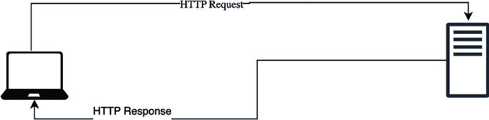

图 1.1：客户端-服务器架构

当你打开任何应用程序，无论是网站还是移动应用程序，此架构都在幕后运行。它用于检索各种类型的信息，包括你的数据或博客文章，具体取决于应用程序的目标。

在我们继续探索之前，熟悉 HTTP 协议至关重要。通过深入了解 HTTP 的复杂性，我们将深入了解 Web 交互如何发生，这将为我们后续的讨论奠定坚实的基础。所以，让我们开始解开 HTTP 的旅程。

## HTTP 协议

HTTP，即 Hypertext Transfer Protocol，是万维网上数据通信的基础。它是一种应用层协议，允许 Web 浏览器和其他客户端应用程序检索网页并与 Web 服务器交互。以下是 HTTP 的概述及其功能：

超文本：HTTP 代表“Hypertext”，指的是包含指向其他文本链接的文本，形成相互连接的信息网络。这是网页相互链接的基础。

传输协议：它是一种协议，这意味着它是一组计算机用于通信的规则和约定。在这种情况下，它涉及数据（如网页）如何在客户端（你的 Web 浏览器）和服务器（Web 服务器）之间请求和传输。

HTTP 是一种基于文本的协议，这意味着客户端和服务器之间交换的消息主要以纯文本形式，便于人类阅读。这些消息包括请求（请求网页或资源）和响应（提供请求的数据）。

## HTTP 的关键特性

HTTP 的关键特性如下：

* 无状态：每个请求-响应周期都是独立的。服务器不记住过去的请求，这有助于保持交互简单且可扩展。
* 方法：HTTP 定义了不同的方法（例如 `GET`、`POST`、`PUT`、`DELETE`）以指定客户端希望对资源执行的操作类型。
* 头部：HTTP 头部提供有关请求或响应的附加信息。例如，它们可以指定内容类型、编码或身份验证详细信息。
* 状态码：响应包含状态码（例如 `200` 表示“成功”或 `404` 表示“未找到”）以指示请求的结果。

HTTP 是访问和交互 Web 内容的基础，它使你在日常浏览互联网时使用的功能成为可能。

现在我们了解了 HTTP 协议和 REST，我们可以放大图 1.2 并查看 REST 在其中所处的位置。

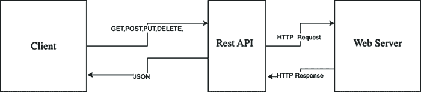

图 1.2：REST 模型

通过 REST 在服务器之间通信非常有效，因为它比其他设计方法具有众多优势。REST 设计为开发者易于理解、设计和构建系统。其架构使系统易于扩展。它基于标准的 `http` 方法，这使其在各种平台和设备上兼容。

使用 REST 时，我们需要在尝试从客户端向服务器发送请求时提供所有信息。这种设计简化了服务器逻辑，使 REST 保持无状态。它还支持缓存，这使得重用存储的响应而无需重复调用变得容易。它允许用户使用 `JSON`、`XML` 或 `HTML`。这使客户端能够灵活地选择他们熟悉的格式。REST 保持客户端和服务器关注点分离。客户端关注资源表示，服务器负责管理和维护这些资源。使用 REST，我们可以通过实施加密机制和标准身份验证（如 `HTTPS`、`OAUTH` 和 API 密钥）创建安全的 API。

RESTful API 可在不破坏现有客户端的情况下扩展。除了所有这些特性外，REST 还可使用可读的 URL 和标准 HTTP 方法轻松记录。

## REST 的特性

REST 的主要特性如下：


## REST 约束

* `Statelessness` : 客户端向服务器发出的每个 HTTP 请求都必须包含理解和处理该请求所需的所有信息。换句话说，服务器不应在请求之间存储任何客户端状态。这使得 RESTful 系统具有高度可扩展性和易于维护。
* `Resource-Based` : REST 将数据和功能视为可由 URL 标识的资源。资源是可以利用标准 HTTP 方法进行操作的实体。例如，在 RESTful API 中，博客文章可以表示为可通过诸如 `/posts/123` 的 URL 访问的资源。
* `Representation` : 资源可以有多种表示形式，例如 JSON、XML、HTML 或其他。客户端可以通过内容协商请求特定表示，通常通过 HTTP 请求中的 `Accept` 头。
* `Stateless Communication` : 客户端向服务器发出的每个请求都必须包含理解和处理该请求所需的所有信息。这意味着服务器不依赖于之前的请求或共享的会话状态。
* `Standard Methods` : RESTful API 使用标准 HTTP 方法（`GET`、`POST`、`PUT`、`DELETE` 等）对资源执行操作。例如，`GET` 用于检索资源，`POST` 用于创建新资源，`PUT` 用于更新资源，`DELETE` 用于删除资源。
* `Uniform Interface` : RESTful 系统具有一致且统一的接口，这简化了客户端和服务器之间的交互。这种一致性基于标准 HTTP 方法和资源 URI。
* `Client-Server Separation` : 客户端和服务器是通信于无状态协议（`HTTP`）上的独立实体。这种分离使它们能够独立演进。客户端负责用户界面和用户体验，而服务器负责处理请求和管理资源。
* `Layered System` : REST 允许在客户端和服务器之间使用中间件，例如代理、负载均衡器和缓存服务器。这些中间件可以在不影响整体系统的情况下增强性能、安全性和可扩展性。
* `Cacheability` : 服务器的响应可以明确标记为可缓存或不可缓存。这允许高效使用缓存机制，减少对服务器的重复请求需求。
* `Code on Demand` : REST 允许服务器通过在响应中传输可执行代码（例如 JavaScript）来扩展客户端的功能。此功能是可选的，在实践中并不常用。

这些 REST 特性和约束有助于创建简单、可扩展且易于理解的 Web 服务和 API。它们已成为构建互联网上许多基于 Web 的系统和服务的基石。

## REST 的关键原则和架构

Representational State Transfer (`REST`) 架构由多个关键架构元素组成，这些元素定义了 RESTful 系统的结构和行为。这些元素协同工作，创建了一个可扩展、无状态且高效的框架，用于设计网络应用程序。主要 REST 架构元素包括：

* `Resources` : 资源是 REST 中的基本抽象。它们代表客户端可以交互的对象、数据或服务。资源由统一资源标识符（`URIs`）标识，`URIs` 用作访问它们的唯一地址。
* `HTTP Methods` : REST 依赖标准 HTTP 方法（也称为 HTTP 动词）对资源执行操作。RESTful 系统中主要使用的 HTTP 方法有：
  * `GET` : 检索资源的表示
  * `POST` : 创建新资源
  * `PUT` : 更新现有资源或在不存在时创建它
  * `DELETE` : 删除资源
  * `PATCH` : 部分更新资源
  * `HEAD` : 仅检索资源的头部
  * `OPTIONS` : 获取资源的通信选项信息
* `Representations` : 资源可以有多种表示形式，例如 JSON、XML、HTML 或其他。客户端可以通过内容协商请求特定表示，通常由 HTTP 请求中的 `Accept` 头控制。
* `Stateless Communication` : RESTful 系统是无状态的，这意味着客户端向服务器发出的每个请求都必须包含理解和处理该请求所需的所有信息。服务器在请求之间不维护任何客户端状态，从而增强可扩展性和简洁性。
* `Uniform Interface` : 统一且一致的接口是 REST 的基本原则。它通过使用标准方法集（`GET`、`POST`、`PUT`、`DELETE` 等）和资源 URI 简化客户端和服务器之间的交互。这种一致性使客户端能够以可预测的方式处理不同资源。
* `URI Structure` : URI 用于唯一标识资源。RESTful URI 应具有意义、分层且便于阅读。它们还应避免包含实现细节并专注于资源标识。例如，RESTful API 中的博客文章或用户资料是一个资源，它具有相应的 URI，例如 `/posts/123` 或 `/users/johndoe`。
* `Status Codes` : HTTP 状态码用于指示请求的执行结果。RESTful 系统大量使用状态码，例如 `200`（`OK`）、`201`（`Created`）、`204`（`No Content`）、`404`（`Not Found`）等，以提供有关操作结果的信息。
* `Hypertext as the Engine of Application State (HATEOAS)` : `HATEOAS` 是 REST 中的一个约束，鼓励在响应中包含超链接，使客户端能够动态发现和导航可用操作和资源。此功能使 RESTful API 更具自描述性。

例如：检索用户信息：

`GET /users/1`

Response:
```
{
  "id": 1,
  "name": "John Doe",
  "email": "john.doe@example.com",
  "_links": {
    "self": { "href": "/users/1" },
    "orders": { "href": "/users/1/orders" },
    "cart": { "href": "/users/1/cart" }
  }
}
```
Orders: Link to fetch the user’s orders.

* `Layered System` : RESTful 系统可以设计为分层架构，其中代理、负载均衡器和缓存服务器等中间件可以在客户端和服务器之间引入。这些中间件增强了性能、可扩展性和安全性，而不会影响整体系统。

## HTTP 方法简介及其在 RESTful 通信中的作用

HTTP 方法，也称为 HTTP 动词，在 RESTful 通信中发挥着基础作用，通过定义客户端可以对资源执行的操作。这些方法决定了客户端与之交互时资源应如何处理。在 REST 中，HTTP 方法提供了一种一致且标准化的方式对资源执行操作，使其成为构建 Web 服务和 API 的强大架构风格。

以下是 RESTful 通信中一些常用 HTTP 方法的概述：

* `GET` : `GET` 方法用于从指定资源检索数据或信息。它是一个安全且幂等的操作，这意味着它不应对资源产生任何副作用，并且多个相同的请求应产生相同的结果。
* `POST` : `POST` 用于向指定资源提交数据以供处理。它通常会导致服务器上创建新资源。与 `GET` 不同，`POST` 请求不是幂等的，重复请求可能导致不同的结果。


`PUT` : `PUT` 用于更新指定 URI 的资源，或在资源不存在时创建它。它用请求中提供的新的表示替换整个资源。它是幂等的，这意味着多个相同的请求应与单个请求产生相同的效果。

`DELETE` : `DELETE` 方法用于从服务器删除资源。一旦删除，该资源不应再在指定的 URI 可用。`DELETE` 请求是幂等的，多个相同的请求会产生相同的结果。

`PATCH` : `PATCH` 用于对资源应用部分修改。它允许客户端更新资源的特定字段或属性，而不影响整个资源。`PATCH` 请求通常在想要部分修改资源状态时使用。

`HEAD` : `HEAD` 方法与 `GET` 类似，但它只请求资源的头部，而不请求资源本身。它对于在不传输资源内容的情况下检查资源元数据很有用，例如最后修改日期。

`OPTIONS` : `OPTIONS` 用于检索有关资源通信选项的信息，例如支持的方法和头部。它允许客户端发现对资源允许执行哪些操作。

这些 HTTP 方法为客户端与资源交互提供了一种统一且可预测的方式，使得 RESTful API 易于理解和使用。每个方法都映射到特定的操作，使客户端能够对资源执行创建、读取、更新和删除（CRUD）操作。正确使用这些方法是在设计高效、可扩展且自描述的 RESTful API 的关键方面。

#  REST 组件 

让我们讨论 REST 组件，从以下开始：

* `User Agent (Client)` : 用户代理通常是一个类似 Web 浏览器的客户端应用程序。它发起请求以访问信息服务，并根据应用程序的要求呈现响应。简单来说，它就是你用来访问网站并查看其内容的东西。

* `Origin Server` : 源服务器是其管理的资源的权威来源。它使用服务器连接器来处理对其资源的请求。任何旨在修改其资源值的请求都必须发送到源服务器。它通过资源层次结构向其服务提供通用接口，隐藏实现细节。

* `Intermediary Components` : 中间组件充当客户端和服务器之间的中介。它们可以转发请求和响应，并在过程中可能对其进行转换。主要分为两种类型：

  * `Proxy Component` : 代理是由客户端选择的中间件，提供各种服务，包括封装其他服务、转换数据格式、提高性能或提供安全保护。客户端决定何时使用代理。

  * `Gateway (Reverse Proxy) Component` : 网关是由网络或源服务器强制实施的。它为其他服务提供接口封装，执行数据转换，提高性能，或强制执行安全策略。与代理的关键区别在于，客户端不决定何时使用网关；它由网络或服务器强制实施。

这些组件协同工作以促进 RESTful 系统中的通信，并且对于 HTTP 协议的正常运行至关重要。用户代理发起请求，源服务器提供资源，而中间件有助于高效地路由和处理请求和响应。

现在我们对 REST 有了扎实的理解，下一步是选择一种编程语言来实现 RESTful 服务。在本书中，我们选择了 Go（或 Golang）作为首选语言。让我们踏上 Go 的世界之旅，探索它如何用于构建功能强大且高效的 RESTful API。

#  Go 编程语言及其在 API 开发中的优势简介 

Go，通常称为 Golang，是一门编程语言，自 2009 年由 Google 推出以来，在软件开发社区中获得了显著关注和流行。这种流行度的飙升可归因于一系列独特功能和深思熟虑的设计原则的引人注目的结合，这些原则使 Go 与其他编程语言区别开来。

这些独特的功能和设计原则不仅使 Go 成为一门独特的语言，而且还促进了其在软件开发各个方面的有效性和效率。在本书中，我们将详细探讨这些功能和原则，阐明 Go 为何成为从 Web 开发到系统编程及更广泛的各种应用的首选。

#  GO 的特性 

以下是 GO 的主要特性：

* `Simplicity` :

Go 最突出的特性之一是其简洁性。该语言是有意设计成具有简洁、极简的语法，易于阅读和编写。这种简洁性降低了开发者的认知负担，使得创建可靠且可维护的代码变得更容易。Go 的简洁性还意味着开发者可以迅速提高生产力，因为他们无需处理复杂的语言特性或怪癖。

* `Efficiency` :

效率是 Go 的另一个标志。它是一门编译型语言，这意味着代码在执行前会被翻译成机器码。这导致执行速度快，使 Go 非常适合性能至关重要的应用程序。Go 的垃圾回收器也非常高效，可在不产生显著开销的情况下自动管理内存。

* `Concurrency` :

并发是 Go 的核心优势。它引入了 goroutine 的概念，即轻量级线程，使得编写并发程序变得容易。Goroutine 使开发者能够创建高度并发的应用程序，而无需传统基于线程的并发的复杂性和开销。通道是 Go 的另一个特性，为 goroutine 之间通信和同步工作提供了一种安全高效的手段。

* `Standard Library` :

Go 的标准库非常广泛，涵盖了从 Web 开发到网络和文件 I/O 的各种任务。这个全面的库减少了对第三方依赖的依赖，简化了开发过程，并为开发者确保了一致可靠的工具集。

* `Cross-Platform` :

Go 设计为高度可移植。它可以为各种平台编译代码，使得编写可在不同操作系统和架构上无缝运行的应用程序变得容易。这种可移植性对于从事跨平台项目或针对特定环境的开发者尤其有价值。

* `Static-Typing` :

静态类型是 Go 的另一个特性，有助于代码的可靠性。通过在编译时进行类型检查，错误可以在开发过程的早期被捕获，减少了运行时问题的可能性。此功能对于大型和复杂的代码库尤其有益。

* `Open-Source` :

Go 的开源性质培养了一个充满活力且支持的开发者社区。该社区积极为语言的生态系统做出贡献，通过创建库、工具和资源来扩展 Go 的功能。这些资源的可用性使开发者更容易应对项目中的各种挑战。

* `Scalability` :


Scalability is a fundamental aspect of Go. Its concurrency primitives and efficient runtime make it an ideal choice for building highly scalable systems. This has led to the adoption of Go in areas such as web servers, microservices, and cloud-based applications.

### Tooling

Go has a powerful set of development tools, including the `GO` command-line tool, a built-in testing framework, and excellent documentation. These tools streamline the development process and make it easy to write clean, efficient code.

In addition to its technical strengths, Go benefits from Google’s backing and the experience of one of the world’s largest technology companies. This ensures that Go continues to evolve, remains well-maintained, and receives contributions from some of the brightest minds in the industry.

## Conclusion

In conclusion, Go is a programming language that combines simplicity, efficiency, and strong support for concurrency. It is suitable for a wide range of applications, from web development to system programming, and offers a robust set of tools and libraries. As the programming landscape continues to evolve, Go stands out as a compelling choice for modern software development.

In this introductory chapter, we laid the foundation for our journey into mastering REST API development with Go. In the chapters to come, we will dive deeper into the practical aspects of REST API development using Go.

Our next chapter will guide you through configuring your development environment, understanding Go workspaces, including the concept of `GOPATH`, and mastering the Go module system for dependency management and versioning. Prepare to roll up your sleeves and start building powerful, efficient REST APIs that will enable seamless communication between your applications and the web.

## Key Terms

* `REST`: Representational State Transfer, an architectural style for designing networked applications.
* `API`: Application Programming Interface, a set of rules for building and interacting with software applications.
* `Client-Server Architecture`: A foundational framework for the interaction and communication between computing systems.
* `HTTP`: Hypertext Transfer Protocol, the foundation of data communication on the World Wide Web.
* `Stateless`: A characteristic of RESTful systems where each request-response cycle is independent.
* `Resources`: Fundamental abstractions in REST, identified by URIs, representing objects, data, or services.
* `HTTP Methods`: Standard actions used in RESTful systems, such as `GET`, `POST`, `PUT`, and `DELETE`.
* `Uniform Interface`: A fundamental principle of REST that simplifies interactions using standard methods and resource URIs.
* `Go` `Golang`: A programming language known for its simplicity, efficiency, and concurrency support.

# CHAPTER 2

## Setting Up the GO Development Environment

### Introduction

In this chapter, we will embark on the first steps of our journey to mastering REST API development with Go by exploring the essential process of setting up your Go development environment. A solid development environment is the foundation upon which you will build powerful RESTful APIs using the Go programming language. We will delve into the key components, configurations, and best practices necessary to create a productive and efficient workspace for your Go development endeavors. So, let us begin this chapter by ensuring you have everything you need to start your REST API development journey with Go on the right foot.

### Structure

In this chapter, we will discuss the following topics:

* Installing Go
* Windows
* MacOS
* Linux
* Understanding the Go Workspace and the Concept of `GOPATH` and `GOROOT`
* Organizing Your Go Projects within the Workspace
* Exploring the Go Module System for Dependency Management and Versioning
* Initializing and Managing Go Modules in Your Projects
* Integrating Third-Party Libraries and Packages into Your Go Projects
* Setting Up a Code Editor or IDE for Go Development and Recommended Plugins or Extensions

### Installing Go

To get started with installing Go, first, head over to the official Golang download page by accessing the following URL: `https://go.dev/dl/`. Once there, you will notice various download options tailored for different systems. To ensure compatibility and smooth performance, it is crucial to choose the version that matches your computer’s architecture, such as `AMD64` or `ARM64`. Additionally, make sure to consider your operating system, whether it is Windows, macOS, or Linux, as this will further refine the available options. Subsequent to identifying the suitable version for your system, click it to initiate the download. Once the download is complete, you can proceed with the installation process.

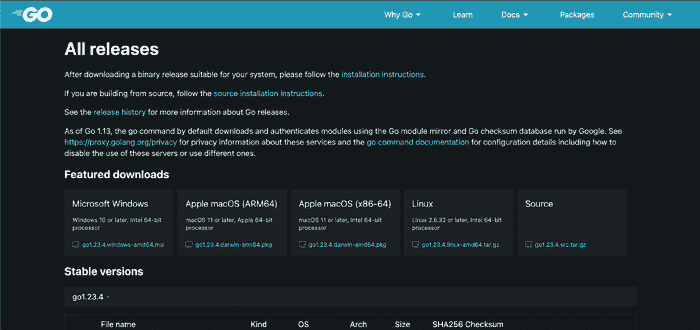

**Figure 2.1:** Installing Go from go.dev

#### Linux

To install Go on Linux, follow these steps:

1. Extract the downloaded archive into `/usr/local`. This will create a fresh Go installation in `/usr/local/go`. You might need to execute the following command as the root user or via sudo:

```
sudo rm -rf /usr/local/go && sudo tar -C /usr/local -xzf go1.21.3.linux-amd64.tar.gz
```

2. To make Go accessible from the command line, add `/usr/local/go/bin` to your `PATH` environment variable. You can achieve this by appending the following command to either your `$HOME/.profile` or the system-wide `/etc/profile` (for a system-wide installation):

```
export PATH=$PATH:/usr/local/go/bin
```

Please note that changes made to a profile file may not take effect until you log in again. To apply the changes immediately, you can run the shell commands directly or execute them from the profile using a command such as `source $HOME/.profile`.

To confirm a successful Go installation, open a terminal and execute the following command:

```
go version
```

Ensure that this command displays the installed version of Go.


**Figure 2.2:** Command to Confirm the Installed Version of Go through the Terminal

#### Mac

To install Go on Mac, follow these steps:

1. Begin by opening the downloaded package file and follow the on-screen prompts to install Go. This installation will place the Go distribution in the `/usr/local/go` directory. Additionally, the package should automatically add the `/usr/local/go/bin` directory to your `PATH` environment variable. If the changes to your `PATH` do not take effect immediately, consider restarting any open Terminal sessions.

2. To ensure a successful Go installation, open a command prompt and execute the following command:

```
go version
```

Confirm that the command displays the installed version of Go. This step verifies that your Go installation is functioning as expected.

#### Windows

To install Go on Windows, follow these steps:

1. Begin the installation process by opening the downloaded MSI file. Follow the on-screen prompts to install Go. By default, the installer will place Go in either the "`Program Files`" or "`Program Files (x86)`" directory, depending on your system architecture. You have the option to change the installation location as needed during this process.

Once the installation is complete, it is important to note that you will need to close and reopen any currently open Command Prompt windows. This step ensures that the changes to the environment made by the installer take effect.


要确认 Go 是否已成功安装在你的 Windows 系统上，请按照以下步骤操作：

1. 在 Windows 任务栏中点击 `Start` 菜单。
2. 在菜单中的搜索框内，输入 `cmd` 然后按下 `Enter` 键。这将打开命令提示符窗口。
3. 在命令提示符窗口中，输入以下命令：
   `go version`
4. 通过按下 `Enter` 执行此命令。

此命令将显示已安装的 Go 版本，从而验证安装过程是否成功。

按照这些步骤，你可以确保 Go 已正确安装在你的 Windows 机器上并可供使用。

## 了解 Go 工作区以及 GOPATH 和 GOROOT 的概念

Golang 对代码的组织和管理采用了一种独特的方法，称为“工作区”。其核心是环境变量 `GOPATH`。理解 Go 工作区、`GOPATH` 和 `GOROOT` 对于高效的 Go 开发至关重要。以下是对此概念的深入介绍。

### Go 工作区

Go 工作区充当一个结构化的目录层级，用于存放所有与 Go 相关的代码和相关文件。与某些其他编程语言相比，Go 的一个显著特点是坚持使用明确定义的工作区结构。该结构经过精心设计，旨在简化依赖管理以及代码的整体组织。

通常，此工作区包含三个主要目录：

* `src`：在此目录中，你会找到 Go 源代码文件。它是你创建和维护 Go 程序以及导入外部包的专用空间。
* `pkg`：Go 编译器生成的输出，特别是编译后的包，存放在这里。该目录存储构建过程中产生的二进制文件。
* `bin`：此目录用作可执行二进制文件的存储库，它们是编译程序的最终结果。当你使用 `go install` 命令时，它会将可执行文件放置在此位置。

通过遵循这种结构化的工作区安排，你为在不同项目和计算环境中组织 Go 代码建立了一种统一且一致的方法。这种一致性增强了代码管理并促进了开发工作的无缝协作。

### GOPATH 环境变量

`GOPATH` 环境变量充当指向工作区核心的关键指针。它本质上指示 Go 在何处查找和存放 Go 代码、包和可执行文件。虽然你只能维护一个 `GOPATH`，但这个单一的 `GOPATH` 可以容纳多个工作区，前提是每个工作区都遵循标准化的结构。

当你的 Go 代码包含外部包时，Go 会在指定工作区的 `src` 目录和标准库中进行搜索。因此，正确配置 `GOPATH` 对于确保你的 Go 工具和构建过程顺利运行具有重要意义。

在 Go 的较新版本中，默认工作区位置方便地设置在你的用户主目录内。这对于 Linux 和 macOS 用户来说是 `~/go`，对于 Windows 用户则是 `C:\Users<YourUsername>\go`。要确定当前的 `GOPATH` 配置，你只需在终端或命令提示符中执行命令 `go env GOPATH` 即可。

### GOROOT 环境变量

它是一个环境变量，指定 Go 在你的系统上的安装位置。它指向 Go 工具链、标准库以及构建和运行 Go 程序所需的其他文件所在的目录。`GOROOT` 在你安装 Go 时会自动设置，通常指向安装目录（例如，Linux/Mac 上的 `/usr/local/go` 或 Windows 上的 `C:\Go`）。

`GOROOT` 告诉 Go 编译器和工具在哪里找到 Go 标准库和相关文件。它并非用于存放你自己的 Go 项目；请使用 `GOPATH` 来存放。

### 工作区和版本控制

许多 Go 项目使用 Git 等版本控制系统来管理代码。借助工作区结构，很容易以代码和依赖之间清晰分离的方式组织项目的仓库。

Go 模块于 Go 1.11 引入，提供了一种替代 `GOPATH` 管理依赖的方法，允许在项目组织上更灵活。模块允许你在传统工作区结构之外工作。

### 在工作区内组织你的 GO 项目

为了确保标准化的结构，简化依赖管理，增强代码可维护性，促进协作，并与 Go 的简洁性和约定优于配置的理念保持一致。

以下是一些在工作区内组织 Go 项目的建议：

* 创建项目目录：
  * 首先在工作区的 `src` 目录内为你的 Go 项目创建一个目录。
  * 为项目目录选择一个描述性且有意义的名称。
* 使用子目录存放包：
  * 根据包的目的或功能，将项目的代码组织到子目录中。
  * 例如，你可以拥有诸如 `web` 用于 Web 相关代码，`database` 用于数据库相关代码等子目录。
  * 遵循 Go 的包命名约定，其中目录名与导入路径的最后一个元素匹配。
* 分离应用程序入口点：
  * 如果你的项目包含多个应用程序或服务，为每个应用程序创建单独的目录或子目录。
  * 每个应用程序都应有其 `main.go` 文件作为入口点。
* 使用描述性的文件名：
  * 为你的 Go 源文件赋予能表明其用途的描述性名称。
  * 例如，使用 `server.go` 用于你的 HTTP 服务器代码或 `database.go` 用于数据库相关代码。
  * 除非包确实包含实用函数，否则避免使用 `utils.go` 或 `helpers.go` 等通用名称。
* 分组相关文件：
  * 将相关的函数、类型和常量放在同一个文件中。
  * 使用注释和适当的代码组织，使你自己和其他人易于理解代码。
* 创建 `cmd` 目录：
  * 在项目中创建 `cmd` 目录来存放可执行应用程序是一种常见做法。
  * 例如，如果你有一个名为 `app` 的项目，可以有一个 `cmd/app` 目录用于主应用程序。
  * 这有助于保持项目根目录整洁有序。
* 管理依赖：
  * 使用 Go 模块管理外部依赖。
  * 在项目根目录保留一个 `go.mod` 文件以指定项目的依赖项和版本。
  * 避免将依赖项检入版本控制系统；相反，使用 `go mod` 命令来管理它们
* 文档和测试：
  * 使用 GoDoc 风格的注释为你的包和函数添加文档。
  * 为你的代码编写测试并将它们放在同一包目录内的单独 `*_test.go` 文件中。
  * 考虑使用 `testing` 等测试框架来构建你的测试套件。
* 版本控制：
  * 从根目录为你的项目初始化一个版本控制仓库（例如，Git）。
  * 使用有意义的提交信息进行定期提交。
  * 使用分支和标签策略来管理代码的不同版本。


#### 避免根目录过度拥挤

通过避免包含非必要的文件或目录来保持项目的根目录整洁。
使用 `.gitignore` 或类似文件来排除构建过程中生成的文件或编辑器特定的文件。

#### 代码 Lint 和格式化

使用 Go 的 `gofmt` 和 `golint` 工具来格式化和检查你的代码。
在整个项目中保持一致的代码风格以提高代码可读性。

#### 使用 Git 忽略文件

包含一个 `.gitignore` 文件来指定版本控制应忽略哪些文件和目录。
包含临时文件、构建产物以及特定于你的开发环境的文件的条目。

#### 使用 Go 命名约定

`CamelCase`: 对于未导出的名称使用以小写字母开头的混合大小写，对于导出的名称使用以大写字母开头的混合大小写。
`Meaningful Names`: 选择能够清晰描述变量、函数或类型用途的名称。除非是众所周知的缩写，否则避免使用缩写，例如 `url`、`id`。
`Avoid Stutter`: 避免在标识符中重复包名，因为 Go 在使用时会自动包含包名。
`Short Variable Names for Local Scope`: 在小范围内为循环计数器和临时变量使用 `i`、`j` 或 `x` 等简短名称。避免在大范围内使用过于简短的名称。

通过遵循这些组织技巧，你可以使 Go 项目在工作区内保持良好的结构和可维护性，从而更轻松地与其他人协作并高效地浏览代码库。

## 在你的项目中初始化和管理 Go 模块

Go 模块提供了一种稳健且高效的方式来管理 Go 项目中的依赖关系。模块系统在 Go 1.11 中引入，并在后续版本中得到完善，它消除了基于 GOPATH 的依赖管理需求，使开发人员能够更灵活地处理依赖关系。

**什么是 Go 模块？**

Go 模块是一组一起版本化的 Go 包，作为一个单一单元。它有助于管理依赖关系，并确保项目在不同的开发环境中使用一致的包版本。

**初始化 Go 模块**

要创建并初始化一个新的 Go 模块，请按照以下步骤操作：

1. **导航到你的项目目录**

打开终端并移动到你的项目文件夹：
```
mkdir my-go-project && cd my-go-project
```

2. **初始化 Go 模块**

使用以下命令创建 `go.mod` 文件： `go mod init` `github.com/username/my-go-project`

此命令执行以下操作：
- 创建 `go.mod` 文件，用于跟踪依赖关系。
- 设置模块名称，例如 `github.com/username/my-go-project`。

3. **验证 `go.mod` 文件**

初始化后，会生成一个包含以下内容的 `go.mod` 文件：
```
module github.com/username/my-go-project
go 1.21
```
`go.mod` 文件充当依赖关系和模块版本的清单。

`go.mod` 文件中指定的模块名称充当模块内所有包的根路径。此名称决定了包在项目内部以及被其他导入它的 Go 项目外部引用的方式。

例如，如果模块初始化为：
```
module github.com/username/my-go-project
```
- 此模块内的任何包都将以 `github.com/username/my-go-project` 开头进行引用。
- 此模块中的主包通常包含 `main.go` 的那个包，被视为根包。

## 探索 Go 模块系统以进行依赖管理和版本控制

Go 编程语言引入了其模块系统来解决与依赖管理和版本控制相关的挑战。此系统简化了在 Go 项目中管理外部包及其版本的过程。

让我们深入了解 Go 模块系统的关键概念和实践：

* **初始化模块：**
  * 要在项目中使用模块系统，请在项目根目录中运行命令 `go mod init module-name`。将 `module-name` 替换为你的模块名称，通常遵循项目导入路径的约定。
  * 此命令初始化一个新的 Go 模块，并在项目根目录中创建 `go.mod` 文件。此文件充当模块的配置文件。

* **依赖管理：**
  * `go.mod` 文件维护项目直接依赖的列表，包括它们的名称和版本。
  * 当你使用 import 语句将包导入代码时，Go 工具链会自动将依赖添加到你的 `go.mod` 文件中。

* **版本控制：**
  * Go 模块系统采用一种称为语义版本控制 的版本控制方案。
  * `go.mod` 文件中的依赖项包含特定版本或版本范围，例如 `v1.2.3` 或 `².0.0`。这些版本有助于确保兼容性和稳定性。

* **更新依赖项：**
  * 你可以使用 `go get` 命令后跟包的导入路径来更新项目的依赖项。
  * 例如，`go get` `example.com/mypackage` 将获取 `mypackage` 包的最新版本。
  * `go get` 命令会使用最新的依赖信息更新你的 `go.mod` 和 `go.sum` 文件。

* **Vendor 目录：**
  * Go 模块使用 vendor 目录在项目本地存储依赖项。
  * vendor 目录包含项目依赖项特定版本的副本。
  * 此本地副本确保即使远程仓库发生变化，你的项目仍使用预期的版本。

* **语义导入版本控制：**
  * Go 模块鼓励使用语义导入版本控制，在导入路径中指定依赖项的版本。
  * 例如，import "`example.com/mypackage/v2`" 导入 `mypackage` 包的版本 2。

* **依赖代理和缓存：**
  * Go 模块系统支持使用代理服务器来获取和缓存依赖项，从而减少对包仓库版本控制系统的负载。
  * 你可以使用诸如 `GOPROXY` 之类的环境变量来配置你的代理服务器。

* **Tidy 和 Vendor Prune：**
  * `go mod tidy` 命令会从 `go.mod` 文件中删除不再导入到项目中的任何依赖项。
  * `go mod vendor` 使用代码中明确使用的依赖项填充你的 vendor 目录。

* **保持兼容性：**
  * 定期更新项目的依赖项以受益于错误修复和新功能，同时确保与现有代码的兼容性。
  * 在 `go.mod` 文件中使用版本范围来指定可接受的更新，例如 `¹.0.0` 表示次要更新。

* **版本锁定：**
  * 对于生产环境或关键项目，请考虑通过在 `go.mod` 文件中指定确切版本来进行版本锁定。这可确保仅使用指定的版本。

通过理解并有效使用 Go 模块系统，你可以简化依赖管理，增强项目稳定性，并自信地在 Go 项目中管理外部包。此系统使 Go 开发人员能够轻松构建可靠且可维护的软件。

## 将第三方库和包集成到你的 Go 项目中


在广阔的软件开发世界中，有一句广为流传的格言：“不要重复造轮子。” 这种智慧强调了利用全球开发者社区慷慨分享的现有解决方案、工具和库的价值。 这些第三方包可以极大地加速开发过程，提供强大且经过预先测试的功能，而从头构建这些功能可能是令人望而生畏的、耗时耗力的，甚至是多余的。 通过了解如何探索、评估和集成这些包，开发者不仅可以节省宝贵的时间，还能受益于同行的集体知识和专业经验。

Go 生态系统是开源且由社区驱动的，已经见证了大量面向各种需求的第三方包的爆发。 从 Web 框架到数据处理工具，几乎针对每一种可想的需求都有可用的包。 然而，能力越大责任越大。 在集成包之前，彻底探索并评估其对当前项目的适用性至关重要。 本节将指导你如何在可用的 Go 包海洋中导航，确保你做出有助于项目的明智决策。

### 理解 Go Modules

在深入集成之前，了解 Go Modules 至关重要，Go Modules 是 Go 的依赖管理工具。 Go Modules 于 Go 1.11 引入，用于跟踪项目的依赖关系，确保可重现性和版本兼容性。

* `go.mod`: 位于项目根目录的文件，列出其所有依赖项。
* `go.sum`: 伴随 `go.mod` 文件存在，通过存储模块的校验和来确保模块的完整性。

### 添加第三方包

开始时，按如下方式初始化 Go modules、添加包并将其导入到 Go 代码中：

**初始化：**

如果尚未初始化，请在项目目录中初始化 Go modules：

```
go mod init <module-name>
```

**添加包：**

要集成第三方包，请使用 `go get` 命令，后跟包的路径：

```
go get github.com/package-author/package-name
```

**代码中导入：**

添加后，你现在可以在 Go 文件中导入并使用该包。

```
import "github.com/package-author/package-name"
```

### 管理包版本

Go Modules 允许你指定包的版本：

**最新版本**：默认情况下，`go get` 获取最新版本。

**特定版本**：使用 `@` 指定版本，例如：

```
go get github.com/package-author/package-name@v1.2.3
```

### 更新和移除包

以下是更新和移除包的方法：

**更新**：要将包更新到最新版本，请使用以下命令：

```
go get -u github.com/package-author/package-name
```

**移除**：只需从代码中移除导入。 要清理 `go.mod` 文件，请运行以下命令：

```
go mod tidy
```

### 探索第三方包

诸如 `pkg.go.dev` 之类的平台提供了一个集中位置来探索和评估 Go 包。 在集成之前，请检查包的文档、维护状态和用户反馈。

### 常见陷阱及解决方案

让我们来看一下常见陷阱及其解决方案：

**间接依赖：**

这些是项目中未直接使用但由其他依赖项所需的依赖项。 它们在 `go.mod` 文件中列在 // indirect 下。 必须确保它们不会引入漏洞。

**版本冲突：**

不同的包可能需要共享依赖的不同版本。 Go Modules 会尝试使用最新的兼容版本，但彻底测试至关重要。

集成第三方包可以显著加速开发，但有效地管理它们至关重要。 通过理解 Go Modules 并遵循最佳实践，你可以确保你的 Go 项目保持健壮、可维护且无依赖相关问题。

## 为 Go 开发设置代码编辑器或 IDE 及推荐的插件或扩展

代码编辑器或集成开发环境 IDE 的选择会对开发者的生产力产生显著影响。 虽然 Go 的简洁和强大功能甚至可以用最基本的文本编辑器来利用，但量身定制的环境可以放大效率，提供简化编码流程的工具和功能。

Visual Studio Code（VSCode）是一个多功能且广泛使用的代码编辑器，提供丰富的扩展生态系统，使其成为 Go 开发的理想选择。 其轻量级特性与强大功能相结合，使开发者能够创建量身定制的 Go 开发环境，从而提高生产力并简化编码流程。 本章提供了为 Go 开发设置 VSCode 的深入指南，重点介绍基本配置、插件和最佳实践。

### 使用 Visual Studio Code 进行 Go 开发的原因

在深入设置之前，了解 VSCode 脱颖而出的原因至关重要：

* **轻量级：**

  VSCode 在性能和功能之间取得平衡，确保快速启动时间和响应速度。
* **可扩展：**

  VSCode 市场拥有数千个扩展，满足几乎每一种开发需求。
* **集成终端：**

  开发者可以直接在编辑器内运行 Go 命令，促进更顺畅的工作流程。
* **Git 集成：**

  内置的 Git 功能支持无需离开编辑器的版本控制操作。
* **调试能力：**

  VSCode 的调试器界面用户友好，可以轻松集成 Go 的调试器 Delve。

### 为 Go 安装和配置 VSCode

首先导航到 Visual Studio Code 官方网站 `https://code.visualstudio.com/`。 在这里，你会找到针对不同操作系统的版本：Windows、macOS 和 Linux。 点击与你的操作系统对应的版本。 网站通常会自动检测你的操作系统并突出显示适合你的版本。

**适用于 Windows：**

启动下载的 `.exe` 文件。 安装向导将指导你完成安装。 你可以接受默认设置或根据自己的喜好进行自定义。 勾选允许直接从上下文菜单在 VSCode 中打开文件和文件夹的选项是有益的。

**适用于 MacOS：**

打开下载的 `.zip` 文件并将 Visual Studio Code 应用程序拖到应用程序文件夹中。 为了便于访问，你可以将其添加到 Dock。

**适用于 Linux：**

根据下载的包（Debian/Ubuntu 的 `.deb` 或 Fedora/Red Hat 的 `.rpm`），使用你的包管理器安装它。 例如，如果你下载了 `.deb` 包，可以使用 `sudo dpkg -i <file-name>.deb` 安装它。

**Go 扩展：**

通过点击侧边栏上的方形图标或按 `Ctrl+Shift+X` 导航到扩展视图。

搜索 "`Go`" 并安装由 Go 团队维护的官方 Go 扩展。

**配置 Go 扩展：**

安装 Go 扩展后，可能会弹出建议安装额外的 Go 工具，如 `gopls`、`gofmt` 和 `delve`。 接受并安装这些工具，因为它们增强了代码导航、格式化和调试。

通过点击左下角的齿轮图标并选择 `Settings` 访问设置。 在搜索栏中输入 "`Go`" 以过滤 Go 特定设置。 在这里，你可以自定义 Go 环境、选择格式化程序、代码检查器等。


## Go 开发必备的 VSCode 扩展

虽然官方的 Go 扩展提供了坚实的基础，但其他一些扩展可以进一步提升 Go 开发体验：

**Go Test Explorer：**

简化运行和可视化测试的过程。它提供了一个 UI 来查看哪些测试通过、失败或待处理。

**Go Playground：**

允许开发者直接在 VSCode 中运行 Go 代码片段，非常适合在不创建完整程序的情况下测试小段代码。

**Go Doc：**

此扩展便于在编辑器内查看 Go 文档，减少在浏览器和编辑器之间切换的需求。

## 最佳实践和技巧

以下是 VSCode 中 Go 开发的一些最佳实践和技巧：

**集成终端：**

利用 VSCode 的集成终端运行 Go 命令。你可以通过按 `Ctrl+\`` 来切换它。

**调试：**

直接在 VSCode 中设置断点并检查变量。确保已安装 Delve 以利用调试功能。

**代码导航：**

在函数、变量或包上使用 `Ctrl+Click` 跳转到其定义。Go 扩展在 `gopls` 的帮助下使代码导航变得无缝。

Visual Studio Code 凭借其适应性和丰富的扩展生态系统，为 Go 开发提供了无与伦比的环境。通过为 VSCode 配置合适的扩展和设置，Go 开发者可以利用强大的、集成且高效的编码环境，确保他们能够轻松高效地专注于构建高质量的 Go 应用。

## 结论

总之，本章为 Go 编程语言的初学者提供了全面的指南，涵盖了其基本方面和实际用途。我们了解了 Go 及其独特特性，尤其是其效率、简洁性和强大的并发能力。本章还解释了在各种操作系统上安装 Go 的过程，确保用户可以在任何平台上建立其开发环境。

在下一章中，我们将深入探讨 Go 语法的要点，强调其在 API 开发中的有效性。我们将探讨变量和常量的声明与使用，并研究 Go 丰富的内置数据类型，包括数值、字符串和布尔值。重点将放在数学和逻辑任务的运算符上，以及 Go 的控制结构，如 `if`、`switch` 和 `for` 循环。我们将讨论函数在 API 开发中的作用，并深入探讨健壮的错误处理技术，包括特定错误类型的使用。本章还将指导如何为清晰和高效而构建 Go 代码，遵循 Go 的惯用风格。最后，我们将了解在 Go 项目中使用包和保持模块化的重要性，这对于构建可扩展且可维护的软件至关重要。

## 关键术语

* **Go Module**：一组作为一个单元一起版本化的 Go 包，使用 `go.mod` 管理。
* `go.mod`：定义模块名称并跟踪 Go 项目中依赖项的配置文件。
* **Package Name**：在 Go 文件开头 `package` 声明中使用的标识符，它决定了该包如何被导入。
* **Import Path**：用于引用和导入包的完整路径，通常与模块名称和子目录结构相匹配。
* `go.sum`：存储依赖项校验和的文件，确保下载的包未被篡改。
* `go get`：用于获取、安装或更新 Go 依赖项的命令。
* `go mod tidy`：删除未使用的依赖项并确保 `go.mod` 为最新的命令。
* **Third-Party Packages**：在 Go 项目中导入并使用的外部库。
* **Vendor Directory**：一个可选文件夹，用于在本地存储依赖项，而不是从互联网获取。

# CHAPTER 3

## Go 语法和 API 开发概念

### 引言

Golang 以其简洁性、高效性和强大的性能而闻名。在本章中，我们将探索 Go 编程语言的语法和关键概念，重点关注与 API 开发相关的方面。无论你是否已熟悉 Go 还是刚刚开始学习，本章都将为你提供 Go 语法、数据类型、函数和其他基本元素的全面概述。你将获得编写干净、惯用的 Go 代码所需的知识和技能，以构建健壮且可扩展的 RESTful API。那么，让我们踏上掌握 Go 进行 API 开发的旅程吧。

### 结构

在本章中，我们将讨论以下主题：

* Go 中变量、常量及其声明
* Go 中的数据类型
* Go 中用于执行数学和逻辑操作的运算符
* Go 中的控制结构
* Go 中的函数及其在 API 开发中的使用
* Go 中的错误处理
* 构建 Go 代码并遵循 Go 的惯用风格
* 包和模块化

## Go 中的变量、常量及其声明

让我们通过示例学习 Go 中变量、常量及其声明以及它们的重要性。

#### 变量

Go 中的变量是具有特定类型的存储位置，该类型决定了变量内存的大小和布局、可以在该内存中存储的值范围以及可以应用于该变量的操作集。

### 声明变量

以下是声明变量的方法：

1. **基本声明**：变量使用 `var` 关键字声明，后跟变量名和类型。初始值是可选的。如果省略，变量将被初始化为其类型的零值。

```
var a int       // declares an integer variable 'a'
```

```
var b string    // declares a string variable 'b'
```

2. **短变量声明**：Go 还支持声明和初始化变量的简写形式。这通常用于局部变量。

```
a := 10 // declares an integer variable 'a' and initializes it to 10
```

```
b := "hello" // declares a string variable 'b' and initializes it to "hello"
```

3. **多个变量**：你可以一次声明多个变量。

```
var a, b, c int             // multiple variables of the same type
```

```
var d, e = 400, "abc"       // multiple variables with initialization
```

### 常量

常量是值一旦定义就不能更改的变量。它们提供了一种定义在程序执行过程中旨在保持静态的值的方式。

### 声明常量

以下是声明常量的方法：

1. **基本声明**：常量以与变量类似的方式声明，但使用 `const` 关键字。

```
const Pi = 3.14
```

2. **带类型常量**：你也可以显式指定常量的类型。

```
const Pi float64 = 3.14
```

3. **多个常量**：与变量类似，可以一次声明多个常量。

```
const (
    StatusOK = 200
    NotFound = 404
)
```

## Go 中的数据类型

编程中的**数据类型**是指定变量可以保存的数据种类的分类。它们定义了可以对该数据执行的操作以及数据在内存中的存储方式。

让我们了解 Go 中的数据类型并探索其细节。

### 基本类型

以下是 Go 编程语言中的基本数据类型：

**数值类型：**


#### 整数

##### 有符号整数：`int`，`int8`，`int16`，`int32`，`int64`

`int` 是一种通用整数。它的大小取决于平台（为 32 或 64 位）。

`int8`、`int16`、`int32` 和 `int64` 分别表示 8、16、32 和 64 位的有符号整数。

##### 无符号整数：`uint`，`uint8`，`uint16`，`uint32`，`uint64`

与有符号整数类似，但不能表示负值。

`uint8` 也被称为字节。

##### 机器相关类型：`uintptr`

一个足够大的无符号整数，可以存储指针值的未解释位。

#### 浮点数

`float32`，`float64`

分别表示单精度（32 位）和双精度（64 位）浮点数。

#### 复数

`complex64`，`complex128`

用于具有 `float32` 和 `float64` 实部和虚部的复数。

#### 字符串类型

`string`：表示字节序列（通常为文本）。Go 中的字符串是不可变的。

#### 布尔类型

`bool`：表示布尔值，可以是 true 或 false。

### 聚合类型

Go 中的聚合类型是复合数据类型，将多个值组合成一个实体。

#### 数组类型

数组是单一类型元素的定长序列。数组的长度是其类型的一部分。

```
var i = [14]int
```

#### 结构体类型

结构体将变量（称为字段）在一个名称下分组，每个字段都有名称和类型。它对于将相关数据组合在一起很有用。

```
type Vertex struct {
X int
Y int
}
```

### 引用类型

Go 中的引用类型是指向底层数据结构的类型的，而不是直接保存数据，从而允许在程序的不同部分高效地操作和共享数据。

#### 指针类型

指针保存变量的内存地址。它们允许间接操作引用地址处的值。

```
var p *int
```

#### 切片类型

切片类似于数组，但大小动态且灵活。切片指向一个数组，提供元素的视图。

```
var i = []int
```

#### 映射类型

映射是键值存储，其中键是唯一的。它们用于根据键查找值。

```
var m map[string]int
```

#### 通道类型

通道为 goroutine 之间提供通信和同步的方式。它们在并发 Go 编程中被广泛使用。

```
var intChan = chan int
```

### 接口类型

接口定义了一组方法。任何实现这些方法的类型都满足该接口。接口是 Go 类型系统和多态的核心。

```
type InterfaceName interface {
Method1() returnType
Method2(paramType) returnType
}
```

### 函数类型

函数是 Go 中的一等值。函数的类型由其签名定义，签名包括参数类型和返回值类型。

```
func functionName(parameters) returnType {
// Function body
}
```

## Go 中用于执行数学和逻辑操作的运算符

在 Go 中，运算符是执行对操作数（如变量和值）的操作的特殊符号。它们是语言的基础，使开发人员能够执行广泛的数学、逻辑和关系操作。运算符对于实现业务逻辑、操作数据和控制程序流程至关重要。它们的使用范围从简单的算术计算到代码中的复杂决策过程。理解并有效使用运算符对于构建高效且功能齐全的 Go 应用至关重要。

Go 中的运算符可以大致分为几个类别：

### 算术运算符

Go 中的算术运算符促进对数值进行基本数学运算。它们对于执行计算、处理数据和在 Go 程序中实现算法至关重要。主要算术运算符包括加法、减法、乘法、除法和取模，每种都有其在数字操作中的独特作用。

* **加法 (`+`)**：将两个操作数相加。
* **减法 (`-`)**：从第一个操作数减去第二个操作数。
* **乘法 (`*`)**：将两个操作数相乘。
* **除法 (`/`)**：用第二个操作数除第一个操作数。请注意，两个整数相除结果为整数。
* **取模 (`%`)**：返回两个操作数相除的余数。

### 赋值运算符

Go 中的赋值运算符对于将值赋给变量至关重要。它们不仅用于直接赋值，还用于基于现有值修改值，从而简化代码并提高可读性。这些运算符包括基本赋值以及将算术和赋值结合为单一操作的复合赋值。

* **简单赋值 (`=`)**：将右操作数的值赋给左操作数。
* **复合赋值**：将算术和赋值结合，如 `+=`、`-=`、`*=`、`/=`、`%=` 

### 比较运算符

Go 中的比较运算符用于比较两个值，在程序中的决策和控制流程中起关键作用。它们评估关系表达式并返回布尔值，指导条件语句和循环的执行。这些运算符包括用于检查相等、不相等、大于、小于及其变体的运算符。

* **等于 (`==`)**：检查两个值是否相等。
* **不等于 (`!=`)**：检查两个值是否不相等。
* **大于 (`>`)**：检查左侧值是否大于右侧。
* **小于 (`<`)**：检查左侧值是否小于右侧。
* **大于或等于 (`>=`)**：检查左侧值是否大于或等于右侧。
* **小于或等于 (`<=`)**：检查左侧值是否小于或等于右侧。

### 逻辑运算符

Go 中的逻辑运算符对于组合布尔表达式和实现复杂条件逻辑至关重要。它们在控制程序流程方面起关键作用，特别是在 if 语句和循环中，使更复杂的决策过程成为可能。这些运算符包括逻辑与、或、非，它们对于评估和操作布尔值和表达式至关重要。

* **逻辑与 (`&&`)**：如果两个操作数都为 true，则返回 true。
* **逻辑或 (`||`)**：如果任一操作数为 true，则返回 true。
* **逻辑非 (`!`)**：否定操作数的真值。

### 位运算符

Go 中的位运算符在位级别操作数据，直接对整数的二进制表示执行操作。它们对于低级编程至关重要，使位设置、清除、翻转以及执行位算术等任务的位操作变得高效。这些运算符包括与、或、异或、左移、右移和非，每种在位级操作中都有特定用途。

* **与 (`&`)**：对两个操作数执行按位与。
* **或 (`|`)**：对两个操作数执行按位或。
* **异或 (`^`)**：对两个操作数执行按位异或。
* **非 (`~`)**：否定操作数的每一位。
* **左移 (`<<`)**：将左操作数的位向左移动。
* **右移 (`>>`)**：将左操作数的位向右移动。


## 增量和减量运算符

Go 中的增量和减量运算符提供了一种简洁的方式来增加或减少数值变量的值，通常用于循环和迭代过程中。它们通过为变量加一或减一提供简写来简化代码，在控制迭代和简化重复任务方面发挥着关键作用。这些运算符由 `++` 和 `--` 表示，是许多循环和计数场景中的基础。

* `Increment (++)`: 将操作数的整数值增加一。
* `Decrement (--)`: 将操作数的整数值减少一。

## 杂项运算符

以下是 Go 编程语言中使用的其他运算符：

* `Address Operator (&)`: 返回其操作数的内存地址。
* `Pointer Indirection Operator (*)`: 访问操作数指向的位置中的值。

Go 中的运算符遵循特定的优先级规则，这决定了操作的执行顺序。理解这些运算符以及如何有效地使用它们对于 Go 编程至关重要，因为它们构成了许多常见编程任务和逻辑的基础。

## Go 中的控制结构

Go 中的控制结构用于指导程序中的执行流程。这些结构包括条件语句（`if`、`else`、`switch`）和循环（`for`）。

以下是这些控制结构在 Go 中的工作原理概述：

## If 和 If-Else 语句

`if` 语句用于在指定条件为真时执行代码块。

`Syntax`:
```
if condition {
    // code to execute if the condition is true
}
```
`If` 语句还可以包含 `else` 块以在条件为假时执行代码。
```
if condition {
    // code if the condition is true
} else {
    // code if the condition is false
}
```
此外，`if` 语句可以在条件之前以短语句开始。在此语句中声明的变量仅在 `if` 结束前处于作用域内。
```
if a := computeValue(); a > threshold {
    // code to execute if the condition is true
}
```

## Switch 语句

`switch` 语句简化了复杂的条件结构。

`Syntax`:
```
switch expression {
case value1: // code to execute if expression == value1
case value2: // code to execute if expression == value2
default: // code to execute if no case matches
}
```
Go 的 `switch` 与其他语言不同；每个 case 中不需要 `break` 语句，并且默认情况下 case 不会贯穿。Go 中的 `switch` 语句也可以不使用表达式，像更简洁地编写长 `if-else-if` 链一样使用。

## 循环

`For Loop`: Go 只有一个循环结构，即 `for` 循环。简单循环：最基本类型，仅有一个条件。
```
for condition {
    // code to execute while the condition is true
}
```
`Classic For Loop`: 类似于 C 和 Java，具有初始化器、条件和后置语句。
```
for init; condition; post {
    // code to execute
}
```
`For-Range Loop`: 用于遍历切片、映射、字符串或通道中的元素。
```
for key, value := range collection {
    // code to execute
}
```
`Infinite Loop`: 无限运行的循环。
```
for {
    // code to execute forever
}
```
`Break`: Go 中的 `break` 语句用于退出其前面的循环，使其自然终止。
```
for i := 0; i < 10; i++ {
    if i == 5 {
        break // Exits the loop when i equals 5
    }
    fmt.Println(i)
}
```
循环旨在从 0 迭代到 9。然而，当 `i` 达到 5 时，`break` 语句被执行，导致立即退出循环。因此，打印数字 0 到 4，然后循环在达到 5 之前退出，跳过剩余的迭代。程序然后继续执行循环之后的下一条语句，打印“Loop exited。”

`Continue`: Go 中的 `continue` 语句用于跳过循环中当前迭代的剩余部分，立即开始下一次迭代。
```
for i := 0; i < 10; i++ {
    if i % 2 == 0 {
        continue // Skips the rest of the loop body for even numbers
    }
    fmt.Println(i) // Only odd numbers are printed
}
```
Go 中的这些控制结构为控制程序流程提供了强大的工具。特别是 `for` 循环和 `switch` 语句的简洁性和灵活性，是 Go 以其简洁高效的语法著称的方面之一。

## Go 中的函数及其在 API 开发中的使用

Go 中的函数是用于封装可重用代码的基本构建块。它们在 API 开发中尤其重要，用于高效地组织和管理代码。

了解如何在 Go 中定义和使用函数可以显著增强 API 代码的结构和可维护性。

### 在 Go 中定义函数

Go 中的函数使用 `func` 关键字定义，后跟函数名称、参数列表和返回类型。以下是基本语法：
```
func functionName(parameter1 type1, parameter2 type2) returnType {
    // function body
}
```
* 函数可以接受零个或多个参数。
* 函数可以返回零个或多个值。

Go 支持命名返回值，为返回值的含义提供文档。

### 变参函数

函数可以是变参的，这意味着它们可以接受特定类型可变数量的参数。当你需要一个函数处理不确定的输入数量时，它们特别有用。变参函数的语法涉及在函数签名中最后一个参数的类型前加上 `...`。

* 变参函数可以用任意数量的尾随参数调用。
* 在函数内部，这些参数可作为指定类型的切片访问。
* 函数可以用单独的参数或后跟 `...` 的切片调用：
```
// sum takes any number of integer arguments and returns their sum.
func sum(nums ...int) int {
    total := 0
    for _, num := range nums {
        total += num
    }
    return total
}
func main() {
    fmt.Println(sum(1, 2))          // Output: 3
    fmt.Println(sum(1, 2, 3, 4, 5)) // Output: 15
    // Passing a slice of integers with '...'
    numbers := []int{1, 2, 3, 4, 5, 6}
    fmt.Println(sum(numbers...))    // Output: 21
}
```
`Sum` 函数可以接受任意数量的 `int` 参数。它使用 range 循环遍历这些参数并计算总和。

### 匿名函数和闭包

Go 支持匿名函数，可用作闭包。

闭包是可以捕获周围上下文变量的函数。

* `First-Class Citizens`:
  Go 中的函数是第一类公民，这意味着它们可以分配给变量、作为参数传递给其他函数，以及从其他函数返回。
* `Methods`:
  方法是具有接收者参数的函数，允许它们在特定类型上调用。

### 在 API 开发中的使用

在 API 开发中，函数被广泛用于处理 HTTP 请求、封装业务逻辑以及与数据库交互。它们允许将代码组织成可重用、模块化的单元，使 API 更易于维护和扩展。

* `Endpoint Handlers`:


在 API 开发中，函数通常充当不同端点的处理器。每个端点都可以对应一个处理该路由请求的函数。

#### 中间件函数

中间件函数可以在请求到达端点处理器之前进行处理，或在处理器执行后修改响应。它们对于日志记录、身份验证和错误处理等任务至关重要。

#### 业务逻辑

应用程序的核心业务逻辑可以封装在函数中。这有助于保持代码模块化和可管理。

#### 数据访问

函数用于与数据库或外部服务交互，封装数据检索和修改的逻辑。

#### 工具函数

常用操作，例如错误处理、响应格式化和数据验证，可以封装在工具函数中，以便在 API 中重复使用。

示例：带处理器的简单 HTTP 服务器

下面是一个基本示例，说明函数如何在 Go API 中用于设置 HTTP 处理器：

```go
func homeHandler(w http.ResponseWriter, r *http.Request) {
    fmt.Fprintf(w, "Welcome to the Home Page!")
}

func aboutHandler(w http.ResponseWriter, r *http.Request) {
    fmt.Fprintf(w, "About Us")
}

func main() {
    http.HandleFunc("/", homeHandler)
    http.HandleFunc("/about", aboutHandler)
    http.ListenAndServe(":8080", nil)
}
```

在此示例中，`homeHandler` 和 `aboutHandler` 是分别处理根路径和 `/about` 路径的 HTTP 请求的函数。这种结构允许代码清晰且易于维护，尤其是在 API 复杂性增长时。

总之，Go 中的函数在 API 开发中创建结构化、可重用和可维护的代码方面起着重要作用。它们有助于逻辑地组织代码，处理 API 的各个方面，并保持代码库干净高效。

## 错误处理和策略

Go 中的错误处理与其他许多编程语言截然不同，因为它采用直接且显式的方法。与异常不同，Go 使用正常的返回值来指示错误。这种显式的错误处理鼓励开发人员提前考虑失败情况并适当处理它们。

### Go 中的错误类型

让我们来看看 Go 编程语言中的错误类型：

**错误类型**：Go 有一个内置的接口类型名为 `error`。错误类型可以存储任何错误值，而 `nil` 错误表示没有错误。

```go
type error interface {
    Error() string
}
```

**创建错误**：标准错误可以使用 `errors.New` 函数创建，也可以使用 `fmt.Errorf` 创建格式化的错误消息。

```go
err1 := errors.New("error occurred")
err2 := fmt.Errorf("error occurred at %v", time.Now())
```

### 错误处理策略

以下是 Go 编程语言的错误处理策略：

* **返回错误**

  可能遇到错误的函数通常将错误作为其最后一个返回值返回。

  调用返回错误的函数时，应检查错误是否不为 `nil` 并适当处理。

  ```go
  func doSomething() (result string, err error) {
      // … function logic …
      if somethingWentWrong {
          return "", errors.New("something went wrong")
      }
      return "success", nil
  }
  ```

* **自定义错误类型**

  你可以通过实现 `error` 接口来定义自定义错误类型。

  当需要有关错误的更多上下文或数据时，自定义错误很有用。

  ```go
  type MyError struct {
      Msg string
      Code int
  }

  func (e *MyError) Error() string {
      return fmt.Sprintf("code %d: %s", e.Code, e.Msg)
  }
  ```

* **处理错误**

  适当的错误处理涉及检查错误返回值并采取适当的操作。

  常见做法包括记录错误、将错误返回到调用栈，或通过实现恢复机制来处理错误。

  ```go
  result, err := doSomething()
  if err != nil {
      // handle error, for example, log it and/or return it
      log.Println(err)
      return err
  }
  // proceed with 'result' if no error
  ```

* **Panic 和 Recover**

  * Go 有内置的 `panic` 和 `recover` 函数，但它们的使用方式与其他语言中的异常不同。
  * `panic` 会停止当前函数的正常执行并开始恐慌，这会展开栈，直到调用 `recover` 或程序崩溃。
  * `recover` 用于重新获得恐慌的 goroutine 的控制权并恢复正常执行。
  * `panic` 和 `recover` 的使用通常不被鼓励，除非用于处理真正异常的情况或执行无法继续的情况。

* **包装错误**

  Go 1.13 引入了错误包装，允许你在保留原始错误的同时为错误添加额外的上下文。这是通过使用 `fmt.Errorf` 中的 `%w` 动词完成的。

  ```go
  if err != nil {
      // Wrap the error with additional context
      return fmt.Errorf("failed to do something: %w", err)
  }
  ```

**API 开发中的错误处理**

在 API 开发中，错误处理对于健壮性和可靠性至关重要。错误应记录下来以进行诊断和调试。当发生错误时，通常会发送一个响应，其中包含适当的 HTTP 状态码和指示错误性质的消息。这有助于 API 客户端了解出了什么问题。

通过使用这些策略，Go 确保错误处理是编程过程中的显式且不可或缺的一部分，鼓励开发人员编写更健壮、清晰和可维护的代码。

## 构建 Go 代码并遵循 Go 的惯用风格

以干净且惯用的方式构建和组织 Go 代码对于项目的可维护性和可读性至关重要。Go 有一套用于组织文件和目录的约定和最佳实践，在 Go 社区中被广泛遵循。

### 项目结构

以下是项目结构的深入概述：

**工作区布局**

典型的 Go 工作区在其根目录包含三个目录：`src`、`bin` 和 `pkg`。

* `src`：包含组织成包的 Go 源文件。
* `bin`：包含编译后的可执行程序。
* `pkg`：包含包对象。

**包组织**

* 将你的 Go 代码组织成包。包是同一目录中一起编译的 Go 源文件集合。
* `src` 文件夹中的每个目录都应对应一个包。
* 包名应简洁、小写且尽可能描述性强。

**仓库结构**

Go 项目通常根据托管它们的仓库进行结构化，特别是在使用外部包时。

例如，托管在 GitHub 上的项目路径如下：`github.com/username/projectname`。

**文件命名**

Go 源文件应具有 `.go` 扩展名。

文件名应为小写，可以包含下划线 (`_`) 来分隔单词。

**主包和可执行命令**

如果你的程序可执行，请定义一个 `main` 包和一个 `main` 函数。`main` 函数是程序的入口点。

具有多个可执行文件的程序应组织到单独的子目录中。

**库包**

对于库代码（不可执行但 intended 用于被其他程序使用的代码），选择一个能清晰表示其功能的名称。


避免使用 `util` 或 `helper` 等通用名称；应具体说明包的功能。

#### Formatting

使用 `gofmt` 根据 Go 风格指南自动格式化代码。这可确保所有 Go 代码的格式一致。

#### Naming Conventions

对导出的名称（函数、变量、类型等）使用 CamelCase，对未导出的名称使用 camelCase。

保持名称简短且描述性。

#### Error Handling

在错误发生处处理错误；不要忽略它们。

#### Documentation

用注释为代码编写文档。公开导出的函数和类型应具有描述其目的和用法的注释字符串。

使用 `godoc` 从代码注释生成文档。

#### Dependency Management

使用 Go modules 进行依赖管理。模块允许进行版本控制和可重复构建。

#### Testing

为代码编写测试。Go 具有内置的测试框架，测试通常放在与所测试代码相同的包中。

测试文件命名如下：`filename_test.go`。

#### Concurrency

审慎使用 Go 的并发特性，例如 goroutine 和 channel。了解如何避免常见的陷阱，例如竞态条件。

## Example Directory Structure

下面是一个简单的 Go 项目结构的示例：

`/my-go-project`

`/bin`

`/pkg`

`/src`

`/github.com`

`/username`

`/my-go-project`

`/cmd`

`/myapp`

`main.go`

`/pkg`

`/mypackage`

`mypackage.go`

`go.mod`

`go.sum`

* `cmd`: 包含每个可执行文件的应用程序特定代码。
* `pkg`: 包含可供外部应用程序使用的库代码。

遵循这些约定并有效地组织代码是构建可扩展、可维护且符合惯用法的 Go 应用程序的关键。

## Packages and Modules

它们是创建可扩展、可维护和高效应用程序的基础。以下是包和模块在 Go 项目中如此重要的原因，从以下开始：

### Importance of Modularity

让我们了解模块化的重要性：

* **Maintainability:**
  模块化代码更易于维护。当代码组织成定义良好的单元（包）时，更容易管理和更新。
* **Readability:**
  模块化增强了代码的可读性。当代码库划分为逻辑模块时，其他开发人员可以快速理解其结构。
* **Reusability:**
  通过将代码组织成包，您可以在应用程序的不同部分甚至其他项目中重用代码，减少冗余和出错的可能性。
* **Scalability:**
  随着应用程序的增长，模块化有助于管理复杂性。当其组件是模块化时，添加新功能或扩展应用程序的某些部分变得更容易。
* **Testing:**
  模块化代码通常更容易测试。每个包都可以独立测试，这简化了单元测试和调试。
* **Collaboration:**
  在团队环境中，模块化允许多个开发人员同时在应用程序的不同部分工作，而不会造成重大的合并冲突。

### Leveraging Packages in Go

以下是您如何在 Go 编程语言中利用包的方法：

**Creating Packages:**
* Go 中的包只是在您的 Go 工作区内包含一个或多个 `.go` 文件的目录。
* 工作区 `src` 文件夹中的每个目录 ideally 应代表一个单独的包。

**Package Naming:**
* 包的名称是包含它的目录的名称。
* 为包选择简洁、描述性的名称。避免使用过于通用的名称，例如 `util` 或 `common`。

**Exported versus Unexported Identifiers:**
* 在 Go 中，以大写字母开头的标识符（变量、类型、函数等的名称）是导出的（在包外可见）。
* 以小写字母开头的标识符是未导出的（只能在包内访问）。
* 这种机制提供了一种清晰的方式来控制代码中各种元素的可访问性。

**Go Modules:**
* Go modules 用于 Go 项目的依赖管理。它们允许您跟踪和管理项目的依赖项。
* 每个模块都由项目目录根部的 `go.mod` 文件定义。该文件列出了项目所需的所有外部依赖项。

**Using Third-Party Packages:**
* Go 拥有庞大的第三方包生态系统。您可以利用这些包为应用程序添加功能，而无需重新发明轮子。
* 在添加外部依赖时要谨慎，以确保项目保持轻量且易于管理。

**Organizing Code Within a Package:**
* 在包内，将代码组织到多个文件中以提高可读性和可维护性。将相关功能组合在一起。

## Best Practices

以下是 Go 项目中包和模块的最佳实践：

遵循 Go 的惯用包设计实践，例如保持接口小而专注，避免全局状态，并为 `godoc` 记录代码。

Example:

假设您正在构建一个 Web 应用程序。您可能具有以下包结构：

* `cmd/myapp`: 包含主应用程序入口点。
* `pkg/database`: 封装数据库相关操作。
* `pkg/api`: 包含 REST API 的处理程序和逻辑。
* `pkg/auth`: 管理身份验证和授权。

这些包中的每一个都将具有明确的、定义良好的职责，使整体应用程序更易于理解、测试和维护。

总之，有效地利用包并在 Go 项目中强调模块化有助于构建健壮、高效且协作的应用程序。这是实现 Go 生态系统中良好软件架构的关键实践。

## Conclusion

在本章中，我们介绍了 Go 语法的 fundamentals 及其在 API 开发中的应用，重点关注该语言的简洁性和强大功能。我们深入探讨了变量、常量、多样化的数据类型，以及实现运算符和控制结构以实现有效程序流程。强调了函数、错误处理技术以及代码结构化的最佳实践，以强调 Go 项目的可维护性和模块化。此概述为开发人员提供了使用 Go 构建可扩展和健壮应用程序的基本工具。

在下一章中，我们将学习在 Go 中设置和配置 HTTP 服务器的全面流程，深入探讨 HTTP 请求-响应周期的机制。我们将探讨如何定义路由并将其与特定处理程序关联，以及解析各种请求参数的技术，例如查询字符串、URL 参数和请求体。该章节还将涵盖处理标头并利用此信息生成具有正确状态码的适当 HTTP 响应的策略。我们将讨论错误处理技术以有效管理异常和 unforeseen 事件。此外，还将研究 Go 中中间件的实现，用于关键任务，例如日志记录、身份验证以及修改请求/响应。最后，我们将处理 Go API 中的 CORS 管理，确保全面掌握使用 Go 开发和管理 Web 服务和 API。

## Key Terms

* **Go Syntax**: 定义 Go 程序如何编写和执行的基本结构和规则。


### Go 核心概念概览

*   **Variables** : Go 中用于存储特定类型数据的命名存储位置。
*   **Constants** : 一旦声明就无法更改的不可变值。
*   **Data Types** : Go 中数据的类别，包括整数、浮点数、字符串、布尔值、数组、切片、映射和结构体。
*   **Operators** : 执行算术、比较、逻辑和位操作的符号。
*   **Control Structures** : 控制 Go 程序执行流程的构造，例如 `if`、`switch` 和 `for` `loops`。
*   **Functions** : 可重用的代码块，用于执行特定任务，支持多个返回值和可变参数。
*   **Error Handling** : 使用 Go 内置的错误类型、panic、recover 和 defer 管理错误的实践。
*   **Packages** : Go 中代码组织的单元，允许模块化编程和封装。
*   **Modules** : 管理 Go 依赖关系的一种方式，使用 `go.mod` 和 `go.sum` 定义。
*   **Interfaces** : Go 中的抽象，定义方法签名，允许多态。
*   **Pointers** : 存储内存地址的变量，可实现高效的数据操作。
*   **Slices** : Go 中的动态数组，允许高效的调整大小和操作。
*   **Maps** : 用于快速查找和关联的键值数据结构。
*   **Structs** : 将相关字段组合在一起的复合数据类型。
*   **Concurrency** : 使用 goroutine 和 channel 同时执行多个任务的能力。
*   **Middleware** : 拦截 HTTP 请求和响应的函数，用于处理身份验证、日志记录和其他横切关注点。
*   **Routing** : 将 HTTP 请求映射到 Go API 中的处理程序函数的过程。
*   **REST API Development** : 使用 Go 构建遵循 RESTful 原则的 Web 服务的实践。
*   **Code Modularity** : 使用函数、包和接口将代码结构化为可重用且可维护的组件。

# Chapter 4

## 处理 HTTP 请求和响应

### Introduction

在本章中，我们深入探讨处理 HTTP 请求的复杂性，重点关注 Web 通信背景下客户端和服务器两个方面。我们将探讨如何使用 Go 高效地管理和处理 HTTP 请求，检查客户端发起请求以及服务器响应这些请求的角色和职责。本章将全面介绍如何从客户端构建和发送请求，以及如何在服务器端接收、解释和响应这些请求。此探索将包括实际示例和详细解释，确保彻底掌握如何使用 Go 在 Web 环境中实现健壮的客户端-服务器交互。

### Structure

在本章中我们将涵盖以下主题：

* 在 Go 中创建 HTTP 服务器并配置服务器设置
* 了解 HTTP 中的请求-响应周期
* 在 Go 中定义路由并将它们映射到特定处理程序
* 解析请求参数：查询字符串、URL 参数和请求体
* 处理标头并从请求标头中提取信息
* 生成 HTTP 响应并设置适当的响应状态码
* 用于处理异常和意外情况的错误处理技术
* 在 Go 中实现用于日志记录、身份验证和请求/响应修改的中间件
* 管理 Go API 中的跨源资源共享（CORS）

### Creating an HTTP Server in Go and Configuring Server Settings

在本节中，我们重点介绍在 Go 中创建 HTTP 服务器，建立在 *Chapter 1, Introduction to REST APIs and GO* 中讨论的服务器含义和客户端-服务器架构的基础概念之上。我们深入探讨使用 Go 全面的 `net/http` 包设置和配置 HTTP 服务器的实际方面。这包括理解服务器如何在客户端-服务器架构中充当中心节点，并持续监听并响应来自各种客户端的请求。

我们探讨在 Go 中初始化服务器的逐步过程，定义请求处理程序，并管理路由以处理不同类型的 HTTP 请求。该部分还涵盖了关键的服务器配置，例如设置端口、配置读写超时以及处理最大标头大小，这些对于优化性能和增强安全性至关重要。

#### Basic HTTP Server

在 Go 中创建 HTTP 服务器涉及使用 `net/http` 包，该包提供 HTTP 客户端和服务器实现。该过程很简单，强调 Go 在处理 Web 服务器方面的效率和简洁性。

以下是设置 HTTP 服务器的基本指南：

1. **Import the net/http Package:** 此包包含构建 HTTP 服务器所需的函数和类型。
2. **Define Handlers**: 处理程序是处理 HTTP 请求并写入 HTTP 响应的函数。在 Go 中，处理程序是实现 `http.Handler` 接口的任何类型，该接口需要 `ServeHTTP` 方法。
3. **Create a Server**: 使用 `http.ListenAndServe` 启动服务器，指定 TCP 网络地址和处理程序。

```
package main

import (
"fmt"
"net/http"
)

// handler function to respond to HTTP requests
func helloHandler(w http.ResponseWriter, r *http.Request) {
fmt.Fprintf(w, "Hello, you've requested: %s\n", r.URL.Path)
}
func main() {
// Registering the handler function for a specific path
http.HandleFunc("/", helloHandler)
// Starting the server on port 8080
fmt.Println("Server starting on port 8080…")
if err := http.ListenAndServe(":8080", nil); err != nil {
fmt.Println(err)
}
}
```

在此示例中，`http.HandleFunc` 用于为根 URL 路径注册处理程序函数。`helloHandler` 函数写入问候信息以及请求的 URL 路径。服务器在端口 8080 上监听。

让我们在以下部分详细了解本程序中使用的包和结构：

#### Package `net/http`

`net/http` 提供设置和管理 HTTP 服务器所需的类型和函数。诸如 `http.ListenAndServe`（在上述示例中使用）和 `http.ListenAndServeTLS` 等关键函数被广泛用于启动和运行 HTTP 服务器。这些函数使用起来很简单，使得启动 Web 服务器的过程相对简单。

在客户端，`net/http` 简化了向外部服务器发出 HTTP 请求的过程。诸如 `http.Get` 和 `http.Post` 等函数促进发送请求和处理响应，从而简化需要与其他 Web 服务通信的应用程序的开发。该包提供了一个方便高效的 HTTP 客户端，这对于 API 集成和 Web 抓取等任务至关重要。

该包的核心组件之一是对 HTTP 请求和响应的处理，封装在 `http.Request` 和 `http.Response` 类型中。这些类型提供对 HTTP 通信的各种元素的访问，例如标头、查询参数和正文内容。此功能集使开发人员能够创建健壮且功能丰富的 Web 服务器和客户端。


此外，`net/http` 在路由和处理 HTTP 请求方面表现出色。通过 `http.Handler` 接口以及 `http.HandleFunc` 和 `http.Handle` 等函数，开发者可以轻松定义不同 URL 模式如何被处理和响应。这种路由机制是构建具有多个端点的 Web 应用的基础。

该包还支持中间件的实现，允许开发者对请求和响应执行额外的处理。这种能力对于日志记录、身份验证和请求修改等任务至关重要。此外，`net/http` 包含用于提供静态文件的实用工具，这对于在 Web 应用中提供图像、CSS 和 JavaScript 等资源非常有帮助。

##### `http.ResponseWriter`

`http.ResponseWriter` 接口由 HTTP 处理程序使用，以构建并向客户端发送 HTTP 响应。这包括发送状态码、写入头部以及写入响应体。

```
type ResponseWriter interface {
Header() Header
Write([]byte) (int, error)
WriteHeader(statusCode int)
}
```

* `Header()` `http.Header` : 返回将在此响应中由服务器发送的头部映射。这允许你设置头部字段，如 Content-Type、Set-Cookie 等。
* `Write([]byte) (int, error)` : 将数据写入响应体。可以多次调用以写入更多数据。该方法返回写入的字节数和遇到的任何错误。
* `WriteHeader(statusCode int)` : 使用提供的状态码发送 HTTP 响应头部。必须在写入响应体之前调用。如果未显式调用，则首次调用 Write 将触发隐式的 `WriteHeader(http.StatusOK)`

```
func handler(w http.ResponseWriter, r *http.Request) {
w.WriteHeader(http.StatusOK)
w.Header().Set("Content-Type", "application/json")
w.Write([]byte(`{"message": "Hello World"}`))
}
```

使用 `http.ResponseWriter` 在处理程序中的典型流程始于设置必要的头部，可选地使用状态码调用 `WriteHeader`，最后使用 Write 写入响应体。

##### `http.Request`

`http.Request` 是 `net/http` 包中的一个结构体，表示服务器接收到的或客户端将发送的 HTTP 请求。它在处理和处理 HTTP 通信中起着关键作用。

```
type Request struct {
Method string
URL *url.URL
Proto string
ProtoMajor int
ProtoMinor int
Header Header
Body io.ReadCloser
GetBody func() (io.ReadCloser, error)
ContentLength int64
TransferEncoding []string
Close bool
Host string
Form url.Values
PostForm url.Values
MultipartForm *multipart.Form
Trailer Header
RemoteAddr string
RequestURI string
TLS *tls.ConnectionState
Cancel <-chan struct{}
Response *Response
}
```

**URL:**

该结构体包含 URL 字段，其类型为 `*url.URL`。它提供了从请求 URL 解析出的信息，包括路径、查询参数等。

**HTTP Headers:**

请求中的头部由 Header 字段表示，这是一个字符串切片的映射（`map[string][]string`）。它允许轻松访问客户端发送的所有 HTTP 头部。例如，Content-Type、Authorization 和 Cookie。

**HTTP Method:**

Method 字段包含请求中使用的 HTTP 方法，例如 `GET`、`POST`、PUT、DELETE、PATCH 等。

**Request Body:**

请求体可以通过 Body 字段访问，其类型为 `io.ReadCloser`。这允许读取主体数据，这对于通常以 JSON 格式出现的 POST、PUT 和 PATCH 请求至关重要。

**Context:**

每个 `http.Request` 都带有 Context，可用于在 API 边界和进程之间传递截止时间、取消信号和其他请求范围的值。

**Form and PostForm:**

为了处理表单数据，`http.Request` 提供了 Form 和 PostForm 字段，它们分别从 URL 查询参数和 POST 或 PUT 请求的主体中解析出来。

**Handling in Server:**

在 HTTP 服务器中，处理程序接收 `http.Request` 作为参数，他们使用它来提取有关传入请求的信息以进行处理。

**Creating Requests for Client:**

在使用 Go 作为 HTTP 客户端时，请求使用 `http.NewRequest` 等函数创建，然后使用 HTTP 客户端发送。

```
func handler(w http.ResponseWriter, r *http.Request) {
fmt.Println("Method:", r.Method)
fmt.Println("URL:", r.URL.Path)
fmt.Println("Headers:", r.Header)
// Process the request further
}
```

##### Function `HandleFunc`

`HandleFunc` 在 `DefaultServeMux` 中为给定模式注册处理函数

```
func HandleFunc(pattern string, handler func(ResponseWriter, *Request))
```

##### Function `ListenAndServe`

`ListenAndServe` 在 TCP 网络地址 `addr` 上监听，然后使用处理程序调用 Serve 来处理传入连接上的请求。已接受的连接配置为启用 TCP keep-alive。

处理程序通常为 nil，在这种情况下使用 `DefaultServeMux`。

`ListenAndServe` 总是返回非 nil 错误。

```
func ListenAndServe(addr string, handler Handler) error
```

### Understanding the Request-Response Cycle in HTTP

理解 HTTP 请求-响应周期对于 Web 开发和网络通信至关重要。此周期构成了互联网上数据交换的骨干，Web 客户端（如浏览器）和服务器使用超文本传输协议（HTTP）相互通信。

#### The HTTP Request-Response Cycle: An Overview

让我们更仔细地看看 HTTP 请求-响应周期，这是一个基础概念，支撑着 Web 服务器和客户端如何在互联网上通信和交换信息。

1. **Client Initiates the Request**

HTTP 请求-响应周期始于客户端发送 HTTP 请求到服务器，客户端可以是 Web 浏览器、移动应用或任何其他 HTTP 客户端。这一关键时刻由各种用户驱动的操作或自动化流程触发。这些包括在浏览器地址栏中输入 URL、与超链接交互、通过 Web 表单提交数据，或在应用程序内部执行 API 调用。这些操作中的每一个都转化为 HTTP 请求，有效地开始了与服务器的对话，并为后续的信息交换奠定了基础。

**Components of an HTTP Request:**

HTTP 请求的组件如下：

* **Request Method:**

HTTP 请求的这一元素对于决定客户端请求的操作性质至关重要。它表示为 GET（检索数据）、POST（向服务器提交数据）、PUT（更新现有数据）和 DELETE（删除数据）等动词，每个都表示客户端希望服务器执行的一种特定操作。

* **URL/URI:**

此组件指定客户端希望与之交互的服务器上资源的确切位置或地址。它充当方向图，将请求引导至服务器上的预期目的地。

* **HTTP Headers:**


这些类似于请求的元数据，为服务器提供了丰富的上下文。头部包含各种各样的信息，例如 Content-Type，它描述了请求体中数据的性质，以及 Authorization，它可能携带用于验证请求访问权限的凭据或令牌。

##### Body (Optional):
请求体是客户端想要发送给服务器的数据的容器。在 POST 或 PUT 等方法中，这一组件尤为关键，此时客户端提交数据（如表单输入和 JSON 有效负载）以供服务器处理或存储。请求体的存在和结构根据请求的目的以及传输的数据类型而有所不同。

#### 2. The Server Processes the Request
服务器在接收到 HTTP 请求后，便进入关键的处理和解释阶段。此阶段涉及对请求各个方面的细致检查。服务器首先辨别请求方法，该方法充当要执行的操作类型的指令，例如检索、创建、更新或删除数据。然后它会仔细检查 URL 或 URI，该 URL 或 URI 精确指出客户端感兴趣的特定资源。

服务器深入研究 HTTP 头部，从中提取其中嵌入的宝贵上下文和指令。这些头部可以传递的信息范围从客户端发送或期望返回的内容类型，到用于安全访问至关重要的身份验证凭据。如果请求包含主体，服务器会解析此数据，该数据可能采用 JSON、XML 或表单数据等各种格式。这种解析对于理解请求的内容和意图至关重要，尤其是在涉及数据提交或修改的操作中。

除了单纯的解释之外，服务器通常还会与其他后端组件（如数据库、文件系统或第三方服务）进行交互。这种交互对于满足请求至关重要，无论是查询数据库以检索请求的数据、更新记录，还是执行复杂的业务逻辑。

服务器充当编排者，协调这些操作以根据客户端的请求编译必要的响应。此阶段对于弥合客户端请求与服务器响应之间的差距至关重要，确保以精确和高效的方式满足客户端的需求。

#### 3. Server Sends an HTTP Response
一旦服务器完成对客户端 HTTP 请求的处理，它便通过向客户端发送 HTTP 响应来完成此阶段。该响应是一份精心制作的信息包，标志着客户端初始请求的成果，并包含客户端继续进行所需的所有必要数据。

让我们来看一下响应组件：

##### Status Code:
这是响应的关键要素，作为服务器如何处理请求的数字指标。每个状态码都是标准化的，其中 200 OK 表示请求已成功处理，而 404 Not Found 表示请求的资源在服务器上无法找到。这些代码对于客户端了解其请求的結果并采取适当的后续行动至关重要。

##### Response Headers:
与请求中的对应项类似，响应头是一组键值对，提供有关响应的基本元数据。此元数据可以从指定 Content-Type（例如 HTML 响应的 text/html，JSON 的 application/json）到服务器相关信息、缓存策略，甚至安全参数（如 CORS 设置）不等。

##### Response Body:
响应体是服务器将实际内容或数据传回客户端的地方。根据请求性质和服务器的处理情况，这可能是网页的 HTML 文档、API 调用的 JSON 对象、XML 文件，甚至是图像或 PDF 文件等二进制数据。响应体是服务器满足客户端请求的地方，提供请求的资源或服务器执行的操作的结果。

这些组件共同构成了 HTTP 响应的全部，向客户端的请求提供完整而信息丰富的回复。此响应不仅传达了请求的结果，还提供了客户端继续其操作所需的数据，使其成为 HTTP 请求-响应循环的重要组成部分。

#### 4. Client Processes the Response
当客户端（如网络浏览器或 API 客户端）从服务器接收到 HTTP 响应时，它会立即开始处理这些信息。这种处理对于解释服务器的回复并据此采取行动至关重要。

响应头在此阶段发挥着重要作用。它们由键值对组成，传达有关响应的重要元数据。

此元数据可能差异很大，提供有关响应的各个方面的见解：

##### Content-Type:
此头部至关重要，因为它告知客户端响应体的格式。例如，Content-Type 为 text/html 表示 HTML 文档，适合在网络浏览器中渲染，而 application/json 则表示 JSON 格式，常见于 API 响应。

##### Server Information:
头部可能包含有关服务器的详细信息，例如所使用的软件（Server 头部）和其他相关数据。此信息可用于各种目的，包括调试和优化。

##### Caching Policies:
Cache-Control 等头部指导客户端如何缓存提供的内容，这对于优化性能并在后续请求中减轻服务器负载至关重要。

##### Security Parameters:
与安全相关的头部，例如定义跨源资源共享（CORS）策略的头部（Access-Control-Allow-Origin），对于 Web 应用程序至关重要，尤其是在跨不同域访问资源时。

##### Additional Metadata:
其他头部可能包括 Set-Cookie，用于在客户端设置 cookie，以及 Location，用于重定向场景。

客户端利用这些信息正确处理响应。对于网络浏览器，这可能意味着渲染页面或执行 JavaScript。对于 API 客户端，这可能涉及解析 JSON 数据并在应用程序中使用它。客户端的操作受响应的状态码和头部很大影响，它们决定了应采取的适当步骤，无论是渲染内容、缓存数据、处理重定向还是处理错误消息。

#### 5. Stateless Protocol
超文本传输协议（HTTP）从根本上是无状态的，这一特性显著影响了 Web 通信的方式。在无状态协议中，每个请求-响应对都被视为完全独立的事件，与之前的任何交互无关。这意味着默认情况下，服务器不会在不同的 HTTP 请求之间保留有关客户端的任何信息或“状态”。每个请求都是在没有任何先前请求知识的情况下处理的。

HTTP 的这种无状态性为 Web 服务器提供了简单性和可扩展性，因为它们无需为每个客户端维护和管理状态信息。它允许服务器独立地响应每个请求，有助于 Web 服务的效率和可靠性。然而，这也带来了挑战，特别是在创建连续且交互式的用户体验方面，如现代 Web 应用程序中所见。


为克服这一限制并在本质上无状态的 HTTP 协议中引入状态性，采用了各种技术：

*   `Cookies`:
    
    Cookies 是存储在客户端浏览器上的少量数据。当客户端发出请求时，cookie 数据会被发送到服务器，服务器可以利用这些信息来“记住”客户端之前的交互。例如，cookies 用于维护用户会话、跟踪用户偏好以及管理登录状态。
*   `Sessions`:
    
    Sessions 是一种在服务器端维护状态的机制。会话标识符通常以 cookie 的形式存储在客户端浏览器中。该标识符用于在后续请求中检索服务器上存储的会话数据，从而在多个 HTTP 请求之间创建连续的用户体验。
*   `Tokens`:
    
    在 API 通信中，尤其是在 RESTful 服务中，tokens 用于维护状态。这些令牌通常是 JSON Web Tokens (`JWT`)，会随每个请求一起发送以进行身份验证或维护用户状态。这在需要安全维护状态的场景中尤为普遍，例如身份验证和授权流程。
*   `Query Parameters and Hidden Form Fields`:
    
    这些也可以用来在客户端和服务器之间传递状态信息，尽管与 cookies 和 tokens 相比，它们用于维护连续状态的情况较少。

尽管存在这些模拟有状态交互的机制，但底层的 HTTP 协议仍然是无状态的。每个 HTTP 请求都是独立执行的，没有先前请求的固有知识，除非通过 cookies、tokens 或其他方式显式提供状态信息。这种无状态性是 HTTP 协议的关键设计特性，使网络具有巨大的可扩展性和灵活性。

#### Closing the Connection

在 HTTP 协议中，客户端与服务器之间连接的管理是请求-响应循环的一个关键方面。传统上，在 HTTP/1.0 中，服务器在向客户端发送响应后会关闭 TCP 连接。这意味着每个 HTTP 请求和响应对都需要单独的 TCP 连接，这一过程由于建立和关闭连接的开销而可能资源密集，尤其是在多次请求期间。

然而，随着 HTTP/1.1 的出现，引入了一项重大改进以提高效率：持久连接，通常称为“keep-alive”。此功能允许在不立即关闭连接的情况下，通过单个 TCP 连接发送多个请求和响应。

持久连接的主要好处是：

*   `Reduced Latency`:
    
    通过保持连接打开以处理多个请求，节省了为每个请求重复建立和关闭连接所花费的时间，从而降低了整体延迟。
*   `Improved Resource Utilization`:
    
    持久连接减少了服务器和网络资源的负载，因为需要打开和维护的连接更少。
*   `Enhanced Performance`:
    
    对于需要加载各种资源（例如图像、脚本和样式表）的网站，持久连接可以显著提高页面加载时间。

在 HTTP/1.1 中，持久连接是默认行为。然而，服务器或客户端仍可在必要时选择在请求-响应周期后关闭连接。这是通过 `Connection` 头管理的：

如果客户端发送 `Connection keep-alive`，则表示有意保持连接打开以进行进一步请求。

相反，发送 `Connection close` 表示连接应在当前请求/响应周期后终止。

在现代 Web 应用程序中，尤其是在涉及 RESTful API 或处理大量请求的服务中，HTTP/1.1 下持久连接的使用在优化通信效率和应用程序性能方面发挥着关键作用。它 exemplifies 协议行为的调整如何对 Web 服务的可扩展性和响应能力产生重大影响。

### Defining Routes and Mapping Them to Specific Handlers in Go

在 Go 中定义路由并将其映射到特定处理器是使用 `net/http` 包进行 Web 服务器开发的一个基本部分。此过程涉及将 URL 路径与在对这些路径发出请求时将被执行的特定函数（处理器）关联起来。

以下是你可以这样做的方法：

#### Using `http.HandleFunc`

定义路由并将其映射到处理器的最简单方法是使用 `http.HandleFunc` 函数。它将 URL 模式与处理器函数关联。

``` 
package main

import (
"fmt"
"net/http"
)

func main() {
// Define route and associate it with handler function
http.HandleFunc("/hello", func(w http.ResponseWriter, r *http.Request) {
fmt.Fprintf(w, "Hello World!")
})
// Start the server
http.ListenAndServe(":8080", nil)
}
```

在此示例中，当对 `/hello` 发出请求时，将处理该请求的匿名函数，并将“Hello World!”作为响应发送。

#### Using `http.ServeMux`

为了更好地控制路由处理，你可以使用 `http.ServeMux`，它是一个 HTTP 请求多路复用器。它将每个传入请求的 URL 与已注册的模式列表进行匹配，并调用与 URL 最匹配的模式的处理器。

``` 
package main

import (
"fmt"
"net/http"
)

func helloHandler(w http.ResponseWriter, r *http.Request) {
fmt.Fprintf(w, "Hello!")
}

func main() {
mux := http.NewServeMux()
// Define routes
mux.HandleFunc("/hello", helloHandler)
// Start the server with the ServeMux as the handler
http.ListenAndServe(":8080", mux)
}
```

在此示例中，创建了一个新的 `ServeMux`，并将 `/hello` 路由与 `helloHandler` 函数注册。这允许更复杂的路由场景和路由处理器的更好组织。

#### Advanced Routing with Third-Party Packages

对于更高级的路由功能（例如路径变量和复杂模式匹配），Go 开发者通常转向第三方路由包，例如 `gorilla/mux`。这些包在标准 `net/http` 路由功能之上提供了增强功能。

``` 
package main

import (
"fmt"
"net/http"
"github.com/gorilla/mux"
)

func main() {
r := mux.NewRouter()
// Define route with path variable
r.HandleFunc("/users/{userID}", func(w http.ResponseWriter, r *http.Request) {
vars := mux.Vars(r)
userID := vars["userID"]
fmt.Fprintf(w, "User ID: %s", userID)
})
http.ListenAndServe(":8080", r)
}
```

使用 `gorilla/mux`，你可以定义具有路径变量的更复杂路由，使其成为 Web API 开发的强大工具。

### Parsing Request Parameters: Query Strings, URL Parameters, and Request Bodies

解析请求参数是处理 Go 中 HTTP 请求的一个关键方面，尤其是在构建 Web 应用程序和 API 时。请求参数可以有多种形式：查询字符串、URL 参数和请求体。

让我们探讨如何在 Go 中解析这些内容：

#### Parsing Query Strings

查询字符串是 URL 中 ‘?’ 标记之后的关键-值对。你可以使用 `net/http` 包来解析它们。

``` 
func handler(w http.ResponseWriter, r *http.Request) {
```


`// Parse query string parameters`

`query := r.URL.Query()`

`name := query.Get("name") // Retrieve the 'name' parameter`

`age := query.Get("age")   // Retrieve the 'age' parameter`

`// Process parameters…`

`}`

#### 解析 URL 参数

URL 参数（或路径参数）嵌入在 URL 路径中。你通常使用诸如 `gorilla/mux` 之类的第三方路由包来解析它们，因为标准的 `net/http` 包并不直接支持此功能。

```go
// Using gorilla/mux
r := mux.NewRouter()
r.HandleFunc("/users/{userID}", func(w http.ResponseWriter, r *http.Request) {
    vars := mux.Vars(r)
    userID := vars["userID"] // Retrieve the 'userID' URL parameter
    // Process userID…
})
```

#### 解析请求体

对于解析请求体，采用的方法取决于内容类型（`application/json`、`application/x-www-form-urlencoded` 等）。

```go
// JSON Body:
type User struct {
    Name string `json:"name"`
    Age  int    `json:"age"`
}

func handler(w http.ResponseWriter, r *http.Request) {
    var user User
    err := json.NewDecoder(r.Body).Decode(&user)
    if err != nil {
        // Handle error
    }
    // Use 'user' struct…
}
```

#### 表单数据（`application/x-www-form-urlencoded`）

```go
func handler(w http.ResponseWriter, r *http.Request) {
    // Parse form data
    if err := r.ParseForm(); err != nil {
        // Handle error
    }
    name := r.FormValue("name")
    age := r.FormValue("age")
    // Process form data…
}
```

### 处理头部并从请求头中提取信息

在 Go 中处理和从请求头中提取信息是处理 HTTP 请求的重要方面，尤其是在构建 Web 应用程序和 API 时。头部可以提供有关请求的至关重要上下文，例如客户端偏好、发送的内容类型、身份验证信息等。

#### 访问请求头

在 Go 中，你可以使用 `net/http` 包提供的 `http.Request` 结构体中的 `Header` 字段来访问请求头。此字段是一个字符串切片映射（`map[string][]string`），其中键是头部名称，值是表示头部值的字符串切片。

**示例：提取头部信息**

以下是如何从请求头中提取信息的方法：

```go
func handler(w http.ResponseWriter, r *http.Request) {
    // Access the request headers
    headers := r.Header
    // Extract specific headers
    contentType := headers.Get("Content-Type")   // Get the Content-Type header
    authToken := headers.Get("Authorization")   // Get the Authorization header
    // You can also loop through all headers
    for name, values := range headers {
        // name is the header name, values is a slice of values for that header
        fmt.Println("Header:", name, "Value:", values)
    }
    // Continue processing request…
}
```

#### 常见用例

以下是头部的常见用例：

* **Content-Type:**
  此头部通常用于确定请求体的类型（例如，`application/json`、`multipart/form-data`）。它对于正确解析请求体至关重要。

* **Authorization:**
  用于 API 的身份验证。头部可能包含用于验证请求的令牌或凭据。

* **Custom Headers:**
  有时，应用程序使用自定义头部用于各种目的，例如 API 版本控制、客户端信息等。

* **CORS Headers:**
  在 Web 应用程序中，跨源资源共享（CORS）头部如 `Access-Control-Allow-Origin` 对于控制浏览器环境中的资源访问至关重要。

#### 响应时设置头部

同样，在发送响应时，你可以使用 `http.ResponseWriter` 设置响应头部，如下所示：

```go
func handler(w http.ResponseWriter, r *http.Request) {
    // Set a response header
    w.Header().Set("Content-Type", "application/json")
    // Write the response body
    fmt.Fprintf(w, `{"message": "Success"}`)
}
```

总之，了解如何处理和从请求头中提取信息对于在 Go 中有效处理 HTTP 请求至关重要。它使开发人员能够实现诸如内容协商、身份验证和跨源资源共享等功能，这些都是现代 Web 应用程序和 API 的关键组件。

### 生成 HTTP 响应并设置适当的响应状态码

生成 HTTP 响应并设置适当的响应状态码是使用 Go 进行 Web 服务器开发时处理 HTTP 请求的关键方面。HTTP 响应传达了客户端请求的結果，提供状态信息和任何请求的数据。

#### 使用 `http.ResponseWriter`

`http.ResponseWriter` 接口用于生成 HTTP 响应。此接口允许你设置响应头部、写入响应体并指定 HTTP 状态码。

#### 设置状态码

你使用 `WriteHeader` 方法设置 HTTP 响应的状态码。在写入响应体之前调用 `WriteHeader` 很重要。如果未显式调用 `WriteHeader`，则对 `Write` 的第一次调用将触发隐式的 `WriteHeader(http.StatusOK)`。

```go
func handler(w http.ResponseWriter, r *http.Request) {
    // Set the status code to 200 OK
    w.WriteHeader(http.StatusOK)
    // Write the response body
    fmt.Fprintf(w, "Response with status code 200")
}
```

#### 常见状态码

以下是 HTTP 响应的常见状态码：

* **200 OK:**
  请求已成功。这是如果未指定则默认的状态码。

* **201 Created:**
  新资源已成功创建。在响应 POST 请求时使用。

* **400 Bad Request:**
  由于客户端错误（例如请求语法格式错误），服务器无法处理请求。

* **401 Unauthorized:**
  需要身份验证并且身份验证失败或未提供。

* **403 Forbidden:**
  服务器理解请求但拒绝授权它。

* **404 Not Found:**
  服务器找不到请求的资源。

* **500 Internal Server Error:**
  服务器遇到意外情况的通用错误消息。

**示例：响应不同的状态码**

```go
func handler(w http.ResponseWriter, r *http.Request) {
    // Example condition
    if someConditionIsMet {
        w.WriteHeader(http.StatusNotFound)
        fmt.Fprintf(w, "Resource not found")
    } else {
        w.WriteHeader(http.StatusOK)
        fmt.Fprintf(w, "Resource found")
    }
}
```

#### 设置响应头部

你也可以使用 `http.ResponseWriter` 的 `Header` 方法设置响应头部。

```go
func handler(w http.ResponseWriter, r *http.Request) {
    // Set Content-Type header
    w.Header().Set("Content-Type", "application/json")
    // Write response body
    fmt.Fprintf(w, `{"message": "Hello, World!"}`)
}
```

总之，使用适当的响应状态码生成 HTTP 响应对于服务器和客户端在 Web 应用程序中的有效通信至关重要。它为客户端提供必要的状态信息和请求的数据，确保清晰且结构化的 HTTP 交互。

### 处理异常和意外场景的错误处理技术


Error handling in Go is a critical aspect of programming, emphasizing explicit and clear management of error conditions. Unlike many languages that use exceptions, Go handles errors by returning them as regular values. This approach encourages developers to deal with errors as part of the normal flow of control, leading to more robust and predictable code.

Here is an in-depth look at common error-handling techniques in Go:

#### Error Return Values

In Go, error handling is approached with a distinct philosophy where functions typically return an error value along with the expected result. This is a fundamental aspect of Go’s design, emphasizing explicit error checking.

##### Understanding Error Return Values

**The Error Type:**

* Go has a built-in interface named `Error`.
* It is a conventional approach in Go to return an error as the last return value in a function to indicate the possibility of an error occurring.

**Error Checking:**

* When a function that returns an error is called, it is standard practice to check the returned error.
* If the error is not `nil`, it indicates that something went wrong.

**Handling Errors:**

* Upon receiving an error, you can handle it by logging, returning it up the call chain, or taking appropriate actions based on the error’s nature.

``` 
import (
"errors"
"fmt"
)
func divide(dividend, divisor float64) (float64, error) {
if divisor == 0.0 {
return 0.0, errors.New("division by zero")
}
return dividend / divisor, nil
}
func main() {
result, err := divide(10.0, 0.0)
if err != nil {
fmt.Println("Error:", err)
return
}
fmt.Println("Result:", result)
}
```

In this example, the `divide` function returns two values: the result of the division and an error. If the divisor is zero, it returns an error indicating that division by zero is not allowed. The caller of the function checks for an error previous to proceeding.

**Tip**: The `error` type is a powerful way to handle failures in Go, as it allows functions to indicate when something goes wrong while providing context about the error. By returning an error as a value, Go enables you to write more robust and maintainable code, as it forces you to explicitly handle error scenarios.

Understanding and effectively using error return values is crucial in Go programming, ensuring that your code gracefully handles and responds to various failure scenarios.

#### Custom Error Types

In Go, while the built-in error interface is commonly used for error handling, you can also create custom error types. This is particularly useful for providing more context or specific information about an error, beyond just a simple error message.

**The Error Interface:**

To create a custom error type, you need to implement the `error` interface. This interface requires a single method, `Error()`, which returns a string:

```
type error interface {
Error() string
}
```

**Creating Custom Error Types:**

To define a custom error type, you create a type that implements the `Error()` method. This can be a struct with additional fields to store more information about the error.

```
package main
import (
"fmt"
)
// CustomError is a custom error type that implements the error interface.
type CustomError struct {
Code    int
Message string
}
// Error implements the error interface.
func (e *CustomError) Error() string {
return fmt.Sprintf("Code: %d, Message: %s", e.Code, e.Message)
}
// Function that may return a custom error
func doSomething() error {
// An error condition
return &CustomError{Code: 404, Message: "Resource not found"}
}
func main() {
err := doSomething()
if err != nil {
fmt.Println("Error:", err)
}
}
```

In this example, `CustomError` contains additional information about the error, such as a code and a message. The `doSomething` function returns this custom error, and when printed, it shows the formatted error message from the `Error()` method.

#### Advantages of Custom Error Types

The key advantages of custom error types are as follows:

* **Detailed Error Information:**
  Custom error types can carry additional data about the error, such as error codes, operation names, or other relevant information.

* **Error Handling Strategies:**
  By using different error types, you can implement specific error-handling strategies depending on the error type.

* **Readability and Maintainability:**
  Custom errors can make your code more readable and maintainable, as they can provide clearer insight into what kind of error occurred and why.

Custom error types are a powerful feature in Go, allowing for more expressive error handling and reporting. They are particularly useful in complex applications where differentiating between various error conditions is crucial.

#### Sentinel Errors

Sentinel errors are specific, pre-defined error values that are used for comparison to identify certain types of errors. These are global error variables that represent a particular error condition, making it easy to check if an error matches a specific case.

Sentinel errors are constant error values defined at a package level. They are typically used when you want to convey a specific error condition that can be checked elsewhere in your code.

```
package main
import (
"errors"
"fmt"
)
// Pre-defined sentinel errors
var (
ErrNotFound = errors.New("not found")
ErrInvalidInput = errors.New("invalid input")
)
// Function that returns sentinel errors based on conditions
func someFunction(value int) error {
switch value {
case 0:
return ErrNotFound
case -1:
return ErrInvalidInput
default:
return nil
}
}
func main() {
err := someFunction(0)
if err == ErrNotFound {
fmt.Println("Error: Resource not found")
} else if err == ErrInvalidInput {
fmt.Println("Error: Invalid input provided")
} else if err != nil {
fmt.Println("Error:", err)
} else {
fmt.Println("Success")
}
}
```

In this example, `ErrNotFound` and `ErrInvalidInput` are sentinel errors. The `someFunction` function returns these errors based on the input it receives. The calling code then checks for these specific errors using comparison.

#### Limitations of Sentinel Errors

While sentinel errors can be useful for simple error-handling scenarios, they also have limitations:

* **Tight Coupling:**
  Using sentinel errors creates a direct dependency between packages. Changes to sentinel errors can impact all parts of the code that rely on them.

* **Lack of Context:**
  Sentinel errors do not provide detailed context, making it harder to debug or handle errors with more complex requirements.

* **Comparability Issues:**
  If the error implementation changes, direct comparisons may fail, leading to brittle code.

**Alternatives:**

As a more flexible alternative to sentinel errors, Go developers often use custom error types or error wrapping (available since Go 1.13). These approaches provide more context and reduce coupling between different parts of the codebase.

#### Error Wrapping


Go 中的错误包装是一种在 Go 1.13 中引入的技术，增强了错误处理机制。它允许开发者在保留原始错误的同时，用额外的上下文包装错误。这种方法对于调试和理解导致失败的错误链特别有用。

错误包装提供了一种将一个错误“包装”在另一个错误内部的方法，创建了一个分层的错误，其中包含原始错误和额外的上下文信息。

```go
func someFunction() error {
    err := anotherFunction()
    if err != nil {
        // Wrap the error with additional context
        return fmt.Errorf("someFunction failed: %w", err)
    }
    return nil
}
```
```go
func anotherFunction() error {
    // … some code that returns an error
    return errors.New("original error")
}
```

在此示例中，`someFunction` 调用 `anotherFunction`。如果 `anotherFunction` 返回错误，`someFunction` 使用 `fmt.Errorf` 和 `%w` 占位符为此错误添加额外上下文进行包装。

你可以使用 `errors.Unwrap` 函数从包装后的错误中检索原始错误：

```go
err := someFunction()
if err != nil {
    unwrappedErr := errors.Unwrap(err)
    fmt.Println("Original error:", unwrappedErr)
}
```

要检查包装错误链中的特定错误，请使用 `errors.Is`

```go
err := someFunction()
if errors.Is(err, someSpecificError) {
    // Handle the specific error
}
```

#### 错误包装的优势

错误包装的优势如下：

* **上下文信息：**
  包装错误提供了更多上下文，有助于理解错误发生的原因。
* **保留原始错误：**
  它允许你保持原始错误完整，这对于调试和错误分析很有用。
* **错误检查：**
  `errors.Is` 和 `errors.As` 等函数提供了强大的方式来检查错误链并查找特定错误。

#### Panic 和 Recover

在 Go 中，panic 和 recover 是两个内置函数，用于处理程序执行流程中的异常错误情况。它们用于正常错误处理不足的场景，通常是在严重错误的情况下，例如程序错误或意外状态。

**Panic 用法：**
`panic` 函数会停止当前 goroutine 的正常执行并开始“恐慌”。调用 `panic` 时，它会立即停止执行该函数，并开始展开堆栈，在此过程中执行任何延迟函数。

**Panic 场景：**
Panic 用于在无法或不合理继续正常执行的情况，例如运行时程序无法恢复的严重错误（例如访问空指针）。

```go
func riskyOperation() {
    if somethingWrong {
        panic("something went terribly wrong")
    }
    // Normal execution continues here
}
```

**Recover 用法：**
`recover` 函数用于重新控制恐慌的 goroutine。`Recover` 会停止恐慌序列并返回传递给 `panic` 的值。它只能在延迟函数内部使用。

**Recover 场景：**
Recover 通常用于在 panic 后清理资源（例如关闭文件）或记录 panic 情况。它允许程序从 panic 中恢复并继续执行，可能优雅地关闭。

```go
func safeOperation() {
    defer func() {
        if r := recover(); r != nil {
            fmt.Println("Recovered from panic:", r)
        }
    }()
    riskyOperation() // This may cause a panic
    // Execution continues here if a panic was recovered
}
```

#### Panic-Recover 最佳实践

以下是 panic 和 recover 函数的最佳实践：

* **避免过度使用：**
  Panic 和 recover 是强大的工具，但应谨慎使用。过度使用会导致复杂且难以维护的代码。
* **不用于常见错误处理：**
  它们不应作为常规错误处理的替代品。在 Go 中，使用错误返回值进行正常错误处理是首选。
* **用于真正异常的情况：**
  将 panic 保留用于真正异常且意外的条件，这些条件表明编程错误或无效状态。

#### 记录错误

记录错误是软件开发中错误处理和应用程序监控的一个关键方面。有效的日志记录有助于诊断问题、理解应用程序的行为以及监控潜在问题。在 Go 中，日志记录可以通过多种方式实现，从简单的打印语句到复杂的日志框架。

**使用 Log 包进行基本日志记录：**
Go 的标准库包含 `log` 包，提供基本日志记录功能：

```go
import (
    "log"
)
```
```go
func someFunction() {
    if err := doSomething(); err != nil {
        log.Printf("error occurred: %v", err)
        // Optionally handle the error
    }
}
```
```go
func doSomething() error {
    // Return an error
}
```

在此示例中，使用 `log.Printf` 记录错误消息。log 包会自动在每条日志消息中包含日期和时间。

**设置日志输出：**
你可以设置日志消息的输出目标。默认情况下，它写入标准错误（`stderr`）：

```go
log.SetOutput(os.Stdout) // Set to standard output
```

**自定义日志格式：**
log 包允许自定义日志格式（前缀、日期/时间格式）：

```go
log.SetPrefix("INFO: ")
log.SetFlags(log.Ldate | log.Ltime | log.Llongfile)
```

使用结构化日志 对于更复杂的应用程序，尤其是生产环境中的应用程序，结构化日志可能更有效。结构化日志更易于阅读和处理，尤其是由日志管理系统处理。诸如 `logrus`、`zap` 和 `zerolog` 之类的库支持结构化日志：

```go
import "github.com/sirupsen/logrus"
```
```go
var log = logrus.New()
```
```go
func main() {
    log.WithFields(logrus.Fields{
        "module": "main",
        "function": "someFunction",
    }).Error("Error occurred")
}
```

#### 错误日志记录最佳实践

错误日志记录的最佳实践如下：

* **一致的格式：**
  保持日志消息的一致格式。这种一致性使搜索和分析日志变得更容易。
* **有意义的消息：**
  日志消息应具有信息性并提供上下文。包括错误类型、描述以及任何相关数据。
* **日志级别：**
  使用日志级别（info、warning、error、debug）来区分日志消息的重要性。
* **避免记录敏感信息：**
  谨慎记录敏感数据，例如密码或个人用户信息。
* **与监控工具集成：**
  在生产环境中，考虑将日志与监控系统或日志管理解决方案集成。

### 在 Go 中实现用于日志记录、身份验证和请求/响应修改的中间件

使用 Go 的 Gin Web 框架，实现用于日志记录、身份验证和请求/响应修改等任务的中间件变得更加简单高效。Gin 是一个高性能的 HTTP Web 框架，为构建 Web 应用程序提供了强大的功能集，包括易于使用的中间件框架。

以下是如何使用 Gin 库在 Go 应用程序中实现中间件：

#### 设置 Gin 和基本中间件

首先，确保已安装 Gin。

```bash
go get -u github.com/gin-gonic/gin
```

然后，你可以按如下方式创建带有中间件的基本 Gin 设置：

```go
package main
```
```go
import (
```


```go
"github.com/gin-gonic/gin"
"net/http"
)

func main() {
    r := gin.Default() // Default router with Logger and Recovery middleware
    // Global middleware
    // Logger middleware will write the logs to gin.DefaultWriter
    // By default gin.DefaultWriter = os.Stdout
    r.Use(gin.Logger())
    // Recovery middleware recovers from any panics and writes a 500 if there was one.
    r.Use(gin.Recovery())
    // Your handlers here…
    r.Run(":8080")
}
```

#### 自定义中间件

你可以轻松定义自定义中间件：

**日志中间件：**

Go 中的日志中间件用于记录通过你的 Web 服务器的每个 HTTP 请求的详细信息。这是监控和调试的重要实践。当你使用 `net/http` 或 Gin 等 Web 框架时，中间件可以拦截传入的 HTTP 请求，记录相关信息，然后将请求传递给管道中的下一个处理器。

```go
func loggingMiddleware() gin.HandlerFunc {
    return func(c *gin.Context) {
        // Log request details
        log.Printf("Request: %s %s", c.Request.Method, c.Request.URL.Path)
        c.Next() // Process request
    }
}
```

#### 自定义中间件的用例

日志中间件对于以下场景非常有用：

* **监控：**
  跟踪服务器的使用情况并识别潜在的瓶颈或问题。
* **调试：**
  理解应用程序中发生的错误或问题的上下文。
* **安全：**
  保留传入请求的审计跟踪对于安全分析至关重要。

实现日志中间件是 Web 应用程序开发的最佳实践，可为应用程序的性能和用法提供有价值的见解。

#### 认证中间件

Go 中的认证中间件用于通过验证用户是否已通过身份验证来保护 Web 应用程序中的某些路由或端点。此中间件在请求到达受保护的端点之前检查有效的凭据。如果凭据无效或不存在，中间件可以拒绝请求，防止未经授权的访问。

```go
func authMiddleware() gin.HandlerFunc {
    return func(c *gin.Context) {
        if !isAuthenticated(c.Request) {
            c.AbortWithStatusJSON(http.StatusUnauthorized, gin.H{"error": "unauthorized"})
            return
        }
        c.Next() // Continue if authenticated
    }
}

func isAuthenticated(r *http.Request) bool {
    // Implement your authentication logic
    return true // Example
}
```

#### 认证中间件的注意事项

让我们来看一下认证中间件的注意事项：

* **安全性：**
  确保你的认证机制是安全的。这通常涉及将令牌或会话 Cookie 与数据库或令牌颁发者进行检查。
* **可扩展性：**
  如果你的认证逻辑包括数据库调用或外部服务请求，请确保这些操作针对性能进行了优化。
* **灵活性：**
  设计中间件使其可重用并适应不同的认证方法。
* **错误处理：**
  提供清晰的错误消息和 HTTP 状态码以指示认证失败的性质。
* **保密性：**
  对敏感数据如密码或令牌要谨慎，确保它们不会被记录或暴露。

认证中间件是保护 Web 应用程序的关键组件。它将认证逻辑集中化，使应用程序更有序，更易于管理和维护。

#### 应用中间件

在 Go Web 应用程序中应用中间件涉及将这些函数集成到你的 HTTP 请求处理流程中。中间件函数在主 HTTP 处理程序之前或之后执行，允许对请求和响应进行预处理或后处理。你可以全局应用于所有路由，或应用于特定路由。

#### 全局中间件

全局中间件是应用于服务器接收到的每个 HTTP 请求的中间件类型，无论路由或端点如何。这种中间件对于实现适用于所有请求的通用功能非常有用，确保整个应用程序的行为一致。

#### 全局中间件的用例

全局中间件的用例如下：

* **日志记录：**
  记录每个请求的详细信息，如方法、URL 和响应时间，这对于监控和调试很有用。
* **认证：**
  在某些应用程序中，你可能希望对每个请求都进行身份验证检查。
* **错误处理：**
  在所有端点中统一捕获和格式化错误。
* **跨源资源共享 (CORS)：**
  为所有传入请求设置 CORS 头以处理跨域请求。
* **请求清理：**
  处理和清理常见输入数据，例如从所有传入请求字符串中修剪空白。

在 Go 的 `net/http` 包中，全局中间件可以通过包装主服务器处理器来应用。在 Gin 等 Web 框架中，全局中间件可以使用诸如 `Use()` 之类的方法添加到路由器实例上。

#### 特定路由中间件

与之相反，特定路由中间件仅应用于应用程序中的某些路由或路由组。这种方法提供了更细粒度的控制，允许根据访问的路由为应用程序的不同部分执行不同的中间件逻辑。

#### 特定路由中间件的用例

特定路由中间件的用例如下：

* **授权：**
  对受保护的路由（如管理员或用户特定区域）强制执行访问控制。
* **Content-Type 检查：**
  确保特定路由接收正确的 Content-Type，例如 API 端点的 JSON。
* **速率限制：**
  对某些敏感或高流量的路由应用速率限制。
* **请求验证：**
  对特定端点执行特定的输入验证。
* **功能标志：**
  根据配置或运行时条件为特定路由启用或禁用功能。

```go
package main
import (
    "github.com/gin-gonic/gin"
    "net/http"
)
// Global logging middleware
func loggingMiddleware() gin.HandlerFunc {
    return func(c *gin.Context) {
        log.Println("Global logging middleware")
        c.Next()
    }
}
// Specific authentication middleware
func authMiddleware() gin.HandlerFunc {
    return func(c *gin.Context) {
        if c.GetHeader("API-Key") != "secret" {
            c.AbortWithStatusJSON(http.StatusUnauthorized, gin.H{"error": "unauthorized"})
            return
        }
        c.Next()
    }
}
func main() {
    r := gin.Default()
    // Apply logging middleware globally
    r.Use(loggingMiddleware())
    r.GET("/", func(c *gin.Context) {
        c.String(http.StatusOK, "Main handler")
    })
    // Apply authentication middleware specifically to the protected route
    protected := r.Group("/protected")
    protected.Use(authMiddleware())
    protected.GET("/", func(c *gin.Context) {
        c.String(http.StatusOK, "Protected handler")
    })
    r.Run(":8080")
}
```

在此示例中，`loggingMiddleware` 全局应用于所有路由，而 `authMiddleware` 仅特定应用于 `/protected` 路由组。


#### 链式中间件

在 `net/http` 和 Gin 中，中间件函数可以被链式调用，允许按特定顺序应用多个中间件函数。

```
// Chaining middleware in net/http
```
```
http.Handle("/", middlewareOne(middlewareTwo(middlewareThree(myHandler))))
```
```
// Chaining middleware in Gin
```
```
r.GET("/example", middlewareOne(), middlewareTwo(), middlewareThree(), exampleEndpoint)
```

#### 应用中间件的最佳实践

以下是应用中间件的最佳实践：

* **顺序很重要：**
中间件的应用顺序会显著影响应用程序的行为。某些操作，例如日志记录和身份验证，通常在主处理程序逻辑之前执行。

* **错误处理：**
中间件应优雅地处理错误，并在必要时通过不调用 `next.ServeHTTP`（在 net/http 中）或 `c.Next()`（在 Gin 中）来阻止管道的进一步执行。

* **上下文信息：**
中间件可用于向请求添加上下文信息，后续的处理程序和中间件可以访问这些信息。

* **测试：**
确保你的中间件经过彻底测试，特别是如果它包含关键逻辑，例如身份验证。

通过有效应用中间件，你可以增强 Go Web 应用程序的功能和安全性，使其更具模块化、可维护性和效率。

### 在 Go API 中管理跨域资源共享（CORS）

管理跨域资源共享（CORS）对于 Go API 来说至关重要，尤其是在你的 API 由托管在不同域上的 Web 应用程序访问时。它是一种安全功能，让你可以指定哪些源被允许访问服务器上的资源。如果没有正确配置 CORS 设置，浏览器将阻止来自不同源的前端应用程序访问你的 API。

#### 使用 `net/http` 包

如果使用标准 `net/http` 包，你可以创建一个中间件来处理 CORS。

```
func enableCORS(next http.Handler) http.Handler {
return http.HandlerFunc(func(w http.ResponseWriter, r *http.Request) {
// Set CORS headers
w.Header().Set("Access-Control-Allow-Origin", "*") // Allow any origin
w.Header().Set("Access-Control-Allow-Methods", "POST, GET, OPTIONS, PUT, DELETE")
w.Header().Set("Access-Control-Allow-Headers", "Content-Type, Authorization")
// Check if the request is for CORS options
if r.Method == "OPTIONS" {
w.WriteHeader(http.StatusOK)
return
}
next.ServeHTTP(w, r)
})
}
```
```
// Apply the middleware
```
```
http.Handle("/", enableCORS(yourHandler))
```

在此示例中，中间件设置了各种 Access-Control-Allow-* 头部并处理预检（OPTIONS）请求。

#### 使用 Gin 框架

如果使用 Gin 框架，CORS 可以更简洁地处理。Gin 提供了内置的 CORS 中间件，可根据需要进行配置：

```
package main
import (
"github.com/gin-gonic/gin"
"github.com/gin-contrib/cors"
)
func main() {
router := gin.Default()
// Configure CORS
config := cors.DefaultConfig()
config.AllowAllOrigins = true
config.AllowMethods = []string{"GET", "POST", "PUT", "PATCH", "DELETE", "HEAD"}
config.AllowHeaders = []string{"Origin", "Content-Length", "Content-Type", "Authorization"}
router.Use(cors.New(config))
// Your routes here…
router.Run(":8080")
}
```

`cors.DefaultConfig()` 提供了默认配置，你可以在其中允许所有源、指定允许的 HTTP 方法和头部等。

在 Go API 中管理 CORS 对于确保你的 API 可供托管在不同域上的前端应用程序访问至关重要。实现 CORS 要么需要在响应中设置适当的头部，要么使用提供此目的中间件的框架，如 Gin。重要的是根据 API 的要求配置 CORS，在可访问性和安全性之间取得平衡。

## 结论

HTTP 请求-响应周期是 Web 通信的基石，由客户端（如浏览器）向服务器发送请求，服务器处理并响应。在 Go 中，错误处理是显式的，函数通常返回错误值。自定义错误类型允许提供更详细的错误信息，而哨兵错误提供预定义的错误检查。Go 1.13 中的错误包装通过添加额外上下文增强了错误信息。panic 和 recover 的使用保留用于异常错误情况。记录错误对于监控和调试应用程序至关重要。Go 中的中间件，无论是全局还是特定于路由，都用于处理横切关注点，如日志记录、身份验证和请求处理。全局中间件适用于所有请求，非常适合日志记录和错误处理，而特定路由中间件则针对特定路由执行授权和速率限制等任务。这种对 HTTP 通信、错误处理、日志记录和中间件使用的全面方法是在构建健壮、高效的 Go Web 应用程序和 API 时的基础。

在下一章中，我们将深入探讨 gRPC，重点介绍其在 API 开发中的优势和应用。我们将探索 Protocol Buffers（Protobuf）以定义服务接口，然后提供使用 Protobuf 语法创建消息和服务的实用指南。旅程将继续使用 protoc 编译器从 Protobuf 生成 Go 代码，实现处理请求和响应的 gRPC 服务器，以及构建用于服务消费的 gRPC 客户端。我们将处理错误处理和状态码，并深入探讨流式通信的细微差别，包括单向、服务器端、客户端和双向流。本章旨在为在 Go 中使用 gRPC 和 Protobuf 提供坚实的基础，使能够开发高效、可扩展的微服务。

## 关键术语

* `HTTP Request-Response Cycle`: 客户端向服务器发送请求，服务器处理并返回响应的基本过程。
* `Go Error Handling`: Go 编程中一种方法，涉及将错误作为常规值返回以进行显式错误检查。
* `Custom Error Types in Go`: Go 中用户定义的错误类型，实现 error 接口以提供更详细的错误信息。
* `Sentinel Errors`: Go 中预定义的常量错误，用于比较特定错误条件。
* `Error Wrapping`: Go 中为错误添加上下文同时保留原始错误的功能，使用 %w 格式说明符。
* `Panic and Recover in Go`: Go 中用于处理严重错误的功能，panic 中止正常执行，recover 重新获得控制。
* `Logging Errors`: 记录错误日志以监控和调试应用程序行为的做法。
* `Middleware in Go`: Go 中处理 HTTP 请求和响应的函数，在主处理程序之前或之后执行。
* `Global Middleware`: 应用于 Go 应用程序中所有 HTTP 请求的中间件，无论路由如何。
* `Specific Route Middleware`: Go 中应用于特定路由以处理特定任务或条件的中间件。
* `Authentication Middleware`: 用于验证用户凭据并管理 Go 应用程序中路由访问控制的中间件。
* `Logging Middleware`: 专门用于记录 Go 应用程序中 HTTP 请求和响应详细信息的中间件。


* `Cross-Origin Resource Sharing (CORS)`: 一个控制 Web 应用程序中资源如何从不同域名访问的安全功能。

* `net/http` Package in Go: Go 中用于构建 HTTP 客户端和服务器的标准库包。

* Gin Web Framework: Go 中一个高性能的 Web 框架，以其高效的路由和中间件支持而闻名。

# 第 5 章
## 使用 gRPC 和 Protocol Buffers 构建高性能 API
### 引言

在本章中，我们将探索使用 gRPC 和 Protocol Buffers 进行 API 开发的先进领域。这一技术栈代表了从传统 RESTful API 的重大演进，为构建可扩展的微服务和分布式系统提供了增强的性能、效率以及语言无关的接口。

`gRPC` 是一种“远程过程调用”，由 Google 开发。它是一个开源框架，能够在分布式系统中实现服务之间的高效通信。它使用 HTTP/2 作为传输协议，提供诸如多路复用、流式传输和流量控制等功能，从而有助于其高性能和低延迟。`gRPC` 特别适用于带宽和速度至关重要的环境，例如云原生应用和实时数据处理系统。

`Protocol Buffers`（Protobuf），同样由 Google 开发，是一种语言中立、平台中立、可扩展的序列化结构化数据的机制。它用作 gRPC 的接口定义语言（IDL），在效率和速度方面相比 JSON 和 XML 具有显著优势。

在本章中，我们将深入探讨 gRPC 和 Protocol Buffers 的基础知识，介绍它们如何协同工作以创建健壮、高性能的 API。我们将探讨诸如使用 Protobuf 定义服务契约、gRPC 服务器、跨各种编程语言的客户端实现，以及诸如双向流式传输和 gRPC 中的错误处理等高级功能等关键概念。

本章面向希望提升 API 开发技能并了解 gRPC 和 Protobuf 等新兴技术如何塑造分布式架构中服务间通信未来的开发者。无论您是在构建微服务、移动后端还是实时数据处理系统，本章都提供了有效利用 gRPC 和 Protobuf 的知识和实践见解。

### 结构

在本章中，我们将讨论以下主题：

* gRPC 简介
* Protocol Buffers（Protobuf）概述及其在定义服务接口中的作用
* 使用 Protobuf 语法定义消息和服务
* 使用 Protoc 编译器从 Protobuf 定义生成 Go 代码
* 在 Go 中实现 gRPC 服务器
* 在 Go 中构建 gRPC 客户端
* gRPC 中的错误处理和状态码
* 流式通信的工作方式

### gRPC 简介：API 开发中的优势和用例

`gRPC` 是一种当代且高性能的远程过程调用（RPC）开源框架，足够通用以在多样化的环境中运行。`gRPC` 在连接数据中心内部和跨数据中心的服务方面表现出色，并能与负载均衡、追踪、健康监控和身份验证机制等多种功能无缝集成。除了传统的服务到服务通信之外，它还扩展了其能力到分布式计算的最后一公里。这使得 `gRPC` 成为连接设备、移动应用和浏览器与后端服务的理想选择，促进了现代计算环境中流畅高效的客户端-服务器交互。

#### 概述

在 `gRPC` 中，框架使客户端应用程序能够像调用本地对象一样轻松地在不同机器上的服务器应用程序上调用方法。这种能力极大地简化了分布式应用程序和服务的创建与管理。许多 RPC 系统的核心，`gRPC` 的一个定义特征是其对定义服务的关注。这涉及概述可远程调用的具体方法，包括其参数和预期返回类型。

在服务器端，这转化为服务接口的实现，并辅以运行一个负责处理传入客户端调用的 gRPC 服务器。相反，在客户端侧，存在一个存根（在某些编程语言中通常简称为客户端），它镜像了服务器上可用的方法。这种匹配的服务器实现和相应的客户端存根的双重结构构成了 gRPC 中交互的基础，促进了跨不同系统和网络的无缝高效的远程方法调用模式。

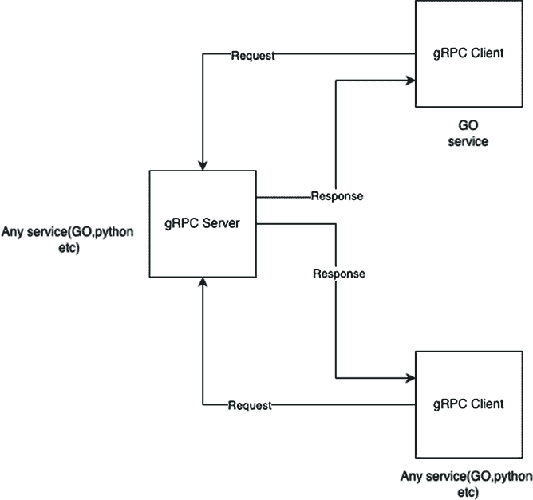

图 5.1：gRPC 客户端和服务器

`gRPC` 的多功能性允许其客户端和服务器在从 Google 内部服务器到个人桌面的各种环境中运行和通信。这种适应性进一步通过 `gRPC` 对多种编程语言的支持得到增强，为开发者提供了丰富的实现选择。例如，您可以使用 Java 轻松设置一个 gRPC 服务器，并让用 Go、Python 或 Ruby 编写的客户端与其无缝交互。这种跨语言兼容性是 `gRPC` 的显著优势，使多样化和分布式的系统能够无论其底层技术栈如何都能有效通信。

此外，Google 的最新 API 越来越多地采用 `gRPC`，提供其接口的 gRPC 版本。这一发展为将 Google 的先进功能直接集成到各种应用中打开了道路。无论您是在构建云原生服务、移动应用程序还是任何形式的分布式系统，`gRPC` 与 Google API 的契合都确保您能够在应用中高效有效地利用 Google 的技术。

```
package main

import (
    "context"
    "fmt"
    "log"
    "net"
    pb "path/to/generated/greeter" // Replace with actual import path
    "google.golang.org/grpc"
)

// Server struct implements the Greeter service
type Server struct {
    pb.UnimplementedGreeterServer
}

// SayHello implements the SayHello RPC method
func (s *Server) SayHello(ctx context.Context, req *pb.HelloRequest) (*pb.HelloReply, error) {
    log.Printf("Received: %s", req.Name)
    return &pb.HelloReply{Message: "Hello, " + req.Name}, nil
}

// Create a gRPC server
grpcServer := grpc.NewServer()
// Register the Greeter service
pb.RegisterGreeterServer(grpcServer, &Server{})
log.Println("gRPC server is running on port 50051…")
if err := grpcServer.Serve(listener); err != nil {
    log.Fatalf("Failed to serve: %v", err)
}
```

#### API 开发中 gRPC 的优势

让我们更仔细地看看为什么 `gRPC` 对开发 API 如此有益。这种现代方法提升了通信和效率，尤其适用于微服务和 Web 应用。

* 高效通信：
  `gRPC` 使用 Protocol Buffers 进行序列化，其效率高于 JSON 或 XML，减少了负载大小并改善了网络性能。

* 高性能：
  `gRPC` 建立在 HTTP/2 之上，HTTP/2 支持多路复用和流式传输等功能。这导致与 HTTP/1.1 相比延迟更低、网络资源利用更佳。对于实时应用和需要快速通信的服务尤其有益。

* 跨语言支持：


gRPC 支持多种编程语言，使不同语言编写的服务之间能够无缝交互。这种语言无关的特性使其非常适合构建采用多语言架构的微服务。

#### 强类型 API

gRPC 使用 `Protobuf` 来定义服务契约和消息类型。这导致了强类型的接口，减少了运行时错误的可能性，并使 API 更易于维护。

#### 双向流

gRPC 支持双向流，允许客户端和服务器同时发送和接收数据。此功能非常适合实时数据服务，例如聊天应用或实时更新。

#### 可插拔架构

gRPC 提供可插拔架构，允许开发人员根据特定需求自定义通信的各个方面，例如身份验证、负载均衡和重试。

#### 全双工流

gRPC 开箱即用地支持双向流，允许客户端和服务器同时发送和接收数据流。

这优于 REST，其中流通常需要 WebSockets 或轮询等变通方案。

#### 版本控制与演进

`Protobuf` 通过内置的向后和向前兼容性简化了 API 演进，避免了 REST 中常见的破坏性变更。

## gRPC 在 API 开发中的用例

让我们探讨 gRPC 在 API 开发中的各种用例，展示其独特的 capabilities 如何有效地增强不同类型应用间的通信和性能。

**微服务**

gRPC 是微服务架构的完美选择，在该领域中，多样化的服务必须无缝且稳健地交互。在微服务环境中，应用程序被分解为小型、独立部署的服务，共同提供复杂功能。

这些服务之间的通信至关重要，而 gRPC 在这方面表现出色。其效率、跨语言兼容性和对双向流的支持使微服务能够在多语言环境中高效、可靠地通信，即使服务使用不同的编程语言实现。无论是处理实时数据更新、编排复杂工作流，还是管理分布式系统的复杂性，gRPC 的功能都与微服务的需求完美契合，使其成为该架构中不可或缺的工具。

**实时通信**

gRPC 对流功能的原生支持使其成为实时通信应用的绝佳选择。这些场景包括信息需要持续且即时流动的情况，例如协作环境中的实时更新、实时游戏体验或物联网设备的协调。流允许数据在可用时立即推送给客户端，确保实时系统保持同步和响应，使 gRPC 成为此类关键且时间敏感领域的首选解决方案。

**服务间通信**

gRPC 在服务间通信方面表现出色，特别是在分布式系统中，各种服务需要高效、可靠地交互。在多语言环境中，服务可能使用不同的编程语言编写，gRPC 的语言无关支持可确保它们之间无缝通信。这对于现代微服务架构至关重要，其中众多服务协同工作以提供复杂功能。gRPC 简化了这些服务之间的通信，使其成为构建稳健高效的基于微服务的系统的理想选择。

**移动客户端**

gRPC 的效率和多功能性也使其成为移动应用开发的有力选择。在移动环境中，带宽和延迟通常是关键考虑因素，gRPC 的紧凑数据序列化及对流的支持可显著提升移动应用的性能。

无论是需要实时位置更新的网约车应用，还是需要即时消息传递的消息应用，或是任何响应性至关重要的场景，gRPC 的功能都能确保移动客户端与后端服务有效通信，提供无缝且响应迅速的用户体验。

**云原生应用**

gRPC 非常适合云原生应用，这些应用旨在在动态且通常容器化的环境中运行。在这种情况下，gRPC 的性能特征、对流的支持以及与现代云技术的兼容性使其成为有吸引力的选择。云原生应用通常需要在各种微服务之间进行高效通信，而 gRPC 的服务间通信能力非常契合此架构。

此外，gRPC 的可插拔架构允许开发人员集成身份验证、负载均衡和重试等关键功能，这些对于部署在 Kubernetes 等环境中的云原生应用至关重要。这使得 gRPC 成为构建可扩展且有弹性的云原生解决方案的强大工具。

**Web 前端 API**

gRPC 也可以成为服务 Web 前端的 API 的宝贵选择。随着 `gRPC-Web` 的出现，可以直接在浏览器应用中使用 gRPC。这意味着 Web 应用可以使用 gRPC 与后端服务通信，利用其效率、类型安全和高性能特性。

当构建需要实时更新、高效数据传输和强类型支持的现代 Web 应用时，这尤其有益，因为 gRPC 开箱即用地提供了这些功能。通过为 Web 前端使用 gRPC，开发人员可以创建提供更流畅用户体验的 Web 应用，同时受益于 gRPC 技术栈的优势。

## Protocol Buffers（Protobuf）概述及其在定义服务接口中的作用

Protocol Buffers 由 Google 创建，是一种简单且快速的组织和保存数据的方式，有点类似于你可能会使用的 XML，但它更小、更快。你只需设置一次数据格式。然后，你可以使用为你自动生成的特殊代码来轻松处理此数据，将其放入和取出不同位置，并在多种编程语言中使用。例如，考虑以 JSON 存储信息，你可能见过如下格式：

```
{ 
"name": "Alice", 
"age": 30, 
"city": "Bengaluru" 
}
```

Protocol Buffers 让你可以做类似的事情，但以占用空间更少、处理速度更快的方式进行，这在处理大量数据或使用不同计算机语言时尤其方便。

这种方法具有以下优势：

* **高效序列化**：Protocol Buffers 设计为比传统格式如 XML 或 JSON 高效得多。它们占用空间更小，可以更快处理，这在处理大量数据或速度是优先事项时至关重要。
* **语言和平台中立**：它提供了一种以语言中立格式定义数据结构（消息）和服务的方式，使其非常适合多样化的技术栈。
* **强类型模式**：`Protobuf` 使用结构化模式来定义数据模型，然后用于在各种语言中自动生成代码。这导致更健壮且可维护的代码库。
* **向后兼容**：它支持模式演进并保持向后兼容，确保旧代码仍能解释由新版本编码的数据，反之亦然。

### Protocol Buffer 风格指南


在处理 `.proto` 文件时，遵循风格指南很重要。这确保了你的协议缓冲区消息定义以及相关的类保持统一且易于理解。

值得注意的是，协议缓冲区开发中使用的风格随着时间的推移而发生了变化，这意味着你可能会遇到遵循各种约定或风格的 `.proto` 文件。在更新这些文件时，保持现有风格以确保一致性很重要。然而，对于新的 `.proto` 文件，建议采用最新且推荐的风格指南。保持一致的方法至关重要。

#### 标准文件格式

让我们深入了解标准文件格式：

* **行长度：** 将每行限制为最多 80 个字符。
* **缩进：** 使用 2 个空格进行缩进。
* **字符串引号：** 在定义字符串时，优先使用双引号。

#### 文件结构

让我们深入了解文件结构：

* 文件命名：使用 `lower_snake_case` 命名文件，例如 `example_file.proto`。
* 文件内容顺序：按此顺序组织文件内容：
    1. **许可证头：** 如果相关，请将其包含在文件顶部。
    2. **文件概述：** 提供文件内容的简要描述。
    3. **语法：** 指定语法（例如，`syntax = "proto3";`）。
    4. **包：** 定义包名。
    5. **导入：** 列出所有导入语句，并排序。
    6. **文件选项：** 指定任何文件特定选项。
    7. **其他内容：** 包含所有其他内容，例如消息和服务定义。

#### 包

让我们深入了解包：

* **命名约定：** 包名应始终为小写。
* **唯一性：** 确保包名是唯一的。它们通常应源自项目名称，并在适当时受包含协议缓冲区类型定义 `.proto` 文件的文件路径影响。

#### 消息和字段名称

让我们深入了解消息和字段名称：

* **消息名称：** 采用 PascalCase 为消息命名，以大写字母开头。例如为 `BookServerRequest`。
* **字段名称：** 对所有字段名称使用 `lower_snake_case`。这适用于消息内的字段，包括 `oneof` 声明中的字段和扩展名。例如，使用 `book_name`。

```
message BookServerRequest {
    optional string bookg_name = 1;
}
```

如果名称包含数字，请将数字紧跟在字母之后，而不是紧跟在下划线之后。例如，使用 `book_name1` 比使用 `book_name_1` 更好。

#### 重复字段

对于重复的字段，名称应使用复数形式以表明其包含多个值的性质。

```
repeated string names = 1;
repeated File files = 17;
```

#### 枚举

枚举类型应以 PascalCase 命名，而枚举值应为 `CAPITALS_WITH_UNDERSCORES`。

```
enum PropertyType {
    FLAT = 0;
    VILLA = 1;
    LAND = 2;
}
```

枚举值应以分号结尾而不是逗号。建议为枚举值使用前缀，而不是将它们嵌套在消息内部。这种做法在各种可能不支持在“struct”类型内定义枚举的语言中促进了一致性。

第一个枚举值，表示零值，应后缀为 `UNSPECIFIED`。这很重要，因为如果服务器或应用程序接收到意外的枚举值，它将在协议缓冲区实例中将该字段视为未设置，并且字段访问器将默认为第一个值，这是枚举字段的标准行为。

#### 服务

在 `.proto` 文件中定义 RPC 服务时，对服务及其 RPC 方法的命名均采用 PascalCase（以大写字母开头）。例如：

```
service PropertyService {
    rpc GetProperty(GetPropertyRequest) returns (GetPropertyResponse);
    rpc ListProperty(ListPropertyRequest) returns (ListPropertyResponse);
}
```

#### Protobuf 文件（`.proto`）

使用 Protobuf 进行服务定义可创建紧凑且高效的契约，这对于高性能 API 至关重要。示例：

Protobuf 中简单的服务定义可能如下所示：

```
syntax = "proto3";
package example;
// The greeting service definition.
service Greeter {
    // Sends a greeting
    rpc SayHello (HelloRequest) returns (HelloReply) {}
}
// The request message containing the user’s name.
message HelloRequest {
    string name = 1;
}
// The response message containing the greetings.
message HelloReply {
    string message = 1;
}
```

在此示例中，定义了一个 Greeter 服务，其中包含一个 `SayHello` RPC 方法。该方法接收 `HelloRequest` 并返回 `HelloReply`。这些消息类型也在同一个 `.proto` 文件中定义。

#### 使用 Protobuf 语法定义消息和服务

Protobuf 中的消息类似于其他编程语言中的结构体或类。它们定义了要序列化的数据的结构。

```
syntax = "proto3";
message Person {
    string name = 1;
    int32 id = 2;
    bool hasDrivingLicense = 3;
}
```

在此示例中，定义了一个 Person 消息，包含三个字段：`name`、`id` 和 `hasDrivingLicense`。每个字段都被分配一个唯一编号，该编号用于消息的二进制表示。

**字段类型：**

字段可以是各种类型，例如 `int32`、`string`、`bool` 或其他自定义消息类型。

**字段编号：**

每个字段都被赋予一个唯一编号。这些编号用于在消息二进制格式中标识字段。

**默认值：**

在 `proto3` 语法中，字段默认是可选的，如果未设置，则将具有标准默认值（例如，字符串为空字符串，int32 为 0）。

**定义服务：**

Protobuf 中的服务定义远程过程调用（RPC）接口。每个服务可以有多个 RPC 方法，每个方法都有请求和响应类型。

```
service Greeter {
    rpc SayHello (Person) returns (Greeting) {}
}
```

在此，定义了一个 Greeter 服务，其中包含一个 SayHello RPC 方法。该方法将 Person 消息作为请求，并将 Greeting 消息作为响应返回。

**定义响应消息：**

同样，你可以为响应定义一个消息：

```
message Greeting {
    string message = 1;
}
```

在此示例中，Greeting 消息包含一个单一的 message 字段。

**使用 Protobuf：**

一旦在 `.proto` 文件中定义了消息和服务，你就可以使用 Protobuf 编译器（`protoc`）在各种受支持语言中生成客户端和服务器代码。然后可以在应用程序中使用此代码来处理序列化数据并实现定义的服务接口。

#### 使用 Protoc 编译器从 Protobuf 定义生成 Go 代码

从 Protocol Buffers（Protobuf）定义生成 Go 代码是一个涉及 `protoc` 编译器的过程，该工具读取 `.proto` 文件并生成目标语言的代码。

要从 Protobuf 定义生成 Go 代码，请按照以下步骤操作：

**安装 Protobuf 编译器（protoc）：**

首先，你需要安装 Protobuf 编译器。

1. 你可以从 Protocol Buffers 项目的 GitHub 发布页面下载。
2. 对于 Mac，可以运行 `brew install protobuf`。
3. 对于 Linux，运行 `apt install -y protobuf-compiler.`

**为 protoc 安装 Go 插件：**


你还需要为 Protobuf 编译器安装 Go 插件。这些插件由 `protoc` 使用来生成 Go 特定代码。

```
go install google.golang.org/protobuf/cmd/protoc-gen-go@latest
```

```
go install google.golang.org/grpc/cmd/protoc-gen-go-grpc@latest
```

这些命令安装了 `protoc-gen-go` 和 `protoc-gen-go-grpc` 插件，分别用于生成 Go 代码和 gRPC 服务定义。

##### 定义你的 Protobuf Schema：

创建一个包含 Protobuf 定义的 `.proto` 文件。例如，创建一个名为 `hello.proto` 的文件：

```
syntax = "proto3";
package hello;
message HelloRequest {
string name = 1;
}
message HelloReply {
string message = 1;
}
service Greeter {
rpc SayHello (HelloRequest) returns (HelloReply);
}
```

##### 生成 Go 代码：

使用 Go 插件运行 `protoc` 从你的 `.proto` 文件生成 Go 代码：

```
protoc --go_out=. --go_opt=paths=source_relative \
--go-grpc_out=. --go-grpc_opt=paths=source_relative \
hello.proto
```

此命令从 `hello.proto` 文件生成 Go 文件。`--go_out` 和 `--go-grpc_out` 选项指定写入生成的 Go 代码的位置。`paths=source_relative` 选项使输出路径相对于输入的 `.proto` 文件。

##### 在你的 Go 应用中使用生成的代码：

运行命令后，你将拥有生成的 Go 文件（对于前面的示例为 `hello.pb.go` 和 `hello_grpc.pb.go`），可以将其导入并在你的 Go 应用中使用。这些文件包含与你的 Protobuf 定义对应的 Go 类型以及 gRPC 客户端和服务器接口。

### 在 Go 中实现 gRPC 服务器：处理客户端请求并生成响应

在 Go 中实现 gRPC 服务器涉及设置一个服务器，该服务器可以根据 Protocol Buffers（Protobuf）文件中的服务定义处理客户端请求，然后生成适当的响应。

以下是创建基本的 Go gRPC 服务器的分步指南：

1. **从 Protobuf 定义生成 Go 代码：**

首先，确保你拥有服务的 Protobuf 定义，并使用 `protoc` 编译器从这些定义生成 Go 代码，如前面的步骤所述。

2. **实现服务器接口：**

生成的 Go 代码包含你的服务器必须实现的接口。该接口具有与 `.proto` 文件中定义的 gRPC 服务方法相对应的方法。

假设你有如下服务定义：

```
service Greeter {
rpc SayHello (HelloRequest) returns (HelloReply);
}
```

在你的 Go 代码中实现此接口：

```
type greeterServer struct {
pb.UnimplementedGreeterServer
}
func (s *greeterServer) SayHello(ctx context.Context, in *pb.HelloRequest) (*pb.HelloReply, error) {
return &pb.HelloReply{Message: "Hello " + in.Name}, nil
}
```

这里，`greeterServer` 是一个嵌入了 `UnimplementedGreeterServer`（由 `protoc` 生成）的结构体并实现了 `SayHello` 方法。

#### 创建 gRPC 服务器并注册你的服务：

接下来，创建一个 gRPC 服务器并向其注册你的服务。

```
func main() {
lis, err := net.Listen("tcp", ":50051")
if err != nil {
log.Fatalf("failed to listen: %v", err)
}
s := grpc.NewServer()
pb.RegisterGreeterServer(s, &greeterServer{})
if err := s.Serve(lis); err != nil {
log.Fatalf("failed to serve: %v", err)
}
}
```

在此片段中，程序监听 TCP 端口 `50051` 并创建一个新的 gRPC 服务器。`greeterServer` 已注册到此 gRPC 服务器。

#### 处理客户端请求：

`SayHello` 方法的实现是你定义服务器如何处理客户端请求的地方。当客户端调用 `SayHello` 方法时，将调用你的实现，你可以执行必要的逻辑来生成响应。

#### 运行服务器：

运行你的 Go 应用。gRPC 服务器将启动并在指定端口监听客户端请求。

### 在 Go 中构建 gRPC 客户端：使用 gRPC 服务

在 Go 中构建 gRPC 客户端涉及创建一个客户端，该客户端可以根据你的 Protobuf 文件中定义的 gRPC 服务进行消费。此过程需要建立到 gRPC 服务器的连接并使用从 Protobuf 服务定义生成的客户端存根来发出 RPC 调用。

以下是创建基本 Go gRPC 客户端的指南：

#### 从 Protobuf 定义生成 Go 代码：

确保你已使用 `protoc` 编译器从 Protobuf 服务定义生成 Go 代码。此代码生成步骤会创建用于与 gRPC 服务交互的客户端存根。

#### 导入生成的代码：

在你的客户端代码中导入生成的 Go 包。该包包含用于调用 Protobuf 文件中定义的方法的客户端存根。

#### 设置到 gRPC 服务器的连接：

使用 `grpc.Dial` 建立到 gRPC 服务器的连接：

```
import (
"context"
"log"
"google.golang.org/grpc"
pb "path/to/your/protobuf/package"
)
func main() {
conn, err := grpc.Dial("localhost:50051", grpc.WithInsecure())
if err != nil {
log.Fatalf("did not connect: %v", err)
}
defer conn.Close()
c := pb.NewGreeterClient(conn)
// …
}
```

在此片段中，`grpc.Dial` 建立到运行在 `localhost` 端口 `50051` 上的 gRPC 服务器的连接。`WithInsecure` 选项用于非 TLS 连接（适用于开发，但不推荐用于生产环境）。

#### 调用 gRPC 服务方法：

连接建立后，使用客户端存根调用服务方法：

```
func main() {
// … (establish connection)
// Create a request
req := &pb.HelloRequest{Name: "World"}
// Call the SayHello method on the server
res, err := c.SayHello(context.Background(), req)
if err != nil {
log.Fatalf("could not greet: %v", err)
}
log.Printf("Greeting: %s", res.GetMessage())
}
```

这里，使用 `HelloRequest` 消息调用 `SayHello`。客户端将此请求发送到服务器并等待 `HelloReply` 响应。

#### 处理响应：

处理服务器返回的响应。这可能涉及从响应消息中读取数据或处理调用期间发生的任何错误。

总之，在 Go 中构建 gRPC 客户端涉及设置到服务器的连接、从生成的 Protobuf 代码创建客户端存根，以及使用这些存根发出 RPC 调用。这种方法允许 Go 应用高效地使用 gRPC 服务，受益于 gRPC 的性能和多语言支持。这是在使用 gRPC 进行服务间通信的微服务和分布式系统中创建客户端的有效方式。

## gRPC 中的错误处理和状态码

错误处理在 gRPC 中，尤其是在使用 Go 时，是一个关键方面，因为它与传统的 RESTful API 不同。与使用各种 HTTP 状态码来指示不同类型错误的 HTTP/REST 不同，gRPC 错误处理更加精简，并依赖于几个关键概念。

### gRPC 错误模型

以下是 gRPC 中错误处理的关键概念的深入解释：

#### 状态码：

gRPC 使用预定义的一组状态码来指示 RPC 调用的成功或失败。与 HTTP 状态码相比，这些代码更少且更通用。一些常见的 gRPC 状态码包括 `OK`、`InvalidArgument`、`NotFound`、`AlreadyExists`、`Unauthenticated` 和 `Unavailable`。

| **Code** | | **Number** | | **Description** |
| --- | --- | --- |


##### 状态码

| `OK` | 0 | 不是错误；在成功时返回。 |
| `CANCELLED` | 1 | 操作已被取消，通常由调用方取消。 |
| `UNKNOWN` | 2 | 表示未知错误。通常用于错误性质不明确或无法指定的场景。例如，如果从不同地址空间接收到的 Status 值属于当前空间中未知的错误域，则可能使用此错误。它也适用于 API 错误缺乏足够细节而被归类为未知的情形。 |
| `INVALID_ARGUMENT` | 3 | 此错误表示客户端提供了无效参数。需要注意与 `FAILED_PRECONDITION` 的区别。`INVALID_ARGUMENT` 用于表示固有有问题的参数，与系统状态无关。一个例子是格式不正确的文件名。 |
| `DEADLINE_EXCEEDED` | 4 | 在操作完成之前截止时间已过期。对于改变系统状态的操作，即使操作已成功完成，也可能返回此错误。例如，服务器的成功响应可能被延迟很久。 |
| `NOT_FOUND` | 5 | 某些请求实体（例如文件或目录）未找到。注意给服务器开发者：如果是整类用户被拒绝请求，例如渐进式功能发布或未记录的白名单，可使用 `NOT_FOUND`。如果某类用户中的部分用户被拒绝请求，例如基于用户的访问控制，则必须使用 `PERMISSION_DENIED`。 |
| `ALREADY_EXISTS` | 6 | 客户端尝试创建的实体（例如文件或目录）已存在。 |
| `PERMISSION_DENIED` | 7 | 此错误表示客户端尝试创建的实体，例如文件或目录，已存在。 |
| `RESOURCE_EXHAUSTED` | 8 | 这表示资源已被耗尽，这可能是由于达到每用户配额或整个文件系统空间用完所致。 |
| `FAILED_PRECONDITION` | 9 | 由于系统未处于执行操作所需的必要状态，操作被拒绝。例如，删除目录的请求被拒绝因为它不是空的，或尝试删除一个非目录实体。在实现服务时，以下准则可帮助在 `FAILED_PRECONDITION`、`ABORTED` 和 `UNAVAILABLE` 错误之间做出选择：如果客户端可以简单重试失败的同一调用，使用 `UNAVAILABLE`。如果客户端应在更全面的层级重试，使用 `ABORTED`。这例如适用于客户端的测试并设置操作失败的情况，表明客户端需要重新启动涉及读取、修改和写入数据的操作序列。使用 `FAILED_PRECONDITION` 如果客户端不应在系统状态得到具体解决之前尝试重试。例如，如果删除目录（`rmdir`）的请求失败因为目录包含文件，应返回 `FAILED_PRECONDITION`。客户端不应在目录清空文件之前重试操作。 |
| `ABORTED` | 10 | 操作被中止，通常由于并发问题，例如序列检查失败或事务被中止。有关在 `FAILED_PRECONDITION`、`ABORTED` 和 `UNAVAILABLE` 错误之间选择的指导，请参考上述准则。 |
| `OUT_OF_RANGE` | 11 | 当操作超出允许限制时触发此错误，例如尝试在文件末尾之后查找或读取。与表示永久问题的 `INVALID_ARGUMENT` 错误不同，`OUT_OF_RANGE` 错误意味着如果系统条件发生变化则可能可修复的问题。例如，在 32 位文件系统中，请求在 `[0,2³²-1]` 范围外的偏移量读取会产生 `INVALID_ARGUMENT` 错误。相比之下，请求读取超出文件当前大小会导致 `OUT_OF_RANGE` 错误。虽然 `FAILED_PRECONDITION` 和 `OUT_OF_RANGE` 错误通常重叠，但 `OUT_OF_RANGE` 更适用于更具体的情况。它对于指示数据集遍历的完成特别有帮助，因为遇到 `OUT_OF_RANGE` 错误表示已到达数据集的末尾。 |
| `UNIMPLEMENTED` | 12 | 操作未实现或在此服务中不受支持/未启用。 |
| `INTERNAL` | 13 | 内部错误是指底层系统的某些预期条件或不变量被违反的情况。此错误代码用于严重错误。 |
| `UNAVAILABLE` | 14 | 服务当前不可用，通常由于临时问题所致。通常可以通过在短暂延迟后重试请求，使用退避策略来解决。然而，需要注意的是，重试非幂等操作可能并不总是安全。 |
| `DATA_LOSS` | 15 | 这表示发生了不可恢复的数据丢失或损坏。 |
| `UNAUTHENTICATED` | 16 | 请求对操作没有有效的身份验证凭据。 |

##### 表 5.1：状态码

##### 状态消息

除了状态码之外，gRPC 还允许你发送状态消息。此消息可以提供有关错误的额外信息。

##### 元数据

gRPC 允许在错误响应中发送自定义元数据（键值对），可用于提供额外的上下文或调试信息。

#### 在 Go 中实现错误处理

在 Go 中实现 gRPC 服务时，错误通常使用 gRPC 库中的 status 包返回。

```go
import (
    "google.golang.org/grpc/codes"
    "google.golang.org/grpc/status"
)
```

```go
func (s *server) SomeRpcMethod(ctx context.Context, req *pb.SomeRequest) (*pb.SomeResponse, error) {
    if err := validateRequest(req); err != nil {
        return nil, status.Errorf(codes.InvalidArgument, "invalid request: %v", err)
    }
    // …
}
```

在此示例中，如果 `validateRequest` 返回错误，该方法将返回一个 gRPC 错误，其中包含 `InvalidArgument` 状态码和错误消息。

#### 在客户端处理错误

在客户端，你可以检查 RPC 调用返回的错误，并使用 status 包提取状态码和消息。

```go
res, err := client.SomeRpcMethod(ctx, req)
if err != nil {
    if st, ok := status.FromError(err); ok {
        // 这里，st.Code() 是状态码，st.Message() 是错误消息
        fmt.Println("gRPC Error (code):", st.Code())
        fmt.Println("gRPC Error (message):", st.Message())
    } else {
        // 非 gRPC 错误
        fmt.Println("Non-gRPC error:", err)
    }
}
```

在 Go 中使用 gRPC 进行错误处理涉及使用 status 包返回和处理标准化的状态码和消息。此模型提供了一种在不同语言和平台间统一处理错误的方式，这是 gRPC 的优势之一。以这种方式正确处理错误可确保客户端能够理解并适当应对不同的错误条件，从而提高 gRPC 服务的健壮性和可靠性。

## 使用流式通信


gRPC 提供了一套多样的流式通信方法，可根据不同的场景进行定制。深入理解这些流式类型，包括单向、服务器端流式、客户端流式和双向流式，对于释放 gRPC 的完整能力至关重要。在以下章节中，我们将深入探讨每种流式范式，探索其特征、使用场景和实际实现，从而为您提供关于 gRPC 流式世界的全面见解。

### RPC 生命周期

让我们深入探讨 RPC 生命周期的复杂性，阐明请求从离开客户端环境到被处理并由服务器返回响应的整个旅程。

### 单向 RPC

单向 RPC 是 gRPC 中最简单的通信形式，客户端发送一个请求并获得一个响应。

* **客户端**：向服务器发送一个请求。
* **服务器**：接收请求，处理它，并返回一个响应。

**示例用例：**

从数据库中获取特定记录。

### 服务器端流式 RPC

在服务器端流式中，客户端向服务器发送一个请求并接收一系列响应。服务器在响应可用时发送响应。

* **客户端**：向服务器发送一个请求。
* **服务器**：处理请求并流式返回一系列响应。

**示例用例：**

将日志或更新从服务器流式传输到客户端，其中客户端需要接收连续的数据流。

服务器端流式的服务器实现：

```
func (s *server) StreamResponses(req *pb.SimpleRequest, stream pb.YourService_StreamResponsesServer) error {
 for _, response := range responses {
 if err := stream.Send(response); err != nil {
 return err
 }
 }
 return nil
}
```

### 客户端流式 RPC

客户端流式与服务器端流式相反。客户端向服务器发送一系列消息，服务器在接收到所有消息后才响应一个单一响应。

* **客户端**：向服务器流式发送一系列请求。
* **服务器**：接收所有请求，处理它们，并发送回一个响应。

**示例用例：**

分块上传大文件，其中每个块作为流中的请求发送。

客户端流式的实现：

```
stream, err := client.StreamRequests(ctx)
if err != nil {
 // Handle error
}
for _, req := range requests {
 if err := stream.Send(req); err != nil {
 // Handle error
 }
}
reply, err := stream.CloseAndRecv()
```

### 双向流式 RPC

双向流式允许客户端和服务器在单个连接中同时进行读写。流独立运行，因此客户端和服务器可以按任意顺序读写。

* **客户端和服务器**：双方可以同时相互发送一系列消息。

**示例用例：**

聊天应用程序，双方可以随时发送和接收消息。

双向流式：

```
stream, err := client.BidirectionalStream(ctx)
if err != nil {
 // Handle error
}
waitc := make(chan struct{})
go func() {
 for {
 in, err := stream.Recv()
 if err == io.EOF {
 // read done.
 close(waitc)
 return
 }
 if err != nil {
 // Handle error
 return
 }
 // Process in
 }
}()
for _, req := range requests {
 if err := stream.Send(req); err != nil {
 // Handle error
 return
 }
}
stream.CloseSend()
<-waitc
```

### 截止时间

gRPC 使客户端能够设置其愿意等待 RPC 完成的最大时间，届时 RPC 将被停止，并发出 `DEADLINE_EXCEEDED` 错误。相反，服务器可以查询特定 RPC 是否已超过其分配的时间，或确定 RPC 完成的剩余时间。

### RPC 完成

gRPC 中 RPC 的终止是客户端和服务器之间通信过程的一个关键方面。它定义了正在进行的远程过程调用如何结束；这种情况可能以多种方式发生。首先，成功完成发生在 RPC 无错误执行时，服务器向客户端提供预期响应，从而导致优雅结束。

另一方面，错误可能导致突然终止，这些错误可能源于各种来源，包括网络问题、服务器故障或无效请求。此外，客户端或服务器可以通过取消 RPC 来启动终止，如果它不再需要或可行，则释放资源供其他任务使用。此外，客户端可以为 RPC 设置截止时间或超时，如果超过这些时间限制，则 RPC 将以 `DEADLINE_EXCEEDED` 错误终止。

最后，在流式 RPC 中，存在用于 signaling 流结束的机制，通常涉及“流结束”消息。理解 RPC 终止对于有效管理 RPC 生命周期、处理错误以及优化分布式系统中的资源利用至关重要。

### RPC 终止

在 gRPC 中取消 RPC 涉及在完成之前终止正在进行的远程过程调用。这可以由客户端或服务器出于各种原因发起。当 RPC 被取消时，会导致操作过早终止，释放资源并允许客户端和服务器继续处理其他任务。

## 结论

在本章中，我们探讨了 gRPC 与 Protocol Buffers 结合用于高级 API 开发的强大组合。与传统的 RESTful API 相比，这些技术提供了卓越的性能、效率和跨语言兼容性。我们学习了如何使用 Protobuf 定义服务契约，实现 gRPC 服务器和客户端，并利用诸如双向流式等高级功能。拥抱 gRPC 和 Protobuf 使开发人员能够在现代 API 开发中脱颖而出，从微服务到实时数据系统，确保他们在快速发展的软件环境中始终处于技术前沿。

在下一章中，我们将深入 GraphQL 的世界及其对 API 开发的深远影响。我们将揭示 GraphQL 的优势，它与传统的 RESTful API 相比提供了更灵活和高效的方法。我们将学习如何定义 GraphQL 模式、类型、查询、变更，甚至实时订阅，为动态和响应式的 API 奠定基础。此外，我们还将探讨如何使用 `graph-gophers/graphql-go` 库在 Go 中实现 GraphQL API，执行查询和变更，并掌握测试和调试的艺术，以确保 Go 生态系统中强大可靠的 GraphQL 服务。

## 关键术语

* **gRPC (gRPC 远程过程调用)**：由 Google 开发的高性能开源 RPC 框架，使分布式系统中的服务之间能够高效通信。
* **Protocol Buffers (Protobuf)**：一种语言中立、平台中立、可扩展的结构化数据序列化机制，用于作为 gRPC 的接口定义语言 (IDL)。
* **远程过程调用 (RPC)**：一种通信协议，允许客户端应用程序像调用本地函数一样在远程服务器上执行过程。
* **HTTP/2**：gRPC 使用的传输协议，提供多路复用、流量控制和流式传输等功能以提高效率。


**服务契约**：一种由 Protobuf 定义的结构，指定了 gRPC 服务中可用的方法和交换的消息类型。

**客户端存根**：自动生成的客户端侧接口，用于在 gRPC 服务器上调用远程过程。

**服务器实现**：基于 Protobuf 定义的服务契约处理客户端请求的后端逻辑。

**单向 RPC**：一种 gRPC 通信方法，客户端发送单个请求并接收单个响应。

**流式 RPC**：gRPC 的一项功能，允许客户端和服务器之间进行连续的消息交换，分为服务器端流式、客户端流式和双向流式。

**双向流式**：一种 gRPC 流式类型，客户端和服务器都可以通过单个连接异步发送多个消息。

**状态码**：gRPC 中预定义的一组错误代码，用于对不同类型的请求失败进行分类。

**gRPC 服务器**：处理客户端 RPC 请求并根据定义的 Protobuf 服务发送响应的后端组件。

**gRPC 客户端**：向 gRPC 服务器发出 RPC 调用的前端组件。

**gRPC 中的截止时间/超时**：客户端愿意等待服务器响应的最长时间，超过此时间后将终止请求。

**RPC 生命周期**：RPC 调用所经历的一系列步骤，从客户端发起，到服务器处理并返回响应。

**服务间通信**：微服务使用 gRPC 相互交互的过程。

# 第 6 章

## Go 中 GraphQL 的介绍与实现

### 引言

在本章中，我们将踏上理解 GraphQL 的旅程，GraphQL 是一种用于 API 的强大查询语言，以及它在 Go 编程环境中的实现。GraphQL 代表了从传统 REST API 设计的重大转变，提供更高效、更强大、更灵活的方式来与数据交互。当我们深入研究 GraphQL 的核心概念时，我们将揭示其相对于 REST 的优势，例如允许客户端请求所需确切的数据，减少数据过度获取，并简化来自多个来源的数据聚合。本章旨在为 Go 开发者提供 GraphQL 的坚实基础，使他们能够利用这项现代技术构建更动态、高效的 Web 应用程序。

### 结构

在本章中我们将涵盖以下主题：

* GraphQL 及其在 API 开发中的优势简介
* 定义 GraphQL 模式、类型、查询、变更和订阅
* 采用基于图的心态
* 在 Go 中实现 GraphQL API
* 运行 GraphQL 服务器

### GraphQL 及其优势简介

GraphQL 是一种用于 API 的查询语言，也是用于使用现有数据满足这些查询的运行时。GraphQL 为 API 中的数据提供完整且易于理解的描述，使客户端能够请求所需确切的数据且不多不少，使 API 随时间推移更容易演进，并提供强大的开发者工具。（来源：*Graphql.org*）

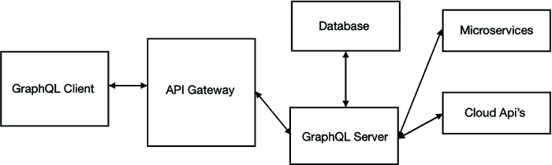

**图 6.1：** Graphql 架构

* **请求所需内容，获得确切结果：**

向 API 发送 GraphQL 查询，获得你所需确切的内容，不多也不少。GraphQL 查询始终返回可预测的结果。使用 GraphQL 的应用程序快速稳定，因为它们控制获取的数据，而不是服务器。

* **单次请求获取多个资源：**

GraphQL 查询不仅访问一个资源的属性，还能顺畅地跟随它们之间的引用。虽然典型的 REST API 需要从多个 URL 加载，GraphQL API 却能在单次请求中获取应用程序所需的所有数据。使用 GraphQL 的应用程序即使在缓慢的移动网络连接上也能快速运行。

* **用类型系统描述可能性：**

GraphQL API 以类型和字段而非端点组织。从单个端点访问数据的全部功能。GraphQL 使用类型确保应用程序只请求可能的内容并提供清晰有用的错误。应用程序可利用类型避免编写手动解析代码。

* **无需版本即可演进 API：**

在不影响现有查询的情况下向 GraphQL API 添加新字段和类型。可弃用的旧字段可被弃用并从工具中隐藏。通过使用单一演进版本，GraphQL API 为应用程序提供持续访问新功能的能力，并鼓励更简洁、可维护的服务器代码。

* **自带数据和代码：**

GraphQL 在整个应用程序中创建统一的 API，而不受特定存储引擎的限制。编写利用现有数据和代码的 GraphQL API，GraphQL 引擎可在多种语言中使用。你为类型系统中的每个字段提供函数，GraphQL 会以最佳并发方式调用它们。

### 定义 GraphQL 模式、类型、查询、变更和订阅

GraphQL 利用一种专为获取数据而设计的独特查询语言，提供一种强大且高效的方式来检索所需确切内容。在本节中，我们将深入探讨构成 GraphQL 查询的各个组件，检查它们的功能以及如何为不同的数据检索场景进行优化。通过理解这些元素，你将能够创建精确高效的查询，使其与数据需求完美契合。此探索将为在 API 交互中充分发挥 GraphQL 的潜力奠定坚实基础。

#### 字段

在最基本的形式中，GraphQL 允许你请求对象上的特定字段。我们将从检查一个简单查询及其执行结果开始。

```
{
token {
name
}
}
```
Returns
```
{
"data": {
"token": {
"name": "WBTC"
}
}
}
```

立即可以看出，查询的结构与结果的结构相镜像。这是 GraphQL 设计的基础，确保你始终获得确切请求的内容，并且服务器清楚地了解客户端需要哪些字段。

字段名返回 String 类型，在此实例中对应于 Token “WBTC” 的名称。

在之前的示例中，我们只请求了 Token 的名称，返回了一个 String。然而，字段也可以表示对象，允许你在该对象内选择特定的子字段。此功能使 GraphQL 查询能够遍历相关对象及其属性，允许客户端在单次请求中收集大量相关数据。这种方法与传统的 REST 架构形成鲜明对比，后者通常需要多次请求来检索类似的相互关联的信息。

```
{
token {
name
#### Queries can have comments!
blockchains {
name
}
}
}
```
Returns
```
{
"data": {
"token": {
"name": "WBTC",
"blockchains": [
{
"name": "Ethereum"
},
{
"name": "Solana"
},
{
"name": "Fantom"
}
]
}
}
}
```

在此示例中，`blockchains` 字段返回一个项目数组。GraphQL 查询对于单个项目或项目列表看起来相同；然而，我们根据模式中指示的内容知道期望哪一种。

#### 参数


如果遍历对象及其字段是 GraphQL 的唯一功能，它仍然会成为一种高效的数据检索语言。然而，当你引入向字段传递参数的能力时，该语言变得更加强大和有趣。

```
{ 
 token(id: "20") { 
 name 
 address 
 } 
}
```
```
{ 
 "data": { 
 "token": { 
 "name": "WBTC", 
 "address": "0x2260FAC5E5542a773Aa44fBCfeDf7C193bc2C599" 
 } 
 } 
}
```

在基于 REST 的系统中，你传递参数的选项仅限于请求中的查询参数和 URL 段。然而，GraphQL 允许每个字段和嵌套对象都有其自己独特的参数集。这种能力使 GraphQL 成为执行多个 API 请求的全面替代方案。此外，你可以将参数应用于标量字段，从而在服务器上直接进行数据转换，而不是在每个客户端上单独进行。

```
{ 
 token(id: "20") { 
 name 
 address(blockchain: Ethereum) 
 } 
}
```
```
{ 
 "data": { 
 "token": { 
 "name": "WBTC", 
 "address": "0x2260FAC5E5542a773Aa44fBCfeDf7C193bc2C599" 
 } 
 } 
}
```

GraphQL 中的参数类型可以各不相同。在提供的示例中，我们使用了枚举类型，表示从有限的选项集中选择一个（这里是代币的地址，具体区块链）。虽然 GraphQL 包含一组标准类型，但 GraphQL 服务器可以定义自己的自定义类型，只要它们可以序列化为用于数据传输的格式即可。

#### 别名

GraphQL 中的别名是一个强大的功能，允许你将字段的结果重命名为与查询中字段名称不同的名称。这在多种场景下特别有用，例如当你需要使用不同的参数查询同一个字段并需要区分结果时，或者当你在结果集中想要使用的名称比 GraphQL 模式中的字段名称更具描述性或更适合你的应用程序时。

下面是一个简单的示例来说明别名在 GraphQL 中是如何工作的：

```
{ 
 USDC: Token(id: "1") { 
 name 
 } 
 Bitcoin: Token(id: "20") { 
 name 
 } 
}
```

在此查询中，`token` 是根查询类型上的一个字段，它接受 `id` 作为参数并返回一个代币。通过使用别名，我们可以在同一个查询中查询两个字符（ID 为“1”和“20”），并分别将结果称为 `USDC` 和 `Bitcoin`。这使得查询返回的数据更易于理解，并在客户端应用程序中更易于使用，因为别名提供了每个字符在叙述中作用的上下文。

GraphQL 中的别名通过允许在结果中进行自定义命名来增强数据检索的灵活性，这可以简化客户端的数据处理，并使响应更直观。

#### 片段

GraphQL 中的片段是可以共享在多个查询之间或在同一查询内以避免冗余的可重用查询片段。它们允许你构建字段集，然后在需要时将其包含在查询中。这对于确保多个查询和变更的一致性特别有用，尤其是在应用程序的不同部分需要检索相同数据时。

下面是 GraphQL 中片段使用方式的基础示例：

```
fragment tokenDetails on Token { 
 name 
 symbol 
 address 
 volume 
 price 
}
query getTokenDetailsById { 
 tokenById(id: "1") { 
 …tokenDetails 
 } 
}
query getAllTokens { 
 allTokens { 
 …tokenDetails 
 } 
}
```

`tokenDetails` 是一个片段，封装了与代币相关的字段。无需在 `getTokenDetailsById` 和 `getAllTokens` 查询中重复这些字段定义，它们在 `tokenDetails` 片段中只定义一次。然后通过指定 …`tokenDetails` 在查询中使用该片段。这种方法确保对代币详情的任何更改都只需在一个地方进行，从而简化查询的更新和维护。

#### 操作名称

操作名称是赋予操作（如查询、变更或订阅）的有意义且明确的名称。此名称用于提高清晰度，并且在调试和服务器端日志记录时特别有用；它有助于在代码库中识别不同的 GraphQL 操作，并在分析日志或指标时提供帮助。

下面是一个示例来说明操作名称在 GraphQL 中是如何使用的：

```
query GetTokenDetails { 
 token(id: "1") { 
 name 
 symbol 
 address 
 volume 
 price 
 } 
}
mutation UpdateTokenPrice { 
 updateTokenPrice(id: "1", price: 100) { 
 id 
 price 
 } 
}
subscription OnTokenPriceChange { 
 tokenPriceChanged(id: "1") { 
 id 
 price 
 } 
}
```

在此示例中：

* `GetTokenDetails` 是获取代币详情的查询的操作名称。
* `UpdateTokenPrice` 是更新代币价格的变更的操作名称。
* `OnTokenPriceChange` 是监听代币价格变化的订阅的操作名称。
* 使用操作名称是 GraphQL 中的最佳实践，因为它增强了查询和变更的可读性，使代码更有序，并在调试和监控期间提高操作的追溯性。

#### 变量

在 GraphQL 中，你可以使用变量将动态信息传递到查询或变更中。这种方法允许你使用不同的值重用相同的查询或变更。以下示例演示了如何使用变量与 GraphQL 操作一起使用，具体针对代币对象：

```
query GetTokenDetails($tokenId: ID!) { 
 token(id: $tokenId) { 
 name 
 symbol 
 address 
 volume 
 price 
 } 
}
```

在此示例中：

* `$tokenId` 是在操作 `GetTokenDetails` 中定义变量。它是类型 `ID!`，表示它是非空 ID。
* 在代币查询内部，`$tokenId` 用于动态指定正在请求详情的代币的 ID。
* 执行此查询时，你需要为 `$tokenId` 提供一个值，例如：{ `"tokenId": "123abc"` }。
* 使用 `$tokenId` 等变量使你的 GraphQL 查询更灵活、更安全，允许通过简单地更改变量的值来重用相同的查询结构以获取不同代币的详情。

#### 指令

GraphQL 中的指令用于修改查询、变更或字段的执行。它们可以根据你指定的条件更改字段的行为或包含情况。指令提供了一种动态更改查询或模式执行的方式，使其成为控制数据如何检索或操作的有力功能。

GraphQL 中主要有两种指令类型：

* **执行指令：** 这些在查询和变更中使用，根据变量值有条件地包含或跳过字段。最常见的执行指令是 `@include(if: Boolean)` 和 `@skip(if: Boolean)`。
* **模式指令：** 这些在模式定义中使用，以修改类型、字段或其他模式元素的行为。模式指令可以自定义定义，更为复杂，通常用于实现身份验证、授权或数据格式化等功能。

下面是一个示例，展示执行指令如何在 GraphQL 查询中使用：

```
query GetTokenDetails($tokenId: ID!, $includeVolume: Boolean!) { 
 token(id: $tokenId) { 
 name 
 symbol 
 address 
 volume @include(if: $includeVolume) 
 price 
 } 
}
```

在此查询中：


`@include(if: $includeVolume)` 是应用于 volume 字段的指令。

`$includeVolume` 是一个布尔变量，用于确定 volume 字段是否应包含在响应中。

执行此查询时，您可以通过将 `$includeVolume` 变量设置为 true 或 false 来动态决定是否获取成交量信息。

因此，指令提供了一种灵活的方法来修改查询的执行方式，并根据应用程序的需求或当前用户的权限塑造返回的数据。

#### [ Mutations ]

在 GraphQL 中，mutation 是用于修改服务器数据的操作，例如创建、更新或删除记录。与用于获取数据的查询不同，mutation 会更改数据，并且通常返回新的或修改后的数据。

以下是 mutation 在 GraphQL 中如何定义和使用的基本结构：

```
mutation MutationName($input: InputType!) {
  operationName(input: $input) {
    field1
    field2
    …
  }
}
```

以下是演示如何使用 mutation 更新代币信息的示例：

```
mutation UpdateToken($id: ID!, $price: Float!, $volume: Int!) {
  updateToken(id: $id, price: $price, volume: $volume) {
    name
    symbol
    price
    volume
  }
}
```

在此示例中：
* `UpdateToken` 是 mutation 的名称。
* `$id`、`$price` 和 `$volume` 是传入 mutation 的变量，允许您动态指定要更新的代币的 ID 以及价格和成交量的新值。
* `updateToken` 是在服务器上调用的操作，它接受 id、price 和 volume 作为参数。
* mutation 返回更新后的代币名称、symbol、price 和 volume，更新操作完成后即可获得。
* 通过使用 mutation，您可以执行创建、读取、更新和删除（CRUD）操作以及更多操作，有效地通过 GraphQL API 更改服务器上存储的数据。此机制确保数据操作是有意且明确的，有助于 API 的健壮性和可靠性。

#### [ Type System ]

GraphQL 类型系统是定义 GraphQL API 模式的基础。它指定可以通过 API 查询和操作的数据类型，确保客户端以一致且类型安全的方式与数据交互。以下是概述：

* `Scalar Types`：这些是 GraphQL 中的基本数据类型。它们包括 `Int`、`Float`、`String`、`Boolean` 和 `ID`。标量类型代表查询的叶子节点——它们描述返回的原始数据。
* `Object Types`：这些是 GraphQL 中最常用的类型，表示一组字段。Object Type 中的每个字段可以是任何类型，包括 Scalar、Enum、Interface、Union，甚至是另一个 Object Type。对象类型用于定义 API 返回的对象的形状。

示例：
```
type Token {
  id: ID!
  name: String!
  symbol: String!
  price: Float
  volume: Int
}
```
* `Enum Types`：枚举，或 Enum Types，将值限制为一组预定义值。它们对于只能采用特定值集的字段非常有用。

示例：
```
enum Currency {
  USD
  EUR
  BTC
}
```
* `Interface Types`：这些定义了一组字段；对象类型可以实现这些接口，这确保它们将包含这些字段。接口对于在多个对象类型之间定义公共字段非常有用。

示例：
```
interface Character {
  id: ID!
  name: String!
}
```
* `Union Types`：联合类型与接口类似，但它们不指定类型之间的任何公共字段。相反，它们用于表示一个字段可以返回有限的不同类型之一。

示例：
```
union SearchResult = Book | Author | Magazine
```
* `Input Types`：虽然常规对象类型定义了可以从 API 获取的对象的形状，但 Input Types 指定了当您将它们作为 mutation 和查询的参数发送时对象可能的样子。

示例：
```
input TokenInput {
  name: String!
  symbol: String!
  price: Float
  volume: Int
}
```
* `List Types and Non-Null Types`：这些是包装类型，用于修改其他类型的行为。列表用于表示值数组，而 Non-Null 类型用于指示字段绝不能返回 null。

示例：
```
type Query {
  tokens: [Token]    # List of Token objects
  token(id: ID!): Token!  # Non-Null Token object
}
```

GraphQL 类型系统确保模式清晰地定义了可以交互的数据、客户端如何查询它以及响应将采取的形式，为构建和查询 API 提供了稳健的框架。

#### [ Adopting a Graph-Based Mindset ]

图在建模各种现实世界情况方面非常有效，因为它们反映了我们天生的心理模型和对过程的口头描述。在 GraphQL 中，您通过创建模式将业务域结构化为图。此模式概述了不同类型的节点及其相互连接。对于客户端来说，这种方法创造了一种类似于面向对象编程的模式，其中类型引用其他类型。在服务器端，GraphQL 仅定义接口，为您提供与任何后端集成的灵活性，无论是新的还是遗留的。

#### [ Shared Language ]

将您的 GraphQL 模式视为连接团队与用户的统一语言。要设计有效的模式，请反思在讨论业务背景时常用的语言。例如，让我们用简单的术语描述一个加密货币钱包应用程序：
* 一个用户可以持有多种加密货币代币。
* 每个代币都有独特的属性，例如 symbol、当前价值和交易历史。
* 每次交易都会记录详细信息，例如发送者、接收者、金额和时间戳。
* 用户在发起交易之前必须拥有足够的代币余额。

选择合适的术语是开发直观 API 的一项具有挑战性但至关重要的任务。花时间仔细评估与您的领域产生共鸣且用户易于理解的术语。您的团队必须就这些概念达成共同理解和一致至关重要，因为您必须为 GraphQL 模式中的对象及其关系选择清晰且有意义的名称。请考虑您可能需要的查询类型，例如获取所有用户账户中特定加密货币代币的总余额。

```
query GetUserTokens {
  user(id: "123") {
    name
    tokens {
      symbol
      balance
      currentValue
    }
  }
}
```

在此查询中，我们正在请求一个用户（假设 ID 为“123”）并请求其姓名以及其拥有的代币列表。对于每个代币，我们获取 symbol、用户持有的余额以及代币的当前价值。

查询特定代币的交易历史：

```
query GetTokenTransactions {
  token(symbol: "BTC") {
    transactions {
      sender
      receiver
      amount
      timestamp
    }
  }
}
```

#### [ Business Logic Layer ]

核心业务逻辑应放置在哪里？验证和授权应在何处进行？解决方案在于建立一个专门的业务逻辑层。该层应作为应用和维护业务域规则的中央权威。

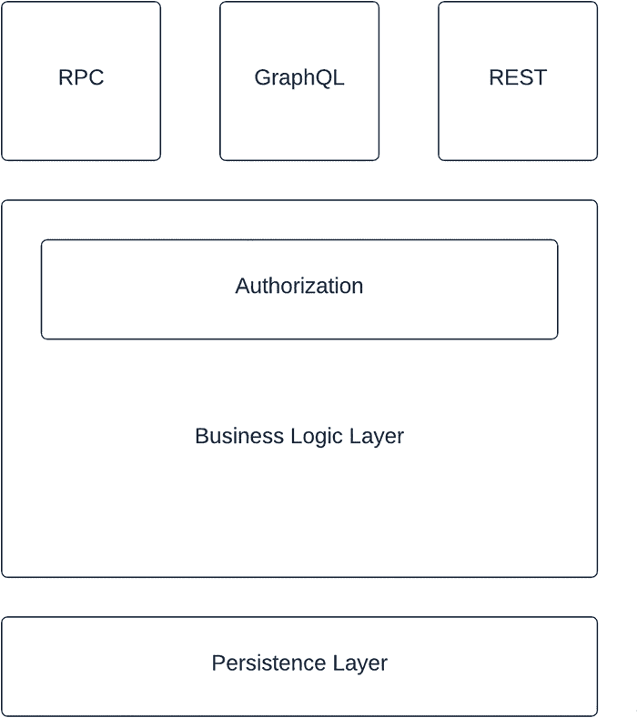

**Figure 6.2:** Placement of Business Logic


### 在 Go 中实现 GraphQL API

让我们深入探讨使用 Go 编程语言实现 GraphQL API 的过程。凭借其强大的并发模型和高效率，Go 已成为构建健壮且可扩展的 GraphQL 服务器的理想选择。在本次探索中，我们将讨论如何选择最合适的 GraphQL 库，详细说明定义 GraphQL 模式的步骤，并指导您完成查询的解析。

在各种编程语言中，有许多可用于实现 GraphQL 的库。对于 Go，我们将使用 `graphql-go` [`github.com/graphql-go/graphql`](https://github.com/graphql-go/graphql)，这是一个流行且全面的库，专门为 Go 生态系统量身定制。此选择将使我们能够利用 Go 的优势，同时遵守 GraphQL 的标准和实践，确保无缝集成和有效的 API 开发。

要设置项目以使用 GraphQL 库，您需要在 Go 环境中安装该库。首先在终端中执行以下命令：

```
go get github.com/graphql-go/graphql
```

此命令将获取并安装 `graphql-go` 库，使其可在您的 Go 项目中使用。通过集成此库，您将获得一套全面的工具和功能，旨在促进在 Go 编程语言中开发 GraphQL API。确保您的项目已正确配置以识别此新依赖项，您就可以开始构建 GraphQL 服务器了。

#### GraphQL 模式

GraphQL 模式通过指定客户端如何获取或修改数据来定义 API 的功能。它充当客户端与服务器之间的契约，详细说明允许的查询和变更类型、它们返回的数据类型以及它们如何相互连接。

以下是代币的简单 GraphQL 模式示例：

```
type Query {
  token(id: ID!): Token
  tokens: [Token]
}

type Mutation {
  createToken(name: String!, symbol: String!, price: Float!): Token
  updateTokenPrice(id: ID!, newPrice: Float!): Token
  deleteToken(id: ID!): Token
}

type Token {
  id: ID!
  name: String!
  symbol: String!
  price: Float!
  volume: Float
}
schema.graphql
```

此模式包括以下内容：

* **类型**

  `Token` 是一个自定义类型，表示加密货币代币。它包括 `id`、`name`、`symbol`、`price` 和 `volume` 等字段。

* **查询**

  `token`：通过其 `id` 获取单个代币。
  `tokens`：检索所有可用代币的列表。

* **变更**

  `createToken`：允许使用指定的 `name`、`symbol` 和 `price` 创建新代币。
  `updateTokenPrice`：更新由 `id` 标识的现有代币的价格。
  `deleteToken`：使用其 `id` 从系统中删除代币。

此模式为您的 GraphQL API 奠定了基础，详细说明了客户端如何与您的加密货币代币数据交互。通过遵循此模式，您的 GraphQL 服务器可确保所有查询和变更都遵循预定义的类型和结构，从而在整个应用程序中维护数据完整性和一致性。接下来，我们将利用此模式构建解析器和变更。同时，我们将基于此模式开发服务器和客户端，确保对加密货币代币上下文中 GraphQL 操作的全面理解和实现。

我们已经在名为 `schema.graphql` 的文件中定义了 GraphQL 模式。此文件将由 GraphQL 服务器用于解析。基于此 GraphQL 模式，我们将创建相应的查询。

**注意**：GraphQL 在 HTTP 上运行，使其能够利用网络的内置功能。

```
schema := graphql.MustParseSchema(schemaAsString, resolver, graphql.UseFieldResolvers())
```

`schemaAsString`：这是我们之前定义过的模式。为了将其纳入此处，我们将读取 `schema.graphql` 文件的内容并传递其内容。

**解析器**：GraphQL 解析器是一个用于为模式中的类型或字段解析值的函数。解析器负责获取客户端请求的数据。实质上，每当查询命中一个字段时，该字段的解析器就会被调用以获取相应的数据。

让我们考虑一个加密货币上下文中 `Token` 类型的简单示例。假设我们的 GraphQL 模式中有以下类型：

```
type Token {
  id: ID!
  name: String!
  symbol: String!
  price: Float!
  volume: Float
}
```

Go 中的 Token 解析器：

```
package resolver
import (
  "context"
  "github.com/graph-gophers/graphql-go"
)
// Token data structure,
type Token struct {
  ID     string
  Name   string
  Symbol string
  Price  float64
}
// TokenResolver corresponds to a GraphQL resolver for the Token type.
type TokenResolver struct {
  t *Token // Assume this represents a specific cryptocurrency token.
}
// ID resolves the 'id' field for the Token type.
func (tr *TokenResolver) ID(ctx context.Context) (*string, error) {
  return &tr.t.ID, nil
}
// Name resolves the 'name' field for the Token type.
func (tr *TokenResolver) Name(ctx context.Context) (*string, error) {
  return &tr.t.Name, nil
}
// Symbol resolves the 'symbol' field for the Token type.
func (tr *TokenResolver) Symbol(ctx context.Context) (*string, error) {
  return &tr.t.Symbol, nil
}
// Price resolves the 'price' field for the Token type.
func (tr *TokenResolver) Price(ctx context.Context) (*float64, error) {
  return &tr.t.Price, nil
}
```

在此示例中，`TokenResolver` 是一个与 `Token` 关联的结构。每个方法，例如 `ID`、`Name`、`Symbol` 和 `Price`，都对应于 `Token` GraphQL 类型中的一个字段，并从关联的 `Token` 实例 (`tr.t`) 中解析数据。这些方法旨在在查询中请求相应字段时由 GraphQL 服务器调用。上下文参数 `ctx` 由 GraphQL 服务器提供，可用于在 API 边界之间传递请求范围的值、取消信号和截止时间。

然后您将在 Go 代码中为此查询实现解析器函数，该函数将使用 `TokenResolver` 来获取和返回代币数据。以下是假设您有一些按 ID 获取代币的函数的示例：

```
func (r *RootResolver) Token(ctx context.Context, args struct{ ID graphql.ID }) (*TokenResolver, error) {
  token, err := fetchTokenByID(string(args.ID)) // Implement this function.
  if err != nil {
    return nil, err
  }
  return &TokenResolver{token: token}, nil
}
```

此设置允许您的 GraphQL 服务器处理按其 ID 请求特定代币的查询，并以 GraphQL 模式中定义的结构化数据返回，并由 Go 代码解析。

#### 运行 GraphQL 服务器

运行 GraphQL 服务器是利用 GraphQL 为您的应用程序提供支持的关键步骤。GraphQL 服务器充当客户端与数据源之间的中介，处理查询和变更，并以结构化格式返回请求的数据。


从核心来看，GraphQL 服务器由三个主要组件组成：模式、解析器以及服务器本身。模式定义了可以查询或变更的类型和字段，本质上勾勒出数据的结构。解析器是处理获取或修改模式中指定数据的逻辑的函数。服务器负责接收 GraphQL 请求，执行适当的解析器，并将结果返回给客户端。

使用 GraphQL 服务器的一个关键优势在于，它允许客户端请求其所需数据的确切内容，减少了数据的过度获取和获取不足。这使得 GraphQL 成为现代 API 的高效且灵活的解决方案。

```go
package main

import (
    "encoding/json"
    "fmt"
    "io/ioutil" // Added for ioutil.ReadFile
    "log"
    "net/http" // Added for HTTP server functionality
    "github.com/graphql-go/graphql"
    "github.com/graphql-go/handler"
)

func main() {
    // Schema
    // Read the schema from the .graphql file
    schemaAsString, err := getSchema("./schema.graphql")
    if err != nil {
        log.Fatalf("Failed to read schema: %v", err) // Changed panic to log.Fatalf for better error handling
    }
    // Parse the read schema string into a GraphQL schema
    diaSchema := graphql.MustParseSchema(schemaAsString, &resolver.RootResolver{}, graphql.UseFieldResolvers())
    // Create a new HTTP multiplexer
    mux := http.NewServeMux()
    // Serve a simple page at the root URL
    mux.HandleFunc("/", func(w http.ResponseWriter, r *http.Request) {
        _, err := w.Write(page)
        if err != nil {
            log.Printf("Failed to write response: %v", err) // Log instead of silently returning
            return
        }
    })

    // Handle GraphQL queries at /query using the defined schema
    mux.Handle("/query", handler.New(&handler.Config{Schema: diaSchema}))
    // Start the server
    listenPort := ":1111" // Default port if not set in environment
    log.Printf("Listening on %s", listenPort)
    log.Fatal(http.ListenAndServe(listenPort, mux)) // Utilize the listenPort variable
}
```

通过在终端中运行 `go run main.go` 执行此代码。然后，在浏览器中打开 `http://localhost:1111` 以访问配备 GraphQL 界面的页面。此交互式工具允许您直接在浏览器中执行 GraphQL 查询并查看响应，从而为您的 GraphQL API 提供高效的测试和调试流程。

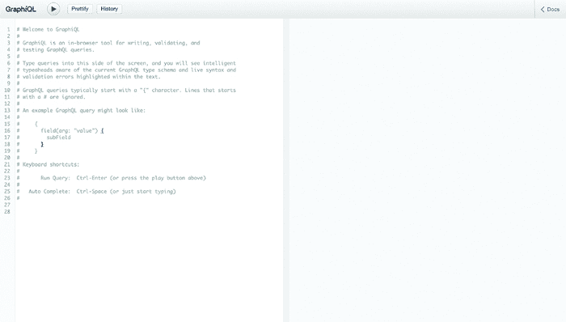

图 6.3：GraphQL 浏览器

#### 使用 PostMan 查询 GraphQL

使用 Postman 查询 GraphQL API 涉及多个步骤。以下是操作方法：

1. **打开 Postman：** 首先在计算机上启动 Postman 应用程序。
2. **创建新请求**：
   1. 点击 `New` 按钮或使用快捷键（macOS 的 `Cmd + N`，Windows/Linux 的 `Ctrl + N`）。
   2. 从选项中选择 `Request` 以创建新请求。
   3. 为请求命名并可选择将其保存到集合中以便更好地组织。
3. **设置请求**：
   1. 在请求选项卡中，将 HTTP 方法更改为 `POST`，因为 GraphQL 查询作为 POST 请求发送。
   2. 在地址栏中输入 GraphQL 端点的 URL。例如，如果您的 GraphQL 服务器在本地运行，URL 可能是 `http://localhost:1111/graphql`。
4. **配置标头**：
   1. 在地址栏下导航到 `Headers` 选项卡。
   2. 将 Content-Type 设置为 `application/json`。这告诉服务器期望 JSON 内容。
   3. 如果您的 GraphQL API 需要身份验证，也在此处添加适当的身份验证标头（例如，`Authorization`）。
5. **编写您的 GraphQL 查询**：
   1. 切换到 `Body` 选项卡并选择 `raw` 单选按钮。
   2. 从单选按钮右侧的下拉菜单中选择 `JSON`。
   3. 在提供的文本编辑器中，在 `query` 键下的 JSON 对象中输入您的 GraphQL 查询或变更。例如：

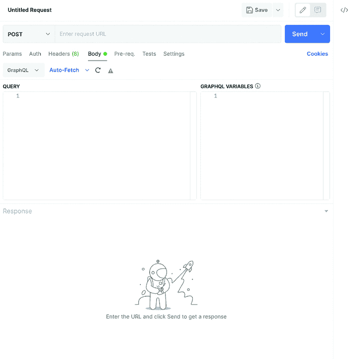

图 6.4：GraphQL Postman 浏览器

## 结论

本章对 GraphQL 及其对 API 开发的重要益处进行了全面介绍。我们探讨了 GraphQL 如何作为一种强大的查询语言，允许高效的数据检索，使客户端能够请求其所需的内容。通过了解 GraphQL 在单个请求中获取多个资源的能力及其结构化类型系统，开发人员可以创建比传统 REST API 更有效且可扩展的 API。

我们深入研究了在 Go 中实现 GraphQL API 的实践方面，利用流行的库并定义模式、类型、查询和变更。通过示例，我们了解了如何设置解析器、处理不同类型的操作以及构建响应以满足各种客户端应用程序的需求。

此外，我们还探讨了如何使用 GraphQL 和 Postman 等工具测试和与 GraphQL API 交互，使开发人员更容易调试和优化其查询。

总体而言，转向 GraphQL 代表了向更灵活、高效且对开发人员友好的 API 构建和消费的重大转变。通过拥抱 GraphQL 的原则并利用其功能，开发人员可以构建更强大且适应性强的 Web 服务，以满足现代应用程序不断变化的需求。

在下一章中，我们将深入探讨在架构中为微服务选择合适的通信协议这一关键决策。我们将比较和对比两种领先的协议：REST API，以其简单性和广泛采用而闻名，以及 gRPC，以其高性能和效率著称。讨论将包括每个协议的基本原则、其优势和潜在缺点。通过了解这些关键方面，您将获得必要的见解，以为您的微服务选择最合适的通信方法，确保系统各处的无缝交互和最佳性能。

## 关键术语

* **GraphQL**：一种用于 API 的查询语言，以及一个运行时，用于通过使用您为数据定义的类型系统来执行这些查询。
* **GraphQL Schema**：GraphQL API 的核心契约，定义类型、字段、查询、变更和订阅。
* **Query**：用于从服务器请求特定数据的 GraphQL 操作。
* **Mutation**：用于修改或更新服务器上数据的 GraphQL 操作。
* **Subscription**：GraphQL 的一项功能，通过允许客户端订阅更改来启用实时数据更新。
* **Type System**：GraphQL 中一种结构化的方法，定义数据模型并确保查询和响应中的类型安全。
* **Resolver**：根据查询从数据库或其他来源检索请求数据的函数。
* **Root Query Type**：GraphQL 模式中所有查询的入口点，定义可以获取的数据。
* **Root Mutation Type**：GraphQL 模式中所有变更的入口点，定义可以修改的数据。

# 第 7 章

## 微服务的 RESTful API 还是 gRPC

### 引言

在微服务架构的格局中，服务之间的有效通信至关重要。随着系统复杂性的增长，通信协议的选择变得至关重要。在本章中，我们将深入探讨两个主要竞争者：RESTful API 和 gRPC，检查其功能、性能、简单性、生态系统支持和最佳实践。

### 结构


在本章中，我们将涵盖以下主题：

* 电商平台后端架构
* 微服务通信简介及其重要性
* 探索 gRPC 作为通信协议的特性和优势
* gRPC 作为通信协议的优势
* 性能比较：REST API 与 gRPC
* REST API 和 gRPC 的生态系统支持和工具
* 设计微服务通信的最佳实践

### 电商平台后端架构

为了理解电商平台后端架构，让我们开发一个电商商店后端。在这个电商系统中，我们需要多个 API 来实现各种功能，例如列出产品、添加到购物车和从购物车中移除、创建买家账户、访问订单历史以及查看订单详情。

为此，我们将系统结构化为独立的服务来处理购买流程的不同方面，包括：

* **账户服务：**
  负责管理买家账户，包括账户创建、密码管理、登录、登出和身份验证。
* **产品服务：**
  处理与产品相关的操作，例如分页列出产品、分类以及启用产品搜索功能。
* **订单服务：**
  管理与订单相关的功能，包括订单历史检索和访问订单详情。
* **购物车服务：**
  促进加购和购买流程，管理买家的购物车。

通过将系统划分为这些独立的服务，我们实现了更好的模块化、可扩展性和可维护性。每个服务专注于特定的业务逻辑，促进代码重用和关注点分离。

在此设置中，账户服务确保安全用户身份验证和授权，而产品服务则高效处理产品目录管理。订单服务跟踪买家交易，购物车服务简化购买流程。

这种架构允许每个服务独立开发、部署和扩展，使团队能够自主地在电商系统的不同组件上工作。

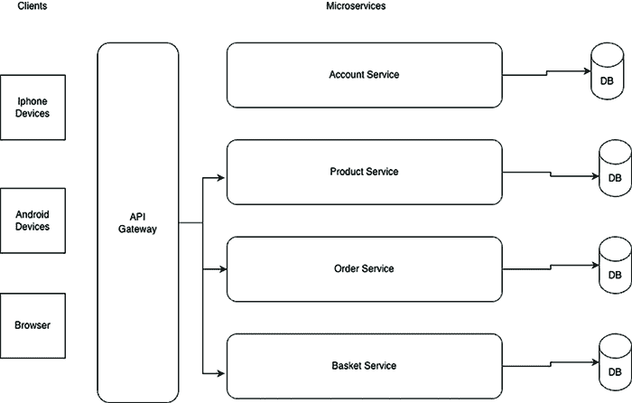

**图 7.1：** 电商架构

在重新审视电商示例之前，让我们深入探讨微服务通信的话题。

### 微服务通信简介及其重要性

微服务本质上是分布式的，每个服务独立运行。微服务之间的通信通过网络进行，需要使用 HTTP 和 gRPC 等服务间通信协议，或 AMQP 协议等消息代理。

鉴于微服务的复杂性和其去中心化特性，在设计阶段必须仔细考虑通信机制的选择。

在深入研究微服务通信设计之前，有必要掌握不同的通信风格，这些风格可沿两个轴进行分类。第一个轴涉及确定通信协议是同步还是异步。

#### 同步通信

同步通信涉及请求-响应机制，其中发送方在继续之前等待接收方的响应。这种通信的特点是阻塞行为，意味着发送方在收到响应之前处于暂停状态。

示例：HTTP 请求-响应

考虑一个客户端应用程序需要通过 HTTP 从服务器获取数据的场景。客户端向服务器发送 HTTP 请求，指定其想要访问的资源。服务器处理请求并发送回包含所请求数据的响应。在此交换期间，客户端等待响应到达后再继续执行进一步操作。

Client Server

| | |
|-------------> HTTP Request (GET /data) --------->|
| | |
|<------------- HTTP Response (Data) -------------|
| | |

在此示例中，客户端同步等待服务器处理其请求并返回数据。客户端在收到响应之前被阻塞。

**使用微服务的同步通信示例：**

**场景：**

买家在将其添加到购物车之前，希望同步从产品服务微服务检索产品详情。

**买家发送请求：**

买家应用程序向产品服务微服务发送同步 HTTP 请求，以检索特定产品的详情。

**产品服务处理请求：**

产品服务微服务接收请求并在内部查询其数据库以获取产品详情。

**产品服务发送响应：**

在内部获取产品详情后，产品服务微服务向买家应用程序发送同步 HTTP 响应，其中包含所请求的信息。

**买家接收响应：**

买家应用程序同步从产品服务微服务接收产品详情并将其显示给用户。

#### 异步通信

另一方面，异步通信不需要发送方立即等待响应。相反，发送方继续执行而不被阻塞，而响应在可用时触发回调或通知。

示例：消息队列

考虑一个生产者应用程序需要通过消息队列向消费者应用程序发送消息的场景。生产者将消息发布到队列，而无需等待消费者立即处理它们。消费者反过来以自己的节奏异步从队列中检索消息并进行处理。

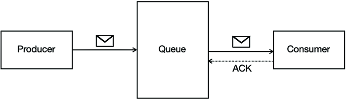

**图 7.2：** 异步通信

**异步通信示例：**

**场景：**

在下单后，订单服务异步通知库存服务更新产品库存水平。

**订单已下：**

买家通过电商平台下单。

**订单服务处理订单：**

订单服务接收订单请求并进行处理，相应地更新订单状态。

**异步通知已发送：**

在成功处理订单后，订单服务异步向库存服务发送消息/通知，指示已购买的产品及其数量。

**库存服务更新库存水平：**

库存服务从订单服务接收异步通知，并在库存数据库中更新已购产品的库存水平。

**确认发送给订单服务：**

在完成库存更新后，库存服务可能会异步向订单服务发送确认消息，确认更新成功。

**订单服务更新订单状态：**

订单服务在收到库存服务的确认后，更新订单状态以反映库存水平已相应调整。


在这种异步流程中，`Order Service` 和 `Inventory Service` 独立运行，使它们之间能够松耦合。`Order Service` 会通知 `Inventory Service` 有关订单的信息，从而允许后者异步更新库存水平，而不会阻塞订单处理流程。

### 微服务中使用的异步通信类型

在微服务架构中，异步通信是确保松耦合、可扩展性和容错性的关键机制。以下是微服务中常见的一些异步通信类型：

* **消息队列：**

  消息队列通过允许服务在不阻塞的情况下进行通信来解耦服务。生产者将消息发送到队列，消费者则异步处理它们。

  * **示例：**

    `RabbitMQ`、`Amazon SQS` 和 `Apache ActiveMQ`。
  * **用例：**

    订单处理，其中订单服务将订单放入队列，而履约服务则处理它们。
  * **优点：**

    可靠的消息传递、负载均衡以及服务的解耦。
  * **缺点：**

    需要设置和管理消息代理。

* **发布/订阅（Pub/Sub）：**

  在发布/订阅模型中，消息发送到主题，多个订阅者可以独立接收这些消息。

  * **示例：**

    `Apache Kafka`、`Google Cloud Pub/Sub` 和 `Amazon SNS`，
  * **用例：**

    事件驱动架构，其中多个服务需要对用户注册或产品更新等事件做出反应。
  * **优点：**

    可扩展性、解耦和易于广播。
  * **缺点：**

    可能出现消息重复，需要仔细管理订阅。

* **事件流：**

  事件流平台捕获并传递连续的事件流。服务可以发布和订阅这些事件流。

  * **示例：**

    `Apache Kafka`、`Amazon Kinesis` 和 `Azure Event Hubs`。
  * **用例：**

    实时数据处理，例如监控网站上的用户活动。
  * **优点：**

    高吞吐量和实时处理。
  * **缺点：**

    管理事件顺序和处理的复杂性。

* **事件溯源：**

  事件溯源涉及将服务的当前状态作为一系列状态变更事件进行持久化。服务可以通过重放这些事件来重建状态。

  * **示例：**

    事件存储数据库（`EventStoreDB` 和 `Axon Framework`）。
  * **用例：**

    复杂的状态管理，例如在金融应用中需要保留交易历史。

* **基于事件溯源的命令查询职责分离（CQRS）：**

  CQRS 将读写操作分离到不同的模型中，通常与事件溯源结合使用以维护清晰的变更历史。

  * **用例：**

    需要高可扩展性和一致性的系统，例如同时处理用户查询和库存更新的电子商务平台。

* **分布式任务调度：**

  分布式任务调度涉及在多个节点或服务之间调度和分发任务，通常用于后台处理。

  * **示例：**

    `Celery`、`AWS Step Functions` 和 `Google Cloud Tasks`。
  * **用例：**

    定时任务，例如发送定期邮件、数据同步和批处理。
  * **优点：**

    自动化重复性任务，提高效率。
  * **缺点：**

    调度器复杂性，以及潜在的时序问题。

* **WebSockets 和服务器发送事件（SSE）：**

  `WebSockets` 和 `SSE` 通过单个 TCP 连接提供全双工通信通道，用于实时数据交换。

  * **用例：**

    实时通知、实时更新、聊天应用和协作工具。

### 探索 gRPC 作为通信协议的特性和优势

在微服务快速发展的环境中，选择合适的通信协议至关重要。`gRPC`，即 Google Remote Procedure Call，是由 Google 开发的开源高性能 RPC 框架。它因其效率、灵活性和强大的功能集而获得了显著的关注。本节深入探讨 gRPC 的核心特性和优势，突出其为何是现代分布式系统的有力选择。

#### gRPC 的特性

以下是 gRPC 的关键特性，从以下开始：

**基于 HTTP/2 的传输：**

`gRPC` 利用 `HTTP/2` 作为其底层传输协议，取代了许多传统 RESTful API 使用的旧版 `HTTP/1.1`。`HTTP/2` 引入了多项关键改进，对微服务的性能和效率至关重要，包括：

* **多路复用：**

  `HTTP/2` 的突出特性之一是能够在单个连接上多路复用多个请求和响应。这减少了建立多个连接通常带来的延迟，使通信更高效。
* **头部压缩：**

  `HTTP/2` 采用 `HPACK` 压缩头部，显著减小了传输数据的大小。这使得通信更快，尤其对高频调用很重要。
* **双向流：**

  与传统的 `HTTP/1.1` 不同，`HTTP/2` 支持全双工通信，允许客户端和服务器同时发送和接收数据流。

**协议缓冲区（Protobuf）：**

协议缓冲区，或 `Protobuf`，是一种语言中立、平台中立、可扩展的序列化结构化数据机制。它在 gRPC 的效率和灵活性中发挥关键作用。

* **高效序列化：**

  协议缓冲区，或 `Protobuf`，是 Google 开发用于序列化结构化数据的方法。与 `JSON` 或 `XML` 相比，`Protobuf` 更紧凑，序列化和反序列化速度更快。
* **强类型：**

  `Protobuf` 强制执行强类型，减少运行时错误，并为服务之间提供清晰、明确的契约。这确保服务器期望的数据结构与客户端发送的数据完全匹配。
* **向后兼容：**

  `Protobuf` 允许在不破坏现有服务的情况下进行模式演进。字段可以被添加或弃用，同时保持与旧版本数据的兼容性。

**服务定义：**

服务定义是 `gRPC` 的基础，为客户端和服务器提供清晰的契约。该契约指定可以远程调用的方法，以及它们的参数和返回类型。服务定义使用协议缓冲区（`Protobuf`）编写，这是一种语言中立、平台中立的接口定义语言。这种方法允许 `gRPC` 在多种编程语言中生成客户端和服务器代码，确保通信双方始终保持同步。通过强制单一事实来源，服务定义在分布式系统中促进一致性和可维护性。

* **单一事实来源：**

  `gRPC` 中的服务使用单个 `.proto` 文件定义，该文件指定服务方法、请求和响应类型。该文件充当客户端和服务器之间的契约，确保一致性。
* **代码生成：**

  `gRPC` 工具可从 `.proto` 文件自动在多种语言中生成客户端和服务器代码。这减少了样板代码，并确保客户端和服务器始终保持同步。

**流支持：**

`gRPC` 支持以下四种类型的流，可促进客户端和服务器之间的实时通信和高效数据传输：


##### 一元 RPC

传统的请求-响应模型是客户端发送单个请求并接收单个响应。

##### 服务端流式

服务器可以对单个客户端请求发送多个响应。这在服务器需要向客户端推送更新的情况下很有用。

##### 客户端流式

客户端可以发送多个请求并接收单个响应。这在将数据聚合后再发送到服务器时很有用。

##### 双向流式

客户端和服务器都可以使用单个连接发送和接收消息流，使其非常适合实时通信。

#### 内置身份验证

安全性在微服务架构中至关重要，而 gRPC 提供了内置的身份验证和加密支持。

##### TLS 加密

gRPC 内置支持 TLS，确保客户端和服务器之间传输的数据得到加密且安全。

##### 基于令牌的身份验证

gRPC 可以与现代身份验证系统集成，允许使用令牌、OAuth 和其他机制来验证客户端。

#### 互操作性

gRPC 在不同语言和平台之间促进互操作性，使不同编程语言编写的服务之间能够无缝通信。这种互操作性通过以下方式实现：

##### 语言支持

gRPC 支持广泛的编程语言，包括 Go、Java、Python、C++、Ruby 等。这使其高度通用，适用于多语言环境。

##### 跨平台

gRPC 在各种平台和环境中运行，提供部署灵活性，并确保不同系统能够无缝通信。

### gRPC 作为通信协议的优势

在微服务快速发展的环境中，选择合适的通信协议至关重要。本节探讨 gRPC 的核心优势，阐明其为何是现代分布式系统的优秀选择。

#### 高性能和效率

gRPC 的性能优势源于其使用 HTTP/2 和 Protocol Buffers (`Protobuf`)。HTTP/2 作为传输协议带来了显著改进。

##### 多路复用

允许在单个连接上并发发送多个请求和响应，减少延迟并提高吞吐量。

##### 头部压缩

使用 HPACK 压缩头部，减少传输数据的大小并加快通信速度。

##### 二进制协议

Protocol Buffers 提供紧凑的二进制序列化格式，与基于文本的格式如 JSON 或 XML 相比，消息大小更小，处理更快。

#### 强类型 API

gRPC 使用 Protobuf 定义消息和服务的结构，强制执行强类型。

##### 编译时验证

错误在编译时而非运行时被捕获，减少了因类型不匹配导致 bug 的情况。

##### 代码生成

工具可自动从 Protobuf 定义生成客户端和服务器代码，减少样板代码并确保实现之间的一致性。

#### 多语言支持

gRPC 支持广泛的编程语言，包括 Go、Java、C++、Python、Ruby 和 Node.js，促进跨平台兼容性。

##### 跨平台兼容性

通过允许系统的不同部分使用最适合其任务的语言编写，促进异构环境中的互操作性。

##### 开发者灵活性

团队可以使用他们偏好的语言和工具，提高生产力和协作效率。

#### 强大的流式处理能力

gRPC 在需要实时通信和数据流的场景中表现出色。

##### 一元 RPC

传统的请求-响应模型。

##### 服务端流式

服务器向单个客户端请求发送多个响应，用于更新。

##### 客户端流式

客户端发送多个请求并接收单个响应，有利于数据聚合。

##### 双向流式

客户端和服务器可以同时发送和接收数据流，非常适合实时应用。

#### 内置身份验证和安全

gRPC 为安全通信提供全面支持。

##### TLS 加密

确保客户端和服务器之间传输的数据得到加密，防止窃听和篡改。

##### 基于令牌的身份验证

与现代身份验证系统集成，支持令牌、OAuth 和其他机制来验证客户端。

#### 互操作性

gRPC 促进不同语言和平台之间服务的无缝通信。

##### 语言支持

对多种编程语言的广泛支持使 gRPC 适用于多语言环境。

##### 跨平台兼容性

在各种平台和环境中运行，确保不同系统能够无缝通信。

#### 可扩展性和负载均衡

gRPC 设计用于处理高负载并高效扩展。

##### 高效资源利用

使用 HTTP/2 和 Protobuf 减少资源消耗，从而实现更好的可扩展性。

#### 负载均衡

gRPC 支持各种负载均衡机制，以有效分配流量并保持高可用性。

#### 生态系统和社区支持

作为开源项目，gRPC 得益于充满活力的社区和丰富的生态系统。

##### 详尽的文档

全面的指南和文档促进易用性和快速采用。

##### 社区贡献

社区的定期更新和贡献确保 gRPC 与最新进展保持同步。

## 性能比较：REST API 与 gRPC

将 REST API 与 Google 远程过程调用（gRPC）进行比较时，需要考虑多个因素，包括性能、易用性和使用场景。

以下是针对以下方面的详细比较：

### 性能

性能通常成为 REST API 和 gRPC 之间关键的决定因素，因为它直接影响用户体验、资源利用率和整体系统可扩展性。

#### 延迟

**gRPC：** 通常比 REST 提供更低的延迟。这是因为 gRPC 使用 HTTP/2，支持在单个连接上多路复用多个请求，减少了建立和拆除连接相关的开销。

**REST：** 使用 HTTP/1.1 或 HTTP/2，但即使使用 HTTP/2，由于 JSON 负载的文本性质和额外的头部，与 gRPC 相比通常延迟更高。

#### 负载大小

**gRPC：** 默认使用 Protocol Buffers (`protobuf`)，其为二进制编码，比 JSON 负载更小，从而实现更快的传输和更少的带宽使用。

**REST：** 通常使用 JSON，其为基于文本的格式，比二进制格式更大，增加负载大小和传输时间。

#### 效率

**gRPC：** 由于其二进制格式和 HTTP/2 功能如头部压缩和请求多路复用，在 CPU 使用和网络利用方面更高效。

**REST：** 由于负载大小较大（JSON）和 HTTP/1.1 中缺乏多路复用，效率较低。

### 易用性


让我们来看一下基于易用性，gRPC 和 REST API 之间的差异。

#### 实现复杂度

*   **gRPC**：需要使用 `protobuf` 定义服务契约，这与 REST 相比可能是一个额外的步骤。然而，它可以在多种语言中生成客户端和服务器代码，这可以加快开发速度。
*   **REST**：设置和使用更简单，特别是对于熟悉 HTTP 和 JSON 的开发者。无需额外的工具，例如 `protobuf` 编译器。

#### 工具和支持

*   **gRPC**：对多种语言和现代框架有出色的支持。可用于调试和监控的工具是可用的，但可能需要一些学习。
*   **REST**：拥有成熟的生态系统，提供了用于调试、测试和监控的广泛工具（例如，`Postman`，`Swagger`）。

### 用例

让我们来看一下基于用例，gRPC 和 REST API 之间的差异。

#### 微服务通信

*   **gRPC**：由于其性能优势和对流的支持，非常适合内部微服务通信。
*   **REST**：通常用于面向外部的 API，在这些 API 中，可读性和简单性更为重要。

#### 移动和 Web 应用

*   **gRPC**：适用于性能和带宽至关重要的移动应用。浏览器支持有限，但随着 `gRPC-Web` 的发展正在改善。
*   **REST**：由于其与浏览器的兼容性以及与前端技术的易于集成，在 Web 应用中被广泛使用。

#### 互操作性

*   **gRPC**：更适合客户端和服务器都受控且使用相同技术栈的环境。与不原生支持 gRPC 的系统集成可能需要额外的工作。
*   **REST**：高度互操作且与语言无关，使其适合异构环境。

## 总结

gRPC 和 REST API 之间的差异可以总结如下：

*   **性能**：`gRPC` 通常在延迟、负载大小和效率方面优于 `REST`。
*   **易用性**：`REST` 更容易实现，并且拥有更大规模的工具和支持生态系统。
*   **用例**：`gRPC` 更受青睐用于内部微服务和性能关键型应用，而 `REST` 则更受青睐用于外部 API 和需要广泛互操作性的应用。

总之，REST 和 gRPC 之间的选择取决于项目的具体需求，例如性能需求、开发的便捷性以及互操作性考虑。

## REST API 和 gRPC 的生态系统支持和工具

在评估 REST API 和 gRPC 的生态系统支持和工具时，考虑技术的成熟度、开发、测试、监控可用工具以及语言支持的广度至关重要。

以下是详细比较：

### REST API

以下是 REST API 的深入分析：

#### 开发工具

*   **Swagger/OpenAPI**：设计和记录 REST API 的标准。诸如 `Swagger Editor` 和 `Swagger UI` 之类的工具促进了 API 的创建和测试。
*   **Postman**：广泛使用的 REST API 测试工具。允许开发者发送请求、检查响应并自动化测试。
*   **Insomnia**：另一个流行的 API 客户端，用于测试 REST API，以其用户友好的界面和强大的功能而闻名。

#### 框架

*   **后端框架**：几乎所有 Web 框架都为 REST API 提供了强大的支持。示例包括：
    *   `Django`/`Flask`：用于 Python。
    *   `Express.js`：用于 Node.js。
    *   `Spring Boot`：用于 Java。
    *   `Ruby on Rails`：用于 Ruby。
    *   `ASP.NET Core`：用于 C#。
*   **前端集成**：易于与 `React`、`Angular` 和 `Vue.js` 等前端框架和库集成。

#### 文档

*   **Swagger/OpenAPI**：用于自动生成交互式 API 文档。
*   **Redoc**：另一个从 OpenAPI 规范生成 API 文档的流行工具。
*   **API Blueprint**：一种用于 Web API 的强大的高级 API 描述语言。

#### 测试

*   **Postman/Newman**：用于手动和自动化测试。
*   **JUnit/TestNG**：可用于测试 REST API 的基于 Java 的框架。
*   **Mocha/Chai**：用于在 JavaScript/Node.js 中测试 REST API。

#### 监控和分析

*   **Prometheus/Grafana**：用于监控 API 性能和健康状况。
*   **Elasticsearch, Logstash, Kibana (ELK) Stack**：用于日志记录和监控。
*   **APM 工具**：例如 `New Relic`、`Datadog` 和 `Dynatrace` 用于应用性能监控。

#### 安全

*   **OAuth2/JWT**：用于保护 REST API 的标准协议。
*   **API 网关**：例如 `Kong`、`Tyk` 和 `AWS API Gateway` 用于管理、保护和监控 API。
*   **gRPC 生态系统和工具**：`gRPC` 提供了强大的工具，包括用于代码生成的 `Protobuf Compiler`、用于测试的 `gRPCurl` 和 `BloomRPC`、用于 REST 互操作的 `gRPC-Gateway`、用于追踪的 `OpenTelemetry`，以及用于安全的 TLS/身份验证插件

### gRPC

以下是 gRPC 的深入分析：

#### 开发工具

*   **Protobuf Compiler**：从 `.proto` 文件为多种编程语言生成客户端和服务器代码。
*   **gRPC 工具**：各种 IDE（例如 `IntelliJ IDEA`、`Visual Studio Code`）的插件，可帮助编辑 `.proto` 文件和开发 gRPC 服务。

#### 框架

*   **后端框架**：各种语言对 gRPC 都有强大的支持，包括：
    *   **Go**：使用 `grpc-go` 提供原生支持。
    *   **Java**：通过 `grpc-java` 和诸如 `Spring Boot` 之类的框架支持。
    *   **Python**：通过 `grpcio` 库支持。
    *   **C#**：通过 `Grpc.Core` 或 `Grpc.Net.Client` 为 .NET Core 支持。
    *   **Node.js**：通过 `grpc` 库支持。
    *   **前端集成**：浏览器中直接支持有限，但 `gRPC-Web` 通过为前端框架集成架起了桥梁。

#### 文档

*   **Buf**：一种帮助管理 Protobuf 文件并生成文档的工具。
*   **gRPC-Gateway**：从 gRPC 定义生成 RESTful JSON API，使记录和测试 API 更容易。

#### 测试

*   **BloomRPC**：用于测试和调试 gRPC 服务的 GUI 客户端。
*   **gRPCurl**：用于与 gRPC 服务器交互的命令行工具，类似于 HTTP 的 `curl`。
*   **Postman**：使用 `grpc-to-rest` 代理，`Postman` 可用于测试 gRPC 服务。

#### 监控和分析

*   **Prometheus/Grafana**：可配置为监控 gRPC 服务。
*   **OpenTelemetry**：为分布式系统提供可观测性，包括 gRPC。
*   **APM 工具**：例如 `New Relic` 和 `Datadog`，它们对 gRPC 提供了支持。

#### 安全

*   **TLS**：`gRPC` 原生支持 TLS 以保护通信。
*   **身份验证插件**：`gRPC` 支持各种身份验证机制，包括 `OAuth2`。

## 设计微服务通信的最佳实践

设计微服务通信涉及多个最佳实践，以确保健壮性、可扩展性和可维护性。

以下是关键最佳实践：

#### 定义清晰的 API 契约

*   使用 API 定义语言，例如 REST 的 `OpenAPI`（`Swagger`）或 gRPC 的 `Protocol Buffers` 来定义清晰且版本化的契约。
*   在对 API 进行更改时确保向后兼容，以避免破坏依赖服务。

#### 使用适当的通信协议


#### 同步通信
使用 `REST` 或 `gRPC` 进行直接的请求-响应交互。对于低延迟、高性能需求，`gRPC` 是首选。

#### 异步通信
使用 `RabbitMQ`、`Apache Kafka` 或 `Amazon SQS` 等消息系统进行解耦通信，以实现更好的可扩展性和容错性。

#### 服务发现
实现服务发现机制以实现服务实例的动态发现。可以使用的工具包括 `Consul`、`Eureka` 和 Kubernetes 内置服务发现。

#### 负载均衡
使用负载均衡器（例如，`HAProxy`、`Nginx`、`Envoy`）将流量分发到服务的多个实例，以获得更好的可用性和可靠性。
在必要时使用客户端侧负载均衡库（例如 Java 的 `Ribbon`）。

#### 熔断器和重试
使用诸如 `Hystrix` 或 `Resilience4j` 之类的库实现熔断器模式，以防止级联故障。
配置重试并使用指数退避来处理瞬态故障。

#### 分布式追踪
实现分布式追踪以跨微服务跟踪和诊断问题。诸如 `Jaeger`、`Zipkin` 和 `OpenTelemetry` 之类的工具可以帮助监控和追踪请求在不同服务中的流动。

#### 安全
使用 `TLS/SSL` 保护通信通道。
实现身份验证和授权，利用 `OAuth2` 和 `JWT` 等标准来保护 REST API，并为 `gRPC` 使用具有双向身份验证的 TLS。

#### 数据一致性
对于最终一致性，使用事件驱动架构配合事件溯源和 CQRS 模式。
对于强一致性，谨慎使用分布式事务，采用 Saga 模式等模式来管理跨多个服务的长运行事务。

#### 监控和日志
使用诸如 `Elasticsearch`、`Logstash`、`Kibana`（ELK）堆栈或 `Splunk` 之类的工具集中化日志。
使用 `Prometheus` 和 `Grafana` 监控服务，以跟踪指标并为异常设置警报。

#### API 网关
使用 API 网关（例如，`Kong`、`Tyk`、`AWS API Gateway`）来管理、保护和监控客户端与微服务之间的流量。
API 网关还可以处理跨领域关注点，例如身份验证、速率限制和日志记录。

#### 幂等性
在适用时设计 API 以实现幂等性，确保重试请求不会产生意外的副作用。

#### 版本控制
对 API 进行版本控制以优雅地处理更改。使用 URI 版本控制（例如，`/v1/resource`）或基于头的版本控制。

#### 健康检查
为服务实现健康检查以报告其状态。使用 Kubernetes 就绪探针和存活探针或其他健康检查机制来监控服务健康。

#### 依赖管理
避免服务之间的紧密耦合。使用异步消息传递和事件驱动通信来减少依赖。
设计服务尽可能独立，使团队能够自主工作并独立部署。

#### 数据管理
将数据管理分散化，让每个微服务拥有自己的数据库，以避免共享数据库瓶颈并提高可扩展性。
使用每个服务一个数据库模式来强制服务边界和数据封装。

#### 可扩展性
在可能的情况下设计服务为无状态，以促进水平扩展。
使用诸如 `Kubernetes` 之类的容器编排工具来管理扩展、部署和资源分配。

## 结论

在本章中，我们探讨了微服务通信的重要性，并强调了 `gRPC` 的特性和优势，例如 `HTTP/2` 支持、`Protocol Buffers` 和双向流。`gRPC` 与 `REST` 相比提供了更低的延迟、更小的负载和更高效的网络使用。虽然 `REST` 由于其简单性和广泛的工具而仍然很受欢迎，但在性能关键场景中 `gRPC` 表现出色。两种协议都有强大的生态系统支持，`REST` 工具例如 `Swagger` 和 `Postman`，`gRPC` 工具例如 `Protobuf` 编译器和 `BloomRPC`。`REST` 与 `gRPC` 之间的选择取决于项目需求，`REST` 适用于公共 API，而 `gRPC` 适用于内部、高性能通信。

在下一章中，我们将学习 API 网关在微服务架构中的作用以及其原则和特性。此外，我们还将探讨 API 网关性能指标的重要性以及各种部署策略。

## 关键术语

* **同步通信**：一种请求-响应交互，其中发送方在继续执行之前等待响应。
* **异步通信**：发送方不等待立即响应的通信，允许接收方稍后处理请求。
* **消息队列**：解耦生产者和消费者的异步消息系统（例如，`RabbitMQ`、`Amazon SQS`）。
* **基于 HTTP/2 的传输**：`gRPC` 使用 `HTTP/2`，它支持多路复用、双向流和头部压缩。
* **协议缓冲区 (Protobuf)**：`gRPC` 使用的一种紧凑高效的数据序列化格式。
* **单次 RPC**：`gRPC` 调用中客户端发送单个请求并获得单个响应的情况。
* **无状态架构**：每个 `REST` API 调用都是独立的，并且在请求之间不存储客户端状态。
* **互操作性**：`REST` API 在不同平台和语言之间具有广泛的兼容性。

# 第 8 章

## API 网关与扩展

### 引言

在本章中，我们将深入探讨微服务架构中 API 网关和 API 计量的关键组件。我们将探讨 API 网关如何作为所有客户端请求的中央入口点，为后端服务提供统一的接口。我们将讨论使用 Go 构建健壮 API 网关的设计原则，包括路由、请求转发以及请求和响应的转换。

此外，我们还将涵盖身份验证和授权等基本安全方面，以确保安全通信。本章还将介绍集成 API 计量功能以监控和管理 API 使用情况、实施速率限制和节流以控制流量，以及采用监控和分析工具以深入了解 API 性能和使用模式。通过本章结束时，您将全面了解如何在 Go 中构建和管理 API 网关，并配备计量功能来优化和保护您的微服务生态系统。

### 结构

在本章中，将涵盖以下主题：
* API 网关简介及其在微服务架构中的作用
* 使用 Go 构建 API 网关的设计原则
* 实现 API 网关功能（身份验证和速率限制）
* API 网关性能指标
* API 网关中的蓝绿部署和金丝雀发布
* 使用 API 网关部署的最佳实践

### API 网关简介及其在微服务架构中的作用


在微服务架构中，API 网关作为管理并将客户端请求导向各个后端服务的中央枢纽，发挥着关键作用。它充当反向代理，处理所有传入请求，将其路由到合适的微服务，然后聚合响应。这不仅简化了客户端与系统的交互，还增强了安全性、可扩展性和性能。通过将身份验证、授权、速率限制和负载均衡等任务卸载到 API 网关，各个微服务可以专注于其核心功能，从而实现更高效、更易管理的架构。

#### API 网关：概述

API 网关充当客户端与后端服务之间的中介，管理和将请求路由到适当的服务。这种方法将后端架构的复杂性从客户端抽象出来，提供简化和统一的接口。

#### API 网关的关键功能

API 网关充当传入请求的中央管理点，处理从路由和数据转换到身份验证和速率限制等所有内容。通过将这些任务集中在单一层中，它确保 API 交互安全、高效且得到良好监控。

* **请求路由：**
  根据请求路径、方法或其他标准，将传入的客户端请求定向到适当的后端服务。

* **API 组合和转换：**
  API 网关可以将对多个后端服务的请求组合成客户端应用的单个响应。这简化了客户端的复杂操作并提高效率。它还可以转换数据格式，确保不同系统之间的兼容性。

* **身份验证和授权：**
  在将请求转发到后端服务之前验证客户端凭据和权限，增强安全性。

* **速率限制和节流：**
  控制客户端在给定时间范围内可以发出的请求数量，以防止滥用并确保公平使用。

* **监控和日志记录：**
  跟踪并记录请求指标和性能数据以进行分析和故障排除。

* **缓存：**
  API 网关可以存储频繁访问的数据，以减轻后端服务的负载并提高客户端的响应时间。此缓存可以配置为在底层数据更改时自动更新。

**提示**：API 网关可以充当交通警察，限制请求并确保后端平稳运行。

#### 流行的 API 网关

可用的流行 API 网关如下：

* **Kong**：一个高度可扩展的开源 API 网关，支持用于身份验证、日志记录、速率限制等的插件。它基于 Nginx 构建，并提供一系列企业级功能。

  **优点：**
  * **可扩展性：** 具有高度可扩展性，可为身份验证、日志记录和速率限制等各种功能提供大量插件。
  * **可扩展性：** 基于 Nginx 构建，提供高性能并可处理大量流量。
  * **社区和支持：** 拥有强大的社区支持，并提供企业级功能。

  **缺点：**
  * **复杂性：** 初始设置和配置可能很复杂，尤其是对于初学者。
  * **资源密集：** 在高流量场景中实现最佳性能需要大量资源。

* **NGINX**：一种广泛使用的 Web 服务器，可配置为 API 网关，提供高性能和丰富的请求处理、负载均衡和安全功能。

  **优点：**
  * **性能：** 以高性能和低资源消耗而闻名。
  * **灵活性：** 高度可配置，具有广泛的自定义选项。
  * **可靠性：** 在生产环境中具有经过验证的稳定性和可靠性。

  **缺点：**
  * **学习曲线：** 高级配置的学习曲线较陡。
  * **API 特定功能有限：** 虽然功能强大，但可能缺乏专用 API 网关提供的一些开箱即用的 API 管理功能。

* **AWS API Gateway**：亚马逊网络服务的托管服务，可简化在任何规模下创建、部署和管理 API。它可与其它 AWS 服务无缝集成。

  **优点：**
  * **集成：** 与其他 AWS 服务无缝集成。
  * **托管服务：** 完全托管，减少运营开销。
  * **可扩展性：** 自动扩展以处理不同的流量负载。

  **缺点：**
  * **成本：** 在高流量下成本可能变得昂贵。
  * **AWS 依赖：** 与 AWS 生态系统紧密耦合，如果使用多个云提供商，可能会受到限制。

* **Apigee**：Google Cloud 的全功能 API 管理平台，提供用于 API 开发、安全、分析和货币化的工具。

  **优点：**
  * **全面功能：** 包括安全、分析、货币化在内的广泛 API 管理功能。
  * **企业重点：** 专为大规模企业用例而设计。
  * **开发者门户：** 提供内置的开发者门户供 API 消费者使用。

  **缺点：**
  * **成本：** 成本高，尤其是在企业计划中。
  * **复杂性：** 设置和管理可能很复杂，需要专用资源。

* **Traefik**：一种现代 HTTP 反向代理和负载均衡器，通过动态发现服务并自动配置路由来简化微服务的部署。

  **优点：**
  * **简易性：** 易于设置和配置，尤其适用于动态服务发现。
  * **容器友好：** 与 Kubernetes 等容器编排平台集成良好。
  * **自动配置：** 自动发现服务并更新路由配置。

  **缺点：**
  * **高级功能有限：** 与其他网关相比，可能缺乏一些高级 API 管理功能。
  * **文档：** 查找高级用例的详细文档可能具有挑战性。

* **Tyk**：一个开源 API 网关和管理平台，开箱即提供身份验证、速率限制、分析、开发者门户等功能。

  **优点：**
  * **功能丰富：** 提供全面的 API 管理功能，包括安全、分析和开发者门户。
  * **开源：** 作为开源解决方案提供，并提供额外的企业功能。
  * **易用性：** 用户友好的界面和直接的配置。

  **缺点：**
  * **资源密集：** 在高流量环境中可能资源密集。
  * **企业功能成本：** 高级功能和支持需要付费。

每个 API 网关都有其优势和劣势，选择使用哪一个取决于具体的用例、现有技术栈和组织需求。仔细考虑这些因素将有助于为您的微服务架构选择合适的 API 网关。

#### API 网关在微服务中的作用

在微服务架构中，API 网关充当客户端交互的单一入口点，高效地将请求路由到适当的微服务。它处理请求路由、负载均衡和服务发现等基本功能，确保流量在服务实例之间得到最佳分配。


此外，API 网关通过管理身份验证和授权来增强安全性，实现速率限制和节流以控制请求速率，并提供集中式日志记录和监控以获得更好的可见性和管理。它还执行协议转换和响应缓存以提高性能并简化客户端交互，从而简化客户端与微服务之间的整体管理和通信。

### 使用 Go 构建 API 网关的设计原则

使用 Go 设计 API 网关涉及遵循几个关键原则以确保健壮性、可扩展性和可维护性。以下是基本设计原则：

*   `Modular Architecture`
    *   `Separation of Concerns`: 将网关划分为路由、身份验证、速率限制、日志记录和监控的独立模块。每个模块应处理特定的职责，使系统更易于维护和扩展。

*   `High Performance and Scalability`
    *   `Efficient Routing`: 使用高性能路由库如 `gorilla/mux` 或 `chi` 进行高效的请求路由。
    *   `Concurrency`: 利用 Go 的 goroutines 和 channels 处理并发请求，确保网关能够随流量增长而扩展。
    *   `Load Balancing`: 实现负载均衡策略以将流量均匀分布到微服务实例上。

*   `Security`
    *   `Authentication and Authorization`: 集成 OAuth、JWT 或其他身份验证机制以确保安全访问。
    *   `Rate Limiting and Throttling`: 实现速率限制以防止滥用并确保资源公平使用。

*   `Observability`
    *   `Logging`: 使用 `logrus` 或 `zap` 等库进行结构化日志记录，以捕获用于调试和监控的详细日志。
    *   `Metrics and Monitoring`: 集成 `Prometheus` 等监控工具以收集指标并设置告警。

*   `Resilience and Fault Tolerance`
    *   `Retry and Circuit Breaker Patterns`: 实现重试机制和断路器以优雅地处理瞬时故障。
    *   `Timeouts and Deadlines`: 为上游请求设置适当的超时，以防止网关无限期挂起。

*   `Configuration Management`
    *   `Dynamic Configuration`: 允许在无需重启的情况下动态更新配置，使用 `viper` 等工具管理配置。
    *   `Environment Variables`: 使用环境变量进行配置，以便轻松支持不同的部署环境。

*   `Extensibility`
    *   `Plugin Architecture`: 设计插件系统，允许在不更改核心网关代码的情况下添加新功能或修改现有功能。
    *   `Middleware Support`: 实现中间件支持，以便轻松添加日志记录、指标和身份验证等横切关注点。

*   `Protocol Support`
    *   `Protocol Translation`: 支持多种协议如 HTTP/1.1、HTTP/2 和 WebSockets 以处理不同类型的客户端请求。
    *   `API Versioning`: 实现 API 版本控制以支持向后兼容性和 API 版本之间的平滑过渡。

*   `Developer Experience`
    *   `Comprehensive Documentation`: 为网关的 API 及其配置选项提供清晰全面的文档。
    *   `Ease of Use`: 设计直观简单的接口，供开发者与网关交互和配置。

### 实现 API 网关功能（身份验证和速率限制）

让我们探讨如何在 Go API 中实现关键的 API 网关功能如 `Authentication` 和 `Rate-Limiting`，这些功能对于创建安全、高效和可靠的 API 至关重要。身份验证确保只有授权用户才能访问特定资源，保护敏感数据和系统。另一方面，速率限制通过在特定时间范围内调节客户端发出的请求数量来防止滥用，保持系统稳定并防止过载。这两个功能共同为分布式架构中的稳健 API 管理奠定了基础。

#### Authentication

身份验证确保只有有效且授权的客户端可以访问您的 API。典型方法涉及使用 `JSON Web Tokens (JWTs)`。

`Example: Adding JWT Authentication in Go`

```
package main

import (
"net/http"
"strings"
"github.com/dgrijalva/jwt-go"
)

var jwtSecretKey = []byte("your-secret-key")
func validateJWT(tokenString string) (bool, error) {
token, err := jwt.Parse(tokenString, func(token *jwt.Token) (interface{}, error) {
return jwtSecretKey, nil
})
if err != nil {
return false, err
}
return token.Valid, nil
}
func authenticationMiddleware(next http.Handler) http.Handler {
return http.HandlerFunc(func(w http.ResponseWriter, r *http.Request) {
authHeader := r.Header.Get("Authorization")
if authHeader == "" {
http.Error(w, "Missing Authorization Header", http.StatusUnauthorized)
return
}
tokenString := strings.TrimPrefix(authHeader, "Bearer ")
isValid, err := validateJWT(tokenString)
if err != nil || !isValid {
http.Error(w, "Invalid Token", http.StatusUnauthorized)
return
}
next.ServeHTTP(w, r)
})
}
func main() {
http.Handle("/secure-endpoint", authenticationMiddleware(http.HandlerFunc(func(w http.ResponseWriter, r *http.Request) {
w.Write([]byte("Welcome to the secure endpoint!"))
})))
http.ListenAndServe(":8080", nil)
}
```

#### Rate-Limiting

速率限制控制客户端在特定时间范围内可以发出的请求数量，以防止 API 滥用。

`Example: Adding Rate Limiting in Go Using a Middleware`

```
package main

import (
"net/http"
"sync"
"time"
)

type rateLimiter struct {
requests map[string]int
mu       sync.Mutex
limit    int
window   time.Duration
}
func newRateLimiter(limit int, window time.Duration) *rateLimiter {
return &rateLimiter{
requests: make(map[string]int),
limit:    limit,
window:   window,
}
}
func (rl *rateLimiter) allow(ip string) bool {
rl.mu.Lock()
defer rl.mu.Unlock()
if rl.requests[ip] >= rl.limit {
return false
}
rl.requests[ip]++
go func() {
time.Sleep(rl.window)
rl.mu.Lock()
rl.requests[ip]--
rl.mu.Unlock()
}()
return true
}
func rateLimitingMiddleware(rl *rateLimiter) func(http.Handler) http.Handler {
return func(next http.Handler) http.Handler {
return http.HandlerFunc(func(w http.ResponseWriter, r *http.Request) {
clientIP := r.RemoteAddr
if !rl.allow(clientIP) {
http.Error(w, "Too Many Requests", http.StatusTooManyRequests)
return
}
next.ServeHTTP(w, r)
})
}
}
func main() {
rl := newRateLimiter(5, 10*time.Second) // Limit: 5 requests per 10 seconds
http.Handle("/rate-limited-endpoint", rateLimitingMiddleware(rl)(http.HandlerFunc(func(w http.ResponseWriter, r *http.Request) {
w.Write([]byte("Request Successful!"))
})))
http.ListenAndServe(":8080", nil)
}
```

### Go API 的负载均衡策略

在现代分布式系统中，确保高可用性、可扩展性和最佳性能至关重要。负载均衡在将传入流量高效地分布到多个服务器之间起着关键作用，防止任何单个实例过载


#### 负载均衡策略的类型

##### 轮询
按顺序将请求分发给各个服务器。这种策略简单有效，适用于所有服务器处理能力和负载相似的场景。每个传入请求都会转发到循环顺序中的下一台服务器，确保流量均匀分配。然而，它不考虑服务器的当前负载或健康状况，在某些情况下可能会导致性能不佳。

例如，在一个拥有三台服务器的系统中，第一个请求发送到 Server A，第二个发送到 Server B，第三个发送到 Server C，之后循环重复。

##### 最少连接
将流量路由到活动连接最少的服务器。这种策略在服务器负载不同的场景中特别有效。将流量引导至活动连接最少的服务器有助于动态平衡负载，并确保没有单台服务器被压垮。

例如，如果 Server A 有 10 个活动连接，Server B 有 5 个，Server C 有 3 个，下一个传入请求将被路由到 Server C。这种策略在请求处理时间差异显著的环境中尤其有用，例如具有复杂查询或资源密集型任务的应用程序。要实现此策略，负载均衡器会实时监控活动连接数，并在负载变化时更新路由决策。

##### 加权负载均衡
根据服务器容量按比例分配流量。在服务器处理能力或资源不同的场景中，加权负载均衡可确保更强大的服务器处理更大份额的流量。例如，如果 Server A 的容量是 Server B 的两倍，则可以为其分配权重 2，而 Server B 的权重为 1。这可确保资源得到高效利用，同时不会使较弱的服务器过载。

加权负载均衡在不同服务器具有不同规格的混合环境中特别有益。通过根据 CPU 使用率或内存可用性等实时指标动态调整权重，该策略可增强系统性能和可靠性。

流行的负载均衡器如 `Nginx`、`Traefik` 和 `Caddy` 支持这些策略。让我们探索使用这些工具部署 Go API。

### 使用 Nginx、Traefik 或 Caddy 部署 Go API
让我们看看如何在各种服务器上部署负载均衡 API 如下：

#### Nginx
`Nginx` 是一款高性能 Web 服务器，可作为反向代理和负载均衡器。

**配置：**

```
upstream go_backend {
    server 127.0.0.1:8081;
    server 127.0.0.1:8082;
}
server {
    listen 80;
    location / {
        proxy_pass http://go_backend;
    }
}
```

#### Traefik
`Traefik` 是一款云原生 API 网关和反向代理，具有内置的负载均衡和监控支持。

**配置：**

```
http:
  routers:
    my-router:
      rule: "PathPrefix(`/`)"
      service: my-service
  services:
    my-service:
      loadBalancer:
        servers:
          - url: "http://127.0.0.1:8081"
          - url: "http://127.0.0.1:8082"
```

#### Caddy
`Caddy` 是一款用户友好的 Web 服务器，具有自动 HTTPS 和内置负载均衡支持。

**配置：**

```
:80 {
    reverse_proxy / {
        to 127.0.0.1:8081 127.0.0.1:8082
    }
}
```

### API 网关性能指标
监控 API 网关可确保高效性能并帮助识别瓶颈，从而在问题影响用户体验之前主动解决。`Prometheus`、`Grafana` 和 `ELK Stack` 等工具被广泛用于收集、分析和可视化关键性能指标。

这些指标包括：

* `Request Latency`：跟踪处理请求所需的时间，有助于识别缓慢的端点或系统中的瓶颈。
* `Error Rate`：监控失败请求的百分比，实现对反复出现的问题或服务中断的快速检测。
* `Traffic Analysis`：分析每个端点的请求数量，以了解使用模式并优化资源分配。
* `CPU and Memory Usage`：监控网关和底层服务的资源消耗，以确保其在可接受的范围内运行。
* `Throughput`：衡量特定时期内处理的请求数量，提供系统在负载下的容量和性能见解。

要实现监控，API 网关或反向代理应以可被监控工具如 `Prometheus` 抓取的格式公开指标。这些工具可以与 `Grafana` 中的仪表板配对以实现实时可视化。

此外，为异常设置自动警报——例如延迟突然飙升、错误率升高或异常流量模式——可确保快速干预并最大限度地减少停机时间。有效的监控不仅提高了系统可靠性，还通过提供有关 API 使用情况和性能趋势的可操作见解来支持可扩展性。

### API 网关中的蓝绿部署和金丝雀发布
现代 API 部署策略强调减少停机时间、保持稳定性和促进新功能平稳发布。两种有效的方法——`Blue-Green Deployment` 和 `Canary Releases` ——在增强用户体验和降低风险的同时实现了这些目标。结合 API 网关使用时，这些策略可为微服务和分布式系统提供对流量路由和部署管理的精细控制。本节详细说明如何将这些技术与 API 网关集成以简化部署工作流程。

#### 蓝绿部署
`Blue-Green Deployment` 是一种通过维护两个独立环境来确保部署期间中断最小的技术：一个用于当前生产版本（`Blue`），另一个用于更新版本（`Green`）。API 网关在这些环境之间引导流量方面发挥着关键作用，实现无缝过渡。

工作原理：

1. `Blue Environment`：当前 API 版本所在的实时环境。
2. `Green Environment`：新版本部署在单独的环境中进行测试和验证。
3. `Traffic Switching`：API 网关在验证 Green 环境稳定后将客户端请求重定向到 Green 环境。
4. `Rollback Capability`：如果出现问题，网关几乎可以立即将流量路由回 Blue 环境。

API 网关在蓝绿部署中的关键作用：

* `Dynamic Routing`：API 网关允许在最少配置更改的情况下在环境之间无缝切换。
* `Health Checks`：网关监控 Green 环境以确保在路由流量之前保持稳定。
* `Scalability`：通过独立管理环境，API 网关支持过渡期间的平稳扩展。

**示例：**

想象使用 `Traefik` 或 `Nginx` 等网关部署 Go API 的新版本。

1. 在不同的后端或端口上部署新版本。
2. 配置 API 网关以选择性路由流量如下：

```
:80 {
    reverse_proxy /api {
        to green-environment.localhost blue-environment.localhost
        lb_policy first
    }
}
```

3. 一旦 Green 环境通过所有测试，就将所有流量切换到它。

#### 金丝雀发布


金丝雀发布涉及通过将一小部分流量导向新版本来逐步推出更新。这种技术允许及早发现问题并逐步采用，使其非常适合需要广泛测试和用户反馈的场景。

##### 如何运作：
1. 在稳定版本旁边部署新版本。
2. API 网关拆分传入流量——例如，90% 到当前版本，10% 到金丝雀版本。
3. 监控性能并逐渐增加导向金丝雀发布的流量百分比。
4. 一旦证明稳定后，完全推出新版本。

##### API 网关在金丝雀发布中的作用：
* **流量加权**：诸如 `Traefik` 或 `Kong` 之类的网关可使用基于权重的策略实现精确的流量分配。
* **监控和日志记录**：网关可以为每个版本收集指标，使开发人员能够及早发现问题。
* **精细控制**：API 网关允许微调流量百分比，以有效管理发布过程。

##### 示例实现：
使用 Caddy 作为 API 网关：

```
:80 {
    reverse_proxy / {
        to stable-environment.localhost canary-environment.localhost
        lb_policy weighted
        lb_weight stable-environment.localhost 90
        lb_weight canary-environment.localhost 10
    }
}
```

随着对金丝雀版本的信心增强，您可以逐步调整流量权重，将更多流量转移到新版本。

### 使用 API 网关部署的最佳实践

以下是部署 API 网关的推荐最佳实践：

* **自动化流量切换**：使用能够在无需人工干预的情况下实现动态切换的网关配置。
* **健康监控**：利用内置健康检查及早发现问题。
* **日志记录和指标**：在发布期间收集详细的日志和指标以进行性能分析。
* **逐步发布**：始终从一小部分流量开始，以最大限度降低风险。
* **故障转移计划**：确保回滚策略预先定义且易于执行。

## 结论

总之，本章介绍了 API 网关在微服务架构中的基本作用，强调了其在管理服务之间通信方面的重要性。我们讨论了在 Go 中构建 API 网关的设计原则，重点关注其性能和简洁性。路由、身份验证和速率限制等关键功能得到了探讨，同时还研究了各种负载均衡策略以确保高可用性。

我们还探讨了 API 网关性能指标对于监控和优化的重要性。最后，我们研究了蓝绿部署和金丝雀发布等部署策略，有助于在更新期间降低风险。综合这些概念，可以为现代微服务创建强大而高效的 API 网关。

在下一章中，我们将探讨反向代理及其在 HTTP 服务器部署中的作用。我们将在 Nginx 后面配置和部署基于 Go 的 HTTP 服务器，包括虚拟主机和 SSL 证书。然后，我们将在 Caddy 后面部署基于 Go 的 HTTP 服务器，管理虚拟主机和证书。最后，我们将微调 Nginx 和 Caddy 中的反向代理行为，以实现最佳的 Go 服务器性能。

## 关键术语

* **API Gateway**：微服务架构中管理客户端请求并将其路由到后端服务的中央入口点。
* **Microservices Architecture**：一种设计模式，其中应用程序由小型、松耦合的服务组成。
* **Reverse Proxy**：一种服务器，将客户端请求转发到后端服务器，常用于 API 网关。
* **Request Routing**：根据预定义规则将 API 请求定向到适当后端服务的过程。
* **API Composition**：将来自多个微服务的响应聚合为单个响应的过程。
* **Request Transformation**：修改传入或传出请求以确保客户端与后端服务之间兼容。

# CHAPTER 9

## 部署 HTTP 服务器

### 引言

在本章中，我们将探讨如何部署基于 Go 的 HTTP 服务器，强调反向代理在其中的重要性和作用。反向代理在 HTTP 服务器部署中发挥关键作用，作为中间件管理客户端请求、提高性能、增强安全性和提供负载均衡。我们将首先在 Nginx 反向代理后面配置和部署基于 Go 的 HTTP 服务器，然后使用 Nginx 设置虚拟主机并管理 SSL 证书。随后，我们将继续在 Caddy 反向代理后面部署相同的基于 Go 的服务器，学习如何在 Caddy 中处理虚拟主机、SSL 证书和自定义代理配置。到最后，您将对如何使用反向代理在生产环境中有效部署和管理基于 Go 的 HTTP 服务器有扎实的理解。

### 结构

在本章中，将涵盖以下主题：

* 反向代理简介及其在 HTTP 服务器部署中的作用
* 在 Nginx 反向代理后面配置和部署基于 Go 的 HTTP 服务器
* 使用 Nginx 设置虚拟主机并处理 SSL 证书
* 在 Caddy 反向代理后面部署基于 Go 的 HTTP 服务器
* 使用 Caddy 管理虚拟主机和 SSL 证书

### 反向代理简介及其在 HTTP 服务器部署中的作用

**reverse proxy** 是位于 Web 服务器前面的服务器，处理客户端请求并将其转发到一个或多个后端服务器。与将客户端请求转发到互联网的前向代理不同，反向代理接收来自互联网的请求并将其转发到内部服务器。反向代理在现代架构中被广泛使用，因为它们在提高 Web 应用程序和微服务的扩展性、安全性和性能方面发挥着重要作用。

让我们分解反向代理在 HTTP 服务器部署中的作用和优势。

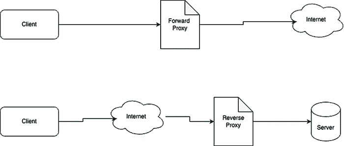

**Figure 9.1:** Reverse Proxy/Forward Procy

#### 反向代理的关键功能

API 网关充当客户端和后端服务之间的中间件，管理和路由请求到适当的服务。这种方法将后端架构的复杂性从客户端抽象出来，提供简化和统一的接口。

* **负载均衡：**
  反向代理将传入流量分配到多个后端服务器，防止任何单个服务器不堪重负。这确保了高可用性和可靠性，使您的应用程序具有可扩展性。如果一台服务器失败，反向代理可以将流量重定向到其他可用服务器，确保正常运行。

* **SSL 终止：**
  直接在后端服务器上处理 SSL/TLS 加密可能资源密集。反向代理通过解密 SSL 流量并将未加密的请求转发到后端服务器来处理此问题。这简化了 SSL 证书管理并通过卸载加密开销来降低服务器负载。

* **缓存：**
  反向代理可以缓存来自后端服务器的响应并为后续请求提供缓存版本。这显著降低了后端服务器的负载，改善了客户端的响应时间，并优化了带宽使用。

* **安全和匿名性：**


通过充当中介，反向代理有助于保护后端服务器免受直接暴露于互联网的风险，增加了一层额外的安全保护。它们可以阻止恶意流量、执行速率限制并防止 DDoS 攻击，从而保护你的 Web 服务器。此外，反向代理可以通过隐藏其身份（如 IP 地址）来匿名化后端服务器，使其对客户端不可见。

**请求/响应转换：**

反向代理可以修改客户端请求或后端服务器响应的 HTTP 头、URL 甚至负载。这使得管理和路由流量更具灵活性，例如重写 URL、添加身份验证令牌或转换响应格式。

**路由：**

反向代理可以检查传入请求，并根据请求路径、头或其他属性将其路由到不同的后端服务器。这使得它们在诸如微服务的多服务架构中高度灵活，其中每个服务可以由不同的后端服务器处理。

**压缩：**

反向代理可以在发送给客户端之前压缩数据，减少响应负载的大小。这可以改善客户端性能，尤其是在互联网连接缓慢的客户端，并且可以降低服务器的带宽成本。

#### 反向代理在微服务架构中的作用

在微服务架构中，应用程序被分解为更小、独立部署的服务，反向代理充当流量管理器。它们有助于根据规则或服务发现将客户端请求路由到适当的微服务。这使得反向代理成为微服务编排不可或缺的一部分，确保正确的服务高效地处理正确的请求。

例如，在典型的基于微服务的系统中，反向代理如 Nginx、Traefik 或 Caddy 可以配置为将对 `/auth` 的请求路由到身份验证服务，将 `/orders` 路由到订单服务，并将 `/payments` 路由到支付服务。

#### 常见的反向代理软件

以下是一些常用的反向代理软件解决方案：

**Nginx：**

Nginx 是最受欢迎的 Web 服务器之一，也可以作为反向代理、负载均衡器和 HTTP 缓存运行。它因其性能、低内存占用和灵活性而被广泛使用。Nginx 在高流量环境中表现出色，使其成为提供静态内容、反向代理动态内容以及在后端服务器之间平衡负载的首选。

**Caddy：**

Caddy 是一款较新的反向代理，因其简单性、易用性和自动 HTTPS 配置而日益流行。它自动化证书管理，并且由于其简单的配置和基于 Go 的实现，是中小型应用程序的良好选择。

**Traefik：**

Traefik 是一款专为容器化环境设计的现代动态反向代理。它与 Docker、Kubernetes 和其他编排平台集成良好，可自动检测和配置服务。Traefik 的动态路由和监控功能使其成为微服务和云原生应用程序的可靠选择。

**Apache HTTP Server（带 mod_proxy）：**

Apache 的 `mod_proxy` 模块可以将其转变为反向代理服务器。虽然不如 Nginx 轻量，但 Apache 的反向代理功能通常与其传统的 Web 服务器功能结合使用。

#### 使用反向代理的优势

以下是使用反向代理的关键优势：

**提高可扩展性：**

通过将客户端请求分发到多个后端服务器，反向代理实现水平扩展，有助于处理不断增加的负载。

**增强安全性：**

反向代理提供额外的安全层，将后端服务器隐藏在直接客户端访问之外。这限制了攻击面并有助于保护敏感数据。

**增强性能：**

通过缓存、压缩和负载均衡，反向代理显著降低服务器负载并改善客户端响应时间，从而带来更流畅的用户体验。

**集中式 SSL 管理：**

反向代理通过允许对多个后端服务的 SSL 加密和解密进行集中处理，简化 SSL 证书管理。

**监控和日志记录：**

反向代理可以监控流量并记录客户端请求和服务器响应。这种集中式日志记录有助于调试、安全审计和性能监控。

#### 使用反向代理的缺点

以下是使用反向代理的关键缺点：

**增加复杂性：**

在架构中引入反向代理层会增加配置和维护方面的复杂性。它还需要额外的基础设施来运行。

**潜在的单点故障：**

如果反向代理服务器失败，可能会导致无法访问后端服务器。实施冗余或高可用性（HA）设置可以缓解此问题，但会增加整体复杂性。

**延迟：**

使用反向代理可能会引入轻微延迟，因为每个请求都必须经过额外的服务器层。这可能是为了安全性和可扩展性而做出的微小权衡，但可能会影响高性能应用程序。

**某些反向代理的定制有限：**

某些反向代理（如托管云解决方案）可能会限制你在高度定制环境中配置所需确切行为的能力。

反向代理是 HTTP 服务器部署中不可或缺的工具，在现代架构中提供可扩展性、安全性和性能改进。通过了解其角色和优势，开发人员和系统管理员可以更好地设计和部署 Web 应用程序，尤其是在微服务和云原生环境中。下一节将介绍如何配置 Nginx 和 Caddy 等反向代理与基于 Go 的 HTTP 服务器，优化性能并确保无缝部署。

### 在 Nginx 反向代理后面配置和部署基于 Go 的 HTTP 服务器

#### 在 Nginx 反向代理后面配置和部署 Go 基于 HTTP 服务器

部署基于 Go 的 HTTP 服务器时，通常使用 Nginx 等反向代理来管理传入请求。Nginx 充当中介，将客户端请求转发到你的 Go 服务器并处理诸如负载均衡、SSL 终止和缓存等任务。这种方法提供了诸多好处，例如提高安全性、性能和可扩展性。在本节中，我们将介绍如何将 Nginx 配置为你的基于 Go 服务器的反向代理并确保顺利部署。

#### 使用 Nginx 作为反向代理的原因

Nginx 是最广泛使用的 Web 服务器和反向代理之一。它轻量、快速且高效，尤其是在处理大量并发请求时。使用 Nginx 作为基于 Go 服务器的反向代理的一些关键原因包括：

**负载均衡**：Nginx 可以将流量分发到多个 Go 服务器实例，提高可扩展性。

**SSL 终止**：Nginx 可以处理 SSL 证书并将加密工作从 Go 服务器卸载，从而提高性能。

**安全性**：Nginx 可以阻止恶意流量、强制执行速率限制并防止 Go 服务器直接暴露于互联网。

**缓存**：通过缓存静态或动态内容，Nginx 减少了 Go 服务器的负载并加快了响应时间。


*日志记录和监控*：Nginx 提供了内置的日志记录和监控功能，用于跟踪流量并识别潜在问题。

#### 设置和部署 Nginx 后端的 Go HTTP 服务器步骤

让我们逐步了解为 Go HTTP 服务器设置 Nginx 反向代理所需的步骤。

##### 设置你的 Go HTTP 服务器：

首先，确保你的 Go HTTP 服务器正在运行并且可以在本地访问。以下是 Go 服务器的基本示例：

```
package main
import (
"fmt"
"log"
"net/http"
)
func handler(w http.ResponseWriter, r *http.Request) {
fmt.Fprintf(w, "Hello, World!")
}
func main() {
http.HandleFunc("/", handler)
log.Println("Starting server on :8080")
err := http.ListenAndServe(":8080", nil)
if err != nil {
log.Fatalf("Could not start server: %s\n", err)
}
}
```

这个简单的服务器监听 8080 端口，并对传入请求响应 “Hello, World!”。

##### 安装 Nginx

如果尚未安装 Nginx，可以使用以下命令进行安装（适用于 Ubuntu/Debian）：

```
sudo apt update
sudo apt install nginx
```

安装完成后，可以启动并启用 Nginx：

```
sudo systemctl start nginx
sudo systemctl enable nginx
```

##### 配置 Nginx 作为反向代理

接下来，需要配置 Nginx 将请求转发到你的 Go 服务器。Nginx 配置文件位于 `/etc/nginx/`。

打开 Nginx 默认配置文件。

```
sudo nano /etc/nginx/sites-available/default
```

修改配置以设置 Go 服务器的反向代理。以下是一个简单的 Nginx 反向代理配置示例：

```
server {
listen 80;
server_name yourdomain.com;  # Replace with your domain or IP
location / {
proxy_pass http://localhost:8080;  # Your Go server address
proxy_set_header Host $host;
proxy_set_header X-Real-IP $remote_addr;
proxy_set_header X-Forwarded-For $proxy_add_x_forwarded_for;
proxy_set_header X-Forwarded-Proto $scheme;
}
}
```

1. `server_name`：将其设置为你的域名或 IP 地址。
2. `proxy_pass`：这是你的 Go 服务器地址（本例中为 `localhost:8080`）。Nginx 将收到的所有请求转发到此地址。
3. `proxy_set_header`：这些头部有助于保留客户端信息并将其转发到你的 Go 服务器。

#### 测试 Nginx 配置

在重启 Nginx 之前，先测试配置以确保没有语法错误：

```
sudo nginx -t
```

如果测试通过，可以重启 Nginx 以应用更改：

```
sudo systemctl restart nginx
```

此时，Nginx 应该将请求转发到你的 Go 服务器。你可以通过访问 `http://yourdomain.com` 或服务器的 IP 地址来访问你的应用程序。

#### 使用 Nginx 设置虚拟主机和处理 SSL 证书

在现代 Web 开发中，在单个服务器上托管多个域名或应用程序是很常见的。虚拟主机允许你根据域名配置 Nginx 从同一服务器提供不同的网站。此外，确保通过 HTTPS 进行安全通信在当今的互联网环境中是必须的，这可以通过使用 Nginx 处理 SSL 证书来实现。在本节中，我们将介绍如何在 Nginx 中设置虚拟主机并为安全通信配置 SSL 证书。

**定义虚拟主机：**

虚拟主机允许使用 Nginx 的一个实例在单台机器上托管多个域名或网站。这对于以下情况很有用：

* 在单个服务器上托管多个网站。
* 在不同子域上提供不同的应用程序。
* 为每个网站启用不同的配置。

在 Nginx 中，每个虚拟主机都在一个 `server` 块中定义，该块指定 Nginx 如何处理特定域名的请求。

##### 在 Nginx 中设置虚拟主机

以下是为多个网站在 Nginx 中设置虚拟主机的逐步指南：

###### 为网站创建目录结构：

在设置虚拟主机之前，创建要托管的网站的目录结构。

```
sudo mkdir -p /var/www/example1.com/html
sudo mkdir -p /var/www/example2.com/html
```

###### 设置正确的权限：

```
sudo chown -R $USER:$USER /var/www/example1.com/html
sudo chown -R $USER:$USER /var/www/example2.com/html
```

###### 配置虚拟主机文件：

接下来，为每个网站创建单独的 Nginx 配置文件。创建 `example1.com` 的虚拟主机配置

```
sudo nano /etc/nginx/sites-available/example1.com
listen 80;
server_name example1.com www.example1.com;
root /var/www/example1.com/html;
index index.html;
location / {
try_files $uri $uri/ =404;
}
}
```

对 `example2.com` 重复相同的步骤：

```
sudo nano /etc/nginx/sites-available/example2.com
```

为 `example2.com` 添加以下内容：

```
server {
listen 80;
server_name example2.com www.example2.com;
root /var/www/example2.com/html;
index index.html;
location / {
try_files $uri $uri/ =404;
}
}
```

###### 启用虚拟主机：

要启用虚拟主机，请从 `sites-available` 目录创建到 `sites-enabled` 目录的符号链接。

```
sudo ln -s /etc/nginx/sites-available/example1.com /etc/nginx/sites-enabled/
sudo ln -s /etc/nginx/sites-available/example2.com /etc/nginx/sites-enabled/
```

###### 测试 Nginx 配置是否存在语法错误：

```
sudo nginx -t
```

如果测试成功，重启 Nginx：

```
sudo systemctl restart nginx
```

你的虚拟主机现在应该已设置完成，如果 DNS 配置正确，可以在浏览器中访问 `example1.com` 和 `example2.com`。

##### 使用 Nginx 处理 SSL 证书

为了确保通过 HTTPS 进行安全通信，你需要为你的域名获取并配置 SSL 证书。

###### 安装 Certbot 以获取 Let’s Encrypt SSL：

为了自动化从 Let’s Encrypt 获取免费 SSL 证书的过程，安装 Certbot：

```
sudo apt install certbot python3-certbot-nginx
```

###### 获取 SSL 证书：

通过运行以下命令为 `example1.com` 获取 SSL 证书：

```
sudo certbot --nginx -d example1.com -d www.example1.com
```

按照提示完成安装。Certbot 将自动修改你的 Nginx 配置以通过 HTTPS 提供网站。

###### 对其他域名重复操作：

对任何其他域名重复此过程，例如 `example2.com`：

```
sudo certbot --nginx -d example2.com -d www.example2.com
```

安装 SSL 证书后，Certbot 将在证书过期前自动续订它们。

###### 测试 HTTPS 配置

在获取并安装 SSL 证书后，通过访问以下地址验证你的网站是否可以通过 HTTPS 访问：

```
https://example1.com
https://example2.com
```

###### 强制使用 HTTPS（可选）：

为了确保所有流量都通过 HTTPS 安全提供，你可以强制 HTTP 流量重定向到 HTTPS。修改 server 块以包含重定向：

```
server {
listen 80;
server_name example1.com www.example1.com;
return 301 https://$server_name$request_uri;
}
```

这将自动将 HTTP 请求重定向到你网站的安全 HTTPS 版本。


通过使用 Nginx 配置虚拟主机并管理 SSL 证书，您可以在单台服务器上高效托管多个网站，同时确保通过 HTTPS 进行安全通信。虚拟主机提供了托管不同应用程序或子域名的灵活性，而 Let’s Encrypt 与 Certbot 则为您的网站自动化 SSL 管理提供了一种简便的方式。正确设置并使用 Nginx 保护基于 Go 的应用程序，可确保生产环境中的可扩展性和可靠性。

### 在 Caddy 反向代理后面部署基于 Go 的 HTTP 服务器

Caddy 是一款现代、强大的 Web 服务器和反向代理解决方案，具备自动 HTTPS、易于配置和高性能等特性。由于其简洁性、原生 TLS 支持以及内置的自动 SSL 证书处理等功能，它对于使用基于 Go 的 HTTP 服务器的开发者来说尤其有用。在本节中，我们将探讨如何将基于 Go 的 HTTP 服务器部署在 Caddy 反向代理后面，实现无缝且安全的流量管理。

#### 使用 Caddy 作为反向代理的原因

Caddy 因其众多优势而成为托管 Web 应用程序的越来越受欢迎的选择，尤其适用于基于 Go 的应用程序：

* `Automatic HTTPS`：Caddy 通过 Let’s Encrypt 自动处理 SSL 证书，简化了保护 Web 流量的流程。
* `Simple Configuration`：Caddy 使用人类可读的配置文件（`Caddyfile`），易于设置和理解。
* `Reverse Proxy Capabilities`：Caddy 在反向代理方面表现出色，使其成为将流量路由到后端服务器（如 Go HTTP 服务器）的绝佳工具。
* `HTTP/2 and QUIC Support`：Caddy 提供开箱即用的现代 Web 协议支持，确保快速可靠的连接。

凭借这些功能，Caddy 是寻求简化的反向代理解决方案的 Go 开发者们的理想选择。

#### 设置 Go HTTP 服务器

在将 Caddy 配置为反向代理之前，您需要有一个正在运行的基础 Go HTTP 服务器。以下是一个简单的 Go HTTP 服务器代码示例：

Tip: `Caddy Server` 自动处理 HTTPS 且无需配置，使安全 Web 部署像在 `Caddyfile` 中编写几行代码一样简单。

将此文件保存为 `main.go`，然后使用以下命令运行服务器：

```
go run main.go
```

Go 服务器现在将在 `localhost:8080` 上运行。接下来，我们将配置 Caddy 以充当此服务器的反向代理。

#### 安装 Caddy

要开始使用 Caddy，您需要在系统上安装它。Caddy 为类 Unix 系统提供了一个简单的单行安装命令：

```
sudo apt install -y debian-keyring debian-archive-keyring apt-transport-https
```
```
curl -1sLf 'https://dl.cloudsmith.io/public/caddy/stable/gpg.key' | sudo tee /etc/apt/trusted.gpg.d/caddy-stable.asc
```
```
curl -1sLf 'https://dl.cloudsmith.io/public/caddy/stable/debian.deb.txt' | sudo tee /etc/apt/sources.list.d/caddy-stable.list
```
```
sudo apt update
```
```
sudo apt install caddy
```

安装完成后，您可以使用以下命令检查 Caddy 的版本：

```
caddy version
```

#### 将 Caddy 配置为反向代理

在 Go HTTP 服务器在本地端口 `8080` 上运行时，您现在可以配置 Caddy 以充当反向代理，将流量路由到您的 Go 服务器。

##### 创建 Caddyfile

`Caddyfile` 是 Caddy 的配置文件。要设置反向代理，请使用以下内容创建 `Caddyfile`：

```
sudo nano /etc/caddy/Caddyfile
```

添加以下配置：

```
example.com {
    reverse_proxy localhost:8080
}
```

在此示例中，将 `example.com` 替换为您实际的域名。Caddy 将自动为该域名请求并配置 SSL 证书，并将所有传入请求代理到运行在 `localhost:8080` 上的 Go HTTP 服务器。

##### 启用反向代理

配置好 `Caddyfile` 后，重新启动 Caddy 以应用更改：

```
sudo systemctl restart caddy
```

现在，Caddy 将处理所有发往 `example.com` 的传入请求，并将其路由到运行在 `localhost:8080` 上的 Go 服务器。

##### 自动处理 HTTPS

Caddy 最强大的功能之一是其自动 HTTPS 管理。当您在 `Caddyfile` 中指定域名时，Caddy 将自动：

* 从 Let’s Encrypt 请求免费 SSL 证书。
* 配置服务器以处理 HTTPS 请求。
* 将 HTTP 流量重定向到 HTTPS。

这大大简化了为 Go 服务器配置 SSL/TLS 的流程，确保与服务器的所有通信默认情况下都是加密的。

##### 自定义反向代理

Caddy 允许对反向代理行为进行广泛的自定义。您可以定义请求和响应的处理方式，例如：

* `Load Balancing`：如果您有多个 Go 服务器，Caddy 可以在它们之间分配流量。
* `Health Checks`：Caddy 可以监控后端服务器的健康状况，并在实例不健康时停止向其路由流量。
* `Timeouts`：您可以为 Caddy 与后端 Go 服务器之间的连接配置超时。

以下是更高级的反向代理配置示例：

```
example.com {
    reverse_proxy {
        to localhost:8080
        lb_policy round_robin
        health_path /health
        transport http {
            read_timeout 10s
            write_timeout 10s
        }
    }
}
```

在此配置中，Caddy 将在多个后端之间平衡流量，检查 `/health` 端点以监控 Go 服务器的健康状况，并为代理设置读写超时。

##### 使用多个 Go 服务部署 Caddy

如果您在同一台服务器上运行多个 Go 服务，可以使用 Caddy 为每个服务管理反向代理。以下是您可能为多个服务配置 Caddy 的方式：

```
example1.com {
    reverse_proxy localhost:8080
}
example2.com {
    reverse_proxy localhost:8081
}
```

Caddy 将处理不同域名的请求，并根据域名将其路由到适当的 Go 服务。

##### 测试配置

在将 Caddy 配置为反向代理后，通过在浏览器中访问您的域名来测试部署：

* `https://example.com`

如果一切设置正确，Caddy 将自动将 HTTP 流量重定向到 HTTPS，并将请求代理到运行在端口 `8080` 上的 Go 服务器。

将基于 Go 的 HTTP 服务器部署在 Caddy 反向代理后面，简化了管理 Web 流量、使用 HTTPS 保护连接以及处理反向代理配置的过程。Caddy 的自动 SSL 管理、简单配置和强大的反向代理功能使其成为现代 Go 应用程序的绝佳选择，确保生产环境中的性能和安全性。借助 Caddy，您可以高效处理多个服务、扩展应用程序并轻松管理安全连接。

### 使用 Caddy 管理虚拟主机和 SSL 证书

Caddy 使管理虚拟主机和 SSL 证书变得异常简单直接。其最受欢迎的功能之一是通过 Let’s Encrypt 自动生成和续订 SSL 证书，使开发者能够在无需手动证书管理的复杂性的情况下部署安全应用程序。此外，Caddy 的简单配置语言允许开发者轻松设置多个虚拟主机（域名或子域名）。

#### 使用 Caddy 管理虚拟主机和 SSL 证书的步骤

以下是使用 `caddy` 管理虚拟主机和 SSL 证书的步骤：

##### 设置虚拟主机


虚拟主机在你想在单台服务器上托管多个域名或子域名时非常有用。在 Caddy 中，每个虚拟主机只需在 Caddyfile 中声明为一个块即可。

下面是如何定义两个虚拟主机的示例：

```
example.com {
    reverse_proxy localhost:8080
}
api.example.com {
    reverse_proxy localhost:5000
}
```

* `example.com` 和 `api.example.com` 是两个不同的虚拟主机。
* 每个域名指向不同的后端服务，例如一个运行在端口 `8080`，另一个运行在端口 `5000`。

你可以根据需要添加任意数量的域名或子域名，Caddy 会自动处理它们。

#### 自动 SSL 证书管理

Caddy 的突出特性是其自动 SSL 证书管理。默认情况下，Caddy 会：

* 自动为 Caddyfile 中列出的每个域名或子域名请求并安装 SSL 证书。
* 在证书过期前自动续期 SSL 证书。
* 将所有 HTTP 流量重定向到 HTTPS，确保安全通信。

以下 Caddyfile 配置将自动为 `example.com` 和 `api.example.com` 生成 SSL 证书：

```
example.com {
    reverse_proxy localhost:8080
}
api.example.com {
    reverse_proxy localhost:5000
}
```

无需人工干预 — Caddy 会在幕后处理所有与证书相关的任务。

#### 通配符域名

Caddy 还支持通配符证书，如果你想保护域名的所有子域名，这会很有用。例如：

```
*.example.com {
    reverse_proxy localhost:8080
}
```

在这种情况下，Caddy 将为 `*.example.com` 请求通配符证书，并将任何子域名的流量，例如 `api.example.com`、`blog.example.com` 等，转发到指定的后端服务。

#### 自定义 SSL 证书

虽然 Caddy 使用 Let’s Encrypt 自动管理 SSL 证书，但它也允许你根据需要指定自定义 SSL 证书。以下是如何提供自定义证书和密钥的方法：

```
example.com {
    reverse_proxy localhost:8080
    tls /path/to/your/cert.pem /path/to/your/key.pem
}
```

在此示例中，`tls` 指令指向 `example.com` 的你自己的证书和密钥文件。

#### 管理多个 SSL 证书

如果你的服务器需要处理多个具有不同 SSL 证书的域名，你可以为每个虚拟主机指定其 SSL 证书：

```
example.com {
    reverse_proxy localhost:8080
    tls /path/to/your/cert.pem /path/to/your/key.pem
}
anotherdomain.com {
    reverse_proxy localhost:5000
    tls /path/to/your/another-cert.pem /path/to/your/another-key.pem
}
```

#### TLS 配置

Caddy 还允许高级 TLS 配置，例如设置协议、密码套件和互 TLS `mTLS`：

```
example.com {
    reverse_proxy localhost:8080
    tls {
        protocols tls1.2 tls1.3
        ciphers ECDHE-ECDSA-AES128-GCM-SHA256 ECDHE-RSA-AES128-GCM-SHA256
    }
}
```

此配置将协议限制为 TLS 1.2 和 1.3，并指定安全通信中使用的密码。

## 结论

在本章中，我们探讨了 Caddy 和 Nginx 作为 Go 基于 HTTP 服务器的反向代理的强大功能。两者都为管理流量、配置虚拟主机和处理 SSL 证书提供了稳健的解决方案。虽然 Nginx 以其性能和灵活性而广为人知，但 Caddy 因其简洁性而脱颖而出，尤其是在自动 HTTPS 和证书管理方面。了解如何在反向代理后面部署、配置和保护你的 HTTP 服务器，对于在生产环境中构建可扩展、安全且可维护的 Web 应用至关重要。通过正确的设置，你可以确保服务的平稳运行、优化性能和安全通信。

下一章将探讨文件处理，教你如何使用 multipart 表单数据上传和下载文件，并在你的 Go API 中处理文件存储和检索。

## 关键术语

* `Reverse Proxy`: 一个位于后端服务前面的服务器，转发客户端请求，同时提高安全性、性能和负载均衡。
* `Forward Proxy`: 一个位于客户端和互联网之间的代理，将客户端请求转发到外部资源。
* `Load Balancing`: 将客户端请求分发到多个后端服务器的过程，以防止过载并提高可扩展性。
* `SSL Termination`: 反向代理处理 SSL/TLS 加密并将未加密流量转发到后端服务器的过程。
* `Caching`: 将经常访问的内容副本存储在内存或磁盘中以减少负载并提高响应时间。

# 第 10 章

## 高级文件处理和实时通信

### 引言

随着现代 API 的不断发展，高效处理文件和实现实时通信的能力变得至关重要。在本章中，我们将深入探讨 `Advanced File Handling and Real-Time Communication` 技术，帮助你构建功能丰富且响应迅速的 Go API。

我们将首先通过 multipart 表单数据探索 `file upload and download processes`，随后介绍 `secure file storage and retrieval` 的最佳实践，以确保可扩展性和数据完整性。接下来，我们将处理用于管理大型数据集的 `pagination techniques`，以便在你的应用中实现高效的数据交付。

在实时通信方面，本章介绍了 `WebSockets` 及其集成到 REST API 中，使服务器和客户端之间能够进行动态双向通信。你将学习如何实现向连接用户 `broadcasting real-time updates` 的功能，以及处理 `WebSocket authentication and authorization` 以实现安全通信。

本章提供了管理文件的高效工具和技术，同时使你的 API 通过实时交互焕发生机，使其更具响应性和用户友好性。

### 结构

在本章中，我们将涵盖以下主题：

* Uploading and Downloading Files in REST APIs Using Multipart Form Data
* File Storage and Retrieval Best Practices in Go APIs
* Implementing Pagination Techniques for Large Data Sets
* Real-Time Communication Using WebSockets in REST APIs
* Integrating WebSocket Functionality into Go Servers

### 使用 Multipart 表单数据在 REST API 中上传和下载文件

上传和下载文件是现代 REST API 的基本功能。这些功能对于云存储平台、内容管理系统和电子商务网站等应用至关重要，在这些应用中文件处理是核心需求。REST API 依赖 multipart 表单数据格式来促进文件上传和下载，确保在单个 HTTP 请求中高效处理二进制和文本数据。本主题深入探讨 REST API 中使用 multipart 表单数据处理文件的方式，探索其结构、在 Go 中的实现以及最佳实践。

#### Multipart 表单数据

Multipart 表单数据是 HTTP 中的一种内容类型，允许在同一请求中传输文件和其他表单字段。它广泛用于文件上传，因为它提供了一种包含文本和二进制数据的方法。Multipart 表单数据将请求体拆分为多个部分，每个部分都有自己的内容类型和 disposition，由边界字符串分隔。这种格式非常适合 REST API，因为它确保文件传输期间的数据完整性。

#### 在 REST API 中上传文件


要启用 REST API 中的文件上传，服务器必须处理 multipart 表单数据。以下是在 Go 中实现文件上传的分步指南。

##### 示例实现：Go 中的文件上传

###### 设置端点：

在 Go 应用中创建处理文件上传的端点涉及定义一个能够解析和处理 multipart 表单数据的 HTTP 处理器。该处理器将提取客户端上传的文件并将其存储在服务器上。通过实现适当的配置，可以确保端点高效、安全且健壮。该过程包括定义路由以处理传入的文件上传、解析 multipart 表单数据以处理文件和元数据传输，以及将文件保存到指定的存储位置。

``` 
package main

import (
"fmt"
"io"
"net/http"
"os"
)
func uploadFileHandler(w http.ResponseWriter, r *http.Request) {
r.ParseMultipartForm(10 << 20) // 10 MB
file, header, err := r.FormFile("file") // "file" is the key for the file input
if err != nil {
http.Error(w, "Failed to retrieve file", http.StatusBadRequest)
return
}
defer file.Close()
destination, err := os.Create("./uploads/" + header.Filename)
if err != nil {
http.Error(w, "Failed to save file", http.StatusInternalServerError)
return
}
defer destination.Close()
// Copy the content from the uploaded file to the destination file
_, err = io.Copy(destination, file)
if err != nil {
http.Error(w, "Error while saving file", http.StatusInternalServerError)
return
}
fmt.Fprintf(w, "File uploaded successfully: %s", header.Filename)
}
func main() {
http.HandleFunc("/upload", uploadFileHandler)
http.ListenAndServe(":8080", nil)
}
```

#### REST API 中的文件下载

文件下载允许客户端从服务器检索文件。服务器将请求的文件流式传输给客户端，从而实现文档检索、媒体流或备份系统等功能。

##### 示例实现：Go 中的文件下载：

``` 
Create an HTTP handler to send a file to the client.
func downloadFileHandler(w http.ResponseWriter, r *http.Request) {
// Path to the file to be downloaded
filePath := "./uploads/example.txt"
file, err := os.Open(filePath)
if err != nil {
http.Error(w, "File not found", http.StatusNotFound)
return
}
defer file.Close()
w.Header().Set("Content-Disposition", "attachment; filename=example.txt")
w.Header().Set("Content-Type", "application/octet-stream")
// Stream the file content to the response writer
_, err = io.Copy(w, file)
if err != nil {
http.Error(w, "Error while sending file", http.StatusInternalServerError)
return
}
}
```

### Go API 中的文件存储和检索最佳实践

高效的文件存储和检索是任何处理用户生成内容（如文档、图像或视频）的应用程序的基本组成部分。在 Go API 中，设计用于处理文件操作的高效系统需要仔细关注可扩展性、安全性和性能。本主题重点介绍在 Go API 中实现文件存储和检索机制的最佳实践，确保为用户和开发人员提供无缝且安全的体验。

#### Go API 中文件存储的最佳实践

以下是 Go API 中文件存储的最佳实践：

1. **选择合适的存储系统：**

   1. 文件系统存储
   
   适用于小型应用程序或本地开发。将文件存储在服务器上的结构化目录中。

   2. 云存储解决方案
   
   使用 AWS S3、Google Cloud Storage 或 Azure Blob Storage 等服务以实现可扩展性、耐用性和全球可访问性。

   3. 数据库存储
   
   将小型文件或文件元数据存储在关系型（如 PostgreSQL）或 NoSQL 数据库中。避免直接在数据库中存储大文件以防止性能问题。

将 AWS S3 与 Go 集成的示例：

``` 
import (
"github.com/aws/aws-sdk-go/aws"
"github.com/aws/aws-sdk-go/aws/session"
"github.com/aws/aws-sdk-go/service/s3"
"os"
)
func uploadToS3(bucket, key, filepath string) error {
file, err := os.Open(filepath)
if err != nil {
return err
}
defer file.Close()
svc := s3.New(session.Must(session.NewSession()))
_, err = svc.PutObject(&s3.PutObjectInput{
Bucket: aws.String(bucket),
Key:    aws.String(key),
Body:   file,
})
return err
}
```

2. **妥善组织文件：**

   1. 使用通用唯一标识符（`UUIDs`）作为文件名以避免冲突。

   2. 根据日期、用户 ID 或文件类型构建目录结构以便于访问和维护。

3. **设置文件大小限制：**

限制可以上传的文件大小以防止滥用并保护服务器资源。在 Go 中，使用 `http.Request.Body` 大小限制：

``` 
r.Body = http.MaxBytesReader(w, r.Body, 10<<20)
```

4. **验证文件类型：**

通过验证 MIME 类型确保仅上传允许的文件类型：

``` 
func validateFileType(fileHeader *multipart.FileHeader) error {
file, err := fileHeader.Open()
if err != nil {
return err
}
defer file.Close()
buffer := make([]byte, 512)
_, err = file.Read(buffer)
if err != nil {
return err
}
contentType := http.DetectContentType(buffer)
allowedTypes := []string{"image/jpeg", "image/png", "application/pdf"}
for _, t := range allowedTypes {
if t == contentType {
return nil
}
}
return fmt.Errorf("unsupported file type: %s", contentType)
}
```

5. **为安全加密文件：**

使用诸如 `golang.org/x/crypto` 之类的库在静态时加密敏感文件以防止未经授权的访问。

6. **利用内容分发网络（CDNs）：**

使用 CDN 缓存和提供频繁访问的文件，减少延迟和服务器负载。

#### Go API 中文件检索的最佳实践

以下是 Go API 中文件检索的最佳实践：

1. **实施安全访问控制：**

   1. 根据用户角色或权限限制文件访问。

   2. 使用签名 URL 为云存储中的文件提供临时访问。

示例：为 AWS S3 生成预签名 URL

``` 
func generatePresignedURL(bucket, key string) (string, error) {
svc := s3.New(session.Must(session.NewSession()))
req, _ := svc.GetObjectRequest(&s3.GetObjectInput{
Bucket: aws.String(bucket),
Key:    aws.String(key),
})
return req.Presign(15 * time.Minute) // URL expires in 15 minutes
}
```

2. **优化文件交付：**

   1. 对大文件使用流式传输以避免内存过载。

   2. 设置适当的响应头，例如 `Content-Disposition`，用于文件下载。

``` 
func serveFile(w http.ResponseWriter, r *http.Request, filepath string) {
w.Header().Set("Content-Disposition", "attachment; filename=example.txt")
http.ServeFile(w, r, filepath)
}
```

3. **压缩文件以提高效率：**

通过使用 GZIP 等格式在检索期间压缩文件以减小文件大小。

示例：Go 中的 GZIP 压缩中间件

``` 
import "compress/gzip"
func gzipMiddleware(next http.Handler) http.Handler {
return http.HandlerFunc(func(w http.ResponseWriter, r *http.Request) {
gz := gzip.NewWriter(w)
defer gz.Close()
```


`w.Header().Set("Content-Encoding", "gzip")`

`next.ServeHTTP(gzipResponseWriter{Writer: gz, ResponseWriter: w}, r)`

`})`

`}`

`type gzipResponseWriter struct {`

`io.Writer`

`http.ResponseWriter`

`}`

`func (w gzipResponseWriter) Write(b []byte) (int, error) {`

`return w.Writer.Write(b)`

`}`

4. **日志并监控文件访问：**

维护文件上传和下载的日志以跟踪使用情况并检测异常活动。

5. **分页文件列表：**

对于返回文件列表的 API，实现分页以提高性能和可用性：

```go
type File struct {
Name string
Size int64
}
func listFiles(w http.ResponseWriter, r *http.Request) {
files := []File{{Name: "file1.txt", Size: 1024}, {Name: "file2.txt", Size: 2048}}
page := r.URL.Query().Get("page")
// Implement pagination logic…
json.NewEncoder(w).Encode(files)
}
```

有效的文件存储和检索对于构建可扩展、安全且用户友好的 API 至关重要。通过遵循最佳实践，例如选择合适的存储系统、验证文件、优化交付并实施强大的安全措施，开发人员可以确保无缝的文件处理体验。Go 强大的标准库，结合云集成和中间件，使其成为管理现代 Web 应用程序中文件的绝佳选择。

分页的几个缺点是 UX 复杂性、上下文丢失、不一致的排序以及批量操作困难。

### 为大型数据集实现分页技术

分页是处理 Web 应用程序中大型数据集的关键技术。它允许客户端检索可管理的数据块，从而提高性能、减少内存使用并增强用户体验。在 Go 中，实现高效的分页对于处理大型数据集的 API 至关重要，例如用户记录、交易日志或产品目录。本主题深入探讨了在基于 Go 的 API 中实现分页的最佳实践和技术，确保可扩展性和响应能力。

#### 常见分页技术

以下是常见的分页技术：

* **基于偏移的分页：**

客户端指定页码和限制（每页项目数）。服务器根据这些值计算偏移量。

**最佳用例**：适用于相对较小的数据集，需要对页码进行精确控制的情况。

示例查询：

```sql
SELECT * FROM items LIMIT 10 OFFSET 20;
```

```go
func offsetPagination(w http.ResponseWriter, r *http.Request) {
page, _ := strconv.Atoi(r.URL.Query().Get("page"))
limit, _ := strconv.Atoi(r.URL.Query().Get("limit"))
if limit <= 0 {
limit = 10
}
offset := (page - 1) * limit
// Sample query (replace with actual DB query)
query := fmt.Sprintf("SELECT * FROM items LIMIT %d OFFSET %d", limit, offset)
fmt.Println("Executing query:", query)
w.Write([]byte("Pagination result here…"))
}
```

* **基于键集的分页（游标分页）：**

客户端提供“游标”（例如，最后检索记录的唯一 ID 或时间戳），而不是使用页码。服务器从该游标之后开始获取下一组记录。

**最佳用例**：对于数据频繁变化或大型数据集的 API 高效。

示例查询：

```sql
SELECT * FROM items WHERE id > 100 ORDER BY id LIMIT 10;
```

```go
func cursorPagination(w http.ResponseWriter, r *http.Request) {
cursor := r.URL.Query().Get("cursor")
limit, _ := strconv.Atoi(r.URL.Query().Get("limit"))
if limit <= 0 {
limit = 10
}
// Sample query (replace with actual DB query)
query := fmt.Sprintf("SELECT * FROM items WHERE id > %s ORDER BY id LIMIT %d", cursor, limit)
fmt.Println("Executing query:", query)
w.Write([]byte("Cursor-based pagination result here…"))
}
```

* **混合分页：**

结合基于偏移和基于键集的分页以处理特定用例。例如，对静态数据使用基于偏移，对实时数据切换到基于键集。

#### 在 Go API 中实现分页

让我们看看在 Go API 中分页的实现：

1. **定义分页参数：**

标准化诸如 `page`、`limit` 和 `cursor` 之类的查询参数，以确保 API 之间的一致使用。

示例 API 端点：

```text
GET /items?page=2&limit=10
```

2. **设计数据库查询：**

1. 对基于偏移的分页使用 `LIMIT` 和 `OFFSET`。
2. 对基于游标的分页使用 `WHERE` 条件和 `ORDER BY`。

3. **返回结果的元数据：**

包含分页元数据，例如记录总数、当前页、下一个游标或用于在页面之间导航的链接。

示例：JSON 响应

```json
{
"data": [
{ "id": 1, "name": "Item 1" },
{ "id": 2, "name": "Item 2" }
],
"pagination": {
"current_page": 2,
"next_page": 3,
"total_pages": 10,
"total_items": 100
}
}
```

4. **处理边缘情况：**

1. 对无效的页码或游标值返回适当的响应。
2. 处理请求页码超过记录总数的场景。

5. **优化查询性能：**

1. 在数据库中对 `ORDER BY` 和 `WHERE` 条件使用索引列。
2. 避免在大型数据集的 `OFFSET` 查询中使用昂贵的计算。

#### 使用大型数据集的分页

您可以通过以下方式实现大型数据集的分页：

* **异步数据加载：**

对于极其庞大的数据集，请考虑将数据加载过程分解为更小的块并异步交付。

* **缓存：**

使用 Redis 或内存存储等缓存机制来减少频繁访问页面的数据库负载。

* **预计算分页：**

为静态或半静态数据集预先计算并存储分页结果以提高响应时间。

#### 分页的示例 Go API

以下是同时处理基于偏移和基于游标分页的 Go API 的完整示例：

```go
package main
import (
"fmt"
"net/http"
"strconv"
)
func offsetPagination(w http.ResponseWriter, r *http.Request) {
page, _ := strconv.Atoi(r.URL.Query().Get("page"))
limit, _ := strconv.Atoi(r.URL.Query().Get("limit"))
if page <= 0 {
page = 1
}
if limit <= 0 {
limit = 10
}
offset := (page - 1) * limit
query := fmt.Sprintf("SELECT * FROM items LIMIT %d OFFSET %d", limit, offset)
fmt.Println("Executing query:", query)
w.Write([]byte("Offset-based pagination result"))
}
func cursorPagination(w http.ResponseWriter, r *http.Request) {
cursor := r.URL.Query().Get("cursor")
limit, _ := strconv.Atoi(r.URL.Query().Get("limit"))
if limit <= 0 {
limit = 10
}
query := fmt.Sprintf("SELECT * FROM items WHERE id > '%s' ORDER BY id LIMIT %d", cursor, limit)
fmt.Println("Executing query:", query)
w.Write([]byte("Cursor-based pagination result"))
}
func main() {
http.HandleFunc("/offset-pagination", offsetPagination)
http.HandleFunc("/cursor-pagination", cursorPagination)
fmt.Println("Server is running on port 8080")
http.ListenAndServe(":8080", nil)
}
```


分页是构建可扩展且高效 API 的基本要求，尤其是在处理大型数据集时。通过选择合适的分页技术——基于偏移、基于游标或混合方法——开发人员可以优化数据库性能并为用户提供无缝体验。实施最佳实践，例如返回元数据、处理边缘情况和优化查询，可确保 API 随着数据随时间的增长而保持响应性和可维护性。Go 的简洁性和强大的标准库使其成为开发具有强大分页功能的 API 的绝佳选择。

### 在 REST API 中使用 WebSockets 进行实时通信

虽然 REST API 传统上是无状态的并采用请求-响应模型，但现代应用程序通常需要实时通信来处理诸如实时更新、通知和协作功能等事件。WebSockets 通过在客户端和服务器之间提供持久的全双工通信通道来弥合这一差距。这使得应用程序能够即时传输数据，而无需客户端反复轮询服务器。在本节中，我们将探讨 WebSockets 如何补充 REST API 以实现实时通信并提供无缝的用户体验。

#### WebSockets 简介

WebSockets 是一种在客户端和服务器之间建立持久连接的协议。与 HTTP 不同，HTTP 本质上是无状态的，并且每个请求都需要新的连接，WebSockets 保持单个连接打开，从而实现双向通信。这使得它们非常适合需要实时更新的场景。

#### WebSockets 的关键特性

以下是 WebSockets 的关键特性：

* **持久连接**：一旦建立，连接将保持活动状态，直到被客户端或服务器显式关闭。
* **全双工通信**：客户端和服务器可以同时发送和接收消息。
* **低延迟**：消除了重复建立和关闭连接的开销。
* **高效数据传输**：支持二进制和文本数据，最小化负载大小。

#### REST API 中 WebSockets 的用例

* WebSockets 在 REST API 中可用于以下用途：**实时通知**：诸如消息平台或协作工具等应用程序使用 WebSockets 来传递即时通知。
* **实时数据馈送**：金融应用程序、游戏平台和物联网设备利用 WebSockets 进行实时数据流。
* **协作应用程序**：诸如 Google Docs 或 Trello 等工具使用 WebSockets 使多个用户能够实时协作。
* **实时聊天应用程序**：聊天应用程序使用 WebSockets 实现即时消息传递
* **实时体育更新**：体育应用程序使用 WebSockets 提供逐项更新，而无需刷新页面。

#### WebSockets 如何补充 REST API

WebSockets 和 REST API 具有不同的用途，可以协同工作以创建强大的应用程序：

* **REST API**：非常适合基于资源的运算，例如获取数据、创建记录或执行 CRUD 操作。
* **WebSockets**：非常适合事件驱动和实时通信，例如推送通知或广播更新。

在典型的架构中：

* REST API 用于初始化 WebSocket 连接、验证用户身份或检索历史数据。
* WebSockets 接管实时、事件驱动的更新，提供高效且响应迅速的体验。

#### WebSocket 通信流程

让我们了解 WebSocket 的通信流程：

1. **握手**：WebSocket 连接始于 HTTP 握手。客户端发送 WebSocket 请求，如果请求有效，服务器将升级协议。
2. **持久连接**：握手后，连接保持打开状态，从而实现双向通信。
3. **消息交换**：客户端和服务器都可以实时发送消息，格式为文本或二进制。
4. **连接终止**：当不再需要通信时，连接由客户端或服务器显式关闭。

#### 在 Go REST API 中实现 WebSockets

以下是如何在基于 Go 的 REST API 中集成 WebSockets：

**设置 WebSocket 服务器：**

```go
package main

import (
"fmt"
"net/http"
"github.com/gorilla/websocket"
)

// Upgrader upgrades an HTTP connection to a WebSocket connection
var upgrader = websocket.Upgrader{
CheckOrigin: func(r *http.Request) bool {
return true // Adjust this for production (for example, validate the origin)
},
}
func handleWebSocket(w http.ResponseWriter, r *http.Request) {
// Upgrade the connection
conn, err := upgrader.Upgrade(w, r, nil)
if err != nil {
fmt.Println("Failed to upgrade connection:", err)
return
}
defer conn.Close()
fmt.Println("WebSocket connection established")
// Message handling loop
for {
messageType, message, err := conn.ReadMessage()
if err != nil {
fmt.Println("Error reading message:", err)
break
}
fmt.Printf("Received: %s\n", string(message))
// Echo the message back to the client
if err := conn.WriteMessage(messageType, message); err != nil {
fmt.Println("Error writing message:", err)
break
}
}
}
func main() {
http.HandleFunc("/ws", handleWebSocket)
fmt.Println("WebSocket server started at ws://localhost:8080/ws")
http.ListenAndServe(":8080", nil)
}
```

**客户端 WebSocket 实现：**

```js
const socket = new WebSocket("ws://localhost:8080/ws");
socket.onopen = () => {
console.log("Connected to WebSocket server");
socket.send("Hello, server!");
};
socket.onmessage = (event) => {
console.log("Message from server:", event.data);
};
socket.onclose = () => {
console.log("WebSocket connection closed");
};
```

WebSockets 是 REST API 的强大补充，使实时通信成为可能，并在现代应用程序中增强用户体验。通过将 WebSocket 功能与 REST API 结合，开发人员可以构建响应迅速且交互性强的系统，有效处理实时更新。在 Go 中，诸如 **Gorilla WebSocket** 之类的库使得在 API 中实现 WebSocket 支持变得容易，为实时功能提供了坚实的基础。适当的规划和遵循最佳实践可确保可扩展且安全的实现，使 WebSockets 成为实时应用程序不可或缺的工具。

#### 将 WebSocket 功能集成到 Go 服务器中

将 WebSocket 功能集成到 Go 服务器中对于在服务器和客户端之间实现实时双向通信至关重要。与遵循请求-响应模式的传统基于 HTTP 的 REST API 不同，WebSockets 建立持久连接，允许数据在两个方向自由流动。此功能非常适合需要实时更新的应用程序，例如聊天系统、多人游戏、实时仪表板和协作工具。

在本节中，我们将探讨如何使用 **Gorilla WebSocket** 包在 Go 服务器中设置和集成 WebSocket 功能，这是 Go 中最受欢迎且维护良好的 WebSocket 支持库之一。

#### 设置 Gorilla WebSocket 库


要开始在 Go 中使用 WebSockets，你需要安装 Gorilla WebSocket 包。此库提供了易于使用的函数，用于将 HTTP 连接升级为 WebSockets 并管理 WebSocket 通信。

使用以下命令安装 Gorilla WebSocket：

```
go get -u github.com/gorilla/websocket
```

#### 基本 WebSocket 服务器设置

基本 WebSocket 服务器设置如下所示：

1. **导入所需包：**

在你的 Go 应用中，你需要导入必要的包，例如用于 HTTP 服务器设置的 `net/http` 以及用于 WebSocket 支持的 `github.com/gorilla/websocket`。

```go
package main

import (
"fmt"
"net/http"
"github.com/gorilla/websocket"
)
```

2. **创建 WebSocket Upgrader：**

`websocket.Upgrader` 用于将常规 HTTP 连接升级为 WebSocket 连接。它需要一个用于检查请求来源的函数，你可以将其配置以满足你的安全需求。

```go
var upgrader = websocket.Upgrader{
CheckOrigin: func(r *http.Request) bool {
return true // Allow all origins for simplicity. Adjust this for production use.
},
}
func handleWebSocket(w http.ResponseWriter, r *http.Request) {
// Upgrade the HTTP connection to a WebSocket
conn, err := upgrader.Upgrade(w, r, nil)
if err != nil {
fmt.Println("Failed to upgrade connection:", err)
return
}
defer conn.Close()
fmt.Println("WebSocket connection established")
// Message handling loop
for {
// Read message from client
messageType, message, err := conn.ReadMessage()
if err != nil {
fmt.Println("Error reading message:", err)
break
}
fmt.Printf("Received: %s\n", string(message))
// Echo the message back to the client
if err := conn.WriteMessage(messageType, message); err != nil {
fmt.Println("Error writing message:", err)
break
}
}
}
```

3. **配置 HTTP 服务器和路由：**

设置你的 HTTP 服务器以在特定路由上监听 WebSocket 连接。`http.HandleFunc` 方法将路由与 WebSocket 处理函数关联。

```go
func main() {
http.HandleFunc("/ws", handleWebSocket) // Route to handle WebSocket connections
fmt.Println("WebSocket server started on ws://localhost:8080/ws")
http.ListenAndServe(":8080", nil)
}
```

现在，你的 WebSocket 服务器将运行并在 `ws://localhost:8080/ws` 上监听传入的 WebSocket 连接。

将 WebSocket 功能集成到 Go 服务器中可实现实时、双向通信，从而增强用户体验和应用交互性。借助 `Gorilla WebSocket` 库，设置 WebSocket 服务器非常简单，而 Go 的强大并发模型使其成为高效处理大量 WebSocket 连接的理想选择。通过遵循安全性、错误处理和可扩展性的最佳实践，你可以创建功能强大的实时应用，充分发挥 WebSockets 的潜力。

## 结论

在本章中，我们探讨了在 Go API 中处理文件和实时通信的高级技术。从使用 multipart 表单数据实现文件上传和下载，到确保文件存储和检索的最佳实践，我们为高效的数据管理奠定了坚实的基础。

此外，我们还深入研究了大型数据集的分页技术，使 API 中的导航和可扩展性变得无缝。还讨论了 WebSockets 的实时通信，重点介绍了它们在 Go 服务器中的集成、广播更新以及管理身份验证以实现安全连接。这些概念为开发人员提供了构建健壮、高效和动态的 Go 应用所需的工具，使其能够处理现代 API 需求。

## 关键术语

* **Multipart Form Data**：一种 HTTP 内容类型，允许在单个请求中传输文件和其他表单字段。
* **File Upload**：通过 HTTP 请求将文件从客户端发送到服务器的过程。
* **File Download**：从服务器检索文件并将其传输到客户端的过程。
* **File System Storage**：将上传的文件存储在服务器上的结构化目录中。
* **Cloud Storage**：使用 AWS S3、Google Cloud Storage 或 Azure Blob Storage 等服务来大规模存储和检索文件。
* **Database Storage**：将文件元数据存储在数据库中，同时将实际文件保存在存储系统中。

# 索引

A

Aggregate Data, types

Array 34

Struct 34

Aliases 122

API Gateways 163

API Gateways, architecture 163

API Gateways, features

Authentication 168

Blue-Green Deployment 175

Canary Releases 176

Load Balancing 171

Performance Metrics 174

Rate-Limiting 170

API Gateways, practices 177

API Gateways, principles

Configuration, managing 167

Developer, experience 168

Extensibility 168

Fault Tolerance 167

High Performance/Scalability 167

Modular, architecture 167

Observability 167

Protocol, supporting 168

Security 167

API Gateways, role 166

API Gateways, tasks

API Composition/Transformation 163

Authentication/Authorization 163

Caching 164

Monitor, logging 164

Rate Limit/Throttling 163

Request Routing 163

API Gateways, types

Apigee 165

AWS API Gateway 165

Kong 164

NGINX 164

Traefik 165

Tyk 166

Applying Middleware 83

Applying Middleware, practices

Contextual Information 86

Error, handling 86

Order Matters 86

Testing 86

Arguments 120, 121

Asynchronous Communication 144, 145

Asynchronous Communication, types

CQRS 147

Distributed Task, scheduling 147

Event Sourcing 146

Event Streams 146

Message Queues 145

Publish/Subscribe (Pub/Sub) 146

WebSockets/SSE 147

Authentication Middleware 82

Authentication Middleware, considerations

confidentiality 83

error, handling 83

flexibility 83

scalability 83

security 82

B

Backend Architecture 140, 141

Backend Architecture, aspects

Account Service 141

Basket Service 141

Order Service 141

Product Service 141


# B

#### 蓝绿部署
` 175 `

## 蓝绿部署，角色
` 175 `

## 蓝绿部署，使用
` 175 `

# C

#### Caddy
` 190 `

### Caddy，优势
#### 自动 HTTPS
` 190 `

#### 支持 HTTP/2/QUIC
` 190 `

#### 反向代理，功能
` 190 `

#### 简单配置
` 190 `

## Caddy，配置
` 191 ` - ` 193 `

## Caddy，安装
` 191 `

## 使用 HTTP 服务器的 Caddy，设置
` 190 `

### 客户端-服务器架构
` 2 `

### 客户端-服务器架构，基础
#### 客户端
` 3 `

#### 服务器
` 3 `

## 通信协议，优势
#### 内置身份验证
` 152 `

#### 生态系统/社区，支持
` 153 `

#### 高性能/效率
` 151 `

#### 互操作性
` 152 `

#### 负载，均衡
` 152 `

#### 多语言，支持
` 151 `

#### 强大的流式传输
` 152 `

#### 强类型 API
` 151 `

### 常量
` 32 `

### 常量，声明
#### 基础
` 33 `

#### 多个
` 33 `

#### 类型化
` 33 `

## 控制结构
` 38 `

### 控制结构，点
#### If/If-Else 语句
` 38 `

## 循环
` 39 `

## Switch 语句
` 39 `

## 使用 Gin 防止 CORS
` 87 `

## 跨源资源共享（CORS）
` 87 `

## 自定义错误类型
` 72 ` , ` 73 `

### 自定义错误类型，优势
#### 详细错误信息
` 74 `

### 错误处理策略
` 74 `

#### 可读性/可维护性
` 74 `

# D

## 数据类型
` 33 `

### 数据类型，类别
#### 聚合
` 34 `

#### 函数
` 35 `

#### 接口
` 35 `

#### 数字
` 33 `

#### 引用
` 34 `

#### 指令
` 125 `

### 指令，类型
#### 执行
` 125 `

#### 模式
` 125 `

# E

## 错误处理
` 43 ` , ` 71 ` , ` 107 `

### 错误处理，策略
#### 自定义错误类型
` 44 `

#### 处理错误
` 44 `

#### Panic/Recover
` 45 `

#### 返回错误
` 44 `

#### 包装错误
` 45 `

### 错误处理，技术
#### 自定义错误类型
` 72 `

#### 错误返回值
` 71 `

#### 错误包装
` 76 `

#### 记录错误
` 78 `

#### Panic/Recover
` 77 `

#### 哨兵错误
` 74 `

## 错误返回值
` 71 `

### 错误返回值，点
#### 错误检查
` 71 `

#### 错误类型
` 71 `

#### 处理错误
` 72 `

## 错误类型
` 43 `

## 错误包装
` 76 `

### 错误包装，优势
#### 上下文信息
` 77 `

#### 错误，检查
` 77 `

#### 错误，保留
` 77 `

# F

#### 片段
` 122 ` , ` 123 `

## 函数
` 40 `

### 函数，架构
` 40 `

### 函数，点
#### 业务逻辑
` 42 `

#### 数据访问
` 42 `

#### 端点处理程序
` 42 `

#### 中间件
` 42 `

#### 工具
` 42 `

### 函数，来源
#### 一等公民
` 42 `

#### 方法
` 42 `

# G

#### 全局中间件
` 83 `

### 全局中间件，使用场景
#### 身份验证
` 84 `

#### CORS
` 84 `

#### 错误，处理
` 84 `

#### 日志记录
` 83 `

#### 请求清理
` 84 `

## GO
` 10 `

### GO，特性
#### 并发
` 11 `

##### 跨平台
` 11 `

#### 效率
` 10 `

#### 开源
` 11 `

#### 可扩展性
` 11 `

#### 简洁性
` 10 `

#### 标准库
` 11 `

#### 静态类型
` 11 `

#### 工具
` 12 `

## GO 文件检索，实践
` 203 ` , ` 204 `

## GO 文件存储，实践
` 201 ` , ` 202 `

## GO，安装
` 15 `

## Golang
` 10 `

## Go 模块
` 22 `

### Go 模块，初始化
` 22 `

## Go 模块系统
` 23 `

### Go 模块系统，概念
#### 兼容性，保持
` 24 `

#### 依赖，更新
` 23 `

#### 依赖，管理
` 23 `

#### 初始化
` 23 `

#### 代理，缓存
` 24 `

#### 语义导入，版本控制
` 24 `

#### Vendor，目录
` 23 `

#### Vendor Prune
` 24 `

#### 版本控制
` 23 `

#### 版本，锁定
` 24 `

## Go 模块，版本
#### go.mod
` 25 `

#### go.sum
` 25 `

## Go，运算符
#### 算术
` 36 `

#### 赋值
` 36 `

#### 位运算
` 37 `

#### 比较
` 36 ` , ` 37 `

#### 自增/自减
` 37 ` , ` 38 `

#### 逻辑
` 37 `

#### 杂项
` 38 `

## GOPATH
` 18 `

## GO 项目
` 19 `

### GO 项目，点
#### Go 模块，优化
` 25 `

#### 包版本，管理
` 26 `

#### 移除包，更新
` 26 `

#### 第三方包，防止
` 26 `

### GO 项目，提示
` 19 ` - ` 21 `

## GOROOT
` 18 ` , ` 19 `

## GO，系统
#### Linux
` 15 ` , ` 16 `

#### Mac
` 16 `

#### Windows
` 17 `

### Go 工作区
` 17 ` , ` 18 `

### Go 工作区，目录
#### bin
` 18 `

#### pkg
` 18 `

#### src
` 18 `

## 基于图的思维方式
` 128 `

### 基于图的思维方式，术语
#### 业务逻辑层
` 130 `

#### GraphQL API，实现
` 130 `

#### GraphQL 模式
` 131 `

#### 共享语言
` 129 `

## GraphQL
` 117 ` , ` 118 `

## GraphQL API，步骤
` 136 ` , ` 137 `

### GraphQL，元素
#### 别名
` 122 `

#### 参数
` 120 ` , ` 121 `

#### 指令
` 125 `

#### 字段
` 119 ` , ` 120 `

#### 片段
` 122 ` , ` 123 `

#### 突变
` 126 `

#### 操作名称
` 123 ` , ` 124 `

#### 类型系统
` 127 `

#### 变量
` 124 ` , ` 125 `


### GraphQL 解析器
` 132 `

#### GraphQL 模式
` 131 `

GraphQL 模式，元素

### 变更
` 132 `

### 查询
` 132 `

### 类型
` 132 `

### GraphQL 服务器
` 134 ` , ` 136 `

### GraphQL，术语
` 118 `

### gRPC
` 92 `

#### gRPC，架构
` 92 ` - ` 94 `

#### gRPC，优势
双向，流式 ` 95 `

跨语言，支持 ` 95 `

高效，通信 ` 95 `

演进/版本控制 ` 95 `

全双工，流式 ` 95 `

高，性能 ` 95 `

可插拔，架构 ` 95 `

强类型 API ` 95 `

#### gRPC，分解
开发工具 ` 157 `

文档 ` 157 `

框架 ` 157 `

监控 ` 158 `

安全 ` 158 `

测试 ` 157 `

### gRPC 客户端，构建
` 105 ` - ` 107 `

#### gRPC，概念
错误处理 ` 110 `

元数据 ` 110 `

状态码 ` 107 `

状态消息 ` 110 `

#### gRPC，特性
内置身份验证 ` 150 `

基于 HTTP/2 的传输 ` 148 `

互操作性 ` 150 `

协议缓冲区 ` 148 `

服务定义 ` 149 `

流支持 ` 149 `

#### gRPC，实现步骤
` 104 ` , ` 105 `

#### gRPC，用例
云原生，应用 ` 97 `

服务间，通信 ` 96 `

微服务 ` 96 `

移动客户端 ` 96 `

实时，通信 ` 96 `

Web 前端 ` 97 `

### H

#### HandleFunc
` 57 `

#### HTTP
` 4 `

##### HTTP，特性
头部 ` 4 `

方法 ` 4 `

无状态 ` 4 `

状态码 ` 4 `

#### http.HandleFunc
` 64 `

## HTTP 协议
` 3 `

##### HTTP 协议，功能
超文本 ` 4 `

传输协议 ` 4 `

#### http.Request
` 55 `

##### HTTP 请求，组件
主体 ` 59 `

HTTP 头部 ` 58 `

请求方法 ` 58 `

URL/URI ` 58 `

##### HTTP 响应，方面
Content-Type ` 60 `

元数据 ` 61 `

策略，缓存 ` 61 `

安全，参数 ` 61 `

服务器信息 ` 61 `

##### HTTP 响应，组件
响应主体 ` 60 `

响应头部 ` 60 `

状态码 ` 60 `

#### HTTP 响应，代码
` 70 `

#### http.ResponseWriter
` 55 ` , ` 69 `

#### http.ServeMux
` 64 `

#### HTTP 服务器
` 53 `

##### HTTP 服务器，设置
` 53 ` , ` 54 `

### I

#### 中间组件，类型
网关 ` 9 `

代理 ` 9 `

### L

#### ListenAndServe
` 57 `

#### 负载均衡
` 171 `

##### 负载均衡，服务器
Caddy ` 174 `

Nginx ` 173 `

Traefik ` 173 `

##### 负载均衡，策略
最少连接 ` 172 `

轮询 ` 172 `

加权 ` 172 `

#### 记录错误
` 78 ` , ` 79 `

##### 记录错误，实践
` 79 `

#### 日志中间件
` 81 `

##### 日志中间件，用例
调试 ` 82 `

监控 ` 82 `

安全 ` 82 `

### M

#### 微服务通信
` 142 `

##### 微服务通信，实践
` 158 ` - ` 160 `

##### 微服务通信，类型
异步通信 ` 144 `

同步通信 ` 142 `

#### 中间件
` 80 `

##### 中间件，设置
` 80 `

##### 中间件，类型
应用中间件 ` 83 `

身份验证中间件 ` 82 `

链式中间件 ` 86 `

全局中间件 ` 83 `

日志中间件 ` 81 `

特定路由中间件 ` 84 `

#### 模块化，术语
协作 ` 48 `

可维护性 ` 48 `

可读性 ` 48 `

可重用性 ` 48 `

可扩展性 ` 48 `

测试 ` 48 `

#### 变更
` 126 `

### N

#### net/http
` 54 ` , ` 87 `

#### Nginx 使用 SSL 证书，处理
` 188 ` , ` 189 `

#### Nginx 使用虚拟主机，设置
` 187 ` , ` 188 `

#### 数字数据，类型
复数 ` 34 `

浮点数 ` 34 `

整数 ` 33 `

### O

#### 操作名称
` 123 `

### P

#### 包，[content]

### GraphQL 解析器
` 132 `

#### GraphQL 模式
` 131 `

GraphQL 模式，元素

### 变更
` 132 `

### 查询
` 132 `

### 类型
` 132 `

### GraphQL 服务器
` 134 ` , ` 136 `

### GraphQL，术语
` 118 `

### gRPC
` 92 `

#### gRPC，架构
` 92 ` - ` 94 `

#### gRPC，优势
Bi-Directional，streaming ` 95 `

Cross-Language，supporting ` 95 `

Efficient，communications ` 95 `

Evolution/Versioning ` 95 `

Full Duplex，streaming ` 95 `

High，performance ` 95 `

Pluggable，architecture ` 95 `

Strongly-Type APIs ` 95 `

#### gRPC，分解
Development Tools ` 157 `

Documentation ` 157 `

Frameworks ` 157 `

Monitoring ` 158 `

Security ` 158 `

Testing ` 157 `

### gRPC 客户端，构建
` 105 ` - ` 107 `

#### gRPC，概念
Error Handling ` 110 `

Metadata ` 110 `

Status Codes ` 107 `

Status Messages ` 110 `

#### gRPC，特性
Built-In Authenticating ` 150 `

HTTP/2-Based Transport ` 148 `

Interoperability ` 150 `

Protocol Buffers ` 148 `

Service Definition ` 149 `

Streaming Support ` 149 `

#### gRPC，实现步骤
` 104 ` , ` 105 `

#### gRPC，用例
Cloud-Native，applications ` 97 `

Inter-Service，communication ` 96 `

Microservices ` 96 `

Mobile Clients ` 96 `

Real-Time，communication ` 96 `

Web Frontends ` 97 `

### H

#### HandleFunc
` 57 `

#### HTTP
` 4 `

##### HTTP，特性
Headers ` 4 `

Methods ` 4 `

Statelessness ` 4 `

Status Codes ` 4 `

#### http.HandleFunc
` 64 `

## HTTP 协议
` 3 `

##### HTTP 协议，功能
Hypertext ` 4 `

Transfer Protocol ` 4 `

#### http.Request
` 55 `

##### HTTP 请求，组件
Body ` 59 `

HTTP Headers ` 58 `

Request Method ` 58 `

URL/URI ` 58 `

##### HTTP 响应，方面
Content-Type ` 60 `

Metadata ` 61 `

Policies，caching ` 61 `

Security，parameters ` 61 `

Server Information ` 61 `

##### HTTP 响应，组件
Response Body ` 60 `

Response Headers ` 60 `

Status Code ` 60 `

#### HTTP 响应，代码
` 70 `

#### http.ResponseWriter
` 55 ` , ` 69 `

#### http.ServeMux
` 64 `

#### HTTP 服务器
` 53 `

##### HTTP 服务器，设置
` 53 ` , ` 54 `

### I

#### 中间组件，类型
Gateway ` 9 `

Proxy ` 9 `

### L

#### ListenAndServe
` 57 `

#### 负载均衡
` 171 `

##### 负载均衡，服务器
Caddy ` 174 `

Nginx ` 173 `

Traefik ` 173 `

##### 负载均衡，策略
Least Connections ` 172 `

Round Robin ` 172 `

Weighted ` 172 `

#### 记录错误
` 78 ` , ` 79 `

##### 记录错误，实践
` 79 `

#### 日志中间件
` 81 `

##### 日志中间件，用例
Debugging ` 82 `

Monitoring ` 82 `

Security ` 82 `

### M

#### 微服务通信
` 142 `

##### 微服务通信，实践
` 158 ` - ` 160 `

##### 微服务通信，类型
Asynchronous Communication ` 144 `

Synchronous Communication ` 142 `

#### 中间件
` 80 `

##### 中间件，设置
` 80 `

##### 中间件，类型
Applying Middleware ` 83 `

Authentication Middleware ` 82 `

Chaining Middleware ` 86 `

Global Middleware ` 83 `

Logging Middleware ` 81 `

Specific Route Middleware ` 84 `

#### 模块化，术语
Collaboration ` 48 `

Maintainability ` 48 `

Readability ` 48 `

Reusability ` 48 `

scalability ` 48 `

testing ` 48 `

#### 变更
` 126 `

### N

#### net/http
` 54 ` , ` 87 `

#### Nginx 使用 SSL 证书，处理
` 188 ` , ` 189 `

#### Nginx 使用虚拟主机，设置
` 187 ` , ` 188 `

#### 数字数据，类型
Complex Numbers ` 34 `

Floating Point ` 34 `

Integers ` 33 `

### O

#### 操作名称
` 123 `

### P

#### 包，杠杆
` 49 `

#### 包，实践
` 50 `

#### 分页
` 205 `

##### 分页，处理
` 207 ` - ` 209 `

##### 分页，技术
Keyset-Based ` 205 `

Offset-Based ` 205 `

#### 使用 Go 实现分页
` 206 ` , ` 207 `

#### 使用大数据分页，防止
` 207 `

#### Panic/Recover
` 77 `

##### Panic/Recover，实践
` 78 `

#### 解析请求参数
` 66 `

##### 解析请求参数，表单
Query Strings ` 66 `

Request Bodies ` 66 `

URL Parameters ` 66 `

#### Protobuf，方法
Backward，compatibility ` 98 `

Efficient Serialization ` 98 `

Platform Neutral ` 98 `

Typed Schema ` 98 `

#### Protobuf，配置
` 102 ` , ` 103 `

#### Protobuf，指南
Enums ` 100 `

File Formatting ` 98 `

File Structure，optimizing ` 99 `

Message/Field ` 99 `

Packages ` 99 `

Protobuf File ` 100 ` , ` 101 `

Repeated Fields ` 100 `

Services ` 100 `

#### Protobuf，结构
` 101 ` , ` 102 `

#### 协议缓冲区
` 97 ` , ` 98 `

### R

#### 参考数据，类型
Channel ` 35 `

Map ` 35 `

Pointer ` 35 `

Slice ` 35 `

#### 请求头
` 67 `

##### 请求头，架构
` 67 `

##### 请求头，配置
` 69 `

##### 请求头，用例


`Authorization`  68 
`Content-Type`  68 
`CORS Headers`  68 
`Custom Headers`  68 
`Request-Response Cycle`  57  ,  58 
`Request-Response Cycle, concepts`
`Client Initiates`  58 
`Client Processes`  60 
`Connection, closing`  62 
`Server Processes`  59 
`Server Sends`  59 
`Stateless Protocol`  61 
`REST`  2 
`REST API/gRPC, differences`  155 
`REST API/gRPC, factors`
`Efficiency`  154 
`Latency`  153 
`Payload Size`  154 
`REST API/gRPC, use cases`
`Interoperability`  155 
`Microservices Communication`  154 
`Mobile/Web, applications`  155 
`REST API/gRPC, uses`  154 
`REST APIs, breakdown`
`Development Tools`  156 
`Documentation`  156 
`Frameworks`  156 
`Monitor, analyzing`  156 
`Security`  157 
`Testing`  156 
`REST APIs, features`
`File, downloading`  200 
`File, uploading`  198  ,  199 
`Multipart`  198 
`REST, components`
`Intermediary`  9 
`Origin Server`  9 
`User Agent`  9 
`REST, configuring`  5 
`REST, elements`
`HATEOAS`  7 
`HTTP`  6 
`Layered System`  8 
`Representation`  7 
`Resources`  6 
`Stateless Communication`  7 
`Status Codes`  7 
`Uniform Interface`  7 
`URI Structure`  7 
`REST, features`
`Cacheability`  6 
`Client-Server Separation`  6 
`Code on Demand`  6 
`Layered System`  6 
`Representation`  5 
`Resource-Based`  5 
`Standard Methods`  5 
`Stateless Communication`  5 
`Statelessness`  5 
`Uniform Interface`  6 
`REST, method`
`DELETE`  8 
`GET`  8 
`HEAD`  9 
`OPTIONS`  9 
`PATCH`  8 
`POST`  8 
`PUT`  8 
`REST, role`
`Client-Server Architecture`  2 
`HTTP Protocol`  3 
`Reverse Proxies`  180 
`Reverse Proxies, advantages`
`Centralize SSL, managing`  183 
`Monitor, logging`  183 
`Performance, enhancing`  183 
`Scalability, improving`  182 
`Security, increasing`  183 
`Reverse Proxies, approach`
`Caching`  181 
`Compression`  181 
`Load Balancing`  180 
`Request/Response Transformation`  181 
`Routing`  181 
`Security/Anonymity`  181 
`SSL Termination`  181 
`Reverse Proxies, disadvantages`
`Complexity, adding`  183 
`Latency`  183 
`Limit, customizing`  183 
`Potential Single Point`  183 
`Reverse Proxies, reasons`
`Caching`  184 
`Load Balancing`  184 
`Logging`  184 
`Security`  184 
`SSL Termination`  184 
`Reverse Proxies, solutions`
`Apache HTTP Server`  182 
`Caddy`  182 
`Nginx`  182 
`Traefik`  182 
`Reverse Proxies, steps`  185  ,  186 
`RPC`  111 
`RPC, points`
`Completion`  114 
`DeadLine`  114 
`Termination`  114 
`RPC, types`
`Bidirectional Streaming`  113 
`Client-Side Streaming`  112  ,  113 
`Server-Side Streaming`  112 
`Unary`  112 
`S`
`Sentinel Errors`  74  ,  75 
`Sentinel Errors, limitations`
`Comparability, issues`  75 
`Lack Context`  75 
`Tight, coupling`  75 
`Specific Route Middleware`  84 
`Specific Route Middleware, use cases`
`Authorization`  84 
`Content-Type, checking`  84 
`Features, flags`  85 
`Rate, limiting`  84 
`Request, validating`  84 
`SSL Certificates`  193 
`SSL Certificates, steps`  193  -  195 
`Stateless Protocol, technologies`
`Cookies`  62 
`Query Parameters`  62 
`Sessions`  62 
`Tokens`  62 
`Synchronous Communication`  143  ,  144 
`T`
`tokenDetails`  123 
`TokenResolver`  134 
`Type System`  127 
`Type System, categories`
`Enum`  127 
`Input`  128 
`Interface`  127 
`List/Non-Null`  128 
`Object`  127 
`Scalar`  127 
`Union`  128 
`V`
`Variable`  124 
`Variables`  32 
`Variables, declare`
`Basic`  32 
`Multiple`  32 
`Short`  32 
`Variadic Functions`  41 
`Visual Studio Code (VSCode)`  27 
`VSCode OS, types`
`Go Extension`  28 
`Linux`  28 
`MacOS`  28 
`Windows`  28 
`VSCode, practices`  29 
`VSCode, setup`
`Capabilities, debugging`  28 
`Extensible`  27 
`Git Integration`  28 
`Lightweight`  27 
`Terminal, integrating`  27 
`W`
`WebSocket Functionality, integrating`  212 
`WebSockets`  209 
`WebSockets, features`
`Efficienct Data, transfer`  209 
`Full-Duplex, communicating`  209 
`Low, latency`  209 
`Persistent Connection`  209 
`WebSockets, flow`  210 
`WebSockets, implementing`  211  ,  212 
`WebSockets, purpose`  210 
`WebSockets Server, setup`  213  -  215 
`WebSockets, setting up`  213 
`WebSockets, use cases`  210 
