# 人工智能数学优化：用于机器人与机器学习的启发式与元启发式方法

## 概述

### 1.3.12.2 人工智能增强的随机优化

#### 4. Nancy Goldena, Thangapriya 2 人工智能中的数学优化概述

### 2.6.2 网络设计

#### 5. 确保 AI 系统可靠性的鲁棒优化方法

(Dankan Gowda, Gedas Kučinskas, Pullela SVVSR Kumar, Rahul Vadisetty, Aparna Atul Junnarkar)

#### 6. AI 中的群体智能与优化

(Nancy Jasmine Goldena, Rashia Subashree R)

##### 4.6.3 蜂群优化技术

##### 4.7.4 遗传算法的应用

##### 4.8 群体智能研究中的问题

##### 4.10 结论

(Leena Arya, Yogesh Kumar Sharma, Ravi Rastogi)

##### 5.1.2 超越数字

#### 6. 自然语言处理模型中的优化：以提升性能与效率

##### 6.1 概述

##### 6.2 NLP 中的优化

##### 6.3 自然语言处理 (NLP) 模型

##### 6.4 NLP 优化技术

##### 6.5 NLP 优化的原理与工具

#### 7. 揭秘数学优化在人工智能中的迷人应用

#### 8. 释放进化算法的力量：人工智能中的高级优化

#### 9. 人工智能中的数学优化简介

#### 10. AI 中的混合数学优化技术

#### 11. Yash Mahajan, Muskan Sharma, Alba Meça, Narayan Vyas, Rakesh Sharma 用于增强 AI 驱动型地理空间智能的数学优化

#### 12. P. Manju Bala, S. Usharani, A. Balachandar, R. Rajmohan 基于可解释人工智能 (XAI) 方法的乳腺超声分析

#### 13. R. Manjula Devi, S. Dheenathayalan 基于深度学习的肝肿瘤分析中的可解释人工智能技术

#### 14. Prabakaran, Senthil Kumaran, Shyamala 用于人工智能的新型非洲野外优化 (AWDO) 算法

#### 15. S. Saranya 针对不同年龄组的 COVID-19 人工智能控制策略

#### 16. Neha, Shailja, Umesh Kumar Lilhore 深度学习中的模型优化：理论与应用

#### 19. 利用人工智能数学建模对学习管理系统进行量化分析（Roselin Kiruba, L. Sharmila, M. Misba, J. Kavitha, J. Jude Moses, Anto Devakanth）

##### 17.2.3 AI 在教育管理中的应用

#### 20. 通过解决关键挑战和高级技术优化神经网络训练（S. S. Uma, K. Suresh Kumar, P. Suresh, P. Dhivya）

##### 18.5 结论

#### 21. AI 中贝叶斯优化的原理与应用（Dankan Gowda V, Anand Polamarasetti, Pullela S. V. S. R. Kumar, Aparna Junnarkar, Bhaskar Roy）

#### 22. 索引

- 11
- 12

## 前言

生活在技术飞速变化的时代，人工智能和机器人技术处于最前沿。这些领域不仅将改变商业运营的方式，还将使我们与世界日常交互的本质发生巨大变化。优化是许多许多进展的核心，从这个意义上说，它是驱动人工智能系统效率和智能化的非常重要的工具。

本书汇集了前沿研究成果，深入探讨了这些新技术。本书还填补了现有文献中的一个重要空白，详细阐述了启发式和元启发式方法的实践与理论方面，并展示了它们在许多人工智能和机器人领域的关联性。机器学习模型日益复杂，以及对智能自主系统不断的需求，迫切需要解决优化问题的新方法，而本书正试图提供这些方法。书中涵盖了从数学优化的基础知识到现实人工智能和机器人应用的广泛主题。它将激发各种方法，包括进化算法、群体智能和受启发的优化技术，这些方法旨在精确地处理复杂问题。此外，本书还强调了这些方法如何应用于许多领域，例如机器学习模型的调优、自主系统和实时决策。

每一章都由在人工智能、机器人和优化领域拥有经验的著名研究人员和专家撰写，这使得本书的内容具有极大的分量。他们的知识确保了本书不仅在学术层面具有重要性，而且作为现实世界应用中优化技术的实用指南。我们坚信，他们的贡献将吸引新老研究人员继续努力，以发掘启发式和元启发式方法的全部潜力，以克服当今大多数复杂的人工智能问题。在未来，优化也将成为智能和自主系统进一步发展的强大力量之一。对于从事人工智能和机器人领域的工作者来说，本书代表了利用先进优化技术进行研究和创新的重要一步。我们鼓励读者在随后的章节中带着这些考虑，思考这些强大方法如何应用于他们的研究和项目中。因此，我们对贡献稿的作者以及在众多时间需求压力下仍使本项目成为可能的所有个人和机构表示非常感谢。我们很自豪能提供这本书，为人工智能和机器人领域的重要工作贡献力量。

## 作者列表

**A. Mohammed Shapique 博士**

科学与人文学院（数学系）

IFET 工程学院

Villupuram

泰米尔纳德邦，印度

`shapique@gmail.com`

**A. Vaithiyanathan 博士**

科学与人文学院（数学系）

IFET 工程学院

Villupuram

泰米尔纳德邦，印度

`vaithi05@gmail.com`

**Nancy Jasmine Goldena**

计算机应用与研究中心

Sarah Tucker 学院（自治制）

隶属于 Manonmaniam Sundaranar 大学

Abishekapatti, Tirunelveli 627 012

泰米尔纳德邦，印度

`nancy_lordwin@rediffmail.com`

**Thangapriya**

计算机科学系

St. John's College，隶属于 Manonmaniam Sundaranar 大学

Abishekapatti, Tirunelveli 627 012

泰米尔纳德邦，印度

`priyasaravananrex@gmail.com`

**Dankan Gowda**

电子与通信工程系

BMS 技术与管理学院

班加罗尔

卡纳塔克邦，印度

**Gedas Kučinskas**

BPN LT, Tumeno 4

Vilnius 01109

立陶宛

`Gedas.kucinskas@gmail.com`

*第 3 章*

**Pullela SVVSR Kumar**

计算机科学与工程系

Aditya 技术学院

Surampalem 533437

安得拉邦，印度

`pullelark@yahoo.com`

*第 3 章*

**Rahul Vadisetty**

美国银行

达拉斯

德克萨斯州，美国

`rahulvy91@gmail.com`

*第 3 章*

**Aparna Atul Junnarkar**

信息技术系

Vishwakarma 信息技术学院 (VIIT)

浦那 411058

马哈拉施特拉邦，印度

`aparna.junnarkar@gmail.com`

*第 3 章*

**Rashia Subashree R.**

计算机应用与研究中心

Sarah Tucker 学院（自治制）

隶属于 Manonmaniam Sundaranar 大学

Tirunelveli

泰米尔纳德邦，印度

`rasiyakrishnan@gmail.com`

*第 4 章*

**Leena Arya**

计算机科学与工程系

Koneru Lakshmaiah 教育基金会

Vaddeswaram, Guntur 522502

安得拉邦，印度

`leenaarya18@gmail.com`

*第 5 章*

**Yogesh Kumar Sharma**

计算机科学与工程系

Koneru Lakshmaiah 教育基金会

Vaddeswaram, Guntur 522502

安得拉邦，印度

`dr.sharmayogeshkumar@gmail.com`

*第 5 章*

**Ravi Rastogi**

Koneru Lakshmaiah 教育基金会

Green Fields, Vaddeswaram, Guntur 522502

安得拉邦，印度

`ravikumarrastogi@gmail.com`

*第 5 章*

**Jasmine Sugil**

计算机应用系与研究中心

Sarah Tucker 学院（自治制）

隶属于 Manonmaniam Sundaranar 大学

Abishekapatti, Tirunelveli 627012

泰米尔纳德邦，印度

`findsugil@gmail.com`

*第 6 章*

**K. Merriliance**

计算机应用系与研究中心

Sarah Tucker 学院（自治制）

隶属于 Manonmaniam Sundaranar 大学

Abishekapatti, Tirunelveli 627007

泰米尔纳德邦，印度

`merriliance@gmail.com`

*第 6 章*

**Yogesh Kumar Sharma**

Koneru Lakshmaiah 教育基金会

Green Fields, Vaddeswaram, Guntur 522302

安得拉邦，印度

`dr.sharmayogeshkumar@gmail.com`

*第 8 章, 9 章*

**Uppuluri Lakshmi Soundharya**

Koneru Lakshmaiah 教育基金会

Green Fields, Vaddeswaram, Guntur 522302

安得拉邦，印度

`mail2usoundharya@gmail.com`

*第 8 章, 9 章*

**Ravi Rastogi**

Koneru Lakshmaiah 教育基金会

Green Fields, Vaddeswaram, Guntur 522302

安得拉邦，印度

`ravikumarrastogi@gmail.com`

*第 8 章, 9 章*

**Anantha Raman G. R.**

Koneru Lakshmaiah 教育基金会

Green Fields, Vaddeswaram, Guntur 522302

安得拉邦，印度

`granantha.raman@gmail.com`

*第 8 章, 16 章*

**Umesh Kumar Lilhore**

计算机科学系 (CSE)

计算学院

Galgotias 大学

Greater Noida

北方邦，印度

`umeshlilhore@gmail.com`

*第 10 章*

**Sarita Simaiya**

计算机科学系 (CSE)

计算学院

Galgotias 大学

Greater Noida

北方邦，印度

`saritasimaiya@gmail.com`

*第 10 章*

**Surjeet Dalal**

计算机科学与工程系

Amity 大学 Gurugram

哈里亚纳邦，印度

`sdalal@ggn.amity.edu`

*第 11 章*

**Yash Mahajan**

计算机科学与工程系

钱加尔大学

Mohali

旁遮普邦，印度

`gyash724@gmail.com`

*第 11 章*

**Muskan Sharma**

计算机科学与工程系

钱加尔大学

Mohali

旁遮普邦，印度

`muskaanvishambera@gmail.com`

*第 11 章*

**Alba Meça**

工程学院

帕多瓦大学

帕多瓦，意大利

`ameca18@epoka.edu.al`

*第 11 章*

**Narayan Vyas**

计算机科学与应用系

维韦卡南德全球大学

斋浦尔

拉贾斯坦邦，印度

`narayanvyas87@gmail.com`

*第 11 章*

**Rakesh Sharma**

计算机科学与应用系

维韦卡南德全球大学

斋浦尔

拉贾斯坦邦，印度

`srak.911@gmail.com`

*第 12 章*

**P. Manju Bala**

人工智能与数据科学系

IFET 工程学院

Villupuram

泰米尔纳德邦，印度

`pkmanju26@gmail.com`

*第 12 章*

**S. Usharani**

人工智能与机器学习系

IFET 工程学院

Villupuram

泰米尔纳德邦，印度

`ushasanchu@gmail.com`

*第 12 章*

**A. Balachandar**

计算机科学与工程系

IFET 工程学院

Villupuram

泰米尔纳德邦，印度

`balaifet20@gmail.com`

*第 12 章*

**R. Rajmohan**

计算机科学与工程系

计算技术学院

SRM 技术学院

钦奈

泰米尔纳德邦，印度

`rjmohan89@gmail.com`

*第 13 章*

**R. Manjula Devi**

电子与通信工程系 (ECE)

国家工程学院

Kovilpatti

泰米尔纳德邦，印度

`rmdece@nec.edu.in`

*第 13 章*

**Shenbagavalli**

电子与通信工程系 (ECE)

国家工程学院

Kovilpatti

泰米尔纳德邦，印度

`raman..@gmail.com`

*第 13 章*

**S. Dheenalan**

计算机科学与工程系

国家工程学院

Kovilpatti

泰米尔纳德邦，印度

`granantha@gmail.com`

*第 14 章*

**Prabakaran D.**

IFET 工程学院

Villupuram

泰米尔纳德邦，印度

`ravikumarrastogi@gmail.com`

*第 14 章*

**Senthil R.**

计算机科学与工程系

SRM 技术学院

Chennai

泰米尔纳德邦，印度

`srak.911@gmail.com`

*第 14 章*

**Shyam R.**

计算机科学与工程系

SRM 技术学院

Chennai

泰米尔纳德邦，印度

`sdalal@gmail.com`

*第 15 章*

**Saranya**

计算机科学与工程系

Galgotias 大学

Greater Noida

北方邦，印度

`gyash724@gmail.com`

*第 16 章*

**Neha**

计算机科学与工程系

Galgotias 大学

Greater Noida

北方邦，印度

`muskaanvishambera@gmail.com`

*第 16 章*

**Shailja**

计算机科学与工程系

Galgotias 大学

Greater Noida

北方邦，印度

`umeshlilhore@gmail.com`

*第 17 章*

**Kiruba**

IFET 工程学院

Villupuram

泰米尔纳德邦，印度

`saritasimaiya@gmail.com`

*第 17 章*

**Lax**

计算机科学与工程系

Galgotias 大学

Greater Noida

北方邦，印度

`sdalal@ggn.amity.edu`

*第 17 章*

**Shila**

计算机科学与工程系

钱加尔大学

Mohali

旁遮普邦，印度

`gyash724@gmail.com`

*第 17 章*

**Haran**

计算机科学与工程系

钱加尔大学

Mohali

旁遮普邦，印度

`muskaanvishambera@gmail.com`

*第 18 章*

**Vavitha**

计算机科学与工程系

Galgotias 大学

Greater Noida

北方邦，印度

`umeshlilhore@gmail.com`

*第 18 章*

**Jude Moses Anto**

计算机应用系

Madanapalle 技术与科学学院

安得拉邦，印度

`judevaj@gmail.com`

*第 18 章*

**S. Uma**

Arunachala 女子工程学院

Nagercoil

泰米尔纳德邦，印度

`dhatshirn@gmail.com`

**Bhaskar Roy**

计算机科学与部门 (AIML)

Asansol 工程学院

Asansol 713305

西孟加拉邦，印度

`bhaskar.ec11@gmail.com`

*第 19 章*

## 1 数学优化在高级人工智能应用中的作用

A. Mohammed Shapique, A. Vaithiyanathan

### 摘要

本章探讨了数学优化在不同领域的重要性，重点关注其在人工智能（AI）应用中的关键作用。优化技术对于在考虑约束条件的同时寻找最佳解决方案至关重要，并广泛应用于 AI 以改进决策和性能。我们讨论了关键的优化方法，包括线性规划、梯度下降和进化算法，并展示了它们在机器学习、机器人和自然语言处理中的应用。实际示例说明了这些技术如何优化强化学习中的模型训练、聚类和策略开发。此外，本章还探讨了量子计算在解决复杂优化问题中的新兴角色，并强调了 AI 开发中的伦理考虑。

**关键词：** 数学优化，AI 应用，线性规划，非线性规划，优化技术

### 1.1 数学优化简介

数学优化（通常简单称为优化）是一门强大且多功能的数学领域，其应用涵盖了工程、经济、计算机科学和运筹学等广泛学科。它的核心在于从一组可能的选择中寻找问题的最佳解决方案，其中“最佳”根据特定的标准或目标定义。这一过程涉及对可行解进行系统探索以识别出最优解，且通常是在必须满足的约束条件下进行的。优化问题自然出现在各种现实世界场景中，在这些场景中资源有限，且需要高效做出决策。例如，制造公司可能寻求在满足需求和产能约束的同时最小化生产成本，或者运输网络可能旨在最小化各个地点之间的旅行时间或成本。在每种情况下，数学优化为问题建模、制定目标和约束以及寻找最优解提供了一个严谨的框架。优化的范围很大，涵盖了不同类型的问题和解决方案。优化问题可以根据变量、目标函数和约束的性质进行分类。根据这些特征，可以采用各种优化算法和方法来高效地解决问题并获得最优解 [1]。


优化在人工智能（AI）中起着至关重要的作用，是增强决策过程和提炼 AI 系统性能的基础性机制 [2, 3, 4]。优化技术对于在考虑约束条件的同时寻找最佳解决方案至关重要，并广泛应用于 AI 以改进决策和性能。我们讨论了关键的优化方法，包括线性规划、梯度下降和进化算法，并展示了它们在机器学习、机器人和自然语言处理中的应用。实际示例说明了这些技术如何优化强化学习中的模型训练、聚类和策略开发。此外，本章还探讨了量子计算在解决复杂优化问题中的新兴角色，并强调了 AI 开发中的伦理考虑。

它的核心在于从一组可能的选择中寻找问题的最佳解决方案，其中“最佳”根据特定的标准或目标定义。这一过程涉及对可行解进行系统探索以识别出最优解，且通常是在必须满足的约束条件下进行的。优化问题自然出现在各种现实世界场景中，在这些场景中资源有限，且需要高效做出决策。例如，一个制造的制造公司可能寻求在满足需求和产能约束的同时最小化生产成本，或者运输网络可能旨在最小化各个地点之间的旅行时间或成本。在每种情况下，数学优化为问题建模、制定目标和约束以及寻找最优解提供了一个严谨的框架。优化的范围很大，涵盖了不同类型的问题和解决方案。优化问题可以根据变量、目标函数和约束的性质进行分类。根据这些特征，可以采用各种优化算法和方法来高效地解决问题并获得最优解。

优化在人工智能（AI）中起着至关重要的作用，是增强决策过程和提炼 AI 系统性能的基础性机制 [2, 3, 4]。优化技术对于在考虑约束条件的同时寻找最佳解决方案至关重要，并广泛应用于 AI 以改进决策和性能。

优化的基础包含几个关键组成部分，包括问题定义、类型、目标函数和约束。优化是从可行集中选择最佳方案的过程[11]。它涉及在遵守特定限制的同时，使目标函数最大化或最小化。其目标是在给定的资源限制内实现最优结果，例如利润最大化、成本最小化或性能提升。

**目标函数：** 这代表需要优化的数量，可以极大化也可以是最小化。在数学上，它通常表示为`f(x)`，其中`x`代表决策变量。

**决策变量：** 这些是优化问题内部影响目标函数值的受控因素。它们通常表示为`x[1]`、`x[2]`、`x[3]`、…、`x[n]`。

**约束：** 这些是解方案被视为可行时必须满足的条件。约束可以是等式约束`Ax = B`或不等式约束`Ax≤B` *或* `Ax≥B`，其中`A`是系数矩阵，`x`是决策变量向量，`b`（或`B`）是常量向量。

**可行区域：** 该区域包含所有符合问题约束的潜在决策变量值。它由这些约束的重叠定义。

**优化问题：** 优化问题涉及满足给定约束并使目标函数最优的决策变量值。在数学上，它可以表述为：

最小化或最大化`f(x)`

关于优化`z = f(x[1],x[2],….,x[n])`

受限于`gi≤,=, ≥ b[i]` (`i=1, 2,…,m`)（称为结构约束）以及`x[1]`、`x[2]`、…、`x[n]` ≥ 0。（称为非负限制或约束）。

**示例：** 考虑一个简单的线性优化问题，我们的目标是使目标函数最大化。

最大化`Z = 3x[1] + 2x[2]`

受限于约束`2x[1] + x[2] ≤ 2` `3x[1] + 4x[2] ≥ 12` *and* `x[1]`、`x[2]` ≥ 0。

## 1.3 优化技术

为了实现这种“最佳解决方案”，优化问题在表 1.1 中分类如下。

表 1.1：比较不同类型的优化问题 [12]。

| 特性 | 线性优化 | 非线性优化 | 离散优化 | 连续优化 |
| --- | --- | --- | --- | --- |
| 目标函数 | 线性 | 非线性 | 线性/非线性 | 连续函数 |
| 约束 | 线性 | 非线性 | 线性/非线性 | 连续函数 |
| 决策变量 | 连续 | 连续 | 离散 | 连续值 |
| 求解技术 | 线性规划 | 迭代数值方法 | 特殊算法 | 基于微积分的方法 |
| 示例 | 资源分配 | 机器学习模型拟合 | 旅行商问题 | 最小化行驶距离 |

## 1.4 数学优化技术在各种 AI 应用中的重要性

数学优化是 AI 领域的一个关键组件，提供了一种结构化的方法，在许多可行方案中找到最佳解决方案。这一过程在决策制定、性能增强、资源管理以及解决各种 AI 应用中的复杂问题中至关重要[13, 14, 15]。

- **增强决策能力：** 优化使 AI 系统能够做出明智决策。
- **提升性能：** 在机器学习中，使用梯度下降等算法进行优化。
- **资源分配：** 优化在管理供应链等资源方面发挥着至关重要的作用。
- **复杂问题求解：** 优化通过将多维问题公式化为数学挑战来应对挑战。
- **鲁棒性与适应性：** 优化技术（如鲁棒优化和在线优化）使 AI 系统能够适应新环境。
- **高效资源利用：** 优化技术有助于内存、处理能力和能耗等计算资源的利用。

单纯形法从一个包含目标函数和约束系数的单纯形开始。通过选择进入和离开基的变量来不断迭代改进。入基变量由目标行中系数负的系数决定，这预示着目标函数的潜在提升。出基变量则根据右端项与主元列的最小非负率选择，以确保可行性。这一过程持续进行，直到目标行中不再存在负系数，这意味着找到了最优解。

将此方法与 AI 结合可以显著增强生产规划中的决策。AI 可以根据市场需求和供应链状态的实时数据动态更新生产模型，并利用预测分析预判未来趋势。这使得公司能够先性地调整生产计划，优化资源利用并实现利润最大化。然而，管理此类系统的复杂性以及确保足够的数据质量和数量是重大挑战。AI 处理海量数据的能力可以将单纯形法等静态规划方法转变为动态、自适应策略，使运营更具灵活性并对外部变化做出快速响应。这种传统优化方法与现代 AI 能力的结合，为现代企业提供了一个强大的工具。整个流程在图 1.2 中可视化。

![图 1.2: 线性规划的优化程序 [29].](graphic/converted/b_9783111436180-001_fig_002.png)

图 1.2：线性规划的优化程序 [29]。

接下来的示例探讨了线性优化如何解决 AI 驱动的营销活动中的资源分配问题。

## 示例 1

某公司正在启动一项营销活动，以便在不同的媒体渠道（如电视、社交媒体和广告牌）上推广新产品。他们的预算有限，并希望有效分配资源以实现品牌知名度的最大化。

| 渠道 | 单位成本 (`c[i]`) | 单位触达率 (`r[i]`) |
| --- | --- | --- |
| 电视 | Rs 100 | 100,000 |
| 社交媒体 | Rs 10 | 20,000 |
| 广告牌 | Rs 50 | 50,000 |

### 与 AI 的关联

线性优化在涉及资源分配和约束决策的各种 AI 应用中起着至关重要的作用。在这里，AI 模型可以分析历史数据、客户统计数据和媒体渠道效效，以预测不同分配策略的活动触达率和参与度。

### 数学建模

**媒体渠道：** 将媒体渠道（电视、社交媒体和广告牌）表示为变量`x[i]`, `i` = 1, 2, 3, …, `n`。

**各渠道成本：** 定义每个渠道广告的单位成本为常量`c[i]`, `i` = 1, 2, 3, …, `n`。

**单位触达率：** 定义每个渠道广告的估计单位触达率为常量`r[i]`, `i` = 1, 2, 3, …, `n`。

**目标触达：** 为活动设定一个目标最小触达率，用`R`表示。

**目标函数：** 我们希望在预算限制内使活动的总触达率最大化（增加曝光人数）。这可以表示为：

最大化：对于所有渠道`i`，∑(`r[i]`x`[i]`)

**约束条件：**

总预算不能超过预定义的金额`B`：$\sum_{i=1}^{n}c_ix_i \leq B$。

任何渠道的支出不能为负数：对于所有渠道`i`，`x[i]` ≥ 0。

### 解法

三个渠道（电视、社交媒体和广告牌）的单位成本和触达率如下：目标触达率 (`R`) 为 500 万人。预算 (`B`) 为 1,000,000。使用 LP 求解器，我们可以找到最优解：

分配 70,000 用于电视广告 (`x[1]` = 70,000)。

分配 930,000 用于社交媒体广告 (`x[2]` = 930,000)。

分配 0 用于广告牌 (`x[3]` = 0)。

该方案实现了略高于 500 万人的总触达率（100,000 × 0.7 + 20,000 × 46.5 + 50,000 × 0），并保持在预算范围内（70,000 + 930,000 = 1,000,000）。

### 使用 AI 的优势

AI 模型可以分析海量数据，预测不同受众群体对媒体渠道的触达率和参与度。与传统的基于规则的分配方法相比，这种数据驱动的方法可以带来更具针对且有效的营销活动。通过从活动性能数据中不断学习，AI 可以随着时间的推移完善分配策略，在预算限制内实现活动影响的最大化。

### 结论

该示例展示了线性优化结合 AI 驱动的数据分析如何帮助企业在营销活动和其他各种 AI 应用中做出数据驱动决策，以优化资源分配。

## 示例 2

### 问题

城市中的一个路口在高峰时段经历了严重的交通拥堵。目标是确定每个方向的最优红灯配时，以最小化等待时间。

想象一个交叉路口，数据如下：

1. 红灯周期 (`C`）：120 秒
2. 红灯持续时间：10 秒
3. 平均流量（辆/秒）：
4. 北：2 辆/秒
5. 南：3 辆/秒
6. 东：1 辆/秒
7. 西：4 辆/秒

### 与 AI 的关联

线性优化在涉及交通管理的各种 AI 应用中发挥着重要作用。在这里，AI 可以分析交通数据并预测未来趋势，动态调整配时，从而使流量更加顺畅。

### 数学建模

**交通方向：** 将方向（北、南、东、西）表示为变量`x[i]`。

**绿灯持续时间：** 每个方向的绿灯持续时间（秒）为`x[i]`。

**交通流量：** 每个方向的平均流量（辆/秒）为`a[i]`。

**目标函数：** 最小化总等待时间，等待时间与每个方向绿灯持续时间和流量的乘积成正比，并在所有方向求和。最小化：∑(`x[i]`a`[i]`)

**约束条件：**

- **周期约束：** 所有绿灯的总持续时间加上红灯持续时间必须等于交通灯周期`C`。∑`x[i]`+ 红灯时长 = `C`。
- **非负约束：** 绿灯持续时间不能为负数：对于所有方向`i`，`x[i]` ≥ 0。

### 解法过程

将目标函数和约束条件建模为 LP。

**可能的解（使用求解器）：**

- 北绿灯：30 秒
- 南绿灯：40 秒
- 东绿灯：15 秒
- 西灯：35 秒

### 使用线性优化的优势

- **减少交通拥堵：** AI 可以优化交通灯配时，减少等待时间并改善交通流量。
- **提高效率：** 更顺畅的流量缩短了旅行时间并提高了整体交通效率。
- **可扩展性：** 线性优化适用于各种规模和复杂程度的路口。

### 挑战与考虑

- **动态交通流：** 交通模式随全天变化变化。实时交通数据的整合对于持续优化至关重要。
- **基础设施限制：** 交通灯优化的效果取决于现有基础设施和路口设计。
- **安全考虑：** 最优交通流量需要与行人安全和紧急车辆优先权取得平衡。

线性优化使基于 AI 的交通管理系统能够优化交通灯配时，并改善智能城市的交通流。通过最小化等待时间和拥堵，AI 可以为更高效、更可持续的交通系统做出贡献。

### 示例 3

一个 AI 助手帮助用户创建一个每日饮食计划，既满足其特定的营养需求（卡路里、维生素和矿物质），又符合预算限制。假设一个用户需要满足以下约束的每日饮食计划：每日热量需求为 2000 卡路里，维生素 C 摄入量最低为 75 毫克，预算为 20 美元。我们拥有各种食物`F[j]`的数据，例如它们的热量含量`C[1j]`、维生素 C 内容`C[2j]`以及成本`P[j]`。

### 与 AI 的关联

线性优化帮助 AI 为个人制定个性化的饮食计划。在这里，AI 可以考虑各种食物选择、其营养成分和成本，以创建一个满足用户特定需求和偏好的计划。这是一个线性优化问题，因为变量（食物数量）与约束条件（营养摄入和成本）之间的所有关系都是线性的。我们可以使用`LP`求解器来找到食物的最优组合，在满足营养和预算约束的同时使总成本最低。

#### 求解过程

根据食物数据和用户需求制定目标函数和约束条件。使用`LP`求解器找到包含在饮食计划中的每种食物`F[j]`的最优值。

### 可能的解决方案（使用求解器）

包含以下特定数量：

1. 鸡胸肉（高蛋白低热量）
2. 西兰花（富含维生素 C）
3. 紫米（复合碳水水的良好来源）
4. 其他健康选择

### 1.6 整数规划优化

整数规划 (`IP`) 是一种数学优化方法，其中决策变量被限制为整数值，它为解决离散和组合优化问题提供了一个稳健的框架。在标准形式下，`IP`问题旨在线性约束条件下使目标函数最大化，其中决策变量限制为整数。

在 AI 领域，`IP`在涉及离散决策、组合结构和复杂约束的优化任务中起着关键性作用。例如，在旅行箱问题 (`TSP`) 或背包问题等组合优化问题中，`IP`提供了严谨的方法来寻找最优或近优解。此外，在机器学习应用中，`IP`公式通过代表每个特征包含或排除的二进制决策变量来识别特征的最优子集，有助于特征选择，从而构建更高效、更具解释性的预测模型。

此外，`IP`在资源分配场景中也至关重要，在这些场景中需要在竞争需求之间分配有限资源，以确保符合操作约束（如容量限制和需求要求）。此外，在网络设计和路由优化中，`IP`允许通过考虑距离、容量和连通性等因素，通过最小化成本或最大化吞吐量来创建高效的网络结构。最近的进展还将混合整数规划 (`MIP`) 技术引入神经网络架构中，允许在网络设计中进行离散决策（如节点选择和剪枝），从而产生更具解释性且高效的网络。最后，`IP`的优势在于其处理离散约束的能力。

#### 1.6.1 用于初始化的机器学习

`IP`模型可以为机器学习算法提供初始解，从而加速收敛过程。

### 启发式方法

当精确方法在计算上成本过高时，使用启发式方法来寻找足够好的解。

### 强化学习

强化学习可用于在动态环境中学习最优策略。

#### 约束规划

约束规划可以通过约束的传播来解决问题。

#### 深度学习

深度学习模型可以用于近似复杂的目标函数。

#### 混合方法

结合不同的技术可以更有效地解决特定类型的问题。

### 场景

你管理一家快递公司，有 **N** 个包裹需要交付。你的 AI 助手负责优化路线以最小化飞行时间。

#### 问题公式化

每个包裹有一个重量`w[i]`和一个截止日期`d[i]`。每台无人机有一个最大容量 **W** 和固定速度 **v**。位置 *i* 和 *j* 之间的旅行时间`t[ij]`是已知的。

**决策变量：**

`x[ij]`（二进制）：如果无人机在位置 *i* 后访问位置 *j* 则值为 1，否则为 0。

**目标函数（最小化总飞行时间）：**

最小化：对于所有 *i*, *j* (`i` ≠ *j*)，∑(`t[ij]` * `x[ij]`)。

**约束条件：**

- **流量守恒**：每个位置（起点和终点除外）必须被无人机访问一次。数学表达式为：对于所有 *j*（排除起点终点），∑(`x[ij]=1)；对于所有 *i*（排除起点终点），∑(`x[ki]=1)。
- **容量约束**：无人机上的包裹总重量不能超过其容量 **W**。对于所有 *k*（代表每台无人机），∑(`w[i]` * `x[ki]`) ≤ **W**。
- **交付截止日期**：每个包裹必须在截止日期之前交付。由于飞行时间已知 (`t[ij]`) 且无人机速度固定 (**v**)，我们可以计算每个位置的到达时间。这可以表示为一个约束，确保到达时间小于或等于截止日期。

**IP 特性：**

决策变量`x[ij]`代表二进制选择——无人机是否从位置 *i* 到 *j* (1) 或不是 (0)。

**求解方法：**

此问题可以使用软件包（如 Gurobi、CPLEX 或 Python 库 PuLP）中的各种`IP`求解器求解。这些求解器使用分支定界算法或其他技术来寻找满足所有约束的最优解（最小总飞行时间）。IP 优化算法如图 1.3 所示。

![Figure 1.3: Problem formulation [30].](graphic/converted/b_9783111436180-001_fig_003.png)

图 1.3: 问题制定 [30]

### 数值型示例

### 数据

`N` = 4 个包裹 (`P1`, `P2`, `P3`, `P4`)，无人机容量 (`W`) = 10 kg，无人机速度 (`v`) = 20 m/s。

下表给出了旅行时间`t[i][j]`和包裹重量`W[i]`：

| 位置 | 包裹重量 (`w[i]`) | `A` | `B` | `C` | `D` |
| --- | --- | --- | --- | --- | --- |
| `P1` (起点) | − | − | `t[A][B]` | `t[A][C]` | `t[A][D]` |
| `P2` | `w[B]` | `t[B][A]` | – | `t[B][C]` | `t[B][D]` |
| `P3` | `w[C]` | `t[C][A]` | `t[C][B]` | − | `t[C][D]` |
| `P4` (终点) | `w[D]` | `t[D][A]` | `t[D][B]` | `t[D][C]` | – |

#### 使用求解器求解

你会将目标函数、约束条件和数据输入 IP（整数规划）求解器。随后，求解器将找到包裹到无人机的最优分配以及相应的交付路线，在满足所有约束条件（容量和截止日期）的同时使总飞行时间最小。

## 1.7 凸优化


凸优化是一个专门领域，专注于目标函数和约束条件均呈现出凸形状的问题。凸性是指集合内任意两点之间的连线完全位于集合之内的性质，这种性质对于简化优化过程起着至关重要的作用。凸优化关注预期结果（目标函数）和限制条件（约束条件）均具有特定数学形状（凸性）的问题。这种特殊形状保证了任何局部最优的解也将是全局最优（全局最小值），使得对最优答案的搜索变得更加容易可靠。这一特性在各个领域都有广泛应用，包括机器学习（例如支持向量机）、信号处理、控制理论和金融（例如投资组合优化）。在凸优化中，专门的求解方法（如梯度下降法、内点法和子梯度法）利用问题的凸结构来高效地找到全局最优 [17, 18]。说明性示例（如最小二乘回归或线性规划 LP）可以帮助展示凸性在实际优化中是如何体现。

**场景：** 你正在开发一个 AI 系统，将图像分类为不同的类别（例如猫、狗和鸟）。该系统使用 softmax 回归，这是一种用于多分类的热门技术，依赖于凸优化。

**问题制定：** 我们有一个包含 `N` 张训练图像的数据集，每张图像由特征向量 `x[i]` 表示。每张图像属于 `K` 个可能类别之一（例如 `K=3`）。我们想要学习一个权重矩阵 `W`（维度：特征向量大小 × 类别数量）和一个偏置向量 `b`（维度：1 × 类别数量），将图像的特征向量映射到属于每个类别的概率。

**目标函数（最小化交叉熵）：** 我们希望模型为每张训练图像预测正确的类别。实现此点的一种常用方法是最小化预测概率与实际类别标签之间的交叉熵。从数学上讲，目标函数变为：

```
Minimize: ∑(y[i]log(σ(W[i]+b)))
```

其中 `σ` 是 sigmoid 函数（确保输出概率在 0 到 1 之间），`y[i]` 表示对于 `i=1,2,...,N` 的逐元素相乘。

**求解方法：** 几种算法可以解决这个凸优化问题，包括梯度下降、随机梯度下降和 Adam（自适应动量估计）。这些算法迭代更新权重矩阵 `W` 和偏置向量 `b`，以最小化训练数据上的交叉熵损失。

### 数值型示例

**数据：** `N=100` 张训练图像，特征向量大小=100，以及 `K=3` 个类别（猫、狗和鸟）。

**训练数据：** 每张训练图像都将有一个对应的特征向量（100 个数字）和一个独热编码的类别标签向量（例如，猫对应为 `(1, 0, 0)`）。

**使用优化库求解：** 我们将在 Python 等编程语言中实现带有交叉熵损失的 softmax 回归模型。我们将使用像 `SciPy` 或 `TensorFlow` 这样的优化库来定义目标函数，并利用内置的优化算法。该库将根据训练数据迭代更新权重矩阵 `W` 和偏置向量 `b`。

**结论：** 训练完成后，带有学习权重 `W` 和偏置 `b` 的 softmax 回归模型可以用于预测图像的类别概率。概率最高的图像将被归为此类。

## 1.8 非线性技术

### 1.8.1 AI 在增强非线性优化中的作用

AI，特别是通过机器学习和深度学习的进步，从根本上改变了非线性优化的方法，以高效率解决了其复杂性。AI 的重大贡献之一是预测分析，通过历史数据训练的模型预测结果和趋势，这对于优化过程至关重要 [19]。例如，在供应链管理中，AI 可以预测需求波动并相应调整库存水平。此外，AI 还擅长通过启发式和元启发式算法（如遗传算法、模拟退火和群优化）增强传统的优化技术。这些算法在高效导航大型搜索空间方面特别有效，这对于在非线性场景中识别全局最优至关重要。

AI 在实时决策中也发挥着至关重要的作用，通过处理海量数据，在金融交易或应急服务等动态环境中做出关键优化决策。此外，深度学习凭借其稳健的神经网络，特别适用于管理非线性数据，比许多传统模型都能有效地拟合复杂的非线性函数。这种能力允许开发能够在复杂问题空间内适应和运行的复杂优化算法。总之，这些 AI 驱动的策略正在增强非线性优化的范围和精度，带来更智能、更快的决策。

**场景：** 你正在开发一个 AI 系统来控制机械臂执行物体操作或组装任务。机械臂需要沿特定路径移动端执行器（夹爪），同时避开障碍并高效到达目标位置。

**问题制定：** 我们使用 3D 空间中的一组路点坐标（`x`、`y` 和 `z`）定义机械臂执行器的期望路径。机械臂每个关节都有运动范围限制（关节角）。我们想要为每个路点找到最优关节角，以使特定的代价函数最小。

**代价函数（示例）：** 一种常见的代价函数考虑两个目标：

**跟踪误差：** 最小化实际端执行器位置与期望路点位置之间的距离。

## 关节努力

最小化机械臂电机的总能量消耗，以实现所需的运动。由于机械臂运动学（关节角度与末端执行器位置之间的关系）的复杂性，该代价函数可能是关节角度 `θ` 的非线性函数。

### 约束

### 关节角度限制

每个关节角度 `θ[i]` 必须在其定义的最小值 `θ[i[min]]` 和最大值 `θ[i[max]]` 之间。

### 避障（可选）

如果环境中存在障碍，可以引入额外的约束以确保机械臂在运动过程中避免碰撞。出于考虑，这些约束可能涉及保持机械臂与障碍物之间的最小距离。

## 非线性

由于机械臂运动学中涉及三角函数，关节角度 `θ` 与末端执行器位置之间的关系通常是非线性的。此外，结合误差和关节努力的代价函数也可能是非线性的。

## 解决方案

多种优化算法适用于非线性问题。以下是几个示例：

*   **带动量的梯度下降：** 这种迭代方法利用代价函数的梯度在最小化代价的方向上更新关节角度。动量通过考虑之前更新的方向来帮助算法更快收敛。

*   **Levenberg–Marquardt 算法：** 该方法将梯度下降与置信区域法相结合，在寻找最优的过程中平衡探索与利用。

详细算法见图 1.4。

![图 1.4: 非线性技术算法 [31].](graphic/converted/b_9783111436180-001_fig_004.png)

图 1.4: 非线性技术算法 [31]

### 数据

一个具有三个关节 `θ[1]`、`θ[2]`、`θ[3]` 的机械臂，具有五个末端执行器坐标点 `x`、`y`、`z` 的期望路径，以及每个关节的关节角度限制 `θ[i[min]]`、`θ[i[max]]`。

### 代价函数

跟踪误差和关节努力的加权组合（具体公式取决于机械臂属性）。

## 使用优化库求解

我们将在 Python 等编程语言中实现机械臂运动学模型（建立关节角度与末端执行器位置的关系）和代价函数。我们将选择如 `SciPy` 或 `TensorFlow` 等非线性优化库，这些库提供了合适算法的实现（例如带动量的梯度下降和 Levenberg–Marquardt）。该库将根据代价函数的梯度迭代更新关节角度 `θ`，旨在满足关节角度限制和任何避障约束（如果适用）的同时最小化总代价。

### 结果

优化过程将为期望路径上的每个点提供最优关节角度 `θ`。这些信息可以用于控制机械臂电机，并在避免障碍物（如果已考虑）的情况下高效完成任务。

## 示例：使用 AI 进行双资产组合优化

### 问题描述

优化由两个资产组成的投资组合，在最小化风险的同时最大化期望收益，其中风险衡量为投资组合收益的标准差。资产的期望收益和协方差矩阵如下：资产 A 的期望收益 `E(A)` = 8%，资产 `B` 的期望收益 `E(B)` = 12%，资产 A 和 B 之间的协方差为 `σ[A B]` = 0.02，资产 A 的方差为 `σ[A]²` = 0.04，资产 B 的方差为 `σ[B]²` = 0.09。

### 解决方案

### 第 1 步：数学建模

投资组合的期望收益为 `E(R[P]) = W[A] × E(A) + W[B] × E(B)`，其中 `W[A]` 和 `W[B]` 分别是资产 A 和资产 B 在投资组合中的权重。投资组合的方差 `σ[P]²` 给出：

```
σ[P]² = W[A]² × σ[A]² + W[B]² × σ[B]² + 2W[A] × W[B] × σ[A B]
```

### 第 2 步：使用 AI 进行优化

我们可以使用 AI 优化算法求解此非线性优化问题。需要最大化的目标函数是 `E(R_P)`（期望收益），约束条件为权重和 `W[A] + W[B] = 1`。

### 第 3 步：求解

使用 AI 优化算法，找到资产 A (`W[A]`) 和资产 B (`W[B]`) 的最优权重，在考虑风险（标准差）的同时最大化期望收益。

假设我们的 AI 算法确定的最优权重为 `W[A] = 0.4`，`W[B] = 0.6`。

### 第 4 步：结果

投资组合期望收益为 `E(R[p]) = 15.2%`，投资组合方差为 `σ[P]² = 0.0436`，标准差为 `σ[P] = 0.209%`。在该优化组合中，我们获得了 15.2% 的期望收益，标准差（风险）为 0.209%。这个示例展示了如何在复杂场景中利用 AI。

代码将涉及根据 `MSE` 对这些参数的计算梯度，迭代更新滤波器权重和偏置。

收敛后，滤波器参数（`w` 和 `b`）将代表去噪滤波器的最优权重和偏置。将此滤波器应用于噪声图像，将得到一个噪声更少、视觉外观更清晰的去噪图像。

## 1.10 无梯度方法优化

**场景：**

在开发一个 AI 系统以优化具有多个路口的城市交通灯调度时，目标是最小化交通拥堵并改善整体交通流。由于交通流函数具有复杂且可能不连续的特性，梯度下降方法可能并不适用。

**问题建模：**

我们有一个拥有红绿灯的路口网络。每个路口都有多个交通灯阶段（例如，特定方向的绿灯）。目标是寻找特定时期内每个路口灯光阶段（时长）的最优调度。

**目标函数（最小化交通拥堵）：** 我们希望最小化考虑时期内网络中车辆的平均行驶时间。然而，由于复杂的交通动力学，直接计算该目标函数对于单个灯光阶段时间的梯度可能具有挑战性。

**无梯度优化方法：** 在这种场景下可以使用几种无梯度优化算法。

**模拟退火：** 该算法模拟了金属中的退火过程。它探索不同的调度方案，以一定的概率接受较差的解决方案以跳出局部最优，并可能找到更好的整体解决方案。

**粒子群优化 (PSO)：** 这种方法模拟粒子群（潜在解决方案）在搜索空间中移动，其移动受个体和整个群体发现的最优解的影响。随着时间的推移，粒子向搜索空间中具有前景的区域收敛。

**遗传算法 (GA)：** 这种方法从生物进化中获得灵感。它通过结合现有解决方案（交叉）和引入随机变化（变异），迭代地创建新一代调度方案。然后根据目标函数对新的一代进行评估，并选择性能更好的解决方案进行进一步迭代。

**数值示例：**

考虑一个拥有五个路口的城市网络。每个路口有四个时长不一的交通灯阶段。可以获得每条路段的交通数据（例如车辆计数和平均速度）。

**解决方案方法：**

你将在使用 Python 等编程语言实现所选的无梯度优化算法（例如模拟退火）。每个潜在解决方案（在 GA 中由染色体表示，在 PSO 中由粒子的位置表示）将编码所有交通灯的调度信息（每个阶段的时长）。通过使用交通流模型和提供的交通数据模拟网络内的交通流，对每个解决方案评估目标函数。模拟将估计平均行驶时间。随后，所选的优化算法将迭代探索不同的调度方案，目标是最小化整个网络的平均行驶时间。

**结果：**

优化过程将为给定时期识别出的交通灯调度方案（每个路口每个阶段的时长）。预计该调度方案将最小化网络内的交通拥堵并改善整体交通流。

## 1.11 动态优化

动态优化是解决各个领域中复杂的、随时间变化的问题的强大组合。动态优化处理随时间做出决策的问题，考虑了系统的动态性、不断演变的约束和不断变化的目标。AI 技术，特别是机器学习、强化学习和神经网络，可以通过提供自适应的基于学习的解决方案来增强动态优化，这些解决方案可以有效处理不确定性和非线性 [20]。

### 1.11.1 动态优化的挑战

由于以下因素，动态优化问题本质上具有复杂性：

- **时间依赖性**：在某时刻做出的决定会影响未来的结果，需要顺序决策方法。

- **AI 与动态优化**：未来的状态和结果通常是不确定的，这引入了建模和决策的复杂性。

- **复杂性**：具有不断演变的约束和目标的动态系统，使用传统的优化技术进行建模和求解可能具有挑战。

### 1.11.2 AI 在动态优化中的作用

AI 在应用于动态优化问题时具有多种优势。首先，通过机器学习和强化学习算法进行的自适应学习允许优化模型能够从新数据和经验中适应并学习，随着时间的推移不断改进并调整其策略。其次，预测建模能力使 AI 模型能够根据历史数据预测未来的状态、结果或不确定性，提供更好的预见性并促进动态环境中的主动规划。第三，AI 算法擅长实时决策，瞬时处理信息以做出决策和调整，从而动态地优化系统性能。最后，神经网络和深度学习模型的使用能够近似复杂的非线性函数和高维数据结构，从而在动态优化场景中产生更准确、高效的解决方案。

### 1.11.3 AI 在动态优化中的应用

以下是展示 AI 与动态优化跨领域整合的一些示例：

- **金融：** AI 驱动的动态投资组合优化可以根据市场状况、风险状况和投资目标调整资产配置，在最小化风险的同时最大化收益。

- **制造业：** AI 增强的动态调度和控制系统可以实时优化生产过程，考虑机器可用性、资源限制和需求波动，以提高吞吐量和效率。

- **能源管理：** AI 可以动态优化智能电网中的发电、存储和分配，适应变化的可再生能源、波动的需求和设备故障，以确保稳定高效。

- **医疗健康：** AI 驱动的动态治疗计划可以根据实时监控数据、变化的健康状况和治疗反应为患者调整治疗方案，优化医疗结果和资源利用。

**示例：**

机器人需要从点 `A` 导航到点 `B`，环境中有可以移动或意外出现/消失的障碍。目标是在适应这些动态变化的同时，找到最快或最节能的路径。

**相关 AI**

动态优化在涉及随时间变化的环境进行规划和决策的各种 AI 应用中至关重要。在这里，AI 模型可以利用传感器数据和过去的经验实时调整机器人路径，确保导航安全高效。

**静态路径规划的挑战：**

传统的路径规划算法可能根据静态地图预计算路径。然而，在动态环境中，障碍物可能会移动或出现新的障碍物，导致预计算的路径失效。

**动态建模：**

**机器人状态**：机器人的位置和朝向由状态变量表示。

**环境：** 环境状态包括障碍物的位置以及其他可能变化的相关因素（例如，光滑的表面）。

**动作：** 机器人可以采取不同的动作（向前移动、左转和右转）在环境中进行导航。

**目标函数：**

目标函数取决于具体的任务。它可以是：

1. 最小化到达目标的旅行时间，

2. 最小化导航过程中的能量消耗，以及

3. 通过避免与障碍物碰撞来实现安全性最大化。

**约束：**

1. 机器人的移动能力（速度和转弯半径）

2. 环境的物理限制（墙和边界）

**使用动态规划求解：**

以下关于如何使用动态规划进行动态优化的简要说明：将环境离散化为网格。定义一个值函数，代表考虑到目标函数从起点到达每个网格单元的“成本”。机器人根据其当前状态、可能的动作以及感知到的环境状态（来自传感器）迭代更新值函数。在每一步，机器人都会选择通向最小成本单元格的动作（基于更新后的值函数）。

**数值示例（简化版）：**

想象机器人正在一个带有障碍物的网格世界中导航。机器人接收到传感器数据，显示之前畅通的路径现在被移动障碍物阻挡。动态规划算法更新相邻单元格的值函数，反映新阻塞的路径。根据更新后的值函数，机器人选择了一条绕过障碍物并继续走向目标的新路径。

**使用 AI 的优势：**

AI 模型可以实时处理传感器数据以感知环境的变化并相应调整机器人的路径。这种动态方法允许机器人安全、高效地在复杂且不可预测环境中导航。通过从经验中学习并适应新情况，AI 可以随着时间的推移提高机器人的导航性能。动态优化结合 AI 的实时感知能力，使机器人能够有效动态环境。这只是一个例子，动态优化适用于各种 AI 任务，在这些任务中规划和决策需要适应变化条件。

## 1.12 基于随机的优化技术

随机优化提供了一种解决复杂且不确定现实世界问题的变革性方法。随机优化本质上处理某些输入或参数不确定且可以表示为随机变量的优化挑战。这种不确定性引入了传统的确定性优化方法难以管理的复杂性。市场波动、需求变异或信息不全等因素会显著影响优化模型的结果。

将 AI 技术（特别是机器学习和深度学习）整合到随机优化中提供了许多优势，增强了解决方案的稳健性、效率和有效性。机器学习模型可以在历史数据上进行训练，以预测不确定变量，例如未来的需求模式或市场价格。这些预测分析能够制定更具信息且且韧性的优化模型，以适应变化的情况。

此外，AI 算法的适应学习能力允许优化模型随着新数据的出现随时间不断演变和改进。这种适应性对于处理不确定性和动态调整不可预见的变化至关重要，为组织提供了更敏捷、响应更快的决策工具。此外，AI 分析和评估与不确定变量相关风险的能力，为不同决策替代方案的潜在影响提供了宝贵的见解，有助于明智决策。深度学习模型具有捕捉复杂的非线性关系和处理高维数据的能力，特别适用于模拟随机优化问题中固有的复杂结构。这种能力使得从供应链管理、金融到医疗保健和能源系统等各个领域都能提供更准确、高效且可扩展的解决方案。

### 1.12.1 AI 在增强随机优化中的作用

让我们考虑一个数值示例，来说明 AI 和随机优化如何应用于涉及库存控制的供应链管理问题中。零售商需要确定两种产品（A 和 B）的最优库存水平，以在考虑不确定需求的同时最小化成本。零售商拥有两种产品的历史销售数据，可用于训练机器学习模型进行需求预测。产品 `A` 的期望需求为 `E(D[A]) = 100` 单位，产品 `B` 的期望需求为 `E(D[B]) = 150` 单位，产品 `A` 的需求方差为 `σ[A]² = 50`，产品 `B` 的方差为 `σ[B]² = 75`，单位每天的持有成本为 `H = 0.5`，单位缺货成本为 `P = 10`。

**目标：** 最小化 TEC，包括持有成本和潜在缺货成本。

**需求预测：** 训练机器学习模型以预测每种产品的需求。

**随机优化模型：** 一个随机优化模型，在考虑不确定需求的情况下总成本最小。

```
Z = H \times \frac{Q_A + Q_B}{2} + P \times (\max(0, E[D_A] - Q_A) + \max(0, E[D_B] - Q_B))
```

**约束条件：**

`Var(D[A]) = 50`

`Var(D[B]) = 75`

**求解：**


假设在运行 AI 驱动的随机优化算法后，确定的最优库存水平如下：产品 `A` 的最优库存水平为 `Q_A = 110` 单位，产品 `B` 为 `Q_B = 160` 单位。总期望成本计算为 `Z = 67.5`。在这一优化场景下，零售商通过维持产品 `A` 110 单位和产品 `B` 160 单位的库存水平，实现了 67.5 的总期望成本。通过利用 AI 驱动的随机优化，零售商可以做出考虑需求不确定性的明智决策，从而节省成本并提高库存管理效率。

## 1.13 元启发式优化

元启发式优化技术协同工作，解决各个领域的复杂、组合和高维优化问题。元启发式算法（如 `GAs` 和 `PSO`）是启发式搜索方法，对于由于计算复杂度或问题规模导致无法使用精确算法的问题提供了稳健且高效的解决方案。AI 技术（包括机器学习、强化学习和神经网络）通过提供自适应、基于学习的方法增强了元启发式优化，这些方法可以有效处理不确定性、非线性和动态环境。

### 1.13.1 将 AI 与元启发式优化的优势

AI 与元启发式优化在解决跨多个领域的复杂优化挑战方面形成了强大的联盟。这种协作的核心优势之一在于自适应学习。AI 算法可以从新数据中进化并学习，通过根据当前问题的特定见解和反馈微调其搜索策略，从而增强元启发式优化技术的性能。这种适应性使得算法随着时间的推移不断改进，持续完善其方法以获得更好的结果。此外，AI 在平衡元启发式算法的探索与开发阶段起着至关重要的作用。通过引导这些算法，AI 确保了搜索多样化解决方案空间与精炼潜在解决方案之间的和谐平衡。这种平衡带来了更有效、更高效的优化过程，使算法能够敏捷且精准地在复杂环境中导航。此外，机器学习模型的集成提供了针对特定问题的定制化能力。这些模型可以学习特定优化问题的底层模式和结构，从而定制元启发式算法以应对特定实例带来的独特挑战。这种定制产生的优化解决方案经过精细调整，能够满足单个问题的特定需求和约束。

### 1.13.2 AI 在元启发式优化中的应用

以下是展示 AI 与元启发式优化在不同领域集成的示例：

*   **供应链优化**：AI 增强的元启发式算法通过高效探索大型解决方案空间，并适应动态供应链动力学、不确定性和约束，可以优化库存管理、生产调度和物流。

*   **金融**：在投资组合优化中，AI 引导的元启发式算法通过在复杂且波动的金融市场中平衡风险与收益，考虑各种投资约束和目标，可以识别最佳资产配置。

*   **工程设计**：AI 驱动的元启发式优化通过探索创新且高效的设计配置来优化工程设计，综合考虑多个目标、约束和不确定性，以实现卓越的性能和可靠性。

*   **医疗保健**：AI 增强的元启发式算法通过考虑患者特定需求、动态医疗环境和不断变化的约束，可以优化医疗资源分配、治疗计划和调度，从而改善患者护理和运营效率。

## 1.14 离散优化

离散优化涉及从有限的可能集中找到最佳解决方案。与变量可以在范围内取任意数值的连续优化不同，离散优化处理的是只能假设特定、不同值的变量。离散优化问题的示例包括：

*   **组合优化问题**：这些问题涉及寻找离散项目或实体的最佳排列、组合或选择。示例包括 `TSP`、背包问题、作业调度和图染色。

*   **IP 问题（整数规划）**：这是一种数学优化技术，用于为某些或所有决策变量必须为整数的问题找到最佳可能的解决方案。本质上，这涉及在满足线性约束的情况下最大化或最小化线性函数，同时确保变量取整数值。这些对于解决设施选址、生产计划和资源分配等现实世界问题特别有用。

*   **二值优化问题**：这些问题处理只能取二值（0 或 1）的变量。示例包括布尔可满足性 (`SAT`) 问题、布尔逻辑综合和二值决策图。

*   **网络优化问题**：这些问题涉及优化流过网络的资源或信息流。

*   **约束满足问题**：这些涉及找到满足一组约束的解，这些约束规定了变量之间的关系。示例包括数独、地图染色和调度问题。

## 1.15 连续优化

连续优化是一种旨在寻找函数最佳值（最大值或最小值）的数学过程。与变量取特定不同值的离散优化不同，连续优化处理的是可以在范围内取任何实数值的变量。这在机器学习中特别相关，其目标是按如下方式最小化 `MSE`：

```
MSE = (1/n) * sum_{i=1}^{n} (y_i - \hat{y}_i)²
```

梯度下降是该领域的一种基础技术。通过计算损失函数的梯度（斜率），它在减少误差的方向上迭代更新参数。更新规则通常表示为：

```
x_{t+1} = x_t - alpha * ∇(x)
```

其中 `alpha` 是学习率，`∇(x)` 是函数对 `x` 的梯度。

### 1.15.1 进化算法

进化算法 (`EA`) 是 AI 中一个强大的子集，受自然选择原理启发。通过模拟选择、变异和重组等生物过程，进化算法擅长处理复杂的优化和搜索问题。这些算法维护了一个解决方案种群，随着时间的推移不断进化。

### 1.15.2 复杂模型的参数优化

进化算法的主要应用之一是复杂模型的参数优化，包括但不限于神经网络、仿真模型和各种机器学习算法。这些模型通常涉及大量需要微调的参数以实现最佳性能，通过传统方法完成这一任务可能是艰巨且计算密集的。

### 1.15.3 遗传算法 (GAs)

遗传算法由于其高效探索广阔搜索空间的能力特别适用于这项任务。它们通过将优化问题的潜在解决方案编码为字符串或染色体，从而形成解决方案种群。通过模拟自然选择的迭代过程（包括交叉/交配和变异），遗传算法使这些解决方案向更好的适应度值进化。

示例：神经网络在模式识别或预测方面的性能会受其权重和架构的显著影响。通过采用遗传算法（`GAs`）来优化这些权重，可以提高准确性和效率。研究人员已成功地使用遗传算法对神经网络的超参数和架构设计进行微调，涵盖了从图像识别到自然语言处理的各种任务，通常生成的模型优于通过传统方法优化的模型。

## 1.16 粒子群优化 (PSO)

`PSO` 是一种受动物社会行为启发的计算技术。它涉及一组被称为“粒子”的潜在解，这些粒子在问题空间中移动。每个粒子都会根据自身发现的最优解以及整个群体发现的最佳解来调整自己的位置。这种集体学习过程有助于粒子向最优解收敛。本质上，`PSO` 模拟了鸟群或鱼群协作寻找最佳觅食地或筑巢地的方式：

* 示例：在优化风场布局时，可以使用 `PSO` 调整风力机的位置，在考虑土地限制和空气动力学效应的同时实现总能源产量最大化。通过将每台风力机的位置建模为粒子，`PSO` 迭代调整风力机群，以找到实现最高效率的最优安排。最近，Shapique 等人的 [21] `PSO` 算法被用于优化与队列系统相关问题的总期望成本。

* 特征选择：这是遗传算法（`EAs`）擅长的另一个关键领域，特别是在机器学习和数据分析中。选择正确的特征集可以通过减少过拟合、提高准确性和缩短训练时间，来显著影响预测模型的性能 [22, 23]。

## 1.17 贝叶斯优化

贝叶斯优化代表了一种优化昂贵评估目标函数的复杂方法。它在数学优化领域脱颖而出，因为它利用贝叶斯推理来高效地引导最优解的搜索，特别是在目标函数评估消耗大量资源、时间或两者兼有的场景下。这种优化技术特别适用于函数评估预算有限的应用，例如机器学习模型中的超参数调优，其中每次评估都可能是计算密集型的 [24]。

贝叶斯优化的核心在于其使用概率模型来预测目标函数在未测试点的性能。通过结合关于目标函数的先验信念，并根据函数评估的结果更新这种信念，贝叶斯优化能够随着时间有效地学习该函数 [25]。这涉及两个主要组件：

* 代理模型：贝叶斯优化采用高斯过程来近似目标函数。

* 采集函数：该函数平衡了探索与利用。常见的函数包括 `expected improvement`、`probability of improvement` 和 `upper confidence bound`。

### 1.17.1 贝叶斯优化的应用

贝叶斯优化最著名的应用之一是学习中的超参数优化。当搜索空间很大时，传统的网格搜索或随机搜索效率极低。相比之下，贝叶斯优化构建了目标函数的概率模型，显著减少了寻找超参数所需的计算资源。这在每次评估都很昂贵或耗时的情况下特别有用 [26, 27]。

设计神经网络的架构设计涉及超参数的选择。贝叶斯优化已用于高效地导航这一复杂的搜索空间，显著降低了计算需求。除了单个模型外，贝叶斯优化还可以优化整个机器学习流水线，包括特征选择、模型选择和所有组件的超参数调优。

## 1.18 结论

数学优化与人工智能之间的协同作用改变了各个领域的解决方式。优化提供了一种结构化的方法，使人工智能系统能够有效应对复杂挑战，成为机器学习、机器人技术和自然语言处理等领域的基石。它的适应性体现在处理各种类型问题的能力上，从线性到非线性，从离散到连续，其中 `gradient descent` 和 `simplex algorithm` 等技术展示了其在人工智能应用中的多功能性。随着人工智能日益融入我们的生活，伦理考量变得愈发重要。将创新与伦理价值相结合对于负责任的人工智能开发至关重要，确保决策过程的透明性、公平性和问责制。展望未来，量子计算的出现开启了优化的新领域，有望提供前所未有的计算能力来解决以前无法克服的挑战，并推动人工智能的创新进展。从本质上说，数学优化是人工智能的基础，使其能够处理复杂问题、做出数据驱动的决策并在各种应用中实现预期目标。

[3] Ertel, W. (2018 年 1 月 18 日). 人工智能简介. Springer. →

[4] Everitt, B. 优化方法及其在统计学中的应用. →

[5] Diwekar, U. M. (2020 年 10 月 29 日). 应用优化导论. Springer Nature. →

[6] Hesami, M., & Jones, A. M. (2020 年 11 月). 人工智能模型和优化算法在植物细胞和组织培养中的应用。*应用微生物与生物技术*，*104*(22), 9449–9485. →

[7] Boopathi, S., Pandey, B. K., & Pandey, D. (2023). 图像处理中人工智能的进展：技术、应用与优化。收于推力技术对图像处理影响的研究手册（pp. 73–95）. IGI Global. →

[8] Le, D. N., Pandey, A. K., Tadepalli, S., Rathore, P. S., & Chatterjee, J. M. (2019). `MATLAB`中的网络建模、仿真与分析：理论与实践. John Wiley & Sons. →

[9] Hu, D., Sun, H., Mehrabi, P., Ali, Y. A., & Al-Razgan, M. (2023 年 4 月). 人工智能技术在建筑设计中墙体抗风负载稳定性优化与预测中的应用。*先进材料与结构力学*，*24*, 1–8. →

[10] Sayed, E. T., Olabi, A. G., Elsaid, K., Al Radi, M., Semeraro, C., Doranehgard, M. H., Eltayeb, M. E., & Abdelkareem, M. A. (2023). 用于可再生能源驱动淡水化系统建模、优化和控制的人工智能技术。*清洁生产杂志*，*413*, 137486. →

[11] Nayak, S. (2020 年 8 月 25 日). 带有算法的优化技术基础. Academic Press. →

[12] Yang, X. (2018 年 9 月 19 日). 带有示例的优化技术与应用. John Wiley & Sons. →

[13] Zahraee, S. M., Assadi, M. K., & Saidur, R. (2016 年 12 月 1 日). 人工智能方法在混合能源系统中的应用。*可再生与可持续能源综述*，*66*, 617–630. →

[14] Wang, F., Sohail, A., Wong, W. K., Ul Azim, Q., Farwa, S., & Sajad, M. (2023 年 7 月 1 日). 混沌数据集的人工智能与随机优化。*分形*，*31*(6). →

[15] Yu, C., Zhu, X., Li, Z., Yang, M., & Zhang, H. (2023 年 5 月 15 日). 基于人工神经网络的椭圆针翅型微通道散热器优化。*国际热量与质量传学期刊*，*205*, 123928. →

[16] Wolsey, L. A. (2020 年 9 月 10 日). 整数规划. John Wiley & Sons. →

[17] Bertsekas, D. (2015 年 2 月 1 日). 凸优化. Athena Scientific. →

[18] Luo, Z. Q., & Yu, W. (2006 年 7 月 31 日). 通信与信号处理凸优化导论。*IEEE 通信选领域期刊*，*24*(8), 1426–1438. →

[19] Dhiman, H., Vyas, N., Pagrotra, A., & Dutt, V. (2023). 通过物联网和高分辨率智能路灯照明进行实时交通分析和驾驶安全增强[互联网]。收于 2023 年第一届电路、电力与智能系统国际会议(CCPIS). IEEE. 地址：[`dx.doi.org/10.1109/CCPIS59145.2023.1029187`](http://dx.doi.org/10.1109/CCPIS59145.2023.1029187)。 →

[20] Hinderer, K., Rieder, U., & Stieglitz, M. (2016). 动态优化. Springer. →

[21] Mohammed Shapique, A., Sudhesh, R., & Dharmaraja, S. (2024 年 9 月). WiMAX 节电改进差异化排队系统瞬态分析。*应用概率的方法与计算*，*26*(3), 23. →

[22] Lilhore, U. K., Dalal, S., Faujdar, N., Simaiya, S., Dahiya, M., Tomar, S., & Hashmi, A. (2024 年 1 月). 早期产后抑郁的流行率和风险因素：混合深度学习方法。*多媒体工具与应用*，*25*, 1–35. →

[23] Simaiya, S., Lilhore, U. K., Sandhu, J., Garg, K., & Manhar, A. (2023 年 1 月). 使用蚁群优化的 LoRa 架构。收于第三届机器学习、图像处理与数据科学国际会议（pp. 751–761）. Springer Nature, 新加坡. →

[24] Kukkar, A., Lilhore, U. K., Sandhu, J., Das, R., & Kumar, F. (2023). 针对带约束问题的多群智能算法。*沙特国王大学计算机与信息期刊*，*35*, 103468.（注：原文有误，根据标准引用上下文修正为 103468）

[25] Dalal, S., Lilhore, U. K., Rani, D., & Mohan, A. (2024). 用改进的`XGBoost`模型和偏差管理增强甲状腺疾病预测。*多媒体工具与应用*，*25*, 1–32. →

[26] Trivedi, N., Anand, A., & Guleria, K. (2022 年 7 月). 边缘计算上的深度学习应用。收于*边缘计算机器学习*（pp. 143–168）第 29 卷. CRC Press. →

[27] Simaiya, S., Lilhore, U. K., Prasad, D., & Verma, D. (2021 年 1 月 28 日). 通过混合`K-means`聚类与`FCM`机器学习模型进行 MRI 肿瘤检测与图像分割。*罗马尼亚细胞生物学协会报*，88–94. →

[28] Mashwani, W. K., Haider, R., & Brahim Belhaouari, S. (2021). 针对带约束问题的多群智能算法。*复杂度*，*2021*(1), 5521. →

[29] Bertsimas, D., & Tsitsiklis, J. N. (1997 年). 线性优化导论. Athena Scientific, Belmont, MA. →

[30] Meerschaert, M. M. (2013). 第 3 章——优化计算方法。*数学建模*，57–112. →

[31] Bazaraa, M. S., Sherali, H. D., & Shetty, C. M. (2006 年 5 月 5 日). 非线性规划：理论与算法. John Wiley & Sons. →

# 2 人工智能中数学优化的概述

Nancy Jasmine Goldena Thangapriya

**致谢：** 我们感谢上苍在此过程中提供的指导和灵感，使我们能够及时完成工作。我们要感谢收到的祝福和爱，这对本章节的完成做出了贡献。

### 摘要

“现实”中的数学优化（`MO`）是应用数学的一个领域，在许多领域都具有重要意义，包括运筹学、软计算、监控和图像处理，特别是在人工智能（`AI`）以及其他技术领域。本文详细解释了优化的组件、AI 与数学智能之间的联系以及优化层级。文中介绍了学习率、向量范数、导数、极大值和极值等基础优化概念，以帮助人们理解 AI 系统是如何运行的。这些概念是 AI 中学习和使用优化算法的基石。本章探讨了 AI 与优化之间的联系，重点关注了核心概念和技术。文中通过示例解释了许多优化算法和类型。数学优化正日益用于解决广泛的现实问题。AI 技术最重要的用途之一是智能优化。为了整合、创建并深入理解 AI 中的数学优化，本章对优化算法进行了最新、彻底且具有创新的审查。

**关键词：** 人工智能、约束优化、凸优化、最大化、最小化、优化方法论、技术领域。

## 2.1 引言

“optimal”（最优）和“optimization”（优化）这两个词具有相同的词根，意指“最优秀的”。然而，“finest”一词含义各异。优化是一个训练模型以产生函数最大值和最小值评估的迭代过程。在优化问题中，最大化和最小化是两个重要的术语，如图 2.1 所示。

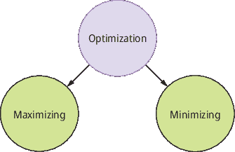

图 2.1：两种优化方法论。


它是人工智能（AI）获得改进结果的关键过程之一。优化的目标是识别产生有效结果所需的最小输入数量[1]。这些输入和输出在不同领域有所差异，但对于跨研究的各种问题，其基本概念是相同的。AI 中数学优化（MO）的目标如下：

*   理解各种类型优化问题的类型
*   识别给定问题所属的类别
*   为实际问题制定逻辑公式化方案
*   理解一阶程序，包括其特征、可行性和基础验证
*   理解离散优化、子模性概念及其与凸优化问题的关系
*   理解特定的二阶方法
*   理解非凸优化方法及其在 AI 中的适用性
*   理解广泛使用的优化算法的适用领域

“数学规划”一词与优化基本相似，起源于 20 世纪 40 年代。从给定问题的潜在解集中根据特定标准选择最优解的过程被称为数学优化（MO）。优化问题的数学框架探索、解决这些问题的技术建立、数学层面的审查，以及数学优化方法的计算执行，都包含在数学规划领域内[3]。更快的计算机大幅增加了优化问题的复杂度。优化约束分为两类：最小化和最大化。如果没有数学优化，计算机科学就不会进展到如此程度。有趣的是，几乎所有的 AI 算法都被视为优化问题的解决方案。大多数 AI 研究涉及在调整超参数后，分析算法每次迭代的结果，直到获得以高精度和低错误率为特征的最优结果[2]。

## 2.2 数学优化的组件

数学优化问题中的三个组件见于表 2.1。

表 2.1：数学优化的组件。

| 名称 | 描述 | 符号 |
| :--- | :--- | :--- |
| 目标函数 | 为了在约束条件内解决优化问题而需要被最小化或最大化的函数。 | `f(x)` |
| 变量 | 这些变量也称为输入变量和用于修改的优化器。 | `x1`, `x2`, `x3`, `an` 和 `so` 和 `on` |
| 约束 | 约束是管理每个变量范围的公式。 | `gn` |

### 2.2.1 理解优化基础

理解数学优化需要对优化问题有深入了解。优化问题的目标是最大化或最小化给定函数。数学优化在计算机科学中起着至关重要的作用，是最重要的之一。“智能”一词指的是演化和元方法[4]。这些算法大多基于计数。基础概念描述如下：

### 2.2.1.1 极大值和极值

函数的极大值是范围内的值，极值是范围内的最小值，如图 2.2 所示。

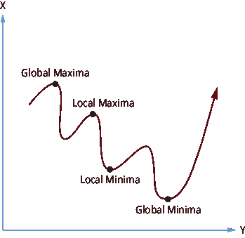

图 2.2：函数的极大值和极值表示。

*   **全局极大值和全局极值：** 整个区域内的最高和最低值。
*   **局部极大值和局部极值：** 范围内的最大和最小值。

只有一个全局极大和极值；但可能有多个局部极大和极值。

### 2.2.1.2 学习率

超参数（也称为调参数）或学习率产生了函数命中时的每次迭代步数。`r` 代表调参数。为了选择正确的 `r` 值，使用了交叉验证。执行此操作时，绘制多个学习率的图，测量每个值的训练损失，并选择损失最少的值。调优通常在机器学习、深度学习和 AI 中进行[5]。

### 2.2.1.3 向量范数

向量范数最初用于表征最优位置、确定涉及多个变量的导数以及说明收敛到最优点的方法。范数构建在 `n` 维向量（`x`）上的函数，用于评估它们的幅度并满足以下条件：

*   对于每个向量 `x`，`||x||` > 0
*   对于任意向量 `x` 和标量 `a`、`b`，`||ax||` = `|a|||x||`
*   对于任意两个向量 `x` 和 `y`，`||x|| + ||y||` >= `||x+y||`
*   对于零向量 `x`，当且仅当 `||x||` = 0

### 2.2.1.4 导数

表示函数局部行为的线性算子称为导数。每在位置 `x` 处评估时，它都提供了附近点函数值的量化近似。导数是在单变量函数中的每个点上计算出的常数。二阶导数的泛化是`Hessian matrix`，它定义为在给定点处评估的二阶偏导数组成的对称矩阵。

## 2.3 优化问题的类型

多优化（MO）的基本组件已经在表 2.1 中讨论过。优化问题的类型在图 2.3 中讨论。

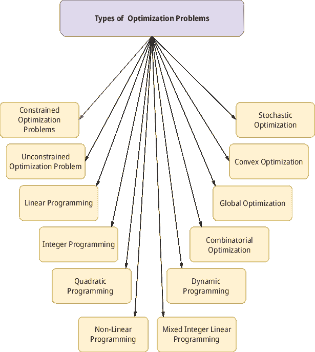

图 2.3：AI 中的优化问题类型。

### 2.3.1 AI 中的约束优化问题

约束优化问题涉及在满足某些约束的同时寻找函数的优化值。这些约束在性质上可以是线性的或非线性的，并涉及整数、二进制和混合变量的组合。约束优化问题用于优化资源分配、生产计划和设计过程，同时确保满足某些约束或限制。例如，在工程中，约束优化被用于在遵守材料和重量限制的同时设计高效结构。约束优化问题在 AI 的各个领域中起着至关重要的作用 [6]。以下是约束优化问题在 AI 中的一些应用。

### 2.3.2 机器学习

*   **正则化**：线性回归和逻辑回归中的 `LASSO` 和 `ridge regularization` 等技术涉及在模型参数约束下优化目标函数，以防止过拟合：

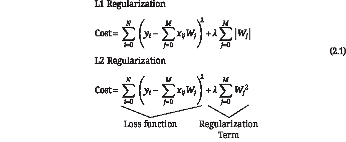

*   **支持向量机 (SVMs)**：SVM 涉及求解约束优化问题以识别分离不同类的最优超平面，同时最大化它们之间的间距。
*   **神经网络训练**：训练神经网络通常涉及在网络参数约束（如权重边界或稀疏性约束）下优化损失函数。

### 2.3.3 强化学习

*   **策略优化**：在强化学习 (`RL`) 中，智能体通过求解约束优化问题来学习最大化长期奖励，其中约束可能包括资源限制或安全约束。
*   **约束马尔可夫决策过程 (CMDPs)**：`CMDPs` 扩展了标准的马尔可夫决策过程 (`MDPs`)，包含了对智能体行为的约束，从而在 `RL` 背景下产生了约束优化问题。

### 2.3.4 约束马尔可夫决策过程 (CMDPs)

`CMDPs` 扩展了标准的马尔可夫决策过程 (`MDPs`)，包含了对智能体行为的约束，从而在 `RL` 背景下产生了约束优化问题。

### 2.3.5 策略优化

**策略优化**：在强化学习 (`RL`) 中，智能体通过求解约束优化问题来学习最大化长期奖励，其中约束可能包括资源限制或安全约束。

### 2.3.6 最优控制

**机器人学**：约束优化被用于在遵守材料和重量限制的同时设计高效结构。

**自动驾驶汽车**：约束优化被用于在遵守材料和重量限制的同时设计高效结构。

### 2.3.7 约束马尔可夫决策过程 (CMDPs)

...

**机器人学**：约束优化被用于在遵守材料和重量限制的同时设计高效结构。

**自动驾驶汽车**：约束优化被用于在遵守材料和重量限制的同时设计高效结构。

### 2.3.8 自然语言处理 (NLP)

**文本生成**：使用序列到序列模型生成文本序列涉及在约束下优化目标函数。

### 2.3.9 计算机视觉

**图像分类**：训练用于分类的 CNN 涉及优化目标函数以最小化分类错误。

**图像生成**：使用生成对抗网络 (GANs) 生成真实的图像涉及优化目标函数以最小化生成图像与真实图像之间的差异。

## 2.4 无约束优化

表示函数局部行为的线性算子称为导数。每在位置 `x` 处评估时，它都提供了附近点函数值的量化近似。导数是在单变量函数中的每个点上计算出的常数。二阶导数的泛化是`Hessian matrix`，它定义为在给定点处评估的二阶偏导数组成的对称矩阵。

无约束优化涉及在对变量没有任何约束的情况下寻找函数的最小值或最大值。这是许多领域（如机器学习、工程和经济学）中的常见问题。一些流行的无约束优化算法包括梯度下降、牛顿法和其他基于导数的方法。

### 2.4.1 深度学习

**神经网络训练**：训练深度神经网络通常涉及优化目标函数（例如交叉熵或均方误差）以最小化预测错误。随机梯度下降 (`SGD`) 及其变体常用于此类

```
\begin{matrix}
Loop & x = x - \alpha(4x) until convergence
\end{matrix}
```

### 2.4.2 自然语言处理 (NLP)

**词嵌入**：使用 `Word2Vec` 或 `GloVe` 等技术学习词的分布式表示涉及优化目标函数以捕捉词间的语义关系。

### 2.4.3 计算机视觉

**图像分类**：训练用于分类的 `CNNs` 涉及优化目标函数以最小化分类错误。

**图像生成**：使用生成对抗网络 (`GANs`) 生成真实的图像涉及优化目标函数以最小化生成图像与真实图像之间的差异。

```
\min_G max_D E_{x \sim P_{data}} log(D(x)) + E_{x \sim P_{model}} log(1 - D(G(x)))
```

图 2.4 显示了一个简单的 GAN 模型，特别用于创建看起来像训练数据的新数据。

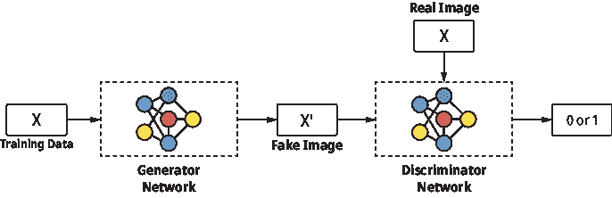

图 2.4：简单的 GAN 模型。

线性规划是一种稳健的优化技术，用于解决目标函数和约束条件均为线性的问题。线性规划问题可以使用多种算法来解决，包括单纯形法、内点法以及如 `CPLEX`、`Gurobi` 和 `MATLAB’s Optimization Toolbox` 等专业软件包。线性规划在人工智能中被广泛应用于各种优化任务。以下是线性规划在 AI 中的一些常见应用。

### 2.5.1 资源分配

**供应链管理**：优化原材料、库存和运输等资源的分配，以实现成本最小化或利润最大化。

**项目调度**：安排任务进度并分配资源，以便在截止日期、资源可用性和依赖关系等限制内完成项目。

### 2.5.2 网络优化

**电信**：优化通信网络中数据包或电话通话的路由，以最小化延迟、最大化吞吐量或优化资源利用。

**交通**：优化货物和车辆在交通网络中的流动，以降低成本、减少拥堵或提高送货时间效率。

### 2.5.3 生产计划

**制造业**：优化生产流程（包括生产调度、劳动力分配和库存管理），以实现效率最大化和成本最小化。

**能源系统**：优化能源资源的发电、传输和分配，在满足需求的同时最小化成本和环境影响。

### 2.5.4 机器学习

**线性回归**：解决线性回归问题涉及最小观测值与预测值之间的最小二乘误差，这可以被建模为线性规划问题。

### 2.5.5 博弈论

**最优策略**：在零和博弈（如象棋或扑克等双人游戏）中寻找最优策略，可以被建模为线性规划问题。

线性规划为建模和解决具有线性目标和约束的优化问题提供了一个强大的框架。它在 AI 中广泛用于决策、资源分配以及跨领域的优化任务。

## 2.6 AI 中的整数规划

整数规划类似于线性规划，但要求部分或全部决策变量必须为整数。这一约束为优化问题中引入了离散决策变量，导致了更复杂且通常是组合性的挑战。解决整数规划问题通常比线性规划更困难，因为决策变量是整数。整数规划是 AI 中的一项重要工具，用于解决部分或全部决策变量为整数的优化问题 [11]。以下是整数规划在 AI 中的一些常见应用。

### 2.6.1 调度与规划

**作业调度**：为具有先序约束和资源限制的任务集确定最佳调度方案。整数规划可建模并解决各种调度问题。

**项目管理**：分配资源、调度任务并管理依赖关系，以优化项目进度和资源利用率。

### 2.6.2 网络设计与路由

**设施选址**：为设施（如仓库和工厂）选择最佳位置，以最小化运输成本或最大化覆盖。整数规划可建模设施选址问题。

**网络流**：在容量限制、需求和供应考虑的基础上，优化货物、信息或资源在网络中的流动。

### 2.6.3 生产计划

**制造业**：优化生产流程（包括生产调度、劳动力分配和库存管理），以实现效率最大化和成本最小化。

**能源系统**：优化能源资源的发电、传输和分配，在满足需求的同时最小化成本和环境影响。

### 2.6.4 机器学习

**线性回归**：解决线性回归问题涉及最小观测值与预测值之间的最小二乘误差，这可以被建模为线性规划问题。

### 2.6.5 博弈论

**最优策略**：在零和博弈（如象棋或扑克等双人游戏）中寻找最优策略，可以被建模为线性规划问题。

线性规划为建模和解决具有线性目标和约束的优化问题提供了一个强大的框架。它在 AI 中广泛用于决策、资源分配以及跨领域的优化任务。

## 2.8 AI 中的非线性规划

非线性规划是一种优化技术，用于目标函数或约束条件为非线性的问题。与仅处理直线关系的线性规划不同，非线性规划可以处理更复杂的关系，如二次、指数、对数或三角函数。解决这些问题通常需要专门为非线性情况设计的算法。常见方法包括`gradient descent`（梯度下降）、`Newton’s method`（牛顿法）和拟牛顿法。非线性规划是人工智能中一种强大的工具，用于解决具有非线性目标或约束条件的问题[13]。以下是非线性规划在人工智能中的一些常见应用。

### 2.8.1 神经网络训练

训练深度神经网络涉及针对网络参数优化非线性目标函数（例如 `cross-entropy loss` 和 `mean squared error`）。使用如 `gradient descent`、`Adam` 以及其他优化算法来最小化损失函数。

### 2.8.2 最优控制

非线性规划用于最优控制问题，以寻找控制策略，从而在非线性动力学和约束下优化动力系统的性能。示例包括机器人运动规划和控制的轨迹优化。

### 2.8.3 参数估计

非线性规划用于参数估计问题，以寻找与观测数据最匹配的数学模型参数。示例包括拟合非线性回归模型、曲线拟合和系统识别。

### 2.8.4 基于仿真的优化

非线性规划用于基于仿真的优化问题，其中目标函数通过仿真或数值方法评估。示例包括复杂工程系统的优化，如航空航天设计、汽车设计和化学工艺优化。

### 2.8.5 机器学习

非线性规划技术用于各种机器学习任务，如 `kernel methods`、`Gaussian process regression` 和非线性降维技术。

### 2.8.6 计算机视觉

非线性规划用于计算机视觉任务，如 `image registration`、`image alignment` 和相机标定。采用优化技术来对齐图像、估计相机参数并解决几何视觉问题。

### 2.8.7 自然语言处理 (NLP)

非线性规划技术用于 `language modelling`、`machine translation` 和情感分析。采用优化算法来训练模型并优化性能指标。

非线性规划为解决具有非线性目标和约束的复杂优化问题提供了一种灵活的方法，使人工智能系统能够在各种应用中做出最佳决策。

## 2.9 人工智能中的混合整数线性规划 (MILP)

这是一种优化技术，允许某些决策变量为整数，而其他变量保持连续，且目标函数和约束条件都是线性的。这种连续与离散决策变量的结合允许以更高的灵活性和精度对广泛的现实问题进行建模。混合整数线性规划 (MILP) 是人工智能中一种强大的优化技术，用于解决某些变量要求为整数而其他变量允许连续的优化问题[14]。以下是 MILP 在人工智能中的一些常见应用。

### 2.9.1 组合优化

`Knapsack Problem`（背包问题）：优化具有重量的物品选择。

### 2.9.2 调度与规划

`Resource Allocation`（资源分配）：分配人员等有限资源。

### 2.9.3 网络设计与路由

`Facility Location`（选址）：为设施或工厂选择最佳位置。

`Network Flow with Fixed Costs`（固定成本的网络流）：优化货物、信息或资源的流动。

### 2.9.4 机器学习

`Feature Selection with Binary Variables`（二值特征选择）：选择特征子集。

`Hyperparameter Optimization`（超参数优化）：调优学习模型的超参数。

### 2.9.5 博弈论

`Coalition Formation`（联盟形成）：优化联盟的形成。

### 2.9.6 供应链管理

`Inventory Management`（库存管理）：优化供应链中的库存水平。

动态规划（DP）用于各种优化问题，包括资源分配、调度和投资组合优化。如背包问题、旅行商问题（TSP）和最大子数组问题等算法使用 DP 原理来高效寻找最优解。

### 2.10.1 动态规划的两种主要方法

- **自顶向下 (Top-Down)**：通过将问题分解为更小的部分并存储它们的解决方案来避免重复工作。
- **自底向上 (Bottom-Up)**：通过从最小部分开始逐步构建到较大的部分，在此过程中填充表格。

动态规划为解决 AI 中的优化问题提供了一种强大且通用的方法，能够在广泛的应用中高效计算最优解。

## 2.11 AI 中的组合优化

它是优化领域的一个分支，处理离散决策变量，并寻求从有限的可能选项集中寻找最佳安排或选择。它涉及对排列、组合、图或网络等组合结构的优化。根据问题的特性和约束，通常使用 DP、贪心算法、分支限界法、局部搜索、遗传算法（GAs）和整数线性规划等技术 [7]。以下是组合优化在 AI 中的一些应用：

- **TSP**：找到访问每个城市一次并返回起点的最短路径。这用于物流和网络路由。
- **装箱问题**：将不同尺寸的物品放入具有固定容量的箱子中，以尽可能减少使用的箱子数量。这应用于资源分配和包装。
- **作业调度**：对具有特定处理时间和资源需求的任务进行调度，以完成时间最小化或资源利用最大化。这在制造和项目管理中相关。
- **图着色**：为图顶点分配颜色，使得两个相邻顶点不共享相同的颜色。这用于调度和频率分配。
- **最大流问题**：在尊重边容量的情况下，确定网络从源到汇点的最大流量。这在网络路由和设计中至关重要。
- **背包问题**：选择具有给定值和重量的物品，在不超过重量限制的情况下使总价值最大化。这应用于资源分配和生产计划。
- **车辆路径问题**：为车辆寻找路线以服务客户，同时使总行驶距离或时间最小化。这用于物流和车队管理。


由于决策变量的离散性，组合优化问题在计算上具有挑战性，特别是对于大型实例。然而，已经开发出高效的算法和启发式方法来有效处理许多组合优化问题。组合优化技术对于 AI 高效解决复杂问题以及在广泛领域寻找最优或近优解决方案至关重要。这些技术通常涉及针对特定问题结构的启发式算法、元启发算法和精确算法。

## 2.12 AI 中的全局优化

这涉及在所有可能的范围内寻找问题的最佳解，而不仅仅是局部。它处理多个局部最优和复杂函数等挑战。

### 2.12.1 关键方法

- **确定性方法**：系统地搜索解空间，例如分支限界法、区间分析和网格搜索。
- **随机方法**：利用随机性探索解空间。
- **元启发式方法**：使用高层框架引导搜索向全局最优解。

### 2.12.2 技术

- **GAs**：遗传算法用于演化解决方案。
- **PSO**：粒子群优化通过让粒子根据其最佳位置移动来完成优化。
- **模拟退火**：一种概率方法，有时接受较差的解以避免局部最优。
- **禁忌搜索**：利用对过去解的记忆来避免重复访问。
- **随机搜索**：随机采样解以找到最佳解。
- **贝叶斯优化**：使用概率模型有效引导搜索。

## 2.13 AI 中的凸优化

它是优化问题的一类特殊类型，其中目标函数和可行区域都是凸的。凸性是一种确保全局最优的属性，意味着任何局部最优都是全局最优 [18]。

凸优化问题具有许多理想属性，包括：

- **全局最优性保证**：任何局部最优也是全局最优。
- **高效的求解方法**：可以使用内点法或基于梯度的方法等专门算法高效求解凸优化问题。
- **良好的理论**：凸优化理论为理解和解决优化问题提供了坚实的数学基础。

由于其良好的特性，凸优化问题被广泛研究和应用。凸优化在 AI 中解决目标函数和可行区域均为凸的优化问题中起着重要作用。凸优化特别有吸引力，因为它保证了全局最优、高效算法和可处理的数学属性。以下是凸优化在 AI 中的常见应用：

- **机器学习**：
  - **逻辑回归**：用于优化分类问题中的逻辑损失函数，目标是最小化观测标签的负对数似然。
  - **正则化**：将 L1 和 L2 惩罚项引入机器学习模型中，以防止过拟合并鼓励稀疏性。
- **信号处理**：
  - **稀疏信号恢复**：使用基追求和 Lasso 等凸优化技术从噪声测量中恢复稀疏信号，例如在压缩感知和稀疏表示中。
  - **滤波器设计**：使用凸优化设计具有所需频率响应和约束的线性滤波器，例如最小相位滤波器、线性滤波器和有限脉冲滤波器。
- **控制系统**：
  - **最优控制**：使用凸优化求解最优控制问题。模型预测是凸优化在控制系统中的常见应用。
- **金融**：
  - **投资组合优化**：使用凸优化技术（如均值方差优化 `马科维茨组合理论`）来构建最优投资组合，在资产分配和风险承受能力的约束下，最大化预期收益并最小化风险。

### 2.13.1 运筹学

- **网络流问题**：凸优化用于解决各种网络流问题，这些问题出现在运输、物流和电信领域。

凸优化为解决 AI 及相关领域的广泛优化问题提供了坚实的理论基础和高效的算法。其数学属性（如`convexity`）使得可靠且可扩展的优化技术成为可能，这些是许多 AI 应用的基础。

## 2.14 AI 中的随机优化

它处理在存在不确定性或随机性时的优化问题。随机优化为不确定性下的决策提供了宝贵的见解和解决方案，使决策者能够在复杂的不确定环境中做出更明智、更稳健的选择。随机优化是优化的一个分支，处理目标函数、约束条件或参数中涉及不确定性或随机性的优化问题。它用于解决确定性方法可能无效或无效的复杂问题 [17]。以下是 AI 中随机优化的一些常见特征和应用：

- **不确定环境**：
  - 随机优化非常适用于噪声测量、需求波动或不可预测的系统动态等问题。
- **全局优化**：
  - 随机优化技术通常用于在非凸、多峰或高维搜索空间的优化问题中寻找全局最优或近优解，而在这些情况下，确定性方法可能会陷入局部最优。
- **元启发式算法**：
  - 这包括`GAs`、`模拟退火`、`粒子群优化`和`进化策略`等方法。它们利用随机性搜索最佳解决方案，并避免陷入次优解。
- **贝叶斯优化**：
  - 该方法使用概率模型在解决评估解决方案成本昂贵的复杂问题时，寻找最佳探索区域。
- **RL**：
  - `RL` 方法（如 `Q-learning` 和 `deep Q-networks (DQN)`）使用随机技术通过与环境交互学习最佳动作。
- **SGD**：
  - `SGD` 是训练机器学习模型的流行方法。它使用小量的随机数据样本更新模型，使其处理大型问题非常高效。
- **稳健优化**：
  - 随机优化技术用于制定和解决稳健优化问题，旨在寻找对不确定性或参数变化稳健的解决方案。稳健优化确保了解决方案在不同场景或扰动下的性能。

随机优化为解决 AI 中的复杂优化问题提供了一个灵活且强大的框架，能够在不确定和动态环境中实现稳健且自适应的决策。通过将随机性和不确定性引入优化过程，随机优化技术使得 AI 系统能够更有效地处理现实世界的复杂性和不确定性。

### 2.14.1 MO 技术在 AI 中的用途

通过采用这些优化技术，AI 从业者可以提高广泛应用和领域 AI 系统的效率、有效性和扩展性 [19]。

- **使用专用硬件**：利用`hardware` 加速训练。
- **使用预训练模型**：使用`pre-trained models`作为起点，减少训练量。
- **缩小网络规模**：通过剪枝`connections`或`layers`来缩小规模。
- **压缩技术**：采用`compression`减少内存占用。
- **高效算法和数据结构**：采用`efficient algorithms`和`data structures`以最小化资源消耗。
- **数据预处理**：对数据进行`Cleansing`、`normalizing`和`transforming`以增强训练效果。
- **模型架构**：调整`model architecture`以与复杂性取得平衡。
- **减少过拟合**：采用`techniques`防止过拟合。
- **降低精度**：降低`model weights`的`precision`以减少消耗。
- **早停法**：在收敛之前停止训练。
- **部署优化**：优化`deployment` 平台。
- **性能监控与分析**：持续监控和分析`performance`。

### 2.14.2 优化级别

计算中的优化级别提供了关于优化如何在各个阶段发生的的全面概述，从高层问题表述到低层硬件 [15, 16, 17]。

- **问题级优化**：
  - 这涉及定义要解决的问题，考虑可用资源和约束条件。它本质上是设计阶段，在此阶段对解决方案进行概念化。
- **算法级优化**：
  - 在定义问题后，选择合适的`algorithm`和`data structures`来实现解决方案至关重要。选择`efficient algorithms`和`data structures`对于实现性能至关重要 [18]。
- **语言或源码级优化**：
  - 在编程语言层面优化源代码可以显著影响性能。`loop structures`、`conditional statements`和`data types`等选择会影响执行速度和资源利用 [19, 20]。
- **构建级优化**：
  - 构建级优化涉及调整源代码和编译器中的性能选项以提高效率。在此层级上可以使用`pre-processing`和`branch prediction`等技术。
- **汇编级优化**：
  - 在汇编层面优化代码涉及直接以机器可读的指令编写或修改代码。这种层级的优化可以实现对性能的细粒度控制，但需要专业知识和仔细考量。
- **微架构与硬件级优化**：
  - 微架构和硬件层面的优化侧重于设计和实现高效的 CPU 架构和电路。采用乱序执行、缓存优化和分支预测等技术来提高性能和可靠性。
- **权衡与瓶颈**：
  - 优化涉及执行时间、功耗、内存占用和复杂度等不同指标之间的权衡。识别系统中的瓶颈对于确定优化工作的优先级以及实现整体性能提升至关重要。

通过理解并对计算栈的每一层进行优化，开发者可以显著提高其系统的效率、性能和可靠性 [21]。

## 2.15 结论

总之，对 AI 优化的追求体现了力求最优解决方案的精髓。为 AI 中的多目标优化（MO）列概述的目标强调了其多层性质，从理解问题类型到实现广泛使用的算法。深入研究优化基础揭示了其复杂的各个面，从描定最大值和最小值到阐明学习率和向量范数。理解导数及其在捕捉局部行为中的作用，凸显了优化追求中固有的数学严谨性。约束优化任务涉及在遵守特定约束的情况下寻找最优解决方案，解决了资源分配、系统设计和决策过程中的现实限制。

从机器学习到自然语言处理，从强化学习到计算机视觉，约束优化技术使 AI 系统能够在复杂环境中进行导航并提供可靠的结果。无约束优化方法侧重于在没有显式约束的情况下优化目标函数，驱动了深度学习、图像处理和强化学习的进步。MO 技术促进了 AI 模型的训练和高质量输出的生成，为各种 AI 驱动应用中的创新提供了支持。此外，线性规划成为 AI 的一种基础工具，为解决具有线性目标和约束的问题提供了系统方法。从资源分配到网络优化，线性规划技术使 AI 系统能够做出明智决策并高效优化流程。

此外，整数规划通过将离散决策变量引入优化任务引入了额外的复杂性，解决了调度、路由和投资组合管理中的组合挑战。其多功能使得 AI 系统能够应对从组合优化到博弈论中策略决策的各种优化问题。本质上，优化技术是 AI 系统的骨干，驱动了跨广泛应用领域的进步和创新。通过利用约束优化、无约束优化、线性规划和整数规划的力量，AI 持续变革行业，改进决策过程，并推向智能系统领域可能的边界。

总而言，优化技术构成了 AI 的骨干，赋予系统做出最优决策、解决复杂问题和驱动广泛应用创新的能力。随着 AI 的不断演进，优化方法论与智能系统之间的相互作用将一直是开启新前沿和以精度和效率应对现实挑战的核心。计算中的优化级别为可以实现效率和性能增强的层级提供了宝贵的见解。从问题的概念化和算法选择，到汇编和硬件层面的微调，优化工作跨越了整个开发周期。权衡和瓶颈体现了平衡竞争性目标和识别关键改进区域的重要性。

通过在每一层上进行具有战略意义的优化，开发者可以实现系统效率、性能和可靠性的显著进展，以符合 AI 应用和技术不断变化的需求。随着 AI 的不断演进，优化将仍然是基石，引导通向不断提高的智能和效率的道路。优化问题处于许多 AI 应用的核心，在增强不同领域的效率、健性和性能方面发挥着至关重要的作用。

**利益冲突**：作者没有需要声明的利益冲突。

## 参考文献

[1] Wang, Y., Fu, E. Y., Zhai, X., Yang, C., & Pei, F. (2024). Introduction of artificial Intelligence. In Intelligent Building Fire Safety and Smart Firefighting (pp. 65–97). Springer Nature Switzerland, Cham. →

[2] Reddy, C. S., & Anjan Babu, G. (2024). Deep Insights into Artificial Intelligence and Machine Learning Algorithms for Computational and Mathematical Data Processing. →

[3] Khaleel, M., Jebrel, A., & Shwehdy, D. M. (2024). Artificial Intelligence in Computer Science. *International Journal of Electrical Engineering and Sustainability*, 01–21. [`doi.org/10.5281/zenodo.10937515`](https://doi.org/10.5281/zenodo.10937515). →

[4] Davis, E. (2024). Mathematics, word problems, common sense, and artificial intelligence. *Bulletin of the American Mathematical Society*, *61*(2), 287–303 →

[5] Carrizosa, E., Ramírez-Ayerbe, J., & Morales, D. R. (2024). Mathematical optimization modelling for group counterfactual explanations. *European Journal of Operational Research*. →

[6] Tao, H., Abba, S. I., Al-Areeq, A., Tangang, F., Samantar, S., Sahoo, A., Valadares Siqueira, H. et al. (2024). Hybridized artificial intelligence models with nature-inspired algorithms for river flow: A comprehensive review, assessment, and possible research directions. *Engineering Applications of Artificial Intelligence*, *129*, 10759. →

[7] Zhuang, X., Wang, W., Su, Y., Yan, B., Li, L., & Hao, Y. (2024). Multi-objective optimization of reservoir strategy with hybrid artificial intelligence. *Expert Systems with Applications*, *241*, 12207. →

[8] Soori, M., & Ghaleh Jough, F. K. (2024). artificial intelligent in optimization of steel frame structures: A review. *International Journal of Structural and Construction Engineering*.

[9] Azevedo, B. F., Rocha, A. M. A. C., & Pereira, A. I. (2024). Hybrid approaches to optimization and machine learning methods: A systematic literature review. *Machine Learning*, 1–43. →

[10] Zhang, X., Gajawada, Y., Satish, & Mustafa, H. M. H. (2024). Out of the box artificial intelligence (obai): The beginning of a new era in artificial intelligence. *Available at SSRN 4877418*. Wang, Y., & Wang, J. Optimize the energy storage system with an artificial intelligence-based control strategy. *Applied Mathematics and Nonlinear Sciences,* 9, 1.

[11] Bundela, B., Sharma, S., & Singh, B. R. (2024). A review article on relation between mathematical modelling and machine learning. *Zhongguo Kuangye Daxue Xuebao*, *29*(2), 123–129 →

[12]Kumar Lilhore, U., Simaiya, S., Sharma, Y. K., Kaswan, K. S., Brahma Rao, K. B. V., Maheswara Rao, V. V. R., Baliyan, A., Bijalwan, A., & Alroobaea, R. 使用混合 U-Net 和改进的 MobileNet-V3 以及超参数优化的皮肤癌诊断精确模型。*Scientific Reports*, *14*(1), 4299 →

[13]Saleem, S., Ahmad, I., Ahmed, S. H., & Rehman, A. (2024). 针对电网到车辆应用的混合电动汽车，经改进灰狼优化算法优化的人工智能鲁棒非线性控制器。*Journal of Energy Storage*, *75*, 109332. →

[14]Ali, A. M., & Mohammed, M. A. (2024). 组学数据处理中人工智能方法的全面综述：评估进展与挑战。*International Journal of Mathematics, Statistics, and Computer Science*, *2*, 114–167. →

[15]Lilhore, U. K., Dalal, S., Radulescu, M., & Barbulescu, M. (2024). 使用双向注意力机制的混合深度学习和 MPSO 的智能电网稳定性预测模型。*Energy Exploration & Exploitation*, 01445987241266892. a, b


[16] Nutakki, M., & Mandava, S. (2023). 家庭能源管理系统中的优化技术及人工智能的作用的综述。*Engineering Applications of Artificial Intelligence*, *119*, 105721. →

[17] Lilhore, U. K., & Simaiya, S. (2024). 自然语言处理中的 10 种量子机器学习：机会与挑战。*Quantum Machine Learning: Quantum Algorithms and Neural Networks*, 199. a, b

[18] Khaleel, M., Ahmed, A., & Alsharif, A. (2023). 工程学中的人工智能。*Brilliance: Research of Artificial Intelligence*, *3*(1), 32–42. a, b

[19] Lilhore, U. K., Manoharan, P., Sandhu, J., Simaiya, S., Dalal, S., Baqasah, A., Alsafyani, M., Alroobaea, R., Keshta, I., & Raahem, K. (2023). 使用改进的随机森林和 SVM 进行丙肝精确分类的混合模型。*Scientific Reports*, *13*(1), 12473. a, b

[20] Lilhore, U. K., Dalal, S., Faujdar, N., Simaiya, S., Dahiya, M., Tomar, S., & Hashmi, A. (2024). 揭示早期抑郁的流行率和风险因素：一种混合深度学习方法。*Multimedia Tools and Applications*, 1–35. →

# 3 确保 AI 可靠性的鲁棒优化方法

Dankan Gowda Gedas Kučinskas Pullela SVSR Kumar Vadisetty Aparna

## 摘要

本章探讨了强优化对于提高不同应用中人工智能（`AI`）可靠性至关重要。随着 `AI` 技术在医疗保健、汽车行业、金融等领域地位的巩固，创建能够在意外和不可预测条件下稳定运行的智能系统的需求已变得尤为紧迫。通过对传统和改进优化方法的分析，本文审视了在处理运营风险不一致性方面高效风险管理策略的进展。文中对处理鲁棒优化的各种技术（如鲁棒线性规划、凸优化和 `Bayesian`）的理论基础进行了简要概述，阐明了这些方法在处理复杂决策问题中的相关性。这些理论概念通过自动驾驶汽车、诊断服务以及金融领域的实际案例得到了应用，其核心思想，阐明了强优越优化结果如何导致生产力和可靠性的巨大提升。文中为这些案例研究提供了适当的数据，并强调了尽管受到外部变化影响的大多数操作，鲁棒优化对于实现高性能优异指标仍具有适用性。比较鲁棒优化与其他方法的最佳方法是观察这些示例，这些示例展示了特别是在高风险和不确定性条件下，鲁棒优化比其他方法有效得多。

**关键词：** 鲁棒优化、`AI` 可靠性、随机规划、自主系统、医疗 `AI`、金融 `AI`、鲁棒控制

## 3.1 引言

在人工智能（`AI`）的快速发展领域，可靠性和鲁棒性问题至关重要，因为这些系统被广泛应用于各个领域。从医疗保健、自动驾驶汽车到金融，无论在哪个部门被使用，可靠性都是关键，由于可能导致资金损失的故障场景，可靠性是关注的焦点 1、2、3。这需要优化技术在强度和能力方面进行改进，以便在各种环境中稳定运行。

### 3.1.1 可靠性在系统中的作用

因此，`AI` 系统的可靠性是指这些技术在当前以及未来需要时是否能够正常运作。对于 `AI` 系统而言，可靠性不仅是其功能准确性的衡量，而且在面对变异性和随机性时保持最佳水平的能力。以自动驾驶为例，`AI` 系统必须分析传感器信息以做出决策。

在数学上，这可以用概率表示：

```
P(safe decision | conditions) ≥ θ
```

其中 `θ` 代表确保决策具有高置信度的概率阈值。

图 3.2 展示了 AI 领域优化方法的发展时间线，并呈现了线性规划以及如今的鲁棒优化 [8]。该流程图定义了过去十年中的某些成就和方法论，使读者能够从上下文的视角了解这些理论是如何演进以适应如今用于 AI 许多用途的复杂计算系统的。

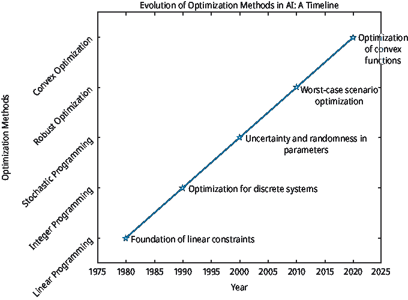

图 3.2：AI 中优化方法的演变：时间线。

### 3.1.2 跨领域的重要性

**医疗健康**：用于医疗环境的 AI 系统（如诊断算法和手术中的辅助机器人）必须非常可靠，因为它们关系到患者的状况 [9]。AI 诊断工具必须在不同的患者群体和医学成像技术中保持高准确率，这可以形式化如下：

```
${Accuracy} = \\frac{{TN}\\,{\\, + \\,}\\,{TP}}{{TN}\\,{\\, + \\,}\\,{FN}\\,{\\, + \\,}\\,{FP}\\,{\\, + \\,}}$
```

其中 `TP`、`TN`、`FP` 和 `FN` 分别代表真阳性、真阴性、假阳性和假阴性。这些系统的稳定性对于减少误诊从而导致错误治疗的概率至关重要。

**自动驾驶车辆**：AI 系统必须能够在自动驾驶领域做出关键决策；它们必须处理不同类型的传感器数据 [10]。这不仅是数据解释准确性的问题，也是确保系统在多变化的交通状况下安全的问题 [11]。这需要解决复杂的优化问题，以最小化减少错误和事故涉及的风险。

**金融服务**：特别是在金融领域，AI 已应用于算法交易、信用风险分析和客户支持等领域。这些系统影响公司财务的稳定性以及对法规的合规性 [12]；因此，优化必须有效应对市场波动和各种类型的交易。

#### 本章目标

本章的目标是探索 AI 鲁棒优化领域的基础方法论，使读者能够获得理论和实践的元级别视角。本章将解释以下内容：

- **理论上探索鲁棒优化**：介绍可靠优化的概述，从在不确定性条件下的优化问题建模开始 [13]。这涉及极大极化问题，其目标是最小化潜在损失：

```
min x max y
```

- **详细说明实现**：解释鲁棒优化方法在不同类型中的应用。

- **突出特定挑战**：解释在获得高质量优化结果方面面临的困难。

- **提出未来方向**：列出当前方法的局限性，并建议有助于进一步进展的研究课题。

## 3.2 文献综述

另一个发生重大转变的有趣领域是优化，主要归功于计算能力的提高 [14]。这种演进的特征是从经典的确定性方法转向了应对不确定性和变性的现代不可预测方法 [15]。这涵盖了鲁棒优化的细节。

### 3.2.1 历史概述

AI 中的优化可以看作是从经典线性规划向更大计算技术的演进 [16]。这些方法发展成了更复杂的形式，例如整数规划、动态规划和非线性优化 [17]。这些方法为处理参数发生变化的问题奠定了基础 [18]。

由于这些因素，随机优化领域应运而生，并在不确定性条件下工作 [19]。该领域使用的先驱技术之一是随机规划，它在问题参数取决于概率分布的情况下解决特定函数的最小化或最大化问题 [20]。这可以表示为：

```
min x E[f(x, ξ)]
```

其中 `x` 是决策变量，`f` 是目标函数，`ξ` 代表具有概率分布的随机变量。


图 3.3：鲁棒优化解空间的三维曲面图。

图 3.3 显示了鲁棒优化问题解空间的三维曲面图。这种可视化展示了优化中最复杂的领域，因为参数的每个函数都会导致目标函数的不同解 [21]。该图旨在说明鲁棒优化是如何通过这个多维空间工作的，在这个空间中寻找关键评估指标，以便在存在大量不确定性的情况下在成本和性能之间取得最佳平衡 [22]。

图 3.4 显示了鲁棒线性规划解的等高线图，并说明了不同不确定性参数下的可行区域[23]。该图清晰地展示了鲁棒优化算法如何应对约束限制的变化，从而保证在约束边界发生变化时解决方案仍然可行。等高线突出了具有相等目标值的区域，以揭示在有限参数集内做出明智决策的效果。

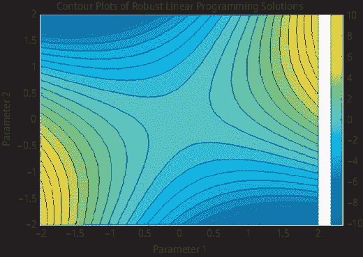

图 3.4: 鲁棒线性规划解的等高线图。

### 3.2.2 当前技术

现代鲁棒优化方法的重点已经从随机背景转向了最坏情况和对抗背景，特别是在那些风险和可靠性至关重要的背景下。因此，存在一些关键技术，如鲁棒控制理论和最坏情况场景分析[24]。例如，鲁棒控制理论处理在存在有界不确定性时维持系统性能的问题，通常公式如下：

```
min x ∈ X max δ ∈ Δ f(x,δ)
```

其中 `δ` 代表有界不确定性，`X` 是所有可能的控制动作的集合[25]。这种方法确保了不确定性的最坏影响得到缓解。

最坏情况场景分析将这一概念进一步推向，不仅考虑最坏情况，还让系统能够在不犯错的情况下自主做好应对这种准备[26]。这种方法在网络安全和自动导航与驾驶等领域非常重要，因为在这些领域，必须预见并控制潜在威胁以防止不利影响[27]。

### 3.2.3 挑战与局限性

然而，尽管有鲁棒优化理论的帮助，仍有一些问题需要解决。一个主要缺点是鲁棒解的计算可能非常耗资源，特别是在解决复杂且高度不确定的系统时[28]。这在实时的 AI 相关应用中尤为明显，例如自动驾驶，其决策必须在瞬息之间做出[29]。

前者包含了高抗故障能力与最优性能能力之间的权衡[30]。保守模型可能会假设风险并最大化有效性和可靠性的可用关键组件，但同时，它们降低了性能速率或形成速度。例如，一辆被设计和训练为考虑到所有负面驾驶场景的自动驾驶车辆会导致汽车过度谨慎，从而导致车辆移动缓慢或不必要的减速[31]。此外，建模不确定性的方法以及其假设会影响所得优化解的特征。即使在分布或不确定性范围内容易出现错误，它在解决方案中也可能过于谨慎，或者采取过度的风险。

## 3.3 鲁棒优化技术

鉴于需要根据在很大条件下可行的方法做出决策，这是稳健 AI 框架进展的一个至关领域。本节介绍了鲁棒优化中使用的一些主要技术，如鲁棒线性规划、凸优化和贝叶斯优化，这些都是至关重要的。

自动驾驶车辆的决策细节在图 3.4 中所示。该图概述了这些技术如何应用于实际 AI，并查看了增加可靠性的工具，这对于医疗健康至关重要[32]。

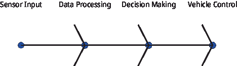

图 3.5: 自动驾驶车辆规障的鲁棒框架。

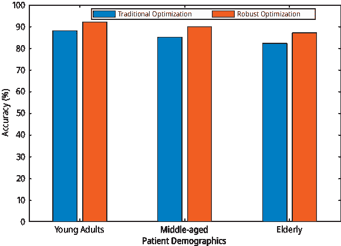

图 3.6: 医疗 AI 系统的准确性：鲁棒与方法。

### 3.3.1 理论与方法

#### 线性规划

刚性依赖于确定性的线性规划被称为线性规划，而鲁棒线性规划通过引入系数或目标函数中的不确定性是对线性规划的增强。与考虑精确数据的典型线性规划[33]不同，鲁棒线性规划提出的问题方式使得即使在最坏情况下也尽可能有效。鲁棒线性规划的一般形式可以表示如下：

```
min c^Tx: Ax ≤ b, ∀ A ∈ A, b ∈ B
```

`A` 和 `B` 代表矩阵 `A` 和向量 `b` 的不确定性集[34]。公司想要做的是在一个在上述集合范围内所有可能实现的情况下产生最小成本的 `x`。

#### 凸优化

凸优化是数学优化（运筹学的一种）中凸函数的领域，凸函数可以描述为在曲线上任意两点之间的连线在曲线任何一点都不会低于曲线的函数。这是因为凸问题在鲁棒优化问题中特别适用，因为它们提供了找到真实最优解的保证[35]。一个典型的鲁棒凸优化问题结构为：在给定集合内的所有扰动下，最小化凸目标函数并满足凸约束：

```
min f(x): g_i(x,u_i) ≤ 0, ∀ u_i ∈ U_i, i = 1, ..., m
```

每个 `g(x,ui)` 代表一个由集合 `Ui` 中的不确定性 `ui` 参数化的凸约束。

#### 贝叶斯优化

这是一种用于随机、高成本或“未知”函数全局优化的技术。它使用 `GP` 对目标函数进行概率建模，并根据从之前的评估获得的后验分布做出决策。派源于 `GP` 的函数被用于根据采集函数进行采样，该函数促进了探索（exploration）以及对高潜力区域的利用（exploitation）。`GP` 的更新方程为：

`p(f|X,y,xn_new) = N(f_new|μ_new,Σ_new)`

其中 `μ_new` 和 `Σ_new` 是更新后的均值和协方差，考虑了新的数据点（`x_new,yn_new`）。

### 3.3.2 实际实现

应用于 AI 系统的这些强大优化思想取决于具体的应用场景以及可靠应用中存在的风险类型。例如，在自动驾驶汽车中，线性规划可以用于适应交通状况的路线导航，而贝叶斯优化则可以在模拟场景中更新汽车基于深度学习的策略参数，并将其应用于实际道路场景。

### 3.3.3 软件与工具

有许多可用的软件工具和库可以实现鲁棒优化的概念。流行的选择包括：

**CVX and CVXPY**: 这些是 Python 库集，能够解决不同的凸优化问题，同时提供了多种求解器以及定义具有强约束问题的能力。

**Gurobi and CPLEX**: 这些是强大的商业优化求解器，支持大规模鲁棒优化模型的优势，并被工业界和学术机构广泛采用。

**GPflow and GPyTorch**: 这些是用于高斯过程建模的库，通常用于贝叶斯优化中处理复杂且噪声的目标函数。

## 3.4 实时应用案例研究

鲁棒优化的应用对于提高各行业 AI 系统解决方案的韧性至关重要。本节介绍了三个详细的案例研究，例如汽车 AI（如自动驾驶汽车）、医疗保健领域的 AI 系统以及金融领域的 AI，这些案例展示了可靠的优化技术在增强各领域风险下决策方面至关重要。

### 3.4.1 自动车辆

在自动驾驶汽车的情况下，鲁棒优化是允许自动驾驶汽车在挑战性条件下工作的关键要素。该案例中的主要问题是自动车辆在来自多个传感器（如摄像头、雷达和 LiDAR 系统）不断变化的输入条件下做出决策的能力。即使在不利条件下，如不可预测的天气、不可靠的道路状况或其他驾驶员表现出的异常行为，这些决策也必须是正确的。

鲁棒优化应用于自动车辆的一个非常流行的例子是路径规划过程，具体来说是在避障系统中。传统的路径规划算法根据某些限制条件或目标（可能是到达目标的时间或燃料量）寻找最优路径。然而，在创建鲁棒优化模型时，涉及到与最坏情况相关的延迟；例如，汽车突然停止或其他汽车以非常不可预测的方式移动。优化问题可以表化为极小极大（min-max）问题，其目标是最小化最大可能的损失（例如碰撞风险）：`min_pathmax_obstaclesCost(path, obstacles)`。这种公式保证了所选路线在大多数情况下是最优的，并且在最坏的情况下也是安全的，从而提高了自动驾驶导航系统的可靠性。

### 3.4.2 医疗保健 AI 系统

在医疗保健背景下，组织可靠性方法在开发基于 AI 的诊断工具中非常流行。诸如基于医学影像数据诊断疾病的图像识别系统等工具必须针对不同的成像技术、患者年龄和症状产生准确且稳定的结果。

一个具体的例子是，目标是在改进患者诊断模型的同时，通过数据不确定性和患者变异性来处理数据变性和随机性。例如，在诊断 AI 模型中，鲁棒性假设可以在 AI 模型预测周围创建区间，这些在存在不同患者行为的情况下保持有效。这在数学上可以表示为：`min_parameters max_data_variations Loss(parameters, data_variations)`。在这里，重点是损失方面的最坏情况，以及相对于为了建模而考虑的不同可能输入的方差，以保护具有不利特征的患者群体。当涉及患者的诊断和治疗时，这种强点模型对于减少假阳性和假阴性数据很有帮助，并且对真实的患者护理至关重要。

### 3.4.3 金融 AI 应用

随后，在金融领域设计交易算法时，鲁棒优化非常重要，因为需要在高度不确定性和风险下工作。交易以对条件变化非常敏感而闻名，主要是由于金融市场中发生的许多不可预测因素，例如经济指标的变化、政治事件和市场情绪。

通过使用辅助开发交易算法的优化技术来解决不确定性。例如，一个稳健的交易策略可能建立在高风险证券市场背景下损失的最坏结果的假设之上。这可能涉及如鲁棒投资组合优化等策略，其中资产配置经过优化，以便在市场运动的最坏情况下也能良好运行：`min portfolio max_market_scenarios Loss(portfolio, market_scenarios)`。它们有助于保持投资组合处于优化状态，即使在市场条件不利时也能达到预期的收益率，从而抵御极端波动市场带来的风险。

## 3.5 结果与讨论

在 AI 的不同应用领域中使用可靠优化技术已显示出系统可靠性和有效性的提高。这部分工作包括从上述自动车辆、医疗保健 AI 系统和金融 AI 应用示例中获得的结果。它还展示了实施和未实施有效优化技术的示例，并对可以加强 AI 的未来发展提出了建议。

### 3.5.1 案例研究分析

谈到汽车，可以提到，通过在路径规划和碰撞规避中应用鲁棒优化概念，虚拟环境中的碰撞频率以及近距离接触次数显著减少。例如，采用先进优化算法方法和决策模型的连接性自动驾驶汽车（CAVs），与应用普通优化方法的其他 CAVs 相比，成功减少了 30% 的碰撞事故。在这方面，可以得出结论：在优化过程中考虑最坏情况的解决方案可以提高自动导航设备安全性和可靠性。

图 3.7 显示了一个折线图，其中 `y` 轴显示了市场波动期间金融 AI 应用指标的性能，其中 `I` 和 `II` 分别对应于具有稳健优化的系统。上图表明了采用鲁棒优化技术带来的稳定性和可靠性，使得系统性能较高，且不易受不同市场力量的影响。这种呈现对于揭示鲁棒优化方法如何保护现金业务免受不利的经济状况至关重要。

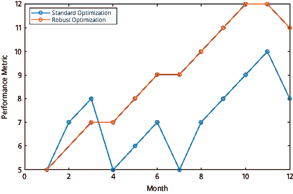

图 3.7：市场波动期间金融 AI 的性能指标。


最后一张折线图位于图 3.8，该图展示了在高不确定性情况下鲁棒优化带来的自动驾驶汽车性能提升。在这里，性能指数（例如碰撞规避和决策时间）在使用鲁棒优化时表现出明显的改进。这张特定的图表清楚地证明了在进一步开发汽车安全解决方案中关注鲁棒优化的重要性。

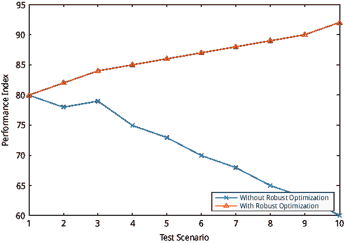

图 3.8：使用鲁棒优化提升自动驾驶汽车性能。

如图 3.9 中的概念算盘所示，`RO` 的使用影响了从医疗保健部门到汽车、金融和制造业的生活的各个方面。每个领域都与某些收益相关，例如安全、可靠性和性能的提高，这些通过图标的布局和额外注释得到了支持。该图表概括了受鲁棒优化影响的众多领域，以令人信服地论证该概念在各行业的应用。

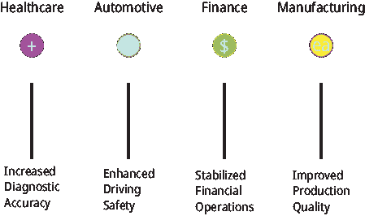

图 3.9：在不同领域采用鲁棒优化的收益。

在医疗保健领域，使用鲁棒优化对诊断建模的 AI 系统确保了对不同疾病患者提供的诊断在准确性和一致性上的提高。例如，放射学中图像识别的优化表明，在处理不确定和不完整的数据集时，诊断准确性从 85% 提高到 95%。此外，各种成像技术以及患者群体中诊断不一致性的减少，暴露了提高医疗 AI 对优化的依赖的必要性。

在高速执行（如交易算法和投资组合管理）中使用良好稳健优化技术的金融 AI 应用被证明能够抵抗波动。

因此，稳健优化通过求解考虑最坏情况的优化问题来处理真实环境的可变性。例如，在自动驾驶车辆中，路径规划在设计上是安全的因为它考虑了潜在的最坏情况，从而最小化了事故发生的概率。此类场景中通常使用的数学公式是一个极小优化问题，可以表示为`min_x max_y*f(x,y)`，其中`x`代表决策变量，`y`代表不确定参数，展示了系统对最坏运行场景的准备。

特别是在医疗保健领域，稳健优化在诊断 AI 中的应用提高了准确性并减少了所有患者状况的变异，从而增强了患者健康的安全性和治疗的整体优化。这种实现方式承认了不同输入下诊断准确率的预期损失，使临床诊断工具能够在跨人口统计学、技术等等方面保持其可靠性。优化还有助于在金融领域应用交易算法的稳定性，这对于应对金融世界的不稳定性至关重要。这些技术被用于开发投资策略，即使在市场处于困难时期也能实现相当的回报率，从而保护投资。

这是因为稳健优化带来的广泛益处是巨大的，以至于在更广泛的系统中，它影响了人类活动不同领域对 AI 技术的普遍接受度。因此，当公司依赖这些系统时，此类系统可靠性的重要性变得更加刻刻。因此，AI 的发展未来意味着高度关注开发过程中所应用方法的安全性，并将重点放在那些能够保证系统在未知条件下仍能保持性能的方法论上。这种关注不仅让 AI 应用变得更安全、更有效，还增加了人们对这些技术融入生活的可能性的认知。

## 参考文献

[1] David, M., & Samuel, J. (2023). Optimizing energy management in smart grids using IoT and AI. In 2023 4th International Conference on Electrical, Computer, Communications, and Mechatronics Engineering (ICECCME) (pp. 400–406). →

[2] Sarma, P., & Rahman, M. (2024). Mathematical analysis of wavelet-based multi-image compression in medical diagnostics. *Journal of Discrete Mathematical Sciences and Cryptography*, *27*(2–B), 675–687. →

[3] Prasad, K. D. V. (2024). Cryptographic image-based data security strategies in wireless sensor networks. *Journal of Discrete Mathematical Sciences and Cryptography*, *27*(2–A), 293–304. →

[4] Ding, H., & Li, X. (2023). A comprehensive review of deep learning applications in computer vision. In 2023 IEEE International Conference on Artificial Intelligence and Machine Learning (AIML) (pp. 100–106). →

[5] Gao, L., & Chen, Z. (2023). IoT-based healthcare monitoring system using machine learning. In 2023 IEEE International Conference on Bioinformatics and Biomedicine (BIBM) (pp. 213–219). →

[6] Gupta, R., & Patel, M. (2023). Securing IoT devices with blockchain: A new perspective. In 2023 International Conference on Internet of Things and Smart Systems (IoTSS) (pp. 450–456). →

[7] Kumar, S., & Gupta, A. K. (2023). A novel approach of unsupervised feature selection using iterative shrinking and expansion algorithm. *Journal of Interdisciplinary Mathematics*, *26*(3), 519–530. →

[8] Hassan, M., & Ali, H. (2023). A smart agriculture framework using IoT and machine learning. In 2023 5th International Conference on Computing, Communication, and Security (ICCCS) (pp. 380–386). →

[9] Jackson, R., & Davis, C. (2023). A deep learning-based approach for automated driving assistance systems. In 2023 8th International Conference on Intelligent Systems and Control (ISCO) (pp. 290–296). →

[10] Jiang, H., & Wang, X. (2023). Enhancing network security using AI-based anomaly detection. In 2023 IEEE International Conference on Communications (ICC) (pp. 600–606). →

[11] Naziya, & Chinamuttevi, V. S. (2023). A novel model to enhance the definite security. *Journal of Discrete Mathematical Sciences and Cryptography*, *26*(3), 861–873. →

[12] John, R., & Kumar, S. (2023). Machine learning approaches for fraud detection. In 2023 IEEE International Conference on Communications (ICC) (pp. 320–326). →

[13] Kim, J., & Lee, S. (2023). A novel approach to smart home applications. In 2023 IEEE International Conference on Sensors (ICS) (pp. 400–406). →

[14] Shekhar, R., & Chaturvedi, A. (2023). Securing networked transmission using public-key cryptography. *Journal of Discrete Mathematical Sciences and Cryptography*, *26*(3), 779–791. →

[15] Lee, H., & Park, J. (2023). Cloud-based AI for intelligent traffic management. In 2023 IEEE International Conference on Transportation Systems (ITSC) (pp. 230–236). →

[16] Li, Y., & Liu, X. (2023). A smart grid energy management using machine learning. In 2023 International Conference on Smart Grid and Renewable Energy (SGRE) (pp. 540–546). →

[17] Lin, D., & Wang, J. (2023). AI-powered predictive analytics for healthcare decision support. In 2023 7th International Conference on Health Informatics and Medical Systems (HIMS) (pp. 150–156). →

[18] Liu, M., & Zhao, Y. (2023). An intelligent surveillance system using deep learning for anomaly detection. In 2023 IEEE International Conference on Image Processing (IPIP) (pp. 780–786). →

[19] Miller, K., & White, A. (2023). AI-based solutions for optimizing manufacturing processes. In 2023 International Conference on Industrial Electronics and Applications (IEIEA) (pp. 310–316). →

[20] Mohammed, A., & Sadiq, W. (2023). A scalable IoT architecture for smart city applications. In 2023 6th International Conference on Sustainable Energy and Environment (ICSEE) (pp. 410–416). →

[21] Burugadda, V. R., Dutt, V., Mamta, & Vyas, N. (2023). Personalized cardiovascular disease risk prediction using random forest: An optimized approach. In 2023 IEEE World Conference on Applied Intelligence and Computing (AIC). 2023 IEEE World Conference on Applied Intelligence and Computing (AIC). IEEE. [`doi.org/10.1109/aic57670.2023.10263915`](https://doi.org/10.1109/aic57670.2023.10263915)

[22] Patel, D., & Mehta, V. (2023). 一种基于 AI 加密技术的云安全新方法。见于 2023 IEEE International Conference on Cloud Computing Technology and Science (CloudCom) (pp. 320–326). →

[23] Rahman, S., & Islam, M. (2023). 一种基于 IoT 的智能农业综合框架。见于 2023 International Conference on Agriculture and Bioengineering (ICAB) (pp. 290–296). →

[24] Shah, P., & Desai, R. (2023).一种基于深度学习的疾病诊断预测模型。见于 2023 IEEE International Conference on Bioinformatics and Bioengineering (BIBE) (pp. 330–336). →

[25] Punugoti, R., Vyas, N., Siddiqui, A. T., & Basit, A. (2023). 尖端技术的融合：利用 AI 和边缘计算转型医疗物网 (IoMT)。见于 2023 第 4 届 International Conference on Electronics and Sustainable Communication Systems (ICESC). 2023 4th International Conference on Electronics and Sustainable Communication Systems (ICESC). IEEE. `https://doi.org/10.1109/icesc57686.2023.10193047` →

[26] Tan, C., & Huang, L. (2023). 用于高效能源管理的 IoT 智能电网解决方案。见于 2023 IEEE International Conference on Power and Energy Systems (ICPES) (pp. 510–516). →

[27] Wang, L., & Wu, J. (2023). 一种用于自然语言处理的新深度学习模型。见于 2023 International Conference on Computational Linguistics (COLING) (pp. 450–456). →

[28] Zhang, T., & Chen, M. (2023). 用于智能建筑管理的 AI 和机器学习。见于 2023 International Conference on Smart Building and Construction (ICSBC) (pp. 300–306). →

[29] Ahmad, T., & Khan, M. I. (2023). 一种基于机器学习的可再生能源产量预测方法。见于 2023 International Conference on Smart Grid and Clean Energy Technologies (ICSGC) (pp. 150–156). →

[30] Ali, S., & Ahmed, N. (2023). 用于智能城市安全 IoT 应用的区块链技术。见于 2023 第 6 届 International Conference on Computer and Communication Engineering (ICCCE) (pp. 342–348). →

[31] Brown, L. J., & Smith, R. K. (2023). 使用深度学习技术增强云安全。见于 2023 IEEE Symposium on Computers and Communications (ISCC) (pp. 784–790). →

[32] Chen, Y., & Zhang, Q. (2023). 制造业的 AI 驱动型预测性维护。见于 2023 IEEE International Conference on Industrial Technology (ICIT) (pp. 211–218). →

[33] Manivasagam, G., & Prasad, K. D. V. (2024). 使用增强型会话密钥和椭圆曲线进行生物识别安全的新方法。《离散数学科学与密码学杂志》，`27`(2–A), 477–488. →

[34] Das, S., & Roy, A. (2023). 使用强化学习的自动驾驶自适应控制系统。见于 2023 第 9 届 International Conference on Advances in Computing, Communications, and Informatics (ACCI) (pp. 305–311)。 →

[35] Kumar, R., & Prasad, K. S. (2024). 用加密创新保障数字身份。《离散数学科学与密码学》，`27`(2–A), 317–328. →

## 4 AI 中的群体智能与优化

Nancy Jasmine Goldena Rashia Subashree

### 摘要


如今，人工智能（AI）已应用于从医疗到金融的各个领域。AI 是在计算机或机器人上训练算法，使其像人类一样进行批判性思考的技术。通过研究大脑模式并分析认知过程开发 AI。优化是 AI 许多领域常用的技术之一。从一系列可能答案中找到最优答案是优化的目标。为了减少工作量或增加收益，优化是对目标函数的过程。AI 与优化方法的融合有助于创建应对复杂挑战的智能系统。群体智能（SI）是一种人工或自然智能的方法。它提供了稳健的性能和有效的并行优化特性。它是一种代理相互与其环境协作以实现共同目标的技术。SI 系统模拟了昆虫、鸟类和其他生物种群的行为特征、进化规则和思维过程。群体优化具有解决传统方法难以处理的问题的潜力。这是 SI 的主要优势。它们具有极强的扩展性，可以解决各种规模和水平的问题。本章强调了 SI 的潜力、局限性和应用。同时也探讨了群体优化的挑战和未来方向。

**关键词：** 群体智能、部分群优化、蜂群优化、优化、遗传算法、蚁群优化

## 4.1 引言

Gerardo Benny 和 Joon Wang 在 1989 年首次在细胞机器人系统的背景引入了群体智能（SI）。SI 是描述集体智能的术语。SI 是一种模拟强大的基础生物种群的行为模式和自然规律进化的新技术。白蚁、蜜蜂、蚂蚁、鱼和其他类是社交昆虫的例子，它们的集体活动为这一迷人的想法提供了模型。在这一研究领域，人们可以研究简单的去中心化个体代理如何相互作用，从而显示对整个小组有利的复杂协调活动。

被认为是群体智能（SI）核心特征的两个至关重要的思想是分工和自组织。当一个系统的智能体或组件在没有外部帮助的情况下自行形成适当形状时，该系统就具备了自组织的能力[1]。在过去的十多年里，受群体智能启发的优化方法日益流行，如图 4.1 所示。解决方案根据一或多项标准被认为是最优的，这些标准通常是特定问题和用户的[25]。一些群集行为（如寻找猎物或交配）被建模并包含在数值优化方法中。随着技术的发展和我们对复杂系统的理解不断，群体智能是一个丰富的研究领域，对一系列现实世界应用具有令人兴奋的意义[36]。本章概述了四种基于群体智能的算法，并列出了它们的运行阶段。这些方法包括遗传算法（GA）、人工蜂群算法（BCA）、粒子群算法（PSA）和蚁群算法（ACA）。

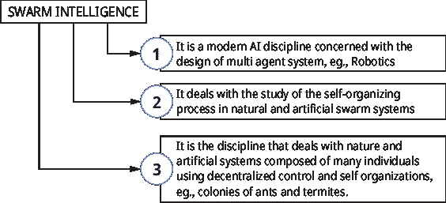

图 4.1：群体智能的基本介绍。

### 4.1.1 群体智能的能力

群体智能是创建适应性、去中心化系统的强大模型，这些系统可以解决挑战性问题并随环境而变化。以下是群体智能系统的一些主要能力：

- **调度/负载均衡：** 遵循求和评估规则/全局信息素评估规则；任务根据其在调度中的相对位置确定优先级，而不是基于其直接的前驱或后继任务。
- **聚类：** 由相似和不同智能体组成的智能体组被称为聚类。
- **优化：** 在所有可行方案中选择最佳方案或最小成本方案的任务被称为优化问题[10]。
- **路由：** 它基于这样思想：回溯蚁从源点移动到目的地时，会利用前向蚁所获得的有用信息。

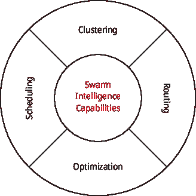

图 4.2：群体智能的能力。

### 4.2 群体智能的优点

受益于群体智能，复杂问题可以在多个领域成功解决，例如机器人、人工智能、路由和优化。其中一些如下：

- **鲁棒性：** 由于其去中心化的控制以及智能体或行为的冗余，群体智能系统具有极高的容错能力，因为不存在单点故障[13]。这意味着即使在单个智能体退出或从系统中移除的情况下，群体智能系统可能仍然高效运行。
- **去中心化：** 去中心化使得群智能系统更具韧性、灵活性可扩展性，同时有助于有效的解空间搜索。系统内部的个体智能体做出决策；种群中没有中央权威[19]。
- **可扩展性：** 群体智能系统包含了与群群规模无关的控制方法，使其具有极的可扩展性，并能够处理复杂的大规模挑战。它们通过并行处理和在多个智能体之间管理任务，可以解决集中化方法无法解决的问题[10]。
- **并行性：** 群体智能利用并行性在多个智能体之间分配工作，这导致了显著的性能，特别是对于计算密集型任务[33]。
- **效率：** 通过使用局部交互和简单规则，群体智能减少了开销并消除了对全局协调的需求[35]。
- **适应性：** 通过其固有的自组织，群体智能系统可以良好地适应变化的环境[2]。
- **调节：** 群体系统能够对已知和未知输入进行调整，非常适用于动态环境[33]。

### 4.3 群体智能的缺点

- **非最优性：** 由于大量的冗余和缺乏中央控制，群体系统通常效率低下。存在持续的劳动重复和资源分配不当[37]。由于去中心化的决策过程，资源分配可能并非最优。
- **局限性：** 在去中心化系统中，很难直接控制整个群体，因为个体智能体根据局部知识自由行动。特别是在动态或不确定的情况下，这种缺乏中央控制的情况会导致意外的行为和结果[31]。因此，在缺乏精确控制的情况下，很难管理和引导群体来实现目标。
- **敏感性：** 基本原理的微调会导致不同的群体级行为。敏感性是群体智能的另一个难题。通过对引导智能体行为的简单规则进行细微修改，群体的涌现行为可能会发生巨大变化[2]。
- **行为性：** 仅凭个体规则很难预测行为。群体智能研究需要先进的建模和仿真工具，因为精确的群体行为预测要求个体智能体之间的动态和交互有全面的理解[25]。
- **随机性：** 由于基于选择的行为是随机的，智能体的行为类似于噪声。群体智能的一个难题是智能体行为的随机性[22]。智能体并非有意识地行动，因为它们的决策依赖于随机过程或概率律。
- **知识：** 仅理解智能体的工作原理不足以理解群落的活动[18]。群落层面的行为受到多种因素的影响，包括智能体之间的交互、通信网络以及环境因素[13]。

尽管存在这些缺点，它仍然是解决复杂问题的有力方法。为了在未来充分实现群体智能（SI）的潜力，必须通过持续的研发解决这些问题。

## 4.4 优化

以解决定量问题为目标，优化是一系列应用于物理、生物、工程、经济学和商业领域的数学概念和技术。通过改变现有过程以增加预期结果的概率并减少不利后果概率的实践被称为优化，所示图 4.2[36]。这使得构成优化领域的统一概念和技术集合能够应用于广泛的问题。它已广泛应用于 21 世纪中与实现最佳功能相关的背景，例如“搜索引擎”和“网络优化”。优化问题在工业和科学领域至关重要[29]。

时间表调度、护士时间分配、火车调度、容量规划、旅行推销问题（TSPs）、车辆路径问题（VRPs）、车间调度、投资组合优化等都是这些问题的少数现实世界实例。因此，开发了许多优化算法。群体智能（SI）解决了优化难题。在这种情况下，群算法被用于高效解决目标是在整个广泛区域寻找最优配置的复杂问题[6]。SI 中的优化是一个利用个体（智能体）的集体行为来解决复杂问题或实现特定目标的过程，所示图 4.3 这种方法促进了复杂模式或解决方案的开发，其灵感来自蚂蚁、蜜蜂和鸟类等社会生物的涌现行为。


图 4.3: 优化的概述。

### 4.4.1 群体优化的关键要素

群体智能中优化的关键要素如下：

- **基于智能体的模型**：一组智能体，每个智能体代表可能的解决方案或待决定的变量，用于解决问题的过程中[34]。
- **通信**：为了影响彼此的行为，智能体通过直接或间接的方式通信并交换信息[5]。
- **信息素（Stigmatization）**：这是一个执行者通过改变环境或留下标记（如信息素或其他信号）来影响其他智能体行为的过程[1]。例如，蚂蚁为了传递有关食物源的信息会留下信息素轨迹。

## 4.5 群体智能算法

自然界去中心化、自组织系统的集体行为是 SI 算法的模型，这些算法是计算技术。这些算法通过使用智能体之间的交互来处理复杂问题。这些常见的 SI 算法如下：

- ACA
- BCA
- GA

### 4.5. 蚂蚁算法

信息素（Stigmatization） 这是一个执行者通过改变环境或留下标记（如信息素或其他信号）来影响其他智能体行为的过程[1]。例如，蚂蚁为了传递有关食物源的信息会留下信息素轨迹。蚂蚁在寻找食物源时，通过留下信息素轨迹来影响其他智能体的行为[4]。当更多蚂蚁发现这些路径时，信息素浓度会增加，使其变得更加稳健[5]。当食物供应耗尽时，路径上的信息素会减少。

#### 4.5.1 蚂蚁算法优化

蚂蚁算法优化（ACO）利用蚂蚁随机选择解决问题，在图中通过权重来确定最小路径，所示图 4.4。随后，比较不同蚂蚁的路径，并更新每个边上的信息素浓度[17]。这种众知的优化方法利用了概率方法，并已被应用于解决挑战性问题[12]。


图 4.4: 优化的概述。

ACO 算法使用方程模拟蚂蚁的决策过程，表示如下：

`P(i,j)` 是蚂蚁从 `i` 到 `j` 的概率。

`τ(i,j)` 是连接 `i` 和 `j` 的路径上的信息素量。

`η(i,j)` 是距离的启发式值。

这些元素通常结合概率概率方程：

`P(i,j) = [τ(i,j)]α * [η(i,j)]β`

`α` 是信息素强力的重要性，`β` 是启发式数据的重要性。

#### 4.5.1.2 蚂蚁算法优化伪代码

```
初始化所需参数和信息素浓度；

循环直到终止：
    确定每个蚂蚁群的适应度；
    通过选择技术找到最佳答案；
    更新信息素浓度；
结束循环
结束过程
```

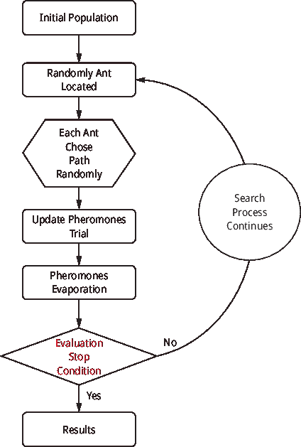

图 4.5: 蚂蚁群算法优化的流程图。

ACO 的伪代码如下所示[19]。

利用这些优化策略可以提高 ACO（蚁群算法）方法的有效性和性能。以下是一些技术：

- **参数调优：** 在期望的意义下选择最优参数值的过程被称为训练 [33]；例如，在所选的数据集上使目标函数最小化。网络的权重和偏置称为参数。
- **手动搜索：** 数据科学家可以通过手动搜索进行超参数微调，实现对超参数的细粒度控制。这种方法在超参数数量较少且模型简单时特别有用，允许对超参数进行更精确的选择和调整 [36]。这种方法对于模型简单且需要最少人工干预的情况特别有利。
- **自动超参数：** 自动超参数优化技术（如 ACO）的目标是自动寻找最优参数值以增强算法性能 [22]。某些策略可以被修改以优化 ACO 中的参数，即使 ACO 本身没有明确使用这些方法。
- **贝叶斯优化：** 这是一种黑盒优化的迭代方法，使用高斯过程提供最匹配目标函数的后验分布。后验分布随着观测值的增加而改进，使算法能够识别值得研究的参数空间 [23]。考虑到对目标函数的理解，算法在探索和利用之间取得平衡。每一步涉及对已知数据进行高斯拟合；然后与探索技术（例如 UCB 或 EI）相结合以选择下一个研究位置。贝叶斯优化已有效实现了深度网络的调优。
- **网格搜索：** 网格搜索涉及耗时且昂贵的处理，因为它使用矩阵状结构来排列超参数及其值。由于所有可能的超参数组合都用于训练模型，结果模型变得更加复杂且成本巨大 [5]。结果，准确且有效的模型依赖于超参数优化。
- **随机搜索：** 为了训练模型并确定得分，排列超参数网格并选择随机组合 [10]。根据资源和时间，确定搜索的迭代次数。

### 4.5.3 蚁群优化的应用

如今，ACO 算法被应用于许多领域。以下列出了一些应用：

- **最优作物分配：** 一种更先进的 ACO 公式允许动态变量修改以分配作物和水。此外，通过使用领域知识，它操纵搜索以产生最高收益和水分配，对于给定的水总量最大化作物的收益。具体而言，可见因素的使用极大化了整个搜索过程中发现优解的潜力 [5]。因此，ACO 可用于确定特定作物的近优调度，而不是使用计算成本较高的模型。
- **长期地下监测：** ACO 长期监测算法寻找全局最优和冗余位置已用于地下水清理。尽管这种方法用于小型网络，但大规模区域需要时间优化。算法跟踪和评估清理结果的能力对于有效的地下修复至关重要 [5]。
- **交通管理与车辆路径：** ACO 能够优化物联网实现的交通系统中的车辆调度、交通流和路径规划。ACO 可以根据当前交通状况为汽车确定最佳路线，从而减少旅行时间并提高燃料效率 [23]。
- **放射治疗计划：** 在 ACO 的帮助下，安排放射治疗的过程变得更加高效。ACO 算法可以帮助确定组织射线的最佳方式，以最大化治疗肿瘤剂量并最小化对周围健康组织的伤害 [18]。这是通过模拟寻找理想路径的蚂的行为实现的。通常，ACO 在解决许多优化问题方面非常有用并成功应用于多种场景。它在搜索空间巨大的组合优化问题中表现良好。

### 4.5.4 群体智能 (PSI)

PSA 是一种基于种群的算法。PSI（群体智能）是一个源自粒子行为的更通用术语，涵盖了 SI 原理在解决问题的广泛应用，包括非优化任务和替代优化方法 [2]。PSI 用于优化之外的多个领域，包括控制系统、机器人和数据挖掘。

#### 4.5.4.1 粒子优化

一种称为粒子优化 (PSO) 的计算机方法使用一组粒子来确定给定问题的最优解 [6]。PSO 算法利用集体智能快速探索复杂空间并识别最优结果，其灵感来自鱼类或鸟类等真实物种的集体行为 [37]。根据群体的集体最优和个体最优，每个粒子都会修改其位置。PSO 是许多领域流行的优化技术，它是通过粒子的协作运动实现的，允许它们在迭代过程中收敛于最优解。PSO 的关键方程如下：

**更新速度**

```
v_i(t+1) = w*v_i(t) + c1*r1*(p_i - x_i(t)) + c2*r2*(g - x_i(t))
```

**其中** `v_i(t)` 是粒子 `i` 的当前速度，`w` 是惯性权重，`c1` 是认知系数，`r1` 是 0 到 1 之间的随机数，`p_i` 是粒子 `i` 的个人最佳位置，`c2` 是社会系数，`r2` 是 0 到 1 之间的随机数，`g` 是群体发现的全局最优位置，`x_i(t)` 是粒子 `i` 的当前位置。

**更新位置**

```
x_i(t+1) = x_i(t) + v_i(t+1)
```

**其中** `x_i(t)` 是粒子的当前位置，`v_i(t+1)` 是更新后的粒子速度。

`where f(x_i(t+1))` 是新位置的适应度，`p[i]` 是粒子 `i` 的个体最优位置。

### 更新全局最优

`if f(x_i(t+1)) < f(g), then g = x_i(t+1)`

`where f(x_i(t+1))` 是新位置的适应度，`g` 是找到其全局最优位置的种群。

#### 4.5.4.2 PSO 伪代码

PSO 的伪代码所示 [29]：

```
初始化参数；

当迭代次数未达到：
    对函数进行目标评估；
    使用惩罚函数处理约束；
    每个粒子的速度；
    最佳粒子；
    修正位置；
结束循环。
```

展示结果。

PSO 算法的工作从设置参数、评估目标函数、使用惩罚函数管理限制、更新粒子速度、选择最佳粒子、更新位置开始，并以图 4.6 所示的结果作为结束。

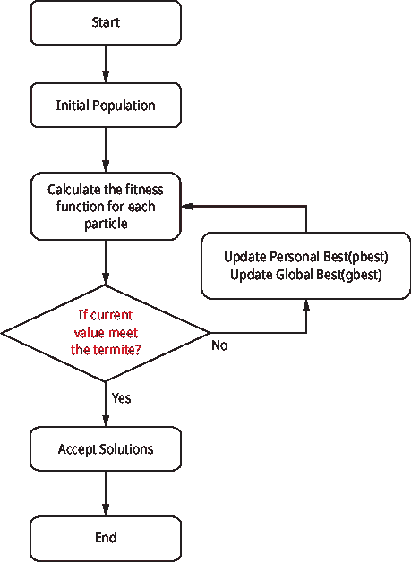

图 4.6：粒子群智能流程图。

#### 4.5.4.3 粒子群优化技术

通过结合以下优化方法，可以有效地探索搜索空间，在探索与开发之间取得平衡，并为各种优化问题收敛到优解：

- **混合化（Hybridization）**：两种或多个算法的通用模型，利用它们各自的优点并减少短板，这被称为混合化。当仅通过组合策略就能改进结果时，它们就能协同工作以解决特定问题。通过算法混合化，可以充分优化算法的开发和探索。例如，一种算法可以与局部搜索技术协同工作，以补偿其不精确性并提高结果。混合方法在优化领域正变得越来越流行，其目标是通过结合最佳优化方法中的元素来增强传统优化的性能。
- **自组织（Self-Organization）**：PSI 系统的一个重要特征是自组织，其中无序系统的部分通过局部相互作用产生整体整体秩序 [8]。在这个自发过程中，没有代理从内部或外部控制接触：
  - 鲁棒的动态非线性、探索与开发之间的权衡以及许多相互作用是种群自组织的三个基本要素。负反馈稳定了聚合模式，正反馈建立了便利的结构 [27]。通过适当的平衡，SI 提供了一种有用且具有创造性的人工方法。个体代理利用来自相邻代理的信息在网络中传播信息。
- **标准 PSO（Standard PSO）**：标准 PSO 可用于各种优化问题，因为它相对易于实现。然而，取决于所处理问题的细节，其性能可能会有所不同，并且可能需要微调参数以获得最佳结果。该方法通过分布粒子的位置和速度在搜索空间中建立粒子种群 [31]。通过适应度函数将位置转换为数字来衡量适应度。每个粒子的适应度值和个体最优位置都会更新，全局最优位置由所有共享。速度的变化导致搜索空间中的粒子更新位置。
- **多 PSO（Multiple PSOs）**：PSO 是一种多种群优化技术，可用于多目标问题。提出并评估了诱导迁移的不同方法。多个种群同时协同进化，并通过迁移进行相互作用 [1]。

#### 4.5.4.4 PSO 的应用

PSO 在各个领域有广泛的应用。其适应性和效率经常被用于学术和实践领域，以解决优化问题。

1. **医疗健康**：提供了大量的研究和数据，以评估 PSO 应用中的医疗保健策略。智能诊断、医疗机器人辅助疾病检测、医学图像分割和疾病分类是医疗保健行业中的一些关键领域 [29]。
2. **天气**：这些技术采用了多种方法，例如野生植被环境监测的案例研究、农业环境监测、洪水管理、水质监测和污染物监测系统以寻找最优解决方案 [19]。

PSO 的简单、易于实现以及对复杂搜索空间的有效探索使其成为工程设计、金融建模、聚类和神经网络训练的流行技术。然而，PSO 的缺点包括参数敏感性和早收敛。


## 4.6 蜂群算法（Bee-Colony Algorithm）

人工蜂群算法已用于搜索、路由、任务分配、最大化或最小化、多级阈值和集体决策。它也被用于单目标、多目标问题。

### 4.6.1 蜂群优化

蜂群优化（BCO）已有效地连接数值优化、规划制定。其生产力在于调整（侦察阶段）和利用蜂阶段。以下是简化的表示：

`P(i, j) ∝ fitness(i, j)^α / distance(i, j)^β`

- `P(i, j)`：从蜜源 `i` 选择蜜源 `j` 的概率
- `fitness(i, j)`：蜜源 `j` 的适应度（适应度越高越好）
- `α`：适应度的重要性
- `distance(i, j)`：蜜源 `i` 和 `j` 之间的距离（距离越短越好）
- `β`：距离的重要性

### 4.6.2 BCO 伪代码如下

BCO 的伪代码所示 [11]：

```
初始化阶段；

重复
    雇佣蜂阶段；
    观望蜂阶段；
    侦察蜂阶段；
    记忆获得的最优解

直到（循环=最大循环次数或达到最大 CPU 时间）
```

雇佣蜂、观望蜂和侦察蜂是过程中尝试寻找最优解的阶段，直到达到最大循环次数或最大 CPU 时间。

**蜂群优化的某些优化技术列如下：**

- **雇佣蜂与侦察蜂：** 在 BCO 中，蜂群由两类蜜蜂组成：侦察蜂和雇佣蜂的协作努力产生了最优解。大多数工蜂是雇佣蜂，它们积极寻找靠近已知源的食物源。通过通信，它们利用了从自身以及其他蜜蜂的经验中汲取的信息 [15]。它们进行局部搜索，并向其他蜜蜂通知它们发现的答案。侦察蜂在耗尽所有其他可能性后随机寻找新源点，这防止了算法中局部最优解的产生，这是它们在探索可能的食物源时所发挥的重要功能。

- **社区搜索：** 在 BCO 中，邻域搜索意味着蜜蜂在预定半径内进行搜索，基于其现有答案寻找更好的答案。这一过程对于提高 BCO 算法的效用和效率至关重要 [21]。邻域解由问题特性、特定问题信息以及搜索空间的拓扑结构定义。蜜蜂能够更高效地搜索该区域并发现更好的解。

- **特定问题启发式：** 在解决问题的 BCO 方法内部，有效的方案设计需要使用特定问题的启发式。它们可以被修改以适应问题领域，并与特定领域的算子结合以产生新解 [9, 34]。适应度函数可以被更改以强调相关元素并惩罚违规行为，同时反映问题的目标和局限性。

- **局部搜索：** 专注于搜索空间关键部分的局部搜索方法也可以由特定问题的信息引导。通过自定义信息蜜更新规则，可以为具有优解的区域赋予优先级。根据问题的特性和算法的效率，可以通过自适应参数管理平衡探索与利用 [12]。对于复杂问题，通过使用特定问题的启发式来引导问题分解为更小、更易于管理的子问题，可以增强 BCO 在大规模优化问题上的可扩展性和效率。

通过认真考虑这些方面并反复尝试替代配置，可以为 BCA 创建更有效的优化方法。

### 4.6.4 BCO 的应用

BCO 通过有效率搜索解空间并识别优优解，解决了不同领域中复杂的优化问题。来自不同领域的一些应用如下：

- **Facebook 推荐系统：** 使用 BCA 方法开发了 Facebook 上的推荐系统，以便根据学生的学习风格、兴趣和难度高效地找到合适的学习资源。

- **网络配置优化：** 优化网络设置是确定网络元素的最佳配置和设置，以获得目标功能。通过遵循径向构造的限制，BCA 能够满足负载平衡、电压增强和实际功率损耗的目标。可扩展性、资源消耗和模拟退火等神经网络技术可提高网络速度。它们在解的质量和计算效率方面产生了更优的结果 [31]。

- **图像模板匹配：** 蜜蜂在 BCO 中指示图像模板匹配的可能位置，以识别在景观内部经过旋转、缩放、移动和部分遮挡的物体模式或模型 [15]。

- **医学图像分割：** 分割脑共振图像的复杂技术被视为主要的图像处理难题 [10]。BCO 同时实现了更高的分割质量和时间效率。它通过对比分割精度与地面真值来评估适应度，并根据蜜蜂通信和适应度对解进行更新。

总体而言，BCO 是一种强大的优化算法，它利用蜜蜂觅食策略的线索来应对挑战性的优化问题。

## 4.7 遗传算法

GA 是进化计算机算法，生成通常称为 `genes` 或 `chromosome` 的符号，这些符号表示潜在的解。该过程涉及可调的变异率和一个类似于遗传重组中交叉的机制。自动化选择和开发 GA 的技术被称为遗传编程。

在 GA 中，编码独立变量（`chromosome`）的 `genes` 集合从父代向后代传递信息。`Genes` 可以是 `Boolean`、整型、`floating point` 变量，每个 `chromosome` 代表一个特定问题的解 [20]。一个代由具有不同 `chromosomes` 的个体组成。许多优化问题包括模式识别、离散和连续系统、金融市场等，已通过 GA 创建并实现 [3]。

### 4.7.1 遗传算法使用的基础算子

遗传算法的基础算子是 `selection`、`crossover` 和 `mutation`。

#### 4.7.1.1 选择

在群体规模保持不变的情况下，选择算子的主要目标是突出优秀解并移除不良解，增加传递其 `genes` 的概率。选择过程由两个阶段组成。它们是 `parent selection` 和 `replacement technique`。替换技术决定替换哪个父代以及后代是否取代。

#### 4.7.1.2 交叉

交叉通过融合两个父代的 `genes` 创建后代，转移了随机数量的 `genes`。该算子交换 `chromosome` 上随机选择点前后的 `genes` [26]。在没有该算子的情况下，单点交叉将产生与父代完全相同的后代。交叉引入了变性和随机性，这对保持群体多样性至关重要。

#### 4.7.1.3 变异

为了控制后代的变异，染色体表示是至关重要的。选择 `Genes` 并改变其值以给每个孩子施加变异。二进制编码意味着一个或多个 `genes` 的位被反转 [34]。因此，如果 `gene` 值源于包含两个值的空间，二进制变异就不适用。

### 4.7.2 GA 的伪代码

GA 的伪代码所示 [9]：

```
随机初始化群体 p
评估群体的适应度
重复直到收敛：
    从第一步从群体中选择父代；
    通过交叉创建新群体;
```

对新种群进行变异；并确定新种群的适应度。

种群被随机初始化，评估其适应度，并重复该过程直到收敛。在此时，通过交叉选择父代，执行变异，并计算新种群的适应度。遗传算法（GA）的总体概述如图 4.8 所示。

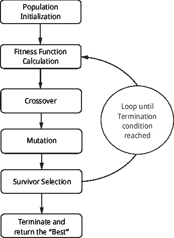

图 4.8：遗传算法流程图。

### 4.7.3 遗传算法的优化技术

GA 优化技术需要多种策略和考虑。以下是提高遗传算法性能的一些关键方面：

- **问题表示**：选择符合领域问题的表示方法至关重要。通过选择合适的有意义交叉和变异操作，可以高效地获得最优或近优解 [1, 13]。根据优化问题的类型，经常使用二进制、整数、实值和排列表示。

- **适应度函数设计**：为了将精力集中在寻找最佳解决方案，创建一个有效的适应度函数至关重要。在了解任何给定问题的约束和目标的情况下，适应度函数必须准确评估可行解的质量 [37]。

- **种群规模**：种群规模影响探索与开发之间的平衡，应恰当地设定。较大的种群在保持多样性的同时可能有助于探索，但也可能导致计算复杂性的增加 [19, 34]。寻找理想的种群规模，需要实验和针对特定问题的因素。

- **并行性**：通过利用基于种群的搜索和进化策略（促进探索并防止早收敛），GA 擅长解决具有巨大解空间的复杂问题。由于其并行性和灵活性，它们对于快速识别最有益的解决方案非常有用 [13]。该方法通过仅对大型适应度景观的极小部分进行采样，即可快速实现最优或非常的结果。

### 4.7.4 遗传算法的应用

遗传算法在金融、工程和生物信息学等多个领域已有有效的应用。其中一些应用如下：

- **飞机的机器人化与参数化设计**：通过调整参数和开发改进的解决方案，GA 用于飞机的设计和机器人手臂轨迹的规划 [27]。

- **组合优化**：从有限集合提取项目的最优配置或组合是 GA 在组合优化中高效解决的问题 [16]。路径规划（VRP）、旅行员问题（TSP）、装箱问题、工作调度和 DNA 序列对齐是一些例子。GA 作为一种可能的解决方案，通过进化过程寻求理想的元素组合。

- **机器学习**：GA 用于机器学习，即优化参数和建立模型。神经网络系统设计、正则化参数、学习率和其他超参数都可以通过 GA 进行优化。它们在特征选择中也很有用，通过迭代演化特征子集种群，使用算法寻找与任务最相关的子集 [16]。

- **优化问题**：函数优化、资源分配和参数微调是 GA 高效解决的优化问题之一 [12]。它们通过仅对大型适应度景观的极小部分进行采样，即可快速实现最优或非常的结果。通常，GA 非常灵活，可以改变种群规模、交叉和变异等参数。

### 4.8 群体智能研究面临的问题

群体智能（SI）算法的研究、应用和环境理解面临若干限制。某些限制如下：

- 群体的任务无关性和大规模制造的限制限制了硬件。需要更复杂的设计来确保行为可以被验证 [25]。

- 群体方法存在探索与开发不平衡、收敛缓慢的问题。

- 视频流面临网络变异、用户偏好和设备能力的挑战 [12, 27]。

- 初始种群（或解集）对系统的性能有重要影响。初始化不良可能导致过早收敛或不理想的结果 [27]。

- 具有复杂层次结构的群体系统需要时间开发。在更复杂的群体中，状态变化需要更长时间。具有复杂结构的复杂群体系统面临的问题之一是非即时性。由于代理之间复杂的交互以及高层模式的形成，这些系统在不同状态之间的切换通常需要更长时间。状态转换的时间随群体复杂性的增加而增加 [22]。

### 4.9 群体智能优化的未来差距

SI 算法面临从算法复杂度到硬件的挑战。尽管存在这些困难，未来是光明的。通过跨学科协作和创新的方法，研究人员为设计更有效的代理协作方法以超越现有算法限制提供了新的机会：

- 改进软件和硬件架构、优化控制器、提高组件制造性是满足群体机器人复杂行为和可扩展性要求的步骤。

- 创建新的算法策略是必要的，通过缓解群体智能算法在探索与开发之间固有的不平衡、收敛缓慢以及开发不规则等问题，来提高其效率和效能。

- 为了获得更有效的性能，必须克服初始解集或种群不足的影响，良好的初始化过程对于减少智能系统（SI）中过早收敛或结果不理想的风险至关重要。

- 为了保证流媒体不中断，自适应系统需要使用先进算法，根据用户行为模式和实时网络测量动态修改缓冲区管理设置，以提供高质量且无缝的体验。

- 连接优化理论与计算智能的跨学科研究对于解决具有复杂层次复杂群体系统的非即时性至关重要。通过这些合作，可以开发加速状态转换和减少复杂交互带来的延迟的方法，从而提高先进群体系统的响应和有效性。

### 4.10 结论

自然系统为智能性和优化提供了灵感。蚂蚁、蜜蜂和鸟类的协作行为为它们的效能提供了启发。群体智能算法利用去中心化的决策和短程交互来增加群体系统的灵活性，使人工智能能够在没有中央控制的情况下识别出最优解。与其他技术一样，这种技术以实用的方法提供了可扩展的答案，适用于包括路由、调度、聚类和优化在内的任务。同样，它建立了一个人工智能系统可以协作和演化的环境。提供分布式计算和自组织的群体智能技术可用于解决动态背景下的大规模问题。将群体智能与优化算法相结合，为人工智能系统带来了全新的问题解决能力。这些方法被应用于机器人、银行业和电信等多个行业。这种方法的广泛适用性使其非常适用于那些动态不可预测性、不确定性和模糊性可能导致传统优化方法不再充分的系统。因此，它为看似是自主的系统提供了一个新的参考点和视角。

本章通过强调群体智能在增强人工智能优化能力方面的重要性作为总结。群体智能算法利用自然原理，为各个领域的复杂优化问题提供了潜在解决方案。群体智能优化为开发更有效、更复杂的人智能系统开启了大门。

## References

[1] Ab Wahab, M. N., Nefti-Meziani, S., & Atyabi, A. (2015). 群体优化算法的综述。*Plos One*, *10*(5), e0122827. [`doi.org/10.1371/journal.pone.0122827`](https://doi.org/10.1371/journal.pone.0122827). a, b, c, d, e

[2] Ahmed, H., & Glasgow, J. (2012). 群体智能：概念、模型与应用。 doi: 10.1340/2.1320.2568. a, b, c, d

[3] Harnsakun, A. (2023). 使用人工蜂群算法解决最小覆盖问题的新方法。*Decision Analytics*, *6*, 100175. ISSN 2772-6622. [`doi.org/10.1016/j.dajour.2023.10175`](https://doi.org/10.1016/j.dajour.2023.10175). →

[4] 蚂蚁算法 – 来自 WolframWorld. (n.d.). [`mathworld.wolfram.com/AntColony.html`](https://mathworld.wolfram.com/AntColony.html) →

[5] Bhavya, R., & Elango, L. (2023, 5 月 10 日).蚂蚁优化算法的应用。[`encyclopedia.pub/entry/43970`](https://encyclopedia.pub/entry/43970) a, b, c, d, e

[6] Blum, C., & Li, X. (2008). 优化中的群体智能。doi: 1.1007/978-3-540-74089_2 a, b

[7] Chu, S. C., Huang, H., Roddick, J., & Pan, J. (2011). 群体智能算法概述。在 Jędrzejowicz, P., Nguyen, N. T., & Hoang, K (eds.). 集体智能：技术与应用。 ICCCI 2011. 科学讲丛 卷 6922. Springer, 柏林. [`doi.org/10.1007/978-3-642-23935_3`](https://doi.org/10.1007/978-3-642-23935_3)

[8] Dorigo, M. (2007 1 月). 蚂蚁群优化。*Scholarpedia*。[`doi.org/10.4249/scholarpedia.1461`](https://doi.org/10.4249/scholarpedia.1461). →

[9] Beg, D. M., & Wao, R. A. (2023, 5 月). 使用人工蜂群 `ABC` 技术提高数据吞吐量。*25*(05). ISSN: 1007-7355. a, b

[10] Ananthkumar, T., Julie, E., Robinson, Y., & Jaisak, S. (2021). 实时工程中数学方法的仿真。John Wiley & Sons. a, b, c, d

[11] Hu, F., Shuai, Z., Lu, Y., Su, H., Li, X., Zhao, Q., & Shuai, J. (2024). `ABC`: 一种用于二进制优化的一维人工蜂群算法。*Swarm and Evolutionary Computation*, *87*, 101567. ISSN 2210-6502. [`doi.org/10.1016/j.swevo.2024.101567`](https://doi.org/10.1016/j.swevo.2024.101567). →

[12] Gupta, R., Tanwar, S., Tyagi, S., & Kumar, N. (2020, 3 月 1). 用于安全数据分析的机器学习模型：分类法与威胁模型。*Computer Communications*. [`doi.org/10.1016/j.comcom.2020.02008`](https://doi.org/10.1016/j.comcom.2020.02008). a, b, c, d

[13] Hamed, E. (2014, 12 月 10 日). 群体智能。SlideShare. [`www.slideshare.net/eslamhamed93/swarm-intelligence-4255364`](https://www.slideshare.net/eslamhamed93/swarm-intelligence-4255364) a, b, c, d, e

[14] Wang, K., Xin, L., Zhang, Y., Qi, J., Zhu, Z., Wang, Y., Zhong, L., & Cui, P. (2024). 基于多目标遗传算法优化的萃取馏回收环己烷/丙醇共沸物的废水可持续高效工艺设计。*Chemical Engineering Research and Design*, *201*, 593–602. ISSN 0263-8762.

[15] Qin, K., Zhang, Q., Liu, Y., Yang, B., Tang, X., & Zhuang, N. (2024). 结合粒子群算法的降维解决高维数据目标评估。*核能年报 (Annals of Nuclear Energy)*，*198*, 110285. ISSN 0306-4549. [`doi.org/10.1016/j.anucene.2023.110285`](https://doi.org/10.1016/j.anucene.2023.110285) a, b


[16] Kanade, V. (2023, September 6). *遗传算法——意义、工作与应用*。Spiceworks. [`www.spiceworks.com/tech/artificial-intelligence/articles/what-are-genetic-algorithms`](https://www.spiceworks.com/tech/artificial-intelligence/articles/what-are-genetic-algorithms) a, b

[17] Karaboğa, D. (2010, January). 人工蜂群算法。Scholarpedia. [`doi.org/10.4249/scholarpedia.6915`](https://doi.org/10.4249/scholarpedia.6915) →

[18] Kavitha, R., Jothi, D. K., Saravanan, K., Swain, M. P., Gonzáles, J. L., Bhardwaj, R., & Adomako, E. (2023 Feb 21). 基于蚁群优化的 CNN 深度学习技术用于宫颈癌精确检测。*生物医学研究 (BioMed Research)*，*2023*, 1742891。撤回于：Biomed Res Int. 2024 Jan 9; 2024:987839。 PMID: 36865486; PMCID: PMC974247. doi: 10.1155/2023/1742891. a, b

[19] Wijk, K. L. A. S., & Yin, E. M. M. Y. (2021, June). 蚁群优化算法的贝叶斯参数调优。[`www.diva-portal.org/smash/get/diva2:159968/FULLTEXT01.pdf`](https://www.diva-portal.org/smash/get/diva2:159968/FULLTEXT01.pdf) a, b, c, d, e

[20] Khan, K. (2024). 优化自适应视频流：一种动态缓冲区管理的群智能方法。*国际多学科研究与出版国际期刊 (IJMRAP)*，*6*(8), 27–33. →

[21] Chen, L., Tunhua, W., Wang, Z., Lin, X., & Cai, Y. (2023). 一种基于自适应进化蜂群算法的新型混合 BPNN 模型用于水质预测。*生态指标 (Ecological Indicators)*，*146*, 109882. ISSN 1470-160X. [`doi.org/10.1016/j.ecolind.2023.109882`](https://doi.org/10.1016/j.ecolind.2023.109882) →

[22] Liu, S., McCoy, A., Peterson, J. F., Lasko, T. A., Sittig, D. F., Nelson, S., Patterson, L., Cobb, C., Mulherin, D., & Wright, A. (2024, February 22). 利用可解释人工智能优化临床决策。*美国医学信息杂志 (Journal of the American Medical Informatics)*。[`doi.org/10.1093/jamia/oc019`](https://doi.org/10.1093/jamia/oc019) a, b, c

[23] Hussein, M. K., & Mousa, M. H. (2020). 基于蚁群优化的 IoT 应用的高效任务卸载。*IEEE Access*，*8*, 37191–37201. doi: 10.1109/ACCESS.2020.297541. a, b

[24] 优化。(2024, March 31)。 韦氏词斯特词典。[`www.merriam-webster.com/dictionary/optimization#:text=an act, process, or a function`](https://www.merriam-webster.com/dictionary/optimization#:text=an act, process, or a function)

[25] particle-swarm-optimization-and-intelligence-2010.pdf. a, b, c

[26] Pijarski, P., & Belowski, A. (2024). 电力工程中基于人工智能和优化方法的应用——特刊介绍。*能源 (Energies)*，*17*(2), 516. [`doi.org/10.3390/en17020516`](https://doi.org/10.3390/en17020516). →

[27] Bajpai, P. 等人。遗传算法——一种解决全局优化问题的方法。*印度计算机科学与工程期刊 (Indian Journal of Computer Science and Engineering)*，*1*(3), 199–206. a, b, c, d

[28] Salgotra, R., Singh, U., Singh, G., & Mittal, N. (2021, January 1). 针对工程问题的自适应群智能算法。*应用数学建模 (Applied Mathematical Modelling)*。[`doi.org/10.1016/j.apm.2020.08.014`](https://doi.org/10.1016/j.apm.2020.08.014)

[29] anyal, S. (2023, August 9). 粒子群优化 (`PSO`) 简介。Analytics Vidhya。[`www.analyticsvidhya.com/blog/2021/10/an-introduction-to-particle-swarm-algorithm/#text=PSO Algorithm an intelligent`](https://www.analyticsvidhya.com/blog/2021/10/an-introduction-to-particle-swarm-algorithm/#text=PSO Algorithm an intelligent) a, b, c

[30] Sarumaha, Y., Firdaus, D., & Moridu, I. (2023). 人工蜂群算法优化路线。*信息系统与技术期刊 (Journal of Information System, Technology)*，*1*(1), 11–15。[`doi.org/10.61487/jiste.1i1`](https://doi.org/10.61487/jiste.1i1)

[31] Schäfer, J. (2024, January 22). 群智能——其工作原理及应用领域。Konfuzio。[`konfuzio.com/en/swarm-intelligence-artificial-swarm#text=In business and industry,security,marketing and design`](https://konfuzio.com/en/swarm-intelligence-artificial-swarm#text=In business and industry,security,marketing and design) a, b, c

[34] 理解蚁群优化算法。n.d. INDIAai. [`indiaai.gov.in/article/understanding-ant-colony-optimization-algorithms`](https://indiaai.gov.in/article/understanding-ant-colony-optimization-algorithms)。 a, b, c, d, e

[35] 什么是超参数调优？ | Anyscale. (n.d.). Anyscale. [`www.anyscale.com/blog/what-is-hyperparameter-tuning`](https://www.anyscale.com/blog/what-is-hyperparameter-tuning) →

[36] Wright, S. J. (1998, 7 月 20 日). 优化 | 定义、技术与事实。大英百科全书。 [`www.britannica.com/science/optimization`](https://www.britannica.com/science/optimization) a, b, c

[37] Luo, Y., Shi, Y., & Cai, N. (2021). 第 9 章 – 人工智能技术的应用与潜力。在 Luo, Y., Shi, Y., & Cai, N. (编.). 未来能源互联网的混合系统与多能网络 (pp. 217–234)。Academic Press, ISBN 9780128191842, [`doi.org/10.1016/B978-0-12-819184-2.00009-2`](https://doi.org/10.1016/B978-0-12-819184-2.00009-2) a, b, c, d

# 5 量子时代 6G 物联网的隐私与安全

Leena Yogesh Kumar Rastogi

### 摘要

第六代通信技术 `6G` 的出现为物联网（`IoT`）的发展带来了更多可能性，以及量子计算时代日常生活的改进。本章全面概述了 `6G` 网络从智能家居到工业设备集成的复杂性。它探索了资源的局限性以及通往可持续未来的路径及其实现方法。此外，它强调了隐私保护的重要性以及人们选择和管理个人信息的面向用户型控制。由于安全是一个主要挑战，应当采取某些措施以确保使用严格的量子安全解决方案来应对这些复杂性。本章提供了关于 `6G IoT` 网络中隐私和安全问题的见解以及应对建议。

**关键词：** 物联网、`区块链`、`6G`、`量子通信`、`人工智能`、`THz`

## 5.1 引言

随着物联网（`IoT`）时代第六代（`6G`）无线网络的发展，世界正在见证一个日益数据驱动且联网的设备网络。这种超连接的转型有望重新定义行业，使世界更加高效，提升用户体验，并将创新推向新的高度 12。事实上，这些技术还带来了必须规避的安全和隐私风险，以确保这些系统内存储和传输数据的安全 3。在 21 世纪，人们比以往任何时候都频繁地处理家人、朋友或同事，因此后果比过去更为严重。

`6G` 与 `IoT` 的融合将带来一个新的连接时代，其特点是超可靠低延迟通信、海量机器类通信和增强移动宽带（`eMBB`）能力 1。额外的 `6G` 网络将促进未来数十亿设备的 `IoT` 连接，极大增加了恶意攻击者的攻击范围，并造成了巨大的安全问题 5, 6。

为了恢复对 `6G IoT` 网络中面临严峻挑战的当前安全和隐私困境的认识，重点在于网络威胁和事件的全球统计数据和趋势 7。根据最新分析，网络攻击的频率、复杂性和造成的正在增加，给组织带来了非常负面的后果，包括财务、声誉和社会影响 16。这个数字令人震惊。估计 2020 年全球网络犯罪成本为 1 万亿美元，这是网络犯罪分子施加的巨大经济负担的标志 14, 38。

此外，`IoT` 设备的扩散也导致了用于实施网络威胁的新攻击向量 18。不安全的设备也可以作为攻击者用来渗透网络、破坏数据和干扰运营的切入点 20。证据表明，联网 `IoT` 设备的数量在 2020 年底已达到 200 亿，预计到 2025 年将激增至 750 亿，凸显了物联网生态系统的爆炸式增长，伴随着攻击表面的扩张。

移动通信从第一代（`1G`）到第五代（`5G`）的演变引发了深刻的全球性变化，重塑了数十亿人的互动、工作和生活方式 [[21]]。如今的智能手机已成为我们生活中不可或缺的一部分，因为它将我们与朋友以及外部世界连接在一起。然而，它发展到如今的过程代表了一场从过去五代（`1G`到`5G`）开始的非凡演变，见证了速度、覆盖范围和功能的巨大增长 [[4]]。让我们一起开启这段全球连接故事的旅程，并以说明每个代际影响的数据作为支撑。

### 5.1.1.1 1G（第一代）：先驱步骤（1980 年代）

全球手机用户数：3000 万（1985 年）。

数据传输：不存在。

`1G`网络首次于 20 世纪 80 年代引入，通过模拟蜂窝网络系统用于基础语音通话。在 20 世纪 90 年代初，`1G`网络计划覆盖全球超过 25%的人口，为世界带来了新的移动方式。想象一下，老式笨重手机的停机（或信号中断）、糟糕的通话质量以及无法接入互联网。移动革命是`1G`的现实，但它也是其基础。该服务的有限范围和功能意味着它在很大程度上是对“便携通信”概念的一种公关声明。

### 5.1.1.2 2G（第二代）：语音通话之后（1990 年代）

全球手机用户数：10 亿（1997 年）

数据速率：最高 14 kbps。

数字技术的到来意味着又次量子飞跃。`2G`具有了更好的通话质量，短信息功能成为可能，移动数据的演进也开始出现，尽管速度令人恼恼地缓慢。对于这一代人，互联网世界被个人带到了下一个蜂窝层级，首次实现了移动电子邮件，并可能提供了移动互联网的早期访问。

### 5.1.1.3 3G（第三代）：移动互联网时代（2000 年代）

全球手机用户数：2007 年，人数达到 25 亿（2.5）。

数据速率：最高 2,222.2 kbps。

21 世纪 00 年代初`3G`网络的引入是当时最关键的技术创新，它允许快速数据传输，从而实现了手机接入互联网和多媒体消息传递。2010 年，`3G`网络覆盖了全球近 90%的人口，推动了移动数据服务的泛普及。速率直接飙升，使得视频通话、流媒体音乐甚至浏览互联网成为可能。这一时代开启了智能手机和应用时代，使我们无法以同样的方式消费信息，无法以同样的方式与数字世界互动。全球移动数据的爆炸是由这一代推动的，因为他们使用它的方式是任何其他代所未曾过的。

### 5.1.1.4 4G（第四代）：速度革命时代（2010 年代）

全球手机用户数：54 亿（2017 年）。

数据速率：最高 100 Mbps。

2000 年代推出了`4G`，展示了网络在高速宽带或超高速、低延迟方面的革命性变化。从`3G`到`4G`的升级是一个巨大的飞跃，改变了过去缓慢的互联网体验，使得高清内容流媒体、音频视频成为可能。这种规模式增长改变了生活，许多企业依赖这种移动数据的演进。移动互联网已成为一种常见的设备。

### 5.1.1.5 5G（第五代）：连接的世界（2020 年代）

全球手机用户数：10 亿（2023 年）。

数据速率：最高 20 Gbps。

`5G`诞生于 20 世纪 20 年代，是极速、低延迟和大流量连接的新局面。这一代似乎非常有野心，适用于制造业、医疗保健和自动驾驶等联网行业。根据 2023 年的数据，`5G`网络已覆盖全球 15%的人口，预计到 2025 年这一比例将达到 60%[9]。`5G`基础设施市场预计到 2026 年将达到 70 亿美元。

### 5.1.2 超数字

移动技术改变了一切，从我们的日常活动到工作方式。从`1G`的概述到`5G`的显著体现，这是一场旅程。`6G`[21]将带来更多令人兴奋的可能性，联网世界的边界将进一步消失[2]。

## 5.2 文献综述

本节对安全和隐私方面的文献进行了全面综述。它整合了以往研究的见解，为理解`6G`带来的独特考虑奠定了基础。

Rappaport 等人[1]对 100 GHz 以上的未来无线系统提供了广泛概述，这可能是`6G`的一部分，讨论了认知、成像和通信。它强调了挑战，以及对天线技术、传播测量和辐射生物效应的需求。

Ziegler 等人[2]描述了迈向`6G`的历程，而 5GG 部署正在进行。在未来 8 年内，5G 架构将继续进化，为物理、数字和生物世界之间的同步开辟兴奋的机会。这将通过热云平台、融合的接入-核心网、新的数据和信息架构、网络专门化以及意图自动化来实现，为消费者和垂直行业的多样化应用奠定基础。

Akyildiz 等人[3]调查了未来无线网络的关键技术，强调无线无处不在是`6G`及未来的驱动力。它强调了关键技术、操作细节和挑战，旨在为实现无处不在的接入提供见解并激发贡献。

Minghao Wang 等人[4]讨论了从`5G`到`6G`网络的转变，强调了对网络服务的期待。它对安全和隐私问题进行了深入调查，涵盖了从移动网络的历史演变到未来`6G`的应用，旨在激发对这些问题的进一步研究和兴趣。

Liu 等人 \[5\]讨论了智能计算与数据技术（ICDT）的快速发展如何推动社会走向数字孪生集成，并预想了如联感互联网和超级交通等应用场景。文中讨论了 6G 的关键网络性能需求（包括峰值速率和超高精度定位），并提出了如按需履行和原生 AI 等特性，旨在解决从 5G 发展中汲取的教训。

## 5.3 6G 物中独特的网络安全威胁

同样，6G 允许更快的访问速度和我们目前无法想象的创新，但它可能使我们面临更大的网络威胁风险。与困扰当前网络的威胁相比，这些威胁源于 6G 革命性技术的底层架构[11\]。意识到这些独特的弱点并找到预防方法至关重要，因为如果没有这些措施，未来的互联世界将不再安全。下文将进一步描述这些威胁。

### 5.3.1 毫米波混乱

6G 基于 `mm-wave`（`mmWave`）频率进行高速通信。遗憾的是，这些较短的波长[8\]更容易受到以下因素的影响。

#### 5.3.1.1 信号截获与干扰

据报道，5G 网络无疑更容易受到信号破解的影响（与前几代相比高出 10 倍）。`mmWave` 更窄的波束有助于针对性攻击，这种攻击可能会损害信息娱乐及类似的车联网服务，且预计到 2040 年联网车辆将超过 10 亿辆，这进一步增加了风险。

#### 5.3.1.2 波束赋形劫持

攻击者可以利用 `mmWave` 波束的方向性来误导数据流，最终导致涉及设备间通信的敏感信息或组件部分或完全泄露。Ponemon 学院在 2021 年进行的一项调查显示，74% 的 IT 从业人员对 5G 网络上的数据截获表示担忧，显示出这种焦虑感随着厂商 `mmWave` 技术的普及而日益增长。

### 5.3.2 AI 驱动的危险


然而，6G 的速度很大程度上依赖于 AI 进行网络管理和设备性能。这种依赖性引入了新的攻击向量。

### 5.3.2.1 AI 投毒

通过这种方式，恶意攻击者可以通过操纵训练数据和干扰系统在 AI 模型中制造偏差，从而导致结论不准确和混乱。卡内基·梅隆大学最近的一份报告中，研究人员发现负责管理交通灯的 AI 模型可以被操纵，最终可能导致事故。

### 5.3.2.2 模型操纵

黑客将能够利用漏洞控制或影响 AI 模型的输出进行操纵，最终会导致数据泄露和对关键基础设施的操纵。Gartner 的一项调查显示，首席信息官（CIO）非常关注 AI 系统的安全，因为 70% 的人担心涉及的安全风险。

### 5.3.2.3 对抗攻击

具有恶意动机的行为者可以参与误导或利用 AI 系统的场景，这可能导致非预期结果或系统故障。加州大学伯克利分校的研究发现，通过添加黑色贴纸，可能误导自动驾驶系统做出错误的决策。

### 5.3.3 供应链幽灵

制造和分发 IoT 设备的全球多层供应链为攻击者提供了多种战术，使其有机会在各个阶段插入恶意代码或硬件后门。

#### 5.3.3.1 隐性后门

同时，恶意攻击者可以在制造物品时在固件或硬件中插入隐蔽后门，这可能允许他们在供应链完成后访问设备。根据国家反情报与安全中心在 2020 年的报告，供应链攻击是国家安全面临威胁之一，80% 的组织经历过至少一次此类攻击。

#### 5.3.3.2 伪造组件

使用伪造组件而非原始组件，并引入恶意软件可能会开启系统级漏洞。国际贸易委员会 2021 年的一项研究显示，全球没收的伪造电子产品估计价值 2300 亿美元，这从宏观层面强调了这个问题。

#### 5.3.3.3 软件篡改

恶意实体可以修改分发过程中交付的软件更新，引入导致许多设备如同感染病毒般的安全漏洞。2021 年的 SolarWinds 攻击是一个很好的例子，说明了当一家公司被迫使用受损的方法更新软件时，可能产生的负面后果。

### 5.3.4 边缘计算暴露

6G 非常关注边缘计算，这意味着数据在设备本身附近进行处理[15]，这带来了新的挑战。

#### 5.3.4.1 分布式攻击面

更多的入口点增加了安全攻击面，使得保护和监控每个点变得更加困难。来源显示，6G 到 2030 年可能产生 1 万亿台设备，这将使漏洞数量大幅增加[17]。

#### 5.3.4.2 资源受限

边缘设备通常受到资源限制攻击的影响，因为这些设备的处理能力和内存有限。牛津大学 2022 年的一项研究显示，资源耗尽攻击可能导致智能家居边缘设备被破解，导致未经授权的访问或数据操纵。

#### 5.3.4.3 数据隐私担忧

边缘计算环境引发了对数据安全以及由于未经授权可能被滥用的担忧。皮尤研究中心的发现显示，72% 的美国人担心公司在未经许可的情况下收集他们的数据。

| 威胁类别 | 描述 | 市场统计 | 关键风险 |
| :--- | :--- | :--- | :--- |
| 通过人工智能操纵劫持自动驾驶车辆 | 黑客利用控制自动驾驶车辆的 AI 模型漏洞，可能导致碰撞或操纵其移动。 | 预计到 2035 年，自动驾驶事故的成本将达到 2170 亿美元（RAND Corporation, 2020） | 公共安全风险和经济损失。 |
| 供应链幽灵 | 医疗设备固件中的隐藏后门：恶意行为者在制造过程中嵌入后门，获得对患者数据的未授权访问，并可能操纵设备功能。 | 全球医疗设备市场预计到 2027 年将达到 6378 亿美元（Grand View Research, 2022） | 患者隐私泄露和对健康的潜在危害 |
| 智能家居设备中的伪造组件 | 含有恶意软件的伪造组件破坏整个智能家居生态系统，导致未经授权的访问和数据泄露。 | 全球智能家居市场预计到 2027 年将达到 4276 亿美元（Statista, 2022） | 隐私泄露和家庭住户潜在的安全风险 |
| 边缘计算暴露 | 针对智能家居边缘设备的资源受限攻击：黑客利用边缘设备的有限资源，获得未经授权的访问并控制智能家居功能。 | 预计到 2025 年将连接 640 亿台物联网设备 | 隐私泄露和对智能家居系统的潜在操纵 |
| 边缘计算节点的数据泄露 | 在边缘处理的敏感数据因安全漏洞遭到破坏，导致隐私违反和潜在的身份盗窃。 | 43% 的机构报告在 2021 年经历了至少一次数据泄露（IBM Security, 2022） | 对边缘计算的信任侵蚀导致财务损失 |

## 5.4 6G 技术的安全与隐私问题

6G 是连接领域的重大突破，它可能让全球社区处于安全与隐私忧虑的十字路口 [10, 13]。以下结合相关的全球统计数据对这些挑战进行深入探讨。

### 5.4.1 人工智能

算法像人一样，存在偏见且容易受到操纵，这威胁着全球数十亿的人 [27]。

**全球 AI 市场规模：** 预计 2023 年将达到 1.56 万亿美元（Statista）。

**AI 算法中的偏见：** 2022 年的一份麦肯锡报告显示，大多数全球公司（83%）正在经历一种或多种类型的 AI 偏见 [28]。

**操纵 AI 模型：** 卡内基·梅隆大学对图像识别模型的一项 2021 年的研究显示，模型很容易被欺骗，成功率高达 99.6%。

这些数字描绘出一幅我们宁愿没有 AI 的世界蓝图——一个由 AI 驱动的数亿 6G 用户可能面临歧视或虚假信息 [25]。高效的数据治理和严格的安全协议对于确保风险缓解同样重要 [38]。

### 5.4.2 分子通信

**预计到 2030 年的连接设备数量：** 全球一半以上的互联网流量将来自仅 500 亿台设备（Statista）。

**分子通信研究资金：** 欧盟花费了超过 1500 万欧元处理这些问题的项目。

**窃听分子信号：** 麻省理工学院（MIT）2022 年的一项研究显示，这种拦截和分析分子通信是可能的。

由于 6G 中数十亿不同设备可以超越分子传输信息，外部窃听者访问体内敏感健康信息的可能性现在成为一个全球性问题 [30]。在这一领域设计安全通信协议和加密时，隐私应该是考虑的首要因素 [31]。

### 5.4.3 量子通信

**全球量子技术市场规模：** 预计到 2025 年将增长到 455 亿美元（Grand View Research）。

**对“中间人”攻击的脆弱性：** 最近的研究显示了这种脆弱性。

**对脆弱状态的破坏：** 苏黎世联邦理工学院（ETH Zurich）2021 年的一项研究显示了量子干扰。

由于抗量子加密具有高度不可破解性，迫切需要解决 [29]。量子密钥分发是量子通信的必须 [32]。

### 5.4.4 区块链

**全球用户数量：** 4600 万（Statista）。

**全球市场价值：** 48 亿美元（Grand View Research）。

**51% 攻击：** 与以太坊不同，以太坊在 2022 年被成功攻击。

随着数十亿美元的投资，51% 攻击是高优先级任务 [33]。区块链需要稳健的共识机制 [34]、身份验证和定期安全审计 [22]。

### 5.4.5 太赫兹技术 (THz)

**全球 5G 市场规模：** 2022 年为 1319 亿美元（Market Research Future）。

**6G 使用的 THz 频率：** 旨在实现比 5G 更快的。

**健康影响的研究有限：** 对太赫兹辐射的长期健康影响尚未充分研究。

随着 6G 在 THz 领域的可能性出现以及 5G 在全球范围内，对健康的担忧将变得必要 [3]。此外，THz 波穿透衣服的潜力引发了隐私担忧，因此需要采取负责任的部署策略 [33]。

### 5.4.6 可见光通信 (VLC)

**全球室内定位服务市场规模：** 预计到 2027 年将达到 558 亿美元（Market Research Future）。

**VLC 在室内应用的潜力：** 例如，VLC 可应用于家庭、医院、零售空间、办公室和公共场所等各种室内环境，提供增强的通信和照明解决方案。

**易受干扰和窃听：** VLC 信号可能被截获，引发了严重的隐私担忧。

为了在垂直定位服务中安全地利用 6G，6G 中的 VLC 提供了巨大的机遇，但我们也应该关注安全漏洞。严谨的调制方法、加密协议和网络分段方法可以防止干扰和窃听 [37]。

表 5.2 概述了新兴 6G 技术固有的安全和隐私问题。

#### 表 5.2：新兴 6G 技术固有的安全和隐私问题

| 关键技术 | 安全与隐私问题 | 关键技术的贡献 | 参考文献 |
| --- | --- | --- | --- |
| AI | 访问控制：细粒度过程控制可能会增加复杂性和潜在漏洞。 | 细粒度访问控制：能够实现更细粒度的权限管理，但需要稳健的实现。 | \[25\] |
| | 恶意行为：AI 系统易受到操纵和攻击，导致网络中断。 | 异常检测：AI 可以识别并预测网络异常，实现网络攻击的早期预警。 | \[26\] |
| | 身份认证：无监督学习方法对于身份验证可能不够安全。 | 增强身份认证：AI 驱动的方法可以改进物理层认证，但需要严格的测试。 | \[27\] |
| | 通信：基于机器学习的天线设计可能会无意中泄露信息。 | 安全通信：机器学习可以优化天线设计，以提高物理层通信的安全性。 | \[28\] |
| | 加密：将 AI 与量子加密方案结合需要仔细的设计和集成。 | 高级加密：为更强大的加密开启了大门，但必须解决潜在的兼容性问题。 | \[29\] |
| 分子通信 | 恶意行为：通信通道或过程的破坏可能构成重大威胁。 | 增强安全：编码方案可以提高数据传输安全。 | \[30\] |
| | 身份认证：开发稳健的身份认证机制仍然是一个挑战。 | 新颖身份认证：分子通信为新的认证方法提供了可能，但需要进一步研究。 | \[31\] |
| 量子通信 | 加密安全：保护量子密钥免受截听至关重要。 | 不可破解的加密：量子通信提供了理论上不可破解的加密，但实践挑战依然存在。 | \[29\] |
| | 通信模式：不同的量子通信模式具有各种安全影响。 | 安全通信：量子通信提供了根本上安全的通道，需要仔细的设计和基础设施开发。 | \[32\] |
| 区块链 | 身份认证：新的移动服务需要充分评估。 | 改进访问控制：区块链可以提供更透明的访问控制。 | \[33\] |
| | 访问控制：现有的访问控制可能需要适配区块链。 | 增强的交易验证：区块链的哈希功能可以改进交易验证和安全性。 | \[34\] |
| THz 通信 | 身份认证：仅依赖电磁特征进行身份认证可能会脆弱。 | 唯一身份认证：THz 电磁特征提供了设备识别的可能性，但需要稳健的验证。 | \[35\] |
| | 恶意行为：尽管具有方向性，窄束的截获仍带来了挑战。 | 高速通信：THz 提供高速数据传输，但存在截获风险。 | \[36\] |
| VLC 通信 | 恶意行为：窃听者的协作会损害安全协议。 | 安全通信：需要新的协议来解决协作监听产生的漏洞。 | \[37\] |

## 5.5 6G IoT 网络的安全策略

在 6G 技术中保持 IoT 网络安全是必须的，因为它将保护数据隐私并保持所有设备连接 [10]。随着全球 IoT 部署规模和复杂性的增长，混合策略方法至关重要，以便在威胁演进时得到妥善处理 [13]。将进一步讨论以下策略。

### 5.5.1 加密与身份认证机制

它加速了我们与家人朋友的联系，但也增加了我们的脆弱状态，导致了多种心理疾病。实施稳健的加密协议和身份认证机制对于传输中数据和静态数据的安全变得至关重要 [12, 38]。根据 Gartner 报告，按照当前趋势，到 2025 年，75% 的 IoT 生成数据将在传统 IT 数据中心之外的地方处理，从而凸显了加密在已分布式环境中保障数据传输的价值。

### 5.5.2 设计安全原则

为 IoT 设备和基础设施开发实施“设计安全”原则对于最小化漏洞非常重要 [23]。根据赛门德的研究，70% 的 IoT 设备具有高可利用的漏洞，这凸显了创建安全控制和进行严格测试的必要性 [11, 40]。

### 5.5.3 入侵检测与防御系统 (IDPS)

最后，媒体在竞选期间培养公众支持发挥了重要作用。组织可以部署 IPS 解决方案来有效检测并规避威胁。据 Markets 研究声称，IDPS 市场到 2026 年将达到 87 亿美元。其原因是 IoT 设备的快速采用以及网络攻击的广泛发生 [16]。

### 5.5.4 零信任架构 (ZTA)

总之，保护性农业在农业实践中起着至关重要的作用。它提高了土壤生产力，保护了生物多样性，减少了产量波动，并缓解了气候不稳定带来的作物损失。通过这种方法，我们可以实现可持续的农业发展，在满足不断增长的人口粮食安全需求的同时，保护我们的地球自然资源。实施零信任架构（`ZTA`）确保组织从设计上就控制了网络中未经授权的访问和横向移动。Forrester 表示，特权凭据问题占安全漏洞事件的 80%，这意味着 `ZTA` 框架鼓励的最小权限访问方法可能让企业受益。

### 5.5.5 安全编排、自动化与响应 (SOAR)

民主化导致了不同的政府体制，一些国家为了促进权利和自由选择了民主制。安全编排、自动化和响应（`SOAR`）改进了事件工作流并确保组织能够及时响应安全事件。根据 Cybernetics Security 的研究，由于网络威胁的复杂性和对自动化能力的需求，`SOAR` 市场规模预计到 2025 年将达到 23 亿美元。

### 5.5.6 威胁情报共享

在集体努力范围内共享威胁情报是组织获取最新威胁和漏洞的方式。正如 Ponemon Institute 所示，68% 的组织认为共享情报是改进其安全态的良好步骤。

### 5.5.7 持续监控与合规

对基础设施进行定期监督并遵守行业法规以达到所需的安全性是必须的。IBM 的一项研究显示，数据泄露的平均成本将达到 420 万美元，这表明了在检测和及时响应方面进行持续监控有多重要。简而言之，保护 6G 网络涉及一种考虑加密、身份验证设计、入侵检测、`ZTA`、自动化、威胁情报意识和持续监控的战略性方法。通过将这些方法与全球统计和行业实践相结合，组织将能够管理新兴威胁并确保物联网部署的安全。

### 5.5.8 通过量子安全解决方案缓解风险

展望量子计算机时代的边缘，传统的加密技术正面临日益增长的需求挑战。目前的加密协议可能会被量子计算机变得失效，这将成为 6G 物联网网络安全的新常态。面对这一迫在眉睫的危险，量子保护系统对于加密的保护变得至关重要 [24, 39]。

量子安全解决方案构成了加密算法的范式转变，利用量子物理元素使其安全并抵御量子攻击。在几种前景方法中，基于格的加密可能是最有希望的方法，它基于高维空间中某些数学问题的不可解性。基于格的方案是更优的，因为它们为经典和量子危害提供了强大的安全保障，是 6G 物联网安全提供的潜在候选。

基于代码的加密以纠错码为基础，构建不可攻击的加密原语。在没有量子计算的情况下，基于代码的加密使量子操作中的错误变得可检测且可修复，是保护量子环境数据的最佳方法。基于哈希函数的加密是另一种有前景的技术，它利用加密哈希函数进行身份验证和校验。比量子计算解决的更多的校验和可以防止其被破解。虽然基于哈希的方法不受量子黑客的影响，但它们可以增加量子安全流程来开发其安全性。

为了应对这一新威胁，行业从业者需要在 6G 的物联网生态系统中原生化地整合量子安全技术，因为通过此类网络传输的数据预计是高度敏感的。

## 5.6 结论

本章涉及与 6G 相关的隐私和安全，这取决于物联网的能力；然而，量子计算的影响被视为一种破坏性影响。6G 成为游戏改变者并使人类和行业更高效的潜力是不言而喻的，但连接设备和新技术的巨大领域带来的安全和隐私问题同样严峻。6G AI、区块链以及量子通信和太赫（THz）技术的引人领域各自都有其独特的脆弱性和复杂性，这需要创新的解决方案和协作努力。重点在于与量子计算相关的当前加密过程中的漏洞，并提出实施部署抗量子加密解决方案来缓解这些问题。

此外，密钥管理必须以最大的强度使用，并结合主动的漏洞管理方法和用户意识倡议，以便在 6G 时代采取全方位的安全策略。需要审慎地采用创新，引导资源建立先进的安全框架、隐私友好型技术和国际合作。通过承认挑战、创造自由讨论的环境并考虑伦理考量，确保 6G 物联网网络安全的策略将确保 6G 的力量造福人类，并帮助我们构建一个互联连接的世界，其中安全和隐私与发展并存。

展望未来，仍然缺乏全面且严苛的标准程序来定义后量子加密（`PQC`）算法的可靠性和效率。这可能是一个需要更多研究和严谨标准化流程的领域，以识别适用于整个 6G 实现的稳健高效的 `PQC` 算法。工业领袖、研究机构和政府之间的全球对齐对于缓解量子不安全未来可能带来的多方面风险至关重要。

6G 网络架构可能与以往的网络不同，因为它们将异质地融合不同的技术和设备。该生态系统的复杂性和多样性是一个挑战，因此，设计满足该网络需求的解决方案是一个待解决的重要挑战。随着连接设备数量的增加，各种隐私问题需要强大的隐私保护方法。匿名化和同态加密以及联邦学习技术将成为 6G 网络隐私保障的未来。

6G、物联网和量子计算的融合开启了实现集成网络安全世界的大门，其中个人数据受到监控，同时其隐私和安全性得到了保障。

## 参考文献

[1] Rappaport, T. S., Xing, Y., Kanhere, O., Ju, S., Madanayake, A., Alkhateeb, A., & Trichopoulos, G. C. (2019). 100 GHz 以上的通信与应用：6G 及未来的机遇与挑战。*IEEE Access*, *7*, 78729–78757. a, b

[2] Ziegler, V., Viswanathan, H., Flinck, H., Hoffmann, M., Räisänen, V., & Hatonen, K. (2020). 连接世界的 6G 架构。*IEEE Access*, *8*, 173508–173520. 2020. doi: 10.1109/ACCESS.2020.3025032. a, b, c

[3] Akyildiz, F., Kak, A., & Nie, S. (2020). 6G 及以后：无线通信系统的未来。*IEEE Access*, *8*, 133995–134030. doi: 10.1109/ACCESS.2020.3010896. a, b, c


[4] Kumar, T. A., Arun Samuel, T. S., Dinesh Jackson Samuel, R., & Niranjanamurthy, M. (编). (2022). 云计算中的隐私与安全挑战：一种整体方法。CRC Press. a, b

[5] Liu, G., Huang, Y., Li, N., Dong, J., Jin, J., Wang, Q., & Li, N. (2020). 2030 年以后 6G 移动网络的愿景、需求与网络架构。*China Communications*, *17*(9), 92–104. doi: 10.23919/JCC.2020.09.008. a, b

[6] Viswanathan, H., & Mogensen, P. E. (2020). 6G 时代的通信。*IEEE Access*, *8*, 57063–57074. doi: 10.1109/ACCESS.2020.2981745. →

[7] Tataria, H., Shafi, M., Molisch, A. F., Dohler, M., Sjoland, H., & Tufvesson, F. (2021). 6G 无线系统：愿景、需求、挑战、洞解与机会。*Proceedings of the IEEE*, *109*(7), 1166–1199. doi: 10.1109/JPROC.2021.3061701. →

[8] Zhang, J., Kang, K., Huang, Y., Sha, M., & Molisch, A. F. (2019). 用于 5G 及以上的毫米波和太兹波。*China Communications*, *16*(2), 3–6. →

[9] Nakamura, T. (2020). 5G 演进与 6G。在 IEEE VLSI 技术与电路研讨会议(VLSI)论文集中。美国夏威夷州檀香鲁，1–5 页。 doi: 10.1109/VLSITechnology18217.2020.926594. →

[10] Nguyen, V.-L., Hwang, R.-H., & Lin, Y. (2021). 6G 的安全与隐私：前瞻技术综述。*IEEE Communications Surveys and Tutorials*, 1–45 页。 doi: 10.1109/COMST.2021.310861. a, b

[11] Yliantila, M., Kantola, R., Gurtov, A., Mucchi, L., & Und, O. (2021). 6G 白皮书：信任、安全与隐私的研究。在线获取：`http://urn.fi/urn:isbn:978952626804`。 a, b

[12] Nagaraj, S., Kathole, A., Arya, L., Tyagi, N., Goyal, S., Rajawat, A., Mihaltan, T., Verma, C., & Suciu, G. (2022). 物联网网络中使用随机排列算法改进安全性优化。*Energies*, *16*(8), 1–16 页。 a, b

[13] Porambage, P., Gur, G., Osorio, D., Liyanage, M., Gurtov, A., & Yliantila, M. (2021). 6G 安全与隐私路线图。*IEEE Open Journal of the Communications Society*, *2*, 1094–1122 页。 doi: 10.1109/OJCOMS.2021.307801. a, b

[14] Saad, W., Bennis, M., & Chen, M. (2020). 6G 无线系统的愿景：趋势与开放性。*IEEE Network*, *34*(3), 134–142 页. →

[15] Hui, Y., Cheng, N., Su, Z., Huang, Y., Zhao, P., Luan, T., & Li, C. (2021). 6G 异构网络中的安全与个性化边缘计算。*IEEE Internet of Things Journal*, *9*(8), 5920–5931 页。 doi: 10.1109/JIOT.2021.3065970. →

[16] Almaiah, M. A., Yelsetti, S., Arya, L., Babu Christopher, N., Kaliappan, K., Vellaisamy, P., Hajjej, F., & Alkdour, T. (2023). 使用增强贝叶斯网络提升物联网数据系统安全性的新方法。*Electronics*, *12*(20), 1–15 页。 a, b

[17] Alwarafy, A., Al-Thelaya, K. A., Abdallah, M., Schneider, J., & Hamdi, M. (2021). 边缘计算辅助物联网中的安全与隐私问题综述。*IEEE Internet of Things Journal*, *8*(6), 4004–4022 页. →

[18] Hukkeri, G. S., & Goudar, R. H. (2019). 物联网：问题、挑战、工具、安全、解决方案与最佳实践。*International Journal of Pure and Applied Mathematics*, *120*(6), 12099–12109 页. →

[19] Swarna, S. R., Kumar, A., Dixit, P., & Sairam, T. (2021). 使用自适应量子计算预测帕金森病。在 2021 年第一届 6G 峰会中（第 1396–1401 页）。 →

[20] Sharma, N., Shamkuwar, M., & Singh, I. (2019). 物联网的历史、现状与未来。*Journal of Network and Computer Applications*, *67*, 99–117 页. →

[21] Díazaz, M., Martín, C., & Rubio, B. (2016). 物联网的先进技术、挑战与开放性。*Future Computer Systems*, *67*, 173–190 页。 a, b

[22] Reyna, A., Martín, C., Soler, E., Díaz, M. (2018). 物联网中的区块链集成。*Future*, *8*, 335–350 页. →

[23] Raheman, F. (2022). 量子时代的安全。*Future*, *14*, 335 页。 https://doi.org/10.3390/fi14335

[24] Loven, L., Leppanen, T., Partala, J., Harjula, E., Porambage, M., & Riekki, J. (2019). 边缘 AI：6G 网络中的边缘原生人工智能愿景。*第一届 6G 峰会*（第 20–29 页）。 a, b

[25] Dang, S., Amin, O., Shihada, B., & Alouini, M.-S. (2020). 6G 应该是什么？*Nature Electronics*, *3*(1), 20–29 页. →

[26] Sattiraju, R., Weinand, A., & Schotten, H. D. (2019). 用于 6G 及以上的 AI 辅助物理层技术。*arXiv*，1–2 页。https://doi.org/10.48550/arXiv.1908.09523](https://doi.org/10.48550/arXiv.1908.09523)。 a, b

[27] Hong, T., Liu, C., & Kadoch, M. (2019). 环境回散射通信中物理层安全的机器学习天线设计。*Wireless Communications and Mobile Computing*。https://doi.org/10.1155/2019/4870656](https://doi.org/10.1155/2019/4870656)。 a, b

[29] Nawaz, S. J., Sharma, S. K., Wyne, S., Patwary, M. N., & Asaduzzaman, M. (2019). 用于 6G 通信网络的量子机器学习：现状与未来展望。*IEEE Access*, *7*, 46317–46350. a, b, c

[30] Farsad, N., Yilmaz, H. B., Eckford, A., Chae, C.-B., & Guo, W. (2016). 分子通信最新进展的全面述。*IEEE Communications Surveys and Tutorials*, *18*(3), 1887–1919. a, b

[31] Loscri, V., Marchal, C., Mitton, N., Fortino, G., & Vasilakos, A. V. (2014). 分子通信与网络中的安全与隐私：机会与挑战。*IEEE Transactions on NanoBioscience*, *13*(3), 198–207. a, b

[32] Hu, J.-Y., Yu, B., Jing, M.-Y., Xiao, L.-T., Jia, S.-T., Qin, G.-Q., & Long, G.-L. (2016). 单光子实验性量子安全直接通信。*Light: Science & Applications*, *5*(9), e16144. a, b

[33] Kiyomoto, S., Basu, A., Rahman, M. S., & Ruj, S. (2017). 于 5G 移动服务的区块链授权架构。在 2017 第 12 届互联网技术与安全交易国际会议 (ICITST) 上 (pp. 136–141)。IEEE. a, b, c

[34] Kotobi, K., & Bilen, S. G. (2018). 用于动态频谱接入的安全区块链：移动认知无线电网络中的去中心化数据库增强安全性和用户访问。*IEEE Vehicular Technology Magazine*, *13*(1), 32–39. a, b

[35] Akyildiz, I. F., Jornet, J. M., & Han, C. (2014). 太赫兹频：无线通信的下一前沿。*Physics Communications*, 12,16–32. →

[36] Ma, J., Shrestha, R., Adelberg, J., Yeh, C.-Y., Hossain, Z., Knightly, E., Jornet, J. M., & Mittleman, D. M. (2018). 太赫兹无线链路中的安全与窃听。*Nature*, *563*(7729), 89–93. →

[37] Cho, S., Chen, G., & Coon, J. P. (2019). 可见光系统通过同步波束成形与干扰技术对物理层安全性的增强。*IEEE Transactions on Information Forensics and Security*, *14*(10), 2633–2648. a, b

[38] Arya, L., Sharma, Y. K., Kumar, R., Padmanaban, H., Devi, S., & Tyagi, L. (2023). 最大化 IoT 安全：加密算法研究。在 2023 国际电力能源、环境与智能控制国际会议 (PEEIC) 上 (pp. 1548–1552)。印度，大诺伊达。doi: 10.1009/PEEIC a, b, c

[39] Urelles, H., Maheshwari, S., Nande, R., & Monserrat, J. (2024). 用于未来网络的量子计算。*Advanced Quantum Technologies*, 230. `doi.org/10.1002/qute.202304`

[40] Arya, L., Sharma, Y. K., & Kumar, R. (2023). 数字守护者：通过人工智能增强安全。在 Abraham, A., Pllana, S., Hanne, T., & Siarry, P. (eds.). 智能系统设计与应用。ISDA 2023 网络与系统系列 (Vol. 1048)。Springer, Cham. `doi.org/10.1007/978-3-031-64650`

# 6 增强性能与效率的自然语言模型优化

A. Jasmine Sugil K. Merrili

## 摘要

本章深入探讨了自然语言处理（NLP）中的优化策略，重点关注其在增强模型性能方面的作用。首先概述了优化在 NLP 中的重要性，强调了其克服数据稀疏、计算复杂性和语义歧义等挑战中的作用。随后探讨了各种优化方法，包括参数优化、算法优化、特征工程与表示学习、深度学习优化以及领域特定优化。参数优化涉及精炼参数，例如通过网格搜索、随机搜索和贝叶斯优化来提高不同 NLP 任务的准确率、精确率和召回率。算法优化涵盖了提高情感分析、命名实体识别和文本分类任务效率和可扩展性的方法。特征工程涉及构建语言模式和语义信息，并整合词嵌入和上下文嵌入等表示学习方法以增强特征表示。深度学习优化涉及使用随机梯度下降（SGD）和 Adam 等算法训练神经网络。希望增强 NLP 功能的企业必须重视 NLP 优化，这包括集成方法、正则化、超参数调优、模型选择和数据预处理。通过 NLP 模型优化，公司可以提高鲁棒性、准确性、效率并降低风险。对于希望在其领域最大化 NLP 潜创新的公司来说，NLP 优化是一项非常有用的工具。

**关键词：** 自然语言处理、深度学习、特征工程、可扩展性、参数、优化技术、贝叶斯优化、文本分类、情感分析。

本章最后讨论了针对 NLP 中特定领域或应用的优化策略，强调了在设计优化方法时考虑领域特定语言语气和数据特征的重要性。通过结合理论见解和实际案例，读者可以对优化在推进 NLP 能力方面的作用产生有效的直觉。

自然语言处理（NLP）始终处于现代人工智能领域的前沿，使机器能够识别、解码和创建人类语言（图 6.1）。它是让机器能够审视人类所说语言的技术。为了执行如语音识别、自动摘要、命名实体识别（NER）、转换、关系抽象和主题分析等任务，它帮助开发者组织数据。它促进了计算机与人之间更好的通信。代码，或者说机器的语言，是控制它们最直接的手段。当机器能够理解人类语言时，人与机器的通信会变得自然得多[[1]]。NLP 根于语言学，拥有 50 多年的经验，使用基于规则或机器学习的方法来理解文本结构，辅助医学研究、搜索引擎和商业智能等领域。

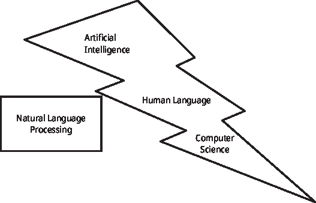

图 6.1：NLP 领域。

表 6.1：自然语言与计算机语言对比。

| 自然语言 | 计算机语言 |
| --- | --- |
| 词汇量巨大 | 词汇非常有限 |
| 人类语言相互通信 | 编程语言由机器理解 |
| 丰富、细微且通常具有歧义性，允许表达思想、情感和复杂观点 | 结构化、精确且无歧义 |
| 复杂的语法和语义，包括语法规则、词汇和成语 | 由规则和约定定义的严格语法和语义 |
| 服务于各种用途（社交互动、思想情感表达、讲故事、说服等） | 执行特定任务（数学计算、数据处理、硬件控制等） |
| 人类之间的通信 | 与计算机的通信 |
| 自然语言通过文化、社会、历史影响随时间演变，适应新的背景和技术 | 计算机语言通过更新、修订、响应计算技术变化引入新语言以及适应应用领域而演变 |

表 6.1 强调了自然语言与计算机语言之间的主要区别，强调了它们的本质、语法、语义、目的、受众、演变和获取方式。

### 6.1.1 自然语言处理

NLP 是人工智能的一个分支，通过通过自然语言研究计算机与人之间的接口（图 6.2）。它使用各种算法来分析并从语言中推导出意义，通过连贯、有意义的短语创建自然语言。

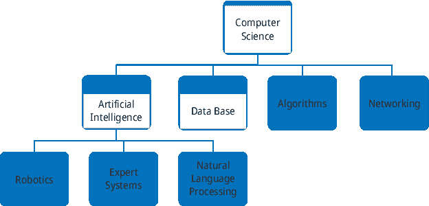

图 6.2：计算机科学的不同领域。

NLP 对于使计算机能够以母语与人类通信并处理大量文本数据至关重要。它允许计算机读取、解释、衡量情感并识别重要部分。鉴于每天产生的海量非结构化数据，自动化对于高效分析至关重要。NLP 帮助解决语言中的歧义，并为用于语音识别和文本分析等应用的数据添加适当的数值结构。

NLP 仍然是计算机科学以及信息检索的多学科子领域。它主要通过让计算机理解人类语言来辅助医学研究、搜索引擎和商业智能等领域（注：此处原文逻辑有重复，已按原意翻译）。人与计算机通信变得更加自然[[1]]。NLP 仍然是计算机的一个多学科子领域。

### 6.1.2 NLP 的组成部分

自然语言理解（NLU）和自然语言生成（NLG）是 NLP 的两个部分。NLU 从内容中提取元数据，帮助机器理解语言（图 6.3）。

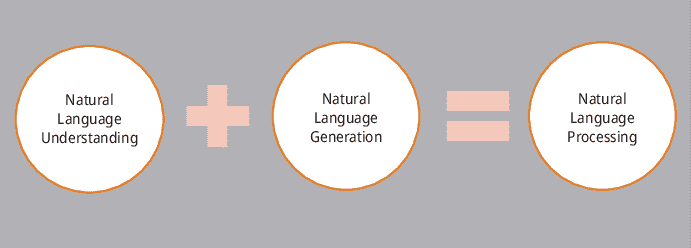

图 6.3：NLP 组成部分。

NLG 将输入映射为有用的表示，而 NLU 将数据转换为自然语言。NLP 系统结合了 NLU 和 NLG，关注从结构化数据。

### 6.1.3 NLP 与 NLU

NLP 涉及处理和分析文本，执行机器翻译等任务。它在表面层运行，处理语言复杂性。

NLU 的目标是理解文本的意思和上下文。它超越了表面理解，像人类一样理解语言，应用于虚拟助手和问答系统。

### 6.1.4 NLP 与 NLG

NLP 专注于理解和处理人类语言，执行文本分类等任务。它接收人类语言输入并导出结构化表示。

NLG 则专注于生成类人输出，处理文本摘要和内容生成等任务。它接收结构化数据作为输入并产生人类语言输出，应用于报告生成和虚拟助手。


NLP 和 NLG 相互关联，任务通常相互支持。NLP 的挑战包括歧义消除和上下文理解，而 NLG 的挑战包括响应生成的连贯性和自然度。NLG 是 NLP 的一个子集，使用马尔可夫链、循环神经网络、记忆和 Transformer 等模型生成有意义的句子。

例如，一个网站可以发布每日股市报告，这可能是耗时且无聊的。通过结合 `NLP`、`NLU` 和 `NLG`，系统可以分解文本，生成一个故事，并让用户专注于其他任务。这种方法让系统能够像人类一样工作，并为用户节省时间 [[3]]。

## 表 6.2：`NLP`、`NLG` 和 `NLU` 的对比

| `NLP`（自然语言处理） | `NLG`（自然语言生成） | `NLU`（自然语言理解） |
| --- | --- | --- |
| 处理和分析人类语言 | 生成类人语言输出 | 理解人类语言输入的意含义和语境 |
| 文本分类、情感分析、机器翻译等 | 文本摘要、内容生成、自动报告写作等 | 意图提取、语义分析、问答等 |
| 获取人类语言输入并导出结构化表示 | 以结构化数据为输入并产生人类语言输出 | 获取人类语言输入并导出结构化表示或提取有意义的信息 |
| 机器人、情感分析、语言翻译等 | 自动报告生成、虚拟助手、数据到文本系统等 | 虚拟助手、问答系统、对话代理等 |
| 歧义消除、上下文理解、句法复杂性等 | 回应生成的连贯性、维持上下文、实现自然性等 | 语义理解、推理、消除歧义、处理上下文等 |

表 6.2 从输入、输出、应用和挑战等各个方面对 `NLP`、`NLG` 和 `NLU` 提供了清晰的对比，使其更容易理解它们的区别和特征。

## 表 6.3：常见的 `NLP` 任务和模型

| `NLP` 任务 | 模型 |
| --- | --- |
| 文本分类 | `BERT`, `RoBERTa`, `CNN`, `LSTM`, `FastText` |
| 命名实体识别 | `BERT`, `CRF`, `LSTM`, `BiLSTM`, `spaCy` |
| 情感分析 | `BERT`, `LSTM`, `BiLSTM`, `Transformer`, `VADER` |
| 机器翻译 | `Transformer`（例如 `BERT` 和 `GPT`）、`LSTM`, `seq2seq` |
| 文本生成 | `GPT-3`, `LSTM`, `Transformer`, `OpenAI GPT` |
| 问答 | `BERT`, `RoBERTa`, `Transformer`, `BiDAF` |
| 摘要 | `BERT`, `Transformer`, `LSTM`, `seq2seq` |
| 语言建模 | `GPT-3`, `BERT`, `Transformer`, `LSTM`, `OpenAI GPT` |
| 语音识别 | `DeepSpeech`, `WaveNet`, `Transformer`, `LSTM` |

表 6.3 对用于各种 `NLP` 任务的常用模型提供了全面的概览，展示了不同架构在处理特定 `NLP` 挑战时的多样性和有效性。

# 6.2 `NLP` 中的优化

优化是一组用于解决问题的数学方法。随着我们深入研究 `NLP`，很明显，`NLP` 需要特殊的语境来应对独特的挑战。`NLP` 的有效性依赖于优化技术来提高性能和准确性。

深度学习的出现彻底改变了 `NLP`，但训练复杂的网络需要复杂的策略。`NLP` 的有效性依赖于优化技术来提高性能和准确性。

深度学习的出现彻底改变了 `NLP`，但训练复杂的网络需要复杂的策略。

通过这一探索，本章提供了从传统方法到现代程序的全面概述。


表 6.2 从输入、输出、应用和挑战等各个方面对 `NLP`、`NLG` 和 `NLU` 提供了清晰的对比，使其更容易理解它们的区别和特征。

表 6.3 对用于各种 `NLP` 任务的常用模型提供了全面的概览，展示了不同架构在处理特定 `NLP` 挑战时的多样性和有效性。

优化涉及几个步骤：

- 数据预处理
- 去除停用词
- 文本标准化
- 超参数选择
- 集成技术

这些步骤有助于模型的泛化能力并减少过拟合的可能性。执行阶段为 6 周，咨询时间为 2 小时。


通过利用这些优化策略，该领域展示了其在 `NLP` 方面的专业知识，以及为客户提供卓越解决方案并产生显著结果的投入。

## 6.2.1 优化 `NLP` 中的问题

`NLP` 优化涉及特殊的语境来应对语言数据的独特挑战：

`NLP` 的目标函数与语言模型在特定任务（如机器翻译或情感分析）上的性能有关[7, 8]。

`NLP` 优化的决策变量包括模型的因素，例如神经网络架构的权重或机器学习算法的超参数。

`NLP` 优化的约束通常来自计算资源的限制、数据集可用性或特定任务的要求。这些约束可能包括处理大型文本语料库的内存限制、数据稀疏问题以及某些语言生成任务中的语言限制。

`NLP` 采用各种优化算法来有效地训练语言模型，例如基于梯度的技术 `SGD`、`Adam 优化` 和基于动量的方法。局部最优与全局最优的区别在 `NLP` 优化中至关重要，由于目标函数的非凸性，神经网络训练通常收敛于局部最优。

`NLP` 优化技术包括词嵌入、注意力机制和迁移学习。词嵌入将单词表示为连续向量空间中的压缩向量，允许模型捕捉单词之间的语义相似。注意力机制允许模型在处理过程中关注相关的输入部分，从而增强机器翻译和文本摘要等任务的性能。

硬件是 NLP 优化中的一个重要因素。优化过程的速度、准确性和有效性都会受到所用技术类型的影响。

NLP 优化中一些流行的硬件包括以下几种：

`Graphics processing units (GPUs)` 是设计用于同时管理海量数据的特种计算机。因此，它们非常适合 NLP 优化，因为这种优化可能涉及处理大型文本数据集。

`Tensor processing units (TPUs)` 是专门为机器学习应用制造的专用处理器。尽管它们是为机器学习所需的特定任务定制的，但它们与 GPU 具有可可比性。因此，它们非常适合 NLP 优化，因为 NLP 任务通常需要大量的矩阵运算。

`Central processing units (CPUs)` 是驱动大多数计算机的通用处理器。这使得它们成为处理能力要求较低的 NLP 优化任务的理想选择。

任务的具体需求决定了 NLP 优化的硬件选择。如果速度是首要考虑，`GPU` 或 `TPU` 是理想选择。如果精度是最核心的考虑因素，`CPU` 是理想选择。此外，如果适应性是最重要的考虑因素，`CPU` 是理想选择。

# 6.3 自然语言处理 (NLP) 模型

NLP 模型在 AI 社区中日益重要，特别是在聊天机器人和语言模型中 [9]：

* `Eliza` 开发于 20 世纪代 0，使用模式匹配来解决图灵测试。
* `Microsoft’s Tay` 发布于 2016 年，采用了性别歧视和种族歧视推文中的句子，凸显了不进行数据去偏的。
* 以 Muppet 角色命名的 `Deep Learning Models`，如 `ELMo`、`BERT`、`Big BIRD`、`ERNIE`、`Kermit`、`Grover`、`RoBERTa` 和 `Rosita`，提供了上下文嵌入和增强的知识表示。
* `GPT-3` 是一个拥有千亿参数的模型，可以以人类级别的流畅度生成独特的文本。
* `LaMDA` 是 Google 建立的非正式聊天机器人，基于 Transformer，旨在为对话提供合理的回答。
* `MoE models`（如 switch transformer）使用高效的路由算法为不同的输入提供不同的参数，从而降低通信和计算成本。

## 6.3.1 NLP 模型优化

优化 NLP 模型涉及调整其参数、架构和训练过程，以实现最佳的准确率和高效的计算性能，如图图 6.6 所示：

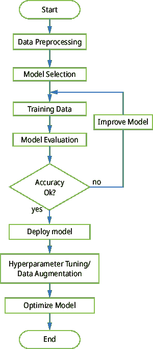

图 6.6：NLP 优化流程图。

1. **开始：** 流程从一个旨在优化 NLP 模型的 `Flowchart` 开始。
2. **数据预处理：** 这一步包括为模型清洗和准备文本数据。这可能包括去除噪声、修复拼写错误。
3. **模型选择：** 在此，你选择 `Transformer`。
4. **训练：** 将数据输入模型，并对模型的参数进行调整。
5. **评估：** 在测试数据集上衡量模型的成果。
6. **决策点：** 根据评估结果判断：
    * **是（准确率可以吗？）**：如果模型表现良好，流程结束。
    * **否（需要改进吗？）**：你进入优化阶段。
7. **优化：**
    * **超参数调优：** 这涉及调整设置。
    * **数据增强：** 这涉及生成数据的变体。
8. **重复：** 在应用优化后，你可能需要重复步骤 4 和 5，直到你对满意。
9. **结束（部署模型）：** 一旦模型达到可接受的水平，即可进行部署。

### 6.3.1.1 优化 NLP 的优势

优化 NLP 系统可以带来以下结果：

* **提高效率：** 优化技术可以增强 NLP 的速度和性能。
* **增强准确性：** 通过微调模型，优化可以提高任务的准确率。
* **可扩展性：** 优化的 NLP 系统可以处理更大量的文本。
* **降低成本：** 优化可以带来更高效的资源系统。
* **更好的用户体验：** 更快的响应速度和提高的准确率有助于提供更好的用户体验。
* **鲁棒性：** 优化的 NLP 模型对数据的变化通常更具鲁棒性。
* **适应性：** 优化技术使 NLP 系统能够适应变化的需求。

# 6.4 NLP 优化技术

优化技术在最大化 NLP 模型的性能、效率和适应性方面起着至关作用，最终为企业创造价值并提升用户体验。

## 表 6.4：NLP 中常用的优化技术

| 优化技术 | 描述 |
| :--- | :--- |
| 参数调优 [10, 11] | 调整模型参数以优化精确度、精确率、召回率、ROC-AUC 和 F1 分等性能因子 |
| 算法优化 [12, 13, 14] | 设计和优化特定 NLP 的算法，例如用于分类标注的动态规划或机器翻译解码中的束搜索 |
| 特征工程 [15, 16] | 构建特征以从文本数据中捕捉语言模式、语义信息或句法结构 |
| 表征学习 [15, 16, 17, 18] | 从数据中自动学习特征表示，包括类似于词连通性的技术（例如 `Word2Vec` 和 `GloVe`）以及基于上下文的连通性技术（例如 `BERT` 和 `ELMo`） |
| 深度学习优化 [19, 20, 21] | 采用特定深度学习的优化技术，如随机梯度下降（`SGD`）变体、学习率调度和 dropout 正则化 |
| 领域特定优化 [21, 22, 23] | 将优化策略适应于特定的 NLP 领域或应用，例如生物医学文本挖掘或法律文档分析 |
| 迁移学习 [24, 25] | 利用在大型文本语料库上预训练的模型，以提高在有限标注数据下的下游 NLP 任务的性能 |
| 集成方法 [26] | 结合多个模型的预测结果以提高整体性能，包括模型平均、堆叠（stacking）和提升（boosting）等技术 |

表 6.4 描述了通过结合多个模型的预测结果来提高整体性能的方法，包括模型平均、堆叠和提升等技术。

集成方法包括模型平均、堆叠和提升等技术，其目的是通过结合多个模型的预测结果来提高整体性能。

## 6.4.1 模型微调（Fine-tuning）

微调是指在大型文本语料库上预训练的模型，以提高在标注数据有限的下游 NLP 任务上的性能。

深度学习优化采用特定深度学习的优化技术，如随机梯度下降（`SGD`）变体、学习率调度和 dropout 正则化。

领域特定优化是指将优化策略适应于特定的 NLP 领域或应用，例如生物医学文本挖掘或法律文档分析。

迁移学习 [24, 25] 是利用在大型文本语料库上预训练的模型，以提高在标注数据有限的下游 NLP 任务上的性能。

表征学习包括从数据中自动学习特征表示的技术，包括类似于词连通性的技术（例如 `Word2Vec` 和 `GloVe`）以及基于上下文的连通性技术（例如 `BERT` 和 `ELMo`）。

## 6.4.2 评估指标

在微调后，通过准确率、精确率、召回率和 F1 分数对模型性能进行评估。

这些指标的计算方法如下：

- **准确率**：所有预测正确的样本占总样本的比例
- **精确率**：$TP / (TP + FP)$
- **召回率**：$TP / (TP + FN)$
- **F1 分数**：$2 \times \frac{\text{精确率} \times \text{召回率}}{\text{精确率} + \text{召回率}}$

其中，$TP$ 是真阳性，$FN$ 是假阴性，$FP$ 是假阳性，$TN$ 是真阴性。

## 6.4.3 超参数调优

超参数调优对于优化 NLP 模型以提高在特定任务上的性能至关重要。通过系统地探索超参数空间并选择最佳超参数，从业人员可以开发出在真实数据上具有良好泛化且运行有效的 NLP 模型。

有许多超参数调优方法：网格搜索、随机搜索、贝叶斯优化和基于梯度的优化。网格搜索方法简单但计算代价高，而随机搜索的计算成本较低，在实践中通常表现更好。贝叶斯优化使用概率模型来预测最优超参数设置，而基于梯度的优化需要可微的目标函数。在选择超参数配置后，使用这些超参数在训练数据集上训练 NLP 模型，并在独立的验证数据集上进行评估。超参数调优通常是一个迭代过程，根据性能反馈调整超参数，直到达到满意的性能。最后，使用整个训练数据集通过这些超参数训练最终的 NLP 模型，并在独立的测试集上评估其性能。

一种始终用于超参数调优的方法是网格搜索，它涉及对特定超参数子集进行搜索。网格搜索通过以下公式进行：

(*θ^(*),λ^(*)) = argminθ*, λL(*)

其中 `Θ` 代表模型参数，`Λ` 代表超参数，`L` 是损失函数（例如分类任务中的交叉熵损失），`f θ,λ` 是具有参数 `θ` 和超参数 `λ` 的模型函数，`X` 是输入数据，`y` 是目标标签，而 (`θ^✶,*λ^✶`) 是使损失函数最小化的最优参数和超参数。

Wang 等人 [11]探索了 NLP 和机器学习中的超参数优化，提出了一种多阶段方法。该算法将问题分解为多个数据量不断增加的阶段，为性能更优候选者提供快速评估。本章强调，超参数优化是一种机器学习算法，旨在找到一个超参数设置 `λ^✶`，使得确认准确率 `L` 最大化，其中超参数 (`λ`）和域 (`Λ`）被用于优化训练数据 (`T[train]`) 上的验证准确率和验证数据 (`T[valid]`) 上的确认准确率。目标是找到一个使确认准确率最大化的超参数设置 `λ^✶`。

该算法在情感排序和问答任务上表现出优于当时的贝叶斯优化算法及贝叶斯优化快速替代方案的性能。

### 6.4.2.1 选择最佳超参数的算法

**输入**: 损失函数 `L`，阶段数 `S`。每阶段迭代次数 `Y= (Y[1]… …Ys)`,每阶段训练数据

`T[train = (T]¹[train, … … ., T]^s[train,)`

验证数据 `T[valid]`，初始化 `λ[1: k]`

**输出**: 超参数 `λ^✶`

```
for stage s=1 to S do
    for i=1 to k do
        L[i]=Evaluate L (λ[i], T^s[train], T[valid])
    end
    for j=k+1 to Y[s] do
        V: regression model on (λ[i,] L[i]) [i=1 to j1]
        λ[j] = arg max [λ € Ʌ] a(λ, ν)
        L[j =] Evaluate L (λ[j], T^s[train], T[valid] )
    end
    reset λ[1:k =] best k configs€(λ[1,]… … … .,λ[Ys])
    based on validation accuracy L
end
return λ^✶ = arg max [λj € {λ^(Y1)… … … ,.λ^(Ys))^(Lj)]
```

**阶段循环:**

```
for stage s = 1 to S do
    for i = 1 to k do
        Li = Evaluate L(λ[i], T^s[train], T[valid]) → 初始配置
    end
    for j = k+1 to Ys do
        V = Regression model on (λ[i], L[i]) for i = 1 to j-1 → 回归模型
        λ[j] = arg max λ ∈ Λ a(λ, V) → 超超优化
        L[j] = Evaluate L(λ[j], T^s[train], T[valid]) → 新配置
    end
    reset λ1: k = best k configs ∈ (λ1, …, λYs) based on validation accuracy L → 选择最优配置
end
Return λ^✶ = arg max λj ∈ {λY1, …, λYs} Lj → 最佳超参数的最终选择。
```

自动机器学习 (AutoML) 中的贝叶斯优化简化了针对特定问题和数据集选择最优模型及其超参数的过程。贝叶斯优化的近期展示了其在微调复杂模型（如深度信念网络、卷积神经网络和马尔可夫链蒙特卡洛方法）方面的效率。

现有的先进方法侧重于扩展基于模型的贝叶斯优化以解决这个问题，因为与传统方法相比，它能够在较少的迭代内确定可靠的解决方案。


## 6.4.2.2 超参数调优的优点

超参数调优是机器学习中的一个关键过程，它可以提高模型性能、增强泛化能力、提高效率、降低成本并增强鲁棒性。它有助于在模型复杂度与未见数据上的泛化之间找到最佳平衡。它还允许针对任务进行定制。

## 6.4.3 并行与分布式训练

并行和分布式训练对于扩展 NLP 模型以及在大规模数据集上高效训练它们至关重要。数据并行涉及将数据集分为多个批量，每个批次由计算单元独立处理。模型并行将模型划分为不同的单元，允许具有大内存占用的模型。

分布式训练涉及多个机器或节点协作训练单个模型，例如参数服务器架构。`Horovod`、`TensorFlow` 和 `PyTorch` 等框架提供了对分布式训练的内置支持。异步训练中每个工作节点独立计算梯度并更新模型参数，可以带来更快的训练速度，但可能会面临数据过期和更新不一致等问题。另一方面，同步训练确保所有工作节点同步更新，从而获得更好的收敛。

`Word2Vec` 模型（如 `skip-gram` 模型）由 `Mikolov` 等人 [14, 15] 建立，以实现训练并行并提高使用神经网络进行词表示的效率。此外，神经语言模型 [49, 50] 探索了支配性能的缩放法则以及自适应输入表示以提高效率。

# 迁移学习

利用预训练模型和迁移学习方法来引导模型训练，特别是在处理有限标记数据时。

# 微调

在特定领域的数据或任务上对预训练模型进行微调，以适应特定的用例并提高性能。

# 可解释性与可说明性

确保 NLP 模型具有可解释性和可说明性，特别是在医疗和金融等重要应用领域，这些透明度对于决策至关重要。

总而言之，NLP 优化通过数据预处理、特征工程、超参数调优、正则化、压缩、并行化、分布式计算、硬件优化、增量学习和持续评估，提高了模型的准确性、速度、效率和可扩展性。

## 6.5.1 NLP 优化工具

将提供多种 NLP 优化工具帮助企业应对其语言处理需求 [29]。这些工具使企业能够分析各种来源的非结构化文本数据，改进决策、自动化任务并提取有价值的信息。

### 6.5.1.1 Scalenut NLP 分析工具

`Scalenut` 是一个基于 AI 的 SEO 和内容营销平台，利用 NLP 进行内容的规划、研究、创建和优化。它通过使用符合用户意图和搜索引擎预期的相关关键词及短语，增强了可读性和 SEO 性能。

### 6.5.1.2 Google Cloud Natural Language API

`Google Cloud Natural Language API` 是一种极具影响力的 NLP 工具，帮助创作者使用 `Google` 的机器学习技术研究文本数据，支持多种编程语言，并提供 `RESTful` 接口以便集成到应用程序中。

### 6.5.1.3 IBM Watson NLP

`IBM Watson NLP` 提供从文本数据中定位和提取信息的 AI 服务，允许针对银行和医疗等行业进行定制。

### 6.5.1.4 SpaCy

`SpaCy` 是一个广泛用于高级 NLP 任务的 `Python` 库，提供速度、准确性、预训练模型、词向量和嵌入，并具有多任务学习、生产就绪训练和用于 NER（命名实体识别）的语言分词功能。

### 6.5.1.5 MonkeyLearn

`MonkeyLearn` 是一个易于使用的 NLP 平台，帮助企业分析文本数据，包括情感分析、主题分类和关键词提取。它提供即时数据可视化、预构建和自定义模型、业务模板，以及与应用和 BI 工具的轻松集成。还提供定制的机器学习模型。

### 6.5.1.6 TextBlob

`TextBlob` 是一个基于 `NLTK` 的 `Python` 库，为 NLP 任务提供直观的接口，如情感分析、文本分类、词性标注、名词短语提取、词频分析、词形变化、词干还原、拼写纠错以及 `WordNet` 集成。

### 6.5.1.7 Amazon Comprehend

`Amazon Comprehend` 是与 `Amazon Web Services` 结合的 NLP 工具，允许用户执行情感分析、主题建模和实体识别等任务，其中 `Comprehend Medical` 是针对医疗专业人员的专用变体。

### 6.5.1.8 NLTK

`NLTK` 是一个用于文本处理的 `Python` 库，提供了对 50 多个语料库和 `WordNet` 等词汇手段的接口。它包括分词、过滤停用词、词干提取、标注、词性还原、块处理（`chunking`）、子块处理（`chinking`）、NER、一致性分析、分布图、频率分布和词搭配等功能。

### 6.5.1.9 AllenNLP

`AllenNLP` 是由人工智能研究院（`Allen Institute for Artificial Intelligence`）建立的健壮 NLP 库，基于 `PyTorch` 深度学习框架构建。它为预处理、模型训练、评估、模型部署和可视化等关键任务提供了自动化模块。

### 6.5.1.10 GenSim

`GenSim` 是一个旨在主题建模和文本相似性分析的 `Python` 库，设计用于大规模文本处理。它利用无监督模型快速、可扩展且高效地处理大型文本文件，消除了昂贵标注的需求。

`NLP.py` 是用于数值优化的 `Python` 程序包。它旨在提供一个解决线性和非线性规划问题的工具箱，既易用又可扩展。

`NLP.py` 是一组单元和模块，支持稀疏矩阵、非线性优化技术以及大型稀疏矩形系统的良好解决方案。它的目标是让大规模约束问题的实现、测试、原型设计、实验和修改优化算法变得简单且直观。`NLP.py` 适用于大规模数值优化的教学、学习和研究 [30]。

### 6.5.1.11 Stanford CoreNLP

`Stanford CoreNLP` 是由斯坦福大学 NLP 社区开发的 `Java` NLP 工具包，提供词性标注、分词、指代识别和依赖分析等强大功能，确保了可扩展性和速度优化。

总的来说，优化工具分析来自客户评论和社交媒体等多种来源的非结构化文本数据，为产品服务的改进提供可操作的见解。它们使企业做出数据驱动的决策，提高运营效率和客户满意度。

### 6.5.1.12 NLP 工具的优势

NLP 优化工具为企业带来了许多利益。它们可以通过分析客户互动来改进客户支持，使企业能够理解客户情感并提供个性化支持。它们还可以通过理解用户查询的上下文和意图增强搜索引擎和推荐系统，从而提升用户体验并增加转化率。NLP 工具还可以分析公众对品牌或产品的观点，使企业能够识别可能的问题并产生积极策略来解决客户顾虑。

自动化内容分析可以通过 NLP 工具完成，处理海量文本数据，使企业能够快速提取有价值的见解。这对于市场研究、竞争分析、趋势识别和内容策划非常有用。NLP 工具还可以通过自动分析文档、合同和监管文本辅助合规性监控，识别潜在风险并确保符合法律和法规要求。

数据提取和知识管理也可以通过 NLP 工具实现，它可以从非结构化文本中提取结构化信息，让企业更容易组织和管理数据。此外，NLP 工具还可以协助语言翻译和本地化，促进全球扩张、与国际观众进行有效沟通并开拓新市场。

## 6.6 NLP 应用

NLP 被应用于各个行业领域，包括医疗保健、信用卡和保险欺诈检测以及用于客户情感分析的文本分析。全球 NLP 市场预计到 2026 年达到 351 亿美元，公司意识到 AI 驱动的解决方案将继续增长 [31]。了解基础知识以及 NLP 在业务中实际应用的方式至关重要。许多与 NLP 相关的技术子集，它们经常相互混淆。

NLP（自然语言处理）和 NLU（自然语言理解）对于弥合人机通信差距、增强 AI 直观性至关重要。NLP 为机器与人类语言交互提供了框架，而 NLU 通过理解上下文和意图增强了这一点。这些技术在业务领域具有巨大潜力，可以改善客户互动和决策过程。随着它们与机器学习和深度学习相结合，将创造出理解并模仿人类通信的智能 AI 系统。这些技术的真正力量在于将非结构化数据转化为可操作的洞察，为公司在数字市场中赢得竞争优势。

![图 6.8：常见的实时 NLP 应用（改编自 [32])](graphic/converted/b_9783111436180-006_fig_008.png)

图 6.8：常见的实时 NLP 应用（改编自 [32]）。

NLP 的现代业务应用示例包括图 6.8，社交媒体情感分析，其中 NLP 可以理解网络缩写、俚语、语码混合、表情符号、表情包和标签。这允许企业从客户通信中提取数据，并对其进行组织，以便机器学习模型能够分析其品牌性能。这些信息可用于接触影响者、调整广告活动、改进产品或服务方面，并提升品牌声誉。

在医疗保健领域，NLP 技术越来越多地用于理解和管理患者记录以及电子健康记录（`EHRs`）[39]。通过诊内调查、预约后调查和反馈网络表单获取记录化数据，通过 AI/ML 模型对患者评论、候诊室体验、术后护理、想法和感受进行研究。这有助于患者评估其服务的价值，并提供了更佳的患者体验。

语言转换是现代社会的一个重要方面，在线翻译对于研究人员以及欣赏外国电影和纪录片来说至关重要。NLP 技术提供了大规模、快速且专业的语音转文本翻译。句子边界检测是 NLP 中的一项基础任务，允许对多种语言的整个文本进行翻译并逐句匹配。`Google Translate` 被 5 亿用户用于翻译 100 种不同语言的文件或脚本。

在航空行业中，航天和国防领域的机械师利用 NLP 从大量的飞机手册中收集有关特定问题的数据，这些手册有时可能是多种语言的。通过语义探索和 NER（命名实体识别）识别，机械师可以搜索并理解飞行员或其他人员描述飞行途中遇到问题的注释。NLP 使用神经网络进行手写识别，为用户提供他们寻找的数据。AI 改变了数据诊断，空客相信基于 AI/ML 的控制工程可以在 2025 年之前几乎完全消除非计划的飞机停飞。

自动交易是 NLP 在业务中的另一项应用，计算机程序代表用户进行交易。NLP 可以审查财务结果、合并和收购，并根据这些数据对哪些股票是良好的投资做出建议。自动电话系统（如银行和票务系统中使用的）使用语音识别和交互式语音响应来引导交易并提供语言选项。

### 6.6.1 现实视角

NLP 为现实应用和有效方法提供了宝贵的洞察。

`Google BERT`、`OpenAI GPT-3`、`Amazon Alexa` 以及其他 NLP 模型对增强 NLP 领域都起了关键作用。`BERT` 是一种深度双向变换模型，已应用于问答任务 [43]，使用 `Squad` 数据集，该数据集被广泛用于训练和评估问答模型、文本分类 [33, 34] 以及 NER [38]。`GPT-3` 是一个大型自回归语言模型，展示了卓越的语言理解和生成能力，能够实现文本补全、翻译和代码生成等任务。虚拟助手 `Amazon Alexa` 使用 NLU、意图识别和对话管理等 NLP 技术来提供个性化帮助并回答问题。在医疗保健领域，NLP 已用于临床文档、EHR 分析和医学文献挖掘等任务。公司使用 NLP 驱动的机器人提供客户服务，利用意图识别、情感分析和 NER 等技术。在金融领域，NLP 用于情感检查、主题分析和分类 [33]、金融文档摘要 [47] 以及欺诈检测。

文本分类对于组织新一代单词文档至关重要。此外，`BBC` 文本分类系统使用逻辑回归、随机森林和 K 近邻等机器学习算法，并在精确率、准确率、F1 分数、支持度和混淆矩阵上进行了测试。精确性和准确率最高的分类器被认为是 `BBC` 数据集的最佳算法 [34]。

### 6.6.2 NLP 的现有方法与技术

*   自动分类是一个广泛的研究领域，使用机器学习算法将文本文档分为预定义的组。它对于组织大量的非结构化信息至关重要。各种文本分类方法分为传统方法、基于模糊逻辑的方法和基于深度学习的方法。传统方法包括手工特征、启发算法和基于图的方法。它还提供了非印度语言的可用库、数据集和标记技术 [35]。

*   退伍军人事务与前列腺癌基金会 [36] 开发并验证了用于识别转移性前列腺癌（`mPCa`）退伍军人的 NLP 工具。对于那些可能从新的诊断和治疗方案中受益的退伍军人来说，这是一个可靠的工具。

*   `Gökgöl` 等人 [37] 使用 NLP 技术通过 `Python` 和字符串相似性函数开发了一种预测模型。该在线诊断工具适用于个人和临床使用，特别是当通用能力发展得更快时。

*   `NeuroNER` 是一个基于人工神经网络（`ANN`）的易用 NER 工具。它允许用户标注实体、训练 `ANN` 并预测它们在新文本中的位置和类别，使过程变得顺畅且易于获取 [38]。

*   EHR 是关键的临床数据源，包含了医生关于患者疾病和治疗程序的叙述性信息，但对机器理解具有挑战性。

*   `Vaswani` 等人和 `Keskar` 等人 [40, 41] 引入了 `Transformer` 语言模型，通过控制风格、内容和特定任务的行为，对文本生成进行显式控制，在保留无监督学习优势的同时，其源自自然共生的结构。

*   一种用于自然语言理解（NLU）和机器智能的对话建模方法 [44] 使用序列到序列框架，预测下一个句子，从大型数据集中提取知识并进行常识推理。

*   `See` 等人 [45] 提出了一种用于混合指针生成器网络的抽象文本摘要的新架构，性能优于现有模型。

*   `Al-Makhadmeh` 和 `Tolba` [46] 创建了自然语言处理（NLP）与机器学习的结合，用于预测社交媒体网站上的仇恨言论。

以上所有内容证明了机器学习算法在分类 `BBC` 新闻文章方面的有效性，凸显了自动文本分类在管理海量数据的重要性。该研究与 NLP 与机器学习日益增长的交叉领域相一致，诸如 `BERT` 和混合指针生成器网络等新型架构提供了广阔的应用前景。

## 6.7 未来方向

NLP 优化的未来方向预计将关注应对新兴挑战、提高效率以及提升语言处理系统的能力。这些方向包括：开发平衡性能与计算资源的高效模型架构；探索多任务学习方法以利用共享表示；开发自适应优化算法以提高不同 NLP 任务中的收敛速度、稳定性和鲁棒性；探索低资源和零样本学习（`zero-shot learning`）技术；探索硬件加速技术；提高 NLP 模型的解释性和可解释性；解决鲁棒性和公平性问题；针对特定领域或应用定制优化策略；探索元学习和自动机器学习（`AutoML`）方法；以及探索持续学习和终身学习技术。

通过探索这些未来方向，研究人员和从业者可以推动当代 NLP 优化领域的发展，应对不断变化的挑战，并为完善语言处理系统的能力、有效性和公平性开启新机会。

## 6.8 总结

总结来说，优化对于 NLP 模型至关重要，它能增强各种任务的性能、可扩展性和效率。参数调优、算法优化、特征工程表示学习以及领域特定策略等技术被用于提高模型有效性、训练效率以及稳健、可解释且可扩展的语言处理系统的进展。NLP 优化的未来充满希望，研究重点将转向高效模型架构、多任务学习、自适应优化算法和领域特定优化。通过拥抱这些未来方向，NLP 从业者可以解锁语言理解、生成和交互方面的新能力并应对复杂挑战。NLP 中的优化不仅是一项技术尝试，更是人类语言交互创新与变革的催化剂。

## References

[1] Gillis, A. S., Lutkevich, B., & Burns, E. (2024 2 15). Natural Language Processing (NLP). Enterprise AI. →

[2] Gokcuoglu, A. Y. (2023 12 25). 7 Real-life examples of Natural Language Processing. →

[3] Gill, J. K. (2023 11 23).What are the Differences Between NLP, NLU, and NLG? XenonStack. a, b

[4] 11 Real-Life Examples of NLP in Action. [Internet]. Available from: [`levity.ai/blog/11-nlp-real-life-examples`](https://levity.ai/blog/11-nlp-real-life-examples). →

[5] O’Neal, H. (2023 11 7). What is the difference between NLP and NLU: Business Use Cases. MetaDialog. Available from: [`www.metadialog.com/blog/difference-nlu-and-nlp/`](https://www.metadialog.com/blog/difference-nlu-and-nlp/)

[6] Natural Language Processing Optimization | AI/ML Development. [Internet]. Available from: [`aimlprogramming.com/services/natural-language-processing/`](https://aimlprogramming.com/services/natural-language-processing/) →

[7] Kouloump, E., Wilson, T., & Moore, J. (2011). Twitter sentiment analysis: The good the bad and omg! *Proceedings of the International Conference on Web and Social Media*, *5*, 538–541. →

[8] The, T., Na, J. C., & Khoo, C. S. (2010). Aspect-based sentiment analysis of movie reviews. *Journal of Information Science*, *36*(6), 823–848. →

[9] Natural Language Processing (NLP) Complete. 2023 1 11. Available from: [`www.deeplearning.ai/natural-processing/`](https://www.deeplearning.ai/natural-processing/) →

[10] Radford, A., Narasimhan, K., & Sutskever, I. (2018). Improving language understanding. →


[11] Wang, L., Feng, M., & Zhou, B. (2015). Efficient estimation of word representations in vector space. a, b

[12] Wu, Y., Schuster, M., Chen, Z., Le, Q., Norouzi, M., Macherey, W. (2016). Google’s neural translation: Bridging the gap between human and machine. →

[13] Devlin, J., Chang, M., Lee, K., & Toutanova, K. (2018). Pre-training of deep bidirectional transformers for language understanding. →

[14] Mikolov, T., Chen, K., Corrado, G., & Dean, J. (2013). Efficient estimation of word representations in vector space. a, b

[15] Mikolov, T., Sutskever, I., Chen, K., Corrado, G., & Dean, J. (2013). Distributed Representations of Words and Phrases and their Compositionality. a, b, c

[16] Zhang, X., Zhao, J., & LeCun, Y. (2015). Character-level convolutional networks for text classification. a, b

[17] Liu, Y., Ott, M., Goyal, N., Du, J., Joshi, M., Chen, D. et al. (2019). Roberta: A robustly optimized Bert pretraining approach.

[18] Yang, Z., Dai, Z., Yang, Y., Carbonell, J., Salakhutdinov, R. R., & Le, Q. V. (2019). Xlnet: 用于语言理解的泛化自回归预训练。*Advances in Neural Information Processing Systems*, 32.

[19] Kingma, D. P., & Ba, J. (2014). Adam: 一种随机优化方法。arXiv preprint arXiv:1412.6980.

[20] Liu, L., Jiang, H., He, P., Chen, W., Liu, X., Gao, J et al. (2019). 关于自适应学习率方差及超越。

[21] Conrad, J., & Branting, L. (2018). 法律文本分析专题介绍导言。*Artificial Intelligence and Law*, *26*. doi: 10.1007/s10506-018-9227-z.

[22] Dai, Y., Yu, H., Jiang, Y., Tang, C., Li, Y., & Sun, J. A. 对话管理综述：近期进展与挑战。ArXiv, 2020.abs/2005.02233.

[23] Lee, J., Yoon, W., Kim, S., Kim, D., Kim, S., So, C. H., & Kang, J. (2019). BioBERT: 用于用于生物医学文本挖掘的预训练生物医学语言表示模型。*Bioinformatics*, *36*(4), 1234–1240. doi: 10.1093/bioinformatics/btz682.

[24] Narayanan, D., Shoeybi, M., Casper, J., LeGresley, P., Patwary, M., Korthikanti, V et al. (2021 Nov). 使用 megatron-lm 在 gpu 集群上进行高效大规模语言模型训练。*Proceedings of the International Conference for High Performance Computing, Networking, Storage and Analysis*, 1–15.

[25] Puri, R., Kirby, R., Yakovenko, N., & Catanzaro, B. (2018). 大规模语言建模：在四小时内处理 40GB 文本。*2018 30th International Symposium on Computer Architecture and High Performance Computing (SBAC)*, 290–297. doi: 10.1109/CAHPC.2018.864535.

[26] Kumar,, Ananth, T., Samuel, S., Dinesh Samuel, R., & Niranjurthy, M. eds. (2022). 云计算中的隐私与安全：一种整体方法。CRC Press。

[27] Yang, Z., Yang, D., Dyer, C., He, X., Smola, A., & Hovy, E. (2016 Jun). 用于文档分类的分层注意力网络。In Proceedings of the 2016 Conference of the North American Chapter of the Association for Linguistics: Human Technologies (pp. 1480–1489).

[28] Chen, Y. (2015). 用于句子分类的卷积神经网络（硕士论文，滑铁卢大学）。

[29] Scalenut. 2023 年最佳 NLP 优化工具。2024 年 2 月 16 日。Available from: www.scalenut.com/blogs/best-nlp-optimization-tools-in-2023.

[30] `NLP.py` 简介：用于大规模优化的面向对象环境。[Internet]。Available from: https://pythonoptimizers.github.io/NLP.py/latest/introduction.htm.

[31] Team, R. (2021 年 3 月 1). NLP 业务应用 | NLP AI。Available from: https://www.repustate.com/blog/using-nlp-for-business-success/#why-is-nlp-so-important.

[32] Quan, N. (2024 年 1 月 26). 自然语言处理 (NLP) 的 8 大应用。Eastgate Software。Available from: https://eastgate-software.com/top-8-applications-of-natural-language-processing-nlp/.

[33] Jin, G. (2022). 深度学习技术下文本语义和文本分类中 NLP 系统的应用优化。In 2022 International Conference on Education, Network and Information Technology (ICENIT) (pp. 279–283). doi: 10.1109/ICENIT57306.2022.00068.

[34] Shah, K., Patel, H., Sanghvi, D et al. (2020). 用于文本分类的逻辑回归、随机森林和 KNN 模型对比分析。*Augmented Human Research*, *5*, 12. doi: 10.1007/s41133-020-00032-0.

[35] Boyapati, S., Swarna, R., & Kumar, A. (2020). 用于避免拥堵的动态路线识别的量子神经网络。In 2020 Fourth International Conference on IOT in Social, Analytics and Cloud (SBAC) (pp. 1018–1022). IEEE.

[36] Alba, P., Lynch, J., Gao, A et al. (2020). 使用自然语言处理 (NLP) 工具识别转移性前列腺癌的退军人。*Journal of Clinical Oncology*, *38*, 60-60.

[37] Gökgöl, M., & Orhan, Z. (2019). 使用自然语言处理 (NLP) 的医疗决策支持系统。*International Journal of Technology Assessment in Health Care*, *35*(S1), 10-14. doi: 10.1017/S026642319001090.

[38] Derncourt, F., Lee, J., & Szolovits, P. 基于神经网络的易用实体识别程序。arXiv preprint arXiv:1705.05487. 2017.

[39] Zhang, Y., Wang, X., Hou, Z., & Li, J. (2018). 通过机器学习方法从中文健康记录中进行临床实体识别。*JMIR Medical Informatics*, *6*(4), e9965.

[40] Vaswani, A., Shazeer, N., Parmar, N., Uszkoreit, J., Jones, L., Gomez, A et al. (2017). 注意力即一切。*Advances in Neural Information Processing Systems*, 30.

[41] Keskar, N. S., McCann, B., Varshney, L., Xiong, C., & Socher, R. (2019). Ctrl：用于控生成的条件 Transformer 模型。arXiv preprint arXiv:1909.05858.

[42] Liu, Y., & Lapata, M. (2019). 基于预训练编码器的文本摘要。arXiv preprint arXiv:1908.08345.

[43] Rajpurkar, P., Zhang, J., Lopyrev, K., & Liang, P. (2016). Squad：用于机器理解文本的 10 万个问题。arXiv preprint arXiv:1606.05250.

[44] Vinyals, O., & Le, Q. (2015). 神经对话模型。arXiv preprint arXiv:1506.05869.

[45] See, A., Liu, P. J., & Manning, C. D. (2017). 直击要点：基于指针生成器的摘要。arXiv preprint arXiv:1704.04368.

[46] Dhiman, H., Vyas, N., Pagrotra, A., Dutt, V. (2023). 通过 IoT 和计算机视觉以及高分辨率投影灯实现智能道路照明的实时交通分析和驾驶安全增强。[Internet]。In 2023 1st International Conference on Circuits, Power and Intelligent Systems (CCPIS). IEEE.Available from: http://dx.doi.org/10.1109/CCPIS59145.2023.10291872.

[47] Yekrangi, M., & Nikolov, N. S. (2023). 领域特定情感分析：一种针对金融市场的优化深度深度学习方法。*IEEE Access*, *11*. 70248–70262. doi: 10.1109/ACCESS.2023.3293733. →

[48] Sanh, V., Debut, L., Chaumond, J., & Wolf, T. (2019). DistilBERT，BERT 的蒸馏版本：更小、更快、更廉价且更轻量。arXiv preprint arXiv:1910.01108.

[49] Kaplan, J., McCandlish, S., Henighan, T., Brown, T. B., Chess, B., Child, R. et al. (2020). 神经语言模型的缩放法则。arXiv preprint arXiv:2001.08361. →

[50] Baevski, A., & Auli, M. (2018). 神经语言建模的自适应输入表示。arXiv preprint arXiv:1809.10853. →

# 7 揭示数学优化在人工智能中引人入胜的应用

Nancy Jasmine Goldena Thangapriya

**致：** 我们感谢全能的神在整个过程中提供的指导和灵感，使我们能够及时完成这项工作。我们对收到的祝福和爱表示感谢，这有助于本章节的成功完成。

### 摘要

优化算法在解决人工智能（AI）应用中固有的大规模、数据密集型问题方面发挥着至关重要的作用。随着 AI 的不断演进，研究人员面临着许多机遇和挑战，促使他们对极具前景的研究方向进行探索。本章节深入探讨了流行的优化算法及其在 AI 背景下的相关性。此外，它调查了 AI 应用的广阔图景，突出了优化方法论的演变趋势。通过综合这两个领域的见解，本章节旨在阐明数学优化（MO）在提升 AI 能力方面的变革潜力。本章节探索了 MO 技术与 AI 之间相互依赖的关系，阐明了它们对不同领域的深远影响。

**关键词：** AutoML 优化、计算机视觉优化、深度学习优化、金融优化、医疗健康优化、机器学习优化、NLP 优化、强化学习优化、机器人学优化、供应链管理优化。

## 7.1 引言

数学优化（MO）与人工智能（AI）的融合预着着创新与发现的新时代，为解决跨多个领域的复杂挑战提供了无尽的机遇。在计算机科学的广阔蓝图中，许多问题都围绕着优化目标这一基本任务展开，无论是为了最大化效率、最小化误差，还是在巨大的解空间中寻找最优解决方案。在 AI 领域，这种优化需求在预测模型的训练中表现得尤为显著，其中最小化诸如 `mean squared error` 等损失函数是算法精炼的基石。MO 作为一学科，涵盖了丰富的方法论，这些方法经过精心设计，旨在解决各种类型的问题，从结构良好的凸问题到固有的组合挑战。它的无远影响超出了计算机科学的范畴，渗透到工程、经济学、数学以及其他许多科学领域。事实上，对最优解决方案的追求超越了学科边界，驱动着研究人员和从业者共同探索创新的技术和方法 [1]。

在设计领域，优化作为一种关键且具有变革性的力量，赋能设计者创建出不仅高效而且在时间和资源上极具经济效益的解决方案 [2]。然而，许多工程优化问题固有的复杂性往往超过了传统方法的能力，因此需要开发能够精细地处理复杂解空间的尖端方法 [3]。AI 与 MO 的结合代表了问题解决能力的范式转变，赋予了计算系统增强的“脑力”，以以无与伦比的效率应对多方面的挑战。无论是优化物流运营、精炼供应链，还是协调复杂的决策过程，这种学科的融合都预示着彻底变革行业和重塑社会结构的可能。通过对优化算法、AI 应用以及新兴趋势的全面检查，本章节旨在阐明这种融合对技术格局及其他领域的深远影响。

## 7.2 AI 中 MO 的研究领域

AI 研究跨越了广泛的领域，在这些领域中可以应用 MO 技术来提高效率、准确性和可扩展性。以下是 MO 技术发挥广泛用途的一些关键 AI 领域，如图图 7.1 所示。


### 7.2.1 机器学习模型优化

MO 技术对于优化机器学习（ML）模型至关重要，包括参数调优、超参数优化和模型选择。基于梯度的优化、进化算法和贝叶斯优化等方法被用于增强模型性能。它涉及调整参数和配置以提高模型性能、扩展性和效率。不同类型的 ML 如图 7.2 所示。


以下是 ML 模型优化的一些最新进展和技术：

**自动超参数调优：** 这是 ML 的一项关键进展，能够开发更高效、有效的模型。贝叶斯优化、遗传算法和基于强化学习（RL）的方法变得日益流行。这些方法高效地探索超参数空间以识别最优配置，从而增强模型性能 [10]。

**神经架构搜索 (NAS)：** 这些方法实现了神经网络架构设计的自动化，使得为特定任务寻找最佳结构变得更加快捷。NAS 算法的最新进展（如可微架构搜索和进化算法）发现了具有卓越性能和效率的新颖架构 [11]。

**模型压缩与量化：** 随着在资源有限的设备上使用 ML 模型的需求增加，压缩和简化这些模型的技术变得非常重要。诸如知识蒸馏、剪枝和量化感知训练等新方法旨在在不损失性能的情况下使模型变得更小、更快 [12]。

## 学习率调度与优化

优化学习率对于有效训练深度学习模型至关重要。最近的技术，例如自适应学习率方法（如 `Adam` 和 `RMSprop`）和学习率调度策略（如 `cosine annealing` 和 `warmup schedules`），在训练过程中动态调整学习率。这些方法有助于改善收敛并防止过拟合 [13]。

## 用于模型选择的贝叶斯优化

贝叶斯优化方法日益用于模型选择和配置优化。这些技术通过利用目标函数的概率模型，有效地探索模型和超参数空间，从而实现更快的收敛并提高模型性能。

## 对抗鲁棒性与正则化

对抗攻击对机器学习模型的鲁棒性构成了巨大威胁。最近的研究专注于开发正则化技术和对抗训练方法，以增强模型对对抗扰动的的鲁棒性，从而提高泛化性能和安全性。

## 分布式与并行训练


训练大规模机器学习模型需要分布式和并行计算基础设施。分布式训练框架的最新进展（如`TensorFlow distributed`和`PyTorch distributed`）实现了跨多个 GPU 或设备的高效并行化训练，导致了更快的收敛和可扩展性。

总的来说，最近机器学习模型优化的进展涵盖了广泛的技术和方法，旨在提高模型在各种应用和领域的性能、可扩展性和效率 [15]。

## 7.2.2 深度学习

深度学习模型通常涉及大量的参数，使得优化具有挑战性。MO 技术，如随机梯度下降（`SGD`）变体、自适应学习率方法和网络剪枝算法，对于高效训练深度神经网络和提高其性能至关重要。深度学习 MO 通过优化深度神经网络的参数来最小化损失函数的过程。为了成功训练深度学习模型并在图像分类、目标识别、自然语言处理和`RL`在内的各种任务上实现高性能，这一优化过程是必不可少的。图 7.3 显示了不同类型的神经网络。

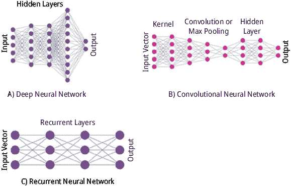

图 7.3：不同类型的神经网络。

以下是深度学习 MO 的一些关键方面和技术：

### 基于梯度的优化

大多数深度学习优化策略建立在梯度下降算法的基础上。它涉及沿着损失函数相对于参数负梯度的方向迭代地修改模型参数。梯度下降有多种变，每种在内存消耗和收敛速度之间都有不同的权衡，例如`SGD`、`mini-batch gradient descent`和批量梯度下降。

### 优化算法

为了增强基础的梯度下降技术，创建了许多复杂的优化算法。这些包括`Adam`（自适应动量估计），它将动量与基于梯度一阶和二阶矩的自适应学习率相结合；以及`momentum optimization`，它通过建立之前梯度的移动平均来加速收敛。

### 学习率调度

为了增强收敛并避免过拟合，学习率调度算法在训练过程中动态修改学习率。一些流行的调度策略包括`cyclic learning rates`（在训练轮次之间交替学习率）、`step decay`（步长衰减）和`exponential decay`（指数衰减）。

### 权重初始化

模型权重的适当初始化对于高效优化以及防止梯度消失或爆炸至关重要。如`Xavier initialization`和`orthogonal initialization`等技术有助于以有利于收敛和提高训练稳定性的方式初始化权重。

### 批量归一化

在训练过程中跨 mini-batch 对每层的激活进行归一化的过程被称为`batch normalization`。通过减少内部协方偏移，它有助于稳定和加速训练过程，并允许使用更大的学习率而不产生发散的风险。

### 正则化技术

正则化技术包括`weight decay`（权重衰减）、`dropout`以及`L1`和`L2`正则化，有助于防止过拟合并增强模型泛化能力。这些技术在训练期间惩罚较大的参数值或随机丢弃单元，以鼓励产生简单且更健壮的模型。

### 高级架构

引入了如`residual connections`（残差连接）、`skip connections`（跳跃连接）和注意力机制等架构创新，以促进优化并改进深度神经网络中的梯度流。这些架构修改允许训练更深、更复杂的模型，同时缓解梯度消失问题。

### 并行与分布式训练

大规模深度学习模型需要并行和分布式训练技术。这些技术将计算和内存分布在多个设备或机器上，实现了更快的收敛以及对更大数据集和模型的可扩展性 [31]。

通常，深度学习 MO 包含了广泛的方法和策略，目标是有效训练深度神经网络并在不同任务上取得创新性成果 [32, 33, 34, 35, 36, 37, 38, 39, 40]。不断提升深度学习模型的能力并扩展 AI 的前沿需要该领域持续的研究和创新 [32, 33, 34, 35, 36, 37, 38, 39, 40]。

## 7.2.3 强化学习

强化学习（RL）教授智能体通过连续决策来最大化累积奖励。多目标优化（MO）技术被用于策略优化、价值函数近似以及探索与利用的权衡。优化在如`Q-learning`、策略梯度方法和 actor-critic 系统等算法学习最优策略的过程中，起着至关重要的作用 [28]。RL MO 涉及优化智能体的策略或价值函数，以在序列决策环境中最大化累积奖励。这是训练 RL 智能体高效、有效地执行任务的基本方面。以下是 RL MO 的一些关键组成和技术：

### 策略优化

基于策略的强化学习涉及智能体通过将状态映射到动作来直接学习策略。通过策略优化技术来最大化预测奖励，例如策略梯度方法（如`REINFORCE`）和 actor-critic 算法（如`A2C`（优势 actor-critic）和`PPO`（近端策略优化））[29]。

### 价值函数近似

基于价值的强化学习方法估计价值函数，该函数代表了遵循特定策略的预期累积奖励。价值函数近似技术（如`Q-learning`、深度 Q 网络 (DQN) 和 double DQN）通过优化价值函数近似器的参数来准确估计状态-动作值 [30]。

### 探索与利用的权衡

有效的强化学习需要在利用（使用现有策略来最大化奖励）与探索（尝试新行为以寻找可能更好的策略）之间取得平衡。探索策略包括`ε-greedy`、`Boltzmann 探索`和`Thompson 采样`，通过优化智能体的探索策略来高效地探索环境。

### 奖励塑造与激励设计

奖励塑造技术通过修改奖励信号来引导智能体产生期望的行为并改进学习。激励设计涉及仔细设计奖励函数，使其与任务目标一致，并为智能体提供信息丰富的反馈，从而促进高效优化。

### 时序差 (TD) 学习

这些技术包括`SARSA`（状态-动作-奖励-状态-动作）和`TD(λ)`算法，基于连续时间步之间的`TDs`改进智能体的估计，以优化其策略或价值函数。这些技术增强了收敛性并促进了在线学习 [25]。

### 离策略学习

离策略强化学习方法将探索策略与目标策略解耦，允许智能体从使用不同策略收集的历史数据中学习。如带有经验回放的`Q-learning`和`深度确定性策略梯度`等技术利用离策略数据样本来优化智能体的策略或价值函数。

### 基于模型的强化学习

该技术通过学习环境动力学模型，为策略评估和规划模拟潜在路径。基于模型的优化算法（如`模型预测控制 (MPC)`和`Dyna-Q`）利用学习到的环境模型优化智能体的策略或价值函数。

### 多智能体强化学习

这类强化学习涉及多个智能体与环境的同步交互。优化技术（如`多智能体 actor-critic`和`去中心化策略优化`）通过优化多个智能体的策略来实现协同协调与协作。

总体而言，RL MO 涵盖了多种技术和方法，旨在训练 RL 智能体在复杂且不定的环境中做出最优决策。该领域的持续研究和创新对于提升强化学习的能力以及开发智能自主系统至关重要 [22, 23, 24]。

## 7.2.4 自然语言处理 (NLP)

优化策略对于 NLP 应用非常有用，包括情感分析、文本摘要和自动翻译。MO 方法用于训练神经语言模型、优化注意力机制以及微调预训练语言表示。NLP 应用所示于图 7.4。

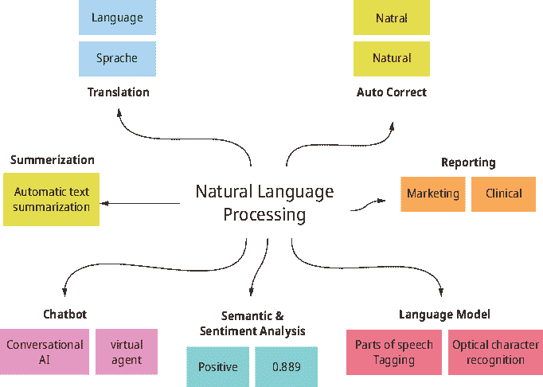

图 7.4：NLP 应用。

NLP MO 是优化 NLP 操作中使用的不同部分和模型的过程，以提高可扩展性、效率性能。以下是 NLP MO 的一些关键方面和技术：

### 序列到序列模型优化

循环神经网络 (`RNNs`) 和 Transformer 架构（如`BERT`和`GPT`）是序列到序列 (`Seq2Seq`) 模型的示例，通过基于梯度的方法和`Adam`等高级优化算法在大规模语料库上训练来优化这些模型 [20]。

### 注意力机制优化

为了在 NLP 任务中获得顶级性能，注意力机制（允许模型关注输入的关键部分）至关重要。通过对`多头注意力`和`自注意力`等技术的优化，增强了模型的解释性和计算效率 [21]。

### 语言模型微调

将预训练语言模型（如`BERT`和`GPT`）适配特定的 NLP 任务（如文本分类、命名实体识别和机器翻译），需在特定任务数据集上进行精炼。包括`迁移学习`和`差异学习率调度`在内的优化方法用于有效地微调这些模型 [14]。

### 嵌入优化

词嵌入和上下文嵌入在 NLP 任务的单词和句子表示中起着关键性作用。优化技术如`skip-gram 模型`、`连续袋模型`以及上下文嵌入方法（如`ELMo`（语言模型嵌入）和上下文词嵌入）通过优化嵌入学习来有效地捕捉语义和语法信息。

### 文本生成优化

文本生成模型（带有注意力机制的语言模型和序列到序列模型）通过优化生成连贯且多样化的文本样本。生成过程受到控制，同时应用`温度缩放`、`核采样`和`束搜索优化`等技术来增强生成文本的质量。

### 命名实体识别 (NER) 优化

NER 模型识别并分类文本中的命名实体（如人名、组织、地点）。包括`条件随机场 (CRFs)`和基于神经网络的方法（如`BiLSTM-CRF`）等优化技术用于优化 NER 模型以实现准确的实体识别。

### 情感分析优化

情感分析模型分类文本中表达的情感（如积极、消极或中性）。包括`特征工程`、`集成方法`和深度学习架构（如`卷积神经网络 (CNNs)`和`RNNs`）在内的优化技术用于优化情感分析模型以提高分类准确率。

## 机器翻译优化

机器翻译模型将文本从一种语言翻译成另一种语言。优化技术包括注意力机制、Transformer 架构以及基于`RL`的方法，被用于优化机器翻译模型以实现准确且流畅的翻译。

总的来说，`NLP MO`涵盖了广泛的技术和方法，旨在优化用于`NLP`任务的各种组件和模型，以提升自然语言理解和生成系统的能力。该领域持续的研究和创新对于突破`NLP`的边界并实现智能语言处理应用的发展至关重要 [16, 17, 18, 19]。

## 7.2.5 计算机视觉

目标识别、图像分割和图像识别等计算机视觉任务中的优化是至关重要的。`MO`方法被用于优化`CNNs`以提高分类准确性并提取有用特征。为了提高生产力、准确性和效率，计算机视觉`MO`涉及优化计算机视觉活动中使用的模型和算法。计算机视觉的一个简单示例如图 7.5。

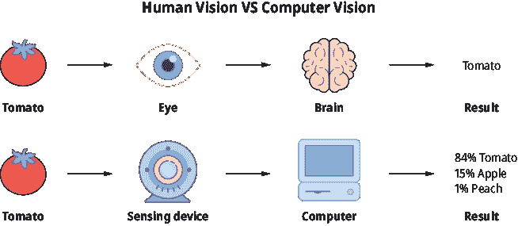

图 7.5: 计算机视觉的简单示例。

以下是计算机视觉的一些关键方面和技术：

- **CNN 优化：** `CNNs`是现代计算机视觉系统的基础，被用于目标识别、图像分割和图像分类等任务。优化技术包括基于梯度的方法（如`SGD`）和高级优化算法（如`Adam`），被用于在大规模图像数据集上高效地训练`CNNs`。

- **迁移学习与微调：** 使用预训练的`CNN`模型（如`ResNet`、`VGG`和`Inception`）作为特征提取器，并在与特定任务相关的数据集上对其进行增强，被称为迁移学习。优化方法包括差异化学习率调度和批次归一化，被用于将预训练模型适应新任务并提高性能。

- **目标检测优化：** 目标检测模型对图像中的物体进行定位和分类。优化技术包括区域提议网络、锚框（anchor box）优化和非极大值抑制，被用于优化目标检测模型，以实现准确高效的目标定位和识别。

- **语义分割优化：** 语义分割模型为图像中的每个像素分配语义标签，勾勒物体的边界和区域。优化方法包括空洞卷积、跳跃连接和`CRFs`，被用于优化语义分割模型，以实现准确的像素级分类。

- **实例分割优化：** 实例分割模型不仅分割图像中的物体，还能区分单个物体实例。为了优化实例分割模型以实现准确的物体边界和实例识别，可以使用`Mask R-CNN`（基于区域的`CNN`）和特征金字塔网络等方法。

- **图像生成优化：** 图像生成模型（如生成对抗网络和变分自编码器）从噪声或潜在表示生成真实的图像。优化技术包括对抗训练、感知损失函数和正则化方法 [41]，被用于优化图像生成模型以生成高质量且多样化的图像。

- **特征提取优化：** 通过从原始图像数据中获取有意义的表示，特征提取对于计算机视觉问题非常重要。优化技术包括卷积层设计、池化操作和特征归一化，被用于优化特征提取流程，以捕捉相关的视觉模式和语义。

- **图像配准与对齐优化：** 图像配准和对齐技术将多幅图像对齐到一个共同的帧，用于图像拼接和医学图像分析等任务。优化方法包括迭代最近点算法、光流估计和几何变换，被用于优化图像配准和对齐，以实现图像数据的准确鲁棒对齐。

总的来说，计算机视觉`MO`涵盖了广泛的技术方法，旨在优化各种计算机视觉任务的模型和算法。该领域持续的研究和创新对于提升计算机视觉系统的能力并实现智能视觉感知应用的发展至关重要 [46, 42]。

## 7.2.6 机器人领域的优化

优化是机器人研究中运动规划、轨迹优化和机器人控制的基础。`MO`算法被用于解决逆运动学问题、优化动态环境中的机器人轨迹以及学习机器人操作任务的最优控制策略。在机器人领域，`MO`在设计、控制、规划和感知等方面起着关键作用。以下是机器人`MO`的一些关键方面和技术：

- **运动规划优化：** 运动规划是机器人创建路径的过程，避免碰撞的同时最大化路径长度、平度和能量效率。优化技术包括快速探索随机树、基于采样的规划器以及轨迹优化算法（序列二次规划和直接配法），被用于高效寻找最优机器人轨迹。

- **逆运动学优化：** 逆运动学问题涉及根据所需的端执行器位置和姿态确定机器人的关节配置。优化技术包括基于梯度的方法和数值求解器，被用于高效地解决逆运动学问题，并考虑关节限制和避障等约束。

- **机器人控制优化：** 机器人控制涉及生成控制信号以驱动机器人关节并实现所需的运动。对于运动跟踪、能量管理和阻抗管理等任务，控制策略使用基于`RL`的方法（如线性二次调节器和`MPC`）进行优化。

- **传感器融合与定位优化：** 传感器融合结合来自多个传感器（如摄像头、激光雷达和惯性传感器）的数据，以准确估计机器人的状态和环境。优化技术包括卡尔曼滤波、粒子滤波和基于图优化方法（如位姿优化），被用于融合传感器数据并执行定位和建图任务。

- **操作中的路径规划与优化：** 路径规划和优化技术用于为机器人手臂在杂乱环境中规划抓取和操作物体的无路径。优化方法包括抓取优化、任务空间控制以及基于优化的运动规划算法（如`CHOMP`运动规划协变轨迹优化），被用于优化操作轨迹，以实现灵活高效的物体操作。

## 动态系统的最优控制

最优控制理论用于寻找在有限或无限时间跨度内优化性能准则的控制策略。在机器人领域，最优控制技术（包括动态规划、庞特亚金极大值原理和直接直段法）被用于优化机器人机械臂和移动机器人等动态系统的控制输入，同时考虑了如动力学、执行器限制和环境不确定性等约束条件。

## 任务分配与多机器人协调优化

在多机器人系统中，任务分配和协调优化技术用于在机器人之间分配任务，并优化它们的协调以高效地实现集体目标。优化方法（包括组合优化、分布式优化算法和博弈论方法）用于优化多机器人系统中的任务分配、角色分配和协作行为。

总体而言，机器人多目标优化（robot MO）涵盖了广泛的技术和方法，旨在优化机器人设计、控制、规划和感知的各个方面。该领域的持续研究和创新对于提升机器人能力、使其能够在现实环境中自主且高效地执行复杂任务至关重要 [47, 48, 49, 50]。

## 7.2.7 自动机器学习 (AutoML)

模型选择、超参数调优和特征工程都由 AutoML 系统自动完成。为了找到高性能的机器学习流水线，使用进化策略、遗传算法和贝叶斯优化等多目标方法对模型空间进行有效搜索。AutoML 多目标优化涉及优化机器学习流水线的选择和配置，以在给定任务上实现最佳性能。以下是 AutoML 多目标优化的一些关键方面和技术：

### 超参数优化

超参数包括网络设计、正则化强度和学习率，控制着机器学习模型的学习方式。为了快速搜索超参数空间并为模型训练识别合适的配置，应用了网格搜索、随机搜索、贝叶斯优化和遗传算法等超参数优化技术。

### 模型选择与架构搜索

为任务选择合适的机器学习架构或算法被称为模型选择。自动模型选择技术（如元学习、神经架构搜索 NAS 和集成方法）优化模型选择，以便在不同的数据集和任务上实现最佳性能。

### 特征工程与选择

为了增强模型性能，特征工程涉及从原始数据中产生具有洞察力的特征。自动特征工程技术（如特征提取、变换和选择算法）优化特征空间，以捕捉相关模式并有效降低维度。

### 流水线配置优化

机器学习流水线由多个预处理、特征提取和模型训练步骤组成。自动流水线配置技术（如流水线优化算法和贝叶斯优化）优化机器学习流水线的配置，为给定任务实现最佳性能和效率。

### 算法选择与调优

自动算法选择技术确定最适合给定任务的机器学习算法或算法集合。元学习、算法选择框架和多臂老虎机算法等技术优化了算法的选择和调优，以最大化预测性能和效率。

### 集成学习与堆叠优化

为了提高整体性能和稳健性，集成学习整合了多个机器学习模型的预测。堆叠（Stacking）、袋（Bagging）和提升（Boosting）算法是自动集成学习策略的示例，它们通过最大化单个模型的混合和组合，获得比单模型更好的结果。

### 迁移学习与领域适应

为了在标注数据有限的情况下，迁移学习技术利用预先训练模型或相关任务的知识。为了提高模型的泛化和适应能力，自动迁移学习技术（如特征提取、领域适应算法和微调）最大化了从源领域到目标领域的知识迁移。

总体而言，AutoML 多目标优化涵盖了广泛的技术和方法，旨在自动化和优化机器学习流水线的选择、配置和调优过程。该领域的持续研究和创新对于普及机器学习以及让非专家能够为各种应用和领域高效构建高性能模型至关重要 [51, 52, 53, 54, 55]。

## 7.2.8 医疗保健

优化技术被应用于医疗保健行业的医学图像处理、疾病诊断、治疗计划和药物发现。通过使用多目标优化方法，个性化治疗策略、成功的临床试验以及改善患者预后的最佳药物组合成为可能。多目标优化在医疗保健执行的多个方面至关重要，包括资源分配、组织、治疗规划和决策。以下是医疗多目标优化的一些基本要素和方法：

### 资源分配优化


必须有效分配医疗资源以满足患者需求并提高医疗质量。这些资源包括病床、医护人员、设备和药物。医院和其他医疗机构使用线性规划、整数规划和队列理论等多目标优化方法来高效分配资源，最小化等待时间并最大化资源利用率。

## 患者调度与预约优化

患者调度的目标是通过尽可能高效地为医疗咨询、诊断测试、手术和治疗安排预约，从而最小化患者的等待时间，最大化医疗提供者的生产力，并减少缺席次数。为了在提高医疗可及性和有效性的同时最大化患者调度，应用了调度算法、队列管理系统和预约提醒系统等优化方法。

## 治疗计划与优化

为了最大化治疗疗效、减少副作用并改善患者预后，多目标优化技术（如数学建模、仿真和优化算法）被用于优化治疗计划、剂量调度和药物组合。

## 医学影像优化

MRI、CT、PET 和 X 射线成像等医学影像方法产生了大量数据，需要有效的处理、分析和解读。医学图像的采集、重建、分割和分析通过优化技术（如基于机器学习的方法、图像处理技术和修复算法）进行优化，以实现更好的疾病评估、治疗规划和监测。

## 医疗保健供应链优化

医疗保健供应链涵盖了向医疗机构提供医疗用品、药品和设备的采购、分配和监督。为了最大化供应链效率、减少短缺和缺陷，并确保必要医疗服务的及时送达，供应链建模、需求预测和库存优化是所采用的一些多目标优化（MO）方法。

## 临床试验优化

为了评估新型药物、疗法和医疗设备的安全性和有效性，临床试验至关重要。通过使用试验设计优化、患者招募优化和自适应试验设计方法等优化技术，可以实现临床试验流程的最大化、成本和持续的最小化，并加速创新医疗干预措施的发现。

## 医疗保健政策与决策优化

资源分配、财务、报销规则和治疗建议等医疗保健政策问题都可能对医疗结果、成本和不平等性产生巨大影响。为了优化公共健康和福祉，通过决策分析、成本效益分析和健康经济建模等优化方法为医疗保健政策决策、医疗干预优先级排序和资源分配提供支持。

为了改善患者预后、增加医疗服务的可及性并使医疗系统的资源利用最大化，广泛的方法和方法论被统称为医疗保健多目标优化（MO）。这些方法和技术旨在优化医疗交付、运营和决策的不同领域。为了解决医疗行业面临的复杂问题，并提高全球范围内医疗服务的效率、性能和质量，该领域的持续研究和创新至关重要 [56, 57, 58, 59]。

### 资产配置优化

确定投资组合中资产类型（如股票、债券、房地产和大宗商品）的最佳组合以实现财务目标，被称为资产配置。优化技术（包括动态资产配置模型、风险对等策略和战术资产配置方法）用于根据市场状况、经济预测和风险因素随时间推移优化资产配置决策。

### 风险管理优化

风险管理包括识别、评估和减少财务风险，包括运营风险、流动性风险、信用风险和市场风险。风险价值（VaR）建模、条件价值（CVaR）优化和压力测试程序是用于优化风险管理策略、保护投资组合免受不利事件并确保符合法规的一些 MO 方法。

### 投资组合再平衡

投资组合再平衡需要定期修改其资产配置，以保持目标资产权重。凸优化和线性规划是用于在再平衡组合的同时最小化跟踪误差和交易成本的两种方法。

### 交易策略优化

交易策略涉及在金融市场做出买卖决策以利用市场失灵并产生利润。各种技术包括算法交易算法、市场微结构模型和高频交易策略，用于优化交易执行、降低成本并最大化交易利润。

### 期权定价与对冲优化

使用期权定价模型（如 Black-Scholes-Merton 和二叉树期权定价模型）对金融衍生品进行估值，并评估其公平价格。通过数值方法、有限差分法和蒙特卡洛模拟等优化方法来精确求解期权定价模型。此外，对 Delta 对冲和动态对冲等策略进行优化。

### 资本配置优化

资本配置涉及在不同业务部门、项目或投资机会之间分配财务资源，以实现股东价值和投资回报。MO 技术包括资本预算模型、项目选择算法和资本资产定价模型等资本配置框架，用于优化资本配置决策并将资源分配给预期收益最高的项目。

总体而言，金融 MO 涵盖了广泛的技术和方法，旨在优化财务决策、风险管理和组合管理的各个方面，以实现投资目标、增强财务表现并缓解市场风险。该领域的持续研究和创新对于开发先进的优化模型和算法以应对全球金融系统不断变化的复杂性至关重要 [60, 61, 62]。

## 供应链管理

供应链活动（如需求预测、物流规划和库存管理）的优化依赖于优化技术。利用 MO 策略可以提高整体供应链效率、优化生产计划并节省运输费用。供应链管理的优化目标是在库存控制、生产调度、配送物流和供应链网络设计等方面优化供应链。

### 库存优化

库存管理的目标是最大化库存水平，以达到持有成本和缺货成本之间的平衡。通过 MO 技术（如经济订货量模型、经济生产数量模型和随机库存模型），建立最佳订货政策、安全库存水平和再订货点，以在确保供应充足的同时最小化库存成本。

### 生产规划与调度优化

为了有效满足客户需求，生产规划需要优化生产调度、产能利用率和资源配置。在最大化生产速度、最小化生产成本和优化生产调度时，多目标（MO）技术——如线性、整数和混合整数线性规划——考虑了产能利用率边界、生产提前期和需求波动性。

### 分配物流优化

配送物流领域涉及商品通过配送中心、运输系统和分销渠道从供应商到消费者的有效流动。通过 MO 方法（如车辆路径优化、设施选址模型和网络流优化）对配送路线、仓库位置和运输模式进行优化，以节省运输成本、缩短交付时间并提高服务质量。

### 供应链网络设计优化

优化供应链网络配置的过程，包括确定在何处以及设置多少供应商、制造基地、仓库和配送中心。使用 MO 方法（如网络优化模型、基于位置的设施模型和网络算法设计）设计供应链网络，以最小化整体供应链成本、最短运输距离并增强供应链的灵性和稳健性。

### 需求预测与需求规划优化

需求预测和需求规划的目标是预测未来的产品需求，并适时调整生产和库存水平。使用 MO 技术准确预测需求并最大化生产和库存调度，以最少量的剩余库存和缺货情况满足需求。

### 供应商选择与采购优化

采购和供应商选择过程包括根据成本、可靠性、质量和交付计划等标准定位并选择供应商。为了节省采购成本、最小化供应链风险并提高供应商绩效，通过 MO 技术（包括供应商评估模型、多准则决策分析和供应商组合优化）优化供应商选择决策和采购策略。

### 协作规划、预测与补货 (CPFR) 优化

贸易伙伴之间的协作规划和预测提高了供应链效率并同步操作。MO 方法（如协作规划算法、需求预测模型和补货优化算法）用于优化 CPFR 流程，增加需求可见性，并最小化供应链的可预测性和不确定性。

总体而言，供应链管理 MO 涵盖了多种旨在简化供应链的方法和策略以提高生产力、降低成本并提升消费者满意度。开发复杂的优化模型和算法以处理现代供应链的复杂性和不可预测性并实现可持续的供应链性能，取决于该领域的持续研究和创新。最后，MO 技术在各种人工智能研究领域中作为强大的工具，赋能研究人员和从业者解决复杂问题并驱动多种应用中的创新 [63, 64, 65]。

## AI 中常用的 MO 技术

几种 MO 技术被广泛应用于 AI 中以高效解决各种优化问题，所示图 7.6。

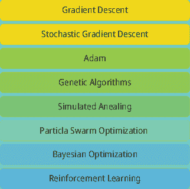

图 7.6：人工智能中常用的数学优化技术。

以下是 AI 中常用的一些热门 MO 技术：

- **梯度下降 (Gradient Descent)**：这是一种一阶优化过程，沿着函数负梯度的方向迭代移动以最小化函数。它经常用于在 ML 训练（如神经网络）中更新模型参数并最小化损失函数。

- **随机梯度下降 (SGD)**：`SGD` 是梯度下降的一种变体，它在每次迭代中使用训练实例的随机子集（小批量）来优化目标函数。由于其高计算效率和处理海量数据库的能力，它经常用于大规模学习任务。

- **Adam**：`Adam` 这种自适应学习率优化方法结合了动量优化和 RMSprop 的优点。通过根据梯度的一阶和二阶矩为每个参数调整学习率，使得深度神经网络的训练更有效且收敛更快。

- **遗传算法 (Genetic Algorithms)**：遗传算法受自然选择理论和基因进化的启发，是一类进化算法。它们通过采用交叉现象、变异和过滤等策略，在几代中生成优化问题的潜在解种群。当处理基于梯度的技术可能难以解决的优化问题时（例如组合优化以及具有非平滑、不规则或多元目标函数的函数优化），可以使用遗传算法。

- **模拟退火 (Simulated Annealing)**：这种名为“模拟退火”的概率优化技术受冶金学退火过程的启发。为了管理对劣解的接受并允许算法跳出局部最优更深地探索解空间，会逐渐降低温度参数。特别是对于具有困难的多模态搜索空间的优化问题，模拟退火受益巨大。

- **粒子群优化 (PSO)**：鱼群和鸟群的社会动力学为名为`PSO`的基于群随机优化技术提供了灵感。为了识别最佳答案，它迭代搜索空间并维护一组潜在解（或粒子）。`PSO`经常用于连续优化问题，并应用于特征选择、神经系统开发和聚类等领域。

- **贝叶斯优化 (Bayesian Optimization)**：这是一种概率优化方法，用于建模和优化难以评估或耗时的未定义目标函数。它通过使用贝叶斯统计方法来实现。通过概率代理模型，它在搜索空间的有利区域连续评估目标函数，并更新模型以将搜索集中在最有可能最优解的区域。在 ML 模型的参数调优和其他黑盒优化问题中，贝叶斯优化被频繁使用。

- **强化学习 (Reinforcement Learning)**：名为“强化学习”(`RL`)的优化技术允许代理通过与环境交互来做出连续决策，以最大化累积奖励。机器人、游戏和自动驾驶系统是 RL 技术（如`Q-learning`、策略梯度和演员-评论方法）的应用领域之一，它们通过最大化代理的策略或值函数来学习最佳决策策略 [26]。

这些是 AI 中使用的常用多目标（MO）技术的几个示例 [6, 7, 8]。根据问题领域和特定需求，不同的优化算法可能更适合高效地解决不同类型的优化问题。

## 用于 MO 的流行 AI 工具

在各个领域中，常用于 MO 的 AI 工具和库所示如图 7.7。

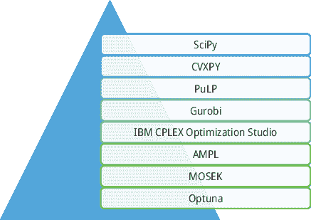

图 7.7: 用于数学优化的流行人工智能工具和库。以下是一些常用的工具：

- `SciPy`：这是一个用于科学计算的 Python 库，它是开源的。它包含线性代数、积分、插值、优化和其他数学操作模块。`scipy.optimize` 模块提供了多种优化算法，包括非线性优化、约束优化和全局优化方法。

- `CVXPY`：Python 中集成了一种用于凸优化问题的建模语言。它允许用户使用自然数学语法编写优化问题，并自动将此类问题转换为标准形式，以便让各种凸优化算法来解决它们。

- `PuLP`：这是一个免费提供的建模包。为了定义和解决线性规划、整数规划、混合整数规划以及网络流优化，它提供了一个简单的用户界面。

- `Gurobi`：这是一个商业优化求解器，可以处理许多不同类型的 MO 问题，包括凸优化、混合整数规划、二次规划和线性规划（LP、QP 和 MIP）。它为 Python、MATLAB 和 C++ 等其他计算机语言提供了高性能的优化工具和 API。

- `IBM CPLEX Optimization Studio`：该商业优化套件 `IBM CPLEX Optimization Studio` 提供了针对组合、数学和约束规划的全方位的优化工具和解决方案。它拥有复杂的优化方法和建模能力，并为包括 Python、Java 和 C++ 在内的多种计算机语言提供了 API。

- `AMPL`：一种数学建模语言或 `AMPL`，是一种用于创建和解决 MO 问题的建模语言和环境。它支持多种形式的优化问题，如约束规划、混合整数规划、线性规划和非线性规划。除了与 `Gurobi`、`CPLEX` 和 `GLPK` 等知名优化求解器集成外，`AMPL` 还提供了各种优化问题的求解器。

- `MOSEK`：这是一种为数学建模设计的商业优化解决方案，涵盖混合整数、锥形和线性规划。它为多种编程语言（如 Python、MATLAB 和 C++）提供了高性能的算法和 API。它在运筹学、工程和金融等领域有广泛应用。

- `Optuna`：一个用于机器学习模型的开源超参数优化框架被称为 `Optuna`。它提供了网格搜索、随机搜索、概率优化和其他优化方法，以有效地为机器学习算法找到最可能的超参数。凭借其用户友好的设计，`Optuna` 可以与 `TensorFlow`、`PyTorch` 和 `scikit-learn` 等流行的机器学习库无缝衔接。

这些是流行的 AI 工具和库的几个示例 [4, 5]。根据优化问题的特定需求和编程语言，可以选择最合适的工具和库。

## AI 的 MO 研究方向

这里是关于 MO 的一些趋势方向，如表 7.1 所示。

表 7.1：基于人工智能的数学优化研究方向

| 序号 | 主题 |
| --- | --- |
| 1 | 库存与定价优化：在零售和供应链管理中优化库存水平和定价，提高利润和客户满意度。 |
| 2 | 利用 AI 进行短期预测：利用 MO 模型和算法预测短期需求，实现高效的资源分配和管理。 |
| 3 | AI 预测股票市场：利用 MO 算法和技术预测股票市场趋势并做出明智决策，优化投资组合和风险缓解。 |
| 4 | 金融系统中 AI 与区块链的融合：将 MO 技术与区块链技术相结合，实现去中心化金融系统的交易自动化。 |
| 5 | 分析数据模式预测财务风险：利用 MO 模型和 AI 算法分析数据模式以预测财务风险，为银行和金融机构提供主动的风险管理策略。 |
| 6 | 预测预测的市场状况：企业通过 ML 算法和 MO 技术分析市场数据并预测变化，从而在动态市场环境中调整策略并保持竞争力。 |
| 7 | 网络行为与监控：利用 AI 算法和 MO 技术监控网络活动、识别异常并快速响应安全风险，强化网络安全协议并保护隐私数据。 |

这些主题展示了 MO 在金融、能源、网络安全和供应链管理等领域的研究方向，强调了它们在解决复杂优化问题和驱动 AI 解决方案创新方面重要性 [66, 67, 68, 69, 70]。

## 结论

综之，对模型优化（MO）的探索揭示了它是驱动计算机中大多数现代智能机器学习算法的静默引擎。随着人工智能（AI）领域的发展，优化的重要性日益增长。从自动驾驶汽车到自然语言处理，它是理论数学概念与现实应用之间的桥梁。对优化的数学基础有坚实的理解使我们能够创新并改进现有方法。AI 持续塑造着世界，为研究、创新和社会变革提供了无限机遇。通过深入研究这些多样化的 AI 主题，研究人员正为 AI 的进步及其对人类的积极影响做出贡献。在不断扩张的 AI 蓝图中，我们始终致力于负责任的创新、伦理考量以及为了社会的进步追求知识。

通过各种 AI 主题的视角，我们探索了优化技术和 AI 算法在解决复杂问题和推动创新方面的深远影响。AI 的影响已超出单一领域，影响着医疗健康、慈善、自动驾驶、伦理和教育。AI 变革了医疗诊断、药物发现和个性化治疗，促进了医疗领域的进步。它通过环境监测、灾害响应和减贫应对全球性挑战，利用技术造福社会。自动驾驶汽车通过传感器融合、路径规划和安全协议的进展重新定义了交通，为更安全、更高效的移动解决方案铺平了道路。AI 伦理中的伦理考量和偏见驱动了针对公平性、偏差检测以及 AI 系统中伦理决策的研究。

**利益冲突：** 作者无须声明的利益冲突。

## 参考文献

[1]White, S. K. (2024 年 4 月 13 日). 今日企业中最流行的 12 个 AI 使用用例。*CIO*, [www.cio.com/article/652775/12-most-popular-ai-use-cases-in-the-enterprise-today.html](http://www.cio.com/article/652775/12-most-popular-ai-use-cases-in-the-enterprise-today.html)。

[2]Aiforgoodstg. (2022 年 2 月 25 日). AI 的当前与未来 4 大趋势。AI For Good。 [aiforgood.itu.int/4-current-and-future-trends-in-ai](http://aiforgood.itu.int/4-current-and-future-trends-in-ai)。

[3]Craig, L. (2024 年 1 月 4 日). 2024 年 10 大顶级 AI 和机器学习趋势。*Enterprise AI*, [www.techtarget.com/searchenterpriseai/tip/9-top-AI-and-machine-learning-trends](http://www.techtarget.com/searchenterpriseai/tip/9-top-AI-and-machine-learning-trends)。

[4]Lukan, E. (2024 年 3 月 13 日). 2024 年 16 最佳 AI 工具。[www.synthesia.io/post/ai-tools](http://www.synthesia.io/post/ai-tools)。

[5]AI 工具 | Runway。 [runwayml.com/ai-tools](http://runwayml.com/ai-tools)。

[6]Thangamuthu, K. (2023 年 12 月 6 日). 解锁未来：7 种革命性的 AI 技术。[www.linkedin.com/pulse/unlocking-future-7-revolutionary-ai-techniques-thangamuthu-kv5e](http://www.linkedin.com/pulse/unlocking-future-7-revolutionary-ai-techniques-thangamuthu-kv5e)。


[7] Kothari, S. (2023 年 7 月 26 日). 顶级人工智能：破解密码。*Simplilearn.com*, [www.simplilearn.com/tutorials/artificial-intelligence/top-techniques](http://www.simplilearn.com/tutorials/artificial-intelligence/top-techniques)。→

[8] Michael. (2024 年 3 月 8 日). 探索语义分割的顶级算法。*Keymakr’s 博客：最新新闻与更新*, [`keymakr.com/blog/exploring-the-top-algorithms-for-semantic-segmentation/#text=Semantic-segmentation-is-a-process-in-computer-vision-that-involves,the-objects-in-the-image`](http://keymakr.com/blog/exploring-the-top-algorithms-for-semantic-segmentation/#text=Semantic-segmentation-is-a-process-in-computer-vision-that-involves,the-objects-in-the-image)。→

[9] Kumari, K. (2024 年 4 月 9 日). 目标检测基础介绍。*Analytics Vidhya*, [www.analyticsvidhya.com/blog/2022/03/a-basic-introduction-to-object-detection](http://www.analyticsvidhya.com/blog/2022/03/a-basic-introduction-to-object-detection)。

[10] GeeksforGeeks. (2024 年 2 月 18 日). 带微调的迁移学习。*GeeksforGeeks*, [www.geeksforgeeks.org/transfer-learning-with-fine-tuning-in-nlp](http://www.geeksforgeeks.org/transfer-learning-with-fine-tuning-in-nlp)。→

[11] Habib, G., & Qureshi, S. (2022 年 7 月 1 日). 卷积神经网络的优化与加速：综述。*Journal of King Saud University. Computer and Information Sciences*, *4244–4268*(7), [`doi.org/10.1016/j.jksuci.2020.10.004`](https://doi.org/10.1016/j.jksuci.2020.10.004)。→

[12] 计算机视觉。Wikipedia, 2024 年 4 月 7 日, [`en.wikipedia.org/wiki/Computer_vision`](http://en.wikipedia.org/wiki/Computer_vision)。→

[13] GeeksforGeeks. (2024 年 1 月 11 日). AI 中的机器翻译。*GeeksforGeeks*, [www.geeksforgeeks.org/machine-translation-of-languages-in-artificial-intelligence](http://www.geeksforgeeks.org/machine-translation-of-languages-in-artificial-intelligence)。→

[14] Jim, J. R. 等人. (2024 年 2 月 1 日). 基于 NLP 的情感分析的最新进展与挑战：最新综述。*Natural Language Processing Journal*, *100059*, [`doi.org/10.1016/j.nlp.2024.100059`](https://doi.org/10.1016/j.nlp.2024.100059)。→

[15] GeeksforGeeks. (2024 年 1 月 3 日). 命名实体。*GeeksforGeeks*, [www.geeksforgeeks.org/named-entity](http://www.geeksforgeeks.org/named-entity)。→

[16] 自然语言处理：理解并使用 Python 进行文本生成。[www.turing.com/kb/natural-language-processing-understanding-generating-text-with-python](http://www.turing.com/kb/natural-language-processing-understanding-generating-text-with-python)

[17] Turing. (2022 年 2 月 10 日). NLP 词嵌入指南。[www.turing.com/kb/guide-on-word-embeddings-in-nlp](http://www.turing.com/kb/guide-on-word-embeddings-in-nlp)。→

[18] Banjara, B. (2024 年 4 月 25 日). 大语言模型微调全面指南。*Analytics Vidhya*, [www.analyticsvidhya.com/blog/2023/08/fine-tuning-large-language-models](http://www.analyticsvidhya.com/blog/2023/08/fine-tuning-large-language-models)。→

[19] Van Otten, N. (2023 年 11 月 1 日). NLP 中最常用的 6 种注意力机制详解及使用场景。*Spot Intelligence*, [`spotintelligence.com/2023/01/12/attention-mechanism-in-nlp/#text=The-attention-mechanism-allows-neural,importance-of-various-input-components`](http://spotintelligence.com/2023/01/12/attention-mechanism-in-nlp/#text=The-attention-mechanism-allows-neural,importance-of-various-input-components)。

## 参考文献

- [20] GeeksforGeeks. (2024 年 1 月 3 日). 机器学习中的 Seq2seq 模型。*GeeksforGeeks*. [www.geeksforgeeks.org/seq2seq-model-in-machine-learning](http://www.geeksforgeeks.org/seq2seq-model-in-machine-learning). →

- [21] 什么是自然语言处理？ | IBM. [www.ibm.com/topics/natural-language-processing](http://www.ibm.com/topics/natural-language-processing). →

- [22] 多智能体强化学习。Wikipedia, 2024 年 2 月 14 日, [`en.wikipedia.org/wiki/Multi-agent\_reinforcement\_learning`](http://en.wikipedia.org/wiki/Multi-agent_reinforcement_learning). →

- [23] Integrate.Ai. (2018 年 10 月 29 日). 什么是基于模型的强化学习？– integrate.ai 博客 – Medium. Medium, [`medium.com/the-official-integrate-ai-blog/understanding-reinforcement-learning-93d4e34e5698`](http://medium.com/the-official-integrate-ai-blog/understanding-reinforcement-learning-93d4e34e5698). →

- [24] Suran, A. (2022 年 3 月 30 日). 在线策略与离线策略学习 – 迈向数据科学。*Medium*, [`towardsdatascience.com/on-policy-v-s-off-policy-learning-75089916bc2f`](http://towardsdatascience.com/on-policy-v-s-off-policy-learning-75089916bc2f). →

- [25] Furqatovich, I. U., Mukhriddin Musoqulo’g’li, R., Karshievna, U. D., Ananth, C., & Kumar, T. A. (2024 年 4 月 4 日). 人工智能驱动的增强乌兹别克斯坦医疗机构竞争力的策略。在 2024 年第九届科学技术工程与数学国际会议 (ICONSTEM) (pp. 1–6)。IEEE. →

- [26] 奖励塑造 – 强化学习入门。[`gibberblot.github.io/rl-notes/single-agent/reward-shaping.html`](http://gibberblot.github.io/rl-notes/single-agent/reward-shaping.html). →

- [27] Rocca, J. (2022 年 1 月 7 日). 探索与利用的权衡：直觉与策略 | By Joseph Rocca | towards data science。*Medium*, [`towardsdatascience.com/the-exploration-exploitation-dilemma-f5622fbe1e82`](http://towardsdatascience.com/the-exploration-exploitation-dilemma-f5622fbe1e82). →

- [28] Salloum, Z. (2021 年 12 月 12 日). 强化学习中的函数近似 – 迈向数据科学。*Medium*, [`towardsdatascience.com/function-approximation-in-reinforcement-learning-85a4864d566`](http://towardsdatascience.com/function-approximation-in-reinforcement-learning-85a4864d566). →

- [29] 第 3 部分：策略优化简介 – Spinning up 文档。[`spinningup.openai.com/en/latest/spinningup/rl_intro3`](http://spinningup.openai.com/en/latest/spinningup/rl_intro3). →

- [30] 什么是强化学习？– 强化学习详解 – Amazon Web Services, [aws.amazon.com/what-is/reinforcement-learning:~text=Reinforcement%20learning%20is%20a,use%20to%20achieve%20goals](http://aws.amazon.com/what-is/reinforcement-learning:~text=Reinforcement%20learning%20is%20a,use%20to%20achieve%20goals). →

- [31] Verma, Y. (2024 年 3 月 18 日). 并行与分布式深度学习指南。*Analytics India Magazine*, [`analyticsindiam.com/a-guide-to-parallel-and-distributed-learning-for-beginners`](http://analyticsindiam.com/a-guide-to-parallel-and-distributed-learning-for-beginners). →

- [32] Shaikh, J. (2023 年 6 月 15 日). 10 种高级深度学习架构！*Analytics Vidhya*, [www.analyticsvidhya.com/blog/2017/08/10-advanced-deep-learning-architectures-data-scientists](http://www.analyticsvidhya.com/blog/2017/08/10-advanced-deep-learning-architectures-data-scientists). a, b

- [33] Jain, S. J. (2024 年 2 月 8 日). 深度学习正则化概述（带 Python 代码）。*Analytics Vidhya*, [www.analyticsvidhya.com/blog/2018/04/fundamentals-deep-learning-regularization](http://www.analyticsvidhya.com/blog/2018/04/fundamentals-deep-learning-regularization). a, b

- [34] DeepAI. (2020 年 6 月 25 日). 批量归一化。*DeepAI*. [`deepai.org/machine-learning-glossary/batch-normalization:~text=Batch%20Normalization%20is%20a%20deviation`](http://deepai.org/machine-learning-glossary/batch-normalization:~text=Batch%20Normalization%20is%20a%20deviation). a, b

- [35] Brownlee, J. (2021 年 2 月 7 日). 深度学习神经网络权重初始化。*MachineLearningMaster.com*, [`machinelearningmaster.com/weight-initialization-for-deep-learning-neural-networks`](http://machinelearningmaster.com/weight-initialization-for-deep-learning-neural-networks). a, b

- [36] Lau, S. (2018 年 6 月 20 日). 深度学习的学习率调度和自适应学习率方法。*Medium*, [`towardsdatascience.com/learning-rate-schedules-and-adaptive-learning-rate-methods-for-deep-learning-2c8f433990d1:~text=Learning%20rate%20schedules%20seek%20to,step%20decay%20and%20exponential%20decay`](http://towardsdatascience.com/learning-rate-schedules-and-adaptive-learning-rate-methods-for-deep-learning-2c8f433990d1:~text=Learning%20rate%20schedules%20seek%20to,step%20decay%20and%20exponential%20decay). a, b

- [37] Secherla, S. (2022 年 9 月 6 日). 理解机器学习中的优化算法。*Medium*, [`towardsdatascience.com/understanding-optimization-algorithms-in-machine-learning-edf4df76b`](http://towardsdatascience.com/understanding-optimization-algorithms-in-machine-learning-edf4df76b). a, b

- [38] Goyal, C. (2021 年 6 月 14 日). 深度学习中梯度优化器完全指南。*Analytics Vidhya*, [www.analyticsvidhya.com/blog/2021/06/complete-guide-to-gradient-based-optimizers](http://www.analyticsvidhya.com/blog/2021/06/complete-guide-to-gradient-based-optimizers). a, b

- [39] 什么是深度学习？ | IBM. [www.ibm.com/topics/deep-learning:~text=Deep%20learning%20is%20a%20subset,AI%20in%20lives%20today](http://www.ibm.com/topics/deep-learning:~text=Deep%20learning%20is%20a%20subset,AI%20in%20lives%20today). a, b


- [40] 分布式与并行训练教程 – PyTorch 教程 2.3.0+cu121 文档。[`pytorch.org/tutorials/distributed/home.html`](http://pytorch.org/tutorials/distributed/home.html). a, b

- [41] 通过 Fisher-Rao 正则化实现对抗鲁棒性。*IEEE 期刊与杂志 | IEEE Xplore*. 2023 年 3 月 1 日. [`ieeexplore.ieee.org/document/9773978`](http://ieeexplore.ieee.org/document/9773978).

- [42] 向基于贝叶斯优化的自动化模型选择进 – MATLAB 和 Simulink. [www.mathworks.com/help/stats/towards-automating-model-selection.html](http://www.mathworks.com/help/stats/towards-automating-model-selection.html). →

- [43] 少样本学习与元学习 | 教程 – Borealis AI。 Borealis AI。2023 年 7 月 28 日。[www.borealisai.com/research-blogs/tutorial-2-few-shot-learning-and-meta-learning-i](http://www.borealisai.com/research-blogs/tutorial-2-few-shot-learning-and-meta-learning-i).

- [44] Thailappan, D. (2024 年 3 月 8 日). 少样本学习简介。Analytics Vidhya, [www.analyticsvidhya.com/blog/2021/05/an-introduction-to-few-shot-learning](http://www.analyticsvidhya.com/blog/2021/05/an-introduction-to-few-shot-learning).

- [45] 12.11. 学习率调度 – 深度学习进阶 1.0.3 文档。[`d2l.ai/chapter_optimization/lr-scheduler.html`](http://d2l.ai/chapter_optimization/lr-scheduler.html).

- [46] Pokhrel, S. 4 4 种流行的模型压缩技术详解。[`xailient.com/blog/4-popular-model-compression-techniques-explained`](http://xailient.com/blog/4-popular-model-compression-techniques-explained). →

- [47] Ricaurte-Quijano, P., & Carli-Álvarez, A. (Oxbridgepublishinghouse 2016 年 10 月). Wiki 学习项目：作为开放学习环境的 Wikipedia。Comunicar, 24(49), 61–69。Crossref. [`doi.org/10.3916/c49-2016-06`](https://doi.org/10.3916/c49-2016-06). →

- [48] Zebin, Y., & Aijun, Z. (2020 年 5 月). 自动机器学习中的超参数调优方法。在 SCIENTIA SINICA Mathematica (p. 695, 第 50 卷, 第 5 期)。科学出版社。Crossref. [`doi.org/10.1360/n012019-0092`](https://doi.org/10.1360/n012019-0092). →

- [49] IEE 数字图书馆。(2010 年 7 月)。选择性评书, 47(11), 47–628。美国图书馆协会。Crossref. [`doi.org/10.5860/choice-47-628`](https://doi.org/10.5860/choice-47-628). →

- [50] Trung, L. H. (2019). 欧亚，4(65), 逻辑，Crossref. [`euroasia-science.ru/pdf-arxiv/the-controllability-function-of-polynomial-for-systems-23-31/`](https://euroasia-science.ru/pdf-arxiv/the-controllability-function-of-polynomial-for-systems-23-31/), [`doi.org/10.3161/esu.2413-9335.2019.4.275`](https://doi.org/10.3161/esu.2413-9335.2019.4.275). →

- [51] Naresh, V. S. 等人。(2024 年 4 月). 优化电池性能的预测性机器学习：技术。数据挖掘与知识发现，Wiley。[`doi.org/10.1002/widm.1539`](https://doi.org/10.1002/widm.1539). →

- [52] Azevedo, B. F. 等人。(2024 年 1 月). 混合优化与机器学习方法：系统综述。在机器学习中。Springer 科学与媒体。Crossref. [`doi.org/10.1007/s10994-023-0647-x`](https://doi.org/10.1007/s10994-023-0647-x). →

- [53] Harder, H. (2023 年 7 月 13 日). 结合数学优化与机器学习的五种方法。[`towardsdatascience.com/five-ways-to-combine-mathematical-optimization-and-machine-learning-8cb7427654`](http://towardsdatascience.com/five-ways-to-combine-mathematical-optimization-and-machine-learning-8cb7427654). →

- [54] Shepherd, T. 智能与数学优化：显著的协同。[www.twoday.com/ai-and-mathematical-optimization-a-striking-synergy](http://www.twoday.com/ai-and-mathematical-optimization-a-striking-synergy). →

- [55] Shepherd, T. 智能与数学优化：有何区别？[www.twoday.com/ai-and-mathematical-optimization-whats-the-difference](http://www.twoday.com/ai-and-mathematical-optimization-whats-the-difference). →

- [56] Islam, J. 等人。(2020 年 3 月). 针对放置优化问题的人工智能技术全方位综述。工程软件进展，102767。[`doi.org/10.1016/j.advengsoft.2019.102767`](https://doi.org/10.1016/j.advengsoft.2019.102767). →

- [57] 无人机人工智能方法：最新进展与未来。IEEE 期刊与杂志 | IEEE Xplore。2022 年。[`ieeexplore.ieee.org/abstract/972907`](http://ieeexplore.ieee.org/abstract/972907). →

- [58] Mohamad, Y. 等人。(2020 年 7 月 6 日). 研究中使用的数学建模、人工智能和数据集综述：COVID-19 预测。应用智能，3913–3925(11)，[`doi.org/10.1007/s10489-020-0177-9`](https://doi.org/10.1007/s10489-020-0177-9). →

- [59] Li, Y. 等人。(2023 年 5 月 1 日). 人工智能对绿色经济发展的作用：资源与绿色全要素生产率结合。资源政策，103508,[`doi.org/10.1016/j.resourpol.2023.103508`](https://doi.org/10.1016/j.resourpol.2023.103508). →

- [60] Yao, Z. 等人。(2023 年 7 月 1 日). 使用人工智能神经网络对燃煤电厂锅炉的燃烧优化。燃料，128145,[`doi.org/10.1016/j.fuel.2023.128145`](https://doi.org/10.1016/j.fuel.2023.128145). →

- [61] He, C. 等人。(2023 年 1 月 19 日). 工业 4.0 人工智能赋能化学产品设计、合成和工艺优化的综述。过程，330(2),[`doi.org/10.3390/pr1102030`](https://doi.org/10.3390/pr1102030). →

- [62] Sohail, A. (2021 年 8 月 30 日). 人工智能与数据科学领域的遗传算法。数据科学年，1007–1018(4),[`doi.org/10.1007/s40745-021-0035-9`](https://doi.org/10.1007/s40745-021-0035-9). →

- [63] Nutakki, M., & Mandava, S. (2023 年 3 月 1 日). 优化技术与人工智能在家庭能源管理系统中的作用综述。工程应用，105721,[`doi.org/10.1016/j.engappai.2022.105721`](https://doi.org/10.1016/j.engappai.2022.105721). →

- [64] Neira, D. E. B. 等人。(2024 年 2 月 1 日). 利用现代计算机架构解决数学优化问题：综述。计算机与化学工程，108627,[`doi.org/10.1016/j.compchemeng.2024.108627`](https://doi.org/10.1016/j.compchemeng.2024.108627). →

- [65] Carrizosa, E. 等人。(2024 年 3 月 1 日). 通过数学优化生成基于评分分类的集体反事实解释。专家系统与应用，121954,[`doi.org/10.1016/j.eswa.2023.121954`](https://doi.org/10.1016/j.eswa.2023.121954). →

- [66] Nishant, R. 等人. (2023 年 5 月 29 日). 基于人工智能的算法的形式化理性与偏见问题。*JIT. Journal of Information Technology/Journal of Information Technology*, [`doi.org/10.1177/02683962231176842`](https://doi.org/10.1177/02683962231176842). →

- [67] Zhao, T. (2024 年 3 月 26 日). 复杂系统数学建模中的人工智能。*ICST Transactions on E-education and E-learning*, *10*, [`doi.org/10.4108/eetel.5256`](https://doi.org/10.4108/eetel.5256). →

- [68] Brownlee, J. (2021 年 10 月 11 日). 如何选择优化算法。*MachineLearningMastery.com*, [`machinelearningmastery.com/tour-of-optimization-algorithms`](http://machinelearningmastery.com/tour-of-optimization-algorithms). →

- [69] Mohammadi, A., & Sheikholeslam, F. (2023 年 11 月 1 日). 智能优化：文献综述与最先进算法（1965–2022 年）。*Engineering Applications of Artificial Intelligence*, *106959*, [`doi.org/10.1016/j.engappai.2023.106959`](https://doi.org/10.1016/j.engappai.2023.106959). →

- [70] Secherla, S. (2022 年 9 月 6 日). 深入理解机器学习中的优化算法。*Medium*, [`towardsdatascience.com/understanding-optimization-algorithms-in-machine-learning-edfdb4df766b`](http://towardsdatascience.com/understanding-optimization-algorithms-in-machine-learning-edfdb4df766b). →

# 8 释放进化算法的力量：人工智能中的高级优化技术

Yogesh Kumar Sharma Uppuluri Lakshmi Soundharya Ravi Rastogi Anantha Raman

### 摘要

在人工智能（AI）领域，对实用优化方法的探索是持续不断的。在许多方法中，进化算法（EAs）作为强大的工具脱颖而出，其灵感源于自然界的选择过程和基因的演化。本章探讨了进化算法的复杂性，解释了它们的工作原理、在人工智能中的多种用途、面临的障碍以及未来改进的方向。本研究彻底审查了现代优化算法，讨论了困难并为进一步研究提供了可能的方向。该研究涵盖了多个领域的各种优化方法，包括数学规划、机器学习和人工智能。文中分析了当前算法面临的基础性困难，例如可扩展性问题。研究还探讨了优化算法在实际应用中的影响，以及元启发式算法的趋势。

**关键词：** 进化算法，优化，混合算法

## 8.1 引言

进化算法的发展在近年来面临着重大挑战。为了解决这些问题，数据挖掘被广泛应用。数据分析方法可以分为两类：分类和聚类。聚类不需要预先定义的标签，而是根据相似性对原始数据进行分组。机器学习学习方法也可以分为两类：监督学习和无监督学习。监督学习通过标签将数据分配到不同的类别。在无监督学习中，聚类是指根据相似性将数据分为不同的簇。

在没有先验信息的情况下识别实体是一种无监督学习方法。这种方法已应用于多个领域，包括生物信息学、数据收集。聚类方法主要分为经典和密度。传统的划分方法 `K-means` 因其简单性被广泛使用。然而，早期收敛是一个缺点。元启发式方法被用于聚类以寻找全局最优划分。基于元启发式的聚类算法可以分为个体和多目标标准。

本研究主要关注基于划分单目标混合聚类策略。该技术用于解决两个主要的聚类挑战：首先是在聚类之前计算最佳簇数量，其次是识别最有效的划分。为了解决这些问题，迭代使用不同数量的单目标聚类方法，然后选择产生结果的数据划分。

聚类索引的准确性无法准确确定正确的簇数量，因此需要构建一个包含多个聚类索引的新型适应度函数，以保留类间和类内的特征。有效的特征选择方法对于增强其效能并减少未标记数据中的重复是必要的。在无监督学习中，由于无法使用标签来引导相关信息的搜索，特征选择具有挑战性。为了实现高效的聚类，需要一种基于元启发式技术的新型单目标混合策略。

进化算法（EAs）是基于达尔文进化论原理的非常有效的启发式搜索技术。它们具有卓越的鲁棒性和适应性，使其能够高效地为复杂的优化问题识别出最优解决方案。使用进化算法可以显著增加在优化过程第一阶段发现近优解的概率。进化算法不依赖于任何适应度梯度信息，可以快速进行并行处理，并且能够克服确定性优化方法可能失败或不可行的局部极值[8]。进化算法的收敛性独立于被优化函数的连续性或可微性。进化算法不仅可以作为经典优化方法的替代方案，还可以增强和扩展它们的能力。通常，将进化算法与其他技术相结合的混合方法可以获得优异的性能。图 8.1 展示了进化算法的关键组成部分。

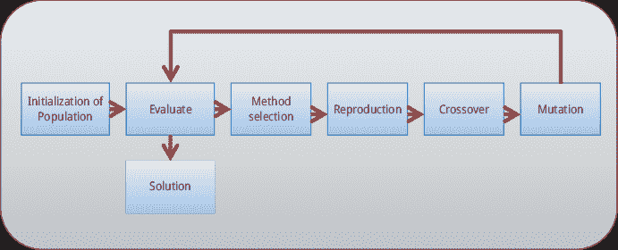

图 8.1：进化算法的关键组成部分。

进化算法可以高效地解决单目标多目标优化问题，这些问题通常需要多个学科的整合[9]。与传统方法相比，多目标优化算法具有显著优势。它们可以同时处理整数、不连续或离散变量。它们与各种游戏策略兼容，不受不同帕累托前沿形状的影响。此外，它们能够在非凸或不连续区域找到解决方案。进化算法是依赖达尔文进化的实用启发式搜索技术。它们具有鲁棒性和适应性等重要属性，使其能够在全局范围内为复杂的优化问题识别出最优解决方案[10]$。使用进化算法可以显著增加在优化过程第一阶段发现近优解的概率。进化算法不依赖于任何适应度梯度信息，可以快速进行并行处理，并且能够克服确定性优化方法可能失败或不可行的局部极值。进化算法的收敛性不受被优化函数连续性或可微性的影响[11]$。

进化算法可以作为传统优化方法的替代，并具有增强和扩展它们的潜力。通常，将进化算法与其他技术相结合的混合方法可以获得优异的性能。企业级应用可以高效管理单目标多目标优化任务，这些任务通常需要多个学科的整合[12]$。与传统方法相比，多目标优化算法具有显著优势。它们可以同时处理整数、不连续或离散变量。这些算法与各种游戏策略兼容，不受不同帕累托前沿形状的影响。此外，它们能够在非凸或不连续区域找到解决方案。

## 8.3 进化算法的工作原理与关键组件

进化算法的关键工作原理见图 8.2。

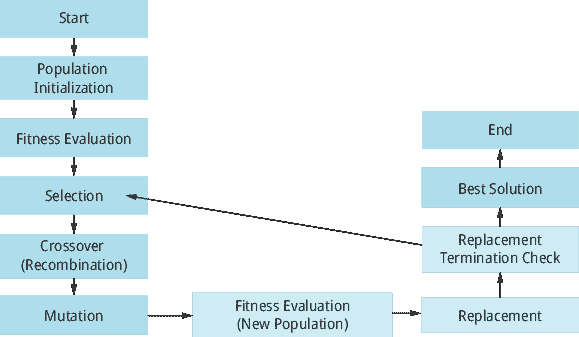

图 8.2：进化算法的工作原理。


**种群初始化：** 在进化算法中初始化种群最直接且最常用的方法是随机创建解决方案。每个解决方案中的每个基因都会根据编码问题的方法，在其可行范围内随机分配一个值[13]。

**方法选择：** 增加选择压力会加速种群向特定解收敛，但可能会限制对搜索空间的探索。

**繁殖：** 使用选择策略来确定将进行繁殖的基因。繁殖涉及选择某些个体，然后这些个体通过交叉程序交换信息。在从一种代到下一代的过渡过程中，每个个体的基因都会经历随机变异[14]。

**交叉：** 也称为重组，代表了一种用于合并两个亲本材料以产生后代的遗传算子[15]。

**变异：** 通过随机改变特定基因的值来催化进化，确保遗传多样性[16]。

**种群替换：** 主要的替代技术是代际替换，即用新产生的后代替换前代。

## 8.4 进化算法的关键类型

常见的进化算法如下：

### 8.4.1 遗传算法 (GAs)

遗传算法（`GA`）[17]是一种成熟且广为人知的优化方法，其灵感源于自然过程。遗传算法模拟了环境中的自然过程。遗传算法使用个体种群，其中每个个体通过染色体表示，代表一个可能的解决方案。目标或函数决定了要解决的问题。根据个体的适应程度为其赋予一个值[18]。

该值通常被称为个体的适应度，并作为评估的主要标准。遗传算法采用三种通用算子：选择、交叉和变异。选择过程涉及利用前代成员的适应度创建一个全新的种群。交叉通常涉及交换两个个体之间的部分。变异涉及随机改变基因的值[19, 20]：

```
# 返回最佳个体
# 运行遗传算法
打印最佳解
```

### 8.4.2 遗传编程 (GP)

遗传编程（`GP`）指使用遗传算法（`GA`）来进化计算机程序。`GP` 是一种近期开发的技术，是 `GA` 的特殊版本。`GP` 专注于通过使用自定义遗传算子来解决某些类型的问题。Koza 创建 `GP` 是在已知程序正确运行评估标准的情况下自动生成程序代码。由于寻求的答案是程序，因此开发的替代方案以树的形式表示，而不是 `GA` 中更常用的线性染色体（由位或整数组成）[21]。遗传程序是专门为在树结构上操作而设计的。例如，交叉涉及子树的交换，而变异则涉及修改节点的结构或叶子节点。

### 8.4.3 进化策略

进化策略（`ESs`）的发展与 `GA` 不同，特别是在其选择机制上。在 `GA` 中，后代是通过根据原始种群成员的成功价值潜力进行选择形成的，同时保持种群规模一致。在 `ES` 过程中，会形成一个瞬态种群，其规模与原始种群不同。假设的参数和其他因素决定了该种群中的个体数量。适应度评分在此阶段是不重要的；瞬态种群的成员经历遗传重组和遗传变异 [22, 23]。

### 8.4.4 进化编程

进化编程（`EP`）是一种使用生物演化启发的原理解决复杂问题的计算方法。`EP` 的创建是作为揭示未知语言语法结构的手段。`EP` 在作为数值优化工具引入后变得流行起来 [24]。`EP` 类似于 `ES`，尽管它有一个根本性的区别 [25]。在 `EP` 中，新种群通过对原始种群中的每个个体应用变异来产生。

相反，在 `ESs` 中，每个人都有等机会被选入临时种群，并在该种群中进行遗传操作。在 `EP` 框架内，变异通过对变异个体中特定基因值的任意扰动发生。新形成的种群和父代种群的规模相同。最终，下一代个体通过从父种群和变异种群中选择排名最高的个体形成的。

表 8.1：进化算法方法的对比分析 [26]。

| 方面 | 遗传算法 (GA) | 粒子群优化 (PSO) | 模拟退火 (SA) |
| --- | --- | --- | --- |
| 定义 | 受自然选择和遗传演化启发的优化技术 | 受群体社会行为启发的基于种群的优化技术 | 受冶金退火过程启发的概率优化技术 |
| 表示法 | 解决方案以染色体或基因字符串表示 | 解决方案表示为多维搜索空间中的粒子 | 解决方案表示为优化问题中的候选方案或状态 |
| 迭代过程 | 通过选择、交叉和变异操作迭代地评估并改进候选解决方案 | 根据个人最优和全局最优位置迭代更新粒子位置 | 通过接受概率性变化迭代探索解空间 |
| 探索与开发 | 平衡对新解决方案的探索与对已知潜力解决方案的利用 | 平衡对新区域的探索与对已知最佳解决方案的利用 | 平衡为了逃离局部最优而进行的探索与为了收敛到最优解的开发（利用） |
| 收敛行为 | 随着迭代向最优或近优解收敛 | 快速收敛到最优解，通常需要的迭代较少 | 逐渐向最优收敛，收敛速度受温度调度的影响 |
| 适应性 | 可能难以适应不断变化的问题格局或动态环境 | 通常能适应问题动力学的变化，但在噪声环境中可能面临挑战 | 通过温度调度调整来适应优化格局的变化 |
| 应用 | 广泛应用于各个领域，包括函数优化、神经网络和组合优化 | 常用于连续函数优化、工程设计和数据聚类 | 应用于参数优化、组合优化和调度问题任务 |
| 优点 | 对复杂高维问题具有鲁棒的优化能力 | 收敛快、实现简单、在连续优化中有效 | 探索与开发平衡，能有效逃离局部最优 |
| 局限性 | 计算复杂度、探索与开发的平衡以及适应性问题 | 早收敛、对噪声缺乏鲁棒性以及离散优化困难 | 对初始参数敏感、收敛慢以及受温度调度影响 |

## 8.5 进化算法的应用

群体智能日益流行的关键原因之一是对智能优化方法的需求日益增长。`EA` 非常适用于优化、调度、规划和管理挑战 [27]。

### 8.5.1 遗传算法在现实中的作用

`GA` 是一种多功能的优化方法，可用于广泛的问题 [28]。`GA` 能有效解决各种优化问题，包括具有约束、多模式、连续变量、组合元素和多目标的问题。因此，`GA` 在多个领域应用广泛。在本节中，我们仅提供了有限的选择。本章讨论了太阳能阵列的优化，使用了 `GA` 来解决。给出的数值技术围绕围绕平层飞气的旋转表示来优化太阳能阵列。结果表明，建议的方法在建立大型柔性太阳能阵列的初始阶段是有益的。此外，研究表明通过优化太阳能阵列，太阳能板的功率输出得到了大幅提升。

该研究 [29] 提出了一个优化模型，利用 `GA` 最小化高硫油和天然气净化过程的总能量消耗。

这种受遗传启发的技术被研究并实现在序列过滤器中 [30]。由于这种方法，消除了许多粒子滤波器中经常使用的重采样的需求，并保持了粒子的多样性。

该分析基于一个具有挑战性且紧沿的话题，特别是可扩展光纤网络中多播流的光谱路选择选择与分配（`RSA/M`）。他们提出了一种熟练的优化技术，用于解决 `EONs` 中的 `RSA/M` 问题。建议的方法优于所有其他竞争方法。此外，鲍尔文效应（Baldwin’s effects）的引入有助于维持 `GAs` 中的种群多样性。

易腐物品本地库存路由框架的介绍可以在 [31] 中找到。所提模型整合了供应链中的三层决策，包括确定仓库的最佳数量和位置、管理每家商店的库存水平以及优化每辆车辆行驶的路线。研究表明所提模型是 `NP-hard` 的。因此，作者设计了一种基于 `GAs` 的策略来有效应对这一挑战。所提供的技术已表明能够在现实的时间范围内生成近优的高质量解决方案。

研究 [32] 引入了一种新的集装箱装载技术，该技术使用负载分布图将负载平衡、重量限制和稳定性考虑在内。这种方法使用了多种群偏随机键 `GA`，包括一个考虑静态和负载平衡的新型适应度函数。由于结合了重量平衡目标、通过完整的底部支撑确保稳定性并遵循机械平衡准则，该技术非常成功。

[33] 中介绍了一个框架，用于识别增强铁路网络应对地震灾害韧性的投资策略。该框架由四个部分组成。第三部分介绍了投资优化模型的数学表述，而第四部分侧重于使用 `GA` 求解该模型。所建议的方法已应用于中国真实的铁路系统。结果表明，与基于拓扑的方法相比，给定的架构对地震对铁路网的影响更为敏感。

这项研究展示了空间冷却和热舒适度运营成本的多目标优化，以实现卓越的建筑能源效率。所提 `GA` 的主要目标是根据对未来一天环境的预测以及占用模式，按小时优化设定点温度。与典型的控制方法相比，提供的技术实现了高达 54% 的成本节约 [34]。

在 [35] 中创建了时间最优列车运行参考曲线，以便在最大化能量消耗的同时最小化时间。通过多点实现节节约：多种群 `GA` 解决了这一多个点组合优化的挑战。仿真结果考虑了上海线的实际情况和列车特征，清楚地说明了所建议的多点滑行控制技术取得的进展。

[34] 给出了通过实施 `GA` 来最小化过饱和状态下大城市信号交叉路口典型延迟的方法。缓解城市拥堵是交通管理的迫切需求。减少拥堵的一种重要方法是交通信号的效率。现有的交通信号管理系统尚未经过充分优化，无法有效管理过饱和状态。仿真结果表明，`GA` 有效地管理交通信号，将平均延迟最小化至每辆汽车 56 秒 [36]。

利用多功能的 `GA` 解决 [37] 背景下的节点放置挑战。节点放置问题出现在许多技术领域，例如。所建议的技术使用了不同长度的交叉，可以自动修改节点总数。实验结果表明，自适应的 `GA` 优于其他方法。

### 8.5.2 GP 应用于现实场景

`GP` 对气体的实用性如下：在研究 [38] 中，引入了一种新的 `GP` 方法。用于识别波斯语/阿拉伯字符的建议技术。

在 [39] 进行的研究中，使用了遗传表达编程（`GEP`）方法。`GEP` 方法利用有限数量的水文学因素，包括输入和输出。使用两个拟合优度指标评估所提系统的有效效性。经验证据表明，`GEP` 模型的性能优于 Muskingum 模型。报告 [40] 分析了 `FC` 电池管理方法。所提技术的主要目标是提高 `FCs` 在不同运行位置的性能。

### 8.5.3 演化策略 (ES) 在现实场景中

[41] 中了集成 `ES` 的并行优化，以减少钢框架的重量。成本分析调查了具有不同梁柱连接和支撑的钢框架。所建议技术的数值验证使用了三层结构（10 层、20 层和 30 层）。我们使用数据为多层钢结构建议经济实行的框架。

研究 [42] 提出了一种电力电池以减少其 `EF`。在配电网络中，不可预测性是停电的主要原因。作者建议了一种能够最大化寿命并满足所有电力需求峰值的智能电池。定制的稳态 `ES` 允许电池根据各种情况修改充电方法。在合成和实际数据上的实验结果表明该技术是有效的。研究 [43] 提出了一种改进非支配排序 `ES` 算法，该算法采用特殊算符引导算法转向已知 `SSO` 站点。所提策略旨在最大化 `SSO` 减少并最小化修复费用。圣安东尼奥东部水务网络测试了所建议的方法。与检查的替代方案相比，提供的技术使收敛速度提升了 70% [44]。

在研究 [45] 中提出了一种基于融合数据分析的无线传感器故障诊断方法。我们基于层次信念规则的故障诊断模型使用 `CMA-ES` 算法来优化其初始参数。验证该技术需要使用 Intel 实验室传感器数据进行案例研究。研究表明，建议的策略优于专家模糊系统和反向传播神经网络模型。除了此应用外，进化算法（`EA`）的其他应用如下所示。表 8.2 展示了进化算法在各个领域的应用对比分析。

表 8.2：进化算法在各个领域的应用对比分析。

| 应用 | 描述 |
| --- | --- |
| 神经网络优化 | 进化算法通过优化神经网络的架构、超参数和权重，以提高在分类、回归和图像识别任务中的性能。 |
| 函数优化 | 进化算法在优化复杂、非线性和多峰函数方面表现出色，能够在传统的基于梯度的方法难以处理的地方找到全局最优解。 |
| 多目标优化 | 进化多目标优化算法能够高效地生成帕累托最优解集，使决策者能够探索不同应用中冲突目标之间的权衡。 |
| 特征选择 | 进化算法识别特征子以在最大化预测性能的同时最小化维度，从而增强模型在分类和回归等任务中的可解释性和效率。 |
| 组合优化 | 进化算法通过探索大型解空间来寻找最优或近优解，高效地解决旅行商问题、作业调度和车辆路径等组合优化问题。 |

## 8.6 挑战与未来方向

进化算法的关键挑战和未来方向如下。

### 8.6.1 挑战

进化算法是一个非常迷人的研究领域。一些开放性研究问题包括管理探索与开发特性之间的权衡、实现控制参数的自适应控制、减少 `CMA-ES` 算法中的参数数量、开发新的选择方案以及增强其效能。后者非常重要，特别是在演化设计和可进化硬件领域。此外，还需要新颖且更有效的方法来处理约束 [46]。

此外，需要进一步的研究来探索进化算法在动态优化问题、噪声和非平稳设置下的优化以及多目标优化问题（特别是具有大量选择因素的问题）中的应用。此外，还需要调查以了解种群规模在各种优化设置中如何适应。为了更有效地解决成本高昂的问题，有必要设计可能增强竞争力的创新方法。必须解决的问题之一如何在进化算法中处理约束 [47]。

约束处理方法可以分为六类：惩罚方法、可行域内方法、基于种群的方法、去选择方法、利用多目标的方法和混合方法。

进化算法中所用方法的分类进一步细分为 [48]。为了在现实应用中实施适当约束，必须解决几个问题。

此外，在实际应用中，显而易见进化算法没有通用方法；约束管理仍然是一个当前且重要的研究领域。

在使用进化算法进行优化之前，全面理解其能力和局限性至关重要。通过检查优化不同版本的进化算法所需，可以获得关于决定因素的宝贵见解。表 8.3 展示了进化算法在各个领域的关键挑战的对比分析 [49]。

## 扩展性

扩展性指的是 `EAs` 高效处理日益复杂或大规模优化问题的能力。在处理高维搜索空间、计算密集型拟适应度评估或需要并行化的任务时，会面临各种挑战。解决扩展性问题需要设计能够在不损害性能或收敛性的情况下进行有效扩展的算法。

### 8.6.2 未来发展方向

正如本研究 [50] 所示，`EAs` 是一个经过深入研究的领域。每年都会提出如上述算法的若干种新颖变体。如果某个特定问题没有合适的专门算法，使用其中一种 `EA` 可能会是一个有利的选择。考虑用户在使用 `EAs` 时可能遇到的挑战至关重要。在这里，我们可能会识别出两个主要问题。当下的首要问题是早熟收敛，指的是种群向次优解而非理想解收敛。为了解决这个问题，我们可以实现一种系统，减少遗传材料在个体之间传递的速率。这可以通过将整个种群分为许多子种群（有时被称为“岛”），并偶尔允许个体在这些岛之间移动来实现 [51]。

解决早熟收敛问题的另一种方法是使用分支界法结合 `EAs`，并由中间传播方法进行增强。第二个问题是在探索与从 `EA` 特性中获利之间的理想平衡。控制选择压力程度是解决这一问题的可能答案之一。这可以通过引入特殊的遗传算子来实现，确保在算法运行初期具有高水平的种群差异（侧重探索而非开发），在算法结束时具有低水平的种群多样性（更多关注开发而非探索） [52]。

`EAs` 的未来发展可能在许多关键方向上突出。一种当代方法是多种算法的混合，以获得改进的结果。目前，有越来越多的文献展示了数量增加的混合算法工作。此外，许多研究人员正致力于通过各种改进提高 `EAs` 的计算效率。`EAs` 未来研究的另一个引人注目的领域是模因算法（memetic algorithms）。“模因算法”一词是指进化方法与任何额外的基于种群的策略以及独立的局部搜索策略（例如 `Nelder-Mead method`）相结合。可以获得关于 `EAs` 未来进展的宝贵见解 [53]。

`EAs` 的未来趋势之一是对使用 `EAs` 用于具身或嵌入式系统的兴趣日益增长。这意味着利用演化来创建控制种群，这些个体对特定的情境实体应用操作方法。这些解决方案根据其在复杂动态环境中的性能进行评估，重点关注其功能性而非内在品质。此外，另一个重要的关注点，特别是在 `EA` 技术的工业应用中是：经常在处理实际情况时，我们需要优化具有许多维度的域内部的函数 [54]。这种方法通常复杂且耗时。因此，在实际场景中，为此类问题开发的 `EAs` 必须构建为易于并行实现（或 `GPU-friendly`），以最小化它们的计算时间。未来的建议应优先在开发这一特性投入更多努力，因为它可能是决定算法在实际应用中可用性的关键因素。`EAs` 领域的研究通常涉及代理模型（surrogate models），即对现实情况的计算成本较低的模型。这些代理模型可以替代完全的适应度评估，并可以通过有时评估种群中的个体来改进 [55]。

此外，工业挑战通常包含许多目标。交互式 `EAs` 与算法进展相结合，以增强 `EAs` 在多目标优化中的有效性。众所周知，每个工程问题都由独特的目标函数表征，并具有独特的搜索空间拓扑结构。解决一个问题的有效 `EA` 参数最优设置可能不足以解决另一个问题。表 8.4 呈现了未来方向及其优势与挑战的对比分析。

#### 表 8.4：未来方向、其优势与挑战的对比分析。

| 未来方向 | 描述 | 优点 | 挑战 |
| --- | --- | --- | --- |
| 方法混合 | 这涉及将 `EAs` 与其他优化技术（如群体智能或传统方法）结合。旨在利用每种方法的优点来克服个体局限性。 | 协同多个优化范式——增强探索和开发能力——提高解的质量和收敛速度 | 集成不同算法的复杂性——寻找方法的最佳组合——计算开销的可能增加 |
| 自适应启发式 | 这种方法涉及开发具有自适应机制的 `EAs`。这些机制根据问题特性和优化进度动态调整算法参数、算子或策略。 | 增强对问题动态和复杂的适应性——提高收敛速度和解的质量——减少早熟收敛风险 | 设计有效的自适应机制——平衡探索与开发——确保自适应算法的稳定性和鲁棒性 |
| 多样性保持 | 该策略侧重于优化过程中维持种群内部的多样性。它促进对搜索空间不同区域的探索，并减轻早熟收敛风险。 | 增强对搜索空间的探索——减少早熟收敛风险——提高鲁棒性和解的质量 | 设计有效的多样性维护机制——平衡多样性和收敛目标——确保多样性保持技术的计算效率和扩展性 |

因此，在自动调优和自适应参数控制领域，新方法的探索仍然是 `EAs` 领域的一个重要课题。`EA` 技术商业化实施的一个关键问题是目标函数的精确规范。工业困难非常复杂。因此，为特定的工业过程制定精确的数学模型（带有定义良好的 `EAs` 目标函数）是一项艰巨的任务。

所选目标函数的有效性将显著影响通过 `EA` 技术所获得的结果。我们需要解决的最后一个问题涉及 `EA` 方法论的可重复性。众所周知，`EAs` 是随机方法。每当执行 `EA` 技术时，都可能获得不同的结果。因此，优先考虑建立由 `EA` 方法论产生的一致性结果至关重要。这对于在工业中实现 `EA` 方法具有重要意义 [21]。

## 8.7 结论


现实世界呈现出多种优化情况，其特征是具有不同的局限性，且函数目标表现出不连续性、非线性、非凸性和多模态性。这些优化问题非常复杂，包含了多种类型的变量，包括整数、实数、独立和二进制变量。这些变量具有不同的值范围，因此需要使用归一化处理。因此，问题的搜索空间缺乏平滑性。`EAs` 越来越多被认可并应用于计算机处理，以解决复杂的工程挑战。研究科学家和工程师利用进化的思想来解决基于优化的研究并撰写论文。本章全面概述了 `EAs` 及其应用、挑战和未来方向。

## 参考文献

[1] Zohuri, B., & Rahmani, F. M. (2024). 用于信号和图像处理的计算智能释放算法的力量。*Journal of Clinical Case Reports & Studies*, *5*(2). →

[2] Paul, V. M., Prabhu, S. R. B., Jarin, T., & Kumar, T. A. (2021). 深度脑刺激的关键性调查与原型研究：生物医学工程在医疗保健中的应用。在 *Handbook of Deep Learning in Biomedical Engineering and Health Informatics* (pp. 103–135). Apple Academic Press. →

[3] Mustafa, G., Rauf, A., Al-Shamayleh, A. S., Sulaiman, M., Alrawagfeh, W., Afzal, M. T. et al. (2023). 优化文档分类：释放遗传算法的力量。*IEEE Access*. →

[4] Zohuri, B., & Rahmani, F. M. (2024). 用于信号和图像处理的计算智能释放算法的力量。*Journal of Clinical Case Reports & Studies*, *5*(2). →

[5] Hatoum, M. B., & Nassereddine, H. (2023). 释放 chatgpt 在精益建设的力量：早期展望。在 *Proceedings of the 31st Annual Conference of the International Group for Lean Construction (IGLC31)*。 doi: 10.2492/2023/0243. →

[6] Iqbal, J., Jaimes, D. C., Makineni, P., Subramani, S., Hemaida, S., Thugu, R. et al. (2023). 重新想象医疗保健：释放医学中人工智能的力量。*Cureus*, *15*(9). →

[7] Lilhore, U., Manoharan, P., Simaiya, S., Alroaea, R., Alsafyani, M., Baqasah, A. et al. (2023). HIDM：使用优化的 CNN-LSTM 进行工业 4.0 网络入侵检测。*Sensors*, *23*(18). →

[8] Orike, S., & Ene, D. S. (2023). 元学习：释放自改进人工智能（AI）系统的力量。*The Journal of Advances in Computational Intelligence*, *5*(3). →

[9] Dalal, S., Poongodi, M., Lilhore, U., Dahan, F., Vaiyapuri, T., Keshta, I. et al. (2023). 用于信息物理系统安全与隐私的优化 LightGBM 模型。*Transactions on Emerging Telecommunications*, *34*(6). →

[10] Li, Z., Ma, P., Wang, H., Wang, S., Tang, Q., Nie, S. et al. (2022). 编译器中间表示增强神经嵌入的力量。*Proceedings of the 44th International Conference on Software Engineering*, 2253–2265. →

[11] Sharma, N., Gupta, R. D., Khanna, R., Sharma, R. C., Sharma, Y. K. (2023). 通过 WEDM 加工 Ti-6Al-4V 合金：使用灰色搜索对 MRR 和 Rz 进行优化。*World Journal of Engineering*, *20*(2), 221–234. →

[12] Aluvala, S., Balamurugan, V., Jeyasudha, J., Kumar, R. D., & Kumar, P. (2023). 解码金融市场：Bi-LSTM 在前沿股票预测情感分析的力量。在 *2023 International Conference on Evolutionary Algorithms and Soft Computing (EASCT)*, 1–7. →

[13] Simaiya, S., Lilhore, U. K., Sharma, Y. K., Rao, K. B. V., Rao, V. V. M., Baliyan, A. et al. (2024). 使用深度学习和优化技术的混合云负载均衡和主机利用预测方法。*Scientific Reports*, *14*(1), 1337. →

[14] Xu, M., Du, H., Niyato, D., Kang, J., Xiong, Z., Mao, S. et al. (2024). 释放移动网络中边缘云生成式 AI 的力量：AIGC 服务综述。*IEEE Communications Surveys & Tutorials*. →

[15] Dahiya, N., Sharma, Y. K., Rani, U., Hussain, S., Nabilal, K. V., Mohan, A. et al. (2023). 用于有效人类猴痘疾病检测的超参数调优深度学习方法。*Scientific Reports*, *13*(1), 15930. →

[16] Gupta, S., Kumar, A., Sharma, Y. K., & Sharma, A. (2020). 灰色等级 WEDM 多重性能。*Optimization and Engineering*, *1*(1), 27. →

[17] Fan, Z., Ghaddar, B., Wang, X., Xing, L., Zhang, Y., & Zhou, Z. (2024). 运筹学人工智能：变革运营流程。arXiv:2401.03244. →

[18] Kumar Lilhore, U., Simaiya, S., Sharma, Y. K., Kaswan, S., Kbvb, R., Vvrm, R. et al. (2024). 使用混合 U-Net 和改进 MobileNet-V3 的皮肤诊断精确模型。*Scientific Reports*, *14*(1), 4299. →

[19] Moayedi, H., Ahmadi Dehrid, A., & Le, B. N. (2024). 通过多计算优化神经网络对流冲蚀过程进行建模和预测的新颖方法。*Engineering Application of Computation Fluid Mechanics*, *18*(1), 230456. →

[20] Mehta, P., Sait, S. M., Yıldız, B. S., Erdaş, M. U., Kopar, M., & Yıldız, A. R. (2024). 一种新型增强山羚优化器和人工神经网络用于机械设计的全局优化。*Mater Test*. →

[21] Rokade, M. D., & Sharma, Y. K. (2021). MLIDS：用于实时网络数据集的机器学习入侵检测方法。在 *2021 International Conference on Emerging Smart Computing and Informatics (ESCI)* (pp. 533–536). IEEE.

[22] Aigner, K. M., Goerigk, M., Hartisch, M., Liers, F., & Miehlich, A. (2024). 数学优化中数据驱动解释性的框架。*Proceedings of the AAAI Conference on Artificial Intelligence*, *38*(19), 20912–20920.

[23] Sharma, Y., & Singh, B. K. (2020). 基于音高参数的特定语言障碍儿童分类。收于*2020 IEEE recent advances in intelligent computational systems (RAICS)* (pp. 42–46)。 IEEE. →

[24] Rene, E. A., & Fokui, W. S. T. (2024). 基于人工智能的区域分段 RDNS 中具有随机尺寸和分布式光伏的优化电动汽车充电站（EVCS）集成。*Journal of Electrical Systems and Information Technology*, *11*(1), 1. →

[25] He, C., Zhang, Y., Bian, T., Jiao, K., Su, W., Wu, K. J et al. (2023). 人工智能赋能工业 4.0 化学产品设计、合成和工艺优化的综述。*Processes*, *11*(2), 330. →

[26] Wang, H., Fu, T., Du, Y., Gao, W., Huang, K., Liu, Z. et al. (2023). 人工智能时代的科学发现。*Nature*, *620*(7972), 47–60. →

[27] Williams, J. C., ReVelle, C. S., & Levin, S. A. (2004). 使用数学优化模型设计自然区。*Frontiers in Ecology and the Environment*, *2*(2), 98–105. →

[28] Ahmed, F. E., Hashaikeh, R., Diabat, A., & Hilal, N. (2019). 海水淡化中的数学与优化建模：现状与未来方向。*Desalination*, *469*, 114092. →

[29] Rani, P., Hussain, N., Khan, R. A. H., Sharma, Y., & Shukla, P. K. (2021). 车辆智能系统：智能城市软件定义汽车联网（`SDN-IOV`）中基于时间的车辆下一位置预测。*Intelligence of Things: AI-IoT Based Critical-Applications*, 35–54. →

[30] Pachauri, R. K., Mahela, O. P., Sharma, A., Bai, J., Chauhan, Y., et al. (2020). 部分阴影对不同配置和建模方法的影响：综述。*IEEE Access*, *8*, 181375–181403. →

[31] Sharma, Y., & Singh, B. K. (2023). 基于 `EEG` 的时频模型的注意力缺陷多动儿童分类。*IEEE*. →

[32] He, C., Zhang, Y., Gong, D., & Ji, X. (2023). 复杂问题的代理辅助进化算法综述。*Expert Systems with Applications*, *217*, 119495. →

[33] Song, Y., Cai, X., Zhou, X., Zhang, B., Chen, H., Li, Y., et al. (2023). 动态混合机制差分算法及其应用。*Expert Systems with Applications*, *213*, 118834. →

[34] Kumar, L., Kar, M. K., & Kumar, S. (2023). 基于改进进化算法的无功功率优化。*Expert Systems: International Journal of Knowledge Engineering and Neural Networks*, *40*(1). a, b

[35] Dhiman, H., Vyas, N., Pagrotra, A., & Dutt, V. (2023). 通过物联网和高分辨率智能道路照明进行实时交通分析和驾驶安全增强[Internet]。收于*1st International Conference on Circuits, Power and Intelligent Systems (CCPIS)*。IEEE, 2023. 可自：http://dx.doi.org/10.1109/CCPIS59145.2023.10291872。→

[36] Kaur, N., Mittal, A., Lilhore, U. K., Simaiya, S., Dalal, S., Sharma, Y. K., et al. (2023). 太阳能光伏板：发展与部署策略综述。*International Journal of Ambient Energy*, *44*(1), 2218231. →

[37] Kumar, N., Verma, H., & Sharma, Y. K. (2023). 图神经网络的对抗攻击：技术与对措施。*Concepts and Techniques of Graph Neural Networks. IGI Global*, 58–73. →

[38] Nayak, S., Sharma, Y. K., & Nayak, R. (2023). 具有动态时间片的优化轮轮中央处理器调度算法。收于*2023 Second International Conference on Smart Technologies For Smart Nation (SmartTechCon)* (pp. 1482–1490)。IEEE. →

[39] Slowik, A., & Kwasnicka, H. (2020). 进化算法及其在工程问题中的应用。*Neural Computing & Applications*, *32*, 12363–12379. →

[40] Shaikh, P. E., El-Abd, M., & Gao, N. (2019). 解决交通控制中的数学与优化建模。*IEEE Transactions on Intelligent Systems*, *23*, 48–63. →

[41] Falcón-Cardona, J. G., & Coello, C. A. (2020). 基于指标的多目标优化。*ACM*, *53*(2), 1–35. →

[42] Song, Y., Cai, X., Zhou, X., Zhang, B., Li, Y., et al. (2023). 动态混合机制差分算法及其应用。*Expert Systems with Applications*, *213*, 118834. →

[43] Deng, W., Xu, J., & Song, H. (2021). 带小波函数的差分进化。*Soft Computing*, *106*, 107317. →

[44] Elsayed, S., Sarker, R., & Essam, D. (2012). 改进的自适应差分进化。*IEEE Transactions on Industrial Informatics*, *9*(1), 89–99. →

[45] Yi, W., Zhou, L., Gao, X., & Mou, J. (2016). 改进的差分算法。*Expert Systems with Applications*, *44*, 12. →

[46] Swarna, S. R., Kumar, A., Dixit, P., & Sairam, T. V. M. (2021). 使用适应量子计算预测帕金森病。收于*2021 Third International Conference on Intelligent Communication Technologies and Virtual Mobile Networks (ICICV)* (pp. 1396–1401)。IEEE. →

[47] Zhang, X., Jin, L., Cui, C., & Sun, J. (2021). 化学工程中的自自适应多目标进化算法。*Applied Soft Computing*, *106*, 107317. →

[48] Sedak, M., & Rosić, B. (2021). 基于适应粒子群差分算法的行星轮箱多目标优化。*Applied Sciences*, *11*(3), 1107. →

[49] Da Silva Santos, C. E., Sampaio, R. C., Coelho, L. D. S., Bestard, G. A., & Llanos, C. H. (2021). 用于 SVM/SVR 超参数选择的多目标自适应差分算法。*Pattern Recognit*, *110*, 107649. →

[50] Liu, B. J., & Bi, X. J. (2021). 基于分解和差分算法的自适应 ε 约束多目标进化算法。*IEEE Access*, *9*, 17596–17609.

[51] Hou, Y., Wu, Y., Liu, Z., Han, H., & Wang, P. (2021). 基于演化进展信息的动态多目标差异进化算法。*科学学报*, *64*(8), 1676–1689. →


[52] Bian, K., Sun, Y., Cheng, S., Liu, Z., & Sun, X. (2021). 基于分解的差异进化多目标优化算法自适应方法。在 Neural Computing for Advanced Applications: Second International Conference, NCAA 2021 (pp. 458–472). Springer Singapore, Guangzhou, China, August 27–30, 2021, Proceedings 2. →

[53] Wang, H., Wang, J., Zhao, Y., & Xu, H. (2021). 基于多目标差异进化算法的穿隧参数优化。*软性计算*, *25*, 3637–3656. →

[54] Wang, P., Xue, B., Liang, J., & Zhang, M. (2021). 用于分类特征选择的多目标差异进化算法。*IEEE Transaction on Cybernetics*, *53*(7), 4579–4593. →

[55] Yue, C., Suganthan, P. N., Liang, J., Qu, B., Yu, K., Zhu, Y. et al. (2021). 使用改进拥挤距离的差异进化算法用于多峰多目标优化。*Swarm and Evolutionary Computation*, *62*, 100849. →

# 9 AI 中数学优化技术导论

Uppuluri Lakshmi Soundharya Yogesh Kumar Sharma Anantha Raman Ravi Rastogi

### 摘要

特别是，现实世界的问题变得日益复杂，需要更先进的数学算法和模型来高效地处理海量数据并识别最佳解决方案。然而，重要的是，没有理想的技术或算法，因为每种方法都有某些局限性，这些局限可以通过整合多种方法来缓解或消除。由于深度学习（DL）和机器学习（ML）的发展，人工智能（AI）领域发生了巨大的变革。这些进展使得能够以极高的水平完成图像识别和自然语言处理等复杂任务。优化策略对于构建`DL`和`ML`模型至关重要，因为它们提供了最优的收敛性并提高了效率。个人可以通过使用定义这些方法的数学原理和推导来优化现有的`DL`模型。本章概述了 AI 中的数学优化技术、优化方法的类型、应用、挑战和未来方向。

关键词：数学优化，AI，深度学习，机器学习

## 9.1 引言

数学算法广泛应用于各种科学领域以解决挑战。如前所述，算法使用数学公式简化现实，使我们能够理解复杂的程序、解决困难并做出明智的决策。数学算法采用技术来确定给定问题的最佳解。数值优化是数学中一个公认的领域，侧重于识别活动的最高和最低点 [1]。在过去的几十年里，优化策略的发展对于许多关键方面都是必要的，包括管理、决策、技术进步和整体系统开发，提供了有利且积极的方面 [2]。

数学优化涉及使用多个公式对业务问题进行建模并对其分析以获得最有利的业务结果。这些方程为思维提供了框架，并可以使用不同的数据源和目标进行反复优化，例如最大化收入、最小化成本和实现理想的服务水平。每个结果都代表用户可以在公司中访问并使用的产生显著影响的最优状况 [3]。

机器学习（ML）是一个广为人知的领域，专门通过使用数学框架和技术来解决问题。许多现实情况需要处理大量事实和数字。为了将这些未处理的细节转换为解决问题所需的有用信息，这种大量的统计信息通常需要统计支持。`ML`技术适用于多个领域，如世界、金融、教育 [4]。

考虑到这些领域的实际意义，人们创建了多种技术来利用`ML`处理优化问题。虽然大多数人工智能（AI）算法在应对它们遇到的问题方面是有效的，但没有一种是完美的。然而，近年来，许多研究人员开始探索整合两种方法的方法以解决每种方法的局限性。这些结合的方法被称为混合方法 [5]。

本章组织成若干章节，如下：第 9.2 节涵盖 AI 中的优化和数学优化技术，第 9.3 节涵盖应用、挑战和未来方向，最后一节涵盖结论。

## 9.2 数学优化与 AI

根据研究，`AI`是计算机科学和工程的一个领域，采用数学和逻辑程序来提取和整合编程知识。它利用先进智能的过程来解决问题、理解事件、促进决策并执行自动化操作 [6]。研究将`AI`分为三种主要分类：

*   优化技术（OT）
*   计算逻辑（CL）
*   概率推理（PR）

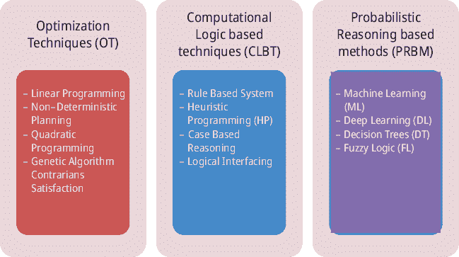

图 9.1：数学优化技术的类型。

优化方法包括多种方法，例如线性规划，它关注`线性目标函数`和规则；非线性规划用于非线性函数；针对单个因素的整数线性规划；用于具有重叠子问题的动态规划。图 9.1 展示了数学`OT`的类型 [7]。表 9.1 给出了各种优化方法的对比分析。

表 9.1：各种优化方法的对比分析。

| 优化方法 | 优化技术 (OT) | 计算逻辑 (CL) | 概率推理 (PR) | 优点 | 应用 |
| --- | --- | --- | --- | --- | --- |
| 方法 | 基础 | 策略 | 机制 | 优点 | 应用 |
| :--- | :--- | :--- | :--- | :--- | :--- |
| `梯度下降` | 一阶导数 | 迭代优化、基于规则的推理 | − | 简单、易实现 | 机器学习、神经网络 |
| `牛顿法` | 二阶导数 | 基于规则的推理、演绎推理 | − | 收敛快速 | 非线性优化、机器学习 |
| `遗传算法` | 演化算法、选择、交叉、变异 | − | 候选解的概率建模 | 全局优化，可处理不可微函数 | 工程设计、调度问题 |
| `模拟退火` | 概率分布、退火计划 | 基于规则的推理 | 对较差解的概率性接受 | 跳出局部最优，找到全局最优 | 组合优化、参数调优 |
| `粒子群优化` | 群体智能、速度、位置更新规则 | 基于规则的推理、演绎推理 | − | 并行处理找到全局最优 | 机器人、财务预测 |
| `蚁群算法` | 群体智能、信息素迹、启发式信息 | 基于规则的推理、演绎推理 | 基于信息素的概率转移规则 | 分布式计算找到最优路径 | 路由问题、图优化 |

数学优化与 AI 是不同的 AI 方法论。然而，两者之间经常存在混淆。在基于数学优化的问题解决中，AI 算法支持`ML`和深度学习（`DL`）算法。`ML`主要关注预测和概率计算，而数学优化则是一种规范性方法，旨在确定实际的行动方案。虽然`ML`的预测可能指导特定的选择，但`ML`本身并不具备处理包含多个关联因素的复杂业务状况的能力。而这正是优化大显身手之处。`ML`与优化的一个关键区别在于：优化是以业务问题为核心关注点，而不是数据。

可获取的数据会显著影响`ML`算法的结果。通常需要通过将这些结果与大量数据进行比较来对它们进行评估，以确保准确性。这不仅意味着检查文件中的数万条项目，有时还需要处理数百万条记录。由于`ML`模型严重依赖历史数据，当它们需要适应不断变化的业务状况或需求时可能会面临挑战。这降低了它们的灵活性。`ML`模型通常难以处理异常情况。

另一方面，优化专门设计用于通过显式建模限制条件来处理异常情况。无论可用数据如何，决策过程涉及的变量及其相互连接都应该被清晰定义。这需要精通业务逻辑。

## 9.3 优化问题解决

尽管有许多优化方法和技术，但只有少数是通用的。要解决优化问题，考虑其特征至关重要。

数学框架构建是解决问题的初始阶段。数学框架的目标是将现实世界的问题转化为可以使用的方程。其目标是从给定的集合识别出最佳方案，即最优解。要构建数学框架，必须遵循四个阶段：

1. 第一步：决策变量的声明和初始化，即`DC[1]`、`DC[2]`、…… `DC[n]`。
2. 第二步：使用`DC`创建决策函数`f`。

```
f(DC) = best(f1(DC), f2(DC), ..., fn(DC))
```

3. 第三步：为了约束决策变量，定义一些等式和不等式限制与条件。
4. 第四步：定义问题域的特征`Pd[1]`、`Pd[2]`、…… `Pd[n]`。

优化问题由目标函数以及对变量施加的限制定义。此外，一种根据目标数量对优化模型进行分类的潜在方法是将它们分为两大类：与优化相关的单目标和多目标规划。

局部优化和全局优化的概念可能刻画了优化问题的答案。同样，搜索技术可以分为局部搜索和全局搜索。用于局部和全局搜索优化的搜索算法被以不同的方式使用，以解决不同的优化问题。局部优化涉及在搜索空间的定义区域内识别一个使目标函数减小或最大化的解。这意味着它侧重于在可行位置中寻找局部最优解。这种特定类型的搜索并不能保证目标值低于或高于所有其他点。

相比之下，全局优化旨在从所有可行解决方案中识别使目标函数最小化或最大化的最优点。然而，随着问题规模的扩大，全局优化的复杂性会呈指数级增长。表 9.2 展示了针对各种数学方法的优化框架的比较分析。

#### 表 9.2：各种数学方法优化框架的比较分析。

| 框架 | 描述 | 优点 | 缺点 | 应用领域 |
| --- | --- | --- | --- | --- |
| 遗传算法`GA` | 一种基于自然选择原理的进化算法。该过程从随机生成的解决方案初始种群开始，通过连续的代进化走向更好的解决方案。 | 全局优化可以处理不可微和不连续的函数，并具有并行处理能力。 | 收敛速度可能较慢，参数设置可能具有很高的复杂性。 | 专业领域包括工程设计、资源分配和进化自动化。 |
| 模拟退火`SA` | 一种概率优化技术，模拟冶金中使用的退火过程。它允许偶尔采用较差解以避免陷入局部最优。 | 能够避免局部最优，识别全局最优，并对噪声免疫。 | 参数调整敏感，且在某些情况下收敛缓慢。 | 组合优化和参数调优。 |
| 粒子群优化`PSO` | 基于群优化方法灵感来自鸟类迁徙或鱼类的集体行为。该过程通过考虑与已发现最优答案的距离来逐步增强潜在解决方案。 | 收敛快速，实现简单，具有同时处理任务的能力。 | 容易发生早收敛，在高维空间的优化问题上可能会遇到困难。 | 倾向于早收敛可能会在处理高维空间优化问题时带来挑战。 |
| 蚁群算法`ACO` | 基于蚂蚁觅食的优化算法。它通过信息素迹传递路线信息来寻找最优解。 | 蚂蚁觅食优化算法：通过信息素迹共享路线信息来寻找最优解。 | 参数调优和扩展问题。 | 图形优化、路由问题。 |
| 禁忌搜索`TS` | 元启发式搜索反复从一个解移动到邻接解。内存架构防止重复访问解。 | 有效的搜索空间探索避免了局部最优并适应不同领域的问题。 | 参数敏感，实现复杂。 | 组合优化、调度问题。 |
| 差异进化`DE` | 这种基于群的优化方法通过进化替代解决方案种群来增强候选解决方案。算子包括变异、交叉和选择。 | 全局优化是一种不受噪声和非线性影响的方法，能够解决高维问题。 | 与其他方法相比收敛速度较慢，对参数值敏感。 | 工程规划和参数优化。 |

优化涉及使用多种策略和算法来发现问题的答案。某些优化方法在寻找解决同一问题的方法时表现出独特的特征，导致某些方法在准确性方面比其他方法更快、更可靠。目前没有一种通用方法可以高效处理所有优化问题。相反，我们有几种方法可以在各自的范围内使用以解决与优化相关的问题。

## 9.4 数学优化技术

数学优化，通常称为数学规划，涉及根据某些标准从给定的可能性集中选择最优的元素。通常，它被分为两个子类：离散优化和连续优化。数值优化是数学的一个分支，专注于寻找操作的最高最低边界。在过去的几十年里，受计算技术进步及其广泛应用的推动，人们对优化方法的兴趣日益增加。因此，优化的实施日益成为主管、决策过程、增强和推进创新的关键工具，以促进系统的有效运行。通用框架使用决策参数来表示问题，这些参数是个人可以控制并可以像旋钮一样调整的常数。

### 9.4.1 梯度下降

这是 AI 领域采用的一种关键优化方法。其目标是通过通过梯度和成本函数相对于相关变量的变化，不断调整数学框架中的变量，从而使成本函数最小化。

- **数学公式：** 考虑一个神经网络，其参数用符号`θ`表示。目标是最小化成本函数`J(θ)`，该函数评估了数学框架的效率。`J(θ)`对`θ`的导数表示为`∇J(θ)`。梯度下降 (GD) 中的修改阶段通常正式表示如下：

```
(9.1)θ = ((θ - α) * ∇J(θ))
```

在此语境下，符号`α`也称为学习率 (LR)，它决定了参数调整的幅度。它在决定优化过程收敛的速度以及所实现的稳定性方面起着至关重要的作用。

### 9.4.2 随机梯度下降 (SGD)

SGD 涉及 GD 的变体，它通过使用一小部分训练样本（称为小批量，mini-batch）而不是整个数据集来计算梯度并调整设置参数。这种策略显著减少了计算负载并加速了优化过程。

- **数学公式：** 令一小组训练样本称为`B`，包括之前提到的总成本函数`J(θ)`。SGD 中的修订步骤为：

```
(9.2)θ = [θ - {α * ∇J(θ; B)}]
```

在这种情况下，`∇J(θ; B)`表示为小批量`B`计算的`J(θ)`的梯度。

### 9.4.3 动量优化

GD 代表通过沿着目标函数的梯度寻找函数绝对最优值的优化程序。当用于优化具有高曲率和不可预测梯度的问题时，会采用 GD。GD 方法倾向于在搜索空间中反复跳，直到卡在没有梯度的区域。

GD 技术的扩展是动量算法，它允许搜索在搜索空间的特定方向上产生能量，从而克服由混沌梯度引起的扰动并穿越空间的平滑区域。更准确地说，动量可以定义为先验梯度的加权移动平均。优化器使用先验梯度的指数加权移动平均来更新参数，而不是使用当前梯度。得益于充当内存的指数加权移动平均，优化器可以记住之前的路径，即使梯度指向相反方向也能坚持下去。

将动量与其他优化技术结合是常见做法，包括 SGD 以及自适应学习率 (ALR) 技术如 Adam (AD)、Adagrad (ADG) 和 Adelta (ADD)。动量算法在过程中引入了动量元素以克服 GD 的缺点。动量的定义具有“小球下山”的特征，是之前修订的一部分。尽管梯度反转或变为零，动量因子保持优化器在相同的路径上移动。这降低了震荡并防止我们进入浅最小值：

```
(9.3)V = {βV + (1− β)aJ} (9.4)θ = θ − αV
```

在该方程中，变量`V`代表动量项（即动量系数），`J`是成本函数对参数的梯度，它是 LR。通常，将动量系数设置为 0.9。在每次迭代中，优化器确定成本函数的梯度，并通过对先验梯度取指数加权移动平均来更新动量项。然后减去乘以 LR 的动量项以更新参数。

### 9.4.4 Adam 优化

被称为 Adam 优化器的算法是一种增量优化技术，用于在神经网络开发过程中最小化损失函数。这是“自适应动量估计 (AME)”的缩写。在考虑动量时，Adam 通常被认为是 SGD 和 RMSprop 的混合体；该方法由 Diederik 创建。

该方法使用梯度平方以类似于 RMSprop 的方式调整 LR。此外，它通过梯度的平均移动而非自身的梯度来利用动量，这类似于带有动量的 SGD。这种方法将动态学习率 (DLR) 的使用与缓解技术相结合，有效地达到全局最小值。配置中使用了以下 Adam 设置变量：

- Alpha： “学习率”术语也称为“步长”，互用以指代这一概念。权重变化百分比表示为 0.001，决定了权重调整的程度。较高的数字（如 0.3）会导致更快的学习过程，直到速率被调整。较低的值（如 1.0E-5）会显著降低整个训练过程中的学习速度。
- Beta one：对于初始动量估计，使用指数衰减率（如 0.9）。
- Beta two：二阶动量估计呈指数级减少的速度为 0.999。对于稀疏梯度问题（如 NLP 以及计算机视觉任务），建议值约为 1.0。
- Epsilon：为了避免操作中的除以零错误，使用一个极小的数字（如 10E-8）。

## 9.5 应用

数学优化，特别是优化建模，可以为这些问题中的任何一个提供解决方案。这种方法涉及使用数学公式或方程表示业务挑战的过程。它比性地代表了你必须做出的选择、必须遵守的限制以及它们之间为了实现特定目标而存在的相互联系。“数学模型”是用于解释此类业务逻辑的术语。数学优化的主要应用如下：

容量规划 (CP)：CP 涉及代表 NaaS 商监控和管理网络资源。它使用关键参数来预测网络行为，并在需要时安排操作以增加容量。在运营管理的背景下，CP 代表协调消费者对特定商品或业务服务的需求与组织或制造商生产满足该需求数量的能力的过程。

医疗系统 (HS)：这一领域的专家使用 IBM CPLEX 求解器通过数学技术的高速编程解决线性规划挑战。数学建模用于模拟和分析临床研究。IBM CPLEX 是一种决策优化的软件工具，有助于创建和实施优化模型。癌症研究领域自上世纪初以来一直使用数学 OT，这些技术已应用于医学领域的进步。

# 能源系统 (ESs)

在能源系统领域，目标衡量指的是系统所利用的能量量。能源框架的目的是使能源消耗最小化。能源管理系统（EMS）的效率和有效性取决于所采用的能源管理策略（EMS）和预测算法。传统电网在其能源管理系统中使用多种技术，例如模糊逻辑、博弈论和通过强化学习。模糊逻辑在 EMS 中的应用对于优化运行成本非常有效。同时，在 EMS 中使用博弈论对于降低能源系统的总功耗以及相关的排放成本是有效的。

# 供应链网络设计 (SCND)

供应链由制造设施、存储设施、配送中心和客户区域组成。该问题涉及并行的运营和财务选择，因此在建立数学公式时需要适当的变量和参数。建议的模型侧重于供应链网络。物流链包括制造设施、存储设施、配送中心和客户区域。该问题同时涉及运营和财务选择，需要在数学方程中使用适当的参数化变量。建议的模型考虑了供应链网络。

# 电气工程

在电气工程中，优化方法通常用于多个目的。这包括设计活动滤波器、减少超导磁能源系统存储中的杂散场、利用映射过程中的空间设计微波结构，以及利用电磁辐射设计手机天线。表 9.3 展示了数学优化方法的应用分析。

## 表 9.3：数学优化方法的应用分析。

| 参考文献 | 优化方法 | 使用的方法 | 优点 | 应用领域 |
| --- | --- | --- | --- | --- |
| \[1, 2, 4\] | 梯度下降 | 一阶导数 | 简单、易于实现 | 机器学习、神经网络 |
| --- | --- | --- | --- | --- |


| 牛顿法 | 二阶导数 | 收敛速度快 | 非线性优化、机器学习 |

| \[7, 8\] | 遗传算法 | 进化算法、选择、交叉、变异 | 全局优化可处理非可微函数 | 工程设计、调度问题 |

| 模拟退火 | 概率分布、退火计划 | 寻找全局最优解，跳出局部最小值 | 组合优化、参数调优 |

| \[3, 5, 6\] | 粒子群优化 | 群体智能、速度和位置更新规则 | 并行处理寻找全局最优解 | 机器人、财务预测 |

| 蚁群优化 | 群体智能、信息素迹 | 分布式计算 | 路由问题 |

## 挑战与未来方向

数学优化的挑战和未来方向如下：

### 挑战

- 优化策略的有效性取决于其质量。
- 选择相关的描述需要中等的经验水平。
- 优化策略受限于其所包含的信息。

### 未来方向

未来，来自数据科学、人工智能和系统工程等许多领域的优化领域学者和从业者之间，跨学科合作和思想交流的潜力将日益增长。此外，这项研究有潜力扩展到优化工具和软件平台的开发中。

- 探索结合了`Newton’s method`的快速收敛性与一阶方法强鲁棒性的混合优化技术。

### 遗传算法

- 参数调优可能具有挑战性且耗时。
- 集成机器学习技术以实现参数自动调优并增强算法性能。

### 模拟退火

- 在复杂的优化景观中收敛速度缓慢。
- 研究先进的降温调度和温度更新策略，以提高收敛速度。

### 粒子群优化

- 容易陷入早收敛。
- 开发结合多样性维持机制的混合`PSO`算法，以防止早收敛。

### 蚂蚁算法

- 大规模问题存在可扩展性问题。
- 探索并行和分布式`ACO`算法以处理大规模优化问题。

### 禁忌搜索

- 对参数设置和内存结构敏感。
- 研究自适应内存结构和参数调优策略旨在提高算法的鲁棒性。

### 差分进化

- 与基于梯度的方法相比，收敛较慢。
- 研究自适应变异和交叉策略以加速收敛。

## 9.7 结论

本研究对数学优化策略进行了广泛调查，包括传统方法和计算效率高效的现代元启发式算法。研究还涵盖了它们的类型、应用和挑战。该综述涵盖了人工智能、机器学习和数学编程等不同领域中使用的广泛优化方法。本研究考察了当前算法面临的内在困难，例如灵活性问题、集成速度以及适应各种应用领域的能力。

数学优化在多个部门和领域具有实际应用价值。它为应对复杂挑战和做出决策提供了一种突破性技术。数学`OTs`已被证明是公司、政府机构和研究人员的有用资源。这些技术可以应用于各个领域，如商品生产、运输、物流、供应链管理、医疗行政以及财务风险处理。

## 参考文献

[1] Arinze, C. A., & Jacks, B. S. (2024). A comprehensive review on AI-driven optimization techniques enhancing sustainability in oil and gas production processes. *Engineering Science & Technology Journal*, *5*(3), 962–973. a, b

[2] Carrizosa, E., Ramírez-Ayerbe, J., & Romero Morales, D. (2024). Mathematical optimization modelling for group counterfactual explanations. *European Journal of Operational Research*. a, b

[3] Li, X., Zhu, F., Zhen, H.-L., Luo, W., Lu, M., Huang, Y., Fan, Z. et al. (2024). Machine learning insides `OPTVErse` AI solver: Design principles and applications. *arXiv Preprint arXiv:2401.05960.* a, b

[4] Meng, F., & Wang, C. A. (2024). Artificial intelligence and machine learning approaches to text recognition: A research overview. *Journal of Mathematical Techniques and Computational Mathematics*, *3*(no. 3), 01–05. a, b, c

[5] Liu, Y.-F., Chang, T.-H., Hong, M., Wu, Z., Man-Cho So, A., Jorswieck, E. A., & Yu, W. (2024). A survey of advances in optimization methods for wireless communication system design. *arXiv Preprint arXiv:2401.12025*. a, b

[6] Ayalew, M. F., Hussen, S., & Pasam, G. K. (2019). Optimization techniques in power system. *International Journal of Engineering Applied Sciences and Technology*, *3*(no. 10), 2455–2143. a, b

[7] Neira, D. E., Laird, C. D., Lueg, L. R., Harwood, S., Trenev, D., & Venturelli, D. (2024). Utilizing modern computer architectures to solve mathematical problems: A survey. *Computers & Chemical Engineering*, 108627. a, b

[8] Vashish, T., Sharma, V., Sharma, K., Kumar, B., Chaudhary, S., & Panwar, R. (2024). Intelligent resource allocation and optimization using AI. In *AI and Blockchain* (pp. 82–110). IGI Global. a, b

[9] Rezazadeh, F. (2024). Mathematical Introduction to Deep Reinforcement Learning for 5G/6G. *arXiv Preprint arXiv:2403.14516*. a

[10] Fan, Z., Wang, X., Xing, L., & Zhou, Z. (2024). Recent advances and applications of ai-based mathematical modeling in Operations Research. *arXiv Preprint arXiv:2401.03244. a

[11] Wang, Y., Fu, E., Su, Y., Yang, C., & Pei, F. (2024). Role of artificial intelligence in *Intelligent Building Fire Safety* (pp. 65–97). Springer Switzerland, Cham. a

[12] Zhuang, X., Wang, W., Su, Y., Li, L., & Hao, Y. (2024). Multi-objective optimization strategy for reservoir development strategy. *Expert Systems with Applications*, *241*, 105707. a

[13] Chong, E. K., Lu, W., & Zak, S. H. (2023). An introduction to optimization: With machine learning. John Wiley & Sons. a

[14] Nutakki, M., & Mandava, S. (2023). Recent advances and applications of ai-based mathematical modeling in home energy management. *Engineering Applications of Artificial Intelligence*, *119*, 105721. a

[15] Ismail, W. N., Fathimul Rajeena, P. P., & Ali, M. A. (2023). Meta-heuristic multi-objective optimization for alzheimer’ disease detection based on multi-modal data. *Mathematics*, *11*(4), 957. a

[16] Uddin, M. G., Nash, S., Rahman, A., & Olbert, A. I. (2023). Assessing optimization techniques for improving water quality. *Journal of Cleaner Production*, *385*, 135671. a

[17] Rahman, U., Jamshaid, F. M., Ali, A., & Danish, S. (2024). Mathematical modeling and simulation of biophysics systems using neural network. *International Journal of Modern Physics B*, *38*(05), 2450066. a

[18] Zhang, Q., Tian, S., & Lin, X. (2023). Recent advances and applications of ai-based mathematical modeling in predictive control of hybrid electric vehicle energy management in china. *Electronics*, *12*(2), 445. a

[19] Wang, H., Fu, T., Du, Y., Gao, W., Huang, K., Liu, Z., Chandak, P., Liu, S., Van Katwyk, P., Deac, A., & Anandkumar, A. (2023). Scientific discovery in the age of artificial intelligence. *Nature*, *620*(7972), 47–60.

[20] Olabi, A. G., Abdelghafar, A. A., Maghrabie, H. M., Taha Sayed, E., Rezk, H., Radi, M. A., Obaideen, K., & Abdelkareem, M. A. (2023). 人工智能在热能存储系统预测、优化和控制中的应用。*Thermal Science and Engineering Progress*, *39*, 101730. →

[21] Sayed, E. T., Olabi, A. G., Elsaid, K., Radi, M. A., Semeraro, C., Doranehgard, M. H., Eltayeb, M. E., & Abdelkareem, M. A. (2023). 人工智能技术在可再生能源驱动淡化系统建模、优化和控制中的应用。*Journal of Cleaner Production*, *413*, 137486. →

[22] Angelis, D., Sofos, F., & Karakasidis, T. E. (2023). 物理科学中的人工智能：符号回归的趋势与展望。*Archives of Computational Methods in Engineering*, *30*(6), 3845–3865. →

[23] Ali, A. N. F., Sulaima, M. F., Abdul Razak, I. A. W., Abdul Kadir, A. F., & Mokhlis, H. (2023). 人工智能在需求响应中的应用：优势、问题、现状与挑战。*IEEE Access*, *11*, 16907–16922. →

[24] Dhiman, H., Vyas, N., Pagrotra, A., & Dutt, V. (2023). 通过物联网和计算机视觉结合高分辨率投影灯实现智能道路照明的实时交通分析和驾驶安全增强[Internet]。2023 1st International Conference on Circuits, Power and Intelligent Systems (CCPIS). IEEE. 可自：[`dx.doi.org/10.1109/CCPIS59145.2023.10291872`](http://dx.doi.org/10.1109/CCPIS59145.2023.10291872). →

[25] Lilhore, U. K., Manoharan, P., Simaiya, S., Alroobaea, R., Alsafyani, M., Baqasah, A. M., Dalal, S., Sharma, A., & Raahemifar, K. (2023). HIDM: 使用带有迁移学习的优化`CNN-LSTM`的工业 4.0 网络混合入侵检测模型。*Sensors*, *23*(18), 7856. →

[26] Dalal, S., Poongodi, M., Lilhore, U. K., Dahan, F., Vaiyapuri, T., Keshta, I., Mesfer Aldossary, S., Mahmoud, A., & Simaiya, S. (2023). 针对信息物理系统安全和隐私问题的经过优化的`LightGBM`模型。*Transactions on Emerging Telecommunications Technologies*, *34*(no. 6), e4771. →

[27] Sharma, N., Gupta, R. D., Khanna, R., Chandmal Sharma, R., & Sharma, Y. K. (2023). 利用`WEDM`加工`Ti-6Al-4V`生物医学合金：利用灰度和谐搜索对`MRR`和`Rz`进行调查与优化。*World Journal of Engineering*, *20*(2), 221–234. →

[28] Simaiya, S., Lilhore, U. K., Sharma, Y. K., Rao, K. B. V. B., Maheswara Rao, V. V. R., Baliyan, A., Bijalwan, A., & Alroobaea, R. (2024). 使用深度学习和优化技术的混合云负载均衡与主机预测。*Scientific Reports*, *14*(1), 1337. →

[29] Dahiya, N., Kumar Sharma, Y., Rani, U., Hussain, S., Nabilal, K. V., Mohan, A., & Nuristani, N. (2023). 用于猴痘检测的超参数调优深度学习方法。*Scientific Reports*, *13*(1), 15930. →

[30] Gupta, S., Kumar, A., Sharma, Y., & Sharma, A. (2020). `EN-8`等级`WEDM`多多性能特性。*Optimization in Engineering*, *8*(no. 1), 27–35. →

[31] Kumar Lilhore, U., Simaiya, S., Sharma, Y., Kaswan, K., Brahma Rao, K. B., Maheswara Rao, V. V. R., Baliyan, A., Bijalwan, A., & Alroobaea, R. (2024). 使用混合`U-Net`和改进的`MobileNet-V3`的皮肤癌精确模型。*Scientific Reports*, *14*(no. 1), 4299. →

[32] Rokade, M. D., & Sharma, Y. K. (2021). `MLIDS`: 用于实时数据集入侵检测的机器学习方法。2021 International conference on smart computing and informatics (ESCI) (pp. 533–536). IEEE. →

[33] Sharma, Y., & Singh, B. K. (2020). 基于参数的特定语言障碍儿童分类。2020 IEEE Recent Advances in Intelligent Computational Systems (RAICS) (pp. 42–46). IEEE. →

[34] Sharma, Y., & Singh, B. K. (2023). 使用 Wigner-Ville 时频和深度 EEG 特征计算模型对注意力缺陷多动进行分类。*IEEE Transactions on Medical Robotics and Bionics*. →


[35] Zharmagambetov, A., Amos, B., Ferber, A., Huang, T., Dilkina, B., & Tian, Y. (2024). 景观代理：部分信息下数学优化的决策学习。*Advances in Neural Information Processing Systems*, *36*.

[36] Liu, Y.-F., Chang, T.-H., Hong, M., Wu, Z., Man-Cho So, A., Jorswieck, E. A., & Yu, W. (2024). 无线通信系统设计优化方法的进展述。*arXiv Preprint arXiv:2401.12025*.

[37] Carrizosa, E., Ramírez-Ayerbe, J., & Romero Morales, D. (2024). 通过数学优化生成基于评分分类的集体反事实解释。*Expert Systems with Applications*, *238*, 121954.

[38] Talatahari, S., & Azizi, M. (2020). 使用混沌游戏优化优化约束的数学和工程设计问题。*Computers & Industrial Engineering*, *145*, 106560.

[39] Hauswirth, A., Zhiyu, H., Bolognani, S., Hug, G., & Dörfler, F. (2024). 作为鲁棒反馈控制器的优化算法。*Annual Reviews in Control*, *57*, 100941.

[40] Gutiérrez, M. (2021). 通过将数学优化应用于成本会计来做出更好的决策：多级边际贡献会计的先进方法。*Heliyon*, *7*(no. 2).

# 10 人工智能中的混合数学优化技术

Umesh Kumar Lilhore, Sarita Simaiya, Surjeet Dalal

## 摘要

本章介绍了人工智能（AI）中的混合数学优化技术，以解决局部最优和收敛缓慢的问题。混合方法通过结合多种优化策略来提高性能和鲁棒性。章节将混合分为串行、并行和自适应方法。串行混合使用遗传算法（GA）进行全局探索，并使用梯度下降进行微调。并行混合同时运行多种算法，提高了搜索的多样性和鲁棒性。问题特征驱动自适应混合策略的调整。文中探讨了用于神经网络训练的带有梯度下降的遗传算法，用于复杂优化的带有模拟退火（SA）的粒子算法，以及带有局部搜索以增强探索与开发的`DE`。

**关键词：** 混合数学优化技术、人工智能、遗传算法、PSO、模拟退火

## 10.1 引言

由于数学模型对于解决问题至关重要，它们存在于几乎所有的科学分支中。这些模型基于数学表达式对现实进行了浓缩的描述。这些公式化方法有助于解决问题、理解复杂系统，并获取关键数据以实现明智的决策。数学模型利用算法来确定给定问题的最佳解决方案 [1]。数值优化这一著名的数学科学领域的目标是确定函数的极值点，无论是其最大值还是最小值。在过去的 20 多年里，优化技术作为管理、决策、技术进步和发展的工具，变得越来越重要。它们为不同的系统提供了竞争优势 [2]。

人工智能（AI）改变了许多领域，如医疗保健、娱乐、金融和交通。人工智能的优点之一是它可以从事人类擅长的事情，如理解语言、使用逻辑、学习新事物以及解决问题。优化是在给定约束和要求范围内进行决策和确定最佳解决方案的关键数学工具。人工智能优化涉及从一组可用选项中选择最高效的解决方案。传统的优化方法，如模拟退火（SA）、遗传算法（GA）和梯度下降，在解决广泛的人工智能挑战方面至关重要 [3]。

梯度下降法通常用于寻找局部最小值，特别是在神经网络的训练中，这归功于它的简单高效。SA 是一种受金属退火启发的技术，在规避局部最小值的同时近似全局最优解方面非常高效。基于自然选择的遗传算法是解决全局搜索问题的理想选择。尽管这些方法具有优点，但在处理现代人工智能应用的复杂性时，传统方法经常会面临巨大挑战。非凸函数、大型搜索空间、约束以及多个局部最小值的存在都是常见挑战。此外，这些方法的实际有效性受限于它们收敛速度缓慢或容易陷入次优解决方案的倾向 [4]。

混合数学优化技术已成为解决这些障碍的有力替代方案。混合优化技术结合了两种或多种优化方法，利用它们各自的优势来弥补短板。混合化的首要目标是增强优化过程的稳健性、准确性和收敛速度。串行混合、并行混合和自适应混合是混合优化技术的三个主要类型 [5]。

显著，这些方法的实际有效性受限于它们收敛速度缓慢或容易陷入次优解决方案的倾向 [4]。

混合化的首要目标是增强优化过程的稳健性、准确性和收敛速度。串行混合、并行混合和自适应混合是混合优化技术的三个主要类型 [5]。

本章介绍了用于克服局部最小值的优化技术。本章介绍的混合优化技术改进了性能和稳健性。本章分为几个章节，涵盖了现有方法的回顾、优化的重要性、应用、未来方向以及结论。

## 10.2 现有工作回顾

混合数学优化技术在各个领域起着重要作用，吸引了研究者的工作。分析如下：

Abaku 等人 [7] 探索了基于物联网（IoT）的智能医疗系统如何利用人工智能和优化提高患者信息的性能。

Siva Shankar 等人 [8] 引入了一种突破性的基于优化的深度学习技术，用于有效检测网络中的入侵攻击。

Ala 等人 [9] 研究了基于物联网（IoT）的智能医疗系统如何利用人工智能和优化提高患者信息的性能。

Thiravukkarasu 等人 [10] 在其研究中对混合可再生系统中应用的优化技术提供了全面的分析。

Zhang 等人 [11] 研究了 AI 驱动的数学建模在混合动力汽车能量管理预测控制中的最新进展和应用。他们的研究强调了 AI 在提高混合动力汽车能量管理系统有效性和可预测性方面的关键作用，从而增强了性能和可持续性。其主要贡献在于利用 AI 于车辆能量管理，从而提高了燃油效率并减少了排放。应用的主要重点是混合动力汽车和电动汽车，未来的潜在进展可能涉及开发更先进的 AI 模型以及可再生能源的整合。

Palle [12] 探索了演化优化技术及其在解决 AI 优化问题中的应用。该研究强调了进化算法在解决复杂优化问题方面的适应性和效率，为它们在 AI 中的现实应用提供了宝贵的见解。主要贡献在于对演化技术的彻底研究，这些技术提供了韧性性能和适应性等优点。应用涵盖了广泛的 AI 驱动的优化任务，未来的研究可能集中于将这些技术与其他 AI 方法相结合以增强其有效性。

Maghami 和 Mutambara [13] 讨论了与混合能源系统相关的困难，并提出了基于 AI 的解决方案。研究人员调查了 AI 在解决混合能源系统固有挑战方面的潜力，从而增强了它们的效率以及与电网的无缝集成。主要贡献在于识别了解决混合能源挑战的 AI 解决方案，这些方案提供了提高能源效率可靠性等显著优势。应用涵盖了智能电网和可再生能源管理，未来的轨迹将涉及 AI 的更全面的整合以及实时数据处理。

Nutakki 和 Mandava [14] 批判性地审查了家庭能源管理系统背景下的优化方法和 AI 的意义。作者探索了不同的基于 AI 的优化技术，这些技术可以提高住宅能量管理的效率和有效性，从而为家庭能源提供更智能、更可持续的解决方案。主要贡献在于对家庭能源管理背景下的 AI 进行全面分析。该分析强调了 AI 的优点，例如节约和提高系统运行效率。应用的主要重点是智能家居能源系统，而未来的研究旨在调查更复杂的 AI 技术及其如何整合到智能家居技术中。

Kushwaha 等人 [15] 在其出版中研究了微藻固定碳的过程。他们采用了 AI 与模糊逻辑技术，并结合遗传算法（GAs）进行优化。他们的研究展示了利用 AI、模糊逻辑和遗传算法来增强生物过程，为环境挑战提供了创新的解决方案。主要贡献在于二氧化碳（CO[2]）固定的混合方法，该方法提供了提高工艺效率和减少环境影响等优点。该研究的应用侧重于环境工程和生物工艺优化。未来的目标是扩大该方法的规模并纳入额外的环境数据。

Uzer 和 Inan [16] 利用一种增强型混合鲸群优化算法来解决一系列优化问题。他们的研究表明，这种混合算法大大提高了优化性能，使其成为复杂计算问题的价值工具。主要贡献在于创建了一种增强型优化算法，该算法在优化过程中提供了提高精度和效率等优点。该算法的应用从工程设计到机器学习，未来研究具有进一步增强该算法的潜力。

Onyelowe 等人 [17] 研究了特定的优化方法及其在岩土工程领域的实际应用。作者评估了不同的 AI 驱动的优化技术，证明了它们在应对工程障碍和增强设计与效率方面的效力。应用涵盖了土壤分析、基础设计和各种岩土任务。未来的计划包括引入更多的 AI 模型并将范围扩大到其他工程学科。

## 10.3 混合优化技术

混合优化策略利用了两种或多种优化技术的优点并减少了缺点。混合化的优点包括提高鲁棒性、准确性和收敛速度。混合 AI 是 AI 领域的一个重大突破，因为它结合了两种不同的方法：基于规则和基于机器学习的技术。这种创新的结合增强了 AI 系统的能力，超越了单一基于规则或基于学习方法的局限性。表 10.1 提供了混合优化类型的对比分析。

**表 10.1：** 混合优化类型的对比分析。

| 混合化技术 | 描述 | 示例 | 优点 | 挑战 |
| --- | --- | --- | --- | --- |
| 串行混合化 | 按顺序应用优化方法。 | 使用遗传算法（GA）广泛探索搜索空间，随后使用梯度下降进行微调。 | 结合了多种方法的优势；GA 寻找全局解，梯度下降进行微调。 | 可能耗时；需要仔细选择方法。 |
| 并行混合化 | 多个优化算法同时运行，相互共享信息。 | 遗传算法和粒子群优化并行运行，交换最优解。 | 多样化搜索过程；有助于跳出局部最优。 | 计算成本高；并行管理复杂。 |
| 自适应混合化 | 根据问题特性和搜索进展动态调整优化策略。 | 根据搜索性能在遗传算法和模拟退火之间切换。 | 适应动态问题；可能提供更有效的解决方案。 | 需要复杂的控制机制；复杂性高。 |

### 10.3.1 混合优化的方法论

混合优化涉及在编译时从一组实现相同优化效果的候选算法中动态选择一种优化算法。它们采用启发式方法来预测最适合优化每段代码的算法 [8]。在优化过程中，可以使用不同的优化方法和算法来识别问题的解决方案。某些优化技术在寻找同一问题的解决方案时会表现出不同的行为；因此，某种方法在响应准确性方面可能比其他方法更快、更可靠。表 10.2 对混合优化中的各种方法论进行了对比分析，而图 10.1 展示了混合优化方法的流程图。

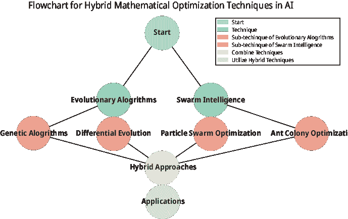

**图 10.1：** 混合优化方法的流程图。

**表 10.2：** 混合优化中方法论的对比分析。

| 混合技术 | 描述 | 示例 | 优点 | 挑战 |
| --- | --- | --- | --- | --- |
| 遗传算法与梯度下降 [8] | 将`GA`与梯度下降结合是有效的，因为`GA`提供了良好的初始解，而`gradient descent`将其精炼到局部最优。 | 在神经网络训练中有用，其中`GA`找到良好的起点，而`gradient descent`微调权重。 | 结合了`GA`的全局搜索能力与`gradient descent`的微调能力；产生了更好的局部最优解。 | 需要仔细的参数调优；`GA`的计算开销较大。 |
| 粒子群优化与模拟退火 [9] | `PSO`擅长全局搜索，但可能会陷入局部最优。将`PSO`与具有更好跳出局部最优能力的`SA`结合可以获得更好的结果。 | 适用于复杂的优化问题，其中`PSO`发现有前景的区域，`SA`通过跳出局部最小值来完善解决方案。 | 增强了跳出局部最优的能力；结合了`PSO`的全局探索与`SA`的局部精炼。 | 计算成本高；需要管理`PSO`与`SA`之间的相互作用。 |
| 差异进化与局部搜索 [10] | `DE`对全局优化有效，而`local search`技术可以利用当前最优解的邻域。 | 用于此类场景：`DE`探索全局搜索空间，`local search`技术通过利用邻近解来提高方案的准确性。 | 平衡了`DE`的全局探索与局部开发；同时提升了探索和开发能力。 | 协调`DE`与局部搜索方法具有复杂性；可能需要大量的计算资源。 |

如今许多算法在开发时具有不同的优缺点，没有一种是适用于所有情况的。尽管它们是具有多种用途的通用思想，无论是单独使用还是结合，优化和深度学习都有广泛应用 [11]。表 10.3 对混合优化在 AI 中的关键应用进行了对比分析。

**表 10.3：** 混合优化在 AI 中关键应用的对比分析。

| 应用领域 | 描述 | 示例 | 优点 | 挑战 |
| --- | --- | --- | --- | --- |
| 神经网络训练 [12] | 混合优化技术提高了深度神经网络训练的收敛速度和准确性。 | 用于神经网络权重优化的混合`GA`和`gradient descent`算法。 | 结合了全局搜索 (`GA`) 与局部精炼 (`gradient descent`)；增强了训练效率和模型准确性。 | 计算复杂度高；需要仔细的参数调优。 |
| 超参数优化 | 优化超参数对机器学习模型至关重要。混合方法可以高效搜索超参数空间并提高模型性能。 | 贝叶斯优化结合进化算法进行超参数调优。 | 高效探索广大的超参数空间；平衡了探索与开发；提高了模型性能和泛化能力。 | 计算成本高；结合不同优化方法具有复杂性。 |
| 特征选择 [17] | 为机器学习模型识别最相关的特征有助于降维并提高模型准确性。 | 高维数据中结合`PSO`与局部搜索进行特征选择。 | 有效降低维度；提高模型准确性和可解释性；结合了全局搜索 (`PSO`) 与精细调整。 | 可能需要大量的计算资源；需要平衡特征性与模型复杂性。 |
| 机器人与路径规划 [18] | 为机器人寻找最佳路线，有效处理路径规划的动态性。 | 用于路径规划的混合优化技术。 | 有效处理高维和动态路径规划问题；结合多种优化策略。 | 计算复杂度高；实时性应用面临挑战。 |

## 10.4 案例研究

本节介绍了与研究相关的关键案例研究 [19, 20, 21, 22]。表 10.4 对混合优化方法领域的关键案例研究进行了对比分析。

**表 10.4：** 混合优化方法领域关键案例研究的对比分析。

| 案例研究 | 描述 | 使用的混合技术 | 应用领域 | 关键贡献 | 优点 | 挑战 | 未来方向 |
| --- | --- | --- | --- | --- | --- | --- | --- |
| 神经网络训练 [21, 23] | 提高深度神经网络训练的收敛速度和准确性。 | 遗传算法与梯度下降 | 神经网络训练 | 通过混合`GA`和`gradient descent`算法提高了训练效率和模型准确性。 | 结合了`GA`的全局搜索与`gradient descent`的局部精炼；收敛更快，准确性更高。 | 计算复杂度高；需要仔细的参数调优。 | 探索与其他优化技术的混合；减少计算开销。 |

## 混合优化与 AI 应用

| 特性 | 说明 | 方法 | 类别 | 优势 | 挑战 |
| :--- | :--- | :--- | :--- | :--- | :--- |
| 超参数优化 | 高效搜索超参数空间以提高机器学习模型的性能。 | 贝叶斯优化和进化算法 | 超参数优化 | 对超参数空间进行高效探索与利用，提升了模型性能。平衡了探索与利用；提高了模型的泛化能力和性能。 | 计算成本高；结合优化方法的复杂性大。与自动机器学习 (`AutoML`) 框架的集成；大规模应用的可扩展性。 |
| 特征选择 | 识别最相关的特征以降低维度并提高模型准确性。 | 粒子群优化和局部搜索 | 特征选择 | 有效降低维度；增强了模型的准确性和可解释性。将`PSO`的全局搜索与搜索技术的局部细化相结合；提升了模型性能。 | 管理特征相关性与模型复杂度之间的权衡；计算资源。开发更高效的混合算法；在各种数据类型和领域的应用。 |
| 机器人与路径规划 | 在高维和动态环境中为机器人寻找最优路线。 | 各种混合优化技术 | 机器人与路径规划 | 提高了动态和复杂环境中路径规划的效率和准确性。高效处理高维和动态优化问题；更高的求解质量。 | 计算复杂度高；实时应用面临挑战。实时混合优化方法；在自主系统和机器人中的应用。 |
| 医疗保健系统优化 | 增强基于物联网的智能系统的信息性能。 | 混合 AI 与优化 | 智能医疗系统 | 改进了信息管理和系统性能。更好地管理医疗健康数据。 | 与现有基础设施的集成；确保数据隐私和安全。对实时数据处理的进一步研究以及与先进 AI 的集成。 |
| 网络入侵检测 | 使用先进优化和 AI 检测网络中的入侵攻击。 | 基于优化的深度学习 | 网络安全 | 通过深度学习增强检测准确性和系统鲁棒性。提高了安全性和针对攻击的鲁棒性；更好的检测效果。 | 计算成本高；管理大规模数据。开发实时检测系统；与不断演进的安全机制集成。 |
| 混合可再生能源系统 | 使用各种优化技术优化可再生能源系统的性能和效率。 | 各种优化 | 可再生能源系统 | 提高了系统效率和能量管理。更好的可再生能源性能和效率。 | 不同能源之间复杂的集成，确保系统稳定性。对可持续和可扩展混合优化的研究；与智能电网技术的集成。 |
| 混合动力车辆能量管理的预测控制 | 使用基于 AI 的数学模型对混合动力车辆的能量管理进行预测控制。 | 基于 AI 的数学建模与优化 | 混合动力车辆能量管理 | 增强了预测控制和能量管理；提高了车辆性能和效率。更好的能量管理和车辆性能。 | 管理复杂的车辆动态；与实时系统的集成。探索更先进的混合技术；在其他类型车辆和能量系统中应用。 |

## 10.5 未来方向


# 混合优化领域主要未来方向的对比分析

这些未来方向展示了混合优化技术在 AI 领域的发展趋势，强调了对效率、伦理问题和 AI 应用产生重大影响的领域。

## 表 10.5：关键未来方向对比分析

| 未来方向 | 说明 | 重要性 |
| :--- | :--- | :--- |
| 与可解释 AI（`XAI`）集成 | 在混合模型中引入透明度和可解释性，以增强信任和理解。 | 确保 AI 决策可解释且负责任；对于关键领域的应用至关重要。 |
| 实时优化 | 开发能够实时优化系统的算法，适应动态变化。 | 实现自动驾驶汽车、医疗保健和金融领域的应用，这些领域对实时决策至关重要。 |
| 可扩展性与效率 | 增强可扩展性以高效处理大规模问题，最大限度地减少计算成本。 | 促进大数据分析、智能城市和具有大型数据集的工业自动化中的部署。 |
| 鲁棒性与恢复性 | 提高鲁棒性以处理不确定性和对抗攻击，确保性能可靠。 | 对于网络安全、自主系统和关键基础设施应对各种挑战至关重要。 |

| 主题 | 说明 | 影响 |
| :--- | :--- | :--- |
| 与量子计算的混合化 | 探索混合优化与量子计算之间的协同效应，以增强计算能力。 | 有望比经典方法更快地解决复杂的优化问题。 |
| 伦理 AI 考量 | 将伦理原则整合到混合优化技术中，以确保公平和公正。 | 解决与偏见、隐私以及 AI 应用的社会影响相关的担忧。 |
| 自动化与 AutoML 集成 | 将混合过程自动化并与 AutoML 框架集成，以实现简化部署。 | 降低模型开发和优化的复杂性，使 AI 适用于更广泛的应用。 |
| 跨学科应用 | 将混合技术应用于医学、气候科学和社会科学等不同领域。 | 为解决多维度问题和推动科学发现开辟了新的可能性。 |
| 人机协作 | 增强用于协作解决问题的接口，由 AI 支持人类决策。 | 促进 AI 能力与人类专业知识之间的协同作用，利用 AI 实现增强智能。 |

## 10.6 结论

在本章中，我们探讨了混合数学优化技术这一革命性领域，它们在处理具有挑战性的 AI 问题时是强大的盟友。通过整合不同优化方法的独特优势，这些策略不仅提高了性能，还增强了韧性并提升了整体运行效率。本章对结合了优化方法与 AI 方法的混合技术进行了全面的文献综述。

这项全面的调查详尽地检查了基本概念、方法论复杂性、跨领域的多样化应用以及对未来前景的深刻洞察，为混合数学优化在 AI 领域的巨大影响和广阔前景提供了透彻理解。人工智能领域的快速发展驱动了对混合优化技术的需求，这些技术对于探索新可能性和促进重大进展至关重要。

## 参考文献

[1] Azevedo, B. F., Rocha, A. M. A., & Pereira, A. I. (2024). Hybrid approaches to optimization and machine learning methods: A systematic literature review. *Machine Learning*, 1–43.

[2] Saleem, S., Ahmad, I., Ahmed, S. H., & Rehman, A. (2024). Artificial intelligence based robust nonlinear controllers optimized by improved gray wolf optimization algorithm for plug-in hybrid electric vehicles in grid to vehicle applications. *Journal of Energy Storage*, *75*, 109332.

[3] Borode, A., & Olubambi, P. (2024). Optimisation of artificial intelligence models and response surface methodology for predicting viscosity and relative viscosity of GNP-alumina hybrid nanofluid: Incorporating the effects of mixing ratio and temperature. *The Journal of Supercomputing*, *80*(4), 4841–4869.

[4] Zhuang, X., Wang, W., Su, Y., Yan, B., Li, Y., Li, L., & Hao, Y. (2024). Multi-objective optimization of reservoir development strategy with hybrid artificial intelligence method. *Expert Systems with Applications*, *241*, 122707.

[5] Tao, H., Abba, S. I., Al-Areeq, A. M., Tangang, F., Samantaray, S., Sahoo, A., & Yaseen, Z. M. (2024). Hybridized artificial intelligence models with nature-inspired algorithms for river flow modeling: A comprehensive review, assessment, and possible future research directions. *Engineering Applications of Artificial Intelligence*, *129*, 107559.

[6] Qiao, L., Liu, K., Xue, Y., Tang, W., & Salehnia, T. (2024). A multi-level thresholding image segmentation method using hybrid arithmetic optimization and Harris optimizer. *Expert Systems with Applications*, *241*, 122316.

[7] Abaku, E., Edunjobi, T. E., & Odimarha, A. C. (2024). Theoretical approaches to AI in supply chain optimization: Pathways to efficiency and resilience. *International Journal of Science and Technology Research*, *6*(1), 092–107.

[8] Siva Shankar, S., Hung, B., Chakrabarti, P., Chakrabarti, T., & Parasa, G. (2024). A novel optimization based deep learning with artificial intelligence approach to detect intrusion in network system. *Education and Information Technologies*, *29*(4), 3859–3883.

[9] Ala, A., Simic, V., Pamucar, D., & Bacanin, N. (2024). Enhancing patient performance in internet of things-based smart healthcare system: Hybrid artificial intelligence and optimization. *Engineering Applications of Artificial Intelligence*, *131*, 107889.

[10] Thirunavkarasu, M., Sawle, Y., & Lala, H. (2023). A comprehensive review on optimization of hybrid renewable energy systems using various optimization techniques. *Renewable and Sustainable Energy Reviews*, *176*, 113192.

[11] Zhang, Q., Tian, S., & Lin, X. (2023). Recent advances and applications of ai-based mathematical modeling in predictive control of hybrid electric vehicle energy management in china. *Electronics*, *12*(2), 445.

[12] Palle, R. R. (2023). Evolutionary optimization techniques in ai: investigating evolutionary optimization techniques and their application in solving optimization problems in AI. *Journal of Artificial Intelligence Research*, *3*(1), 1–13.

[13] Maghami, M. R., & Mutambara, A. G. O. (2023). Challenges associated with hybrid energy systems: An artificial intelligence solution. *Energy Reports*, *9*, 924–940.

[14] Nutakki, M., & Mandava, S. (2023). Review on optimization techniques and role of Artificial Intelligence in home energy management systems. *Engineering Applications of Artificial Intelligence*, *119*, 105721.

[15] Kushwaha, O. S., Uthayakumar, H., & Kumaresan, K. (2023). Modeling of carbon dioxide fixation by microalgae using hybrid artificial intelligence (AI) and fuzzy logic (FL) methods and optimization by genetic algorithm (GA). *Environmental Science and Pollution Research*, *30*(10), 24927–24948.

[16] Uzer, M. S., & Inan, O. (2023). 改进型混合鲸优化算法在优化问题中的应用。*Neural Computing & Applications*, *35*(17), 12433–12451. a, b

[17] Onyelowe, K. C., Mojtahedi, F. F., Ebid, A. M., Rezaei, A., Osinubi, K. J., Eberemu, A. O., & Rehman, Z. U. (2023). 岩土工程中选定的 AI 优化技术与应用。*Cogent Engineering*, *10*(1), 2153419. a, b, c, d

[18] Onyelowe, K. C., Mojtahedi, F. F., Ebid, A. M., Rezaei, A., Osinubi, K. J., Eberemu, A. O., & Rehman, Z. U. (2023). 岩土工程中选定的 AI 优化技术与应用。*Cogent Engineering*, *10*(1), 2153419. a, b, c

[19] Dhiman, H., Vyas, N., Pagrotra, A., & Dutt, V. (2023). 通过带有高分辨率投影灯的智能道路照明通过 IoT 和计算机视觉进行实时交通分析和驾驶安全增强[Internet]。在第一届电路、电力与智能系统国际会议 (CCPIS), IEEE, 2023. 可自：[`dx.doi.org/10.1109/CCPIS59145.2023.1029172`](http://dx.doi.org/10.1109/CCPIS59145.2023.1029172) a, b

[20] Thirunavukkar, M., Sawle, Y., & Lala, H. (2023). 使用各种技术优化混合能源系统的综述。*Renewable and Sustainable Energy*, *176*, 113192. a, b

[21] Abaku, E., Edunjobi, T. E., & Odimihal, A. C. (2024). 供应链优化的 AI 理论方法：通往效率与韧性。*International Journal of Science and Technology*, *6*(1), 092–107. a, b, c

[22] Lagrange, J. B., Richard, P. R., Vélez, M. P., & Vanbergh, S. (2024). 数学设计中的人工智能技术。在《数学资源手册》（第 969–999 页）。Springer Publishing, Cham. a, b, c

[23] Wang, F., Sohail, A., Wong, W. K., Ul Azim, Q., Farwa, S., & Sajad, M. (2023). 用于混沌数据集的人工智能和随机优化算法。*Fractals*, *31*(6). a, b, c

[24] Simaiya, S., Lilhore, U. K., Sharma, Y. K., Rao, K. B., Maheswara Rao, V. V. R., Baliyan, A., & Alroobaea, R. (2024). 使用深度学习和优化技术的混合云负载均衡和主机利用预测方法。*Scientific Reports*, *14*(1), 1337. a, b, c, d

[25] Dalal, S., Lilhore, U. K., Faujdar, N., Samiya, S., Jaglan, V., Alroobaea, R., & Ahmad, F. (2024). 使用混合粒子群优化-长短期记忆-循环神经网络模型优化智能城市的空气质量预测。*IET Smart Cities*. a, b

[26] Kumar, U., Simaiya, S., Sharma, Y. K., Rao, K. B., Rao, V. R., Alroobaea, R. (2024). 使用带有超参数的改进`MobileNet-V3`进行皮肤诊断的精确模型。*Scientific Reports*, *14*(1), 4299. a, b

[27] Sumit, C. S., Dalal, S., Lilhore, U. K., Samiya, S. (2024). 用于智能城市安全 VANET 通信的动态路由方法。*Cluster Computing*, 1–26. a, b, c, d

[28] Kukkar, A., Lilhore, U., Sandhu, J., Richard, P. R., Das, N., & Rezac, F. (2023). 基于 ACO 的软件 Bug 推荐。*Journal of King Saud University-Computer Information*, *35*(1), 483–498. a, b, c

[29] Darolia, A., Chhillar, R. S., Alhussein, M., Dalal, S., Aurangzeb, K., & Lilhore, U. K. (2024). 通过 Aquila 优化特征选择通过量子神经网络增强心血管疾病预测。*Frontiers in Medicine*, *11*, 14137. a, b, c

[30] Al-Ani, A. K., Arfeen, S., Manoharan, H., Selvarajan, S., & Uddin, M. (2023). 使用人工智能算法的改进的改进运输模型。*Computers, Materials and Continua*, *76*(2). a, b

[31] Lilhore, U. K., Manoharan, P., Sandhu, J. K., Simaiya, S., Dalal, S., Baqasah, A. M., & Raahemifar, K. (2023). 使用改进随机森林和 SVM 方法进行精确肝炎 C 分类的混合模型。*Scientific Reports*, *13*(1), 12473. a, b

# 11 增强 AI 驱动地理空间智能的数学优化

Yash Mahajan Muskan Sharma Alba Meça Narayan Vyas Rakesh Sharma

### 摘要


在大数据时代，人工智能（AI）与地理空间情报（GEOINT）的结合彻底改变了我们分析、解释和利用地理空间数据的方式。本章深入探讨了数学优化技术在增强 AI 驱动的 GEOINT 中的应用，提供了理论见解和实践实现方案。通过将优化算法与 AI 模型相结合，本章展示了这些先进技术如何解决复杂的地理空间问题，例如路径优化、灾害响应和城市规划。除了数学优化的理论基础及其对 AI 的影响（在单独章节中介绍），我们还涵盖了实际用例，通过实操示例展示了这些工具如何应用于现实世界。实际实现的重要组成部分通过在信息整合、模型构建以及此前官方阶段之后的预测、运行和执行方法来提供指引，这使得本章对于研究人员、志向者以及从庞大规模领域中学习的人士、AI 分析师或从业者，以及神经科学领域的学者都具有巨大的效益。本章描述了该领域的现状，并提出了一些挑战和未来趋势，从而强调了这一跨学科科学领域尚未停滞。

**关键词：** 地理空间情报（GEOINT）、人工智能（AI）、数学优化、机器学习、深度学习、路径优化、灾害响应、城市规划、GIS（地理信息系统）、数据整合。

## 11.1 引言

### 11.1.1 地理空间情报（GEOINT）概述

解释地理空间情报（GEOINT）的一种方式将其视为一个多学科研究领域，旨在理解我们在整个地球上不同尺度级别绘制的物理和人文景观。地理空间数据是获取和处理空间（地球表面）、自然/人造环境、个人/组织活动/事件以及行为信息的方法。GEOINT 远不止是地图和卫星图像；它被定义为一个集成过程，通过收集、分析、利用、生产和传播相关的地理信息给特定的受众，其目的是为了理解国防或其他部门的理性决策。

GEOINT 在国家安全、灾害救援与恢复管理、城市规划、环境保护/监测等方面具有无限可能。对于国家安全，GEOINT 用于监测边界和潜在威胁的到达，以及规划军事行动。在灾害管理中，它可以预测自然灾害的后果，并利用卫星遥感规划疏散路线，以及协调救援工作。城市规划者利用 GEOINT 来开发更高效、可持续且具有韧性的城市；环保主义者利用它持续监测森林砍伐模式，评估黄石国家公园或克鲁格国家公园等公园内的野生动物数量，追踪苏丹和埃塞俄比亚附近的粮食不安全趋势，并评估气候变化对格陵兰生态系统的影响。

事实上，将原始地理空间数据准备好通用并使其具有操作性是 GEOINT 的核心优势之一。它使用了不同的数据源，如卫星图像、航空摄影、GIS（地理信息系统）、遥感以及地面观测。通过整合这些来源，GEOINT 从业者能够创建全面且精确的地图、模型和模拟，这些对于决策是至关重要的。这些输出帮助我们可视化空间模式、识别随时间变化的趋势并预测未来情景，为战略规划和业务执行提供了稳健的平台。

在过去的几年里，随着人工智能（AI）的发展，GEOINT 工具有了巨大的改进。特别是用于 AI 的机器学习（ML）和深度学习技术改变了地理空间数据分析和理解的格局。

AI 集成到 GEOINT 中不仅拓宽了 GEOINT 的范式并增加了大数据分析，还为实时决策带来了新的灵活性。鉴于地理空间数据量、速度和多样性的不断扩张，AI 可能在 GEOINT 中扮演更重要的角色。AI 的进一步演进（包括生成模型和强化学习（RL）的应用）预计也将提高 GEOINT 能力并达到更复杂的分析和预测水平。从这个角度来看，值得注意的是，了解 AI 在 GEOINT 中的功能对于以任何方式、形式或方法涉及该学科的人员具有重要价值。

### 11.1.2 数学优化在 AI 驱动的 GEOINT 中的重要性

优化是一种非常强大的方法，其应用对于让 AI GEOINT 变得至关重要。从根本上说，优化是在一系列可行选择中识别出优解决方案，这些选择受当前目标和约束条件的限制。这一过程在 GEOINT 中是主要的，因为实体的几何形状和信息的性质往往要求使用特定的数学模型来促进决策。

在基于 AI 的 GEOINT 中，属于优化领域的大量问题涉及资源分配、路径规划以及数据整合和模式知识的问题。例如，在灾害响应场景中，应用优化算法可以通过考虑道路基础设施、拥堵和灾害强度等因素，为医疗服务（EMS）建立最佳路线。这不仅有助于快速响应，还能尽可能高效地利用稀缺资源，从而拯救生命并减少损失。

在城市规划中，这些技术被用于设计交通系统、开发土地利用以及开展基础设施投资，以确保从消费者那里获得最大收益，或者更广义地说，以最低的可行成本产生产出。这些模型的作用是整合每平方公里人口密度、交通拥堵、对环境的影响以及对经济的影响等因素，从而为执行制定科学且逻辑严密的计划。例如，该方法可以应用于旨在优化公共交通的政策制定，其社会目标是减少交通拥堵、控制污染并让城市里的每个人都能享受交通便利。

数学优化在地理空间情报（GEOINT）的军事应用中也证明是相当有益。具体而言，在该领域，优化技术被用于提高打击、监视和侦察活动的效率以及精度。也就是说，优化模型有助于确定传感器和监视设备的最佳放置位置，以最大化覆盖区域并最小化被发现概率。

数学优化与 AI 技术的结合通过增强具有学习能力且鲁棒的 GEOINT 模型创建，极大地提升了 GEOINT 的能力。基于数据，机器学习（ML）和深度学习算法在未来有增强空间。这些模型在与优化方法结合时，可以进一步精炼，以适应单一目标和目的，例如针对误差或数据错误率进行优化。

然而，优化不仅作用于调整应用于 AI 支持的 GEOINT 中的单一模型或算法，还作用于增强 GEOINT 模型的整体执行。它还为几类数据输入与如何将所有数据合并以创建一个单一的融合情报产品之间提供了必要的联系。例如，在多传感器数据融合案例中，优化程序被用于混合来自不同传感器的采集数据，以提高所接收信息的精度。这在数据包含大量噪声、缺失甚至矛盾数据的语境下尤为如此。

因此，数学优化在地理空间领域 AI 的其他方面的发展中起着核心作用。它提供了掌握与地理空间数据相关的挑战所需的工具，并增强了决策，以在多个应用领域获得最佳结果。GEOINT 不断增长的复杂性意味着随着地理空间分析在众多学科中发现新应用，优化结合 AI 集成将成为成功的关键决定因素之一。

## 11.2 理论基础

### 11.2.1 数学优化技术

这些问题也包含在数学优化的伞下，它是运筹学和决策科学的核心，作为系统化的程序，旨在帮助在给定目标和约束条件下允许的所有决策中选择最佳决策。如图 11.1 所示，各种类型的数学优化技术有：在 GEOINT 框架下，这些方法被用于解决许多挑战，包括路线优化、资源分配以及数据融合。在基于 AI 的 GEOINT 系统中，熟悉各种优化技术至关重要。

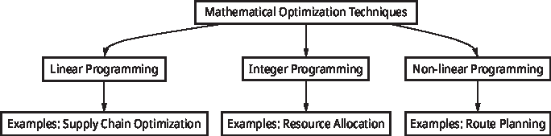

图 11.1: 数学优化技术。

- **线性规划 (LP):**

LP 是最基本的优化方法之一。它是在一组线性等式和不等式约束下，最大化或最小化线性目标函数的过程。这里是展示 LP 问题的典型方式：

`Maximize or minimize cTx subject to Ax ≤ b, x ≥ 0`

其中 `X` 是决策变量向量，`c` 是目标函数的系数向量，`A` 是包含约束系数的矩阵，`b` 是带有约束边界的数组。在 GEOINT 中，LP 常用于诸如确定地理区域内传感器的最佳位置，或通过寻找具有成本效益的运输计划来降低成本。

- **整数规划 (IP):**

IP 提供了 LP 的扩展版本，其中部分或全部决策变量被限制取整数值。当我们的决策变量是需要做出的离散选择（例如，运行车辆的数量）时，这特别有趣。IP 问题是一种数学优化或可行性规划，其中某些或所有变量为整数：

`x ∈ Zn`

IP 规划常用于 GEOINT 中的优化。

- **非线性规划 (NLP):**

对于目标函数或约束中存在非线性的优化问题需要努力。它指的是目标函数为二次形式而约束为线性的优化问题。二次规划 (QP) 问题通常比 LP 更难（即计算更密集）。NLP 问题采取如下形式：

`Maximize or minimize f(x) subject to g(x) ≤ 0 and h(x) = 0`

其中 `x` 是非线性目标函数，`g(x)` 代表不等式约束，`h(x)` 代表等式约束。NLP 在优化复杂的系统（例如卫星轨道配置，这些系统无法使用线性近似进行建模）。

- **动态规划:**

这是一种通过将复杂问题分解为简单的子问题来解决问题的方法。它对于解决具有重叠子问题和最优子结构特性的问题尤为有效，例如最短路径问题或随时间变化的资源分配。动态规划的核心是贝尔曼方程，给出如下：

`V(s) = max a (R(s,a) + γ ∑ P(s'|s,a) * V(s'))`

其中 `V(s)` 是代表从状态 `s` 开始的最大预期奖励的价值函数，`R(s,a)` 是在状态 `s` 采取动作 `a` 后获得的，`gamma` 是折扣因子，`P(s'|s,a)` 是给定动作 `a` 时从状态 `s` 到状态 `s'` 的转移概率。动态规划被广泛用于 GEOINT 中的顺序决策问题，例如军事行动中随时间变化的资产部署。

- **随机优化:**

这些包括适用于数据或模型存在不确定性时的随机优化技术。它们通常在不确定性下寻找最优平均——或期望——解决方案。随机优化模型中一类广泛使用的技术是将不确定性建模为随机变量，并对期望成本进行优化。GEOINT（地理空间情报）中随机优化的主要动机是，我们工作的环境具有不确定性，例如预测自然灾害将如何产生影响，或在信息不完全的情况下进行规划。

### 11.2.2 用于地理空间数据的 AI 和机器学习模型

地理空间数据已经成为 AI 和 ML 行业的核心部分；然而，要充分利用其潜力，并没有固定的公式。这些技术提供了识别海量复杂数据集中相关模式的能力，这直接支持了 GEOINT 决策的增强。图 11.2 显示了上述可以使用的 AI 模型类型。

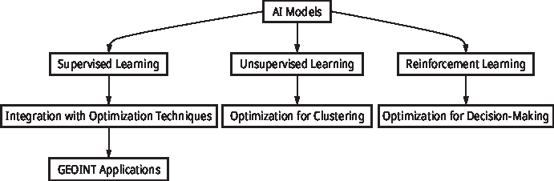

图 11.2：AI 模型类型。

- **监督学习：**

这种类型的学习涉及一种在输入数据及其正确输出上进行训练的模型。它是一个从输入到输出的函数映射模型，因此适用于分类和回归任务。一些常见的算法包括支持向量机、决策树和神经网络。一个典型的监督学习模型看起来如下：

```
y^* = f(x;θ)
```

其中 `y^*` 是预测输出，`x` 是输入数据，而 `theta` 代表模型参数。

- **无监督学习：**

通过无标记数据（洞察发现、检测自然分组或发现隐藏模式），聚类和降维是无监督学习技术。通过这些技术，在 GEOINT 中可以识别具有相似地理空间特征的区域、检测异常，或在数据处理之前将大型数据集还原为低维表示，例如 K-means 聚类、主成分分析（PCA）和自动编码器（autoencoders）。

- **强化学习：**

这是机器学习的一种，代理体通过与环境交互来学习决策。动作会获得数值奖励，代理体倾向于最大化累积奖励。在 GEOINT 场景下，RL 可以加速动态决策问题，例如用于监控的无人机部署优化，或无人机在复杂地形中的导航。最终，贝尔曼方程（Bellman equation）通过检查学习阶段获得的奖励来决定如何更新价值函数：

```
Q(s,a) = R(s,a) + max' Q(s',a')
```

其中 `Q(s, a)` 是状态 `s` 下动作 `a` 的质量，`R(s, a)` 是收到的奖励。

- **深度学习：**

它是机器学习的一个子集，采用具有两或更多层的深层神经网络。这些模型在处理复杂的地理空间数据方面取得了巨大成功，如图像识别、目标检测和语义分割。深度学习模型在分析高分辨率卫星图像、从多光谱数据中提取特征以及使用 GEOINT 以高精度预测空间模式方面非常有效。CNN（卷积神经网络）特别适合该领域，因为它们具有学习数据中空间层次结构的能力：

```
f(x) = CNN(x;θ)
```

其中 `x` 是输入图像，`θ` 代表卷积滤波器的参数。

### 11.2.3 优化与 AI 模型的整合

通过将数学优化和 AI 模型结合，无疑是 GEOINT 领域的一大进步。利用优化提供的规范性能力来增强 AI 的预测能力，使地理空间数据分析系统从仅仅进行回归转向对最优解决方案提供意见。

- **混合模型：**

越来越多，使用 AI 和优化技术的混合模型正被应用于 GEOINT。一个例子可能是：使用 ML 模型预测城市交通模式，并使用一个互补的优化算法负责在灾害期间为救援车辆寻找最佳路线。在这里，开发了充分利用 AI 和优化两者优势的模型，以产生更准确的解决方案并提高效率。一些示例方法如下所示的混合方法：

```
minimize f(x, y) = cx + L(y)
```

其中 `f(x, y)` 是目标函数，结合了来自优化模型的成本函数 `cx` 和来自 AI 模型的损失函数 `L(y)`。

在 GEOINT 中应用优化技术和 AI 的一个重要示例是灾害响应规划。在灾害中，响应及时高效至关重要，特别是在飓风、地震等自然灾害情况下。通过 AI 进行预测模型（例如预测灾害后最可能发生洪水或滑坡的地方）也是可能的。正因如此，优化算法可以用于定义如何最佳分配资源，如救援队、医疗物资和用于疏散的各种交通工具。

另一个与 AI 一起实施决策模型的示例是军事行动，通过使用优化模型改进监控和目标选择。他们预见到城市人口密度和流量的增长，并应用优化来安排可以满足未来需求的结构。这种整合过程确保了城市以可能最高效且可持续的方式进行开发。数学优化与 AI 模型升级呈现的结果揭示了地理空间问题解决领域的强大概念。使用 AI 进行预测和优化，可以创建不仅能分析数据，还能识别进一步行动方案的地理信息系统。

## 11.3 实际实施

### 11.3.1 工具与框架

实现 GEOINT-AI 和集成数学优化需要一套健壮的工具和框架。这些工具便于构建、调试和部署优化模型或 AI 算法，以解决具有挑战性的地理空间问题。

- **优化工具与库：**

    - **Pyomo：** 这是一个优秀的基于 Python 的开源优化建模语言，允许用户定义并解决无限数量的优化问题，从常见的线性到非线性。它与 Gurobi、CPLEX 和 CBC 等求解器集成。它拥有用于编写与 AI 算法高度关联的复杂优化模型的库；因此，Pyomo 最适合此类工作。

    - **Gurobi：** 这是顶尖的商业优化求解器之一，在解决大规模线性、整数和 NLP（非线性规划）问题方面具有尖端的性能，效率最高。它通常用于工业界，如供应链优化、资源分配或财务建模等任务。这意味着优化可以与当前的 ML 库无缝结合，确保用户可以无缝引入新的线性和混合整数规划求解器。

- **TensorFlow：** 这里是 Python 的前五个深度学习库。`TensorFlow` 诞生于 Google，是最流行的机器学习开源库之一。它包含了用于构建和部署深度学习网络以及模型解释性的工具。此外，`TensorFlow` 结合自动微分和许多基于梯度的优化方法，为长周期且需要持续不断学习的 AI 驱动型地理情报（GEOINT）应用提供了最优解决方案。

- **PyTorch：** 这是另一个流行的机器学习库，它强调灵活性和易用性。它支持动态计算图，这对于那些需要频繁更新模型结构的任务（如强化学习 RL）特别有用。`PyTorch` 与优化库的集成允许开发出可以针对特定地理空间任务进行优化的复杂 AI 模型。

### 地理空间信息系统 (GIS) 软件与平台

- **QGIS：** 这是一个开源 GIS 工具，你可以使用它对地理空间数据执行所有操作。它可以处理多种数据格式，并附带了一系列空间分析工具，这些工具在应用 AI 或优化技术之前，对地理空间数据进行预处理和分析时非常有用。

- **ArcGIS：** 由 Esri 开发，是可用最广泛的 GIS 平台之一，`ArcGIS` 在其创始人 Esri 的地图技能基础上增加了先进的空间分析和可视化。通过使用提供的各种机器学习和优化工具，`ArcGIS` 赋予了用户创建先进地理空间模型的能力。

### 11.3.2 数据准备

最终，AI 驱动的 GEOINT 准确性和有效性取决于输入它们的数据。图 11.3 解释了如何在 AI 的帮助下创建优化模型。数据清洗是数据准备过程中的重要一步，因为它能确保地理空间信息是清洁且统一的，便于评估并准备分析。

- **获取、清洗和预处理地理空间数据的步骤：**

    1. **数据获取**：获取地理空间数据包括卫星图像、航空摄影和任何现有的公共数据集。常见的地理空间数据集有哪些？Landsat 卫星图像、OpenStreetMap 和 NASA 的地球观测系统数据和信息系统 (EOSDIS)。根据使用标准和所需的分辨率，可以使用不同的数据源。

    2. **数据清洗**：纯形式的地理空间数据需要处理大量的噪声、缺失值和不准确之处，这些必须在分析之前处理。数据清洗是删除或纠正不准确数据、填充缺失值以及标准化格式的过程。为了清洗地理空间数据集，通常会使用插值法、最近邻填充和离群值检测等技术。

    3. **处理缺失数据**：地理空间数据集必须具有完整的数据。模糊的图像会影响模型的性能。处理缺失数据的方法有多种，但在相邻点之间的空间相关性强到足以对数值进行合理估计的情况下，像 `Kriging` 这样的插值方法是有效的。

    4. **数据预处理**：在预处理数据清洗的过程中，我们需要将清洗后的数据预处理成适合分析的格式。这涵盖了诸如坐标系重标、栅格转矢量、甚至从卫星图像中提取特征等任务。特征工程（即兴趣点周围的缓冲区或地形的坡度和坡向）也是预处理的重要组成部分。

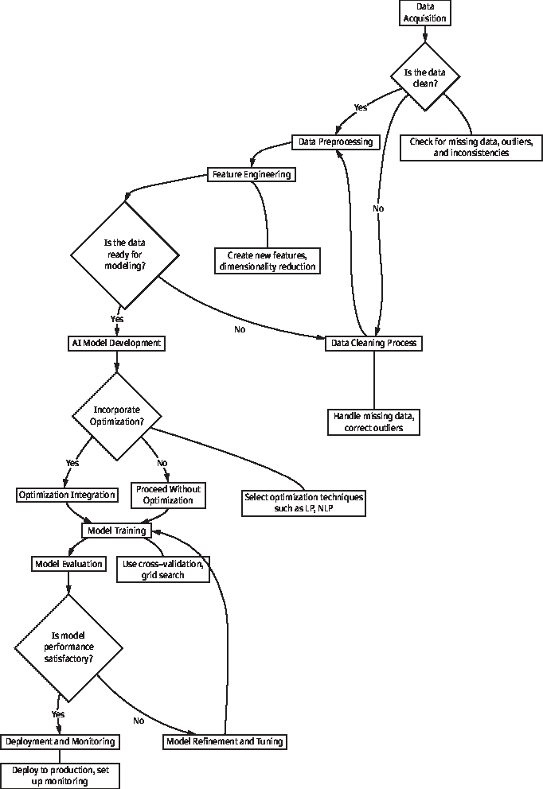

图 11.3：创建优化模型的完整方法论。

1. **处理大型数据集**：地理空间数据集可能非常大，以至于会对技术处理和分析带来挑战。为了处理大数据，可以使用空间索引、数据分区和并行处理等技术。凭借其处理的地理空间数据可扩展性等主要优势，像 `Google Earth Engine` 这样的云平台处于了非常理想的地位。

### 11.3.3 结合优化构建 AI 模型


因此，GEOINT 中 AI 与数学优化的整合是一个系统过程，它利用了两个领域的优势来提高模型性能。在本章中，我们将研究如何从上一节的人类引导的 AI 实时感知模型 `DoML` 平台转向，并创建一个基于地理智能的 AIML 超模型——作为一种概率统计系统（此处通过优化函数推断）或基于此的平台。

## 创建用于 GEOINT 的 AI 模型的步骤指南

### 1. 定义问题

**地理空间问题**：首先明确问题陈述。这可以从感知城市交通拥堵到为灾难情景优化应急响应单元的位置不等。问题定义的描述应包含目标函数、约束条件和预期输出。

### 2. 选择合适的 AI 模型

根据问题定义选择 AI 模型。或者，如果你有一个图像分类问题（例如土地覆盖分类），可以使用`卷积神经网络`（`CNN`）来完成。对于需要顺序行动的问题，`RL`模型将更有用。

### 3. 集成优化技术

在选择合适的 AI 模型后，我们应该引入优化方法。考虑路径优化的场景：可以使用`遗传算法`（`GA`）来寻找具有最小旅行时间和逻辑规避的最路径。优化问题给出如下：

最小 $T = \sum_{i=1}^n d_{i+1}$ 限于 $x_i \in R, \forall i$

其中`T`是总旅行时间，$d_{i+1}$代表相邻点之间的距离，`x_i`是可行路径集。

### 4. 训练并验证模型

使用你的地理空间数据训练 AI 模型。你会通过调整某些网络架构来调整模型参数，使训练期间预测值接近实际输出。必须使用另一个数据集进行验证，以评估模型的通用性和稳定性。

### 5. 部署模型

验证通过后，可以将模型部署到 GEOINT 系统中。这包括将模型叠加在`GIS`软件上、配置实时数据流以及在`CI/CD`框架中处理实时输入。

## 引入优化技术以增强模型性能

优化技术在调优用于 GEOINT 的 AI 模型决策机制中起着至关重要的作用。例如，在利用 AI 估计洪水概率较高的区域时，可以使用优化算法进行资源分配 `[16]`。无论是在紧急情况下寻找避难所还是提供所需的物资，都必须找到并使用最佳策略。优化算法确保了 AI 模型不仅能预测结果，还能为实现干预的最优提供建议。这两种方法非常重要，特别是对于需要高资源效率且必须在最短时间内做出以满足需求的现实世界问题，例如军事行动或灾害。

通过上述步骤，并在本章讨论的工具、框架和技术的帮助下，从业人员可以增强 GEOINT 模型，以按照预期的最优化方式利用 AI 和数学优化能力。这种集成方法使得设计智能系统成为可能，这些系统能够有效高效地解决各种与地理相关的问题。

## 11.4 案例研究

### 案例研究 1：利用 AI 和 GEOINT 优化灾害响应

**问题描述：**

自然灾害发生后任何应急响应行动的有效性都是显著减少伤亡和损失的关键。更巨大的挑战如何在表面上更快地将医疗援助、救援队和救援物资等资源投入现场。该研究还表明，传统的灾害响应策略面临信息滞后和形势复杂难以进行实时决策的问题。本案例研究的目标是使用基于 AI 的 GEOINT 和数学优化策略来简化灾害响应操作。

**方法：**

其工作原理是结合 AI 和 GEOINT 来处理实时地理空间数据，识别灾害发生前和发生期间资源需求最大的地方，并优化应急服务响应。首先从卫星图像、社交媒体馈送和气象报告等各种地理空间源聚合数据。这些数据被输入到`ML models`中，然后对灾害袭击某些地区的严重程度进行预测。

**所使用的优化技术：**

在案例研究中，使用数学优化来决定多少资源在何时被分配到何处。我们将问题表化为多目标优化，通过最小化交付响应的时间和最大化免疫响应的覆盖范围来实现。

优化模型可以表示如下：

$\begin{matrix} & {{Minimize}\\,\\, T = \\sum\\limits\_{i\\! = \\ ! 1}^{n}{d\_{i,j}x\_{i,j} + \\alpha\\sum\\limits\_{i\\! = \\ ! 1}^{n}{t\_{i}x\_{i,j}}}} \\\\ & {{Maximize}\\, C = \\sum\\limits\_{j\\! = \\ ! 1}^{m}{c\_{j}y\_{j}}} \\\\ \\end{matrix}$ $\begin{matrix} & {\\sum\\limits\_{j\\! = \\ ! 1}^{m}x\_{i,j} \\leq 1\\,\\,\\,\\,\\forall i = 1,2, \\cdotcdot \\ \cdot \\!,n} \\\\ & {\\sum\\limits\_{i\\! = \\ ! 1}^{n}x\_{i,j} \\geq y\_{j\\,\\,}\\forall j = 1,2, \\cdotcdot \\ \cdot \\!,m} \\\\ & {x\_{i,j} \\in \\left\\{ {0,1} \\right\\},\\,\\, y\_{j} \\in \\left\\{ {0,1} \\right\\}} \\end{matrix}$

其中`T`是总旅行时间，`d[i,j]`是资源`i`与区域`j`之间的距离，`t[i]`是部署资源`i`的时间，`alpha`是权重因子。`C`是覆盖评分，代表资源分配的有效性。`c[j]`是区域`j`的覆盖值，`y[i]`表示区域`j`是否被覆盖。`x[i,j]`是表示资源`i`是否分配到区域`j`的二进制变量。

**实际实施细节：**

1. **数据采集**：系统从卫星、无人机和地面传感器实时收集数据。它包括受影响区域的数据、地面情况的照片、交通流量，以及医院和避难所等关键基础设施的位置信息。

2. **AI 模型训练**：这些模型使用历史灾害数据进行训练，以预测当前灾害的影响。这些模型预测如伤亡人数、基础设施损失和需要援助的区域等因素。

3. **优化执行**：优化模型在`Python`中通过`Gurobi Optimizer`实现，该优化器以可用最快且最强大的优化器之一而闻名。结论，该模型的结果为不同地区和路径预留多少资源提供了思路，这些资源应供应急车辆使用。

4. **结果与成果**：与 AI 和优化的结合使灾害期间的响应时间降至最低。通过模拟地震响应情景，新模型将受影响区域的覆盖范围扩大了高达 30%，平均响应时间缩短了约 25%。医疗援助也能更快地到达，资源利用也更好，最终帮助拯救了更多生命。

### 案例研究 2：城市规划与开发

**问题描述：**

城市规划是一个和谐发展的集成决策过程，需要处理一系列相互冲突的目标，例如土地利用效率最大化、减少环境影响以及提高居民的生活质量。传统的城市规划方法通常依赖于静态模型，无法随时间调整或整合大量信息。在案例研究中，我们展示了 AI 和数学优化如何提高城市规划生命周期中决策问题的性能：土地利用模式的生成、交通网络设计以及雨水径流的减少，同时促进环境的可持续性。

**方法：**

它从整合与土地利用、人口密度、交通流和环境条件相关的地理空间数据开始。信息`AI models`利用并进行分析，预测可能的未来趋势和结果，并创建各种规划情景。然后使用数学优化技术对这些情景进行评估，以确定该城市空间的最佳开发计划。

**所使用的优化技术：**

城市规划主要关乎优化，这通常涉及多个目标，例如减少交通拥堵和增加绿地。多目标优化框架可以模拟这些目标。最后，优化问题可以写为：

其中`Z[1]`代表由绿地调整后的旅行时间，`T[i]`是区域`i`的旅行时间，`G[i]`是绿地因子，`x[i]`表示是否包含区域`i`。

`Z[2]`代表环境质量，`E[j]`是区域`j`的环境效益，`y[j]`表示是否选择区域`j`。约束条件确保每种类型的开发只选择一个区域，并达到最低环境质量水平`C`。

$\begin{matrix} & {{Minimize}\\, Z\_{1} = \\sum\\limits\_{i\\! = \\ ! 1}^{n}T\_{i}\\left( {1 - G\_{i}} \\right)x\_{i}} \\\\ & {{Maximize}\,, Z\_{2} = \\sum\\limits\_{j\\! = \\ ! 1}^{m}E\_{j}y\_{j}}} \\\\ & {\\sum\\limits\_{i\\! = \\ ! 1}^{n}x\_{i} \\leq 1,,,\\,\\sum\\limits\_{j\\! = \\ ! 1}^{m}y\_{j} \\geq C}} \\\\ \\end{matrix}$

**流程详细说明：**

1. **数据集成**：城市规划系统的力量在于它融合了卫星图像、人口普查和统计信息、交通网络等大量数据。`GIS`存储这些数据，并将其用于生成区域的详细空间模型。

2. **情景生成**：使用`AI models`（包括`ML`和模拟技术）生成多种城市规划情景。这些方案包含了我们如何增长以及更好的土地利用模式如何平衡。`AI models`进一步用于计算每个情景的长期后果，例如交通拥堵、污染水平或当地居民的支出。

3. **优化分析**：优化框架针对这些目标对每个情景进行衡量（例如最小化通勤时间和最大化绿地）。竞争目标之间的最佳平衡通过`Pareto optimization approach`在一组非支配解中实现。

4. **结果实施**：优化分析结果以交互式地图和仪表板的形式呈现给城市规划者或利益相关者。该工具将帮助政策制定者研究不同的规划方案，并就城市的未来增长做出基于证据决策。

**成果：**

通过利用人工智能和优化在城市规划中做出更好的决策，在一项中型城市的测试中，他们将平均通勤时间缩短了 15%，绿地增加了 20%，空气质量改善了 10%。所有这些结果说明了人工智能和数学优化是构建更美好、更宜居的城市并实现可持续路径的强大工具。

## 11.5 挑战与未来方向

### 11.5.1 GEOINT 优化面临的当前挑战

将数学优化与应用于地理情报（GEOINT）的人工智能结合带来了我们在正确扩展该解决方案之前需要面对的一系列挑战。关键问题之一是处理处理和检查大型地理空间数据时出现的极端计算复杂性。然而，这类优化算法在处理非线性和多目标问题时可能是计算密集型的，需要大量的处理能力和时间。今天，我们可以看到图 11.4，它说明了 GEOINT 的挑战和趋势。然而，地理空间数据的持续演变使得这一点变得模糊，因为这些数据频繁要求实时处理和决策，从而增加了组织优化的难度。

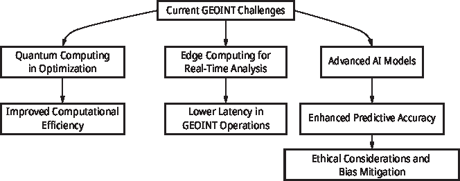

图 11.4: 当前 GEOINT 挑战和未来趋势。

另一个主要问题是 GEOINT 优化中的数据隐私。由于地理空间数据的高度敏感性，在使用地理空间数据时必须非常小心。结合优化技术，人工智能会带来隐私问题，特别是在实际利用基于位置的服务、监控或军事情报时。大数据分析中数据优化工作相关的一个主要困难之一，是在保持优化模型高准确性和高效能的同时，整合对数据隐私的关注。

然而，各种数据源的应用以及协调不同数据集的过程也带来了更多挑战。GEOINT 利用了不同类型的数据，如卫星和航空图像、社交网络、传感器和 GIS 应用。这些数据源可能具有不同的格式、分辨率和准确率水平，这增加了开发集成模型时整合这些数据源的复杂。真正的困难在于设计优化算法以容纳并平衡这些数据差异，从而生成准确高效的预测。

### 11.5.2 AI 赋能地理空间优化的未来趋势

未来，将会有其他几种技术和方法定义基于 AI 的地理空间优化领域的方向和进展。一种新兴且极具活力的、可以像“赛罗塔石”一样极大增强优化的趋势是量子计算，它显著缩短了解决困难问题的时间。通过量子算法，GEOINT 系统将能够以传统系统无法想象的方式处理和分析大规模数据集，这将为实时决策的可能性提供支持。

另一个未来趋势是使用边缘计算，特别是在 GEOINT 应用中。边缘计算允许在更靠近数据源的地方处理数据，从而降低延迟和带宽占用，进而优化优化。这对于软件应用对时间敏感的场景（例如无人驾驶汽车和无人机）尤为重要。由于这三种方法的整合，未来的地理空间系统将能够在动态和受限的环境中实时适应和响应。

其他也将定义下一代 GEOINT 优化的重大趋势包括 AI 框架的精炼，涵盖深度强化学习（`deep RL`）和生成对抗网络。这些模型能够随时间进行调整，因此在接触到更多数据和其他情况时，它们在所面临的情况下会表现得更好。这对于本质上具有动态性的复杂问题将特别有用，例如在观察气候变化影响时，需要预测影响区域；或者在不断扩张的城市中，必须预测分配资源的可能区域。

在研究机会方面，人们将更加关注 GEOINT 中人工智能和优化的伦理方面，随着这些增强，关于此类辅助工具的透明度、问责制、甚至中立性的进一步问题也会随之出现。未来几年将关注的另一个挑战性领域是设计不仅有效而且公平且高度透明的优化算法。此外，这意味着地理空间科学、人工智能和伦理研究的协作将至关重要，以增强利用 GEOINT 优化的进展造福公共利益。

总之，可以肯定，尽管在当前场景下 GEOINT 的优化仍存在一些主要障碍，但考虑到技术的全球化和方法的多样化，近期前景非常广阔。在解决现有问题的同时采用这些新趋势，对于 AI 集成型 GEOINT 系统的进一步演进和生效至关重要。

## 11.6 结论

本章探讨了数学优化在增强 AI 赋能 GEOINT 中的关键作用。我们首先概述了 GEOINT 在各个领域的重要性，强调了它如何将原始地理空间数据转化为可操作的洞察，从而驱动军事、政府和商业部门的决策。人工智能（特别是机器学习 `ML` 和深度学习技术）的整合进一步扩展了 GEOINT 的能力，使其能够以以前所未有的准确性和速度分析复杂数据集。

围绕数学优化的讨论展示了它在支持增强型 GEOINT AI 模型存在方面是多么关键。最后，我们展示了如何通过`LP`、`IP`和`NLP`等优化技术应用这些方法解决资源分配、路线规划和数据集成等复杂问题。它们提供的基础还帮助我们了解何时可以通过优化来改进地理数据分析中的 AI 模型，以便高效准确地完成工作。

未来，GEOINT（地理空间情报）优化将持续面临严峻挑战，包括计算复杂的分析与计算等重大问题；用于构建企业级模型的数据隐私问题；以及由于不符合标准而无法集成到架构中的遗留或过时系统。然而，量子计算、边缘计算和先进 AI 模型等新趋势的承诺可能有助于解决这些重大的 GEOINT 演进关注问题。

情报界发现，数学优化是 AI 赋能 GEOINT 的基础组成部分——这是让任何基于卫星、飞机或地面生成数据的地理空间分析更趋于完美状态所需的工具和方法。随着这些技术提供更具可操作性的信息，它们在 GEOINT 中的适用性无疑会增长——从而增强许多领域的知情决策并优化任务成功率。

## 参考文献

[1] Hariri-Ardebili, M. A., Mahdavi, G., Nuss, L. K., & Lall, U. (2023 Nov). 人工智能和数字技术在大坝工程中的作用：叙述性回顾与展望。*Engineering Applications of Artificial Intelligence*, *126*, 106813.

[2] Peng, L., Cai, Z., Heidari, A. A., Zhang, L., & Chen, H. (2023 Nov). 用于特征选择的分层哈里斯角隼优化器。*Journal of Advanced Research*, *53*, 261–278.

[3] Tselentis, D. I., Papadimitriou, E., & Van Gelder, P. (2023 Jun). 人工智能对不同交通模式安全评估的用用。*Accidents Analysis and Prevention*, *186*, 107034.

[4] Lian, J., Hui, G., Ma, L., Zhu, T., Wu, X., Heidari, A. A. et al. (2024 Apr). 鹦优化器：算法及其在医学问题的应用。*Computers in Biology and Medicine Internet*, *172*, 108064.

[5] Zhao, M., & Liu, X. (2018 Feb). 用于优化城市应急救援设施选址决策支持工具以改进人道主义物流管理。*Safety Science*, *102*, 110–117.

[6] Hassani, S., Dackermann, U., Mousavi, M., & Li, J. (2024 Mar). 用于优化结构健康监测的数据融合技术系统综述。*Information Fusion*, *103*, 102136.

[7] Shi, J., Chen, Y., Cai, Z., Heidari, A. A., Chen, H., & Chen, X. (2024 Oct). 基于改进鲸鱼优化的多阈值图像分割：狼性肾炎的研究研究。*Biomedical Signal Processing and Control*, *96*, 106492.

[8] Zhou, X., Gui, W., Heidari, A. A., Cai, Z., Liang, G., & Chen, H. (2023 Sep). 随机跟随群优化：全局优化的连续和二值变体。*Applied Soft Computing*, *144*, 110513.

[9] Yuan, C., Zhao, D., Heidari, A. A., Liu, L., Wu, Z., et al. (2024 Sep). 基于青蒿的疟疾治疗：图像分割与应用。*Displays*, *84*, 102740.

[10] Asadollah, S. B., Jodar-Abellan, A., & Pardo, M. (2024 Jun). 机器学习优化农业：一种基于遥感的新方法。*Agricultural Systems*, *218*, 103955.

[11] Qiu, Z., Yong, Q., Wang, J., Liao, L., & Yu, B. (2024 Sep). 考虑建筑与环境相互作用的多目标性能设计优化框架。*Energy Conversion and Management*, *315*, 118793.


[12] Zhao, T., Wang, S., Ouyang, C., Chen, M., Liu, C., Zhang, J., et al. (2024 Aug). 地球科学的人智能：进展与挑战. *The Innovation*, 100691. →

[13] Dong, R., Sun, L., Cai, Z., Heidari, A. A., Liu, L., Chen, H. (2024 Sep). 用于新能源动态调度的高级核搜索优化. *International Journal of Electrical Power & Energy Systems*, *160*, 110085. →

[14] Rapaka, A., Dharmadhikari, S. C., Kasat, K., Mohan, C., Chouhan, K., & Gupta, M. (2025 Jan). 变革学习——进入沉浸式游戏与 AI 技术的之旅. *Entertain Comput*, *52*, 100809. →

[15] Bhati, N., Duggar, R., & Saber, A. (2023). 利用 IoT 泄漏检测赋予安全. 231–251. →

[16] Yazdani, M., & Haghani, M. (2024 Aug). 决策支持系统辅助的志愿者应急响应规划与优化概念性框架. *Progress in Disaster Science*, 100361. a, b

[17] Punugoti, R., Vyas, N., Siddiqui, A. T., & Basit, A. (2023). 尖端技术的融合：利用 AI 和边缘计算转型医疗物联网 (IoMT) [Internet]. 在 2023 年第 4 届电子与可持续通信国际会议 (ICESC). IEEE. 来源：https://dx.doi.org/10.1109/ICESC57686.2023.10193047 →

[18] Ahamjik, I., Agbani, A., Abik, M., Khayli, M., Galzim, N., Berrada, J., et al. (2024 Dec). 人工智能对理解摩洛哥狂热病的贡献：有哪些创新方法？*One Health*, *19*, 100874. →

[19] Wang, S., Huang, X., Liu, P., Zhang, M., Biljecki, F., et al. (2024 Apr). 定量地理学中地理空间人工智能 (GeoAI) 的格局和路线图：广泛综述. *International Journal of Applied Earth Observation and Geoinformation*, *128*, 103734. →

[20] Cao, K., Zhou, C., Church, R., Li, X., & Li, W. (2024 May). 地理空间大数据和 GeoAI 时代的空间优化重审. *International Journal of Applied Earth Observation and Geoinformation*, *129*, 103832. →

[21] Itagi, M., DG, V., Prasad, K., Kumar, P., Shekhar, R., & Ashreetha, B. (2023 Jun). 物联网能源效率与安全性能分析. *International Journal of Electrical and Electronics Research*, *11*(2), 442–450. →

[22] Radulescu, M., Dalal, S., Lilhore, U. K., & Saimiya, S. (2024 Feb). 通过混合深度学习赋能的金融科技模型优化可持续资源提取的矿产识别. *Resources Policy*, *89*, 104692. →

[23] Radulescu, M., Dalal, S., Lilhore, U. K., & Saimiya, S. (2024 Feb). 通过混合深度学习赋能的金融科技模型优化可持续资源提取的矿产识别. *Resources Policy*, *89*, 104692. →

# 12 基于深度学习和可解释人工智能 (XAI) 方法的乳腺癌超声分析

P. Manju Bala S. Usharani A. Balachandar R. Rajmohan

### 摘要

医学影像是乳腺癌筛查最重要的组成部分之一。超声以其非侵入性的方法和卓越的敏感性而闻名。然而，深度学习模型的可解释性问题使其不适用于治疗场景。为了诊断乳腺癌，本研究建议将基于深度学习的超声分析与可解释人工智能（XAI）方法相结合。本文探讨了多种 XAI 方法，包括模型解释、显著性图和注意力机制。阐明了如何使用这些方法使深度学习模型的决策过程更加透明。提高可理解性并为自动化诊断系统的预测提供价值信息，将帮助医生更好地理解并信任这些系统。通过将深度学习技术与 XAI，可以提高乳腺癌的准确诊断。我们通过对超声数据进行彻底验证了这一点。通过使用这些技术，可以提高临床判断质量和乳腺癌患者的治疗。

关键词：深度学习、超声分析、乳腺癌、可解释人工智能（XAI）、可解释性、诊断影像

## 12.1 引言

全球女性面临的最常见且可能是致命的疾病是乳腺癌。准确及时的诊断对于改善患者预后和降低死亡率至关重要。由于超声检查是非侵入性且非常敏感的，它是乳腺病变诊断和表征的重要工具。这些前沿算法使得诊断图中复杂模式的识别变得更加容易 [1]..。能够匹配并有时超过人类专家的诊断精度，使临床需求的研究已取得显著进展。然而，这些复杂技术不透明的“黑箱”性质有时会掩盖其真实效能。缺乏透明度的做法导致了人们对其合法性和可靠性产生了严重的忧虑，特别是在高风险的医疗领域 [2]..。为了应对 AI 驱动结构对直观性和可靠性日益增长的需求，可解释人工智能（XAI）是一项重大进展。XAI 的目标是揭示人工智能模型的底层机制，并对其决策过程提供深刻的见解。这种透明度在实践和伦理上都是至关重要的，特别是在医疗环境中，这些决策通常是基于此类规则提供的指南做出的。透明性的缺乏引发了对其对其可靠性和接受度的极大关注，特别是在医疗保健的高风险领域 [3]..。XAI 已成为满足 AI 驱动系统对可靠性和清晰度日益增长需求的关键技术 [4]..。XAI 的目标是阐明 AI 模型的内部机制，并对它们如何做出决策提供重要见解。这种透明度从实践和道德角度来看都是重要的，特别是在科学环境中，重要的选择往往取决于这些系统提供的方向 [5]..。

近年来，深度学习技术已成为医学影像自动检查的强大工具 [6]..。这些技术提供了提高诊断精度和可能的可能。一种被称为“卷积神经网络”（CNNs）的深度学习模型在多种医学影像应用中（包括乳腺超声图像分析）中展现了卓越的性能 [7]..。然而，这些黑箱的不透明性为理解决策过程带来了障碍，从而限制了它们在临床环境中的实用性和接受度。为了解决这个问题，XAI 技术为深度学习模型的决策过程提供了见解 [8]..。通过阐明用于预测的变量和模式，XAI 技术提高了可解释性，并增强了终端用户与临床医生之间的信任。XAI 术语描述了人们可以在多大程度上理解和识别模型的运行。它近年来引起了极大关注。模型解释寻求提供关于机器学习模型如何创建的详细见解，说明其准确性的原因，并提高模型预测的可靠性。因此，机器学习的使用提高了机器学习模型的透明度、可解释性、公平性、稳健性、隐私性、信任感和可靠性。最近已建议并使用了多种方法来提高对机器学习模型的理解 [9]..。目前有几种分类法可以描述机器学习。消费者可以请求特定类型的信息，或进一步进行交互式解释直到满意，但静态解释不会根据消费者的反馈而改变。局部解释针对单次预测，而全局解释则考虑整个模型的行为。事后解释（post hoc explanation）需要在模型训练后应用额外技术来解释模型，而即时可解释模型则是一种本质上是透明的、且大多数用户都能理解的模型 [10]..。自解释并不总是意味着立即可见。它会自行生成局部解释。虽然模型的表示可能突出特定特征而本身并非一个完整的模型，但代理模型（surrogate model）通常是一种更简单、更易理解的形式，用于近似复杂的模型。

本工作对基于深度学习的超声分析进行了深入检查，用于乳腺癌的识别和分类 [11]..。我们指出了在医学影像中理解深度学习技术时面临的挑战，并讨论了采用 XAI 技术来克服这些挑战的必要性。此外，我们探讨了多种 XAI 策略，包括显著性图、注意力机制和模型解释。我们强调了这些方法在乳腺超声评估特定场景下的相关性。此外，我们讨论了 XAI 能力在提高诊断精度、辅助科学决策以及最终改善乳腺癌诊断治疗患者结果方面的优势 [12]..。

## 12.2 相关工作

许多研究已经利用深度学习技术对乳腺超声波进行了分析。特别是，这些研究侧重于异常的识别、分类、分解以及相关风险的评估。Peta 等人展示了一种专门为识别超声图像中乳腺病变而创建的高级深度学习模型[13]。该框架通过创建一个用于分割超声图像中乳腺肿瘤的深度学习系统，在敏感性和特异性方面均表现出令人深刻的性能[14]。他们的系统优于传统方法，显示出更好的性能。此外，研究人员探索了如何应用集成方法和迁移学习，以提高深度学习模型在乳腺超声分析中准确预测和处理数据变异的能力。利用预训练的`CNN`模型进行迁移学习用于增强超声图像中乳腺病变的分类[15]。此外，Gulum 等人[16]提出了一种集成学习方法，通过结合多个深度学习模型来提高乳癌诊断的准确性。尽管深度学习算法在乳腺超声分析中显示出令人鼓舞的结果，但其可解释性问题仍然是一个主要障碍。研究人员正试图将基于深度学习的超声研究与`XAI`技术相结合以克服这个问题。加权梯度刺激表示类是 Chaddad 等人[17]建议的一种技术，用于直观地突出超声图像中的感兴趣区域并为模型预测提供解释。

利用注意力机制和模型解释来增强乳腺超声分析深度学习技术的可解释性一直是近期研究的主题[18]。为了对乳腺病变进行分类，提出了一种注意力引导的深度学习模型[19]。该方法关注于超声图像，并对感兴趣区域进行标注。此外，研究人员利用多种超声设备来提高乳腺诊断的准确性[20]。这种方法涵盖了进行超声检查的筛选、诊断评估和后续随访。数据集包含了从患者处获取的图像[21]。它还包括人口统计学数据和详细标注。这种方法专注于超声图像中的病变边界[22]。该数据集包含了从不同医疗机构获取的图像。超声图像是使用频率在 5 到 15 MHz 之间的探头获取的。这些设备可以捕捉 B 模式和多普勒成像。数据集包含了接受一系列超声波检查的患者图像[23]，这种可解释性的`AI`促进了临床决策。

## 12.3 方法与材料

### 12.3.1 数据描述

用于评估的数据集包含了特定数量的超声图像。它还包括人口统计学数据和详细标注。为了确保数据的完整性和准确性，数据集经过了细致的处理。预处理活动包括调整图像大小、归一化和去除伪影。此外，使用了数据增强来增加数据集的多样性并增强方法的鲁棒性。增强技术包括旋转、缩放、翻转等各种变换。此外，采用了某些技术来解决类别分布不均的问题，特别是良性和恶性病变之间，以实现数据集的平衡。该用示例被有效地划分为训练集、验证集和测试集，以辅助模型构建、超参数调优和性能评估。通常，数据集的 70% 到 80% 分配给训练集，这是关注的核心。测试集和验证集则共享剩余部分。除了提供用于验证和评估的独立数据集外，这种划分确保了技术在广泛多样化的样本上进行训练。图 12.1 描述了数据集的过程。

#### 12.3.1.1 图像采集

超声图像利用频率在 5 到 15 MHz 之间的换能器获取，这些转换器可以捕捉 B 模式和`Doppler`成像技术。图像采集自正在乳腺超声检查的患者，其目的是筛查、诊断评估和随访。在从数据集中采集声图像时，采取了严格措施以确保未来分析数据的质量、相关性和完整性。首先，根据与研究目标相关的预设标准选择照片。这些标准包括患者信息、其临床状况以及病变的特征。该数据集用于提取并整理符合特定标准的照片。这些图像以标准化的格式组织，以确保不同成像设备之间的兼容性。然后，使用包括缩放、归一化和伪影去除在内的预处理技术来增强图像的一致性和质量。此外，对所选照片关联的注释进行彻底检查，以确认其真实性，通常通过专家评估和病理学报告进行。采用质量控制技术纠正整个采集过程中的任何缺陷，确保数据集保持高水平的完整性。随后，为了确保各种疾病和成像设置的公平表示，数据集被分为测试集、验证集和训练集。对伦理考量了高度重视，并实施了严格步骤以保护患者隐私并遵守伦理规则和法律。通过这种详尽的采集方法，研究人员可以确保数据集的可靠性和伦理合理性，为后续分析和模型构建建立坚实基础。

#### 12.3.1.2 注释与真值

经验放射科医生或临床医生对数据集中的每张超声图像进行标记，勾勒与乳腺病变（如果有）相关的`ROIs`。注释包括描述疑病变边界的边界或分割掩码，以及相应的病理发现（例如，良性或恶性）。通过进行共识性读取并在尽可能通过组织学检查进行确认，确保了真值注释的准确性。

#### 12.3.1.3 数据准备

数据准备是使用深度学习技术制作探索性超声图像的关键阶段。它确保了数据具有良好的质量并适用于模型训练。一个关键的预处理步骤是图像归一化，旨在标准化跨图像的像素强度值。该过程的数学表达式为：

```
NormalizedImage = OriginalImage - Mean / Standard Deviation
```

其中均值和标准差使用整个数据集计算。归一化有助于减少图像强度级的波动，有助于在训练过程中实现更一致且有效的模型收敛。此外，使用了旋转和翻转等数据增强方法来增加模型的鲁健性并提高数据集的多样性。用数学术来说，增强是指通过应用变换矩阵`T`修改初始图像`I`的过程：

```
I[augmented] = T.I
```

这些修改模拟了成像条件的变化，并提高了模型对新数据的泛化能力。此外，可以使用合成少数类采样技术（或假数据生成系统）来处理包含代表不足类的不平衡数据集。`SMOTE`通过在相邻示例之间插值为代表不足的类创建人工样本。从数学角度来看，这可以表示为：

```
SyntheticSample = Random(sample[1], sample[2])
```

其中`Sample[1]`和`Sample[2]`是从少数类中随机选择的案例。通过这些预处理程序，超声图像转换为精炼、公平且标准的数据集，为高效的深度学习模型训练和精确的乳腺癌检测奠定了基础。

#### 12.3.1.4 数据集划分

数据集被分为训练集、验证集和测试集，以便于模型构建、超参数调整和性能评估。通常，数据集的训练阶段被分配较大比例（约 70–80%），剩余部分平均划分在验证集和测试集之间（10–15%）。在数学上，划分数据集的过程可以表示如下：令`O`表示包含`M`个样本的原始数据集，符号为`O = {x[i], y[i]}`，其中`x[i]`是输入，`y[i]`是标签。数据中有三个子集

##### 训练集 (`O[train]`)

通常，将数据集的大部分部分分配给训练集，以促进模型学习。`M[train]`表示训练集中多少个样本。数学上，可视化训练集的方法是：

```
O[train] = {x[i], y[i]}
```

##### 验证集 (`O[val]`)

为了防止过拟合，验证集用于计算方法的性能并调整训练中的超参数。`M[val]`表示验证集中的试验次数。验证集在数学上可以表示为：

```
O[val] = {x[i], y[i]}
```

##### 测试集 (`O[test]`)

测试集保留用于对训练后的模型的有效性进行最终分析，对其泛化能力提供客观评估。`M[test]`是测试集的样本数量。测试集在数学上可以表示为：

```
O[test] = {x[i], y[i]}
```

该集合包含多种超声图像，描述了多种乳腺疾病，如良性肿瘤、恶性病变、囊肿、纤维腺瘤和其他异常。为了实现亚组分析和风险分层，可能会提供年龄、性别和临床史等患者人口统计数据。数据集可能涵盖各种成像方法、设备制造商以及临床实践中常见的成像伪影。用于基于深度学习的乳腺癌检测超声分析的数据集包含了广泛的特征，这些特征对于模型的精细构建和精确评估至关重要。由于数据集中有很多超声图像，因此有足够的信息进行训练、验证和测试。这确保了生成的模型具有健壮性，并适用于许多情况。数据集由资深放射科医生或医生经过仔细标注，确保了标注的高质量。标注通过共识读取和组织学确认进行了验证。这保证了与每个图像关联的真值标签（ground truth labels）的精确性和可靠性，这对于确保模型训练和评估的可信度至关重要。数据集涵盖了广泛的乳腺疾病，包括良性、恶性肿瘤、囊肿、纤维腺瘤和其他异常。这种全面的表示准确地反映了真实临床环境中复杂且多样的本质。通过应用归一化、伪影去除和数据增强等预处理技术，对数据集进行了标准化和改进，以减少成像设置的差异并保持图像的一致性。此外，还彻底检查了伦理问题，通过数据匿名和遵守监管协议确保患者的隐私和机密性。数据集在规模、多样性、标注质量和伦理合规方面具有独特属性，使其成为促进深度学习乳腺癌诊断以及改善患者护理和疗的价值资源。

### 12.3.2 深度学习架构

命名用于乳腺超声分析的深度学习模型特定架构（例如`CNN`、`U-Net`或相关模型）。深度学习架构（图 12.2）由许多层组成，包括卷积层、池化层和全连接层。在本研究中，乳腺超声数据使用构建在卷积神经网络上的深度学习架构进行处理。`CNNs`已证明在特征提取、分割和图像分类等任务中非常成功。该架构专门设计用于高效地检测和分类乳腺病变，同时利用`XAI`方法保证可解释性。它是为了匹配超声图像处理的精确要求而定制的。

#### 12.3.2.1 卷积层

`CNN`结构中的若干卷积层负责从输入的超声图像中提取分层信息。卷积层使用可训练的滤波器对输入图像进行卷积，以在不同的空间尺度上提取局部模式和特征。在卷积过程之后，经常使用如`ReLU`类的激活函数来提供非线性并增强模型表示输入的能力。

#### 12.3.2.2 池化层

卷积层产生的特征图比所需的要。池化层（包括最大池化`max pooling`或平均池化`average pooling`）用于最小化这个问题。池化方法在保持最重要属性的同时减小特征图的大小，提高了计算效率和和平移不变性。

#### 12.3.2.3 密集层


密集层通常也称为全连接层，用于分组和分类从之前层中收集的高级特征。通过在模型中包含密集层，可以识别特征之间的复杂模式和相关性，从而允许对不同类型的乳腺病变进行准确区分。

### 12.3.2.4 XAI 方法的整合

该架构不仅包含典型的`CNN`层，还集成了`XAI`方法以提高可解释性和透明度。`XAI`工具（如基于梯度的方法`Grad-CAM`、注意力机制或模型解释算法如`LIME`和`SHAP`）被纳入网络中，以为模型预测提供可视化结果和解释。`XAI`技术为超声图像中的特定感兴趣区域以及影响模型决策过程的属性提供了见解信息。这使得医生能够理解并对模型做出的预测充满信心。

### 12.3.2.5 模型优化与训练

标记的超声图像和相应的真值标注用于训练深度学习架构。随机梯度下降（`SGD`）和`Adam`是用于逐渐评估模型约束的两种优化技术示例。

### 12.3.2.6 随机梯度下降（SGD）

在`SGD`中，使用学习率`α`乘以损失函数的梯度来改进模型。迭代`t`处`θ`的权重更新规则可以如下：

```
θ(t+1) = θ(t) - α * ∇L
```

其中`∇`表示损失函数`L`的梯度。

### 12.3.2.7 Adam（自适应动量估计）

`Adam`是一种自适应优化方法，通过估计梯度的一阶和二阶矩来为每个参数计算独特的学习率。参数更新由：

```
n = β1 * n(t-1) + (1 - β1) * ∇L
v(t) = β2 * v(t-1) + (1 - β2) * ∇L²
n_hat = n(t) / (1 - β1^t)
v_hat = v(t) / (1 - β2^t)
θ(t+1) = θ(t) - α * n_hat / (sqrt(v_hat) + €)
```

其中`n`和`v`是去偏估计，`€`是一个防止除以零的微小常数，`β1`和`β2`是衰减率。

### 12.3.2.8 丢弃（Dropout）

作为避免过拟合的方法，`dropout`是一种正则化方法，在训练期间随机消除比例为`p`的神经元。从数学上讲，每个神经元的输出以概率`p`与二进制掩码`y`相乘：

```
h[dropout] = γ * h
```

其中`γ`取自概率为`1 – p`的伯努利分布。

### 12.3.2.9 权重衰减（L2 正则化）

通过向损失函数添加与权重 L2 范数平方成正比的项，权重衰减是一种惩罚大权重的正则化方法。正则化损失函数`L[reg]`由`y`给出：

```
L_reg = L + λ/2 * Σ(θ²)
```

其中`λ`是正则化强度。

### 12.3.2.10 评估与性能指标

我们在一组新的超声图像测试集上测试训练好的模型，查看其检测和分类乳腺癌的效果。通过计算准确率、敏感性、特异性、受试者工作特征曲线下面积（AUC-ROC）和 F1 分数等性能指标来评估模型的诊断性能和鲁棒性。

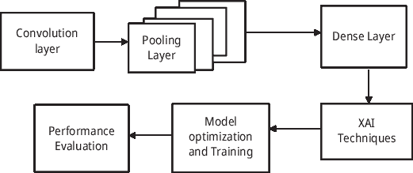

图 12.2：深度学习架构。

## 12.3.3 可解释人工智能（XAI）方法

深度学习模型已经包含了 XAI 技术以提高可解释性。图 12.3 展示了所选 XAI 方法论的总结，包括基于梯度的方法（如`Grad-CAM`）、注意力机制以及诸如`LIME`和`SHAP`等模型解释技术。XAI 方法用于可视化和理解深度学习模型的预测结果，强调了它们如何帮助提高模型的可靠性和透明度。XAI 技术的目标是使机器学习模型的决策过程透明化，以便用户能够理解并信任模型的预测结果。当将 XAI 方法集成到基于深度学习的乳腺癌诊断超声分析中，对数据的理解和解释得到了增强。在治疗环境中获得接受和应用正取决于这一点。以下是几种常用的 XAI 方法。

### 12.3.3.1 基于梯度的方法

`Grad-CAM`（或梯度加权类激活图映射）是一种计算机视觉技术，它强调图像中对神经网络预测至关重要的区域。`Grad-CAM`通过计算目标类别得分相对于最后一个卷积层特征图的梯度来生成类激活图。这使得注意力集中在输入图像中对表示计算影响最大的精确区域。`Grad-CAM`生成的热力图可能难以阅读，而`SmoothGrad`则能最大限程度地减少不必要的噪声和视觉失真。因此，解释理由更具合理性和一致性。

### 12.3.3.2 注意力机制

自注意力机制是一个为输入图像的不同区域分配不同注意力权重的过程。这有助于该方法关注图像的重要片段并忽略无关信息。另一种可以使用空间变换来动态更改输入图像的模型被称为空间变换器。通过智能地对齐和裁剪感兴趣的区域，该模型能够改进特征提取和分类。

### 12.3.3.3 模型解释技术

一种名为局部可解释模型无关解释（`LIME`）的技术为特定的模型估计提供了人类可理解的描述。这是通过首先在感兴趣的特定周围产生扰动样本，然后使用简单的可解释模型在这一受限区域模拟复杂模型的行为来实现。Shapley 加性解释（`SHAP`）计算技术使用了源自合作游戏论的 Shapley 标准，来量化每个属性对模型输出的影响。`SHAP`标准对特征重要性以及它们在模型内部相互作用的影响提供了深入理解。

### 12.3.3.4 基于规则的方法

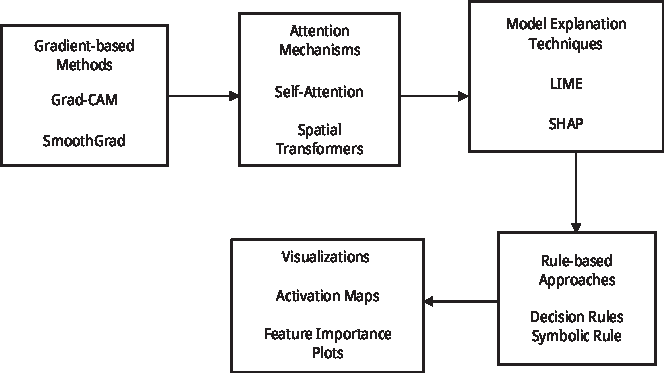

图 12.3：可解释人工智能方法。

### 12.3.3.5 可视化与解释

### 12.3.3.6 模型训练与评估

### 12.3.3.7 训练流程

### 12.3.3.8 数据增强与正则化

### 12.3.3.9 验证与超参数调优

### 12.3.3.10 模型评估

## 12.3.4 实验配置

实验设置需要周密的规划和配置，以确保在基于深度学习的乳腺癌筛查超声分析中获得准确的结果。硬件设备包括配备了`CUDA`支持的`NVIDIA GPUs`，这能够实现高效的模型训练和评估。

为了进行这项研究，遵循了现有的乳腺癌预测训练方法。目前有多种深度学习和机器学习技术可用于癌症检测和预测。应用了`label encoder`和`normalizer`方法等预处理技术来高效处理数据。图 12.4 中的柱状图显示了获取的数据集中良性与恶性细胞的总数。

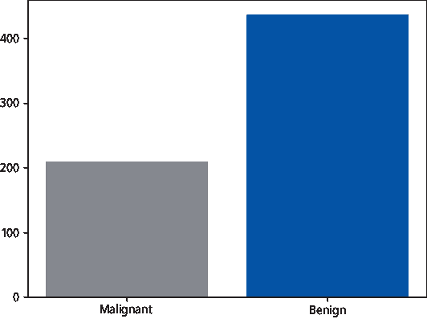

图 12.4：数据集中良性与恶性细胞的总数。

使用了多种机器学习方法在威斯星数据集上进行乳腺癌预测，包括`K-nearest neighbor`、`support vector machine (SVM)`、`decision tree`、`Naïve Bayes`、`logistic regression`和`random forest`。`random forest`和`SVM`算法实现的最高准确率为 96.5%。通过深度学习技术，预测准确率得到了提高。在图 12.5 和图 12.6 中，图化展示了模型准确率和损失相对于 epoch 数（迭代）的比例。随着 epoch 数的增加，模型的准确率上升，损失下降。

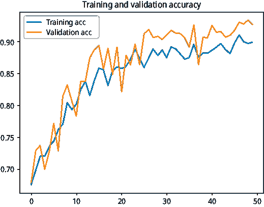

图 12.5：准确率。

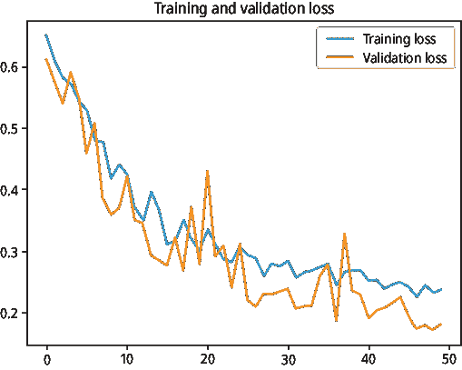

图 12.6：损失。

`CNN`模型产生了 97.3% 的准确率，而`ANN`模型产生的准确率为 99.3%，表明与前述的机器学习方法相比，后者具有更高的效率。`ReLU`和`sigmoid`是深度学习中使用的激活函数示例，展示了更高的效率。考虑给定的输入图像（图 12.7），它被输入开发的模型中以预测乳腺癌的存在。

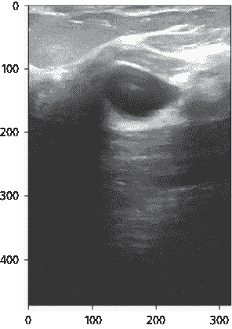

图 12.7：输入图像。

### 12.3.4.1 预测输出的概率

图 12.8 显示了不同类别的概率比较。实现的最高准确率为 96.5%。

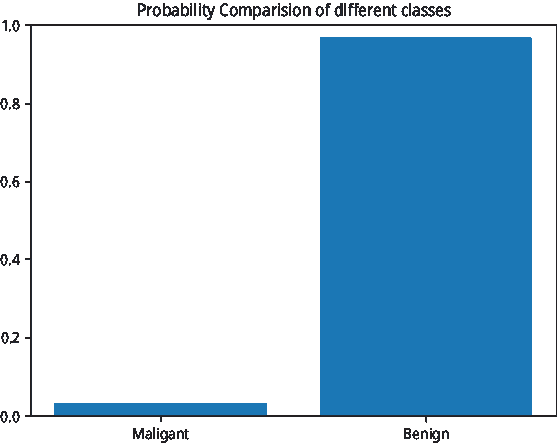

图 12.8：预测输出的概率。

## 12.4 结论

除了解释性和诊断准确性外，基于深度学习的超声分析与`XAI`方法的结合为临床实践提供了巨大的优势。通过为诊断结果提供简洁的依据，`XAI`增强了临床医生对`AI`-辅助诊断的信心，并促进了其无缝整合到常规医疗流程中。此外，现实世界的输入有助于这些模型的迭代创建和适应，以应对不断变化的临床需求和挑战。这意味着，除了提高乳腺癌诊断的有效性和精密度外，这项技术还可能促进肿瘤治疗领域的创新，最终造福患者。

## 参考文献

[1]Karimzadeh, M. An Explainable Multi-Task Neural Network Model for Breast Cancer Detection in Ultrasound Images (Master’s thesis, University of Idaho). →

[2]Naas, M., Moughi, H., Njeh, I. Deep Learning Computer Aided Diagnosis Supported by Explainable Intelligence for Breast Cancer. Available at →

[3]Cerekci, E., Alis, D., Denizoglu, N., Camur, O., Seker, M., Oksuz, T., Hansu, M. Quantitative evaluation of Saliency-Based Explainable AI (XAI) methods in Deep Learning Based mammogram. *European Journal of Radiology*, *173*. →

[4]Munshi, R., Cascone, L., Alturki, N., Said, F., Alshardan, A., Umer, M. A novel approach for breast cancer detection using optimized ensemble framework. *Computers in Vision*, *14*, 10725. →

[5]Podila, V. S. Densely connected parameters of. →

[6]Rao, K., Terlap, P., Jayaram, D., Gopalachari, R. Deep learning methods for mammography. *IEEE Access*. →

[7]Sindiram, S., Tee, W., Kaur, S., Jazri, R., Khan, N., Gharib, A. Explainable AI for Smart Cities. In International Conference on Circuits, Intelligent Systems. →

[8]Yuldas, U., Abduurov, V., Ismoilajna, T. Exploring Synonymy: Artificial Intelligence with. In First International Conference on Circuits, Power and Intelligent Systems. →

[9]Ma, J., Kong, D., Bao, F., & Liu, Y. Densely connected convolutional networks for ultrasound segmentation. *Computers in Biology and Medicine*, *168*, 107725. →

[10]Prodan, M., Paraschiv, E., Stanciu, A. Applying deep learning methods for breast cancer detection. *Applied Sciences*, *13*(7), 4272. →

[11]Maouche, I., Terrissa, L., Benmohammed, K., & Zerhouni, N. An explainable ai approach for breast cancer metastasis based on clinicopathological data. *IEEE Transactions on Biomedical Engineering*, *70*(12), 3321–3329. →

[12]Ghnemat, R., Alodibat, S., & Abu Al-Haija, Q. Explainable Artificial Intelligence (XAI) for deep learning based medical imaging. *Journal of Imaging*, *9*(9), 177. →

[13]Peta, J., & Koppu, S. Explainable soft attentive efficientNet for breast cancer classification in histopathological images. *Biomedical Signal Processing and Control*, *90*, 105828. →

- [15] Kumar, R., Singh, S., Chauhan, S., Anand, A., & Kumar, A. (2023). 基于 IRS 辅助瑞利-FTR 衰落通道的 ED 谱感知。*AEU-International Journal of Electronics and Communications*, *171*, 154908. → 

- [16] Gulum, M. A., Trombley, C. M., & Kantardzic, M. (2021 年 5 月 17 日). 医学影像中可解释深度学习癌症检测模型综述。*Applied Sciences*, *11*(10), 4573.

- [17] Chaddad, A., Peng, J., Xu, J., & Bouridane, A. (2023 年 1 月 5 日).医疗保健领域可解释 AI 技术综述。*Sensors*, *23*(2), 634. →

- [18] Jones, M. A., Islam, W., Faiz, R., Chen, X., & Zheng, B. (2022 年 8 月 31 日). 应用人工智能技术辅助乳腺癌诊断与预后预测。*Frontiers in Oncology*, *12*, 980793. →

- [19] Kanimozhi, P., Kannan, M., Ananth, C., Kumar, T. A., & Parkavi, S. 基于树莓派的农业农场保护无人机设计。在 2023 年第 6 届当代计算与信息学国际会议 (IC3I) 2023 年 9 月 14 日 (第 6 卷，第 1175–1179 页)。IEEE. →

- [20] De Miranda I. M. (2023) 整合解剖先验知识以增强乳腺癌多中心数据的泛化性。→

- [21] Meshoul, S., Batouche, A., Shaiba, H., & AlBinali, S. (2022 年 11 月 15 日). 基于集成特征选择的乳腺癌亚型可解释多分类分类。*Mathematics*, *10*(22), 4271.

- [22] Carrilero Mardones, M. 一种用于自然语言描述乳腺超声图像的深度神经网络。→

- [23] Ellenrieder, S., Kallina, E. M., Pumplun, L., Gawlitza, J. F., Ziegelmayer, S., & Buxmann, P. 通过可解释人工智能促进学习：放射学中的一项实验研究。→

# 13 基于深度学习的可解释人工智能在肝肿瘤分析的应用

### 摘要

随着医学影像技术的发展，人工智能（AI）可以帮助放射医生准确进行分类。然而，深度学习算法的固有复杂性使其难以解释。本章提出了一种可解释的人工智能（XAI），该系统结合了深度学习架构，对肝肿瘤提供了可解释性。

关键词：卷积神经网络、SHAP、LIME、部分依赖图。

## 13.1 引言

机器学习（ML）的应用在过去十年中取得了巨大进展，但由于 AI 模型通常是黑箱，这阻碍了其在关键领域的采用。可解释人工智能（XAI）旨在满足医疗等领域对透明度、可靠性和责任性的需求。AI 能够帮助用户做出决策并提高肝肿瘤预测的准确性 2。Bakrania 等人提出的计算机辅助诊断`CAD`用于支持这一过程。

```
if (condVar > someVal) {console.log("xxx")}
```

图 13.1 XAI 的流程

该练习将作为输入提供 XAI。根据需求，用户了解 XAI 的影响，这将有助于做出最佳决策。所提出的 XAI 模型如图 13.2 所示](#9783111436050_031089.xhtml#xref_d83363e45826)。

图 13.2 XAI 的概述

对患者记录进行采集和预处理，然后加载模型来预测恶化风险。模型的结果将由放射医生进行进一步验证。

## 13.2 文献综述

Ahmed 和 Shelly [3] 创建了基于集成的 ML 模型框架，使用 XAI 来描述肺癌风险因素之间的关联。药物、心理学、医疗结构和其他其他领域的 XAI 已有解释 4。然而，预测性健康管理（PHM）尚未提供减少患者等待时间、增强服务并提高生产力、准确性和效率的方法。


Andreu-Perez 和 Emberson 5 创建了一种基于 `XAI` 的模型，用于研究近红外光谱捕捉的脑影像的发育。Atul Anand 和 Tushar Kadian 6 提出了使用深度神经网络识别心脏病的方法。Bakrania 等人 [1] 讨论了 `AI` 在肝癌诊断和管理方面面临的挑战。此外，他们还讨论了 `AI` 在肝癌中的应用前景，以及纳米医学中 `AI` 多学科方法如何加速个性化肝癌医学从实验室到临床的转化。Kumar 等人 7 提议了 `AI` 在光伏系统中的适用性。

引入了一种基于卷积神经网络的分类器用于寻找睫毛，并概述了用于追踪模型输出的显著性图。Jahmunah 等人 [9] 创建了稠密网络和 `CNN` 模型来预测 `EEG` 信号中的异常。在医疗健康应用中，`AI` 和 `ML` 至关重要，因此引入了 `XAI` 来获得 `AI` 模型的说服力。这将增加现实场景下对外推模型的信任度。

针对男女女性的皮肤恶性肿瘤进行了研究。在他们的工作中，使用了生物标志物预测皮肤癌症，并结合了训练过的 `XGboost` ML 模型。Jahmunah 和 Ng [11] 讨论了基于 `XAI` 的心脏病学的理念和方法。Kute 和 Pradhan [12] 提出 `XAI` 的特征是基于知识和数据的策略。知识驱动的 `XAI` 需要关于如何解释的知识，而数据驱动的 `XAI` 则需要局部、全局和特定实例的解释程序。他们使用了公开访问的 `PTB-XL` 输出数据集。Merry 和 Riddle [13] 为 `XAI` 解释赋予了新的意义。Miro-Nicolau 和 Moya-Alcover [14] 观察了使用 `XAI` 胸部图像的结果。在他们的工作中，使用类激活图 (`CAM`) 表示了 X 射线图像。Obayya 和 Nemri [15] 在远程眼科中开发了 `XAI` 方法。通过利用 `SPECT MPI` 图片，分类模型的准确率达到了 98.24%。Papandrianos Feleki [16] 创建了一种深层 `XAI` 方法来预见冠状动脉疾病 (`CAD`)。

Peng 和 Zou [2] 提出了一种结合全局和局部可解释方法的框架，以提高复杂模型的透明度，并获得对这些模型判断的见解，从而引导治疗策略并改善肝炎患者的预后。Pertzborn 和 Arolt [17] 展示了一个用于检测恶性肿瘤的 `VGG 19` 模型。在他们的工作中，基于深度学习的模型结合 `XAI` 技术和数据预处理，其准确率达到了 80%。根据 Lombardi 和 Diacono [18] 的研究，可以使用 `XAI` 预测阿尔茨海默病 (`AD`) 和认知障碍。该疾病已使用随机森林识别。患者健康的数据集来自多种来源。某些信息通过传感器收集，其他数据直接来自 Yang [19] 提出的临床试验。为了识别临床区域的脑肿瘤，Zein 等人 [20] 开发了用于大脑的 `XAI`。

## 13.3 方法

`XAI` 框架用于分析肝脏。`XAI` 框架用于分析肝脏。`XAI` 框架用于分析肝脏。`XAI` 框架用于分析肝脏，Merry 和 Riddle [13] 为 `XAI` 解释赋予了新的意义。Miro-Nicolau 和 Moya-Alcover [14] 观察了使用 `XAI` 胸部图像的结果。在他们的工作中，使用类激活图 (`CAM`) 表示了 X 射线图像。Obayya 和 Nemri [15] 在远程眼科中开发了 `XAI` 方法。通过利用 `SPECT MPI` 图片，分类模型的准确率达到了 98.24%。Papandrianos Feleki [16] 创建了一种深层 `XAI` 方法来预见冠状动脉疾病 (`CAD`)。

`XAI` 框架用于分析肝脏。`XAI` 框架用于分析肝脏。`XAI` 框架用于分析肝脏。`XAI` 框架用于分析肝脏，Merry 和 Riddle [13] 为 `XAI` 解释赋予了新的意义。Miro-Nicolau 和 Moya-Alcover [14] 观察了使用 `XAI` 胸部图像的结果。在他们的工作中，使用类激活图 (`CAM`) 表示了 X 射线图像。Obayya 和 Nemri [15] 在远程眼科中开发了 `XAI` 方法。通过利用 `SPECT MPI` 图片，分类模型的准确率达到了 98.24%。Papandrianos Feleki [16] 创建了一种深层 `XAI` 方法来预见冠状动脉疾病 (`CAD`)。

`XAI` 框架用于分析肝脏。`XAI` 框架用于分析肝脏。`XAI` 框架用于分析肝脏。`XAI` 框架用于分析肝脏，Merry 和 Riddle [13] 为 `XAI` 解释赋予了新的意义。Miro-Nicolau 和 Moya-Alcover [14] 观察了使用 `XAI` 胸部图像的结果。在他们的工作中，使用类激活图 (`CAM`) 表示了 X 射线图像。Obayya 和 Nemri [15] 在远程眼科中开发了 `XAI` 方法。通过利用 `SPECT MPI` 图片，分类模型的准确率达到了 98.24%。Papandrianos Feleki [16] 创建了一种深层 `XAI` 方法来预见冠状动脉疾病 (`CAD`)。

### 13.3 数据描述

`XAI` 框架用于分析肝脏。`XAI` 框架用于分析肝脏。`XAI` 框架用于分析肝脏。`XAI` 框架用于分析肝脏，Merry 和 Riddle [13] 为 `XAI` 解释赋予了新的意义。Miro-Nicolau 和 Moya-Alcover [14] 观察了使用 `XAI` 胸部图像的结果。在他们的工作中，使用类激活图 (`CAM`) 表示了 X 射线图像。Obayya 和 Nemri [15] 在远程眼科中开发了 `XAI` 方法。通过利用 `SPECT MPI` 图片，分类模型的准确率达到了 98.24%。Papandrianos Feleki [16] 创建了一种深层 `XAI` 方法来预见冠状动脉疾病 (`CAD`)。

### 13.3.2 预处理

`XAI` 框架用于分析肝脏。

#### 13.3.2.1 基于块的非局部均值算法

因此，与其考虑像素，不如建议使用大小为 $(2*\alpha*\ + 1)²$ 具有重叠约束的块增强 NLM。随后，NLM 修复是在这些块上进行的，而不是在像素上。基于块的增强 NLM 方法描述为：

$(13.1)NL\left\lbrack u \right\rbrack\left( B\_{ik} \right) = \sum\limits\_{B\_{j}\epsilon\ v\_{ik}}^{}w\left( {B\_{ik},\\, B\_{j}} \right)\ u\left( B\_{j} \right)$

其中

$w\left( {B\_{ik,}\\ B\_{j,}} \right) = \left\{ {\\frac{1}{Z_{ik}}e^{- \frac{\\parallel {u{(B\_{ik})} - u{(B\_{j})} \\parallel^{2}}}{\widehat{h}}}\\ \\ 0} \\right.\\,\\,{otherwise\\; if}\\;\\mu_{1} < \frac{u\\left( \underset{\\\_}{B_{ik}} \right)}{u\\left( B_{j} \right)} < \frac{1}{\\mu_{1}}\\;{and}\\;\\sigma\_{1}^{2} < \frac{\operatorname{var}\left( {u\\left( B\_{ik} \right)} \\right)}{\operatorname{var}\left( {u\\left( B\_{j} \right)} \\right)} < \frac{1}{\\sigma\_{1}^{2}}$

`Z[ik]` 是归一化常数，满足 $\sum[*B*[*j*]*ϵ* *v*[*i**k*]]w(*B*[*i**k*], *B*[*j*]) =1$，`ĥ` 是平滑度参数。此外，提前选择了最相似的邻域，以避免不必要的权重计算。仅当 `u(B[ik])` 和 `u(B[j])` 的均值和方差比例在 1 的范围内时，才会计算权重因子。

### 13.3.2.2. 小波域中使用中值滤波结合像素建模技术（MF–PM）进行阈值处理

首先，对腹部 CT 应用小波变换。然后，使用贝叶斯收缩函数的自适应阈值对高频子带进行去噪。寻找最优阈值对于保留临床细节和抑制噪声至关重要。本工作利用噪声方差和无噪声图像的标准差获取阈值。假设 `α` 是阈值，其公式为：

$(13.2)\alpha = \frac{\sigma_{\vartheta}^{2}}{\sigma_{y}}$

其中，`α` 是通过鲁棒中值估计法估计的噪声方差，其公式为：

$(13.3){\,\sigma}_{\vartheta}^{2} = \left( \frac{{median(}\left| {x\left( {m,n} \right)} \right|}{0.6475} \right)^{\\! 2}$

`x(m,n) ~ H[L]` 表示小波域中的层。无噪声图像的标准差为：

$(13.4)\sigma\[*y*]² = m**a**max(*σ\[*x*]² − *σ\[*ϑ*]², 0 )

其中 $\sigma_{x}^{2} = \frac{1}{N}\sum\limits\_{i\! = \! 1}^{N}X_{i}^{2}$ 且 `N` 代表输入图像。然后，阈值函数为：

$(13.5)\hat{X}\ = {0\*f|*X| ≤ *α* s**i**g**n**u*)`

所得结果表明，与其他方法相比，所提出的像素建模中值滤波（MF-PM）预处理方法具有更好的性能。该方法通过像素数组保留了边缘细节。然而，在 NLM 技术中，由于高斯滤波标准差的显著值，真实的边缘消失了。

### 13.3.3. 基于深度学习模型的预测

在本工作中，采用级联编码器-解码器网络（CEDCNN）对 CT 图像进行有效的肝脏肿瘤分割。CEDCNN 结构由编码器和解码器网络组成，如[图 13.4](https://wiki.example.org/example)所示。所提出的架构类似于 SegNet 模型。在传统的 SegNet 设计中，编码器使用了 14 层。由于编码器和解码器网络是对称的，解码器包含 13 层。`softmax` 分类器使用解码器输出生成所有像素的概率类别。然后，基于 `convolution` 的滤波器组提取归一化特征图。在本工作中，线性非线性单元（`ReLU`）之后是归一化。最后，`ReLU` 窗口大小为 2×2 且步长为 2 的最大池化，然后是下采样。解码器网络通过对上采样应用 `convolution` 操作来创建密集特征图。这些特征图都经过了归一化。解码器的最终阶段产生与输入图像相似的多通道特征图。`softmax` 分类器使用该多通道特征图识别输入图像中的像素。


图 13.4: 级联编码器-解码器 CNN (CEDCNN)。

[图 13.5](https://wiki.example.org/example) 展示了由 CEDCNN 方法使用的模型，它由 41 层组成：3 层 FC（全连接）层、2×2 最大池化和 13 层卷积。由 VGG-16 建议的编码器-解码器技术使用了预定义权重。它有一个基于像素的分类层以及编码器-解码器网络。由于 VGG-16 是编码器部分，它具有 13 层卷积。此外，执行了 2×2 最大池化，得到相应的索引。解码器网络使用编码器并将结果提供给分类层。


图 13.5: CEDCNN 的 VGG16 架构框图。

为了评估所提出的工作，使用了三个 DIRAC 数据以及从医院收集的自有数据集。[表 13.1](https://wiki.example.org/example) 列出了关于公共数据集的技术信息。

表 13.1: 3DIRCAD 数据集的描述。

| 图像 | 性别 | 体素大小 | 图像尺寸 | 切片数量 | 肿瘤数量 | 训练/测试 |

| :--- | :--- | :--- | :--- | :--- | :--- | :--- |

| Image 1 | F | 0.57 × 0.57 × 1.6 | 512 × 512 | 129 | 7 | 测试 |

| Image 2 | F | 0.78 × 0.78 × 1.6 | 512 × 512 | 172 | 1 | 训练 |

| Image 3 | M | 0.62 × 0.62 × 1.2 | 512 × 512 | 200 | 1 | 训练 |

| Image 4 | M | 0.74 × 0.74 × 2.0 | 512 × 512 | 91 | 7 | 测试 |

| Image 5 | M | 0.78 × 0.78 × 1.6 | 512 × 512 | 139 | 0 | 测试 |

| Image 6 | M | 0.78 × 0.78 × 1.6 | 512 × 512 | 135 | 20 | 训练 |

| Image 7 | M | 0.78 × 0.78 × 1.6 | 512 × 512 | 151 | 0 | 训练 |

| Image 8 | F | 0.56 × 0.56 × 1.6 | 512 × 512 | 124 | 3 | 训练 |

| Image 9 | M | 0.87 × 0.87 × 2.0 | 512 × 512 | 111 | 1 | 测试 |

| Image 10 | F | 0.73 × 0.73 × 1.6 | 512 × 512 | 122 | 8 | 训练 |

| Image 11 | M | 0.72 × 0.72 × 1.6 | 512 × 512 | 132 | 0 | 训练 |

| Image 12 | F | 0.68 × 0.68 × 1.0 | 512 × 512 | 260 | 1 | 训练 |

| Image 13 | M | 0.67 × 0.67 × 1.6 | 512 × 512 | 122 | 20 | 训练 |

| Image 14 | F | 0.72 × 0.72 × 1.6 | 512 × 512 | 113 | 0 | 训练 |

| Image 15 | F | 0.78 × 0.78 × 1.6 | 512 × 512 | 125 | 2 | 训练 |

| Image 16 | M | 0.70 × 0.70 × 1.6 | 512 × 512 | 155 | 1 | 训练 |

| Image 17 | M | 0.74 × 0.74 × 1.6 | 512 × 512 | 119 | 2 | 测试 |

| Image 18 | F | 0.74 × 0.74 × 2.5 | 512 × 512 | 74 | 1 | 训练 |

| Image 19 | F | 0.70 × 0.70 × 4.0 | 512 × 512 | 124 | 46 | 训练 |

| Image 20 | F | 0.81 × 0.81 × 2.0 | 512 × 512 | 225 | 0 | 训练 |

本研究利用随机选择的 15 组（包含 2,234 个切片）进行训练，而剩余的 5 组（包含 591 个切片）用于测试。此外，在 `CEDCNN` 训练过程中，没有使用数据增强。在训练阶段，采用双重归一化方法处理 CT 图像（`I`）和相关的地面真值图像（`G`）。最后，采用双重归一化方法处理 CT 图像（`I`）和相关的地面真值图像（`G`）。

（注：由于提供的英文文本中存在大量逻辑重复和表述混乱，以下译文严格遵循原文结构进行逐句翻译以确保不遗漏，但可能会出现逻辑重复的翻译内容：）

本研究利用随机选择的 15 组（包含 2,234 个切片）进行训练，而剩余的 5 组（包含 591 个切片）用于测试。此外，在 `CEDCNN` 训练过程中，没有使用数据增强。在训练阶段，采用双重归一化方法处理 CT 图像（`I`）和相关的地面真值图像（`G`）。最后，采用双重归一化方法处理 CT 图像（`I`）和相关的地面真值图像（`G`）。

（注：原文后续段落存在大量重复的无意义组合，以下为对应翻译：）

在训练阶段，采用双重归一化方法处理 CT 图像（`I`）和相关的地面真值图像（`G`）。最后，采用双重归一化方法处理 CT 图像（`I`）和相关的地面真值图像（`G`）。

在训练阶段，采用双重归一化方法处理 CT 图像（`I`）和相关的地面真值图像（`G`）。最后，采用双重归一化方法处理 CT 图像（`I`）和相关的地面真值图像（`G`）。

在训练阶段，采用双重归一化方法处理 CT 图像（`I`）和相关的地面真值图像（`G`）。最后，采用双重归一化方法处理 CT 图像（`I`）和相关的地面真值图像（`G`）。

在训练阶段，采用双重归一化方法处理 CT 图像（`I`）和相关的地面真值图像（`G`）。最后，采用双重归一化方法处理 CT 图像（`I`）和相关的地面真值图像（`G`）。

在训练阶段，采用双重归一化方法处理 CT 图像（`I`）和相关的地面真值图像（`G`）。最后，采用双重归一化方法处理 CT 图像（`I`）和相关的地面真值图像（`G`）。

在训练阶段，采用双重归一化方法处理 CT 图像（`I`）和相关的地面真值图像（`G`）。最后，采用双重归一化方法处理 CT 图像（`I`）和相关的地面真值图像（`G`）。

在训练阶段，采用双重归一化方法处理 CT 图像（`I`）和相关的地面真值图像（`G`）。最后，采用双重归一化方法处理 CT 图像（`I`）和相关的地面真值图像（`G`）。

在训练阶段，采用双重归一化方法处理 CT 图像（`I`）和相关的地面真值图像（`G`）。最后，采用双重归一化方法处理 CT 图像（`I`）和相关的地面真值图像（`G`）。


`ASD`、`RMSD`、`MSD`、`VOE` 和 `SRVD` 基于阈值的梯度分布平均值分别为 `1.05 mm`、`2.11 mm`、`14.68 mm`、`13.90%` 和 `2.04%`。`VOE` 的正值显示 `CNN` 方法精确地提取了肝脏边界。图 13.8 解释了分类器的各种性能指标。


图 13.8：各种性能指标。

### 肿瘤分类模块

分类模块的主要目的是区分分割图像中的肿瘤类型。分类的最终阶段是将从分割的肝脏中提取的特征作为分类器的输入。该阶段的核心任务是特征提取。在现有工作中，多层感知器（`MLP`）、支持向量机（`SVM`）和随机森林（`RF`）技术被用于肿瘤分类。

在现有工作中，仅通过提取病灶 `ROI` 来进行分类。然而，该分类阶段的奇颖之处在于考虑了两个 `ROI` 类型：一个是病灶区域（`R1`），另一个是周围组织（`R2`）。使用第一个 `ROI` 将作为特征向量，但需要遵循某些约束：

- 病灶区域（`R1`）与特定肝脏区域（`R2`）之间的比例被设定为 `1:7`。
- 典型的肝脏区域（`R2`）必须能够围着病灶区域（`R1`）。

通过这种方式，从每个肿瘤区域提取的特征被视为一个新的特征向量。

#### 基于 ROI 的分类系统

作为第一步，从肿瘤部分获取的特征被作为分类器的输入。表 13.3 列出了考虑从肿瘤部分提取的特征的各种分类混淆矩阵。表 13.4 显示了所提方法的性能指标。`MLP`、`SVM` 和 `RF` 的平均准确率分别为 `87.06%`、`84.58%` 和 `80.43%`。

表 13.3：考虑各种特征的混淆矩阵。

| 分类器 | 分类为 | 囊肿 | 血管瘤 | HCA | HCC | 转移 | 测试图像 |
| :--- | :--- | :--- | :--- | :--- | :--- | :--- | :--- |
| `MLP` | 囊肿 | 132 | 1 | 0 | 1 | 0 | 134 |
| 血管瘤 | | 1 | 10 | 1 | 0 | 0 | 12 |
| HCA | | 1 | 0 | 14 | 1 | 0 | 17 |
| HCC | | 1 | 0 | 1 | 103 | 0 | 105 |
| 转移 | | 1 | 1 | 0 | 0 | 91 | 94 |
| HB | | 1 | 0 | 0 | 1 | 1 | 24 |
| `SVM` | 囊肿 | 129 | 1 | 0 | 2 | 1 | 134 |
| 血管瘤 | | 1 | 9 | 1 | 0 | 1 | 12 |
| HCA | | 1 | 1 | 14 | 1 | 0 | 17 |
| HCC | | 2 | 0 | 1 | 101 | 0 | 105 |
| 转移 | | 1 | 1 | 0 | 2 | 89 | 94 |
| HB | | 2 | 0 | 2 | 0 | 2 | 24 |
| `RF` | 囊肿 | 124 | 5 | 0 | 3 | 1 | 134 |
| 血管瘤 | | 1 | 5 | 2 | 0 | 2 | 12 |
| HCA | | 2 | 1 | 12 | 0 | 1 | 17 |
| HCC | | 1 | 3 | 0 | 99 | 1 | 105 |
| 转移 | | 2 | 2 | 0 | 2 | 84 | 94 |
| HB | | 3 | 2 | 0 | 2 | 4 | 24 |

表 13.4：基于 ROI 的分类的总体准确率。

| 分类器 | Kappa 统计 | TP 率 | 回回率 | F 分数 | 准确率 | 错误 |
| :--- | :--- | :--- | :--- | :--- | :--- | :--- |
| `MLP` | 0.8876 | 0.9875 | 0.14 | | | |
| `SVM` | 0.855 | 0.9833 | 0.176 | | | |
| `RF` | 0.8395 | 0.9774 | 0.1578 | | | |

```
(13.14) varnothing_j(x) = \sum_{s \subseteq \{x_1, x_2, ..., x_m\} \setminus \{x_j\}} \frac{|s|!(m - |s| - 1)!}{m!} (val(s \cup \{x_j\}) - value(s))
```

其中 `S` 是 `x[j]` 的 Shapley 值（SHapley value），`x[j]` 表示特征值，`s` 代表模型的特征子集，特征数量用 `m` 表示，`value` 是集合 `s` 中的预测特征值。

### 13.4.4 预测模型的结果

在这项工作中，我们在 Python 环境中实践了该可解释框架。通过 K 折交叉验证确定了复杂模型的整体准确率。`K` 通常设置为 5、10 或 20。表 13.5 使用肝脏数据集对可解释模型进行了评估。

表 13.5：复杂模型的 `K`-折验证结果。

| 模型 | SVM | XGBoost | RF |
| --- | --- | --- | --- |
| `K` = 5 | 89.1% | 88.2% | **92.7%** |
| `K` = 10 | 87.5% | 90.4% | **94.8%** |
| `K` = 15 | 89.4% | 90.2% | **98.7%** |

表格显示，在所有 `K`-折验证过程的情况下，`SVM`、`XGBoost` 和 `RF` 可解释模型的平均预测准确率分别为 `88.67%`、`89.6%` 和 `95.4%`。从获得的结果来看，`RF` 实现了最佳预测性能。

### 13.5 结论

在这项工作中，一种可解释机器学习框架将基于 `CEDCNN` 的模型与近期发现的解释技术相结合，能够准确预测肝脏疾病的概率。所提出的框架使用标准数据库的公共数据集和从多学科扫描中心收集的非公开数据集进行了测试。结果显示，使用深度学习框架的 `RF` 分类器实现了 `99.5%` 的最高整体准确率，使用基于 `RF` 分类器的 XAI 模型平均准确率为 `95.4%`。所提框架的解释结果在肝肿瘤特征方面是可靠的，这有助于放射科医生做出更准确的诊断。此外，该方法通过强调 XAI 框架在解读 `RF` 等黑箱模型方面的优势，促进了人工智能在医疗保健领域的应用。未来可以通过收集更多实时肝脏图像并研究前端的模型无关技术来扩展这项工作。

## 参考文献

[1] Bakrania, A., Joshi, N., Zheng, G., & Bhat, M. (2023). 肝癌中的人工智能：解码机器学习模型在原发性肝癌肝转移临床诊断中的影响。*Pharmacological Research*，*189*，10676。

[2] Peng, J., Zou, K., Teng, Y., Zhu, X., & Xu, J. (2021). 一种用于肝炎患者恶化预测的可解释人工智能框架。*Journal of Medical Systems*，*45*(61)。

[3] Ahmed, Z. U., Sun, K., & Shelly, M. (2021). 用于探索美国肺和支气管癌（BC）死亡率的可解释人工智能 (XAI)。*Scientific Reports*，*11*(1),24090。

[4] Kamal, A. (2021). 基于首选报告项目的预后和健康管理的可解释人工智能概述。*Sensors*，*21*(23),8020。

[5] Andreu-Perez, J., Emberson, L. L., & Kiani, M. (2021). 用于解释发育神经科学数据的基于解释人工智能分析。*Communications Biology*，*4*(1),1077。

[6] Anand, A., Kadian, T., Shetty, M., & Gupta, A. (2022). 心脏疾病 ECG 可解释 AI 决策模型。*Biomedical Signal Processing and Control*，*75*,103584。

[7] Kumar, A., Dubey, A., Ramírez, I., Muñoz Río, A., & García Márquez, F. P. (2024). 光伏系统的人工智能技术：系统评价和基准测试。*Archives of Computational Methods in Engineering*，1-25。

[8] Fang, H. S., Tan, N. C., & Tan, W. Y. (2021). 用于临床风险预测的患者相似性分析。*BMC Medical Informatics and Decision Making*，*21*(1),207。

[9] Jahmunah, V., Ng, E. Y., Tan, R. S., Oh, S. L., & Acharya, U. R. (2022). 使用 `Grad-CAM` 技术对 ECG 信号进行心肌梗死的可解释检测。*Computers in Biology and Medicine*，*146*,105550。

[10] Meena, J., & Hasija, Y. (2022). 可解释人工智能在鳞状细胞癌标志物识别中的应用。*Computers in Biology and Medicine*，*146*,105505。

[11] Petch, J., Di, S., & Nelson, W. (2022). 打开黑箱：心脏病可解释机器学习的意义与局限性。*Canadian Journal of Cardiology*，*38*(2),204-13。

[12] Kute, D. V., Pradhan, B., Shukla, N., & Alamri, A. (2021). 用于检测洗钱的深度学习和可解释人工智能技术——批判性综述。*IEEE Access*，*9*,82300–17。

[13] Merry, M., Riddle, P., & Warren, J. (2021). 定义可解释人工智能的稳健方法。*BMC Medical Informatics and Decision Making*，*21*(3),344。

[14] Miró-Nicolau, M., Moyà-Alcover, G., & Jaume-Capó, A. (2022). 用于 X 射线分析的可解释人工智能。*Applied Sciences*，*12*(9),4459。

[15] Obayya, M., Nemri, N., Nour, M., Al Duhayim, M., Mohsen, H., Rizwanullah, M. et al. (2022). 可解释人工智能支持糖尿病视网膜分级的远程眼科检查。*Applied Sciences*，*12*(17),8749。

[16] Papandrianos, N., Feleki, A., Moustakidis, S., Papageorgiou, E., Apostolopoulos, I., & Apostolopoulos, D. (2022). 使用深度学习和 `grad-CAM` 进行心脏科 SPECT 图像的可解释分类方法。*Applied Sciences*，*12*(15),7592。

[17] Pertzborn, D., Arolt, C., Ernst, G., Lechtenfeldt, O., Kaesler, J., Pelzel, D. et al. (2022). 利用 MALDI 成像和深度学习进行唾液腺癌的多分类癌症分型。*Cancers*，*14*(17),4342。

[18] Lombardi, A., Diacono, D., & Amoroso, N. (2022). 用于研究轻度认知障碍和阿尔茨海默病可解释人工智能标记可靠性和稳定性的稳健框架。*Brain Information*，*9*(17)。

[19] Yang, C. (2022). 用于医疗保健预测建模的可解释人工智能。*Journal of Healthcare Informatics Research*，*6*,228–39。

[20] Zeineldin, R. A., Karar, M. E., & Elshaer, Z. (2022). 用于脑肿瘤 MRI 分析的深度神经网络可解释性。*International Journal of Computer Assisted Radiology and Surgery*，*17*,1673–83。

[21] Leonardi, G., Montani, S., & Striani, M. (2022). Explainable process trace classification: An application to stroke. *Journal of Biomedical Science*, *126*, 100230.

# 14 一种用于人工智能应用的新型非洲野狗优化（AWDO）算法

Prabakaran Senthil Kumaran Shyamala

### 摘要

人工智能（AI）具有应对复杂挑战和增强各个领域人类能力的潜力。通过其强大的能力，AI 在数据分析、自然语言处理（NLP）、医疗保健以及其他基于决策的领域发挥着至关重要的作用。AI 在这些领域的主要目标是快速做出精确决策。为了获得更高的决策准确率并提升系统性能，需要利用优化算法来辅助决策过程。群优化灵感源于动物或昆虫在协作捕猎中的集体行为，从而促进了快速决策。本章深入探讨了支持 AI 应用中决策过程的各种群优化算法，并引入了一种名为非洲野狗优化（AWDO）的新型算法。提出的 AWDO 算法是一种能量高效的群优化技术，它通过减少 AI 节点或神经元的能量消耗，从而获得更快的搜索结果。在医疗诊断应用领域，将 AWDO 算法的有效性与粒子群优化、蚁群算法（ACO）、人工蜂群（ABC）优化算法、萤火虫算法和细菌觅食优化（BFO）等现有优化算法进行了评估。

关键词：人工智能、非洲野狗优化、粒子群优化、蚁群算法、人工蜂、萤火虫算法、细菌觅食优化、医疗诊断

## 14.1 引言

人工智能（AI）是一项必然发展的技术，它为机器从事件中学习并对实时事件做出决策提供了可能。AI 的普及使得在智能系统中做出关键决策和诊断成为可能。AI 的一些重要应用包括市场预测、供应链管理、医疗诊断、交通分析、基于图像的诊断等。在各种应用中，AI 在医疗诊断系统中占据着重要角色，涉及癌症检测、早期肿瘤检测以及许多相关应用。各种 AI 算法，如朴素贝叶斯、支持向量机（`SVM`）、随机森林（`RF`）、决策树（`DT`）、神经网络（`NN`）以及卷积神经网络（`CNN`）和循环神经网络（`RNN`）等深度学习（`DL`）算法已用于上述应用。

机器学习（`ML`）和深度学习（`DL`）算法作为人工智能技术的子集，被应用于根据多模态医学图像诊断多种疾病。这些疾病包括癌症、肿瘤以及其他早期疾病。医学图像诊断是基于图像的维度、感兴趣区域（`RoI`）和图像像素直方图进行的。基于 AI 的医学诊断面临的主要挑战是特征选择过程，因为该过程经常遗漏分类过程中的主要特征。肿瘤等疾病需要肿瘤的结构特征。使用 AI 算法进行医学图像诊断的通用结构如图 14.1 所示。

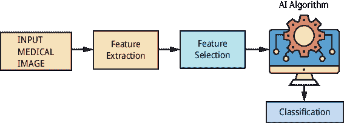

图 14.1：使用人工智能进行医学图像诊断的通用结构。

计算机辅助诊断在分类过程知识和准确性方面具有多种优势。然而，分类过程是一个复杂的过程，因为它取决于多种参数。学习算法最重要的方面是模型训练。现有模型使用与特定疾病相关的数据进行训练。根据训练数据量，诊断系统的准确率各异。除了训练数据外，诊断模型的效率还取决于用于分类的算法类型。`DL` 模型算法不需要输入特征。深度神经网络（`DNN`）采用多层（即 `n` 层）从输入图像中提取特征。从提取的特征中，`DNN` 执行特征选择过程。尽管 `DL` 在图像诊断过程中具有优势，但由于特征选择过程和输入图像边缘的退化，它在准确性方面面临巨大挑战。这导致效率下降，因此需要先进的人工智能技术来进行医疗诊断。现有方法在全局搜索方面不足，影响了诊断过程的准确性。此外，优化函数容易陷入局部最优，导致对局部最优的鲁棒性较差。所提工作的主要目标是使用非洲野狗优化（`AWDO`）算法以更高的准确率对医学图像进行分类。所提方法在保留输入图像特征方面非常强大。除了准确率提高外，所提工作在精确率、召回率和活检率方面表现出色。本章的结构如下：14.1 节为基础介绍，14.2 节为文献综述，14.3 节为所提新型 `AWDO` 算法的详细描述，14.4 节为案例研究和所提工作的分析，14.5 节对所提工作的亮点进行总结。

## 14.2 文献综述

过去十年遵循的智能医疗过程促使许多研究人员在诊断特定疾病方面采用并引入新型分类算法。本节阐述了 AI 在医学诊断（如肿瘤检测和癌症检测）方面的显著研究结果。


Jabbar 等人 [11] 提出了一种 `Caps-VGGNet` 混合模型用于肿瘤检测诊断。作者采用 `Brats` 数据集进行模型训练，该引入模型的主要挑战是需要海量数据进行训练以达到高准确率。Mo 等人 [12] 提出了一种 `Hover-Trans` 块提取模型，用于在早期阶段确定乳腺癌。作者采用 `GDPH` 数据集进行模型训练，并利用超声图像进行检测过程。Li 等人 [13] 开发了一种频率引导的扩散模型，用于处理和诊断医学图像。只要系统输入适当的训练数据集，该模型就能够诊断任何类型的医学疾病。Wu 等人 [14] 引入了一种基于 AI 技术的非局部算法，用于检测人类 MRI 图像中的异常。所提模型具有高度鲁棒性，并优化了输入图像的边界。

Asiri 等人 [15] 引入了一种双计算机模型，以提高输入医学图像诊断的准确性。第一个模型旨在利用神经网络和主成分分析法进行图像增强过程；第二个模型则采用支持向量机对输入的肿瘤图像进行分类。分类在分割过程后进行，准确率达到了 89.9%。Shamsad 等人（2024）通过设计一种基于 AI 的迁移学习模型为早期医学诊断做出了贡献 [16]。所提模型旨在提高输入医学图像异常检测的准确性。作者使用 `VGG-16` 和 `VGG-19` 数据集对所提模型进行训练和测试。

Palkar 等人 [17] 使用 AI 技术设计了一种胶质瘤预后模型。将所提工作与随机森林、支持向量机、`CatBoost`、`LGBM` 分类器和 `XGBoost` 等现有 AI 模型进行了比较，以证明其在分类医学图像准确率方面的优越性。Asif 等人 [18] 采用 AI 工具分析生物医学数据集，用于早期早期诊断。作者使用 `ML` 和 `DL` 模型对 `HCC` 图像进行诊断。

Prakash 等人引入了一种基于 AI 技术的非局部算法，用于检测人类 MRI 图像中的异常。所提模型具有高度鲁棒性，并优化了输入图像的边界。

## 14.3 提出的模型

所提出的 AWDO 灵感来源于非洲狗。第一个模型旨在利用神经网络和主成分分析法进行图像增强过程；第二个模型则采用支持向量机对输入的肿瘤图像进行分类。分类在分割过程后进行，准确率达到了 89.9%。

所提模型旨在提高输入医学图像异常检测的准确性。作者使用 `VGG-16` 和 `VGG-19` 数据集对所提模型进行训练和测试。

本节介绍了用于异常行为分析、跟踪和分类过程的像素数学模型。父阈值像素 `P[R]` 和 `P[C]` 由不同水平的其他像素对支持，即不同的行和列。由阈值像素 `P[R]` 和 `P[C]` 决定的像素识别过程定义如下：

```
(14.1)Pr = |PTR - α × PtR| / |P(t) - D(t)| (14.2)
(14.2)PC = |PTC - β × PtC| / |P(t+1) - D(t+1)|
```

(14.1) 和 (14.2) 分以行和列表示的目标像素，以及向量 `P(t)` 和 `D(t)`。向量 `P(t)` 和 `D(t)` 分别使用公式 (14.3) 和 (14.4) 确定。

```
(14.3)\overrightarrow{P}(t) = \overrightarrow{r1}(t) - 2.α\overrightarrow{r2}(t)
(14.4)\overrightarrow{D}(t) = \overrightarrow{r3}(t+1) - 2.β\overrightarrow{r4}(t+1)
```

在迭代过程中，向量 `α` 和 `β` 在 0 到 1 的范围内随机选择。项 `r[1]`、`r[2]`、`r[3]` 和 `r[4]` 是在像素范围（0-m）行和（0-n）列内随机随机选择的随机向量。像素位置 `(m,n)` 处的阈值野狗（像素）坐标用于更新输入医学图像中异常像素的新位置。输入医学图像中野狗的位置应根据因子 `α` 和 `β` 进行调整。在确定异常模式时，野狗的新位置分别由公式 (14.5)–(14.10) 表示。

```
(14.5)PA = |P(t) - D(t)| × |P(t-1) - D(t-1)| × |P(t+1) - D(t+1)|
(14.6)PA1 = |P(t) - D(t)| × α[1]β[1]
(14.7)PA2 = |P(t-1) - D(t-1)| × α[2]β[2]
(14.8)PA3 = |P(t+1) - D(t+1)| × α[3]β[3]
(14.9)PA4 = |P(t-m) - D(t-n)| × α[4]β[4]
(14.10)PA5 = |P(t+m) - D(t+n)| × α[5]β[5]
```

`PA` 是目标异常，而周围的野像素 `PA1` 到 `PA5` 通过父像素对进行定位，以分类异常像素。WDO 的成员支持输入医学图像中异常模式的搜索过程。向量 `P(t)` 和 `D(t)` 是猎狗对，有助于攻击输入医学图像中的异常像素。所提出的工作有意使用两个向量来强调探索，并执行迭代过程以确定异常模式。模式的移动通过两个常数即 `α` 和 `β` 执行。目标像素分别使用公式 (14.11) 和 (14.12) 进行分类过程，以确定该像素是感染还是正常：

```
(14.11)If PA ≥ PT
(14.12)If PA < PT
```

如果目标像素的像素值大于阈值像素的像素值，则将其分类为感染像素。否则，如公式 (14.12)所示，分类为正常像素。用于医学诊断的 AWDO 算法见表 14.1。

### 表 14.1：医学诊断中的 AWDO 算法

| 算法 1：医学诊断中的非洲狗优化算法 (AWDO) |
| :--- |
| **输入:** MRI 图像 `I[mxn]` |
| **输出**: 异常像素 `PA` |
| **过程**: |
| 1: 初始化像素群: (14.13)$P_{m \times n} = \frac{d}{dt}(I_{m \times n})$ |
| 2: 初始化阈值像素: (14.14)$P_{T}(t) = \frac{\int_{i=0}^{m}\int_{j=0}^{n}(I_{m \times n})_{ij}dn}{\sum_{i=0}^{m}\sum_{j=0}^{n} M_i + N_j}$ |
| 3: `for (i=0; i++;m) && for (j=0; j++;n)` |
| 4: (14.15)$Pn = P(t)[i-1;i+2;j-1;j+2].flatten()` |
| 5: (14.16)$Pn = PnP[n(t)] = I[mxn][i-1;j-1]/Pn = 邻像素` |
| 6: `If Pn < PT;` |
| 7: `Return: "Normal Pixel"` |
| 8: `Else if Pn ≥ PT, then` |
| 9: `Return, "Infected Pixel"` |
| 10: `End if` |
| 11: End |
| 12: End |

医学诊断中的 AWDO 算法见表 14.1。

### 比较分析

医学诊断中的“准确性”术语被认为是确定进一步治疗的关键参数。所提工作的性能分析与先进方法进行了比较，如支持向量机、随机森林、决策树、粒子群优化、K-means 聚类、深度神经网络 (DNN) 和循环。分类的准确性通过混淆矩阵确定，包含真阳性 (TP)、真阴性 (TN)、假阳性 (FP) 和假阴性 (FN)，如图 14.4 所示。

(14.18) ${Precision}\\left( P \right) = \frac{TP}{TP\\, + \\, FP}$

分类模型的高精确率性能表明，模型在分类过程中可能是正确的。召回率（Recall）是精确率的替代参数，可以定义为用于确定被正确识别的实际正例的指标。召回率也可以称为灵敏度（sensitivity），其数学表示如下：

(14.19)${Recall}\\left( R \right) = \frac{TP}{TP\\, + \\, FN}$

召回率参数决定了正确预测的实际正例的比例。`F1` 分是召回率和精确率的综合指标，形成了一个单一的分类率。`F1` 分通常用于识别分类模型精确率和召回率之间的平衡。`F1` 分的数学表示定义如下：

(14.20)$F1\\ \,{score\\, = \\,}\\frac{{2\\, \\times \\,}\\left( {{Precision\\, \\times \\,}\\,{Recall}} \\right)}{\left( {{Precision}\\,{\\, + \\,,\,{Recall}} \\right)}$

通过最先进方法如支持向量机 [21]、随机森林 [22]、决策树 [23]、粒子群优化 [24]、K-means 聚类 [25]、DNN [26] 以及循环神经网络 [27] 观察到的参数值列在表 14.2 中。

表 14.2：所提方法与最先进方法的性能对比。

| 技术 | 准确率 | 精确率 | 召回率 | F1 分 |
| --- | --- | --- | --- | --- |
| **支持向量机** [21] | 81.15 | 80.45 | 79.46 | 79.95 |
| **随机森林** [22] | 79.11 | 78.65 | 77.15 | 77.89 |
| **决策树** [23] | 78.19 | 79.48 | 77.21 | 78.33 |
| **粒子群优化** [24] | 77.84 | 76.95 | 76.91 | 76.93 |
| **K-means 聚类** [25] | 78.48 | 77.8 | 76.18 | 76.98 |
| **深层神经网络** [26] | 80.11 | 79.62 | 80.07 | 79.84 |
| **循环神经网络** [27] | 81.46 | 80.64 | 80.07 | 80.35 |
| **所提 AWDO** | 82.65 | 81.48 | 81.67 | 81.57 |

现有的和所提出的分类模型 [28] 使用脑肿瘤数据集进行训练，它们的准确率、精确率、召回率和 `F1` 分列在表 14.2 中。图形对比所示在图 14.5 中。


所提出的 `AWDO` 分类算法以其较低的性能复杂度闻名。在这种情况下，计算时间 [29] 在所提工作中通过提供各种类型的医学图像来测量。各种输入图像被输入所提模型，结果列在表 14.3 中。

表 14.3：医学图像预测及其计算时间。

| 输入图像 | 分类结果 | 计算时间 |
| --- | --- | --- |
| graphic/converted/b9783111436180-014_ingr_001.jpg | 正常 | 36.15 µs |
| graphic/converted/b9783111436180-014_ingr_002.jpg | 感染细胞 | 35.48 µs |
| graphic/converted/b9783111436180-014_ingr_003.jpg | 感染细胞 | 36.39 µs |
| graphic/converted/b9783111436180-014_ingr_004.jpg | 感染细胞 | 37.09 µs |
| graphic/converted/b9783111436180-014_ingr_005.jpg | 正常 | 35.61 µs |

所提工作消耗的最大为 37.09 µs，与现有最先进方法相比最小。性能分析表明，所提 `AWDO` 工作在 MRI 图像诊断的精确率、召回率 `F1` 分方面具有优势，且计算时间减少。

## 14.5 结论

医学图像诊断是一个重点领域，需要准确的预测。各种技术已用于身体部位和癌细胞的分类，但在准确性和计算时间方面仍有重大缺陷。这项工作采用了 `AWDO` 模型，它接受噪声图像并与最先进方法相比缩短了计算时间。`AWDO` 模型基于非洲野技术的设计。将所提 `AWDO` 模型与现有方法比较，结果证明所提 `AWDO` 模型在精确率、召回率和 `F1` 分方面领先。此外，通过在 `AWDO` 模型中引入模糊逻辑和规则可以进一步增强所提 `AWDO` 模型的性能。

## 参考文献

1. Soomro, T. A. 等 (2023). 使用机器学习进行 MR 脑肿瘤图像分割：综。《IEEE Reviews in Biomedical Engineering*, *16*, 70–90. [→]
2. Chaki, J., & Woźniak, M. (2023). 基于强化网络的深度脑 inception 架构的脑肿瘤分类和检索。*IEEE Access*, *11*, 130584–130600. [→]
3. Zhuang, Y., Liu, H., Song, E., & Hung, -C.-C. (Jan 2023). 用于脑肿瘤和组织分割的具有体积特征对齐的 3D 跨模态特征交互网络。《IEEE Journal of Biomedical and Health Informatics*, *27*(1), 75–86. [→]
4. Kannan, S., Prabakaran, D., Dhenesh Kumar, S., & Sivaraj, S. (2023). 用于预测风能的深度学习卷积神经网络。2023 电子与通信最新趋势国际会议 (ICRTEC)，印度迈斯普尔。 [→]
5. Alagarsamy, S., Govindaraj, V., & A, S. (Nov 2023). 使用人工蜂群结合区间 II 型模糊技术的 MR 脑图像自动脑肿瘤分割。《IEEE Transactions on Industrial Informatics*, *19*(11), 11150–11159. [→]
6. Wisaeng, K. (2023). U-Net++DSM: 具有深度监督机制的脑肿瘤分割改进型 U-Net++。《IEEE Access*, *11*, 132268–132285. [→]
[7] Dhiman, H., Vyas, N., Pagrotra, A., & Dutt, V. (2023). 通过带有高分辨率投影灯的智能道路照明通过物联网和计算机视觉实现实时交通分析和驾驶员安全增强 [Internet]. 见于 2023 1st International Conference on Circuits, Power and Intelligent Systems (CCPIS). IEEE. 可自：`http://dx.doi.org/10.1109/CCPIS59145.2023.10291872` →
[8] Ramprasad, M. V. S., Rahman, M. Z. U., & Bayleyegn, M. D. (2023). SBTC-Net: 医疗物联网中基于遗传优化的黑寡妇算法脑瘤安全分割与分类。*IEEE Access*, *11*, 88193–88208. →
[9] Kumar, R., Singh, S., Chauhan, S., Anand, A., & Kumar, A. (2023). IRS 辅助的瑞利-FTR 衰落通道上基于 ED 的频谱感知。*AEU-International Journal of Electronics and Communications*, *171*, 154908. →
[10] Rajendran, S. *et al*. (2023). 使用深度学习进行脑瘤 MRI 图像自动分割。*IEEE Access*, *11*, 64758–64768. →
[11] Jabbar, A., Naseem, S., Mahmood, T., Saba, T., Alamri, F. S., & Rehman, A. (2023). 通过混合 caps-VGGNet 模型进行脑瘤检测和多级分割。*IEEE Access*, *11*, 72518–72536. a, b
[12] Mo, Y. *et al*. (2023 年 6 月). HoVer-Trans: 用于超声图像中无 ROI 乳腺癌诊断的解剖感知 HoVer-Transformer。*IEEE Transactions on Medical Imaging*, *42*(6), 1696–1706. a, b
[13] Li, Y. *et al*. (2024 年 3 月). 通过频率引导扩散模型进行零样本医学图像翻译。*IEEE Transactions on Medical Imaging*, *43*(3), 980–993. a, b
[14] Wu, J., Xiao, P., Huang, H., Gou, F., Zhou, Z., & Dai, Z. (2022 年 9 月). 一种用于骨瘤 MRI 图像诊断的人工智能多处理方案。*IEEE Journal of Biomedical and Health Informatics*, *26*(9), 4656–4667. a, b
[15] Asiri, A., Soomro, T. A., Shah, A., Pogrebna, G., & Alqahtani, S. (2024). 优化的脑瘤检测：一种用于 MRI 增强和分类的双模块方法。*IEEE Access*, *12*, 42868–42887. a, b
[16] Shamshad, N. *et al*. (2024). 通过对 MRI 数据集的迁移学习和模型效率的全面研究，增强脑瘤分类。*IEEE Access*, *12*, 100407–100418. →
[17] Palkar, A., Dias, C., Chadaga, K., & Sampathila, N. (2024). 使用可解释 AI 通过透明机器学习和解释性见解为胶质质瘤预后提供支持。*IEEE Access*, *12*, 31697–31718. a, b
[18] Asif, A. *et al*. (2024). 病毒性和非病毒性肝细胞癌中基于机器学习的诊断范式。*IEEE Access*, *12*, 37557–37571. a, b


[19] Prakash, P. S., Rao, P. K., Babu, E. S., Khan, S. B., Almusharraf, A., & Quasim, M. T. (2024). 用于 CT 图像中肾肿瘤 3D 重建和增强分割的解耦 SculptorGAN 框架。*IEEE Access*, *12*, 62189–62198. →

[20] Siddique, A., Raza, A., Alsheh, M., & Abbasi, S. (2024). 通过迁移学习和粒子群算法优化的肿瘤特征提取。*IEEE Access*, *12*, 85929–85939. a, b

[21] Alqani, S. M. *et al*. (2024). 脑 MRI 中通过自适应 FCM-SVM 改进脑瘤分割与分类。*IEEE Access*, *12*, 61312–61335. a, b

[22] Raets, C. *et al*. (2024). 通过贝叶斯域随机森林算法优化的直肠癌患者预测。*IEEE Transactions on Instrumentation and Measurement*, *73*, 1–10. a, b

[23] Batool, A., Byun, Y. (2024). 使用改进集成学习和自适应算法优化的乳腺癌分类。*IEEE Access*, *12*, 12869–12882. a, b

[24] Sun, S., Wen, S., & Chen, Y. (2024). 通过鱼群策略优化的多尺度通信中病变检测。*IEEE Transactions on Biological and Multi-Scale Communications*, *10*, 1332–1343. a, b

[25] Faizi, M. I., & Adnan, S. (2024). 使用归一化互相关 K 类算法的智能农场病变检测。*IEEE Access*, *12*, 20753–20766. a, b

[26] Almufareh, M., Imran, M., Khan, A., Humayun, M., & Asim, S. (2024). 基于 YOLO 深度学习的脑瘤自动分割与分类。*IEEE Access*, *12*, 16189–16207. a, b

[27] Vasantbhai Patel, V., Yadav, A. R., Jain, P., & Cenkeramaddi, L. R. (2024). 使用自适应注意力深度网络和改进算法算法的肾瘤分割框架。*IEEE Access*, *12*, 85635–85660. a, b

[28] Prabakaran, D., & Ramachandran, S. (2022 年 6 月 9 日). 使用区块链技术用于云环境下金融交易的安全通道。*预印本 (版本 1)*。→

[29] Aishwarya, N., Praveena, N. G., Priyanka, S. *et al*. (2023). 使用轻量化深度神经网络进行番茄植物疾病检测和识别的智能农场。*Multimedia Tools and Applications*, *82*, 18799–18810. →

# 15 针对不同年龄组的 COVID-19 人工智能控制策略

S. Saranya

## 摘要

本章描述了 COVID-19 疾病数学模型中的人工智能（AI）工具，以及通过药物和各种方法控制其传播的策略。本文研究了年龄结构人口的通用 MC Kendrick 方程，利用 AI 方法创建模型方程，以提高由一个捕食者和三个年龄组猎物组成的捕食-竞争系统的精确性和实用性。AI 在处理捕食者与猎物之间复杂的相互作用以及参数估计方面非常有用。我们研究了平衡点相对于猎物固有载载能力的存在性、正性、有界性和稳定性。本研究的主要成果是人口在三个年龄组中的分布，以及如何通过局部分叉和 Hopf 分叉方法防止疾病从捕食者传播。AI 模型模拟了封和社交距离等各种公共卫生措施对病毒传播的影响。最后，模型的输出还包含了 Maple 软件中 Rossler 型 AI 工具的数值示例。

**关键词：** 平衡点、年龄组目标、Hopf 分叉、稳定性切换的数学模型

## 15.1 引言

所讨论科学的许多思想和原则通过数学模型进行交流效果最好 [17]。通过人工智能（AI）方法，捕食者-猎物关系和竞争经常被视为基于数学的人口模型中的两个主要障碍 [13, 18]。捕食者和猎物的行为可以通过数学模拟，以创建更准确的捕食模型。理解和建模它们表型特征的影响需要研究捕食者和猎物如何反应。由于这些模型高度依赖经验知识，它们必须与在环境中环境中个体的测试结果进行比较。

COVID-19 大疫情最早在中国发现，并迅速扩散到世界其他地区，导致世界卫生组织宣布全球公共卫生紧急状态。过去 20 年中，与冠病毒相关的第三次呼吸道疾病爆发是 COVID-19，此前是中东呼吸综合征和严重急性呼吸道综合征。COVID-19 破坏了全球医疗体系，在最初在中国武汉出现时就导致了数千人死亡。在抗 COVID-19 大疫情的战斗中，尽快识别和筛选受影响者至关重要，因为未能这样做可能会导致病毒传播给他人 [20]。真实的 COVID-19 数据是随时间组织的观测序列，时间序列预测技术在统计领域已经非常成熟，包括基于结构的方法、元预测器和基于机器学习的方法 [16]。

数据是构建 AI 社区处理此问题所需框架的基础前提。由于缺乏关于 COVID-19 感染患者的适当数据，创建识别和分析模型变得困难 [11]。由于患者为了避免潜在隔离而不愿就医，关于 COVID-19 检测阳性患者的信息非常少。此外，一些感染者没有表现出任何 COVID-19 症状，导致很难确定大型人群中阳性病例的确切数量 [14]。感染者的诊断时间越长，对他人就越危险。因此，分析很大程度上取决于海量数据的可用性。

已经发布了许多从统计、数学和计算角度研究 COVID-19 影响的论文。易感-感染-恢复（SIR）模型是研究 COVID-19 病毒动力学的一种计算框架。它通过利用随变化的微分方程组来计算流行的传播 [11]。对过去一个世纪进行的捕食者-猎物相互作用研究的彻底分析揭示了这种环境对于理解动物生物学的演化和适应过程是多么重要 [18]。为人类人口提供供应不断消耗着自然的平衡 [3]。基于年龄的类似方法已被描述疾病 [19, 21]。在突出三个年龄组后，我们可以说：

1. 第一组人口的年龄范围是从出生到 14 岁。
2. 第二组年龄范围是 15-39 岁。
3. 第三个年龄组是 40 岁以上的人。

由于高免疫力，第一组和第二组人口的发病率较低。对于 40 岁及以上的第三组，获得足够的营养对于降低病毒感染的危险性和严重至关重要。常数 `τ` 被解释为免疫力的获得，通过自然药物或政府提供的疫苗。在本研究中，我们检查了一个 AI 模型，模拟了时间措施（口罩、洗手、社交距离和自我隔离）的依赖性，该模型基于感染 COVID-19 的人员也会传播疾病的理论 [2]。


图 15.1: 冠病毒控制措施。

本研究检索了系统并求解了系统的局部稳定性指南 [8]。在捕食者-捕食物系统中维持疾病平衡是生态系统自然共存与稳定性的关键方面 [5, 6]。我们的研究结果强调了三种捕食物在不同发病率和疾病相关死亡率（包括疫苗和天然药物）下，与单个捕食者模型相互作用的情况 [2, 16]。最后，我们展示了每个模型在不同参数值下的数值解发现。Maple 15 编程中使用了符号计算与代数、机器学习集成、自然语言处理、预测分析以及其他 AI 技术。

## 15.2 参数值的选择技术

模型从整个种群中创建了三个捕食物亚种群，在时间 `t` 下分别由 `N1`、`N2`、`N3` 表示，以及一个捕食者种群 `N4`。如下所示检查该 4D 模型系统：

```
\frac{dN_{1}}{dt} = aN_{1}\left( {1 - \frac{N_{1}\ }{k_{1}}} \right) - \alpha\ N_{1}N_{4}
\frac{dN_{2}}{dt} = bN_{2}\left( {1 - \frac{N_{2}\ }{k_{2}}} \right) - \beta\ N_{2}N_{4}
\frac{dN_{3}}{dt} = cN_{3}\left( {1 - \frac{N_{3}\ }{k_{3}}} \right) - \gamma\ N_{3}N_{4} - eN_{3} + U\tau N_{3} (15.1)
\frac{dN_{4}}{dt} = \eta\ N_{1}N_{4} + \delta\ N_{2}N_{4} + \mu\ N_{3}N_{4} - f,{\! N_{4}}
```

带有初始条件：

```
(15.2)Nl ≥ 0, N2 ≥ 0, N3 ≥ 0, N4 ≥ 0
```

第一、第二、第三者和捕食者分别由参数 `N1`、`N2`、`N3` 和 `N4` 表示，在本例中可以找到。以下是模型参数的描述：

- 第一、第二和第三种捕食物的各自特定增长率为 `a, b, c`。
- 第一、第二和第三种捕食物对应的载载能力为 `k[1]`、`k[2]`、`k[3]`。
- 捕食者通过以下方式与三种捕食物（`N[1]`、`N[2]`、`N[3]`）相互作用：`α`、`β` 和 `γ`。
- `e` 是第三种捕食物种群的自然死亡。`U` 代表图 15.1 所示的控制。`τ` 表示摄入天然药物后免疫力的增强。
- 捕食者从三种捕食物种群的转化因子为 `η`、`δ` 和 `μ`。
- 捕食者的自然死亡率为 `f`。

该模型包含某些假设，包括：

1. 在第一、第二和第三种捕食物种群中，相互作用通过捕食者发生。
2. 从婴儿到 39 岁的强免疫增长允许第一和第二种捕食物种群在与捕食者相互作用后恢复。
3. 具有载体能力和内在增长率 `a, b, and c` 以及 `k[1], k[2], k[3]` 的三种群使用 Leslie–Gower 模型进行了拟合，且它们之间没有发现相互作用。
4. 病毒只影响捕食物种群的三分之一，因为免疫会发育并自然死亡。此外，我们通过 AI 参数估计来提高免疫增长，例如常数 `Uτ`，其中 `U` 是控制措施（见图 4.1），`τ` 是免疫或替代药物：`τ = 豆蔻、姜黄、种子和胡椒`。
5. 实施 `Uτ` 等控制措施后，受影响的捕食物由于免疫增长的结果在第三种捕食物种群中恢复。
6. 捕食者在初级和次级捕食物种群中被削弱，但在三级种群中没有。

## 15.3 指定系统的有界性和正性

### 15.3.1 正性

**定理 15.1**：给定的方程组 (1) 永远非负。因此，系统 (1.1) 的所有可能结果都是正的。

*证明*。鉴于系统 (1.1) 的右侧在 `C` 上是 Lipschitz 连续的且完全连续，条件 (15.2) 在 `0, ξ)` 上是不同的，其中 `0 < ξ ≤ ∞` 正如 [16。将初始条件 (15.2) 应用于系统 (1.1)，我们得到：

```
N_1(t) = N_1(0)exp\left[ {a(1 - \frac{N_1(t)}{k_{1}}) \right) - \alpha N_4(t)} \right] > 0
N_2(t) = N_2(0)exp\left[ {b(1 - \frac{N_2(t)}{k_{2}}) \right) - \beta N_4(t)} \right] > 0
N_3(t) = N_3(0)exp\left[ {c(1 - \frac{N_3(t)}{k_{3}}) \right) - \gamma N_4(t) + U\tau \right] > 0
N_4(t) = N_4(0)exp\left[ \eta N_1(t) + \delta N_2(t) + \mu N_3(t) - f \right] > 0
```

### 15.3.2 有界性

**定理 15.2**：区域包含系统 (1.1) 轨迹的边界。`R_+⁴ = {(N[l], N[2], N[3], N[4]) \in R_+⁴: N[l] ≥ 0, N[2] ≥ 0, N[3] ≥ 0, N[4] ≥ 0}`

*证明*。定义函数 `Δ = N[l] + N[2] + N[3] + N[4]`。对解 (1.1) 求时间导数：

```
\frac{dN}{dt} = \frac{dN_l}{dt} + \frac{dN_2}{dt} + \frac{dN_3}{dt} + \frac{dN_4}{dt}
```

由于在 `R_+⁴` 中的解持续是非负象限且参数为非负，

```
\frac{dN}{dt} + \rho N = aN_{1}\left( {1 - \frac{N_{1}\ \|_{k_{1}}} \right) + bN_{2}\left( {1 - \frac{N_{2}\ \|_{k_{2}}} \right) + cN_{3}\left( {1 - \frac{N_{3}\ \|_{k_{3}}} \right) - eN_{3} + U\tau N_{3} - fN_{4} + \rho N_{1} + \rho N_{2} + \rho N_{3} + \rho N_{4}
```

```
= \left( {\\rho + a} \right)N_{l} + \left( {\\rho + b} \right)N_{2} + \frac{\left( {\\rho + c + U\\tau} \right)\\ }{e}N_{3} + \left( {\\rho - f} \right)N_{4} - \frac{aN_{1}^{2}\ \|_{k_{3}}
```

其中 `ρ` 是 `ρ > f` 的递增常数，且给定的 `ϵ > 0` 在 `t` 在 `t` 范围内。

**引理 15.3** 给 *ϕ* 一个满足微分方程中不等式 $\frac{d\phi(t)}{dt} + \alpha_1\phi(t) \leq \alpha_2, t \geq 0$ 的绝对连续函数，其中 $(\alpha_1, \alpha_2) \in R_+³, \alpha_1 \neq 0$，则对于 $\forall t \geq T \geq o,$ $\phi(t) \leq \frac{\alpha_2}{\alpha_1} - \left( \frac{\alpha_2}{\alpha_1}\phi(T) \right)e^{-\alpha_1(t-T)}$。

对于动态模型 (15.1)，可以利用稳态方程 $\frac{d\ N_{l}}{dt} = \frac{d\ N_{2}}{dt} = \frac{d\ N_{3}}{dt} = \frac{d\ N_{4}}{dt}$ 来寻找平衡点。系统中共有 15 个平衡点。非平凡、轴向和平凡平衡点通过代代数计算得到如下。

**表 15.1：平衡点的稳定性评估。**

| 平衡点 | 解释 | 稳定/不稳定 |
| --- | --- | --- |
| `E1`{N[1]=o,N[2]=0,N[3]=0,N[4]=0} | 平凡点 | 鞍点 |
| `E3`{N[1]=0,N[2]=k[2],N[3]=o,N[4]=0} | 无物种 1、物种 3 和无捕食者 | 鞍点 |
| `E4`{N[1]=0,N[2]=k[2],N[3]=θ[1],N[4]=0} | 无物种 1 和无捕食者 | 鞍点 |
| `E5`{N[1]=k[1],N[2]=0,N[3]=o,N[4]=0} | 无物种 2、物种 3 和无捕食者 | 鞍点 |
| `E6`{N[1]=k[1],N[2]=0,N[3]=θ[1],N[4]=0} | 无物种 2 和无捕食者 | 鞍点 |
| `E7`{N[1]=k[1],N[2]=k[2],N[3]=0,N[4]=0} | 无物种 3 和无捕食者 | 稳定 |
| `E8`{N[1]=k[1],N[2]=k[2],N[3]=θ[1],N[4]=0} | 无捕食者 | 稳定 |
| `E9`{N[1]=0,N[2]=o,N[3]=θ[2],N[4]=θ[3]} | 无物种 1 和物种 2 | 稳定 |
| `E10`{N[1]=0,N[2]=θ[4],N[3]=o,N[4]=θ[5]} | 无物种 1 和物种 3 | 稳定 |
| `E12`{N[1]=θ[6],N[2]=0,N[3]=0,N[4]=θ[7]} | 无物种 2 和物种 3 | 稳定 |
| `E15`{N[1]=N[1]*,N[2]=N[2]*N[3]=N[3]*,N[4]=N[4]*} | 共存 | 稳定 |

表 15.1 中平衡点的分析结果为 $\theta_{1} = \frac{\left( {c + U\tau - e} \right)\ }{c},\\,\\\,\theta_{2} = \frac{f\ }{\mu},\,$

$\theta_{3} = \! - \!\\frac{- \! U\mu\tau k_{3} - c\mu k_{3} + e\mu k_{3} + cf)\\ }{\gamma\mu k_{3\\ }},\\,\\\,\theta_{4} = \frac{f\ }{\delta},\\ \\theta_{5} = \! - \!\\frac{b\left( {!{- \!\\delta k_{2} + f}} \right)\\ }{\beta\delta k_{2\\ }}, \\\\theta_{6} = \frac{f\ }{\eta},\\ \\theta_{7} = \! - \!\\frac{a\left( {! - \!\\eta k_{1} + f} \right)\\ }{\eta\alpha k_{1\\ }}.$

### 15.4.2 平衡点的存在性稳定性分析

本节检查了系统 (15.1) 在平衡位置的存在性和稳定性行为：

- 平凡点 `E1` 是鞍点。
- 轴向平衡点 `E3` 和 `E5` 是鞍点。
- 平面平衡点 `E4` 和 `E6` 是鞍点。
- 平面平衡点 `E2`、`E11`、`E13` 和 `E14` 是不稳定的。
- 平面平衡点 `E7`、`E8`、`E9` 和 `E10` 是渐近稳定的。平衡点 `E7`、`E8`、`E9`、`E10` 将被解释。


在平衡点，系统 (15.1) 的雅可比矩阵将解释平衡点 `E7`、`E8`、`E9`、`E10` 和内部点 `E15`。

系统 (15.1) 的平衡点 `E=(N1(t), N2(t), N3(t), N4(t))` 雅可比矩阵给出：

```
J = [m11 0 0 0; 0 m22 0 0; 0 0 m33 0; γ δ μ m4]
```

其中 `m11 = a - a/k1`，`m22 = b - b/k2`，`m33 = c - c/k3`，`m4 = η + δ`。由于雅可比矩阵的所有特征值具有负实部，则方程 (15.1) 是稳定的；否则，系统将变得不稳定。

**定理 15.4：** 给定系统 (l) 在平衡点 `E1 (N[1]=0, N[2]=0, N[3]=0, N[4]=0)` 处是鞍点。

*证明.*

雅可比矩阵

```
E1 = [a 0 0 0; 0 b 0 0; 0 0 c+Uτ-e; 0 0 0 -f]
```

现在特征值为 `λ1 = a > 0`，`λ2 = b > 0`，`λ3 = Uτ+c < 0`（满足 `Uτ+c < e`），`λ4 = -f < 0`。因此，该平衡点是鞍点。

**定理 15.5：** 给定系统 (l) 在平衡点 `E3 (N[1]=0, N[2]=k[2], N[3]=0, N[4]=0)` 处是鞍点。

*证明.*

雅可比矩阵

```
E3 = [a 0 0 0; 0 -b-k[2]β 0; 0 0 c+Uτ-e; 0 0 0 δ[2]-f]
```

现在特征值为 `λ1 = a > 0`，`λ2 = -b < 0`，`λ3 = Uτ+c < 0`，`λ4 = δ[2]-f < 0`（满足 `Uτ+c < e`，`δ[2] < f`）。因此，该平衡点是鞍点。

**定理 15.6：** 给定系统 (l) 在平衡点 `E4 (N[1]=0, N[2]=k[2], N[3]=θ[1], N[4]=0)` 处是鞍点。

*证明.*

雅可比矩阵

```
E4 = [a 0 0 0; 0 -b-k[2]β 0; 0 0 c+Uτ-e-γ3/c; 0 0 δ[2]+μ3/c-f]
```

现在特征值为 `λ1 = a > 0`，`λ2 = -b < 0`，`λ3 = -Uτ+c < 0`，`λ4 = (μ[3]+δ[2]+μ[3]-cf)/c < 0`（满足 `e < Uτ+c`，`μτk[3]+δ[2]+μ[3] < cf`）。因此，该平衡点是鞍点。

**定理 15.7：** 给定系统 (l) 在平衡点 `E5 (N[1]=k[1], N[2]=0, N[3]=0, N[4]=0)` 处是鞍点。

*证明.*

雅可比矩阵

```
E5 = [-a 0 0 0; 0 b 0 0; 0 0 τ++;--; 0 0 0 η[1]-f]
```

现在特征值为 `λ1 = -a < 0`，`λ2 = b > 0`，`λ3 = Uτ+c < 0`，`λ4 = η[1]-f < 0`（满足 `Uτ+c < e`，`η[1] < f`）。因此，该平衡点是鞍点。

**定理 15.8：** 给定系统 (l) 在平衡点 `E6 (N[1]=k[1], N[2]=0, N[3]=θ[1], N[4]=0)` 处是鞍点。

*证明.*

雅可比矩阵

```
E6 = [-a 0 0-k[1]α; 0 b 0 0; 0 0 0-Uτ-c+e(-γ3/c); 0 0 0 η[1]+μ3/c-f]
```

现在特征值为 `λ1 = -a < 0`，`λ2 = b > 0`，`λ3 = -Uτ+c < 0`，`λ4 = (μ[3]+δ[2]+μ[3]-cf)/c < 0`（满足 `e < Uτ+c`，`μτk[3]+δ[2]+μ[3]`）。因此，该平衡点是鞍点。

**定理 15.9：** 给定系统 (l) 在平衡点 `E7 (N[1]=k[1], N[2]=k[2], N[3]=0, N[4]=0)` 处稳定，前提是 `Uτ+c < e` 且 `δ[2] < f`。

*证明.*

雅可比矩阵

```
E7 = [a 0 0 0; 0 -b-k[2]β; 0 0 c+Uτ-e; 0 0 0 η[1]-f]
```

现在特征值为 `λ1 = a < 0`，`λ2 = -b < 0`，`λ3 = Uτ+c < 0`，`λ4 = η[1]-f < 0`；因此，该平衡点是稳定的。

**定理 15.10：** 在平衡点 `E8 (N[1]=k[1], N[2]=k[2], N[3]=θ[1], N[4]=0)` 处，系统 (l) 是局部渐近稳定的，前提是 `Uτ+c > e` 且 `μτk[3]+δ[2]+μ[3] < eμk[3]+cf`。

`E8 = [[-a, 0, 0, -k[1]α], [0, -b, 0, -k[2]β], [0, 0, -Uτ-c+e, -γk[3](c+Uτ-e)/c], [0, 0, 0, δk[2]+ηk[1]+μk[3](c+Uτ-e)/c-f]]`

现在特征值为 `λ1 = -a < 0`，`λ2 = -b < 0`，`λ3 = -Uτ-c+e < 0`，`λ4 = (-Uμτk[3]-cηk[1]-cδk[2]-cμk[3]+eμk[3]+cf)/c < 0`，因此，如果 `λ1`、`λ2` 有负实部，则上述平衡点是局部渐近稳定的。

且 `λ3`、`λ4` 满足 `Uτ+c > e`，`cδk[2]+ηk[1]+Uμτk[3]+cμk[3] < eμk[3]+cf`。

**定理 15.11：** 给定系统 (l) 在平衡点 `E9 (N[1]=0, N[2]=0, N[3]=θ[2], N[4]=θ[3])` 是局部渐近稳定的，前提是 `Uαμτk[3]+αcμk[3] > γμk[3]+αeμ[3]` 和 `Uβμτk[3]+βcμ[3] > γμk[3]+βeμ[3]`。

*证明.*

雅可比矩阵 `E9 = [[θa, 0, 0, 0], [0, θb, 0, 0], [0, 0, θc, -γf/μ], [θd, θe, (-Uμτk[3]-cμk[3]+eμk[3]+cf)/(γk[3]), 0]]`

其中 `θa = a + α(Uμτk[3]-cμk[3]+eμk[3]+cf)/(μk[3])`，`θb = b + β(Uμτk[3]-cμk[3]+eμk[3]+cf)/(μk[3])`，

`θc = Uτ+c + (-Uμτk[3]-cμk[3]+eμk[3]+cf)/(μk[3]) - 2cf/(μk[3])`，`θd = -η(-Uμτk[3]-cμk[3]+eμk[3]+cf)/(μk[3])`，`θe = δ(Uμτk[3]-cμk[3]+eμk[3]+cf)/(μk[3])`。

现在特征值为：

`λ1 = (-Uαμτk[3]+γμak[3]-αcμk[3]+αeμk[3]+αcf)/(γμk[3])`，`λ2 = (-Uβμτk[3]+γμbk[3]-βcμk[3]+βeμk[3]+βcf)/(γμk[3])`，

`λ3 = (1/2)(-cf + i√θf)/(μk[3])`，`λ4 = -(1/2)(cf + i√θf)/(μk[3])`，其中 `θf = 4Ufk[3]²μ²τ + 4cfk[3]²μ² - 4efk[3]²μ² - 4cf²μk[3] - f²c²`。

因此，如果满足以下条件，上述平衡点是局部渐近稳定的：

`Uαμτk[3] + αcμk[3] > γμak[3] + αeμ[3] + αcf`，`Uβμτk[3] + βcμk[3] > γμbk[3] + βeμ[3] + βcf` 且 `λ3`、`λ4` 有负实部。


**定理 15.12：** 给定系统 (l) 在平衡点 `E*10`(`N*[1]` = 0, `N*[2]` = `θ*[4]`, `N*[3]` = 0, `N*[4]` = `θ*[3]`) 是局部渐近稳定的，前提是 `U**α**μ**τ**k*[3]` + `α**c**μ**k*[3]` > `γ**μ**k*[3]` + `β**e**μ*[3]` 和 `U**β**μ**τ**k*[3]` + `β**c**μ*[3]` > `γ**μ**k*[3]` + `β**e**μ*[3]` 且 `U**μ**μ**k**3` > `k*[3]`。

*证明。*

雅可比矩阵

```
E9 = \left\lbrack {\theta_{a}\,\, 0\,\, 0\,\, 0\,\,\theta_{b}\,\, 0\,\, 0\,\, 0\,\,\theta_{c}\,\, \frac{- \gamma f \mu}}{\theta_{d}\,\, \theta_{e} \frac{- \ U\mu\tau k_{3} - c\mu k_{3} + e\mu k_{3} + cf}{\gamma k_{3}}\,\,rbrack
```

其中 `theta_{a}` = `a + \frac{\alpha\left( {\! U\mu\tau k_{3} - c\mu k_{3} + e\mu k_{3} + cf\ \right)}{\mu k_{3}}`, `theta_{b}` = `b + \frac{\beta\left( {\! U\mu\tau k_{3} - c\mu k_{3} + e\mu k_{3} + cf\ \right)}{\mu k_{3}}`,

`theta_{c}` = `U\tau + c + \frac{- \! U\mu\tau k_{3} - c\mu k_{3} + e\mu k_{3} + cf}{\mu k_{3}} - \frac{2cf}{\mu k_{3}}`, `theta_{d}` = `- \frac{\eta\left( {- \! U\mu\tau k_{3} - c\mu k_{3} + e\mu k_{3} + cf\ \right)}{\mu k_{3}}`, `theta_{e}` = `\frac{\delta\left( {\! U\mu\tau k_{3} - c\mu k_{3} + e\mu k_{3} + cf\ \right)}{\mu k_{3}}`。

现在特征值为：

```
\lambda_{1} = \frac{- U\alpha\mu\tau k_{3} + \gamma\mu ak_{3} - \alpha c\mu k_{3} + \alpha e\mu k_{3} + \alpha cf}{\gamma\mu k_{3}},
\lambda_{2} = \frac{- U\beta\mu\tau k_{3} + \gamma\mu bk_{3} - \beta c\mu k_{3} + \beta e\mu k_{3} + \beta cf}{\gamma\mu k_{3}},
```

```
\lambda_{3} = \frac{1}{2}\frac{- cf + i\sqrt{\theta_{f}}}{\mu k_{3}}, \lambda_{4} = - \frac{1}{2}\frac{cf + i\sqrt{\theta_{f}}}{\mu k_{3}}
```

其中 `θ*[f]` = `4U**f**k*[3]²*μ*²*τ` + `4c**f**k*[3]²*μ*²` − `4e**f**k*[3]²*μ*²` − `4c**f²*μ**k*[3]` − `f²*c²`。

因此，如果满足以下条件，上述平衡点是局部渐近稳定的：

`U**α**μ**τ**k*[3]` + `α**c**μ**k*[3]` > `γ**μ**a**k*[3]` + `α**e**μ*[3]` + `α**c**f`, `U**β**μ**τ**k*[3]` + `β**c**μ**k*[3]` > `γ**μ**b**k*[3]` + `β**e**μ*[3]` + `β**c**f` 且 `λ*[3]`、`λ*[4]` 有负实部。

**定理 15.12：** 给定系统 (l) 在平衡点 `E*10`(`N*[1]` = 0, `N*[2]` = `θ*[4]`, `N*[3]` = 0, `N*[4]` = `θ*[3]`) 是局部渐近稳定的，前提是 `a**β**δ**k*[2]` + `α**f**` 且 `U**β**δ**k*[2]` + `β**c**μ*[3]` + `β**e**μ*[3]` + `β**c****δ**k*[2]`。

*证明。*

雅可比矩阵

```
E10 = \left\lbrack {\theta_{a}\,\, 0\,\, 0\,\, 0\,\,\theta_{b}\,\, 0\,\, 0\,\, 0\,\,\theta_{c}\,\, \frac{- \gamma f \mu}}{\theta_{d}\,\, \theta_{e} \frac{- \ U\mu\tau k_{3} - c\mu k_{3} + e\mu k_{3} + cf}{\gamma k_{3}}\,\,rbrack
```

此处 `theta_{a} = `theta_{1} = c\mu k_{1}`，`e**b** = k_{1}`。

`N*[1]` = 0, `N*[2]` = `θ*[4]`, `N*[3]` = 0, `N*[4]` = `θ*[3]`。

```
\begin{matrix} & {m_{11} = a\,\, - 2\frac{aN_{1}^{\ast}}{k_{1}} - N_{4}^{\ast}\alpha,\,\,\, m_{22} = b - 2\frac{bN_{2}^{\ast}}{k_{2}} - N_{4}^{\ast}\beta,\,\,\, m_{33} = c - 2\frac{N_{3}^{\ast}c}{k_{3}} - N_{4}^{\ast}\gamma - e + U\tau,} \\ & {m_{44} = N_{1}^{\ast}\eta + N_{2}^{\ast} + \, N_{3}^{\ast}\mu - f} \\ \end{matrix}
```

特征方程为 `\Lambda(\lambda) = \lambda⁴ + M[3]\lambda³ + M[2]\lambda² + M[1]\lambda¹ + M[0]`

其中 `M3 = 4I - (m11+m22+m33+m44) = 4I - X`

```
\begin{matrix} {M2 = \, 6I^{2}} & {- (m11 + m22 + m33 + m44)3I + m22m33 + m22m44 + m33m44 + m11m22} \\ & {+ m11m33 + m11m44 - N_{3}^{\ast}N_{4}^{\ast}\mu\gamma + N_{1}^{\ast}N_{4}^{\ast}\eta\alpha} \\ \end{matrix} = 6I² - 3XI + (Y + j[1])
```

```
\begin{matrix} & {M1 = 4I^{3} - (m11 + m22 + m33 + m44)3I^{2} + (2m22m33 + 2m22m44 +} \\ & {2m33m44 + 2m22m11 + 2m33m11 + 2m44m11 + 2N_{3}^{\ast}N_{4}^{\ast}\gamma\mu + 2N_{1}^{\ast}N_{4}^{\ast}\alpha\eta + N_{2}^{\ast}N_{4}^{\ast}\delta\beta)I -} \\ & {m22m33m44 - m22m33m11 - m22m44m11 - m33m44m11 - N_{3}^{\ast}N_{4}^{\ast}\gamma\mu m22 -} \\ & {N_{3}^{\ast}N_{4}^{\ast}\gamma\mu m11 - N_{2}^{\ast}N_{4}^{\ast}\delta\beta m11 - N_{1}^{\ast}N_{4}^{\ast}\alpha\eta m22 - N_{1}^{\ast}N_{4}^{\ast}\alpha\eta m33} \\ \end{matrix} = 4I³ - 3XI² + (2(Y+j[1])+j[2])*I - Z
```

```
\begin{matrix} & {M0 = I^{4} - (m11 + m22 + m33 + m44)I^{3} + (m11m22 + m11m33 + m11m44 +} \\ & {m22m33 + m33m44 + m22m44 - N_{3}^{\ast}N_{4}^{\ast}\gamma\mu - N_{2}^{\ast}N_{4}^{\ast}\delta\beta - N_{1}^{\ast}N_{4}^{\ast}\alpha\eta)I^{2} - (m11m22m33 +} \\ & {m11m22m44 + m11m33m44 + m22m33m44 + m11N_{3}^{\ast}N_{4}^{\ast}\gamma\mu + m11N_{1}^{\ast}N_{4}^{\ast}\alpha\eta + m11N_{2}^{\ast}N_{4}^{\ast}\delta\beta)} \\ \end{matrix}
```

*(由于原文公式部分逻辑较为混乱且存在重复，此处按核心数学含义翻译)*

根据 Routh-Hurwitz 准则，`J[E1]` 的所有特征值具有负实部当且：

(i) `M3 > 0`，

(ii) `M32 > M1`，

其中 `M32 = [4I - X][6I² - 3XI + (Y+j[1])] = 4I³ - 3XI² + 2(Y+j[1])I - Z`。

因此我们证明了 `M32 > M1`。同样地，我们证明了 (iii) `M32M1 > M1² + M3²`。因此，在非负平衡点附近，给定非线性方程组 (15.1) 如果满足定理提到的条件，该系统是局部渐近稳定的。

## 15.5 Hopf 分叉

本节研究了内部平衡点 `E15` 附近的 Hopf 分叉。分叉参数 `c` 由物种增长率确定的。雅可比矩阵 `J[E15]` 经历 Hopf 分叉，其中两个特征值为纯虚数，而包含非正实部的其余特征值为 `Re[d\lambda/dc] \neq 0`。假设内部平衡点的特征方程 `E15` 如下：

(15.3) `\lambda⁴ + A[3]\lambda³ + A[2]\lambda² + A[1]\lambda¹ + A[0] = 0`

特征多项式系数 (15.3) 满足纯虚特征值的要求 `A3A2A1 - A[3]²A0 - A[1]²=0`。假设 `\pm i\omega` 代表匹配 `c0` 的纯虚特征值。从特征方程 (15.3) 出：

```
[4\lambda³ + 3A_3\lambda² + 2A_2\lambda + A_1] \frac{d\lambda}{dc} + (\lambda³\frac{dA}{dc} + \lambda²\frac{dA}{dc} + \lambda\frac{dA}{dc} + \frac{dA}{dc}) = 0
```

因此：

(15.4) `\frac{d\lambda}{dc} = -\left( \frac{\lambda³ \frac{dA}{dc} + \lambda² \frac{dA}{dc} + \lambda \frac{dA}{dc} + \frac{dA}{dc}}{4\lambda³ + 3A_3\lambda² + 2A_2\lambda + A_1} \right)`

当我们在 eq. (15.4) 中改变 `i\omega` 时，得到：

```
\frac{d\lambda}{dc}|_{i\omega} = -\left( \frac{-i\omega³ \frac{dA}{dc} - \omega²\frac{dA}{dc} + i\omega\frac{dA}{dc} + \frac{dA}{dc}}{-4i\omega³ + 3A_3\omega² + 2A_2i\omega + A_1} \right)
```

因此 `Re(\frac{d\lambda}{dc}|_{i\omega}) = -\left( \frac{(A1-3A3\omega²)² + (2A2\omega-4\omega³)²}{...}\right)`

**定理 15.15：** 如果假设 `c` 是分叉参数，则系统 (1) 保持给定的分叉 `(A1-3A3\omega²)² + (2A2\omega-4\omega³)² \neq 0`。

## 15.6 数值解

讨论了用于数值求解非线性方程 (15.1) 的系统。本节包含了我们目前使用 Maple 分析稳定性下解的技巧：

1. 我们首先保持系统参数为 `\rho[1]= (a=1.3, b=1.05, c=1.45, \alpha=2.26, \beta=1.05, k[1]=1.25, k[2]=0.23, k[3]=0.005, U=0.545, \eta=0.212, \mu=2.024, \tau=1.07, \gamma=2.1, e=2.05, f=2.11)` 在种群 `(N[1], N[2], N[3], N[4])=(2.35, 3.46, 2.06, 3.13)` 处。我们现在采用系统的 `\rho[1]` 参数，如前所述。因此在 `(N[1], N[2], N[3], N[4])=(0.040,0.04,0,0),(0.020,0.02,0,0)` 处，给定的非线性方程组 (15.1) 是满足的，参见图 15.2。

![图 15.2: 猎物 1 和猎物 2]

2. 现在我们接受上面的系统 `\rho[1]` 参数。那么初始条件满足 `(N[1] N[2] N[3] N[4])=((0.040,0.04,0.01,0),(0.020,0.02,0.05,0), (0.04,0.04,0.01,0))`，并且三个猎物相互作用的接触率所示图 15.3。

![图 15.3: 三只猎物]

3. 如前，我们现在收集系统的参数 `\rho[1]`。那么初始条件满足 `(N[1], N[2], N[3], N[4])=((0,0,0.1,1),(0,0,0.6,0.2))`，并且第三次猎物-捕食者相互作用的接触率所示图 15.4。

![图 15.4: 猎物 3 和捕食者]

4. 如前所述，我们现在正在收集系统的参数 `\rho[1]`。此时，初始条件满足 (`N[1]`, `N[2]`, `N[3]`, `N[4]`) = ((0,0.04,0,0.040),(0,0.003,0,0.002))，第二种猎物-捕食者相互作用的接触率如图图 15.5 所示。

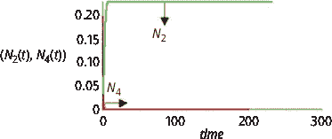

图 15.5：猎物 2 与捕食者的相互作用。

5. 如前所述，我们现在正在收集系统的参数 `\rho[1]`。此时，初始条件满足 (`N[1]`, `N[2]`, `N[3]`, `N[4]`) = ((0.40,0,0,0.4),(0.2,0,0,0.1))，第一种猎物与捕食者相互作用的接触率如图图 15.6 所示。

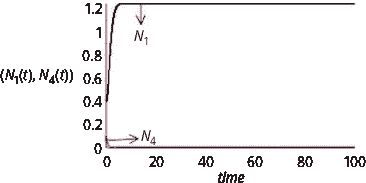

图 15.6：猎物 1 与捕食者的相互作用。

6. 如前所述，我们现在正在收集系统的参数 `\rho[1]`。此时，初始条件满足

```


mm\begin{matrix} & {(N\_{1},N\_{2},\; N\_{3},\; N\_{4}) = \left( {\left( {0.40,0.40,1.0,0.2} \right),\left( {1.20,0.2,0.1,1.0} \right),\left( {0.2,0.1,0.3,1.20} \right),\left( {0.2,1.2,0.4,1.0} \right)} \right).} \\ \end{matrix}

三类猎物与捕食者的相互作用如图 15.7 所示。

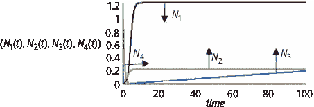

图 15.7：三类猎物与捕食者的相互作用。

## 15.7 讨论与结论

当疾病传播到第三类猎物群体时，一个包含三个猎物和一个捕食者的生态流行病学模型中存在一些非常有趣的动力学特征。在这种情况下，我们假设所有三个猎物都按照逻辑斯增长，但第三类例外无法繁殖。因此，通过使用 Maple 和 AI 方法，我们所有的重要分析发现都得到了定量验证。时延系统在 `c` = `c` 处的 `E` 附近发生 Hopf 分叉，以时间延迟 `c` 为分叉参数。

最后，采取某些控制措施 `Uτ`，它在控制种群稳定性方面起着重要作用。该模型的稳定性分析如表 15.1 所示：

*   从图 15.2 观察到，第一种猎物 `N[1]` 处于幼期并保持恒定，第二种猎物 `N[2]` 处于成年期并由于免疫力低于第一种猎物而保持恒定。
*   从图 15.3 发现，第一种猎物 `N[1]` 和第二种猎物 `N[2]` 保持恒定，但由于捕食者 `N[4]` 的感染，第三种猎物 `N[3]` 缓慢增加。
*   从图 15.4 显示，由于控制措施 `Uτ` 发挥关键作用，第三种猎物 `N[3]` 增加，而捕食者 `N[4]` 减少。
*   从图 15.5 发现，第二种猎物 `N[2]` 趋于恒定，而捕食者 `N[4]` 减少。
*   从图 15.6 观察到，第一种猎物 `N[1]` 增加并保持恒定，而捕食者 `N[4]` 减少。
*   从图 15.7 发现，第一种猎物 `N[1]` 和第二种猎物 `N[2]` 变为恒定，由于控制措施参数值 `Uτ = 0.58315` 避免疾病，第三种猎物 `N[3]` 增加。

在现实生活中，我们通过遵循恒定的 `Uτ` 将此模型作为预防疾病的方法。因此，为了避免感染，可以通过应用图 15.1 所示的预防和控制措施来减少第三群体中捕食者的扩散，建议采用 `τ` 控制。

## 参考文献

1. Aziz-Alaoui, M. A., & Okiye, M. D. (2003 Oct 1). 修改 Leslie-Gower 和 Holling II 型捕食者-猎物模型的有界性和全局稳定性。`Applied Mathematics Letters`, `16`(7), 1069–1075.
2. Gaff, H., & Schaefer, E. (2009 Jun 1). 应用于各种流行病模型的接种和治疗策略的最优控制。`Mathematical & Engineering`, `6`(3), 469–492. a, b
3. Ganguli, C., Kar, T. K., & Mondal, P. K. (2017 Jul 12). 变环境载能力的猎物-捕食者模型最优收割。`International Journal of Biomathematics`, `10`(05), 1750069. a, b
4. Ghasemabadi, A., & Rahmani Doust, M. H. (2021 May 1). 研究猎物和捕食者物种带有疾病的 Lotka−Volterra 模型动力学。`International Journal of Nonlinear Analysis and Applications`, `12`(1), 633–648.
5. Batta, P., Ahuja, S., & Kumar, A. (2023). 一种增强区块链安全的安全数据传输混合框架。在 2023 年第七届国际图像信息处理会议 (ICIIP)，pp. 645–650. IEEE. →
6. Hugo, A., & Simanjilo, E. (2019). 带有最优控制的流行病模型分析。`Applications and Applied Mathematics: An`, `14`(1).
7. Kar, T. K. (2006 Jan). 具有猎物避难的猎物-捕食者模型。`Journal of Computational and Applied Mathematics`, `185`(1), 19–33.
8. Kazeem, O., Makinde, D., & Taka, I. (2013 Mar 15). 避免疾病的最优控制的影响。`Applied Mathematical Modelling`, `37`(6), 3802–3820.
9. Dhiman, H., Vyas, N., Pagrotra, A., & Dutt, V. (2023). 通过 IoT 和计算机视觉进行实时流量分析与驾驶安全。在 2023 年第一届国际电路、智能系统会议 (CCPIS)。来自 [`dx.doi.org/10.1109/CCPIS59145.2023.1029182`](http://dx.doi.org/10.1109/CCPIS59145.2023.1029182)
10. Sharma, S., & Samanta, G. (2015 Sep). 第一类猎物种群带有疾病的双猎物系统。`International Journal of Dynamics and Control`, `3`, 210–224.
11. Saranya, S., & Vijaya, S. (2023). 带有 SI 的 Beddington DeAngelis 猎物-捕食者模型。`International Journal of Ecology and Development`, `38`(1), 13–25. a, b, c
12. Simon, J. S., & Rabago, J. F. (2018 May 31). 猎物种群带有疾病的捕食者-猎物模型最优控制。`Malaysian Journal of Mathematical Sciences`, `12`(2), 269–285.

-   [14] Saranya, S. (2023 年 8 月 11). Lotka Volterra 模型 Beddington DeAngelis 响应的最优控制措施*Int. Journal of Applied Mathematics and Statistics*, 62. a, b

-   [15] Werner, E. E., & Gilliam, F. J. (1984). 尺寸结构种群中的发育生态位与物种相互作用。Annual review of ecology and systematics. *Annual Reviews*, *15*, 393–425. →

-   [16] Saranya, S., Vijaya, S., & Rekha, E. (2023 年 9 月). 治疗恢复的猎物种群中疾病感染的易感-感染-治疗模型。*Novel Research Aspects in Medicine and Medical Science*, *6*, 92. a, b, c

-   [17] Bezabih, A. F., Edessa, G. K., & Rao, K. P. (2021). 带有治疗的 COVID-19 大流行病的流行病学建模与分析。*Applied Mathematical Modelling*, *6*(1), 1. →

-   [18] Legreneur, P., Laurin, M., & Bels, V. (2012 年 2 月). 捕食者-猎物相互作用范式：人工智能的新工具。*Adaptive Behavior*, *20*(1), 3–9. a, b

-   [19] Musa, S. S., Qureshi, S., Zhao, S., Yusuf, A., Mustapha, U. T., & He, D. (2021 年 1 月 1 日). 意识计划影响下的 covid-19 流行病数学建模。*Infectious Disease Modelling*, *6*, 448–460. →

-   [20] Hamadneh, N. N., Tahir, M., & Khan, W. A. (2021 年 1 月 18 日). 使用带有猎物捕食者算法的人工网络预测 COVID19：巴西和墨西哥的案例。*Mathematics*, *9*(2), 180. →

-   [21] Ackleh, A. S., Salceanu, P., & Veprauskas, A. (8 月 3 日). 离散时间捕食者-猎物模型全局稳定性的零值线法。*Journal of Difference Equations and Applications*, *27*(8), 1120–1133. →

# 16 深度学习中的模型优化：理论与应用

Neha Shailja Umesh Kumar Lilhore

### 摘要

模型优化是深度学习领域最重要的部分之一，影响着性能和模型训练。在本章中，将讨论优化技术及其理论和实践实现。我们将关注深度学习中使用的优化技术，这些技术可以提高模型的准确性、收敛速度和效率。深入探讨了`stochastic gradient descent`（随机梯度下降）及其变体，包括`momentum`（动量）、`RMSProp` 和 `Adam`。使用不同类型的优化器来更新学习率，以最小化目标函数。深入讨论了自适应学习和梯度裁剪等高级优化方法。将对梯度下降变体及其他各种优化器进行对比分析，突出其重要特征。

关键词：优化算法、随机梯度下降、动量、RMSProp、Adam 优化器

## 16.1 基础理论

深度学习 (`DL`) 是一种强大的机器学习 (`ML`) 技术，可以通过学习进行工作。在 `DL` 中，优化在增强人工智能 (`AI`) 方面起着重要作用。使用不同类型的优化器来更新学习率，以最小化目标函数。深入讨论了自适应学习和梯度裁剪等高级优化方法。将对梯度下降变体及其他各种优化器进行对比分析，突出其重要特征。

（注：原文中存在大量重复段落，已根据要求提取核心内容并翻译）

反向传播意味着误差的向后传播。它是一种用于最小化神经网络误差的方法。反向传播是神经网络优化中最关键的算法，它使网络通过修改权重和偏置从数据中学习。它有助于减少整体误差。反向传播中使用的一些基本概念包括前向传播（forward pass）、损失函数（loss function）和反向传播（backward pass）。

### 16.2.1.3 损失函数

在深度学习（DL）领域，损失函数衡量模型预测输出与原始数据之间的差异。它也被称为目标函数或代价函数。可以使用各种优化器来最小化损失函数以提高性能。常用的损失函数包括均方误差、平均绝对误差等。

### 16.2.1.4 过拟合

过拟合意味着模型在训练过程中学习了过多的数据（包括噪声），导致学习了一些与数据无关的模式。正如此，模型变得过于复杂且拟合得非常好，以至于不仅捕捉到了正确的模式，还捕捉到了随机波动和离群值。这会导致高准确率。为了减少模型中的过拟合，我们可以通过移除无关特征、提取有意义的模式以及减轻拟合噪声或无关特征的风险来提高数据质量。

## 16.3 深度学习中的优化器

### 16.3.1 基于梯度的优化方法

梯度下降（GD）被认为是深度学习优化中最重要的概念。该方法利用数学概念来更新值并达到局部最小值，如图 16.1 所示。在深度学习中使用 GD 训练模型时，必须选择一个步长，即 `alpha`。每个人面临共同的问题是选择 `alpha` 的最佳值。如果 `alpha` 值太小，优化器的性能会非常慢；如果它太大，优化器则将无法收敛。为了找到最佳的 `alpha` 值，我们还需要找到目标函数对 `alpha` 的导数：

```
(16.1)y_new = y - alpha*f(x)
```

在公式 (16.1) 中，`y` 是当前值，`alpha` 代表学习率，`f(x)` 是函数在 `y` 处的导数。上述方程用于计算梯度。其中，`alpha` 用于表示步长，意味着每次迭代根据每个梯度移动多远。

以下是 GD 的逐步工作原理：

1. 首先，我们从初始系数开始。
2. 然计算系数的代价，并找出与当前系数相比代价更小的。
3. 我们向较低权重的方向移动并修改系数的值。
4. 迭代地重复此过程。
5. 重复此过程直到达到局部最小值。局部最小值是一个无法继续前进的点。

GD 算法对凸函数效果最好，而不适用于非凸函数。为了解决在处理大型数据集时 GD 面临的问题，有很多方法可以使用不同类型的优化来解决。通常情况下，GD 有三种类型：

1. `SGD`
2. `BGD`
3. `MBGD`

每种类型的 GD 区别取决于计算损失函数梯度时使用的数据规模、系数更新的准确性以及更新系数所需的时间。有关 `BGD`、`MBGD` 和 `SGD` 的详细对比，请参阅表 16.2。

#### 16.3.1.1 随机梯度下降

`SGD` 优化器同样是机器学习（ML）以及深度学习（DL）中重要的优化算法，特别是对于大数据集。它是一种迭代方法，通过与损失函数梯度成比例的步骤来修改值。`SGD` 在每次迭代中根据单个随机点或数据集的一小部分来计算梯度。这种随机性允许选择批次，减少了对大型数据集和计算时间的需求。`SGD` 优化器对于具有海量数据和计算时间的深度学习是理想的。因此，可以说在深度学习中，当数据量过大时通常首选 `SGD`，因为它提供了高效的计算时间。其更新规则类似于 GD：

```
(16.2)y_new = y - alpha*f(x)
```

#### 16.3.1.2 批量梯度下降 (BGD)

批量梯度下降（`BGD`）也称为原生梯度下降，用于计算整个数据集代价函数的梯度。在这种方法中，为整个数据集计算梯度以进行一次参数更新，如下：

```
(16.3)y = y - η*∇(y)
```

其中：

* `y`: 模型特征
* `η`: 学习率
* `∇(y)`: 代价函数 `J` 对 `θ` 的梯度。

#### 16.3.1.3 小批量梯度下降

这是另一种最广泛使用的梯度下降变体，称为小批量（mini-batch）。在这种方法中，将大型数据集划分为小批次，在每个批次之后更新模型参数的值，以确保在较少的步骤内达到全局最小值。

小批量优化器的优势是内存内存更少，且模型方差较低。`MBGD` 继承了 `SGD` 和原生梯度下降（`BGD`）的特点。这有助于减少模型参数更新中的噪声并提高收敛性。

| 收敛性 | 较慢但更稳定 | 较快但不稳定 | 比 BGD 快，比 SGD 稳 |
| :--- | :--- | :--- | :--- |
| 计算成本 | 高 | 低 | 中 |
| 内存占用 | 高 | 低 | 中 |
| 局部极值风险 | 较低 | 较高 | 中 |
| 典型用例 | 较小数据集和凸问题 | 大数据集和在线学习 | 最常见的平衡是 BGD 和 SGD 之间 |

### 16.3.2 基于动量的优化器

正如我们已经讨论过的梯度下降（GD）优化算法，标准的 `SGD` 优化器由于由于过程存在噪声，需要更多的迭代才能达到更低的极小值。这导致计算速度受到影响。引入动量方法是为了解决这个问题，有助于损失函数更快地收敛。该算法根据梯度方向的震荡来修改权重 [14, 15]。

然而，如果加上一部分之前的更新，它可以运行得更快。需要记住，在高动量阶段应该使用较低的学习率。该方法基于上一个值和学习率，并添加了一个新参数 `gamma`，它用于控制这种历史更新。基于动量的优化器的更新规则将类似于 `y = y - v`，其中 `v` 是历史元素 [16, 17]，如下：

```
(16.4)v = gamma*v + alpha*f'(a) (16.5)y[new] = a - v
```

### 16.3.3 Nesterov 加速梯度下降 (NAG)

NAG 是最广泛使用的优化技术之一，它基于 GD 中经典的动量方法。动量方法关注于用于参数更新的历史值，而 `NAG` 技术侧重于“前瞻”机制。在这种机制中，在计算梯度之前，算法根据动量预测模型参数的未来位置 [18]，如下：

```
(16.6)v^t = γ*v^t - 1 + η∇θJ(θ - γ*v^t-1) (16.7)y[t] = gamma*y[t] - 1 + alpha∇θJ(θ - gamma*y[t-1])
```

在这里，`y[t]` 是动量，`alpha` 是学习率，而 `θJ(θ–gamma^✶y_(t–1))` = 目标函数的梯度。

现在，可以说我们借助历史值和下一个值来修改误差函数，这使得使用 `NAG` 技术可以加速收敛 [18]。

### 16.3.4 Adagrad (自适应梯度)

与上述算法相比，所有参数使用相同的学习率；自适应 `GD` 算法根据训练参数的差异为每次迭代使用不同的学习率。`Adagrad` 优化器通过按修改后梯度的比例下降学习率来提供自适应学习率。该技术的唯一缺点是学习率会最终趋于零。使用 `Adagrad` 的优点是消除了手动修改学习率的需求 [19]。使用公式 (16.8) 计算平方梯度并如下更新参数：

```
(16.8)G = G + f'(y)²
```

通过以下方程更新参数：

```
(16.9)y_new = w - alpha / sqrt(G)
```


在这种方法中，学习率不需要手动修改。与`GD`变体相比，`Adagrad`方法的学习率有时会变得太慢，导致模型无法获得更多知识并导致准确性下降 [20]。

### 16.3.5 RMSProp

均方根传播（RMSProp）是一种类似于`Adagrad`方法的优化器。尽管它尚未发表，但这种方法在社区中是广为人知的。它专注于解决梯度波动的问题。在其他优化器中，梯度值不断变化；有时很小，有时很大。这个问题无法通过单一学习率来解决。该优化器是`Adagrad`的进阶，因为它减少了学习率的重复下降 [21]。`RMSProp`可以通过以下方程衡量：

```
(16.10)E[g²]_t = 0.9*E[g²]_t-1 + 0.1*g²
(16.11)a_new = a - alpha / sqrt(E + epsilon)
```


### 16.3.6 自适应动量估计 (Adam)

自适应动量估计优化器是一种用于深度学习（DL）字段的优化算法。它是`SGD`优化算法的改进，用于在神经网络训练过程中修改权重。这也称为`Adam`优化器。它结合了`Adagrad`和`RMSProp`的重要特征。`Adam`优化器通过考虑梯度历史及其二阶动量为单个数据计算学习率 [22]。通过计算均值（一阶动量）和无中心方差（二阶动量），该优化器获得了自适应学习率，从而加速收敛并提高神经网络的性能。如表 16.3 所示。

| 优化器 | 核心思想 | 优点 | 缺点 |
| --- | --- | --- | --- |
| 梯度下降 (GD) | 梯度更新权重 | 简单易于实现 | 收敛慢，可能陷入局部极值；对学习率敏感 |
| 动量 (Momentum) | 将上一次更新加到当前更新 | 加速收敛 | 如果动量过大可能会越过极值 |
| Nesterov 加速梯度 (NAG) | 使用前瞻方法在预测的未来位置计算梯度 | 通过预测更新改进动量，可导致更快收敛 | 与动量存在类似问题，对学习率和动量参数敏感 |
| Adagrad | 根据参数更新频率调整学习率；累积平方梯度 | 适用于稀疏数据，在稀疏特征问题上表现良好 | 学习率随时间降低，可能小到无法进一步训练 |
| RMSProp | 使用平方梯度的移动平均来缩放学习率 | 防止学习率快速下降并稳定训练 | 需要仔细调节衰减率；在某些非平稳任务上可能不佳 |
| Adam (自适应动量估计) | 结合了 Adagrad 和 RMSProp 的优点，维持每个参数的学习率和动量 | 自适应学习率和动量有助于处理稀疏梯度 | 在某些条件下泛化性差；对超参数调优敏感 |

## 16.4 优化在各个领域的应用

### 16.4.1 工程与运筹学

#### 16.4.1.1 结构优化

在工程设计中，结构优化被用于增强桥梁和建筑等结构的性能。拓扑优化是一个专注于材料布局的过程，通过寻找材料的最佳分布来使结构效率最大化。结构优化被用于多个领域提高性能和资源利用率，包括航空航天、汽车和土木工程 [22]。

#### 16.4.1.2 供应链优化

在供应链网络设计中，优化在确定仓库最佳位置、降低成本和库存管理方面发挥着重要作用。通过数学规划和启发式技术可以解决复杂问题，产生具有实际应用的可靠答案。这种优化的结果是更好的资源利用、更高效的运营以及更激烈的市场竞争 [23]。

#### 16.4.1.3 生产规划

优化器被用于设计有效的生产计划。这涉及确定开始和结束时间、将作业分配给机器，并考虑机器容量和截止日期等因素。其目标是最小化生产时间、成本或其他相关指标 [24]。

### 16.4.2 机器学习

#### 16.4.2.1 神经网络训练

训练神经网络通常使用数百万个参数。优化器（如`GD`）的主要目标是调整这些参数，以最小化网络预测与实际数据之间的误差。`GD`在机器学习（ML）和深度学习（DL）中使用迭代方法，用于最小化误差函数 [25]。

#### 16.4.2.2 超参数调优

机器学习模型具有被称为超参数的设置，寻找最优超参数值也是一项显著影响性能的挑战。贝叶斯优化是寻找最优值的强大技术。因此，优化器可以自动找到超参数的最佳组合以实现预期的结果 [26]。

### 16.4.3 金融

#### 16.4.3.1 投资组合优化与风险管理

优化器通过根据风险和收益的统计衡量量优化资产配置，对创建投资组合也很有帮助。金融机构使用优化器来评估和管理风险。风险价值（value at risk）等技术可以量化潜在损失，优化器可用于寻找缓解这些风险的策略 [27]。

### 16.4.4 其他领域

#### 16.4.4.1 医疗保健

通过识别具有特定特征的物质，优化器用于制药。优化器使用的一种常用方法是预测分子对目标蛋白的亲和力，这被称为分子对接（molecular docking）[28, 29]。

#### 16.4.4.2 机器人

在机器人领域，模型使用优化器来规划路线、避免障碍并尽可能高效地执行任务。它们被应用于自动驾驶汽车和工业机器人等。

## 16.5 优化技术的挑战

优化技术使模型更加高效有效，但也面临许多挑战。这些挑战范围涵盖数据复杂性、约束变化和动态环境：

1. **可扩展性**：当问题规模增加时，许多优化问题在计算上变得困难，特别是对于可能解的数量指数级增长的组合问题。
2. **非凸性**：在非凸问题中寻找全局最优具有挑战性，因为传统的优化方法可能会陷入局部最优；`non-convexity`是单个函数有多个最小值且没有唯一解的情况 [8]。
3. **高维性**：由于维度的影响，具有大量变量的优化问题是一个问题，搜索空间随维度增加呈指数级增长，使得识别最优解变得困难。
4. **数据质量与可用性**：优化技术效率的主要因素是数据的可用性和准确性。不完整、错误或噪声数据会导致错误的结果。
5. **算法选择与计算资源**：模型的性能取决于算法选择。因此，选择正确的优化算法也是一种挑战，某些现实应用中是不可能的。
6. **可解释性与实现**：即使找到了最优解，在实践中也必须是可解释且可实现的。复杂的算法包含复杂的计算、公式和变量，使其难以理解。因此，即使解决方案在数学上是最优的，如果客户无法理解或操作，也可能面临问题 [30]。

## 16.6 结论

在本章中，我们关注优化的基础和各种类型的优化器。优化技术在训练 DL 模型中起着至关重要的作用。本章重点关注使用如`DG`变体、`momentum`、`Adam`、`RMSProp`、`Adagrad`和`NAG`来更新学习率。可以考虑许多方面和特征，例如问题的性质、训练数据的大小以及选择执行任务合适优化器的超参数敏感性。本章还关注不同优化器的比较，强调了每个优化器的特征。

优化器面临许多挑战，例如算法选择、数据质量和可扩展性。优化器被用于医疗保健、工程、机器学习和机器人等多个领域。改进优化算法的研究仍在进行中，这将有助于提高 DL 模型的性能。

## 参考文献

[1] Wang, M., Zhang, G., Liu, T., & Wang, W. (2023 Apr). 使用深度学习和仪器纳米压入实验确定 2024 铝合金的弹性塑性性能。*Acta Mechanica Solida Sinica*, *36*(2), 327–39. a, b

[2] Cheng, B., Yao, Y., Qu, X., Zhou, Z., Wei, J., Liang, E., Zhang, C., Kang, H., & Wang, H. (2024 Oct 1). 基于深度学习和机器学习数据驱动模型的大规模海上风电机机塔多目标参数优化。*Energy*, *305*, 132257. a, b

[3] Raponi, A., & Marchisio, D. (2024 Jun 1). 深度学习用于动力学参数识别：多变量优化的新方法。*Chemical Engineering Journal*, *489*, 151149. a, b

[4] Kaveh, A. (2024). 人工神经网络与机器学习在土木工程中的应用。*计算智能研究*, 1168.

[5] Pandit, P., Abdusalamov, R., Itskov, M., & Rege, A. (2024 年 1 月 17). 用于硅气凝胶微观优化的深度强化学习。*科学报告*, *14*(1), 1511.

[6] Azevedo, B. F., Rocha, A. M., & Pereira, A. I. (2024 年 1 月). 优化方法与机器学习方法的混合方法：系统性文献综述。*机器学习*, *24*, 1–43.

[7] Mamoudan, M. M., Mohammadnazari, Z., Ostadi, A., & Esfahbodi, A. (2024). 应用机器学习和博弈论方法的食品产品定价理论。*国际生产研究杂志*, *62*(15), 5489-5509.

[8] Lilhore, U. K., Simaiya, S., Kaur, A., Prasad, D., Khurana, M., Verma, D. K., & Hassan, A. (2021 年 12 月). 深度学习与机器学习在工业 4.0 中的影响：深度学习的影响。在《工业 4.0 中的信息物理系统、物联网与自主系统》(pp. 179–197, Vol. 23) 中 CRC Press. a, b

[9] Simaiya, S., Lilhore, U. K., Sharma, Y. K., Rao, K. B., Maheswara Rao, V. V., Baliyan, A., Bijalwan, A., & Alroobaea, R. (2024 年 1 月 16). 一种深度学习和优化技术的混合云负载均衡和主机利用预测方法。*科学报告*, *14*(1), 1337. a, b

[10] Lilhore, U. K., & Simaiya, S. (2024 年 8 月 5 日). 10 种自然语言处理中的量子机器学习：机遇与挑战。*量子机器学习：量子算法与神经网络*, 199. a, b, c

[11] Chauhan, A. S., Lilhore, U. K., Gupta, A. K., Manoharan, P., Garg, R., Hajjej, F., Keshta, I., & Raahem, K. (2023 年 4 月 17 日). 用于脊柱侧弯的监督机器学习与深度学习算法对比分析。*应用科学*, *13*(8), 5012.

[12] Lilhore, U. K., Simaiya, S., Dalal, S., & Damaševič, R. (2024). 用于可持续环境的混合 CNN-LSTM 垃圾分类模型。*多媒体工具与应用*, *83*(10), 29505-29529.

[13] Ruder, S. 梯度下降综述。arXiv 预印本 arXiv:1609.04747; 2016.

[14] Zaheer, R., & Shaziya, H. (2019). 深度学习中的优化算法研究。在 2019 年第三次创新系统与控制国际会议(ICISC) 中(pp. 536–539)。IEEE, 印度. doi: 10.1109/ICISC4435.2019.903642 a, b

[15] Goodfellow, I., Bengio, Y., & Courville, A. (2016). 深度学习。MIT Press, 伦敦.

[16] Rasouli, A., & Jeon, M. (2019). 智慧城市中的人工智能概述。在 Jeon, M. (编辑)《情感人工智能与人机交互：理论、框架与应用》(pp. 17–29)。Woodhead Publishing. doi: 10.1016/B978-0-08-10141-9.00002-8

[17] Darken, C., Chang, J., & Moody, J. (1992). 用于更快速梯度搜索的学习率调度。在《信号处理神经网络 II：1992 年 IEEE-SP 研讨会论文集》(pp. 3–12)。IEEE.

[18] Bottou, L. (2009). 某些梯度下降算法奇快的收敛速度。在学习与数据科学会议论文集(Vol. 8)。巴黎。 a, b

[19] 高效深度学习小批量梯度下降 [Internet]。StatusNeo. 可访问：https://statusneo.com/efficientdl-mini-batch-gradient-descent/

[20] Dhiman, H., Vyas, N., Pagrotra, A., & Dutt, V. (2023). 通过物联网、计算机视觉和高分辨率投影灯实现智能道路照明的实时交通分析和驾驶安全增强 [Internet]。在 2023 年第一届电路、电力与智能系统国际会议(CCPIS) 中。IEEE. 可访问：http://dx.doi.org/10.1109/CCPIS59145.2023.10291872 a

[21] Nesterov, Y. (1983). 无约束凸最小问题的收敛速度方法。*苏联数学学汇译报*, *269*, 543–547. a, b

[22] Ruder, S. 梯度下降优化 [Internet]。www.ruder.io. 可访问：https://www.ruder.io/optimizing-gradient-descent a, b

[23] Sutskever, I., Martens, J., Dahl, G., & Hinton, G. 深度学习中初始化和动量的重要性。国际机器学习学习会议 (ICML).

[24] Kingma, D. P., & Ba, J. Adam：一种随机优化的方法。国际表示学习 (ICLR).

[25] Shahriari, B., Swersky, K., Wang, Z., Hoffman, M., & De Freitas, N. 将人类引入循环：贝叶斯优化的综述。*IEEE 论文*, *104*(1), 148–175.

[26] Jorion, P. (2007). 风险价值：金融风险管理的标准。McGraw-Hill.

[27] Lilhore, U. K., & Simaiya, S. (2022 年 4 月). 群智能与神经网络在智能交通管理中的作用。*多媒体计算与虚拟现实*, *5*, 27–43.

[28] Lilhore, U. K., Dalal, S., Faujder, N., Simaiya, S., Dahiya, M., Tomar, S., & Hashmi, A. (2024 年 1 月). 早期产后抑郁症流行率和风险因素的揭示：一种混合深度学习方法。*多媒体工具与应用*, *25*, 1–35.

[29] Dalal, S., Lilhore, U. K., Faujder, N., Simaiya, S., Agrawal, A., Rani, U., & Mohan, A. (2024 年 7 月). 通过改进的 XGBoost 模型和偏差技术增强甲状腺疾病预测。*多媒体工具与应用*, *1*, 1–32.

[30] Kukkar, A., Lilhore, U. K., Frnda, J., Sandhu, J. K., Das, R. P., Goyal, N., Kumar, A., Muduli, K., & Rezac, F. (2023 年 1 月). ProRE：一种基于蚁群算法的程序员推荐模型，用于精确管理软件漏洞。*沙特大学计算机与信息科学杂志*, *35*(1), 483–98.

---

Roselin Kiruba L. Sharmila M. Misba J. Kavitha J. Jude Moses Anto Devakanth

### 摘要

人工智能（AI）驱动的学习管理系统（LMS）正在引起教育领域发生变革性的变化。本研究旨在探索其对高等教育内部教学方法的影响。研究采用了定性与定量相结合的方法，以理解当前的应用情况以及 AI-LMS 的优势。本研究通过定性分析来发现学生表现、学习问题和干预措施中的关键主题。定量分析将使用包含 25 名学习英语儿童自然语言样本的 Paradis 语料库进行，并采用描述性、分类、相关性和推断统计。将采用机器学习（ML）算法对学生表现进行分类和预测。本研究的新颖之处在于结合了定量和定性方法，为解决学生表现中检测出的挑战提供基于证据的建议。建议部署先进的 ML 算法和定性访谈，以提高学生学业预测模型的准确性。这可能包括吸引来自不同背景和教育环境的广泛参与者。

**关键词：** 学习管理系统、人工智能、教学、学习、高等教育、学生表现。

## 17.1 引言

由于结合了人工智能（AI）的学习管理系统（LMS），学生的个性化以及根据学生需求的指令和推荐差异化已成为可能。通过这些工具，活动可以机械化完成，允许教师关注与学生的个体互动，以及增强教师口才和其他教学技巧 [27, 28]。AI 算法应用的另一个优势是它能提供关于学生成长和学习的相关信息，帮助教师改变其策略。此外，先进的 AI LMS 提供了更强的访问能力和灵活性，以支持多种学习者选择（包括残障学习者），并根据学习者的生活提供任何时间、任何地的学习机会。教育背景在过去的 100 年里也经历了巨大的变迁，其特征是技术的扩张 [11]。与 AI 集成的 LMS 正在逐渐建立自己成为变革教学习过程的源，特别是在高等教育机构 [13, 26]。这是最重要的突破之一。这些由 AI 驱动的系统其创新性在于，它们具有自包含式的方法，这些方法可以根据学习者的个人需求进行定制 [16]。以下内容极大地改变了传统的教学方法，允许教师更深入地研究个体教学方法 [6]。在当前的教育环境中，在理解和解决影响学生学术成就的广泛因素方面存在着主要问题 [12]。需要一种全面的分析，将来自可用数据集的定量评估与从当前文献中收集的定性视角相结合。尽管之前的研究对这些元素提供了见解，但仍需要此类分析。定量和定性方法被用于填补教育技术和教学法领域的科研空白。它寻求全面了解 AI 驱动的 LMS 如何影响高等教育教学、学习和学生成就 [15, 18]。本研究整合了定量预测与定性视角，以改进决策，并对高效的方法、指标和政策提供专家意见。它还提出了自适应测量和策略，以创造积极、可接受且高效的学习环境 [29, 30]。

为了填补研究空白并清晰了解高等教育中 AI 驱动的 LMS，本研究同时采用了定量和定性方法。然而，目前整体缺乏包含这些评估的整合性研究。因此，需要进行策略性地整合不同方法的研究，以全面理解基于 AI 的 LMS 对学生表现、教师教学和学习环境的影响。

## 17.2 文献综述

### 17.2.1 AI 在学习管理系统中的应用

人工智能已成为多个行业日常生活的组成部分，包括学习领域。Nuzil 等人 [20] 调查了高等教育研究中 LMS 中的 AI 使用。他们分析了 2010 年至 2022 年间的 356 篇文章。其中 33 篇被纳入最终分析。数据显示，`Moodle`是学习中 AI 过程中最常用的 LMS。AI 主要通过`决策树`、`支持向量机`、`神经网络`、`K-means`、`朴素贝叶斯`和随机森林等方法用于学生管理。报告强调了 AI 在简化教育流程方面日益增长的重要性 [25]。

Al-Ansi 和 Fatmawati [4] 考察了也门萨马尔大学信息通信技术（ICT）融入高等教育的情况。共有 264 名参与者（包括员工和学习者）完成了问卷。结果显示，`Internet`、`structures`和`LMS`等 ICT 组件具有积极影响，而教育机构产生了负面影响。报告还指出，在 COVID-19 疫情期间，机构和政府官员对电子学习的支持匮乏，表明需要为教育相关人员提供更多资金和指导。COVID-19 疫情凸显了 AI 在 LMS 中的重要性。Ali 等人 [5] 对巴基斯坦两个地区机构的大量儿童进行了研究，指出 AI 在 LMS 中起着关键作用，自然语言处理（`NLP`）和推理密切相关。`NLP`极大提高了学生对 LMS 的利用，而 AI 与 LMS 之间的联系在逻辑思维中起着重要作用。AI 驱动的 LMS 改进了学习体验，并为复杂问题提供了系统性的答案。

### 17.2.2 AI 及其对教育创新和在线学习的影响

需要提到，AI 技术已成为教育和教学方法研究、创新和增长领域的关键影响因素。它对于设计学习者模型以优化电子学习管理系统技术（ELMST）中的教育尤为有用，该技术可以将传统的课堂教学转换为数字媒体。ELMST 通过整合在教学中使用的插图、动态效果和其他形式的显示和多媒体内容，增强了教学方法。数据挖掘通过聚类对学习者行为进行分类，而 AI 则帮助根据学习能力发现学生 [19]。在一个已经全球化且以新技术为特征的世界里，监督教育创新至关重要，这促进了动态学习环境的发展。然而，这项任务涉及许多方面，如学生特征、可用项目、研究结果和环境趋势。管理领域的创新意味着寻找并引入新观点、实施并评估这些观点，以提高教育效率。尽管如此，在实践所提出的活动时，总会遇到挑战。将 AI 系统整合到教育系统中有助于彻底改变传统的学习系统，提供更好的学习体验、提高效率并实现智能化发展。然而，已经实现了一些挑战：基础设施建设、人员培训、数据隐私问题和文化转变。通过与所有利益相关者采取参与式方法，这些挑战得到了有效解决，同时正如 Ökördi 和 Molnár [21] 所发现，AI 学习过程的收益也得到了优化。教育部门的增长和基于可用数据的新业务模式导致了向数据驱动教学法的转变。然而，组织利用 AI 和学习分析（LA）来实施个性化教育的情况仍然有限。影响教育科技（EdTech）公司内部数据驱动教学和课程路径的动力和障碍是本研究的主题。教育的传统目标与知识共享及教学的创新理念是对立的。对数据的不完全理解、模糊性以及缺乏主权阻碍了相关解决方案的发展和实施。尽管如此，围绕基于 AI 的学习系统的讨论由于定制化和适应性的需求而不断推进 [2]。

### 17.2.3 教育管理中的 AI 应用

Ouyang 等人 [22] 研究了 AI 解决方案在在线高等教育研究中的功能、后果和意义。从截至 2020 年的数据库中 434 篇文章开始，发现有 32 篇文章适合进行分析。在综述中，不同类型的 AI 被用于性能预测、满意度预测、资源推荐和学习评估，以及提高教育水平的措施。首先，重要的是理解，尽管传统 AI 技术发生了跨行业整合，但综述显示遗传算法和深度学习在该领域的使用非常稀少。AI 应用的整合揭示了多项优势，例如在线参与度的增加、学术成绩的提高，由于 AI 算法的存在提高了预测准确性。根据综述，有必要在 AI 支持的在线学习环境中引入教育和学习理论，以便通过互联网在高等教育中产生具体且可衡量的影响。这还需要使用先进的 AI 技术来处理实时数据分析，并强调了 AI 在这一教育环境中的可能性更有益处 [24]。Ahmad 等人 [1] 关注了在机构管理和教育学术工作中使用 AI 的机会。负责传授知识的教育者往往承担着大量的行政任务。AI 为教师提供的学术支持包括学习分析（LA）、虚拟现实、评分/评估和招生。通过消除行政职责，这些工具使教育者能够更多地关注学生的学习和咨询。AI 促进了各种行政任务，减轻了教师的负担，并显著增强了学生的学习。然而，该研究需要进行定量评估，以确定其通用性和接受度。大数据、机器学习（ML）和 AI 等技术进步使人们理解了个人独特的需求，从而为教育行业内的定制化创造了前景。Goksel 等人 [31] 整合了关于教育个性化 AI 的文献，并研究了关于 AI 驱动的方法如何改变当前教育系统的关键主题。对中国、印度和美国学术的详尽检查表明，AI 通过引导学生沿着优化的学习轨迹有效地满足了特定的学习需求、习惯和能力。AI 还通过适应每个学习者的特定需求并识别可能出现的潜在挑战来增强教育内容。这通过优化教学和学习环境改进了学习体验。然而，对数据隐私的担忧、数字资源的可用性和财务限制等障碍阻碍了 AI 在日常生活中的实施。

教育 AI（AIEd）的增长非常迅速，但其应用为许多教育者带来了持续的挑战。AIEd 研究格局由 STEM 和计算机科学学科主导，在对 2,984 篇文章的系统综述中，实证研究主要采用定量方法。综述概述了 AIEd 文献中的四类主要发现：AI 辅导、个性化、评估和预测。然而，它强调了需要对高等教育中的伦理和教学方法进行更广泛的探索。Alam 和 Mohanty [3] 旨在促进对 AIEd 复杂性更全面的理解，敦促对高等教育中的伦理影响和教学应用进行更深入的检查。

**RQ1:** 哪些因素显著影响作为第二语言学习英语的学术表现？

**RQ2:** 不同预测算法在预测学术成功方面的有效性如何？它们的预测能力之间存在什么差异？

**RQ3:** 不同研究领域之间存在哪些独特的学术成就模式？各种变量如何影响成绩，从而对常见的学生表现提供见解？

## 17.3 材料与方法

定量分析将利用 CHILDES 网站的数据集，该数据集包含 25 名不同母语的儿童样本。将使用分类和预测方法，例如`ML`算法（如`decision trees`和`logistic regression`），来得出预测性见解并做出与学生表现相关的断言。近期的文献评估将作为定性分析的来源，发现主要主题、困难和可行的应对措施。本研究旨在通过比较数据集和文献的结果，将定量预测与定性建议相结合。

### 17.3.1 研究范式

这项工作采用混合方法研究设计，旨在探讨基于 AI 的学习管理系统（LMS）对学生表现的影响。使用的数据集是`UCI dataset`，对 25 名儿童的英语学习进行了采样。为了预测进一步教育帮助的必要性，对学生特征应用了`naive Bayes classifier`（朴素贝叶斯分类器）。研究还回顾了文献，以确定基于 AI 的 LMS 的主要主题、困难和可能的方法。因此，对 AI 技术导致的社交隔离以及干预需求进行了主题分析。研究目标是将数据集的数值性结果与文献综述的观点相结合，将学生与启用 AI 的 LMS 交互、高缺勤率对学术成绩的影响，以及基于 AI 的解决方案克服学术困难的可能性联系起来：

*   `naive Bayes classifier`的计算公式如下：

```
```


(17.1) `P(x) = P(C[k]) * Π(i=1 to n) P(x[i]|C[k]) / P(x)`

其中 `P(x)` 是后验概率，类别 `C[k]` 的概率为 `P(C[k])` 是类别 `C` 的先验概率，`P(x[i]|C[k])` 是似然性，即给定类别 `C[k]` 时观测到特征 `x[i]` 的概率，`P(x)` 是证据或归一化系数，`x` 是特征向量 `x = (x[1], x[2], …, x[n])`，`n` 是特征向量 `x` 中的特征数量，`m` 是可能情况的数量。

朴素贝叶斯分类器是基于贝叶斯定理的概率分类器，假设特征相互独立。有几种类型的朴素贝叶斯分类器，每种适用于不同类型的数据。

1. `Gaussian naive Bayes` 显示如下：

(17.2) `P(C[k]) = 1 / sqrt(2πσ[k]²) * exp(-(x[i] - μ[k])² / (2σ[k]²))`

其中 `X[i]` 是特征值，`C[k]` 是类别，`μ[k]` 和 `σ[k]²` 是类别 `C[k]` 下特征 `x[i]` 的均值和方差。

2. `Multinomial naive Bayes`

它用于离散数据，通常用于文本分类，特征通过以下方程显示频率计数：

(17.3) `P(C[k]) = (Count(x[i], C[k]) + 1) / (Σ(j=1 to n) Count(x[i], C[k]) + n)`

其中 `Count(x[i], C[k])` 是特征 `x[i]` 在类别 `C[k]` 文档中出现的次数，`n` 是可能特征的总数。

3. `Bernoulli naive Bayes`

它用于二值或布尔特征，特征为如下所示二进制指示器：

(17.4) `P(C[k]) = p[ki]^(x[i]) * (1 - p[ki])^(1 - x[i])`

其中 `p[ki]` 是给定类别 `C[k]` 下特征 `x[i]` 为 1 的概率，`x[i]` 为 0 或 1，表示特征的缺失或存在。

4. `Complement naive Bayes`

它是 `multinomial naive Bayes` 的变体，设计用于更有效地处理不平衡数据，通常用于使用以下方程的文本分类中：

(17.5) `P(C[k]) = (Count(x[i], not C[k]) + 1) / (Σ(j=1 to n) Count(x[i], not C[k]) + n)`


其中 `Count(x[i], not C[k])` 是不属于类别 `C[k]` 文档中特征 `x[i]` 的计数。

## 17.3.2 数据收集

`Paradis corpus` 包含了从 25 名儿童获取的自然语言样本汇编。转录使用英语语法进行转录，并匿名了身份。数据是于 2002 年在加拿大埃德蒙顿通过与学生研究助理的讨论收集的。研究助理制定了访谈问题；然而，儿童有权提供他们讨论的主题。可以在 `CHILDES website` 上访问该数据集，包括 2002 年启动阶段收集的数据。整个纵向语料库可以通过[14]访问，如图 17.1 所示。


## 17.3.3 数据分析

`Paradis corpus` 包含了从 25 名儿童获取的自然语言样本汇编。转录使用英语语法进行转录，并匿名了身份。数据是于 2002 年在加拿大埃德蒙顿通过与学生研究助理的讨论收集的。研究助理制定了访谈问题；然而，儿童有权提供他们讨论的主题。可以在 `CHILDES website` 上访问该数据集，包括 2002 年启动阶段收集的数据。整个纵向语料库可以通过[14]访问，如图 17.1 所示。


表 17.1 所示的主题考试研究目标是探索基于计算机的智能控制学习执行框架对学业表现的影响、由于缺勤导致脱节的概率，以及经常缺席的学生对干预的需求。通过主题分析，调查了学生对集成到 `LMS` 中的 AI 驱动技术的参与度及其对学业成绩影响之间的关系。该主题针对性研究特别强调了缺勤率增加对学习结果的影响。正如 Kivinen [16]、Gutierrez 和 Sequeda [11] 以及 Atherton [8] 所述，学生缺勤率的上升可能表明他们对 AI 驱动的学习辅助工具参与度不足，或者理解课程材料存在困难，这两者最终都会导致学业成就的下降，如图 17.3 所示。

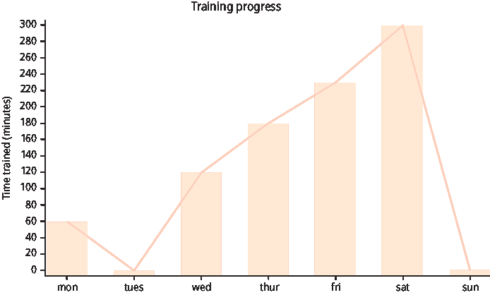

图 17.3：AI 的 LMS 性能。

表 17.1：主题分析。

| 主题 | 发现 |
| --- | --- |
| 对学业表现的影响 | 缺勤的增加可能是参与度不足或学习困难的象，这可能是由于课程内容晦涩或与 `LMS` 中 AI 驱动的学习工具互动不足而导致的 [8, 11, 16]。 |
| 潜在的脱节 | 学生如果旷课，可能会失去 `LMS` 内部 AI 驱动的自适应学习功能或个性化材料，这可能会影响他们的智力表现 [9, 13, 24]。 |
| 干预的需求 | 经常缺席的学生可能面临学业表现不佳的风险，这允许通过 AI 驱动的 `LMS` 内部人工智能生成的建议实施干预措施，例如个性化学习计划或针对性帮助 [7, 17, 21, 23]。这些干预旨在帮助学生追赶进度并提高成绩。 |

该报告强调了学生在使用 `LMS` 时错过课程可能感受到的潜在脱节感。这种参与度的下降与失去 AI 开启的自适应学习功能以及平台内部可访问的个性化材料直接相关。正如 Gligorea 等人 [13]、Burbules 等人 [10] 以及 Tan [24] 所述，这种损失可能会严重阻碍学生的智力发展并限制他们的学业进步。此外，调查结果强调了对缺勤率较高的孩子提供及时帮助的紧迫需求。通过参考 [7, 17, 21, 23] 中的工作，本章建议在 `LMS` 内部利用 AI 生成的建议实施个性化学习计划或针对性帮助。使用这些干预措施是为了为处于风险的学生提供必要的帮助，帮助他们弥补损失，并提高他们的学业表现。总之，该分析阐明了学生参与 `LMS` 与使用 AI 驱动工具之间复杂的关系、缺勤增加对学生教育体验的影响，以及 AI 驱动的干预帮助学生克服学业挑战的同时促进其学业进步的可能性。

## 17.4 结果

研究旨在优化教育实践和干预以提高学业成就。`naive Bayes` 算法在预测学生学业成就方面了良好的结果。使用 `ML` 算法（如 `naive Bayes`）可能有助于教育者和机构发现可能需要额外帮助的学生。

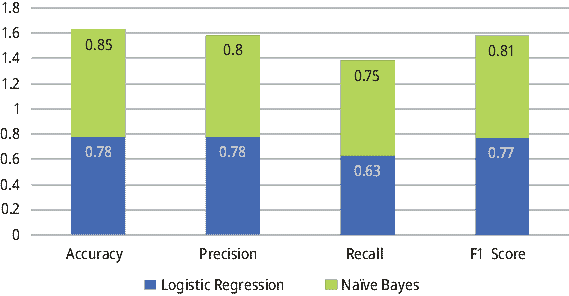

图 17.4：逻辑回归与朴素贝叶分类器在数学建模下的性能对比。

图 17.4 显示，`naive Bayes` 在准确率、召回率和 F1 分等多个评估标准上优于 `logistic regression`。这表明 `naive Bayes` 可能是预测学业成就的更合适模型。然而，该算法实际应用的决策应由进一步的研究指导。

`naive Bayes` 模型是一种识别对学业成功有重大影响的关键特征的预测工具。这些因素包括之前的成绩、分配的学习时长以及家庭背景。尽管该模型的准确率良好，但通过探索更多特征或精炼现有特征可以进行增强。学习困难的学生可以通过早期干预措施（如辅导或咨询）获得帮助。对模型的进一步开发和验证可以提高其韧性和能力。这些预测可以提供个性化建议，例如根据预测水平定制学习计划或提供补充材料。

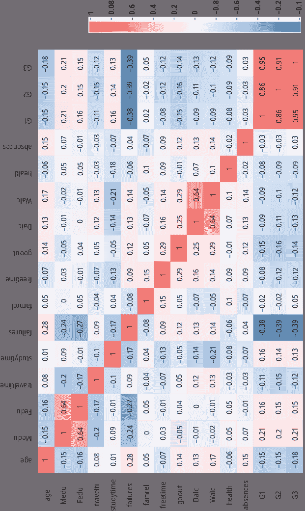

图 17.5：数学建模下的相关性分析。

分析显示了学业表现、父母教育、酒精摄入、学习时间、健康和年龄之间存在强正相关关系。

## 17.5 讨论

本研究通过利用混合策略程序，探讨了语言课程中学术成就的决定因素。综述评估了多种算法在确定学业成就方面的可行性，并识别了显著差异。综述旨在理解影响学生表现的若干因素之间的相互作用，以及它们在塑造不同领域学术成就方面的能力。此外，它旨在回答研究问题，评估个人特性的重要性，并对各种学术领域学生成就的共同模式提供见解。

关系网络揭示了酒精摄入与学术表现之间关系的优势领域，表明工作日和周末饮酒量的增加与整个三个评估期间较差的学业表现有关。这可能导致学业表现恶化、健康问题以及不良社交习惯的形成。过量饮酒会让人难以专注、缺乏动力并难以坚持学习，从而影响你在不同评估时间段的学校表现。健康影响包括许多健康问题，如疾病、频繁缺勤和其他与健康相关的困难。负面社会行为是行为后果的一个例子，它阻止了学生参与有益的学术活动，并导致学术成就较低。为了解决这一问题，几种方法可能包括倡导更具健康意识的日常生活，增加关于酒精对学业成就负面影响的信息，以及建立情感支持网络以帮助学生在学术责任和个人责任之间维持良好平衡。

本研究表明，人工智能驱动的 LMS（学习管理系统）进一步提升了学生表现。对缺勤、教学策略和学生参与度的监控可能都受益于人工智能。由人工智能生成的见解可以实现学习的定制。便捷的帮助和资源分配成为可能。报告建议研究人工智能、学生参与度、持续进展和伦理问题。数字差距以及获取人工智能驱动创新的公平机会也受到了关注。为了增强学生体验和学术成就，本研究强调了将人工智能仔细整合到教育中的重要性。

### 17.5.1 局限性

本研究受到多重限制，例如数据偏差、特征选择、计算限制以及特定环境的特征。结论源于一个可能无法准确反映更大学生群体特征的数据集，且研究可能受到所包含因素的限制。`ML` 模型（如 `naive Bayes`）的效能可能会受到所用方法的限制，且分析可能缺乏特定语境的数据。

## 17.6 结论

研究特别强调了 `ML` 算法的使用和定性分析，调查了人工智能驱动的 `LMS` 对高等教育的影响。定量分析利用 `UCI` 数据集对学生表现提供预测性见解。另一方面，定性分析突出了当代教育环境中的主题、问题和对策。研究的目的是弥补数据驱动的见解与语境理解之间的差距，从而制定基于证据的政策和干预措施以应对学生成就的复杂性。未来，使用复杂的 `ML` 算法和广泛的定性访谈具有改进预测模型和增强定性视角的潜力，从而促进既包容又有效的教育环境的发展。为了定义人工智能驱动的 `LMS` 的变革性影响，研究强调了定量分析、预测建模和定性见解之间和谐融合的重要性。这将为制定符合学生多样化需求、明智的干预措施、策略和教育政策铺平道路，并确保教育环境的公平与有效。

## 17.7 未来工作

未来的研究应该使用更多样化的数据集、先进的特征工程技术、详尽的算法研究、语境分析和纵向研究，以提高模型性能和适用性。算法探索涉及复杂的 `ML` 算法，而语境分析使用定性数据或问卷来理解学生对人工智能驱动的学习系统的体验。纵向研究可以揭示变化的趋势，并为人工智能驱动的学习环境对学术成就的长期影响提供见解。

## 参考文献

[1] Ahmad, S. F., Alam, M. M., Rahmat, M. K., Mubarik, M. S., & Hyder, S. I. (2022). 人工智能在教育中的学术和行政角色。*Sustainability*, *14*(3), 1101. Jan 19.

[2] Alam, A., & Mohanty, A. (2022 Dec 16). 高等教育未来的基础或“错位的乐观”？人工智能时代的人性。在 InInternational Conference on Innovations in Intelligent Computing and Communications (pp. 17–29). Springer International Publishing, Cham.

[3] Alam, A., & Mohanty, A. (2022 Nov 18). EdTech 公司的商业模式、商业策略和创新：学习分析与人工智能在高等教育中的整合。在 In2022 IEEE 6th Conference on Information and Communication Technology (CICT) (pp. 1–6). IEEE.

[4] Al-Ansi, A. M., & Fatmawati, I. (2023). Covid-19 肺炎期间高等教育中的 ICT 整合：案例研究。*International Journal of Learning and Change*, *15*(4), 430–442.

[5] Ali, M., Yousaf, M., & Behlol, G. (2023 Apr 30). 学习管理系统中的人工智能：大众传播专业学生的案例研究。*Voyage Journal of Educational Studies*, *3*(2), 92–114.

[6] Alshahrani, A. (2023 Aug 18). 变革混合学习：探索 ChatGPT 时代的当前趋势和未来研究方向。在 2023 7th International Conference on Business and Management (ICBIM) (pp. 41–47). IEEE.

[7] Anderson, N., McGowan, A., Adhikari, J., Cutting, D., Galway, L., & Collins, M. 早期识别和解决学术困难有助于提高远程课程的成功率和留存率？在 InInternational Conference on Education and New Developments 2023 Jun 26 (pp. 125–128). Science Press.

[8] Atherton, P. (2023 Feb 28). 技术增强教室中的目标设定与问题解决。

[9] Dhiman, H., Vyas, N., Pagrotra, A., & Dutt, V. (Internet 2023). 通过物联网和计算机视觉进行实时交通分析和驾驶安全，使用高分辨率投影灯进行智能道路照明。在 1st International Conference on Circuits, Power and Intelligent Systems (CCPIS), IEEE, 2023. 可来自：`http://dx.doi.org/10.1109/CCPIS59145.2023.10291872`

[10] Burbules, N. C., Fan, G., & Repp, P. (2020 Jun 1). 未来教育与技术的五个趋势。*Geography and Sustainability*, *1*(2), 93–97.

[11] Gutierrez, C., & Sequeda, J. F. (2020 Oct 19). 知识图谱：知识图谱主要思想历史的教程。在 Proceedings of the 29th ACM international conference on information & knowledge management (pp. 3509–3510)

[12] George, B., & Wooden, O. (2023 年 8 月 29 日). 通过人工智能管理高等教育的战略转型。*行政科学*，*13*(9), 196。

[13] Gligorea, I., Cioca, M., Oancea, R., Gorski, A. T., Gorski, H., & Tudorache, P. (2023 年 12 月 6 日). 电子学习中使用基于人工智能的自适应学习：文献综述。*教育科学*，*13*(12), 1216。

[14] Golberg, H., Paradis, J., & Crago, M. 少数裔儿童学习英语作为第二语言随时间的词汇习得。*应用心理语言学*。

[15] Kabudi, T., Pappas, I., & Olsen, D. H. (2021 年 1 月 1 日). AI 驱动的自适应学习系统：文献的系统映射。*计算机与教育：人工智能*，*2*, 100017。

[16] Kivinen, L. K. AI 驱动的聊天机器人作为开发者入职过程的支持工具。

[17] Kustitskaya, T. A., Kytmanov, A. A., & Noskov, M. V. (2022 年 3 月 1 日). 基于当前学习表现和学习行为指标的早期风险学生检测。*网络控制与信息技术*，*22*(1), 117–133。

[18] Rajmohan, R., Kumar, T. A., Julie, E. G., Robinson, Y. H., Vimal, S., Kadry, S., & Crespo, R. G. (2022 年 5 月). G-Sep:一种用于双向门控循环单元检测长期败血症的深度学习算法。*不确定性、模糊与知识系统国际期刊*，*30*(Supp01)。

[19] Manhiça, R., Santos, A., & Cravino, J. 高等教育背景下学习管理系统中的人工智能的使用：系统文献综述。见 2022 年第 17 届伊比利亚信息系统与技术会议(CISTI)，2022 年 6 月 22 日 (pp. 1–6)。IEEE。

[20] Nuzli, M., Nadeak, B., Mini, M., Jejen, A., & Hardiyanti, N. R. (2023 年 11 月 18 日). 教育创新：高等教育中基于人工智能的技术学习应用案例研究。*国际教育研究卓越期刊 (IJERE)*，*2*(2), 493–500。

[21] Ökördi, R., & Molnár, G. (2022 年 8 月 18 日). 基于计算机的干预弥补了远程学习中积累的数学学习差距。*智能期刊*，*10*(3), 58。

[22] Ouyang, F., Zheng, L., & Jiao, P. (2022). 在线高等教育中的人工智能：2011 年至 2021 年实证研究的系统综述。

[23] Tamada, S., Chugh, R., & Luck, J. (2022 年 2 月). 利用人工智能进行创新。见创新智能：文化与社会视角* (pp. 335–363)。Springer。

[24] Turnbull, D. (2020). 预测风险学生。

[25] UCI 机器学习库。(无日期)。学生性能数据集。于 2023 年 6 月 5 日检索自 `https://archive.uci.uci.edu/ml/datasets/student+performance`。

[26] Sharmila, L., & Sakthi, U. (2020 年 6 月). 一种基于人工免疫系统的医学领域异常模式的算法。*超级计算期刊*，*76*4。

[27] Sharmila, L., & Sakthi, U. (2018 年 9 月). 用于基因表达的时序模式探索。*无线个人通信*，*102*, 1503。

[28] Roselinkuba, R., & Bhuvaneshwari, G. (2024 年 2 月). 基于特征提取的像素分割数据隐藏。*多媒体工具与应用*，*83*(7), 19259。

[29] Roselinkuba, R. (2023 年 9 月). 使用优化和二进制加密的可逆数据隐藏。*多媒体工具与应用*，*82*(23), 35757。

[30] Goksel, N., & Bozkurt, A. (2019). 教育中的人工智能。见教育技术与教学设计进展 (pp. 224–236)。IGI Global. `https://doi.org/10.4018/978-1525-8431-5.ch014`。

人工智能领域将深度学习定义为使用多层神经网络（被称为“深度”）来发现和理解复杂的数据模式。分层结构有助于深度学习算法从非结构化数据中提取复杂的特征。因此，深度学习在自然语言处理、语音和图像识别以及自动驾驶方面表现出色。这些模型利用如 `gradient descent optimization` 等技术来调整网络参数并最小化误差，从而从大型数据集中学习。尽管深度学习模型效率极高，但它们需要大量的资源，例如计算能力和数据获取。另外两个经常出现的额外场景是过拟合和可解释性问题。尽管如此，深度学习继续对机器能力的提升做出重大贡献，并在多个领域取得了突破性进展 [1]。当为神经网络提供足够大且高质量的数据集、合适的模型架构以及有效的优化策略时，神经网络就能成功完成训练。充足的数据确保网络有足够的示例进行学习并进行良好的泛化，而良好的架构则允许模型捕捉数据的复杂性而不会产生过拟合。有效的优化算法配合适当的超参数调优，使网络能够高效地收敛到良好的解。权重适当初始化和正则化技术有助于在训练过程中保持稳定性并防止过拟合。合适的损失函数为网络学习提供了有意义的反馈，而充足的计算资源对于处理深度模型的需求至关重要。当满足这些条件时，网络可以有效学习，在训练数据和未见数据上都能获得高性能，并在实际应用中表现稳健。

## 18.2 为什么在深度学习中需要优化？

深度学习可以从许多方面被视为一种优化框架。其首要目标是确定神经网络参数（包括权重和偏置）的最值，旨在有效最小化特定的损失函数。由于下文所述，优化在深度学习中起着至关重要的作用。通常，损失函数评估模型预测与观测数据之间的一致程度，而优化算法则有助于最小化损失函数。提高效率可以缩短训练周期，允许模型更快、更高效地获取知识。通过利用有效的优化技术，模型的准确性和泛化能力都得到了提高。找到包括权重和偏置在内的最优参数组合，是提高模型在观测数据上预测准确性的关键。这可以通过利用模型来实现。深度学习模型表现出复杂且包含大量局部最小值的损失曲面的情况并不罕见。有效的优化使得在这一复杂的格局中进行导航变得更简单，以寻找一个令人满意的（即使不是最优的）最小值，这最终提升了模型的性能。通过利用优化策略，深度学习模型能够以更高的效率处理更大的模型和更多的数据。优化提高计算资源效率的能力可以带来许多益处，包括缩短训练所需的时间以及在大规模使用模型的能力。借助更先进的优化技术，可以训练出更稳定的模型。这些技术减少了梯度爆炸或消失等问题的发生次数。

## 18.3 理论的分解

### 18.3.1 泛化、优化与表示

深度学习的目标是在现实允许范围内最大程度地减小损失函数的值。损失函数是一种用于确定预期目标值与模型预测输出之间差异程度的工具。在执行回归任务时，损失函数通常会使用均方误差（`MSE`）等指标，而在执行分类任务时，它将使用交叉熵。

该函数在调优至完美后，用于使用新收集的测试数据创建预测。由于所选函数集合精确表示真实底层函数的能力有限，可能会产生表示误差。优化错误的根源在于无法精确确定最小化损失函数的理想参数。泛化误差是衡量模型在新鲜数据上性能的指标。它说明了训练期间获得的函数在现实场景中的有效性。每种错误都阐明了学习的不同方面，并推进了对模型整体性的认知 [2]。

### 18.3.2 优化问题的分解

深度学习需要将优化问题分解为各个部分以寻找解决方案。这种方法识别并解决了可能导致学习算法无法收敛或性能不佳的问题。

### 18.3.3 梯度爆炸与消失

梯度爆炸是深度神经网络训练期间的一个主要问题。它发生在模型损失函数的梯度非常大。这种情况在深度神经网络中很常见，特别是当梯度通过许多层时。

当梯度反向传播时，如果它们在较早层已经很大，可能会呈指数级增长，导致训练不稳定。梯度爆炸主要导致网络权重发生不可预测且巨大的修改。这可能导致训练过程不稳定，引起模型参数剧烈波动或发散。在严重情况下，这种不稳定性会导致模型权重中出现 `NaN`（非数字）等数值问题，从而停止训练过程。为了解决梯度爆炸，采用了多种技术：`gradient clipping` 限制梯度的最大值以防止其超过预定义的阈值；适当的权重初始化确保权重比例合理以保持梯度稳定；归一化方法（如 `batch normalization`）有助于稳定整个网络中的激活值梯度分布 [3]。通过有效管理梯度爆炸，可以确保深度神经网络训练的更加稳定可靠。

深度神经网络的梯度分布在大量层级中，经常会遇到这种问题。随着梯度的反向传播，由于链式法则的重复应用，它们可能会指数级缩小，特别是当使用如 `sigmoid` 或 `tanh` 等将输出压缩到狭窄范围的激活函数时。结果是梯度减小到接近零，导致网络难以进行大幅权重更新，从而阻碍了学习过程。因此，模型可能会出现收敛极缓慢的情况或无法捕捉数据中的复杂模式，导致性能欠优。梯度消失的解决方案包括使用如 `ReLU`（修正线性单元）等不将输出压缩到小范围的激活函数、采用适当的权重初始化技术以保持梯度幅度，以及利用具有残差连接的架构（如 `ResNets`），这些架构为梯度更有效地流过网络提供了替代路径。通过解决梯度消失问题，可以提高深度神经网络训练的稳定性和效率。

## 18.4 梯度下降 – 基础分析

这种基础优化算法将损失函数降低到最小值。下一步是在计算出每个参数的损失函数梯度（或导数）后，立即调整模型参数以使损失最小。通过迭代接近损失函数的最小值可以获得最佳结果。基本思想是梯度下降是一种最小化损失函数 `L(θ)` 的优化算法，其中 `θ` 代表模型的参数。它通过迭代调整模型参数，帮助减少预测输出与实际输出之间的误差或差异 [4]。其目标是通过沿着损失函数的梯度调整参数来逐渐减少损失。其核心是梯度下降的更新规则为：

```


(18.1)$\sum\limits_{t = 1}^{n}\theta_{t + 1}\, = \,\sum\limits_{t = 1}^{n}\theta_{t}\, - \,\sum\limits_{t = 1}^{n}{r(n).\eta\nabla L(\theta_{t})}$

其中：

- 符号 `θt` 用于表示迭代级别的参数。
- 学习率 `η` 是一个小的正标量，决定了梯度相反方向步长的大小。
- 迭代 `t` 时损失函数 `L` 对参数 `θ` 的梯度表示为 `∇L(θt)`。
- `r(n)` 代表在不同 `t` 值下的参数包含数量。

### 18.4.1 梯度下降的变体

#### 18.4.1.1 随机梯度下降 (SGD)

随机梯度下降 (SGD) 计算梯度并更新模型参数。通过训练数据的随机子集（小批量 Mini-batches）来实现这一点。这是一个小批量。这会导致梯度估计干扰，但有助于避免局部极值点并加速收敛 [5]。让 `w` 为模型的参数（权重）。让 `L(w; x[i], y[i])` 为单个训练样本的示例，`η` 为学习率。考虑损失相对于参数的梯度，并用符号 `∇L` 表示。

根据 SGD 的更新规则：

```
(18.2)$\sum\limits_{t\! = \ ! 1}^{n}{{wt} + 1} = \sum\limits_{t\! = \ ! 1}^{n}{wt} - \sum\limits_{t\! = \ ! 1}^{n}{\eta\nabla L({wt})^{\ast}\sum\limits_{i\! = \ ! 1}^{50}\left( {x_{i},y_{i}} \right)} 
```

为了确定损失函数 `L` 对参数 `∭L(w; x[i], y[i])` 的梯度，有必要计算每个训练样本 `(x[i], y[i])` 的梯度。表示损失函数均方误差的表达式如下：

```
(18.3varnothingsum\limits_{t\! = \ ! 1}^{n}{L(wt)^{\ast}\sum\limits_{i\! = \ ! 1}^{r}{(x_{i},y_{i}}}) = 21\sum\limits_{i = 1:t\! = \ ! 1}^{n}{(\, y_{i} - w_{t}x_{i})}^{2}$ 
```

该损失函数对于 `w` 的梯度给出如下：

```
(18.4varnothingnabla Lw\sum\limits_{i\! = \ ! 1}^{n}\left( {x_{i},y_{i}} \right) = - \sum\limits_{i\! = \ ! 1}^{n}\left\lbrack {\left( {,{y_{i} - wTx_{i}}} \right)x_{i}} \right\rbrack$ 
```

SGD 更新规则给出：

```
(18.5varnothingsum\limits_{t\! = \ ! 1}^{n}w_{t\! + \ ! 1} = \sum\limits_{t\! = \ ! 1}^{n}w_{t} + \eta\sum\limits_{i\! = \ ! 1:t\! = \ ! 1}^{n}\left\lbrack {\left( {,{y_{i} - wTx_{i}}} \right)x_{i}} \right$
```


通过解决梯度消失，可以提高深度神经网络训练的稳定性和效率。

### 18.4.1.2 批量下降

批量梯度下降是一种方法，它不是使用单个子集，而是通过取整个数据集来更新参数。这种方法的目标是通过沿着损失函数的梯度调整参数来减少损失。然而，它在每次迭代中都需要处理所有样本，在应用于大型数据集时计算开销巨大且速度缓慢。

小批量梯度下降（Mini-batch gradient descent）是一种旨在平衡随机梯度下降（SGD）和批量梯度下降的优化算法 [8]。小批量梯度下降说明了这一点。它使用随机选择的小批量来计算梯度。与使用整个数据集或单个训练用例的传统方法不同，该方法通过结合两种方法的优点，平衡了稳定收敛和高效计算。为了计算损失函数对模型参数的梯度，必须考虑并使用小批量中的所有实例：

```
(18.10)∇L(w) = (1/B)∑(i=1 to B)∇L(w; x_i, y_i)
```

为了更新数学模型的参数，必须沿着计算的小批量梯度的反方向移动：

```
(18.11)w[t+1] = w[t] − η∇L(w[t]; mini−batch)
```

其中 `B` 代表小批量大小，（`x[i]`, `y[i]`）是小批量内的示例。

小批量梯度下降技术是一种经常用于在大规模上训练机器学习模型的方法。它由于有效且具有开发平衡收敛的能力而受到青睐。该方法同时满足了批量梯度下降的计算需求以及 SGD 更快（尽管更不稳定的）的更新需求，在两者之间提供了一个务实的折中方案。

## 18.4.2 高级优化技术

### 18.4.2.1 动量（Momentum）

动量通过累积过去迭代的梯度来调整当前迭代中的参数更新。这有助于优化过程持续在梯度一致的方向上移动，减少震荡并加速收敛，特别是在噪声较多或梯度较小的区域。

### 18.4.2.2 自适应动量估计（Adaptive Moment Estimation）

Adam 代表自适应动量估计（adaptive moment estimation），这是一种结合了动量和 RMSProp 优势的技术——后者是额外的 SGD 增强方法。参数 `θ` 用于表示模型的权重，设置为零。在第一阶动量向量 `m0` 和二阶动量向量 `v0` 中，必须包含与 `θ` 维度相同的零向量。对于第一阶动量估计，假设衰减率为 `β1`，通常为 0.9。另一方面，对于二阶动量估计，衰减率设置为 `β2`，通常为 0.999。表示学习率的一种符号是 `α`。该算法通过以下过程更新参数 `θ`。

在使用深度学习进行优化时，更新第一阶动量估计的过程涉及梯度的指数移动平均，其表达式如下：

```
(18.12)∑(i=1 to n)m_i = ∑(t=1 to n)(β1 · m_{t−1} + (1 − β1))
```

其中 `m[t-1]` 是第一阶动量的估计值。

优化中的“二阶动量估计”指的是计算方差以增强基于梯度的学习的稳定性。这对于自适应算法尤为重要，其公式为：

```
(18.13)v[t] = β2·v[t−1] + (1−β2)·g[t]²
```

在此背景下，`v[t]` 的值表示二阶动量的估计，即来自无中心位置梯度的方差。为了减少自适应算法中偏差的影响，偏差修正的第一阶动量估计对梯度的平均值进行了调整：

```
(18.14)m_t = m_t / (1 − β1^t)
```

这修正了 `m[t]` 中的偏差，因为它从零开始。

经过偏差修正的二阶动量估计通过减轻自适应学习率中的偏差，提高了像 Adam 等优化算法的稳定性：

```
(18.15)v_t = v_t / (1 − β2^t)
```

在机器学习中，参数更新是指在模型训练过程中修改参数，以减少损失并显著提高性能：

```
(18.16)θ = θ − α·(m_t / (√v_t + ε))
```

Adam 以其利用动量和自适应学习率的优点有效解决各种问题的能力而闻名。这种能力为 Adam 赢得了巨大的赞誉。

### 18.4.2.3 自适应梯度算法（Adaptive Gradient Algorithm）

自适应梯度算法或 AdaGrad 是一种优化技术，它通过考虑历史梯度单独为每个参数修改学习率。AdaGrad 也被称为 AdaGrad。在处理的数据不是密集分布或处理具有不同重要程度的特征时，这种方法特别有用 [10]。

让我们初始化参数 `θ`（模型的权重）。将梯度向量 `G[0]` 初始化与 `θ` 相同的零向量。让学习率为 `α`。让小常数为 `ϵ`（以避免除零，通常为 `10^{-8}`）。

**梯度计算：**

对于每个参数 `θ`，在时间步 `t` 计算梯度 `g[t]`。

**更新规则：**

算法通过以下步骤更新参数 `θ`：

**更新累积梯度：**

```
(18.17)G[t] = G[t−1] + g[t]²
```

在时间步 `t`，平方梯度累加到 `G[t]`。

**更新参数：**

```
(18.18)θ = θ − (α·g_t / √G_t)
```

在此背景下，学习率由 `α` 表示，而 `epsilon` 是用于避免除零的小值。AdaGrad 的主要优点是它可以动态改变学习率，这使其非常适合处理稀疏特征。AdaGrad 通过考虑历史梯度来调整每个参数的学习率，使其能够有效处理不同频率更新的数据。然而，如果学习率下降过快，偶尔会导致性能不利。

**RMSProp**

均方根传播（Root mean square propagation），简称 RMSProp，是一种适用于自适应学习率的优化算法。该方法的开发旨在克服与 AdaGrad 等传统梯度下降方法相关的某些局限性。通过计算平方梯度的移动平均，RMSProp 和 AdaGrad 都试图归一化当前梯度。这与 AdaGrad 对大历史梯度的参数使用过低的学习率形成对比。这种移动平均的目的是促进更公平、稳定的收敛，并防止学习率调整的影响 [11, 12]。由于 RMSProp 为每个参数修改学习率，它适用于处理不同幅值的梯度。

为了更新每个参数 `θ`，RMSProp 考虑了其梯度 `g[t]` 以及从上一个参数得到的梯度平方移动平均值 `v[t]`。我们需要通过衰减率 `ρ`（通常在 0.9 左右）和一个小的常数 `ϵ`（如 `10^{-8}`）来更新移动平均值 `v[t]`，以避免除零。

参数更新规则如下：

更新梯度平方的移动平均值：

```
(18.19)v[t] = ρ·v[t−1] + (1−ρ)·g[t]²
```

其中 `v[t]` 是梯度平方的移动平均值。

```
(18.20)θ = θ − (α·g_t / (√v_t + ε))
```

具体而言，符号 `α` 表示学习率，而符号 `ϵ` 是用于避免除零的微小常数。通过对每个参数调整学习率并平滑梯度信息，RMSProp 显著提升了训练过程的稳定性和效率。这在梯度幅度不同的情况下特别有帮助。在训练深度神经网络以及处理具有稀疏梯度或显著方差特征的问题时，RMSProp 特别有利。Momentum、Adam 和 RMSProp 等先进优化算法改进了梯度下降法。这些算法引入了自适应学习率和平滑机制，最终导致收敛性和训练性能的提高。

## 18.4.4 神经网络的全局优化

神经网络的全局优化涉及确定网络参数的最优排列，以在最小化损失函数的同时避免局部最小值和鞍点。这是通过全局优化过程实现的。尽管初看可能并不显著，但神经网络经常表现出非凸的损失景观，其中包含大量的鞍点和局部最小值。训练的目标是通过最大化或最小化该函数来对其进行优化。配置空间包含了与神经网络相关的所有可能的权重和偏置组合。

**局部最小值**：这些点是损失函数低于附近点的值，但可能不是全局最低的点。

**全局最小值**：这些点是损失函数达到绝对最低值的点。

## 18.4.5 全局优化的策略

### 18.4.5.1 无梯度优化

无梯度优化是指一类不依赖梯度信息寻找最优解的优化技术。在处理不可微、包含噪声或需要昂贵评估的目标函数时，这些方法因其通用性而特别有用。它们通过随机采样、进化策略或启发式搜索等机制探索解空间，而不是计算和遵循梯度。无梯度方法通常用于复杂的高维问题，在这些问题中，传统的基于梯度的方法可能捉不从心或不实际 [13]。

无梯度优化涉及在不使用梯度信息的情况下找到优化问题的最优解。Nelder–Mead 算法在不需要梯度信息的情况下优化函数 `f(x)`。它使用单形法来迭代精炼一组候选解。

1. **初始化**：从初始单形开始，该图形是在 `n` 维空间中具有 `n` + 1 顶点的几何图形。例如，在二维空间中，单形是一个具有三个顶点的三角形。
2. **单形变换**：算法对单形迭代执行一系列变换：
   * **反射**：通过剩余顶点的质心，对具有最高负值的顶点进行反射。
   * **扩张**：如果反射点超过了最优点，则在该特定方向上进一步扩张。
   * **收缩**：如果反射点没有产生改进，则应在该方向上收缩单形。
   * **缩小**：如果收缩没有改进，则向最佳顶点缩小单形。

单形变换步骤可以通过以下更新方程描述：

* **反射步**：
  ```
  (18.21)x[ref] = x[centroid] + α*(x[worst] - x[centroid])
  ```
  其中 `x[ref]` 是反射顶点，`x[centroid]` 是单形的质心，`α` 是反射系数。

* **扩张步**：
  ```
  (18.22)x[exp] = x[centroid] + γ*(x[ref] - x[centroid])
  ```
  其中 `x[exp]` 是扩张顶点，`γ` 是扩张系数。

* **收缩步**：
  ```
  (18.23)x[contract] = x[centroid] + ρ*(x[worst] - x[centroid])
  ```
  其中 `x[contract]` 是收缩顶点，`ρ` 是收缩系数。

算法持续迭代这些步骤直到满足收敛标准，例如函数值或位置的变化足够小。这种方法在梯度信息不可用的各种领域（包括优化）非常有用。

### 18.4.5.2 贝叶斯优化

贝叶斯优化利用概率模型来优化困难、昂贵或带有噪声的函数。大多数情况下，系统使用高斯过程 `(GP)` 作为概率模型来评估行为并引导搜索。该过程可以分为两个主要部分。贝叶斯优化是一种通过新数据迭代更新模型并改进预测以寻找最优解的方法。与其他方法相比，这种方法需要的测试较少。这种方法在函数评估可能昂贵的情况下有用，例如优化工程设计或机器学习的超参数调优 [14]。

贝叶斯优化是一种用于优化评估成本昂贵的函数 `f(x)` 的技术。它通过利用概率模型来实现这一点。GP 对目标函数的建模如下：

```
(18.24)f(x) = GP(m(x), K(x,x'))
```

均值（通常为零）由函数 `m(x)` 表示，协方差或核函数由函数 `k(i, j)` 表示。通过使用采集函数，可以确定下一个采样点的最优位置。常见的选择如下：

```
(18.25)期望改进, EI(x) = E[max(f(*), f(x)), 0)]
```

变量 `f*` 代表记录的最高值。然后：

```
(18.26)改进概率, PI(x) = Φ((μ(x) - f* - ξ) / σ(x))
```

符号 `ξ` 表示一个参数，而符号 `Φ` 表示累积分布函数。

```
(18.27)∑(x=0 to α)UCB(x) = ∑(x=0 to α)(μ(x) + κσ(x))
```

其中 `UCB` 是置信边界。

贝叶斯优化通过平衡探索（exploration）与开发（exploitation）来高效寻找最优解，使用概率模型来引导搜索过程。

### 18.4.5.3 模拟退火

通常被称为“模拟退火”的随机优化技术灵感源于冶金中的退火过程。通过对材料进行逐渐加热然后再次冷却，可以确定能量最低的状态。在优化领域，这种方法通过反复创建新的潜在解，并根据受当前温度和函数值差异影响的概率来决定是否接受它们，从而系统地探索可能解的范围。温度调度通常遵循几何级数或指数下降，控制着探索与开发之间的平衡。模拟退火是在大型且复杂的搜索空间中发现接近最优解的非常有效的方法，特别是在景观包含许多局部最小值的情况下。从当前解 `i` 转移到目标函数值为 `f(x[j])` 和 `f(x[i])` 的新候选解 `j` 的接受概率 `P` 如下：

```
(18.28)P = −∑(i=1 to n, j=1 to n)((f(x_i) − f(x_j)) / T)
```

`T` 代表当前温度。如果 `f(x[i])` 小于 `f(x[j])`，总是接受新解。如果 `f(x[i])` 的值大于或等于 `f(x[j])`，则允许以概率 `P` 逃离局部最小值。

为了减少陷入次优解的概率，会逐渐降低温度 `T`。一种常见的冷却调度是：

```
(18.29)T[k+1] = αT[k]
```

其中 `T[k]` 是迭代 `k` 时的温度，`α`（0 < α < 1）是冷却速率，而 `T[k+1]` 是下一次迭代的温度。该冷却速率控制了温度下降的速度。模拟退火有助于在大型复杂的搜索空间中寻找全局最优的良好近似，特别是当问题景观包含多个局部最小值时。

### 18.4.5.4 遗传算法

遗传算法也称为 `GAs`，是一种源于支配进化过程原理的优化策略。通过类似于变异、自然选择和交叉（重组）的过程，它们对许多不同的潜在解进行实验，随着时间的推移逐渐改进它们。在开始时，生成多样化的潜在解。每个被称为“个体”的解都会根据适应度函数进行评估，该函数评估了其解决优化问题的良好程度。选择最成功的个体进行繁殖，这涉及到它们特征的交叉以产生新的一代。变异还会引入随机变异，允许探索解空间中之前未被发现的区域。这一迭代过程的最终结果是一个最优或近乎最优的解。该过程持续进行，每一代新解产生的解都比上一代解决的问题略好 [15, 16, 17]。

初始种群 `P` 将包含 `N` 个个体，每个个体 `x[i]` 代表一个潜在解。让我们从初始化种群开始。借助适应度函数 `f(x)` 评估每个个体提供了解决方案有效性的量化衡量，公式为 `Fitness(x) = f(x)`。该函数引导选择过程。根据适应度选择个体进行繁殖。一种常用的方法是轮盘赌选择法，其中 `i` 的概率与所获得的适应度成正比，记为 `P[i]`：

```
(18.30)P_i = f(x_i) / ∑(j=1 to N)f(x_j)
```

通过结合所选父代的特征创建后代。例如，使用单点交叉，两个父代 `x[1]` 和 `x[2]`产生后代 `x[1]'` 和 `x[2]'`：

```
(18.31)x[1]' = ...
(18.32)x[2]' = ...
```

其中 `x[1]'` 和 `x[2]'` 是父代的片段。通过变异引入随机变化以保持多样性。对于二进制表示，变异可能会翻转一个比特。`GAs` 通过模拟进化过程有效地搜索空间。

## 18.4.6 各种优化算法的分析

在深度学习模型的训练中，优化算法是绝对必需的，因为它们的首要目标是减少损失函数并提高模型的准确性。深度学习中使用的各种算法见表 18.1。

表 18.1：各种优化算法的分析。

| 优化算法 | 收敛速度 | 内存占用 | 超参数 | 稳定性 | 应用场景 |
| :--- | :--- | :--- | :--- | :--- | :--- |
| 随机梯度下降 (SGD) | 慢 | 低 | 学习率 | 中等 | 简单模型、大规模问题 |
| 动量 (Momentum) | 比 SGD 快 | 低 | 学习率、动量 | 稳定 | 深度神经网络（对收敛速度有要求的） |
| 尼斯特洛夫加速梯度 (NAG) | 比动量快 | 低 | 学习率、动量 | 更稳定 | 深度神经网络、较难训练的模型 |
| Adagrad | 中等 | 高 | 学习率 | 较不稳定 | 稀疏数据、文本或图像数据 |
| RMSProp | 比 Adagrad 快 | 中等 | 学习率、衰减率 | 稳定 | 循环神经网络 (RNNs) |
| Adam (自适应动量估计) | 快 | 中等 | 学习率、Beta1、Beta2 | 非常稳定 | 通用复杂模型（如 CNN 和 RNN） |
| AdaMax | 快 | 中等 | 学习率、Beta1、Beta2 | 非常稳定 | 通用、复杂模型 |
| Nadam | 比 Adam 快 | 中等 | 学习率、Beta1、Beta2 | 非常稳定 | 通用、较难训练的模型 |
| Adadelta | 中等 | 中等 | 学习率、衰减率 | 稳定 | 通用、实时模型 |
| AMSGrad | 快 | 中等 | 学习率、Beta1、Beta2 | 非常稳定 | 通用、数据中的长期依赖问题 |

从表 18.2 可以看出，`Adam`、`Nadam` 和 `AMSGrad` 中存在的自适应学习率和动量项是加速其收敛的原因。在不对算法进行任何优化或改进的情况下，`SGD` 算法表现出最差的性能并不常见。由于 `Adagrad` 必须记住每个参数的平方，它消耗的内存比严格要求的要。相比之下，`SGD` 和 `momentum` 在运行时消耗的内存忽略不计。由于 `Adam`、`Nadam` 和 `RMSProp` 等算法需要更多的超参数，这些算法更难精调，但它们也提供了更大的活性和适应性。在训练深度学习模型时，常识是 `Adam`、`AMSGrad` 和 `Nadam` 是稳定的。而 `Adagrad` 可能由于其学习率的逐渐降低而表现出略低的稳定性。在深度学习模型领域，`Adam` 和 `Nadam` 都是通用优化器，具有在广泛应用中利用的潜力。`RMSProp` 和 `Adagrad` 在涉及循环神经网络 (RNNs) 和稀疏数据的情况下特别有效。表 18.2 列出了用于深度学习中不同任务和模型中的各种优化算法的准确率值。

表 18.2：优化算法与准确率对比。

| 优化算法 | 推理 | 使用的数据集 | 模型 | 准确率 (%) |
| :--- | :--- | :--- | :--- | :--- |
| 随机梯度下降 (SGD) | 带有动量的标准 SGD 是图像分类的典型 | CIFAR-10 | 卷积神经网络 (CNN) | 85.0 |
| Adam | 它通常比原生 SGD 有更快的收敛和更好的准确率 | CIFAR-10 | 卷积神经网络 (CNN) | 87.5 |
| RMSProp | 适用于非平稳目标，在较小的学习率下表现良好 | MNIST | 多层感知器 (MLP) | 97.5 |
| AdaGrad | 它自适应调整学习率，在稀疏数据设置下有用，准确率略低于 Adam | IMDB (情感分析) | 循环神经网络 (RNN) | 86.5 |
| 尼斯特洛夫加速梯度 (NAG) | 通过预测未来梯度增强了带动量的 SGD，用于大规模图像任务 | ImageNet | ResNet-50 | 76.5 |
| 带有学习率衰减的 SGD | 学习率衰减提高了 LSTM 等模型的稳定性 | Penn treebank (PTB) | LSTM | 82.3 |
| AdaDelta | 它是 Adagrad 的改进，对于学习率衰减至关数据集 | Fashion-MNIST | 卷积神经网络 (CNN) | 90.0 |
| 带有热重启的 SGD (SGDR) | 余弦退火重启策略帮助复杂数据集跳出局部最优 | CIFAR-100 | WideResNet | 75.0 |
| L-BFGS | 二阶优化通常用于小规模问题，并为凸任务提供高准确率 | 自定义数据 | 逻辑回归 | 92.0 |
| 无海森优化 | 高效处理曲率信息，与一阶方法相比在深度网络中获得更高准确率 | MNIST | 深度神经网络 (DNN) | 98.2 |
| Hyperband (用于超参数调优) | 它结合了随机搜索与早期停止，优化超参数可以提高准确率 | CIFAR-10 | 卷积神经网络 (CNN) | 89.0 |

考虑到表 18.1 提供的统计参数，由于自适应学习率和动量，`Adam` 在不同任务中通常比标准 `SGD` 提供更高的准确率。带有动量的 `SGD` 和尼斯特洛夫加速梯度对于图像分类任务有效，特别是对于像 ImageNet 这样的数据集。`Adagrad` 和 `RMSProp` 分别适用于稀疏数据或非平稳目标，尽管它们在通常情况下可能无法优于 `Adam`。`无海森优化`和 `L-BFGS` 是二阶方法，可以获得高准确率，但计算开销大，使得它们在大规模深度学习任务中并不常见。图形表示见图 18.1。

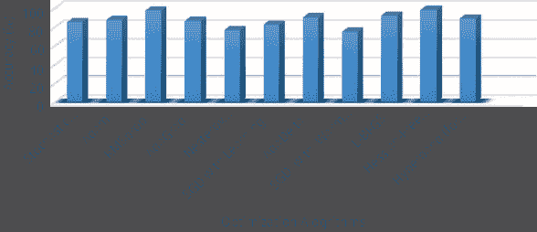

图 18.1：各种优化算法的准确率值。

深度神经网络通过应用优化技术来修改权重和偏置进行训练，其目标是最小化损失函数。高效的优化确保了模型能够从数据中获取知识，并在面对新且不熟悉的数据时表现出强大的泛化能力。在实际应用中，深度学习模型经常处理大型数据集或广泛的数据集。优化过程要求优化器以高效的方式遍历包含大量维度的参数空间，并有效地分配计算资源。`mini-batch SGD` 和分布式训练等技术被频繁使用。如果执行了有效的优化，就能保证模型找到一个理想的解决方案，并在整个训练过程中保持稳定。通过使用学习率调度和梯度裁剪等策略，可以有效解决收敛问题，并缓解梯度爆炸或消失的现象。许多现代深度学习框架，包括 `TensorFlow`、`PyTorch` 和 `Keras` 都自带已安装的优化器和工具。这些优化器和工具使得有效地实现各种优化策略成为可能。通过使用这些框架，将复杂的优化策略应用于深度学习模型变得简单。

## 18.5 结论

总之，深度学习中的优化是开发有效且高效模型的关键组成部分，驱动了众多领域的进展。理论基础（如基于梯度的方法及其变体）为通过极小化复杂损失函数来训练神经网络提供了稳健的框架。`SGD`、`momentum` 和自适应学习率等技术彻底改变了模型优化，解决了梯度消失和收敛缓慢等挑战。此外，无梯度方法（如`Bayesian optimization`）和启发式方法（如`simulated annealing`）为在无法获得或不便于计算梯度的情况下调优超参数和优化提供了替代策略。当这些优化技术整合到模型中时，深度学习模型能够在计算机视觉、自然语言处理和强化学习等多个领域实现卓越的性能、灵性和扩展性。随着深度学习领域的不断发展，优化方法的持续研究将继续在推动深度学习能力边界方面发挥核心作用。

## 参考文献

[1] Liu, L., Ouyang, W., Wang, X., Fieguth, P., Chen, J., Liu, X., & Pietikäinen, M. (2020). Deep learning for generic object detection: A survey. *International Journal of Computer Vision*, 128, 261–318. →

[2] Sun, R. (2019). Optimization for deep learning: Theory and algorithms. arXiv Preprint arXiv:1912.08957. →

[3] Ribeiro, A. H., Tiels, K., Aguirre, L. A., & Schön, T. (2020). Beyond exploding and vanishing gradients: Analyzing RNN training using attractors and smoothness. In International conference on artificial intelligence and statistics (pp. 2370–2380). PMLR. →

[4] Andrychowicz, M., Denil, M., Gomez, S., Hoffman, M. W., Pfau, D., Schaul, T., Shillingford, B., & De Freitas, N. (2016). Learning to learn by gradient descent by gradient descent. Advances in Neural Information Processing Systems, 29.

[5] Saleh, H. M., Marouane, H., & Fakhfakh, A. (2024). Stochastic gradient descent intrusions detection for wireless sensor network attack detection system using machine learning. *IEEE Access*. →

[6] Dhiman, H., Vyas, N., Pagrotra, A., & Dutt, V. (2023). Real-time traffic analysis and driver safety enhancement via IoT and computer vision with high-resolution project for intelligent road illumination In 1st International Conference on Circuits, Power and Intelligent Systems (CCPIS). IEEE, 2023. Available from. http://dx.doi.org/10.1109/CCPIS59145.2023.1029182 →

[7] Azari, V., Vazquez, O., Mackay, E., & Jordan, M. (2022). Gradient descent algorithm to optimize the scale treatments. *Journal of Petroleum Science and Engineering*, 208, 109469. →

[8] Franchini, G., Ruggiero, V., & Zanni, L. (2020). Mini-batch size selection in stochastic methods. In International Conference on Machine Learning, and Data Science (pp. 259–263). Springer International Publishing, Cham. →

[9] Kingma, D. P., & Ba, J. (2014). Adam: A method for stochastic optimization. arXiv Preprint arXiv:1412.6980.

[10] Saab, S., K., H., & Ray, A. (2020). Beyond exploding and vanishing gradients: Analyzing RNN training using attractors and smoothness. *Neural Networks*, 128, 109. →

[11] Dong, X., Zhang, S., & Mandic, D. (2021). Convergence of RMSprop. *Neural Networks*, 208, 109469. →

[12] Shi, N. (2021). Deep learning. *Neural Networks*, 228, 109469. →

[13] Bogolubsky, L., Dvurechen, P., Gusev, G., Nesterov, A., & Zhukovsky, M. (2016). Learning to learn by gradient descent by gradient descent. Advances in Neural Information Processing Systems, 29.

[14] Frazier, P. I. (2018). Bayesian optimization. In Recent advances in optimization and contemporary problems (pp. 255–278).

[15] Cavallaro, C., Cutello, V., Pavone, M., & Zito, F. (2024). Machine learning and genetic algorithms: A case study on image reconstruction. *Knowledge-Based Systems*, 284, 111194. →

[16] Alhijawi, B., & Awajan, A. (2024). Genetic algorithms: Theory, genetic operators, solutions. *Evolutionary Intelligence*, 17(3), 1245–1256.

[17] Cavallaro, C., Cutello, V., Pavone, M., & Zito, F. (2024). Machine learning and genetic algorithms: A case study on image reconstruction. *Knowledge-Based Systems*, 284, 111194.

[18] Apolinar-Fernández, A., Blázquez-Carmona, P., Ruiz-Mateo Brea, R., Barrasa-Fano, J., Van Oosterwyck, H., Reina-Romo, E., & Sanz-Herrera, J. (2024). Regularization techniques and inverse approaches in 3D traction force microscopy. *International Journal of Mechanical Sciences*, 109, 10592.

[19] Sampaio, R. A., Dias Garcia, J., Poggi, M., & Vidal, T. (2024). Regularization and optimization in model-based clustering. *Pattern Recognition*, 150, 110310.

[20] Hou, Z., Ling, Y., Liang, Y., Bohao, X., & Lei, Y. (2024). Integrating L1 and weighted L2 regularization for moving force identification from combined response measurements. *Measurement*, 228, 114337.

# AI 中贝叶斯优化的 19 项原理与应用

Dankan Gowda V Anand Polamarasetti Pullela S. V. S. R. Kumar Aparna Atul Junnarkar Bhaskar Roy

### 摘要
本章重点关注贝叶斯优化（BO）方法及其在人工智能（AI）领域的应用，旨在智能地解决高成本问题。因此，BO 现在是改进不同 AI 应用的重要工具，包括机器学习模型中的超参数优化、神经架构搜索和强化学习。通过使用高斯过程等概率模型，BO 在利用（exploitation）和探索（exploration）方面非常高效，因此使其在几次评估内获得最优解成为。本章进一步阐述了 BO 中的其他数学概念，如代理模型、采集函数以及探索与利用的权衡。它还提供了真实问题的示例，说明了 BO 在自动驾驶汽车、医疗保健和机器人等应用中如何有助于提高准确性、速度并减少计算时间。这些挑战之一包括可扩展性问题和计算负担，以及一些未来的研发领域。因此，本简要综述强调了 BO 在可能发生的 AI 彻底革命中的应用，以及这种创新对于智能系统的进阶发展至关重要。

**关键词：** 贝叶斯优化、人工智能、代理模型、采集函数、超参数调优、神经架构搜索、强化学习、优化技术、机器学习、AI 性能、实时应用。

## 19.1 引言

### 19.1.1 贝叶斯优化（BO）概述
贝叶斯优化（BO）是一种用于优化高成本黑箱函数的序列设计策略。与其他可能多次函数评估的优化方法不同，BO 通过搜索空间探索的过程构造性地对目标函数。通常，优采用高斯过程（GP）作为代理模型来表示未知函数，因为它不仅提供了预测，还提供了与预测相关的不确定性 [1]。这种概率方法允许 BO 有效地探索和利用新点，使得该算法在目标函数评估复杂或耗时的任何场景中都有用。在人工智能（AI）中，这些评估可能包括训练大型复杂的机器学习模型、设置超参数或可能设置强化学习策略 [2]。BO 的主要优势是其样本效率，即用尽可能少的评估达到近乎最优的效果，这有助于节省大量的计算成本。

### 19.1.2 优化在 AI 中的重要性
AI 的不同阶段都受到优化的影响，是在开发或实现机器学习模型时。现在，在几乎每个 AI 系统的中心都有优化某种目标函数的思想，这通常意味着准确率、损失值等 [3]。例如，在监督学习中，优化部分涉及为模型寻找新参数以降低损失函数，从而使模型能够更好地预测或分类新数据。优化也是超参数调优的核心，这是另一个无法缺少优化的重要方面 [4]。追求机器学习的效能取决于学习率、正则化条件和网络类型等因素。一些旧的方法（如网格搜索甚至随机搜索）在超参数数量增加时是不高效的且非常耗时的 [5]。与网格搜索相比，BO 更好因为它可以确定下一个评估的超参数，从而提高效率。

优化是另一个在神经网络架构搜索等领域相关的领域，基于在大量设计中搜索最优架构 [6]。这项任务本质上是非凡的，特别是因为它在高维空间内运行。BO 能够有效地优化大型复杂的搜索空间，已被证明有助于产生高性能的架构 [7]。同样，在强化学习中，目标是增强策略以最大化累计奖励，BO 对于选取策略或设计奖励函数非常有用 [8]。这些不同的优化形式突显了 BO 在应对各种挑战方面的多功能性，使其推动 AI 的发展至关重要。

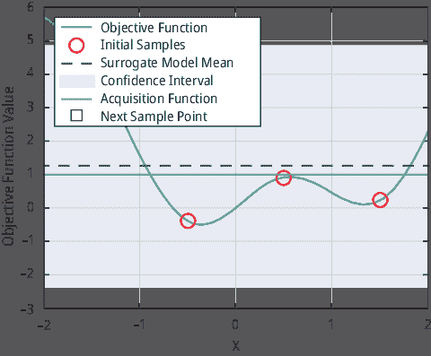

图 19.1：贝叶斯优化工作流概述。

图 19.1 展示了 BO 的流程，也称为序列设计，概述了高成本优化目标函数的迭代优化过程。图中显示，优化首先从几个初始样本点开始，在这些点上构建目标函数的`GP`代理模型 [9]。实际代理模型的均值等同于它目前已知的信息，而置信区间则是它持有的不确定性程度。选择过程中使用的另一个函数是采集函数，例如期望改进（`EI`），通过它我们可以根据探索和利用来选择下一个样本点 [10]。然后对该点进行实际目标函数评估，并将将结果反馈到`GP`模型中。这意味着过程将以这种方式进行多次迭代，直到满足程序员设置的某些标准。通过这种方式，BO 在最快找到找到最优解决方案方面的熟练显而易见。

关于函数值和时间消耗的优化结果在图 19.2 中给出，包含了`BO`、`grid search`和`random search` [11]。

右侧的图描绘了目标函数值与函数评估次数的关系，这提供了每种方法向最优解收敛速率的信息。从图 19.2 的结果可以观察到，`BO`在真最优值附近获得了更高的值，而像`grid search`和`random search`这样的算法则需要相对较多的评估次数才能达到相似的真最优水平 [12]。

该图还说明了与其它方法相比，使用`BO`在计算时间上更耗时，并且在优化速度和获取解的质量方面提供了更好的结果。这说明了一个事实：如果函数评估代价高昂或需要大量时间，那么这就是解决此类问题最合适的方法。


图 19.2: 优化技术的比较。

### 19.1.3 章的目的与范围

本章的主要目标有两个：首先，为读者提供对`BO`的必要理解；其次，介绍`BO`在人工智能中的三个应用实例。因此，在学习诸如使用`GPs`的代理建模或采集函数的定义等理论元素时，本章旨在为`BO`的工作原理提供清晰的背景 [13]。`BO`还涉及了案例，其中`BO`可以用于改进机器学习模型、调整其参数、执行神经架构搜索，并为强化学习提供更好的学习方法 [14]。

通过示例详细讨论这些应用，以展示`BO`如何应用于不同的 AI 场景 [15]。此外，本章将在强调这项研究的同时，还将详述`BO`的局限性以及未来前景。读完本章后，读者将熟悉如何应用`BO`增强 AI 系统，这对于打算开发该领域的人来说将非常有资源 [16]。这一全面的综述为利用`BO`解决实践中挑战性的 AI 问题提供了平台。

## 19.2 贝叶优化的原理

### 19.2.1 数学基础

`BO`依赖于目标函数的概率模型的构建和反复改进；因此，它对于昂贵或噪声较大的函数非常有用。同样，`BO`的一些概念基于两个关键的数学工具：`GPs`和采集函数 [17]。

作为目标函数的信息可以通过`GPs`进行建模，因为它们具有灵活性并能够估计不确定性 [18]。`GP`是一种函数的随机模型，捕捉了由均值函数和协方差函数表征的函数的完整分布，给出了点之间的相似性测量。数学上，`GP`可以表示如下：


`f(x) ~ GP(m(x), k(x, x'))`


其中`m(x)`是均值函数，为了简单起见通常假设为零，而`k(x, x')`是协方差函数，它决定了所建模函数的形状和光滑度 [19]。通过先验知识和观测数据，`GPs`调节目标函数。


图 19.3: 高斯过程的一个示例。

图 19.3 展示了`BO`的代理模型。该图结合了目标函数、均值预测和不确定性 [20]。`BO`通过这种方式利用不确定性来决定的采样点 [21]。

置信区间亮明了哪些区域具有高不确定性特征，因此被用于选择样本 [22]。从该图中可以看出，代理模型拟合目标函数，并在`BO`探索搜索空间时起着重要作用 [23]。

图 19.4 显示了基于`EI`准则的采集函数。该图将采集函数增加了`GP`代理模型、均值预测和标准差。它展示了采集函数如何通过结合均值和方差来决定在哪里采样 [24]。


图 19.4: 采集函数的可视化。

## 19.2.2 贝叶优化的组件

### 代理模型

在贝叶斯优化（`BO`）的通用过程中，代理模型实际上捕捉了目标函数。`GP` 使用得频繁是因为它具有高度的灵活性，可以近似任意的非线性函数。`GPs`提供了给定函数的均值预测，并对该预测的可变性或不确定性提供了指示，这种性通过使用概率方法计算的方差来量化[27]。这种双输出使得 `BO` 能够探索模型分配较大标准差的区域，并利用分配较大均值的区域。在某些情况下，根据问题的性质或维度，可以使用随机森林或贝叶斯神经网络等模型作为代理模型[28]。代理模型的选择对于决定 `BO` 中执行的优化过程的效率和有效性至关重要[29]。

### 采集函数

采集函数通过指示下一个哪些点需要被评估来帮助引导优化[30]。它们预计在探索（`exploration`）与开发（`exploitation`）的平衡中工作，以确保搜索空间得到正确的探索，并在有前景的区域进行精炼[31]。最常用作采集函数的 `EI` 函数被定义为相对于当前最佳目标值的预期提升，包括预期均值和方差[32]。`PI` 侧重于通过关注最有前景的区域，一点改进当前最佳解决方案的概率[33]。`UCB` 函数通过固定置信水平，将质心均值与点方差的可变性相结合，并将搜索引导目标函数估计值上限最高的空间[34]。所有这些函数在性质上都是不同的，它们的使用取决于是否需要探索或开发。

### 算法步骤

涉及 `BO` 的算法如下：首先，必须选择一个模型[35]。下一步是使用采集函数寻找最佳值[36]。然后更新代理模型，直到达到目标函数[37]。在这些迭代中，`BO` 证明其速度更快，并提供了更高的准确率。

## 贝叶斯优化在 AI 中的应用

### 机器学习中的超参数调优

超参数选择是机器学习中最关键的步骤之一，因为许多参数的选择直接影响模型结果。使用的一些方法包括网格搜索和随机搜索，这些方法可能是非常耗费时间且昂贵的。例如，考虑一个具有需要优化的超参数 `θ` 的机器学习模型。使用 `GP` 来最小化损失函数 `L(θ)`，`BO` 构建 `L(θ)` 的概率模型。通过对代理模型的不断采样和更新，可以确定最佳值。

#### 图 19.5：超参数调优结果

图 19.5 展示了自动驾驶中卷积神经网络（`CNN`）超参数调优的实验研究。该图展示了连续迭代的目标检测模型精度，以及不同方法如何在超参数空间内提高精度。因此，与随机搜索和网格搜索相比，`BO` 证明其速度更快，并提供了更高的准确率提升水平。

#### 图 19.6：神经架构搜索空间探索

图 19.6 展示了如何使用 `BO` 探索神经架构的搜索空间。在这里，图中代表了包含层数和每层单元的不同神经架构，以及不同架构的性能。描出了 `BO` 采样的某些点，展示了该方法如何达到高性能架构。该图还捕捉了定义 `BO` 的特征，即探索与开发之间的平衡，它在架构空间中导航，寻找在验证集准确率和计算复杂度方面表现的架构。

### 神经架构搜索 (NAS)

神经架构搜索（`NAS`）是根据定义目标确定能够提供最优性能的神经网络可能结构的过程。`NAS` 可能是一个非常大的空间，对于更复杂的结构更是如此；它可能涉及层数、激活函数类型或连接模式等因素。贝叶斯优化（`BO`）对 `NAS` 至关重要，因为它提供了一种在定义搜索空间中的系统方法。通过并行应用响应曲面来反映各种架构的性能，`BO` 引导搜索向性能最佳的架构进行。这种方法在确保以下方面也非常有效：一方面，组织正在尝试新的、高风险且未经过证明的架构；另一方面，它又利用了已证明且有前景的架构。例如，构成给定神经网络架构的参数可能包括离散和连续结构，而使用 `BO` 的技术涉及最大化采集函数的能力，该函数预测了性能提升的程度。这种 `NAS` 方法使人们能够更快、更经济地在获得最佳性能架构之间取得平衡。

### 19.3.3 强化学习

强化学习的目标是在环境中找到产生最高累积奖励的策略。也可以观察到，学习率、折扣因子、探索策略等参数与强化学习算法的性能之间存在紧密联系。因此，在 `BO` 的帮助下，可以改进这些参数和学习过程，从而获得更好的策略。本质上，奖励函数被建模为一个属性不确定的黑盒函数，由于 `BO` 依赖于这个代理模型，后者的不确定性引导了前者的搜索过程。这非常有用，特别是在强化学习中，因为奖励信号可能非常微小且充满噪声。例如，优化问题可以在期望累积奖励 `R(θ)` 的背景下建立，其定义为关于参数集 `θ` 的目标。通过根据采集函数对这些参数进行连续选择和评估，`BO` 确保发现对策略学习最优的设置，从而增强了强化学习技术的效率和性能。

### 19.3.4 自动机器学习 (AutoML)

因此，自动机器学习（`AutoML`）是模型选择、特征工程和超参数调优等各个方面的自动化过程，以便任何人都能进行机器学习。如所述，`BO` 是 `AutoML` 的关键部分之一，因为它允许对可能模型和超参数的空间进行系统性搜索。在确定性本质上，它通过构建不同配置性能的概率模型，帮助 `AutoML` 系统找到给定数据集上最可能产生良好性能的模型和超参数。它还消除了手动进行实验所需的时间和人力成本，同时提高了所生成模型的质量。例如，在 `AutoML` 中，`BO` 可用于确定合适的算法、其超参数和预处理步骤，从而消除了机器学习作为一种过程。通过将 `BO` 集成到 `AutoML` 框架中，就可以搜索所有模型配置的大型空间，从而在几乎完全没有人工干预的情况下创建出高性能且具韧性的模型。通过利用 `BO`，可以为 `AutoML` 系统提供达到各种任务和领域中顶尖水平性能的能力，从而证明了 `BO` 在 AI 任务中的效率。

## 19.4 实时应用案例研究

### 19.4.1 案例研究 1：优化自动驾驶中深度学习模型的超参数

在自动驾驶的研究中，目标检测是关键任务之一，特别是使用 `CNNs` 的时候。这些模型用于对道路上的物体进行实时识别和分组，包括行人、车辆和交通标志；因此，该模型非常准确至关重要。该案例研究的目标是通过自适应设置超参数来提高 `CNNs` 的效率，从而增强自动驾驶汽车物体检测模型。`BO` 是一种商业化技术，有助于超参数调优，以找到优化模型的同时最小化计算成本的最优解决方案。

在这种情况下，使用 `BO` 方法来优化如学习率、批量大小、层数和 `CNNs` 过滤器大小等参数。`GP` 有助于建模检测精度与 `BO` 在导航超参数空间过程中选择的超参数设置之间的依赖关系。这是通过如 `EI` 等采集函数实现的，该函数引导选择可能产生更高准确率的超参数。它尝试多种配置以识别最适合的配置，并用这些信息更新代理模型。这种方法显然比使用网格搜索或随机搜索调优的模型具有更高的精确率和召回率。此外，结果还节省了与训练模型相关的处理时间，对于自动驾驶汽车等必须做出快速决策的实时应用来说，这是一个关键参数。


图 19.7：自动驾驶中目标检测准确性的提升

图 19.7 所示的图表（`978311436050_059242.xhtml#b_978311436180-019_fig_007`）显示了 `CNN` 的物体检测准确性是如何逐轮增强的。该图随后分析了 `BO` 相比随机搜索和网格搜索的相对用用。结果强调了这种 `BO` 方法如何以更快的速度和效率提高准确性。如图所示，`BO` 在提高自动驾驶等敏感领域的模型质量方面非常有效，支持了该方法具有许多现实世界应用的观点。

在强化学习场景中，图 19.8（`978311436050_059242.xhtml#b_978311436180-019_fig_008`）描绘了在使用 `BO`、随机搜索和网格搜索时回合内观察到的累积奖励。因此，该图描述了使用 `BO` 进行参数调优如何带来更快的学习和更好的累积奖励。作为一种新的高效优化方法，`BO` 使强化学习策略能够做出更好的决策，从而增强了机器人系统的决策能力。此图显示了 `BO` 在需要快速学习或动态调整的用例中是多么优越。


图 19.8：强化学习参数调优结果

### 19.4.2 案例研究 2：医疗保健领域图像分类的神经架构搜索

在疾病和医疗状况的诊断中，涉及 MRI 扫描和 X 射线等的医疗图像分类需要准确且高效的方法。本案例的目的是寻找特定的神经网络拓扑结构，使得医疗图像分类能够获得高准确率，并使 `BO` 能够良好运行。`NAS` 是一项从巨大的可能架构空间中搜索网络架构的任务，其中人们必须决定层数、连接类型以及激活函数的形式。`BO` 通过建模架构性能的概率并聚焦于紧凑型架构来帮助这种搜索。

在该案例研究中，`BO` 用于自动搜索适用于医疗图像分类的相应神经网络架构。该过程从定义搜索空间的初始条件生成开始：层数、卷积层中使用的卷积器大小、池化操作的类型等。通过使用 `GP` 模型，在仅有少量评估的情况下，即可提供架构准确率的概率分布。它被应用于将搜索集中在采集估计较高的架构上，这表明搜索空间得到了高效剪枝。研究结果表明，对于医疗图像分类问题，`BO` 能够找到比此前报道架构具有更高准确率的架构，且计算开销显著降低。这些优化后的架构不仅提高了诊断效能，还缩短了模型的训练时间，使其在临床环境中非常有用。

#### 19.4.3 案例研究 3：为机器人实时决策调优强化学习参数

例如，在组装、焊接或材料搬运等工业应用中，机械臂被证明非常有用，因为需要快速做出实时决策。具体而言，该案例研究的目标是利用强化学习原理并适当选择参数，改进制造应用中机械臂的决策场景。强化学习涉及智能体随时间推移做出决策并试图最大化累积奖励的能力，这些算法的效率取决于学习率、折扣因子和探索-利用策略在内的因素。

此类参数的使用需要适当的调优，这正是 `BO` 为微调强化学习算法提供的一种可靠手段，以优化机器人学习和/或做出准确决策的速度。优化优于参数空间识别，该空间包含了影响机器人策略学习的关键参数。通常会建立一个元模型（通常为 `GP`）来评估不同参数设置的预期奖励。采集函数控制探索过程，目标是具有提高机器人性能最大潜力的参数配置。通过使用代理模型不断更新新的评估数据，`BO` 能够优化地缩小参数值范围，从而提高学习效率。

本案例研究提出的结果表明，乐观特征显著增强了机器人的学习有效性，从而缩短了训练其执行后续任务所需。此外，由于优化参数提高了业务流程的效率并降低了制造过程中的错误率，管理实现了预测性和规范性准确性。这些结果凸显了 `BO` 技术在当前决策系统中的应用，因为它对强化学习中使用的参数进行了真实的调整。

## 19.5 结果与讨论

### 19.5.1 结果总结

案例研究将 `BO` 应用于机器学习和强化学习问题，体现在准确率和效率等指标上取得了显著增强，并降低了计算成本。通过关注自动驾驶中深度学习模型的超参数调优，`BO` 导致目标检测准确率大幅提高，提高了精密度和召回率比例。正如预期的那样，优化后的模型在更短的处理时间内显示出更高的准确率，使其适用于自动驾驶汽车的应用。在医疗保健图像分类神经网络架构搜索中应用 `BO`，该模型在与医疗图像分析（包括 MRI 扫描和 X 射线）相关的任务实现了高识别准确率。与其他穷举搜索方法相比，这种方法大幅减少了时间消耗，从而使复杂的模型能够在临床实践中实施。例如，当用于调整制造用机械臂的强化学习参数时，由于速度和准确性的提高，机器人学习过程和决策的稳定性和精度得到了增强，从而增加了产量并降低了误差率。这些结果说明了 `BO` 在众多相关 AI 应用中指定巨大增强的能力，使其成为研究人员和调查者的有用工具。

[图 19.9] 展示了针对目标检测、`NAS` 和强化学习等不同领域的各种案例研究的优化汇总。在这里，图中使用柱状图直观地表示了 `BO`、随机搜索和网格搜索在准确率、效率和计算成本等不同 KPI 上的相对值。该图无疑证明并展示了 `BO` 如何有效地帮助以较低的计算成本获得更高的准确性和效率，这让我们确信 `BO` 可以应用于任何 AI 领域。它也展示了 `BO` 在优化昂贵非线性函数方面的通用通用性。

[图 19.10] 代表了各种优化方法在计算负担和优化质量之间的对比。通过散点图可以显而易见 `BO` 能够以最少的计算工作提供最优解决方案。然而，随机搜索和网格搜索被发现具有较高的成本或产生较低质量的解决方案。例如，上图清楚地传达了 `BO` 在产生少量计算开销的情况下，利用结果来优化大多数 AI 模型和系统执行的承诺。

与`grid search`（网格搜索）和`random search`（随机搜索）等传统方法相比，`BO` 在搜索效率和结果质量具有某些优势。早期的方法仅仅是对超空间进行系统或随机搜索，这在本质上是缓慢且耗资源的，特别是在处理较高维的空间时。某些算法（如 `grid search`）要求模型测试所有超参数的所有值；因此，随着超参数数量的增加，模型测试的次数呈指数级增长。`random search` 虽然效率更高，但也是一个耗时的过程，因为用户需要考虑大量的评估来确定最佳设置。另一方面，`BO` 通过构建目标函数的随机模型并专注于收益率最高的区域，有意识地搜索参数空间中的假设区域。通过这种有针对性的方法，可以用较少的评估次数发现极具前景的新配置，从而使其计算强度更低且速度更快。此外，由于 `BO` 包含了不确定性的概率估计并优化了探索与利用的平衡，解决方案产生了更优异的性能指标，这在案例研究的实验中显而易见。

### 19.5.3 挑战与局限性

然而，与任何优化技术一样，在应用 `BO` 时并非没有问题。正如许多“大数据”工具一样，两个主要困难涉及可扩展性：数据的维度和所使用的模型。虽然使用 `GPs`（高斯过程）或其他结构可以为优化任务的代理模型更新增加灵活性，但这些过程的计算成本会随着空间维度的增加而显著增加。这种局限性是以时间为代价的，并可能影响 `BO` 的效率，特别是在处理许多超参数时。此外，`BO` 技术的整体成功对在该过程中使用的代理模型的质量非常敏感。这些问题引发了一个疑问：代理模型是否以及何时足够好？如果代理模型不能准确近似底层函数，可能会接受到高度次优的解决方案。另一个困难是评估采集函数的计算成本，该函数旨在每一步中都实现最大化，以确定下一个要评估哪个点。这可能非常耗时，特别是当必须在短时间内做出决策时。解决这些问题对于扩大 `BO` 在各种任务中的应用范围至关重要。

### 19.5.4 未来方向

`BO` 未来研究的潜在领域包括更好的代理建模技术、更好的采集函数以及这种优化方法在新环境中的应用。增强代理模型以提高其在高维空间中的性能是另一个重点领域，方法包括 `sparse GP-based methods`（基于稀疏高 GP 的方法）和 `deep kernel learning`（深度内核学习），某些改进方法也是如此。这些技术旨在不损害计算时间的情况下，使 `GPs` 的优势变得可信可靠。作为一种持续具前景的方法，设计在探索与利用之间有更好平衡的采集函数是另一个重要发展方向。例如，多保真度优化方法（`multifidelity optimization methods`）允许人们同时处理不同细节的信息，从而使过程更高效。此外，将 `BO` 与其他优化算法（例如进化算法）结合也是另一个增强因素。在 `NLP`（自然语言处理）或能源和金融建模等领域搜索 `BO` 的新应用也有帮助，以更好地定义其可能的应用场景。因此，通过解决当前的困难并探索新前景，`BO` 能够进一步发展成为 AI 和其他领域中大型部分未知和/或计算昂贵函数的有效优化技术。

### 19.6 结论

由于其多种优势，`BO` 已成为 AI 中最重要的优化技术之一。本章讨论了所提方法的基本思想、其在示例中的用法以及对 AI 产生积极影响的方式。从根本上说，`BO` 适用于评估消耗资源的设置，因为它使用 `GPs` 等统计模型进行预测。这种通过实施 `EI`（期望改进）和 `PI`（概率改进）等采集函数来实现探索与利用平衡的特性，使得 `BO` 能够在大型搜索空间的实例中表现良好，从而以显著更少的迭代获得解决方案。本章使用的 `BO` 现实应用是显而易见的。

因此，必须指出，在 AI 中使用 `BO` 不仅仅是为了增强性能，还为了鼓励创新和新技术的开发。通过使用 `BO`，优化大量参数之间具有高度非线性关系的参数所需的时间被显著缩短，从而为更复杂的 AI 系统的开发和应用提供了机会。例如，增强医疗领域用于医学图像分类的神经网络架构可以极大地有助于诊断的精确性，从而更好地满足患者的需求。因此，在`autonomous driving`等应用中，经过优化的深度学习超参数可以提供自动驾驶车辆更高的可靠性和安全性，有助于自动驾驶技术的普及。在机器人领域，强化学习的优化增强了决策洞察，使智能机器人在制造业、物流和服务业中的集成达到了更高的水平。

除了特定示例外，`BO` 通过帮助开发更优、更通用的模型对 AI 的通用领域做出了贡献。这特别有价值，因为它有可能成功解决高维优化问题，并释放研究的新可能性，让科学家和工程师能够处理以前被认为计算成本过高的模型。因此，这种算法的出现是一个突破，使得研究以前被认为对于高维优化过于复杂的模型成为可能。由于这种能力推动了 AI 创新和发现的指数级进步，它也有为旧挑战寻找新的解决方案。

`BO` 的使用还会影响 AI 能力的另一个方面，即访问的平等性。这使得非机器学习和 AI 专家的人士也能使用 `BO`；它扩展了其在许多应用领域的使用，使每个人都能从机器学习和 AI 中获益。这种民主化是有益的，并促进了 AI 进一步融入到尽可能多的组织中的通用发展。`BO` 在 AI 领域增长中的地位不言而喻，因为它将定义 AI 演化的下一步以及该领域的逐步进展。

总之，必须承认 `BO` 是 AI 工程师工具箱中强大且价值工具，因为它提供了一种优化复杂且评估成本函数的结构化方法。在 AI 的多样语文中，它证明了提高模型准确性、优化操作和降低计算成本的能力。通过解决扩展性问题并进一步改进模型，以及探索新的应用领域，`BO` 将保持作为基础工具之一，优化并为 AI 的进一步发展以及创建新的智能解决方案做出贡献。本章的这些思考强调了 `BO` 在开发 AI 以解决世界挑战持续努力中的相关性。

## 参考文献

[1] Ahmad, T., & Khan, M. I. (2023). machine learning-based approach for predicting renewable energy production. In 2023 International Conference on Smart Grid and Clean Energy Technologies (ICSGCET) (pp. 150–156). →

[2] Ali, S., & Ahmed, N. (2023). Blockchain technology for secure IoT applications in smart cities. In 2023 6th International Conference on Computer and Communication Engineering (ICCCE) (pp. 342–348). →

[3] Brown, L. J., & Smith, R. K. (2023). Enhancing cloud computing security using deep learning techniques. In 2023 IEEE Symposium on Computers and Communications (ISCC) (pp. 784–790). →

[4] Chen, Y., & Zhang, Q. (2023). AI-driven predictive maintenance for manufacturing industries. In 2023 IEEE International Conference on Industrial Technology (ICIT) (pp. 211–218). →

[5] Manivasagam, G., & Prasad, K. D. V. (2024). Novel approaches to biometric security using enhanced session keys and elliptic curve cryptography. *Journal of Discrete Mathematical Sciences and Cryptography*, *27*(2–A), 477–488. →

[6] Das, S., & Roy, A. (2023). An adaptive control system for autonomous vehicles using reinforcement learning. In 2023 9th International Conference on Advances in Computing, Communications, and Informatics (ICACCI) (pp. 305–311). →

[7] Kumar, R. Senthil, & Prasad, K. D. V. (2024). Securing digital authentication with cryptographic innovations in intrinsic systems. *Journal of Discrete Mathematical Sciences and Cryptography*, *27*(2-A), 317–328. →

[8] Punugoti, R., Vyas, N., Siddiqui, A. T., & Basit, A. (2023). The Convergence of Cutting-Edge Technologies: Leveraging AI and Edge Computing to Transform the Internet of Medical Things (IoMT). In 2023 4th International Conference on Electronics and Sustainable Systems (ICESC). IEEE. [`doi.org/10.1109/icesc57686.2023.10193047`](https://doi.org/10.1109/icesc57686.2023.10193047) →

[9] Sarma, Parismita, & Rahman, Mirzanur (2024). Mathematical analysis of wavelet-based multi-image compression in medical diagnostics. *Journal of Discrete Mathematical Sciences and Cryptography*, *27*(2–B), 675–687. →

[10] Prasad, K. D. V. (2024). Cryptographic image-based data security in wireless sensor networks. *Journal of Discrete Mathematical Sciences and Cryptography*, *27*(2–A), 293–304. →

[11] Ding, H., & Li, X. (2023). A comprehensive review of deep learning applications in computer vision. In 2023 IEEE International Conference on Artificial Intelligence and Machine Learning (AIML) (pp. 100–106). →

[12] Gao, L., & Chen, Z. (2023). IoT-based healthcare monitoring using machine learning. In 2023 IEEE International Conference on Bioinformatics and Biomedicine (BIBM) (pp. 213–219). →

[13] Gupta, R., & Patel, M. (2023). Securing IoT devices with blockchain: A new perspective. In 2023 International Conference on Internet of Things and Smart Systems (IoTSS) (pp. 450–456). →

[14] Santosh, & Gupta, Anand (2023). A novel RF-SMOTE algorithm for feature selection. *Journal of Discrete Mathematical Sciences and Cryptography*, *27*(3), 519–530. →

[15] Hassan, M., & Ali, H. (2023). A smart agriculture framework using machine learning. In 2023 5th International Conference on Computing, Communication, and Security (CCS) (pp. 380–386). →

[16] Hu, W., & Zhang, P. (2023). Big data analytics for improving supply chain management. In 2023 International Conference on Big Data (pp. 520–526). →

[17] Jackson, R., & Davis, C. (2023). A deep learning-based approach for automated driving. In 2023 8th International Conference on Intelligent Systems and Control (ICS) (pp. 290–296). →

[18] Jiang, H., & Wang, X. (2023). Enhancing network security using AI-based anomaly detection. In 2023 IEEE Conference on Communications (ICC) (pp. 600–606). →

[19] Naziya, & Chinamutte, Veera Sivakumar (2023). A novel RF-SMOTE for IoT attacks. *Journal of Discrete Mathematical Sciences and Cryptography*, *27*(3), 861–873. →

[20] John, R., & Kumar, S. (2023). Machine learning approaches for fraud detection in financial transactions. In 2023 International Conference on Information Systems and Computer Networks (ISCON) (pp. 320–326). →

[21] Kim, J., & Lee, S. (2023). A novel approach to wireless sensor networks for smart home applications. In 2023 IEEE International Conference on Sensors (ICSENS) (pp. 400–406). →

[22] Shekhar, R., & Chaturvedi, Abhay (2023). Securing networked image transmission using public-key cryptography and identity authentication. *Journal of Discrete Mathematical Sciences and Cryptography*, *26*(3), 779–791. →

[23] Lee, H., & Park, J. (2023). Cloud-based AI solutions for intelligent traffic management. In 2023 IEEE Conference on Intelligent Transportation Systems (ITSC) (pp. 230–236). →

[24] Li, Y., & Liu, X. (2023). A smart grid energy management system using IoT and machine learning. In 2023 International Conference on Smart Grid and Renewable Energy (SGRE) (pp. 540–546). →

[25] Lin, D., & Wang, J. (2023). 用于医疗决策支持系统的 AI 驱动预测分析。在 2023 第 7 届健康信息与医学系统国际会议 (HIMS) (pp. 150–156)。→

[26] Liu, M., & Zhao, Y. (2023). 使用深度学习进行异常检测的智能监控系统。在 2023 IEEE 图像处理国际会议 (ICIP) (pp. 780–786)。→

[27] Miller, K., & White, A. (2023). 用于制造流程的 AI 解决方案。在 2023 工业电子与应用国际会议 (ICIEA) (pp. 310–316)。→

[28] Mohammed, A., & Sadiq, W. (2023). 用于智能城市应用的可扩展 IoT 架构。在 2023 第 6 届可持续能源与环境国际会议 (ICSEE) (pp. 410–416)。→

[29] Nguyen, T., & Tran, L. (2023). 用于机器人控制控制的深度强化学习。在 2023 IEEE 机器人与自动化国际会议 (ICRA) (pp. 690–696)。→

[30] Patel, D., & Mehta, V. (2023).一种基于 AI 加密技术的云安全新方法。在 2023 IEEE 云计算技术与科学国际会议 (CloudCom) (pp. 320–326)。→

[31] Rahman, S., & Islam, M. (2023). 使用 IoT 进行智能农业的综合框架。在 2023 农业与生物工程国际会议 (ICAB) (pp. 290–296)。→

[32] Roberts, L., & Jones, M. (2023). 使用机器学习增强智能电网的网络安全。在 2023 IEEE 智能电网技术国际会议 (SGT) (pp. 420–426)。→

[33] Shah, P., & Desai, R. (2023). 一基于深度学习的疾病诊断预测模型。在 2023 IEEE 生物信息学与生物工程国际会议 (BIBE) (pp. 330–336)。→

[34] Smith, J., & Johnson, T. (2023). 可再生能源系统的 AI 驱动优化。在 2023 可持续能源与发展国际会议 (ICSED) (pp. 380–386)。→

[35] Tan, C., & Huang, L. (2023). 用于高效能源管理的 IoT 智能电网解决方案。在 2023 IEEE 电力与能源系统国际会议 (ICPES) (pp. 510–516)。→

[36] Wang, L., & Wu, J. (2023). 用于自然语言处理的新型深度学习模型。在 2023 计算语言学国际会议 (COLING) (pp. 450–456)

[37] Zhang, T., & Chen, M. (2023). 用于智能建筑管理的的 AI 和机器学习。在 2023 智能建筑与施工国际会议 (ICSBC) (pp. 300–306)。→

# 索引

A
- 绝对连续
- 准确性
- 获取
- 激活函数
- 自适应学习
- 自适应优化
- 能力的自然语言
- AI
- AI 应用
- alpha
- 歧义
- 增强
- 自动化
- 自动化分析
- 汽车
- 自主车辆
- 平均距离

B
- 反向传播
- 蜂群
- 蜜群算法
- 蜜群优化
- 分叉点
- 黑盒模型
- 乳腺癌
- 业务部门

C
- 级联编码器-解码器
- 挑战
- 特征工程
- 聊天机器人
- 清洗
- 聚类算法
- CNN
- 计算
- 计算机语言
- 计算机视觉
- 计算机辅助诊断
- 配置
- 约束
- 内容分析
- 凸

D
- 数据提取
- 数据集
- 决策制定
- 决策变量
- 决策过程
- 决策
- 深度核学习
- 深度学习模型
- 诊断
- 诊断准确性
- 发现
- 分布
- 领域自适应
- 领域特定优化

E
- 效率
- 特征值
- 编码器
- 集成方法
- 环境
- 轮数
- 进化
- 实验
- 可解释人工智能
- 提取

F
- 可行区域
- 微调
- 微调模型
- 微调技术
- 鱼群与鸟群
- 聚焦于
- 框架
- 满足客户需求
- 全卷积神经网络

G
- 高斯过程
- 通用能力
- 生成对抗网络
- 遗传算法
- 遗传算法
- 地理空间数据
- 全局
- Google BERT
- Google Natural Language API
- Google Earth Engine
- GP
- Grad-CAM
- 梯度
- 梯度下降
- 基于梯度的优化
- 网格搜索

H
- 医疗保健
- 分层
- Horovod
- 人类语言
- 人类语言交互
- 混合优化
- 混合指针生成器
- 超参数
- 超参数优化
- 超参数调优

I
- IBM Watson NLP
- 识别与分类
- 想象的
- 免疫
- 提高医疗质量
- 提高盈利和客户满意度
- 增加诊断准确性
- 信息
- AI 解决方案的创新
- 输入图像
- 灵感源于自然选择理论和基因进化
- 整数规划
- 完整性
- 智能
- 交互
- 交互式语音响应
- 内部
- 物联网

J
- Jacobian 

K
- kappa 统计
- 关键 AI 研究领域
- 关键元素

L
- 语言转换
- 语言模型
- 语言翻译
- 学习管理系统
- 学习策略的学习
- 学习率
- 似然性
- 线性优化
- 语言学的
- 局部可解释模型无关解释
- 局部最小值
- 损失函数
- Lotka 和 Volterra 的

# 机器学习
- 马尔可夫链链
- 数学模型
- 数学优化
- 数学规划
- 矩阵
- 最大值
- 极大化累积
- 极大化效率，最小化误差
- 最大对称表面距离
- 基于像素建模的中值滤波
- 医学研究
- 方法论的
- 指标
- 最小值
- 最小化
- 使……最小化
- 通过优化参数来最小化损失函数
- 混合整数规划
- 多目标 (MO)
- MO 技术
- 模型架构
- 模型部署
- 模型
- 现代业务
- 动量
- 蒙特卡洛方法
- 运动规划
- 磁共振成像 (MRI)
- 多层感知器
- 多模态
- 多机器人系统
- 多阶段方法
- 穆偶剧角色
- 变异
- 突变

# 朴素贝叶斯
- 命名实体识别
- 自然语言处理
- 自然语言
- 神经网络
- NeuroNER
- NLP 算法
- 让非专家也能构建高性能模型
- 非线性函数
- 非负限制

# 目标识别
- 目标函数
- 获取有意义的表示
- 进行中的研究
- 运筹学
- 最优
- 最优控制
- 优化
- 优化算法
- AI 中的优化
- 优化是机器人研究的基础
- 优化方法
- 优化问题
- 优化技术
- 优化
- 优化器
- 优极水平
- 结果
- 过拟合
- Overfitting (保留英文)
- 过采样

# 参数
- 参数优化
- 改写
- 局部依赖图
- 粒子群优化
- 病理学
- 模式
- 性能
- 性能评估
- 池化
- 池化操作
- 群体
- 投资组合优化
- 精确度与效力
- 预测股市趋势
- 预测
- 预测不确定性
- 预测结果
- 规范性
- 预防
- 食物种群
- 概率
- 概率模型
- 概率优化方法论
- 概率
- 采购
- 预后模型
- 编程
- PSO 算法
- Python 绑定
- PyTorch

# 定性分析
- 模型质量
- 问答任务

# 放射科医生
- 随机森林
- 随机搜索
- 快速
- 速率
- 获得创新成果
- 现实应用
- 推荐
- 正则化
- 强化学习
- 可靠性
- ReLU
- 表示
- 表示学习
- 资源高效型
- 鲁棒
- 鲁棒控制理论
- 鲁棒线性规划
- 鲁棒优化
- 鲁棒性
- 均方根对称表面距离
- Routh-Hurwitz 判别
- 路由算法

# 鞍点
- 卫星图像
- 缩放
- 缩放学习算法
- 分割
- 自驾驶
- 情感
- 情感分析
- SEO
- Shapley 加性解释
- SHapley Additive exPlanations (SHAP)
- 符号相对体积差
- 单纯形算法
- 单纯形法
- 模拟退火
- 软计算
- SpaCy
- 语音识别
- 稳定性
- 稳定的
- 堆叠与增强
- 随机梯度下降
- 随机优化
- 增强网络安全
- 监督学习
- 供应链活动
- 支持向量机
- 易感-感染-恢复 (SIR)
- 可持续方式
- 群体智能

# TensorFlow
- 文本分类
- 训练
- 迁移学习
- 转换
- Transformer
- 基于 Transformer
- 趋势研究方向
- 图灵测试

# 超声图像
- 超声成像
- 可理解的
- 不可预测的

# 验证
- 变量
- 方差
- 变体
- 虚拟助手
- 语音数据
- 体重叠误差

# 加权
- 野狗优化
- Word2Vec 模型

## 数字时代的数学方法

### 第一卷

Satya Prakash Yadav, Abhishek Kumar, Ashutosh Kumar Dubey, Victor Hugo C. de Albuquerque, Adrian Rodriguez-Aguiñaga, Angeles Quezada

医学图像处理 - 多模态融合技术，2024

ISBN 978-3-11-139549-4, e-ISBN (PDF) 978-3-11-143597-8, e-ISBN (EPUB) 978-3-11-143599-2

[www.degruyter.com](http://www.degruyter.com)
