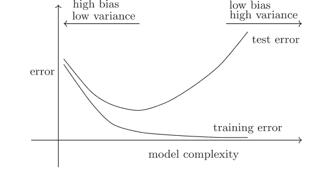
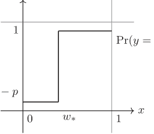
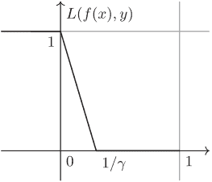
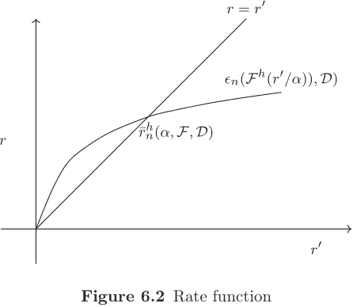
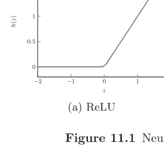
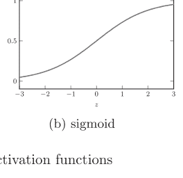
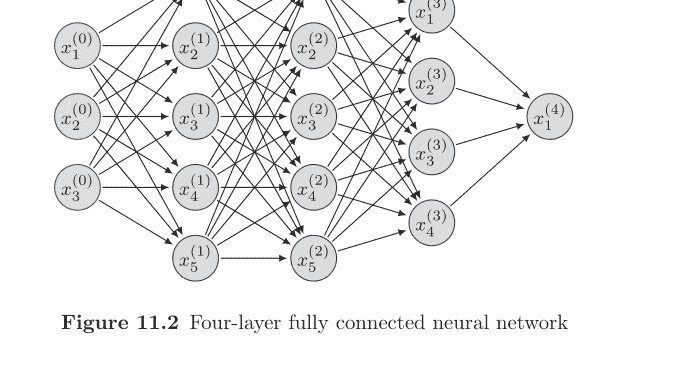
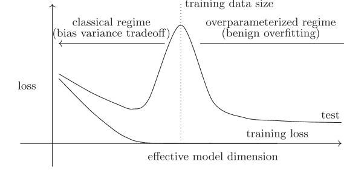
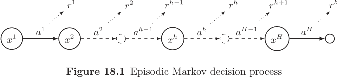

# 机器学习算法的数学分析


TONG ZHANG 是香港科技大学计算机科学与数学的讲座教授，其研究重点是机器学习、大数据及其应用。IEEE、美国统计协会和数理统计学会的会士，Zhang 曾担任 NeurIPS、ICML 和 COLT 等主要机器学习会议的主席或领域主席，并担任过包括 *PAMI*、*JMLR* 和 *Machine Learning* 在内的多本顶尖机器学习出版物的副主编。

## 前言

机器学习是一个相对年轻的科学学科，其目标是通过从过往经验中学习来实现人类决策能力。它是一个跨学科领域，需要统计学、优化、工程学以及计算方面的诸多创新知识。在过去几十年中，我们见证了经验上成功的机器学习算法的快速发展，以至于机器学习已成为解决现代社会许多挑战性问题的不可或缺的技术。与此同时，机器学习的数学理论正由计算机科学、统计学、优化和工程领域的科研人员发展，他们致力于建立一个严谨的数学基础，该基础不仅能够解释当前算法，还能为未来激发原则性方法。然而，许多现有的理论成果分散在文献中。虽然已有一些入门书籍和综述文章试图涵盖其中部分理论成果，但尚无深入的教科书能够全面介绍文献中已发展的标准数学工具。

本书的目标是系统地介绍当前文献中常用以分析机器学习算法的主要数学技术。由于篇幅限制，本书本身并未详细解释各种机器学习算法及其应用背景。因此假定本书读者已熟悉诸如支持向量机、决策树、提升和神经网络等标准机器学习算法。本书读者还应具备微积分、线性代数和概率论的基础数学知识，以及足够的数学成熟度以跟随严谨的理论证明。对于此类读者，本书的主要目的是介绍当前常用以分析这些机器学习算法的现代数学技术。所选材料的水准足以使读者具备足够的专业背景和知识，能够在不费多大力气的情况下阅读理论机器学习的研究论文。

本书中选定的主题旨在涵盖当前研究水平下最有用且最常见的数学工具和结果。一些更专业的主题（如主动学习、半监督学习、损失函数一致性、差分隐私等）被省略，但学习了本书中介绍的技术工具的读者应能轻松跟进这些主题的最新研究。本书可用于理论机器学习的硕士研究生课程，也可作为从事理论机器学习研究的科研人员的参考。虽然最基础的概念已得到充分深入的阐述，但一些当前感兴趣的其他主题则以较少的细节覆盖。由于主题数量众多，部分论述相对简洁，且部分主题以旨在统一文献中出现的不同特例的抽象程度呈现。这种抽象和简洁的呈现方式在初次阅读时可能会带来一定困难。为缓解这一困难，书中包含许多示例，以提供理论结果的具体解释和适当背景。历史评述被包含在内，以给出书中涵盖主题的原始来源，以及供对更深入理解感兴趣的读者阅读的额外材料。每章末尾提供的练习可以帮助读者检验对主要概念的掌握程度。大多数练习需要对材料有良好的了解，但并不困难。此外，部分练习旨在提供与正文未直接涵盖但相关的主题的额外信息。

本书包含两个主要部分。第一部分，从第1章到第12章，涵盖了独立同分布设定下监督学习算法的分析。它首先介绍独立变量和的标准化指数尾不等式，然后用数章篇幅发展用于一致收敛的技术工具，而一致收敛是分析机器学习算法的主要数学机制。关键结果是利用覆盖数、VC 维和 Rademacher 复杂度等经典概念建立的。本书的第一部分还涵盖了最近出现的稳定性分析技术，该技术可以处理诸如随机梯度下降等特定学习过程。作为这些基本数学工具的应用，包括核方法、加性模型和神经网络在内的几种常用机器学习模型的分析也已在不同详细程度上呈现。最后，第一部分以第12章的标准下界分析作结，该章涵盖了诸如 Fano 不等式和 Assouad 引理等常用技术。还提供了关于最小二乘回归和密度估计的示例。

第二部分，从第13章开始，涵盖了顺序统计估计问题的分析，包括在线学习、老虎机问题和强化学习。它首先将指数尾不等式和一致收敛分析从独立同分布随机变量推广到顺序设定中的鞅。然后在后续关于在线学习、老虎机和强化学习的章节中描述了特定算法及其分析。提供了上界和下界。

本书包含足够的材料可用于为期两学期的研究生课程，每部分一学期。它也可用于涵盖本书部分内容的为期一学期的课程。作者已在香港科技大学基于本书内容讲授研究生课程。修读该课程的学生已学习过基础机器学习

算法，并希望进一步学习分析这些算法所需的数学工具。

对于一学期的机器学习数学基础课程，可以考虑以下选读材料：关于指数不等式的第2.1–2.6节、关于一致收敛的第3章、关于VC理论的第4.1–4.4节、关于覆盖数的第5.1–5.2节、关于Rademacher复杂度的第6.1–6.4节（仅涵盖标准Rademacher复杂度，将偏移Rademacher复杂度留作阅读材料）、关于模型选择的第8.1–8.3节、关于核方法的第9.1–9.3节、关于加性模型的第10.1–10.3节、关于神经网络的第11.3、11.4、11.6和11.7节、关于下界的第12.3和12.4节、关于鞅的第13.1和13.3节、关于在线学习的第14.1–14.4节、关于多臂老虎机的第16.1、16.2和16.6节、关于上下文多臂老虎机的第17.1、17.3和17.4节，以及关于强化学习的第18.1–18.3节。关于这些主题的讲义幻灯片可在作者网站上获取。

作者感谢阅读本书早期草稿并提供有益建议的学生们。特别是，Chutian Huang、Yujia Jin、Yong Lin、Zhefeng Qiao、Yifei Shen、Wei Xiong和Mengyue Zha对本书的部分内容提供了反馈。我还要感谢剑桥大学出版社的编辑人员Johnathan Fuentes和Katie Leach，他们为本书的写作提供了帮助和建议。最后，我要感谢我的妻子Yue，她对此项工作给予了巨大的支持，使本书的写作得以完成。

## 引言

对机器学习算法进行数学分析，旨在研究机器学习中常用方法的统计与计算行为，并理解其理论性质，例如收敛的统计速率（通常是为特定算法推导上界）、统计方法的最优性（推导出的统计上界是否与信息论下界相匹配），以及在不同假设下各种学习模型的计算效率。

本书主要聚焦于两种常见学习模型的分析：监督学习和序列决策问题。

在监督学习中，我们使用训练数据训练机器学习模型，然后在未见过的测试数据上评估模型的预测性能。此时，我们希望考察该模型在测试数据上的表现。

监督学习的数学理论回答以下基本问题，我们以线性模型为例。

- 假设我们通过最小化训练误差，用$n$个训练数据学习一个$d$维线性分类器。假设训练误差为10%。该分类器在（未见过的）测试数据上的测试误差是多少？此处的测试误差也被称为*泛化误差*，因为它未被观测到。
- 我们能否找到一个线性分类器，其测试误差几乎与最优线性分类器一样小？
- 我们能否找到一种计算高效的方法，来获得具有较小测试误差的线性分类器？

在线学习模型是序列决策问题的一个例子。在在线学习中，我们关注序列预测问题：我们使用历史数据训练一个统计模型，然后在下一个时间步的数据上对其进行测试。预测之后，我们观察到真实结果。这个过程以序列方式重复。该问题本身源于时间序列分析和预测问题。我们想知道学习算法基于历史观测预测未来事件的能力。

在线学习的数学理论需要回答以下基本问题，我们同样以线性模型为例。

- 在在线序列预测设置中，给定时间步$t$，我们能否构造一个在线学习算法，使其预测效果几乎与截至时间步$t$的最优线性分类器一样好？

本课程将构建回答这些问题的数学工具。

### 1.1 监督学习的标准模型

在监督学习中，我们观测到一个表示已知信息的输入随机变量（特征向量）$X \in \mathbb{R}^d$，以及一个表示我们想要预测的未知信息的输出变量（标签）$Y$。目标是根据$X$预测$Y$。

例如，我们可能想要预测一张图像（表示为输入向量$X$）中包含的是猫还是狗（标签$Y$）。

在实践中，预测规则集由参数化函数$f(w,\cdot): \mathbb{R}^d \to \mathbb{R}^k$导出，其中$w \in \Omega$是可在训练数据上学习的模型参数。例如，对于$k$类分类问题，其中$Y \in \{1,\dots,k\}$，给定函数$f(w,x)=[f_1(w,x),\dots,f_k(w,x)] \in \mathbb{R}^k$，我们使用以下预测规则来预测$Y$：

$$
q(x) = \arg\max_{\ell \in \{1,\dots,k\}} f_\ell(w,x).
$$

预测质量由损失函数$L(f(x),y)$衡量：损失越小，预测精度越高。

监督学习方法根据观测到的（带标签的）历史数据$\mathcal{S}_n = [(X_1,Y_1),\dots,(X_n,Y_n)]$来估计$\hat{w} \in \Omega$。

监督学习算法$\mathcal{A}$以一组训练数据$\mathcal{S}_n$作为输入，并输出一个函数$f(\hat{w},\cdot)$，其中$\hat{w} = \mathcal{A}(\mathcal{S}_n) \in \Omega$。最常见的算法是*经验风险最小化*（ERM），这也是本课程将重点关注的算法：

$$
\hat{w} = \arg\min_{w \in \Omega} \sum_{i=1}^n L(f(w,X_i),Y_i). \tag{1.1}
$$

在分析监督学习问题的标准理论模型中，我们假设训练数据$\{(X_i,Y_i): i=1,\dots,n\}$根据未知的底层分布$\mathcal{D}$独立同分布（iid）。分类器$\hat{f}(x)=f(\hat{w},x)$在训练数据上的损失即训练误差：

$$
\text{training-loss}(\hat{w}) = \frac{1}{n} \sum_{i=1}^n L(f(\hat{w},X_i),Y_i).
$$

此外，我们假设测试数据$(X,Y)$（未来未见过的数据）同样来自分布$\mathcal{D}$，并且我们关心$\hat{f}$在测试数据上的泛化误差，其定义为：

$$
\text{test-loss}(\hat{w}) = \mathbb{E}_{(X,Y)\sim\mathcal{D}} L(f(\hat{w},X),Y).
$$

由于我们仅能观测到$\hat f = f(\hat w, \cdot)$的训练误差，一个主要目标就是基于其训练误差估计$\hat f$的测试误差（即泛化误差），这被称为*泛化界*，其形式如下。给定$\epsilon \ge 0$，我们希望确定$\delta_n(\epsilon)$，使得

$$
\Pr\left(\mathbb{E}_{(X,Y)\sim\mathcal{D}}L(f(\hat w,X),Y) \ge \frac{1}{n}\sum_{i=1}^{n}L(f(\hat w,X_i),Y_i)+\epsilon\right) \le \delta_n(\epsilon),
$$

其中概率针对训练数据$\mathcal{S}_n$的随机性。一般来说，当$n \to \infty$时，$\delta_n(\epsilon) \to 0$。

在文献中，这一结果通常以如下等价形式陈述：我们希望确定$\delta$的函数$\epsilon_n(\delta)$，使得以至少$1-\delta$的概率（关于训练数据$\mathcal{S}_n$的随机抽样）：

$$
\mathbb{E}_{(X,Y)\sim\mathcal{D}}L(f(\hat w,X),Y) \le \frac{1}{n}\sum_{i=1}^{n}L(f(\hat w,X_i),Y_i)+\epsilon_n(\delta). \tag{1.2}
$$

我们希望证明，当$n \to \infty$时，$\epsilon_n(\delta) \to 0$。

另一类理论结果通常被称为*oracle不等式*，它要证明以至少$1-\delta$的概率（关于训练数据$\mathcal{S}_n$的随机抽样）：

$$
\mathbb{E}_{(X,Y)\sim\mathcal{D}}L(f(\hat w,X),Y) \le \inf_{w\in\Omega}\mathbb{E}_{(X,Y)\sim\mathcal{D}}L(f(w,X),Y)+\epsilon_n(\delta). \tag{1.3}
$$

这表明学习算法所得的测试误差几乎与$w\in\Omega$时$f(w,x)$所对应的最优测试误差一样小。若当$n\to\infty$时$\epsilon_n(\delta)\to 0$，我们就称该学习算法是一致的。此外，收敛速率指的是当$n\to\infty$时$\epsilon_n(\delta)$收敛到零的速率。

第2章和第3章建立了用于分析监督学习的经验过程基本数学工具。第4章、第5章和第6章进一步发展了这些技术。第7章考虑了一种不同的分析，它利用稳定性直接控制学习算法的复杂度。这种分析越来越受欢迎，因为它可以直接处理诸如SGD之类的算法流程。第8章介绍了监督学习环境下模型选择的一些标准技术。第9章分析核方法。第10章分析加性模型，重点关注稀疏性和提升方法。第11章研究神经网络的分析。第12章讨论建立统计下界的一些常用技术和结果。

### 1.2 在线学习与序列决策

在在线学习中，我们考虑按时间序列$t=1,2,\ldots$逐个观测$(X_t,Y_t)$。在线算法$\mathcal{A}$在时间$t$根据之前观测到的数据$(X_1,Y_1),\ldots,(X_t,Y_t)$学习模型参数$\hat w_t$：

$$
\hat w_t=\mathcal{A}(\{(X_1,Y_1),\ldots,(X_t,Y_t)\}).
$$


然后我们观察到下一个输入向量 $X_{t+1}$，并做出预测 $f(\hat{w}_t, X_{t+1})$。预测之后，我们观察到 $Y_{t+1}$，然后计算损失 $L(f(\hat{w}_t, X_{t+1}), Y_{t+1})$。在线学习的目标是最小化累积损失：

$$\sum_{t=0}^{T-1} L(f(\hat{w}_t, X_{t+1}), Y_{t+1}).$$

在在线学习算法的数学分析中，我们关注以下不等式，称为*遗憾界*，它将在线算法的累积损失与最优累积损失进行比较：

$$\sum_{t=0}^{T-1} L(f(\hat{w}_t, X_{t+1}), Y_{t+1}) \le \inf_{w \in \Omega} \sum_{t=0}^{T-1} L(f(w, X_{t+1}), Y_{t+1}) + \epsilon_T. \tag{1.4}$$

遗憾值 $\epsilon_T$ 是学习算法与事后回顾的 $T$ 时刻最优模型相比所遭受的额外损失。

作为一个例子，我们考虑股票价格预测问题，其中某只股票在每个交易日的开盘价为 $p_1, p_2, \dots$。在每天 $t$ 开始时，我们观察到 $p_1, \dots, p_t$，并想在 $t+1$ 日预测 $p_{t+1}$，因此我们使用这个预测来进行股票交易。

输入 $X_{t+1}$ 是 $\mathbb{R}^d$ 中的 $d$ 维实值向量，表示股票在第 $t$ 天观察到的历史信息。输出 $Y_{t+1} = \ln(p_{t+1}/p_t)$ 将在第 $t+1$ 天观察到。我们考虑一个线性模型 $f(w, x) = w^\top x$，其中 $\Omega = \mathbb{R}^d$。其质量通过最小二乘误差来衡量：

$$L(f(w, X_{t+1}), Y_{t+1}) = (f(w, X_{t+1}) - Y_{t+1})^2.$$

学习算法可以是经验风险最小化，其中

$$\hat{w}_t = \arg\min_{w \in \mathbb{R}^d} \frac{1}{t} \sum_{i=1}^{t} (w^\top X_i - Y_i)^2.$$

在遗憾分析中，我们将预测误差

$$\sum_{t=0}^{T-1} (\hat{w}_t^\top X_{t+1} - Y_{t+1})^2$$

与最优预测进行比较：

$$\inf_{w \in \mathbb{R}^d} \sum_{t=0}^{T-1} (w^\top X_{t+1} - Y_{t+1})^2.$$

用于分析序列决策问题的鞅不等式将在第13章中介绍。在线学习模型将在第14章和第15章中研究。相关的赌博机问题将在第16章和第17章中探讨。在赌博机问题中，我们研究不完全信息的在线问题，其中 $Y_t$ 仅根据学习算法的动作被部分揭示。目标是为最大化奖励（或最小化损失）而采取最优的动作序列。最后，在第18章中，我们将介绍一些



图1.1 训练误差和测试误差与模型复杂度的关系

- 预测函数在测试数据上的表现应与在训练数据上的表现一致。对于参数空间 Ω 较小的表达能力较弱的模型，两者之间的差异较小。

训练误差与测试误差之间的差距取决于模型复杂度，而模型复杂度描述了模型参数空间 Ω 的大小。当 Ω 过大时，训练误差会变小，但训练误差与测试误差之间的差异会增大。因此，在实践中，机器学习中存在一种权衡，最佳预测性能是通过适当的平衡实现的，通常通过学习算法中表征模型复杂度的调节参数来达到。这种现象如图1.1所示。这种调节过程通常被称为超参数优化。

当预测函数类过大（或过于复杂）时，训练误差和测试误差之间的差异会增大。这就导致了所谓的过拟合现象。过拟合的一个简单例子可以描述如下。设 $X$ 是均匀分布在 $[-1, 1]$ 中的一维特征，当 $X \ge 0$ 时类别标签 $Y = 1$，当 $X < 0$ 时 $Y = -1$。最优分类器可以实现0的测试误差。

给定训练数据 $(X_i, Y_i)$（$i = 1, \dots, n$），假设 $X_i$ 各不相同，如果我们考虑一个包含所有可能函数的预测函数类，那么使用以下解的经验风险最小化方法可以完美拟合数据：

$$\hat{f}(X) = \begin{cases}
Y_i & \text{if } X = X_i \text{ for some } i,\\
1 & \text{otherwise.}
\end{cases}$$

这个模型类具有很高的模型复杂度，其通过覆盖数来衡量，我们将在本书中研究这一点。然而，当 $X$ 不在训练数据中时，由此产生的ERM预测规则不能做出任何有意义的预测。这是因为，尽管为0的训练误差很小，但它与0.5的测试误差显著不同。

相反，如果我们让预测模型只包含一个函数 $\{f(x): f(x) \equiv 0\}$，那么利用第2章中独立随机变量的尾部不等式，我们知道当 $n$ 很大时，训练误差和测试误差之间的差异将会很小。然而，由于约0.5的训练误差很大，测试误差也很大。

设 $\mathbb{1}(x \in A)$ 为集合指示函数，当 $x \in A$ 时取值为 $1$，当 $x \notin A$ 时取值为 $0$。假设我们选择由参数 $w \in \mathbb{R}$ 参数化的模型函数类 $\{f(w, x): f(w, x) = 2\mathbb{1}(x \ge w) - 1\}$。同时假设我们找到一个最小化训练误差的分类器 $f(\hat{w}, x)$。利用第3章中的技术，可以证明当 $n \to \infty$ 时，该分类器的训练误差和测试误差都收敛到零。这个模型类平衡了训练误差和泛化性能。总之，机器学习数学理论的一个关键技术是估计学习算法的泛化性能（对未见数据的预测精度），并量化过拟合的程度。

最后值得指出的是，为限制模型规模和防止过拟合而发展的数学理论是获得机器学习良好泛化结果的关键经典技术。然而，近年来，这种经典观点已经发生了变化，因为现代神经网络模型中的经验观察表明，大模型几乎总是表现得更好。对于此类模型，人们观察到所谓的良性过拟合现象，即具有适当隐式偏差的学习算法即使最终模型完全过拟合噪声，仍然可以实现良好的测试性能。这是一个仍在快速发展的活跃研究领域。因此，相关的理论结果还不够成熟。因此，我们将在第11.7节中仅讨论这种现象背后的一些理论直觉，而将本书的主要部分用于经典学习理论。

### 1.5 历史与文献注记

机器学习现在被认为是人工智能（AI）的关键技术，其目标是创造能够模仿人类解决问题技能的计算机（McCarthy et al., 2006）。近年来，机器学习本身已成为一个重要的科学研究领域，并且有许多应用对现代社会发展产生了重大影响。术语“机器学习”通常归功于Samuel（1959），他将其定义为“使计算机无需显式编程即可学习的研究领域”。

机器学习（AI）有两种方法：一种是使用统计方法从数据和过往经验中学习函数，以便预测未来事件。这是本书考虑的方法。AI的另一种方法是符号推理，它创建一个知识库，然后使用逻辑创建能够进行推理的规则（Haugeland, 1989）。后一种方法将人类知识显式地纳入计算机程序，而无需从过往经验中直接学习。尽管符号方法在AI研究的早期数十年中显示出一定的前景（Studer et al., 1998），但它在处理现实世界应用中的不确定性方面存在重大局限性。对于复杂问题，处理困难情况所需的符号规则往往过于复杂，难以构建和维护。因此，现代机器学习应用在很大程度上依赖于统计方法，尽管基于统计的机器学习与符号AI的混合仍然是一个活跃的研究方向。

机器学习的数学基础源于概率论和理论统计学。特别是，经验过程理论已被用于分析机器学习算法的泛化性能。本书的第一部分将描述机器学习中常用的经验过程的基本工具。序列决策设置下的学习是理论分析的一种不同范式，其关键关注量——遗憾界，源于理论计算机科学。分析中所使用的技术也与随机优化和随机过程密切相关。在某些过程中，计算和统计两方面都被考虑，而在其他过程中则只考虑统计方面。本书的第二部分将描述用于分析序列决策设置下学习问题的数学工具。


## 独立随机变量之和的基本概率不等式

在机器学习中，观测值包含不确定性，为了纳入这种不确定性，这些观测值被建模为随机变量。当我们观测到许多数据时，一个关注的基本量是所观测随机变量的经验均值，根据大数定律，它会收敛到期望。我们希望对经验均值显著偏离期望这一事件的概率给出上界，这个概率称为尾概率。本章研究利用指数矩估计来估计尾概率的基本数学工具。

设 $X_1,\dots,X_n$ 是 $n$ 个实值独立同分布（iid）随机变量，其期望为 $\mu = \mathbb{E}X_i$。令

$$\bar X_n = \frac{1}{n}\sum_{i=1}^n X_i.\tag{2.1}$$

给定 $\epsilon > 0$，我们关注以下尾概率的估计：

$$\Pr(\bar X_n \ge \mu + \epsilon),$$ $$\Pr(\bar X_n \le \mu - \epsilon).$$

在机器学习中，我们可以将 $\bar X_n$ 视为在训练数据上观测到的训练误差。未知均值 $\mu$ 是我们希望从训练误差中推断出的测试误差。因此，在机器学习中，这些尾不等式可以解释为：以高概率，测试误差接近训练误差。这类结果将在后续章节中用于推导泛化误差界的严格表述。

### 2.1 正态随机变量

对于随机变量之和（其尾部相对较轻）的尾不等式，其一般形式是关于 $\epsilon^2$ 的指数形式。为了说明这一一般形式，我们将考虑正态随机变量的情形。这些界可以通过简单的微积分得到。

**定理 2.1** *设 $X_1,\dots,X_n$ 是 $n$ 个独立同分布的高斯随机变量 $X_i \sim N(\mu,\sigma^2)$，令 $\bar X_n = n^{-1}\sum_{i=1}^n X_i$。则对任意 $\epsilon > 0$，*

$$0.5e^{-n(\epsilon+\sigma/\sqrt{n})^2/2\sigma^2} \le \Pr(\bar X_n \ge \mu + \epsilon) \le 0.5e^{-n\epsilon^2/2\sigma^2}.$$

**证明** 我们首先考虑标准正态随机变量 $X \sim N(0,1)$，其概率密度函数为

$$p(x)=\frac{1}{\sqrt{2\pi}}e^{-x^2/2}.$$

给定 $\epsilon > 0$，我们可以如下给出尾概率 $\Pr(X \ge \epsilon)$ 的上界：

$$\begin{aligned}
\Pr(X \ge \epsilon) &= \int_{\epsilon}^{\infty} \frac{1}{\sqrt{2\pi}}e^{-x^2/2}dx\\
&= \int_{0}^{\infty} \frac{1}{\sqrt{2\pi}}e^{-(x+\epsilon)^2/2}dx \le \int_{0}^{\infty} \frac{1}{\sqrt{2\pi}}e^{-(x^2+\epsilon^2)/2}dx\\
&= 0.5e^{-\epsilon^2/2}.
\end{aligned}$$

我们还有以下下界：

$$\begin{aligned}
\Pr(X \ge \epsilon) &= \int_{\epsilon}^{\infty} \frac{1}{\sqrt{2\pi}}e^{-x^2/2}dx\\
&\ge \int_{0}^{1} \frac{1}{\sqrt{2\pi}}e^{-(x+\epsilon)^2/2}dx\\
&\ge \int_{0}^{1} \frac{1}{\sqrt{2\pi}}e^{-x^2/2}e^{-(2\epsilon+\epsilon^2)/2}dx \ge 0.34e^{-(2\epsilon+\epsilon^2)/2}\\
&\ge 0.5e^{-(\epsilon+1)^2/2}.
\end{aligned}$$

因此我们有

$$0.5e^{-(\epsilon+1)^2/2} \le \Pr(X \ge \epsilon) \le 0.5e^{-\epsilon^2/2}.$$

由于 $\sqrt{n}(\bar{X}_n - \mu)/\sigma \sim N(0,1)$，利用

$$\Pr(\bar{X}_n \ge \mu + \epsilon) = \Pr(\sqrt{n}(\bar{X}_n - \mu)/\sigma \ge \sqrt{n}\epsilon/\sigma),$$

即得所需结果。$\square$

我们注意到，正态随机变量的尾概率呈指数级快速衰减，这种不等式被称为*指数不等式*。在 $n \to \infty$ 的意义下，该指数界是渐近紧的。具体而言，对任意 $\epsilon > 0$，有

$$\lim_{n\to\infty} \frac{1}{n}\ln\Pr(|\bar{X}_n - \mu| \ge \epsilon) = -\frac{\epsilon^2}{2\sigma^2}.$$

这样的结果也称为大偏差结果，即经验均值与真实均值 $\mu$ 的偏差 $\epsilon$ 远大于 $\bar{X}_n$ 的标准差 $\sigma/\sqrt{n}$ 的情形（Deuschel and Stroock, 2001）。对正态随机变量的分析可以依赖标准微积分。对于尾概率呈指数衰减的一般随机变量，我们可以使用指数矩技术来推导类似结果。这引出了估计经验均值与真实均值之间大偏差概率的一般技术。

### 2.2 马尔可夫不等式

估计随机变量尾不等式的一个标准技术是马尔可夫不等式。设 $X_1,\dots,X_n$ 是 $n$ 个实值独立同分布随机变量（不一定是正态随机变量），其均值为 $\mu$。令 $\bar X_n$ 为 (2.1) 中定义的经验均值。我们关注尾界 $\Pr(\bar X_n \ge \mu + \epsilon)$ 的估计，马尔可夫不等式如下所述。

**定理 2.2**（马尔可夫不等式） 对任意非负函数 $h(x) \ge 0$ 和集合 $S \subset \mathbb{R}$，有

$\displaystyle \Pr(\bar X_n \in S) \le \frac{\mathbb{E}\,h(\bar X_n)}{\inf_{x\in S} h(x)}$

**证明** 由于 $h(x)$ 非负，我们有 $\mathbb{E}\,h(\bar X_n) \ge \mathbb{E}_{\bar X_n \in S} h(\bar X_n) \ge \mathbb{E}_{\bar X_n \in S} h_S = \Pr(\bar X_n \in S)\,h_S$，其中 $h_S = \inf_{x\in S} h(x)$。由此得到所需界。

特别地，我们可以考虑取 $h(z)=z^2$，由此得到切比雪夫不等式。

**推论 2.3**（切比雪夫不等式） 我们有

$\displaystyle \Pr(|\bar X_n - \mu| \ge \epsilon) \le \frac{\operatorname{Var}(X_1)}{n\epsilon^2}. \tag{2.2}$

**证明** 令 $h(x)=x^2$，则 $\mathbb{E}\,h(\bar X_n - \mu) = \mathbb{E}(\bar X_n - \mu)^2 = \frac{1}{n}\operatorname{Var}(X_1)$。取 $S = \{|\bar X_n - \mu| \ge \epsilon\}$，由马尔可夫不等式即得所需界。

注意，切比雪夫不等式采用 $h(z)=z^2$，得到的尾不等式是关于 $n^{-1}$ 和 $\epsilon$ 的多项式形式。它仅要求随机变量的方差有界。相比之下，高斯尾不等式具有快得多的指数衰减。指数尾不等式对于分析学习算法非常重要。下面我们将证明，对于尾概率指数衰减的随机变量之和，可以建立这样的不等式。

### 2.3 指数尾不等式

为了得到指数尾界，我们需要在马尔可夫不等式中选择 $h(z)=e^{\lambda n z}$，其中 $\lambda \in \mathbb{R}$ 是一个调节参数。类似于切比雪夫不等式要求随机变量的方差有界，我们假设对某个 $\lambda \ne 0$，指数矩 $\mathbb{E}e^{\lambda X_1} < \infty$。这要求随机变量 $X_i$ 的尾概率呈指数级快速衰减。下面的定义有助于分析。

### 定义 2.4

给定随机变量 $X$，我们可以定义其对数矩生成函数为

$\Lambda_X(\lambda) = \ln \mathbb{E} e^{\lambda X}.$

此外，给定 $z \in \mathbb{R}$，速率函数 $I_X(z)$ 定义为

$I_X(z) = \begin{cases} \sup_{\lambda>0} [\lambda z - \Lambda_X(\lambda)] & z > \mu, \\ 0 & z = \mu, \\ \sup_{\lambda<0} [\lambda z - \Lambda_X(\lambda)] & z < \mu, \end{cases}$

其中 $\mu = \mathbb{E}[X]$。

利用这一定义，可以得到独立变量之和的指数尾界，如下所示。

### 定理 2.5

对任意 $n$ 和 $\epsilon > 0$，

$\frac{1}{n} \ln \Pr(\bar{X}_n \ge \mu + \epsilon) \le - I_{X_1}(\mu + \epsilon) = \inf_{\lambda>0} [-\lambda(\mu + \epsilon) + \ln \mathbb{E} e^{\lambda X_1}]$, $\frac{1}{n} \ln \Pr(\bar{X}_n \le \mu - \epsilon) \le - I_{X_1}(\mu - \epsilon) = \inf_{\lambda<0} [-\lambda(\mu - \epsilon) + \ln \mathbb{E} e^{\lambda X_1}]$.

### 证明

我们在定理 2.2 中选择 $h(z) = e^{\lambda n z}$，并取 $S = \{\bar{X}_n - \mu \ge \epsilon\}$。对 $\lambda > 0$，有

$\Pr(\bar{X}_n \ge \mu + \epsilon) \le \frac{\mathbb{E} e^{\lambda n \bar{X}_n}}{e^{\lambda n(\mu+\epsilon)}} = \frac{\mathbb{E} e^{\lambda \sum_{i=1}^n X_i}}{e^{\lambda n(\mu+\epsilon)}} = \frac{\mathbb{E} \prod_{i=1}^n e^{\lambda X_i}}{e^{\lambda n(\mu+\epsilon)}} = e^{-\lambda n(\mu+\epsilon)} [\mathbb{E} e^{\lambda X_1}]^n.$

最后一个等式还利用了 $X_i$ 的独立性，因为它们同分布。因此，取对数可得

$\ln \Pr(\bar{X}_n \ge \mu + \epsilon) \le n [-\lambda(\mu + \epsilon) + \ln \mathbb{E} e^{\lambda X_1}].$

对右侧关于 $\lambda > 0$ 取下确界，即得第一个所需界。类似地，可以得到第二个界。

定理 2.5 的第一个不等式可以改写为

$\Pr(\bar{X}_n \ge \mu + \epsilon) \le \exp[-n I_{X_1}(\mu + \epsilon)].$

这表明，如果速率函数 $I_{X_1}(\cdot)$ 有限，则经验均值的尾概率呈指数衰减。通过将定理 2.5 应用于具体的随机变量，可以得到更具体的指数尾不等式。例如，对于高斯随机变量，我们可以利用定理 2.5 推导出一个尾不等式，并与定理 2.1 的结果进行比较。

### 例 2.6（高斯随机变量）

假设 $X_i \sim N(\mu, \sigma^2)$，则其指数矩为


$\mathbb{E}e^{\lambda(X_1-\mu)}=\int_{-\infty}^{\infty}\frac{1}{\sqrt{2\pi}\sigma}e^{\lambda x}e^{-x^2/2\sigma^2}\,dx$

$\qquad=\int_{-\infty}^{\infty}\frac{1}{\sqrt{2\pi}}e^{\lambda^2\sigma^2/2}e^{-(x/\sigma-\lambda\sigma)^2/2}\,dx/\sigma=e^{\lambda^2\sigma^2/2}$.

因此，

$I_{X_1}(\mu+\epsilon)=\sup_{\lambda>0}[\lambda\epsilon-\ln\mathbb{E}e^{\lambda(X_1-\mu)}]=\sup_{\lambda>0}\left[\lambda\epsilon-\frac{\lambda^2\sigma^2}{2}\right]=\frac{\epsilon^2}{2\sigma^2}$，

其中最优的$\lambda$在$\lambda=\epsilon/\sigma^2$处取得。因此

$\Pr(\bar{X}_n\geq\mu+\epsilon)\leq\exp[-nI_{X_1}(\mu+\epsilon)]=\exp\left[-\frac{n\epsilon^2}{2\sigma^2}\right]$.

这导出了与定理2.1相同的概率界（相差一个常数因子）。

这个高斯例子连同定理2.1表明，由定理2.5导出的指数不等式是渐近紧的。该结果可以推广到一般随机变量的大偏差不等式。特别地，我们有如下定理。

## 定理2.7
*对于所有$\epsilon'>\epsilon>0$，*

$\displaystyle \lim_{n\to\infty}\frac{1}{n}\ln\Pr(\bar{X}_n\geq\mu+\epsilon)\geq-I_{X_1}(\mu+\epsilon')$.

*类似地，*

$\displaystyle \lim_{n\to\infty}\frac{1}{n}\ln\Pr(\bar{X}_n\leq\mu-\epsilon)\geq-I_{X_1}(\mu-\epsilon')$.

**证明**  我们只需证明第一个不等式。将$\Pr(X_i\leq x)$视为$x$的函数，并定义一个随机变量$X_i'$，其在$x$处的密度为

$\displaystyle d\Pr(X_i'\leq x)=e^{\lambda x-\Lambda_{X_1}(\lambda)}d\Pr(X_i\leq x)$.

这一选取意味着

$\displaystyle \frac{d}{d\lambda}\Lambda_{X_1}(\lambda)=\frac{\int xe^{\lambda x}\,d\Pr(X_1\leq x)}{\int e^{\lambda x}\,d\Pr(X_1\leq x)}=\mathbb{E}_{X_1'}X_1'$.

我们现在取$\lambda$使得

$\displaystyle \lambda=\arg\max_{\lambda'>0}[\lambda'(\mu+\epsilon')-\Lambda_{X_1}(\lambda')]$.

令导数为零，我们得到

$\displaystyle \mathbb{E}_{X_1'}X_1'=\frac{d}{d\lambda}\Lambda_{X_1}(\lambda)=\mu+\epsilon', \tag{2.3}$

$\displaystyle -\lambda(\mu+\epsilon')+\Lambda(\lambda)=-I(\mu+\epsilon'). \tag{2.4}$

设$\bar{X}_n' = n^{-1}\sum_{i=1}^n X_i'$。然后，根据大数定律，我们知道对于$\epsilon'' > \epsilon'$，由(2.3)可得

$$\lim_{n\to\infty} \Pr(\bar{X}_n' - \mu \in [\epsilon, \epsilon'']) = 1.\tag{2.5}$$

由于$(X_1',\dots,X_n')$的联合密度满足

$$e^{-\lambda\sum_{i=1}^n x_i + n\Lambda_{X_1}(\lambda)} \prod_i d\Pr(X_i' \le x_i) = \prod_i d\Pr(X_i \le x_i),\tag{2.6}$$

使用$\mathbb{1}(\cdot)$表示集合的指示函数，我们得到

$$\begin{aligned}
\Pr(\bar{X}_n \ge \mu + \epsilon) &\ge \Pr(\bar{X}_n - \mu \in [\epsilon, \epsilon''])\\
&= \mathbb{E}_{X_1,\dots,X_n} \mathbb{1}(\bar{X}_n - \mu \in [\epsilon, \epsilon''])\\
&= \mathbb{E}_{X_1',\dots,X_n'} e^{-\lambda n\bar{X}_n' + n\Lambda(\lambda)} \mathbb{1}(\bar{X}_n' - \mu \in [\epsilon, \epsilon''])\\
&\ge e^{-\lambda n(\mu + \epsilon'') + n\Lambda(\lambda)} \Pr(\bar{X}_n' - \mu \in [\epsilon, \epsilon'']).
\end{aligned}$$

第一个等式使用了$\Pr(\cdot)$的定义。第二个等式使用了(2.6)。最后一个不等式使用了马尔可夫不等式。现在取对数并除以$n$，我们得到

$$\frac{1}{n}\ln\Pr(\bar{X}_n \ge \mu + \epsilon)\tag{2.7}$$
$$\ge -\lambda(\mu + \epsilon'') + \Lambda(\lambda) + \frac{1}{n}\ln\Pr(\bar{X}_n' - \mu \in [\epsilon, \epsilon''])$$
$$= -I(\mu + \epsilon') - \lambda(\epsilon'' - \epsilon') + \frac{1}{n}\ln\Pr(\bar{X}_n' - \mu \in [\epsilon, \epsilon'']).\tag{2.8}$$

该等式使用了(2.4)。现在，通过令$n \to \infty$，应用(2.5)，并令$\epsilon'' \to \epsilon'$使得$\lambda(\epsilon'' - \epsilon') \to 0$（这成立是因为$\lambda$仅依赖于$\epsilon'$），我们得到所需的界。

定理2.5与定理2.7的结合表明，大偏差尾部概率由速率函数决定。该结果被称为克拉默定理（Cramér, 1938; Deuschel and Stroock, 2001）。

对于特定情形，可以在$\epsilon' = \epsilon + 2\sqrt{\operatorname{Var}(X_1)/n}$和$\epsilon'' = \epsilon + 4\sqrt{\operatorname{Var}(X_1)/n}$时，对(2.8)中的$\Pr(\bar{X}_n' - \mu \in [\epsilon, \epsilon''])$进行有限$n$的估计。利用切比雪夫不等式，我们预期$\Pr(\bar{X}_n' - \mu \in [\epsilon, \epsilon''])$有一个常数下界。这意味着当$n \to \infty$时，定理2.5的指数尾部不等式在偏差$\epsilon$方面通常至多宽松$O(\sqrt{\operatorname{Var}(X_1)/n})$。具体计算将在第2.5节针对有界随机变量给出。

在考察随机变量的具体例子之前，我们先陈述随机变量对数矩生成函数的如下性质，这有助于理解其行为。证明留作练习。

## 命题2.8
*给定一个具有有限方差的随机变量，我们有*

$$\left.\Lambda_X(\lambda)\right|_{\lambda=0}=0,\qquad \left.\frac{d\Lambda_X(\lambda)}{d\lambda}\right|_{\lambda=0}=\mathbb{E}[X],\qquad \left.\frac{d^2\Lambda_X(\lambda)}{d\lambda^2}\right|_{\lambda=0}=\operatorname{Var}[X].$$

在大偏差界的应用中，我们主要关注偏差$\epsilon$接近零的情形。如例2.6所示，我们应选择的最优$\lambda$为$\lambda = O(\epsilon) \approx 0$。因此，自然地考虑对数矩生成函数在$\lambda = 0$附近的泰勒展开。命题2.8表明泰勒展开的前几项为

$$\Lambda_X(\lambda) = \lambda\mu + \frac{\lambda^2}{2}\operatorname{Var}[X] + o(\lambda^2),$$

其中$\mu = \mathbb{E}[X]$。前两项与例2.6中正态随机变量的对应项一致。当$\epsilon > 0$较小时，为了得到速率函数

$$I_X(\mu + \epsilon) = \sup_{\lambda>0} \left[ \lambda(\mu + \epsilon) - \lambda\mu - \frac{\lambda^2}{2}\operatorname{Var}[X] - o(\lambda^2) \right],$$

我们应取最优$\lambda$近似为$\lambda \approx \epsilon/\operatorname{Var}[X]$，相应的速率函数变为

$$I_X(\mu + \epsilon) \approx \frac{\epsilon^2}{2\operatorname{Var}[X]} + o(\epsilon^2).$$

对于特定形式的对数矩生成函数，可以获得更精确的速率函数界。特别地，以下一般估计在许多应用中很有用。这是我们在本章中将始终使用的估计。

## 引理2.9
*考虑随机变量$X$满足$\mathbb{E}[X] = \mu$。假设存在$\alpha > 0$和$\beta \ge 0$，使得对$\lambda \in [0,\beta^{-1})$，*

$$\Lambda_X(\lambda) \le \lambda\mu + \frac{\alpha\lambda^2}{2(1-\beta\lambda)}, \tag{2.9}$$

*则对$\epsilon > 0$，*

$$-I_X(\mu + \epsilon) \le -\frac{\epsilon^2}{2(\alpha + \beta\epsilon)},$$ $$-I_X\left(\mu + \epsilon + \frac{\beta\epsilon^2}{2\alpha}\right) \le -\frac{\epsilon^2}{2\alpha}.$$

*证明*  注意 $$-I_X(\mu + \epsilon) \le \inf_{\lambda>0} \left[ -\lambda(\mu + \epsilon) + \lambda\mu + \frac{\alpha\lambda^2}{2(1-\beta\lambda)} \right].$$ 我们可以取$\lambda$为$\bar\lambda = \epsilon/(\alpha + \beta\epsilon)$。这意味着$\alpha\bar\lambda/(1-\beta\bar\lambda) = \epsilon$。因此 $$-I_X(\mu + \epsilon) \le -\bar\lambda\epsilon + \frac{\alpha\bar\lambda^2}{2(1-\beta\bar\lambda)} = -\frac{\bar\lambda\epsilon}{2} = -\frac{\epsilon^2}{2(\alpha + \beta\epsilon)}.$$ 此外，用同样的$\bar\lambda$，我们有 $$-I_X\left(\mu + \epsilon + \frac{\beta}{2\alpha}\epsilon^2\right) \le -\bar\lambda\epsilon\left(1 + \frac{\beta}{2\alpha}\epsilon\right) + \frac{\alpha\bar\lambda^2}{2(1-\beta\bar\lambda)} = -\frac{\epsilon^2}{2\alpha}.$$

这就证明了第二个所需的界。

引理2.9蕴含如下一般性定理。

## 定理2.10
*如果$X_1$的对数矩生成函数对$\lambda > 0$满足(2.9)，则对所有$\epsilon > 0$，*

Pr(X̄ₙ ≥ μ + ε) ≤ exp[−nε² / 2(α + βε)].

*此外，对$t > 0$，我们有*

Pr(X̄ₙ ≥ μ + √(2αt/n) + βt/n) ≤ e⁻ᵗ.

*证明*  定理的第一个不等式由引理2.9的第一个不等式和定理2.5得出。定理的第二个不等式由引理2.9的第二个不等式和定理2.5得出，其中$\epsilon = \sqrt{2\alpha t/n}$。

### 2.4 次高斯随机变量

正态随机变量的对数矩生成函数关于$\lambda$是二次的。更一般地，我们可以将次高斯随机变量定义为其对数矩生成函数被关于$\lambda$的二次函数支配的随机变量。这类随机变量具有轻尾，这意味着它们的尾部概率不等式与高斯随机变量的相似。

## 定义2.11
次高斯随机变量$X$对所有$\lambda \in \mathbb{R}$具有二次对数矩生成函数：

ln E e^(λX) ≤ λμ + (λ²/2)b.  (2.10)

利用(2.10)，我们可以获得次高斯随机变量速率函数的上界，从而得到如下尾部不等式。

## 定理2.12
*如果$X_1$满足(2.10)中的次高斯条件，则对所有$t > 0$，*

Pr(X̄ₙ ≥ μ + √(2bt/n)) ≤ e⁻ᵗ,

Pr(X̄ₙ ≤ μ − √(2bt/n)) ≤ e⁻ᵗ.

*证明*  该结果由定理2.10取$\alpha = b$和$\beta = 0$得出。

次高斯随机变量的常见例子包括高斯随机变量和有界随机变量。


**例 2.13** 高斯随机变量 $X_1 \sim N(\mu,\sigma^2)$ 是次高斯的，其中 $b=\sigma^2$。

**例 2.14** 考虑一个有界随机变量：$X_1 \in [\alpha,\beta]$。则 $X_1$ 是次高斯的，其中 $b=(\beta-\alpha)^2/4$。

定理 2.12 的尾概率不等式也可以用另一种形式表达。考虑 $\delta \in (0,1)$ 使得 $\delta=\exp(-t)$，于是我们有 $t=\ln(1/\delta)$。这意味着我们可以将定理 2.12 的第一个界另行表述如下。以至少 $1-\delta$ 的概率，有

$$\bar{X}_n < \mu + \sqrt{\frac{2b\ln(1/\delta)}{n}}.$$

此形式在机器学习算法的理论分析中经常被偏好。

### 2.5 Hoeffding 不等式

Hoeffding 不等式 (Hoeffding, 1963) 是有界随机变量的指数尾不等式。在机器学习和计算机科学文献中，它通常被称为 Chernoff 界。

### 引理 2.15

*考虑随机变量 $X \in [0,1]$ 且 $\mathbb{E}X=\mu$。我们有以下不等式：*

$$\ln \mathbb{E}e^{\lambda X} \le \ln[(1-\mu)e^0+\mu e^\lambda] \le \lambda\mu+\lambda^2/8.$$

*证明* 令 $h_L(\lambda)=\mathbb{E}e^{\lambda X}$ 且 $h_R(\lambda)=(1-\mu)e^0+\mu e^\lambda$。我们知道 $h_L(0)=h_R(0)$。而且，当 $\lambda\ge 0$ 时，

$$h'_L(\lambda)=\mathbb{E}Xe^{\lambda X}\le \mathbb{E}Xe^\lambda=\mu e^\lambda=h'_R(\lambda),$$

并且类似地当 $\lambda\le 0$ 时 $h'_L(\lambda)\ge h'_R(\lambda)$。这证明了第一个不等式。

现在我们令

$$h(\lambda)=\ln[(1-\mu)e^0+\mu e^\lambda].$$

它意味着

$$h'(\lambda)=\frac{\mu e^\lambda}{(1-\mu)e^0+\mu e^\lambda},$$

并且

$$\begin{aligned} h''(\lambda) &= \frac{\mu e^\lambda}{(1-\mu)e^0+\mu e^\lambda}-\frac{(\mu e^\lambda)^2}{[(1-\mu)e^0+\mu e^\lambda]^2} \\ &= |h'(\lambda)|(1-|h'(\lambda)|)\le 1/4. \end{aligned}$$

利用泰勒展开，我们得到不等式 $h(\lambda)\le h(0)+\lambda h'(0)+\lambda^2/8$，这证明了第二个不等式。

该引理意味着取值于 $[0,1]$ 的随机变量 $X$ 的最大对数矩生成函数由具有相同均值的 $\{0,1\}$-值伯努利随机变量实现。而且，随机变量 $X$ 是次高斯的。我们随后可以应用定理 2.12 中的次高斯尾不等式得到以下 Chernoff 界的加性形式。

### 定理 2.16 (加性 Chernoff 界)

假设 $X_1 \in [0,1]$。则对所有 $\epsilon > 0$，

$$\Pr(\bar{X}_n \ge \mu + \epsilon) \le e^{-2n\epsilon^2},$$
$$\Pr(\bar{X}_n \le \mu - \epsilon) \le e^{-2n\epsilon^2}.$$

**证明。** 我们只需在定理 2.12 中取 $b = 1/4$ 且 $t = 2n\epsilon^2$ 即可得到第一个不等式。第二个不等式由 $\bar{X}_n \le \mu - \epsilon$ 与 $-\bar{X}_n \le -\mu + \epsilon$ 的等价性得出。

在某些应用中，可能需要采用更精细形式的 Chernoff 界，可表述如下。

### 定理 2.17

假设 $X_1 \in [0,1]$。则对所有 $\epsilon > 0$，我们有

$$\Pr(\bar{X}_n \ge \mu + \epsilon) \le e^{-n \mathrm{KL}(\mu+\epsilon\|\mu)},$$
$$\Pr(\bar{X}_n \le \mu - \epsilon) \le e^{-n \mathrm{KL}(\mu-\epsilon\|\mu)},$$

其中 $\mathrm{KL}(z\|\mu)$ 是 Kullback-Leibler 散度 ($\mathrm{KL}$-散度)，定义为

$$\mathrm{KL}(z\|\mu) = z \ln \frac{z}{\mu} + (1 - z) \ln \frac{1 - z}{1 - \mu}.$$

**证明。** 考虑 $z = \mu + \epsilon$ 的情形。我们有

$$-I_{X_1}(z) \le \inf_{\lambda>0}[-\lambda z + \ln((1-\mu)e^0 + \mu e^{\lambda})].$$

假设右端在 $\lambda_*$ 处取得最优值。通过令导数为零，我们得到表达式

$$z = \frac{\mu e^{\lambda_*}}{(1-\mu)e^0 + \mu e^{\lambda_*}},$$

这意味着

$$e^{\lambda_*} = \frac{z(1-\mu)}{\mu(1 - z)}.$$

这意味着 $-I_{X_1}(z) \le -\mathrm{KL}(z\|\mu)$。$z = \mu - \epsilon$ 的情形类似。因此我们可以由定理 2.5 得到期望的界。

在许多应用中，我们会感兴趣于 $\mu \approx 0$ 的情形。例如，当分类误差接近零时就会出现这种情况。在这种情况下，定理 2.17 比定理 2.16 更优，且结果意味着以下推论中陈述的简化形式。

### 推论 2.18 (乘性 Chernoff 界)

假设 $X_1 \in [0,1]$。则对所有 $\epsilon > 0$，

$$\Pr\left(\bar{X}_n \ge (1+\epsilon)\mu\right) \le \exp\left[\frac{-n\mu\epsilon^2}{2+\epsilon}\right],$$

$$\Pr\left(\bar{X}_n \le (1-\epsilon)\mu\right) \le \exp\left[\frac{-n\mu\epsilon^2}{2}\right].$$

而且，对 $t > 0$，我们有

$$\Pr\left(\bar{X}_n \ge \mu + \sqrt{\frac{2\mu t}{n}} + \frac{t}{3n}\right) \le e^{-t}.$$

**证明。** 第一个和第二个结果可由定理 2.17 以及不等式 $\mathrm{KL}(z\|\mu) \ge (z-\mu)^2/\max(2\mu,\mu+z)$ 得到（留作练习）。我们随后分别取 $z = (1+\epsilon)\mu$ 和 $z = (1-\epsilon)\mu$ 得到第一个和第二个不等式。

对于第三个不等式（比第一个不等式更 sharp），我们可以应用定理 2.10。只需由引理 2.15 可知当 $\lambda > 0$ 时，

$$\begin{aligned}
\Lambda_{X_1}(\lambda)
&\le \ln\big[(1-\mu)e^{0} + \mu e^{\lambda}\big]\\
&\le \mu(e^{\lambda}-1)=\mu\lambda+\mu\sum_{k\ge2}\frac{\lambda^{k}}{k!}\\
&\le \mu\lambda+\frac{\mu\lambda^{2}}{2(1-\lambda/3)}.
\end{aligned}$$

在此推导中，等式使用了指数函数的泰勒展开。最后一个不等式使用了 $k! \ge 2\cdot3^{k-2}$ 以及无穷几何级数的和。我们可在定理 2.10 中取 $\alpha = \mu$ 且 $\beta = 1/3$ 以得到期望的界。

Chernoff 界的乘性形式可另行表述如下。以至少 $1-\delta$ 的概率，

$$\mu < \bar{X}_n + \sqrt{\frac{2\mu\ln(1/\delta)}{n}}.$$

它意味着对任意 $\gamma \in (0,1)$，

$$\bar{X}_n > (1-\gamma)\mu - \frac{\ln(1/\delta)}{2\gamma n}. \tag{2.11}$$

而且，以至少 $1-\delta$ 的概率，

$$\bar{X}_n < \mu + \sqrt{\frac{2\mu\ln(1/\delta)}{n}} + \frac{\ln(1/\delta)}{3n}.$$

它意味着对任意 $\gamma > 0$，

$$\bar{X}_n < (1+\gamma)\mu + \frac{(3+2\gamma)\ln(1/\delta)}{6\gamma n}. \tag{2.12}$$

对于伯努利随机变量 $X_1 \in \{0,1\}$，矩生成函数在引理 2.15 中取得等号，因此定理 2.17 的证明意味着速率函数为

$$I_{X_1}(z)=\mathrm{KL}(z\|\mu).$$

我们可以由 (2.8) 得到以下下界，这表明当 $n$ 很大时，Hoeffding 不等式的 KL 形式对伯努利随机变量相当紧。

### 推论 2.19

假设 $X_1 \in \{0,1\}$。则对所有满足

$$\epsilon'=\epsilon+2\sqrt{\frac{(\mu+\epsilon)(1-(\mu+\epsilon))}{n}}<1-\mu$$

且 $n\ge (1-\mu-\epsilon)/(\mu+\epsilon)$ 的 $\epsilon>0$，我们有

$$\Pr(\overline{X}_n\ge \mu+\epsilon)\ge 0.25\exp\left[-n\mathrm{KL}(\mu+\epsilon'\|\mu)-\sqrt{n}\,\Delta I\right],$$

其中

$$\Delta I=2\sqrt{(\mu+\epsilon)(1-\mu-\epsilon)\ln\frac{(\mu+\epsilon')(1-\mu)}{(1-(\mu+\epsilon'))\mu}}.$$

**证明。** 在 (2.8) 中令 $\epsilon''=2\epsilon'-\epsilon$。由于 $X'_i\in\{0,1\}$ 且 $\mathbb{E}X'_i=\mu+\epsilon'$，我们有 $\operatorname{Var}(X'_1)=(\mu+\epsilon')(1-\mu-\epsilon')$。利用 Chebyshev 不等式，得到

$$\begin{aligned}\Pr\left(\left|\overline{X}'_n-(\mu+\epsilon')\right|\ge \epsilon'-\epsilon\right)&\le \frac{(\mu+\epsilon')(1-\mu-\epsilon')}{n(\epsilon'-\epsilon)^2}\\&=\frac{(\mu+\epsilon')(1-\mu-\epsilon')}{4(\mu+\epsilon)(1-(\mu+\epsilon))}\le\frac{\mu+\epsilon'}{4(\mu+\epsilon)}=0.25+\frac{\epsilon'-\epsilon}{4(\mu+\epsilon)}.\end{aligned}$$

因此

$$\begin{aligned}\Pr\left(\overline{X}'_n\in(\mu+\epsilon,\mu+\epsilon'')\right)&=1-\Pr\left(\left|\overline{X}'_n-(\mu+\epsilon')\right|\ge\epsilon'-\epsilon\right)\\&\ge0.75-\frac{\epsilon'-\epsilon}{4(\mu+\epsilon)}=0.75-0.5\sqrt{\frac{1-\mu-\epsilon}{n(\mu+\epsilon)}}\ge0.25.\end{aligned}$$

(2.4) 中 $\lambda$ 的选取为

$$\lambda=\ln\frac{(\mu+\epsilon')(1-\mu)}{(1-(\mu+\epsilon'))\mu}.$$

利用这些估计，我们可以由 (2.8) 得到期望的界。

### 2.6 Bennett 不等式

在 Bennett 不等式中，我们假设随机变量是有上界的且具有较小的方差。在这种情况下，可以通过使用随机变量的方差来获得矩生成函数的更精细估计 (Bennett, 1962)。


**引理 2.20**

若 $X - \mathbb{E}X \le b$，则 $\forall \lambda \ge 0$：

$$\ln \mathbb{E} e^{\lambda X} \le \lambda \mathbb{E} X + \lambda^2 \phi(\lambda b) \operatorname{Var}(X)$$

其中 $\phi(z) = (e^z - z - 1)/z^2$。

*证明*  令 $X' = X - \mathbb{E}X$。我们有

$$\ln \mathbb{E} e^{\lambda X} = \lambda \mathbb{E} X + \ln \mathbb{E} e^{\lambda X'}$$

$$\le \lambda \mathbb{E} X + \mathbb{E} e^{\lambda X'} - 1$$

$$= \lambda \mathbb{E} X + \lambda^2 \mathbb{E} \frac{e^{\lambda X'} - \lambda X' - 1}{(\lambda X')^2} (X')^2$$

$$\le \lambda \mathbb{E} X + \lambda^2 \mathbb{E} \phi(\lambda b) (X')^2,$$

其中第一个不等式使用了 $\ln z \le z - 1$；第二个不等式由函数 $\phi(z)$ 是非递减的（留作练习）以及 $\lambda X' \le \lambda b$ 推出。

引理 2.20 给出了对数矩生成函数的估计，这意味着定理 2.5 中的以下结果。

**定理 2.21 (Bennett 不等式)**

若 $X_1 \le \mu + b$，其中 $b > 0$。令 $\psi(z) = (1+z)\ln(1+z) - z$，则 $\forall \epsilon > 0$：

$$\Pr[\bar{X}_n \ge \mu + \epsilon] \le \exp\left[ -\frac{n \operatorname{Var}(X_1)}{b^2} \psi\left(\frac{\epsilon b}{\operatorname{Var}(X_1)}\right) \right],$$

$$\Pr[\bar{X}_n \ge \mu + \epsilon] \le \exp\left[ \frac{-n \epsilon^2}{2 \operatorname{Var}(X_1) + 2 \epsilon b / 3} \right].$$

此外，对于 $t > 0$，

$$\Pr\left[ \bar{X}_n \ge \mu + \sqrt{\frac{2 \operatorname{Var}(X_1) t}{n}} + \frac{b t}{3 n} \right] \le e^{-t}.$$

*证明*  引理 2.20 意味着

$$-I_{X_1}(\mu + \epsilon) \le \inf_{\lambda > 0} [ -\lambda \epsilon + b^{-2} (e^{\lambda b} - \lambda b - 1) \operatorname{Var}(X_1) ].$$

给定 $\lambda \in (0, 3/b)$，利用指数函数的泰勒展开很容易验证以下不等式：

$$\Lambda_{X_1}(\lambda) \le \mu\lambda + b^{-2}[e^{\lambda b} - \lambda b - 1]\operatorname{Var}(X_1)$$

$$\le \mu\lambda + \frac{\operatorname{Var}(X_1)\lambda^2}{2} \sum_{m=0}^{\infty}(\lambda b/3)^m = \mu\lambda + \frac{\operatorname{Var}(X_1)\lambda^2}{2(1 - \lambda b/3)}. \tag{2.13}$$

第二和第三个期望的界可直接由定理 2.10 在 $\alpha = \operatorname{Var}(X_1)$ 且 $\beta = b/3$ 时得到。

Bennett 不等式可另作如下表述。给定任意 $\delta \in (0, 1)$，以至少 $1 - \delta$ 的概率，我们有

$$\bar{X}_n < \mu + \sqrt{\frac{2 \operatorname{Var}(X_1) \ln(1/\delta)}{n}} + \frac{b\ln(1/\delta)}{3n}.$$

如果我们将其应用于 $X_i \in [0, 1]$ 的情形，则利用方差估计 $\operatorname{Var}(X_1) \le \mu(1 - \mu)$，以及 $b \le 1 - \mu$，该界蕴含

$$\bar{X}_n < \mu + \sqrt{\frac{2\mu(1 - \mu)\ln(1/\delta)}{n}} + \frac{(1 - \mu)\ln(1/\delta)}{3n}.$$

这比推论 2.18 中对应的乘性 Chernoff 界略紧。

与高斯随机变量的尾界相比，Bennett 不等式的这种形式多出一个项 $b \ln(1/\delta)/(3n)$，它是 $O(1/n)$ 的高阶项。与加性 Chernoff 界相比，当 $\operatorname{Var}(X_1)$ 很小时，Bennett 不等式更优。

### 2.7 Bernstein 不等式

在 Bernstein 不等式中，我们得到与 Bennett 不等式类似的结果，但使用的是矩条件（Bernstein, 1924）而非有界性条件。此类不等式有多种不同的形式，我们仅考虑一种形式，它依赖于以下矩假设。

**引理 2.22**

若 $X$ 满足以下矩条件，其中 $b, V > 0$，对整数 $m \ge 2$。

$$\mathbb{E}[X - c]^m \le m!(b/3)^{m-2}V/2,$$

其中 $c$ 为任意值。则当 $\lambda \in (0, 3/b)$ 时，

$$\ln \mathbb{E} e^{\lambda X} \le \lambda \mathbb{E} X + \frac{\lambda^2 V}{2(1 - \lambda b/3)}.$$

*证明*  我们有对数矩生成函数的以下估计：

**推论 2.26**

*如果 $\{X_i\}$ 是独立的次高斯随机变量，且 $\ln \mathbb{E} e^{\lambda X_i} \le \lambda \mathbb{E} X_i + 0.5 \lambda^2 b_i$，则对所有 $\epsilon > 0$，*

$$\Pr(\bar{X}_n \ge \mu + \epsilon) \le \exp\left[-\frac{n^2 \epsilon^2}{2 \sum_{i=1}^n b_i}\right].$$

以下不等式是对上述次高斯界在 Rademacher 平均中的一个有用应用。该界在文献中也被称为 Chernoff 界，对于第 4 章的对称化论证至关重要。

**推论 2.27**

*设 $\sigma_i = \{\pm 1\}$ 为独立的 Bernoulli 随机变量（每个取值 $\pm 1$ 的概率相等）。设 $a_i$ 为固定数（$i = 1, \dots, n$）。则对所有 $\epsilon > 0$，*

$$\Pr\left(n^{-1} \sum_{i=1}^n \sigma_i a_i \ge \epsilon\right) \le \exp\left[-\frac{n \epsilon^2}{2 n^{-1} \sum_{i=1}^n a_i^2}\right].$$

*证明*  在推论 2.26 中考虑 $X_i = \sigma_i a_i$。我们可以取 $\mu = 0$ 且 $b_i = a_i^2$ 来得到期望的界。$\square$

也可以推导出 Bennett 风格的尾概率界。

**推论 2.28**

*如果对所有 $i$ 都有 $X_i - \mathbb{E} X_i \le b$，则对所有 $\epsilon > 0$，*

$$\Pr(\bar{X}_n \ge \mu + \epsilon) \le \exp\left[-\frac{n^2 \epsilon^2}{2 \sum_{i=1}^n \operatorname{Var}(X_i) + 2 n b \epsilon / 3}\right].$$

### 2.9 χ² 的尾部不等式

设 $X_i \sim N(0,1)$ 为 iid 正态随机变量（$i = 1, \dots, n$），则随机变量

$$Z = \sum_{i=1}^n X_i^2$$

服从自由度为 $n$ 的卡方分布，通常记为 $\chi^2_n$。

该随机变量在最小二乘回归分析中起重要作用。更一般地，我们可以考虑独立次高斯随机变量之和，并由定理 2.5 得到以下尾部不等式。

**定理 2.29**

*设 $\{X_i\}_{i=1}^n$ 为独立的零均值次高斯随机变量，满足*

$$\ln \mathbb{E}_{X_i} \exp(\lambda X_i) \le \frac{\lambda^2 b_i}{2},$$

*则对于 $\lambda < 0.5 b_i$，我们有*

$$\ln \mathbb{E}_{X_i} \exp(\lambda X_i^2) \le -\frac{1}{2} \ln(1 - 2 \lambda b_i).$$

设 $Z=\sum_{i=1}^n X_i^2$，则

$$\Pr\left[Z\ge \sum_{i=1}^n b_i+2\sqrt{t\sum_{i=1}^n b_i^2+2t\left(\max_i b_i\right)}\right]\le e^{-t}$$

和

$$\Pr\left[Z\le \sum_{i=1}^n b_i-2\sqrt{t\sum_{i=1}^n b_i^2}\right]\le e^{-t}.$$

*证明*  设 $\xi\sim N(0,1)$，与 $X_i$ 独立。则对所有 $\lambda b_i<0.5$，我们有

$$\begin{aligned}
\Lambda_{X_i^2}(\lambda)&=\ln\mathbb{E}_{X_i}\exp(\lambda X_i^2)\\
&=\ln\mathbb{E}_{X_i}\mathbb{E}_{\xi}\exp(\sqrt{2\lambda}\,\xi X_i)\\
&=\ln\mathbb{E}_{\xi}\mathbb{E}_{X_i}\exp(\sqrt{2\lambda}\,\xi X_i)\\
&\le \ln\mathbb{E}_{\xi}\exp(\lambda\xi^2b_i)\\
&=-\frac{1}{2}\ln(1-2\lambda b_i),
\end{aligned}$$

其中不等式使用了次高斯假设。第二和最后一个等式可通过高斯积分得到。这证明了定理的第一个界。

对于 $\lambda\ge 0$，我们得到

$$\begin{aligned}
\Lambda_{X_i^2}(\lambda)&\le -0.5\ln(1-2\lambda b_i)\\
&=0.5\sum_{k=1}^{\infty}\frac{(2\lambda b_i)^k}{k}\\
&\le \lambda b_i+(\lambda b_i)^2\sum_{k\ge 0}(2\lambda b_i)^k\\
&=\lambda b_i+\frac{(\lambda b_i)^2}{1-2\lambda b_i}.
\end{aligned}$$

定理的第一个概率不等式由定理 2.10 在 $\mu=n^{-1}\sum_{i=1}^n b_i$，$\alpha=(2/n)\sum_{i=1}^n b_i^2$，且 $\beta=2\max_i b_i$ 时得到。

若 $\lambda\le 0$，则

$$\Lambda_{X_i^2}(\lambda)\le -0.5\ln(1-2\lambda b_i)\le \lambda b_i+\lambda^2b_i^2.$$

定理的第二个概率不等式由定理 2.12 的次高斯尾部不等式在 $\mu=n^{-1}\sum_{i=1}^n b_i$ 且 $b=(2/n)\sum_{i=1}^n b_i^2$ 时得到。

由定理 2.29，取 $b_i=1$ 可得到 $\chi_n^2$ 尾界的以下表达式。以至少 $1-\delta$ 的概率，

$$Z\le n+2\sqrt{n\ln(1/\delta)}+2\ln(1/\delta),$$

## 一致收敛与泛化分析

### 3.1 概率近似正确学习

概率近似正确（PAC）学习是分析能够从随机示例中学习布尔函数（Valiant, 1984）的算法的数学模型。这类似于监督学习，只是存在计算复杂性要求。

在该模型中，我们观察到二值向量 $X \in \{0,1\}^d$ 作为输入。布尔函数 $f$ 将二值向量 $X$ 映射到二值输出 $Y \in \{0,1\}$。在文献中，此类布尔函数也被称为 *概念*。*概念类* $\mathcal{C}$ 是此类布尔函数的集合：$\{0,1\}^d \to \{0,1\}$。在机器学习文献中，概念也被称为 *假设*，概念类也被称为 *假设空间* 或 *假设类*。在机器学习中，$\mathcal{C}$ 也称为 *模型类*。

**例 3.1** (AND 函数类)

AND 函数类的每个成员可写为

$$f(x)=\prod_{j\in J}x_j,\qquad J\subset\{1,\ldots,d\}.$$

**例 3.2** (决策列表)

决策列表是一种如下形式的函数。设 $\{i_1,\ldots,i_d\}$ 为 $\{1,\ldots,d\}$ 的一个排列，且 $a_i,b_i\in\{0,1\}$，$i=1,\ldots,d+1$。函数 $f(x)$ 可按如下方式计算：如果 $x_{i_1}=a_1$ 则 $f(x)=b_1$；否则如果 $x_{i_2}=a_2$ 则 $f(x)=b_2$，$\ldots$，否则如果 $x_{i_d}=a_d$ 则 $f(x)=b_d$；否则 $f(x)=b_{d+1}$。

现在假设存在一个未知的真实函数 $f_*(x)\in\mathcal{C}$ 我们想要学习。在 PAC 学习模型中，输入 $X$ 来自未知分布 $\mathcal{D}$，并且存在一个预言机 $\mathcal{O}$ 可以从该分布采样。每次调用 $\mathcal{O}$ 返回一个样本 $X\sim\mathcal{D}$，以及值 $Y=f_*(X)$。PAC 学习者的目标是通过随机采样其输入，以相对于 $\mathcal{D}$ 的精度 $\epsilon$ 近似学习该函数。

更正式地，学习函数 $f(x)$ 的（泛化）误差定义为

$$\operatorname{err}_{\mathcal{D}}(f)=\mathbb{E}_{X\sim\mathcal{D}}\mathbf{1}(f(x)\neq f_*(x)).$$

我们可以调用 $\mathcal{O}$ $n$ 次以形成训练数据 $S_n=\{(X_i,Y_i)\}_{i=1,\ldots,n}\sim\mathcal{D}^n$。学习器 $\mathcal{A}$ 取 $S_n$ 并返回一个函数 $\hat{f}\in\mathcal{C}$。由于随机性

由于$S_n$是随机的，函数$\hat{f}$也是随机的。因此，学习器的质量应当用概率术语来表述。

**定义3.3（PAC学习）。** 如果存在一个学习器$\mathcal{A}$，使得对于所有$f_* \in \mathcal{C}$、输入上的分布$\mathcal{D}$、近似误差$\epsilon > 0$以及概率$\delta \in (0,1)$，下述陈述成立：在来自预言机$\mathcal{O}$关于$\mathcal{D}$的样本上，以至少$1-\delta$的概率，学习器产生一个函数$\hat{f}$，使得

$$
\operatorname{err}_{\mathcal{D}}(\hat{f}) \leq \epsilon,
$$

并且其计算复杂度在$(\epsilon^{-1},\delta^{-1},d)$上是多项式的。

术语*可能近似正确*意味着该陈述具有至少$1-\delta$的概率，并且其正确性在近似误差$\epsilon$之内。PAC学习模型与监督学习框架类似，只是额外要求计算复杂度应为多项式。我们还可以扩展PAC学习的基本概念，假设预言机$\mathcal{O}$可以接收附加信息，从而学习算法可以与预言机顺序交互。

在定义3.3中，我们假设输出$Y$由函数$f_* \in \mathcal{C}$生成。这在学习理论文献中被称为*可实现的*（realizable），在统计学文献中被称为*正确设定模型*（correctly specified model，或良好设定）。一般来说，我们还可以将PAC学习的定义扩展到不可实现的情形，即输出$Y$不是由函数$f_* \in \mathcal{C}$生成的。这对应于统计学中的错误设定模型情形。在本节中我们只考虑可实现情形，但在后续章节中会考虑更一般的情形。

在学习算法的统计复杂度分析中，计算复杂度要求不被强调。分析将集中于*样本复杂度*，即以$(\epsilon^{-1},\delta^{-1},d)$为自变量的函数形式给出的最小样本量$n$，它是以概率$1-\delta$达到$\epsilon$精度所需的样本量。

**定义3.4（ERM）。** 将$f \in \mathcal{C}$的训练误差定义为

$$
\widehat{\operatorname{err}}_{S_n}(f)=\frac{1}{n}\sum_{i=1}^{n}\mathbf{1}(f(X_i)\neq Y_i).
$$

ERM（经验风险最小化）方法寻找一个能最小化训练误差的函数$\hat{f} \in \mathcal{C}$。

由于PAC学习的可实现假设，$f_* \in \mathcal{C}$的训练误差为零，因此经验最小化器也能找到一个训练误差为零的函数$\hat{f}$。即

$$
\widehat{\operatorname{err}}_{S_n}(\hat{f})=0.
$$

然而，在给定的训练数据上，可能不止一个函数能达到零误差。算法只是任意返回这样一个函数。更一般地，我们可以考虑近似ERM，它返回的$\hat{f}$满足

$$
\widehat{\operatorname{err}}_{S_n}(\hat{f}) \leq \epsilon' \tag{3.1}
$$

其中$\epsilon' > 0$是某个精度。

接下来，我们展示通过使用联合界和霍夫丁不等式，我们可以获得PAC学习分析的样本复杂度界。

### 3.2 PAC学习的分析

在对ERM学习器的分析中，我们感兴趣的是通过分解来界定测试误差$\operatorname{err}_{\mathcal{D}}(\hat{f})$与最优测试误差$\operatorname{err}_{\mathcal{D}}(f_*)$之间的差异。注意，虽然在可实现的PAC学习设置中，$\operatorname{err}_{\mathcal{D}}(f_*) = 0$，但在后续章节考虑的更一般情况下，最优测试误差可能非零。以下分解既适用于可实现的PAC学习设置，也适用于$\operatorname{err}_{\mathcal{D}}(f_*) \neq 0$的更一般情况。

$$
\begin{aligned}
\operatorname{err}_{\mathcal{D}}(\hat{f})-\operatorname{err}_{\mathcal{D}}(f_*)
&= \underbrace{\left[\operatorname{err}_{\mathcal{D}}(\hat{f})-\widehat{\operatorname{err}}_{S_n}(\hat{f})\right]}_{A}
+ \underbrace{\left[\widehat{\operatorname{err}}_{S_n}(\hat{f})-\widehat{\operatorname{err}}_{S_n}(f_*)\right]}_{B}
+ \underbrace{\left[\widehat{\operatorname{err}}_{S_n}(f_*)-\operatorname{err}_{\mathcal{D}}(f_*)\right]}_{C} \\
&\leq \underbrace{\sup_{f\in\mathcal{F}}\left[\operatorname{err}_{\mathcal{D}}(f)-\widehat{\operatorname{err}}_{S_n}(f)\right]}_{A'} + 0 + \underbrace{\left[\widehat{\operatorname{err}}_{S_n}(f_*)-\operatorname{err}_{\mathcal{D}}(f_*)\right]}_{C'} \\
&\leq 2\sup_{f\in\mathcal{F}}\left|\operatorname{err}_{\mathcal{D}}(f)-\widehat{\operatorname{err}}_{S_n}(f)\right|.
\end{aligned}
$$

在分解中，关键思想是用训练误差来界定测试误差。不等式$B \leq 0$由ERM达到最小训练误差这一事实得出。不等式$A \leq A'$由$\hat{f} \in \mathcal{F}$得出。量$C$可以使用第2章的概率不等式来界定。量$A'$或$A''$要求经验均值收敛到真实均值这一性质对所有的$f \in \mathcal{F}$成立。这样的收敛结果被称为一致收敛，而第2章的概率不等式不能直接应用。

分析一致收敛的关键数学工具是联合界，如命题3.5所述。在本书中，我们采用单侧一致收敛$A'$，而量$C$将单独分析。对$C$的界定相对简单，由于$f_*$是一个固定函数，因此不需要一致收敛。单侧分析使我们更容易处理在低估真实均值与高估真实均值时形式可能不同的概率不等式（例如，乘法切尔诺夫界就是如此）。然而，我们注意到，在文献中，许多现有分析为简单起见考虑的是双侧一致收敛量$A''$。

**命题3.5（联合界）。** 考虑$m$个事件$E_1,\dots,E_m$。以下概率不等式成立：

$$
\Pr\left(E_1 \cup \cdots \cup E_m\right) \le \sum_{j=1}^{m} \Pr(E_j).
$$

联合界还有一个在学习理论分析中经常使用的等价表述。如果对于$j=1,\dots,m$，每个$E_j$发生的概率至少为$1-\delta_j$，那么以至少$1-\sum_{j=1}^{m}\delta_j$的概率，所有事件$\{E_j\}$（$j=1,\dots,m$）同时发生。

在应用联合界时，我们通常假设概率$\sum_{j=1}^{m}\Pr(E_j)$很小。在这种情况下，练习3.1意味着当事件$\{E_j:j=1,\dots,m\}$独立时，联合界相对紧。如果$\{E_j\}$是相关的，那么联合界可能不紧。例如，当它们完全相关时：$E_1=\cdots=E_m$，则

$$
\Pr(E_1 \cup \cdots \cup E_m)=\Pr(E_1)=\frac{1}{m}\sum_{j=1}^{m}\Pr(E_j),
$$

这可能显著小于联合界。因此，在一些理论分析中，为了从联合界获得尖锐的结果，我们可能需要仔细定义事件，使它们不会高度相关。

我们将使用联合界来推导使用ERM的PAC学习的样本复杂度界。为简化分析，我们首先假设概念类$\mathcal{C}$包含$N$个不同的函数。

一个重要的观察是，我们不能直接将定理2.16的切尔诺夫界应用于从训练数据$\mathcal{S}_n$学到的函数$\hat{f}$，因为它是一个依赖于$\mathcal{S}_n$的随机函数。相反，我们可以将定理2.16应用于每个固定的函数$f(x)\in\mathcal{C}$，并依靠联合界来获得对任意样本$\mathcal{S}_n$、对所有$f(x)\in\mathcal{C}$一致成立的所需结果。由于该界对所有$f(x)\in\mathcal{C}$一致成立，因此它对于依赖于$\mathcal{S}_n$的$\hat{f}$也成立。

为了说明基本论证，我们首先应用定理2.16的加法切尔诺夫界，对每个固定的$f\in\mathcal{C}$得到：

$$
\Pr\left(\operatorname{err}_{\mathcal{D}}(f) \ge \widehat{\operatorname{err}}_{\mathcal{S}_n}(f)+\epsilon\right) \le \exp(-2n\epsilon^2).
$$

因此

$$
\Pr\left(\sup_{f\in\mathcal{C}}[\operatorname{err}_{\mathcal{D}}(f)-\widehat{\operatorname{err}}_{\mathcal{S}_n}(f)] \ge \epsilon\right)
= \Pr\left(\exists f\in\mathcal{C}: \operatorname{err}_{\mathcal{D}}(f) \ge \widehat{\operatorname{err}}_{\mathcal{S}_n}(f)+\epsilon\right)
\le \sum_{f\in\mathcal{C}}\Pr\left(\operatorname{err}_{\mathcal{D}}(f) \ge \widehat{\operatorname{err}}_{\mathcal{S}_n}(f)+\epsilon\right)
\le N\exp(-2n\epsilon^2).
$$

第一个不等式使用了联合界，第二个不等式使用了定理2.16。现在令$N\exp(-2n\epsilon^2)=\delta$，解出$\epsilon$得

$$
\epsilon = \sqrt{\frac{\ln(N/\delta)}{2n}},
$$

我们得到以下等价表述。概率至少为 $1-\delta$，以下不等式对所有 $f \in \mathcal{C}$ 成立：

$$\operatorname{err}_{\mathcal{D}}(f) < \operatorname{err}_{S_n}(f) + \sqrt{\frac{\ln(N/\delta)}{2n}}.$$

这样的结果称为 *均匀收敛*，因为给定经验样本 $S_n$，不等式对所有 $f \in \mathcal{C}$ 成立，因此它也对任意学习算法的输出 $\hat{f}$ 成立。

通过将均匀收敛结果应用于 (3.1) 的近似 ERM 学习器，我们得到以下泛化界。概率至少为 $1-\delta$，对于 ERM PAC 学习器 (3.1) 对所有 $\gamma > 0$，以下不等式成立：

$$\operatorname{err}_{\mathcal{D}}(\hat{f}) < \epsilon' + \sqrt{\frac{\ln(N/\delta)}{2n}} = (1+\gamma)\sqrt{\frac{\ln(N/\delta)}{2n}}, \tag{3.2}$$

with

$$\epsilon' = \gamma\sqrt{\frac{\ln(N/\delta)}{2n}}.$$

在泛化分析中，我们关注泛化误差对训练样本大小 $n$ 的依赖性。右边的界意味着统计收敛率为 $O(1/\sqrt{n})$。它可以表示为另一种形式的样本复杂度界。如果我们令

$$n \geq \frac{(1+\gamma)^2\ln(N/\delta)}{2\epsilon^2},$$

则 $\operatorname{err}_{\mathcal{D}}(\hat{f}) < \epsilon$ 以概率至少为 $1-\delta$。也就是说，以很大的概率，该结果意味着达到 $\epsilon$ 泛化误差的样本复杂度界为 $n = O(1/\epsilon^2)$。

接下来，我们证明对于本文考虑的可实现情形，通过应用并集界，结合推论 2.18 中的乘性 Chernoff 界，可以得到更好的结果。

### Theorem 3.6
*考虑概念类 $\mathcal{C}$ 包含 $N$ 个元素。* 概率至少为 $1-\delta$，ERM PAC 学习器 (3.1) 在

$$\epsilon' = \gamma^2\frac{2\ln(N/\delta)}{n}$$

对某个 $\gamma > 0$ 满足

$$\operatorname{err}_{\mathcal{D}}(\hat{f}) \leq (1+\gamma)^2\frac{2\ln(N/\delta)}{n}.$$

*证明*  给定任意 $f \in \mathcal{C}$，由推论 2.18 可得

$$\Pr\left(\operatorname{err}_{\mathcal{D}}(f) \geq \widehat{\operatorname{err}}_{S_n}(f) + \epsilon\right) \leq \exp\left(\frac{-n\epsilon^2}{2\operatorname{err}_{\mathcal{D}}(f)}\right).$$

现在令 exp(-n ε² / 2 err_D(f)) = δ / N，并求解 ε，$\epsilon = \sqrt{\frac{2\operatorname{err}_{\mathcal{D}}(f)\ln(N/\delta)}{n}}$，我们得到以下等价表述。概率至少为 1 - δ / N，

$\operatorname{err}_{\mathcal{D}}(f) \le \widehat{\operatorname{err}}_{\mathcal{S}_n}(f) + \sqrt{\frac{2\operatorname{err}_{\mathcal{D}}(f)\ln(N/\delta)}{n}}.$

并集界因此蕴含以下表述。概率至少为 1 - δ，对所有 f ∈ C，

$\operatorname{err}_{\mathcal{D}}(f) \le \widehat{\operatorname{err}}_{\mathcal{S}_n}(f) + \sqrt{\frac{2\operatorname{err}_{\mathcal{D}}(f)\ln(N/\delta)}{n}}.$

上述不等式也对 ERM PAC 学习器解 (3.1) 成立。因此我们得到

$\operatorname{err}_{\mathcal{D}}(\hat f) \le \widehat{\operatorname{err}}_{\mathcal{S}_n}(\hat f) + \sqrt{\frac{2\operatorname{err}_{\mathcal{D}}(\hat f)\ln(N/\delta)}{n}}$ $\le \gamma^2 \frac{2\ln(N/\delta)}{n} + \sqrt{\frac{2\operatorname{err}_{\mathcal{D}}(\hat f)\ln(N/\delta)}{n}}.$

第二个不等式使用了定理对近似 ERM 解的假设。我们可以求解该不等式得到 err_D(\hat f) 并得到

$\operatorname{err}_{\mathcal{D}}(\hat f) \le (\gamma^2 + 0.5 + \sqrt{\gamma^2 + 0.25})\frac{2\ln(N/\delta)}{n},$

这蕴含了期望的界，因为 $\gamma^2 + 0.5 + \sqrt{\gamma^2 + 0.25} \le (1 + \gamma)^2$。

### Example 3.7
AND 概念类 C 是 PAC 可学习的。为证明这一点，我们将证明 ERM (3.1) 解可以在计算上高效地得到，且 ε′ = 0。如果这是真的，则定理 3.6 蕴含 𝒞 是 PAC 可学习的，因为 AND 函数的数量不能超过 N = 2^d。因此 ln N ≤ d ln 2。

下面我们证明 ERM 解可以高效得到。给定 𝒮_n = {(X₁,Y₁),…,(X_n,Y_n)} ∼ 𝒟^n，我们定义 Ĵ = {j: ∀1 ≤ i ≤ n, X_{i,j} ≥ Y_i}（其中 X_{i,j} 表示第 i 个训练数据 X_i 的第 j 个分量）且 f̂(x) = ∏_{j∈Ĵ} x_j。该选择意味着当 Y_i = 1 时 f̂(X_i) = Y_i。可以很容易验证，如果真实目标是 f_*(x) = ∏_{j∈J} x_j，则 Ĵ ⊃ J。这意味着 f̂(x) ≤ f_*(x)。这意味着当 Y_i = 0 时 f̂(X_i) = Y_i，因此 $\widehat{\operatorname{err}}_{\mathcal{S}_n}(\hat{f}) = 0$。

### 3.3 Empirical Process
可实现 PAC 学习 的分析可以推广到处理可能包含无限多个函数的一般非二值函数类。它也可以推广到处理不可实现的情况，其中 f_*(x) ∉ 𝒞 或观测 Y 包含噪声。对于此类情况，对应的分析需要经验过程这一技术工具。

为简化记号，在一般设定中，我们可以将观测记为 Z_i = (X_i,Y_i) ∈ 𝒵 = 𝒳 × 𝒴，预测函数记为 f(X_i)（通常是向量值函数）以及损失函数记为 L(f(X_i),Y_i)。进一步假设 f(x) 由 w ∈ Ω 参数化为 f(w,x)，且假设空间为 {f(w,·): w ∈ Ω}。

设训练数据 𝒮_n = {Z_i = (X_i,Y_i): i = 1,…,n}。下面我们考虑 ERM 的更一般形式，即近似 ERM，它对某个 ε′ > 0 满足以下不等式：

$$\frac{1}{n}\sum_{i=1}^{n} L(f(\hat{w},X_i),Y_i) \le \inf_{w\in\Omega}\left[\frac{1}{n}\sum_{i=1}^{n} L(f(w,X_i),Y_i)\right] + \epsilon' \tag{3.3}$$

量 ε′ > 0 表示我们求解 ERM 问题 的准确程度。

我们引入以下简化记号，将在全书中使用。

### Definition 3.8
我们定义

$$\phi(w,z) = L(f(w,x),y) - L_*(x,y) \tag{3.4}$$ 对于 w ∈ Ω 和 z = (x,y) ∈ 𝒵 = 𝒳 × 𝒴，以及一个预先选定的不依赖于 w 的 L_*(x,y)。

对于训练数据 𝒮_n = {Z_i = (X_i,Y_i): i = 1,…,n}，我们定义 w ∈ Ω 的训练损失为

$$\phi(w,\mathcal{S}_n) = \frac{1}{n}\sum_{i=1}^{n} \phi(w,Z_i). \tag{3.5}$$

此外，对于 𝒵 上的分布 𝒟，我们定义 w ∈ Ω 的测试损失为

$$\phi(w,\mathcal{D}) = \mathbb{E}_{Z\sim\mathcal{D}}\phi(w,Z). \tag{3.6}$$

algorithm. 虽然定义 3.10 的双边均匀收敛在文献中经常使用，但我们将采用单边均匀收敛，因为这对乘性界更方便。

类似于 PAC 学习的分析，均匀收敛结果可用于得到近似 ERM 解的 oracle 不等式，如下引理所示。注意，对于 Chernoff 风格的界，我们可以取 α = α′ = 1。然而，如果我们应用乘性 Chernoff 界或 Bernstein 不等式，则通常选择乘性因子 α < 1 和 α′ > 1。

### Lemma 3.11
假设对于任意 δ ∈ (0, 1)，以下均匀收敛结果以某个 α > 0 成立（我们允许 α 依赖于 Sₙ）。概率至少为 1 − δ₁，

∀w ∈ Ω : α φ(w, D) ≤ φ(w, Sₙ) + εₙ(δ₁, w).

此外，∀w ∈ Ω，以下不等式以某个 α′ > 0 成立（我们允许 α′ 依赖于 Sₙ）。概率至少为 1 − δ₂，

φ(w, Sₙ) ≤ α′ φ(w, D) + εₙ′(δ₂, w).

则以下陈述成立。概率至少为 1 − δ₁ − δ₂，近似 ERM 方法 (3.7) 满足 oracle 不等式：

α φ(ŵ, D) ≤ inf_{w ∈ Ω} [α′ φ(w, D) + εₙ′(δ₂, w)] + ε′ + εₙ(δ₁, ŵ).

*证明*
考虑任意 w ∈ Ω。我们有概率至少为 1 − δ₁，

α φ(ŵ, D) ≤ φ(ŵ, Sₙ) + εₙ(δ₁, ŵ)
≤ φ(w, Sₙ) + ε′ + εₙ(δ₁, ŵ),  (3.8)

其中第一个不等式由均匀收敛得出，第二个不等式由 (3.7) 得出。此外，概率至少为 1 − δ₂，

φ(w, Sₙ) ≤ α′ φ(w, D) + εₙ′(δ₂, w).  (3.9)

对这两个事件取并集界，我们得到概率至少为 1 − δ₁ − δ₂，(3.8) 和 (3.9) 同时成立。由此可得

α φ(ŵ, D) ≤ φ(w, Sₙ) + ε′ + εₙ(δ₁, ŵ)
≤ α′ φ(w, D) + εₙ′(δ₂, w) + ε′ + εₙ(δ₁, ŵ).

由于 w 是任意的，我们令 w 趋近于右边的最小值，从而得到期望的界。

我们注意到在引理 3.11 中，第一个条件要求对所有 w ∈ Ω 的单边均匀收敛。第二个条件不需要均匀收敛，只要求第 2 章的尾界对所有单个 w ∈ Ω 成立。这里的结果表明，经验过程的均匀收敛可用于推导 ERM 方法的 oracle 不等式。


### 示例 3.12

我们考虑定理 3.6 的 PAC 学习示例，但假设 inf_f err_D(f) ≠ 0。从定理 3.6 的证明中，我们有以下一致收敛结果。以概率 1 − δ₁，

∀f: err_D(f) ≤ \widehat{err}_{S_n}(f) + sqrt(2 err_D(f) ln(N/δ₁)/n) ≤ \widehat{err}_{S_n}(f) + γ err_D(f) + ln(N/δ₁)/(2γ n)。

此外，由 (2.12)，对于所有 f，以概率 1 − δ₂，

\widehat{err}_{S_n}(f) < (1 + γ) err_D(f) + (3 + 2γ) ln(1/δ₂)/(6γ n)。

因此，我们可以在引理 3.11 中取 α = 1 − γ，α' = 1 + γ，ε_n = ln(N/δ₁)/(2γ n)，以及 ε'_n = (3+2γ) ln(1/δ₂)/(6γ n)。令 δ = δ₁/2 = δ₂/2，我们从引理 3.11 得到如下 oracle 不等式。至少以概率 1 − δ，

(1 − γ) err_D(\hat{f}) ≤ (1 + γ) inf_f err_D(f) + ε' + ln(2N/δ)/(2γ n) + (3 + 2γ) ln(2/δ)/(6γ n)。

接下来我们将研究推导一致收敛界的主要技术。

### 3.4 覆盖数

如果 Ω 是有限的，那么我们可以使用并集界来获得经验过程的一致收敛。如果 Ω 是无限的，那么我们可以用一个有限函数类来逼近函数类 \mathcal{G} = { φ(w,z) : w ∈ Ω }。然后我们可以将并集界应用于这个有限逼近。不同类型的逼近会导致不同类型的覆盖，进而产生覆盖数的不同定义。本节介绍一种易于应用的简单覆盖数。

### 定义 3.13（下括号覆盖）

给定分布 \mathcal{D}，一个有限函数类 \mathcal{G}(ε) = { φ₁(z),..., φ_N(z)} 是 \mathcal{G} 的一个 ε-下括号覆盖（在 L₁(\mathcal{D}) 度量下），如果对于所有 w ∈ Ω，存在 j = j(w) 使得 ∀z: φ_j(z) ≤ φ(w,z)，且 E_{Z∼\mathcal{D}} φ_j(Z) ≥ E_{Z∼\mathcal{D}} φ(w,Z) − ε。

### 定理 3.14

假设对于所有 w ∈ Ω 和 z ∈ Z，有 φ(w,z) ∈ [0,1]。令 \mathcal{G} = { φ(w,z) : w ∈ Ω }。那么给定 δ ∈ (0,1)，至少以概率 1 − δ，以下不等式对所有 w ∈ Ω 成立：φ(w,\mathcal{D}) ≤ [ φ(w,S_n) + ε_n(δ,\mathcal{G},\mathcal{D}) ]。

其中

$$\epsilon_n(\delta,\mathcal{G},\mathcal{D}) = \inf_{\epsilon>0}\left[ \epsilon + \sqrt{\frac{\ln(N_{LB}(\epsilon,\mathcal{G},L_1(\mathcal{D}))/\delta)}{2n}} \right].$$

此外，至少以概率 $1 - \delta$，以下不等式成立：

$\forall\gamma \in (0,1),\forall w \in \Omega:\ (1 - \gamma)\phi(w,\mathcal{D}) \le \phi(w,\mathcal{S}_n) + \epsilon_n^{\gamma}(\delta,\mathcal{G},\mathcal{D}),$

其中

$$\epsilon_n^{\gamma}(\delta,\mathcal{G},\mathcal{D}) = \inf_{\epsilon>0}\left[ (1 - \gamma)\epsilon + \frac{\ln(N_{LB}(\epsilon,\mathcal{G},L_1(\mathcal{D}))/\delta)}{2\gamma n} \right].$$

证明 对于任意 $\epsilon > 0$，令 $\mathcal{G}(\epsilon) = \{\phi_1(z),\dots,\phi_N(z)\}$ 为 $\mathcal{G}$ 的一个 $\epsilon$-下括号覆盖，其中 $N = N_{LB}(\epsilon,\mathcal{G},L_1(\mathcal{D}))$。我们可以假设对所有 $j$ 都有 $\phi_j(z) \in [0,1]$（否则，我们可以将 $\phi_j(z)$ 设为 $\min(1,\max(0,\phi_j(z)))$）。在下面的简化记号中，我们令 $j = j(w)$：

$$\frac{1}{n}\sum_{i=1}^{n}\phi(w,Z_i) - \mathbb{E}_{Z\sim\mathcal{D}}\phi(w,Z) \ge \frac{1}{n}\sum_{i=1}^{n}\phi_j(Z_i) - \mathbb{E}_{Z\sim\mathcal{D}}\phi_j(Z) - \epsilon. \tag{3.10}$$

令 $\epsilon'' = \sqrt{\ln(N/\delta)/2n}$。由关于 $j$ 的并集界可得

$$\Pr\left(\exists w \in \Omega : \left[\frac{1}{n}\sum_{i=1}^{n}\phi(w,Z_i) - \mathbb{E}_{Z\sim\mathcal{D}}\phi(w,Z) + \epsilon + \epsilon''\right] \le 0\right) \le \Pr\left(\exists j : \left[\frac{1}{n}\sum_{i=1}^{n}\phi_j(Z_i) - \mathbb{E}_{Z\sim\mathcal{D}}\phi_j(Z) + \epsilon''\right] \le 0\right) \le \sum_{j=1}^{N}\Pr\left(\frac{1}{n}\sum_{i=1}^{n}\phi_j(Z_i) - \mathbb{E}_{Z\sim\mathcal{D}}\phi_j(Z) + \epsilon'' \le 0\right) \le N\exp(-2n(\epsilon'')^2) = \delta.$$

第一个不等式用到了 (3.10)。第二个不等式用到了并集界。最后一个不等式用到了加法 Chernoff 界（定理 2.16）。这就得到了定理的第一个目标界。

此外，利用乘法 Chernoff 界 (2.11) 和并集界，我们得到如下结论。至少以概率 $1 - \delta$，以下不等式对所有 $j$ 成立：

$$(1 - \gamma)\mathbb{E}_{Z\sim\mathcal{D}}\phi_j(Z) \le \frac{1}{n}\sum_{i=1}^{n}\phi_j(Z_i) + \frac{1}{2\gamma}\frac{\ln(N/\delta)}{n}. \tag{3.11}$$

因此，对于所有 $w \in \Omega$，令 $j = j(w)$。我们得到

$(1 - \gamma)\mathbb{E}_{Z \sim \mathcal{D}}\phi(w, Z) \le (1 - \gamma)\mathbb{E}_{Z \sim \mathcal{D}}\phi_j(Z) + (1 - \gamma)\epsilon$

$\le \frac{1}{n}\sum_{i=1}^n \phi_j(Z_i) + \frac{1}{2\gamma}\frac{\ln(N/\delta)}{n} + (1 - \gamma)\epsilon$

$\le \frac{1}{n}\sum_{i=1}^n \phi(w, Z_i) + \frac{1}{2\gamma}\frac{\ln(N/\delta)}{n} + (1 - \gamma)\epsilon.$

第一和第三个不等式用到了下括号覆盖的定义。第二个不等式用到了 (3.11)。这就得到了第二个目标界。

定理 3.14 中的一致收敛界蕴含如下泛化界。我们可以取 $\phi(w,z)=L(f(w,x),y)$，其中 $L_*(x,y)=0$，从而获得近似 ERM 方法 (3.3) 的 oracle 不等式。

### 推论 3.15

假设对所有 $w \in \Omega$ 和 $z \in \mathcal{Z}$，有 $\phi(w,z) \in [0,1]$。令 $\mathcal{G}=\{\phi(w,z): w \in \Omega\}$。至少以概率 $1 - \delta$，近似 ERM 方法 (3.7) 满足（加法）oracle 不等式：

$\phi(\hat{w},\mathcal{D}) \le \inf_{w \in \Omega} \phi(w,\mathcal{D}) + \epsilon' + \inf_{\epsilon>0} \left[ \epsilon + \sqrt{\frac{2\ln(2N_{LB}(\epsilon,\mathcal{G},L_1(\mathcal{D}))/\delta)}{n}} \right] .$

此外，至少以概率 $1 - \delta$，以下（乘法）oracle 不等式对所有 $\gamma \in (0,1)$ 成立：

$(1 - \gamma)\phi(\hat{w},\mathcal{D}) \le \inf_{w \in \Omega} (1 + \gamma)\phi(w,\mathcal{D}) + \epsilon' + \inf_{\epsilon>0} \left[ (1 - \gamma)\epsilon + \frac{(\gamma + 2)\ln(2N_{LB}(\epsilon,\mathcal{G},L_1(\mathcal{D}))/\delta)}{2\gamma n} \right] .$

### 证明

我们可以设 $\alpha = 1$，并取 $\epsilon_n(\delta/2,w)=\epsilon_n(\delta/2,\mathcal{G},\mathcal{D})$，如定理 3.14 的第一个界中所定义。然后我们使用定理 2.16 的加法 Chernoff 界，并设 $\alpha' = 1$，且

$\epsilon_n'(\delta/2,w)=\sqrt{\frac{\ln(2/\delta)}{2n}} \le \sqrt{\frac{\ln(2N_{LB}(\epsilon,\mathcal{G},L_1(\mathcal{D}))/\delta)}{2n}}$

其中 $\epsilon > 0$ 是任意的。引理 3.11 的条件成立。然后我们可以利用上述关于 $\epsilon_n'(\delta/2,w)$ 的上界来简化引理 3.11 的结果，并对 $\epsilon$ 取最小值，得到推论的第一个目标界。

为了推导推论的第二个目标不等式，我们可以设 $\alpha = (1 - \gamma)$，并取 $\epsilon_n(\delta/2,w)=\epsilon_n^{\gamma}(\delta/2,\mathcal{G},\mathcal{D})$，如定理 3.14 的第二个界中所定义。然后我们使用乘法 Chernoff 界（如 (2.12) 所示），并设 $\alpha' = 1 + \gamma$，且

$\epsilon_n'(\delta/2,w)=\frac{(1 + \gamma)\ln(2/\delta)}{2\gamma n} \le \frac{(1 + \gamma)\ln(2N_{LB}(\epsilon,\mathcal{G},L_1(\mathcal{D}))/\delta)}{2\gamma n}$

其中 $\epsilon > 0$ 是任意的。现在，将这些估计与定理 3.14 的第二个界结合，我们可以从引理 3.11 得到所需的目标界。



**图 3.1** 条件概率 \(\Pr(y = 1|x)\) 作为 \(x\) 的函数

### 3.5 一个简单示例

我们考虑一个一维分类问题，其中输入 \(x\) 在 \([0,1]\) 上均匀分布，输出 \(y \in \{\pm1\}\) 按以下方式生成

\[
\Pr(y = 1|x) =
\begin{cases}
 p & \text{if } x \geq w_*,\\
 (1-p) & \text{otherwise}
\end{cases}
\tag{3.12}
\]

其中 \(w_* \in [0,1]\) 和 \(p \in (0.5,1]\) 是未知的。见图 3.1。

由于我们不知道真实的阈值 \(w_*\)，我们可以考虑一类分类器

\[
f(w,x) = 2\mathbf{1}(x \geq w) - 1 =
\begin{cases}
1 & \text{if } x \geq w,\\
-1 & \text{otherwise.}
\end{cases}
\]

其中 \(w \in \Omega = [0,1]\) 是要从训练数据中学习的模型参数。这里 \(\mathbf{1}(\cdot)\) 是二元指示函数，当 \(\mathbf{1}(\cdot)\) 中的条件成立时取值为 1，否则取值为 0。

在本例中，我们考虑如下分类错误损失函数：

\[
L(f(x), y) = \mathbf{1}(f(x) \neq y).
\]

在这种情况下，最优贝叶斯分类器为 \(f_*(x) = 2\mathbf{1}(x \geq w_*) - 1\)，最优贝叶斯误差为

\[
\mathbb{E}_{X,Y}\,L(f(w_* ,X),Y) = 1-p.
\]

我们将研究经验风险最小化的泛化性能。

因为对于本例，很容易找到最小化经验风险的模型参数 \(\hat w\)（解可能不唯一），我们将在 (3.3) 中设 \(\epsilon' = 0\)。

### 下括号覆盖

给定任意 \(\epsilon > 0\)，我们令 \(w_j = 0 + j\epsilon\)，其中 \(j = 1,\ldots,\lceil 1/\epsilon\rceil\)。令

\[
\phi_j(z) =
\begin{cases}
0 & \text{if } x \in [w_j-\epsilon,w_j],\\
\phi(w_j,z) & \text{otherwise,}
\end{cases}
\]

其中 \(z=(x,y)\)。注意 \(\phi_j \notin \mathcal{G}\)。


因此，对于任意 w ∈ [0,1]，若令 w_j 为满足 w_j ≥ w 的最小下标 j，则当 x ∈ [w_j − ε, w_j] 时有 φ_j(z) = 0 ≤ φ(w,z)，否则 φ_j(z) = φ(w,z)，其中 z = (x,y)。此外，

$$\mathbb{E}_{Z\sim\mathcal{D}}[\phi_j(Z)-\phi(w,Z)] = \mathbb{E}_{X\in[w_j-\epsilon,w_j]}[0-\phi(w,Z)] \ge -\epsilon.$$

这意味着 {φ_j(z)} 是 𝒢 的一个 ε-下括号覆盖，因此

$$N_{LB}(\epsilon,\mathcal{G},L_1(\mathcal{D})) \le 1+\epsilon^{-1}.$$

## Oracle 不等式

通过取 ε = 2/n，我们有：

$$\inf_{\epsilon>0}\left[\epsilon + \sqrt{\frac{2\ln(2N_{LB}(\epsilon,\mathcal{G},L_1(\mathcal{D}))/\delta)}{n}}\right] \le \frac{2}{n} + \sqrt{\frac{2\ln((n+2)/\delta)}{n}}.$$

这意味着由推论3.15 结合 φ(w,z)=L(f(w,x),y) 可得如下加法型 Oracle 不等式。以至少 1−δ 的概率，

$$\mathbb{E}_{(X,Y)\sim\mathcal{D}}L(f(\hat w,X),Y) \le (1-p)+\frac{2}{n}+\sqrt{\frac{2\ln((n+2)/\delta)}{n}}.$$

此外，通过取 ε = 2/n，我们有：

$$\inf_{\epsilon>0}\left[(1-\gamma)\epsilon + \frac{(\gamma+2)\ln(2N_{LB}(\epsilon,\mathcal{G},L_1(\mathcal{D}))/\delta)}{2\gamma n}\right] \le \frac{2(1-\gamma)}{n} + \frac{(\gamma+2)\ln((n+2)/\delta)}{2\gamma n}.$$

这意味着由推论3.15 结合 φ(w,z)=L(f(w,x),y) 可得如下乘法型 Oracle 不等式。以至少 1−δ 的概率，对所有 γ∈(0,1)，

$$\mathbb{E}_{(X,Y)\sim\mathcal{D}}L(f(\hat w,X),Y) \le \frac{1+\gamma}{1-\gamma}(1-p)+\frac{2}{n}+\frac{(\gamma+2)\ln((n+2)/\delta)}{2\gamma(1-\gamma)n}.$$

当贝叶斯误差较小时，例如 p = 1，乘法型界优于加法型界。在这种情况下，乘法型界给出的收敛速率为 ln n / n，而加法型界给出的是 √{ln n / n}。

### 3.6 一致伯恩斯坦不等式

本节表明，在如下条件下，利用伯恩斯坦不等式可以获得更好的界。

### 定义3.16（方差条件）
给定函数类 𝒢，如果存在 c₀, c₁ > 0，使得对所有 φ(z) ∈ 𝒢，有

$$\operatorname{Var}_{Z\sim\mathcal{D}}(\phi(Z)) \le c_0^2 + c_1\mathbb{E}_{Z\sim\mathcal{D}}\phi(Z), \tag{3.13}$$

并且要求对所有 $\phi \in \mathcal{G}$，都有 $\mathbb{E}_{Z\sim\mathcal{D}}\phi(Z) \ge -c_0^2/c_1$，则称 𝒢 满足方差条件。

在实际应用中，以下对方差条件的修改形式通常更方便使用：

E_{Z∼D}[φ(Z)²] ≤ c₀² + c₁E_{Z∼D}φ(Z).  (3.14)

容易看出(3.14)蕴含(3.13)。如果 φ(Z) 有界，则这两个条件等价。

一般来说，如果方差条件(3.13)仅在 c₁ = 0 时成立，那么我们至多只能获得 O(1/√n) 的收敛速率。当方差条件在 c₁ > 0、c₀ = 0 时成立，我们或许可以通过伯恩斯坦不等式获得快于 O(1/√n) 的收敛速率。能够实现更快的收敛是研究该条件的主要原因。下面这些例子满足方差条件。

### 例3.17（有界函数）
设 𝒢 = {φ(·): ∀z, φ(z) ∈ [0, 1]}。则 𝒢 在 c₀ = 0、c₁ = 1 时满足方差条件(3.14)。

### 例3.18（最小二乘）
考虑最小二乘法 L(f(x), y) = (f(x) − y)²，其中响应有界：对某个 M > 0，L(f(x), y) ≤ M²。设 𝓕 是一个凸函数类（即对任意 f₁, f₂ ∈ 𝓕，以及 α ∈ (0, 1)，有 αf₁ + (1 − α)f₂ ∈ 𝓕），并定义 𝓕 中的最优函数如下：

fₒₚₜ = arg min_{f∈𝓕} E_{(x,y)∼D}L(f(x), y).  (3.15)

令 z = (x, y)，且

𝒢 = {φ(·): φ(z) = L(f(x), y) − L(fₒₚₜ(x), y), f(x) ∈ 𝓕}。

则 𝒢 在 c₀ = 0、c₁ = 4M² 时满足方差条件(3.14)。其证明留作练习。

更一般地，假设 𝓕 是一个有界非凸函数类，对所有 f ∈ 𝓕 有 f(x) ∈ [0, M]。如果进一步假设 y ∈ [0, M]，那么对于(3.15)中定义的 fₒₚₜ，方差条件可能不成立。然而，如果在 𝒢 的定义中把 fₒₚₜ 替换为 f*(x) = E[Y|X = x]，如下：

𝒢 = {φ(·): φ(z) = L(f(x), y) − L(f*(x), y), f(x) ∈ 𝓕}，

则 𝒢 中的所有函数在 c₀ = 0、c₁ = 2M² 时满足方差条件(3.14)。注意，一般情况下 f* 不一定属于 𝓕。但如果问题设定良好（即 f*(x) ∈ 𝓕），则方差条件在 fₒₚₜ = f* 时成立。

### 例3.19（Tsybakov噪声条件）
考虑 𝒳 × 𝒴 上的二分类问题，其中 y ∈ {0, 1}。如果存在 β ∈ (0, 1]、c > 0 和 ε₀ ∈ (0, 0.5]，使得对 ε ∈ [0, ε₀]，有

Pr_{X∼D}[|Pr(Y = 1|X) − 0.5| ≤ ε] ≤ cε^{β/(1−β)}，

则称 𝒳 × 𝒴 上的分布 D 满足 Tsybakov 噪声条件。

该条件说明满足 Pr(Y = 1|X) ≈ 0.5 的模糊点出现的概率很小。特别地，若 β = 1，则对所有 X 都有 |Pr(Y = 1|X) − 0.5| ≥ ε₀。

在 Tsybakov 噪声条件下，对于任意二值函数类 f(w,x): Ω × X → {0,1}，二分类损失

φ(w,z) = 𝟙(f(w,x) ≠ y) − 𝟙(f₊(x) ≠ y)

满足如下广义方差条件，其中 f₊(x) = 𝟙(Pr(Y = 1|X = x) ≥ 0.5) 是最优贝叶斯分类器。存在 c_β > 0，使得

𝔼_{Z∼𝒟}[φ(w,Z)²] ≤ c_β^{2−β}[𝔼_{Z∼𝒟}φ(w,Z)]^{β}.  (3.16)

其证明留作练习。当 β = 1 时，上式等价于 c₀ = 0 时的(3.14)。当 β < 1 时，它蕴含着(3.14)中的方差条件，其中

c₀ = (1 − β)^{0.5} γ^{0.5/(1−β)} c_β,      c₁ = β c_β γ^{−1/β}，

这里 γ > 0 是一个调节参数。

### 例3.20
在第3.5节的例子中，存在依赖于 p 的常数 c₀(p) 和 c₁(p)，使得 𝒢 的 ε-下括号覆盖在 c₀² = c₀(p)ε、c₁ = c₁(p) 时满足(3.14)。其证明留作练习。

在方差条件(3.13)下，我们可以利用伯恩斯坦不等式得到如下一致收敛结果。上述结论允许损失函数 φ(w,z) 无界，因为引理2.22中关于伯恩斯坦不等式的对数矩生成函数估计允许函数无界。该条件对于有界函数自动成立，只要对所有 φ ∈ 𝒢 有 max φ(z) − min φ(z) ≤ b。

### 定理3.21
假设对所有 ε ∈ [0, ε₀]，𝒢 = {φ(w,z): w ∈ Ω} 有一个 ε-下括号覆盖 𝒢(ε)，其成员数为 N_{LB}(ε,𝒢,L₁(𝒟))，使得 𝒢(ε) 满足方差条件(3.13)。

此外，假设对所有作为 z ∈ 𝒵 的函数的 φ(z) = φ(w,z) ∈ 𝒢 ∪ 𝒢(ε)，随机变量 φ(z) 满足引理2.22的条件（其中 V = Var(φ(Z))），并且 𝔼_{Z∼𝒟}φ(Z) ≥ 0。那么对任意 δ ∈ (0,1)，以至少 1−δ 的概率，对所有 γ ∈ (0,1) 和 w ∈ Ω 有如下不等式成立：

(1 − γ)φ(w,𝒟) ≤ φ(w,𝒮_n) + ε_n^γ(δ,𝒢,𝒟)，

其中

ε_n^γ(δ,𝒢,𝒟) = inf_{ε∈[0,ε₀]} [ (1 − γ)ε + c₀ \sqrt{2 \ln(N_{LB}(ε,𝒢,L₁(𝒟))/δ)/n} + (3c₁ + 2γb) \ln(N_{LB}(ε,𝒢,L₁(𝒟))/δ) / (6γn) ]  (3.17)

证明  对任意 ε > 0，令 𝒢(ε) = {φ₁(z),...,φ_N(z)} 是 𝒢 的一个 ε-下括号覆盖，其中 N = N_{LB}(ε,𝒢,L₁(𝒟))。

利用伯恩斯坦不等式以及并界，我们得到如下结论。以至少 1 − δ 的概率，对所有 j 有如下不等式成立：

𝔼_{Z∼𝒟} φ_j(Z) ≤ 1/n ∑_{i=1}^n φ_j(Z_i) + √[2 Var_{Z∼𝒟} φ_j(Z) ln(N/δ) / n] + b ln(N/δ) / (3n) ≤ 1/n ∑_{i=1}^n φ_j(Z_i) + √[2 c_0^2 ln(N/δ) / n] + √[2 c_1 [𝔼_{Z∼𝒟} φ_j(Z)] ln(N/δ) / n] + b ln(N/δ) / (3n) ≤ 1/n ∑_{i=1}^n φ_j(Z_i) + c_0 √[2 ln(N/δ) / n] + γ 𝔼_{Z∼𝒟} φ_j(Z) + c_1 ln(N/δ) / (2 γ n) + b ln(N/δ) / (3n). (3.18)

第一个不等式由伯恩斯坦不等式得到。第二个不等式利用了 φ_j(z) 满足方差条件(3.13)，并用不等式 √{a+b} ≤ √a + √b 进行了化简。第三个不等式利用了 √{2ab} ≤ γa + (b/2γ)。

因此，对所有 w ∈ Ω，令 j = j(w)，我们得到

(1 − γ) 𝔼_{Z∼𝒟} φ(w,Z) ≤ (1 − γ) 𝔼_{Z∼𝒟} φ_j(Z) + (1 − γ) ε ≤ 1/n ∑_{i=1}^n φ_j(Z_i) + c_0 (2 ln(N/δ)/n)^{1/2} + (3c_1 + 2γ b) ln(N/δ) / (6γ n) + (1 − γ) ε ≤ 1/n ∑_{i=1}^n φ(w,Z_i) + c_0 (2 ln(N/δ)/n)^{1/2} + (3c_1 + 2γ b) ln(N/δ) / (6γ n) + (1 − γ) ε.

在上述推导中，第一个不等式和第三个不等式用到了下括号覆盖的定义。第二个不等式用到了(3.18)。由此得出所期望的界。

类似于推论3.15，我们可以从定理3.21和引理3.11得到如下 Oracle 不等式。

### 推论3.22
设 w_* = arg min_{w∈Ω} 𝔼_{(X,Y)∼𝒟} L(f(w,X),Y)，并假设定理3.21的条件在 φ(w,z)=L(f(w,x),y)−L(f(w_*,x),y) 时成立。则以至少 1−δ 的概率，近似 ERM 方法(3.3)满足如下 Oracle 不等式

𝔼_{(X,Y)∼𝒟} L(f(ŵ,X),Y) ≤ 𝔼_{(X,Y)∼𝒟} L(f(w_*,X),Y) + 2(ε_n^{0.5}(δ,𝒢,𝒟) + ε′)，其中 ε_n^{0.5}(δ,𝒢,𝒟) 由(3.17)给出。

证明 定理3.21蕴含如下结论。对所有 δ ∈ (0,1)，以至少 1−δ 的概率，有 (1−γ) φ(ŵ,𝒟) ≤ φ(ŵ,𝒮_n) + ε_n^γ(δ,𝒢,𝒟)。


由于近似经验风险最小化器满足

$$\phi(\hat{w},\mathcal{S}_n)\leq \epsilon',$$

我们得到

$$(1-\gamma)\phi(\hat{w},\mathcal{D})\leq \epsilon' + \epsilon_n^\gamma(\delta,\mathcal{G},\mathcal{D}).$$

这给出了 $\gamma=0.5$ 时的期望界。

我们用下面的例子来说明推论 3.22。

### 例 3.23

考虑第 3.5 节的例子。我们考虑 $\phi(w,z)$ 的修改定义，

$$\phi(w,z)=\mathbf{1}(f(w,x)\ne y)-\mathbf{1}(f(w_*,x)\ne y),$$

并且函数 $\phi'_j(z)=\phi_j(z)-\mathbf{1}(f(w_*,x)\ne y)$，其中 $\phi_j(z)$ 在第 3.5 节中定义，形成了 $\{\phi(w,z):w\in[0,1]\}$ 的 $\epsilon$-下包络覆盖。例 3.20 表明，对于该覆盖，定理 3.21 的条件对 $\epsilon\leq\epsilon_0$ 成立，其中 $c_0^2=c_0(p)\epsilon_0$，$c_1=c_1(p)$。我们也可以取 $b=2$。取 $\gamma=0.5$，$\epsilon=\epsilon_0=2/n$，$\epsilon'=0$，结合 $N_{LB}(\epsilon,\mathcal{G},L_1(\mathcal{D}))\leq(n+2)/2$，我们得到

$$\epsilon_n^\gamma(\delta/2,\mathcal{G},\mathcal{D})=O\left(\frac{\ln(n/\delta)}{n}\right).$$

还要注意 $\mathbb{E}_{(X,Y)\sim\mathcal{D}}\mathbf{1}(f(w_*,X)\ne Y)=1-p$，我们由推论 3.22 得到以至少 $1-\delta$ 的概率，

$$\mathbb{E}_{(X,Y)\sim\mathcal{D}}\mathbf{1}(f(\hat{w},X)\ne Y)\leq(1-p)+O\left(\frac{\ln(n/\delta)}{n}\right).$$

这表明 ERM 方法的泛化误差以 $O(\ln n/n)$ 的速率收敛到贝叶斯误差。当 $p\in(0.5,1)$ 时，该结果比第 3.5 节中的结果具有更好的收敛速率。速率 $O(\ln n / n)$ 可以使用一种称为“peeling”的稍加精细的技术改进为 $O(1/n)$。我们将其留作练习。

### 例 3.24

一般而言，对于具有 $d$ 个实值参数的有界参数函数类（例如定义在 $\mathbb{R}^d$ 的紧子集上的线性模型 $f(w,x)=w^\top x$），我们期望熵（更多细节见第 5.2 节）表现如下

$$\ln N_{LB}(\epsilon,\mathcal{G},L_1(\mathcal{D}))=O(d\ln(1/\epsilon)).$$

假设方差条件 (3.16) 成立。则它意味着在适当调参 $c_0$ 和 $c_1$ 下成立 (3.14)。通过优化 $c_0$ 和 $c_1$ 之间的权衡，可以证明推论 3.22 中的泛化界意味着收敛速率

$$\mathbb{E}_{\mathcal{D}}L(f(\hat{w},X),Y)\leq\mathbb{E}_{\mathcal{D}}L(f(w_*,X),Y)+O\left(\left(\frac{\ln(n^d/\delta)}{n}\right)^{1/(2-\beta)}\right).$$

### 例 3.25

考虑参数最小二乘回归问题，其中函数类 $\mathcal{F}$ 为凸或非凸但可实现。例 3.18 表明方差条件在 $f_{\mathrm{opt}}(x) \in \mathcal{F}$ 时成立。例 3.24 显示，使用推论 3.22，我们得到以至少 $1-\delta$ 的概率，$$\mathbb{E}_{\mathcal{D}} L(\hat{f}(X), Y) \le \mathbb{E}_{\mathcal{D}} L(f_{\mathrm{opt}}(X), Y) + O\left(\frac{M^2 \ln(n^d/\delta)}{n}\right),$$ 其中 $\hat{f}$ 是 $\mathcal{F}$ 中使用最小二乘损失的经验风险最小化器。

然而，如果函数类 $\mathcal{F}$ 是非凸的，则当模型设定错误时（即当 $f_*(x)=\mathbb{E}[y|x] \notin \mathcal{F}$ 时），方差条件相对于 $f_{\mathrm{opt}}$ 不成立。这意味着与 $f_{\mathrm{opt}}$ 竞争时的收敛速率为 $O(1/\sqrt{n})$。事实上，即使对于只有两个函数的问题，最小二乘问题的最坏情况下也可以得到不超过 $O(1/\sqrt{n})$ 的收敛。例如，我们可以假设 $f_*(X)=0$，并假设 $Y \sim N(0,1)$。考虑 $\mathcal{F}=\{f_1,f_2\}$，其中 $f_{\mathrm{opt}}(X)=f_1(X)=-1$ 且 $f_2(X)=1+1/\sqrt{n}$。那么在 $n$ 个观测下，ERM 将以常数概率选择 $f_2$，这意味着测试损失比最优函数 $f_{\mathrm{opt}}=f_1$ 差 $\Omega(1/\sqrt{n})$（另见命题 8.12）。这说明了凸函数类对最小二乘回归的重要性。

对于核方法等非参数函数类，我们通常期望熵随 $1/\epsilon$ 多项式增长，即 $$\ln N_{LB}(\epsilon,\mathcal{G},L_1(\mathcal{D})) = O(1/\epsilon^q)$$ 对于某个 $q>0$（见第 5 章）。另一种看待非参数模型的方式是，非参数模型的“有效维度”取决于逼近尺度 $\epsilon$，并且当 $\epsilon \to 0$ 时以 $d \approx 1/\epsilon^q$ 增长。

### 例 3.26

设 $\mathcal{G}$ 为单调函数类 $[0,1] \to [0,1]$。则 $\mathcal{G}$ 的下包络熵满足 $\ln N_{LB}(\epsilon,\mathcal{G},L_1(\mathcal{D})) = O(1/\epsilon)$。

在非参数函数的情况下，推论 3.22 可能不是紧的。它可以通过使用一种称为“chaining”的技术来改进，该技术需要使用 $L_2(\mathcal{D})$ 包络数（见定义 3.27），而不是这里考虑的 $L_1$ 下包络数。在本书中，我们只在第 4 章解释 $L_2$ 经验覆盖数的 chaining 技术。关于 $L_2$ 包络数的类似分析可在 van der Vaart and Wellner (1996) 中找到。

### 3.7 一般包络数

在某些应用中，我们感兴趣的是双边一致收敛，它界定误差 $$\sup_{w\in\Omega} |\phi(w,\mathcal{S}_n) - \phi(w,\mathcal{D})|.$$ 为了得到这样的均匀收敛结果，我们可以采用如下定义的双边包络覆盖。

### 定义 3.27（包络数）

设 $\mathcal{G} = \{\phi(w,\cdot): w \in \Omega\}$ 为实值函数类，配备伪度量 $d$。我们称

$$\mathcal{G}(\epsilon) = \{[\phi_1^L(z), \phi_1^U(z)], \dots, [\phi_N^L(z), \phi_N^U(z)]\}$$

在度量 $d$ 下是 $\mathcal{G}$ 的 $\epsilon$-包络，如果对所有 $w \in \Omega$，存在 $j = j(w)$ 使得 $\forall z$

$$\phi_j^L(z) \le \phi(w,z) \le \phi_j^U(z), \qquad d(\phi_j^L, \phi_j^U) \le \epsilon.$$

$\epsilon$-包络数是此类 $\mathcal{G}(\epsilon)$ 的最小基数 $N_{\square}(\epsilon, \mathcal{G}, d)$。量 $\ln N_{\square}(\epsilon, \mathcal{G}, d)$ 称为 $\epsilon$ 包络熵。

特别地，给定分布 $\mathcal{D}$ 和 $p \ge 1$，我们在函数空间中定义 $L_p$ 半范数

$$\|f - f'\|_{L_p(\mathcal{D})} = [\mathbb{E}_{Z \sim \mathcal{D}}|f(Z) - f'(Z)|^p]^{1/p}. \tag{3.19}$$

它诱导出伪度量，记为 $d = L_p(\mathcal{D})$，相应的包络数为 $N_{\square}(\epsilon, \mathcal{G}, L_p(\mathcal{D}))$。

对于 $p = \infty$，$L_{\infty}(\mathcal{D})$-半范数定义为本质上确界半范数，它导致伪度量

$$d(f,f') = \inf \{\omega: \Pr_{\mathcal{D}}[|f(Z) - f'(Z)| \le \omega] = 1\}.$$

然而，当 $p = \infty$ 时，使用 $L_{\infty}$ 包络数不如使用等价的 $L_{\infty}$ 覆盖数概念更常规（见命题 4.3）。

我们有下包络数与不同范数的包络数之间的以下关系。

### 命题 3.28

我们有对所有 $p \ge 1$，

$$N_{LB}(\epsilon, \mathcal{G}, L_1(\mathcal{D})) \le N_{\square}(\epsilon, \mathcal{G}, L_1(\mathcal{D})) \le N_{\square}(\epsilon, \mathcal{G}, L_p(\mathcal{D})).$$

命题 3.28 意味着定理 3.14 也对 $L_p(\mathcal{D})$ 包络数（$p \ge 1$）成立。在方差条件下，定理 3.21 也对 $L_p(\mathcal{D})$ 包络数（$p \ge 1$）成立。由此可知，定理 3.14 和定理 3.21 对所有 $N_{\square}(\epsilon, \mathcal{G}, L_p(\mathcal{D}))$，其中 $p \ge 1$，均适用。然而，对于 $p \ge 2$，可以使用 chaining 技术导出比定理 3.21 更好的均匀收敛界。我们不会在本书记述包络数的此类精细分析，因为包络数在机器学习文献中不如经验和一致覆盖数常用。因此，我们只在第 4 章导出 $L_2$-一致覆盖数的 chaining 分析的后果。利用 Bernstein 不等式对包络数的分析将是类似的。

我们还有包络数的以下性质，可用于导出函数类复合的包络数。

### 命题 3.29

考虑函数类 $\mathcal{F}$ 和 $\mathcal{G}$。对于任意实数 $\alpha$ 和 $\beta$，定义函数类

$\alpha\mathcal{F} + \beta\mathcal{G} = \{\alpha f(z) + \beta g(z): f \in \mathcal{F}, g \in \mathcal{G}\}$

*然后*
$\ln N_{[]}(|\alpha|\epsilon_1 + |\beta|\epsilon_2, \alpha\mathcal{F} + \beta\mathcal{G}, L_p(\mathcal{D})) \le \ln N_{[]}(\epsilon_1, \mathcal{F}, L_p(\mathcal{D})) + \ln N_{[]}(\epsilon_2, \mathcal{G}, L_p(\mathcal{D}))$.

*此外，设 $\psi(a): \mathbb{R} \to \mathbb{R}$ 为 Lipschitz 函数：$|\psi(a) - \psi(b)| \le \gamma|a - b|$。设 $\psi(\mathcal{F}) = \{\psi(f(z)): f \in \mathcal{F}\}$，则*
$\ln N_{[]}(\gamma\epsilon, \psi(\mathcal{F}), L_p(\mathcal{D})) \le \ln N_{[]}(\epsilon, \mathcal{F}, L_p(\mathcal{D}))$.

### 3.8 历史与文献注记

经验过程理论始于对实值随机变量经验分布收敛性质的研究。在我们的记号中，这对应于函数类 $\phi(w, z) = \mathbb{1}(z \le w)$ 的选择，其中 $w \in \mathbb{R}$ 且 $z \in \mathbb{R}$。在 (Cantelli, 1933; Glivenko, 1933) 中已证明该函数类满足一致大数定律。因此满足一致大数定律的函数类也被称为 *Glivenko–Cantelli 类*。类似于定理 3.14，可以证明（参见 van der Vaart and Wellner, 1996, 第 2.4 章）$\mathcal{G}$ 在分布 $\mathcal{D}$ 下是 Glivenko–Cantelli 类当且仅当

$\forall \epsilon > 0, \quad N_{[]}(\epsilon, \mathcal{G}, L_1(\mathcal{D})) < \infty.$

可以进一步证明某些经验过程的中心极限定理的泛函扩展（Donsker, 1952），且满足此类中心极限定理的函数类被称为 *Donsker 类*。已知（参见 van der Vaart and Wellner, 1996, 第 2.5 章）$\mathcal{G}$ 是 Donsker 类当且仅当

$\int_0^{\infty} \sqrt{\ln N_{[]}(\epsilon, \mathcal{G}, L_2(\mathcal{D}))} \, d\epsilon < \infty.$

本书不考虑中心极限定理，并将读者引向 (van der Vaart and Wellner, 1996) 以进一步阅读经验过程。

经验过程首次用于分析经验风险最小化的用途可追溯至 1960 年代末的 Vapnik 和 Chervonenkis (1968, 1971)。该理论也被称为 VC 理论，其在 Vapnik (1999, 2013) 的一些近期论文和书籍中有所描述。现代机器学习理论涵盖了更广泛的技术和问题。由 Valiant (1984) 引入的 PAC 学习框架将计算约束纳入统计学习。对具有计算约束的机器学习算法的理论研究通常被称为 *计算学习理论*。

方差条件 (3.14) 及其在 (3.16) 中的扩展在最近的学习理论文献中被广泛用于获得 ERM 快于 $O(1/\sqrt{n})$ 的收敛速率。特别地，对于二分类问题，该条件由例 3.19 中的 Tsybakov 噪声条件蕴含 (Mammen and Tsybakov, 1999; Tsybakov, 2004)。

## 练习

3.1 假设 $E_j$ ($j = 1, \dots, m$) 是独立事件。证明 $\Pr(E_1 \cup \cdots \cup E_m) \ge \sum_{j=1}^m \Pr(E_j) - 0.5 \left( \sum_{j=1}^m \Pr(E_j) \right)^2$

3.2 描述一个用于决策列表的计算高效学习算法，并证明它是 PAC 可学习的。

3.3 在第 3.4 节中，若假设所有函数 $\phi \in \mathcal{G} \cup \mathcal{G}(\epsilon)$ 都是次高斯的。即存在常数 $V$ 使得 $\ln \mathbb{E}_Z \exp(\lambda \phi(Z)) \le \lambda \mathbb{E} \phi(Z) + \frac{\lambda^2}{2} V$。推导近似 ERM 的 oracle 不等式，其形式如推论 3.1。

3.4 证明例 3.18。

3.5 证明例 3.19。

3.6 在例 3.20 中，计算 $c_0(p)$ 和 $c_1(p)$。

3.7 考虑例 3.23。我们说明如何使用剥离技术去除所得泛化界中的 $\ln n$ 因子，该技术考虑一系列局部覆盖。设 $\epsilon_0 = c \ln(4/\delta)/n$ 为足够大的常数 $c$。对于 $\ell = 1,2,\dots$，设 $\epsilon_\ell = 2^\ell \epsilon_0$，并定义 $\Omega_\ell = \{w: \phi(w,\mathcal{D}) \in [\epsilon_\ell, \epsilon_{\ell+1}]\}$。

- 证明 $\mathcal{G}_\ell = \{\phi(w,z): w \in \Omega_\ell\}$ 具有常数 $\epsilon_\ell/4$-括号覆盖。
- 将定理 3.21 应用于 $\mathcal{G}_\ell$ ($\ell \ge 1$) 并证明当 $c$ 足够大且 $\gamma = 0.5$ 时，$\hat{\epsilon}_n^\gamma(\delta/(\ell(\ell+1)), \mathcal{G}_\ell, \mathcal{D}) < (1-\gamma)\epsilon_\ell$。
- 证明以至少 $1-\delta$ 的概率，经验风险最小化器 $\hat{w} \notin \Omega_\ell$ 对所有 $\ell \ge 1$ 成立。这意味着以至少 $1-\delta$ 的概率，$\phi(\hat{w},\mathcal{D}) \le 2\epsilon_0$。

3.8 证明例 3.24。

3.9 考虑第 3.5 节中例子的一个修改，其中假设 (3.12) 中的条件概率被 $\Pr(y=1|x)=0.5+0.5(x-w_*)$ 替换。证明该例子满足适当的 Tsybakov 噪声条件，并利用该条件推导出方差条件 (3.16)。使用推论 3.22 推导出相应的 oracle 不等式。

3.10 证明例 3.26。

3.11 证明命题 3.29。

## 经验覆盖数分析与对称化

在 Vapnik 和 Chervonenkis (1971) 的开创性论文中，发展了一种数学理论来分析二分类算法的泛化性能。该论文影响了计算学习理论的发展，包括第 3 章中描述的 PAC 学习。分析的一个基本组成部分是使用 VC 维对二元函数（可视为集合族）的经验覆盖数进行界定；另一个基本组成部分是使用经验覆盖数进行一致收敛分析。

在第 3 章中，我们已展示一致收敛结果可使用下括号覆盖建立，其直接估计未知测试分布上的函数数量。为了分析经验覆盖数，我们需要引入额外技术，从而导致 *对称化* 经验过程的分析。对称化方法也在 Rademacher 复杂度的分析中使用，该分析在第 6 章中研究。

在本章中，我们将考虑经验覆盖数的对称化论证的一个版本。关键思想是考虑大小为 *n* 的验证集，并分析在训练数据大小为 *n* 的模型上训练后，在验证数据上的经验验证性能。关于训练损失收敛到验证损失的一致收敛是相对于将成对数据随机分配到训练集和验证集而言的。我们证明关于验证数据的一致收敛可用于推导出测试分布上的泛化界。我们注意到将数据集随机划分为训练和验证子集的方法也是机器学习算法经验评估中 heavily 使用的技术。实践中典型的方案采用随机排列。排列论证也在 Vapnik 和 Chervonenkis (1971) 的原始分析中使用。我们不会研究排列技术，而是采用相关的对称化论证代替排列，因为它也在 Rademacher 复杂度分析中使用（参见第 6 章）。

### 4.1 度量与经验覆盖数

我们在一般伪度量空间上如下引入度量覆盖数。

**Definition 4.1** 设 $(\mathcal{V}, d)$ 为具有度量 $d(\cdot,\cdot)$ 的伪度量空间。有限集 $\mathcal{G}(\epsilon) \subseteq \mathcal{V}$ 是 $\mathcal{G} \subseteq \mathcal{V}$ 的 $\epsilon$ 覆盖（或 $\epsilon$ 网），如果对所有 $\phi \in \mathcal{G}$，存在
φ' ∈ 𝒢(ε) 使得 d(φ', φ) ≤ ε。𝒢 关于度量 d 的 ε 覆盖数是此类 𝒢(ε) 的最小基数 N(ε, 𝒢, d)。数 ln N(ε, 𝒢, d) 称为 ε-熵。

对于 (3.19) 中具有半范数 L_p(𝒟) 的函数类 𝒢，我们将相应的 L_p(𝒟) 覆盖数记为 N(ε, 𝒢, L_p(𝒟))。当 1 ≤ p ≤ q 时，有

$N(ε, 𝒢, L_p(𝒟)) ≤ N(ε, 𝒢, L_q(𝒟))$.

容易验证以下关系，这意味着 L_p(𝒟) 括号覆盖比 L_p(𝒟) 覆盖要求更强。

# **Proposition 4.2** *以下结果成立：*

$N(ε, 𝒢, L_p(𝒟)) ≤ N_{[]}(2ε, 𝒢, L_p(𝒟))$.

*证明* 设 {[φ₁ᴸ(z), φ₁ᵁ(z)], …, [φ_Nᴸ(z), φ_Nᵁ(z)]} 为 𝒢 的 2ε L_p(𝒟)-括号覆盖。设 φ_j(z) = (φ_jᴸ(z) + φ_jᵁ(z))/2，则 {φ₁(z), …, φ_N(z)} 是 𝒢 的 ε L_p(𝒟)-覆盖。□

以下结果表明当 p = ∞ 时，命题 4.2 的逆成立。即 L_∞(𝒟) 括号覆盖等价于 L_∞(𝒟) 覆盖。这意味着第 3 章中采用下括号数的分析也可应用于 L_∞(𝒟) 覆盖数。

# **Proposition 4.3** *我们有*

$N_{[]}(ε, 𝒢, L_∞(𝒟)) = N(ε/2, 𝒢, L_∞(𝒟))$.

*证明* 设 {φ_j} 为 𝒢 的 ε/2 L_∞(𝒟) 覆盖。设 φ_jᴸ = φ_j − ε/2 且 φ_jᵁ = φ_j + ε/2。则 [φ_jᴸ, φ_jᵁ] 形成 ε 括号覆盖。逆命题也成立，如命题 4.2 中所述。□

该结果意味着 L_∞(𝒟) 覆盖数导致 L₁(𝒟) 括号数的上界。因此，如定理 3.14 所示，可以使用 L_∞(𝒟) 覆盖数获得一致收敛结果。然而，不能直接使用 p < ∞ 的 L_p(𝒟) 覆盖数直接获得一致收敛。为此，需要引入经验和一致覆盖数的概念。

# **Definition 4.4** (经验与一致覆盖数) 给定经验分布 𝒮_n = {Z₁, …, Z_n}，我们定义伪度量 d = L_p(𝒮_n) 为

$d(φ, φ') = \left[ \frac{1}{n} \sum_{i=1}^{n} |φ(Z_i) - φ'(Z_i)|^p \right]^{1/p}.$

相应的度量覆盖数 N(ε, 𝒢, L_p(𝒮_n)) 被称为经验 L_p 覆盖数。给定 n，经验分布 𝒮_n 上的最大 L_p 覆盖数被称为一致 L_p 覆盖数


## 命题 4.5

对于 \(1 \le p \le q\)，我们有

$$N(\epsilon,\mathcal{G},L_p(\mathcal{S}_n)) \le N(\epsilon,\mathcal{G},L_q(\mathcal{S}_n)),$$

以及

$$N_p(\epsilon,\mathcal{G},n) \le N_q(\epsilon,\mathcal{G},n).$$

我们稍后将说明，一致的 \(L_1\) 覆盖数可用来获得一致收敛和 oracle 不等式。首先，我们说明对于线性分类器，很容易得到经验 \(L_\infty\) 覆盖数的估计，这进而给出一致的 \(L_1\) 覆盖数的一个界。

## 示例 4.6

考虑 \(d\) 维空间中取值于 \(\{0,1\}\) 的线性分类器，其形式为 \(f(w,x)=\mathbf{1}(w^{\top}x \ge 0)\)，其中 \(w \in \Omega = \mathbb{R}^d\)，\(x \in \mathcal{X}=\mathbb{R}^d\)。设 \(Y \in \{0,1\}\)；则分类误差为 \(\phi(w,z)=\mathbf{1}(f(w,x)\ne y)\)，其中 \(z=(x,y)\)。注意，对于任意的 \(\mathcal{D}\)，这类问题很难获得括号覆盖。然而，很容易获得经验 \(L_\infty\) 覆盖数。利用 VC 维的概念可以得到一致的 \(L_\infty\) 覆盖数的一般界。也可以利用凸优化得到线性分类器的一个界：

$$N_\infty(\epsilon,\mathcal{G},n) \le (2n)^d,$$

其中 \(\epsilon=0\)。参见习题 4.4。

### 4.2 对称化

沿用第 3 章的记号，令 \(Z=(X,Y)\)。考虑如下情形：我们观测到从 \(\mathcal{D}\) 独立抽取的训练数据 \(\mathcal{S}_n=\{Z_1,\dots,Z_n\}\)，以及另一个也从 \(\mathcal{D}\) 独立抽取的验证集 \(\mathcal{S}_n' =\{Z_1',\dots,Z_n'\}\)。

由于对称化经验过程只依赖于经验数据 \(\mathcal{S}_n\)，因此可以用经验数据上的覆盖数来分析它。

### 定义 4.7

考虑由函数 \(f:\mathcal{Z} \to \mathbb{R}\) 组成的实值函数族 \(\mathcal{F}\)。考虑 \(n\) 个独立同分布的 Bernoulli 随机变量 \(\sigma_i \in \{\pm 1\}\)，其中 \(\Pr(\sigma_i = 1) = \Pr(\sigma_i = -1) = 0.5\)。对称化经验过程定义为

$$f(\sigma,\mathcal{S}_n)=\frac{1}{n}\sum_{i=1}^n\sigma_i f(Z_i)\qquad f \in \mathcal{F},$$

其中随机性同时来自 \(\mathcal{S}_n = \{Z_i\}\) 和 \(\sigma = \{\sigma_i\}\)。

注意，为了界定对称化经验过程，我们只需要关于 \(\mathcal{S}_n\) 的覆盖数结果。因此，对称化分析使我们能够使用经验覆盖数。接下来，我们将说明：对称化经验过程的界可用于获得经验过程 \(\{f(\mathcal{S}_n): f \in \mathcal{F}\}\) 向验证数据上相应结果的一致收敛。由于我们可以将学习算法的验证损失与其在测试数据上的泛化误差联系起来，因此可以利用这一结果来获得泛化界。

下面的引理说明，如果我们能获得对称化经验过程 \(\{f(\sigma,\mathcal{S}_n): f \in \mathcal{F}\}\) 的一个上界，并且该上界满足超可加性，那么我们可以得到训练数据 \(\mathcal{S}_n\) 上的经验过程 \(\{f(\mathcal{S}_n): f \in \mathcal{F}\}\) 向验证数据 \(\mathcal{S}_n'\) 上相应结果的一致收敛。

### 引理 4.8（对称化）

考虑实值函数族 \(\mathcal{F} = \{f: \mathcal{Z} \to \mathbb{R}\}\)。假设存在函数 \(\psi: \mathcal{F} \times \mathcal{Z}^n \to \mathbb{R}\) 和 \(\epsilon_n: (0,1) \to \mathbb{R}\)，使得以至少 \(1 - \delta\) 的概率，

$$\forall f \in \mathcal{F}, \quad f(\sigma,\mathcal{S}_n) \le \psi(f,\mathcal{S}_n) + \epsilon_n(\delta),$$

其中随机性同时来自 \(\mathcal{S}_n \sim \mathcal{D}^n\) 和 \(\sigma\)。如果存在 \(\widetilde{\psi}(f,\mathcal{S}_n \cup \mathcal{S}_n')\)，使得对所有 \((\mathcal{S}_n,\mathcal{S}_n')\)，下列超可加不等式成立：

$$\psi(f,\mathcal{S}_n) + \psi(f,\mathcal{S}_n') \le \widetilde{\psi}(f,\mathcal{S}_n \cup \mathcal{S}_n'),$$

则在独立随机数据 \((\mathcal{S}_n,\mathcal{S}_n') \sim \mathcal{D}^{2n}\) 上，以至少 \(1 - \delta\) 的概率，

$$\forall f \in \mathcal{F}, \quad f(\mathcal{S}_n') \le f(\mathcal{S}_n) + \widetilde{\psi}(f,\mathcal{S}_n \cup \mathcal{S}_n') + 2\epsilon_n(\delta/2).$$

### 证明

考虑独立随机样本 \((\mathcal{S}_n,\mathcal{S}_n') \sim \mathcal{D}^{2n}\)。\(f(\mathcal{S}_n) - f(\mathcal{S}_n')\) 的分布与 \(f(\sigma,\mathcal{S}_n) - f(\sigma,\mathcal{S}_n')\) 的分布相同，后者还包含来自 Bernoulli 随机变量 \(\sigma\) 的额外随机性，而 \(\sigma\) 与 \((\mathcal{S}_n,\mathcal{S}_n')\) 独立，如定义 4.7 所述。因此有如下推导：

$$
\begin{aligned}
&\Pr\bigl(\exists f\in\mathcal{F},\; f(\mathcal{S}_n') > f(\mathcal{S}_n) + \widetilde{\psi}(f,\mathcal{S}_n \cup \mathcal{S}_n') + 2\epsilon_n(\delta/2)\bigr) \\
&= \Pr\bigl(\exists f\in\mathcal{F},\; f(\sigma,\mathcal{S}_n') > f(\sigma,\mathcal{S}_n) + \widetilde{\psi}(f,\mathcal{S}_n \cup \mathcal{S}_n') + 2\epsilon_n(\delta/2)\bigr) \\
&\stackrel{(a)}{\le} \Pr\bigl(\exists f\in\mathcal{F},\; f(\sigma,\mathcal{S}_n') > f(\sigma,\mathcal{S}_n) + \psi(f,\mathcal{S}_n) + \psi(f,\mathcal{S}_n') + 2\epsilon_n(\delta/2)\bigr) \\
&\stackrel{(b)}{\le} \Pr\bigl(\exists f\in\mathcal{F},\; f(\sigma,\mathcal{S}_n') > \psi(f,\mathcal{S}_n') + \epsilon_n(\delta/2)\bigr) \\
&\qquad + \Pr\bigl(\exists f\in\mathcal{F},\; -f(\sigma,\mathcal{S}_n) > \psi(f,\mathcal{S}_n) + \epsilon_n(\delta/2)\bigr) \\
&= 2\Pr\bigl(\exists f\in\mathcal{F},\; f(\sigma,\mathcal{S}_n) > \psi(f,\mathcal{S}_n) + \epsilon_n(\delta/2)\bigr) \\
&\le 2(\delta/2).
\end{aligned}
$$

在上述推导中，第一个等号利用了 \(f(\mathcal{S}_n) - f(\mathcal{S}_n')\) 与 \(f(\sigma,\mathcal{S}_n) - f(\sigma,\mathcal{S}_n')\) 分布相同这一事实。不等式 (a) 用了假设 \(\psi(\mathcal{S}_n) + \psi(\mathcal{S}_n') \le \widetilde{\psi}(\mathcal{S}_n \cup \mathcal{S}_n')\)；(b) 用了并集界，以及如下事实：若事件 \(E_0\) 成立，则事件 \(E_1\) 或事件 \(E_2\) 至少有一个成立。下一个等号利用了 \(-f(\sigma,\mathcal{S}_n)\) 与 \(f(\sigma,\mathcal{S}_n)\) 的对称性，最后一个不等式用了引理的假设。该结果蕴含所需的界。

引理 4.8 表明，对称化经验过程可用于获得适当定义的训练统计量（例如训练损失）向验证统计量（例如验证损失）的一致收敛结果。下面的例子说明了其推论。

### 示例 4.9

在引理 4.8 中，我们可以取 \(\psi = \widetilde{\psi} = 0\)。假设我们对对称化经验过程有如下界：\(\forall f \in \mathcal{F}\)，\(f(\sigma,\mathcal{S}_n) \le \epsilon_n(\delta)\)。则以至少 \(1-\delta\) 的概率，\(\forall f \in \mathcal{F}\)，\(f(\mathcal{S}_n') \le f(\mathcal{S}_n) + 2\epsilon_n(\delta/2)\)。

### 示例 4.10

在引理 4.8 中，我们还可以取 \(\gamma \in (0,1)\)。令 \(\psi(f,\mathcal{S}_n) = \gamma f(\mathcal{S}_n) = \frac{\gamma}{n}\sum_{i=1}^n f(Z_i)\)，\(\widetilde{\psi}(f,\mathcal{S}_n \cup \mathcal{S}_n') = \frac{\gamma}{n}\sum_{i=1}^n [f(Z_i) + f(Z_i')]\)。假设我们对对称化经验过程有如下界：以至少 \(1-\delta\) 的概率，\(\forall f \in \mathcal{F}\)，\(f(\sigma,\mathcal{S}_n) \le \gamma f(\mathcal{S}_n) + \epsilon_n(\delta)\)。则我们得到，以至少 \(1-\delta\) 的概率，\(\forall f \in \mathcal{F}\)，\((1-\gamma) f(\mathcal{S}_n') \le (1+\gamma) f(\mathcal{S}_n) + 2\epsilon_n(\delta/2)\)。

下面的结果可与引理 4.8 结合使用，以获得训练统计量向测试统计量（例如测试损失）的一致收敛。随后可将所得界与引理 3.11 结合，以获得经验风险最小化的 oracle 不等式。

### 引理 4.11

令 \(\psi_{\mathrm{trn}}: \mathcal{F} \times \mathcal{Z}^n \to \mathbb{R}\)、\(\psi_{\mathrm{val}}: \mathcal{F} \times \mathcal{Z}^n \to \mathbb{R}\)、\(\psi_{\mathrm{tst}}: \mathcal{F} \times \mathcal{D} \to \mathbb{R}\) 分别为训练、验证和测试统计量（其中 \(\mathcal{D}\) 表示 \(\mathcal{Z}\) 上的概率分布）。假设对任意 \(\delta_1 \in (0,1)\)，如下一致收敛结果成立。在随机抽取的训练集和验证集 \((\mathcal{S}_n,\mathcal{S}_n') \sim \mathcal{D}^{2n}\) 上，以至少 \(1-\delta_1\) 的概率，

$$\forall f \in \mathcal{F}: \psi_{\mathrm{val}}(f,\mathcal{S}_n') \le \psi_{\mathrm{trn}}(f,\mathcal{S}_n) + \epsilon_n^1(\delta_1).$$

此外，假设对 \(\forall f \in \mathcal{F}\)，在随机抽取的 \(\mathcal{S}_n' \sim \mathcal{D}^n\) 上以概率 \(1-\delta_2\) 有：

$$\psi_{\mathrm{tst}}(f,\mathcal{D}) \le \psi_{\mathrm{val}}(f,\mathcal{S}_n') + \epsilon_n^2(\delta_2).$$

则如下一致收敛陈述成立。以至少 \(1-\delta_1-\delta_2\) 的概率，

$$\forall f \in \mathcal{F}: \psi_{\mathrm{tst}}(f,\mathcal{D}) \le \psi_{\mathrm{trn}}(f,\mathcal{S}_n) + \epsilon_n^1(\delta_1) + \epsilon_n^2(\delta_2).$$

### 证明

令 \(Q(f,\mathcal{S}_n) = \psi_{\mathrm{tst}}(f,\mathcal{D}) - \psi_{\mathrm{trn}}(f,\mathcal{S}_n) - (\epsilon_n^1(\delta_1) + \epsilon_n^2(\delta_2))\)，并令 \(E\) 为事件 \(\sup_{f \in \mathcal{F}} Q(f,\mathcal{S}_n) \le 0\)。我们选取 \(\hat{f}(\mathcal{S}_n) \in \mathcal{F}\)，使得：若 \(E\) 成立，则选择任意一个满足 \(Q(\hat{f}(\mathcal{S}_n),\mathcal{S}_n) \le 0\) 的 \(\hat{f}(\mathcal{S}_n)\)；若 \(E\) 不成立，则选择 \(\hat{f}(\mathcal{S}_n)\) 使得 \(Q(\hat{f}(\mathcal{S}_n),\mathcal{S}_n) > 0\)。考虑样本 \((\mathcal{S}_n,\mathcal{S}_n') \sim \mathcal{D}^{2n}\)。为简便起见，下文中我们令 \(\hat{f} = \hat{f}(\mathcal{S}_n)\)。定理的一致收敛条件意味着，以至少 \(1-\delta_1\) 的概率，如下事件成立：

$$E_1: \psi_{\mathrm{val}}(\hat{f},\mathcal{S}_n') \le \psi_{\mathrm{trn}}(\hat{f},\mathcal{S}_n) + \epsilon_n^1(\delta_1).$$

注意，验证数据 \(\mathcal{S}_n'\) 与训练数据 \(\mathcal{S}_n\) 独立，因此 \(\mathcal{S}_n'\) 也与 \(\hat{f}\) 独立。所以定理的条件意味着，以至少 \(1-\delta_2\) 的概率，如下事件成立：

$$E_2: \psi_{\mathrm{tst}}(\hat{f},\mathcal{D}) \le \psi_{\mathrm{val}}(\hat{f},\mathcal{S}_n') + \epsilon_n^2(\delta_2).$$

如果事件 \(E_1\) 和 \(E_2\) 都成立，则

$$\psi_{\mathrm{tst}}(\hat{f},\mathcal{D}) \le \psi_{\mathrm{val}}(\hat{f},\mathcal{S}_n') + \epsilon_n^2(\delta_2) \le \psi_{\mathrm{trn}}(\hat{f},\mathcal{S}_n) + \epsilon_n^1(\delta_1) + \epsilon_n^2(\delta_2).$$

由 \(\hat{f}\) 的定义可知 \(E\) 成立。因此 \(\Pr(E) \ge \Pr(E_1 \cap E_2) \ge 1-\delta_1-\delta_2\)。这蕴含所需的界。

在文献中，也可以通过考虑 \(\hat{f}\) 与 \(E_2\) 之间的独立关系得到另一个不同的界。我们把推导留作练习。


### 4.3 具有一致 L1 覆盖数的一致收敛

沿用第 3 章的记号，我们考虑函数类

$$\mathcal{G} = \{\phi(w,z): w \in \Omega\},$$

其中 $\phi(w,\mathcal{S}_n)$ 和 $\phi(w,\mathcal{D})$ 分别由 (3.5) 和 (3.6) 定义。我们可以得到以下一致收敛界，它们与定理 3.14 的结果类似。这里我们只是将 $L_1(\mathcal{D})$-下括号数替换为 $L_1$ 一致覆盖数。也可以通过假设该界以大概率成立来放宽对一致覆盖数的要求。为简单起见，我们不讨论这种分析。

**定理 4.12** *设对所有 $w$ 和 $z$，$\phi(w,z) \in [0,1]$。则给定 $\delta \in (0,1)$，以至少 $1 - \delta$ 的概率，以下不等式成立：*

$$\forall w \in \Omega: \phi(w,\mathcal{D}) \leq \phi(w,\mathcal{S}_n) + \epsilon_n(\delta),$$

*其中*

$$\epsilon_n(\delta) = \inf_{\epsilon>0} \left[ 2\epsilon + 3\sqrt{\frac{\ln(3N_1(\epsilon,\mathcal{G},2n)/\delta)}{2n}} \right].$$

*此外，对任意 $\gamma \in (0,1)$，以至少 $1-\delta$ 的概率，以下不等式成立：*

$$\forall w \in \Omega: (1 - \gamma)^2\phi(w,\mathcal{D}) \leq \phi(w,\mathcal{S}_n) + \epsilon_n(\delta),$$

*其中*

$$\epsilon_n(\delta) = \inf_{\epsilon>0} \left[ 2\epsilon + \frac{(5 - 4\gamma)\ln(3N_1(\epsilon,\mathcal{G},n)/\delta)}{2\gamma n} \right].$$

*证明* 令 $\mathcal{F} = \{f(z)=\phi(w,z)-0.5: w \in \Omega\}$。给定 $\mathcal{S}_n$，我们考虑 $\mathcal{F}$ 的一个 $\epsilon$-$L_1(\mathcal{S}_n)$ 覆盖 $\mathcal{F}_\epsilon(\mathcal{S}_n)$，其大小不超过 $N = N_1(\epsilon,\mathcal{G},n)$。我们可以假设对所有 $f \in \mathcal{F}_\epsilon(\mathcal{S}_n)$，有 $f(Z_i) \in [-0.5,0.5]$。由推论 2.27（取 $a_i = 0.5$）和并集界，我们得到在 $\mathcal{F}_\epsilon(\mathcal{S}_n)$ 上的如下一致收敛结果：以概率 $1 - \delta$，

$$\forall f \in \mathcal{F}_\epsilon(\mathcal{S}_n): f(\sigma,\mathcal{S}_n) \leq \sqrt{\frac{\ln(N/\delta)}{2n}}.$$

$$\forall w\in\Omega:\quad \phi(w,\mathcal{S}'_n)\le \phi(w,\mathcal{S}_n)+2\epsilon+\sqrt{\frac{2\ln(2N/\delta_1)}{n}}.$$

标准加性 Chernoff 界蕴含：对所有 $w\in\Omega$，以至少 $1-\delta_2$ 的概率，

$$\phi(w,\mathcal{D})\le \phi(w,\mathcal{S}'_n)+\sqrt{\frac{\ln(1/\delta_2)}{2n}}.$$

因此，在引理 4.11 中，我们可以采用如上定义的符号，并令 $\delta_1=2\delta/3$、$\delta_2=\delta/3$，即可得到所需界。

类似地，我们考虑 $\mathcal{F}=\{f(z)=\phi(w,z):w\in\Omega\}$。给定 $S_n$，我们考虑 $\mathcal{F}$ 的一个 $\epsilon$-$L_1(S_n)$ 覆盖 $\mathcal{F}_\epsilon(S_n)$，其大小不超过 $N=N_1(\epsilon,\mathcal{G},n)$。我们假设对所有 $f\in\mathcal{F}_\epsilon(S_n)$，有 $f(Z_i)\in[0,1]$。由推论 2.27 和并集界，我们得到在 $\mathcal{F}_\epsilon(S_n)$ 上的如下一致收敛结果：以至少 $1-\delta$ 的概率，

$$\forall f\in\mathcal{F}_\epsilon(S_n):\quad f(\sigma,S_n)\le\sqrt{\frac{2\sum_{Z\in S_n}f(Z)^2\ln(N/\delta)}{n^2}}$$
$$\le \gamma'\frac{1}{n}\sum_{Z\in S_n}f(Z)+\frac{\ln(N/\delta)}{2\gamma'n}.$$

第一个不等式使用了推论 2.27。第二个不等式使用了 $\sqrt{2ab}\le \gamma'a+b/(2\gamma')$ 以及 $f(Z)^2\le f(Z)$。由于对所有 $f\in\mathcal{F}$，我们都能找到 $f'\in\mathcal{F}_\epsilon(S_n)$，使得 $\frac{1}{n}\sum_{Z\in S_n}|f(Z)-f'(Z)|\le\epsilon$。于是有

$$f(\sigma,S_n)\le f'(\sigma,S_n)+\epsilon$$
$$\le \gamma'\frac{1}{n}\sum_{Z\in S_n}f'(Z)+\frac{\ln(N/\delta)}{2\gamma'n}+\epsilon$$
$$\le \gamma'\frac{1}{n}\sum_{Z\in S_n}f(Z)+\frac{\ln(N/\delta)}{2\gamma'n}+(1+\gamma')\epsilon.$$

现在，取 $\psi(f,S_n)=\tilde{\psi}(f,S_n)=\gamma'\frac{1}{n}\sum_{Z\in S_n}f(Z)$，由引理 4.8 得到如下一致收敛结果：在 $(S_n,S'_n)\sim\mathcal{D}^{2n}$ 上，以至少 $1-\delta_1$ 的概率，

$$\forall w\in\Omega:\quad (1-\gamma')\phi(w,S'_n)\le (1+\gamma')\phi(w,S_n)+2(1+\gamma')\epsilon+\frac{\ln(2N/\delta_1)}{\gamma'n}.$$

令 $\gamma'=\gamma/(2-\gamma)$，则通过代数运算容易验证 $(1-\gamma')/(1+\gamma')=1-\gamma$，且 $1/(\gamma'(1+\gamma'))=(2-\gamma)^2/(2\gamma)$。我们因此得到

$$\forall w\in\Omega:\quad (1-\gamma)\phi(w,S'_n)\le \phi(w,S_n)+2\epsilon+\frac{(2-\gamma)^2\ln(2N/\delta_1)}{2\gamma n}. \tag{4.1}$$

（2.11）中的标准乘性 Chernoff 界蕴含：以概率 $1-\delta_2$，

$$(1-\gamma)^2\phi(w,\mathcal{D})\le (1-\gamma)\phi(w,\mathcal{S}'_n)+(1-\gamma)\ln(1/\delta_2)/(2\gamma n).$$

因此，在引理 4.11 中，我们可以采用这里展示的符号，并令 $\delta_1 = 2\delta/3$、$\delta_2 = \delta/3$，即可得到所需界。

利用引理 3.11，可从定理 4.12 得到如下 oracle 不等式。该结果与推论 3.15 类似，证明也类似。因此我们把证明留作练习。

### 推论 4.13

设 φ(w,z) ∈ [0,1]。令 G = {φ(w,z) : w ∈ Ω}。以至少 1 − δ 的概率，近似 ERM 方法 (3.3) 满足以下（加性）oracle 不等式：

E_{Z∼D} φ(ŵ, Z) ≤ inf_{w∈Ω} E_{Z∼D} φ(w, Z) + ε′ + inf_{ε>0} [ 2ε + √( 8 ln(4 N₁(ε, G, n)/δ) / n ) ] .

此外，对所有 γ ∈ (0,1)，我们有以下（乘性）oracle 不等式：以至少 1 − δ 的概率，

(1 − γ)² E_{(X,Y)∼D} φ(ŵ, Z) ≤ inf_{w∈Ω} (1 + γ) E_{(X,Y)∼D} φ(w, Z) + ε′ + inf_{ε>0} [ 2ε + (6 − 3γ) ln(4 N₁(ε, G, n)/δ) / (2γn) ] .

### 例 4.14

考虑例 4.6 中的线性分类器示例。由于 ln N∞(ε, G, n) ≤ d ln(2n)，因此对于 ERM 方法，我们有以下 oracle 不等式。以至少 1 − δ 的概率，

E_D 1( f(ŵ, X) ≠ Y ) ≤ inf_{w∈R^d} E_D 1( f(w, X) ≠ Y ) + √[ 8( ln(4/δ) + d ln(2n) ) / n ] .

此外，通过从集合 γ ∈ { i/n : i ∈ [n] } 中对乘性界关于 γ 进行优化，并应用并集界，我们可以得到以下不等式。以至少 1 − δ 的概率，E_D 1( f(ŵ, X) ≠ Y ) ≤ err_* + C [ √{ err_* ln(δ^{−1}) + d ln(n) / n } + ( ln(δ^{−1}) + d ln(n) ) / n ] ，其中 C 是绝对常数，err_* = inf_{w∈Ω} E_D 1( f(w, X) ≠ Y )。

### 4.4 Vapnik–Chervonenkis 维

设 $\mathcal{G}=\{\phi(w,z):w\in\Omega\}$ 是一个由 $w\in\Omega$ 索引的、关于 $z\in\mathcal{Z}$ 的 $\{0,1\}$ 值二值函数类。给定任意 $n$ 个样本组成的集合 $S_n=\{Z_1,\ldots,Z_n\}\in\mathcal{Z}^n$，我们关心的是 $\mathcal{G}(S_n)=\{[\phi(w,Z_1),\ldots,\phi(w,Z_n)]:w\in\Omega\}$ 能取到的函数个数（即该函数类在 $\epsilon=0$ 处的一致 $L_\infty$ 覆盖数）。我们引入 Vapnik 和 Chervonenkis（1971）的如下定义。

**定义 4.15**（VC 维）若 $|\mathcal{G}(S_n)|$ 的元素个数为 $2^n$，则称 $\mathcal{G}$ 打散 $S_n$。也就是说，我们总能找到 $w\in\Omega$，使得 $\phi(w,z)$ 在这 $n$ 个点上匹配 $\{0,1\}^n$ 中任意可能的选择。使得 $\mathcal{G}$ 至少打散某个 $S_n\in\mathcal{Z}^n$ 的最大 $n$，记为 $\operatorname{VC}(\mathcal{G})$，称为 $\mathcal{G}$ 的 VC 维。

注意，$\mathcal{G}(S_n)$ 中函数的最大个数为 $2^n$。若 $n>d$，则对任意 $n$ 个样本 $S_n$，$\mathcal{G}(S_n)$ 包含少于 $2^n$ 个元素。令人惊讶的是，如果二值函数类 $\mathcal{G}$ 的 VC 维为 $d$，那么当 $n>d$ 时，集合 $\mathcal{G}(S_n)$ 的大小只能随 $n$ 多项式增长。这为具有有限 VC 维的函数类 $\mathcal{G}$ 的一致熵给出了一个 $O(d\ln n)$ 上界（参见 Vapnik 和 Chervonenkis, 1968, 1971; Sauer, 1972）。

**引理 4.16**（Sauer 引理）若 $\operatorname{VC}(\mathcal{G})=d$，则对所有 $n>0$ 和经验样本 $S_n=\{Z_1,\ldots,Z_n\}\in\mathcal{Z}^n$，有

$$|\mathcal{G}(S_n)|\leq\sum_{\ell=0}^{d}\binom{n}{\ell}\leq\max(2,en/d)^d.$$

*证明* 首先，在如下假设下证明该命题：$|\mathcal{G}(S_n)|$ 以被 $\mathcal{G}$ 打散的 $S_n$ 的子集（包括空集）个数为上界。在这个假设下，由于根据 VC 维的定义，任何被 $\mathcal{G}$ 打散的子集大小不能超过 $d$，而大小为 $\ell$ 的子集个数为 $\binom{n}{\ell}$，因此被 $\mathcal{G}$ 打散的子集个数至多为 $\sum_{\ell=1}^{d}\binom{n}{\ell}$。当 $n\geq d$ 时（见练习 4.1），有

$$\sum_{\ell=0}^{d}\binom{n}{\ell}\leq(en/d)^d.\tag{4.2}$$

当 $n\leq d$ 时，有 $\sum_{\ell=0}^{d}\binom{n}{\ell}\leq 2^d$。这就得到所需结果。

接下来，我们只需证明如下命题：$|\mathcal{G}(S_n)|$ 以被 $\mathcal{G}$ 打散的 $S_n$ 的子集个数为上界。这可以通过对 $n$ 进行归纳来证明。当 $n=1$ 时，容易验证该论断显然成立。

现在假设该论断对所有大小不超过 $n-1$ 的经验样本成立。考虑 $n$ 个样本 $\{Z_1,\ldots,Z_n\}$。我们定义

$$\phi(w,S_k)=[\phi(w,Z_1),\ldots,\phi(w,Z_k)],$$
$$\mathcal{G}_{n-1}(S_n)=\{[\phi(w,S_{n-1}),1]:[\phi(w,S_{n-1}),0],[\phi(w,S_{n-1}),1]\in\mathcal{G}(S_n)\}.$$


利用归纳假设，我们知道 \(|\mathcal{G}_{n-1}(\mathcal{S}_n)|\) 被 \(\mathcal{S}_{n-1}\) 中被打散的子集 \(\mathcal{S}\subset\mathcal{S}_{n-1}\) 的数目所界定；对于每个被打散的 \(\mathcal{S}\subset\mathcal{S}_{n-1}\)，\(\mathcal{S}\cup\{Z_n\}\) 被 \(\mathcal{G}(\mathcal{S}_n)\) 打散，因为 \([\phi(w,\mathcal{S}_{n-1}),1]\) 和 \([\phi(w,\mathcal{S}_{n-1}),0]\) 都属于 \(\mathcal{G}(\mathcal{S}_n)\)。因此 \(|\mathcal{G}_{n-1}(\mathcal{S}_n)|\) 不超过 \(\mathcal{S}_n\) 中含有 \(Z_n\) 的被打散子集的数量。

此外，由于对于 \(\phi(w,\cdot)\in\mathcal{G}(\mathcal{S}_n)-\mathcal{G}_{n-1}(\mathcal{S}_n)\)，\(\phi(w,Z_n)\) 由其在这些点 \(\mathcal{S}_{n-1}\) 上的值唯一确定（否则，\([\phi(w,\mathcal{S}_{n-1}),0]\) 和 \([\phi(w,\mathcal{S}_{n-1}),1]\) 都可在 \(\mathcal{G}(\mathcal{S}_n)-\mathcal{G}_{n-1}(\mathcal{S}_n)\) 中实现，而这是不可能的，因为根据定义，我们应当已把 \([\phi(w,\mathcal{S}_{n-1}),1]\) 放入 \(\mathcal{G}_{n-1}(\mathcal{S}_n)\)），由此可知 \(|\mathcal{G}(\mathcal{S}_n)-\mathcal{G}_{n-1}(\mathcal{S}_n)|\) 不超过 \(|\mathcal{G}(\mathcal{S}_{n-1})|\)。根据归纳假设，\(|\mathcal{G}(\mathcal{S}_{n-1})|\) 不超过 \(\mathcal{S}_n\) 中不包含 \(Z_n\) 的被打散子集的数量。综合这两个事实，\(|\mathcal{G}(\mathcal{S}_n)|\) 不超过 \(\mathcal{S}_n\) 的被打散子集的数量。

Sauer 引理蕴含了以下关于有限 VC 维问题的 oracle 不等式。它是推论 4.13 的直接结果。

**定理 4.17** 假设 \(L(\cdot,\cdot)\in\{0,1\}\) 是一个*二值损失函数*。令 \(\mathcal{G}=\{L(f_w(x),y):w\in\Omega\}\)，其有限 VC 维为 \(\operatorname{VC}(\mathcal{G})=d\)。给定 \(n\ge d\)，并考虑近似 ERM 方法 (3.3)，以至少 \(1-\delta\) 的概率有
\[
\mathbb{E}_{\mathcal{D}}L(f_{\hat w},X,Y)\le \inf_{w\in\Omega}\mathbb{E}_{\mathcal{D}}L(f_w,X,Y)+\epsilon'+\sqrt{\frac{8d\ln(en/d)+8\ln(4/\delta)}{n}}.
\]
此外，对所有 \(\gamma\in(0,1)\)，以至少 \(1-\delta\) 的概率，以下不等式成立：
\[
(1-\gamma)^2\mathbb{E}_{\mathcal{D}}L(f_{\hat w},X,Y)\le \inf_{w\in\Omega}(1+\gamma)\mathbb{E}_{\mathcal{D}}L(f_w,X,Y)+\epsilon'+\frac{(6-3\gamma)(d\ln(en/d)+\ln(4/\delta))}{2\gamma n}.
\]

**命题 4.18** *考虑 \(d\) 维 \(\{0,1\}\)-值的线性分类器 \(\mathcal{F}=\{f_w(x)=\mathbb{1}(w^\mathsf{T}x\ge 0),w\in\mathbb{R}^d\}\)，因此有 \(\operatorname{VC}(\mathcal{F})=d\)。这意味着 \(d\) 维线性分类器 \(\mathcal{G}=\{\mathbb{1}(f_w(X)\ne Y),w\in\mathbb{R}^d\}\) 的 VC 维为 \(\operatorname{VC}(\mathcal{G})=d\)。*

*证明.* 由于很容易找到被 \(\mathcal{F}\) 打散的 \(n=d\) 个点，我们只需证明任意 \(n=d+1\) 个点都不能被线性函数打散。

令这 \(d+1\) 个点为 \(x_1,\ldots,x_{d+1}\)。我们知道它们是线性相关的。因此存在 \(d+1\) 个不全为零的实值系数 \(a_1,\ldots,a_{d+1}\)，使得 \(a_1x_1+\cdots+a_{d+1}x_{d+1}=0\)，并且我们可以假设至少存在一个 \(a_j>0\)。

为了证明 \(x_1,\ldots,x_{d+1}\) 不能被打散，我们只需证明不存在 \(w\in\mathbb{R}^d\) 使得
\[
\mathbb{1}(w^\mathsf{T}x_i\ge 0)=0\quad(a_i>0);\qquad \mathbb{1}(w^\mathsf{T}x_i\ge 0)=1\quad(a_i\le 0),
\]
这意味着这些点上的某组特定函数值无法实现。我们用反证法证明。假设上述函数值可以实现，则对所有 \(i\) 有 \(a_i w^\top x_i \le 0\)。由于至少存在一个 \(a_j > 0\)，我们知道对于这个 \(j\)，\(a_j w^\top x_j < 0\)。因此
\[
\sum_{i=1}^{d+1} a_i w^\top x_i < 0.
\]
然而，这与 \(a_1x_1+\cdots+a_{d+1}x_{d+1}=0\) 相矛盾。

注意，定理 4.17 的结果对所有分布 \(\mathcal{D}\) 一致成立。因此，如果我们假设求解 ERM 在计算上是高效的，那么具有有限 VC 维的概念类可以通过 ERM 进行 PAC 学习。另一方面，如果一个概念类的 VC 维为无穷大，那么对于任意样本量 \(n\)，存在一个具有 \(n\) 个样本的分布 \(\mathcal{D}\)，使得该概念类在 \(\mathcal{D}\) 上可以实现所有 \(2^n\) 种可能的二值取值。因此，在这样一个分布上，该概念类的学习在某些训练分布上不会优于随机猜测。下面是一个无限 VC 维的例子。

**例 4.19** 二值函数类 \(\mathcal{G}=\{\mathbb{1}(\cos(wz)\ge 0): w,z\in\mathbb{R}\}\) 具有无限 VC 维。

对任意 \(d\)，我们考虑 \(\{z_j=16^{-j}\pi: j=1,\ldots,d\}\)。令 \(w=\sum_{j=1}^{d}(1-b_j)16^j\)，其中 \(b_j\in\{0,1\}\)。容易验证 \(\mathbb{1}(\cos(wz_j)\ge 0)=b_j\)。因此该集合可以被 \(\mathcal{G}\) 打散。

### 4.5 一致收敛与一致 \(L_2\) 覆盖数

为了应用引理 4.8，我们需要估计对称化经验过程的一致收敛性。我们在 4.3 节中已经表明，利用经验 \(L_1\) 覆盖数可以得到这样的界。下面我们说明，利用经验 \(L_2\) 覆盖数，通过一种称为*链式*（chaining）的重要技术，可以获得更精细的结果。这一改进通过考虑多个近似尺度而非 4.3 节（以及第 3 章）中使用的单一尺度来实现。所得公式通常以所谓的熵积分形式表示，这一形式归功于 Dudley（1984）。

虽然可以直接使用经验 \(L_2\) 覆盖数，但更便捷的方式是像第 6 章那样应用 Rademacher 复杂度和集中不等式。因此，我们将分析留到第 6 章，但在此列出其结论，以便与前面给出的 \(L_1\) 覆盖数分析进行比较。

以下结果是推论 6.19 的一致收敛结果、推论 6.21 的 oracle 不等式以及定理 6.25 中由 \(L_2\) 经验覆盖数估计出的 Rademacher 复杂度的直接后果。

**命题 4.20** *给定函数类 \(\mathcal{G}\subset[0,1]\)，令*
\[
\widetilde{R}(\mathcal{G},\mathcal{S}_n)=\inf_{\epsilon_0\ge 0}\left[4\epsilon_0+12\int_{\epsilon_0}^{\infty}\sqrt{\frac{\ln N(\epsilon',\mathcal{G},L_2(\mathcal{S}_n))}{n}}\,d\epsilon'\right].
\]
*则以至少 \(1-\delta\) 的概率，对所有 \(w\in\Omega\)，有*
\[
\phi(w,\mathcal{D}) \le \phi(w,\mathcal{S}_n)+2\mathbb{E}_{\mathcal{S}_n}[\widetilde{R}(\mathcal{G},\mathcal{S}_n)]+\sqrt{\frac{\ln(1/\delta)}{2n}}.
\]
这意味着对于近似 ERM 方法 (3.3)，以至少 \(1-\delta\) 的概率有
\[
\phi(\hat w,\mathcal{D}) \le \inf_{w\in\Omega}\phi(w,\mathcal{D})+\epsilon'+2\mathbb{E}_{\mathcal{S}_n}[\widetilde{R}(\mathcal{G},\mathcal{S}_n)]+2\sqrt{\frac{\ln(2/\delta)}{2n}}.
\]

在命题 4.20 中，\(L_2\) 熵的平均积分取代了定理 4.12 中最坏情况下的 \(L_1\) 熵。如果 \(\mathcal{G}\) 的一致 \(L_2\) 熵具有如下形式
\[
\ln N_2(\varepsilon,\mathcal{G},n)=O(d\ln(1/\varepsilon))
\]
正如 VC 维的情形（见定理 5.6），那么复杂度项
\[
\mathbb{E}_{\mathcal{S}_n}[\widetilde{R}(\mathcal{G},\mathcal{S}_n)]=O(1/\sqrt{n}),
\]
这从 4.3 节的一致 \(L_1\) 熵分析中去掉了一个 \(\ln n\) 因子。此外，如果 \(\mathcal{G}\) 的一致 \(L_2\) 熵具有如下形式
\[
\ln N_2(\varepsilon,\mathcal{G},n)=O(\varepsilon^{-q}) \tag{4.3}
\]
其中 \(q<2\)，则复杂度项
\[
\mathbb{E}_{\mathcal{S}_n}[\widetilde{R}(\mathcal{G},\mathcal{S}_n)]=O(1/\sqrt{n}).
\]

满足 (4.3) 的一致 \(L_2\) 熵的函数类即为 Donsker 类，对此中心极限定理成立。

相比之下，如果我们考虑定理 4.12 的一致 \(L_1\) 覆盖数分析，并假设
\[
\ln N_1(\varepsilon,\mathcal{G},n)=O(\varepsilon^{-q}),
\]
那么加性 Chernoff 界中的复杂度项为
\[
\varepsilon_n(\delta)=\inf_{\varepsilon>0} O\left(\varepsilon+\sqrt{\varepsilon^{-q}/n}\right)=n^{-1/(q+2)},
\]
这意味着收敛速度慢于 \(1/\sqrt{n}\)。

在方差条件下也可以获得快速收敛速率。我们将把这一推导留到 6.5 节。

### 4.6 一致收敛与一致 \(L_\infty\) 覆盖数

\(L_\infty\) 覆盖数分析已被用于研究训练损失与测试损失不同的大间隔方法。考虑一个函数类


$\mathcal{F}=\{f(w,x):w\in\Omega\}$ 且测试损失为 $L(f(x),y)$。然而，与其直接最小化测试损失，我们尝试最小化一个替代训练损失：

$$\frac{1}{n}\sum_{i=1}^{n}\widetilde{L}(f(\hat{w},X_i),Y_i)\leq \inf_{w\in\Omega}\left[\frac{1}{n}\sum_{i=1}^{n}\widetilde{L}(f(w,X_i),Y_i)\right]+\epsilon',$$ (4.4)

其中我们假设替代损失是在大小为 $\gamma>0$ 的小 $L_\infty$ 扰动下训练损失的上界：

$$\widetilde{L}(f,y)\geq\sup_{|f'-f|\leq\gamma}L(f',y).$$\tag{4.5}

在这种情况下，人们希望利用替代训练损失来界定测试损失。二元分类问题 ($y\in\{\pm\}$) 的一个例子是取测试损失为二元分类误差 $L(f(x),y)\leq\mathbb{1}(f(x)y\leq 0)$，而 $\widetilde{L}(f(x),y)=\mathbb{1}(f(x)y\leq\gamma)$ 为带边际 $\gamma>0$ 的边际误差。$L_\infty$ 覆盖数可用于得到类似于定理 4.12 的结果，证明类似。

## 定理 4.21
假设 $\widetilde{L}(f(w,x),y),L(f(w,x),y)\in[0,1]$ 对所有 $w$ 和 $(x,y)$ 成立，且 (4.4) 和 (4.5) 都成立。则给定 $\delta\in(0,1)$，以至少概率 $1-\delta$，对所有 $w\in\Omega$ 下列不等式成立：

$$\mathbb{E}_{(X,Y)\sim\mathcal{D}}L(f(w,X),Y)\leq\frac{1}{n}\sum_{i=1}^{n}\widetilde{L}(f(w,X_i),Y_i)+3\sqrt{\frac{\ln\left(3N_\infty(\gamma/2,\mathcal{F},2n)/\delta\right)}{2n}}.$$

此外，以至少概率 $1-\delta$，对所有 $w\in\Omega$ 下列不等式成立：

$$(1-\gamma)^2\mathbb{E}_{(X,Y)\sim\mathcal{D}}L(f(w,X),Y)\leq\frac{1}{n}\sum_{i=1}^{n}\widetilde{L}(f(w,X_i),Y_i)+\frac{(5-4\gamma)\ln\left(3N_\infty(\gamma/2,\mathcal{F},2n)/\delta\right)}{2\gamma n}.$$

**证明** 给定 $S_n=\{(X_1,Y_1),\ldots,(X_n,Y_n)\}$ 和 $S'_n=\{(X'_1,Y'_1),\ldots,(X'_n,Y'_n)\}$，我们考虑 $\mathcal{F}$ 的一个 $\gamma/2$-$L_\infty(S_n)$ 覆盖 $\mathcal{F}_{\gamma/2}(S_n\cup S'_n)$，其大小不超过 $N=N_\infty(\gamma/2,\mathcal{F},2n)$。令

$$L'(f,y)=\sup_{|f'-f|\leq\gamma/2}L(f',y),$$

则对于任意满足 $|f-f'|\leq\gamma/2$ 的 $f,f'$，我们有

$$\widetilde{L}(f,y)\geq L'(f',y)\geq L(f,y).$$\tag{4.6}

我们由推论 2.27（取 $a_i=0.5$）得到关于 $\mathcal{F}_{\gamma/2}(S_n\cup S'_n)$ 的以下一致收敛结果。在概率 $1-\delta$ 下，

$\forall f \in \mathcal{F}_{\gamma/2}(S_n \cup S'_n):\quad \frac{1}{n}\sum_{i=1}^{n}\sigma_i\left[L'(f(X_i),Y_i)-0.5\right] \leq \sqrt{\frac{\ln(N/\delta)}{2n}}.$

引理 4.8（即使引理中的 $\mathcal{F}$ 依赖于 $S_n \cup S'_n$ 仍然成立）取 $\psi=0$ 蕴含在概率至少为 $1-\delta_1$ 下，

$\forall f \in \mathcal{F}_{\gamma/2}(S_n \cup S'_n):\quad \frac{1}{n}\sum_{i=1}^{n}L'(f(X_i'),Y_i') \leq \frac{1}{n}\sum_{i=1}^{n}L'(f(X_i),Y_i)+\sqrt{\frac{2\ln(2N/\delta_1)}{n}}.$

由于对所有 $f\in\mathcal{F}$，我们都能找到 $f'\in\mathcal{F}_{\gamma/2}(S_n\cup S'_n)$ 使得 $|f(x)-f'(x)|\leq\gamma/2$，可得

$$\begin{aligned}
\frac{1}{n}\sum_{i=1}^{n}L(f(X_i'),Y_i')&\leq \frac{1}{n}\sum_{i=1}^{n}L'(f'(X_i'),Y_i')\\
&\leq \frac{1}{n}\sum_{i=1}^{n}L'(f'(X_i),Y_i)+\sqrt{\frac{2\ln(2N/\delta_1)}{n}}\\
&\leq \frac{1}{n}\sum_{i=1}^{n}\widetilde{L}(f(X_i),Y_i)+\sqrt{\frac{2\ln(2N/\delta_1)}{n}}.
\end{aligned}$$

注意第一个和最后一个不等式使用了 (4.6)。标准加性 Chernoff 界蕴含对所有 $w\in\Omega$，以至少概率 $1-\delta_2$，

$$\mathbb{E}_{(X,Y)\sim\mathcal{D}}L(f(X),Y)\leq \frac{1}{n}\sum_{i=1}^{n}L(f(X_i'),Y_i')+\sqrt{\frac{\ln(1/\delta_2)}{2n}}.$$

因此在引理 4.11 中，我们可以取如上定义的符号，并取 $\delta_1=2\delta/3$，$\delta_2=\delta/3$，从而得到期望的界。

类似地，我们由推论 2.27 得到关于 $\mathcal{F}_{\gamma/2}(S_n\cup S'_n)$ 的以下一致收敛结果。在概率 $1-\delta$ 下，$\forall f\in\mathcal{F}_{\gamma/2}(S_n\cup S'_n)$，

$$\begin{aligned}
\frac{1}{n}\sum_{i=1}^{n}\sigma_iL'(f(X_i),Y_i)&\leq \sqrt{\frac{2\sum_{i=1}^{n}L'(f(X_i),Y_i)^2\ln(N/\delta)}{n^2}}\\
&\leq \gamma'\frac{1}{n}\sum_{i=1}^{n}L'(f(X_i),Y_i)+\frac{\ln(N/\delta)}{2\gamma'n}.
\end{aligned}$$

然后引理 4.8（即使引理中的 $\mathcal{F}$ 依赖于 $S_n\cup S'_n$ 仍然成立）蕴含以下一致收敛结果。在 $(S_n,S'_n)\sim\mathcal{D}^{2n}$ 下以至少概率 $1-\delta_1$，

$\forall f \in \mathcal{F}_{\gamma/2}(S_n \cup S'_n):\quad (1 - \gamma')/n \sum_{i=1}^n L'(f(X'_i), Y'_i) \leq (1 + \gamma')/n \sum_{i=1}^n L'(f(X_i), Y_i) + \ln(2N/\delta_1)/(\gamma' n)$.

由于对所有 $f \in \mathcal{F}$，我们都能找到 $f' \in \mathcal{F}_{\gamma/2}(S_n \cup S'_n)$ 使得 $|f(x) - f'(x)| \leq \gamma/2$，可得

$(1 - \gamma')/n \sum_{i=1}^n L(f(X'_i), Y'_i) \leq (1 - \gamma')/n \sum_{i=1}^n L'(f'(X'_i), Y'_i) \leq (1 + \gamma')/n \sum_{i=1}^n L'(f'(X_i), Y_i) + \ln(2N/\delta_1)/(\gamma' n) \leq (1 + \gamma')/n \sum_{i=1}^n \tilde L(f(X_i), Y_i) + \ln(2N/\delta_1)/(\gamma' n)$.

注意第一个和最后一个不等式使用了 (4.6)。令 $\gamma' = \gamma/(2 - \gamma)$，则易于代数验证 $(1 - \gamma')/(1 + \gamma') = 1 - \gamma$ 且 $1/(\gamma'(1 + \gamma')) = (2 - \gamma)^2/(2\gamma)$。我们由此得到

$\forall f \in \mathcal{F}: \underbrace{(1 - \gamma)/n \sum_{i=1}^n L(f(X'_i), Y'_i)}_{\psi_{val}} \leq \underbrace{1/n \sum_{i=1}^n \tilde L(f(X_i), Y_i)}_{\psi_{trn}} + \underbrace{(2 - \gamma)^2 \ln(2N/\delta_1)/(2\gamma n)}_{\epsilon_n^1(\delta_1)}$.

式 (2.11) 中的标准乘性 Chernoff 界蕴含在概率 $1 - \delta_2$ 下，

$\underbrace{(1 - \gamma)(1 - \gamma) E_{(X,Y)\sim D} L(f(X),Y)}_{\psi_{ust}} \leq \underbrace{(1 - \gamma)/n \sum_{i=1}^n L(f(X'_i), Y'_i)}_{\psi_{val}} + \underbrace{(1 - \gamma) \ln(1/\delta_2)/(2\gamma n)}_{\epsilon_n^2(\delta_2)}$.

因此在引理 4.11 中，我们可以使用如上所示的符号，并取 $\delta_1 = 2\delta/3$ 和 $\delta_2 = \delta/3$ 来得到期望的界。

类似于推论 4.13，从定理 4.21 也可以得到一个 oracle 不等式，这里不予陈述。

## 例 4.22
考虑二元分类，分类器 $f(w, X) \in \mathbb{R}$ 且 $Y \in \{\pm1\}$。分类损失为

$L(f(X), Y) = \mathbb{I}(f(X)Y \leq 0)$,

且 $\gamma > 0$ 时的边际损失为

$\tilde L(f(X), Y) = \mathbb{I}(f(X)Y \leq \gamma)$.

## 练习

### 4.1
证明当 $n \geq d$ 时 (4.2) 成立。提示：考虑上界 $\sum_{\ell=0}^d (d/n)^\ell \binom{n}{\ell}$。

### 4.2
证明对于任意非递减凸函数 $\Phi: \mathbb{R}_+ \to \mathbb{R}_+$，以下对称化不等式成立：

$\mathbb{E} \Phi( \sup_{f\in\mathcal{F}}[f(S_n) - f(D)] ) \leq \mathbb{E} \Phi( 2 \sup_{f\in\mathcal{F}} f(\sigma, S_n) )$.

### 4.3
在引理 4.11 的证明中。证明 $\Pr(E^c \& E2) \leq \Pr(E1^c)$。利用此关系证明 $\Pr(E) \geq 1 - \delta_1/(1 - \delta_2)$。

### 4.4
用凸优化证明例 4.6 的结果。
- 考虑 $\{X_1, \ldots, X_n\}$。考虑任意 $w$，并令 $\tilde w(J)$ 定义为对所有 $J \subset J_n = \{1, \ldots, n\}$ 的以下优化问题的唯一解：
  
  $\tilde w(w,J) = \arg\min_u \|u\|_2^2$
  
  约束条件 $\{ u^T X_i \geq 0$ 若 $w^T X_i \geq 0$；$u^T X_i \leq -1$ 若 $w^T X_i < 0$ 对 $i \in J$。$\}$
  
  证明这是一个凸优化问题，且解由 $J$ 唯一确定。写出解的 KKT 条件。
- 设 $\tilde J$ 为满足 $\tilde w(w,J) = \tilde w(w,J_n)$ 的子集 $J$ 的最小基数。证明对所有 $i \in \tilde J$：$\tilde w^T X_i = 0$ 若 $w^T X_i \geq 0$ 且 $\tilde w^T X_i = -1$ 若 $w^T X_i < 0$。此外，$|\tilde J| \leq d$。
- 证明 $\tilde J$ 的可能选择至多有 $(2n)^d$ 个，且这意味着 $\{\mathbb{1}(w^T X_i \geq 0): 1 \leq i \leq n\}$ 的可实现取值不超过 $(2n)^d$。

### 4.5
证明推论 4.13。

### 4.6
设 $z \in \mathbb{R}^d$，令 $w = [w_1, \ldots, w_d, w_{d+1}, \ldots, w_{2d}]$。求函数类

$f_w(z) = \mathbb{1}(z \in C(w))$,

的 VC 维，

其中 $C(w) = \{z = [z_1, \ldots, z_d]: z_j \in [w_j, w_{d+j}]\}$。

### 4.7
除对称化之外，均匀收敛也可以通过随机排列得到，如 Vapnik 和 Chervonenkis (1971) 所示。考虑 $\mathcal{F} = \{f: \mathcal{Z} \to [0,1]\}$。给定数据集 $S_{2n}$，我们通过数据的随机排列将 $S_{2n}$ 随机划分为不相交的训练和验证子集 $S_n \cup S'_n$，前一半在 $S_n$ 中，后一半在 $S'_n$ 中。
- 证明在给定 $S_{2n}$ 的条件下，对随机排列，以下不等式对所有 $f \in \mathcal{F}$ 成立：
  
  $\ln \mathbb{E}_{S_n,S'_n} \exp(\lambda n f(S_n)) \leq n \ln \mathbb{E}_{S_n} \exp(\lambda f(X_1))$.
  
  提示：该不等式在 Hoeffding (1963) 中已证明。
- 利用该不等式推导出类似于定理 2.5 的结果，然后利用该结果推导出对所有 $f \in \mathcal{F}$ 的加性 Chernoff 界的形式：
  
  $\Pr( f(S'_n) \leq f(S_{2n}) + \varepsilon(\delta) ) \geq 1 - \delta$.
- 利用 $S_{2n}$ 的经验覆盖数 $N(\varepsilon, \mathcal{F}, L_\infty(S_{2n}))$ 推导出形式为
  
  $\Pr( \forall f \in \mathcal{F}: f(S'_n) \leq f(S_{2n}) + \varepsilon(\delta) ) \geq 1 - \delta$
  
  的均匀收敛结果。


- 推导形式为

  $$\Pr(\forall f \in \mathcal{F}: f(\mathcal{D}) \le f(S_n) + \epsilon(\delta)) \ge 1 - \delta$$

  的一致收敛结果，使用引理 4.11。
- 推导经验风险最小化方法的 oracle 不等式，并与推论 4.13 的结果进行比较。

因此 $\tilde{g}(\phi_i) \neq \tilde{g}(\phi_j)$。这意味着映射 $\phi_j \in \mathcal{G}(\epsilon) \to \tilde{g}(\phi_j) \in \mathcal{G}'(\epsilon/2)$ 是单射的。因此 $|\mathcal{G}(\epsilon)| \leq |\mathcal{G}'(\epsilon/2)|$。这证明了第二个不等式。

我们在有限维紧集上具有以下众所周知的覆盖数和填装数的估计。

**Theorem 5.3** Let $\|\cdot\|$ be a seminorm on $\mathbb{R}^k$. Let $B(r) = \{z \in \mathbb{R}^k : \|z\| \leq r\}$ be the $\|\cdot\|$-ball with radius $r$. Then

$$M(\epsilon, B(r), \|\cdot\|) \leq (1 + 2r/\epsilon)^k.$$

Moreover,

$$N(\epsilon, B(r), \|\cdot\|) \geq (r/\epsilon)^k.$$

**Proof** Let $\{z_1, \dots, z_M\} \subset B(r)$ be a maximal $\epsilon$ packing of $B(r)$. Let $B_j = \{z \in \mathbb{R}^k : \|z - z_j\| \leq \epsilon/2\}$, then $B_j \cap B_k = \emptyset$ for $j \neq k$ and $B_j \subset B(r + \epsilon/2)$ for all $j$. It follows that

$$\sum_{j=1}^M \operatorname{volume}(B_j) = \operatorname{volume}\left(\bigcup_{j=1}^M B_j\right) \leq \operatorname{volume}(B(r + \epsilon/2)).$$

Let $v = \operatorname{volume}(B(1))$. Since $\operatorname{volume}(B_j) = (\epsilon/2)^k v$ and $\operatorname{volume}(B(r + \epsilon/2)) = (r + \epsilon/2)^k v$, we have

$$M(\epsilon/2)^k v \leq (r + \epsilon/2)^k v.$$

This implies the first bound.

Let $\{z_1, \dots, z_N\} \subset \mathbb{R}^k$ be a cover of $B(r)$. If we define $B_j = \{z \in \mathbb{R}^k : \|z - z_j\| \leq \epsilon\}$, then $B(r) \subset \bigcup_j B_j$. Therefore

$$\operatorname{volume}(B(r)) \leq \operatorname{volume}\left(\bigcup_{j=1}^N B_j\right) \leq \sum_{j=1}^N \operatorname{volume}(B_j).$$

Let $v = \operatorname{volume}(B(1))$. Since $\operatorname{volume}(B_j) = \epsilon^k v$ and $\operatorname{volume}(B(r)) = r^k v$, we have

$$r^k v \leq N \epsilon^k v.$$

This implies the second bound.

### 5.2 Lipschitz Function in Finite Dimension

我们现在考虑以下函数类

$$\{\phi(w, Z) : w \in \Omega\}, \tag{5.1}$$

其中 $\Omega \subset \mathbb{R}^k$ 是一个紧集。模型参数 $w$ 为有限维的情况通常称为参数模型。以下结果表明参数模型的 bracketing 数关于 $\epsilon$ 是多项式的。

**Theorem 5.4** *考虑 (5.1)。假设 $\Omega \subset \mathbb{R}^k$ 是一个紧集，使得关于范数 $\|\cdot\|$ 有 $\Omega \subset B(r)$。假设对所有 $z$，$\phi(w, z)$ 关于 $w$ 是 $\gamma(z)$ Lipschitz 的：*

$$|\phi(w,z)-\phi(w',z)| \le \gamma(z)\|w-w'\|.$$

*给定 $p \ge 1$，令 $\gamma_p = (\mathbb{E}_{Z\sim\mathcal{D}}|\gamma(Z)|^p)^{1/p}$。则*

$$N_{\square}(2\epsilon,\mathcal{G},L_p(\mathcal{D})) \le (1+2\gamma_p r/\epsilon)^k.$$

**Proof** Let $\{w_1,\ldots,w_M\}$ be an $\epsilon/\gamma_p$ packing of $\Omega$. Then it is also an $\epsilon/\gamma_p$ cover of $\Omega$. Let $\phi_j^L(z) = \phi(w_j,z) - \gamma(z)\epsilon/\gamma_p$ and $\phi_j^U(z) = \phi(w_j,z) + \gamma(z)\epsilon/\gamma_p$. Then $\{[\phi_j^L, \phi_j^U] : j=1,\ldots,M\}$ is a $2\epsilon$ $L_p(\mathcal{D})$-bracketing cover. We can now apply Theorem 5.3 to obtain the desired result. $\square$

注意，若取 $p = \infty$，则得到关于一致覆盖数的如下结果：

$$N_{\infty}(\epsilon,\mathcal{G},n) \le (1+2\gamma_{\infty} r/\epsilon)^k.$$

也可为某些光滑的非参数函数类得到 bracketing 数，其熵的形式为

$$\ln N_{\square}(\epsilon,\mathcal{G},L_p(\mathcal{D})) = O(\epsilon^{-\beta}).$$

我们将读者引向 van der Vaart and Wellner (1996, chapter 2.7) 和 Nickl and Pötscher (2007) 以了解此类例子。

### 5.3 Empirical $L_p$ Covering Numbers of VC Class

我们在第 4.4 节中已得到 VC 类的经验 $L_\infty$ 覆盖数界，覆盖数关于样本量 $n$ 对数依赖。也可以得到 $p < \infty$ 时 VC 类的经验 $L_p$ 覆盖数，其与 $n$ 无关。$L_2$ 经验覆盖数的估计可以直接与 chaining 结合使用。

回顾给定经验分布 $\mathcal{S}_n$，经验 $L_p$ 覆盖是基于经验 $L_p$ 度量覆盖 $\phi_w$ 所需的函数个数：

$$d_p(\phi,\phi') = \left[\frac{1}{n}\sum_{i=1}^n |\phi(Z_i)-\phi'(Z_i)|^p\right]^{1/p}.$$

我们有以下估计。

**Theorem 5.5** *若二值函数类 $\mathcal{G} = \{\phi(w,Z) : w \in \Omega\}$ 是一个 VC 类，则对 $\epsilon \le 1$，*

$$\ln M(\epsilon,\mathcal{G},L_1(\mathcal{S}_n)) \le 3d + d\ln(\ln(4/\epsilon)/\epsilon).$$

**Proof** Given $S_n=\{Z_1,\ldots,Z_n\}$, let $Q=\{\phi_1,\ldots,\phi_m\}$ be a maximal $\epsilon$ $L_1(S_n)$ packing of $\mathcal{G}$. $Q$ is also an $L_1$ $\epsilon$ cover of $\mathcal{G}$. Consider the empirical distribution, denoted by $S_n$, which puts a probability of $1/n$ on each $Z_i$. We have for $j \neq k$,

$$\Pr_{Z\sim S_n}[\phi_j(Z)=\phi_k(Z)] = 1 - \mathbb{E}_{Z\sim S_n}|\phi_j(Z)-\phi_k(Z)| < 1 - \epsilon.$$

Now consider random sample with replacement from $S_n$ for $T$ times to obtain samples $\{Z_{i_1},\ldots,Z_{i_T}\}$. We have

$$\Pr(\{\forall \ell:\phi_j(Z_{i_\ell})=\phi_k(Z_{i_\ell})\}) < (1-\epsilon)^T \le e^{-T\epsilon}.$$

That is, with probability larger than $1-e^{-T\epsilon}$,

$$\exists \ell:\phi_j(Z_{i_\ell}) \neq \phi_k(Z_{i_\ell}).$$

Taking the union bound for all $j \neq k$, we have with probability larger than $1-\binom{m}{2} \cdot e^{-T\epsilon}$, for all $j \neq k$,

$$\exists \ell:\phi_j(Z_{i_\ell}) \neq \phi_k(Z_{i_\ell}).$$

If we take $T=\lceil \ln(m^2)/\epsilon \rceil$, then $e^{-T\epsilon}\binom{m}{2} \le 1$. Then there exist $T$ samples $\{Z_{i_\ell}:\ell=1,\ldots,T\}$ such that $\phi_j \neq \phi_k$ for all $j \neq k$ when restricted to these samples. Since $\operatorname{VC}(\mathcal{G})=d$, we obtain from Sauer’s lemma,

$$m \le \max\{2, eT/d\}^d \le \max\{2, e(1+\ln(m^2)/\epsilon)/d\}^d.$$

The theorem holds automatically when $m \le 2^d$. Otherwise,

$$\ln m \le d\ln(1/\epsilon) + d\ln(\epsilon e/d) + (2e/d)\ln(m).$$

Let $u = d^{-1}\ln m - \ln(1/\epsilon) - \ln\ln(4/\epsilon)$ and let $\epsilon \le 1$. We can obtain the following bound by using the upper bound of $\ln m$:

$$\begin{aligned}
u &\le -\ln\ln(4/\epsilon) + \ln\left((\epsilon e/d) + 2e\left(u + \ln(1/\epsilon) + \ln\ln(4/\epsilon)\right)\right)\\
&\le \ln\frac{2e(u + 0.5 + \ln(1/\epsilon) + \ln\ln(4/\epsilon))}{\ln(4/\epsilon)}\\
&\le \ln(4u + 7),
\end{aligned}$$

where the last inequality is obtained by taking sup over $\epsilon \in (0,1]$. By solving this inequality we obtain a bound $u \le 3$. This implies the desired result. $\square$

使用定理 5.5 证明中的精细化论证，可以证明一个稍强的结果。

**Theorem 5.6** (Haussler, 1995) *设 $\mathcal{G}$ 为二值函数类且 $\operatorname{VC}(\mathcal{G})=d$。则*

$$\ln M(\epsilon,\mathcal{G},L_1(S_n)) \le 1 + \ln(d+1) + d\ln(2e/\epsilon).$$

From Exercise 5.3, we have

$$\ln N(\epsilon,\mathcal{G},L_p(\mathcal{S}_n)) \leq 1 + \ln(d+1) + d\ln(2e/\epsilon^p).$$

If we replace $\mathcal{S}_n$ by any distribution $\mathcal{D}$ over $\mathcal{Z}$, then we still have

$$\ln N(\epsilon,\mathcal{G},L_p(\mathcal{D})) \leq 1 + \ln(d+1) + d\ln(2e/\epsilon^p),$$

because any $\mathcal{D}$ can be approximated by empirical distribution drawn from $\mathcal{D}$ with sufficiently large $n$. We thus have the following result.

**Corollary 5.7** *若 $\operatorname{VC}(\mathcal{G})=d$，则对所有分布 $\mathcal{D}$ over $\mathcal{Z}$，我们有*

$$\ln N(\epsilon,\mathcal{G},L_p(\mathcal{D})) \leq 1 + \ln(d+1) + d\ln(2e/\epsilon^p)$$

*对 $\epsilon \in (0,1]$ 和 $p \in [1,\infty)$ 成立。*

我们注意到推论 5.7 的结果与底层分布无关。对经验分布 $\mathcal{S}_n$，界与 $n$ 无关。特别感兴趣的是 $p=2$ 的情形，此时可使用推论 5.7 的 $L_2(\mathcal{S}_n)$ 覆盖数界应用 chaining 技术。结果（见例 6.26）去除了 $\ln n$ 因子，与使用原始 $L_\infty(\mathcal{S}_n)$ VC 覆盖数界的定理 4.17 的结果相比。

### 5.4 VC Subgraph Class

可通过引入 VC 子图类的定义将 VC 维的概念推广到实值函数。

**Definition 5.8** 实值函数类 $z \in \mathcal{Z}$ 的

$$\mathcal{G}=\{\phi(w,Z):w\in\Omega\},$$

是 VC 子图类，如果二值函数类

$$\mathcal{G}_{\mathrm{subgraph}}=\{\mathbf{1}(t<\phi(w,z)):w\in\Omega\}$$

在 $(z,t) \in \mathcal{Z} \times \mathbb{R}$ 上定义的是一个 VC 类。$\mathcal{G}$ 的 VC 维（有时也称为伪维）为 $\operatorname{VC}(\mathcal{G}) = \operatorname{VC}(\mathcal{G}_{\mathrm{subgraph}})$。

**Example 5.9** 形式为 $f_w(x)=w^{\mathsf{T}}x$ 的 $d$ 维线性函数是 VC 维为 $d+1$ 的 VC 子图类。这是因为 $w^{\mathsf{T}}x - t$ 是 $d+1$ 维的线性函数，我们已证明其 VC 维为 $d+1$。

**Example 5.10** 若 $\mathcal{F}=\{f(w,x):w\in\Omega\}$ 是一个 VC 子图类且 $h$ 是单调函数，则 $h\circ\mathcal{F}=\{h(f(w,x)):w\in\Omega\}$ 是一个 VC 子图类且 $\operatorname{VC}(h\circ\mathcal{F}) \leq \operatorname{VC}(\mathcal{F})$。

**Theorem 5.11** *假设 $\mathcal{G}$ 是一个 VC 子图类，VC 维为 $d$，且所有 $\phi \in \mathcal{G}$ 有界：$\phi(\mathcal{Z}) \in [0,1]$。则对任意分布 $\mathcal{D}$ over $\mathcal{Z}$，$\epsilon \in (0,1]$ 和 $p \in [1,\infty)$，我们有*

$$\ln N(\epsilon,\mathcal{G},L_p(\mathcal{D})) \leq 1 + \ln(d+1) + d\ln(2e/\epsilon^p).$$


此外，

$$\ln N_{\infty}(\epsilon, \mathcal{G}, n) \le d \ln \max[2, en/(d\epsilon)].$$

**证明。** 设 \(U\) 为在 \([0,1]\) 上均匀分布的随机变量。则对所有 \(a \in (0,1)\)：\(\mathbb{E}_U \mathbf{1}(U \le a)=a\)。因此对所有 \(\phi, \phi' \in \mathcal{G}\)，

$$\mathbb{E}_{\mathcal{D}}|\phi(Z)-\phi'(Z)|^p = \mathbb{E}_{\mathcal{D}}|\mathbb{E}_U[\mathbf{1}(U \le \phi(Z))-\mathbf{1}(U \le \phi'(Z))]|^p \le \mathbb{E}_{\mathcal{D}}\mathbb{E}_U|\mathbf{1}(U \le \phi(Z))-\mathbf{1}(U \le \phi'(Z))|^p.$$

最后一个不等式使用了 Jensen 不等式。因此

$$\ln N(\epsilon, \mathcal{G}, L_p(\mathcal{D})) \le \ln N(\epsilon, \mathcal{G}_{\text{subgraph}}, L_p(\mathcal{D} \times U(0,1))).$$

这导致了第一个期望的界。

第二个界可以通过将 \(U\) 离散化为区间来证明，阈值为 \(\min(1, \epsilon(2k + 1))\)，其中 \(k = 0,1,\dots\)，阈值不超过 \(\lceil(2\epsilon)^{-1}\rceil \le 1/\epsilon\)。这给出了 \(U\) 在欧几里得距离下的 \(\epsilon\) 覆盖。然后我们可以通过阈值上的平均值来近似 \(\mathbb{E}_U\)，从而得到离散化下的 \(\epsilon L_\infty\) 覆盖。设阈值集合为 \(U'\)。如果 \(\mathcal{D}\) 包含 \(n\) 个数据点，则 \(\mathcal{D} \times U'\) 最多包含 \(n|U'| \le n/\epsilon\) 个点，并且可以应用 Sauer 引理在这些点上得到一个覆盖。这意味着第二个界。

### 5.5 凸包类

函数类的凸包在应用中经常遇到，并且与 \(L_1\) 正则化相关。我们可以按如下方式定义函数类的凸包。

### 定义 5.12

函数类 \(\mathcal{F}=\{f(\theta,x):\theta\in\Theta\}\) 的凸包定义为

$$\operatorname{CONV}(\mathcal{F}) = \left\{\sum_{j=1}^m w_j f(\theta_j,x): m>0, \|w\|_1=1, w_j \ge 0, \theta_j \in \Theta\right\}.$$

我们还在凸包中包含关于适当拓扑的有限和函数的闭包。

注意对于任意 \(q=[q_1,\ldots,q_d]\in B_1\)，令 \(q^k\in Q\) 使得 \(\|q-q^k\|\leq\epsilon\)，则

$$\left[\mathbb{E}_{Z\sim\mathcal{D}}\left\|\sum_{j=1}^{d}q_j^k f_j(Z)-\sum_{j=1}^{d}q_j f_j(Z)\right\|^p\right]^{1/p}\leq\epsilon A.$$

因此 \(\left\{\sum_{j=1}^{d}q_j^k f_j:k=1,\ldots,N\right\}\) 是 \(\operatorname{CONV}(\mathcal{F})\) 的一个 \(\epsilon A\) \(L_p\) 覆盖。结果得证。

该结果在维度 \(d\) 上是线性的。然而，对于高维问题，人们希望得到关于维度 \(d\) 对数级的界。以下结果给出了 \(L_2\) 覆盖的此类界，但其对 \(1/\epsilon\) 的依赖是多项式的而不是对数式的。

### 定理 5.14

考虑任意类 \(\mathcal{F}=\{f_1,\ldots,f_d\}\)，并假设对于分布 \(\mathcal{D}\)，\(\sup_{f\in\mathcal{F}}\|f\|_{L_2(\mathcal{D})}\leq A\)。则

$$\ln N(\epsilon,\operatorname{CONV}(\mathcal{F}),L_2(\mathcal{D}))\leq \left\lceil A^2/\epsilon^2\right\rceil\ln\left[e+ed\epsilon^2/A^2\right].$$

**证明。** 为简单起见，我们假设 \(A=1\)。给定任意 \(f=\sum_j\alpha_j f_j\in\operatorname{CONV}(\mathcal{F})\)，其中 \(\sum_j\alpha_j=1\) 且 \(\alpha_j\geq 0\)，我们可以将 \(p_\alpha\) 视为 \(\{1,\ldots,d\}\) 上的概率测度，其中 \(p_\alpha(j)=\alpha_j\) \((j=1,\ldots,d)\)。现在，令 \(j_1,\ldots,j_k\) 为来自 \(p_\alpha\) 的 \(k\) 个 iid 样本，则 \(f=\sum_j\alpha_jf_j=\mathbb{E}_{j_s}f_{j_s}\)。

$$\begin{aligned}
\mathbb{E}_{j_1,\ldots,j_k}\left\|\frac{1}{k}\sum_{s=1}^{k}f_{j_s}-f\right\|_{L_2(\mathcal{D})}^{2}
&=\operatorname{Var}_{j_1,\ldots,j_k}\left(\left\|\frac{1}{k}\sum_{s=1}^{k}f_{j_s}\right\|_{L_2(\mathcal{D})}\right)\\
&=k^{-2}\sum_{s=1}^{k}\operatorname{Var}_{j_s}(\|f_{j_s}\|_{L_2(\mathcal{D})})\\
&\leq k^{-2}\sum_{s=1}^{k}\mathbb{E}_{j_s}(\|f_{j_s}\|_{L_2(\mathcal{D})}^{2})\leq 1/k.
\end{aligned}$$

这意味着存在 \(j_1,\ldots,j_k\) 使得

$$\left\|\frac{1}{k}\sum_{s=1}^{k}f_{j_s}-f\right\|_{L_2(\mathcal{D})}\leq 1/\sqrt{k}.$$

现在，考虑

$$Q_k=\left\{\frac{1}{k}\sum_{j=1}^{d}n_jf_j:\sum_{j=1}^{d}n_j=k;\ n_j\geq 0\right\}.$$

由于 \(k^{-1}\sum_{s=1}^{k}f_{j_s}\in Q_k\)，我们知道 \(Q_k\) 是 \(\operatorname{CONV}(\mathcal{F})\) 的一个 \(1/\sqrt{k}\) 覆盖。取 \(k=\lceil1/\epsilon^2\rceil\)，我们知道 \(Q_k\) 是一个 \(\epsilon\) 覆盖。此外，由于

$$|Q_k|\leq {d+k-1\choose k}\leq e^k(1+d/k)^k,$$

我们得到定理中的界。

我们还可以估计参数函数类凸包的 \(L_2\) 覆盖数，例如 VC-子图类。具体而言，在参数函数类中，覆盖数由下式给出

$$\ln N(\epsilon,\mathcal{F},L_2(\mathcal{D})) \le V \ln(c/\epsilon), \tag{5.2}$$

其中 \(c\) 是一个常数，\(V\) 是函数类 \(\mathcal{F}\) 的维度（如 VC 维）。

式 (5.2) 的凸包被称为 VC-包类。其覆盖数估计可如下获得。

### 定理 5.15

考虑一个覆盖数由式 (5.2) 给出的函数类 \(\mathcal{F}\)，其中 \(c>0\) 且 \(V>0\)。令 \(A = \sup_{f\in\mathcal{F}} \|f\|_{L_2(\mathcal{D})}\)，则我们有

$$\ln N(\epsilon,\mathrm{CONV}(\mathcal{F}),L_2(\mathcal{D})) \le 10(2c/\epsilon)^{2V/(V+2)} \ln \max[12A/\epsilon,\,3+3(2c/\epsilon)^V]$$

对所有 \(\epsilon \le 2c\) 成立。

**证明。** 我们令 \(\mathcal{F}_\epsilon\) 为 \(\mathcal{F}\) 在 \(L_2(\mathcal{D})\) 中的一个 \(\epsilon/2\) 覆盖。则 \(\mathrm{CONV}(\mathcal{F}_\epsilon)\) 的任意 \(\epsilon/2\) 覆盖给出 \(\mathrm{CONV}(\mathcal{F})\) 的一个 \(\epsilon\) 覆盖。此外，我们考虑 \(\mathcal{F}_{\epsilon'}\) 为 \(\mathcal{F}_\epsilon\) 的一个 \(\epsilon'/2\) 覆盖，其中某个 \(\epsilon' \ge \epsilon\)，并将每个 \(f_j \in \mathcal{F}_\epsilon\) 分解为

$$f = f' + \Delta f,$$

其中 \(f' \in \mathcal{F}_{\epsilon'}\) 且 \(\|\Delta f\|_{L_2(\mathcal{D})} \le \epsilon'/2\)。令 \(\Delta \mathcal{F}_\epsilon = \{\Delta f : f \in \mathcal{F}_\epsilon\}\)，则利用此分解，我们知道

$$\mathrm{CONV}(\mathcal{F}_\epsilon) \subset \mathrm{CONV}(\Delta \mathcal{F}_\epsilon) + \mathrm{CONV}(\mathcal{F}_{\epsilon'}).$$

由此可得

$$\ln N(\epsilon,\mathrm{CONV}(\mathcal{F}),L_2(\mathcal{D})) \le \ln N(\epsilon/2,\mathrm{CONV}(\mathcal{F}_\epsilon),L_2(\mathcal{D})) \le \ln N(\epsilon/4,\mathrm{CONV}(\mathcal{F}_{\epsilon'}),L_2(\mathcal{D})) + \ln N(\epsilon/4,\mathrm{CONV}(\Delta \mathcal{F}_\epsilon),L_2(\mathcal{D})).$$

由于

$$|\mathcal{F}_{\epsilon'}| \le (2c/\epsilon')^V,$$

我们由定理 5.13 得到

$$\ln N(\epsilon/4,\mathrm{CONV}(\mathcal{F}_{\epsilon'}),L_2(\mathcal{D})) \le (2c/\epsilon')^V \ln(12A/\epsilon).$$

此外，由于

$$|\Delta \mathcal{F}_\epsilon| \le |\mathcal{F}_\epsilon| \le (2c/\epsilon)^V,$$

我们由定理 5.14 得到

$$\ln N(\epsilon/4,\mathrm{CONV}(\Delta \mathcal{F}_\epsilon),L_2(\mathcal{D})) \le (3\epsilon'/\epsilon)^2 \ln[e + e(2c/\epsilon)^V (\epsilon/\epsilon')].$$

现在令 \(\epsilon'/2c = (\epsilon/2c)^{2/(V+2)}\)，我们有

$$\ln N(\epsilon/4,\mathrm{CONV}(\mathcal{F}_{\epsilon'}),L_2(\mathcal{D})) + \ln N(\epsilon/4,\mathrm{CONV}(\Delta \mathcal{F}_\epsilon),L_2(\mathcal{D})) \le (2c/\epsilon')^V \ln(12A/\epsilon) + (3\epsilon'/\epsilon)^2 \ln[e + e(2c/\epsilon)^V (\epsilon/\epsilon')] \le (2c/\epsilon)^{2V/(V+2)} \ln(12A/\epsilon) + 9(2c/\epsilon)^{2V/(V+2)} \ln[e + e(2c/\epsilon)^V].$$

这证明了定理。

注意对于有限类 \(d = |\mathcal{F}| < \infty\)，其 VC 维不超过 \(\log_2 d\)，因为任意 \([\log_2 |\mathcal{F}|] + 1\) 个点都不能被打散。这意味着我们可以取 \(V = \log_2 d\)，并得到结果

$$\ln N(\epsilon, \operatorname{CONV}(\mathcal{F}), L_2(\mathcal{D})) = O\left(\epsilon^{-2\log_2 d / \log_2(4d)}\log_2 d\,\ln(1/\epsilon)\right).$$

这在对 \(\epsilon\) 的依赖性上略优于定理 5.14，后者的熵增长率为 \(O(\epsilon^{-2})\)。

使用类似的证明技术，但进行更仔细的分析，可以去掉定理 5.15 中的 \(\ln(1/\epsilon)\)，并得到以下结果。细节可参见 van der Vaart 和 Wellner (1996)。

### 定理 5.16

令 \(A = \sup_{f\in\mathcal{F}} \|f\|_{L_2(\mathcal{D})}\)。如果 \(\ln N(\epsilon, \mathcal{F}, L_2(\mathcal{D})) \leq V\ln(cA/\epsilon)\) 对某个 \(c \geq 1\) 和 \(V > 0\) 成立，则当 \(\epsilon \leq 1\) 时，我们有

$$\ln N(\epsilon, \operatorname{CONV}(\mathcal{F}), L_2(\mathcal{D})) \leq K(c,V)(A/\epsilon)^{2V/(V+2)}$$

其中 \(K(c,V)\) 依赖于 \(c\) 和 \(V\)。

参数函数类的凸包具有熵增长率，其对 \(1/\epsilon\) 的依赖为多项式 \((1/\epsilon)^r\)。由于 \(r < 2\)，熵积分

$$\int_0^\infty \sqrt{\ln N(\epsilon, \operatorname{CONV}(\mathcal{F}), L_2(\mathcal{D}))}\,d\epsilon < \infty.$$

因此参数函数类的凸包是一个 Donsker 类，对应的经验过程满足中心极限定理。

### 例 5.17

考虑神经网络，其中 \(x \in \mathbb{R}^d\)。令 \(h(z) = 1/(1 + \exp(-z))\) 为 sigmoid 激活函数。令

$$\mathcal{F} = \{h(\theta^\top x): \theta \in \mathbb{R}^d\} \cup \{-h(\theta^\top x): \theta \in \mathbb{R}^d\}$$

为单层神经元的函数类，则 \(\mathcal{F}\) 是一个 VC 子图类，其中 \(\operatorname{VC}(\mathcal{F}) = d + 1\)。因此它具有参数覆盖数

$$N(\epsilon, \mathcal{F}, L_2(\mathcal{D})) \leq (c/\epsilon)^{d+1}$$

对所有分布 \(\mathcal{D}\) 均匀成立。形式为

$$\mathcal{G} = \left\{\sum_{j=1}^{m} w_j h(\theta_j^\top x)\ \middle|\ \|w\|_1 \leq A\right\}$$

的 \(L_1\) 正则化两层神经网络的熵数为

$$\ln N(\epsilon, \mathcal{G}, L_2(\mathcal{D})) = O\left(\epsilon^{-2(d+1)/(d+3)}\right).$$

### 5.6 正则化线性函数类

在机器学习中，人们经常遇到如下形式的线性函数类

$$\mathcal{F} = \{f(w,x) = w^\top\psi(x): w \in \Omega, x \in \mathcal{X}\}, \tag{5.3}$$

其中 \(\psi(x)\) 是一个已知的特征向量，我们假设 \(w\) 和 \(\psi(x)\) 都可以是无限维的。这包括核方法，其在第 9 章中进行研究。


我们有以下定理，可用于估计核方法的覆盖数。该结果与问题的维度无关。

**Theorem 5.18**  设 $w=[w_1,w_2,\ldots]\in\mathbb{R}^{\infty}$ 且 $\psi(x)=[\psi_1(x),\psi_2(x),\ldots]\in\mathbb{R}^{\infty}$。设 $\Omega=\{w:\|w\|_2\le A\}$。给定 $\mathcal{X}$ 上的分布 $\mathcal{D}$，假设存在 $B_1\ge B_2\ge\cdots$ 使得

$$\mathbb{E}_{x\sim\mathcal{D}}\sum_{i\ge j}\psi_i(x)^2\le B_j^2.$$

定义

$$\tilde d(\epsilon)=\min\{j\ge 0:AB_{j+1}\le\epsilon\}.$$

则函数类 $\mathcal{F}$ 的 (5.3) 满足

$$\ln N(\epsilon,\mathcal{F},L_2(\mathcal{D}))\le \tilde d(\epsilon/2)\ln\left(1+\frac{4AB_1}{\epsilon}\right).$$

**Proof**  给定 $\epsilon>0$，考虑 $j=\tilde d(\epsilon/2)$ 使得 $AB_{j+1}\le\epsilon/2$。令 $\mathcal{F}_1=\{\sum_{i=1}^{j}w_i\psi_i(x):w\in\Omega\}$ 且 $\mathcal{F}_2=\{\sum_{i>j}w_i\psi_i(x):w\in\Omega\}$。由于对所有 $f\in\mathcal{F}_2$ 都有 $\|f\|_{L_2(\mathcal{D})}\le\epsilon/2$，我们有 $N(\epsilon/2,\mathcal{F}_2,L_2(\mathcal{D}))=1$。此外，定理 5.3 表明

$$\ln N(\epsilon/2,\mathcal{F}_1,L_2(\mathcal{D}))\le \tilde d(\epsilon/2)\ln\left(1+\frac{4AB_1}{\epsilon}\right).$$

注意 $\mathcal{F}\subset\mathcal{F}_1+\mathcal{F}_2$。我们有 $\ln N(\epsilon,\mathcal{F},L_2(\mathcal{D}))\le\ln N(\epsilon/2,\mathcal{F}_1,L_2(\mathcal{D}))+\ln N(\epsilon/2,\mathcal{F}_2,L_2(\mathcal{D}))$。这就得到了结果。

可以将 $d(\epsilon)$ 视为正则化线性系统 (5.3) 在尺度 $\epsilon$ 下的有效维度。下面的例子给出了定理 5.18 的一个推论。

**Example 5.19**  假设 $B_j=j^{-q}$，则

$$\ln N(\epsilon,\mathcal{F},L_2(\mathcal{D}))=O\left(\epsilon^{-q}\ln(1/\epsilon)\right).$$

若 $B_j=O(c^j)$ 对某个 $c\in(0,1)$，则

$$\ln N(\epsilon,\mathcal{F},L_2(\mathcal{D}))=O\left((\ln(1/\epsilon))^2\right).$$

对于一般的线性函数类 (5.3)，具有 $L_2$ 正则化 $\|w\|_2\le A$ 且 $\|\psi(x)\|_2\le B$，我们可以使用高斯复杂度估计和 Sudakov 下界（见定理 12.4）得到 $\ln N(\epsilon,\mathcal{F},L_2(\mathcal{D}))$ 的界。

此外，已知 $L_2$ 正则化线性函数类的均匀 $L_\infty$ 覆盖数可以按如下方式界定。证明可参见 Zhang (2002)。

**Theorem 5.20**  假设 $\Omega=\{w:\|w\|_2\le A\}$ 且 $\|\psi(x)\|_2\le B$，则函数类 (5.3) 具有以下覆盖数界：

$$\ln N(\mathcal{F},\epsilon,L_\infty(\mathcal{S}_n))\le\frac{36A^2B^2}{\epsilon^2}\ln\left[2\left((4AB/\epsilon)+2\right)n+1\right].$$

在其他正则化条件下也可以得到均匀 $L_\infty$ 覆盖数结果。特别感兴趣的是 $L_1$ 正则化的覆盖数，在此给出。证明也可参见 Zhang (2002)。

**Theorem 5.21**  *假设 $\Omega = \{ w \in \mathbb{R}^d : \|w\|_1 \le A \}$ 且 $\|\psi(x)\|_\infty \le B$，则函数类 (5.3) 具有以下覆盖数界：*

$$\ln N(\mathcal{F}, \epsilon, L_\infty(S_n)) \le \frac{288 A^2 B^2 (2 + \ln d)}{\epsilon^2} \ln\left(2\lceil (8AB/\epsilon) + 2 \rceil n + 1\right).$$

定理 5.20 和定理 5.21 中的均匀 $L_\infty$ 覆盖结果可以结合第 4.6 节的分析来研究大间隔方法。它们也可以用于研究第 9.4 节中考虑的向量值预测问题。

### 5.7 历史与文献评述

覆盖数和熵的概念由 Kolmogorov 和 Tikhomirov (1959) 引入。其中建立了若干光滑函数类的结果。此后，覆盖数的工具在经验过程的理论分析中被广泛使用。定理 5.2 证明中使用的体积比较论证是众所周知的，可参见 Lorentz (1966)。关于 Banach 空间和一般函数空间的熵估计，参见 Pisier (1999) 和 Edmunds 和 Triebel (1996)。光滑函数类的 bracketing 数估计可参见 van der Vaart 和 Wellner (1996, chapter 2.7)、van der Vaart (1994) 以及 Nickl 和 Pötscher (2007)。此类估计可作为下 bracketing 数的估计，可用于如第 3 章中那样分析 ERM。统计分析中 bracketing 数的额外应用，例如最大似然估计的分析，可参见 Birgé 和 Massart (1993)；van de Geer (1993, 2000)；以及 Wong 和 Shen (1995)。

在机器学习文献中，均匀覆盖数的应用变得普遍，很大程度上受到了原始 VC 分析 (Vapnik 和 Chervonenkis, 1971) 的影响。注意，对于光滑函数类，可以得到与 bracketing 结果类似的均匀覆盖数结果 (Nickl 和 Pötscher, 2007)。因此这不是一个严重的限制。对于 VC 类，$n$ 无关的经验 $L_1$ 覆盖数界已被 Dudley (1978) 和 Haussler (1992) 考虑。VC 维向实值 VC 子图类的推广在 Pollard (1984) 和 Haussler (1992) 中被研究。对 *fat-shattering dimension* 的额外推广在 Kearns 和 Schapire (1994) 以及 Bartlett 等 (1996) 中提出，也可用于得到覆盖数的界。然而，由于 fat-shattering 维度的复杂性，通常更直接地使用其他技术来估计覆盖数。因此本章不讨论 fat-shattering 维度。定理 5.6 的结果归功于 Haussler (1995)，其中也得到了匹配的下界。VC-hull 类的覆盖数估计可参见 van der Vaart 和 Wellner (1996, chapter 2.6) 和 Carl (1997)。核函数类的覆盖数界在 Guo 等 (1999)；Cucker 和 Smale (2002)；Zhou (2002, 2003)；以及 Kühn (2011) 中被研究。我们仅在定理 5.18 中考虑了一个简化版本。一般正则化线性函数类的均匀 $L_\infty$ 覆盖数界在 Zhang (2002) 中得到。这些界在 large-margin 分析和向量值预测问题中很有用。

### 练习

- **5.1** 考虑从 $\mathbb{R} \to [0,1]$ 的单调函数函数类 $\mathcal{F}$。证明对 $\mathbb{R}$ 上的任意分布 $\mathcal{D}$，

  $$\ln N_{[]}(\epsilon, \mathcal{F}, L_1(\mathcal{D})) \le \left\lceil \frac{2}{\epsilon} \right\rceil \ln \left\lceil \frac{2}{\epsilon} \right\rceil.$$

  提示：将 $\mathbb{R}$ 和 $[0,1]$ 离散化为规则网格并使用分段常数逼近。

- **5.2** 对于练习 5.1，可以使用更复杂的论证来证明

  $$\ln N_{[]}(\epsilon, \mathcal{F}, L_p(\mathcal{D})) \le \frac{K_p}{\epsilon},$$

  其中 $K_p$ 是依赖于 $p$ 的常数（参见 van der Vaart 和 Wellner, 1996, Theorem 2.7.5）。利用该结果界定具有有界总变差的实值函数类的 bracketing 数：

  $$\mathcal{F} = \{f: V(f) \le B\}, \quad V(f) = \sup_{x_0 \le x_1 \le \cdots \le x_m} \sum_{i=1}^{m} |f(x_i) - f(x_{i-1})|.$$

- **5.3** 假设对所有 $g \in \mathcal{G}$ 都有 $g(z) \in [0,1]$。证明对 $p \ge 1$，

  $$\ln N(\epsilon, \mathcal{G}, L_p(\mathcal{D})) \le \ln N(\epsilon^p, \mathcal{G}, L_1(\mathcal{D})).$$

- **5.4** 考虑 $\mathbb{R}^d$ 中的以下集合：

  $$\Omega = \{x: \|x\|_p \le 1\},$$

  其中 $1 \le p < 2$。证明存在常数 $C_p$ 和 $r_p$ 使得

  $$\ln N(\epsilon, \Omega, \|\cdot\|_2) \le C_p \epsilon^{-r_p} \ln d.$$

- **5.5** 考虑集合

  $$\Omega = \left\{ x = [x_1, x_2, \dots] \in \mathbb{R}^\infty : \sum_{i=1}^{\infty} i \cdot x_i^2 \le 1 \right\},$$

  其度量由 $L_2$ 范数 $\|x\|_2 = \sqrt{\sum_{i=1}^{\infty} x_i^2}$ 诱导。推导 $\ln N(\epsilon, \Omega, \|\cdot\|_2)$ 的上界和下界。

## Rademacher 复杂度与集中不等式

在第 3 章和第 4 章中，我们使用覆盖数和指数概率不等式得到了均匀收敛结果。本章考虑一种不同但密切相关的方法。在这种方法中，我们首先使用所谓的 *Rademacher complexity* 对底层经验过程上确界的期望进行界定，然后使用 *concentration inequalities* 得到高概率界。这种方法简化了泛化分析中的各种推导。

### 6.1 Rademacher 复杂度

使用第 3.3 节的记号，我们给定函数类 $\mathcal{G} = \{\phi(w,z): w \in \Omega\}$，并对训练误差的均匀收敛感兴趣

$$\phi(w, \mathcal{S}_n) = \frac{1}{n} \sum_{i=1}^n \phi(w, Z_i)$$

在训练数据 $\mathcal{S}_n = \{Z_1, \dots, Z_n\} \sim \mathcal{D}^n$ 上，到测试误差

$$\phi(w, \mathcal{D}) = \mathbb{E}_{Z \sim \mathcal{D}} \phi(w, Z)$$

在测试数据 $\mathcal{D}$ 上。特别地，在学习算法的一般分析中，我们希望估计相关经验过程的上确界

$$\sup_{w \in \Omega} [\phi(w, \mathcal{D}) - \phi(w, \mathcal{S}_n)].$$

我们引入以下定义，这将在本章的分析中很有用。

**Definition 6.1** 给定经验过程 $\{\phi(w, \mathcal{S}_n): w \in \Omega\}$，其中 $\mathcal{S}_n \sim \mathcal{D}^n$，定义该经验过程的上确界期望为

$$\epsilon_n(\mathcal{G}, \mathcal{D}) = \mathbb{E}_{\mathcal{S}_n} \sup_{w \in \Omega} [\phi(w, \mathcal{D}) - \phi(w, \mathcal{S}_n)],$$ 

它将被 referred to as 函数类 $\mathcal{G}$ 的 *uniform convergence complexity*。

该量越小，训练误差与测试误差之间的差距越小，这意味着我们过拟合越少。在第 3 章中，我们

得到经验过程的大概率一致收敛结果，并在此基础上在大概率下推导出oracle不等式。以下我们证明，如果可以得到平均收敛，则可以直接在期望下推导出oracle不等式。

### Theorem 6.2
_考虑_ $\phi(w,Z)$ _其中_ $Z\sim\mathcal{D}$。 _设_ $S_n\sim\mathcal{D}^n$ _为_ $n$ _个独立同分布样本来自_ $\mathcal{D}$。 _则 (3.7) 式的近似 ERM 方法满足_

$$\mathbb{E}_{S_n}\phi(\hat{w},\mathcal{D})\leq\inf_{w\in\Omega}\phi(w,\mathcal{D})+\epsilon' + \epsilon_n(\mathcal{G},\mathcal{D}).$$

_证明_  给定任意 $w\in\Omega$，我们对训练数据 $S_n$ 的每个实例都有，

$$\begin{aligned}
\phi(\hat{w},\mathcal{D}) &\leq \phi(\hat{w},S_n)+\sup_{w\in\Omega}\left|\phi(w,\mathcal{D})-\phi(w,S_n)\right|\\
&\leq \phi(w,S_n)+\epsilon' +\sup_{w\in\Omega}\left|\phi(w,\mathcal{D})-\phi(w,S_n)\right|.
\end{aligned}$$

对 $S_n$ 取期望，并注意到 $w$ 与 $S_n$ 无关，我们得到

$$\mathbb{E}_{S_n}\phi(\hat{w},\mathcal{D})\leq\phi(w,\mathcal{D})+\epsilon' +\mathbb{E}_{S_n}\sup_{w\in\Omega}\left|\phi(w,\mathcal{D})-\phi(w,S_n)\right|.$$

这就得到了期望的界。 $\square$

我们现在准备定义Rademacher复杂度。虽然标准定义是双侧的，其中上确界是对和的绝对值取，但我们考虑单侧界，这对我们的目的更方便。

### Definition 6.3
给定 $S_n=\{Z_1,\ldots,Z_n\}$，$\mathcal{G}$ 的（单侧）经验Rademacher复杂度定义为

$$R(\mathcal{G},S_n)=\mathbb{E}_{\sigma}\sup_{w\in\Omega}\frac{1}{n}\sum_{i=1}^{n}\sigma_i\phi(w,Z_i),$$

其中 $\sigma_1,\ldots,\sigma_n$ 是独立的均匀 $\{\pm1\}$-值伯努利随机变量。此外，期望Rademacher复杂度为

$$R_n(\mathcal{G},\mathcal{D})=\mathbb{E}_{S_n\sim\mathcal{D}^n}R(\mathcal{G},S_n).$$

下面的结果表明量 $\epsilon_n(\mathcal{G},\mathcal{D})$ 可以被Rademacher复杂度上界控制。由此可知，可以利用Rademacher复杂度得到平均oracle不等式。证明采用了 _对称化技巧_，该技巧也在第4章中用于从经验覆盖数得到一致收敛界。

### Theorem 6.4
_我们有_

$$\epsilon_n(\mathcal{G},\mathcal{D})\leq 2R_n(\mathcal{G},\mathcal{D}).$$

因此，(3.7)式的近似ERM方法满足

$$\mathbb{E}_{S_n}\phi(\hat{w},\mathcal{D}) \leq \inf_{w\in\Omega} \phi(w,\mathcal{D}) + \epsilon' + 2R_n(\mathcal{G},\mathcal{D}).$$

**证明**  设 $S'_n=\{Z'_1,\ldots,Z'_n\}\sim\mathcal{D}^n$ 为 $n$ 个来自 $\mathcal{D}$ 的独立同分布样本，与 $S_n$ 独立。我们有

$$\begin{aligned}
\epsilon_n(\mathcal{G},\mathcal{D})
&=\mathbb{E}_{S_n\sim\mathcal{D}^n}\sup_{w\in\Omega}[\phi(w,\mathcal{D})-\phi(w,S_n)]\\
&=\mathbb{E}_{S_n\sim\mathcal{D}^n}\sup_{w\in\Omega}[\mathbb{E}_{S'_n\sim\mathcal{D}^n}\phi(w,S'_n)-\phi(w,S_n)]\\
&\leq\mathbb{E}_{(S_n,S'_n)\sim\mathcal{D}^{2n}}\sup_{w\in\Omega}[\phi(w,S'_n)-\phi(w,S_n)]\\
&=\mathbb{E}_{(S_n,S'_n)\sim\mathcal{D}^{2n}}\mathbb{E}_{\sigma}\sup_{w\in\Omega}\frac{1}{n}\sum_{i=1}^{n}[\sigma_i\phi(w,Z'_i)-\sigma_i\phi(w,Z_i)]\\
&\leq\mathbb{E}_{(S_n,S'_n)\sim\mathcal{D}^{2n}}[R(\mathcal{G},S_n)+R(\mathcal{G},S'_n)] = 2R_n(\mathcal{G},\mathcal{D}).
\end{aligned}$$

这证明了期望的界。

引入Rademacher复杂度的一个原因是它可以在训练数据上估计。此外，对于许多问题，从理论上估计该量通常并不困难。下面的例子展示了这一点。

### Example 6.5
考虑一个（二值）VC类 $\mathcal{G}$ 使得 $\mathrm{VC}(\mathcal{G})=d$。考虑 $n\geq d$。则Sauer引理表明，对于任意 $S_n$，$\phi\in\mathcal{G}$ 在 $S_n$ 上的函数个数不超过 $(en/d)^d$。我们因此得到（见定理6.23）

$$R(\mathcal{G},S_n)\leq\sqrt{\frac{2d\ln(en/d)}{n}}.$$

这意味着 (3.7) 式的近似ERM方法满足

$$\mathbb{E}_{S_n}\phi(\hat{w},\mathcal{D})\leq\inf_{w\in\Omega}\phi(w,\mathcal{D})+\epsilon'+2\sqrt{\frac{2d\ln(en/d)}{n}}.$$

可以使用定理5.6和定理6.25得到更好的界，它去除了 $\ln n$ 因子。另见例6.26。

### 6.2 Offset Rademacher Complexity

虽然标准Rademacher复杂度适用于许多问题，但对于实践中经常出现的正则化经验风险最小化问题，使用 *偏移Rademacher复杂度* 可能更方便。在本节中，我们考虑经验风险最小化方法的一个推广，其中允许训练误差与测试误差不同，这在实际应用中经常发生。一个典型的例子是在训练损失中加入正则化项以稳定训练过程，例如 $L_2$ 正则化 $0.5\lambda\|w\|^2$。在这种情况下，我们考虑以下正则化训练损失，其中有一个一般的训练集相关正则化项 $h(w, S_n)$：

$$\phi(w,S_n)+h(w,S_n), \qquad \text{where } \phi(w,S_n)=\frac{1}{n}\sum_{i=1}^{n}\phi(w,Z_i).$$

这里我们假设 $h(w,S_n)$ 是一个一般函数，可以依赖于训练数据 $S_n$。遵循第3.3节的记号，我们用 $\phi(w,z)$ 表示数据点 $z$ 处的损失函数，并用 $S_n=\{Z_1,\ldots,Z_n\}$ 表示训练数据。测试损失为

$$\phi(w,\mathcal D)=\mathbb E_{Z\sim\mathcal D}\phi(w,Z)$$

关于未知测试分布 $\mathcal D$。训练数据 $S_n$ 是来自 $\mathcal D$ 的独立同分布样本。

我们考虑函数类 $\mathcal G=\{\phi(w,z): w\in\Omega\}$，以及以下用于寻找 $\hat w$ 的近似正则化ERM方法：

$$[\phi(\hat w,S_n)+h(\hat w,S_n)]\leq \min_{w\in\Omega}[\phi(w,S_n)+h(w,S_n)]+\epsilon',$$

这比 (3.7) 更一般的表述。这种表述在未来的一些分析中会变得方便。为了分析该方法的行为，我们需要分析正则化训练损失到测试损失的一致收敛。

为此，我们考虑一个修正的经验过程（以补偿训练误差和测试误差的差异），我们称之为 *偏移经验过程*，并研究该偏移经验过程的上确界：

$$\sup_{w\in\Omega}[\phi(w,\mathcal D)-\phi(w,S_n)-h(w,S_n)].$$

它刻画了函数类 $\mathcal G$ 的（单侧）一致收敛程度，其中有一个偏移函数 $h(w,S_n)$。这里我们将一个已知的偏移函数 $h(w,S_n)$ 纳入训练损失中，它可能依赖于模型参数和训练数据。在第3章和第4章经验过程的通常设定中，可以简单取 $h(w,S_n)=0$。

### Definition 6.6
考虑任意已知的依赖于数据的偏移函数 $h(w,S_n)$。定义具有偏移 $h$ 的函数类 $\mathcal G$ 的一致收敛复杂度为

$$\epsilon_n^h(\mathcal G,\mathcal D)=\mathbb E_{S_n\sim\mathcal D^n}\sup_{w\in\Omega}[\phi(w,\mathcal D)-\phi(w,S_n)-h(w,S_n)].$$

该量度量了函数类 $\mathcal G$ 在偏移函数 $h(w,S_n)$ 下的单侧 *期望一致收敛*。

我们注意到

$$\epsilon_n(\mathcal G,\mathcal D)=\epsilon_n^h(\mathcal G,\mathcal D), \qquad \text{with } h=0.$$

我们有定理6.2的如下推广，证明类似。

### Theorem 6.7
设 $\mathcal{S}_n$ 为来自 $\mathcal{D}$ 的 $n$ 个独立同分布样本。则 (6.1) 式的近似ERM方法满足

$\mathbb{E}_{\mathcal{S}_n}\phi(\hat{w},\mathcal{D}) \le \inf_{w\in\Omega}\,[\phi(w,\mathcal{D})+\mathbb{E}_{\mathcal{S}_n}h(w,\mathcal{S}_n)]+\epsilon'+\epsilon_n^h(\mathcal{G},\mathcal{D}).$

*证明* 给定任意 $w\in\Omega$，我们对每个训练数据 $\mathcal{S}_n$ 都有，

$\phi(\hat{w},\mathcal{D}) = [\phi(\hat{w},\mathcal{S}_n)+h(\hat{w},\mathcal{S}_n)]+[\phi(\hat{w},\mathcal{D})-\phi(\hat{w},\mathcal{S}_n)-h(\hat{w},\mathcal{S}_n)] \le [\phi(\hat{w},\mathcal{S}_n)+h(\hat{w},\mathcal{S}_n)]+\sup_{w\in\Omega}[\phi(w,\mathcal{D})-\phi(w,\mathcal{S}_n)-h(w,\mathcal{S}_n)] \le [\phi(w,\mathcal{S}_n)+h(w,\mathcal{S}_n)]+\epsilon'+\sup_{w\in\Omega}[\phi(w,\mathcal{D})-\phi(w,\mathcal{S}_n)-h(w,\mathcal{S}_n)].$

在最后一个不等式的推导中，我们使用了 (6.1)。对 $\mathcal{S}_n$ 取期望，并注意到 $w$ 与 $\mathcal{S}_n$ 无关，我们得到

$\mathbb{E}_{\mathcal{S}_n}\phi(\hat{w},\mathcal{D}) \le \phi(w,\mathcal{D})+\mathbb{E}_{\mathcal{S}_n}h(w,\mathcal{S}_n)+\epsilon' +\mathbb{E}_{\mathcal{S}_n}\sup_{w\in\Omega}[\phi(w,\mathcal{D})-\phi(w,\mathcal{S}_n)-h(w,\mathcal{S}_n)].$

这就得到了期望的界。

下面的例子表明，通过适当定义偏移函数，我们可以为正则化经验风险最小化得到泛化结果。

### Example 6.8
取 (6.1) 中 $h(w,\mathcal{S}_n)=g(w)$，并令 $\phi(w,z)=L(f(w,x),y)$，则定理6.7意味着 (6.1) 中近似正则化ERM方法的以下泛化界：

$\mathbb{E}_{\mathcal{S}_n}\mathbb{E}_{(X,Y)\sim\mathcal{D}}L(f(\hat{w},X),Y) \le \inf_{w\in\Omega}\mathbb{E}_{(X,Y)\sim\mathcal{D}}[L(f(\hat{w},X),Y)+g(w)] +\epsilon'+\epsilon_n^h(\mathcal{G},\mathcal{D}).$

由定理6.7，我们还可以得到一个稍更一般的表述，有时是有用的。

### Corollary 6.9
考虑 (6.1)，并定义 $\hat{h}(w,\mathcal{S}_n)=h(w,\mathcal{S}_n)+h'(w)$，其中 $h'(w)$ 是 $w$ 的任意函数。则

$\mathbb{E}_{\mathcal{S}_n}[\phi(\hat{w},\mathcal{D})-h'(\hat{w})] \le \inf_{w\in\Omega}[\phi(w,\mathcal{D})+\mathbb{E}_{\mathcal{S}_n}h(w,\mathcal{S}_n)]+\epsilon'+\epsilon_n^{\hat{h}}(\mathcal{G},\mathcal{D}).$

*证明* 令 $\tilde{\phi}(w,z)=\phi(w,z)-h'(w)$

然后 (6.1) 保持不变，只是将 $\phi(w,z)$ 替换为 $\tilde{\phi}(w,z)$，且将 $h(w,S_n)$ 替换为 $\tilde{h}(w,S_n)$。我们现在可以用 $\epsilon_n^h(\mathcal{G},\mathcal{D})$ 被替换为

$$\tilde{\epsilon}_n^h(\mathcal{G},\mathcal{D})=\mathbb{E}_{S_n}\sup_{w\in\Omega}\left[\tilde{\phi}(w,\mathcal{D})-\tilde{\phi}(w,S_n)-h(w,S_n)-h'(w)\right]$$

来应用定理 6.7

$$\mathbb{E}_{S_n}\tilde{\phi}(\hat{w},\mathcal{D})\leq\inf_{w\in\Omega}\left[\tilde{\phi}(w,\mathcal{D})+\mathbb{E}_{S_n}\tilde{h}(w,S_n)\right]+\epsilon'+\tilde{\epsilon}_n^h(\mathcal{G},\mathcal{D}).$$

这就得到了期望的界。

## Example 6.10

推论 6.9 的一个优点是它允许我们在均匀收敛复杂度的定义中引入一个未知的分布依赖偏移项 $h'(w)$，因为 (6.1) 中的学习算法不依赖于 $h'(w)$。作为一个简单的例子，我们可以取 $h'(w)=\gamma\phi(w,\mathcal{D})$ 并得到

$$(1-\gamma)\mathbb{E}_{S_n}\phi(\hat{w},\mathcal{D})\leq\inf_{w\in\Omega}\left[\phi(w,\mathcal{D})+\mathbb{E}_{S_n}h(w,S_n)\right]+\epsilon'+\tilde{\epsilon}_n^h(\mathcal{G},\mathcal{D}).$$

我们现在准备定义（一侧的）偏移 Rademacher 复杂度。请注意，Rademacher 复杂度中的偏移函数比均匀收敛复杂度 (6.2) 中考虑的更一般的偏移函数更受限制。这是因为我们希望使用对称化论证，而该论证仅对这种特殊的偏移函数形式有效。

## Definition 6.11

考虑一个函数类 $\mathcal{G}=\{\phi(w;Z):w\in\Omega\}$，并令 $h$ 为以下形式的偏移函数：

$$h(w,S_n)=\frac{1}{n}\sum_{i=1}^{n}h(w,Z_i),\qquad h(w,z)=h_0(w)+h_1(w,z). \tag{6.3}$$

给定 $S_n=\{Z_1,\ldots,Z_n\}$，$\mathcal{G}$ 关于偏移 $h$ 分解 (6.3) 的（一侧的）经验 Rademacher 复杂度定义为

$$R_n^h(\mathcal{G},S_n)=\mathbb{E}_{\sigma}\sup_{w\in\Omega}\left[\frac{1}{n}\sum_{i=1}^{n}\sigma_i\left[\phi(w,Z_i)+0.5h_1(w,Z_i)\right]-0.5h(w,S_n)\right],$$

其中 $\sigma_1,\ldots,\sigma_n$ 是独立的均匀 $\{\pm1\}$-值 Bernoulli 随机变量。此外，期望的 Rademacher 复杂度为

$$R_n^h(\mathcal{G},\mathcal{D})=\mathbb{E}_{S_n\sim\mathcal{D}^n}R_n^h(\mathcal{G},S_n).$$

我们注意到标准 Rademacher 复杂度可以被视为偏移 Rademacher 复杂度在 $h(\cdot)=h_0(\cdot)=h_1(\cdot)=0$ 时的特例：

$$R(\mathcal{G},S_n)=R_n^0(\mathcal{G},S_n),\qquad R_n(\mathcal{G},\mathcal{D})=R_n^0(\mathcal{G},\mathcal{D}).$$

应该指出，(6.3) 中 $h$ 的分解可能不是唯一的，且偏移 Rademacher 复杂度依赖于所使用的特定分解。如示例 6.10 所示，我们在均匀收敛复杂度的定义中允许分布依赖偏移。我们也在偏移 Rademacher 复杂度的定义中允许分布依赖偏移。

以下结果表明，对于某些情况，某些函数类的偏移 Rademacher 复杂度可以很容易地得到。

## Example 6.12

考虑由线性函数组成的函数类 $\mathcal{F} = \{f(w,x)=w^\top \psi(x): w \in \mathbb{R}^d\}$。令 $h(w)=h_0(w)=0.5\lambda\|w\|_2^2$。那么对于任意 $\mathcal{S}_n$，我们有

$R^h(\mathcal{F},\mathcal{S}_n)=\mathbb{E}_\sigma \sup_{w\in\mathbb{R}^d}\left[\frac{1}{n}\sum_{i=1}^n \sigma_i w^\top \psi(X_i)-\frac{\lambda}{4}\|w\|_2^2\right]$

$=\frac{1}{\lambda}\mathbb{E}_\sigma\left\|\frac{1}{n}\sum_{i=1}^n \sigma_i \psi(X_i)\right\|_2^2 = \frac{1}{\lambda n^2}\sum_{i=1}^n \|\psi(X_i)\|_2^2.$

令 $\mathcal{F}_{A,B}=\{\{f(w,x)=w^\top \psi(x): \|w\|_2 \le A, \|\psi(x)\|_2 \le B\}\}$。那么对于任意 $\lambda$，

$R(\mathcal{F}_{A,B},\mathcal{S}_n) \le R^h(\mathcal{F},\mathcal{S}_n)+\frac{\lambda}{4}A^2 \le \frac{B^2}{\lambda n}+\frac{\lambda}{4}A^2.$

通过对 $\lambda$ 进行优化，我们得到

$R(\mathcal{F}_{A,B},\mathcal{S}_n) \le AB/\sqrt{n}.$

以下示例说明偏移 Rademacher 复杂度可以导致一个类似于 Chernoff 界乘性形式的结果。

## Example 6.13

考虑一个（二值）VC 类 $\mathcal{G}$，使得 $\mathrm{vc}(\mathcal{G})=d$。考虑 $n \ge d$，并令 $h(f,\mathcal{S}_n)=h_1(f,\mathcal{S}_n)=(\gamma/n)\sum_{i=1}^n f(Z_i)$。那么 Sauer 引理意味着对于任意 $\mathcal{S}_n$，$\phi \in \mathcal{G}$ 在 $\mathcal{S}_n$ 上的函数个数不超过 $(en/d)^d$。因此我们得到（见定理 6.23）

$R^h(\mathcal{G},\mathcal{S}_n) \le \frac{(1+0.5\gamma)^2 d \ln(en/d)}{\gamma n}.$

该结果可以与示例 6.5 中的标准 Rademacher 复杂度结果进行比较，后者导致一个加性期望泛化界。

以下结果是对定理 6.4 的推广。

## Theorem 6.14

考虑 (6.3) 的偏移函数。我们有 $\epsilon_n^h(\mathcal{G},\mathcal{D}) \le 2R_n^h(\mathcal{G},\mathcal{D}).$

因此，(6.1) 的近似正则化经验风险最小化方法满足 $\mathbb{E}_{\mathcal{S}_n}\phi(\hat{w},\mathcal{D}) \le \inf_{w\in\Omega}[\phi(w,\mathcal{D})+\mathbb{E}_{\mathcal{S}_n}h(w,\mathcal{S}_n)]+\epsilon'+2R_n^h(\mathcal{G},\mathcal{D}).$

证明 令 $\mathcal{S}'_n=\{Z'_1,\dots,Z'_n\}\sim\mathcal{D}^n$ 为来自 $\mathcal{D}$ 的 $n$ 个 i.i.d. 样本，与 $\mathcal{S}_n$ 独立。我们有

$\epsilon_n^h(\mathcal{G},\mathcal{D}) = \mathbb{E}_{\mathcal{S}_n \sim \mathcal{D}^n} \sup_{w \in \Omega}[\phi(w,\mathcal{D}) - \phi(w,\mathcal{S}_n) - h(w,\mathcal{S}_n)]$
$= \mathbb{E}_{\mathcal{S}_n \sim \mathcal{D}^n} \sup_{w \in \Omega}\mathbb{E}_{\mathcal{S}_n' \sim \mathcal{D}^n}\phi(w,\mathcal{S}_n') - \phi(w,\mathcal{S}_n) - h(w,\mathcal{S}_n)]$
$\le \mathbb{E}_{(\mathcal{S}_n,\mathcal{S}_n') \sim \mathcal{D}^{2n}} \sup_{w \in \Omega}[\phi(w,\mathcal{S}_n') - \phi(w,\mathcal{S}_n) - h(w,\mathcal{S}_n)]$
$= \mathbb{E}_{(\mathcal{S}_n,\mathcal{S}_n') \sim \mathcal{D}^{2n}} \sup_{w \in \Omega} [[\phi(w,\mathcal{S}_n') + 0.5h_1(w,\mathcal{S}_n')] - 0.5h(w,\mathcal{S}_n')$
$- [\phi(w,\mathcal{S}_n) + 0.5h_1(w,\mathcal{S}_n)] - 0.5h(w,\mathcal{S}_n)]$
$\stackrel{(a)}{=} \mathbb{E}_{(\mathcal{S}_n,\mathcal{S}_n') \sim \mathcal{D}^{2n}} \mathbb{E}_{\sigma} \sup_{w \in \Omega} \frac{1}{n} \sum_{i=1}^{n} [\sigma_i(\phi(w,Z_i') + 0.5h_1(w,Z_i')) - 0.5h(w,\mathcal{S}_n')$
$- \sigma_i(\phi(w,Z_i) + 0.5h_1(w,Z_i)) - 0.5h(w,\mathcal{S}_n)]$
$\le \mathbb{E}_{(\mathcal{S}_n,\mathcal{S}_n') \sim \mathcal{D}^{2n}} \mathbb{E}_{\sigma} \sup_{w \in \Omega} \frac{1}{n} \sum_{i=1}^{n}[\sigma_i(\phi(w,Z_i') + 0.5h_1(w,Z_i')) - 0.5h(w,\mathcal{S}_n')]$ 
$+ \mathbb{E}_{(\mathcal{S}_n,\mathcal{S}_n') \sim \mathcal{D}^{2n}} \mathbb{E}_{\sigma} \sup_{w \in \Omega} \frac{1}{n} \sum_{i=1}^{n}[-\sigma_i(\phi(w,Z_i) + 0.5h_1(w,Z_i) - 0.5h(w,\mathcal{S}_n)]$
$= \mathbb{E}_{(\mathcal{S}_n,\mathcal{S}_n') \sim \mathcal{D}^{2n}} [R_n^h(\mathcal{G},\mathcal{S}_n) + R_n^h(\mathcal{G},\mathcal{S}_n')] = 2R_n^h(\mathcal{G},\mathcal{D}).$

在此推导中，(a) 利用了 $\sigma_i(\phi(w,Z_i')+0.5h_1(w,Z_i'))-\sigma_i(\phi(w,Z_i)+0.5h_1(w,Z_i))$ 和 $(\phi(w,Z_i')+0.5h_1(w,Z_i'))-(\phi(w,Z_i)+0.5h_1(w,Z_i))$ 具有相同分布的事实。

## Example 6.15

利用示例 6.13 中 VC 类的偏移 Rademacher 复杂度估计，我们可以从定理 6.14 得到以下期望 oracle 不等式的乘性形式：

$\mathbb{E}_{\mathcal{S}_n}\phi(\hat{w},\mathcal{D}) \le (1+\gamma)\inf_{w\in\Omega}\phi(w,\mathcal{D}) + \epsilon' + \frac{2(1+0.5\gamma)^2 d \ln(en/d)}{\gamma n}.$

这意味着当 $\inf_{w\in\Omega}\phi(w,\mathcal{D})=0$ 时，期望泛化为 $O(d\ln n/n)$。相比之下，标准 Rademacher 复杂度在示例 6.5 中导致 $O(\sqrt{d\ln n/n})$ 的收敛。

### 6.3 Concentration Inequality

我们已经证明，使用 Rademacher 复杂度，我们可以在期望中得到一个 oracle 不等式。通过使用浓度不等式，我们也可以得到高概率均匀收敛和 oracle 不等式陈述。

最简单的浓度不等式是 McDiarmid (1989) 提出的加性 Chernoff 界的推广。

## Theorem 6.16 (McDiarmid’s Inequality)

考虑 $n$ 个独立随机变量 $X_1,\dots,X_n$，以及满足以下不等式的实值函数 $f(X_1,\dots,X_n)$：


$$\sup_{x_1,\dots,x_n,x_i'} |f(x_1,\dots,x_n)-f(x_1,\dots,x_{i-1},x_i',x_{i+1},\dots,x_n)| \le c_i$$
对所有 $1 \le i \le n$ 成立。则对所有 $\epsilon > 0$，

$$\Pr\left[f(X_1,\dots,X_n) \ge \mathbb{E}f(X_1,\dots,X_n)+\epsilon\right] \le \exp\left(\frac{-2\epsilon^2}{\sum_{i=1}^n c_i^2}\right).$$

类似地，
$$\Pr\left[f(X_1,\dots,X_n) \le \mathbb{E}f(X_1,\dots,X_n)-\epsilon\right] \le \exp\left(\frac{-2\epsilon^2}{\sum_{i=1}^n c_i^2}\right).$$

证明 令 $X_k^l = \{X_k,\dots,X_l\}$。考虑 $X_1^n$，对于某个 $1 \le k \le n$，我们使用简化记号 $\tilde{X}_1^n = \{X_1,\dots,X_{k-1},\tilde{X}_k,X_{k+1},\dots,X_n\}$。于是有
$$\left|\mathbb{E}_{X_{k+1}^n} f(X_1^n) - \mathbb{E}_{X_{k+1}^n} f(\tilde{X}_1^n)\right| \le c_k.$$

我们现在将 $\mathbb{E}_{X_{k+1}^n} f(X_1^n)$ 视为依赖于 $X_k$ 的随机变量，并以 $X_1^{k-1}$ 为条件。由Chernoff界的推导可知，我们有以下对数矩生成函数估计（见例2.14）：
$$\ln \mathbb{E}_{X_k} \exp[\lambda \mathbb{E}_{X_{k+1}^n} f(X_1^n)] \le \lambda \mathbb{E}_{X_k} f(X_1^n) + \lambda^2 c_k^2/8.$$

现在我们将上述不等式取指数，并对 $X_1^{k-1}$ 取期望，得到
$$\mathbb{E}_{X_1^k} \exp[\lambda \mathbb{E}_{X_{k+1}^n} f(X_1^n)] \le \mathbb{E}_{X_1^{k-1}} \exp[\lambda \mathbb{E}_{X_k^n} f(X_1^n) + \lambda^2 c_k^2/8].$$
取对数后，得到
$$\ln \mathbb{E}_{X_1^k} \exp[\lambda \mathbb{E}_{X_{k+1}^n} f(X_1^n)] \le \ln \mathbb{E}_{X_1^{k-1}} \exp[\lambda \mathbb{E}_{X_k^n} f(X_1^n)] + \lambda^2 c_k^2/8.$$

将 $k=1$ 到 $k=n$ 的式子相加，并消去冗余项，得到
$$\ln \mathbb{E}_{X_1^n} \exp[\lambda f(X_1^n)] \le \lambda \mathbb{E}_{X_1^n} f(X_1^n) + \lambda^2 \sum_{k=1}^n c_k^2/8. \tag{6.4}$$

令
$$\delta = \Pr\left[f(X_1^n) \ge \mathbb{E}_{X_1^n} f(X_1^n) + \epsilon\right].$$
利用马尔可夫不等式，对所有正数 $\lambda$，有
$$\delta \le e^{-\lambda(\mathbb{E}_{X_1^n} f(X_1^n)+\epsilon)} \mathbb{E}_{X_1^n} e^{\lambda f(X_1^n)} \le \exp\left[-\lambda \epsilon + \frac{\lambda^2}{8} \sum_{k=1}^n c_k^2\right].$$
由于 $\lambda > 0$ 是任意的，我们得出结论
$$\ln \delta \le \inf_{\lambda \ge 0} \left[\frac{\lambda^2}{8} \sum_{k=1}^n c_k^2 - \lambda \epsilon\right] = -\frac{2\epsilon^2}{\sum_{k=1}^n c_k^2}.$$
这就证明了定理。

McDiarmid不等式被称为*集中不等式*，因为它表明依赖于样本的量 $f(X_1,\ldots,X_n)$ 不会显著偏离其期望 $\mathbb{E}f(X_1,\ldots,X_n)$。

注意，如果我们取

$$f(x_1,\ldots,x_n)=\frac{1}{n}\sum_{i=1}^{n}x_i,$$

并假设 $x_i\in[0,1]$，那么我们可以取 $c_i=1/n$，这也蕴含了定理2.16中的加性Chernoff界。因此，McDiarmid不等式是加性Chernoff界的一个推广。

我们可以将定理6.16应用于经验过程，得到一致收敛的结果。为了处理偏移Rademacher复杂度，我们引入 $h(w, S_n)$ 的敏感性如下，它衡量当数据 $S_n$ 最多修改一个元素时的最大变化量。注意，为了应用McDiarmid不等式，需要这一敏感性。

### 定义6.17
给定函数 $h(w,S_n)$，我们定义

$$\Delta_n h(w)=\sup\{n\cdot|h(w,S_n)-h(w,S_n')|:\ |S_n\cap S_n'|=n-1\}.$$

### 例6.18
如果偏移函数 $h(w,S_n)$ 具有分解式(6.3)，那么

$$\Delta_n h(w)\leq\sup_{z,z'}[h_1(w,z)-h_1(w,z')].$$

特别地，如果 $h(w,S_n)=h_0(w)$，则

$$\Delta_n h(w)=0.$$

我们有以下使用Rademacher复杂度的一致收敛结果。

### 推论6.19
*假设对于某个 $M\geq 0$，

$$\sup_{w\in\Omega}\left[\sup_{z,z'}\left[\phi(w,z)-\phi(w,z')\right]+\Delta_n h(w)\right]\leq M.$$

则以至少 $1-\delta$ 的概率，对所有 $w\in\Omega$，

$$\phi(w,\mathcal{D})\leq\phi(w,S_n)+h(w,S_n)+\epsilon_n^h(\mathcal{G},\mathcal{D})+M\sqrt{\frac{\ln(1/\delta)}{2n}}.$$

*此外，假设分解(6.3)成立，则以至少 $1-\delta$ 的概率，对所有 $w\in\Omega$，

$$\phi(w,\mathcal{D})\leq\phi(w,S_n)+h(w,S_n)+2R_n^h(\mathcal{G},\mathcal{D})+M\sqrt{\frac{\ln(1/\delta)}{2n}}.$$

### 6.4 估计Rademacher复杂度

本节提供一些有用的结果来估计Rademacher复杂度。我们主要关注标准的Rademacher复杂度。对于有限函数类，我们有以下简单估计。

### 定理6.23
如果 $G$ 是一个有限函数类，且 $|\mathcal{G}|=N$，则

$$R(\mathcal{G},\mathcal{S}_n) \leq \sup_{g\in\mathcal{G}}\|g\|_{L_2(\mathcal{S}_n)}\cdot\sqrt{\frac{2\ln N}{n}}.$$

此外，如果对于所有 $g\in\mathcal{G}$，有 $g(z)\in[0,1]$。考虑偏移分解(6.3)，令 $h_0(g)=0$，$h_1(g,\mathcal{S}_n)=(\gamma/n)\sum_{i=1}^n g(Z_i)$。则我们有

$$R^h(\mathcal{G},\mathcal{S}_n)\leq\frac{(1+0.5\gamma)^2\ln N}{\gamma n}.$$

*证明*  令 $B=\sup_{g\in\mathcal{G}}\|g\|_{L_2(\mathcal{S}_n)}$。则对于所有 $\lambda>0$，有

$$\begin{aligned}
R(\mathcal{G},\mathcal{S}_n)
&=\mathbb{E}_{\sigma}\sup_{g\in\mathcal{G}}\frac{1}{n}\sum_{i=1}^{n}\sigma_i g(Z_i)\\
&\underset{(a)}{\leq}\mathbb{E}_{\sigma}\frac{1}{\lambda n}\ln\sum_{g\in\mathcal{G}}\exp\left[\lambda\sum_{i=1}^{n}\sigma_i g(Z_i)\right]\\
&\underset{(b)}{\leq}\frac{1}{\lambda n}\ln\mathbb{E}_{\sigma}\sum_{g\in\mathcal{G}}\exp\left[\lambda\sum_{i=1}^{n}\sigma_i g(Z_i)\right]\\
&=\frac{1}{\lambda n}\ln\sum_{g\in\mathcal{G}}\prod_{i=1}^{n}\mathbb{E}_{\sigma_i}\exp[\lambda\sigma_i g(Z_i)]\\
&\underset{(c)}{\leq}\frac{1}{\lambda n}\ln\sum_{g\in\mathcal{G}}\prod_{i=1}^{n}\exp[\lambda^2g(Z_i)^2/2]\\
&\leq\frac{1}{\lambda n}\ln N\exp[\lambda^2nB^2/2].
\end{aligned}$$

在 $(a)$ 中，我们使用soft-max来界定最大值算子。在 $(b)$ 中，我们使用了Jensen不等式和对数的凹性。在 $(c)$ 中，我们使用了有界随机变量的矩生成函数（见例2.14）。现在我们可以通过对 $\lambda>0$ 进行优化来得到第一个期望的界。

对于第二个期望的界，我们可以通过重复前面的步骤直到步骤 $(c)$ 来得到

$$\begin{aligned}
R^h(\mathcal{G},\mathcal{S}_n)
&=\mathbb{E}_{\sigma}\sup_{g\in\mathcal{G}}\frac{1}{n}\sum_{i=1}^{n}[\sigma_i(1+0.5\gamma)g(Z_i)-0.5\gamma g(Z_i)]\\
&\leq\frac{1}{\lambda n}\ln\sum_{g\in\mathcal{G}}\exp\left[\sum_{i=1}^{n}\left[\lambda^2(1+0.5\gamma)^2g(Z_i)^2/2-0.5\lambda\gamma g(Z_i)\right]\right].
\end{aligned}$$

现在令 $\lambda=\gamma/(1+0.5\gamma)^2$，我们得到 $R^h(\mathcal{G},\mathcal{S}_n)\leq\frac{1}{\lambda n}\ln\sum_{g\in\mathcal{G}}1$，这就推出了第二个界。 $\square$

### 例6.24

考虑 φ(w,Z) ∈ [0,1] 且 |𝒢| = N，以概率 1 − δ。我们对所有 w 有以下一致收敛结果。如果我们使用Chernoff界的并（覆盖数）方法，则

φ(w,𝒟) ≤ φ(w,𝒮ₙ) + √[ln(N/δ)/(2n)]

这蕴含

φ(w,𝒟) ≤ φ(w,𝒮ₙ) + √[ln(N)/(2n)] + √[ln(1/δ)/(2n)]

如果我们使用Rademacher复杂度界，那么我们可以从推论6.19（结合定理6.23中的Rademacher复杂度估计）得到

φ(w,𝒟) ≤ φ(w,𝒮ₙ) + 4√[ln(N)/(2n)] + √[ln(1/δ)/(2n)]

这导致类似的结果。我们还可以使用偏移Rademacher复杂度从推论6.19（结合定理6.23中的偏移Rademacher复杂度估计，其中 h(w,𝒮ₙ)=γ φ(w,𝒮ₙ)）获得乘法界如下：

φ(w,𝒟) ≤ (1+γ)φ(w,𝒮ₙ) + [2(1+0.5γ)² ln N]/(γ n) + (1+γ)√[ln(1/δ)/(2n)]

虽然期望的一致收敛具有 O(1/n) 的速率，但集中项由于使用McDiarmid集中不等式而具有较慢的 O(1/√n) 速率。这可以通过第6.5节中的局部化分析来解决。

以下结果表明，Rademacher复杂度可以通过链式技术从经验L₂覆盖数来估计。该结果以Dudley熵积分的形式表示。使用填充数可以改进常数（见习题6.4）。

### 定理6.25
我们有

R(𝒢,𝒮ₙ) ≤ inf_{ε≥0} [4ε + 12 ∫_ε^∞ √[ln N(ε′,𝒢,L₂(𝒮ₙ))/n] dε′]

证明  令 B = sup_{g∈𝒢} ‖g‖_{L₂(𝒮ₙ)}，并令 ε_ℓ = 2^{-ℓ} B，其中 ℓ = 0,1,…。令 𝒢_ℓ 是 𝒢 在度量 L₂(𝒮ₙ) 下的一个 ε_ℓ 覆盖，且 N_ℓ = |𝒢_ℓ| = N(ε_ℓ,𝒢,L₂(𝒮ₙ))。我们可以在尺度 ε₀ = B 下取 𝒢₀ = {0}。

对于每个 g ∈ 𝒢，我们考虑 g_ℓ(g) ∈ 𝒢_ℓ，使得 ‖g − g_ℓ(g)‖_{L₂(𝒮ₙ)} ≤ ε_ℓ。链式技术的关键思想是使用以下多尺度分解来重写 g ∈ 𝒢：g = (g − g_L(g)) + Σ_{ℓ=1}^L (g_ℓ(g) − g_{ℓ−1}(g))。


不同 $g_{\ell}(g)-g_{\ell-1}(g)$ 的个数不超过 $N_{\ell}N_{\ell-1}$。由此可得

$R(\mathcal{G},\mathcal{S}_n)=\mathbb{E}_{\sigma}\sup_{g\in\mathcal{G}}\frac{1}{n}\sum_{i=1}^{n}\sigma_i\Big[(g-g_L(g))(Z_i)+\sum_{\ell=1}^{L}(g_{\ell}(g)-g_{\ell-1}(g))(Z_i)\Big]$ $\le \mathbb{E}_{\sigma}\sup_{g\in\mathcal{G}}\frac{1}{n}\sum_{i=1}^{n}\sigma_i(g-g_L(g))(Z_i)+\sum_{\ell=1}^{L}\mathbb{E}_{\sigma}\sup_{g\in\mathcal{G}}\frac{1}{n}\sum_{i=1}^{n}\sigma_i(g_{\ell}(g)-g_{\ell-1}(g))(Z_i)$ $\stackrel{(a)}{\le} \epsilon_L+\sum_{\ell=1}^{L}\sup_{g\in\mathcal{G}}\big\|g_{\ell}(g)-g_{\ell-1}(g)\big\|_{L_2(\mathcal{S}_n)}\sqrt{\frac{2\ln[N_{\ell}N_{\ell-1}]}{n}}$ $\stackrel{(b)}{\le} \epsilon_L+3\sum_{\ell=1}^{L}\epsilon_{\ell}\sqrt{\frac{2\ln[N_{\ell}N_{\ell-1}]}{n}}$ $\le \epsilon_L+12\sum_{\ell=1}^{L}(\epsilon_{\ell}-\epsilon_{\ell+1})\sqrt{\frac{\ln[N_{\ell}]}{n}}$ $\le \epsilon_L+12\int_{\epsilon_L/2}^{\infty}\sqrt{\frac{\ln N(\epsilon',\mathcal{G},L_2(\mathcal{S}_n))}{n}}\,d\epsilon'$.

$(a)$ 的推导使用了定理 6.23，$(b)$ 的推导使用了 $(6.7)$。接下来两个不等式将 $N(\epsilon,\mathcal{G},L_2(\mathcal{S}_n))$ 用作 $\epsilon$ 的非增函数。现在给定任意 $\epsilon>0$，我们可以选择 $\epsilon_L$ 使得 $\epsilon\in[\epsilon_L/4,\epsilon_L/2]$。这导致了期望的结果。

## 示例 6.26

由推论 5.7 可知，若二值函数类 $\mathcal{G}$（或取值在 $[0,1]$ 的 VC 下图类）具有 VC 维 $d$，则

$\ln N_2(\epsilon,\mathcal{G},n)\le 1+\ln(d+1)+d\ln(2e/\epsilon^2)$。

由于 $N_2(0.5,\mathcal{G},n)=1$，我们有

$12\int_{0}^{\infty}\sqrt{\ln N_2(\epsilon,\mathcal{G},n)}\,d\epsilon\le 12\int_{0}^{0.5}\sqrt{1+\ln(d+1)+d\ln(2e/\epsilon^2)}\,d\epsilon\le 16\sqrt{d}$。

由此可得

$R(\mathcal{G},\mathcal{S}_n)\le\frac{16\sqrt{d}}{\sqrt{n}}$。

该常数并非最优，事实上使用 packing 数（参见示例 6.4）可以得到更好的常数。该结果蕴含以下一致收敛结果：以至少 $1-\delta$ 的概率，对所有 $w\in\Omega$，

$\phi(w,\mathcal{D})\le\phi(w,\mathcal{S}_n)+\frac{32\sqrt{d}}{\sqrt{n}}+\sqrt{\frac{\ln(1/\delta)}{2n}}$。

该界去掉了定理 4.17 中加性一致收敛界中的 $\ln n$ 因子。

## 示例 6.27

若 $\ln N_2(\epsilon, \mathcal{G}, n) \le 1/\epsilon^q$ 且 $q \in (0,2)$，则

$$\int_0^{\infty} \sqrt{\ln N_2(\epsilon, \mathcal{G}, n)} d\epsilon < \infty.$$

因此存在 $C > 0$ 使得

$$R(\mathcal{G}, \mathcal{S}_n) \le \frac{C}{\sqrt{n}}.$$

若 $\ln N_2(\epsilon, \mathcal{G}, n) \le 1/\epsilon^q$ 且 $q > 2$，则

$$R(\mathcal{G}, \mathcal{S}_n) \le O\left(\inf_{\epsilon>0}\left(\epsilon + \frac{\epsilon^{1-q/2}}{\sqrt{n}}\right)\right) = O(n^{-1/q}).$$

这意味着收敛速度慢于 $1/\sqrt{n}$。

关于 Rademacher 平均的一个方便事实是以下结果。设 $\{\phi_i\}$ 为一组函数，每个函数由 Lipschitz 常数 $\gamma_i$ 刻画。则该结果蕴含了函数复合 $\phi \circ f$ 的 Rademacher 复杂度的界。

## 定理 6.28

设 $\{\phi_i\}_{i=1}^n$ 为函数，其 Lipschitz 常数分别为 $\{\gamma_i\}_{i=1}^n$；即 $\forall i \in [n]$：

$$|\phi_i(\theta) - \phi_i(\theta')| \le \gamma_i |\theta - \theta'|.$$

则对于任意实值函数 $h: \mathcal{F} \times \mathcal{Z}^n \to \mathbb{R}$，且 $\mathcal{S}_n = \{Z_1, \dots, Z_n\} \subset \mathcal{Z}^n$，我们有

$$\mathbb{E}_\sigma \sup_{f \in \mathcal{F}} \left[ \sum_{i=1}^n \sigma_i \phi_i(f(Z_i)) - h(f, \mathcal{S}_n) \right] \le \mathbb{E}_\sigma \sup_{f \in \mathcal{F}} \left[ \sum_{i=1}^n \sigma_i \gamma_i f(Z_i) - h(f, \mathcal{S}_n) \right].$$

证明 该结果是引理 6.29 的直接推论，其中我们简单地令 $c(w) = -h(w, \mathcal{S}_n)$，$g_i(w) = \phi_i(f(Z_i))$，且 $\tilde{g}_i(w) = \gamma_i f(Z_i)$。

## 引理 6.29（Rademacher 比较引理）

设 $\{g_i(w)\}$ 和 $\{\tilde{g}_i(w)\}$ 为在某个域 $\Omega$ 上对所有 $w$ 定义的函数集。若对所有 $i, w, w'$，

$$|g_i(w) - g_i(w')| \le |\tilde{g}_i(w) - \tilde{g}_i(w')|,$$

则对任意函数 $c(w)$，
$$\mathbb{E}_\sigma \sup_{w \in \Omega} \left[ c(w) + \sum_{i=1}^n \sigma_i g_i(w) \right] \le \mathbb{E}_\sigma \sup_{w \in \Omega} \left[ c(w) + \sum_{i=1}^n \sigma_i \tilde{g}_i(w) \right].$$

证明 我们用归纳法证明该结果。该结果对 $n = 0$ 成立。假设该结果对 $n = k$ 成立，则当 $n = k + 1$ 时，我们有

\[ \mathbb{E}_{\sigma_1,\dots,\sigma_{k+1}} \sup_w \left[ c(w) + \sum_{i=1}^{k+1} \sigma_i g_i(w) \right] \]
\[ = \mathbb{E}_{\sigma_1,\dots,\sigma_k} \sup_{w_1,w_2} \left[ \frac{c(w_1)+c(w_2)}{2} + \sum_{i=1}^{k} \sigma_i \frac{g_i(w_1)+g_i(w_2)}{2} + \frac{g_{k+1}(w_1)-g_{k+1}(w_2)}{2} \right] \]
\[ = \mathbb{E}_{\sigma_1,\dots,\sigma_k} \sup_{w_1,w_2} \left[ \frac{c(w_1)+c(w_2)}{2} + \sum_{i=1}^{k} \sigma_i \frac{g_i(w_1)+g_i(w_2)}{2} + \frac{|g_{k+1}(w_1)-g_{k+1}(w_2)|}{2} \right] \]
\[ \le \mathbb{E}_{\sigma_1,\dots,\sigma_k} \sup_{w_1,w_2} \left[ \frac{c(w_1)+c(w_2)}{2} + \sum_{i=1}^{k} \sigma_i \frac{g_i(w_1)+g_i(w_2)}{2} + \frac{|\tilde g_{k+1}(w_1)-\tilde g_{k+1}(w_2)|}{2} \right] \]
\[ = \mathbb{E}_{\sigma_1,\dots,\sigma_k} \sup_{w_1,w_2} \left[ \frac{c(w_1)+c(w_2)}{2} + \sum_{i=1}^{k} \sigma_i \frac{g_i(w_1)+g_i(w_2)}{2} + \frac{\tilde g_{k+1}(w_1)-\tilde g_{k+1}(w_2)}{2} \right] \]
\[ = \mathbb{E}_{\sigma_1,\dots,\sigma_k} \mathbb{E}_{\sigma_{k+1}} \sup_w \left[ c(w) + \sigma_{k+1} \tilde g_{k+1}(w) + \sum_{i=1}^{k} \sigma_i g_i(w) \right] \]
\[ \le \mathbb{E}_{\sigma_1,\dots,\sigma_k} \mathbb{E}_{\sigma_{k+1}} \sup_w \left[ c(w) + \sigma_{k+1} \tilde g_{k+1}(w) + \sum_{i=1}^{k} \sigma_i \tilde g_i(w) \right]. \]

最后一个不等式由归纳假设得出。

以下示例展示了定理 6.28 的一个应用。

## 示例 6.30

考虑二分类问题 $y \in \{\pm1\}$，并设 $\mathcal{F} = \{f(w, x) = wᵀ \psi(x)\}$ 为线性分类器类。考虑平滑分类损失函数 $L(f(x), y) = \min(1, \max(0, 1−γ f(x) y))$，其中 $\gamma > 0$，如图 6.1 所示。设 $\mathcal{G} = \{L(f(w, x), y)\}$。则 $L(f, y)$ 在 $f$ 上是 $\gamma$ Lipschitz。考虑示例 6.12 中的正则化项，其中 $h(w) = h_0(w) = 0.5 \lambda \|w\|_2^2$ 在 $(6.3)$ 中。我们由定理 6.28 得到，

\[ R^{h}(\mathcal{G}, \mathcal{S}_n) \le \gamma R^{h/\gamma}(\mathcal{F}, \mathcal{S}_n), \]

这意味着

\[ R^{h}(\mathcal{G}, \mathcal{S}_n) \le \frac{\gamma^{2}}{\lambda n^{2}} \sum_{i=1}^{n} \|\psi(X_i)\|_{2}^{2}. \]



**图 6.1** 平滑分类损失

由此可得

$$R_n^h(\mathcal{G},\mathcal{D}) \leq \frac{\gamma^2}{\lambda n}\mathbb{E}_{X\sim\mathcal{D}}[\|\psi(X)\|_2^2].$$

以下结果是定理 6.28 和推论 6.21 的直接推论。

## 定理 6.31

*考虑实值函数类* $\mathcal{F}=\{f(w,\cdot):w\in\Omega\}$，*且* $\mathcal{G}=\{\phi(w,z)=L(f(w,x),y):w\in\Omega,z=(x,y)\}$。*假设我们在 $(6.3)$ 中有分解且* $h_1(w,S_n)=0$。*假设*

$$\sup_{(x,y),(x',y')}\left|L(f(w,x),y)-L(f(w,x'),y')\right|\leq M,$$

且 $L(f,y)$ 在 $f$ 上是 $\gamma$-Lipschitz：

$$|L(f,y)-L(f',y)|\leq\gamma|f-f'|.$$

设 $S_n$ 为来自 $\mathcal{D}$ 的 $n$ 个 iid 样本。以至少 $1-\delta$ 的概率，对所有 $w\in\Omega$，

$$\begin{aligned}
\mathbb{E}_{\mathcal{D}}L(f(w,X),Y)\ &\leq\ \frac{1}{n}\sum_{i=1}^{n}L(f(w,X_i),Y_i)+h_0(w)\\
&\quad +2\gamma R_n^{h/\gamma}(\mathcal{F},\mathcal{D})+M\sqrt{\frac{\ln(1/\delta)}{2n}}.
\end{aligned}$$

此外，对于近似正则化 ERM 方法 $(6.1)$，其中 $\phi(w,z)=L(f(w,x),y)$，我们以至少 $1-\delta$ 的概率有

$$\begin{aligned}
\mathbb{E}_{\mathcal{D}}L(\hat f(w,X),Y)\ &\leq\ \inf_{w\in\Omega}\left[\mathbb{E}_{\mathcal{D}}L(f(w,X),Y)+h_0(w)\right]\\
&\quad +\epsilon' +2\gamma R_n^{h/\gamma}(\mathcal{F},\mathcal{D})+M\sqrt{\frac{2\ln(2/\delta)}{n}}.
\end{aligned}$$

我们给出平滑分类损失的一个示例。

## 示例 6.32

考虑示例 6.30 中的平滑分类损失，其中

$$h(w,S_n)=g(w)=\frac{\lambda}{2}\|w\|_2^2.$$


对于(6.1)中的近似正则化经验风险最小化方法，我们以至少\(1-\delta\)的概率有，

$$
\mathbb{E}_{\mathcal D}L(\hat w,X,Y)
\le \inf_{w\in\mathcal W}\left[\mathbb{E}_{\mathcal D}L(w,X,Y)+\frac{\lambda}{2}\|w\|_2^2\right]
+\epsilon'+\frac{2\gamma^2}{\lambda n}\mathbb{E}_{X\sim\mathcal D}\|\psi(X)\|_2^2
+M\sqrt{\frac{2\ln(2/\delta)}{n}}.
$$

### 6.5 局部Rademacher复杂度分析

证明McDiarmid不等式所用的技术称为*鞅方法*，它可以导出收敛速度为\(O(1/\sqrt{n})\)的集中不等式。如例6.24所示，利用偏移Rademacher复杂度可以获得\(O(1/n)\)的期望收敛结果。然而，关于集中的速度仍然为\(1/\sqrt{n}\)。为了改进分析，我们需要建立具有更快收敛速度的集中不等式。通过推导Bernstein型集中不等式，可以用鞅方法证明更快的收敛速度。然而，分析经验过程需要更精细形式的Bernstein型集中不等式，这些更精细的形式被称为*Talagrand集中不等式*（Talagrand, 1995, 1996b）。我们给出由Bousquet（2002）提出的如下版本的Talagrand不等式。

**定理6.33**（Bousquet，2002）。考虑独立同分布随机变量\((Z_1,\ldots,Z_n)\sim\mathcal D^n\)。设\(\zeta\)是\((Z_1,\ldots,Z_n)\)的实值函数。此外，对于每个\(k\in[n]\)，设\(\zeta_k\)是\((Z_1,\ldots,Z_{k-1},Z_{k+1},\ldots,Z_n)\)的实值函数，使得

$$
\sum_{k=1}^{n}[\zeta-\zeta_k]\le \zeta.
$$

假设对于每个\(k\)，存在一个\((Z_1,\ldots,Z_n)\)的函数\(\zeta'_k\)，使得

$$
\zeta'_k\le \zeta-\zeta_k\le M,\qquad \mathbb{E}_{Z_k}\zeta'_k\ge0,\qquad \zeta'_k\le uM.
$$

对于所有\(t\ge0\)，我们有

$$
\Pr\left[\zeta\ge\mathbb{E}\zeta+\sqrt{2((1+u)M\,\mathbb{E}\zeta+n\sigma^2)t}+\frac{tM}{3}\right]\le e^{-t},
$$

其中\(\sigma^2\ge n^{-1}\sum_{k=1}^{n}\mathbb{E}_{Z_k}(\zeta'_k)^2\)。

定理6.33是一个Bernstein型集中不等式，可与定理6.16的加性Chernoff型集中不等式进行比较。我们可以将定理6.33应用于经验过程，得到推论6.19的如下对应结果。类似（双侧）一致收敛结果可见于Bousquet（2002）。

**推论6.34。** 考虑实值函数类\(\mathcal F=\{f:\mathcal Z\to\mathbb R\}\)。设\(\mathcal D\)是\(\mathcal Z\)上的一个分布。假设存在\(M,\sigma>0\)，使得对所有\(f\in\mathcal F\)，

$$
\sigma^2\ge \mathrm{Var}_{Z\sim\mathcal D}[f(Z)],\qquad
\sup_{z'\in\mathcal Z}\left[\mathbb{E}_{Z\sim\mathcal D}f(Z)-f(z')\right]\le M.
$$

设\(\mathcal S_n=\{Z_1,\ldots,Z_n\}\)是来自\(\mathcal D\)的\(n\)个独立随机变量。则在\(\mathcal S_n\)上以至少\(1-\delta\)的概率，对所有\(f\in\mathcal F\)，

$$
\mathbb{E}_{Z\sim\mathcal D}f(Z)-\frac1n\sum_{i=1}^n f(Z_i)
\le \epsilon_n(\mathcal F,\mathcal D)+\sqrt{\frac{(4M\epsilon_n(\mathcal F,\mathcal D)+2\sigma^2)\ln(1/\delta)}{n}}
+\frac{M\ln(1/\delta)}{3n}
$$

$$
\le 2\epsilon_n(\mathcal F,\mathcal D)+\sqrt{\frac{2\sigma^2\ln(1/\delta)}{n}}
+\frac{4M\ln(1/\delta)}{3n},
$$

其中\(\epsilon_n(\mathcal F,\mathcal D)\)如定义6.1所述。

**证明。** 设

$$
\zeta=\sup_{f\in\mathcal F}\left[n\mathbb{E}_{Z\sim\mathcal D}f(Z)-\sum_{i=1}^n f(Z_i)\right],
$$

以及

$$
\zeta_k=\sup_{f\in\mathcal F}\left[(n-1)\mathbb{E}_{Z\sim\mathcal D}f(Z)-\sum_{i\ne k}f(Z_i)\right].
$$

假设\(\zeta_k\)在\(f_k\)处取得，\(\zeta\)在\(f_0\)处取得。则

$$
\sum_{k=1}^{n}[\zeta-\zeta_k]\le\sum_{k=1}^{n}\left[\mathbb{E}_{Z\sim\mathcal D}f_0(Z)-f_0(Z_k)\right]=\zeta.
$$

设

$$
\zeta'_k=\left[n\mathbb{E}_{Z\sim\mathcal D}f_k(Z)-\sum_{i=1}^n f_k(Z_i)\right]-\zeta_k,
$$

则

$$
\zeta'_k\le\zeta-\zeta_k\le\left[\mathbb{E}_Z f_0(Z)-f_0(Z_k)\right]\le M.
$$

此外，由于\(Z_k\)与\(f_k\)独立，我们有

$$
\mathbb{E}_{Z_k}\zeta'_k=\mathbb{E}_{Z_k}\left[\mathbb{E}_Z f_k(Z)-f_k(Z_k)\right]=0,
$$

$$
\mathbb{E}_{Z_k}(\zeta'_k)^2=\mathbb{E}_{Z_k}\left[\mathbb{E}_Z f_k(Z)-f_k(Z_k)\right]^2\le\sigma^2.
$$

在定理6.33中取\(u=1\)，我们得到第一个所需界。第二个界由下式推出：

$$
\sqrt{\frac{(4M\epsilon_n(\mathcal F,\mathcal D)+2\sigma^2)\ln(1/\delta)}{n}}
\le \sqrt{\frac{4M\epsilon_n(\mathcal F,\mathcal D)\ln(1/\delta)}{n}}+\sqrt{\frac{2\sigma^2\ln(1/\delta)}{n}}
$$

$$
\le \epsilon_n(\mathcal F,\mathcal D)+\frac{M\ln(1/\delta)}{n}+\sqrt{\frac{2\sigma^2\ln(1/\delta)}{n}}.
$$

其中第一个不等式使用了\(\sqrt{a+b}\le\sqrt{a}+\sqrt{b}\)，第二个不等式使用了\(\sqrt{4ab}\le a+b\)。

为了说明其推论，我们引入如下速率函数的定义。一般来说，我们期望一致收敛复杂度\(\epsilon_n(\mathcal F^h(r'/\alpha),\mathcal D)\)关于\(r'\)亚线性增长（见后面的例子），这意味着速率函数\(\bar r\)是良定义的（见图6.2）。

**定义6.35。** 给定\(\mathcal D\)和\(\mathcal F\)，考虑一个局部化函数\(h:\mathcal F\to\mathbb R\)，满足\(b_0=\inf_{f\in\mathcal F}h(f)>-\infty\)，对所有\(b>b_0\)定义局部化函数类\(\mathcal F^h(b)=\{f\in\mathcal F: h(f)\le b\}\)。对于任意\(\alpha>0\)，关于局部化\(h\)的速率函数定义为

$$
\bar r_n^h(\alpha,\mathcal F,\mathcal D)=\sup\left\{r: r\le\inf_{r'>\max(r,\alpha b_0)}\epsilon_n(\mathcal F^h(r'/\alpha),\mathcal D)\right\}.
$$

我们注意到，定义6.35中对\(r'>\alpha b_0\)的要求只是为了确保\(\mathcal F^h(r'/\alpha)\)总是非空的，从而\(\epsilon_n(\mathcal F^h(r'/\alpha),\mathcal D)\)是良定义的。

**例6.36。** 在Bartlett等人（2005）中，局部化函数的定义为\(h(f)=\mathbb{E}_{Z\sim\mathcal D}[f(Z)^2]\)。局部化函数类\(\mathcal F(b,\mathcal D)\)为\(\{f\in\mathcal F: \mathbb{E}[f(Z)^2]\le b\}\)，其中\(b_0\ge0\)。

在ERM的分析中，自然采用与Bartlett等人（2005）相同的局部函数类；定义6.35中给出的更一般的定义，利用偏移一致收敛复杂度简化了\(\bar r_n(\alpha,\mathcal F,\mathcal D)\)的一些计算，如命题6.40所示。这导出了类似于例6.10的结果，后者使用了偏移一致收敛。

接下来我们陈述速率函数的如下简单性质。

**命题6.37。** 定义6.35中的速率函数总是非负的。

**证明。** 注意当\(r'>\max(0,\alpha b_0)\)时，\(\mathcal F^h(r'/\alpha)\ne\varnothing\)。由于\(\epsilon_n(\mathcal F^h(r'/\alpha),\mathcal D)\)总是非负的，取\(r=0\)，当\(r'>\max(r,\alpha b_0)\)时，有\(r\le\epsilon_n(\mathcal F^h(r'/\alpha),\mathcal D)\)。

**命题6.38。** 对所有\(\alpha>0\)和\(b>\inf_{f\in\mathcal F}h(f)\)，我们有

$$
\epsilon_n(\mathcal F^h(b),\mathcal D)\le\max\left(\bar r_n^h(\alpha,\mathcal F,\mathcal D),\alpha b\right).
$$

**证明。** 注意\(\mathcal F^h(b)\)是非空的。设\(\hat r=\bar r_n^h(\alpha,\mathcal F,\mathcal D)\)。该定义意味着

$$
\hat r\ge\epsilon_n(\mathcal F^h(\hat r/\alpha),\mathcal D).
$$

如果\(b\le\hat r/\alpha\)，则

$$
\epsilon_n(\mathcal F^h(b),\mathcal D)\le\epsilon_n(\mathcal F^h(\hat r/\alpha),\mathcal D)\le\hat r
=\bar r_n^h(\alpha,\mathcal F,\mathcal D).
$$

否则，令\(r'=\alpha b>\hat r=\bar r_n^h(\alpha,\mathcal F,\mathcal D)\)。根据\(\bar r_n^h(\alpha,\mathcal F,\mathcal D)\)的定义，我们有

$$
\epsilon_n(\mathcal F^h(b),\mathcal D)=\epsilon_n(\mathcal F^h(r'/\alpha),\mathcal D)\le r'=\alpha b.
$$

综合两种情况，我们得到所需界。\(\square\)

**例6.39。** 设\(h(f)=\mathbb{E}_{\mathcal D}[f(Z)^2]\)，并假设\(b_0=\inf_{f\in\mathcal F}h(f)=0\)。如果

$$
\epsilon_n(\mathcal F^h(b),\mathcal D)\le\frac{\tilde c_1}{\sqrt n}b^{q/2}
$$

对于某个\(0<q<1\)成立，则我们得到

$$
\bar r_n^h(\alpha,\mathcal F,\mathcal D)\le\left(\frac{\alpha\tilde c_1^2}{n}\right)^{1/(2-q)}.
$$

正如我们将看到的，方差条件下ERM的收敛速度由\(\bar r_n^h(\alpha,\mathcal F,\mathcal D)\)决定，这将导致比\(O(1/\sqrt n)\)更快的收敛速度。

**命题6.40。** 设\(\mathcal F=\{\phi(w,Z):w\in\Omega\}\)。考虑局部化函数\(h(w)\)和相应的偏移函数\(h'(w,\mathcal S_n)=0.5\alpha h(w)\)。则

$$
\bar r_n^h(\alpha,\mathcal F,\mathcal D)\le\max\left(2\epsilon_n^{h'}(\mathcal F,\mathcal D),\ \alpha\inf_{w\in\Omega}h(w)\right).
$$

**证明。** 设\(b_0=\inf_{w\in\Omega}h(w)\)。考虑任意满足

$$
r\le\inf_{r'>\max(r,\alpha b_0)}\epsilon_n(\mathcal F^h(r'/\alpha),\mathcal D).
$$

的\(r\ge0\)。对于任意\(\phi(w,\cdot)\in\mathcal F^h(r'/\alpha,\mathcal D)\)，根据局部化函数类的定义，我们知道

$$
h'(w,\mathcal S_n)=0.5\alpha h(w)\le0.5r'.
$$

因此

$$
\epsilon_n(\mathcal F^h(r'/\alpha),\mathcal D)\le\epsilon_n^{h'}(\mathcal F^h(r'/\alpha),\mathcal D)+0.5r'\le\epsilon_n^{h'}(\mathcal F,\mathcal D)+0.5r'.
$$

这意味着对所有\(r'>\max(r,\alpha b_0)\)，条件

$$
r\le\epsilon_n(\mathcal F^h(r'/\alpha),\mathcal D)
$$

成立。


意味着

$$r \le e_n^{h'}(\mathcal{F},\mathcal{D}) + 0.5r'.$$

令 $r' = \max(r,\alpha b_0)$，我们得到要么 $r \le \alpha b_0$，要么

$$r \le e_n^{h'}(\mathcal{F},\mathcal{D}) + 0.5r.$$

因此

$$r \le \max\left(2e_n^{h'}(\mathcal{F},\mathcal{D}),\alpha b_0\right).$$

这意味着期望的界。□

通过使用速率函数的概念，我们可以从推论 6.34 得到以下一致收敛结果，其中我们假设局部化函数满足类似于 (3.13) 的方差条件。

## 定理 6.41
考虑 $\mathcal{F}$、$\mathcal{D}$ 以及 iid 样本 $S_n=\{Z_1,\ldots,Z_n\}\sim\mathcal{D}$。令 $f(\mathcal{D})=\mathbb{E}_{Z\sim\mathcal{D}}[f(Z)]$，且 $f(S_n)=n^{-1}\sum_{i=1}^n f(Z_i)$。假设对所有 $f\in\mathcal{F}$，

$$\operatorname{Var}_{\mathcal{D}}[f(Z)]\le c_0^2+c_1h(f)$$

对某些 $c_0,c_1,h(\cdot)>0$ 成立。还假设 $\mathcal{F}$ 有界：$\sup_{z,z'}|f(\mathcal{D})-f(z')|<M$ 对所有 $f\in\mathcal{F}$ 成立。则在 $S_n$ 上以至少 $1-\delta$ 的概率，$\forall f\in\mathcal{F}$ 且 $\forall\alpha>0$，

$$f(\mathcal{D})\le f(S_n)+5\alpha h(f)+5r_0+\sqrt{\frac{2c_0^2\ln(1/\delta)}{n}}+\frac{(3c_1+4\alpha M)\ln(1/\delta)}{3\alpha n},$$

其中

$$r_0=\bar r_n^h(\alpha,\mathcal{F},\mathcal{D})+\alpha\inf_{f\in\mathcal{F}}h(f)+\sqrt{\frac{2c_0^2}{n}+\frac{(3c_1+4\alpha M)}{3\alpha n}}$$

$$\le 2e_n^{h'}(\alpha,\mathcal{F},\mathcal{D})+2\alpha\inf_{f\in\mathcal{F}}h(f)+\sqrt{\frac{2c_0^2}{n}+\frac{(3c_1+4\alpha M)}{3\alpha n}},$$

其中 $h'(f,S_n)=0.5\alpha h(f)$。

### 证明
$r_0$ 的不等式是命题 6.40 的直接结果。我们现在使用剥离论证。对 $\ell=1,2,\ldots$，令 $r_\ell=\alpha^{-1}(1.5)^{\ell-1}r_0$。定义 $\mathcal{F}_\ell=\{f\in\mathcal{F}:h(f)\le r_\ell\}$。由此可得

$$\sup_{f\in\mathcal{F}_\ell}\operatorname{Var}_{\mathcal{D}}[f(Z)]\le c_0^2+c_1h(f)\le c_0^2+c_1r_\ell.$$

对每个 $\ell\ge1$，令 $\delta_\ell=4\delta/((\ell+3)(\ell+4))$。我们以概率 $1-\delta_\ell$ 有

$f(\mathcal{D}) \le f(S_n) + O\left(\epsilon_n(\mathcal{F},\mathcal{D}) + \sqrt{\frac{2c_0^2\ln(1/\delta)}{n}} + \frac{M\ln(1/\delta)}{n}\right).$

如果 $c_0$ 很小，则该结果改进了 $h = 0$ 时的推论 6.19，因为在 $O(1/\sqrt{n})$ 项中 $M$ 被可能更小的量 $c_0$ 替代。

## 例 6.43
在定理 6.41 中，假设 $f(Z) \in [0,1]$。则我们可以取 $h(f)=f(\mathcal{D})$ 使得方差条件以 $c_0 = 0$ 和 $c_1 = 1$ 成立。在这种情况下，我们可以取 $\alpha$ 为常数。这意味着以下界：

$(1 - 5\alpha)f(\mathcal{D}) \le f(S_n) + 5\bar r_n^h(\alpha,\mathcal{F},\mathcal{D}) + O\left(\frac{(1 + \alpha)\ln(1/\delta)}{\alpha n}\right).$

这导致 $O(1/n)$ 的集中项。该结果可用于改进例 6.24 中的乘性界的集中性。我们将其留作练习。

虽然推论 6.19 的 Chernoff 风格界仅对 ERM 隐含一个收敛速率不优于 $O(1/\sqrt{n})$ 的 oracle 不等式，但定理 6.41 中的 Bennett 风格界可以导致更快的收敛速率。我们陈述以下结果，它是定理 6.41 的直接推论。

## 推论 6.44
令 $\phi(w,z)=L(f(w,x),y)-L_s(x,y)$ 对适当定义的 $L_s(x,y)$ 使得 $\phi(w,\mathcal{D})\ge0$。假设 $\sup_w\sup_{z,z'}[\phi(w,z)-\phi(w,z')]\le M$，且方差条件 (3.13) 成立。考虑 $h_0(w)\ge0$，并令 $h(w,S_n)=5\alpha h_0(w)$。则对满足 $\ln(2/\delta)\ge1$ 的 $\delta$，以至少 $1-\delta$ 的概率，对所有 $\alpha>0$，近似 ERM 方法 (6.1) 满足

$(1 - 5\alpha)\phi(\hat w,\mathcal{D}) \le \inf_{w\in\Omega}[(1 + 6\alpha)\phi(w,\mathcal{D}) + 10\alpha h_0(w)] + \epsilon' + 5\bar r_n^{h'}(\alpha,\mathcal{G},\mathcal{D}) + 7\sqrt{\frac{2c_0^2\ln(2/\delta)}{n}} + \frac{(7c_1 + 10\alpha M)\ln(2/\delta)}{\alpha n},$
其中 $h'(w)=h_0(w)+\phi(w,\mathcal{D})$ 且 $\mathcal{G}=\{\phi(w,z):w\in\Omega\}$。此外，以至少 $1-\delta$ 的概率，我们有

$(1 - 5\alpha)\phi(\hat w,\mathcal{D}) \le \inf_{w\in\Omega}[(1 + 11\alpha)\phi(w,\mathcal{D}) + 15\alpha h_0(w)] + \epsilon' + 10\epsilon_n^{0.5\alpha h'}(\mathcal{G},\mathcal{D}) + 7\sqrt{\frac{2c_0^2\ln(2/\delta)}{n}} + \frac{(7c_1 + 10\alpha M)\ln(2/\delta)}{\alpha n}.$

### 证明
对任意 $w \in \Omega$，我们根据 Bennett 不等式知道以概率

$1 - \delta/2$,

$\phi(w, S_n) \le \phi(w, \mathcal{D}) + \sqrt{[2 \operatorname{Var}_{Z\sim\mathcal{D}}[\phi(w,Z)] \ln(2/\delta) / n]} + M \ln(2/\delta)/(3n)$
$\le \phi(w, \mathcal{D}) + \sqrt{[2(c_0^2 + c_1 \phi(w, \mathcal{D})) \ln(2/\delta) / n]} + M \ln(2/\delta)/(3n)$
$\le \phi(w, \mathcal{D}) + \sqrt{2c_0^2 \ln(2/\delta)/n} + \sqrt{2c_1 \phi(w, \mathcal{D}) \ln(2/\delta)/n} + M \ln(2/\delta)/(3n)$
$\le (1 + 0.5\alpha) \phi(w, \mathcal{D}) + \sqrt{2c_0^2 \ln(2/\delta)/n} + (3c_1 + \alpha M) \ln(2/\delta)/(3\alpha n).$

第一个不等式使用了独立随机变量和的 Bennett 不等式。第二个不等式使用了方差条件。第三个不等式使用了 $\sqrt{a + b} \le \sqrt{a} + \sqrt{b}$。最后一个不等式使用了 $\sqrt{2ab} \le 0.5\alpha a + b/\alpha$。

此外，由定理 6.41 且 $h(\phi(w,\cdot)) = h'(w)$，我们以概率 $1 - \delta/2$ 得到：

$(1 - 5\alpha) \phi(\hat w, \mathcal{D}) \le \phi(\hat w, S_n) - 5\alpha \phi(\hat w, \mathcal{D}) + 5\alpha h'(\hat w) + 5r_0 + \sqrt{2c_0^2 \ln(2/\delta)/n} + (3c_1 + 4\alpha M) \ln(2/\delta)/(3\alpha n)$
$= \phi(\hat w, S_n) + 5\alpha h_0(\hat w) + 5r_0 + \sqrt{2c_0^2 \ln(2/\delta)/n} + (3c_1 + 4\alpha M) \ln(2/\delta)/(3\alpha n)$
$\le \phi(w, S_n) + 5\alpha h_0(w) + \epsilon' + 5r_0 + \sqrt{2c_0^2 \ln(2/\delta)/n} + (3c_1 + 4\alpha M) \ln(2/\delta)/(3\alpha n).$

第一个不等式使用了定理 6.41。第二个不等式使用了 (6.1)。通过对两个不等式取并集界，我们得到以至少 $1 - \delta$ 的概率：

$(1 - 5\alpha) \phi(\hat w, \mathcal{D}) \le [(1 + 0.5\alpha) \phi(w, \mathcal{D}) + 5\alpha h_0(w)] + \epsilon' + 5 \bar r_n^{h'}(\alpha, \mathcal{G}, \mathcal{D}) + 5\alpha[\phi(w, \mathcal{D}) + h_0(w)] + 7 \sqrt{2c_0^2 \ln(2/\delta)/n} + (7c_1 + 10\alpha M) \ln(2/\delta)/(\alpha n),$

其中我们使用了 $\ln(2/\delta) \ge 1$ 来简化结果。通过在右端对 $w \in \Omega$ 取下确界，我们得到第一个界。利用命题 6.40，我们得到

$5 \bar r_n^{h'}(\alpha, \mathcal{G}, \mathcal{D}) \le 10 e_n^{0.5\alpha h'}(\mathcal{G}, \mathcal{D}) + 5\alpha[\phi(w, \mathcal{D}) + h_0(w)].$
将其代入前一个不等式，并在右端对 $w \in \Omega$ 取下确界，我们得到第二个界。

我们对推论 6.44 有以下解释。

## 例 6.45
在推论 6.44 中，我们取 $L_*(x,y)=L(f(w_*,x),y)$ 对某个 $w_*\in\Omega$，并假设方差条件以 $c_0=0$ 成立。收敛速率由 $\bar r_n^h(\alpha,\mathcal G,\mathcal D)$ 决定，其中 $h(w)=\phi(w,\mathcal D)$（即推论 6.44 中 $h_0(w)=0$）和常数 $\alpha=0.1$。

$\mathbb E_{Z\sim\mathcal D}L(f(\hat w,X),Y)\le\mathbb E_{Z\sim\mathcal D}L(f(w_*,X),Y)+O\!\left(\epsilon'+\bar r_n^h(0.1,\mathcal G,\mathcal D)+\frac{(c_1+M)\ln(1/\delta)}{n}\right)$。

由于例 3.18 意味着最小二乘回归满足方差条件，该界对最小二乘回归成立。

以下结果表明速率函数可以从 Rademacher 复杂度的均匀上界得到。

## 命题 6.46
考虑函数类 $\mathcal G=\{\phi(w,z):w\in\Omega\}$ 且 $h(w)=\phi(w,\mathcal D)$ 且 $\inf_{w\in\Omega}h(w)=0$。假设 $|\phi(\cdot)|\le M$ 且方差条件 (3.14) 以 $c_0=0$ 成立。假设对任意 $b>0$，我们有

$\displaystyle\sup_{\mathcal S_n}R\!\left(\left\{\phi(w,\cdot):\frac1n\sum_{i=1}^n\phi(w,Z_i)^2\le b\right\},\mathcal S_n\right)\le r_n(b)$,
其中 $r_n(b)$ 是 $b$ 的连续凹函数。令 $\alpha\le0.5c_1/M$ 且
$\displaystyle b_0=\sup\{b>0:b\le(4c_1/\alpha)r_n(b)\}$,
则 $\bar r_n^h(\alpha,\mathcal G,\mathcal D)\le0.5\alpha b_0/c_1$。

### 证明
考虑任意 $b'_0>b_0$ 并令

$\displaystyle\mathcal G_0=\{\phi(w,\cdot):\phi(w,\mathcal D)\le0.5b'_0/c_1\}$,
并定义
$\displaystyle\hat b(\mathcal S_n)=\sup_{g\in\mathcal G_0}\frac1n\sum_{i=1}^n g(Z_i)^2$。

我们有
$R(\mathcal G_0,\mathcal S_n)\le r_n(\hat b(\mathcal S_n)),\quad R(-\mathcal G_0^2,\mathcal S_n)\le2Mr_n(\hat b(\mathcal S_n)).\tag{6.8}$

第一个不等式使用了 $r_n$ 的定义和 $\hat b$ 的定义。第二个不等式使用了定理 6.28 和 $|\phi(w_1,z)^2-\phi(w_2,z)^2|\le2M|\phi(w_1,z)-\phi(w_2,z)|$。

令 $\tilde b=\mathbb E_{\mathcal S_n}\hat b(\mathcal S_n)$，则我们有
$\tilde b=\mathbb E_{\mathcal S_n}\hat b(\mathcal S_n)\le\epsilon_n(-\mathcal G_0^2,\mathcal D)+0.5b'_0\le2R_n(-\mathcal G_0^2,\mathcal D)+0.5b'_0\le4M\mathbb E_{\mathcal S_n}r_n(\hat b(\mathcal S_n))+0.5b'_0\le(2c_1/\alpha)r_n(\tilde b)+0.5b'_0$。




第一个不等式用到了
\[
\sup_{g\in\mathcal{G}_0}\mathbb{E}_{Z\sim\mathcal{D}}g(Z)^2 \le 0.5\tilde{b},
\]
它由方差条件推出。第二个不等式使用定理 6.4。第三个不等式使用 (6.8)。最后一个不等式使用 \(r_n(\cdot)\) 的凹性和 \(4M \le 2c_1/\alpha\)。

由这些不等式可知，要么 \(\tilde{b}<b'_0\)，要么 \(\tilde{b}\le (2c_1/\alpha)r_n(\tilde{b})+0.5\tilde{b}\)。后者结合 \(b_0\) 的定义也蕴含 \(\tilde{b}\le b_0<b'_0\)。因此我们得到

\[
\epsilon_n(\mathcal{G}_0)\le 2\mathbb{E}_{S_n}R(\mathcal{G}_0,S_n)\le 2\mathbb{E}_{S_n}r_n(\tilde{b}(S_n))\le 2r_n(\tilde{b})<(0.5\alpha/c_1)b'_0.
\]

第一个不等式使用定理 6.4。第二个不等式使用 (6.8)。第三个不等式使用 \(r_n(\cdot)\) 的凹性。最后一个不等式使用 \(\tilde{b}<b_0\)、\(b'_0>b_0\) 以及 \(b_0\) 的定义。

因此，若令 \(r=0.5(\alpha/c_1)b'_0\)，则 \(\epsilon_n(\mathcal{G}^h(r/\alpha))=\epsilon_n(\mathcal{G}_0)\le 2r_n(\tilde{b})<r\)，其中 \(\tilde{b}<b_0<2(c_1/\alpha)r\)。由于 \(r_n(\cdot)\) 连续，可知 \(\lim_{\Delta r\to 0^+}\epsilon_n(\mathcal{G}^h((r+\Delta r)/\alpha))<r\)。由 \(\bar{r}^{h}_n(\alpha,\mathcal{G},\mathcal{D})\) 的定义即得所证。 \(\square\)

接下来，我们应用命题 6.46 来估计速率函数。一般地，由图 6.2 可知，\(b_0\) 可通过求解

\[
b_0=(4c_1/\alpha)r_n(b_0).
\]

得到。对于参数模型，我们有如下结果（见 5.2 节）。

## 例 6.47

在例 6.45 中，假设

\[
\ln N_2(\epsilon,\mathcal{G},n)\le d\ln(n/\epsilon).
\]

则定理 6.25 蕴含 \(r_n(b)=O(\sqrt{bd\ln n/n})\)，且

\[
\bar{r}^{h}_n(\alpha,\mathcal{G},\mathcal{D})=O\left(\frac{d\ln(n)}{n}\right).
\]

## 例 6.48

在例 6.45 中，假设对某个 \(p<2\)，有

\[
\ln N_2(\epsilon,\mathcal{G},n)\le c/\epsilon^p
\]

则由定理 6.25 可以证明（我们将其留作练习 6.9）\(r_n(b)=O((\sqrt{b})^{1-0.5p}/\sqrt{n})\)。这意味着

\[
\bar r_n^h(\alpha,\mathcal{G},\mathcal{D})=O\left(n^{-1/(1+p/2)}\right).
\]

作为比较，我们可以应用一致 \(L_1\) 熵分析，其中

\[
\ln N_1(\epsilon,\mathcal{G},n)\le c/\epsilon^p.
\]

推论 4.13 中的乘法 Chernoff 界给出的复杂度是次优的：

\[
\inf_{\epsilon>0}\left[\epsilon+\frac{c}{\epsilon^p n}\right]=O\left(n^{-1/(1+p)}\right).
\]

## 例 6.49

考虑函数类 \(\mathcal{F}\) 以及最小二乘回归的 ERM 方法：

\[
\hat f=\mathop{\arg\min}_{f\in\mathcal{F}}\frac{1}{n}\sum_{i=1}^{n}(f(X_i)-Y_i)^2,
\]

其中 \(Z_i=(X_i,Y_i)\) 是来自 \(\mathcal{D}\) 的 i.i.d. 样本。假设对所有 \(X\) 和 \(Y\)，\(|f(X)-Y|\in[0,1]\)。例 3.18 表明，若真实回归函数 \(f_*\in\mathcal{F}\)，则损失函数 \(\phi(f,Z)=[(f(X)-Y)^2-(f_*(X)-Y)^2]\) 满足方差条件。还假设 \(\mathcal{F}\) 的经验覆盖数满足

\[
\ln N_2(\epsilon,\mathcal{F},n)\le\frac{c}{\epsilon^p} \tag{6.9}
\]

其中 \(c>0\)、\(p>0\) 为常数。我们考虑以下两种情形：\(p\in(0,2)\) 和 \(p\ge 2\)。

令 \(h(f)=\phi(f,\mathcal{D})\)，其中 \(h_0(f)=0\)。

- **\(p\in(0,2)\)。** 推论 6.44 的条件在 \(c_0=0\) 时成立。这对如下带常数 \(\alpha\) 的速率函数给出以下界（见练习 6.9）：

\[
\bar r^h(\alpha,\mathcal{F},\mathcal{D})=O\left(n^{-2/(2+p)}\right).
\]

因此以至少 \(1-\delta\) 的概率有

\[
\mathbb{E}_{\mathcal{D}}L(\hat f(X),Y)\le\mathbb{E}_{\mathcal{D}}L(f_*(X),Y)+O\left(n^{-2/(2+p)}+\frac{\ln(1/\delta)}{n}\right).
\]

- **\(p>2\)。** 定理 6.25 的熵积分蕴含

\[
R_n(\mathcal{F}^h(b),\mathcal{D})\le\frac{\tilde c_1}{n^{1/p}}.
\]

用于获得独立矩阵之和的谱范数更紧尾界的技术（Tropp, 2015）。

## 习题

- **6.1** 设 \(\mathcal{G} = \{\phi(w,z): w \in \Omega\}\)，其中 \(\phi(w,z) \in [0,1]\)。给定数据集 \(\mathcal{S}_{n+m}\)，考虑将 \(\mathcal{S}_{n+m}\) 随机划分为不相交子集 \(\mathcal{S}_n \cup \mathcal{S}'_m\)。定义 \(R(\mathcal{G}, \mathcal{S}_n, \mathcal{S}'_m) = \sup_{w \in \Omega} [\phi(w, \mathcal{S}_{n+m}) - \phi(w, \mathcal{S}_n)]\)。若 \(\mathcal{S}_{n+m} \sim \mathcal{D}^{n+m}\)，求一个常数 \(c_{n,m}\)，使得 \(\epsilon_n(\mathcal{G}, \mathcal{D}) \le c_{n,m} \mathbb{E}_{\mathcal{S}_n \cup \mathcal{S}'_m} R(\mathcal{G}, \mathcal{S}_n, \mathcal{S}'_m)\)。

- **6.2** 给定数据集 \(\mathcal{S}_{n+m}\)，考虑将 \(\mathcal{S}_{n+m}\) 随机划分为不相交子集 \(\mathcal{S}_n \cup \mathcal{S}'_m\)。考虑任意函数 \(f(Z) \in [a,b]\)。定义
  \[
  f(\mathcal{S}_n) = \frac{1}{n} \sum_{Z \in \mathcal{S}_n} f(Z), \quad f(\mathcal{S}_{n+m}) = \frac{1}{n+m} \sum_{Z \in \mathcal{S}_{n+m}} f(Z).
  \]
  - 证明如下次高斯不等式成立：
    \[
    \frac{1}{\lambda} \ln \mathbb{E}_{\mathcal{S}_n \cup \mathcal{S}'_m} \exp(\lambda f(\mathcal{S}_n)) \le f(\mathcal{S}_{n+m}) + \frac{\lambda (b-a)^2}{8n},
    \]
    其中期望是对随机划分取的。提示：参见 Hoeffding (1963)。
  - 推导 Chernoff 界 \(\Pr(f(\mathcal{S}_n) - f(\mathcal{S}_{n+m}) \ge \epsilon)\)，其中 \(\epsilon > 0\)。此处的概率是关于 \(\mathcal{S}_{n+m}\) 的所有随机划分。
  - 若 \(|\mathcal{G}| = N\) 有限，利用定理 6.23 的证明技巧，推导 \(\mathbb{E}_{\mathcal{S}_n \cup \mathcal{S}'_m} R(\mathcal{G}, \mathcal{S}_n, \mathcal{S}'_m)\) 的一个上界，其中期望关于随机划分取。

- **6.3** 对一般 \(\mathcal{G}\)，使用定理 6.25 的链式（chaining）技巧，用覆盖数 \(N(\epsilon, \mathcal{G}, L_\infty(\mathcal{S}_{n+m}))\) 来估计上一题中定义的 \(\mathbb{E}_{\mathcal{S}_n \cup \mathcal{S}'_m} R(\mathcal{G}, \mathcal{S}_n, \mathcal{S}'_m)\)。这里的期望关于随机划分取。

- **6.4** 在定理 6.25 中，假设 \(0 \in \mathcal{G}\)。若将覆盖数替换为填充数，证明 (6.7) 可以改进为
  \[
  R(\mathcal{G}, \mathcal{S}_n) \le \inf_{\epsilon \ge 0} \left[4\epsilon + 4 \int_{\epsilon}^{\infty} \sqrt{\frac{\ln M(\epsilon', \mathcal{G}, L_2(\mathcal{S}_n))}{n}} d\epsilon' \right].
  \]

- **6.5** 设 \(\mathcal{F} = \{f(w,x) : w \in \Omega\}\)，其中 \(x \in \mathcal{X}\)，且每个函数 \(f(w,x)\) 取值于二值集合 \(\{\pm1\}\)。考虑 \(\mathcal{S}_n = \{(X_1,Y_1),\dots,(X_n,Y_n)\}\)，其中 \(X_i \in \mathcal{X}\)，\(Y_i \in \{\pm1\}\)。令 \(\phi(w,X,Y) = \mathbb{1}(\{f(w,X) \ne Y\})\)，\(\mathcal{G} = \{\phi(w,X,Y) : w \in \Omega\}\)。设 \(R(\mathcal{F},\mathcal{S}_n)\) 为 \(\mathcal{F}\) 在 \(\mathcal{S}_n\) 上的 Rademacher 复杂度，求 \(R(\mathcal{G},\mathcal{S}_n)\)。

- **6.6** 考虑例 6.49 中的最小二乘问题。若 \(p = 2\)，使用局部 Rademacher 复杂度推导一个 oracle 不等式。

- **6.7** 假设函数类 \(\mathcal{F}\) 的经验覆盖数满足 (6.9)，其中 \(p \ge 2\)。估计 Rademacher 复杂度 \(R(\mathcal{F},\mathcal{S}_n)\)。

- **6.8** 假设我们有一个有限 VC 维为 \(d\) 的 VC 子图类，且方差条件 (3.13) 成立。使用定理 6.41 和定理 6.23 推导一个乘法形式的均匀收敛结果，并与例 6.24 比较。

- **6.9** 在例 6.48 中，当 \(p < 2\) 时证明 \(\bar{r}_n^h(\alpha,\mathcal{G},\mathcal{D})\) 的界。进一步假设 \(p > 2\)，求 \(\bar{r}_n^h(\alpha,\mathcal{G},\mathcal{D})\) 的一个界。

- **6.10** 考虑某个 \(\beta \in (0,1)\) 的方差条件 (3.16)。使用例 3.19 的结果，将该条件写成 (3.14) 的形式，其中的调节参数 \(c_0\) 和 \(c_1\) 依赖于 \(\beta\)。使用推论 6.44 写出一个 oracle 不等式。考虑例 6.48 中的熵数，并通过优化调节参数 \(c_0\) 和 \(c_1\)，计算用 \(\beta\) 表示的收敛速率。


## Spring Boot 3 实战案例

本项目是一个基于 Spring Boot 3 的实战项目，包含用户管理、商品管理、订单管理等核心模块。通过本案例，您将学会如何使用 Spring Boot 3 + MyBatis-Plus + Redis 构建一个完整的企业级应用。

### 一、技术栈

- 后端框架：Spring Boot 3.x
- 持久层框架：MyBatis-Plus 3.5.x
- 缓存中间件：Redis 7.x
- 数据库：MySQL 8.x
- 接口文档：Knife4j / OpenAPI 3.0
- 项目构建：Maven 3.8+

### 二、项目结构

```bash
spring-boot3-demo/
├── src/main/java/com/example/demo/
│   ├── controller/        # 控制层
│   ├── service/           # 业务层
│   ├── mapper/            # 数据访问层
│   ├── entity/            # 实体类
│   ├── config/            # 配置类
│   └── DemoApplication.java
├── src/main/resources/
│   ├── application.yml    # 配置文件
│   ├── mapper/            # MyBatis XML 映射
│   └── static/            # 静态资源
├── pom.xml
└── README.md
```

### 三、核心功能演示

以下为项目的核心接口示例：

```java
@RestController
@RequestMapping("/api/user")
@RequiredArgsConstructor
public class UserController {

    private final UserService userService;

    /**
     * 分页查询用户列表
     */
    @GetMapping("/page")
    public Result<PageResult<UserVO>> page(@Valid UserQuery query) {
        return Result.success(userService.page(query));
    }

    /**
     * 新增用户
     */
    @PostMapping
    public Result<Long> add(@Valid @RequestBody UserDTO dto) {
        return Result.success(userService.add(dto));
    }
}
```

### 四、数据库设计

| 字段名 | 类型 | 约束 | 说明 |
|--------|------|------|------|
| id | BIGINT | PK, AUTO_INCREMENT | 用户ID |
| username | VARCHAR(50) | NOT NULL, UNIQUE | 用户名 |
| password | VARCHAR(100) | NOT NULL | 密码（BCrypt加密） |
| email | VARCHAR(100) | 可空 | 邮箱 |
| status | TINYINT | DEFAULT 1 | 状态：1-正常，0-禁用 |
| create_time | DATETIME | DEFAULT CURRENT_TIMESTAMP | 创建时间 |

### 五、部署与运行

1. 克隆项目到本地：`git clone https://github.com/demo/spring-boot3-demo.git`
2. 修改 `application.yml` 中的数据库和 Redis 配置
3. 执行 `mvn spring-boot:run` 启动项目
4. 访问接口文档：`http://localhost:8080/doc.html`

### 7.1. 算法稳定性

稳定性可用于推导学习算法的期望泛化界。我们有以下结果，它表明稳定学习算法的期望泛化损失被期望训练损失所限制。

**定理 7.2** 如果算法 $\mathcal{A}$ 是 $\epsilon$-一致稳定的，则对于 $S_n \sim \mathcal{D}^n$,

$$
\mathbb{E}_{S_n}\mathbb{E}_{\mathcal{A}}\phi(\mathcal{A}(S_n),\mathcal{D}) \le \mathbb{E}_{S_n}\mathbb{E}_{\mathcal{A}}\phi(\mathcal{A}(S_n),S_n) + \epsilon.
$$

*证明* 考虑两个大小为 $n$ 的独立样本：$S_n = \{Z_1, \dots, Z_n\}$ 和 $S'_n = \{Z'_1, \dots, Z'_n\}$。令 $S_n^{(i)} = \{Z_1, \dots, Z_{i-1}, Z'_i, Z_{i+1}, \dots, Z_n\}$。令 $p_t^{(i)}$ 为 $\mathcal{A}$ 在 $S_n^{(i)}$ 下得到的分布。我们有

$$
\mathbb{E}_{S_n}\mathbb{E}_{\mathcal{A}}\phi(\mathcal{A}(S_n),\mathcal{D}) - \mathbb{E}_{S_n}\mathbb{E}_{\mathcal{A}}\phi(\mathcal{A}(S_n),S_n)
= \frac{1}{n}\sum_{i=1}^{n}\mathbb{E}_{S_n}\mathbb{E}_{S'_n}\mathbb{E}_{\mathcal{A}}\phi(\mathcal{A}(S_n^{(i)}),Z_i)
 - \frac{1}{n}\sum_{i=1}^{n}\mathbb{E}_{S_n}\mathbb{E}_{\mathcal{A}}\phi(\mathcal{A}(S_n),Z_i)
$$

$$
= \frac{1}{n}\sum_{i=1}^{n}\mathbb{E}_{S_n}\mathbb{E}_{S'_n}\left[\mathbb{E}_{\mathcal{A}}\phi(\mathcal{A}(S_n^{(i)}),Z_i) - \mathbb{E}_{\mathcal{A}}\phi(\mathcal{A}(S_n),Z_i)\right] \le \epsilon.
$$

第一个等式利用了 $Z_i$ 与 $S_n^{(i)}$ 独立的事实，因此 $\phi(\mathcal{A}(S_n^{(i)}),Z_i)$ 的分布与 $Z \sim \mathcal{D}$ 时的 $\phi(\mathcal{A}(S_n),Z)$ 的分布相同。不等式使用了均匀稳定性的定义。$\square$

对于任何一致稳定算法，也有可能得到一个大概率陈述。证明依赖于留一估计的集中不等式，我们将其留到第 7.6 节（见定理 7.24）。利用这一结果，我们可以得到以下高概率结果，该结果将一致稳定算法的泛化损失用训练损失来限制。

**定理 7.3** 假设 $\mathcal{A}$ 是 $\epsilon$ 一致稳定的。令 $S_n = \{Z_1, \dots, Z_n\} \sim \mathcal{D}^n$ 和 $S'_n = \{Z'_1, \dots, Z'_n\} \sim \mathcal{D}^n$ 为来自 $\mathcal{D}$ 的 iid 数据的独立训练集和验证集。假设存在 $\alpha \in (0, 1)$，使得对于某个 $\delta \in (0, 1)$，期望验证损失与期望测试损失之间有以下不等式。以至少 $1 - \delta$ 的概率，

$$
\alpha \mathbb{E}_{S_n}\mathbb{E}_{\mathcal{A}}\phi(\mathcal{A}(S_n),\mathcal{D}) \le \frac{1}{n}\sum_{i=1}^{n}\mathbb{E}_{S_n}\mathbb{E}_{\mathcal{A}}\phi(\mathcal{A}(S_n),Z'_i) + \epsilon_n(\delta). \tag{7.1}
$$

则以至少 $1 - \delta$ 的概率，

$$
\mathbb{E}_{\mathcal{A}}\phi(\mathcal{A}(S_n),\mathcal{D}) \le \mathbb{E}_{\mathcal{A}}\phi(\mathcal{A}(S_n),S_n) + (1 - \alpha)\mathbb{E}_{S_n}\mathbb{E}_{\mathcal{A}}\phi(\mathcal{A}(S_n),S_n) + \epsilon_n(\delta/2) + (2 + 5\lceil\log_2 n\rceil)\epsilon\ln(2/\delta) + (3 - \alpha)\epsilon.
$$

*证明* 我们定义

$$
g(S_n;z) = \mathbb{E}_{\mathcal{A}}\phi(\mathcal{A}(S_n),\mathcal{D}) - \mathbb{E}_{\mathcal{A}}\phi(\mathcal{A}(S_n),z).
$$

则 $\mathbb{E}_Z g(S_n;Z) = 0$ 且 $g(S_n;z)$ 是 $2\epsilon$ 一致稳定的。定理 7.24 意味着以至少 $1 - \delta/2$ 的概率，

$$
\bar{g}(S_{n+1}) \le 2\lceil\log_2 n\rceil\,\epsilon(1 + 2.5\ln(2/\delta)), \tag{7.2}
$$

其中

$$
\bar{g}(S_{n+1}) = \frac{1}{n}\sum_{i=1}^{n}\left[\left(\mathbb{E}_{\mathcal{A}}\phi(\mathcal{A}(S_{n+1}^{(i)}),\mathcal{D}) - \mathbb{E}_{\mathcal{A}}\phi(\mathcal{A}(S_{n+1}^{(i)}),Z_i)\right) - \underbrace{\left(\mathbb{E}_{S_{n+1}^{(i)}}\mathbb{E}_{\mathcal{A}}\phi(\mathcal{A}(S_{n+1}^{(i)}),\mathcal{D}) - \mathbb{E}_{S_{n+1}^{(i)}}\mathbb{E}_{\mathcal{A}}\phi(\mathcal{A}(S_{n+1}^{(i)}),Z_i)\right)}_{\Delta_n}\right].
$$

这里 $S_{n+1} = S_n \cup \{Z_{n+1}\}$，其中 $Z_{n+1} \sim \mathcal{D}$ 与 $S_n$ 独立。此外，与定理 7.24 中一样，我们使用记号 $S_{n+1}^{(i)} = \{Z_1, \dots, Z_{i-1}, Z_{n+1}, Z_{i+1}, \dots, Z_n\}$。

在 (7.1) 中，我们注意到 $\mathbb{E}_{S_n}\mathbb{E}_{\mathcal{A}}\phi(\mathcal{A}(S_n),\mathcal{D})$ 是一个依赖于 $\mathcal{D}$ 的数，而 $\mathbb{E}_{S_n}\mathbb{E}_{\mathcal{A}}\phi(\mathcal{A}(S_n),Z_i)$ 仅依赖于 $Z_i$。因此通过将 $S_n$ 更改为 $S_{n+1}^{(i)}$ 并将 $Z'_i$ 更改为 $Z_i$，我们得到 (7.1) 的以下等价形式。以至少 $1 - \delta/2$ 的概率，

$$
\begin{aligned}
\Delta_n &= \frac{1}{n}\sum_{i=1}^{n}\left[\mathbb{E}_{S_{n+1}^{(i)}}\mathbb{E}_{\mathcal{A}}\phi(\mathcal{A}(S_{n+1}^{(i)}),\mathcal{D}) - \mathbb{E}_{S_{n+1}^{(i)}}\mathbb{E}_{\mathcal{A}}\phi(\mathcal{A}(S_{n+1}^{(i)}),Z_i)\right] \\
&\le (1-\alpha)\mathbb{E}_{S_n}\mathbb{E}_{\mathcal{A}}\phi(\mathcal{A}(S_n),\mathcal{D}) + \epsilon_n(\delta/2) \\
&\le (1-\alpha)\mathbb{E}_{S_n}\mathbb{E}_{\mathcal{A}}\phi(\mathcal{A}(S_n),S_n) + \epsilon_n(\delta/2) + (1-\alpha)\epsilon. \tag{7.3}
\end{aligned}
$$

第一个不等式等价于 (7.1)。第二个不等式使用了定理 7.2。根据并集界，可以得出以概率 $1 - \delta$，(7.2) 和 (7.3) 同时成立。这意味着

$$
\begin{aligned}
\mathbb{E}_{\mathcal{A}}\phi(\mathcal{A}(S_n),\mathcal{D})
&\le \frac{1}{n}\sum_{i=1}^{n}\left[\mathbb{E}_{\mathcal{A}}\phi(\mathcal{A}(S_{n+1}^{(i)}),\mathcal{D})\right] + \epsilon \\
&= \frac{1}{n}\sum_{i=1}^{n}\left[\mathbb{E}_{\mathcal{A}}\phi(\mathcal{A}(S_{n+1}^{(i)}),Z_i)\right] + \bar{g}(S_{n+1}) + \Delta_n + \epsilon \\
&\le \frac{1}{n}\sum_{i=1}^{n}\left[\mathbb{E}_{\mathcal{A}}\phi(\mathcal{A}(S_{n+1}^{(i)}),Z_i)\right] + 2\lceil\log_2 n\rceil\epsilon(1 + 2.5\ln(2/\delta)) \\
&\quad + (1-\alpha)\mathbb{E}_{S_n}\mathbb{E}_{\mathcal{A}}\phi(\mathcal{A}(S_n),S_n) + \epsilon_n(\delta/2) + (2-\alpha)\epsilon \\
&\le \frac{1}{n}\sum_{i=1}^{n}\left[\mathbb{E}_{\mathcal{A}}\phi(\mathcal{A}(S_n),Z_i)\right] + 2\lceil\log_2 n\rceil\epsilon(1 + 2.5\ln(2/\delta)) \\
&\quad + (1-\alpha)\mathbb{E}_{S_n}\mathbb{E}_{\mathcal{A}}\phi(\mathcal{A}(S_n),S_n) + \epsilon_n(\delta/2) + (3-\alpha)\epsilon.
\end{aligned}
$$

在证明中，第一个不等式使用了 $\mathcal{A}$ 的均匀稳定性。第二个不等式使用了 (7.2) 和 (7.3)。第三个不等式使用了 $\mathcal{A}$ 的均匀稳定性。$\square$

### 示例 7.4

对于有界损失 $\phi(\cdot,\cdot) \in [0,1]$，我们可以应用加性 Chernoff 界并令 $\alpha = 1$ 且

$$
\epsilon_n(\delta) = \sqrt{\frac{\ln(1/\delta)}{2n}}
$$

在 (7.1) 中。这导致以下不等式。以至少 $1 - \delta$ 的概率，

$$
\mathbb{E}_{\mathcal{A}}\phi(\mathcal{A}(S_n),\mathcal{D}) \le \mathbb{E}_{\mathcal{A}}\phi(\mathcal{A}(S_n),S_n) + (2 + 5\lceil\log_2 n\rceil)\epsilon\ln(2/\delta) + 2\epsilon + \sqrt{\frac{\ln(2/\delta)}{2n}}.
$$

我们注意到在示例 7.4 中，如果我们采用实现近似经验风险最小化的均匀稳定算法 $\mathcal{A}(S_n)$，那么 ERM 方法的标准分析（如第 3 章中的分析）中的相同论证可用于推导出以高概率成立的 $\mathcal{A}$ 的 oracle 不等式。使用稳定性分析而不是第 3 章中的经验过程推导此类结果的一个重要优点是，稳定性分析不必依赖覆盖数（或相关概念如 Rademacher 复杂度）。正如我们稍后将看到的，稳定性分析可用于诸如 SGD 之类的计算过程，对于这些过程，覆盖数的概念可能难以应用。

### 示例 7.5

对于有界损失 $\phi(\cdot,\cdot) \in [0,1]$，我们可以应用乘性 Chernoff 界 (2.11)，其中 $\alpha = 1 - \gamma$，$\gamma \in (0,1)$，且

$$
\epsilon_n(\delta) = \frac{\ln(1/\delta)}{2\gamma n}
$$

在 (7.1) 中。这导致以下不等式。以至少 $1 - \delta$ 的概率，

$$
\mathbb{E}_{\mathcal{A}}\phi(\mathcal{A}(S_n),\mathcal{D}) \le \mathbb{E}_{\mathcal{A}}\phi(\mathcal{A}(S_n),S_n) + \gamma\mathbb{E}_{S_n}\mathbb{E}_{\mathcal{A}}\phi(\mathcal{A}(S_n),S_n) + (2 + 5\lceil\log_2 n\rceil)\epsilon\ln(2/\delta) + 3\epsilon + \frac{\ln(2/\delta)}{2\gamma n}.
$$

该结果意味着如果可以设计一个实现接近零训练损失的稳定学习算法，那么测试损失也将以很大概率接近零。也可以使用 Bernstein 不等式结合方差条件来获得类似的结果。我们将其留作练习。

除了均匀稳定性之外，我们还将考虑以下密切相关的留一稳定性概念。使用留一稳定性更容易定义训练数据依赖的稳定性，并允许不同的训练损失和测试损失，如 (6.1) 中所示。

### 定义 7.6

给定数据集 $S_n = \{Z_1, \dots, Z_n\} \subset S_{n+1} = \{Z_1, \dots, Z_n, Z_{n+1}\}$，令 $\epsilon(\cdot,\cdot)$ 为函数 $\mathcal{Z} \times \mathcal{Z}^{n+1} \to \mathbb{R}$。算法 $\mathcal{A}(S_n)$ 是 $\epsilon(\cdot,\cdot)$ 留一稳定的，如果存在 $\tilde{\mathcal{A}}(S_{n+1})$ 使得对于所有 $(Z_{n+1}, S_{n+1})$，

$$
\mathbb{E}_{\mathcal{A}}\phi(\mathcal{A}(S_n),Z_{n+1}) - \mathbb{E}_{\mathcal{A}}\phi(\tilde{\mathcal{A}}(S_{n+1}),Z_{n+1}) \le \epsilon(Z_{n+1}, S_{n+1}),
$$

其中 $\mathbb{E}_{\mathcal{A}}$ 表示算法内部随机性的期望。


下面的结果表明，$\mathcal{A}$ 在 $S_n$ 上的期望泛化损失可以由 $\mathcal{A}$ 在 $S_{n+1}$ 上的期望训练损失来界定。其证明留作练习。

## 定理 7.7

如果算法 $\mathcal{A}$ 是 $\epsilon(\cdot,\cdot)$-留一稳定的，那么

$\mathbb{E}_{S_n}\mathbb{E}_{\mathcal{A}}\phi(\mathcal{A}(S_n),\mathcal{D}) \le \mathbb{E}_{S_{n+1}}\mathbb{E}_{\mathcal{A}}\phi(\bar{\mathcal{A}}(S_{n+1}),S_{n+1}) + \mathbb{E}_{S_{n+1}}\frac{1}{n+1}\sum_{Z\in S_{n+1}}\epsilon(Z,S_{n+1})$

对于某些问题，利用定理7.7的数据依赖留一稳定性分析，可以得到更精细的结果。本章将主要考虑这种方法。

### 7.2 正则化经验风险最小化

在本节中，我们考虑凸函数的经验风险最小化，并使用稳定性分析其泛化性能。对我们有用的凸函数性质可在附录A中找到。凸分析和凸优化的更多背景可参见Rockafellar (2015)以及Boyd和Vandenberghe (2004)。

我们现在可以分析凸目标下经验风险最小化方法。

## 定理 7.8

假设 $\phi(w,z)$ 在闭凸集 $\Omega$ 上关于 $w$ 是 $G(z)$-Lipschitz 的。训练损失 $\bar\phi(w,S_n)=\phi(w,S_n)+h(w)$ 是 $\lambda$ 强凸的。那么正则化经验风险最小化方法

$\mathcal{A}(S_n)=\arg\min_{w\in\Omega}\bar\phi(w,S_n)$

是 $\epsilon(Z_{n+1},S_{n+1})=G(Z_{n+1})^2/(\lambda(n+1))$ 留一稳定的。此外，如果 $\sup_z G(z)\le G$，则它是 $\epsilon=2G^2/(\lambda n)$ 一致稳定的。

假设 $h(w)\ge0$，则下面期望预言不等式成立：

$\mathbb{E}_{S_n}\phi(\mathcal{A}(S_n),\mathcal{D}) \le \inf_{w\in\Omega}[\phi(w,\mathcal{D})+h(w)] + \frac{\mathbb{E}_Z G(Z)^2}{\lambda(n+1)}$

证明 考虑 $\mathcal{S}_n$ 和 $\mathcal{S}_{n+1}=\mathcal{S}_n\cup\{Z_{n+1}\}$。我们定义

$\bar\phi(w,S_{n+1})=\phi(w,S_{n+1})+\frac{n}{n+1}h(w)$

并令 $\bar{\mathcal{A}}(S_{n+1})$ 为它在 $\Omega$ 上的最小值点。利用 $\mathcal{A}(S_n)$ 的最优性以及命题A.8，我们得到

$\nabla\bar\phi(\mathcal{A}(S_n),S_n)^\top(\bar{\mathcal{A}}(S_{n+1})-\mathcal{A}(S_n))\ge0,$ (7.4)

其中 ∇\bar{φ}(w,·) 是关于 w 的梯度。由于

\bar{φ}(\mathcal{A}(\mathcal{S}_n), \mathcal{S}_{n+1}) = \frac{n}{n+1}\bar{φ}(\mathcal{A}(\mathcal{S}_n), \mathcal{S}_n) + \frac{1}{n+1}φ(\mathcal{A}(\mathcal{S}_n), Z_{n+1}).

因此

∇\bar{φ}(\mathcal{A}(\mathcal{S}_n), \mathcal{S}_{n+1})^\top (\bar{\mathcal{A}}(\mathcal{S}_{n+1}) - \mathcal{A}(\mathcal{S}_n)) = \left(\frac{n}{n+1}∇\bar{φ}(\mathcal{A}(\mathcal{S}_n), \mathcal{S}_n) + \frac{1}{n+1}∇φ(\mathcal{A}(\mathcal{S}_n), Z_{n+1})\right)^\top (\bar{\mathcal{A}}(\mathcal{S}_{n+1}) - \mathcal{A}(\mathcal{S}_n)) ≥ \frac{1}{n+1}∇φ(\mathcal{A}(\mathcal{S}_n), Z_{n+1})^\top (\bar{\mathcal{A}}(\mathcal{S}_{n+1}) - \mathcal{A}(\mathcal{S}_n)) ≥ -\frac{G(Z_{n+1})}{n+1}||\bar{\mathcal{A}}(\mathcal{S}_{n+1}) - \mathcal{A}(\mathcal{S}_n)||_2.

第一个不等式使用了 (7.4)。第二个不等式使用了 φ 的 Lipschitz 性质。由于 \bar{\mathcal{A}}(\mathcal{S}_{n+1}) 是 \bar{φ}(w,\mathcal{S}_{n+1}) 在 w ∈ Ω 上的最小值点，由命题A.8我们得到

||\mathcal{A}(\mathcal{S}_n) - \bar{\mathcal{A}}(\mathcal{S}_{n+1})||_2 ≤ \frac{G(Z_{n+1})}{λ(n+1)}.

因此

φ(\mathcal{A}(\mathcal{S}_n), Z_{n+1}) - φ(\bar{\mathcal{A}}(\mathcal{S}_{n+1}), Z_{n+1}) ≤ G(Z_{n+1})||\mathcal{A}(\mathcal{S}_n) - \bar{\mathcal{A}}(\mathcal{S}_{n+1})||_2 ≤ \frac{G(Z_{n+1})^2}{λ(n+1)}.

这证明了留一稳定性结果。类似地，我们可以证明一致稳定性结果，该证明留作练习。

现在定理7.7意味着

𝔼_{\mathcal{S}_n} φ(\mathcal{A}(\mathcal{S}_n), \mathcal{D}) ≤ 𝔼_{\mathcal{S}_{n+1}} φ(\bar{\mathcal{A}}(\mathcal{S}_{n+1}), \mathcal{S}_{n+1}) + 𝔼_{\mathcal{S}_{n+1}} \frac{1}{n+1} \sum_{Z ∈ \mathcal{S}_{n+1}} \frac{G(Z)^2}{λ(n+1)} ≤ inf_w [𝔼_{\mathcal{S}_{n+1}} φ(w, \mathcal{S}_{n+1}) + h(w)] + 𝔼_{\mathcal{S}_{n+1}} \frac{1}{n+1} \sum_{Z ∈ \mathcal{S}_{n+1}} \frac{G(Z)^2}{λ(n+1)} = inf_w [φ(w, \mathcal{D}) + h(w)] + \frac{𝔼_Z G(Z)^2}{λ(n+1)}.

在推导中，不等式使用了如下事实：\bar{\mathcal{A}}(\mathcal{S}_{n+1}) 是正则化经验风险的最小值点，且 h(w) ≥ 0。

## 示例 7.9

我们考虑 y ∈ {±1} 的二分类线性支持向量机（SVM）形式，它使用合页损失

L(f(w,x), y) = max(1 - f(w,x) y, 0),   g(w) = \frac{λ}{2} ||w||_2^2,

对于线性函数类 $\{f(w,x)=w^\top\psi(x):w\in\mathbb{R}^d\}$，其中 $\psi(x)\in\mathbb{R}^d$ 是已知特征向量。损失 $\phi(w,z)=L(f(w,x),y)+g(w)$ 且 $h(w)=0$ 是 $\lambda$ 强凸的。此外，经验最小值点 $\mathcal{A}(S_n)$ 满足

$$\phi(\mathcal{A}(S_n),S_n)\leq \phi(0,S_n)=1.$$

因此 $\|\mathcal{A}(S_n)\|_2\leq\sqrt{2/\lambda}$。这意味着我们可以考虑将SVM限制在

$$\Omega=\left\{w:\|w\|_2\leq\sqrt{2/\lambda}\right\}$$

而不改变解。显然，在 $\Omega$ 上，$\phi(w,Z)$（其中 $Z=(X,Y)$）是 $G(Z)=\|\psi(X)\|_2+\sqrt{2\lambda}$ Lipschitz 的。由定理7.8，我们得到SVM的如下期望泛化界：

$$\mathbb{E}_{S_n}\phi(\mathcal{A}(S_n),\mathcal{D})\leq \inf_{w\in\mathbb{R}^d}\phi(w,\mathcal{D})+\frac{\mathbb{E}_X\left(\|\psi(X)\|_2+\sqrt{2\lambda}\right)^2}{\lambda(n+1)}.$$

利用定理7.3，可以获取以高概率成立的预言不等式。我们将其留作练习。

类似于Lipschitz凸目标函数的情形，对于光滑凸函数我们有以下结果。

## 定理 7.10

*假设 $\phi(w,z)$ 在 $\mathbb{R}^d$ 上关于 $w$ 是 $\lambda$-强凸和 $L$-光滑的。那么经验风险最小化方法*

$$\mathcal{A}(S_n)=\arg\min_{w\in\mathbb{R}^d}\phi(w,S_n)$$

是关于 $\mathcal{A}(S_{n+1})=\mathcal{A}(S_{n+1})$ 的 $\epsilon(Z_{n+1},S_{n+1})=(1+L/(2\lambda n))\|\nabla\phi(\mathcal{A}(S_{n+1}),Z_{n+1})\|_2^2/(\lambda n)$ 留一稳定的。

此外，如果 $L\leq 0.2\lambda n$，则下面期望预言不等式成立：

$$\mathbb{E}_{S_n}\phi(\mathcal{A}(S_n),\mathcal{D})\leq\inf_{w\in\mathbb{R}^d}\left[\phi(w,\mathcal{D})+\frac{2.2}{\lambda n}\mathbb{E}_{Z\sim\mathcal{D}}\|\nabla\phi(w,Z)\|_2^2\right].$$

*证明* 考虑 $S_n$ 和 $S_{n+1}=S_n\cup\{Z_{n+1}\}$。令

$$\mathcal{A}(S_{n+1})=\arg\min_{w\in\mathbb{R}^d}\phi(w,S_{n+1}).$$

利用 $\mathcal{A}(S_{n+1})$ 的最优性和命题A.8，我们得到

$$\nabla\phi(\mathcal{A}(S_{n+1}),S_{n+1})^\top\bigl(\mathcal{A}(S_n)-\mathcal{A}(S_{n+1})\bigr)\geq 0. \tag{7.5}$$

由于

$$\phi(\mathcal{A}(S_{n+1}),S_n)=\frac{n+1}{n}\phi(\mathcal{A}(S_{n+1}),S_{n+1})-\frac{1}{n}\phi(\mathcal{A}(S_{n+1}),Z_{n+1}),$$

因此

$$\begin{aligned}
&\nabla\phi(\mathcal{A}(\mathcal{S}_{n+1}),\mathcal{S}_n)^{\top}(\mathcal{A}(\mathcal{S}_n)-\mathcal{A}(\mathcal{S}_{n+1}))\\
&=\left(\frac{n+1}{n}\nabla\phi(\mathcal{A}(\mathcal{S}_{n+1}),\mathcal{S}_{n+1})-\frac{1}{n}\nabla\phi(\mathcal{A}(\mathcal{S}_{n+1}),Z_{n+1})\right)^{\top}(\mathcal{A}(\mathcal{S}_n)-\mathcal{A}(\mathcal{S}_{n+1}))\\
&\geq-\frac{1}{n}\nabla\phi(\mathcal{A}(\mathcal{S}_{n+1}),Z_{n+1})^{\top}(\mathcal{A}(\mathcal{S}_n)-\mathcal{A}(\mathcal{S}_{n+1}))\\
&\geq-\frac{\|\nabla\phi(\mathcal{A}(\mathcal{S}_{n+1}),Z_{n+1})\|_2}{n}\|\mathcal{A}(\mathcal{S}_{n+1})-\mathcal{A}(\mathcal{S}_n)\|_2.
\end{aligned}$$

第一个不等式使用了 (7.5)。利用 $\mathcal{A}(\mathcal{S}_n)$ 是 $\phi(\cdot,\mathcal{S}_n)$ 的最小值点这一事实，由命题A.8我们得到

$$\|\mathcal{A}(\mathcal{S}_n)-\mathcal{A}(\mathcal{S}_{n+1})\|_2\leq\frac{\|\nabla\phi(\mathcal{A}(\mathcal{S}_{n+1}),Z_{n+1})\|_2}{\lambda n}. \tag{7.6}$$

因此我们得到

$$\begin{aligned}
&\phi(\mathcal{A}(\mathcal{S}_n),Z_{n+1})-\phi(\mathcal{A}(\mathcal{S}_{n+1}),Z_{n+1})\\
&\leq\nabla\phi(\mathcal{A}(\mathcal{S}_{n+1}),Z_{n+1})^{\top}(\mathcal{A}(\mathcal{S}_n)-\mathcal{A}(\mathcal{S}_{n+1}))+\frac{L}{2}\|\mathcal{A}(\mathcal{S}_n)-\mathcal{A}(\mathcal{S}_{n+1})\|_2^2\\
&\leq\|\nabla\phi(\mathcal{A}(\mathcal{S}_{n+1}),Z_{n+1})\|_2\|\mathcal{A}(\mathcal{S}_n)-\mathcal{A}(\mathcal{S}_{n+1})\|_2+\frac{L}{2}\|\mathcal{A}(\mathcal{S}_n)-\mathcal{A}(\mathcal{S}_{n+1})\|_2^2\\
&\leq\left(\frac{1}{\lambda n}+\frac{L}{2\lambda^2n^2}\right)\|\nabla\phi(\mathcal{A}(\mathcal{S}_{n+1}),Z_{n+1})\|_2^2.
\end{aligned}$$

第一个不等式使用了 $\phi$ 的光滑性。第二个不等式使用了柯西-施瓦茨不等式。第三个不等式使用了 (7.6)。这意味着稳定性结果成立。

接下来我们想应用定理7.7，需要界定右侧。为此，我们考虑任意的 $w\in\mathbb{R}^d$：

$$\begin{aligned}
&\frac{1}{n+1}\sum_{Z\in\mathcal{S}_{n+1}}\|\nabla\phi(\mathcal{A}(\mathcal{S}_{n+1}),Z)\|_2^2\\
&\leq\frac{2}{n+1}\sum_{Z\in\mathcal{S}_{n+1}}\left[\|\nabla\phi(w,Z)-\nabla\phi(\mathcal{A}(\mathcal{S}_{n+1}),Z)\|_2^2+\|\nabla\phi(w,Z)\|_2^2\right]\\
&\leq\frac{4L}{n+1}\sum_{Z\in\mathcal{S}_{n+1}}\left[\phi(w,Z)-\phi(\mathcal{A}(\mathcal{S}_{n+1}),Z)-\nabla\phi(\mathcal{A}(\mathcal{S}_{n+1}),Z)^{\top}(w-\mathcal{A}(\mathcal{S}_{n+1}))\right]\\
&\quad+\frac{2}{n+1}\sum_{Z\in\mathcal{S}_{n+1}}\|\nabla\phi(w,Z)\|_2^2\\
&=4L\left[\phi(w,\mathcal{S}_{n+1})-\phi(\mathcal{A}(\mathcal{S}_{n+1}),\mathcal{S}_{n+1})-\nabla\phi(\mathcal{A}(\mathcal{S}_{n+1}),\mathcal{S}_{n+1})^{\top}(w-\mathcal{A}(\mathcal{S}_{n+1}))\right]\\
&\quad+\frac{2}{n+1}\sum_{Z\in\mathcal{S}_{n+1}}\|\nabla\phi(w,Z)\|_2^2\\
&=4L\left[\phi(w,\mathcal{S}_{n+1})-\phi(\mathcal{A}(\mathcal{S}_{n+1}),\mathcal{S}_{n+1})\right]+\frac{2}{n+1}\sum_{Z\in\mathcal{S}_{n+1}}\|\nabla\phi(w,Z)\|_2^2. \tag{7.7}
\end{aligned}$$


当 $\sigma^2$ 较小时，该结果优于从定理 7.8 获得的结果。

### 7.3 随机梯度下降

随机梯度下降（Stochastic Gradient Descent，SGD）已在实际机器学习应用中被广泛使用。由于它近似实现了 ERM 方法，人们可以利用经验过程和一致收敛性来研究其泛化行为。然而，一个挑战是对于一般的凸目标函数缺乏覆盖数的界，尽管对诸如线性函数类等特殊情况已存在覆盖数结果。另一个考虑因素是，在许多应用中，可能需要在有限次迭代后运行 SGD，而无需收敛到 ERM 的最小解。在这种情况下，使用稳定性分析来获得 SGD 的泛化分析往往要容易得多，如 Hardt et al. (2016) 所示。

### 算法 7.1 随机梯度下降算法

**输入：** $S_n$, $\phi(w,z)$, $w_0$, 学习率 $\{\eta_t\}$

**输出：** $w_T$

1. 对 $t = 1,2,\ldots,T$ 执行
2. 随机选取 $Z \sim S_n$
3. 令 $w_t = \operatorname{proj}_{\Omega}(w_{t-1} - \eta_t \nabla \bar{\phi}(w_{t-1}, Z))$
4. 其中 $\operatorname{proj}_{\Omega}(v) = \arg\min_{u \in \Omega} \|u-v\|_2^2$

**返回：** $w_T$

Hardt et al. (2016) 中用于分析光滑凸函数 SGD 的一个关键引理是 SGD 的压缩性质，如下所示。

### 引理 7.12（SGD 压缩性质）
假设 $\bar{\phi}(w)$ 是 $\mathbb{R}^d$ 上关于 $w$ 的 $L$-光滑且 $\lambda$-强凸函数。则对任意 $w,w' \in \mathbb{R}^d$，对所有 $\eta \in [0,1/L]$，有

$$
\left\|\operatorname{proj}_{\Omega}(w-\eta\nabla\bar{\phi}(w))-\operatorname{proj}_{\Omega}(w'-\eta\nabla\bar{\phi}(w'))\right\|_2 \le (1-\lambda\eta)\|w-w'\|_2.
$$

*证明* 令

$$
\Delta_1=\bar{\phi}(w)-\bar{\phi}(w')-\nabla\bar{\phi}(w')^\top(w-w'),
$$
$$
\Delta_2=\bar{\phi}(w')-\bar{\phi}(w)-\nabla\bar{\phi}(w)^\top(w'-w).
$$

我们有

$$
\begin{aligned}
\|(w-\eta\nabla\bar{\phi}(w))-(w'-\eta\nabla\bar{\phi}(w'))\|_2^2
&=\|w-w'\|_2^2-2\eta(\nabla\bar{\phi}(w)-\nabla\bar{\phi}(w'))^\top(w-w')+\eta^2\|\nabla\bar{\phi}(w)-\nabla\bar{\phi}(w')\|_2^2\\
&=\|w-w'\|_2^2-2\eta(\Delta_1+\Delta_2)+\eta^2\|\nabla\bar{\phi}(w)-\nabla\bar{\phi}(w')\|_2^2\\
&\le \|w-w'\|_2^2-2\eta(\Delta_1+\Delta_2)+\eta^2L(\Delta_1+\Delta_2)\\
&\le \|w-w'\|_2^2-\eta(\Delta_1+\Delta_2)\le (1-\eta\lambda)\|w-w'\|_2^2.
\end{aligned}
$$

在推导中，第一个不等式使用了命题 A.7。第二个不等式使用了 $\eta L \leq 1$。第三个不等式使用了强凸性。注意到 $\|\mathrm{proj}_{\Omega}(u)-\mathrm{proj}_{\Omega}(v)\|_2 \leq \|u-v\|_2$，我们即可得到期望的结果。$\square$

对于 SGD 过程，我们有以下均匀稳定性结果。其证明与定理 7.14 的证明类似，我们将其留作练习。

### 定理 7.13
*假设 $\bar\phi(w,z)=\phi(w,z)+h(w)$ 在 $\mathbb{R}^d$ 上关于 $w$ 是 $\lambda$-强凸且 $L$-光滑的。此外，假设 $\phi(w,z)$ 在 $\Omega$ 上是 $G$ 利普希茨的。定义 $b_0=0$，且对 $t \geq 1$，*

$$b_t = (1 - \eta_t \lambda) b_{t-1} + \frac{2 \eta_t}{n} G^2,$$

*其中 $\eta_t \in [0,1/L]$。则在 $T$ 步之后，算法 7.1 关于 $\phi(w,z)$ 是 $\epsilon = b_T$ 均匀稳定的。该结果对于算法 7.1 的输出为形如 $\sum_{t=0}^T \alpha_t w_t$ 的任意凸组合时也成立，只要凸组合系数 $\alpha_t$（其中 $\alpha_t \geq 0$ 且 $\sum_{t=0}^T \alpha_t = 1$）是从已知分布中抽取的。*

我们还有以下利用留一稳定性分析得到的关于 SGD 的更精细的结果。

### 定理 7.14
*假设 $\bar\phi(w,z)=\phi(w,z)+h(w)$ 在 $\mathbb{R}^d$ 上关于 $w$ 是 $\lambda$-强凸且 $L$-光滑的。此外，假设 $\phi(w,z)$ 在 $\Omega$ 上是 $G(z)$ 利普希茨的。定义 $b_0=0$，且对 $t \geq 1$，*

$$b_t = (1 - \eta_t \lambda) b_{t-1} + \frac{2 \eta_t}{n+1} \mathbb{E}_{\mathcal{D}} G(Z)^2,$$

*其中 $\eta_t \in [0,1/L]$。对于算法 7.1，我们有以下结果：*

$$\mathbb{E}_{\mathcal{S}_n} \mathbb{E}_{\mathcal{A}} \phi(\mathcal{A}(\mathcal{S}_n), \mathcal{D}) \leq \mathbb{E}_{\mathcal{S}_{n+1}} \mathbb{E}_{\mathcal{A}} \phi(\mathcal{A}(\mathcal{S}_{n+1}), \mathcal{S}_{n+1}) + b_T,$$

*其中我们用 $\mathbb{E}_{\mathcal{A}}$ 表示 SGD 中的随机化。该结果对于算法 7.1 的输出为形如 $\sum_{t=0}^T \alpha_t w_t$ 的任意凸组合时也成立，只要凸组合系数 $\alpha_t$（其中 $\alpha_t \geq 0$ 且 $\sum_{t=0}^T \alpha_t = 1$）是从已知分布中抽取的。*

*证明* 设 $w_t$ 为 SGD 在 $\mathcal{S}_n$ 上的中间步骤，$w_t'$ 为 SGD 在 $\mathcal{S}_{n+1} = \mathcal{S}_n \cup \{Z_{n+1}\}$ 上的中间步骤。我们考虑 $w_t$ 和 $w_t'$ 的一种耦合，其中 $w_t$ 和 $w_t'$ 使用相同的随机化，除非当 $w_t'$ 的更新选择了 $Z = Z_{n+1}$ 时，我们在 $w_t$ 的更新中选择 $Z = Z_i$，其中 $i$ 从 $[n]$ 中均匀抽取。由引理 7.12 可知，在这种耦合下，在每个时刻 $t$，以概率 $n/(n+1)$ 我们选择相同的 $Z_i$ 来更新 $w_t$ 和 $w_t'$：

$$\|w_t - w_t'\|_2 \leq (1 - \lambda \eta_t) \|w_{t-1} - w_{t-1}'\|_2.$$

以概率 $1/(n+1)$，我们有

$$\begin{aligned}
\|w_t-w'_t\|_2
&\le \|[w_{t-1}-\eta_t\nabla\bar{\phi}(w_{t-1},Z_i)]-[w'_{t-1}-\eta_t\nabla\bar{\phi}(w'_{t-1},Z_i)]\|_2\\
&\quad+\eta_t\|\nabla\bar{\phi}(w'_{t-1},Z_i)-\nabla\bar{\phi}(w'_{t-1},Z_{n+1})\|_2\\
&\le (1-\lambda\eta_t)\|w_{t-1}-w'_{t-1}\|_2+\eta_t(\|\nabla\bar{\phi}(w'_{t-1},Z_{n+1})\|_2+\|\nabla\bar{\phi}(w'_{t-1},Z_i)\|_2),
\end{aligned}$$

其中 $i$ 从 $[n]$ 中均匀抽取。注意第二个不等式再次使用了引理 7.12。因此，

$$\mathbb{E}_{\mathcal A}\|w_t-w'_t\|_2\le (1-\eta_t\lambda)\mathbb{E}_{\mathcal A}\|w_{t-1}-w'_{t-1}\|_2+\frac{\eta_t}{n(n+1)}\sum_{i=1}^{n}(G(Z_i)+G(Z_{n+1})).$$

我们现在定义

$$s_t=\mathbb{E}_{S_{n+1}}\mathbb{E}_{\mathcal A}\|w_t-w'_t\|_2G(Z_{n+1}),$$

则我们有

$$\begin{aligned}
s_t&\le (1-\eta_t\lambda)s_{t-1}+\mathbb{E}_{S_{n+1}}\frac{\eta_t}{n(n+1)}\sum_{i=1}^{n}(G(Z_i)+G(Z_{n+1}))G(Z_{n+1})\\
&=(1-\eta_t\lambda)s_{t-1}+\frac{\eta_t}{n+1}\left[\mathbb{E}_{D}G(Z)^2+(\mathbb{E}_{D}G(Z))^2\right]\\
&\le (1-\eta_t\lambda)s_{t-1}+\frac{2\eta_t}{n+1}\mathbb{E}_{D}G(Z)^2.
\end{aligned}$$

由 $b_t$ 的定义可知 $s_t\le b_t$。因此，

$$\mathbb{E}_{S_{n+1}}\mathbb{E}_{\mathcal A}\|w_t-w'_t\|_2G(Z_{n+1})\le b_t\le b_T. \tag{7.8}$$

假设 $\mathcal A(S_n)$ 返回任意凸组合 $\sum_{t=0}^{T}\alpha_t w_t$，而 $\mathcal A(S_{n+1})$ 以相同的随机系数 $\alpha_t$（来自相同的已知分布）返回 $\sum_{t=0}^{T}\alpha'_t w'_t$。令 $e(Z_{n+1},S_{n+1})=\mathbb{E}_{\mathcal A}\phi(\mathcal A(S_n),Z_{n+1})-\mathbb{E}_{\mathcal A}\phi(\mathcal A(S_{n+1}),Z_{n+1})$，则由 $\phi(w,Z_{n+1})$ 的利普希茨条件和 (7.8)，我们得到

$$\mathbb{E}_{S_{n+1}}\mathbb{E}_{\mathcal A}e(Z_{n+1},S_{n+1})\le \mathbb{E}_{S_{n+1}}\mathbb{E}_{\mathcal A}\|\mathcal A(S_n)-\mathcal A(S_{n+1})\|_2G(Z_{n+1})\le b_T.$$

由定理 7.7 我们得到

$$\mathbb{E}_{S_n}\mathbb{E}_{\mathcal A}\phi(\mathcal A(S_n),D)\le \mathbb{E}_{S_{n+1}}\mathbb{E}_{\mathcal A}\phi(\mathcal A(S_{n+1}),S_{n+1})+b_T.$$

这就证明了所需的结果。

### 例 7.15
我们可以在定理 7.14 的基础上进一步假设：经过 $T$ 步 SGD 之后，算法 7.1 近似求解了经验风险最小化问题，即

$$\mathbb{E}_{\mathcal A}\phi(\mathcal A(S_{n+1}),S_{n+1})\le \inf_{w\in\Omega}\bar{\phi}(w,S_{n+1})+\epsilon_T(S_{n+1})$$

其中 $\epsilon_T(\cdot)\ge 0$。此处 $\mathcal A$ 可以返回 $t\le T$ 时 $w_t$ 的凸组合（此类收敛结果的例子参见第 14.4 节）。利用这样的结果，我们从定理 7.14 得到如下预言不等式：

$$\mathbb{E}_{S_n}\mathbb{E}_{\mathcal A}\phi(\mathcal A(S_n),D)\le \inf_{w\in\Omega}\bar{\phi}(w,D)+\mathbb{E}_{S_{n+1}}\epsilon_T(S_{n+1})+b_T.$$


在概率分布 $\Delta(\Omega)$ 上的熵正则化经验风险最小化。这里 $\mathrm{KL}(\cdot\|\cdot)$ 是附录 B 中定义的 KL 散度，始终非负。

### Proposition 7.16
*给定任意函数 $U(w)$，我们有*

$$
\min_{p\in\Delta(\Omega)}\left[\mathbb{E}_{w\sim p}U(w)+\mathrm{KL}(p\|p_0)\right]=-\ln\mathbb{E}_{w\sim p_0}\exp(-U(w)),
$$

且解由吉布斯分布 $q(w)\propto p_0(w)\exp(-U(w))$ 实现。这里 $\Delta(\Omega)$ 表示 $\Omega$ 上的概率分布集合。

**证明** 令 $C=\mathbb{E}_{w\sim p_0}\exp(-U(w))$。则我们有

$$
\begin{aligned}
\mathbb{E}_{w\sim p}U(w)+\mathrm{KL}(p\|p_0)
&=\mathbb{E}_{w\sim p}\ln\frac{p(w)}{p_0(w)\exp(-U(w))}\\
&=\mathbb{E}_{w\sim p}\ln\frac{p(w)}{Cq(w)}\ge -\ln C.
\end{aligned}
$$

该不等式使用了 $\mathrm{KL}(p\|q)\ge 0$ 的事实，且当 $p(w)=q(w)$ 时等号成立。□

命题 7.16 蕴含 (7.9) 满足

$$
p(w\mid S_n)=\arg\min_{p\in\Delta(\Omega)}\left[\mathbb{E}_{w\sim p}\phi(w,S_n)+\frac{1}{\beta n}\mathrm{KL}(p\|p_0)\right]. \tag{7.10}
$$

我们现在可以陈述吉布斯分布的均匀稳定性结果。

### Theorem 7.17
*考虑 (7.9) 中描述的吉布斯算法 $\mathcal{A}$。如果对所有 $z$：*
$\sup_{w\in\Omega}\phi(w,z)-\inf_{w\in\Omega}\phi(w,z)\le M$, *则 $\mathcal{A}$ 是 $\epsilon=0.5(e^{2\beta M}-1)M$ 均匀稳定的。*

**证明** 考虑仅相差一个元素的 $S_n$ 和 $S'_n$。由此可得对任意 $w$，

$$
\exp(-\beta M)\le\frac{\exp(-\beta\phi(w,S'_n))}{\exp(-\beta\phi(w,S_n))}\le\exp(\beta M).
$$

这蕴含

$$
\exp(-\beta M)\le\frac{\mathbb{E}_{w\sim p_0}\exp(-\beta\phi(w,S'_n))}{\mathbb{E}_{w\sim p_0}\exp(-\beta\phi(w,S_n))}\le\exp(\beta M).
$$

因此，

$$
\frac{p(w\mid S'_n)}{p(w\mid S_n)}=\frac{\exp(-\beta\phi(w,S'_n))\,\mathbb{E}_{w\sim p_0}\exp(-\beta\phi(w,S_n))}{\exp(-\beta\phi(w,S_n))\,\mathbb{E}_{w\sim p_0}\exp(-\beta\phi(w,S'_n))}\le e^{2\beta M}.
$$

这蕴含

$$
\left|\frac{p(w\mid S'_n)}{p(w\mid S_n)}-1\right|\le\max\left(1-e^{-2\beta M},e^{2\beta M}-1\right)\le e^{2\beta M}-1.
$$

现在令 $\bar{\phi}(z)=\inf_w \phi(w,z)+0.5M$。我们知道 $|\phi(w,z)-\bar{\phi}(z)|\le 0.5M$。因此

$$
\mathbb{E}_{\mathcal{A}}\phi(\mathcal{A}(\mathcal{S}'_n),z)-\mathbb{E}_{\mathcal{A}}\phi(\mathcal{A}(\mathcal{S}_n),z)
$$
$$
=\mathbb{E}_{w\sim p(\cdot|\mathcal{S}_n)}\left(\frac{p(w|\mathcal{S}'_n)}{p(w|\mathcal{S}_n)}-1\right)[\phi(w,z)-\bar{\phi}(z)]
$$
$$
\le\mathbb{E}_{w\sim p(\cdot|\mathcal{S}_n)}\left|\frac{p(w|\mathcal{S}'_n)}{p(w|\mathcal{S}_n)}-1\right||\phi(w,z)-\bar{\phi}(z)|
$$
$$
\le(e^{2\beta M}-1)\cdot0.5M.
$$

这证明了期望的结果。

### Example 7.18

考虑如定理 7.17 中所述的有界损失的 (7.9) 中描述的吉布斯算法 $\mathcal{A}$。我们有以下期望的 oracle 不等式：

$$
\mathbb{E}_{\mathcal{S}_n}\mathbb{E}_{\mathcal{A}}\phi(\mathcal{A}(\mathcal{S}_n),\mathcal{D})
$$
$$
\le\mathbb{E}_{\mathcal{S}_n}\mathbb{E}_{\mathcal{A}}\phi(\mathcal{A}(\mathcal{S}_n),\mathcal{S}_n)+0.5(e^{2\beta M}-1)M
$$
$$
\le\mathbb{E}_{\mathcal{S}_n}\left[\mathbb{E}_{w\sim p(\cdot|\mathcal{S}_n)}\phi(w,\mathcal{S}_n)+\frac{1}{\beta n}\mathrm{KL}(p(\cdot|\mathcal{S}_n)||p_0)\right]+0.5(e^{2\beta M}-1)M
$$
$$
\le\inf_{p\in\Delta(\Omega)}\left[\mathbb{E}_{w\sim p}\phi(w,\mathcal{D})+\frac{1}{\beta n}\mathrm{KL}(p||p_0)\right]+0.5(e^{2\beta M}-1)M.
$$

第一个不等式由定理 7.2 和定理 7.17 得出。第二个不等式使用了 KL 散度的非负性。最后一个不等式使用了吉布斯分布最小化 (7.10) 的事实。

我们也可以使用留一稳定性如下证明一个更精细的结果。

### Theorem 7.19

考虑 (7.9) 中描述的吉布斯算法 $\mathcal{A}$。如果对所有 $z$：$\sup_{w\in\Omega}\phi(w,z)-\inf_{w\in\Omega}\phi(w,z)\le M$，则 $\mathcal{A}$ 是

$$
\epsilon(Z_{n+1},\mathcal{S}_{n+1})=\beta e^{\beta M}\mathrm{Var}_{\mathcal{A}}[\phi(\mathcal{A}(\mathcal{S}_n),Z_{n+1})]
$$

留一稳定的。如果损失函数 $\phi$ 满足方差条件 (3.13)，我们将其重述为

$$
\mathrm{Var}_{Z\sim\mathcal{D}}[\phi(w,Z)]\le c_0^2+c_1[\phi(w,\mathcal{D})],
$$

则对于满足 $c_2=1-c_1\beta e^{\beta M}>0$ 的 $\beta>0$，我们有

$$
c_2\mathbb{E}_{\mathcal{S}_n}\mathbb{E}_{\mathcal{A}}\phi(\mathcal{A}(\mathcal{S}_n),\mathcal{D})\le\inf_{p\in\Delta(\Omega)}\left[\mathbb{E}_{w\sim p}\phi(w,\mathcal{D})+\frac{1}{\beta(n+1)}\mathrm{KL}(p||p_0)\right]+\beta e^{\beta M}c_0^2
$$
$$
\le\inf_{w\in\Omega}\phi(w,\mathcal{D})+\inf_{\epsilon>0}\left[\epsilon-\frac{\ln p_0(\Omega(\epsilon))}{\beta(n+1)}\right]+\beta e^{\beta M}c_0^2,
$$

其中 $\Omega(\epsilon)=\{w\in\Omega:\phi(w,\mathcal{D})\le\inf_w\phi(w,\mathcal{D})+\epsilon\}$。

**证明** 令 $\bar{\mathcal{A}}(\mathcal{S}_{n+1},Z_{n+1})$ 为后验为 $p(\cdot|\mathcal{S}_{n+1})$ 的吉布斯算法。令 $\hat{\phi}(w,Z_{n+1})=\phi(w,Z_{n+1})-\mathbb{E}_{w'\sim p(\cdot|\mathcal{S}_n)}\phi(w',Z_{n+1})$。则 $|\hat{\phi}(w,Z_{n+1})|\le M$。注意

$$
\mathbb{E}_{w\sim p(\cdot|S_{n+1})}\tilde{\phi}(w,Z_{n+1}) = \mathbb{E}_{w\sim p(\cdot|S_n)}\frac{\exp(-\beta\tilde{\phi}(w,Z_{n+1}))\tilde{\phi}(w,Z_{n+1})}{\mathbb{E}_{w'\sim p(\cdot|S_n)}\exp(-\beta\tilde{\phi}(w',Z_{n+1}))},\tag{7.11}
$$

$$
\mathbb{E}_{w\sim p(\cdot|S_n)}\tilde{\phi}(w,Z_{n+1}) = 0.\tag{7.12}
$$

由此可得

$$
\mathbb{E}_{w\sim p(\cdot|S_n)}\phi(w,Z_{n+1}) - \mathbb{E}_{w\sim p(\cdot|S_{n+1})}\phi(w,Z_{n+1})
$$
$$
=\mathbb{E}_{w\sim p(\cdot|S_n)}\tilde{\phi}(w,Z_{n+1}) - \mathbb{E}_{w\sim p(\cdot|S_{n+1})}\tilde{\phi}(w,Z_{n+1})
$$
$$
=\mathbb{E}_{w\sim p(\cdot|S_n)}\left[1 - \frac{\exp(-\beta\tilde{\phi}(w,Z_{n+1}))}{\mathbb{E}_{w'\sim p(\cdot|S_n)}\exp(-\beta\tilde{\phi}(w',Z_{n+1}))}\right]\tilde{\phi}(w,Z_{n+1})
$$
$$
=\frac{\mathbb{E}_{w\sim p(\cdot|S_n)}\left[1 - \exp(-\beta\tilde{\phi}(w,Z_{n+1}))\right]\tilde{\phi}(w,Z_{n+1})}{\mathbb{E}_{w'\sim p(\cdot|S_n)}\exp(-\beta\tilde{\phi}(w',Z_{n+1}))}
$$
$$
\le \frac{\mathbb{E}_{w\sim p(\cdot|S_n)}\left|\exp(-\beta\tilde{\phi}(w,Z_{n+1})) - 1\right|\left|\tilde{\phi}(w,Z_{n+1})\right|}{\exp(-\mathbb{E}_{w'\sim p(\cdot|S_n)}\beta\tilde{\phi}(w',Z_{n+1}))}
$$
$$
\le \frac{\beta e^{\beta M}\mathbb{E}_{w\sim p(\cdot|S_n)}\left|\tilde{\phi}(w,Z_{n+1})\right|^2}{\exp(-\mathbb{E}_{w'\sim p(\cdot|S_n)}\beta\tilde{\phi}(w',Z_{n+1}))} = \beta e^{\beta M}\mathrm{Var}_{w\sim p(\cdot|S_n)}[\phi(w,Z_{n+1})].
$$

在这些推导中，第二等式使用了 (7.11)，第三等式使用了 (7.12)。第一个不等式使用了 Jensen 不等式和 $\exp(\cdot)$ 的凸性；第二个不等式使用了 $|e^a-1|\le e^{|a|}|a|$。最后一个等式使用了 (7.12)。这证明了期望的留一稳定性结果。由此可得

$$
\mathbb{E}_{\mathcal{S}_n}\mathbb{E}_{\mathcal{A}}\phi(\mathcal{A}(\mathcal{S}_n),\mathcal{D})
$$
$$
\le \mathbb{E}_{\mathcal{S}_{n+1}}\mathbb{E}_{\mathcal{A}}\phi(\mathcal{A}(\mathcal{S}_{n+1}),\mathcal{S}_{n+1}) + \beta e^{\beta M}\mathbb{E}_{\mathcal{S}_n}\mathbb{E}_{Z\sim\mathcal{D}}\mathrm{Var}_{\mathcal{A}}\phi(\mathcal{A}(\mathcal{S}_n),Z)
$$
$$
\le \mathbb{E}_{\mathcal{S}_{n+1}}\left[\mathbb{E}_{w\sim p(\cdot|S_{n+1})}\phi(w,\mathcal{S}_{n+1}) + \frac{1}{\beta(n+1)}\mathrm{KL}(p(\cdot|S_{n+1})||p_0)\right]
$$
$$
+ \beta e^{\beta M}\mathbb{E}_{\mathcal{S}_n}\mathbb{E}_{Z\sim\mathcal{D}}\mathrm{Var}_{\mathcal{A}}\phi(\mathcal{A}(\mathcal{S}_n),Z)
$$
$$
\le \inf_p\left[\mathbb{E}_{w\sim p}\phi(w,\mathcal{D}) + \frac{1}{\beta(n+1)}\mathrm{KL}(p||p_0)\right] + \beta e^{\beta M}\mathbb{E}_{\mathcal{S}_n}\mathbb{E}_{Z\sim\mathcal{D}}\mathrm{Var}_{\mathcal{A}}\phi(\mathcal{A}(\mathcal{S}_n),Z)
$$
$$
\le \inf_p\left[\mathbb{E}_{w\sim p}\phi(w,\mathcal{D}) + \frac{1}{\beta(n+1)}\mathrm{KL}(p||p_0)\right] + \beta e^{\beta M}[c_0^2 + c_1\mathbb{E}_{\mathcal{S}_n}\mathbb{E}_{\mathcal{A}}\phi(\mathcal{A}(\mathcal{S}_n),\mathcal{D})].
$$

第一个不等式由定理 7.7 得出。第二个不等式使用了 KL 散度非负的事实。第三个不等式使用了 (7.10)，且 $\mathbb{E}_{\mathcal{S}_{n+1}}\phi(w,\mathcal{S}_{n+1}) = \phi(w,\mathcal{D})$。最后一个不等式使用了方差条件。我们可以通过重新排列项得到定理的期望 oracle 不等式。oracle 不等式的第二部分通过取

$$
p(w) = \frac{p_0(w)\mathbf{1}(w\in\Omega(\epsilon))}{p_0(\Omega(\epsilon))},
$$

得到 $\mathrm{KL}(p||p_0) = -\ln p_0(\Omega(\epsilon))$。


**示例 7.20** 考虑一个参数模型，其中 \(\Omega \subset \mathbb{R}^d\) 是紧集，且 \(w_* \in \arg\min_{w\in\Omega}\phi(w,\mathcal{D})\)。假设 \(\phi(w,z)-\phi(w_*,z)\le c_2\|w-w_*\|_2\)，且 \(-\ln p_0(\{w\in\Omega:\|w-w_*\|_2\le\epsilon\})\ge c_1+c_2'd\ln(1/\epsilon)\)。则存在 \(c_3'>0\)，使得对于 \(\beta n\ge 1\)，

\[
\inf_{\epsilon>0}\left[\epsilon-\frac{\ln p_0(\Omega(\epsilon))}{\beta(n+1)}\right]=\frac{c_2'c_3'd\ln(\beta n)}{\beta n}.
\]

定理 7.19 中的 oracle 不等式变为

\[
c_2\mathbb{E}_{S_n}\mathbb{E}_{A}\phi(A(S_n),\mathcal{D})\le \phi(w_*,\mathcal{D})+\frac{c_3'd\ln(\beta n)}{\beta n}+\beta e^{\beta M}c_0^2.
\]

**示例 7.21** 考虑示例 3.18 的最小二乘问题：

\[
\phi(w,z)=(f(w,x)-y)^2-(f(w_*,x)-y)^2,\qquad (f(w,x)-y)^2\in[0,1],
\]

并且我们假设 \(f(w_*,x)=\mathbb{E}[y|x]\)，其中 \(w_*\in\Omega\)。则当 \(c_0=0\) 和 \(c_1=2\) 时，方差条件得到满足。我们可以取 \(\beta\) 使得 \(4\beta e^{\beta}<1\)。在示例 7.20 的参数模型情形下，这导致一个快速率

\[
\mathbb{E}_{S_n}\mathbb{E}_{w\sim\mathcal{E}(S_n)}(f(w,X)-Y)^2\le \mathbb{E}_{(X,Y)}(f(w_*,X)-Y)^2+O\left(\frac{d\ln n}{n}\right).
\]

### 7.5 随机梯度朗之万动力学

与求解 ERM 的 SGD 类似，随机梯度朗之万动力学（SGLD）算法可用于从吉布斯分布中采样。所得算法如算法 7.2 所述，是算法 7.1 的一个细微修改，区别在于每一步添加了高斯噪声 \(\epsilon_t\)。

```text
Algorithm 7.2 Stochastic Gradient Langevin Dynamics Algorithm

Input: \(S_n\), \(\phi(w,z)\), \(p_0\), learning rates \(\{\eta_t\}\)
Output: \(w_T\)

1. Draw \(w_0\sim p_0\)
2. for \(t=1,2,\ldots,T\) do
3.   Randomly pick \(Z\sim S_n\) uniformly at random
4.   Randomly generate \(\epsilon_t\sim N(0,I)\)
5.   Let \(\widetilde{w}_t=w_{t-1}-\eta_t\nabla\phi(w_{t-1},Z)+\sqrt{2\eta_t/\beta}\,\epsilon_t\)
6.   Let \(w_t=\operatorname{proj}_{\Omega}(\widetilde{w}_t)\), where \(\operatorname{proj}_{\Omega}(v)=\arg\min_{u\in\Omega}\|u-v\|_2^2\)

Return: \(w_T\)
```

由于所添加的高斯噪声与数据无关，SGD 的稳定性分析仍然成立。因此，对于强凸函数，我们可以得到以下结果。其证明留作练习。

**定理 7.22** *假设* \(\bar{\phi}(w,z)=\phi(w,z)+h(w)\) *在* \(\mathbb{R}^d\) *上关于* \(w\) *是* \(\lambda\)-*强凸且* \(L\)-*光滑的*。*此外，假设* \(\phi(w,z)\) *在* \(\Omega\) *上是* \(G\)-*利普希茨的*。*定义* \(b_0=0\)，*且对于* \(t\ge 1\)，

\[
b_t=(1-\eta_t\lambda)b_{t-1}+\frac{2\eta_t}{n}G^2,
\]

其中 \(\eta_t\in[0,1/L]\)。则经过 \(T\) 步后，算法 7.2 是 \(\varepsilon=b_T\) 一致稳定的。该结果对于 \(\{w_t:t\le T\}\) 的任意随机凸组合也成立，其中组合系数来自已知分布。

对于 SGLD，也可能在非凸函数下推导稳定性结果。然而，分析非随机版本（通常称为未调整朗之万算法，简称 ULA）更为简单，其中算法 7.2 的第 5 行被替换为全梯度

\[
\tilde w_t = w_{t-1} - \eta_t \nabla \tilde\phi(w_{t-1}, S_n) + \sqrt{2\eta_t/\beta}\,\epsilon_t. \tag{7.13}
\]

**定理 7.23** *假设对所有 \(z,z'\)，\(\tilde\phi(w,z)-\tilde\phi(w,z')\) 是定义在 \(\Omega\subset\mathbb{R}^d\) 上关于 \(w\) 的 \(G\)-利普希茨函数（但 \(\tilde\phi\) 不一定是凸的）：*

\[
\|\nabla\tilde\phi(w,z)-\nabla\tilde\phi(w,z')\|_2\le G.
\]

*还假设* \(\sup_{w,w'\in\Omega}[\phi(w,z)-\phi(w',z)]\le M\) *对所有 \(z\) 成立。则经过 \(T\) 步后，ULA（其中算法 7.2 的第 5 行替换为 (7.13)）是 \(\varepsilon_T\) 一致稳定的，且*

\[
\varepsilon_T=\frac{MG}{4n}\sqrt{2\beta\sum_{t=1}^T\eta_t}.
\]

**证明** 设 \(S_n\sim\mathcal{D}^n\) 且 \(S'_n=(S_n\setminus\{Z_n\})\cup\{Z'_n\}\)，其中 \(Z'_n\sim\mathcal{D}\) 是与 \(S_n\) 独立的样本。令 \(w_t\) 和 \(w'_t\) 分别为 ULA 在 \(S_n\) 和 \(S'_n\) 上的输出。此外，令 \(p_t\) 为 \(w_t\) 的分布；令 \(p_{t,t-1}(w_t,w_{t-1})\) 为 \((w_t,w_{t-1})\) 的联合分布；令 \(\tilde p_{t,t-1}(\tilde w_t,w_{t-1})\) 为 \((\tilde w_t,w_{t-1})\) 的联合分布。类似地，我们定义 \(p'_t\)、\(p'_{t,t-1}\) 和 \(\tilde p'_{t,t-1}\)。

现在我们令 \(\bar w_t(w)=w-\eta_t\nabla\tilde\phi(w,S_n)\) 和 \(\bar w'_t(w)=w-\eta_t\nabla\tilde\phi(w,S'_n)\)。则

\[
\tilde p_{t,t-1}(\cdot\mid w_{t-1}=w)=\mathcal{N}\!\left(\bar w_t(w),\frac{2\eta_t}{\beta}I\right),\qquad
\tilde p'_{t,t-1}(\cdot\mid w'_{t-1}=w)=\mathcal{N}\!\left(\bar w'_t(w),\frac{2\eta_t}{\beta}I\right).
\]

我们有

\[
\begin{aligned}
\mathrm{KL}\bigl(\tilde p_{t,t-1}(\cdot\mid w_{t-1}=w)\,\big\|\, \tilde p'_{t,t-1}(\cdot\mid w'_{t-1}=w)\bigr)
&=\mathrm{KL}\!\left(\mathcal{N}\!\left(\bar w_t(w),\frac{2\eta_t}{\beta}I\right)\,\Big\|\, \mathcal{N}\!\left(\bar w'_t(w),\frac{2\eta_t}{\beta}I\right)\right)\\
&=\frac{\beta\|\bar w_t(w)-\bar w'_t(w)\|_2^2}{4\eta_t}\\
&\le\frac{\beta\eta_t G^2}{4n^2}. \tag{7.14}
\end{aligned}
\]

第二个等式使用了两个高斯分布的 KL 散度公式。最后一个不等式使用了 \(\tilde\phi\) 的利普希茨条件。我们有

\[
\begin{aligned}
\mathrm{KL}(p_t\|p'_t)-\mathrm{KL}(p_{t-1}\|p'_{t-1})
&=\mathrm{KL}(p_{t,t-1}\|p'_{t,t-1})\\
&\quad-\mathbb{E}_{w\sim p_t}\mathrm{KL}(p_{t,t-1}(\cdot\mid w_t=w)\|p'_{t,t-1}(\cdot\mid w'_t=w))\\
&\quad-\mathrm{KL}(p_{t-1}\|p'_{t-1})\\
&\le\mathrm{KL}(p_{t,t-1}\|p'_{t,t-1})-\mathrm{KL}(p_{t-1}\|p'_{t-1})\\
&=\mathbb{E}_{w\sim p_{t-1}}\mathrm{KL}(p_{t,t-1}(\cdot\mid w_{t-1}=w)\|p'_{t,t-1}(\cdot\mid w'_{t-1}=w))\\
&\le\mathbb{E}_{w\sim p_{t-1}}\mathrm{KL}(\tilde p_{t,t-1}(\cdot\mid w_{t-1}=w)\|\tilde p'_{t,t-1}(\cdot\mid w'_{t-1}=w))\\
&\le\frac{\beta\eta_t G^2}{4n^2}.
\end{aligned}
\]

第一个不等式利用了 KL 散度总是非负这一事实。第二个不等式使用了 KL 散度的数据处理不等式（见定理 B.4）。最后一个不等式使用了 (7.14)。

对 \(t=1\) 到 \(t=T\) 求和，并注意到 \(p_0=p'_0\)，我们得到

\[
\mathrm{KL}(p_T\|p'_T)\le\frac{\beta G^2\sum_{t=1}^T\eta_t}{4n^2}. \tag{7.15}
\]

因此，对于任意 \(z\)，我们有

\[
\mathbb{E}_A\phi(A(S'_n),z)-\mathbb{E}_A\phi(A(S_n),z)
\le M\|p_T-p'_T\|_{\mathrm{TV}}
\le M\sqrt{0.5\,\mathrm{KL}(p_T\|p'_T)}
\le\frac{MG}{4n}\sqrt{2\beta\sum_{t=1}^T\eta_t}.
\]

第一个不等式使用了命题 B.7 中 TV 范数的定义。第二个不等式使用了定理 B.9 的 Pinsker 不等式。最后一个不等式使用了 (7.15)。这就得到了所期望的结果。

定理 7.23 中的稳定性结果可以应用于非凸函数。此外，最终界依赖于 \(\beta\)。当 \(\beta\to0\) 时，我们得到一个越来越稳定的算法。这与吉布斯算法的分析是一致的。相比之下，定理 7.22 的结果仅适用于凸函数，且不依赖于 \(\beta\)。

### 7.6 一致稳定留一估计的集中性

本节对一致稳定算法的适当定义的留一估计证明了一个集中不等式，该不等式类似于经验过程的 McDiarmid 不等式和 Talagrand 不等式（见第 6 章）。定理 7.3 表明，该结果可用于获得一致稳定算法的高概率泛化界。

**定理 7.24** 假设对所有 \(S_n\)，\(g(S_n;z)\) 关于 \(z\) 是零均值的：\(\mathbb{E}_{Z\sim\mathcal{D}}g(S_n;Z)=0\)。

还假设 \(g(S_n;z)\) 是一个 \(\varepsilon\) 一致稳定函数。也就是说，对所有 \(z\in\mathcal{Z}\)，以及与 \(S_n\) 仅相差一个元素的 \(S'_n\)，我们有 \(|g(S_n;z)-g(S'_n;z)|\le\varepsilon\)。

假设 \(S_{n+1}\sim\mathcal{D}^{n+1}\) 包含来自 \(\mathcal{D}\) 的 \(n+1\) 个 iid 样本。令

\[
\bar{g}(S_{n+1})=\frac{1}{n}\sum_{i=1}^{n}\left[g(S_{n+1}^{(i)};Z_i)-\mathbb{E}_{S_{n+1}^{(i)}}g(S_{n+1}^{(i)};Z_i)\right],
\]

其中 \(S_{n+1}^{(i)}=\{Z_1,\ldots,Z_{i-1},Z_{n+1},Z_{i+1},\ldots,Z_n\}\)。则对所有 \(0\le\lambda\le0.4/\varepsilon\)，

\[
\ln\mathbb{E}_{S_{n+1}}\exp\left(\frac{\lambda}{L}\bar{g}(S_{n+1})\right)\le1.5\lambda^2\varepsilon^2,
\]

其中 \(L=\lceil\log_2 n\rceil\)。这意味着以至少 \(1-\delta\) 的概率，

\[
\bar{g}(S_{n+1})\le L\varepsilon+2.5L\varepsilon\ln(1/\delta).
\]

证明需要以下来自 Boucheron 等人 (2003) 的结果。

**命题 7.25** *考虑泛函 \(\tilde{g}(S)\)，其中 \(S=[Z_1,\ldots,Z_m]\sim\mathcal{D}^m\) 包含来自 \(\mathcal{D}\) 的 \(m\) 个 iid 样本。令 \(S'=(Z'_1,\ldots,Z'_m)\sim\mathcal{D}^m\) 与 \(S\) 独立，并令 \(S^{(i)}=[Z_1,\ldots,Z_{i-1},Z'_i,Z_{i+1},\ldots,Z_m]\)。定义*

\[
V_+(S)=\mathbb{E}_{S'}\left[\sum_{i=1}^{m}\left(\tilde{g}(S)-\tilde{g}(S^{(i)})\right)\mathbf{1}\{\tilde{g}(S)>\tilde{g}(S^{(i)})\}\;\middle|\;S\right].
\]

*假设存在正常数 \(a\) 和 \(b\) 使得*

\[
V_+(S)\le a\tilde{g}(S)+b,
\]

*则对于 \(\lambda\in(0,1/a)\)，*

\[
\ln\mathbb{E}_S\exp(\lambda\tilde{g}(S))\le\lambda\mathbb{E}_S\tilde{g}(S)+\frac{\lambda^2}{1-a\lambda}\left(a\mathbb{E}_S\tilde{g}(S)+b\right).
\]

注意，为简洁起见，在下面的证明中，我们的记号假设 \(g(S_n,z)\) 对 \(S_n\) 中元素的顺序不变。分析本身在没有该假设时也成立，但直接处理一般版本需要更复杂的记号，这会给理解主要论证带来不必要的困难。因此，我们将在该假设下进行证明，以便更容易理解证明的核心思想。

考虑一个固定的 \(S_{n+1}=\{Z_1,\ldots,Z_{n+1}\}\)。对于 \(i\le m\le n\)，我们定义

\[
S_m^{(i)}=\{Z_1,\ldots,Z_{i-1},Z_{n+1},Z_{i+1},\ldots,Z_m\},
\]

并且在此记号下，我们有 \(S_{n+1}^{(i)}=S_n^{(i)}\)。

现在对所有 \(1\le m'\le m\le n\)，我们定义

\[
\bar{g}_{m',m}(S_{n+1})=\frac{1}{m'}\sum_{i=1}^{m'}\left[g(S_{n+1}^{(i)},Z_i)-\mathbb{E}_{S_m^{(i)}}g(S_{n+1}^{(i)},Z_i)\right].
\]

由此可得 \(\bar{g}(S_{n+1})=\bar{g}_{n,n}(S_{n+1})\)。

给定 \(m'<m\le n\)，我们用 \(\tilde{S}_{m'}\) 表示从 \(S_m\) 中均匀选取的大小为 \(m'\) 的子集。由对称性容易看出

\[
\begin{aligned}
\bar{g}_{m,m}(S_{n+1})
&=\frac{1}{m}\sum_{i=1}^{m}\left[g(S_{n+1}^{(i)},Z_i)-\mathbb{E}_{S_m^{(i)}}g(S_{n+1}^{(i)},Z_i)\right]\\
&=\mathbb{E}_{\tilde{S}_{m'}}\frac{1}{m'}\sum_{Z_i\in\tilde{S}_{m'}}\left[g(S_{n+1}^{(i)},Z_i)-\mathbb{E}_{S_m^{(i)}}g(S_{n+1}^{(i)},Z_i)\right].
\end{aligned}
\]

因此，由 Jensen 不等式可得

\[
\begin{aligned}
\ln\mathbb{E}_{S_{n+1}}\exp\left(\lambda'\bar{g}_{m,m}(S_{n+1})\right)
&\le\ln\mathbb{E}_{S_{n+1}}\mathbb{E}_{\tilde{S}_{m'}}\exp\left(\frac{\lambda'}{m'}\sum_{Z_i\in\tilde{S}_{m'}}\left[g(S_{n+1}^{(i)},Z_i)-\mathbb{E}_{S_m^{(i)}}g(S_{n+1}^{(i)},Z_i)\right]\right)\\
&=\ln\mathbb{E}_{S_{n+1}}\exp\left(\lambda'\bar{g}_{m',m}(S_{n+1})\right).
\end{aligned}
\]


第一个不等式应用了所有 $\tilde{\mathcal{S}}_{m'}$ 具有相同分布这一事实。

同样，根据定义很容易验证以下等式：

$\bar{g}_{m',m}(\mathcal{S}_{n+1}) = \bar{g}_{m',m'}(\mathcal{S}_{n+1}) + \frac{1}{m'} \sum_{i=1}^{m'} \big[ \mathbb{E}_{\mathcal{S}_{m'}^{(i)}} g(\mathcal{S}_{n+1}^{(i)}; Z_i) - \mathbb{E}_{\mathcal{S}_{m}^{(i)}} g(\mathcal{S}_{n+1}^{(i)}; Z_i) \big] .$

现在利用这一分解，并对凸函数 $\ln \mathbb{E}_{\mathcal{S}_{n+1}} \exp(g'(\mathcal{S}_{n+1}))$ 关于 $g'(\cdot)$ 应用 Jensen 不等式，对所有 $\lambda'$ 和 $\ell > 1$，我们得到

$\ln \mathbb{E}_{\mathcal{S}_{n+1}} \exp\big(\lambda' \bar{g}_{m',m}(\mathcal{S}_{n+1})\big)$
$\le \frac{\ell - 1}{\ell} \ln \mathbb{E}_{\mathcal{S}_{n+1}} \exp\left(\frac{\ell \lambda'}{\ell - 1} \bar{g}_{m',m'}(\mathcal{S}_{n+1})\right)$
$+ \frac{1}{\ell} \ln \mathbb{E}_{\mathcal{S}_{n+1}} \exp\left(\frac{\ell \lambda'}{m'} \sum_{i=1}^{m'} \big[ \mathbb{E}_{\mathcal{S}_{m'}^{(i)}} g(\mathcal{S}_{n+1}^{(i)}; Z_i) - \mathbb{E}_{\mathcal{S}_{m}^{(i)}} g(\mathcal{S}_{n+1}^{(i)}; Z_i) \big]\right).$ (7.17)

现在固定 $\{Z_{m+1},\dots,Z_n\}$，我们可以将 $\mathcal{S}_{m'+1,\dots,m}=\{Z_{m'+1},\dots,Z_m\}$ 的函数定义如下（我们注意到该函数不依赖于 $Z_{n+1}$，因为对 $Z_{n+1}$ 在 $\mathcal{S}_{m'}^{(i)}$ 和 $\mathcal{S}_m^{(i)}$ 上取了期望）：

$g'(\mathcal{S}_{m'+1,m}) = \ln \mathbb{E}_{\mathcal{S}_{m'}} \exp\left(\frac{\lambda}{m'} \sum_{i=1}^{m'} \big[ \mathbb{E}_{\mathcal{S}_{m'}^{(i)}} g(\mathcal{S}_{n+1}^{(i)}; Z_i) - \mathbb{E}_{\mathcal{S}_{m}^{(i)}} g(\mathcal{S}_{n+1}^{(i)}; Z_i) \big]\right).$

我们注意到，对于 $i \le m'$，$[\mathbb{E}_{\mathcal{S}_{m'}^{(i)}} g(\mathcal{S}_{n+1}^{(i)}; Z_i) - \mathbb{E}_{\mathcal{S}_{m}^{(i)}} g(\mathcal{S}_{n+1}^{(i)}; Z_i)]$ 作为 $Z_i \sim \mathcal{D}$ 的函数，与 $[\mathbb{E}_{\mathcal{S}_{m'}} g(\mathcal{S}_n; Z) - \mathbb{E}_{\mathcal{S}_m} g(\mathcal{S}_n; Z)]$（作为 $Z \sim \mathcal{D}$ 的函数）具有相同的分布。由于 $\{Z_i\}$ 对 $i \le m'$ 是独立的，在给定 $\mathcal{S}_{m'+1,m}$ 的条件下，可得

$g'(\mathcal{S}_{m'+1,m}) = m' \ln \mathbb{E}_Z \exp\left(\frac{\lambda}{m'} [\mathbb{E}_{\mathcal{S}_{m'}} g(\mathcal{S}_n; Z) - \mathbb{E}_{\mathcal{S}_m} g(\mathcal{S}_n; Z)]\right).$ (7.18)

我们还有以下结果是均匀稳定性的直接推论：
$[\mathbb{E}_{\mathcal{S}_{m'}} g(\mathcal{S}_n; Z) - \mathbb{E}_{\mathcal{S}_m} g(\mathcal{S}_n; Z)] \le (m - m')\epsilon.$ (7.19)

在下面的推导中，我们进一步假设 $m \le 2m'$。这意味着 $(m - m')/m' \le 1.$

由此可得
$g'(\mathcal{S}_{m'+1,m}) = m' \ln \mathbb{E}_Z \exp\left(\frac{\lambda}{m'} [\mathbb{E}_{\mathcal{S}_{m'}} g(\mathcal{S}_n; Z) - \mathbb{E}_{\mathcal{S}_m} g(\mathcal{S}_n; Z)]\right)$
$\le m' \big[ \mathbb{E}_Z \exp\left(\frac{\lambda}{m'} [\mathbb{E}_{\mathcal{S}_{m'}} g(\mathcal{S}_n; Z) - \mathbb{E}_{\mathcal{S}_m} g(\mathcal{S}_n; Z)]\right) - 1 - \frac{\lambda}{m'} \mathbb{E}_Z [\mathbb{E}_{\mathcal{S}_{m'}} g(\mathcal{S}_n; Z) - \mathbb{E}_{\mathcal{S}_m} g(\mathcal{S}_n; Z)] \big]$ 
$\le \frac{(\lambda)^2}{m'} \phi(0.4) \mathbb{E}_Z [\mathbb{E}_{\mathcal{S}_{m'}} g(\mathcal{S}_n; Z) - \mathbb{E}_{\mathcal{S}_m} g(\mathcal{S}_n; Z)]^2.$

在推导中，第一个等式使用了 (7.18)。第一个不等式使用了 log(z) ≤ z−1，以及 𝔼_Z g(·; Z) = 0（这是该定理的一个假设）。第二个不等式使用了 φ(z) = (e^z − z − 1)/z² 关于 z 单调递增的事实（这与 Bennett 不等式的推导相同），且 λ/m' [𝔼_{S_{m'}} g(S_n; Z)−𝔼_{S_m} g(S_n; Z)] ≤ 0.4（这由 (7.19) 及 λ(m−m')ε/m' ≤ λ ε ≤ 0.4 得出）。

利用 Efron-Stein 不等式 (6.10) 和 g(·,·) 的 ε 均匀稳定性，我们有

𝔼_{S_{m'+1,m}} g''(S_{m'+1,m}) ≤ 0.5(m−m')ε². (7.20)

另外注意，对于仅相差一个元素的 𝒮_{m'+1,m} 和 𝒮'_{m'+1,m}，我们有

(g''(𝒮_{m'+1,m})−g''(𝒮'_{m'+1,m}))² ≤ (2ε𝔼_Z |𝔼_{S_{m'}} g(S_n; Z)−𝔼_{S_m} g(S_n; Z)| + ε²)² ≤ 5ε² g''(𝒮_{m'+1,m}) + 5ε⁴.

因此，对所有与 𝒮_{m'+1,m} 在 j = m' + 1,…,m 处不同的 𝒮'_{m'+1,m} 求和，我们知道对于 g''，命题 7.25 的条件以 a = 5(m−m')ε² 和 b = 5(m−m')ε⁴ 成立。因此，

ln 𝔼_{S_{m'+1,m}} exp(g'(𝒮_{m'+1,m})) ≤ ln 𝔼_{S_{m'+1,m}} exp( (λ)²/m' φ(0.4) g''(𝒮_{m'+1,m}) ) ≤ (λ)²/m' φ(0.4) 𝔼_{S_{m'+1,m}} g''(𝒮_{m'+1,m}) + 2 (λ)⁴/(m')² φ(0.4)² (5(m−m')ε² 𝔼_{S_{m'+1,m}} g''(𝒮_{m'+1,m}) + 5(m−m')ε⁴).

第二个不等式对 g'' 使用了命题 7.25，其中 a = 5(m−m')ε²，b = 5(m−m')ε⁴，并且注意到 (1−(λ²/m')φ(0.4)a)^{-1} ≤ (1−5(0.4)²φ(0.4))^{-1} ≤ 2.

将上述不等式与 (7.20) 结合，并利用 φ(0.4) ≤ 0.58 和 (m−m')/m' ≤ 1，我们得到

ln 𝔼_{S_{n+1}} exp( λ/m' Σ_{i=1}^{m'} [𝔼_{S_{m'}^{(i)}} g(S_{n+1}^{(i)}; Z_i) − 𝔼_{S_{m}^{(i)}} g(S_{n+1}^{(i)}; Z_i)] ) ≤ 0.3 λ² ε² + 6 λ⁴ ε⁴ ≤ 1.5 λ² ε². (7.21)

第二个不等式使用了 λ ε ≤ 0.4。

现在考虑一个递增序列 1 = m₀ < m₁ < m₂ < … < m_L = n，其中 m_ℓ = min(2^ℓ, n)。令 ℓ > 0 时 λ_ℓ = λ/ℓ，且 λ₀ = λ。我们有

ℓ ln 𝔼_{S_{n+1}} exp( λ_ℓ \bar{g}_{m_ℓ,m_ℓ}(𝒮_{n+1}) ) ≤ ℓ ln 𝔼_{S_{n+1}} exp( λ_ℓ \bar{g}_{m_{ℓ-1},m_ℓ}(𝒮_{n+1}) ) ≤ (ℓ−1) ln 𝔼_{S_{n+1}} exp( λ_{ℓ-1} \bar{g}_{m_{ℓ-1},m_{ℓ-1}}(𝒮_{n+1}) ) + ln 𝔼_{S_{n+1}} exp( λ/m_{ℓ-1} Σ_{i=1}^{m_{ℓ-1}} [𝔼_{S_{m_{ℓ-1}}^{(i)}} g(S_{n+1}^{(i)}; Z_i) − 𝔼_{S_{m_ℓ}^{(i)}} g(S_{n+1}^{(i)}; Z_i)] ) ≤ (ℓ−1) ln 𝔼_{S_{n+1}} exp( λ_{ℓ-1} \bar{g}_{m_{ℓ-1},m_{ℓ-1}}(𝒮_{n+1}) ) + 1.5 λ² ε².

第一个不等式使用了 (7.16)。第二个不等式对 ℓ > 1 使用了 (7.17)，且当 ℓ = 1 时变为等式。第三个不等式使用了 (7.21)。

将 ℓ 从 1 到 L 求和，我们得到

L · ln 𝔼_{S_{n+1}} exp (λ_L \bar{g}(𝒮_{n+1})) = L · ln 𝔼_{S_{n+1}} exp (λ_L \bar{g}_{m_L,m_L}(𝒮_{n+1})) ≤ 1.5 λ² ε² L.

这就得到了第一个期望的界。

第二个界由马尔可夫不等式如下得到。考虑 ε' = 2.5 ln(1/δ) > 0 并取 λ = 0.4/ε。我们有

ln Pr[\bar{g}(𝒮_{n+1}) ≥ L(1 + ε')ε] ≤ ln 𝔼_{S_{n+1}} exp (λ_L \bar{g}(𝒮_{n+1})) − λ_L L(1 + ε')ε ≤ [1.5 λ² ε² − (λ/L)L(1 + ε')ε] ≤ −0.4 ε' = ln δ.

这就得到了第二个界。

### 7.7 历史与文献评注

非随机化算法的均匀稳定性思想由 Bousquet 和 Elisseeff (2002) 提出，作者还考虑了利用 McDiarmid 不等式导出集中界。然而，那里得到的集中结果不是最优的。Feldman 和 Vondrak (2019) 以及 Bousquet 等人 (2020) 近期得到了更好的集中界。定理 7.24 的提出受到了他们分析的启发，其结果与 Bousquet 等人 (2020) 的相当，但证明方法不同。然而，该集中结果仅对均匀稳定性成立。使用留一分析（leave-one-out analysis）来获得期望预言不等式（expected oracle inequality）的思想由 Zhang (2003a) 提出。本章给出的留一稳定性分析推广了 Zhang (2003a) 的分析。

本章讨论的随机化稳定性由 Hardt 等人 (2016) 提出，用于分析随机梯度下降的泛化性能。当需要多次在数据上运行此类算法时，它已成为分析类似 SGD 过程的常用理论工具。例如，在差分隐私 SGD 的泛化分析中，它是一种基本技术（Bassily 等人，2020）。

吉布斯分布起源于物理学（Gibbs, 1902）。McAllester (1999) 在监督学习框架下对其进行了研究，Freund 和 Schapire (1997) 则在线学习框架下进行了研究。

SGLD 算法由 Welling 和 Teh (2011) 提出，用于从贝叶斯后验分布（或吉布斯分布）中采样。其分析引起了广泛的关注，无论是收敛性还是泛化性。定理 7.23 中关于非凸函数的 SGLD 泛化分析与近期一些工作中的信息论方法相关（参见 Russo 和 Zou, 2016, 2019; Xu 和 Raginsky, 2017; Mou 等人, 2018），我们将在 10.3 节进一步研究。

SGLD 算法也出现在差分隐私中，在这种情况下它被称为差分隐私 SGD（DP-SGD）算法（Abadi 等人，2016）。定理 7.23 使用了从 DP-SGD 分析中简化而来的技术（参见 Abadi 等人，2016）。Li 等人 (2020) 中可以找到处理 SGLD 的更复杂分析。


## 习题

- **7.1** 假设方差条件 (3.13) 成立。使用伯恩斯坦不等式推导 (7.1) 的一个界。利用定理 7.3 推导一个 oracle 不等式。

- **7.2** 证明定理 7.7。

- **7.3** 在例 7.9 中，假设对所有 \(X\) 有 \(\|\psi(X)\|_2 \le B\)。使用定理 7.3 为 SVM 推导一个以高概率成立的 oracle 不等式。

- **7.4** 在假设 \(\sup_Z G(Z) \le G\) 的条件下，证明定理 7.8 中的一致稳定性结果。

- **7.5** 假设学习算法 \(\mathcal{A}\) 是确定性的，并且在大小为 \(n\) 的训练数据上是一致 \(\epsilon\) 稳定的。使用 McDiarmid 不等式获得一个集中界。将其应用于习题 7.4 的情形。并将结果与定理 7.3 的结果进行比较。

- **7.6** 给出一个例子，说明在定理 7.10 的条件下，ERM 可能不是一致稳定的。

- **7.7** 使用定理 7.8 为例 7.11 中的岭回归问题推导一个期望泛化界。

- **7.8** 考虑 \(y \in \{\pm 1\}\) 的正则化二分类线性逻辑回归：

  \[
  L(f(w,x),y)=\ln(1+\exp(-f(w,x)y)), \qquad g(w)=\frac{\lambda}{2}\|w\|_2^2,
  \]

  其中 \(f(w,x)=w^\top\psi(x)\)，\(\psi(x)\) 是某个已知的特征向量。假设存在 \(B>0\)，使得 \(\sup_X\|\psi(X)\|_2\le B\)。证明 \(\phi(w,z)=L(f(w,x),y)+g(w)\) 既是 Lipschitz 的（在有限区域内）又是光滑的。同时使用定理 7.8 和定理 7.10 推导一个期望 oracle 不等式。何时定理 7.10 会给出更好的界？

- **7.9** 证明定理 7.13。

- **7.10** 在与前一问题相同的条件 \(\sup_X\|\psi(X)\|_2\le B\) 下。假设我们使用 SGD 求解正则化逻辑回归问题。假设我们选择学习率 \(\eta_t=1/(L+\lambda t)\)。使用定理 7.14 推导 \(b_T\) 和一个 oracle 不等式。

- **7.11** 假设我们去掉定理 7.14 中的 Lipschitz 条件。为 SGD 推导一个类似于定理 7.10 精神的稳定性结果和 oracle 不等式。

- **7.12** 考虑二分类线性分类，其中 \(L(f(w,x),y)=\mathbf{1}(f(w,x)y\le 0)\)，\(y\in\{\pm1\}\)，\(f(w,x)=w^\top\psi(x)\)，且 \(\psi(x)\in\mathbb{R}^d\)、\(\|\psi(x)\|_2\le 1\)。令 \(p_0(w)=\mathcal{N}(0,I)\)，并假设存在 \(w_*\in\mathbb{R}^d\)，使得当 \(w\in\{w:\|w-w_*\|_2\le\gamma\}\) 时 \(\mathbf{1}(f(w,x)y\le 0)=0\)，其中 \(\gamma>0\)。使用定理 7.19 为 Gibbs 算法获得一个 oracle 不等式。

- **7.13** 证明定理 7.22。

## 模型选择

在前几章中，我们研究了在给定模型的情况下监督学习算法的泛化问题。也就是说，我们假设损失函数为 \(L(f(w,x),y)\)，其中模型类 \(\{f(w,x): w \in \Omega\}\) 是已知的。在实际应用中，我们经常遇到这样的情况：会尝试许多不同的模型类（如 SVM、神经网络、决策树），而我们希望选择最好的模型以获得最小的测试损失。从业者的一种典型做法是通过验证集来选择模型。一个缺点是模型训练和选择需要分开进行。另一种方法允许直接在训练数据上进行模型选择，使用依赖于数据的泛化界作为正则化项。在这种方法中，我们不必依赖单独的验证数据，而是采用一个特别设计的正则化项。我们将讨论这两种方法。

### 8.1 模型选择问题

从数学上讲，我们可以把由超参数 \(\theta \in \Theta\) 索引的模型视为一个学习算法 \(\mathcal{A}(\theta,S_n)\)，它将训练数据 \(S_n\) 映射到一个预测函数 \(f \in \mathcal{F}\)。一般来说，这些算法可能完全不同，底层的模型函数类之间也互不相关（例如，一个模型可能是决策树，另一个模型可能是支持向量机）。然而，在应用中，我们也可能遇到算法彼此相关的情况，此时 \(\theta\) 是算法的一个调节参数。例如，如果我们考虑使用随机梯度下降来训练分类器，调节参数 \(\theta\) 可能是学习率计划。如果我们考虑使用正则化方法，那么 \(\theta\) 可能是正则化参数。如果我们考虑训练不同宽度的神经网络，那么调节参数 \(\theta\) 可能是隐藏层的宽度。对于这类问题，每个模型 \(\mathcal{A}(\theta,S_n) \in \mathcal{F}(\theta)=\{f(w,x): w \in \Omega(\theta)\}\)。模型函数 \(\mathcal{F}=\bigcup \mathcal{F}(\theta)\) 具有相同的函数形式。模型选择的目标是找到最佳的模型超参数 \(\theta\)，使得相应的学习算法 \(\mathcal{A}(\theta,\cdot)\) 实现较小的测试误差。

**定义 8.1** 考虑一个损失函数 \(\phi(f,z):\mathcal{F}\times\mathcal{Z}\to\mathbb{R}\)，以及一个模型族 \(\{\mathcal{A}(\theta,S_n):\Theta\times\mathcal{Z}^n\to\mathcal{F},\ n\ge 1\}\)。考虑 \(N\ge n\ge 0\)，以及 iid 数据集 \(S_n\subset S_N\sim\mathcal{D}^N\)。模型选择算法 \(\mathcal{A}\) 将 \(S_N\) 映射到 \(\hat{\theta}=\hat{\theta}(S_N)\in\Theta\)，然后训练一个模型 \(\hat{f} = \mathcal{A}(\hat{\theta}(\mathcal{S}_N), \mathcal{S}_n) = \bar{\mathcal{A}}(\mathcal{S}_N)\)。如果存在 \(\epsilon_{n,N}(\theta,\delta)\)，使得对所有 \(\delta \in (0,1)\)，在 \(\mathcal{S}_N\) 上概率至少为 \(1 - \delta\) 时有

\[
\phi(\mathcal{A}(\hat{\theta}(\mathcal{S}_N),\mathcal{S}_n), \mathcal{D}) \le \inf_{\theta\in\Theta} [\mathbb{E}_{\mathcal{S}_n}\phi(\mathcal{A}(\theta,\mathcal{S}_n), \mathcal{D}) + \epsilon_{n,N}(\theta,\delta)],
\]

则它满足一个 \(\epsilon_{n,N}(\cdot,\cdot)\) oracle 不等式。

更一般地，如果存在 \(\epsilon_{n,N}(\cdot,\cdot)\)，使得对所有 \(\delta \in (0,1)\)，在 \(\mathcal{S}_N\) 上概率至少为 \(1 - \delta\) 时有

\[
\phi(\bar{\mathcal{A}}(\mathcal{S}_N), \mathcal{D}) \le \inf_{\theta\in\Theta} [\mathbb{E}_{\mathcal{S}_n}\phi(\mathcal{A}(\theta,\mathcal{S}_n), \mathcal{D}) + \epsilon_{n,N}(\theta,\delta)],
\]

则学习算法 \(\bar{\mathcal{A}}: \mathcal{S}_N \to \mathcal{F}\) 对模型族 \(\{\mathcal{A}(\theta,\cdot): \theta \in \Theta\}\) 是 \(\epsilon_{n,N}(\cdot,\cdot)\) 自适应的。

注意，我们使用了略有不同的记号 \(\phi(f,Z)\)，而不是前面章节中的 \(\phi(w,Z)\)，以强调在模型选择中，不同模型的预测函数 \(f(w,\cdot)\) 可以进行比较，但当不同模型具有不同的函数形式（如决策树与神经网络）时，函数的参数 \(w\) 可能不可比较。在不引起混淆的情况下，我们可以把 \(f\) 视作由 \(w\) 表示的函数，从而有 \(\phi(f,Z) = L(f(X),Y)\) 和 \(\phi(w,Z) = L(f(w,X),Y)\)。类似于定义 3.8，我们使用简化记号

\[
\phi(f,\mathcal{D}) = \mathbb{E}_{Z\sim\mathcal{D}} \phi(f,Z), \quad \phi(f,\mathcal{S}_n) = \frac{1}{n} \sum_{Z\in\mathcal{S}_n} \phi(f,Z).
\]

自适应（adaptivity）的概念比模型选择更一般，因为算法不需要选择一个由 \(\theta\) 索引的特定模型 \(\mathcal{A}(\theta,\cdot)\)。例如，一种常用的实现自适应的方法是模型平均，即将几个不同模型的输出 \(\hat{f}_{\theta_j} = \mathcal{A}(\theta_j,\mathcal{S}_n)\) 取平均：

\[
\hat{f}_{\text{avg}}(x) = \frac{1}{k} \sum_{j=1}^{k} \hat{f}_{\theta_j}(x).
\]

如果不同模型具有相同的函数形式，并带有向量模型参数 \(w \in \mathbb{R}^d\)：\(\hat{f}_{\theta_j}(x) = f(\hat{w}_j, x)\)。那么也可以如下对模型参数取平均：

\[
\hat{w}_{\text{avg}} = \frac{1}{k} \sum_{j=1}^{k} \hat{w}_j.
\]

一般来说，训练数据 \(\mathcal{S}_n\) 是 \(\mathcal{S}_N\) 的一个子集，我们允许 \(n < N\)，以便分析实践中常用的验证方法。除了定义 8.1 中的大概率界之外，我们还可以推导出对 \(\mathcal{S}_N\) 的期望成立的界。


### 8.2 验证数据上的模型选择

一种经常采用的模型超参数调优方法是把标记数据集 \(\mathcal{S}_N\) 划分为训练数据 \(\mathcal{S}_n\) 和验证数据 \(\bar{\mathcal{S}}_m\)，其中 \(N = m+n\)。我们可以在训练数据 \(\mathcal{S}_n\) 上训练模型，然后在验证数据 \(\bar{\mathcal{S}}_m\) 上进行评估。我们根据模型在验证集上的表现来选择模型。

在本节中，我们考虑一组可数模型序列 \(\{\mathcal{A}(\theta,\cdot): \theta = 1,2,\dots\}\)，它可以从训练数据 \(\mathcal{S}_n\) 生成 \(\hat{f}_\theta = \mathcal{A}(\theta,\mathcal{S}_n) \in \mathcal{F}\)。令 \(\{q(\theta) \ge 0\}\) 为一个非负数序列，满足不等式

\[
\sum_{\theta=1}^{\infty} q(\theta) \le 1. \tag{8.1}
\]

考虑以下模型选择算法，该算法对任意给定的模型 \(\theta\) 在训练数据上训练预测函数 \(\mathcal{A}(\theta,\mathcal{S}_n)\)，然后选择模型 \(\hat{\theta}\) 以近似最小化验证数据上的以下通用模型选择准则：

\[
Q(\hat{\theta},\mathcal{A}(\hat{\theta},\mathcal{S}_n),\bar{\mathcal{S}}_m) \le \inf_{\theta} Q(\theta,\mathcal{A}(\theta,\mathcal{S}_n),\bar{\mathcal{S}}_m) + \tilde{\epsilon}, \tag{8.2}
\]

其中

\[
Q(\theta, f, \bar{\mathcal{S}}_m) = \phi(f, \bar{\mathcal{S}}_m) + r_m(q(\theta)).
\]

我们有以下使用并集界和加性 Chernoff 界的通用模型选择结果。类似的结果也可以针对乘性 Chernoff 界和 Bernstein 不等式得到。

### 定理 8.2（验证数据上的模型选择）

假设 \(\sup_{Z,Z'}[\phi(f,Z)-\phi(f,Z')] \le M\) 对所有 \(f\) 成立，且验证数据 \(\bar{\mathcal{S}}_m\) 包含来自 \(\mathcal{D}\) 的 \(m\) 个 iid 样本。给定训练数据 \(\mathcal{S}_n\)，考虑 (8.2) 且

\[
r_m(q) = M \sqrt{\frac{\ln(1/q)}{2m}}.
\]

则在 \(\bar{\mathcal{S}}_m\) 的随机选择下，以至少 \(1 - \delta\) 的概率，

\[
\phi(\mathcal{A}(\hat{\theta},\mathcal{S}_n),\mathcal{D}) \le \inf_{\theta} Q(\theta,\mathcal{A}(\theta,\mathcal{S}_n),\bar{\mathcal{S}}_m) + \tilde{\epsilon} + M \sqrt{\frac{\ln(1/\delta)}{2m}}.
\]

这意味着以下 oracle 不等式。在 \(\bar{\mathcal{S}}_m\) 的随机采样下，以至少 \(1 - \delta\) 的概率，

\[
\phi(\mathcal{A}(\hat{\theta},\mathcal{S}_n),\mathcal{D}) \le \inf_{\theta}[\phi(\mathcal{A}(\theta,\mathcal{S}_n),\mathcal{D}) + r_m(q(\theta))] + \tilde{\epsilon} + M \sqrt{\frac{2\ln(2/\delta)}{m}},
\]

其中 \(q(\theta)\) 满足 (8.1)。

**证明.** 对每个模型 \(\theta\)，令 \(\hat f_\theta = \mathcal A(\theta, \mathcal S_n)\)。我们由加性 Chernoff 界得到，以至少 \(1 - q(\theta)\delta\) 的概率，

\[
\mathbb E_{Z\sim\mathcal D}\phi(\hat f_\theta, Z) \le \frac{1}{m} \sum_{Z\in\bar\mathcal S_m} \phi(\hat f_\theta, Z) + M\sqrt{\frac{\ln(1/(q(\theta)\delta))}{2m}}
\]

\[
\le \frac{1}{m} \sum_{Z\in\bar\mathcal S_m} \phi(\hat f_\theta, Z) + M\sqrt{\frac{\ln(1/q(\theta))}{2m}} + M\sqrt{\frac{\ln(1/\delta)}{2m}}.
\]

对 \(\theta\) 取并集界，我们知道该结论对所有 \(\theta \ge 1\) 以至少 \(1 - \delta\) 的概率成立。结合 (8.2) 中 \(\hat\theta\) 的定义，可得到第一个期望界。

现在对不依赖于 \(\bar\mathcal S_m\) 的任意 \(\theta\) 应用 Chernoff 界，我们得到以至少 \(1 - \delta/2\) 的概率，

\[
Q(\theta, \hat f_\theta, \bar\mathcal S_m) \le \mathbb E_{Z\sim\mathcal D}\phi(\hat f_\theta, Z) + r_m(q(\theta)) + M\sqrt{\frac{\ln(2/\delta)}{2m}}.
\]

将该不等式与定理的第一个界结合，可得到第二个期望不等式。

\(q(\theta)\) 的一个常见选择是 \(q(\theta)=1/(\theta(\theta+1))\)。在这种情况下，\(r_m\) 仅对数地依赖于 \(\theta\)，且惩罚 \(r_m(\theta)\) 随 \(\theta\) 增大而非常缓慢地增长。这意味着对于有界损失函数的模型选择，我们可以在不付出显著惩罚的情况下比较指数于 \(m\) 的多个模型。

定理 8.2 可以与诸如推论 6.21 之类的均匀收敛结果结合，以获得 ERM 方法的更精确表述，表明使用方法 (8.2) 可以获得接近最优的泛化界。这导致了 ERM 学习器模型选择的 oracle 不等式。

### 推论 8.3

考虑一组可数近似 ERM 算法 \(\{\mathcal A(\theta,\cdot): \theta=1,2,\dots\}\)，每个算法以其模型空间 \(\mathcal F(\theta)\) 为特征，并返回函数 \(\hat f_\theta \in \mathcal F(\theta)\) 使得

\[
\phi(\hat f_\theta, \mathcal S_n) \le \inf_{f\in\mathcal F(\theta)} \phi(f, \mathcal S_n) + \epsilon',
\]

其中我们使用定义 8.1 的记号。

进一步假设 \(\sup_{Z,Z'}[\phi(f,Z)-\phi(f,Z')] \le M\) 对所有 \(f\) 成立，且我们使用 (8.2) 在验证数据 \(\bar\mathcal S_m\) 上选择最佳模型 \(\hat\theta\)，其选择为

\[
r_m(q)=M\sqrt{\frac{\ln(1/q)}{2m}}.
\]

则在 \(\mathcal S_n\) 和 \(\bar\mathcal S_m\) 的随机选择下，以至少 \(1-\delta\) 的概率有以下结果成立：

\[
\phi(\mathcal A(\hat\theta,\mathcal S_n),\mathcal D) \le \inf_\theta \Big[\inf_{f\in\mathcal F(\theta)} \phi(f,\mathcal D) + 2R_n(\mathcal G(\theta),\mathcal D) + r_m(q(\theta))\Big] + \tilde\epsilon + \epsilon' + M\sqrt{\frac{2\ln(4/\delta)}{n}} + M\sqrt{\frac{2\ln(4/\delta)}{m}},
\]

其中 \(R_n(\mathcal{G}(\theta),\mathcal{D})\) 是 \(\mathcal{G}(\theta)=\{\phi(f,\cdot):f\in\mathcal{F}(\theta)\}\) 的 Rademacher 复杂度，且 \(q(\theta)\) 满足 (8.1)。

**证明.** 考虑任意模型 \(\theta\)。我们由定理 8.2 知，以概率 \(1-\delta/2\)，

\[
\phi(\mathcal{A}(\hat{\theta},\mathcal{S}_n),\mathcal{D})\leq \phi(\mathcal{A}(\theta,\mathcal{S}_n),\mathcal{D})+r_m(q(\theta))+\tilde{\epsilon}+M\sqrt{\frac{2\ln(4/\delta)}{m}}.
\]

此外，由 \(h(\cdot)=0\) 时的推论 6.21 可知，以至少 \(1-\delta/2\) 的概率，

\[
\phi(\mathcal{A}(\theta,\mathcal{S}_n),\mathcal{D})\leq \inf_{f\in\mathcal{F}(\theta)}\phi(f,\mathcal{D})+\epsilon'+2R_n(\mathcal{G}(\theta),\mathcal{D})+2M\sqrt{\frac{\ln(4/\delta)}{2n}}.
\]

取并集界，两个不等式以至少 \(1-\delta\) 的概率同时成立，由此得到期望界。\(\square\)

在推论 8.3 的应用中，我们经常选择嵌套函数类 \(\mathcal{F}(\theta)\subset\mathcal{F}(\theta')\) 当 \(\theta\leq\theta'\) 时。这意味着我们考虑一组变得更复杂的模型族。更大的函数类 \(\mathcal{F}(\theta)\) 可以实现更小的测试损失 \(\inf_{f\in\mathcal{F}(\theta)}\phi(f,\mathcal{D})\)，但它也具有更大的 Rademacher 复杂度 \(R_n(\mathcal{G}(\theta),\mathcal{D})\)。在选择 \(q(\theta)=1/(\theta+1)^2\) 时，\(r_m\) 仅对数地依赖于 \(\theta\)，因此 \(R_n(\mathcal{G}(\theta),\mathcal{D})\) 是整体泛化性能的主导惩罚。这也意味着在训练/验证划分中，我们通常应选择 \(n\) 大于 \(m\)，因为主导惩罚 \(R_n(\mathcal{G}(\theta),\mathcal{D})\) 随着 \(n\) 的增大而减小。

### 例 8.4

考虑一个 \(\{0,1\}\)-值二元分类问题，二元分类器 \(\mathcal{F}(\theta)=\{f_{\theta}(w,x)\in\{0,1\}:w\in\Omega(\theta)\}\) 的 VC 维为 \(d(\theta)\)。\(\mathcal{G}(\theta)\) 的 Rademacher 复杂度不大于 \((16\sqrt{d(\theta)})/\sqrt{n}\)（见例 6.26）。取 \(q(\theta)=1/(\theta+1)^2\)。则由推论 8.3 可得

\[
\mathbb{E}_{\mathcal{D}}\mathbf{1}(f_{\hat{\theta}}(\hat{w},X)\neq Y)\leq\inf_{\theta,w\in\Omega(\theta)}\left[\mathbb{E}_{\mathcal{D}}\mathbf{1}(f_{\theta}(w,X)\neq Y)+\frac{32\sqrt{d(\theta)}}{\sqrt{n}}+\sqrt{\frac{\ln(\theta+1)}{m}}\right]+\tilde{\epsilon}+\epsilon'+\sqrt{\frac{2\ln(4/\delta)}{n}}+\sqrt{\frac{2\ln(4/\delta)}{m}}.
\]

该结果表明 (8.2) 的模型选择算法可以自动平衡模型精度 \(\mathbb{E}_{\mathcal{D}}\mathbf{1}(f_{\theta}(w,X)\neq Y)\) 和模型维数 \(d(\theta)\)。它可以自适应地选择最优模型 \(\theta\)，误差不超过 \(O(\sqrt{\ln(\theta+1)/m})\)。

虽然我们只考虑了使用训练数据和验证数据划分的离散模型选择，但如果学习算法对模型超参数 \(\theta\) 稳定，也可以考虑连续模型。在这种情况下，我们可以引入类似覆盖数的概念，然后相应地离散化连续模型空间。


### 8.3 使用数据依赖界在训练数据上进行模型选择

在模型选择的典型应用中，我们可以将大型标注数据集划分为训练集和验证集，并采用第 8.2 节的技术在验证数据上进行模型选择。然而，这种划分实际上减少了训练数据量，并且难以嵌套模型选择过程（即，去选择模型选择算法）。为了解决这个问题，另一种方法是直接在训练数据（$S_N = S_n$）上进行模型选择，而不进行训练/验证划分。如果我们有一个样本依赖的泛化界，这是可行的，正如我们将在本节中展示的那样。

在下面的内容中，我们仍考虑由函数族 $\{\mathcal{F}(\theta): \theta = 1, 2, \ldots\}$ 参数化的可数模型序列。考虑如下在训练数据 $S_n$ 上同时求模型超参数 $\hat{\theta}$ 和模型函数 $\hat{f} \in \mathcal{F}(\hat{\theta})$ 的模型选择算法：

$$Q(\hat{\theta}, \hat{f}, S_n) \leq \inf_{\theta, f \in \mathcal{F}(\theta)} Q(\theta, f, S_n) + \tilde{\epsilon}, \tag{8.3}$$

其中对 $f \in \mathcal{F}(\theta)$，

$$Q(\theta, f, S_n) = \phi(f, S_n) + \tilde{R}(\theta, f, S_n),$$

其中 $\tilde{R}$ 是为函数族 $\mathcal{F}(\theta)$ 适当选取的样本依赖复杂度上界。

样本依赖的一致收敛界可用于在仅使用训练数据的情况下，设计模型选择算法 (8.3) 中的 $\tilde{R}$，而无需将训练数据划分为训练集和验证集。其思想与第 8.2 节中在验证数据上进行模型选择类似，只是用数据依赖的一致收敛界替代了 Chernoff 界。下述一般性结果表明，对于这种模型选择方法，我们可以从任意样本依赖的一致收敛界中获得一个 oracle 不等式。

**定理 8.5** 设 $\{q(\theta) \geq 0\}$ 为满足 (8.1) 的数序列。假设对每个模型 $\theta$，我们都有如下一致收敛结果：概率至少为 $1-\delta$ 时，对所有 $f \in \mathcal{F}(\theta)$ 有

$$\alpha\phi(f, \mathcal{D}) \leq \phi(f, S_n) + \hat{\epsilon}(\theta, f, S_n) + \left(\frac{\ln(c_0/\delta)}{\lambda n}\right)^\beta,$$

其中 $\alpha, \lambda, \beta > 0$ 和 $c_0 \geq 1$ 为常数。如果我们选取

$$\tilde{R}(\theta, f, S_n) \geq \hat{\epsilon}(\theta, f, S_n) + 2^{\max(0,\beta-1)}\left(\frac{\ln(c_0/q(\theta))}{\lambda n}\right)^\beta,$$

则以下一致收敛结果成立：概率至少为 $1-\delta$ 时，对所有 $\theta$ 和 $f \in \mathcal{F}(\theta)$ 有

$$\alpha\phi(f, \mathcal{D}) \leq \phi(f, S_n) + \tilde{R}(\theta, f, S_n) + 2^{\max(0,\beta-1)}\left(\frac{\ln(1/\delta)}{\lambda n}\right)^\beta.$$

此外，如果对所有 $\theta$ 和 $f \in \mathcal{F}(\theta)$，以下集中界以概率 $1-\delta$ 成立：

$$\phi(f, S_n) + \widetilde{R}(\theta, f, S_n) \le \mathbb{E}_{S_n}\left[\alpha'\phi(f, S_n) + \alpha''\widetilde{R}(\theta, f, S_n)\right] + \epsilon'(\theta, f, \delta).$$

那么对于 (8.3)，我们有以下 oracle 不等式：概率至少为 $1-\delta$ 时，

$$\alpha\phi(\hat{f}, \mathcal{D}) \le \inf_{\theta,f\in\mathcal{F}(\theta)}\left[\alpha'\phi(f, \mathcal{D}) + \alpha''\mathbb{E}_{S_n}\widetilde{R}(\theta, f, S_n) + \epsilon'(\theta, f, \delta/2)\right] + \widetilde{\epsilon} + 2^{\max(0,\beta-1)}\left(\frac{\ln(2/\delta)}{\lambda n}\right)^\beta.$$

**证明** 对所有 $\theta$ 取并界，每个模型 $\theta$ 对应的概率为 $1 - 0.5q(\theta)\delta$，我们得到：概率至少为 $1-\delta/2$ 时，对所有 $\theta$ 和 $f \in \mathcal{F}(\theta)$ 有

$$\alpha\phi(f, \mathcal{D}) \le \phi(f, S_n) + \hat{\epsilon}(\theta, f, S_n) + \left(\frac{\ln(c_0/q(\theta))}{\lambda n} + \frac{\ln(2/\delta)}{\lambda n}\right)^\beta$$

$$\le \phi(f, S_n) + \hat{\epsilon}(\theta, f, S_n) + 2^{\max(0,\beta-1)}\left(\frac{\ln(c_0/q(\theta))}{\lambda n}\right)^\beta + 2^{\max(0,\beta-1)}\left(\frac{\ln(2/\delta)}{\lambda n}\right)^\beta$$

$$\le \phi(f, S_n) + \widetilde{R}(\theta, f, S_n) + 2^{\max(0,\beta-1)}\left(\frac{\ln(2/\delta)}{\lambda n}\right)^\beta.$$

第一个不等式对所有 $\theta$ 使用了并界。第二个不等式使用了 Jensen 不等式。第三个不等式使用了对 $\widetilde{R}$ 的假设。这就证明了所需的一致收敛结果。

现在，由于 $\hat{f}$ 是 (8.3) 的解，因此对所有 $\theta$ 和 $f \in \mathcal{F}(\theta)$，概率至少为 $1-\delta/2$ 时，

$$\alpha\phi(\hat{f}, \mathcal{D}) \le \phi(\hat{f}, S_n) + \widetilde{R}(\theta, \hat{f}, S_n) + 2^{\max(0,\beta-1)}\left(\frac{\ln(2/\delta)}{\lambda n}\right)^\beta$$

$$\le \phi(f, S_n) + \widetilde{R}(\theta, f, S_n) + 2^{\max(0,\beta-1)}\left(\frac{\ln(2/\delta)}{\lambda n}\right)^\beta + \widetilde{\epsilon}.$$

此外，概率至少为 $1-\delta/2$ 时，

$$\phi(f, S_n) + \widetilde{R}(\theta, f, S_n) \le \mathbb{E}_{S_n}\left[\alpha'\phi(f, S_n) + \alpha''\widetilde{R}(\theta, f, S_n)\right] + \epsilon'(\theta, f, \delta/2).$$

取并界并将两个不等式相加，即可得到所需的 oracle 不等式。$\square$

该结果表明，我们可以将任意样本依赖的一致收敛界转化为一种模型选择方法。算法本身并不依赖于涉及 $\epsilon'$ 的集中结果。事实上，即使我们不知道 $\epsilon'$，也可以获得期望 oracle 不等式，如习题 8.2 所示。下面的例子说明了 $\alpha$、$\alpha'$、$\alpha''$、$\beta$ 和 $\lambda$ 的作用。

**例 8.6** 在定理 8.5 中，我们考虑如下绝对偏差损失

$$\phi(f,z)=|f(x)-y|,$$

并假设 $y\in[-1,1]$。同时假设我们有函数族 $\{\mathcal{F}(\theta)\}$，每个函数族包含 $N(\theta)$ 个元素，且对所有 $f(x)\in\mathcal{F}(\theta)$ 都有 $|f(x)|\leq\theta$（$\theta=1,2,\ldots$）。因此有 $\phi(f,z)\in[0,\theta+1]$。(2.11) 中的乘法 Chernoff 界表明，对任意 $\theta$，概率至少为 $1-\delta$ 时，对所有 $f\in\mathcal{F}(\theta)$ 有

$$(1-\gamma)\phi(f,\mathcal{D})\leq\phi(f,S_n)+\frac{(\theta+1)\ln(N(\theta)/\delta)}{2\gamma n}.$$

它蕴含了如下对 $\gamma\in(0,1)$ 的结果：

$$(1-\gamma)\phi(f,\mathcal{D})\leq\phi(f,S_n)+\frac{(\theta+1)\ln(N(\theta))}{2\gamma n}+\frac{\lambda^2(\theta+1)^2}{16\gamma^2}+\left(\frac{\ln(1/\delta)}{\lambda n}\right)^2.$$

在这一推导中，我们试图将 $\theta$ 与 $\delta$ 解耦，使得模型选择方法 (8.3) 中的惩罚项 $\widetilde{R}$ 不依赖于 $\delta$。现在我们可以取 $\beta=2$。因此我们可以取

$$\widehat{\epsilon}(\theta,f,S_n)=\frac{(\theta+1)\ln(N(\theta))}{2\gamma n}+\frac{\lambda^2(\theta+1)^2}{16\gamma^2},$$

$$\widetilde{R}(\theta,f,S_n)=\frac{(\theta+1)\ln(N(\theta))}{2\gamma n}+\frac{\lambda^2(\theta+1)^2}{16\gamma^2}+2\left(\frac{\ln(1/q(\theta))}{\lambda n}\right)^2.$$

$\widehat{\epsilon}$ 和 $\widetilde{R}$ 都依赖于模型索引 $\theta$，但不依赖于训练数据 $S_n$。

现在，对所有 $\theta$ 和 $f\in\mathcal{F}(\theta)$，乘法 Chernoff 界 (2.12) 表明，概率为 $1-\delta$ 时，

$$\phi(f,S_n)\leq(1+\gamma)\phi(f,\mathcal{D})+\frac{(1+\theta)(3+2\gamma)\ln(1/\delta)}{6\gamma n}.$$

由定理 8.5 可知，以下 oracle 不等式成立：

$$(1-\gamma)\phi(\widehat{f},\mathcal{D})\leq\inf_{\theta,f\in\mathcal{F}(\theta)}\left[(1+\gamma)\phi(f,\mathcal{D})+\epsilon_n(\theta,\delta/2)\right]+\widetilde{\epsilon}+\left(\frac{\ln(2/\delta)}{\lambda n}\right)^2,$$

其中

$$\epsilon_n(\theta,\delta)=\frac{(\theta+1)\ln N(\theta)}{2\gamma n}+\frac{\lambda^2(\theta+1)^2}{16\gamma^2}+2\left(\frac{\ln(1/q(\theta))}{\lambda n}\right)^2+\frac{(1+\theta)(3+2\gamma)\ln(1/\delta)}{6\gamma n}.$$

如果我们取 $\lambda=1/\sqrt{n}$，那么复杂度项为 $\epsilon_n(\theta,\delta)=O(1/n)$。

接下来我们关注使用 Rademacher 复杂度分析的有界损失函数。在这种情况下，我们可以直接应用定理 8.5，其中 $\alpha=\alpha'=\alpha''=1$ 且 $\beta=0.5$。


## 定理 8.7
考虑式 (8.3) 中的模型选择算法，其中

$$\tilde R(\theta, f, \mathcal{S}_n) = \tilde R(\theta) \ge 2R_n(\mathcal{F}(\theta), \mathcal{D}) + M(\theta)\sqrt{\frac{\ln(1/q(\theta))}{2n}},$$

其中 $M(\theta) = \sup_{f,z,z'} |\phi(f,z) - \phi(f,z')|$，且 $q(\theta)$ 满足 (8.1)。那么以至少 $1-\delta$ 的概率，对所有 $\theta$ 和 $f \in \mathcal{F}(\theta)$，

$$\phi(f, \mathcal{D}) \le \phi(f, \mathcal{S}_n) + \tilde R(\theta) + M(\theta)\sqrt{\frac{\ln(1/\delta)}{2n}}.$$

此外，我们有如下 Oracle 不等式。以至少 $1-\delta$ 的概率，

$$\phi(\hat f, \mathcal{D}) \le \inf_{\theta, f \in \mathcal{F}(\theta)} \left[ \phi(f, \mathcal{D}) + \tilde R(\theta) + 2M(\theta)\sqrt{\frac{\ln(2/\delta)}{2n}} \right] + \tilde \epsilon.$$

证明 注意由推论 6.19 可知，对任意 $\theta$ 且 $h = 0$，以概率 $1-\delta$，以下一致收敛结果对所有 $f \in \mathcal{F}(\theta)$ 成立：

$$\phi(f, \mathcal{D}) \le \phi(f, \mathcal{S}_n) + 2R_n(\mathcal{F}(\theta), \mathcal{D}) + M(\theta)\sqrt{\frac{\ln(1/\delta)}{2n}}.$$

$\tilde R$ 的选择满足定理 8.5 中 $c_0 = 1$ 且 $\beta = 0.5$ 的条件。它蕴含了期望的一致收敛结果。

给定固定的 $\theta$ 和 $f \in \mathcal{F}(\theta)$，我们知道

$$\big|\big[\phi(f, \mathcal{S}_n) + \tilde R(\theta)\big] - \big[\phi(f, \mathcal{S}'_n) + \tilde R(\theta)\big]\big| \le M(\theta)$$

当 $\mathcal{S}_n$ 与 $\mathcal{S}'_n$ 仅相差一个元素时。由 McDiarmid 不等式可知，以至少 $1-\delta$ 的概率，

$$\phi(f, \mathcal{S}_n) + \tilde R(\theta) \le \phi(f, \mathcal{D}) + \tilde R(\theta) + M(\theta)\sqrt{\frac{\ln(1/\delta)}{2n}}.$$ 

由此可得我们可以取

$$\epsilon'(\theta, f, \delta) = M(\theta)\sqrt{\frac{\ln(1/\delta)}{2n}}$$

在定理 8.5 中，并得到期望的 Oracle 不等式。

与推论 8.3 相比，定理 8.7 使用样本依赖的一致收敛界实现了类似的结果。由此得到的模型选择算法 (8.3) 避免了将数据划分为训练和验证部分，并可用于设计在训练数据上同时估计模型参数和超参数的集成算法。然而，算法 (8.3) 需要知道每个模型类的具体泛化界，在某些实际应用中可能并不实用。

## 示例 8.8
考虑示例 8.4 中的问题。我们可以在定理 8.7 中取 $M(\theta)=1$ 且 $h=0$。这意味着模型选择方法 (8.3) 在

$$\widetilde R(\theta,f,S_n)=\frac{32\sqrt{d(\theta)}}{\sqrt n}+\sqrt{\frac{\ln(\theta+1)}{n}}$$

下满足如下 Oracle 不等式。以概率 $1-\delta$，

$$\mathbb E_D\mathbf 1\bigl(f(\hat\theta,X)\ne Y\bigr)\le \inf_{\theta,w\in\Omega_\theta}\left[\mathbb E_D\mathbf 1\bigl(f_\theta(w,X)\ne Y\bigr)+\frac{32\sqrt{d(\theta)}}{\sqrt n}+\sqrt{\frac{\ln(\theta+1)}{n}}\right] +\sqrt{\frac{2\ln(2/\delta)}{n}}.$$

该结果与示例 8.4 的结果可比。

也可以使用经验 Rademacher 复杂度来发展样本依赖界。我们注意到 Rademacher 复杂度的一个重要性质是：对任意函数类 $\mathcal F$，$R(\mathcal F,S_n)$ 集中于 $R_n(\mathcal F,D)$ 附近。该结果直接由 McDiarmid 不等式得出。

## 定理 8.9（经验 Rademacher 复杂度的集中性）
考虑具有分解 6.3 的 $h$，即 $h(f,z)=h_0(f)+h_1(f,z)$。假设对某个 $M\ge 0$，

$$\sup_{f\in\mathcal F}\sup_{z,z'}\left[|\phi(f,z)-\phi(f,z')|+|h_1(f,z)-h_1(f,z')|\right]\le M.$$

我们有以至少 $1-\delta$ 的概率，

$$R_n^h(\mathcal F,D)\le R_n^h(\mathcal F,S_n)+M\sqrt{\frac{\ln(1/\delta)}{2n}}.$$

同样，以至少 $1-\delta$ 的概率，我们有

$$R_n^h(\mathcal F,D)\ge R_n^h(\mathcal F,S_n)-M\sqrt{\frac{\ln(1/\delta)}{2n}}.$$

证明 设 $S_n=\{Z_1,\ldots,Z_n\}$ 且 $S'_n=\{Z'_1,\ldots,Z'_n\}$，其中除单个指标 $k$ 外 $Z_i=Z'_i$。对任意 $\sigma$，我们假设下式的上确界可在

$$\hat f(\sigma,S_n)=\arg\max_{f\in\mathcal F}\left[\frac{1}{n}\sum_{i=1}^{n}\sigma_i\bigl(\phi(f,Z_i)+0.5h_1(f,Z_i)\bigr)-0.5h(f,S_n)\right].$$

取得

$$\phi'(f,Z)=\phi(f,Z)+0.5h_1(f,Z).$$

由此可得

$$\frac{1}{n}\sum_{i=1}^{n}\sigma_i\phi'(\hat f,Z'_i)-0.5h(\hat f,S'_n)\le \frac{1}{n}\sum_{i=1}^{n}\sigma_i\phi(\hat f,Z'_i)-0.5h(\hat f,S'_n),\tag{8.4}$$

其中 \(\hat f\) 为 \(\hat f(\sigma,S_n)\) 的简写，\(\hat f'\) 为 \(\hat f(\sigma,S'_n)\) 的简写。因此，

\[
R^h(\mathcal F,S_n)-R^h(\mathcal F,S'_n)
=\mathbb E_\sigma\left[\frac{1}{n}\sum_{i=1}^n\sigma_i\phi'(\hat f,Z_i)-\frac12h(\hat f,S_n)-\frac{1}{n}\sum_{i=1}^n\sigma_i\phi'(\hat f',Z'_i)+\frac12h(\hat f',S'_n)\right]
\]

\[
\le \mathbb E_\sigma\left[\frac{1}{n}\sum_{i=1}^n\sigma_i\phi'(\hat f,Z_i)-\frac12h(\hat f,S_n)-\frac{1}{n}\sum_{i=1}^n\sigma_i\phi'(\hat f,Z'_i)+\frac12h(\hat f,S'_n)\right]
\]

\[
=\mathbb E_\sigma\left[\frac{1}{n}\sigma_k\phi'(\hat f,Z_k)-\frac{1}{n}\sigma_k\phi'(\hat f,Z'_k)+\frac{1}{2n}h_1(\hat f,Z'_k)-\frac{1}{2n}h_1(\hat f,Z_k)\right]
\le M/n.
\]

第一个不等式使用了 (8.4)。类似地，我们有 \(R^h(\mathcal F,S'_n)-R^h(\mathcal F,S_n)\le M/n\)。这意味着 \(|R^h(\mathcal F,S_n)-R^h(\mathcal F,S'_n)|\le M/n\)。期望的界是 McDiarmid 不等式的直接结果。◻

将该结果与推论 6.19 结合，可得到以下样本依赖的一致收敛结果。

## 推论 8.10
考虑具有分解 (6.3) 的 \(h\)，即 \(h(f,z)=h_0(f)+h_1(f,z)\)。假设对某个 \(M\ge 0\)，

\[
\sup_{f\in\mathcal F}\sup_{z,z'}\left[|\phi(f,z)-\phi(f,z')|+|h_1(f,z)-h_1(f,z')|\right]\le M.
\]

那么以至少 $1-\delta$ 的概率，对所有 $f\in\mathcal F$，

\[
\phi(f,\mathcal D)\le \phi(f,S_n)+h(f,S_n)+2R^h(\mathcal F,S_n)+3M\sqrt{\frac{\ln(2/\delta)}{2n}}.
\]

证明 以概率 $1-\delta/2$，推论 6.19 成立。以概率 $1-\delta/2$，定理 8.9 成立。期望的不等式由对这两个事件取并界得到。◻

为了应用推论 8.10 的样本依赖界，右端可仅使用训练数据估计。虽然从计算上估计 \(R^h(\mathcal F,S_n)\) 可能相当具有挑战性，但从统计上是可以实现的。也可将其替换为样本依赖的上界，有时可以推导出来。下面的定理是定理 8.5 的直接结果。证明与定理 8.7 类似。

## 定理 8.11
考虑具有分解 (6.3) 的 \(h(\theta,f,\cdot)\)，即 \(h(f,z)=h_0(f)+h_1(f,z)\)。假设对某个 \(M\ge 0\)，

\[
\sup_{f\in\mathcal F(\theta)}\sup_{z,z'}\left[|\phi(f,z)-\phi(f,z')|+|h_1(\theta,f,z)-h_1(\theta,f,z')|\right]\le M.
\]

设 \(\bar R(\theta,S_n)\) 为 \(R^{h(\theta,f,\cdot)}(\mathcal F(\theta),S_n)\) 的任意上界。假设

\[
\widetilde R(\theta,f,S_n)\ge h(\theta,f,S_n)+2\bar R(\theta,S_n)+3M(\theta)\sqrt{\frac{\ln(2/q(\theta))}{2n}}.
\]

则以下一致收敛结果成立。以概率 $1-\delta$，对所有 $\theta$ 和 $f\in\mathcal{F}(\theta)$，

$$\phi(f,\mathcal{D})\leq \phi(f,\mathcal{S}_n)+\widetilde{R}(\theta,f,\mathcal{S}_n)+3M(\theta)\sqrt{\frac{\ln(1/\delta)}{2n}}.$$

考虑式 (8.3) 中的模型选择算法。我们有如下 Oracle 不等式。以至少 $1-\delta$ 的概率，

$$\phi(\hat f,\mathcal{D})\leq \inf_{\theta,f\in\mathcal{F}(\theta)}\left[\phi(f,\mathcal{D})+\mathbb{E}_{\mathcal{S}_n}\widetilde{R}(\theta,f,\mathcal{S}_n)\right.\\
\left.+(4M(\theta)+2\Delta_n(\widetilde{R}(\theta,\cdot)))\sqrt{\frac{\ln(2/\delta)}{2n}}\right]+\widetilde{\epsilon},$$

其中 $\Delta_n(\cdot)$ 在定义 6.17 中给出。

### 8.4 贝叶斯模型选择与平均
我们在第 7.4 节研究了 Gibbs 算法。我们证明了该算法在算法上是稳定的，这可用于证明其在期望下具有良好的泛化性能。在本节中，我们进一步证明 Gibbs 算法可用于模型选择。

我们考虑一族 Gibbs 算法 $\mathcal{A}(\theta,\mathcal{S}_n)$，对于每个 $\theta$，算法根据概率随机选择 $f\in\mathcal{F}(\theta)$

$$p(f\mid\theta,\mathcal{S}_n)=\frac{p_0(f\mid\theta)\exp\left(-\beta\sum_{Z\in\mathcal{S}_n}\phi(f,Z)\right)}{\exp(\Gamma(\theta\mid\mathcal{S}_n))}, \tag{8.5}$$

其中 $p_0(f\mid\theta)$ 是模型类 $\mathcal{F}(\theta)$ 上的已知先验，且

$$\Gamma(\theta\mid\mathcal{S}_n)=\ln\mathbb{E}_{f\sim p_0(\cdot\mid\theta)}\exp\left(-\beta\sum_{Z\in\mathcal{S}_n}\phi(f,Z)\right).$$

现在，假设我们进一步给定 $\theta\in\Theta$ 上的先验 $p_0(\theta)$，则下面的算法是 Gibbs 模型选择的贝叶斯公式，它根据后验公式随机选择模型 $\theta\in\Theta$：

$$p(\theta\mid\mathcal{S}_n)\propto p_0(\theta)\exp\left(\Gamma(\theta\mid\mathcal{S}_n)\right). \tag{8.6}$$

选择 $\theta$ 后，我们再根据 (8.5) 随机选择 $f\in\mathcal{F}(\theta)$。

使用贝叶斯公式，我们得到 $\theta$ 和 $f$ 的联合后验为：

$$\begin{aligned}p(\theta,f\mid\mathcal{S}_n)&=p(\theta\mid\mathcal{S}_n)p(f\mid\theta,\mathcal{S}_n)\\
&\propto p_0(\theta)p_0(f\mid\theta)\exp\left(-\beta\sum_{Z\in\mathcal{S}_n}\phi(f,Z)\right). \tag{8.7}\end{aligned}$$

我们 simply 从该分布中随机选择一个模型。这仍然是一个 Gibbs 算法，它在超参数 $\theta$ 上联合定义后验分布


并且模型函数 $f$。定理 7.19 仍然可以用于为此方法获得泛化界。

在实践中观察到，与其先选择一个模型 $\theta$，然后通过 $\mathcal{A}(\theta, S_n)$ 获得相应的模型参数 $f$，不如直接对不同的模型进行平均（即模型平均），这样做往往能带来更优越的性能。为了说明这一思想，我们考虑与 Gibbs 算法相同的设置，即从后验分布 (8.7) 中随机选取一个模型。在模型平均中，我们直接使用平均后的模型输出

$$\hat{f}(x)=\mathbb{E}_{(\theta,f)\sim\rho(\theta,f\mid S_n)}f(x). \tag{8.8}$$

由于这种特殊的模型平均方法采用了后验分布，因此也被称为贝叶斯模型平均。该方法的分析见第 15 章。如果损失函数满足定义 15.12 中所述的 $\alpha$-指数凹性质，那么模型平均可以获得更优的结果，尤其是当底层模型被错误设定时。这类损失函数包括：用于条件密度估计（如逻辑回归）的最大似然方法中所使用的对数损失，以及目标值有界的最小二乘回归。对于对数损失，在贝叶斯设置下，模型平均也是最优估计方法，此时底层分布根据已知先验抽取（见练习 8.5）。也可能构造出模型平均优于模型选择的例子，特别是当模型选择不稳定时，如下文所述。其构造留作练习 8.6。

### 命题 8.12
*考虑最小二乘回归问题*

$$\phi(f,z)=(f(x)-y)^2,$$

其中 $y\sim N(f_*(x),1)$。我们考虑一个只包含两个模型 $\theta=1,2$ 的模型选择问题，每个模型只包含一个（可能是错误设定的）函数 $\mathcal{F}(\theta)=\{f_\theta(x)\}$，并且对所有 $\theta$ 都有 $|f_\theta(x)-f_*(x)|\leq 1$。那么存在这样一个问题以及一个绝对常数 $c_0>0$，使得给定规模为 $n$ 的训练数据，所有模型选择算法 $\mathcal{A}_{\mathrm{sel}}$ 只能达到不优于以下形式的期望oracle不等式：

$$\mathbb{E}_{S_n}\phi(\mathcal{A}_{\mathrm{sel}}(S_n),\mathcal{D})\geq\inf_{\theta\in\{1,2\}}\phi(f_\theta,\mathcal{D})+\frac{c_0}{\sqrt{n}}.$$

然而，贝叶斯模型平均方法 $\mathcal{A}_{\mathrm{avg}}$ 却能达到如下期望oracle不等式：

$$\mathbb{E}_{S_n}\phi(\mathcal{A}_{\mathrm{avg}}(S_n),\mathcal{D})\leq\inf_{\theta\in\{1,2\}}\phi(f_\theta,\mathcal{D})+\frac{1}{c_0n}.$$

### 8.5 历史与文献注解

模型选择是统计学中的一个重要课题。有两个经典的渐近准则用于模型选择，包括 Akaike (1974) 提出的 *赤池信息准则*（也称 AIC），以及 Schwarz (1978) 提出的 *贝叶斯信息准则*（也称 BIC）。两者都考虑了参数密度估计问题（负对数似然损失），其中 $\phi(w, z) = − \ln p(y|w, x)$，并且处于渐近统计设置下，即 $n \to \infty$。如果模型被正确设定，可以利用经典的渐近统计技术来推导这些方法。

对于 AIC，考虑经验风险最小化（ERM）方法 $\hat{f}_\theta$。如果模型类 $F(\theta)$ 是参数的，那么可以证明如下期望泛化界

$$\phi(\hat{f}, D) = \left[ \phi(\hat{f}_\theta, S_n) + d(\theta)/n + o_p( 1/n ) \right].$$

右侧的主要超额风险项 $d(\theta)/n$ 即为 AIC。

对于 BIC，考虑贝叶斯模型选择。利用拉普拉斯近似可以证明

$$-\Gamma(\theta|S_n) = \phi(\hat{f}_\theta, S_n) + \frac{d(\theta) \ln n}{2n} + O_p( 1/n ),$$

其中 $\hat{f}_\theta$ 是在 $F(\theta)$ 上的最大似然估计。右侧的主要超额项 $d(\theta) \ln n / (2n)$ 即为 BIC。

虽然 AIC 和 BIC 形式简单，但它们只能应用于渐近设置，且只适用于参数模型，因为这两个准则都线性依赖于模型参数维度 $d(\theta)$。对于非参数密度估计，可以使用来自信息论的不同准则，该准则可被视为 BIC 的推广，称为最小描述长度（MDL）（见 Rissanen, 1978; Barron et al., 1998; Grünwald, 2007）。MDL 方法虽然不像 BIC 那样易于应用，但与本章所研究的学习理论分析更为一致。事实上，通过选择满足 $\sum_\theta q(\theta) \leq 1$ 的 $q(\theta)$，惩罚项 $-\ln q(\theta)$（作为模型选择惩罚出现）可以被视为一种编码长度。因此，本章考虑的方法可以被视为 MDL 的一种推广形式。

Vapnik 在他的统计学习理论中也考虑了模型选择，称之为结构风险最小化（见 Vapnik, 1999, 2013）。该技术使用了依赖于样本的泛化界，类似于我们在 8.3 节中考虑的那些界，并且函数类为嵌套结构。

贝叶斯模型选择和贝叶斯模型平均都已在实践中使用（Raftery, 1995; Raftery et al., 1997; Wasserman, 2000; Robert, 2007）。

参数模型下贝叶斯模型选择的渐近分析导致了 BIC 准则。对于非参数模型，正如我们所展示的，贝叶斯模型选择的理论分析可以通过 Gibbs 算法或 MDL 来完成，而贝叶斯模型平均则可以利用第 15 章研究的聚合技术进行分析。

模型选择的概念与统计学中的自适应估计相关（见 Bickel, 1982; Birgé and Massart, 1997），后者旨在对一族模型进行最优估计。这需要类似 8.3 节中的oracle不等式。通常，自适应估计方法的设计也依赖于数据相关的泛化分析，类似于 8.3 节中给出的结果。

## 练习

- 8.1 在定理 8.2 中，我们可以考虑使用以下形式的模型选择惩罚：

$$r_m(q) = \frac{\ln(1/q)}{2\gamma n}$$

其中 $\gamma > 0$ 固定。利用乘法Chernoff界，推导类似于定理 8.2 和推论 8.3 的oracle不等式。

- 8.2 我们可以在定理 8.5 的条件下推导一个期望oracle不等式。找到一个依赖于 $\beta$ 的常数 $C(\beta)$，使得以下期望oracle不等式成立：

$$\alpha\mathbb{E}_{\mathcal{S}_n}\phi(\hat{f},\mathcal{D}) \le \phi(f,\mathcal{D}) + \mathbb{E}_{\mathcal{S}_n}\bar{R}(\theta,f,\mathcal{S}_n) + C(\beta)\left(\frac{1}{\lambda n}\right)^{\beta}.$$

注意：该不等式不依赖于 $\epsilon'$。

- 8.3 考虑一个函数族 $\mathcal{F}$，对于每个 $f \in \mathcal{F}$，我们有一个复杂度度量 $c(f) \ge 0$。对于 $\theta > 0$，令 $\mathcal{F}(\theta) = \{f \in \mathcal{F}, c(f) \le \theta\}$。假设对于任意 $\theta > 0$，我们有一个界

$$\bar{R}(\theta) \ge R_n(\mathcal{F}(\theta),\mathcal{D}).$$

假设 $\phi(f,z) \in [0,1]$。利用定理 8.7，为以下正则化经验风险最小化方法获得一个oracle不等式：

$$\hat{f} = \arg\min_{f \in \mathcal{F}} \left[ \frac{1}{n}\sum_{i=1}^n \phi(f,Z_i) + 2\bar{R}(2c(f)) + \sqrt{\frac{\ln(2 + \log_2(2c(f)+1))}{n}} \right].$$

提示：考虑一个由函数类构成的序列 $\mathcal{F}(1), \mathcal{F}(2)\setminus\mathcal{F}(1), \mathcal{F}(4)\setminus\mathcal{F}(2), \dots$

- 8.4 证明定理 8.11。

- 8.5 考虑条件密度估计问题

$$\phi(f,z) = -\ln p(y|f(x)).$$

令 $p_0(f)$ 为 $\mathcal{F}$ 上的先验，并假设真实模型 $p(y|f(x))$ 是根据先验 $p_0(f)$ 抽取的，对应的数据分布 $\mathcal{D}=\mathcal{D}_{f_*}$ 具有密度 $p_{f_*}(x,y)=p_*(x)p(y|f_*(x))$，其中 $f_*(x)$ 是某个未知函数。证明：对于给定训练数据集 $\mathcal{S}_n$，在最小化期望损失的意义下，最优贝叶斯估计器 $\hat{f}_{\mathcal{S}_n}$ 为

$$\mathbb{E}_{f_*\sim p_0}\mathbb{E}_{\mathcal{S}_n\sim\mathcal{D}_{f_*}^n}\mathbb{E}_{Z\sim\mathcal{D}_{f_*}} \phi(\hat{f}(Z))$$

该最优估计器由对 $p(y|f(x))$ 的贝叶斯模型平均给出。此外，贝叶斯最优模型选择方法为 $\arg\max_\theta \Gamma(\theta|\mathcal{S}_n)$。

- 8.6 证明以下例子满足命题 8.12。考虑一个一维问题，其中 $x \sim \text{Uniform}(-1,1)$。假设 $f_*(x)$ 从由两个函数组成的族 $\{f_*^k(x) : k = 1,2\}$ 中随机选取，每个函数被选中的概率为 0.5，其中 $f_*^1(x) = 1/\sqrt{n}$，$f_*^2(x) = -1/\sqrt{n}$。定义两个错误设定的单函数模型族 $\{f_\theta(x)\}$，$\theta = 1,2$，其中当 $\theta = 1$ 时 $f_\theta(x) = 0.5$，当 $\theta = 2$ 时 $f_\theta(x) = -0.5$。


## 核方法分析

统计学文献中出现了许多不同的核方法。其中一种方法使用所谓的再生核希尔伯特空间（RKHS），在20世纪90年代通过支持向量机（SVM）在机器学习中得以普及（Cortes 和 Vapnik, 1995）。本章概述 RKHS 核方法及其理论分析。关于 RKHS 核方法更详细的处理可见 Schölkopf 等（2018）。

### 9.1 核学习简介

为了引出核方法，我们首先考虑经典线性模型，其由 \(w\) 索引的实值函数类 \(\mathcal{X} \to \mathbb{R}\) 如下：

\[
\mathcal{F}=\{f(w,x):f(w,x)=\langle w,\psi(x)\rangle\}. \tag{9.1}
\]

其中 \(\psi(x)\) 是输入变量 \(x\in\mathcal{X}\) 的预定义（可能是无限维）特征向量，\(\langle\cdot,\cdot\rangle\) 表示特征向量空间中的内积。在经典机器学习中，构造特征向量（或特征映射）\(\psi(x)\) 的过程被称为*特征工程*，它依赖于具体问题。特征向量通常由手工设计的规则构造。

给定这样的特征向量，我们考虑如下的带 \(L_2\) 正则化的正则化经验风险最小化（ERM）问题：

\[
\hat{w}=\underset{w}{\arg\min}\left[\frac{1}{n}\sum_{i=1}^{n}L(\langle w,\psi(X_i)\rangle,Y_i)+\frac{\lambda}{2}\|w\|^2\right]. \tag{9.2}
\]

其中使用了（9.1）的线性函数类。

如果 \(\psi(x)\) 是无限维的（或其维度非常大），那么直接处理 \(\psi(x)\) 在计算上可能不可行。对线性模型类 \(\mathcal{F}\) 的学习可以通过等价的核公式来实现。我们可以将核函数 \(k(x,x')\)（也称为再生核）定义为其特征向量的内积：

\[
k(x,x')=\langle\psi(x),\psi(x')\rangle. \tag{9.3}
\]

一个被称为*核技巧*的重要观察可由以下结果描述。

**命题 9.1.** 假设（9.3）成立。考虑（9.1）中的线性函数 \(f(x)=\langle w,\psi(x)\rangle\in\mathcal{F}\)。如果 \(w\) 具有表示

\[
w=\sum_{i=1}^{n}\alpha_i\psi(x_i), \tag{9.4}
\]

那么

\[
f(x)=\sum_{i=1}^{n}\alpha_i k(x_i,x). \tag{9.5}
\]

且

\[
\langle w,w\rangle=\sum_{i=1}^{n}\sum_{j=1}^{n}\alpha_i\alpha_j k(x_i,x_j). \tag{9.6}
\]

反之亦然。也就是说，如果 \(f(x)\) 满足（9.5），那么由（9.4）定义的 \(w\) 使得 \(f(x)\) 可以等价地表示为 \(f(x)=\langle w,\psi(x)\rangle\)，并且（9.6）成立。

**证明.** 考虑 \(f(x)=\langle w,\psi(x)\rangle\)。若（9.4）成立，则

\[
f(x)=\langle w,\psi(x)\rangle=\sum_{i=1}^{n}\alpha_i\langle \psi(x_i),\psi(x)\rangle=\sum_{i=1}^{n}\alpha_i k(x_i,x).
\]

此外，

\[
\langle w,w\rangle=\sum_{i=1}^{n}\sum_{j=1}^{n}\alpha_i\alpha_j\langle \psi(x_i),\psi(x_j)\rangle.
\]

这意味着（9.6）成立。类似地，反向也成立。

命题 9.1 表明，如果一个线性机器学习算法产生的线性解 \(f(x)=\langle w,\psi(x)\rangle\) 的权重向量 \(w\) 满足（9.4），那么该算法可以被核化，即我们也可以用核公式（9.5）来表示学习到的函数。

特别地，可以证明（9.2）的解 \(f(\hat{w},x)\) 满足（9.4），因此可以被核化。这一结果通常被称为表示定理（Schölkopf 等，2001）。

**定理 9.2.** 对于实值函数 \(f(x)\)，（9.2）的解具有如下核表示：

\[
\langle \hat{w},\psi(x)\rangle=\bar{f}(\hat{\alpha},x), \qquad \bar{f}(\hat{\alpha},x)=\sum_{i=1}^{n}\hat{\alpha}_i k(X_i,x).
\]

因此，（9.2）的解等价于如下有限维核优化问题的解：

\[
\hat{\alpha}=\arg\min_{\alpha\in\mathbb{R}^n}\left[\frac{1}{n}\sum_{i=1}^{n} L(\bar{f}(\alpha,X_i),Y_i)+\frac{\lambda}{2}\alpha^\top K_{n\times n}\alpha\right]. \tag{9.7}
\]

其中核Gram矩阵为

\[
K_{n\times n}=\begin{bmatrix}
k(X_1,X_1)&\cdots&k(X_1,X_n)\\
\cdots&\cdots&\cdots\\
k(X_n,X_1)&\cdots&k(X_n,X_n)
\end{bmatrix}. \tag{9.8}
\]

**证明.** 令

\[
Q_1(w)=\frac{1}{n}\sum_{i=1}^{n}L(\langle w,\psi(X_i)\rangle,Y_i)+\frac{\lambda}{2}\|w\|^2
\]

为（9.2）的目标函数，并令

\[
Q_2(\alpha)=\frac{1}{n}\sum_{i=1}^{n}L(\bar{f}(\alpha,X_i),Y_i)+\frac{\lambda}{2}\alpha^\top K_{n\times n}\alpha
\]

为（9.7）的目标函数。

（9.2）的解满足如下一阶最优性条件：

\[
\frac{1}{n}\sum_{i=1}^{n}L'_1(\langle \hat{w},\psi(X_i)\rangle,Y_i)\psi(X_i)+\lambda\hat{w}=0.
\]

这里，\(L'_1(p,y)\) 是 \(L(p,y)\) 关于 \(p\) 的导数。因此我们得到其解具有如下表示：

\[
\hat{w}=\sum_{i=1}^{n}\tilde{\alpha}_i\psi(X_i),
\]

其中

\[
\tilde{\alpha}_i=-\frac{1}{\lambda n}L'_1(\langle \hat{w},\psi(X_i)\rangle,Y_i)\qquad(i=1,\dots,n).
\]

利用这一记号，由命题 9.1 可得

\[
\langle \hat{w},\psi(x)\rangle=\bar{f}(\tilde{\alpha},x),\quad \langle \hat{w},\hat{w}\rangle=\tilde{\alpha}^\top K_{n\times n}\tilde{\alpha}.
\]

这意味着

\[
Q_1(\hat{w})=Q_2(\tilde{\alpha})\ge Q_2(\hat{\alpha})=Q_1(\tilde{w}),
\]

其中最后一个等式通过令 \(\tilde{w}=\sum_{i=1}^{n}\hat{\alpha}_i\psi(X_i)\) 得到。命题 9.1 蕴含 \(Q_2(\hat{\alpha})=Q_1(\tilde{w})\)。由此可知 \(\tilde{w}\) 是（9.2）的一个解，这就证明了所需结果。

我们注意到，核公式不依赖于特征 \(\psi(x)\)，因此只要 \(k(x,x')\) 易于计算，即使 \(\psi(x)\) 是无限维的，也可以进行计算。

在数学上，由（9.5）的核函数张成、并以（9.6）定义范数的函数空间被称为再生核希尔伯特空间（RKHS），我们可如下正式定义。

**定义 9.3.** 如果对于所有 \(\alpha_1,\dots,\alpha_m\in\mathbb{R}\) 和 \(x_1,\dots,x_m\in\mathcal{X}\)，都有

\[
\sum_{i=1}^{m}\sum_{j=1}^{m}\alpha_i\alpha_j k(x_i,x_j)\ge0.
\]

则称对称函数 \(k(x,x')\) 为 \(\mathcal{X}\times\mathcal{X}\) 上的正定核。

**定义 9.4.** 给定一个对称正定核，我们定义如下形式的函数空间 \(\mathcal{H}_0\)

\[
\mathcal{H}_0=\left\{f(x):f(x)=\sum_{i=1}^{m}\alpha_i k(x_i,x)\right\},
\]

其内积定义为

\[
\|f(x)\|_{\mathcal{H}}^2=\sum_{i=1}^{m}\sum_{j=1}^{m}\alpha_i\alpha_j k(x_i,x_j).
\]

\(\mathcal{H}_0\) 关于该内积的完备化，记为 \(\mathcal{H}\)，称为核 \(k\) 的 RKHS。

我们注意到，定义 9.4 中 \(f(x)\) 的 RKHS 范数是良定义的。也就是说，不同的表示会导致相同的范数定义。证明留作练习。

**命题 9.5.** 假设对所有 \(x\in\mathcal{X}\)，都有

\[
\sum_{i=1}^{m}\alpha_i k(x_i,x)=\sum_{i=1}^{m'}\alpha_i' k(x_i',x),
\]

那么

\[
\sum_{i=1}^{m}\sum_{j=1}^{m}\alpha_i\alpha_j k(x_i,x_j)=\sum_{i=1}^{m'}\sum_{j=1}^{m'}\alpha_i'\alpha_j' k(x_i',x_j').
\]

我们已经利用核技巧从线性模型推导出了核方法。以下结果说明反向也成立。也就是说，任何 RKHS 都存在一个特征表示。该结果是 Mercer 定理（Mercer, 1909）的一个推论。

**定理 9.6.** 一个对称核函数 \(k(x,x')\) 是正定的，当且仅当存在一个特征映射 \(\psi(x)\) 使得它可以写成（9.3）的形式。此外，设 \(\mathcal{H}\) 为 \(k(\cdot,\cdot)\) 的 RKHS，则任何函数 \(f(x)\in\mathcal{H}\) 都可以唯一地写成（9.1）的形式，且 \(\|f(x)\|_{\mathcal{H}}^2=\langle w,w\rangle\)。

值得注意的是，虽然正定核函数存在分解（9.3），但这种分解可能不是唯一的。因此，同一个 RKHS 可能有不同的特征表示。

尽管定理 9.6 所述分解的存在性是普遍的，但在实践中，为了构造特征表示，可以使用诸如泰勒展开之类的简单技术，如下例所示。

**例 9.7.** 如果 \(x\in\mathbb{R}^d\)，那么核的一个标准选择是 RBF（径向基函数）核：

\[
k(x,x')=\exp\left[\frac{-\|x-x'\|_2^2}{2\sigma^2}\right].
\]

容易验证，利用泰勒展开可以将其写成（9.3）的形式：

\[
k(x,x')=\exp\left[-\frac{\|x\|_2^2}{2\sigma^2}\right]\exp\left[-\frac{\|x'\|_2^2}{2\sigma^2}\right]\sum_{k=0}^{\infty}\frac{\sigma^{-2k}}{k!}(x^\top x')^k.
\]

给定一个 RKHS \(\mathcal{H}\)，我们可以考虑如下在 \(\mathcal{H}\) 中的带范数约束的 ERM 问题：

\[
\hat{f}(\cdot)=\arg\min_{f(\cdot)\in\mathcal{H}}\frac{1}{n}\sum_{i=1}^{n}L(f(X_i),Y_i)\quad\text{subject to}\ \|f(\cdot)\|_{\mathcal{H}}\le A. \tag{9.9}
\]

相应的带适当 \(\lambda>0\) 的软正则化形式为

\[
\hat{f}(\cdot)=\arg\min_{f(\cdot)\in\mathcal{H}}\left[\frac{1}{n}\sum_{i=1}^{n}L(f(X_i),Y_i)+\frac{\lambda}{2}\|f(\cdot)\|_{\mathcal{H}}^2\right]. \tag{9.10}
\]

以下结果说明，如果（9.3）成立，那么 \(f(x)\in\mathcal{H}\) 可以用特征形式（9.1）表示。在这种特征表示中，我们可以将（9.10）等价地写成（9.2）。证明留作练习。

**定理 9.8.** 考虑满足（9.3）的任何核函数 \(k(x,x')\) 和特征映射 \(\psi(x)\)。设 \(\mathcal{H}\) 为 \(k(\cdot,\cdot)\) 的 RKHS。则任何 \(f(x)\in\mathcal{H}\) 都可以写成如下形式

\[
f(x)=\langle w,\psi(x)\rangle,
\]

且

\[
\|f(x)\|_{\mathcal{H}}^2=\inf\{\langle w,w\rangle:f(x)=\langle w,\psi(x)\rangle\}.
\]

因此，（9.10）的解等价于（9.2）的解。

注意，定理 9.6 蕴含任何 RKHS 都存在一个特征表示，使得 RKHS 范数与线性权重的 2-范数相同。在这种情况下，容易看出（9.2）等价于（9.10）。定理 9.8 表明，对于核函数 \(k(x,x')\) 的任何分解（9.3），同样的结论也成立。


## 示例 9.9
在核岭回归中，我们考虑最小二乘回归问题，其在特征空间表示中可写为如下形式：

$$\hat{w}=\arg\min_{w}\left[\frac{1}{n}\sum_{i=1}^{n}\left(\langle w,\psi(X_i)\rangle-Y_i\right)^2+\frac{\lambda}{2}\langle w,w\rangle\right].$$

原始核形式为

$$\hat{\alpha}=\arg\min_{\alpha\in\mathbb{R}^{n}}\left[\frac{1}{n}\sum_{i=1}^{n}\left(\sum_{j=1}^{n}k(X_i,X_j)\alpha_j-Y_i\right)^2+\frac{\lambda}{2}\alpha^{\mathsf T}K_{n\times n}\alpha\right].$$

还有一个对偶形式，其解相同：

$$\hat{\alpha}=\arg\max_{\alpha\in\mathbb{R}^{n}}\left[-\frac{\lambda}{2}\alpha^{\mathsf T}K_{n\times n}\alpha+\lambda\alpha^{\mathsf T}\mathbf{Y}-\frac{\lambda^2}{4}\alpha^{\mathsf T}\alpha\right],$$

其中 $\mathbf{Y}$ 是 $n$ 维向量，其分量为 $Y_i$。

## 示例 9.10
考虑用于二分类的支持向量机，其中标签 $Y_i\in\{\pm1\}$。考虑特征空间中的以下方法：

$$\hat{w}=\arg\min_{w}\left[\frac{1}{n}\sum_{i=1}^{n}\max\left(0,1-\langle w,\psi(X_i)\rangle Y_i\right)+\frac{\lambda}{2}\langle w,w\rangle\right].$$

原始核形式为

$$\hat{w}=\arg\min_{\alpha}\left[\frac{1}{n}\sum_{i=1}^{n}\max\left(0,1-\sum_{j=1}^{n}\alpha_j k(X_i,X_j)Y_i\right)+\frac{\lambda}{2}\alpha^{\mathsf T}K_{n\times n}\alpha\right].$$

等价的对偶核形式为

$$\hat{\alpha}=\arg\max_{\alpha\in\mathbb{R}^{n}}\left[-\frac{\lambda}{2}\alpha^{\mathsf T}K_{n\times n}\alpha+\lambda\alpha^{\mathsf T}\mathbf{Y}\right],\quad\text{subject to }\alpha_iY_i\in[0,1/(\lambda n)].$$

可以在有限集上定义的函数上得到表示定理的一个变体，如下所示。

### 命题 9.11
设 $\mathcal{H}$ 为在离散点集 $X_1,\ldots,X_n$ 上定义的核 $k(x,x')$ 的 RKHS。设 $K_{n\times n}$ 为 (9.8) 中在这些点上定义的 Gram 矩阵，且 $K^{+}$ 为其伪逆。则对任意函数 $f\in\mathcal{H}$，我们有

$$\|f\|_{\mathcal{H}}^{2}=\mathbf{f}^{\mathsf T}K_{n\times n}^{+}\mathbf{f},\qquad\text{where }\mathbf{f}=\begin{bmatrix}f(X_1)\\\vdots\\f(X_n)\end{bmatrix}.$$

*证明.* 我们可以表示 $f(x)=\sum_{i=1}^{n}\alpha_i k(x_i,x)$。令 $\alpha=[\alpha_1,\ldots,\alpha_n]^{\mathsf T}$，且我们有 $\mathbf{f}=K_{n\times n}\alpha$。由此可得

$$\|f\|_{\mathcal{H}}^{2}=\alpha^{\mathsf T}K_{n\times n}\alpha=\alpha^{\mathsf T}K_{n\times n}K_{n\times n}^{+}K_{n\times n}\alpha=\mathbf{f}^{\mathsf T}K_{n\times n}^{+}\mathbf{f}.$$

这证明了所需的结果。

命题 9.11 建立了核方法与高斯过程之间的联系。在核方法的 Gaussian 过程视角中，定义在 $n$ 个点 $\{X_1,\ldots,X_n\}$ 离散集上的函数值是一个 Gaussian $\mathbf{f}\sim\mathcal{N}(\mathbf{m},K_{n\times n})$，其中 $\mathbf{m}\in\mathbb{R}^n$ 为均值，且核 Gram 矩阵 $K_{n\times n}$ 为协方差矩阵。如果均值函数为零，则 Gaussian 的密度为 $\alpha\exp(-0.5\mathbf{f}^{\mathsf{T}}K_{n\times n}^{-1}\mathbf{f})$，这与命题 9.11 密切相关。还可以将 Gaussian 过程扩展到无限多个数据点，任意两点的协方差由核函数 $k(x,x')$ 给出。对于最小二乘回归，可以证明 Gaussian 过程的后验均值等价于核岭回归。对于其他损失函数，推断可能不同。尽管 Gaussian 过程和核方法密切相关，一个有趣的事实是，对应于核函数 $k(x,x')$ 的 Gaussian 过程的样本通常不属于该核函数的 RKHS。练习 9.4 说明了为什么会发生这种情况，更多讨论可参见 Neal (1998)。

命题 9.11 中的 RKHS 表示可以直接用于得到定义在标记和未标记数据上的核方法的半监督形式，如下所示。

### 推论 9.12
*假设我们有标记数据 $X_1,\ldots,X_n$，以及未标记数据 $X_{n+1},\ldots,X_{n+m}$。设 $K=K_{(n+m)\times(n+m)}$ 为核 $k$ 在这 $m+n$ 个点上的核 Gram 矩阵，且 $\mathcal{H}$ 为对应的 RKHS。则 (9.10) 在这些数据点上定义等价于*

$$\hat{f}(\cdot)=\underset{f\in\mathbb{R}^{n+m}}{\arg\min}\left[\frac{1}{n}\sum_{i=1}^{n}L(f(X_i),Y_i)+\frac{\lambda}{2}\mathbf{f}^{\mathsf{T}}K^{+}\mathbf{f}\right],\qquad \mathbf{f}=\begin{bmatrix}f(X_1)\\\vdots\\f(X_{n+m})\end{bmatrix}.$$

核方法的一个缺点是计算需要完整的核矩阵 $K_{n\times n}$，因此至少是关于 $n$ 的二次的。而且推断时间是 $n$ 的线性。两者在 $n$ 较大时都相当昂贵。

### 9.2 通用逼近
学习方法的一个重要问题是底层函数类（模型族）是否可以逼近所有可测函数。可以表示所有函数的函数类称为 *通用逼近器*。由于连续函数集合在可测函数集合中稠密，我们只需要所有连续函数都可以被核函数的 RKHS 逼近。逼近可以用不同的度量来衡量。为简单起见，我们这里考虑一致逼近。

### 定义 9.13
核 $k(x,x')$ 在 $\mathcal{X}\subset\mathbb{R}^d$ 上称为在一致收敛拓扑下通用核，如果对任意 $\mathcal{X}$ 上的连续函数 $f(x)$，以及任意 $\epsilon>0$，存在 $g(x)\in\mathcal{H}$ 使得

$$\forall x\in\mathcal{X}:\ |f(x)-g(x)|\leq\epsilon,$$

其中 $\mathcal{H}$ 是核 $k(\cdot,\cdot)$ 的 RKHS。

对于核方法，通用逼近结果在 Park and Sandberg (1991) 中建立。遵循他们的方法，我们给出使用 $\mathbb{R}^d$ 上的平移不变核对 Lipschitz 函数的更精细的逼近界，包括 RBF 核作为特例。由于 Lipschitz 函数在连续函数集合中稠密，该结果意味着在任意紧集 $\mathcal{X} \subset \mathbb{R}^d$ 上具有通用逼近。

### 定理 9.14
考虑正定平移不变核 $k(x,x') = h(\|x - x'\|/\sigma)$，其中 $\|\cdot\|$ 是 $\mathbb{R}^d$ 上的范数。假设 $h(\cdot) \in [0,1]$，且 $c_0 = \int h(\|x\|)dx \in (0,\infty), \quad c_1 = \int \|x\| h(\|x\|)dx < \infty$。假设 $f$ 关于范数 $\|\cdot\|$ 为 Lipschitz：$\exists \gamma > 0$ 使得 $|f(x) - f(x')| \le \gamma \|x - x'\|$ 对所有 $x,x' \in \mathbb{R}^d$ 成立。若 $\|f\|_1 = \int |f(x)|dx < \infty$，则对任意 $\epsilon > 0$ 且 $\sigma = \epsilon c_0/(\gamma c_1)$，存在 $\psi_\sigma(x) \in \mathcal{H}$，其中 $\mathcal{H}$ 是 $k(\cdot)$ 的 RKHS，使得 $\|\psi_\sigma(x)\|_{\mathcal{H}} \le (c_0 \sigma^d)^{-1} \|f\|_1$ 且 $\forall x: |f(x) - \psi_\sigma(x)| \le \epsilon$。

证明 我们用以下函数逼近 $f$：$\psi_\sigma(x) = \int \alpha(z) h(\|x - z\|/\sigma) dz$，其中 $\alpha(z) = f(z)/(c_0 \sigma^d)$。令 $A = \int |\alpha(z)\alpha(x)| h(\|x - z\|/\sigma) dx dz$，则 $A \le \sqrt{\int |\alpha(z)\alpha(x)| dx dz} \sqrt{\int |\alpha(z)\alpha(x)| h(\|x - z\|/\sigma)^2 dx dz} \le \sqrt{\int |\alpha(z)| dz \int |\alpha(x)| dx} \cdot \sqrt{A}$。

第一个不等式使用了 Cauchy-Schwarz 不等式。第二个不等式使用了事实 $h(\cdot) \in [0,1]$。因此，$\sqrt{A} \le \int |\alpha(x)| dx = (c_0 \sigma^d)^{-1} \|f\|_1$。

$\psi_{\sigma}(x)$ 的 RKHS 范数为

$$\|\psi_{\sigma}(x)\|_{\mathcal{H}} = \sqrt{\int \alpha(z)\alpha(x)h(\|x-z\|/\sigma)dxdz} \le \sqrt{A} \le (c_{0}\sigma^{d})^{-1}\|f\|_{1}.$$

在下面，我们只需要证明 $|f(x)-\psi_{\sigma}(x)| \le \epsilon$ 对所有 $x \in \mathbb{R}^{d}$ 成立。利用卷积的变量替换，我们还得到表达式

$$\psi_{\sigma}(x)=c_{0}^{-1}\int f(x-\sigma z)h(\|z\|)dz.$$

注意

$$f(x)=c_{0}^{-1}\int f(x)h(\|z\|)dz.$$

由于 $f$ 是 Lipschitz，我们有

$$|f(x)-\psi_{\sigma}(x)| \le c_{0}^{-1}\int |f(x)-f(x-\sigma z)|h(\|z\|)dz \le \sigma\gamma c_{0}^{-1}c_{1}.$$

通过令 $\epsilon = \sigma\gamma c_{0}^{-1}c_{1}$，我们得到所需的结果。

参数 $\sigma$ 在文献中通常称为带宽。定理 9.14 显示在核逼近中调整带宽是有用的，因为存在逼近误差与 RKHS 范数之间的权衡。正如我们稍后会看到的，RKHS 范数影响泛化。虽然该结果为 Lipschitz 函数提供了特定的逼近界，但在一般情况下，可以在没有此类界的情况下得到更定性的通用逼近结果。一个方法是使用 Stone–Weierstrass 定理，该定理指出 $\mathbb{R}^{d}$ 中紧集上的连续函数可以用多项式一致逼近。它意味着以下结果。

### 定理 9.15
*考虑 $\mathbb{R}^{d}$ 中的紧集 $\mathcal{X}$。假设核函数 $k(x,x')$ 在 $\mathcal{X}\times\mathcal{X}$ 上具有特征表示 $k(x,x')=\sum_{i=1}^{\infty}c_{i}\psi_{i}(x)\psi_{i}(x')$，其中每个 $\psi_{i}(x)$ 是实值函数，且 $c_{i}>0$。假设特征映射 $\{\psi_{i}(x):i=1,\dots\}$ 包含所有单项式 $\{g(x)=\prod_{j=1}^{d}x_{j}^{\alpha_{j}}:x=[x_{1},\dots,x_{d}],\alpha_{j}\ge0\}$。则 $k(x,x')$ 在 $\mathcal{X}$ 上是通用的。*

*证明* 设 $\mathcal{H}$ 为 $k(\cdot,\cdot)$ 的 RKHS。注意根据定理 9.8，形如 $g(x)=\sum_{j=1}^{\infty}w_{i}\psi_{i}(x)$ 的函数具有 RKHS 范数 $\|g\|_{\mathcal{H}}^{2}\le\sum_{i=1}^{\infty}w_{i}^{2}/c_{i}$。由此可知，根据定理的假设，所有单项式 $p(x)$ 具有 RKHS 范数 $\|p\|_{\mathcal{H}}^{2}<\infty$。因此 $\mathcal{H}$ 包含所有多项式。定理的结果现在是 Stone–Weierstrass 定理的直接推论。

### 示例 9.16
设 $\alpha>0$ 为任意常数。考虑核函数

$$k(x,x')=\exp(\alpha x^{\top}x')$$

在 $\mathbb{R}^{d}$ 的紧集上。由于

$$k(x,x')=\exp(-\alpha)\sum_{i=0}^{\infty}\frac{\alpha^{i}}{i!}(x^{\top}x'+1)^{i},$$


显然，$(x^{\top}x' + 1)^i$ 的展开式包含了所有 $i$ 次单项式。因此，由定理 9.15 可知，$k(x,x')$ 是普适核。

当我们考虑核的复合时，以下结果也很有用。

### 定理 9.17
若 $k(x,x')$ 是 $\mathcal{X}$ 上的普适核，且 $k'(x,x')$ 是 $\mathcal{X}\times\mathcal{X}$ 上的任意其他核函数，则 $k(x,x')+k'(x,x')$ 是 $\mathcal{X}$ 上的普适核。此外，设 $u(x)$ 是 $\mathcal{X}$ 上的实值连续函数，且满足 $$\sup_{x\in\mathcal{X}}u(x)<\infty,\qquad \inf_{x\in\mathcal{X}}u(x)>0.$$ 则 $k'(x,x')=k(x,x')u(x)u(x')$ 也是 $\mathcal{X}$ 上的普适核。

证明 设 $k(x,x')=\langle\psi(x),\psi(x')\rangle_{\mathcal{H}}$，其对应的再生核希尔伯特空间（RKHS）记为 $\mathcal{H}$；设 $k'(x,x')=\langle\psi'(x),\psi'(x')\rangle_{\mathcal{H}'}$，其 RKHS 为 $\mathcal{H}'$：$$k(x,x')+k'(x,x')=\langle\psi(x),\psi(x')\rangle_{\mathcal{H}}+\langle\psi'(x),\psi'(x')\rangle_{\mathcal{H}'}.$$

利用特征表示，我们可以将 $k(x,x')+k'(x,x')$ 的 RKHS 中的函数表示为 $\langle w,\psi(x)\rangle_{\mathcal{H}}+\langle w',\psi'(x)\rangle_{\mathcal{H}'}$，因此它包含 $\mathcal{H}\oplus\mathcal{H}'$。这就蕴含了第一个结论。

对于第二个结论，我们知道 $k'(x,x')=\langle\psi(x)u(x),\psi(x')u(x')\rangle_{\mathcal{H}}$，因此其 RKHS 可以用 $\langle w,\psi(x)u(x)\rangle_{\mathcal{H}}$ 表示。由于 $k(x,x')$ 的普适性意味着对任意连续函数 $f(x)$，$f(x)/u(x)$ 都可以由 $\langle w,\psi(x)\rangle_{\mathcal{H}}$ 一致逼近，我们便得到所需结果。

### 例 9.18
考虑 RBF 核函数 $$k(x,x')=\exp\!\left(-\alpha\|x-x'\|_2^2\right).$$

因为 $$k(x,x')=\exp\!\left(2\alpha x^{\top}x'\right)u(x)u(x'),$$ 其中 $u(x)=\exp\!\left(-\alpha\|x\|_2^2\right)$，由定理 9.17 和例 9.16 可知，$k(x,x')$ 在任何紧集 $\mathcal{X}\subset\mathbb{R}^d$ 上都是普适核。

我们还可以建立普适核与定理 9.2 中 Gram 矩阵 $K_{n\times n}$ 之间的关系，如下所述。这将在第 11 章讨论神经正切核时用到。

### 定理 9.19
设 $k(x,x')$ 是 $\mathcal{X}$ 上的普适核。考虑 $n$ 个不同的数据点 $X_1,\dots,X_n\in\mathcal{X}$，令 $K_{n\times n}$ 为定理 9.2 中定义的 Gram 矩阵。则 $K_{n\times n}$ 是满秩的。

证明 考虑向量 $Y=[Y_1,\dots,Y_n]\in\mathbb{R}^n$。给定 $\epsilon>0$，存在一个连续函数 $f(x)$，使得对所有 $i$ 都有 $|f(X_i)-Y_i|\le\epsilon/\sqrt{n}$。由于 $k(x,x')$ 是普适核，因此存在 $g(x)\in\mathcal{H}$，使得对所有 $i$ 都有 $|g(X_i)-f(X_i)|\le\epsilon/\sqrt{n}$。因此，对所有 $i$ 都有 $|g(X_i)-Y_i|\le2\epsilon/\sqrt{n}$。考虑 $\lambda=\epsilon^2/\|g\|_{\mathcal{H}}^2$，并令

$$\hat g = \arg\min_{g'\in\mathcal H}\left[\sum_{i=1}^{n}(g'(X_i)-Y_i)^2 + \lambda\|g'\|_{\mathcal H}^2\right].$$

则

$$\sum_{i=1}^{n}(\hat g(X_i)-Y_i)^2 \le \sum_{i=1}^{n}(g(X_i)-Y_i)^2 + \lambda\|g\|_{\mathcal H}^2 \le 5\epsilon^2.$$

利用定理 9.2，这意味着存在 $\alpha \in \mathbb{R}^n$，使得

$$\|K_{n\times n}\alpha - Y\|_2^2 \le 5\epsilon^2.$$

由于 $\epsilon$ 是任意的，$K_{n\times n}$ 必定是满秩的。

### 9.3 泛化分析
在本节中，我们使用 Rademacher 复杂度分析来研究核方法的泛化行为。特别地，我们希望给出 (9.9) 和 (9.10) 的 Rademacher 复杂度的界。

我们将考虑特征表示 (9.1) 及其诱导的核 (9.3)。由定理 9.8 可知，如果我们定义函数类

$$\mathcal{F}(A) = \{f(x) \in \mathcal{H}: \|f\|_{\mathcal H}^2 \le A^2\},$$

那么对于任何满足 (9.3) 的特征映射，$\mathcal{F}(A)$ 可以等价地写成如下线性特征表示形式：

$$\mathcal{F}(A) = \{f(x) = \langle w, \psi(x)\rangle: \langle w, w\rangle \le A^2\}. \tag{9.11}$$

也就是说，带 RKHS 正则化的核方法等价于带 $L_2$ 正则化的线性模型。在下文中，我们将交替使用这两种表示。

### 定理 9.20
考虑 (9.11) 中定义的 $\mathcal{F}(A)$。我们对其 Rademacher 复杂度有以下界：

$$R(\mathcal{F}(A),\mathcal{S}_n) \le A\sqrt{\frac{1}{n^2}\sum_{i=1}^{n}k(X_i,X_i)}.$$

此外，令 $\mathcal{F}=\mathcal{F}(+\infty)$，则

$$R^{h}(\mathcal{F},\mathcal{S}_n) \le \frac{1}{\lambda n^2}\sum_{i=1}^{n}k(X_i,X_i),$$

其中在 (6.3) 中，我们设

$$h(w,\mathcal{S}_n)=h_0(w)=\frac{\lambda}{2}\langle w,w\rangle. \tag{9.12}$$

*证明* 为方便起见，令 $\|w\|=\sqrt{\langle w,w\rangle}$。我们有

$$\begin{aligned}
R^h(\mathcal{F},\mathcal{S}_n)
&=\mathbb{E}_{\sigma}\sup_w\left[\frac{1}{n}\sum_{i=1}^n\sigma_i\langle w,\psi(X_i)\rangle-\frac{\lambda}{4}\langle w,w\rangle\right]\\
&=\mathbb{E}_{\sigma}\sup_w\left[\left\langle w,\frac{1}{n}\sum_{i=1}^n\sigma_i\psi(X_i)\right\rangle-\frac{\lambda}{4}\langle w,w\rangle\right]\\
&=\mathbb{E}_{\sigma}\frac{1}{\lambda}\left\|\frac{1}{n}\sum_{i=1}^n\sigma_i\psi(X_i)\right\|^2\\
&=\frac{1}{\lambda n^2}\sum_{i=1}^n\|\psi(X_i)\|^2=\frac{1}{\lambda n^2}\sum_{i=1}^n k(X_i,X_i).
\end{aligned}$$

这就证明了第二个界。对于第一个界，我们注意到

$$R(\mathcal{F}(A),\mathcal{S}_n)\le R^h(\mathcal{F},\mathcal{S}_n)+\frac{\lambda A^2}{4}\le\frac{1}{\lambda n^2}\sum_{i=1}^n k(X_i,X_i)+\frac{\lambda A^2}{4}.$$

对 $\lambda>0$ 进行优化，即可得到所需结果。

### 推论 9.21
设 $G(A)=\{L(f(x),y):f(x)\in\mathcal{F}(A)\}$，其中 $\mathcal{F}(A)$ 定义于 (9.11)。若 $L(p,y)$ 关于 $p$ 是 $\gamma$-Lipschitz 的，则

$$R(G(A),\mathcal{S}_n)\le A\gamma\sqrt{\frac{1}{n^2}\sum_{i=1}^n k(X_i,X_i)},$$

$$R_n(G(A),\mathcal{D})\le A\gamma\sqrt{\frac{\mathbb{E}_{X\sim\mathcal{D}}k(X,X)}{n}}.$$

此外，令 $G=G(+\infty)$，则

$$R^h(G,\mathcal{S}_n)\le\frac{\gamma^2}{\lambda n^2}\sum_{i=1}^n k(X_i,X_i),$$

$$R_n^h(G,\mathcal{D})\le\frac{\gamma^2\mathbb{E}_{X\sim\mathcal{D}}k(X,X)}{\lambda n},$$

其中 $h$ 定义于 (9.12)。

*证明* 第一个和第三个不等式由定理 9.20 和定理 6.28 中的 Rademacher 比较定理得出。第二个不等式由以下推导得出

$R_n(\mathcal{G}(A),\mathcal{D}) = \mathbb{E}_{\mathcal{S}_n} R(\mathcal{G},\mathcal{S}_n) \le A\gamma \mathbb{E}_{\mathcal{S}_n} \sqrt{\frac{1}{n^2}\sum_{i=1}^n k(X_i,X_i)}$
$\le^{(a)} A\gamma \sqrt{\frac{1}{n^2}\mathbb{E}_{\mathcal{S}_n}\sum_{i=1}^n k(X_i,X_i)}$
$= A\gamma \sqrt{\frac{1}{n}\mathbb{E}_{\mathcal{D}}k(X,X)}$

$(a)$ 处的推导使用了 Jensen 不等式以及 $\sqrt{\cdot}$ 的凹性。推论的第四个不等式可以类似地推导。

现在利用定理 6.31，我们得到以下结果。

### 推论 9.22
假设 $\sup_{p,y} L(p,y) - \inf_{p,y} L(p,y) \le M$，且 $L(p,y)$ 关于 $p$ 是 $\gamma$-Lipschitz 的。则以至少 $1 - \delta$ 的概率，对所有满足 $\|f\|_{\mathcal{H}} \le A$ 的 $f \in \mathcal{H}$，有

$\mathbb{E}_{\mathcal{D}}L(f(X),Y) \le \frac{1}{n}\sum_{i=1}^n L(f(X_i),Y_i) + 2\gamma A\sqrt{\frac{\mathbb{E}_{\mathcal{D}}k(X,X)}{n}} + M\sqrt{\frac{\ln(1/\delta)}{2n}}$

此外，对于 (9.9)，如果我们求解到次优性不超过 $\epsilon'$ 的近似解，则以至少 $1 - \delta$ 的概率，有

$\mathbb{E}_{\mathcal{D}}L(\hat{f}(X),Y) \le \inf_{\|f\|_{\mathcal{H}}\le A} \mathbb{E}_{\mathcal{D}}L(f(X),Y) + \epsilon' + 2\gamma A\sqrt{\frac{\mathbb{E}_{\mathcal{D}}k(X,X)}{n}}$ 
$+ M\sqrt{\frac{2\ln(2/\delta)}{n}}$

注意，当 $A \to \infty$ 时，有

$\inf_{\|f\|_{\mathcal{H}}\le A} \mathbb{E}_{\mathcal{D}}L(f(X),Y) \to \inf_{\|f\|_{\mathcal{H}}<\infty} \mathbb{E}_{\mathcal{D}}L(f(X),Y)$

若 $k(\cdot,\cdot)$ 是普适核，则

$\lim_{A\to\infty} \inf_{\|f\|_{\mathcal{H}}\le A} \mathbb{E}_{\mathcal{D}}L(f(X),Y) \to \inf_{\text{可测 } f} \mathbb{E}_{\mathcal{D}}L(f(X),Y)$

将此与推论 9.22 中核方法的泛化结果相结合，我们知道当 $n \to \infty$ 且令 $A \to \infty$ 时，以下结果成立：以概率 1 有

$\mathbb{E}_{\mathcal{D}}L(\hat{f}(X),Y) \to \inf_{\text{可测 } f} \mathbb{E}_{\mathcal{D}}L(f(X),Y)$

这样的结果称为一致性。


### 例 9.23

对于 $y \in \{\pm1\}$ 的二分类问题，我们可以考虑由实值函数 $f(x)$ 诱导的分类器，使得当 $f(x)\geq 0$ 时预测 $y=1$，否则预测 $y=-1$。如果 $f(x)$ 取自 RKHS，则有以下 margin 界。概率为 $1-\delta$，对所有满足 $\|f\|_{\mathcal H}\leq A$ 的 $f\in\mathcal H$，

$$\mathbb E_D\mathbb 1(f(X)Y\leq 0)\leq \frac{1}{n}\sum_{i=1}^{n}\mathbb 1(f(X_i)Y_i\leq\gamma)+\frac{2A}{\gamma}\sqrt{\frac{\mathbb E_D k(X,X)}{n}}+\sqrt{\frac{\ln(1/\delta)}{2n}}.$$

它表明如果我们能找到一个 margin 误差很小的分类器，则可以实现良好的测试分类误差。与第 4 章中的 VC 分析不同，该界不依赖于特征向量 $\psi(x)$ 的维数，而是依赖于分类器的 RKHS 范数 $A$ 和 margin 条件。

该界可以直接由推论 9.22 得到，使用损失函数 $L(p,y)=\min(1,\max(0,1-py/\gamma))$，它是 $\gamma^{-1}$ Lipschitz 的。在这种情况下，$\mathbb 1(f(x)y\leq 0)\leq L(f(x),y)\leq\mathbb 1(f(x)y\leq\gamma)$。

我们注意到 Rademacher 复杂度分析仅导致 $O(1/\sqrt n)$ 的收敛速率。然而，与 VC 分析类似，当 margin 误差为零时，可以得到 $O(\ln n/n)$ 的 margin 界。这需要定理 4.21 中陈述的不同分析，以及定理 5.20 的经验 $L_\infty$ covering 数。我们将其留给练习 9.5。

### 例 9.24

对于 SVM 损失，$\gamma=1$。在硬正则化下，我们可以取 $M=(1+AB)$，其中假设 $k(x,x)\leq B^2$。考虑求解 (9.9) 达到精度 $\epsilon' > 0$ 的 $\hat f$。由推论 9.22 可得，概率至少为 $1-\delta$，

$$\mathbb E_D L(\hat f(X),Y)\leq \inf_{\|f\|_{\mathcal H}\leq A}\mathbb E_D L(f(X),Y)+\epsilon'+\frac{2AB}{\sqrt n}+(1+AB)\sqrt{\frac{2\ln(2/\delta)}{n}}.$$

给定任意竞争者 $f\in\mathcal H$，$A$ 的最优值将为 $A=\|f\|_{\mathcal H}$。然而，这需要我们知道 $\|f\|_{\mathcal H}$ 的值，这在实际中不可行。实践中，使用软正则化版本 (9.10) 更方便，其中 $\lambda$ 的选择比 $A$ 更不敏感，并且可以独立于 $\|f\|_{\mathcal H}$ 设置。以下结果是推论 9.21 和定理 6.14 的直接推论。

### 推论 9.25
如果 $L(p,y)$ 关于 $p$ 是 $\gamma$-Lipschitz，则对 (9.10) 有以下期望 oracle 不等式：

$$\mathbb E_{S_n}L(\hat f,\mathcal D)\leq\inf_{f\in\mathcal H}\left[L(f,\mathcal D)+\frac{\lambda}{2}\|f\|_{\mathcal H}^{2}\right]+\frac{2\gamma^{2}\mathbb E_D k(X,X)}{\lambda n}.$$

请注意，在推论 9.25 中，期望 oracle 不等式不依赖于 $L(\cdot,\cdot)$ 的有界性。也可以通过采用第 8 章的技术以及对适当定义的嵌套函数类序列进行 union bound 来得到高概率不等式。

### 推论 9.26
假设 $L(p, y) \geq 0$ 关于 $p$ 是 $\gamma$ Lipschitz，且 $\sup_y L(0, y) \leq M₀$。令 $B² = \sup_x k(x, x)$，则概率至少为 $1 − δ$，对所有 $f ∈ H$，

| E_D L(f(X), Y) − (1/n) ∑ᵢ₌₁ⁿ L(f(Xᵢ), Yᵢ) | ≤ (1/√n)(4M₀ + 4γB‖f‖_H) + (3M₀ + 2γB‖f‖_H) √[ ln(2(2 + log₂(1 + γB‖f‖_H/M₀))²/δ) / (2n) ].

证明 令 $Aθ = 2^{θ} A₀$，其中 $A₀ > 0$ 稍后确定，$q(θ) = 1/(θ + 1)²$ 对 $θ = 1, 2, …$。考虑 $Bθ = \{f ∈ H: ‖f‖_H ≤ Aθ\}$。我们知道 $L(p, y) ≤ L(0, y) + γ|p| ≤ M₀ + γAθB$。令 $Mθ = M₀ + γAθB$。则推论 9.22 表明概率至少为 $1 − q(θ)δ$，对所有满足 $‖f‖_H ≤ Aθ$ 的 $f ∈ H$，

| E_D L(f(X), Y) − (1/n) ∑ᵢ₌₁ⁿ L(f(Xᵢ), Yᵢ) | ≤ 2γAθB/√n + Mθ √[ ln(2/(q(θ)δ)) / (2n) ].

取 union bound，我们有概率 $1 − δ$，对所有 $f ∈ H$ 和所有满足 $‖f‖_H ≤ Aθ$ 的 $θ ≥ 1$，

| E_D L(f(X), Y) − (1/n) ∑ᵢ₌₁ⁿ L(f(Xᵢ), Yᵢ) | ≤ 2γAθB/√n + Mθ √[ ln(2/(q(θ)δ)) / (2n) ].

我们令 $θ(f) ≥ 1$ 为满足 $‖f‖_H ≤ Aθ$ 的最小指标。则 $Aθ(f) ≤ 2(A₀ + ‖f‖_H)$，从而 $θ(f) ≤ log₂(2 + 2‖f‖_H/A₀)$。我们可以取 $A₀ = M₀/(γB)$。这就得到了期望的界。□

我们也可以得到如下的 oracle 不等式。

### 推论 9.27
假设 $L(p, y) ≥ 0$ 关于 $p$ 是 $\gamma$-Lipschitz，$\sup_y L(0, y) ∈ [0, M₀]$，且 $\sup_x k(X, X) ≤ B²$。则概率为 $1 − δ$，对 (9.10) 有以下 oracle 不等式：

L(f̂, D) ≤ inf_{f∈H} [ L(f, D) + (λ/2)‖f‖²_H + ε_B‖f‖_H ] + 2ε_M + ε_B²/(2λ),

其中 $θ₀ = 1 + log₂(1 + γB √(2/(λM₀)))$，且

ε_M = 4M₀/√n + 3M₀ √[ ln(2(1 + θ₀)²/δ) / (2n) ],

ε_B = 4γB/√n + 2γB √[ ln(2(1 + θ₀)²/δ) / (2n) ].

证明 我们注意到 $‖f‖²_H ≤ 2M₀/λ$。因此推论 9.26 表明概率至少为 $1 − δ$，对所有 $f ∈ H$，

| E_D L(f(X), Y) − (1/n) ∑ᵢ₌₁ⁿ L(f(Xᵢ), Yᵢ) | ≤ ε_M + ε_B‖f‖_H.  (9.13)

这意味着

L(\hat{f}, \mathcal{D}) \le \frac{1}{n} \sum_{i=1}^{n} L(\hat{f}(X_i), Y_i) + \frac{\lambda}{2} \|\hat{f}\|_{\mathcal{H}}^{2} \underbrace{-\frac{\lambda}{2} \|\hat{f}\|_{\mathcal{H}}^{2} + \epsilon_M + \epsilon_B \|\hat{f}\|_{\mathcal{H}}}_{V}
\le \frac{1}{n} \sum_{i=1}^{n} L(\hat{f}(X_i), Y_i) + \frac{\lambda}{2} \|\hat{f}\|_{\mathcal{H}}^{2} + \epsilon_M + \frac{\epsilon_B^{2}}{2\lambda}
\le \frac{1}{n} \sum_{i=1}^{n} L(f(X_i), Y_i) + \frac{\lambda}{2} \|f\|_{\mathcal{H}}^{2} + \epsilon_M + \frac{\epsilon_B^{2}}{2\lambda}
\le L(f, \mathcal{D}) + \frac{\lambda}{2} \|f\|_{\mathcal{H}}^{2} + \epsilon_B \|f\|_{\mathcal{H}} + 2\epsilon_M + \frac{\epsilon_B^{2}}{2\lambda}.

第一个不等式使用了 (9.13)。第二个不等式可以通过对 $\|\hat{f}\|_{\mathcal{H}}$ 最大化 $V$ 得到。第三个不等式使用了 $\hat{f}$ 是 (9.10) 的解这一事实。最后一个不等式再次使用了 (9.13)。

### 例 9.28
考虑 (9.10) 中的软正则化 SVM。我们可以令 $\gamma = 1$ 且 $M₀ = 1/B$。由此可知，如果取 $\lambda = O(1/\sqrt{n})$，则由推论 9.27 得到收敛速率为 $O(\sqrt{\ln \ln n / n})$ 的 oracle 不等式。

### 9.4 向量值函数

我们现在考虑使用核的向量值函数。在这种情况下，我们有 $f(x): 𝒳 → ℝ^q$，其中 $q > 1$。令 $f(x) = [f₁(x),...,f_q(x)]$。如果考虑特征空间表示，则有两种可能性。一种是将这些函数视为共享相同的特征向量，但 $w$ 不同：

f_ℓ(x) = ⟨w_ℓ, ψ(x)⟩      (ℓ = 1,...,q).

另一种观点是考虑相同的 $w$，但对不同维度使用不同的特征：

f_ℓ(x) = ⟨w, ψ(x,ℓ)⟩. (9.14)

第二种观点更一般，因为我们可以将第一种观点写成如下形式。我们通过令 $w = [w₁,...,w_q]$ 且 $\psi(x,ℓ) = [0,...,0,ψ(x),0,...,0]$ 来拼接特征表示，其中只有第 $ℓ$ 个拼接分量为 $\psi(x)$，其他分量为零。利用此表示，$\langle w, ψ(x,ℓ) \rangle = \langle w_ℓ, ψ(x) \rangle$。在以下讨论中，我们关注 (9.14)。

类似于 (9.2)，我们在特征表示中有以下公式：

ĥw = arg min_{w∈ℋ} [ 1/n ∑_{i=1}^{n} L(⟨w, ψ(X_i,·)⟩, Y_i) + λ/2 ‖w‖² ], (9.15)

### 定理 9.29

考虑 $q$ 维向量值函数 $f(x)$。令 $\hat f(x)= \langle \hat w, \psi(x,\cdot)\rangle$，其中 $\hat w$ 为 (9.15) 的解。则

$$\hat f(x)=\sum_{i=1}^{n}\mathbf{k}(x,X_i)\hat\alpha_i,$$

其中

$$\langle \hat w, \hat w\rangle = \sum_{i=1}^{n}\sum_{j=1}^{n}\hat\alpha_i^{\top}\mathbf{k}(X_i,X_j)\hat\alpha_j,$$

其中每个 $\hat\alpha_i \in \mathbb{R}^q$，且

$$\mathbf{k}(x,x')=\begin{bmatrix}k_{1,1}(x,x') & \cdots & k_{1,q}(x,x')\\ \vdots & & \vdots\\ k_{q,1}(x,x') & \cdots & k_{q,q}(x,x')\end{bmatrix},$$

且

$$k_{i,j}(x,x')=\langle\psi(x,i),\psi(x',j)\rangle \qquad (i,j=1,\dots,q).$$

因此 (9.15) 的解等价于

$$\hat\alpha=\arg\min_{\alpha\in\mathbb{R}^{q\times n}}\left[\frac{1}{n}\sum_{i=1}^{n}L\left(\sum_{j=1}^{n}\mathbf{k}(X_i,X_j)\alpha_j,Y_i\right) +\frac{\lambda}{2}\sum_{i=1}^{n}\sum_{j=1}^{n}\alpha_i^{\top}\mathbf{k}(X_i,X_j)\alpha_j\right].\tag{9.16}$$

证明 证明类似于定理 9.2 的证明，我们将 (9.15) 中的目标定义为 $Q1(w)$。 (9.16) 中的目标记为 $Q2(α)$。 (9.15) 的解满足以下一阶最优性条件：

利用这种表示，我们有

$$\hat f(x)=\begin{bmatrix}\langle\hat w,\psi(x,1)\rangle\\ \vdots\\ \langle\hat w,\psi(x,q)\rangle\end{bmatrix}=\sum_{i=1}^{n}\begin{bmatrix}\langle[\psi(X_i,1),\ldots,\psi(X_i,q)]\tilde{\alpha}_i,\psi(x,1)\rangle\\ \vdots\\ \langle[\psi(X_i,1),\ldots,\psi(X_i,q)]\tilde{\alpha}_i,\psi(x,q)\rangle\end{bmatrix}=\sum_{i=1}^{n}k(x,X_i)\tilde{\alpha}_i.$$

并且

$$\langle\hat w,\hat w\rangle=\sum_{i=1}^{n}\left\langle[\psi(X_i,1),\ldots,\psi(X_i,q)]\tilde{\alpha}_i,\sum_{j=1}^{n}[\psi(X_j,1),\ldots,\psi(X_j,q)]\tilde{\alpha}_j\right\rangle=\sum_{i=1}^{n}\sum_{j=1}^{n}\tilde{\alpha}_i^{\mathsf T}K(X_i,X_j)\tilde{\alpha}_j.$$

这意味着 $Q_1(\hat w)=Q_2(\tilde\alpha)$。类似地，存在 $\tilde w$ 使得 $Q_1(\tilde w)=Q_2(\hat\alpha)$。因此 $Q_1(\hat w)=Q_2(\tilde\alpha)\ge Q_2(\hat\alpha)=Q_1(\tilde w)$。这意味着 $\tilde w$ 是 (9.15) 的解，从而证明了该结果。

为了利用 Rademacher 复杂度对向量值函数进行泛化分析，我们可以采用定理 6.28 的以下推广。证明与引理 6.29 相似。

### Theorem 9.30

考虑 $L(p,y)$ 关于 $L_1$-范数是 $\gamma_1$-Lipschitz 的：

$$|L(p,y)-L(p',y)|\le \gamma_1\|p-p'\|_1.$$

考虑

$$\mathcal G=\left\{L([f_1(x),\ldots,f_q(x)],y):f_j(x)\in\mathcal F_j\ (j=1,\ldots,q)\right\},$$

则

$$R(\mathcal G,\mathcal S_n)\le \gamma_1\sum_{j=1}^{q}R(\mathcal F_j,\mathcal S_n).$$

对于向量核方法，我们可以考虑使用特征表示的硬约束版本：

$$\hat w=\underset{w\in\mathcal H}{\arg\min}\ \frac{1}{n}\sum_{i=1}^{n}L(\langle w,\psi(X_i,\cdot)\rangle,Y_i)\quad\text{subject to }\langle w,w\rangle\le A^2. \tag{9.17}$$

我们有以下 Rademacher 复杂度的估计。

### Lemma 9.31

设

$$\mathcal G=\left\{L(\langle w,\psi(x,\cdot)\rangle,y):\langle w,w\rangle\le A^2\right\},$$

则在定理 9.30 中定义的 $\gamma_1$ 下，

$$R(\mathcal{G},\mathcal{S}_n) \le \frac{\gamma_1 A}{n}\sum_{j=1}^{q}\sqrt{\sum_{i=1}^{n} k_{j,j}(X_i,X_i)}$$

并且

$$R_n(\mathcal{G},\mathcal{D}) \le \gamma_1 A\sum_{j=1}^{q}\sqrt{\frac{1}{n}\mathbb{E}_{\mathcal{D}} k_{j,j}(X,X)}.$$

**证明.** 我们可以设 $\mathcal{F}_j=\{\langle w,\psi(x,j)\rangle\mid\langle w,w\rangle\le A^2\}$。由定理 9.20 可得

$$R(\mathcal{F}_j,\mathcal{S}_n)\le \frac{A}{n}\sqrt{\sum_{i=1}^{n} k_{j,j}(X_i,X_i)}.$$

并且

$$R_n(\mathcal{F}_j,\mathcal{D})\le A\sqrt{\frac{1}{n}\mathbb{E}_{\mathcal{D}}k_{j,j}(X,X)}.$$

现在我们可以应用定理 9.30 得到期望的上界。$\square$

如果 $k_{j,j}(x,x)\le B^2$ 对所有 $j$ 和 $x$ 成立，则推论 9.31 给出上界

$$R(\mathcal{G},\mathcal{S}_n)\le \frac{\gamma_1 qAB}{\sqrt{n}}.$$

该上界的一个缺点是 Rademacher 复杂度在 $q$ 上是线性的，当 $q$ 很大时通常是次优的。对于此类问题，需要更精细的 Rademacher 复杂度估计。

### Example 9.32

考虑 $q$ 类分类问题的结构化 SVM 损失函数 (Tsochantaridis et al., 2005)，其中 $y\in\{1,\ldots,q\}$，且对 $f\in\mathbb{R}^q$，

$$L(f,y)=\max_{\ell}\left[\gamma(y,\ell)-(f_y-f_\ell)\right],$$

其中 $\gamma(y,y)=0$ 且 $\gamma(y,\ell)\ge 0$。该损失试图以间隔 $\gamma(y,\ell)$ 将真实类别 $y$ 与备选 $\ell\ne y$ 分开。它关于 $\|f\|_1$ 是 Lipschitz 的，且 $\gamma_1=1$。因此对于 $k_{\ell,\ell}(x,x)\le B^2$ 对所有 $x$ 和 $\ell$ 成立的问题，由推论 9.31 可得

$$R(\mathcal{G},\mathcal{S}_n)\le \frac{qAB}{\sqrt{n}}.$$

对于结构化 SVM 损失，可以从定理 5.20 的覆盖数估计得到一个更好的 Rademacher 复杂度上界，见命题 9.33。该上界仅对数地依赖于 $q$，我们将其证明留作练习。

### Proposition 9.33

考虑一个关于 $L_\infty$-范数是 $\gamma_\infty$-Lipschitz 的损失函数 $L(f,y)$：

$$|L(p,y)-L(p',y)| \leq \gamma_\infty\|p-p'\|_\infty.$$

设 $\mathcal{F}=\{f(x)=[f_1(x),\ldots,f_q(x)]: f_\ell(x)=\langle w,\psi(x,\ell)\rangle,\ \langle w,w\rangle\leq A^2\}$。假设 $\sup_{x,\ell}\|\psi(x,\ell)\|\leq B^2$。设 $\mathcal{G}=\{L(f,y):f\in\mathcal{F}\}$。则存在常数 $c_0>0$ 使得

$$R(\mathcal{G},S_n)\leq \frac{c_0\gamma_\infty AB\ln n\sqrt{\ln(nq)}}{\sqrt{n}}.$$

也可以考虑结构化 SVM 的软正则化版本

$$\hat{w}=\arg\min_w\left[\frac{1}{n}\sum_{i=1}^{n}L(\langle w,\psi(X_i,\cdot)\rangle,Y_i)+\frac{\lambda}{2}\langle w,w\rangle\right],$$

并使用第 7 章的稳定性分析对其进行分析。事实上，可以很容易验证当 $\sup_{x,\ell}\|\psi(x,\ell)\|_2\leq B$ 时，$L(\langle w,\psi(x,\cdot)\rangle,y)$ 在 $w$ 上是 $B$-Lipschitz 的。定理 7.8 表明对于结构化 SVM 问题，我们有期望泛化上界

$$\mathbb{E}_{S_n}\mathbb{E}_{D}L(\langle\hat{w},\psi(X)\rangle,Y)\leq\inf_w\left[\mathbb{E}_{D}L(\langle w,\psi(X)\rangle,Y)+\frac{\lambda}{2}\langle w,w\rangle\right]+\frac{B^2}{\lambda n}.$$

结构化 SVM 的例子表明对于某些向量值估计问题，稳定性分析可用于获得使用经验过程理论可能更难以获得的结果。

### 9.5 Refined Analysis: Ridge Regression

尽管 Rademacher 复杂度分析导致了有用的泛化结果，但它们并不总是紧的。此外，为了获得更快的收敛速率，我们需要采用局部 Rademacher 复杂度分析，如第 6.5 节所述。

对于岭回归问题，

$$\hat{w}=\arg\min_w\left[\frac{1}{n}\sum_{i=1}^{n}(w^\top\psi(X_i)-Y_i)^2+\lambda w^\top w\right], \tag{9.18}$$

我们证明可以直接获得更快的速率。这里为了方便使用向量记号 $u^\top v=\langle u,v\rangle$。

为简单起见，我们将考虑可实现的情况，即存在 $w_*$ 使得

$$Y=w_*^\top\psi(X)+\epsilon, \tag{9.19}$$

其中 $\epsilon$ 是可能依赖于 $X$ 的零均值随机噪声。

以下基本结果在岭回归的理论分析中有用。

由此可知，如果 $\operatorname{Var}(\epsilon_i\mid X_i)\leq\sigma^2$，则

$$\begin{aligned}
\mathbb{E}\left[(\hat{w}^{\mathsf T}\psi(X)-w_*^{\mathsf T}\psi(X))^2\mid\{X_i\}_{1}^{n}\right]
&=\frac{1}{n^2}\sum_{i=1}^{n}\mathbb{E}\left[(a_i\epsilon_i)^2\mid X_i\right]+\lambda^2\left[\psi(X)^{\mathsf T}\hat{\Sigma}_{\lambda}^{-1}w_*\right]^2\\
&\leq\frac{1}{n^2}\sum_{i=1}^{n}a_i^2\sigma^2+\lambda^2\left[\psi(X)^{\mathsf T}\hat{\Sigma}_{\lambda}^{-1}w_*\right]^2\\
&\leq\frac{\sigma^2}{n}\|\psi(X)\|_{\hat{\Sigma}_{\lambda}^{-1}}^2+\lambda^2\|\psi(X)\|_{\hat{\Sigma}_{\lambda}^{-1}}^2\|w_*\|_{\hat{\Sigma}_{\lambda}^{-1}}^2\\
&\leq\left((\sigma^2/n)+\lambda\|w_*\|_2^2\right)\|\psi(X)\|_{\hat{\Sigma}_{\lambda}^{-1}}^2.
\end{aligned}$$

第一个等式使用了 (9.20)，以及 $\epsilon_i$ 是独立零均值随机变量的事实。第一个不等式使用了 $\mathbb{E}[\epsilon_i^2]\leq\sigma^2$。第二个不等式使用了 (9.21) 和 Cauchy–Schwarz 不等式。最后一个不等式使用了 $\|w_*\|_{\hat{\Sigma}_{\lambda}^{-1}}^2\leq\|w_*\|_2^2/\lambda$。

此外，如果每个 $\epsilon_i$ 是次高斯的，则

$$\begin{aligned}
\ln\mathbb{E}\left[e^{\mu(\hat{w}^{\mathsf T}\psi(X)-w_*^{\mathsf T}\psi(X))}\mid\{X_i\}_{1}^{n}\right]
&=-\mu\lambda\psi(X)^{\mathsf T}\hat{\Sigma}_{\lambda}^{-1}w_*+\ln\mathbb{E}\left[e^{(\mu/n)\sum_{i=1}^{n}a_i\epsilon_i}\mid\{X_i\}_{1}^{n}\right]\\
&\leq-\mu\lambda\psi(X)^{\mathsf T}\hat{\Sigma}_{\lambda}^{-1}w_*+\frac{\mu^2\sigma^2}{2n^2}\sum_{i=1}^{n}a_i^2\\
&\leq\mu\lambda\|\psi(X)\|_{\hat{\Sigma}_{\lambda}^{-1}}\|w_*\|_{\hat{\Sigma}_{\lambda}^{-1}}+\frac{\mu^2\sigma^2}{2n}\|\psi(X)\|_{\hat{\Sigma}_{\lambda}^{-1}}^2\\
&\leq\mu\sqrt{\lambda}\|\psi(X)\|_{\hat{\Sigma}_{\lambda}^{-1}}\|w_*\|_2+\frac{\mu^2\sigma^2}{2n}\|\psi(X)\|_{\hat{\Sigma}_{\lambda}^{-1}}^2.
\end{aligned}$$

第一个等式使用了 (9.20)。第一个不等式使用了次高斯噪声假设。第二个不等式使用了 (9.21) 和 Cauchy–Schwarz 不等式。最后一个不等式使用了 $\|w_*\|_{\hat{\Sigma}_{\lambda}^{-1}}\leq\|w_*\|_2/\sqrt{\lambda}$。这意味着 $\hat{w}^{\mathsf T}\psi(X)-w_*^{\mathsf T}\psi(X)$ 是次高斯的。期望的概率界可由定理 2.12 中的标准次高斯尾部不等式得到。

引理 9.34 表明模型在任意测试数据点 $X$ 处的置信度与 $\|\psi(X)\|_{\hat{\Sigma}_{\lambda}^{-1}}$ 成正比。这意味着对于岭回归，可以在任意数据点 $X$ 处获得置信区间。特别地，如果我们对训练数据中所有 $X_i$ 的 $w_*^{\mathsf T}\psi(X_i)$ 估计感兴趣，则通过对 $\{X_1,\ldots,X_n\}$ 取并界，我们以概率 $1-\delta$ 得到，

$$\frac{1}{n}\sum_{i=1}^{n}(\hat{w}^{\mathsf T}\psi(X_i)-w_*^{\mathsf T}\psi(X_i))^2=O\left(\left(\lambda\|w_*\|_2^2+\frac{\sigma^2\ln(n/\delta)}{n}\right)\operatorname{trace}\left(\hat{\Sigma}_{\lambda}^{-1}\hat{\Sigma}_0\right)\right).$$

也可以使用 $\chi^2$ 尾概率界的推广来更直接地得到训练预测误差的上界，而无需因并界而支付 $\ln n$ 的代价。


## 命题9.36
*考虑* ψ: 𝒳 → ℋ, *及* λ > 0。*令*

$\dim(λ, ψ(𝒳)) = \sup_D \operatorname{trace}\left((Σ_D + λI)^{-1}Σ_D\right)$

*其中* $Σ_D = 𝔼_{X∼D} ψ(X)ψ(X)^\top$。*如果* $\dim(ℋ) < ∞$, *则*

$\dim(λ, ψ(𝒳)) ≤ \dim(ℋ)$.

*更一般地，假设* ℋ *在2-范数下具有表示* ψ(x) = [ψⱼ(x)]ⱼ₌₁^∞。  
*给定任意* ε > 0, *定义* ε-*尺度敏感维数为*

$d(ε) = \min\left\{|S| : \sup_x \sum_{j\notin S}(ψ_j(x))^2 ≤ ε\right\}$

*则*

$\dim(λ, ψ(𝒳)) ≤ \inf_{ε>0}\left[d(ε) + \frac{ε}{λ}\right]$.

对于有限维问题，其中 ψ(x) ∈ ℝᵈ，定理9.35和命题9.36的结果表明，当 λ = B²/n 时，我们有

$𝔼_{S_n∼𝒟^n}𝔼_{X∼𝒟}(ŵ^\top ψ(X) − w_*^\top ψ(X))^2 ≤ \frac{d}{n}(σ^2 + B^2\lVert w_*\rVert_2^2)$.

这个结果优于标准Rademacher复杂度的结果。注意，在推论9.27中，当 λ = Ω(1/√n) 时，我们可以得到 O(1/(λn)) 的收敛速度。通过选择 λ 为 1/√n 量级，我们可以得到 O(1/√n) 的速度。相比之下，在定理9.35中我们可以选择 λ 为 O(1/n) 量级，并得到 O(d/n) 的收敛速度。

尽管 O(d/n) 的速度在有限维情形下是最优的，但常数 B²∥w_*∥²₂ 并非最优。为了进一步改进这种依赖关系，需要使用更精细的矩阵集中结果，如 Hsu 等人 (2012a) 中的结果。

对于有限维问题，Hsu 等人 (2012a) 的结果可以简化地写成

$𝔼_{S_n∼𝒟^n}𝔼_{X∼𝒟}(ŵ^\top ψ(X) − w_*^\top ψ(X))^2 = O\left(\frac{σ^2d}{n}\right) + \text{高阶项}.$

这意味着在不额外依赖首项中的 B² 的情况下，可以达到 O(1/n) 的速度。关于无穷维情形下带有非零逼近误差项的更多结果，也可以参见 Hsu 等人 (2012a)。

## 例9.37
考虑具有命题9.36中尺度敏感维数 d(ε) 的核的核回归。由定理9.35，我们得到

$𝔼_{S_n∼𝒟^n}𝔼_{X∼𝒟}(ŵ^\top ψ(X) − w_*^\top ψ(X))^2 ≤ \left(\frac{d(ε)}{n} + \frac{ε(1 + 1/n)}{λn − B^2}\right)(σ^2 + λη\lVert w_*\rVert_2^2)$.

### 9.6 RKHS中的G-最优设计

引理9.34表明，对于独立于观测 $Y$ 的任意数据点 $X$，可以估计岭回归预测的不确定性（置信区间），该不确定性由下式度量

$$\|\psi(X)\|_{\hat{\Sigma}_\lambda^{-1}}.$$ 
(9.22)

假设给定一组无标签数据 $\{\psi(X): X \in \mathcal{X}\} \subset \mathcal{H}$，其中 $\mathcal{H}$ 是RKHS。我们的目标是从 $\mathcal{X}$ 中选择数据 $\mathcal{S}_n = \{X_1, \dots, X_n\}$ 进行标注，使得岭回归解 (9.18) 在 $\mathcal{X}$ 上的最大不确定性最小。利用不确定性度量(9.22)，我们可以通过求解以下优化问题来找到 $\mathcal{S}_n$：

$$\min_{\mathcal{S}_n} \sup_{X \in \mathcal{X}} \psi(X)^\top \Sigma_\lambda(\mathcal{S}_n)^{-1} \psi(X),$$ 
(9.23)

$$\Sigma_\lambda(\mathcal{S}_n) = \frac{1}{n} \sum_{X \in \mathcal{S}_n} \psi(X)\psi(X)^\top + \lambda I.$$

注意，在 $\mathcal{S}_n$ 中，我们可以多次选择某些 $X \in \mathcal{X}$。

这引出了下面密切相关的、当 $n \to \infty$ 时寻找极限分布的问题。

## 定理9.38
*给定紧集 $\psi(\mathcal{X}) \subset \mathcal{H}$，其中 $\mathcal{H}$ 是内积空间，令 $\lambda > 0$；$\lambda$-正则化 $G$-最优设计是 $\mathcal{X}$ 上的一个概率分布 $\pi$，它求解以下问题*

$$\pi_G = \arg\min_{\pi \in \Delta(\mathcal{X})} \sup_{X \in \mathcal{X}} \psi(X)^\top \Sigma_\lambda(\pi)^{-1} \psi(X),$$ 
(9.24)

*其中 $\Delta(\mathcal{X})$ 表示 $\mathcal{X}$ 上的概率分布，且*

$$\Sigma_\lambda(\pi) = \mathbb{E}_{X \sim \pi} \psi(X)\psi(X)^\top + \lambda I.$$

*定义正则化 $D$-最优设计为*

$$\pi_D = \arg\min_{\pi \in \Delta(\mathcal{X})} -\ln |\Sigma_\lambda(\pi)|,$$

*则关于 $\pi_D$ 的如下不等式给出了 $G$-最优设计的上界：*

$$\sup_{X \in \mathcal{X}} \psi(X)^\top \Sigma_\lambda(\pi_D)^{-1} \psi(X) \le \dim(\lambda, \psi(\mathcal{X})),$$

*其中 $\dim(\lambda, \psi(\mathcal{X}))$ 在命题9.36中定义。*

*证明*  不失一般性，我们可以假设 $\mathcal{X}$ 是有限的（当 $\mathcal{X}$ 为无限时，可取有限子集的极限）。我们注意到

$$\min_{\pi} -\ln |\Sigma_\lambda(\pi)|$$

是关于 π 的凸优化问题，因为 ln |Z| 是 Z 的凹函数（见定理A.18）。最优解的KKT（Karush–Kuhn–Tucker）条件意味着存在 ρ > 0，使得对所有 X ∈ 𝒳，

$$\begin{cases} \psi(X)^\top \Sigma_{\lambda}(\pi_D)^{-1} \psi(X) = \rho & \text{若 } \pi_D(X) > 0, \\ \psi(X)^\top \Sigma_{\lambda}(\pi_D)^{-1} \psi(X) \le \rho & \text{若 } \pi_D(X) = 0. \end{cases}$$

对 π_D 取期望，我们得到

$$\rho = \mathbb{E}_{X\sim\pi_D} \psi(X)^\top \Sigma_{\lambda}(\pi_D)^{-1} \psi(X) = \operatorname{trace}(\Sigma_{\lambda}(\pi_D)^{-1} \Sigma(\pi_D)).$$

这就得到了所需的结果。

我们注意到 π_G 和 π_D 都不一定是唯一的。由于 π_D 是关于 π 的凸问题的解，可以使用凸优化技术来找到 π_D 的近似，这给出了 G-最优设计问题(9.24)的近似解。特别地，D-最优设计问题可以用贪心算法求解，我们在算法9.1中给出该算法（类似算法见算法10.3）。下面的收敛性结果表明，当 η → 0 且 n → ∞ 时，我们可以达到 γ_m ≤ dim(λ, ψ(𝒳)) + o(1) 的界，这与定理9.38一致。

## 定理9.39
对于算法9.1，我们有

$$\frac{\gamma_m}{1 + \eta(1 - \eta)\gamma_m} \le \frac{\dim(\lambda, \psi(\mathcal{X}))}{(1 - \eta)^2} + \frac{\ln |\Sigma_{\lambda}(\pi_n)/\Sigma_{\lambda}(\pi_0)|}{\eta(1 - \eta)n},$$

其中 γ_m = max_{X∈𝒳} ψ(X)^⊤ Σ_λ(π_{m-1})^{-1} ψ(X)。

*证明*  令

$$\tilde{\Sigma}_{\lambda}^{(i-1)} = \Sigma_{\lambda}(\pi_i) - \eta \psi(X_i)\psi(X_i)^\top. \tag{9.25}$$

对每个 i ∈ [n]，我们有

$$\begin{aligned}
\ln |\Sigma_{\lambda}(\pi_i)| - \ln |\Sigma_{\lambda}(\pi_{i-1})| &\ge \operatorname{trace}((\Sigma_{\lambda}(\pi_i))^{-1}(\Sigma_{\lambda}(\pi_i) - \Sigma_{\lambda}(\pi_{i-1}))) \\
&= \eta \operatorname{trace}((\Sigma_{\lambda}(\pi_i))^{-1}\psi(X_i)\psi(X_i)^\top) - \eta \operatorname{trace}((\Sigma_{\lambda}(\pi_i))^{-1}\Sigma_0(\pi_{i-1})) \\
&= \frac{\eta \psi(X_i)^\top (\tilde{\Sigma}_{\lambda}^{(i-1)})^{-1}\psi(X_i)}{1 + \eta \psi(X_i)^\top (\tilde{\Sigma}_{\lambda}^{(i-1)})^{-1}\psi(X_i)} - \eta \operatorname{trace}((\Sigma_{\lambda}(\pi_i))^{-1}\Sigma_0(\pi_{i-1})) \\
&\overset{(a)}{\ge} \frac{\eta \psi(X_i)^\top \Sigma_{\lambda}(\pi_{i-1})^{-1}\psi(X_i)}{1 + \eta \psi(X_i)^\top \Sigma_{\lambda}(\pi_{i-1})^{-1}\psi(X_i)} - \frac{\eta}{1 - \eta}\operatorname{trace}((\Sigma_{\lambda}(\pi_{i-1}))^{-1}\Sigma_0(\pi_{i-1})) \\
&\ge \frac{\eta g_m(X_m)}{1 + \eta g_m(X_m)} - \frac{\eta}{1 - \eta}\dim(\lambda,\psi(\cdot)).
\end{aligned}$$

第一个不等式使用了定理A.18，其中矩阵迹函数 − ln |Σ| = trace(− ln Σ) 关于 Σ 是凸的。第一个等式使用了 π_i 关于 π_{i-1} 的定义。第二个不等式使用了(9.25)和Sherman–Morrison公式。不等式(a) 用 $\left(\widetilde{\Sigma}^{(i-1)}\right)^{-1} \geq \Sigma_{\lambda}(\pi_{i-1})^{-1}$ 以及 $\eta z/(1+\eta z)$ 是 $z>0$ 的增函数来界定第一项，并用 $\Sigma_{\lambda}(\pi_i) \geq (1-\eta)\Sigma_{\lambda}(\pi_{i-1})$ 来界定第二项。最后一个不等式使用了 $m$ 和 $\dim(\cdot)$ 的定义。

将 $i=1$ 到 $i=n$ 求和，我们得到

$$n\frac{\eta g_m(X_m)}{1+\eta g_m(X_m)} \leq n\frac{\eta}{1-\eta}\dim(\lambda,\psi(\cdot))+\ln\left|\frac{\Sigma_{\lambda}(\pi_n)}{\Sigma_{\lambda}(\pi_0)}\right|.$$

该算法意味着 $g_m(X_m)\geq (1-\eta)\gamma_m$。我们可以用 $(1-\eta)\gamma_m$ 替换 $g_m(X_m)$ 得到所需结果。

```
Algorithm 9.1 Greedy $G$-optimal Design

**Input:** $\lambda$, $\psi(\cdot)$, $\pi_0$, $\lambda>0$, $\eta$, $\eta\in(0,1)$

**Output:** $S_n$

```text
1  for i = 1, 2, ..., n do
2      Define g_i(x) = ψ(x)^⊤ Σ_λ(π_{i−1})^{−1} ψ(x)
3      Find X_i so that g_i(X_i) ≥ (1 − η) max_{X∈𝒳} g_i(X)
4      Let π_i = (1 − η)π_{i−1} + η𝟙(X = X_i)
5  Let m = arg min_i g_i(X_i)
6  return π_{m−1}
```
```

## 例9.40
如果 $\mathcal{H}$ 是（有限的）$d$ 维空间且 $\|\psi(X)\|_{\mathcal{H}}\leq B$，则

$$\ln\left|\frac{\Sigma_{\lambda}(\pi_n)}{\Sigma_{\lambda}(\pi_0)}\right|\leq d\ln\operatorname{trace}\left(\frac{\Sigma_{\lambda}(\pi_n)}{d\Sigma_{\lambda}(\pi_0)}\right)\leq d\ln\left(1+\frac{B^2}{\lambda d}\right).$$

第一个不等式使用了算术-几何平均不等式（AM-GM）。由于 $\dim(\lambda,\psi(\cdot))\leq d$，我们有

$$\frac{\gamma_m}{1+\eta(1-\eta)\gamma_m}\leq\frac{d}{(1-\eta)^2}+\frac{d\ln(1+B^2/(\lambda d))}{\eta(1-\eta)n}.$$

在定理9.39中取 $\eta=0.25/d$ 和 $n=O(d\ln(1+B^2/(\lambda d)))$，我们得到 $\gamma_m=O(d)$ 的界，这与定理9.38在常数因子内一致。

## 例9.41
一般地，我们可以根据命题15.8定义量 $\operatorname{entro}(\lambda,\psi(\mathcal{X}))$，使得

$$\ln\left|\frac{\Sigma_{\lambda}(\pi_n)}{\Sigma_{\lambda}(\pi_0)}\right|\leq \operatorname{entro}(\lambda,\psi(\mathcal{X})).$$

如果在算法9.1中取 $\eta=\min(0.1,0.1/\dim(\lambda,\psi(\mathcal{X})))$ 以及任意的 $\pi_0=\mathbf{1}(X=X_0)$，那么经过 $n=\lceil 8\operatorname{entro}(\lambda,\psi(\mathcal{X}))\rceil$ 次迭代后，对于定理9.39中的 $m\leq n$，我们得到

$$\frac{\gamma_m}{1+0.9\cdot\frac{0.1}{\dim(\lambda,\psi(\mathcal{X}))}\gamma_m}\leq\frac{\dim(\lambda,\psi(\mathcal{X}))}{0.9^2}+\frac{\operatorname{entro}(\lambda,\psi(\mathcal{X}))}{\frac{0.1}{\dim(\lambda,\psi(\mathcal{X}))}0.9n}.$$

这意味着我们可以找到 $m\leq n$，使得

$$\gamma_m\leq 4\dim(\lambda,\psi(\mathcal{X})).$$


更一般地，对于任意非线性函数类 $\mathcal{F}:\mathcal{X}\to\mathbb{R}$，我们可以定义相应的非线性 $G$-最优设计问题如下。

### 定义 9.42

对任意 $\varepsilon>0$，分布 $\pi$ 在 $\mathcal{X}$ 上关于函数类 $\mathcal{F}:\mathcal{X}\to\mathbb{R}$ 的覆盖系数定义为

$$
\mathrm{CC}(\varepsilon,\pi,\mathcal{F})
=
\sup_{x\in\mathcal{X}}\ \sup_{f,f'\in\mathcal{F}}
\frac{|f(x)-f'(x)|^2}{\varepsilon + \mathbb{E}_{\tilde{x}\sim\pi}(f(\tilde{x})-f'(\tilde{x}))^2}.
$$

对任意 $\varepsilon>0$，关于函数类 $\mathcal{F}:\mathcal{X}\to\mathbb{R}$ 的 $G$-最优设计 $\pi_G$ 定义为如下问题的解：

$$
\pi_G(\varepsilon,\mathcal{F},\mathcal{X})
=
\arg\min_{\pi\in\Delta(\mathcal{X})}\mathrm{CC}(\varepsilon,\pi,\mathcal{F}),
$$

其中 $\Delta(\mathcal{X})$ 是 $\mathcal{X}$ 上的概率测度集合。

下面的结果表明，非线性 $G$-最优设计是一个凸优化问题。

### 命题 9.43

*$G$-最优设计目标函数 $\mathrm{CC}(\varepsilon,\pi,\mathcal{F})$ 关于 $\pi$ 是凸的。*

*证明.* 注意，当 $f$、$f'$、$x$ 固定时，$\pi$ 的如下函数

$$
\frac{|f(x)-f'(x)|^2}{\varepsilon + \mathbb{E}_{\tilde{x}\sim\pi}(f(\tilde{x})-f'(\tilde{x}))^2}
$$

关于 $\pi$ 是凸的。因为凸函数的上确界仍是凸函数，所以我们得到结论。 $\square$

下面的结果是定理 9.38 的直接推论。注意，在该结果中，我们并不假设特征表示 $\psi(\cdot)$ 是已知的。

### 定理 9.44

*假设 $\mathcal{F}\subset\mathcal{H}$，其中 $\mathcal{H}$ 是再生核希尔伯特空间（RKHS）。假设 $f(x)$ 具有特征表示 $f(x)=\langle w(f),\psi(x)\rangle$。令 $B=\sup_{f,f'\in\mathcal{F}}\|w(f)-w(f')\|_{\mathcal{H}}$ 为 $\mathcal{F}$ 的直径。那么我们有*

$$
\mathrm{CC}(\varepsilon,\pi_G(\varepsilon,\mathcal{F},\mathcal{X}),\mathcal{F})
\le
\dim(\varepsilon/B^2,\psi(\mathcal{X})),
$$

其中 $\dim(\cdot)$ 在命题 9.36 中定义。

*证明.* 令 $\Sigma=\lambda I+\mathbb{E}_{x\sim\pi}\psi(x)\psi(x)^\top$，其中 $\lambda=\varepsilon/B^2$。那么我们有

$$
\mathrm{CC}(\varepsilon,\pi,\mathcal{F})
=
\sup_{x\in\mathcal{X}}\ \sup_{f,f'\in\mathcal{F}}
\frac{|f(x)-f'(x)|^2}{\varepsilon+\mathbb{E}_{\tilde{x}\sim\pi}(f(\tilde{x})-f'(\tilde{x}))^2}
$$

$$
\le
\sup_{x\in\mathcal{X}}\ \sup_{f,f'\in\mathcal{F}}
\frac{|f(x)-f'(x)|^2}{\lambda\|w(f)-w(f')\|_{\mathcal{H}}^2+\mathbb{E}_{\tilde{x}\sim\pi}(f(\tilde{x})-f'(\tilde{x}))^2}
$$

$$
=
\sup_{x\in\mathcal{X}}\ \sup_{f,f'\in\mathcal{F}}
\frac{\langle w(f)-w(f'),\psi(x)\rangle^2}{\langle w(f)-w(f'),\Sigma(w(f)-w(f'))\rangle}
$$

$$
\le
\sup_{x\in\mathcal{X}}\psi(x)^\top\Sigma^{-1}\psi(x).
\tag{9.26}
$$

第一个不等式用到了本定理的假设，该假设蕴含 $\lambda\|w(f)-w(f')\|_{\mathcal{H}}^2\le\varepsilon$。第二个不等式用到了柯西-施瓦茨不等式。此结果现在可直接应用定理 9.38 得到。

### 算法 9.2 贪心非线性 $G$-最优设计

```
**Input:** $\mathcal{F}$, $\mathcal{X}$, $\pi_0$, $\lambda>0$, $n$, $\eta\in(0,1)$
**Output:** $\pi_n$

for $i=1,2,\dots,n$ do
    Define $\Delta\mathcal{F}=\{f(\cdot)-f'(\cdot): f,f'\in\mathcal{F}\}$, and for all $\Delta f\in\Delta\mathcal{F}$, $x\in\mathcal{X}$:
    $g_i(\Delta f,x)=\frac{|\Delta f(x)|^2}{\epsilon+\mathbb{E}_{x'\sim\pi_{i-1}}\Delta f(x')^2}$
    Find $X_i\in\mathcal{X}$, $\Delta f_i\in\Delta\mathcal{F}$:
    $g_i(\Delta f_i,X_i)\ge(1-\eta)\sup_{x\in\mathcal{X}}\sup_{\Delta f\in\Delta\mathcal{F}}g_i(\Delta f,x)$
    Let $\pi_i=(1-\eta)\pi_{i-1}+\eta\mathbb{1}(X=X_i)$
end for
Let $m=\arg\min_i g_i(\Delta f_i,X_i)$
return $\pi_{m-1}$
```

算法 9.2 是算法 9.1 的直接推广。从 (9.26) 容易看出，以下结果成立，其证明与定理 9.39 的证明几乎相同。我们把证明留作练习。

### 定理 9.45

在定理 9.44 的假设下，算法 9.2 找到的解满足

$$
\frac{\gamma_m}{1+\eta(1-\eta)\gamma_m}
\le
\frac{\dim(\lambda,\psi(\mathcal{X}))}{(1-\eta)^2}
+
\frac{\ln|\Sigma_\lambda(\pi_n)/\Sigma_\lambda(\pi_0)|}{\eta(1-\eta)n},
$$

其中 $\lambda=\epsilon/B^2$，$\gamma_m=\sup_{x\in\mathcal{X},\Delta f\in\Delta\mathcal{F}}g_m(\Delta f,x)$，$\Sigma_\lambda(\pi)=\lambda I+\mathbb{E}_{x\sim\pi}\psi(X)\psi(X)^\top$。

### 9.7 历史与参考文献注记

在数学中，再生核希尔伯特空间于 20 世纪初由 Stanislaw Zaremba 和 James Mercer（1909）在微分方程和积分方程的研究中引入。它后来被众多研究者进一步发展，其中最著名的是 Aronszajn（1950）和 Bergman（1970）。Vapnik 及其合作者将该思想引入机器学习，用于处理支持向量机（Boser et al., 1992; Cortes and Vapnik, 1995; Vapnik, 2013）。

在统计学中，核方法在克里金（Kriging）和高斯过程的背景下得到了研究（Krige, 1951; Matheron, 1965）。这些方法广泛应用于空间统计和计算机实验。高斯过程已被广泛使用（见 Rasmussen, 2003），既作为预测问题中的核方法，也作为超参数调节的一种方法（见 Bergstra et al., 2011）。

核方法在统计学中还在平滑样条的背景下得到研究（见 Craven and Wahba, 1978; Wahba, 1990），其收敛速率已由 Stone（1982, 1985）研究。

正如我们已经展示的，核最小二乘回归与无限维岭回归相关。关于这一主题的更现代的处理可参见 Hsu et al. (2012a)。核的概念也经常与统计学中的核平滑相关联（Wand and Jones, 1994），这与本章的 RKHS 使用核的方式不同。

表示定理（representer theorem）（Schölkopf et al., 2001）由 Wahba 和 Vapnik 发现。Vapnik 还推广了核技巧（kernel trick）的思想，该技巧可用于将使用线性特征的机器学习算法核化。这一思想已被众多研究者进一步研究，以将不同的机器学习算法核化。我们建议读者参阅 Schölkopf et al. (2018) 以更全面地了解该主题。

核方法的万能逼近已被 Park and Sandberg（1991）证明，并在 Micchelli et al. (2006) 中进一步研究，该文从核特征表示的角度考虑了万能逼近。Steinwart (2001) 和 Zhang (2004b) 也在统计一致性的背景下对其进行了研究。

向量值核函数已被 Micchelli and Pontil（2005）和 Alvarez et al. (2012) 研究。向量值函数的 Rademacher 复杂度已在 Bartlett and Mendelson (2002) 中得到研究，其结果类似于定理 9.30。然而，正如我们在第 9.4 节中指出的，所得到的界在向量维度 $q$ 的依赖性上往往不是最优的。相比之下，稳定性分析不存在这个问题。

$G$-最优设计准则已广泛应用于实验设计（Fedorov, 2013）。定理 9.38 可以处理一些无限维问题，并与 Kiefer and Wolfowitz (1960) 中的著名结果相关，该结果建立了 $G$-最优设计与 $D$-最优设计（无正则化）之间的等价性。众所周知，$G$-最优设计解可以通过不超过 $d(d+1)/2$ 个点实现。算法 9.1 及其变体的收敛性也可以使用第 10.4 节中描述的技术进行分析。虽然非线性 $G$-最优设计的渐近形式已在统计学中得到研究，但定义 9.42 中给出的更一般的形式是新的。其在序贯估计问题中的应用可参见第 17.5 节和第 18.4 节。

## 习题

- 9.1 证明命题 9.5。
- 9.2 证明定理 9.8。
- 9.3 在例 9.9 中，假设 $K_{n\times n}$ 是正定的。证明原始解和对偶解是相同的。证明原始目标函数的最小值等于对偶目标函数的最大值。
- 9.4 假设在 $\{X_1,\ldots,X_n\}$ 上的 Gram 矩阵 $K_{n\times n}$ 是正定的。考虑这些点上的一个高斯过程，其中

$$
f\sim N(0,K_{n\times n}).
$$

  计算 $\mathbb{E}\|f\|_n^2$，并解释当 $n\to\infty$ 时会发生什么。

- 9.5 我们考虑带 $L_2$ 正则化的线性模型：

$$
\mathcal{F}_A=\{f(w,x)=w^\top\psi(x):\|w\|_2^2\le A\}.
$$

  假设对所有 $x$ 有 $k(x,x)=\psi(x)^\top\psi(x)\le B^2$。使用定理 5.20 和定理 4.21 的覆盖数估计，推导出类似于例 9.23 中加性形式间隔界的乘性形式间隔界。

- 9.6 证明例 9.32 中的结构化 SVM 问题满足命题 9.33。

  - 使用定理 5.20 的经验 $L_\infty$-覆盖数界，推导该例中定义的结构化 SVM 损失 $L(f,y)$ 的 $L_\infty$-覆盖数界，其中对 $q$ 的依赖是对数形式的。
  - 使用链式（chaining）方法获得 Rademacher 复杂度 $R(\mathcal{G},S_n)$ 的估计，并将结果与例 9.32 的结果进行比较。

- 9.7 假设我们要求解例 9.23 的软正则化 SVM，其中 $\lambda$ 根据训练数据依据合适的学习界来选择。假设我们在不同的选择 $\lambda_1,\ldots,\lambda_N$ 下得到 SVM 解 $\hat{w}_1,\ldots,\hat{w}_N$。假设 $k(X,X)\le B^2$。

  - 你使用哪个界来挑选最佳的 $\lambda_j$？推论 9.22、推论 9.26 还是推论 9.27？并解释该过程。
  - 为你的过程获得一个 oracle 不等式。

- 9.8 证明命题 9.33。
- 9.9 证明命题 9.36。
- 9.10 在命题 9.36 中，考虑 $\psi(x)=[\psi_j(x)]_{j=1}^{\infty}$，使得 $\psi_j(x)^2\le \frac{c_0}{j^q}$ 对某个 $q>0$ 成立。

  - 求 $d(\epsilon')$ 的一个上界。
  - 使用 $d(\epsilon')$ 的界来求 $d_{1,\lambda}$ 的一个上界。
  - 使用定理 9.35 求岭回归的收敛速率。

- 9.11 在例 9.41 中，对于 $n\ge 2m$，说明如何生成 $n$ 个等权重的数据，使得

$$
\sup_{x\in\mathcal{X}}\psi(x)^\top\left(\lambda nI+\sum_{i=1}^{n}\psi(X_i)\psi(X_i)^\top\right)^{-1}\psi(x)
\le
\frac{\nu}{n-m}\dim(\lambda,\psi(\mathcal{X}))
$$

  其中 $\nu=4$。更一般地，证明对于任意 $\nu>1$，存在 $c_0>0$ 和 $m\le\lceil\operatorname{centro}(\lambda,\psi(\mathcal{X}))\rceil$，使得当 $n\ge 2m$ 时，该结果以 $\nu$ 成立。

- 9.12 通过使用 (9.26) 的技术来调整定理 9.39 的证明，从而证明定理 9.45。


## 加性模型与稀疏模型

在本章中，我们关注如下形式的*加性模型*：

$$f([w,\theta],x)=\sum_{j=1}^{m}w_j\psi(\theta_j,x), \tag{10.1}$$

其中，为简单起见，我们首先考虑实值函数 $\psi(\theta,\cdot):\mathcal{X}\to\mathbb{R}$。在加性模型中，每个 $\psi(\theta,\cdot)$ 都可以看作一个由 $\theta\in\Theta$ 参数化的预测函数。加性模型的目标是找到若干模型 $\psi(\theta,\cdot)$ 的一种组合，使得组合后的模型 $f([w,\theta],x)$ 比任何单个模型 $\psi(\theta,x)$ 都更准确。

### 10.1 稀疏模型组合

为了引出稀疏正则化，我们首先考虑 $\Theta$ 为有限集的情形。假设 $\Theta$ 有 $m$ 个元素 $\{\theta_1,\ldots,\theta_m\}$，则 (10.1) 可以被视为关于模型参数 $w$ 的线性模型，我们可以将其简记为

$$f(w,x)=\sum_{j=1}^{m}w_j\psi_j(x)=w^\top\psi(x),$$

其中特征 $\psi_j(x)=\psi(\theta_j,x)$，且 $\psi(x)=[\psi_1(x),\ldots,\psi_m(x)]$。我们进一步假设每个特征 $\psi_j(x)$ 都是一个预测函数，使得

$$\psi_j(x)\in[0,M].$$

如果不考虑正则化，那么模型复杂度由模型维度 $m$ 决定。例如，线性决策函数 $\mathbb{1}(f(w,x)\ge 0)$ 的 VC 维为 $m$。如果考虑正则化，例如核方法或 $L_2$ 正则化，那么我们可以考虑函数类

$$\mathcal{F}'=\{f(w,x)=w^\top\psi(x):\|w\|_2\le A\}. \tag{10.2}$$

利用第 9 章中针对核方法的 Rademacher 复杂度分析，我们知道

$$R_n(\mathcal{F}',D)\le A\sqrt{\frac{m}{n}\mathbb{E}_D k(x,x)}.$$

其中

$$k(x,x)=\frac{1}{m}\sum_{j=1}^{m}\psi_j(x)^2.$$

这里的归一化因子 $1/m$ 是为了确保 $k(x,x)$ 以 $M^2$ 为界。这意味着

$$\mathbb{E}_{X\sim\mathcal{D}}k(X,X)\le\frac{1}{m}\sum_{j=1}^{m}\mathbb{E}_{X\sim\mathcal{D}}\psi_j(X)^2\le M^2.$$

由此可得 $\mathcal{F}'$ 的 Rademacher 复杂度界为

$$R_n(\mathcal{F}',\mathcal{D})\le\sqrt{\frac{m}{n}}AM,$$

它关于 $\sqrt{m}$ 线性增长。在 $M=1$ 时，该上界与下面的最坏情况下的下界相匹配。

**命题 10.1**

假设当 $X\sim\mathcal{D}$ 时，$m$ 个特征函数 $\{\psi_j(X)\}$ 是标准正交的。那么存在一个绝对常数 $c>0$，使得对充分大的 $n$，有

$$R_n(\mathcal{F}',\mathcal{D})\ge c\sqrt{\frac{m}{n}}A,$$

其中 $\mathcal{F}'$ 由 $(10.2)$ 给出。

**证明** 当 $n$ 充分大时，向量 $\{\psi_j\}$ 在经验分布 $\mathcal{S}_n$ 上近似标准正交。因此，以常数概率，$\mathcal{F}'$ 在 $L_2(\mathcal{S}_n)$ 意义下近似于半径为 $A$ 的 $m$ 维球。因此，定理 5.3 蕴涵着在 $\epsilon=c_0A$ 处（其中 $c_0>0$）有 $M(\epsilon,\mathcal{F},L_2(\mathcal{S}_n))\ge 2^m$。于是，由 Sudakov 下界（见定理 12.4）可知，取这样的 $\epsilon$ 时，Rademacher 复杂度下界直接成立。

由命题 10.1 可知，对于加性模型，在使用 $L_2$ 正则化（核方法）时，$R_n(\mathcal{F}',\mathcal{D})$ 中的因子 $\sqrt{m}$ 一般不能被去掉。为了抵消 $m$ 的影响，当 $m$ 很大时，合适的正则化项可以改写为

$$\mathcal{F}''=\{f(w,x):\|w\|_2^2\le A^2/m\}.$$

这导致 Rademacher 复杂度为

$$R_n(\mathcal{F}'',\mathcal{D})\le\sqrt{\frac{1}{n}}AM.$$

另外，人们也可以考虑用于模型组合的其他正则化条件。其中一种正则化条件就是稀疏正则化或 $L_0$ 正则化，具体如下。

**定义 10.2**

权重向量 $w\in\mathbb{R}^m$ 的稀疏模式，或称支撑集，定义为

$$\operatorname{supp}(w)=\{j:w_j\ne0\},$$

而 $w$ 的 $L_0$ 范数定义为

$$\|w\|_0 = |\operatorname{supp}(w)|.$$

下面的例子比较了不同正则化条件与 RKHS 函数之间的关系。

**例 10.3** 考虑如下形式的 RBF：

$$\psi(\theta,x)=\exp(-\beta\|x-\theta\|_2^2)$$

其中 $\beta>0$。如第 9 章那样，若将其视为核 $k(\cdot,\cdot)=\psi(\cdot,\cdot)$，则对应的 RKHS 由如下形式的函数给出：

$$\tilde f(\alpha,x)=\sum_{j=1}^{m}\alpha_j\exp(-\beta\|x-\theta_j\|_2^2).$$

设 $\mathcal H$ 为其 RKHS，对应的正则化由下式给出：

$$\|\tilde f(\alpha,x)\|_{\mathcal H}^2=\sum_{i=1}^{m}\sum_{j=1}^{m}\alpha_i\alpha_j\exp(-\beta\|\theta_i-\theta_j\|_2^2). \tag{10.3}$$

如果在加性模型中使用 RBF 作为基函数，我们有

$$f([w,\theta],x)=\sum_{j=1}^{m}w_j\exp(-\beta\|x-\theta_j\|_2^2).$$

在这种情况下，与加性模型关联的核可以定义为

$$k(x,x')=\frac{1}{m}\sum_{i=1}^{m}\exp(-\beta\|x-\theta_i\|_2^2-\beta\|x'-\theta_i\|_2^2).$$

加性模型对应的 RKHS 范数与 (10.3) 不同，可以改为定义为

$$\|f([w,\theta],x)\|^2=m\sum_{j=1}^{m}w_j^2. \tag{10.4}$$

然而，即使是诸如

$$\sum_{j=1}^{m}\exp(-\|x-j\|_2^2)$$

（其中 $\beta=1$）这样简单的一维函数，由 (10.4) 中 RKHS 范数所刻画的复杂度也可能相当大。另一种选择是，用稀疏度 $\|w\|_0$ 来度量 $f([w,\theta],x)$ 的复杂度。

对于每个稀疏模式 $F\subset\{1,\ldots,m\}$，我们可以定义 $|F|$ 维稀疏函数类

$$\mathcal G_F=\{\phi(w,z):\operatorname{supp}(w)\subset F\},$$

其中 $\phi(w,z)=L(f(w,x),y)=L(w^\mathsf{T}\psi(x),y)$。我们现在可以考虑如下稀疏学习方法：

**例 10.5** 考虑线性二分类问题，其损失函数为

$$L(f(w,x),y)=\mathbb{1}(w^\top\psi(x)y\le 0).$$

在该问题中，由 VC 类的 Rademacher 复杂度可知

$$R(\mathcal{F},S_n)\le c_0\sqrt{\frac{|F|}{n}}$$

对某个常数 $c_0>0$ 成立（见例 6.26）。由此可知，我们可以直接取

$$r(F)=c'\sqrt{\frac{|F|\ln m}{n}}$$

其中 $c'$ 为充分大的常数，从而得到如下稀疏约束优化：

$$\hat{w}=\arg\min_{w\in\mathbb{R}^m}\left[\frac{1}{n}\sum_{i=1}^{n}L(w^\top\psi(X_i),Y_i)+\lambda\sqrt{\|w\|_0}\right],$$

其中 $\lambda=c'\sqrt{\frac{\ln m}{n}}$。我们得到如下 oracle 不等式：以至少 $1-\delta$ 的概率，

$$\mathbb{E}_D L(f(\hat{w},X),Y)\le \inf_{w\in\mathbb{R}^m}\left[\mathbb{E}_D L(f(w,X),Y)+\lambda\sqrt{\|w\|_0}\right]+2\sqrt{\frac{\ln(2/\delta)}{2n}}.$$

该界关于 $\sqrt{\|w\|_0}$ 线性增长，并且关于 $m$ 是对数增长。

稀疏学习的 Rademacher 复杂度界的收敛率为 $O(\sqrt{1/n})$。对于某些特殊问题，例如满足方差条件的最小二乘回归，我们可以利用局部 Rademacher 复杂度分析获得更好的 $O(1/n)$ 收敛率。由此得到的界具有 $O(\|w\|_0\ln m/n)$ 的收敛率，这与经典统计学中参数模型的贝叶斯信息准则（BIC）相似（Schwarz, 1978）。

### 10.2 $L_1$ 正则化

稀疏正则化可以降低学习复杂度。然而，(10.5) 的优化问题通常是 NP 难的，因为例 10.5 中的稀疏 $L_0$ 正则化是非凸的（Natarajan, 1995）。为了缓解这一计算问题，实际中人们常常求解 $L_0$ 正则化公式的凸松弛，即用 $L_1$ 正则化 $\|w\|_1$ 代替 $L_0$ 正则化 $\|w\|_0$。由此得到的方法也被称为 *Lasso*（Tibshirani, 1996）或 *基追踪*（basis pursuit）（Chen et al., 2001）。

在本节中，我们考虑 $\Theta$ 为无限集的一般情形。为记号简便，我们可以定义函数类

$$\Psi=\{\psi(\theta,x):\theta\in\Theta\},$$

其凸包可写为（见定义 5.12）

CONV(Ψ) = { Σ_{j=1}^m w_j ψ(θ_j, x) : m > 0, ||w||_1 = 1, w_j ≥ 0, θ_j ∈ Θ }

非负 L1 正则化加性模型为
F_{A,L1}^+(Ψ) = { a f(x) : a ∈ [0, A], f(x) ∈ CONV(Ψ) }

我们也可以考虑 L1 正则化加性模型的函数类为
F_{A,L1}(Ψ) = F_{A,L1}^+(Ψ ∪ -Ψ) = { Σ_{j=1}^m w_j ψ(θ_j, x) : ||w||_1 ≤ A, θ_j ∈ Θ, m > 0 }

注意，一般地，有 F_{A,L1}^+(Ψ) ⊂ F_{A,L1}(Ψ)。但是，如果对所有 f ∈ Ψ 都有 -f ∈ Ψ，那么 F_{A,L1}(Ψ) = F_{A,L1}^+(Ψ)。

**定义 10.6**

设 F_{L1}(Ψ) 为 ∪_{A>0} F_{A,L1}(Ψ) 的逐点闭包，则对任意 f ∈ F_{L1}(Ψ)，

||f||_1 = lim inf_{ε→0} { ||w||_1 : sup_x | f(x) - Σ_{j=1}^m w_j ψ(θ_j, x) | ≤ ε }

为记号方便，我们将 F_{L1}(Ψ) 中的函数写为
f(x) = w^T ψ(x)
其中 ψ(x) 是无穷维向量 [ψ(θ, x)]_{θ∈Θ}，并且 ||f||_1 = ||w||_1。

对于光滑损失函数（见定义 A.5），$L_1$ 正则化与 $L_0$ 正则化之间有密切的联系：具有较小 $L_1$ 范数的函数可以被稀疏化。这一稀疏化结果最初是针对最小二乘损失给出的，在 Pisier (1980–1) 中被称为 Maurey 引理。

**定理 10.7**

假设 L(p, y) 是关于 p 的 γ-光滑函数。考虑 f(x) = w^T ψ(x) ∈ F_{L1}(Ψ)。设 D 是 (x, y) 上的任意分布。那么存在一个稀疏向量 u 使得 ||u||_0 ≤ N，并且

E_D L(u^T ψ(X), Y) ≤ E_D L(w^T ψ(X), Y) + γ||w||_1^2 sup_{θ∈Θ} E_D ψ(θ, X)^2 - E_D f(X)^2 / 2N

**证明**

为简单起见，我们只考虑对某个 $m > 0$ 具有如下形式的 $f(x)$：

$$f(x) = \sum_{j=1}^{m} w_j \psi(\theta_j, x)$$

并令 $\psi_j(x) = \psi(\theta_j, x)$。考虑 $N$ 个独立同分布的随机变量 $j_k$（$k = 1, \ldots, N$），它们取值于 $\{1, \ldots, m\}$，且满足 $\Pr(j_k = j) = |w_j| / \|w\|_1$。令

$$f_J(x) = 1/N \sum_{k=1}^N u_{j_k} \psi_{j_k}(x),   u_j = sign(w_j) ||w||_1  (j = 1, …, N),$$


其中 J = {j1, …, jN}。容易验证对所有 x，

𝔼_J f_J(x) = f(x).

另外由光滑性假设可得

L(f_J(x), y) ≤ L(f(x), y) + (f_J(x) − f(x)) L′₁(f(x), y) + γ/2 |f_J(x) − f(x)|²,

其中 L′₁(p, y) 是 L(p, y) 关于 p 的导数。对 J 取期望，可得

𝔼_J L(f_J(x), y) ≤ L(f(x), y) + γ/2 𝔼_J |f_J(x) − f(x)|² = L(f(x), y) + γ/(2N) Var_{j1}[u_{j1} ψ_{j1}(x)] = L(f(x), y) + γ/(2N) 𝔼_{j1}[‖w‖₁² ψ_{j1}(x)² − f(x)²].

因此对 𝒟 取期望，可得

𝔼_J 𝔼_𝒟 L(f_J(X), Y) ≤ 𝔼_𝒟 L(f(X), Y) + γ/(2N) 𝔼_{j1} 𝔼_𝒟 [‖w‖₁² ψ_{j1}(X)² − f(X)²] ≤ 𝔼_𝒟 L(f(X), Y) + γ sup_j [‖w‖₁² 𝔼_𝒟 ψ_j(X)² − 𝔼_𝒟 f(X)²] / (2N).

由于每个 f_J(X) 都可以表示为 N 个函数的稀疏组合，这意味着 u 的存在。

定理 10.7 表明 L₁ 正则化可以被视为 L₀ 正则化稀疏学习问题的近似方法。反之，如果目标函数是稀疏可加模型，则用 L₁ 正则化比 L₂ 正则化更容易近似。为了说明这一点，我们将考虑可加模型的 L₁ 正则化方法，并研究其泛化性能。下面关于 L₁ 正则化的 Rademacher 复杂度的结果是直接的。

## Theorem 10.8
我们有

R(CONV(Ψ), 𝒮_n) = R(Ψ, 𝒮_n).

若 Ψ = −Ψ 或 0 ∈ Ψ，则有以下等式成立：

R(ℱ⁺_{A,L₁}(Ψ), 𝒮_n) = A · R(Ψ, 𝒮_n).

若 Ψ = −Ψ，则有以下等式成立：

R(ℱ_{A,L₁}(Ψ), 𝒮_n) = A · R(Ψ, 𝒮_n).

Proof   我们证明第二个等式。由于 A · Ψ ⊂ ℱ⁺_{A,L₁}(Ψ, S_n)，有

A · R(Ψ, S_n) ≤ R(ℱ⁺_{A,L₁}(Ψ), S_n).

此外，考虑任意函数

$$\sum_{j=1}^{m} w_j\psi(\theta_j, x): \|w\|_1 \le A,\ w_j \ge 0,\ \theta_j \in \Theta$$

且 $\sigma_i \in \{\pm1\}$，我们知道在定理条件下，

$$\begin{aligned}
\sum_{i=1}^{n} \sigma_i \sum_{j=1}^{m} w_j\psi(\theta_j, X_i) &= \sum_{j=1}^{m} w_j \sum_{i=1}^{n} \sigma_i\psi(\theta_j, X_i) \\
&\le \sum_{j=1}^{m} w_j \sup_{j'} \sum_{i=1}^{n} \sigma_i\psi(\theta_{j'}, X_i) \\
&= \|w\|_1 \sup_{j} \sum_{i=1}^{n} \sigma_i\psi(\theta_j, X_i) \\
&\le \|w\|_1 \sup_{\psi\in\Psi} \sum_{i=1}^{n} \sigma_i\psi(X_i) \\
&\le A \sup_{\psi\in\Psi} \sum_{i=1}^{n} \sigma_i\psi(X_i).
\end{aligned}$$

第一个不等式使用了 $w_j \ge 0$。最后一个不等式使用了 $\|w\|_1 \le A$ 且 $\sup_{\psi\in\Psi}\sum_{i=1}^{n} \sigma_i\psi(X_i) \ge 0$ 的事实。这意味着

$$R(\mathcal{F}_{A,L_1}^{+}(\Psi),\mathcal{S}_n) \le A \cdot R(\Psi,\mathcal{S}_n),$$

从而得到定理的第二个期望等式。定理的第一个等式的证明类似。定理的第三个等式成立，因为该条件意味着

$$R(\mathcal{F}_{A,L_1}(\Psi),\mathcal{S}_n) = R(\mathcal{F}_{A,L_1}^{+}(\Psi),\mathcal{S}_n).$$

这证明了期望的结果。

以下示例表明，对于稀疏目标函数，由于 Rademacher 复杂度更小，$L_1$ 正则化优于 $L_2$ 正则化。

## Example 10.9
假设 $|\Psi| = N$，则 $|\Psi \cup -\Psi| \le 2N$。由定理 6.23 可得

$$R(\Psi \cup -\Psi,\mathcal{S}_n) \le \|\psi\|_{L_2(\mathcal{S}_n)} \cdot \sqrt{\frac{2\ln(2N)}{n}}.$$

定理 10.8 表明

$$R(\mathcal{F}_{A,L_1}(\Psi),\mathcal{S}_n) \le A \sup_{\psi\in\Psi} \|\psi\|_{L_2(\mathcal{S}_n)} \cdot \sqrt{\frac{2\ln(2N)}{n}}.$$

若对所有 $\psi \in \Psi$ 都有 $|\psi(x)| \le B$，则

$$R(\mathcal{F}_{A,L_1}(\Psi),\mathcal{S}_n) \le AB \sqrt{\frac{2\ln(2N)}{n}}.$$

我们现在考虑以下稀疏函数类

$$\mathcal{F}_{m,L_0}(\Psi)=\left\{f(x)=\sum_{j=1}^{m}w_j\psi_j(x):|w_j|\le 1,\psi_j(x)\in\Psi\right\}.$$

为了用 $L_1$ 正则化表示该函数类，我们注意到

$$\mathcal{F}_{m,L_0}(\Psi)\subset \mathcal{F}_{m,L_1}(\Psi).$$

这意味着 Rademacher 复杂度关于 N 对数依赖，如

$$R(\mathcal{F}_{m,L_1}(\Psi),S_n)\le mB\sqrt{\frac{2\ln(2N)}{n}}.\tag{10.6}$$

如果改为考虑 $L_2$ 正则化，则必须使用函数类

$$\mathcal{F}_{m,L_0}(\Psi)\subset \mathcal{F}_{\sqrt{m},L_2}(\Psi),$$

其中

$$\mathcal{F}_{A,L_2}(\Psi)=\left\{f(x)=\sum_{j=1}^{N}w_j\psi_j(x):\sum_{j=1}^{N}w_j^2\le A^2,\psi_j(x)\in\Psi\right\}.$$

由于 $\sum_j\|\psi_j(x)\|_2^2\le NB^2$，相应的 Rademacher 复杂度上界为

$$R(\mathcal{F}_{\sqrt{m},L_2}(\Psi),S_n)\le B\sqrt{\frac{mN}{n}}.\tag{10.7}$$

如果对于 $\psi(X)\in\Psi$，向量 $[\psi(X):X\in S_n]$ 正交，则不难验证 $R(\mathcal{F}_{\sqrt{m},L_2}(\Psi),S_n)$ 的匹配下界成立（见练习 10.1）。由于在稀疏学习应用中通常有 $m\ll N$，式 (10.6) 中稀疏目标的 $L_1$ 近似的 Rademacher 复杂度远小于式 (10.7) 中稀疏目标的 $L_2$ 近似的 Rademacher 复杂度。前者关于 N 对数依赖，而后者关于 N 多项式依赖。

以下结果表明，具有有限 VC 维度的函数的 $L_1$ 组合的 Rademacher 复杂度也可以很容易得到。

## Example 10.10
假设 $\Psi$ 是一个 VC 维为 $d$ 的二值函数类，则由示例 6.26 可知，

$$R(\Psi,S_n)\le 16\sqrt{\frac{d}{n}}.$$

由此可得

$$R(\mathcal{F}_{A,L_1}(\Psi),S_n)\le AR(\Psi,S_n)+AR(-\Psi,S_n)\le 32A\sqrt{\frac{d}{n}}.$$

以下结果表明，利用 $L_1$ 正则化可以很容易得到两层神经网络的 Rademacher 复杂度。

## Example 10.11
在两层神经网络中，设 $\Psi$ 为 $L_2$ 正则化的 ReLU 函数类

$$\Psi = \{\psi(\theta, x) = \max(0, \theta^\top x): \quad \|\theta\|_2 \le \alpha, \|x\|_2 \le \beta\},$$

对应的 $L_1$ 正则化两层神经网络可表示为函数

$$f(x) = \sum_{j=1}^m w_j \psi(\theta_j, x): \|w\|_1 \le A, \|\theta\|_2 \le \alpha, \|x\|_2 \le \beta.$$

该函数类属于 $\mathcal{F}_{A,L_1}(\Psi)$。因此我们得到 $L_1$ 正则化两层神经网络的以下界：

$$R(\mathcal{F}_{A,L_1}(\Psi),\mathcal{S}_n) \le 2AR(\Psi,\mathcal{S}_n) \qquad (\text{Theorem 10.8})$$ $$\le 2A\alpha\beta/\sqrt{n}, \qquad (\text{Corollary 9.21})$$

其中我们注意到 $\max(0,f)$ 关于 $f$ 是 1-Lipschitz 的。

接下来，我们可以考虑以下硬约束 $L_1$ 正则化学习问题：

$$\hat w = \arg\min_w \frac{1}{n}\sum_{i=1}^n L(w^\top \psi(X_i),Y_i), \qquad \|w\|_1 \le A. \tag{10.8}$$

类似地，我们可以考虑软正则化版本

$$\hat w = \arg\min_w \frac{1}{n}\sum_{i=1}^n L(w^\top \psi(X_i),Y_i) + \lambda\|w\|_1. \tag{10.9}$$

现在利用定理 6.31，我们得到以下结果。

## Corollary 10.12
假设 $\sup_{p,p',y,y'}[L(p,y)-L(p',y')] \le M$，且 $L(p,y)$ 关于 $p$ 是 $\gamma$ Lipschitz 的。对于固定的 $A>0$，以至少 $1-\delta$ 的概率，对所有满足 $\|w\|_1 \le A$ 的 $f(x)=w^\top \psi(x)$，

$$\mathbb{E}_\mathcal{D}L(w^\top \psi(X),Y) \le \frac{1}{n}\sum_{i=1}^n L(w^\top \psi(X_i),Y_i) + 2\gamma AR_n(\Psi_\pm,\mathcal{D}) + M\sqrt{\frac{\ln(1/\delta)}{2n}},$$

其中 $\Psi_\pm = \{\psi(x): \psi(x) \in \Psi \text{ or } -\psi(x) \in \Psi\}$。此外，对于 (10.8)，如果我们将其近似求解到次优性 $\epsilon'$，则以至少 $1-\delta$ 的概率，

## Example 10.13
若 $\Psi$ 包含 $m$ 个函数 $\{\psi_1(x),\dots,\psi_m(x)\}$，每个 $|\psi_j(x)| \le B$，则

$$R_n(\Psi_\pm,\mathcal{D}) \le B\sqrt{\frac{2\ln(2m)}{n}}.$$

$L(f(x), y) \le L(0, y) + \gamma |f(x)| \le M_0 + \gamma A_\theta B \le M_0 + 2\gamma(A_0 + \|w\|_1)B.$

我们可以在定理 8.7 中取 $h = 0$，$M(\theta) \le M_0 + 2\gamma(A_0 + \|w\|_1)B$，且 $1/q(\theta) \le (2 + \log_2(1 + \|w\|_1/A_0))^2$。令

$\tilde R(\theta, f, \mathcal{S}_n) = 4\gamma(A_0 + \|w\|_1)R_n(\Psi_\pm, \mathcal{D}) + (M_0 + 2\gamma B(A_0 + \|w\|_1))\sqrt{\frac{\ln(2 + \log_2(1 + \|w\|_1/A_0))}{n}}. \quad (10.10)$

这意味着期望的均匀收敛结果。

现在我们希望证明第二个期望的 oracle 不等式。在 $\lambda$ 的条件下，我们有 $\|\hat w\|_1 \le M_0/\lambda$，并且通过考虑 $\|w\|_1 \le M_0/\lambda$，我们可以重新定义

$\tilde R(\theta) = \tilde R(\theta, f, \mathcal{S}_n) = \lambda\|w\|_1 + 4\gamma A_0 R_n(\Psi_\pm, \mathcal{D}) + (M_0 + 2\gamma A_0 B)\sqrt{\frac{\ln(2 + \log_2(1 + M_0/(\lambda A_0)))}{n}}.$

$\tilde R(\theta)$ 的该定义是 (10.10) 的上界。因此我们可以再次考虑定理 8.7 来得到期望的 oracle 不等式，其中我们还使用 $2M_0 + 4\gamma A_0 B + 4\gamma B\|w\|_1$ 作为 $2M(\theta)$ 的上界。$\square$

## Example 10.15
考虑 (10.9) 中具有有限 VC 维（或伪维）$\mathrm{VC}(\Psi_\pm)=d$ 的函数类 $\Psi$，其中包括两层神经网络作为特例。在推论 10.14 的假设下，我们有 $R_n(\Psi_\pm, \mathcal{D}) = O\big(B\sqrt{d/n}\big)$（见示例 6.26）。我们可以取 $A_0 = M_0/(\gamma B)$ 并设

$\lambda = \tilde O\left(\gamma B\sqrt{\frac{d}{n}}\right)$

得到

$\mathbb{E}_{\mathcal{D}}L(\hat w^\top \psi(X), Y) \le \inf_w \left[ \mathbb{E}_{\mathcal{D}}L(w^\top \psi(X), Y) + \tilde O\left(\gamma B\sqrt{\frac{d + \ln(1/\delta)}{n}}\|w\|_1\right) \right] + \tilde O\left(M_0\sqrt{\frac{d + \ln(1/\delta)}{n}}\right).$

我们使用记号 $\tilde O(\cdot)$ 来隐藏对数因子。

### 10.3 Information Theoretical Analysis with Entropy Regularization
我们已在第 7.4 节中使用稳定性分析研究了 Gibbs 算法。它是一个使用 Gibbs 分布（或后验分布）的随机算法。由 (7.10) 可知，Gibbs 分布可以被视为熵正则化经验风险最小化问题的解。在本节中，我们将进一步研究熵正则化以及密切相关的信息论泛化分析主题。


请注意，熵正则化与$L_1$正则化密切相关。这里我们考虑凸包的情形，其中权重$w \ge 0$且$\sum_j w_j = 1$。对于熵正则化，我们将考虑$w$的概率解释，它现在可以被看作是关于模型的一个分布，需要从训练数据中学习。由于本节处理的是分布，下面我们将采用不同的记号，用$\Theta$上的一个一般分布$q(\theta)$替换权重$w$，其中$\Theta$可以是连续的也可以是离散的。

我们的目标是在$\Theta$上找到一个分布$q$，使得加性模型(10.1)被替换为根据$q$对$\psi(\theta,x) \in \Psi$的平均：

$f(q,x)=\int \psi(\theta,x)q(\theta)d\theta = \mathbb{E}_{\theta\sim q(\cdot)}\psi(\theta,x). \tag{10.11}$

由于$q(\theta)$是从训练数据$\mathcal{S}_n$中学习的，我们将这样的分布$q(\theta)$称为后验分布，这借鉴了贝叶斯统计的类比。考虑$\Theta$上的一个先验分布$q_0(\theta)$（我们使用术语“先验分布”来表示它不依赖于训练数据$\mathcal{S}_n$），我们可以考虑用熵正则化来正则化后验分布$q$：

$\mathrm{KL}(q||q_0)=\int q(\theta)\ln \frac{q(\theta)}{q_0(\theta)}d\theta.$

对于这种熵正则化，我们有以下Rademacher复杂度估计。

## 定理10.16
考虑$h(q)=h_0(q)=\lambda\mathrm{KL}(q||q_0)$，以及(10.11)中的$\mathcal{F}=\{f(q,x)\}$。偏移Rademacher复杂度可以界定为

$R^{h}(\mathcal{F},\mathcal{S}_n)\le \frac{\lambda}{2}\ln \mathbb{E}_{\theta\sim q_0}\exp\left[\frac{2}{\lambda^2 n^2}\sum_{i=1}^n \psi(\theta,X_i)^2\right]\le \frac{1}{\lambda n^2}\sup_{\theta}\sum_{i=1}^n \psi(\theta,X_i)^2.$

证明  我们有

$R^{h}(\mathcal{F},\mathcal{S}_n)=\mathbb{E}_{\sigma}\sup_{q}\left[\frac{1}{n}\sum_{i=1}^n \sigma_i\mathbb{E}_{\theta\sim q}\psi(\theta,X_i)-\frac{\lambda}{2}\mathrm{KL}(q||q_0)\right]$ 
$=\frac{\lambda}{2}\mathbb{E}_{\sigma}\ln \mathbb{E}_{\theta\sim q_0}\exp\left[\frac{2}{\lambda n}\sum_{i=1}^n \sigma_i\psi(\theta,X_i)\right]$ 
$\le \frac{\lambda}{2}\ln \mathbb{E}_{\theta\sim q_0}\mathbb{E}_{\sigma}\exp\left[\frac{2}{\lambda n}\sum_{i=1}^n \sigma_i\psi(\theta,X_i)\right]$ 
$\le \frac{\lambda}{2}\ln \mathbb{E}_{\theta\sim q_0}\exp\left[\frac{2}{\lambda^2 n^2}\sum_{i=1}^n \psi(\theta,X_i)^2\right].$

第一个等式是Rademacher复杂度（带偏移）的定义。第二个等式来自命题7.16。第一个不等式使用了Jensen不等式和$\ln(\cdot)$的凹性。第二个不等式来自次高斯指数不等式。由此得到所期望的界。

上述关于Rademacher复杂度的结果出现在Meir和Zhang（2003）中，它直接蕴含以下结果。

## 推论10.17

令$\mathcal{F}_A = \{f(q,x): \mathrm{KL}(q||q_0) \le A^2\}$为(10.11)的熵正则化函数集。那么

$R(\mathcal{F}_A,\mathcal{S}_n) \le \sqrt{\frac{2}{n}}A\sup_{\theta}\sqrt{\frac{1}{n}\sum_{i=1}^n\psi(\theta,X_i)^2}$.

证明  由定理10.16，我们有

$R(\mathcal{F}_A,\mathcal{S}_n) \le \frac{\lambda}{2}A^2 + \frac{1}{\lambda n^2}\sup_{\theta}\sum_{i=1}^n\psi(\theta,X_i)^2$.

通过对$\lambda$进行优化，我们得到所期望的界。

这个界对一般函数类都成立。在有限族的情形，即$\Theta = \{\theta_1,\dots,\theta_m\}$，且对所有$\theta$有$q_0(\theta)=1/m$，我们有

$\mathrm{KL}(q||q_0) \le \ln m$

对所有$q$成立。因此，熵正则化蕴含了$L_1$正则化的一个界，其中$L_1$正则化带有非负约束$\sum_{j=1}^m w_j = 1$和$w_j \ge 0$。由于这正是$\Psi = \{\psi(\theta,x)\}$的凸包，推论10.17蕴含

$R(\mathrm{CONV}(\Psi),\mathcal{S}_n) \le \sqrt{\frac{2\ln m}{n}}\sup_{\theta}\|\psi(\theta,\cdot)\|_{L_2(\mathcal{S}_n)}$

这与定理10.8中（通过使用定理6.23）得到的有限函数类凸包的Rademacher复杂度是一致的。

与推论10.12和推论10.14类似，可以利用熵正则化的Rademacher复杂度和定理6.31来获得带熵正则化的加性模型的一致收敛性和预言不等式。此外，熵正则化一个特别有趣的应用是泛化分析的信息论方法，我们将在下面进行描述。

我们现在考虑第3.3节引入的记号，其中我们感兴趣的是最小化损失函数$\phi(w,z): \Omega \times \mathcal{Z} \to \mathbb{R}$。我们考虑一个一般的随机化算法$\mathcal{A}: \mathcal{Z}^n \to \Delta(\Omega)$，其中$\Delta(\Omega)$表示$\Omega$上的概率测度。也就是说，给定训练数据$\mathcal{S}_n$，$\mathcal{A}(\mathcal{S}_n)$返回$\Omega$上的一个后验分布$\hat q$。然后它从$\hat q$中随机抽取一个模型来进行预测。以下一致收敛性结果可以解释为任意随机化学习算法的泛化界。

## 定理10.18

考虑一个随机化算法$\mathcal{A}$，它对每个训练数据$\mathcal{S}_n \in \mathcal{Z}^n$返回参数空间$\Omega$上的一个分布$\hat q(w|\mathcal{S}_n)$。令

$\Lambda(\lambda,w) = -\frac{1}{\lambda}\ln \mathbb{E}_{Z\sim\mathcal{D}}\exp\big(-\lambda\phi(w,Z)\big)$.

*那么对于$\Omega$上任何与数据无关的分布$q_0$以及$\lambda > 0$，我们有*

$$\mathbb{E}_{\mathcal{S}_n}\mathbb{E}_{w\sim\hat{q}(\cdot|\mathcal{S}_n)}\Lambda(1/(\lambda n),w)\le \mathbb{E}_{\mathcal{S}_n}\mathbb{E}_{w\sim\hat{q}(\cdot|\mathcal{S}_n)}\frac{1}{n}\sum_{i=1}^n\phi(w,Z_i)+\lambda\mathbb{E}_{\mathcal{S}_n}\mathrm{KL}(\hat{q}||q_0).$$

*此外，对于任何$\lambda > 0$，在$\mathcal{S}_n$上以至少$1-\delta$的概率，*

$$\mathbb{E}_{w\sim\hat{q}(\cdot|\mathcal{S}_n)}\Lambda(1/(\lambda n),w)\le \mathbb{E}_{w\sim\hat{q}(\cdot|\mathcal{S}_n)}\frac{1}{n}\sum_{i=1}^n\phi(w,Z_i)+[\lambda\mathrm{KL}(\hat{q}||q_0)+\lambda\ln(1/\delta)].$$

*证明*  令

$$\Delta(\mathcal{S}_n)=\sup_{\hat{q}}\Big[\mathbb{E}_{w\sim\hat{q}(\cdot|\mathcal{S}_n)}\Big(\Lambda(1/(\lambda n),w)-\frac{1}{n}\sum_{i=1}^n\phi(w,Z_i)\Big)-\lambda\mathrm{KL}(\hat{q}||q_0)\Big].$$

我们有

$$\ln\mathbb{E}_{\mathcal{S}_n\sim\mathcal{D}^n}\exp(\lambda^{-1}\Delta(\mathcal{S}_n))$$ $$=\ln\mathbb{E}_{\mathcal{S}_n\sim\mathcal{D}^n}\exp\Big[\ln\mathbb{E}_{w\sim q_0}\exp\Big(\lambda^{-1}\Lambda(1/(\lambda n),w)-\frac{\lambda^{-1}}{n}\sum_{i=1}^n\phi(w,Z_i)\Big)\Big]$$ $$=\ln\mathbb{E}_{w\sim q_0}\Big[\exp(\lambda^{-1}\Lambda(1/(\lambda n),w))\mathbb{E}_{\mathcal{S}_n\sim\mathcal{D}^n}\exp\Big(-\frac{\lambda^{-1}}{n}\sum_{i=1}^n\phi(w,Z_i)\Big)\Big]$$ $$=\ln\mathbb{E}_{w\sim q_0}\Big[\exp(\lambda^{-1}\Lambda(1/(\lambda n),w))\Big(\mathbb{E}_{Z\sim\mathcal{D}}\exp\Big(-\frac{\lambda^{-1}}{n}\phi(w,Z)\Big)\Big)^n\Big]$$ $$=\ln\mathbb{E}_{w\sim q_0}\Big[\exp(\lambda^{-1}\Lambda(1/(\lambda n),w))\Big(\exp\Big(-\frac{1}{\lambda n}\Lambda(1/(\lambda n),w)\Big)\Big)^n\Big]$$ $$=0.$$

第一个等式使用了命题7.16。第二个等式使用了代数运算。第三个等式使用了$Z_i$的独立性。第四个等式使用了$\Lambda(\lambda,w)$的定义。这表明 $$\lambda^{-1}\mathbb{E}_{\mathcal{S}_n\sim\mathcal{D}^n}\Delta(\mathcal{S}_n)\le\ln\mathbb{E}_{\mathcal{S}_n\sim\mathcal{D}^n}\exp(\lambda^{-1}\Delta(\mathcal{S}_n))=0.$$

这蕴含第一个界。对于第二个不等式，我们知道 $$\Pr\big(\lambda^{-1}\Delta(\mathcal{S}_n)\ge\ln(1/\delta)\big)\le\mathbb{E}_{\mathcal{S}_n}\exp\big(\lambda^{-1}\Delta(\mathcal{S}_n)-\ln(1/\delta)\big)=\delta.$$ 这证明了第二个结果。

定理10.18中所述泛化结果的风格通常被称为*PAC-Bayes*分析（McAllester, 1999），它可以应用于任意随机化学习算法$\mathcal{A}:\mathcal{Z}^n\to\Delta(\Omega)$。在文献中，它通常应用于有界损失函数，对于这类函数，我们可以容易地估计对数矩生成函数$\Lambda(\lambda,w)$。更一般地，我们可以考虑次高斯损失函数，如以下示例所示。

## 示例10.19
假设$\phi(w,Z)$是一致次高斯的：存在$\sigma>0$使得


$$\forall w \in \Omega:\quad -\Lambda(\lambda,w) \le -\phi(w,\mathcal{D}) + \frac{\lambda\sigma^2}{2}.$$

然后我们由定理 10.18 得到以下泛化界。对任意 $\lambda > 0$，以至少 $1-\delta$ 的概率，

$$\mathbb{E}_{w\sim\widetilde{q}(\cdot\mid S_n)}\phi(w,\mathcal{D}) \le \mathbb{E}_{w\sim\widetilde{q}(\cdot\mid S_n)}\phi(w,S_n) + \left[\lambda\mathrm{KL}(\widetilde{q}\|q_0) + \frac{\sigma^2}{2\lambda n} + \lambda\ln(1/\delta)\right].$$

假设 $\phi(w,Z)$ 在引理 2.20 中满足对数矩生成函数的均匀 Bennett 式界，并满足 (3.13) 的方差条件，则可得到快速收敛速率结果。

## 推论 10.20
*在定理 10.18 的假设下，并假设存在 $b>0$ 使得*

$$-\Lambda(\lambda,w) \le -\phi(w,\mathcal{D}) + \lambda\psi(\lambda b)\operatorname{Var}_{Z\sim\mathcal{D}}(\phi(w,Z)),$$

其中 $\psi(z)=(e^z-z-1)/z^2$。进一步假设 (3.13) 的方差条件成立。则以至少 $1-\delta$ 的概率，

$$\left(1-\frac{c_1\psi(b/(\lambda n))}{\lambda n}\right)\mathbb{E}_{w\sim\widetilde{q}(\cdot\mid S_n)}\phi(w,\mathcal{D})$$
$$\le \mathbb{E}_{w\sim\widetilde{q}(\cdot\mid S_n)}\phi(w,S_n)+\left[\lambda\mathrm{KL}(\widetilde{q}\|q_0)+\frac{c_0^2\psi(b/(\lambda n))}{\lambda n}+\lambda\ln(1/\delta)\right].$$

*我们也有期望泛化误差界：*

$$\left(1-\frac{c_1\psi(b/(\lambda n))}{\lambda n}\right)\mathbb{E}_{S_n}\mathbb{E}_{w\sim\widetilde{q}(\cdot\mid S_n)}\phi(w,\mathcal{D})$$
$$\le \mathbb{E}_{S_n}\mathbb{E}_{w\sim\widetilde{q}(\cdot\mid S_n)}\phi(w,S_n)+\left[\lambda\mathbb{E}_{S_n}\mathrm{KL}(\widetilde{q}\|q_0)+\frac{c_0^2\psi(b/(\lambda n))}{\lambda n}\right].$$

*证明*  我们有

$$\Lambda(1/(\lambda n),w) \ge \phi(w,\mathcal{D})-\frac{1}{\lambda n}\psi(b/(\lambda n))\operatorname{Var}_{Z\sim\mathcal{D}}(\phi(w,Z)) \qquad \text{(对 $\Lambda$ 的假设)}$$
$$\ge \phi(w,\mathcal{D})-\frac{1}{\lambda n}\psi(b/(\lambda n))(c_0^2+c_1\phi(w,\mathcal{D})) \qquad \text{(方差条件)}$$
$$=\left(1-\frac{c_1\psi(b/(\lambda n))}{\lambda n}\right)\phi(w,\mathcal{D})-\frac{c_0^2\psi(b/(\lambda n))}{\lambda n}.$$

该估计与定理 10.18 结合可推出期望的界。□

该结果可与定理 7.19 中 Gibbs 算法的稳定性分析以及定理 6.41 中的局部 Rademacher 复杂度分析进行比较。

## 例 10.21
考虑例 3.18 中的最小二乘问题，其中函数类为凸或非凸但可实现的。令

$$\phi(w,z)=(f(w,x)-y)^2-(f_{\mathrm{opt}}(x)-y)^2.$$

可取 b = M²，c₀ = 0，且 c₁ = 4M²。令 λ = 4M²/n，并注意到 ψ(b/(λn)) = ψ(0.25) < 0.6。由推论 10.20 可得以下界。以至少 1 − δ 的概率，

0.4 𝔼_{w∼\hat{q}(·|S_n)} φ(w,𝒟) ≤ 𝔼_{w∼\hat{q}(·|S_n)} φ(w,𝒮_n) + \frac{4M²}{n} [KL(\hat{q}||q₀) + ln(1/δ)] .

对于具有次高斯噪声的最小二乘回归，也可对对数矩生成函数进行更直接的计算，得到略有改进的结果。参见命题 12.21。

信息论泛化分析的一个较新的发展是将定理 10.18 中的期望泛化结果用学习算法 𝒜 与训练数据 𝒮_n 之间的互信息来重写。利用定理 10.18 的记号，我们可以如下定义 𝒜 与 𝒮_n 的互信息：

I(𝒜,𝒮_n) = 𝔼_{𝒮_n} 𝔼_{w∼\hat{q}(·|S_n)} ln \frac{\hat{q}(w|𝒮_n)}{\hat{q}(w)}, \quad \hat{q}(w) = 𝔼_{𝒮_n} \hat{q}(w|𝒮_n).

我们注意到互信息在定理 10.18 中对先验 q₀ 最优化了期望 KL 散度：

I(𝒜,𝒮_n) = inf_{q₀} 𝔼_{𝒮_n} KL(\hat{q}||q₀).

以下结果是定理 10.18 在 q₀(w) = \hat{q}(w) 时的直接推论。

## 推论 10.22
在定理 10.18 的假设下，对所有 λ > 0 有以下期望泛化界：

𝔼_{𝒮_n} 𝔼_{𝒜} Λ(λ,𝒟) ≤ 𝔼_{𝒮_n} 𝔼_{𝒜} \frac{1}{n} \sum_{i=1}^{n} φ(w,Z_i) + λ I(𝒜,𝒮_n),

*其中 𝔼_𝒜 表示对算法 𝒜 的随机性的期望；即 w ∼ \hat{q}(·|𝒮_n)。*

类似于例 10.19，我们对次高斯损失函数有以下结果。这是文献中经常陈述的结果。

## 例 10.23
假设 sup[φ(w,z) − φ(w,z′)] ≤ M。则有次高斯不等式

Λ(λ) ≤ \frac{λ² M²}{8}.

由推论 10.22 可得，

𝔼_{𝒮_n} 𝔼_{𝒜} φ(w,𝒟) ≤ 𝔼_{𝒮_n} 𝔼_{𝒜} \frac{1}{n} \sum_{i=1}^{n} φ(w,Z_i) + inf_{λ>0} [ λ I(𝒜,𝒮_n) + \frac{M²}{8 λ n} ] = 𝔼_{𝒮_n} 𝔼_{𝒜} \frac{1}{n} \sum_{i=1}^{n} φ(w,Z_i) + M \sqrt{\frac{I(𝒜,𝒮_n)}{2n}}.

我们也可以如下推导出互信息泛化界的快速收敛速率结果。

## 例 10.24
在推论 10.20 的条件下，我们得到

$$\left(1-\frac{c_1\psi\left(b/(\lambda n)\right)}{\lambda n}\right)\mathbb{E}_{S_n}\mathbb{E}_{A}\phi(w,\mathcal{D})$$
$$\leq \mathbb{E}_{S_n}\mathbb{E}_{A}\frac{1}{n}\sum_{i=1}^{n}\phi(w,Z_i)+\left[\lambda I(\mathcal{A},S_n)+\frac{c_0^2\psi\left(b/(\lambda n)\right)}{\lambda n}\right].$$

现在考虑 (7.9) 的 Gibbs 算法，我们用本节的记号重新表述如下：

$$\hat{q}(w\mid S_n)\propto q_0(\theta)\exp\left(-\frac{1}{\lambda n}\sum_{i=1}^{n}\phi(w,Z_i)\right). \tag{10.12}$$

我们对 Gibbs 算法有以下 oracle 不等式。

## 推论 10.25
*Gibbs 分布 (10.12) 满足以下期望 oracle 不等式：*

$$\mathbb{E}_{S_n}\mathbb{E}_{w\sim\hat{q}}\Lambda\left(\frac{1}{\lambda n},w\right)\leq\inf_q\left[\mathbb{E}_{w\sim q}\phi(w,\mathcal{D})+\lambda\mathrm{KL}(q\Vert q_0)\right],$$

其中 $\Lambda(\cdot)$ 在定理 10.18 中定义。

*证明*  由命题 7.16，$\hat{q}$ 是以下正则化经验风险最小化问题的解：

$$\hat{q}=\arg\min_q\left[\mathbb{E}_{\theta\sim q}\frac{1}{n}\sum_{i=1}^{n}\phi(w,Z_i)+\lambda\mathrm{KL}(q\Vert q_0)\right]. \tag{10.13}$$

因此对任意 $q$，由定理 10.18 可得，

$$\mathbb{E}_{S_n}\mathbb{E}_{w\sim\hat{q}}\Lambda\left(\frac{1}{\lambda n},w\right)\leq\mathbb{E}_{S_n}\left[\mathbb{E}_{w\sim\hat{q}}\frac{1}{n}\sum_{i=1}^{n}\phi(w,Z_i)+\lambda\mathrm{KL}(\hat{q}\Vert q_0)\right]$$
$$\leq\mathbb{E}_{S_n}\left[\mathbb{E}_{w\sim q}\frac{1}{n}\sum_{i=1}^{n}\phi(w,Z_i)+\lambda\mathrm{KL}(q\Vert q_0)\right]$$
$$=\mathbb{E}_{w\sim q}\phi(w,\mathcal{D})+\lambda\mathrm{KL}(q\Vert q_0).$$

第一个不等式使用了定理 10.18。第二个不等式使用了 (10.13)。最后一个等式使用了 $Z_i\sim\mathcal{D}$ 的事实。这就证明了结果。□

我们注意到，类似于利用定理 10.18 的推论 10.20 对最小二乘进行的分析，我们可以使用推论 10.25 得到比局部 Rademacher 复杂度更简单的 oracle 不等式。下面陈述的一个有趣应用是对 Gibbs 算法的条件密度估计的简单分析。

## 推论 10.26
*考虑密度类 $\{p(Y\mid w,X):w\in\Omega\}$ 的条件密度估计问题。令 $\lambda=1/(\alpha n)$，其中 $\alpha\in(0,1)$，且 (10.12) 中 $\phi(w,Z)=-\ln p(Y\mid w,X)$。则*

$(1-α)\mathbb{E}_{S_n∼\mathcal{D}^n}\mathbb{E}_{w∼\hat q}\mathbb{E}_{X∼\mathcal{D}}D_α(p(·|w,X)\|p_*(·|X))$  
$\leq \inf_q\left[α\mathbb{E}_{w∼q}\mathbb{E}_{X∼\mathcal{D}}\mathrm{KL}(p_*(·|X)\|p(·|w,X)) + \frac{\mathrm{KL}(q\|q_0)}{n}\right]$

其中 $D_α$ 是 (B.3) 中定义的 $α$-散度，且 $p_*(Y|X)$ 是 $\mathcal{D}$ 的真实条件密度。

**证明**  考虑 $φ'(w,Z)=\ln p_*(Y|X)-\ln p(Y|w,X)$。则若用 $φ'(w,Z)$ 替换 $φ(w,Z)$，Gibbs 算法不变。应用推论 10.25 并将 $φ(w,Z)$ 替换为 $φ'(w,Z)$，我们注意到

$Λ(1/(λn),w)=-\frac{1}{α}\ln\mathbb{E}_{(X,Y)∼\mathcal{D}}\left(\frac{p(Y|w,X)}{p_*(Y|X)}\right)^α$  
$=-\frac{1}{α}\ln\left[1-(1-α)\mathbb{E}_{X∼\mathcal{D}}D_α(p(·|w,X)\|p_*(·|X))\right]$  
$\geq\frac{1-α}{α}\mathbb{E}_{X∼\mathcal{D}}D_α(p(·|w,X)\|p_*(·|X)).$

此外，$\mathbb{E}_{\mathcal{D}}φ'(w,Z)=\mathbb{E}_{X}\mathrm{KL}(p_*(·|X)\|p(·|w,X))$。期望的界直接由推论 10.25 得到。

## 例 10.27

平方 Hellinger 距离是 $α=0.5$ 时的 $α$-散度。考虑以下具有对数似然损失且 $λ=2/n$ 的 Gibbs 算法：

$\hat q(w|S_n)\propto q_0(θ)\exp\left(0.5\sum_{i=1}^{n}\ln p(Y_i|w,X_i)\right).$

推论 10.26 意味着

$\mathbb{E}_{S_n∼\mathcal{D}^n}\mathbb{E}_{w∼\hat q}\mathbb{E}_{X∼\mathcal{D}}\left(H(p_*(·|X)\|p(·|w,X))\right)^2$  
$\leq\inf_q\left[\mathbb{E}_{w∼q}\mathbb{E}_{X∼\mathcal{D}}\mathrm{KL}(p_*(·|X)\|p(·|w,X))+\frac{2\mathrm{KL}(q\|q_0)}{n}\right].$

也可以为 Gibbs 算法得到高概率 oracle 不等式。例如，我们有以下结果。

## 定理 10.28

假设 $\sup_{w,z,z'}|φ(w,z)-φ(w,z')|\leq M$。令 $q_0$ 为 $Θ$ 上的分布。令 $\hat q$ 为 (10.12) 的 Gibbs 分布。则以至少 $1-δ$ 的概率，

$\mathbb{E}_{w∼\hat q}φ(w,\mathcal{D})\leq\inf_q\left[\mathbb{E}_{w∼q}φ(w,\mathcal{D})+λ\mathrm{KL}(q\|q_0)\right]+\frac{M^2}{8λn}+2M\sqrt{\frac{\ln(2/δ)}{2n}}.$

**证明**  令 $Δ(Ω)$ 表示后验分布 $\hat q(·|S_n)$ 的集合。我们注意到当 $h(q)=λ\mathrm{KL}(q\|q_0)$ 时，定理 10.18（其中 $Δ_n(h)=0$）意味着

$ε_n^h(Δ(Ω),\mathcal{D})=\mathbb{E}_{S_n∼\mathcal{D}^n}\sup_{q∈Δ(Ω)}\left[\mathbb{E}_{w∼q}φ(w,S_n)-λ\mathrm{KL}(q\|q_0)\right]\leq\frac{M^2}{8λn},$

其中计算类似于例 10.19。期望的界由推论 6.21 得到。


### 10.4 提升与贪心算法

在 (10.1) 中，$w_j$ 和 $\theta_j$ 都需要从训练数据中学习得到。一种常用的算法是提升（boosting），它假设存在一个 ERM 算法 $\mathcal{A}$，可以从数据的任意加权版本 $\widetilde{S}_n=\{(\rho_i,X_i,Y_i):i=1,\ldots,n\}$ 中学习 $\hat{\theta}=\mathcal{A}(\widetilde{S}_n)$，如下所示：

$$\sum_{i=1}^{n}\rho_i\widetilde{L}(\psi(\hat{\theta},X_i),Y_i)\leq\inf_{\theta\in\Theta}\sum_{i=1}^{n}\rho_i\widetilde{L}(\psi(\theta,X_i),Y_i)+\widetilde{\epsilon},\tag{10.14}$$

其中 $\rho_i\geq 0$，为简单起见，我们将 $\rho_i$ 归一化，使得 $\sum_i\rho_i=1$。在提升文献中，学习器 $\mathcal{A}$ 通常被称为弱学习器（或基学习器）。

在提升中，我们从训练数据 $S_n$ 反复生成修改后的数据 $\widetilde{S}_n^j$ $(j=1,2,\ldots)$，并应用 $\mathcal{A}$ 得到 $\theta_j$。然后我们找到权重 $w_j$，以形成 (10.1) 中的加法模型。有两种常用的弱学习器。在 AdaBoost 中，使用分类弱学习器，其中 $\psi(\theta,X_i)\in\{\pm1\}$ 和 $Y_i\in\{\pm1\}$ 都是二值的，且

$$\widetilde{L}(\psi(\theta,X),Y)=\mathbf{1}(\psi(\theta,X)\neq Y).$$

对于 AdaBoost，每个数据集 $\widetilde{S}_n^j$ 通过调整权重 $\{\rho_i\}$ 来形成。在梯度提升中，假设 $\mathcal{A}$ 是一个回归学习器，其损失函数为

$$\widetilde{L}(\psi(\theta,X),Y)=(\psi(\theta,X)-Y)^2.$$

对于梯度提升，每个数据集 $\widetilde{S}_n^j$ 通过调整响应变量 $\{Y_i\}$ 来形成。AdaBoost 和梯度提升都可以被视为贪心算法，它们的收敛性将在本节中分析。事实上，收敛性分析表明，贪心算法近似求解 $L_1$ 正则化问题。然后，我们可以使用 $L_1$ 正则化的 Rademacher 复杂度分析来分析贪心算法的泛化行为。

### 算法 10.1 AdaBoost

```
Algorithm 10.1 AdaBoost

**Input:** $S_n,\ \Psi$
**Output:** $f^{(T)}(x)$

1. Let $f^{(0)}(x)=0$
2. Let $\rho_1=\cdots=\rho_n=1/n$
3. for $t=1,2,\ldots,T$ do
4.     Find $\theta_t$ by approximately solving
5.     $\theta_t\approx\arg\min_{\theta\in\Theta}\sum_{i=1}^{n}\rho_i\mathbf{1}(\psi(\theta,X_i)Y_i\leq 0)$
6.     Let $r_t=\sum_{i=1}^{n}\rho_i\psi(\theta_t,X_i)Y_i$
7.     Let $w_t=\frac{1}{2}\ln\left((1+r_t)/(1-r_t)\right)$
8.     Let $\rho_i=\rho_i\cdot\exp(-w_t\psi(\theta_t,X_i)Y_i)$ for $i=1,\ldots,n$.
9.     Normalize $\rho_i$ so that $\sum_{i=1}^{n}\rho_i=1$
10.     Let $f^{(t)}(x)=f^{(t-1)}(x)+w_t\psi(\theta_t,x)$

**Return:** $f^{(T)}(x)$
```

### 定理 10.29
*假设 $\Psi=\Psi_{\pm}$，$\psi(\theta,x)\in\{\pm1\}$，且 $y\in\{\pm1\}$。那么 AdaBoost 实现贪心算法以最小化损失函数*

$L(f(x), y) = \exp(-f(x)y).$

*也就是说，在每个时刻 $t$，AdaBoost（在算法10.1的第5行进行精确最小化）求解以下问题：*

$[w_t, \theta_t] = \arg\min_{w,\theta} \sum_{i=1}^n e^{-(f^{(t-1)}(X_i)+w\psi(\theta,X_i))Y_i}.$

*此外，由算法10.1得到的预测函数 $f^{(T)}$ 满足*

$\frac{1}{n}\sum_{i=1}^n e^{-f^{(T)}(X_i)Y_i} \le \prod_{t=1}^T \sqrt{1 - r_t^2}.$

*证明* 令

$[\tilde w_t, \tilde\theta_t] = \arg\min_{w,\theta} \sum_{i=1}^n e^{-(f^{(t-1)}(X_i)+w\psi(\theta,X_i))Y_i}.$

根据 $\rho_i$ 的定义，我们知道

$[\tilde w_t, \tilde\theta_t] = \arg\min_{w\in\mathbb{R},\theta\in\Theta} \sum_{i=1}^n \rho_i e^{-w\psi(\theta,X_i)Y_i}. \tag{10.15}$

由此可知 $\tilde w_t$ 是下式的解

$\tilde w_t = \arg\min_w \sum_{i=1}^n \rho_i \left[ e^{-w} \frac{\psi(\tilde\theta_t,X_i)Y_i +1}{2} + e^{w} \frac{1 - \psi(\tilde\theta_t,X_i)Y_i}{2} \right].$

在 $w = \tilde w_t$ 处对 $w$ 求导，我们得到

$\sum_{i=1}^n \rho_i \left[ -e^{-\tilde w_t} \frac{\psi(\tilde\theta_t,X_i)Y_i +1}{2} + e^{\tilde w_t} \frac{1 - \psi(\tilde\theta_t,X_i)Y_i}{2} \right] = 0.$

因此，如果我们令 $\tilde r_t = \sum_{i=1}^n \rho_i \psi(\tilde\theta_t,X_i)Y_i$，那么

$-e^{-\tilde w_t}(1 + \tilde r_t) + e^{\tilde w_t}(1 - \tilde r_t) = 0.$

这意味着

$\tilde w_t = \frac{1}{2} \ln \frac{1 + \tilde r_t}{1 - \tilde r_t},$

并且

$\sum_{i=1}^n \rho_i e^{-\tilde w_t \psi(\tilde\theta_t,X_i)Y_i} = \sqrt{1 - \tilde r_t^2}. \tag{10.16}$

由于 $\Psi = \Psi_{\pm}$，取得最小分类误差的参数 $\tilde\theta_t$ 也取得最小的 $1 - \tilde r_t^2$。这意味着我们可以取 $\tilde\theta_t = \theta_t$ 且 $\tilde w_t = w_t$ 来达到 (10.15) 的最小值。这就证明了第一个所需结论。由于在每一轮迭代 $t$ 中 $\rho_i \propto \exp(-f^{(t-1)}(X_i)Y_i)$，我们从 (10.16) 得到

$\frac{\sum_{i=1}^n e^{-f^{(t)}(X_i)Y_i}}{\sum_{i=1}^n e^{-f^{(t-1)}(X_i)Y_i}} \le \sqrt{1 - r_t^2}.$

通过对 $t$ 使用归纳法，我们得到第二个所需界。

0.81 E_{(X,Y)~D} 1(f(X)Y ≤ 0) ≤ 1/n ∑_{i=1}^n 1(f^{(T)}(X_i)Y_i ≤ 0.1) + O( (A^2 d ln n ln(n + A) + ln(1/δ))/n )

其中 O(·) 隐含一个绝对常数。对 A = 1,2,... 取并界，以概率 1 − δ/(A(A + 1))，我们得到：对所有 A ∈ {1,2,...} 且 f ∈ F_{A,L1}，有

0.81 E_{(X,Y)~D} 1(f(X)Y ≤ 0) ≤ 1/n ∑_{i=1}^n 1(f^{(T)}(X_i)Y_i ≤ 0.1) + O( (A^2 d ln n ln(n + A) + ln(1/δ))/n ).

现在我们将此界应用于 f^{(T)}，其中取 A = ⌈‖f‖₁⌉，并利用 (10.17)，就得到所需之界。

为简单起见，我们假设每个 r_t < 1 − δ 对某个 δ > 0 成立。否则，问题本身就变得容易了。如果每次 AdaBoost 都达到误差 r_t ≥ r0 > 0，那么 ‖f^{(T)}‖₁ 线性增长，但推论 10.30 的间隔误差指数下降。这表明，即使训练误差降到零，AdaBoost 的泛化性能仍然可以下降，因为间隔误差仍可继续减小。

AdaBoost 针对指数损失和二分类问题实现贪心算法，而梯度提升则可以使用最小二乘基学习器应用于任意损失函数。所得方法如算法 10.2 所述，称为梯度提升。我们用 L₁'(f,y) 表示 L(f,y) 关于 f 的梯度，当在训练数据上求值时，在提升文献中也称为泛函梯度。

### 算法 10.2 梯度提升
输入：S_n, Ψ, L(·,·)
输出：f^{(T)}(x)
1 令 f^{(0)}(x) = 0
2 对于 t = 1,2,...,T 执行
3   令 g_i = L₁'(f^{(t-1)}(X_i),Y_i) (i = 1,...,n) 为泛函梯度
4   求解 [w_t,θ_t] = arg min_{w∈R,θ∈Θ} ∑_{i=1}^n [w ψ(θ,X_i) + g_i]^2
5   令 f^{(t)}(x) = f^{(t-1)}(x) + w_t ψ(θ_t,x)
返回：f^{(T)}(x)

Boosting 与 L₁ 正则化密切相关。在推论 10.30 中，使用 L₁ 正则化界来估计 AdaBoost 的泛化性能。此外，算法 10.3 中描述的梯度提升的轻微修改也可用于求解 L₁ 约束优化问题。

### 算法 10.3 用于 $L_1$ 约束优化的梯度提升

+   **输入：** $\mathcal{S}_n$, $\Psi$, $L(\cdot,\cdot)$, $\gamma$, $\{\eta_t > 0\}$
+   **输出：** $f^{(T)}(x)$
+   1 令 $f^{(0)}(x)=0$
+   2 **对于** $t = 1,2,\dots,T$ **执行**
+   3 令 $g_i = L_1'(f^{(t-1)}(X_i),Y_i)$ $(i=1,\dots,n)$ 为泛函梯度
+   4 求解 $\theta_t = \arg\min_{\theta\in\Theta}\sum_{i=1}^n[\gamma\eta_t\psi(\theta,X_i)+g_i]^2$
+   5 令 $f^{(t)}(x) = (1-\eta_t)f^{(t-1)}(x)+\eta_t\psi(\theta_t,x)$
+   **返回：** $f^{(T)}(x)$

以下结果说明算法 10.3 收敛到 $L_1$ 正则化问题的解。

### 定理 10.31
*假设 $\sup_{\theta}\|\psi(\theta,\cdot)\|_{L_2(\mathcal{S}_n)} \le B$，且 $L(f,y)$ 是关于 $f$ 的 $\gamma$-光滑凸函数。如果在算法 10.3 中取 $\eta_t = 2/(t+1)$，那么*

$\frac{1}{n}\sum_{i=1}^n L(f^{(t)}(X_i),Y_i) \le \inf_{f\in\mathrm{CONV}(\Psi)} \frac{1}{n}\sum_{i=1}^n L(f(X_i),Y_i) + \frac{10\gamma B^2}{T+1}.$

*证明*  考虑

$f(x)=\sum_{j=1}^m u_j\psi(\tilde{\theta}_j,x)$

其中 $u_j \ge 0$，且 $\sum_{j=1}^m u_j = 1$。由 $\eta_t$ 的定义，我们得到：对所有 $j = 1,\dots,m$，

$2\eta_t\sum_{i=1}^n g_i\psi(\theta_t,X_i)+\gamma\eta_t^2\sum_{i=1}^n\psi(\theta_t,X_i)^2 \le 2\eta_t\sum_{i=1}^n g_i\psi(\tilde{\theta}_j,X_i)+\gamma\eta_t^2\sum_{i=1}^n\psi(\tilde{\theta}_j,X_i)^2.$

现在将该不等式乘以 $u_j$，然后对 $j$ 求和，我们得到

$2\eta_t\sum_{i=1}^n g_i\psi(\theta_t,X_i)+\gamma\eta_t^2\sum_{i=1}^n\psi(\theta_t,X_i)^2 \le 2\eta_t\sum_{i=1}^n g_i\sum_{j=1}^m u_j\psi(\tilde{\theta}_j,X_i)+\gamma\eta_t^2\sum_{j=1}^m u_j\sum_{i=1}^n\psi(\tilde{\theta}_j,X_i)^2.$

因此，

$\eta_t\sum_{i=1}^n g_i\psi(\theta_t,X_i) \le \eta_t\sum_{i=1}^n g_i f(X_i) + \frac{n\gamma}{2}\eta_t^2 B^2. \qquad (10.18)$


我们有

$$\begin{aligned}
\sum_{i=1}^{n}L(f^{(t)}(X_i),Y_i)
&=\sum_{i=1}^{n}L\big((1-\eta_t)f^{(t-1)}(X_i)+\eta_t\psi(\theta_t,X_i),Y_i\big)\\
&\le \sum_{i=1}^{n}\left[L(f^{(t-1)}(X_i),Y_i)+\eta_t g_i\big(\psi(\theta_t,X_i)-f^{(t-1)}(X_i)\big)\right]\\
&\quad+\frac{\eta_t^2\gamma}{2}\sum_{i=1}^{n}\big(\psi(\theta_t,X_i)-f^{(t-1)}(X_i)\big)^2\\
&\le \sum_{i=1}^{n}\left[L(f^{(t-1)}(X_i),Y_i)+\eta_tg_i\big(f(X_i)-f^{(t-1)}(X_i)\big)\right]+\frac{n\eta_t^2\gamma B^2}{2}+\frac{n\eta_t^2\gamma}{2}4B^2\\
&\le \sum_{i=1}^{n}L(f^{(t-1)}(X_i),Y_i)+\eta_t\big(L(f(X_i),Y_i)-L(f^{(t-1)}(X_i),Y_i)\big)+\frac{5n\eta_t^2\gamma B^2}{2}.
\end{aligned}$$

第一个不等式使用了 $L(f,y)$ 关于 $f$ 的 $\gamma$-光滑性，使得 $L(f',y)\le L(f,y)+L_1'(f,y)(f'-f)+0.5\gamma(f'-f)^2$。第二个不等式使用了 (10.18)。第三个不等式使用了 $L(f,y)$ 关于 $f$ 的凸性，使得 $L(f,y)+L_1'(f,y)(f'-f)\le L(f',y)$。令

$$\beta_t=\frac{1}{n}\sum_{i=1}^{n}L(f^{(t)}(X_i),Y_i)-\frac{1}{n}\sum_{i=1}^{n}L(f(X_i),Y_i),$$

则我们已证明当 $\eta_t=2/(t+1)$ 时，

$$\beta_t\le\frac{t-1}{t+1}\beta_{t-1}+\frac{10\gamma B^2}{(t+1)^2}.$$

现在乘以 $t(t+1)$，我们有

$$(t+1)t\beta_t\le(t-1)t\beta_{t-1}+10\gamma B^2.$$

通过对 $t=1,2,3,\ldots,T$ 求和，我们得到期望的上界。$\square$

算法 10.3 可以扩展以求解形式为 $\lVert w\rVert_1\le A$ 的硬约束 $L_1$ 正则化问题。然而这需要预先知道 $A$。也可以使用梯度提升在不指定 $A$ 的更一般设定下求解稀疏逼近问题。虽然可以在算法 10.2 中的原始梯度提升算法中得到结果，但对于一种称为完全校正梯度提升算法的轻微修改可以得到更强的收敛结果（参见 Shalev-Shwartz et al., 2010）。

### 定理 10.32 (Shalev-Shwartz et al., 2010) *假设 $L(p,y)$ 在 $p$ 上是凸的且 $\gamma$ 光滑的。那么在时间 $T$ 时，算法 10.4 的解 $f^{(T)}$ 满足*

$$\sum_{i=1}^{n}L(f^{(T)}(X_i),Y_i)\le\inf_{f\in\mathcal{F}_{L_1}(\Psi)}\left[\sum_{i=1}^{n}L(f(X_i),Y_i)+\frac{2\gamma\lVert f\rVert_1^2B^2}{T}\right],$$

其中 $B^2=\sup_{\theta}\sum_{i=1}^{n}\psi(\theta,X_i)^2$。

### 算法 10.4 完全校正梯度提升

**Input:** $S_n$, $\Psi$, $L_\ell(\cdot,\cdot)$

**Output:** $f^{(T)}(x)$

1. 令 $f^{(0)}(x)=0$
2. **for** $t=1,2,\ldots,T$ **do**
   1. 令 $g_i=L_1'(f^{(t-1)}(X_i),Y_i)$ $(i=1,\ldots,n)$ 为函数梯度
   2. 求解 $[\alpha_t,\theta_t]=\arg\min_{\alpha\in\mathbb{R},\theta\in\Theta}Q_t(\alpha,\theta)$，
      其中 $Q_t(\alpha,\theta)=\sum_{i=1}^{n}[\alpha\psi(\theta,X_i)+g_i]$
   3. 令 $w^{(t)}=\arg\min_{[w_s]}\sum_{i=1}^{n}L\left(\sum_{s=1}^{t}w_s\psi(\theta_s,X_i),Y_i\right)$
   4. 令 $f^{(t)}(x)=\sum_{s=1}^{t}w_s^{(t)}\psi(\theta_s,x)$

**Return:** $f^{(T)}(x)$

可以利用贪心算法与 $L_1$ 正则化的关系来分析提升的泛化行为。通过将贪心算法关于 $L_1$ 范数的收敛分析与使用 $L_1$ 正则化的泛化分析相结合，可以证明提升过程的一致性（Zhang and Yu, 2005）。也可以使用关于 $L_1$ 范数的 margin 来研究提升的泛化，类似于推论 10.30（另见 Schapire et al. 1998）中关于 AdaBoost 的结果。除了 $L_\infty$-覆盖数分析之外，还可以使用 Rademacher 复杂度来推导这样的数据相关 margin 界。这导致 $O(1/\sqrt{n})$ 的收敛速率而不是 $O(1/n)$ 的收敛速率。

### 推论 10.33

假设 $Y\in\{\pm1\}$，且 $\psi(\theta,x)\in[-1,1]$。则 $\forall\gamma>0$，以概率 $1-\delta$：对于所有 $f(x)=\sum_j w_j\psi(\theta_j,x)$，我们有

$\mathbb{E}_{\mathcal{D}}\mathbf{1}(f(X)Y\le 0)\le \frac{1}{n}\sum_{i=1}^{n}\mathbf{1}(f(X_i)Y_i\le\gamma)+4(1+\gamma^{-1}\|w\|_1)R_n(\Psi_\pm,\mathcal{D})$

$\qquad +(3+2\gamma^{-1}\|w\|_1)\left[\sqrt{\frac{\ln(2+\log_2(1+\|w\|_1/\gamma))^2}{2n}}+\sqrt{\frac{\ln(1/\delta)}{n}}\right].$

**Proof**  令 $L(p,y)=\min(1,\max(0,1-py/\gamma))$，它是 $\gamma^{-1}$ Lipschitz 的。令 $A_0=\gamma$，$B=1$，且 $M_0=1$，利用事实

$\mathbf{1}(f(X)Y\le0)\le L(f(X),Y)\le \mathbf{1}(f(X)Y\le\gamma)$。

该结果是推论 10.14 的直接推论。$\square$

### 10.5 稀疏恢复分析

我们已经证明，使用贪心提升可以用稀疏解逼近 $L_1$ 正则化解。另一方面，$L_1$ 正则化经常被用作求解非凸 $L_0$ 正则化问题的近似技术。在适当条件下，可以证明这种凸松弛会导致非凸问题的精确或近似解。

我们考虑相同的线性模型 (9.19)，在固定设计设定下，并用符号 $\bar w$ 替换 $w_*$ 以使下标更简洁。我们假设 $\bar w$ 是稀疏的。为方便起见，我们用 $x$ 替换一般特征映射 $\psi(x)$。我们还将特征向量和目标按 $1/\sqrt{n}$ 重标度，使得因子 $1/n$（表示训练数据的平均值）被吸收到 $x$ 和 $y$ 中。

在随后的讨论中，我们将使用高维统计文献中的常见约定，因此符号可能与其它章节不一致。具体而言，我们将令 $X$ 表示 $n \times p$ 设计矩阵，$Y$ 表示 $n$ 维观测向量。模型参数 $w$ 为 $p$ 维。我们假设以下稀疏线性回归模型：

$$Y = X\bar w + \epsilon, \tag{10.19}$$

其中 $\epsilon$ 是 $n$ 维零均值噪声向量，具有独立分量。注意由于重标度，我们将假设 $X$ 的列在 2-范数上有界。$\epsilon$ 的相应适当标度是假设每个 $\sqrt{n}\epsilon_i$ 是 $\sigma$ 次高斯的。

我们还假设 $\|\bar w\|_0 \ll p$。已知在这种情况下，学习 $\bar w$ 的复杂度为 $O(\|\bar w\|_0 \ln p)$ 而不是 $O(p)$（参见例 10.5）。我们允许 $p \gg n$，在统计文献中，这种情况被称为 *高维*。而不是使用 $L_0$ 正则化求解稀疏性问题，人们通常采用以下 $L_1$ 正则化问题（Lasso）作为替代：

$$\hat w = \arg\min_w Q_{L_1}(w); \quad Q_{L_1}(w)=\frac12\|Xw-Y\|_2^2+\lambda\|w\|_1, \tag{10.20}$$

其中 $\lambda > 0$ 是适当选择的正则化参数。

在适当条件下，可以使用 Lasso 恢复真实的稀疏参数 $\bar w$。这被称为 *稀疏恢复* 问题。在稀疏恢复中，我们对 Lasso 提出理论问题是，带有适当选择的 $\lambda$ 的 Lasso 解 $\hat w$ 是否以以下意义给出 $\bar w$ 的良好估计：

- **(支持恢复)** Lasso 是否找到正确的特征集：$\operatorname{supp}(\hat w)=\operatorname{supp}(\bar w)$？此外，我们说 Lasso 解是 *符号一致* 的，如果 $\operatorname{supp}(\hat w)=\operatorname{supp}(\bar w)$ 且当 $j \in \operatorname{supp}(\bar w)$ 时 $\operatorname{sign}(\hat w_j)=\operatorname{sign}(\bar w_j)$。
- **(参数恢复)** 参数估计有多好，或 $\|\hat w-\bar w\|_2$ 有多小？

为回答这些问题，我们需要使用其在 $\hat w$ 处的 KKT 条件来分析 Lasso 问题 (10.20) 的解，这些条件比之前研究的经验过程分析提供了更精确的解刻画。从标准凸分析（参见 Rockafellar, 2015），(10.20) 的解满足命题 10.34 中的一阶最优性方程（KKT 条件）。

### 命题 10.34 *设 $\hat F = \operatorname{supp}(\hat w)$，则 $\hat w$ 是 (10.20) 的解当且仅当*

$X_{\hat F}^{\top} (X_{\hat F} \hat w_{\hat F} - Y) + \lambda \operatorname{sign}(\hat w)_{\hat F} = 0,$
$X_j^{\top} (X_{\hat F} \hat w_{\hat F} - Y) \in [-\lambda, \lambda] \quad (j \notin \hat F),$

其中 $X_{\hat F}$ 包含 $X$ 中列指标在 $\hat F$ 中的列，且 $X_j$ 是 $X$ 的第 $j$ 列。

注意命题中的第一个条件意味着 $\hat w$ 是支撑集限制于 $\hat F$ 的解：

$Q_{L_1}(\hat w) = \min_w Q_{L_1}(w) \quad \text{subject to supp}(w) \subset \hat F.$

一般而言，Lasso 解可能不是唯一的。例如，当 $j \neq j' \in \hat F$ 且 $X_j = X_{j'}$ 时，对于任意满足 $\hat w_j \neq 0$ 的解 $\hat w$，我们可以构造 $\tilde w$ 使得当 $k \notin \{j,j'\}$ 时 $\tilde w_k = \hat w_k$，$\tilde w_j = 0$ 且 $\tilde w_{j'} = \hat w_j + \hat w_{j'}$。那么很容易证明 $\tilde w \neq \hat w$ 也是一个 Lasso 解。然而，在合适的假设下，我们也可以得到 Lasso 解的唯一性。

## 命题 10.35
设 $\hat F = \operatorname{supp}(\hat w)$。若 $X_{\hat F}^{\top} X_{\hat F}$ 是正定的，且

$X_{\hat F}^{\top} (X_{\hat F} \hat w_{\hat F} - Y) + \lambda \operatorname{sign}(\hat w)_{\hat F} = 0,$
$X_j^{\top} (X_{\hat F} \hat w_{\hat F} - Y) \in (-\lambda, \lambda) \quad (j \notin \hat F),$

则 $\hat w$ 是 (10.20) 的唯一解。

证明 我们只需证明对于任意 $\Delta w \neq 0$，$\hat w + \Delta w$ 不是解。对于 $j \notin \hat F$，我们定义

$\lambda'_j = |X_j^{\top} (X_{\hat F} \hat w_{\hat F} - Y)| < \lambda,$

并令

$Q'_{L_1}(w) = 0.5\|X w - Y\|_2^2 + \lambda \sum_{j \in \hat F} |w_j| + \sum_{j \notin \hat F} \lambda'_j |w_j|.$

由于存在次梯度 $\nabla Q'_{L_1}(\hat w) = 0$，我们知道 $\hat w$ 达到 $Q'_{L_1}(w)$ 的最小值，因而 $Q'_{L_1}(\hat w + \Delta w) \ge Q'_{L_1}(\hat w) = Q_{L_1}(\hat w)$。现在，若对某个 $j \notin \hat F$ 有 $\Delta w_j \neq 0$，则 $Q_{L_1}(\hat w + \Delta w) > Q'_{L_1}(\hat w + \Delta w) \ge Q_{L_1}(\hat w)$，从而 $\hat w + \Delta w$ 不是原 Lasso 问题的解。若对所有 $j \notin \hat F$ 都有 $\Delta w_j = 0$，则 $\operatorname{supp}(\hat w + \Delta w) \subset \hat F$。然而，$X_{\hat F}^{\top} X_{\hat F}$ 的正定性意味着在支撑集限制于 $\hat F$ 时 $Q_{L_1}(w)$ 是严格凸的，因而在支撑集限制下解是唯一的。这意味着 $\Delta w = 0$。$\square$

Lasso 的一个重要性质是，在合适的条件下，该方法可以找到非零元素的集合 $\operatorname{supp}(\hat w)$ 使其等于 $\operatorname{supp}(\bar w)$。该性质被称为支撑恢复问题中的 *特征选择一致性*。

## 命题 10.36
设 $\bar F = \operatorname{supp}(\bar w)$。令

$\hat w_{\bar F} = \bar w_{\bar F} + (X_{\bar F}^{\top} X_{\bar F})^{-1} (-\lambda \operatorname{sign}(\bar w)_{\bar F} + X_{\bar F}^{\top} \epsilon)$

且 $\tilde w_j = 0$ 对 $j \notin \bar F$。假设 $X_{\bar F}^\top X_{\bar F}$ 是正定的，且

$\operatorname{sign}(\tilde w_{\bar F}) = \operatorname{sign}(\bar w_{\bar F})$, 

$|X_j^\top [-\lambda X_{\bar F}(X_{\bar F}^\top X_{\bar F})^{-1}\operatorname{sign}(\bar w)_{\bar F} + (X_{\bar F}(X_{\bar F}^\top X_{\bar F})^{-1}X_{\bar F}^\top - I)\epsilon]| < \lambda \quad (\forall j \notin \bar F)$.

则 $\hat w = \tilde w$ 是 (10.20) 的符号一致的唯一解。

证明 我们注意到对 $j \notin \bar F$，

$X_j^\top (X_{\bar F} \tilde w_{\bar F} - Y) = X_j^\top [-\lambda X_{\bar F}(X_{\bar F}^\top X_{\bar F})^{-1}\operatorname{sign}(\bar w)_{\bar F} + (X_{\bar F}(X_{\bar F}^\top X_{\bar F})^{-1}X_{\bar F}^\top - I)\epsilon]$.

根据命题的假设，我们有

$|X_j^\top (X_{\bar F} \tilde w_{\bar F} - Y)| < \lambda \quad (\forall j \notin \bar F)$.

此外，我们有

$X_{\bar F}^\top (X_{\bar F}\tilde w_{\bar F} - Y) + \lambda \operatorname{sign}(\bar w)_{\bar F} = X_{\bar F}^\top (X_{\bar F}\tilde w_{\bar F} - X_{\bar F}\bar w_{\bar F} - \epsilon) + \lambda \operatorname{sign}(\bar w)_{\bar F} = 0$.

因此 $\tilde w$ 满足命题 10.34 的 KKT 条件，从而是 Lasso 问题的解。命题 10.35 意味着 $\tilde w$ 是 Lasso 问题的唯一解。

## 定理 10.37
设 $\bar F = \operatorname{supp}(\bar w)$。假设 $X_{\bar F}^\top X_{\bar F}$ 是正定的，且

$\mu = \sup_{j \notin \bar F} |X_j^\top X_{\bar F}(X_{\bar F}^\top X_{\bar F})^{-1}\operatorname{sign}(\bar w)_{\bar F}| < 1$.

假设我们选择一个足够大的 $\lambda$ 使得

$\lambda > (1 - \mu)^{-1} \sup_{j \notin \bar F} |X_j^\top (X_{\bar F}(X_{\bar F}^\top X_{\bar F})^{-1}X_{\bar F}^\top - I)\epsilon|$.

若权重 $\bar w$ 足够大，

$\min_{j \in \bar F} |\bar w_j| > \|(X_{\bar F}^\top X_{\bar F})^{-1}\|_{\infty \to \infty} (\lambda + \|X_{\bar F}^\top \epsilon\|_{\infty})$, 

则 (10.20) 的解是唯一且符号一致的。这里 $\|M\|_{\infty \to \infty} = \sup_u [\|Mu\|_{\infty}/\|u\|_{\infty}]$ 是 $M$ 的最大绝对行和。

证明 证明只是对命题 10.36 的验证。由于

$\|(X_{\bar F}^\top X_{\bar F})^{-1}(-\lambda \operatorname{sign}(\bar w)_{\bar F} + X_{\bar F}^\top \epsilon)\|_{\infty} \le \|(X_{\bar F}^\top X_{\bar F})^{-1}\|_{\infty \to \infty} (\lambda + \|X_{\bar F}^\top \epsilon\|_{\infty})$, 

我们知道对所有 $j \in \bar F$ 有 $\operatorname{sign}(\tilde w_j) = \operatorname{sign}(\bar w_j)$。这验证了第一个条件。第二个条件可以类似地验证如下。

$|X_j^\top [-\lambda X_{\bar F}(X_{\bar F}^\top X_{\bar F})^{-1}\operatorname{sign}(\bar w)_{\bar F} + (X_{\bar F}(X_{\bar F}^\top X_{\bar F})^{-1}X_{\bar F}^\top - I)\epsilon]| \le \mu \lambda + (1 - \mu)\lambda < \lambda$, 

其中不等式使用了关于 $\mu$ 和 $\lambda$ 的假设。这验证了第二个条件。

给定 δ ∈ (0,1)，假设我们选择一个足够大的 λ 使得

λ > (1 − μ)^{−1} σ B √(2 ln(2p/δ)/n)

min_{j∈F̄} |w̄_j| > ‖(X_{F̄}^T X_{F̄})^{-1}‖_{∞→∞} (λ + σ B √(2 ln(2p/δ)/n))

则以至少 1 − δ 的概率，(10.20) 的解是唯一且符号一致的。

证明 注意次高斯概率尾部不等式（推论 2.26）意味着对于每个固定的 X_j，我们有：若 j ∈ F̄，则 Pr[|X_j^T ε| ≥ ε0] ≤ 2 e^{−n ε0^2/(2 B^2 σ^2)}，若 j ∉ F̄，则 Pr[|X_j^T (P_F − I) ε| ≥ ε0] ≤ 2 e^{−n ε0^2/(2 B^2 σ^2)}，其中 P_F = X_{F̄}(X_{F̄}^T X_{F̄})^{-1} X_{F̄}^T 表示到由 X_j (j ∈ F̄) 张成的子空间的投影矩阵。因此通过对 j = 1,…,p 取并界，我们得到以下不等式。以至少 1 − δ 的概率，‖X_j^T ε‖_∞ ≤ σ B √(2 ln(2p/δ)/n) (j ∈ F̄)，‖X_j^T (P_F − I) ε‖_∞ ≤ σ B √(2 ln(2p/δ)/n) (j ∉ F̄)。现在我们可以验证定理 10.37 的条件成立。这就得到了期望的结果。

也可以在没有符号一致性的情况下研究支撑恢复问题，这导致一个稍弱的条件。对于参数恢复，我们经常采用比不可表示条件弱的条件，称为受限等距性质（RIP）（Candès and Tao, 2005）。RIP 要求矩阵 X_F^T X_F 的最小特征值对所有满足 |F| ≤ const × ‖w̄‖_0 的子集 F 都远离零。一个类似的条件，称为限制性特征值条件（RE），可以表述如下。

## 定义 10.41 (RE)
n × p 矩阵 X 满足 F ⊂ [p] 的限制性特征值条件 RE(F, c0)，如果以下量非零：

κ_RE(F, c0) = min_{w≠0, ‖w‖_1 ≤ c0 ‖w_F‖_1} ‖X w‖_2 / ‖w‖_2

在此条件下，我们有以下参数估计界。

## 定理 10.42
设 F̄ = supp(w̄)。假设列被归一化使得 sup_j ‖X_j‖_2 ≤ B 且（在相应的适当缩放下）√n ε 的分量是独立零均值 σ 次高斯噪声：ln E e^{λ ξ_i} ≤ λ^2 σ^2/(2n)。


假设 λ ≥ 2σB √(2 ln(2p/δ)/n)。则以至少 1 − δ 的概率，(10.20) 的解满足
‖ŵ − w̄‖₂² ≤ 16λ²‖w̄‖₀ / κ_RE(F̄,4)².

证明 设 ŵ = w̄ + Δŵ。由
½‖Xŵ − Y‖₂² + λ‖ŵ‖₁ ≤ ½‖Xw̄ − Y‖₂² + λ‖w̄‖₁,
得到
½‖XΔŵ‖₂² − εᵀXΔŵ + λ‖ŵ‖₁ − λ‖w̄_F‖₁ ≤ 0. (10.21)

由推论 2.26，并对 j ∈ [p] 的 X_jᵀε 进行联合界，我们得到如下次高斯尾概率不等式。以至少 1 − δ 的概率，
‖εᵀX‖∞ ≤ σB √(2 ln(2p/δ)/n) ≤ λ/2. (10.22)

我们得到
½‖XΔŵ‖₂² + λ/2 ‖Δŵ‖₁
≤ ½‖XΔŵ‖₂² − εᵀXΔŵ + λ‖Δŵ‖₁
≤ ½‖XΔŵ‖₂² − εᵀXΔŵ + λ‖ŵ‖₁ − λ‖w̄_F‖₁ + 2λ‖Δŵ_F‖₁
≤ 2λ‖Δŵ_F‖₁.

第一个不等式使用了 (10.22)。第二个不等式使用了 ‖·‖₁ 的三角不等式以及 ŵ_{F^c} = Δŵ_{F^c}。第三个不等式使用了 (10.21)。这意味着 RE 条件 ‖Δŵ‖₁ ≤ 4‖Δŵ_F‖₁。因此，我们得到
κ_RE(F̄,4)/2 ‖Δŵ‖₂² ≤ 2λ‖Δŵ_F‖₁ ≤ 2λ√|F̄| ‖Δŵ‖₂.

这证明了期望的界。

还已知对于随机高斯矩阵，RE（或 RIP）以很大的概率对所有满足 ‖w̄‖₀ ≤ s 的 F̄ = supp(w̄) 均匀成立，当 n = Ω(s ln p) 时。此样本量要求弱于示例 10.38 中的互无相关条件，后者仅在 n = Ω(s² ln p) 时成立。此外，RE（或 RIP）条件并不蕴含不可表示条件，因此在 RE（或 RIP）下，Lasso 不一定能一致地选择特征。

与 Lasso 相似的稀疏恢复结果也可以使用贪婪算法获得，既适用于支持恢复，也适用于参数恢复。例如，这样的结果可见于 Tropp (2004) 和 Zhang (2009a, 2011)。

### 10.6 历史与文献评述

可加模型在统计学中已被广泛研究（Friedman and Stuetzle, 1981; Huber, 1985; Buja et al., 1989），而更近期的稀疏可加模型则由 Ravikumar et al. (2009) 明确研究。两层神经网络也可以被视为可加模型的一种特例。已知许多可加模型族足够大，以至于它们是通用函数逼近器。例如，已知提升的浅决策树和两层神经网络都是通用函数逼近器。

$L_0$ 正则化方法是经典统计中子集选择（变量选择）问题的自然解法，其目标是从数据中选择变量的一个子集。子集选择问题可以被视为模型选择问题，其中每个模型对应于一个特征子集。诸如 AIC（Akaike, 1974）或 BIC（Schwarz, 1978）等模型选择准则可以被应用。在子集选择的背景下，AIC 与 Mallows (2000) 的 $C_p$ 准则密切相关，后者在统计文献中也被频繁使用。$L_1$ 正则化作为 $L_0$ 正则化的变量选择替代方案，已由 Tibshirani (1996) 的开创性工作所推广，其中 $L_1$ 正则化被称为 Lasso。该方法在工程文献中也被称为基追踪（Chen et al., 2001）。

在机器学习文献中，凸包和 $L_1$ 正则化的 Rademacher 复杂度首次由 Koltchinskii and Panchenko (2002) 用于分析模型组合，其简洁性有助于 Rademacher 复杂度迅速流行，成为监督学习问题泛化分析的主要技术之一。第 10.2 节中呈现的分析遵循这一方法。

熵正则化可以被视为凸包正则化的平滑上界。其在机器学习中的使用首次出现在在线学习文献中，并被称为 *multiplicative updates*（见 Littlestone and Warmuth, 1994; Littlestone, 1988），用于组合有限数量的专家。已表明，使用加性更新（对应于 $L_2$ 正则化）时，专家数量的多项式依赖是必要的，而使用乘性更新（对应于熵正则化）时，可以实现专家数量的对数依赖。情况类似于示例 10.9。乘性更新与熵正则化的联系在 Zhang et al. (2002) 中被明确讨论。批量学习环境下熵正则化的分析通常被称为 PAC-Bayes 分析（McAllester, 1999）。定理 10.18 中陈述的结果可在 Zhang (2006) 中找到。近年来，由于推论 10.22 中陈述的基于互信息的泛化界，熵正则化重新引起了兴趣。尽管该界是先前已知结果的直接推论，但该分析允许一些额外的应用（见 Russo and Zou, 2016, 2019; Xu and Raginsky, 2017）。

在统计文献中，贪婪算法已用于投影追踪和匹配追踪（Friedman and Stuetzle, 1981; Huber, 1985; Mallat and Zhang, 1993）。凸包类中贪婪算法的收敛性分析（类似于定理 10.31）首次由 Jones (1992) 对最小二乘回归获得，后来由 Li and Barron (1999)、Zhang (2003b) 和 Barron et al. (2008) 扩展到其他损失函数。函数类凸包中的贪婪逼近方法在优化文献中也被称为 Frank Wolfe 算法（Frank and Wolfe, 1956; Clarkson, 2010）。

相关的提升算法由 Freund and Schapire (1997) 从组合弱学习器的角度开创（见定理 10.29）。其与贪婪算法的联系由 Friedman et al. (2000) 观察到，这一见解随后由 Friedman (2001) 进一步发展为梯度提升，已在实际应用中得到广泛使用。推论 10.30 中提升的边际分析首次由 Schapire et al. (1998) 提出，后来由 Koltchinskii and Panchenko (2002) 进一步研究。提升与 $L_1$ 正则化的联系由 Zhang and Yu (2005) 探索，以证明提升过程的一致性。

稀疏恢复问题最初是为压缩感知问题（Donoho, 2006）所研究，其目标是从随机投影中重构稀疏信号。该问题可以被视为求解稀疏正则化最小二乘回归问题，贪婪算法和 $L_1$ 正则化均可用于恢复稀疏信号。由于信号维度可能远大于示例数量，该理论通常被称为高维统计分析（Wainwright, 2019）。定理 10.37 中在 *irrepresentable condition* 下 $L_1$ 正则化的支持恢复由 Zhao and Yu (2006) 给出，Tropp (2006) 在同一时期给出了类似的分析。不可表示条件的渐近性质由 Wainwright (2009) 研究。

对于稀疏最小二乘问题，在一项开创性工作（Candes and Tao, 2005）中表明，一个较弱的条件，被称为 RIP 条件，可用于获得 $L_2$-范数下的参数估计界。该条件已被推广以处理其他稀疏估计问题。Bickel et al. (2009) 中引入的 RE 条件可以被视为 RIP 的一种变体。其他变体，例如适用于获得 $L_p$-范数估计结果的条件，可在 Zhang (2009b) 中找到。

在与不可表示条件（用于支持恢复）和 RIP（用于参数估计）相似的条件下，贪婪算法也可以建立支持恢复和参数恢复结果（Tropp, 2004; Zhang, 2009a, 2011）。除了凸的 $L_1$ 正则化之外，文献中还提出了一些非凸正则化方法（Fan and Li, 2001; Zhang, 2010）。已表明，通过使用能够利用稀疏结构的适当数值算法，可以求解非凸公式，并在 RIP 类似条件下获得支持恢复结果（Zhang, 2010; Zhang and Zhang, 2012）。


## 练习

10.1 在例 10.9 中，假设对 \(\psi \in \Psi\)，向量 \([\psi(X) : X \in S_n]\) 正交。 通过直接计算推导 \(F_{A,L_2}(\Psi)\) 的 Rademacher 复杂度的下界。

10.2 设 \(w_* = e_1 \in \mathbb{R}^d\)。 考虑 \(\psi(x) = [\psi_1(x),\dots,\psi_d(x)] \in \mathbb{R}^d\) 使得对于观测 \(\{(X_1,Y_1),\dots,(X_n,Y_n)\}\)，\(n^{-1/2}[\psi_j(X_1),\dots,\psi_j(X_n)]\) 是 \(\mathbb{R}^n\) 中的 \(d\) 个标准正交向量 \((j=1,\dots,d)\)，且 \(Y_i = w_*^T \psi(X_i) + \varepsilon_i\)，其中 \(\varepsilon_i \sim N(0,\sigma^2)\) \((i=1,\dots,n)\) 为零均值噪声。 考虑岭回归：

\[
\hat{w}(\lambda) = \arg\min_w \left[ \frac{1}{n} \sum_{i=1}^n (w^T \psi(X_i) - Y_i)^2 + \lambda \|w\|_2^2 \right].
\]

求使

\[
\mathbb{E}_\varepsilon \|\hat{w}(\lambda) - w_*\|_2^2
\]

最小化的最优 \(\lambda\)。 计算最小值。

10.3 在前一个例子中，考虑 Lasso 回归：

\[
\hat{w}(\lambda) = \arg\min_w \left[ \frac{1}{n} \sum_{i=1}^n (w^T \psi(X_i) - Y_i)^2 + \lambda \|w\|_1 \right].
\]

对 \(\lambda > 0\)，求

\[
\mathbb{E}_\varepsilon \|\hat{w}(\lambda) - w_*\|_2^2
\]

的上界。

求使上界近似最小化的 \(\lambda\)，其对 \(d\) 的依赖为对数形式，并与岭回归的结果进行比较。

10.4 考虑定理 10.4 中的一致收敛界。 设 \(\{1,\dots,m\} = J_1 \cup \dots \cup J_g\) 为 \(\{1,\dots,m\}\) 的不相交划分，划分为 \(g\) 个大小均为 \(m/g\) 的组（我们假设 \(m/g\) 为整数）。 设 \(H\) 包含可表示为一个或多个组 \(J_\ell\) 的并集的子集。 即若 \(J \in H\)，则对所有 \(\ell = 1,\dots,g\)，要么 \(J_\ell \subset J\) 要么 \(J_\ell \cap J = \emptyset\)。

在组稀疏性中，我们仅考虑由 \(F \in H\) 索引的稀疏模型。

- 推导组稀疏性的一致收敛界，其中我们考虑对所有满足 \(\operatorname{supp}(w) \subset F\) 的 \(w\) 和 \(F\) 均成立的一致界。
- 将该界与定理 10.4 的稀疏学习界进行比较，并利用该界得到的 \(r(F)\) 推导 (10.5) 中的估计方法。 解释组稀疏性何时表现更好。

10.5 利用约束熵正则化的 Rademacher 复杂度在推论 10.17 中，以及推论 10.14 证明中的相同技巧，针对以下内容：

- 推导对所有 \(A > 0\) 均一致成立的数据依赖界。
- 利用该界推导 Gibbs 算法软正则化版本的 oracle 不等式，并将结果与定理 10.18 进行比较。

10.6 证明命题 10.39。

10.7 考虑定理 10.37。 假设 \(\sqrt{n} X\) 是具有 iid 标准高斯项的 \(n \times p\) 随机矩阵，且 \(\bar{F}\) 与 \(X\) 独立。 证明存在绝对常数 \(c_0 > 0\) 使得若

\[
n \ge c_0 |\bar{F}| \ln(p),
\]

则不可表示条件 \(\mu < 1\) 以至少 0.5 的概率成立。

10.8 考虑定理 10.37 且 \(X\) 的列归一化：\(\|X_i\|_2 = 1\) 对所有 \(i \in [p]\)。

- 证明若对某个整数 \(s \ge 1\) 互无相关条件 \(\sup_{i \ne j} |X_i^T X_j| < 1/(2s-1)\) 成立，则不可表示条件对所有满足 \(\|\bar{w}\|_0 \le s\) 的 \(\bar{w}\) 成立。
- 证明若列 \(X_i\) 由 \(X'\) 归一化得到，其中 \(X'\) 是具有 iid 标准高斯项的 \(n \times p\) 随机矩阵，则互无相关条件在 \(n = \Omega(s^2 \ln p)\) 时成立。

## 神经网络分析

神经网络的思想可追溯到 1960 年代，而使用随机梯度下降的神经网络关键计算程序则在 1980 年代发展起来。 然而，神经网络的训练成本很高，大规模训练神经网络直到 2010 年代 GPU 计算的进步后才变得实用。

分析神经网络的一个主要困难是非凸性，许多经验观察到的性质尚未被理论完全解释。 本章介绍神经网络的一些已知理论结果，包括最近发展起来的一些理论分析。 虽然神经网络的一般理论仍在发展中，但我们将介绍一些现有结果，包括函数逼近结果和泛化分析。 特别地，我们表明神经网络既可使用第 9 章的核分析，也可使用第 10 章的 \(L_1\) 正则化分析进行分析。

### 11.1 神经网络简介

最简单的神经网络是与加性模型密切相关的两层神经网络。 对于实值输出和 \(d\) 维输入向量 \(x \in \mathbb{R}^d\)，这样的两层神经网络可按 (10.1) 中的加性模型写成如下形式：

\[
f_m(w,x) = \sum_{j=1}^{m} u_j h(\theta_j^{\top} x + b_j), \tag{11.1}
\]

其中 \(x \in \mathbb{R}^d\)，\(\theta_j \in \mathbb{R}^d\)，\(b_j \in \mathbb{R}\)，\(u_j \in \mathbb{R}\)，且 \(w = \{[u_j, \theta_j, b_j] : j = 1, \dots, m\}\)。 函数 \(h(\cdot)\) 被称为激活函数，一些流行选择包括修正线性单元 (ReLU) \(h(z) = \max(0, z)\) 和 sigmoid \(h(z) = 1/(1 + e^{-z})\) 如图 11.1 所示。



(a) ReLU



(b) sigmoid

**图 11.1** 神经网络激活函数

实践中，模型参数 \(w\) 通常使用随机梯度下降 (SGD) 进行训练。 由于两层神经网络可视为加性模型，我们可以直接应用第 10 章的泛化分析。 与核方法类似，已知两层神经网络是通用函数逼近器（见第 11.2 节）。

更一般地，我们可定义具有实值输出的 \(K\) 层全连接深度神经网络如下。 令 \(m^{(0)} = d\) 且 \(m^{(K)} = 1\)；我们递归定义

\[
\begin{aligned}
x_j^{(0)} &= x_j \quad (j = 1, \dots, m^{(0)}),\\
x_j^{(k)} &= h\left(\sum_{j'=1}^{m^{(k-1)}} \theta_{j,j'}^{(k)} x_{j'}^{(k-1)} + b_j^{(k)}\right) \quad (j = 1, \dots, m^{(k)}), \quad k = 1,2,\dots,K-1,\\
f(x) &= x_1^{(K)} = \sum_{j=1}^{m^{(K-1)}} u_j x_j^{(K-1)},
\end{aligned}
\]

其中模型参数可表示为 \(w = \{[u_j, \theta_{j,j'}^{(k)}, b_j^{(k)}] : j,j',k\}\)，\(m^{(k)}\) 为第 \(k\) 层的隐藏单元数。 图 11.2 说明了 \(K = 4\) 层神经网络，其中 \(m^{(0)} = 3\)，\(m^{(1)} = m^{(2)} = 5\)，\(m^{(3)} = 4\)，且 \(m^{(4)} = 1\)。



**图 11.2** 四层全连接神经网络

### 11.2 函数逼近

已知神经网络是通用函数逼近器。 事实上，已知当 \(h(\cdot)\) 不是多项式时，两层神经网络 (11.1) 是通用的 (Leshno et al., 1993)。

**定理 11.1** (Leshno et al., 1993)  若 \(h\) 是 *非多项式连续函数*，则 (11.1) 中的函数类在 \(\mathbb{R}^d\) 的所有紧子集 \(K\) 上在 \(C^0(K)\) 中稠密，其中 \(C^0(K)\) 表示 \(K\) 上的连续函数集合。

Barron (1993) 中得到了更精细的结果，其考虑了傅里叶表示中具有某种光滑性质的函数。

**定义 11.2**  考虑实值函数 \(f(x): \mathbb{R}^d \to \mathbb{R}\)。 假设 \(f \in L_1(\mathbb{R}^d)\) 具有如下傅里叶表示：

\[
f(x)=\int_{\mathbb{R}^d} e^{i\omega^T x}\,\tilde f(\omega)\,d\omega,
\]

其中 \(\tilde f(\omega)\) 是 \(f(x)\) 的傅里叶变换，可能为复函数。 定义

\[
C(f)=\int_{\mathbb{R}^d}\|\omega\|_2\,|\tilde f(\omega)|\,d\omega.
\]

**定理 11.3** (Barron, 1993)  设 \(h(z)\) 为实数线上的 *有界可测函数*，满足 \(\lim_{z\to-\infty}h(z)=0\) 且 \(\lim_{z\to\infty}h(z)=1\)。 考虑 \(B_r=\{x\in\mathbb{R}^d:\|x\|_2\le r\}\)，并设 \(f\) 为定义在 \(B_r\) 上的实值函数使得 \(C(f)<\infty\)。 则存在神经网络 (11.1) 使得

\[
\int (f(x)-f(0)-f_m(w,x))^2\,d\mu(x)\le \frac{(2rC(f))^2}{m},
\]

其中 \(\mu\) 是 \(B_r\) 上的任意概率测度。

**证明**  复杂度度量 \(C(f)\) 的一个关键性质，在 Barron (1993) 中表明，\(f(x)-f(0)\) 属于函数

\[
\{u h(\theta^T x+b): |u|\le 2rC(f)\},
\]

的凸闭包，其中闭包关于 \(\mu\) 取。 这一结果结合定理 10.7 推出定理 11.3。

注意我们可以取任意 \(b\) 使得 \(h(b)\ne 0\)，且

\[
f(0)=\bigl(f(0)/h(b)\bigr)h(0^T x+b).
\]

由此可知，若 \(f(x)-f(0)\) 可由具有 \(m\) 个神经元的两层神经网络 (11.1) 表示，则 \(f(x)\) 可由具有 \(m+1\) 个神经元的两层神经网络 (11.1) 表示。 因此定理 11.3 表明，任何具有有限 \(C(f)\) 的 \(f\) 都可由两层神经网络逼近。 可以证明函数类 \(\{f:C(f)<\infty\}\) 在 \(\mathbb{R}^d\) 的任意紧集上稠密。 这就得到了期望的通用逼近结果。


我们将极限函数类 (11.4) 视为一个线性系统，在这个系统中我们希望学习无限维线性权重 u(θ)。

为了学习这个函数类，有必要对 u(θ) 施加正则化条件。特别值得关注的是，我们可以考虑随机特征方法的 L₂ 正则化，此时函数类由下式给出

𝔼_{θ∼μ}|u(θ)|² ≤ A².

该函数类诱导一个核函数类，定理 9.8 蕴含以下结果。

### 命题 11.5
考虑 ℝ^d 上的任意概率测度 μ。带有 L₂ 正则化的函数类 (11.4)

‖f‖₂ = (𝔼_{θ∼μ}|u(θ)|²)^{1/2}

等价于定义 9.4 中定义的、以

k_∞(x, x') = 𝔼_{θ∼μ} h(θ, x) h(θ, x').

为核的 RKHS 函数类。

注意，此等价性对独立地从 μ 中抽取的 {θ₁, …, θ_m} 上的经验测度也成立。与 (11.3) 对应的核为

k_m(x, x') = (1/m) Σ_{j=1}^m h(θ_j, x) h(θ_j, x').

当 m → ∞ 时，k_m(x, x') 依概率收敛到 k_∞(x, x')。这意味着带有 L₂ 正则化项

(1/m) Σ_{j=1}^m u_j² ≤ A²

的 (11.3) 收敛到带有 L₂ 正则化的 (11.4)。一类特殊的随机特征是 ℝ^d 上的随机傅里叶特征（又称随机余弦特征），由 Rahimi 和 Recht (2007) 研究。这类特征可以写成

ψ(θ, x) = √2 cos(ωᵀ x + b), θ = [ω, b],

其中 ω 从 ℝ^d 上的分布 μ 中采样，b 从 [0, 2π] 上的均匀分布 U(0, 2π) 中采样。以下结果（见 Rudin, 2017）与 (11.3) 到 (11.4) 的收敛性一起，用于证明 Rahimi 和 Recht (2007) 中选择傅里叶随机特征的合理性，其中 μ 取为概率测度。

### 命题 11.6（Bochner 定理）
任何形如 k(x, x') = k(x − x') 的平移不变核都可以写成

k(x − x') = 𝔼_{ω∼μ, b∼U[0,2π]} 2 cos(ωᵀ x + b) cos(ωᵀ x' + b),

其中 μ 是 ℝ^d 上的非负测度，但不一定是概率测度（即积分不一定为 1）。

对于 $L_2$ 正则化的随机特征方法，由定理 9.20 我们立即得到以下 Rademacher 复杂度结果。

### 推论 11.7
设

$\mathcal{F}_A^2 = \{\mathbb{E}_{\theta\sim\mu} u(\theta) h(\theta^\top x) : \mathbb{E}_{\theta\sim\mu} u(\theta)^2 \le A^2\}$，

则

$R_n(\mathcal{F}_A^2, \mathcal{D}) \le A \sqrt{\frac{\mathbb{E}_{x\sim\mathcal{D}} \mathbb{E}_{\theta\sim\mu} h(\theta^\top x)^2}{n}}$.

类似地，对于 (11.3)，我们有以下结果。

### 推论 11.8
设

$\mathcal{F}_{A,m}^2 = \left\{ \frac{1}{m} \sum_{j=1}^m u_j h(\theta_j^\top x) : \|u\|_2 \le \sqrt{m} A \right\}$，

则

$R_n(\mathcal{F}_{A,m}^2, \mathcal{D}) \le A \sqrt{\frac{\mathbb{E}_{x\sim\mathcal{D}} \sum_{j=1}^m h(\theta_j^\top x)^2}{m n}}$.

我们可以将核方法的结果与 $L_1$ 正则化的结果进行比较，后者需要估计 $h(\theta^\top x)$ 的 Rademacher 复杂度。

### 命题 11.9
设 $\mathcal{F} = \{h(\theta^\top x) : \theta \in \mathbb{R}^d\}$，并设 $\mathcal{F}_\pm = \mathcal{F} \cup -\mathcal{F}$。令

$\mathcal{F}_A^1 = \{\mathbb{E}_{\theta\sim\mu} u(\theta) h(\theta^\top x) : \mathbb{E}_{\theta\sim\mu} |u(\theta)| \le A\}$。

则对所有满足 $h(\cdot) \in [-M, M]$ 的单调函数 $h(\cdot)$，有

$R(\mathcal{F}_\pm, \mathcal{S}_n) \le M \frac{32 \sqrt{d+1}}{\sqrt{n}}$，

$R(\mathcal{F}_A^1, \mathcal{S}_n) \le A M \frac{32 \sqrt{d+1}}{\sqrt{n}}$。

证明 由于 $h(\cdot)$ 单调，我们知道 $\mathcal{F}$ 是 VC 维为 $d+1$ 的 VC 子图类。因此由定理 5.11 和例 6.26 中的计算，我们得到

$R(\mathcal{F}, \mathcal{S}_n) \le M \frac{16 \sqrt{d+1}}{\sqrt{n}}$。

由此得到第一个界。第二个界由定理 10.8 得出。

我们注意到 $\mathbb{E}_{\theta\sim\mu} |u(\theta)| \le \sqrt{\mathbb{E}_{\theta\sim\mu} |u(\theta)|^2}$。因此，$L_1$ 和 $L_2$ 正则化的连续随机特征方法满足 $\mathcal{F}_A^2 \subset \mathcal{F}_A^1$。此外，对任意 $A>0$，存在 $f \in \mathcal{F}_A^1$ 使得 $\mathbb{E}_{\theta\sim\mu} |u(\theta)| \le A$，但 $\mathbb{E}_{\theta\sim\mu} u(\theta)^2$ 可以任意大。对于有限随机特征方法 (11.3)，我们有以下结果。

### 推论 11.10
设

$$\mathcal{F}^{1}_{A,m}=\left\{\frac{1}{m}\sum_{j=1}^{m}u_jh(\theta_j^\mathsf{T}x):\|u\|_1\le mA\right\}.$$

假设 $h(\cdot)\in[-M,M]$ 且 $h(\cdot)$ 单调。则

$$R(\mathcal{F}^{1}_{A,m},\mathcal{S}_n)\le AM\frac{32\sqrt{d+1}}{\sqrt{n}}.$$

对于带 $L_2$ 正则化的随机核方法，我们要求 $\|u\|_2\le\sqrt{m}A$，这意味着 $\|u\|_1\le mA$。然而，反向并不成立，如下例所示。

### 示例 11.11
考虑一个由单个神经元表示的目标函数

$$f_*(x)=u_1h(\theta_1^\mathsf{T}x),$$

其中 $|u_1|\le 1$ 且 $h(\cdot)\in[-1,1]$。则对所有的 $m\ge1$，有 $f_*\in\mathcal{F}^{1}_{1,m}$。推论 11.10 表明，使用 $L_1$ 正则化的 Rademacher 复杂度为 $R_n(\mathcal{F}^{1}_{1,m})=O(\sqrt{d/n})$，当 $m\to\infty$ 时性质良好。

然而，如果我们采用 $L_2$ 正则化，则 $f_*\in\mathcal{F}^{2}_{\sqrt{m},m}$。相应的 Rademacher 复杂度界变为 $R_n(\mathcal{F}^{2}_{\sqrt{m},m})\le\sqrt{m/n}$，当 $m\to\infty$ 时趋于无穷。

更一般地，当 $m$ 很大时，对于可以由 $f_m(u,x)$ 表示、且 $u$ 稀疏且 $L_1$ 范数 $\|u\|_1$ 很小的稀疏目标函数，以 Rademacher 复杂度衡量复杂度时，带 $L_2$ 正则化的随机核方法可能不如 $L_1$ 正则化。

### 11.4 神经正切核
在随机特征方法中，底层模型参数 $\theta$ 是固定的，只训练顶层模型参数 $u$。然而，在神经网络的实际应用中，模型参数 $\theta$ 和参数 $u$ 需要联合训练。我们可以将核函数的视角推广到这种情况，从而得到 Jacot 等人 (2018) 提出的神经正切核（NTK）概念。

为了推导 NTK，我们从神经网络 (11.1) 在 $[u,\theta]=[\tilde{u},\tilde{\theta}]$ 处的随机初始化开始（同样，为简单起见，我们假设 $b_j=0$），我们称之为 NTK 初始化。这里我们从 $\mathbb{R}^{d+1}$ 上的概率分布 $\mu$ 中独立抽取 $m$ 个 $d+1$ 维模型参数 $[\tilde{u}_j,\tilde{\theta}_j]\in\mathbb{R}^{d+1}$。该概率分布通常选为独立同分布的正态分布。由此得到的初始神经网络为

$$\tilde{f}^{\mathrm{NTK}}_m(x)=\frac{1}{\sqrt{m}}\sum_{j=1}^{m}\tilde{u}_jh(\tilde{\theta}_j^\mathsf{T}x),\tag{11.5}$$

这与随机特征方法 (11.3) 类似，但 $\tilde{\theta}_j$ 也是随机抽取的。注意，在实践中，我们通常选择 $\mu$ 为具有对角协方差矩阵的正态分布。除非另有明确说明，我们不作出这一假设。然而，为了简化计算，在本节中我们假设 $\mu$ 的选取满足

$$\mathbb{E}[\tilde{u}_j\mid\tilde{\theta}_j]=0.$$

给定 $x\in\mathbb{R}^d$，$\tilde{f}^{\mathrm{NTK}}_m(x)$ 的方差为

$$\operatorname{Var}_{\mu}\bigl(\tilde{f}^{\mathrm{NTK}}_m(x)\bigr)=\mathbb{E}_{[\tilde{u}_0,\tilde{\theta}_0]\sim\mu}\left[\tilde{u}_0^2h(\tilde{\theta}_0^\top x)^2\right].$$

这意味着当右端有限时，方差有限。此外，当 $m\to\infty$ 时，方差与 $m$ 无关。这解释了为什么我们除以 $\sqrt{m}$，而不是像 (11.3) 中那样除以 $m$。由于这一归一化差异，我们无法在 $m\to\infty$ 时获得 $\tilde{f}^{\mathrm{NTK}}_m(x)$ 的类似于 (11.4) 的显式积分形式。尽管如此，利用中心极限定理，我们有以下关于 $\tilde{f}_m$ 的极限行为。这意味着 NTK 初始化在 $m\to\infty$ 时的极限收敛到一个性质良好的随机函数。

### 命题 11.12
假设当 $m\to\infty$ 时，中心极限定理对 (11.5) 成立（对所有 $x$ 一致成立）。则当 $m\to\infty$ 时，$\tilde{f}^{\mathrm{NTK}}_m(x)$ 收敛到一个零均值的高斯过程 $\tilde{f}^{\mathrm{NTK}}_\infty(x)$，其协方差矩阵为

$$k(x,x')=\mathbb{E}_{[\tilde{u}_0,\tilde{\theta}_0]\sim\mu}\left[\tilde{u}_0^2h(\tilde{\theta}_0^\top x)h(\tilde{\theta}_0^\top x')\right].$$

一般来说，神经网络通过 SGD 训练（见算法 7.1），SGD 使用神经网络的梯度。我们有以下对 NTK 初始化处梯度的刻画。

### 命题 11.13
考虑 (11.5) 中定义的 $\tilde{f}^{\mathrm{NTK}}_m(x)$。令 $h'(z)$ 为 $h(\cdot)$ 的导数。对所有 $x$ 和 $j$，我们有

$$\mathbb{E}\left[\left\|\nabla_{\tilde{u}_j}\tilde{f}^{\mathrm{NTK}}_m(x)\right\|_2^2\right]=\frac{1}{m}\mathbb{E}_{\tilde{\theta}_0\sim\mu}\left[h(\tilde{\theta}_0^\top x)^2\right],$$

$$\mathbb{E}\left[\left\|\nabla_{\tilde{\theta}_j}\tilde{f}^{\mathrm{NTK}}_m(x)\right\|_2^2\right]=\frac{1}{m}\mathbb{E}_{[\tilde{u}_0,\tilde{\theta}_0]\sim\mu}\left[\tilde{u}_0^2h'(\tilde{\theta}_0^\top x)^2\right]\|x\|_2^2,$$

其中期望是关于随机初始化的。此外，对任意 $x$，当 $m\to\infty$ 时，

$$\left\|\nabla_{\tilde{u}}\tilde{f}^{\mathrm{NTK}}_m(x)\right\|_2^2\xrightarrow{p}\mathbb{E}_{\tilde{\theta}_0\sim\mu}\left[h(\tilde{\theta}_0^\top x)^2\right],$$

$$\left\|\nabla_{\tilde{\theta}}\tilde{f}^{\mathrm{NTK}}_m(x)\right\|_2^2\xrightarrow{p}\mathbb{E}_{[\tilde{u}_0,\tilde{\theta}_0]\sim\mu}\left[\tilde{u}_0^2h'(\tilde{\theta}_0^\top x)^2\right]\|x\|_2^2,$$

其中概率是关于随机初始化的。

命题 11.13 表明，当 $m\to\infty$ 时，NTK 框架的梯度 $g$ 具有很小的 $L_\infty$ 范数：$\|g\|_\infty\to 0$，尽管其 $L_2$ 范数有限：$\|g\|_2=O(1)$。我们注意到，SGD 过程的进展是通过梯度 2-范数来衡量的（例如，见定理 14.9）。因此，在 NTK 框架中，……的收敛性


当 \(m \to \infty\) 时，SGD 与 \(m\) 无关，并且从 \(L^\infty\) 范数的角度看，当 \(m \to \infty\) 时，训练过程发生在初始化的一个无限小邻域内。为简单起见，假设 \(h(z)\) 是一个带有导数 \(h'(z)\) 的光滑函数，那么我们可以围绕 \([\tilde{u}, \tilde{\theta}]\) 的一个小邻域进行泰勒展开，从而在初始化附近得到一个线性近似。

在接下来的讨论中，我们令 \(w = [u, \theta]\)，\(\hat{w} = [\tilde{u}, \tilde{\theta}]\)。令 \(B_\infty(\hat{w}, r) = \{w: \|w - \hat{w}\|_\infty \le r\}\)。令

$$f_{\mathrm{nn}}(w, x) = \frac{1}{\sqrt{m}} \sum_{j=1}^{m} u_j h(\theta_j^{\top} x),$$

并且我们可以将其 NTK 近似定义为

$$f_m^{\mathrm{NTK}}(w, x) = \tilde{f}_m^{\mathrm{NTK}}(x) + \frac{1}{\sqrt{m}} \sum_{j=1}^{m} \Big[ (u_j - \tilde{u}_j) h(\tilde{\theta}_j^{\top} x) + \tilde{u}_j h'(\tilde{\theta}_j^{\top} x) (\theta_j - \tilde{\theta}_j)^{\top} x \Big]. \tag{11.6}$$

当 \(w \in B_\infty(\hat{w}, r)\) 且 \(r\) 足够小时，我们有 \(f_m^{\mathrm{NTK}}(w, x) \approx f_{\mathrm{nn}}(w, x)\) 以及 \(\nabla_w f_m^{\mathrm{NTK}}(w, x) \approx \nabla_w f_{\mathrm{nn}}(w, x)\)。更正式地，我们可以对 \(\mu\) 和 \(h\) 施加如下假设。

## 假设 11.14

对于任意 \(x, \delta \in (0, 1)\) 和 \(\varepsilon > 0\)，存在 \(A_0 > 0\), \(r_0 > 0\) 和 \(m_0 > 0\)，使得当 \(m > m_0\) 时，以至少 \(1 - \delta\) 的概率（关于随机初始化），以下事件在 \(w \in B_\infty(\hat{w}, r_0)\) 上一致成立：

- \(|\tilde{f}_m^{\mathrm{NTK}}(x)| \le A_0\)
- \(\|\nabla_w f_m^{\mathrm{NTK}}(w, x)\|_2 + \|\nabla_w f_{\mathrm{nn}}(w, x)\|_2 \le A_0\)
- \(|f_m^{\mathrm{NTK}}(w, x) - f_{\mathrm{nn}}(w, x)| \le \varepsilon\)
- \(\|\nabla_w f_m^{\mathrm{NTK}}(w, x) - \nabla_w f_{\mathrm{nn}}(w, x)\|_2 \le \varepsilon\)
- \(\|\nabla_w f_m^{\mathrm{NTK}}(w, x)\|_\infty + \|\nabla_w f_{\mathrm{nn}}(w, x)\|_\infty \le m^{-1/4}\)

下面的结果不难验证。我们将其留作练习。

## 命题 11.15

假设 11.14 对 ReLU 和 sigmoid 激活函数以及高斯初始化 \(\hat{w} \sim N(0, \sigma^2 I)\) 均成立。

接下来，我们将考察当 \(m \to \infty\) 时 \(f_m^{\mathrm{NTK}}(w, x)\) 的性质。注意，神经网络的 NTK 近似关于模型参数 \(w = [u, \theta]\) 是线性的，其随机特征为 \(m^{-1/2} h(\tilde{\theta}_j^\top x)\) 和 \(m^{-1/2} \tilde{u}_j h'(\tilde{\theta}_j^\top x) x\)。这意味着如果我们隐式地对模型参数 \(w\) 施加 \(L^2\) 正则化，那么我们可以得到一个核函数类，它在 \(m \to \infty\) 时具有良好的性质。

## 命题 11.16

考虑特征空间 NTK 表述 (11.6)。那么 \(f_m^{\mathrm{NTK}}(w, x) - \tilde{f}_m^{\mathrm{NTK}}(x)\) 属于定义 9.4 中定义的 RKHS 函数类，其核为

$$k_m^{\mathrm{NTK}}(x, x') = k_{m,1}^{\mathrm{NTK}}(x, x') + k_{m,2}^{\mathrm{NTK}}(x, x'),$$

其中

$$k_{m,1}^{\mathrm{NTK}}(x,x') = \frac{1}{m}\sum_{j=1}^{m} h(\tilde\theta_j^{\top}x)h(\tilde\theta_j^{\top}x'),$$
$$k_{m,2}^{\mathrm{NTK}}(x,x') = \frac{1}{m}\sum_{j=1}^{m} \tilde u_j^2 h'(\tilde\theta_j^{\top}x)h'(\tilde\theta_j^{\top}x')x^{\top}x'.$$

此外，对于任意 \(x, x'\)，当 \(m \to \infty\) 时，我们有

$$k_{m,1}^{\mathrm{NTK}}(x,x') \xrightarrow{p} k_{\infty,1}^{\mathrm{NTK}}(x,x') = \mathbb{E}_{\tilde\theta_0 \sim \mu} h(\tilde\theta_0^{\top}x)h(\tilde\theta_0^{\top}x'),$$
$$k_{m,2}^{\mathrm{NTK}}(x,x') \xrightarrow{p} k_{\infty,2}^{\mathrm{NTK}}(x,x') = \mathbb{E}_{[\tilde u_0,\tilde\theta_0]\sim\mu} \tilde u_0^2 h'(\tilde\theta_0^{\top}x)h'(\tilde\theta_0^{\top}x')x^{\top}x',$$

其中概率是关于随机初始化的。

在 NTK 表示中，核 \(k_{\infty,1}^{\mathrm{NTK}}\) 与命题 11.5 中的随机特征核是同一个核。NTK 中额外的核 \(k_{\infty,2}^{\mathrm{NTK}}\) 对应于我们允许 \(\theta\) 偏离初始化 \(\tilde\theta\) 的事实，而在随机特征核中 \(\theta\) 是固定的。通过纳入对应于其他层的核，不难将 NTK 推广到深度神经网络。

由于对于适当的 \(h\)，随机特征核是万能的，因此对于这样的 \(h\)，NTK 核 \(k_{\infty}^{\mathrm{NTK}}(x,x') = k_{\infty,1}^{\mathrm{NTK}}(x,x') + k_{\infty,2}^{\mathrm{NTK}}(x,x')\) 也是万能的。这意味着当 \(m \to \infty\) 时，我们可以在 NTK 初始化的无穷小扰动范围内找到一个两层神经网络来逼近任意函数 \(f(x)\)。

## 定理 11.17

*假设命题 11.16 中的极限 NTK 核 \(k_{\infty}^{\mathrm{NTK}}(x,x')\) 是万能的。考虑任意函数 \(f(x)\) 和 \(n\) 个不同的点 \(\{X_1,\dots,X_n\}\)。考虑一个具有初始化 (11.5) 的两层神经网络。给定任意 \(\epsilon > 0\) 和 \(\delta \in (0,1)\)，存在 \(A > 0\) 和 \(m_0\)，使得当 \(m > m_0\) 时，以至少 \(1 - \delta\) 的概率，存在满足以下条件的 \(w \in B_{\infty}(\tilde w, r_m)\)：*

- \(r_m = A / m^{1/4}\) 且 \(\|w - \tilde w\|_2 \le A\)。
- 对所有 \(i = 1,\dots,n\)，有 \(|f_m^{\mathrm{NTK}}(w, X_i) - f(X_i)| \le \epsilon\)。

*证明* 由于 \(k_{\infty}^{\mathrm{NTK}}(x,x')\) 是万能的，其在 \(\{X_1,\dots,X_n\}\) 上的 Gram 矩阵 \(K_{\infty}^{\mathrm{NTK}}\) 是可逆的（见定理 9.19）。存在 \(\alpha \in \mathbb{R}^n\) 使得 \(K_{\infty}^{\mathrm{NTK}} \alpha = \Delta f\)，其中 \(\Delta f \in \mathbb{R}^n\) 是以 \(\Delta f_i = f(X_i) - \tilde f_m^{\mathrm{NTK}}(X_i)\) 为分量的向量。

根据假设 11.14，当 \(m\) 足够大时，以至少 \(1 - \delta/3\) 的概率，\(\Delta f_i = f(X_i) - \tilde f_m^{\mathrm{NTK}}(X_i)\) 是有界的 \((i = 1,\dots,n)\)，因此 \(\alpha\) 是有界的。由此可知，存在常数 \(A > 1\) 使得 \(A \ge 1 + \|\alpha\|_1 + \|\alpha\|_{K_{\infty}^{\mathrm{NTK}}}\)。设 \(\mathcal{H}_m\) 为 \(k_m^{\mathrm{NTK}}\) 的 RKHS，并定义

$$f_m(x) = \frac{A}{\max\left(A, \|f'_m\|_{\mathcal{H}_m}\right)} f'_m(x), \quad f'_m(x) = \sum_{i=1}^{n} \alpha_i k_m^{\mathrm{NTK}}(X_i, x)$$

在 \(\mathcal{H}_m\) 中，则 \(\|f_m(x)\|_{\mathcal{H}_m} \le A\)。命题 9.1 蕴含存在 \(w\) 使得 \(f_m^{\mathrm{NTK}}(w,x)=f_m(x)\) 且 \(\|w-\tilde w\|_2 \le A\)。此外，利用 (9.4)，我们可以将 \(w-\tilde w\) 表示为

$$w-\tilde w=\frac{A}{\max(A,\|f'_m\|_{\mathcal{H}_m})}\sum_{i=1}^{n}\alpha_i\nabla_w f_m^{\mathrm{NTK}}(\tilde w,X_i).$$

假设 11.14 还蕴含，以至少 \(1-\delta/3\) 的概率，

$$\sup_{i=1,\ldots,n}\left\|\nabla_w f_m^{\mathrm{NTK}}(\tilde w,X_i)\right\|_\infty \le 1/m^{1/4}.$$

这意味着

$$\|w-\tilde w\|_\infty \le \|\alpha\|_1\sup_{i=1,\ldots,n}\left\|\nabla_w f_m^{\mathrm{NTK}}(\tilde w,X_i)\right\|_\infty \le r_m=A/m^{1/4}.$$

命题 11.16 蕴含当 \(m\to\infty\) 时，\(k_m^{\mathrm{NTK}}(\cdot)\to k_\infty^{\mathrm{NTK}}(\cdot)\)，因此对所有 \(i=1,\ldots,n\)，\(f_m^{\mathrm{NTK}}(w,X_i)-\tilde f_m^{\mathrm{NTK}}(X_i)\xrightarrow{p}\Delta f_i\)。因此，当 \(m\) 足够大时，以至少 \(1-\delta/3\) 的概率，对 \(i=1,\ldots,n\) 有 \(|f_m^{\mathrm{NTK}}(w,X_i)-f(X_i)|<\epsilon\)。通过对三个概率各为 \(1-\delta/3\) 的事件取并界，我们得到期望的结果。□

定理 11.17 蕴含当 \(m\to\infty\) 时，可以用满足 \(\|w-\tilde w\|_\infty\to 0\) 的 \(f_m^{\mathrm{NTK}}(w,x)\) 来逼近任意函数 \(f(x)\)。在这个被称为 NTK 机制的区域中，假设 11.14 蕴含两层神经网络可以用 NTK 近似来逼近：

$$f(x)\approx f_m^{\mathrm{NTK}}(w,X_i)\approx f_{\mathrm{nn}}(w,x).$$

也就是说，当 \(m\to\infty\) 时，两层神经网络等价于一种核方法。此外，假设 11.14 与诸如定理 14.9 这样的 SGD 收敛性结果一起，蕴含当 \(m\to\infty\) 时，SGD 可以在 NTK 机制内找到任何损失函数的最小化器。

## 推论 11.18

*假设命题 11.16 中的 NTK 核 \(k_\infty^{\mathrm{NTK}}(x,x')\) 是万能的。设 \(f(x)\) 为任意函数，\(\{(X_1,Y_1),\ldots,(X_n,Y_n)\}\) 为 \(n\) 个不同的点。考虑一个关于 \(f(x)\) 是 Lipschitz 的凸损失函数 \(L(f(x),y)\)。存在 \(A>0\) 使得以下结论成立。对任意 \(T>0\)，假设我们从 NTK 初始化 (11.5) 出发，以恒定学习率 \(1/\sqrt{T}\) 运行 SGD 共 \(T\) 步，并从 SGD 迭代中均匀随机地选择一个 \(w\)，返回 \(f_{\mathrm{nn}}(w,x)\)。则当 \(m\to\infty\) 时，\(\|w-\tilde w\|_\infty\xrightarrow{p}0\) 且*

$$\mathbb{E}_w\frac{1}{n}\sum_{i=1}^{n}L(f_{\mathrm{nn}}(w,X_i),Y_i)\le \frac{1}{n}\sum_{i=1}^{n}L(f(X_i),Y_i)+\frac{A}{\sqrt{T}}+o_p(1),$$

*其中 \(\mathbb{E}_w\) 表示来自 SGD 迭代的随机性，依概率收敛是相对于初始化中的随机性的。*

推论 11.18 蕴含当 \(m\to\infty\) 时，使用 SGD 的神经网络训练过程始终处于 NTK 机制内。这一性质可以推广到超过两层的深度神经网络。


在 NTK regime 下，神经网络的泛化能力可利用 Rademacher 复杂度轻松获得。具体而言，下述结果可由定理 9.20 得到。

## 推论 11.19
*设*
$\mathcal{F}_A^{\mathrm{NTK}}(\widetilde{w}) = \{f_m^{\mathrm{NTK}}(w,x): \|w-\widetilde{w}\|_2^2 \le A^2\},$
则
$R_n(\mathcal{F}_A^{\mathrm{NTK}}(\widetilde{w}),\mathcal{D}) \le A\sqrt{\frac{\mathbb{E}_{x\sim\mathcal{D}}k_m^{\mathrm{NTK}}(x,x)}{n}}.$

### 11.5 均值场表述
正如第 11.4 节所述，神经网络的 NTK 近似 (11.1) 由于 NTK 公式中的 $1/\sqrt{m}$ 归一化，并不具有与连续随机特征方法 (11.4) 相似的连续积分表述。这种归一化的原因是确保 (11.5) 具有非零有限方差。在本节中，我们考虑 (11.1) 的另一种归一化（仍忽略 $b_j$），即

$$f_m(x)=\frac{\alpha}{m}\sum_{j=1}^{m}u_j h(\theta_j^\mathsf{T}x), \tag{11.7}$$

其中缩放常数 $\alpha>0$。我们假设 $\theta_j\in\mathbb{R}^d$ 且 $u_j\in\mathbb{R}$。如果允许 $\alpha$ 随 $m$ 变化，并取 $\alpha=\sqrt{m}$，则得到 NTK 表述 (11.5) 和 (11.6)。另一方面，如果在 $\alpha$ 固定的情况下令 $m\to\infty$，则可将 $[u_j,\theta_j]$ 视为来自 $\mathbb{R}^{d+1}$ 上底层分布 $q$ 的 iid 随机样本。与随机特征方法的连续表述类似，这导致 $m\to\infty$ 时两层神经网络的连续表述：

$$f_{\mathrm{mf}}(q,x)=\alpha\mathbb{E}_{[u,\theta]\sim q}u h(\theta^\mathsf{T}x). \tag{11.8}$$

这种连续表述在 Mei et al. (2018) 中被称为 *mean-field formulation*。在此表述中，$\mathbb{R}^{d+1}$ 上的分布 $q$ 刻画了模型，并可使用噪声梯度下降进行训练（参见 Mei et al., 2018）。有限的两层神经网络可视为从该分布中采样。本质上，该方法是对随机特征方法的推广，但底层随机分布是经过训练以更好地拟合数据，而非使用固定的随机分布。底层随机分布的训练对应于神经网络中的特征学习。

在均值场表述中，当 $\alpha\to\infty$ 时，所得到模型的表现变得越来越类似于 NTK 表述。因此可以认为均值场表述更为一般，而 NTK 表述是 $\alpha\to\infty$ 时的极限情况。均值场表述的一个缺点是，使用 $[\widetilde{u},\widetilde{\theta}]$ 的标准随机初始化时，在 $m\to\infty$ 的连续极限下初始函数始终为 0。这在实际训练神经网络时是不期望的。另一方面，均值场表述的优点是它允许 $[u, \theta]$ 移出 $[\hat{u}, \hat{\theta}]$ 的小邻域，这与实际神经网络应用中的特征学习是一致的。

## 收敛性分析
可以证明，在连续极限下，在适当条件下神经网络训练会收敛到均值场表述 (11.8) 的最优解（参见 Chizat and Bach, 2018; Mei et al., 2018）。我们将考虑 Mei et al. (2018) 中研究的用于均值场表述的熵正则化模型。Mei et al. (2018) 表明，对于两层神经网络的均值场表述，Langevin 算法收敛到一个熵正则化的 ERM 问题。下面，我们将对连续均值场表述证明该结果，其中我们寻求 $\mathbb{R}^{d+1}$ 上的密度函数 $q$ 来求解以下优化问题：

$$\min_q \left[ \frac{1}{n} \sum_{i=1}^n L\big(f_{\mathrm{mf}}(q, X_i), Y_i\big) + \mathbb{E}_{[u,\theta]\sim q} r(u,\theta) + \lambda \mathbb{E}_{[u,\theta]\sim q} \ln q([u,\theta]) \right] ,$$

其中 $f_{\mathrm{mf}}(q, x)$ 由 (11.8) 给出，且 $r([u,\theta])$ 是一个适当选择的正则化项，例如 $L_2$ 正则化。

在收敛性分析中，我们采用简化的记号 $w = [u,\theta] \in \mathbb{R}^{d+1}$，并取

$$p_0(w) \propto \exp(-r(w)/\lambda).$$

于是我们得到以下等价的优化问题：

$$q_* = \arg\min_q Q(q), \quad Q(q) = \left[ \frac{1}{n} \sum_{i=1}^n L\big(f_{\mathrm{mf}}(q, X_i), Y_i\big) + \lambda \mathrm{KL}(q||p_0) \right], \tag{11.9}$$

其中

$$f_{\mathrm{mf}}(q, x) = \int \tilde{h}(w, x) q(w) dw, \qquad \tilde{h}(w, x) = \alpha u h(\theta^\top x).$$

对连续两层神经网络优化 (11.9) 的收敛理论需要一些关于偏微分方程 (PDEs) 的知识。由于所需的数学背景与书中其他部分相隔离，我们将保持讨论简洁，不涉及诸如 PDE 解的存在性等问题。不熟悉 PDE 的读者可以跳过推导。

在收敛性分析中，我们将考虑可由 PDE 描述的连续时间噪声梯度下降。在此设定下，底层数学模型是对 $m \to \infty$ 个神经元进行采样，每个神经元由 $t = 0$ 时的初始权重 $w_0 \sim q_0$ 表示。当时间 $t$ 增加时，我们使用噪声梯度下降（Langevin 算法）移动每个采样神经元，该神经元由时间 $t$ 时的神经元分布 $q_t(w)$ 中的权重 $w_t$ 表示。我们假设 $w_t$ 在时间 $t$ 的移动神经元分布具有密度 $q_t(w)$。从数学上讲，梯度下降方法可实现为随机偏微分方程 (SDE)：

$$dw_t=-\tilde g(w_t,q_t)dt+\sqrt{2\lambda\eta}\,dB_t,$$

$$\tilde g(w,q)=\frac{1}{n}\sum_{i=1}^{n}L_1'(f_m(q,X_i),Y_i)\nabla_w h(w,X_i)+\nabla r(w),$$

其中 $B_t$ 是标准布朗运动，$L_1'(f,y)$ 是 $L(f,y)$ 对 $f$ 的导数。离散化版本可使用 SGLD 算法实现（参见算法 7.2）。众所周知，$q_t$ 的动力学满足以下 Fokker–Planck 方程（参见 Pavliotis, 2014，例如）：

$$\frac{\partial q_t(w)}{\partial t}=\eta\nabla_w\cdot\left[q_t(w)\nabla_w g(w,q_t)\right]. \tag{11.10}$$

其中

$$g(w,q)=g_0(w,q)+\lambda\ln\frac{q(w)}{p_0(w)},\qquad g_0(w,q)=\frac{1}{n}\sum_{i=1}^{n}L_1'(f_m(q,X_i),Y_i)\tilde h(w,X_i).$$

我们对 (11.10) 有以下一般收敛结果。

## 定理 11.20
假设 $L(f,y)$ 关于 $f$ 是凸的。此外，对于 $\mathbb{R}^{d+1}$ 上的任意密度函数 $q'$，密度

$$q(w)\propto p_0(w)\exp\left(-\lambda^{-1}g_0(w,q')\right)$$

满足参数为 $\mu>0$ 的对数 Sobolev 不等式 (LSI)：对于 $\mathbb{R}^{d+1}$ 上的所有密度函数 $p$，

$$\operatorname{KL}(p\|q)\leq\frac{1}{2\mu}\mathbb{E}_{w\sim p}\left[\left\|\nabla\ln\left(\frac{p(w)}{q(w)}\right)\right\|_2^2\right]. \tag{11.11}$$

则有

$$Q(q_t)\leq Q(q_*)+e^{-2\eta\lambda\mu t}[Q(q_0)-Q(q_*)].$$

**证明** 我们定义一个密度函数

$$q_t'(w)\propto p_0(w)\exp\left(-\lambda^{-1}g_0(w,q_t)\right),$$

则易于验证

$$q_t'(w)\propto q_t(w)\exp\left(-\lambda^{-1}g(w,q_t)\right). \tag{11.12}$$

我们有

$$\begin{aligned}
\frac{dQ(q_t)}{dt} &= \int \frac{\delta Q(q_t)}{\delta q_t}\cdot\frac{\partial q_t(w)}{\partial t}\,dw\\
&= \int g(w,q_t)\,\eta\nabla_w\cdot[q_t(w)\nabla_w g(w,q_t)]\,dw\\
&= -\eta\int \|\nabla_w g(w,q_t)\|_2^2q_t(w)\,dw\\
&= -\eta\lambda^2\int \left\|\nabla_w\ln\frac{q_t(w)}{q'_t(w)}\right\|_2^2q_t(w)\,dw\\
&\leq -\eta\lambda^2\mu\operatorname{KL}(q_t\|q'_t). \tag{11.13}
\end{aligned}$$

第一个等式使用了变分法。第二个等式使用了 (11.10)，以及事实 $g(w,q_t)$ 可视为 $Q$ 关于 $q_t$ 的泛函梯度，将 $q_t$ 视为以 $w$ 为指标的无限维向量。第三个等式使用了分部积分。第四个等式使用了 (11.12)。最后一个不等式使用了 (11.11)，该不等式由 $q'_t$ 满足。此外，

$$\begin{aligned}
Q(q_*)-Q(q_t)&\geq\int g(w,q_t)(q_*(w)-q_t(w))\,dw+\lambda\operatorname{KL}(q_*\|q_t)\\
&\geq-\lambda\ln\mathbb{E}_{w\sim q_t}\exp\bigl(-\lambda^{-1}g(w,q_t)\bigr)-\mathbb{E}_{w\sim q_t}g(w,q_t)\\
&=-\lambda\operatorname{KL}(q_t\|q'_t). \tag{11.14}
\end{aligned}$$

第一个不等式使用了事实 $Q(q)-\lambda\operatorname{KL}(q\|p_0)$ 关于 $q$ 是凸的，且 $g_0(w,q_t)$ 是 $Q(q_t)-\lambda\operatorname{KL}(q\|p_0)$ 关于 $q$ 的泛函梯度，将 $q$ 视为以 $w$ 为指标的无限维向量；它还使用了事实 $\operatorname{KL}(q_*\|p_0)-\operatorname{KL}(q_t\|p_0)=\int\ln(q_t(w)/p_0(w))(q_*(w)-q_t(w))dw+\operatorname{KL}(q_*\|q_t)$。第二个不等式使用了命题 7.16（其中 $p=q_*$ 且 $p_0=q_t$）。

现在结合 (11.13) 和 (11.14)，我们得到

$$\frac{d[Q(q_t)-Q(q_*)]}{dt}\leq-2\eta\lambda\mu[Q(q_t)-Q(q_*)].$$

通过求解微分方程，得到结果。

定理 11.20 表明对数 Sobolev 不等式 (11.11) 蕴含均值场 regime 下的两层神经网络线性收敛。为了得到满足 (11.11) 的具体例子，我们可以采用以下众所周知的结论。

## 引理 11.21
设 $V(w)$ 是 $\mathbb{R}^{d+1}$ 上光滑且 $\lambda$-强凸的函数，且 $U(w)$ 是光滑函数，使得 $|U(w)-V(w)|\leq M<\infty$。则密度

$$q(w)=\frac{\exp(-U(w))}{\int\exp(-U(w))\,dw}$$

满足参数为 $\mu=\lambda\exp(-2M)$ 的 (11.11)。


**证明**  LSI 对于强凹密度函数成立，这是 Bakry–Emery 判据（Bakry and Emery, 1985）的直接推论。众所周知，LSI 在有界扰动下是稳定的（参见 Holley and Stroock, 1987），由此可得该结果。

**例 11.22**  引理 11.21 蕴含以下结果。假设 $g_0(w,q)$ 关于 $w$ 光滑：对所有 $w$ 和 $q$，有 $\|\nabla_w^2 g_0(w,q)\|_2 \le L$。若取 $r(w)=\lambda'\|w\|^\alpha$，则对任意 $\lambda'>0$ 和 $\alpha>2$，(11.11) 对某个 $\mu>0$ 成立（见练习 11.7）。这意味着定理 11.20 中的收敛结果成立。

### 泛化分析

由于平均场模型的参数 $q$ 是一个分布，这种连续形式下的两层神经网络可以被视为各个模型 $u h(\theta^\mathsf{T}x)$ 的凸包。因此我们可以应用第 10 章的 $L_1$ 正则化结果和熵正则化结果来计算相应的 Rademacher 复杂度。下面的结果与命题 11.9 相同，只是我们允许 $q$ 同时对参数 $[u,\theta]$ 进行学习。

**命题 11.23**  *设*

$$\mathcal{F}^{\mathrm{mf}}_A=\left\{\mathbb{E}_{[u,\theta]\sim q}u h(\theta^\mathsf{T}x):\mathbb{E}_{u\sim q}|u|\le A\right\},$$

则

$$R(\mathcal{F}^{\mathrm{mf}}_A,\mathcal{S}_n)\le AM\frac{32\sqrt{d+1}}{\sqrt{n}}.$$

此外，定理 11.20 表明，平均场公式的带噪梯度下降会导致熵正则化。我们可以利用定理 10.17 中的 Rademacher 复杂度分析来分析其泛化性能，或者使用定理 10.18 而不假设 $uh(\cdot)$ 的有界性。

除定理 11.20 外，在适当条件下也可以在不进行熵正则化的情况下证明收敛性（见 Chizat and Bach, 2018）。我们可以将 (11.8) 的全局解作为两层神经网络 ERM 方法的极限解来研究其性质。对于不带熵正则化的平均场公式 (11.8)，一个有趣的观察是：对 $u$ 的任何凸正则化都会导致 $L_1$ 正则化，这意味着命题 11.23 可以直接应用于平均场公式的解。

**命题 11.24**  *考虑* $\mathcal{X}\times\mathcal{Y}$ *上的任意分布* $\widehat{D}$。*假设* $\sup\{|h(\theta^\mathsf{T}x)|:\theta\in\Omega\}$ *有界。设* $\Delta(\mathbb{R}\times\Omega)$ *为* $(u,\theta)\in\mathbb{R}\times\Omega$ *上概率测度的集合。考虑如下优化问题：*

$$\min_{q\in\Delta(\mathbb{R}\times\Omega)}\ \mathbb{E}_{(X,Y)\sim\widehat{D}}\left[L\left(\mathbb{E}_{[u,\theta]\sim q}u h(\theta^\mathsf{T}X),Y\right)+\mathbb{E}_{u\sim q}r(|u|)\right].$$

*其中 $r(\cdot)$ 是 $\mathbb{R}_+$ 上的递增严格凸函数。设 $\hat{q}$ 是一个最优解。则存在 $A > 0$，使得 $|u| = A$ 对 $u \sim \hat{q}(\cdot)$ 几乎处处成立，且 $\hat{q}$ 是下述问题的解：*

$$\min_{q\in\Delta(\mathbb{R}\times\Omega)} \mathbb{E}_{(X,Y)\sim\widehat{D}} L\left( \mathbb{E}_{[u,\theta]\sim q} u h(\theta^\top X), Y\right) \quad \text{subject to} \quad \mathbb{E}_{u\sim q}|u| \le A.$$

**证明**  为记号简洁，我们考虑离散的 $\hat{q}$（连续情形类似，只是记号更复杂）。考虑离散值 $[u_1,\theta_1]$ 具有概率 $\hat{q}_1 > 0$，$[u_2,\theta_2]$ 具有概率 $\hat{q}_2 > 0$。不失一般性，我们可假设 $|u_1| \ge |u_2| \ge 0$。

我们用反证法证明第一个结论。若 $|u_1| > |u_2|$，则可找到 $\delta > 0$，并令 $\hat{q}_1' = \hat{q}_1 + \delta$，$\hat{q}_2' = \hat{q}_2 - \delta$，使得 $|u_1'| = |u_2'|$，其中 $u_1' = u_1 \hat{q}_1/\hat{q}_1'$，$u_2' = u_2 \hat{q}_2/\hat{q}_2'$。令 $\hat{q}'$ 为 $[u,\theta]$ 上的分布，它在所有其他点上与 $\hat{q}$ 相同，只是将 $[u_j,\theta_j]$ 上的概率质量 $\hat{q}_j$ 变为 $[u_j',\theta_j]$ 上的概率质量 $\hat{q}_j'$（$j = 1,2$）。该构造意味着 $\mathbb{E}_{[u',\theta]\sim\hat{q}'} u' h(\theta^\top x) = \mathbb{E}_{[u,\theta]\sim\hat{q}} u h(\theta^\top x)$，且

$$\mathbb{E}_{u'\sim\hat{q}'} r(|u'|) - \mathbb{E}_{u\sim\hat{q}} r(|u|) = (\hat{q}_1 + \hat{q}_2) r\left( \frac{\hat{q}_1|u_1| + \hat{q}_2|u_2|}{\hat{q}_1 + \hat{q}_2} \right) - \sum_{j=1}^2 \hat{q}_j r(|u_j|) < 0,$$

其中我们使用了 $|u_1'| = |u_2'| = (\hat{q}_1|u_1| + \hat{q}_2|u_2|)/(\hat{q}_1 + \hat{q}_2)$。这与 $\hat{q}$ 的最优性矛盾。因此必有 $|u_1| = |u_2|$。这意味着当 $u \sim \hat{q}(\cdot)$ 时 $|u| = \mathrm{const}$。

我们用反证法证明第二个结论。若 $\hat{q}$ 不是 $L_1$ 正则化公式的解，则我们可以找到具有更小目标值的 $\hat{q}'$，使得 $\mathbb{E}_{u'\sim\hat{q}'} |u'| \le A$。根据前述分析，我们还可以找到一个解 $\hat{q}'$，使得对于某个 $A' \le A$，有 $|u'| = A'$ 且目标值更小。然而，这是不可能的，因为 $\hat{q}'$ 会导致相对于 $r(\cdot)$ 正则化公式的正则化损失比 $\hat{q}$ 更小。

命题 11.24 可以解释如下。即使我们在两层神经网络中对 $u$ 使用 $L_2$ 正则化（这看似与核方法相关），当我们允许 $u$ 和 $\theta$ 同时优化时，它实际上求解的是平均场公式的 $L_1$ 正则化问题。$\theta$ 的优化将 $u$ 上的 $L_2$ 正则化转化为关于函数类 $\{h(\theta^\top x)\}$ 的 $L_1$ 正则化。这意味着命题 11.23 可用于刻画平均场公式的复杂度。

在离散平均场公式 (11.7) 中，$\{[u_j,\theta_j]\}$ 可视为来自 $q$ 的 $m$ 个独立样本。在这样的公式中，$[u_j,\theta_j]$ 被同时训练。以下结果表明，在 $L_1$ 正则化下，Rademacher 复杂度对 $m$ 不敏感。

**推论 11.25**  设

$$\mathcal{F}_{A,m}^{\mathrm{mf}} = \left\{ \frac{1}{m} \sum_{j=1}^m u_j h(\theta_j^\top x) : \|u\|_1 \le mA \right\}.$$

假设 $h(\cdot) \in [-M, M]$ 且 $h(\cdot)$ 是单调的。则

$$R(\mathcal{F}_{A,m}^{\mathrm{mf}}, \mathcal{S}_n) \le A M \frac{32\sqrt{d+1}}{\sqrt{n}}.$$

注意，与推论 11.10（其中 $\{\theta_j\}$ 是随机的）不同，推论 11.25 允许 $\{\theta_j\}$ 与 $\{u_j\}$ 一起训练。这意味着使用较小的 $m$ 学习正确的特征表示更为有效。

### 11.6 深度神经网络的分析

将 NTK 分析扩展到深度神经网络是可能的，只需对两层神经网络的线性近似 (11.6) 进行扩展，难度不大。为简单起见，我们在此不予考虑。它与随机特征和两层神经网络的核方法有类似的缺陷，即线性化要求模型参数被限制在初始化附近的一个小区域内。

NTK 近似的一个额外缺点是，它可以被视为使用线性模型对深度网络进行的浅层网络近似。根据定理 11.4，具有大穿越数的高度振荡函数无法用 NTK 高效逼近，尽管它们可以用深度神经网络很好地逼近。这与 NTK 无法高效学习特征有关。然而，特征表示的高效学习正是深度神经网络的关键优势。因此，在本节中，我们将直接研究深度神经网络方法，而不考虑 NTK 近似。

这里我们考虑一种深度神经网络的公式，它可以被视为两层神经网络平均场公式的扩展，然后研究其泛化性能。深度函数类递归定义如下：

$\mathcal{F}^{(1)} = \{\theta^\top x : \theta \in \Theta\}$,

对于 $k = 2, \dots, K$，使用第 10.2 节的记号，我们定义

$$\mathcal{F}^{(k)} = \mathcal{F}_{A_k, L_1} \big(h \circ \mathcal{F}^{(k-1)}\big) \tag{11.15}$$

$$= \left\{ \sum_{j=1}^m w_j h\big(f_j(x)\big) : \|w\|_1 \le A_k,\ f_j \in \mathcal{F}^{(k-1)},\ m > 0 \right\}.$$

当 $A_1, \dots, A_k$ 足够大时，显然任何可由深度 $K$ 层神经网络表示的函数 $f(x)$ 都属于 $\mathcal{F}^{(K)}$。该表示允许 $m$ 任意大，因此可以处理连续深度神经网络。这意味着它可以被视为两层平均场公式的扩展，而正如我们已经展示的，它也隐式地使用了 $L_1$ 正则化。


为简单起见，我们考虑 $h\circ\mathcal{F}^{(1)}$ 有界且 $h$ 单调且 Lipschitz 的情形。以下结果首次由 Koltchinskii 和 Panchenko (2002) 提出，是定理 10.8 的直接推论。

### 定理 11.26
考虑由 (11.15) 定义的 $K$ 层神经网络。假设对所有 $\theta \in \Theta$ 和 $x \in \mathcal{X}$ 都有 $h(\theta^T x) \in [-M, M]$。同时假设 $h$ 是 1-Lipschitz 且单调。那么存在常数 $C$，使得对 $\mathcal{X}$ 上的所有分布 $D$，都有

$R(\mathcal{F}^{(k)},\mathcal{S}_n) \le A M \frac{32\sqrt{d+1}}{\sqrt{n}}$,

其中 $A = 2^{k-2} \prod_{\ell=2}^{k} A_{\ell}$。

证明 我们通过归纳法证明该命题。情形 $k = 2$ 由推论 11.10 可得。假设该命题在第 $k-1$ 层成立，则在第 $k$ 层有

$R(\mathcal{F}^{(k)},\mathcal{S}_n) \le A_k[R(h \circ \mathcal{F}^{(k-1)},\mathcal{S}_n) + R(-h \circ \mathcal{F}^{(k-1)},\mathcal{S}_n)] \le 2A_k R(\mathcal{F}^{(k-1)},\mathcal{S}_n)$。

第一个不等式使用了定理 10.8。第二个不等式使用了 $\gamma_i = 1$ 且 $h = 0$ 时的定理 6.28。现在利用归纳法，我们得到期望的上界。

该结果表明，如果对深度神经网络的每一层使用 $L_1$ 正则化，则 Rademacher 复杂度可以利用逐层 $L_1$ 正则化参数的乘积轻松得到上界。对于 ReLU 函数，$L_1$ 正则化可以移到最后一层。还值得注意的是，若用 $L_1$ 正则化来度量，定理 11.4 中考虑的函数复合示例的学习复杂度仍然很高。这并不令人惊讶，因为具有指数级交叉数的函数很复杂，而 $L_1$ 正则化允许存在具有大量神经元的大型神经网络。

定理 11.26 中泛化界的一个好处是泛化性能不依赖于神经元的数量。因此使用的神经元越多越好。这与经验观察一致，即宽神经网络更容易优化。如果允许神经元数量趋于无穷，则可在相同的 Rademacher 复杂度学习界下得到深度神经网络的连续形式。

### 11.7 双下降与良性过拟合

现代神经网络通常是过参数化的，即模型参数的数量显著大于训练数据量。这与 NTK 观点和平均场观点都一致，两者都考虑 $m \to \infty$ 的极限。在没有适当正则化的情况下，根据经典统计学，这样的系统会导致过拟合。然而，通过适当的正则化，例如 NTK 观点中的 RKHS 正则化，以及平均场观点中的 $L_1$ 正则化，这类系统在用以下量度量的情况下具有有界复杂度



### 图 11.4 双下降曲线

如 Rademacher 复杂度。一般而言，这种复杂度度量意味着有效模型维度较小，如第 9.5 节所述。在经典设定中，有效维度应小于训练数据量，随着模型复杂度增加，通常会观察到 U 形的测试损失。这在图 1.1 中显示。然而，一些现代过参数化模型超出了这一范式，其中观察到这些模型（包括神经网络）在模型规模增大时会表现出所谓的双下降现象（见 Belkin 等，2019）。

双下降现象如图 11.4 所示。可以看出，当有效维度小于训练数据量时，我们处于经典范式，测试损失呈 U 形。在过参数化范式中，当有效模型维度与训练数据量大致相同时，测试损失很大，但当有效维度超过训练数据量时，测试损失会进一步下降。在此范式中，过拟合发生，模型通常开始插值观测到的函数值，而该函数值可能包含噪声。这种过拟合被称为良性过拟合，因为尽管学习到的函数对噪声过拟合，测试损失仍会下降，并且可以达到的最小测试损失小于经典范式中可以达到的最小测试损失。

一些论文试图解释双下降现象，即使对于过参数化线性回归模型也会出现，特别是在最小 L2 范数估计量中，我们尝试用最小 L2 范数拟合线性模型。这等价于正则化参数趋近于零的岭回归。尽管双下降看起来很神秘，但它并不违背经典学习理论。在经典学习理论中，模型类越复杂，获得最优训练损失所需的训练损失越低，观察到的过拟合越多。在模型类极其复杂的最极端情况下，最优权衡可能需要对训练数据进行过拟合。

为了解释导致双下降现象的原因，我们考虑贝叶斯设定下 $(X, Y) \in \mathbb{R}^d \times \mathbb{R}$ 的以下简单问题：

$$\begin{cases}
Y = w_*^\top X + \epsilon \\
X \sim N(0, I_{d\times d}) \\
\epsilon \sim N(0, \sigma^2) \\
w_* \sim N\left(0, \frac{\tau^2}{d} I_{d\times d}\right).
\end{cases}\tag{11.16}$$

我们在过参数化设定下考虑最小二乘回归，其中观测到 $n \ll d$ 个训练数据 $\{(X_i, Y_i) : i = 1, \dots, n\}$。在这种情况下，模型属于一个非常复杂的函数类，因为目标是一个稠密的过参数化族，数据由稠密的目标向量 $w_* \in \Omega$ 生成。不可能准确学习 $w_*$，但我们仍将尝试从训练数据中找到 $\hat w$ 以实现最小的测试损失：

$$\mathbb{E}_{(X,Y)\sim \mathcal{D}}(\hat w^\top X - Y)^2 = \|\hat w - w_*\|_2^2 + \sigma^2.$$

请注意，我们假设 $w_*$ 的生成过程，使得最优贝叶斯估计量，即所有可能学习算法中最好的估计量，可以显式计算。然后我们可以将其他方法的结果与该估计量进行比较。简单的计算表明，最小化该量的最优贝叶斯估计量由岭回归给出：

$$\hat w = \arg\min_w \left[ \sum_{i=1}^n (w^\top X_i - Y_i)^2 + \lambda d \|w\|_2^2 \right], \tag{11.17}$$

其中 $\lambda = \sigma^2 / \tau^2$。以下结果比较了岭回归的训练损失和测试损失。

### 定理 11.27

考虑固定 $\tau, \sigma, n$ 时的 (11.16)。设 $X = [X_1, \dots, X_n]$ 为 $d \times n$ 数据矩阵，响应 $Y = [Y_1, \dots, Y_n]^\top$。给定任意 $\delta \in (0,1)$，令

$$c = \sqrt{\frac{\min(n,d)}{\max(n,d)}} + \sqrt{\frac{2\ln(2/\delta)}{\max(n,d)}}.$$

那么以概率 $1-\delta$ 关于 $X$ 的随机选择，岭回归估计量 (11.17) 满足以下陈述。存在 $c', c'' \in [-\min(1,c), c]$ 使得期望训练损失和期望测试损失满足以下方程。当 $d \le n$ 时，

$$\mathbb{E}\left[\frac{1}{n}\|X^\top \hat w - Y\|_2^2 \mid X\right] = \left(1 - \frac{d}{n}\right)\sigma^2 + \frac{d^2}{n^2} \cdot \frac{\lambda^2(\tau^2(1 + c')^2 + (d/n)\sigma^2)}{((1 + c')^2 + \lambda d/n)^2},$$

$$\mathbb{E}\left[\|\hat w - w_*\|_2^2 + \sigma^2 \mid X\right] = \sigma^2 + \frac{d}{n} \cdot \frac{(\lambda^2 \tau^2 (d/n) + (1 + c'')^2 \sigma^2)}{((1 + c'')^2 + \lambda d/n)^2},$$

且当 $d \ge n$ 时，

$$\mathbb{E}\left[\frac{1}{n}\|X^{\top} \hat{w} - Y\|_2^2 \mid X\right] = \frac{\lambda^2(\tau^2(1 + c')^2 + \sigma^2)}{((1 + c')^2 + \lambda)^2},$$
$$\mathbb{E}\left[\|\hat{w} - w_*\|_2^2 + \sigma^2 \mid X\right] = \sigma^2 + \left(1 - \frac{n}{d}\right)\tau^2 + \frac{n}{d} \cdot \frac{(\lambda^2\tau^2 + (1 + c'')^2\sigma^2)}{((1 + c'')^2 + \lambda)^2}.$$

*条件期望关于 $w_*$ 和 $\{Y_i\}$ 均成立。*

证明 设 $Y = [Y_1,\dots,Y_n]^\top$ 且 $\epsilon = Y - X^\top w_*$ 为噪声向量。我们可以表示

$$\hat{w} = X (X^\top X + \lambda d I_{n\times n})^{-1} X^\top w_* + X (X^\top X + \lambda d I_{n\times n})^{-1} \epsilon.$$

设 $K = \frac{1}{d}X^\top X$ 为 $n \times n$ 矩阵。易于验证

$$\mathbb{E}\left[\frac{1}{n}\|X^\top \hat{w} - Y\|_2^2 \mid X\right] = \frac{\lambda^2}{n}\operatorname{trace}((\tau^2 K + \sigma^2 I)(K + \lambda I)^{-2}), \quad (11.18)$$

$$\mathbb{E}\left[\|\hat{w} - w_*\|_2^2 \mid X\right] = \left(1 - \frac{n}{d}\right)\tau^2 + \frac{1}{d}\operatorname{trace}\big((\lambda^2\tau^2 I + \sigma^2 K)(K + \lambda I)^{-2}\big). \quad (11.19)$$

由于 $X$ 是具有 iid 标准高斯项的 $d \times n$ 矩阵，众所周知（例如见 Rudelson 和 Vershynin, 2010），以至少 $1 - \delta$ 的概率，$X$ 的任意奇异值都属于区间

$$\left[\sqrt{\max(n,d)}(1 - c),\sqrt{\max(n,d)}(1 + c)\right].$$

若 $d \le n$，则 $K$ 的 $d$ 个特征值属于 $[(n/d)(1 - \min(1,c))^2, (n/d)(1 + c)^2]$，而 $K$ 的 $n - d$ 个特征值为零。我们现在可以通过将该估计代入 (11.18) 和 (11.19) 得到期望的结果。

若 $d \ge n$，则 $K$ 的全部 $n$ 个特征值都属于 $[(1 - \min(1,c))^2, (1 + c)^2]$。我们现在可以通过将该估计代入 (11.18) 和 (11.19) 得到期望的结果。

定理 11.27 的结果关注 $\min(n,d) \ll \max(n,d)$ 的情形，这意味着 $c',c'' \to 0$。当 $\sqrt{n/d} \to c \in (0,\infty)$ 且 $d,n \to \infty$ 时，也有可能推导出比定理 11.27 更精确的渐近结果。在这种情况下，利用随机矩阵理论中的 Marchenko–Pastur 定律（见 Bai 和 Silverstein, 2010, 定理 3.7 和引理 3.11），我们可以得到定理 11.27 证明中 $K$ 的极限特征值分布，并用它来计算训练损失和测试损失的渐近精确刻画。我们将详细计算留给练习 11.10。具体而言，当 $\lambda = 0$ 时，以下渐近表达式在 $n \to \infty$ 且 $\sqrt{n/d} \to c < 1$ 时成立：

$$\mathbb{E}\left[\frac{1}{n}\|X^\top \hat{w} - Y\|_2^2 \mid X\right] = \sigma^2 + \frac{n}{d - n}\sigma^2 + \left(1 - \frac{n}{d}\right)\tau^2 + o_p(1). \quad (11.20)$$


为了解读定理11.27，我们首先考虑经典情形，其中 $d/n \ll 1$ 使得 $c \approx 0$。取 $\lambda = 0$ 时，训练损失和测试损失变为

$$\begin{aligned}
\text{训练损失} &\approx \left(1-\frac{d}{n}\right)\sigma^2,\\
\text{测试损失} &\approx \left(1+\frac{d}{n}\right)\sigma^2.
\end{aligned}$$

在这种情形下，我们仅在训练损失上略微过拟合，超额为 $(d/n)\sigma^2$，同时测试损失有较小的泛化惩罚 $(d/n)\sigma^2$。项 $(d/n)\sigma^2$ 对应于估计方差。这一结果与取最优 $\lambda = \sigma^2/\tau^2$ 时的结果相似。

接下来我们考虑过参数化情形，其中 $n/d \ll 1$ 使得 $c \approx 0$。期望测试损失在 $\lambda = \sigma^2/\tau^2$ 处取得最小值，这对应于最优贝叶斯估计量的选择。当 $\lambda = \sigma^2/\tau^2$ 且 $c \approx 0$ 时，我们有

$$\begin{aligned}
\text{训练损失} &\approx \frac{\sigma^4}{\tau^2+\sigma^2},\\
\text{测试损失} &\approx \sigma^2+\frac{n/d}{1+\sigma^2/\tau^2}\sigma^2+\left(1-\frac{n}{d}\right)\tau^2.
\end{aligned}$$

如果 $\sigma \ll \tau$，那么训练损失约为 $\sigma^2(\sigma/\tau)^2$。它远小于测试损失，后者约为 $(1+n/d)\sigma^2+(1-n/d)\tau^2$。这表明在复杂的过参数化模型中，为实现最优性能，显著的过拟合是必要的。我们注意到，在过参数化情形下，方差项变为 $(n/d)\sigma^2$，并且还存在一个额外的偏差项 $(1-n/d)\tau^2$。

我们也可以简单地令 $\lambda = 0$，这对应于最小范数估计量，也是近期文献关注的焦点。在这种情况下，我们得到训练损失为零，而测试损失随 $d$ 增大而减小：

$$\begin{aligned}
\text{训练损失} &= 0,\\
\text{测试损失} &= \sigma^2+\frac{n/d}{(1+c'')^2}\sigma^2+\left(1-\frac{n}{d}\right)\tau^2.
\end{aligned}$$

当 $\sigma/\tau$ 较小时，$\lambda = 0$ 处达到的测试损失接近 $\lambda = \sigma^2/\tau^2$ 处的最优测试损失，差异至多为 $O((n/d)\sigma^2)$。

更一般地，当 $\sqrt{d/n} \to c \in (0,1)$ 时，我们可以由 $\lambda = 0$ 得到 (11.20)。这意味着即使我们完全过拟合数据，所得到的分类器仍然能实现接近最优的测试性能，因为它几乎与最优贝叶斯估计量的结果相匹配。这种为了达到接近最优的测试性能而必须过拟合噪声的现象通常被称为*良性过拟合*（benign overfitting）。

在过参数化情形中的项 $O((n/d)\sigma^2)$ 可被解释为估计方差，它随 $d$ 增大而减小。方差随 $d$ 增大而减小正是导致双重下降现象的原因，而该现象只发生在过参数化情形 $d > n$ 中。相反，当 $d \ll n$ 时，方差项为 $O((d/n)\sigma^2)$，它随 $d$ 增大而增大。此外，在我们的例子中，如果我们从 $d$ 个变量中选出 $p$ 个变量，并用 $p$ 个参数进行回归，那么类似的计算表明：在过参数化的良性过拟合情形下，所选变量维度 $p$ 越大，方差项 $O(\sigma^2 n/p)$ 越小，泛化误差越好。然而，在维度 $p$ 小于 $n$ 的经典情形中，方差项为 $O(\sigma^2 p/n)$，我们会观察到如图1.1所示的经典U型曲线，这是由偏差–方差权衡造成的。关于最小 $L_2$ 范数估计量这一现象的详细分析，参见 Belkin 等 (2020)。

良性过拟合的一个副作用是，在过参数化情形下难以使用前几章发展出的经验过程或稳定性技术，因为这两种方法都在训练损失与测试损失之差较小时才有效。然而，在过参数化情形中，当训练损失与测试损失之差变大时，这种分析可能不够精确。事实上，在经典情形中，我们预期泛化误差表现为 $O(\sigma^2 d/n)$，其中 $d$ 也可能如第9章所示被替换为有效维度。在具有最小正则化的过参数化情形中，我们预期除了偏差项 $(1 - n/d)\tau^2$ 之外，还有一个附加的类方差项 $O(\sigma^2 n/d)$。即使 $\tau$ 很小，方差项也会随 $d$ 增大而变小，偏差项最终占据主导。然而，经典学习理论尚未发展出有效的技术工具来在一般情形下分析由此产生的偏差项。

从定理11.27中可以得到的关键洞见是：如果真实模型属于一个复杂的过参数化模型类，那么为了实现接近最优的测试性能，过拟合训练数据是有益的。虽然通常很难将复杂模型与噪声区分开来，但本节中的例子表明，在过参数化模型学习中需要过拟合，尽管这一结论并不适用于有效维度小于 $n$ 的经典情形中的观测噪声。

直观上，方差随 $d$ 增大而减小的原因是：对噪声的过拟合会导致估计模型参数产生随机扰动，且该扰动属于由训练数据张成的子空间。当 $d$ 增大时，它对测试数据的影响变得很小，因为测试数据与训练数据几乎正交。这意味着测试数据对参数在训练数据张成子空间中的随机扰动不敏感。我们可以将这一观察推广到测试数据与训练数据在某个低维空间之外几乎正交的情形。这使得数据矩阵具有更一般的协方差结构，在该结构下良性过拟合可能发生。如果主要函数属于低维空间，那么利用低维空间内的经典统计分析以及低维空间之外的正交性，可以证明最小范数估计量即使在完全过拟合噪声时也具有贝叶斯一致性（Bartlett 等，2020）。

### 11.8 历史与文献注记

生物神经元的数学模型出现在20世纪40年代（McCulloch 和 Pitts，1943）。这一思想后来被 Rosenblatt（1962）进一步发展成为一种称为感知机（perceptron）的计算模型。然而，Minsky 和 Papert（1969）很快指出了其在表示能力上的局限性。为了克服这一局限性，现代神经网络采用带有隐藏层的多层感知机，并可以使用梯度下降（也称为反向传播）进行训练（Rumelhart 等，1986）。事实上，即使是两层神经网络也被认为是通用的（Leshno 等，1993）。

然而，深度神经网络在表示能力上还有额外的好处，因为高层的复合特征可以更容易地用较少的神经元通过深层网络来表示。存在某些函数可以用少量节点的深度神经网络表示，但如果用浅层神经网络来表示，则需要指数增长的节点数（Telgarsky，2016；Liang 和 Srikant，2017）。相关结果表明，深层神经网络也可以用每层固定数量的节点来表示任意函数（Lu 等，2017；Hanin，2019）。这意味着为了表示一个复杂函数，既可以增加网络的宽度，也可以增加其深度。从表示的角度来看，深度比宽度更重要，因为一个宽的浅层网络可以用一个固定宽度、神经元数量相近的深层神经网络来表示（Vardi 等，2022）。尽管如此，宽神经网络通常更容易优化，并且实践中观察到，在模型大小固定的情况下，深度与宽度的最优权衡需要同时平衡地增加宽度和深度（Tan 和 Le，2019）。

在机器学习中使用随机特征的思想由 Huang 等（2006）提出。该方法与不优化输入层的两层神经网络密切相关（Rahimi 和 Recht，2009）。其与使用随机傅里叶特征的核方法之间的联系在 Rahimi 和 Recht（2007）中得到了研究。随机傅里叶特征的一个优点是计算可以依赖快速傅里叶变换（Le 等，2013）。由于其简单性和高效计算，该方法已被应用于各种问题。

将无限宽神经网络表述为核方法或高斯过程的思想在20世纪90年代就已经被考虑（Neal，1995；Williams，1997）。然而，神经正切核（neural tangent kernel）更为严格的发展则出现在近期（Jacot 等，2018）。从优化角度来看，已知采用第11.4节中的NTK初始化，如果令 $m \to \infty$，则梯度下降会在初始化的一个无穷小邻域内找到训练损失为零的解（参见 Li 和 Liang，2018；Zou 等，2018；Allen-Zhu 等，2019b,a；Du 等，2019；Zou 和 Gu，2019）。这些结果与定理11.17中初始化小邻域内存在通用表示是一致的。这一现象也被 Chizat 等（2019）称为“懒训练”（lazy training）机制。在懒训练机制中，优化问题几乎是线性的，梯度下降的动力学可以用线性模型近似来分析。

神经网络的平均场视角源于统计物理中的平均场分析（Engel 和 Van den Broeck，2001），其中大量神经元的相互作用可以用根据其联合概率分布的平均效应来表示。研究表明，使用这样一个


均值场分析，以及与最优传输相关的技术，两层神经网络的连续极限可以通过使用带噪声的梯度下降（Mei et al., 2018）或合适的激活函数如 ReLU（Chizat and Bach, 2018）实现全局收敛。全局收敛之所以可能，是因为两层神经网络的均值场表述在模型参数的概率分布上是凸的，尽管原始离散神经网络在模型参数上是非凸的。最近已表明，过度参数化神经网络的凸化可以推广到具有超过两层的神经网络（Gu et al., 2020; Fang et al., 2022）。然而，深度神经网络的收敛分析比两层神经网络的分析复杂得多，并且只有在有限条件下才能建立专门的结果（Fang et al., 2021, 2022）。

正如我们在第 11.5 节所示，均值场视角采用全局 $L_1$ 正则化，而 NTK 公式隐式使用局部 $L_2$ 正则化。因此两种方法具有不同的行为。特别地，$L_1$ 正则化允许均值场表述学习特征表示，而在 NTK 视角中这是不可能的。均值场设定下的解行为也已被 Chizat 和 Bach（2020）研究。此外，可以证明当缩放参数 $\alpha \to \infty$ 时，均值场表述的收敛行为趋近于 NTK 体系（参见 Mei et al., 2019; Chen et al., 2020）。

Zhang et al.（2017）观察到，现代神经网络训练过程可以过拟合完全噪声的目标，因此这些神经网络的模型类极其复杂。对于如此复杂的模型类，经典学习理论并不能完全解释其良好的泛化性能。引入良性过拟合这一术语来解释这一谜团。其基本假设是，对于某些计算过程，例如最小范数估计或由 SGD 获得的估计器，存在搜索空间的隐式约束（也称为 *隐式偏差*），使得在所有实现小训练损失的模型中，该过程可以选择在测试集上表现良好的模型。一些最近的数学分析在适当条件下更严格地证明了这些说法（Bartlett et al., 2020; Tsigler and Bartlett, 2020; Zou et al., 2021），在此条件下测试数据几乎与训练数据正交，除了一小维 $k < n$。良性过拟合与 Belkin et al.（2019）和 Nakkiran et al.（2021）观察到的神经网络训练中的双下降现象密切相关。该现象此后引起了 considerable 理论兴趣（Hastie et al., 2022; Belkin et al., 2020; Mei and Montanari, 2022）。定理 11.27 中良性过拟合的直觉类似于 Belkin et al.（2020）为说明双下降而给出的例子。我们分析中的贝叶斯论证也意味着为了实现良好的测试性能，必须过拟合（另见 Cheng et al., 2022）。良性过拟合和双下降仍然是活跃的研究领域，因为处理一般情况的数学工具尚未完全发展。

## 练习

- **11.1** 考虑用于逼近 $[0,1]$ 上一维函数的 ReLU 神经网络。证明任意分段线性函数都可以用两层 ReLU 网络表示。

- **11.2** 对于具有 $m$ 个节点的每层 $k$ 层 ReLU 神经网络，证明其输出是分段线性函数。估计最大可能的线性段数，从而它可能包含的交叉数。$m$ 应有多大才能达到定理 11.4 证明中定义的 $f_{k2}(x)$ 函数的相同交叉数？

- **11.3** 证明命题 11.12 和命题 11.13。

- **11.4** 证明命题 11.15。

- **11.5** 证明如果假设 11.14 成立，则从 NTK 初始化开始，当 $m$ 足够大时，有限步长梯度下降的有限步数仍保持在 NTK 体系中。

- **11.6** 证明命题 11.16。

- **11.7** 考虑例 11.22。令 $r'(w)=2(L/\lambda)\|w\|_2/(1+\beta\|w\|_2^2)$。
  - 证明 $\|\nabla^2 r'(w)\|_2 \le c_0(L/\lambda)$ 对某个与 $\beta$ 无关的绝对常数 $c_0$ 成立。
  - 证明如果 $\beta$ 足够小，则 $V(w)=\lambda^{-1}[g_0(w,p)+r(w)]+r'(w)$ 是强凸的。
  - 令 $U(w)=\lambda^{-1}[g_0(w,p)+r(w)]$，则 $|U(w)-V(w)|=|r'(w)|$ 有界。利用引理 11.21 证明 (11.11) 对某个 $\mu>0$ 成立。

- **11.8** 考虑 (11.16)，并假设我们随机选择 $d$ 个变量中的 $p$ 个并使用所选变量通过最小 $L_2$-范数估计器训练线性模型。求 $p<n$ 和 $p>n$ 时的期望测试损失。

- **11.9** 证明 (11.18) 和 (11.19)。

- **11.10** 在假设 $\sqrt{n/d}\to c\in(0,1)$ 且 $n\to\infty$ 下考虑定理 11.27。考虑其证明中的 $n\times n$ 矩阵 $K$。Bai 和 Silverstein（2010）的引理 3.11 意味着当 $n\to\infty$ 时，

$$g(\lambda)=\frac{1}{n}\operatorname{trace}((K+\lambda I)^{-1})=\frac{\sqrt{(1+c^2+\lambda)^2-4c^2}+c^2-1-\lambda}{2c^2\lambda}.$$

证明

$$\frac{1}{n}\operatorname{trace}((\alpha K+\beta I)(K+\lambda I)^{-2})=\alpha g(\lambda)+(\alpha\lambda-\beta)\frac{dg(\lambda)}{d\lambda}.$$

利用此公式给出 (11.18) 和 (11.19) 的闭式表达式。

## 下界与极小极大分析

本章考虑经验过程和统计估计问题的下界。我们知道经验过程和经验风险最小化的上界可以从覆盖数分析中获得。我们证明在适当条件下，下界也可以利用覆盖数获得。

### 12.1 经验过程的下界

在前几章中，例如第 6 章，我们证明了利用覆盖数和 chaining 技术，可以用 Rademacher 复杂度来获得经验过程的均匀收敛。

本节考虑推导下界的技术。为简单起见，我们仅考虑与函数族 $\mathcal{F} = \{f(w, z): w \in \Omega\}$ 相关的经验过程，定义在经验测度 $\mathcal{S}_n = \{Z_1, \ldots, Z_n\}$ 上。

我们首先引入高斯复杂度的记号，这对于获得下界很有用。

**Definition 12.1**  $\mathcal{F}$ 的经验高斯复杂度定义为

$$G(\mathcal{F}, \mathcal{S}_n) = \mathbb{E}_g \sup_{f \in \mathcal{F}} \frac{1}{n} \sum_{i=1}^{n} g_i f(Z_i)$$

其中 $[g_1, \ldots, g_n]$ 是独立的标准正态随机变量：$g_i \sim N(0, 1)$ 对 $i = 1, \ldots, n$。

以下结果表明高斯复杂度和 Rademacher 复杂度在 $n$ 的对数因子内是等价的。

**Proposition 12.2** (Bartlett and Mendelson, 2002)  *存在绝对常数 $C > 0$ 使得如果 $\mathcal{F} = -\mathcal{F}$，则*

$$C^{-1} R(\mathcal{F}, \mathcal{S}_n) \le G(\mathcal{F}, \mathcal{S}_n) \le C \ln n\, R(\mathcal{F}, \mathcal{S}_n)$$

Rademacher 复杂度和高斯复杂度都可用于获得经验过程的期望均匀收敛。Rademacher 复杂度和高斯复杂度的上界均可通过 Dudley 的熵积分从覆盖数获得，如定理 6.25 所示。然而，高斯复杂度也具有利用覆盖数的下界，称为 Sudakov 次要化。其证明依赖于 Slepian 引理，这是一个高斯复杂度的比较引理，类似于引理 6.29 中 Rademacher 复杂度的比较引理。该结果的证明可参见 Slepian（1962）和 Joag-Dev et al.（1983）。

**Lemma 12.3 (Slepian’s Lemma)**  设 $[X_1,\ldots,X_n]$ 和 $[Y_1,\ldots,Y_n]$ 表示两个零均值多元正态随机向量。假设

$$\forall i\ne j,\qquad \mathbb{E}(X_i-X_j)^2\ge \mathbb{E}(Y_i-Y_j)^2.$$

*则*

$$\mathbb{E}\max_i X_i\ge \mathbb{E}\max_i Y_i.$$

经验过程下界依赖于 packing 数 $M(\cdot)$，其定义见定义 5.1。定理 5.2 意味着它与覆盖数在尺度 2 内等价。以下结果称为 *Sudakov 次要化*，是 Slepian 引理的直接推论。

**Theorem 12.4 (Sudakov Minoration)**  对任意 $\epsilon>0$，

$$\sqrt{\ln M(\epsilon,\mathcal{F},L_2(S_n))}\le \frac{2\sqrt{n}G(\mathcal{F},S_n)}{\epsilon}+1.$$

*证明*  设 $\mathcal{F}_M=\{f_1,\ldots,f_M\}\subset\mathcal{F}$ 是 $\mathcal{F}$ 在 $L_2(S_n)$ 度量下的 $\epsilon$-packing 子集。考虑独立标准高斯随机变量 $[g_1,\ldots,g_n]$：

$$\mathbb{E}\sup_{f\in\mathcal{F}}\frac{1}{n}\sum_{i=1}^{n}g_i f(Z_i)\ge \mathbb{E}\sup_{j\in[M]}\frac{1}{n}\sum_{i=1}^{n}g_i f_j(Z_i).$$

设 $g'_1,\ldots,g'_M$ 是独立零均值正态随机变量，每个方差为 $\epsilon^2/(2n)$。我们则对每个 $j\ne k$ 有

$$\begin{aligned}\mathbb{E}\left(\frac{1}{n}\sum_{i=1}^{n}g_i f_j(Z_i)-\frac{1}{n}\sum_{i=1}^{n}g_i f_k(Z_i)\right)^2
&=\frac{1}{n^2}\sum_{i=1}^{n}(f_j(Z_i)-f_k(Z_i))^2\\
&\ge \frac{1}{n}\epsilon^2=\mathbb{E}(g'_j-g'_k)^2.\end{aligned}$$

利用 Slepian 引理，我们有

$$G(\mathcal{F},\mathcal{S}_n)\ge \mathbb{E}\sup_j g'_j.$$


我们由定理 2.1 知道对所有 $j$ 和 $z \ge 0$，

$$\Pr\left(g'_j \le \frac{\epsilon z}{\sqrt{2n}}\right) \le 1 - 0.5e^{-(z+1)^2/2},$$
$$\Pr\left(g'_j \le -\frac{\epsilon z}{\sqrt{2n}}\right) \le 0.5e^{-z^2/2},$$

并且因此

$$\Pr\left(\sup_j g'_j \le \frac{\epsilon z}{\sqrt{2n}}\right) \le \left(1 - 0.5e^{-(z+1)^2/2}\right)^M,$$
$$\Pr\left(\sup_j g'_j \le -\frac{\epsilon z}{\sqrt{2n}}\right) \le 0.5^M e^{-M z^2/2}.$$

我们注意到所期望的不等式对 $M \le 2$ 是平凡的。对 $M \ge 3$，

$$\mathbb{E}\sup_j \frac{\sqrt{2n}g'_j}{\epsilon} = -\int_{-\infty}^0 \Pr\left(\sup_j g'_j \le \frac{\epsilon z}{\sqrt{2n}}\right) dz + \int_0^{\infty} \Pr\left(\sup_j g'_j \ge \frac{\epsilon z}{\sqrt{2n}}\right) dz$$
$$\ge \int_0^{\infty} \left(1 - \left(1 - 0.5e^{-(z+1)^2/2}\right)^M\right) dz - \int_{-\infty}^0 0.5^M e^{-M z^2/2} dz$$
$$\ge \int_0^{\sqrt{2\ln M}-1} \left(1 - 0.5\left(1 - 0.5/M\right)^M\right) dz - \int_{-\infty}^0 0.5^M e^{-M z^2/2} dz$$
$$\ge \int_0^{\sqrt{2\ln M}-1} \left(1 - 0.5/\sqrt{e}\right) dz - 0.5^{M+1} M^{-1/2} \int_{-\infty}^{\infty} e^{-z^2/2} dz$$
$$= \left(1 - 0.5/\sqrt{e}\right)\left(\sqrt{2\ln M} - 1\right) - 0.5^{M+1} M^{-1/2} \sqrt{2\pi}$$
$$\ge 0.98\sqrt{\ln M} - 0.9.$$

这蕴含了期望的界。

高斯复杂度的一个更精确的刻画，由 Talagrand (1996a) 给出，是考虑覆盖数的一个推广（*主导测度*），以及被称为 *通用链* 的链式技术的推广。我们考虑 $\mathcal{F}$ 上的任意测度 $\mu$，并令

$$\mu(f, \epsilon, L_2(\mathcal{S}_n)) = \mu\left(\{f' \in \mathcal{F} : \|f' - f\|_{L_2(\mathcal{S}_n)} \le \epsilon\}\right).$$

那么 $-\ln \mu(f, \epsilon, L_2(\mathcal{S}_n))$ 可被视为 $\mathcal{F}$ 在 $f$ 附近的熵数的推广。若我们定义

$$\gamma_2(\mathcal{F}, \mathcal{S}_n) = \inf_{\mu} \sup_{f \in \mathcal{F}} \int_0^{\infty} \sqrt{\frac{-\ln \mu(f, \epsilon, L_2(\mathcal{S}_n))}{n}} \, d\epsilon,$$
则以下结果表明高斯复杂度与以主导测度表示的相应熵积分之间的等价性（Talagrand, 1996a）。

## 定理 12.5（主导测度定理）

存在绝对常数 $C > 0$ 使得

$C^{-1}\gamma_2(\mathcal{F},\mathcal{S}_n) \le G(\mathcal{F},\mathcal{S}_n) \le C\gamma_2(\mathcal{F},\mathcal{S}_n)$.

该结果表明经验过程的熵积分界一般是紧的，尽管在某些情况下可能需要用主导测度代替覆盖数。在其他情况下，覆盖数与主导测度之间的差异并不显著。

### 12.2 统计估计的极小极大分析

我们考虑一般的统计估计问题，其中我们希望基于来自 $\mathcal{Z}$ 上分布 $\mathcal{D}$ 的样本 $Z$ 来估计某个量 $\theta \in \Theta$。学习算法（估计器）$\mathcal{A}$ 是一个（可能是随机的）映射 $\mathcal{Z} \to \Theta$。估计的分布依赖量 $\theta \in \Theta$ 的质量可以用一般损失函数

$Q(\theta,\mathcal{D})$

来衡量，目标是找到一个估计器 $\mathcal{A}$，使得当 $Z \sim \mathcal{D}$ 时，损失 $Q(\mathcal{A}(Z),\mathcal{D})$ 最小。

注意该定义可以处理监督学习的一般设定，其中我们观察到 $n$ 个 iid 训练样本 $\mathcal{S}_n = \{Z_1,\dots,Z_n\}$ 来自未知的基础分布 $\mathcal{D}$。在这种情况下，我们可以简单地取 $Z = \mathcal{S}_n$，它根据乘积分布 $\mathcal{D}^n$ 生成。模型参数空间 $\Theta$ 可视为预测函数集合，我们可以用 $f$ 表示 $\theta$，使得学习算法 $\mathcal{A}$ 学习一个函数 $\hat f = \mathcal{A}(\mathcal{S}_n)$。

### 例 12.6

对于最小二乘问题，$f(x)$ 是一个实值回归函数。令 $f_{\mathcal{D}}(x)=\mathbb{E}_{\mathcal{D}}[Y|X=x]$。我们可以定义 $Q(f,\mathcal{D}) = \mathbb{E}_{X\sim\mathcal{D}}\big(f(X)-f_{\mathcal{D}}(X)\big)^2.$

### 例 12.7

对于 $K$ 类 $y \in \{1,\dots,K\}$ 的条件密度估计，我们可以考虑 $\Theta$ 为向量值密度函数类 $f(x) = [p(y=1|x),\dots,p(y=K|x)]$。对于密度估计，估计质量可以用 KL 散度 $Q(f,\mathcal{D}) = \mathbb{E}_{X\sim\mathcal{D}}\mathbb{E}_{Y\sim p_{\mathcal{D}}(Y|X)} \ln \frac{p_{\mathcal{D}}(Y|X)}{p(Y|X)}$ 来衡量，或用平方 Hellinger 距离：$Q(f,\mathcal{D}) = 2 - 2\mathbb{E}_{X\sim\mathcal{D}}\mathbb{E}_{Y\sim p_{\mathcal{D}}(Y|X)} \left(\frac{p(Y|X)}{p_{\mathcal{D}}(Y|X)}\right)^{1/2}$。

### 例 12.8

对于 $K$ 类分类问题，如果我们关心分类准确率，则可以用超过 Bayes 分类误差的超额分类误差作为质量度量。这里，

$$f_D(x)=\arg\max_{\ell} p_D(Y=\ell\mid X=x)$$

是最佳 Bayes 分类器。令 $f(x)\in\{1,\ldots,K\}$ 为任意分类器，则我们可以定义

$$Q(f,\mathcal{D})=\mathbb{E}_{X\sim\mathcal{D}}\left[\Pr(Y=f_D(X)\mid X)-\Pr(Y=f(X)\mid X)\right].$$

在统计估计中，我们不知道真实分布 $\mathcal{D}$，只能观察来自 $\mathcal{D}^n$ 的样本 $S_n$。在这种情况下，我们可以考虑包含 $\mathcal{D}$ 的分布族 $\mathcal{P}$。对于每个 $\mathcal{D}\in\mathcal{P}$，学习算法从样本 $S_n\sim\mathcal{D}^n$ 学习依赖于 $\mathcal{D}$ 的量 $\theta$。我们感兴趣的是学习算法 $\mathcal{A}$ 的最坏情况期望风险，以衡量算法相对于分布族 $\mathcal{P}$ 学习量 $\theta$ 的能力。

### 定义 12.9

考虑样本空间 $\mathcal{Z}$ 上的分布族 $\mathcal{P}$，参数空间 $\Theta$。学习算法 $\mathcal{A}:\mathcal{Z}^n\to\Theta$，损失函数 $Q:\Theta\times\mathcal{P}\to\mathbb{R}$。则学习算法（即统计估计器）$\mathcal{A}$ 相对于 $\mathcal{P}$ 的最坏情况期望风险由

$$r_n(\mathcal{A},\mathcal{P},Q)=\sup_{\mathcal{D}\in\mathcal{P}}\mathbb{E}_{S_n\sim\mathcal{D}^n}\mathbb{E}_{\mathcal{A}}\,Q(\mathcal{A}(S_n),\mathcal{D}),$$

给出，其中 $\mathbb{E}_{\mathcal{A}}$ 是对 $\mathcal{A}$ 的任何内部随机化的期望。此外，最小极大风险定义为

$$r_n(\mathcal{P},Q)=\inf_{\mathcal{A}}r_n(\mathcal{A},\mathcal{P},Q).$$

最优性的标准统计框架是找到具有最小最坏情况风险 $r_n(\mathcal{A},\mathcal{P},Q)$ 的算法。这种分析被称为 *极小极大分析*。最小极大风险 $r_n(\mathcal{P},Q)$ 仅依赖于样本量 $n$、分布族 $\mathcal{P}$ 和损失函数 $Q$。在非参数统计中，很难找到最小极大风险的精确表达式。因此我们通常考虑速率最优算法 $\mathcal{A}$，它在 $n\to\infty$ 时以常数因子达到最优最小极大风险 $r_n(\mathcal{P},Q)$。

在极小极大分析中，我们感兴趣的是估计最小极大风险（ up to a constant factor）。为了建立 $r_n(\mathcal{P},Q)$ 的上界，我们考虑特定的学习算法并分析其收敛速率。例如，如果我们考虑最小二乘回归问题的 ERM 方法 $\mathcal{A}_{\mathrm{erm}}$，则基于例 6.49 的分析，我们可以得到

$$r_n(\mathcal{P},Q)\le r_n(\mathcal{A}_{\mathrm{erm}},\mathcal{P},Q)=O(n^{-r})$$

的上界，其中 $r>0$。

另一方面，如果我们能证明下界 $r_n(\mathcal{P},Q)\ge cn^{-r}$，其中常数 $c$ 可能依赖于 $\mathcal{P}$ 但与 $n$ 无关，则我们知道

ERM 方法达到了最优最小极大下界。也就是说，对于该分布族，没有统计估计器能比 ERM 好很多， up to a constant factor。如果下界为 $O(n^{-r'})$ 且 $r' > r$，则 ERM 可能不是最优的。如我们将看到的，这两种情况都可能发生，取决于待估计函数类 𝓕 的熵。

### 12.3 利用 Fano 不等式得到下界

在本节中，我们将描述一种基于 Fano 不等式推导统计估计下界的一般方法，该不等式表述如下。

**定理 12.10** *(Fano 不等式)*  考虑有限分布族 $\mathcal{P} = \{\mathcal{D}_1, \dots, \mathcal{D}_N\}$。假设 $j$ 是均匀分布在 $\{1, \dots, N\}$ 上的随机变量，且在给定 $j$ 的条件下，$Z \sim \mathcal{D}_j$。令 $f(Z) \in \{1, \dots, N\}$ 为 $j$ 的估计。则

$$\frac{1}{N}\sum_{j=1}^{N}\Pr_{Z\sim\mathcal{D}_j}(f(Z)\ne j) \ge 1-\frac{I(j,Z)+\ln 2}{\ln(N)}.$$

其中

$$I(j,Z)=\mathbb{E}_{(j,Z)\sim p(j,Z)}\ln\frac{p(j,Z)}{p(j)p(Z)}$$

是随机变量 $j$ 与 $Z$ 之间的互信息（见附录 B）。

下面，我们证明 Fano 不等式的一个推广，更便于我们的目的应用。

**定理 12.11**  *考虑有限分布族* $\mathcal{P} = \{\mathcal{D}_1, \dots, \mathcal{D}_N\}$。给定 $\Theta \times \mathcal{P}$ 上的损失函数 $Q$，令

$$m=\sup_{\theta\in\Theta}\left|\left\{k:Q(\theta,\mathcal{D}_k)<\epsilon\right\}\right|.$$

假设 $j$ 是均匀分布在 $\{1, \dots, N\}$ 上的随机变量，且在给定 $j$ 的条件下，$Z \sim \mathcal{D}_j$。给定任意（可能是随机的）估计器 $\mathcal{A}(Z)$，

$$\frac{1}{N}\sum_{j=1}^{N}\Pr_{Z\sim\mathcal{D}_j}(Q(\mathcal{A}(Z),\mathcal{D}_j)<\epsilon)\le\max\left(\frac{m}{N},\frac{I(j,Z)+\ln 2}{\ln(N/m)}\right).$$

其中 $I(j,Z)$ 是 $j$ 与 $Z$ 的互信息。概率包含 $\mathcal{A}$ 中的可能随机化。

*Proof*  令 $p_j$ 为 $\mathcal{D}_j$ 下 $Z$ 的密度函数。则 $(j, Z)$ 的联合分布由

$$p(j,Z)=\frac{1}{N}p_j(Z)$$

给出。


我们可以引入一个随机变量 $Z'$，它与 $Z$ 具有相同的边缘分布，但与 $j$ 独立：

$$p(Z')=\frac{1}{N}\sum_{j=1}^{N}p_j(Z').$$

现在，考虑任意且可能随机的估计量 $\hat{\theta}=\mathcal{A}(Z)$。令 $\hat{\theta}'=\mathcal{A}(Z')$。根据 KL 散度的数据处理不等式（见定理 B.4），以 $(j,Z)$ 为输入、以二元输出 $h(j,Z)=\mathbb{1}(Q(\hat{\theta},D_j)<\epsilon)$（其中 $\mathbb{1}(\cdot)$ 为示性函数）可以得到

$$\mathrm{KL}\bigl(\mathbb{1}(Q(\hat{\theta},D_j)<\epsilon)\,\|\,\mathbb{1}(Q(\hat{\theta}',D_j)<\epsilon)\bigr)\leq \mathrm{KL}((j,Z)\,\|\,(j,Z'))=I(j,Z).$$

现在令 $q=\Pr(Q(\hat{\theta},D_j)<\epsilon)$，$q'=\Pr(Q(\hat{\theta}',D_j)<\epsilon)$，则我们的不等式可以改写为

$$\mathrm{KL}(q\|q')=q\ln\frac{q}{q'}+(1-q)\ln\frac{1-q}{1-q'}\leq I(j,Z).$$

由于 $\hat{\theta}'$ 与 $j$ 独立，并且

$$\left|\{j:Q(\hat{\theta}',D_j)<\epsilon\}\right|\leq m$$

对每个 $\hat{\theta}'$ 都成立，我们得到

$$q'\leq m/N.$$

若 $q\leq m/N$，我们就证明了所需的不等式。否则，因为 $\mathrm{KL}(q\|q')$ 作为 $q'$ 的函数在 $[0,q]$ 上递减，我们有

$$q\ln\frac{q}{m/N}+(1-q)\ln\frac{1-q}{1-m/N}\leq I(j,Z).$$

由于 $q\ln q+(1-q)\ln(1-q)\geq-\ln 2$，我们得到

$$-\ln 2+q\ln\frac{N}{m}+(1-q)\ln\frac{N}{N-m}\leq I(j,Z).$$

这意味着

$$q\leq\frac{I(j,Z)+\ln 2}{\ln(N/m)}.$$

因此我们得到所需的界。 $\square$

### 示例 12.12
在定理 12.11 中，若取 $\Theta=\{1,\ldots,N\}$，$Q(\theta,D_j)=\mathbb{1}(\theta\neq j)$，且 $\epsilon=1$，则 $m=1$。注意 $1/N\leq\ln 2/\ln(N)$，我们得到以下结果

$$\frac{1}{N}\sum_{j=1}^{N}\Pr_{Z\sim D_j}(\mathcal{A}(Z)=j)\leq\frac{I(j,Z)+\ln 2}{\ln N}.$$

这就蕴含了定理 12.10 的 Fano 不等式。

下面的示例给出了 $m > 1$ 的一个应用。

### 示例 12.13
在定理 12.11 中，若在 $N > 2$ 时取 $\Theta = [1, N]$，$Q(\theta, \mathcal{D}_j) = |\theta - j|$，且 $\epsilon = 1$，则 $m = 2$。注意 $2/N \le \ln 2 / \ln(N/2)$，我们得到以下结果：

$\frac{1}{N} \sum_{j=1}^{N} \Pr_{Z \sim \mathcal{D}_j} (|\mathcal{A}(Z) - j| < 1) \le \frac{I(j, Z) + \ln 2}{\ln(N/2)}$。

下面的结果表明，如果分布 $\{\mathcal{D}_j\}$ 彼此接近，那么定理 12.11 中的互信息 $I(j, Z)$ 很小。

### 引理 12.14
*定理 12.11 中的互信息 $I(j, Z)$ 满足不等式*

$I(j, Z) \le \frac{1}{N^2} \sum_{j=1}^{N} \sum_{k=1}^{N} \mathrm{KL}(\mathcal{D}_j||\mathcal{D}_k) \le \sup_{j,k} \mathrm{KL}(\mathcal{D}_j||\mathcal{D}_k)$。

证明
我们有

$I(j, Z) = \frac{1}{N} \sum_{j=1}^{N} \mathbb{E}_{Z \sim \mathcal{D}_j} \ln \frac{p_{\mathcal{D}_j}(Z)}{\frac{1}{N} \sum_{k=1}^{N} p_{\mathcal{D}_k}(Z)}$

$\le \frac{1}{N^2} \sum_{j=1}^{N} \sum_{k=1}^{N} \mathbb{E}_{Z \sim \mathcal{D}_j} \ln \frac{p_{\mathcal{D}_j}(Z)}{p_{\mathcal{D}_k}(Z)}$,

其中该不等式使用了 Jensen 不等式和 $-\ln z$ 的凸性。

下面的极小极大风险下界是广义 Fano 不等式直接应用于 KL 散度的乘积分布得到的。我们将其证明留作练习。

### 定理 12.15
*考虑一个分布族 $\mathcal{P}$，它包含一个有限子集 $\{\mathcal{D}_1, \dots, \mathcal{D}_N\}$。令 $Q$ 为 $\Theta \times \mathcal{P}$ 上的损失函数，且*

下面的示例说明如何使用该结果。

### 示例 12.16
考虑 $d$ 维高斯均值估计问题，其目标是基于观测 $Z_1,\dots,Z_n \sim \mathcal{D}=N(\theta,I)$，估计具有未知均值 $\theta \in \mathbb{R}^d$ 且满足 $\|\theta\|_2 \le 1$ 的高斯分布 $N(\theta,I)$。令 $\hat\theta$ 为估计均值，并定义度量

$Q(\hat\theta,\mathcal{D}) = Q(\hat\theta,\theta) = \|\hat\theta - \theta\|_2.$

于是，对于某个小的 $\epsilon > 0$，我们关心需要多少样本 $n$ 才能得到误差不超过 $0.5\epsilon$ 的估计。

为了应用定理 12.15，我们考虑球 $B(4\epsilon)=\{\theta:\|\theta\|_2\le4\epsilon\}$。由定理 5.3 可知，在 $B(4\epsilon)$ 中存在 $N=((4\epsilon)/(2\epsilon))^d=2^d$ 个中心 $\{\theta_j:j=1,\dots,N\}$，使得当 $j\neq k$ 时 $\|\theta_j-\theta_k\|_2>2\epsilon$。由于 $\|\hat\theta-\theta_j\|_2+\|\hat\theta-\theta_k\|_2\ge\|\theta_j-\theta_k\|_2>2\epsilon$，我们得到

$|\{k: Q(\theta,\theta_k)<\epsilon\}| \le 1.$

令 $p_j=N(\theta_j,I)$。这意味着对所有 $\theta_j,\theta_k\in B(4\epsilon)$，有

$\mathrm{KL}(p_j\|p_k)=\frac12\|\theta_j-\theta_k\|_2^2\le32\epsilon^2.$

定理 12.15 的条件在以下情况下成立：

$\ln(N)=\ln(2^d)\ge\ln4+64n\epsilon^2\ge\ln4+2n\sup_{j,k}\mathrm{KL}(p_j\|p_k).$

这意味着，如果

$n\le\frac{(d-2)\ln2}{64\epsilon^2},$

那么对所有均值估计量 $\hat\theta$，存在 $\theta_j\in B(4\epsilon)$，使得对于来自 $p_j$ 的 $n$ 个独立同分布样本，

$\mathbb{E}\|\hat\theta-\theta_j\|_2\ge0.5\epsilon.$

### 12.4 最小二乘回归的极小极大分析
对于示例 12.6 中的最小二乘回归问题，我们考虑一个函数类 $\mathcal{F}$，它包含最优预测规则 $f_{\mathcal{D}}(X)=\mathbb{E}[Y|X]$，并且

$Q_{\mathrm{LS}}(f,\mathcal{D})=\mathbb{E}_{X\sim\mathcal{D}}(f(X)-f_{\mathcal{D}}(X))^2.$

下面的结果是定理 12.15 的直接推论。

### 定理 12.17
考虑回归模型，其中 $X\sim\mathcal{D}_X$ 且 $\mathcal{D}_X$ 已知，并且

$Y = f_{\mathcal{D}}(X) + \epsilon,$

其中 $\epsilon$ 是零均值噪声，可能依赖于 $f_{\mathcal{D}}(\cdot)\in\mathcal{F}$。假设存在 $\sigma>0$，使得

$\mathbb{E}_{X\sim\mathcal{D}_X}(f(X)-f'(X))^2 \ge 2\sigma^2 KL(\mathcal{D}_f||\mathcal{D}_{f'}),$

其中 $\mathcal{D}_f$ 是当 $f_{\mathcal{D}}=f$ 时 $(X,Y)$ 的分布。若 $\mathcal{F}$ 包含 $N$ 个函数 $f_1,\dots,f_N$，使得

$\ln N \ge \ln 4 + n\sigma^{-2} \sup_{j,k} \mathbb{E}_{X\sim\mathcal{D}}(f_j(X)-f_k(X))^2,$

则

$r_n(\mathcal{P},Q_{LS}) \ge 0.125 \inf_{j\neq k} \mathbb{E}_{X\sim\mathcal{D}_X}(f_j(X)-f_k(X))^2.$

证明 定义 $Q(f,f') = \mathbb{E}_{X\sim\mathcal{D}}(f(X)-f'(X))^2$。注意，对于每个 $f \in \mathcal{F}$，我们关联一个 $\mathcal{D}_f \in \mathcal{P}=\{\mathcal{D}_f:f\in\mathcal{F}\}$。我们还令 $\epsilon = 0.25\min_{j\neq k}Q(f_j,f_k)$，并且可以验证对所有 $j\neq k$，

$\max(Q(f,f_j),Q(f,f_k)) \ge (Q(f,f_j)+Q(f,f_k))/2 \ge Q(f_j,f_k)/4 \ge \epsilon.$

这意味着我们可以取 $m=1$，并作为定理 12.15 的直接推论得到该定理。

下面的结果表明，定理 12.17 的条件对高斯噪声成立。

### 命题 12.18
*考虑 $\mathcal{D}_f(X,Y)$，使得对所有 $f \in \mathcal{F}$，$X \sim \mathcal{D}_X$ 都相同，且对某个常数 $\sigma>0$ 有 $Y \sim N(f(X),\sigma^2)$。则*

$\mathbb{E}_{X\sim\mathcal{D}_X}(f(X)-f'(X))^2 = 2\sigma^2 KL(\mathcal{D}_f||\mathcal{D}_{f'}).$

证明 我们考虑与每个 $f\in\mathcal{F}$ 相关联的关于 $Z=(X,Y)$ 的分布 $\mathcal{D}$，其密度定义为

$p_{\mathcal{D}}(Z)=p_{\mathcal{D}_X}(X)\,p_{N(0,1)}((Y-f(X))/\sigma),$

其中 $p_{\mathcal{D}_X}(X)$ 是 $X\sim\mathcal{D}_X$ 的密度，$p_{N(0,1)}$ 是标准正态分布的密度。使用这一记号，我们有

$KL(\mathcal{D}_{\hat f}||\mathcal{D}_f)=\frac{\mathbb{E}_X(\hat f(X)-f(X))^2}{2\sigma^2}.$

这就证明了所需结果。

对于其他噪声模型，例如伯努利噪声（其中 $Y\in\{0,1\}$），也可以得到类似的结果。

### 命题 12.19
*假设 $Y\in\{0,1\}$，使得*

$\mathbb{E}[Y|X]=f(X)$

*对某个 $f\in\mathcal{F}$ 成立，并令 $\mathcal{D}_f(Z)$ 为 $Z=(X,Y)$ 的分布。若存在 $c\in(0,0.5)$，且对所有 $f\in\mathcal{F}$ 和所有满足 $f(X)\in[c,1-c]$ 的 $X$，则存在 $\sigma>0$，使得对所有 $f,f'\in\mathcal{F}$，*

$\mathbb{E}_{X\sim\mathcal{D}_X}(f(X)-f'(X))^2 \ge 2\sigma^2 KL(\mathcal{D}_f||\mathcal{D}_{f'}).$


这与推论 12.20 的下界相匹配。

对于 \(q > 2\)，经验风险最小化方法的泛化界为

\[
\mathbb{E}_{S_n \sim \mathcal{D}^n} \mathbb{E}_{X \sim \mathcal{D}_X} (\hat f_{\mathrm{erm}}(X) - f_{\mathcal{D}}(X))^2 = O(n^{-1/q}),
\]

且由于 \(1/q < 2/(q + 2)\)，该速率劣于极小极大速率。一般来说，如果没有额外的假设，该速率无法改进（Birgé 和 Massart, 1993）。因此，当非参数族具有较大的熵时，ERM 可能是次优的。

即使在 \(q > 2\) 时，也有可能达到最优速率 \(O(n^{-2/(q+2)})\)。最优方法之一是筛上的最小二乘，另一种相关方法是使用适当先验的 Gibbs 算法。第三种方法是指数模型聚合方法，将在 15.3 节中研究。

下面，我们考虑筛法（Grenander, 1981; Geman and Hwang, 1982; Birgé and Massart, 1998），在我们的设定中，它就是在离散 \(\epsilon\)-网上的最小二乘回归。

给定一个函数类 \(\mathcal{F}\)，筛法不是用

\[
\hat f = \arg\min_{f \in \mathcal{F}} \sum_{i=1}^{n} (f(X_i) - Y_i)^2,
\]

在 \(\mathcal{F}\) 上执行最小二乘，而是考虑一个子集 \(\mathcal{F}_n \subset \mathcal{F}\)，然后在该子集上执行受限的最小二乘回归：

\[
\hat f_{\mathcal{F}_n} = \arg\min_{f \in \mathcal{F}_n} \sum_{i=1}^{n} (f(X_i) - Y_i)^2.
\]

以下结果表明，只要选择合适的 \(\mathcal{F}_n\)，我们就可以达到推论 12.20 中的极小极大风险。

### 命题 12.21

设 \(X\) 的分布为 \(\mathcal{D}_X\)。令 \(\mathcal{F}_n\) 是 \(\mathcal{F}\) 在 \(L_2(\mathcal{D}_X)\) 度量下的一个 \(\epsilon\) 填充子集，其成员数为 \(M(\epsilon, \mathcal{F}, L_2(\mathcal{D}_X))\)。假设存在 \(b > 0\)，使得对所有 \(f, f' \in \mathcal{F}\) 都有 \(|f(X) - f'(X)| \le 2b\)。假设 \(f_{\mathcal{D}} \in \mathcal{F}\) 且 \(Y\) 是次高斯的：

\[
\ln \mathbb{E}_{Y|X} \exp(\lambda(Y - f_{\mathcal{D}}(X))) \le \frac{\lambda^2 b^2}{2}.
\]

则

\[
\mathbb{E}_{S_n \sim \mathcal{D}^n} \mathbb{E}_{X \sim \mathcal{D}_X} (\hat f_{\mathcal{F}_n}(X) - f_{\mathcal{D}}(X))^2 \le \left[ 4\epsilon^2 + \frac{14 b^2}{n} \ln M(\epsilon, \mathcal{F}, L_2(\mathcal{D}_X)) \right].
\]

*证明* 令 \(\phi(f, Z) = (f(X)-Y)^2 - (f_{\mathcal{D}}(X)-Y)^2\)，其中 \(Z = (X, Y)\)。令 \(\rho = b^{-2}/4\)。则有

\[
\begin{aligned}
\Lambda(\rho,f)
&= -\frac{1}{\rho}\ln \mathbb{E}_Z e^{-\rho\phi(f,Z)}
   \quad(\text{definition of } \Lambda \text{ in Theorem 10.18})\\
&= -\frac{1}{\rho}\ln \mathbb{E}_X\mathbb{E}_{Y|X} e^{-\rho(f(X)-f_{\mathcal{D}}(X))^2 + 2\rho(f(X)-f_{\mathcal{D}}(X))(Y-f_{\mathcal{D}}(X))}
   \quad(\text{definition of } \phi)\\
&\ge -\frac{1}{\rho}\ln \mathbb{E}_X e^{(-\rho + 2\rho^2 b^2)(f(X)-f_{\mathcal{D}}(X))^2}
   \quad(\text{sub-Gaussian noise assumption})\\
&\ge \frac{1}{\rho}\left[1 - \mathbb{E}_X e^{-0.5\rho(f(X)-f_{\mathcal{D}}(X))^2}\right]
   \quad(-\ln z \ge 1-z)\\
&\ge \frac{1}{\rho}\mathbb{E}_X e^{-2\rho b^2} \cdot 0.5\rho(f(X)-f_{\mathcal{D}}(X))^2
   \quad(1-e^{-z} \ge e^{-az}z \text{ for } z\in[0,a])\\
&\ge 0.3\,\mathbb{E}_X(f(X)-f_{\mathcal{D}}(X))^2.
   \quad(2\rho b^2=0.5)
\end{aligned}
\]

由定理 10.18，令 \(1/(\lambda n)=\rho=b^{-2}/4\)（这蕴含 \(\lambda=4b^2/n\)），可知对 \(\mathcal{F}_n\) 上的任意随机估计量 \(\hat q\)，

\[
0.3\mathbb{E}_{S_n}\mathbb{E}_{f\sim \hat q(\cdot|S_n)}\mathbb{E}_X(f(X)-f_{\mathcal{D}}(X))^2
\le
\mathbb{E}_{S_n}\mathbb{E}_{f\sim \hat q(\cdot|S_n)}\frac{1}{n}\sum_{i=1}^{n}\phi(f,Z_i)
+\frac{4b^2}{n}\mathbb{E}_{S_n}\operatorname{KL}(\hat q\|q_0).
\tag{12.1}
\]

令 \(\hat q\) 对应于确定性估计量 \(\hat f_{\mathcal{F}_n}\)，并令 \(q_0\) 为 \(\mathcal{F}_n\) 上的均匀分布。则 \(\operatorname{KL}(\hat q\|q_0) \le \ln|\mathcal{F}_n|\)。因此我们得到

\[
\begin{aligned}
0.3\mathbb{E}_{S_n} Q_{\mathrm{LS}}(\hat f_{\mathcal{F}_n},\mathcal{D})
&\le \mathbb{E}_{S_n}\frac{1}{n}\sum_{i=1}^{n}\phi(\hat f_{\mathcal{F}_n},Z_i)+\frac{4b^2}{n}\ln|\mathcal{F}_n|\\
&\le \inf_{f\in\mathcal{F}_n}\mathbb{E}_{S_n}\frac{1}{n}\sum_{i=1}^{n}\phi(f,Z_i)+\frac{4b^2}{n}\ln|\mathcal{F}_n|\\
&\le \inf_{f\in\mathcal{F}_n}Q_{\mathrm{LS}}(f,\mathcal{D})+\frac{4b^2}{n}\ln|\mathcal{F}_n|
\le \epsilon^2+\frac{4b^2}{n}\ln|\mathcal{F}_n|.
\end{aligned}
\]

\((\hat f_{\mathcal{F}_n}\) 是 \(\mathcal{F}_n\) 上的经验风险最小化器。)

最后一个不等式用到了 \(\mathcal{F}_n\) 是 \(\mathcal{F}\) 的 \(\epsilon\) 填充，且 \(f_{\mathcal{D}}\in\mathcal{F}\) 这一事实。这就推出了所期望的界。

### 例 12.22

考虑推论 12.20 的覆盖数条件。

我们注意到

\[
\inf_{\epsilon>0} O\left(\epsilon^2+\frac{1}{n}\ln M(\epsilon,\mathcal{F},L_2(\mathcal{D}_X))\right)=O(n^{-2/(2+q)}).
\]

因此，命题 12.21 的上界与推论 12.20 的下界相匹配。

筛法可以被视为 ERM 的一种正则化方法。与直接在原始函数类上使用 ERM 相比，使用筛法的最优性意味着：如果 ERM 使用不当，可能会过拟合，从而导致次优性。它只适用于某些函数类，而不适用于其他函数类。

另一种与 Gibbs 算法密切相关的模型聚合方法将在 15.3 节中研究。那里的泛化界表明，在筛 \(\mathcal{F}_n = \{f_1,\dots,f_N\}\) 上使用模型聚合（其中 \(N = M(\epsilon,\mathcal{F},L_2(\mathcal{D}_X))\)）有

\[
\mathbb{E}_{S_n} Q_{\mathrm{LS}}(\hat f,\mathcal{D}) = O\Big(\inf_j Q_{\mathrm{LS}}(f_j,\mathcal{D}) + n^{-1}\ln M(\epsilon,\mathcal{F},L_2(\mathcal{D}_X))\Big).
\]

这与命题 12.21 达到了相同的速率。因此，指数聚合算法也是最小二乘回归的一种最优算法。

### 12.5 密度估计的极小极大分析

假设我们给定一个条件分布族 \(\mathcal{F} = \{p(Y|X) : p \in \mathcal{F}\}\) 和真实的条件分布 \(p_{\mathcal{D}} \in \mathcal{F}\)。与 12.4 节类似，我们假设所有条件密度共享 \(X\) 上的一个边际分布 \(\mathcal{D}_X\)（学习算法无需知道这一点）。联合分布为 \(\mathcal{P} = \{p(X,Y)=p_{\mathcal{D}_X}(X)p(Y|X) : p \in \mathcal{F}\}\)。

对于任意 \(p \in \mathcal{F}\)，我们希望最小化其到真实分布的 Hellinger 距离的平方

\[
Q_H(p,\mathcal{D}) = H_{\mathcal{D}_X}(p\|p_{\mathcal{D}})^2 = \mathbb{E}_{X\sim\mathcal{D}_X} H(p(\cdot|X)\|p_{\mathcal{D}}(\cdot|X))^2.
\]

这里 \(H_{\mathcal{D}_X}\) 是 \(\mathcal{P}\) 中联合概率分布 \(p_{\mathcal{D}_X}(X)p(Y|X)\) 与 \(p_{\mathcal{D}_X}(X)p_{\mathcal{D}}(Y|X)\) 之间的 Hellinger 距离。

我们关注存在 \(c_{\mathcal{F}} > 0\)，使得对所有 \(p,p' \in \mathcal{F}\) 有

\[
\mathbb{E}_{X\sim\mathcal{D}_X} \mathrm{KL}(p(\cdot|X)\|p'(\cdot|X)) \le c_{\mathcal{F}} H_{\mathcal{D}_X}(p\|p')^2. \tag{12.2}
\]

例如，如果 \(\ln p(Y|X)\) 有界，则该条件成立。

以下结果是定理 12.15 的直接推论。其证明与定理 12.17 的证明类似，我们将其留作练习。

### 定理 12.24

*考虑 \(X \sim \mathcal{D}_X\) 的条件密度估计问题，并假设真实的条件概率由下式给出*

\[
p_{\mathcal{D}}(Y|X) \in \mathcal{F}.
\]

*假设 (12.2) 成立。如果 \(\mathcal{F}\) 包含 \(N\) 个条件密度 \(p_1,\dots,p_N\)，使得*

\[
\ln N \ge \ln 4 + 2c_{\mathcal{F}} \sup_{j,k} H_{\mathcal{D}_X}(p_j\|p_k)^2,
\]

*则*

\[
r_n(\mathcal{P},Q_H) \ge 0.125 \inf_{j\neq k} H_{\mathcal{D}_X}(p_j\|p_k)^2.
\]

我们有如下使用 Hellinger 距离度量熵的下界，它与推论 12.20 类似。

### 推论 12.25

*如果存在某个 \(C>0\) 和 \(\epsilon>0\)，使得*

\[
C^{-1}\epsilon^{-q}\leq \ln M(\epsilon,\mathcal{F},H_{\mathcal{D}_X})\leq C\epsilon^{-q}.
\]

*假设 (12.2) 成立。则有*

\[
r_n(\mathcal{P},Q_H)\geq C'n^{-2/(2+q)}
\]

*其中 \(C'>0\) 为某个常数。*

我们还有如下使用筛上 Gibbs 算法的上界。

### 命题 12.26

*设 \(X\) 的分布为 \(\mathcal{D}_X\)。令 \(\mathcal{F}_n\) 是 \(\mathcal{F}\) 在 \(H_{\mathcal{D}_X}\) 度量下的一个 \(\epsilon\) 填充子集，其成员数为 \(M(\epsilon,\mathcal{F},H_{\mathcal{D}_X})\)。假设 \(p_{\mathcal{D}}\in\mathcal{F}\) 且 (12.2) 成立。令 \(\hat q\) 为 \(\mathcal{F}_n\) 上的 Gibbs 分布，定义为*

\[
\hat q(p\mid S_n)\propto q_0(p)\exp\left(0.5\sum_{i=1}^{n}\ln p(Y_i\mid X_i)\right),
\]

*其中 \(q_0(p)\) 是 \(\mathcal{F}_n\) 上的均匀分布。则*

\[
\mathbb{E}_{S_n\sim \mathcal{D}^n}\mathbb{E}_{p\sim\hat q}Q_H(p,\mathcal{D})\leq c_{\mathcal{F}}\epsilon^2+\frac{2\ln M(\epsilon,\mathcal{F},H_{\mathcal{D}_X})}{n}.
\]

*证明* 令 \(\Delta(\mathcal{F}_n)\) 表示 \(\mathcal{F}_n\) 上的概率分布集合。我们得到

\[
\begin{aligned}
\mathbb{E}_{S_n\sim \mathcal{D}^n}\mathbb{E}_{p\sim\hat q}Q_H(p,\mathcal{D})
&\leq \inf_{q\in\Delta(\mathcal{F}_n)}\left[\mathbb{E}_{p\sim q}\mathbb{E}_{X\sim \mathcal{D}_X}\mathrm{KL}(p_{\mathcal{D}}(\cdot\mid X)\Vert p(\cdot\mid X))+\frac{2\mathrm{KL}(q\Vert q_0)}{n}\right]\\
&\leq \inf_{q\in\Delta(\mathcal{F}_n)}\left[c_{\mathcal{F}}\mathbb{E}_{p\sim q}H_{\mathcal{D}_X}(p_{\mathcal{D}}\Vert p)^2+\frac{2\ln M(\epsilon,\mathcal{F},H_{\mathcal{D}_X})}{n}\right].
\end{aligned}
\]

第一个不等式使用了推论 10.26（其中 \(\alpha=0.5\)）。第二个不等式用到了 (12.2) 和 \(\mathrm{KL}(q\Vert q_0)\leq\ln M(\epsilon,\mathcal{F},H_{\mathcal{D}_X})\)。由于 \(\mathcal{F}_n\) 也是 \(\mathcal{F}\) 在 \(H_{\mathcal{D}_X}\) 下的一个 \(\epsilon\)-覆盖，我们得到了所期望的界。

在推论 12.25 的条件下，我们注意到

\[
\inf_{\epsilon>0}O\left(\epsilon^2+\frac{1}{n}\ln M(\epsilon,\mathcal{F},H_{\mathcal{D}_X})\right)=O\left(n^{-2/(2+q)}\right).
\]

因此，命题 12.26 的上界与推论 12.25 的下界相匹配。

### 12.6 使用 Assouad 引理的下界

虽然使用 Fano 不等式的极小极大风险分析适用于许多问题，但得到的界使用了 KL 散度，而 KL 散度可能为无穷大，对于


某些分布。相比之下，基于 Assouad 引理的分析采用分布之间的 TV 范数（见附录 B），该范数始终有限。对于某些序贯估计问题，使用这种方法也更容易。

## Lemma 12.27 (Generalized Assouad’s Lemma)

设 $\mathcal{P}$ 为有限的分布族。设 $d \ge 1$ 为整数，且 $Q$ 可分解为

$$Q(\theta,\mathcal{D})=\sum_{j=1}^{d}Q_j(\theta,\mathcal{D}),$$

其中 $Q_j \ge 0$ 均为非负。假设对所有 $j$，存在 $\mathcal{P}$ 的一个划分 $\mathcal{M}_j$。我们用记号 $\mathcal{D}'\sim_j\mathcal{D}$ 表示 $\mathcal{D}'$ 和 $\mathcal{D}$ 属于 $\mathcal{M}_j$ 中的同一划分。令 $m_j(\mathcal{D})$ 为包含 $\mathcal{D}$ 的划分中的元素个数。假设存在 $\epsilon,\beta \ge 0$ 使得

$$\forall\mathcal{D}'\sim_j\mathcal{D},\ \mathcal{D}'\ne\mathcal{D}:\qquad \inf_{\theta}\left[Q_j(\theta,\mathcal{D}')+Q_j(\theta,\mathcal{D})\right]\ge\epsilon,$$

$$\forall\mathcal{D}\in\mathcal{P}:\qquad \frac{1}{d(\mathcal{P})}\sum_{j=1}^{d}\sum_{\mathcal{D}\in\mathcal{P}_j}\frac{1}{m_j(\mathcal{D})-1}\sum_{\mathcal{D}'\sim_j\mathcal{D}}\|\mathcal{D}'-\mathcal{D}\|_{\mathrm{TV}}\le\beta,$$

其中 $\mathcal{P}_j=\{\mathcal{D}\in\mathcal{P}:m_j(\mathcal{D})>1\}$ 且 $d(\mathcal{P})=\sum_{j=1}^{d}|\mathcal{P}_j|$。令 $\mathcal{A}(Z)$ 为任意估计量，则我们有

$$\frac{1}{|\mathcal{P}|}\sum_{\mathcal{D}\in\mathcal{P}}\mathbb{E}_{Z\sim\mathcal{D}}\mathbb{E}_{\mathcal{A}}Q(\mathcal{A}(Z),\mathcal{D})\ge\frac{\epsilon d(\mathcal{P})}{2|\mathcal{P}|}[1-\beta],$$

其中 $\mathbb{E}_{\mathcal{A}}$ 关于 $\mathcal{A}$ 的内部随机性。

**Proof** 为记号方便，假设存在 $d\mu(z)$ 使得对所有 $\mathcal{D}\in\mathcal{P}$，$p_{\mathcal{D}}(z)d\mu(z)$ 为 $\mathcal{D}$ 的分布。则

$$\frac{2}{|\mathcal{P}|}\sum_{j=1}^{d}\sum_{\mathcal{D}\in\mathcal{P}}\mathbb{E}_{Z\sim\mathcal{D}}Q_j(\mathcal{A}(Z),\mathcal{D})\ge\frac{2}{|\mathcal{P}|}\sum_{j=1}^{d}\sum_{\mathcal{D}\in\mathcal{P}_j}\mathbb{E}_{Z\sim\mathcal{D}}Q_j(\mathcal{A}(Z),\mathcal{D})$$

$$=\frac{1}{|\mathcal{P}|}\sum_{j=1}^{d}\sum_{\mathcal{D}\in\mathcal{P}_j}\frac{1}{m_j(\mathcal{D})-1}\sum_{\substack{\mathcal{D}'\sim_j\mathcal{D}\\\mathcal{D}'\ne\mathcal{D}}}\left[\mathbb{E}_{Z\sim\mathcal{D}'}Q_j(\mathcal{A}(Z),\mathcal{D}')+\mathbb{E}_{Z\sim\mathcal{D}}Q_j(\mathcal{A}(Z),\mathcal{D})\right]$$

$$=\frac{1}{|\mathcal{P}|}\sum_{j=1}^{d}\sum_{\mathcal{D}\in\mathcal{P}_j}\frac{1}{m_j(\mathcal{D})-1}\sum_{\substack{\mathcal{D}'\sim_j\mathcal{D}\\\mathcal{D}'\ne\mathcal{D}}}\int\left[Q_j(\mathcal{A}(z),\mathcal{D})p_{\mathcal{D}}(z)+Q_j(\mathcal{A}(z),\mathcal{D}')p_{\mathcal{D}'}(z)\right]d\mu(z)$$

$$\overset{(a)}{\ge}\frac{1}{|\mathcal{P}|}\sum_{j=1}^{d}\sum_{\mathcal{D}\in\mathcal{P}_j}\frac{1}{m_j(\mathcal{D})-1}\sum_{\substack{\mathcal{D}'\sim_j\mathcal{D}\\\mathcal{D}'\ne\mathcal{D}}}\int\epsilon\min\bigl(p_{\mathcal{D}}(z),p_{\mathcal{D}'}(z)\bigr)d\mu(z)$$

$$\overset{(b)}{=}\frac{1}{|\mathcal{P}|}\sum_{j=1}^{d}\sum_{\mathcal{D}\in\mathcal{P}_j}\frac{1}{m_j(\mathcal{D})-1}\sum_{\substack{\mathcal{D}'\sim_j\mathcal{D}\\\mathcal{D}'\ne\mathcal{D}}}\epsilon\left(1-\|\mathcal{D}-\mathcal{D}'\|_{\mathrm{TV}}\right).$$

在此推导中，第一个不等式使用了 $Q_j(\cdot) \ge 0$；$(a)$ 使用了引理的假设，且 $(b)$ 使用了 TV 范数的定义（见附录 B）。通过重排最后一项并使用 $\beta$ 的定义，我们得到期望的界。

这里陈述的 Assouad 引理是文献中出现的典型 Assouad 引理的推广。后者通常表述为

$\mathcal{P} = \{\mathcal{D}_\tau : \tau \in \{\pm1\}^d\}$,

且 $\mathcal{M}_j$ 包含在 $\{\pm1\}^d$ 中仅在坐标 $j$ 上与 $\tau$ 不同 的指标。下面的结果是使用该表示对 Assouad 引理的直接应用，且乘积分布的 TV 范数由定理 B.13 估计。

## Theorem 12.28

设 $d \ge 1$ 为整数且 $\mathcal{P}_d = \{\mathcal{D}_\tau : \tau \in \{-1,1\}^d\}$ 包含 $2^d$ 个概率测度。假设损失函数 $Q$ 可分解为

$Q(\theta, \mathcal{D}) = \sum_{j=1}^d Q_j(\theta, \mathcal{D})$, 

其中 $Q_j(\cdot, \cdot) \ge 0$。对任意 $j$ 和 $\tau$，令 $\tau^{-[j]}$ 为仅在坐标 $j$ 上与 $\tau$ 不同的指标。假设存在 $\epsilon, \beta_j \ge 0$ 使得

$\forall \tau: \quad [Q_j(\theta, \mathcal{D}_\tau) + Q_j(\theta, \mathcal{D}_{\tau^{-[j]}})] \ge \epsilon, \quad H(\mathcal{D}_\tau \| \mathcal{D}_{\tau^{-[j]}}) \le \beta_j.$

考虑基于 $\mathcal{S}_n \sim \mathcal{D}_\tau^n$ 的随机化 $\mathcal{A}(\mathcal{S}_n)$，其中 $\tau$ 为某值。我们有

$\frac{1}{2^d} \sum_\tau \mathbb{E}_{\mathcal{S}_n \sim \mathcal{D}_\tau^n} \mathbb{E}_\mathcal{A} Q(\mathcal{A}(\mathcal{S}_n), \mathcal{D}_\tau) \ge \frac{\epsilon d}{2} - \frac{\epsilon}{2} \sum_{j=1}^d \sqrt{2 - 2(1 - 0.5 \beta_j^2)^n}$, 

其中 $\mathbb{E}_{\mathcal{A}}$ 关于 $\mathcal{A}$ 的内部随机性。这意味着

$r_n(\mathcal{P}_d, Q) \ge \frac{\epsilon d}{2} - \frac{\epsilon}{2} \sum_{j=1}^d \sqrt{2 - 2(1 - 0.5 \beta_j^2)^n}$.

一般而言，若我们能选择 $\beta_j = O(\epsilon)$，则定理 12.28 推出界

$r_n(\mathcal{P}_d, Q) \ge \Omega(d\epsilon)$

当 $n = O(1/\epsilon^2)$ 时。下面的例子用具体应用说明这一点。

## Example 12.29

考虑观测 $Z_i \in \{0,1\}^d$，其中每个 $Z_i$ 有 $d$ 个分量 $Z_{i,j} \sim \text{Bernoulli}(\theta_j)$，$j = 1, \dots, d$。令 $\theta = [\theta_1, \dots, \theta_d] \in (0,1)^d$ 为待估计的模型参数。对 $\tau \in \{\pm1\}^d$，我们令 $\theta_{\tau,j} = \epsilon^2 (1 + \tau_j)/2$，其中 $\epsilon \in (0,0.5)$。令 $\mathcal{D}_\tau$ 为相应的 Bernoulli 分布，且 $\mathcal{P}_d = \{\mathcal{D}_\tau\}$。定义度量

$Q(\hat{\theta}, \theta) = \sum_{j=1}^d Q_j(\hat{\theta}, \theta), \quad Q_j(\hat{\theta}, \theta) = \left| \sqrt{\hat{\theta}_j} - \sqrt{\theta_j} \right|.$

Barron, 1999)。定理 12.11 中 Fano 不等式推广所使用的条件受 Zhang (2006) 分析的启发。

筛方法在 1980 年代在非参数统计中被提出（Grenander, 1981; Geman and Hwang, 1982），尽管 ERM 的次优性直到 much later 才被正式证明（Birgé and Massart, 1993）。筛方法和指数聚合方法均已知能达到最优收敛速率。Gibbs 算法的 minimax 分析可在 Zhang (2006) 中找到。当方差条件成立时，针对凸函数类的误设模型也成立类似结果（见例 3.18）。然而，使用 ERM 在与函数类中的最优函数竞争时，对于非凸函数类我们只能得到较差的结果（见例 3.25 和命题 8.12）。对于一般的非凸函数类，已知（见例 15.21）当模型被误设时，指数模型聚合优于经验风险最小化（见 Lecué, 2007; Audibert, 2007）。误设模型的情况不影响本章的 minimax 分析，因为我们在分析中仅考虑了良设模型。

## Exercises

- 12.1 证明命题 12.2。
- 12.2 考虑函数类

$\mathcal{F} = \{w^\top x : \|w\|_2 \le 1\}$.

考虑经验分布 $\mathcal{S}_n = \{X_1, \dots, X_n\}$ 使得对所有 $i$ 有 $\|X_i\|_2 \le 1$。导出高斯复杂度 $G(\mathcal{F}, \mathcal{S}_n)$ 的上界，并使用 Sudakov 次极小化得到 $N(\epsilon, \mathcal{F}, L_2(\mathcal{S}_n))$ 的上界。
- 12.3 使用定理 12.11、引理 12.14 和定理 B.6 证明定理 12.15。
- 12.4 考虑定义在 $[0,1)$ 上的函数类

$\mathcal{F} = \{f_0(x)\} \cup \{f_0(x) + 0.1 n^{-r/3} + n^{-r/2} \Delta f_u(x) : u \in \{\pm1\}^n\}$,

其中 $r \in (0,1]$。
令 $f_0(x)=0$ 且 $\Delta f_u(x)=u_j \forall x \in [(j-1)/n, j/n)$ $(j=1,\dots,n)$，令

$Y = f_*(x) + \epsilon, \quad \epsilon \sim N(0,1)$,

其中 $f_* \in \mathcal{F}$，且 $X$ 在 $[0,1)$ 上均匀抽取。
考虑最小二乘问题

$Q_{LS}(f, \mathcal{D}) = \mathbb{E}_{X \sim \mathcal{D}} (f(X) - f_{\mathcal{D}}(X))^2$,

并考虑 $n$ 个样本 $\mathcal{S}_n = \{(X_1,Y_1),\dots,(X_n,Y_n)\}$。

  - 求用这些 $n$ 个样本估计 $f_*$ 的 minimax 风险（ up to a constant）。
  - 证明存在足够小的常数 $c$ 使得以至少 0.5 的概率，至少有 $0.1 n$ 个桶 $[(j-1)/n, j/n)$ 使得恰好有一个 $X_i$ 属于 $[(j-1)/n, j/n)$。
  - 求对足够大的 $n$，$\mathcal{F}$ 上 ERM 方法的风险下界。
- 12.5 证明定理 12.24 和推论 12.25。
- 12.6 使用定理 12.28 推导出例 12.16 的下界。


12.7 考虑一个由 \(\theta_D \in \mathbb{R}^d\) 参数化的分布族 \(\mathcal{D}\)，我们希望根据观测 \(Z_1, \ldots, Z_n \sim N(\theta_D, I)\) 来估计该分布族。假设 \(\theta_D\) 是稀疏的：对于某个 \(s \ll d\)，\(\|\theta_D\|_0 = s\)。

- 对于以 \(Q(\theta, \mathcal{D}) = \|\theta - \theta_D\|_2^2\) 为损失估计 \(\theta\) 的问题，推导一个下界。
- 推导一个与之匹配的上界。

## 序贯随机变量的概率不等式

在接下来几章研究的序贯估计问题中，我们观察一列随机变量 $Z_t \in \mathcal{Z}$，其中 $t = 1,2,\dots$，每个 $Z_t$ 可能依赖于之前的观测 $\mathcal{S}_{t-1} = [Z_1,\dots,Z_{t-1}] \in \mathcal{Z}^{t-1}$。由 $\{\mathcal{S}_t\}$ 生成的σ-代数构成一个自然滤流 $\{\mathcal{F}_t\}$。

若每个 $\xi_t$ 都是 $\mathcal{S}_t$ 的函数，则称序列 $\{\xi_t\}$ 适应于滤流 $\{\mathcal{F}_t\}$。也就是说，在时刻 $t$，每个 $\xi_t$ 不依赖于未来的观测 $Z_s$（$s > t$）。等价地，也可以说 $\xi_t$ 在 $\mathcal{F}_t$ 上是可测的。序列

$$ \xi'_t = \xi_t - \mathbb{E}[\xi_t|\mathcal{F}_{t-1}],\ \text{or equivalently}\ \xi'_t(\mathcal{S}_t) = \xi_t(\mathcal{S}_t) - \mathbb{E}_{Z_t|\mathcal{S}_{t-1}}\xi_t(\mathcal{S}_t), $$

被称为一个*鞅差序列*，它具有如下性质

$$ \mathbb{E}[\xi'_t|\mathcal{F}_{t-1}] = \mathbb{E}_{Z_t|\mathcal{S}_{t-1}}\xi'_t(\mathcal{S}_t) = 0. $$

鞅差序列的和

$$ \sum_{s=1}^t \xi'_s = \sum_{s=1}^t \xi'_s(\mathcal{S}_s) $$

被称为一个*鞅*，它对所有 $t$ 满足以下等式：

$$ \mathbb{E}\left[\sum_{s=1}^t \xi'_s|\mathcal{F}_{t-1}\right] = \sum_{s=1}^{t-1} \xi'_s,\ \text{or}\ \mathbb{E}_{Z_t|\mathcal{S}_{t-1}} \sum_{s=1}^t \xi'_s(\mathcal{S}_s) = \sum_{s=1}^{t-1} \xi'_s(\mathcal{S}_s). $$

鞅是独立随机变量之和（在第2章中研究）在序贯估计背景下的一种自然推广，它允许每个随机变量依赖于之前的随机变量。本章研究鞅的概率不等式和一致收敛性，这些对于分析序贯统计估计问题至关重要。

下面我们采用一种更精细的记号：设 $\mathcal{Z} = \mathcal{Z}^{(x)} \times \mathcal{Z}^{(y)}$，并且每个 $Z_t \in \mathcal{Z}$ 可写为 $Z_t = (Z_t^{(x)}, Z_t^{(y)})$。我们关注的是关于 $Z_t^{(y)}|Z_t^{(x)},\mathcal{S}_{t-1}$ 的条件期望，而不是关于 $Z_t|\mathcal{S}_{t-1}$ 的条件期望。这种形式在许多统计估计问题（如回归）中很有用。为了不引起混淆，本章通篇采用如下简化记号：

$$ \mathbb{E}_{Z_t^{(y)}}[\cdot] = \mathbb{E}_{Z_t^{(y)}|Z_t^{(x)},\mathcal{S}_{t-1}}[\cdot]. $$

### 13.1 鞅指数不等式

利用对数矩生成函数的技术，我们可以得到与第2章类似的鞅不等式。

**引理 13.1**  *考虑一列实值随机（可测）函数 ξ₁(S₁), …, ξₜ(Sₜ)。设 τ ≤ T 是一个停时，使得 1(t ≤ τ) 在 Sₜ 中可测。则有*

$$E_{S_T}\exp\left(\sum_{i=1}^{\tau}ξ_i-\sum_{i=1}^{\tau}\ln E_{Z_i^{(y)}}e^{ξ_i}\right)=1.$$

*证明.* 通过对 T 归纳来证明引理。当 T = 0 时，等式平凡成立。假设对于某个 T ≥ 1，命题在 T − 1 时成立。现在用归纳假设证明在时间 T 时的等式。

注意 ξ̃ᵢ = ξᵢ1(i ≤ τ) 在 Sᵢ 中可测。我们有

$$\sum_{i=1}^{\tau}ξ_i-\sum_{i=1}^{\tau}\ln E_{Z_i^{(y)}}e^{ξ_i}=\sum_{i=1}^{T}ξ̃_i-\sum_{i=1}^{T}\ln E_{Z_i^{(y)}}e^{ξ̃_i}.$$

因此

$$E_{Z_1,\ldots,Z_T}\exp\left(\sum_{i=1}^{\tau}ξ_i-\sum_{i=1}^{\tau}\ln E_{Z_i^{(y)}}e^{ξ_i}\right)$$
$$=E_{Z_1,\ldots,Z_T}\exp\left(\sum_{i=1}^{T}ξ̃_i-\sum_{i=1}^{T}\ln E_{Z_i^{(y)}}e^{ξ̃_i}\right)$$
$$=E_{Z_1,\ldots,Z_{T-1},Z_T^{(y)}}\exp\left(\sum_{i=1}^{T-1}ξ̃_i-\sum_{i=1}^{T-1}\ln E_{Z_i^{(y)}}e^{ξ̃_i}\right)E_{Z_T^{(y)}}\exp\left(ξ̃_T-\ln E_{Z_T^{(y)}}e^{ξ̃_T}\right)=1$$
$$=E_{Z_1,\ldots,Z_{T-1}}\exp\left(\sum_{i=1}^{T-1}ξ̃_i-\sum_{i=1}^{T-1}\ln E_{Z_i^{(y)}}e^{ξ̃_i}\right)$$
$$=E_{Z_1,\ldots,Z_{T-1}}\exp\left(\sum_{i=1}^{\min(τ,T-1)}ξ_i-\sum_{i=1}^{\min(τ,T-1)}\ln E_{Z_i^{(y)}}e^{ξ_i}\right)=1.$$

注意最后一个等式由归纳假设以及 min(τ, T − 1) 是 ≤ T − 1 的停时这一事实得出。

下面的结果是引理13.1的直接推论，它将关于独立变量和的定理2.5推广到鞅。

**定理 13.2**  *考虑一列随机函数 ξ₁(S₁), …, ξₜ(Sₜ), …，具有滤流 {Fₜ}。则对任意 δ ∈ (0, 1) 和 λ > 0，有*

$$\Pr\left[\exists n>0:-\sum_{i=1}^{n}ξ_i\ge\frac{\ln(1/δ)}{λ}+\frac{1}{λ}\sum_{i=1}^{n}\ln E_{Z_i^{(y)}}e^{-λξ_i}\right]\le δ.$$

*进一步，考虑一列适应于 {F_t} 的 {z_t ∈ ℝ}，以及 F_t 上的事件 A_t：*

ln Pr[∃n > 0: ∑_{i=1}^n ξ_i ≤ z_n & S_n ∈ A_n] ≤ inf_{λ>0} sup_{n>0} sup_{S_n ∈ A_n} [λ z_n + ∑_{i=1}^n ln E_{Z_i^{(y)}} e^{-λ ξ_i}] .

*证明* 我们将对有限时间序列 ξ_1(S_1), …, ξ_T(S_T) 证明该结果。令 T → ∞ 即可得到所需结果。令

ξ_τ(λ) = -∑_{i=1}^τ ln E_{Z_i^{(y)}} e^{-λ ξ_i} - λ ∑_{i=1}^τ ξ_i,

其中 τ 是一个停时，则由引理13.1可得：E e^{ξ_τ(λ)} = 1。现在对任意给定的序列 ẑ_n(S_n) 和 A_n，定义停时 τ 为 T，或第一个满足下面条件的时间步 n：

ξ_n(λ) ≥ -ẑ_n(S_n) 且 S_n ∈ A_n

对于每个序列 S_T。于是有

Pr(∃n : ξ_n(λ) ≥ -ẑ_n(S_n) & S_n ∈ A_n) inf_{n>0, S_n ∈ A_n} e^{-ẑ_n(S_n)} ≤ E[ e^{ξ_τ(λ)+ẑ_τ(S_τ)} 1(S_τ ∈ A_τ) ] inf_{n>0, S_n ∈ A_n} e^{-ẑ_n(S_n)} ≤ E[ e^{ξ_τ(λ)+ẑ_τ(S_τ)} 1(S_τ ∈ A_τ) e^{-ẑ_τ(S_τ)} ] ≤ E e^{ξ_τ(λ)} = 1.

因此我们得到

ln Pr[∃n > 0: -λ ∑_{i=1}^n ξ_i ≥ -ẑ_n(S_n) + ∑_{i=1}^n ln E_{Z_i^{(y)}} e^{-λ ξ_i} & S_n ∈ A_n] ≤ sup_{n>0 : S_n ∈ A_n} ẑ_n(S_n).

令 ẑ(S_n) = ln δ，即得第一个不等式。令

ẑ_n(S_n) = λ z_n + ∑_{i=1}^n ln E_{Z_i^{(y)}} e^{-λ ξ_i},

即得第二个不等式。□

定理 13.2 与定理 2.5 的一个区别是：在后者中，可以对 λ 进行优化，从而得到用速率函数 I_X(z) 表示的不等式。然而，对于序贯问题，我们不能直接优化定理 13.2 中第一个不等式中的 λ，否则需要付出与 λ 上的一致收敛相关的代价（通常会导致额外的 ln n 项）。这是因为在序贯问题中，条件期望可能仍然依赖于观测 S_n，因此对 λ 进行优化会导致 λ 依赖于样本。定理 13.2 中的第二个不等式通过在受限事件 A_n 上限制对 λ 的优化来解决这一问题。

现在，利用第2章的对数矩生成函数，我们得到以下结果。

**定理 13.3（鞅次高斯不等式）**

考虑一列随机函数 ξ₁(S₁), …, ξₜ(Sₜ), …。假设每个 ξᵢ 关于 Zᵢ^(y) 是次高斯的：

$$\ln \mathbb{E}_{Z_i^{(y)}} e^{\lambda \xi_i} \le \lambda \mathbb{E}_{Z_i^{(y)}} \xi_i + \frac{\lambda^2 \sigma_i^2}{2}$$

其中某些 σᵢ 可能依赖于 Sᵢ₋₁ 和 Zᵢ^(x)。则对所有 σ > 0，以至少 1 − δ 的概率有

$$\forall n > 0: \sum_{i=1}^n \mathbb{E}_{Z_i^{(y)}} \xi_i < \sum_{i=1}^n \xi_i + \left(\sigma + \frac{\sum_{i=1}^n \sigma_i^2}{\sigma}\right) \sqrt{\frac{\ln(1/\delta)}{2}}.$$

证明 我们可以取 λ = √{2 ln(1/δ)}/σ，然后应用定理13.2的第一个不等式。

由于在定理13.3中允许 σᵢ 依赖于数据，我们通常不能直接取 σ² = ∑ᵢ₌₁ⁿ σᵢ²。然而，如果 σᵢ 不依赖于数据，那么我们可以针对特定时间范围 n 进一步优化 σ。特别地，次高斯不等式的一个直接推论是加性Chernoff界，如下所述。它通常被称为Azuma不等式（Azuma, 1967）。

**定理 13.4（Azuma不等式）**

考虑一列随机函数 ξ₁(S₁), …, ξₙ(Sₙ)，其中固定数量 n > 0。如果对每个 i，有 sup ξᵢ − inf ξᵢ ≤ Mᵢ（Mᵢ 为某个常数），则以至少 1 − δ 的概率有

$$\frac{1}{n} \sum_{i=1}^n \mathbb{E}_{Z_i^{(y)}} \xi_i < \frac{1}{n} \sum_{i=1}^n \xi_i + \sqrt{\frac{\sum_{i=1}^n M_i^2 \ln(1/\delta)}{2 n^2}}.$$

证明 利用次高斯矩界（见例2.14），取定理13.3中的 σᵢ = Mᵢ/2，并令 4σ² = ∑ᵢ₌₁ⁿ Mᵢ²，即可得到所需界。

对于乘性Chernoff界的类比，我们可以得到比推论2.18稍弱的一个版本。

**定理 13.5**

考虑一列随机函数 ξ₁(S₁), …, ξₜ(Sₜ), …，使得对所有 i 有 ξᵢ ∈ [0,1]。则对于 λ > 0，以至少 1 − δ 的概率有

$$\forall n > 0: \frac{1}{n} \sum_{i=1}^n \mathbb{E}_{Z_i^{(y)}} \xi_i < \frac{\lambda}{1 - e^{-\lambda}} \frac{1}{n} \sum_{i=1}^n \xi_i + \frac{\ln(1/\delta)}{(1 - e^{-\lambda}) n}.$$

类似地，对于 λ > 0，以至少 1 − δ 的概率有

$$\forall n > 0: \frac{1}{n} \sum_{i=1}^n \mathbb{E}_{Z_i^{(y)}} \xi_i > \frac{\lambda}{e^{\lambda} - 1} \frac{1}{n} \sum_{i=1}^n \xi_i - \frac{\ln(1/\delta)}{(e^{\lambda} - 1) n}.$$


**证明。** 由引理 2.15 和定理 13.2，我们得到：以至少 $1-\delta$ 的概率有

$$
\begin{aligned}
-\sum_{i=1}^{n}\xi_i
&< \frac{\ln(1/\delta)}{\lambda}+\frac{1}{\lambda}\sum_{i=1}^{n}\ln\left(1+(e^{-\lambda}-1)\mathbb{E}_{Z_i^{(y)}}\xi_i\right) \\
&\leq \frac{\ln(1/\delta)}{\lambda}+\frac{1}{\lambda}\sum_{i=1}^{n}(e^{-\lambda}-1)\mathbb{E}_{Z_i^{(y)}}\xi_i.
\end{aligned}
$$

这意味着第一个界成立。此外，以至少 $1-\delta$ 的概率有

$$
-\sum_{i=1}^{n}[1-\xi_i]<\frac{\ln(1/\delta)}{\lambda}+\frac{1}{\lambda}\sum_{i=1}^{n}\ln\left(1+(e^{-\lambda}-1)\mathbb{E}_{Z_i^{(y)}}[1-\xi_i]\right)
$$

这意味着

$$
\begin{aligned}
\sum_{i=1}^{n}\xi_i
&< \frac{\ln(1/\delta)}{\lambda}+\frac{1}{\lambda}\sum_{i=1}^{n}\ln\left(1+(e^{\lambda}-1)\mathbb{E}_{Z_i^{(y)}}\xi_i\right) \\
&\leq \frac{\ln(1/\delta)}{\lambda}+\frac{1}{\lambda}\sum_{i=1}^{n}(e^{\lambda}-1)\mathbb{E}_{Z_i^{(y)}}\xi_i.
\end{aligned}
$$

这意味着第二个界成立。

我们还可以得到如下 Bennett/Bernstein 型不等式，它通常被称为 Freedman 不等式（Freedman, 1975）。

### 定理 13.6（Freedman 不等式）

*考虑一个随机函数序列 $\xi_1(S_1),\ldots,\xi_n(S_n)$。假设存在常数 $b>0$，使得 $\xi_i\geq\mathbb{E}_{Z_i^{(y)}}\xi_i-b$。*

则对任意 $\lambda\in(0,3/b)$，以至少 $1-\delta$ 的概率有

$$
\forall n>0:\quad \sum_{i=1}^{n}\mathbb{E}_{Z_i^{(y)}}\xi_i<\sum_{i=1}^{n}\xi_i+\frac{\lambda\sum_{i=1}^{n}\operatorname{Var}_{Z_i^{(y)}}(\xi_i)}{2(1-\lambda b/3)}+\frac{\ln(1/\delta)}{\lambda}.
$$

*这意味着对所有 $\sigma>0$，以至少 $1-\delta$ 的概率有：*

$$
\forall n>0:\quad \sum_{i=1}^{n}\mathbb{E}_{Z_i^{(y)}}\xi_i<\sum_{i=1}^{n}\xi_i+\sigma\sqrt{2\ln(1/\delta)}+\frac{b\ln(1/\delta)}{3}\quad\text{或}\quad\sum_{i=1}^{n}\operatorname{Var}_{Z_i^{(y)}}(\xi_i)>\sigma^2.
$$

**证明。** 利用对数矩生成函数（2.13），我们直接从定理 13.2 的第一个不等式得到第一个不等式。

此外，取 $A_n=\{S_n:\sum_{i=1}^{n}\operatorname{Var}_{Z_i^{(y)}}(\xi_i)\leq\sigma^2\}$、$z_n=\sum_{i=1}^{n}\mathbb{E}_{Z_i^{(y)}}\xi_i-\epsilon-\epsilon^2b/(6\sigma^2)$，以及引理 2.9 的第三个不等式所对应的速率函数估计，由定理 13.2 的第二个不等式可得：

$$
\Pr\left[\exists n>0:\sum_{i=1}^{n}\xi_i\leq z_n\text{ and }S_n\in A_n\right]\leq\exp\left(-\frac{\epsilon^2}{2\sigma^2}\right).
$$

这意味着取 $\epsilon=\sigma\sqrt{2\ln(1/\delta)}$ 时，所需的第二个不等式成立。

在定理 13.6 的条件下，我们还可以（见练习 13.1）得到：对于 $V_0>0$，以至少 $1-\delta$ 的概率有

$$
\mathbb{E}\exp\left(\lambda\left\|\sum_{s=1}^{t}\epsilon_s X_s\right\|_{\Lambda_t^{-1}}^2\right)\leq\left|\Lambda_0^{-1}\Lambda_t\right|^{1/2}.
$$

利用马尔可夫不等式，我们得到

$$
\Pr\left(\left\|\sum_{s=1}^{t}\epsilon_s X_s\right\|_{\Lambda_t^{-1}}^2\geq z\right)\exp(\lambda z)\leq\left|\Lambda_0^{-1}\Lambda_t\right|^{1/2}.
$$

现在我们可以取 $\lambda=\sigma^{-2}/2$ 和 $\exp(\lambda z)=|\Lambda_0^{-1}\Lambda_t|^{1/2}/\delta$，从而得到所需的界。

自归一化向量鞅不等式的主要应用是为线性序贯预测问题给出置信区间界，如下例所示。这样的结果可用于分析线性上下文赌博机的遗憾（见第 17.2 节）。

### 例 13.8

考虑观测序列 $\{(X_1,Y_1),\ldots,(X_t,Y_t),\ldots\}$，并且在每个时刻 $t$，$X_t$ 可能依赖于 $S_{t-1}=\{(X_1,Y_1),\ldots,(X_{t-1},Y_{t-1})\}$。假设 $Y_t\mid X_t$ 与 $S_{t-1}$ 独立，并按如下模型生成：

$$
Y_t=f_*(X_t)+\epsilon_t,\qquad f_*(X_t)=w_*^\top X_t,
$$

其中 $\epsilon_t$ 是如定理 13.7 所述的零均值次高斯噪声。假设在每个时刻 $t$，我们求解

$$
\widehat w_t=\mathop{\arg\min}_{w}\left[\sum_{s=1}^{t}(X_s^\top w-Y_s)^2+\lambda\|w\|^2\right].
$$

在定理 13.7 中取 $\Lambda_0=\lambda I$，令 $\widehat f_t(x)=\widehat w_t^\top x$，可以得到如下预测置信区间界（见定理 17.8 的证明）：

$$
|\widehat f_t(X)-f_*(X)|\leq\left[\sqrt{\lambda}\|w_*\|+\left\|\sum_{s=1}^{t}\epsilon_sX_s\right\|_{\Lambda_t^{-1}}\right]\|X\|_{\Lambda_t^{-1}}.
$$

该结果与引理 9.34 的结果类似。我们注意到，由于 $X_s$ 与 $S_{s-1}$ 之间存在依赖关系，引理 9.34 无法应用。自归一化鞅不等式可用于获得置信区间估计。然而，对于独立数据，定理 13.7 给出的界比引理 9.34 给出的界多出一个额外因子 $\sqrt{\ln|\Lambda_t/\lambda|}$，因而更差。由命题 15.8 可知，对于 $d$ 维问题，这个对数行列式项为 $\widetilde{O}(\sqrt d)$。

还可以得到 Bennett 型的自归一化向量鞅不等式。我们先介绍一个引理。

### 引理 13.9

设 $\Sigma_0$ 是一个 $d\times d$ 对称正定矩阵，$\{\psi(X_t)\}$ 是 $\mathbb{R}^d$ 中的向量序列。令 $\Sigma_t=\Sigma_0+\sum_{s=1}^{t}\psi(X_s)\psi(X_s)^\top$，则

$$
\sum_{s=1}^{t}\frac{\psi(X_s)^\top\Sigma_{s-1}^{-1}\psi(X_s)}{1+\psi(X_s)^\top\Sigma_{s-1}^{-1}\psi(X_s)}\leq\ln\left|\Sigma_0^{-1}\Sigma_t\right|.
$$

令 $\lambda = 0.5\alpha^{-2}$，我们得到

$$
\sum_{s=1}^{t} \frac{2\epsilon_s f_s - f_s^2}{b_s} \le 2\alpha^2 \ln(2/\delta). \tag{13.3}
$$

此外，由于

$$
(1 - b_s^{-1})\epsilon_s^2 \le \alpha^2,
$$

我们以至少 $1 - \delta/2$ 的概率得到

$$
\sum_{s=1}^{t}(1 - b_s^{-1})\epsilon_s^2 \le \frac{1}{\lambda\alpha^2}\sum_{s=1}^{t}(e^{\lambda\alpha^2} - 1)(1 - b_s^{-1})\mathbb{E}_{\epsilon_s}\epsilon_s^2 + \frac{\ln(2/\delta)}{\lambda}.
$$

该不等式使用了定理 13.5 的第二个不等式。现在我们令 $\lambda = 0.5\alpha^{-2}$，得到

$$
\begin{aligned}
\sum_{s=1}^{t}(1 - b_s^{-1})\epsilon_s^2
&\le 1.3\sigma^2\sum_{s=1}^{t}(1 - b_s^{-1}) + 2\alpha^2\ln(2/\delta) \\
&\le 1.3\sigma^2\ln|\Lambda_0^{-1}\Lambda_t| + 2\alpha^2\ln(2/\delta).\tag{13.4}
\end{aligned}
$$

第二个不等式使用了引理 13.9。

该定理的结果可通过对 (13.3) 和 (13.4) 对应的两个事件（每个事件的概率均为 $1 - \delta/2$）以及 (13.2) 取并集界得到。$\square$

类似的证明可以用来得到一个更精细的结果，它对 $\epsilon_t$ 取值范围的依赖更弱。这样的结果对方差加权线性回归的分析很有用。我们将其留作练习 13.7。

### 13.3 一致收敛

与独立同分布（iid）问题类似，我们也可以推导鞅一致收敛结果。此类结果对于分析序贯决策场景中的统计估计很有用，例如在线学习、赌博机和强化学习中的估计问题。

考虑 $\mathcal{Z}$ 上的实值函数类 $\mathcal{F}$，以及观测序列 $Z_1,\dots,Z_n \in \mathcal{Z}$，令 $\mathcal{S}_n = \{Z_1,\dots,Z_n\}$。我们假设每个 $Z_t$ 可能依赖于 $\mathcal{S}_{t-1}$。在一致收敛中，我们通常关心估计以下量：

$$
\sup_{f\in\mathcal{F}}\left[\frac{1}{n}\sum_{i=1}^{n}\left[-f(Z_i)+\mathbb{E}_{Z_i^{(y)}}f(Z_i)\right]\right].
$$

然而，通过直接使用对数矩生成函数，可以得到一个更一般且更简化的结果，它是定理 13.2 的直接推论。在下面的定理中，$M(\epsilon,\mathcal{F},\|\cdot\|_\infty)$ 是第 5 章定义的 $\mathcal{F}$ 的 $\epsilon L_\infty$ 填充数，度量为 $\|f\|_\infty = \sup_Z |f(Z)|$。

### 定理 13.11

*对任意 $\lambda>0$，以至少 $1-\delta$ 的概率，对所有 $n\ge 1$ 和 $f\in\mathcal F$，有*

$$
\left[-\sum_{i=1}^{n}f(Z_i)-\frac{1}{\lambda}\sum_{i=1}^{n}\ln\mathbb E_{Z_i^{(y)}}e^{-\lambda f(Z_i)}\right]\le \inf_{\epsilon>0}\left[2n\epsilon+\frac{\ln\bigl(M(\epsilon,\mathcal F,\|\cdot\|_\infty)/\delta\bigr)}{\lambda}\right].
$$

*此外，对所有 $n\ge 1$，*

$$
\mathbb E\sup_{f\in\mathcal F}\left[-\sum_{i=1}^{n}f(Z_i)-\frac{1}{\lambda}\sum_{i=1}^{n}\ln\mathbb E_{Z_i^{(y)}}e^{-\lambda f(Z_i)}\right]\le \inf_{\epsilon>0}\left[2n\epsilon+\frac{\ln\bigl(M(\epsilon,\mathcal F,\|\cdot\|_\infty)\bigr)}{\lambda}\right].
$$

**证明。** 设 $\mathcal F_\epsilon\subset\mathcal F$ 是 $\mathcal F$ 的一个 $\epsilon$ 最大填充，满足 $|\mathcal F_\epsilon|\le M(\epsilon,\mathcal F,\|\cdot\|_\infty)$。由定理 13.2 以及 $\mathcal F_\epsilon$ 上的一致界，我们以至少 $1-\delta$ 的概率得到

$$
\sup_{f\in\mathcal F_\epsilon}\left[-\sum_{i=1}^{n}f(Z_i)-\frac{1}{\lambda}\sum_{i=1}^{n}\ln\mathbb E_{Z_i^{(y)}}e^{-\lambda f(Z_i)}\right]\le \frac{\ln\bigl(M(\epsilon,\mathcal F,\|\cdot\|_\infty)/\delta\bigr)}{\lambda}.
$$

由于 $\mathcal F_\epsilon$ 也是 $\mathcal F$ 的一个 $\epsilon$-$L_\infty$ 覆盖（见定理 5.2），我们得到

$$
\sup_{f\in\mathcal F}\left[-\sum_{i=1}^{n}f(Z_i)-\frac{1}{\lambda}\sum_{i=1}^{n}\ln\mathbb E_{Z_i^{(y)}}e^{-\lambda f(Z_i)}\right]
$$

$$
\le 2n\epsilon+\sup_{f\in\mathcal F_\epsilon}\left[-\sum_{i=1}^{n}f(Z_i)-\frac{1}{\lambda}\sum_{i=1}^{n}\ln\mathbb E_{Z_i^{(y)}}e^{-\lambda f(Z_i)}\right].
$$

这蕴含第一个不等式。第二个不等式留作练习。$\square$

### 推论 13.12

*假设对所有 $f\in\mathcal F$ 和 $Z_t$，有 $-f(Z_t)+\mathbb E_{Z_t^{(y)}}f(Z_t)\le b$，且以下方差条件对所有 $f\in\mathcal F$ 和 $S_t$ 成立：*

$$
\operatorname{Var}_{Z_t^{(y)}}[f(Z_t)]\le c_0^2+c_1\mathbb E_{Z_t^{(y)}}[f(Z_t)],
$$

则以至少 $1-\delta$ 的概率，对所有 $f\in\mathcal F$ 有

$$
(1-\lambda c_1\phi(\lambda b))\sum_{t=1}^{n}\mathbb E_{Z_t^{(y)}}[f(Z_t)]\le \sum_{t=1}^{n}f(Z_t)+\lambda n c_0^2\phi(\lambda b)
$$

$$
\qquad +\inf_{\epsilon>0}\left[2n\epsilon+\frac{\ln\bigl(M(\epsilon,\mathcal F,\|\cdot\|_\infty)/\delta\bigr)}{\lambda}\right],
$$

其中 $\phi(z)=(e^z-z-1)/z^2$。


证明 注意通过在引理 2.20 中采用 Bennett 不等式的矩估计，我们得到

$$\frac{1}{\lambda}\ln\mathbb{E}_{Z_t^{(y)}}e^{-\lambda f(Z_t)}\le -\mathbb{E}_{Z_t^{(y)}}[f(Z_t)]+\lambda\phi(\lambda b)\mathrm{Var}_{Z_t^{(y)}}[f(Z_t)]$$ $$\le -\mathbb{E}_{Z_t^{(y)}}[f(Z_t)]+\lambda\phi(\lambda b)[c_0^2+c_1\mathbb{E}_{Z_t^{(y)}}[f(Z_t)]]$$

我们现在可以从定理 13.11 得到期望界。

## 示例 13.13

我们考虑示例 3.18 中的最小二乘回归，其中 $(x,y)=(Z^{(x)},Z^{(y)})$。在可实现情形下，方差条件以 $c_0=0$、$c_1=2M^2$ 和 $b=2M^2$ 满足。若取 $\lambda=0.2M^{-2}$，则 $\lambda c_1\phi(\lambda b)<0.5$。推论 13.12 表明以概率 $1-\delta$，对所有 $\phi\in\mathcal{G}$，

$$\sum_{i=1}^n\mathbb{E}_{Z_t^{(y)}}[\phi(Z_t)]\le 2\sum_{i=1}^n\phi(Z_t)+\inf_{\epsilon>0}\left[4n\epsilon+10M^2\ln\left(M(\epsilon,\mathcal{G},\|\cdot\|_\infty)/\delta\right)\right]$$

由于 $(f(x)-y)^2$ 关于 $f(x)$ 是 $2M$ Lipschitz 的，我们得到

$$\sum_{i=1}^n\mathbb{E}_{Z_t^{(y)}}[\phi(Z_t)]\le 2\sum_{i=1}^n\phi(Z_t)+\inf_{\epsilon>0}\left[8nM\epsilon+10M^2\ln\left(M(\epsilon,\mathcal{F},\|\cdot\|_\infty)/\delta\right)\right]$$

注意定理 13.11 的结果可通过使用 $L_\infty$ 覆盖的链式方法改进。与命题 4.20 类似，我们有以下结果（参见练习 13.4）。

## 命题 13.14

考虑有界函数类 $\mathcal{F}$，使得对所有 $f\in\mathcal{F}$ 都有 $|f(Z)|\le b$。则以概率 $1-\delta$，对所有 $f\in\mathcal{F}$，我们有

$$\frac{1}{n}\sum_{i=1}^n\mathbb{E}_{Z_i^{(y)}}[f(Z_i)]\le\frac{1}{n}\sum_{i=1}^n f(Z_i)+C\inf_{\epsilon_0>0}\left[\epsilon_0+\int_0^\infty\sqrt{\frac{\ln(M(\epsilon,\mathcal{F},\|\cdot\|_\infty))}{n}}d\epsilon\right]+b\sqrt{\frac{\ln(1/\delta)}{n}}$$ 其中 $C$ 为绝对常数。

## 定理 13.15

设 $\{(X_t,\epsilon_t)\}$ 为 $\mathcal{X}\times\mathbb{R}$ 中的滤波序列，使得 $\epsilon_t$ 为条件零均值次高斯噪声：对所有 $\lambda\in\mathbb{R}$，$\ln\mathbb{E}[e^{\lambda\epsilon_t}|X_t,\mathcal{S}_{t-1}]\le\frac{\lambda^2\sigma^2}{2}$

其中 $\mathcal{S}_{t-1}$ 表示历史数据。假设 $Y_t = f_*(X_t) + \epsilon_t$，其中 $f_*(x) \in \mathcal{F}: \mathcal{X} \to \mathbb{R}$。设 $\hat f_t$ 为某个 $\epsilon' > 0$ 的近似 ERM 解：

$$\left(\sum_{s=1}^{t}(\hat f_t(X_s)-Y_s)^2\right)^{1/2} \le \min_{f\in\mathcal{F}}\left(\sum_{s=1}^{t}(f(X_s)-Y_s)^2\right)^{1/2} + \sqrt{t}\epsilon' .$$

则以概率至少 $1 - \delta$，对所有 $t \ge 0$，

$$\sum_{s=1}^{t}(\hat f_t(X_t)-f_*(X_t))^2 \le \inf_{\epsilon>0}\Big[8t(\epsilon+\epsilon')(\sigma+2\epsilon+2\epsilon')+12\sigma^2\ln\frac{2N(\epsilon,\mathcal{F},\|\cdot\|_\infty)}{\delta}\Big].$$

证明 设 $\eta = \sigma^{-2}/4$，且对 $f \in \mathcal{F}$，令

$$\phi(f,Z_t)=[(f(X_t)-Y_t)^2-(f_*(X_t)-Y_t)^2].$$

设 $\mathcal{F}_\epsilon$ 为 $\mathcal{F}$ 的 $\epsilon \|\cdot\|_\infty$ 覆盖，成员数为 $N = N(\epsilon,\mathcal{F},\|\cdot\|_\infty)$。

给定任意 $f \in \mathcal{F}_\epsilon$，

$$\begin{aligned}
\ln \mathbb{E}_{Y_t|X_t,\mathcal{S}_{t-1}} \exp(-\eta\phi(f,Z_t)) &= -\eta(f(X_t)-f_*(X_t))^2 \\
&+ \ln \mathbb{E}_{Y_t|X_t,\mathcal{S}_{t-1}} \exp(-2\eta(f(X_t)-f_*(X_t))(f_*(X_t)-Y_t)) \\
&\le -\eta(f(X_t)-f_*(X_t))^2 + \frac{4\eta^2\sigma^2}{2}(f(X_t)-f_*(X_t))^2 \\
&= -\frac{(f(X_t)-f_*(X_t))^2}{8\sigma^2}.
\end{aligned}$$

该不等式使用了次高斯噪声假设。由定理 13.11 可知，以概率至少 $1 - \delta/2$，对所有 $f \in \mathcal{F}_\epsilon$ 和 $t \ge 0$，

$$\sum_{i=1}^{t} -\eta\phi(f,Z_i) \le -\sum_{i=1}^{t}\frac{(f(X_i)-f_*(X_i))^2}{8\sigma^2} + \ln(2N/\delta). \qquad (13.5)$$

使用练习 13.3，我们有以概率至少 $1 - \delta/2$，对所有 $t \ge 0$，

$$\underbrace{\sum_{i=1}^{t}(f_*(X_i)-Y_i)^2}_{A} \le 2t\sigma^2 + 3\sigma^2\ln(2/\delta). \qquad (13.6)$$

由此可知以概率至少 $1 - \delta$，对所有 $t \ge 0$ 和 $f \in \mathcal{F}_\epsilon$，$(13.5)$ 和 $(13.6)$ 同时成立。现在，设 $f \in \mathcal{F}_\epsilon$ 使得 $\|\hat f_t - f\|_\infty \le \epsilon$。这意味着

$$\sum_{i=1}^t [(f(X_i)-Y_i)^2 - (f_*(X_i)-Y_i)^2] \le \left( \sqrt{\sum_{i=1}^t (\hat f_t(X_i)-Y_i)^2 + \sqrt{t}\epsilon } \right)^2 - A$$
$$\le \left( \sqrt{A} + \sqrt{t}(\epsilon + \epsilon') \right)^2 - A$$
$$\stackrel{(a)}{\le} (\epsilon' + \epsilon)^2 t + 2\sqrt{t}(\epsilon' + \epsilon)\sigma \sqrt{2t + 3\ln(2/\delta)}$$
$$\le 4(\epsilon' + \epsilon)^2 t + 3\sigma t(\epsilon' + \epsilon) + \sigma^2 \ln(2/\delta). \tag{13.7}$$

在推导中，第一个不等式使用了对所有 $i$ 都有 $|f(X_i)-Y_i| \le |\hat f_t(X_i)-Y_i| + \epsilon$。第二个不等式使用了 $\hat f_t$ 为近似 ERM 的事实。$(a)$ 由 $(13.6)$ 得出。最后一个不等式使用了 $2a\sigma\sqrt{2b}+3c \le 3a\sigma\sqrt{b}+3a^2+\sigma^2 c$。我们由此得到

$$\left( \sum_{i=1}^t (\hat f(X_i)-f_*(X_i))^2 \right)^{1/2}$$
$$\le \sqrt{\epsilon t} + \left( \sum_{i=1}^t (f(X_i)-f_*(X_i))^2 \right)^{1/2} \quad \text{(triangle inequality)}$$
$$\le \sqrt{\epsilon^2 t} + \left( 8\sigma^2 \ln(2N/\delta) + 8\sigma^2 \sum_{i=1}^t \eta\phi(f,Z_i) \right)^{1/2} \quad \text{(from (13.5))}$$
$$= \sqrt{\epsilon^2 t} + \left( 8\sigma^2 \ln(2N/\delta) + 2 \sum_{i=1}^t [(f(X_i)-Y_i)^2 - (f_*(X_i)-Y_i)^2] \right)^{1/2}$$
$$\le \sqrt{\epsilon^2 t} + (10\sigma^2 \ln(2N/\delta) + 8t(\epsilon' + \epsilon)^2 + 6\sigma t(\epsilon' + \epsilon))^{1/2} \quad \text{(from (13.7))}$$
$$\le (12\sigma^2 \ln(2N/\delta) + 16t(\epsilon + \epsilon')^2 + 8\sigma t(\epsilon + \epsilon'))^{1/2},$$

其中最后一个不等式使用了 $\sqrt{a}+\sqrt{b} \le \sqrt{6a + 1.2b}$。这意味着该界。$\square$

### 13.4 序贯统计估计的极小极大分析

我们可以考虑对第 12.2 节中监督学习统计估计问题的推广，推广到序贯决策设定。

考虑一个一般的序贯估计问题，其中我们通过使用学习策略序列 $\pi_t \in \Pi$ 与环境交互，从环境中观察数据 $Z_t \in \mathcal{Z}$。在每个时间 $t$，观测历史为 $\mathcal{S}_{t-1} = [(Z_1,\pi_1),..., (Z_{t-1},\pi_{t-1})]$。基于历史，参与者（或学习算法），记为 $\hat q$，确定下一个可与环境交互的策略 $\pi_t \in \Pi$。基于策略 $\pi_t$，环境根据未知分布 $q(Z_t|\pi_t,\mathcal{S}_{t-1})$ 生成下一个观测 $Z_t \in \mathcal{Z}$。

在序贯决策文献中，符号 $\mathcal{A}$ 常用于表示学习算法的动作空间。我们将遵循这一惯例，因此将使用符号 $\hat q$ 表示学习算法。下面的定义概括了可实现情形下的序贯统计估计问题。

## **定义 13.16 (顺序统计估计)**

考虑环境分布族 $\mathcal P_Z$，其中每个 $q\in\mathcal P_Z$ 根据策略 $\pi_t$ 生成 $Z_t$ 的概率为 $q(Z_t\mid\pi_t,S_{t-1})$。同时考虑学习算法族，由 $\mathcal P_A$ 表示。每个学习算法 $\hat q\in\mathcal P_A$ 将历史 $S_{t-1}$ 决定性地映射到下一个策略 $\pi_t\in\Pi$，即 $\pi_t=\hat q(S_{t-1})$。给定 $q\in\mathcal P_Z$ 和 $\hat q\in\mathcal P_A$，数据生成概率完全确定为

$$p(S_n\mid\hat q,q)=\prod_{t=1}^{n}q\bigl(Z_t\mid\hat q(S_{t-1}),S_{t-1}\bigr).$$

在观察到某个 $n$ 的 $S_n$ 后，学习算法 $\hat q$ 确定分布 $\hat q(\theta\mid S_n)$，并根据 $\hat q(\theta\mid S_n)$ 抽取估计量 $\theta\in\Theta$。学习算法承受损失（也称为遗憾）$Q(\theta,q)$。$\theta$ 和 $S_n$ 的总体概率为

$$p(\theta,S_n\mid\hat q,q)=\hat q(\theta\mid S_n)\prod_{t=1}^{n}q\bigl(Z_t\mid\hat q(S_{t-1}),S_{t-1}\bigr).\tag{13.8}$$

注意，尽管定义 13.16 中的记号假设 $\pi_t$ 是 $S_{t-1}$ 的确定性函数，但它也可以包含随机化算法。在这种情况下，策略只是随机选择的分布。由于随机选择始终可以用一个关于随机选择的分布来刻画，而该分布是 $S_{t-1}$ 的确定性函数，当我们在后续章节中考虑 *随机策略* 时，应理解此类策略可由定义 13.16 处理。以下是一个示例。

## **示例 13.17 (在线学习 (非对抗))**

我们考虑参数空间 $\Omega$，在每个时间 $t$，学习算法根据 $\Omega$ 上的概率分布 $\pi_t(\cdot)$ 选择参数 $w_t\in\Omega$。该概率分布即为策略。给定 $w_t\sim\pi_t$，我们随后从未知分布 $q_t$ 观察到 $Z_t\sim q_t$。我们假设损失函数 $\ell$ 已知。在 $n$ 轮之后，设 $\theta(S_n)=[\pi_1,\ldots,\pi_n]$，我们承受的损失为

$$Q(\theta,q)=\sum_{t=1}^{n}\mathbb E_{w_t\sim\pi_t}\mathbb E_{Z_t\sim q_t}\ell(w_t,Z_t)-\inf_{w\in\Omega}\sum_{t=1}^{n}\mathbb E_{Z\sim q_t}\ell(w,Z).$$

在非对抗在线学习中，策略 $\pi_t$ 仅影响最终损失，但不影响观测 $Z_t$。然而，对于某些问题，学习算法采取的策略可能会影响下一个观测。此类问题通常更复杂。

## **示例 13.18 (MAB)**

我们考虑多臂老虎机问题，其中我们有来自 $\mathcal A=\{1,\ldots,K\}$ 的 $K$ 个臂。对于每个臂 $a\in\mathcal A$，我们在 $[0,1]$ 上有一个概率分布 $q_a$。如果我们拉动臂 $a\in\mathcal A$，我们观察到一个随机奖励

$r \in [0,1]$ 来自依赖于臂 $a$ 的分布 $q_a$。我们的目标是找到最佳臂 $\theta \in \Theta = A$，其期望奖励 $\mathbb{E}_{r\sim q_a}[r]$ 最大，且损失 $Q(\theta,q) = \sup_a \mathbb{E}_{r\sim q_a}[r] - \mathbb{E}_{r\sim q_\theta}[r]$。在这种情况下，策略 $\pi_t$ 是 $A$ 上的概率分布。学习算法在每个时间步定义 $A$ 上的概率分布 $\hat{q}(S_{t-1})$，并从中抽取 $a_t \sim \hat{q}(S_{t-1})$。观测值 $Z_t$ 是奖励 $r_t$，其来自 $q_{a_t}$。

在此示例中，学习到的策略会影响观测，但它不需要与环境交互。在上下文赌博机和强化学习中，策略会与环境交互。

## 示例 13.19 (上下文赌博机)

在上下文赌博机中，我们考虑上下文空间 $X$ 和动作空间 $A$。给定上下文 $x \in X$，我们可以采取动作 $a \in A$，并观察奖励 $r \sim q_{x,a}$。策略 $\pi$ 是映射 $X \to \Delta(A)$，其中 $\Delta(A)$ 表示 $A$ 上的概率分布集合（具有适当定义的 sigma 代数）。策略 $\pi_t$ 与环境交互以生成下一个观测：环境生成 $x_t$，玩家采取动作 $a_t \sim \pi_t(x_t)$，然后环境生成奖励 $r_t \sim q_{x_t,a_t}$。

对于序列估计问题，我们可以类似定义 12.9 定义最小最大风险如下。

## 定义 13.20

考虑环境分布族 $\mathcal{P}_{\mathcal{Z}}$ 和学习算法分布族 $\mathcal{P}_{\mathcal{A}}$。则学习算法 $\hat{q} \in \mathcal{P}_{\mathcal{A}}$ 相对于 $\mathcal{P}_{\mathcal{Z}}$ 的最坏情况期望风险由下式给出

$$
r_n(\hat{q}, \mathcal{P}_{\mathcal{Z}}, Q) = \sup_{q \in \mathcal{P}_{\mathcal{Z}}} \mathbb{E}_{\theta, S_n \sim p(\cdot|\hat{q},q)} Q(\theta,q),
$$

其中 $p(\cdot|\hat{q},q)$ 在 (13.8) 中定义。此外，最小最大风险定义为

$$
r_n(\mathcal{P}_{\mathcal{A}}, \mathcal{P}_{\mathcal{Z}}, Q) = \inf_{\hat{q} \in \mathcal{P}_{\mathcal{A}}} r_n(\hat{q}, \mathcal{P}_{\mathcal{Z}}, Q).
$$

我们注意到在序列决策设定中，关于 KL 散度的以下结果是通过使用 KL 散度的链式法则对定理 B.6 的直接推广。

## 引理 13.21

设 $\mathcal{P}' \subset \mathcal{P}_{\mathcal{Z}}$ 为有限子集。对任意 $q_0 \in \mathcal{P}_{\mathcal{Z}}$ 和 $\hat{q} \in \mathcal{P}_{\mathcal{A}}$，假设对任意步 $t$ 和历史 $S_{t-1}$，

$$
\frac{1}{|\mathcal{P}'|} \sum_{q' \in \mathcal{P}'} \mathrm{KL}(q_0(\cdot|\hat{q}(S_{t-1}), S_{t-1}) \| q'(\cdot|\hat{q}(S_{t-1}), S_{t-1})) \le \beta_t^2.
$$

则对任意学习算法 $\hat{q} \in \mathcal{P}_{\mathcal{A}}$，以及长度为 $n$ 的序列，有

$$
\frac{1}{|\mathcal{P}'|} \sum_{q' \in \mathcal{P}'} \mathrm{KL}(p(\cdot|\hat{q}, q_0) \| p(\cdot|\hat{q}, q')) \le \sum_{t=1}^{n} \beta_t^2.
$$

### 证明

我们有

$$
\frac{1}{|\mathcal{P}'|}\sum_{q'\in\mathcal{P}'} \mathrm{KL}(p(\cdot|\hat{q},q_0)\|p(\cdot|\hat{q},q'))
= \frac{1}{|\mathcal{P}'|}\sum_{q'\in\mathcal{P}'} \mathbb{E}_{S_n\sim p(\cdot|\hat{q},q_0)} \ln\left(\frac{p(S_n|\hat{q},q_0)}{p(S_n|\hat{q},q')}\right)
$$

$$
= \frac{1}{|\mathcal{P}'|}\sum_{q'\in\mathcal{P}'} \mathbb{E}_{S_n\sim p(\cdot|\hat{q},q_0)}\left[\ln\left(\frac{p(S_{n-1}|\hat{q},q_0)}{p(S_{n-1}|\hat{q},q')}\right)+\ln\frac{q_0(Z_n|\hat{q}(S_{n-1}),S_{n-1})}{q'(Z_n|\hat{q}(S_{n-1}),S_{n-1})}\right]
$$

$$
= \frac{1}{|\mathcal{P}'|}\sum_{q'\in\mathcal{P}'} \mathbb{E}_{S_n\sim p(\cdot|\hat{q},q_0)}\left[\ln\left(\frac{p(S_{n-1}|\hat{q},q_0)}{p(S_{n-1}|\hat{q},q')}\right)+\mathrm{KL}\left(q_0(\cdot|\hat{q},S_{n-1})\|q'(\cdot|\hat{q},S_{n-1})\right)\right]
$$

$$
\le \frac{1}{|\mathcal{P}'|}\sum_{q'\in\mathcal{P}'} \mathbb{E}_{S_{n-1}\sim p(\cdot|\hat{q},q_0)} \ln\left(\frac{p(S_{n-1}|\hat{q},q_0)}{p(S_{n-1}|\hat{q},q')}\right)+\beta_n^2
$$

$$
\le \cdots \le \sum_{t=1}^{n}\beta_t^2.
$$

这意味着该界。

通过使用引理 13.21 用 $\alpha = 1$ 替换定理 B.6，我们得到由 Fano 不等式得到的定理 12.15 的以下直接推广。

## 定理 13.22

考虑有限分布族 $\mathcal{P}_{\mathcal{Z}} = \{q^1,\ldots,q^N\}$。假设对某个 $\hat{q} \in \mathcal{P}_{\mathcal{A}}$，对于所有时间步 $t$ 和历史 $S_{t-1}$，

$$
\frac{1}{N^2}\sum_{q\in\mathcal{P}_{\mathcal{Z}}}\sum_{q'\in\mathcal{P}_{\mathcal{Z}}} \mathrm{KL}\big(q(\cdot|\hat{q}(S_{t-1}),S_{t-1})\,\|\,q'(\cdot|\hat{q}(S_{t-1}),S_{t-1})\big) \le \beta_t^2.
$$

设 $Q$ 为 $\Theta \times \mathcal{P}_{\mathcal{Z}}$ 上的损失函数，且

$$
m = \sup_{\theta\in\Theta} \big|\{k : Q(\theta,q^k) < \varepsilon\}\big|.
$$

若 $m \le N/2$ 且

$$
\ln(N/m) \ge \ln 4 + 2\sum_{t=1}^{n}\beta_t^2,
$$

则

$$
\frac{1}{N}\sum_{j=1}^{N} \Pr_{\theta,S_n\sim p(\cdot|\hat{q},q^j)}\big(Q(\theta,q^j) < \varepsilon\big) \le 0.5,
$$

其中概率还包括 $\mathcal{A}$ 中的可能随机化。若 $Q(\cdot,\cdot)$ 非负，则这意味着 $r_n(\hat{q},\mathcal{P}_{\mathcal{Z}},Q) \ge 0.5\varepsilon$。

我们也可以从定理 13.22 中的 Fano 不等式得到以下结果，其表述方式类似于定理 12.28，但用 KL 散度代替了 Hellinger 距离。

## 推论 13.23

设 $d \ge 32$ 为整数，且 $\mathcal{P}_d = \{q^\tau : \tau \in \{-1,1\}^d\}$ 包含 $2^d$ 个概率测度。假设损失函数 $Q$ 可分解为

$$
Q(\theta,q)=\sum_{j=1}^{d}Q_j(\theta,q),
$$

其中 $Q_j \ge 0$ 均为非负。对任意 $j$ 和 $\tau$，令 $\tau^{-[j]}$ 为仅在坐标 $j$ 上与 $\tau$ 不同的指标。假设存在 $\epsilon \ge 0$ 和 $\beta_t \ge 0$ 使得

$$
\forall\tau:\quad [Q_j(\theta,q^{\tau})+Q_j(\theta,q^{\tau^{-[j]}})]\ge\epsilon.
$$

假设对某个 $\hat{q} \in \mathcal{P}_{\mathcal{A}}$，

$$
\sup_{q,q'\in\mathcal{P}_{\mathcal{Z}}}\sup_{S_{t-1}}\mathrm{KL}\big(q(\cdot|\hat{q}(S_{t-1}),S_{t-1})\,\|\,q'(\cdot|\hat{q}(S_{t-1}),S_{t-1})\big)\le\beta_t^2.
$$

若 $\sum_{t=1}^n \beta_t^2 \le (d/32 - 1)$，则 $r_n(\hat{q},\mathcal{P}_d,Q) \ge d\epsilon/16$。

### 证明

考虑从均匀分布中抽取 $\tau_i \in \{\pm1\}^d$，$i=1,\dots,N$，其中 $N = \lfloor\exp(d/16)\rfloor$。对任意固定的 $1 \le i < j \le N$，使用 Chernoff 界且 $|\tau_i - \tau_j| \in [0,2]^d$ 且 $\mathbb{E}\|\tau_i - \tau_j\|_1 = d$，我们得到

$$
\Pr\big(\|\tau_i - \tau_j\|_1 \le d/2\big) \le \exp(-d/8).
$$

因此

$$
\Pr\big(\exists i \ne j : \|\tau_i - \tau_j\|_1 \le d/2\big) \le N(N-1)\exp(-d/8) < 1.
$$

由此可知存在 $\{\pm1\}^d$ 的子集 $T$ 包含 $N$ 个成员，使得对 $\tau_i \ne \tau_j \in T$，

$$
\frac12\|\tau_i - \tau_j\|_1 \ge d/4.
$$

这意味着

$$
Q(\theta,q^{\tau_i})+Q(\theta,q^{\tau_j}) \ge d\epsilon/4.
$$

由此可得

$$
m = \sup_{\theta\in\Theta}\big|\{k: Q(\theta,q^{\tau_k}) < d\epsilon/8\}\big| = 1.
$$

由于该推论的条件意味着

$$
\ln(N) \ge \ln 4 + 2\sum_{t=1}^n \beta_t^2,
$$

所需结果是定理 13.22 的直接推论。

虽然定理 13.22 和推论 13.23 可应用于在线学习问题，但对于赌博机问题并不方便使用。对于赌博机问题，我们将采用以下直接由 Assouad 引理得出的结果。

## 定理 13.24

设 $d \ge 1$ 且 $m \ge 2$ 为整数，且 $\mathcal{P}_{\mathcal{Z}}=\{q^{\tau}:\tau\in\{1,\ldots,m\}^{d}\}$ 包含 $m^{d}$ 个概率测度。假设损失函数 $Q$ 可分解为

$$
Q(\theta,q)=\sum_{j=1}^{d}Q_j(\theta,q).
$$

其中 $Q_j\ge 0$ 均为非负。对每个 $j$，若 $\tau=\tau'$ 或 $\tau$ 与 $\tau'$ 仅在分量 $j$ 上不同，则 $\tau\sim_j\tau'$。假设存在 $\epsilon \ge 0$ 和 $\beta_{j,t} \ge 0$ 使得

$$
\forall\tau'\sim_j\tau,\ \tau'\ne\tau:\quad [Q_j(\theta,q^{\tau})+Q_j(\theta,q^{\tau'})]\ge\epsilon,
$$

且存在 $q_j^{\tau}$ 使得所有 $\tau'\sim_j\tau$ 映射到相同的值：$q_j^{\tau'}=q_j^{\tau}$。给定任意学习算法 $\hat{q}$，若对所有 $\tau \in \{1,\ldots,m\}^d$，$j \in [d]$，时间步 $t$ 和 $S_{t-1}$，

$$
\frac{1}{m}\sum_{\tau'\sim_j\tau}\mathrm{KL}\bigl(q_j^{\tau}(\cdot\mid\hat{q}(S_{t-1}),S_{t-1})\,\|\,q^{\tau'}(\cdot\mid\hat{q}(S_{t-1}),S_{t-1})\bigr)\le\beta_{j,t}^{2},
$$

则

$$
\frac{1}{m^{d}}\sum_{\tau}\mathbb{E}_{\theta,S_n\sim p(\cdot\mid\hat{q},q^{\tau})}Q(\theta,q^{\tau})\ge 0.5\epsilon\left(1-\sqrt{\frac{2}{d}\sum_{j=1}^{d}\sum_{t=1}^{n}\beta_{j,t}^{2}}\right).
$$

### 证明

我们有

$$
\frac{1}{dm^{d}}\sum_{\tau}\sum_{j=1}^{d}\frac{1}{m-1}\sum_{\tau'\sim_j\tau}\|p(\cdot\mid\hat{q},q^{\tau})-p(\cdot\mid\hat{q},q^{\tau'})\|_{\mathrm{TV}}
$$

$$
\le\frac{1}{dm^{d}}\sum_{\tau}\sum_{j=1}^{d}\frac{1}{m-1}\sum_{\substack{\tau'\sim_j\tau,\ \tau'\ne\tau}}\left[\|p(\cdot\mid\hat{q},q_j^{\tau})-p(\cdot\mid\hat{q},q^{\tau'})\|_{\mathrm{TV}}+\|p(\cdot\mid\hat{q},q_j^{\tau'})-p(\cdot\mid\hat{q},q^{\tau'})\|_{\mathrm{TV}}\right]
$$

$$
=\frac{2}{dm^{d}}\sum_{\tau}\sum_{j=1}^{d}\frac{1}{m}\sum_{\tau'\sim_j\tau}\|p(\cdot\mid\hat{q},q_j^{\tau})-p(\cdot\mid\hat{q},q^{\tau'})\|_{\mathrm{TV}}
$$

$$
\le\frac{2}{m^{d}}\sum_{\tau}\sqrt{\frac{1}{dm}\sum_{j=1}^{d}\sum_{\tau'\sim_j\tau}\|p(\cdot\mid\hat{q},q_j^{\tau})-p(\cdot\mid\hat{q},q^{\tau'})\|_{\mathrm{TV}}^{2}}
$$

$$
\le\frac{2}{m^{d}}\sum_{\tau}\sqrt{\frac{1}{2dm}\sum_{j=1}^{d}\sum_{\tau'\sim_j\tau}\mathrm{KL}\bigl(p(\cdot\mid\hat{q},q_j^{\tau})\,\|\,p(\cdot\mid\hat{q},q^{\tau'})\bigr)}
$$

$$
\le\sqrt{\frac{2}{d}\sum_{j=1}^{d}\sum_{t=1}^{n}\beta_{j,t}^{2}}.
$$

第一个不等式是 TV 范数的三角不等式。第一个等式使用了当 $\tau\sim_j\tau'$ 时 $q_j^{\tau}=q_j^{\tau'}$。第二个不等式使用了 Jensen 不等式和

\(\sqrt{\cdot}\) 的凹性。第三个不等式使用了定理 B.9。最后一个不等式使用了引理 13.21。现在在引理 12.27 中，我们令 \(M_j(q^{\tau}) = \{q^{\tau'} : \tau' \sim_j \tau\}\) 为划分。该结果是引理 12.27 的一个简单应用，其中 \(m_j(q^{\tau})=m\)，\(|\mathcal{P}|=m^{d}\)，且 \(d(\mathcal{P})=dm^{d}\)。

### Example 13.25

考虑估计 \(d\) 维高斯随机变量 \(Z \sim N(\theta, I_{d\times d})\) 的均值。每次，玩家抽取一个动作 \(a_t \in \{1,\dots,d\}\)，环境抽取 \(\tilde Z_t \sim N(\theta, I_{d\times d})\)，并仅揭示第 \(a_t\) 个分量 \(Z_t = \tilde Z_{t,a_t}\)。在 \(T\) 轮之后，我们希望将均值估计为 \(\hat\theta\)，并用 \(Q(\hat\theta,\theta)=\|\hat\theta-\theta\|_2^2\) 来衡量质量。在这种情况下，策略 \(\pi_t\) 可以被视为 \(\{1,\dots,d\}\) 上的一个分布，我们从中抽取 \(a_t \sim \pi_t\)。

为了获得损失的上界，我们可以简单地随机选取 \(a_t\)，并使用以下无偏估计量：

$$
\hat\theta_j = \frac{d}{n} \sum_{t=1}^{n} Z_{t,a_t} \mathbb{1}(a_t = j).
$$

这意味着

$$
\mathbb{E} \|\hat\theta - \theta\|_2^2 = \frac{d^2}{n}.
$$

### 13.5 Historical and Bibliographical Remarks

序贯估计问题具有许多涉及随时间随机观测的应用。研究此类随机变量的正式数学工具是随机过程（Doob, 1953）。鞅和鞅差序列是随机过程中的自然数学概念，可被视为独立随机变量之和的推广。鞅差序列也是公平游戏的数学形式化，其中每次游戏的期望结果为零。鞅集中性意味着此类游戏的累积均值应接近于零。Azuma 不等式（Azuma, 1967）可被视为具有类似证明的 Hoeffding 不等式的推广。它可用于证明第 6 章中的 McDiarmid 不等式。Freedman 不等式（Freedman, 1975）可被视为独立随机变量的 Bernstein 不等式的推广。它在具有精细方差控制的序贯决策问题中被广泛使用。本章使用引理 13.1 的处理方法遵循 Zhang (2005)。定理 13.7 由 Abbasi-Yadkori 等人（2011）提出，用于分析线性上下文 bandit。定理 13.10 被 Zhou 等人（2021）用于分析线性混合 MDP 模型基强化学习中的方差加权回归。然而，使用练习 13.7 中的更精细结果（另见 Zhou 和 Gu (2022)）可以获得方差加权回归的更好分析。

### Exercises

- **13.1** 在 Freedman 不等式中，我们希望去掉条件

  $$
  \text{or}\quad \sum_{i=1}^{n}\operatorname{Var}_{Z_i^{(y)}}(\xi_i)>\sigma^2
  $$

  通过推导一个依赖于数据的概率界，该界依赖于经验条件标准差（而不是预先定义的 \(\sigma\)）

  $$
  \hat{\sigma}=\sqrt{\frac{1}{n}\sum_{i=1}^{n}\operatorname{Var}_{Z_i^{(y)}}(\xi_i)}.
  $$

  - 说明如何使用关于 \(\sigma^2\) 的序列 \(V_0,2V_0,4V_0,\ldots\) 的一致收敛来推导此类不等式。
  - 将结果应用于满足方差条件 \(\xi_i\in[0,b]\) 的情况

    $$
    \operatorname{Var}_{Z_i^{(y)}}(\xi_i)\le c_1\mathbb{E}_{Z_i^{(y)}}\xi_i.
    $$

    得到一个概率不等式，用 \(\sum_{i=1}^{n}\xi_i\) 来上界 \(\sum_{i=1}^{n}\mathbb{E}_{Z_i^{(y)}}\xi_i\)，概率至少为 \(1-\delta\)。

- **13.2** 使用引理 13.1 证明定理 13.11 的第二个不等式。

- **13.3** 设 \(\{\xi_i\}\) 为依赖的零均值次高斯随机变量序列：

  $$
  \ln\mathbb{E}_{\xi_i}\exp(\lambda\xi_i)\le 0.5\lambda^2\sigma^2.
  $$

  使用定理 2.29 中的对数矩生成函数估计，证明以概率 \(1-\delta\)，对所有 \(t\ge 0\)，

  $$
  \sum_{i=1}^{t}\xi_i^2\le 2t\sigma^2+3\sigma^2\ln(1/\delta).
  $$

- **13.4** 考虑有界函数类 \(\mathcal{F}\)，使得对所有 \(f\in\mathcal{F}\) 有 \(|f(Z)|\le b\)。

  - 若 \(|\mathcal{F}| \le N\) 为有限，则证明以概率 \(1 - \delta\)，对所有 \(f \in \mathcal{F}\)，

    $$
    \frac{1}{n}\sum_{i=1}^{n}\mathbb{E}_{Z_i^{(y)}}[f(Z_i)] \le \frac{1}{n}\sum_{i=1}^{n}f(Z_i)+b\sqrt{\frac{2\ln(N/\delta)}{n}}.
    $$

  - 证明每个 \(f \in \mathcal{F}\) 都可以表示为

    $$
    f(Z)=\sum_{\ell=0}^{\infty}f_{\ell}(Z),
    $$

    其中 \(|f_{\ell}(Z)| \le 3 \cdot 2^{\ell}b\)，使用与定理 6.25 证明中类似的分解。利用此分解证明命题 13.14。

- **13.5** 考虑有界函数类 \(\mathcal{F}\)，使得对所有 \(f \in \mathcal{F}\) 有 \(f(Z) \in [0,1]\)。设 \(N_{\infty}(\epsilon,\mathcal{F},2n)\) 为定义 4.4 中 \(\mathcal{F}\) 的 \(L_{\infty}\) 一致覆盖数。考虑样本序列 \(\{Z_t,Z'_t\}\)，使得 \(Z'_t\) 在给定 \(\mathcal{S}_{t-1}=[Z_1,\dots,Z_{t-1}]\) 的条件下具有与 \(Z_t\) 相同的分布。

  - 求

    $$
    \Pr\left[\sup_{f\in\mathcal{F}}\frac{1}{n}\sum_{i=1}^{n}[f(Z'_i)-f(Z_i)]\ge \epsilon\right]
    $$

    使用 \(N_{\infty}(\epsilon,\mathcal{F},2n)\)。

  - 设 \(\hat f\) 为依赖于 \(\mathcal{S}_n\) 的任意估计量，并求

    $$
    \Pr\left[\frac{1}{n}\sum_{i=1}^{n}\mathbb{E}_{Z_i^{(y)}}[\hat f(Z_i)]-\hat f(Z'_i)\ge \epsilon\right].
    $$

  - 利用前两个结果求

    $$
    \Pr\left[\sup_{f\in\mathcal{F}}\frac{1}{n}\sum_{i=1}^{n}\big[\mathbb{E}_{Z_i^{(y)}}[f(Z_i)]-f(Z_i)\big]\ge \epsilon\right].
    $$

- **13.6** 使用定理 15.6 且 \(Y_t=\epsilon_t\)（并在定理中设 \(\sigma=0\)）证明 \((13.2)\)。

- **13.7** 假设在定理 13.10 中，我们用以下条件替换 \(|\epsilon_t|\le \alpha\)

  $$
  \forall t\ge 1:\ |\epsilon_t|\min\big(1,\alpha'\|X_t\|_{\Lambda_{t-1}^{-1}}\big)\le \alpha,
  $$

  其中 \(\alpha'>0\)。令

  $$
  \beta_t(\alpha,\delta)=\sqrt{1.3\sigma^2\ln|\Lambda_0^{-1}\Lambda_t|+4(\alpha^2+\sigma^2)\ln(2/\delta)}.
  $$

  - 证明 (13.4) 仍以概率至少 \(1 - \delta/2\) 成立。
  - (13.3) 以概率至少 \(1 - \delta/2\) 对 \(\epsilon_t\) 被 \(\epsilon_t^{(1)}\) 替换后成立。
  - 定义事件

    $$
    E_t = \{\mathcal{S}_t: \big\|\sum_{s=1}^{t} \epsilon_s X_s\big\|_{\Lambda_t^{-1}} \le \beta_t(\alpha,\delta)\},
    $$

    $$
    E' = \{\forall t: (13.3)\ \text{holds for } \epsilon_t^{(1)},\ \text{and } (13.4)\ \text{holds}\}.
    $$

  - 证明在 \(\cap_{s<t}E_s\) 下，\(|\epsilon_s f_s| \le \beta_{s-1}|\epsilon_s|\|X_s\|_{\Lambda_{t-1}^{-1}} \le M/2\) \((s=1,\dots,t)\)，从而对 \(s=1,\dots,t\)，\(\epsilon_s^{(2)} f_s \in [-M,M]\)（相对于 \(\epsilon_s^{(2)}\) 的条件分布），其中 \(M = 2(\alpha/\alpha')\beta_T\)。

  - 证明在 \(E_t^c \cap E' \cap_{s<t}E_s\) 下，以下事件成立：

    $$
    \sum_{s=1}^{t} \frac{2\epsilon_s^{(2)} f_s - f_s^2}{b_s} \ge 4\sigma^2 \ln(2/\delta). \tag{13.9}
    $$

    令 \(A_t = E' \cap_{s<t}E_s\)。使用定理 13.2 的第二个不等式和 (2.13) 证明

    $$
    \Pr\big(\exists t \in [T]: A_t \& (13.9)\ \text{holds}\big) \le 0.5\delta.
    $$

  - 证明 \(\Pr\big(\cap_{t\in[T]}E_t \cap E'\big) \ge 1 - 1.5\delta\)，这意味着所需的结果。

- **13.8** 使用定理 13.24 推导示例 13.25 的下界，并与从推论 13.23 得到的结果进行比较。

## Basic Concepts of Online Learning

在线学习中，我们考虑一种与监督学习不同的学习模型，即我们按顺序进行预测，并在做出预测后获得反馈。在本章中，我们介绍该学习模型以及一些一阶在线学习算法。

### 14.1 Online Learning Model

我们将使用与监督学习前几章一致的记号。在在线学习中，我们考虑按时间序列从 \(t = 1,2,\dots\) 一一观察 \(Z_t = (X_t, Y_t)\)。在每个时间步，我们尝试预测序列中的下一个数据，然后获得预测的反馈。

更正式地，在线学习模型可以被视为一个重复博弈。对于 \(t = 1,2,\dots\)：

- 对手选取 \((X_t, Y_t)\)，并仅揭示 \(X_t\)。
- 在线学习算法 \(\mathcal{A}\) 预测 \(\hat{f}_{t-1}(X_t)\)。
- \(Y_t\) 的值被揭示并计算损失 \(L(\hat{f}_{t-1}(X_t), Y_t)\)。

在线学习的目的是最小化累积损失

$$
\sum_{t=1}^{T} L(\hat{f}_{t-1}(X_t), Y_t).
$$

一般来说，在线算法 \(\mathcal{A}\) 通过在时间 \(t\) 基于先前观察到的数据 \(\mathcal{S}_{t-1} = \{Z_1,\dots,Z_{t-1}\}\) 学习模型参数 \(w_{t-1} \in \Omega\)，从 \(\mathcal{F} = \{f(w,x): w \in \Omega\}\) 中选取预测模型 \(f(x)\)。也就是说，我们取 \(\hat{f}_{t-1}(X_t) = f(w_{t-1}, X_t)\)，其中 \(w_{t-1} = \mathcal{A}(\mathcal{S}_{t-1})\)。我们关注以下不等式，称为遗憾界，其中在线算法的累积损失与最优累积损失进行比较：

$$
\sum_{t=1}^{T} L(f(w_{t-1}, X_t), Y_t) - \inf_{w \in \Omega} \sum_{t=1}^{T} L(f(w, X_t), Y_t) \le \epsilon_T. \tag{14.1}
$$

在许多情况下，在线遗憾界对所有序列 \(\{Z_t\}\) 成立，尽管该定义也可以修改为在期望下成立。在在线学习文献中，以 \(f(w_{t-1}, x)\) 形式选择预测函数被称为正确学习，因为它与

{f(w,X): w ∈ Ω}，与之竞争。更一般地，我们也可以考虑非规范在线学习，其中 f̂_{t-1}(x) 可能不属于函数类 {f(w,x): w ∈ Ω}。在讨论中，我们不区分这两种情况。

为了与在线学习区分，机器学习文献中通常将标准监督学习设置称为批量学习。遗憾界分析可以被视为批量学习中预言不等式的一种推广。我们稍后将通过一种称为在线到批量转换的简单技术，展示遗憾界直接蕴含预言不等式。

### 14.2 感知机算法

在本节中，我们将研究一种称为感知机算法的简单在线学习算法，它是现代神经网络的前身。

考虑 Y ∈ {±1} 的二分类问题，以及线性函数

f(w,X) = w^T X，

其预测规则为

{
1    f(w,X) ≥ 0,
-1   否则。
}

损失函数是二分类错误：𝟙(f(w,X)Y ≤ 0)。感知机算法（Rosenblatt, 1957, 1962）是一种在线学习算法，它按顺序接收数据，如算法14.1所示。它是错误驱动的，也就是说，它仅在预测出错时才更新模型权重向量。该算法属于线性分类器家族。在许多应用中，需要手工设计线性特征。

```
Algorithm 14.1 Perceptron Algorithm
Input: Sequence (X1,Y1),..., (XT,YT)
Output: w_s
1 Let w0 = 0
2 for t = 1,2,...,T do
3   Observe Xt and predict label sign(w_{t-1}^T Xt)
4   Observe Yt and compute mistake 𝟙(w_{t-1}^T Xt Yt ≤ 0)
5   if w_{t-1}^T Xt Yt > 0 then
6     // No mistake
7     Let wt = w_{t-1}
8   else
9     // A mistake is observed
10    Let wt = w_{t-1} + Xt Yt
11 Randomly pick s from 0 to T − 1
Return: w_s
```

请注意，感知机算法中随机选择返回预测器的目的是为了在线到批量转换，我们稍后将对此进行讨论。下面，我们首先给出感知机的错误界。

### 定理 14.1

考虑算法14.1中的感知机算法。设 γ > 0 和权重向量 w_* 使得对所有 t 有

$$w_*^\top X_t Y_t \ge \gamma.$$

那么我们有如下错误界：

$$\sum_{t=1}^T \mathbf{1}(w_{t-1}^\top X_t Y_t \le 0) \le \frac{\|w_*\|_2^2 \sup\{\|X_t\|_2^2\}}{\gamma^2}.$$

证明 设 M = sup_t ||X_t||_2，令 η = γ / M^2。假设在时间步 t 出现一次错误，则有

$$(\eta w_{t-1} - w_*)^\top X_t Y_t \le 0 - w_*^\top X_t Y_t \le -\gamma.$$

这意味着

$$\|\eta w_t - w_*\|_2^2 = \|\eta w_{t-1} + \eta X_t Y_t - w_*\|_2^2 = \|\eta w_{t-1} - w_*\|_2^2 + 2\eta(\eta w_{t-1} - w_*)^\top X_t Y_t + \eta^2 \|X_t\|_2^2 \le \|\eta w_{t-1} - w_*\|_2^2 - 2\eta\gamma + \eta^2 M^2 \le \|\eta w_{t-1} - w_*\|_2^2 - \frac{\gamma^2}{M^2}.$$

还要注意，如果在时间步 t 没有错误，则 $\|\eta w_t - w_*\|_2^2 = \|\eta w_{t-1} - w_*\|_2^2$。因此，将 t = 1 到 t = T 求和，我们得到

$$0 \le \|\eta w_t - w_*\|_2^2 \le \|\eta w_0 - w_*\|_2^2 - \frac{\gamma^2}{M^2} k,$$

其中 k 是错误次数。这便推出了该界限。

感知机的错误界可以被看作第9章中讨论的间隔界的在线版本，在那里经验过程被用来为ERM方法获得类似的间隔界。分析ERM方法所需的技术要复杂得多。

每个 $x$ 的预测类别为

$$\hat{y}(w,x) \in \arg\max_{\ell} [w^{\top} \psi(x,\ell)],$$

并且真实标签为 $y$ 的样本 $x$ 的错误（或失误）为

$$\mathbb{1}(\hat{y}(w,x) \neq y).$$

### 算法14.2 多类别感知机算法

```
**Input:** Sequence $(X_1,Y_1),\dots,(X_T,Y_T)$
**Output:** $w_s$
1 Let $w_0 = 0$
2 **for** $t = 1,2,\dots,T$ **do**
3   Observe $X_t$ and predict label $\hat{Y}_t \in \arg\max_{\ell}\{w_{t-1}^{\top}\psi(X_t,\ell)\}$
4   Observe $Y_t$ and compute mistake $\mathbb{1}(\hat{Y}_t \neq Y_t)$
5   **if** $\hat{Y}_t == Y_t$ **then**
6     // No mistake
7     Let $w_t = w_{t-1}$
8   **else**
9     // A mistake is observed
10    Let $w_t = w_{t-1} + [\psi(X_t,Y_t) - \psi(X_t,\hat{Y}_t)]$
11 Randomly pick $s$ from $0$ to $T-1$
**Return:** $w_s$
```

### 定理 14.2

考虑算法14.2。我们有如下错误界：

$$\sum_{t=1}^{T} \mathbb{1}(\hat{Y}_t \neq Y_t) \le \inf_{\gamma>0,w} \left[ \sum_{t=1}^{T} 2\max\left(0,1-\gamma^{-1}\min_{\ell\neq Y_t} w^{\top}[\psi(X_t,Y_t)-\psi(X_t,\ell)]\right) \right.$$ 
$$+ \frac{\|w\|_2^2 \sup\{\|\psi(X_t,Y_t)-\psi(X_t,Y_\ell)\|_2^2\}}{\gamma^2} \right].$$

*证明* 证明过程与二分类情况基本相同。给定任意 $\gamma > 0$ 和 $w$，令 $\psi_t = \psi(X_t,Y_t) - \psi(X_t,\hat{Y}_t)$，$M = \sup\{\|\psi_t\|_2\}$，$\eta = \gamma/M^2$。假设在时间步 $t$ 出现一次错误，则有 $\hat{Y}_t \neq Y_t$，且 $w_{t-1}^{\top}\psi_t \le 0$。这意味着

$$(\eta w_{t-1} - w_*)^{\top}\psi_t \le 0 - w_*^{\top}\psi_t \le \max(0,\gamma - w_*^{\top}\psi_t) - \gamma.$$

因此通过取

$$\|\eta w_t - w_*\|_2^2 = \|\eta w_{t-1} + \eta\psi_t - w_*\|_2^2$$
$$= \|\eta w_{t-1} - w_*\|_2^2 + 2\eta(\eta w_{t-1} - w_*)^{\top}\psi_t + \eta^2\|\psi_t\|_2^2$$
$$\le \|\eta w_{t-1} - w_*\|_2^2 + 2\eta\max(0,\gamma - w_*^{\top}\psi_t) - 2\eta\gamma + \eta^2 M^2$$
$$\le \|\eta w_{t-1} - w_*\|_2^2 + 2\eta\max(0,\gamma - w_*^{\top}\psi_t) - \frac{\gamma^2}{M^2}.$$

### 命题 14.3

考虑算法14.2，其中 s 从 0 到 T − 1 中均匀随机选择。如果 Zₜ = (Xₜ, Yₜ) ∼ 𝒟 是独立同分布的观测值，则我们有

$$\mathbb{E}_{S_{T-1}}\,\mathbb{E}_{Z\sim\mathcal{D}}\mathbf{1}(\hat{y}(w_s,X)\ne Y) \\ \le \inf_{\gamma>0,w}\left[2\mathbb{E}_{Z\sim\mathcal{D}}\max\left(0,1-\gamma^{-1}\min_{\ell\neq Y_t}w^\top[\psi(X,Y)-\psi(X,\ell)]\right)+\frac{\lVert w\rVert_2^2\sup\{\lVert\psi(X,Y)-\psi(X,Y')\rVert_2^2\}}{\gamma^2T}\right].$$

其中预测规则 $\hat{y}(w,x)\in\arg\max_{\ell}w^\top\psi(x,\ell)$ 与算法14.2一致。

**证明** 我们只需注意

$$\mathbb{E}_{S_{T-1}}\sum_{t=1}^{T}\mathbb{E}_{Z\sim\mathcal{D}}\mathbf{1}(\hat{y}(w_{t-1},X)\ne Y)=\mathbb{E}_{S_T}\sum_{t=1}^{T}\mathbf{1}(\hat{y}(w_{t-1},X_t)\ne Y_t),$$

且

$$\sum_{t=1}^{T}2\mathbb{E}_{Z\sim\mathcal{D}}\max\left(0,1-\gamma^{-1}\min_{\ell\neq Y_t}w^\top[\psi(X,Y)-\psi(X,\ell)]\right) \\ =\mathbb{E}_{S_T}\sum_{t=1}^{T}2\max\left(0,1-\gamma^{-1}\min_{\ell\neq Y_t}w^\top[\psi(X_t,Y_t)-\psi(X_t,\ell)]\right).$$

现在，直接应用定理14.2可得

$$\mathbb{E}_{S_{T-1}}\sum_{t=1}^{T}\mathbb{E}_{Z\sim\mathcal{D}}\mathbf{1}(\hat{y}(w_{t-1},X)\ne Y) \\ \le \inf_{\gamma>0,w}\left[2T\mathbb{E}_{Z\sim\mathcal{D}}\max\left(0,1-\gamma^{-1}\min_{\ell\neq Y_t}w^\top[\psi(X,Y)-\psi(X,\ell)]\right)+\frac{\lVert w\rVert_2^2\sup\{\lVert\psi(X,Y)-\psi(X,Y')\rVert_2^2\}}{\gamma^2}\right].$$

这就得到了所期望的结果。□

从第13章可知，我们还可以进一步使用鞅尾概率界来获得如下形式的高概率结果：在 $S_T$ 上至少以概率 $1-\delta$ 有，

$$\sum_{t=1}^{T}\mathbb{E}_{Z\sim\mathcal{D}}\phi(w_{t-1},Z)\le\sum_{t=1}^{T}\phi(w_{t-1},Z_t)+\epsilon(\delta). \tag{14.3}$$

我们可以将该界限与(14.2)结合，得到对于从 0 到 $T-1$ 中均匀选取的随机估计量 $s$ 的如下概率界。在 $S_T$ 上至少以概率 $1-\delta$ 有，

$$\mathbb{E}_s\,\mathbb{E}_{Z\sim\mathcal{D}}\phi(w_s,Z)\le\frac{\epsilon(\delta)+\epsilon(S_T)}{T}.$$

### 命题 14.4

考虑算法14.1，其中 s 从 0 到 $T-1$ 中均匀抽取。假设对所有 $Z = (X,Y)$ 都有 $w_*^\top XY \ge \gamma > 0$。如果 $Z_t = (X_t,Y_t) \sim \mathcal{D}$，则至少以概率 $1-\delta$ 有，

$$\mathbb{E}_s \mathbb{E}_{Z \sim \mathcal{D}} \mathbb{1}(\hat{y}(w_s,X) \neq Y)$$
$$\le \inf_{\lambda>0} \left[ \frac{\lambda}{1-e^{-\lambda}} \frac{\|w_*\|_2^2 \sup_X \|X\|_2^2}{\gamma^2 T} + \frac{\ln(1/\delta)}{(1-e^{-\lambda})T} \right].$$

*证明* 令

$$\{\xi_i = \mathbb{1}(w_{i-1}^\top X_i Y_i \le 0) : i = 1,2,\dots,n\}$$

为一列随机变量。定理13.5表明，对任意 $\lambda > 0$，至少以概率 $1-\delta$ 有，

$$\frac{1}{T} \sum_{i=1}^{T} \mathbb{E}_{(X_i,Y_i)\sim\mathcal{D}} \xi_i \le \frac{\lambda}{1-e^{-\lambda}} \frac{1}{T} \sum_{i=1}^{T} \xi_i + \frac{\ln(1/\delta)}{(1-e^{-\lambda})T}.$$

还要注意，定理14.1中的错误界蕴含着

$$\sum_{i=1}^{T} \xi_i \le \frac{\|w_*\|_2^2 \sup \{\|X\|_2^2\}}{\gamma^2}.$$

由于 $\mathbb{E}_{(X,Y)\sim\mathcal{D}} \mathbb{1}(w_{i-1}^\top XY \le 0) = \mathbb{E}_{(X_i,Y_i)\sim\mathcal{D}} \xi_i$，我们便得到了所期望的结果。

### 14.4 在线凸优化

我们可以将感知机算法的分析扩展到一般的凸损失函数，从而得到所谓的在线凸优化，该概念由Zinkevich (2003)引入机器学习。在线凸优化的一种一般一阶算法，我们称之为在线梯度下降，见算法14.3。其分析见定理14.5。

### 算法14.3 在线梯度下降

**输入：** 定义在 $\Omega$ 上的损失函数序列 $\ell_1,\dots,\ell_T$
**输出：** $\hat{w}$
1 令 $w_0 = 0$
2 **对于** $t = 1,2,\dots,T$ **执行**
3   观察损失 $\ell_t(w_{t-1})$
4   令 $\tilde{w}_t = w_{t-1} - \eta_t \nabla \ell_t(w_{t-1})$
5   令 $w_t = \arg\min_{w \in \Omega} \|w - \tilde{w}_t\|_2^2$
6 令 $\hat{w} = T^{-1} \sum_{t=1}^{T} w_{t-1}$ 或 $\hat{w} = w_s$，其中 $s$ 从 0 到 $T-1$ 中随机选取
**返回：** $\hat{w}$


## 定理 14.5
*设 $\{\ell_t(w): w\in\Omega\}$ 是定义在凸集 $\Omega$ 上的一列实值凸损失函数。假设所有 $\ell_t(w)$ 都是 $G$-Lipschitz 的（即 $\|\nabla\ell_t(w)\|_2\le G$）。如果在算法 14.3 中令 $\eta_t=\eta>0$ 为常数，则对所有 $w\in\Omega$，有*

$$\sum_{t=1}^{T}\ell_t(w_{t-1})\le\sum_{t=1}^{T}\ell_t(w)+\frac{\|w_0-w\|_2^2}{2\eta}+\frac{\eta T}{2}G^2.$$

*证明* 我们有以下不等式：

$$\begin{aligned}
\|\tilde w_t-w\|_2^2
&=\|w_{t-1}-w-\eta\nabla\ell_t(w_{t-1})\|_2^2\\
&=\|w_{t-1}-w\|_2^2-2\eta\nabla\ell_t(w_{t-1})^{\mathsf T}(w_{t-1}-w)+\eta^2\|\nabla\ell_t(w_{t-1})\|_2^2\\
&\le\|w_{t-1}-w\|_2^2-2\eta\nabla\ell_t(w_{t-1})^{\mathsf T}(w_{t-1}-w)+G^2\eta^2\\
&\le\|w_{t-1}-w\|_2^2-2\eta[\ell_t(w_{t-1})-\ell_t(w)]+G^2\eta^2,
\end{aligned}$$

其中第一个不等式使用了 Lipschitz 条件，第二个不等式使用了凸性条件。

由于 $w_t\in\Omega$ 是 $\tilde w_t$ 在 $\Omega$ 上的投影，且 $w\in\Omega$，我们还有

$$\|w_t-w\|_2^2\le\|\tilde w_t-w\|_2^2.$$

因此我们有

$$\|w_t-w\|_2^2\le\|w_{t-1}-w\|_2^2-2\eta[\ell_t(w_{t-1})-\ell_t(w)]+G^2\eta^2.$$

现在对 $t=1$ 到 $t=T$ 求和，得到

$$\|w_T-w\|_2^2\le\|w_0-w\|_2^2-2\eta\sum_{t=1}^{T}[\ell_t(w_{t-1})-\ell_t(w)]+TG^2\eta^2.$$

整理各项，我们得到所期望的界。$\square$

定理 14.5 的分析技术与感知机错误界的分析技术非常相似。事实上，我们可以给出下面更一般的结果，它将在线凸优化和感知机错误分析都作为特例包含在内。我们把它的证明留作练习。

## 定理 14.6
*考虑算法 14.5，并将其更新规则替换为以下方法：*

$$\tilde w_t=w_{t-1}-\eta_tg_t.$$

如果我们能选择 $g_t$ 使得

$$g_t^{\mathsf T}(w-w_{t-1})\le\tilde\ell_t(w)-\ell_t(w_{t-1}),$$

则

$$\sum_{t=1}^{T}\ell_t(w_{t-1})\le\sum_{t=1}^{T}\tilde\ell_t(w)+\frac{\|w_0-w\|_2^2}{2\eta}+\frac{\eta T}{2}G^2.$$

注意，在定理 14.6 中，$\ell_t(w_{t-1})$ 不一定是 $w_{t-1}$ 的凸函数。

### 例 14.7
定理 14.5 是定理 14.6 的一个特例，只需取 $\tilde{\ell}_t(w)=\ell_t(w)$ 和 $g_t=\nabla\ell_t(w_{t-1})$。

### 例 14.8
当 $w_{t-1}^{\top}X_tY_t\le 0$ 时，有

$$-(w-w_{t-1})^{\top}X_tY_t\le \gamma-w^{\top}X_tY_t-\gamma$$
$$\le \max(0,\gamma-w^{\top}X_tY_t)-\gamma\mathbf{1}(w_{t-1}^{\top}X_tY_t\le 0).$$

当 $w_{t-1}^{\top}X_tY_t>0$ 时，有

$$0\le \max(0,\gamma-w^{\top}X_tY_t)-\gamma\mathbf{1}(w_{t-1}^{\top}X_tY_t\le 0).$$

因此令 $g_t=-\mathbf{1}(w_{t-1}^{\top}X_tY_t\le 0)X_tY_t$，则

$$(w-w_{t-1})^{\top}g_t\le \max(0,\gamma-w^{\top}X_tY_t)-\gamma\mathbf{1}(w_{t-1}^{\top}X_tY_t\le 0).$$

这意味着取 $\tilde{\ell}_t(w)=\max(0,\gamma-w^{\top}X_tY_t)$ 和 $\ell_t(w_{t-1})=\gamma\mathbf{1}(w_{t-1}^{\top}X_tY_t\le 0)$ 时，定理 14.1 是定理 14.6 的一个特例。

我们还可以对算法 14.3 得到如下预言不等式。

## 定理 14.9
*考虑损失函数 $\phi(w,Z)\in[0,M]$，其中 $Z\sim\mathcal{D}$，$w\in\Omega$，而 $\Omega$ 是凸集。假设 $\phi(w,Z)$ 关于 $w$ 是凸的且是 $G$-Lipschitz 的。设 $[Z_1,\ldots,Z_T]\sim\mathcal{D}^T$ 为独立样本，并考虑由算法 14.3 得到的 $\hat{w}$，其中 $\ell_i(w)=\phi(w,Z_i)$，$\eta_t=\eta>0$。则以至少 $1-\delta$ 的概率有*

$$\mathbb{E}_{Z\sim\mathcal{D}}\phi(\hat{w},Z)\le \inf_{w\in\Omega}\left[\mathbb{E}_{Z\sim\mathcal{D}}\phi(w,Z)+\frac{1}{2\eta T}\|w-w_0\|_2^2\right]+\frac{\eta}{2}G^2+M\sqrt{\frac{2\ln(2/\delta)}{T}}.$$

*证明* 注意到凸性和 Jensen 不等式蕴涵

$$\mathbb{E}_{Z\sim\mathcal{D}}\phi(\hat{w},Z)\le \frac{1}{T}\sum_{t=1}^{T}\mathbb{E}_{Z_t}\phi(w_{t-1},Z_t). \tag{14.4}$$

此外，利用 Azuma 不等式，以至少 $1-\delta/2$ 的概率有

$$\frac{1}{T}\sum_{t=1}^{T}\mathbb{E}_{Z_t}\phi(w_{t-1},Z_t)\le \frac{1}{T}\sum_{t=1}^{T}\phi(w_{t-1},Z_t)+M\sqrt{\frac{\ln(2/\delta)}{2T}}. \tag{14.5}$$

利用定理 14.5，我们得到

$$\frac{1}{T}\sum_{t=1}^{T}\phi(w_{t-1},Z_t)\le \frac{1}{T}\sum_{t=1}^{T}\phi(w,Z_t)+\frac{\|w_0-w\|_2^2}{2\eta T}+\frac{\eta}{2}G^2. \tag{14.6}$$

利用 Chernoff 界，以至少 $1-\delta/2$ 的概率有

$$\frac{1}{T}\sum_{t=1}^{T}\phi(w,Z_t)\le \mathbb{E}_{Z\sim\mathcal{D}}\phi(w,Z)+M\sqrt{\frac{\ln(2/\delta)}{2T}}. \tag{14.7}$$

通过取联合界，并合并上述四个不等式，我们得到如下结果：以至少 $1 - \delta$ 的概率有

\begin{align*}
\mathbb{E}_{Z\sim\mathcal{D}}\phi(\hat{w}, Z) &\le \frac{1}{T}\sum_{t=1}^{T}\mathbb{E}_{Z_t}\phi(w_{t-1}, Z_t) \\
&\le \frac{1}{T}\sum_{t=1}^{T}\phi(w_{t-1}, Z_t) + M\sqrt{\frac{\ln(2/\delta)}{2T}} \\
&\le \frac{1}{T}\sum_{t=1}^{T}\phi(w, Z_t) + \frac{\|w_0 - w\|_2^2}{2\eta T} + \frac{\eta}{2}G^2 + M\sqrt{\frac{\ln(2/\delta)}{2T}} \\
&\le \mathbb{E}_{Z\sim\mathcal{D}}\phi(w, Z) + \frac{\|w_0 - w\|_2^2}{2\eta T} + \frac{\eta}{2}G^2 + M\sqrt{\frac{2\ln(2/\delta)}{T}}.
\end{align*}

第一个不等式使用了 (14.4)。第二个不等式使用了 (14.5)。第三个不等式使用了 (14.6)。最后一个不等式使用了 (14.7)。

如果我们取 $\eta = O(1/\sqrt{T})$，则在定理 14.9 中得到一个 $O(1/\sqrt{T})$ 的收敛结果。这个结果可与推论 9.27 的结果相比较；若令 $\lambda = 1/(\eta T)$，后者的收敛速率与之相似。

在推论 9.27 中，损失函数不必是凸的，且该定理适用于 ERM，从而对 ERM 估计量给出如下界：

\begin{align*}
\mathbb{E}_{\mathcal{D}}\phi(\hat{w}, Z) &\le \mathbb{E}_{\mathcal{D}}\phi(w, Z) + \lambda\|w\|_2^2 \\
&+ O\left(\sqrt{\frac{\ln((\lambda + B^2)/(\delta\lambda))}{n}}\right) + O\left(\frac{B^2\ln((\lambda + B^2)/(\delta\lambda))}{\lambda n}\right).
\end{align*}

这个结果与定理 14.9 中取 $\eta = 1/(\lambda T)$ 时的结果类似。

然而，定理 14.9 的结果并不适用于 ERM，而是适用于算法 14.3 所描述的针对凸函数的特定在线学习过程。我们注意到，这里的 Lipschitz 常数定义有所不同，$G \le \gamma B$，其中 $\gamma$ 是损失函数的 Lipschitz 常数，$B = \sup\{\|X\|_2\}$。此外，可以将在线学习分析中的遗憾界视为 ERM 估计量 Rademacher 复杂度界的一个类比。Azuma 不等式是 McDiarmid 不等式在获得集中结果方面的对应物。

在线学习分析中所用的技术与第 7 章的稳定性分析密切相关。事实上，这两种技术常常导出相似的结果。稳定性分析的优点在于允许计算过程（SGD）多次遍历数据，而在线到批量转换技术只允许计算过程（在线算法）一次遍历训练数据。

对于向量值函数，Rademacher 复杂度分析会更加棘手，除非使用覆盖数。这是因为基于 Lipschitz 损失假设的相应比较引理可能依赖于向量函数的维数，如 9.4 节所述。然而，定理 14.9 中 $\phi(w,\cdot)$ 的 Lipschitz 参数是相对于模型参数的，因此不涉及 Rademacher 复杂度分析中的这一困难。特别地，我们可以借助在线学习（或稳定性分析）直接分析例 9.32 中的结构化 SVM 损失，而没有太大困难。

### 例 14.10
考虑例 9.32 中的结构化 SVM 损失，其中

$$\phi(w,z)=\max_{\ell}[\gamma(y,\ell)-w^{\top}(\psi(x,y)-\psi(x,\ell))].$$

如果 $||\psi(x,y)-\psi(x,\ell)||_2 \le B$，则可以取 $G=B$。利用定理 14.5，我们得到

$$\frac{1}{T}\sum_{t=1}^{T}\phi(w_{t-1},Z_t)\le\frac{1}{T}\sum_{t=1}^{T}\phi(w,Z_t)+\frac{||w_0-w||_2^2}{2\eta T}+\frac{\eta}{2}B^2.$$

通过取期望，并利用 Jensen 不等式，令 $\lambda=1/(\eta T)$，我们得到

$$\mathbb{E}_{S_T}\mathbb{E}_{Z\sim\mathcal{D}}\phi(\hat{w},Z)\le\mathbb{E}_{Z\sim\mathcal{D}}\phi(w,Z)+\frac{\lambda}{2}||w_0-w||_2^2+\frac{1}{2\lambda T}B^2.$$

对于 $L_2$ 正则化（或核方法），可以利用强凸性获得更好的界。注意到对于正则化损失，我们取

$$\ell_t(w)=\phi(w,Z_t)+\frac{\lambda}{2}||w-w_0||_2^2.\tag{14.8}$$

如果 $\phi(w,z)$ 关于 $w$ 是凸的，则 $\ell_t(w)$ 是 $\lambda$-强凸的。

以下结果对强凸损失函数成立，其具体的学习率调度由 Shalev-Shwartz 等人（2011）提出，用于求解 SVM。

## 定理 14.11
考虑凸损失函数 $\ell_t(w):\Omega\to\mathbb{R}$，它们是 $G$-Lipschitz 的（即 $||\nabla\ell_t(w)||_2\le G$）且是 $\lambda$-强凸的。若在算法 14.3 中令 $\eta_t=1/(\lambda t)>0$，则对所有 $w\in\Omega$，有

$$\sum_{t=1}^{T}\ell_t(w_{t-1})\le\sum_{t=1}^{T}\ell_t(w)+\frac{1+\ln T}{2\lambda}G^2.$$$

证明 与定理 14.5 的证明类似，我们有

$$||w_t-w||_2^2\le||\tilde{w}_t-w||_2^2=||w_{t-1}-w-\eta_t\nabla\ell_t(w_{t-1})||_2^2=||w_{t-1}-w||_2^2-2\eta_t\nabla\ell_t(w_{t-1})^\top(w_{t-1}-w)+\eta_t^2||\nabla\ell_t(w_{t-1})||_2^2\le||w_{t-1}-w||_2^2+2\eta_t[\ell_t(w)-\ell_t(w_{t-1})]-\eta_t\lambda||w_{t-1}-w||_2^2+G^2\eta_t^2=(1-\lambda\eta_t)||w_{t-1}-w||_2^2+2\eta_t[\ell_t(w)-\ell_t(w_{t-1})]+G^2\eta_t^2,$$

其中第二个不等式使用了强凸性。注意 $1-\eta_t\lambda=\eta_t/\eta_{t-1}$，为记号方便我们取 $1/\eta_0=0$。这意味着

$$\eta_t^{-1}||w_t-w||_2^2\le\eta_{t-1}^{-1}||w_{t-1}-w||_2^2+2[\ell_t(w)-\ell_t(w_{t-1})]+G^2\eta_t.$$


通过对 $t = 1$ 到 $t = T$ 求和，我们得到

$$\eta_T^{-1}\lVert w_T-w\rVert_2^2 \le \eta_0^{-1}\lVert w_0-w\rVert_2^2 + 2\sum_{t=1}^{T}[\ell_t(w)-\ell_t(w_{t-1})] + G^2\sum_{t=1}^{T}\frac{1}{\lambda t}$$

利用 $\sum_{t=1}^{T}(1/t) \le 1+\ln T$，我们得到期望的上界。$\square$

如果使用加权遗憾，则可以去掉 $\ln T$ 因子，如下定理所示。

**Theorem 14.12** *考虑凸损失函数 $\ell_t(w): \Omega \to \mathbb{R}$，它们是 $G$-Lipschitz（即 $\lVert\nabla\ell_t(w)\rVert_2 \le G$）且 $\lambda$-强凸的。如果我们在算法 14.3 中令 $\eta_t = 2/(\lambda(t+1)) > 0$，则对所有 $w \in \Omega$，我们有*

$$\sum_{t=1}^{T}\frac{2(t+1)}{T(T+3)}\ell_t(w_{t-1}) \le \sum_{t=1}^{T}\frac{2(t+1)}{T(T+3)}\ell_t(w) + \frac{2G^2}{\lambda(T+3)}$$

*证明*  如定理 14.11 的证明中所述，我们有

$$\lVert w_t-w\rVert_2^2 \le (1-\eta_t\lambda)\lVert w_{t-1}-w\rVert_2^2 + 2\eta_t[\ell_t(w)-\ell_t(w_{t-1})] + G^2\eta_t^2.$$

这意味着 $\eta_t^{-2}(1-\eta_t\lambda) \le \eta_{t-1}^{-2}$，其中我们设 $\eta_0^{-2}=0$：

$$\eta_t^{-2}\lVert w_t-w\rVert_2^2 \le \eta_{t-1}^{-2}\lVert w_{t-1}-w\rVert_2^2 + 2\eta_t^{-1}[\ell_t(w)-\ell_t(w_{t-1})] + G^2.$$

通过对 $t = 1$ 到 $t = T$ 求和，我们得到

$$\eta_T^{-2}\lVert w_T-w\rVert_2^2 \le \eta_0^{-2}\lVert w_0-w\rVert_2^2 + 2\sum_{t=1}^{T}\eta_t^{-1}[\ell_t(w)-\ell_t(w_{t-1})] + G^2T.$$

这导致了上界。$\square$

利用批量到在线的转换，我们可以得到以下期望的 oracle 不等式，作为定理 14.11 和定理 14.12 的直接结果。

**Corollary 14.13** *考虑正则化损失函数 (14.8) 且 $w_0 = 0$，其中 $\phi(w,z)$ 在 $w$ 上是凸的，且在 $w$ 上是 $G$-Lipschitz 的。此外假设 $d(\Omega)=\sup\{\lVert w\rVert_2:w\in\Omega\}$。如果 $Z_1,\ldots,Z_T\sim D$ 是独立样本，则如果我们取定理 14.11 中的学习率，则可以为算法 14.3 得到以下期望的 oracle 不等式：*

$$\mathbb{E}_{S_T}\mathbb{E}_D\phi(\hat w,Z)+\frac{\lambda}{2}\lVert\hat w\rVert_2^2 \le \inf_{w\in\Omega}\left[\mathbb{E}_D\phi(w,Z)+\frac{\lambda}{2}\lVert w\rVert_2^2\right]+\frac{\ln(eT)}{2\lambda T}[G+\lambda d(\Omega)]^2.$$

我们也可以得到算法 14.3 的以下期望 oracle 不等式，如果我们取定理 14.12 中的学习率且

$$\hat{w}' = \sum_{t=1}^{T} \frac{2(t+1)}{T^2+3T} w_{t-1},$$

则

$$\mathbb{E}_{S_T}\mathbb{E}_{D}\phi(\hat{w}',Z)+\frac{\lambda}{2}\|\hat{w}'\|_2^2 \leq \inf_{w\in\Omega}\left[\mathbb{E}_{D}\phi(w,Z)+\frac{\lambda}{2}\|w\|_2^2\right]+\frac{2[G+\lambda d(\Omega)]^2}{\lambda(T+3)}.$$

*证明*  注意 $\ell_t(w)$ 在 $w$ 上是 $\lambda$-强凸的。此外，它是 $G+\lambda d(\Omega)$ Lipschitz 的。我们简单地取期望并应用 Jensen 不等式来得到期望的上界。

在随机设定中，在线梯度算法通常被称为 *随机梯度下降* 算法 (SGD)。Corollary 14.13 中的结果直接暗示了 SGD 的泛化界和收敛界。为了获得集中界，或在不假设 $d(\Omega)$ 的情况下获得 oracle 不等式，可以应用类似核方法分析的样本依赖界技术，如 Corollary 9.26 和 Corollary 9.27 中所述。如果我们将 $\mathcal{D}$ 限制为训练数据的均匀分布，则 Corollary 14.13 暗示了 SGD 对训练损失极小值的收敛。然而，一旦我们多次遍历数据，Corollary 14.13 就不能用于获得 SGD 的泛化界。在这种情况下，我们必须结合 Corollary 14.13 的收敛分析和定理 7.14 的稳定性分析，如果我们多次运行 SGD 遍历数据，则可以获得泛化界。我们将所得界留作练习。此外，一些最新工作使用 Corollary 10.22 的基于互信息的泛化界研究了 SGD（以及相关的 SGLD 方法）的泛化。

### 14.5 在线非凸优化

考虑具有非凸但有界损失函数 $\ell_t(w)$ 的在线优化问题。在这种情况下，为了获得有意义的在线遗憾界，有必要考虑随机算法。我们对任意确定性算法有以下负面结果。

**Proposition 14.14** *考虑包含 $T$ 个成员的 $\Omega=\{w_0,w_1,\ldots,w_T\}$。给定任意确定性在线学习算法 $\mathcal{A}$，它基于 $\{\ell_s:s=1,\ldots,t-1\}$ 返回模型参数 $w_{t-1}$，存在损失序列 $\ell_t(w)\in\{0,1\}$ 使得*

$$\inf_w \sum_{t=1}^{T}\ell_t(w)=0, \qquad \sum_{t=1}^{T}\ell_t(w_{t-1})=T.$$

*证明*  我们简单地在每个时间 $t$ 选择损失使得

$$\ell_t(w)=\mathbf{1}(w=w_{t-1}).$$

在这种情况下，在时间 $T$ 之后，存在一个 $w \in \Omega$ 与 $w_1, \dots, w_T$ 不同。由此可得 $\sum_{t=1}^T \ell_t(w) = 0$。

一般而言，Proposition 14.14 意味着对于确定性在线学习算法，非凸损失的最坏情况遗憾不能是对模型族 $\Omega$ 大小的对数。为了解决这一困难，需要采用随机算法。事实上，已知第 7.4 节中为非凸监督学习问题考虑的 Gibbs 算法也可以用于非凸在线学习。在在线学习环境中，该算法通常被称为 Hedge。在一般在线（非凸）优化的设定中，(7.9) 的 Gibbs 分布可以在时间 $t$ 之后定义如下：

$$p_t(w) \propto p_0(w) \exp\left(-\eta \sum_{s=1}^t \ell_s(w)\right), \quad (14.9)$$

其中 $p_0(w)$ 是 $\Omega$ 上的先验。

### Algorithm 14.4 Hedge 算法

- **输入:** $T$, 先验 $p_0(w)$ on $\Omega$, 学习率 $\eta > 0$
- 1. 随机抽取 $w_0 \sim p_0(w)$
- 2. 对 $t = 1,2,\dots,T$ 执行
  - 3. 观察损失 $\ell_t(w_{t-1})$
  - 4. 根据 (14.9) 随机抽取 $w_t \sim p_t(w)$

**Theorem 14.15** *假设对所有 $t$，

$$\sup_{w\in\Omega} \ell_t(w) - \inf_{w\in\Omega} \ell_t(w) \le M,$$

则算法 14.4 的遗憾为

$$\sum_{t=1}^T \mathbb{E}_{w_{t-1}\sim p_{t-1}(\cdot)} \ell_t(w_{t-1}) \le \inf_{p\in\Delta(\Omega)} \left[ \frac{1}{\eta} \mathbb{E}_{w\sim p} \sum_{t=1}^T \ell_t(w) + \frac{1}{\eta} \mathrm{KL}(p\|p_0) \right] + \frac{\eta T M^2}{8},$$

其中 $\Delta(\Omega)$ 表示 $\Omega$ 上的概率分布集合。*

*证明*  其中第一个等式是简单的代数运算，且不等式遵循 Lemma 2.15 中对数矩生成函数的估计。通过对 $t=1$ 到 $T$ 求和，并注意到 $Z_0=0$，我们得到

$$\sum_{t=1}^{T}\mathbb{E}_{w_{t-1}\sim p_{t-1}(\cdot)}\ell_t(w_{t-1})\leq \frac{1}{\eta}Z_T+\frac{\eta TM^2}{8}.$$

期望的上界通过应用 Proposition 7.16 来重写对数配分函数 $Z_T$ 得到。

如果 $\Omega$ 包含离散数量的函数，且我们考虑 $p$ 为集中在单个 $w\in\Omega$ 上的测度，则 $\mathrm{KL}(p\|p_0)=\ln(1/p_0(w))$。因此由定理 14.15 得到

$$\sum_{t=1}^{T}\mathbb{E}_{w_{t-1}\sim p_{t-1}(\cdot)}\ell_t(w_{t-1})\leq \inf_{w\in\Omega}\left[\sum_{t=1}^{T}\ell_t(w)+\frac{1}{\eta}\ln\frac{1}{p_0(w)}\right]+\frac{\eta TM^2}{8}.$$

如果 $|\Omega|=N$ 且 $p_0(w)=1/N$，则通过设 $\eta=\sqrt{8\ln N/(TM^2)}$，我们得到

$$\sum_{t=1}^{T}\mathbb{E}_{w_{t-1}\sim p_{t-1}(\cdot)}\ell_t(w_{t-1})\leq \inf_{w\in\Omega}\sum_{t=1}^{T}\ell_t(w)+M\sqrt{\frac{T\ln N}{2}}.$$

这与第 3 章中使用经验过程的泛化结果相匹配。大概率界可以通过使用 Azuma 不等式的在线到批量转换获得。定理 14.15 也与 Example 7.18 中 Gibbs 算法的稳定性分析相当。

我们注意到定理 14.15 的证明依赖于 Chernoff 界证明中的对数矩生成函数，这导致了 $O(\sqrt{T})$ 的遗憾。在定理 14.11 中，证明了对于强凸问题，可以获得 $O(\ln T)$ 的在线遗憾界。以下结果表明，如果方差条件成立，则通过使用 Bennett 不等式，类似的结果也可以为非凸问题获得。所得界与定理 7.19 中的稳定性分析相似。

**Theorem 14.16** *假设在每一步 $t$，我们抽取 $\ell_t\sim\mathcal{D}_t$，其中 $\mathcal{D}_t$ 是任意分布序列，且方差条件成立：*

$$\operatorname{Var}_{\ell_t\sim\mathcal{D}_t}[\ell_t(w)]\leq c_1\mathbb{E}_{\ell_t\sim\mathcal{D}_t}[\ell_t(w)].$$

*假设 $-\inf_{t,w}[\ell_t(w)]\leq M$，且我们选择足够小的 $\eta>0$ 使得 $\eta c_1\phi(-\eta M)<1$，其中 $\phi(z)=(e^z-1-z)/z^2$。则算法 14.4 的遗憾为*

$$\mathbb{E}\sum_{t=1}^{T}\ell_t(w_{t-1})\leq \frac{1}{1-\eta c_1\phi(-\eta M)}\inf_{p\in\Delta(\Omega)}\left[\mathbb{E}_{w\sim p}\sum_{t=1}^{T}\mathbb{E}_{\ell_t\sim\mathcal{D}_t}\ell_t(w)+\frac{1}{\eta}\mathrm{KL}(p\|p_0)\right],$$

其中 $\Delta(\Omega)$ 表示 $\Omega$ 上的概率测度集合。*


**证明。** Let

$$Z_t = -\mathbb{E}\,\ln\,\mathbb{E}_{w\sim p_0}\exp\left(-\eta\sum_{s=1}^{t}\ell_s(w)\right)$$

be the log-partition function for observations up to time $t$. We have

$$
\mathbb{E}\,Z_{t-1}-\mathbb{E}\,Z_t
=\mathbb{E}\,\ln\,\mathbb{E}_{w\sim p_{t-1}}\exp\left(-\eta\ell_t(w)\right)
$$
$$
\le\mathbb{E}\,\left[\mathbb{E}_{w\sim p_{t-1}}\exp\left(-\eta\ell_t(w)\right)-1\right]
$$
$$
\le -\eta\mathbb{E}\,\mathbb{E}_{w\sim p_{t-1}}\ell_t(w)+\eta^2\mathbb{E}\,\mathbb{E}_{w\sim p_{t-1}}\phi\left(-\eta M\right)\mathrm{Var}_{\ell_t\sim\mathcal{D}_t}[\ell_t(w)]
$$
$$
\le -\eta\left(1-\eta c_1\phi(-\eta M)\right)\mathbb{E}\,\mathbb{E}_{w\sim p_{t-1}}\mathbb{E}_{\ell_t\sim\mathcal{D}_t}\ell_t(w).
$$

The first inequality used $\ln z \le z-1$. The second inequality used the fact that $\phi(z)$ is an increasing function of $z$, which was used to estimate the moment generating function in Bennett's inequality. The last inequality used the variance condition.

By summing from $t=1$ to $T$ and noting that $Z_0=0$, we obtain

$$\mathbb{E}\sum_{t=1}^{T}\mathbb{E}_{w_{t-1}\sim p_{t-1}(\cdot)}\ell_t(w_{t-1})\le\frac{1}{\eta\left(1-\eta c_1\phi(-\eta M)\right)}Z_T.$$

The desired bound follows by applying Proposition 7.16 to reformulate the log-partition function $Z_T$.

Since for the Gibbs distribution, if we replace $\ell_t(w)$ by $\ell_t(w)-\ell_t(w_*)$ for any $w_*\in\Omega$, the posterior is unchanged. Therefore if $\ell_t(w)-\ell_t(w_*)$ satisfies the variance condition, and $|\Omega|=N$ is finite, then we obtain from Theorem 14.16

$$\mathbb{E}\sum_{t=1}^{T}\ell_t(w_{t-1})\le\sum_{t=1}^{T}\mathbb{E}_{\ell_t\sim\mathcal{D}_t}\ell_t(w_*)+\frac{\ln N}{\eta\left(1-\eta c_1\phi(-\eta M)\right)},$$

which does not grow when $T$ increases. This matches the result of empirical process analysis in Chapter 3 using the variance condition and Bernstein's inequality. The result is also comparable with that of Theorem 7.19.

### 14.6 历史与文献评述

The perceptron algorithm for binary classification was studied in Rosenblatt (1957, 1962) and Novikoff (1963), and is the precursor of neural networks. It is also closely related to support vector machines (SVMs), because the perceptron mistake bound depends on the concept of margin, which motivated the design of SVM loss. The idea of online learning was motivated by the analysis of the perceptron algorithm, and a number of different online learning algorithms were developed in the 1990s by the computational learning community. The multiclass perceptron algorithm was used by Collins (2002) for natural language processing and achieved great success for a number of problems using hand-tuned features.

Although the standard analysis of perceptron algorithms assumes that the data is linearly separable, the result in Theorem 14.2 allows the data to be nonseparable.

The idea of online to batch conversion has been frequently used to obtain algorithms with performance guarantees in the supervised learning setting using online learning techniques. The high-probability results can be obtained as direct consequences of martingale exponential tail inequalities.

One can extend the mistake analysis of the perceptron algorithms to general convex loss functions, leading to the analysis of online convex optimization. The problem was introduced into machine learning by Zinkevich (2003), and the stochastic optimization setting was studied by Zhang (2004a). The resulting proof technique is also very similar to that of the first-order gradient descent methods in the optimization literature (Nesterov, 2014). If we assume that each online sample is drawn from an iid distribution, then the online learning technique can be used to analyze both the convergence behavior and the generalization performance of the underlying stochastic optimization problem. The analysis of nonsmooth strongly convex functions was studied by Shalev-Shwartz et al. (2011), with a convergence rate of $O(\ln T/T)$ using the standard online to batch conversion. The $O(\ln T/T)$ can be improved to $O(1/T)$ using weighted averaging as shown in Rakhlin et al. (2012) and Shamir and Zhang (2013). The results for convex and strongly convex problems match the lower bounds of Agarwal et al. (2009).

The Hedge algorithm is the online counterpart of the Gibbs algorithm, which was named in Freund and Schapire (1997). It is related to the weighted majority algorithm and the Winnow algorithm studied by Littlestone and Warmuth (1994); Littlestone (1988). The analysis is analogous to the stability analysis of the Gibbs algorithm in Section 7.4. In fact, online learning heavily relies on a similar stability argument, which can be seen clearly in the analysis of online convex optimization.

## 练习

- 14.1 证明定理 14.6。
- 14.2 考虑推论 14.13。证明即使 $d(\Omega)=\infty$，我们仍可为 $\hat{w}$ 推导出形式为

  $$
  \mathbb{E}_{\mathcal{S}_T}\mathbb{E}_{\mathcal{D}}\phi(\hat{w},Z) \le \inf_{w\in\Omega}\left[\mathbb{E}_{\mathcal{D}}g_w(Z) + \frac{\lambda}{2}\|w\|_2^2\right] + \epsilon_T. \tag{14.10}
  $$

  推导出这样的界。

- 14.3 对于前一个问题，得到形式为 (14.10) 的 oracle 不等式的大概率表述。

  提示：首先推导出具有有界性条件 $|g_{\hat{w}_{t-1}}(z)-g_0(z)| \le G\|\hat{w}_{t-1}\|_2$ 的样本依赖的子高斯不等式，其中集中项依赖于样本依赖量

  $$
  O\left(G\sqrt{\sum_{t=1}^T \|\hat{w}_{t-1}\|_2^2}\right).
  $$

  然后得到所需的 oracle 不等式。

- 14.4 假设我们对强凸问题运行 SGD 多次遍历数据，学习率调度为 $\eta_t = 1/(\lambda t)$。使用定理 14.11 和定理 7.14 得到一个 oracle 不等式。
- 14.5 使用定理 14.16 得到第 12.4 节中最小二乘问题的上界，并将其与命题 12.21 和推论 12.20 的结果进行比较。

## 在线聚合与二阶算法

In Chapter 14, we introduced the basic definitions of online learning, and analyzed a number of first-order algorithms. In this chapter, we consider more advanced online learning algorithms that inherently exploit second-order information.

### 15.1 贝叶斯后验平均

Consider conditional probability density estimation with log-loss (negative-log-likelihood), where the loss function is

$$
\phi(w,Z)=-\ln p(Y\mid w,X).
$$

Although we consider conditional probability models for online learning, in the regret bound analysis, we do not have to assume that the true conditional model of $p_*(Y\mid X)$ is given by $p(Y\mid w,X)$ for any $w$.

**例 15.1**  For discrete $y\in\{1,\ldots,K\}$, we have

$$
p(y\mid w,x)=\frac{\exp(f_y(w,x))}{\sum_{k=1}^{K}\exp(f_k(w,x))},
$$

and (let $Z=(x,y)$):

$$
\phi(w,Z)=-f_y(w,x)+\ln\sum_{k=1}^{K}\exp(f_k(w,x)).
$$

**例 15.2**  For least squares regression with noise variance $\sigma^2$, we may have

$$
p(y\mid w,x)=\frac{1}{\sqrt{2\pi}\sigma}\exp\left(-\frac{(y-f(w,x))^2}{2\sigma^2}\right),
$$

and (let $Z=(x,y)$):

$$
\phi(w,Z)=\frac{(y-f(w,x))^2}{2\sigma^2}+\ln(\sqrt{2\pi}\sigma).
$$

We may also consider the noise as part of the model parameter, and let

$$
p(y\mid [w,\sigma],x)=\frac{1}{\sqrt{2\pi}\sigma}\exp\left(-\frac{(y-f(w,x))^2}{2\sigma^2}\right),
$$

$$
\phi([w,\sigma],Z)=\frac{(y-f(w,x))^2}{2\sigma^2}+\ln(\sqrt{2\pi}\sigma).
$$

In the Bayesian setting, the optimal statistical estimation of posterior density for log-loss is the Bayesian posterior averaging estimator. Here we consider a prior $p_0(w)$ on $\Omega$. Given the training data $\mathcal{S}_n=\{Z_1,\dots,Z_n\}$, the posterior distribution is

$$
p(w\mid \mathcal{S}_n)=\frac{\prod_{i=1}^n p(Y_i\mid w,X_i)p_0(w)}{\int_{\Omega}\prod_{i=1}^n p(Y_i\mid w',X_i)p_0(w')\,dw'}.\tag{15.1}
$$

Unlike ERM, the Bayesian posterior averaging method does not use $p(y\mid \hat w,x)$ for a specific $\hat w\in\Omega$ that is estimated from the training data, but instead uses the averaged probability estimate over the posterior as follows:

$$
\hat p(y\mid x,\mathcal{S}_n)=\int_{\Omega} p(y\mid w,x)p(w\mid \mathcal{S}_n)\,dw.\tag{15.2}
$$

As pointed out in Section 14.1, such a method is referred to as improper online learning.

In the online setting, we have the following result, which may be regarded as a generic regret bound for the Bayesian posterior model averaging method.

**定理 15.3**  We have

$$
-\sum_{t=1}^T \ln \hat p(Y_t\mid X_t,\mathcal{S}_{t-1}) = -\ln \mathbb{E}_{w\sim p_0} \prod_{t=1}^T p(Y_t\mid w,X_t) = \inf_{q\in\Delta(\Omega)} \left[-\mathbb{E}_{w\sim q}\sum_{t=1}^T \ln p(Y_t\mid w,X_t) + \mathbb{E}_{w\sim q} \ln \frac{q(w)}{p_0(w)}\right],
$$

where $\Delta(\Omega)$ is the set of probability distributions over $\Omega$.

**证明。**  We have

$$
\ln \hat p(Y_t\mid X_t,\mathcal{S}_{t-1}) = \ln \int_{\Omega} p(Y_t\mid w,X_t)p(w\mid \mathcal{S}_{t-1})\,dw
$$

$$
= \ln \frac{\int_{\Omega} \prod_{i=1}^t p(Y_i\mid w,X_i)p_0(w)\,dw}{\int_{\Omega} \prod_{i=1}^{t-1} p(Y_i\mid w',X_i)p_0(w')\,dw'}
$$

$$
= \ln \mathbb{E}_{w\sim p_0} \prod_{i=1}^t p(Y_i\mid w,X_i) - \ln \mathbb{E}_{w\sim p_0} \prod_{i=1}^{t-1} p(Y_i\mid w,X_i).
$$


通过对 $t = 1$ 到 $t = T$ 求和，我们得到

$$\sum_{t=1}^{T} \ln \hat{p}(Y_t | X_t, \mathcal{S}_{t-1}) = \ln \mathbb{E}_{w \sim p_0} \prod_{t=1}^{T} p(Y_t | w, X_t)$$

$$= \sup_q \left[ \mathbb{E}_{w \sim q} \ln \prod_{t=1}^{T} p(Y_t | w, X_t) - \mathbb{E}_{w \sim q} \ln \frac{q(w)}{p_0(w)} \right],$$

其中第二个等式使用了命题 7.16。这就证明了期望的结果。

### Corollary 15.4

若 $\Omega = \{w_1, \ldots\}$ 是离散的，则

$$- \sum_{t=1}^{T} \ln \hat{p}(Y_t | X_t, \mathcal{S}_{t-1}) \le \inf_{w \in \Omega} \left[ - \sum_{t=1}^{T} \ln p(Y_t | w, X_t) - \ln p_0(w) \right].$$

Proof 给定任意 $w' \in \Omega$，若我们取 $q(w) = 1$ 当 $w = w'$ 时，且 $q(w) = 0$ 当 $w \neq w'$ 时，则

$$-\mathbb{E}_{w \sim q} \sum_{t=1}^{T} \ln p(Y_t | w, X_t) + \mathbb{E}_{w \sim q} \ln \frac{q(w)}{p_0(w)} = - \sum_{t=1}^{T} \ln p(Y_t | w', X_t) - \ln p_0(w').$$

这就证明了该结果。

若 $|\Omega| = N$ 是有限的，且 $p_0(w) = 1/N$ 是 $\Omega$ 上的均匀分布，则我们有

$$- \sum_{t=1}^{T} \ln \hat{p}(Y_t | X_t, \mathcal{S}_{t-1}) \le \inf_{w \in \Omega} \left[ - \sum_{t=1}^{T} \ln p(Y_t | w, X_t) + \ln N \right].$$

这意味着我们有一个与 $T$ 无关的常数遗憾。若使用在线到批量转换，则通过取期望，我们有

$$- \frac{1}{T} \mathbb{E}_{\mathcal{S}_T} \sum_{t=1}^{T} \mathbb{E}_{Z \sim \mathcal{D}} \ln \hat{p}(Y | X, \mathcal{S}_{t-1}) \le \inf_{w \in \Omega} \left[ -\mathbb{E}_{Z \sim \mathcal{D}} \ln p(Y | w, X) + \frac{\ln N}{T} \right].$$

因此，贝叶斯后验平均算法在密度估计问题中的统计收敛速率自然为 $\ln N / T$。

density and the true conditional density. 另一方面，贝叶斯后验平均方法是一种采用后验均值的非恰当学习算法，可以界定估计条件密度与真实条件密度之间的 KL 散度。后验平均的结果更强，因为较小的 KL 散度意味着较小的 Hellinger 距离（见命题 B.12）但反之不成立。

值得一提的是，本节的贝叶斯后验平均结果即使在真实条件密度不属于模型类时仍然成立，因此可以直接处理模型误设并具有 $\ln N/T$ 遗憾。然而，Gibbs 算法在误设下不会达到 $\ln T/T$ 遗憾。

### 15.2 Ridge Regression as Bayesian Posterior Averaging

贝叶斯后验平均的一般遗憾界可用于分析岭回归方法。考虑以下具有最小二乘损失的线性预测问题：

$$f(w,x)=w^{\top}\psi(x),$$

损失函数为

$$(y-f(w,x))^{2}.$$

考虑岭回归估计量

$$\hat w(\mathcal S_{n})=\arg\min_{w}\Big[\sum_{i=1}^{n}(Y_{i}-w^{\top}\psi(X_{i}))^{2}+\|w\|_{\Lambda_{0}}^{2}\Big],\tag{15.3}$$

其中 $\Lambda_{0}$ 是一个对称正定矩阵，在应用中通常取为某个 $\lambda>0$ 的 $\lambda I$。我们有岭回归的以下贝叶斯解释。

### Proposition 15.5

考虑概率模型

$$p(y|w,x)=N(w^{\top}\psi(x),\sigma^{2}),$$

具有先验

$$p_{0}(w)=N(0,\sigma^{2}\Lambda_{0}^{-1}).$$

则给定 $\mathcal S_{n}=\{(X_{1},Y_{1}),\dots,(X_{n},Y_{n})\}$，我们有

$$p(w|\mathcal S_{n})=N(\hat w(\mathcal S_{n}),\sigma^{2}\hat\Lambda(\mathcal S_{n})^{-1}),$$

其中 $\hat w(\mathcal S_{n})$ 由 (15.3) 给出，且

$$\hat\Lambda(\mathcal S_{n})=\sum_{i=1}^{n}\psi(X_{i})\psi(X_{i})^{\top}+\Lambda_{0}.$$

给定 $x$，$y$ 的后验分布为

$$\hat p(y|x,\mathcal S_{n})=N\Big(\hat w(\mathcal S_{n})^{\top}\psi(x),\sigma^{2}+\sigma^{2}\psi(x)^{\top}\hat\Lambda(\mathcal S_{n})^{-1}\psi(x)\Big).$$

其中

$$\Lambda_T = \Lambda_0 + \sum_{s=1}^{T} \psi(X_s)\psi(X_s)^{\top}.$$

Proof 我们可以通过取 $\sigma^2 = M^2$ 来应用定理 15.6。利用以下不等式

$$0 \le \frac{1 - b_t}{b_t} + \ln b_t,$$

我们得到

$$\begin{aligned}
\sum_{t=1}^{T}(Y_t - \hat Y_t)^2 &\le \sum_{t=1}^{T}\left[(Y_t - \hat Y_t)^2 + M^2\frac{1 - b_t}{b_t} + M^2\ln b_t\right]\\
&\le \sum_{t=1}^{T}\left[(Y_t - \hat Y_t)^2 + (Y_t - \hat Y_t)^2\frac{1 - b_t}{b_t} + M^2\ln b_t\right] \tag{15.5}\\
&\le \sum_{t=1}^{T}\left[\frac{(Y_t - \hat w(\mathcal{S}_{t-1})^{\top}\psi(X_t))^2}{b_t} + M^2\ln b_t\right],
\end{aligned}$$

其中 $b_t$ 在定理 15.6 中定义。注意 (15.5) 使用了 $1 - b_t \le 0$ 且 $(Y_t - \hat Y_t)^2 \le M^2$。期望的结果现在是定理 15.6 的直接应用。$\square$

为了解释推论 15.7 中的遗憾界，我们需要找到 $\Lambda_0^{-1}\Lambda_T$ 的可解释上界。对于 $\Lambda_0 = \lambda I$，我们有以下结果。

### Proposition 15.8

给定任意 $\mathcal{X}$ 和 $\psi: \mathcal{X} \to \mathcal{H}$，其中 $\mathcal{H}$ 是一个内积空间。则对于每个 $\lambda > 0$ 和整数 $T$，$\psi(\cdot)$ 的嵌入熵可以定义为

$$\operatorname{entro}(\lambda, \psi(\mathcal{X})) = \sup_{\mathcal{D}} \ln \left| I + \frac{1}{\lambda} \mathbb{E}_{X \sim \mathcal{D}} \psi(X)\psi(X)^{\top} \right|.$$

若 $\sup_{X \in \mathcal{X}} \|\psi(X)\|_{\mathcal{H}} \le B$ 且 $\dim(\mathcal{H}) < \infty$，则

$$\operatorname{entro}(\lambda, \psi(\mathcal{X})) \le \dim(\mathcal{H}) \ln \left(1 + \frac{B^2}{\dim(\mathcal{H})\lambda}\right).$$

此外，一般地，假设 $\mathcal{H}$ 具有 2-范数下的表示 $\psi(x) = [\psi_j(x)]_{j=1}^{\infty}$，且给定任意 $\epsilon > 0$，

$$d(\epsilon) = \min \left\{ |S| : \sup_{x} \sum_{j \notin S} (\psi_j(x))^2 \le \epsilon \right\}.$$

则

$$\operatorname{entro}(\lambda, \psi(\mathcal{X})) \le \inf_{\epsilon > 0} \left[ d(\epsilon) \ln \left(1 + \frac{B^2}{\lambda d(\epsilon)}\right) + \frac{\epsilon}{\lambda} \right].$$

Proof 令 $A = I + (\lambda)^{-1}\mathbb{E}_{X\sim\mathcal{D}}\psi(X)\psi(X)^{\top}$ 且 $d = \dim(\mathcal{H})$，则

$$\operatorname{trace}(A) \le d + (\lambda)^{-1}\mathbb{E}_{X\sim\mathcal{D}}\operatorname{trace}(\psi(X)\psi(X)^{\top}) \le d + B^{2}/\lambda.$$

利用 AM-GM 不等式，我们有

$$|A| \le [\operatorname{trace}(A)/d]^{d} \le (1 + B^{2}/(d\lambda))^{d}.$$

这就证明了第一个期望界。第二界的证明留作练习。

### Example 15.9

考虑 $\Lambda_{0}=\lambda I$ 时的推论 15.7。我们可以使用命题 15.8 得到

$$\sum_{t=1}^{T}(Y_{t}-\hat{Y}_{t})^{2}\le\inf_{w}\left[\sum_{t=1}^{T}(Y_{t}-w^{\top}\psi(X_{t}))^{2}+\|w\|_{\Lambda_{0}}^{2}\right]+M^{2}d\ln\left(1+\frac{TB^{2}}{d\lambda}\right),$$

其中我们假设 $\|\psi(x)\|_{2}\le B$，且 $d$ 是 $\psi(x)$ 的维度。

我们注意到，使用命题 15.8 也可以为无限维特征映射获得遗憾界。所得界与命题 9.36 中的有效维度界相似。后者好一个对数因子。使用命题 15.8，我们可以为非参数模型如核方法获得遗憾界。

### Example 15.10

考虑由 RBF 核诱导的 RKHS

$$k(x,x')=\exp\left[\frac{-\|x-x'\|_{2}^{2}}{2}\right],$$

在 $\{x\in\mathbb{R}^{d}:\|x\|_{2}\le1\}$ 上且

$$k(x,x')=\exp\left(-\frac{\|x\|_{2}^{2}}{2}\right)\exp\left(-\frac{\|x'\|_{2}^{2}}{2}\right)\sum_{j=0}^{\infty}\frac{1}{j!}(x^{\top}x')^{j}.$$

特征可以表示为 $\psi=[\psi_{j,k}]$，其中 $k$ 对应于 $(x^{\top}x')^{j}$ 的泰勒展开项。给定 $j_{0}\ge2$，$\{\psi_{j,k}:j\le j_{0}\}$ 中的项总数为

$$\binom{j_{0}+d}{d}\le(j_{0}+d)^{d}.$$

此外，当 $j_{0}\ge4$ 时，

$$\sum_{j>j_{0}}\sum_{k}\psi_{j,k}(x)^{2}=e^{-\|x\|_{2}^{2}}\sum_{j>j_{0}}\frac{(x^{\top}x)^{j}}{j!}\le\frac{1}{(j_{0}+1)!}\sum_{j>j_{0}}\frac{(j_{0}+1)!}{j!}<\frac{1}{e^{j_{0}+1}}e^{1}=e^{-j_{0}}.$$

这意味着对于 $\epsilon\le e^{-4}$，我们可以设 $j_{0}=\lceil\ln(1/\epsilon)\rceil\ge4$ 以得到

$$d(\epsilon)\le(\ln(1/\epsilon)+d+1)^{d}.$$


命题 15.8 表明，若 $d \ge 4$，我们可以取 $B = 1$ 和 $\epsilon = \exp(-d)$：

$$\text{entro}(\lambda, \psi(\mathcal{X})) \le (2d + 1)^d \ln\left(1 + \frac{1}{\lambda}\right) + \frac{e^{-d}}{\lambda}.$$

类似地，由命题 9.36，我们还可以得到有效维数的如下界：

$$\dim(\lambda, \psi(\mathcal{X})) \le (2d + 1)^d + \frac{e^{-d}}{\lambda}.$$

如果我们考虑在线到批处理转换的情形，其中 $Z_t = (X_t, Y_t)$ 来自某个潜在分布，那么我们可以用 $\mathbb{E}_{\mathcal{D}}[Y|X] \in [0,M]$ 和 $\operatorname{Var}_{\mathcal{D}}[Y|X] \le \sigma^2$ 来替换 $Y_t \in [0,M]$。这自然引出如下结果。

## 推论 15.11

考虑任意序列 $\{(X_t,Y_t)\}$，其中 $Y_t|X_t$ 由一个分布 $\mathcal{D}$ 生成。假设 $f_*(X_t)=\mathbb{E}[Y_t|X_t]\in[0,M]$ 且 $\operatorname{Var}[Y_t|X_t]\le\sigma^2$。考虑 (15.3) 的岭回归方法，并令

$$\hat f(w,x)=\max(0,\min(M,w^{\top}\psi(X))).$$

我们有

$\mathbb{E}_{\mathcal{S}_T}\sum_{t=1}^{T}(f_*(X_t)-\hat f(\hat w(\mathcal{S}_{t-1}),X_t))^2$

$\le \mathbb{E}_{\mathcal{S}_T}\inf_w\sum_{t=1}^{T}[(f_*(X_t)-w^{\top}\psi(X_t))^2+||w||_{\Lambda_0}^2]+(M^2+\sigma^2)\mathbb{E}_{\mathcal{S}_T}\ln|\Lambda_0^{-1}\Lambda_T|$,

其中 $\Lambda_T = \Lambda_0 + \sum_{s=1}^{T}\psi(X_s)\psi(X_s)^{\top}$。

### 证明

我们有如下推导，它与推论 15.7 的推导类似：

$\mathbb{E}_{\mathcal{S}_T}\sum_{t=1}^{T}[\sigma^2+(f_*(X_t)-\hat f(\hat w_{t-1}(\mathcal{S}_{t-1}),X_t))^2]$

$\le \mathbb{E}_{\mathcal{S}_T}\sum_{t=1}^{T}[\sigma^2+(f_*(X_t)-\hat f(\hat w_{t-1}(\mathcal{S}_{t-1}),X_t))^2]$ 
$+[\sigma^2+(f_*(X_t)-\hat f(\hat w_{t-1}(\mathcal{S}_{t-1}),X_t))^2]\frac{1-b_t}{b_t}+[M^2+\sigma^2]\ln b_t]$

$\le \mathbb{E}_{\mathcal{S}_T}\sum_{t=1}^{T}[\frac{(Y_t-\hat w_{t-1}(\mathcal{S}_{t-1})^{\top}\psi(X_t))^2}{b_t}+[M^2+\sigma^2]\ln b_t]$.

在此推导中，第一个不等式的证明与 (15.5) 中的相同。最后一个不等式利用了 $\hat f(w,x)$ 的截断定义，即

$(f_*(X_t)-\hat f(\hat w_{t-1}(\mathcal{S}_{t-1}),X_t))^2 \le (f_*(X_t)-\hat w_{t-1}(\mathcal{S}_{t-1})^{\top}\psi(X_t))^2$.

现在利用定理 15.6，我们得到

$\mathbb{E}_{\mathcal{S}_T}\sum_{t=1}^T [\sigma^2 + (f_*(X_t) - \hat f(\hat w(\mathcal{S}_{t-1}), X_t))^2]$
$\le \inf_w [ \mathbb{E}_{\mathcal{S}_T}\sum_{t=1}^T (Y_t - w^{\top} \psi(X_t))^2 + \|w\|_{\Lambda_0}^2 ] + [M^2 + \sigma^2] \mathbb{E}_{\mathcal{S}_T} \ln |\Lambda_0^{-1} \Lambda_T |$
$= \inf_w [ \mathbb{E}_{\mathcal{S}_T}\sum_{t=1}^T [\sigma^2 + (f_*(X_t) - w^{\top} \psi(X_t))^2] + \|w\|_{\Lambda_0}^2 ] + [M^2 + \sigma^2] \mathbb{E}_{\mathcal{S}_T} \ln |\Lambda_0^{-1} \Lambda_T |.$

这就推出了结论。

如果我们假设 $(X_t, Y_t) \sim \mathcal{D}$ 是独立同分布的样本，那么对 $\mathcal{D}$ 取期望，并利用凹的对数行列式函数的 Jensen 不等式，由推论 15.11 可得，当 $\Lambda_0 = \lambda I$ 时，有

$\mathbb{E}_{\mathcal{S}_T} \frac{1}{T}\sum_{t=1}^T \mathbb{E}_{X\sim\mathcal{D}} (f_*(X) - \hat f(\hat w(\mathcal{S}_{t-1}), X))^2$
$\le \inf_w \mathbb{E}_{X\sim\mathcal{D}} [(f_*(X) - w^{\top} \psi(X))^2 + \lambda\|w\|_2^2]$
$+ \frac{M^2 + \sigma^2}{T} \ln \left| I + \frac{T}{\lambda} \mathbb{E}_{X\sim\mathcal{D}} \psi(X) \psi(X)^{\top} \right|.$

注意，这个界优于 Rademacher 复杂度界，且可达到的最佳收敛率为 $O(\ln T / T)$。该结果可与定理 9.35 进行比较，后者中用迹替代了对数行列式。

### 15.3 指数模型聚合

指数模型聚合是贝叶斯模型平均的一种推广，它使用吉布斯分布（可视为贝叶斯后验分布的推广）上的平均预测。考虑带 $Z = (X, Y)$ 的一般损失函数：

$\phi(w, Z) = L(f(w, X), Y),$

其中 $L(f, y)$ 关于 $f$ 是凸的。考虑 $\Omega$ 上的先验 $p_0(w)$，以及如下形式的吉布斯分布（我们也将称其为后验分布）：

$p(w|S_n) \propto \exp [ -\eta \sum_{i=1}^n \phi(w, Z_i) ] p_0(w), \quad (15.6)$

其中 $\eta > 0$ 是学习率参数。指数模型聚合算法计算

$\hat f(x|S_n) = \int_{\Omega} f(w, x) p(w|S_n) dw, \quad (15.7)$

其中 $p(w|S_n)$ 由 (15.6) 给出。

## 算法 15.1 在线指数模型聚合

- **输入：** $\eta>0$、$\{f(w,x):w\in\Omega\}$、先验 $p_0(w)$  
- **输出：** $\hat f(\cdot\mid S_T)$  
1. 对 $t=1,2,\ldots,T$ 执行  
2. 观测 $X_t$  
3. 根据 (15.7) 令 $\hat f_t=\hat f(X_t\mid S_{t-1})$  
4. 观测 $Y_t$  
5. 计算 $L(\hat f_t,Y_t)$  
**返回：** $\hat f(\cdot\mid S_T)$

为了分析算法 15.1，我们需要采用下面引入的 $\alpha$-指数凹性概念。

**定义 15.12** 一个凸函数 $g(u)$ 对某个 $\alpha>0$ 是 $\alpha$-指数凹的，如果

$$e^{-\alpha g(u)}$$

关于 $u$ 是凹的。

下面的性质在证明指数凹性时很方便。

**命题 15.13** 若凸函数 $\phi(u)$ 满足

$$\alpha\nabla\phi(u)\nabla\phi(u)^{\mathsf T}\leq\nabla^2\phi(u),$$

则它是 $\alpha$-指数凹的。

*证明* 我们有

$$\nabla^2e^{-\alpha\phi(u)}=e^{-\alpha\phi(u)}\left[-\alpha\nabla^2\phi(u)+\alpha^2\nabla\phi(u)\nabla\phi(u)^{\mathsf T}\right]\leq 0.$$

这意味着 $\exp(-\alpha\phi(u))$ 是凹的。 □

**命题 15.14** 若凸函数 $\phi(u)$ 对某个 $\alpha>0$ 是 $\alpha$-指数凹的，则它对 $\beta\in(0,\alpha]$ 也是 $\beta$-指数凹的。

*证明* 令 $h(u)=\exp(-\alpha\phi(u))$。我们注意到 $\exp(-\beta\phi(u))=g(h(u))$，其中 $g(z)=z^{\beta/\alpha}$ 是一个递增凹函数。由于 $h(u)$ 是凹的，$g(h(u))$ 也是凹的。 □

**例 15.15** 我们注意到，若 $\phi(u)$ 既是 Lipschitz 的（$\|\nabla\phi(u)\|_2\leq G$），又是 $\lambda$-强凸的，则

$$\left(\lambda/G^2\right)\nabla\phi(u)\nabla\phi(u)^{\mathsf T}\leq\lambda I\leq\nabla^2\phi(u).$$

命题 15.13 蕴含 $\phi(u)$ 是 $\lambda/G^2$-指数凹的。

下面的命题说明，指数凹性在模型参数的线性变换下仍然保持。因此，一般而言，指数凹性准则比强凸性更容易满足。

利用这个不等式，我们得到：

$(\tilde w_t - w)^\top A_t (\tilde w_t - w)$
$= (w_{t-1} - \eta A_t^{-1} g_t - w)^\top A_t (w_{t-1} - \eta A_t^{-1} g_t - w)$
$= (w_{t-1} - w)^\top A_t (w_{t-1} - w) - 2\eta (w_{t-1} - w)^\top g_t + \eta^2 g_t^\top A_t^{-1} g_t$
$\le (w_{t-1} - w)^\top A_t (w_{t-1} - w) + 2\eta[\ell_t(w) - \ell_t(w_{t-1})] - [(w - w_{t-1})^\top g_t]^2$
$\quad + \eta^2 g_t^\top A_t^{-1} g_t$
$\stackrel{(a)}{\equiv} (w_{t-1} - w)^\top A_{t-1} (w_{t-1} - w) + 2\eta[\ell_t(w) - \ell_t(w_{t-1})]$
$\quad + \eta^2 \text{trace}(A_t^{-1}(A_t - A_{t-1}))$
$\stackrel{(b)}{\le} (w_{t-1} - w)^\top A_{t-1} (w_{t-1} - w) + 2\eta[\ell_t(w) - \ell_t(w_{t-1})]$
$\quad + \eta^2[\ln|A_t| - \ln|A_{t-1}|]$.

第一个不等式使用了 (15.8)。在 $(a)$ 中，我们对最后两项两次使用了 $g_t g_t^\top = A_t - A_{t-1}$。在 $(b)$ 中，我们使用了对数行列式函数 $\ln|A| = \text{trace}(\ln(A))$ 的凹性以及定理 A.18。

现在，利用 $(w_t - w)^\top A_t (w_t - w) \le (\tilde w_t - w)^\top A_t (\tilde w_t - w)$ 这一事实，我们得到

$(w_t - w)^\top A_t (w_t - w) \le (w_{t-1} - w)^\top A_{t-1} (w_{t-1} - w)$
$\quad + 2\eta[\ell_t(w) - \ell_t(w_{t-1})] + \eta^2[\ln|A_t| - \ln|A_{t-1}|]$.

现在我们可以对 $t = 1$ 到 $t = T$ 求和：

$(w_T - w)^\top A_T (w_T - w) \le (w_0 - w)^\top A_0 (w_0 - w)$
$\quad + 2\eta \sum_{t=1}^{T}[\ell_t(w) - \ell_t(w_{t-1})] + \eta^2[\ln|A_T| - \ln|A_0|]$. 

这就导出了所需的界。

利用命题 15.8，对于 ONS，我们得到一个关于 $T$ 为对数的遗憾界。若令 $A_0 = \lambda I$，则

$\sum_{t=1}^{T} \ell_t(w_{t-1}) \le \inf_{w \in \Omega} \left[ \sum_{t=1}^{T} \ell_t(w) + \frac{\lambda}{2\eta} \|w - w_0\|_2^2 \right] + \frac{\eta d}{2} \ln\left(1 + \frac{T G^2}{d \lambda}\right)$.

若 $\ell_t(w) = L(f(w, X_t), Y_t)$ 且 $(X_t, Y_t) \sim \mathcal{D}$，则这意味着如下关于从 $0$ 到 $T-1$ 随机选取的 $s$ 的在线到批处理转换界：

$\mathbb{E}_{S_T} \mathbb{E}_s \mathbb{E}_{\mathcal{D}} L(f(w_s, X), Y) \le \inf_{w \in \Omega} \left[ \mathbb{E}_{\mathcal{D}} L(f(w, X), Y) + \frac{\lambda}{2\eta T} \|w - w_0\|_2^2 \right]$ 
$\quad + \frac{\eta d}{2T} \ln\left(1 + \frac{T G^2}{d \lambda}\right)$.


### 15.5 自适应梯度方法

在许多应用中，例如神经网络或稀疏特征学习，梯度 \(\nabla \ell_t(w)\) 对于模型参数 \(w\) 的不同分量可能具有高度不同的尺度。实际上，一种名为 AdaGrad（自适应次梯度方法）的流行方法试图归一化不同分量，对此类问题是有效的。

算法 15.3 描述了带对角矩阵求逆的 AdaGrad。相应的全矩阵版本采用 \(G_t = A_t^{1-p}\) 而不是 \(G_t = \operatorname{diag}(A_t)^{1-p}\)。文献中 AdaGrad 的标准实现采用 \(p = 0.5\)。算法 15.3 中给出的版本是一个推广，其中包括 AdaGrad（\(p = 0.5\)）和标准 SGD（\(p = 1\)）作为特例。

### 算法 15.3 自适应次梯度方法 (AdaGrad)

**输入：** \(\eta > 0\), \(w_0\), \(A_0\), \(p \in [0.5, 1]\), 和一系列损失函数 \(\ell_t(w)\)
**输出：** \(w_T\)

1. 对于 \(t = 1, 2, \ldots, T\) 执行
2. 观测损失 \(\ell_t(w_{t-1})\)
3. 令 \(g_t = \nabla \ell_t(w_{t-1})\)
4. 令 \(A_t = A_{t-1} + g_t g_t^\top\)
5. 令 \(G_t = \operatorname{diag}(A_t)^{1-p}\)（全矩阵版本：\(G_t = A_t^{1-p}\)）
6. 令 \(\widetilde w_t = w_{t-1} - \eta G_t^{-1} g_t\)
7. 令 \(w_t = \arg\min_{w \in \Omega} (w - \widetilde w_t)^\top G_t (w - \widetilde w_t)\)

**返回：** \(w_T\)

常用对角矩阵求逆版本的 AdaGrad 与一阶梯度方法具有相同的计算复杂度，因此可以被视为 SGD 的一种修改。然而，其分析与本章研究的二阶在线方法密切相关。事实上，我们可以通过分析 ONS 的技术（但不假设指数凹性）为 AdaGrad 得到一个 regret 界。结果表明，在合适的条件下，当梯度具有不同尺度时，使用 AdaGrad 而非 SGD 是有益的。

**定理 15.25** *假设对于所有 \(t\)，损失函数 \(\ell_t : \Omega \to \mathbb{R}\) 是凸的。则 \(p \in [0.5, 1)\) 时的 AdaGrad 方法（对角版本）具有以下 regret 界：*

\[
\sum_{t=1}^{T}\ell_t(w_{t-1}) \le \inf_{w \in \Omega}\sum_{t=1}^{T}\ell_t(w)
+ \frac{\eta}{2p}\operatorname{trace}\bigl(\operatorname{diag}(A_T)^p\bigr)
+ \frac{\Delta_q^2}{2\eta}\operatorname{trace}\bigl(\operatorname{diag}(A_T)^p\bigr)^{(1-p)/p},
\]

其中 \(q = \frac{2p}{2p-1}\) 且 \(\Delta_q = \sup\{\|w' - w\|_q : w, w' \in \Omega\}\) 是 \(\Omega\) 的 \(L_q\) 直径。

**证明** 考虑 \(w \in \Omega\)。\(\ell_t\) 的凸性意味着

\[
-2\eta(w_{t-1} - w)^\top g_t \le 2\eta[\ell_t(w) - \ell_t(w_{t-1})].
\]

令 \(G_t = \operatorname{diag}(A_t)^{1-p}\)。我们得到以下结果：

\[
\begin{aligned}
(\widetilde w_t-w)^\top G_t(\widetilde w_t-w)
&=(w_{t-1}-\eta G_t^{-1}g_t-w)^\top G_t(w_{t-1}-\eta G_t^{-1}g_t-w)\\
&=(w_{t-1}-w)^\top G_t(w_{t-1}-w)-2\eta(w_{t-1}-w)^\top g_t+\eta^2g_t^\top G_t^{-1}g_t\\
&\le (w_{t-1}-w)^\top G_t(w_{t-1}-w)+2\eta[\ell_t(w)-\ell_t(w_{t-1})]+\eta^2g_t^\top G_t^{-1}g_t\\
&\mathrel{\overset{(a)}{=}}(w_{t-1}-w)^\top G_{t-1}(w_{t-1}-w)+(w_{t-1}-w)^\top(G_t-G_{t-1})(w_{t-1}-w)\\
&\quad+2\eta[\ell_t(w)-\ell_t(w_{t-1})]\\
&\quad+\eta^2\operatorname{trace}\left((G_t^{1/(1-p)})^{p-1}(G_t^{1/(1-p)}-G_{t-1}^{1/(1-p)})\right)\\
&\mathrel{\overset{(b)}{\le}}(w_{t-1}-w)^\top G_{t-1}(w_{t-1}-w)+(w_{t-1}-w)^\top(G_t-G_{t-1})(w_{t-1}-w)\\
&\quad+2\eta[\ell_t(w)-\ell_t(w_{t-1})]+\eta^2p^{-1}\left[\operatorname{trace}(G_t^{p/(1-p)})-\operatorname{trace}(G_{t-1}^{p/(1-p)})\right].
\end{aligned}
\]

第一个不等式使用了 \(\ell_t\) 的凸性。在 (a) 中，我们使用了以下事实

\[
g_t^\top G_t^{-1}g_t=\operatorname{trace}\left((G_t^{1/(1-p)})^{p-1}(G_t^{1/(1-p)}-G_{t-1}^{1/(1-p)})\right).
\]

在 (b) 中，我们使用了以下事实 \(h(B)=p^{-1}\operatorname{trace}(B^p)\) 关于 \(B\) 是凹的，且令 \(B=G_t^{1/(1-p)}\) 和 \(B'=G_{t-1}^{1/(1-p)}\)，定理 A.18 意味着

\[
\operatorname{trace}(B^{p-1}(B-B'))\le p^{-1}[\operatorname{trace}(B^p)-\operatorname{trace}((B')^p)].
\]

现在令 \(p'=p/(1-p)\)。我们可以利用事实 \((w_t-w)^\top G_t(w_t-w)\le(\widetilde w_t-w)^\top G_t(\widetilde w_t-w)\)，然后对 \(t=1\) 到 \(t=T\) 求和。这意味着

\[
\sum_{t=1}^{T}\ell_t(w_{t-1})\le\sum_{t=1}^{T}\ell_t(w)+\frac{R_T}{2\eta}+\frac{\eta}{2p}\left[\operatorname{trace}(G_T^{p'})-\operatorname{trace}(G_0^{p'})\right],
\]

其中

\[
\begin{aligned}
R_T&=(w_0-w)^\top G_0(w_0-w)+\sum_{t=1}^{T}(w_{t-1}-w)^\top(G_t-G_{t-1})(w_{t-1}-w)\\
&\le \Delta_q^2\operatorname{trace}\left((G_0^{p'})^{1/p'}\right)+\sum_{t=1}^{T}\Delta_q^2\operatorname{trace}\left((G_t-G_{t-1})^{p'}\right)^{1/p'}\\
&\le \Delta_q^2\operatorname{trace}\left((G_T^{p'})^{1/p'}\right).
\end{aligned}
\]

在推导中，我们注意到 \(\operatorname{trace}(|G|^{p'})^{1/p'}\) 是 \(G\) 对角线的向量 \(p'\)-范数。第一个不等式使用了 Hölder 不等式和 \(2/q+1/p'=1\)。第二个不等式使用了 \(p'\)-范数的三角不等式。这意味着该界。\(\square\)

由于

\[
\operatorname{trace}(\operatorname{diag}(A_T)^p)=O(T^p),
\]

如果我们在定理 15.25 中取最优 \(\eta=O\left(\Delta_q\operatorname{trace}(\operatorname{diag}(A_T)^p)^{-1/q}\right)\)，则 regret 界变为

\[
O\left(\Delta_q\operatorname{trace}(\operatorname{diag}(A_T)^p)^{1/(2p)}\right)=O(\Delta_q\sqrt{T}),
\]

与定理 14.5 对于 \(p\in[0.5,1]\) 的情况相似。事实上，定理 14.5 的 SGD 界是定理 15.25 中 \(p=1\) 的对应物。

然而，对于 \(p<1\)，定理 15.25 的界使用了 \(q>2\) 的 \(L_q\) 直径，在这种情况下 AdaGrad 的 \(\Delta_q\) 可以显著小于 SGD 的 \(\Delta_2\)。当梯度具有不同尺度时，这种情况变得重要，且梯度较小的维度可以从对应于此类维度的较大模型参数中受益。如果梯度足够稀疏，则 \(p<1\) 时的 \(\operatorname{trace}(\operatorname{diag}(A_T)^p)^{1/(2p)}\) 可以类似于 \(\operatorname{trace}(\operatorname{diag}(A_T))^{1/2}\)，但 \(\Delta_q \ll \Delta_2\)。此时定理 15.25 对于 \(p<1\) 的界将更优。在 \(p=0.5\)（即 \(q=\infty\)）的特定情况下，我们知道 \(\Delta_2\) 可以大到 \(\Omega(\sqrt{d}\,\Delta_\infty)\)，其中 \(d\) 是模型参数的维度。

### 15.6 历史和参考文献说明

在经典统计中，贝叶斯后验平均如果底层贝叶斯模型假设正确，则被认为是密度估计的最优方法。其在线学习分析，不假设底层模型的正确性，已在 Vovk (1990) 中得到探索，其中考虑了更一般的聚合策略。相同的思想也已被 Yang and Barron (1999) 用于在统计 minimax 分析中推导最优统计估计器。Vovk 后来使用相同的技术研究了岭回归，并获得了 Vovk (2001) 中的推论 15.7。

聚合方法被认为对许多统计估计问题是最优的，并在在线设置和监督学习设置中被许多研究者研究。有关该主题的更多细节，我们参考文献（Tsybakov, 2003; Audibert, 2007, 2009; Dalalyan and Tsybakov, 2007; Lecué, 2007; Rigollet and Tsybakov, 2007; Dai et al., 2012; Lecué and Rigollet, 2014）。指数凹性的思想由 Kivinen and Warmuth (1999) 引入，用于在比强凸性更弱的条件下分析一般凸优化问题的聚合方法。该思想后来被 Hazan et al. (2007) 采用，用于分析二阶在线牛顿步方法。

AdaGrad 在 Duchi et al. (2011) 中提出，其原始动机是提高 SGD 在稀疏特征训练中的有效性。证明技术与在线牛顿步密切相关。该方法本身已被广泛采用于神经网络的训练，并有多项变体。特别是，AdaGrad 的思想成为深度学习中流行的 Adam 优化器的重要组成部分（Kingma and Ba, 2015）。我们注意到 Duchi et al. (2011) 中原始的 AdaGrad 版本仅使用 \(p = 0.5\)，其中还考虑了全矩阵 \(G_t = A^{1/2}\) 的 AdaGrad 版本。我们还注意到 Duchi et al. (2011) 中陈述的结果界依赖于 \(\Omega\) 的 \(L_2\) 直径。定理 15.25 修改了表述，使得其相对于定理 14.5 的优势更加明确。

## Exercises

**15.1** 考虑条件密度估计问题，函数类 \(\mathcal{F} = \{p(y|w,x) : w \in \Omega\}\) 和对数损失。考虑贝叶斯后验的推论 15.4 的上界


## 多臂老虎机

在监督学习和在线学习中，我们假设观测的结果 $y$ 是完全可观测的。例如，对于在线图像分类，我们首先预测图像 $x$ 的标签 $\hat{y}$，然后真实标签 $y$ 被揭示。

相比之下，对于老虎机问题，我们考虑所谓的*部分信息*设置，即只能观察到所采取行动的结果。对于在线分类示例，我们可以假设一张图像可能属于多个类别，而我们只预测一个标签：如果图像确实包含该标签，则预测正确，否则错误。假设我们收到的反馈只指明预测标签 $\hat{y}$ 是否正确，而不告知真实标签是什么，那么这就变成了一个老虎机问题。在本章中，我们将研究一些常用的老虎机算法。

### 16.1 多臂老虎机问题

多臂老虎机问题可以看作一个重复博弈，类似于在线学习。

**定义16.1** 在多臂老虎机（或 MAB）问题中，我们考虑 $K$ 个臂。环境为时间步 $t \ge 1$ 生成奖励向量序列 $r_t = [r_t(1),\dots,r_t(K)]$。每个 $r_t(a)$ 与一个*臂* $a \in \{1,\dots,K\}$ 相关联。在文献中，臂 $a$ 也被称为*动作*。在每个时间步 $t = 1,2,\dots,T$：

- 玩家拉动其中一个臂 $a_t \in \{1,\dots,K\}$。
- 环境返回奖励 $r_t(a_t)$，但不透露任何其他臂 $a \ne a_t$ 的信息。

在每个时间步 $t$，一个（随机化的）老虎机算法接收迄今为止的历史观测，并将其映射为在动作 $a \in \{1,\dots,K\}$ 上的分布 $\hat{\pi}_{t-1}$。然后我们从 $\hat{\pi}_{t-1}$ 中随机抽取一个动作 $a_t$（臂）。这里的 $\hat{\pi}_{t-1}$ 被称为策略。

在对抗性老虎机问题中，我们预先给定一个任意的奖励序列 $\{[r_t(1),\dots,r_t(K)]: t \ge 1\}$。该设置中的对手被称为*不知情的*，它在博弈开始前就决定了所有轮次的奖励（但可能会利用老虎机算法的弱点）。对于这个奖励序列，随机化老虎机算法的期望累积奖励为

$$\mathbb{E}\sum_{t=1}^{T} r_t(a_t),$$

其中期望是相对于老虎机算法的内部随机化而言的。期望遗憾定义为

$$\mathrm{REG}_T=\max_a\sum_{t=1}^{T}r_t(a)-\mathbb{E}\sum_{t=1}^{T}r_t(a_t). \tag{16.1}$$

如果老虎机算法是确定性的（即每个时间步只拉动单个臂 $a_t$），则遗憾为

$$\mathrm{REG}_T=\max_a\sum_{t=1}^{T}r_t(a)-\sum_{t=1}^{T}r_t(a_t).$$

在对抗性老虎机问题中，我们的目标是最小化期望遗憾 $\mathrm{REG}_T$（这里的期望是关于算法的内部随机化，而不是数据）。

另一种形式的老虎机问题称为*随机老虎机*，它假设奖励 $r_t(a)$ 独立地从分布 $\mathcal{D}_a$ 中抽取，均值 $\mu(a)=\mathbb{E}_{r_t(a)\sim\mathcal{D}_a}[r_t(a)]$。在这种情况下，老虎机的目标是找到使期望奖励 $\mu(a)$ 最大化的 $a$。我们关注如下定义的期望遗憾：

$$\mathrm{REG}_T=T\max_a\mu(a)-\mathbb{E}\sum_{t=1}^{T}\mu(a_t). \tag{16.2}$$

同样，这个遗憾是针对随机奖励的每次实现定义的，期望是关于算法的随机性。如果算法是确定性的，并且在每个时间步 $t$ 输出 $a_t$，则

$$\mathrm{REG}_T=T\max_a\mu(a)-\sum_{t=1}^{T}\mu(a_t).$$

我们可以通过考虑如下期望遗憾，将数据上的随机性进一步纳入随机老虎机的遗憾中：

$$\mathbb{E}\,\mathrm{REG}_T=T\max_a\mu(a)-\mathbb{E}\sum_{t=1}^{T}\mu(a_t),$$

其中期望同时关于数据和学习算法的内部随机化。

### 16.2 随机多臂老虎机的上置信界

随机老虎机的一个重要算法是*上置信界*（UCB），它是一种确定性算法，如算法16.1所示。在该方法中，我们为每个 $a=1,\ldots,K$ 定义

$$\hat n_t(a)=\sum_{s=1}^{t}\mathbf{1}(a_s=a),\qquad \hat\mu_t(a)=\frac{1}{\hat n_t(a)}\sum_{s=1}^{t}r_s(a_s)\mathbf{1}(a_s=a),\tag{16.3}$$

以及适当定义的 $c_t(a)$，使得如下上置信界以高概率对最优臂 $a_*\in\arg\max_a\mu(a)$ 成立：

$$\mu(a_*)\le \hat\mu_{t-1}(a_*)+\hat c_{t-1}(a_*).$$

**算法16.1 UCB算法**

**输入：** $K$ 和 $T\ge K$

1. 对于 $a=1,\ldots,K$ 执行
   1. 令 $\hat n_0(a)=0$
   2. 令 $\hat\mu_0(a)=0$
2. 对于 $t=1,2,\ldots,T$ 执行
   1. 如果 $t\le K$ 则
      - 令 $a_t=t$
   2. 否则
      - 令 $a_t\in\arg\max_a[\hat\mu_{t-1}(a)+\hat c_{t-1}(a)]$，依据 (16.3)
   3. 拉动臂 $a_t$ 并观测奖励 $r_t(a_t)$

我们首先为 UCB 建立以高概率成立的遗憾界。相应的分析更加直观。一个通用的结果可以如下得到。我们注意到，虽然算法只使用 UCB，但分析需要同时使用上置信界和下置信界。

**引理16.2**  设 $a_*\in\arg\max_a\mu(a)$。令

$$\delta_1=\Pr\left[\exists t>K:\ \mu(a_*)>\hat\mu_{t-1}(a_*)+\hat c_{t-1}(a_*)\right]$$

为上置信界在 $a_*$ 上失败的概率。令

$$\delta_2=\Pr\left[\exists t>K \ \&\ a\in\{1,\ldots,K\}\setminus\{a_*\}:\ \mu(a)<\hat\mu_{t-1}(a)-\hat c'_{t-1}(a)\right]$$

为下置信界在 $a\ne a_*$ 上失败的概率。那么对于算法16.1，以至少 $1-\delta_1-\delta_2$ 的概率有

$$\mathrm{REG}_T\le \sum_{a=1}^{K}[\mu(a_*)-\mu(a)]+\sum_{t=K+1}^{T}[\hat c_{t-1}(a_t)+\hat c'_{t-1}(a_t)]\mathbf{1}(a_t\ne a_*).$$

**证明。** 以概率 $1-\delta_1-\delta_2$，以下不等式对所有 $t>K$ 成立：

$$\mu(a_*)\le \hat\mu_{t-1}(a_*)+\hat c_{t-1}(a_*),\qquad\text{(上置信界)}$$

$$\hat\mu_{t-1}(a_t)\mathbf{1}(a_t\ne a_*)\le [\mu(a_t)+\hat c'_{t-1}(a_t)]\mathbf{1}(a_t\ne a_*).\qquad\text{(下置信界)}$$

由此可得，对所有 $t>K$，

$$\begin{aligned}
\mu(a_*)\mathbf{1}(a_t\ne a_*)
&\le [\hat\mu_{t-1}(a_*)+\hat c_{t-1}(a_*)]\mathbf{1}(a_t\ne a_*) &&\text{(上置信界)}\\
&\le [\hat\mu_{t-1}(a_t)+\hat c_{t-1}(a_t)]\mathbf{1}(a_t\ne a_*) &&\text{(UCB 算法)}\\
&\le [\mu(a_t)+\hat c'_{t-1}(a_t)+\hat c_{t-1}(a_t)]\mathbf{1}(a_t\ne a_*).
\end{aligned}$$

对于 $t\le K$，有 $a_t=t$ 且

$$\mu(a_*)=\mu(a_t)+[\mu(a_*)-\mu(a_t)].$$

通过对 $t=1$ 到 $t=T$ 求和，即可得到所证之界。

引理16.2中老虎机问题的分析类似于ERM的经验过程分析。这种技术可以用于其他老虎机问题，例如线性老虎机。我们注意到，虽然算法使用上置信界，但它仅要求该界对最优臂 $a_*$ 成立。然而，遗憾分析依赖于上置信界和下置信界两者。下置信界需要对所有臂 $a$ 成立，这也就意味着它对 $a_t$ 成立。下置信界的估计需要一致收敛。然而，上置信界不必对所有 $a_t$ 都成立，因此其估计不需要一致收敛。在给定上、下置信界的情况下，MAB的遗憾界就变成了对这些置信界之和的估计，这需要证明置信界随着时间步趋向无穷大而收缩到零。使用鞅指数不等式对置信区间大小进行仔细分析，可得到如下关于MAB的结果。

**定理16.3**  假设奖励 $r_t(a)\in[0,1]$。设 $a_*\in\arg\max_a\mu(a)$。选择

$$\hat c_t(a)=\sqrt{\frac{\ln(2(\hat n_t(a)+1)^2/\delta)}{2\hat n_t(a)}},$$

则以至少 $1-\delta$ 的概率有

$$\mathrm{REG}_T\le (K-1)+\sqrt{8\ln(2KT^2/\delta)(T-K)K}.$$

**证明。**  给定任意整数 $m\ge1$ 和 $a\in\{1,\ldots,K\}$，我们知道序列 $r_t(a_t)\mathbf{1}(a_t=a)$ 满足定理13.3中的亚高斯界，其中 $\sigma_i=0.5\mathbf{1}(a_i=a)$。这意味着 $\sum_{i=1}^t\sigma_i^2=0.25\hat n_t(a)$。对于常数 $m$，令 $\sigma=0.5\sqrt m$，并考虑事件 $\hat n_t(a)=m$，我们得到以至多 $0.5\delta/(m+1)^2$ 的概率有

$$\exists\,t\ge1:\ \mu(a)>\hat\mu_t(a)+\hat c_t(a)\quad\&\quad \hat n_t(a)=m.$$

类似地，以至多 $(0.5/K)\delta/(m+1)^2$ 的概率有

$$\exists\,t\ge1:\ \mu(a)<\hat\mu_t(a)-\hat c'_t(a)\quad\&\quad \hat n_t(a)=m.$$


方程 (a) 利用了这样一个事实：对于每个臂 $a$，当 $a_t = a$ 时，$\hat{n}_{t-1}(a_t)$ 从 $m = 1$ 取到 $m = \hat{n}_T(a) - 1$，每个值出现一次。在最后一个不等式的推导中，我们使用了 Jensen 不等式和 $\sqrt{z}$ 的凹性，这意味着

$$\sum_{a=1}^{K} \sqrt{\hat{n}_T(a)-1} \le \sqrt{K \sum_{a=1}^{K} (\hat{n}_T(a)-1)} = \sqrt{K(T-K)}.$$

这就得到了期望的界。

## 例 16.4

假设在定理 16.3 中，$\mu(a_*) \approx 0$。在这种情况下，我们可以在定理 13.5 中使用以下乘性 Chernoff 界来得到一个上置信界。我们知道以至少 $1 - \delta$ 的概率，

$$\mu(a) \le \frac{e}{e-1} \hat{\mu}_t(a) + \frac{e \ln(1/\delta)}{(e-1)\hat{n}_t(a)} \quad \text{and} \quad \hat{n}_t(a)=m.$$

这意味着我们可以在算法 16.1 中使用上置信界

$$\hat{c}_t(a) = \frac{1}{e-1} \hat{\mu}_t(a) + \frac{e \ln\left((2\hat{n}_t(a)+1)^2/\delta\right)}{(e-1)\hat{n}_t(a)}$$

为了得到比定理 16.3 更好的遗憾界，我们还需要对下置信区间使用乘性 Chernoff 界，然后用这样的乘性下置信区间界重复定理 16.3 的分析。我们将其留作练习。

## 例 16.5

假设对于每个臂 $a$，奖励 $r_t(a)$ 是次高斯随机变量，但不同臂具有不同的奖励分布：

$$\ln \mathbb{E} \exp(\lambda r_t(a)) \le \lambda \mathbb{E} r_t(a) + \frac{\lambda^2}{2} M(a)^2,$$

其中 $M(a)$ 已知。于是可以得到与定理 16.3 相似的界，其中 UCB 估计依赖于臂并包含 $M(a)$。

还可以得到一个依赖于 $a_*$ 与任意其他 $a$ 之间差距的引理 16.2 的改进版本。

## 引理 16.6

设 $a_* \in \arg \max_a \mu(a)$。令

$$\delta_1 = \Pr[\exists t > K : \mu(a_*) > \hat{\mu}_{t-1}(a_*) + \hat{c}_{t-1}(a_*)],$$

$$\delta_2 = \Pr[\exists t > K, a \in \{1,\dots,K\}\setminus\{a_*\} : \mu(a) < \hat{\mu}_{t-1}(a) - \hat{c}'_{t-1}(a)].$$

定义 $\Delta(a) = \mu(a_*) - \mu(a)$，且

$$T(a) = \max \{m : \Delta(a) \le \hat{c}_{t-1}(a) + \hat{c}'_{t-1}(a), \hat{n}_{t-1}(a) = m, K < t \le T\} \cup \{0\}.$$

那么对于算法 16.1，以至少 $1 - \delta_1 - \delta_2$ 的概率，有

$$\mathrm{REG}_T \le \inf_{\Delta_0>0} \left[ \sum_{a=1}^{K} T(a)\Delta(a)\mathbf{1}(\Delta(a) > \Delta_0) + (T-K)\Delta_0 \right] + \sum_{a=1}^{K} \Delta(a).$$

### 证明

引理 16.2 的证明表明以至少 \(1-\delta\) 的概率，对于所有 \(t \ge K+1\)，

$$\mu(a_*) \le \mu(a_t) + [\hat{c}'_{t-1}(a_t)+\hat{c}_{t-1}(a_t)]\mathbf{1}(a_t\ne a_*),$$

这意味着

$$\Delta(a_t) \le [\hat{c}'_{t-1}(a_t)+\hat{c}_{t-1}(a_t)]\mathbf{1}(a_t\ne a_*).$$

利用本引理的假设，我们得到对于所有 \(a\ne a_*\) 和 \(1\le t\le T\)，\(\hat{n}_{t-1}(a)\mathbf{1}(a_t=a)\le T(a)\)。

由此可知对于所有 \(a\ne a_*\)，令 \(t\) 为满足 \(a_t=a\) 的最后时刻，则 \(t\le T\) 且 \(\hat{n}_T(a)=\hat{n}_{t-1}(a_t)+1\le T(a)+1\)。于是我们对任意 \(\Delta_0\ge0\) 得到如下遗憾界：

$$\sum_{t=1}^{T}|\mu(a_*)-\mu(a_t)|=\sum_{a=1}^{K}\hat{n}_T(a)\Delta(a)$$

$$\le \sum_{a=1}^{K}\Delta(a)+\sum_{a=1}^{K}(\hat{n}_T(a)-1)\Delta_0+\sum_{a=1}^{K}(\hat{n}_T(a)-1)\Delta(a)\mathbf{1}(\Delta(a)>\Delta_0)$$

$$\le \sum_{a=1}^{K}\Delta(a)+(T-K)\Delta_0+\sum_{a=1}^{K}T(a)\Delta(a)\mathbf{1}(\Delta(a)>\Delta_0).$$

第二个不等式使用了 \(\sum_{a=1}^{K}\hat{n}_T(a)=T-K\) 且 \(\hat{n}_T(a)-1\le T(a)\)。这就得到了该界。

我们注意到在引理 16.6 中，\(\delta_1\) 仍是上置信界的失效概率，而 \(\delta_2\) 是下置信界的失效概率。量 \(T(a)\) 的直观意义是：在我们抽取臂 \(a\) 超过 \(T(a)\) 次之后，\(a\) 的置信区间变得小于差距 \(\Delta(a)\)，这意味着我们未来不会再选择臂 \(a\)。也就是说，\(T(a)\) 是对某个特定臂 \(a\) 的最大拉取次数。这意味着选择 \(a\) 造成的遗憾被 \(T(a)\Delta(a)\) 所上界。

利用引理 16.6，我们现在可以在定理 16.7 中得到一个依赖于差距的界。

## 定理 16.7

假设奖励 \(r_t(a)\in[0,1]\)。令 \(a_*\in\arg\max_a\mu(a)\)。

取

$$\hat{c}_t(a)=\sqrt{\frac{\ln(2(\hat{n}_t(a)+1)^2/\delta)}{2\hat{n}_t(a)}}.$$

我们有

$$\mathrm{REG}_T\le \inf_{\Delta_0>0}\left[(T-K)\Delta_0+\sum_{a=1}^{K}\frac{2\ln(2KT^2/\delta)}{\Delta(a)}\mathbf{1}(\Delta(a)>\Delta_0)\right]+\sum_{a=1}^{K}\Delta(a).$$

### 证明

由定理 16.3 的证明可知，在取

$\hat{c}'_t(a) = \sqrt{\frac{\ln\left(2K(\hat{n}_t(a)+1)^2/\delta\right)}{2\hat{n}_t(a)}}$

时，\(T(a)\) 定义中的不等式 $\Delta(a) \le \hat{c}_{t-1}(a) + \hat{c}'_{t-1}(a)$ 意味着

$\Delta(a) \le \sqrt{\frac{2\ln(2KT^2/\delta)}{\hat{n}_{t-1}(a)}}$

这意味着 $\hat{n}_{t-1}(a) \le \frac{2\ln(2KT^2/\delta)}{\Delta(a)^2}$。

因此 $T(a) \le \frac{2\ln(2KT^2/\delta)}{\Delta(a)^2}$。这由引理 16.6 得出期望的结果。

## 例 16.8

我们可以在定理 16.7 的依赖于差距的遗憾界中取 $\Delta_0 = 0$，并得到 $\mathrm{REG}_T \le \sum_{a=1}^K \frac{2\ln(2KT^2/\delta)}{\Delta(a)} + K$。

## 例 16.9

定理 16.7 的依赖于差距的遗憾界蕴含了定理 16.3 的不依赖于差距的遗憾界。事实上，若取 $\Delta_0 = \sqrt{\frac{K\ln(KT/\delta)}{T}}$，则由定理 16.7 可得遗憾 $\mathrm{REG}_T = O\left(\sqrt{KT\ln(KT/\delta)}\right)$。

迄今为止我们得到的结果要求在已知置信水平 $\delta$ 的情况下构造 UCB。这对于某些应用可能不方便。在下面，我们展示利用类似的分析，可以得到一个不依赖于 $T$ 或 $\delta$ 的 UCB 构造的遗憾分析。在分析中，我们首先引入一个引理来在无需考虑对所有 $t$ 统一成立的事件的情况下替代引理 16.6。引理 16.10 是引理 16.6 的一个变体，它分别考虑每个特定的时间步 $t$。它导出了一个在期望意义下成立的类似结果。

## 引理 16.10

设 $a_* \in \arg\max_a \mu(a)$。对 $t > K$，定义 $\delta_1(t) = \Pr[\mu(a_*) > \hat{\mu}_{t-1}(a_*) + \hat{c}_{t-1}(a_*)]$，$\delta_2(t) = \Pr[\exists a \in \{1,\dots,K\}\setminus\{a_*\} : \mu(a) < \hat{\mu}_{t-1}(a) - \hat{c}'_{t-1}(a)]$，且令

$\delta=\sum_{t>K}[\delta_1(t)+\delta_2(t)].$

定义 $\Delta(a)=\mu(a_*)-\mu(a)$，$M=\sup_a\Delta(a)$，且

$T(a)=\max\{m:\Delta(a)\le \hat c_{t-1}(a)+\hat c'_{t-1}(a),\hat n_{t-1}(a)=m, K<t\le T\}\cup\{0\}$。

那么对于算法 16.1，有

$\mathbb{E}\,\mathrm{REG}_T\le \inf_{\Delta_0>0}\left[\sum_{a=1}^{K}T(a)\Delta(a)\mathbf{1}(\Delta(a)>\Delta_0)+(T-K)\Delta_0+(K+\delta)M\right].$

### 证明

我们对任意固定的 $t>K$ 得到以概率 $1-\delta_1(t)$，$$\mu(a_*)\le \hat\mu_{t-1}(a_t)+\hat c_{t-1}(a_t).$$

此外，以概率 $1-\delta_2(t)$，$$\hat\mu_{t-1}(a_t)\le \mu(a_t)+\hat c'_{t-1}(a_t).$$

由引理 16.2 的相同推导可知以概率 $1-\delta_1(t)-\delta_2(t)$，$$\Delta(a_t)=\mu(a_*)-\hat\mu_{t-1}(a_t)\le \hat c_{t-1}(a_t)+\hat c'_{t-1}(a_t).$$

这意味着 $\hat n_{t-1}(a_t)\le T(a_t)$。由此可知对所有 $t>K$，

$\Pr(\hat n_{t-1}(a_t)>T(a_t))\le \delta_1(t)+\delta_2(t).$ \tag{16.4}

现在令

$\delta(a)=\sum_{t=K+1}^{T}\mathbb{E}\,\mathbf{1}(a_t=a,\hat n_{t-1}(a)>T(a)),$

则

$\sum_{a=1}^{K}\delta(a)=\sum_{a=1}^{K}\sum_{t=K+1}^{T}\Pr(a_t=a,\hat n_{t-1}(a)>T(a))$  
$\qquad=\sum_{t=K+1}^{T}\Pr(\hat n_{t-1}(a_t)>T(a_t))\le\delta.$

最后一个不等式使用了 (16.4) 和 $\delta$ 的定义。

现在我们对任意固定的 $a$ 有

$\mathbb{E}\,\hat n_T(a)=1+\mathbb{E}\sum_{t=K+1}^{T}\mathbf{1}(a_t=a)$

$\qquad=1+\sum_{t=K+1}^{T}\mathbb{E}\,\mathbf{1}(a_t=a,\hat n_{t-1}(a)\le T(a))+\sum_{t=K+1}^{T}\mathbb{E}\,\mathbf{1}(a_t=a,\hat n_{t-1}(a)>T(a))$

$\qquad\le 1+T(a)+\delta(a).$ \tag{16.5}


最后一个不等式使用了 $\delta(a)$ 的定义。

我们现在可以如下界定期望遗憾：

$$
\begin{aligned}
\mathbb{E}\sum_{t=1}^{T}[\mu(a_*)-\mu(a_t)]
&=\sum_{a=1}^{K}\Delta(a)\,\mathbb{E}\,\hat n_T(a)\\
&\leq \sum_{a=1}^{K}\Delta(a)\mathbb{E}\left[(\hat n_T(a)-1)\mathbf{1}\{\Delta(a)>\Delta_0\}\right]\\
&\quad +\sum_{a=1}^{K}\Delta(a)\mathbb{E}\left[(\hat n_T(a)-1)\mathbf{1}\{\Delta(a)\leq\Delta_0\}\right]+KM\\
&\leq \sum_{a=1}^{K}\left[T(a)\Delta(a)\mathbf{1}\{\Delta(a)>\Delta_0\}+\delta(a)M\right]+\Delta_0\mathbb{E}\sum_{a=1}^{K}(\hat n_T(a)-1)+KM\\
&\leq \sum_{a=1}^{K}\Delta(a)T(a)\mathbf{1}\{\Delta(a)>\Delta_0\}+(T-K)\Delta_0+(\delta+K)\cdot M.
\end{aligned}
$$

第一个不等式使用了 $\Delta(a)\leq M$。第二个不等式使用了 $\Delta(a)\leq M$ 和 (16.5)。最后一个不等式使用了 $\sum_a\delta(a)\leq\delta$ 和 $\sum_a[\hat n_T(a)-1]=T-K$。这就得到了期望的上界。

### 定理 16.11

假设奖励 $r_t(a)\in[0,1]$。令 $a_*\in\arg\max_a\mu(a)$。在选择

$$
\hat c_t(a)=\sqrt{\frac{\alpha\ln t}{2\hat n_t(a)}}
$$

对于 $\alpha>1$，我们有

$$
\mathbb{E}\,\mathrm{REG}_T\leq\inf_{\Delta_0>0}\left[\sum_{a=1}^{K}\frac{2\alpha\ln(T)}{\Delta(a)}\mathbf{1}\{\Delta(a)>\Delta_0\}+T\Delta_0\right]+\frac{\alpha+1}{\alpha-1}(K+1).
$$

**证明。** 使用定理 16.3 的相同分析，我们知道对于任意固定的 $t=K+1,\ldots,T$，以至少 $1-(t-1)^{-\alpha}$ 的概率，

$$
\mu(a_*)\leq\hat\mu_{t-1}(a_*)+\hat c_{t-1}(a_*).
$$

此外，以至少 $1-K(t-1)^{-\alpha}$ 的概率，对于所有 $a$，

$$
\hat\mu_{t-1}(a)\leq\mu(a)+\hat c'_{t-1}(a)\qquad \hat c'_{t-1}(a)=\sqrt{\frac{\alpha\ln(t-1)}{2\hat n_{t-1}(a)}}.
$$

因此我们可以选择 $\delta_1(t)=(t-1)^{-\alpha}$ 和 $\delta_2(t)=K(t-1)^{-\alpha}$。我们有

$$
\begin{aligned}
\delta&=\sum_{t=K+1}^{\infty}[\delta_1(t)+\delta_2(t)]\leq(K+1)\sum_{t=K}^{\infty}t^{-\alpha}\\
&\leq(K+1)K^{-\alpha}+(K+1)\int_K^{\infty}t^{-\alpha}\,dt\leq\frac{2}{\alpha-1}(K+1).
\end{aligned}
$$

**证明。** 我们应用定理 13.24，取 $d=1$ 和 $m=K$。我们考虑 $K$ 个分布的族 $\mathcal{P}_{\mathcal{Z}}=\{q^{\tau},\tau=1,\dots,K\}$，对于每个臂 $a$，分布 $q^{\tau}(a)$ 是一个伯努利分布 $r\in\{0,1\}$，其均值 $\mathbb{E}[r]=0.5+\epsilon\mathbf{1}(a=\tau)$，其中 $\epsilon\in(0,0.1]$ 稍后确定。我们还定义 $q_{0}(a)$ 为伯努利分布 $r\in\{0,1\}$，其均值 $\mathbb{E}[r]=0.5$。由构造可知 $q^{\tau}\sim_{1}q^{\tau'}$ 对所有 $\tau,\tau'\in[K]$ 成立，我们可以将它们全部映射到 $q_{1}^{\tau}=q_{0}$。

如果我们拉取一个臂 $\theta$，我们有

$$
Q(\theta,q^{\tau})=\epsilon\mathbf{1}(\theta\neq\tau).
$$

显然 $[Q(\theta,q^{\tau})+Q(\theta,q^{\tau'})]\ge\epsilon$ 对于 $\tau\neq\tau'$ 成立。考虑由任意赌博机算法和 $q^{\tau}(a)$ 顺序生成的 $n\le T$ 个样本，并令由此产生的分布生成 $\mathcal{S}_{n}$ 为 $p^{\tau}(\mathcal{S}_{n})$，其中 $\mathcal{S}_{n}=\{a_{1},r_{1},\dots,a_{n},r_{n}\}$。

令 $\epsilon=\min\left(0.1,0.24\sqrt{K/T}\right)$。我们有对于所有 $a_{t}$，

$$
\frac{1}{K}\sum_{\tau=1}^{K}\mathrm{KL}\left(q_{0}(a_{t})\|q^{\tau}(a_{t})\right)
=\frac{1}{K}\sum_{\tau=1}^{K}\mathrm{KL}\left(q_{0}(a_{t})\|q^{\tau}(a_{t})\right)\mathbf{1}(a_{t}=\tau)
=\frac{1}{K}\mathrm{KL}(0.5\|0.5+\epsilon)
\le\frac{0.5\epsilon^{2}}{K(0.5+\epsilon)(0.5-\epsilon)}
\le\frac{2.1}{K}\epsilon^{2}.
$$

第一个不等式留作练习 16.4。第二个不等式使用了 $\epsilon\le0.1$。定理 13.24（取 $d=1$，$m=K$，且 $\beta_{1,t}^{2}=\frac{2.1}{K}\epsilon^{2}$）意味着在第 $n$ 次迭代结束时，任何学习算法的 $\hat{\theta}$ 满足

$$
\frac{1}{K}\sum_{\tau=1}^{K}\mathbb{E}_{q^{\tau}}\mathbb{E}_{\theta}Q(\hat{\theta},q^{\tau})
\ge0.5\epsilon\left(1-\sqrt{2\times2.1\,(n/K)\epsilon^{2}}\right)
\ge0.25\epsilon=0.25\min\left(0.1,0.24\sqrt{K/T}\right).
$$

第二个不等式使用了 $(n/K)\epsilon^{2}\le0.24^{2}$。由于这对所有步长 $n\le T$ 成立，我们得到了期望的上界。$\square$

值得注意的是，由于 MAB 的特殊结构，定理 13.22 不适用，因为 $\hat{q}(\mathcal{S}_{t-1})$ 可能为任意 $q^{\tau}$ 选择一个臂 $a_{t}=\tau$，在这种情况下，$\mathrm{KL}(q^{\tau}\|q^{\tau'})=\mathrm{KL}(0.5+\epsilon\|0.5)$ 对所有 $\tau'\neq\tau$ 成立。因此直接应用定理 13.22 只能得到 $\Omega(\sqrt{T})$ 的松散下界。我们将详细计算留作练习。

### 16.4 用于随机线性赌博机的臂消除算法

在标准 MAB 问题中，遗憾界随臂的数量 $K$ 增长。这对于包含大量臂的问题可能不是理想的。为了处理此类问题，我们需要施加额外的结构来建模臂之间的相关性。处理此类问题的流行模型是随机线性赌博机，它允许大的动作（臂）空间。在本节中，我们假设臂（或动作）的集合为 $\mathcal{A}$，它是有限的：$|\mathcal{A}| = K$。每次，我们拉取一个臂 $a \in \mathcal{A}$。我们还知道一个特征向量 $\psi(a) \in \mathcal{H}$（其中 $\mathcal{H}$ 是一个内积空间），使得期望奖励是一个线性函数：

$$
\mu(a) = \theta_*^\top \psi(a),
$$

其中未知参数 $\theta_* \in \mathcal{H}$ 待估计。在本节中，我们在算法 16.2 中提出了一种用于随机线性赌博机的臂消除算法，其遗憾线性依赖于 $\dim(\lambda,\psi(\mathcal{A}),T)$ 并对数依赖于 $K$。这里 $\dim(\lambda,\psi(\mathcal{A}),T)$ 在命题 9.36 中定义。低阶项还依赖于命题 15.8 中的量 $\operatorname{entro}(\lambda,\psi(\mathcal{A}),T)$。

### 算法 16.2：用于随机线性赌博机的臂消除

**输入：** $\mathcal{A},\{\psi(a):a\in\mathcal{A}\}$

1. 令 $\mathcal{A}_0=\mathcal{A}$。
2. 对于 $\ell=1,2,\ldots,L$ **执行**
   - 设置参数 $\lambda_\ell,T_\ell,\beta_\ell,n_\ell,\eta_\ell$。
   - 使用算法 9.1（取 $\lambda=\lambda_\ell,n=n_\ell,\eta=\eta_\ell$）获得策略 $\sum_{i=1}^{m_\ell}\pi_{\ell,i}(a=a_{\ell,i})$，其中 $m_\ell\le n_\ell$ 个示例 $\{a_{\ell,s}\in\mathcal{A}_{\ell-1}\}$。
   - 对于每个 $i=1,\ldots,m_\ell$，拉取 $a_{\ell,i}$ 共 $J_\ell=\lceil T_\ell\pi_{\ell,i}\rceil$ 次，并观察奖励 $r_{\ell,i,j}\in[0,1]$ $(j=1,\ldots,J_\ell)$。
   - 令 $\theta_\ell=\arg\min_\theta\sum_{i=1}^{m_\ell}\sum_{j=1}^{J_\ell}\left[(\theta^\top\psi(a_{\ell,i})-r_{\ell,i,j})^2+\lambda_\ell\|\theta\|_2^2\right]$。
   - 令 $a_\ell=\arg\max_{a\in\mathcal{A}_{\ell-1}}\theta_\ell^\top\psi(a)$。
   - 令 $\mathcal{A}_\ell=\{a\in\mathcal{A}_{\ell-1}:\theta_\ell^\top\psi(a)\ge\theta_\ell^\top\psi(a_\ell)-\beta_\ell\}$。

### 定理 16.14

*我们已知* $\|\theta_*\|_2\le B$。令 $a_*\in\arg\max_{a\in\mathcal{A}}\mu(a)$。给定 $\delta>0$，对于每个 $\ell\ge1$，我们设置

$$
\lambda_\ell=\alpha^2/(B^2T_\ell),\qquad T_\ell=2^{\ell-1},
$$

$$
n_\ell=\lceil 8\operatorname{entro}(\lambda_\ell,\psi(\mathcal{A}_\ell))\rceil,\qquad \eta_\ell=\min(0.1,0.1/\dim(\lambda_\ell,\psi(\mathcal{A}))),
$$

$$
\beta_\ell=2\left(\alpha+\sqrt{\frac{\ln(2K(\ell+1)^2/\delta)}{2}}\right)\sqrt{\frac{4\dim(\lambda_\ell,\psi(\mathcal{A}))}{T_\ell}}.
$$

在 *算法 16.2* 中。我们还定义 $\beta_0=0.5$。由此可得 $\forall\ell\ge0$，$a_*\in\mathcal{A}_\ell$ 且

$$
\sup\{\mu(a_*)-\mu(a):a\in\mathcal{A}_\ell\}\le 2\beta_\ell.
$$

这意味着在迭代 $L$ 之后，如果我们总共拉取的臂数为 $T\le (2^L-1)+\sum_{\ell=1}^{L}n_\ell$，以至少 $1-\delta$ 的概率：

$$
\mathrm{REG}_T\le 2\sum_{\ell=1}^{L}(n_\ell+T_\ell)\beta_{\ell-1}.
$$

**证明。** 该断言对 $\ell=0$ 成立。假设该断言对 $\ell-1$ 成立，并考虑阶段 $\ell$。令 $\Sigma_\ell=\sum_{i=1}^{m_\ell}J_\ell[\psi(a_{\ell,i})\psi(a_{\ell,i})^\top+\lambda_\ell I]$ 且 $\tilde\Sigma_\ell=\sum_{i=1}^{m_\ell}\pi_{\ell,i}[\psi(a_{\ell,i})\psi(a_{\ell,i})^\top+\lambda_\ell I]$。由例 9.41 可知，对于所有 $a\in\mathcal{A}_{\ell-1}$，

$$
\|\psi(a)\|_{\tilde\Sigma_\ell^{-1}}^2 \le \|\psi(a)\|_{\Sigma_\ell^{-1}}^2 \le \frac{4\dim(\lambda_\ell,\psi(\mathcal{A}))}{T_\ell}.
$$

由此可得引理 9.34（取 $\sigma=0.5$ 因为 $r_{\ell,s}\in[0,1]$）以及对 $a\in\mathcal{A}_{\ell-1}$ 的并界，以至少 $1-\delta/(\ell+1)^2$ 的概率，对于所有 $a\in\mathcal{A}_{\ell-1}$，

$$
\theta_\ell^\top\psi(a)-0.5\beta_\ell \le \theta_*^\top\psi(a) \le \theta_\ell^\top\psi(a)+0.5\beta_\ell. \tag{16.6}
$$

因此，

$$
\theta_\ell^\top\psi(a_*) \ge \theta_*^\top\psi(a_*) - 0.5\beta_\ell
\ge \theta_*^\top\psi(a_\ell) - 0.5\beta_\ell
\ge \theta_\ell^\top\psi(a_\ell) - \beta_\ell.
$$

第一个和第三个不等式使用了 (16.6)。第二个不等式使用了 $a_*$ 作为最优臂的定义。由于根据归纳假设 $a_*\in\mathcal{A}_{\ell-1}$，我们知道 $a_*\in\mathcal{A}_\ell$。

此外，如果 $a\in\mathcal{A}_\ell$，则

$$
\theta_*^\top\psi(a) \ge \theta_\ell^\top\psi(a) - 0.5\beta_\ell
\ge \theta_\ell^\top\psi(a_\ell) - 1.5\beta_\ell
\ge \theta_\ell^\top\psi(a_*) - 1.5\beta_\ell
\ge \theta_*^\top\psi(a_*) - 2\beta_\ell.
$$

第二个不等式使用了 $\mathcal{A}_\ell$ 的定义。第三个不等式使用了 $a_\ell$ 的定义。第一个和最后一个不等式使用了 (16.6)。通过对 $\ell$ 取并界，我们完成了证明。

### 例 16.15

对于有限维线性赌博机，我们可以在定理 16.14 中取 $\dim(\mathcal{H})=d$ 且 $\alpha=1$。命题 15.8 意味着

$$
\dim(\lambda_\ell,\psi(\mathcal{A}))\le d,\qquad \operatorname{entro}(\lambda_\ell,\psi(\mathcal{A}))\le d\ln\left(1+\frac{(BB')^2}{\lambda_\ell d}\right)=O(d\ell),
$$

其中我们假设 $B'=\sup_a\|\psi(a)\|_2$。我们因此有 $n_\ell=O(d\ln T)$。可以得到遗憾为

$$
O(\sqrt{Td\ln(KT)}).
$$

如果忽略对数因子，这推广了 MAB 的结果。事实上，我们注意到 MAB 可以被视为一个线性赌博机，其中 $\psi(a)=e_a\in\mathbb{R}^K$，$e_a$ 是在分量 $a$ 处取值为 $1$，其余位置取值为 $0$ 的向量。因此取 $d=K$，我们恢复了 MAB 的结果，精度至对数因子。

### 例 16.16

我们也可以考虑具有无限维嵌入的非参数问题。我们假设

$$
\dim(\lambda_\ell,\psi(\mathcal{A}))=\lambda_\ell^{-q}
$$

对于某个 $q\in(0,1)$。在定理 16.14 中，取 $\alpha=\sqrt{\ln(8KT/\delta)}$，我们可以将 $T_0(\alpha)$ 上界为常数，并得到遗憾为

$$
O\left(\sqrt{(\ln(KT))^{1-q}T^{q+1}}\right).
$$


### 16.5 随机 MAB 的汤普森采样

作为解决老虎机问题的一种流行算法，汤普森采样有着相当悠久的历史（Thompson, 1933）。其基本思想是对每个臂的奖励分布均值引入一个先验分布。在每个时间步，从每个臂的后验中采样一个均值，然后选择采样均值最大的臂。

在实践中，使用一个使后验分布保持简单的模型会很方便。这可以通过共轭先验来实现。例如，我们可以假设高斯先验和奖励似然：

$\mu(a) \sim N(0,1),\quad r_t(a) \sim N(\mu(a),1).$

那么，在时间步 $t-1$ 之后，臂 $a$ 的后验分布由正态分布 $N(\hat{\mu}_{t-1}(a), \hat{V}_{t-1}(a))$ 给出，其中

$\hat{\mu}_{t-1}(a) = \frac{\sum_{s=1}^{t-1} \mathbf{1}(a_s = a) r_s(a_s)}{1 + \sum_{s=1}^{t-1} \mathbf{1}(a_s = a)},\quad \hat{V}_{t-1}(a) = \frac{1}{1 + \sum_{s=1}^{t-1} \mathbf{1}(a_s = a)}.\quad (16.7)$

这便得到了算法16.3。

```
**Algorithm 16.3 Thompson Sampling (Gaussian)**
**Input:** K and T
1 for t = 1,2,...,T do
2   for a = 1,...,K do
3     Sample $\tilde{\mu}_t(a) \sim N(\hat{\mu}_{t-1}(a), \hat{V}_{t-1}(a))$ according to (16.7)
4   Let $a_t = \arg\max_a \tilde{\mu}_t(a)$
5   Pull arm $a_t$ and observe reward $r_t(a_t)$
```

或者，对于二元奖励 $r_t(a) \in \{0,1\}$，我们可以使用 Beta 先验搭配伯努利似然：

$\mu(a) \sim \text{Beta}(1,1),\quad r_t(a) \sim \text{Bernoulli}(\mu(a)).$

在时间步 $t-1$ 之后，臂 $a$ 的后验分布由 Beta 分布给出

$\text{Beta}(1 + \hat{n}_{t-1}^1(a), 1 + \hat{n}_{t-1}^0(a)),$

其中，对 $y \in \{0,1\}$，

$\hat{n}_{t-1}^y(a) = \sum_{s=1}^{t-1} \mathbf{1}(a_s = a) \mathbf{1}(r_s(a_s) = y).\quad (16.8)$

这便得到了算法16.4。

已知（Agrawal and Goyal, 2013a），对于汤普森采样，高斯汤普森采样可以获得 $O(\sqrt{TK \ln K})$ 的遗憾界，Beta 汤普森采样可以获得 $O(\sqrt{TK \ln T})$ 的界。此外，还可以获得接近最优的

### 算法16.4 汤普森采样（Beta）

```
Input: K and T
1 for t = 1, 2, ..., T do
2   for a = 1, ..., K do
3     Sample \tilde{\mu}_t(a) ~ Beta(1 + \hat{n}_{t-1}^1(a), 1 + \hat{n}_{t-1}^0(a)) according to (16.8)
4   Let a_t = arg max_a \tilde{\mu}_t(a)
5   Pull arm a_t and observe reward r_t(a_t) ∈ {0,1}
```

依赖于间隙的界。一般来说，可以使用与 UCB 分析类似的技术来分析汤普森采样，即基于置信区间计算给出每个次优臂被拉取次数的上界。该分析需要用到反集中论证，如练习16.7所示。

### 16.6 对抗性 MAB 的 EXP3 算法

UCB 算法只能应用于随机老虎机问题。对于对抗性老虎机，可以使用一种受在线学习中的 Hedge 算法启发的指数加权方法。该算法被称为 EXP3（Auer et al., 2002b），见算法16.5。

### 算法16.5 EXP3

```
Input: K, T, γ ∈ (0,1]
1 for a = 1, ..., K do
2   Let w0(a) = 1
3 for t = 1, 2, ..., T do
4   Let w_{t-1} = Σ_{a=1}^K w_{t-1}(a)
5   for a = 1, ..., K do
6     Let \hat{π}_t(a) = (1 - γ) w_{t-1}(a)/w_{t-1} + γ/K
7   Sample a_t according to \hat{π}_t(·)
8   Pull arm a_t and observe reward r_t(a_t) ∈ [0,1]
9   for a = 1, ..., K do
10    Let \hat{r}_t(a, a_t) = r_t(a_t) 1(a = a_t)/\hat{π}_t(a_t)
11    Let w_t(a) = w_{t-1}(a) exp(γ \hat{r}_t(a, a_t)/K)
```

在给定时间步 t 之前观测的条件下，奖励估计量 $\hat{r}_t(a, a_t)$ 是关于下一个臂 $a_t \sim \hat{π}_t(·)$ 随机选择的一个随机估计量。它将一个部分信息问题（我们只能观察到 $a_t$ 处的奖励 $r_t(a_t)$）转化为一个完整信息问题，在后者中，作为 $a$ 的函数的奖励 $\hat{r}_t(a, a_t)$ 对所有臂 $a \in \{1, ..., K\}$ 都有定义。通过选择 $\hat r_t(a)$，$\hat r_t(a,a_t)$ 是完整信息奖励向量 $[r_t(a):a\in\{1,\ldots,K\}]$ 的一个无偏估计量：

$$r_t(a)=\mathbb{E}_{a_t\sim\hat\pi_t(\cdot)}\hat r_t(a,a_t).$$

对于 EXP3 算法，以下遗憾界成立。

### 定理16.17
*考虑算法16.5。* 令 $G_* = \max_a\sum_{t=1}^T r_t(a)$。对于对抗性遗憾 (16.1)，我们有以下界：

$$\mathrm{REG}_T\le (e-1)\gamma G_*+\frac{K\ln K}{\gamma}.$$

*证明* 我们有

$$\sum_{a=1}^{K}\hat\pi_t(a)\hat r_t(a,a_t)=r_t(a_t), \tag{16.9}$$

$$\sum_{a=1}^{K}\hat\pi_t(a)\hat r_t(a,a_t)^2=\hat r_t(a_t,a_t)r_t(a_t)\le \hat r_t(a_t,a_t). \tag{16.10}$$

由此可知，对所有 $t\ge 1$，

$$\begin{aligned}
\frac{w_t}{w_{t-1}}
&=\sum_{a=1}^{K}\frac{w_t(a)}{w_{t-1}}
=\sum_{a=1}^{K}\frac{w_{t-1}(a)}{w_{t-1}}\exp\left(\gamma\hat r_t(a,a_t)/K\right)\\
&=\sum_{a=1}^{K}\frac{\hat\pi_t(a)-\gamma/K}{1-\gamma}\exp\left(\gamma\hat r_t(a,a_t)/K\right)\qquad\text{(definition of $\hat\pi_t(a)$)}\\
&\le^{(a)}\sum_{a=1}^{K}\frac{\hat\pi_t(a)-\gamma/K}{1-\gamma}\left[1+\gamma\hat r_t(a,a_t)/K+(e-2)(\gamma\hat r_t(a,a_t)/K)^2\right]\\
&\le 1+\frac{1}{1-\gamma}\left[\sum_{a=1}^{K}\hat\pi_t(a)\gamma\hat r_t(a,a_t)/K+\sum_{a=1}^{K}\hat\pi_t(a)(e-2)(\gamma\hat r_t(a,a_t)/K)^2\right]\\
&\le^{(b)}1+\frac{\gamma/K}{1-\gamma}r_t(a_t)+\frac{(e-2)(\gamma/K)^2}{1-\gamma}\hat r_t(a_t,a_t).
\end{aligned}$$

在 (a) 中，我们使用了当 $z\le 1$ 时 $\exp(z)\le 1+z+(e-2)z^2$，以及 $\gamma\hat r_t(a,a_t)/K\le 1$。在 (b) 中，我们使用了 (16.9) 和 (16.10)。

因此，

$$\begin{aligned}
\ln\frac{w_t}{w_{t-1}}&\le \ln\left(1+\frac{\gamma/K}{1-\gamma}r_t(a_t)+\frac{(e-2)(\gamma/K)^2}{1-\gamma}\hat r_t(a_t,a_t)\right)\\
&\le \frac{\gamma/K}{1-\gamma}r_t(a_t)+\frac{(e-2)(\gamma/K)^2}{1-\gamma}\hat r_t(a_t,a_t).
\end{aligned}$$

第二个不等式由 $\ln(1+z)\le z$ 得出。

现在，对 $t$ 求和，并令

$$G_T=\sum_{t=1}^{T}r_t(a_t),$$

我们得到
$$\ln\frac{w_T}{w_0}\le\frac{\gamma/K}{1-\gamma}G_T+\frac{(e-2)(\gamma/K)^2}{1-\gamma}\sum_{t=1}^{T}\sum_{a=1}^{K}\hat r_t(a,a_t),$$

其中我们使用了 $\hat r_t(a_t,a_t)=\sum_{a=1}^{K}\hat r_t(a,a_t)$。注意，对所有 $a'$，

$$\ln\frac{w_T}{w_0}\ge\ln\frac{w_T(a')}{w_0}=\frac{\gamma}{K}\sum_{t=1}^{T}\hat r_t(a',a_t)-\ln K.$$

由此可得

$$\frac{\gamma}{K}\sum_{t=1}^{T}\hat r_t(a',a_t)\le\frac{\gamma/K}{1-\gamma}G_T+\frac{(e-2)(\gamma/K)^2}{1-\gamma}\sum_{t=1}^{T}\sum_{a=1}^{K}\hat r_t(a,a_t)+\ln K.$$

注意，在给定历史条件下，

$$\mathbb{E}_{a_t\sim\hat\pi_t}\hat r_t(a,a_t)=r_t(a).$$

通过取期望，我们得到以下界：

$$\mathbb{E}\frac{\gamma}{K}\sum_{t=1}^{T}r_t(a')\le\frac{\gamma/K}{1-\gamma}\mathbb{E}G_T+\frac{(e-2)(\gamma/K)^2}{1-\gamma}\mathbb{E}\sum_{t=1}^{T}\sum_{a=1}^{K}r_t(a)+\ln K$$ $$\le\frac{\gamma/K}{1-\gamma}\mathbb{E}G_T+\frac{(e-2)(\gamma/K)^2}{1-\gamma}KG_*+\ln K.$$

令 $a'$ 为最优臂，并重新整理，我们得到

$$G_*\le\frac{1}{1-\gamma}\mathbb{E}G_T+\frac{(e-2)\gamma}{(1-\gamma)}G_*+\frac{K}{\gamma}\ln K.$$

这就证明了所需的结果。

如果在定理16.17中取

$$\gamma=\sqrt{\frac{K\ln K}{(e-1)g}}$$

其中 $g\ge\max(G_*,K\ln K)$，那么我们得到一个界

$$\mathrm{REG}_T\le2\sqrt{e-1}\sqrt{gK\ln K}.$$

特别地，当 $g=T$ 时，我们有

$$\mathrm{REG}_T\le2\sqrt{e-1}\sqrt{TK\ln K}.$$

### 16.7 历史与文献注记

多臂老虎机问题有着悠久的历史（Robbins, 1952），并有许多实际应用。Lai 和 Robbins（1985）在该课题上取得了重要的理论进展，他们研究了 MAB 问题的渐近性质。Agrawal（1995）和 Auer 等人（2002a）证明，使用上置信界的简单算法可以为该问题提供令人满意的解决方案。

MAB 的渐近下界由 Lai 和 Robbins（1985）获得。匹配的上界可见于 Garivier 和 Cappé（2011）以及 Maillard 等人（2011）。有限样本下界可见于 Auer 等人（2002b），其结果与定理16.13类似。匹配的上界由 Audibert 和 Bubeck（2009）获得。

线性老虎机问题最早由 Auer（2002）研究，后来被许多后续工作采用。该模型可以看作是 MAB 的直接推广，但它也能直接处理大规模动作空间（臂的数量）。MAB 到大规模动作空间的另一种推广是考虑连续动作，例如度量空间中的动作（Kleinberg et al., 2008）。然而，如果没有与线性老虎机相当的其他结构，最优遗憾在 T 上可能会接近线性。

虽然汤普森采样有着悠久的历史，但其理论分析直到最近才建立起来（参见 Agrawal and Goyal, 2012, 2013a; Kaufmann et al., 2012）。我们将在第17章分析汤普森采样的一种变体。

分析 MAB 的技术可以推广到处理上下文老虎机问题，我们将在第17章研究这些问题。关于老虎机问题的进一步研究，我们也建议读者参阅 Lattimore 和 Szepesvári（2020）。

## 练习

- 16.1 通过分析相应的 UCB 算法完成示例16.4，并以定理16.3的样式得到其遗憾界。
- 16.2 通过推导相应的 UCB 算法及其遗憾界完成示例16.5，样式参照定理16.3。
- 16.3 考虑具有 K 个臂、奖励在 [0, 1] 中的 MAB。我们希望使用定理2.17中的 KL Chernoff 界获得一个依赖于间隙的遗憾界。对每个 a 和 t，用 δ1(t) = δ2(t) = O((t − 1)−α) 估计引理16.10中的 T(a)，并得到 Δ0 = 0 时的遗憾界。令 T → ∞，并将结果与定理16.12中的下界进行比较。
- 16.4 设 q1, q2 ∈ (0, 1) 时 KL(q1||q2) = q1 ln(q1/q2) + (1 − q1) ln((1 − q1)/(1 − q2))。证明：KL(q1||q2) ≤ 0.5(q1 − q2)² / min(q1(1 − q1), q2(1 − q2))。
- 16.5 使用定理13.22为 MAB 问题构造一个下界，并将其与定理16.13的结果进行比较。
- 16.6 在算法16.2中，如果某个臂 a ≠ a* 的间隙 Δ(a) = μ(a*) − μ(a) > 0，该臂将在哪个阶段 ℓ 被淘汰？请利用这一点为算法推导一个依赖于间隙的界。
- 16.7 在算法16.3中，假设对所有 a 奖励都是高斯的：rt(a) ∼ N(μ(a), σ²)。设 a* 为最优臂。在每个时间 t，对每个臂 a 和 ε > 0，
  • 估计 |μ(a) − μ̂t(a)| ≤ ε 的概率上界
  • 估计 μ̂t(a*) ≥ μ(a*) + ε 的概率下界（这被称为反集中）
  • 利用这些结果证明 μ̂t(a*) − μ(a*) 的置信区间在缩小
  • 使用 UCB 风格的分析为算法16.3推导一个遗憾界。


## 上下文 Bandits

在标准的多臂老虎机问题中，观察到固定数量的臂。为了获得最优的遗憾界，通过计数来估计臂的置信区间。在上下文 bandit 问题中，对每个臂观察到边信息，可将其用作特征以进行更准确的置信区间估计。

**定义 17.1（上下文 Bandit 问题）** 在上下文 bandits 中，我们考虑一个上下文空间 $\mathcal{X}$ 和一个动作空间 $\mathcal{A}$。给定上下文 $x \in \mathcal{X}$，我们采取一个动作 $a \in \mathcal{A}$，并观察到一个奖励 $r \in \mathbb{R}$，该奖励可以依赖于 $(x,a)$。上下文 bandit 问题是一个重复博弈：在每个时间步 $t$：

- 玩家观察到样本 $x_t \in \mathcal{X}$。
- 玩家恰好选择一个动作（或臂） $a_t \in \mathcal{A}$。
- 奖励 $r_t$ 被揭示。

请注意，在本章中，我们将遵循 bandit 文献中的惯例，使用 $\mathcal{A}$ 表示动作空间而不是学习算法。我们也可以引入上下文 bandits 的 *策略* 记号。使用第 13.4 节的记号，bandit 学习算法基于历史 $\mathcal{S}_{t-1}$ 返回一个策略 $\hat{q}(\mathcal{S}_{t-1})$。

**定义 17.2** 上下文 bandit 的一个策略 $\pi$ 是映射 $\mathcal{X} \to \Delta(\mathcal{A})$，其中 $\Delta(\mathcal{A})$ 表示在 $\mathcal{A}$ 上的概率测度，具有适当定义的 $\sigma$-代数。它也可以写成条件分布 $\pi(a|x)$，并且当策略观察到上下文 $x$ 时，从 $a \sim \pi(\cdot|x)$ 中抽取。上下文 bandit 算法 $\hat{q}$ 将历史观测

$$\mathcal{S}_{t-1} = \{(x_1,a_1,r_1),\dots,(x_{t-1},a_{t-1},r_{t-1})\}$$

映射为每个时间步 $t$ 的策略 $\pi_t = \hat{q}(\cdot|\mathcal{S}_{t-1})$，并基于观测 $x_t$ 拉取臂 $a_t \sim \pi_t(\cdot|x_t)$。在本章中，我们还将历史依赖策略写为 $a_t \sim \hat{q}(a_t|x_t,\mathcal{S}_{t-1})$。

如果我们取 $x = x_0$ 为所有时间步的固定上下文，则上下文 bandit 问题包含多臂 bandit 问题作为特例。

类似于多臂 bandit 问题的情形，我们也可以考虑具有无<|message|> 对手的对抗性设定如下。在每个时间步 $t$，我们拥有所有奖励 $[r_t(a): a \in \mathcal{A}]$ 的信息，但仅揭示所选臂 $a_t$ 的 $r_t(a_t)$ 值。目标是最大化期望累积奖励

$$\sum_{t=1}^{T} \mathbb{E}_{a_t \sim \pi_t}[r_t(a_t)].$$

如果我们给定一个策略类 $\Pi$，则相对于 $\Pi$ 的上下文 bandit 算法的遗憾可以写为

$$\mathrm{REG}_T = \sup_{\pi \in \Pi} \sum_{t=1}^{T} \mathbb{E}_{a_t \sim \pi}[r_t(a_t)] - \sum_{t=1}^{T} \mathbb{E}_{a_t \sim \pi_t}[r_t(a_t)]. \tag{17.1}$$

如果我们考虑具有未知价值函数的随机上下文 bandit 设定

$$f_*(x,a)=\mathbb{E}[r|x,a], \qquad f_*(x)=\max_{a\in\mathcal{A}} f_*(x,a)$$

这些不随时间变化，则目标变为最大化期望奖励：

$$\sum_{t=1}^{T} \mathbb{E}_{a_t \sim \pi_t}[f_*(x_t,a_t)].$$

生成策略序列 $\{\pi_t\}$ 的算法的遗憾为

$$\mathrm{REG}_T = \sum_{t=1}^{T} \mathbb{E}_{a_t \sim \pi_t}[f_*(x_t) - f_*(x_t,a_t)]. \tag{17.2}$$

### 17.1 用于对抗性上下文 Bandits 的 EXP4

EXP4 算法是对抗性多臂 bandit 问题（Auer et al., 2002b）中 EXP3 算法的推广。它可以被视为对抗性上下文 bandits 的基于策略的方法。EXP4 可应用于动作空间 $\mathcal{A} = \{1,\dots,K\}$ 为有限的情况，并且在“专家”设定下工作。EXP4 中的专家可以被视为一个策略。

假设我们有一个由 $w$ 索引的专家类：

$$\mathcal{G} = \{[\hat{q}_t(\cdot|w,x_t)]_{t=1,2,\dots} : w \in \Omega\}.$$

给定任意上下文 $x_t \in \mathcal{X}$，专家 $w$ 返回 $a_t \in \{1,\dots,K\}$ 上的概率分布 $\hat{q}_t(\cdot|w,x_t)$。

设 $p_0(w)$ 为 $\Omega$ 上的先验，则如算法 17.1 所示的 EXP4 算法在有限 $\mathcal{G}$ 时具有关于 $|\mathcal{G}|$ 对数级的遗憾界，如果遗憾是与 $\mathcal{G}$ 中最佳专家竞争。EXP4 也可以被视为 EXP3 的推广，后者有 $K$ 个专家，每个专家恒定地拉取一个臂 $a \in \{1,\dots,K\}$。

### 示例 17.3

任何平稳策略都可以被视为专家。作为示例，我们可以考虑由下式定义的 logistic 策略（由 $w$ 参数化）的专家

$\hat{q}_t(a|w,x)=\hat{q}(a|w,x)=\frac{\exp(w^\top\psi(x,a))}{\sum_{\ell=1}^K\exp(w^\top\psi(x,\ell))}$

具有高斯先验 $p_0(w)$：

$w \sim N(0,\sigma^2)$。

### 算法 17.1 EXP4

输入: $K$, $T$, $\mathcal{G}$, $p_0(\cdot)$, $\gamma\in(0,1]$, $\eta>0$, $b\ge0$
1 令 $u_0(w)=1$
2 对于 $t=1,2,\dots,T$ 执行
3 观察 $x_t$
4 对于 $a=1,\dots,K$ 执行
5 令 $\hat{\pi}_t(a)=(1-\gamma)\mathbb{E}_{w\sim p_{t-1}(w)}\hat{q}_t(a|w,x_t)+\gamma/K$
6 根据 $\hat{\pi}_t(\cdot)$ 采样 $a_t$
7 拉取臂 $a_t$ 并观察奖励 $r_t(a_t)\in[0,1]$
8 令 $\hat{r}_t(w,x_t,a_t)=\hat{q}_t(a_t|w,x_t)(r_t(a_t)-b)/\hat{\pi}_t(a_t)$
9 令 $u_t(w)=u_{t-1}(w)\exp(\eta\hat{r}_t(w,x_t,a_t))$
10 令 $p_t(w)=p_0(w)u_t(w)/\mathbb{E}_{w\sim p_0(w)}u_t(w)$

请注意，在给定历史的条件下，估计量 $\hat{r}_t(w,x_t,a_t)$ 是一个随机估计量，依赖于为 $a_t\sim\hat{\pi}_t(a)$ 接收的部分奖励 $r_t(a_t)$。此外，它是根据策略 $\hat{q}_t(\cdot|w,x_t)$ 的 $w$ 的以下平移奖励的无偏估计量：

$\mathbb{E}_{a_t\sim\hat{\pi}_t}\hat{r}_t(w,x_t,a_t)=\mathbb{E}_{a\sim\hat{q}_t(a|w,x_t)}(r_t(a)-b),\qquad(17.3)$

它依赖于时间步 $t$ 所有臂 $a$ 上的完整奖励向量 $[r_t(a)]$。

参数 $\gamma$ 和 $b$ 都控制探索。原始 EXP4 设 $b=0$，在这种情况下我们需要设 $\gamma>0$。$\gamma$ 越大，$\hat{q}_t(a)$ 越均匀，因此我们探索越多。

类似地，$b$ 越大，我们对已观察到的臂施加的惩罚越大，这有利于未来未被观察到的臂。在完全信息情形下，其中每个时间步都观察到所有 $r_t(a)$，参数 $b$ 不会影响算法。然而，在部分信息情形下，如果我们设 $b=0$，则需要 $\gamma>0$ 来执行探索。另一方面，如果我们选择 $b=1$，则可以设 $\gamma=0$。

### 定理 17.4

对于任意 $K$, $T\ge0$，以及任意 $\gamma\in(0,1]$, $\eta>0$ 和 $b\ge0$。考虑任意专家类 $\mathcal{G}=\{[\hat{q}_t(\cdot|w,x)]_{t=1,2,\dots}:w\in\Omega\}$ 具有先验 $p_0(w)$。设

$R_T(w)=\mathbb{E}\sum_{t=1}^T\mathbb{E}_{a\sim\hat{q}_t(\cdot|w,x_t)}r_t(a)$

为专家 $w$ 的奖励。则算法 17.1 的期望奖励满足

$$\mathbb{E}\sum_{t=1}^{T} r_t(a_t) \ge (1-\gamma)\max_q\left[\mathbb{E}_{w\sim q}R_T(w)-\frac{1}{\eta}\mathrm{KL}(q\|p_0)\right]$$
$$\qquad -c(\eta,b)\eta\sum_{t=1}^{T}\sum_{a=1}^{K}|r_t(a)-b|,$$

其中期望是关于算法的随机化，

$$c(\eta,b)=\phi(z_0)\max(b,1-b),\qquad z_0=\max(0,\eta(1-b)K/\gamma),$$

且 $\phi(z) = (e^{z} - 1 - z) / z^{2}$。

**证明** 证明与定理 16.17 相似。根据 $\tilde{\rho}_t(a_t)$ 的定义，我们有

$$\tilde{\rho}_t(a_t)=\mathbb{E}_{w\sim p_{t-1}(w)}\hat{q}_t(a_t\mid w,x_t)/\hat{\pi}_t(a_t)\le 1/(1-\gamma). \tag{17.4}$$

因此，

$$\mathbb{E}_{w\sim p_{t-1}(w)}\hat{r}_t(w,x_t,a_t)=\mathbb{E}_{w\sim p_{t-1}(w)}\hat{q}_t(a_t\mid w,x_t)[r_t(a_t)-b]/\hat{\pi}_t(a_t)$$
$$\le \frac{1}{1-\gamma}r_t(a_t)-\tilde{\rho}_t(a_t)b. \tag{17.5}$$

第一个等式使用了 $\hat{r}$ 的定义。不等式使用了 (17.4)。此外，

$$\mathbb{E}_{w\sim p_{t-1}(w)}\hat{r}_t(w,x_t,a_t)^2$$
$$=\mathbb{E}_{w\sim p_{t-1}(w)}\hat{q}_t(a_t\mid w,x_t)^2\left((r_t(a_t)-b)/\hat{\pi}_t(a_t)\right)^2$$
$$\le \max(b,1-b)\mathbb{E}_{w\sim p_{t-1}(w)}\hat{q}_t(a_t\mid w,x_t)[|r_t(a_t)-b|/\hat{\pi}_t(a_t)^2]$$
$$\le \frac{\max(b,1-b)}{1-\gamma}\left(|r_t(a_t)-b|/\hat{\pi}_t(a_t)\right). \tag{17.6}$$

第一个等式使用了 $\hat{r}$ 的定义。第一个不等式使用了 $|r_t(a_t) - b| \le \max(b, 1 - b)$。第二个不等式使用了 (17.4)。

如果我们令

$$W_t=\mathbb{E}_{w\sim p_0(w)}u_t(w),$$

则

$$\ln\frac{W_t}{W_{t-1}}=\ln\mathbb{E}_{w\sim p_0(w)}\frac{u_t(w)}{W_{t-1}}$$
$$=\ln\mathbb{E}_{w\sim p_{t-1}(w)}\exp(\eta\hat{r}_t(w,x_t,a_t))$$
$$\le \ln\mathbb{E}_{w\sim p_{t-1}(w)}\left[1+\eta\hat{r}_t(w,x_t,a_t)+\phi(z_0)(\eta\hat{r}_t(w,x_t,a_t))^2\right]$$
$$\le \mathbb{E}_{w\sim p_{t-1}(w)}(\eta\hat{r}_t(w,x_t,a_t)) + \phi(z_0)\mathbb{E}_{w\sim p_{t-1}(w)}(\eta\hat{r}_t(w,x_t,a_t))^2$$
$$\le \frac{\eta}{1-\gamma}r_t(a_t)-\eta\tilde{\rho}_t(a_t)b+\frac{c(\eta,b)\eta^2|r_t(a_t)-b|}{(1-\gamma)\hat{\pi}_t(a_t)}.$$

第二个等式使用了 $u_t$ 的定义。第一个不等式使用了当 $z = \eta\hat{r}_t(w, x_t, a_t) \le z_0$ 时 $\exp(z) \le 1 + z + \phi(z_0)z^2$；第二个不等式使用了 $\ln(1 + z) \le z$；第三个不等式使用了 (17.5) 和 (17.6)。


现在我们可以对 $t = 1$ 到 $t = T$ 求和，得到

$$\ln \frac{W_T}{W_0} \le \frac{\eta}{1-\gamma}\sum_{t=1}^T r_t(a_t) - \eta b\sum_{t=1}^T \tilde{\rho}_t(a_t) + \frac{c(\eta,b)\eta^2}{(1-\gamma)}\sum_{t=1}^T \frac{|r_t(a_t)-b|}{\hat{\pi}_t(a_t)}.$$

注意 $W_0 = 1$。我们可以对算法的随机化取期望，得到

$$\mathbb{E}\,\ln\mathbb{E}_{w\sim p_0(w)}\exp\left(\eta\sum_{t=1}^T \hat{r}_t(w,x_t,a_t)\right)$$

$$\le \frac{\eta}{1-\gamma}\mathbb{E}\sum_{t=1}^T r_t(a_t) - \eta T b + \frac{c(\eta,b)\eta^2}{(1-\gamma)}\mathbb{E}\sum_{t=1}^T\sum_{a=1}^K |r_t(a)-b|. \tag{17.7}$$

推导中还使用了 $\mathbb{E}\,\tilde{\rho}_t(a_t)=\mathbb{E}\,\mathbb{E}_{a_t\sim\hat{\pi}_t}\tilde{\rho}_t(a_t)=1$ 以及

$$\mathbb{E}\frac{|r_t(a_t)-b|}{\hat{\pi}_t(a_t)} = \mathbb{E}\,\mathbb{E}_{a_t\sim\hat{\pi}_t}\frac{|r_t(a_t)-b|}{\hat{\pi}_t(a_t)} = \mathbb{E}\sum_{a=1}^K |r_t(a)-b|.$$

我们可以将 $(17.7)$ 的左端下界估计为：

$$\mathbb{E}\,\ln\mathbb{E}_{w\sim p_0(w)}\exp\left(\eta\sum_{t=1}^T \hat{r}_t(w,x_t,a_t)\right)$$

$$= \mathbb{E}\max_q\left[\mathbb{E}_{w\sim q}\eta\sum_{t=1}^T \hat{r}_t(w,x_t,a_t) - \mathrm{KL}(q\|p_0)\right]$$

$$\ge \max_q\left[\mathbb{E}_{w\sim q}\eta\mathbb{E}\sum_{t=1}^T \hat{r}_t(w,x_t,a_t) - \mathrm{KL}(q\|p_0)\right]$$

$$= \max_q\left[\mathbb{E}_{w\sim q}\eta[R_T(w)-bT] - \mathrm{KL}(q\|p_0)\right].$$

第一个等式使用了命题 7.16。最后一个等式使用了 $(17.3)$ 和 $R_T$ 的定义。将这个估计代入 $(17.7)$ 的左端，即得到所需结果。

## 推论 17.5

下面的结果是定理 17.4 的直接推论。它可以看作定理 16.17 的直接推广。

令 $\eta = \gamma/K$ 且 $b = 0$。假设均匀随机策略属于 $\Omega$，且 $|\Omega| = N < \infty$。令 $p_0(w)$ 为 $\Omega$ 上的均匀先验，则

$$G_* - \mathbb{E}\sum_{t=1}^T r_t(a_t) \le (e-1)\gamma G_* + \frac{K\ln N}{\gamma},$$

其中期望是关于算法随机化的，且

$$G_* = \arg\max_w \sum_{t=1}^T \mathbb{E}\,\mathbb{E}_{a\sim\hat{\pi}_t(\cdot|w,x_t)}[r_t(a)].$$

**证明**  我们有 $\hat r_t(w,x_t,a_t) \le 1$，因此 $c(\eta,b)=e-2$。注意，均匀随机策略属于 $\Omega$ 意味着

$$\frac{1}{K}\sum_{t=1}^{T}\sum_{a=1}^{K}r_t(a)\le G_*.$$

我们考虑定理 17.4，其中 $q$ 定义为 $q(w)=\mathbf{1}(w=w_*)$，而 $w_*$ 达到 $G_*$ 的最大值。这意味着

$$\mathbb{E}\sum_{t=1}^{T}r_t(a_t)\ge (1-\gamma)\left[G_* - \frac{K}{\gamma}\ln N\right]-(e-2)\gamma G_*.$$

由此即得所证之界。

**例 17.6**  我们可以在算法 17.1 中取 $\gamma=0$ 和 $b=1$。注意到 $\phi(z)$ 是 $z$ 的增函数且 $\eta(1-b)\le 0$，我们可以取

$$c(\eta,b)=0.5.$$

定理 17.4 蕴含

$$\mathbb{E}\sum_{t=1}^{T}r_t(a_t)\ge \max_q\left[R_T(w)-\frac{1}{\eta}\mathrm{KL}(q\|p_0)\right]-0.5\eta KT.$$

在有限策略情形 $|\Omega|=N$ 且采用均匀先验时，

$$G_* - \mathbb{E}\sum_{t=1}^{T}r_t(a_t)\le \frac{\ln N}{\eta}+0.5\eta KT.$$

通过选取 $\eta=\sqrt{\ln N/(KT)}$，我们得到

$$G_* - \mathbb{E}\sum_{t=1}^{T}r_t(a_t)\le 2\sqrt{KT\ln N}.$$

我们可以将 EXP4 与其全信息对应算法 Hedge（算法 14.4）进行比较。我们注意到，在 Hedge 算法的在线设置中，即使 $a$ 未被拉动，我们也能观察到所有臂 $a\in\{1,\ldots,K\}$ 的信息。在这种情况下，可以用 $r_t(w,x_t)=-\ell_t(w_{t-1})$ 替换 $\hat r_t(w,x_t,a_t)$，并且我们不必为了获取不同臂的奖励而进行探索。这消除了所得在线遗憾界中对 $K$ 的依赖。使用与定理 17.4 相同的记号，我们从定理 14.15 得到如下的 Hedge 在线遗憾界（在全信息情形下）：

$$\mathbb{E}\sum_{t=1}^{T}r_t(a_t)\ge \max_q\left[R_T(w)-\frac{1}{\eta}\mathrm{KL}(q\|p_0)\right]-\frac{\eta T}{8}.$$

假设 $|\Omega|=N<\infty$。令 $p_0(w)$ 为 $\Omega$ 上的均匀先验，则我们得到 Hedge（在全信息情形下）的如下在线遗憾界：

$$G_* - \mathbb{E}\sum_{t=1}^{T}r_t(a_t)\le \frac{\ln N}{\eta}+\frac{\eta T}{8}.$$

取 $\eta = \sqrt{\ln N / T}$，我们得到全信息遗憾界

$G_* - \mathbb{E}\sum_{t=1}^{T} r_t(a_t) \le 2\sqrt{T \ln N}$

其中不包含因子 $K$。

### 17.2 随机上下文老虎机的线性 UCB

EXP4 算法试图在策略类中找到最佳策略。我们也可以设计一种算法，从值函数类中找到最佳值函数。特别地，如果 $f_*(x, a)$ 是线性函数，那么我们可以直接推广 UCB 算法来找到一个近似最优的值函数，并使用其诱导的贪心策略来选择要拉动的臂。我们首先引入以下定义，它将第 16.4 节中的随机线性老虎机模型推广到上下文老虎机设置。

### 定义 17.7

随机线性上下文老虎机（或具有线性收益的随机上下文老虎机）是这样一类上下文老虎机问题：在每一步 $t$，奖励由下式给出

$$r_t(a) = r_t(x_t, a) = w_*^T \psi(x_t, a) + \epsilon_t(x_t, a), \quad (17.8)$$

其中 $\epsilon_t(x, a)$ 是一个零均值随机变量。我们假设 $\mathcal{H}$ 是一个已知的内积空间，$w_* \in \mathcal{H}$ 是未知的模型参数，特征向量 $\psi(x, a) \in \mathcal{H}$ 是已知的。

在随机线性老虎机模型中，臂的数量可以是无限的或有限的，算法 17.2 给出了一种 UCB 风格的算法。注意，该算法选择的是经置信界调整后奖励最大的臂。这种方法被称为“面对不确定性时的乐观原则”，是 MAB 的上置信界（UCB）的直接推广。因此，我们称算法 17.2 为线性 UCB，尽管文献中也称其为 OFUL（面对不确定性时的乐观线性）老虎机（Abbasi-Yadkori et al., 2011）。

### 算法 17.2 线性 UCB 算法

输入：$\lambda$, $T$, $\{\beta_t\}$

1 令 $A_0 = \lambda I$
2 令 $w_0 = 0$
3 令 $b_0 = 0$
4 对于 $t = 1, 2, \dots, T$ 执行
    5 观察 $x_t$
    6 令 $a_t \in \arg\max_a \left[ w_{t-1}^T \psi(x_t, a) + \beta_{t-1} \sqrt{\psi(x_t, a)^T A_{t-1}^{-1} \psi(x_t, a)} \right]$
    7 拉动臂 $a_t$ 并观察奖励 $r_t(x_t, a_t)$
    8 令 $b_t = b_{t-1} + r_t(x_t, a_t) \psi(x_t, a_t)$
    9 令 $A_t = A_{t-1} + \psi(x_t, a_t) \psi(x_t, a_t)^T$
    10 令 $w_t = A_t^{-1} b_t$

为了分析算法 17.2，我们需要使用定理 13.7 或定理 13.10 获得线性老虎机问题的一致置信区间。下面给出的界对所有臂（可能是无限多个）以及上下置信界都一致成立。

### 引理 17.8

假设在随机线性老虎机模型中，$\|w_*\|_{\mathcal H} \le B$，其中 $B$ 为某个常数；在算法 17.2 中，假设 $\{\beta_t\}$ 是任意序列，使得

$$\Pr\left[\forall 0 \le t \le T : \beta_t \ge \sqrt{\lambda}B + \left\|\sum_{s=1}^t \epsilon_s(x_s,a_s)\psi(x_s,a_s)\right\|_{A_t^{-1}}\right] \ge 1-\delta. \quad (17.9)$$

则以至少 $1-\delta$ 的概率，对所有 $t=0,\dots,T$ 和 $u \in \mathcal H$，有 $|u^\top(w_t - w_*)| \le \beta_t \sqrt{u^\top A_t^{-1} u}$。

### 证明

我们有 $u^\top(w_t - w_*) = u^\top A_t^{-1} \sum_{s=1}^t r_s(x_s,a_s)\psi(x_s,a_s) - u^\top w_* = u^\top A_t^{-1} \sum_{s=1}^t \epsilon_s(x_s,a_s)\psi(x_s,a_s) - \lambda u^\top A_t^{-1} w_* \le \|u\|_{A_t^{-1}} \left\|\sum_{s=1}^t \epsilon_s(x_s,a_s)\psi(x_s,a_s)\right\|_{A_t^{-1}} + \lambda \|u\|_{A_t^{-1}} \|w_*\|_{A_t^{-1}} \le \|u\|_{A_t^{-1}} \left[ \left\|\sum_{s=1}^t \epsilon_s(x_s,a_s)\psi(x_s,a_s)\right\|_{A_t^{-1}} + \sqrt{\lambda}B \right] \le \beta_t \|u\|_{A_t^{-1}}$。第二个等号使用了 $(17.8)$。第一个不等式使用了柯西–施瓦茨不等式。最后一个不等式使用了 $\beta_t$ 的定义。这就给出了所需的界。

### 例 17.9

假设 (17.8) 中的噪声满足定理 13.7 的次高斯条件，并假设 $d = \dim(\mathcal H)$ 是有限维的，且 $B' = \sup_{x,a} \|\psi(x,a)\|_{\mathcal H}$。则在引理 17.8 中我们可以令 $\beta_t = \sqrt{\lambda}B + \sigma \sqrt{2\ln(1/\delta) + d\ln(1 + T(B')^2/d\lambda)}$，使得 (17.9) 成立。注意，命题 15.8 用于获得对数行列式函数的一个界。

### 例 17.10

假设 (17.8) 中的噪声满足定理 13.10 的条件。则在引理 17.8 中我们可以令 $\beta_t = \sqrt{\lambda}B + 2\alpha \sqrt{\ln(2/\delta)} + 1.2\sigma \sqrt{\text{entro}(\lambda/T, \psi(\mathcal X \times \mathcal A))}$，使得 (17.9) 成立。注意，$\text{entro}(\cdot)$ 在命题 15.8 中定义。


引理 17.8 中的置信区间估计可用于获得算法 17.2 中 UCB 方法的遗憾界，其证明与定理 16.3 类似。

## Theorem 17.11

*假设在随机线性老虎机模型中，\(r_t(x_t,a_t)\in[0,1]\) 且 \(\|w_*\|_2\le B\) 对某个常数 \(B\) 成立。令 \(\mu_t(x,a)=\mathbb{E}_{\epsilon_t(x,a)}r_t(x,a)=w_*^\top\psi(x,a)\)。令 \(a_*(x)\in\arg\max_a\mu_t(x,a)\) 为每个上下文 \(x\) 的最优臂。则在算法 17.2 中，以至少 \(1-\delta\) 的概率，*

$$\mathbb{E}\sum_{t=1}^{T}[\mu_t(x_t,a_*(x_t))-\mu_t(x_t,a_t)]\le 3\sqrt{\left|\ln\frac{|A_T|}{\lambda}\right|\sum_{t=1}^{T}\beta_{t-1}^2+2\ln\frac{|A_T|}{\lambda}}.$$

其中 \(\{\beta_t\}\) 是满足 (17.9) 的任意序列。

**Proof** 我们有对 \(t\ge 1\)，

$$\begin{aligned}
w_*^\top\psi(x_t,a_*(x_t))
&\le w_{t-1}^\top\psi(x_t,a_*(x_t))+\beta_{t-1}\sqrt{\psi(x_t,a_*(x_t))^\top A_{t-1}^{-1}\psi(x_t,a_*(x_t))}\\
&\le w_{t-1}^\top\psi(x_t,a_t)+\beta_{t-1}\sqrt{\psi(x_t,a_t)^\top A_{t-1}^{-1}\psi(x_t,a_t)}\\
&\le w_*^\top\psi(x_t,a_t)+2\beta_{t-1}\sqrt{\psi(x_t,a_t)^\top A_{t-1}^{-1}\psi(x_t,a_t)}.
\end{aligned}$$

其中第一个和第三个不等式使用了引理 17.8。第二个不等式是由于算法 17.2 中 \(a_t\) 的 UCB 选择。

令 \(E_t\) 为 \(\|\psi(x_t,a_t)\|_{A_{t-1}^{-1}}\le 1\) 的事件。由于 \(w_*^\top\psi(x_t,a)\in[0,1]\)，我们有

$$w_*^\top\psi(x_t,a_*(x_t))-w_*^\top\psi(x_t,a_t)\le 2\beta_{t-1}\|\psi(x_t,a_t)\|_{A_{t-1}^{-1}}\mathbf{1}(E_t)+\mathbf{1}(E_t^c).$$

通过对 \(t=1\) 到 \(t=T\) 求和，我们得到

$$\begin{aligned}
\sum_{t=1}^{T}[\mu_t(x_t,a_*(x_t))-\mu_t(x_t,a_t)]
&\le 2\sum_{t=1}^{T}\beta_{t-1}\|\psi(x_t,a_t)\|_{A_{t-1}^{-1}}\mathbf{1}(E_t)+\sum_{t=1}^{T}\mathbf{1}(E_t^c)\\
&\le 2\sum_{t=1}^{T}\beta_{t-1}\sqrt{\frac{2\|\psi(x_t,a_t)\|_{A_{t-1}^{-1}}^2}{1+\|\psi(x_t,a_t)\|_{A_{t-1}^{-1}}^2}}+2\sum_{t=1}^{T}\frac{\psi(x_t,a_t)^\top A_{t-1}^{-1}\psi(x_t,a_t)}{1+\psi(x_t,a_t)^\top A_{t-1}^{-1}\psi(x_t,a_t)}\\
&\le 3\sqrt{\sum_{t=1}^{T}\beta_{t-1}^2}\sqrt{\sum_{t=1}^{T}\frac{\psi(x_t,a_t)^\top A_{t-1}^{-1}\psi(x_t,a_t)}{1+\psi(x_t,a_t)^\top A_{t-1}^{-1}\psi(x_t,a_t)}}+2\ln\frac{|A_T|}{\lambda}.
\end{aligned}$$

第二个不等式使用了在 \(E_t\) 和 \(E_t^c\) 下的简单代数不等式。第三个不等式使用了 Cauchy–Schwarz 不等式和引理 13.9。我们现在可以再次应用引理 13.9 来得到期望的界。□

## Example 17.12

为了解释定理 17.11 的结果，我们可以考虑示例 17.9 中 $\sigma = 0.5$ 时的噪声假设和 $\beta_t$ 的选择。它意味着一个界：

$\mathbb{E}\sum_{t=1}^{T}[\mu_t(x_t,a_*(x_t))-\mu_t(x_t,a_t)] = \tilde{O}\left(\sqrt{\lambda d T B}+d\sqrt{T}\right),$

其中 $\tilde{O}$ 隐藏了对数因子。通过将 $\lambda$ 设置为足够小，我们得到

$\mathbb{E}\sum_{t=1}^{T}[\mu_t(x_t,a_*(x_t))-\mu_t(x_t,a_t)] = \tilde{O}(d\sqrt{T}).$

类似地，在示例 17.10 中 $\alpha = 1$ 的条件下，我们得到

$\mathbb{E}\sum_{t=1}^{T}[\mu_t(x_t,a_*(x_t))-\mu_t(x_t,a_t)] = \tilde{O}\left(\sigma\tilde{d}\sqrt{T}+\sqrt{\tilde{d}T}\right),$

其中 $\tilde{d}=\text{entropy}(\lambda/T,\psi(\mathcal{X}\times\mathcal{A}))$ 且 $\lambda=O(1).$

对于可能具有无限多个臂的随机线性老虎机，示例 17.12 中的界在对数因子内是最优的，如下结果所示。

## Theorem 17.13

给定任意整数 $d \ge 1$ 和 $T \ge 1$，存在一个（非上下文）随机线性老虎机问题，具有 $2^d$ 个臂，对应特征向量 $\{\pm1\}^d$，且奖励 $r \in [-0.5,0.5]$，使得任何老虎机算法的遗憾至少为

$\min\left(0.05T,0.12d\sqrt{T}\right).$

证明 考虑 $2^d$ 个臂，由特征向量 $\psi(a)=a \in \{-1,1\}^d$ 表示。拉动臂 $a$（无上下文）的奖励 $r$ 在 $\{-0.5,0.5\}$ 中，且

$\mathbb{E}[r|a]=w^{\top}a$

对于某个 $w \in \{-\epsilon,\epsilon\}^d$，其中 $\epsilon \in (0,0.5/d]$ 将在后面指定。使用定理 13.24 的记号，将 $\tau$ 更改为 $w$ 且 $m=2$，$\mathcal{P}_{\mathcal{Z}}=\{q_w(r|a)\}$，其中每个 $q_w(r|a)$ 是一个 $\{-0.5,0.5\}$-值二元随机变量 Bernoulli$(0.5+w^{\top}a)-0.5$。策略 $\pi$ 是 $\mathcal{A}$ 上的概率分布，我们可以定义 $q_w(r|\pi)=\mathbb{E}_{a\sim\pi}q_w(r|a).$

令 $\theta$ 表示学习算法返回的任意臂，由其特征向量 $\theta \in \{\pm1\}^d$ 表示。由此可知拉动臂 $\theta$ 的遗憾为

$Q(\theta,w)=\sum_{j=1}^{d}Q_j(\theta,w),\quad Q_j(\theta,w)=\epsilon-w_j\theta_j.$

这意味着对于 $w \sim_j w'$ 且 $w \neq w'$（$w' \sim_j w$ 表示 $w'$ 和 $w$ 除第 $j$ 个分量外相同），

$Q_j(\theta,q_w)+Q_j(\theta,q_{w'}) \ge 2\epsilon.$

令 $w^{(j)}=w-w_j e_j$ 为第 $j$ 个分量值为零但其余值与 $w$ 相同的向量。

现在我们可以令 $\epsilon=\min\left(0.1/d,0.24\sqrt{1/T}\right)$。给定任意学习算法 $\hat q$，对于所有 $w$、时间步 $t$，以及由特征表示为 $\{-1,1\}^d$ 表示的 $a_t$，

$$\frac{1}{2}\sum_{w'\sim_j w}\mathrm{KL}\left(q_{w^{(j)}}\left(\cdot\mid\hat q(\mathcal{S}_{t-1}),\mathcal{S}_{t-1}\right)\middle\|q_w\left(\cdot\mid\hat q(\mathcal{S}_{t-1}),\mathcal{S}_{t-1}\right)\right)$$
$$\leq \frac{1}{2}\sup_{a_t}\sum_{w'\sim_j w}\mathrm{KL}\left(0.5+(w^{(j)})^\top a_t\middle|0.5+w^\top a_t\right)$$
$$\leq 2.1\epsilon^2,$$

其中最后一个不等式来自练习 (16.4)

$$\mathrm{KL}(q_1\|q_2)=q_1\ln\frac{q_1}{q_2}+(1-q_1)\ln\frac{1-q_1}{1-q_2}\leq\frac{(q_1-q_2)^2}{2\min(q_1(1-q_1),q_2(1-q_2))}.$$

这里我们设 $q_1=0.5+(w^{(j)})^\top a$ 且 $q_2=0.5+(w')^\top a$。这意味着 $q_1,q_2\in[0.4,0.6]$ 且 $|q_1-q_2|\leq\epsilon$。

我们现在可以取 $\beta_{j,t}^2=2.1\epsilon^2$ 并应用定理 13.24。对于 $n\leq T$，

$$\frac{1}{2^d}\sum_w\mathbb{E}_{\theta,\mathcal{S}_n\sim p(\cdot\mid\hat q_w)}Q(\theta,q_w)\geq d\epsilon\left(1-\sqrt{2\times 2.1n\epsilon^2}\right)$$
$$\geq 0.5d\epsilon=0.5d\min\left(0.1/d,0.24\sqrt{1/T}\right).$$

由于这对所有 $n\leq T$ 成立，我们得到该界。□

我们注意到定理 17.13 中的下界需要 $2^d$ 个臂。然而，对于 $K$ 个臂且 $K$ 很小的情形，该界是次优的。

## Example 17.14

具有 $K$ 个臂且奖励在 $[0,1]$ 中的随机多臂老虎机可以被视为随机线性老虎机，其中我们取 $w_*=[\mu(1),\ldots,\mu(K)]$，且 $\psi(a,x)=e_a$ 对 $a\in\{1,\ldots,K\}$。因此我们可以选择 $B=\sqrt K$，使得 $\|w_*\|_2\leq B$。我们也可以选择 $\lambda=1$ 且 $M=1$。定理 17.11 意味着一个次优界（忽略对数因子）：

$$\mathbb{E}\sum_{t=1}^{T}[\mu_t(x_t,a_*(x_t))-\mu_t(x_t,a_t)]=\widetilde{O}(K\sqrt{T}).$$

额外的 $\sqrt K$ 因子是由于分析没有利用只有有限数量的臂可用的事实。相比之下，非上下文随机线性老虎机的算法 16.2 根据定理 16.14 和示例 16.15 实现了 $\widetilde{O}(\sqrt{KT})$ 的遗憾。

对 $d$（和 $K$）的额外依赖是由于引理 17.8 中对所有 $u\in\mathbb{R}^d$ 的一致置信区间。为了获得对 $K$ 的更好依赖，需要获得如引理 9.34 中对固定 $u$ 的置信区间，而不是对所有 $u\in\mathbb{R}^d$ 的一致区间。获得算法 17.2 的非一致结果的一个困难是 $A_t$ 依赖于 $s\leq t$ 时的 $\epsilon_s(a_s,t_s)$，这破坏了引理 9.34 中的独立性论证。

Auer (2002) 和 Chu et al. (2011) 中提出的一个更复杂的方案可用于导出此类非一致收敛结果，从而为具有有限臂的随机线性老虎机获得改进的界。所得界与定理 16.14 的界相似。

也可以相对容易地将 Thompson 采样应用于随机线性老虎机模型。考虑定义为如下的先验和似然函数

```
w ~ p0(w) = N(0, (σ²/λ)I),
 r_t(x, a) ~ N(wᵀ ψ(x, a), σ²).
```

在任意时间步 t 的开始，在我们观察到到时间 t − 1 的数据之后，后验为

```
w ~ N(w_{t-1}, Σ_{t-1}),    σ² Σ_{t-1}^{-1} = λI + Σ_{s<t} ψ(x_s, a_s) ψ(x_s, a_s)ᵀ.
```

Thompson 采样方法从后验中采样 \tilde w 并播放相对于 \tilde w 最优的臂。该算法在算法 17.3 中给出。

## Algorithm 17.3 Thompson Sampling for Linear Contextual Bandits

```
Input: λ, σ, T
1 Let A0 = λI
2 Let w0 = 0
3 Let b0 = 0
4 for t = 1, 2, …, T do
   5 Sample \tilde w_{t-1} ~ N(w_{t-1}, σ² A_{t-1}^{-1})
   6 Observe x_t
   7 Let a_t ∈ argmax_a [\tilde w_{t-1}ᵀ ψ(x_t, a)]
   8 Pull arm a_t and observe reward r_t(x_t, a_t)
   9 Let b_t = b_{t-1} + r_t(x_t, a_t) ψ(x_t, a_t)
  10 Let A_t = A_{t-1} + ψ(x_t, a_t) ψ(x_t, a_t)ᵀ
  11 Let w_t = A_t^{-1} b_t
```

在第 17.4 节中，我们将分析一种具有乐观先验的 Thompson 采样变体，用于更一般的非线性上下文老虎机问题。然而，没有这种乐观先验的标准 Thompson 采样的理论结果劣于线性 UCB，尽管 Thompson 采样在许多应用中可以是一种有效的实用算法（参见 Chapelle and Li, 2011）。

### 17.3 Nonlinear UCB with Eluder Coefficient

## Definition 17.15 随机非线性上下文老虎机是一个上下文老虎机问题，其中每个时间步 t 的奖励由


$$
r_t(a)=r_t(x_t,a)=f_*(x_t,a)+\epsilon_t(x_t,a),
$$
其中 $\epsilon_t(x,a)$ 是一个零均值随机变量，我们假设 $f_*(x,a)\in\mathcal{F}$，且 $\mathcal{F}: \mathcal{X}\times\mathcal{A}\to\mathbb{R}$ 是已知的函数类。给定任意 $f(x,a)\in\mathcal{F}$，我们还定义

$$
f(x)=\max_{a\in\mathcal{A}}f(x,a),
$$

以及 $f$ 的贪心策略：$\pi_f(x)\in\arg\max_{a\in\mathcal{A}}f(x,a)$。

对于随机非线性赌博机模型，我们可以像算法 17.4 那样推广算法 17.2。一般来说，如果 $f_*\in\mathcal{F}_t$ 以高概率成立，我们称 $\mathcal{F}_t$ 为版本空间（version space）。在适当定义的版本空间中选择最优的 $f_t$ 是上置信界（upper confidence bound）的自然推广。该算法直接实现了“面对不确定性时的乐观原则”（optimism in the face of the uncertainty principle）。

### 算法 17.4 版本空间 UCB 算法

**输入：** $\lambda, T, f_0\in\mathcal{F}$

1. 令 $\mathcal{F}_0=\{f_0\}$
2. **对于** $t=1,2,\dots,T$ **执行**
   3. 观测 $x_t$
   4. 令 $f_t\in\arg\max_{f\in\mathcal{F}_{t-1}}f(x_t)$
   5. 令 $a_t\in\arg\max_a f_t(x_t,a)$
   6. 拉动臂 $a_t$ 并观测奖励 $r_t(x_t,a_t)\in[0,1]$
   7. 基于 $\mathcal{S}_t=\{(x_s,a_s)\}_{s=1}^t$ 令 $\mathcal{F}_t$ 为适当的版本空间。

下面的结果表明，通过适当定义的版本空间，算法 17.4 是算法 17.2 的推广。我们将其证明留作练习。

### 命题 17.16

假设 $\mathcal{F}=\{f(w,x,a)=w^\top\psi(x,a):w\in\mathbb{R}^d\}$。令

$$
\mathcal{F}_t=\{f(w,\cdot):\phi_t(w)\le\phi_t(w_t)+\beta_t^2\},
$$

其中 $w_t=\arg\min_w\phi_t(w)$，且

$$
\phi_t(w)=\sum_{s=1}^t\big(w^\top\psi(x_s,a_s)-r_s(x_s,a_s)\big)^2+\lambda\|w\|_2^2.
$$

则算法 17.4 与算法 17.2 等价。特别地，我们有

$$
\mathcal{F}_{t-1}=\{f(w,x,a):\|w-w_{t-1}\|_{A_{t-1}}\le\beta_{t-1}\},
$$

以及

$$
\max_{f\in\mathcal{F}_{t-1}}f(x_t,a)=w_{t-1}^\top\psi(x_t,a)+\beta_{t-1}\|\psi(x_t,a)\|_{A_{t-1}^{-1}}.
$$

一般来说，算法 17.4 中的版本空间 $\mathcal{F}_t$ 包含在历史数据 $\mathcal{S}_t$ 上拟合良好的函数。为了分析这样的版本空间算法，我们需要引入 eluder 系数（eluder coefficient）的概念。

### 命题 17.20

假设 $\mathcal{F} \subset \mathcal{H}$，其中 $\mathcal{H}$ 是一个 RKHS，且学习算法不需要知道该 RKHS。对于所有 $f \in \mathcal{H}$，我们有特征表示 $f(x,a)=\langle w(f),\psi(x,a)\rangle$。假设对所有 $f \in \mathcal{F}$ 有 $\|w(f)-w(f_*)\|_{\mathcal{H}} \le B$，并且对所有 $f \in \mathcal{F}$ 有 $f-f_* \in [-1,1]$。则

$$
\mathrm{EC}(1,\mathcal{F},T) \le 2\mathrm{entro}(1/(B^2T),\psi(\mathcal{X}\times\mathcal{A})),\tag{17.10}
$$

其中 $\mathrm{entro}(\cdot)$ 在命题 15.8 中定义。更一般地，我们有

$$
\mathrm{EC}(\epsilon,\mathcal{F},T) \le 4\mathrm{entro}(\lambda,\psi(\mathcal{X}\times\mathcal{A}))
$$

其中 $\epsilon = \lambda B^2 T + \frac{2}{T}\mathrm{entro}(\lambda,\psi(\mathcal{X}\times\mathcal{A}))$。

**证明：** 令 $A_0 = (\lambda T)I$，$A_t = A_0 + \sum_{s=1}^t \psi(x_s,a_s)\psi(x_s,a_s)^\top$。令 $f_*(x,a)=\langle w_*,\psi(x,a)\rangle$，$f_t(x,a)=\langle w_t,\psi(x,a)\rangle$。利用柯西-施瓦茨不等式，我们得到

$$
|f_t(x_t,a_t)-f_*(x_t,a_t)| \le \|w_t-w_*\|_{A_{t-1}} \|\psi(x_t,a_t)\|_{A_{t-1}^{-1}}.\tag{17.11}
$$

我们还有如下推导：

$$
\begin{aligned}
\sum_{t=1}^T |f_t(x_t,a_t)-f_*(x_t,a_t)|
&\le \sum_{t=1}^T \|w_t-w_*\|_{A_{t-1}}\cdot\|\psi(x_t,a_t)\|_{A_{t-1}^{-1}}\cdot\mathbb{1}(\|\psi(x_t,a_t)\|_{A_{t-1}^{-1}}\le1)\quad\text{（来自 (17.11)）}\\
&\quad + \sum_{t=1}^T \mathbb{1}(\|\psi(x_t,a_t)\|_{A_{t-1}^{-1}}\ge1)\qquad(|f_t-f_*|\le1)\\
&\le\sqrt{\sum_{t=1}^T\|w_t-w_*\|_{A_{t-1}}^2}\sqrt{\sum_{t=1}^T b_t^2+2\sum_{t=1}^T\frac{\|\psi(x_t,a_t)\|_{A_{t-1}^{-1}}^2}{1+\|\psi(x_t,a_t)\|_{A_{t-1}^{-1}}^2}}\\
&\le\sqrt{\sum_{t=1}^T\|w_t-w_*\|_{A_{t-1}}^2}\sqrt{2\ln|A_0^{-1}A_T|+2\ln|A_0^{-1}A_T|}.
\end{aligned}
$$

第二个不等式使用柯西-施瓦茨不等式来界定第一个求和项，并使用代数运算来界定第二个求和项。最后一个不等式使用命题 15.8 来界定第二个求和项，并使用以下推导来简化第一个项：

$$
\begin{aligned}
\sum_{t=1}^T b_t^2 &\le 2\sum_{t=1}^T \frac{\|\psi(x_t,a_t)\|_{A_{t-1}^{-1}}^2}{1+\|\psi(x_t,a_t)\|_{A_{t-1}^{-1}}^2}\qquad\text{（代数运算）}\\
&\le 2\ln|A_0^{-1}A_T|.\qquad\text{（引理 13.9）}
\end{aligned}
$$

令 $d = \ln |A_0^{-1} A_T|$。我们得到

$$
\begin{aligned}
\sum_{t=1}^T |f_t(x_t, a_t) - f_*(x_t, a_t)|
&\le \sqrt{\sum_{t=1}^T \|w_t - w_*\|_{A_{t-1}}^2} \sqrt{2\ln|A_0^{-1}A_T| + 2\ln|A_0^{-1}A_T|}\\
&\le \sqrt{4d\sum_{t=1}^T \|w_t - w_*\|_{A_{t-1}}^2 + 8d^2}\\
&= \sqrt{4d\sum_{t=1}^T \left[\lambda T\|w_t - w_*\|_{\mathcal{H}}^2 + 2d/T + \sum_{s=1}^{t-1} |f_t(x_s,a_s)-f_*(x_s,a_s)|^2 \right] }.
\end{aligned}
$$

这意味着第二个期望界成立。第一个界的证明留作练习。□

### 例 17.21

如果 $\mathcal{F} \subset \mathcal{H} = \{w^\top \psi(x,a): w \in \mathbb{R}^d\}$ 可以被嵌入到一个 $d$ 维线性函数类中（其中 $d$ 有限），则根据命题 17.20 和命题 15.8，我们有以下界：

$$
\text{EC}(1,\mathcal{F},T) \le 2d\ln(1 + T(BB')^2/d).
$$

由于定理 5.3 意味着 $\mathcal{F}$ 的覆盖数（covering number）也是 $\tilde{O}(d)$，我们可以从定理 17.19 得到以下遗憾界：

$$
\sum_{t=2}^T [f_*(x_t) - f_*(x_t, a_t)] = \tilde{O}(d\sqrt{T}),
$$

这与定理 17.11 的结果一致。人们也可以使用命题 15.8 来获得非参数模型（如由 RBF 核诱导的 RKHS）的界（另见例 15.10）。

我们注意到，与算法 17.2 不同，算法 17.4 没有显式地使用特征表示 $\psi(x,a)$。也就是说，算法 17.4 允许一个可能嵌入在具有未知特征 $\psi(x,a)$ 的 RKHS 中的非线性函数类。因此该算法更加灵活。此外，如果我们考虑一个可以表示为 RKHS $\mathcal{H}$ 中函数的函数类 $\mathcal{F}$，它可能是 $\mathcal{H}$ 的一个小子集，具有较小的覆盖数。这也可以降低整体复杂度。

在文献中，人们经常使用一个略有不同的概念，称为 *eluder 维数*（*eluder dimension*），其定义见 (17.22)。我们注意到，定义 17.17 更一般，因为可以证明小的 eluder 维数意味着小的 eluder 系数（另见 Dann et al., 2021）。我们将其留作练习。

### 定义 17.22（Eluder 维数）

给定 $\epsilon > 0$，函数类 $\mathcal{F}$ 的 eluder 维数 $\mathrm{Edim}(\mathcal{F}, \epsilon)$ 是最长可能序列 $\{(x_t, a_t)\}$ 的长度，使得对于某个 $\epsilon' \ge \epsilon$ 和 $f' \in \mathcal{F}$，对所有 $t \ge 2$，

$$
\exists f_t \in \mathcal{F}:\ \sum_{s=1}^{t-1} |f_t(x_s, a_s) - f'(x_s, a_s)| \le (\epsilon')^2,\quad |f_t(x_t, a_t) - f'(x_t, a_t)| > \epsilon'.
$$

### 17.4 具有解耦系数的非线性上下文赌博机

算法 17.4 中描述的基于乐观原则的上下文赌博机算法需要对 eluder 系数做出假设，而对于一般的非线性函数类，eluder 系数的表现可能不佳。一般来说，eluder 系数允许适度的非线性，但其潜在的结构假设与线性函数类类似。另一方面，众所周知，如果臂数 $K$ 有限，则有可能设计出具有次线性遗憾的上下文赌博机算法。在本节中，我们介绍 Thompson 采样的一种变体，称为“感觉良好 Thompson 采样”（Feel-Good Thompson sampling），它可以解决具有有限臂数的一般非线性上下文赌博机问题，以及某些具有无限臂数的非线性上下文赌博机问题。

### 定义 17.23

给定任意价值函数 $f \in \mathcal{F}$，令 $\pi_f(x) \in \arg\min_a f(x, a)$ 为由 $f$ 诱导的贪心策略。给定 $\epsilon > 0$，函数类 $\mathcal{F}$ 的解耦系数 $\mathrm{DC}(\epsilon, \mathcal{F})$ 定义为最小的 $d > 0$，使得对于 $\mathcal{F}$ 上的所有分布 $p$，

$$
\mathbb{E}_{f\sim p}[f(x, \pi_f(x)) - f_*(x, \pi_f(x))] \le \sqrt{d\left(\epsilon + \mathbb{E}_{f'\sim p}\mathbb{E}_{f\sim p}[f'(x, \pi_f(x)) - f_*(x, \pi_f(x))]^2\right)}.
$$

下面的结果表明，解耦系数允许函数类通过可依赖于上下文 $x$ 的线性权重进行线性嵌入。这使它能够处理比 eluder 系数所能处理的更为一般的非线性函数类，例如具有有限臂数的一般非线性函数类。

### 定义 17.24（线性可嵌入条件）

令 $\mathcal{H}$ 为具有内积 $\langle\cdot,\cdot\rangle$ 的向量空间。我们说函数类 $\mathcal{F}$ 在 $\mathcal{H}$ 中线性可嵌入，如果存在 $\psi: \mathcal{X}\times\mathcal{A}\to\mathcal{H}$ 和 $w: \mathcal{F}\times\mathcal{X}\to\mathcal{H}$，使得对所有 $f\in\mathcal{F}$ 和 $(x,a)\in\mathcal{X}\times\mathcal{A}$，我们有

$$
f(x,a)=\langle w(f,x), \psi(x,a)\rangle.
$$

下面的结果表明，对于线性可嵌入的函数类，可以估计解耦系数。

### 命题 17.25

假设 $\mathcal{F}$ 满足定义 17.24，且 $\|w(f, x) - w(f_*, x)\|_{\mathcal{H}} \le B$。则


DC(λB², ℱ) ≤ dim(λ, ψ(𝒳 × 𝒜)),

其中 dim(·) 在命题 9.36 中定义。

**证明** 令 A(p) = 𝔼_{f∼p} ψ(x, π_f(x)) ψ(x, π_f(x))ᵀ。 我们有

𝔼_{f∼p}[f(x, π_f(x)) − f_*(x, π_f(x))] = 𝔼_{f∼p}⟨w(f, x) − w(f_*, x), ψ(x, π_f(x))⟩ ≤ √[𝔼_{f∼p}‖w(f, x) − w(f_*, x)‖²_{(A(p)+λI)} 𝔼_{f∼p}‖ψ(x, π_f(x))‖²_{(A(p)+λI)^{-1}}] = √[𝔼_{f∼p}𝔼_{f'∼p}(f'(x, π_f(x)) − f_*(x, π_f(x)))² + λ‖w(f, x) − w(f_*, x)‖²_ℋ] × √[trace((A(p)+λI)^{-1}A(p))].

第一个不等式是 Cauchy–Schwarz 不等式。现在我们可以使用 λ‖w(f, x) − w(f_*, x)‖²_ℋ ≤ λB² 来得到期望的上界。

## Example 17.26

如果只有 K 个臂：a ∈ {1, …, K}，则对所有 ε > 0 都有 DC(ε, ℱ) ≤ K。可以通过将所有 f(x, a) 嵌入到权重向量 w(x) 中实现，使得 w(x) = [f(1, x), …, f(K, x)]，且 ψ(x, a) = e_a。解耦系数满足 DC(0, ℱ) ≤ K。

本例表明定义 17.23 中有限臂非线性上下文 bandit 的解耦系数始终是有限的，而定义 17.17 中的 eluder 系数不具有这一性质。

## Example 17.27

假设 ℱ ⊂ ℋ 可在内积空间 ℋ 中通过 ψ 线性嵌入。如果 ℋ 是有限维的，则 DC(0, ℱ) ≤ dim(ℋ)。无限维嵌入的估计可在命题 9.36 中找到。

我们现在介绍一种称为 Feel-Good Thompson sampling 的算法，它在 Thompson sampling 中加入了乐观先验。由此得到的算法在解耦系数较小时可解决非线性上下文 bandit 问题。给定历史 S_{t-1} = {(x₁, a₁, r₁), …, (x_{t-1}, a_{t-1}, r_{t-1})}，令 p₀(f) 为 ℱ 上的任意先验分布。我们定义

p(f|S_{t-1}) ∝ p₀(f) exp(−∑_{s=1}^{t-1} L(f, x_s, a_s, r_s)), (17.12)

其中 L(f, x, a, r) = −λ f(x) + η(f(x, a) − r)²。项 λ f(x)（称为 Feel-Good 项）有利于乐观的值函数 f(x)，其作用类似于上置信界。

## Algorithm 17.5 Feel-Good Thompson Sampling for Contextual Bandits

Input: p₀, T

1. for t = 1, 2, …, T do
2.   Observe x_t ∈ 𝒳
3.   Draw f_t ∼ p(f|S_{t-1}) according to (17.12)
4.   Pull arm a_t = π_{f_t}(x_t)
5.   Observe reward r_t ∈ [0, 1]

我们有

$$\begin{aligned}
\mathbb{E}[Z_{t-1}-Z_t] &= \mathbb{E}\ln \mathbb{E}_{f\sim p_{t-1}}\exp\bigl(-\lambda\Delta L(f,x_t,a_t,r_t)\bigr)\\
&\le \frac{1}{2}\mathbb{E}\ln \mathbb{E}_{f\sim p_{t-1}}\exp\bigl(2\lambda(f(x_t)-f_*(x_t))\bigr)\\
&\quad+\frac{1}{2}\mathbb{E}\ln \mathbb{E}_{f\sim p_{t-1}}\exp\bigl(-2\eta((f(x_t,a_t)-r_t)^2-(f_*(x_t,a_t)-r_t)^2)\bigr)\\
&\le \lambda\mathbb{E}_{f\sim p_{t-1}}(f(x_t)-f_*(x_t))+\frac{\lambda^2}{4}+A_t.\tag{17.13}
\end{aligned}$$

第一个不等式由 Jensen 不等式以及函数 $\ln \mathbb{E}_Z\exp(Z)$ 在 $Z$ 上的凸性得出。第二个不等式使用了引理 2.15 中对数矩生成函数的估计，其中 $f-f_*\in[-1,1]$。

接下来，我们引入简化的记号

$$\Delta f(x,a)=f(x,a)-f_*(x,a)$$

并按如下方式界定 $A_t$：

$$\begin{aligned}
A_t &= \frac{1}{2}\mathbb{E}\ln \mathbb{E}_{f\sim p_{t-1}}\exp\bigl(-2\eta(\Delta f(x_t,a_t)^2+4\eta \Delta f(x_t,a_t)\epsilon(x_t,a_t))\bigr)\\
&\le \frac{1}{2}\mathbb{E}\ln \mathbb{E}_{f\sim p_{t-1}}\mathbb{E}_{r_t\mid x_t,a_t}\exp\bigl(-2\eta(\Delta f(x_t,a_t)^2+4\eta\Delta f(x_t,a_t)(r_t-f_*(x_t,a_t)))\bigr)\\
&\le \frac{1}{2}\mathbb{E}\ln \mathbb{E}_{f\sim p_{t-1}}\exp\bigl(-2\eta(1-\eta)\Delta f(x_t,a_t)^2\bigr)\\
&\le -\eta(1-\eta)e^{-2\eta(1-\eta)}\mathbb{E}\mathbb{E}_{f\sim p_{t-1}}\Delta f(x_t,a_t)^2.\tag{17.14}
\end{aligned}$$

第一个不等式使用了 Jensen 不等式将 $\mathbb{E}_{r_t\mid x_t,a_t}$ 移入凹函数 $\ln(\cdot)$ 中。第二个不等式使用了引理 2.15 以及 $\mathbb{E}[r_t\mid x_t,a_t]=f_*(x_t,a_t)$。第三个不等式使用了当 $c\le Z\le 0$ 时 $\ln\mathbb{E}\exp(Z)\le\exp(c)\mathbb{E}[Z]$。

通过组合前面的不等式并对 $t$ 求和，我们得到

$$\begin{aligned}
\mathbb{E}\sum_{t=1}^{T}\left[0.5\eta e^{-0.5\eta}\mathbb{E}_{f\sim p_{t-1}}\Delta f(x_t,a_t)^2+\lambda\mathbb{E}_{f\sim p_{t-1}}(f_*(x_t)-f(x_t))\right]\\
&\le \mathbb{E}\sum_{t=1}^{T}\left[\eta(1-\eta)e^{-2\eta(1-\eta)}\mathbb{E}_{f\sim p_{t-1}}\Delta f(x_t,a_t)^2+\lambda\mathbb{E}_{f\sim p_{t-1}}(f_*(x_t)-f(x_t))\right]\\
&\le \mathbb{E}\sum_{t=1}^{T}\left[-A_t+\lambda\mathbb{E}_{f\sim p_{t-1}}(f_*(x_t)-f(x_t))\right]\\
&\le \sum_{t=1}^{T}\left[\ln Z_t-\ln Z_{t-1}+\lambda^2/4\right]\\
&=Z_T+\lambda^2T/4.
\end{aligned}$$

第一个不等式使用了 $\eta\le 0.5$。第二个不等式使用了 (17.14)。第三个不等式使用了 (17.13)。现在我们可以使用命题 7.16 来重写对数配分函数 $Z_T$，并得到期望的上界。

## Theorem 17.30

假设对所有 $f \in \mathcal{F}$ 都有 $f \in [0,1]$。如果 $\eta \le 0.5$，则对算法 17.5 有以下上界成立：

$$\mathbb{E}\,\mathrm{REG}_T \le \frac{1}{\lambda}\mathbb{E}\inf_{p}\left[\mathbb{E}_{f\sim p}\sum_{t=1}^{T}\Delta L(f,x_t,a_t,r_t)+\mathrm{KL}(p\|p_0)\right] + \frac{\lambda T}{4}+\sqrt{\mathrm{DC}(\epsilon,\mathcal{F})\epsilon T}+\frac{\lambda\mathrm{DC}(\epsilon,\mathcal{F})}{\eta}T,$$

其中 $\Delta L(f,x,a,r)=L(f,x,a,r)-L(f_*,x,a,r)$。

**证明** 令 $\lambda\mu=0.5\eta/\sqrt{e}$，我们得到

$$\mathbb{E}\,\mathrm{REG}_T \le \sum_{t=1}^{T}\frac{\mathrm{DC}(\epsilon,\mathcal{F})}{4\mu}+\sqrt{\mathrm{DC}(\epsilon,\mathcal{F})\epsilon T}+\frac{1}{\lambda}\mathbb{E}\sum_{t=1}^{T}\mathbb{E}_{f'\sim p(\cdot|S_{t-1})}\left[\lambda[f_*(x_t)-f'(x_t)]+\lambda\mu(f'(x_t,a_t)-f_*(x_t,a_t))^2\right]$$ (Lemma 17.28)

这通过注意到 $\mu^{-1}\le 4\lambda/\eta$ 即可得到结果。

## Example 17.31

考虑定理 17.30 中臂的数量和函数类 $\mathcal{F}$ 均有限的特殊情况。我们有

$$\inf_{p}\left[\mathbb{E}_{f\sim p}\sum_{t=1}^{T}\Delta L(f,x_t,a_t,r_t)+\mathrm{KL}(p\|p_0)\right]\le\ln|\mathcal{F}|.$$

由于 $\mathrm{DC}(0,\mathcal{F})\le|\mathcal{A}|$，我们得到在 $\epsilon=0$、$\eta=0.5$ 且 $\lambda=\sqrt{\ln|\mathcal{F}|/(|\mathcal{A}|T)}$ 下非线性上下文 bandit 问题的上界：

$$\mathbb{E}\,\mathrm{REG}_T=O\left(\sqrt{|\mathcal{A}|T\ln|\mathcal{F}|}\right).$$

## Example 17.32

对于无限的 $\mathcal{F}$，项

$$\kappa=\inf_{p}\left[\mathbb{E}_{f\sim p}\sum_{t=1}^{T}\Delta L(f,x_t,a_t,r_t)+\mathrm{KL}(p\|p_0)\right]$$

可视为由覆盖数引起的 ERM 样本复杂度的类比。如果我们在 L∞ 度量下定义以下球：

𝓕(ε) = { f ∈ 𝓕 : supₓ,ₐ,ᵣ |ΔL(f, x, a, r)| ≤ ε }

则我们可以取 p(f) = p₀(f) 𝟙(f ∈ 𝓕(ε)) / p₀(𝓕(ε)) 来得到 κ ≤ ε − ln p₀(𝓕(ε))。于是我们得到

κ ≤ \inf_{\epsilon > 0} [ε − ln p₀(𝓕(ε))].

接下来，我们证明例 17.31 中得到的结果与以下下界在对数因子意义下匹配。

## Theorem 17.33

*考虑 K ≥ 2 和 d ≥ 1。存在一个具有 {0,1} 值奖励的 bandit 问题，使得可实现条件成立且 |𝒜| = K，|𝓕| = Kᵈ，从而任意 bandit 算法 q̂ 的期望遗憾至少为*

min(0.027T, 0.06√(KdT)).

**证明** 我们希望应用定理 13.24，其中 m = K。我们考虑有限的 𝒳 = {1, …, d}，其中有 d 个不同的上下文。考虑所有可能的确定性策略类 𝒢 = {τ : 𝒳 → [K]}，其包含 |𝒢| = Kᵈ 个策略。对每个策略 τ，我们定义其值函数

f^τ(x, a) = { 0.5 + ε, if a = τ(x); 0.5, otherwise. }

其中 ε ∈ (0, 0.1] 将在后面指定。对每个 j，我们还假设

f_j^τ(x, a) = { 0.5, if x = j; f^τ(x, a), otherwise. }

我们现在考虑 {0,1} 值奖励分布

q^τ(r | x, a) = Bernoulli(f^τ(x, a)),    q_j^τ(r | x, a) = Bernoulli(f_j^τ(x, a)).

给定一个返回所有 x ∈ 𝒳 的分布 π(a | x) 的（随机）策略 π，我们可以定义

q^τ(r | π, x) = 𝔼ₐ∼π(·|x) q^τ(r | x, a),

并对 q_j^τ(r | π, x) 类似定义。令 τ ∼ⱼ τ′ 当 τ(x) 和 τ′(x) 至多在 x = j 处不同。假设我们在 𝒳 中均匀选择上下文。令 θ = θ(· | x) 为 bandit 算法学习到的策略。我们可以将 θ 的遗憾分解为

Q(θ, q^τ) = 1/d ∑ⱼ₌₁ᵈ 𝔼ₐ∼θ(·|xⱼ) 𝟙(a ≠ τ(j)) = ∑ⱼ₌₁ᵈ Qⱼ(θ, q^τ),

其中

Qⱼ(θ, q^τ) = ε/d 𝔼ₐ∼θ(·|j) 𝟙(a ≠ τ(j)).


这意味着当 $\tau \sim_j \tau'$ 且 $\tau \neq \tau'$ 时，

$$Q_j(\theta, q^{\tau}) + Q_j(\theta, q^{\tau'}) \ge \frac{\epsilon}{d}.$$

现在我们可以令 $\epsilon = \min(0.1, 0.24\sqrt{Kd/T})$，并应用定理 13.24，其中 $m = K$。对于任意 bandit 算法 $\hat{q}$ 和时间步 $t$，我们有

$$\frac{1}{K}\sum_{\tau'\sim_j \tau} \mathrm{KL}\big(q_j^{\tau}(\cdot|\hat{q}(\mathcal{S}_{t-1}),\mathcal{S}_{t-1}) \| q_j^{\tau'}(\cdot|\hat{q}(\mathcal{S}_{t-1}),\mathcal{S}_{t-1})\big)$$

$$\le \frac{1}{dK}\sup_{a_t}\sum_{\tau'\sim_j \tau} \mathrm{KL}\big(q_j^{\tau}(\cdot|a_t, x_t=j) \| q_j^{\tau'}(\cdot|a_t, x_t=j)\big)$$

$$= \frac{1}{dK}\mathrm{KL}(0.5\|0.5+\epsilon) \le \frac{2.1}{dK}\epsilon^2.$$

第一个不等式利用了当 $x_t \neq j$ 时 $\mathrm{KL}(\cdot\|\cdot)=0$ 这一事实，而 $x_t = j$ 的概率为 $1/d$。最后一个不等式利用了 $\epsilon \le 0.1$ 和练习 16.4。因此，我们可以在定理 13.24 中取 $\beta_{j,t}^2 = \frac{2.1}{dK}\epsilon^2$，并在 $n \le T$ 次迭代结束时得到 $\hat{q}$ 返回的 $\hat{\theta}$ 满足

$$\frac{1}{K^d}\sum_{\tau} \mathbb{E}_{q^{\tau}}\mathbb{E}_{\theta} Q(\hat{\theta}, q^{\tau}) \ge 0.5 d \frac{\epsilon}{d} \left(1 - \sqrt{2 \times \frac{2.1 n}{dK \epsilon^2}}\right)$$

$$\ge 0.25\epsilon = 0.25 \min\left(0.1, 0.24\sqrt{Kd/T}\right).$$

第二个不等式利用了 $n\epsilon^2/(dK) \le 0.24^2$。由于该界对所有 $n \le T$ 都成立，我们得到了期望的结果。$\square$

### 17.5 具有覆盖系数的非线性 Bandit

在本节中，我们考虑非线性上下文 bandit 的纯探索设置。

### 定义 17.34

考虑一个随机上下文 bandit 问题，其中上下文来自固定分布：$x \sim \mathcal{D}$。令 $\pi_E$ 为一个 bandit 策略（称为*探索策略*）。给定任意整数 $T$，上下文 bandit 中纯探索问题的目标是设计一个探索策略 $\pi_E$，并抽取 $T$ 个样本 $x_t \sim \mathcal{D}$ 和 $a_t \sim \pi_E(\cdot|x_t)$ $(t = 1,\dots,T)$，从而能够从这些样本中学习一个具有小遗憾的 bandit 策略 $\hat{\pi}$：

$$\mathrm{REG}(\hat{\pi}) = \mathbb{E}_{x\sim\mathcal{D}}\mathbb{E}_{a\sim\hat{\pi}(\cdot|x)}[f_*(x) - f_*(x, a)],$$

其中 $f_*$ 是真实价值函数。

接下来，我们证明：如果问题是可实现且线性可嵌入的，那么设计一种纯探索策略来求解随机非线性 bandit 问题是可行的。这与我们在 17.4 节中用 Feel-Good 汤普森采样所能解决的问题相当。不过，我们将引入覆盖系数这一概念，而不是解耦系数。

### 定义 17.35

上下文 bandit 策略 $\pi$ 的上下文覆盖系数定义为

$$CC_{\mathcal{X}}(\epsilon, \pi, \mathcal{F}) = \sup_{x \in \mathcal{X}} CC(\epsilon, \pi(\cdot|x), \mathcal{F}),$$

其中

$$CC(\epsilon, \pi(\cdot|x), \mathcal{F}) = \sup_{a \in \mathcal{A}} \sup_{f,f' \in \mathcal{F}} \frac{|f(x,a) - f'(x,a)|^2}{\epsilon + \mathbb{E}_{\tilde{a}\sim\pi(\cdot|x)} (f(x,\tilde{a}) - f'(x,\tilde{a}))^2}$$

是根据定义 9.42 对 $\mathcal{A}$ 上的任意分布定义的。

定义 17.35 中的覆盖系数是定义 9.42 中覆盖系数的条件版本。定理 9.44 表明，对于线性可嵌入的函数类，覆盖系数很小。

### 命题 17.36

令 $\mathcal{F}$ 是根据定义 17.24 线性嵌入到 $\mathcal{H}$ 中的函数类。令 $\pi_G$ 是一个纯探索策略，使得对于每个 $x \in \mathcal{X}$，$\pi_G(\cdot|x)$ 是定义 9.42 中 $G$-最优设计问题（在 $\mathcal{A}$ 上、以 $x$ 为条件）的解：

$$\pi_G(\cdot|x) = \arg\min_{\pi \in \Delta(\mathcal{A})} CC(\epsilon, \pi, \mathcal{F}_x), \quad \mathcal{F}_x = \{f(x,\cdot) : f \in \mathcal{F}\},$$

那么当对所有 $f,f' \in \mathcal{F}$ 都有 $\|w(f,x) - w(f',x)\|_{\mathcal{H}} \le B$ 时，

$$CC_{\mathcal{X}}(\epsilon, \pi_G, \mathcal{F}) \le \dim(\epsilon/B^2, \psi(\mathcal{X} \times \mathcal{A})).$$

下面的命题表明，可以将纯探索设置下的上下文 bandit 问题归约为一个监督最小二乘回归问题。它起到类似于引理 17.28 的作用，后者使用了解耦系数。

### 命题 17.37

假设 $f_* \in \mathcal{F}$，上下文 $x$ 从 $\mathcal{X}$ 上的固定分布 $\mathcal{D}$ 中抽取。对于任意探索策略 $\pi_E$ 和 $f \in \mathcal{F}$，我们有

$$\mathrm{REG}(\pi_f) \le 2\sqrt{d\epsilon} + 2\sqrt{d \mathbb{E}_{x\sim\mathcal{D}} \mathbb{E}_{a\sim\pi_E(\cdot|x)} (f(x,a) - f_*(x,a))^2},$$

其中 $d = CC_{\mathcal{X}}(\epsilon, \pi_E, \mathcal{F})$，$\pi_f$ 是 $f$ 的贪婪策略。

**证明。** 我们注意到

$$\mathbb{E}_{x\sim\mathcal{D}} [f_*(x) - f_*(x, \pi_f(x))]$$
$$\le \mathbb{E}_{x\sim\mathcal{D}} [f_*(x, \pi_{f_*}(x)) - f(x, \pi_{f_*}(x)) + f(x, \pi_f(x)) - f_*(x, \pi_f(x))]$$
$$\le 2\mathbb{E}_{x\sim\mathcal{D}} \sup_{a \in \mathcal{A}} |f(x,a) - f_*(x,a)|$$
$$\le 2\sqrt{\mathbb{E}_{x\sim\mathcal{D}} \sup_{a \in \mathcal{A}} (f(x,a) - f_*(x,a))^2}$$
$$\le 2\sqrt{d\epsilon + d \mathbb{E}_{x\sim\mathcal{D}} \mathbb{E}_{a\sim\pi_E(\cdot|x)} (f(x,a) - f_*(x,a))^2}.$$

第一个不等式利用了 $0 \le -f(x, \pi_{f_*}(x)) + f(x, \pi_f(x))$ 这一事实，它由贪婪策略 $\pi_f$ 的定义得出。第三个不等式利用了 Jensen 不等式和 $\sqrt{\cdot}$ 的凹性。最后一个不等式利用了覆盖系数的定义。由此得到期望的界。

命题 17.37 将纯探索设置下的 bandit 问题归约为一个监督学习问题。我们可以简单地从 $\mathcal{D}$ 中抽取 $T$ 个样本 $x_1,\dots,x_T$，并抽取 $a_t \sim \pi_E(\cdot|x_t)$。这意味着泛化误差

$$\mathbb{E}_{x\sim\mathcal{D}}\mathbb{E}_{a\sim\pi_E(\cdot|x)}(f(x,a)-f_*(x,a))^2$$

可以通过 12.4 节中的 ERM 方法或 Gibbs 算法建立。

### 例 17.38

假设 $\mathcal{F}$ 和 $\mathcal{A}$ 都是有限的。令 $\pi_E$ 为 $\mathcal{A}$ 上的均匀分布，并令 $\epsilon = 0$。我们有 $CC_{\mathcal{X}}(0,\pi_E,\mathcal{F}) \le K$。给定使用纯探索策略 $\pi_E$ 的 $T$ 个样本，令

$$f_T = \arg\min_{f\in\mathcal{F}} \sum_{t=1}^T (f(x_t,a_t)-r_t)^2.$$

那么由 12.4 节可知，以概率 $1-\delta$，

$$\mathbb{E}_{x\sim\mathcal{D}}(f_T(x,\pi(x))-f_*(x,\pi(x)))^2 = O\left(\frac{\ln(|\mathcal{F}|/\delta)}{T}\right).$$

这意味着

$$\mathrm{REG}(\pi_{f_T}) = O\left(\sqrt{\frac{|\mathcal{A}| \ln(|\mathcal{F}|/\delta)}{T}}\right).$$

在纯探索设置下，$f_T$ 的贪婪策略的性能与例 17.31 中通过在线到批量转换得到的汤普森采样性能相当。

### 17.6 历史与文献注记

EXP4 算法在 Auer 等人 (2002b) 中被研究，作为 EXP3 的扩展。它处理可以随时间变化的一般策略类，因此其结果可以直接应用于对抗设置下的上下文 bandit。上下文 bandit（或称带辅助信息的 bandit）问题由 Langford 和 Zhang (2007) 更明确地提出。Langford 和 Zhang (2007) 认为，EXP4 不是一种高效的上下文 bandit 算法，因为计算

$$\mathbb{E}_{w\sim p_{t-1}(w)} \hat{q}_t(a|w,x_t)$$

难以高效实现。Langford 和 Zhang (2007) 研究了一种基于经验风险最小化预言机的方法，称为 epoch 贪婪。

然而，epoch 贪婪的遗憾是次优的 $O(T^{2/3})$，而不是 EXP4 的 $O(\sqrt{T})$。这一差距在后续工作（Dudík 等人，2011；Agarwal 等人，2014）中通过使用更复杂的带经验最小化预言机的算法被填补。然而，这些算法是基于策略的，且经验最小化问题需要求解分类问题。最近，人们极大关注使用回归而非分类的基于价值函数的方法（参见 Agarwal 等人，2012）。

基于价值函数的上下文 bandit 方法的第一个模型是随机线性 bandit 模型，其臂数可以是无限的。该模型的 UCB 风格算法已在文献中得到分析（Auer, 2002; Dani 等人, 2008; Abbasi-Yadkori 等人, 2011; Chu 等人, 2011）。所得到的 UCB 算法的一个版本在算法 17.2 中描述，并在 Dani 等人 (2008) 和 Abbasi-Yadkori 等人 (2011) 中进行了分析。Dani 等人 (2008) 还得到了与定理 17.13 类似的匹配下界。将汤普森采样应用于线性上下文 bandit 相对容易（参见 Agrawal 和 Goyal, 2013b; Russo 和 Van Roy, 2016）。然而，Agrawal 和 Goyal (2013b) 得到的遗憾界关于 $d$ 是超线性的，因此不如使用 UCB 的岭回归。这种次优性可以通过使用 Feel-Good 汤普森采样（Zhang, 2022）来解决。

eluder 维度的思想由 Russo 和 Van Roy (2013) 引入，近年来被多位研究者采用，作为将基于 UCB 的线性 bandit 和强化学习模型推广到非线性模型的技术。由此产生的技术可以被视为 UCB 的非线性推广。17.3 节采用了不同的处理方式，使用 eluder 系数而非 eluder 维度。eluder 系数的概念由 Dann 等人 (2021) 引入，并且证明了小的 eluder 维度意味着小的 eluder 系数。我们注意到，eluder 系数在 Dann 等人 (2021) 中被称为解耦系数。然而，由于 eluder 系数与 eluder 维度之间的紧密关系，以及 eluder 系数与解耦系数之间的显著差异，本书采用更合适的术语 eluder 系数。

Agarwal 等人 (2012) 考虑了非线性上下文 bandit 问题的基于价值函数的方法。Foster 和 Rakhlin (2020) 使用在线回归预言机获得了该问题的一个一般解。Simchi-Levi 和 Xu (2021) 证明，该方法可以视为 Dudík 等人 (2011) 的近似解。最近，Zhang (2022) 证明，一般的非线性上下文 bandit 也可以通过汤普森采样的一种修改形式来求解，称为 Feel-Good 汤普森采样，它包含一个乐观探索项。Zhang (2022) 还表明，这一乐观项是必要的；如果没有这一项，标准汤普森采样算法将无法求解非线性上下文 bandit 问题。


## 练习

### 17.1
在随机线性上下文 bandits 的算法 17.2 中，我们考虑一种纯探索方案，其中第 6 行选择手臂的方式根据置信度为

$$a_t \in \arg\max_a \psi(x_t,a)^\top A_{t-1}^{-1}\psi(x_t,a).$$

类似 Lemma 17.8，我们希望在步骤 $T$ 之后推导出一个上置信界，但不是对所有 $u \in \mathbb{R}^d$ 的一致界，我们考虑对任意固定向量 $u \in \mathbb{R}^d$ 的界。给定任意固定 $u \in \mathbb{R}^d$，证明以至少 $1-\delta$ 的概率，

$$\left|u^\top(w_* - w_T)\right| \le \widetilde{\beta}_T\sqrt{u^\top A_T^{-1}u}$$

对于某个与 $d$ 无关的 $\widetilde{\beta}_T$。

- 证明对于适当定义的 $\gamma_t$，

$$u^\top(w_* - w_T) = \lambda u^\top A_T^{-1}w_* + \sum_{t=1}^{T}\gamma_t\epsilon_t(x_t,a_t),$$

其中 $\{\gamma_t\}$ 和 $\{\epsilon_t(x_t,a_t)\}$ 是独立的。

- 使用 Azuma 不等式得到一个集中界，使得

$$\Pr\left[\left|u^\top(w_* - w_T)\right| > \widetilde{\beta}_T\sqrt{u^\top A_T^{-1}u}\right] \le \delta,$$

其中 $\widetilde{\beta}_T$ 适当选取且与 $d$ 无关。如 Lemma 17.8 中，我们假设 $\|w_*\|_2 \le B$ 且 $B$ 已知，并且对所有 $t$，$r_t(x_t,a_t) \in [0,M]$。

- 假设我们有 $K$ 个手臂。定义 $\widetilde{\beta}_T$ 使得以至少 $1-\delta$ 的概率，以下不等式对所有 $a \in \{1,\ldots,K\}$ 均匀成立：

$$\left|\psi(x_{T+1},a)^\top(w_* - w_T)\right| \le \widetilde{\beta}_T\sqrt{\psi(x_{T+1},a)^\top A_T^{-1}\psi(x_{T+1},a)}.$$

将此界与 Lemma 17.8 的界进行比较。为什么我们不能将这个更好的 $\widetilde{\beta}_T$ 用于原始算法 17.2 中的 $\beta_T$？

### 17.2
考虑具有 $K=2^s$ 个手臂且特征维度为 $d$ 的随机线性 bandit，其中 $s \le d$。构造一个例子，使得任何 bandit 算法的遗憾至少为

$$\Omega(\sqrt{sdT}).$$

### 17.3
证明命题 17.16。

### 17.4
利用 $A_t = B^{-2}I + A_{t-1}$ 时的以下不等式证明 (17.10)：

$$|f_t(x_t,a_t)-f_*(x_t,a_t)|^2 \le \left(\|w_t-w_*\|_{A_{t-1}}^2+1\right)\min\left(1,\|\psi(x_t,a_t)\|_{A_{t-1}^{-1}}^2\right).$$

### 17.5
在例 9.10 的条件下计算函数类的 eluder 系数。

### 17.6
使用定理 13.22 推导出定理 17.33 中构造的下界，并将结果与定理 17.33 进行比较。

### 17.7
证明 eluder 系数 $\operatorname{EC}(\epsilon,\mathcal{F},T)=\widetilde{O}(\operatorname{Edim}(\mathcal{F},\epsilon))$，其中 $\widetilde{O}$ 隐藏对数因子。

### 17.8
假设 $\mathcal{F}$ 是线性可嵌入的且 $\dim(\epsilon,\mathcal{F}) \le c_0/\epsilon^p$ 对于某些 $p,c_0>0$，并且假设 $\mathcal{F}$ 在 $L_\infty(\mathcal{D})$ 下的覆盖数为 $\mathcal{N}(\epsilon,\mathcal{F},L_\infty(\mathcal{D})) \le c_1/\epsilon^q$ 对于某些 $c_1,q>0$。推导出在纯探索设定下适当设计的 bandit 算法的遗憾界。



有了这个 episodic MDP 的定义，我们现在可以如下引入 episodic 强化学习问题。

**定义 18.2**  在 episodic 强化学习 RL 中，我们考虑一个 episodic MDP。玩家通过重复博弈与 MDP 交互：在每个时间步（episode）$t$：

- 玩家基于历史观测选择策略 $\pi_t$。
- 策略与 MDP 交互，并生成一条轨迹 $(x_t,a_t,r_t)=\{(x_t^h,a_t^h,r_t^h)\}_{h=1}^{H}\sim\pi_t$。

Episodic 强化学习的遗憾为

$$
\sum_{t=1}^{T}[V_* - V_{\pi_t}],
$$

其中 $V_* = \sup_{\pi} V_\pi$ 是最优值函数。

也可以在策略类内定义最优值函数，并相对于该类中的最优策略定义遗憾。注意在上下文 bandits 的情况下，EXP4 可用于解决此类问题。然而，将 EXP4 风格的算法推广到处理 episodic RL 而不产生 $H$ 的指数依赖并非微不足道。因此我们将专注于基于值函数的算法，通过扩展基于值函数的上下文 bandit 分析。在可实现性假设下，所得到的遗憾界可以与在所有可能策略类上取得的最佳策略所实现的最优值函数竞争。

**示例 18.3**（上下文 Bandits）  考虑 $H=1$ 的 episodic MDP。我们观察到 $x^1\in\mathcal{X}$，采取动作 $a^1\in\mathcal{A}$，并观察到奖励 $r^1\in\mathbb{R}$。这种情况与上下文 bandits 相同。

**示例 18.4**（表格 MDP）  在表格 MDP 中，$\mathcal{X}$ 和 $\mathcal{A}$ 均为有限：$|\mathcal{X}|=S$ 且 $|\mathcal{A}|=A$。因此在每个步骤 $h$ 的转移概率

$$
\{P^h(x^{h+1}\mid x^h,a^h): h=1,\ldots,H\}
$$

可以用 $HS^2A$ 个数字表示。期望奖励 $\mathbb{E}[r^h\mid x^h,a^h]$ 可以用 $HSA$ 个数字表示。

**示例 18.5**（LQR）  线性二次调节器 LQR 的状态空间为 $\mathcal{X}=\mathbb{R}^d$ 且 $\mathcal{A}=\mathbb{R}^k$。转移概率由下式给出

$$
x^{h+1}=A^h x^h+B^h a^h+\epsilon^h,
$$

其中 $\epsilon^h \sim N(0, \sigma^2 I)$ 为高斯噪声。奖励为

$r^h = -[(x^h)^\top Q^h x^h + (a^h)^\top R^h a^h]$

其中 $Q^h$ 和 $R^h$ 为半正定矩阵。

### 18.1 Episodic MDP 的值函数

在基于值函数的 RL 方法中，我们考虑如下值函数。

**定义 18.6** 给定任意策略 $\pi$，我们可以定义其值函数（文献中也称为 $Q$-函数）从步骤 $h$ 的状态-动作对 $(x^h, a^h)$ 开始为

$Q_\pi^h(x^h, a^h) = \sum_{h'=h}^H \mathbb{E}_{r_{h'} \sim \pi|(x^h,a^h)}[r^{h'}]$

其中 $r^{h'} \sim \pi|(x^h, a^h)$ 是在从步骤 $h$ 的状态-动作对 $(x^h, a^h)$ 开始条件下步骤 $h'$ 的奖励分布。类似地，我们也定义

$V_\pi^h(x^h) = \sum_{h'=h}^H \mathbb{E}_{r_{h'} \sim \pi|x^h}[r^{h'}]$

按惯例，我们设 $V_\pi^{H+1}(x^{H+1}) \equiv 0$。

我们注意到策略 $\pi$ 的值可以表示为

$V_\pi = \mathbb{E}_{x^1} V_\pi^1(x^1)$

其中 $x^1$ 的分布与 $\pi$ 无关。

以下结果是值函数定义的直接应用。我们将其留作练习。

**命题 18.7** *我们有*

$Q_\pi^h(x^h, a^h) = \mathbb{E}_{r^h, x^{h+1}|x^h,a^h}[r^h + V_\pi^{h+1}(x^{h+1})]$

$V_\pi^h(x^h) = \mathbb{E}_{a^h \sim \pi^h(\cdot|x^h)} Q_\pi^h(x^h, a^h)$。

我们也可以定义最优值函数，即从任意状态 $x^h$ 或状态-动作对 $(x^h, a^h)$ 在步骤 $h$ 开始时任何策略所能达到的最佳可能值函数。

**定义 18.8** 从步骤 $h$ 开始的最优值函数由下式给出

$Q_*^h(x^h, a^h) = \sup_\pi Q_\pi^h(x^h, a^h), \qquad V_*^h(x^h) = \sup_\pi V_\pi^h(x^h)$。

我们还定义最优值为 $V_* = \mathbb{E}_{x^1} V_*^1(x^1)$。

在下面，为记号简便，我们假设

$\arg\max_{a \in \mathcal{A}} Q_*^h(x^h, a)$

的解可以由某个 $a \in \mathcal{A}$ 实现，使得定理 18.9 中的贪心策略可以被适当地定义。以下定理描述了强化学习中最优值函数和最优策略的关键性质。证明是直接的，我们将其留作练习。

## **定理 18.9**  *最优 $Q$-函数 $Q_*$ 满足 Bellman 方程：*

$$Q_*^h(x^h,a^h)=\mathbb{E}_{r^h,x^{h+1}\mid x^h,a^h}\left[r^h+V_*^{h+1}(x^{h+1})\right].$$

*最优值函数满足*

$$V_*^h(x^h)=\max_{a\in\mathcal{A}}Q_*^h(x^h,a),$$

并且最优值函数可以用确定性贪心策略 $\pi_*$ 实现：

$$\pi_*^h(x^h)\in\arg\max_{a\in\mathcal{A}}Q_*^h(x^h,a).$$

定理 18.9 激发了强化学习的 Bellman 误差的以下定义。

## **定义 18.10** 我们称 $f$ 为候选 $Q$-函数，如果 $f=\{f^h(x^h,a^h):\mathcal{X}\times\mathcal{A}\to\mathbb{R}:h\in[H+1]\}$，且 $f^{H+1}(\cdot)=0$。定义

$$f^h(x^h)=\arg\max_{a\in\mathcal{A}}f^h(x^h,a),$$

并定义其贪心策略 $\pi_f$ 为满足

$$\pi_f^h(x^h)\in\arg\max_{a\in\mathcal{A}}f^h(x^h,a)$$

的确定性策略。

给定 MDP $M$，我们还定义 $f$ 的 Bellman 算子为

$$(\mathcal{T}^h f)(x^h,a^h)=\mathbb{E}_{r^h,x^{h+1}\mid x^h,a^h}\left[r^h+f^{h+1}(x^{h+1})\right],$$

及其 Bellman 误差为

$$\mathcal{E}^h(f,x^h,a^h)=f^h(x^h,a^h)-(\mathcal{T}^h f)(x^h,a^h),$$

其中条件期望关于 MDP $M$。

定理 18.9 意味着

$$\mathcal{E}^h(Q_*,x^h,a^h)=0,\quad \forall h\in[H].$$

以下定理表明，策略 $\pi_f$ 的真实值与候选值函数 $f^1(x^1)$ 之间的差异在由 $\pi_f$ 生成的路径上平均 Bellman 误差很小时是接近的（反之亦然）。由于 Bellman 误差可以在真实数据上评估，我们可以使用此分解来设计强化算法并获得其遗憾界。

## **定理 18.11**  *考虑任意候选值函数 $f=\{f^h(x^h,a^h):\mathcal{X}\times\mathcal{A}\to\mathbb{R}\}$，且 $f^{H+1}(\cdot)=0$。令 $\pi_f$ 为其贪心策略。则*

$$\left[f^1(x^1)-V_{\pi_f}^1(x^1)\right]=\mathbb{E}_{(x,a,r)\sim\pi_f\mid x^1}\left[\sum_{h=1}^{H}\mathcal{E}^h(f,x^h,a^h)\right].$$


证明 我们通过从 $h = H$ 到 $h = 1$ 的归纳法来证明以下陈述。

$[f^h(x^h) - V_{\pi_f}^h(x^h)] = \mathbb{E}_{\{(x^{h'},a^{h'},r^{h'})\}_{h'=h}^H \sim \pi_f | x^h} \sum_{h'=h}^H \mathcal{E}^{h'}(f, x^{h'}, a^{h'}). \tag{18.1}$

当 $h = H$ 时，我们有 $a^H = \pi_f^H(x^H)$ 且

$\mathcal{E}^H(f, x^H, a^H) = f^H(x^H, a^H) - \mathbb{E}_{r^H | x^H, a^H}[r^H] = f^H(x^H) - V_{\pi_f}^H(x^H).$

因此 $(18.1)$ 成立。假设对于某个 $1 \le h \le H-1$，该等式在 $h+1$ 处成立。那么在 $h$ 处，我们有

$\mathbb{E}_{\{(x^{h'},a^{h'},r^{h'})\}_{h'=h}^H \sim \pi_f | x^h} \sum_{h'=h}^H \mathcal{E}^{h'}(f, x^{h'}, a^{h'}) = \mathbb{E}_{x^{h+1}, r^h, a^h \sim \pi_f | x^h}[\mathcal{E}^h(f, x^h, a^h) + f^{h+1}(x^{h+1}) - V_{\pi_f}^{h+1}(x^{h+1})] = \mathbb{E}_{x^{h+1}, r^h, a^h \sim \pi_f | x^h}[f^h(x^h, a^h) - r^h - V_{\pi_f}^{h+1}(x^{h+1})] = \mathbb{E}_{a^h \sim \pi_f | x^h}[f^h(x^h, a^h) - V_{\pi_f}^h(x^h)] = [f^h(x^h) - V_{\pi_f}^h(x^h)].$

第一个等式使用了归纳假设。第二个等式使用了贝尔曼误差的定义。第三个等式使用了命题 18.7。最后一个等式使用了 $a^h = \pi_f(x^h)$，因此根据定义有 $f^h(x^h, a^h) = f^h(x^h)$。$\square$

在基于值函数的方法中，我们考虑以下假设。

## 假设 18.12

给定一个由函数 $f = \{f^h(x^h, a^h) : \mathcal{X} \times \mathcal{A} \to \mathbb{R}\}$ 组成的候选值函数类 $\mathcal{F}$，且 $f^{H+1}(\cdot) = 0$，我们假设（可实现性假设）

$Q_* = f_* \in \mathcal{F}.$

此外，我们假设 $f^1(x^1) \in [0,1]$ 且 $r^h + f^{h+1}(x^{h+1}) \in [0,1]$（$h \ge 1$）。

贝尔曼误差在强化学习算法的分析中起着重要作用。对于基于值函数的强化学习方法，我们希望通过最小化最小二乘损失来近似贝尔曼误差

$(f^h(x^h, a^h) - r^h - f^{h+1}(x^{h+1}))^2. \tag{18.2}$

通过关于 $(x^h, a^h)$ 取条件期望，我们得到 $\mathbb{E}_{r^h, x^{h+1} | x^h, a^h}(f^h(x^h, a^h) - r^h - f^{h+1}(x^{h+1}))^2 = \mathcal{E}^h(f, x^h, a^h)^2 + \mathbb{E}_{r^h, x^{h+1} | x^h, a^h}\left(\underbrace{r^h + f^{h+1}(x^{h+1}) - (\mathcal{T}^\sharp f)(x^h, a^h)}_{f\text{依赖的零均值噪声}}\right)^2.$

由于噪声方差依赖于 $f$，如果我们使用 $(18.2)$ 来估计 $f$，我们会倾向于选择噪声方差较小的 $f$，而这样的 $f$ 可能并不具有零贝尔曼误差。为了克服这个问题，可以估计噪声方差项，然后将其从

## 定义 18.13（贝尔曼完备性）

如果对于任意 $h \in [H]$、$f \in \mathcal{F}$，存在 $g \in \mathcal{G}$，使得对于所有 $h \in [H]$ 都有 $$ g^h(x^h,a^h)=(\mathcal{T}^h f)(x^h,a^h)=\mathbb{E}_{r^h,x^{h+1}|x^h,a^h}\big[r^h+f^{h+1}(x^{h+1})\big]. $$ 则称候选值函数类 $\mathcal{F}$ 关于另一个候选值函数类 $\mathcal{G}$ 是完备的。若 $\mathcal{F}$ 关于自身完备，则称 $\mathcal{F}$ 是完备的。

(18.2) 中减去，得到项 $\mathcal{E}^h(f,x^h,a^h)^2$。这需要一个额外的假设，称为贝尔曼完备性（或简称完备性）。注意，如果 $\mathcal{F}$ 关于 $\mathcal{G}$ 完备，那么我们可以使用 $$ \min_{g^h\in\mathcal{G}^h}\sum_{s=1}^t\big(g^h(x_s^h,a_s^h)-r_s^h-f^{h+1}(x_s^{h+1})\big)^2 $$ 的解来估计 $(\mathcal{T}^h f)(x^h,a^h)$，该估计可用于抵消 (18.2) 中的方差项。这引出了如下损失函数 $$ L^h(f,g,x^h,a^h,r^h,x^{h+1})=[\big(f^h(x^h,a^h)-r^h-f^{h+1}(x^{h+1})\big)^2 -\big(g^h(x^h,a^h)-r^h-f^{h+1}(x^{h+1})\big)^2] . \tag{18.3} $$

下面的结果是定理 13.15 的对应结果。

## 定理 18.14

假设 18.12 成立，$\mathcal{F}$ 关于 $\mathcal{G}$ 完备，并且对于所有 $g\in\mathcal{G}$ 有 $g^h(\cdot)\in[0,1]$。考虑 (18.3)，令 $$ \mathcal{F}_t=\Big\{f\in\mathcal{F}:\sup_{g\in\mathcal{G}}\sum_{h=1}^H\sum_{s=1}^t L^h\big(f,g,x_s^h,a_s^h,r_s^h,x_s^{h+1}\big)\le\beta_t^2\Big\}, $$ 其中 $$ \beta_t^2\ge4\epsilon t(4+\epsilon)H+2\ln\big(16M(\epsilon,\mathcal{F},\|\cdot\|_\infty)^2M(\epsilon,\mathcal{G},\|\cdot\|_\infty)/\delta^2\big), $$ 这里 $M(\cdot)$ 表示 $\|\cdot\|_\infty$ 填充数，且 $\|f\|_\infty=\sup_{h,x,a}|f^h(x,a)|$。那么以至少 $1-\delta$ 的概率，对于所有 $t\le n$，有 $Q_*\in\mathcal{F}_t$，并且对于所有 $f\in\mathcal{F}_t$，$$ \sum_{s=1}^t\sum_{h=1}^H\mathcal{E}^h(f,x_s^h,a_s^h)^2\le4\beta_t^2. $$

证明 设 $\mathcal{F}_\epsilon$ 是 $\mathcal{F}$ 的一个大小为 $M_1$ 的 $\epsilon\|\cdot\|_\infty$ 填充子集，并设 $\mathcal{G}_\epsilon$ 是 $\mathcal{G}$ 的一个大小为 $M_2$ 的 $\epsilon\|\cdot\|_\infty$ 填充子集。对于所有 $f\in\mathcal{F}$ 和 $g\in\mathcal{G}$（或 $g\in\mathcal{F}$），我们引入简化记号 $$ \epsilon_s^h(f)=r_s^h+f^{h+1}(x_s^{h+1})-(\mathcal{T}^h f)(x_s^h,a_s^h), $$ $$ \Delta_s^h(f,g)=\big((\mathcal{T}^h f)(x_s^h,a_s^h)-g^h(x_s^h,a_s^h)\big). $$ 对任意固定的 $f_\epsilon\in\mathcal{F}_\epsilon$、$h\in[H]$ 和 $\rho\in\mathbb{R}$，我们有以下次高斯不等式（见引理 2.15）：$$ \ln\mathbb{E}_{r^h,x^{h+1}|x_s^h,a_s^h}\exp(\rho\epsilon_s^h(f_\epsilon))\le\frac{\rho^2}{8}. $$

利用这个对数矩生成函数，我们现在可以从定理 13.11 得到如下结论，方法是在 $\mathcal{G}_\epsilon \times \mathcal{F}_\epsilon$ 上取一致界，并同时考虑低估和高估（对应左侧的绝对值）。以至少 $1-\delta/2$ 的概率，对于所有 $f_\epsilon \in \mathcal{F}_\epsilon$、$g_\epsilon \in \mathcal{G}_\epsilon$ 和 $t \ge 0$，

$$\underbrace{\sum_{s=1}^{t}\sum_{h=1}^{H}\Delta_s^h(f_\epsilon,g_\epsilon)\epsilon_s^h(f_\epsilon)}_{A}\leq \sum_{s=1}^{t}\sum_{h=1}^{H}\frac{\Delta_s^h(f_\epsilon,g_\epsilon)^2}{8}+\ln(4M_1M_2/\delta). \tag{18.4}$$

在下面的推导中，对于每个 $f \in \mathcal{F}$，我们选择 $f_\epsilon \in \mathcal{F}_\epsilon$，使得 $\|f-f_\epsilon\|_\infty \leq \epsilon$。类似地，对于每个 $g \in \mathcal{G}$，我们选择 $g_\epsilon \in \mathcal{G}_\epsilon$，使得 $\|g-g_\epsilon\|_\infty \leq \epsilon$。于是

$$\begin{aligned}
\left|\sum_{s=1}^{t}\sum_{h=1}^{H}\Delta_s^h(f,g)\epsilon_s^h(f)\right|
&\leq \left|\sum_{s=1}^{t}\sum_{h=1}^{H}\Delta_s^h(f,g_\epsilon)\epsilon_s^h(f_\epsilon)\right|+2\epsilon\sum_{s=1}^{t}\sum_{h=1}^{H}|\Delta_s^h(f,g)|\\
&\leq \left|\sum_{s=1}^{t}\sum_{h=1}^{H}\Delta_s^h(f,g_\epsilon)\epsilon_s^h(f_\epsilon)\right|+4H\epsilon t.
\end{aligned}$$

第一个不等式使用了 $|\epsilon_s^h(f)-\epsilon_s^h(f_\epsilon)|\leq 2\epsilon$。第二个不等式使用了 $\epsilon$-覆盖性质 $|\Delta_s^h(f,g)-\Delta_s^h(f,g_\epsilon)|\leq 2\epsilon$、$|\epsilon_s^h(f_\epsilon)|\leq 1$ 和 $|\Delta_s^h(f,g)|\leq 1$。我们还得到

$$\begin{aligned}
A &\leq \frac{1}{8}\sum_{s=1}^{t}\sum_{h=1}^{H}\Delta_s^h(f_\epsilon,g_\epsilon)^2+\ln(4M_1M_2/\delta)\\
&\leq \frac{1}{8}\sum_{s=1}^{t}\sum_{h=1}^{H}\bigl(\Delta_s^h(f,g)+2\epsilon\bigr)^2+\ln(4M_1M_2/\delta)\\
&\leq \frac{1}{4}\sum_{s=1}^{t}\sum_{h=1}^{H}\Delta_s^h(f,g)^2+\epsilon^2Ht+\ln(4M_1M_2/\delta).
\end{aligned}$$

第一个不等式使用了 (18.4)。第二个不等式使用了 $\epsilon$-覆盖性质 $|\Delta_s^h(f,g)-\Delta_s^h(f,g_\epsilon)|\leq 2\epsilon$。最后一个不等式使用了标准代数不等式 $|a+2\epsilon|^2/8\leq (a^2/4)+\epsilon^2$ 来简化各项。

也就是说，我们已经证明：以至少 $1-\delta/2$ 的概率，对于所有 $f\in\mathcal{F}$、$g\in\mathcal{G}$ 和 $t\geq 0$，

$$\left|\sum_{s=1}^{t}\sum_{h=1}^{H}\Delta_s^h(f,g)\epsilon_s^h(f)\right|\leq \frac{1}{4}\sum_{s=1}^{t}\sum_{h=1}^{H}\Delta_s^h(f,g)^2+\epsilon tH(4+\epsilon)+\ln(4M_1M_2/\delta). \tag{18.5}$$

类似地，以至少 $1-\delta/2$ 的概率，对于所有 $f\in\mathcal{F}$ 和 $t\geq 0$，

$$\left|\sum_{s=1}^{t}\sum_{h=1}^{H}\Delta_{s}^{h}(f,f)\epsilon_{s}^{h}(f)\right|\le\frac{1}{4}\sum_{s=1}^{t}\sum_{h=1}^{H}\Delta_{s}^{h}(f,f)^{2}
+ \epsilon t H(4+\epsilon)+\ln(4M_{1}/\delta).\tag{18.6}$$

以至少 $1-\delta$ 的概率，(18.5) 和 (18.6) 同时成立。于是以至少 $1-\delta$ 的概率，对于所有 $t\ge0$、$f\in\mathcal{F}$、$g\in\mathcal{G}$，我们得到

$$\left|\sum_{h=1}^{H}\sum_{s=1}^{t}[\Delta_{s}^{h}(f,f)-\Delta_{s}^{h}(f,g)]\epsilon_{s}^{h}(f)\right|
\le\frac{1}{4}\sum_{h=1}^{H}\sum_{s=1}^{t}[\Delta_{s}^{h}(f,f)^{2}+\Delta_{s}^{h}(f,g)^{2}]+0.5\beta_{t}^{2}.\tag{18.7}$$

因此

$$\sum_{s=1}^{t}\sum_{h=1}^{H}L^{h}(f,g,x_{s}^{h},a_{s}^{h},r_{s}^{h},x_{s}^{h+1})
=\sum_{s=1}^{t}\sum_{h=1}^{H}[\Delta_{s}^{h}(f,f)^{2}-\Delta_{s}^{h}(f,g)^{2}+2[\Delta_{s}^{h}(f,f)-\Delta_{s}^{h}(f,g)]\epsilon_{s}^{h}(f)]
\ge\sum_{s=1}^{t}\sum_{h=1}^{H}[0.5\Delta_{s}^{h}(f,f)^{2}-1.5\Delta_{s}^{h}(f,g)^{2}]-\beta_{t}^{2},\qquad\text{（由 (18.7)）}$$

且

$$\sum_{s=1}^{t}\sum_{h=1}^{H}L^{h}(Q_{*},g,x_{s}^{h},a_{s}^{h},r_{s}^{h},x_{s}^{h+1})
=\sum_{s=1}^{t}\sum_{h=1}^{H}[\Delta_{s}^{h}(Q_{*},Q_{*})^{2}-\Delta_{s}^{h}(Q_{*},g)^{2}+2[\Delta_{s}^{h}(Q_{*},Q_{*})-\Delta_{s}^{h}(Q_{*},g)]\epsilon_{s}^{h}(f)]
\le\sum_{s=1}^{t}\sum_{h=1}^{H}[1.5\Delta_{s}^{h}(Q_{*},Q_{*})^{2}-0.5\Delta_{s}^{h}(Q_{*},g)^{2}]+\beta_{t}^{2}.\qquad\text{（由 (18.7)）}$$

对 $g\in\mathcal{G}$ 取上确界，并注意到 $\Delta_{s}^{h}(Q_{*},Q_{*})=0$，且 $\mathcal{F}$ 关于 $\mathcal{G}$ 完备，我们得到

$$\sup_{g\in\mathcal{G}}\sum_{s=1}^{t}\sum_{h=1}^{H}L^{h}(Q_{*},g,x_{s}^{h},a_{s}^{h},r_{s}^{h},x_{s}^{h+1})\le\beta_{t}^{2},$$

$$\sup_{g\in\mathcal{G}}\sum_{s=1}^{t}\sum_{h=1}^{H}L^{h}(f,g,x_{s}^{h},a_{s}^{h},r_{s}^{h},x_{s}^{h+1})\ge0.5\sum_{s=1}^{t}\sum_{h=1}^{H}\underbrace{\Delta_{s}^{h}(f,f)^{2}}_{\mathcal{E}^{h}(f,x_{s}^{h},a_{s}^{h})^{2}}-\beta_{t}^{2}.$$

在上述两个不等式中，第一个意味着 $Q_{*}\in\mathcal{F}_{t}$。第二个意味着如果 $f\in\mathcal{F}_{t}$，则

$$\beta_{t}^{2}\ge0.5\sum_{s=1}^{t}\sum_{h=1}^{H}\mathcal{E}^{h}(f,x_{s}^{h},a_{s}^{h})^{2}-\beta_{t}^{2},$$

这意味着定理的第二个结论成立。


证明。令

$$u_g^h = \int g^{h+1}(x^{h+1})\nu^h(x^{h+1}) d\mu^{h+1}(x^{h+1}).$$

我们有

$$\mathbb{E}_{x^{h+1}|x^h,a^h} g^{h+1}(x^{h+1}) = \int g^{h+1}(x^{h+1})\langle\nu^h(x^{h+1}),\phi^h(x^h,a^h)\rangle d\mu^{h+1}(x^{h+1}) = \langle u_g^h,\phi^h(x^h,a^h)\rangle.$$

这意味着

$$(\mathcal{T}^h g)(x^h,a^h) = \langle\theta^h + u_g^h,\phi^h(x^h,a^h)\rangle \in \mathcal{F}.$$

由于 $Q_*^h(x^h,a^h) = (\mathcal{T}^h Q_*)(x^h,a^h)$，我们知道 $Q_*^h(x^h,a^h) \in \mathcal{F}$。

类似地，由于 $(\mathcal{T}^h f)(x^h,a^h) \in \mathcal{F}$，我们知道 $f \in \mathcal{F}$ 意味着

$$\mathcal{E}^h(f,x^h,a^h) = f^h(x^h,a^h) - (\mathcal{T}^h f)(x^h,a^h) \in \mathcal{F}.$$

这证明了所需的结果。 $\square$

命题18.18表明，如果特征映射 $\phi$ 已知，那么具有线性函数类的线性MDP既是可实现（realizable）的，也是完备（complete）的。

### 算法18.1 贝尔曼误差上置信界（UCB）算法

```
**输入:** $\lambda, T, \mathcal{F}, \mathcal{G}$
1 令 $\mathcal{F}_0 = \{f_0\}$
2 令 $\beta_0 = 0$
3 对于 $t = 1,2,\dots,T$ 执行
   4 观测 $x_t^1$
   5 令 $f_t \in \arg\max_{f\in\mathcal{F}_{t-1}} f(x_t^1)$.
   6 令 $\pi_t = \pi_{f_t}$
   7 执行策略 $\pi_t$ 并观测轨迹 $(x_t, a_t, r_t)$
   8 令
      $$\mathcal{F}_t = \left\{ f \in \mathcal{F} : \sup_{g\in\mathcal{G}} \sum_{h=1}^{H} \sum_{s=1}^{t} L^h\left(f,g,x_s^h,a_s^h,r_s^h,x_s^{h+1}\right) \le \beta_t^2 \right\}$$
      其中 $\beta_t$ 被适当选取，$L^h(\cdot)$ 定义见 (18.3)。
9 从 $t = 1$ 到 $t = T$ 中随机返回一个 $\pi_t$
```

我们可以将用于上下文赌博机的UCB算法推广为算法18.1中的强化学习UCB算法。它同样是“面对不确定性时的乐观”原则的一种实现。其分析与算法17.4类似。我们可以定义如下的eluder系数扩展，类似于定义17.17。为方便起见，我们用期望的形式来定义，这比定义17.17中不带期望的定义更一般。

### 定义18.19（Q型贝尔曼eluder系数）

给定候选 $Q$ 函数类 $\mathcal{F}$，其Q型贝尔曼eluder系数 $\mathrm{EC}_{Q}(\epsilon,\mathcal{F},T)$ 是最小的数 $d$，使得对于任何滤波序列 $\{f_t,(x_t,r_t,a_t)\sim\pi_{f_t}\}_{t=1}^{T}$，

$$\mathbb{E}\sum_{t=2}^{T}\sum_{h=1}^{H}\mathcal{E}^{h}(f_t,x_t^{h},a_t^{h})\leq\sqrt{d\,\mathbb{E}\sum_{h=1}^{H}\sum_{t=2}^{T}\left(\epsilon+\sum_{s=1}^{t-1}\mathcal{E}^{h}(f_t,x_s^{h},a_s^{h})^2\right)}.$$

也可以将定义18.19右侧的和 $\sum_{s=1}^{t-1}\mathcal{E}^{h}(f_t,x_s^{h},a_s^{h})^2$ 替换为

$$\sum_{s=1}^{t-1}\mathbb{E}_{(\tilde{x}_s,\tilde{a}_s)\sim\pi_{f_s}}\mathcal{E}^{h}(f_t,\tilde{x}_s^{h},\tilde{a}_s^{h})^2.$$

对于Q型问题，我们不考虑这种变体，但在定义18.27中，我们将对V型问题采用这种变体。

对于线性MDP，可以利用命题17.20和命题15.8来估计eluder系数。

### 命题18.20

假设一个*线性MDP*具有（可能未知的）特征映射 $\phi^h(x^h,a^h)$，其位于内积空间 $\{\mathcal{H}^h\}$ 中，每个空间都有内积 $\langle\cdot,\cdot\rangle_{\mathcal{H}^h}$。还假设候选Q函数类 $\mathcal{F}$ 可以嵌入线性函数空间 $\mathcal{F}\subseteq\{w^h,\phi^h(x^h,a^h):w^h\in\mathcal{H}^h\}$，并且存在 $B>0$ 使得 $\|\mathcal{E}^h(f,\cdot,\cdot)\|_{\mathcal{H}^h}\leq B$。假设 $|\mathcal{E}^h(f,x^h,a^h)|\in[0,1]$，则

$$\mathrm{EC}_{Q}(1,\mathcal{F},T)\leq 2\sum_{h=1}^{H}\operatorname{entro}\left(1/(B^2T),\phi^h(\cdot,\cdot)\right),$$

其中 $\operatorname{entro}(\cdot)$ 定义见命题15.8。特别地，如果 $\{\mathcal{H}^h\}$ 是有限维的，那么我们有

$$\mathrm{EC}_{Q}(1,\mathcal{F},T)\leq 2\sum_{h=1}^{H}\dim(\mathcal{H}^h)\ln\left(1+T(BB')^2\right),$$

其中 $B'=\sup_h\sup_{x^h,a^h}\|\phi^h(x^h,a^h)\|_{\mathcal{H}^h}$。

我们注意到，$\mathcal{F}$ 本身可能是非线性的，尽管它可以嵌入到线性函数空间中。我们也可以选择一个足够大的RKHS来实现这种嵌入假设。现在我们可以证明定理17.19的一个直接扩展，如下所示。与定理17.19类似，MDP的结构假设由定义18.19刻画，其中可能包含线性MDP以外的例子。为简单起见，我们以期望的形式陈述结果，并将高概率界留作练习。

### 定理18.21

假设*假设18.12*成立，$\mathcal{F}$ 关于 $\mathcal{G}$ 是完备的，并且对于所有 $g\in\mathcal{G}$，$g^h(\cdot)\in[0,1]$。还假设在算法18.1中，$\beta_t$ 按如下方式选取

$$\beta_t^2\geq\inf_{\epsilon>0}\left[4\epsilon t(4+\epsilon)H+2\ln\left(16M(\epsilon,\mathcal{F},\|\cdot\|_{\infty})^2M(\epsilon,\mathcal{G},\|\cdot\|_{\infty})/\delta^2\right)\right].$$

其中 $M(\cdot)$ 表示 $\|\cdot\|_{\infty}$ 填充数（packing number），且 $\|f\|_{\infty} = \sup_{h,x,a}|f^h(x,a)|$。则

$$\mathbb{E}\sum_{t=2}^{T}\left[V_*^1(x_t^1)-V_{\pi_t}^1(x_t^1)\right] \le \delta T+\sqrt{\operatorname{EC}_Q(\epsilon,\mathcal{F},T)\left(\epsilon HT+\delta HT^2+4\sum_{t=2}^{T}\beta_{t-1}^2\right)}.$$

*证明。* 对于 $t\ge 2$，我们有

$$\begin{aligned} V_*^1(x_t^1)-V_{\pi_t}^1(x_t^1) &= V_*^1(x_t)-f_t(x_t^1)+f_t(x_t^1)-V_{\pi_t}^1(x_t^1) \\ &\le \mathbf{1}(Q_*\notin\mathcal{F}_{t-1})+\left[f_t(x_t^1)-V_{\pi_t}^1(x_t^1)\right] \\ &= \mathbf{1}(Q_*\notin\mathcal{F}_{t-1})+\mathbb{E}_{(x_t,a_t,r_t)\sim\pi_t\mid x_t^1}\sum_{h=1}^{H}\mathcal{E}^h(f_t,x_t^h,a_t^h). \end{aligned}$$

该不等式利用了如下事实：如果 $Q_*\in\mathcal{F}_{t-1}$，则 $f_t(x_t^1)=\max_{f\in\mathcal{F}_{t-1}}f(x_t^1)\ge V_*^1(x_t^1)$；如果 $Q_*\notin\mathcal{F}_{t-1}$，则 $V_*^1(x_t)-f_t(x_t^1)\le 1$。最后一个等式使用了定理18.11。

定理18.14意味着 $\Pr(Q_*\in\mathcal{F}_{t-1})\ge 1-\delta$。因此我们有

$$\mathbb{E}\left[V_*^1(x_t^1)-V_{\pi_t}^1(x_t^1)\right]\le \delta+\mathbb{E}\sum_{h=1}^{H}\mathcal{E}^h(f_t,x_t^h,a_t^h).$$

我们现在可以得到

$$\begin{aligned} \mathbb{E}\sum_{t=2}^{T}\left[V_*^1(x_t^1)-V_{\pi_t}^1(x_t^1)\right] &\le \mathbb{E}\sum_{t=2}^{T}\sum_{h=1}^{H}\mathcal{E}^h(f_t,x_t^h,a_t^h)+\delta T \\ &\le \delta T+\sqrt{\operatorname{EC}_Q(\epsilon,\mathcal{F},T)\,\mathbb{E}\sum_{t=2}^{T}\sum_{h=1}^{H}\left(\epsilon+\sum_{s=1}^{t-1}\mathcal{E}^h(f_t,x_s^h,a_s^h)^2\right)} \\ &\le \delta T+\sqrt{\operatorname{EC}_Q(\epsilon,\mathcal{F},T)\left(\epsilon HT+\delta HT^2+4\sum_{t=2}^{T}\beta_{t-1}^2\right)}. \end{aligned}$$

第二个不等式使用了定义18.19。最后一个不等式利用了如下事实：对于每个 $t$，定理18.14以概率 $1-\delta$ 成立，否则 $\mathcal{E}^h(f_t,x_s^h,a_s^h)^2\le 1$。

为了解释该定理，我们仍然考虑具有有界 $\mathcal{F}$ 和 $\mathcal{G}$ 的 $d$ 维线性MDP。如果不同步骤 $h$ 的模型系数不同，则度量熵可以被界定为（忽略对数因子）$\widetilde{O}(H\ln(M_{\mathcal{F}}M_{\mathcal{G}}))=\widetilde{O}(Hd)$，因此取 $\epsilon=\delta=O(1/T^2)$，我们有

$$\beta_t^2=\widetilde{O}(H\ln(M_{\mathcal{F}}M_{\mathcal{G}}))=\widetilde{O}(Hd).$$

由于 $\operatorname{EC}_Q(\epsilon,\mathcal{F},T) = \tilde{O}(dH)$，我们得到遗憾界

$$\mathbb{E}\sum_{t=2}^{T}[V_*^1(x_t^1)-V_{\pi_t}^1(x_t^1)] = \tilde{O}\left(H\sqrt{dT\ln(M_{\mathcal{F}}M_{\mathcal{G}})} \right)=\tilde{O}\left(Hd\sqrt{T}\right). \tag{18.8}$$

如果不同步骤 $h$ 的Q函数共享相同的模型系数，那么我们得到 $\beta_t^2 = \tilde{O}(\ln(M_{\mathcal{F}}M_{\mathcal{G}})) = \tilde{O}(d)$，它与 $H$ 无关。在这种情况下，遗憾变为

$$\mathbb{E}\sum_{t=2}^{T}[V_*^1(x_t^1)-V_{\pi_t}^1(x_t^1)] = \tilde{O}\left(\sqrt{dHT\ln(M_{\mathcal{F}}M_{\mathcal{G}})} \right)=\tilde{O}(d\sqrt{HT}).$$

所得到的遗憾界在 $d$ 和 $T$ 的依赖上是最优的（见定理17.13），但在 $H$ 的依赖上是次优的。$H$ 的依赖可以通过使用加权回归来改善，其中权重与方差上界成反比。所得过程更为复杂，因此我们在此不予考虑。

### 18.3 最小二乘值迭代

在定理18.21中已经表明，算法18.1中的UCB方法可以处理具有Q型贝尔曼eluder系数的线性MDP。然而，它需要求解一个具有全局乐观性的极小极大问题，这在计算上可能很困难。本节表明，一种计算上更高效的方法也可以用来求解线性MDP。在这种方法中，我们局限于函数类 $\mathcal{F}$ 可以分解为 $\mathcal{F}^h$ 的乘积的情况，并且我们需要在 (18.9) 中做出更强的贝尔曼完备性假设，以及在 (18.10) 中使用更强形式的贝尔曼eluder系数来控制逐点置信区间。

### 假设18.22

假设Q函数类 $\mathcal{F}$ 可以分解为 $H$ 个函数类的乘积：

$$\mathcal{F}=\prod_{h=1}^{H}\mathcal{F}^h, \quad \mathcal{F}^h=\{\langle w^h,\phi^h(x^h,a^h)\rangle,w^h\in\mathcal{H}^h\},$$

使得对于所有 $g^{h+1}(x^{h+1})\in[0,1]$，

$$(\mathcal{T}^h g^{h+1})(x^h,a^h)\in\mathcal{F}^h. \tag{18.9}$$

假设对于任何 $\epsilon>0$，存在一个函数类 $\mathcal{B}^h(\epsilon)$，使得对于任何序列 $\{(x_t^h,a_t^h,\hat f_t^h)\in\mathcal{X}\times\mathcal{A}\times\mathcal{F}^h:t=1,\dots,T\}$，我们可以构造一个非负奖励函数 $b_t^h(\cdot)\in\mathcal{B}^h(\epsilon)$ 的序列（每个 $\hat f_t^h$ 和 $b_t^h$ 仅依赖于直到 $t-1$ 的历史观测），使得


并且奖励函数满足以下 *一致 eluder 条件*：

$$\sup_{\{(x_t^h,a_t^h)\}_{t=1}^T}\sum_{t=1}^{T}\min\left(1,b_t^h(x_t^h,a_t^h)^2\right)\leq \dim\left(T,\mathcal{B}^h(\epsilon)\right).$$

我们注意到假设 18.22 中的一致 eluder 条件与定义 9.42 中的覆盖系数相关（另请参阅定义 17.35 和定义 18.30 中的条件版本），并且该假设比 Bellman eluder 系数更强。然而，下面的例子表明线性 MDP 满足假设 18.22。

## 示例 18.23

考虑定义 18.15 中的线性 MDP，使得

$$\|\theta^h\|_{\mathcal{H}^h}+\int\|\nu^h(x,x^{h+1})\|_{\mathcal{H}^h}\,d\mu^{h+1}(x^{h+1})\leq B^h.$$

如果 $\mathcal{F}^h$ 是任意包含

$$\widetilde{\mathcal{F}}^h=\left\{\langle w^h,\phi^h(x^h,a^h)\rangle:\ \|w^h\|_{\mathcal{H}^h}\leq B^h\right\},$$

的函数类，则命题 18.18 的证明表明 (18.9) 成立。注意如果 $r^h\in[0,1]$，则 $(\mathcal{T}^h g^{h+1})(x^h,a^h)\in[0,2]$。因此在任意时间步 $t$，我们可以考虑 $\mathcal{F}^h$ 的一个子集，该子集满足历史观测上的范围约束，同时在 $\widetilde{\mathcal{F}}^h$ 中施加相同的范围约束为

$$\widetilde{\mathcal{F}}^h=\left\{\langle w^h,\phi^h(x^h,a^h)\rangle:\ \|w^h\|_{\mathcal{H}^h}\leq B^h,\ \langle w^h,\phi^h(x_s^h,a_s^h)\rangle\in[0,2]\ \forall s\in[t-1]\right\}.$$

如果此外，每个 $f^h(x^h,a^h)\in\mathcal{F}^h$ 可以写成 $\langle\widetilde{w}^h(f^h),\phi^h(x^h,a^h)\rangle$ 使得 $\|\widetilde{w}^h(f^h)-\widetilde{w}^h(\widetilde{f}^h)\|_2\leq\widetilde{B}^h$（这里我们假设 $\widetilde{\phi}^h$ 可能与 $\phi^h$ 相同也可能不同），则引理 13.9 可以取

$$b_t^h(x^h,a^h)=\left\|\phi^h(x^h,a^h)\right\|_{(\Sigma_t^h)^{-1}},\tag{18.11}$$
$$\Sigma_t^h=\frac{\epsilon}{(\widetilde{B}^h)^2}I+\sum_{s=1}^{t-1}\widetilde{\phi}^h(x_s^h,a_s^h)\widetilde{\phi}^h(x_s^h,a_s^h)^\top,$$

使得 (18.10) 成立。利用引理 13.9，我们有

$$\sum_{t=1}^{T}\min\left(1,\|\widetilde{\phi}^h(x_t^h,a_t^h)\|_{(\Sigma_t^h)^{-1}}^2\right)\leq\sum_{t=1}^{T}\frac{2\|\widetilde{\phi}^h(x_t^h,a_t^h)\|_{(\Sigma_t^h)^{-1}}^2}{1+\|\widetilde{\phi}^h(x_t^h,a_t^h)\|_{(\Sigma_t^h)^{-1}}^2}\leq\ln\left|\left(\frac{(\widetilde{B}^h)^2}{\epsilon}\right)\Sigma_T^h\right|.$$

利用命题 15.8，我们可以设 $\dim(T,\mathcal{B}^h(\epsilon))=\operatorname{entro}(\epsilon/((\widetilde{B}^h)^2T),\widetilde{\phi}^h(\cdot))$。

在假设 18.22 的更强假设下，我们可以使用算法 18.2 求解相应的 RL 问题，该算法在计算上比算法 18.1 更简单。在每个时间步 $t$，算法为 $h=H,H-1,\ldots,1$ 形成最优 $Q$ 函数的上置信界，然后根据上置信界执行贪婪策略。这需要显式的奖励项 $b_t^h(\cdot)$。我们称此算法为 *最小二乘值迭代*（带 UCB）

以与 (Jin et al., 2020) 保持一致。然而，该算法在文献中也被称为 *拟合 Q 学习*。

## 算法 18.2 最小二乘值迭代带 UCB (LSVI-UCB)

**Input:** ε > 0, T, {𝓕ʰ}, {𝓑ʰ(ε)}

1. for t = 1, 2, …, T do
   令 fₜᴴ⁺¹ = 0
   对 h = H, H − 1, …, 1 执行
     令 yₛʰ = rₛʰ + fₜʰ⁺¹(xₛʰ⁺¹)，其中 fₜʰ⁺¹(xₛʰ⁺¹) = maxₐ fₜʰ⁺¹(xₛʰ⁺¹, a)
     令
     f̂ₜʰ = arg min_{fʰ ∈ 𝓕ʰ} ∑_{s=1}^{t−1}(fʰ(xₛʰ, aₛʰ) − yₛʰ)².
     找到 βₜʰ > 0 和奖励函数 bₜʰ(·) 满足 (18.10)
     令 fₜʰ(xʰ, aʰ) = min(1, max(0, f̂ₜʰ(xʰ, aʰ) + βₜʰbₜʰ(xʰ, aʰ)))
   令 πₜ 为每个步长 h ∈ [H] 的 fₜʰ 的贪婪策略
   执行策略 πₜ 并观察轨迹 (xₜ, aₜ, rₜ)
返回从 t = 1 到 t = T 随机选择的 πₜ

## 引理 18.24

*考虑算法 18.2 在假设 18.2 下。还假设 Q*ₕ ∈ 𝓕ʰ，Q*ₕ ∈ [0, 1]，rʰ ∈ [0, 1]，fʰ ∈ [0, 2] 对 h ∈ [H] 成立，且 f ∈ 𝓕ʰ。给定任意 t > 0，令 βₜᴴ⁺¹ = βᴴ⁺¹(ε, δ) = 0，且对 h = H, H − 1, …, 1，*

βₜʰ = βʰ(ε, δ) ≥ 4(1 + βʰ⁺¹) ε/√T + √ε + √(24(1 + βʰ⁺¹(δ))ε + 12 ln(2H Mₜʰ(ε)/δ)),

*其中（令 ‖f‖∞ = supₓ,ₐ,ₕ fʰ(x, a)）*

Mₜʰ(ε) = M(ε/T, 𝓕ʰ, ‖·‖∞) M(ε/T, 𝓕ʰ⁺¹, ‖·‖∞) M(ε/T, 𝓑ʰ⁺¹(ε), ‖·‖∞).

*然后以至少 1 − δ 的概率，对所有 h ∈ [H]，以及 (xʰ, aʰ) ∈ 𝓧 × 𝓐，*

Q*ₕ(xʰ, aʰ) ≤ fₜʰ(xʰ, aʰ),

|fₜʰ(xʰ, aʰ) − (𝒯ʰfₜʰ⁺¹)(xʰ, aʰ)| ≤ 2βʰ(ε, δ)bₜʰ(xʰ, aʰ).

**证明** 令 𝓕̄ₑʰ⁺¹ 为 𝓕ʰ⁺¹ 的 (ε/T)‖·‖∞ 打包，𝓑̄ₑʰ⁺¹ 为 𝓑ʰ⁺¹(ε) 的 (ε/T)‖·‖∞ 打包。则

𝓕̄ₑʰ⁺¹ = 𝓕ₑʰ⁺¹ + βʰ⁺¹𝓑ₑʰ⁺¹

是 {fₜʰ⁺¹(·)} 的 (1 + βʰ⁺¹)(ε/T)‖·‖∞ 覆盖。给定 fₜʰ⁺¹，令 f̄ₜʰ⁺¹ ∈ 𝓕̄ₑʰ⁺¹ 使得 ‖f̄ₜʰ⁺¹ − fₜʰ⁺¹‖∞ ≤ ε̄ = (1 + βʰ⁺¹)(ε/T)。令 ȳₛʰ = rₛʰ + f̄ₜʰ⁺¹(xₛʰ⁺¹)，且

\tilde{f}_t^h = \arg \min_{f^h \in \mathcal{F}_h} \sum_{s=1}^{t-1} \left(f^h(x_s^h, a_s^h) - \bar{y}_s^h\right)^2.

则我们有

\begin{aligned}
\left(\sum_{s=1}^{t-1}\left(\hat{f}_t^h(x_s^h, a_s^h) - \bar{y}_s^h\right)^2\right)^{1/2} &\le \left(\sum_{s=1}^{t-1}\left(\hat{f}_t^h(x_s^h, a_s^h) - y_s^h\right)^2\right)^{1/2} + \sqrt{t}\bar{\epsilon}\\
&\le \left(\sum_{s=1}^{t-1}\left(\tilde{f}_t^h(x_s^h, a_s^h) - y_s^h\right)^2\right)^{1/2} + \sqrt{t}\bar{\epsilon}\\
&\le \left(\sum_{s=1}^{t-1}\left(\tilde{f}_t^h(x_s^h, a_s^h) - \bar{y}_s^h\right)^2\right)^{1/2} + 2\sqrt{t}\bar{\epsilon}.
\end{aligned}

第一个和第三个不等式使用了三角不等式。第二个不等式使用了 \hat{f} 是最小二乘问题的 ERM 解这一事实。我们可以将定理 13.15 应用于 \bar{y}_s^h，其中定理 13.15 中的 f_* 被 \mathbb{E}[y_s^h|x_s^h,a_s^h]=(\mathcal{T}^h \bar{f}_t^{h+1})(x_s^h,a_s^h) 替换，且 \epsilon' = 2\bar{\epsilon} 且 \sigma = 1。通过对 \bar{f}_t^{h+1} \in \mathcal{F}_\epsilon^{h+1} 和 h \in [H] 取并界，我们得到以至少 1 - \delta 的概率

\begin{aligned}
\left(\sum_{s=1}^{t-1}\left(\hat{f}_t^h(x_s^h,a_s^h) - (\mathcal{T}^h \bar{f}_t^{h+1})(x_s^h,a_s^h)\right)^2 + \epsilon\right)^{1/2}
&\le \left(\sum_{s=1}^{t-1}\left(\hat{f}_t^h(x_s^h,a_s^h) - (\mathcal{T}^h \bar{f}_t^{h+1})(x_s^h,a_s^h)\right)^2\right)^{1/2} + \sqrt{t}\bar{\epsilon} + \sqrt{\epsilon}\\
&\le \sqrt{t}\bar{\epsilon} + \sqrt{\epsilon} + \sqrt{8t\left(\frac{\epsilon}{T}+2\bar{\epsilon}\right)\left(1+\frac{2\epsilon}{T}+4\bar{\epsilon}\right)+12\ln\frac{2HM_T^h(\epsilon)}{\delta}} \le \beta_t^h.
\end{aligned}

第一个不等式使用了三角不等式。第二个不等式使用了 \epsilon' = 2\bar{\epsilon} 的定理 13.15（并对 \bar{f}_t^{h+1} 和 h \in [H] 取并界）。最后一个不等式是代数运算。

现在利用 b_t^h(\cdot) 的定义，我们得到

|\hat{f}_t^h(x^h,a^h) - (\mathcal{T}^h \bar{f}_t^{h+1})(x^h,a^h)| \le \beta_t^h b_t^h(x^h,a^h).

因此算法中 f_t^h 的定义意味着
0 \le f_t^h(x^h,a^h) - (\mathcal{T}^h f_t^{h+1})(x^h,a^h) \le 2\beta_t^h b_t^h(x^h,a^h). \quad (18.12)

这证明了第二个期望界。通过从 h = H, H - 1, ..., 1 进行归纳，其中 Q_*^{H+1} = f_t^{H+1} = 0，我们得到当 f_t^{h+1}(\cdot) \ge Q_*^{h+1}(\cdot) 时，
f_t^h(x^h,a^h) - Q_*^h(x^h,a^h) \ge (\mathcal{T}^h f_t^{h+1})(x^h,a^h) - Q_*^h(x^h,a^h) = \mathbb{E}[f_t^{h+1}(x^{h+1}) - Q_*^{h+1}(x^{h+1})|x^h,a^h] \ge 0.

第一个不等式使用了 (18.12)。下一个等式使用了 Q_* 的 Bellman 方程。最后一个不等式使用了 h + 1 处的归纳假设。这证明了第一个期望不等式。

## 定理 18.25

考虑算法 18.2，并假设引理 18.24 的所有条件均成立。则

$$\mathbb{E}\sum_{t=1}^{T}\left[V_*^1(x_t^1)-V_{\pi_t}^1(x_t^1)\right]\leq \delta T+2\sqrt{dHT\sum_{h=1}^{H}\beta^h(\epsilon,\delta)^2+2Hd}.$$

其中 $d=H^{-1}\sum_{h=1}^{H}\dim\left(T,\mathcal{B}^h(\epsilon)\right)$。

**证明** 由引理 18.24，我们知道对每个 $t$，以至少 $1-\delta$ 的概率关于观测 $\{(x_s,a_s,r_s):s=1,\ldots,t-1\}$，引理的两个不等式成立（我们记为事件 $E_t$）。它意味着在事件 $E_t$ 下，$f_t^h$ 对所有 $h\in[H]$ 满足以下不等式：

$$\mathbb{E}_{x_t^1}V_*^1(x_t^1)\leq \mathbb{E}_{x_t^1}f_t^1(x_t^1), \tag{18.13}$$

$$\mathbb{E}_{x_t^h,a_t^h}\left|\mathcal{E}^h(f_t,x_t^h,a_t^h)\right|\leq 2\mathbb{E}_{x_t^h,a_t^h}\beta^h(\epsilon,\delta)b^h(x_t^h,a_t^h). \tag{18.14}$$

我们于是得到

$$\mathbb{E}\sum_{t=1}^{T}\left[V_*^1(x_t^1)-V_{\pi_t}^1(x_t^1)\right]\leq \delta T+\mathbb{E}\sum_{t=1}^{T}\left[f_t^1(x_t^1)-V_{\pi_t}^1(x_t^1)\right]\mathbf{1}(E_t)$$

$$=\delta T+\sum_{t=1}^{T}\mathbb{E}\sum_{h=1}^{H}\mathcal{E}^h(f_t,x_t^h,a_t^h)\mathbf{1}(E_t)$$

$$\leq \delta T+2\sum_{t=1}^{T}\mathbb{E}\sum_{h=1}^{H}\left[\beta^h(\epsilon,\delta)\min\left(1,b^h(x_t^h,a_t^h)\right)+\min\left(1,b^h(x_t^h,a_t^h)\right)^2\right]$$

$$\leq \delta T+2\sqrt{\sum_{t=1}^{T}\sum_{h=1}^{H}\beta^h(\epsilon,\delta)^2}\sqrt{\mathbb{E}\sum_{t=1}^{T}\sum_{h=1}^{H}\min\left(1,b^h(x_t^h,a_t^h)\right)^2}$$

$$\quad+2\mathbb{E}\sum_{t=1}^{T}\sum_{h=1}^{H}\min\left(1,b^h(x_t^h,a_t^h)\right)^2$$

$$\leq \delta T+2\sqrt{T\sum_{h=1}^{H}\beta^h(\epsilon,\delta)^2}\sqrt{\sum_{h=1}^{H}\dim\left(T,\mathcal{B}^h(\epsilon)\right)}+2\sum_{h=1}^{H}\dim\left(T,\mathcal{B}^h(\epsilon)\right).$$

第一个不等式使用了 (18.13)。第一个等式使用了定理 18.11。第二个不等式使用了 (18.14) 和 $|\mathcal{E}^h(f_t,x_t^h,a_t^h)|\leq 2$。第三个不等式使用了 Cauchy–Schwarz 不等式。这证明了期望界。

## 示例 18.26

考虑示例 18.23 中的线性 MDP 例子，其中我们假设特征 $\phi^h(\cdot)=\tilde{\phi}^h(\cdot)$ 已知且对所有 $h$ 都是 $d$ 维的。我们有 $\ln N(\epsilon/T,\mathcal{F}^h,\|\cdot\|_\infty)=\tilde{O}(d)$。此外，由于 (18.11) 的奖励函数可以

可将其视为以 $d \times d$ 矩阵 $\Sigma_t^h$ 为参数的函数类，由定理 5.3 可知

$$
\ln N(\epsilon/T, \mathcal{B}^{h+1}(\epsilon), \|\cdot\|_\infty) = \tilde{O}(d^2). \tag{18.15}
$$

这意味着在定理 18.25 中，我们有 $\beta^h = \tilde{O}(d^2)$。此外，根据示例 18.23 和命题 15.8，$\dim(T, \mathcal{B}^h(\epsilon)) = \tilde{O}(d)$。由定理 18.25 可知，对于算法 18.2，我们有以下遗憾界：

$$
\tilde{O}(H d^{3/2} \sqrt{T}).
$$

与 (18.8) 相比，该界差了一个 $\sqrt{d}$ 因子。这种次优性由 (18.15) 中奖励函数类 $\mathcal{B}^{h+1}(\epsilon)$ 的熵数导致，由于 $\Sigma_t^h$ 中有 $d^2$ 个参数，该熵数为 $\tilde{O}(d^2)$。相比之下，$Q$ 函数类 $\mathcal{F}^h$ 有 $d$ 个参数，其熵数为 $\tilde{O}(d)$。

### 18.4 Bellman 分解与 $V$ 型 Bellman Eluder 系数

在线性 MDP 中，我们假设 $Q$ 函数类是线性模型。虽然 Eluder 系数可以处理适度的非线性推广，但它仍然要求 $Q$ 函数类接近线性。特别地，保证 Eluder 系数小的一个条件是假设 $Q$ 函数位于底层 MDP 的特征映射 $\{\phi^h(\cdot)\}$ 张成的线性空间中。然而，我们希望允许 $Q$ 函数类包含 $\{\phi^h(\cdot)\}$ 之外的函数。由此得到的算法将允许 $Q$ 函数类具有更多的非线性，类似于第 17.4 节和第 17.5 节中上下文赌博机的情形。

我们首先以 Eluder 系数的形式陈述以下关于 MDP 的结构性假设，我们将其称为 $V$ 型 Bellman Eluder 系数。

**定义 18.27**（$V$ 型 Bellman Eluder 系数）给定候选 $Q$ 函数类 $\mathcal{F}$，其在第 $h \ge 1$ 步的 $V$ 型 Bellman Eluder 系数 $\mathrm{EC}_V^h(\epsilon, \mathcal{F}, T)$ 是使以下性质成立的最小数 $d$：对于任何过滤序列 $\{f_t, (x_t, r_t, a_t) \sim \pi_{f_t}\}_{t=1}^T$，

$$
\mathbb{E} \sum_{t=2}^T \mathcal{E}^h(f_t, x_t^h, a_t^h) \le \sqrt{d \mathbb{E} \sum_{t=2}^T \Bigl(\epsilon + \sum_{s=1}^{t-1} \mathbb{E}_{\tilde{x} \sim \pi_{f_s}} \mathcal{E}^h(f_t, \tilde{x}^h, \pi_{f_t}(\tilde{x}^h))^2\Bigr)}.
$$

为了界定 $Q$ 型 Bellman Eluder 系数，我们需要在命题 18.20 中假设 $Q$ 函数类可以嵌入线性向量空间。而对于 $V$ 型 Bellman Eluder 系数则不必如此，它允许一般的非线性 $Q$ 函数类。

我们注意到，对于线性 MDP，由命题 18.18 的证明可知，对于任意 $h \ge 2$，存在 $u^{h-1}(f) \in \mathcal{H}^{h-1}$ 使得

$$
\mathbb{E}_{x^h|x^{h-1},a^{h-1}} \mathcal{E}^h(f, x^h, \pi_f(x^h)) = \langle u^{h-1}(f), \phi^{h-1}(x^{h-1}, a^{h-1}) \rangle.
$$

此外，如果我们假设 $(x^{h-1}, a^{h-1}) \sim \pi'$，其中 $\pi'$ 被称为 roll-in 策略，那么我们有以下分解，

$$
\mathbb{E}_{x^h \sim \pi'} \mathcal{E}^h(f, x^h, \pi_f(x^h)) = \langle u^{h-1}(f), \phi^{h-1}(\pi') \rangle,
$$

其中 $\phi^{h-1}(\pi')=\mathbb{E}_{x^{h-1},a^{h-1}\sim\pi'}[\phi^{h-1}(x^{h-1},a^{h-1})]$。

我们可以推广这一性质，并定义 Bellman 可分解 MDP 如下，线性 MDP 是其特例。

**定义 18.28**（Bellman 分解）

设 $\mathcal{H}=\{\mathcal{H}^h\}$ 是一个向量空间序列，其维数（Bellman 秩）为 $\dim(\mathcal{H}^h)$，其中 $h=1,\ldots,H$。我们允许 $\dim(\mathcal{H}^h)=\infty$。如果以下条件成立，则称一个 MDP 关于 $\mathcal{H}$ 具有 Bellman 分解：对于所有 $h\ge 2$ 和 $Q$ 函数 $f\in\mathcal{F}$，存在 $u^{h-1}(f)\in\mathcal{H}^{h-1}$；对于所有策略 $\pi'$，存在 $\phi^{h-1}(\pi')\in\mathcal{H}^{h-1}$，使得以下分解成立：

$$
\mathbb{E}_{x^h\sim\pi'}\mathcal{E}^h(f,x^h,\pi_f(x^h))=\langle u^{h-1}(f),\phi^{h-1}(\pi')\rangle.
$$

注意，一般来说，特征 $\phi^{h-1}(\pi')$ 既不被 RL 算法所知，也不被其使用。这一概念是 MDP 的一种结构条件，仅用于界定 $V$ 型 Bellman Eluder 系数。具体地，以下结果给出了这样的一个界。

**命题 18.29** *考虑一个如定义 18.28 所述关于 $\mathcal{H}$ 具有 Bellman 分解的 MDP。假设 $x_t^1$ 是从同一底层分布中抽取的 iid 样本，并且对于 $h\ge 2$，$\sup_{f\in\mathcal{F}}\|u^{h-1}(f)\|_{\mathcal{H}^{h-1}}\le B$。假设 $\mathcal{E}^h(f,x^h,a^h)\in[0,1]$，则*

$$
\operatorname{EC}_V^1(0,\mathcal{F},T)\le 1+\ln T,
$$

$$
\operatorname{EC}_V^h(1,\mathcal{F},T)\le 2\operatorname{entro}\left(\frac{1}{B^2T},\phi^{h-1}(\cdot)\right),\qquad (h\ge 2).
$$

其中 $\operatorname{entro}(\cdot)$ 在命题 15.8 中定义。特别地，如果 $\{\mathcal{H}^h\}$ 是有限维的，并令 $B'=\sup_{h\ge 2}\sup_{\pi}\|\phi^{h-1}(\pi)\|_{\mathcal{H}^{h-1}}$，则对于 $h\ge 2$，

$$
\operatorname{EC}_V^h(1,\mathcal{F},T)\le \dim(\mathcal{H}^{h-1})\ln\left(1+T(BB')^2\right).
$$

**证明.** 对于 $h=1$，我们有

$$
\mathbb{E}\sum_{t=2}^{T}\mathcal{E}^1(f_t,x_t^1,a_t^1)
\le \mathbb{E}\sqrt{\sum_{t=2}^{T}\frac{1}{t-1}}\sqrt{\sum_{t=2}^{T}(t-1)\mathcal{E}^1(f_t,x_t^1,a_t^1)^2}
\qquad\text{(Cauchy--Schwarz inequality)}
$$

$$
\le \sqrt{\sum_{t=2}^{T}\frac{1}{t-1}}\sqrt{\mathbb{E}\sum_{t=2}^{T}(t-1)\mathbb{E}_{x_t^1}\mathcal{E}^1(f_t,x_t^1,\pi_{f_t}(x_t^1))^2}
$$

$$
\le \sqrt{1+\ln T}\sqrt{\mathbb{E}\sum_{t=2}^{T}\sum_{s=1}^{t-1}\mathbb{E}_{x_s^1}\mathcal{E}^1(f_t,x_s^1,\pi_{f_t}(x_s^1))^2}.
$$

第二个不等式使用了 Jensen 不等式和 $\sqrt{\cdot}$ 的凹性，且 $a_t=\pi_{f_t}(x_t^1)$。第三个不等式利用了 $x_s^1$ 与 $x_t^1$ 具有相同分布，以及 $\sum_{t=2}^{T}1/(t-1)\le 1+\ln T$。

所需要的。策略的设计使得对于任何 $f_t$ 的最优动作 $\pi_{f_t}$ 都被良好覆盖，从而我们可以用 $a_s \sim \tilde{\pi}$ 来界定 $\pi_{f_t}$ 的 Bellman 误差。我们可以使用定义 17.35，并将其调整为如下 RL 问题。

**定义 18.30** 随机策略 $\tilde{\pi}$ 在第 $h$ 步的覆盖系数 $\mathrm{CC}^h(\epsilon, \tilde{\pi}, \mathcal{F})$（对于 $\epsilon > 0$）定义为

$$
\mathrm{CC}^h(\epsilon, \tilde{\pi}, \mathcal{F}) = \sup_{f\in\mathcal{F},\, x^h\in X} \frac{\mathcal{E}^h(f, x^h, \pi_f(x^h))^2}{\epsilon + \mathbb{E}_{a^h\sim\tilde{\pi}(\cdot|x^h)} \mathcal{E}^h(f, x^h, a^h)^2}.
$$

我们注意到，定义 18.30 与定义 17.35 一致，后者可视为定义 9.42 的条件版本。因此，我们可以通过以 $x^h$ 为条件来采用条件 G-最优设计 $\tilde{\pi}^h(a^h|x^h)$。以下结果表明，如果 Bellman 误差可线性嵌入（可能使用未知的特征映射），则可以通过非线性 G-最优设计获得良好的覆盖系数。这是定理 9.44 的直接推论。

**命题 18.31** *假设 $\mathcal{F}$ 关于 $\mathcal{G}$ 是完备的，则对于每个 $h \in [H]$，*

$$
\{\mathcal{E}^h(f, x^h, a^h) : f \in \mathcal{F}\} \subset \mathcal{F}^h \ominus \mathcal{G}^h = \{f^h - g^h : f^h \in \mathcal{F}^h, g^h \in \mathcal{G}^h\}.
$$

*如果 $\mathcal{F}^h \ominus \mathcal{G}^h$ 可线性嵌入到 $\mathcal{H}^h$ 中，且具有分解 $u^h(x^h, a^h) = f^h(x^h, a^h) - g^h(x^h, a^h) = \langle w^h(u^h, x^h), \psi^h(x^h, a^h)\rangle$，其中 $w^h(\cdot)$ 和 $\psi^h(\cdot)$ 是某些未知的嵌入函数（见定义 17.24）。设 $B = \sup_{x^h, u^h, \tilde{u}^h} \|w^h(u^h, x^h) - w^h(\tilde{u}^h, x^h)\|_{\psi^h}$，并且对于所有 $x^h$，令 $\{\tilde{\pi}^h(\cdot|x^h)\}$ 为以下条件 G-最优设计问题的解*

$$
\min_{\pi(\cdot|x^h)} \sup_{x^h, a^h} \sup_{u^h, \tilde{u}^h\in\mathcal{F}^h\ominus\mathcal{G}^h} \frac{|u^h(x^h, a^h) - \tilde{u}^h(x^h, a^h)|^2}{\epsilon + \mathbb{E}_{a^h\sim\pi(\cdot|x^h)} (u^h(x^h, a^h) - \tilde{u}^h(x^h, a^h))^2}.
$$

那么

$$
\mathrm{CC}^h(\epsilon, \tilde{\pi}, \mathcal{F}) \le \dim(\epsilon/B^2, \psi^h(\cdot)),
$$

其中 $\dim(\cdot)$ 是命题 9.36 中的有效维数。

线性嵌入条件允许 $Q$ 函数类是非线性的，并且它不需要包含在底层 MDP 特征映射张成的线性空间中（而这对 $Q$ 型问题的分析是必需的）。赌博机情形下的类比已在第 17.4 节中讨论。例如，如果动作数量有限，则任何非线性函数类 $\mathcal{F}$ 都是可线性嵌入的。

**示例 18.32** 如果动作数量 $K$ 有限，则可以使用编码 $\psi^h(x^h, a^h) = e_{a^h} \in \mathbb{R}^K$，相应的 G-最优设计是在动作上的均匀策略 $\tilde{\pi}$。利用这一结果，我们得到 $\mathrm{CC}^h(0, \tilde{\pi}, \mathcal{F}) \le K$。

通过结合命题 18.29 和命题 18.31，我们知道 Eluder 系数和覆盖系数都可以在无需知道线性嵌入特征映射或 Bellman 分解的情况下得到界定。总体复杂度如下所述。


## 命题 18.33

在算法 18.3 中，我们令

$$\tilde d = \sum_{h=1}^{H} \mathrm{EC}_{V}^{h}(\epsilon,\mathcal{F},T)\max\left(1,\mathrm{CC}^{h}(\epsilon',\tilde\pi,\mathcal{F})\right),$$

则

$$\mathbb{E}\sum_{h=1}^{H}\sum_{t=2}^{T}\mathcal{E}^{h}(f_{t},x_{t}^{h},a_{t}^{h})\le\sqrt{\tilde d\mathbb{E}\sum_{t=2}^{T}\left(\epsilon H+\epsilon'HT+\sum_{s=1}^{t-1}\sum_{h=1}^{H}\bar{\mathcal{E}}^{h}(f_{t},\pi_{f_{s}},\tilde\pi)^{2}\right)},$$

其中

$$\bar{\mathcal{E}}^{h}(f,\pi,\tilde\pi)^{2}=\mathbb{E}_{\hat x^{h}\sim\pi}\mathbb{E}_{a^{h}\sim\tilde\pi(\cdot|\hat x^{h})}\mathcal{E}^{h}(f_{t},x^{h},a^{h})^{2}.$$

证明 令 $d_{1}^{h}=\mathrm{EC}_{V}^{h}(\epsilon,\mathcal{F},T)$，且 $d_{2}^{h}=\mathrm{CC}^{h}(\epsilon',\tilde\pi,\mathcal{F})$。我们得到

$$\mathbb{E}\sum_{h=1}^{H}\sum_{t=2}^{T}\mathcal{E}^{h}(f_{t},x_{t}^{h},a_{t}^{h})\le\sum_{h=1}^{H}\sqrt{d_{1}^{h}\mathbb{E}\sum_{t=2}^{T}\left(\epsilon+\sum_{s=1}^{t-1}\mathbb{E}_{\hat x\sim\pi_{f_{s}}}\mathcal{E}^{h}(f_{t},\hat x^{h},\pi_{f_{t}}(\hat x^{h}))^{2}\right)}$$

$$\le\sum_{h=1}^{H}\sqrt{d_{1}^{h}\mathbb{E}\sum_{t=2}^{T}\left(\epsilon+d_{2}^{h}\sum_{s=1}^{t-1}(\epsilon'+\mathcal{E}^{h}(f_{t},\pi_{f_{s}},\tilde\pi)^{2})\right)}$$

$$\le\sum_{h=1}^{H}\sqrt{d_{1}^{h}\max(1,d_{2}^{h})\mathbb{E}\sum_{t=2}^{T}\left(\epsilon+\epsilon' T+\sum_{s=1}^{t-1}\bar{\mathcal{E}}^{h}(f_{t},\pi_{f_{s}},\tilde\pi)^{2}\right)}.$$

第一个不等式使用了定义 18.27。第二个不等式使用了定义 18.30。然后我们使用 Cauchy–Schwarz 不等式得到结果。

利用命题 18.33，我们可以将遗憾减少到历史数据上的样本内预测误差。这使我们能够证明算法 18.3 的以下结果，其与定理 18.21 相似。

## 定理 18.34

假设假设 18.12 成立，$\mathcal{F}$ 关于 $\mathcal{G}$ 完备，且对所有 $g\in\mathcal{G}$ 有 $g^{h}(\cdot)\in[0,1]$。如果我们在算法 18.3 中设置 $\beta_{t}$ 为

$$\beta_{t}^{2}\ge\inf_{\epsilon>0}\left[4\epsilon t(4+\epsilon)+2.4\ln\left(16M(\epsilon,\mathcal{F},\|\cdot\|_{\infty})^{2}M(\epsilon,\mathcal{G},\|\cdot\|_{\infty})/\delta^{2}\right)\right],$$

其中 $M(\cdot)$ 表示 $\|\cdot\|_{\infty}$ 打包数，且 $\|f\|_{\infty}=\sup_{h,x,a}|f^{h}(x,a)|$，则我们有

$$\mathbb{E}\sum_{t=2}^{T}[V_{*}^{1}(x_{t}^{1})-V_{\pi_{t}}^{1}(x_{t}^{1})]\le\delta T+\sqrt{\tilde d H\left(\epsilon T+\epsilon' T^{2}+\delta T^{2}+4\sum_{t=2}^{T}\beta_{t-1}^{2}\right)},$$

其中 $\tilde d=\sum_{h=1}^{H}\mathrm{EC}_{V}^{h}(\epsilon,\mathcal{F},T)\max(1,\mathrm{CC}^{h}(\epsilon',\tilde\pi,\mathcal{F}))$。

证明概要 首先，我们希望通过使用其证明中的相同记号来证明定理 18.14 关于 $\beta_{t}$ 的类比。使用相同的次高斯对数矩生成函数，通过对每个轨迹取条件期望，我们得到定理 13.11 中 (18.4) 的以下对应形式。以至少 $1 - \delta/2$ 的概率，对所有 $f_e \in \mathcal{F}_e$, $g_e \in \mathcal{G}_e$ 和 $t \ge 0$，

$$\left|\underbrace{\sum_{s=1}^t \Delta_s^{h_s}(f_e,g_e)\epsilon_s^{h_s}(f_e)}_{A}\right| \le \frac{1}{\lambda}\sum_{s=1}^t \ln \mathbb{E}_{h_s}\mathbb{E}_{x_s^{h_s},a_s^{h_s}} \exp\left(\frac{\lambda^2\Delta_s^{h_s}(f_e,g_e)^2}{8}\right) + \frac{\ln(4M_1M_2/\delta)}{\lambda},$$

其中我们选择 $\lambda = 0.9$。令 $\xi = \lambda^2\Delta_s^{h_s}(f_e,g_e)^2/8$，则 $\xi \le 0.9^2/8 \le 0.102$，且因此

$$\frac{1}{\lambda}\ln\mathbb{E}\exp(\xi) \le \frac{1}{\lambda}[\mathbb{E}\exp(\xi)-1] \le \frac{\exp(0.102)}{\lambda}\mathbb{E}\xi.$$

通过结合前两个不等式，并使用 $\exp(0.102)\lambda \le 1$，且 $1/\lambda \le 1.2$，我们得到

$$A \le \sum_{s=1}^t \frac{1}{H}\sum_{h=1}^H \mathbb{E}_{x_s^{h}\sim\pi_s, a_s^{h}\sim\tilde{\pi}(\cdot|x_s^{h})}\frac{\Delta_s^{h}(f_e,g_e)^2}{8} + 1.2\ln(4M_1M_2/\delta).$$

该不等式可以替换定理 18.14 证明中的 $(18.4)$。同样的论证导致以下不等式作为 $(18.5)$ 和 $(18.6)$ 的对应形式。以至少 $1 - \delta$ 的概率，对所有 $f \in \mathcal{F}$, $g \in \mathcal{G}$，且 $t \ge 0$，

$$\left|\sum_{s=1}^t \Delta_s^{h_s}(f,g)\epsilon_s^{h_s}(f)\right| \le \frac{1}{4H}\sum_{s=1}^t\sum_{h=1}^H \mathbb{E}_{x_s\sim\pi_s, a_s\sim\tilde{\pi}(\cdot|x_s)}\Delta_s^{h}(f,g)^2 + \epsilon t(4+\epsilon) + 1.2\ln(4M_1M_2/\delta),$$

$$\left|\sum_{s=1}^t \Delta_s^{h_s}(f,f)\epsilon_s^{h_s}(f)\right| \le \frac{1}{4H}\sum_{s=1}^t\sum_{h=1}^H \mathbb{E}_{x_s\sim\pi_s, a_s\sim\tilde{\pi}(\cdot|x_s)}\Delta_s^{h}(f,f)^2 + \epsilon t(4+\epsilon) + 1.2\ln(4M_1/\delta).$$

我们可以设置

$$0.5\beta_t^2 \ge [\epsilon t(4+\epsilon) + 1.2\ln(4M_1M_2/\delta)] + [\epsilon t(4+\epsilon) + 1.2\ln(4M_1/\delta)]$$

如定理 18.14 证明中所述，并得到 $Q_* \in \mathcal{F}_t$，且

$$\frac{1}{H}\sum_{s=1}^t\sum_{h=1}^H \bar{\mathcal{E}}^h(f,\pi_s\tilde{\pi})^2 \le 4\beta_t^2,$$

其中 $\bar{\mathcal{E}}^h$ 在命题 18.33 中定义。结果现在直接由命题 18.33 和定理 18.21 的相同推导得出。$\square$

值得指出的是，虽然算法 18.3 返回具有良好平均遗憾的策略 $\pi_t$，但在线算法本身并不能实现这种遗憾，因为算法需要采用与 $\pi_t$ 不同的单步纯探索策略 $\tilde{\pi}$。该策略的目的是同等覆盖所有可能的动作（例如通过使用非线性 G-最优设计）。它类似于第 17.5 节中上下文 bandit 的纯探索，也采用非线性 G-最优设计。尽管如此，该算法可以在不知道底层 Bellman 分解的情况下，使用非线性 Q 函数类解决低 Bellman 秩 MDP 问题。如果我们考虑具有 d 维未知特征映射的线性 MDP，并假设我们有有限的 K 个动作，其中 F 包含 M_F 个成员，G 包含 M_G 个成员，则 \tilde d = \tilde O(HdK)，\beta_t^2 = \tilde O(ln(M_F M_G))。因此由算法 18.3 返回的 $\pi_t$ 的遗憾满足

\mathbb{E}[V_*^1(x_1^1) - V_{\pi_t}^1(x_1^1)] = \tilde O\left( H\sqrt{dK\ln(M_\mathcal{F}M_\mathcal{G})}\right).

与定理 18.21 的结果相比，该结果差了一个 $\sqrt{HK}$ 因子。$\sqrt{H}$ 因子是由于随机的 h_t 选择，它没有有效地利用轨迹中的所有数据。$\sqrt{K}$ 因子是由于在不知道底层 Bellman 分解的特征映射的情况下，使用非线性 Q 函数类进行纯探索。

### 18.5 基于模型的强化学习

在线性 MDP 中，版本空间 UCB 算法不需要知道或学习转移概率 P^h(x^{h+1}|x^h,a^h)。在强化学习中，这样的算法被称为无模型。另一方面，如果学习算法估计并使用转移概率 P^h(x^{h+1}|x^h,a^h) 信息，则相应的方法被称为基于模型。与查看 Q 函数类不同，在基于模型的 RL 中，我们考虑一类 MDP 模型并显式估计转移概率。

## 定义 18.35

在基于模型的 RL 问题中，我们给定一个 MDP 模型类 \mathcal{M}。每个 M \in \mathcal{M} 包含显式的转移概率

P_M^h(x^{h+1}|x^h,a^h),

和期望奖励

R_M^h(x^h,a^h) = \mathbb{E}_M[r^h|x^h,a^h].

我们使用 \mathbb{E}_M[\cdot] 表示相对于模型 M 的转移动态 P_M 的期望。给定 \mathcal{X} 上的任意 f^{h+1}，我们定义模型 Bellman 算子

(\mathcal{T}_M^h f)(x^h,a^h) = R_M^h(x^h,a^h) + \mathbb{E}_M[f^{h+1}(x^{h+1})|x^h,a^h].

我们使用 f_M = \{f_M^h(x^h,a^h)\}_{h=1}^H 表示模型 M 的 Q 函数，并使用 \pi_M = \pi_{f_M} 表示模型 M 下的相应最优策略。

我们还将对基于模型的 RL 提出以下假设。

## 假设 18.36

设 \mathcal{M} 为一类 MDP 模型。我们假设正确的模型 M_* \in \mathcal{M}：真实的转移概率由 P_{M_*}^h(x^{h+1}|x^h,a^h) 给出，且真实的期望奖励由


$$\mathbb{E}_{M_*}[r^h \mid x^h, a^h] = R^h_{M_*}(x^h, a^h).$$

我们假设$r^h + f_M^h(x^h, a^h) \in [0,1]$且$f_M^1(x^1) \in [0,1]$。我们还假设存在一个规划预言机，它能对任意给定模型$M \in \mathcal{M}$求解最优策略$\pi_M$和$Q$函数$f_M^h(x^h, a^h)$。

基于模型的强化学习的一个优势是：如果模型贝尔曼算子$(\mathcal{T}_M^h f)(x^h, a^h)$能被高效计算，则不需要完备性假设。在这种情况下，我们可以简单地将模型值与$r^h + f^{h+1}(x^{h+1})$进行比较，后者是真实贝尔曼算子$(\mathcal{T}_{M_*}^h f)(x^h, a^h)$的无偏估计。利用这一观察，可以定义以下损失函数

$$L^h(M, M', x^h, a^h, r^h, x^{h+1}) = \big((\mathcal{T}_M^h f_{M'})(x^h, a^h) - r^h - f_{M'}(x^{h+1})\big)^2, \qquad (18.16)$$

我们称之为值目标损失，以与Ayoub等人（2020）一致。自然地，一个好模型的值目标损失应当能很好地拟合历史数据。这使我们能够为$\mathcal{M}$中的模型定义一个版本空间。然后我们可以像算法17.4和算法18.1那样应用乐观的一般原则。所得到的算法在算法18.4中给出。由于我们不需要完备性，该算法的分析是算法17.4的直接扩展。

## 算法18.4 值目标损失UCB算法

```
输入：$\lambda, T, \mathcal{M}$
1 令 $\mathcal{F}_0=\{f_0\}$
2 令 $\beta_0=0$
3 对 $t=1,2,\dots,T$ 执行：
4   观察 $x_t^1$
5   令 $M_t\in\arg\max_{M\in\mathcal{M}_{t-1}}f_M(x_t^1)$。令 $\pi_t=\pi_{M_t}$
6   执行策略 $\pi_t$ 并观察轨迹 $(x_t,a_t,r_t)$
7   令 $\hat{M}_t=\arg\min_{M\in\mathcal{M}}\sum_{h=1}^H\sum_{s=1}^t L^h(M,M_s,x_s^h,a_s^h,r_s^h,x_s^{h+1})$，其中 $L^h(\cdot)$ 按 (18.16) 定义。
8   定义 $\mathcal{M}_t=\{M\in\mathcal{M}:\sum_{h=1}^H\sum_{s=1}^t\big((\mathcal{T}_M^h f_{M_s})(x_s^h,a_s^h)-(\mathcal{T}_{M_t}^h f_{M_s})(x_s^h,a_s^h)\big)^2\le\beta_t^2\}$，其中 $\beta_t$ 被适当选取。
9 从 $t=1$ 到 $t=T$ 的范围内随机返回一个 $\pi_t$
```

为了分析算法18.4，我们需要为基于模型的强化学习问题引入基于模型的贝尔曼误差的概念。

## 定义18.37（基于模型的贝尔曼误差）

对于基于模型的强化学习，给定模型$M$和候选$Q$函数$f$，我们将相应的基于模型的贝尔曼误差定义为

$$\mathcal{E}^h(M, f, x^h, a^h) = (\mathcal{T}_M^h f)(x^h, a^h) - (\mathcal{T}_{M_*}^h f)(x^h, a^h) = \mathbb{E}_M[r^h + f(x^{h+1}) \mid x^h, a^h] - \mathbb{E}_{M_*}[r^h + f(x^{h+1}) \mid x^h, a^h].$$

我们还使用以下简化记号：

$$\mathcal{E}^h(M, x^h, a^h) = \mathcal{E}^h(M, f_M, x^h, a^h).$$

$\mathcal{E}^h(M, x^h, a^h)$的定义与定义18.10中相应的无模型贝尔曼误差$\mathcal{E}^h(f_M, x^h, a^h)$一致：

$$\mathcal{E}^h(M, x^h, a^h) = \mathcal{E}^h(f_M, x^h, a^h). \quad (18.17)$$

这立即得到定理18.11对基于模型的强化学习的如下特化。其证明留作练习18.6。

## 定理18.38

考虑一个模型$M$，其价值函数为$f_M$，最优策略为$\pi_M$。那么我们有

$$[f_M(x^1) - V_{\pi_M}^1(x^1)] = \mathbb{E}_{(x,a,r)\sim \pi_M \mid x^1} \sum_{h=1}^H \mathcal{E}^h(M, x^h, a^h)$$

其中$V_{\pi_M}^1(x^1)$是真实底层MDP $M_*$的真实价值函数，$(x,a,r) \sim \pi_M \mid x^1$表示策略$\pi_M$在真实MDP $M_*$下的轨迹。

我们现在可以介绍基于模型的强化学习的贝尔曼消去系数的定义。与定义18.19中将同策略贝尔曼误差$\mathcal{E}^h(M_t, x_t^h, a_t^h)$归约为历史训练数据上的平方贝尔曼误差不同，我们可以将其归约为不同的损失函数。注意，与定义18.19类似，为了更一般性，我们以期望形式定义它。

## 定义18.39（基于模型的贝尔曼消去系数）

考虑任意损失函数序列$L = \{L_t^h(M, M_*): \mathcal{M} \times \mathcal{M} \to \mathbb{R}_+, t \in [T], h \in [H]\}$，其中每个损失函数$L_t^h$还可能依赖于$(M_t, x_t^h, a_t^h)$。一个基于模型的强化学习问题$\mathcal{M}$的$L$-损失贝尔曼消去系数$\mathrm{EC}_L(\epsilon, \mathcal{M}, T)$是最小的$d$，使得对于任意过滤序列$\{M_t, (x_t, r_t, a_t) \sim \pi_{M_t}, L_t\}_{t=1}^T$，

$$\mathbb{E} \sum_{t=2}^T \sum_{h=1}^H \mathcal{E}^h(M_t, x_t^h, a_t^h) \le \sqrt{d \, \mathbb{E} \sum_{h=1}^H \sum_{t=2}^T \left( \epsilon + \sum_{s=1}^{t-1} L_s^h(M_t, M_*) \right)}$$

定义18.39是通用的，因此它可以同时涵盖$Q$型问题和$V$型问题。本节中我们只考虑$Q$型问题。下面，我们介绍几个常用于基于模型的强化学习的$Q$型损失函数。

## 定理18.43

假设假设18.36成立。考虑函数类$\mathcal{F} = \{f^h(M', x^h, a^h): \mathcal{M} \times \mathcal{X} \times \mathcal{A} \to \mathbb{R}\}$，它包含$\{\mathcal{E}^h(M, \cdot, \cdot, \cdot): M \in \mathcal{M}\}$。假设在算法18.4中，我们令

$$\beta_t^2 \ge \inf_{\epsilon>0}\left[4\epsilon tH\left(1+4\epsilon\right)+3\ln\left(2\mathcal{N}(\epsilon,\mathcal{F},\|\cdot\|_\infty)/\delta\right)\right].$$

其中$\|f\|_\infty = \sup_{M', x^h, a^h} |f^h(M', x^h, a^h)|$。那么

$$\mathbb{E}\sum_{t=2}^{T}\left[V_*^1(x_t^1)-V_{\pi_t}^1(x_t^1)\right]\leq \delta HT+\sqrt{d\left(\epsilon HT+\delta HT^2+4\sum_{t=2}^{T}\beta_{t-1}^2\right)},$$

其中$V_{\pi_t}^1$是策略$\pi_t$的真实价值函数，$d = \mathrm{EC}_{Q\text{-}VT}(\epsilon, \mathcal{M}, T)$。

### 证明。

令$f_t = f_{M_t}$。对于$t \ge 2$，我们有

$$\begin{aligned} V_*^1(x_t^1)-V_{\pi_t}^1(x_t^1) &= V_*^1(x_t^1)-f_t(x_t^1)+f_t(x_t^1)-V_{\pi_t}^1(x_t^1) \\ &\leq \mathbf{1}(M_*\notin\mathcal{M}_{t-1})+f_t(x_t^1)-V_{\pi_t}^1(x_t^1) \\ &= \mathbf{1}(M_*\notin\mathcal{M}_{t-1})+\mathbb{E}_{(x_t,a_t,r_t)\sim\pi_t\mid x_t^1}\sum_{h=1}^{H}\mathcal{E}^h(M_t,x_t^h,a_t^h). \end{aligned}$$

不等式利用了以下事实：如果$M_* \in \mathcal{M}_{t-1}$，则$f_t(x_t^1) = \max_{M\in\mathcal{M}_{t-1}} f_M(x_t^1) \ge V_*^1(x_t^1)$；如果$M_* \notin \mathcal{M}_{t-1}$，则$V_*^1(x_t^1) - f_t(x_t^1) \le 1$。第二个等式使用了定理18.38。

引理18.42表明$\Pr(M_* \in \mathcal{M}_{t-1}) \ge 1 - \delta$。我们有

$$\mathbb{E}\left[V_*^1(x_t^1)-V_{\pi_t}^1(x_t^1)\right]\leq \delta+\mathbb{E}\sum_{h=1}^{H}\mathcal{E}^h(M_t,x_t^h,a_t^h).$$

我们现在可以得到

$$\begin{aligned} \mathbb{E}\sum_{t=2}^{T}\left[V_*^1(x_t^1)-V_{\pi_t}^1(x_t^1)\right] &\leq \mathbb{E}\sum_{t=2}^{T}\sum_{h=1}^{H}\mathcal{E}^h(M_t,x_t^h,a_t^h)+\delta T \\ &\leq \delta T+\sqrt{\operatorname{EC}_{Q\text{-}VT}(\epsilon,\mathcal{M},T)\,\mathbb{E}\sum_{t=2}^{T}\sum_{h=1}^{H}\left(\epsilon+\sum_{s=1}^{t-1}\mathcal{E}^h(f_{M_s},x_s^h,a_s^h)^2\right)} \\ &\leq \delta T+\sqrt{\operatorname{EC}_{Q\text{-}VT}(\epsilon,\mathcal{M},T)\left(\epsilon HT+\delta HT^2+4\sum_{t=2}^{T}\beta_{t-1}^2\right)}. \end{aligned}$$

第二个不等式使用了定义18.39。最后一个不等式使用了以下事实：事件$M_* \notin \mathcal{M}_{t-1}$的概率至多为$\delta$，在这种情况下$\mathcal{E}^h(f_t, x_s^h, a_s^h)^2 \le 1$；当$M_* \in \mathcal{M}_{t-1}$时，有

$$\begin{aligned} \sum_{h=1}^{H}\sum_{s=1}^{t-1} \mathcal{E}^h(M_t, f_{M_s}, x_s^h, a_s^h)^2 &= \sum_{h=1}^{H}\sum_{s=1}^{t-1} \big((\mathcal{T}_{M_t}^h f_{M_s})(x_s^h, a_s^h) - (\mathcal{T}_{M_*}^h f_{M_s})(x_s^h, a_s^h)\big)^2 \\ &\le 2\sum_{h=1}^{H}\sum_{s=1}^{t-1}\Big[ \big((\mathcal{T}_{M_t}^h f_{M_s})(x_s^h, a_s^h) - (\mathcal{T}_{M_{t-1}}^h f_{M_s})(x_s^h, a_s^h)\big)^2 \\ &\qquad + \big((\mathcal{T}_{M_*}^h f_{M_s})(x_s^h, a_s^h) - (\mathcal{T}_{M_{t-1}}^h f_{M_s})(x_s^h, a_s^h)\big)^2\Big] \\ &\le 4\beta_{t-1}^2. \end{aligned}$$

最后一个不等式使用了$M_t \in \mathcal{M}_{t-1}$和$M_* \in \mathcal{M}_{t-1}$。

基于模型方法的一个优势是，可以使用命题18.41中比值目标贝尔曼消去系数更弱的其他类型的贝尔曼消去系数。我们可以考虑Hellinger贝尔曼消去系数，它将同策略贝尔曼误差归约为历史训练数据上的Hellinger损失。后者可以使用对数似然（KL）损失和后验采样来界定，如推论10.26所示。因此，一种更通用的基于模型强化学习方法（使用更弱的贝尔曼消去系数）是使用对数似然损失直接估计模型参数$M$。给定轨迹$S_{t-1} = \{(x_s^h, a_s^h, r_s^h): h = 1,\dots, H, s = 1,\dots, t - 1\}$，我们可以定义一个带有乐观Feel-Good项的后验如下

$$p_t(M \mid x_1^t, S_{t-1}) \propto p_0(M) \exp\left( \lambda \sum_{s=1}^{t-1} f_M(x_s^1) + \sum_{h=1}^{H} \sum_{s=1}^{t-1} L_s^h(M) \right), \tag{18.18}$$

其中

$$L_s^h(M) = -\tilde{\eta}(R_M^h(x_s^h, a_s^h) - r_s^h)^2 + \eta \ln P_M^h(x_s^{h+1} \mid x_s^h, a_s^h).$$

然后我们可以像算法18.5那样使用后验采样，它只需要计算价值$f_M^1(x^1)$。与值目标方法相比，算法18.5用对数似然替代了对$h \ge 1$的$f_{M_s}^{h+1}(x_s^{h+1})$的积分，这对许多问题更为简单。由于该算法依赖于更弱的Hellinger贝尔曼消去系数，它在探索中可以更有效。例如，它适用于诸如基于模型的线性MDP（我们稍后将讨论）等值目标方法无法处理的问题。

尽管可以为算法18.5推导出一般的遗憾分析（例如参见Agarwal和Zhang，2022a），但一般分析除了对数似然项外，还需要处理奖励项和Feel-Good项$f_M^1(x_s^1)$。接下来，我们想专注于对数似然项的分析，因此我们将考虑如下简化版本。我们假设期望奖励已知，因此对所有$M \in \mathcal{M}$，$R_M^h(x^h, a^h) = R_{M_*}^h(x^h, a^h)$。此外，我们假设$x_t^1$的分布已知，因此$f_M = \mathbb{E}_{x^1} f^1(x^1)$也是给定的。通过这些修改，我们可以将(18.18)简化为


### 算法 18.5 Q-型基于模型的后验采样算法

**输入：** λ, η, η̃, T, p₀, 𝓜

1. 对于 t = 1, 2, ..., T 执行
2. 观测 xₜ¹
3. 抽取
   Mₜ ~ pₜ(M | xₜ¹, Sₜ₋₁)
   根据 (18.18) 中定义的 pₜ(M | xₜ¹, Sₜ₋₁)
4. 令 πₜ = π_{Mₜ}
5. 执行策略 πₜ 并观测轨迹 (xₜ, aₜ, rₜ)

$p_t(M\mid S_{t-1}) \propto p_0(M)\exp\left(\lambda f_M + \sum_{h=1}^{H}\sum_{s=1}^{t-1}0.5\ln P_M^h(x_s^{h+1}\mid x_s^h,a_s^h)\right).$  (18.19)

我们引入以下定义，其作用类似于覆盖的概念（参见例 17.32）。

### 定义 18.44
给定模型类 $\mathcal{M}$ 和真实模型 $M_*$，我们定义围绕真实模型 $M_*$ 的 KL 球和 Hellinger 球为

$\mathcal{M}_{\mathrm{KL}}(\epsilon)=\left\{M\in\mathcal{M}:\sup_{x^h,a^h}\mathrm{KL}\left(P_{M_*}^h(\cdot\mid x^h,a^h)\parallel P_M^h(\cdot\mid x^h,a^h)\right)^2\leq \epsilon^2\right\},$

$\mathcal{M}_{H}(\epsilon)=\left\{M\in\mathcal{M}:\sup_{x^h,a^h}H\left(P_{M_*}^h(\cdot\mid x^h,a^h)\parallel P_M^h(\cdot\mid x^h,a^h)\right)^2\leq \epsilon^2\right\}.$

我们有以下结果，表明只要避免负无穷模型对数似然，Hellinger 球和 KL 球在由 $\rho$ 指定的对数因子下是等价的。

### 引理 18.45
*设*

$\rho=\sup_{M\in\mathcal{M}}\sup_{h\in[H]}\sup_{x^h,a^h,x^{h+1}}\ln\frac{dP_{M_*}(x^{h+1}\mid x^h,a^h)}{dP_M(x^{h+1}\mid x^h,a^h)}.$

我们有

$\mathcal{M}_{H}\left(\epsilon/\sqrt{3+\rho}\right)\subset\mathcal{M}_{\mathrm{KL}}(\epsilon)\subset\mathcal{M}_{H}(\epsilon).$

此外，对于任意 $M\in\mathcal{M}_{H}(\epsilon)$，有

$|f_{M_*}-f_M|\leq H\epsilon.$

*证明* 前两个不等式使用了命题 B.11 中的 $H(P\|Q)^2\leq \mathrm{KL}(P\|Q)\leq \rho H(P\|Q)^2$。对于最后一个期望不等式，由于 $M_*$ 与 $M$ 之间的对称性，我们可以在不失一般性的情况下假设 $f_{M_*}\leq f_M$。在这种情况下，

\[\left|f_{M_*}-f_M\right|\leq \mathbb{E}_{x^1}\left[f_M^1(x^1)-V_{\pi_M}^1(x^1)\right]\]
\[=\mathbb{E}_{(x,a,r)\sim\pi_M}\sum_{h=1}^{H}\mathcal{E}^h(M,x^h,a^h)\]
\[\leq \mathbb{E}_{(x,a,r)\sim\pi_M}\sum_{h=1}^{H}\left\|P_{M_*}^h(\cdot\mid x^h,a^h)-P_M^h(\cdot\mid x^h,a^h)\right\|_{\mathrm{TV}}\leq H\epsilon.\]

第一个不等式使用了 \(f_{M_*}^1(x^1)\geq V_{\pi_M}^1(x^1)\)。下一个等式使用了定理 18.38。第二个不等式使用了 TV 范数的定义和基于模型的 Bellman 误差。最后一个不等式使用了定理 B.9。

类似于推论 10.26，我们有以下引理。

### 引理 18.46
*式 (18.19) 的后验分布满足*

\[\mathbb{E}_{S_{t-1}}\mathbb{E}_{M\sim p_t}\left[\lambda(f_{M_*}-f_M)+\sum_{s=1}^{t-1}\sum_{h=1}^{H}H\left(P_{M_*}^h(\cdot\mid x_s^h,a_s^h)\,\middle\|\,P_M^h(\cdot\mid x_s^h,a_s^h)\right)^2\right]\]
\[\qquad\leq \kappa(\lambda,H,t,\mathcal{M}),\]

*其中*

\[\kappa(\lambda,H,t,\mathcal{M})=\inf_{\epsilon>0}\left[2(\lambda+\epsilon)Ht\epsilon-2\ln p_0(\mathcal{M}_{\mathrm{KL}}(\epsilon))\right].\]

**证明** 我们引入简写 \(z_s^h=(x_s^h,a_s^h)\)，并考虑任意损失函数 \(\phi^h(M,z_s^h,z_s^{h+1})\)。令

\[\phi_s^h(M)=\phi^h(M,z_s^h,z_s^{h+1})-\ln\mathbb{E}_{z_s^{h+1}\mid z_s^h}\exp\left[\phi^h(M,z_s^h,z_s^{h+1})\right].\]

定理 10.18 的相同证明表明

\[\mathbb{E}_{S_{t-1}}\exp\left[\mathbb{E}_{M\sim p_t(M\mid S_{t-1})}\sum_{s=1}^{t-1}\sum_{h=1}^{H}\phi_s^h(M)-\mathrm{KL}(p_t\|p_0)\right]\]
\[\leq\mathbb{E}_{S_{t-1}}\mathbb{E}_{M\sim p_0}\exp\left[\sum_{s=1}^{t-1}\sum_{h=1}^{H}\phi_s^h(M)\right]\]
\[=1.\]

第一个不等式使用了命题 7.16。最后一个等式使用了引理 13.1。利用 Jensen 不等式，我们得到

\[\mathbb{E}_{S_{t-1}}\left[\mathbb{E}_{M\sim p_t(M\mid S_{t-1})}\sum_{s=1}^{t-1}\sum_{h=1}^{H}\phi_s^h(M)-\mathrm{KL}(p_t\|p_0)\right]\leq 0.\tag{18.20}\]

现在，我们可以设

φ^h(M, z_s^h, z_s^{h+1}) = -0.5 ln \frac{P_{M_*}^h(x_s^{h+1}|x_s^h, a_s^h)}{P_M^h(x_s^{h+1}|x_s^h, a_s^h)},

Δ\hat L_t(M) = λ[f_{M_*} - f_M] + 0.5 \sum_{s=1}^{t-1} \sum_{h=1}^H ln \frac{P_{M_*}^h(x_s^{h+1}|x_s^h, a_s^h)}{P_M^h(x_s^{h+1}|x_s^h, a_s^h)},

Δ\bar L_t(M) = λ[f_{M_*} - f_M] + 0.5 \sum_{s=1}^{t-1} \sum_{h=1}^H KL(P_{M_*}^h(·|x_s^h, a_s^h)||P_M^h(·|x_s^h, a_s^h)),

并得到

𝔼_{S_{t-1}}𝔼_{M∼p_t} [ 2λ[f_{M_*} - f_M] + \sum_{s=1}^{t-1} \sum_{h=1}^H H(P_{M_*}(·|x_s^h, a_s^h)||P_M(·|x_s^h, a_s^h))^2 ]
≤ 𝔼_{S_{t-1}}𝔼_{M∼p_t} [ 2λ[f_{M_*} - f_M] -2 \sum_{s=1}^{t-1} \sum_{h=1}^H ln 𝔼_{x^{h+1}|x_s^h,a_s^h} exp( -0.5 ln \frac{P_{M_*}^h(x_s^{h+1}|x_s^h,a_s^h)}{P_M^h(x_s^{h+1}|x_s^h,a_s^h)} ) ]
≤ 2𝔼_{S_{t-1}}[ 𝔼_{M∼p_t(M|S_{t-1})} Δ\hat L_t(M) + KL(p_t||p_0) ]
= 2𝔼_{S_{t-1}} inf_p [ 𝔼_{M∼p} Δ\hat L_t(M) + KL(p||p_0) ]
≤ 2 inf_p 𝔼_{S_{t-1}}[ 𝔼_{M∼p} Δ\bar L_t(M) + KL(p||p_0) ] .

第一个不等式使用了 Hellinger 距离的定义和 2−2u ≤ −2 ln u。第二个不等式使用了 (18.20)。下一个等式使用了命题 7.16 以及 p_t(M) ∝ p_0(M) exp(−Δ\hat L_t(M)) 这一事实。最后一个不等式可以通过将 𝔼_{S_{t-1}} 移入 inf，然后取条件概率 x_s^{h+1}|x_s^h, a_s^h 得到。

取 p(M) ∝ \tilde p_0(M) 1(M ∈ ℳ_{KL}(ε))，我们得到

𝔼_p λ[f_{M_*} - f_M] ≤ λ H t ε,

其中不等式由引理 18.45 得出。这就证明了结果。□

我们现在准备使用简化后的后验 (18.19) 为算法 18.5 证明一个遗憾界。

### 定理 18.47
考虑使用简化后验 (18.19) 的算法 18.5。我们有

𝔼 \sum_{t=2}^T [V_*^1(x_t^1) - V_{π_t}^1(x_t^1)] ≤ \frac{T}{λ} κ(λ, H, T, ℳ) + \frac{λ}{4} EC_{Q-Hei}(ε, ℳ, T) + \sqrt{ε H T EC_{Q-Hei}(ε, ℳ, T)}.

证明 令

\hat L_s^h(M) = H(P_{M_*}^h(·|x_s^h, a_s^h)||P_M^h(·|x_s^h, a_s^h))^2.

我们有

$$\begin{aligned}
\mathbb{E}\sum_{t=2}^{T}\left[V_*^1(x_t^1)-V_{\pi_t}^1(x_t^1)\right]
&=\mathbb{E}\sum_{t=2}^{T}[f_{\mathcal{M}_*}-f_{\mathcal{M}_t}]+\mathbb{E}\sum_{t=2}^{T}\sum_{h=1}^{H}\epsilon^h(\mathcal{M}_t,x_t^h,a_t^h)\\
&\le \mathbb{E}\sum_{t=2}^{T}[f_{\mathcal{M}_*}-f_{\mathcal{M}_t}]+\sqrt{\mathbb{E}\mathcal{C}_{Q-\mathrm{Hel}}(\epsilon,\mathcal{M},T)\sum_{t=2}^{T}\left(\epsilon H+\mathbb{E}\sum_{s=1}^{t-1}\sum_{h=1}^{H}L_s^h(\mathcal{M}_t)\right)}\\
&\le \mathbb{E}\sum_{t=2}^{T}[f_{\mathcal{M}_*}-f_{\mathcal{M}_t}]+\frac{1}{\lambda}\mathbb{E}\sum_{t=2}^{T}\sum_{s=1}^{t-1}\sum_{h=1}^{H}\hat L_s^h(\mathcal{M}_t)+\frac{\lambda}{4}\mathbb{E}\mathcal{C}_{Q-\mathrm{Hel}}(\epsilon,\mathcal{M},T)\\
&\qquad+\sqrt{\epsilon HT\mathbb{E}\mathcal{C}_{Q-\mathrm{Hel}}(\epsilon,\mathcal{M},T)}\\
&\le \frac{T}{\lambda}\kappa(\lambda,H,T,\mathcal{M})+\frac{\lambda}{4}\mathbb{E}\mathcal{C}_{Q-\mathrm{Hel}}(\epsilon,\mathcal{M},T)+\sqrt{\epsilon HT^2\mathbb{E}\mathcal{C}_{Q-\mathrm{Hel}}(\epsilon,\mathcal{M},T)}.
\end{aligned}$$

第一个等式使用了定理 18.38。第一个不等式由定义 18.39 中 Bellman eluder 系数的定义得出。第二个不等式由简单代数得出。最后一个不等式由引理 18.46 得出。

我们注意到在定理 18.47 中，$\kappa$ 的行为类似于由覆盖数引起的样本复杂度。通过优化 $\lambda$，得到的遗憾界为

$$O\left(\sqrt{T\,\mathbb{E}\mathcal{C}_{Q-\mathrm{Hel}}(\cdot)\cdot\kappa(\cdot)}\right).$$

这与值目标方法的結果相当。然而，正如我们所指出的，Hellinger Bellman eluder 系数永远不会大于值目标 Hellinger Bellman eluder 系数。因此它可以应用于更一般的设定。我们还从引理 18.45 中观察到，除了使用 KL 球来定义 $\kappa(\cdot)$ 外，我们也可以使用 Hellinger 球，并以 $\rho$ 为对数惩罚。为在一般设定中实现这一点，我们只需在每个条件概率模型中添加一个很小的常数，以避免负无穷模型对数似然，从而使 $\rho$ 不会很大。

### 18.6 线性混合 MDP

作为基于模型的强化学习问题的简单示例，我们考虑线性混合 MDP 模型。

### 定义 18.48
设 $\mathcal{H}=\{\mathcal{H}^h\}$ 和 $\widetilde{\mathcal{H}}=\{\widetilde{\mathcal{H}}^h\}$ 为内积向量空间。MDP $M=\mathrm{MDP}(\mathcal{X},\mathcal{A},P)$ 关于特征映射 $\phi=\{\phi^h(x,a,x^{h+1}):\mathcal{X}\times\mathcal{A}\times\mathcal{X}\to\mathcal{H}^h\}_{h=1}^{H}$ 和 $\widetilde{\phi}=\{\widetilde{\phi}^h(x,a):\mathcal{X}\times\mathcal{A}\to\widetilde{\mathcal{H}}^h\}_{h=1}^{H}$ 是线性 MDP，如果对于所有 $h\in[H]$，存在 $\mathcal{X}$ 上的模型无关测度 $d\mu^{h+1}$，以及模型相关参数 $\theta^h\in\mathcal{H}$ 和 $\widetilde{\theta}^h\in\widetilde{\mathcal{H}}$ 使得

$dP_M^h(x^{h+1}|x^h,a^h)=\langle\theta^h(M),\phi^h(x^h,a^h,x^{h+1})\rangle\,d\mu^{h+1}(x^{h+1}),$
$R_M^h(x^h,a^h)=\langle\tilde\theta^h(M),\tilde\phi^h(x^h,a^h)\rangle.$

注意，线性混合MDP不一定是线性MDP，因为转移矩阵可能不是低秩的。以下是线性混合MDP的示例。

### 示例18.49（表格型MDP）

在表格型MDP中，我们假设$|\mathcal{A}|=A$且$|\mathcal{X}|=S$。令$d=AS^2$，它编码了$\mathcal{X}\times\mathcal{A}\times\mathcal{X}$的空间，其分量以$(x,a,x')$为索引。然后我们可以取$\phi^h(x,a,x')=e_{(x,a,x')}$，并令$\theta^h$为一个$d$维向量，使得其$(x,a,x')$分量为$P^h(x^{h+1}=x'|x^h=x,a^h=a)$。类似地，令$\tilde\phi^h(x,a)=e_{(x,a)}$为一个$d'=AS$维向量。我们可以取$\tilde\theta^h$为一个$d'$维向量，使得其$(x,a)$分量为$\mathbb{E}[r^h|x^h=x,a^h=a]$。因此，表格型MDP是一种线性混合MDP。

### 示例18.50（已知MDP的混合）

考虑$d$个基础MDP $M_1,\dots,M_d$，其中每个MDP $M_j$对应一个转移分布$P_{M_j}^h(x^{h+1}|x^h,a^h)$和一个期望奖励$R_{M_j}^h(x^h,a^h)$。考虑一个模型族$\mathcal{M}$，其中$M\in\mathcal{M}$由权重$w_1,\dots,w_d\ge0$表示，且$\sum_{j=1}^d w_j=1$。那么我们可以将$P_M^h(x^{h+1}|x^h,a^h)$表示为$\sum_{j=1}^d w_j P_{M_j}^h(x^{h+1}|x^h,a^h)$。类似地，可以定义$R_M^h(x^h,a^h)=\sum_{j=1}^d w_j R_{M_j}^h(x^h,a^h)$。

类似于命题18.18，对于线性混合MDP，我们有如下结构性结果。

### 命题18.51

考虑定义18.48中的线性混合MDP。存在$w^h(M)\in\mathcal{H}^h\oplus\tilde{\mathcal{H}}^h$和$\psi^h(M',x^h,a^h)\in\mathcal{H}^h\oplus\tilde{\mathcal{H}}^h$，使得$(\mathcal{T}_{M}^h f_{M'}(x^{h+1}))(x^h,a^h)=\langle w^h(M),\psi^h(M',x^h,a^h)\rangle$。这意味着$\mathcal{E}^h(M,f_{M'},x^h,a^h)=\langle w^h(M)-w^h(M_*),\psi^h(M',x^h,a^h)\rangle$。

对于线性混合MDP，可以利用命题17.20（和命题15.8）来获得定义18.39中$Q$型值目标eluder系数的估计。

### 命题18.52

特别地，如果对所有$h$，$\mathcal{H}^h \oplus \tilde{\mathcal{H}}^h$都是有限维的，那么我们有

$$\mathrm{EC}_{Q-\mathrm{VT}}(1,\mathcal{M},T) \le 2 \sum_{h=1}^{H} \dim(\mathcal{H}^h \oplus \tilde{\mathcal{H}}^h) \ln\bigl(1 + T(BB')^2\bigr),$$

其中$B' = \sup_h \sup_{M,x^h,a^h} \|\psi^h(M,x^h,a^h)\|_{\mathcal{H}^h \oplus \tilde{\mathcal{H}}^h}$。

我们可以应用算法18.4来解决线性混合MDP问题。假设对所有$h$，$\dim(\mathcal{H}^h \oplus \tilde{\mathcal{H}}^h) = d$，则$\mathrm{EC}_{Q-\mathrm{VT}}(1,\mathcal{M},T) = \tilde{O}(Hd)$。如果不同的$h$步骤不共享特征映射和模型系数，那么我们知道定理18.43中的熵可以被界定为$\tilde{O}(Hd)$。这意味着$\beta_t^2 = \tilde{O}(Hd)$。因此我们得到如下遗憾界：

$$\mathbb{E} \sum_{t=2}^{T} \bigl[ V_*^1(x_t^1) - V_{\pi_t}^1(x_t^1) \bigr] = \tilde{O}(dH\sqrt{T}). \tag{18.21}$$

我们注意到这个遗憾界与(18.8)中线性MDP的遗憾界类似。对$d$的依赖是不可改进的，因为它与赌博机问题的下界匹配。然而，对$H$的依赖可以通过加权回归来改进（参见Zhou et al., 2021; Zhou and Gu, 2022）。

### 18.7 Q型基于模型的线性MDP

考虑定义18.15中的线性MDP。在基于模型的方法中，我们可以假设$\nu^h(x^{h+1})$被参数化为$\nu^h(M,x^{h+1})$，这样我们就有了转移概率和期望奖励的完整模型。

### 定义18.53

令$\{\mathcal{H}^h : h \in [H]\}$为内积空间。在$Q$型基于模型的线性MDP中，我们假设存在映射$\nu^h: \mathcal{M} \times \mathcal{X} \to \mathcal{H}^h$、$\theta^h: \mathcal{M} \to \mathcal{H}^h$和$\phi^h: \mathcal{X} \times \mathcal{A} \to \mathcal{H}^h$，使得模型动态可以表示为

$$dP_M^h(x^{h+1}|x^h,a^h) = \langle \nu^h(M,x^{h+1}), \phi^h(x^h,a^h) \rangle d\mu^{h+1}(x^{h+1}),$$
$$R_M^h(x^h,a^h) = \langle \theta^h(M), \phi^h(x^h,a^h) \rangle.$$

注意，虽然我们处理的是线性MDP，但$P_M$和$R_M$的模型不一定是线性函数。然而，对于$Q$型方法，我们假设它们可以被嵌入到关于底层线性MDP的真实特征映射$\phi^h(x^h,a^h)$的线性函数空间中。命题18.18意味着，对于定义18.53中的基于模型的线性MDP，存在映射$w^h: \mathcal{M} \times \mathcal{F} \to \mathcal{H}^h$（$h \in [H]$），使得

$$\mathcal{E}^h(M,f,x^h,a^h) = \langle w^h(M,f), \phi^h(x^h,a^h) \rangle. \tag{18.22}$$

这意味着，与线性混合MDP不同，值目标Bellman eluder系数（见定义18.40）不能直接用于基于模型的线性MDP，因为在(18.22)的分解中，权重向量$w(M_t,f_{M_s})$（对于$s < t$）依赖于$M_s$。如果我们使用$w(M_t,f_{M_t})$而不是$w(M_t,f_{M_s})$，那么所得方法等价于无模型线性MDP，因为

$$\mathcal{E}^h(M_t,f_t,x^h,a^h)=\mathcal{E}^h(f_t,x^h,a^h),$$

这是基于(18.17)的。这个分解得到与命题18.20中无模型线性MDP相同的eluder系数。然而，对于基于模型的问题，我们也可以将定义18.39右侧的$L_s^h(M_t,M_*)$替换为任何上界。因此，我们可以使用基于损失的上界，

$$\mathcal{E}^h(M_t,f_t,x^h,a^h)^2\leq \sup_{f\in\mathcal{F}}\mathcal{E}^h(M_t,f,x^h,a^h)^2,$$

从而从命题18.20得到以下结果。证明留作练习。

### 命题18.54

考虑定义18.53中的基于模型的线性MDP。假设$\|w^h(M,f_M)-w^h(M_*,f_{M_*})\|_{\mathcal{H}^h}\leq B$，其中$w^h(M,f_M)$定义于(18.22)，则

$$\mathrm{EC}_{Q\text{-}\mathrm{Hel}}(1,\mathcal{M},T)\leq \mathrm{EC}_{Q\text{-}\mathrm{Wit}}(1,\mathcal{M},T)\leq 2\sum_{h=1}^{H}\operatorname{entro}\left(\frac{1}{B^2T},\psi^h(\mathcal{X}\times\mathcal{A})\right).$$

命题18.54意味着我们可以应用算法18.5来解决基于模型的线性MDP问题。假设每个$\mathcal{H}^h$都是$d$维的，则

$$\mathrm{EC}_{Q\text{-}\mathrm{Hel}}(1,\mathcal{M},T)=\widetilde{O}(Hd),$$

并且我们从定理18.47以最优$\lambda$得到如下遗憾界：

$$O\left(\sqrt{T\,H d\,\kappa(\cdot)}\right).$$

我们注意到$\kappa(\cdot)$的行为类似于熵数。对于包含$M$个成员的有限函数类，$\kappa(\cdot)\leq\ln M$。对于具有无限成员的函数类，可以通过为模型类选择一个小Hellinger球来获得类似结果，并为每个条件概率模型添加一个小常数，以避免负无穷的模型对数似然。

### 18.8 基于模型的$V$型Bellman Eluder系数

我们在第18.4节中已经表明，在无模型设置中，可以学习一个具有未知Bellman分解的MDP，其非线性$Q$函数类可以线性嵌入。如果我们假设转移概率已知，那么也可以使用基于模型的方法来学习类似的模型。为了激励这种方法，我们可以考虑对线性MDP的基于模型的方法。在$Q$型方法中，我们不得不假设模型可以用底层MDP的真实线性映射线性表示。在$V$型方法中，这不是必需的。类似于定义18.27中的无模型方法，我们可以引入以下定义。

### 定义18.55（基于模型的V型Bellman Eluder系数）

考虑损失函数$L^h(M,M_*,x^h,a^h): \mathcal{M}\times\mathcal{M}\times\mathcal{X}\times\mathcal{A}\to\mathbb{R}_+$，$h\in[H]$。对于每个$h\in[H]$，基于模型的强化学习问题$\mathcal{M}$对应的$V$型$L$损失Bellman eluder系数$\mathrm{EC}_L^h(\epsilon,\mathcal{M},T)$是最小的$d$，使得对于任何过滤序列$\{M_t,(x_t,r_t,a_t)\sim\pi_{M_t}\}_{t=1}^T$，

$$\mathbb{E}\sum_{t=2}^T \mathcal{E}^h(f_t,x_t^h,a_t^h) \le \sqrt{d\,\mathbb{E}\sum_{t=2}^T\left(\epsilon+\sum_{s=1}^{t-1}\mathbb{E}_{\tilde{x}^h\sim\pi_{M_s}}L^h(M_t,M_*,\tilde{x}^h,\pi_{M_t}(\tilde{x}^h))\right)}.$$

尽管定义18.39中的通用定义可以处理$V$型问题，但我们在定义18.55中重写它，以聚焦于$V$型问题的特殊结构（并将不同的$h$分开，而不是对$h$求和）。具体来说，定义18.40中考虑的$Q$型问题假设$Q$型损失函数$L_s^h(M_t,M_s)$依赖于$(M_t,M_s,x_s^h,a_s^h)$。在定义18.55的$V$型定义中，该依赖性被替换为对$(M_t,M_s,\tilde{x}^h,\tilde{a}^h=\pi_{M_t}(\tilde{x}^h))$的依赖，其中$\tilde{x}^h\sim\pi_{M_s}$。与定义18.27中的无模型强化学习类似，我们要求损失使用当前模型$M_t$依赖于动作$\tilde{a}^h=\pi_{M_t}(\tilde{x}^h)$。对于$V$型问题，我们仍然可以考虑定义18.40中的损失函数。

### 定义18.56

考虑定义18.55中的基于模型的$V$型eluder系数。给定一个包含$\{f_M : M\in\mathcal{M}\}$的$Q$函数类$\mathcal{F}$，假设对所有$f\in\mathcal{F}$和$h\in[H]$，$r^h + f^h(x^h,a^h)\in[0,1]$。对应于如下损失的Bellman eluder系数

$$L^h(M,M_*,x^h,a^h) = \sup_{f\in\mathcal{F}}\mathcal{E}^h(M,f,x^h,a^h)^2,$$

记为$\mathrm{EC}_{V-\mathrm{Wit}}(\epsilon,\mathcal{M},\mathcal{F},T)$，被称为$V$型见证Bellman eluder系数。

对应于损失函数

$$L^h(M,M_*,x^h,a^h) = H\bigl(P_M^h(\cdot|x^h,a^h)\,\|\,P_{M_*}^h(\cdot|x^h,a^h)\bigr)^2,$$

记为$\mathrm{EC}_{V-\mathrm{Hel}}(\epsilon,\mathcal{M},T)$，被称为$V$型Hellinger Bellman eluder系数。

### 命题18.57

我们有

$$\mathrm{EC}_{V-\mathrm{Hel}}(\epsilon,\mathcal{M},T) \le \mathrm{EC}_{V-\mathrm{Wit}}(\epsilon,\mathcal{M},\mathcal{F},T).$$

命题18.29表明，定义18.28中的Bellman分解可以用来界定无模型强化学习的$V$型Bellman eluder系数。对于基于模型的强化学习，我们可以使用见证损失引入一种更弱的Bellman分解形式。为了说明这一点，我们注意到无模型Bellman分解和(18.17)蕴含

$$|\langle u^{h-1}(f_M), \phi^{h-1}(\pi') \rangle| = |\mathbb{E}_{\tilde{x}^h \sim \pi'} \mathcal{E}^h(M, f_M, \tilde{x}^h, \pi_M(\tilde{x}^h))|$$

$$\le 1 \cdot \mathbb{E}_{\tilde{x}^h \sim \pi'} \sup_{f \in \mathcal{F}} |\mathcal{E}^h(M, f, \tilde{x}^h, \pi_M(\tilde{x}^h))|.$$


因此我们可以采用一个更容易满足的不等式来定义见证损失的分解假设。这导致了一个基于不等式的定义，称为见证 Bellman 分解，它比无模型 RL 中定义 18.28 中的 Bellman 分解更弱。

### Definition 18.58 (见证 Bellman 分解)

设 $\mathcal{H} = \{\mathcal{H}^h\}$ 为 $h = 1, \dots, H$ 的内积向量空间序列。MDP 相对于 $\mathcal{H}$ 具有见证 Bellman 分解，如果满足以下条件。对于所有 $h \ge 2$ 和模型 $M \in \mathcal{M}$，存在 $u^{h-1}(M) \in \mathcal{H}^{h-1}$，并且对于所有策略 $\pi'$，存在 $\phi(\pi') \in \mathcal{H}^{h-1}$ 使得以下分解成立：$\left| \mathbb{E}_{\tilde{x}^h \sim \pi'} \mathcal{E}^h(M, \tilde{x}^h, \pi_M(\tilde{x}^h)) \right| \le \left| \langle u^{h-1}(M), \phi^{h-1}(\pi') \rangle \right| \le \kappa \mathbb{E}_{\tilde{x}^h \sim \pi'} \sup_{f \in \mathcal{F}} \left| \mathcal{E}^h(M, f, \tilde{x}^h, \pi_M(\tilde{x}^h)) \right|$，其中 $\kappa \ge 1$ 为某个常数。

类似命题 18.29，我们对见证 Bellman eluder 系数有以下结果。证明留作练习。

### Proposition 18.59

考虑定义 18.58 中的见证 Bellman 分解的 MDP。假设 $x_i^1$ 是从同一底层分布中抽取的独立同分布样本，并且对于 $h \ge 2$，$\sup_{f \in \mathcal{F}} \|u^{h-1}(M)\|_{\mathcal{H}^{h-1}} \le B$。假设 $r^h + f^{h+1}(x^h, a^h) \in [0,1]$，则 $\mathrm{EC}_{V\text{-Wit}}^1(0, \mathcal{M}, \mathcal{F}, T) \le 1 + \ln T$，$\mathrm{EC}_{V\text{-Wit}}^h(1, \mathcal{M}, \mathcal{F}, T) \le 2\kappa^2 \mathrm{entro}\!\left(1/(\kappa^2 B^2 T), \phi^{h-1}(\cdot)\right), \quad (h \ge 2)$，其中 $\mathrm{entro}(\cdot)$ 在命题 15.8 中定义。

命题 18.57 和命题 18.59 表明 $V$ 型 Hellinger Bellman eluder 系数可利用见证 Bellman 分解进行界定。因此模型基于 RL 的一般方法是采用 Hellinger eluder 系数，它将在线 Bellman 误差化为训练数据上的 Hellinger 损失。后者可利用标准似然准则进行界定。所得过程在算法 18.6 中给出，该算法已在 (Agarwal and Zhang, 2022a) 中利用解耦系数进行分析。还可通过使用 Bellman eluder 系数分析算法 18.5 的技术，为该算法推导出与定理 18.34 可比的遗憾界。

模型基于方法相对于无模型方法的优势之一是探索在模型基于方法中通常更容易。这是模型基于见证 eluder 系数小于无模型 eluder 系数的直接推论。事实上，容易验证以下结果成立。

### Proposition 18.60

考虑模型类 $\mathcal{M}$ 和候选 $Q$ 函数类 $\mathcal{F}$，使得 $\{f_M : M \in \mathcal{M}\} \subset \mathcal{F}$。则 $\mathrm{EC}_{Q\text{-Wit}}(\epsilon, \mathcal{M}, \mathcal{F}, T) \le \mathrm{EC}_Q(\epsilon, \mathcal{F}, T)$，$\mathrm{EC}_{V\text{-Wit}}^h(\epsilon, \mathcal{M}, \mathcal{F}, T) \le \mathrm{EC}_V^h(\epsilon, \mathcal{F}, T) \quad (h \ge 2)$。

### Algorithm 18.6 V-type 模型基于后验采样算法

**输入:** $\lambda, \eta, \tilde{\eta}, \tilde{\pi}, T, p_0, \mathcal{M}$

1. **for** $t = 1, 2, \ldots, T$ **do**
2. &nbsp;&nbsp;&nbsp;&nbsp;观察 $x_t^1$
3. &nbsp;&nbsp;&nbsp;&nbsp;抽取
   \[
   M_t \sim p_t(M \mid x_t^1, S_{t-1})
   \]
   根据
   \[
   p_t(M \mid x_t^1, S_{t-1}) \propto p_0(M) \exp\left(\lambda \sum_{s=1}^{t} f_M(x_s^1) + \sum_{s=1}^{t-1} L_s^{h_s}(M)\right),
   \]
   其中
   \[
   L_s^{h}(M) = -\tilde{\eta}(R_M^h(x_s^h, a_s^h) - r_s^h)^2 + \eta \ln P_M^h(x_s^{h+1} \mid x_s^h, a_s^h).
   \]
4. &nbsp;&nbsp;&nbsp;&nbsp;令 $\pi_t = \pi_{M_t}$
5. &nbsp;&nbsp;&nbsp;&nbsp;执行策略 $\pi_t$ 并观察轨迹 $(x_t, a_t, r_t)$ 直至 $x_t^{h_t}$，其中 $h_t$ 均匀随机
6. &nbsp;&nbsp;&nbsp;&nbsp;执行随机策略 $\alpha_t^{h_t} \sim \tilde{\pi}^{h_t}(\cdot \mid x_t^{h_t})$，并观察 $(r_t^{h_t}, x_t^{h_t+1})$
7. **return** 从 $t = 1$ 到 $t = T$ 中随机选择的 $\pi_t$

命题 18.60 显示一般而言，模型基于 RL 问题比无模型问题更容易求解。事实上，对于某些问题如因子 MDP，无模型方法和模型基于方法之间可能存在显著分离。

### Example 18.61 (因子 MDP (Kearns and Koller, 1999))

设 $d \ge 1$ 且 $\Omega$ 为一个小的有限集合。定义上下文空间 $\mathcal{X} = \Omega^d$，按时间自然划分。对于状态 $x^h \in \mathcal{X}$，我们用 $x^h[i] \subset \Omega$ 表示 $x^h$ 的第 $i$ 个分量，$i \in [d]$，以及状态变量的子集。对于每个 $i \in [d]$，$i$ 的父节点 $pa_i \subset [d]$ 是直接影响 $i$ 的状态变量子集。在因子 MDP 中，转移概率 $P$ 根据以下方式分解

\[
P^h(x^{h+1} \mid x^h, a^h) = \prod_{i=1}^{d} P_{(i)}^h[x^{h+1}[i] \mid x^h[pa_i], a^h].
\]

已知因子 MDP 可利用模型基于方法在多项式时间内学习，具有良好的见证 Bellman 分解。然而任何无模型方法在 $H$ 上具有指数复杂度 (Sun et al., 2019)。

### 18.9 历史和文献评述

强化学习 (Sutton and Barto, 2018) 有着悠久的历史，诸如用于基于值函数方法的 $Q$-learning (Watkins and Dayan, 1992) 以及用于基于策略方法的策略梯度 (REINFORCE) (Williams, 1992) 等重要算法在 1990 年代初期就已开发。本章考虑的理论分析仅涵盖基于值函数的方法。强化学习的数学基础与动态规划和最优控制 (Bertsekas, 2012) 密切相关。虽然 Q-learning 的收敛分析在算法提出后不久就出现了 (Jaakkola et al., 1993)，但早期的理论结果并未考虑探索，并且研究了更简单的表格设定。

带探索的强化学习的理论分析在更近期的研究中才得到研究，主要结果是利用基于值函数的方法开发的。本章介绍了近年来为分析强化学习而开发的主要技术工具。我们主要考虑了各种算法的统计行为，而未考虑其计算复杂度。事实上，本章研究的许多算法不一定在计算上有效。早期的考虑探索的强化学习结果研究了表格情形 (Kearns and Singh, 2002; Auer et al., 2008; Bartlett and Tewari, 2009; Dann and Brunskill, 2015)。特别是，Azar 等 (2017) 得到了与 minimax 率相匹配的尖锐结果。

Jin 等 (2018) 考虑了用于表格问题的 Q-learning 风格的无模型算法，其扩展到线性 MDP，称为带 UCB 的最小二乘值迭代 (LSVI-UCB)，在 Jin 等 (2020) 中进行了分析。算法 18.2 可视为 Jin 等 (2020) 中 LSVI-UCB 的变体。该算法与实际使用的 Q learning 非常相似，但在回归目标中额外加入了奖励项。该算法的遗憾界对 d 的依赖略有次优。通过使用加权回归，如 Zhou 和 Gu (2022) 所做，可以在主导阶上改善对 H 和 d 的依赖。虽然算法 18.2 可以处理一些非线性，但由于需要在回归目标中显式地纳入奖励函数 b_h^i(·)，它比算法 18.1 更复杂。这种复杂性可在其他变体中看到，例如 Wang 等 (2020)，他们提出了一种通用的奖励函数设计程序。

对于线性 MDP，Zanette 等 (2020) 提出了一种不同的方法，改进了 Jin 等 (2020) 中对 d 的依赖。Zanette 等 (2020) 中使用的 minimax 目标由 Antos 等 (2008) 引入。该方法推广到非线性 Q 函数类时变为算法 18.1。该方法相对于 LSVI-UCB 的优势在于，非线性推广仅要求 Q 函数类 F 相对于另一个函数类 G 完备，这相对容易满足。这里使用 Bellman eluder 系数概念提出的扩展也已被 Jin 等 (2021) 考虑，他们采用了类似的 Bellman eluder 维度的概念。Dann 等 (2021) 研究了后验采样方法，其中引入了 Bellman eluder 系数的概念。

Bellman 分解（和 Bellman rank）的思想由 Jiang 等 (2017) 提出，该论文提出了 V 型算法 OLIVE 以解决低 Bellman rank 的问题。定理 18.11 中的遗憾分解也在那里提出。OLIVE 相对于算法 18.3 的优势在于它不需要完备性假设。然而，它仅适用于有限动作的情况（没有简单的方法将 OLIVE 推广以处理


## 附录 A 凸分析基础

我们非正式地回顾本书中使用的一些凸函数的基本概念。为可读性考虑，我们避免了为数学严谨性可能需要的非本质技术条件。凸分析更正式、更严谨的处理可参见 (Rockafellar, 2015)。

### A.1 定义

**定义 A.1** 向量空间中的集合 $\Omega$ 是凸集，如果对所有 $w,w'\in\Omega$ 和 $\alpha\in[0,1]$，$\alpha w+(1-\alpha)w'\in\Omega$。实值函数 $\phi(w)$ 在凸集 $\Omega$ 上是凸函数，如果其上镜图 $\{(w,t)\in\Omega\times\mathbb{R}: t\ge\phi(w)\}$ 是凸集。

我们也说函数 $\phi(w)$ 是凹的，如果 $-\phi(w)$ 是凸的。

**命题 A.2** *函数 $\phi(w)$ 在 $\Omega$ 上是凸的当且仅当对所有 $\alpha\in(0,1)$ 和 $w,w'\in\Omega$,*
$$\phi(\alpha w+(1-\alpha)w')\le\alpha\phi(w)+(1-\alpha)\phi(w').$$

**命题 A.3** *函数 $\phi(w)$ 在 $\Omega$ 上是凸的，如果对所有 $w\in\Omega$，存在一个向量 $g$ 使得对所有 $w'\in\Omega$,*
$$\phi(w')\ge\phi(w)+g^\top(w'-w).$$
*这里 $g$ 在凸分析中被称为次梯度，可能不唯一。*

*如果凸函数 $\phi(w)$ 在 $\Omega$ 的内点 $w$ 处可微，则 $g=\nabla\phi(w)$ 是唯一的。*

为避免混淆，本书中我们将用 $\nabla\phi(w)$ 表示凸函数 $\phi(w)$ 的任意次梯度。非唯一次梯度的一个例子是给定的单变量凸函数 $\phi(w)=|w|$，对于该函数，任意 $g\in[-1,1]$ 在 $w=0$ 处都是次梯度。

**定义 A.4** 给定 $\lambda>0$，函数 $\phi(w)$ 在 $w$ 上是 $\lambda$-强凸的，如果对所有 $w,w'\in\Omega$，
$$\phi(w')\ge\phi(w)+\nabla\phi(w)^\top(w'-w)+\frac{\lambda}{2}\|w-w'\|_2^2.$$

强凸函数可能不可微。一个例子是单变量函数 $\phi(w)=|w|+\frac12 w^2$，它是 $\lambda=1$ 强凸的，但在 $w=0$ 处不可微。下面的定义在理论分析中经常使用。它甚至可以应用于非凸函数。

**定义 A.5** 函数 $\phi(w)$（不一定是凸的）在 $\Omega$ 上是 $L$-光滑的，如果它可微且对所有 $w,w'\in\Omega$，
$$\|\nabla\phi(w')-\nabla\phi(w)\|_2\le L\|w-w'\|_2.$$
我们说 $\phi(w)$ 是 $G$-Lipschitz 的，如果对所有 $w\in\Omega$，
$$\|\nabla\phi(w)\|_2\le G.$$

**命题 A.6** 如果 $\phi(w)$ 是 $L$-光滑的，则对任意 $w,w'\in\Omega$，
$$\phi(w')\le\phi(w)+\nabla\phi(w)^\top(w'-w)+\frac{L}{2}\|w-w'\|_2^2,$$
且 $\|\nabla^2\phi(w)\|_2\le L$。如果 $\phi$ 是 $G$-Lipschitz 的，则对任意 $w,w'\in\Omega$，
$$|\phi(w)-\phi(w')|\le G\|w-w'\|_2.$$

### A.2 基本性质

我们列出一些对本书分析有用的凸函数结果。

**命题 A.7** 如果 $\phi(w)$ 在 $\mathbb{R}^d$ 上是 $L$-光滑的，则对所有 $w,w'\in\mathbb{R}^d$，
$$\|\nabla\phi(w')-\nabla\phi(w)\|_2^2\le 2L\left[\phi(w)-\phi(w')-\nabla\phi(w')^\top(w-w')\right].$$

*证明* 设
$$\widetilde{\phi}(w)=\phi(w)-\phi(w')-\nabla\phi(w')^\top(w-w').$$
则 $\widetilde{\phi}(w)$ 是 $L$-光滑的，且由于凸性 $\widetilde{\phi}(w)\ge0$。设 $\eta=1/L$，则
$$0\le\widetilde{\phi}(w-\eta\nabla\widetilde{\phi}(w))$$
$$\le\widetilde{\phi}(w)-\eta\nabla\widetilde{\phi}(w)^\top\nabla\widetilde{\phi}(w)+\frac{\eta^2L}{2}\|\nabla\widetilde{\phi}(w)\|_2^2$$
$$=\widetilde{\phi}(w)-\frac{1}{2L}\|\nabla\widetilde{\phi}(w)\|_2^2.$$
第二个不等式使用了命题 A.6。这就得到了期望的界。$\square$

**命题 A.8** *如果 $\phi(w)$ 在闭凸集 $\Omega$ 上是凸的且*
$$w_*=\arg\min_{w\in\Omega}\phi(w),$$
*则存在一个次梯度 $\nabla\phi(w_*)$ 使得对所有 $w\in\Omega$,*
$$\nabla\phi(w_*)^\top(w-w_*)\ge0.$$
*此外，如果 $\phi(w)$ 是 $\lambda$-强凸的，且存在实数 $g\ge0$ 使得对所有 $w\in\Omega$,*
$$\nabla\phi(w)^\top(w_*-w)\ge -g\|w-w_*\|_2,$$
*则 $\|w_*-w\|_2\le g/\lambda$。*

*证明* 第一个结果源于凸优化理论 (Boyd and Vandenberghe, 2004; Rockafellar, 2015)，其说明 $w_*$ 是 $\phi(w)$ 在 $\Omega$ 上的极小化点当且仅当存在次梯度 $\nabla\phi(w_*)$ 使得
$$\forall w\in\Omega:\ \nabla\phi(w_*)^\top(w-w_*)\ge0.$$

利用强凸性的定义，我们得到
$$\phi(w_*)\ge\phi(w)+\nabla\phi(w)^\top(w_*-w)+\frac{\lambda}{2}\|w_*-w\|_2^2,$$
$$\phi(w)\ge\phi(w_*)+\nabla\phi(w_*)^\top(w-w_*)+\frac{\lambda}{2}\|w_*-w\|_2^2\ge\phi(w_*)+\frac{\lambda}{2}\|w_*-w\|_2^2.$$

将两个不等式相加，我们得到
$$0\ge\nabla\phi(w)^\top(w_*-w)+\lambda\|w-w_*\|_2^2\ge -g\|w-w_*\|_2+\lambda\|w-w_*\|_2^2.$$

这就得到了第二个界。

我们也在书中经常使用以下结果。

**命题 A.9 (Jensen 不等式)** *假设 $\phi(w)$ 是 $\Omega$ 上的凸函数。考虑 $w_1,\ldots,w_m\in\Omega$，以及非负数 $\alpha_1,\ldots,\alpha_m\in\mathbb{R}$ 使得 $\sum_{i=1}^m\alpha_i=1$。则*
$$\phi\left(\sum_{i=1}^m\alpha_iw_i\right)\le\sum_{i=1}^m\alpha_i\phi(w_i).$$

更一般地，设 $p$ 是 $\Omega$ 上的概率测度，则 $\phi(\mathbb{E}_{w\sim p}w)\le\mathbb{E}_{w\sim p}\phi(w)$。

*证明* 设 $w=\sum_{i=1}^m\alpha_iw_i$。利用凸性，我们知道对每个 $i$，
$$\phi(w_i)\ge\phi(w)+\nabla\phi(w)^\top(w_i-w),$$
其中 $\nabla\phi(w)$ 是 $\phi$ 的次梯度。乘以 $\alpha_i$ 并对 $i$ 求和，我们得到
$$\sum_{i=1}^m\alpha_i\phi(w_i)\ge\phi(w)+\nabla\phi(w)^\top\sum_{i=1}^m\alpha_i(w_i-w)=\phi(w).$$

这就完成了证明。更一般的不等式可以类似地证明。

该结果意味着 hinge loss
$$\phi(w)=\sup_{y}\max[0,b_y-x_y^\top w]$$
在 $\mathbb{R}^d$ 上是凸的，其中 $(x_y,b_y)\in\mathbb{R}^d\times\mathbb{R}$。

**命题 A.15** *设 $\phi(z)$ 是 $\mathbb{R}^q$ 上的凸函数，且 $A$ 是 $q\times d$ 矩阵。则 $\phi(Aw)$ 是 $\mathbb{R}^d$ 上的凸函数。*

**命题 A.16** *如果 $\phi(z)$ 在 $\Omega$ 上是凸的，则 $t\phi(z/t)$ 在 $\{(z,t): z/t\in\Omega,\ t\in\mathbb{R}_+\}$ 上是凸的。*

*证明* 我们有
$$(\alpha t+(1-\alpha)t')\phi\left(\frac{\alpha z+(1-\alpha)z'}{\alpha t+(1-\alpha)t'}\right) = (\alpha t+(1-\alpha)t')\phi\left(\frac{\alpha t(z/t)+(1-\alpha)t'(z'/t')}{\alpha t+(1-\alpha)t'}\right) \le \alpha t\phi(z/t)+(1-\alpha)t'\phi(z'/t').\qquad\text{(Jensen 不等式)}$$

这就证明了 $t\phi(z/t)$ 的凸性。

### A.4 矩阵迹函数

我们也可以直接为对称矩阵构造凸函数。

**定义 A.17** *设 $f(z)$ 是实值函数。对具有分解 $W=U^\top\Lambda U$ 的对称矩阵 $W$，其中 $\Lambda=\operatorname{diag}(\lambda_1,\ldots,\lambda_d)$ 是对角矩阵且 $U$ 是正交矩阵，我们定义*
$$f(W)=U^\top f(\Lambda)U,$$
*其中 $f(\Lambda)=\operatorname{diag}(f(\lambda_1),\ldots,f(\lambda_d))$。*

*如果 $f(z)$ 可微且导数为 $f'(z)$，则不难验证*
$$\left.\frac{d}{dt}\operatorname{trace}(f(W+t\Delta W))\right|_{t=0}=\operatorname{trace}(f'(W)\Delta W).$$

**定理 A.18** *设 $S_{[a,b]}^d$ 是特征值在 $[a,b]$ 中的 $d\times d$ 对称矩阵集合。如果 $f:[a,b]\to\mathbb{R}$ 是凸函数，则*
$$\operatorname{trace}(f(W))$$
*是 $S_{[a,b]}^d$ 上的凸函数。这意味着对 $W,W'\in S_{[a,b]}^d$,*
$$\operatorname{trace}(f(W'))\ge\operatorname{trace}(f(W))+\operatorname{trace}(f'(W)(W'-W)),$$
*其中 $f'(z)$ 是 $f(z)$ 的导数。*

这就证明了第一个期望结果。对于第二个结果，我们注意到
$$D_f(P\parallel Q)=\mathbb{E}_{z\sim Q}\left[f\left(\frac{p(z)}{q(z)}\right)-f(1)-g\left(\frac{p(z)}{q(z)}-1\right)\right],$$
它仅当 $p(z)/q(z)=1$ 几乎处处成立时为零。

下面的结果表明 $f$-散度在 $P$ 和 $Q$ 上是联合凸的。

**命题 B.3** *给定任意 $\alpha\in[0,1]$，概率测度 $P$, $P'$, $Q$, $Q'$，我们有*
$$D_f(\alpha P+(1-\alpha)P'\parallel\alpha Q+(1-\alpha)Q')\le\alpha D_f(P\parallel Q)+(1-\alpha)D_f(P'\parallel Q').$$

*证明* 这是函数 $q f(p/q)$ 在 $(p,q)\in\mathbb{R}_+\times\mathbb{R}_+$ 上关于 $(p,q)$ 联合凸的直接结果 (参见命题 A.16)。

$f$-散度的以下数据处理不等式对于建立统计估计的下界非常有用。

**定理 B.4 (数据处理不等式)** *设 $W$ 和 $Z$ 是 $\Omega$ 上的两个随机变量。设 $h:\Omega\to\Omega'$ 是一个数据处理映射，可以是随机函数。则*
$$D_f(h(W)\parallel h(Z))\le D_f(W\parallel Z).$$

*证明* 设 $W$ 和 $Z$ 分别服从概率测度 $P(W)d\mu$ 和 $Q(Z)d\mu$。设 $W'=h(W)$ 且 $Z'=h(Z)$。设 $P(W,W')$ 和 $Q(Z,Z')$ 是 $[W,W']$ 和 $[Z,Z']$ 的联合分布。根据数据处理的定义，条件分布满足
$$Q(Z'=x'|Z=x)=P(W'=x'|W=x).$$


由此可得

$$\begin{aligned}
D_f(h(W)\|h(Z)) &= \mathbb{E}_{X'\sim Q}f\left(\frac{P(X')}{Q(X')}\right) \\
&\overset{(a)}{=} \mathbb{E}_{X'\sim Q}f\left(\mathbb{E}_{X\sim Q(\cdot\mid X')}\left[\frac{P(X,X')}{Q(X,X')}\right]\right) \\
&\overset{(b)}{\leq} \mathbb{E}_{X'\sim Q}\mathbb{E}_{X\sim Q(\cdot\mid X')}f\left(\frac{P(X,X')}{Q(X,X')}\right) \\
&\overset{(c)}{=} \mathbb{E}_{X'\sim Q}\mathbb{E}_{X\sim Q(\cdot\mid X')}f\left(\frac{P(X)}{Q(X)}\right) \\
&= \mathbb{E}_{[X,X']\sim Q}f\left(\frac{P(X)}{Q(X)}\right)=D_f(W\|Z).
\end{aligned}$$

注意，(B.2) 蕴含 (a)；(b) 由 Jensen 不等式得出，(c) 可由 (B.1) 得到。

### B.2 $f$-散度的例子

下面，我们列出正文中遇到的 $f$-散度的一些有用例子。然而，值得注意的是，不同的 $f(t)$ 可能导致相同的散度，如下面的简单事实所示。

**命题 B.5** 对于任意 $\beta\in\mathbb{R}$，由 $f(t)$ 定义的 $f$-散度与由 $\tilde f(t)=f(t)+\beta(1-t)$ 定义的 $f$-散度相同。

在示例中，我们将为每种散度只选择一个 $f(t)$，尽管为了方便起见，也可以选择不同的 $f(t)$。这些例子中的 $f(t)$ 在 $t=1$ 处均为严格凸的，因此 $D_f(P\|Q)=0$ 当且仅当 $P=Q$。

### KL 散度

取 $f(t)=t\ln t$，我们得到如下 KL 散度（Kullback–Leibler 散度）：

$$\mathrm{KL}(P\|Q)=\int_{\Omega}\ln\left(\frac{p(z)}{q(z)}\right)p(z)\,d\mu(z).$$

KL 散度可能是无界的。

给定随机变量 $[X,X']$，其概率测度为 $P$，它们的互信息定义为

$$I(X,X')=\mathrm{KL}(P(X,X')\|P(X)P(X')).$$

互信息通常用于衡量随机变量 $X$ 和 $X'$ 的独立性。如果随机变量相互独立，则互信息为零。在一般情况下，互信息可能是无界的。

### $\chi^2$ 散度

取 $f(t) = (t - 1)^2$，我们得到如下 $\chi^2$ 散度：

$$\chi^2(P\|Q) = \int_{\Omega} \left(\frac{p(z)-q(z)}{q(z)}\right)^2 q(z)\,d\mu(z) = \int_{\Omega} \left(\frac{p(z)}{q(z)}\right)^2 q(z)\,d\mu(z) - 1.$$

$\chi^2$ 散度可能是无界的。

### 平方 Hellinger 距离

取 $f(t) = (1 - \sqrt{t})^2$，我们得到如下平方 Hellinger 距离：

$$H(P\|Q)^2 = \int_{\Omega} \left(\sqrt{p(z)} - \sqrt{q(z)}\right)^2 d\mu(z) = 2 - 2 \int_{\Omega} \sqrt{p(z)q(z)}\,d\mu(z).$$

Hellinger 距离始终介于 $[0,2]$ 之间。

### $\alpha$ 散度

KL 散度、$\chi^2$ 散度和 Hellinger 散度都属于 $\alpha \ge 0$ 的 $\alpha$ 散度这一更一般的族。对于 $\alpha > 0$，它由 $f(t) = (1-\alpha)^{-1}(t - t^{\alpha})$ 定义：

$$D_{\alpha}(P\|Q) = \frac{1}{1-\alpha} \left(1 - \int_{\Omega} \left(\frac{p(z)}{q(z)}\right)^{\alpha} q(z)\,d\mu(z)\right). \quad (B.3)$$

我们有

- $D_1(P\|Q) = \mathrm{KL}(P\|Q)$：当 $\alpha \to 1$ 时，$f(t) \to t \ln t$。
- $D_2(P\|Q) = \chi^2(P\|Q)$。
- $D_{0.5}(P\|Q) = H(P\|Q)^2$。

当 $\alpha < 1$ 时，$\alpha$ 散度是有界的；当 $\alpha \ge 1$ 时，$\alpha$ 散度是无界的。

我们也可以将 $\alpha$ 散度写成如下不同形式：

$$D_{\alpha}^{\mathrm{R\acute{e}}}(P\|Q) = \frac{1}{\alpha - 1} \ln[1 + (\alpha - 1)D_{\alpha}(P\|Q)] = \frac{1}{\alpha - 1} \ln \int_{\Omega} \left(\frac{p(z)}{q(z)}\right)^{\alpha - 1} p(z)\,d\mu(z).$$

量 $D_{\alpha}^{\mathrm{R\acute{e}}}(\cdot)$ 通常称为 Rényi 熵，它也是非负的。当 $\alpha = 1$ 时，我们采用如下约定：

$$D_{1}^{\mathrm{R\acute{e}}}(P\|Q) = \lim_{\alpha \to 1} D_{\alpha}^{\mathrm{R\acute{e}}}(P\|Q) = \mathrm{KL}(P\|Q). \quad (B.4)$$

$\alpha$ 散度的一个重要性质是，计算乘积分布的 $\alpha$ 散度很方便。该性质可用于获得统计估计的下界。

**定理 B.6** 设 $P^n$ 和 $Q^n$ 分别是来自 $P$ 和 $Q$ 的 $n$ 个独立同分布样本的乘积分布。则

$$D_{\alpha}^{\mathrm{R\acute{e}}}(P^n\|Q^n)=n\cdot D_{\alpha}^{\mathrm{R\acute{e}}}(P\|Q).$$

对于 $\alpha=1$，这变为

$$\mathrm{KL}(P^n\|Q^n)=n\cdot\mathrm{KL}(P\|Q).$$

### $L_1$ 范数和 TV 范数

取 $f(t)=|t-1|$，我们得到两个测度之间的 $L_1$ 范数为

$$\|P-Q\|_1=\int_{\Omega}|p(z)-q(z)|\,d\mu(z).$$

该量始终有界于 $[0,2]$ 之间。我们还可以定义两个测度之间的 TV 范数为

$$\|P-Q\|_{\mathrm{TV}}=\frac{1}{2}\|P-Q\|_1=1-\int_{\Omega}\min(p(z),q(z))\,d\mu(z),$$

它始终在 $[0,1]$ 之间。

TV 范数也可以等价地定义如下。

**命题 B.7**

$$\|P-Q\|_{\mathrm{TV}}=\sup_A|P(A)-Q(A)|=\frac{1}{2}\sup_{g:\,\|g\|_{\infty}\le 1}\left[\mathbb{E}_{Z\sim P}g(Z)-\mathbb{E}_{Z\sim Q}g(Z)\right],$$

*其中 $A$ 取遍所有可测集，$g$ 取遍所有 $L_\infty$ 范数有界的可测函数。*

### B.3 基本不等式

许多 $f$-散度不等式可见于 Sason 和 Verdú (2016)。下面我们仅介绍本书中使用的一些不等式。

在许多应用中，用其他散度来界定两个分布的 TV 范数是有用的。下面的不等式是数据处理不等式的直接应用。

**引理 B.8** *我们有*

$$\|P-Q\|_{\mathrm{TV}}^2\le\frac{1}{c_f}D_f(P\|Q),$$

*其中 $c_f$ 如下定义，$p(s)=(1-s)q+sp$：*

$$c_f=\min_{p,q\in[0,1]}\int_0^1\left[\frac{1}{q}f''\left(\frac{p(s)}{q}\right)+\frac{1}{1-q}f''\left(\frac{1-p(s)}{1-q}\right)\right](1-s)\,ds.$$

**证明** 给定任意可测集 $A$，令 $p=P(A)$，$q=Q(A)$。由数据处理不等式，取 $h(z)=\mathbb{1}(z\in A)$，我们有

$$\begin{aligned}
D_f(P\|Q) &\ge q f(p/q) + (1-q) f((1-p)/(1-q)) \\
&= \left. q f\left(1 + \frac{s(p-q)}{q}\right) + (1-q) f\left(1 + \frac{s(q-p)}{1-q}\right) \right|_{s=1} \\
&= g(0) + g'(0) + \int_0^1 g''(s)(1-s)\,ds \\
&= (p-q)^2 \int_0^1 \left[\frac{1}{q} f''\left(\frac{p(s)}{q}\right) + \frac{1}{1-q} f''\left(\frac{1-p(s)}{1-q}\right)\right](1-s)\,ds \\
&\ge c_f (p-q)^2,
\end{aligned}$$

其中我们使用了泰勒展开，且 $g(0)=g'(0)=0$。因此，

$$\frac{1}{c_f}D_f(P\|Q) \ge \sup_A (P(A)-Q(A))^2 = \|P-Q\|_{\mathrm{TV}}^2.$$

这就证明了所需的界。

该结果蕴含以下不等式。KL 散度中 TV 范数的界通常称为 Pinsker 不等式。

**定理 B.9** 我们有

$$\begin{aligned}
\|P-Q\|_{\mathrm{TV}}^2 &\le \frac{1}{4}\chi^2(P\|Q), \\
\|P-Q\|_{\mathrm{TV}}^2 &\le \frac{1}{2}\mathrm{KL}(P\|Q), \\
\|P-Q\|_{\mathrm{TV}}^2 &\le H(P\|Q)^2.
\end{aligned}$$

**证明** 考虑 $\alpha=1,2$ 的 $\alpha$ 散度。令 $f(t)=(1-\alpha)^{-1}(t-t^\alpha)$，且 $f''(t)=\alpha t^{\alpha-2}$。令

$$c(p,q)=\int_0^1\left[q^{1-\alpha}p(s)^{\alpha-2}+(1-q)^{1-\alpha}(1-p(s))^{\alpha-2}\right](1-s)\,ds.$$

存在 $p_0\in(0,1)$，使得（对于 $\alpha=1,2$）

$$c(p,q)=\frac{1}{2}\left[q^{1-\alpha}p_0^{\alpha-2}+(1-q)^{1-\alpha}(1-p_0)^{\alpha-2}\right]\ge 2.$$

现在我们可以应用引理 B.8，取 $c_f = \alpha \min_{p,q} c(p,q)$ 和 $c(p,q)\ge 2\alpha$，即可得到结果。这蕴含了定理的前两个不等式。对于第三个不等式，我们仍然可以估计所定义的 $c(p,q)$ 的下界。然而，下面的推导更为直接：

$$\begin{aligned}
\|P-Q\|_{\mathrm{TV}}^2 &= \left[\frac{1}{2}\int_{\Omega}|p(z)-q(z)|\,d\mu(z)\right]^2 \\
&= \frac{1}{4}\left[\int_{\Omega}|\sqrt{p(z)}-\sqrt{q(z)}|\cdot|\sqrt{p(z)}+\sqrt{q(z)}|\,d\mu(z)\right]^2 \\
&\le \frac{1}{4}\int_{\Omega}|\sqrt{p(z)}-\sqrt{q(z)}|^2\,d\mu(z)\cdot\int_{\Omega}|\sqrt{p(z)}+\sqrt{q(z)}|^2\,d\mu(z) \\
&\le \frac{1}{4}\int_{\Omega}|\sqrt{p(z)}-\sqrt{q(z)}|^2\,d\mu(z)\cdot\int_{\Omega}2[p(z)+q(z)]\,d\mu(z) \\
&= \int_{\Omega}|\sqrt{p(z)}-\sqrt{q(z)}|^2\,d\mu(z) = H(P\|Q)^2.
\end{aligned}$$

第一个不等式使用了柯西–施瓦茨不等式。第二个不等式使用了 $(\sqrt{a}+\sqrt{b})^2\le 2(a+b)$。最后两个等式使用了 Hellinger 距离的定义以及每个密度 $p(z)$ 和 $q(z)$ 的积分为 1 这一事实。

我们还可以用 TV 范数的平方根推导 Hellinger 距离的上界。然而，一般来说，当范数较小时，这个界并不紧。

**命题 B.10** 我们有

$$H(P\|Q)^2 \le 2\|P-Q\|_{\mathrm{TV}}.$$

**证明** 我们注意到

$$\begin{aligned}
H(P\|Q)^2 &= \int_{\Omega}|\sqrt{p(z)}-\sqrt{q(z)}|^2\,d\mu(z) \\
&\le \int_{\Omega}|\sqrt{p(z)}-\sqrt{q(z)}|\cdot|\sqrt{p(z)}+\sqrt{q(z)}|\,d\mu(z) \\
&= \int_{\Omega}|p(z)-q(z)|\,d\mu(z).
\end{aligned}$$

这就推出了结果。

下面的结果也很有用。

**命题 B.11** 设 $\rho=\sup_z\ln(p(z)/q(z))$。则

$$H(P\|Q)^2 \le \mathrm{KL}(P\|Q) \le (3+\rho)H(P\|Q)^2.$$

**证明** 令 $\kappa=\sup_{t\in[0,\infty)} f_{\mathrm{KL}}(t)/f_H(t)$。利用 $f_{\mathrm{KL}}(t)/f_H(t)$ 是 $t\in[0,\infty)$ 上的增函数这一事实，我们得到

$$\kappa \le \frac{f_{\mathrm{KL}}(\exp(\rho))}{f_H(\exp(\rho))}.$$

此外，由于 $p(z)/q(z)\le\exp(\rho)$，其中 $\rho\ge0$，且当 $\rho\in(0,\infty)$ 时，我们有

$$\kappa \le \frac{f_{\mathrm{KL}}(\exp(\rho))}{f_H(\exp(\rho))} \le 2.5+\rho.$$

我们现在有

$$\mathrm{KL}(P\|Q)=\mathbb{E}_{Z\sim Q}f_{\mathrm{KL}}(p(z)/q(z)) \le \kappa\mathbb{E}_{Z\sim Q}f_H(p(z)/q(z)) = \kappa H(P\|Q)^2,$$

这就推出了所需的界。

对于不同的 $\alpha$ 值，获得 $\alpha$ 散度的界也相对容易。一般来说，如果 $\alpha < \alpha'$，那么我们可以如下用 $\alpha'$ 散度来界定 $\alpha$ 散度。这是 Jensen 不等式的直接推论。

**命题 B.12** 如果 $0 < \alpha < \alpha'$，则

$$D_{\alpha}^{\mathrm{R\acute{e}}}(P\|Q) \le D_{\alpha'}^{\mathrm{R\acute{e}}}(P\|Q),$$

其中当 $\alpha=1$ 或 $\alpha'=1$ 时采用 (B.4) 的约定。

**证明** 我们考虑 $1 < \alpha \le \alpha'$ 的情形。此时 Jensen 不等式蕴含

$$\left[\int_{\Omega}\left(\frac{p(z)}{q(z)}\right)^{\alpha-1}p(z)\,d\mu(z)\right]^{(\alpha'-1)/(\alpha-1)} \le \int_{\Omega}\left(\frac{p(z)}{q(z)}\right)^{\alpha'-1}p(z)\,d\mu(z).$$

通过取对数并将两边除以 $\alpha'-1$，我们得到所需的界。类似地，我们可以证明 $0 < \alpha \le \alpha' < 1$ 的情形。将这两种情形结合，并在 $\alpha\to1$ 或 $\alpha'\to1$ 处取极限，我们便对所有 $0 < \alpha \le \alpha'$ 得到所需的不等式。

定理 B.9 对于通过 $\alpha$ 散度界定乘积分布的 TV 范数很有用。根据命题 B.12，使用 $\alpha<1$ 是有利的。特别地，我们有以下使用 Hellinger 距离的结果。

**定理 B.13** 设 $P^n$ 和 $Q^n$ 分别是来自 $P$ 和 $Q$ 的 $n$ 个独立同分布样本的乘积分布。我们有

$$\|P^n-Q^n\|_{\mathrm{TV}}^2 \le H(P^n\|Q^n)^2 = 2 - 2\left(1 - \frac12 H(P\|Q)^2\right)^n.$$

**证明** 由定理 B.6 取 $\alpha=0.5$，我们得到

$$\ln\left(1 - \frac12 H(P^n\|Q^n)^2\right) = n\ln\left(1 - \frac12 H(P\|Q)^2\right).$$

由此可得

$$H(P^n\|Q^n)^2 = 2 - 2\left(1 - \frac12 H(P\|Q)^2\right)^n.$$

结合定理 B.9，我们得到所需的界。


## 参考文献

Abadi, Martin, Chu, Andy, Goodfellow, Ian 等. 2016. 基于差分隐私的深度学习. 2016年ACM SIGSAC计算机与通信安全会议论文集. 美国计算机协会, 第308–318页.

Abbasi-Yadkori, Yasin, Pál, Dávid 和 Szepesvári, Csaba. 2011. 改进的线性随机赌博机算法. 神经信息处理系统进展, 第24卷. Curran Associates. https://proceedings.neurips.cc/paper/2011/file/e1d5be1c7f2f456670de3d53c7b54f4a-Paper.pdf

Agarwal, Alekh 和 Zhang, Tong. 2022a. 基于模型的强化学习与乐观后验采样：结构条件与样本复杂度. 神经信息处理系统进展, 第35卷. https://proceedings.neurips.cc/paperfiles/paper/2022/file/e536e43b01a4387a2282c2b04103c802-Paper-Conference.pdf

Agarwal, Alekh 和 Zhang, Tong. 2022. 大动作空间中的非线性强化学习：后验采样的结构条件与样本效率. 学习理论会议, PMLR, 第2776–2814页.

Agarwal, Alekh, Wainwright, Martin J., Bartlett, Peter 和 Ravikumar, Pradeep. 2009. 凸优化预言机复杂度的信息论下界. 神经信息处理系统进展, 第22卷. Curran Associates. https://proceedings.neurips.cc/paper/2009/file/2387337ba1e0b0249ba90f55b2ba2521-Paper.pdf

Agarwal, Alekh, Dudík, Miroslav, Kale, Satyen, Langford, John 和 Schapire, Robert. 2012. 基于可预测奖励的上下文赌博机学习. 这是一个会议，也称AISTAT，见 http://aistats.org/aistats2023/

Agarwal, Alekh, Hsu, Daniel, Kale, Satyen 等. 2014. 驯服怪兽：一种用于上下文赌博机的快速简便算法. 第31届国际机器学习会议论文集, PMLR 32(2), 第1638–1646页.

Agarwal, Alekh, Kakade, Sham, Krishnamurthy, Akshay 和 Sun, Wen. 2020. FLAMBE：低秩MDP的结构复杂度与表征学习. 神经信息处理系统进展, 第33卷. Curran Associates. https://proceedings.neurips.cc/paper/2020/file/e894d787e2fd6c133af47140aa156f00-Paper.pdf

Agrawal, Rajeev. 1995. 多臂赌博机问题中基于样本均值的索引策略及其O(log n)遗憾界. 应用概率进展, 第27卷, 第1054–1078页.

Agrawal, Shipra 和 Goyal, Navin. 2012. 多臂赌博机问题中汤普森采样的分析. 学习理论会议（COLT），是由 https://learningtheory.org 组织的年度同行评审会议.

Agrawal, Shipra 和 Goyal, Navin. 2013a. 汤普森采样的进一步最优遗憾界. 人工智能与统计, 第31卷, 第99–107页.

Agrawal, Shipra 和 Goyal, Navin. 2013b. 线性收益上下文赌博机的汤普森采样. 第30届国际机器学习会议论文集, 第28卷, 第3期, 第127–135页. https://proceedings.mlr.press/v28/agrawal13.html

Akaike, Hirotugu. 1974. 统计模型识别的新视角. IEEE自动控制汇刊, 19(6), 第716-723页.

Allen-Zhu, Zeyuan, Li, Yuanzhi 和 Liang, Yingyu. 2019a. 过参数化神经网络中的学习与泛化——超越两层. 神经信息处理系统进展, 第32卷. Curran Associates, 第9244-9255页. https://proceedings.neurips.cc/paperfiles/paper/2019/file/62dad6e273d32235ae02b7d321578ee8-Paper.pdf

Allen-Zhu, Zeyuan, Li, Yuanzhi 和 Song, Zhao. 2019b. 通过过参数化实现深度学习的收敛理论. 第30届国际机器学习会议论文集, 第97卷, 第242-252页. https://proceedings.mlr.press/v97/allen-zhu19a.html

Alvarez, Mauricio A., Rosasco, Lorenzo 和 Lawrence, Neil D. 2012. 向量值函数的核：综述. 机器学习基础与趋势, 4(3), 第195-266页.

Antos, András, Szepesvári, Csaba 和 Munos, Rémi. 2008. 利用基于贝尔曼残差最小化的拟合策略迭代和单条采样路径学习近最优策略. 机器学习, 71(1), 第89-129页.

Aronszajn, Nachman. 1950. 再生核理论. 美国数学学会汇刊, 68(3), 第337-404页.

Assouad, Patrice. 1983. Deux remarques sur l'estimation. Comptes rendus des séances de l'Académie des sciences. Série I, Mathématique, 296(23), 1021-1024.

Audibert, Jean-Yves. 2007. 渐进混合规则是偏差次优的. 神经信息处理系统进展, 第20卷. Curran Associates, 第41-48页.

Audibert, Jean-Yves. 2009. 通过聚合实现统计推断中的快速学习速率. 统计学年鉴, 37(4), 第1591-1646页.

Audibert, Jean-Yves 和 Bubeck, Sébastien. 2009. 对抗和随机赌博机的极小极大策略. 见学习理论会议, 蒙特利尔, 魁北克, 2009年6月18-21日. www.cs.mcgill.ca/colt2009/proceedings.html

Auer, Peter. 2002. 使用置信界进行探索-利用权衡. 机器学习研究杂志, 3(11月), 第397-422页.

Auer, Peter, Cesa-Bianchi, Nicolò 和 Fischer, Paul. 2002a. 多臂赌博机问题的有限时间分析. 机器学习, 47(2-3), 第235-246页.

Auer, Peter, Cesa-Bianchi, Nicolò, Freund, Yoav 和 Schapire, Robert E. 2002b. 非随机多臂赌博机问题. SIAM计算杂志, 32(1), 第48-77页.

Auer, Peter, Jaksch, Thomas 和 Ortner, Ronald. 2008. 强化学习的近最优遗憾界. 神经信息处理系统进展, 第21卷, 第89-96页. https://www.jmlr.org/papers/volume11/jaksch10a/jaksch10a.pdf

Ayoub, Alex, Jia, Zeyu, Szepesvári, Csaba, Wang, Mengdi 和 Yang, Lin. 2020. 基于模型强化学习中的价值目标回归. 第30届国际机器学习会议论文集, 第119卷, 第463-474页. https://proceedings.mlr.press/v119/ayoub20a.html

Azar, Mohammad Gheshlaghi, Osband, Ian 和 Munos, Rémi. 2017. 强化学习的极小极大遗憾界. 第34届国际机器学习会议论文集, 第70卷, 第263-272页. https://proceedings.mlr.press/v70/azar17a.html

Azuma, Kazuoki. 1967. 某些相依随机变量的加权和. 东北数学杂志（第二辑）, 19(3), 第357-367页.

Bai, Zhidong 和 Silverstein, Jack W. 2010. 大维随机矩阵的谱分析, Springer统计系列第20卷. Springer出版社.

Bakry, Dominique 和 Émery, Michel. 1985. Diffusions hypercontractives. Seminaire de probabilités XIX 1983/84. Springer, 第177-206页.

Barron, Andrew, Rissanen, Jorma 和 Yu, Bin. 1998. 编码与建模中的最小描述长度原理. IEEE信息论汇刊, 44(6), 第2743-2760页.

Barron, Andrew R. 1993. S型函数叠加的通用逼近界. *IEEE信息论汇刊*, **39**(3), 第930–945页.

Barron, Andrew R., Cohen, Albert, Dahmen, Wolfgang 和 DeVore, Ronald A. 2008. 贪心算法的逼近与学习. *统计学年鉴*, **36**(1), 第64–94页.

Bartlett, Peter L. 和 Mendelson, Shahar. 2002. Rademacher复杂度与高斯复杂度：风险界与结构结果. *机器学习研究杂志*, **3**(11月), 第463–482页.

Bartlett, Peter L. 和 Tewari, Ambuj. 2009. REGAL：弱通信MDP中基于正则化的强化学习算法. *第25届人工智能不确定性会议论文集*. 阿灵顿, 弗吉尼亚州：AUAI出版社, 第35–42页.

Bartlett, Peter L., Long, Philip M. 和 Williamson, Robert C. 1996. Fat-shattering与实值函数的可学习性. *计算机与系统科学杂志*, **52**(3), 第434–452页.

Bartlett, Peter L., Bousquet, Olivier 和 Mendelson, Shahar. 2005. 局部Rademacher复杂度. *统计学年鉴*, **33**(4), 第1497–1537页.

Bartlett, Peter L., Long, Philip M., Lugosi, Gábor 和 Tsigler, Alexander. 2020. 线性回归中的良性过拟合. *美国国家科学院院刊*, **117**(48), 第30063–30070页.

Bassily, Raef, Feldman, Vitaly, Guzmán, Cristóbal 和 Talwar, Kunal. 2020. 非光滑凸损失上随机梯度下降的稳定性. *神经信息处理系统会议*. arXiv abs/2006.06914.

Belkin, Mikhail, Hsu, Daniel, Ma, Siyuan 和 Mandal, Soumik. 2019. 调和现代机器学习实践与经典偏差-方差权衡. *美国国家科学院院刊*, **116**(32), 第15849–15854页.

Belkin, Mikhail, Hsu, Daniel 和 Xu, Ji. 2020. 弱特征双重下降的两种模型. *SIAM数据科学数学杂志*, **2**(4), 第1167–1180页.

Bennett, George. 1962. 独立随机变量和的概率不等式. *美国统计协会杂志*, **57**(297), 第33–45页.

Bergman, Stefan. 1970. *核函数与共形映射*, 数学综述与专著第5卷. 美国数学学会.

Bergstra, James, Bardenet, Rémi, Bengio, Yoshua 和 Kégl, Balázs. 2011. 超参数优化算法. *神经信息处理系统进展*, 第24卷, Curran Associates, 第2546–2554页.

Bernstein, Sergei. 1924. 关于切比雪夫不等式与拉普拉斯误差公式的修正. *Ann. Sci. Inst. Sav. Ukraine, Sect. Math.*, **1**(4), 第38–49页.

Bertsekas, Dimitri. 2012. *动态规划与最优控制*, 第1卷. Athena Scientific出版社.

Bickel, Peter J. 1982. 论自适应估计. *统计学年鉴*, **10**, 第647–671页.

Bickel, Peter J., Ritov, Ya’acov 和 Tsybakov, Alexandre. 2009. Lasso与Dantzig选择子的同时分析. *统计学年鉴*, **37**(4), 第1705–1732页.

Birgé, Lucien. 1986. 利用Hellinger距离估计密度以及其他一些奇怪事实. *概率论及相关领域*, **71**(2), 第271–291页.

Birgé, Lucien 和 Massart, Pascal. 1993. 最小对比估计量的收敛速度. *概率论及相关领域*, **97**(1–2), 第113–150页.

Birgé, Lucien 和 Massart, Pascal. 1997. 从模型选择到自适应估计. *Lucien LeCam纪念文集*. Springer, 第55–87页.

Birgé, Lucien 和 Massart, Pascal. 1998. 筛上的最小对比估计量：指数界与收敛速度. *Bernoulli*, **4**(3), 第329–375页.

Blumer, Anselm, Ehrenfeucht, Andrzej, Haussler, David 和 Warmuth, Manfred K. 1989. 可学习性与Vapnik–Chervonenkis维. *ACM杂志*, **36**(4), 第929–965页.

Boser, Bernhard E., Guyon, Isabelle M. 和 Vapnik, Vladimir N. 1992. 一种用于最优间隔分类器的训练算法. *第五届计算学习理论年度研讨会论文集*. 美国计算机协会, 第144–152页. https://doi.org/10.1145/130385.130401


## 参考文献

Boucheron, Stéphane, Lugosi, Gábor, and Massart, Pascal. 2000. 一个尖锐的集中不等式及其应用. Random Structures & Algorithms, 16(3), 277–292.

Boucheron, Stéphane, Lugosi, Gábor, and Massart, Pascal. 2003. 使用熵方法的集中不等式. The Annals of Probability, 31(3), 1583–1614.

Boucheron, Stéphane, Lugosi, Gábor, and Massart, Pascal. 2013. 集中不等式：独立性的非渐近理论. Oxford University Press.

Bousquet, Olivier. 2002. 一个Bennett集中不等式及其在经验过程上确界中的应用. Comptes Rendus Mathématique, 334(6), 495–500.

Bousquet, Olivier, and Elisseeff, André. 2002. 稳定性与泛化. The Journal of Machine Learning Research, 2, 499–526.

Bousquet, Olivier, Klochkov, Yegor, and Zhivotovskiy, Nikita. 2020. 关于一致稳定算法的更紧界. Proceedings of 33rd Conference on Learning Theory, 125, 610–626. https://proceedings.mlr.press/v125/bousquet20b.html

Boyd, Stephen, and Vandenberghe, Lieven. 2004. 凸优化. Cambridge University Press.

Buja, Andreas, Hastie, Trevor, and Tibshirani, Robert. 1989. 线性平滑器与可加模型. The Annals of Statistics, 17, 453–510.

Candès, Emmanuel J., and Tao, Terence. 2005. 通过线性规划进行解码. IEEE Transactions on Information Theory, 51, 4203–4215.

Cantelli, Francesco Paolo. 1933. 关于概率定律的经验确定. Giornale dell’Istituto Italiano degli Attuari, 4, 421–424.

Carl, Bernd. 1997. 希尔伯特空间中凸包的度量熵. Bulletin of the London Mathematical Society, 29(4), 452–458.

Chapelle, Olivier, and Li, Lihong. 2011. 对汤普森采样的经验评估. Advances in Neural Information Processing Systems. Curran Associates, pp. 2249–2257.

Chen, Scott Shaobing, Donoho, David L., and Saunders, Michael A. 2001. 通过基追踪的原子分解. SIAM Review, 43(1), 129–159.

Chen, Zixiang, Cao, Yuan, Gu, Quanquan, and Zhang, Tong. 2020. 两层神经网络的广义神经正切核分析. Thirty-fourth Conference on Neural Information Processing Systems (NeurIPS). Vancouver, BC.

Cheng, Chen, Duchi, John, and Kuditipudi, Rohith. 2022. 记忆以泛化：关于高维线性回归中插值的必要性. Proceedings of 35th Conference on Learning Theory, 178, 5528–5560. https://proceedings.mlr.press/v178/cheng22a.html

Chentsov, Nikolai N. 1956. 轨迹无第二类间断的随机过程的弱收敛及对Kolmogorov–Smirnov检验的“启发式”方法. Theory of Probability & Its Applications, 1(1), 140–144.

Chernoff, Herman. 1952. 基于观测值之和的假设检验的渐近有效性度量. The Annals of Mathematical Statistics, 23(4), 493–507.

Chizat, Lénaïc, and Bach, Francis. 2018. 利用最优传输的过参数化模型梯度下降的全局收敛性. Advances in Neural Information Processing Systems. Curran Associates, pp. 3036–3046. https://proceedings.neurips.cc/paper/2018/file/a1afc58c6ca9540d057299ec3016d726-Paper.pdf

Chizat, Lénaïc, and Bach, Francis. 2020. 使用逻辑损失训练的宽两层神经网络的梯度下降隐式偏置. Annual Conference on Learning Theory, 125, 1305–1338. https://proceedings.mlr.press/v125/chizat20a.html

Chizat, Lénaïc, Oyallon, Édouard, and Bach, Francis. 2019. 关于可微编程中的惰性训练. Advances in Neural Information Processing Systems, 32. Curran Associates. https://papers.nips.cc/paper_files/paper/2019/hash/ae614c557843b1df326cb29c57225459-Abstract.html

Chu, Wei, Li, Lihong, Reyzin, Lev, and Schapire, Robert. 2011. 具有线性回报函数的上下文多臂老虎机. Proceedings of the Fourteenth International Conference on Artificial Intelligence and Statistics, 15, 208–214. https://proceedings.mlr.press/v15/chu11a.html

Clarkson, Kenneth L. 2010. 核集、稀疏贪心近似与Frank–Wolfe算法. ACM Transactions on Algorithms (TALG), 6(4), 1–30.

Dudley, Richard M. 1984. 经验过程课程. École d’été de Probabilités de Saint-Flour XII-1982. Springer, pp. 1–142.

Edmunds, David E., and Triebel, Hans. 1996. 函数空间、熵数与微分算子. Cambridge University Press.

Efron, Bradley, and Stein, Charles. 1981. 方差的刀切估计. The Annals of Statistics, 9(3), 586–596.

Engel, Andreas, and Van den Broeck, Christian. 2001. 学习的统计力学. Cambridge University Press.

Fan, Jianqing, and Li, Runze. 2001. 基于非凹惩罚似然的变量选择及其oracle性质. Journal of the American Statistical Association, 96(456), 1348–1360.

Fang, Cong, Lee, Jason D., Yang, Pengkun, and Zhang, Tong. 2021. 基于特征建模：过参数化深度神经网络的均值场框架. Proceedings of 34th Conference on Learning Theory, 134, 1887–1936. https://proceedings.mlr.press/v134/fang21a.html

Fang, Cong, Gu, Yihong, Zhang, Weizhong, and Zhang, Tong. 2022. 过参数化深度神经网络的凸表述. IEEE Transactions on Information Theory, 68(8), 5340–5352.

Fano, Robert M. 1961. 信息传输：通信的统计理论. American Journal of Physics, 29(11), 793–794.

Fedorov, Valerii Vadimovich. 2013. 最优试验理论. Elsevier Science.

Feldman, Vitaly, and Vondrák, Jan. 2019. 接近最优速率的一致稳定算法的高概率泛化界. Proceedings of the Thirty-Second Conference on Learning Theory, 99, 1270–1279. https://proceedings.mlr.press/v99/feldman19a.html

Foster, Dylan, and Rakhlin, Alexander. 2020. 超越UCB：具有回归oracle的最优且高效的上下文老虎机. Proceedings of Machine Learning Research, 119, 3199–3210. https://proceedings.mlr.press/v119/foster20a.html

Frank, Marguerite, and Wolfe, Philip. 1956. 二次规划的一种算法. Naval Research Logistics Quarterly, 3(1–2), 95–110.

Freedman, David A. 1975. 关于鞅的尾部概率. The Annals of Probability, 3(1), 100–118.

Freund, Yoav, and Schapire, Robert E. 1997. 在线学习的决策理论推广及其在boosting中的应用. Journal of Computer and System Sciences, 55(1), 119–139.

Friedman, Jerome, Hastie, Trevor, and Tibshirani, Robert. 2000. 加性逻辑回归：boosting的统计视角（含讨论及作者回应）. The Annals of Statistics, 28(2), 337–407.

Friedman, Jerome H. 2001. 贪心函数逼近：梯度提升机. The Annals of Statistics, 29(5), 1189–1232.

Friedman, Jerome H., and Stuetzle, Werner. 1981. 投影寻踪回归. Journal of the American Statistical Association, 76(376), 817–823.

Garivier, Aurélien, and Cappé, Olivier. 2011. 用于有界随机老虎机及其他情形的KL-UCB算法. Proceedings of the 24th Annual Conference on Learning Theory, 19, 359–376. https://proceedings.mlr.press/v19/garivier11a.html

Geman, Stuart, and Hwang, Chii-Ruey. 1982. 通过筛法的非参数极大似然估计. The Annals of Statistics, 10(2), 401–414.

Gibbs, Josiah Willard. 1902. 统计力学基础原理. C. Scribner’s Sons.

Glivenko, Valery. 1933. 关于概率定律的经验确定. Giornale dell’Istituto Italiano degli Attuari, 4, 92–99.

Grenander, Ulf. 1981. 抽象推断. Wiley.

Grünwald, Peter D. 2007. 最小描述长度原理. MIT Press.

Gu, Yihong, Zhang, Weizhong, Fang, Cong, Lee, Jason D., and Zhang, Tong. 2020. 如何刻画过参数化卷积神经网络的损失景观. Advances in Neural Information Processing Systems, 33. Curran Associates, pp. 3797–3807.


## 参考文献
- Guo, Ying, Bartlett, Peter L., Shawe-Taylor, John, and Williamson, Robert C. 1999. 支持向量机的覆盖数。 *第12届计算学习理论年会论文集*。 ACM Press, pp. 267–277.
- Hanin, Boris. 2019. 具有有界宽度和 ReLU 激活的深度神经网络的通用函数逼近。 *数学*, **7**(10), 992. https://www.mdpi.com/2227-7390/7/10/992
- Hardt, Moritz, Recht, Ben, and Singer, Yoram. 2016. 训练更快，泛化更好：随机梯度下降的稳定性。 *第33届国际机器学习会议论文集*, 48, 1225–1234. https://proceedings.mlr.press/v48/hardt16.html
- Hastie, Trevor, Montanari, Andrea, Rosset, Saharon, and Tibshirani, Ryan J. 2022. 高维无脊最小二乘插值中的惊喜。 *统计学年刊*, **50**(2), 949–986.
- Haugeland, John. 1989. *人工智能：这个概念本身*. MIT Press.
- Haussler, David. 1992. 神经网络及其他学习应用的 PAC 模型的决策理论推广。 *信息与计算*, **100**(1), 78–150.
- Haussler, David. 1995. Vapnik–Chervonenkis 维数有界的布尔 n 立方体子集的球堆积数。 *组合理论期刊 A 辑*, **69**(2), 217–232.
- Hazan, Elad, Agarwal, Amit, and Kale, Satyen. 2007. 在线凸优化的对数遗憾算法。 *机器学习*, **69**(2–3), 169–192.
- Hoeffding, W. 1963. 有界随机变量和的概率不等式。 *美国统计协会期刊*, **58**(301), 13–30.
- Holley, Richard, and Stroock, Daniel W. 1987. 对数 Sobolev 不等式与随机 Ising 模型。 *统计物理期刊*, **46**, 1159–1194.
- Hsu, Daniel, Kakade, Sham M., and Zhang, Tong. 2012a. 岭回归的随机设计分析。 *第25届学习理论年会论文集*, 23, 9.1–9.24. https://proceedings.mlr.press/v23/hsu12.html
- Hsu, Daniel, Kakade, Sham M., and Zhang, Tong. 2012b. 次高斯随机向量二次型的尾部不等式。 *概率电子通讯*, **17**, article 52.
- Huang, Guang-Bin, Zhu, Qin-Yu, and Siew, Chee-Kheong. 2006. 极限学习机：理论与应用。 *神经计算*, **70**(1–3), 489–501.
- Huber, Peter J. 1985. 投影追踪。 *统计学年刊*, **13**(2), 435–475.
- Jaakkola, Tommi, Jordan, Michael, and Singh, Satinder. 1993. 随机迭代动态规划算法的收敛性。 *神经信息处理系统进展*, 6. Morgan-Kaufmann. https://proceedings.neurips.cc/paper/1993/file/5807a685d1a9ab3b599035bc566ce2b9-Paper.pdf
- Jacot, Arthur, Gabriel, Franck, and Hongler, Clément. 2018. 神经切向核：神经网络中的收敛与泛化。 *神经信息处理系统进展*, 31. Curran Associates. https://proceedings.neurips.cc/paper_files/paper/2018/hash/5a4be1fa34e62bb8a6ec6b91d2462f5a-Abstract.html
- Jiang, Nan, Krishnamurthy, Akshay, Agarwal, Alekh, Langford, John, and Schapire, Robert E. 2017. Bellman 秩较低的上下文决策过程是可 PAC 学习的。 *第34届国际机器学习会议论文集*, 70, 263–272. https://proceedings.mlr.press/v70/jiang17a.html
- Jin, Chi, Allen-Zhu, Zeyuan, Bubeck, Sebastian, and Jordan, Michael I. 2018. Q 学习是否可证明高效？ *神经信息处理系统进展*, 31. https://proceedings.neurips.cc/paper/2018/file/d3b1fb02964aa64e257f9f26a31f72cf-Paper.pdf
- Jin, Chi, Yang, Zhuoran, Wang, Zhaoran, and Jordan, Michael I. 2020. 具有线性函数逼近的可证明高效强化学习。 *第33届学习理论会议论文集*, 125, 2137–2143. https://proceedings.mlr.press/v125/jin20a.html
- Jin, Chi, Liu, Qinghua, and Miryoosefi, Sobhan. 2021. Bellman 精英维度：RL 问题的新丰富类别及样本高效算法。 *神经信息处理系统进展*, 34, 13406–13418. Curran Associates. https://proceedings.neurips.cc/paper/2021/file/6f5e4e86a87220e5d361ad82f1ebc335-Paper.pdf
- Joag-Dev, Kumar, Perlman, Michael D., and Pitt, Loren D. 1983. 正态随机变量的关联与 Slepian 不等式。 *概率年刊*, **11**(2), 451–455.
- Jones, Lee K. 1992. Hilbert 空间中贪婪逼近的一个简单引理及投影追踪回归和神经网络训练的收敛速率。 *统计学年刊*, **20**(1), 608–613.
- Kaufmann, Emilie, Korda, Nathaniel, and Munos, Rémi. 2012. Thompson 采样：渐近最优的有限时间分析。 *国际算法学习理论会议*. Springer, pp. 199–213. https://link.springer.com/book/10.1007/978-3-642-34106-9
- Kearns, Michael, and Koller, Daphne. 1999. 分解 MDP 中的高效强化学习。 *国际人工智能联合会议*, 16, 740–747.
- Kearns, Michael, and Singh, Satinder. 2002. 多项式时间内的近最优强化学习。 *机器学习*, **49**(2), 209–232.
- Kearns, Michael J., and Schapire, Robert E. 1994. 概率概念的高效分布无关学习。 *计算机与系统科学期刊*, **48**(3), 464–497.
- Kiefer, Jack, and Wolfowitz, Jacob. 1960. 两个极值问题的等价性。 *加拿大数学期刊*, **12**, 363–366.
- Kingma, Diederik P., and Ba, Jimmy. 2015. Adam：一种随机优化方法。 *国际学习表征会议*, San Diego, CA. http://www.iclr.cc/doku.php?id=iclr2015:main
- Kivinen, Jyrki, and Warmuth, Manfred K. 1999. 专家预测的平均。 *欧洲计算学习理论会议*. Springer, pp. 153–167. https://dl.acm.org/doi/proceedings/10.5555/646945
- Kleinberg, Robert, Slivkins, Aleksandrs, and Upfal, Eli. 2008. 度量空间中的多臂老虎机。 *第40届 ACM 计算理论年会论文集*. Association for Computing Machinery, pp. 681–690.
- Kolmogorov, Andrei Nikolaevich, and Tikhomirov, Vladimir Mikhailovich. 1959. 函数空间中集合的 ε-熵和 ε-容量。 *数学科学进展*, **14**(2), 3–86.
- Koltchinskii, Vladimir. 2001. Rademacher 罚与结构风险最小化。 *IEEE 信息论汇刊*, **47**(5), 1902–1914.
- Koltchinskii, Vladimir, and Panchenko, Dmitry. 2002. 经验边界分布与组合分类器泛化误差的界。 *统计学年刊*, **30**(1), 1–50.
- Krige, Daniel G. 1951. Witwatersrand 某些基本矿山估值问题的统计方法。 *南非采矿冶金学会期刊*, **52**(6), 119–139.
- Kühn, Thomas. 2011. 高斯再生核希尔伯特空间的覆盖数。 *复杂性期刊*, **27**(5), 489–499.
- Lai, Tze Leung, and Robbins, Herbert. 1985. 渐近有效自适应分配规则。 *应用数学进展*, **6**(1), 4–22.
- Langford, John, and Zhang, Tong. 2007. 具有侧信息的多臂老虎机的 epoch-greedy 算法。 *神经信息处理系统进展*, 20. Curran Associates. https://proceedings.neurips.cc/paper/2007/file/4b04a686b0ad13dce35fa99fa4161c65-Paper.pdf
- Lattimore, Tor, and Szepesvári, Csaba. 2020. *老虎机算法*. Cambridge University Press.
- Laurent, Béatrice, and Massart, Pascal. 2000. 通过模型选择自适应估计二次泛函。 *统计学年刊*, **28**(5), 1302–1338.
- Le, Quoc, Sarlós, Tamás, and Smola, Alex. 2013. Fastfood：对数线性时间内逼近核展开。 *第30届国际机器学习会议论文集*, **28**(3), 224–252. https://proceedings.mlr.press/v28/le13.html
- Le Cam, Lucien. 1973. 维度限制下的估计收敛。 *统计学年刊*, **1**(1), 38–53.
- Lecué, Guillaume. 2007. 分类中惩罚经验风险最小化的次优性。 *国际计算学习理论会议*. Springer, pp. 142–156.


- Lecué, Guillaume, and Rigollet, Philippe. 2014. Q-聚合的最优学习. *统计学年刊*, **42**(1), 211–224.
- Ledoux, Michel. 1997. 关于乘积测度的Talagrand偏差不等式. *ESAIM：概率与统计*, **1**, 63–87.
- Ledoux, Michel, and Talagrand, Michel. 2013. *巴拿赫空间中的概率：等周性与过程*. 施普林格科学与商业媒体.
- Leshno, Moshe, Lin, Vladimir Ya, Pinkus, Allan, and Schocken, Shimon. 1993. 具有非多项式激活函数的多层前馈网络可以逼近任何函数. *神经网络*, **6**(6), 861–867.
- Li, Jonathan, and Barron, Andrew. 1999. 混合密度估计. *神经信息处理系统进展*, 12. 麻省理工学院出版社. https://proceedings.neurips.cc/paper/1999/file/a0f3601dc682036423013a5d965db9aa-Paper.pdf
- Li, Yuanzhi, and Liang, Yingyu. 2018. 在结构化数据上通过随机梯度下降学习过参数化神经网络. *神经信息处理系统进展*, 31. https://proceedings.neurips.cc/paper/2018/file/54fe976ba170c19ebae453679b362263-Paper.pdf
- Li, Jian, Luo, Xuanyuan, and Qiao, Mingda. 2020. 关于非凸学习的噪声梯度方法的泛化误差界. *国际学习表征会议*. https://dblp.org/rec/conf/iclr/LiLQ20.html
- Liang, Shiyu, and Srikant, Rayadurgam. 2017. 为什么深度神经网络用于函数逼近？*第五届国际学习表征会议，ICLR 2017，法国土伦，4月24-26日*.
- Liang, Tengyuan, Rakhlin, Alexander, and Sridharan, Karthik. 2015. 平方损失学习：通过偏移Rademacher复杂度进行局部化. *第28届学习理论会议论文集*, 40, 1260–1285. https://proceedings.mlr.press/v40/Liang15.html
- Littlestone, Nick. 1988. 当无关属性大量存在时快速学习：一种新的线性阈值算法. *机器学习*, **2**(4), 285–318.
- Littlestone, Nick, and Warmuth, Manfred K. 1994. 加权多数算法. *信息与计算*, **108**(2), 212–261.
- Lorentz, G. G. 1966. 度量熵与逼近. *美国数学学会通报*, **72**(6), 903–937.
- Lu, Zhou, Pu, Hongming, Wang, Feicheng, Hu, Zhiqiang, and Wang, Liwei. 2017. 神经网络的表达能力：从宽度视角. *神经信息处理系统进展*, 30. 柯伦联合出版社. https://proceedings.neurips.cc/paper/2017/file/32cbf687880eb1674a07bf717761dd3a-Paper.pdf
- Maillard, Odalric-Ambrym, Munos, Rémi, and Stoltz, Gilles. 2011. 具有Kullback-Leibler散度的多臂老虎机问题的有限时间分析. *第24届学习理论年会论文集*, 19, 497–514.
- Mallat, Stéphane G., and Zhang, Zhifeng. 1993. 基于时频字典的匹配追踪. *IEEE信号处理汇刊*, **41**(12), 3397–3415.
- Mallows, Colin L. 2000. 关于Cp的一些评论. *技术计量学*, **42**(1), 87–94.
- Mammen, Enno, and Tsybakov, Alexandre B. 1999. 平滑判别分析. *统计学年刊*, **27**(6), 1808–1829.
- Massart, Pascal. 2000. 关于经验过程的Talagrand集中不等式中的常数. *概率学年刊*, **28**(2), 863–884.
- Matheron, Georges. 1965. *区域化变量及其估计：随机函数理论在自然科学中的应用*. 马松出版社.
- McAllester, David. 1999. PAC-贝叶斯模型平均. *国际计算学习理论会议*. ACM, pp. 164–170. https://dl.acm.org/doi/proceedings/10.1145/307400
- McCarthy, John, Minsky, Marvin L., Rochester, Nathaniel, and Shannon, Claude E. 2006. 关于人工智能的达特茅斯夏季研究项目提案，1955年8月31日. *AI杂志*, **27**(4), 12–14.
- McCulloch, Warren S., and Pitts, Walter. 1943. 神经活动中固有思想的逻辑演算. *数学生物物理学通报*, 5(4), 115–133.
- McDiarmid, Colin. 1989. 关于有界差分方法. *组合数学综述*, 141(1), 148–188.
- Mei, Song, and Montanari, Andrea. 2022. 随机特征回归的泛化误差：精确渐近性与双下降曲线. *纯粹与应用数学通讯*, 75(4), 667–766.
- Mei, Song, Montanari, Andrea, and Nguyen, Phan-Minh. 2018. 两层神经网络景观的平均场视角. *美国国家科学院院刊*, 115(33), E7665–E7671.
- Mei, Song, Misiakiewicz, Theodor, and Montanari, Andrea. 2019. 两层神经网络的平均场理论：无维度界与核极限. *第32届学习理论会议论文集*, 99, 2388–2464. https://proceedings.mlr.press/v99/mei19a.html
- Meir, Ron, and Zhang, Tong. 2003. 贝叶斯混合算法的泛化误差界. *机器学习研究杂志*, 4(10月), 839–860.
- Mercer, James. 1909. 正负型函数及其与积分方程理论的联系. *伦敦皇家学会哲学汇刊，A辑*, 209, 415–446.
- Micchelli, Charles A., and Pontil, Massimiliano. 2005. 关于学习向量值函数. *神经计算*, 17(1), 177–204.
- Micchelli, Charles A., Xu, Yuesheng, and Zhang, Haizhang. 2006. 通用核. *机器学习研究杂志*, 7(12), 2651–2667.
- Minsky, Marvin, and Papert, Seymour. 1969. *感知机：计算几何导论*. 麻省理工学院出版社.
- Mou, Wenlong, Wang, Liwei, Zhai, Xiyu, and Zheng, Kai. 2018. 非凸学习下SGLD的泛化界：两种理论视角. *第31届学习理论会议论文集*, 75, PMLR, pp. 605–638.
- Nakkiran, Preetum, Kaplun, Gal, Bansal, Yamini et al. 2021. 深度双下降：更大的模型和更多的数据何时有害. *统计力学杂志：理论与实验*, 2021(12), 124003.
- Natarajan, Balas Kausik. 1995. 线性系统的稀疏近似解. *SIAM计算杂志*, 24(2), 227–234.
- Neal, Radford. 1995. 神经网络的贝叶斯学习. 博士论文，多伦多大学计算机科学系.
- Neal, Radford M. 1999. 使用高斯过程先验的回归与分类. *贝叶斯统计6*. 牛津大学出版社, pp. 475–501.
- Nesterov, Yurii. 2014. *凸优化入门讲座：基础教程*, 应用优化丛书第87卷. 施普林格出版社.
- Nickl, Richard, and Pötscher, Benedikt M. 2007. Besov型和Sobolev型函数类的括弧度量熵率与经验中心极限定理. *理论概率杂志*, 20(2), 177–199.
- Novikoff, Albert B. 1963. 关于感知机的收敛性证明. 技术报告，斯坦福研究所，加利福尼亚州门洛帕克.
- Park, Jooyoung, and Sandberg, Irwin W. 1991. 使用径向基函数网络的通用逼近. *神经计算*, 3(2), 246–257.
- Pavliotis, Grigoris A. 2014. *随机过程及其应用：扩散过程、福克-普朗克方程与朗之万方程*, 应用数学教材第60卷. 施普林格出版社.
- Pisier, Gilles. 1980–1981. 关于B. Maurey未发表结果的评论. *泛函分析研讨班*, 第1卷.
- Pisier, Gilles. 1999. *凸体的体积与巴拿赫空间几何*, 剑桥数学专著第94卷. 剑桥大学出版社.
- Pollard, David. 1984. *随机过程的收敛性*. 施普林格出版社.
- Raftery, Adrian E. 1995. 社会研究中的贝叶斯模型选择. *社会学方法论*, 25, 111–163.
- Raftery, Adrian E., Madigan, David, and Hoeting, Jennifer A. 1997. 线性回归模型的贝叶斯模型平均. *美国统计协会杂志*, 92(437), 179–191.
- Rahimi, Ali, and Recht, Benjamin. 2007. 大规模核机器的随机特征. *神经信息处理系统进展*, 20. https://proceedings.neurips.cc/paper_files/paper/2007/hash/013a006f03dbc5392effe8b8f18fda755-Abstract.html
- Rahimi, Ali, and Recht, Benjamin. 2009. 随机厨房水槽的加权和：在学习中用随机化替代最小化. *神经信息处理系统进展*, 21. 柯伦联合出版社. https://proceedings.neurips.cc/paper/2007/file/013a006f03dbc5392effe8b8f18fda755-Paper.pdf
- Rakhlin, Alexander, Shamir, Ohad, and Sridharan, Karthik. 2012. 使梯度下降对强凸随机优化达到最优. *国际机器学习会议*. https://dl.acm.org/doi/proceedings/10.5555/3042573
- Rao, C. Radhakrishna. 1992. 信息与统计参数估计中可达到的精度. *统计学的突破*. 施普林格出版社, pp. 235–247.
- Rasmussen, Carl Edward. 2003. 机器学习中的高斯过程. *机器学习暑期学校*. 施普林格出版社, pp. 63–71.
- Ravikumar, Pradeep, Lafferty, John, Liu, Han, and Wasserman, Larry. 2009. 稀疏可加模型. *皇家统计学会杂志：B辑（统计方法）*, 71(5), 1009–1030.
- Rigollet, Philippe, and Tsybakov, Alexander B. 2007. 密度估计器的线性与凸聚合. *统计的数学方法*, 16(3), 260–280.
- Rissanen, Jorma. 1978. 用最短数据描述建模. *自动化学报*, 14(5), 465–471.
- Robbins, Herbert. 1952. 序贯实验设计的若干方面. *美国数学学会通报*, 58(5), 527–535.
- Robert, Christian P. 2007. *贝叶斯选择：从决策理论基础到计算实现*. 施普林格出版社.
- Rockafellar, Ralph Tyrell. 2015. *凸分析*. 普林斯顿大学出版社.
- Rosenblatt, Frank. 1957. 感知机：一个感知与识别自动机项目Para. 康奈尔航空实验室.
- Rosenblatt, Frank. 1962. *神经动力学原理：感知机与大脑机制理论*. 斯巴达出版社.
- Rudelson, Mark, and Vershynin, Roman. 2010. 随机矩阵的非渐近理论：极端奇异值. *2010年国际数学家大会论文集（ICM 2010）（共4卷）第I卷：全体大会报告与典礼，第II-IV卷：特邀报告*. 世界科学出版社, pp. 1576–1602.
- Rudin, Walter. 2017. *群上的傅里叶分析*. 多佛出版社.
- Rumelhart, David E., Hinton, Geoffrey E., and Williams, Ronald J. 1986. 通过误差反向传播学习表示. *自然*, 323(6088), 533–536.
- Russo, Daniel, and Van Roy, Benjamin. 2013. Eluder维与乐观探索的样本复杂度. *神经信息处理系统进展*, 26. 柯伦联合出版社. https://proceedings.neurips.cc/paper/2013/file/41bfd20a38bb1b0bec75acf0845530a7-Paper.pdf
- Russo, Daniel, and Van Roy, Benjamin. 2016. 汤普森采样的信息论分析. *机器学习研究杂志*, 17(1), 2442–2471.
- Russo, Daniel, and Zou, James. 2016. 使用信息论控制自适应数据分析中的偏差. *第19届国际人工智能与统计会议论文集*, 51, 1232–1240. https://proceedings.mlr.press/v51/russo16.html
- Russo, Daniel, and Zou, James. 2019. 你的数据探索过拟合了多少？通过信息使用控制偏差. *IEEE信息论汇刊*, 66(1), 302–323.


## 参考文献

- Samuel, Arthur Lee. 1959. 关于使用西洋跳棋游戏进行机器学习的一些研究. *IBM研究与开发杂志*, **3**(3), 210–229.

- Sason, Igal, and Verdú, Sergio. 2016. *f*-散度不等式. *IEEE信息论汇刊*, **62**(11), 5973–6006.

- Sauer, Norbert. 1972. 论集合族的密度. *组合理论杂志A辑*, **13**(1), 145–147.

- Schapire, R. E., Freund, Y., Bartlett, P. L., and Lee, W. S. 1998. 间隔提升：投票方法有效性的一种新解释. *统计年刊*, **26**(5), 1651–1686.

- Schölkopf, Bernhard, Herbrich, Ralf, and Smola, Alex J. 2001. 广义表示定理. *国际计算学习理论会议*. 施普林格, pp. 416–426.

- Schölkopf, Bernhard, Smola, Alexander J., and Bach, Francis. 2018. *核学习：支持向量机、正则化、优化及更多*. 麻省理工学院出版社.

- Schwarz, Gideon. 1978. 估计模型的维数. *统计年刊*, **6**(2), 461–464.

- Shalev-Shwartz, Shai, Srebro, Nathan, and Zhang, Tong. 2010. 在具有稀疏性约束的优化问题中用精度换取稀疏性. *SIAM优化杂志*, **20**, 2807–2832.

- Shalev-Shwartz, Shai, Singer, Yoram, Srebro, Nathan, and Cotter, Andrew. 2011. Pegasos：SVM的原始估计次梯度求解器. *数学规划*, **127**(1), 3–30.

- Shamir, Ohad, and Zhang, Tong. 2013. 非光滑优化的随机梯度下降：收敛结果与最优平均方案. *第30届国际机器学习会议论文集*, 28, PMLR, pp. 71–79. https://proceedings.mlr.press/v28/shamir13.html

- Simchi-Levi, David, and Xu, Yunzong. 2021. 绕过怪物：可实现性条件下上下文老虎机的一种更快更简单的最优算法. *运筹学数学*, **47**(3), 1904–1931.

- Slepian, David. 1962. 高斯噪声的单边障碍问题. *贝尔系统技术杂志*, **41**(2), 463–501.

- Steele, J. Michael. 1986. 非对称统计量的Efron–Stein不等式. *统计年刊*, **14**(2), 753–758.

- Steinwart, Ingo. 2001. 论核函数对支持向量机一致性的影响. *机器学习研究杂志*, **2**(Nov), 67–93.

- Stone, Charles J. 1982. 非参数回归的最优全局收敛速率. *统计年刊*, **10**(4), 1040–1053.

- Stone, Charles J. 1985. 加性回归及其他非参数模型. *统计年刊*, **13**(2), 689–705.

- Studer, Rudi, Benjamins, V. Richard, and Fensel, Dieter. 1998. 知识工程：原理与方法. *数据与知识工程*, **25**(1–2), 161–197.

- Sudakov, Vladimir N. 1969. 高斯测度、柯西测度与ε-熵. *苏联数学. Doklady*, **10**, 310–313.

- Sun, Wen, Jiang, Nan, Krishnamurthy, Akshay, Agarwal, Alekh, and Langford, John. 2019. 上下文决策过程中的基于模型强化学习：PAC界及相对于无模型方法的指数级改进. *第32届学习理论会议论文集*, 99, 2898–2933. https://proceedings.mlr.press/v99/sun19a.html

- Sutton, Richard S., and Barto, Andrew G. 2018. *强化学习导论*. 麻省理工学院出版社.

- Talagrand, Michel. 1995. 乘积空间中的测度集中性与等周不等式. *高等科学研究所数学出版物*, **81**(1), 73–205.

- Talagrand, Michel. 1996a. 控制测度：一般链. *概率年刊*, **24**(3), 1049–1103.

- Talagrand, Michel. 1996b. 乘积空间中的新集中不等式. *数学发明*, **126**(3), 505–563.

- Tan, Mingxing, and Le, Quoc V. 2019. EfficientNet：重新思考卷积神经网络的模型缩放. *第30届国际机器学习会议论文集*, 97, 6105–6114. https://proceedings.mlr.press/v97/tan19a.html

- Telgarsky, Matus. 2016. 神经网络中深度的益处. *第29届学习理论年度会议*, 49, PMLR, pp. 1517–1539. https://proceedings.mlr.press/v49/telgarsky16.html

- Thompson, William R. 1933. 关于在两组样本证据下某一未知概率大于另一未知概率的可能性. *生物计量学*, **25**(3/4), 285–294.

- Tibshirani, Robert. 1996. 通过Lasso的回归收缩与选择. *皇家统计学会杂志B辑（方法学）*, **58**(1), 267–288.

- Tropp, Joel A. 2004. 贪婪是好的：稀疏逼近的算法结果. *IEEE信息论汇刊*, **50**(10), 2231–2242.

- Tropp, Joel A. 2006. 松弛一下：噪声中稀疏信号识别的凸规划方法. *IEEE信息论汇刊*, **52**(3), 1030–1051.

- Tropp, Joel A. 2015. *矩阵集中不等式导论*. Now Foundations and Trends.

- Tsigler, Alexander, and Bartlett, Peter L. 2020. 岭回归中的良性过拟合. *arXiv预印本 arXiv:2009.14286*.

- Tsochantaridis, Ioannis, Joachims, Thorsten, Hofmann, Thomas, and Altun, Yasemin. 2005. 面向结构化且相互依赖的输出变量的大间隔方法. *机器学习研究杂志*, **6**(Sep), 1453–1484.

- Tsybakov, Alexandre B. 2003. 聚合的最优速率. *学习理论与核机器*. 施普林格, pp. 303–313.

- Tsybakov, Alexandre B. 2004. 统计学习中分类器的最优聚合. *统计年刊*, **32**(1), 135–166.

- Valiant, Leslie G. 1984. 可学习性理论. *ACM通信*, **27**(11), 1134–1142.

- van de Geer, Sara. 1993. 某些非参数极大似然估计的Hellinger一致性. *统计年刊*, **21**(1), 14–44.

- van de Geer, Sara. 2000. *M估计中的经验过程*, 剑桥统计与概率数学丛书第6卷. 剑桥大学出版社.

- van der Vaart, Aad. 1994. 光滑函数的加括号覆盖. *随机过程及其应用*, **52**(1), 93–105.

- van der Vaart, Aad W., and Wellner, Jon A. 1996. *弱收敛与经验过程及其在统计中的应用*. 施普林格.

- Vapnik, Vladimir. 2013. *统计学习理论的本质*. 施普林格科学与商业媒体.

- Vapnik, Vladimir N. 1999. 统计学习理论概述. *IEEE神经网络汇刊*, **10**(5), 988–999.

- Vapnik, Vladimir Naumovich, and Chervonenkis, Aleksei Yakovlevich. 1968. 事件出现频率向其概率的一致收敛. *Doklady Akademii Nauk*, **181**(4), 781–783.

- Vapnik, V. N., and Chervonenkis, A. J. 1971. 关于事件相对频率向其概率的一致收敛. *概率论及其应用*, **16**, 264–280.

- Vardi, Gal, Yehudai, Gilad, and Shamir, Ohad. 2022. 在ReLU神经网络中，宽度不如深度重要. *第35届学习理论会议论文集*, 178, 1249–1281. https://proceedings.mlr.press/v178/vardi22a.html

- Vovk, Volodimir G. 1990. 聚合策略. *计算学习理论会议论文集*, 1990. https://dl.acm.org/doi/proceedings/10.5555/92571

- Vovk, Volodya. 2001. 竞争性在线统计. *国际统计评论*, **69**(2), 213–248.

- Wahba, Grace. 1990. *观测数据的样条模型*. SIAM.

- Wainwright, Martin J. 2009. 使用ℓ1约束二次规划（Lasso）进行高维与含噪稀疏恢复的尖锐阈值. *IEEE信息论汇刊*, **55**(5), 2183–2202.

- Wainwright, Martin J. 2019. *高维统计：非渐近视角*, 剑桥统计与概率数学丛书第48卷. 剑桥大学出版社.

- Wand, Matt P., and Jones, M. Chris. 1994. *核平滑*. CRC出版社.

- Wang, Ruosong, Salakhutdinov, Ruslan, and Yang, Lin F. 2020. 一般值函数逼近的强化学习：通过有界eluder维数实现可证明高效的方法. *神经信息处理系统进展*, 33, 6123–6135.

- Wasserman, Larry. 2000. 贝叶斯模型选择与模型平均. *数学心理学杂志*, **44**(1), 92–107.

- Watkins, Christopher J. C. H., and Dayan, Peter. 1992. Q学习. *机器学习*, **8**(3), 279–292.

- Welling, Max, and Teh, Yee W. 2011. 基于随机梯度Langevin动力学的贝叶斯学习. *第28届国际机器学习会议论文集（ICML-11）*, Omnipress, pp. 681–688. https://dl.acm.org/doi/proceedings/10.5555/3104482

- Williams, Christopher K. I. 1997. 用无限网络进行计算. *神经信息处理系统进展*, 9. 麻省理工学院出版社. https://proceedings.neurips.cc/paper/1996/file/ae5e3ce40e0404a45ecacaaf05e5f735-Paper.pdf

- Williams, Ronald J. 1992. 用于连接主义强化学习的简单统计梯度跟踪算法. *机器学习*, **8**(3), 229–256.

- Wong, Wing Hung, and Shen, Xiaotong. 1995. 似然比的概率不等式与筛MLE的收敛速率. *统计年刊*, **23**(2), 339–362.

- Xu, Aolin, and Raginsky, Maxim. 2017. 学习算法泛化能力的信息论分析. *神经信息处理系统进展*, 30. Curran Associates. https://proceedings.neurips.cc/paper/2017/file/ad71c82b22f4f65b9398f76d8be4c615-Paper.pdf

- Yang, Yuhong. 1999. 极小极大非参数分类. I. 收敛速率. *IEEE信息论汇刊*, **45**(7), 2271–2284.

- Yang, Yuhong, and Barron, Andrew. 1999. 极小极大收敛速率的信息论确定. *统计年刊*, **27**(5), 1564–1599.

- Yu, Bin. 1997. Assouad、Fano与LeCam. *Lucien LeCam纪念文集*. 施普林格, pp. 423–435.

- Zanette, Andrea, Lazaric, Alessandro, Kochenderfer, Mykel, and Brunskill, Emma. 2020. 以低固有Bellman误差学习近最优策略. *第37届国际机器学习会议论文集*, 119, 10978–10989. https://proceedings.mlr.press/v119/zanette20a.html

- Zhang, Chiyuan, Bengio, Samy, Hardt, Moritz, Recht, Benjamin, and Vinyals, Oriol. 2017. 理解深度学习需要重新思考泛化. *第5届国际学习表征会议*. 法国土伦海王星会议宫，4月24–26日.

- Zhang, Cun-Hui. 2010. 极小极大凹惩罚下的近似无偏变量选择. *统计年刊*, **38**(2), 894–942.

- Zhang, Cun-Hui, and Zhang, Tong. 2012. 高维稀疏估计问题凹正则化的一般理论. *统计科学*, **27**(4), 576–593.

- Zhang, Tong. 2002. 某些正则化线性函数类的覆盖数界. *机器学习研究杂志*, 2, 527–550.

- Zhang, Tong. 2003a. 核方法的留一法界. *神经计算*, 15, 1397–1437.

- Zhang, Tong. 2003b. 某些凸优化问题的序列贪婪逼近. *IEEE信息论汇刊*, 49, 682–691.

- Zhang, Tong. 2004a. 使用随机梯度下降算法求解大规模线性预测问题. *第21届国际机器学习会议论文集*. 美国计算机协会.


## 作者索引

- Abadi, M., 134
- Abbasi-Yadkori, Y., 286, 351, 371
- Agarwal, A., 178, 180, 305, 319, 324, 371, 402, 410, 411, 413
- Agrawal, R., 344
- Agrawal, S., 340, 344, 371
- Akaike, H., 149, 214
- Allen-Zhu, Z., 243, 412
- Altun, Y., 169
- Antos, A., 412
- Aronszajn, N., 179
- Assouad, P., 265
- Audibert, J., 265, 324, 336, 344
- Auer, P., 341, 344, 346, 356, 370, 371, 412
- Ayoub, A., 397, 413
- Azar, M. G., 412, 413
- Azuma, K., 286
- Ba, J., 324
- Bach, F., 151, 180, 231, 234, 243, 244
- Bakry, D., 234
- Bansal, Y., 244
- Barak, B., 244
- Bardenet, R., 180
- Barron, A. R., 149, 215, 220, 221, 265, 324
- Bartlett, P. L., 65, 78, 79, 100, 109, 180, 207, 215, 242, 244, 246, 264, 305, 412
- Barto, A. G., 411
- Bassily, R., 134
- Becht, B., 244
- Belkin, M., 238, 242, 244
- Bengio, S., 244
- Bengio, Y., 180
- Benjamins, V. R., 8
- Bennett, G., 20
- Bergman, S., 179
- Bergstra, J., 180
- Bernstein, S., 22
- Bertsekas, D., 412
- Bickel, P. J., 150, 215
- Birgé, L., 150, 257, 265
- Blumer, A., 65
- Boser, B. E., 179
- Boucheron, S., 110
- Bousquet, O., 98, 100, 109, 110, 134
- Boyd, S., 116, 416
- Braverman, V., 244
- Brunskill, E., 412
- Bubeck, S., 336, 344, 412
- Buja, A., 214
- Candes, E., 212, 215
- Cantelli, F. P., 47
- Cao, Y., 243, 244
- Cappé, O., 336, 344
- Carl, B., 78
- Cesa-Bianchi, N., 341, 344, 346, 370
- Chapelle, O., 356
- Chebyshev, P., 26
- Chen, S. S., 186, 214
- Chen, Y., 412
- Chen, Z., 244
- Cheng, C., 244
- Chentsov, N., 65
- Chernoff, H., 26
- Chervonenkis, A. J., 47, 49, 58, 65, 78
- Chizat, L., 231, 234, 243, 244
- Chu, A., 134
- Chu, W., 356, 371
- Clarkson, K. L., 215
- Cohen, A., 215
- Collins, M., 291, 304
- Cortes, C., 151, 179
- Cotter, A., 299, 305
- Cramér, H., 14, 26, 265
- Craven, P., 180
- Cristianini, N., 65
- Cucker, F., 79
- Dahmen, W., 215
- Dai, D., 324
- Dalalyan, A. S., 324
- Damerau, F., 214
- Dani, V., 371
- Dann, C., 361, 371, 412
- Dayan, P., 411
- Deuschel, J., 10, 14
- DeVore, R., 215
- Donoho, D. L., 186, 214, 215
- Donsker, M. D., 47
- Doob, J. L., 285
- Du, S., 413
- Duchi, J., 244, 324
- Dudik, M., 371
- Dudley, R. M., 60, 65, 78
- Edmunds, D. E., 78
- Efron, B., 109
- Ehrenfeucht, A., 65
- Elisseeff, A., 134
- Emery, M., 234
- Engel, A., 244
- Fan, J., 215
- Fang, C., 244
- Fano, R. M., 265
- Fedorov, V. V., 180
- Feldman, V., 134
- Fensel, D., 8
- Fischer, P., 344, 346, 370
- Foster, D., 371
- Frank, M., 215
- Freedman, D. A., 286
- Freund, Y., 65, 134, 207, 215, 305, 341, 344
- Friedman, J. H., 214, 215
- Gabriel, F., 225
- Garivier, A., 336, 344
- Geman, S., 257, 265
- Glivenko, V., 47
- Goodfellow, I., 134
- Goyal, N., 340, 344, 371
- Grenander, U., 257, 265
- Grünwald, P. D., 149
- Gu, Q., 243, 244, 286, 407, 413
- Gu, Y., 244
- Guo, Y., 79
- Guyon, I. M., 179
- Guzmán, C., 134
- Hanin, B., 243
- Hardt, M., 121, 134, 244
- Hastie, T., 214, 215, 244
- Haugeland, J., 7
- Haussler, D., 65, 78
- Hayes, T. P., 371
- Hazan, E., 319, 324
- Herbrich, R., 152, 180
- Hoeffding, W., 17, 286
- Hoeting, J. A., 149
- Hofmann, T., 169
- Hongler, C., 225
- Hsu, D., 26, 174, 180, 238, 242, 244, 371
- Hu, P., 412
- Hu, Z., 243
- Huang, G., 243
- Huang, L., 412
- Huber, P. J., 214, 215
- Hwang, C., 257, 265
- Jaakkola, T., 412
- Jacot, A., 225
- Jaksch, T., 412
- Jia, Z., 397, 413
- Jiang, N., 411, 413
- Jin, C., 387, 412
- Joachims, T., 169
- Joag-Dev, K., 247
- Johnson, D., 214
- Jones, L. K., 215
- Jones, M. C., 180
- Jordan, M. I., 387, 412
- Kakade, S. M., 26, 174, 180, 244, 371, 413
- Kale, S., 319, 324, 371
- Kaplun, G., 244
- Karampatziakis, N., 371
- Kaufmann, E., 344
- Kearns, M., 78, 411, 412
- Kiefer, J., 180
- Kingma, D. P., 324
- Kivinen, J., 324
- Kleinberg, R., 344
- Klochkov, Y., 134
- Kochenderfer, M., 412
- Koller, D., 411
- Kolmogorov, A. N., 65, 78
- Koltchinskii, V., 109, 214, 215, 237, 264
- Korda, N., 344
- Krige, D., 179
- Krishnamurthy, A., 411, 413
- Kuditipudi, R., 244
- Kühn, T., 79
- Kegl, B., 180
- Lafferty, J., 214
- Lai, T. L., 336, 344
- Langford, J., 370, 371, 411, 413
- Lattimore, T., 344
- Laurent, B., 26
- Lazaric, A., 412
- Le, Q., 243
- LeCam, L., 264
- Lecué, G., 265, 324
- Ledoux, M., 109, 110
- Lee, J., 243, 244, 413
- Lee, W. S., 65, 207, 215
- Leshno, M., 220, 243
- Li, H., 243
- Li, J., 134, 215
- Li, L., 356, 371
- Li, R., 215
- Li, Y., 243
- Liang, S., 243
- Liang, T., 109
- Liang, Y., 243
- Lin, V. Y., 220, 243
- Littlestone, N., 214, 305
- Liu, H., 214
- Liu, Q., 412
- Long, P. M., 242, 244
- Lorentz, G. G., 78
- Lovett, S., 413
- Lu, Z., 243
- Lugosi, G., 110, 242, 244
- Luo, X., 134
- Ma, S., 238, 244
- Madigan, D., 149
- Mahajan, G., 413
- Maillard, O., 336, 344
- Mallat, S. G., 215
- Mallows, C. L., 214
- Mammen, E., 47
- Mandal, S., 238, 244
- Massart, P., 26, 110, 150, 257, 265
- Matheron, G., 179
- McAllester, D., 134, 196
- McCarthy, J., 7
- McDiarmid, C., 87, 109, 286
- McMahan, H. B., 134
- Mei, S., 230, 231, 244
- Meir, R., 109, 195
- Mendelson, S., 100, 109, 180, 246, 264
- Mercer, J., 154, 179
- Micchelli, C. A., 180
- Minsky, M. L., 7
- Mironov, I., 134
- Miryoosefi, S., 412
- Misiakiewicz, T., 244
- Mohri, M., 361, 371, 412
- Montanari, A., 230, 231, 244
- Mou, W., 134
- Munos, R., 336, 344, 412, 413
- Nakkiran, P., 244
- Natarajan, B. K., 186
- Neal, R., 157, 243
- Nesterov, Y., 305
- Nguyen, P., 230, 231, 244
- Nickl, R., 70, 78
- Novikoff, A. B., 304
- Ortner, R., 412
- Osband, I., 412, 413
- Oyallon, E., 243
- Panchenko, D., 109, 214, 215, 237, 264
- Park, J., 158, 180
- Pavliotis, G. A., 232
- Perlman, M. D., 247
- Philip, L. M., 78
- Pinkus, A., 220, 243
- Pisier, G., 78, 187
- Pitt, L. D., 247
- Pollard, D., 65, 78
- Pu, H., 243
- Pötscher, B. M., 70, 78
- Pál, D., 286, 351, 371
- Qiao, M., 134
- Raftery, A. E., 149
- Raginsky, M., 134, 214
- Rakhlin, A., 109, 305, 371
- Rao, C. R., 265
- Rasmussen, C. E., 179
- Ravikumar, P., 214, 305
- Recht, B., 121, 134
- Reyzin, L., 356, 371
- Rigollet, P., 324
- Rissanen, J., 149
- Ritov, Y., 215
- Robbins, H., 336, 344
- Robert, C. P., 149
- Rochester, N., 7
- Rockafellar, R. T., 116, 208, 414, 416
- Rosenblatt, F., 290, 304
- Rosset, S., 244
- Rudelson, M., 240
- Russo, D., 134, 214, 371
- Samuel, A. L., 7
- Sandberg, I. W., 158, 180
- Sarlós, T., 243
- Sason, I., 424
- Sauer, N., 58, 65
- Saunders, M. A., 186, 214
- Schapire, R. E., 65, 78, 134, 207, 215, 305, 341, 344, 356, 371, 411, 413
- Schocken, S., 220, 243
- Schwarz, G., 149, 186, 214
- Schölkopf, B., 151, 152, 180
- Shalev-Shwartz, S., 206, 299, 305
- Shamir, O., 243, 305
- Shannon, C. E., 7
- Shawe-Taylor, J., 65, 79
- Shen, X., 78
- Siew, C., 243
- Simchi-Levi, D., 371
- Simon, D., 243
- Singer, Y., 121, 134, 299, 305, 324
- Singh, S., 412
- Slepian, D., 247, 264
- Slivkins, A., 344
- Smale, S., 79
- Smola, A., 151, 152, 180, 243
- Song, Z., 243
- Srebro, N., 206, 299, 305
- Sridharan, K., 109, 305
- Srikant, R., 243
- Steele, J. M., 109
- Stein, C., 109
- Steinwart, I., 180
- Stoltz, G., 336, 344
- Stone, C. J., 180
- Stroock, D. W., 10, 14
- Studer, R., 8
- Stuetzle, W., 214, 215
- Sudakov, V. N., 247, 264
- Sun, W., 413
- Sutskever, I., 244
- Sutton, R. S., 411


- Szepesvári, C., 286, 344, 351, 371, 397, 407, 412, 413
- Talagrand, M., 98, 109, 110, 248, 264
- Talwar, K., 134
- Tan, M., 243
- Tao, T., 212, 215
- Teh, Y. W., 134
- Telgarsky, M., 221, 243
- Tewari, A., 412
- Thompson, W. R., 340
- Tibshirani, R., 186, 214, 215
- Tibshirani, R. J., 244
- Tikhomirov, V. M., 78
- Triebel, H., 78
- Tropp, J. A., 213, 215
- Tsigler, A., 242, 244
- Tsochantaridis, I., 169
- Tsybakov, A. B., 47, 215, 324
- Upfal, E., 344
- Valiant, L. G., 27, 47
- van de Geer, S., 78
- Van den Broeck, C., 244
- van der Vaart, A. W., 45, 47, 70, 76, 78
- Van Roy, B., 371
- Vandenberghe, L., 116, 416
- Vapnik, V. N., 47, 49, 58, 65, 78, 149, 151, 179
- Vardi, G., 243
- Verdú, S., 424
- Vershynin, R., 240
- Vinyals, O., 244
- Vondrak, J., 134
- Vovk, V., 324
- Wahba, G., 180
- Wainwright, M. J., 215, 305
- Wand, M. P., 180
- Wang, F., 243
- Wang, L., 134, 243
- Wang, M., 397, 413
- Wang, R., 413
- Wang, Z., 387, 412
- Warmuth, M. K., 65, 214, 305, 324
- Wasserman, L., 214
- Watkins, C., 411
- Welling, M., 134
- Wellner, J. A., 45, 47, 70, 76, 78
- Williams, C. K., 243
- Williams, R. J., 411
- Williamson, R. C., 78, 79
- Wolfe, P., 215
- Wolfowitz, J., 180
- Wong, W., 78
- Wu, J., 244
- Xu, A., 134, 214
- Xu, J., 242, 244
- Xu, Y., 180, 371
- Yang, L., 397, 413
- Yang, P., 244
- Yang, T., 244
- Yang, Y., 265, 324
- Yang, Z., 387, 412
- Yehudai, G., 243
- Yu, B., 149, 207, 211, 215, 265
- Zanette, A., 412
- Zhai, X., 134, 243
- Zhang, C., 215, 244
- Zhang, H., 180
- Zhang, L., 134
- Zhang, T., 26, 77–79, 109, 134, 174, 178, 180, 195, 206, 207, 213–215, 244, 265, 305, 324, 361, 370, 371, 402, 410, 412, 413
- Zhang, W., 244
- Zhang, Z., 215
- Zhao, P., 211, 215
- Zheng, K., 134
- Zhivotovskiy, N., 134
- Zhou, D., 243, 286, 407, 413
- Zhou, D. X., 79
- Zhu, Q., 243
- Zimmert, J., 361, 371, 412
- Zinkevich, M., 295, 305
- Zou, D., 243, 244
- Zou, J., 134, 214

## 主题索引

- 激活函数，218
- Adaboost，201–203，215
- 间隔界，203
- AdaGrad，322，324
- 算法，322
- 在线遗憾界，322
- Adam，324
- 自适应估计，150
- 加性模型，182，214
- 对抗式赌博机，342
- EXP3算法，341
- 遗憾界，342
- 聚合方法，324
- 算法稳定性，见稳定性分析
- α散度，200，423
- 乘积分布，424
- AM-GM，177
- 臂消除，338
- 人工智能，7
- Assouad引理，262，263，265，283，337
- MAB，337
- 序贯估计，284
- Azuma不等式，270
- 带辅助信息的赌博机，见上下文赌博机
- 基学习器，201
- 基追踪，186，214
- 批量学习，290
- 贝叶斯误差，39
- 贝叶斯模型聚合，324
- 贝叶斯模型平均，324
- 贝叶斯后验平均，308，324
- 贝叶斯后验分布，308
- Bellman完备性，378
- Bellman eluder系数，412
- Bellman方程，376
- Bellman误差，376
- Bellman分解，391，410
- Bellman算子，376
- Bellman秩，391
- 良性过拟合，7，237–242，244
- Bennett不等式，20
- Bernstein不等式，20，22，40，43
- 布尔函数，27
- 提升方法，201，215
- 一致性，207，215
- 间隔，203，207，215
- 括号数，45–47，70，78
- 柯西–施瓦茨不等式，417
- 中心极限定理，47
- 链式方法，45，46，60，65
- 熵积分，65，93
- 鞅，277
- Rademacher复杂度，93
- 切比雪夫不等式，11
- Chernoff界，17–20，30，31
- 加性，18，30
- 乘性，19，31
- χ²散度，423
- 完备性，378
- 压缩感知，215
- 计算复杂性，5
- 计算学习理论，47
- 集中不等式，87，109，110，131，137
- Efron–Stein不等式，109
- 矩阵，110
- McDiarmid不等式，87，88，109
- Talagrand不等式，98，109，110
- 概念类，27
- 条件密度估计，200，307
- 下界，260，261
- 上界，261
- 置信区间，172，175
- 一致性，163，180
- 上下文赌博机，281，345，374
- 对抗式，346
- 覆盖系数，369
- 解耦系数，362
- eluder系数，358
- EXP4，347
- EXP4算法，346
- 线性，351
- 线性UCB，351
- 非线性，357，362，368
- 策略，345
- 基于策略的，371
- 纯探索，368，370
- 遗憾，346
- Thompson采样，356，362
- UCB，357
- 值函数，346，371
- 凸，317
- 指数凹，317
- 凸分析，116，414–416
- 凸函数，116，414，417
- 矩阵迹函数，418
- 凸包，73，75，76，187
- 有限函数类，73
- 凸松弛，5
- 凸集，414
- 正确设定，28
- 覆盖系数，178，369
- 覆盖数，6，36，45，49，68–70
- 括号，45
- 经验，50
- 核，79
- 线性函数类，77–79
- 下括号，38
- 下括号，36，39，42，43
- 度量，49
- Sudakov下界，247
- 一致，50，78
- 一致L1，55，57
- 一致L2，60
- 一致L∞，62
- VC类，70–72
- VC凸包，75，76
- VC子图类，73
- Cramér–Rao不等式，265
- Cramér定理，12，13
- D最优设计，180
- 数据依赖界，141–145，147
- 数据处理不等式，421
- f散度，421
- 决策表，27
- 解耦系数，362，363
- 有限动作，363
- 线性可嵌入函数类，363
- 深度神经网络，见DNN
- 密度估计，见条件密度估计
- 差分隐私，134
- 分布无关，32
- DNN，220，243
- 逼近，221
- 深度，243
- L1正则化，237
- Rademacher复杂度，237
- 宽度，243
- Donsker类，47
- 双重下降，237–242，244
- 有效维度，174，363
- eluder系数，358，371，383，390，391，398，399，409，410
- RKHS，360
- eluder维度，362，371
- 嵌入熵，313
- 经验过程，33，34，47
- 期望，80
- 偏移，83
- 经验风险最小化，见ERM
- 熵，36
- 经验，50
- 度量，49
- 一致，50
- 熵积分，60
- 熵正则化，214
- 乘法更新，214
- 预言机不等式，200
- Rademacher复杂度，194，195
- 一致收敛，195
- 时段贪心算法，371
- ERM，2，6，28，29，35，43，47，60，80
- L2正则化，151
- 次优性，259
- EXP3算法，341
- EXP4算法，346，347，371
- 实验设计，175，180
- 指数聚合，260
- 指数凹，317，318，320
- 指数凹性，324
- 指数不等式，10，269
- 序贯随机变量，268
- 指数模型聚合，见模型聚合
- 指数尾部不等式，12
- f散度，420
- 数据处理不等式，421
- 公平博弈，286
- Fano不等式，251，265，283，337
- 序贯估计，282
- 快速率，197，199
- fat-shattering维度，78
- 特征学习，222
- 特征映射，151
- 特征选择一致性，208
- Feel-Good Thompson采样，363
- Fokker–Planck方程，232
- Freedman不等式，271
- G最优设计，175–177，180，369，393，413
- 贪心算法，177，179
- 非线性，178
- 高斯复杂度，246，248，264
- 比较引理，247
- 下界，247
- 高斯过程，157，179
- 泛化界，3
- 泛化误差，1，6
- 一般链式方法，248
- Gibbs算法，124，134，199，265
- 泛化界，199
- 稳定性分析，125，126
- Gibbs分布，124，125，302
- 优化公式，125
- Glivenko–Cantelli类，47
- 梯度提升，204，215
- 全校正，206
- 贪心算法，180，201，215
- Adaboost，201，202
- G最优设计，177
- Hedge算法，302，341
- Hellinger距离，200，423
- 高维统计分析，208，215
- Hoeffding不等式，见Chernoff界
- Hölder不等式，417
- 超参数优化，6
- 超参数调优，180
- 假设空间，27
- 独立同分布，9
- 隐式偏置，7，242，244
- 非正常在线学习，290，308
- 不可表示条件，211，215
- Jensen不等式，416
- 核，154
- 核Gram矩阵，153
- 核方法，151
- 特征表示，151，155
- 预言机不等式，163，165
- Rademacher复杂度，161，162，170
- 表示定理，156
- 半监督学习，157
- 一致收敛，163，165
- 核平滑，180
- 核技巧，180
- KKT条件，208
- KL散度，125，200，422
- Kriging，179
- L0正则化，184–186
- L1正则化，186，187，214，236，237
- Rademacher复杂度，188，190，191
- 支撑恢复，210
- L2正则化，151，183
- 大偏差，10
- Lasso，186，214
- 参数恢复，208
- 符号一致性，208
- 支撑恢复，208，210
- 大数定律，9
- 惰性训练，243
- 最小二乘，41
- 最小二乘回归，108
- 凸函数类，45
- 局部Rademacher复杂度，108
- 下界，255，256
- 鞅，277
- 非凸函数类，45
- 上界，257
- 线性赌博机，338，371
- 臂消除，338
- 遗憾界，338
- 线性上下文赌博机，351
- 线性模型，151
- Rademacher复杂度，161，162
- 线性UCB，见UCB，371
- 线性可嵌入函数类，362
- Lipschitz，415
- 局部Rademacher复杂度，98–109
- 速率函数，100，107，108
- 对数行列式函数，313
- 对数矩生成函数，12，14，15，269
- 对数Sobolev不等式，232
- MAB，281，344
- 对抗式赌博机，327
- 渐近下界，336
- EXP3算法，341
- 有限样本下界，337
- 间隙相关遗憾分析，332，335
- 间隙无关遗憾分析，329
- 下界，344
- 随机赌博机，327
- MAB遗憾界
- Thompson采样，341
- 机器学习，1，7
- 控制测度，248
- 间隔分析，65，78
- 马尔可夫决策过程，见MDP
- 马尔可夫不等式，11，88
- 鞅差序列，267，286
- 鞅不等式
- Azuma不等式，270
- Freedman不等式，271
- 乘性Chernoff，270
- 次高斯，270
- 匹配追踪，215
- Maurey引理，187
- MDP，见RL
- 平均场分析，244
- 正则化，244
- 神经网络的平均场公式，230–236
- Mercer定理，154
- 筛法，265
- 极小极大分析，249，250，264，324
- 条件密度估计，260–261
- 最小二乘，254–260
- 极小极大下界，253，263，283，284
- KL散度，253，282
- 正态均值，254
- 序贯估计，282
- 极小极大速率，250
- 序贯估计，281
- 极小极大风险，250
- 条件密度估计，310
- 错误设定模型，28，45，148，265，319
- 模型聚合，149，260，265，316，317，324


## 主题索引

- 最小二乘, 319
- 模型平均, 137, 148
  - 贝叶斯, 148, 149
- 模型复杂度, 6
- 模型选择, 137, 138, 140–145, 147, 148
  - AIC, 149
  - 贝叶斯, 147, 149
  - BIC, 149, 186
  - 数据依赖界, 141–145, 147
  - ERM, 140
  - 吉布斯算法, 147
  - MDL, 149
  - 结构风险最小化, 149
- 多臂老虎机, *参见* MAB
- 多层神经网络, 220
- 多层感知器, 243
- 互不相干条件, 211
- 互信息, 251, 253
- 互信息泛化分析, 214
- 互信息泛化界, 198
- 神经网络, 218
  - 凸性, 244
  - 无限宽度, 243
  - NTK, 243
- 神经网络初始化, 226
- 神经网络特征表示, 244
- 神经正切核, *参见* NTK
- 非凸问题, 5
- 非线性上下文赌博机, 357
  - 遗憾界, 358
  - 遗憾下界, 367
- 非线性 G-最优设计, 178
- 非参数模型, 70, 78
- NTK, 225–230, 243
  - 近似, 229
  - 初始化, 226
  - Rademacher 复杂度, 230
  - 体制, 229, 244
  - 正则化, 244
- 在线凸优化, 295–301, 319
- 在线学习, 1, 4, 280, 289–290
  - AdaGrad, 322
- 在线非凸优化, 301–304
- 在线遗憾
  - Hedge 算法, 302, 303
  - 方差条件, 303
- 在线遗憾分析, 290
- 在线遗憾界, 291, 292
  - 贝叶斯后验平均, 308
  - AdaGrad, 322
  - 模型聚合, 318
  - 在线牛顿步, 320
  - 岭回归, 311, 313
- 在线强凸优化, 299, 300
- 在线到批量转换, 293–295
- 在线牛顿步, 319, 320
- 最优设计, 175, 180
- 最优策略, 376
- 在不确定性面前乐观, 351, 357, 382
- oracle 不等式, 3, 35, 38, 40, 43, 57, 59, 61, 84, 86, 104
  - 期望, 81
  - L₁ 正则化, 191, 192
  - Rademacher 复杂度分析, 104, 106
  - McDiarmid 不等式, 90
  - 模型选择, 138, 140, 142–145, 147
  - Rademacher 复杂度, 86
  - 一致 L₂, 61, 104
  - 一致 L₂ 覆盖, 61, 104
  - 方差条件, 61, 104, 106
- 过拟合, 6
- PAC 学习, 27–33, 47
- PAC-Bayes 分析, 195, 214
- 填充数, 68, 69
- 参数模型, 69, 70
- 偏微分方程, 232
- PDE, 232
- 剥离, 44, 102
- 感知器, 243
- 感知器算法, 290
  - 错误界, 291, 292
  - 多类, 291, 292
- 置换分析, 65
- Pinsker 不等式, 425
- 策略, 280
  - 上下文赌博机, 345
  - RL, 373
- 策略梯度, 412
- 正定核, 154
- 后验分布, 124, 194, 302
- 后验采样, 340
  - RL, 401, 410
- 先验分布, 194
- 概然近似正确, *参见* PAC 学习
- 投影追踪, 215
- 恰当在线学习, 290
- 伪维数, 72, 78
- 纯探索, 368, 370
- Rademacher 复杂度, 49, 81, 82, 85, 92–98, 109, 183, 246, 264
  - 链式, 93
  - 比较, 168
  - 比较引理, 95
  - 集中, 145
  - 熵正则化, 195
  - 核方法, 161, 170
  - L₁ 正则化, 188, 190, 191
  - 线性模型, 161
  - 局部, 109
  - 模型选择, 144, 145, 147
  - 偏移, 82, 85, 109
- 双层神经网络, 191
- 径向基函数, 155
- 随机特征, 222–225
  - 核, 223, 224
  - L1 正则化, 224, 225
  - L2 正则化, 224
  - Rademacher 复杂度, 224, 225
  - 随机傅里叶特征, 223, 243
- 随机特征方法, *参见* 随机特征
- 随机厨房水槽, *参见* 随机特征
- 随机变量
  - 有界, 17
  - χ², 24
  - 正态, 9, 24
- 速率函数, 12, 15, 20, 100
  - 局部 Rademacher 复杂度, 100
  - 非参数, 108
  - 参数, 107
  - 一致覆盖数, 100
- RBF 核, 155, 315
- 可实现, 28
- 可实现假设, 377
- 整流线性单元 (ReLU), 218
- 遗憾
  - 非线性上下文赌博机, 366
- 遗憾分析, 290
- 遗憾界, 4
  - MAB, 327
  - EXP4, 348
  - 线性 MDP, 384
  - 线性混合 MDP, 407
  - 线性 UCB, 353
  - 非线性上下文赌博机, 358, 359
  - RL, 394
  - RL（基于模型）, 400
- REINFORCE, 412
- 强化学习, *参见* RL
- ReLU, 218, 221
- 表示学习, 222
- 表示定理, 152, 153
- 再生核希尔伯特空间, *参见* RKHS
- 受限等距性质, 212
- 限制特征值条件, 212
- 岭回归, 156, 173, 174, 310
  - 在线 oracle 不等式, 315
- RKHS, 154, 179
- RL, 373, 412
  - Bellman 完备性, 378, 385
  - Bellman 分解, 413
  - Bellman eluder 系数, 385, 411
  - Bellman eluder 系数（Q型）, 383
  - Bellman eluder 系数（V型）, 390, 391, 409, 410
  - 线性 MDP 的 Bellman eluder 系数, 383
  - 线性混合 MDP 的 Bellman eluder 系数, 407
  - Bellman 秩, 413
  - bonus 函数, 385
  - 完备性, 378
  - 计算复杂度, 412
  - 回合制, 373, 374
  - 因子化 MDP, 411
  - 拟合 Q 迭代, 387
  - G-最优设计, 393
  - 最小二乘值迭代, 387
  - 似然算法, 401
  - 线性 MDP, 381, 385, 386
  - 线性混合 MDP, 405, 406
  - 低 Bellman 秩, 391
  - LQR, 375
  - LSVI-UCB, 387
  - minimax 损失, 378
  - 基于模型, 410, 413
  - 基于模型的 Q 型 Bellman eluder 系数, 399
  - 基于模型的 V 型 Bellman eluder 系数, 409
  - 基于模型的 Bellman eluder 系数, 398, 399, 409
  - 基于模型的 MDP, 396, 397
  - 基于模型的遗憾界, 400
  - 基于模型的 UCB, 398
  - 无模型, 412
  - 一步探索, 393
  - 策略, 373–375
  - 策略梯度, 412
  - 后验采样, 401, 410
  - 可实现假设, 377
  - 遗憾界（V型）, 394
  - 线性 MDP 的遗憾界, 384, 385
  - 低 Bellman 秩 MDP 的遗憾界, 394
  - 线性混合 MDP 的遗憾界, 407
  - REINFORCE, 412
  - 奖励, 373
  - Q 函数, 375
  - Q 学习, 412
  - 表格型 MDP, 374, 381, 406, 412
  - Thompson 采样, 401, 410
  - 转移概率, 373
  - 线性 MDP 的 UCB, 382, 387
  - 一致收敛, 378
  - 价值函数, 375
  - 价值函数方法, 412
  - 价值函数分解, 376, 398
  - 值迭代, 412
  - 值目标损失, 397
  - 方差加权回归, 413
  - V 型 Bellman 误差, 394
  - V 型 UCB 算法, 392
  - V 型一步探索, 393
  - 加权回归, 413
  - 见证 Bellman 分解, 410
  - 见证 Bellman 损失, 398
  - 见证秩, 410
- roll-in 策略, 391
- Rényi 熵, 423
- 样本复杂度, 28
- Sauer 引理, 58, 82, 86
- SDE, 232
- 序贯统计估计, 280, 281
- SGD, 121, 122, 134, 301
  - AdaGrad, 322
  - 收缩, 121
  - 收敛, 301
  - 稳定性分析, 122
  - 强凸优化, 301
- SGLD, 128, 129, 134
  - 稳定性分析, 129
- 筛法, 257
- sigmoid 函数, 218
- Slepian 引理, 247, 264
- 平滑样条, 180
- 光滑性, 415
- 稀疏恢复, 207–213, 215
  - 贪婪算法, 213
  - 不可表示条件, 211
  - L₁ 正则化, 215
  - 互不相干条件, 211
  - 非凸正则化, 215
  - 参数估计, 213, 215
  - RE, 212, 213
  - 受限等距性质, 212
  - 限制特征值条件, 212
  - RIP, 212, 213, 215
  - 支撑恢复, 215
- 稀疏性
  - 基追踪, 186
  - L₀ 正则化, 184–186
  - L₁ 正则化, 186, 187
  - Lasso, 186
  - 稀疏正则化, 185
  - 子集选择, 185
- 稳定性分析, 112, 113, 116, 118, 121, 122, 126, 129, 170
  - 集中不等式, 130, 131
  - 凸优化, 116, 118
  - 吉布斯算法, 125, 126
  - 高概率界, 113
  - 留一法, 134
  - 参数模型, 128
  - SGD, 122
  - SGLD, 129
- 统计复杂度, 5
- 统计估计, 249
  - minimax 分析, 250
- 统计学习, 47
- 随机梯度下降, *参见* SGD
- 随机梯度 Langevin 动力学, *参见* SGLD
- 随机偏微分方程, 232
- Stone–Weierstrass 定理, 159
- 强凸性, 414
- 结构化 SVM, 169
  - Rademacher 复杂度, 170
  - 稳定性分析, 170
- 次高斯随机变量, 16
- 子集选择, 184–186
  - AIC, 214
  - BIC, 214
  - Cₚ, 214
- Sudakov 下界, 77, 247, 264
- 监督学习, 1
- 支持向量机, 118, 151, 156
- SVM, 151, 179, 299
  - oracle 不等式, 166
- 对称化, 49, 52, 65
- 尾部不等式, 9
  - χ² 随机变量, 24
  - 正态随机变量, 9
- 测试误差, 1, 6
- Thompson 采样, 340–341, 344, 356, 362, 371
  - Feel-Good, 362, 371
  - MAB, 340
  - 非线性上下文赌博机, 363
  - RL, 401
- 训练误差, 1, 6
- Tsybakov 噪声条件, 41, 47
- TV 范数, 424
  - 乘积分布, 427
- 双层神经网络, 76, 214, 218, 223, 227, 230, 243
- UCB, 344, 371
  - 线性, 351
  - 线性置信界, 352
  - MAB, 327–336
  - 非线性, 357
- 一致收敛, 29, 31, 34–36, 40, 42, 47, 52, 54, 55, 62, 89, 99, 276
  - Bernstein 不等式, 99
  - 熵正则化, 195
  - Freedman 不等式, 276
  - L₁ 正则化, 191, 192
  - 局部 Rademacher 复杂度, 99
  - 鞅, 276
  - McDiarmid 不等式, 89
  - oracle 不等式, 97, 200
  - Rademacher 复杂度, 89, 90, 97
  - 方差条件, 276
- 一致收敛复杂度, 80, 83
- 一致大数定律, *参见* 一致收敛
- 并界, 30
- 通用逼近, 157, 180, 214, 243
  - 核 Gram 矩阵, 160
  - 核方法, 157–160
  - 神经网络, 220
- 上置信界, *参见* UCB


验证, 52, 54
验证数据, 138, 140
值函数, 375
变量选择, 184–186
  AIC, 214
  BIC, 214
  C_p, 214
方差条件, 40, 42, 43, 47, 104, 197, 199
  在线遗憾, 303

VC 类, 70–72, 82, 86
  偏移拉德马赫复杂度, 86
  拉德马赫复杂度, 82
VC 维, 49, 58–60, 70–73, 78, 87, 140
  模型选择, 145
VC 理论, 47, 49, 65, 78
VC-hull 类, 75, 76
VC-subgraph 类, 72–73

弱学习器, 201
