# 机器学习数学基础：揭示机器学习的数学本质

Mathematical Foundations of Machine Learning

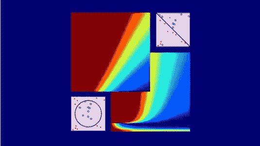

Embark on a journey into the realm of Deep Learning by immersing yourself in the world of Data Science. This guide will illuminate the path to crafting Artificial Intelligence, drawing upon the fundamental principles of Statistics, Algorithms, Analysis, and Data Mining.

\-David MacKay

## Introduction

Congratulations on your purchase of “Mathematical Foundations of Machine Learning: Study Deep Learning through Data Science.” Thank you for choosing this book.

The upcoming chapters delve into fundamental machine learning concepts and the significance of machine learning in addressing contemporary business challenges. The first chapter provides a comprehensive explanation of the four main types of machine learning algorithms available today, emphasizing the importance of machine learning. It covers `representation`, `evaluation`, and `optimization` as the three core concepts of machine learning. Additionally, the chapter introduces the concept of “Statistical Learning,” a descriptive statistics-based machine learning framework categorized as supervised or unsupervised.

In the second chapter, titled “Machine Learning Algorithms,” you will explore the development and application of popular supervised machine learning algorithms. Detailed insights into linear regression, logistic regression, and Naïve Bayes classification algorithms are provided. Moving on to the third chapter, “Neural Network Learning Models,” a comprehensive guide is presented for successfully developing neural network models. This includes building data pipelines and adopting specific neural network training approaches. The chapter outlines an end-to-end process for creating machine learning models, focusing on neural network models, and explores the components and functions of Artificial Neural Network and Perceptron models. Various applications of these advanced machine learning models for solving everyday business problems are also covered.

In the fourth chapter, “Learning Through Uniform Convergence,” the overlap of machine learning with statistics is examined. The borrowed statistical concept of “Uniform Convergence” is explored, allowing developers to assess the learnability of a problem based on data sample size using empirical risk minimizers. The chapter delves into Vapnik’s 1995 concept of the “General Setting of Learning,” central to machine learning development. A statistical explanation of the impact of “Uniform Convergence” on learnability with finite classes is provided, along with a discussion on potential learnability without “Uniform Convergence.”

The final chapter offers a comprehensive overview of cutting-edge data science technologies such as data mining and artificial intelligence. It details the “Team Data Science Process” (TDSP) lifecycle for structured data science projects, explaining various deliverables at each stage. The chapter explores how businesses leverage data science in decision-making and distinguishes between Business Intelligence and Data Science technology. Real-life examples are incorporated to enhance understanding, along with descriptions of multiple tools for further exploration and selective implementation in business.

While there are numerous books on this subject, thank you once again for choosing this one! Every effort has been made to ensure it is filled with useful information. Enjoy your reading!

# 第 1 章：机器学习简介

`Artificial Intelligence Technology` 的概念植根于这样一种思想：计算机可以被设计成表现出类人智能并复制人类的推理和学习能力。这涉及适应新的输入并在无需人工干预的情况下执行任务。人工智能的原则涵盖了机器学习。

`Machine Learning Technology (ML)` 指的是 `Artificial Intelligence Technology` 的概念，主要侧重于计算机被设计为能够显式学习和自我训练的能力。这涉及识别信息模式以改进底层算法，并在没有人工参与的情况下做出自主决策。“机器学习”一词由游戏和人工智能的先驱教授 `Arthur Samuel` 于 1959 年在其在 `IBM` 任职期间创造。

机器学习认为，当代计算机可以使用有针对性的训练数据集进行训练，这些数据集很容易定制以创建所需的功能。它采用模式识别方法，其中过去的交互和结果会被记录并以与当前位置相对应的方式重新审视。由于需要处理庞大的数据量，且新鲜数据不断流入，机器必须适应新数据，而无需由人显式编程，考虑到机器学习的迭代方面。

机器学习与 `Statistics` 领域关系密切，该领域专注于使用先进的计算工具和技术生成预测。“数学优化”的研究为机器学习提供了技术、理论和实现领域。在应用于解决业务问题时，机器学习也被称为“预测分析”。在 ML 中，“目标”被称为“标签”，而在统计学中，它被称为“因变量”。统计学中的“变量”在 ML 中被称为“特征”。此外，ML 中的“特征创建”在统计学中被称为“转换”。

ML 技术与数据挖掘和优化密切相关。ML 和数据挖掘通常使用相同的技术且重叠显著。ML 专注于根据给定训练数据的预定义特征生成预测，而数据挖掘则在大量数据中识别未知特征。数据挖掘使用许多 ML 技术，但目标不同。机器学习还通过“无监督学习算法”或作为预处理阶段使用数据挖掘技术，以增强模型的预测准确性。

这两个研究领域的交集源于它们所遵循的基本假设。在机器学习中，效率通常以模型重现已知知识的能力来评估，而在“知识发现和信息挖掘 (KDD)”中，主要任务是发现新信息。一种基于已知信息评估的“未告知或无监督”技术，将很容易被其他“监督技术”超越。相反，由于缺乏训练数据，“监督技术”不能用于典型的“KDD”任务。

数据优化是与机器学习密切相关的另一个领域。各种学习问题可以表述为在训练数据集上最小化某个“损失函数”。“损失函数”被导出为正在训练的模型生成的预测与输入数据值之间的差异。两者之间的区别源于“泛化”的目标。优化算法旨在降低训练数据集的损失，而机器学习的目标是最小化来自现实世界的输入数据的损失。

机器学习已成为如此热门的话题，以至于其定义在学术界、企业公司和科学界之间各不相同。以下是一些来自知名来源的常见公认定义：

“机器学习基于能够从数据中学习而无需依赖基于规则编程的算法。” – `McKinsey`。

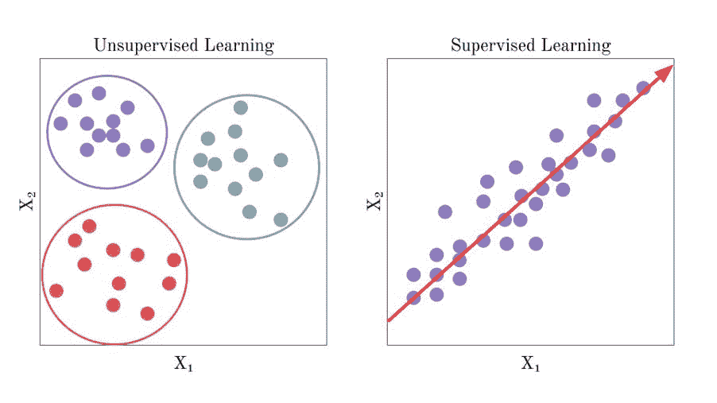

机器学习在其最根本的层面，是使用算法分析数据、从中学习并随后对世界上的现象做出判断或预测的实践。” – `Nvidia`

“机器学习领域旨在解决以下问题：我们如何构建能够通过经验自主增强其能力的计算机系统，以及支配所有学习过程的基本原理是什么？” – `Carnegie Mellon University`

“机器学习是使计算机无需显式编程即可行动的科学。” – `Stanford University`

## 机器学习的类型

### 监督式机器学习

“监督式机器学习”在预测性大数据分析中被广泛使用，因为它可以评估并将从先前迭代和交互中学习到的经验应用到新数据集中。这些学习算法可以根据提供的指令对当前事件进行标记，有效地预测和预测未来事件。例如，机器可以被编程为将数据点标记为“R”（运行）、“N”（负）或“P”（正）。机器学习算法然后按编程方式标记输入数据，将其与“预期或正确”的输出进行比较，识别潜在的修改并解决错误以提高模型的准确性。通过采用“回归”、“预测”、“分类”和“成分提升”等方法有效地训练学习算法，可以将新的输入数据作为“目标”数据集馈送给机器，以按需塑造学习程序。这启动了分析，推动学习算法创建“推断特征”，该特征可以根据输出值对未来事件生成预测和预测。例如，金融机构和银行严重依赖机器学习算法来检测信用卡欺诈并预测潜在客户不按时偿还贷款的可能性。

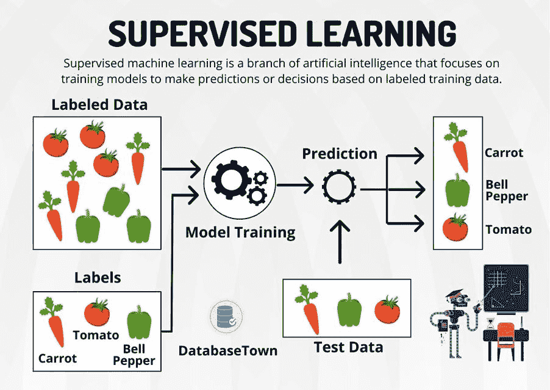

### 无监督式机器学习

在没有标记和分类的训练数据集的情况下，公司通常会转向无监督机器学习。“无监督学习算法”说明了机器如何产生“推断特征”以揭示未标记和未分类的数据堆栈中的隐藏模式。这些算法探索数据以在数据块中定义结构。尽管无监督机器学习算法在探索输入数据和得出见解方面与监督学习算法一样有效，但它们无法识别正确的输出。这些算法可以定义数据异常值，提供个性化的产品建议，并使用“自组织映射”、“奇异值分解”和“k-means 聚类”等技术对文本主题进行分类。例如，在在线营销中，无监督学习算法通常用于客户识别，将客户细分为具有共同购物属性的群体，并以相似的营销策略和活动来定位他们。

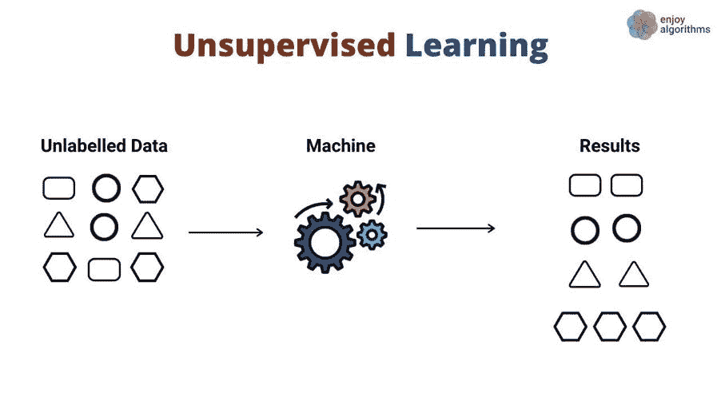

### 半监督机器学习

“半监督机器学习算法”具有高度灵活性，可以从“标记”数据和“未标记”或原始数据中学习。这些算法代表了监督式和非监督式机器学习算法的混合体。通常，训练数据集主要由未标记数据组成，并包含少量标记数据。结合 `forecast`、`regression` 和 `classification` 等分析方法使用半监督学习算法，可以使计算机在学习和训练中的准确性显著提高。当从原始数据集中生成处理过的标记训练数据对公司来说资源密集且成本效益较低时，这些算法经常被采用。公司使用半监督学习算法系统来避免额外的人力和设备支出。例如，`facial recognition` 技术应用需要来自各种来源的海量面部数据。对来自互联网摄像头等来源获得的原始数据进行处理、分类和标记需要大量资源和数千小时来创建训练数据集。

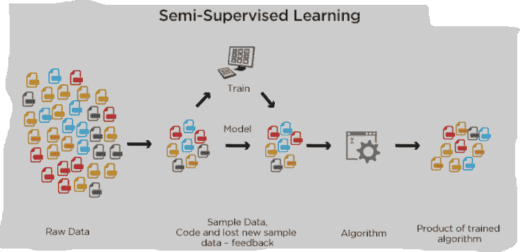

### 强化机器学习

强化机器学习算法与之前讨论的机器学习算法不同。它通过执行动作并细致记录结果，从环境中学习，将失败的结果标记为错误，将优秀的结果标记为奖励。两大关键特性使强化学习算法脱颖而出：`trial and error` 分析技术和 `delayed reward` 反馈循环。计算机通过各种计算持续分析输入数据，对正确或预期输出发出强化信号。这种迭代过程为评估、记录和学习高效活动创建了反馈循环，随着时间的推移优化结果。这些算法在游戏、机器人和导航系统中得到广泛应用。

## 机器学习的重要性

人们对机器学习 `ML` 的持续兴趣源于数据量和种类不断增加、计算处理成本效益高以及数据存储价格低廉等因素。机器学习与人工智能一起构成了 `Fourth Industrial Revolution` 的核心，影响人类生活的方方面面。机器学习能够快速准确地分析庞大而复杂的数据集，使企业能够识别增长机会并降低风险。由机器学习驱动的数据驱动策略在区分成功公司方面发挥着关键作用。图像识别和文本处理等任务的自动化展示了机器学习的变革潜力。以 Google 的 DeepMind 和 OpenAI 的 Dota Bot 为例的机器，已展示出超出最初预期的能力，重塑了经济和社会格局。

## 重复学习自动化与信息揭示

机器学习与机器人自动化不同，它以适应性和持续改进的方式自动化计算机导向的任务。机器学习算法从数据中学习，适应不断变化的环境并减少错误。这些算法作为分类器或预测工具发挥作用，发展出独特的能力，例如自学习下棋或个性化产品推荐。具有多个隐藏层的深度学习模型在处理海量数据集方面表现出色，有助于提高准确性。大数据分析与自学习算法的结合增强了数据的价值，将其转化为知识产权。机器学习每周可以创建数千个模型，而人类则无法做到，这加速了创新和问题解决。

## 机器学习的核心概念

如今，机器学习 `ML` 有各种类型，但机器学习的基础围绕三个关键组成部分展开：`representation`、`evaluation` 和 `optimization`。以下是适用于所有机器学习类型的一些基本概念：

## 表示

机器学习模型无法直接感知、看到或感应输入示例。因此，数据表示对于为模型提供关于主要数据属性的有意义视角至关重要。选择最能代表数据的显著特征对于有效训练机器学习模型至关重要。`Representation` 简单来说就是以计算机能够理解的语言，使用一组分类器将数据点呈现给计算机。分类器被定义为接收离散和/或连续函数值的向量作为输入，并输出称为 `class` 的单个离散值的模型。为了从表示的数据中学习，模型必须在训练数据集中或希望模型进行训练的 `hypothesis space` 中具有所需的分类器。用于表示输入的数据特征对机器学习系统至关重要。任何位于假设空间之外的 `classifier` 都无法被模型学习。开发所需的机器学习模型取决于数据特征的本质，往往决定了机器学习项目的成功与否。

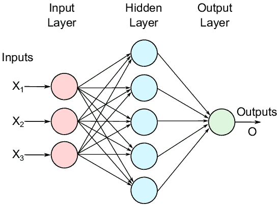

一个具有若干独立 `features` 且与 `class` 紧密关联的训练数据集可以显著简化机器的学习。另一方面，机器可能难以从具有复杂函数的类别中学习。这通常需要处理原始数据以构建机器学习模型所需的特征。从原始数据集中提取特征往往是机器学习项目中最耗时、最费力的部分。它也被认为是最具创造性和最有趣的部分，其中直觉和 `trial and error` 与技术要求一样重要。机器学习过程不是 `one-shot` 过程，而是一个迭代过程，需要分析执行后的输出，然后修改训练数据集。领域特异性是训练数据集需要全面投入时间和精力的另一个原因。用于预测电子商务平台中消费者行为的训练数据集将与自动驾驶汽车所需的训练数据集大不相同。然而，核心机器学习机制在工业部门中保持不变。因此，正在进行持续研究以自动化特征工程过程。

## 评估


在机器学习上下文中，`evaluation`本质上是指评估各种假设或模型以选择其一的方法。需要一个`evaluation function`来区分有效的分类器和模糊的分类器。评估函数也被称为`objective`、`utility`或`scoring`函数。机器学习算法具有其内部评估函数，通常与研究人员用于优化分类器的外部评估函数不同。通常，评估函数在项目初始阶段选择数据表示工具之前就已描述。例如，自动驾驶汽车机器学习模型的评估函数可能涉及以接近零的假阴性率和低假阳性率识别行人，并且该条件需要使用适用的数据特征进行`represented`。

## 优化

探索表示的机器学习模型的假设空间以识别得分最高的分类器并实现更好评估的过程被称为`optimization`。对于具有一个以上最优分类器的算法，选择优化方法对于确定生成的分类器和实现更有效的学习模型至关重要。各种`off-the-shelf optimizers`可用于启动新的机器学习模型，然后在之后用定制设计的优化器替换它们。

## 统计学习框架

“统计学习”是一种基于描述性统计的学习框架，可分为监督式或无监督式。“监督式统计学习”涉及构建统计模型以根据单个或多个输入预测或估计输出。相比之下，“无监督式统计学习”涉及没有监督输出的输入，有助于学习数据关系和结构。理解统计学习涉及识别“预测变量”（自变量、属性）与“响应变量”（因变量）之间的联系，以生成能够基于“预测因子 (X)”预测“响应变量 (Y)”的模型。

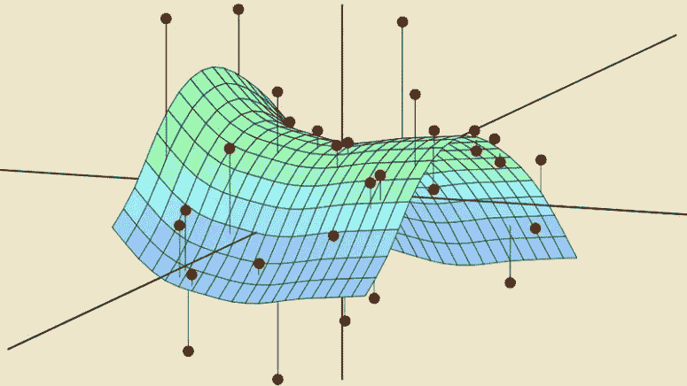

`X = f(X) + ɛ where X = (X1,X2, . . .,Xp)`, where `f` is an `unknown function` & `ɛ` is `random error (reducible & irreducible)`.

以下是统计学习的一些基本概念：

## 预测与推断

当存在多个易于获取的输入`X`，但输出`B`的产生未知时，`f`通常被视为黑箱，前提是它能为`Y`生成准确的预测。这称为`prediction`。在某些情况下，我们需要理解`Y`如何随着`X`的变化而受到影响。我们希望在这种情况下估计`f`，但我们的目标不仅仅是为`Y`生成预测。在这种情况下，我们希望建立并更好地理解`Y`与`X`之间的联系。现在，`f`不再被视为黑箱，因为我们必须理解系统的底层过程。这称为`inference`。在日常生活中，各种问题可以归类为`predictions`设置、`inferences`设置，或两者的`hybrid`。

## 参数与非参数技术

`parametric technique`可定义为通过计算一组参数（数据的有限摘要）来评估`f`，同时对`f`的函数形式做出假设。这种技术的数学方程为`f(X) = β0 + β1X1 + β2X2 + . . . + βpXp`。`parametric models`倾向于具有有限数量的参数，与数据集的大小无关。这也称为`model-based learning`。例如，`k-Gaussian models`由参数技术驱动。

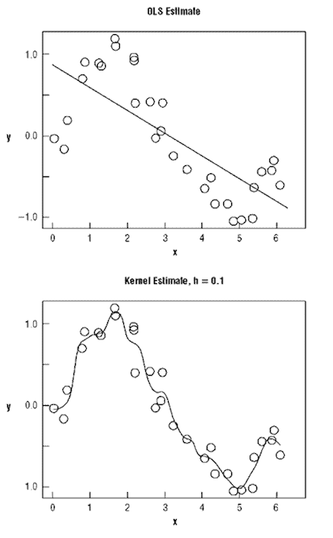

另一方面，`non-parametric technique`在不对`f`的函数形式做出任何假设的情况下，基于其与数据点的接近程度生成对`f`的估计。`non-parametric models`倾向于具有随数据集大小成比例增长的可变数量的参数。这也称为`memory-based learning`。例如，`kernel density models`由非参数技术驱动。

## 预测准确性与模型可解释性

用于从统计数据中学习的大量方法中，有些适应性较差且极其受限。当`inference`是目标时，使用简单且相对不灵活的统计学习技术具有显著优势。另一方面，如果目标是生成预测，则更喜欢灵活的模型。

模型的性能可以根据其在新输入数据上预测事件发生的准确性来估计。更准确的模型被认为更有价值。模型的可解释性提供了输入-输出关系的洞察。被解释的模型可以提供关于独立特征生成对依赖属性预测的能力的洞察。问题在于，随着模型准确性的提高，模型的复杂性也在增加，而以牺牲可解释性为代价。

更准确的模型可以为企业提供更多可能性、优势、时间或金钱。但模型准确性需要针对此类预测进行优化。准确性的优化通过引入额外的模型参数（以及调整这些参数所需的资源）进一步扩展了模型的复杂性。解释参数相对较少的模型要容易得多且更快。线性回归模型包含输入系数和截距项。例如，可以探索每个术语以评估其对输出产生的贡献。切换到逻辑回归模型在函数潜在转换到输出的底层关系背景下提供了更大的权威性，并且系数也应与之一起探索。

理解小型决策树相对容易，但负载过重的决策树需要独特的视角来理解为什么预测事件会发生。此外，将多个模型优化组合成一个预测往往没有显著或及时的解释。可解释性被认为是对模型准确性的辅助。

例如，设计用于将`spam`邮件与`non-spam`邮件分离和分类的模型，以及设计用于评估房地产价格的模型。

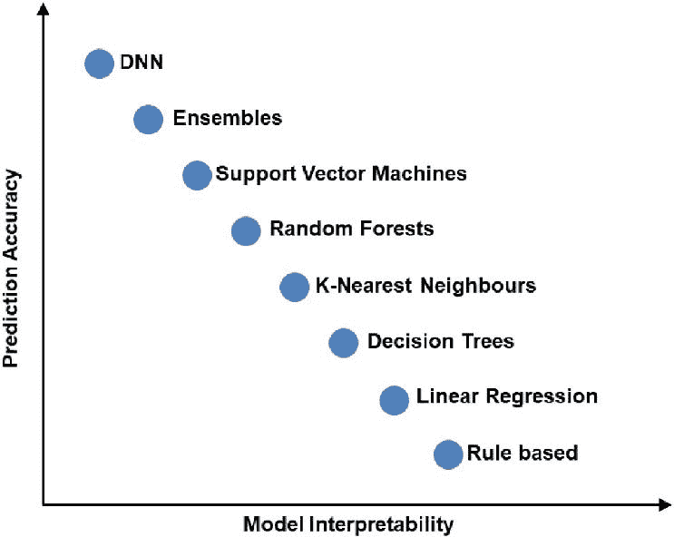

## 评估模型准确性

在统计学领域，没有一刀切或样样通用的技术。单一方法不可能在庞大的数据集范围内占据主导地位。在回归环境中，最常用的指标是均方误差（`MSE`）。该指标量化了预测答案值与目标观测的真实答案值之间的一致程度。当预测响应与真实响应非常接近时，`MSE`很小。然而，如果某些观测的预测响应与真实响应之间存在较大差异，则`MSE`很大。

例如，考虑患者的临床数据，包括体重、血压、性别、年龄、家族病史和糖尿病状态。该数据集可以训练一种统计技术，根据临床指标预测糖尿病风险。

在分类环境中，最频繁使用的指标是混淆矩阵。统计学习的一个核心特征是，随着持续学习，模型变得更加灵活并减少训练误差。然而，这不一定会降低测试误差。

### 偏差与方差

在机器学习中，偏差被定义为模型为便于学习目标任务而做出的简化假设。参数模型设计时具有固有的强偏差，能够实现更快、更简单的学习，但会降低整体模型灵活性。低偏差算法的例子包括决策树、k 近邻和支持向量机。高偏差机器学习算法包括线性回归、线性判别分析和逻辑回归。

机器学习中的方差是指使用不同的训练数据集时对目标函数的估计会发生多少变化。具有高灵活性的非参数模型往往具有较高的方差分数。低方差机器学习算法包括线性回归、线性判别分析和逻辑回归，而高方差算法包括决策树、k 近邻和支持向量机。

### 偏差与方差之间的权衡

在统计学习中，偏差和方差呈反比关系。具有高偏差的模型会显著降低方差分数，反之亦然。在这两个因素之间取得平衡，推动了模型的选型和配置，以解决目标问题并实现平衡。合适的灵活性水平对于任何统计学习技术在回归和分类环境中的效率和性能至关重要。偏差与方差之间的权衡导致测试误差呈 U 形，这是一个主要挑战。

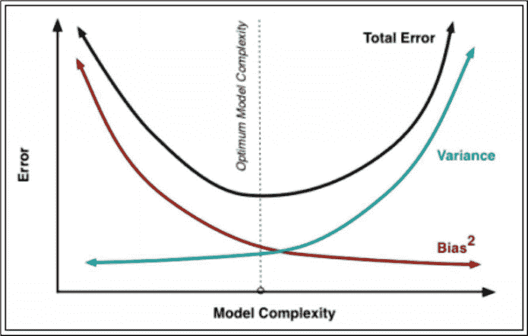

# 第 2 章：机器学习算法

机器现在可以自主学习和训练自身，利用过去的计算和底层算法生成高质量、易于重现的决策和结果。尽管机器学习已经存在相当长一段时间，但算法的最新进展使机器能够高效地处理和分析大量数据。这是通过高速、频率自动化实现的，将先进的数学计算应用于机器。今天的复杂计算机器可以迅速评估庞大的数据量，产生更快、更准确的结果。利用机器学习算法的公司受益于增强的灵活性，能够将训练数据集调整以符合其业务需求并相应地训练机器。这些定制的机器学习算法使企业能够识别潜在风险和增长机会。通常与人工智能和认知技术一起使用，机器学习算法有助于创建高度有效和高效的计算机，能够处理大量信息或大数据，产生高度准确的结果。

机器学习领域已产生数百甚至数千种算法，其中一些最常用的算法可根据其机器学习类型进行分类。回顾一下，“监督学习”涉及数据科学家使用预先标记了预期或正确结果的预定义训练数据集来指导算法应得出的结论。现在，让我们深入探讨两种在开发机器学习模型中常用的知名监督学习算法：

## 回归

监督式机器学习涵盖“回归”技术，旨在根据先前信息预测或描述特定数值。例如，根据相似特征的先前成本信息预测房产成本。回归技术从简单的`linear regression`到复杂的选项，如`regular linear regression`、`polynomial regression`、`decision trees`、`random forest regression`和`neural networks`等。

最简单的方法`linear regression`采用数学方程`y = m*x + b`的直线来建模数据集合。多个数据对`x, y`可以通过计算使数据点与直线之间总距离最小化的直线的位置和斜率来训练`linear regression`模型。斜率`m`和 y 截距`b`的计算用于提供对数据观测最接近近似的直线。数据中的关系可以使用`linear predictor functions`建模，其中未识别的模型变量是从数据中估计的，称为`linear models`。传统上，如果解释变量或预测变量的值已知，则使用响应的条件均值作为这些值的`affinity function`。在线性模型中使用条件均值和其他度量是不常见的。与其他形式的回归分析一样，`linear regression`作用于响应的条件概率分布，而不是通过多元分析获得的变量的联合概率分布。

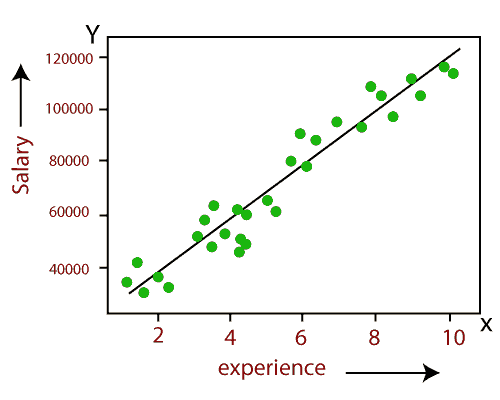

经过最深入研究且适用范围最广的回归分析类型是`linear regression`。这源于使用线性依赖于其未识别参数的模型时的简单性，与非线性相关模型形成对比。使用线性分布确定所得预测器的统计特征是直接的。`Linear regression`有许多实际应用，分为以下几类：

### 预测和预测

如果目标是生成预测、预测或最小化误差，则可以使用线性回归算法将预测模型与已识别的数据集和解释变量对齐。开发后，拟合模型可以轻松预测缺乏响应的新输入数据。

### 理解变化

为了理解由于解释变量的变化而导致的响应变量的变化，`linear regression analysis`量化了预测变量和响应之间的关系。它有助于评估某些解释变量是否与响应缺乏线性关系，并识别具有响应值冗余数据的预测变量子集。

大多数`linear regression models`都是使用`least squares`方法拟合的。然而，模型也可以通过使用`least absolute deviation regression`等替代方法减少`lack of fit`来拟合，或通过最小化惩罚版本的最小二乘法拟合，如岭回归`L2-norm penalty`和套索回归`L1-norm penalty`所见。尽管`least squares`和`linear model`紧密相关，但它们并不相同。

`Multiple Linear Regression`是数据科学和统计任务中`regression`的常见形式。与`linear regression`一样，它涉及输出变量`Y`。不同之处在于有多个`X`或自变量来预测`Y`。

例如，预测华盛顿特区住房成本将使用`multiple linear regression`。在这里，华盛顿特区住房成本是`Y`或因变量，而`X`或自变量包括靠近公共交通、学区、平方英尺和房间数，决定住房的市场价格。

该模型的数学方程为：

```
housing_price = β0 + β1 sq_foot + β2 dist_transport + β3 num_rooms
```

### 多项式回归

与前面提到的线性模型不同，多项式回归引入了`X`与`Y`之间关系的曲线。它偏离了`X`值变化对`Y`的线性影响。

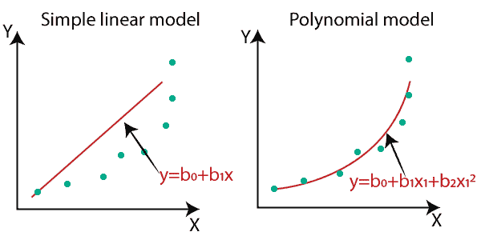

如果我们尝试使用`linear regression`对具有非线性特征的图形建模，它不会为非线性方面提供最佳拟合。例如，下图左侧的散点图显示了向上趋势但呈曲线。在这种情况下，直线是不够的。相反，我们将使用多项式回归创建一条曲线以匹配数据的曲线，如下图右侧所示。多项式方程类似于线性方程，不同之处在于一个或多个`X`变量连接到多项式表达式，例如`Y = mX2 + b`。

数据研究人员的一项重要回归技术是`Support Vector Regression`，通常用于`case classification`。思路是在空间中找到一条线，将数据点分离为不同的类别，也用于回归分析。它是一种与概率无关的`binary classification`形式。

`Ridge Regression`广泛用于分析多重共线性数据集。正确使用岭回归可以减少标准误差并显著提高模型准确性。当处理高度相关的自变量时尤其有用，因为使用另一个变量预测一个变量可能导致`multi-collinearity`。例如，在模型中使用高度和体重等变量可能会导致多重共线性。

多重共线性会影响预测准确性，必须注意模型中使用的预测变量以防止它。原因可能包括数据类型、收集方法或自变量种类较少导致相似的数据点。岭回归可以通过引入一点偏差，也称为`regularization`，来解决线性模型中的多重共线性问题。

提高模型准确性的另一种方法是标准化自变量。通过将某些变量设为 null 来简化不仅仅是使它们为 null，而是奖励更接近零的值，减少系数和模型复杂性，同时保留所有自变量。这引入了更多偏差作为提高预测准确性的权衡。

另一种减少技术是`LASSO regression`，是岭回归的补充，促进更简单、更精简的预测模型。在套索回归中，系数被更严格地减少，它代表`least absolute shrinkage and selection operator`。当面临高多重共线性时使用，与岭回归类似。

`LASSO`和`ridge regression`的结合是`ElasticNet Regression`，旨在进一步提高 LASSO 回归的预测准确性。ElasticNet 是 LASSO 和岭回归技术的融合，奖励较小的系数值。这三种设计都可在 R 和 Python `Glmnet suite`中获得。

当数据不足或可用数据分布不佳时，`Bayesian regression`模型被证明很有价值。这些回归模型是基于概率分布而不是单个数据点构建的。因此， resulting 图表呈钟形曲线，显示方差，最频繁出现的值集中在曲线上。在`Bayesian regression`中，因变量`Y`代表的不是估值而是概率。而不是预测特定值，目标是估计事件发生的概率。这种方法符合基于贝叶斯定理构建的`frequentist statistics`，该定理假设事件的发生及其未来再次发生的概率。

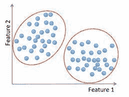

`conditional probability`的概念在`frequentist statistics`中至关重要，涉及结果相互依赖的事件。事件可能是有条件的，意味着前一个事件可能会改变下一个事件的概率。例如，从袋子中抽取 M&M 糖说明了条件概率。如果第一次抽取时从 3 个黄色和 3 个蓝色 M&M 中得到一个蓝色 M&M，则下一次抽取另一个蓝色 M&M 的概率会降低。相反，像抛硬币这样的独立事件不会影响后续抛硬币的概率，使其与`conditional probability`无关。

接下来是分类，机器学习中的`classification algorithm`根据训练数据集建立的预定义规则对新的输入数据进行分类。该数据集包含具有已识别类别的相关数据。例如，传入的电子邮件可以分类为`spam`或`non-spam`，患者的诊断可以根据观察到的属性进行分类。分类是一种模式识别技术，其中假设分析为属性，称为`explanatory variables or features`。这些变量可以是`categorical`，如血型，`ordinal`，如尺寸，或涉及`integer`或`real values`。分类器通过使用`similarity or distance function`将新输入与先前观察结果进行比较来操作。

在统计学中，数据分类通常采用`logistic regression`，其中观测特征是解释变量或回归量，预测类别是结果。这种技术虽然名为回归，但实际上是分类算法。它根据单个或多个输入值估计事件发生的可能性。例如，使用症状、血糖水平和家族史预测患者患糖尿病的可能性。输出是`1`到`10`之间的概率，其中`10`表示确定性。如果概率超过 5，则预测患者将患糖尿病；否则预测不会。Logistic 回归广泛用于二元分类任务，其名称源于`logistic function`，即 S 形曲线，将实值整数映射到`0`和`1`之间的值，由统计学家创建以模拟生态系统中接近其承载能力的种群增长。

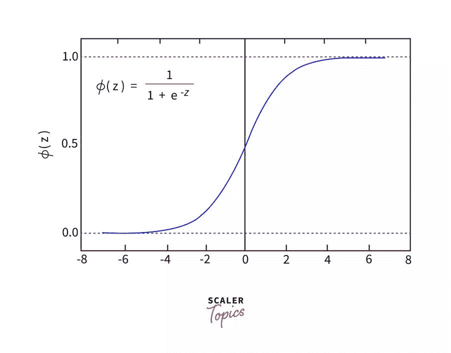

这里是一个从`-5`到`5`的数字图，已通过 logistic 函数转换为`0`到`1`之间的范围。

与线性回归技术类似，逻辑回归使用方程来表示数据。

输入值`X`线性分组以预测输出值`Y`，使用权重或系数`Beta`。它主要与线性回归不同，因为建模的输出值往往是二元的`0`或`1`而不是一系列值。

下面是逻辑回归方程的示例，其中单个输入值系数`X`由`b1`表示，截距或偏置项为`b0`，预期结果为`Y`。输入数据集中的每一列都有一个与其关联的系数`b`，这应该通过学习训练数据集来理解。实际模型表示，存储在文件或系统内存中，将是方程中的系数`beta values`。

```
y = e^(b0 + b1*x) / (1 + e^(b0 + b1*x))
```

逻辑回归算法的系数`beta values`必须根据训练数据进行估计。这可以通过另一种称为最大似然估计的统计技术来实现，这是一种流行的 ML 算法，可与其他多种 ML 算法一起使用。最大似然估计通过对输入数据集的分布做出某些假设来工作。


通过使用模型的最佳系数，可以获得可以预测默认类别附近的值接近 `1` 且对其他类别的值接近 `0` 的 ML 模型。逻辑回归技术大多数似然的潜在假设是，搜索过程尝试找到系数的值，以减少模型对输入数据集估计的概率的误差 `e.g. probability of 0 if the input data is not the default class`。

无需深入数学细节，就足以说你将使用最小化算法来优化训练数据集的最佳系数的值。实际上，这可以使用有效的数值优化算法来实现，例如 `Quasi-newton` 技术。

## 使用逻辑回归生成预测

在这里，你只需将测量值代入逻辑回归方程并计算结果即可使用逻辑回归模型生成预测。让我们看一个例子来巩固这一概念。假设有一个模型可以根据个人身高的虚构值预测个人是男性还是女性。如果个人的身高值设为 `150 cm`，该个人会被预测为男性还是女性？假设我们已经发现系数的值 `b0 = -100` 和 `b1 = 0.6`。利用上述方程，可以轻松计算身高为 `150 cm` 的男性概率或 `P(male|height=150)`。`EXP()` 函数将用于 `e`，因为如果你将此实例记录到电子表格中，这就是你可以使用的内容：

```
y = e^(b0 + b1*X) / (1 + e^(b0 + b1*X))
```

```
y = exp(-100 + 0.6*150) / (1 + EXP(-100 + 0.6*X))
```

```
y = 0.0000453978687
```

或接近 `0` 的男性概率是该特定人的性别。从理论上讲，概率可以简单使用。但由于这是一种分类算法，我们想要一个明确的结果，概率可以标记到二元类别值。例如，模型可以预测 `0` 如果 `P(male) < 0.51` 且预测 `1` 如果 `P(male) >= 0.5`。现在你知道如何使用逻辑回归生成预测，你可以轻松预处理训练数据集以充分利用这种技术。逻辑回归技术对数据集中的分布和关系所做的假设几乎与线性回归技术所做的假设相同。

已经做了大量研究来定义这些假设并使用准确的概率和统计语言。建议将这些作为经验法则或指令，并尝试各种数据准备过程。

预测建模机器学习项目的最终目标是生成高度准确的预测而不是分析结果。考虑到一切，如果设计的模型稳定且性能高，一些假设可能会被打破。

### 二元输出变量

这可能显而易见，因为我们已经讨论过它，但逻辑回归专门设计用于具有二元 `two-class` 分类的问题。这将生成默认类别实例的概率预测，可以标记为 `0` 或 `1` 的分类。

### 去除噪声

逻辑回归不假设输出变量 `y` 中的误差，因此应从训练数据集中删除异常值和潜在的错误分类案例。

### 高斯分布

逻辑回归可以被视为一种线性算法，但输出上有非线性变换。也假设输出和输入变量之间存在线性连接。输入变量的数据转换可能导致更准确的模型，更能揭示数据集的线性关系。例如，为了更好地揭示这些关系，我们可以使用 `log`、`root`、`Box-Cox` 和其他单变量转换。

### 删除相关输入

如果你有各种高度相关的输入，模型可能会像线性回归技术一样过拟合。为了解决这个问题，你可以计算所有输入数据点之间的成对相关性并删除高度相关的输入。

### 收敛失败

训练系数所期望的最大似然估计方法可能无法收敛。如果数据集包含几个高度相关的输入或数据非常有限 `e.g. loads of 0 in the input data`，则可能发生这种情况。

`Naïve Bayes classifier algorithm` 是另一种具有广泛应用的分类学习算法。它是一种基于贝叶斯定理的分类方法，假设预测变量彼此独立。简单地说，朴素贝叶斯分类器假设一个类别中的所有特征都与该类别中的任何其他特征的存在无关。例如，如果输入数据具有绿色、圆形且直径约为 `10 inches` 的水果图像，模型可以认为输入是西瓜。尽管这些属性相互依赖或特定特征的存在，所有特征都独立地有助于图像水果是西瓜的概率，因此被称为朴素。对于大量数据集，朴素贝叶斯模型相对简单构建且极其有效。

据报道，`Naïve Bayes` 甚至超过了最先进的分类技术，其开发的简单性。贝叶斯定理还可以提供计算后验概率 `P(c|x)` 使用 `P(c)`、`P(x)` 和 `P(x)` 的手段。根据下图所示方程，如果 `x` 已经发生，可以计算 `c` 的概率。

`P(c|x)` 是由预测变量 `x, attributes` 提供的类别 `c, target` 的后验概率。`P(c)` 是类别的先验概率

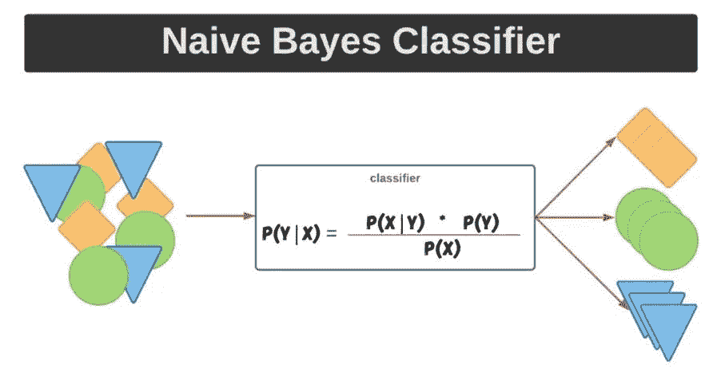

这里有一个例子来更好地阐明 `Bayes Theorem` 的应用。下图表示了关于识别适合打高尔夫球的天气日的数据集。列描绘了当天的天气特征，而行包含单个条目。检查数据集的第一行，可以推断天气将非常炎热潮湿且有雨，使这一天不适合打高尔夫球。这里的主要假设是所有这些特征或预测变量彼此独立。另一个假设是所有预测变量可能对结果具有相同的效果。这意味着如果当天有风，它对打高尔夫球决定的相关性将与雨的影响相似。在这种情况下，变量 `c` 表示类别 `playing golf`，表示天气是否适合高尔夫的决定，而变量 `x` 表示特征或预测变量。

## “Naïve Bayes classifier” 的类型

### “Multinomial Naïve Bayes”

广泛用于对文档进行分类，确定文档属于哪个类别，例如美容、技术、政治等。文档中短语的频率被视为分类器的特征或预测因子。

### “Bernoulli Naive Bayes”

几乎与“Multinomial Naïve Bayes”相同，但使用“布尔变量”作为预测因子。例如，根据特定短语是否出现在文本中，用于预测类别变量的参数可以是“是”或“否”值。

### “Gaussian Naive Bayes”

当预测因子不是离散且具有非常相似或连续的值时应用。假设这些值来自高斯分布。

## “Naïve Bayes” 的应用

### “实时预测”

`Naive Bayes` 在从输入数据学习方面速度极快，可以无缝用于实时生成预测。

### “多类预测”

广泛用于同时为多个类别生成预测，从而可以预测目标变量各种类别的概率。

### “文本分类 / 垃圾邮件过滤 / 情感分析”

`Naive Bayes` 分类器由于能够处理目标变量的多类问题以及自主规则，因此在文本分类模型中被大量使用。该算法报告的成功率高于任何其他算法，并且通常用于识别垃圾邮件和进行情感分析，通过辨别社交媒体平台上消费者对产品有利和负面的感受。

### “推荐”

将“`Naive Bayes Classifier`”和“`Collaborative Filtering`”结合起来可以生成“`Recommendation System`”，该系统利用 ML 和数据挖掘方法来过滤隐藏数据并提供洞察，了解客户是否会偏好特定商品或产品。

# 第 3 章：神经网络学习模型

`Artificial Neural Networks (ANN)`，也称为“人工神经网络”，旨在复制人类大脑中发现的通信路径。人体拥有数十亿个相互连接的神经元，它们穿过脊柱并延伸到大脑。这些神经元通过根状节点连接，逐个传递信息，直到到达大脑。ANN 通过检查示例来学习执行任务，通常无需明确配置特定任务的规则。例如，在图像识别中，它们可能会通过评估手动标记为“狗”或“非狗”的样本来学习区分包含狗的图片，并利用这些结果在其他图片中识别狗。值得注意的是，这些系统在实现这一目标时并不具备关于狗特征如毛发、尾巴或狗脸等的事先知识。相反，它们会自主地从训练样本中推导出识别特征。

ANN 作为相互连接的单元或节点的网络运行，被称为“人工神经元”，模仿人类大脑中的生物神经元。每条链接都可以向连接的神经元传输信号，类似于人类大脑中的突触。人工神经元在接收到信号后，会对其进行处理并传递给连接的神经元。在实现过程中，连接处的信号是一个实数，每个神经元的输出使用输入总和的特定非线性函数计算。连接被称为“边”，神经元和边会被分配通过学习优化的值或权重。这些权重调整了连接神经元接收到的信号强度。概念通过共享的神经元子网络形成并传播。神经元可能具有阈值限制，只有当累积信号超过设定阈值时才传输信号。神经元通常由多个层组成，对输入进行独特转换。信号从初始的“输入层”传递到最终的“输出层”，有时会多次遍历层。

虽然 ANN 模型的最初目标是解决类似人类大脑的问题，但其重点已随着时间的推移而转向特定任务。ANN 在各种任务中找到应用，例如计算机视觉、语音识别、机器翻译、社交媒体过滤、玩棋盘和视频游戏、医疗诊断，甚至绘画。

最常见的 ANN 以信息单向流动的方式运行，称为“`Feedforward ANN`”。然而，ANN 也可促进双向和循环的信息流动以实现状态平衡。ANN 通过调整连接权重从过去案例中学习，并且依赖较少的先验假设。这种学习可以是有监督的或无监督的。有监督学习确保每个输入模式都产生正确的 ANN 输出，并调整权重以最小化错误。强化学习是一种有监督学习形式，它告知 ANN 生成输出的正确性，而不是直接提供正确的输出。无监督学习涉及向 ANN 提供多个输入模式，使其能够探索关系并据此对其进行分类。还存在采用有监督和无监督学习相结合的 ANN。

对于具有未知或复杂规则的数据密集型问题，ANN 由于其数据结构和非线性计算而具有高度价值。它们擅长并行处理复杂信息，并且对多变量数据错误具有鲁棒性。然而，ANN 的黑盒特性是一个显著缺点，使其不太适合需要深入理解底层过程的问题。

## ANN 的组件

### 神经元

ANN 保留了人工神经元接收输入、结合内部状态和阈值值的概念（如果有），利用“激活函数”，并通过“输出函数”生成输出的理念。初始输入可以包括任何形式的数据，例如图片和文件，导致的结果如图片中的物体识别。激活函数的主要特征是确保随着输入值变化而平滑过渡，这意味着微小的输入变化会导致微小的输出变化。

### 连接和权重

ANN 由使用一个神经元的输出作为关联神经元输入的连接组成。每个连接都被分配一个“权重”，反映信号的相对重要性。一个神经元可能具有多个输入和输出连接。

### 传播函数

“传播函数”根据其前驱的输出及其连接以加权和的形式计算神经元的输入。可以将“偏置项”应用于传播结果。`Backpropagation` 调整连接权重以解释学习过程中遇到的错误。误差在连接之间分配，并且“backprop”理论上计算与给定状态的权重相关的成本函数的梯度。权重可以使用诸如随机梯度下降或其他方法进行更新，包括极限学习机、无传播网络、无权重网络和非连接主义神经网络。

## ANN 的超参数

“超参数”是在学习过程启动前建立的参数。这些值是通过学习过程本身确定的，例如学习率、批大小和隐藏层的数量。某些超参数值可能是相互依赖的；例如，特定层的大小可能取决于层的总数。

学习率表示模型在每次观察中纠正错误所需的修正措施的幅度。较高的学习率缩短训练时间但牺牲准确性，而较低的速率延长训练时间以换取可能更高的准确性。像 `Quickprop` 这样的优化技术旨在加快误差最小化，而其他改进则侧重于提高输出的可靠性。这些改进采用 `adaptive learning rate`，该速率会进行调整以防止振荡并增强收敛。

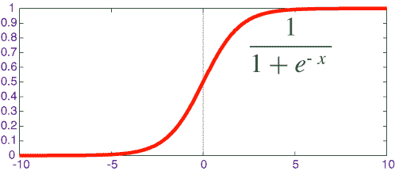

动量原理在梯度和先前改变之间取得平衡，权重调整受先前改变的影响。接近 `0` 的动量值强调梯度，而接近 `1` 的值则强调上一次的变化。

## 使用数据管道进行神经网络训练

神经网络被定义为从训练数据集中学习预期输出的函数，具有单个神经元或 `perceptron`。与传统编程不同，神经网络通过从提供的训练数据集中学习自主确定参数（权重和偏差），使用诸如 `backpropagation` 和 `gradient descent` 等算法。

程序员建立一个数据管道，这是一个循环且迭代的过程，其中每个阶段都利用前一阶段的数据。像 `Python` 和 `R` 这样的开发环境能够在沙箱环境中高效地训练和测试模型，促进交互式原型开发。

构建机器学习管道的目标包括：

减少系统延迟。

与松耦合的其他模型组件集成。

水平和垂直可扩展性。

通过异步、非阻塞消息进行消息驱动通信。

用于数据集管理的有效计算。

对系统错误具有弹性并在最少监督下恢复。

支持输入数据的批处理和实时处理。

传统数据管道涉及隔夜批处理，但在机器学习模型中，批处理并不总是足够。下面的图像说明了应用于实时业务问题的机器学习数据管道，包括产品推荐、预计到达时间、新链接推荐和搜索引擎等应用。

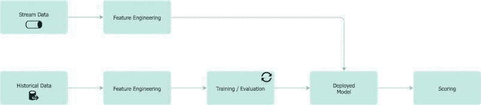

上方的泳道图包含两个明确指定的组件：

在线模型

在图片的顶部泳道中，描绘了应用程序运行所需的元素。它显示了模型用于实时决策的位置。

离线数据

底部泳道说明了模型的<|message|> 元素，用于分析历史数据并使用 `batch processing` 方法生成机器学习模型。

创建数据管道有八个基本阶段，如下图所示并在此详细解释：

## 问题

在此阶段，将识别并记录使用机器学习模型需要解决的业务问题以及所有相关详细信息。

## 数据

任何机器学习工作流的第一阶段都是将输入数据引导到数据库服务器。必须记住，数据以原始且未经修改的形式摄取，以保持原始数据集不变的记录。数据可能来自各种来源，通过请求获取或从其他系统传输。

`NoSQL document databases` 最适合存储大量已定义和标记的以及无组织的原始数据，随着快速发展而无需遵守预定义方案。它们甚至提供 `distributed, scalable, and replicated data storage`。

数据通过 `Ingestion Service` 流入 `offline` 层的原始数据存储中，这是一个复合编排服务，能够封装数据来源和持久化。存储库模型在内部与数据服务通信，与数据存储交换。当将数据保存到数据库时，会为数据集分配唯一的批次 ID，以便有效查询、端到端跟踪和监控。

为了计算高效，数据摄取被分布为两个方面。第一是对每个数据集的特定管道以同时处理每个数据集。第二方面是，在每个管道内，数据可以被分割以充分利用各种服务器核心、处理器，甚至整个服务器。将数据准备分布在多个垂直和水平管道中可减少所需总时间。

`ingestion service` 根据预定义计划（每天一次或多次）定期运行，或在遇到触发器时运行。主题将生产者（数据源）与处理器解耦，此示例的数据管道。当收集源数据时，`producer system` 会通知 `broker`，而 `embedded notification service` 通过引发数据摄取做出响应。`notification service` 还会通知 `broker` 原始数据集的处理已成功完成，并且数据集现已存储在数据库中。

`Online Ingestion Service` 构成了在线层 `streaming architecture` 的入口，解耦并管理从源到处理和存储组件的数据流。它提供一致、高性能、低延迟的功能，并充当企业级 `Data Bus`。数据存储在长期 `Raw Data Storage` 上，也充当到后续在线流服务的中介层以进行进一步的实时处理。可能使用的技术包括 `Apache Kafka (pub/sub messaging system)` 和 `Apache Flume (data collection to the long-term database)`。可以根据企业的技术栈选择性地应用各种其他类似技术。

## 数据

在摄取信息后，集中式管道评估数据状况，寻找格式变化、异常值、模式、不准确、不完整或失真信息，纠正任何异常。`feature engineering process` 也包含在此阶段。此阶段的三个主要角色是 `extraction, transformation, and selection`。

由于这通常是任何机器学习项目中最复杂的部分，引入适当的设计模式至关重要。在编码上下文中，这意味着使用工厂技术根据某些共享抽象函数行为生成特征，以及使用策略模式在执行时选择正确的特征。在构建 `feature extractors` 和 `transformers` 时，考虑管道的组合和可重用性很重要。

功能选择可以归因于调用者或自动化。例如，可以应用 `chi-square statistical test` 来对每个功能对概念标签的影响进行分类，在开始训练模型之前丢弃低影响特征。为此，可以识别一些 `selector APIs`。无论如何，必须为每个特征集分配唯一 ID，以确保模型输入的一致性和影响评分。总的来说，有必要将数据准备管道组装成一组不可变的转换，可以轻松组合。现在，`testing and high code coverage` 的重要性成为模型成功的关键因素。

## 数据

机器学习模型的主要目标是基于其对新输入数据（不属于训练数据集的一部分）所产生的预测和预测的质量来开发高精度模型。因此，可用的标记数据集将被用作未来未知输入数据的 `proxy`，通过将数据分为训练和测试数据集。分割数据集的方法有很多，其中一些最常用的技术包括使用默认或自定义比例按顺序将数据集分为两个子集，以确保数据在源中出现的顺序没有重叠。例如，您可以选择前 75% 的数据来训练模型，随后 25% 的数据来测试模型的准确性。

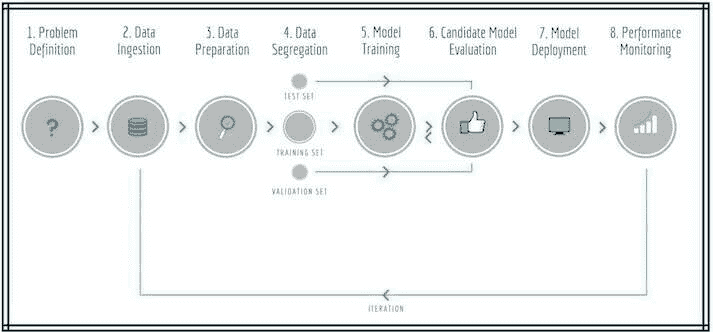

使用默认或自定义比例以及随机种子将数据集分割为训练和测试子集。例如，您可以选择数据集的随机 75% 来训练模型，剩余的 25% 随机数据集来测试模型。

利用其中一种技术（`sequential vs. random`）然后也在每个数据子集内混合数据。

在需要对数据分离进行广泛控制时，采用自定义注入方法来分割数据。

从技术上讲，数据分离阶段不被视为独立的机器学习管道；然而，必须提供 `API` 或工具来支持此阶段。为了返回所需的数据集，接下来的两个阶段（`model training` 和 `model assessment`）必须能够调用此 `API`。关于代码组织，需要 `strategy pattern`，以便 `caller service` 在执行期间选择适当的算法，并且需要注入百分比或随机种子的能力。`API` 还必须准备好返回带标签或不带标签的信息，分别用于训练和测试模型。可以创建一个警告并随数据集一起传递，以确保 `caller service` 不定义可能导致数据分布不均的参数。

## 模型训练


模型管道始终是 `offline`，其计划会根据应用程序的复杂性从几个小时到每天仅运行一次不等。训练也可以由时间和事件启动，而不仅仅是由系统调度程序启动。它包括许多机器学习算法库，例如 `linear regression`、`ARIMA`、`k-means`、`decision trees`，以及许多其他算法，旨在为快速生产新型模型提供便利，并使模型可以互换。`third-Party APIs` 的集成也很重要，使用 `facade pattern`（在此阶段，还可以调用 `Python Jupyter notebook`）。

您有几种 `parallelization` 选择：

专门针对单个模型的管道通常是最简单的方法，这意味着所有模型可以同时运行。

另一种方法是将训练数据集复制；即数据集可以被分割，每个数据集将包含模型的副本。这种方法适用于需要实例的所有字段来执行计算的模型，例如 `LDA`、`MF`。

另一种方法可以是并行化整个模型，这意味着模型可以被分离，每个分区负责维护变量的一部分。这种方法最适合线性机器学习模型，如 `Linear Regression`、`Support Vector Machine`。

最后，也可以利用上述一种或多种方法的组合使用混合策略。

实施模型训练时必须考虑错误容忍度。训练分区上的数据检查点和故障也必须考虑，例如，如果每个分区由于某些瞬态问题（如超时）而失败，则可以再次训练每个分区。

## 神经网络的训练方法

与大多数传统机器学习模型类似，神经网络可以使用监督和无监督学习算法进行训练，如下所述：

### 监督训练

监督训练的努力将输入和输出都提供给机器。然后网络将处理输入并将生成的输出与预期输出进行比较。然后错误会通过模型向后传播，导致模型调整调节网络的权重。这一循环反复进行，权重不断变化。使学习成为可能的数据集称为 `training set`。在网络训练过程中，权重不断改进的关系，同一个数据集会被多次处理。

当前业务网络开发包提供资源来监控人工神经网络对其预测正确结果的能力的收敛情况。这些资源使训练例程能够持续数天，直到模型达到所需的统计水平或精度。一些网络 however 无法学习。这可能是由于输入数据中缺乏可以获得预期输出的具体信息。如果没有足够数量和质量的数据来提供完整学习，网络也无法收敛。为了保留一部分数据集用于测试，必须有足够量的数据集。大多数多节点分层网络可以记忆和存储大量数据。为了监控网络以确定系统是否仅仅以无意义的方式保留训练数据，监督学习需要保存一组数据，并在训练后用于评估系统。

为了避免无意义的记忆，应减少处理元素的数量。如果网络无法简单地解决该问题，开发人员需要评估输入和输出、层数及其元素、这些层之间的链接、数据传输和训练功能，甚至原始输入权重。这些需要开发有效网络的修改构成了神经网络 `art` 的体现。需要几种算法来提供在训练过程中进行权重调整所需的迭代反馈。最常用的技术是 `backward-error propagation`，更常被称为 `back-propagation`。为了确保网络不会 `overtrained`，监督训练必须结合对模型的直观和深思熟虑的分析。人工神经网络最初是根据当前统计数据趋势配置的。随后，它需要继续学习可能从一般角度看是错误的其它数据方面。如果模型训练得当且不需要额外学习，权重可能会 `frozen`，如果需要的话。在某些模型中，该完成的网络被转换为硬件以提高模型的处理速度。某些机器不会锁定，但会通过在生产环境中的使用继续学习。

### 无监督训练

在“无监督或自适应”训练期间，网络接收输入但没有预期结果。模型必须自主确定如何对输入数据进行分组，通常称为“自组织或适应”。无监督学习的概念尚未完全被理解。这种对环境的适应性有望使机器人能够在遇到新情况时持续学习。在缺乏训练数据的现实场景中，例如需要新技术和武器的军事干预，相关研究仍在持续。尽管如此，目前神经网络的大多数工作仍围绕监督学习模型展开。

图欧·科霍宁（Teuvo Kohonen）是赫尔辛基理工大学的电气工程师，是无监督训练研究中的关键人物。他设计了一种自组织网络，也称为“自联想器”，能够在不知道预期结果的情况下进行学习。该网络结构 unconventional，需要初始化权重和归一化输入。神经元以“胜者通吃”的方式组织。科霍宁的持续研究探索了与传统方法如 `feed-forward` 和 `back-propagation` 不同设计的网络。

科霍宁的重点在于组织模型网络内的神经元。域内的神经元表现出“拓扑组织”，这是一种研究空间之间映射而不改变几何构型的数学概念。科霍宁认为，人工神经网络设计中缺乏拓扑结构使其相比人类大脑中的真实神经网络过于简化。随着研究的深入，先进的自学习网络可能变得可行。

## 候选模型评估

模型评估通常是“离线”的，将预测与实际数据进行比较，使用性能指标。从测试子集中选择最佳模型用于生成未来预测。评估器，例如 `ROC` 或 `PR` 曲线，被应用并存储在存储库中。“模型评估服务”使用“数据隔离 API”和来自“模型候选存储库”的评估器协调测试。最佳模型会经过增量程序、超参数优化和正则化以进行部署。部署细节由“通知服务”宣布。

## 模型部署

选择表现最佳的机器学习模型用于“离线”和“在线”预测生成。同时部署多个模型可确保平稳过渡。历史上，模型运行语言与构建语言之间的语言差异带来了挑战。解决方案包括代码翻译、创建 DSL、通过 RESTful API 访问的微服务、API 优先方法以及容器化。部署任务通过持续交付实现自动化，确保必要文件被打包、模型得到验证，并在运行容器中完成最终部署。

## 模型评分

“模型评分”涉及使用给定模型和输入数据生成新值。该术语与“模型服务”可互换使用。评分会产生各种值，例如产品推荐、时间序列和回归模型用的数值、概率值、字母值或预测类别。部署在“离线”和“在线”模式下的模型必须保持高准确性和性能。

“离线”评分针对大数据量进行优化，以异步方式生成预测。评分服务准备数据、检索特征并将结果存储在“评分数据存储”中。在“在线”模式下，客户端向“在线评分服务”发送请求。客户端准备数据、检索特征并从“评分数据存储”接收分数。评分结果可通过推送或轮询方法异步提供给客户端。

这些技术旨在减少系统响应时间，例如将输入特征保存在低读取延迟的内存数据存储中，或缓存离线预测以便便捷访问。

## 性能监控

为每个机器学习模型定义完善的“性能监控解决方案”至关重要。对于“模型服务客户端”，您可能希望观察的一些数据点包括：

`Model Identifier`

`Deployment date and time`

`The number of times the model was served.`

`The average, min, and max of the time it took to serve the model.`

`The distribution of the features that were utilized.`

`The difference between the predicted or expected results and the actual or observed results.`

在整个模型评分过程中，可以计算这些元数据并随后用于监控模型的性能。

另一个离线管道是“性能监控服务”，每当有新的预测被服务时就会收到通知，然后进行性能评估，同时持久化评分结果并发出相关通知。评估将通过将评分结果与数据管道的训练集产生的输出进行比较来进行。为了实现模型的基础性能监控，可以使用各种方法。一些广泛使用的方法包括 Kibana、Grafana 和 Splunk 等日志分析。

性能不佳且无法高速生成预测的模型将触发由前一个模型生成评分结果以维持机器学习解决方案的弹性。采用“宁错勿迟”的策略，意味着如果模型需要较长时间计算特定特征，则会用前一个模型替换而不是阻塞预测。此外，评分结果将与实际结果连接起来，因为它们变得可用。这意味着持续衡量模型的精确度，同时任何执行速度下降的迹象都可以通过返回到前一个模型来处理。为了连接不同的版本，可以使用“责任链模式”。监控模型的性能是一个持续的方法，因为简单的预测修改可能会导致模型结构被重新组织。请记住，机器学习模型的优势由其以高准确性和速度生成预测和预报的能力来定义，从而为公司的成功做出贡献。

## 神经网络模型的应用

### 图像处理和字符识别

`ANNs` 具有固有的能力来处理各种输入，这些输入可以被处理以推导出隐含的以及复杂、非线性的关系。`ANNs` 在图像和字符识别中发挥着重要作用。字符识别，例如手写，在识别欺诈性货币交易和国家安全相关事务中具有多样化的适用性。图像识别是一个蓬勃发展的领域，其应用范围广泛，从 Instagram 和 Facebook 等社交媒体平台上的面部识别，到医学科学中用于检测患者癌症，以及用于环境研究和农业用途的卫星图像处理。`ANN` 领域的发展现已为深度神经网络奠定了基础，深度神经网络是深度学习技术的基石。

在计算机视觉、语音识别和自然语言处理等前沿技术中，已取得了多种开创性和变革性的发展。`ANNs` 是有效且复杂的模型，具有广泛的各种用途。一些现实世界的应用是：

- 由旭化成开发的语音识别网络
- 从电极-脑电图研究中识别痴呆症
- 基于患者心电图 (`ECG`) 生成潜在心肌梗死预测
- 由 Lexicus2 的 Longhand 程序使用的连笔手写识别软件
- 光学字符识别 (`OCR`)，用于如 Calera Recognition System 开发的 FaxGrabber 等传真机，以及由 Caere Corporation 许可给其他公司的 Anyfax `OCR` 引擎，包括著名的 WinFax Pro 和 FaxMaster
- 科学应用国际公司或 (`SAIC`) 开发了用于检测行李中炸弹的技术，称为热中子分析 (`TNA`)，使用了神经网络算法。

### 预测

在日常企业决策中，例如，销售预测、商品间资本分配、产能利用率)、经济和货币政策、金融和库存市场，预测是整个工业领域首选的工具。例如，预测库存价格是一个复杂的问题，其背后存在大量变量，这些变量可能隐藏在大数据的深处或唾手可得。传统的预测模型往往存在各种限制，无法考虑这些复杂、非线性的关联。由于其建模和提取隐藏特征和交互的能力，`ANNs` 的正确实施可以为手头的问题提供可靠的解决方案。

与传统预测模型不同，`ANNs` 对输入和残差分布没有任何限制。该领域持续的进展已导致预测性使用 `LSTM` 和循环神经网络的最新进展，以从模型生成预测。例如，天气预报；花旗银行伦敦使用的外汇系统由神经网络驱动。

# 第 4 章：通过一致收敛进行学习

统计学习理论的核心关注点在于刻画模型的学习能力。在由“监督分类和回归”技术驱动的模型背景下，可学习性取决于经验风险到总体风险的“一致收敛”。这意味着一个问题是可学习的，如果它可以通过最小化数据的经验风险来训练。在统计渐近理论和概率论中，“概率一致收敛”是一种收敛类型，表明在特定情况下经验频率在特定事件族内收敛到理论概率。这一概念是统计学习理论不可或缺的一部分，在机器学习中具有广泛的应用。被定义为“在数学分析领域中比逐点收敛更强的一种收敛模式”，一致收敛发挥着关键作用。

1995 年，Vapnik 发表了《学习的一般设定》，讨论了统计背景下模型的可学习性。该框架使用“假设类 `H`”、具有σ-代数的实例集 `Z`，以及一个目标函数（例如损失或成本）表示为“`f: H × Z→ R`”来定义学习问题。目标是在假设类 `H` 上最小化总体风险泛函，其中 `Z` 的分布 `D` 未知，基于从 `D` 中抽取的样本 `z1,…,zm`。

`F \= \[f`

这一一般设定涵盖了多种技术，包括监督分类和回归、无监督学习算法以及密度估计。在监督学习中，其中 `z \= (x, y)` 是一个实例-标签对，`h` 是一个预测器，且 `f (h; (x, y)) \= loss(h(x), y)` 是损失函数，目标是在仅基于有限样本 `z1,…zm` 的实验精度范围内最小化“`F (h) \= EZ∼D \[f (h;Z)\]`”。这里的重点不是计算方面，而是仅基于样本 `z1,…zm` 实现统计最小化。

普遍认为，监督分类和回归问题只有当整个 `h ∈ H` 的经验风险一致收敛到总体风险时才可学习。根据 Blumer (1989) 和 Alon (1997) 的研究，如果一致收敛成立，则经验风险最小化器 (ERM) 是相合的，这意味着 ERM 的总体风险收敛到最优总体风险，使得问题可通过 ERM 学习。这确立了经验风险的“一致收敛”作为可学习性的必要且充分条件，类似于具有有限“VC-维”的分类算法和具有有限“fat-shattering 维”的回归算法的“组合条件”。

除了“一致收敛”之外，还提出了“稳定性”的特定概念作为可学习性的先决条件。这些概念评估学习规律或算法对训练数据集波动的敏感性。特别是 ERM 稳定性被认为足以保证可学习性。根据“Mukherjee et al. (2006)”，稳定性对学习至关重要，其理解是稳定性仅在一致收敛刻画学习技能的地方刻画学习技能。

一致收敛与学习等价性仅在监督分类和回归环境中正式确立。其含义扩展到有限 fat-shattering 维度、一致收敛和 ERM 稳定性，使其适用于使用 ERM 的可学习性。Vapnik 的工作揭示了与 ERM 相关联的“非平凡”或“刚性”可学习性的概念对应于经验风险的一致收敛，解决了学习的某些“平凡”问题，这些问题可以在没有一致收敛的情况下学习。即使存在这些问题，经验风险最小化也可以促进学习。因此，在一般学习设定或监督分类和回归中，一个问题似乎只有在它可以通过经验风险最小化学习时才可学习。

该框架虽然不十分具体，但足以涵盖优化和统计学习问题的重要部分，例如希尔伯特空间中的随机凸优化、密度估计、欧几里得空间中的 K-means 聚类、再生核希尔伯特空间 (RKHS) 中的大间隔分类、回归和二元分类。

在此设定中的最终目标是基于有限数量的样本选择一个假设 `h ∈ H`，使其潜在风险最小。假设使能够选择此类假设的学习准则是一致的。形式上，“规则 A”在分布“`D`”下以速率“`εcons(m)`”被认为是相合的，如果对于所有“`m`”，其中“`F\* \= infh∈H F(h)`”，速率 `ε(m)` 随“`εcons(m) → 0`”单调递减。

由于分布 `D` 未知，选择一个“`D`-based”学习规则是不切实际的。相反，需要更强的条件，确保该规则在 `Z` 上的所有分布 `D` 下都以速率 `εcons(m)` 相合。关键定义指出，“学习问题是可学习的，如果存在一个学习规则 A 和一个单调递减的 m→∞ 序列 `εcons(m)`，使得 `εcons(m) → 0`，且 ∀D, ES∼Dm \[F(A(S)) − F\*\] ≤ εcons(m)。满足此条件的学习规则 A 被记为普遍相合学习规则。”

这一可学习性定义，要求在所有分布上具有统一速率，是研究假设类可学习性的最合适概念。它是对“agnostic PAC-learnability”到“Vapnik 的学习一般设定”的直接推广，如 Haussler 在 1992 年所研究的那样。通往学习的潜在路径涉及最小化在样本“`S`”上的经验风险“`FS(h)`”，定义为

“`FS ( h ) \= 1/m ∑ f ( h ; z ).`”

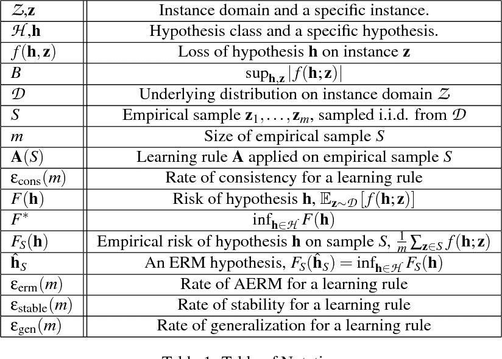

“规则是风险最小化器”如果它能够最小化经验风险

\= \= inf

其中 \= 被称为“最小经验风险”。鉴于有多个假设最小化经验风险的可能性，不涉及某个特定假设，并且可能存在多个规则都是“ERM”。

因此，“规则 A”可以被断定为在分布 D 下以速率“(渐近经验风险最小化器)”时：

“`ES∼Dm`

学习规则可以被认为是在“所有分布下”以“速率”进行“普遍 AERM”，如果它在所有分布下以“速率”进行 AERM。学习规则可以被认为是以“速率”进行 AERM，如果对于任何大小为 的样本都成立 ≤ 可以得出结论，“规则在分布 D 下以速率泛化，如果对于所有 其中 规则以速率泛化，如果它在所有分布 D 上以速率泛化

“`ES∼Dm − ≤`

## 一致收敛对可学习性的影响

如果假设类中假设的经验风险以分布无关的速率一致收敛到其总体风险，则认为一致收敛适用于学习问题：

`sup_D E_{S∼D^m}[sup_{h∈H} |F(h)−F_S(h)|] → 0` as `m→∞`

很容易证明，如果一致收敛成立，则该问题可使用 `ERM` 学习规则被视为可学习。

## VC 维度和二元分类

1971 年，Chervonenkis 和 Vapnik 证明了对于二元分类问题，其中 `Z = X × {0, 1}`，每个假设是从 `X` 到 `{0, 1}` 的映射，且 `f(h; (x, y)) = 1{h(x)≠y}`，一个简单的组合度量即 `VC dimension` 的有限性表明了一致收敛。

此外，还可以确认，在分布无关的意义上，具有无限 `VC-dimension` 的二元分类问题无法被学习。作为学习的必要且充分条件，这确定了具有有限 `VC-dimension` 的情况，因此是一致收敛。

## 扩展到回归

这种表征也可以扩展到“回归”技术，即“平方损失回归，其中 `h` 现在是实值函数，且 `f = −`。具有“所有有限尺度上的有限 fat-shattering dimension”的性质可以替代具有“有限 VC 维度”的性质，但基本等价性仍然包含，然而，只有在存在一致收敛的情况下问题才能被学习。这些发现通常基于对二元分类的合理归约。即使如此，所观察到的“一般学习设定”并不像分类和回归那样具体，包括难以将分类简化为二元分类的场景。

## 严格一致性

1998 年，Vapnik 试图描述“在一般学习设定中，使用 `ERM` 学习规则的可学习性等价于一致收敛”，以加强一致收敛在此设定中的必要性，同时指出该结果可能不适用于“平凡”情况。具体来说，涉及“任意学习问题，其假设类为 `H` 并向 `H` 添加单个假设 `h̃` 使得 `f < inf f` 对所有 `z ∈ Z` 成立”的情况，如下图所示。这种学习问题可以被“平凡地”使用“`ERM` 学习规则”学习，该规则始终选择 `h̃`。尽管如此，“`H`”可以是任意复杂且无先验假设且无一致收敛的。必须注意，这不适用于二元分类模型，其中 `(h; (x, y)) =` 因为在任何情况下都存在假设使得 `= f` 因此，如果是高度复杂且具有无限“`VC dimensions`”，则多个假设将在任何给定训练数据集上具有“0”经验误差。


为了消除此类“平凡”场景，Vapnik 引入了“严格一致性”的概念作为一致性的更稳健版本。它用下面的方程定义，其中收敛在概率内。

`∈ R, inf − inf`

其思想是 `ERM` 的经验风险对于最小潜在风险的收敛至关重要，即使在移除风险低于阈值的“好”假设之后。Vapnik 成功证明了 `ERM` 的这种“严格一致性”确实等价于概率意义下的均匀收敛，如下所示。

`sup (F(h) − F_S(h)) → 0` as `m→∞`

这项研究表明，除平凡情况外，一致收敛性质确实表征了可学习性，至少在使用 `ERM` 学习规则时如此。

## 无需一致收敛的可学习性

“随机凸优化”或无需一致收敛的可学习性问题可以被视为上面解释的“通用学习设定”的一种特例，其中包括额外的限制，即“目标函数对每个 `h` 都是 Lipschitz 连续且凸的，并且 `H` 是闭的、凸的且有界的”。其中是希尔伯特空间的子集的问题将在此处讨论。

一个特例是“熟悉的线性预测设定，其中 `z = y` 是一个实例-标签对，每个假设 `h` 属于希尔伯特空间的子集 `H`，并且 `f y) = l( , y)` 对于某个特征映射 `φ` 和损失函数 `l : R × Y →` 而言成立，该损失函数关于其第一个参数是凸的”。

该设定已成功建立，其中对的随机依赖是线性的，类似于前一个示例，已成功建立。当“域 `H`”和“映射 `φ`”有界时，存在一致收敛，这意味着 `−` 在总体 `∈ H` 上一致有界”。这种对的一致收敛验证了经验最小化器 `=arg` 的选择，并确保期望值收敛到最优值 `= inf h`

尽管对“`h`”的依赖是非线性的，但在使用“覆盖数论证”的情况下，只要“`H`”是有限维的，仍然可以建立一致收敛。不幸的是，如果我们进入无限维假设，一致收敛可能不会发生，并且经验最小化可能无法赋予算法学习能力。

值得注意的是，这并不意味着问题可以被视为“不可学习”。可以证明，有了正则化机制，即使一致收敛不存在，也能开发出一种学习算法来解决任何“随机凸优化”问题。该机制直接与稳定性原理相关。

例如，让我们看一下下面图片中给出的方程所表示的“凸随机优化”问题，其中对于此示例将是单位球 `H = : | ≤1”`，其中 `α ∈ 0,` 和 `∈ H”`，并且“`u ∗ v`”可以定义为逐元素乘积。

![现在，考虑一系列学习问题，其中 `=` 对于任何样本大小都成立，并建立“无法期望与维度无关的收敛速率”。此情况可以形式化为无限维。该方程中的学习问题可以被视为“寻找 `x ∈` 上未知分布的中心的问题，其中还提供了逐坐标的随机置信度度量”。目前，我们将关注某些坐标缺失的场景，即 `=`通过考虑下面给出的分布 over `α): x =` 的概率为 1，并且是均匀分布的。也就是说，是独立同分布的均匀“伯努利”。对于随机样本 `)”` 如果“`d >` 则这是概率大于“`1 − > 0.63”` 的结果，并且存在一个坐标 `∈ 1 . . . d”` 使得样本中的所有“置信向量在该坐标上均为“0” 即 `=` 对于所有 `=` 假设 `∈ H”` 是对应于该坐标的“标准基向量”。那么在下面图片中显示的方程中，`(·)”` 表示关于 `(·)”` 的经验风险。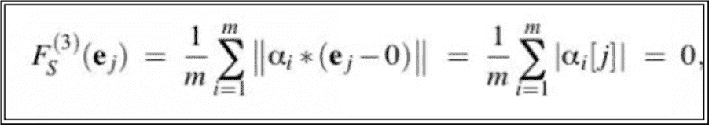

在另一个场景中，如果 `(·)”` 表示函数的实际风险，则得到下面图片中显示的方程。

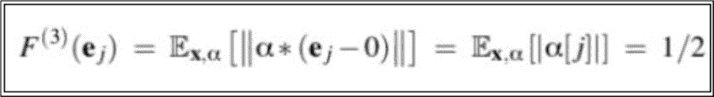

在任何给定的样本大小 ‘`m,`’ 中，都可以构造一个在足够高维度上的凸 ‘Lipschitz 连续目标’。该构造确保在样本上以至少 ‘`0.63`’ 的概率，‘`suph |F(3) (h)−F(3) (h)| ≥ ½.`’ 此外，由于 ‘`f (·; ·)`’ 为非负，‘`ej`’ 可以被识别为 ‘经验最小化器’，尽管其期望值 ‘`F (3) (ej) = ½,`’ 与最优期望值 ‘`minh F(3) (h) = F(3) (0) = 0.`’ 并不一致。”

为了阐明此场景而不依赖于样本大小，让我们考虑“`H`”为无限维希尔伯特空间中的单位球，其具有标准正交基，其中对于其坐标用相对于该基表示。 “置信度函数作为将每个坐标映射到区间 `[0,1][0,1]` 的映射，表示 `[0,1][0,1]` 中的无限实数序列。乘积运算的定义基于此映射，并且方程的目标函数（描绘在此示例的第一张图片中）可以在此无限维空间中直接定义。

让我们重新考虑分布 over 其中和 `α` 是无限、独立且同分布的均匀伯努利随机变量序列（即伯努利过程，每个 `αi` 均匀分布在 `{0,1}{0,1}` 上且与其他所有独立。可以推断，对于任何有限样本，很可能找到一个坐标 `j` 使得对于所有 和因此，可以获得具有的经验最小化器。

因此，很明显经验值在收敛时不是一致的，并且经验最小化并不能确保学习问题的解决方案。此外，人们可能产生一个更尖锐的反例，其中“唯一的经验最小化器与最优期望值相差甚远。为了实现这一点，必须增加一个小的项来确保其经验最小化器是唯一的并且不太接近原点。考虑下面的方程，其中

`=` 

目标仍然是凸的，并且“`1 + ε`”保持其 Lipschitz 属性。此外，由于添加的项是严格凸的，因此“`f(4)(h;z)`”关于“`h,`”变得严格凸，解释了经验最小化器的唯一性。

在“`z: x = 0`”的相同分布下，“`α[i]`”独立同分布为均匀 0 或 1，“`FS(4)(h)`”的最小化器被称为经验最小化器，受约束“`|h| ≤ 1.`”的限制。积极的一面是，虽然求解此约束优化问题很复杂，但并非强制。足以证明“无约束优化问题 `h∗UC = arg minFS(4)(h)` 的最优值（无约束 `h ∈ H)`。

其范数 `≥`

需要注意的是，在无约束问题中，其中 `αi[j] = 0` 对于所有 `i = 1…n`，只有 `f (4)` 的第二项依赖于 `h[j]`，并且我们有 `h∗UC[j] = 1`。对于某些坐标 ‘`j`’，出现这种情况会导致约束优化问题的解位于 `H` 的边界上，表示为 `|hˆS| = 1`。此条件可以用下面图片中显示的方程表示，同时确保 `F∗ ≤ F(0) = ε`。

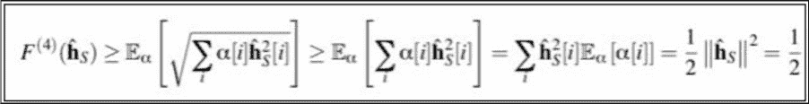

# 第 5 章：数据科学生命周期与技术

术语 `data science` 可追溯至 1960 年，由 `Peter Naur` 提出，他最初将其与计算机科学互换使用，后来引入了 `datalogy`。1974 年，Naur 在其著作 `Concise Survey of Computer Methods` 中大量使用了该术语。数据科学的当代定义于 1992 年在 `The Second Japanese-French Statistics Symposium` 提出，认为这是一个关注数据类型、维度和结构的新兴学科。

数据被定义为由计算机处理和存储的信息，充斥着我们的数字生活。从网站点击到智能手机持续的位置追踪，我们的世界沉浸在数据之中。从这些庞大数据中提取解决方案需要 `data science` 这一过程，其中见解是通过数学方程和统计学从可测量的数据中得出的。数据科学家的角色多样，常被误认为是计算机科学家或统计学家。任何个人或公司，只要深入挖掘大量数据以获取信息，都可被称为数据科学从业者。例如，像 `Amazon` 和 `Target` 这样的公司会追踪线下和线上购买行为以提供个性化推荐。像 `Twitter` 和 `Instagram` 这样的社交媒体平台会分析用户提供的数据，识别全球迁移模式。

## 数据科学生命周期

结构化数据科学项目的推荐生命周期是 `Team Data Science Process` (`TDSP`)，广泛用于涉及人工智能或机器学习算法的项目。它可适应 `exploratory data science` 和 `ad hoc analytics` 项目。`TDSP` 是一种敏捷的顺序迭代，指导在公司生产环境中部署预测模型的任务。团队内部以及与利益相关者之间的有效沟通对于项目的顺利执行至关重要。

`TDSP` 的基本组成部分包括：

### 数据科学生命周期的定义

`TDSP` 生命周期有五个主要阶段：`Business understanding`、`Data acquisition and understanding`、`modeling`、`deployment` 和 `customer acceptance`。每个阶段的进一步细节将很快提供。

### 标准化项目结构

共享的目录结构和模板可方便团队成员快速访问项目文档。采用 `TFS`、`Git` 或 `Subversion` 等版本控制系统可增强团队协作。像 `JIRA`、`Rally` 和 `Azure DevOps` 这样的敏捷项目跟踪系统存储业务需求、任务和功能，有助于资源和成本估算。在版本控制系统上为每个项目创建单独存储，促进有效管理和团队协作。在整个组织中标准化项目结构可建立机构知识库。

### 数据科学项目的基础设施和资源

`TDSP` 推荐使用 `machine learning service`、数据库、`big data clusters` 和基于云的系统等工具来存储数据集。无论是基于云还是本地部署，基础设施都支持可重复性，防止数据重复和冗余。特定的权限和活动跟踪可确保团队成员安全访问资源。


### 项目执行的工具和实用程序

在组织流程中实施变更可能具有挑战性。`TDSP` 提供了工具来自动化诸如 `data exploration` 和 `baseline modeling` 等基本任务。定义良好的结构便于将共享工具和实用程序贡献到团队的 `shared code repository`，促进重用和节省成本。

基于微软最佳实践和结构的 `TDSP` 生命周期，作为有效团队协作和沟通的标准化模板。它包含一系列实践，以成功交付预测分析解决方案和智能应用。

`TDSP` 生命周期中每个阶段的细节，包括 `Business understanding`、`Data acquisition and understanding`、`modeling`、`deployment` 和 `customer acceptance`，将进一步探讨。

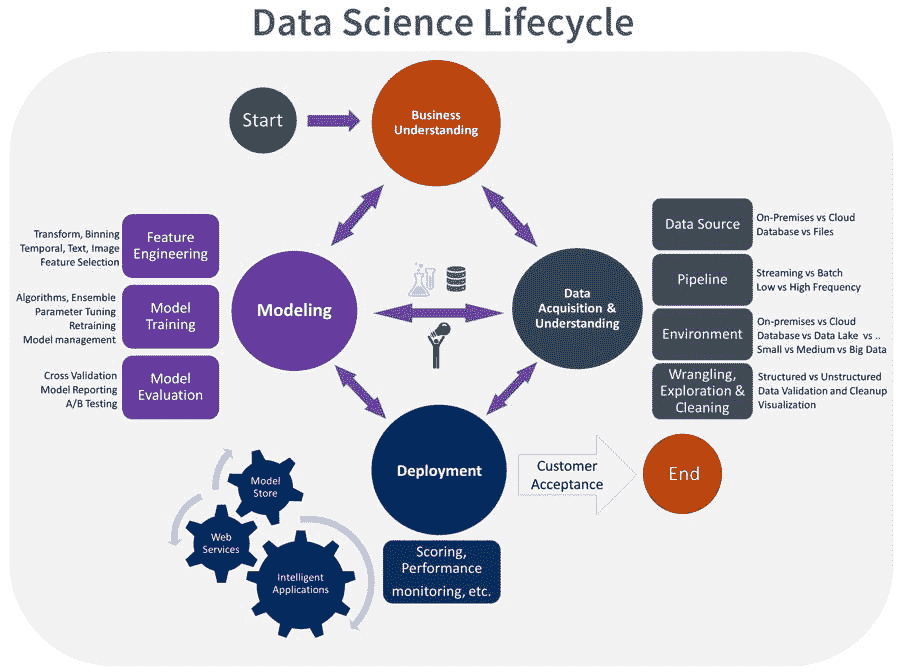

## 阶段 I – 业务理解

初始阶段旨在收集并深入研究被标记为模型目标的关键变量。与这些变量关联的指标将在决定项目的整体成功方面发挥关键作用。本阶段的另一个重要目标是确定公司已拥有或可能需要获取的必要数据源。本阶段必须完成两个主要任务：`defining objects and identifying data sources`。

### 本阶段需生成的交付物

`Charter document` – 这是一份 `living document`，需要在项目持续期间根据新的项目发现和不断变化的业务需求进行定期更新。`TDSP` `project structure definition` 提供了一个标准模板。在项目过程中逐步通过添加更多细节来完善此文档至关重要，同时及时让利益相关者了解所有修改。

`Data sources` – 位于 `TDSP` `project data report folder` 中的数据源可在 `Data Definitions Report` 的 `Raw Data Sources` 部分访问。该部分不仅指定原始数据的初始和最终位置，还提供诸如将数据传输到任何所需环境的 `coding scripts` 等附加详细信息。


`Data dictionaries` – 由利益相关者提供的有关数据特征和特性的描述，例如 `data schematics` 和可用的 `entity-relationship diagrams`，记录在数据字典中。

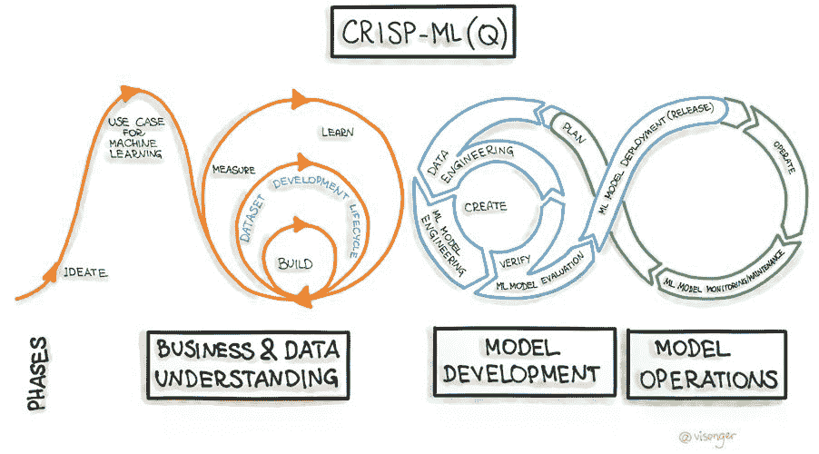

## 第二阶段 – 数据获取与理解

本阶段的目标是生成一个高质量的处理数据集，使其与模型目标具有明确的关系，并确定数据集在所需分析环境中的位置。此外，开发数据管道的“解决方案架构”以实现数据的定期更新和评分也至关重要。本阶段需要完成三个主要任务：`Data Ingestion`、`Data Exploration` 和 `Data Pipeline Setup`。

### 数据摄取

此阶段涉及设置将数据从源位置传输到目标位置所需的过程。目标位置的确定基于便于分析活动（如训练和预测）的环境。

### 数据探索

在数据集可用于训练数据模型之前，必须对其进行清理以去除不一致和错误。为了评估数据质量并收集在建模前处理数据所需的信息，应采用数据汇总和可视化等工具。鉴于该过程的重复性，可以使用名为 `IDEAR` 的自动化工具，该工具由 `TDSP` 提供，用于数据可视化和创建数据汇总报告。实现处理数据的满意质量后，可以观察到固有的数据模式，有助于为目标选择和开发合适的 `predictive model`。此时至关重要的是评估是否有足够数量的数据来启动建模过程，建模过程是迭代的，可能需要识别新的数据源以提高相关性和准确性。

### 设置数据管道

为了补充数据建模的迭代过程，必须通过设置 `data pipeline or workflow` 来建立对新数据进行评分和刷新现有数据集的标准流程。数据管道的解决方案架构应在该阶段结束前开发完成。根据业务需求和限制，可以使用三种类型的数据管道：`batch-based`、`real-time or streaming` 和 `hybrid`。

### 本阶段的交付成果

**Data Quality Report:** 该报告必须包括 `data summary`、业务需求与其属性之间的关系、变量排名等其他细节。`TDSP` 提供的 `IDEAR` 工具能够以关系表、CSV 文件或任何其他表格数据集等多种格式生成数据质量报告。

**Solution Architecture:** 对用于在模型构建后对新数据进行评分和生成预测的数据管道的描述或图表被称为 `solution architecture`。该图表还可以概述基于新数据 `retrain` 模型所需的数据管道。

**Checkpoint Decision:** 在开始实际的模型构建过程之前，必须重新评估项目以确定是否能够实现预期价值。这些评估也被称为 `Go or No-Go` 决策。

## 第三阶段 – 建模

本阶段的目标是为机器学习模型识别 `optimal data features`，确保其信息量足够准确预测目标变量，并且可以在生产环境中部署。本阶段的三个主要任务是：`Feature Engineering`、`Model Training` 和 `Determination of Model Suitability for the Production Environment`。

### 本阶段的交付成果

**Feature Sets:** 该文档包含数据定义报告中 `feature sets` 部分描述的所有特征。程序员在编写所需代码并根据文档中提供的描述开发特征时 heavily 使用它。

**Model Report:** 该文档必须包含每个被评估模型的详细信息，遵循标准模板报告。

**Checkpoint decisions** – 必须根据不同模型的性能做出将模型部署到生产环境的决定。

## 第四阶段 – 部署

本阶段的目标是在最终将模型部署到生产环境之前，将解决方案模型引入类似生产的较低环境，例如预生产环境和用户验收测试环境。本阶段需要完成的主要任务是 `operationalization of the model`。

### 运营化模型

一旦获得了一组具有预期性能水平的模型，这些模型就可以为其他适用应用进行运营化。根据业务需求，预测可以实时进行或按批进行。为了部署模型，它们必须与开放的 `Application Programming Interface` (`API`) 集成，以便模型能够根据需要与其他所有应用程序及其组件进行交互。

### 本阶段需创建的交付成果

使用关键绩效指标和指标来评估系统健康状况的仪表板报告。

一份包含最终模型部署计划详细信息的文档或运行手册。

一份包含最终模型解决方案架构的文档。

## 第五阶段 – 客户验收

本阶段的目标是确保项目的最终解决方案满足利益相关者的期望并满足在数据科学生命周期第一阶段收集的业务需求。本阶段必须完成的两个主要任务是 `system validation and project hand-off`。

### 本阶段需创建的交付成果

本阶段创建的最重要文档是面向利益相关者的，称为 `exit report`。该文档包含项目的所有可用细节，这些细节对于理解系统的运行至关重要。`TDSP` 为 `exit report` 提供了标准化模板，可轻松定制以满足特定的利益相关者需求。

## 数据科学的重要性

利用机器学习算法分析和仔细审视数据趋势和模式的能力，使得数据科学在网络安全领域得到了显著应用。借助数据科学，公司不仅可以识别发起网络攻击的具体网络终端，还可以预测对其系统可能发生的未来攻击，并采取必要措施防止攻击发生。能够监控任意网络上的用户和设备并标记任何异常活动的“主动入侵检测系统”的使用，成为对抗黑客和网络攻击者的有力武器。与此同时，利用机器学习算法对历史数据进行分析以检测潜在安全威胁的“预测性入侵检测系统”，则成为抵御网络掠食者的有力盾牌。

网络攻击可能导致无价的数据和信息丢失，对组织造成极大损害。为了保护数据集，可以使用复杂的加密和复杂的签名来防止未经授权的访问。数据科学可以帮助开发这种坚不可摧的协议和算法。通过分析不同工业部门公司之前网络攻击的趋势和模式，数据科学可以帮助检测最常被攻击的数据集，甚至预测潜在的未来网络攻击。公司严重依赖由其客户生成和授权的数据，但在网络攻击日益增多的情况下，客户对个人信息被泄露极其警惕，并希望将业务转移到能够通过实施先进的数据安全工具和技术来保证其数据安全和隐私的公司。这正是数据科学成为公司的救星，帮助他们加强网络安全措施的地方。


数据科学使得先进机器学习算法的使用成为可能，这些算法在多个工业领域具有广泛的适用性。例如，自动驾驶汽车的开发，它们可以使用先进的摄像头和传感器收集实时数据来创建周围环境的地图，并对车辆速度和其他驾驶操作做出决策。公司总是渴望更好地了解客户的需求。这现在可以通过从现有来源收集数据来实现，例如客户的订单历史、最近查看的商品、性别、年龄和人口统计数据，并在此数据上应用先进的分析工具和算法以获得有价值的见解。利用机器学习算法，系统可以为个人客户生成更准确的产品推荐。聪明的消费者总是寻求最具吸引力和增强的用户体验，因此公司可以使用这些分析工具和算法获得竞争优势并发展业务。

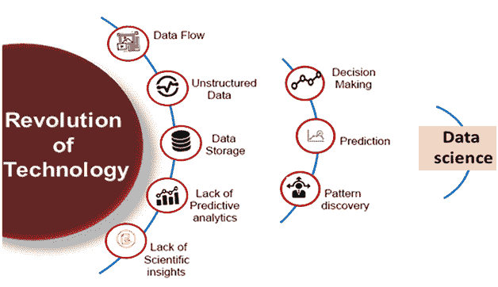

## 数据科学策略

数据科学通过采用“预测性因果分析”、“规范性分析”和机器学习进行精确预测，在决策中发挥着至关重要的作用。

### 预测性因果分析

预测性因果分析涉及开发能够准确预测和预测特定未来事件发生的可能性的模型。例如，金融机构使用这些工具通过分析借款机构的付款历史来评估客户拖欠信用卡付款的风险。

### 规范性分析

规范性分析在创建能够使用动态参数学习并做出独立决策的智能工具和应用程序方面具有重要作用。例如，自动驾驶汽车收集与驾驶相关的数据来训练自己以做出更好的决策。

### 机器学习

机器学习对于基于交易数据预测未来趋势至关重要。本书中进一步阐述的监督式机器学习被用于分析历史数据以识别欺诈交易的欺诈检测系统。

无监督机器学习采用聚类等算法，有助于开发模式发现模型。电信公司经常使用聚类来扩展网络，通过识别最佳信号强度位置。

## 人工智能

尽管人类声称由于智力而优越，但定义人类智力是复杂的。心理学家将其描述为学习经验、适应、理解抽象概念、推理、解决问题、语言使用和感知等能力的综合。

人工智能（AI）是开发类人机器的科学，例如数字计算机或机器人，能够模仿人类智能、适应新输入并执行任务。人工智能的核心目标是学习、推理和感知。

人工智能一词诞生于 1956 年，但艾伦·图灵在 20 世纪中叶的工作奠定了基础。图灵的通用图灵机概念是现代计算机的基础，强调从经验中学习和启发式问题解决。

20 世纪 50 年代的人工智能研究侧重于问题解决和符号方法。到 20 世纪 60 年代，美国国防部旨在训练计算机模仿人类推理。DARPA 的成就，包括 2003 年的智能个人助理，为现代自动化铺平了道路。

#### 人工智能模仿的核心人类特征

**知识：** 机器需要大量数据和信息才能进行类人操作。

**学习：** 人工智能采用试错、机械学习和泛化。

**问题解决：** 系统性地达到目标的过程，例如手段-目的分析。

**推理：** 演绎推理和归纳推理，这是人工智能的挑战。

**感知：** 创造对环境的感知，这是人工智能的突破。

## 商业智能 vs. 数据科学

数据科学是跨学科的，应用数学算法从原始数据中提取洞察。商业智能（BI）使用分析工具来理解公司的当前状态和历史表现。虽然 BI 提供回顾性智慧，但数据科学更具前瞻性，专注于预测性和规范性分析。

数据科学处理庞大的原始数据以进行未来预测，并通过数据驱动工具自动化 BI 任务。根本区别在于所解决的问题：数据科学探索事件为何发生及其未来是否会再次发生，而 BI 则关注事件中发生了什么以及什么改变可以修复它们。

传统上，BI 需要计算机科学专业知识，但数据科学使其对非技术用户变得可访问。数据科学家将数据操作化，而 BI 专家则协作开发最优数据模型和解决方案。与 BI 不同，数据科学采用内置机器学习库，将业务分析转变为更民主和先进的领域。

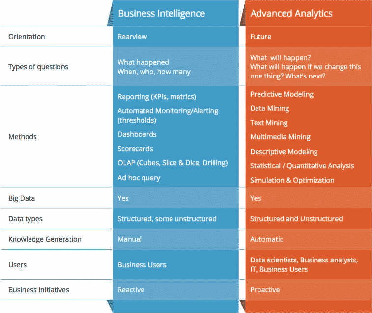

## 数据挖掘

数据挖掘是从海量数据中探索和分析以提取有意义的模式和规则的过程，属于数据科学的范畴。它广泛用于开发基于人工智能的机器学习模型，例如搜索引擎算法。虽然在数据中发现隐藏模式的概念长期以来以“数据库知识发现”术语存在，但“数据挖掘”一词是在 1990 年代创造的。

根据 SAS 的说法，90% 的数字宇宙由非结构化数据组成。数据挖掘技术的应用有助于过滤冗余和不必要的噪声数据，从而更清晰地理解对即时决策至关重要的相关信息。

数据挖掘包含三个相互关联的学科：统计学（数据关系的数学研究）、机器学习算法（具有学习能力的算法）和人工智能（表现出类人智能的机器）。随着大数据时代的到来，得益于相对更便宜的高级计算能力，数据挖掘技术已发展以跟上其无限潜力。

### 数据挖掘趋势

计算速度提升：随着大数据量和复杂性的增长，数据挖掘工具需要更强大、更快的计算机。超级计算机变得必要以便高效分析不断扩大的大数据。

语言标准化：数据科学社区正在积极努力为数据挖掘过程标准化一种语言。此举旨在让分析师通过掌握单一标准数据挖掘语言，方便地使用各种数据挖掘平台。

科学挖掘：数据挖掘技术在工业界的成功吸引了科学和学术研究界的关注。例如，心理学家使用关联分析来捕捉和识别人类行为模式以供研究目的。

网络挖掘：网络挖掘涉及使用类似于数据挖掘的技术在互联网上发现隐藏的数据模式。例如，亚马逊使用网络挖掘来了解客户互动并增强其网站和移动应用程序的用户体验。

### 数据挖掘工具

一些广泛使用的数据挖掘工具包括：

Orange：一种用 Python 编写的开源组件化软件，经常用于基础数据挖掘分析。

RapidMiner：一种用 Java 编写的开源组件化软件，常用于预测分析，并提供集成环境用于机器学习、深度学习和文本挖掘。

Mahout：一种主要用于无监督学习过程的开源平台，由 Apache 开发。它用于开发用于聚类、分类和协同过滤的机器学习算法。

MicroStrategy：一种商业智能和数据分析软件，可补充所有数据挖掘模型，提供各种驱动程序和网关以连接企业资源并分析复杂的海量数据。

## 结论

感谢您阅读完《机器学习的数学基础：通过数据科学学习深度学习》。我们希望它为您提供了实现目标所需的工具。下一步是将您新获得的关于机器学习数学和统计工作原理的智慧付诸实践。理解这些概念对于驾驭第四次工业革命至关重要，在这次革命中，机器目前由人类以有限的方式操作，正在过渡到机器可能与人类无法区分的世界。这种转变由机器学习驱动，而您对统计学习框架的理解是成功的关键。

成为机器学习专家不仅需要编程技能，还需要扎实的统计和数学概念理解。本书简化了统计学习框架的解释以便于理解。开发成功的机器学习算法的一个关键方面是训练数据集的质量和生成，以及算法对其的可学习性。凭借这一知识，您已完全具备设计针对业务需求量身定制的机器学习算法的能力。无论您是软件开发者，旨在创建下一个可以从开放数据中学习的应用，还是与“亚马逊 Alexa”和“苹果 Siri”竞争，本书都为您提供了先发优势。
