# 机器学习的数学优化

## 概述

## 前言

数学优化通常关注准确性、计算效率和稳健性，而机器学习（ML）旨在从真实数据集上获得有效结果，特别关注泛化性、稳健性和恢复能力（例如对输入扰动的抵抗能力）。到为止，这两个领域之间的联系一直较为松散：从机器学习的角度来看，优化是执行学习任务的工具；而从优化的角度来看，机器学习只是另一个应用。这一点从事实中看出，尽管随机梯度下降的某些变体（例如开箱即用的 `Adam`）在理论上并不能证明许多机器学习方法应用的合理性，但它们在机器学习中仍是首选方法。另一方面，数学优化经常研究机器学习任务的逼近属性，但到为止尚未开发出专门针对机器学习需求（如泛化或稀疏性）的优化方法。因此，缺乏能够以所需效率处理机器学习问题的先进优化技术，也缺乏对优化进行基于学习的改进方法。将数学优化的视角与机器学习方法相结合，可以产生新的方法并造许多现有方法。例如，无监督学习中预测聚类成员身份的问题可能会从优化视角得到极大帮助；毕竟，与其他许多数据科学方法一样，该问题可以被看作是在某些约束条件下最大化一个（复杂的）函数。作为补充，机器学习可以用于调优优化方法或开发代理模型。在跨行业的许多现实应用中，它对下游决策和更通用的决策支持系统具有巨大影响。

2023 年夏天，作为卓越集群 MATH+的一部分，以“机器学习的数学优化”为主题的主题爱因斯坦学期（Einstein Semester）举行，其明确目标是促进机器学习社区与数学优化社区及方法论之间的联系。除了特别讲座、暑学校和研讨会，还举办了三个关于数学优化和机器学习的工作坊和一个总结会议。学期涵盖了广泛的数学方法，从连续优化主题扩展到实际机器学习应用。组织者邀请了来自全球的 200 名科学家讨论该主题。除了知识交流外，目标还在连接年轻研究人员和学生。

本论文集包含了该专题学期参与者的入选贡献，将对该主题的各个方面提供见解。所收论文分为三部分：

### 科学与工程应用中的机器学习

此部分包含了将机器学习应用于物理、控制系统和数学建模的论文。

*   使用自适应有限元和神经网络求解参数化偏微分方程（PDEs）反问题的框架。
*   用于双层最优控制的价值函数数据生成及其在混合电动汽车中的应用。
*   通过血流模拟预测中风的图神经网络。
*   利用成员函数捕捉分子动力学的宏观行为。
*   用于反问题的自适应梯度增强高斯过程代理模型。

### 机器学习与控制中的优化

该组关注神经网络训练、控制系统和算法进展中的优化技术。

*   基于多保真域分解的用于时间依赖问题的物理信息神经网络和算子。
*   基于活动签名方法的约束分段线性优化。
*   神经网络训练中的并行置信区域方法。
*   可信优化学习：简述。
*   使用 Frank–Wolfe 进行感知压缩的神经网络训练。

### 优化算法的理论基础

此部分强调对优化算法、正则性和基础分析的理论探索。

*   通过矢量拟合（Vector Fitting）对广义频率响应函数进行逼近。
*   关于不同绝对值表示的非光滑正则性条件 LIKQ。
*   固定步长的 ADAM 算法的发散性：一个（非常）简单的例子。

柏林，2025 年 2 月

Konstantin Fackeldey

Aswin Kannan

Sebastian Pokutta

Kartikey Sharma

Daniel Walter

Andrea Walther

Martin Weiser

## 感谢

我们感谢所有贡献作者和专题爱因斯坦学期的参与者，感谢 Faisal Shah 提供的 TeX 支持。

本项目由德国科学基金会（DFG）资助，属于德国卓越战略计划 —— 柏林数学研究中心 MATH+ (EXC-2046/1，项目 ID: 390685689)。

# 使用自适应有限元和神经网络求解参数化偏微分方程反问题的框架

Alexandre Caboussat Maude Girardin Marco

### 摘要

参数识别在许多过程中至关重要，并能从简化模型中获益。我们在这里介绍一个求解参数化方程反问题的框架。简化模型建立在神经网络的基础上。训练数据得益于自适应有限元。反问题旨在利用可用数据识别参数。相应的优化问题通过粒子群求解。文中给出了数值结果。

关键词：有限元法、参数化偏微分方程、神经网络、自适应网格细化、反问题

## 1. 引言

我们考虑定常或演化的参数化微分方程：

```
\mathcal{F}(u(x; \mu)) = 0 \quad x \in \Omega, \mu \in \mathcal{P}
```

```
\mathcal{F}(u(x, t; \mu)) = 0 \quad x \in \Omega, t \in [0, T], \mu \in \mathcal{P}
```

其中 $\Omega \subseteq \mathbb{R}^d$ ($d \ge 1$) 是物理空间，$\mathcal{P} \subset \mathbb{R}^p$ 是参数空间（$p \ge 1$，可能很大），$\mathcal{F}$ 是某个微分算子。给定在特定（空间或时空）位置 $Y[i]$ 处观测到的解值 $u[i]$（$i=1, \dots, N_{obs}$），目标是确定最优参数 $\mu^* \in \mathcal{P}$，使得目标函数最小：

```
F(\mu) := \frac{1}{N_{obs}} \sum_{i=1}^{N_{obs}} |u(Y[i]; \mu) - u[i]|^\alpha
```

其中 `u(⋅;μ)` 是给定参数值 `μ` 对应参数化 PDE 的解，且 `α` > 0 是给定的（通常 `α` = 1 或 `α` = 2）。我们不考虑数据 `u[i]` 中的噪声，因此也不研究潜在的平滑项。任何用于最小化 `F(μ)` 的优化方法都需要多次计算（其近似值）解 `u(⋅;μ)`。因此，这种评估应当是快速的，这就是构建和使用降阶模型来近似 `u` 的优势所在。根据 PDE 的类型，可以考虑几种降阶建模方法，例如：降阶基 [10]、适当正交分解 [24]、多项式混沌展开 [6] 或神经网络 [8], [11], [25]。

解决非线性优化问题（包括反演问题）需要专门的计算优化方法。其中，我们可以提到牛顿型方法 [7] 或无导数方法 [1], [13], [18], [22]。我们在此特别关注粒子群优化（PSO） [12], [16], [20]。另一方面，在降阶模型中，我们在这里考虑数据驱动的前馈神经网络 [4], [8]，以便构建一个 `u` 的神经网络近似 `u𝒩`，并用于解的直接评估。自适应网格细化技术用于生成训练数据 [23]，这允许在参数空间内均匀地控制训练数据的精度 [3]。有限元模拟以及神经网络的训练都在 `offline`（离线）阶段完成，这可能非常耗时，但只需执行一次。一旦训练完成后，可以在 `online`（在线）阶段高效地评估以求解参数问题。

本文工作的组织结构如下：有限元-神经网络模型在第 2 节总结；第 3 节描述了反演问题的求解方法，包括基于牛顿法或 PSO 的优化框架；包括椭型和双型 PDE 的数值实验在第 4 节给出。

## 2 用于正向问题的自适应有限元—神经网络方法

让我们简要回顾在第 2], [3] 中提出的用于正向问题的数值方法 (1.1)。类似于在第 4 中，我们用 `Υ(W, L)(σ; d[in], d[out])` 表示输入维度为 `d[in]`、输出维度为 `d[out]` 且包含 `L` 个层（每层由 `W` 个具有 `σ` 激活函数的神经元组成）的全连接前馈神经网络集合。我们在这里考虑一个神经网络 `𝒩 ∈ Υ(W, L)(σ; d[in], 1)` 来近似映射 `(Y;μ) ↦ u(Y;μ)`，如果 `Y` 代表空间坐标 `x ∈ Ω`，则 `d[in] = p + d`；如果 `Y` 代表时空坐标 `(x, t) ∈ Ω × (0, T)`，则 `d[in] = p + d + 1`。一旦其训练参数 `θ` 固定，网络给出 `u` 的近似 `u𝒩(⋅θ): d[in] → d[out]`。训练过程如下：

1. 随机选择训练参数 `{μ_j=1}^N_train ⊆ P`。
2. 对于每个 `{μ_j}`，设置 `Ω` 或 `Ω × [0, T]` 的适当离散化，并计算 `u(⋅;μ_j)` 的有限元近似 `u_h(⋅;μ_j)`。为了实现这一点，使用适当的后验误差分析来估计局部误差，并迭代地获得平衡所有有限元（以及时间步）误差的最优网格。这确保了所有数值解的精度接近预设的 `ε`，但意味着计算有限元解 `u_h(⋅;μ_j)` 的离散化对于每个 `μ_j` 是不同的。
3. 设置神经网络架构，即层数 `L`、每层节点数 `W` 以及激活函数 `σ`。
4. 选择 `𝒩 ∈ Υ(W, L)(σ; d[in], 1)` 的训练参数 `θ` 以最小化：

```
\Phi(θ) = L_{N_{train}}(u_N(⋅;θ); u_h)
```

在这里，对于静态问题，目标函数 `Φ(θ)` 是训练参数上 `||u_h(⋅;μ_j) - u_N(⋅;μ_j;θ)||_{L²(Ω)}` 的平均和；对于演化问题，则是 [2] 中 `||u_h(⋅;μ_j) - u_N(⋅;μ_j;θ)||_{\ell²((0,T);L²(Ω))}` 的影子。我们令 `θ*` 为某些随机梯度下降类型算法获得的参数集，并从现在起 `u𝒩(Y;μ;θ*)` 简单称为 `u𝒩(Y;μ)`。在实践中，Nadam 优化器 [19] 用于后续数值实验寻找 `θ*`。

## 3 参数识别框架

一旦建立了给出 `u` 的近似 `u𝒩` 的神经网络 `𝒩 ∈ Υ(W, L)(σ; d[in], 1)`，即可用于解决反演问题。让我们考虑函数 `u` 在给定观测点 `Y[i]` 处的取值 `u[i]`，`i = 1, ..., N[obs]`。在第 4 节中，点 `Y[i]` 位于空间域 `(x[i], y[i]) ∈ Ω`，或时空域 `(x[i], y[i], t[i]) ∈ Ω × (0, T)`。我们正在寻找最小化以下内容的最优参数 `μ* ∈ `：

(1.4)
```
F(\mu) := \frac{1}{N_{obs}}\sum\limits_{i = 1}^{N_{obs}}\left| u_{\mathcal{N}}(Y_{i};\mu) - u_{i} \right|^{\alpha},
```

其中 `α` = 1 或 `α` = 2。可以使用任何优化算法搜索 (1.4) 的极小值。导数 $\frac{\partial u_{\mathcal{N}}}{\partial \mu}( \cdot ;\mu)$ 通常可以使用自动微分计算 [5]，允许梯度类型的方法。然而，这些方法通常需要一些关于初始猜测选择的先验知识才能收敛。数值实验表明，在参数空间中可能很难均匀地找到这样的初始猜测。另一方面，无导数方法（例如，粒子群优化（PSO）算法 [12], [16], [20]）允许全局优化和更强的鲁棒性。我们首先在这里介绍这两种方法，然后通过几个数值实验对它们阐明它们的行为。

### 3.1 粒子群优化

在无导数方法中，粒子群优化依赖于迭代更新一组粒子，这些粒子单独和整体地演化以寻找函数的全局极小值。这种方法被证明对于函数非凸且可能存在多个局部极小值的全局优化问题非常适用且鲁棒。其核心思想是在每次迭代中，在考虑每个粒子的当前位置同时也考虑整个群体的位置，来更新每个粒子的解。

我们在 ℝ^(*p*) 中初始化 `N`[`part`]` 粒子，并让它们的位置演化以寻找 (1.4) 的极小值。在迭代 `K + 1` 时，粒子 `i` 的位置为：

```
\mu_{i}(K + 1) = \mu_{i}(K) + v_{i}(K + 1) \in \mathbb{R}^{p},
```

其中速度 `v``i` = (`v``ij`)`[`j` = 1]`(*p*)` 的分量为：

(1.5)
```
v_{ij}(K + 1) = \omega(K)v_{ij}(K) + c_{1}(K)r_{1j}(K)\left( \nu_{ij}(K) - \mu_{ij}(K) \right) + c_{2}(K)r_{2j}(K)\left( {\widehat{\nu}}_{j}(K) - \mu_{ij}(K) \right).
```

在 (1.5) 中，`r`[`kj]` 是在 (0,1) 上均匀分布的随机数，`ν``i` = (`ν``ij`)`[`j` = 1]`(*p*) 表示粒子 `i` 在之前的迭代中达到的最佳位置，$\widehat{\nu}$(`K`) = $\widehat{\nu}$(`K`)$[`j = 1]$ 表示所有粒子中的最佳位置。正如 [14], [17] 所示，我们在迭代 0 ≤ `K` ≤ `K[max]` 使用变动的系数 `ω`、`c[1]`、`c[2]`：

```
c_{i}(K) = (c_{i,F} - c_{i,I})\frac{K}{K_{max}} + c_{i,I},\quad i = 1,2,
\omega(K) = (\omega_{I} - \omega_{F} - 0.2)exp\left( 1 + \frac{K}{K_{max}} \right)^{-1},
```

其中 `c[1, I]` = 2.5, `c[2, I]` = 0.5, `ω[I]` = 0.95, `c[1, F]` = 0.5, `c[2, F]` = 2.5, `ω[F]` = 0.4。后续我们选择 `K[max]` = 100，然后允许算法使用恒定的 `c[1]`、`c[2]` 和 `w` 执行另外 200 次迭代。如果达到最大迭代次数 (300) 或 $F(\widehat{\nu})$ 连续 10 次没有减少，则优化算法停止。粒子的初始位置在 𝒫 中随机选择。在优化过程中，粒子被限制在一个稍微扩展的紧集 $\widetilde{\mathcal{P}} \supset \mathcal{P}$（但不在 𝒫 内），以便恢复位于 𝒫 边界的参数。PSO 算法的实现使用了 PySwarms [15]。

### 3.2 梯度方法

另一种是在参数空间中考虑基于梯度的方法。给定初始猜测 `μ(0)`，我们让粒子的位置演化为：

```
\mu(K + 1) = \mu(K) - \eta(K)\nabla_{\mu}F\left( \mu(K) \right),
```

其中 `η(K)` = `η`∥∇[μ]F(*μ(K))\|⁻¹。与 PSO 算法一样，我们限制迭代 μ(K) 留在 $\widetilde{\mathcal{P}}$ 中。梯度算法的实现依赖于自动微分 [5] 并使用 Tensorflow 实现 [21]。

我们选择 `μ(0)` = `μ*`+`γ*` 作为初始猜测，其中 `μ*` 是精确解，`γ` > 0 表征吸引域的大小。

## 4 数值实验

### 4.1 Poisson 问题

我们考虑的第一个模型是二维参数 Poisson 问题：寻找 `u*(⋅;μ*)` → ℝ 使得


(1.6)
$$
\begin{matrix} 
\left\{ 
\begin{matrix} 
{-\Delta u(x;\mu) = f(x;\mu),\quad} & {x \in \Omega,\quad \mu \in \mathcal{P},} \\ 
{u(x;\mu) = g(x;\mu),\quad} & {x \in \partial\Omega,\quad \mu \in \mathcal{P},} 
\end{matrix} 
\right. 
\end{matrix}
$$

其中 `d` = 2, `Ω` = [0, 10] × [0, 2], `p` = 4, 𝒫 = [1.5, 8.5] × [1, 10] × [100, 1000] × [0.3, 2]。这里，*f* 和 *g* 使得 (1.6) 的精确解 *u* 由以下给出：

$$
\begin{matrix} 
{u(x;\mu) = \frac{\mu_{3}}{\pi\mu_{4}^{2}}\exp\left\{ - 2\mu_{4}^{- 2}\left( {(x_{1} - \mu_{1})}^{2} + \mu_{2}{(x_{2} - 1)}^{2} \right) \right\}.}
\end{matrix}
$$

在这种情况下，`μ[3]` 控制解的幅度，`μ[4]` 控制其支撑集的大小，`μ[1]` 控制其在 `x[1]` 轴上的位置，而 `μ[2]` 控制在该方向上的拉伸。我们考虑以下优化问题（1.4），其中 `α` = 2。我们假设在给定点 `Y[i]` = (`x[i], y[i]`) 上可以获得观测值 `u[i]`，`i` = 1, …, `N[obs]`。为了验证算法，我们首先设置一个最优值 `μ(*)` ∈ 𝒫 和 `u[i]` = `u(Y[i], μ(*))`，`i` = 1, …, `N[obs]`。

为了确保值 `u[i]` 不全接近于零，测量点是在集合 𝒮 : = {(x, y) ∈ Ω : u(x, y; μ(*)) > u[min]} 中按照均匀分布随机选择的。为了进行直接计算，我们使用了神经网络 𝒩 ∈ Υ^(400,4)(σ; 6, 1)，该网络是按照第 2 节所述的方法进行构建和训练的。训练集由来自 4000 个有限元模拟的数据组成，在这种情况下，网络的训练大约需要 2.5 小时。关于网络构建和训练的更多细节，请参考 [3]。

### 4.1.1 采用粒子群优化方法的结果

表 1.1 展示了计算出的 `μ` 的平均值，以及在 10 次 PSO 算法实现的样本上的标准差。测量点是在算法每次实现开始时在 𝒮 中随机选择的；因此，它们在不同实现之间是不同的。算法总在达到最大迭代次数之前就已经停止。

**表 1.1 PSO 算法结果，当 `N[part]` = 40，`N[obs]` = 30，`u[min]` = 1，`α` = 2 且 `μ(*)` 取不同值。**

| `μ(*)` (精确) | `μ(*)` (计算) |
| :--- | :--- |
| (5.5,5.5,550,1.15) | (5.50,5.50,551,1.15)±(0.000356,0.00799,0.463,0.000668) |
| (8.5,1,1000,0.3) | (8.50,0.935,988.5,0.293)±(0.000371,0.00638,5.10,0.000712) |
| (1.5,1,100,2) | (1.50,1.22,102,2.01)±(0.0130,0.107,5.02,0.0629) |
| (5,1,1000,2) | (5.00,1.01,1001,2.00)±(0.00145,0.00412,1.81,0.00209) |
| (5,10,100,0.3) | (5.00,10.2,104,0.306)±(0.000679,0.336,2.86,0.00336) |
| (5,10,1000,1) | (5.00,9.99,1002,1.00)±(0.000657,0.0199,1.15,0.00480) |

注意，表 1.1 第一行的参数位于 𝒫 的中心。所有其他参数位于 𝒫 的边界上，因此更难恢复。我们注意到，即使在这些情况下，`μ(*)` 的恢复精度也良好，且计算之间的变异性很小。图 1.1 显示了在 PSO 算法迭代期间，代价泛函（1.4）的演化，对应算法的 10 次实现和不同的 `μ(*)`。

### 4.1.2 采用梯度法的结果

为了比较 PSO 和梯度下降算法的性能，我们使用相同的参数 `μ(*)` 测试梯度法。`u[i]` 在 10 次实现上的平均值和标准差报告在表 1.2 中。

**表 1.2 梯度算法结果，当 `N[part]` = 40，`N[obs]` = 30，`u[min]` = 1，`α` = 2 且 `μ(*)` 取不同值。**

| `μ(*)` (精确) | `μ(*)` (计算) |
| :--- | :--- |
| (5.5,5.5,550,1.15) | (5.50,5.50,551,1.15)±(0.000356,0.00799,0.463,0.000668) |
| (8.5,1,1000,0.3) | (8.50,0.935,988.5,0.293)±(0.000371,0.00638,5.10,0.000712) |
| (1.5,1,100,2) | (1.50,1.22,102,2.01)±(0.0130,0.107,5.02,0.0629) |
| (5,1,1000,2) | (5.00,1.01,1001,2.00)±(0.00145,0.00412,1.81,0.00209) |
| (5,10,100,0.3) | (5.00,10.2,104,0.306)±(0.000679,0.336,2.86,0.00336) |
| (5,10,1000,1) | (5.00,9.99,1002,1.00)±(0.000657,0.0199,1.15,0.00480) |

图 1.2 和图 1.3 显示了代价泛函在梯度迭代期间的演化。我们观察到梯度方法在速度方面是有效的。但是，如图 1.2 所示，当初始猜测距离解太远时，该方法并不总是收敛到全局最小值。实际上，该方法需要特定的、接近最优值的初始猜测。

因此，出于这些鲁棒性考虑，我们在后续的数值实验中倾向于使用 PSO 方法。注意，只要对 `F`——以及对 `u[𝒩]`——的评估代价太高，就可以采用 PSO 方法。对于此处使用的神经网络来说正是如此。

### 4.2 一个双曲型问题

我们考虑一个二维空间中的参数化传输方程，并设定 `p` = 3。给定 `μ` = (`μ`[1], `μ`[2], `μ`[3]) ∈ 𝒫，该问题涉及寻找 `u`:`Ω`×[0,*T*]↦ℝ

(1.7)
$$
\begin{matrix} 
{\frac{\partial u}{\partial t}(x,t;\mu) + \mathbf{a}(x,t;\mu)\nabla u(x,t;\mu) = 0,\quad x \in \Omega,\quad t \in (0,T),\quad \mu \in \mathcal{P},} 
\end{matrix}
$$

同时对于所有 `x` ∈ `Ω` 和 `μ` ∈ 𝒫，满足初始条件 `u`(`x*`, 0; `μ*`) = `u`0，其中 `Ω` = (0, 4) × (0, 4) 且 `T` = 2|`μ`[1]|¹。向量场 **a** 的选取使得边界处没有入流边界，因此不需要强制执行的边界条件。我们考虑 `μ`[1] ∈ [-2, -0.5] ∪ [0.5, 2], `μ`[2] ∈ [0.15, 0.3], `μ`[3] ∈ [50, 150]，并设定 $\mathbf{a}(x,t;\mu) = \frac{\mu_{1}\pi}{2}\begin{pmatrix} {2 - x_{2}} \\ {x_{1} - 2} \end{pmatrix}$ 以及 $u_{0}(x;\mu) = \tanh( - \mu_{3}\sqrt{(x_{1} - 2)^{2} + (x_{2} - 2.5)^{2}} - \mu_{2})$。

在这种特殊情况下，`μ`[1] 是控制速度的参数，`μ`[2] 表征初始条件 `u`[0] 支撑的大小，而 `μ`[3] 是初始条件的正则化参数。与之前一样，我们假设在给定点 `Y`[*i*] = (`x`[*i*], `y`[*i*], `t`[*i*]) 上可以获得观测值 `u`[*i*]，其中 `i` = 1, …, `N`[*obs*]，且测量中没有噪声。我们首先在目标函数中选择 `α` = 2。为了确保值 `u`[*i*] 能够恢复最优参数，点 `Y`[*i*] 以均匀分布随机选取自集合 {(`x*`, `y*`, `t*) ∈ `Ω` × [0, *T*]: `u`(`x*`, `y*`, `t*`; `μ`^(*)) > `u`[min]} 。对于直接计算，我们使用了按照第 [2] 节所示构建并训练的神经网络 𝒩 ∈ `Υ`^(200, 4)(`σ*`; 6, 1)。更多细节请参阅 [2]。

数值结果如表 1.3 所示，对应两种不同的测量点数量 `N`[*obs*] 和 `μ`(*)。与椭圆型问题一样，我们报告了 PSO 算法在 10 次实现样本上计算出的 `μ` 的平均值和标准差。请注意，除了第一个参数外，所有参数 `μ`(*) 都在 𝒫 的边界上，捕捉起来更具挑战性。在每情况下，算法在达到最大迭代次数之前停止了。

**表 1.3 PSO 算法的结果，对应 `N`[*part*]=200, `u`[min]=-0.9, `α`=2 以及不同的 `μ`(*) 取值**

| `μ`(*) (exact) | `μ`(*) (computed) |
| :--- | :--- |
| `N`[*obs*]=30 | |
| (1.25,0.25,100) | (1.25,0.25,107)±(0.00106,0.000327,13.2) |
| (2,0.3,50) | (2.00,0.300,52.1)±(0.00187,0.000958,3.21) |
| (2,0.15,100) | (2.00,0.150,113)±(0.00261,0.000823,8.56) |
| (0.5,0.3,50) | (0.498,0.302,55.2)±(0.00584,0.00459,22.9) |
| (1,0.2,150) | (1.01,0.209,134)±(0.0273,0.0255,25.3) |
| (0.5,0.15,150) | (0.500,0.151,136)±(0.000745,0.000828,12.3) |
| `N`[*obs*]=100 | |
| (1.25,0.225,100) | (1.25,0.225,100)±(0.0000964,0.000004,0.746) |
| (2,0.3,50) | (2.00,0.300,53.4)±(0.00142,0.000384,5.35) |
| (2,0.15,100) | (2.00,0.150,109)±(0.000451,0.000168,4.37) |
| (0.5,0.3,50) | (0.496,0.302,47.3)±(0.00206,0.00254,5.58) |
| (1,0.2,150) | (1.00,0.201,138)±(0.000731,0.00310,21.3) |
| (0.5,0.15,150) | (0.500,0.151,136)±(0.000745,0.000828,12.3) |

图 1.4 显示了目标函数在 PSO 迭代过程中的演化，对应 10 次算法实现和 `μ`(*)。目标函数的演化方式与椭圆型问题非常相似，分为三个阶段。注意，对于 `μ`(*)=(2,0.3,50) 和 `μ`(*)=(0.5,0.3,50)，参数被精确恢复，但目标函数停留在 10^(-2) 以上，主要是由于神经网络近似引入的误差。对于具有 `N`[*part*]=200 的模型问题，PSO 算法在 `N`[*obs*]=30 时通常需要 6 秒，在 `N`[*obs*]=100 时需要 20 秒。

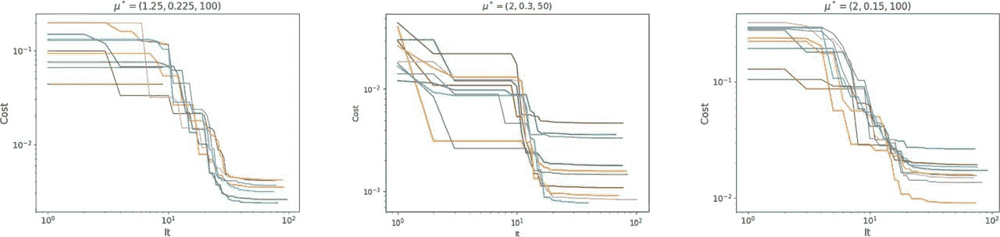

### 4.3 一个具有更多参数的椭圆型问题

最后，我们选择最后一个数值实验——椭圆型问题

(1.8)
$$
\begin{matrix} 
\left\{ 
\begin{matrix} 
{-\nabla \cdot (a(x;\mu)\nabla u(x;\mu)) = f(x),\quad} & {(x,\mu) \in \Omega \times \mathcal{P},} \\ 
{u(x;\mu) = 0,\quad} & {(x;\mu) \in \partial\Omega \times \mathcal{P}.} 
\end{matrix} 
\right. 
\end{matrix}
$$

正如[9]所示，我们取 $\Omega$ = $[0, 1]^2$，$\mathcal{P} = [-\sqrt{3},\sqrt{3}]^{9}$，并考虑 $f(x) = 10\sin(2\pi(x[1] + x[2]))$ 以及 $a(x;\mu) = 1 + 0.1\sum_{i=1}^{16}\psi_{i}(x)\mu_{i}$，其中


## 基函数展开

$$
\begin{array}{l} 
\psi_{1} = \lambda_{1}\phi_{1}(x_{1})\phi_{1}(x_{2}),\quad\psi_{2} = \sqrt{\lambda_{1}\lambda_{2}}\phi_{1}(x_{1})\phi_{2}(x_{2}),\quad\psi_{3} = \sqrt{\lambda_{2}\lambda_{1}}\phi_{2}(x_{1})\phi_{1}(x_{2}), \\ 
\psi_{4} = \lambda_{2}\phi_{2}(x_{1})\phi_{2}(x_{2}),\quad\psi_{5} = \sqrt{\lambda_{1}\lambda_{3}}\phi_{1}(x_{1})\phi_{3}(x_{2}),\quad\psi_{6} = \sqrt{\lambda_{3}\lambda_{1}}\phi_{3}(x_{1})\phi_{1}(x_{2}), \\ 
\psi_{7} = \sqrt{\lambda_{2}\lambda_{3}}\phi_{2}(x_{1})\phi_{3}(x_{2}),\quad\psi_{8} = \sqrt{\lambda_{3}\lambda_{2}}\phi_{3}(x_{1})\phi_{2}(x_{2}),\quad\psi_{9} = \lambda_{3}\phi_{3}(x_{1})\phi_{3}(x_{2}), \\ 
\psi_{10} = \sqrt{\lambda_{1}\lambda_{4}}\phi_{1}(x_{1})\phi_{4}(x_{2}),\quad\psi_{11} = \sqrt{\lambda_{4}\lambda_{1}}\phi_{4}(x_{1})\phi_{1}(x_{2}), \\ 
\psi_{12} = \sqrt{\lambda_{2}\lambda_{4}}\phi_{2}(x_{1})\phi_{4}(x_{2}),\quad\psi_{13} = \sqrt{\lambda_{4}\lambda_{2}}\phi_{4}(x_{1})\phi_{2}(x_{2}), \\ 
\psi_{14} = \sqrt{\lambda_{3}\lambda_{4}}\phi_{3}(x_{1})\phi_{4}(x_{2}),\quad\psi_{15} = \sqrt{\lambda_{4}\lambda_{3}}\phi_{4}(x_{1})\phi_{3}(x_{2}), \\ 
\psi_{16} = \lambda_{4}\phi_{4}(x_{1})\phi_{4}(x_{2}), 
\end{array}
$$

其中 $\{\lambda[j], \phi[j]\}$，$j=1,2,3,4$ 是协方差为 $C(x,x')=e^{|x-x'|}$ 的 1D 高斯随机场 Karhunen–Loève 展开的前四对特征值对。我们参考文献 [9] 作为基函数 $\psi[i]$ 的插图。图 1.5 显示了对应于不同参数 $\mu$ 的解 $u(\mu)$。


图 1.5 左：平均解 $u(\mu)$ 的快照。右：不同参数 $\mu$ 下沿对角线 $x_{1}=x_{2}$ 的解 $u(\mu)$ 截面。

我们将 $a$ 的展开截断在 $i=4$、$i=9$ 和 $i=16$ 处（分别对应特征值对 $\{\lambda[j], \phi[j]\}$，$j=1,2,3,4$），从而得到不同的网络 $\mathcal{N}^{4}$、$\mathcal{N}^{9}$ 和 $\mathcal{N}^{16}$。为了训练后者，进行了 3000 次有限元仿真，这在离线状态下需要大约 7 小时。随后网络训练在三种情况下离线大约各需要 11 小时。

与前两个测试用例不同，该问题 (1.8) 没有解析解。因此，对于这三种规模的展开，我们都使用在极细网格上计算的有限元解（网格尺寸为 $h$）作为参考解。

在后续中，我们比较 PSO 算法在不同展开和观测点数量下的性能。表 1.5 报告了目标函数 $F$ 的平均值和标准差，通过 50 次随机实验计算得出。我们观察到算法的性能不受维度的显著影响。算法收敛时间对观测点数量敏感，但对维度的影响较小。

### 表 1.5 不同观测点数量和粒子数量的 PSO 性能

| $N_{KL}$ | $N_{obs}$ | $N_{part}$ | $F$ | $CPU$ |
| :--- | :--- | :--- | :--- | :--- |
| 4 | 100 | 100 | $1.89 \times 10^{-8} \pm 5.66 \times 10^{-8}$ | $11.8$ |
| 4 | 1000 | 100 | $8.62 \times 10^{-9} \pm 9.06 \times 10^{-9}$ | $32.9$ |
| 4 | 400 | 100 | $2.02 \times 10^{-8} \pm 3.04 \times 10^{-8}$ | $27.4$ |
| 4 | 1000 | 1000 | $1.29 \times 10^{-8} \pm 8.36 \times 10^{-9}$ | $124.0$ |
| 9 | 100 | 100 | $5.29 \times 10^{-8} \pm 1.59 \times 10^{-7}$ | $45.1$ |
| 9 | 1000 | 100 | $1.44 \times 10^{-8} \pm 2.88 \times 10^{-8}$ | $171.0$ |
| 9 | 400 | 100 | $2.83 \times 10^{-8} \pm 6.78 \times 10^{-8}$ | $24.9$ |
| 9 | 1000 | 1000 | $1.64 \times 10^{-8} \pm 2.08 \times 10^{-8}$ | $184.0$ |
| 16 | 100 | 100 | $2.98 \times 10^{-8} \pm 3.25 \times 10^{-8}$ | $12.6$ |
| 16 | 1000 | 100 | $2.39 \times 10^{-8} \pm 3.44 \times 10^{-8}$ | $53.0$ |
| 16 | 400 | 100 | $4.54 \times 10^{-8} \pm 8.17 \times 10^{-8}$ | $28.1$ |
| 16 | 1000 | 1000 | $2.73 \times 10^{-8} \pm 2.19 \times 10^{-8}$ | $56.5$ |

表 1.6 展示了在 $N_{obs}=400$ 且 $N_{part}=1000$ 时，参数 $\mu$ 每个分量误差的平均值 ± 标准差。我们观察到参数的最后分量变得越来越难以恢复。这很容易解释，因为这些分量对应于频率更高且幅度较小的基函数。

### 表 1.6 目标参数 $\mu$ 每个分量在不同展开规模 $N_{KL}$ 下的误差

| $N_{KL}$ | 4 | 9 | 16 |
| :--- | :--- | :--- | :--- |
| $\mu[1]$ | $1.53 \times 10^{-3} \pm 2.58 \times 10^{-3}$ | $2.58 \times 10^{-3} \pm 2.22 \times 10^{-3}$ | $5.94 \times 10^{-3} \pm 3.84 \times 10^{-3}$ |
| $\mu[2]$ | $3.53 \times 10^{-3} \pm 4.11 \times 10^{-3}$ | $1.03 \times 10^{-2} \pm 2.80 \times 10^{-2}$ | $2.02 \times 10^{-2} \pm 1.42 \times 10^{-2}$ |
| $\mu[3]$ | $2.67 \times 10^{-3} \pm 3.36 \times 10^{-3}$ | $5.98 \times 10^{-2} \pm 4.47 \times 10^{-3}$ | $2.17 \times 10^{-2} \pm 1.67 \times 10^{-2}$ |
| $\mu[4]$ | $2.23 \times 10^{-2} \pm 2.56 \times 10^{-2}$ | $1.80 \times 10^{-2} \pm 4.71 \times 10^{-2}$ | $6.73 \times 10^{-2} \pm 4.06 \times 10^{-2}$ |
| $\mu[5]$ | | $1.14 \times 10^{-2} \pm 2.19 \times 10^{-2}$ | $3.94 \times 10^{-2} \pm 2.82 \times 10^{-2}$ |
| $\mu[6]$ | | $9.72 \times 10^{-3} \pm 1.27 \times 10^{-2}$ | $3.87 \times 10^{-2} \pm 2.77 \times 10^{-2}$ |
| $\mu[7]$ | | $2.77 \times 10^{-2} \pm 2.98 \times 10^{-2}$ | $9.66 \times 10^{-2} \pm 7.00 \times 10^{-2}$ |
| $\mu[8]$ | | $5.43 \times 10^{-2} \pm 1.87 \times 10^{-1}$ | $9.09 \times 10^{-2} \pm 7.52 \times 10^{-2}$ |
| $\mu[9]$ | | $9.00 \times 10^{-2} \pm 6.26 \times 10^{-2}$ | $1.24 \times 10^{-1} \pm 9.37 \times 10^{-2}$ |
| $\mu[10]$ | | | $6.28 \times 10^{-2} \pm 4.77 \times 10^{-2}$ |
| $\mu[11]$ | | | $5.86 \times 10^{-2} \pm 4.80 \times 10^{-2}$ |
| $\mu[12]$ | | | $1.80 \times 10^{-1} \pm 1.22 \times 10^{-1}$ |
| $\mu[13]$ | | | $1.91 \times 10^{-1} \pm 1.48 \times 10^{-1}$ |
| $\mu[14]$ | | | $3.21 \times 10^{-1} \pm 2.03 \times 10^{-1}$ |
| $\mu[15]$ | | | $3.01 \times 10^{-1} \pm 2.24 \times 10^{-1}$ |
| $\mu[16]$ | | | $5.97 \times 10^{-1} \pm 4.47 \times 10^{-1}$ |

最后，表 1.7 展示了与其他实验相似的结果，针对 $N=1000$、$N=400$、$n=3$ 以及 PSO 算法返回的不同参数 $\mu$。表 1.7 是针对 $\alpha=2$ 和各种 $\mu$ 值的 PSO 结果。（注：原文此处表格描述与内容似乎有错位，已根据语意对齐翻译）*注：原文文本中 `Table 1.7 Results of the PSO algorithm, `Table 1.7` 存在重复或逻辑错误*。

### 表 1.7 PSO 算法结果 ($\alpha=2$)

| $\mu$ (精确值) | $\mu$ (计算值) |
| :--- | :--- |
| (0.866, 0.866, 0.866, 0.866, 0.866, 0.866, 0.866) | (0.869, 0.866, 0.861, 0.866, 0.861, 0.860, 0.865, 0.848) $\pm$ (0.00154, 0.00371, 0.00505, 0.0166, 0.00921, 0.0104, 0.0282, 0.0251, 0.100) |
| (-0.957, -0.0973, 0.114, 0.144, -1.17, 1.30, -1.44, -0.904, 0.663) | (-0.955, -0.0999, 0.111, 0.150, -1.17, 1.30, -1.45, -0.923, 0.623) $\pm$ (0.00141, 0.00460, 0.00785, 0.0165, 0.00987, 0.00957, 0.0500, 0.0293, 0.0733) |
| (1.73, 1.73, 1.73, 1.73, 1.73, 1.73, 1.73, 1.73, 1.73) | (1.73, 1.71, 1.72, 1.67, 1.71, 1.73, 1.67, 1.79, 1.80) $\pm$ (0.00164, 0.00468, 0.00353, 0.0255, 0.0142, 0.0118, 0.0314, 0.219, 0.147) |
| (1.73, 1.73, -1.73, 1.73, -1.73, -1.73, -1.73, 1.73, 1.73) | (1.74, 1.72, -1.73, 1.71, -1.75, -1.75, 1.74, 1.72, 1.81) $\pm$ (0.00265, 0.00524, 0.00473, 0.0220, 0.0171, 0.0136, 0.0422, 0.0541, 0.155) |
| (0, 0, 0, 0, 0, 0, 1.73) | (0.00135, -0.0079, -0.00370, 0.00798, 0.00753, -0.00182, 0.00857, 0.0126, 1.65) $\pm$ (0.00155, 0.00565, 0.00409, 0.00812, 0.0107, 0.00863, 0.0288, 0.0356, 0.0369) |

我们注意到算法可以恢复 $\mu$ 的良好估计。正如已经提到的，随着基函数变得更加振荡，参数变得难以捕捉。最后，我们注意到目标函数的值比前两个测试用例低。这是因为第一个测试用例中的解 $u$ 幅值大得多且表现出难以捕捉的边界层，而解要平滑得多且幅值较小。图 1.6 显示了 PSO 算法迭代 10 次的目标函数演化，我们注意到这并不取决于参数空间的维度。

## 5 结论与展望

提出了一种用于参数化 PDE 的框架。微分方程的直接解通过自适应有限元求解器得到了验证。文中提出了用于求解反问题的优化算法。梯度类型方法收敛速度快，但吸引盆较小，特别是当参数集维度很大或精确解位于边界时。出于鲁棒性考虑，无导数方法（如粒子群优化方法）更受青睐。数值实验表明，未来的工作将包括更好地耦合无导数方法以提高梯度类型方法的初始猜测。这种耦合需要确定切换算法的合适时机。

## 参考文献

1. C. Audet 和 J. E. Dennis Jr. 约束优化的网格搜索。*SIAM Journal on Optimization*, 17(1):188–217, 2006. →

2. A. Caboussat, M. Girardin, M. Picasso. 应用于参数化 PDE 的有限元-神经网络方法。传输方程。在：第 11 届自适应建模与仿真会议 (ADMOS 2023)*，2023. a, b, c

3. A. Caboussat, M. Girardin, M. Picasso. 针对椭圆型参数化 PDE 的自适应有限元——神经网络误差评估。*Computer Methods in Applied Mechanics and Engineering*, 421:116784, 2024. a, b, c, d

4. R. DeVore, B. Hanin, 和 G. Petrova. 神经网络近似。*Acta Numerica*, 30:327–444, 2021. a, b

5. C. Elliott. 自动微分的简单本质。在：*ACM 编程语言进展*, 卷 2(ICFP),页 1–29, 2018. a, b

6. O. G. Ernst, A. Mugler, H.-J. Starkloff, 和 E. Ullmann. 关于广义多项混沌展开的收敛性。*ESAIM: Mathematical Modelling and Numerical Analysis*, 46(2):317–339, 2012. →

7. A. Galántai. 牛顿法的理论。*Journal of Computational and Applied Mathematics*, 124(1–2):25–44, 2000. →

8. M. Geist, P. Petersen, M. Raslan, R. Schneider, 和 G. Kutyniok. 深度神经网络对参数化扩散方程的数值求解。*Journal of Scientific Computing*, 88(1):1–37, 2021. a, b

[9] D.S. Guignard. *带有随机输入数据的偏微分方程的后验误差估计*。博士论文，EPFL, 2016. a, b

[10] J.S. Hesthaven, G. Rozza, B. Stamm, 等。 *参数化偏微分方程的认证基基方法*，第 590 卷。Springer, 2016. →

[11] G.E. Karniadakis, I.G. Kevrekidis, L. Lu, P. Perdikaris, S. Wang 和 L. Yang. 物理启发机器学习。*Nature Reviews Physics*，3(6):422–440, 2021. →

[12] J. Kennedy 和 R.C. Eberhart. 粒子群优化。在：*ICNN’95—国际神经网络会议集*，第 4 卷，第 1942–1948 页。IEEE, 1995. a, b

[13] T.G. Kolda, R.M. Lewis 和 V. Torczon. 直接搜索优化：对一些经典和现代方法的新视角。*SIAM Review*，45(3):385–482, 2003. →

[14] H.-R. Li 和 Y.-L. Gao. 具有指数递减惯性权重和随机变量的粒子群优化算法。在：*2009 第二次信息与计算科学国际会议*，第 1 卷，第 66–69 页。IEEE, 2009. →

[15] L.J. Miranda. PySwarms: 基于 Python 的粒子群优化研究工具包。*The Journal of Open Source Software*，3(21):433, 2018. →

[16] R. Poli, J. Kennedy, 和 T. Blackwell. 粒子群优化：概述。*Swarm Intelligence*，1:33–57, 2007. a, b


# 参考文献

[17] A. Ratnaweera, S.K. Halgamuge 和 H.C. Watson. 具有变时加速系数的自组织层次粒子群优化器。*IEEE Transactions on Evolutionary Computation*，8(3):240–255, 2004.

[18] L.M. Rios 和 N.V. Sahinidis. 无导优化：算法回顾与软件实现比较。*Journal of Global Optimization*，56:1247–1293, 2013.

[19] S. Ruder. 梯度下降优化算法概述。*arXiv preprint arXiv:1609.04747*，2016.

[20] Y. Shi 和 R.C. Eberhart. 粒子群优化的实证研究。在：*1999 年演化计算大会—CEC99 (Cat. No. 99TH8406)*，第 3 卷，第 1945–1950 页。IEEE, 1999.

[21] Tensorflow Developers. TensorFlow 官方网站，2018.

[22] V. Torczon. 模式搜索的收敛性。*SIAM Journal on Optimization*，7(1):1–25, 1997.

[23] R. Verth. 对流-扩散方程的后验误差估计。*Numerische Mathematik*，80:641–663, 1998.

[24] S. Volkwein. 基于正交分解的模型降阶。*格拉茨大学数学学院讲义*，2011.

[25] S. Wang, H. Wang 和 P. Perdikaris. 物理启发机器学习。*Science Advances*，7(40):e605, 2021.

# 摘要

本文中，我们提出了两种用于创建双层最优控制近似数值方法。第一种基于简单射击，第二种涉及。这两种技术从先验信息、计算成本和分布方面进行了比较。

关键词：数据库生成、双层最优控制、庞捷金极大原理、间接方法、值函数

# 致谢

本研究部分受到 Vitesco Technologies 的支持。特别感谢人工智能小组负责人 Olivier Fle 和控制资深专家 Mariano Sans 的指导和建议。

# 1 引言

值函数是最优控制理论的核心对象，描述了最优代价如何取决于初始条件。该函数在 50 年代首次由 Richard Bellman 研究，并导出了哈密顿-雅可比-贝尔曼（HJB）偏微分方程。这些方程提供了最优控制的充分必要条件，以及反馈形式的最优控制。它们是动态规划和强化学习的基础，这两者是工业应用中两种主要的最优控制方法。然而，这些方法面临维度灾难，这是嵌入式求解的关键问题。

庞捷金极大原理同样在 50 年代引入，提供了最优控制的必要条件，并导出了间接数值方法，这些方法有望精确且快速，适用于嵌入式求解。关于最优控制经典数值方法的描述，请参见文献 [4]。一种基于最优控制问题双层分解的新方法如文献 [5] 所示，有望减少计算量并足够用于嵌入式求解。该方法使用了某些固定时间之间的值函数，这些函数很少可以显式计算，其策略是从一组预计算数据进行近似。

本文的结构如下：首先，我们在第 2 节中介绍了基于双层最优控制方法的理论机理。然后，我们在第 3 节中展示了创建值函数数据库的两种方法。我们在第 4 节中对比了将这两种方法应用于工业场景（即混合动力汽车的扭矩分配与换挡最优控制）时所获得的数值结果。最后，第 5 节对全文进行了总结。

# 2 理论机理

本文的动机来源于文献 [5] 中描述的扭矩分配与换挡最优控制问题，该问题被用于第 4 节的数值结果计算。另一个动机是通过双层最优控制方法解决该问题，该方法在文献 [5] 中有详细详述，并在第 2.2 节中简要介绍，具有鲁棒性、速度快且可以嵌入。该方法的一个关键特征是计算值函数的近似值，后文记为 `C_i`，值函数记为 `V_i`，表示将状态从初始条件 `a` 转移到目标 `b` 的最优代价。在文献 [5] 中，代价近似值 `C[i]` 通过神经网络建模，并在特定数据库上进行训练。本文的目标是解释在文献 [5] 中用于创建这些数据库的方法（后文称为方法 2），同时也将其与一种更直观但朴素的方法（后文称为方法 1）进行对比。

## 2.1 最优控制问题

我们考虑以下波尔扎形式的最优控制问题：

其中函数 `f⁰ : ℝ × ℝⁿ × ℝᵐ → ℝ`、终端代价 `g : ℝⁿ → ℝ` 以及状态动力学函数 `f : ℝ × ℝⁿ × ℝᵐ → ℝⁿ` 均为 𝒞¹ 类。初始和最终时间 `t₀ < t_f` 是固定的，初始状态 `x₀ ∈ ℝⁿ` 也是固定的。控制域 `U ⊂ ℝᵐ` 是非空集。求解 (OCP) 意味着寻找一个绝对连续的。

### 备注

为了简洁起见，我们考虑了这种波尔扎形式的最优控制问题，但我们的方法可以很容易扩展到更一般的问题，例如固定最终状态或混合边界条件的问题。

## 2.2 双层最优控制方法

考虑到中间时刻 `t₀ < t₁ < ⋯ < t_N < t_{N+1} = t_f`，最优控制问题 (OCP) 可以分解为以下双层最优控制：

```latex
\begin{matrix} {\text{(BOCP)}}\left\{ \begin{array}{l} {\min_{X}\sum_{i=0}^{N}V_{i}(X_{i},X_{i+1}) + g(X_{N+1}), \\ s. t. X=(X_{0},\ldots,X_{N+1})} \end{array} \right\} \end{matrix}
```

其中对于所有 `i ∈ ℕ`，函数 `V_i` 是*中间值函数*：

```latex
\begin{matrix} {\text{(OCP}_{i,b}\text{)}}\left\{ \begin{matrix} {V_{i}(a,b) = \min_{x,u}\int_{t_{i}}^{t_{i+1}}f^{0}(t,x(t),u(t)) dt, \\ s.t. \dot{x}(t) = f(t,x(t),u(t)), t \in [t_{i},t_{i+1}], a. e., \\ s.t. u(t) \in U, t \in [t_{i},t_{i+1}], \\ s.t. x(t_{i})=a,x(t_{i+1})=b.} \end{matrix} \right\} \end{matrix}
```

(BOCP) 中出现的集合 $\mathcal{X}$ 定义如下：`X ∈ (ℝⁿ)^{N+1}`，如果对于所有 `i ∈ ℕ`，`(X_i, X_{i+1})` 是 (OCP) 可行的。正如文献 [5] 中详细所示，问题 (BOCP) 可以被视为一个双层最优控制问题 [8]。

在许多应用中，中间值函数 `V_i` 无法直接计算。因此，文献 [5] 提出用近似值 `C_i` 来替代它们。这导致了一个两步走的层次化方法，被称为宏观-微观方法。第一步求解以下有限维优化问题：

```latex
\begin{matrix} {\text{(Macro)}}\left\{ \begin{array}{l} {\min_{X}\sum_{i=0}^{N}C_{i}(X_{i},X_{i+1}) + g(X_{N+1}), \\ s. t. X=(X_{0},\ldots,X_{N+1}) \in \mathcal{X}, X_{0}=x_{0}} \end{array} \right\} \end{matrix}
```

以得到中间状态 `\hat{X} = (\hat{X}_{0},\dots,\hat{X}_{N+1})`。第二步求解 N+1 个独立的如下拉格朗日形式控制问题：

```latex
\begin{matrix} {\text{(Micro)}}\left\{ \begin{matrix} {\min_{x,u}\int_{t_{i}}^{t_{i+1}}f^{0}(t,x(t),u(t)) dt, \\ s.t. \dot{x}(t) = f(t,x(t),u(t)), t \in [t_{i},t_{i+1}], a. e., \\ s.t. u(t) \in U, t \in [t_{i},t_{i+1}], \\ s.t. x(t_{i})=\hat{X}_i,x(t_{i+1})=\hat{X}_{i+1}.} \end{matrix} \right\} \end{matrix}
```

以得到每个子区间 `[t_i, t_{i+1}]` 上的状态和控制轨迹。由于 `C_i` 与 `V_i` 之间的近似误差，该方法是次最优的，但它比传统方法更快且计算量更少，这在嵌入式应用中特别有吸引力。

然而，在应用宏观-微观方法之前，我们需要构建近似函数 `C_i`。我们将创建最优值数据库的工作推迟到第 3 节，该数据库将用于该目的，并且是本文的主要贡献。从现在起，对于给定的固定 `i ∈ ℕ_{[N]}`，我们考虑该问题中的一个最优控制问题（微观）。下一节将给出求解该问题的“简单间接打靶法”的一些经典细节。

## 2.3 间接法

所考虑的问题（微观）最优控制问题可以通过经典的间接简单打靶法求解，该方法基于庞特里亚金极大值原理 [12]。该原理的核心函数是伪哈密顿量：

```latex
h(t,x,u) = -f⁰(t,x,u) + \langle p, f(t,x,u) \rangle,
```

其中 `\langle \cdot \rangle` 代表 `ℝⁿ` 中的通常内积。对于给定的状态和协态变量对 `z = [x, p] ∈ ℝⁿ × ℝⁿ`，让我们定义寻找 (2.5) 的解的状态和协态轨迹 `z` 的问题：

```latex
\begin{cases} \dot{z}(t) = \vec{h}(t,z(t),u), & t \in [t_i, t_{i+1}], \\ h(t,z(t),u) = \max_{w \in U} h(t,z(t),w), & t \in [t_i, t_{i+1}], \\ z(t_i) = z_i. \end{cases}
```

其中 `\vec{h}` 是由下式定义的伪哈密顿向量场：

```latex
\vec{h}(t,x,u) = (\nabla_p h(t,x,u), -\nabla_x h(t,x,u)).
```

如果假设指数映射 `\exp_{\vec{h}} : (t_{i+1}, t_i, z_i) \mapsto z(t_{i+1})` 是一个良映射，其中 `z` 是问题 (2.5) 的解，那么极大值原理会导致两点边值问题的求解：

```latex
\text{(TPBVP)}\left\{ \begin{array}{l} (x_{i+1}, p_{i+1}) = \exp_{\vec{h}}(t_{i+1}, t_i, (x_i, p_i)), \\ x_i = \hat{X}_i, x_{i+1} = \hat{X}_{i+1}. \end{array} \right.
```

为了使用简单符号，我们通过 (2.6) 定义 `\overline{x}_{i+1}(z_i)`：

```latex
\overline{x}_{i+1}(z_i) = \pi_x(\exp_{\vec{h}}(t_{i+1}, t_i, z_i))
```

其中 `\pi_x(x,p) = x` 是在状态空间投影。在接下来，我们假设对于所有初始和最终状态 `(a,b)`，如果 `(x,u)` 是 `OCP_{i,a,b}` 的解，则存在 `p \in C([t_i, t_{i+1}], ℝⁿ)` 使得对 `(x,p)` 是 TPBVP 的解。问题 (2.5) 的这种对解被称为极值点。TPBVP 的解是满足边界条件的极值点，被称为 BC-极值点。该假设与解相关的 BC-极值点的正则性有关（更多细节请参阅 [1]）。为了简单起见，我们用 `\overline{c}_i(z_i)` 表示状态和控制轨迹的代价，它由问题 (2.5) 的解给出，初始状态和协态条件为 `z_i = (x_i, p_i)`。我们还考虑以下将在我们的应用中数值验证的假设。

### 假设 2.1

设 `(x_i, x_{i+1})` 为给定的初始和最终状态。那么 (2.7) 的所有零点

```latex
p_i \mapsto \overline{x}_{i+1}(x_i, p_i) - x_{i+1}
```

都对应于同一个状态控制轨迹 `(x,u)`，取决于对 `(x_i, x_{i+1})`。

### 备注

在上述假设和假设 2.1 下，对于所有初始和最终状态 `(a,b)`，最多存在一个 `OCP_{i,a,b}` 解。

### 备注

假设 2.1 源于我们的应用，但对于应用第 3 节中描述的方法并非必须的。然而，它简化了描述并有助于理解其主要特征。事实上，考虑另一种该假设不成立的应用，即存在多个对应于不同状态-控制对的 (2.7) 的零点。如果我们仍然有一个唯一的 `OCP_{i,a,b}` 解，则我们需要为提出的两种方法增加一个步骤，即只需保留代价最低的零点。另一方面，如果有多个解，我们可以选择一个或全部保留，因为数据库中存在冗余点并没有问题。

间接简单打靶法旨在通过寻找打靶函数 (2.8) 的零点来求解 TPBVP：

```latex
S_{i,\hat{X}_i,\hat{X}_{i+1}}(p_i) = \overline{x}_{i+1}(\hat{X}_i, p_i) - \hat{X}_{i+1}.
```


得益于假设 2.1，打靶函数的所有零点都导致相同的最优代价，因此只需要找到其中一个即可。

方程 (2.8) 使用经典的类牛顿求解器求解，众所周知，为协随状态（costate）寻找一个良好的初始猜测是一个关键问题。然而，给定 (BOCP) 的一个解 `X^*`，如果 `V[i]` 在 (`X[i]^*`, `X[i+1]^*`) 处可微，则根据文献 [3]，向量 `-∇_a V_i(X[i]^*, X[i+1]^*)` 是 `S[i, X[i]^*, X[i+1]^*)` 的零点。遗憾的是，`V[i]` 是未知的，但由于 `C[i]` 是 `V[i]` 的近似，向量 `-∇_a C_i(\hat{X}_i, \hat{X}_{i+1})` 可以作为问题（Micro）射击函数相关最优控制问题的良好初始猜测 [7]。该初始猜测在所提的应用中与射击函数的几何预条件方法结合使用 [6]。

既然我们已经描述了如何求解问题 (Micro) 的最优控制问题，我们将关注计算 `C[i]` 的数据库构建，这是本文的主要贡献。

## 3 数据生成

在本节中，我们将描述数据库 `𝔻[i]` 的创建，该数据库包含不同对 (`x[i]`, `x[i+1]`) 的 (OCP[i, x[i], x[i+1]]) 的最优值：

```
𝔻_i ⊂ { (x_i, x_{i+1}, c) | (x_i, x_{i+1}) admissible and V_i(x_i, x_{i+1}) = c }
```

提出了两种实现这一目标的方法。我们在先验信息、计算成本和数据分布方面对它们进行了比较。

### 3.1 方法 1

第一方法是通过简单射击法通过最优控制问题在给定网格上计算值函数 `V[i]`。与下一节介绍的方法二相比，这是一种直观的方法。令 `𝕏[i]` 为允许的初始和最终状态的离散化。对于 `𝕏[i]` 中的所有 (`x[i]`, `x[i+1]`)，我们通过间接简单射击法求解最优控制问题 (OCP[i, x[i], x[i+1]])，并将相应的最优值 `V_i` 存储在 `𝔻[i]` 中。主要的复杂度在于我们必须求解方程，这本质上等于反转 (2.6) 中给出的指数映射。算法 2.1 提供了这些步骤的概述。


算法 2.1 方法 1。

#### 先验信息
首先，集合 `𝕏[i]` 需要如下创建：首先对初始状态进行离散化，然后对这些值的每个到达状态集进行离散化。这确保了初始和最终状态空间被充分探索，并且所有 (`x[i]`, `x[i+1]`) 都是允许的，从而防止牛顿求解器失败。到达状态的确定是该方法的困难之处。有关如何计算此到达状态，参见第 25 页。

#### 计算成本
对于寻找射击函数零点的牛顿迭代，至少需要一次哈密顿积分。

#### 数据分布
根据构造，(`x[i]`, `x[i+1]`) 的分布在允许集内部是完全控制的。例如，可以选择均匀分布以便插值。

### 3.2 方法 2
算法 2.2 描述的方法二基于初始状态和协随状态的离散化 `ℤ[i]`。对于 `ℤ[i]` 中的所有 `z[i] = (x[i], p[i])`，计算 `z_{i+1} = (x_{i+1}, p_{i+1}) = exp_{\vec{h}}(t_{i+1}, t_i, z_i)`，假设 2.1 确保了 `V_i(x_i, x_{i+1}) = \bar{c}_i(x_i, p_i)`。与方法 1 相比，这里只对指数映射 `exp_{\vec{h}}` 进行直接计算，而不是反转它。


算法 2.2 方法 2。

#### 先验信息
由于对 (`x[i]`, `p[i]`) 没有允许性约束，`ℤ[i]` 可以是初始状态和协随状态离散化的笛卡尔积。然而，协随状态离散化的范围必须合理选择，以确保充分探索到达状态 `x[i+1]`，同时限制指数映射的次数。

#### 计算成本
与方法 1 不同，这里不涉及（牛顿）求解器。因此，计算 `𝔻[i]` 只需要评估一次 `exp_{\vec{h}}`。

#### 数据分布
在该方法中到达最终状态 `x[i+1]` 的分布不再受控制。主要的后果是有空白区域。幸运的是，我们将在第 4 节看到，在我们的应用中，`ℤ[i]` 中的足够密度确保了到达状态 `x[i+1]` 的良好分布。

## 4 结果

### 数值实验介绍
所考虑的应用是混合动力汽车（HEV）在*全球统一轻型车辆循环*（WLTC）上的扭矩分配和换挡优化控制。目标是通过作用于档位以及内燃机（ICE）与电机（EM）之间的扭矩分配，在固定初始条件和电池固定或自由最终电量的情况下最小化内燃机的燃料消耗。我们参考 [9], [10], [11], [13], [15], [16] 以获得此类应用的通用介绍。

#### 备注
所考虑的应用模型由公司 Vitesco Technologies 开发的工业代码给出，该代码使用查找表数据来对变速器扭矩损耗或内燃机燃料消耗等复杂函数进行建模。关于该特定非线性模型，我们参考 [5] 以获取更详细的介绍。

该问题可以表述为 (OCP)，我们考虑处于第 2.3 节所述假设的框架内。在这种背景下，可以应用双层方法，且时间间隔（WLTC 的 1800 秒）被任意分解为 18 个每个 100s 的时间子区间。

本节的目标是在我们的 HEV 应用上比较第 3.1 和 3.2 节提出的两种方法。为了这一目的并为了明确结果的呈现，我们只关注第一个子区间 [0,100]，并固定初始状态（记为 `x[0]`）为 0.5。接下来，我们应用这两种方法创建数据库 `𝔻[0]`。

### 假设 2.1 的验证

函数 `p_0 \mapsto \bar{x}_1(x_0, p_0)` 的演化如图 2.1 所示。可以注意到，对于所有的 `p[0]` ∈ [`p[0]^-`, `p[0]^+`]，函数 (2.6) 是单射的。此外，对于所有的 `p[0]` ≤ `p[0]^-`（相应 `p[0]` ≥ `p[0]^+`），我们通过数值验证了由指数映射产生的极值与唯一的 (`x`, `u`) 相关联。因此，假设 2.1 可以被认为是数值上成立的。

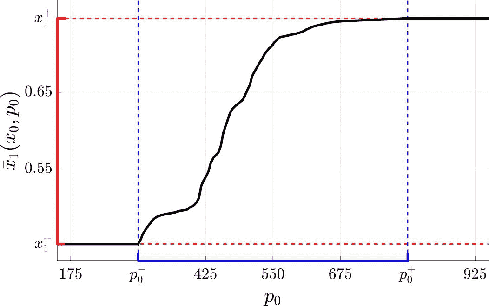

图 2.1 函数 (2.6) 的演化，固定初始状态 `x[0]=0.5`。y 轴上的红色区间对应时间 `t[1]` 时的可许最终集，x 轴上的蓝色区间对应方法 2“先验信息”中提到的有用协态初始化。

#### 备注
正如第 3 节讨论，对于方法 1，最终状态必须在 [`x[1]^-`, `x[1]^+`] 中选择。相比之下，对于方法 2，它们自然属于这个区间，尽管初始协态可以取自 `ℝ^n`，但其有效范围限制在区间 [`p[0]^-`, `p[0]^+`] 内；参见图 2.1。

### 结果分析
为了在指数映射调用次数上比较两种方法，使用方法 1 为不同的初始和最终状态生成了 475 个 (`x[i]`, `x[i]+`, `c`)。我们观察到牛顿求解器平均需要 11.2 次迭代找到零，这意味着该方法比方法 2 多需要 11.2 倍调用。因此，获取一个点的计算时间比方法 2 长 11.2 倍。

现在从最终状态分布来比较两种方法。首先，每种方法生成了 10 个 `𝔻[0]`。正如预期的，我们在图 2.2 中观察到方法 1 的最终状态分布均匀，而方法 2 则不是。其次，对于与方法 1 相同的计算代价，方法 2 生成了 112 个 `𝔻[0]`。结果如图 2.2 所示。可以观察到，如果分布保持非均匀，[`x[1]^-`, `x[1]^+`] 的覆盖范围比方法 1 获得的得多。

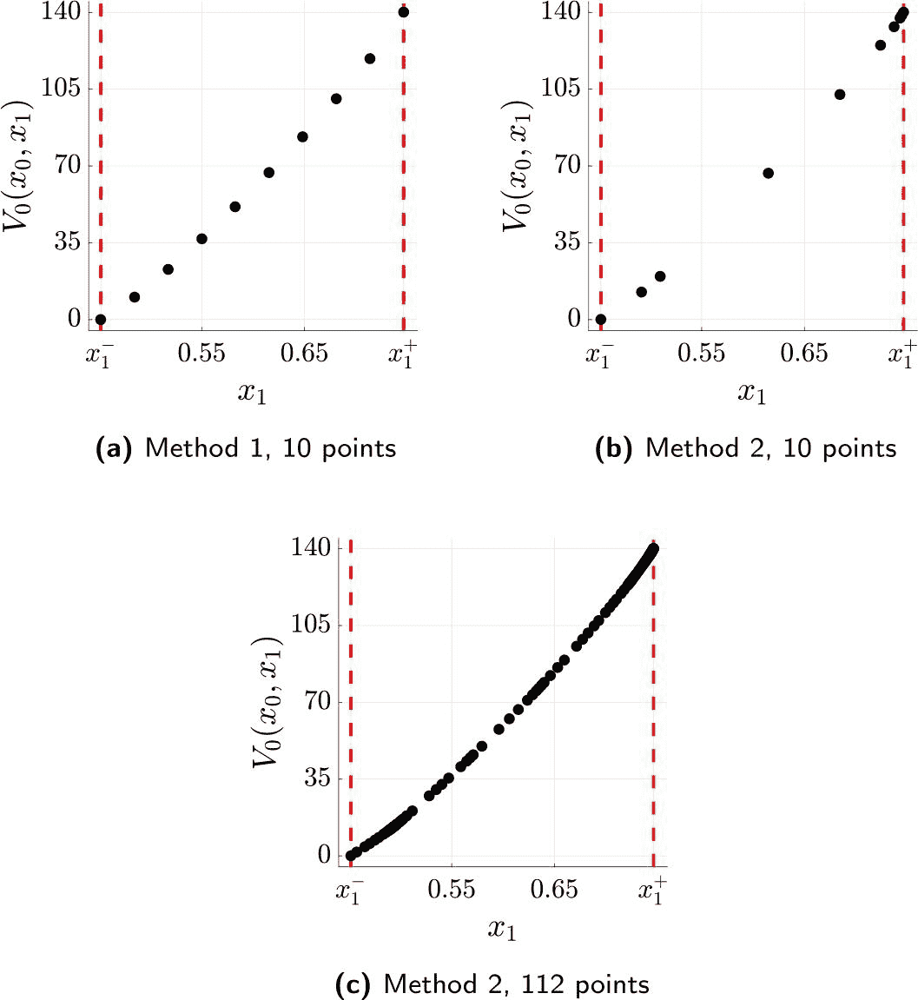

图 2.2 两种方法的函数数据。黑点对应计算点。

#### 备注
这些结果是在 WLTC 的第一个 100 秒子区间内，针对唯一的初始状态 `x[0]=0.5` 给出的。注意，方法 2 是在 [5] 中对 WLTC 的所有 18 个子区间在状态和协态进行精细离散后实现的。方法 2 被优先考虑是因为它速度快，不需要求解方程，只需要进行数值积分。在 [5] 中，该扭矩分配和换挡优化问题已通过前述的双层方法利用神经网络 `C[i]` 近似值函数 `V[i]` 解决。

## 5 结论
[5] 中提出的宏观-微观方法需要对值函数进行逼近，这可以通过由点 (`a`, `b`, `V[i]`) 组成的数据库来实现。

一旦创建数据库，就必须构建相关的价值函数近似 `C[i]`。可以使用许多方法，例如神经网络模型。后者以其强大的泛化能力以及通过反向传播技术提供近似 `C[i]` 梯度的能力而闻名。事实上，该梯度的可用性应该简化问题的解决（宏观层面 `Macro`），并为通过间接法解决该问题的最优控制问题（微观层面 `Micro`）提供良好的初始化。

另一个视角是利用价值函数的梯度来改进近似 `C[i]` 的拟合效果。事实上，在某些假设下，可以证明价值函数的梯度 `V_i` 是向量 (`-p[i]`, `p[i+1]`)。因此，哈密顿流 `(x_{i+1}, p_{i+1}) = exp_{\vec{h}}(t_{i+1}, t_i, (x_i, p_i))` 的计算提供了最优代价转移 `V_i` 及其相关的梯度。随后可以包含此类额外梯度信息的扩展数据库，这无需额外成本，并且可以用于训练物理信息神经网络 (PINNs)。

## 参考文献

[1] A. A. Agrachev 和 Y. L. Sachkov. *从几何观点看控制理论*. Springer, 柏林/海德堡, 2004. →

[2] R. Bellman. *动态规划*. Dover Publications, 1957. →

[3] O. Bokanowski, A. Désilles 和 H. Zidani. 在存在中间和最终状态约束的情况下，极大原理与动态规划之间的关系。*ESAIM. Control, Optimisation and Calculus of Variations*, 27:91, 2021. →

[4] J.-B. Caillau, R. Ferretti, E. Trélat 和 H. Zidani. 有限维最优控制问题的算法指南。包含于: *数值分析手册：数值控制，B 部分*. North-Holland, 2022. →

[5] O. Cots, R. Dutto, S. Laporte 和 S. Jan. 一种双层最优控制方法及其在混合动力汽车上的应用, 2023. a, b, c, d, e, f, g, h, i, j, k

[6] O. Cots, R. Dutto, S. Laporte 和 S. Jan. 用于间接射击法的几何预条件数及在混合汽车上的应用, 2024. →

[7] E. Cristiani 和 P. Martinon. 通过 Hamilton–Jacobi 方法对射击法进行初始化。*Journal of Optimization Theory and Applications*, 146(2):321–346, 2010. →

[8] A. Didier 和 A. Svensson. 多领导者-追随者游戏的综述。包含于: *双层优化：进展与新挑战*, 第 53–76 页. Springer, 2020. 第 3 章. →

[9] L. Johannesson, M. Asbog 和 B. Egardt. 使用动态规划评估混合动力系统的控制潜力。在: *2005 年智能交通系统会议*, 366–371 页。

[10] N. Kim, S. Cha 和 H. Peng. 基于 Pontryagin 原理的混合动力汽车控制。*IEEE Transactions on Systems*, 19(5):1279–1287, 2011.

[11] A. Malik, F. Sun 和 J. Zhang. 混合动力汽车控制策略分类与综述。*IEEE Intelligent Systems*, 15(5):1869–1885, 2014.

[12] S. Pontryagin, V. Gamkidze, R. Boltyanskii 和 E. Mishechenko. *最优过程数学理论*. 纽约, 1962. a, b

[13] G. Rousseau. *混合动力汽车的几何控制与优化*. 博士论文, ENMP, 2008.

[14] S. Sutton 和 A. Barto. *强化学习：导论*. MIT Press, 2018.

[15] X. Wang, H. He 和 F. Sun. 混合动力汽车能量管理中动态规划算法的应用研究。*Energies*, 8(4):3225–3244, 2015.

[16] S. Wirasingha 和 A. Emadi. 混合动力汽车控制策略分类与综述。*IEEE Transactions on Vehicular Technology*, 60(1):111–122, 2011.

#### 备注

# 使用图神经网络预测中风

Rohit Pochampalli, Nicolas Gauger

### 摘要

提出了一种利用图神经网络 (GNNs) 基于患者血管几何形状的计算流体力学 (CFD) 仿真预测中风风险的新方法。动脉粥样硬化是血管壁沿斑块堆积。它受血管几何配置的影响，通常在分叉处。此外，分支的某些几何特征（如较大的曲率）会引起剧烈扰动。通过流体仿真可以获得壁切应力分布等流场参数，而在其他情况下是不可能的。GNN 能够学习与血管几何和动脉粥样硬化发展相关的复杂关系。我们的方法为流场模式与中风风险之间的关系提供了新见解，可能实现更个性化的预防和治疗策略。

关键词：机器学习、图神经网络、图卷积、心血管疾病、缺血性中风、血液动力学仿真，MSC 2020: 68T07, 92B20, 05C90

## 感谢

作者感谢联邦教育与研究部 (Bundesministerium für Bildung und Forschung, BMBF) 的资金支持，项目 MLgSA (FKZ: 05MM20UKD) 以及通过 RHRZ 计算中心的 “Elwetritsch”集群提供的计算资源。我们还感谢来自凯泽斯劳滕-兰道 RPTU 和耶拿大学的同事提供的仿真数据集。我们还感谢两位匿名审稿人的反馈和意见，这些意见极大改进了本文。

## 1 引言

在这项工作中，我们展示了图神经网络（`GNNs`）[45], [19], [3] 在利用动脉血流模拟预测缺血性中风风险中的应用 [13]。缺血性中风通常由动脉粥样硬化引起，这是一种表现为向心脏和大脑供血的动脉局部狭窄的疾病。心血管疾病是全球死亡和残疾的主要原因，理解其病理机制具有极其重要的意义。具体而言，斑块的存在本身并不意味着一定存在发生中风的风险。相反，“易于形成血栓的斑块的存在”具有更高的相关性 [12]。

在基于患者的动脉壁几何结构（即从计算机断层扫描 CT 扫描生成的结构）上进行血流模拟，为测量血流参数提供了一种新方法，特别是那些在体内无法测量的参数。此类应用的流程包括以下步骤：从患者扫描中分离出动脉几何结构、从该结构生成合适的计算网格，以及使用适当的流模型模拟血流（见 [8], [34] 和 [35]）。

动脉血管壁上的壁面剪应力分布与本文的应用密切相关。对动脉粥样硬化病理的研究表明，壁面剪应力（`WSS`）的分布起着主要作用。例如，在曲率较大的分支内部，预计会有较低的 WSS [17]。Gnasso 等人 [18] 得出结论，WSS 在左右两侧之间是不对称分布的，较低的 WSS 表明动脉粥样硬化病变的存在；而 Dolan、Kolega 和 Meng [7] 则得出结论，高 WSS 和正向 WSS 梯度预示着斑块的不稳定性。动脉的几何结构对动脉粥样硬化具有重要意义，因为分叉处的血管配置会影响流场，进而影响 WSS [39]。

这自然会引出一个问题：机器学习算法是否可以学习 WSS 分布与缺血性中风风险之间的映射。我们的假设是，高 WSS 梯度的存在以及相应的局部结构包含了足够评估中风风险的信息。为了这项任务，我们开发了一个 GNN 模型，将血流模拟映射到风险类别。该 GNN 使用一种基于基于节点的 WSS 总变分的新型聚类程序来分离出高 WSS 梯度位置（见第 3 节）。在第 1.1 节中，我们列举了一些将机器学习应用于问题的相关研究。

近似 WSS 与中风风险之间映射的任务需要考虑 WSS 以及分叉情况。因此，我们排除了简单模型，转而采用神经网络，这在医学应用中尤为重要。图像之所以被分配给某一特定类别并不总是清晰的。这个问题被 GNN 在一定程度上缓解了，正如我们在聚类结果中所示的，它将模型的感受野限制在了节点上。

将 WSS 视为图的替代方案是，因为图像是由数十万甚至百万个点组成的 [27], [6]。其次，配准需要一个配准步骤将这些图像带到共同系统中处于对等地位 [30], [36]。最后，CNN 在其表示上缺乏可解释性。

### 1.1 相关工作与贡献

许多研究涉及将机器学习应用于中风相关问题。根据所解决的问题和使用的机器学习算法类型，研究存在显著差异。例如，以下工作将一种或多种机器学习模型（包括 K-近邻、随机森林、支持向量机、梯度提升或神经网络）应用于诸如预测某些治疗的效果 [32], [23], [42]；中风疾病的分类 [20], [1], [16] 以及问题区域的分割 [41]。这只是该领域已发表的一小部分。

图分类之前已使用过核方法 [25]、提升算法 [44] 和线性规划 [37] 等。我们关注的是一类被称为消息传递的监督算法，这些算法是作为卷积的泛化而提出的 [5]。这引出了图神经网络（GNN）模型，它通过对节点特征信息的递归压缩和聚合来对图进行分类 [45], [3], [19], [38]。GNN 已被证明具有通用函数近似属性 [4]。据我们所知，我们工作的创新之处在于将动脉血流的 CFD 仿真作为 GNN 的输入，以预测中风风险。基于节点总变分提取子图的方法也是新的。

## 2 背景

本节提供了关于图、图上的总变分、GNN 以及机器学习设置的其他细节的背景。一个无向图 `𝒢` 是集合的元组 (`𝒱`, `ℰ`)，其中对于每条边 `e` ∈ `ℰ`，存在节点 `u`, `v` ∈ `𝒱`，使得 [`u`, `v`] = `e` 是连接 `u` 和 `v` 的边。图由其邻接矩阵 `A` ∈ `ℝ^{|𝒱|×|𝒱|}` 表示，其元素规定了边的连通性，以及可选的边权重矩阵 `E` ∈ `ℝ^{|𝒱|×|𝒱|}`，其中 `e_ij` ∈ `ℝ` 是边的欧几里得长度。节点 `u` 的邻域 `𝒩(u)` 是满足 [`u`, `v`] ∈ `ℰ` 的节点集合。节点 `u` 的度 `d[u]` 是连接于 `u` 的边数。对于任何节点子集 `V` ⊂ `𝒱`，`V` 的边界 [31] 写作 `δ(V)` 是一端在 `V` 中另一端不在 `V` 中的边集。图函数将图中的每个节点映射到实标量或向量。图上的标量函数被称为信号。实函数或复函数的总变分（TV）是分析中经过研究的对象 [15]。TV 的相关概念用于图像处理中的应用 [29]。我们工作中使用的 TV 概念可以源于 Wang 等 [43] 最初定义的图差，或者 Jung 等 [24] 以及 Hansen 和 Bianchi [22] 中的类似概念，它是目标函数或正则化的一部分。

我们说数据是图结构化的，如果每个数据点可以表示为由一组节点、一个相应的邻接矩阵和一个特征矩阵 `X` ∈ `ℝ^{|𝒱|×m}` 组成的元组，后者在图的每个节点处附加了一个 `m`-维特征。给定图结构化数据 `𝒮 = {𝒢_1, …, 𝒢_s}` 和一组标签 `𝒞 = {c_1, …, c_l}`，图分类问题寻求学习分类器 `h: 𝒢_k ↦ c_k` 将每个图映射到其正确标签 `c_k` ∈ `𝒞`。在实践中，`𝒮` 中的每个图 `𝒢_k` 是一个由邻接矩阵 `𝒜_k`、节点特征 `𝒳_k` 以及可能的边特征 `ℰ_k` 组成的元组。

GNN 使用消息传递操作处理图结构化数据，这些操作保留了输入的图结构。消息传递包含两个步骤，分别称为消息（message）和更新（update），在这里用 `ϕ` 和 `ψ` 表示。消息传递的第 `k` 次迭代使用来自图邻域 `𝒩(u)` 的消息来更新节点 `u` ∈ `𝒱` 的隐藏特征 `h_u^k`，如下：

```
h_u^{k+1} = ψ^k(h_u^k, ϕ^k({h_v^k; e_k}))
```

此外，初始特征就是 `X_u`。我们的模型中使用了一种特定的消息 GraphSAGE [21]。在这里，如果存在 `T` 层，这些特征将与对应节点的特征拼接并使用权重矩阵 `W` 进行。

```
h_u^{k+1} = ψ^k(h_u^k, ϕ^k({h_v^k; e_k}))
```

```
h_u^{k+1} = σ(W · concat(h_u^k, ϕ^k({h_v^k})))
```

在这里，`σ` 是激活函数，在我们的情况下是 ReLU 函数。GraphSAGE 卷积中的消息 `ϕ` 是一个线性算子。最后，使用池化层从节点特征 `h_v` 提取图级表示 `h_𝒢` 以进行图分类。一个是全局平均池化，它返回所有节点特征向量的平均值：`h_𝒢 = (1/|𝒱|) ∑_{v∈𝒱} h_v`。

## 3 方法

### 3.1 图变分

为了避免复杂的符号，我们固定一个图 `𝒢 = (𝒱, ℰ)`。信号 `f`（在 `𝒢` 上）在节点 `v` 处的 TV 定义为

```
TV^f(v) := (1/d_v) ∑_{u∈𝒩(v)} |f(u) - f(v)|
```

这是图上具有有趣性质的信号。首先，TV(`f`) 是亚相加且绝对齐次的，也就是说对于任意信号 `f`、`g`，实数 `α`、`β` 以及每个节点 `v`，我们有

```
TV^{αf + βg}(v) ≤ |α| TV^f(v) + |β| TV^g(v)
```

它可以用于在信号空间 `ℱ = {f | f: 𝒢 → ℝ}` 上定义半范数：

```
‖f‖_TV := max_{v∈𝒱} TV^f(v)
```

‖f‖_TV 继承了 TV(`f`·) 的亚相加性和绝对齐次性。如果两个位于 `ℱ` 中的函数之差为常数，则称它们是等价的。这把信号空间划分为等价类。因此，一个函数的范数为 0 当且仅当它是一个常数时，而常数属于 0 的等价类。我们证明了以下结论。

#### 引理 3.1
‖f‖_TV 是特定图 `𝒢` 上信号等价类集合上的一个范数。

直观地说，TV(`f`)(v) 捕捉了信号 `f` 在 `v` 邻域的震荡。很容易看出，TV(`f`)(v) = 0 意味着信号 `f` 在 `δ({v})` 上是常数，而具有高 TV 的节点在其相应的边界（coboundaries）上显示出跳跃或震荡行为。因此，TV 通过标记那些在 `δ({v})` 上具有高 TV 的节点 `v`，为图节点聚类提供了一种简单的方法。根据公式 (3.6)，我们得出结论：只要两个信号线性相关，它们就会产生相同的簇。根据我们的假设，震荡性 WSS 预计局部化在分叉口附近，而高 TV 节点预计会重现这种行为。

### 3.2 GNN 模型与训练

数据包含 159 组血流模拟，这些模拟是在凯泽斯劳滕-兰道和耶拿大学创建的患者网格上进行的。该数据库可以在线获取。数据集已标记以形成二分类，其中根据估计度大于 50%，有 61 个点被标记为风险。为了交叉验证，数据集被分为 75% 的训练子集和 25% 的测试子集。每个模拟的邻接矩阵和边权重已计算并以稀疏矩阵格式存储。

该模型由单个 GraphSAGE 层组成，紧接着是一个基于 TV 的聚类层、若干层 GraphSAGE 层，最后是一个前馈层。现在描述聚类层的实现细节。根据总变分进行排序的前 `n` 个节点及其直接邻居被提取出来，形成顶点 `V` 的一个子集 `V'`，使用的函数称为 `RankTV`。

这通过添加边集 {`u`, `v`} ∈ `E` | `u` ∈ `V'` 和 `v` ∈ `V'` 创建了子图 `𝒢'`。如果该子图不连通，找到簇 `C_i` 和 `C_j` 之间的最短路径为：

```
d(C_i, C_j) := min_{u∈C_i, v∈C_j} d(u, v)
```

其中 `d(u, v)` 是节点 `u` 和 `v` 之间的最短路径。如果两个簇距离小于规定的路径长度，它们将被连接，必要时沿最短路径添加节点。最后，层更新节点和边并返回子图 `𝒢'`。

聚类层产生了整个图的压缩局部表示。图的压缩基于两个原因：从计算角度来看，这减少了算法的内存占用，特别是从大型图上计算梯度时；其次，这优先考虑了可能与狭窄形成相关的节点。作为上述的直接结果，聚类证明是解决困扰 GNN 的过度压缩（oversquashing）问题的良方。此外，从这些簇中学习也将支持我们的假设，即高 WSS 梯度区域的局部结构对预测中风风险特别重要。在图 3.1 展示了聚类层在某些模拟上的结果。

图神经网络在 `PyTorch-Geometric` 中实现。使用优化器 `Adam` 和 `AdamW` 的图神经网络结果如图 `Figure 3.2` 所示。训练过程针对多种超参数配置进行了重复（如下所示），其性能非常相似。起始学习率在 `1×10^{-2}` 和 `1×10^{-3}` 之间变化，权重衰减设置在 `1×10^{-5}` 和 `5×10^{-4}` 之间。聚类层提取总变异最大的前 50 个节点。我们将聚类合并的最大路径长度设置为 5。`GraphSAGE` 层（聚类后）的特征长度（宽度）在 16 和 32 之间变化，`dropout` 速率在 30%、40% 和 50% 之间变化。在这些情况下，模型准确率在 82.5% 到 87.5% 之间波动。对于 `Figure 3.2` 中所示图形，`GraphSAGE` 模型深度为 4，宽度为 16，丢弃比例为 0.5，我们使用了一个 3 层 `MLP`（宽度为 16）。使用 `AdamW` 训练的模型在测试集上的精确率-召回曲线如图 `Figure 3.3` 所示。

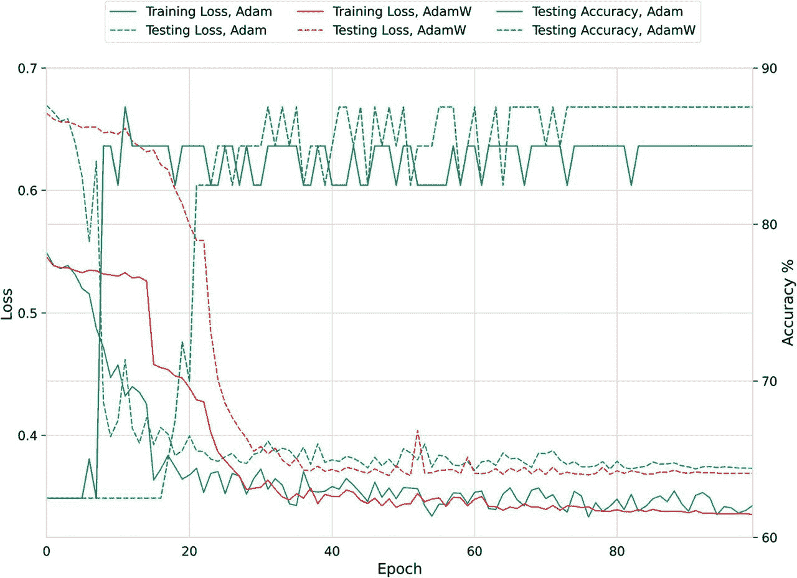

图 3.2 在 100 个 epoch 内的优化图（横轴）。左侧轴为训练和测试损失的趋势，以 BCE 损失函数衡量（参见式 (3.4)），使用优化器 Adam（蓝色实线和虚线）和 AdamW（红色实线和虚线）。右侧轴测量 Adam（绿色实线）和 AdamW（绿色虚线）的测试准确率趋势。

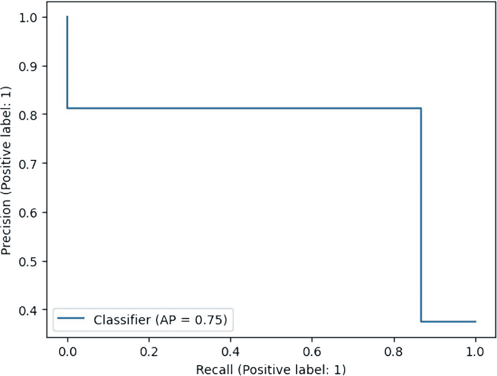

图 3.3 使用 AdamW 训练的模型在测试集上的精确率-召回曲线。

## 5 结论

在这项工作中，我们将图神经网络应用于动脉血管血流模拟，以预测中风风险。这种特定方法对于从流体动力学模拟到模型中所用特征的通用方法论来说是新颖的。`GNN` 的感受野被限制在子图（提取的节点）上，以支持我们的假设：分叉附近的 `WSS` 分布可能是中风的预测因素。顺便提到，这具有减轻 `GNNs` 过度压缩（oversquashing）效应的效果。未来的工作计划的形式化关于图上 `TV` 的论点，并将此特定的 `GNN` 扩展到更大的数据上。

## 参考文献

[1] S. Adam, A. Yousif, and M. Bashir. Classification of ischemic stroke using machine learning algorithms. *International Journal of Computer Applications*, 149(10):26–31, 2016.

[2] U. Alon and E. Yah. On the bottleneck of graph neural networks and its practical implications. `arXiv:2006.05205`, June 2020.

[3] M. Bronstein, et al. Geometric deep learning: groups, geodesics, and gauges. `arXiv:2104.13478`, Apr. 2021.

[4] R. Gabriel. Universal function approximation on graphs. *Advances in Neural Information Processing*, 33:19762–19772, 2020.

[5] J. Bruna, et al. Spectral networks and locally connected networks on graphs. `arXiv:1312.6203`, 2013.

[6] J. Deng, et al. Imagenet: a large-scale image database. In *2009 IEEE Conference on Computer Vision and Pattern Recognition*, pages 248–255. IEEE, 2009.

[7] J. Dolan, J. Kolega, and H. Meng. High wall shear stress and spatial gradients in vascular pathology: a review. *Annals of Biomedical Engineering*, 41:1411–1427, 2013.

[8] P. Eulzer, et al. Visualizing carotid blood flow simulations for stroke prevention. *Computer Graphics Forum*, 40(3):435–446, June 2021. 10.1111/cgf.14319.

[9] P. Eulzer, et al. A dataset of reconstructed carotid bifurcation lumen and plaque models with centerline tree and simulated hemodynamics. Version 2.0.0. Zenodo, Feb. 2024. https://doi.org/10.5281/zenodo.1069523.

[10] P. Eulzer, et al. Instantaneous visual analysis of blood flow in stenoses using morphological similarity. `arXiv:2403.16653`, 2024.

[11] P. Eulzer, et al. Visualizing carotid stenoses for stroke treatment, 2023.

[12] E. Falk. Pathogenesis of atherosclerosis. *Journal of the American College of Cardiology*, 47(8S):C7–C12, 2006.

[13] S. K. Feske. Ischemic stroke. *The American Journal of Medicine*, 134(12):1457–1464, 2021.

[14] M. Fey and J. Sensen. Fast representation learning with PyTorch Geometric. `arXiv:1903.0248`, 2019.

[15] G. Folland. Real Analysis: Modern Techniques and Applications, volume 40. John Wiley & Sons, 1999.

[16] R. Garg, et al. Automating stroke classification using machine learning and natural language processing. *Journal of Stroke and Cerevascular Diseases*, 28(7):2045–2051, 2019.

[17] G. Giannoglou, et al. Flow and atherosclerosis in coronary bifurcations. *EuroIntervention*, 6(Suppl J):J16–J23, 2010.

[18] A. Gnasso, et al. In vivo association between low wall shear stress and plaque in subjects with asymmetrical atherosclerosis. *Stroke*, 28(5):993–998, 1997.

[19] M. Gori, G. Monfardini, and F. Scarselli. A new model for learning in graph domains.

[20] P. Govindarajan, et al. Classification of stroke disease using machine learning algorithms. *Neural Computing & Applications*, 32(3):817–828, 2020.

[21] W. Hamilton, Z. Ying, and J. Leskovec. Inductive representation learning on large graphs. *Advances in Neural Information Processing Systems*, 30, 2017.

[22] J. Berg Hansen 和 F. M. Bianchi. 总变分图神经网络。收于 *International Conference on Machine Learning*, 页码 12445–12468. PMLR, 2023. →

[23] Mohamed Sobhi Jabal, 等. 用于缺血性卒中结果预测的可解释机器学习建模。*Frontiers in Neurology*, 13:884693, 2022. →

[24] A. Jung, 等. 通过全变分最小化在网络结构数据中进行半监督学习。*IEEE Transactions on Signal Processing*, 67(24):6256–6269, 2019 年 12 月. 10.1109/TSP.2019.2953593. →

[25] H. Kashima 和 A. Inokuchi. 图分类的核函数。收于 *ICDM Workshop on Active Mining*, 卷 2002, 2002. →

[26] D. P. Kingma 和 J. Ba. Adam:一种随机优化方法。`arXiv:1412.6980`, 2014. →

[27] A. Krizhevsky, G. Hinton, 等. 从微小图像中学习多层特征，2009. →

[28] I. Loshchilov 和 F. Hutter. 解耦的权重衰减正则化。`arXiv:1711.05101`, 2017. →

[29] S. Mallat. *A Wavelet Tour of Signal Processing* (信号处理的小波之旅). Elsevier, 1999. →

[30] C. R. Maurer 和 J. M. Fitzpatrick. 医学图像配准综述。*Interactive Image-Guided Neurosurgery*, 1:17–44, 1993. →

[31] G. J. Minty. 单调网络。*Proceedings of the Royal Society of London. Series A, Mathematical and Physical Sciences*, 257(1289):194–212, 1960. →

[32] M. Monteiro, 等. 使用机器学习改进缺血性卒中患者功能性结果的预测。*IEEE/ACM Transactions on Computational Biology and Bioinformatics*, 15(6):1953–1959, 2018. →

[33] T. Probst, K. Richter, 和 A. Hundertmark. 在工作流中使用 `COMSOL` 评估大量颈动脉的卒中风险, 2023 年 10 月. →

[34] K. Richter, 等. 在基于患者的颈动脉数值模拟中使用中心线投影法进行纵向壁剪切力分析。*Computer Methods in Biomechanics and Engineering*, 页 1–18, 2023. a, b

[35] K. Richter, 等. 在基于患者的颈动脉数值模拟中使用中心线投影法进行纵向壁剪切力分析。*Computer Methods in Biomechanics and Engineering*, 27(3):347–364, 2024. 10.1080/10255842.2023.218547, PMID: 3688051. a, b

[36] J. Ruiz, 等. 3D 非刚性配准。*Medical Image Analysis*, 6(2):143–161, 2002.

[37] H. Saigo, 等. `Boost`:一种图分类与回归方法。*Machine Learning*, 75:69–89, 2009. →

[38] F. Scarselli, 等. 神经网络模型。*IEEE Transactions on Neural Networks*, 20(1):61–80, 2009. 10.1109/tn.2008.2005. →

[39] K. Spanos, 等. 动脉粥样硬化的几何。*Angiology*, 68(9):757–764, 2017. →

[40] N. Srivastava, 等. `Dropout`:一种防止神经网络过拟合的简单方法。*Journal of Machine Learning*, 15:1929–1958, 2014. →

[41] L. Tomasetti, 等. 用于区域分割的机器学习算法。*IEEE Journal of Health Informatics*, 26(2):660–672, 2021. →

[42] H. Van, 等. 用于缺血性卒中治疗预测的机器学习算法价值。*Frontiers in Neurology*, 13:884693, 2022. →

[43] Y.-X. Wang, 等. 工作流中的图过滤。*Journal of Machine Learning*, 17(10):55–41, 2016. →

### 摘要

标记过程是许多科学学科（如分子动力学）的基础模型，它们的模拟构成了分析的共同基础。尽管产生了轨迹，但从微观态获取宏观信息面临巨大挑战。本文通过引入成员函数作为宏观态的概念来解决这一问题。我们推导了这些宏观态的保持时间方程，并证明了它们与经典定义的致性。此外，我们讨论了使用 ISOKANN 方法从模拟数据中学习这些量。最后，我们提出了一种基于 ISOKANN 结果提取反应路径的新方法，并通过将其应用于 μ 受体的模拟，证明了其有效性。

关键词：宏观态，成员函数，反应速率，保持时间，库普曼，ISOKANN 方法，最短路径，反应路径，

## 致谢

A. Sikorski 的研究由 DFG 资助的 CRC 1114 “复杂系统中的级联”（项目 B03）。R. J. Rabben 的研究由 NHR 研究学院资助。S. Chewle 的研究由 BMBF 资助的项目 CCMAI（资助代码 01GQ2109A）。

## 1 引言

许多物理过程最好被理解为自主马尔可夫过程（例如，[8]）。它们的常用数学模型是随机微分方程，允许预测未来的演化概率。马尔可夫性意味着这种概率仅取决于系统的初始条件。求解初值问题被称为*系统模拟*。生成轨迹的状态被称为系统的*微观态*。

作为一个说明，请考虑生物分子系统模拟领域 [7]。在这里，正在研究的一种常见机制是受体蛋白非活性微观态转换为活性态（通过相应地改变其原子坐标）。该过程可以通过过阻尼朗之万动力学（overdamped Langevin dynamics）进行数学建模，这是一种关于蛋白质和溶剂中每个原子 3D 维坐标的随机微分方程 [6]。通常，这些通过模型模拟进行分析，产生高维空间中的轨迹。

然而，主要的关注点通常在于系统的 `macro state behaviour`（宏观态行为）。一个可能待回答的问题是：非活性受体蛋白变为活性的平均首次通过时间是多少？在这方面，两个宏观态被标记为“非活性”与“活性”。乍一看，宏观态 `S` 是微观态集合 `Ω` 的子集。通常，当我们给定感兴趣的系统起始集合 `S` ⊂ `Ω` 时，我们想知道过程平均在该集合中停留多久 [20]。从非活性宏观态的轨迹在离开它之前在那里停留多久，即切换到活性宏观态？答案由积分定义的平均留存时间 `t_mh` 给出：

```
t_mh(x) = ∫_0^∞ p_S(x, t) dt
```

其中 `x` 表示系统的微观态（轨迹的起点 `x(0)` = `x`），函数 `p_S` 表示轨迹在整个时间区间 `[0, t]` 内仍在集合 `S` 中且从未离开过的概率。形式上，`p_S` = `P_x` 是在起始于微观态 `x` 的情况下 `S` 的留存概率，其中 `T_S` 是 `S` 的首次离开时间。`t_mh`（也称为平均首次离开时间）由 `t_mh` = `𝔼_x[T_S]` 给出。

如果 `t_mh` 表示系统反应的预期时间，那么

```
r(x) = -∇t_mh(x) = -∇∫_0^∞ p_S(x, t) dt
```

指向该时间减少最快的方向。这可以被视为取决于微观态的反应路径方向 `r(x)`。

现在存在一个概念性问题。我们想知道宏观态的平均留存时间，而不是每一个单一微观态，但 `t_mh` 是微观态的函数——`S` 中的平均留存时间取决于起始点。谈论“宏观态 `S` 的平均留存时间”只有当它独立于该宏观态内部的微观态位置时才有意义，也就是说，如果存在一个集合 `S` ⊂ `Ω` 和一个离开速率 `c_1` > 0，允许出现如下类型的分离：

```
p_S(x, t) = 1_S(x) e^{-c_1 t}
```

其中 `1_S` 是集合 `S` 的指示函数。在马尔可夫态建模中，通常要求将状态空间 `Ω` 分解为可以识别为“宏观态”的子集 `S` [11]。分离方法 (4.1) 是 `S` 具有马尔可夫性的前提，如果“离开 `S`”是一个稀有事件，则它是近似有效的。常数 `c_1` > 0 对应于 `S` 的离开速率，因为 `1_S` 是 `t_mh` = `1_S` 是在起始于微观态 `x` 的情况下 `S` 的留存概率，其中 `T_S` 是 `S` 的首次离开时间。

从经典来说，基于集合的分解是不可能的。我们如何解决这个概念性问题？

在推导生物分子过程的离开速率时，该系统的宏观态不能被严格地描述为子集 `S`。相反，转换是从某种非活性状态逐渐变为可以描述为活性的状态。我们建议用隶属函数 `χ` : `Ω` → `[0,1]` 替换指示函数 `1_S`，它量化了微观态 `x` ∈ `Ω` 对起始宏观态的所属程度。

在此时，我们尚未提供计算 `χ` 的方法。`χ` 不能被任意选择。为了保持系统的马尔可夫长期行为，微观系统到两个不同宏观态的投影必须基于 `ℒ` 的不变子空间 [19], [21]。进一步，要求分解为两个互补的（即之和为 1）宏观态，最简单的非平凡解由：


## 4.4 宏观态的隶属函数方程

$$
\mathcal{L}\chi(\mathbf{x}) = - c_{1}\,\chi(\mathbf{x}) + c_{2}\left( 1 - \chi(\mathbf{x}) \right)
$$

其中 `c[1]`, `c[2]` > 0，且 `χ`, 1−χ 描述这两个宏观态。可以使用 PCCA+ [2] 或 ISOKANN [12], [16] 计算，并形成 `ℒ` 的不变子空间，这同时也保证了与原始动力学的长期一致性 [21]。虽然 (4.4) 的任何解都会导致动力学封闭的宏观描述，但我们通常寻求具有小速率 `c[1]`, `c[2]` 的解，它们代表时间上稳定的宏观态。

为了推导出 (4.4)，理解投影马尔可夫过程的马尔可夫性质如何被完全保留。这意味着系统的投影和传播必须对易。因此，投影必须基于 `ℒ` 的不变子空间。常数函数是 `ℒ` 的特征函数。因此，常数函数与另一个特征函数的线性组合会导致可行的隶属函数 `χ`。如果我们对这种线性组合应用 `ℒ`，就会得到 (4.4)。整个推导过程请参考 [20]。

在本文的第 2 节中，我们证明了基于 `χ` 函数的宏观态形式与传统的基于集合的方法是一致的：我们展示了当 `χ` 函数趋于指示函数时，基于 `χ` 的方程简化为经典方程。我们进一步通过 Feynman–Kac 公式对所得停留概率进行基于路径的解释，从而阐述了其物理意义。

在第 3 节中，我们将提出一种应用这些理论结果从给定的样本集中提取反应路径的方法，并在第 4 节演示其在由 `μ`-阿片类受体给分子系统中的应用。

## 2 退出速率理论

下文将推导出一个关于基于隶属函数 `χ:Ω→[0,1]` 的宏观量的一致理论。更具体地说，讨论了以下感兴趣的量：

*   通过 `χ(x)` 定义宏观态
*   相应的位置无关的退出速率 `c[1]`
*   平均停留时间 `h(x)`
*   正比于梯度 −χ 的反应方向 `r`

注意，如引言所述，对于集合 `S`，计算反应方向 `r` 是可能的。然而，对于集合，我们无法得到这种简单的梯度 −χ。本节的理论很大程度上基于 [20], [3]。我们将通过关于一致性的陈述扩展该理论，并用它支持将 `χ` 作为宏观态的解释。`χ` 的计算将在我们的生物分子示例中发挥重要作用；见第 4 节。

### 2.1 通过隶属函数定义宏观态

引言中的起点是，`p[χ]=χ⁻c[1]t` 将是一种从概念点定义宏观态停留时间的方法，以便将 `c[1]` 解释为退出速率。`χ` 的选择不是任意的，而是受到 (4.4) 中不变子空间投影必要性的驱动。在此时，尚未证明当使用 (4.4) 的解 `χ` 时 `p[χ]` 与停留概率的随机含义一致。我们现在将证明，如果 `χ` 变成集合的指示函数，它将收敛于已定义的定义。

首先回顾一些基本定义。假设由 `N` 个原子组成的分子系统的状态空间 `Ω` 为 `Ω=ℝ³N`，其中每个单个原子的位置由三个笛卡尔坐标描述。令 `ρ(x,t):Ω×ℝ[0,1]` 表示时刻 `t` 非线性随机动力学状态的概率密度分布。更具体地说，动力学被给为一个马尔可夫过程，为该过程构造一个无穷生成器 `ℒ(*):L¹(Ω)→L¹(Ω)`（一个微分算子，例如 Fokker–Planck 算子），以捕捉这个随变化的随机过程。该算子是线性的，并描述了 `ρ(x,t)` 的无穷传播：

```
(4.5)
(ℒ*ρ)(x,t) = d/dt ρ(x,t).
```

它还产生了伴随生成器 `ℒ:∞(Ω)→∞(Ω)`，它传播观测值而非状态密度。定义 `χ` 的偏微分方程 (4.4) 是根据这个伴随生成器的公式的。在这，`χ` 也可以被解释为观测值，即宏观态的测量。为了将其解释为停留概率，我们感兴趣的是解 `χ(x):Ω→[0,1]` 以及相应的常数 `c[1]>0`, `c[2]>0`。

假设此类 `χ` 和 `c[1]`, `c[2]` 是给定的。我们定义 `χ`-停留概率为：

```
(4.6)
p_χ(x,t) = χ(x)e^{-c[1]t}
```

使得 (4.4) 变为：

```
(4.7)
ℒ*p_χ = - c[1]p_χ + c[2]p_χ(1-χ)/χ.
```

重排得到：

```
(4.8)
ℒ*p_χ - c[2]p_χ(1-χ)/χ = - c[1]p_χ.
```

由于关系

```
(4.9)
∂/∂t p_χ = ∂/∂t χ(x)e^{-c[1]t} = - c[1]χ(x)e^{-c[1]t} = - c[1]p_χ.
```


方程 ([4.8]) 也可以表示为：

(4.10) $\mathcal{L}^{\ast}p_{\chi} - c_{2}p_{\chi}\frac{1 - \chi}{\chi} = \frac{\partial}{\partial t}p_{\chi}.$

该偏微分方程 (4.10) 结合初始条件

(4.11) $p_{\chi}(\mathbf{x},0) = \chi(\mathbf{x})e^{- c_{1} \cdot 0} = \chi(\mathbf{x})$

可以用 Feynman–Kac 公式给出 [20], [3], [5]：

(4.12) $p_{\chi}(\mathbf{x},\tau) = \mathbb{E}\left\lbrack \chi(\mathbf{x}_{\tau}) \cdot \text{exp}\left( - c_{2}\int\limits_{0}^{\tau}\frac{1 - \chi(\mathbf{x}_{t})}{\chi(\mathbf{x}_{t})}dt \right) \middle| \mathbf{x}_{0} = \mathbf{x} \right\rbrack.$

这种表示方法允许我们将解解释为对随机过程实现的期望，从而在抽象定义与其作为概率的解释之间建立起桥梁。

为此，让我们考虑 `χ` ≈ 1,[`S`] 的情况。该期望是对所有从 `x`[0] 开始的轨迹取值的。一旦任何此类轨迹离开集合 `S`，积分将变为无穷大，指数函数的值取为 0。否则，指数保持为 1，同时 `χ`(`x`[`\tau`]) = 1。因此，我们恢复了 (4.1) 中的经典保持概率 `p``χ` = `p``S``，即至少在时间 `\tau` 内留在 `S` 中的概率；另见 [20] 中的 (9) 和 (10)，以及 [15] 中的 (3.31)。

我们在以下命题中总结这一结果。

#### 命题 4.1.

设 `χ` ≈ 1,[`S`] 是 (4.4) 的解。那么 `χ`-保持概率近似于 `S` 的经典保持概率：

$p_{\chi}(\mathbf{x},t) \approx p_{\mathit{S}}(\mathbf{x},t).$

关于这种解释，`p``χ`` 被视为宏观态 `χ` 的保持概率。由于 (4.6) 中的分离项 `e`^(−`c_1`t*)，保持概率随衰减常数 `c_1` 减小。这意味着 `c_1` 是离开 `χ` 的逸出率。由于函数 `p``χ` 的值被解释为保持概率，因此 `χ` 只能取区间 [0,1] 中的值。保持概率的时间积分是平均保持时间 `t_mh(`x`)`，它与逸出率 `c_1` 成反比：

(4.13) $t_{mh}(\mathbf{x}) = \int\limits_{0}^{\infty}p_{\chi}(\mathbf{x},t)dt = \int\limits_{0}^{\infty}\chi(\mathbf{x})e^{- c_{1}}t = \lim\limits_{t\rightarrow\infty}\left\lbrack - \frac{1}{c_{1}}\chi(\mathbf{x})e^{- c_{1}}t \right\rbrack_{0}^{t} = \frac{1}{c_{1}}\chi(\mathbf{x}).$

平均保持时间直接导出了反应方向的定义：沿着 `t_mh` 的梯度增加时间直到“发生反应的地方”。因此，通过定义反应方向 `r`:`Ω`→`ℝ^N`，

(4.14) $\mathbf{r}(\mathbf{x}) = -\mathit{t}_{mh}(\mathbf{x}) = - \frac{1}{c_{1}}\chi(\mathbf{x}) \propto - \chi(\mathbf{x}),$

我们得到一个平均保持时间均匀减少且正比于 `∇χ` 的矢量场。这意味着 `χ` 本身可以被理解为序参数，即系统的反应坐标。注意，由于对 `χ` 的时间假设我们得到了与时间无关的结果。通过积分沿 `r` 的曲线，可以得到 `Ω` 中的反应路径。在 3 中，我们将利用序参数从给定的仿真数据中采样代表性的反应路径。

从 (4.4) 计算这些感兴趣量的动机是开发求解该方程的高效方法。我们现在将展示如何用 Koopman 算子表示这些量，然后讨论它们的计算算法 ISOK。

### 2.2 来自 Koopman 算子的成员函数

到为止，`χ` 的描述基于无穷生成器 `ℒ`，但尚未给出偏微分方程 (4.4) 的合适解析解。然而，可以将 (4.4) 转换为一个可能的构造解的方程。我们现在将展示如何同样用 Koopman 算子 `𝒦` 来进行公式化，以及如何在两种形式之间切换并确定 `χ` 函数与 `𝒦(\tau)` 特征函数之间的关系。实际计算 `χ` 的问题将在下一节解决。

Koopman 算子 `𝒦(\tau)` 是某些滞后时间 `\tau`>0 的 `ℒ^*` 的时间积分或解算子，可以形式地定义为 `𝒦(\tau)=e^{(\tau\mathcal{L}^*)}`。它也可以通过对观测函数 `f`:`Ω`→`ℝ` 的作用来定义：

(4.15) $\left( \mathcal{K}^{\tau}f \right)(\mathbf{x}): := \mathbb{E}\left\lbrack f(x(\tau)) \mid x(0) = x \right\rbrack,$

其中期望是对从 `x`(0)=x 开始的过程独立实现 `x` 取值的。它可以被理解为在滞后时间 `\tau` 后观测值 `f` 的期望测量 `𝒦(\tau)`*f*。作为期望值，其作用可以通过对仿真的蒙特卡洛估计来近似，使其特别适用于应用。

为了将 (4.4) 转换为关于 `𝒦(\tau)` 的方程，我们代入

(4.16) $\alpha = c_{1} + c_{2}$

得到以下方程：

(4.17) $\mathcal{L}^{\ast}\chi = - \alpha\chi + c_{2}.$

这表明当且仅当 `χ` 满足方程 (4.4) 时，`ℒ` 在 `χ` 上作用为平移缩放算子。利用 `𝒦(\tau)` 的形式指数表示和其级数展开，可以得到 [20], [3]

(4.18) $\mathcal{K}^{\tau}\chi = e^{- \tau\alpha}\chi + \frac{c_{2}}{\alpha}\left( 1 - e^{- \tau\alpha} \right).$

### 设置

(4.19) $\gamma_{1} = e^{- \tau\alpha},\quad\gamma_{2} = \frac{c_{2}}{\alpha}(1 - \gamma_{1}),$

这变为：

(4.20) $\mathcal{K}^{\tau}\chi = \gamma_{1}\,\chi + \gamma_{2}.$

因此，与方程 ([4.17]) 一样，`𝒦(\tau)` 作为平移缩放算子当且仅当 `χ` 是 ([4.4]) 的解。

注意到 `𝒦^(\tau)1 = 1`，我们进一步看到 $f := \chi - \frac{c_{2}}{\alpha}$ 是 `𝒦^(\tau)` 的特征函数，其特征值为 `γ`[1]:

(4.21) $\mathcal{K}^{\tau}\left( \chi - \frac{c_{2}}{\alpha} \right) = \gamma_{1}\,\chi + \frac{c_{2}}{\alpha}(1 - \gamma_{1}) - \frac{c_{2}}{\alpha} = \gamma_{1}\left( \chi - \frac{c_{2}}{\alpha} \right).$

这些发现总结在下面的命题中。

#### 命题 4.2.

*设参数 `c`[1], `c`[2], `α`, `γ`[1], `γ`[2] 满足上述关系。以下条件等价：*

*   `χ` 解决了 ISOKANN 问题 ([4.4])。
*   ℒ 在 `χ` 上起到平移缩放作用，缩放因子为  − `α`，平移量为 `c`[2]。
*   `𝒦^(\tau)` 在 `χ` 上起到平移缩放作用，缩放因子为 `γ`[1]，平移量为 `γ`[2]。
*   $\chi - \frac{c_{2}}{\alpha}$ 是 `𝒦^(\tau)` 的特征函数，特征值为 `γ`[1]。

上述恒等式允许我们能够在无穷小生成器和 Koopman 框架之间切换。特别是，我们可以根据 Koopman 参数 `γ`[1] 和 `γ`[2] 计算逃逸率 `c`[1]：

(4.22) $\alpha = - \frac{\text{ln}\gamma_{1}}{\tau},\quad c_{2} = \frac{\alpha\gamma_{2}}{1 - \gamma_{1}},\quad c_{1} = \alpha - c_{2}.$

这允许估计相应的常数，例如逃逸率 `c`[1]，其方法是通过在样本点 **x** ∈ *Ω* 处评估 `χ` 和 `𝒦^(\tau)\chi`，并求解线性回归问题 ([4.20))。

### 2.3 用于计算成员函数的 ISOKANN

ISOKANN（通过神经网络学习的 Koopman 算子不变空间）是一种固定点迭代，它结合了使用神经网络表示高维 `χ` 函数与 Koopman 形式，以便在仿真数据上对其进行训练。

收敛时，它返回满足 ([4.4])、([4.17)) 和 ([4.20)) 的 `χ`。由于系统的高维度，直接求解涉及 ℒ^(*) 的偏微分方程是不行的。另一方面，分子模拟允许我们估计 `𝒦^(\tau)` 在观测值上的作用。因此，尝试通过使用 `𝒦^(\tau)` 的作用来计算 `𝒦^(\tau)\chi[i]`(**x**) 来求解 ([4.20))，其中 `χ[i]` 是 `χ` 的第 i 次迭代，且 **x** 是训练点。它近似了期望值：

(4.23) $\left( \mathcal{K}^{\tau}\chi_{i} \right)(\mathbf{x}): = \mathbb{E}\left\lbrack \chi_{i}(x(\tau)) \mid x(0) = \mathbf{x} \right\rbrack,$

通过对不同起始点 **x** 的轨迹进行蒙特卡洛估计。下一次迭代由平移缩放后的 `𝒦^(\tau)\chi[i]` 给出：

(4.24) $\chi_{i + 1}: = \frac{\mathcal{K}^{\tau}\chi_{i} - \min(\mathcal{K}^{\tau}\chi_{i})\|_{\infty}}{\|\mathcal{K}^{\tau}\chi_{i} - \min(\mathcal{K}^{\tau}\chi_{i})\|_{\infty}},$

这源于反转 ([4.20)) 的平移和缩放，使得 ([4.20)) 的解 `χ` 确实是一个固定点。初始猜测 `χ`[0] 是随机选择的。ISOKANN 基于幂法，这是一种用于获取线性算子主特征函数的迭代方法。在 ISOKANN 中，每次迭代额外的缩放和平平移确保了它不会收敛到常数函数，而是收敛到成员函数 `χ(**x**) : [0,1]`——类似于针对第二特征值。为了表示 `χ[i]`，我们使用神经网络近似它们。迭代 (4.24)) 中的等式赋值变为一个监督学习问题，标签由上一代网络在对应的 ([4.24)) 右侧提供。然后通过停止标准终止迭代，该标准可以是高相关系数 (`χ[i, `χi+1)`[n] 或小的经验损失 ∥χ[i]−χ[i+1]∥[2]，表明我们找到了 ([4.20)) 的近似解。

假设数据无限且神经网络表示完美，该迭代确实收敛于 ([4.20)) 的具有最小率 `c`[1] 的解 `χ`。它由特征值为 0 的常数特征函数和最接近 0 的第二特征函数跨。如果相应的特征值是单的，则该解是唯一的。但在实践中，对于一组低特征值簇，该程序可能会得到多个可能的成员函数之一（每个函数代表这些较慢过程之一）。在这种情况下，可以重复该程序并使用生成的成员函数来构建 𝒦 的不变空间。

ISOKANN 的主要优势之一是它避免了状态空间的离散化，这对于该方法应用于高维系统以及避免维度灾难至关重要 [12]。在 ISOKANN 算法中，可以通过从高维空间中的不同起始点收集许多长度为 `τ` 的短时模拟轨迹来训练人工神经网络。因此，ISOKANN 可以应用于许多独立的短时轨迹，甚至可以决定在 `Ω` 的何处富集模拟数据 [17]。在我们的示例中，我们将将其应用于少量的中等长度的轨迹。生成的 `χ` 函数将随后用于从数据中采样出反应路径，这引导我们进入下一节内容。

## 3. 从模拟中提取反应路径

一旦我们从 ISOKANN 获取了 `χ` 函数，我们可能会想直接沿着 `χ` 的梯度计算反应路径，如 ([4.14](https://9783111375854_019400.xhtml#b_9783111376776-004_eq_018)) 所示。然而，这样做是有问题的，因为神经网络的近似仅在训练数据足够的区域是良好的。然而，`χ` 的梯度可能会指向该区域之外，累积越来越多的近似误差，并迅速导致未观测到的非物理状态。人们可以通过投影回物理区域来解决这个问题，例如，通过能量极小化。然而，这需要访问原始系统的势能/力，不仅计算开销大，而且从实现的角度来看也非常复杂。

我们现在提出了一种替代方法，该方法可以作为后处理步骤应用于已采样的模拟数据，而无需关于系统的进一步信息。作为分子模拟的后处理步骤，结合 ISOKANN，子采样的反应路径为研究人员提供了一个最慢过程（包含在模拟数据中）的直接逐步表示，方法是通过识别该过程并过滤掉中间波动。

为此，我们将学习到的 `χ` 值理解为 `Ω` 中一组模拟数据的序参数。正如 ([4.13](https://9783111375854_019400.xhtml#b_9783111376776-004_eq_017)) 所示，成员值被解释为与宏观态的平均保持时间成比例。在这方面，函数 `χ(x)` 的水平集对应于在这一新定义的时间轴上“同时发生”的微态 `x`。通过将这种平均保持时间解释为一种“时间”参数，我们可以从模拟数据中提取宏观反应路径。此外，用 `χ` 替换模拟中的时间允许我们整合不同模拟的数据，将它们仅视为 `χ` 有序数据点，从而使结果具有更高的分辨率。

选择穿过数据样本路径的核心问题在于平衡反应方向 `∇χ` 的进展与 `χ` 水平集上的空间移动。更正式地说，我们寻找一组来自 `Ω` 中模拟点 `X[J] = (x[j])[j ∈ J]` 的有序列表 `I ⊂ J = {1, …, N}`，使得 `χ(x[j])` 是一个具有平滑空间过渡的递增序列，也就是说没有大的偏离 `x[j + 1] − x[j]`。为此，我们将空间移动建模为通过参数 `χ` 的布朗运动。

对于经典布朗运动 `dX[t] = σ dW[t]`，在给定采样点 `t[i]` 获得特定样本集的概率由有限维分布给出 [[9](https://9783111375854_019400.xhtml#b_9783111376776-004_ref_009)]（在我们的案例中假设 `b ≡ 0` 且 `σ(x) ≡ σ`，以及 `t = χ`）：

```
dX[t] = σ dW[t]
```


$$
\begin{array}{r} 
{\mathit{p}(\mathbf{x}_{1},\ldots,\mathbf{x}_{\mathit{n}}|\mathit{t}_{1},\ldots,\mathit{t}_{\mathit{n}}) = \left( \prod\limits_{\mathit{i} = 1}^{\mathit{n} - 1}\left( 2\mathit{\pi}\mathit{\sigma}^{2}\Delta\mathit{t}_{\mathit{i}}\right)\right)^{\mathit{d}/2} \exp\left( -\sum\limits_{\mathit{i} = 1}^{\mathit{n} - 1}\frac{\|\mathbf{x}_{\mathit{i} + 1} - \mathbf{x}_{\mathit{i}}\|^{2}}{2\mathit{\sigma}^{2}} \right)} 
\end{array}
$$


该公式通常用于给定时间获取特定样本。我们现在继续通过用 `χ` 值替换时间寻找最大似然路径，使得 `Δt = χ(x[j + 1]) − χ(x[j])`。

寻找最大似然路径则对应于解决从 `χ(x[i]) ≈ 0` 的（一组）点到 `χ(x[i]) ≈ 1` 的（一组）点的最短路径问题，其中两点之间的边距离为 `e[i*j]`。

(4.27)
```
e_ij = { -log p(x_i, x_j)  if χ(x_i) < χ(x_j),
         ∞                 otherwise }
```

其中向前转移（即 `χ`-值的增加）通过相应的 `∞` 权重强制。最短路径问题可以使用 Bellman–Ford 算法求解 [4]。

当然，对于真实的分子系统而言，假设底层动力学遵循均匀布朗运动是不切实际的。然而，仅通过有限的模拟数据，局部可能的跳跃主要由可用数据决定，这些数据已经包含了物理漂移。布朗假设仅引入了微小的偏差，对于时间方向（即 `χ` 方向）的路径选择，这种偏差在很大程度上可以忽略不计，因为任何偏离布朗分布较大的偏差已经反映在可用数据中了。

我们认为，在动力学的加速度（力和力和质量）和扩散系数 `σ` 已知的情况下，这种情况可以得到改进。然而，这并非易事，因为我们将普通时间替换为了 `χ`，这需要对随机过程进行某些投影。

在这方面，我们提出的算法可以理解为一种简单的启发式过滤方法，通过沿着学习到的反应坐标从 `χ` = 0 到 `χ` = 1（或反之）提供的样本来获取平滑路径。结果是在布朗假设下，由 `χ` 识别出的极端构象之间的最可能路径。由于它由实际模拟的、具有物理相关的数据组成，它提供了通过由相应宏状态平均停留时间索引的识别出的最慢过程的平滑过渡。

## 4 说明示例：阿片类受体

为了说明计算 `χ` 的额外价值，我们将展示一个分子动力学（MD）示例，该示例医药项目的一部分。我们首先从分子模拟轨迹中学习了 `χ` 函数，并将描述的沿 `χ` 的反应路径提取应用于一个包含 4,734 个原子的高维分子系统。该应用背景是理解使用阿片类药物缓解疼痛。像吗啡和芬太尼等强效止痛药作用于体内一种特殊的受体，称为 (MOR)。这种受体是阿片类受体家族的一员，是一种 G 蛋白偶联受体，发现于大脑、脊髓和胃胃肠道等身体的不同部位 [10]。MOR 在整个体内的无差别激活是导致这类强效止痛药严重副作用的原因之一 [1]。

然而，事实证明炎症处的化学变化会导致微环境的产生 [13]。关于局部微环境的知识可用于设计具有更少副作用的外周限制性强止痛药 [18]。不同的微环境可能导致 MOR 的不同动力学。

### 4.1 算法细节

我们的输入来自 10 次模拟。每次模拟跨度为 100 纳秒，总计 1 微秒。通过显式水和脂质双层，我们运行了 10 次模拟。模拟后，所有至少一次小于阈值 `d[max]` = 12Å 的 `α`-碳原子之间的对距离作为 ISOKANN 的输入特征（归一化为 0，标准差为 1）。

神经网络是一个多层感知器，具有 3 层大小为 (6161,336,18) 的全连接层，采用 sigmoid 激活函数和单个线性输出神经元。对于优化，我们使用学习率为 `η` = 1*e* 4 的 ADAM，带有 `L`2 正则化因子 `λ` = 1*e* 2 和 128 的微批量大小。在对训练 `χ` 30,000 次迭代后，我们根据 ISOKANN 残差的均方误差在约 5*e* 4 达到平台得出收敛结论。描述的最短路径使用 `σ` = 0.7 提取，得到 1,231 个选定帧。

使用较大的正则化，神经网络为 `χ` 函数强制了平滑结构，这也可以被理解为数据的平滑处理，从而人为地连接了空间相邻的样本。通过正则化，ISOKANN 孤立了空间上巨大的转换，这些转换相当于宏观变化。

### 4.2 应用于 MOR

ISOKANN 是一个用于分析 `μ`-阿片受体模拟中稀有事件的高效工具。如前所述，找到方程 (4.20) 具有低逃出率 `c`[1] 的解函数 `χ` 对应于识别“反应坐标”。在图 4.2 中，显示了沿 10 条独立分子模拟的得到的 `χ`-值（蓝色圆点）。人们可以看到，`χ` 的最小值和最大值并未在同一条轨迹中找到。使用 ISOKANN，可以从模拟中提取“动力学上最远”的帧；请参见图 4.3。事实上，`χ`-值对应于 MOR 从非活性宏观状态到活性宏观状态转换的反应坐标。尽管 10 条轨迹没有一条能完全模拟这一过程，但我们可以通过使用第 3 节描述的最短路径程序，沿着反应路径提取确定时间的步骤。与存储的 10,000 帧的整个轨迹相比，所选路径的长度较短（1,231 帧，在图 4.2 中为橙色）。它展示了极值状态之间物理上合理且引人注目的平滑过渡。


图 4.2 从 10 次独立模拟中获得的每个状态（帧）`x` 的隶属度 `χ`(`x`)，每次模拟包含 1,000 帧。`y`-轴代表宏观转换，显示不同的轨迹覆盖了该转换的不同片段，同时与其他轨迹有部分重叠。提取的反应路径（橙色线）从 `χ`≈0 单调地演进到 `χ`≈1，同时保持了（未描绘）空间上的平滑过渡。请注意，它整合了来自所有 10 次模拟中的数据，并且在 Ω 中较小空间距离的促进下，甚至在它们之间进行了跳跃。


图 4.3 从图 4.2 显示了经过的 MOR（青色），其反应路径起点的二硫键与未修饰的天然态 MOR（紫色）非活性结构对齐。实验室实验表明 MOR 有部分激活，这通过跨膜螺旋 6 运动中的最短路径分析得到了证实（见左下角）。从原始轨迹中逐帧提取这些极值状态将是一个巨大的挑战。

使用线性回归估计 `γ`[1]、`γ`[2] (4.20)，我们可以计算给定滞后时间 `τ`=0.1ns 的逃出率。

## 5 结论

在弥接微观状态与宏观状态分析之间的概念鸿沟时，我们引入了保持概率 `pχ = χ(x)e⁻c[1]t` 的概念，并用隶属函数 `χ` 来表示，我们将其解释为宏观状态本身。以此为理论起点，已经证明了平均保持时间 `t[mh] ∝ χ`（它推广了经典的基于集的定义）以及沿着 `r ∝ -∇χ` 的反应路径。

我们简要介绍了 ISOKANN，我们用它近似求解定义 `χ` 的高维偏方程 (4.4)。在下一步中，我们解释所得解 `χ` 的值以定义图中边的权重，其中顶点代表生物分子微中的状态。我们的方法能够从为同一生物分子系统生成的独立 MD 轨迹中选取微观状态，以便将它们组合成一条宏观状态之间“时间和空间上”有序的路径；请参见图 4.2。

## 参考文献

[1] E. Darcq and B. L. Kieffer. 阿片类受体：成瘾的驱动因素吗？*Nature Reviews. Neuroscience*, 19(8):499–514, 2018. →

[2] P. Deuflhard and M. Weber. 构象动力学中的鲁棒 Perron 簇分析。*Linear Algebra and Its Applications*, 398c:161–184, 2005. →

[3] N. Ernst, K. Fackeldey, A. Volkamer, O. Opatz, and M. Weber. 亚稳蛋白-配体复合物温度依赖解离速率的计算。*Molecular Simulation*, 45(11):904–911, 2019. a, b, c

[4] L. R. Ford. *网络流理论*。Rand Corporation, Santa Monica, CA, 1956. →

[5] H. Gzyl. 曼–Kac 公式与哈密顿-Jacobi 方程。*Journal of Mathematical Analysis and Applications*, 142(1):74–82, 1989. →

[6] B. Leimkuhler and C. Matthews. *分子动力学：基于确定性与随机数值方法*，第一版。Interdisciplinary Applied Mathematics. Springer International Publishing and Imprint, volume 39. Springer, Cham, 2015. →

[7] C. Mura and C. E. McAnany. 生物分子模拟与对接导论。*Molecular Simulation*, 40(10–11):732–764, 2014 年 8 月. →

[8] J. R. Norris. *马尔可夫链，第 2 卷*。Cambridge 统计与概率数学丛。Cambridge University Press, Cambridge, 1998. →

[9] G. A. Pavliotis. *随机过程及其应用——扩散过程、Fokker–Planck 方与 Langevin 方程*。Springer, 2014. a, b

[10] C. B. Pert and S. H. Snyder. 阿片受体：神经组织中的证明。*Science*, 179(407):1011–1014, 1973. →

[11] J. Prinz, H. Wu, M. Sarich, B. Keller, M. Senne, J. Chodera, C. Schütte. 分子动力学的马尔可夫模型：生成与验证。*Journal of Chemical Physics*, 134(17):1741, 2011. →

[12] R. J. Rabben, S. Ray, and M. Weber. ISOKANN：神经网络学习的 Koopman 算子不变空间。*Journal of Chemical Physics*, 153(11):11409, 2020. a, b, c

[13] P. W. Reeh and K. H. Steen. 痛觉中的组织酸性。*Progress in Brain Research*, 113:143–151, 1996. →

[14] M. J. Robertson, M. Papasergi-Scott, F. He, A. B. Seven, J. G. Meyer, O. Panova, M. C. Peroto, T. Che, and G. Skiniotis. 具有通用性的不活性受体结构。*Nature Structural & Molecular Biology*, 29(12):1188–1195, 2022. →

[15] C. Schütte, S. Klus, and C. Hartmann. 克服分子动力学中的时间尺度障碍：算子、变分原理与机器学习。*Acta Numerica*, 32:517–673, 2023. →

[16] A. Sikorski. Julia 包：ISOKANN.jl. https://github.com/axsk/ISOKANN.jl, 2023. a, b, c

[17] A. Sikorski, E. Ribera Borrell, and M. Weber. 使用重要采样和 ISOKANN 学习随机扩散的 Koopman 特征函数。*Journal of Mathematical Physics*, 65(1):013502, 01 2024. a, b, c, d

[18] V. Spahn, G. Del Vecchio, D. Labuz, A. Rodriguez-Gaztelumendi, N. Massaly, J. Temp, V. Durmaz, P. Sabri, M. Reidelbach, H. Machelska, M. Weber, and C. Stein. 通过病理性受体构象建模设计的无毒止痛药。*Science*, 355(6328):966–969, 2017. →

[19] M. Weber. 通过新型无穷生成元的分子马尔可夫状态模型子空间方法。教授学位论文，FU, Berlin, 2011. →

[20] M. Weber and N. Ernst. 用于计算势驱动扩散过程中稀有事件退出率的模糊集理论框架，2017. a, b, c, d, e, f

[21] M. Weber and S. Kube. 保持可逆链的马尔可夫性质。在：T. Simos 和 C. Tsitouras 编，*数值分析与应用数学：2008 年数值分析与应用数学会议*。美国物理学会会议系列，第 1048 卷，页码 593–596。AIP，2008 年 9 月. a, b

[22] Y. Zhuang, Y. Wang, B. He, X. He, X. E. Zhou, S. Guo, Q. Rao, J. Yang, J. Liu, Q. Zhou，等。人类*μ*-阿片类受体对吗啡和芬太尼的识别。*Cell*, 185(23):4361–4375, 2022. →

# 用于反问题的自适应梯度增强高斯过程代理模型

Phill Semler Martin Weiser

**ORCID:** [`orcid.org/00000002-1071-0044`](https://orcid.org/00000002-1071-0044)

### 摘要

为了构建足够准确的代理模型以用于高效优化或参数识别，生成模拟数据在离线阶段可能会产生巨大的计算量。我们考虑了一种使用梯度增强高斯过程回归作为代理模型的计算实验设计的完全自适应贪婪方法。设计通过在给定计算预算下求解精度优化问题来增量定义。我们不仅考虑了评估点的选择，还考虑了前向模型值和梯度所需的模拟精度。数值结果表明，与仅位置自适应和静态设计相比，该方法显著减少了计算量，并且将梯度信息引入代理模型训练具有明显的优势。

关键词：代理模型，反问题，主动学习，高斯过程回归，计算机实验设计，

## 1 引言

许多依赖参数的物理模型的响应可以用函数关系 `y` 来描述，该函数将参数 `p` 映射到观测量 `y(p)`。从测量值 `y^(m)` 中推断模型参数 `p` 的反问题经常出现在物理、工程、金融和生物学等多个领域。例如，点估计 `p[*]`（如极大似然估计 `arg min_p ∥y(p) − y^(m)∥`）通常通过优化方法或在给定测量数据的对参数后验概率分布进行采样来计算 [7], [16]。

通常，`y` 仅以复杂的数值程序形式存在，例如偏微分方程的数值解。此时求解用于参数估计的优化问题在计算上是非常贵的。对于在线和实时应用而言，这种代价可能太高。在求解反问题时，利用近似 `y` 的快速代理模型作为前模型的替代，特别是当参数 `p` 和测量值 `y^(m)` 均为低维时。采用了多种类型的代理模型，包括多项式、稀疏网格、张量训练、神经网络和高斯过程回归（GPR） [27], [38]，本文重点关注的是后者。

代理模型依赖特定评估点 `p[i]` 处的值 `y(p[i])` 作为训练数据。所得代理模型的质量很大程度上取决于这些样本点的数量和位置。当需要大量评估时，构建准确的代理模型在计算上可能变得非常昂贵。因此，人们提出了选择近优评估点的策略，特别是对于解析上理解良好的 GPR [25]。先验点集 [10], [23] 实际上得到了自适应设计的有效补充 [3], [15], [18], [31]。主动学习依赖于代理近似的点点估计来指导选择，通常将使最大化某些采集函数的参数加入训练集 [14], [20], [36]。

当使用有限元（FE）等数值程序计算 `y` 时，代理近似的点点估计受离散误差的影响。虽然可以获得高精度的精度，但这会导致高昂的计算代价。精度与成本之间的权衡已得到研究。通过低保真度和高保真度的双层模型方法 [22]，在计算 `y[i])` 评估时取得了显著的效率提升。

当使用有限元（FE）等数值程序计算 `y` 时，代理近似的点点估计受离散误差的影响。虽然可以获得高精度的精度，但这会导致高昂的计算代价。精度与成本之间的权衡已得到研究。通过低保真度和高保真度的双层模型方法 [22]，在计算 `y[i])` 评估时取得了显著的效率提升。

在本文中，我们通过包含梯度信息扩展了 GPR [29]。通过求解切线方程可以高效获取 FE 的梯度 [11]。相比于标准 GPR，带有梯度的 GPR（GEGPR）更具前景的精度 [8]。由于梯度信息的丰富性，所需的评估点数量较少 [35]。我们设计了一种贪婪类型策略，同时优化前模型的位置和容差，以适应计算预算的梯度数据 [36]。

为了衡量代理模型的精度，我们采用了面向目标的方法 [32]，通过其对识别参数精度的影响来评估误差。对于这一点，已经提出了自适应容差选择方法 [26]。我们关注自适应 FE 模拟，其中先验误差和计算估计是可用的。

本文其余部分的结构如下：在第 2 节 中，我们形式化了参数识别和代理问题，并引入了 GPR。它们的自适应构建将在第 3 节 中给出，在介绍梯度增强模型之后。数值实验将在第 4 节 中提供。

## 2 基于代理的参数识别

首先，在引入 GEGPR 之前，我们简要定义参数识别为贝叶斯框架下的极大后验。更详细的讨论，请参考 [29]。

### 2.1 反问题

设 `y: X ⊂ R^d → R^m` 将参数向量 `p ∈ X` 映射到模型输出 `y(p) ∈ R^m` 的前向问题是连续可微的，且参数空间 `X` 是有界的且封闭的。我们假设可以计算 `y(p)` 的数值近似 `yτ` 以及其导数 `y'(p)` 的数值近似 `y[τ']'(p)`，对于任意给定的容差 `τ, τ' > 0`，在范数 `‖‖` 下满足 `||yτ - y(p)|| ≤ τ` 和 `||y[τ']'(p) - y'(p)|| ≤ τ'`。我们考虑最简单的贝叶斯设置，测量误差服从正态分布，似然协方差为 `Σ[l] ∈ R^m × m`，先验分布协方差为 `Σ[p] ∈ R^d × d`。给定测量值 `y^(m)`，我们感兴趣的是后验点估计 `p(y^(m))`，它是负对数后验的最小化器：

```
```


### 5.1 目标函数

$$J(p; y^{(m)}) = \frac{1}{2} \|y(p) - y^{(m)}\|^2_{\Sigma[l]^{-1}} + \frac{1}{2} \|p - p^0\|^2_{\Sigma[p]^{-1}}$$

对于 $p \in \mathcal{X}$，其中由正对称正定矩阵 $A$ 导出的范数表示为 $\|v\|_{[A]}^2 = v^T A v$。根据 $y$ 的正则性和 $\mathcal{X}$ 的紧凑性，$J$ 是 Lipschitz 连续可微的，且存在一个（不一定唯一的）最小化器。对于 (5.1) 的数值最小化，我们考虑了一种高斯-牛顿（GN）方法 [4]，并假设正向模型是兼容的，且测量误差足够小，使得残差 $y(p(y^m)) - y^m$ 较小，使得 GN 方法局部收敛。

### 2.2 梯度增强的高斯过程回归

我们的目标是根据模型及其导数的一组评估值以及特定的容差 $\tau, \tau'$，为 $y : \mathcal{X} \to \mathbb{R}^m$ 构建一个代理模型 $y^*$。我们直接考虑 GEGPR；参见 [36] 及其中的参考文献，并参考 [6], [17], [24], [29] 用于纯基于值的 GPR 代理建模。

#### 2.2.1 设计与训练数据

我们定义 $D := \{ \mathcal{D} : \mathcal{X} \to (\mathbb{R}^+ \cup \{\infty\})^2 \mid \text{card } X(\mathcal{D}) \in \mathbb{N}\}$ 为可接受的设计集，其中 $X(\mathcal{D}) = \{p \in \mathcal{X} \mid \min_{k \in \{1, 2\}} \mathcal{D}(p)[k] < \infty\}$ 是评估集。对于 $p_i \in X(\mathcal{D})$，设计 $\mathcal{D}(p_i) = [\tau_i, \tau_i']$ 定义了正向模型 $y$ 的值和导数的评估容差，从而形成训练数据 $y_i = y_{\tau_i}(p_i)$ 和 $y_i' = y_{\tau_i'}'(p_i)$。注意，对于两个设计 $\mathcal{D}'$ 和 $\mathcal{D}$，$\mathcal{D}' \le \mathcal{D}$ 意味着 $X(\mathcal{D}') \supset X(\mathcal{D})$ 且对于 $i \in X(\mathcal{D})$，$\tau_i' = \mathcal{D}'(p_i) \le \mathcal{D}(p_i) = \tau_i$。在这里，为了简单起见，我们假设分量误差 $e_i = y_i - y(p)$ 和 $e_i' = y_i' - y'(p)$ 是独立的且服从正态分布，即 $e_i \sim \mathcal{N}(0, \tau_i^2 I)$ 和 $e_i' \sim \mathcal{N}(0, (\tau_i')^2 I)$。

> **备注。** $e_i$ 的正态分布假设可能是不现实的。

#### 2.2.2 协方差结构

(5.5)
$$
\begin{matrix}
K_{ij}' = \partial_{p_j} k(p_i, p_j) \otimes K, \quad
K_{ji}' = \partial_{p_i} k(p_i, p_j) \otimes K, \quad
K_{ij}'' = \partial_{p_i} \partial_{p_j} k(p_i, p_j) \otimes K.
\end{matrix}
$$

#### 2.2.3 回归

根据近似完全评估 $\widehat{Z} = {(\widehat{z}_i)}_{i = 1,\ldots,n} \in \mathbb{R}^{n(m + md)}$（5.2），GPR 似然性为 $\pi_{like}(\widehat{Z} \mid Z) = \mathcal{N}(Z,\widetilde{E})$，其中 `Z` = `z`(`X`) 是精确的前向模型评估值，且 $\widetilde{E} = \text{diag}(E_{1},\ldots,E_{n})$。根据 GPR 先验（5.3），根据贝叶斯规则，完全模型响应 `Z` 的 GPR 后验概率为 $\pi_{post}(Z \mid \widehat{Z}) \propto \pi_{like}(\widehat{Z} \mid Z)\pi_{prior}(Z)$。作为两个高斯分布的乘积，`π`[`post`] 再次是高斯分布，其协方差为 $\Gamma = {(\widetilde{K}^{-1} + \widetilde{E}^{-1})}^{-1}$，均值为 $\overline{Z} = \Gamma(\widetilde{K}^{-1}\zeta + \widetilde{E}^{-1}\widehat{Z})$。特别对于 `p`[`n`]，根据 `Z` 和 `Γ` 的块结构，边际协方差 `Γ`[`$\mathcal{D}$`](`p`[`n`]; `τ`[`n`], `τ`[`n`]`'`) ∈ ℝ^(`m`(1 + `d`) × `m`(1 + `d`)) 是 `τ`[`n`] 和 `τ`[`n`]`'` 的单调函数，即对于 `Γ`[`$\mathcal{D}$`](`p`[`n`], `τ`[`n`] + `δ`, `τ`[`n`]`'` + `δ`') ≽ `Γ`[`$\mathcal{D}$`](`p`[`n`], `τ`[`n`], `τ`[`n`]`'`)，对于 `δ`, `δ`'` ≥ 0。

回归针对未知模型响应的点 `p`[`n`] 进行，即形式上 `τ`[`n`] = `τ`[`n`]`'` = ∞，这是通过提取边际均值 $z_{\mathcal{D}}(p_n) = \overline{Z}_n \in \mathbb{R}^{m + md}$ 和边际协方差 `Γ`[`$\mathcal{D}$`](`p`[`n`])。注意 `z`[`$\mathcal{D}$`](`p`[`n`]) = (`y`[`$\mathcal{D}$], `y`[`$\mathcal{D}$]`'`)(`p`[`n`]) 为模型在 `p`[`n`] 处的值和导数提供了估计，而 `Γ`[`$\mathcal{D}$`](`p`[`n`]) 量化了该估计的不确定性。由于选择（5.5），`z`[`$\mathcal{D}$`](`p`[`n`]) 提供了模型在 `p`[`n`] 处的值和导数的估计，且 `Γ`[`$\mathcal{D}$`](`p`[`n`]) 量化了该估计的不确定性。由于 `Z` 的选择，`z`[`$\mathcal{D}$`](`p`[`n`]) 是一致的，即 `Γ`[`$\mathcal{D}$`](`p`[`n`], `τ`[`n`] + `δ`, `τ`[`n`]`'` + `δ`') ≽ `Γ`[`$\mathcal{D}$`](`p`[`n`], `τ`[`n`], `τ`[`n`]`'`)，对于 `δ`, `δ`'` ≥ 0。

#### 备注

如果假设模型分量是独立的，则协方差 `Γ` 是对角的。根据（5.5），GPR 可以对每个分量独立进行。然而，由于 `Z` 的选择，`z`[`$\mathcal{D}$`](`p`[`n`]) 是一致的，即 `Γ`[`$\mathcal{D}$`](`p`[`n`], `τ`[`n`] + `δ`, `τ`[`n`]`'` + `δ`') ≽ `Γ`[`$\mathcal{D}$`](`p`[`n`], `τ`[`n`], `τ`[`n`]`'`)，对于 `δ`, `δ`'` ≥ 0。

### 3. 自适应数据生成

通过使用更廉价的 GPR 模型替换 `Z` = `z`(`X`) 精确的前向模型评估（5.2），可以获得在 $\mathcal{D}$ 处模型的值和导数的估计，且 `Γ`[`$\mathcal{D}$`](`p`[`n`]) 量化了该估计的不确定性。由于 `Z` 的选择，`z`[`$\mathcal{D}$`](`p`[`n`]) 是一致的，即 `Γ`[`$\mathcal{D}$`](`p`[`n`], `τ`[`n`] + `δ`, `τ`[`n`]`'` + `δ`') ≽ `Γ`[`$\mathcal{D}$`](`p`[`n`], `τ`[`n`], `τ`[`n`]`'`)，对于 `δ`, `δ`'` ≥ 0。

如果计算资源有限，挑战在于确定运行哪些 `p`[`i`] 模拟以及使用哪些容差 `τ`[`i`], `τ`[`i`]`'` 以获得最佳精度。针对 $\mathcal{D}$ 的实验设计问题涉及最小化期望近似误差 `E`[`$\mathcal{D}$`] 与最小化创建数据所需的计算量 `W`[`$\mathcal{D}$`] 之间的平衡。在进行任何模拟之前，对于模型导数 `y` 以及相应的 `E`[`$\mathcal{D}$`] 知之甚少，我们通过增量消耗大小为 `Δ``W` 的预算来遵循序列实验[29]。

#### 定理 5.1

假设 `y` 是二阶连续可微的，且在 `J(p; y^(m))` 的最小点 `p(*)` ∈ `𝒳` 的邻域 `B` 内，其一阶和二阶导数一致有界，对于某些测量数据 `y^(m)` ≈ `y(p(*))`，使得残差 `∥y(p(*)) − y^(m)∥[Σ[l]^(-1)]` 足够小且 `y'(p(*))Σ[l]^(-1)y'(p(*))` + `Σ[p]^(-1)` 为正定。

存在 $\overline{\epsilon},{\overline{\epsilon}}' > 0$ 以及取决于 `p(*)` 的常数 `a`, `a'`，对于所有 $\epsilon \leq \overline{\epsilon}$ 和 $\epsilon' \leq {\overline{\epsilon}}'$ 以及满足 `∥y[𝒟] − y∥[L^∞(B)]` ≤ `ϵ` 和 `∥y[𝒟]' − y'∥[L^∞(B)]` ≤ `ϵ'` 的代理模型 `y[𝒟]` : ℝ(`d`) → ℝ(`m`)，存在 `J[𝒟]` 的局部唯一最小点 `p𝒟`)，满足误差界 (5.7)

$$
\begin{matrix}
\left| p_{\mathcal{D}}\left( y^{m} \right) - p^{*} \right| \leq a\epsilon + a'\epsilon'.
\end{matrix}
$$

更详细的陈述和证明见 [29, 推理 3.1.1]。

尽管常数 `a(p(*))`, `a(p(*))'` 在具体问题中无法定量获得，但定理 5.1 建立了基于 `ϵ` 和 `ϵ'` 的代理模型精度与参数估计中产生的误差 `p𝒟) − p(*)` 之间的线性关系。因子 `a` 和 `a'` 可以通过界定高斯-牛顿迭代中的线性化误差传输来数值估计。

我们的目标是最小化绝对重构误差，但由于测量误差，我们期望误差不会远小于真实的后验标准差水平

$$
\begin{matrix}
e_{0}(p) = \left\| y'{(p)}^{T}\Sigma_{l}^{-1}y'(p) + \Sigma_{p}^{-1} \right\|^{1/2},
\end{matrix}
$$

即使使用了精确的前向模型也是如此。关于根据定理 5.1 定义的不可避免误差水平的密切定义，我们参考 [29]。对于数量为 `e[0]` 的预期误差，我们认为代理模型误差引起的相对于 `e[0]` 的小相对误差是可接受的。因此，我们定义了局部误差量：

(5.8)
$$
\begin{matrix}
e_{\mathcal{D}}(p): := \frac{a(p)\epsilon + a{(p)}'\epsilon'}{1 + \alpha e_{0}(p)}.
\end{matrix}
$$

由于在通过最小化 (5.6) 构建代理模型 `y[𝒟]` 的过程中，测量值 `y^(m)` 以及感兴趣的参数位置 `p = p(y^(m))` 是未知的，因此误差量 (5.8) 需要在整个参数区域 `𝒳` 上考虑。因此我们定义了精度模型

(5.9)
$$
\begin{matrix}
E(\mathcal{D}): := \|e_{\mathcal{D}}\|_{L^{q}(\mathcal{X})}\quad\text{for some}\quad 1 \leq q < \infty,
\end{matrix}
$$

即通过选择适当的设计 `𝒟` 来使其最小化。选择 `q ≈ 1` 将侧重于最小化平均参数重构误差，而选择非常大的 `q` 则将重点侧重于最坏情况并施加大致均匀的精度。对于第 4 节的数值实验，我们选择了 `q = 2`。

目前仍然缺失关于设计 `𝒟` 的代理模型误差界 `ϵ`, `ϵ'`。遗憾的是，对于几乎所有具有实际意义的情况，对于同时获得严谨且在定量上有用的界限希望并不大。对于 GPR 代理模型，后验概率密度的全局支撑排除了严格界的存在，尽管其快速衰减提供了高概率下不会超过的阈值。假设 `z(p) ∼ N(0, Γ[𝒟])` 意味着欧几里得范数 `∥y(p) − y∥` 和弗罗比斯范数 `∥y'(p) − y'∥` 都是 χ² 分布的。对于严格的界，我们使用基于协方差 `Γ[𝒟]` 的 `ϵ` 代表性量，[19]。

(5.10)
$$
\begin{matrix}
\epsilon = \operatorname{tr}(\mathcal{D})
\end{matrix}
$$

同样，`ϵ'` 可以用 `Γ[𝒟]` 定义，[19]。

将梯度信息整合到 GPR 模型中的一个优势是存在 `ϵ'` 的显式估计。相比之下，仅基于 `ϵ` 定义的 GPR 代理 [29] 必须依赖 `ϵ` 的经验关系。

将 `ϵ` 和 `ϵ'` 插入 (5.8) 完成精度模型。

### 3.2 工作模型

前向模型 `y(p)` 的评估通常涉及某种近似，产生 `y(τ)`。虽然原理上可以对于任意容差 `τ` 达到 `∥y(τ) − y(p)∥ ≤ τ`，但这需要花费工作 `W(τ)`。对于具有 `N` 自由度的阶自适应有限元计算，我们期望离散误差 `ϵ = O(N^(-r/l))` [5]。假设求解器具有计算工作量 `O(N)`，我们得到工作模型 `W(τ) = τ^(-s)`，其中 `s = l/(2r) > 0`；见 [34]。`W` 是单调的，并在 `τ → 0` 时满足屏障属性 `W(τ) → ∞`，在 `τ → ∞` 时满足最小工作属性 `W(τ) → 0`。

如果梯度可以高效计算（例如使用伴随方法），则包含梯度信息特别感兴趣，使得梯度计算成本是值计算成本的小倍数 `c`，且与参数数量 `d` 无关 [11]。这导致工作模型 `W(τ') = c(τ')^(-2s)`。

设计 `𝒟` 产生的计算工作量为

(5.11)
```


\begin{matrix} {\mathit{W}(\mathcal{D}): := \sum\limits_{\mathit{p}_{\mathit{i}} \in \mathit{X}(\mathcal{D})}\mathit{\tau}_{\mathit{i}}^{- 2\mathit{s}} + \mathit{c}\mspace{480mu}\left( \mathit{\tau}_{\mathit{i}}^{\prime} \right)^{- 2\mathit{s}.} \\ \\ \end{matrix}

由于对增量设计（incremental designs）感兴趣，我们假设 $\mathcal{D}$ 是一个已经实现的设计。在更精细的设计 $\widetilde{\mathcal{D}} \leq \mathcal{D}$ 上评估模型可以包括对参数 $p \notin X(\mathcal{D})$ 对模型进行仿真，或者对于 $p \in X(\mathcal{D})$ 提高已执行仿真的精度，使得 $\widetilde{\mathcal{D}}(\mathit{p})_{\mathit{k}} < \mathcal{D}(\mathit{p})_{\mathit{k}}$（对于某些 $k \in \{1,2\}$），或两者兼有。如果已经进行的仿真可以继续而不是重新开始，则从 $\mathcal{D}$ 获取训练数据集 $\widetilde{\mathcal{D}}$ 的计算量为：

(5.12) $\begin{matrix} {\mathit{W}(\widetilde{\mathcal{D}} \mid \mathcal{D}) = \mathit{W}(\widetilde{\mathcal{D}}) - \mathit{W}(\mathcal{D}).} \\ \\ \end{matrix}$

### 3.3 计算机实验设计问题

设计问题（5.6)）由于评估点数量 $n$ 是未知的，且要在引入新点或重用现有点之间做出决策，本质上是组合性的。因此，由于待优化的参数位置 $p[i]$，它是高度非线性的，且难以进行严格处理。特别是将设计放宽到非负正则波雷尔测度空间（如 [21] 中所示）是由于工作模型的非线性性（5.12）而不可行的。

因此，我们采用启发式的两阶段方法。我们通过将评估位置 $p[i]$ 的选择与评估精度 $\tau[i], \tau[i]'$ 的选择解耦来简化问题。在第一阶段，我们选择几个有前景的额外点加入评估集 $X$。在第二阶段，在计算预算限制 $\mathit{W}(\widetilde{\mathcal{D}|\mathcal{D}) \leq \Delta\mathit{W}$ 的条件下，优化评估容差 $\tau[i]$ 和 $\tau[i]'$ 以使误差 $\mathit{E}(\widetilde{\mathcal{D}})$ 最小。然后，对前向模型进行必要的评估并更新 GP 代理模型，为下一次增量设计提供改进的误差估计。

如果一个参数点 $p$ 对总误差 $E$ 的预测影响很大，则将其包含在内特别有前景。这种影响可以通过 $e\mathcal{D}^q$ 对于近似 $y(p)$ 所花费工作的局部导数来估计。我们假设对于某些 $\beta\geq1$，$\tau'=\beta\tau$，并考虑：

$\begin{matrix} {\frac{\partial e_{\mathcal{D}}(p)}{\partial W(p)}(\beta)} &= \frac{\partial e_{\mathcal{D}}(p)}{\partial(\epsilon,\epsilon')}\frac{(\partial\epsilon,\epsilon')}{\partial\tau}\left( \frac{dW}{d\tau} \right)^{-1} \\ {= \frac{[a(p),a(p)']}{1 + \alpha e_{0}(p)}\left[ \operatorname{tr}\frac{\partial\Gamma_{y_{\mathcal{D}}}}{\partial(\tau,\tau')},\operatorname{tr}\frac{\partial\Gamma_{y'}}}{\partial(\tau,\tau')} \right]\begin{bmatrix} 1 \\ \beta \end{bmatrix}\frac{\tau^{s+1}}{(-2s)(1+\beta^{-s})}}$

忽略与候选点相对优劣无关的常数因子，并在当前容差水平 $\Gamma[y[D]]$ 处评估导数，我们定义了采集函数：

(5.13) $\begin{matrix} {\mathit{\phi}(p) = \max_{\beta \geq 1}e_{\mathcal{D}}(p)^{q - 1}\frac{\partial e_{\mathcal{D}}(p)}{\partial W(p)}(\beta).} \\ \end{matrix}$

由于导数通常只与数值一起计算（或者完全不计算），我们可以将 $\beta$ 的选择限制在两种极端情况 $\beta\in\{1,\infty\}$ 中。选择候选点加入评估集 $X$ 可以基于寻找采集函数 $\phi$ 的局部极大值点，或者从随机采样或低差异序列中寻找最佳点。

在固定评估集 $X$ 的情况下，优化问题（5.6）简化为对于新的评估容差 $\widetilde{\tau},\tau'$ 的非线性问题，受限于 $\widetilde{\tau}\leq\tau, \tau'\leq\tau'$ 以及计算预算 $W(\widetilde{\tau},\tau') \leq W(\tau,\tau') + \Delta W$。考虑到凸性，我们使用 $v=\tau^{-2}$ 和 $v'=(\tau')^{-2}$ 进行等效重述：

(5.14) $\begin{matrix} {\min_{\widetilde{v},\widetilde{v}' \in \mathbb{R}_{+}^{n}}E\left( \widetilde{v},\widetilde{v}' \right)^{q}\quad\text{s.t.}\quad\widetilde{v} \geq v,\mspace{480mu}\widetilde{v}' \geq v',\mspace{480mu}\widetilde{v} \leq v,\mspace{480mu}W(\widetilde{v},\widetilde{v}') \leq W(v,v') + \Delta W.} \\ \end{matrix}$

**定理 5.2.** *目标函数 $E(\widetilde{v},\widetilde{v}')^{q}$ 是凸的。*

#### 证明。

类似于 [29] 中的定理 3.2，$\epsilon=\operatorname{tr}(\Gamma[y[D]])$ 和 $\epsilon'=\operatorname{tr}(\Gamma[y'])$ 在 $v$ 和 $v'$ 上是凸的，因此 $e\mathcal{D}$ 也是凸的。由于凸性和单调性，$e\mathcal{D}^q$ 以及其积分 $E$ 都是凸的。 

#### 备注。

与纯基于值的 GPR 代理不同，这里的目标函数 $E^q$ 通常不是严格凸的，因为包含形式 $k(p[i],p[j])$ 的协方差不是点正。

可行集 $\{v \in \mathbb{R}_{+}^n \mid W(v) \leq \Delta W + W(v)\}$ 的凸性取决于工作模型中的指数 $s$。显然，对于 $s\geq1$，$W$ 是凸的，而对于 $s<1$，它通常不是凸的，甚至不是拟凸的。结合定理 5.2，我们得到以下结论。

#### 推论 5.3.

*对于指数 $s\geq1$，容差设计问题（5.14）是凸的。*

在 `l` 维中，阶数为 `r` 的有限元结合最优求解器可产生 `s = l/(2r)`。因此，对于二维或三维空间中的线性有限元，任何极小值都是全局最优的，且通常是唯一的非稀疏的。相比之下，阶数为 `r >= 2` 的高阶有限元会导致 `s < 1` 和非凸可行集。坐标轴上的显著尖角使得极小值具有稀疏性；参见右侧图 5.1。这符合直觉：如果提高特定样本点精度的计算代价很高，那么将工作分配到多个低精度水平的点上将是有益的。如果提高精度的代价很低，那么增加单个点精度的通常更好，因为它在某种程度上可以在特定邻域内共享其增加的精度。梯度增强目标函数 `E(v)` 的等值线也可见（绿色）。在相同的计算量下可以获得更小的误差。注意，梯度数据不影响问题的凸性。

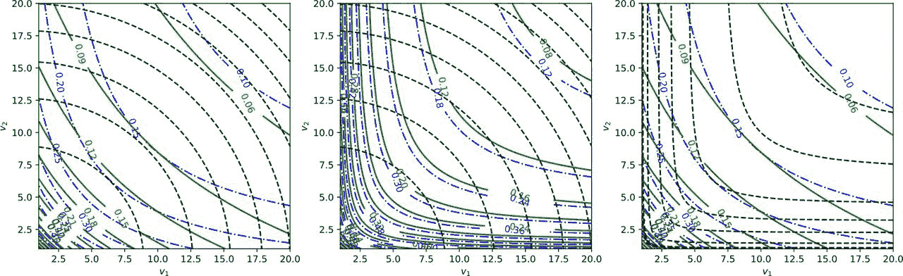

图 5.1 对于 `n = 2` 个点的设计问题 (5.14) 草图。无梯度数据的目标 `E(v)` 的等值线由蓝线绘制，而预算约束的等值线由虚线表示。基于梯度的 `E(v)` 版本由实线绿线绘制。*左侧：*对于 `s > 1`，存在一个唯一的非稀疏解。*中间：*较小的相关长度使得稀疏性更不可能出现。*右侧：*对于 `s < 1`，可行集是非凸的，我们可能预期有多个局部稀疏极小值。

虽然在凸情况下 `s >= 1` 使用任何非线性规划求解器都很，但非凸情况更为困难。幸运的是，在实践中并不需要保证全局最优性。预期的稀疏结构建议了一种特定的启发式方法：对于 `i = 1, ..., n + j`，考虑 `{\widetilde{\mathit{v}}}_{\mathit{i}} = \mathit{v} + \mathit{a}\mathit{e}_{\mathit{i}}` 且 `a > 0`，使得 `W(v) = \Delta W + W(\mathcal{D})`，即仅提高单个点的精度，并选择目标最小的设计 `{\widetilde{\mathit{v}}}_{\mathit{i}}`。如果这必要的一阶条件，则将其接受为解。否则，从该点开始局部最小化。

## 4 数值示例

我们给出两个数值示例：一个具有简单模型函数 `y` 的低维示例和一个 PDE 模型。我们比较了有无梯度数据的自适应阶段的结果。

### 4.1 理论示例

作为模型 `y`，我们考虑旋转的抛物柱面，即：

```
\begin{matrix} {\mathit{y}_{\mathit{\phi}}(\mathit{p}) = \left( \cos(\mathit{\phi})(\mathit{p}_{1} + \mathit{p}_{2}) + \sin(\mathit{\phi})(\mathit{p}_{2} - \mathit{p}_{1}) \right)^{2}\quad\text{for}\mspace{450mu}\mathit{p} \in \mathcal{X} = {\lbrack 0,2\rbrack}^{2},\mspace{480mu}\mathit{\phi} \in \mathbb{R}_{> 0}.} \\ \\ \end{matrix}
```


我们为 `ϕ ∈ {0, 2, 4}` 获取了 `m = 3` 次测量值，假设这些独立测量具有不同的精度，似然 `Σ[L] = 10^(−2) * d**i`。

我们从图 5.1 对 `s` 的评估开始。对于 `s ≥ 1`，优化是直接的。对于 `s < 1`，可行集是非凸的。

[图 5.3] 展示了不同增量预算下误差与计算量的关系。左侧，我们比较了包含梯度数据（实线）和不包含梯度数据（虚线）的设计。右侧，我们比较了包含梯度数据的自适应设计与对值和梯度使用均匀公差的区域自适应设计。包含导数信息显然更有效，大约高出一个数量级，但也导致了明显的非单调收敛。这可能是由于包含导数信息时协方差矩阵的条件数较大，导致每一步执行的超参数优化中出现次优解和高方差。相比之下，基于值的设计表现出大部分是单调的行为。同样明显的是，较小的增量预算效率更高，特别是在对所需精度较低的情况下。右侧显示了均匀公差设计的行为。对于较大的容差（`τ = 10^(-1)`），计算量很小，但没有达到所需的精度。较小的容差（`τ ≤ 10^(-2)`）可以达到所需的精度，但成本高得多，大约是两个数量级或更多。

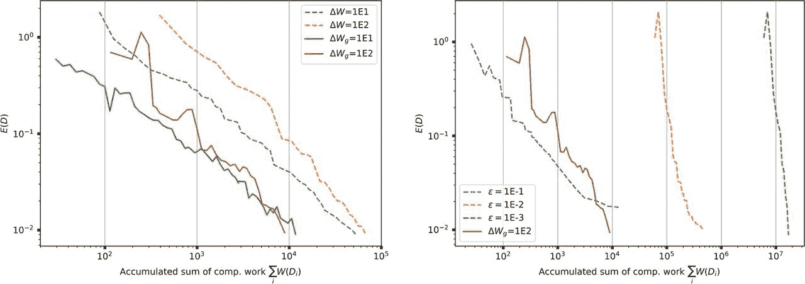

图 5.3 GEGPR 代理模型中估计的全局误差 $E(\mathcal{D})$ 与累积计算量的对比。*左侧*：不同增量工作 $\Delta W$ 下的 $E(\mathcal{D})$。带梯度数据的实线。*右侧*：位置自适应设计中不同的均匀公差与 $\Delta W[g] = 100$ 的不同曲线对比。

#### 局部误差估计的可靠性

误差模型 ([5.9]) 较为粗糙，可能无法捕捉识别参数中的实际误差。它受到估计误差传输中的线性化误差以及 GPR 误差估计的影响，而后者又取决于超参数优化。我们将估计的全局误差 $E(\mathcal{D})$ 与实际获得的误差进行比较。对于从 $\mathcal{X}$ 中随机采样的 1600 个点 `p[i]`，我们根据 ([5.8]) 计算局部误差估计 `e[i] = e_D`，并将其与预期实际误差进行比较，后者通过样本均值 $\tilde{e}_i := n_k^{-1}\sum_{k=1}^{n_k}\|p(y(p_i) + \delta_{i,k}) - p_{\mathcal{D}}(y(p_i) + \delta_{i,k})\|$ 进行近似，其中测量误差 `delta[i, k]` 的实现分布为 $\mathcal{N}(0, \Sigma[l])$。识别出的参数 `p(y(p[i]) + \delta[i,k])` 和 `p_D(y(p[i]) + \delta[i,k])` 是通过高斯-牛顿法从 `p[i]` 开始分别使用真实模型和代理模型计算。高斯-牛顿迭代仅具有局部收敛性，但在这种设置下，问题的非线性和采样的误差 `delta[i, k]` 足够小，使得方法能够收敛到最近的最小值。我们构建了比率 $e_i/\tilde{e}_i$ 的直方图。比率小于 1 表示低估了误差，而大于 1 表示高估了误差。[图 5.4] 中的结果表明，基于值和梯度增强的 GPR 代理模型表现相似。粗糙的先验误差估计并非严格可靠，但在引导自适应设计方面似乎相当准确。

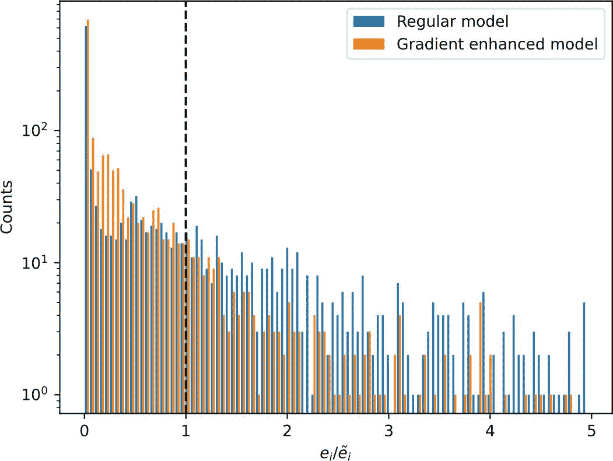

图 5.4 基于值的 GPR（蓝色）和 GEGPR（橙色）代理模型的 $e_i/\tilde{e}_i$ 对数直方图。

### 参数重建

对于一个示例性的参数重建，我们假设真实的 `p(*) = (1, 1.5)` 且有精确测量。[表 5.1] 显示重建的参数 `p` 良好处于规定的公差范围内，误差相当。

表 5.1 使用代理模型在 $\Delta W = 10^4$ 时重建的 `p`，与真实参数 `p(*)` 的对比。

| | `p[1]` | `p[1] - p[1](*)` | `p[2]` | `p[2] - p[2](*)` |
| :--- | :--- | :--- | :--- | :--- |
| 值 | 0.9968 | 0.0032 | 1.496 | 0.0047 |
| 值+梯度 | 0.9978 | 0.0022 | 1.502 | 0.0023 |

### 4.2 FEM 示例

散射测量是光学测量中一个更复杂的问题 [12], [28], [9]。目标是从不同极化方向和入射角 $\phi, \theta$ 的反射单色光强度中，识别纳米结构衍射图中的几何参数；见[图 5.5] 和 [37]。使用 JCMsuite[³] 开发了前向模型 `y(p)`。

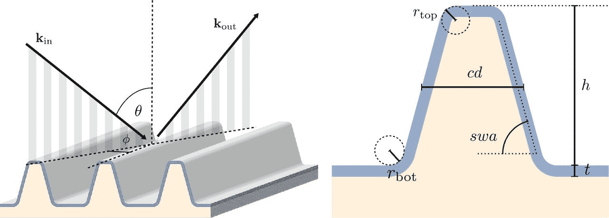

图 5.5 *左侧*：用于表面周期纳米结构表征的散射测量装置。入射光在角度 $\theta$ 和 $\phi$ 下变化，并记录衍射图。*右侧*：以半径 `r[top]` 和 `r[bot]`、光栅高度、侧壁角 (swa)、关键尺寸 (cd) 和氧化层厚度 ($t$) 参数化的几何结构。

数值模型将模型参数 `p = [cd, t, r[top], r[bot]] ∈ \mathcal{X} ⊂ \mathbb{R}^4` 映射到 $m = 4$ 个零阶散射强度 `y(p) ∈ \mathbb{R}^4`，通过将 $\theta$ 从 $5^\circ$ 增加到 $11^\circ$（步长为 $2^\circ$），并利用入射角 $\phi = 0^\circ$ 的 P 振光。

表 5.2 散射问题的参数域 $\mathcal{X}$。

| 参数 | `cd` | `t` | `r[top]` | `r[bot]` | `h` | `swa` |
| :--- | :--- | :--- | :--- | :--- | :--- | :--- |
| 范围 | [24, 28] nm | [4, 6] nm | [8, 10] nm | [3, 7] nm | 48.3 nm | 87.98° |

开始，$\mathcal{X}$ 使用 Sobol 序列覆盖了 $2^7 = 128$ 个点。根据已知的测量不确定性，我们设置 $\Sigma[l] = 10^{-2}\text{diag}(8.57, 8.56, 8.60, 8.63)$，并要求 $E(\mathcal{D}) \leq \text{TOL} = 10^{-3}$。

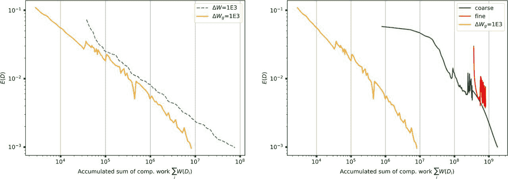

图 5.6 估计全局误差 `E(D)` 与计算量的对比图。*左侧*：相同增量工作 `ΔW = ΔW[g]` 下的 `E(D)`。下标 `g` 表示梯度增强的代理模型。*右侧*：在位置自适应算法中使用两种不同的固定评估精度，与全自适应梯度增强设计的对比，对应 `ΔW[g] = 10^3`。

### 收敛

在图 5.6 中，我们绘制了估计全局误差随计算量的变化的图。左侧，我们展示了相同增量预算 `ΔW` 下的 GPR 设计（虚线）与 GEGPR 设计（实线）的对比。正如解析示例所示，包含梯度信息可以以非单调收敛行为为代价提高效率。尽管在定量上波动很大，但效率的提高在广泛的增量工作预算范围内是一致的，如表 5.3 所示。注意，对于 `ΔW = 10^4`，性能增益因子 500 是幸运的离群值，这表明实际性能收益受到高方差的影响。

表 5.3 在不同增量预算下，由于包含梯度信息而观测到的性能改进因子 `W/W[g]`。

| `ΔW` | 10³ | 10⁴ | 10⁵ | 10⁶ |
| :--- | :--- | :--- | :--- | :--- |
| `W/W[g]` | 10 | 500 | 10 | 50 |

在图 5.6 右侧，我们将所提方法与使用固定有限元网格的位置自适应设计进行了对比。粗网的最大边长为 `h[c] = 16nm`，细网的最大边长为 `h[f] = 1nm`，分别对应有限元离散误差 `ϵ[c] = 10^(−2)` 和 `ϵ[f] = 10^(−4)`。当从粗网格开始时，曲线的误差减少最初缓慢。然而，在超过某一阈值（识别为 `W ≈ 3 ⋅ 10^7`）后显著加速。有趣的是，超过此阈值后，明显的振荡变得显而易见，导致误差在 `W = 2 ⋅ 10^8` 和 `W = 4 ⋅ 10^8` 之间进入平台期。随后，曲线恢复下降并最终在 `W ≈ 2e19` 左右达到所需的容差水平。值得注意的是，在分析过程中观察到在上述振荡范围内，特定参数分量的超参数优化未能产生理想结果。因此，有必要将该参数设置为默认值 `L = 1`，这为观察到的行为提供了合理的解释。

惊讶的是，我们在实现细网格收敛方面遇到了困难。尽管误差最初迅速下降，但曲线在各种设置下均表现出明显的振荡，导致必须终止程序。涉及不同常数超参数以及优化中变动的超参数边界的额外测试未能产生任何改进。因此，需要进一步的研究来全面阐明并解决这一问题。

因此，在全自适应和半自适应算法的直接比较中，我们可以节省约 100 倍的计算量。

### 局部误差估计器的可靠性

与之前一样，我们利用 $7^4 = 2401$ 个参数点来生成包含和不包含梯度信息的估计局部误差 `e[i]` 以及期望真实误差 `\widetilde{e}_i`。使用在最大边长为 1nm 的细网格上进行有限元模拟。与解析示例 [图 5.7] 不同，GEPR 代理模型略有不同，见[图 5.7]。这表明 GPR 应该提供更小的误差。再次，基于 GPR 方差的误差估计器并不完全可靠，但对于引导设计是稳健的。


### 参数重建

我们针对真值参数 `p(*) = (26, 5)` 执行了示例性的参数重建，并带有大小为 $10^3$ 的模拟测量。参数在规定的容差范围内恢复，如表 5.4 所示。

表 5.4 散射测量问题的重建结果。

| 参数 | `p[C_D]` | `Δp[C_D]` | `p[t]` | `Δp[t]` | `p[t_o]` | `Δp[t_o]` | `p[b_o]` | `Δp[b_o]` |
| :--- | :--- | :--- | :--- | :--- | :--- | :--- | :--- | :--- |
| 值 | 26.001 | 1.000E-3 | 4.992 | 0.878E-3 | 10.502 | 2.00E-3 | 4.991 | 9.20E-3 |
| 值+梯度 | 25.999 | 0.983E-4 | 4.999 | 0.812E-4 | 10.499 | 0.87E-4 | 4.999 | 1.54E-4 |

## 5 结论

通过贪婪启发算法对评估位置和评估容差进行联合自适应选择，显著提高了从有限元模拟构建 GPR 代理的效率。如果可以廉价计算，包含梯度信息将进一步提升这一点。与仅依赖评估位置的方法相比，观测到的改进因子为 100 到 1000 倍。

未来仍有许多待解决，例如梯度增强代理模型对超参数优化的敏感性更高，会导致非单调收敛问题。该方法的一个局限性是假设评估误差呈正态分布且均值为零，这显然不符合现实。因此，非高斯随机过程回归以及参数空间中相关的偏差误差具有很高的价值。此外，除了实时参数识别外，代理模型还用于通过马尔可夫链蒙特卡洛方法采样后验分布。在这里，不同的误差概念和前向模型评估的组织方式是必要的 [33]。

### 资助

本工作得到了联邦教育与研究部 – BMBF 的资助，项目编号 05M20ZAA (siMLopt)。

## 参考文献

[1] T. Bai, A. L. Teckentrup, and K. C. Zygalakis. 与线性偏微分方程相关的贝叶斯反问题的高斯过程。`arXiv:2307.08343`, 2023. →

[2] P. R. Conrad, M. A. Girolami, S. Särkkä, A. M. Stuart, and K. C. Zygalakis. 微分方程的统计分析：引入数值解引入概率测度。*Statistics and Computing*, 27:1065–1082, 2017. →

[3] K. Crombecq, E. Laermans, and T. Dhaene. 用于基于模拟建模的高效填充与非坍塌序列设计策略。*European Journal of Operational Research*, 214:683–696, 2011. →

[4] P. Deuflhard. *非线性问题的牛顿法：仿射不变性与自适应算法*。Computational Mathematics, 第 35. Springer, 2004. →

[5] P. Deuflhard and M. Weiser. *偏微分方程的自适应数值解*。de Gruyter, 2012. →

[6] D. Duvenau. *基于高斯过程的自动模型构建*。博士论文，剑桥大学, 2014. →

[7] H. W. Engl, M. Hanke, and A. Neubauer. *反问题的正则化*。Kluwer, 1996. →

[8] D. Eriksson, K. Dong, E. Lee, D. Bindel, and A. Wilson. 带有导数的扩展高斯过程回归。收于：S. Bengio, H. Wallach, H. Larochelle, K. Grauman, N. Cesa-Bianchi and R. Garnett,编辑，*神经信息处理系统进展*，第 31 卷。Curran Associates, Inc., 2018. →

[9] N. Farchmin, M. Hammerschmidtm, P. I. Schneider, M. Wurm, B. Bodermann, M. Bär, and S. Heidenreich. 使用多项式混沌进行硅线光栅的高效全局敏感性分析。收于：B. Bodermann, K. Frenner and R. M. Silver,编辑，*光学计量中的建模方面 VII*，第 11057 卷，页 110570J。国际光学与光学会，SPIE, 2019. →

[10] A. Giunta, S. Wojtkiewicz, and M. Eldred. 计算模拟现代实验设计方法概述（受邀）。收于：*第 41 次航空科学会议与展览会 AIAA 2003-649*，第 1–17 页。 →

[11] A. Griewank and A. Walther. *算法导数：原理与技术*。SIAM, 2008. a, b

[12] M. Hammerschmidt, M. Weiser, X. Garcia, L. Zschrich, B. Bodermann, and S. Burger. 使用贝叶斯反演化散射测量的不确定性。收于：B. Bodermann, K. Frenner and R. M. Silver,编辑，*光学计量中的建模方面 VI*，卷 10330 10334。国际光学与光学会，SPIE, 2017. →

[13] P. Hennig, M. A. Osborne, and M. Girolami. 概率数值计算与不确定性。*Proceedings of the Royal Society A*, 47:2015042, 2015. →

[14] P. Hennig and C. J. Schuler. 信息高效全局优化。*机器学习研究期刊*, 13:1809–1837, 2012. →

[15] V. Joseph and Y. Hung. 正交极大极立方设计。*Statistica Sinica*, 18:171–186, 2008. →

[16] J. Kaipio and E. Somersalo. *统计与计算反问题*。Springer, 2005. →

[17] M. Kuß. *用于鲁棒回归、分类和强化学习的高斯过程模型*。博士论文，达姆施塔特大学, 2006. →

[18] R. Lehmensiek, P. Meyer, and M. Müller. 应用于微波电路的多变量多输出模型自适应采样。*射频与微波计算机辅助工程国际期刊*, 12(4):332–340, 2002. →

[19] A. M. Mathai and S. B. Provost. *随机变量的二次型*。Marcel Dekker, 1992. →

[20] J. Močkus. 求极值的贝叶斯方法。收于：*IFIP 优化技术会议*，第 400–404 页。Springer, 1975. →

[21] I. Neitzel, K. Pieper, B. Vexler, and D. Walter. PDE 约束参数估计问题中最优传感器放置的稀疏控制方法。*Numerische Mathematik*, 143:943–984, 2019. →

[22] J. Nitzler, J. Biehler, N. Fehn, P.-S. Koutsourelakis, and A. Wall. 用于复杂物理模拟中多保真不确定性量化的广义概率学习方法。*Computer Methods in Applied Mechanics and Engineering*, 400:115600, 2022. →

[23] N. Farchmin, R. Haft, T. Goel, and P. Tucker. 基于代理模型的分析。*Progress in Science*, 41(1):28, 2005. →

[24] J. Hennig and C. E. 高斯过程回归。收于：*大规模信息*，第 203–223 页。 →

[25] C. Rasmussen and C. Williams. *高斯过程用于机器学习*。2006. a, b

[26] G. Sagnol, H. Gege, and M. Weiser. 稀疏设计。收于：*Statistics*, 397–408 页, 2016. →

[27] P. Schneider, M. Hammerschmidt, L. Zschrich, and S. Burger. 用于高效参数重建的高斯过程回归。收于：*光学计量中的建模方面 III*，卷 10330 101。 →

[28] P. Schneider, M. Hammerschmidt, L. Zschrich, and S. Burger. 用于高效参数重建的高斯过程回归。收于：*光学计量中的建模方面 IV*，卷 10330 10。国际光学与光学会，SPIE, 2019. →

[29] P. Semler and M. Weiser. 用于反问题高效构建代理模型的自适应高斯过程回归。*Inverse Problems*, 39:125003, 2023. a, b, c, d, e, f, g, h, i

[30] E. Solak, M. Roderick, W. E. Leithead, D. Leith, and C. Rasmussen. 动态系统高斯过程模型的导数观测, 页面 1033–1040, 2002 年 1 月. →

[31] M. Sugiyama. 基于泛化误差条件期望近似线性回归主动学习. *Journal of Machine Learning Research*, 7:141, 2006. →

[32] B. Vexler. 用于参数识别问题的自适应有限元法. 载于：H. G. Bock, T. Carraro, W. Jäger, S. Körkel, R. Rannacher and J. P. Schlöder, 编, *基于模型的参数估计：理论与应用*, 页面 31–54. Springer, 2013. →

[33] P. Villani, J. F. Unger, and M. Weiser. 用于贝叶斯反问题的自适应高斯过程回归. 载于：*Proc. Algoritmy 2024*, 页面 214–224, 2024. →

[34] M. Weiser and S. Ghosh. 理论上最优不精确谱延迟修正法. *Communications in Applied Mathematics and Computational Science*, 13(1):53–86, 2018. →

[35] A. Wu, M. C. Aoi, and J. W. Pillow. 在贝叶斯优化和求法中利用梯度和海森矩阵. arXiv: 1704.00060, 2017. →

[36] J. Wu, M. Poloczek, A. G. Wilson, and P. I. Frazier. 带有梯度的贝叶斯优化. 载于：*Advances in Neural Information Processing Systems*, 卷 30, 页面 3–6. Curran Associates, 2017. a, b, c, d

[37] M. Wurm, S. Bonifer, B. Bodermann, and J. Richter. 用于纳米结构尺寸表征的深紫外线散射仪：系统改进与测量. *Measurement Science & Technology*, 22(9):0940, 2011. →

[38] A. Zaytsev. 具有多两个水平保真度的工程数据可靠代理建模. 载于：*2016 年第 7 届机械与航空航天国际会议 (ICMAE)*, 页面 341–345, 2016. →

## Notes

# 基于多保真度领域分解的用于时间依赖问题的物理信息神经网络和算子
Alexander Heinlein Amanda Howard Damien Beecroft Panos Stinis

### 摘要
多尺度问题对于基于神经网络的微分方程离散化（例如物理信息神经网络 `PINNs` 和算子网络）来说极具挑战性。这可以归因于神经网络的谱偏置。为了提高 `PINNs` 在时间依赖问题中的性能，采用了多保真度堆叠 `PINNs` 与基于领域分解的有限 `PINNs` (finite `PINNs`) 的结合。特别是，为了学习多保真度模型的高保真度部分，针对单摆和 Allen–Cahn 方程研究了时间域分解。可以观察到领域分解方法明显改进了 `PINN` 和堆叠 `PINN` 方法。最后，证明了 `FBPINN` 方法可以扩展到多保真度物理信息深度算子网络。

关键词：多保真度，领域分解，物理信息神经网络，深度算子网络，MSC 2020: 65M22, 65M55

## 致谢
该项目感谢美国能源部 (DOE) 可扩展、高效和加速因果推理算子系统 (`SEA`) 项目（编号 8027）的支持。太平洋西北实验室 (`PNNL`) 是由 Battelle 根据合同 DE-AC05-76RL0183 运营。

## 1 引言
科学领域的许多问题具有多尺度性质，不同的过程发生在不同的尺度上。这些问题的求解对于数值方法来说通常是困难的。多尺度方法的开发使得此类问题的数值模拟变得可行；例如多尺度有限元 12、同质多尺度 9、广义有限元 4 或变分多尺度 16 方法。

近年来，受 Lagaris 等人 17 早期工作的启发，已经开发了用于求解偏微分方程 (`PDEs`) 的机器学习技术。在本文中，我们关注物理信息神经网络 `PINNs` 25；其他方法也在同一时期被提出，例如 Deep Ritz 方法 10。这些方法具有许多优点：易于实现、允许直接整合数据，并可用于反问题和高维问题。然而，它们的收敛性尚不清楚，因此所得精度往往受到限制。这可以部分归因于神经网络 (`NNs`) 的谱偏置，这意味着 `NNs` 学习低频分量的速度远快于高频分量。在多尺度问题中，高频分量通常对应于细尺度，而低频分量则对应于粗尺度。因此，使用 `PINNs` 求解多尺度问题也特别具有挑战性。

在本文中，我们的目的是结合近期开发的两种技术，以改进该背景下 `PINNs` 的训练。一方面，我们考虑了为 `PINNs` 引入的多保真度训练方法 [21]，并扩展到深度算子网络（`DeepONets`, [18]）于 [14], [19], [6]。特别是，我们考虑了堆叠 `PINNs` 的方法 [13]，该方法将多个网络堆叠在一起，使得堆叠层顶部的模型可以学习之前模型未捕获的特征。另一方面，我们采用了多级施瓦茨（Schwarz）区域分解神经网络架构 [8]，这些基于有限基 `PINNs` (`FBPINNs`) 方法 [22]。在这种方法中，通过局部化改进了多尺度特征的学习。特别是，网络架构被分解，使得网络的各个部分学习对应空间或时间尺度上的特征。关于区域分解方法与机器学习结合的概述，可以参见例如 [11]。

在最近的相关工作中，人们已经开发了通过迭代训练 `PINNs` 来逐步减少误差的方法；参见 [1], [2], [3], [31]。这些方法在实现上各不相同，通过训练每个新网络来减少前一个网络的残差。相比之下，本文的工作在每次迭代中都是针对整个解进行训练。

本文的结构如下：首先，在第 2 节，我们描述了方法论框架。特别是，我们首先在第 2.1 节讨论 `PINNs`，然后于第 2.2 节描述多保真度 `PINNs`，并在第 2.3 节介绍区域分解方法。接下来，我们将在第 3 节中引入模型问题中所使用的特定区域分解。在第 4 节中，我们给出了几个模型问题、单摆问题以及 Allen–Cahn 方程的数值结果。我们在第 5 节将结果扩展到 `DeepONets`。最后在第 6 节中简要讨论了当前和未来工作。所有使用的训练参数均在表 6.1 中。

## 2 方法

### 2.1 物理信息神经网络

我们考虑一个通用的残差形式微分问题：寻找 $u$ 使得

(6.1)
$$
\begin{matrix}
\mathcal{A}u = 0 \quad \text{in } \Omega, \\
\mathcal{B}u = 0 \quad \text{on } \partial\Omega,
\end{matrix}
$$

其中 $\mathcal{A}$ 是微分算子，$\mathcal{B}$ 是指定初始或边界条件的算子。解 $u$ 定义在区域 $\Omega$ 上，并具有应用 $\mathcal{A}$ 和 $\mathcal{B}$ 的足够正则性。为了求解方程 (6.1)，我们遵循 [17] 并采用配点法。特别是，我们利用求解方程 (6.1) 等价于求解 $\operatorname{\arg\min}_{\mathcal{B}u = 0 \text{ on } \partial\Omega} \int_{\Omega} (\mathcal{A}u(\mathbf{x}))^2 dx$。我们使用带有参数 $\theta$ 的神经网络 $\widehat{u}(\theta)$ 对解进行离散化，并通过下式近似积分：

(6.1)
$$
\operatorname{\arg\min}_{\mathcal{B}u = 0 \text{ on } \partial\Omega} \int_{\Omega} (\mathcal{A}u(\mathbf{x}))^2 dx
$$

其中 $i$ 取自 $\Omega$。可以使用不同的网络架构，我们将采用第 2.2 节和第 2.3 节的方法组合。

(6.1) 中第二个方程的初始或边界条件可以通过硬约束或软约束来实施。在硬约束方法中，它们在神经网络中被显式实现；参见 [17]。在本文中，我们采用软约束方法，将约束整合到损失函数中：

(6.2)
$$
\operatorname{\arg\min}_{\theta} \lambda_{r} \sum_{i \in \Omega} \left( \mathcal{A}u(x_i, \theta) \right)^{2} + \lambda_{bc} \sum_{i \in \partial\Omega} \left( \mathcal{B}u(x_i, \theta) \right)^{2}
$$

这里，$\lambda_{r}$ 和 $\lambda_{bc}$ 分别为微分方程的残差以及初始和边界条件加权。正如在 [28] 中讨论的，适当的权重对于优化 (6.2) 至关重要。$\theta$ 表示网络中所有的可训练参数。

这种方法在 [25] 中也被称为物理信息神经网络 (`PINNs`)。

### 2.2 多保真度堆叠 PINNs

多保真度 `PINNs` 使用两个神经网络来学习低保真度和高保真度物理之间的相关性 [21]。目标是训练一个线性网络（无激活函数）来学习低保真度和高保真度模型之间的线性相关性，并训练一个非线性网络来学习非线性相关性。在相关性大部分是线性的假设下，将网络分为线性和非线性部分可以使用更小的非线性网络。

为了训练一个多保真（`multifidelity`）`PINN`，我们首先训练一个标准的单保真 `PINN` ${\widehat{u}}^{SF}(\mathbf{x}, \theta^{SF})$。在第二步中，我们训练一个多保真网络 ${\widehat{u}}^{MF}$，该网络由线性和非线性子网络组成，这些子网络用于学习单保真 `PINN` ${\widehat{u}}^{SF}(\mathbf{x}, \theta^{SF})$ 与解之间的相关性：

```


## 多保真堆叠 FBPINNs

线性网络没有激活函数，以强制学习线性相关性，且其规模可以很小。`α` 是一个可训练参数，用于强制实现线性相关性的最大化。

方程 (6.2) 中的损失函数经过修改，包含了惩罚项 `α`⁴：

```
(6.4) arg min_θ λ_r Σ_{x_i ∈ Ω} (A û(x_i, θ))² + λ_bc Σ_{x_i ∈ ∂Ω} (B û(x_i, θ))² + λ_α α⁴
```

在 [13] 中所示的多保真堆叠 PINN（stacking PINNs）中，多保真 PINN 是递归训练的，每一层都将之前训练的堆叠层的输出作为输入。通过这种方式，前一层作为新堆叠层的低保真模型。[13] 与本文工作的区别在于，[13] 没有考虑区域分解，因此每个堆叠层都有一个覆盖整个区域的单多保真 PINN。本文考虑的方法更为灵活，正如我们将在第 4 节所示的，在相同的方程上训练时，它可以产生更小的相对误差。

### 2.3 基于区域分解的神经网络架构

在 [22] 中观察到，如果在 PINN 方法中引入区域分解，可以更好地学习解中的高频分量。为了扩展到较大量的子区域，该方法首先在 [7] 中扩展到两级，随后在 [8] 中扩展到任意数量的级。基于区域分解的有限基 PINN (FBPINNs) 的通用思想是将计算区域 `Ω` 分解为 `J` 个重叠的子区域 `Ω[j]`，即 `Ω = ⋃_{j=1}^J Ω_j`。与一样，`Ω` 可能是一个时空区域，在本工作中，我们将关注时间上的区域分解。在每个子区域上，我们定义了一个网络函数空间 `V_j = {û_j(x, θ_j) | x ∈ Ω_j, θ_j ∈ Θ_j}`，其中 `û_j(x, θ_j)` 表示一个 PINN 模型，`Θ[j]` = `ℝ^{(k[j])}` 是所有可训练神经网络参数的空间，而 `k[j]` 是网络参数的数量。

为了表示给定问题的全局解，我们定义了具有 `supp(ω[j]) ⊂ Ω[j]` 的窗函数 `ω[j]`，使得 `ω[j]` 构成单位分解，即 `Σ_{j=1}^J ω_j = 1`。然后我们可以定义全局网络空间 `V = Σ_{j=1}^J ω_j V_j` 以及全局函数 `û(x, θ) = Σ_{j=1}^J ω_j û_j`。据观察到，这种方法可能会显著提高 PINN 的性能，参见 [22]。然而，类似于单级方法 [27]，无法扩展到大量的子区域，参见 [7] 和 [8]。为了提高多尺度问题的可扩展性和性能，可以采用区域分解的分层。定义 `L` 级区域分解，第 `l` 级分解由 `D[l]` 表示，其中 `Ω = ⋃_{l=1}^L Ω^{(l)}`，且 `J^{(l)}` 是第 `l` 级的子区域数量，参见 [13]。虽然对 `J^{(l)}` 没有限制，但我们选择 `J^{(l)}=1`，使得第一级对应单个子区域。


多级区域分解 L=3

现在，在每一级 `l` 上，我们定义窗函数 `ω[j][l]` 为单位分解，使得 `Σ_{j=1}^{J^{(l)}} ω_j^{(l)} = 1`，且 `supp(ω[j][l]) ⊂ Ω^{(l)}`。与单级情况类似，这产生了全局网络空间 `V = Σ_{l=1}^L Σ_{j=1}^{J^{(l)}} ω_j^{(l)} V_j^{(l)}` 以及根据 `θ = ⋃_{l=1}^L θ^{(l)}` 和 `θ^{(l)} = ⋃_{j=1}^{J^{(l)}} θ_j^{(l)}` 定义的全局函数：

```
(6.5) û(x, θ) = (1/L) Σ_{l=1}^L û^{(l)}(x, θ^{(l)}) with û^{(l)}(x, θ^{(l)}) = Σ_{j=1}^{J^{(l)}} ω_j^{(l)} û_j^{(l)}(x, θ_j^{(l)})
```

在 [7] 和 [8] 中已经观察到，由于子域模型之间的通信增加，多级 FBPINN 方法的性能可能显著优于单级方法。

## 2.4 堆叠 FBPINNs

我们按照如下方式将多保真堆叠 PINNs 和 FBPINNs 结合：在第一层，我们在整个区域 `Ω^{(0)} = Ω` 上训练标准的单保真 PINN。然后，对于每一层 `l > 0`，我们使用经过修改后的 FBPINN 网络架构，该架构由多保真网络组成，并将上一层 `l − 1` 的网络作为输入：

```
(6.6) û^{(l)}(x, θ^{(l)}) = Σ_{j=1}^{J^{(l)}} ω_j^{(l)} û_{j,MF}^{(l)}(x, û^{(l-1)}, θ_j^{(l)})
```

我们注意到，公式 (6.6) 与公式 (6.5) 相差一个 `1/L` 因子，因为 FBPINNs 的输出是所有层级训练的网络之和，而堆叠 FBPINNs 的输出是最后一层网络之和。第 `l` 层的网络学习 `l − 1` 层输出与解之间的相关性，并将之前学习的解 `û^{(l-1)}(x, θ^{(l-1)})` 作为输入：

```
û_{j,MF}^{(l)}(x, θ_j^{(l)}) = (1 - |α|) û_{j,lin}^{(l)}(x, û^{(l-1)}, θ_j^{(l)}) + |α| û_{j,nonlin}^{(l)}(x, û^{(l-1)}, θ_j^{(l)})
```

## 3 时间上的区域分解

在这项工作中，我们特别关注经典 PINNs 无法学习时间演化的情况，例如阻尼摆和 Allen–Cahn 方程。我们考虑区域 `Ω = X × [0, T]`，其中 `X` 表示空间域，`T ∈ ℝ`。因此，对于堆叠 FBPINN 方法，我们考虑了时间上的区域分解：

```
Ω_j^{(l)} = [ ((j-1)T - δT/2) / (J^{(l)} - 1), ((j-1)T + δT/2) / (J^{(l)} - 1) ]
```

其中 `δ > 0` 是重叠比例。对于 `l=0`，我们取 `Ω^{(0)} = [0.5T - δT/2, 0.5T + δT/2]`。单位划分函数由 `ω_j^{(l)} = ω̂_j^{(l)} / Σ_{j=1}^{J^{(l)}} ω̂_j^{(l)}` 给出，其中：

```
(6.7) ω̂_j^{(l)}(t) = { 1 if l = 0; [1 + cos(π(t - μ_j^{(l)}) / σ_j^{(l)})]² if l > 0 }
```

`μ_j^{(l)} = T(j-1)/J^{(l)}`，`σ_j^{(l)} = δT/J^{(l)}`。为了简单起见，我们在每个情况下取 `J^{(l)}=2`。`T=1` 且 `l=2` (`J^{(2)}=4`) 的窗口函数插图见于图 6.2。


图 6.2 `l=2` 且 `T=1` 的窗口函数 `ω[j]`。

在这种设置下，每个网络覆盖时间域的一部分。为了便于训练，我们通过使用比例时间 `t̂ = t(l-1)/T` 将每个区域的输入缩放到 `[-1,1]` 范围内。这种缩放提高了训练的稳健性。在我们的应用中，我们计算相对 `ℓ[2]` 误差 `||u(x) - û(x,θ)||₂ / ||u(x)||₂`，其中 `u` 表示精确解，`û` 表示多保真 FBPINN 的输出。

## 4 结果

### 4.1 摆

虽然是一个简单的系统，但准确训练 PINN 来预测长时间的摆运动面临着挑战 [29]。摆的运动由 `t ∈ [0, T]` 的两个一阶微分方程组控制：

```
(6.8) ds₁/dt = s₂
(6.9) ds₂/dt = - (b/m)s₂ - (g/L) sin(s₁)
```


其中 $s[1]$ 和 $s[2]$ 分别表示位置和速度。我们采用了文献 [29] 中使用的相同参数，即 $m=1.0, b=0.05, g=9.8$ 且 $T=2$。我们取 $s_1=s_2=0$。我们将结果与文献 [13] 中的堆叠 PINN 结果进行比较，后者使用了多保真度架构，但在层级上仅使用单个 PINN。如图 6.3 所示，堆叠 FBPINN 能够达到显著更低的 $\ell_2$ 误差。此外，堆叠 FBPINN 中的每个网络都比堆叠 PINN 中使用的网络小得多，结果是在三层时，堆叠 FBPINN 仅需 34570 个可训练参数即可达到 $7.4 \times 10^{-3}$ 的相对 $\ell_2$ 误差。相比之下，文献 [13] 中的最佳情况堆叠 PINN 需要四层才能通过 63018 个可训练参数达到 $1.3 \times 10^{-2}$ 的相对 $\ell_2$ 误差。

![图 6.3 摆运动问题的堆叠 FBPINN 结果：左：摆运动问题中示例中 $s_1$（上）和 $s_2$（下）随时间变化的堆叠 FBPINN 结果，层级多达五层堆叠 FBPINN。右：摆的相对 $\ell_2$ 训练误差，将本文的工作（实线）与 [13] 中的方法（虚线）进行对比。](graphic/converted/b_9783111376776-006_fig_003)

图 6.3 摆运动问题的堆叠 FBPINN 结果：左：摆运动问题中示例中 $s_1$（上）和 $s_2$（下）随时间变化的堆叠 FBPINN 结果，层级多达五层堆叠 FBPINN。右：摆的相对 $\ell_2$ 训练误差，将本文的工作（实线）与 [13] 中的方法（虚线）进行对比。

现在我们考虑一个具有低高频率分量的玩具模型问题，其灵感源自文献 [22]：

$$
\begin{matrix} 
\frac{\mathit{d}\mathit{s}}{\mathit{d}\mathit{x}} & {= \mathit{\omega}_{1}\cos(\mathit{\omega}_{1}\mathit{x}) + \mathit{\omega}_{2}\cos(\mathit{\omega}_{2}\mathit{x}),} \\ 
{\mathit{s}(0)} & {= 0,} 
\end{matrix}
$$

定义域 $\Omega = [0, 20]$，$\omega_1 = 1$ 且 $\omega_2 = 15$。该问题的精确解为 $s(x) = \sin(\omega_1 x) + \sin(\omega_2 x)$。

结果如图 6.4 所示。在两个堆叠层后，堆叠 FBPINN 达到了相对 $\ell_2$ 误差 $4.2 \times 10^{-3}$，包含 7822 个可训练参数。在 10 个堆叠层后，具有 11179 个可训练参数的堆叠 PINN 达到了类似的相对 $\ell_2$ 误差 $6.1 \times 10^{-3}$。在图 6.4 右侧中还展示了来自文献 [13] 的最佳 SF 网络，它具有 16833 个可训练参数，相对 $\ell_2$ 误差为 $9.5 \times 10^{-2}$。堆叠 FBPINN 优于 SF PINN，误差低了一个数量级以上，且可训练参数少了一半。此外，最终的堆叠 FBPINN 达到了相对 $\ell_2$ 误差 $8.3 \times 10^{-4}$，比最终的堆叠 PINN 低了一个数量级。

![图 6.4 多尺度问题的堆叠 FBPINN 结果：左侧：单保真度层 0 和前四层堆叠 FBPINN 的结果。右侧：本文工作与 [13] 对比的多尺度相对 $\ell_2$ 训练误差。](graphic/converted/b_9783111376776-006_fig_004.jpg)

图 6.4 多尺度问题的堆叠 FBPINN 结果：**左侧：** 单保真度层 0 和前四层堆叠 FBPINN 的结果。**右侧：** 本文工作与 [13] 对比的多尺度相对 $\ell_2$ 训练误差。

### 4.3 Allen–Cahn 方程

我们的第三个例子基于 Allen–Cahn 方程，给出如下：

$$
\begin{matrix} 
{\mathit{s}_{t} - 0.0001\mathit{s}_{xx} + 5\mathit{s}^{3} - 5\mathit{s}} & {= 0,} & & {t \in (0,1], x \in [-1,1],} \\ 
{\mathit{s}(x,0)} & {= x^{2}\cos(\pi x),} & & {x \in [-1,1],} \\ 
{\mathit{s}(x,t)} & {= \mathit{s}(-x,t),} & & {t \in [0,1], x = -1, x = 1,} \\ 
{\mathit{s}_{x}(x,t)} & {= \mathit{s}_{x}(-x,t),} & & {t \in [0,1], x = 1, x = 1.} 
\end{matrix}
$$

Allen–Cahn 方程在尝试用单个 PINN 学习从 $t=0$ 到 1 的完整解时存在困难，例如文献 [32]、[20] 和 [26]。

我们通过第 3 节所示的时间域划分为子域来求解 Allen–Cahn 方程。相应的堆叠 FBPINN 结果如图 6.5 所示。应用两层堆叠 FBPINN 的相对 $\ell_2$ 误差为 $5.9 \times 10^{-3}$。之前文献报道的相对误差，反向 PINN [20] 为 $1.68 \times 10^{-2}$，对于自适应重采样的 PINNs [32] 为 $2.33 \times 10^{-2}$。

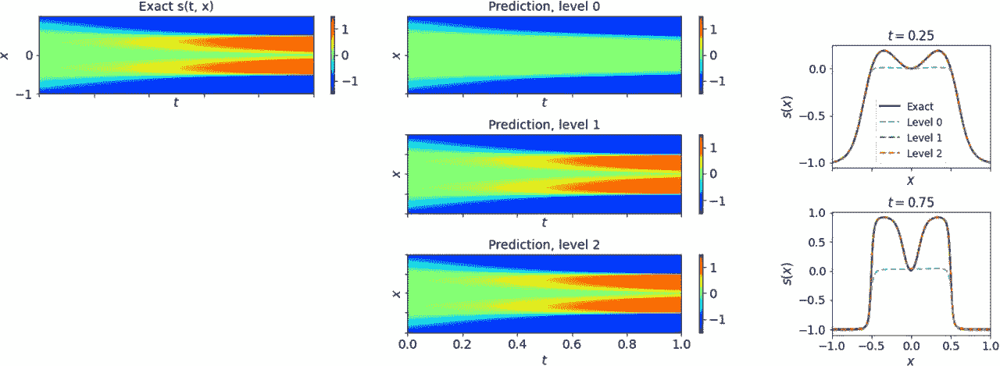

图 6.5 Allen–Cahn 方程的堆叠 FBPINN 结果。**左侧：** 单保真度层 0 和前两层堆叠 FBPINN 的结果。**右侧：** 堆叠 FBPINN 在 $t=0.25$ 和 $t=0.75$ 时的结果。

## 5 DeepONets

第 2 节介绍的方法无缝扩展到来自文献 [14]、[13] 的多保真度堆叠 DeepONets；我们将所得的方法命名为有限基 DeepONets (FB-DONs)。为了简洁起见，关于 DeepONet 方法的细节请参考文献 [18]、[14]、[13]。作为一个示例，我们提供了第 4.1 节中摆子问题的结果，并在给定初始条件 $(s_1, s_2) \in [-2, 2] \times [-1.2, 1.2]$ 的情况下训练模型，损失函数由方程 (6.2) 和微分方程 (6.8) 以及 (6.9) 给出。训练后，所得 FB-DON 模型能够预测训练范围内的任何初始条件，如图 6.6 所示。训练参数在表 6.2 中给出。对于一层 $l$，$l>0$，我们使用方程 (6.7) 中定义的单位划分函数训练 $2(l)$ 个 DeepONets。作为训练数据，我们采用了 50,000 对随机选择的 $(s_1, s_2) \in [-2, 2] \times [-1.2, 1.2]$。这种方法被称为算子学习，因为我们学习的是初始条件与解之间的映射，而不是单一解。

在本文中，我们引入了堆叠 FBPINN 和 FB-DON 的方法。对于所考虑的时间依赖性问题，堆叠 FBPINN 比单纯的堆叠 PINN 产生了更准确的结果，在某些情况下，它们还需要更少的可训练总参数。这表明，时间上的区域分解可以极大提高堆叠 PINNs 的性能。与关于堆叠 PINNs 和 DeepONets 的之前工作相比，堆叠 FBPINN 和 FB-DON 使用的是对应层级单位分解函数加权的子域网络之和。与文献 [8] 中的多级 FBPINN 不同（后者的子域网络跨所有层级求和并同时训练），堆叠 FBPINN 和 FB-DON 的架构和训练在层级之间是顺序的；这种思想类似于文献 [7] 中的乘法耦合，但通过堆叠方法进行了实现。这种差异允许堆叠 FBPINN 和 FB-DON 能够在不同层上考虑不同的方程（类似于文献 [13] 中考虑模拟退火），或者在不同的长度尺度下考虑不同的物理模型。我们将此留给未来的工作。对堆叠 FB-DON 的扩展允许将物理感知 FB-DON 作为替代模型来取代传统的数值求解器。使用训练好的堆叠 FB-DON 计算解非常高效：它只需要网络的一次前向传播，因此与经典数值求解器相比，计算时间可以大幅减少。FB-DON 方法的一个优势是它可以与现有方法结合，以增加物理感知 DeepONets 的精度，包括长时间积分 [29] 和自适应权重方案 [30]、[15]、[23]。

## 7 训练参数

表 6.1 文中 FBPINN 结果的训练参数。学习率使用 `Jax` [5] 中的 `exponential_decay` 函数设置，给定的学习率、衰减率以及 2000 个衰减步。用于堆叠 PINN 结果的训练参数见文献 [13]。

| | 第 4.1 节 | 第 4.2 节 | 第 4.3 节 |
| --- | --- | --- | --- |
| 层级 0 学习率与衰减率 | $5 \cdot 10^{-3}$, 0.99 | $10^{-3}$, 0.99 | $10^{-4}$, 0.99 |
| 层级 0 网络宽度 | 100 | 32 | 100 |
| 层级 0 网络层数 | 3 | 3 | 6 |
| 层级 0 迭代次数 | 200,000 | 200,000 | 200,000 |
| 非线性网络宽度 | 32 | 16 | 200 |
| 非线性网络层数 | 3 | 4 | 4 |
| 线性网络尺寸 | [2,4] | [1,5] | [1,5] |
| MF 学习率与衰减率 | $5 \cdot 10^{-3}$, 0.99 | $5 \cdot 10^{-3}$, 0.95 | $5 \cdot 10^{-3}$, 0.95 |
| BC 批处理大小 | 1 | 1 | 128 |
| 残差批处理大小 | 400 | 400 | 1024 |
| 迭代次数 | 200,000 | 300,000 | 300,000 |
| $\lambda_r$, $\lambda_c$, $\lambda_\alpha$ | 1.0, 1.0, 1.0 | 10.0, 1.0, 1.0 | 10.0, 1.0, $10^{-5}$ |
| 层级 0 激活函数 | swish | swish | tanh |
| MF 激活函数 | swish | swish | swish |

表 6.2 文中 FB-DON 结果的训练参数。学习率使用 `Jax` [5] 中的 `exponential_decay` 函数设置，给定的学习率、衰减率以及 2000 个衰减步。

| | 第 5 节 |
| --- | --- |
| 层级 0 学习率与衰减率 | $5 \cdot 10^{-3}$, 0.9 |
| 层级 0 分支与主干宽度 | 100 |
| 层级 0 分支与主干层数 | 5 |
| 层级 0 迭代次数 | 100,000 |
| 非线性分支与主干宽度 | 100 |
| 非线性分支与主干层数 | 3 |
| 线性分支与主干宽度 | 10 |
| 线性分支与主干层数 | 1 |
| MF 学习率与衰减率 | $5 \cdot 10^{-3}$, 0.9 |
| BC 批处理大小 | 1,000 |
| 残差批处理大小 | 10,000 |
| 迭代次数 | 200,000 |
| $\lambda_r$, $\lambda_c$, $\lambda_\alpha$ | 1.0, 1.0, 1.0 |
| 层级 0 激活函数 | sin |
| MF 激活函数 | sin |

## 参考文献

[1] M. Ainsworth and J. Dong. Galerkin neural networks: a framework for approximating variational equations with error control. *SIAM Journal on Scientific Computing*, 43(4):A2474–A2501, 2021.

[2] M. Ainsworth and J. Dong. Galerkin neural network approximation of singularly-perturbed systems. *Computer Methods in Applied Mechanics and Engineering*, 402:11519, 2022.

[3] Z. Aldirany, R. Cotter, M. Laforest, and S. Prudhomme. Multi-level neural networks for accurate solutions of boundary-value problems. arXiv:2308.1543, 2023.

[4] I. Babuška and J. E. Osborn. Generalized finite element methods: their performance and their relation to mixed methods. *SIAM Journal on Numerical Analysis*, 20(3):510–536, June 1983.

[5] J. Bradbury, R. Frostig, P. Hawkins, M. Johnson, C. Leary, D. Maclaurin, G. Neula, S. Paszke, and Q. Zhang. JAX: composable transformations of Python programs, 2018.

[6] S. De, M. Reynolds, M. Hassan, and A. Doost. Finite-fidelity modeling using deeponets. arXiv:2211.0540, 2022.

[7] V. Dolean, A. Heinlein, S. Mishra, and B. Moseley. Finite-informed neural networks as a Schwarz domain method. arXiv:2211.0597, 2022.

[8] V. Dolean, A. Heinlein, S. Mishra, and B. Moseley. Multilevel domain decomposition-based architectures for physics-informed neural networks. arXiv:2306.0548 [cs, math], 2023.

[9] W. E, B. Engquist, X. Li, W. Ren, and E. Vanden-Eijnden. Heterogeneous multiscale methods: a review. *Communications in Computational Physics*, 2(3):367–450, 2007.

[10] W. E and B. Yu. The Deep Ritz Method: a deep learning-based numerical algorithm for solving variational problems. *Communications in Mathematics and Statistics*, 6(1):1–12, March 2018.

[11] A. Heinlein, A. Klawonn, M. Lanser, and J. Weber. 结合机器学习与区域分解方法求解偏微分方程——综述. *GAMM-Mitteilungen*, 44(1):e202100001, 2021, 28 页.

[12] T. Y. Hou and Y. Efendiev. *多尺度有限元素方法：理论与应用*. Springer, New York, NY, 2009.

[13] A. A. Howard, S. H. Murphy, S. E. Ahmed, and P. Stinis. 堆叠网络改进了物理信息训练：在神经网络和深度算子网络中的应用. *Foundations of Data Science*, 7(1):134–162, 2025 年 3 月.

[14] A. A. Howard, M. Perego, G. E. Karniadakis, and P. Stinis. 用于数据驱动和物理信息问题的多保真度深度算子网络. *Journal of Computational Physics*, 493:12462, 2023 年 11 月.

[15] A. A. Howard, S. Qadeer, A. W. Engel, A. Tsou, M. Vargas, and P. Stinis. 用于高效训练物理信息深度算子网络的共轭核. 收于 *ICLR 2024 Workshop on AI4 in Science*, 2024.

[16] T. J.R. Hughes. 多尺度现象：格林函数、狄利克雷到纽曼表述、亚网格尺度模型以及稳定化方法的起源. *Computer Methods in Applied Mechanics and Engineering*, 127(1):387–401, 1995 年 11 月.

[17] I. E. Lagaris, A. Likas, and D. I. Fotiadis. 用于求解常和微分方程的人工神经网络. *IEEE Transactions on Neural Networks*, 9(5):987–1000, 1998 年 9 月.

[18] L. Lu, P. Jin, and G. E. Karniadakis. DeepONet：基于算子通用近似定理的非线性算子学习. *Nature Machine Intelligence*, 3(3):218–229, 2021 年 3 月. arXiv:1910.03193.

[19] L. Lu, R. Pestourie, S. G. Johnson, and G. Romano. 用于纳米热传输快速设计的多保真度深度神经网络算子. *Physical Review Research*, 4(2):023210, 2022.

[20] R. Mattey and S. Ghosh. 用于 Allen Cahn 和 Cahn Hilliard 方程的新型序列物理信息神经网络训练方法. *Computer Methods in Applied Mechanics and Engineering*, 390:11474, 2022.

[21] X. Meng and G. E. Karniadakis. 从多保真度数据中学习的复合神经网络：函数近似和反 PDE 问题应用. *Journal of Computational Physics*, 401:109020, 2020.

[22] B. Moseley, A. Markham, and T. Nissen-Meyer. 有限基物理信息神经网络 (FBPNs)：一种求解方程的区域分解方法. *Advances in Computational Mathematics*, 49(4):62, 2023 年 7 月.

[23] S. Qadeer, A. Engel, A. Tsou, M. Vargas, P. Stinis, and T. Chiang. 基于神经网络回归的高效核代理模型. arXiv:2310.18612, 2023.

[24] N. Rahaman, A. Baratin, D. Arpit, M. Lin, F. Hamprecht, Y. Bengio, and A. Courville. 关于神经网络的光谱偏置. arXiv:1806.08734, 2019 年 5 月.

[25] M. Raissi, P. Perdikaris, and G. E. Karniadakis. 物理信息神经网络：用于求解涉及非线性偏微分方程的正、反问题的深度学习框架. *Journal of Computational Physics*, 378:686–707, 2019.

[26] F. Rohfer, S. Posch, and C. C. Geiger. 动力学系统固定点在训练物理信息神经网络中的作用. arXiv:2203.13648, 2022.

[27] A. Toselli and O. Widlund. *区域分解方法——算法与理论*. 计算数学系列，第 34 卷. 柏林, 2005.

[28] S. Wang, X. Yu, and P. Perdikaris. PINNs 何失败以及为何失败：神经切线核视角. *Journal of Computational Physics*, 449:110768, 2022 年 1 月.

[29] S. Wang and P. Perdikaris. 使用物理信息 DeepONets 对参数化方程的长程积分. *Journal of Computational Physics*, 475:111855, 2023.

[30] S. Wang, H. Wang, and P. Perdikaris. 深度算子的改进架构和训练算法. *Journal of Scientific Computing*, 92(2):35, 2022.

[31] Y. Wang and C.-Y. Lai. 多阶段神经网络：机器精度的函数近似器. arXiv:2307.08934, 2023.

[32] C. L. Wight and J. Zhao. 使用自适应物理信息神经网络求解 Allen–Cahn 和 Cahn–Hilliard 方程. arXiv:2007.04542, 2020.

作者感谢 DFG 在 TRR 154 *以气体网络为例的数学建模、仿真与优化*（项目 ID: 239904186）项目 B10 范围内提供的支持。本研究部分由德国 DFG 根据德国卓越战略计划——柏林数学研究中心 MATH+ (EXC-2046/1, 项目 ID: 390685689) 资助。作者感谢审稿人提出的建设性意见。此外，作者对 Marc Steinbach 就此优化方法提供的详细反馈表示诚挚感谢。支持本研究发现的数据可根据通讯作者提供。利益冲突：作者声明无利益冲突。

# 1. 引言与定义

受众多应用驱动，人们对缺乏可微性的优化问题的兴趣日益增加。这类问题的一个重要类别由分段线性函数给出，相应的优化任务由此产生，例如作为局部模型 [16]，或在以修正线性单元 (ReLU) 作为激活函数的深度神经网络训练中 [20]。

到为止，可用于求解约束非光滑优化问题的算法有限。可能的方法包括例如拟牛顿法 [4] 和束方法 [17]。它们的共同点是均没有利用非光滑设定中可用的结构。对于具有分段线性 (PL) 目标函数的无约束优化问题，人们在 [8] 中提出了一种用于确定局部极值的活动签名法 (ASM)。该方法显式地构建了非光滑结构，产生了可以在多项式时间内验证的最优性条件。在 [11] 中，考虑了非线性、所谓的绝对值光滑（abs-smooth）约束优化问题的一般设定，并给出了可以在多项式时间内验证的最优条件。然而，并未提出求解算法。

本文将介绍 ASM 的扩展，它在考虑 PL 目标函数的同时，还考虑了 PL（不）等约束。它显式地利用了优化问题的非光滑结构，从而能够保证算法达到局部极小值。通过使用重构式

$$
\begin{matrix} 
{\max(x_1,x_2)} & {= \frac{1}{2}\left( x_1 + x_2 + |x_1 - x_2| \right)\quad\text{and}} \\ 
{\min(x_1,x_2)} & {= \frac{1}{2}\left( x_1 + x_2 - |x_1 - x_2| \right)} 
\end{matrix}
$$

以及文献 [19, Prop. 2.2.2]，可以得出每个连续的分段线性函数都可以以绝对值线性形式（abs-linear form）表示，该形式首次在文献 [6] 中引入。

## 定义 7.1.

连续分段线性函数 $f : \mathbb{R}^n \to \mathbb{R}$ 处于*绝对值线性形式*，如果 $y = f(x)$ 由下式给出：

(7.1a) $y = d + a^\top x + b^\top z,$

(7.1b) $z = c + Z x + M z + L |z|,$

其中，*切换向量* $z \in \mathbb{R}^s$ 包含切换变量，常数 $d \in \mathbb{R}, a \in \mathbb{R}^n, b, c \in \mathbb{R}^s, Z \in \mathbb{R}^{s \times n}, L, M \in \mathbb{R}^{s \times s}$，其中 $L$ 和 $M$ 是严格下三角的。方程 (7.1b) 称为*切换系统*。*签名向量*定义为 $\sigma(x) = \text{sgn}(z_1),\dots,\text{sgn}(z_s) \in \{-1,0,1\}^s$，*签名矩阵*为 $\Sigma(x) = \text{diag}(\sigma(x))$。

在此处全程，$|z|$ 表示向量 $z$ 的分量模值。在一般性的情况下，我们可以设置 $d=0$。与之前的文献相比，例如文献 [8]，定义了一种不同的绝对值线性形式以涵盖更一般的目标。通常，固定的签名 $\sigma \in \{-1,0,1\}^s$ 以及对应的签名矩阵 $\Sigma = \text{diag}(\sigma)$ 不依赖于 $x$。可以如下分解 $\mathbb{R}^n$（参见文献 [8]）：对于固定的 $\sigma \in \{-1,0,1\}^s$ 以及产生的签名 $\Sigma = \text{diag}(\sigma)$，我们定义*签名域*为

$$
\mathcal{P}_{\sigma} := \{x \in \mathbb{R}^n \mid \text{sgn}(z(x)) = \sigma\}
$$

对于固定的 $\sigma \in \{-1,0,1\}^s$，$\mathcal{P}_{\sigma}$ 是开多面体。多面体的边界通常是分段线性函数 $f$ 不光滑的点。我们将展示并分析的优化问题，即*约束绝对值线性问题* (CALOP)，具有结构：

$$
\begin{matrix}
\min_{x \in \mathbb{R}^n, z \in \mathbb{R}^s} & a^\top x + b^\top z \quad \text{such that} \\
0 & = g + A x + B z + C |z| \\
0 & \geq h + D x + F |z| \\
z & = c + Z x + M z + L |z|,
\end{matrix}
$$

其中 $g \in \mathbb{R}^m, h \in \mathbb{R}^p, A \in \mathbb{R}^{m \times n}, B, C \in \mathbb{R}^{m \times s}, D \in \mathbb{R}^{p \times n}$, 以及 $E, F \in \mathbb{R}^{p \times s}$。可以看出，我们假设目标函数与最后一个约束中的切换系统处于绝对值线性形式；参见方程 (7.1)。为了后续使用，我们定义 $H : \mathbb{R}^n \to \mathbb{R}^p, (x,z,|z|) \mapsto h + D x + E z + F |z|$。

需要注意的是，对于本文所提算法的应用，用户不需要以形式 (CALOP) 表述函数计算，因为相应的适配 AD 工具如 `ADOL-C` [7] 可以从给定的计算分段目标函数和分段线性（不）等约束的代码段中生成这种表示。

本文其余部分的结构安排如下：在第 2 节中，ASM 被扩展，以涵盖形式为 (CALOP) 的 PL 约束优化问题，这是本文的主要贡献之一。这还包括对新算法有限收敛性的陈述。不同测试问题的数值结果将在第 3 节中给出。最后，本文在第 4 节以总结和展望作为结束。

## 2 约束活跃特征码方法

在本节中，我们将文献 [8] 中提出的 ASM 扩展到形式为 (CALOP) 的问题。由于额外的等式和不等式约束，可行集可能为空。在范围内，我们假设并非如此，以便迭代可以从可行点开始。随后，保持可行性，即推导出的算法是一种可行点法。如果应用背景没有提供可行的起始点，可以使用线性优化中已知的类第一阶段方法来计算此类起始点（参见文献 [18, 第 16 章]）。

### 2.1 算法

在迭代过程中，首先按照第一段的描述计算搜索方向。然后按照第二段的解释计算步长。第三段讨论了最优性条件。基于这三个主要部分，整个算法在该小节的最后一段中陈述。

#### 计算下降方向

为了找到局部最小值，基本思想是在多面形上对目标函数的惩罚版本进行优化，这些多面形是根据特征向量以适当的方式从一个多面形切换到下一个定义的。为了此目的，我们在目标函数中添加一个带有正定矩阵 `Q` = `Q^⊤` $\in \mathbb{R}^{n \times n}$ 的二次惩罚项，确保在每个多面形上存在极小值。固定一个特征向量 $\sigma \in \{-1, 0, 1\}^s$，我们从 (CALOP) 得到受限优化问题

(7.2a) $\min_{x \in \mathbb{R}^n, z \in \mathbb{R}^s} a^\top x + b^\top |\Sigma| z + \frac{1}{2} x^\top Q x \quad \text{such that}$

(7.2b) $0 = g + A x + B |\Sigma| z + C \Sigma z,$

(7.2c) $0 \geq g + D x + E |\Sigma| z + F \Sigma z,$

(7.2d) $0 = \Sigma |z| - \widetilde{c} - \widetilde{Z} x,$

(7.2e) $0 \leq \Sigma z,$

其中 $\widetilde{Z} = (I_s - M - L)^{-1}$ 和 $\widetilde{c} = (I_s - M - L)^{-1} c$。这里，固定的 `Q` 允许将 CASM 应用更广泛的问题。例如，在考虑 LASSO 问题时，LASSO 问题的二次部分可以使用矩阵 `Q` 进行编码。对于无约束情况，这种方法已在文献 [8] 中被考虑。由于固定了特征向量，该优化问题是一个具有二次函数和线性约束的光滑问题。通过应用带有拉格朗日乘子 $\delta \in \mathbb{R}^m$, $\nu \in \mathbb{R}^p$, $\lambda \in \mathbb{R}^s$ 和 $\mu \in \mathbb{R}^s$ 的标准 KKT 理论，我们得到以下必要条件：

(7.3a) $0 = a^\top + x^\top Q + \delta^\top A + \nu^\top D - \lambda^\top \widetilde{Z},$

(7.3b) $0 = b^\top |\Sigma| + \delta^\top (B |\Sigma| + C \Sigma) + \nu^\top (E |\Sigma| + F \Sigma) + \lambda^\top |\Sigma|,$

(7.3c) $0 = g + A x + B |\Sigma| z + C \Sigma z,$

(7.3d) $0 \geq g + D x + E |\Sigma| z + F \Sigma z,$

(7.3e) $0 = \Sigma |z| - \widetilde{c} - \widetilde{Z} x,$

(7.3f) $0 \leq \Sigma z,$

(7.3g) $0 \leq \mu \perp \Sigma z \geq 0.$

该优化问题 (7.2) 可以通过标准 QP 方法求解。然而，我们希望利用特征向量提供的结构。因此，将公式 (7.3b) 乘以 $\Sigma$ 得到：

(7.4) $0 \leq \mu = b^\top \Sigma + \delta^\top (B |\Sigma| + C \Sigma) + \nu^\top (E |\Sigma| + F \Sigma) + \lambda^\top |\Sigma|,$

由于互补性 $\mu^\top \Sigma = 0$，该不等式必须作为等式成立。因此，得出：

$- b^\top \Sigma = \delta^\top (B |\Sigma| + C \Sigma) + \nu^\top (E |\Sigma| + F \Sigma) + \lambda^\top |\Sigma|.$

因此，用 $\omega = \text{sgn}(h + D x + E |z| + F \Sigma z)$ 和 $\Omega = \text{diag}(\omega)$ 表示到不等式约束的投影，我们得到线性方程组

(7.5) 
$$
\begin{bmatrix} 
Q & 0 & -\widetilde{Z}^\top & A^\top & D^\top \\
0 & 0 & \Sigma & \Sigma B^\top + |\Sigma| C^\top & \Sigma E^\top + |\Sigma| F^\top \\
\widetilde{Z} & -|\Sigma| & 0 & 0 & 0 \\
A & B |\Sigma| + C \Sigma & 0 & 0 & 0 \\
\overline{\Omega} D & \overline{\Omega}(E |\Sigma| + F \Sigma) & 0 & 0 & \Omega 
\end{bmatrix}
\begin{bmatrix} 
\widehat{x} \\ \widehat{z} \\ \lambda \\ \delta \\ \nu 
\end{bmatrix}
= -
\begin{bmatrix} 
a \\ \Sigma b \\ \widetilde{c} \\ g \\ \overline{\Omega} h 
\end{bmatrix},
$$

其中 $\overline{\Omega} = I_p - |\Omega|$ 使得活跃不等式消失。右下角的矩阵 $\Omega$ 确保了对于非活跃不等式约束，$\nu$ 为零。由于假设存在可行起始点，方程 (7.5) 始终有解，且该解不一定唯一。将此类解记为 $(\widehat{x}, \widehat{z}, \lambda, \delta, \nu)$，我们为当前迭代值 $x$ 和 $z$ 定义指向下一次迭代的方向为：


# 7.6 约束活跃法 (CASM)

## 计算步长 `β`

对于方程 (7.5) 的解 $(\widehat{\mathit{x}},\widehat{\mathit{z}})$，我们检查 $\mathit{\sigma}(\widehat{\mathit{x}}) = \mathit{\sigma}$ 是否仍然有效，以及方程 (7.3) 的不等式约束是否成立以确保可行性。为此，我们计算两个步长。

首先，我们考虑从当前 `x` 沿 `Δx` 方向到折点（kink，即 `z` 的某个分量的符号变化）的步长 `β^(z)`，公式为：

```
(7.7)$\begin{array}{r} {\mathit{\beta}^{\mathit{z}} = \inf\limits_{1 \leq \mathit{l} \leq \mathit{s}}\left\{ \mathit{\beta}\}_{\mathit{l}}^{\mathit{z}} = \frac{- \mathit{z}\}_{\mathit{l}}}{\widehat{\mathit{z}}\}_{\mathit{l}} - \mathit{z}.} \middle| (\widehat{\mathit{z}}\}_{\mathit{l}} - \mathit{z}\}_{\mathit{l}})\mathit{\sigma}_{\mathit{l}} < 0 \right\} \in (0,\infty]. \\ \end{array}$
```

如果 `β^(z)` < ∞，则达到最小值的索引记为 `j^(z)`。如果 `β^(z)` < 1，则存在一个阻塞折点。对于 `x` ∈ 𝒫[σ]，对于 `σ[i]` ≠ 0，可知 `zi` ≠ 0。因此，对于 `σ[i]` ≠ 0 的 `σ`，有 `zi` ≠ 0。故 `β^(z)` > 0 必须成立。

其次，我们考虑从当前 `x` 沿 `Δx` 方向到可能的阻塞不等式 `Hl` 的步长，其中 1≤l≤p。此步长 `β^(H)` 由下等式给出：

```
(7.8)$\begin{array}{r} {\mathit{\beta}^{\mathit{H}} = \inf\limits_{1 \leq \mathit{l} \leq \mathit{p}}\left\{ \mathit{\beta}\}_{\mathit{l}}^{\mathit{H}} = \frac{\mathit{H}_{\mathit{l}}}{\widehat{\mathit{H}} - \mathit{l}}} \middle| (\widehat{\mathit{H}}_{\mathit{l}} - \mathit{H}_{\mathit{l}})\omega_{\mathit{l}} < 0 \right\} \in (0,\infty], \\ \end{array}$
```

其中 `H=H(x, z, Σ)`，$\widehat{\mathit{H}} = H(\widehat{\mathit{x}},\widehat{\mathit{z}},\Sigma)`，`l` 分别表示 `H` 和 $\widehat{\mathit{H}}$ 的第 l 分量。如果 `β^(H)` < ∞，则将 `j^(H)` 设置为达到最小值的最小索引。如果 `β^(H)` < 1，则存在阻塞不等式，即解 $\widehat{x}$ 不可行。因此，应选择新的迭代值 `x+`，使得 `H(x+, z+, Σ+)` 和 `ω(x+)` 的第 `j^(H)` 分量相对于 `H(x, z, Σ)` 和 `ω` 变为零。设置 `ω[j^(H)]+` = 0 会改变最优性系统 (7.3)，并且必须计算 (7.5) 的新解。如果 `β^(H)` ≤ `β^(z)`，则有 $z_{j^{H}}^{H} \geq 0$ 且迭代值 $\widehat{x}$ 仍在 𝒫[σ] 中，即 $\mathit{\sigma}(\widehat{x}) = \mathit{\sigma}$ 仍然有效。由于所有非活跃约束都编码在 `ω` 中，必须有 `β^(H)` < 0。实际步长确定为：

```
(7.9)$\begin{matrix} {\mathit{\beta} = \min\left\{ \mathit{\beta}^{z},\mathit{\beta}^{H},1 \right\} \in (0,1],} \\ \end{matrix}$
```

其中 `β` 的上界 1 通过更新 $x^{+} = (1 - \beta)x + \beta\widehat{\mathit{x}} = x + \beta\Delta x$ 确保下一次迭代对于优化任务 (7.2) 和当前的 `σ` 仍然可行。所示，`β` < 1 的情况分别于折点或不等式约束的激活。我们将这种情况分别称为 `σ` 或 `ω` 的限制。如果 `β` = 1，则对于新迭代值 $x^{+} = \widehat{\mathit{x}}$ 有 $\sigma(x^+) = \sigma$ 且 $\omega(x^+) = \omega$。在这种情况下，`x+` 被称为*签名驻*（signature stationary），因为保留了两个签名向量。

## 检查最优性

如果 `x+` 在当前多面体 𝒫[σ] 上是签名的，则必须检查 `x+` 是否是 (CALOP) 的最小化点。如果是这种情况，迭代停止。否则，优化在 $\tilde{\sigma} \succ \sigma$ 的多面体 𝒫[$\tilde{\sigma}$] 中继续，其中：

```
\begin{matrix} \tilde{\sigma} \succeq \sigma\quad\leftrightarrow\quad\tilde{\sigma}_{j} \geq \sigma_{j}\quad\text{for}\quad j = 1,\dots. \end{matrix}
```

这样的 $\tilde{\sigma}$ 可以分解为 $\sigma + \gamma$。将最优性条件 (7.3) 中的 $\Sigma$ 替换为相应的 $\Gamma$ 并使用 $z_{\tilde{\sigma}}(x) = z_{\sigma} + \gamma(x) = (I_s - \tilde{L}\Gamma)^{-1}(c)$，大部分关系仍然被 $\widehat{\mathit{x}},\widehat{\mathit{z}}$ 和 $\lambda$ 满足。只有方程 (7.4) 发生了变化，因为它与 $\gamma$ 一样的新分量，可以写为：

```
0 \leq \mu^{\top}|\Gamma| = (b^{\top} + \delta^{\top}B + \nu^{\top}E + \lambda^{\top})\Gamma + (\delta^{\top}C + \nu^{\top}F - \lambda^{\top}\tilde{L})|\Gamma|,
```

```
(7.10)$\begin{matrix} \left. 0 > \left( \mathit{\delta}^{\top}\mathit{C} + \mathit{\nu}^{\top}\mathit{F} - \mathit{\lambda}^{\top}\widetilde{\mathit{L}} \right)\mathit{e}_{\mathit{k}} - \middle| \mathit{b}^{\top} + \mathit{\delta}^{\top}\mathit{B} + \mathit{\nu}^{\top}\mathit{E} + \mathit{\lambda}^{\top} \middle| \mathit{e}_{\mathit{k}}\quad\text{and}\quad\mathit{\sigma}_{\mathit{k}} = 0, \right. \\ \end{matrix}$
```

这代表了最强条件。此外，我们必须检查与不等式约束相关的拉格朗日乘子 `ν` 的任何分量[`l`], 1 ≤ `l` ≤ `p` 是否为负。如果 `ν` ≥ 0 不成立，我们选择 `ν` ≥ 0 违反最严重的分量并舍弃相应的约束。因此，`ω` 的对应项被设置为 −1，从而松弛 `ω`。如果 `ν` ≥ 0 成立，则当前迭代是可行签名最优的。然后我们检查由方程 (7.10) 给出的最优性条件。如果对于至少一个索引 `k` 不满足方程 (7.10)，则当前点不是 (CALOP) 的最小化器，我们通过松弛 `σ` 来留下一个折点，通过 `σ`^+ = `σ` + `γ` 将相应的项 `σ`[`k`] 设置为非零。

## 整体算法

将一切整合在一起，可以得到包含三个部分的算法 7.1：搜索方向的计算（参见第 2 行）、步长的确定以及在存在阻塞折点和/或不等式约束的情况下，分别对 `σ` 和/或 `ω` 进行限制（参见第 3–6 行），以及最优性的验证和需要时对折点或约束的松弛（参见第 7–15 行）。从算法 7.1 的第 2 行可以看出，在 CASM 的每次迭代中，必须求解一个线性方程组（参见方程 (7.5)）。该系统的维度取决于维度 `n`、`s`、`m` 和 `p`，即变量的数量、折点的数量以及等式约束和不等式约束的数量。第 3 节中的数值示例说明了这种复杂性。根据所使用的软件，可以利用块结构（参见 [13, 引理 4.9]）或稀疏性等属性来减少整体工作。在目前所考虑的应用中，出现在 (CALOP)中的矩阵通常是稀疏的。其余步骤的复杂度可以忽略不计。


**算法 7.1 约束活跃法 (CASM)。**

## 2.2 CASM 的收敛性分析

首先，我们考察 CASM 是否产生函数值的单调下降。使用标准假设，可以证明鞍点系统 (7.5) 的解产生了如上述方程 (7.6) 中定义的下降方向 `Δx`,`Δz`。由于证明相当具有技术性且没有任何收益，我们在此参考 T. Kreier 博士论文中相应的引理 4.10 [13]。接下来，我们重新表述了对于给定点 $(\overline{x},\overline{z})$ 沿着方向 `Δx`,`Δz` 最小化的优化问题 (7.2)。此外，我们只考虑等式约束和由投影 `ℐ` 描述的活跃不等式约束，其中 `ℐ`= `ℐ`(x) 收集了 `x` 处活跃约束的索引。然后我们对于 $f_{\Delta x}(\Delta z) = (a + Q\overline{x})^{\top}\Delta x + b^{\top}|\Sigma|\Delta z + \frac{1}{2}\Delta x^{\top}Q\Delta x$ 得到优化问题：

```
(7.11)$\begin{matrix} \min\limits_{(\Delta x,\Delta z) \in \mathbb{R}^{n + s}} & {\quad f_{\Delta x}(\Delta z)\quad\text{使得}} \\ 0 & {= A\Delta x + B|\Sigma|\Delta z + C\Delta z,} \\ 0 & {= P_{\mathcal{I}}^{\top}\left( D\Delta x + E|\Sigma|\Delta z + F\Delta z \right),} \\ 0 & {= |\Sigma|\Delta z - \widetilde{Z}\Delta x.} \end{matrix}$
```

该优化任务正好包含了与鞍点系统 (7.5) 相同的约束，因此它被用于显示下降。在额外的正则假设下，下降方向是唯一的。为了这个目的，我们采用以下限定条件（参见 [11, 13]）。

### 定义 7.2 (LIKQ)

设一个形式为 (CALOP) 的优化问题以及签名向量 `σ` ∈ {-1, 0, 1}(`s`*)。如果在可行点 `x[σ]` 处*线性独立折点限定 (LIKQ)* 成立，则雅可比

```
$\begin{matrix} \mathcal{J}_{\sigma} = \begin{bmatrix} A + B|\Sigma|\widetilde{Z} + C\widetilde{Z} \\ P_{\mathcal{I}}(D + E|\Sigma|\widetilde{Z} + F\widetilde{Z}) \\ P_{\alpha}\widetilde{Z} \end{bmatrix} \in \mathbb{R}^{(m + |\mathcal{I}| + |\alpha|) \times n}, \end{matrix}$
```

具有满行秩。在这里，`α` 表示活跃切换集 $\alpha(x) = \{i \in \{1,\ldots,s\} \mid z_i(x) = 0\}$。

因此，LIKQ 与光滑情况的标准正则条件 LICQ 非常相似。对于 LIKQ，这额外适用于与活跃折点相关的约束。

### 引理 7.3

`Δx`^(\*), `Δz`^(\*) 是方程 (7.11) 的解，且 `Δx`^(\*) ≠ 0。假设零向量不是方程 (7.11) 的解。那么 `f` 沿着 `Δx`^(\*), `Δz`^(\*) 是严格下降的。如果 LIKQ 成立，该方向是唯一的。

#### 证明

证明相当具有技术性；参见 [13, 引理 4.11]。 □

### 定理 7.4

假设给定一个形式为 (CALOP) 的优化问题，在每个可行点处满足 LIKQ，且令 `Q` = `Q^⊤` ∈ `ℝ^(n × n)` 为正定矩阵。那么，对于任何可行的起始点 `x` ∈ `ℝ^(n)`，算法 7.1 在经过有限次迭代后，收敛于二次惩罚版本的优化问题 (CALOP) 的一个极小值点。

#### 证明

算法 7.1 优先考虑不等式约束的乘子 `ω`；对比第 8 行与第 11 行。因此，只要签名向量 `σ` 不改变，所提方法类似于求解二次规划（QP）的集法。此外，我们始终确保目标函数的减少（见引理 7.3）且步长 `β` > 0。这种方法能够在有限步内确定结构为 (7.2) 的问题的极小值点；例如，见 [18, 第 16 章]。

如果当前迭代点是对于当前激活约束集的 (7.2) 的可行签名驻稳点，算法 7.1 也可能改变签名向量 `σ`（见第 12 行），导致切换到不同的多面体。由于多面体的数量是有限的，且函数值持续减小，算法 7.1 修改签名向量 `σ` 的次数是有限的，从而导致整个算法有限收敛。□

最后一个定理考虑了原始优化任务的惩罚版本 (CALOP)。因此，当算法 7.1 在第 14 行停止于惩罚版本的局部极小值点时，必须验证当前迭代点是否为原始问题 (CALOP) 的极小值点。如果情况并非如此，则必须缩小二次惩罚项并重新启动算法 7.1。如果 (CALOP) 存在极小值，且惩罚项的影响在有限步内被驱动至零，如后续证明所示，这将收敛到 (CALOP) 的极小值点。在我们目前为止为止的数值测试中，这种缩小是不必要的。

### 定理 7.5

假设对于形式为 (CALOP) 的优化问题，目标函数 `f` 在有界集上是有下界的。在每个可行点处满足 LIKQ。那么，当 `Q` → 0 时，由算法 7.1 生成的解收敛于原始问题的解。

#### 证明

见 [13, 定理 4.13]。□

# 3 数值结果

我们在 Matlab 中实现了算法 7.1 并通过三个分段线性（PL）示例展示了其性能。

## 示例 7.6（约束 HUL）

在 [12] 中，Hiri-Urruty 和 Lemar 考虑了分段线性凸函数 `φ:ℝ^(n)→ℝ`：

```
\begin{array}{r} \varphi(x) = \max\left\{ \max\left\{ -100,x_1 + 5|x_2| \right\},3x_1 + 2|x_2| \right\}. \end{array}
```

为了测试我们的算法，我们添加了两个约束：

```
\begin{matrix} H_1(x) &= 0.25x_1 - x_2 - 10 \\ H_2(x) &= 2 - 0.2|x_1 + 9| \leq 0 \end{matrix}
```

并选择可行起始点 `x⁰=(9,-2.5)`。例如，`n=2`, `s=6`, `m=0`, `p=2`。

使用算法 7.1，需要 15 次迭代。图 7.1 显示了来自目标函数（蓝色线）和约束（青色线）的折点图。不等式约束由红线标记，因此，红色区域代表可行集。最后，由算法 7.1 生成的迭代用黑点表示。在图中，仅标记了 15 次迭代中的 8 次。这是因为当 `σ` 和 `ω` 被限制或放松时（即折点或约束被激活或取消激活时），某些迭代重复了点 `x`。

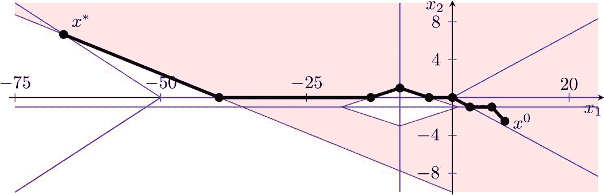

**图 7.1 算法 7.1 为示例 7.6 生成的迭代。**

## 示例 7.7（约束 Rosenbrock–Nesterov II）

根据 [10]，Nesterov 建议了类似于 Rosenbrock 的测试函数：

```
\begin{array}{r} \left. \varphi:\mathbb{R}^{n}\rightarrow\mathbb{R},\quad\varphi(x) = \frac{1}{4}|x_1 - 1| + \sum_{i=1}^{n-1} \middle| x_{i+1} + 1 - 2x_i^2 \right| \right \end{array}
```


它是分段线性且非凸的。它具有全局极小值点 `x^*=(1,1,...,1)` ∈ `ℝ^n` 以及 `2^{n-1}` 个 Clarke 驻稳点，其中没有一个是局部极小值点。根据文献 [10]，已知起始点 `x[1]⁰=-1, x[i]⁰=1, 2≤i≤n` 特别具有挑战性，因为非最优驻稳点往往位于通往唯一极小值的路径上。在本文中，我们考虑约束问题，因此我们添加了 PL 约束：

$$
\begin{matrix} \sum_{i=1}^{n}|x_i - 1| \geq \frac{1}{2n}. \end{matrix}
$$

因此，在全局极小值点周围有一个 *n* 维菱形，它从 `ℝ^n` 中被切掉了。剩下的 `2^{n-1}` 个驻稳点仍然可行，且极小值点给出如下：

$$
\begin{matrix} {\mathit{x}_{\mathit{i}}^{\ast} = 1 - \frac{2^{\mathit{i} - 1}}{2^{\mathit{n}} - 1} \cdot \frac{1}{2\mathit{n}} \in (0,1)\quad\text{for}\mspace{450mu} 1 \leq \mathit{i} \leq \mathit{n}.} \\ \end{matrix}
$$

对于 `1 ≤ n ≤ 20`，CASM 所需的迭代次数如表 7.1 所示。次数由 `s = 3n - 1` 给出。因此，访问的多面体数量远少于 `2^{(s)}` 给出的多面体总数。我们还应用了 MPBNGC 求解器 [17]，它实现了一种用于非凸、非光滑及一般约束最小化的多目标近端包方法。对于 `n = 1`，MPBNGC 需要七次迭代；而对于 `n = 2`，求解器在七次迭代后就卡在一个非最优的驻点上。对于较大的 `n` 值也观察到了相同的行为。

### 表 7.1 示例 7.7 和不同 $n$ 值下 CASM 所需的迭代次数

| $n$ | 1 | 2 | 3 | 4 | 5 | 6 | 7 | 8 | 9 | 10 |
| --- | --- | --- | --- | --- | --- | --- | --- | --- | --- | --- |
| # | 2 | 5 | 14 | 27 | 64 | 117 | 238 | 439 | 856 | 1685 |
| $n$ | 11 | 12 | 13 | 14 | 15 | 16 | 17 | 18 | 19 | 20 |
| --- | --- | --- | --- | --- | --- | --- | --- | --- | --- | --- |
| # | 3382 | 6807 | 13592 | 26285 | 42994 | 82995 | 131096 | 262173 | 605342 | 1119907 |

### 示例 7.8

接下来，我们考虑线性互补性问题：

(7.12)
$$
\begin{matrix} {\mathit{M}\mathit{x} + \mathit{q} \geq 0\quad\mspace{450mu}\text{and}\mspace{450mu}\quad\mathit{x}^{\top}(\mathit{M}\mathit{x} + \mathit{q}) = 0} \\ \end{matrix}
$$

其中 `0 ≤ x ∈ ℝⁿ`，`M ∈ ℝ⁽ⁿˣⁿ⁾` 且 `q ∈ ℝⁿ`。在 [2] 中，线性互补性问题 (LCP) 被构造为一组 PL 方程：

(7.13)
$$
\begin{array}{r} {\min(\mathit{x},\mathit{M}\mathit{x} + \mathit{q}) = 0,} \\ \end{array}
$$

其中最小算子逐分量作用。在同一论文中，作者提出了一种可以看作半光滑牛顿法的算法，并展示了非收敛性，例如，当 `M` 设置为：

$$
\begin{matrix} {\mathit{M}_{3} = \begin{bmatrix} 1 & 0 & 2 \\ 2 & 1 & 0 \\ 0 & 2 & 1 \\ \end{bmatrix}\quad\text{and}\quad\mathit{M}_{4} = \begin{bmatrix} 1 & 0 & \frac{1}{2} & \frac{4}{3} \\ \frac{4}{3} & 1 & 0 & \frac{1}{2} \\ \frac{1}{2} & \frac{4}{3} & 1 & 0 \\ 0 & \frac{1}{2} & \frac{4}{3} & 1 \\ \end{bmatrix}.} \\ \end{matrix}
$$

此外，他们指出，当且仅当 `M` 是 P 矩阵时，对于任何 `q ∈ ℝⁿ`，LCP 有唯一解，即 `M` 对于所有非空 `I ⊂ {1, …, n}` 具有正主子式 `det(I)`。为了使用 CASM 求解 (7.13)，我们将 LCP 重新构造为：

$$
\begin{matrix} \left. \min\limits_{x \in \mathbb{R}^{(n)}}\sum\limits_{i = 1}^{n} |\min\left( x_{i},(\mathit{M}\mathit{x} + \mathit{q})_{i}\right) | , \right. \end{matrix}
$$

其中 `q=1` 是 `ℝⁿ` 中具有 1 个分量的向量。对于 [2] 所示的访问多面体，CASM 需要五次迭代，对于 `M=3` 和 `M=4` 分别为。对于 `n=1`，对于 `M` 是 `ℝⁿ` 中具有适当维度的向量。

### 总结与展望

对于 `1 ≤ n ≤ 20`，CASM 所需的迭代次数如表 7.1 所示。次数由 `s = 3n - 1` 给出。因此，访问的多面体数量远少于 `2^{(s)}` 给出的多面体总数。我们还应用了 MPBNGC 求解器 [17]，它实现了一种用于非凸、非光滑及一般约束最小化的多目标近端包方法。对于 `n = 1`，MPBNGC 需要七次迭代；而对于 `n = 2`，求解器在七次迭代后就卡在一个非最优的驻点上。对于较大的 `n` 值也观察到了相同的行为。

## 参考文献

[6] A. Griewank. 稳定分段线性化与广义算法微分。*Optimization Methods & Software*, 28(6):1139–1178, 2013.

[7] A. Griewank and A. Walther. *评估导数：算法微分的原理与技术*，第 2 版。SIAM, 费城, 2008.

[8] A. Griewank and A. Walther. 激活签名法向分段线性函数局部极值的有限收敛。*Optimization Methods & Software*, 34(5):1035–1055, 2019. a, b, c, d

[9] A. Griewank, 等人. 基于灰盒分段线性化的 Lipschitz 优化研究。*Mathematical Programming Series A*, 158(1–2):383–415, 2016.

[10] M. Gürbüzbalaban and M. L. Overton. 关于 Nesterov 非光滑切比-Rosenbrock 函数。*Nonlinear Analysis*, 75(3):1282–1289, 2012. a, b, c

[11] L. C. Hegerhorst-Schultchen and M. C. Steinbach. 关于 abs-Normal NLP 的一阶和二阶最优性条件。*Optimization*, 69(12):2629–2656, 2020. a, b

[12] J.-B. Hiriart-Urruty and C. Lemaréchal. *凸分析与最小化算法.I*。Springer, 柏林, 1993.

[13] T. Kreimeier. 利用 abs-线性方法求解带约束的分段线性优化问题。博士论文，柏林洪堡大学，2023. a, b, c, d, e

[14] T. Kreimeier, 等人. 使用带约束激活签名法求解鲁棒气体网络优化问题。中：C. Büsing 和 A. M. C. A. Koster，编辑，*第 10 届国际网络优化会议集*，OpenProceedings.org, 2022.

[15] M. Kuchlbauer, 等人. 用于鲁棒优化的自适应束方法。*INFORMS Journal on Computing*, 34(4):2106–2124, 2022.

[16] F. Liers and M. Merkert. 分段线性问题的结构化研究。*SIAM Journal on Optimization*, 26(4):2863–2886, 2016.

[17] M. Mäkelä, 等人. 非光滑多目标优化的近端束方法。中：复杂结构的数学计算。*Comput. Methods. Sci.*, 卷 40. a

[18] J. Nocedal and S. Wright. *数值优化*。Springer, 纽约, 2006. a

[19] S. Scholtes. *可微方程简介*。Springer, 纽约, 2012.

[20] Q. Tao, 等人. 分段线性网络。*2(1)* 2022.

### 摘要

我们提出了一种新的加性预处理信域策略（APTS）来训练神经网络（NN）。APTS 基于信域框架，消除了对计算密集型参数调优的需求。通过与 SGD、LBFGS 等常用方法的比较，展示了所提方法的能力、优势和局限性。

## 致谢


本工作得到了瑞士先进科学平台（PASC）（2017–2021）以及瑞士国家科学基金“多级区域分解”（17）和“多级多物理应用”（45）项目的支持。

## 1 引言

我们考虑以下监督学习问题：

```
\min_{\theta \in R^n} \ell(\theta; \mathcal{D}) = \min_{\theta \in R^n} \frac{1}{p} \sum_{i=1}^p l(\mathcal{N}(x_i; \theta, \mathcal{D}), c_i)
```

其中 `\ell:R^n \to R` 是*训练损失*，`\mathcal{N}` 表示神经网络，`\theta \in R^n` 是其参数。元组 `(x_i, c_i) \in \mathcal{D}` 是标记数据集 `\mathcal{D}` 中的输入-目标对，其基数为 `p`。

损失函数 `l:R_{\ge 0}^d \times R_{\ge 0}^d \to R` 衡量预测目标 `\hat{c}_i = \mathcal{N}(x_i; \theta, \mathcal{D})` 与精确目标 `c_i \in R^d` 之间的差异。最小化 (8.1) 被称为*训练*，成功的训练意味着模型准确预测未见数据的能力，即不包含在数据集 `\mathcal{D}` 中的数据。

多种优化技术适用于神经网络的训练。最显著的方法包括：例如随机梯度下降 (`SGD`) [[52]], [[6]], [[14]]、自适应动量估计 (`Adam`) [[32]], [[46]], [[47]]，以及有限内存的 Broyden–Fletcher–Goldfarb–Shanno (`LBFGS`) 算法 [[44]]，每种方法都有其独特的特征和挑战。

`SGD` 方法效率高且泛化性良好，但需要仔细的超参数调优以及减小的步长以实现全局收敛 [[52]], [[6]], [[14]]。`Adam` 高效且能自适应调整学习率，但缺乏非凸问题的理论性全局收敛保证，甚至在凸问题上也可能面临问题 [[32]], [[46]]。`LBFGS` 方法通过割线对来近似海森矩阵 [[44]]，因此适用于求解病态条件问题。然而，`LBFGS` 方法的计算开销比一阶方法大，并且在随机设置下需要使用新颖来评估割线对 [[4], [[3]]。

置信域 (`TR`) 方法 [[11]] 虽然不常见，但在机器学习领域正日益受到关注。它们的流行主要源于它们在每次迭代中动态地调整步长，并能为凸和非凸最小化问题提供全局收敛保证 [[44]], [[11]]。然而，将其扩展到多级设置 [[25]] 和随机设置需要非平凡的理论和算法调整；例如参见 [[45]], [[13]], [[20]], [[22]], [[23]], [[34]]。

## 并行化方法

随着数据和网络复杂性的增加，并行方法变得至关重要 [[9]], [[5]], [[49]], [[27]]。目前的并行方法包括数据并行和模型并行。

数据并行将数据划分到各个处理单元，每个单元训练一个模型副本，这对于大型数据集特别有用 [[48]]。这种范式已应用于 `SGD` 变体 [[52]], [[43]], [[51]]、集成学习 [[31]], [[15]] 以及联邦学习 [[40]], [[41]], [[38]]。相比之下，模型并行旨在跨处理单元训练 `NN` 的不同部分 [[2]]。

## 区域分解 (DD) 方法

最近，区域分解 (`DD`) 方法在并行 `NN` 训练方面显示出良好的前景 [[48]], [[2]], [[43]]。`DD` 方法最初是为了求解偏微分方程。这些方法的核心思想是将主问题分解为较小的子问题，并利用子问题的解来增强原始问题的求解过程。子问题通常是独立求解的，即以加性方式求解，从而实现了并行计算 [[10]], [[50]], [[19]], [[17]], [[39]]。加性非线性 `DD` 方法的显著例子包括 `ASPIN` [[8]], `GASPIN` [[26]], `RASPEN` [[16]] 或 `APTS` [[24]]。虽然这些方法中的大部分是为了求解非线性方程组而开发的，但 `APTS` 和 `GASPIN` 专门为解决非凸最小化问题设计（例如等式(1)所示）。此外，`APTS` 和 `GASPIN` 都采用了 `TR` 全局化策略，因此提供了全局收敛保证。

在机器学习领域，`DD` 方法被越来越多地用于增强 `NN` 训练。在 [[28]], [[29]] 中讨论的深度卷积神经网络 (`CNNs`) 的分解与组合，为通过子网络迁移学习来加速训练提供了见解。在 [[30]] 中，作者探索了深度残差神经网络 (`ResNets`) 的层并行训练，证明了它们在图像分类等任务中的有效性。在 [[35]] 中，作者为物理信息神经网络 (`PINNs`) 引入了预条件策略，为 `LBFGS` 优化器采用了一种非线性层级预处理器。最后，在 [[33]] 中，作者提出了一种受 `DD` 方法启发的创新 `CNN`-深度神经网络 (`DNN`) 架构，专为模型并行训练设计。该架构旨在有效处理各种图像识别任务。它结合了局部 `CNN` 模型或子网络，处理输入数据的重叠或不重叠的片段（如子图像），展示了其在不同图像识别场景中的适应性和效率。这些研究共同强调了 `DD` 方法在跨领域训练神经网络中的重要性。

在这项工作中，我们将 `APTS` 方法的一个变体引入了机器学习领域。与传统的神经网络（`NN`）训练方法不同，我们所提出的算法的独特之处在于其能够：

*   在确定性设置下保证全局收敛，
*   消除对大量超参数调优的需求，以及
*   实现并行化。

因此，`APTS` 为通过高效且无参数化的在大型超级计算机上进行训练提供了第一步。我们通过利用分类领域的基准问题从数值上证明了所提方法的收敛性。我们的数值研究还包括了与 `SGD`、`Adam` 和 `LBFGS` 方法的对比分析。

本文的结构如下：在第 2 节中，我们简要回顾了 `TR` 方法，并对 `APTS` 优化器进行了详细说明。然后，在第 3 节中，我们利用两个著名数据集（即 `MNIST` 和 `CIFAR-10`）展示了 `APTS` 与经典优化策略对比的数值结果。最后，在第 4 节中得出了结论。

## 2 训练方法

在本节中，我们对与 `TR` 和 `APTS` 方法相关的基本原理和技术进行全面解释，重点关注它们在神经网络训练中的应用。

### 2.1 置信域方法

`TR` 方法是先进的全局收敛迭代算法，用于非线性、凸和非凸优化中，以寻找目标函数的局部最小值。这些方法在迭代估计值的局部邻域内（称为置信域）中，通过迭代方式构建目标函数的简化模型。置信域的大小在每次迭代中都会进行自适应调整，以确保对真实函数行为的准确近似。

更准确地说，在迭代 `k` 处的 `TR` 框架下，优化问题 (8.1) 被一阶或二阶模型 `m[k]` 所似。为了获得搜索方向 `s^(k)`，对模型 `m[k]` 进行如下最小化处理：

```
\min_{\|s\| \leq \Delta^{k}} m^{k}(s) = \min_{\|s\| \leq \Delta^{k}} \nabla\ell\left( \theta^{k};\mathcal{D} \right)^{T}s + \frac{1}{2}s^{T}H^{k}s
```

其中 `H^(k)` ∈ ℝ(`n` × `n`) 是一个对称矩阵，通常是 `\ell` 在 `\theta^(k)` 处的 Hessian 矩阵的近似，而 `\Delta^(k)` > 0 是 `TR` 半径。在一阶模型 `m[k]` 的情况下，(8.2) 中的二次项消失。通过求解 (8.2) 获得的步长 `s^(k)` 的质量通过比例 (8.3) 进行评估：

```
\rho^{k} = \frac{\ell(\theta^{k}) - \ell(\theta^{k} + s^{k})}{m^{k}(0) - m^{k}(s^{k})}
```

其中 `\ell(\theta^{k})-\ell(\theta^{k}+s^{k})` 是实际减少量，`m^{k}(0)-m^{k}(s^{k})` 是预测减少量。然后根据 `\rho^(k)` 的值更新 `TR` 半径和参数。如果 `\rho[k]` ≈ 1，则 `m[k]` 是目标函数的良好近似，因此可以增加 `TR` 半径并更新参数。否则，如果 `\rho[k]` 小于给定的阈值 `\eta`，则缩小 `TR` 半径并保持参数不变。算法请参见算法 1。

在该工作中，我们采用有限内存对称秩 1（`LSR1`）方法来近似 `\ell` 的 Hessian 矩阵。`LSR1` 通过整合每次迭代的梯度差生成近似。当更新次数累积并达到预设限制 `l` 时，最新的更新将替换旧的更新，以确保总数保持在 `l`。与确保正定近似 Hessian 的 `LBFGS` 方法不同，`LSR1` 方法允许不定的 Hessian，从而提供更准确的信息。

为了高效地求解子问题 (8.2)，我们采用了正交基 SR（`OBS`）技术。`OBS` 方法利用由 `LSR1` 更新构成的正交基，将 `TR` 子问题的维度从 `n×n` 转换为更易管理的 `m×m`。

### 2.2 网络参数分解的 APTS

`APTS` 是一种旨在解决非凸优化问题的右预条件 `TR` 策略。在这项工作中，我们通过利用神经网络参数的分层分解来构造非线性预处理器。因此，为了定义 `N` 个子域，我们引入了投影算子：

```
R_{i}:\mathbb{R}^{n}\longrightarrow\mathbb{R}^{n_{i}}, \quad i = 1,\ldots,N, \quad \text{with} \quad R_{i}R_{j}^{T} = 0, \quad \forall i \neq j
```

其中第二个性质意味着由 `R[i]` 生成的参数子集是两不交的。这里，`n` 表示全局参数向量的维度，`n[i]` 表示与第 `i` 个子域相关的局部参数维度。我们现在可以将第 `i` 个网络拷贝定义为 `\mathcal{N}_i`，其中子域参数 `\theta_i = R_i \theta` 被定义为训练参数集。此外，略有符号误用，我们定义 `\phi_i = \theta \setminus \theta_i` 为剩余的不可训练参数。显然，`\mathcal{N}` 的整体结构没有变化，改变的是参数的可训练/不可训练设置。

`APTS` 算法可以使用整个数据集或 `minibatches`（小批次）执行，后者场景被称为随机 `APTS` (`SAPTS`)。尽管确定性版本的收敛性证明不能直接应用于随机版本，但第 3 节中提供的数值结果是有前景的。算法 8.1 提供了所提的 `APTS` 训练算法的概述。在第 3 步和第 5 步中，我们建立了收敛准则并选择了训练方法，可以是使用完整数据集（`APTS`）或采用小批量策略（`SAPTS`）。在第 6–7 步中，我们使用当前训练数据集计算并存储了损失和梯度。向量 `g` 在第 7 步被归一化，使其长度与 `s` 相似（见第 12 步），使得它们在第 17 步中的贡献相似。在第 9 步中，我们将所有本地 `TR` 半径 `\Delta[L, i]` 与全局半径同步，并将所有网络副本 `\mathcal{N}[i]` 与来自 `\mathcal{N}` 的当前全局参数进行同步。这种同步保留了之前建立的可训练参数和不可训练参数的状态。此后，在第 10 步中，我们为每个本地网络副本启动了一系列 `TR` 迭代，我们称之为*本地 TR 迭代*。在每次迭代中，本地 `TR` 算法将执行长度在 `[\Delta[min]^(L), \Delta[max]^(L)]` 范围内的步长，带有增加/减少因子 `\alpha`、`\beta` 以及缩减/接受率 `\eta[1]`、`\eta[2]`。该过程不断迭代，直到累积步长低于预定义的全局 `TR` 半径 `\Delta^(G)`，条件为 `s[i, j]^(k) = \|\theta[i, 0]^(k) - \theta[i, j]^(k)\|_\infty \le \Delta^(G)`，其中 `i` 表示子模型，0 和 `j` 是本地 `TR` 迭代。当 `s[i, j]^(k)` 等于 `\Delta^(G)` 或迭代次数达到 `\nu` 时，迭代停止。

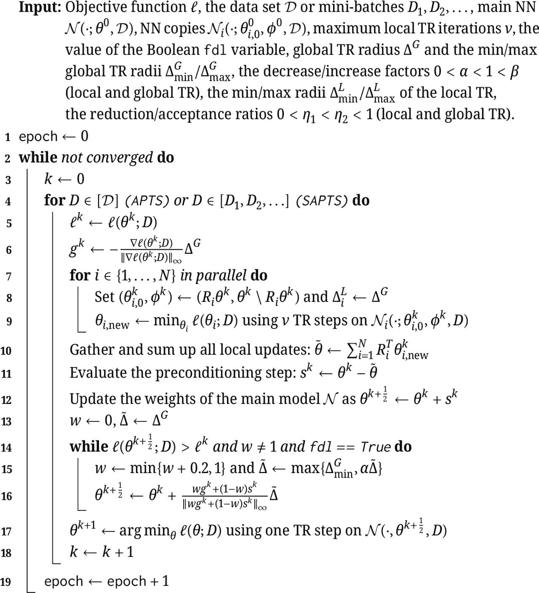

算法 8.1：权重中的 APTS/SAPTS 方案。

在本地 `TR` 迭代之后，第 11 步涉及聚合来自本地网络的所有更新权重并对其进行求和。在这里，我们强调在第 12 步中进行的更新 `s^(k)` 受全局 `TR` 半径 `\Delta^(G)` 的限制，即：

```
\|\theta^{k} - \widetilde{\theta}\|_{\infty} = \|\sum_{i=1}^{N} R_{i}^{T}\theta_{i,0}^{k} - \sum_{i=1}^{N} R_{i}^{T}\theta_{i,j}^{k}\|_{\infty} \le \Delta^{(G)}
```


在本地 TR 迭代之后，第 11 步涉及聚合来自本地网络的所有更新权重并对其进行求和。在这里，我们强调在第 12 步中进行的更新 `s^(k)` 受全局 TR 半径 `Δ^(G)` 的限制，即：

```
\begin{matrix} {\left\| \mathit{\theta}^{\mathit{k}} - \widetilde{\mathit{\theta}} \right\|_{\infty} = \left\| \sum\limits_{\mathit{i} = 1}^{\mathit{N}}\mathit{R}_{\mathit{i}}^{\mathit{T}}\mathit{\theta}_{\mathit{i},0}^{\mathit{k}} - \sum\limits_{\mathit{i} = 1}^{\mathit{N}}\mathit{R}_{\mathit{i}}^{\mathit{T}}\mathit{\theta}_{\mathit{i},0}^{\mathit{k}} ... \end{matrix}
```

PyTorch 编程环境对参数训练的控制程度施加了某些限制。参数以向量的形式配置，整个向量被指定为可训练或不可训练的。这意味着，例如，一个由权重和偏置组成的全连接层，被存储为一个由两个不同的可学习参数向量组成的结构，并且可以被配置为独立进行训练。因此，方程 (8.4) 中的投影器 `R[i]` 的构建方式旨在最大化训练效率，也就是说，不会出现两个属于同一 PyTorch 向量但具有不同可训练/不可训练设置的权重。此外，投影器是随机生成的，也就是说，如果我们总共有 `M` 个参数向量，并希望将它们分布到 `N` 个模型中，则每个模型将获得大约为 `round(M/N)` 个随机选择的可训练向量。

我们在 APTS 算法实现中的关键配置如下：

*   在 APTS 的第 8 步中，即算法 8.1，子域的数量（子模型 `𝒩[i]`）在第 3 节的图例中指定，并随机选择可训练权重向量。
*   在第 10 步中，涉及局部 TR（信任域），我们配置了：
    *   最大迭代次数 `ν = 5`。
    *   最小半径 `Δ[min]^(L) = 0`，初始半径等于当前全局 TR 半径 `Δ^(L) = Δ^(G)`，以及在第 `j` 次迭代中动态调整的最大半径 `Δ[max]^(L) = Δ^(G) − ∥θ[i, 0]^(k) − θ[i, j]^(k)∥`，以确保累积步长限制在全局 TR 半径范围内。
    *   当考虑二次模型 (8.2) 时，SR1 Hessian 的历史设置为 5。此外，在预处理迭代开始时，局部 Hessian 历史与全局历史进行同步。
    *   收缩和接受比例 `0 < η[1] < η[2] < 1` 是 TR 的标准值，即 `η[1] = 0.25` 且 `η[2] = 0.75`。
    *   减小和增加因子 `α` 和 `β` 分别设置为 0.5 和 2。
*   在第 17 步中，涉及全局 TR：
    *   最小、最大和初始半径分别设置为 `Δ[min]^(G) = 10^(−4)`、`Δ[max]^(G) = 10^(−1)` 和 `Δ^(G) = 10^(−2)`。
    *   `α`、`β`、`η[1]`、`η[2]` 的值与局部 TR 一致。
    *   收缩比例和接受比例与局部 TR 一致。
    *   每当考虑二次模型 (8.2) 时，SR1 Hessian 的历史设置为 5。
    *   注意，全局和局部 TR 都使用无穷范数来计算步长长度。这与 OBS 方法使用的 2 范数不冲突，因为 2 范数是被无穷范数所限制的。
    *   在数值结果 3 中，作为独立求解器的 TR 方法（在图中标记为 TR）的设置与 APTS 中的全局 TR 相同。

### 3.2 MNIST

我们使用 MNIST 数据集 [37] 进行了一些初步实验。该数据集包含 60,000 张训练图像和 10,000 张测试数字，每张都是 28×28 像素。对于这项实验，我们考虑了在整个数据集上训练的全连接网络（FCNN）。

我们实验中使用的 FCNN 由三个连接层组成。为了研究 APTS 的性能，我们将其配置为 2、4 和 6 个子域，并启用或禁用 `fdl`。在第 3 节中报告了其他参数。

观察图 8.1，Adam、LBFGS 和 GD 达到了相似的水平。然而，利用方程 (8.2) 中的二阶信息的 TR (`ord=1` 和 `ord=2`) 分别显示出较慢的收敛。`ord=2` 在 70 次迭代后超过了 `ord=1`。这归功于 `ord=2` 对损失函数的增强可靠性。此外，二阶信息的引入倾向于相比一阶方法来稳定 TR 方法。


图 8.1 Comparison of APTS and baseline optimizers

在完成 MNIST 调查后，我们使用 `CIFAR-10` 数据集评估了求解策略，该数据集包含 50,000 张训练图像和 10,000 张 32×32 彩色图像，跨 10 类。对于这些实验，我们使用了 `PyTorch` 库中的 `ResNet18` 架构，其包含 11,689,512 个参数，存储在 62 个 `PyTorch` 向量中。训练采用批量（mini-batch）策略，设置了 20 个重叠的小批量，每个批量包含 2,975 个样本，小批量之间有 1% 的重叠以减少方差。

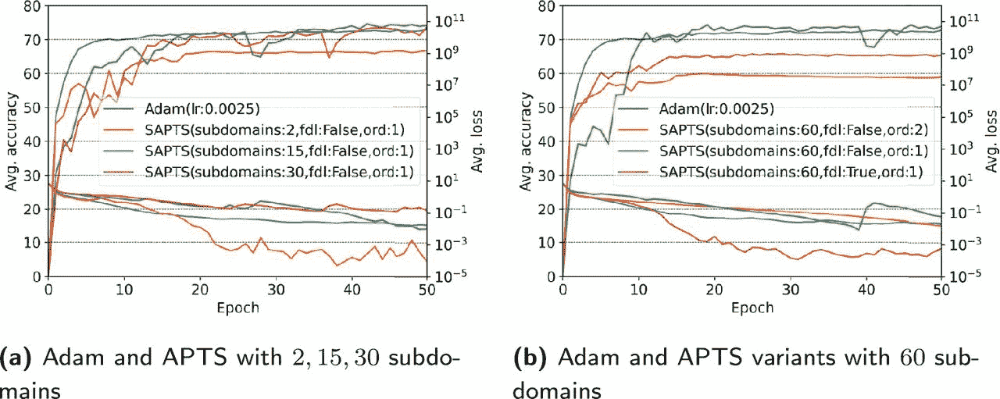

### 图 8.2 在 CIFAR-10 上训练的 CNN 上 APTS 变体与基准优化器的对比。

在图 8.2 中，我们展示了随机 Adam 与 SAPTS 各种配置之间的对比分析。具体而言，图 8.2a 展示了具有 2、15 和 30 个子域的 SAPTS，对子问题采用一阶 TR 方法，并禁用了 `fdl` 特性。在图 8.2b 中，子域数量设置为 60，同时我们改变了 `fdl` 和 `order` 等参数。我们在这里没有提供 `SGD` 的结果，因为 Adam 实现了更高的测试准确率，而我们的目的是提供与 APTS 的对比。

我们主要关注 `fdl = False` 且 `ord = 1` 的配置。其背后的原因是，激活 `fdl`（如图 8.2b 所示）会导致 SAPTS 的泛化能力下降，尽管与其它 SAPTS 变体相比，它的损失减少得更多。关于 `ord = 2`，SAPTS 表现出较差的泛化性且没有显著降低损失。然而，与之前测试的其他 SAPTS 变体类似的非随机情况下，它保持了更平滑的损失曲线。在分析不同子域数量下 `fdl = False` 且 `ord = 1` 的 SAPTS 时，我们观察到与非随机测试类似的相关性：SAPTS 的性能随着子域数量的增加而提高。此外，将具有 60 个子域的 SAPTS 与 Adam 进行比较，我们发现 SAPTS 在长时间内表现出更好的泛化性，并且只需要几个 epoch 就能达到 Adam 的性能。

## 结论

在这项工作中，我们采用了 APTS 方法，该方法利用 `NN` 参数的分解来高效训练神经网络。我们的数值研究表明，所提出的 APTS 方法在泛化能力上达到了与 `SGD`、`LBFGS` 和 Adam 等传统优化器相当或更高的水平。开发的 APTS 方法的优势在于不需要超参数调优以及其并行性。此外，随着子域数量的增加，它实现了更快的收敛，显示出令人鼓的扩展性。

## 参考文献

1. M. Ainsworth and Y. Shin. ReLU 网络梯度下降训练中的平台现象：量化与避免。*SIAM Journal on Scientific Computing*, 43(5):A3438–A3468, 2021.
2. T. Ben-Nun and T. Hoefler. 解密并行与分布式深度学习：深度分析。*ACM Computing Surveys*, 52(4):1–43, 2019.
3. A.S. Berahas, M. Jahani, P. Richtarik, and M. Takáč. 机器学习的拟牛顿法：遗忘过去，采样。*Optimization Methods & Software*, 37(5):1668–1704, 2022.
4. A.S. Berahas, J. Nocedal, and M. Takáč. 用于机器学习的多批量 `LBFGS` 方法。收于 *Advances in Neural Information Processing Systems*, volume 29, 2016.
5. A. Blum and R. Rivest. 训练 3 节点神经网络是 NP 完全的。收于 *Advances in Neural Information Processing Systems*, volume 1, 1988.
6. L. Bottou, F. E. Curtis, and J. Nocedal. 大规模机器学习的优化方法。*SIAM Review*, 60(2):223–311, 2018.
7. J. Brust, J. B. Erway, and R. F. Marcia. 求解 L-SR1 信域子问题。*Computational Optimization and Applications*, 66:245–266, 2017.
8. X.C. Cai and D. E. Keyes. 非线性预条件的不精确牛顿算法。*SIAM Journal on Scientific Computing*, 24(1):183–200, 2002.
9. J. Catlett. 巨型归纳：测试飞行。收于 *Machine Learning Proceedings 1991*, pages 596–599. Morgan Kaufmann, 1991.
10. T. F. Chan and J. Zou. 非结构化网格上椭圆问题的加性 Schwarz 区域域分解方法。*Numerical Algorithms*, 8(2):329–346, 1994.
11. A. R. Conn, N. I. Gould, and P. L. Toint. *信域方法*. Society for Industrial and Applied Mathematics, 2000.
12. S. A. Cruz Alegría and K. Trotti. `ML_APTS`, 2023. https://github.com/cruzas/ML_APTS.
13. F. E. Curtis, K. Scheinberg, and R. Shi. 基于仔细归一化的随机信域算法。INFORMS Journal on Optimization, 1(3):200–220, 2019.
14. X. Dai and Y. Zhu. 大批量梯度下降的理论理解。arXiv:1812.0542, 2018.
15. T. G. Dietterich. 机器学习中的集成方法。收于 *International Workshop on Multiple Classifier Systems*, pages 1–15. Springer Berlin, Heidelberg, 2000.
16. V. Dolean, M. J. Gander, W. Kheriji, F. Kwok, and R. Masson. 非线性预条件：如何使用 Schwarz 方法预条件牛顿法。*SIAM Journal on Scientific Computing*, 38(6):A3357–A3380, 2016.
17. J. Erhel, M. J. Gander, L. Halpern, G. Pichot, T. Sassi, and O. Widlund. *科学与工程中的区域域方法 XXI*. Springer, 2014.
18. J. B. Erway and R. F. Marcia. 高效计算内存拟牛顿矩阵的特征值。*SIAM Journal on Matrix Analysis and Applications*, 36(3):1338–1359, 2015.
19. M. J. Gander. 优化 Schwarz 方法。*SIAM Journal on Numerical Analysis*, 44(2):699–731, 2006.
20. Y. Gao and M. K. Ng. 非凸优化的动量加速自适应立方正则化方法。arXiv:2210.05987, 2022.
21. S. Gratton, S. Jerad, and P. L. Toint. 一类一阶无目标函数优化算法的复杂性，2023.
22. S. Gratton, A. Kopaničáková, and P. L. Toint. 多级无目标函数优化及其在神经网络训练中的应用。*SIAM Journal on Optimization*, 33(4):2772–2800, 2023.
23. C. Groß. *非线性加法和乘法预条件全局化策略收敛结果的统一理论，以及非线性弹性力学和弹性动力学领域的案例*。博士论文，波恩国际研究生学校，波恩大学，2009。URN: https://nbn-resolving.org/urn:nbn:de:hbz:5N-18682. 在线获取：[德国大学在线出版，波恩大学，博士论文，2009]。a, b, c, d
24. C. Gross and R. Krause. 递归信域方法在多尺度非线性优化及力学中的中的收敛性。*SIAM Journal on Numerical Analysis*, 47(4):3044–3069, 2009.
25. C. Groß and R. Krause. 采用 ASPIN 信域控制策略的全局化：分析与示例。arXiv:2104.05672, 2021.
26. R. Grosse. CSC321 课程 6：反向传播。多伦多大学，2018.
27. L. Gu, W. Zhang, J. Liu, and X. C. Cai. 通过子网络学习深度卷积神经网络的分解与组合。*Electronic Transactions on Numerical Analysis*, 56:157–186, 2022.
28. L. Gu, W. Zhang, J. Liu, and X. C. Cai. 用于训练的深度卷积神经网络的分解与预条件。*Domain Decomposition Methods in Science and Engineering XXVI*，第 153–160 页。Springer, 2023.
29. S. Gunther, L. Ruthotto, J. B. Schroder, E. C. Cyr, and N. R. Gauger. 深度残差网络的层并行训练。*SIAM Journal on Mathematics of Data Science*, 2(1):1–23, 2020.
30. L. Hansen and P. Salamon. 神经网络集成。*IEEE Transactions on Pattern Analysis and Machine Intelligence*, 12(10):993–1001, 1990.
31. D. P. Kingma and J. Ba. Adam：一种随机优化的方法。arXiv:1412.6980, 2014. a, b
32. A. Klawonn, M. Lanser, and J. Weber. 于图像识别的基于域分解的 CNN-DNN 架构。arXiv:2302.06564, 2023.
33. A. Kopaničáková and R. Krause. 深度残差网络的全局收敛多级训练。*SIAM Journal on Scientific Computing*, 0:S254–S280, 2022.
34. A. Kopaničáková, H. Kothari, G. E. Karniadakis, and R. Krause. 使用基于域分解的预条件策略增强物理信息神经网络的训练。*SIAM Journal on Scientific Computing*, 46(5):S46–S67, 2024. a, b
35. A. Krizhevsky. 从小型图像学习多层特征。技术报告，多伦多大学，2009.
36. Y. Leun, L. Bottou, Y. Bengio, and P. Haffner. 用于文档识别的梯度学习。*Proceedings of the IEEE*, 86(11):2278–2324, 1998.
37. G. Malinovsky, K. Yi, and P. Richtarik. 方差减少 Proxskip：算法及其在联邦学习中的应用。*Advances in Neural Information Processing Systems*, 第 35 卷，第 15176–15189 页，2022.
38. T. P. Mathew. 偏微分方程数值求解的域分解方法。Springer, 2008.
39. B. McMahan, E. Moore, D. Ramage, S. Hampson, and B. A. y. 从去中心化数据中通信高效的学习。*Artificial Intelligence and Statistics*，第 1273–1282 页。PMLR，2017.


[41] K. Mishchenko, G. Malinovsky, S. Stich, and P. Richtarik. Proxskip：可证明的局部步导致通信加速。*International Conference on Machine Learning*，第 15750–15769 页。PMLR，2022. →

[42] K. P. Murphy. 机器学习：概率视角。MIT Press, 2012. →

[43] D. Nichols, S. Singh, S. H. Lin, and A. Bhatele. 并行深度学习框架的综述与实验评估。arXiv:2111.04949, 2021. a, b

[44] J. Nocedal and S. J. Wright. 数值优化。Springer New York，纽约，1999. a, b, c, d, e, f

[45] J. Rafati, O. DeGuchy, and R. F. Marcia. 用于响应训练的信域最小化算法 (TRMinATR)：机器学习技术的兴起。*2018 第 26 届欧洲信号处理会议 (EUSIPCO)*，第 2015–2019 页。IEEE, 2018. →

[46] S. J. Reddi, S. Kale, and S. Kumar. Adam 的收敛性及其之后。arXiv:1904.09237, 2019. a, b

[47] S. Ruder. 梯度下降算法综述。arXiv:1609.04747, 2016. →

[48] L. Gu, W. Zhang, J. Liu, and X. C. Cai. 数据并行对神经网络训练的影响。a, b

[49] R. K. Srivastava, K. Greff, and J. Schmidhuber. 深层网络的训练。C. Cortes, N. Lawrence, D. Lee, M. Sugiyama 和 R. Garnett 编，*Neural Information Processing Systems*，第 28 卷。Curran Associates, Inc., 2015. →

[50] A. Toselli and O. Widlund. 域分解方法——算法与理论，第 34 卷，Springer, 2004. →

[52] M. Zinkevich, M. Weimer, L. Li, and A. Smola. Parallelized stochastic gradient descent. In: *Advances in Neural Information Processing Systems*, volume 23, 2010. a, b, c

# 可信优化学习：概述

Pascal Van Hentenryck

### 摘要

本文引入了可信优化学习（trustworthy optimization learning）的概念，这是一种设计优化代理的方法，旨在用于学习参数化优化问题的输入/输出映射。这些优化代理在设计上是可信的：它们能够计算底层优化问题的可行解，对返回的解提供质量保证，并能扩展到大规模实例。优化代理是可微程序，结合了传统的深度学习技术与修复或完成层，以产生可行解。文章表明优化代理可以以自监督的方式进行端到端训练。文中介绍了提供性能保证的方法以及将优化代理扩展到大规模优化问题的方法。通过在电力系统，特别是实时风险评估和安全约束最优潮流（SCOPPF）中的应用，凸显了优化代理的潜力。

关键词：优化、非线性优化、深度学习、自监督学习、原对偶学习，MSC 2020: 68T05, 90C05, 90C25, 90C30, 90C90

## 致谢

本研究部分受 NSF 资助 2007095 和 2112533 号项目支持。特别感谢 NSF 优化先进进展学院 (AI4OPT) 的电力系统团队，特别是 Mathieu Tanneau、Seonho Park、Wenbo Chen、Michael Klamkin、Guancheng Qiu 和 Andrew Rosemberg。

## 1. 引言

优化技术在工业领域已广泛取得成功：它们负责调度电网、规划运输和物流系统路线、规划和运行供应链、调度制造系统、协调疏散和救援行动，以及器官交换市场的清算等，这仅列举一角。然而，在某些应用中，优化技术仍面临计算挑战，当必须实时产生解决方案，或者当回路中存在规划者和操作人员时，他们期望与底层决策支持系统进行快速交互。

然而，许多工程应用运行在变化缓慢的物理基础设施上。因此，优化技术经常用于在性质相似的实例上反复解决同一个核心优化问题。换句话说，这些应用需要解决形式如下的参数化优化问题

$$
\begin{matrix} {\Phi(\mathbf{x}) = \operatorname{argmin}\limits_{\mathbf{p}}\mathit{f}_{\mathbf{x}}(\mathbf{p})\quad\text{subject\ to}\quad\mathbf{h}_{\mathbf{x}}(\mathbf{p}) = 0\mspace{430mu}\&\mspace{430mu}\mathbf{g}_{\mathbf{x}}(\mathbf{p}) \geq 0} \\ \end{matrix}
$$

其中 `x` 代表决定目标函数 `f[x]` 以及约束条件 `h[x]` 和 `g[x]` 的实例参数。此类参数化优解是从输入 `x` 到输出 `p` = `Φ(x)` 的映射，它们是优化问题的最优解。此外，假设实例参数 `x` 由从历史数据中学习的分布表征是合理的。

这些考虑人们认为机器学习可以学习这些参数化优化问题并完全取代优化。一个机器学习模型（例如深度神经网络）可以被训练来近似映射 `x`↦`Φ(x)`，其输入为实例参数数据集 `𝒟` = {`x[i]`}[`i ∈ [n]`] 或包含实例参数及其关联最优解对的数据集 `𝒟^*)` = {(`x[i]`, `Φ(x[i]))`}[`i ∈ [n]`]。

该学习任务的监督学习版本通过拟合参数化函数 `\Phĩ[θ*]` 的参数 `\theta` 来实现，以最小化如下形式的损失函数

$$
\begin{matrix} {\frac{1}{\mathit{n}}\sum\limits_{\mathit{i} = 1}^{\mathit{n}}\mathcal{L}\left( \mathbf{x}_{\mathit{i}},{\widetilde{\Phi}}_{\mathit{\theta}}(\mathbf{x}_{\mathit{i}}) \right)} \\ \end{matrix}
$$

其中

$$
\begin{matrix} {\left. \mathcal{L}(\mathbf{x},\mathbf{p}) = \right\|\left. \mathbf{p} - \Phi(\mathbf{x}) \right\|} \\ \end{matrix}
$$

并且被称为*带约束的经验风险最小化*。有趣的是，由于参数化优化问题以显式形式给出，可以定义一个仅使用数据集 `𝒟` 的自监督学习任务版本。假设 `\Phĩ[θ*](x)` 返回一个可行解 $\widetilde{\mathbf{p}}$，即 $\mathbf{h}_{\mathbf{x}}(\widetilde{\mathbf{p}}) = 0\mspace{430mu}\&\mspace{430mu}\mathbf{g}_{\mathbf{x}}(\widetilde{\mathbf{p}}) \geq 0$。

$$
\begin{matrix} {\frac{1}{\mathit{n}}\sum\limits_{\mathit{i} = 1}^{\mathit{n}}\mathit{f}_{\mathbf{x}}\left( {\widetilde{\Phi}}_{\mathit{\theta}}(\mathbf{x}_{\mathit{i}}) \right)} \\ \end{matrix}
$$

用原始优化问题的目标函数 `f[x]` 表示（例如，7, 20, 20，使用如下形式的损失函数

$$
\begin{matrix} \left. \left. \mathcal{L}(\mathbf{x},\mathbf{p}) = \right\|\left. \mathbf{p} - \Phi(\mathbf{x}) \right\| + \mathbf{\lambda} \middle| \mathbf{h}_{\mathbf{x}}(\mathbf{p}) \middle| + \mathbf{\nu}\max\left( 0, - \mathbf{g}_{\mathbf{x}}(\mathbf{p}) \right). \right. \\ \end{matrix}
$$

乘子 `λ` 和 `ν` 可以通过模仿计算拉格朗日对偶的方法来训练，即交替训练机器学习模型和通过子梯度步长调整乘子。然而，尽管它们减少了约束违背，但生成的机器学习模型并保证能找到可行解。

本文回顾了设计和实现`可信优化代理`（trustworthy optimization proxies）的进展，即通过融合机器学习与优化的学习架构，以以`可扩展`的方式产生具有`质量保证`的`可行性`（feasible）解决方案。此外，本文阐述了可信优化代理可以交付两种技术独立使用时无法实现的结果，为克服上述优化技术的局限性开辟了新途径。本文重点关注连续优化，并在方法论贡献方面通过电力系统中的应用进行了说明。优化代理在供应链、制造和运输中的应用（这些领域的优化问题包含离散变量）可以参见 [12], [17], [30], [3]。

## 2 优化代理

优化代理架构的高层概览见图 9.1。优化代理结合了一个产生近似值 $\widetilde{\mathbf{p}}$ 的预测组件（通常是深层神经网络）和一个`修复层`（repair layer），后者将 $\widetilde{\mathbf{p}}$ 转换为可行解 $\overline{\mathbf{p}}$，即 $\overline{\mathbf{p}}$ 满足 $\mathbf{h}_{\mathbf{x}}(\overline{\mathbf{p}}) = 0\mspace{430mu}\&\mspace{430mu}\mathbf{g}_{\mathbf{x}}(\overline{\mathbf{p}}) \geq 0$。在第一近似中，修复层可以被视为将 $\widetilde{\mathbf{p}}$ 投影到优化问题的可行空间中。例如，可以使用以下优化模型进行计算 [26]：

```
\begin{matrix} {\overline{\mathbf{p}} = \operatorname{argmin}\limits_{\mathbf{p}}\|\mathbf{p} - \widetilde{\mathbf{p}}\|\quad\text{subject\ to}\quad\mathbf{h}_{\mathbf{x}}(\mathbf{p}) = 0\mspace{430mu}\&\mspace{430mu}\mathbf{g}_{\mathbf{x}}(\mathbf{p}) \geq 0} \\\end{matrix}
```

但在实践中，这种方法存在局限性：

- 投影的计算开销可能很高，且与原始优化相比，优化代理可能无法带来显著益处。
- 当按照 [9], [7] 的风格进行端到端模型训练时，投影可能会再次引入计算成本。其他方法（例如 [13], [25], [11)）假设存在严格可行点，而情况并非总是如此。

因此，只要可能，最好是设计专门的修复层和学习架构，以确保快速的训练和推理。


图 9.1 优化代理的架构。

### 可微编程

优化代理的修复层可能依赖于`可微编程`（differentiable programming），这是深度神经网络的一种推广，利用了动态计算图（DCGs）。这些 DCG 可以自动且透明地进行求导，使得端到端训练优化代理成为可能。为了说明目的，考虑由美国独立系统运营者（ISOs）运行的经济调度（ED）的简化版本：

```
(9.1a)\begin{matrix} {\min\limits_{\mathbf{p}},\xi_{\text{th}}}\quad {c}(\mathbf{p}) + M_{\text{th}}\|\xi_{\text{th}}\|_{1}} \\\end{matrix}
(9.1b)\begin{matrix} {\text{s.t.}\quad} {\mathbf{e}^{\top}\mathbf{p} = \mathbf{e}^{\top}\mathbf{d},} \\\end{matrix}
(9.1c)\begin{matrix} {0 \leq \mathbf{p} \leq \overline{\mathbf{p}}}, \\\end{matrix}
(9.1d)\begin{matrix} {\mathbf{f} - \xi_{\text{th}} \leq \Phi(\mathbf{p}) \leq \overline{\mathbf{f}} + \xi_{\text{th}}} \\\end{matrix}
(9.1e)\begin{matrix} {\xi_{\text{th}} \geq 0.} \\\end{matrix}
```

经济调度的目标是找到一个最小化成本并满足功率（此处省略了备用约束）的调度 (9.1a)。`M[th]` 是一个大常数，以确保这些约束几乎总是被满足 (9.1b)。全局功率平衡约束 (9.1c) 强制执行发电机的上下限限制 (9.1d) 使用功率转移因子表示了每个支路的热约束。正如美国的电力市场 [14], [15] 所示，热约束是软约束，即它们可以被违反但会产生成本。由于是回归，代理中的近似值 $\widetilde{\mathbf{p}}$ 不满足功率平衡。然而，修复层利用控制系统的思想，对所有发电机进行放大或缩小以获得可行解 $\overline{\mathbf{p}}$，如下：

```
\begin{matrix} {\overline{\mathbf{p}} = \left\{ \begin{array}{l} {(1 - \eta^{\uparrow})\widetilde{\mathbf{p}} + \eta^{\uparrow}\bar{\mathbf{g}}\quad\text{if}\mspace{450mu} 1^{\top}\widetilde{\mathbf{p}} < 1^{\top}\mathbf{d}, \\ {(1 - \eta^{\downarrow})\widetilde{\mathbf{p}} + \eta^{\downarrow}\underset{\_}{\mathbf{g}}\quad\text{otherwise}} \end{array} \right.} \\ \end{matrix}
```

其中 `η^↑` 和 `η^↓` 定义为：

```
\begin{array}{r} { \eta^{\uparrow} = \frac{1^{\top}\mathbf{d} - 1^{\top}\widetilde{\mathbf{p}}}{1^{\top}\bar{\mathbf{g}} - 1^{\top}\widetilde{\mathbf{p}}},\quad\eta^{\downarrow} = \frac{1^{\top}\widetilde{\mathbf{p}} - 1^{\top}\mathbf{d}}{1^{\top}\widetilde{\mathbf{p}} - 1^{\top}\underset{\_}{\mathbf{g}}}} \\ \end{array}
```

这里 $\underset{\_}{\mathbf{g}}$ 和 $\bar{\mathbf{g}}$ 是发电机的边界。该修复层几乎处处可微，因此可以自然地集成到机器学习模型的训练中。带有备用约束的 ED 问题的优化代理（如图 9.2 所示）保证了训练和推理过程的可行性。

更准确地说，优化代理是一个可微分程序 `Φ̃[θ*]`，可以使用自监督学习进行端到端训练。`Φ̃[θ*]` 可以通过随机梯度下降进行训练：其损失函数

$$
\begin{matrix} {\mathit{c}(\widehat{\mathbf{p}}) + \mathit{M}_{\text{th}}\left| {\widehat{\mathit{\xi}}}\_{\text{th}} \right|\_{1}} \\ \end{matrix}
$$

通过修复层进行反向传播以调整神经网络的参数 `θ`。一旦训练完成，具有调优参数 `θ^(\*)` 的可微分程序 `Φ̃[θ^(\*)]` 可以在推理时使用，为任何实例 `x` 在毫秒内产生可行解 `Φ̃θ^(\*)[5]`。

### 原对偶学习

寻找可行解的另一种方法是开发优化代理，将传统的优化算法适配到学习语文中。考虑以下约束优化问题：

$$
\begin{matrix} {\operatorname{argmin}\limits_{\mathbf{p}}\mathit{f}_{\mathbf{x}}(\mathbf{p})\quad\text{subject\ to}\quad\mathbf{h}_{\mathbf{x}}(\mathbf{p}) = 0,} \\ \end{matrix}
$$

其中 `x` 代表决定目标函数 `f[x]` 和等式约束 `h[x]` 的实例参数。`增广拉格朗日方法`（ALM）求解如下形式的无约束优化问题：


## 9.2 原对偶学习

$$
\begin{matrix} 
f_{\mathbf{x}}(\mathbf{p}) + \mathbf{\lambda}^{\mathit{T}}\mathbf{h}_{\mathbf{x}}(\mathbf{p}) + \frac{\mathit{\rho}}{2}1^{\top}\mathbf{h}_{\mathbf{x}}{(\mathbf{p})}^{2}, 
\end{matrix}
$$

其中 `ρ` 是惩罚系数，`λ` 是拉格朗日乘子的近似值。这些乘子使用以下规则更新：

$$
\begin{matrix} 
\mathbf{\lambda} \leftarrow \mathbf{\lambda} + \mathit{\rho}\mathbf{h}_{\mathbf{x}}(\mathbf{p}). 
\end{matrix}
$$

**原对偶学习**（PDL）[20] 共同学习两个神经网络：一个原神经网络 `P[θ*]`，它用于学习 ALM 无约束优化的输入/输出映射；一个对偶网络 `D[ϕ*]`，它用于学习对偶更新。PDL 的整体架构如图 9.3 所示。在每次迭代中，`原学习`步骤在保持对偶网络 `D[ϕ*]` 固定的情况下，更新原神经网络的参数 `θ`。在完成原学习后，PDL 应用`对偶学习`步骤来更新对偶网络 `D[ϕ*]` 的参数 `ϕ`。原神经网络的训练使用损失函数：

$$
\begin{matrix} 
\mathcal{L}_{\text{p}}(\mathbf{p}|\mathbf{\lambda},\mathit{\rho}) = \mathit{f}_{\mathbf{x}}(\mathbf{p}) + \mathbf{\lambda}^{\mathit{T}}\mathbf{h}_{\mathbf{x}}(\mathbf{p}) + \frac{\mathit{\rho}}{2}1^{\top}\mathbf{h}_{\mathbf{x}}{(\mathbf{p})}^{2}, 
\end{matrix}
$$

它是无约束优化的直接对应 (9.2)。对偶学习训练使用损失函数：

$$
\begin{matrix} 
\left. \mathcal{L}_{\text{d}}(\mathbf{\lambda}|\mathbf{p},\mathbf{\lambda}_{\mathit{k}},\mathit{\rho}) = \right\| \left. \mathbf{\lambda} - \mathbf{\lambda}_{\mathit{k}} + \mathit{\rho}\mathbf{h}_{\mathbf{x}}(\mathbf{p}) \right\|, 
\end{matrix}
$$

它是 ALM 拉格朗日乘子更新规则的直接对应 (9.3)。这两个步骤（即原、对偶神经网络的训练）顺序迭代直到收敛。注意，PDL 是自监督的，不需要标记数据。PDL 已应用于具有自动一次调频的预防性安全约束最优潮流（SCOPF）问题 [19]，该应用无法通过先进的优化方法解决，并在本文稍后部分进行讨论。

![图 9.3 原对偶学习的架构（来自[20]）。](graphic/converted/b_9783111376776-009_fig_003.jpg)

图 9.3 原对偶学习的架构（来自[20]）。

## 三 质量保证

优化实践中的理想结果是产生一对对偶间隙较小的原对偶解。优化代理还能够为工程中出现的许多凸优化问题寻找`对偶可行解`，从而为另一个优化代理提供的原解提供质量保证。换句话说，可以设计两个优化代理（即一对原对偶程序），分别交付原和对偶可行解。为了说明`对偶优化`，考虑以下线性规划及其对偶形式：

$$
\begin{matrix} 
\begin{matrix} 
{\min\quad} & \mathit{c}^{\mathit{T}}\mathbf{x} \\ 
\mathit{s}.\mathit{t}.\quad & \mathit{A}\mathbf{x} \geq \mathit{b} \\ 
& \mathit{l} \leq \mathbf{x} \leq \mathit{u} 
\end{matrix}
\quad & 
\begin{matrix} 
{\max\quad} & \mathit{b}^{\mathit{T}}\mathbf{y} + \mathit{u}^{\mathit{T}}\mathit{\gamma} \\ 
\mathit{s}.\mathit{t}.\quad & \mathbf{y}\mathit{A} - \mathit{\lambda} + \mathit{\gamma} = \mathit{c} \\ 
& \mathbf{y},\mathbf{\lambda},\mathbf{\gamma} \geq 0 
\end{matrix} 
\end{matrix}
$$

原规划的形式反映了几乎所有工程问题中的决策变量都有边界的事实。这是一个重要的属性，因为它使得在对偶空间恢复可行性成为可能。事实上，对偶优化代理可以预测 `y`，然后使用 `λ` 和 `γ`（即与边界约束相关的对偶变量）来获得可行解。换句话说，对偶优化代理预测部分变量，并通过仔细分配到原边界约束的对偶来获取解。事实上，`λ` 和 `γ` 的最优值具有闭式解 [10]：

$$
\begin{array}{r} 
\mathit{\gamma} = |\mathit{c} - \mathbf{y}\mathit{A}|^{+}\quad\text{and}\quad\mathit{\lambda} = |\mathit{c} - \mathbf{y}\mathit{A}|^{-}, 
\end{array}
$$

其中 `|x|^+ = max(0, x)` 和 `|x|^− = max(0, -x)` 表示 *x* 的正、负部分。对偶优化代理的底层方法如图 9.4 所示。

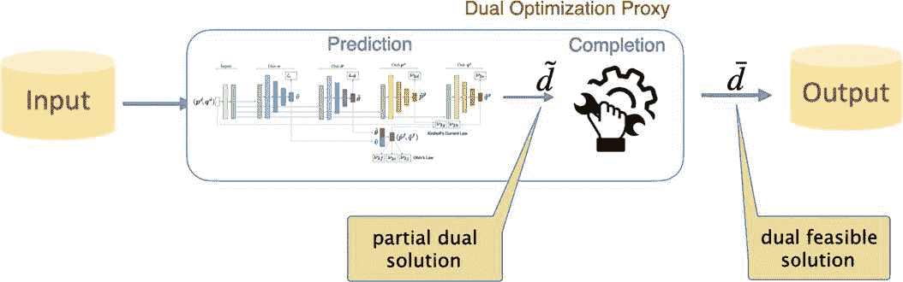

图 9.4 对偶优化代理的结构。

双对偶优化代理最早被用于交流潮流方程的二阶锥规划（SOCP）松弛 [21]。该论文中的补全层特别感兴趣：它利用对偶最优解的属性来确定如何补全神经网络未预测的对偶变量集。同样，对偶优化代理是一个可微程序，可以进行端到端训练，以便在训练和推理阶段产生可行解。实验结果表明，生成的代理可以找到近优的对偶可行解。关于该结果向对偶锥代理的推广，请参阅 [24]。

更通俗地说，寻找优化问题 `Φ` 的质量保证的方法可以总结如下：

1. 找到问题 `Φ` 的凸近似 `Ψ`。
2. 获取 `Ψ` 的对偶形式 `Ψ(d)`。
3. 为 `Ψ(d)` 推导出对偶优化代理 `Ψ̃(d)`。

现在，给定一个实例 `x`，数对 `⟨Φ̃(x), Ψ̃(d)(x)⟩` 提供了一对原始和对偶可行解。

## 4. 可扩展性

工程中的优化问题通常具有高维输出，这使得它们与传统的机器学习应用非常不同。有趣的是，由于它们运行在物理或高度工程化的基础设施上，输出空间中通常存在显著的结构。图 9.5 展示了对最优潮流（OPF）的 `output space` 进行主成分分析（PCA）的结果，其中 x 轴代表主成分比例（即使用的主成分数量与最优解维度之比），y 轴代表解释方差比例（即按降序排列的主成分特征值累加和与所有特征值和之比）。分析表明，通过几个主成分即可实现几乎无损的压缩。例如，对于 `13659_pegase` 测试用例，1% 的主成分就能保留 99.92% 的 AC-OPF（使用交流（AC）公式描述的 OPF）最优解信息。

![图 9.5 最优潮流的主成分分析（来自 [18]）。](graphic/converted/b_9783111376776-009_fig_005.jpg)

图 9.5 最优潮流的主成分分析（来自 [18]）。

这些观测可用于设计优化代理，使其在主成分的小型子空间中学习，然后将解映射到原始输出空间，如图 9.6 所示。这种方法称为**紧凑优化学习**（*Compact Optimization Learning* [18]），它大幅减少了训练过程中拟合的参数数量。它允许设计为最大的电网学习最优潮流的优化代理。

![图 9.6 紧凑优化学习的结构。优化代理 `R[ϕ]` 从输入 `x` 预测主成分的一个小子集 `z`，然后通过线性变换 `W` 映射到实际输出空间 `p`。](img/b_9783111376776-009_fig_006.jpg)

图 9.6 紧凑优化学习的结构。优化代理 `R[ϕ]` 从输入 `x` 预测主成分的一个小子集 `z`，然后通过线性变换 `W` 映射到实际输出空间 `p`。

## 5. 组合性

优化模型通常作为其他优化模型的组件出现。例如，在分解技术、双层优化和随机优化中就是如此。一个有趣的问题是，优化代理是否可以像传统优化模型一样具有组合性。一个带有 ReLU 激活函数的神经网络可以编码为混合整数规划（MIP），但考虑到由此产生的非凸性和计算挑战，这并不总是理想的。一种引人的可能性是使用**凸神经网络**，或者更准确地说，使用**输入凸神经网络**（*ICNNs*）。如果一个带有 ReLU 激活函数的神经网络权重限制为非负，则它可以计算出一个凸函数。更精确地，输入凸神经网络的第 `k` 层形式为：

```
\begin{matrix}
h^{k} = \operatorname{ReLU}(W^k h^{k-1} + d^k)
\end{matrix}
```

其中 `h^k` 和 `h^{k-1}` 分别表示第 `k` 层和第 `k-1` 层的输出，`h⁰` 表示 ICNN 的输入，`d^k` 是偏置向量，而 `W^k`, `H^k` 是权重矩阵。`W^k` 的系数是非负的，而 `H^k` 可以取正或负值而不影响凸性 [1]。跳跃连接将 ICNN 输入 `h⁰` 馈给每一层。

如果成功，训练好的 ICNN 提供了问题值函数及其相对于输入的高保真近似。这正是 Benders 分解（及其推广）应用于确定性和随机优化问题时所需要的功能。此时，ICNN 可以替换复杂的优化子问题，以便在只需要最优子目标值及其梯度时加速这些应用。ICNNs 也应该对双层优化问题很有用，尽管需要案例研究来证明它们在这些设置中的优势。研究表明，输入凸神经网络可以高精度地近似 AC-OPF、其二阶松弛及其 DC 近似的目标值，为实际应用开辟了许多前景良好的途径 [23]。例如，图 9.7 比较了 ICNN 和普通 ReLU 神经网络在估计 RTE 网络上 SOCP 松弛目标值方面的准确性。

优化代理具有变革各类应用的潜力，并可能在效率上带来几个数量级的提升。其中一种应用就是电力系统的实时风险评估。鉴于可再生能源波动性的剧烈增长以及交通基础设施的电气化，系统运行员日益担心电网中的运行和财务风险。他们需要能够实时量化此类风险的仪表板。例如，考虑图 9.8 中描述的实时风险评估框架，该框架运行了一系列蒙特卡洛场景。对于每个场景，都需要运行 288 次优化，即在未来 24 小时内每 5 分钟运行一次。针对特定场景的这 288 次优化大约需要 15 分钟，而风险评估平台需要评估数千次这样的优化。通过用代理代替这些优化，现在每个场景都可以在约 5 秒内完成评估 [5]。这意味着实时量化电网中资产级、系统级和财务风险变得成为可能。例如，图 9.9 使用本文之前描述的优化代理的风险评估框架 E2ELR [4] 报告了未来 24 小时不利事件发生的概率。它将 E2ELR 与过去提出的各种学习架构（例如 DeepOPF、DC3）以及使用最先进优化求解器进行风险评估的真值（即 GRB）进行了比较。左图描绘了平衡约束上发生不利事件的概率：真值和 E2ELR 均显示没有此类事件。相比之下，其他方法系统地报告了潜在的不利事件，因为它们无法保证该约束的可行性。右图显示了拥堵线路热限制的违反情况。同样，E2ELR 以极高的精度分离了潜在的违反情况。其他方法在全天范围内报告了许多假阳性。

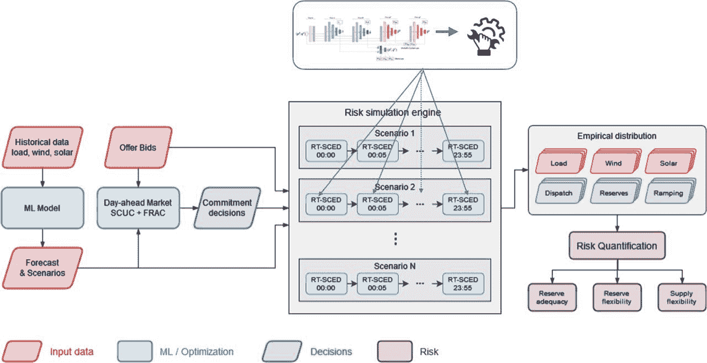

图 9.8 带有优化代理的风险评估框架。

![图 9.9 基于代理的风险评估不利事件概率（来自 [4]）。](graphic/converted/b_9783111376776-009_fig_009.jpg)

图 9.9 基于代理的风险评估不利事件概率（来自 [4]）。

![图 9.10 用于安全约束最优潮流的原始-对偶学习（来自 [19]）。](graphic/converted/b_9783111376776-009_fig_010.jpg)

图 9.10 用于安全约束最优潮流的原始-对偶学习（来自 [19]）。

优化代理还有能力部署那些原本无法满足实时要求的优化模型。通过用代理代替这些优化，可以将计算负担转移到离线。一个有趣的例子是安全约束最优潮流，该问题在现有技术下具有挑战性。在特定网络上求解需要几个小时，但生成的优化代理 [27] 可以在合理时间内完成训练，并在毫秒内产生高质量解决方案 [19]。整体架构如图 9.10 所示：其修复层不仅能恢复基准（无故障）调度的可行性，还通过二分搜索计算在发生线路故障时的响应。这种训练是自监督的，并使用了前文提到的原始对偶学习方法。该可微程序受原始列与约束生成算法 [27] 的启发，在每次迭代中计算复杂的 DCG，并通过反向传播来调整全连接网络。在 RTE 网络（6515 个节点）上，PDL-SCOPF 可以在 3 小时内完成训练，并在 10 毫秒内产生最优性差距低于 1% 的可行解。

## 7. 结论

本文介绍了可信优化学习的概念，这是一种旨在学习优化问题输入输出映射的方法。这些优化代理在设计上是可信的：它们能够计算底层优化问题的可行解，对返回的解提供质量保证，并能扩展到大规模实例。优化代理是结合了深度学习技术与修复或补全层的可微程序。

由于该领域仍处于起步阶段，因此有许多进一步的研究途径。对偶优化代理为给定实例在推理时提供了保证，但如果在学习阶段之后获得形式的最坏情况保证将大有益处 [28], [16]。不同的作者已经对此进行了研究，为了扩展现有方法还需要额外的工作 [2], [29], [22], [31], [6]。尽管取得了一些成功（例如，[12], [17], [30], [3]），但组合优化问题和混合连续离散优化问题也由于梯度不可用而带来了重大挑战。随机优化和双层优化中的应用似乎也是可信优化学习的肥沃领域。

## 参考文献

[1] B. Amos, L. Xu, and J. Z. Kolter. Input convex neural networks. In: *International Conference on Machine Learning*, pages 146–155. PMLR, 2017. →

[2] S. Chen, E. Wong, J. Z. Kolter, and M. Fazly. Deepsplit: scalable verification of deep neural networks via operator splitting. *IEEE Open Journal of Control*, 3:126–140, 2022. →

[3] W. Chen, R. Khir, and P. Van Hentenry. Two-stage learning for flexible job scheduling. *CoRR*, arXiv:2301.09703. a, b

[4] W. Chen, M. Tanneau, and P. Van Hentenry. Real-time risk analysis with optimization proxies. In: *Proceedings of 23rd International Power Systems Computation (PSCC’2024)*, Paris-Saclay, France, June 2024. a, b

[5] W. Chen, M. Tanneau, and P. Van Hentenry. End-to-end feasible optimization proxies for large-scale economic dispatch. *IEEE Transactions on Power Systems*, 39(2):4723–4734, 2023. a, b

[6] W. Chen, H. Zhao, M. Tanneau, and P. Van Hentenry. Compact optimality verification for optimization proxies. In: *Proceedings of 41st International Conference on Machine Learning (ICML 2024)*, Vienna, Austria, July 2024. →

[7] P. L. Donti, D. Rolnick, and J. Z. Kolter. DC3: a learning method for optimization with hard constraints. In: *International Conference on Learning Representations*, 2021. a, b


## 参考文献

[8] F. Fioretto, T. W. K. Mak, and P. Van Hentenry. Predicting AC optimal flows: Combining deep learning and lagrangian dual methods. In: *The Thirty-Fourth AAAI Conference on Artificial Intelligence, AAAI*, pages 630–637. AAAI Press, February 2020.

[9] S. Gould, R. Hartley, and D. Campbell. Deep declarative networks. *IEEE Transactions on Pattern Analysis and Machine Intelligence*, 44(08):3988–4004, Aug. 2022.

[10] M. Klamkin, M. Tanneau, and P. Van Hentenry. Dual interior-point optimization learning. arXiv:2402.02596, 2024.

[11] A. V. Konstantinov and L. V. Utkin. A new computationally simple approach for implementing neural networks with output hard constraints. In: *Doklady Mathematics*, pages 1–9. Springer, 2024.

[12] J. Kotary, F. Fioretto, and P. Van Hentenry. Fast approximations for job shop scheduling: a lagrangian dual deep learning method. In: *the Thirty-Sixth AAAI Conference on Artificial Intelligence (AAAI-22)*, February 2022.

[13] M. Li, S. Kolouri, and J. Mohammadi. Learning to solve optimization problems with hard linear constraints. *IEEE Access*, 11:5995–6004, 2023.

[14] X. Ma, H. Song, J. Wan, and E. Zak. The security-constrained commitment and dispatch for ISO day-ahead co-optimized energy and ancillary service. In: *2009 Power & Energy Society General Meeting*, pages 1–8.

[15] ISO. Real-time energy and operating reserve market formulations and logic, 2022.

[16] R. Nell and S. Chatzi. Physics-informed neural networks for minimising worst-case violations in DC flow. In: *2021 International Conference on Communications, Control, and Computing for Smart Grids (SmartGrid)*, pages 419–424. IEEE, 2021.

[17] R. Ojha, W. Chen, H. Zhang, R. Erera, and P. Van Hentenry. Optimization-based learning for dynamic load planning in trucking service networks. arXiv:2307.04050, 2024.

[18] S. Park, W. Chen, T. K. Mak, and P. Van Hentenry. Compact optimization learning for ac optimal power flow. *IEEE Transactions on Power Systems*, 1–10, 2023.

[19] S. Park and P. Van Hentenry. Self-supervised learning for large-scale preventive security constrained dc power flow. arXiv:2311.18072 [cs.LG], November 2023.

[20] S. Park and P. Van Hentenry. Self-supervised primal-dual learning for constrained optimization. In: *Proceedings of the AAAI Conference on Artificial Intelligence*, volume 37, pages 4052–4060, 2023.

[21] G. Qiu, M. Tanneau, and P. Van Hentenry. Dual conic proxies for AC optimal power flow. In: *Proceedings of the 23rd International Power Systems Computation Conference (PSCC’2024)*, Paris-Saclay, France, June 2024.

[22] A. Raghunathan, J. Steinhardt, and P. Liang. Semidefinite relaxations for certifying robustness to adversarial examples. arXiv:1811.01057, 2018.

[23] A. Rosemberg, M. Tanneau, B. Fanzeres, J. Garcia, and P. Van Hentenry. Learning optimal power flow value functions with input-convex neural networks. In: *Proceedings of the 23rd International Power Systems Computation Conference (PSCC’2024)*, Paris-Saclay, France, June 2024.

[24] M. Tanneau and P. Van Hentenryck. Dual lagrangian learning for conic optimization. arXiv:2402.03086, 2024.

[25] J. Tordesillas, J. P. How, and M. Hutter. Rayen: imposition of hard convex constraints on neural networks, 2023.

[26] A. Velloso and P. Van Hentenryck. Combining deep learning and optimization for preventive security-constrained dc optimal power flow. *IEEE Transactions on Power Systems*, 36(4):3618–3628, 2021.

[27] A. Velloso, P. Van Hentenryck, and E. S. Johnson. An exact and scalable problem decomposition for security-constrained optimal power flow. *Electric Power Systems Research*, 195:106677, 2021.

[28] A. Venzke, G. Qu, S. Low, and S. Chatzivasileiadis. Learning optimal power flow: worst-case guarantees for neural networks. arXiv:2006.11029, 2020.

[29] K. Xu, H. Zhang, S. Wang, Y. Wang, S. Jana, X. Lin, and C.-J. Hsieh. Fast and complete: enabling complete neural network verification with rapid and massively parallel incomplete verifiers. arXiv:2011.13824, 2021.

[30] E. Yuan, W. Chen, and P. Van Hentenryck. Reinforcement learning from optimization proxy for ride-hailing relocation. *Journal of Artificial Intelligence Research*, 75:985–1002, 2022.

[31] H. Zhao, H. Hijazi, J. Moore, M. Tanneau, and P. Hentenryck. Bound tightening using rolling-horizon decomposition for neural network verification. In: *The 21st International Conference on the Integration of Constraint Programming, Artificial Intelligence, and Operations Research (CPA 2024)*, Uppsala, Sweden, May 2024.

# 神经网络的压缩感知训练

现有的许多神经网络（`NN`）剪枝方法通常依赖于重新训练或在整个训练过程中引入强偏置以收敛到稀疏解。第三种范式——“压缩感知”训练，旨在通过单次稠密训练，获得对各种压缩率均具有鲁棒性的先进稠密模型。我们提出了一个围绕通用范数约束族和 `Stochastic–Wolfe`（`SFW`）算法构建的框架，该框架鼓励收敛到高性能解，同时引发滤波器剪枝和低秩矩阵分解。我们的方法优于现有的压缩感知方法，而且在低秩矩阵分解的情况下，它所需的计算量远少于基于核范数正则的方法。我们的研究结果表明，正如 [57] 所示，动态调整 `SFW` 的学习率对于 `SFW` 训练模型的收敛性和鲁棒性至关重要，且我们为这一实践建立了理论基础。

关键词：压缩感知训练，神经网络，随机-Wolfe，剪枝，约束优化，MSC 2020:68T

## 致谢

本研究部分得到了来自德国研究基金会（DFG）卓越集群 MATH+ EXC-2046/1 的资助，项目 ID 为 `39068569`。

## 1. 引言

神经网络（`NNs`）的巨大成功很大程度上取决于包含数十亿参数的过度参数架构 79。因此，现代网络需要大量的存储空间以及日益增长的计算密集训练和推理时间，导致了巨大的财务和环境成本 64。为了解决这个问题，大量工作集中在压缩网络，以产生仅需部分内存或浮点运算、且性能与稠密模型相当的稀疏模型。最近的技术包括对单个参数进行`剪枝` 26、24、49，或者对卷积过滤器和整个神经元进行剪枝 46、2、51 以及经典的张量分解 80、65、72、48，以减少参数数量。

较高程度的稀疏化通常会导致网络预测能力的下降。为了解决这个问题出现了两个主要范式：`训练后剪枝`，例如迭代幅值剪枝（`IMP`）26，其特征是三阶段的（稀疏无关的）训练，随后进行单次（`One-Shot`）或迭代操作。为了恢复剪枝引起的损失而重新训练被认为是一种固有缺陷且在计算上是不可行的 50、20、70、49、85。另一种地，`训练期间剪枝`通过引入强归纳偏置使其在训练结束时收敛到稀疏模型，从而避免了重新训练 82、13、37、50。

此类方法的缺点是每个稀疏度水平都需要训练一个模型，而 `IMP` 只需要一个预训练模型就可以生成整个准确率-稀疏度前沿。

第三种范式是本工作的重点，它在不允许重新训练、且通过多次训练来生成准确率与稀疏度权衡前沿的成本过高的情况下应而生。理想情况下，优化过程应该是“压缩感知的”[[3], [56]]或“剪枝感知的”[[53]]，这允许仅训练一次，就可以在不重新训练的情况下，在保持大部分性能的同时压缩到不同的程度（这被称为`pruning stability`）。压缩感知的训练程序预计认为能够产生最先进的稠密模型，这些模型对剪枝具有鲁棒性，且无需为特定的压缩水平选择剪枝超参数。虽然许多此类方法使用 `SGD` 变体来区分看似“重要”和“不重要”的参数 [[20], [13], [19], [83]]，通过积极鼓励前者增长并惩罚后者，但另一条有趣的研究方向考虑使用 `SGD` 以外的优化器。一种特别适用于此的优化方法是一阶且无投影的 `Stochastic Frank–Wolfe` (SFW) 算法 [[23], [7], [57], [66], [53]]。尽管该算法因其高度结构化的、增强稀疏性的更新方向已广泛应用于机器学习的各个领域 [[39], [78], [12], [9]]，但它最近才被考虑用于促进神经网络架构的稀疏性。

### 压缩感知训练

针对压缩感知训练的问题，我们提议利用 `SFW` 算法结合一组范数约束，这些约束能够积极鼓励对卷积剪枝和低秩矩阵分解的鲁棒性。我们的方法使用 `group-support` 范数及其变体 [[4], [58], [52]]，能够在大型数据集上训练最先进的图像分类和语义分割架构以获得高准确率，同时使网络向压缩鲁棒性偏置。同样，受 Pokutta 等人 [[57]] 研究的启发并与我们的工作同时进行，Miao 等人 [[53]] 展示了 `k`-稀疏约束的有效性，仅关注于非结构化权重剪枝。我们的方法推广了非结构化剪枝情况，并进一步缓解了现有的收敛和超参数问题。据我们所知，我们的工作是首次将 `SFW` 应用于结构化剪枝任务。在分析 Pokutta 等人 [[57]] 引入的技术时，我们发现学习率的 `gradient rescaling` 对于获得高性能且剪枝稳定的模型至关重要。我们通过证明非凸随机情况下带有 `gradient rescaling` 的 `SFW` 的收敛性，为这一实践奠定了理论基础，扩展了 Reddi 等人 [[60]] 的结果。

### 贡献

我们工作的贡献总结如下：

1. 我们提出了一个围绕多功能范数约束族的约束优化框架，该框架结合 `SFW` 算法，可以产生对过滤器剪枝和低秩矩阵分解均具有鲁棒性的高性能模型。我们通过实验证明，所提方法能够与现有方法并肩甚至更好。在分解情况下，我们的方法所需的计算资源显著少于基于核范数的方法。

2. 作为一种特例，我们的推导包含了非结构化剪枝设置。我们证明了与现有的 `k`-稀疏方法 [[57], [53]] 相比，我们的方法具有良好的特性。

3. 我们通过实验证明，`SFW` 的鲁棒性很大程度上可以归于对学习率的 `gradient rescaling` 的使用。

### 相关工作

`Stochastic Frank–Wolfe` (SFW) 或 `Frank–Wolfe` 算法 [[23], [44]] 因其高度结构化的、增强稀疏性的更新方向被广泛应用于机器学习 [[39], [78], [12], [9]]。Lacoste-Julien [[38]] 将 `FW` 的收敛性扩展到非凸设置，而 Hazan 和 Luo [[27]] 以及 Reddi 等人 [[60]] 提供了该算法随机变体 (SFW) 的收敛速率。加速变体包括方差减少方法 [[27], [76], [63]]、自适应梯度 [[16]] 和动量 [[54], [14]]。欲了解，请参见 Braun 等人 [[9]]。

SFW 在训练神经网络（NNs）方面也受到了越来越多的关注，相关研究探索了参数约束 [59]、用于浅层网络的 SFW [71]、针对神经网络的变体 [7]、对抗训练 [66]，以及在图像分类中实现基准性能 [57]。虽然经典的 FW 已应用于机器学习中的稀疏性问题，但很少有人探索过它在深度学习中增强结构的益处。Grigas 等人 [25] 从三层卷积网络中移除神经元。Pokutta 等人 [57] 将参数限制在 `k`-稀疏多胞形内，导致大部分比例参数具有较小的幅值。Miao 等人 [53] 利用这一思想在“一次性到位”（once-for-all）[10] 剪枝感知训练中进行无结构化剪枝。我们参考 Hoefler 等人 [30] 获取稀疏化方法的详细说明。

## 2. 方法：感知训练

对于 `x ∈ ℝ^n`，我们将 `x` 的第 `i` 个坐标表示为 `x[i]`。以 `x` 为对角线元素的对角矩阵表示为 `diag(x) ∈ ℝ^(n, n)`。对于 `p ∈ [1, ∞]`，半径为 `τ` 的 `l[p]-ball` 表示为 `Bp`。`||x||_0` 表示 `x ∈ ℝ^n` 中非零分的数量。对于任何紧致凸集 `C⊆ ℝ^n`，让我们将 `C` 的 `l[2]-直径` 表示为 `𝒟(C) = max[x, y ∈ C] ||x − y||_2`。按照惯例，我们将函数 `L` 在 `θ` 处的梯度表示为 `∇L(θ)`，批量梯度估计器表示为 `̃L(θ)`。我们滥用了符号，以逐元素的方式将单变量函数应用于向量，例如 `|x|` 表示向量 `|x|:|x[1]|...,|x[n]|`。除非另另，我们将网络张量 `x` 视为向量 `x ∈ ℝ^n`。

### 使用随机 Frank–Wolfe 进行受约束优化


我们的目标是在优化神经网络参数 `θ` 的同时，通过考虑受约束的有限和优化问题来强制执行诱导约束：

$$
\min_{\theta \in C} L(\theta) = \min_{\theta \in C} \frac{1}{m} \sum_{i=1}^{m} \ell_i(\theta)
$$

其中每个样本损失函数 `ℓ[i]` 在 `θ` 上是可微的，且 `C` 是紧致凸集。在使用 SGD 时，施加硬约束需要可能代价昂贵的投影回 `C`，以确保迭代的可行性 [15]。另一种方法是随机 Frank–Wolfe (SFW) 算法 [23, 7, 57]，它是无投影的，非常适合产生具有结构性的解。为了确保可行性，SFW 不使用梯度方向，而是选择 `C` 的边界点或顶点。在每次迭代中，SFW 对批量梯度 `∇L(θ_t)` 调用线性最小化算子 (LMO) 以求解：

$$
v_t = \arg \min_{v \in C} \langle v, ∇_t \rangle
$$

然后使用凸组合更新参数：

$$
θ_{t+1} ← (1 - η_t)θ_t + η_t v_t
$$

其中 `η_t ∈ [0,1]` 是学习率。如果确保初始参数 `θ[0]` 位于凸集 `C`，则凸更新规则确保了每次迭代的可行性。求解方程（2）通常比执行投影步骤便宜得多 [34, 15]，在许多情况下甚至存在闭式解。如果 `C` 由（可能是无限多个）顶点的凸包（称为原子域）给出，则方程解在这些顶点处获得。

### 通过可行区域诱导结构

除了约束参数满足某种范数约束（例如权重衰减中的有界欧几范数）外，SFW 算法的唯一更新规则可以通过可行区域来诱导结构。具有满足高度结构约束的更新方向 `v[t]` 的结构化可行区域不仅可以增强泛化能力 [59, 57]，还可以诱导理想的网络属性，如稀疏性。一个最近的例子是 Pokutta 等人 [57] 提出的 `l[1]`-球 `B[1]` 的推广——k-稀疏多胞形。k-稀疏多胞形 `C = Pk` 定义为具有最多 k 非零元素的向量 `v` 的凸包，这些构成了方程（2）的解集。对于较小的 `k`，`v[t]` 表现出高度稀疏性，且通过方程（3）仅激活 `k` 个参数，而所有剩余参数都被强烈抑制，从而鼓励收敛到稀疏解 [57, 53]。

在下文中，我们提出利用一组合适的范数约束，这些约束自然源于具有稀疏化要求的 `l[2]`-正则化。通常而言，我们的目标是选择合适的约束，使得在应用方程 (10.3) 的更新规则时，产生稀疏的更新方向；通过对预定义的参数组进行区分，使得看似“不重要”的参数组衰减，同时允许其他组增长。与 Pokutta 等人 [57] 以及 Miao 等人 [53] 类似，我们通过一个可调的超参数 `k` 来控制稀疏化程度，使得更新向量 `v[t]` 是 `k`-稀疏的，即最多包含 `k` 个非零元素。然而，现有方法限于基于单个权重的神经网络稀疏化（即非结构化剪枝），并且可能导致超参数和收敛的不稳定性。我们构建了结构化稀疏化的约束，同时也包含了非结构化情况。此外，我们还确保（类似于经典的 SGD），单个参数接收到的更新与其梯度的大小相对应，从而在不依赖于 `k` 的选择的情况下实现更好的收敛性。

### 2.1 在神经网络中引入组稀疏性

给定网络参数划分为不相交的组 `G ∈ 𝒢`，我们定义半径为 `τ` 的`组-k-支持范数`(group-k-support norm) 球为

(10.4)
$$
\mathcal{C}_{k}^{\mathcal{G}}(\tau) = \text{conv}\left\{ v \mid \|v\|_{0,\mathcal{G}} \leq k,\ \|v\|_{2} \leq \tau \right\}
$$

其中 `\|v\|_{0,G}` 是覆盖 `v` 的支撑（即其非零元素）所需的最小组数。换句话说，顶点集 `C_k^𝒢(τ)` 由所有欧几里得范数受限于 `τ` 且最多包含 `k` 组非零元素的（向量化）参数组成。这里，组集 `G` 的定义是抽象的，可以是参数的任意不相交划分，即每个参数 `w` 必须恰好位于一个组中 `w ∈ G`。

将 `G` 选择为第 `l` 层卷积层的所有卷积滤波集合，我们现在可以将方程 (10.2) 的解表述如下。对于滤波器 `G ∈ 𝒢`，令 `\|x\|_{G}` 为当仅考虑 `G` 中的元素时 `x ∈ ℝ^n` 的 `l[2]`-范数。给定第 `l` 层卷积层的批量梯度 `∇_t(l)`，令 `G[1],...,G[k]` 为 `l[2]`-范数 `\|∇_t(l)\|_{G[i]}` 最大的 `k` 个组滤波器，并令 `C := H = ⋃_{i=1}^{k} G_i`。方程 (10.2) 的解由下式给出：

$$
[v_t]_i = \begin{cases}
-\tau [∇_t^l]_i / \|∇_t^l\|_H & \text{if } i \in H, \\
0 & \text{otherwise}.
\end{cases}
$$

证明可以在 Rao 等人 [58] 中找到。最初源于组 lasso [74]，在统计学和经典机器学习中很常见。据我们所知，这些约束尚未应用于神经网络。应用于 `C := C_k^𝒢(τ)` 的 SFW 更新了梯度下降最快的 `k` 个滤波器，同时考虑了它们之间的幅度分布，而不是所有参数使用相同的幅度。由于凸更新规则，剩余滤波器的权重会衰减，最终导致它们接近零，从而使训练后的网络对滤波器剪枝具有鲁棒性。图 10.4 附录 A 显示了作为滤波器比例的不同 `k` 值如何影响与剪枝模型的相对距离，表明 `k` 可以控制对稀疏化的鲁棒性。

我们的方法可以很容易扩展到其他组的剪枝，例如神经元。当每个权重自成一组时，出现了一个特殊情况，自然地将上述原理扩展到非结构化剪枝。此时恢复了 `k-支持范数` [4]，它是与 Miao 等人利用 `k`-稀疏多胞体方法 [53] 的合适比较对象。`k`-稀疏方法有两个缺点，都可以通过我们的方法缓解：

首先，所有激活参数接收相同幅更新 `τ`。这阻碍了收敛，特别是当 `k` 较大时。例如，考虑 `k` 等于参数数量的最坏情况，则网络的每个参数都将接收 `τ` 更新，基本上丢失了整个梯度信息。相反，`k:=n` 的 `k`-支持范数将导致 `l[2]` 球，产生神经网络的默认且最佳收敛情况。[附录 [A] 中的图 10.5] 显示了我们方法的加速收敛，尽管这种方法高度倾向于非结构化剪枝。`k`-稀疏方法在中到高范围内表现良好，但在高压缩率下会迅速崩溃。

其次，Pokutta 等人 [57] 和 Miao 等人 [53] 指定了 `C := P_k(τ)` 所需的 `l[2]`-直径 `D` 以控制正则化强度，并反选择半径 `τ` 使得 `D(P_k(τ)) = D`。这样定义，`τ` 依赖于 `k`，即 `τ = D/(2√k)`。这是不直觉的，因为 `k` 同时控制了激活参数的数量和参数更新的幅度，导致参数产生不耦合。与 `k`-稀疏多胞体相反，`k`-支持范数的直径不依赖于 `k`，因此按需解耦了参数 `k` 和 `τ`。[附录 [A] 中的图 10.6] 显示了半径与 `k` 的成功解耦。

### 2.2 一种不同的稀疏性概念：剪剪奇异值

到目前，我们考虑了稀疏性的一种特定概念，即矩阵或张量中存在零。与其移除单个参数或其组，网络在训练后可以通过将参数矩阵分解为若干较小矩阵的乘积来进行压缩，允许在推理时将一层替换为两个连续的层，这两层所需的 FLOPs 大幅减少 [18]。关键要素是截断奇异值分解（SVD），通过将最小奇异值置为零，根据 Eckart–Young–Mirsky 定理可以获得最优低秩近似。更精确地说，给定一个秩为 $r$ 的参数矩阵 `W ∈ ℝ^(n×m)`，其奇异值为 `σ = (σ[1], ..., σ[r])` 且 SVD 为 `U ∈ ℝ^(n×r)`, `Σ ∈ ℝ^(r×r)`, `V ∈ ℝ^(m×r)`，则 `W` 的 `k`-SVD 将 `W` 近似为：

$$
\mathcal{W} = U\Sigma V^T = \sum_{i=1}^{r} u_i \sigma_i v_i^T \approx \sum_{i=1}^{k} u_i \sigma_i v_i^T = U_k \Sigma_k V_k^T
$$

其中“被剪枝”奇异值的幅值量化了近似的误差。关于该方法的详细说明可以在附录 A 中找到。因此，确保矩阵分解鲁棒性的自然方法是基于惩罚核范数 `\|W\|_* = \|\sigma(W)\|_1` [65, 3]，这需要昂贵的全 SVD 计算。

当约束参数具有有界核范数而不是对其进行惩罚时，SFW 所利用的方程 (10.2) 的 L 解可以通过只需要第一对奇异向量来高效计算 [34]。将此概念扩展到 `k` 个最大的奇异对，我们提出了`谱-k 支撑范数`(spectral-k-support norm) [52]，半径为 `τ` 的球定义为：

$$
\mathcal{C}_{k}^{\sigma}(\tau) = \text{conv}\left\{ \mathcal{W} \mid \text{rank}(\mathcal{W}) \leq k,\ \|\sigma(\mathcal{W})\|_{2} \leq \tau \right\}
$$

其中 `\|\sigma\|_2` 是矩阵 `W ∈ ℝ^(n×m)` 的奇异值 `σ(W)` 的 2 范数 [34]。以下引理允许高效计算梯度 `∇_t ∈ ℝ^(n×m)` 的 L 解。

#### 引理 10.1.

设 `W_t = -τ \|\sigma(Σ_k)\|_2^{(-1)} U_k Σ_k V_k^T ∈ C_k^(σ)`，其中 `U_k Σ_k V_k^T` 是 `∇_t` 的截断 k-SVD，保留了 k 个最大的奇异值。则 `W_t` 是方程 (10.2) 的解。

证明可以在附录 A 中找到。注意，类似于考虑到 `k` 个最大梯度组的组-k 支撑范数球，通过 `Σ_k \|\sigma(Σ_k)\|_2^{(-1)}` 进行缩放考虑了 `k` 个最大的奇异值。在第 3.2 节，我们研究了 SFW 在约束卷积张量谱-k 支撑范数的能力，这些张量占据了推理时大部分 FLOPs [26]。虽然存在直接分解张量的 SVD 高阶泛化方法 [cf. [42], cf. [35]]，但我们遵循以下方法：将具有 `c` 个输入通道、`n` 个卷积滤波器和空间大小为 `d` 的张量 `W ∈ ℝ^(n×c×d²)` 解释为 `(n × cd²)` 矩阵 [3, 32]。

## 3 实验结果

我们在数据集上训练了卷积架构，如`残差网络`(Residual Networks) [28] 和`宽残差网络`(Wide Residual Networks) [77]，数据集包括 `ImageNet-1K` [62]、`TinyImageNet` [41]、`CIFAR-10` [36]、`CIFAR-100` [81] 和 `Cityscapes` [17]。训练设置和网格搜索见附录 A，遵循 Blalock 等人的方法 [8]。我们在两个种子上平均了结果，在图表中报告最小-最大值，在表中报告标准差。我们的代码可以在 `github.com/ZIB/compression-aware-SFW` 获取。

在压缩感知设置下，我们感兴趣在多种压缩率下表现良好的单一参数配置，即不需要为每个稀疏度进行调优。当同时比较多个压缩率性能时，我们需要决定如何选择“最佳”参数配置。为此，我们选择在所有相关的稀疏度下平均验证率最高的配置。

### 3.1 压缩感知：结构化滤波器剪枝

我们应用 `PFEC` 方法 [46] 进行卷积滤波器剪枝，根据 `l[1]` 范数对滤波器进行排序并移除最小的以实现所需的压缩，保持层间的均匀稀疏性。与 Li 等人的方法不同 [46]，我们采用了无需重新训练的一次性方法。我们的方法 `SparseFW` 与动量 SGD 训练的基准以及最近的滤波器剪枝方法进行了对比：`SSL` [68] 使用组惩罚，`GLT` [2] 应用组 lasso 后进行软阈值处理，`ABFP` [19] 平衡了滤波惩罚与增长，而 `SFP` [29] 允许在每个 epoch 之后通过软剪枝恢复滤波器。

图 10.1 显示了在 ImageNet-1K 上训练的 ResNet-50 的精度与稀疏度之间的权衡。`SparseFW` 能够收敛到对各种滤波器剪枝率都具有鲁棒性的解，在高稀疏度下也能保持性能，与其他大多数 `ABFP` 方法不同。其他数据集和架构的详细结果见附录 A。

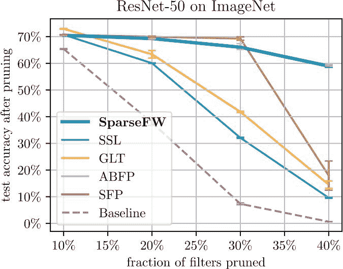

图 10.1 ImageNet 上结构化卷积滤波器剪枝的精度-稀疏度权衡曲线。图表显示了在对所有相关稀疏度取平均后，剪枝后最高测试精度的参数配置。

### 3.2 压缩感知：低秩分解

我们将带有谱-`k`-支持范数约束的 `SparseFW` 与旨在实现张量分解鲁棒性的其他方法对比。在训练结束时，我们剪掉每层最小的奇异值，并将其替换为两个层矩阵，如附录 A。

除了带有权重衰减的基准动量 `SGD` 外，我们还研究了如 `NUC` [18] 和 `SVDEnergy` [3] 等低秩方法，它们分别使用了核范数正则化和*奇异值阈值* [11]。注意，虽然作者建议在每个 epoch 后应用阈值，但我们发现每次迭代后应用更为有效，尽管是以降低效率为代价的。`TRP` [72] 将参数设置为低秩表示，其中奇异值剪枝是一个超参数。`Force Regularization (FR)` [69] 强制卷积滤波器位于低维子空间中，而无需计算核范数。图 10.2 显示了 CIFAR-100 上 `WideResNet`、Cityscapes 上 `PSNet` 以及 TinyImageNet 上 `ResNet-50` 的剪枝后性能（精度或 IoU），其在不同稀疏度下。`SparseFW` 一致优于其他方法，在高稀疏度下精度损失最小，在中等稀疏度下下降忽略不计。对于语义分割，`SparseFW` 减少了 IoU，下降更大，我们将其归因于使用了预训练骨干网络。再次，性能对应于平均最优参数配置。

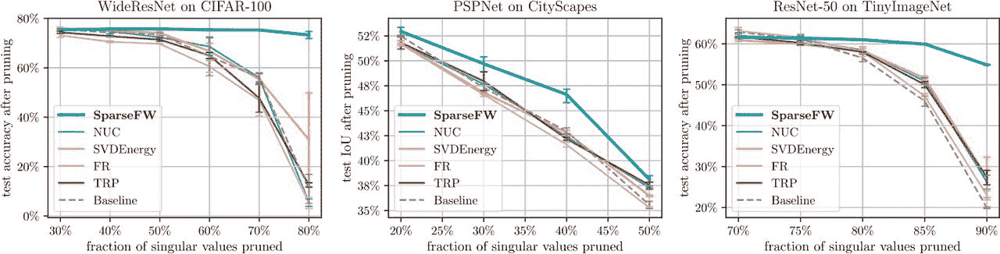

图 10.2 CIFAR-100（左）、Cityscapes（中）和 TinyImageNet（右）上低秩张量分解的精度-稀疏度权衡曲线。低秩方法通常选择高精度但代价奇异值分解，或更高效但精度较低的近似方法 [73]。`SparseFW` 通过 `k-SVD` 关注最显著的数值对来解决这一权衡，同时优化精度和效率。`n × m` 矩阵的完全 `SVD` 需要 `O(nm)` 操作，但 `k ≤ min(n, m)` 时计算 `k-SVD` 更高效 [1]。表 10.1 显示了 `SparseFW` 相比 `NUC`、`SVDEnergy` 和 `TRP` 有更高的吞吐量（这些方法在每次迭代中都需要完全 `SVD`），使用相同的硬件（24 核 Xeon Gold 配 Nvidia Tesla V100 GPU）。避免 `SVD` 的 FR 几乎匹配常规训练的效率，但性能通常较差。`SparseFW` 的吞吐量取决于 `k`，报告的效率对应于平均最优参数配置的 `k`。我们强调使用了 `k-SVD` 幂方法的简单实现 [6]，并注意到有更复杂、更快的算法可以计算 `k-SVD` [1]。

表 10.1 低秩方法与常规训练基准相比的每秒训练图像吞吐量。

| | 每秒训练图像数 |
| --- | --- |


### 表格：方法在不同数据集上的表现

| 方法 | CIFAR-10 | CIFAR-100 | TinyImageNet |
| :--- | :--- | :--- | :--- |
| 基准 (Baseline) | 5664 | 1197 | 756 |
| **SparseFW (我们的)** | 1156 | 372 | 338 |
| NUC | 566 | 204 | 160 |
| SVDEnergy | 493 | 174 | 98 |
| FR | 4397 | 1140 | 742 |
| TRP | 565 | 199 | 159 |

### 3.3 学习率的影响

学习率 $\eta \in [0,1]$ 决定了参数更新长度相对于可行区域的大小。正则化强度与步长之间的耦合使得学习率的调优变得困难。为了将学习率调优与可行区域的大小解耦，Pokutta 等人 [57] 提出了两种不同的学习率机制：*直径重缩放*（diameter rescaling）和*梯度重缩放*（gradient rescaling），后者在我们的实验中一直使用。前者将学习率除以 $C$ 的 *l2*-直径 $\mathcal{D}(C)$，而梯度重缩放将更新长度重缩放为批量梯度的长度，即 $\hat{\eta}_t = \eta_t\|\nabla_t\|_2/\|v_t - \theta_t\|_2$。

归一化方案对收敛和剪枝鲁棒性的影响在很大程度上未被探索，特别是 SGD 的学习率直接影响非激活参数的衰减。图 10.3 显示，当应用 *k*--支持范数约束时，梯度重缩放在幅度剪枝前后维持测试精度的方面均优于直径重缩放。我们在附录 A 中详细解释了这一结果。以下定理奠定了理论基础，证明了将批量梯度范数引入学习率可以使 SFW 以指定的速率收敛，即精确梯度范数与 *Frank–Wolfe 间隙* 的期望乘积：

$$
\mathcal{G}(\theta_t) = \max_{v \in \mathcal{C}}\langle v - \theta_t, - \nabla L(\theta_t) \rangle
$$

作为收敛性的度量 [60]，它以...的速度衰减。精确的陈述和证明可以在附录 A.5 中找到。


图 10.3 CIFAR-10 上的 ResNet-18: 对于每个剪枝数量，展示了相对于剪枝后精度（`pruned`）的最佳超参数配置。相应的剪枝前值（`dense`）以虚线表示。

**定理 10.2 (梯度重放的收敛性，非正式)**。设 `L` 为 `M`-平滑，`ℓ` 为 `G`-Lipschitz，且对于适当选择的 `η` 和所有 0 ≤ `t` < `T`，有 `η[t]` = ∥∇`[t]`∥`η`。如果 `θ[a]` 从 SFW 迭代集合 {`θ[i]`}[`i` < `T`] 中均匀选取，则有 𝔼[𝒢(`θ[a]`) ⋅ ∥∇`L`(`θ[a]`)∥] = 𝒪(`T`^(−1/2))，其中 𝔼 表示所有随机性的期望。

## 4 讨论与展望

我们建议使用一组通用的范数约束，结合 SFW 算法，训练深度神经网络以获得最先进的稠密性能，以及针对各种压缩率的压缩鲁棒性。我们的实验结果表明，SFW 在执行卷积滤波器剪枝或低秩张量分解时，可以利用高度结构化的可行区域来避免性能下降。对于后者，SFW 在精度和效率方面均显著优于类似的方法。作为一种特例，我们提出的方法包含了非结构化剪枝情况，并展示了如何利用所提范数来缓解 Miao 等人的缺点并改进结果 [53]。我们希望关于学习率重放重要性的发现以及定理 10.2 能够激发在使用 SFW 进行感知压缩训练方向的进一步研究。

我们强调，我们的结果主要适用于我们描述的设置，即感知压缩训练，在这种设置下，训练是对稀疏性不可知的且重新训练是不可接受的。我们的目标是展示 SFW 的通用性，它为在整个训练过程中强制结构提供了合适的算法框架。如果可以将稀疏性整合到训练中，就可以应用更复杂的方法。

## 附录 A

在下文中，我们详细介绍了技术细节、超参数网格以及结果的证明。自本文初始版本以来，已有工作在可以重新训练的情况下提高了剪枝模型的性能。我们证明了从同一个剪枝基础模型（尽管超参数配置不同）重新训练的多个模型可以产生增强泛化能力的稀疏模型 [86]。同样，我们在资源受限的情况下通过仅重新训练一小部分关键参数来解决重新训练问题，且与全量重新训练相比性能没有下降 [84]。

### A.1 技术细节

我们采用动量 SFW [57] 和局部约束，即每个层使用一个独立的可行区域。注意，如果 `τ` 选择过小，网络的表达能力可能会受到严重限制。正如 Pokutta 等建议 [57]，我们不直接调优可行区域 `C(τ)` 的半径 `τ`，而是指定标量因子 `w > 0` 并设置每层可行区域的 `l[2]` 直径为

$$
\mathcal{D} = 2w\mathbb{E}\left( \|\theta\|_{2} \right)
$$

其中层参数 `θ` 的期望 `l[2]` 范数通过多次初始化的均值来估计。然后 `D` 用于计算 `τ`，使得 `D(C(τ)) = D`。这允许我们控制每层的 `l[2]` 正则化强度。我们不剪枝偏置和归一化参数，因为它们只占总参数数的一小部分，但对于获得良好的模型至关重要 [21]。除了直径和梯度重放的直接比较外，我们在所有实验中使用了梯度重放。

虽然存在多种剪枝后重新训练的成功策略 [61, 40, 85]，但感知压缩训练要求在剪枝后直接比较方法而不进行重新训练。然而，类似于 Li 等 [45] 和 Peste 等 [56]，我们注意到通过重新计算批归一化 [33] 统计量可以显著提高剪枝后的验证精度，因为隐藏层的预激活被剪枝扭曲了，这些统计量必须校准。为此，我们在训练数据上重新计算统计量，并注意到在实践中只需要部分训练数据即可校准批归一化层。

在下文中，我们给出了结构化和非结构化剪枝以及低秩矩阵分解的技术细节。

#### A.1.1 结构化和非结构化剪枝

我们描述了对（优选）低秩矩阵进行分解的原理。低秩矩阵分解的核心思想是截断奇异值分解（SVD）。设 $\mathit{\theta} = \mathit{U}\Sigma\mathit{V}^{\mathit{T}} = \sum_{\mathit{i} = 1}^{\mathit{r}}\mathit{u}_{\mathit{i}}\mathit{\sigma}_{\mathit{i}}\mathit{v}_{\mathit{i}}^{\mathit{T}}$ 为秩为 `r` 的矩阵 `theta` $\in \mathbb{R}^{(n \times m)}$ 的 SVD，其中 `u[i]`、`v[i]` 是对应于奇异值 `\sigma[1] \geq \dots \geq \sigma[r] > 0` 的奇异向量。现在的目标是寻找 `theta` 的最佳低秩近似 $\widehat{\mathit{\theta}} \in \mathbb{R}^{\mathit{n} \times \mathit{m}}$，即求解：

(10.6)
$$
\min\limits_{\text{rank}(\widehat{\mathit{\theta}}) \leq \mathit{t}}\left| \mathit{\theta} - \widehat{\mathit{\theta}} \right|_{\mathit{F}}.
$$

根据 Eckart–Young–Mirsky 定理，最小化器由 $\mathit{U}_{\mathit{t}}\Sigma_{\mathit{t}}\mathit{V}_{\mathit{t}}^{\mathit{T}} := \sum_{\mathit{i} = 1}^{\mathit{t}}\mathit{u}_{\mathit{i}}\mathit{\sigma}_{\mathit{i}}\mathit{v}_{\mathit{i}}^{\mathit{T}}$ 给出，其中截断了最小的 `t-r` 个奇异值。如果奇异值衰减很快，即前 `t` 个奇异值包含了 `theta` 大部分 `能量`，则这种近似可以作为后处理步骤，而不会对线性层的输出产生太大影响 [18]。因此，确保矩阵分解稳定性的自然方法是鼓励参数矩阵在整个训练过程中保持低秩，最显著的方法是通过对权重矩阵的核范数进行正则化 [65, 3]。如果 `t` 较小，通过将一个层分解为多个层可以大幅减少 FLOPs。对于线性层，这是很直接的：令 (`theta`, \beta) 为线性层的权重和偏置，`theta` 的 SVD 如上所示。对于输入 `x`，该层计算为：

(10.7)
$$
\mathit{\theta}x + \mathit{\beta} = \mathit{U}\Sigma\mathit{V}^{\mathit{T}}x \approx \mathit{U}_{\mathit{t}}\left( \Sigma_{\mathit{t}}\mathit{V}_{\mathit{t}}^{\mathit{T}}x \right) + \mathit{\beta},
$$

这可以解释为连续应用两个线性层：先是 ($\Sigma[t]V[t]^T$)，然后是 ($U[t], \beta$)，可能会将参数数量从 `nm` 减少到 `t(n+m)`。对于四维卷积张量 `theta` $\in \mathbb{R}^{(n \times c \times d \times d)}$，其中 `c` 是输入通道数，`n` 是卷积滤波数，`d` 是空间尺寸，我们无法直接构建 SVD。然而，我们遵循类似于 Alvarez 和 Salzmann [3] 以及 Idelbay 和 Carreira-Perpin [32] 的方法，将 `theta` 解释为 $(n \times cd^2)$ 矩阵，其截断 SVD 允许我们将层替换为两个卷积层：第一层具有 `t` 个滤波器、`c` 个通道和尺寸 `d`，第二层具有 `n` 个滤波器、`t` 个通道和尺寸 `d`。

### A.2 实验设置与扩展结果

表 10.2 显示了我们在整个过程中使用的精确配置，根据 Li 等人 [47] 的建议使用衰减学习率。接下来，我们列出了超参数网格以及完整的表格。对于所有数据集和架构，我们从 0.1 开始使用线性衰减。密集精度是通过 SGD 权重衰减实现的最佳精度。对于语义分割任务，我们在测试集上报告了交并比（IoU）。

#### 表 10.2 实验配置

| 数据集 | 网络（权重数量） | 轮数（Epochs） | 批量大小（Batch size） | 密集精度（Dense test accuracy/IoU） |
| :--- | :--- | :--- | :--- | :--- |
| CIFAR-10 | ResNet-18 (11 Mio) | 100 | 128 | 95.0% ±0.4% |
| CIFAR-100 | WideResNet-28x10 (37 Mio) | 100 | 128 | 76.7% ±0.2% |
| TinyImagenet | ResNet-50 (26 Mio) | 100 | 128 | 64.9% ±0.1% |
| ImageNet | ResNet-50 (26 Mio) | 90 | 1024 | 75.3% ±0.1% |
| CityScapes | PSPNet (68 Mio) | 200 | 12 | 58.5 IoU ±0.5 |

#### A.2.1 结构化剪枝

如果没有特殊说明，我们使用 1e-4 和 5e-4 的权重衰减值。表 [10.3], [10.4] 和 [10.6] 比较了 CIFAR-10、CIFAR-100、TinyImagenet 和 ImageNet 的剪枝。

##### CIFAR-10 超参数网格

* **SparseFW**: `k \in \{0.1, 0.2, 0.3\}`，`l[2]`系数 `w` $\in \{10, 20, 30\}$.
* **SSL**: 组惩罚系数 `\lambda` (1e-5, 5e-5, 1e-4, 5e-4, 1e-3, 5e-3).
* **GLT**: 组惩罚系数 `\lambda` (1e-5, 5e-5, 1e-4, 5e-4, 1e-3, 5e-3), lasso 权衡 (0,5).
* **ABFP**: `k \in \{0.1, 0.2, 0.3, 0.4\}`，组惩罚系数 `\lambda` (1e-5, 5e-5, 1e-4, 5e-4, 1e-3, 5e-3).
* **SFP**: `k \in \{0.5, 0.6, 0.7, 0.8\}`，稀疏化起始数 {0,10,25}.

##### CIFAR-100 超参数网格

* **SparseFW**: `k \in \{0.15, 0.2, 0.25, 0.3\}`，`l[2]`系数 `w` $\in \{20, 30, 40\}$.
* **SSL**: 组惩罚系数 `\lambda` (1e-5, 5e-5, 1e-4, 5e-4, 1e-3, 5e-3).
* **GLT**: 组惩罚系数 `\lambda` (1e-5, 5e-5, 1e-4, 5e-4, 1e-3, 5e-3), lasso 权衡 (0,5).
* **ABFP**: `k \in \{0.1, 0.2, 0.3, 0.4\}`，组惩罚系数 `\lambda` (1e-5, 5e-5, 1e-4, 5e-4, 1e-3, 5e-3).
* **SFP**: `k \in \{0.6, 0.7, 0.8, 0.9\}`，稀疏化起始数 {0,10,25}.

##### TinyImagenet 超参数网格

* **SparseFW**: `k \in \{0.15, 0.2, 0.25, 0.3\}`，`l[2]`系数 `w` $\in \{20, 30, 40\}$.
* **SSL**: 组惩罚系数 `\lambda` (1e-5, 5e-5, 1e-4, 5e-4, 1e-3, 5e-3).
* **GLT**: 组惩罚系数 `\lambda` (1e-5, 5e-5, 1e-4, 5e-4, 1e-3, 5e-3), lasso 权衡 (0,5).
* **ABFP**: `k \in \{0.1, 0.2, 0.3\}`，组惩罚系数 `\lambda` (1e-5, 5e-5, 1e-4, 5e-4, 1e-3, 5e-3).
* **SFP**: `k \in \{0.6, 0.7, 0.75, 0.8, 0.85, 0.9\}`，稀疏化起始数 {0,20,50}.

##### Imagenet 超参数网格

如果没有特殊说明，我们对所有算法使用 1e-4 的权重衰减值。

* **SparseFW**: `k \in \{0.15, 0.2, 0.25, 0.3, 0.35\}`，`l[2]`系数 `w` $\in \{20, 25, 30, 35\}$.
* **SSL**: 组惩罚系数 `\lambda` (1e-5, 5e-5, 1e-4, 5e-4, 1e-3, 5e-3).
* **GLT**: 组惩罚系数 `\lambda` (1e-5, 5e-5, 1e-4, 5e-4, 1e-3, 5e-3), lasso 权衡 (0,5).
* **ABFP**: `k \in \{0.1, 0.2, 0.3\}`，组惩罚系数 `\lambda` (1e-5, 5e-5, 1e-4, 5e-4, 1e-3, 5e-3).
* **SFP**: `k \in \{0.6, 0.7, 0.75, 0.8, 0.85, 0.9\}`，稀疏化起始数 {0,20,50}.

图 10.4 CIFAR-10 上的 ResNet-18：在使用所提方法训练并改变激活滤波器的比例时，与 70% 稀疏度对应的滤波器剪枝模型的相对距离。

#### 表 10.3 CIFAR-10 上的 ResNet-18：滤波器剪枝方法的比较

对于每个稀疏度，我们给出了在所有随机种子平均后的剪枝后测试准确率，包括标准差。

| 方法 | 稀疏度 | 60% | 70% | 80% | 90% |
| :--- | :--- | :--- | :--- | :--- | :--- |
| Baseline | | 60.32 ±0.18 | 32.83 ±0.52 | 14.49 ±4.68 | 10.92 ±0.20 |
| **SparseFW** | | 90.72 ±0.09 | 90.39 ±0.16 | 87.51 ±0.44 | 35.15 ±1.30 |
| **SSL** | | 91.26 ±0.13 | 87.13 ±1.72 | 63.66 ±0.36 | 16.25 ±1.24 |
| **GLT** | | 68.54 ±6.12 | 45.42 ±6.99 | 21.03 ±3.69 | 9.36 ±0.22 |
| **ABFP** | | 91.45 ±0.49 | 91.43 ±0.52 | 91.17 ±0.42 | 28.91 ±0.71 |
| **SFP** | | 88.90 ±3.78 | 67.66 ±17.25 | 28.44 ±12.21 | 10.55 ±1.33 |

#### 表 10.4 CIFAR-100 上的 WideResNet：滤波器剪枝方法的比较

对于每个稀疏度，我们给出了在所有随机种子平均后的剪枝后测试准确率，包括标准差。

| 方法 | 稀疏度 | 10% | 20% | 30% | 40% |
| :--- | :--- | :--- | :--- | :--- | :--- |
| Baseline | | 71.78 ±2.29 | 65.30 ±2.82 | 51.33 ±0.34 | 35.00 ±2.59 |
| **SparseFW** | | 72.21 ±0.30 | 72.24 ±0.29 | 72.20 ±0.23 | 71.23 ±0.18 |
| **SSL** | | 72.10 ±1.20 | 67.51 ±0.25 | 59.26 ±0.77 | 42.18 ±2.67 |
| **GLT** | | 74.08 ±0.87 | 69.37 ±1.54 | 54.43 ±4.77 | 28.19 ±6.30 |


### 表 10.5 TinyImagenet 上的 ResNet-50：滤波器剪枝方法的比较

对于每个稀疏度，我们给出了在所有随机种子平均后的剪枝后测试准确率，包括标准差。

| 方法 | 稀疏度 | 10% | 20% | 30% | 40% | 50% | 60% |
| :--- | :--- | :--- | :--- | :--- | :--- | :--- | :--- |
| Baseline | 62.20 ±0.26 | 57.44 ±0.04 | 49.69 ±0.47 | 39.63 ±0.69 | 26.75 ±1.32 | 13.04 ±0.46 |
| **SparseFW** | 62.49 ±0.15 | 62.51 ±0.03 | 62.34 ±0.13 | 61.84 ±0.22 | 60.98 ±0.03 | 58.01 ±0.41 |
| **SSL** | 60.44 ±0.37 | 58.86 ±0.59 | 56.58 ±1.46 | 53.06 ±2.28 | 46.82 ±2.69 | 36.79 ±2.11 |
| **GLT** | 60.71 ±0.46 | 57.47 ±1.09 | 51.75 ±0.52 | 42.96 ±1.36 | 30.09 ±1.17 | 14.86 ±1.21 |
| **SFP** | 62.06 ±0.38 | 62.07 ±0.37 | 62.06 ±0.37 | 62.06 ±0.37 | 49.31 ±1.33 | 26.76 ±2.22 |
| **ABFP** | 60.28 ±0.63 | 60.31 ±0.69 | 60.28 ±0.58 | 60.20 ±0.59 | 60.20 ±0.49 | 59.99 ±0.55 |

### 表 10.6 Imagenet 上的 ResNet-50：滤波器剪枝方法的比较

对于每个稀疏度，我们给出了在所有随机种子平均后的剪枝后测试准确率，包括标准差。

| 方法 | 稀疏度 | 10% | 20% | 30% | 40% |
| :--- | :--- | :--- | :--- | :--- | :--- |
| Baseline | 65.37 ±0.25 | 37.78 ±1.46 | 7.33 ±0.48 | 0.65 ±0.04 |
| **SparseFW** | 70.50 ±0.19 | 69.28 ±0.00 | 66.03 ±0.26 | 58.95 ±0.67 |
| **SSL** | 70.73 ±0.08 | 60.05 ±1.19 | 32.08 ±0.35 | 9.58 ±0.30 |
| **GLT** | 72.93 ±0.20 | 63.39 ±1.98 | 41.80 ±0.36 | 14.53 ±1.94 |
| **SFP** | 70.69 ±0.07 | 69.97 ±0.38 | 69.28 ±0.89 | 17.92 ±7.73 |
| **ABFP** | 70.54 ±0.23 | 69.33 ±0.33 | 66.29 ±1.56 | 59.27 ±0.39 |

#### A.2.2 非结构化权重剪枝

##### CIFAR-10 参数网格

对于 `k`-稀疏多形体和 `k`-支撑范球，我们调整了分数 `k ∈ {0.1, 0.2, 0.3, 0.4, 0.5}` 和系数 `w ∈ {10, 20, 30, 40, 50}`。


图 10.5 CIFAR-10 上的 ResNet-18：我们的方法与现有 `k`-稀疏方法在非结构化权重剪枝下的准确率-稀疏度曲线。


图 10.6 CIFAR-10 上的 ResNet-18：在可行区域半径和 `k` 上进行大规模参数搜索的等高线图，第一行对应 `k`-稀疏多形体，第二行对应 `k`-支撑范球。左列显示剪枝前的测试准确率，右列显示剪枝后的测试准确率。在所给参数搜索下，`k`-支撑范球方法能够带来更好的稠密模型，且这些模型对剪枝更具稳定性。

图 10.6 在更大范围参数搜索中比较了两个可行区域。行分别对应 `k`-稀疏多形体（上方）和 `k`-支撑范球（下方）。左列显示剪枝前的测试准确率热图。虽然两种方法在广泛的参数配置（x 轴上的半径系数 `w` 和 y 轴上的 `k` 表示）下都能产生良好的模型，但 `k`-支撑范球在所有涉及的配置下达到了更高的结果并正确收敛。当半径较小但 `k` 变大时，`k`-稀疏多形体方法未能产生充分训练的稠密模型，这是违反直觉的，因为较大的 `k` 允许更大比例的参数被激活。右列显示剪枝后相应的测试准确率热图。显然，所提方法在更宽的参数范围内对剪枝更具鲁棒性。


图 10.7 CIFAR-10 上的 ResNet-18：在训练 SGD 并应用一次性剪枝时，剪枝前（左）、剪枝后（中）和重训练（右）的测试准确率热图，同时调整训练期间（x 轴）和重训练期间（y 轴）的权重衰减。

Miao 等人 `[53]` 显示，SFW（带有 `k`-稀疏多面体约束）性能优于带有权重衰减的 SGD，而后者显然且意乎意料地在允许重训练的情况下，性能优于基于 SFW 的方法。我们的实验表明，虽然 SGD 对剪枝的鲁棒性较差，但即使允许 SFW 进行相同时间的重训练，SGD 在重训练后也能达到相同或更好的结果。跳出压缩感知训练领域，这提出了一个更通用的问题：在不禁止重训练的情况下，在最大化重训练后准确率时，追求剪枝鲁棒性是否是有益？

图 10.7 展示了一个实验，我们通过在稀疏度为 95% 时进行 One-Shot IMP `[26]` 并使用 LLR 进行 10 个 epoch 的重训练 `[85]` 来研究这一特定问题。我们调整了常规重训练的权重衰减以及重训练阶段的权重衰减。不意外的是，在最大化剪枝前准确率（左图）方面存在一个权重衰减的甜点。中间的图显示，较高的权重衰减通常会导致更高的剪枝鲁棒性，然而过大的权重衰减会阻碍密集模型的收敛，并可能降低剪枝后的性能。但惊讶的是，如右图所示重训练后的测试准确率，最优参数配置是那种导致剪枝前获得最高准确率的配置，而该配置对剪枝的鲁棒性最低。这与 Bartoldson 等人 `[5]` 之前的发现一致，他们对在重训练不可避免的情况下剪枝稳定性的追求表示怀疑。

#### A.2.3 低秩矩阵分解

表格 10.7、10.8、10.9、10.10 以及 10.11 分别比较了 CIFAR-10、CIFAR-100、TinyImagenet、ImageNet 和 CityScapes 的滤波器剪枝方法。

##### CIFAR-10 超参数网格

*   **SparseFW**: `k ∈ {0.1, 0.15, 0.2, 0.25, 0.3}`, `l[2]`-系数 `w ∈ {20, 30, 50}`。
*   **NUC**: 核范数惩罚因子 `λ ∈ (1e-5, 5e-5, 1e-4, 5e-4, 1e-3, 8e-3, 5e-3, 1e-2, 5e-2)`。
*   **SVDEnergy**: 核范数阈值 `λ ∈ (1e-2, 5e-2, 1e-1, 3e-1, 5e-1, 7e-1, 9e-1, 1e-0, 5e-0)`。
*   **FR**: 强制正则化惩罚因子 `λ ∈ (1e-5, 5e-5, 1e-4, 5e-4, 1e-3, 8e-3, 5e-3, 1e-2, 5e-2)`。
*   **TRP**: 核范数惩罚因子 `λ ∈ (0, 1e-4, 5e-4, 1e-3)`, 奇异值阈值 `(2e-2, 5e-2)`。除最后一个 epoch 外，在每个 epoch 后均使用截断 SVD 进行重新参数化。

##### CIFAR-100 超参数网格

*   **SparseFW**: `k ∈ {0.1, 0.15, 0.2, 0.25, 0.3}`, `l[2]`-系数 `w ∈ {20, 30, 50}`。
*   **NUC**: 核范数惩罚因子 `λ ∈ (1e-6, 5e-6, 1e-5, 5e-5, 1e-4, 5e-4, 1e-3, 5e-3, 1e-2, 5e-2)`。
*   **SVDEnergy**: 核范数阈值 `λ ∈ (1e-2, 5e-2, 1e-1, 3e-1, 5e-1, 7e-1, 9e-1, 1e-0, 5e-0)`, 权重衰减 `(1e-4)`。
*   **FR**: 强制正则化惩罚因子 `λ ∈ (1e-5, 5e-5, 1e-4, 5e-4, 1e-3, 8e-3, 5e-3, 1e-2, 5e-2)`。
*   **TRP**: 核范数惩罚因子 `λ ∈ (1e-5, 5e-5, 1e-4, 5e-4, 1e-3, 5e-3)`, 奇异值阈值 `(1e-1, 2e-1)`。除最后一个 epoch 外，在每个 epoch 后应用截断 SVD。

##### TinyImageNet 超参数网格

*   **SparseFW**: `k ∈ {0.1, 0.15, 0.2, 0.25, 0.3}`, `l[2]`-系数 `w ∈ {20, 30, 50}`。
*   **NUC**: 核范数惩罚因子 `λ ∈ (1e-6, 5e-6, 1e-5, 5e-5, 1e-4, 5e-4, 1e-3, 5e-3)`。
*   **SVDEnergy**: 核范数阈值 `λ ∈ (1e-2, 5e-2, 1e-1, 3e-1, 5e-1, 7e-1, 9e-1, 1e-0, 5e-0)`。
*   **FR**: 强制正则化惩罚因子 `λ ∈ (1e-5, 5e-5, 1e-4, 5e-4, 1e-3, 8e-3, 5e-3, 1e-2, 5e-2)`。
*   **TRP**: 核范数惩罚因子 `λ ∈ (0, 1e-5, 5e-5, 1e-4, 5e-4)`, 奇异值阈值 `(1e-1, 2e-1)`。除最后一个 epoch 外，在每个 epoch 后应用截断 SVD。

##### ImageNet 超参数网格

若另有说明，所有算法均使用权重衰减值 `{1e4}`。

*   **SparseFW**: `k ∈ {0.1, 0.2, 0.3}`, `l[2]`-系数 `w ∈ {20, 30, 50}`。
*   **NUC**: 核范数惩罚因子 `λ ∈ (1e-5, 5e-5, 1e-4, 5e-4, 1e-3, 5e-3)`。
*   **SVDEnergy**: 核范数阈值 `λ ∈ (1e-2, 5e-2, 1e-1, 3e-1, 5e-1, 7e-1, 9e-1, 1e-0, 5e-0)`。
*   **FR**: 强制正则化惩罚因子 `λ ∈ (1e-5, 5e-5, 1e-4, 5e-4, 1e-3, 8e-3, 5e-3, 1e-2, 5e-2)`。
*   **TRP**: 核范数惩罚因子 `λ ∈ (0, 1e-4, 5e-4, 1e-3, 5e-3)`, 奇异值阈值 `(1e-1, 2e-1)`。除最后一个 epoch 外，在每个 epoch 后应用截断 SVD。

##### CityScapes 超参数网格

*   **SparseFW**: `k ∈ {0.1, 0.2, 0.3}`, `l[2]`-系数 `w ∈ {20, 30, 50}`。
*   **NUC**: 核范数惩罚因子 `λ ∈ (1e-5, 5e-5, 1e-4, 5e-4, 1e-3, 5e-3)`。
*   **SVDEnergy**: 核范数阈值 `λ ∈ (1e-2, 5e-2, 1e-1, 3e-1, 5e-1, 7e-1, 9e-1, 1e-0, 5e-0)`。
*   **FR**: 强制正则化惩罚因子 `λ ∈ (1e-5, 5e-5, 1e-4, 5e-4, 1e-3, 8e-3, 5e-3, 1e-2, 5e-2)`。
*   **TRP**: 核范数惩罚因子 `λ ∈ (0, 1e-4, 5e-4, 1e-3, 5e-3)`。除最后一个 epoch 外，在每个 epoch 后应用截断 SVD。

### 表 10.7 ResNet-18 on CIFAR-10：鼓励低秩矩阵的方法

第二列表示整个训练过程中的每秒图像吞吐量，吞吐量越高对应效率越高。

### 表 10.9 ResNet-50 on TinyImagenet：整个训练过程中鼓励低秩矩阵的方法

第二列表示整个训练过程中的每秒图像吞吐量，吞吐量越高对应效率越高。

| 基线 | 756 | 62.90 ±0.66 | 61.17 ±1.41 | 56.53 ±1.02 | 46.01 ±1.76 | 19.94 ±0.21 |
| :--- | :--- | :--- | :--- | :--- | :--- | :--- |
| SparseFW | 338 | 61.58 ±0.02 | 61.41 ±0.07 | 61.00 ±0.01 | 59.94 ±0.18 | 54.87 ±0.14 |
| NUC | 160 | 61.98 ±1.05 | 61.11 ±1.18 | 58.44 ±1.19 | 50.89 ±1.11 | 26.20 ±2.40 |
| SVDEnergy | 98 | 60.94 ±0.46 | 59.91 ±0.45 | 58.25 ±0.83 | 51.59 ±0.67 | 27.34 ±7.00 |
| FR | 742 | 63.14 ±1.24 | 61.61 ±1.15 | 58.07 ±1.73 | 47.24 ±0.88 | 22.98 ±1.60 |
| TRP | 159 | 61.72 ±0.43 | 60.24 ±0.71 | 58.01 ±0.01 | 50.02 ±1.03 | 27.32 ±2.49 |

### 表 10.10 Imagenet 上的 ResNet-50：在整个训练过程中鼓励低秩矩阵的方法对比

第二列表示整个训练过程中的每秒图像数吞吐量，吞吐量越高对应效率越高。

| 方法 | 图像数/秒 | 70% | 75% | 80% | 85% | 90% |
| :--- | :--- | :--- | :--- | :--- | :--- | :--- |
| 基线 | 1386 | 73.88 ±0.13 | 70.22 ±0.09 | 60.72 ±0.99 | 37.44 ±1.82 | 1.88 ±0.19 |
| SparseFW | 796 | 73.27 ±0.18 | 72.72 ±0.27 | 71.39 ±0.01 | 65.18 ±0.28 | 26.17 ±1.11 |
| NUC | 741 | 74.91 ±0.01 | 74.29 ±0.02 | 71.16 ±1.12 | 57.21 ±1.53 | 4.60 ±2.66 |
| SVDEnergy | 621 | 74.74 ±0.01 | 74.12 ±0.06 | 69.50 ±0.61 | 53.55 ±0.98 | 3.19 ±1.09 |
| FR | 1418 | 71.87 ±0.45 | 67.93 ±0.19 | 55.98 ±0.05 | 30.80 ±0.66 | 2.10 ±2.20 |
| TRP | 740 | 74.91 ±0.08 | 74.33 ±0.21 | 70.25 ±1.95 | 55.21 ±2.53 | 4.62 ±2.52 |

### 表 10.11 CityScapes 上的 PSPNet：在整个训练过程中鼓励低秩矩阵的方法对比

第二列表示整个训练过程中的每秒图像数吞吐量，吞吐量越高对应效率越高。

| 方法 | 图像数/秒 | 20% | 30% | 40% | 50% |
| :--- | :--- | :--- | :--- | :--- | :--- |
| 基线 | 38 | 52.47 ±0.14 | 47.31 ±0.67 | 42.95 ±0.48 | 35.56 ±0.51 |
| SparseFW | 11 | 52.95 ±0.45 | 49.70 ±0.78 | 46.63 ±0.61 | 38.11 ±0.28 |
| NUC | 7 | 51.68 ±0.12 | 47.67 ±0.03 | 42.40 ±0.42 | 37.28 ±0.25 |
| SVDEnergy | 5 | 51.76 ±0.35 | 46.82 ±0.28 | 42.80 ±0.61 | 32.47 ±0.33 |
| FR | 37 | 51.67 ±0.10 | 46.61 ±0.29 | 4.60 ±0.3 | 3.29 ±0.0 |
| TRP | 7 | 51.82 ±0.31 | 47.96 ±0.22 | 4.18 ±0.22 | 33.44 ±0.3 |

### A.3 缩放的动力学

我们发现梯度缩放会在整个训练过程中受到影响，而 `|∇[t]|` 在不同的 `k` 半径下会变化。对于两种 SGD 和 SFW，`|∇[t]|` 受到噪声的影响，尽管 loss 在收敛。这种行为可能程度上归因于缩放层（`batch-normalization`）的存在，van Lahoven 等人分析了其与衰减作用。梯度缩放会影响参数的缩放，因此会影响缩放的动力学。权重衰减会持续减少参数的缩放，从而增加了梯度的缩放。由于梯度缩放影响了参数，这一过程具有自加速的动力学。这种动力学导致了 `k`-支撑范球的（稀疏）顶点，从而产生了更强的衰减，在该设置使得梯度缩放成为选择。


图 10.8 CIFAR-10 上的 ResNet-18：在不同 `k` 值下训练 SFW 时，梯度缩放的演化。该指标是相对于两个随机种子和所有迭代的平均值。

### A.4 LMO 构造的证明

在下文中，我们给出了 `k`-支撑范的 LMO（作为组-`k`-支撑范的特例）以及引理 10.1。

#### 引理 10.3

给定 `∇[t]`，令 `v[t] ∈ Ck` 定义为：

$$
v[t]_j = \begin{cases}
-\tau \frac{\nabla[t]_j}{\|\nabla[t]^{top_k}\|_2} & \text{if } j \in top_k(|\nabla[t]|) \\
0 & \text{otherwise}
\end{cases}
$$

其中 `∇[t]^{top_k}` 是通过将 `∇[t]` 中所有 `j ∉ top_k(|∇[t]|)` 的 `n−k` 个元素置零得到的向量。那么 `v[t] \in arg min_{v \in C_k(τ)} ⟨v, ∇[t]⟩` 是方程 10.2 的解。

### 证明

根据构造，`Ck` 的所有顶点 `v` 都满足 `|v|2 = τ` 且是 `k`-稀疏的，即 `|v|0 ≤ k`。方程 10.2 的最小值在其中一个 `v` 处取得。进一步回顾欧几里得内积的以下表述：

$$
⟨v, ∇[t]⟩ = ||v||_2 ||∇[t]||_2 \cos(\angle(v, ∇[t])) = τ \cdot ||∇[t]||_2 \cos(\angle(v, ∇[t]))
$$

其中 ∠(`v`, `∇[t]`) 表示 `v` 与 `∇[t]` 之间的角。当 `v` 与 `∇[t]` 之间的角最大时，该项最小。如果不需要 `v` 是 `k`-稀疏的（即 `v` 允许位于 `B2` 边界的任何位置），则解显然由 `−τ∇[t]/∥∇[t]∥[2]` 给出。然而，由于 `v` 是 `k`-稀疏的，与 `∇[t]` 夹角最大的向量是距离 `−τ∇[t]/∥∇[t]∥[2]` 最近且同时为 `k`-稀疏的向量。这正是所假设。 □

#### 引理 10.4

给定 `∇[t] ∈ ℝ^(n×m)`，令 `𝒲[t] ∈ 𝒞[k]^σ(τ)` 使得

$$
\mathcal{W}_t = \frac{-\tau}{\|\sigma(\Sigma_k)\|_2} U_k \Sigma_k V_k^T,
$$

其中 `U[k]Σ[k]V[k]^T` 是 `∇[t]` 的截断 SVD，且仅保留 `k` 个最大的奇异值。那么 `𝒲[t] ∈ arg min_{v ∈ 𝒞[k]^σ(τ)} ⟨v, ∇[t]⟩` 是方程 (10.2) 的解。

#### 证明

回想可知

$$
\mathcal{C}_k^\sigma(\tau) = \text{conv}\left\{ \mathcal{W} \in \mathbb{R}^{n \times m} \mid \text{rank}(\mathcal{W}) \leq k, \|\sigma(\mathcal{W})\|_2 \leq \tau \right\}.
$$

令 `𝒲` 为某个最小化器。注意，用标量对矩阵进行重缩放对其秩没有影响。因此，我们假设 `∥σ(𝒲)∥[2] = α`（对于某个 `α > 0`），并刻画 `𝒲 ∈ arg min_{rank(v) ≤ k} ⟨v, ∇[t]⟩`。同样，我们有

(10.9)

$$
⟨𝒲, ∇[t]⟩_F = ⟨\overset{\leftarrow}{𝒲}, \overset{\leftarrow}{∇[t]}⟩_2 = α \|\overset{\leftarrow}{∇[t]}\|_2 \cos\left( \angle\left( \overset{\leftarrow}{𝒲}, \overset{\leftarrow}{∇[t]} \right) \right),
$$

where `\overset{\leftarrow}{}` 是矩阵 `x` 的向量化。由于我们可以选择 `α ≤ τ`，因此当角 `∠(\overset{\leftarrow}{𝒲}, \overset{\leftarrow}{∇[t]})` 最大时，该项最小，即 `cos(∠(\overset{\leftarrow}{𝒲}, \overset{\leftarrow}{∇[t]})) < 0` 且 `α = τ`，此处使用了与引理 10.3 相同的欧几里得解释。为了获得最大角，我们在满足秩约束的情况下最小化 `-\overset{\leftarrow}{𝒲}` 与 `\overset{\leftarrow}{∇[t]}` 之间的 `l[2]` 距离。由于 `\|\overset{\leftarrow}{𝒲} - \overset{\leftarrow}{∇[t]}\|_2 = \|𝒲 - ∇[t]\|_F`，Eckart–Mirsky 定理给出了结论，我们满足 Schatten 约束。□

### A.5 梯度重缩放的 SFW

在证明定理 10.2 中非陈述的梯度重缩放 SFW 收敛性之前，我们首先回顾一些定义。

#### A.5.1 设置

令 `Ω` 为我们均匀采样的训练数据集。在方程 (10.1) 中，我们为每个数据点定义了一个唯一的函数 `ℓ[i]`。在后续，对于 `ω[i] ∈ Ω`，`ℓ(θ, ω[i]) = ℓi`。类似于 Reddi 等 60 和 Pokutta 等 57，我们将 SFW 算法定义为 Algorithm 10.1，其中输出 `θ[a]` 从所有迭代 `θ[0], …, θ[T−1]` 中均匀随机选择。


算法 10.1 Stochastic Frank–Wolfe (SFW)。

让我们回顾一些定义。我们将全局最优解标记为 `θ⋆`，`θ` 处的 `Frank–Wolfe Gap` 为：

(10.10)

$$
\mathcal{G}(\theta) = \max_{v \in \mathcal{C}} ⟨v - \theta, -∇L(\theta)⟩.
$$

我们将使用与 Reddi 等 60 相同的假设。首先，我们假设 `L` 是 `M`-平滑的，即：

(10.11)

$$
|∇L(x) - ∇L(y)| ≤ M\|x - y\|
$$

对于所有 `x, y ∈ C`，这意味着了著名的不等式：

(10.12)

$$
L(x) ≤ L(y) + ⟨∇L(y), x - y⟩ + \frac{M}{2}\|x - y\|^2.
$$

此外，我们假设函数 `ℓ` 是 `G`-Lipschitz 的，即对于所有 `x ∈ C` 和 `ω ∈ Ω`，有：

(10.13)

$$
|∇ℓ(x, ω)| ≤ G.
$$

一个直接结果是梯度估计器的范数可以界定为 `\|\widetilde{∇}L_t\| ≤ G`。

#### A.5.2 收敛证明

以下良好的引理量化了 `\widetilde{∇}L(θ)` 接近 `L(θ)` 的程度。可以在 Reddi 等 60 中找到证明。

##### 引理 10.5

令 `ω[1], …, ω[b]` 是 `Ω` 中的独立分布样本，`θ ∈ C`，且 `\widetilde{∇}L(θ) = \frac{1}{b}\sum_{j=1}^{b}∇ℓ(θ_t, ω_j)`。如果 `ℓ` 是 `G`-Lipschitz 的，则

(10.14)

$$
\mathbb{E} \|\widetilde{∇}L(θ) - ∇L(θ)\| ≤ \frac{G}{b^{1/2}}.
$$

# 定理 10.6

对于所有 `0 ≤ t < T`，令 `b[t] = b = T` 且 `η[t] = \|∇[t]\|η`，其中 `η = (h(θ_0) / (T M² G² β))^{1/2}`。如果 `θ[a]` 从 SFW 迭代序列 `{θ[i] : 0 ≤ i < T}` 中随机均匀，则有

$$
\mathbb{E} \left[ \mathcal{G}(\theta_a) \cdot \|\nabla L(\theta_a)\| \right] \leq \frac{D}{\sqrt{T}}\left( \sqrt{h(\theta_0) M G^2 \beta} + G^2 + \frac{M G D}{2\sqrt{2}} \right),
$$

其中 `𝔼` 表示对所有随机性的期望。

### 证明

首先，注意到 `η[t]` 是良：使用上述定义的 `β`，我们有

(10.16)

$$
η ≤ \left( \frac{1}{2T G^2} \right)^{1/2} = \frac{1}{G\sqrt{2T}},
$$

因此，利用 `\|∇[t]\| ≤ G`，我们得到 `η_t = \|∇_t\|η ≤ \frac{1}{\sqrt{2T}} ≤ 1`。根据 `L` 的 `M`-平滑性，我们有

$$
L(θ_{t+1}) ≤ L(θ_t) + ⟨∇L(θ_t), θ_{t+1}⟩ + \frac{M}{2}\|θ_{t+1} - θ_t\|^2.
$$

利用 `θ[t+1] = θ[t] + η_t(v_t - θ_t)` 且 `\|v[t] - θ[t]\| ≤ D` 的事实，可得

(10.17)

$$
L(θ_{t+1}) ≤ L(θ_t) + η_t ⟨∇L(θ_t), v_t - θ_t⟩ + \frac{M D^2 η_t^2}{2}.
$$

现在令

(10.18)

$$
\hat{v}_t = \arg\min_{v \in \mathcal{C}} ⟨∇L(θ_t), v⟩ = \arg\max_{v \in \mathcal{C}} ⟨-∇L(θ_t), v⟩
$$

为在已知迭代 `θ[t]` 处的精确梯度时，LMO 的解，其中 `t = 0, …, T-1`。该极小点不是算法的一部分，但在后续分析中至关重要。注意我们有

(10.19)

$$
\mathcal{G}(θ_t) = \max_{v \in \mathcal{C}} ⟨v - θ_t, -∇L(θ_t)⟩ = ⟨\hat{v}_t - θ_t, -∇L(θ_t)⟩.
$$

接续方程 (10.17)，我们因此有

$$
\begin{aligned}
L(θ_{t+1}) &≤ L(θ_t) + η_t ⟨\widetilde{∇L(θ_t)}, v_t - θ_t⟩ + η_t ⟨∇L(θ_t) - \widetilde{∇L(θ_t)}, v_t - θ_t⟩ + \frac{M D^2 η_t^2}{2} \\
&≤ L(θ_t) + η_t ⟨\widetilde{∇L(θ_t)}, \hat{v}_t - θ_t⟩ + η_t ⟨∇L(θ_t) - \widetilde{∇L(θ_t)}, v_t - θ_t⟩ + \frac{M D^2 η_t^2}{2} \\
&= L(θ_t) - η_t \mathcal{G}(θ_t) + η_t ⟨∇L(θ_t) - \widetilde{∇L(θ_t)}, v_t - θ_t⟩ + \frac{M D^2 η_t^2}{2},
\end{aligned}
$$

其中第一个不等式仅仅是方程 (10.17) 的重写，第二个不等式是因为 `v[t]` 的极小性。应用柯西-施瓦茨不等式并利用 `𝒞` 的直径为 `D` 的事实，我们因此有

(10.20)

$$
L(θ_{t+1}) ≤ L(θ_t) - η_t \mathcal{G}(θ_t) + η_t D \|∇L(θ_t) - \widetilde{∇L(θ_t)}\| + \frac{M D^2 η_t^2}{2}.
$$

现在注意 `η[t] = \|∇[t]\|η ≤ Gη`，得到


## 数学推导

$$(10.21)\begin{matrix} {L(\theta_{t+1}) \leq L(\theta_{t}) - \eta_{t}\mathcal{G}(\theta_{t}) + \eta GD\left\| \nabla L(\theta_{t})-\tilde{\nabla L(\theta_{t}) \right\| + \frac{MD²G²\eta^{2}}{2}.} \\ \end{matrix}$$

令 $\theta[0:t]$ 表示序列 $\theta[0],\dots,\theta[t]$。取期望并应用引理 10.5，我们得到

(10.22)$\begin{matrix} {\mathbb{E}_{\theta_{0:t + 1}}L(\theta_{t + 1}) \leq \mathbb{E}_{\theta_{0:t + 1}}L(\theta_{t}) - \mathbb{E}_{\theta_{0:t + 1}}\left\lbrack \eta_{t}\mathcal{G}(\theta_{t}) \right\rbrack + \frac{D G^{2}\eta}{b^{1/2}} + \frac{M D^{2} G^{2} \eta^{2}}{2}.} \\ \end{matrix}$

通过对 `t` = 0, …, `T` − 1 进行重排并求和，我们得到上界

(10.23)$\begin{matrix} {\sum\limits_{t = 0}^{T - 1}\mathbb{E}_{\theta_{0:t + 1}}\left\lbrack \eta_{t}\mathcal{G}(\theta_{t}) \right\rbrack} & {\leq L(\theta_{0}) - \mathbb{E}_{\theta_{0:T}}L(\theta_{T}) + \frac{T D G^{2}\eta}{b^{1/2}} + \frac{T M D^{2} G^{2} \eta^{2}}{2}} \\ & {\leq L(\theta_{0}) - L\left( \theta^{\star} \right) + \frac{T D G^{2}\eta}{b^{1/2}} + \frac{T M D^{2} G^{2} \eta^{2}}{2}.} \\ \end{matrix}$

现在固定 `t` 并应用全期望法则来重新表述

(10.24)$\begin{matrix} {\mathbb{E}_{\theta_{0:t + 1}}\left\lbrack \eta_{t}\mathcal{G}(\theta_{t}) \right\rbrack = \mathbb{E}_{\theta_{0:t}}\mathbb{E}_{\theta_{0:t + 1}}\left\lbrack \eta_{t}\mathcal{G}(\theta_{t}) \right\rbrack = \mathbb{E}_{\theta_{0:t}}\left\lbrack G(\theta_{t})\eta\cdot \mathbb{E}_{\theta_{0:t + 1}}\left\lbrack \nabla t\right\| \theta_{0:t} \right]} \end{matrix}$

其中这里利用了一旦 `θ[0:t]` 可用，`G(θ[t])` 不具有随机性。给定 `θ[t]` 的梯度期望范数取决于均匀选择，这使得我们能够利用估计器的无偏性和范数的凸性，使用 Jensen 不等式：

(10.25)$\begin{matrix} {\mathbb{E}_{\theta_{0:t + 1}}\left\lbrack \nabla t\right\| \theta_{0:t} \right\rbrack & {\mathbb{E}_{\omega}\left\lbrack \nabla t\right\| \theta_{0:t} \right\}} \end{matrix}$

(10.26)$\begin{matrix} & {\geq \mathbb{E}_{\omega}\nabla t\right\| \theta_{0:t} \right\}} \end{matrix}$

(10.27)$\begin{matrix} & {\left\ \frac{1}{b}\sum\limits_{j = 1}^{b}\mathbb{E}_{\omega}\nabla\ell(\theta_{t},\omega_{j}) \right\}} \end{matrix}$

(10.28)$\begin{matrix} & {\left\| \nabla L(\theta_{t}) \right\}} \end{matrix}$

将此与方程 (10.23) 结合得到：

(10.29)$\begin{array}{r} {\eta\sum\limits_{t = 0}^{T - 1}\mathbb{E}_{\theta_{0:t}}\left\lbrack \mathcal{G}(\theta_{t}) \cdot \right| \nabla L(\theta_{t}) \left\rbrack \leq h(\theta_{0}) + \frac{T D G^{2}\eta}{b^{1/2}} + \frac{T M D^{2} G^{2} \eta^{2}}{2}.} \end{array}$

根据 `θ[a]` 的定义（从 `θ[0]`， …, `θ[T−1]` 中随机选择），我们通过以下不等式完成证明：

(10.30)$\begin{matrix} {\mathbb{E}\left\lbrack \mathcal{G}(\theta_{a}) \cdot \right| \nabla L(\theta_{a}) \left\rbrack} & {\leq \frac{h(\theta_{0})}{T\eta} + \frac{D G^{2}}{b^{1/2}} + \frac{M D^{2} G^{2} \eta}{2}} \\ \end{matrix}$

(10.31)$\begin{matrix} & {\leq \frac{D}{T}\left( \sqrt{h(\theta_{0})} M G^{2} \right) + \frac{M D}{\sqrt{2}}} \end{matrix}$

## 参考文献

1. Z. Allen-Zhu and Y. Li. Lazvd: even faster SVD without agonizing pain. *Advances in Neural Processing Systems*, 29, 2016.

2. J. Alvarez and M. Salzmann. Learning the number of neurons in deep networks. *Advances in Neural Processing Systems*, 29, 2016.

3. J. Alvarez and M. Salzmann. Compression-aware training of deep networks. *Advances in Neural Processing Systems*, 30, 2017.

4. A. Argyriou, R. Foygel, and N. Srebro. Sparse prediction with the $k$-support norm. *Advances in Neural Processing Systems*, 25, 2012.

5. B. Bartoldson, A. Morcos, A. Barbu, and G. Erlebacher. The generalization-stability tradeoff in neural network pruning. In: H. Larochelle, M. Ranzato, R. Hadsell, F. Balcan and H. Lin, editors, *Advances in Neural Processing Systems*, volume 33, pages 20852–20864. Curran Associates, Inc., 2020.

6. A. H. Bentbib and A. Kanber. Block power method for svd decomposition. *Analele Universităţii “Ovidius” Constanţa. Seria Matematică*, 23(2):45–58, 2015.

7. L. Berrada, A. Zisserman, and M. Pawan Kumar. Deep Frank–Wolfe for neural network optimization. In: *International Conference on Learning Representations 2019*, November 2018.

8. D. Blalock, J. J. Gonzalez Ortiz, J. Frankle, and J. Guttag. What is the state of neural network pruning? In: I. Dhillon, D. Papailiopoulos and V. Sze, editors, *Proceedings of Machine Learning and Systems*, volume 2, pages 129–146, 2020.

9. G. Braun, A. Carderera, C. W. Combettes, H. Hassani, A. Karbasi, A. Mokhtari, and S. Pokutta. 条件梯度下降法，2022 年 11 月。a, b

10. H. Cai, C. Gan, T. Wang, Z. Zhang, and S. Han. Once-for-all：训练一个网络并对其特化以实现高效部署。在：国际学习表示会议 (ICLR)，2020 年。

11. J.-F. Cai, E. J. Candès, and Z. Shen. 用于矩阵完成的奇异值阈值算法。SIAM 优化期刊，20(4):1956–1982，2010 年。

12. A. Carderera, S. Pokutta, C. Schütte, and M. Weiser. Cindy：基于条件梯度的非线性动力学识别——噪声鲁棒恢复，2021 年 1 月。

13. M. A. Carreira-Perpin and Y. Idelbayev. 用于神经网络剪枝的学习压缩算法。在：IEEE 计算机视觉与模式识别会议 (CVPR) 论文集，2018 年 6 月。a, b

14. L. Chen, C. Harshaw, H. Hassani, and A. Karbasi. 随机梯度的无投影在线优化：从凸性到子模性。在：国际机器学习会议 (ICML)，第 814–823 页。PMLR, 2018 年。

15. C. W. Combettes and S. Pokutta. 某些集合上线性最小化与投影的复杂度，2021 年 1 月。a, b

16. C. W. Combettes, C. Spiegel, and S. Pokutta. 针对大规模优化的无投影自适应梯度，2020 年 9 月。

17. M. Cordts, M. Omran, S. Ramos, T. Rehfeld, M. Enzweiler, R. Benenson, U. Franke, S. Roth, and B. Schiele. 用于语义城市场景理解的 Cityscapes 数据集。在：IEEE 计算机视觉与模式识别会议论文集，第 3213–3223 页，2016 年。

18. E. L. Denton, W. Zaremba, J. Bruna, Y. LeCun, and R. Fergus. 利用卷积网络内部的线性结构进行高效评估。神经信息处理系统进展 (NIPS)，27, 2014 年。a, b, c

19. X. Ding, G. Ding, J. Han, and S. Tang. 用于高效卷积神经网络的自动平衡滤波器剪枝。在：AAAI 人工智能会议论文集，第 32 卷，2018 年。a, b

20. X. Ding, G. Ding, X. Guo, J. Han, and J. Liu. 用于剪枝极深神经网络的全局稀疏 SGD。在：H. Wallach, H. Larochelle, A. Beygelimer, F. d’Alché, E. Fox and R. Garnett 编辑，神经信息处理系统进展 (NIPS)，第 32 卷。Curran Associates, Inc., 2019 年。a, b

21. U. Evci, T. Gale, J. Menick, S. Castro, and E. Elsen. 操纵彩票：赢得所有票据。在：Daumé and Aarti Singh 编辑，第 37 次国际机器学习会议论文集，2020 年 7 月 13–18 日。机器学习会议，第 119 卷，第 2943–2952 页。PMLR。

22. E. Frandi, R. Nanculef, S. Lodi, C. Sartori, and J. A. Suykens. 具有收敛保证的快速可扩展的 Frank-Wolfe Lasso，2015 年 10 月。

23. M. Frank, P. Wolfe. 用于二次规划的算法。海军研究物流，3(1):95–110，1956 年。a, b, c

24. T. Gale, E. Elsen, and S. Hooker. 深度神经网络中的稀疏性。arXiv:1902.09574，2019 年。a, b

25. P. Grigas, A. Lobos, and N. Vermeersch. 用于非凸优化和稀疏神经网络训练的随机面 Frank-Wolfe 方法，2019 年 6 月。


- [26] S. Han, J. Pool, J. Tran, and W. Dally. 用于高效神经网络的权重和连接。在：C. Cortes, N. Lawrence, D. Lee, M. Sugiyama and R. Garnett 编辑，*神经信息处理系统进展 (NIPS)*，第 28 卷。Curran Associates, Inc., 2015 年。a, b, c, d, e

- [27] E. Hazan and H. Luo. 方差削小与无投影随机优化。在：*国际机器学习会议 (ICML)*，第 1263–1271 页。PMLR, 2016 年。a, b

- [28] K. He, S. Ren, and J. Sun. 深层整流器：超越人类水平性能。在：*IEEE 计算机视觉会议 (ICCV)*，2015 年。→

- [29] Y. He, G. Kang, Y. Fu, and Y. Yang. 用于加速卷积神经网络的软滤波器剪枝。→

- [30] T. Hoefler, D. Nun, A. Peste, and 深度学习中的稀疏性。arXiv:2102.00554，2021 年 1 月。→

- [31] E. Hoffer, R. Banner, and D. Soudry. 范数的重要性：高效归一化方案。在：S. Wallach, H. Larochelle, K. Gruman, N. Cesa 编辑，*神经信息处理系统进展 (NIPS)*，第 31 卷。Curran Associates, Inc., 2018 年。→

- [32] Y. Idelbay and M. A. Carreira-Perpin. 神经网络的低秩压缩：学习每一层的秩。在：*IEEE/CVF 计算机视觉与模式识别会议 (CVPR) 论文集*，第 8049–8059 页，2020 年。a, b

- [33] S. Ioffe and C. Szegedy. 批量归一化：通过减少内部协变移加速深度网络训练。在：F. R. Bach and D. M. Blei 编辑，*第 32 次国际机器学习会议 (ICML 2015)*，法国利尔，2015 年 7 月 6–11 日。JMLR 工作坊与会议集，第 37 卷，第 448–456 页。JMLR.org, 2015 年。→

- [34] M. Jaggi. 重审 Frank-Wolfe：无投影稀疏凸优化。在：*第 30 次国际机器学习会议论文集*，第 427–435 页，2013 年。a, b, c, d

- [35] Y.-D. Kim, E. Park, S. Yoo, T. Choi, L. Yang, and D. Shin. 用于快速和低功耗移动应用的深度卷积神经网络压缩，2015 年 11 月。→

- [36] A. Krizhevsky, G. Hinton, 等。从微型图像中学习多层特征。技术报告，2009。→

- [37] A. Kusupati, V. Ramanujan, R. Somani, M. Wortsman, P. Jain, S. Kakade, and A. Farhadi. 用于可学习稀疏性的软阈值重参数化。在：Hal Daumé III 和 Aarti Singh 编辑，*第 37 届国际机器学习会议集*，2020 年 7 月 13–18 日。机器学习研究论文集，卷 119，第 5544–5555 页。PMLR，2020。→

- [38] S. Lacoste-Julien. 非凸目标 Frank–Wolfe 的收敛率，2016 年 7 月。→

- [39] S. Lacoste-Julien, M. Jaggi, M. Schmidt, and P. Pletscher. 用于结构化 SVM 的分块坐标 Frank–Wolfe 优化。在：*国际机器学习会议集*，第 53–61 页。PMLR，2013。a, b

- [40] D. H. Le 和 B.-S. Hua. 重要的网络剪枝：一种重训练变体的案例研究。在：*国际学习表示会议集*，2021 年。→

- [41] Y. Le 和 X. Yang. Tiny imagenet 视觉识别挑战。*CS 231N*，7(7):3，2015 年。→

- [42] V. Lebedev, Y. Ganin, M. Rakhuba, I. Oseledets, and V. Lempitsky. 使用微调的 cp-decomposition 加速卷积神经网络，2014 年 12 月。→

- [43] J. Lee, S. Park, S. Mo, S. Ahn, and J. Shin. 基于幅度的剪枝的层自适应稀疏性。在：*国际学习表示会议集*，2020 年 10 月。→

- [44] E. S. Levitin 和 B. T. Polyak. 约束最小化方法。*U.S.S.R. 计算数学与数学物理*，6(5):1–50，1966 年。→

- [45] B. Li, B. Wu, J. Su, and G. Wang. Eagleeye：用于高效神经网络剪枝的快速子网络评估。在：*计算机视觉—ECCV 2020：第 16 届欧洲会议*，英国格拉斯哥，2020 年 8 月 23–28 日。论文集，第二部分 16，第 639–654 页。Springer，2020。→

- [46] H. Li, A. Kadav, I. Durdanovic, H. Samet, and H. P. Graf. 用于高效卷积网络的卷积层剪枝，2016 年 8 月。a, b, c, d

- [47] M. Li, E. Yumer, and D. Ramanan. 预算训练：约束下的深度训练重新思考。在：*国际学习表示会议集*，2020 年。→

- [48] L. Liebenwein, A. Maal, and D. Rus. 压缩神经网络：层层分解，2021 年 7 月。a, b

- [49] T. Lin, S. Stich, L. Barba, D. Dmitri, and M. Jaggi. 带反馈的动态剪枝。在：*国际学习表示会议集*，2020 年。a, b

- [50] J. Liu, Z. Xu, R. Shi, C. Cheung, and H. K. So. 动态稀疏训练：从零寻找可训练层的网络。在：*国际学习表示会议集*，2020 年。a, b

- [51] Z. Liu, M. Sun, T. Zhou, G. Huang, and T. Darrell. 重新思考网络剪枝的价值，2018 年 10 月。→

- [52] A. McDonald, M. Pontil, and D. Stamos. 使用 `k-support norm` 拟合谱衰减。在：*人工智能与统计*，第 1061–1069 页。PMLR，2016 年。a, b

- [53] L. Miao, X. Luo, T. Chen, W. Chen, D. Liu, and Z. Wang. 通过 `Frank–Wolfe` 学习剪枝友好型网络：单次、任意稀疏性且无需重训练。在：*国际学习表示会议集*，2022 年。a, b, c, d, e, f, g, h, i, j, k

- [54] A. Mokhtari, H. Hassani, and A. Karbasi. 用于随机子模最大化的条件梯度法：缩小差距。在：*人工智能与统计*，第 1886–1895 页。PMLR，2018 年。→

- [55] G. Négi, G. Dresner, A. Tsai, L. Elhaoui, and F. Pedregosa. 用于有限和的 `Stochastic Frank–Wolfe`。在：*机器学习会议*，第 7253–7262 页。PMLR，2020 年。→

- [56] A. Peste, A. Vlad, D. Alistar, and C. Lampert. 压缩感知最小化，2022 年 7 月。a, b

- [57] S. Pokutta, C. Spiegel, and M. Zimmer. 带 `Frank–Wolfe` 的深度神经网络训练：arXiv:2010.07243，2020 年。a, b, c, d, e, f, g, h, i, j, k, l, m, n, o, p, q

- [58] N. Rao, M. Dudík, and Z. Harchaoui. 用于结构化稀疏学习的组 `k-support norm`。在：*2017 IEEE 国际声学、语音和信号处理会议 (ICASSP)*，第 2402–2406 页，2017 年。a, b, c

- [59] S. N. Ravi, T. Dinh, V. Lokhande, and V. Singh. 使用条件梯度的约束深度学习及其在计算机视觉中的应用，2018 年 3 月。a, b

- [60] S. J. Reddi, S. Sra, B. Póczos, and A. Smola. Stochastic Frank–Wolfe methods for nonconvex optimization. In: *2016 54th Annual Allerton Conference on Communication, Control, and Computing (Allerton)*, pages 1244–1251. IEEE, 2016. a, b, c, d, e, f

- [61] A. Renda, J. Frankle, and M. Carbin. Comparing rewinding and fine-tuning in neural network pruning. In: *International Conference on Learning Representations*, 2020. →

- [62] O. Russakovsky, J. Deng, H. Su, J. Krause, S. Satheesh, S. Ma, Z. Huang, A. Karpathy, A. Khosla, M. Bernstein, A. C. Berg, and L. Fei-Fei. ImageNet large scale visual recognition challenge. *International Journal of Computer Vision*, 115(3):211–252, 2015. →

- [63] Z. Shen, C. Fang, P. Zhao, J. Huang, and H. Qian. Complexities in projection-free stochastic non-convex minimization. In: *The 22nd International Conference on Artificial Intelligence and Statistics*, pages 2868–2876. PMLR, 2019. →

- [64] E. Strubell, A. Ganesh, and A. McCallum. Energy and policy considerations for deep learning in NLP, June 2019. →

- [65] C. Tai, T. Xiao, Y. Zhang, and E. Weinan. Convolutional neural networks with low-rank regularization, November 2015. a, b, c

- [66] T. Tsiligkar and J. Roberts. On Frank–Wolfe optimization for adversarial robustness and interpretability, December 2020. a, b

- [67] T. van Laarhoven. `L2` regularization versus batch and weight normalization, June 2017. →

- [68] W. Wen, C. Wu, Y. Wang, and H. Li. Learning structured sparsity in deep neural networks, August 2016. →

- [69] W. Wen, C. Xu, C. Wu, Y. Wang, and H. Li. Coordinating filters for faster deep neural networks, March 2017. →

- [70] M. Wortsman, A. Farhadi, and M. Rastegari. Discovering neural wirings. In: H. Wallach, H. Larochelle, A. Beygelimer, F. d’Alché-Buc, E. Fox and R. Garnett, editors, *Advances in Neural Processing Systems*, volume 32. Curran Associates, Inc., 2019. →

- [71] J. Xie, Z. Shen, C. Zhang, B. Wang, and H. Qian. Efficient projection-free online methods with stochastic recursive gradient, October 2019. →

- [72] Y. Xu, Y. Li, S. Zhang, W. Wen, B. Wang, Y. Chen, W. Lin, and H. Xiong. `TRP`: trained pruning for efficient neural networks, April 2020. a, b

- [73] H. Yang, M. Tang, W. Wen, F. Yan, D. Hu, A. Li, H. Li, and Y. Chen. Learning low-rank neural networks via singular vector orthogonality and singular value sparsification. In: *Proceedings of the IEEE/CVF Conference on Computer Vision and Pattern Recognition*, pages 678–679, 2020. →

- [74] M. Yuan and Y. Lin. Model selection and estimation in regression with grouped variables. *Journal of the Royal Statistical Society, Series B, Methodology*, 68(1):49–67, 2006. →

- [75] X. Yuan, P. H. Savarese, and M. Maire. Growing efficient deep networks by structured sparsification. In: *International Conference on Learning Representations*, 2021. →

- [76] A. Yurtsever, S. Sra, and V. Cevher. Conditional gradient via stochastic path-integrated estimator. In: *International Conference on Machine Learning*, pages 7282–7291. PMLR, 2019. →

- [77] S. Zagoruy and N. Komodakis. Wide residual networks. arXiv:1605.07146, May 2016. →

- [78] X. Zeng and M. A. Figueiro. The ordered `ℓ1` norm: atomic formulation, projections, and algorithms, September 2014. a, b

- [79] C. Zhang, S. Bengio, M. Hardt, and O. Vinyals. Understanding deep learning requires rethinking. arXiv:1611.03530, November 2016. →

- [80] X. Zhang, J. Zou, K. He, and J. Sun. Accelerating very deep convolutional networks for detection. *IEEE Transactions on Pattern Analysis and Machine Intelligence*, 38:1943–1955, Oct. 2016. →

- [81] H. Zhao, J. Shi, X. Qi, X. Wang, and J. Jia. Pyramid scene parsing. In: *Proceedings of the IEEE Conference on Computer Vision and Pattern Recognition*, pages 2881–2890, 2017. →

- [82] M. Zhu and S. Gupta. To prune, or not to prune: exploring the efficacy of pruning for model compression. arXiv:1710.01878, October 2017. →

- [83] T. Zhuang, Z. Zhang, Y. Huang, X. Zeng, K. Shuang, and X. Li. Neuron-level structured pruning using polarization regularizer. *Advances in Neural Processing Systems*, 33:9865–9877, 2020. →


[84] M. Zimmer, M. Andoni, C. Spiegel, and S. Pokutta. `PERP`: rethinking the prune-retrain paradigm in the era of LLMs, December 2023. →

[85] M. Zimmer, C. Spiegel, and S. Pokutta. How I learned to stop worrying and love retraining. In: *International Conference on Learning Representations*, 2023. a, b, c

[86] M. Zimmer, C. Spiegel, and S. Pokutta. Sparse model soups: a recipe for improved pruning via model averaging. In: *The Twelfth International Conference on Learning Representations*, 2024. →

---

# 通过向量拟合近似广义频率响应函数

Antonio Carlucci Ion Victor Gosea Stefano Grivet-Talocia

### 摘要

本文描述了一种数据驱动的非线性系统近似方法，利用 Volterra 级提供的频率响应函数概念。通过有理近似，将频域输入输出数据拟合到双线性模型结构。所提算法通过贪心方法进行模型系数的优化，仅依赖线性最小二乘求解，从而确保了速度和可扩展性。

关键词：Volterra 级，双线性系统，向量拟合算法，广义频率响应函数，最小二乘拟合，Burgers 方程，MSC 2020: 41A20, 93C10, 93C80

## 1 引言与背景

非线性系统的 Volterra 级数理论 [[21]], [[20]] 是一种建模方法，它基于将时不变输入输出映射 `y(t) = G[u(t)]` 展开为一系列广义时域卷积，形式如下：

```
y(t) = \sum_{m=1}^{\infty} \int_{0}^{t} h_{m}(\tau_{1},\ldots,\tau_{m}) u(t - \tau_{1})\cdots u(t - \tau_{m}) d\tau_{1}\ldots d\tau_{m}
```

其中 `u(t)` 是系统的输入（当 `t` < 0 时为零），而 `y(t)` 是输出。本文关注的是单输入单输出（SISO）系统，即 `u(t)`, `y(t)` ∈ ℝ 为标量。在 (11.1) 中，输出被分解为来自*齐次*子系统的贡献之和 `ym`，其响应被给为与具有单侧核函数 `hm` 的多维卷积。这种级数展开通常被用于建模弱非线性系统，因为它在工作点附近（在本例中为 `u(t)` = 0）处具有局部有效性，并且当 `u(t)` 的幅值足够小时，可以确保其是收敛的（详见文献 [[20]], [[5]]）。方程 (11.1) 不足以唯一确定核函数 `h[m]`，因为不同的选择可以描述相同的输入-输出关系。要求 `h[m]` 具有对称性（即对参数的任意排列保持不变）可以得到一个唯一的定义，这种定义特别方便，因为可以容易通过解析方法获得并从仿真中测量出来。这种形式从建模的角度来看非常有价值，因为它泛化了广为人知的线性系统卷积公式，并通过多元拉普拉斯变换 [[10]] 定义了广义频率响应函数（GFRFs）。

```
H_{m}(s_{1},\ldots,s_{m}) = \int_{0}^{\infty}\!\cdots\int_{0}^{\infty} h_{m}(\tau_{1},\ldots,\tau_{m}) e^{- \sum_{i=1}^{m} s_{i}\tau_{i}} d\tau_{1}\ldots d\tau_{m}
```

其中 `hm` 是对称核，`Hm` 也称为次数-*m* 的对称传递函数。

本文的目标是从对称传递函数 `Hm` 的采样数据推导出动力模型。为了实现这一目标，模型结构的一种方便的选择是双线性系统。它们可以用以下状态空间形式表示：

```
\dot{x}(t) = A x + N(t) x + B(t), \quad y(t) = C x.
```

此类系统通过将状态方程重写为 $\dot{x}(t) = \bar{A}(t)x(t) + B(t)$（其中 $\bar{A}(t) = A + N(t)$），也可以被视为时变线性系统。因此，可以从现有的线性系统理论中推导出稳定性和相关性质，因此双线性结构在建模中被证明非常有用且易于处理。它也具有通用性，因为很大类具有非线性的系统可以嵌入双线性表示中，例如通过 [[6]] 所示的 Carleman 线性化 [[7]]。此外，通过像 [[3]] 那样对 PDE 施加特定的边界条件，可以在空间域进行半离散化后导出双线性模型。对于双线性系统，几种模型降阶（MOR）技术已作为其线性对应的直接扩展被描述。针对双线性系统的侵入式 MOR 方法（主要基于矩匹配（有理 Krylov 方法）或平衡法）已在 [[6]], [[3]]（亦参见其中的参考文献）中提出，同时还有强制最优性方法和无穷级数匹配 [[23]], [[2]], [[13]]。随后，还提出了数据驱动的方法，起始于 [[1]] 中将 Loewner 框架直接扩展到双线性系统，最近在 [[16]] 中使用了时域数据来推断（对称）传递函数的值；后者在 [[17]] 中扩展到了二次系统。双线性系统的子空间识别技术在 [[12]] 中被提出，而保持结构的 MOR 问题在 [[4]] 中得到了处理。本文提出了一种基于有理拟合的 GFRF 数据驱动近似的新方法。我们提供了矢量拟合算法在非线性情况下的扩展，其特点是采用贪心策略，通过求解一系列线性最小二乘问题来优化所选模型的系数。

本文结构组织如下：第 2 节给出符号和模型结构。第 2.1 节介绍拟合 GFRF 的核心思想，第 2.2 节讨论拟合误差与输入响应之间的关系。第 2.3 节回顾并调整了基于矢量拟合（VF）的有理拟合工具。第 3 节研究并报告了数值实验的结果，最后第 4 节给出结论。

## 2 建模

为了引入问题数据，让我们使用符号 **s**[*m] = (s[1], …, s[m]) 来表示 *m* 维频率空间中的一个点。因此，模型推理的起点是一个数据集 ℋ = {ℋ[*m]}[*m*=1]^(M)。

```
\mathcal{H}_{m} = \left\{ \left( \mathbf{s}_{m}^{(k)},\breve{H}_{m}^{(k)} \right),\, k = 1,\ldots,K_{m} \right\},\quad m = 1,\ldots,M.
```

该数据通过预定义的模型结构进行拟合，该结构对应于具有如下形式的双线性动力系统 `G`：

```
G: \left\{ \begin{array}{l} \dot{x}_{1}(t) = A_{1}x_{1}(t) + B_{1}u(t), \\ \dot{x}_{m}(t) = A_{m}x_{m}(t) + N_{m}x_{m-1}(t)u(t), \quad 2 \leq m \leq M, \\ y(t) = \sum_{m=1}^{M} C_{m}x_{m}(t). \end{array} \right.
```

这种方法在 [20] 中引入，作为构造 Volterra 传递函数双线性实现的方法。其结构使得前 `M` 个核之外的所有核均为零，这意味着 `G` 是一个次数为 `M` 的 `polynomial` 系统（即 (11.1) 中的求和包含 `M` 项）。此外，(11.5) 中每一个单独的 `m` 对应的状态方程对应 `G` 的 `m` 次 `homogeneous subsystem` [20]，即 (11.1) 中的第 `m` 项。系统 (11.5) 可以解释为带有非线性的线性系统级联。用 `H(m)` 表示在 `s(m)` 处取值的 `G` 的对称传递函数，应当对模型系数进行优化，使得 `H(m)` 接近 $\breve{H}_m$，即 `H_m^{(k)} \approx \breve{H}_m^{(k)}`。

需要提到的是，(11.5) 中的 `G` 可以重写为如 (11.3) 中的双线性系统格式。这种方法的实现如实现程序 [20] 所示，即通过如下方式组合系统矩阵 `A`、`B`、`C`、`N`：

```
A = \text{blkdiag}\{A_{1},\ldots,A_{M}\},\quad B = \text{col}\{B_{1},\ldots,0\}
N = \begin{pmatrix} 0 & & & \\ N_{2} & 0 & & N_{3} & 0 & & \ddots & \ddots \end{pmatrix},\quad C = \begin{pmatrix} C_{1} & \cdots & C_{M} \end{pmatrix}.
```

与 [16] 不同，拟合双线性系统的矩阵 `N` 是为了匹配第一步用 Loewner 框架计算的 `A`, `B`，而在这里我们在每一步 $m \geq 2$ 构造单独的子模型 `A(m)`、`N(m)`、`C(m)`。如果必要，可以通过 (11.6) 将这些子模型组装成标准双线性系统。

### 2.1 传递函数的拟合

(11.5) 的对称传递函数可以递归表示。从 $m=1$ 开始，我们定义辅助函数：

```
X_{1}(s_{1}) = (s_{1}I - A_{1})^{-1}B_{1}
```

```
X_{m}(\mathbf{s}_{m}) = \left[ (s_{1} + \cdots + s_{m})I - A_{m} \right]^{-1} N_{m} Q_{m}(\mathbf{s}_{m}), \quad m \geq 2
```

```
Q_{m}(\mathbf{s}_{m}) = \sum_{i=1}^{M} X_{m-1}(\mathbf{s}_{i})
```

其中 $s[m] \triangleq (s[1], \dots, s[i-1], s[i+1], \dots, s[m])$。对称传递函数变为 `H(m) = C(m)X(m)`，显式公式为：

```
H_{m}(\mathbf{s}_{m}) = \left\{ \begin{matrix} C_{1}(s_{1}I - A_{1})^{-1}B_{1}, & m = 1, \\ \frac{1}{m!}C_{m}\left[(s_{1} + \cdots + s_{m})I - A_{m} \right]^{-1} N_{m} Q_{m}(\mathbf{s}_{m}), & m \geq 2. \end{matrix} \right.
```

对于假设的系统 (11.5)，通过应用增长指数方法，可以很容易地推导出 (11.9)–(11.10) 中的表达式；参见 [20]。

原则上，我们需要解决的近似问题是寻找模型参数，使得以下代价函数最小化：

```
J = \sum_{m=1}^{M} \sum_{k=1}^{K_{m}} \left| H_{m}\left( s_{m}^{(k)} \right) - \breve{H}_{m}\left( s_{m}^{(k)} \right) \right|^{2}.
```

我们的方法是贪婪地优化对应于每个 `m` 的求和单独项。从 $m=1$ 开始，我们考虑近似：

```
C_{1}\left( s_{1}^{(k)}I - A_{1} \right)^{-1}B_{1} \approx \breve{H}_{1}\left( s_{1}^{(k)} \right), \quad k = 1,\ldots,K_{1},
```

这等同于对给定数据拟合单变量有理函数，这是一个被称为 `rational fitting` 的问题，并可以使用现有算法高效地解决，例如 AAA [19] 或 vector fitting [15]。

对于 $m > 1$，(11.10) 中的递归表达式清晰地展示了我们公式的主要思想，这是基于观察到 `m` 次传递函数是单变量传递函数的乘积：

```
F_{m}(s) = \frac{1}{m!} C_{m} (sI - A_{m})^{-1} N_{m}
```

在 `s` = `s[1]` + ... + `s[m]` 处通过函数 `Qm` 计算，该函数仅取决于低阶子系统。这意味着，如果系统系数 `A[1]`, ..., `A[m]` 和 `B[1]`, `N[2]`, ..., `N[m]` 达到索引 `m`，则量 `Qm` 就完全确定了。因此，近似问题简化为针对每个高阶索引 `m` = 2, ..., `M` 优化 `Fm` 的系数，使得：

```
F_{m}\left( s_{1}^{(k)} + \cdots + s_{m}^{(k)} \right) Q\left( \mathbf{s}_{m}^{(k)} \right) \approx \breve{H}_{m}\left( \mathbf{s}_{m}^{(k)} \right), \quad k = 1,\ldots,K_{m}
```


这再次可以使用有理拟合算法解决。该方法的贪婪特性在于将 `Q(s[m]^((k))` 视为给定常数，它是求和中之前项优化的结果（11.11），而不是同时在 (11.5) 中联合优化所有系统参数。

### 2.2 代价函数与模型误差

在 (11.11) 中使用 `J` 作为模型不匹配的度量的动机是它可以作为误差系统 `H[2]` 范数的代理方法。特别地，使用符号 `${\breve{\mathit{h}}}\_{\mathit{m}}(\mathit{\tau}\_{1},\\ldots,\\mathit{\tau}\_{\mathit{n}})` 表示原始系统的*真实* Volterra 卷积，使用 `hm` 表示拟合的 *M* 次模型，我们可以定义误差 `\mathit{e}\_{\mathit{m}}(\mathit{\tau}\_{1},\\ldots,\\mathit{\tau}\_{\mathit{n}}) = \mathit{h}\_{\mathit{m}}(\mathit{\tau}\_{1},\\ldots,\\mathit{\tau}\_{\mathit{n}}) - {\\breve{\\mathit{h}}}\_{\mathit{m}}(\mathit{\tau}\_{1},\\ldots,\\mathit{\tau}\_{\mathit{n}})`。根据 `[23]` 和 `[13]` 的定义，误差系统 `E` 的 `H[2]` 范数将：

```
(11.15varnothingbegin{array}{r} {|\\mathit{E}\|_{\mathit{H}}\_{2} = \\sqrt{\sum\\limits_{\\mathit{m} = 1}^{\\infty}\\|\\mathit{e}\_{\\mathit{m}}\|_{2},\\quad\\|\\mathit{e}\_{\\mathit{m}}\|_{2} = \\int\\limits_{0}^{\\infty}\\cdots\\limits_{0}^{\\infty}\\mathit{e}\_{\\mathit{m}}(\\mathit{\\tau}\_{1},\\ldots,\\mathit{\\tau}\_{\\mathit{m}})^{2}d\\mathit{\\tau}\_{1}\\cdots\\d\\mathit{\\tau}\_{\\mathit{m}}.} \\\\ \\end{array}$
```

考虑到输出误差 `e(t) = \breve{y}(t) - y(t)` 的量级：

```
(11.16varnothingbegin{array}{r} \\\\mathit{e}(t)| \\leq \\sqrt{\sum\\limits_{\\mathit{m} = 1}^{\\M}\\|\\mathit{e}\_{\\mathit{m}}\|_{2}}\\sqrt{\sum\\limits_{\\mathit{m} = 1}^{\\M}\\|\\mathit{u}\\|_{2}} + |\\sum\\limits_{\\mathit{m} = M + 1}^{\\infty}\\breve{y}(t)| . \\\\ \\end{array}$
```

该估计显示误差包含两个部分：部分取决于前 `M` 个核的建模误差，第二部分是大于 `M` 的未建模非线性。通过 Plancherel 定理，代价函数 `J` 与 `E(s) = H(s) - \breve{H}(s)` 的 `H[2]` 范数 `\|e[m]\|²` 建立了联系：

```
(11.17varnothingbegin{array}{r} {\\sum\\limits_{\\mathit{m} = 1}^{\\M}\\|\\mathit{e}\_{\\mathit{m}}\\|_{2} = \\sum\\limits_{\\mathit{m} = 1}^{\\M}}\\frac{1}{(2\\mathit{\\pi})}\\int\\limits_{-\\infty}^{\\infty}\\cdots\\limits_{-\\infty}^{\\infty}\|\\mathit{E}\_{\\mathit{m}}(\\mathit{\\omega}\_{1},\\ldots,\\mathit{\\omega}\_{\\mathit{m}})^{2}d\\mathit{\\omega}\_{1}\\cdots\\d\\mathit{\\omega}\_{\\mathit{m}}},` `J` 可以被视为频率域积分的离散模拟。对于 `M` 的选择，方程 (11.16) 建议其应被选择为高阶响应（`m ≥ M+1`）误差相对于建模误差 `\sum_{m=1}^e_m` 可忽略不计的最小阶。

### 2.3 加权拟合

本节通过描述用于解决近似问题 (11.14) 和 (11.12) 的主要工具——即加权拟合算法。特别是，(11.12) 可以使用标准的 `VF` 公式 `[15]]`、`[11]]` 来处理。另一方面，(11.14) 需要引入任意但知的权重向量 `Q(s[m]^((k))`，此处针对特定问题使用修改后的公式 `[8]]`。首先，考虑特定 `m` 的 (11.14)，重述为：

```
(11.18varnothingbegin{array}{r} {\\text{minimize}\\,\\sum\\limits_{\\mathit{k} = 1}^{\\mathit{K}}\\left|\\mathit{F}\_{\\mathit{m}}\\left( \\mathit{s}\_{1}^{(\\mathit{k})} + \\cdots + \\mathit{s}\_{\\mathit{m}}^{(\\mathit{k})} \\right)\\mathit{Q}\\left( \mathbf{s}\_{\\mathit{m}}^{(\\mathit{k})} \\right) - {\\breve{\\mathit{H}}}\_{\\mathit{m}}^{(\\mathit{k})} \\right|^{2},} \\\\ \\end{array}$
```

其中 `Fm` 是未知的，并以极留数形式表示为：

```
(11.19varnothingbegin{array}{r} {\\mathit{F}\_{\\mathit{m}}(\\mathit{s}) = \\sum\\limits_{\\mathit{i} = 1}^{\\mathit{\\nu}}\\frac{\\mathit{R}\_{\\mathit{i}}}{\\mathit{s} - \\mathit{p}\_{\\mathit{i}}},} \\\\ \\end{array}$
```

索引 `m` 在 `R[i]` 和 `p[i]` 中均被省略。注意，这种极留数展开是通过系数 `R[i]` 和 `p[i]` 参数化 `Fm` 的另一种方法，而不是在 (11.13) 中使用的 `C[m]`, `A[m]`, `N[m]`。然而，始终可以从极留数 (11.19) 开始，通过*实现*程序将 `Fm` 写成形式 (11.13)（参见 `[14]]`）。

回到 (11.18) 中的优化问题，一个关键观察是：如果 `p[i]` 是给定常数，(11.18) 是关于变量 `R[i]` 的一个易解线性最小二乘（LS）问题。然而，如果 `p[i]` 需要被优化，则这不再成立，问题将变得困难得多。因此，VF 通过一个初步的极点识别阶段，通过对简化问题的迭代求解来寻找极点 `p[i]`。在这个阶段，使用双重心形式将 `Fm` 表示如下为：

```
(11.20varnothingbegin{array}{r} {\\mathit{F}_{\\mathit{m}}(\\mathit{s}) = \\frac{\\mathit{N}(\\mathit{s})}{\\mathit{d}(\\mathit{s})},\\quad\\mathit{N}(\\mathit{s}) = \\sum\\limits\_{\\mathit{i} = 1}^{\\mathit{\\nu}}\\frac{\\mathit{N}\_{\\mathit{i}}}{\\mathit{s} - \\mathit{q}\_{\\mathit{i}}},\\quad\\mathit{d}(\\mathit{s}) = 1 + \\sum\\limits\_{\\mathit{i} = 1}^{\\mathit{\\nu}}\\frac{\\mathit{d}\_{\\mathit{i}}}{\\mathit{s} - \\mathit{q}\_{\\mathit{i}}},} \\\\ \\end{array}$
```

使用一组辅助极点 `{q[i]}[i = 1]^(ν)`。从 `q[i]` 的初始猜测开始，通过多次迭代进行更新，并在迭代中最小化以下修正代价函数：

```
(11.21varnothingbegin{array}{r} {\\text{min}\\,\\\,\sum\\limits\_{\\mathit{k} = 1}^{\\mathit{K}}\\left| \\mathit{N}\\left( \\mathit{s}\_{1}^{(\\mathit{k})} + \\cdots + \\mathit{s}\_{\\mathit{m}}^{(\\mathit{k})} \\right)\\mathit{Q}\\left( \\mathbf{s}\_{\\mathit{m}}^{(\\mathit{k})} \\right) - {\\breve{\\mathit{H}}}\_{\\mathit{m}}^{(\\mathit{k})}\\mathit{d}\\left( \\mathit{s}\_{1}^{(\\mathit{k})} + \\cdots + \\mathit{s}\_{\\mathit{m}}^{(\\mathit{k})} \\right) \\right|^{2}.} \\\\ \\end{array}$
```

在给定的迭代下求解 (11.21) 可得到 `d(s)` 的系数 `d[i]`，这些系数通过规则 `q[i] ← zeros{d(s)}` 用于更新下次迭代的辅助极点。通过这种方式，(11.21) 每次通过更新 `q[i]` 进行优化。当收敛或达到最大迭代次数后，`q[i]` 被选为 (11.19) 中的模型极点 `p[i]`。最后，对于固定 `p[i]`，通过线性最小二乘法求解 (11.18) 和 (11.19) 以找到 `R[i]`。

收敛到给定的极点集 `q[i]` 对应于条件 `d(s)→1`，可以通过检查系数 $\sum_{\mathit{i} = 1}^{\mathit{\nu}}\mathit{i}}^{2}$ 是否低于预定义的容差，或者通过查看最大偏差 |d(s)1|∞ 来检测。VF 的收敛在 [18] 中讨论过，其中算法在强意义上可能不收敛。尽管如此，由于问题的强非凸性，VF 仍然能为有理近似问题产生良好的解。事实上，得益于其鲁健性和可靠性，VF 已成为市场上可用设计工具的首选方法，特别是用于电子系统设计。用于传输函数拟合的建议算法总结在 Algorithm 11.1 的伪代码中。


Algorithm 11.1 算法

## 3 数值示例与讨论

### 3.1 粘性 Burgers 方

本节报告了粘性 Burgers 方的示例：

```
(11.22varnothingbegin{array}{r} {\\frac{\partial}{\\mathit{t}}\\mathit{v}(\\mathit{x},\\mathit{t}) - \\mathit{\\nu}\\frac{\partial^{2}}{\\mathit{x}}^{2}}\\mathit{v}(\\mathit{x},\\mathit{t}) + \\mathit{v}(\\mathit{x},\\mathit{t})\\frac{\partial}{\\mathit{x}} = 0}\end{array}$
```


一个空间坐标内流体的速度 `v(x, t)`。粘性参数设置为 `ν=0.02`。通过遵循 [6]，通过 200 个点的有限差方案对 PDE 进行空间半离散化。描述时间演变的非线性系统被公式化为规模为 `q=200` 的二次线性系统。通过采样阶阶二阶传输函数 `H1` 和 `H2`，可以构建次数为 `M=2` 的数据驱动线性模型。具体而言，`H1` 在虚轴上采样了 `K[1]=200` 个点，对数间隔并对应于 [10⁵−800]Hz 频带。函数 `H2` 在 `K[2]=496` 个点处采样，`s[1]` 和 `s[2]` 均为纯虚且位于 [10⁵−400]Hz 频率区间内。使用 `ν=8` 个极点、40 次迭代和 `M=2` 来近似 `H[1]` 和 `H[2]` 运行建议算法，得到一个 3 阶拟合线性模型。频域精度在 Figure 11.1 中报告，其中左图显示了相对于 `s[1]` 和 `s[2]` 的相对误差，右图直接比较了响应。


图 11.1 第 3.1 节示例的误差分析。左图：虚轴上 \mathit_{1} 和 \mathit_{2} 的 \mathit_{2} 相对误差。右图：对于 \mathit_{2}(j2\pi\mathit_{1},j2\pi\mathit_{2}) 的模型-数据对比，针对多个固定值的 \mathit_{1}。

在时域中，全阶模型的响应与 Figure 11.2 中的拟合模型进行了对比（左图）。在该实验中，`t∈[0,10]`s，输入是幅度调制的调频信号 `u(t)=0.1cos2πf[0t][1−1/2cos(2π2t)]`，其中 `f0` 从 1mHz 扫描到 10Hz，以测试宽频范围内的精度。在 Figure 11.2 的右图中，我们还展示了系统非线性被正确建模，因为与增加二阶子系统相比，与简单的一阶近似（仅拟合 `H[1]`）会导致误差的大幅减少。


图 11.2 第 3.1 节示例的时域解。左侧面板比较了全阶模型响应与拟合模型（阶数为 2）的响应。右侧面板报告了 `M` = 1, 2 两个模型的瞬时误差，表明非线性（`M` = 2）模型比线性近似（`M` = 1）更准确。

### 3.2 非线性 RC 梯形电路

该示例是一个带有非线性元件的电网络，最初介绍于 [9]。具体而言，它是一个带有二极管并联在电阻两的 RC 梯形电路（见 图 11.3）。输入 `u(t)` 是电流源，而输出 `y(t)` 是第一个节点的电压。

![图 11.3 3.2 节示例的非线性电网络，图片改编自 [22]。](graphic/converted/b_9783111376776-011_fig_004.jpg)

图 11.3 3.2 节示例的非线性电网络，图片改编自 [22]。

二极管具有指数特性，因此原始状态方程包含非多项式非线性。因此，从一个具有 `q` = 50 个状态的模型开始，使用 Carleman 双线性化来获得一个 `q[bil]` = 50² + 50 的提升双线性模型。所得系统被认为是应用所提数据驱动建模方案的起点。

我们在虚轴 `s[1]` = `j`2π`f[1]` 上以 `K[1]` = 101 个点对 `H1` 进行了采样，其中 `f[1]` ∈ [10^(−1), 10²]，此外还有 `s1)` = 0。对于高阶传递函数，我们随机选择了 `K[2]` = 343 和 `K[3]` = 101 个点来对 `H2` 和 `H3` 进行采样。

使用所提算法、`ν` = 6 个极点和 20 次迭代，可以对前 `M` = 3 个频率响应进行精确拟合，如图 图 11.4 所示（对于 `m` = 2）。在时域中，该模型在 2 秒的仿真中进行了测试，使用了幅度调制的调频信号 `u(t) = 2 · sin[2πf0(t)t + π/2][1 - 1/2cos(2πt)]`，其中 `f0(t)` 从 0.5Hz 线性变化到 50Hz。


图 11.4 3.2 节示例的误差分析。左侧面板：1 阶传递函数的模型-数据比较。右侧面板：对于多个 `f[1]` 的固定值，关于 `f[2]` 的 2 阶传递函数。

图 11.5 比较了原始和模型，表明增加高阶传递函数可以减少误差，且 3 阶模型能够产生与全阶模型无法区分的响应。注意 `M` = 1, 2 的模型是不够的，如 图 11.6 所示。


图 11.5 3.2 节示例的时域解。左侧面板：`M` = 3 阶模型-数据比较。右侧面板：相对于阶数的误差演化。


图 11.6 左侧面板：3.2 节示例的时域解，`M` = 2 阶模型-数据比较。右侧面板：相对于阶数的误差演化。

### 4. 结论

总结来说，这项工作描述了一种基于频域采样的非线性近似的新算法。与之前的工作 [6] 相比，该框架是灵活且可扩展的，因为它采用了简单的贪心方法。未来的工作可以通过同时处理传递函数来解决这一问题。

## 参考文献

[1] A. Antou, I. Gaye, 和 A. 双线性系统的模型简化。*SIAM Journal on Scientific Computing*, 38(5):889–916, 2016. [9783111375854_071706.xhtml#d28617e1365]

[2] P. Benner 和 T. Breiten. 基于插值的模型。*SIAM Journal on Matrix Analysis and Applications*, 33(3):859–885, 2012. [9783111375854_071706.xhtml#d28617e1359]

[3] P. Benner 和 T. Damm. 雅普比方程、能量泛函以及双线性随机系统的模型简化。*SIAM Journal on Control and Optimization*, 49(2):686–711, 2011. [9783111375854_071706.xhtml#d28617e1346], [9783111375854_071706.xhtml#d28617e1352]

[4] P. Benner, S. Gugercin, 和 S. W. 双线性控制系统的结构保持插值。*Advances in Computational Mathematics*, 47(3):43, 2021. [9783111375854_071706.xhtml#d28617e1378]

[5] S. Boyd, L. O. Chua 和 C. A. Desoer. Volterra 级的分析基础。*IMA Journal of Mathematical Control and Information*, 1(3):243–282, 1984. [9783111375854_071706.xhtml#d28617e130513]

[6] T. Breiten 和 T. Damm. 双线性控制系统模型简化的克里洛夫空间方法。*Systems & Control Letters*, 59(8):443–450, 2010. [9783111375854_071706.xhtml#d28617e1343], [9783111375854_071706.xhtml#d28617e1349], [9783111375854_071706.xhtml#d28617e138965]

[7] T. Carleman. 线性积分方程理论在非线性微分方程组中的应用。*Acta Mathematica*, 59:63–87, 1932.

[8] A. Carlucci, T. Bradde, and S. Grivet-Talocia. 有理宏模型的负载敏感性处理。*IEEE Transactions on Components, Packaging and Manufacturing Technology*, 13(10):1591–1602, 2023.

[9] Y. Chen. 非线性系统的降阶。硕士论文，马萨诸塞理工学院，1999.

[10] J. Debnath and R. S. Dahiya. 用于求解边界值问题的多维拉普拉斯变换定理。*Computers & Mathematics with Applications*, 18(12):1033–1056, 1989.

[11] D. Deschrijver, M. Mrozowski, T. Dhaene, and D. De Zutter. 使用矢量拟合方法的快速实现对多端口系统的宏建模。*IEEE Microwave and Wireless Components Letters*, 18(6):383–385, 2008.

[12] W. Favoreel, B. De Moor, and P. Van Overschee. 受白噪声影响的双线性系统子空间识别。*IEEE Transactions on Automatic Control*, 44(6):1157–1165, 1999.

[13] G. Flagg and S. Gugercin. 双线性系统的多点 Volterra 级插值与 ℋ[2] 优模型降阶。*SIAM Journal on Matrix Analysis and Applications*, 36(2):549–579, 2015. a, b

[14] S. Grivet-Talocia and B. Gustavsen. 无源宏建模：理论与应用。Wiley 微波与光学工程系列。Wiley, 2015. a, b

[15] B. Gustavsen and A. Semlyen. 通过矢量拟合对频域进行有理近似。*IEEE Transactions on Power Delivery*, 14(3):1052–1061, 1999. a, b

[16] D. S. Karachalios, I. V. Gosea, and A. C. Antlas. 在 Loewner 框架下的双线性时域识别与降阶。节：*复杂系统的降阶*。数值数学国际系列，第 171 卷，第 3–30 页。Birkhäuser, Cham，2021. a, b, c

[17] D. S. Karachalios, I. V. Gosea, L. Gkim, and A. C. Antlas. 基于输入-输出时域测量的 Loewner 框架数据驱动二次建模。*SIAM Journal on Dynamical Systems*, 24(1):457–500, 2025.

[18] S. Lefteriu and A. C. Antlas. 矢量拟合算法的收敛性。*IEEE Transactions on Microwave Theory and Techniques*, 61(4):1435–1443, 2013.

[19] Y. Nakatsuk, O. Sète, and L. N. Trefhen. 有理近似的 AAA 算法。*SIAM Journal on Scientific Computing*, 40(3):A1494–A1522, 2018.

[20] W. J. Rugh. *非线性系统理论：Volterra/Wiener 方法*。约翰霍普金斯科学与系统系列。Johns Hopkins University Press, 1981. a, b, c, d, e, f

[21] M. Schetzen. *非线性系统的 Volterra 与 Wiener 理论*。John Wiley & Sons, 1980. ISBN-10: 0471044555.

[22] MORwiki 社区. 非线性 RC 梯形。MORwiki—模型阶数维基，2018.

[23] L. Zhang and J. Lam. 双线性系统的 H*[2] 降阶。*Automatica*, 38(2):205–216, 2002. a, b

# 关于不同 abs-normal 表示的非光滑正则性条件 LIKQ

Ganna Shyshova Timo Kreier Lukas Baumgärtner Franz Bethke Andrea Walther

### 摘要

由于物理、技术或方法论等原因，非光滑性在实际优化中广泛存在，例如由于 `ℓ¹` 正则化。许多此类优化问题可以通过平滑函数的复合来描述。多年来，所得函数类的精确定义不断演变。本文分析了该类元素从一个版本到另一个版本的表示。证明了线性独立规范（LIKQ）是优化所需的正则条件之一。说明示例展示了对结果的理解与应用。

关键词：非光滑优化、abs-smooth、线性独立规范、abs-normal、活跃切换变量、MSC 2020: 49J52, 90C30, 90C56

## 感谢

作者感谢德国科学基金会（DFG）对 TRR 154 *以气体网络为例的数学建模、仿真与优化* 项目 B10（项目 ID:239904186）的支持。该研究还部分得到了 DFG 在德国卓越战略计划——柏林数学中心 MATH+（EXC-2046/1, 项目:39068569）的资助。利益冲突：作者声明无利益冲突。

## 1 引言

物理、技术和优化中的非光滑现象无处不在，在许多问题领域中自然且频繁地出现。这些现象（例如以函数或目标表面的尖锐为特征）挑战了光滑优化技术，并要求专门的方法来有效求解。因此，迫切需要熟练的工具和算法来处理非光滑优化固有的复杂性，以确保相关问题开发稳健高效的解决方案。Rockafellar 的书 13 是该领域的开创性工作，引入了次微分和最优条件。在随后的几年里，更多的次微分和广微分以及相应的最优条件被引入，例如 Clarke 1 或 Mordukhovich 12。

几年前，Griewank 和 Walther 研究了无约束的有限维非线性优化问题，其中非平滑性是由可能嵌套出现的绝对值函数引起的 [[6]]。例如，任何由仅包含平滑基元函数以及如 `min` 和 `max` 等分段线性函数的评估程序所定义的分段平滑函数都符合这一设定。那么，对于这类函数，可以使用适当扩展的算法微分（AD）工具（如 `ADOL-C` [[5]]）实际计算优化算法所需的导数信息。在 [[6]] 中，推导出了最优性的充分必要条件，在满足正则性条件 `LIKQ`（该条件类似于平滑情况下的线性独立约束限定 `LICQ`）的前提下，这些条件可以在多项式时间内通过验证，这与 Clarke 条件和 Mordukhovich 条件均不同。为此，只需计算经典的平滑导数。

Griewank 和 Walther 的理论在 [[7]] 中扩展到了某类非平滑线性规划问题。一个关键发现（对本文也很有意义）是，`LIKQ` 在 [[7]] 提出的重构下保持不变，使得无约束情况下的结果可以迁移。Hegerhorst-Schultchen 和 Steinbach 证明了所考虑的非平滑线性规划类等同于具有均衡约束的数学规划（MPEC）类 [[8]], [[7]]。因此，正则性条件 `LIKQ` 等于 `MPEC-LICQ`。

平滑基元函数与绝对值函数 `abs(x) = |x|` 的复合在实践中被广泛使用。例如，`max(0, x)` 在机器学习社区中被称为整流线性单元（ReLU）函数 [[2]]。由于其易训练且容易产生优的性能指标，`ReLU` 被应用于许多神经网络架构 [[15]]。

本文的结构如下：在第 [2] 节中，阐述了 abs-smooth 形式的发展，强调了三种不同公式之间的区别。第 [3] 节分析了这些不同函数表示之间的相互转换。第 [4] 节研究了不同版本对 `LIKQ` 的保持性。最后，第 [5] 节提供了简短的总结和展望。

## 2 不同 abs-smooth 形式的发展

全文，我们考虑如下形式的最小化问题：

(12.1) ${\min\limits_{x \in \mathbb{R}^{n}}}\mspace{430mu}\varphi(x)$

对于函数 $\phi:\mathbb{R}^n\to\mathbb{R}, y=\phi(x)$，其表现出所谓的 Level-1 非平滑性。即，目标函数 $\phi$ 定义为平滑基元函数与 [[6]] 中引入的绝对值函数 `abs(x)=|x|` 的复合。从 AD 的角度来看，任何此类函数都可以如表 12.1 所示。在这里，所有连续的基元函数组合成更大的平滑基元函数 `psi()`，使得所有的绝对值计算都能被清晰地识别和利用。函数评估过程中出现的绝对值个数记为 $s\in\mathbb{N}$。绝对值函数的参数 $z_i=z_i(x)$ 导致相应导数值的切换，因此，$z=(z_i)\in\mathbb{R}^s$ 被称为切换向量。$z$ 的值始终依赖于 $x$ 的值。然而，为了符号简单，我们在符号中省略了这种依赖关系。切换向量定义了符号向量 $\sigma=(\sigma_i)=sign(z_i(x))\in\mathbb{R}^s$。

表 12.1 包含绝对值的评估程序。


如表 12.1 所示的评估程序（其中 $z_j$ 仅在 $j<i$ 时影响 $z_i$）是推导 abs-smooth 形式的起点。在 AD 意义上，此类评估程序的导数信息计算在 [[3]] 中得到了分析。然而，为了在其基础上建立数学理论，评估程序并不是函数的一种有利表示。因此，在 [[4]], [[6]] 中，引入了所谓的*abs-normal 形式*，它涵盖了所有可以通过表 12.1 所示伪代码评估的函数。为此，所有切换变量的计算通过函数 `F` 被表述为一个等式约束。此外，切换变量的绝对值向量作为目标函数 `f` 和约束函数 `F` 的额外参数引入。因此，我们得到以下表示：

(12.2a) $y = \varphi(x)=f(x,|z|)$
(12.2b) $z = F(x,|z|)$

其中 $f:\mathbb{R}^{n+s}\to\mathbb{R}$ 和 $F:\mathbb{R}^{n+s}\to\mathbb{R}^s$ 在感兴趣区域内至少可微。在此处及后续中，`|z|` 表示向量 $z$ 的分量模。此外，有时 `|z|` 和类似的绝对值向量被视为自身的变量向量。通过这种重构，(12.1) 中的无约束问题可以表述为具有 (12.2b) 给出的等式约束的优化问题。

如上所述，方程 (12.2) 在 [[4]], [[6]] 等早期论文中被称为 abs-normal 形式。为了统一符号，我们现在将 $\phi$ 的这种表示称为*(12.2) 型 abs-smooth 形式*。

由于方程 (12.2b) 定义了绝对值函数的参数，从而导致了非平滑性，该方程被称为*切换方程*（switching equation）。受评估过程的启发，假设计算 `z[i]` 只需要值 `z[j]`，1 ≤ `j` < `i`。因此，`z` 由方程 (12.2b) 唯一确定。此外，我们假设 `z` 的所有分量都被用作绝对值函数的参数，也就是说它们都被用于目标函数的计算，从而确实导致了非平滑性。如果该假设不成立，可以消除 `z` 相应的分量，从而得到一个简化的函数表示，而不会产生进一步影响。

根据具体的应用情况，仅允许向量 `z` 的绝对值作为 `F` 和 `f` 的参数可能有些局限性。对 `z` 的显式依赖也可能导致更大但稀疏得导数矩阵。关于此效应的讨论，请参见例如 [9]。因此，类型 (12.2) 的 abs-平滑形式（abs-smooth form）的替代方案是：

(12.3a) $y = \varphi(x) = \widehat{f}\left( x,\widehat{z},|\widehat{z}| \right)$
(12.3b) $\widehat{z} = \widehat{F}\left( x,\widehat{z},|\widehat{z}| \right)$

其中 $\widehat{f}:\mathbb{R}^{n + s + s}\rightarrow\mathbb{R}$ 和 $\widehat{F}:\mathbb{R}^{n + s + s}\rightarrow\mathbb{R}^{s}$ 在感兴趣的区域内至少是一阶可微的。如上，我们假设 ${\widehat{z}}_i$ 仅取决于值 ${\widehat{z}}_j$，1 ≤ `j` < `i`，使得 $\widehat{z}$ 由方程 (12.3b) 唯一确定，且所有 ${\widehat{z}}_i$ 都作为绝对值评估的参数，并用于计算目标函数的值。我们将本文所考虑的函数类元素的这种表示法称为类型 (12.3) 的 *abs-平滑形式*。

理论分析表明，仅在切换方程中允许绝对值函数可能是有益的。这种设置被考虑过，例如在 [8] 和 [11] 中，产生了表示：

(12.4a) $y = \varphi(x) = \widetilde{f}(x,\widetilde{z})$
(12.4b) $\widetilde{z} = \widetilde{F}\left( x,\widetilde{z},|\widetilde{z}| \right)$

其中 $\widetilde{f}:\mathbb{R}^{n + (s + 1)}\rightarrow\mathbb{R}$ 和 $\widetilde{F}:\mathbb{R}^{n + (s + 1)}\rightarrow\mathbb{R}^{s + 1}$ 在感兴趣的区域内同样至少一阶可微。我们再次假设 $\widetilde{z}$ 由方程 (12.4b) 唯一确定，计算 $\widetilde{z}[i]$ 时使用了值 $\widetilde{z}[j]$，1 ≤ `j` < `i`。我们将这种元素的这种表示称为类型 (12.4) 的 *abs-平滑形式*。值得注意的是，对于类型 (12.4) 的 abs-平滑形式，$\widetilde{z}$ 的最后一个元素，即 $\widetilde{z}[s+1]$ 未作为绝对值的参数。因此它不会导致非平滑性。这一观察也启发了我们的符号 $\widetilde{z} = (\hat{z}, \widetilde{z}_{s+1})$，其中 $\hat{z} \in \mathbb{R}^s$ 的所有分量都被假设作为绝对值的参数，类似于 (12.2) 和 (12.3) 的 abs-平滑形式。

为了说明后文的结果，我们考虑以下可以作为简单神经网络原型的目标函数。

### 示例 12.1

设 $n=4, s=2$。对于 $x \in \mathbb{R}⁴$ 和 $\widetilde{z} \in \mathbb{R}^{2+1}$，定义：

```latex
```


\begin{matrix} \widetilde{\mathit{F}}\left( \mathit{x},\widetilde{\mathit{z}},|\widetilde{\mathit{z}}| \right) & {: = \begin{bmatrix} {2\mathit_{1} + \mathit_{2}} \\ {\frac{\mathit_{3}}{2}(|\widetilde{\mathit{z}}|_{1}| + {\widetilde{\mathit{z}}}_{1}) + \mathit_{4} - 2} \\ {|\widetilde{\mathit{z}}|_{2}|} \\ \end{bmatrix},} \\ \widetilde{\mathit{f}}(\mathit{x},\widetilde{\mathit{z}})} & {: = {\widetilde{\mathit{z}}}_{3}.} \\ \end{matrix}

对于 $\widetilde{z}$ 作为切换方程 (12.4b) 的解，即 $\widetilde{z} = \widetilde{F}(x, \widetilde{z}, |\widetilde{z}|)$，使用

```
ReLU(w) = \max(w,0) = (|w| + w)/2
```

得到：

```
\begin{matrix} {\widetilde{\mathit{f}}(\mathit{x},\widetilde{\mathit{z}})} & \left. = \middle| \frac{\mathit_{3}}{2}\left( |\widetilde{\mathit{z}}|_{1}| + {\widetilde{\mathit{z}}}_{1} \right)\left. + {\widetilde{\mathit{z}}}_{1} \right) + \mathit_{4} - 2 \right| \right. \\ & \left. = \middle| \mathit_{3}{ReLU}(2\mathit_{1} + \mathit_{2}) + \mathit_{4} - 2 \right| \right. \\ \end{matrix}
```

因此，函数 $\widetilde{f}$ 和 $\widetilde{F}$ 表示了 $\phi(x) = |x_3 RELU(2x_1+x_2) + x_4 - 2|$。

## 3 abs-平滑形式之间的转换

如上述，到目前为止，对于元素函数和绝对值评估复合的函数有三种可能的不同表示：类型 (12.2) 的 abs-平滑形式、类型 (12.3) 的 abs-平滑形式，以及类型 (12.4) 的 abs-平滑形式；哪种形式有益取决于具体的应用情况。因此，一个明显的问题是，是否总是可以将一种表示转换为另一种表示，并理想地保持正则性条件 LIKQ。

### 命题 12.2

对于任意类型为 (12.2) 的绝对平滑形式（abs-smooth form）的两个函数 `f` 和 `F`，存在类型为 (12.3) 的绝对平滑形式（abs-smooth form）的两个函数 $\widehat{\mathit{f}}$ 和 $\widehat{\mathit{F}}$，它们在以下意义上等价：

a) 它们各自切换方程的解 `z` 和 $\widehat{\mathit{z}}$ 重合。

b) 两种形式表示同一个非光滑函数 `phi`。

重构的逆向方向同样成立。

### 证明

设 `f` 和 `F` 为类型为 (12.2) 的绝对平滑形式的函数，表示某个 `phi`。对于 `x` ∈ ℝ^(*n*) 和 $\widehat{\mathit{z}} \in \mathbb{R}^{\mathit{s}}$，定义为：

```
(12.5) \begin{matrix} {\widehat{\mathit{f}}\left( \mathit{x},\widehat{\mathit{z}},|\widehat{\mathit{z}}| \right)} & {: := \mathit{f}\left( \mathit{x},|\widehat{\mathit{z}}| \right),} \\ {\widehat{\mathit{F}}\left( \mathit{x},\widehat{\mathit{z}},|\widehat{\mathit{z}}| \right)} & {: := \mathit{F}\left( \mathit{x},|\widehat{\mathit{z}}| \right),} \\ \end{matrix}
```

即忽略第二个输入。现在，对于给定的 `x` ∈ ℝ^(*n*)，令 `z` ∈ ℝ^(*s*) 由切换方程 (12.2b) 决定。根据 $\widehat{\mathit{F}}$ 的定义，我们有：

```
\begin{matrix} {\mathit{z} = \mathit{F}\left( \mathit{x},|\mathit{z}| \right) = \widehat{\mathit{F}}\left( \mathit{x},\mathit{z},|\mathit{z}| \right),} \\ \end{matrix}
```

即 `z` 等于切换方程 (12.3b) 的唯一解 $\widehat{\mathit{z}} \in \mathbb{R}^{\mathit{s}}$。因此，$\mathit{\varphi}(\mathit{x}) = \mathit{f}(\mathit{x},|\mathit{z}|) = \widehat{\mathit{f}}(\mathit{x},\mathit{z},|\mathit{z}|)$，表明 $\widehat{\mathit{f}}$ 和 $\widehat{\mathit{F}}$ 也表示 `phi`。

设 $\widehat{\mathit{f}}$ 和 $\widehat{\mathit{F}}$ 为类型为 (12.3) 的绝对平滑形式的函数，表示某个 `phi`。为了获得类型为 (12.2) 的绝对平滑形式表示，我们观察到 ${\widehat{\mathit{z}}}_{\mathit{i}} = {\widehat{\mathit{F}}}_{\mathit{i}}(\mathit{x},\widehat{\mathit{z}},|\widehat{\mathit{z}}|)$ 仅依赖于 ${\widehat{\mathit{z}}}_{1},\ldots,{\widehat{\mathit{z}}}_{\mathit{i} - 1}$ 的值。因此，在符号中省略这些伪依赖关系，对于 `z` ∈ ℝ^(*s*)，我们定义：

```
(12.6) \begin{matrix} {\mathit{F}_{1}\left( \mathit{x},|\mathit{z}| \right) & {: := \widehat{\mathit{F}}}_{1}(\mathit{x}),} \\ {\mathit{F}_{\mathit{i}}\left( \mathit{x},|\mathit{z}| \right) & {: := \widehat{\mathit{F}}}_{\mathit{i}}\left( \mathit{x},\mathit{F}_{1}\left( \mathit{x},|\mathit{z}| \right),\ldots,\mathit{F}_{\mathit{i} - 1}\left( \mathit{x},|\mathit{z}| \right),|\mathit{z}|_{1},\ldots,|z_{\mathit{i} - 1}| \right),} \\ \end{matrix}
```

对于 $i=2,\dots,s$ 且：

```
(12.7) \begin{matrix} {\mathit{f}\left( \mathit{x},|\mathit{z}| \right): := \widehat{\mathit{f}}\left( \mathit{x},\mathit{F}\left( \mathit{x},|\mathit{z}| \right),|\mathit{z}| \right)} \\ \end{matrix}
```

再次设给定的 `x` ∈ ℝ^(*n*)，这次令 $\widehat{\mathit{z}} \in \mathbb{R}^{\mathit{s}}$ 表示切换方程 (12.3b) 的解。那么，由于 ${\widehat{\mathit{z}}}_{1} = {\widehat{\mathit{F}}}_{1}(\mathit{x}) = F_{1}(\mathit{x},|\mathit{z}|)$，通过归纳法得：

```
\begin{matrix} {\widehat{\mathit{z}}}_{\mathit{i}} &= {\widehat{\mathit{F}}}_{\mathit{i}}\left( \mathit{x},{\widehat{\mathit{z}}}_{1},\ldots,{\widehat{\mathit{z}}}_{\mathit{i} - 1},|{\widehat{\mathit{z}}}_{1}|,\ldots,|{\widehat{\mathit{z}}}_{\mathit{i} - 1}| \right)} \\ &= {\widehat{\mathit{F}}}_{\mathit{i}}\left( \mathit{x},\mathit{F}_{1}\left( \mathit{x},|\mathit{z}| \right),\ldots,\mathit{F}_{\mathit{i} - 1}\left( \mathit{x},|\mathit{z}| \right),|\mathit{z}|_{1},\ldots,|\mathit{z}|_{\mathit{i} - 1}| \right)} &= {\widehat{\mathit{F}}}_{\mathit{i}}\left( \mathit{x},|\mathit{z}| \right)} \\ \end{matrix}
```

因此，$\widehat{\mathit{z}}$ 等于切换方程 (12.2) 的唯一解，从而 $\mathit{\varphi}(\mathit{x}) = \mathit{f}(\mathit{x},|\mathit{z}|) = \widehat{\mathit{f}}(\mathit{x},\mathit{z},|\mathit{z}|)$。□

### 命题 12.3

对于任意类型为 (12.3) 的绝对平滑形式的两个函数 $\widehat{\mathit{f}}$ 和 $\widehat{\mathit{F}}$，存在类型为 (12.4) 的绝对平滑形式的函数 $\widetilde{\mathit{f}}$ 和 $\widetilde{\mathit{F}}$，它们在以下意义上等价：

a) $\widehat{\mathit{z}}$ 的切换方程 (12.3b) 的解与 $\widetilde{\mathit{z}}$ 的切换方程 (12.4b) 的前 $s$ 个分量重合。

b) 两种形式表示同一个非光滑函数 `phi`。

重构的逆向方向同样成立。

### 证明

设 $\widehat{\mathit{f}}$ 和 $\widehat{\mathit{F}}$ 为类型为 (12.3) 的绝对平滑形式的函数，表示某个 `phi`。对于 `x` ∈ ℝ^(*n*) 和 $\widetilde{\mathit{z}} \in \mathbb{R}^{\mathit{s} + 1}$，定义为：

```
(12.8) \begin{matrix} {\widetilde{\mathit{F}}\left( \mathit{x},\widetilde{\mathit{z}},|\widetilde{\mathit{z}}| \right)} & {: := \begin{bmatrix} {\widehat{\mathit{F}}\left( \mathit{x},{\widetilde{\mathit{z}}}_{1},\ldots,{\widetilde{\mathit{z}}}_{\mathit{s}},|{\widetilde{\mathit{z}}}_{1}|,\ldots,|{\widetilde{\mathit{z}}}_{\mathit{s}}| \right)} \\ {\widehat{\mathit{f}}\left( \mathit{x},\widetilde{\mathit{z}} \right)} \\ \end{bmatrix},} \\ {\widetilde{\mathit{f}}(\mathit{x},\widetilde{\mathit{z}})} & {: {\widetilde{\mathit{z}}}_{\mathit{s} + 1}.} \\ \end{matrix}
```


现在，对于给定的 `x` ∈ ℝⁿ，令 $\widetilde{\mathit{z}} := (\widehat{\mathit{z}},\mathit{y}) \in \mathbb{R}^{\mathit{s} + 1}$ 为 (12.3) 的解，那么

$$
\widetilde{\mathit{z}} = \begin{bmatrix} \widehat{\mathit{z}} \\ \mathit{y} \end{bmatrix} = \begin{bmatrix} \widehat{\mathit{F}}(\mathit{x},\widehat{\mathit{z}},|\widehat{\mathit{z}}|) \\ \widehat{\mathit{f}}(\mathit{x},\widehat{\mathit{z}},|\widehat{\mathit{z}}|) \end{bmatrix} = \widetilde{\mathit{F}}\left( \mathit{x},\widetilde{\mathit{z}},|\widetilde{\mathit{z}}| \right).
$$

因此，有 $\mathit{\varphi}(\mathit{x}) = \mathit{y} = \widetilde{\mathit{z}}_{\mathit{s} + 1} = \widetilde{\mathit{f}}(\mathit{x},\widetilde{\mathit{z}})$。

现在令 $\widetilde{\mathit{f}}$ 和 $\widetilde{\mathit{F}}$ 为绝对值光滑形式（abs-smooth form）的函数，类型为 (12.4)，代表某些 $\phi$。回想起由于切换结构，值 $\widetilde{\mathit{F}}(\mathit{x},\widetilde{\mathit{z}},|\widetilde{\mathit{z}}|)$ 不依赖于参数 $\widetilde{\mathit{z}}_{\mathit{s} + 1}$。因此，对于任意 $x$ ∈ ℝⁿ, $\widehat{\mathit{z}} \in \mathbb{R}^{\mathit{s}}$，定义：

(12.9)
$$
\begin{aligned}
\widehat{\mathit{F}}_{\mathit{i}}\left( \mathit{x},\widehat{\mathit{z}},|\widehat{\mathit{z}}| \right) &:= \widetilde{\mathit{F}}_{\mathit{i}}\left( \mathit{x},(\widehat{\mathit{z}},0), |(\widehat{\mathit{z}},0)| \right) \quad \mathit{i} = 1,\ldots,\mathit{s}, \\
\widehat{\mathit{f}}\left( \mathit{x},\widehat{\mathit{z}},|\widehat{\mathit{z}}| \right) &:= \widetilde{\mathit{f}}\left( \mathit{x},\widetilde{\mathit{F}}\left( \mathit{x},(\widehat{\mathit{z}},0), |(\widehat{\mathit{z}},0)| \right) \right) \\
&= \widetilde{\mathit{f}}\left( \mathit{x},\widetilde{\mathit{F}}\left( \mathit{x},(\widehat{\mathit{z}},\widetilde{\mathit{z}}_{\mathit{s} + 1}), |(\widehat{\mathit{z}},\widetilde{\mathit{z}}_{\mathit{s} + 1})| \right) \right) \quad \text{for all } \widetilde{\mathit{z}}_{\mathit{s} + 1} \in \mathbb{R}.
\end{aligned}
$$

对于给定的 $x$ ∈ ℝⁿ, 令 $\widetilde{\mathit{z}} := (\widehat{\mathit{z}},\widetilde{\mathit{z}}_{\mathit{s} + 1})$ 为切换方程 (12.4b) 的一个解。那么：

$$
\begin{bmatrix} \widehat{\mathit{z}} \\ \widetilde{\mathit{z}}_{\mathit{s} + 1} \end{bmatrix} = \widetilde{\mathit{z}} = \widetilde{\mathit{F}}\left( \mathit{x},\widetilde{\mathit{z}},|\widetilde{\mathit{z}}| \right) = \begin{bmatrix} \widehat{\mathit{F}}(\mathit{x},\widehat{\mathit{z}},|\widehat{\mathit{z}}|) \\ \widetilde{\mathit{F}}_{\mathit{s} + 1}(\mathit{x},\widehat{\mathit{z}},|\widehat{\mathit{z}}|) \end{bmatrix}.
$$

因此，$\widehat{\mathit{z}}$ 是 (12.3b) 中关于 $\widehat{\mathit{F}}$ 的切换方程的解。此外，$\mathit{\varphi}(\mathit{x}) = \widetilde{\mathit{f}}(\widetilde{\mathit{z}}) = \widetilde{\mathit{f}}(\widetilde{\mathit{F}}(\mathit{x},\widetilde{\mathit{z}})) = \widehat{\mathit{f}}(\widehat{\mathit{z}},|\widehat{\mathit{z}}|$，其中最后一个等式源于 (12.9) 的定义。

### 示例 12.4

回想起示例 12.1 中类型为 (12.4) 的绝对值光滑形式：

$$
\widetilde{\mathit{F}}\left( \mathit{x},\widetilde{\mathit{z}},|\widetilde{\mathit{z}}| \right) = \begin{bmatrix} \mathit{x}_{1} + \mathit{x}_{2} \\ \frac{\mathit{x}_{3}}{2}(|\widetilde{\mathit{z}}_{1}| + \widetilde{\mathit{z}}_{1}) + \mathit{x}_{4} - 2 \\ \widetilde{\mathit{z}}_{2} \end{bmatrix}, \quad \widetilde{\mathit{f}}\left( \mathit{x},\widetilde{\mathit{z}} \right) = \widetilde{\mathit{z}}_{3}.
$$

我们通过命题 12.3 中的方程 (12.9) 找到类型为 (12.3) 的绝对值光滑形式：

$$
\widehat{\mathit{F}}\left( \mathit{x},\widehat{\mathit{z}},|\widehat{\mathit{z}}| \right) = \begin{bmatrix} \mathit{x}_{1} + \mathit{x}_{2} \\ \frac{\mathit{x}_{3}}{2}(|\widehat{\mathit{z}}_{1}| + \widehat{\mathit{z}}_{1}) + \mathit{x}_{4} - 2 \end{bmatrix}, \quad \widehat{\mathit{f}}\left( \mathit{x},\widehat{\mathit{z}},|\widehat{\mathit{z}}| \right) = |\widehat{\mathit{z}}_{2}|.
$$

从中我们通过使用命题 12.2 中的方程 (12.6) 和方程 (12.7) 得到类型为 (12.2) 的绝对值光滑形式：

$$
\mathit{F}\left( \mathit{x},|\mathit{z}| \right) = \begin{bmatrix} \widehat{\mathit{F}}_{1}(\mathit{x}) \\ \widehat{\mathit{F}}_{2}(\mathit{x},\mathit{F}_{1}(\mathit{x},|\mathit{z}|)) \end{bmatrix} = \begin{bmatrix} \mathit{x}_{1} + \mathit{x}_{2} \\ \frac{\mathit{x}_{3}}{2}(|\widetilde{\mathit{z}}_{1}| + \widetilde{\mathit{z}}_{1}) + \mathit{x}_{4} - 2 \end{bmatrix}, \quad \widehat{\mathit{f}}\left( \mathit{x},\widetilde{\mathit{z}} \right) = |\widetilde{\mathit{z}}_{2}|.
$$

## LIKQ 条件的等价性

在本节中，固定 $x$ ∈ ℝⁿ 和 $z$ ∈ ℝˢ，$\widehat{\mathit{z}} \in \mathbb{R}^{\mathit{s}}$ 和 $\widetilde{\mathit{z}} \in \mathbb{R}^{\mathit{s} + 1}$ 分别为切换方程 (12.2b), (12.3b) 以及 (12.4b) 的解。在光滑情况下，正则性要求 LICQ 对约束提出了条件，导致拉朗日乘子的唯一性。正是这种唯一性对于推导可以在非光滑情况下多项式时间内验证的优化条件是所需要的。为了此目的，我们现在指定非光滑设置下的激活约束。

### 定义 12.5（签名向量与激活切换变量）

对于给定的切换向量 $z$ ∈ ℝˢ，向量 $\sigma$ := `sign(z)` ∈ {−1, 0, 1}ˢ 被称为*签名向量*。如果 $\sigma[i]$ = 0（对于 $i$ ∈ {1, …, s}），则称*切换变量* $z[i]$ 为*激活的*。激活切换集 $\alpha$ 收集所有激活切换变量的索引，即：

(12.10)
$$
\mathit{\alpha} := \left\{ \mathit{i} \in \{ 1,\ldots,\mathit{s} \} \mid \mathit{\sigma}_{\mathit{i}} = 0 \right\}
$$

激活切换集的大小定义为 |$\alpha$|。

需要注意的是，根据命题 12.2 和命题 12.3，对于 *i* ∈ {1, …, s}，我们有 $\mathit{z}_{\mathit{i}} = \widehat{\mathit{z}}_{\mathit{i}} = \widetilde{\mathit{z}}_{\mathit{i}}$。因此，`σ` 和 `α` 的定义并不取决于所使用的特定绝对光滑形式（abs-smooth form）。请注意，所选的 `x* ∈ ℝⁿ` 也决定了整个节中固定的签名向量 `σ`。

为了陈述和分析三种不同函数表示的 LIKQ 条件，引入一些符号是有益的。我们将切换函数 `F`、$\widehat{\mathit{F}}$ 和 $\widetilde{\mathit{F}}$ 的偏导简写为：

(12.11)
$$
\begin{aligned}
\mathit{Z} &:= \frac{\partial\mathit{F}}{\partial\mathit{x}}\left( \mathit{x},|\mathit{z}| \right), & \mathit{M} &:= 0, & \mathit{L} &:= \frac{\partial\mathit{F}}{\partial|\mathit{z}|}\left( \mathit{x},|\mathit{z}| \right), \\
\widehat{\mathit{Z}} &:= \frac{\partial\widehat{\mathit{F}}}{\partial\mathit{x}}\left( \mathit{x},\widehat{\mathit{z}},|\widehat{\mathit{z}}| \right), & \widehat{\mathit{M}} &:= \frac{\partial\widehat{\mathit{F}}}{\partial\widehat{\mathit{z}}}\left( \mathit{x},\widehat{\mathit{z}},|\widehat{\mathit{z}}| \right), & \widehat{\mathit{L}} &:= \frac{\partial\widehat{\mathit{F}}}{\partial|\widehat{\mathit{z}}|}\left( \mathit{x},\widehat{\mathit{z}},|\widehat{\mathit{z}}| \right), \\
\widetilde{\mathit{Z}} &:= \frac{\partial\widetilde{\mathit{F}}}{\partial\mathit{x}}\left( \mathit{x},\widetilde{\mathit{z}},|\widetilde{\mathit{z}}| \right), & \widetilde{\mathit{M}} &:= \frac{\partial\widetilde{\mathit{F}}}{\partial\widetilde{\mathit{z}}}\left( \mathit{x},\widetilde{\mathit{z}},|\widetilde{\mathit{z}}| \right), & \widetilde{\mathit{L}} &:= \frac{\partial\widetilde{\mathit{F}}}{\partial|\widetilde{\mathit{z}}|}\left( \mathit{x},\widetilde{\mathit{z}},|\widetilde{\mathit{z}}| \right).
\end{aligned}
$$

注意，导数矩阵 $\widehat{\mathit{M}}$、$\widetilde{\mathit{M}}$、`L`、$\widehat{\mathit{L}}$ 和 $\widetilde{\mathit{L}}$ 分别由于对所有绝对光滑形式的假设是严格下三角的。这种设计的依据是表 12.1 所示的评估程序，它是本文所考虑的非光滑方法的起点。此外，该假设确保了某些矩阵的可逆性。或者，也可以直接假设相应的可逆性。然而，这样就不能使用三角矩阵线性方程的简单解，而必须采用更复杂的求解方法。

令 `Σ := diag(σ) ∈ ℝˢˣˢ`。我们将矩阵

(12.2)
$$
\nabla\mathit{z}^{\sigma} := (\mathit{L}\Sigma)^{-1}\mathit{Z} \in \mathbb{R}^{s \times n}
$$

称为对于固定切换系统 (12.2) 的类型 (12.2) 雅可比矩阵：

(12.3)
$$
\mathit{z}^{\sigma} = \mathit{F}\left( \mathit{x},\Sigma\mathit{z}^{\sigma} \right)
$$

注意，(12.2) 中的逆由于 `L` 的严格下三角结构是良好定义的。相同的参数适用于本节中所有的逆矩阵。雅可比项 `∇z^σ` 考虑到 (12.3) 的解 `z^σ` 可以被视为 `x` 的函数，其导数可以通过隐函数定理得到。类似地，对于类型为 (12.3) 的绝对光滑形式，对于固定切换系统得到：


## 公式 (12.4)

$$
\nabla z^{\sigma} := \left( I - \widehat{M} - \widehat{L}\Sigma \right)^{-1}\widehat{Z} \in \mathbb{R}^{s \times n}
$$

## 公式 (12.5)

$$
\widehat{z}^{\sigma} = \widehat{F}\left( x, \widehat{z}^{\sigma}, \Sigma\widehat{z}^{\sigma} \right)
$$

当 $\sigma_{s+1} := \text{sign}(\widetilde{z}_{s+1}) \in \{-1,0,1\}$ 且 $\widetilde{\Sigma} := \text{diag}(\sigma, \sigma[s+1])$ 时，我们定义类型为 (12.4) 的绝对光滑形式的雅可比矩阵为：

## 公式 (12.16)

$$
\left( \nabla\widehat{z}^{\sigma}, \nabla\widetilde{z}^{s+1}_{\sigma} \right) := \nabla\widetilde{z}^{\sigma} := \left( I - \widetilde{M} - \widetilde{L}\Sigma \right)^{-1}\widetilde{Z} \in \mathbb{R}^{(s+1) \times n}
$$

对于固定切换系统：

## 公式 (12.17)

$$
\widetilde{z}^{\sigma} = \widetilde{F}\left( x, \widetilde{z}^{\sigma}, \Sigma\widetilde{z}^{\sigma} \right)
$$


那么，[6, 定义 2] 中引入的正则条件可以表述如下。

### 定义 12.6 (线性独立角点 (LIKQ))

切换函数 `F`、`\widehat{\mathit{F}}` 或 `\widetilde{\mathit{F}}` 分别类型为 (12.2b)、(12.3b) 或 (12.4b)，称在 `x` 处满足 LIKQ 条件，如果对应的激活雅可比矩阵来自 (12.2)、(12.14) 或 (12.16) 分别具有全行秩 `|α|`，这特别要求 `|σ| ≥ s* − n`。

### 命题 12.7.

类型为 (12.2) 的绝对光滑形式和类型为 (12.3) 的绝对光滑形式具有并发 LIKQ，也就是说，切换函数 `F` 在某个 `x* ∈ ℝⁿ` 处满足 LIKQ，当且仅当来自命题 12.2 的对应函数 `\widehat{\mathit{F}}` 在 `x` 处满足 LIKQ。

### 证明。

只需证明雅可比矩阵 `∇z^σ` 和 `\nabla\widehat{\mathit{z}^{\sigma}}` 在来自 12.2 的重构下是一致的。对于 `i ∈ {1, …, s}` 和 `k ∈ {1, …, n}`，`F` 的定义来自 `\widehat{\mathit{F}}` 意味着

```
\frac{\partial\mathit{F}\_{i}}{\partial\mathit{x}\_{k}} = \frac{\mathit{d}}{\mathit{d}\mathit{x}\_{k}}{\widehat{\mathit{F}}}\_{i}\left( \mathit{x}, \mathit{F}\_{1}(\mathit{x}), \ldots, \mathit{F}\_{i - 1}\left( \mathit{x}, |{\widehat{\mathit{z}}}\_{1}|, \ldots |{\widehat{\mathit{z}}}\_{i - 2}| \right), |{\widehat{\mathit{z}}}\_{1}|, \ldots, |{\widehat{\mathit{z}}}\_{i - 1}| \right)
= \frac{\partial{\widehat{\mathit{F}}}\_{i}}{\partial\mathit{x}\_{k}} + \sum\limits\_{j = 1}^{i - 1}\frac{\partial{\widehat{\mathit{F}}}\_{i}}{\partial\widehat{\mathit{z}}\_{j}}\frac{\partial\mathit{F}\_{j}}{\partial\mathit{x}\_{k}}.
```

在矩阵表示中，该等式为 `Z = \widehat{Z} + \widehat{M}Z`，使得 `Z = {(I - \widehat{M})}^{- 1}\widehat{Z}`。同样地，还可以证明 `L = {(I - \widehat{M})}^{- 1}\widehat{L}`。从 (12.14) 可以很容易推出：

```
{\nabla{\widehat{\mathit{z}}}^{\mathit{\sigma}}} = \left( \mathit{I} - \widehat{\mathit{M}} - \widehat{\mathit{L}}\Sigma \right)^{- 1}\widehat{\mathit{Z}}
= \left( {(\mathit{I} - \widehat{\mathit{M}})}^{- 1}(\mathit{I} - \widehat{\mathit{M}} - \widehat{\mathit{L}}\Sigma) \right)^{- 1}\left( \mathit{I} - \widehat{\mathit{M}} \right)^{- 1}\widehat{\mathit{Z}}
= \left( \left( \mathit{I} - {\mathit{I} - \widehat{\mathit{M}})}^{- 1}\widehat{\mathit{L}}\Sigma \right) \right)^{-1}\left( \mathit{I} - \widehat{\mathit{M}} \right)^{-1}\widehat{\mathit{Z}}
=(\mathit{I} - \widehat{\mathit{L}}\Sigma)^{- 1}\mathit{Z}
=\nabla\mathit{z}^{\mathit{\sigma}}
```

对于逆形式重述，即如果 `\widehat{\mathit{F}}` 由 `F` 定义，则有：

```
\widehat{\mathit{Z}} = \frac{\partial\widehat{\mathit{F}}}{\partial\mathit{x}} = \frac{\partial F}{\partial\mathit{x}}
\widehat{\mathit{L}} = \frac{\partial\widehat{\mathit{F}}}{\partial|\mathit{z}|} = \frac{\partial F}{\partial|\mathit{z}|}
\widehat{\mathit{M}} = \frac{\partial\widehat{\mathit{F}}}{\partial\mathit{z}} = 0.
```

因此，

```
\nabla{\widehat{\mathit{z}}}^{\mathit{\sigma}} = (\mathit{I} - \widehat{\mathit{M}} - \widehat{\mathit{L}}\Sigma)^{- 1}\widehat{\mathit{Z}} = (\mathit{I} - \widehat{\mathit{L}}\Sigma)^{- 1}\mathit{Z} = \nabla\mathit{z}^{\mathit{\sigma}}.
```
□

### 命题 12.8

类型为 (12.3) 的绝对光滑形式（abs-smooth form）和类型为 (12.4) 的绝对光滑形式具有共同的 LIKQ，即切换函数 `\widehat{\mathit{F}}` 在某个 `x ∈ ℝⁿ` 处满足 LIKQ，当且仅当来自命题 12.3 的相应函数 `\widetilde{\mathit{F}}` 在 `x` 处满足 LIKQ。

### 证明

根据命题 12.3 的重述，`\widehat{\mathit{F}}` 和 `\widetilde{\mathit{F}}` 的偏导数（见 12.11）的关系如下：

```
\widetilde{\mathit{Z}} = \frac{\partial}{\partial\mathit{x}}\begin{bmatrix} \widehat{\mathit{F}}(\mathit{x},\widehat{\mathit{z}},|\widehat{\mathit{z}}|) \\ \widehat{\mathit{f}}(\mathit{x},\widehat{\mathit{z}},|\widehat{\mathit{z}}|) \end{bmatrix} = \begin{bmatrix} \widehat{\mathit{Z}} \\ \partial_{\mathit{x}}\widehat{\mathit{f}}(\mathit{x},\widehat{\mathit{z}},|\widehat{\mathit{z}}|) \end{bmatrix},
\widetilde{\mathit{M}} = \begin{bmatrix} \widehat{\mathit{M}} & 0_{s \times 1} \\ \partial_{\widehat{\mathit{z}}}\widehat{\mathit{f}}(\mathit{x},\widehat{\mathit{z}},|\widehat{\mathit{z}}|) & 0_{1 \times 1} \end{bmatrix},
\widetilde{\mathit{L}} = \begin{bmatrix} \widehat{\mathit{L}} & 0_{s \times 1} \\ \partial_{|\widehat{\mathit{z}}|}{\widehat{\mathit{f}}(\mathit{x},\widehat{\mathit{z}},|\widehat{\mathit{z}}|) & 0_{1 \times 1} \end{bmatrix}.
```

因此，使用 (12.14) 和 (12.16)，雅可比矩阵的关系为：

```
\nabla{\widetilde{\mathit{z}}}^{\mathit{\sigma}} = (\mathit{I} - \widetilde{\mathit{M}} - \widetilde{\mathit{L}}\Sigma)^{- 1}\widetilde{\mathit{Z}} = (\mathit{I} - \widetilde{\mathit{L}}\Sigma)^{-1} \begin{bmatrix} \widehat{\mathit{M}} & 0_{s \times 1} \\ \partial_{\widehat{\mathit{z}}}\widehat{\mathit{f}} & \partial_{|\widehat{\mathit{z}}|}{\widehat{\mathit{f}}} \end{bmatrix} \widetilde{\mathit{Z}} = (\mathit{I} - \widetilde{\mathit{M}} - \widetilde{\mathit{L}}\Sigma)^{-1} \widehat{\mathit{Z}} = (\widehat{\mathit{I}} - \widetilde{\mathit{M}} - \widetilde{\mathit{L}}\Sigma)^{-1} \widehat{\mathit{Z}}
```

其中是计算结果的某行。未考虑最后一行，因此从类型为 (12.3) 的绝对光滑形式到类型为 (12.4) 的绝对光滑形式的逆重述产生：

```
\widetilde{\mathit{Z}} = \frac{\partial}{\partial\mathit{x}}\begin{bmatrix} \widehat{\mathit{F}}(\mathit{x},\widehat{\mathit{z}},|\widehat{\mathit{z}}|) \\ \widehat{\mathit{f}}(\mathit{x},\widehat{\mathit{z}},|\widehat{\mathit{z}}|) \end{bmatrix} = \begin{bmatrix} \widehat{\mathit{Z}} \\ \partial_{\mathit{x}}\widehat{\mathit{f}}(\mathit{x},\widehat{\mathit{z}},|\widehat{\mathit{z}}|) \end{bmatrix},
\widetilde{\mathit{M}} = \begin{bmatrix} \widehat{\mathit{M}} & 0_{s \times 1} \\ \partial_{\widehat{\mathit{z}}}\widehat{\mathit{f}}(\mathit{x},\widehat{\mathit{z}},|\widehat{\mathit{z}}|) & 0_{1 \times 1} \end{bmatrix},
\widetilde{\mathit{L}} = \begin{bmatrix} \widehat{\mathit{L}} & 0_{s \times 1} \\ \partial_{|\widehat{\mathit{z}}|}{\widehat{\mathit{f}}(\mathit{x},\widehat{\mathit{z}},|\widehat{\mathit{z}}|) & 0_{1 \times 1} \end{bmatrix}.
```

```
{\nabla{\widetilde{\mathit{z}}}^{\mathit{\sigma}} = \left( \mathit{I} - \widetilde{\mathit{M}} - \widetilde{\mathit{L}}\widetilde{\Sigma} \right)^{- 1}\widetilde{\mathit{Z}} = \begin{bmatrix} {(\mathit{I} - \widehat{\mathit{M}} - \widehat{\mathit{L}}\Sigma)}^{- 1}\widehat{\mathit{Z}} \\ \ast \end{bmatrix} = \begin{bmatrix} {\nabla{\widehat{\mathit{z}}}^{\mathit{\sigma}}} \\ \ast \end{bmatrix},
```
对于 `*` 有不同的行，在活跃雅可比中同样是无关的。□

### 备注 12.9

命题 12.7 和命题 12.8 的结果也可以通过扩展针对固定切换方程的命题 12.2 和 12.3 (12.13)、(12.15) 以及 (12.17) 来得到。之后，可以使用隐函数定理来证明 (12.12)、(12.14) 以及 (12.16) 是 `z^σ(x)` 的三种不同的表示形式。

### 示例 12.10

回想示例 12.4。我们设置 `x = (1, 2, 1, 2)` 使得 `z^σ = (0, 0)`，`α = {1, 2}`，因此 `|α| = 2`。此外，对于类型为 12.4 的绝对平滑形式，我们得到 `\widetilde{z}_{s+1} = 0` 且 `\sigma[s+1] = 0`。我们计算来自 12.11 的不同绝对平滑形式的矩阵：

```
Z = \begin{bmatrix} 2 & 1 & 0 & 0 \\ 1 & 1/2 & 0 & 1 \end{bmatrix}, M = 0, L = \begin{bmatrix} 0 & 0 \\ 1/2 & 0 \end{bmatrix},
\widehat{Z} = \begin{bmatrix} 2 & 1 & 0 & 0 \\ 0 & 0 & 0 & 1 \end{bmatrix}, \widehat{M} = \begin{bmatrix} 0 & 0 \\ 1/2 & 0 \end{bmatrix}, \widehat{L} = \begin{bmatrix} 0 & 0 \\ 1/2 & 0 \end{bmatrix},
\widetilde{Z} = \begin{bmatrix} 2 & 1 & 0 & 0 \\ 0 & 0 & 0 & 1 \\ 0 & 0 & 0 & 0 \end{bmatrix}, \widetilde{M} = \begin{bmatrix} 0 & 0 & 0 \\ 1/2 & 0 & 0 \\ 0 & 0 & 0 \end{bmatrix}, \widetilde{L} = \begin{bmatrix} 0 & 0 & 0 \\ 1/2 & 0 & 0 \\ 0 & 1 & 0 \end{bmatrix}.
```

由于 `\Sigma = 0` 且 `\widetilde{\Sigma} = 0`，我们得到：
```
\nabla z^\sigma = (I - 0)^{-1}Z = \begin{bmatrix} 1 & 0 \\ 1/2 & 1 \end{bmatrix}\widehat{Z} = (I - \widehat{M})^{-1}\widehat{Z} = \nabla \hat{z}^\sigma.
```

同样，我们还看到：
```
\nabla \widetilde{z}^\sigma = (I - \widetilde{M})^{-1}\widetilde{Z} = \begin{bmatrix} 1 & 0 & 0 \\ 1/2 & 1 & 0 \\ 0 & 0 & 1 \end{bmatrix}\widetilde{Z} = \begin{bmatrix} Z \\ 0 \end{bmatrix}.
```

特别是，由于 `Z` 满秩 2，所有形式在 `x` 处均满足 LIKQ。

## 5 总结

本文考虑了非光滑优化问题的三种绝对规范形式。证明了这三种变体 12.2、12.3 和 12.4 可以相互重表述。在 [6] 中给出的 12.2 的 LIKQ 定义以及在 [10] 中给出的 [12.4] 的 LIKQ 已扩展到公式 12.3 情况，该形式在 `f` 和 `F` 中均对切换变量 `z` 表现显式依赖性。此外，证明了 LIKQ 条件在建议的重表述下是不变的。这些结果由一个神经网络启发的示例说明。未来的工作可以考虑 [14] 中引入的较弱的点 MFKQ，以及类似于 [10] 的附加约束 LIKQ 条件。

## 参考文献

1. F. H. Clarke. *Optimization and Nonsmooth Analysis*. John Wiley and Sons, 1986.
2. I. Goodfellow, Y. Bengio, and A. Courville. *Deep Learning*. Adaptive Computation and Machine Learning Series. The MIT Press, Cambridge, Massachusetts, London, 2017.
3. A. Griewank. On stable piecewise linearization and generalized algorithmic differentiation. *Optimization Methods & Software*, 28(6):1139–1178, 2013.
4. A. Griewank, J.-U. Bernt, M. Randons, and T. Streubel. Solving piecewise linear equations in abs-normal form. *Linear Algebra and Its Applications*, 471:500–530, 2015. a, b
5. A. Griewank and A. Walther. *Evaluating Derivatives: Principles and Techniques of Algorithmic Differentiation*. SIAM, 2008.
6. A. Griewank and A. Walther. First- and second-order optimality conditions for piecewise smooth functions. *Optimization Methods & Software*, 31(5):904–930, 2016. a, b, c, d, e, f, g
7. L. C. Hegerhorst-Schulten, C. Kirches, and M. C. Steinbach. Relations between abs-normal NLPs and MPCCs. Part 1: strong constraint qualifications. *Journal of Nonsmooth Analysis and Optimization*, 2, Feb. 2021. a, b, c
8. L. C. Hegerhorst-Schulten and M. C. Steinbach. On first and second order optimality conditions for abs-Normal NLP. *Optimization*, 69(12):2629–2656, 2020. 10.1080/02331934.2019.1626386. a, b
9. A. Kannan, T. Kreimeier, and A. Walther. On solving nonsmooth retail portfolio maximization problems using active signature methods. Tech. Rep. TRR 154 preprint 520. Humboldt-Universität zu Berlin, 2023.

[10] T. Kreimeier. *利用绝对值线性方法求解受约束分段线性优化问题*. 博士论文，柏林洪堡大学，2023 年。a, b

[11] T. Kreimeier, M. Kuchlbauer, F. Liers, M. Stingl, and A. Walther. 走向使用约束激活签名法的鲁棒气体网络优化问题的求解。收于：*国际网络优化会议*, 2022.

[12] B. Mordukhovich. *变分分析与广义微分 I*. Springer-Verlag, 柏林海德堡，2006.

[13] R. T. Rockafellar. *凸分析*. 普林顿大学出版社，1970.

[14] A. Walther and A. Griewank. 分段平滑优化中的子微分正则性刻画与测试。*SIAM 优化期刊*, 29(2):1473–1501, 2019.

[15] D. Zou, Y. Cao, D. Zhou, and Q. Gu. 梯度下降优化过参数深度 ReLU 网络。*机器学习学习*, 109:467–492, 2020.

# 固定步长 ADAM 算法的发散性：一个（非常）简单的例子

Philippe L. Toint

### 摘要

构造了一个具有利普希茨连续梯度的简单一维函数，使得从原点开始的恒步长 ADAM 算法在梯度无噪声的情况下最小化该函数时会发散。发散的发生与方法参数的选择无关。

关键词：`ADAM` 算法，机器学习，确定性非凸优化，

## 致谢

感谢 Satyen Kale, Omri Weinstein, Serge Gratton 和 Alena Kopaničáková 的有趣交流，感谢两位匿名审稿人提出的建议。

## 1. 引言

本短记为机器学习中最流行的训练方法之一 ADAM 算法的失效提供了一个新的显式示例 [3]。给定问题

```
\min\limits_{x \in \mathbb{R}^{n}} f(x)
```

其中 `f` 是从 `ℝⁿ` 到 `ℝ` 的具有利普希茨连续梯度的连续可微函数，且给定一个初始迭代点 `x[0]`，ADAM 迭代序列定义如下（见 [4]），对于 `i ∈ {1, …, n}` 和 `k ≥ 0`，通过以下递归式定义：

```
[m_k]_i = \beta_1 [m_{k-1}]_i + (1 - \beta_1)[g_k]_i,
[v_k]_i = \beta_2 [v_{k-1}]_i + (1 - \beta_2)[g_k]_i^2,
[x_{k+1}]_i = [x_k]_i - \alpha \frac{[m_k]_i}{\sqrt{[v_k]_i}},
```

其中 `v[i]` 是向量 `v ∈ ℝⁿ` 的第 `i` 个分量，`m[k]` 是第 `k` 次动量，`x[k]` 是第 `k` 次迭代点，`g[k] = ∇f(x[k])`，`\beta_1 ∈ [0, 1)` 是动量参数，`\beta_2 ∈ [0, 1)` 是遗忘参数，`\alpha > 0` 是（固定）步长/学习率参数。递归式 (13.2) 和 (13.3) 通过设置对于 `i ∈ {1, …, n}` 的 `m[-1][i] = g[0]` 和 `v[-1][i] = g[0]²` 来初始化。ADAM 旨在寻找问题 (13.1) 的一阶点，这意味着对于每个 `i ∈ {1, …, n}`，`|g[k][i]|` 在 `k` 趋于无穷大时收敛于零。实践中，该算法经常用于受噪声（通常来自采样）污染的随机背景，并在机器学习社区引起了广泛关注。尽管应用广泛，该算法的问题并不新鲜。在无噪声（确定性/全批量）情况下，证明收敛的障碍特别在 [2] 中被提到，本质上是指目标函数的泰勒展开中的二阶项消失不够快。在 [4, 定理 1] 中，在在线学习背景下给出了一个凸函数的非收敛例子，但该例子取决于噪声的非零方差。在 2023 年 6 月于柏林举行的近期优化与机器学习主题学期讨论中，有人建议尽管可能确定性情况下没有固定步长 Adam 的显式失效案例。这促使作者产生了（非常简单的）例子，将在下一节详细介绍。我们注意到，在对 ADAM 行为（随步长减小）的全面分析中，已经提供了一个 [5] 中的另一个凸但确定性的例子（见命题 3.3 和 E1）。该分析描述了限定在 `[0, 1)²` 内的条件，使得在该区域内选择参数 `\beta_1` 和 `\beta_2` 的 ADAM 在此例中产生发散序列。相比之下，我们即将讨论的简单例子是非凸的，并适用于整个 `[0, 1)²`，但需要固定步长。因此，它可以被视为对 [5] 分析的补充。

## 2. 例子

为了证明 ADAM 算法在具有利普希茨梯度的非凸函数上可能无法收敛，我们将展示一个分阶段构造的一维例子。我们首先定义迭代序列以及相关的函数和梯度值，这些值在迭代过程中保持不变。接下来，我们验证这些序列可以被认为是将 ADAM 算法应用于具有利普希茨梯度的非凸目标函数所生成的结果。（由于例子是一维的，我们省略了分量索引 `i`）。对于 `k ≥ 0`，让函数值和梯度的序列定义为：

```
f_k = 0 \quad \text{and} \quad g_k = -1,
```

并且（潜在）迭代序列定义为（从 (13.2)–(13.4)）由 `x[0] = 0` 和

```
m_k = \beta_1 m_{k-1} + (1 - \beta_1) g_k = -1,
v_k = \beta_2 v_{k-1} + (1 - \beta_2) g_k^2 = 1,
x_{k+1} = x_k - \alpha \frac{m_k}{\sqrt{v_k}} = x_k + \alpha,
```

对于 `k ≥ 1`，其中我们使用了 (13.5) 来推导 (13.6) 和 (13.7) 中的最后一个等式。因此，

```
s_k = x_{k+1} - x_k = \alpha,
```

对于 `k ≥ 0` 且 `x[k] = \alpha k` 趋于无穷大。我们现在证明在 `ℝ⁺` 上存在一个具有 Lipschitz 连续梯度的（非凸）单变量函数 `f₁`，使得对于所有 `k ≥ 0`，有 `f_k = f(x_k) = 0` 且 `g_k = \nabla f₁(x_k) = -1`。事实上，基于这些条件的简单 Hermite 插值计算得出，对于所有 `t ∈ [\alpha k, \alpha(k+1)]`，

```
f₁(t) = - (t - \alpha k) + \frac{3}{\alpha}(t - \alpha k)^2 - \frac{2}{\alpha^2}(t - \alpha k)^3.
```

我们随后定义

```
f(t) = \begin{cases} f₁(t) & \text{if } t \ge 0, \\ -t & \text{if } t < 0, \end{cases}
```

使得 `f(t)` 在整个 `ℝ` 上定义良好，具有 Lipschitz 连续梯度，并且使得从 `x[0]=0` 开始应用于 `f` 上的 ADAM 算法 (13.6)–(13.8) 生成的迭代值对于所有 `k ≥ 0` 满足 `|g_k|=1`。因此我们得出结论，ADAM 算法在这一特定问题实例 (13.1) 上无法收敛。`f(t)` 对于 `t ∈ [-1, 10], \alpha=1` 的图像如图 13.1 所示。还可以验证区间 `[x_k, x_{k+1}]` 上的 Lipschitz 常数由

```
L = \max_{k \ge 0} \sup_{t \in [\alpha k, \alpha(k+1)]} |\nabla_t^2 f(t)| = \frac{6}{\alpha}.
```

给出。此外，定义 `T_k = f_k + g_k` 源于 (13.5)、(13.6) 和 (13.7) 中的不等式 `|T_k| \le \frac{1}{\alpha}` 且对于所有 `k ≥ 0`，有 `|g_k|=1`。

（注：原文后半部分存在大量重复的逻辑和公式片段，在翻译时已根据上下文逻辑进行了整合清理。）

[4] S. Reddi, S. Kale, and S. Kumar. 关于 Adam 的收敛及其扩展。收录：*国际学习表示会议 (ICLR)*, 2018. a, b

[5] Y. Zhang, C. Chen, N. Shi, R. Sun, and Z.-Q. Luo. Adam 在不修改任何更新规则的情况下也可以收敛。arXiv:2208.09632v5, 2022. a, b, c, d

# 主题索引

## 0
- `μ`-阿片受体 1

## A
- 绝对线性形式 (abs-linear form) 1
- 绝对正态形式 (abs-normal form) 1
- 采集函数 (acquisition function) 1
- 激活签名方法 (ASM) 1
- ADAM 1
- ADAM 散度，示例 1
- Allen–Cahn 方程 1
- 后验误差分析 (a posteriori error analysis) 1
- APTS 1
- 动脉粥样硬化 (atherosclerosis) 1

## B
- 双层最优控制 (bilevel optimal control) 1
- 双线性系统 (bilinear system) 1, 2, 3, 4
- Burgers 方程 (Burgers equation) 1, 2, 3

## C
- 紧凑优化 (compact optimization) 1
- 约束激活方法 (CASM) 1
- 收敛失败 (convergence failure) 1

## D
- 数据驱动 (data-driven) 1, 2, 3, 4
- DeepONet 1
- 深度算子网络 (Deep operator network) 1
- 无导数方法 (derivative-free method) 1
- 设计 (design) 1
- 实验设计 (design of experiments) 1, 2
- 直径重缩放 (diameter rescaling) 1
- 可微编程 (differentiable programming) 1
- 区域分解 (domain decomposition) 1, 2
- 对偶优化 (dual optimization) 1

## E
- 嵌入 (embedded) 1
- 约束下的经验风险 (empirical risk under constraints) 1
- 极值 (extremal) 1

## F
- 收敛失败 (failure, of convergence) 1
- FBPINN 1
- 有限基物理信息神经网络 (finite basis physics-informed neural network) 1
- 前向问题 (forward problem) 1
- Frank–Wolfe 1
- 频率响应 (frequency response) 1, 2, 3
- 全连接前馈神经网络 (fully-connected feedforward neural networks) 1

## G
- 高斯过程 (Gaussian process) 1
- 高斯-牛顿法 (Gauss–Newton method) 1
- 梯度重缩放 (gradient rescaling) 1
- 梯度类型方法 (gradient-type method) 1
- 图 (graph) 1
- 图聚类 (graph clustering) 1, 2, 3, 4
- 图神经网络 (graph neural networks) 1, 2, 3
- 图全变分 (graph total variation) 1
- 组稀疏性 (group sparsity) 1

## K
- 卡尔霍恩-洛夫纳展开 (Karhunen–Loève expansion) 1

### L
- 最小二乘
- LIKQ
- 线性独立性值资质 (LIKQ)
- 线性最小化算子，`LMO`
- 损失函数

### M
- 宏状态
    - 作为成员函数
    - 概念性的
- 最大后验估计
- 消息传递
- 多保真度模型
- 多尺度问题

### N
- 神经网络
- 神经网络

### O
- 光学计量
- 最优控制
- 优化
- 优化代理

### P
- 参数化优化
- 参数微分方程
- 粒子群优化
- 一致性分解
- 摆动
- 物理信息神经网络
- `PINN`
- 庞特亚金极大原理
- 预条件
- 原始对偶学习

### R
- 有理逼近
- 反应路径
    - 概念性的
    - 下采样
- 降阶模型

### S
- 自监督学习
- 切换方程
- 对称函数

### T
- 图上的总变分
- 训练
- 信赖域
- 两点边界值

### U
- 无向图

### V
- 值函数
- 向量拟合
- 沃尔 terra 级

### W
- 壁面切力
