# 数据科学数学：Matlab 线性代数


# 引言。数字、变量、运算符与函数

## 1.1 用于数据科学的数学

数学在数据科学中起着至关作用，因为它提供了分析和解释数据的基础工具和方法。掌握关键数学概念使数据科学家能够高效工作、做出决策并从数据集中提取见解。

以下是与数据科学相关的数学主题：

### 1. 线性代数
线性代数对于处理和操作数据至关重要，特别是在处理大数据或机器学习算法时。

- **向量与矩阵**：数据通常可以以向量和矩阵的形式表示。例如，数据集可以表示为一个矩阵，其中每一行是一个数据点，每一列是一个特征。
- **矩阵运算**：乘法、求逆和分解（如奇异值分解、主成分分析）是数据处理中使用的核心运算。
- **特征值与特征向量**：用于主成分分析（PCA）等降维技术。

### 2. 微积分
微积分有助于理解训练机器学习模型涉及的优化过程。

- **求导**：导数用于寻找函数的极大或最小值，这是优化算法（如梯度下降）的核心部分。
- **优化**：梯度下降是训练机器学习模型的关键方法，它利用积分来最小化损失函数。
- **积分**：在概率模型和理解曲线下的面积（如概率分布）方面非常重要。

### 3. 概率与统计
数据科学的本质是从数据中进行推断，而概率论和统计学提供了提供了这些工具。

- **概率论**：理解随机变量、概率分布（如高斯分布、泊松分布）和贝叶斯定理等概念。
- **统计推断**：参数估计、假设检验、p 值、置信区间。
- **分布**：常见的分布（如正态分布、二项分布、泊松分布）在对现实数据建模时至关重要。
- **采样**：随机采样和分层采样等技术有助于确保数据集具有代表性。
- **回归与相关性**：用于模拟变量之间的关系。


# 优化是机器学习的核心，因为它用于为模型寻找最佳参数。

## 凸优化
许多机器学习算法，如支持向量机 (`SVM`)，依赖于凸优化来确保它们能找到全局最小值。

## 线性规划
用于运筹学以及具有线性约束和线性目标函数的优化问题。

# 5. 离散数学
离散数学为数据结构、算法和图论提供了重要概念，而这些都是数据科学的关键。

### 图论
用于分析网络（例如，社交网络、推荐系统）和搜索算法。

### 组合数学
对于计数和理解不同问题的复杂度至关重要。

### 集合论
用于数据清洗和数据处理，以处理不同的数据类型和子集。

# 6. 数值方法
数值方法用于解决难以通过解析法求解或无法求解的数学问题。

### 根寻找
诸如 `Newton’s method` 等方法用于求解方程。

### 数值积分与求分
在解析方法不可行时用于近似解。

### 方程组求解
在处理大规模数据和机器学习模型时非常重要。

# 7. 信息论
信息论有助于理解如何量化不确定性和信息量。

### 熵
衡量数据中的不确定性或随机性，用于决策树和其他模型。

### Kullback-Leibler 散度
用于衡量两个概率分布之间的差异。

# 8. 时间序列分析
在数据科学中，特别是金融或预测等领域，时间序列分析对于理解趋势、模式和季节性至关重要。

### 自相关
衡量时间序列与其滞后版本之间的相关性。

### ARIMA 模型
用于基于自回归和移动平均过程对时间序列进行预测。

# 9. 贝叶斯推理
贝叶斯统计是一种统计推断方法，利用贝叶斯定理随着更多证据的出现来更新假设的概率。

### 先验与后验分布
在贝叶斯推理中，先验代表观测数据之前已知的信息，而后验则是观测数据后更新的信念。

# 10. 核心概念与算法

### 机器学习算法
理解 `K-Nearest Neighbors` (`K-NN`)、`Decision Trees`、SVMs 和神经网络等算法背后的数学原理，通常需要优化、微积分和线性代数的知识。

### 深度学习
需要更高级的微积分和线性代数，特别是在处理大型神经网络和 `backpropagation`（反向传播）时。

数学是数据科学家必不可少的工具包。通过掌握这些数学概念，数据科学家可以更好地理解机器学习算法的底层机制，提高清洗和处理数据的能力，并根据数据做出更准确的预测和决策。

`Matlab` 提供了可以轻松进行 `Linear Algebra` 操作的函数。在书中开发了典型的代数主题，例如通过实数和复数领域的数值代数进行离散数学研究。书中介绍了代数表达式、多项式、方程、方程组、矩阵、向量空间、线性映射和二次型的处理。矩阵代数经过专门开发，并对 `eigenvalues`、`eigenvectors` 和对角化进行了高级处理。它深入探讨了在显式、隐式、参数化和极坐标中绘制曲线和面。

## 1.2 语言
基于矩阵的语言表达数学的最自然方式。虽然大多数计算器只能以预设的精度处理数字，但 `MATLAB` 可以执行任意精度的计算。此外，与计算器不同，我们不仅可以对单个数字进行操作，还可以对矩阵等对象进行操作。

内置图形使得数据可视化并从中获取信息变得简单。桌面环境引导你进行实验、探索和发现。所有这些工具都经过严格测试，并设计为协同工作。它支持矩阵微积分、统计、插值、最小二法拟合、数值积分、函数最小化、线性规划以及微分方程的数值和代数解。

启动 `MATLAB`只需双击 Windows 桌面上的程序快捷图标。或者，如果桌面没有快捷方式，运行程序最简单且常用的方法是从 Windows 开始菜单选择 `Programs` 然后选择 `MATLAB`。使用任一方法启动 `MATLAB` 后，会短暂出现欢迎界面，随后显示如图 1-1 所示的界面，该界面提供了程序运行环境环境。

MAT 屏幕最重要的元素如下：

- `Command Window`（命令行窗口）：执行 MATLAB 函数。
- `Current Folder`（当前文件夹）：显示 MATLAB 文件和执行文件（如打开操作和内容搜索）。
- `Workspace`（工作空间）：显示工作空间的当前内容并允许你对其进行修改。
- `Menu Options`（菜单选项）：显示运行程序最重要的选项（图 1-2）。

`Command Window`（图 1-3）是与 `MATLAB` 通信的主要方式。它在 `MATLAB` 启动时出现在桌面，用于执行所有操作和函数。输入输入在 `>>` 提示符下方，完成后按下 `Enter` 键即可执行。


在命令行窗口（Command Window）中，你可以处理操作、函数、图形以及通用的 MATLAB 代码。只需输入具有有效 MATLAB 语法的表达式，并按 `Enter` 键即可执行。你也可以评估之前执行过的操作。要这样做，只需选择你想要评估的语法，右键点击并从弹出的菜单中选择 `Evaluate selection`（评估选择内容）（图 1-4 和 1-5）。从同一菜单中对命令选择 `Open selection`（打开选择），会在编辑器/调试器中打开一个包含之前在命令行窗口中选命令代码的 M 文件（图 1-6 和 1-7）。通过这种方式，可以查看 MATLAB 编程代码。

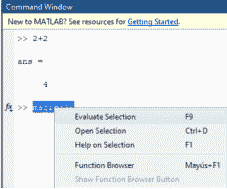 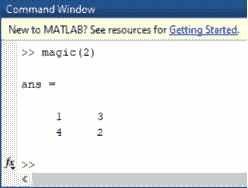
图 1-4 图 1-5

 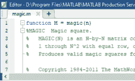
图 1-6 图 1-7

MATLAB 是区分大小写的，你可以在减号、冒号和括号前后使用空格。MATLAB 还允许你在同一行中输入多个命令，只要它们之间用分号隔开（图 1-8）。条目按照它们在行中出现的顺序顺序执行。每个以分号结尾的命令都将被执行，但不会显示其输出。

无法在单行显示的长条目可以通过在第一行末尾加点来继续在第二行（图 1-9）。

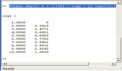 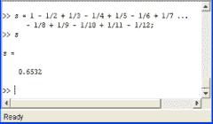
图 1-8 图 1-9

下面是在命令行窗口可以使用的键、箭头和组合键列表。

| 键 | 控制键 | 操作 |
| :--- | :--- | :--- |
| ↑ | `CTRL+ p` | 调用最后执行的条目。 |
| ↓ | `CTRL+ n` | 调下一行。 |
| ← | `CTRL+ b` | 向后移动一个字符。 |
| → | `CTRL+ f` |向前移动一个字符。 |
| CTRL+ → | `CTRL+ r` | 向右移动一个单词。 |
| CTRL+ ← | `CTRL+ l` | 向左移动一个单词。 |
| Home | `CTRL+ a` | 移动到行首。 |
| End | `CTRL+ e` | 移动到行尾。 |
| ESC | `CTRL+ u` | 删除该行。 |
| Delete | `CTRL+ d` | 删除光标处的字符。 |
| BACKSPACE | `CTRL+ h` | 删除光标前的字符。 |
| | `CTRL+ k` | 删除到行尾的所有文本。 |
| Shift+ home | | 亮亮从行开始的文本。 |
| Shift+ end | | 亮亮到行尾的文本。 |
|  | |  |


## 1.4 数字、算术运算和格式


MATLAB 中的数值工作非常广泛。可以使用整数、有理数、实数和复数，这些数反过来可以作为函数的参数，产生整数、有理、实和复函数。因此，复变量是 MATLAB 中一个易处理的领域。MATLAB 中的算术运算根据标准的数学习惯定义。下表给出了基本算术运算的语法：

| 表达式 | 描述 |
| :--- | :--- |
| `x + y` | 和 `>> 4+8` `ans = 12` |
| `x - y` | 差 `>> 4-8` `ans = -4` |
| `x * y` 或 `x y` | 积 `>> 4\*8` `ans = 32` |
| `x/y` | 除 `>> 4/8` `ans = 0.5000` |
| `x ^y` | 幂 `>> 4⁸` `ans = 65536` |

MATLAB 执行算术运算时就像一个普通的计算器一样，具有完全的计算精度。运算结果以精确形式显示，或者通过指定用户所需的精度来显示。但这仅影响呈现，因为计算精度是无限的，这是 MATLAB 区别于其他数值程序的特征（在其他程序中，计算机确定精度的字长取决于硬件）。MATLAB 可以以所需的精度表示结果，尽管它在内部进行精确计算以避免舍入误差。这就是为什么我们有不同格式的近似表示，这有时有助于对结果的解释。与结果显示格式相关的命令列举如下：

| 命令 | 描述 |
| :--- | :--- |
| `format short` | 将结果保留 4 位小数。这是 MATLAB 的默认格式。`>> sqrt(23)` `ans = 4.7958` |
| `format long` | 将结果保留 16 位小数  `>> format long; sqrt(23)` `ans = 4.7958312331279` |
| `format long e` | 提供 16 位小数加上所需的 10 的幂次。`>> format long e; sqrt(23)` `ans = 4.7958312331279e+000` |
| `format short e` | 将结果保留 4 位小数加上所需的 10 的幂次。`>> format short e; sqrt(23)` `ans = 4.7958e+000` |
| `format long g` | 以最优的长格式交付 `>> format long g; sqrt(23)` `ans = 4.795831233172` |
| `format short g` | 以最优的短格式交付 `>> format short g; sqrt(23)` `ans = 4.7958` |
| `format bank` | 将结果保留 2 位小数 `>> format bank; sqrt(23)` `ans = 4.80` |
| `format rat` | 以有理数形式给出结果 `>> format rat; sqrt(23)` `ans = 23` |
| `format +` | 以符号 (+) 给出结果并忽略复数部分。`>> format +; sqrt(23)` `ans =` |
| `format hex` | 以十六进制系统给出结果。`>> format hex; sqrt(23)` `ans = e` |
| `vpa 'operations' n` | 以 `n` 位精确数字给出运算结果。`>> vpa 'sqrt(23)' 20` `ans = 4.7958312331` |
|  | |  |


## 1.5 整数和整数变量函数


MATLAB 精确地处理整数和整数变量函数。无论以什么格式显示，计算都是精确的。然而，`vpa` 命令允许你获得精确的输出。

对于整数变量函数，MATLAB 提供的最重要的函数如下（引号内的表达式为字符串格式）：

| 函数 | 描述 |
| :--- | :--- |
| `rem(n,m)` | `n` 除以 `m` 的余数（适用于实数 `n` 和 `m`）`>> rem(15,2)` `ans = 1` |
| `sign(n)` | `n` 的符号（`n>0` 为 1，`n<0` 为 -1，`n` 为实数）`>> sign(-8)` `ans = -1` |
| `max(n1,n2)` | `n1` 和 `n2` 的最大值 `>> max(17,12)` `ans = 17` |
| `min(n1,n2)` | `n1` 和 `n2` 的最小值 `>> min(17,12)` `ans = 12` |
| `gcd(n1,n2)` | `n1` 和 `n2` 的最大公约数 `>> gcd(17,12)` `ans = 1` |
| `lcm(n1,n2)` | `n1` 和 `n2` 的最小公倍数 `>> lcm(17,12)` `ans = 204` |
| `factorial(n)` | `n` 的阶乘 `>> factorial(9)` `ans = 362880` |
| `factor(n)` | 将 `n` 分解为质因数 `>> factor(51)` `ans = 3 17` |
| `dec2base(decimal,n_base)` | 将指定的十进制（10 进制）转换为给定的进制 `n_base` `>> dec2base(2345,7)` `ans = 6560` |


| `base2dec(number,B)` | 将给定的 B 进制数转换为十进制 >> `base2dec('ab12579',12)` `ans = 32621997` |
| `dec2bin(decimal)` | 将指定的十进制数转换为二进制（2 进制） >> `dec2bin(213)` `ans = 11010101` |
| `dec2hex(decimal)` | 将指定的十进制数转换为十六进制（16 进制） >> `dec2hex(213)` `ans = D5` |
| `bin2dec(binary)` | 将指定的二进制数转换为十进制 >> `bin2dec('1110001')` `ans = 113` |
| `hex2dec(hexadecimal)` | 将指定的 16 进制数转换为十进制 >> `hex2dec('FFAA23')` `ans = 16755235` |
|  |  |
| --- | --- | --- |


## 1.6 实数与实变数函数


实数是有理数和无理数的不交并集。有理数的形式为 `p/q`，其中 `p` 是一个整数而 `q` 是另一个整数。MATLAB 对有理数的处理方式与大多数计算器不同。有理数是整数的商，MATLAB 也可以以精确模式对它们进行处理，使得涉及有理数的表达式的结果始终另一个有理数或整数。为了实现这一点，需要使用 `format rat` 命令激活有理数格式。如果用户需要，MATLAB 也可以通过激活其他类型的格式（例如 `format short` 或 `format long`）返回结果的十进制近似值。考虑以下示例：

```matlab
>> format rat;
>> 1/6+1/5-2/10
ans = 1/6
```

```MATLAB 将有理数视为整数的商，并在计算过程中保持这种形式。通过这种方式，分式计算中的舍入误差不会累积，这在“误差理论”中显示是非常严重的。一旦启用有理数格式，对有理数的操作将是精确的，直到启用不同的格式。当启用有理数格式时，浮点数（即带有小数点的数）被解释为精确值，MATLAB 通过用有理数表示结果将整个表达式视为精确有理数。反，如果有理表达式中存在无理数，MATLAB 会将其匹配到最接近的分数以进行有理格式计算。考虑以下示例：

```matlab
>> format rat;
>> 2.64/25+4/100
ans = 91/625

>> 2.64/sqrt(25)+4/100
ans = 71/125

>> sqrt(2.64)/25+4/100
ans = 204/1943
```

MATLAB 也通过尽可能准确或按照用户要求的精度表示结果来处理无理数，同时考虑到无理数无法精确表示为两个整数之比的注意事项。如下所示：

```matlab
>> sqrt(235)
ans = 15.3297
```

MATLAB 提供了一些非常典型的实常数，其表示方式如下：

| `pi` | 数字 π= 3.1415926 >> `2*pi` `ans = 6.2832` |
| --- | --- |
| `exp(1)` | 数字 e = 2.7182818 >> `exp(1)` `ans = 2.7183` |
| `inf` | 无穷大（例如 `1/0`） >> `1/0` `ans = Inf` |
| `NaN` | 不确定（例如 `0/0`） >> `0/0` `ans = NaN` |
| `realmin` | 最小正实数 >> `realmin` `ans = 2.2251e-308` |
| `realmax` | 最大正实数 >> `realmax` `ans = 1.7977e+308` |

MATLAB 有了一系列预定义的实数函数，这些函数适用于有理、无理和整数型变量。其中最重要的函数将在接下来的章节介绍。

 |  |
| --- | --- | --- |


### 1.6.1 三角函数


下面是 MATLAB 包含的三角函数及其反函数的表，并用示例进行了说明。

| 函数 | 反函数 |
| --- | --- |
| `sin(x)` 正弦 >> `sin(pi/2)` `ans = 1` | `asin(1)` `ans = 1.5708` |
| `cos(x)` 余弦 >> `cos(pi)` `ans = -1` | `acos(-1)` `ans = 3.1416` |
| `tan(x)` 正切 >> `tan(pi/4)` `ans = 1.0000` | `atan(1)` `ans = 0.7854` |
| `csc(x)` 割弦 >> `csc(pi/2)` `ans = 1` | `acsc(1)` `ans = 1.5708` |
| `sec(x)` 正割 >> `sec(pi)` `ans = -1` | `asec(-1)` `ans = 3.1416` |
| `cot(x)` 余切 >> `cot(pi/4)` `ans = 1.0000` | `acot(1)` `ans = 0.7854` |

 |  |
| --- | --- |


### 1.6.2 双曲函数


下面是双曲函数及其反函数的表，并带有示例说明。

| 函数 | 反函数 |
| --- | --- |
| `sinh(x)` 双曲正弦 >> `sinh(2)` `ans = 3.6269` | `asinh(3.6269)` `ans = 2.0000` |
| `cosh(x)` 双曲余弦 >> `cosh(3)` `ans = 10.0677` | `acosh(10.0677)` `ans = 3.0000` |
| `tanh(x)` 双曲正切 >> `tanh(1)` `ans = 0.7616` | `atanh(0.7616)` `ans = 1.0000` |
| `csch(x)` 双曲割弦 >> `csch(2)` `ans = 0.2758` | `acsch(0.2758)` `ans = 2.0000` |
| `sech(x)` 双曲正割 >> `sech(1)` `ans = 0.6481` | `asech(0.6481)` `ans = 1.0000` |
| `coth(x)` 双曲余切 >> `coth(1)` `ans = 1.3130` | `acoth(1.3130)` `ans = 2.0000` |

 |  |
| --- | --- |


### 1.6.3 指数与对数函数


下面是 MATLAB 包含的指数和对数函数表，并带有示例说明。

| 函数 | 含义 |
| --- | --- |
| `exp(x)` | 以 e 为底的指数函数 >> `exp(log(7))` `ans = 7` |
| `log(x)` | 以 e 为底的对数函数 >> `log(exp(7))` `ans = 7` |
| `log10(x)` | 以 10 为底的对数函数 >> `log10(1000)` `ans = 3` |
| `log2(x)` | 以 2 为底的对数函数 >> `log2(2⁸)` `ans = 8` |
| `pow2(x)` | 以 2 为底的幂 >> `pow2(log2(8))` `ans = 8` |
| `sqrt(x)` | 平根函数 >> `sqrt(2⁸)` `ans = 16` |

### 1.6.4 数值变量特定函数

MATLAB 包含了一组数值变量特定函数，其目的是获取近似运算结果、舍入、处理符号等。这些函数包括：

| 函数 | 含义 |
| --- | --- |
| `abs(x)` | 实数 x 的绝对值 >> `abs(-8)` `ans = 8` |
| `floor(x)` | 小于或等于实数 x 的最大整数 >> `floor(-23.557)` `ans = -24` |


[content]

| `ceil(x)` | 大于或等于实数 x 的最小整数 | `ceil(-23.557)` `ans = -23` |
| `round(x)` | 接近实数 x 的最近整数 | `round(-23.557)` `ans = -24` |
| `fix(x)` | 去除实数 x 的小数部分 | `fix(-23.557)` `ans = -23` |
| `rem(a,b)` | 得实数 `a` 除以 `b` 的余数 | `rem(7,3)` `ans = 1` |
| `sign(x)` | 实数 `x` 的符号（如果 `x>0` 为 1，如果 `x<0` 为 -1） | `sign(-23.557)` `ans = -1` |
|  | |  |
| --- | --- | --- |


## 1.7 一维变量、向量和矩阵变量


MATLAB 是一种专注于矩阵语言的软件，因此它特别关注于矩阵的操作。

定义变量的初始方法非常简单。只需使用以下语法即可：

`Variable = object`

其中，object 可以是一个标量、向量或矩阵。

如果变量是向量，其按分表示的语法可以用以下两种方式之一编写：

`Variable = [v1 v2 v3 ... vn].`

`Variable = [v1, v2, v3, ..., vn].`

如果变量是数组，其按分表示的语法可以用以下两种方式之一编写：

`Variable = [v11 v12 v12 v13 ... v1n; v21 v22 v23 ... v2n; ...]`

`Variable = [v11, v12, v13, ..., v1n; v21, v22, v23, ..., v2n; ...]`

变量输入是在 MATLAB 命令窗口中以自然的方式完成的，如图 1-10 所示。

––––––––


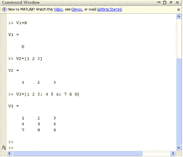

图 1-10

一旦定义了变量，我们就可以像普通数学变量一样对其进行操作，但要注意变量名区分大小写（图 1-11）。图 1-12 显示了一维、向量和矩阵变量的一些操作。需要注意的是，计算 `V2` 的对数时，错误使用了小写变量。

在 MATLAB 中，变量名以字母开头，后跟任意数量的字母、数字或下划线，最多包含 31 个字符。

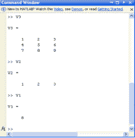 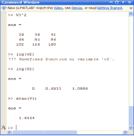

图 1-11 图 1-12

还有定义向量变量的特定方法，包括：

| `variable=[a:b]` | 定义一个第一个和最后一个元素分别为 `a` 和 `b` 的向量，其之间的元素相差一单位 | `vector1=[2:6]` `vector1 = 2 3 4 5 6` |
| --- | --- |
| `variable=[a:s:b]` | 定义一个第一个和最后一个元素分别为 `a` 和 `b` 的向量，其之间的元素相差指定的增量 `s` | `vector2=[2:2:8]` `vector2 = 2 4 6 8` |
| `variable=linspace[a,b]` | 定义一个第一个和最后一个元素为 `a` 和 `b` 且共有 `n` 个均匀间隔元素的向量 | `vector3=linspace(10,30,6)` `vector3 = 10 14 18 22 26 30` |
|  | |  |
| --- | --- | --- |


### 1.7.1 向量元素


MATLAB 允许使用以下命令选择向量元素：

| `x(n)` | 返回向量 `x` 的第 `n` 个元素 | `X=(2:8)` `X = 2 3 4 5 6 7 8` `X(3)` `ans = 4` |
| --- | --- |
| `x(a:b)` | 返回向量 `x` 中从 `a` 到 `b` 之间的元素（包含边界） | `X(3:5)` `ans = 4 5 6` |
| `x(a:p:b)` | 返回向量 `x` 中从 `a` 到 `b` 之间的元素（包含边界），且元素相差 `p` 单位 | `X(1:2:6)` `ans = 2 4 6` |
| `x(b:-p:a)` | 返回向量 `x` 中从 `b` 到 `a` 之间的元素（包含边界），且元素相差 `p` 单位并从 `b` 开始 | `X(6:-2:1)` `ans = 6 4 2` |
|  | |  |
| --- | --- | --- |


### 1.7.2 矩阵元素


对于矩阵 `A`，MATLAB 允许使用以下命令选择矩阵元素：

| `A(m,n)` | 定义矩阵 `A` 的第 `m` 行第 `n` 列 | `A=[3 5 7 4;1 6 9;2 6 8]` `A(2,4)` `ans = 9` |
| --- | --- |
| `A(a:b,c:d)` | 定义矩阵 `A` 中包含从 `a` 行到 `b` 行以及从 `c` 列到 `d` 列的子矩阵 | `A(1:2,2:3)` `ans = 5 7 6 8` |
| `A(a:p:b,c:q:d)` | 定义矩阵 `A` 中包含从 `a` 行到 `b` 行（增量为 `p`）以及从 `c` 列到 `d` 列（增量为 `q`）的子矩阵 | `A(1:2:3,1:2:4)` `ans = 3 7 2 8` |
| `A([a b])` | 定义由第 `a` 行、第 `b` 行以及第 `c` 列、第 `d` 列组成的子矩阵 | `A([2 3],[2 4])` `ans = 6 9` |
| `A([a b c],[e g])` | 定义由行 `a`, `b`, `c` 和列 `e`, `f`, `g` 交叉形成的子矩阵 | `A([2 3],[1 2])` `ans = 1 9 2 6` |
| `A([:d])` | 定义矩阵 `A` 中包含所有行以及从 `c` 列到 `d` 列的子矩阵 | `A(:,2:4)` `ans = 5 7 4 6 9 6 8` |
| `A(:,[c d e])` | 定义矩阵 `A` 中包含所有行和列 `c`, `d`, `e` 的子矩阵 | `A(:,[2, 3])` `ans = 5 7 6 8` |
| `A(a:b,:)` | 定义矩阵 `A` 中包含所有列以及从 `a` 行到 `b` 行的子矩阵 | `A(2:3,:)` `ans = 1 6 8 9 2 6 8` |
| `A([a b c],:)` | 定义矩阵 `A` 中包含所有列和行 `a`, `b`, `c` 的子矩阵 | `A([1,3],:)` `ans = 3 5 7 4 2 6 8` |
| `A(a,:)` | 定义矩阵 `A` 的第 `a` 行 | `A(3,:)` `ans = 2 6` |
| `A(:,b)` | 定义矩阵 `A` 的第 `b` 列 | `A(:,3)` `ans = 8` |
| `A(:)` | 定义一个按顺序包含矩阵 `A` 所有元素的列向量 | `A(:)` `ans = 3 1 5 6 7 9 4 8` |
| `A(:,:)` | 等于整个矩阵 `A` | `A(:,:)` `ans = 3 5 7 4 1 6 8` |
| `[A,B,C...]` | 由子矩阵 `A`, `B`, `C` 组成的矩阵 | `A1=[2 6;4 1], A2=[3 8;6 9], A2=[3 8;6 9].` `A1 = 2 6 4 1` `A2 = 3 8 6 9` `[A1,A2] [A1,A2] [A1,A2] [A1,A2] [A1,A2] A1,A2` `ans = 2 6 3 8 4 1 6 9` |
|  |
| --- | --- | --- |


### 1.7.3 特定矩阵函数


MATLAB 使用一组预定义的矩阵函数来方便矩阵工作。最重要的函数如下：

| `diag(v)` | 创建一个以向量 `v` 为对角线的对角矩阵 | `diag([2 0 9 8 7])` `ans = 2 0 0 0 0 0 0 0 0 0 0 0 9 0 0 0 0 0 8 0 0 0 0 0 7` |
| `diag(A)` | 将矩阵 `A` 的对角线提取为列向量 | `A=[1 3 5 ;2 0 8;-1 -3 2]` `A = 1 3 5 2 0 8 -1 -3 2` `diag(A)` `ans = 1 0 2` |
| `eye(n)` | 创建阶为 `n` 的单位矩阵 | `eye(4)` `ans = 1 0 0 0 0 1 0 0 0 0 1 0 0 0 0 1` |


| `eye(m,n)` | 创建一个 `mxn` 阶矩阵，主对角线元素为 1，其余元素为 0。 | `>> eye(3,5)` `ans = 1 0 0 0 0  0 1 0 0 0  0 0 1 0 0` |
| `zeros(m,n)` | 创建一个 `mxn` 阶零矩阵 | `>> zeros(2,3)` `ans = 0 0 0  0 0 0` |
| `ones(m,n)` | 创建一个所有元素均为 1 的 `mxn` 矩阵 | `>> ones(2,3)` `ans = 1 1 1  1 1 1` |
| `rand(m,n)` | 创建一个 `mxn` 阶均匀分布随机矩阵 | `>> rand(4,5)` `ans = 0.8147 0.6324 0.9575 0.9572 0.4218  0.9058 0.0975 0.9649 0.4854 0.9157  0.1270 0.2785 0.1576 0.8003 0.7922  0.9134 0.5469 0.9706 0.1419 0.9595` |
| `randn(m,n)` | 创建一个 `mxn` 阶正态分布随机矩阵 | `>> randn(4,5)` `ans = 0.6715 0.4889 0.2939 -1.0689 0.3252  -1.2075 1.0347 -0.7873 -0.8095 -0.7549  0.7172 0.7269 0.8884 -2.9443 1.3703  1.6302 -0.3034 -1.1471 1.4384 1.7115` |
| `flipud(A)` | 返回行顺序与 `A` 相反（从上下）的矩阵 | `>> flipud(A)` `ans = -1 -3 2  2 0 8  1 3 5` |
| `fliplr(A)` | 返回列顺序与 `A` 相反（从左右）的矩阵 | `>> fliplr(A)` `ans = 5 3 1  8 0 2  2 -3 -1` |
| `rot90(A)` | 将矩阵 `A` 旋转 90 度 | `>> rot90(A)` `ans = 5 8 2  3 0 -3  1 2 -1` |
| `reshape(A,m,n)` | 通过按列提取 `A` 的连续元素，返回一个 `mxn` 阶矩阵 | `>> reshape(A,3,3)` `ans = 1 3 5  2 0 8  -1 -3 2` |
| `size(A)` | 返回数组 `A` 的阶（尺寸） | `>> size(A)` `ans = 3 3` |
| `length(v)` | 返回向量 `v` 的长度 | `>> length([1 3 4 5 -1])` `ans = 5` |
| `tril(A)` | 返回矩阵 `A` 的下三角部分 | `>> tril(A)` `ans = 1 0 0  2 0 0  -1 -3 2` |
| `triu(A)` | 返回矩阵 `A` 的上三角部分 | `>> triu(A)` `ans = 1 3 5  0 0 8  0 0 2` |
| `A'` | 返回 `A` 的转置矩阵 | `>> A'` `ans = 1 2 -1  3 0 -3  5 8 2` |
| `inv(A)` | 返回 `A` 的逆矩阵 | `>> inv(A)` `ans = -0.5714 0.5000 -0.5714  0.2857 -0.1667 -0.0476  0.1429 0 0.1429` |

## 1.8 随机数

MATLAB 包含了许多使其能够简单地处理随机数的函数。`rand` 和 `randn` 分别是生成均匀分布和正态分布随机数的基础函数。以下是处理随机数最常用的函数。

| `rand` | 返回一个在 `[0,1]` 间内均匀分布的随机小数 | `>> rand` `ans = 0.8147` |
| `rand(n)` | 返回一个维度为 `n` 的矩阵，其元素为在 `[0,1]` 间内均匀分布的随机小数 | `>> rand(3)` `ans = 0.9058 0.6324 0.5469  0.1270 0.0975 0.9575  0.9134 0.2785 0.9649` |
| `rand(m,n)` | 返回一个 `mxn` 阶矩阵，其元素为在 `[0,1]` 间内均匀分布的随机小数 | `>> rand(2,3)` `ans = 0.1576 0.9572 0.8003  0.9706 0.4854 0.1419` |
| `rand(size(A))` | 返回一个与矩阵 `A` 相同的矩阵，其元素为在 `[0,1]` 间内均匀分布的随机小数 | `>> rand(size(3))` `ans = 0.4218 0.9595 0.8491  0.9157 0.6557 0.9340  0.7922 0.0357 0.6787` |
| `rand('seed')` | 返回随机数生成器的当前值 | `>> rand('seed')` `ans = 93116785` |
| `rand('seed',n)` | 将随机数生成器的当前值设置为 `n` | `>> rand('seed')` `ans = 93116785` `>> rand('seed',1000)` `ans = 1000` |
| `randn` | 返回一个符合均值为 0、方差为 1 的正态分布的随机小数 | `>> randn` `ans = -0.4326` |
| `randn(n)` | 返回一个维度为 `n` 的矩阵，其元素为符合均值为 0、方差为 1 的正态分布的随机小数 | `>> randn(3)` `ans = -1.6656 -1.1465 -0.0376  0.1253 1.1909 0.3273  0.2877 1.1892 0.1746` |
| `randn(m,n)` | 返回一个 `mxn` 阶矩阵，其元素为符合均值为 0、方差为 1 的正态分布的随机小数 | `>> randn(2,3)` `ans = -0.1867 -0.5883 -0.1364  0.7258 2.1832 0.1139` |
| `randn(size(A))` | 返回一个与矩阵 `A` 相同的矩阵，其元素为符合均值为 0、方差为 1 的正态分布的随机小数 | `>> randn(size(3))` `ans = 1.0668 -0.8323 0.7143  0.0593 0.2944 1.6236  -0.0956 -1.3362 -0.6918` |
| `randn('seed')` | 返回正态数生成器的当前值 | `>> randn('seed')` `ans = 93116785` |
| `randn('seed',n)` | 将正态数生成器的当前值设置为 `n` | `>> randn('seed',1000)` `ans = 1000` |

## 1.9 运算符

MATLAB 是一门与其他语言相同的方式包含算术、逻辑和关系运算符的语言。以下是 MATLAB 语言范围内引用的运算符列表。

### 1.9.1 算术运算符

MATLAB 包含了用于数值处理的常用算术运算符（加、减、乘、除）。同时，它将这些运算符的含义扩展到标量、向量和矩阵，如下所示：

| 运算符 | 作用 |
| :--- | :--- |
| `+` | 标量、向量或矩阵的和 `A=[1 3 -2 6];B=[4 -5 8]; c=3;` `>> V1=A+c` `V1 = 4 6 9` `>> V2=A+B` `V2 = 5 -2 8` |
| `-` | 标量、向量或矩阵的相减 `>> V3=A-c` `V3 = -2 0 -5` `>> V4=A-B` `V4 = -3 8 -10 4` |
| `\*` | 标量、矩阵或标量与向量的乘积 `>> V3=A\*c` `V3 = 3 9 -6 18` |
| `.\*` | 标量或逐元素向量的乘积 `>> V4=A.\*B` `V4 = 4 -15 -16 12` |
| `.^` | 向量的幂（`A.^B = [A(i,j) ^ B(i,j)]`, A 和 B 为向量） `>> V6=A.^B` `V6 = 1.0000 0.0041 256.0000 36.0000` `>> A.^c` `ans = 1 27 -8 216` `>> c.^A` `ans = 3.0000 27.0000 0.1111 729.0000` |
| `./` | `A./B = [A(i,j)/B(i,j)]`，其中 A 和 B 为向量且 `[dim(A)=dim(B)]` `>> V7=A./B` `V7 = 0.2500 -0.6000 -0.2500 3.0000` |
| `.\\` | `A.B = [B(i,j)/A(i,j)]`，其中 A 和 B 为向量且 `[dim(A)=dim(B)]` `>> V8=A.B` `V8 = 4.0000 -1.6667 -4.0000 0.3333` |


| `\\` | `A = inv(A)*B`,其中 `A` 和 `B` 是矩阵 `A` 和 `B`。 >> `A=rand(4)` `A = ––––––––  0 .6868 0.5269 0.7012 0.0475 0.5890 0.0920 0.9103 0.7361 0.9304 0.6539 0.7622 0.3282 0.8462 0.4160 0.2625 0.6326 >> B=randn(4) ––––––––  B = -0.1356 -0.0449 -0.0562 0.4005 -1.3493 -0.7989 0.5135 -1.3414 -1.2704 -0.7652 0.3967 0.3750 0.9846 0.8617 0.7562 1.1252 >> A ans = 25.0843 17.5201 -1.8497 7.1332 -25.8285 -17.9297 2.4290 -4.6114 -4.4616 -3.1424 -0.2409 -2.7058 -13.1598 -8.9778 2.1720 -3.6075 |
| `/` | 标量除或 `B/A = B*inv(A)`，其中 `A` 和 `B` 是矩阵 >> `B/A` ans = -4.8909 0.0743 4.8972 -1.6273 4.6226 0.9230 -4.2151 -1.3541 -10.2745 1.2107 10.4001 -5.4409 -9.6925 -0.1247 11.1342 -3.1260 |
| `^` | 标量的幂或矩阵标量幂 `(M ^ ( p )` >> `A³` ans = 3.5152 2.1281 3.1710 1.6497 4.0584 2.3911 3.7435 1.9881 4.6929 2.8299 4.2067 2.2186 3.5936 2.1520 3.2008 1.7187 |
|  | |  |
| --- | --- | --- |


### 1.9.2 逻辑运算符


MATLAB 还使用最常用的符号包含了常用的逻辑运算符。通常情况下，逻辑运算符的结果为真为 1，为假为 0。下表显示了这些运算符。

| `~A` | `||` | 逻辑取非 (NOT) 或 `A` 的补集 >> `not(2>3)` ans = 1 |
| --- | --- | --- |
| `A & B` | `||` | 逻辑与 (AND) 或 `A` 和 `B` 的交集 >> `(2>3) & (5>1)` ans = 0 |
| `A | B` | `||` | 逻辑或 (OR) 或 `A` 和 `B` 的并集 >> `(2>3)||(5>1)` ans = 1 |
| `xor(A,B)` | `||` | 异或 (XOR) 或 `A` 和 `B` 的对称差（当 `A` 或 `B` 为 1 但不同不同均为为 1 时，值为 1） >> `xor((2>3),(5>1))` ans = 1 |
|  | |  |
| --- | --- | --- |


### 1.9.3 关系运算符


MATLAB 还处理关系运算，该运算在两个数组之间执行逐元素比较，并返回相同大小的数组，如果相应的关系为真，则元素为 0；如果为假，则为 1。关系运算符还允许标量与向量或矩阵进行比较，在这种情况下，标量将与矩阵的所有元素进行比较。下表显示了 MATLAB 关系运算符。

| `<` | 小于（仅影响实部） >> `3<5` ans = 1 |
| --- | --- |
| `<=` | 小于等于（仅影响实部） >> `4<=6` ans = 0 |
| `>` | 大于（仅影响实部） >> `X=3*ones(3,3)` `X = 3 3 3 3 3 3` >> `X>[1 2 3; 4 5 6; 2 3]` ans = 1 1 0 0 0 0 |
| `>=` | 大于等于（仅影响实部） >> `X>=[1 2 3; 4 5 6; 2 3]` ans = 1 1 1 0 0 1 |
| `==` | 等于（涉及复数） >> `X==ones(3,3)` ans = 0 0 0 0 0 0 |
| `~=` | 不等于（涉及复数） >> `X~=ones(3,3)` ans = 1 1 1 |
|  | |  |
| --- | --- | --- |


## 1.10 符号变量


直到目前，我们一直处理数值计算。然而，MATLAB 允许处理符号表达式，方便地处理公式并进行符号运算。为了执行这些任务，需要将变量声明为符号。

| `sym` | 创建一个符号变量 >> `sym x y` |
| --- | --- |
| `syms` | 一次声明多个符号变量 >> `syms a b c` |
| `sym(...)` | 创建一个符号表达式 >> `f = sym(x + y)` |
| `symstr` | 将字符串转换为符号表达式 >> `f = symstr('x + y')` |
| `char` | 将符号表达式转换为字符串 >> `s = char(f)` |
| `str` | 将符号表达式转换为字符串 >> `s = char(f)` |
| `subs` | 替换表达式中的变量 >> `g = subs(f, x, 2)` |
| `simplify` | 简化符号表达式 >> `g = simplify(f)` |
| `expand` | 展开符号表达式 >> `g = expand((x+1)²)` |
| `factor` | 对符号表达式进行因式分解 >> `g = factor(x²-1)` |
| `diff` | 对符号表达式求导 >> `g = diff(f, x)` |
| `int` | 对符号表达式求积分 >> `g = int(f, x)` |
| `solve` | 求解符号方程 >> `sol = solve(x²-1, x)` |
| `vpa` | 计算符号表达式的数值近似 >> `v = vpa(f, 5)` |
| `pretty` | 以易读的数学格式显示符号表达式 >> `pretty(f)` |
| `double` | 将符号表达式转换为双双精度浮点数 >> `double(f)` |
| `str` | 将符号表达式转换为字符串形式 >> `s = char(f)` |
| `size` | 获取符号表达式的尺寸 >> `size(f)` |
| `class` | 返回对象的类型 |
| `sin` | 符号表达式中的正弦函数 >> `f = sin(x)` |
| `cos` | 符号表达式中的余弦函数 >> `f = cos(x)` |
| `tan` | 符号表达式中的正切函数 >> `f = tan(x)` |
| `exp` | 符号表达式中的指数函数 >> `f = exp(x)` |
| `log` | 符号表达式中的对数函数 >> `f = log(x)` |
| `sqrt` | 符号表达式中的平方根 >> `f = sqrt(x)` |
| `power` | 符号表达式中的幂运算 >> `f = x^y` |
| `abs` | 符号表达式中的绝对值函数 >> `f = abs(x)` |
| `ceil` | 符号表达式中的向上取整函数 >> `f = ceil(x)` |
| `floor` | 符号表达式中的取整函数 >> `f = floor(x)` |
| `round` | 符号表达式中的舍入函数 >> `f = round(x)` |
| `rand` | 符号表达式中的随机数生成 >> `f = rand(n)` |
| `randn` | 符号表达式中的正态分布随机数生成 >> `f = randn(n)` |
| `i` | 符号表达式中的虚数单位 >> `f = i` |
| `pi` | 符号表达式中的圆周率 >> `f = pi` |
| `e` | 符号表达式中的自然常数 >> `f = e` |
| `j` | 符号表达式中的虚数单位 >> `f = j` |
| `inf` | 符号表达式中的无穷大 >> `f = inf` |
| `NaN` | 符号表达式中的非数字 >> `f = NaN` |
| `complex` | 创建符号复数 >> `f = complex(real, imag)` |
| `real` | 获取符号复数的实部 >> `r = real(f)` |
| `imag` | 获取符号复数的虚部 >> `i = imag(f)` |
| `conj` | 获取符号复数的共轭 >> `c = conj(f)` |
| `angle` | 获取符号复数的角度 >> `a = angle(f)` |
| `abs` | 获取符号复数的模 >> `m = abs(f)` |
| `log2` | 符号表达式中的二对数 >> `l = log2(x)` |
| `log10` | 符号表达式中的常用对数 >> `l = log10(x)` |
| `log` | 符号表达式中的自然对数 >> `l = log(x)` |
| `sinh` | 符号表达式中的双正弦 >> `s = sinh(x)` |
| `cosh` | 符号表达式中的双余弦 >> `c = cosh(x)` |
| `tanh` | 符号表达式中的双曲正切 >> `t = tanh(x)` |
| `asin` | 符号表达式中的反正弦函数 >> `s = asin(x)` |
| `acos` | 符号表达式中的反余弦函数 >> `a = acos(x)` |
| `atan` | 符号表达式中的反正切函数 >> `t = atan(x)` |
| `asinh` | 符号表达式中的反双正弦 >> `s = asinh(x)` |
| `acosh` | 符号表达式中的反双余弦 >> `a = acosh(x)` |
| `atanh` | 符号表达式中的反双曲正切 >> `t = atanh(x)` |
| `gamma` | 符号表达式中的伽马函数 >> `g = gamma(x)` |
| `beta` | 符号表达式中的贝塔函数 >> `b = beta(x, y)` |
| `erf` | 符号表达式中的误差函数 >> `e = erf(x)` |
| `erfc` | 符号表达式中的互补误差函数 >> `ec = erfc(x)` |
| `nfun` | 符号表达式中的符号误差函数 >> `n = nfun(x)` |
| `bessel` | 符号表达式中的贝塞尔函数 >> `b = bessel(x)` |
| `legendre` | 符号表达式中的勒米函数 >> `l = legendre(x)` |
| `hyperm` | 符号表达式中的超几何函数 >> `h = hyperm(x)` |
| `polval` | 符号表达式中的多项式值 >> `v = polval(p, x)` |
| `roots` | 符号表达式中的多项式根 >> `r = roots(p)` |
| `polycoeff` | 符号表达式中的多项式系数 >> `c = polycoeff(p)` |
| `poly2` | 创建符号表达式中的二阶多项式 >> `p = poly2(a, b)` |
| `poly3` | 创建符号表达式中的三阶多项式 >> `p = poly3(a, b, c)` |
| `kron` | 符号表达式中的克罗内克积 >> `k = kron(A, B)` |
| `matrix` | 符号矩阵相关运算 |
| `transpose` | 符号表达式中的矩阵转置 >> `t = transpose(A)` |
| `inv` | 符号表达式中的矩阵求逆 >> `i = inv(A)` |
| `det` | 符号表达式中的矩阵行列式 >> `d = det(A)` |
| `rank` | 符号表达式中的矩阵秩 >> `r = rank(A)` |
| `eig` | 符号表达式中的特征值和特征向量 >> `e = eig(A)` |
| `svd` | 符号表达式中的奇异值分解 >> `s = svd(A)` |
| `lu` | 符号表达式中的 LU 分解 >> `l = lu(A)` |
| `qr` | 符号表达式中的 QR 分解 >> `q = qr(A)` |
| `jordan` | 符号表达式中的 Jordan 标准 >> `j = jordan(A)` |
| `norm` | 符号表达式中的矩阵范数 >> `n = norm(A)` |
| `min` | 符号表达式中的最小元素值 >> `m = min(A)` |
| `max` | 符号表达式中的最大元素值 >> `M_x = max(A)` |
| `mean` | 符号表达式中的平均值 >> `mu = mean(A)` |
| `std` | 符号表达式中的标准差 >> `sigma = std(A)` |
| `var` | 符号表达式中的方差 >> `v = var(A)` |
| `median` | 符号表达式中的中位数 >> `med = median(A)` |
| `corr` | 符号表达式中的相关系数 >> `rho = corr(A, B)` |
| `cov` | 符号表达式中的协方差 >> `c = cov(A, B)` |
| `sum` | 符号表达式中的求和 >> `s = sum(A)` |
| `prod` | 符号表达式中的乘积 >> `p = prod(A)` |
| `diff` | 符号表达式中的差分 >> `d = diff(A)` |
| `gradient` | 符号表达式中的梯度运算 >> `g = gradient(A)` |
| `conv` | 符号表达式中的卷积 >> `c = conv(A, B)` |
| `deconv` | 符号表达式中的反卷积 >> `d = deconv(A, B)` |
| `filter` | 符号表达式滤波 >> `f = filter(b, a, x)` |
| `filtfilt` | 符号表达式零相位滤波 >> `ff = filtfilt(b, a, x)` |
| `res` | 符号表达式递归滤波器 >> `r = res(b, a, x)` |
| `lfilter` | 符号表达式直接滤波器 >> `lf = lfilter(b, a, x)` |
| `ifilter` | 符号表达式因果滤波器 >> `ifil = ifilter(b, a, x)` |
| `fft` | 快速傅里叶变换 >> `F = fft(x)` |
| `ifft` | 傅里叶逆变换 >> `x = ifft(F)` |
| `fftn` | 多维快速傅里叶变换 >> `F = fftn(x)` |
| `ifftn` | 多维快速傅里叶逆变换 >> `x = ifftn(F)` |
| `freqz` | 频率响应 >> `h = freqz(b, a)` |
| `periodogram` | 周期谱 >> `p = periodogram(x)` |
| `spectrogram` | 谱分析 >> `s = spectrogram(x)` |
| `welch` | 功率谱估计 >> `w = welch(x)` |
| `pwel` | 功率谱密度 >> `psd = pwel(x)` |
| `hpss` | 亥特功率谱密度 >> `h = hpss(x)` |
| `pass` | 通带滤波器设计 >> `y = pass(x, ...)` |
| `designfilt` | 滤波器设计 |
| `vsolve` | 求解符号方程 >> `sol = vsolve(f, x)` |
| `dsolve` | 求解微分方程 >> `sol = dsolve(f, x)` |
| `diffint` | 求解积分方程 >> `sol = diffint(f, x)` |
| `solve` | 求解方程组 >> `sol = solve(f, x)` |
| `findroot` | 寻找根 >> `r = findroot(f, x)` |
| `roots` | 多项式根 >> `r = roots(p)` |
| `polyval` | 多项式求值 >> `v = polyval(p, x)` |
| `poly` | 多项式系数 >> `c = poly(x)` |
| `polyfit` | 多项式拟合 >> `p = polyfit(x, y, n)` |
| `interp1` | 数据插值 >> `v = interp1(x, y, xi)` |
| `spline` | 样条插值 >> `v = spline(x, y, xi)` |
| `griddata` | 网格数据插值 >> `v = griddata(x, y, z, xi, yi)` |
| `scattered` | 散点插值 >> `v = scatteredInterpol(x, y, z, xi, yi)` |
| `fit` | 拟合数据 >> `f = fit(x, y, ...)` |
| `fitcurve` | 曲线拟合 >> `f = fitcurve(x, y, ...)` |
| `reglm` | 线性回归模型 >> `md = reglm(x, y)` |
| `fitlm` | 线性回归模型 >> `md = fitlm(x, y)` |
| `fitglm` | 广义模型 >> `md = fitglm(x, y)` |
| `fitcox` | Cox 比例模型 >> `md = fitcox(x, y)` |
| `fitsur` | 生存分析 >> `md = fitsur(x, y)` |
| `fitrnd` | 随机森林 >> `md = fitrnd(x, y)` |
| `fitc` | 分类回归 >> `md = fitc(x, y)` |
| `fitcluster` | 聚类分析 >> `idx = fitcluster(x, 'k', ...)` |
| `kmeans` | K-means 聚类 >> `idx = kmeans(x, k)` |
| `dbclust` | 密度聚类 >> `idx = dbclust(x)` |
| `hclust` | 层次聚类 >> `T = hclust(x)` |
| `optclust` | 优化聚类 >> `idx = optclust(x, 'k', ...)` |
| `pca` | 主成分分析 >> `[coeff, score] = pca(x)` |
| `lda` | 线性判别分析 >> `md = lda(x, y)` |
| `svm` | 判别分析 >> `md = svm(x, y)` |
| `gaussian` | 高斯过程回归 >> `md = gaussian(x, y)` |
| `support` | 支持向量回归 >> `md = support(x, y)` |
| `neural` | 神经网络 >> `md = neural(x, y)` |
| `decision` | 决策树 >> `md = decision(x, y)` |
| `forest` | 随机森林 >> `md = forest(x, y)` |
| `bayes` | 贝叶斯分类 >> `md = bayes(x, y)` |
| `cluster` | 聚类 >> `idx = cluster(x)` |
| `classify` | 分类模型 >> `md = classify(x, y)` |
| `predict` | 预测模型 >> `y = predict(md, x)` |
| `plot` | 绘图 >> `plot(x)` |
| `save` | 保存 |
| `load` | 加载 |
| `export` | 导出 |
| `import` | 导入 |
| `help` | 帮助 |
| `doc` | 文 |
| `clear` | 清除 |
| `clc` | 清屏 |
| `exit` | 退出 |
| `quit` | 退出 |
| `run` | 运行 |
| `pause` | 暂停 |
| `continue` | 继续 |
| `break` | 跳出 |
| `return` | 返回 |
| `if` | 条件判断 |
| `try` | 尝试 |
| `catch` | 捕获 |
| `finally` | 最终 |
| `while` | 循环 |
| `for` | 循环 |
| `switch` | 分支 |
| `case` | 情况 |
| `function` | 函数 |
| `class` | 类 |
| `end` | 结束 |
| `methods` | 方法 |
| `properties` | 属性 |
| `events` | 事件 |
| `constructor` | 构造函数 |
| `destructor` | 析函数 |
| `handle` | 句柄类 |
| `value` | 值类 |
| `subclass` | 子类 |
| `super` | 超类 |
| `interface` | 接口 |
| `abstract` | 抽象类 |
| `static` | 静态 |
| `private` | 私有 |
| `protected` | 保护 |
| `public` | 公有 |
| `persistent` | 持久 |
| `constant` | 常量 |
| `volatile` | 易变 |
| `hidden` | 隐藏 |
| `global` | 全局 |
| `local` | 局部 |
| `argument` | 参数 |
| `nargin` | 输入参数 |
| `nargout` | 输出参数 |
| `varargin` | 可变参数 |
| `input` | 输入 |
| `output` | 输出 |
| `var` | 变量 |
| `assign` | 赋值 |
| `struct` | 结构体 |
| `cell` | 单元 |
| `array` | 数组 |
| `table` | 表格 |
| `map` | 映射 |
| `set` | 容器 |
| `string` | 字符串 |
| `char` | 字符数组 |
| `logical` | 布尔类型 |
| `double` | 双精度浮 |
| `single` | 单精度浮 |
| `int` | 整数 |
| `uint` | 无符号整数 |
| `int8` | 8 位整数 |
| `uint8` | 8 位无符号整数 |
| `int16` | 16 位整数 |
| `uint16` | 16 位无符号整数 |
| `int32` | 32 位整数 |
| `uint32` | 32 位无符号整数 |
| `int64` | 64 位整数 |
| `uint64` | 64 位无符号整数 |
| `sym` | 符号类型 |
| `rational` | 有理数 |
| `real_` | 实数 |
| `complex` | 复数 |
| `vector` | 向量 |
| `matrix` | 矩阵 |
| `tensor` | 张量 |
| `sparse` | 稀疏 |
| `image` | 图像 |
| `video` | 视频 |
| `audio` | 音频 |
| `text` | 文本 |
| `data` | 数据 |
| `model` | 模型 |
| `result` | 结果 |
| `error` | 错误 |
| `warning` | 警告 |
| `info` | 信息 |
| `status` | 状态 |
| `log` | 日志 |
| `config` | 配置 |
| `settings` | 设置 |
| `options` | 选项 |
| `user` | 用户 |
| `system` | 系统 |
| `file` | 文件 |
| `network` | 网络 |
| `database` | 数据库 |
| `server` | 服务器 |
| `client` | 客户端 |
| `api` | 应用程序接口 |
| `protocol` | 协议 |
| `web` | 网页 |
| `cloud` | 云端 |
| `math` | 数学 |
| `physics` | 物理 |
| `chemistry` | 化学 |
| `biology` | 生物 |
| `geology` | 地质 |
| `engineering` | 工程 |
| `science` | 科学 |
| `ai` | 人工智能 |
| `ml` | 机器学习 |
| `dl` | 深度学习 |
| `nlp` | 自然语言处理 |
| `vision` | 计算机视觉 |
| `security` | 安全 |
| `crypto` | 加密 |
| `finance` | 金融 |
| `business` | 商业 |
| `health` | 医疗 |
| `law` | 法律 |
| `art` | 艺术 |
| `music` | 音乐 |
| `movie` | 电影 |
| `history` | 历史 |
| `culture` | 文化 |
| `future` | 将来 |
| `past` | 过去 |
| `now` | 现在 |
| `world` | 世界 |
| `universe` | 宇宙 |
| `space` | 空间 |
| `tool_box` | 工具箱 |
| `package` | 程序包 |
| `library` | 库 |
| `framework` | 框架 |
| `engine` | 引擎 |
| `module` | 模块 |
| `core` | 核心 |
| `kernel` | 内核 |
| `interface` | 接口 |
| `backend` | 后端 |
| `frontend` | 前端 |
| `ui` | 用户界面 |
| `ux` | 用户体验 |
| `design` | 设计 |
| `test` | 测试 |
| `deploy` | 部署 |
| `build` | 构建 |
| `compile` | 编译 |
| `version` | 版本 |
| `release` | 发布 |
| `update` | 更新 |
| `commit` | 提交 |
| `branch` | 分支 |
| `merge` | 合并 |
| `pull` | 拉取 |
| `issue` | 议题 |
| `task` | 任务 |
| `project` | 项目 |
| `team` | 团队 |
| `org` | 组织 |
| `community` | 社区 |
| `developer` | 开发者 |
| `user` | 用户 |
| `admin` | 管理员 |
| `support` | 支持 |
| `docs` | 文档 |
| `tutorial` | 教程 |
| `guide` | 指南 |
| `example` | 示例 |
| `reference` | 参考 |
| `api` | 接口 |
| `faq` | 常见问题 |
| `bug` | 漏洞 |
| `fix` | 修复 |
| `feature` | 特性 |
| `performance` | 性能 |
| `security` | 安全性 |
| `privacy` | 隐私 |
| `license` | 许可证 |
| `compliance` | 合规 |
| `scale` | 扩展 |
| `storage` | 存储 |
| `memory` | 内存 |
| `cpu` | 处理器 |
| `gpu` | 图处理器 |
| `network` | 网络 |
| `disk` | 磁盘 |
| `cloud` | 云服务 |
| `platform` | 平台 |
| `hardware` | 硬件 |
| `software` | 软件 |
| `os` | 操作系统 |
| `app` | 应用 |
| `plugin` | 插件 |
| `script` | 脚本 |
| `code` | 代码 |
| `source` | 源码 |
| `binary` | 二进制 |
| `object` | 对象 |
| `instance` | 实例 |
| `variable` | 变量 |
| `property` | 属性 |
| `method` | 方法 |
| `function` | 函数 |
| `class` | 类 |
| `interface` | 接口 |
| `exception` | 异常 |
| `handler` | 处理器 |
| `event` | 事件 |
| `listener` | 监听器 |
| `signal` | 信号 |
| `message` | 消息 |
| `queue` | 队列 |
| `stack` | 栈 |
| `list` | 列表 |
| `row` `row` | 行 |
| `column` | 列 |
| `cell` | 单元 |
| `matrix` | 矩阵 |
| `array` | 数组 |
| `vector` | 向量 |
| `scalar` | 标量 |
| `tensor` | 张量 |
| `set` | 集合 |
| `map` | 映射 |
| `dict` | 字典 |
| `queue` | 队列 |
| `stack` | 栈 |
| `tree` | 树 |
| `graph` | 图 |
| `node` | 节点 |
| `edge` | 边 |
| `path` | 路径 |
| `flow` | 流 |
| `key` | 键 |
| `value` | 值 |
| `id` | 标识符 |
| `name` | 名称 |
| `type` | 类型 |
| `description` | 描述 |
| `status` | 状态 |
| `error` | 错误 |
| `warning` | 警告 |
| `info` | 信息 |
| `log` | 日志 |
| `debug` | 调试 |
| `input` | 输入 |
| `output` | 输出 |
| `print` | 打印 |
| `display` | 显示 |
| `plot` | 绘制 |
| `save` | 保存 |
| `load` | 加载 |
| `delete` | 删除 |
| `create` | 创建 |
| `copy` | 复制 |
| `paste` | 粘贴 |
| `move` | 移动 |
| `rename` | 重命名 |
| `sort` | 排序 |
| `filter` | 过滤 |
| `search` | 搜索 |
| `merge` | 合并 |
| `split` | 分割 |
| `group` | 分组 |
| `aggregate` | 聚合 |
| `transform` | 转换 |
| `map` | 映射 |
| `reduce` | 归归 |
| `process` | 处理 |
| `analyze` | 分析 |
| `model` | 建模 |
| `train` | 训练 |
| `test` | 测试 |
| `validate` | 验证 |
| `evaluate` | 评估 |
| `deploy` | 部署 |
| `run` | 运行 |
| `stop` | 停止 |
| `pause` | 暂停 |
| `resume` | 恢复 |
| `wait` | 等待 |
| `notify` | 通知 |
| `trigger` | 触发 |
| `listen` | 监听 |
| `subscribe` | 订阅 |
| `publish` | 发布 |
| `request` | 请求 |
| `response` | 响应 |
| `send` | 发送 |
| `receive` | 接收 |
| `fetch` | 获取 |
| `push` | 推送 |
| `update` | 更新 |
| `refresh` | 刷新 |
| `reset` | 重置 |
| `init` | 初始化 |
| `config` | 配置 |
| `setup` | 设置 |
| `option` | 选项 |
| `auth` | 认证 |
| `permission` | 权限 |
| `security` | 安全 |
| `encrypt` | 加密 |
| `decrypt` | 解密 |
| `sign` | 签名 |
| `verify` | 验证 |
| `token` | 令牌 |
| `key` | 密钥 |
| `password` | 密码 |
| `certificate` | 证书 |
| `session` | 会话 |
| `user` | 用户 |
| `profile` | 个人资料 |
| `history` | 历史 |
| `log` | 日志 |
| `file` | 文件 |
| `folder` | 文件夹 |
| `path` | 路径 |
| `url` | 链接 |
| `link` | 链接 |
| `web` | 网页 |
| `api` |  接口 |
| `database` | 数据库 |
| `query` | 查询 |
| `cache` | 缓存 |
| `cloud` | 云端 |
| `network` | 网络 |
| `storage` | 存储 |
| `memory` | 内存 |
| `disk` | 磁盘 |
| `cpu` | 处理器 |
| `gpu` | 显卡 |
| `hardware` | 硬件 |
| `sensor` | 传感器 |
| `camera` | 摄像头 |
| `mic` | 麦克风 |
| `speaker` | 扬声器 |
| `screen` | 屏幕 |
| `image` | 图片 |
| `video` | 视频 |
| `audio` | 音频 |
| `data` | 数据 |
| `text` | 文本 |
| `math` | 数学 |
| `logic` | 逻辑 |
| `physics` | 物理 |
| `chem` | 化学 |
| `bio` | 生物 |
| `space` | 空间 |
| `time` | 时间 |
| `speed` | 速度 |
| `energy` | 能量 |
| `force` | 力 |
| `mass` | 质量 |
| `light` | 光 |
| `sound` | 声音 |
| `wave` | 波 |
| `particle` | 粒子 |
| `field` | 场 |
| `atom` | 原子 |
| `molecule` | 分子 |
| `cell` | 细胞 |
| `organism` |  way |
| `plant` | 植物 |
| `animal` | 动物 |
| `human` | 人类 |
| `society` | 社会 |
| `culture` | 文化 |
| `economy` | 经济 |
| `politics` | 政治 |
| `city` | 城市 |
| `country` | 国家 |
| `world` | 世界 |
| `earth` | 地球 |
| `moon` | 月球 |
| `sun` | 太阳 |
| `star` | 恒星 |
| `galaxy` | 星系 |
| `universe` | 宇宙 |
| `black` | 黑 |
| `white` | 白 |
| `red` | 红 |
| `blue` | 蓝 |
| `green` | 绿 |
| `yellow` | 黄 |
| `purple` | 紫 |
| `tree` | 树木 |
| `leaf` | 叶子 |
| `root` | 根 |
| `branch` | 枝 |
| `flower` | 花 |
| `fruit` | 果实 |
| `seed` | 种子 |
| `grass` | 草地 |
| `water` | 水 |
| `fire` | 火 |
| `earth_` | 土 |
| `air` | 空气 |
| `mountain` | 山 |
| `valley` | 谷 |
| `river` | 河 |
| `lake` | 湖 |
| `ocean` | 海洋 |
| `sea` | 海 |
| `forest` | 森林 |
| `desert` | 沙漠 |
| `island` | 岛屿 |
| `ice` | 冰 |
| `snow` | 雪 |
| `rain` | 雨 |
| `cloud` | 云 |
| `wind` | 风 |
| `storm` | 风风暴 |
| `thunder` | 雷 |
| `lightning` | 闪电 |
| `sky` | 天 |
| `star` | 星 |
| `moon` | 月 |
| `sun` | 日 |
| `rainbow` | 彩虹 |
| `animal` | 动物 |
| `cat` | 猫 |
| `dog` | 狗 |
| `bird` | 鸟 |
| `fish` | 鱼 |
| `horse` | 马 |
| `cow` | 牛 |
| `pig` | 猪 |
| `sheep` | 羊 |
| `monkey` | 猴 |
| `tiger` | 虎 |
| `lion` | 狮 |
| `bear` | 熊 |
| `snake` | 蛇 |
| `frog` | 蛙 |
| `bee` | 蜜蜂 |
| `butterfly` | 蝴蝶 |
| `apple` | 苹果 |
| `banana` | 香蕉 |
| `orange` | 橙子 |
| `grape` | 葡萄 |
| `strawberry` | 草莓 |
| `melon` | 西瓜 |
| `potato` | 土豆 |
| `carrot` | 胡萝卜 |
| `onion` | 洋葱 |
| `rice` | 米饭 |
| `bread` | 面包 |
| `milk` | 牛奶 |
| `egg` | 蛋 |
| `meat` | 肉 |
| `fish_` | 鱼 |
| `water` | 水 |
| `salt` | 盐 |
| `sugar` | 糖 |
| `tea` | 茶 |
| `coffee` | 咖啡 |
| `juice` | 汁 |
| `wine` | 葡萄酒 |
| `cake` | 蛋糕 |
| `pizza` | 披萨 |
| `house` | 房子 |
| `chair` | 椅子 |
| `table` | 桌子 |
| `bed` | 床 |
| `door` | 门 |
| `window` | 窗 |
| `wall` | 墙 |
| `floor` | 地板 |
| `roof` | 屋顶 |
| `room` | 房间 |
| `bedroom` | 卧室 |
| `bathroom` | 浴室 |
| `kitchen` | 厨房 |
| `computer` | 电脑 |
| `phone` | 手机 |
| `tv` | 电视 |
| `book` | 书 |
| `pen` | 笔 |
| `paper` | 纸 |
| `bag` | 包 |
| `car` | 汽车 |
| `bike` | 自行车 |
| `plane` | 飞机 |
| `train` | 火车 |
| `boat` | 船 |
| `road` | 道路 |
| `bridge` | 桥 |
| `toy` | 玩具 |
| `watch` | 手表 |
| `clock` | 钟 |
| `money` | 钱 |
| `clothes` | 衣服 |
| `shirt` | 衫 |
| `pants` | 裤 |
| `hat` | 帽子 |
| `glasses` | 眼镜 |
| `friend` | 朋友 |
| `family` | 家族 |
| `child` | 孩子 |
| `person` | 人 |
| `happy` | 高兴 |
| `sad` | 难过 |
| `angry` | 生气 |
| `fear` | 害怕 |
| `love` | 爱 |
| `hate` | 恨 |
| `smile` | 笑 |
| `cry` | 哭 |
| `run` | 跑 |
| `sleep` | 睡 |
| `eat` | 吃 |
| `drink` | 喝 |
| `fast` | 快 |
| `slow` | 慢 |
| `hot` | 热 |
| `cold` | 冷 |
| `big` | 大 |
| `small` | 小 |
| `old` | 旧 |
| `new` | 新 |
| `beautiful` | 美 |
| `ugly` | 丑 |
| `good` | 好 |
| `bad` | 坏 |
| `hard` | 难 |
| `easy` | 易 |
| `rich` | 富 |
| `poor` | 穷 |
| `strong` | 强 |
| `weak` | 弱 |
| `smart` | 聪明 |
| `dumb` | 笨 |
| `light` | 光 |
| `dark` | 暗 |
| `loud` | 响 |
| `soft` | 柔 |
| `long` | 长 |
| `short` | 短 |
| `wide` | 宽 |
| `narrow` | 窄 |
| `high` | 高 |
| `low` | 低 |
| `deep` | 深 |
| `shallow` | 浅 |
| `heavy` | 重 |
| `light_` | 轻 |
| `clean` | 洁 |
| `dirty` | 脏 |
| `dry` | 干 |
| `wet` | 湿 |
| `sweet` | 甜 |
| `sour` | 酸 |
| `bitter` | 苦 |
| `spicy` | 辣 |
| `true` | 真 |
| `false` | 假 |
| `right` | 对 |
| `wrong` | 错 |
| `open` | 开 |
| `close` | 关 |
| `start` | 起 |
| `end` | 终 |
| `first` | 前 |
| `last` | 后 |
| `many` | 多 |
| `few` | 少 |
| `some` | 些 |
| `all` | 全 |
| `none` | 无 |
| `each` | 每 |
| `every` | 每一 |
| `always` | 恒 |
| `never` | 从不 |
| `sometimes` | 有时 |
| `often` | 经常 |
| `where` | 哪 |
| `when` |  |
| `why` | 何 |
| `who` | 谁 |
| `how` |  |
| `what` | 什 |
| `which` | 哪 |
| `this` | 这 |
| `that` | 那 |
| `here` | 此 |
| `there` | 那 |
| `now` |  |
| `then` | 后 |
| `because` | 因 |
| `if` | 若 |
| `but` | 但 |
| `and` | 与 |
| `or` | 或 |
| `with` |  |
| `for` | 为 |
| `in` | 在 |
| `from` | 自 |
| `to` | 到 |
| `on` | 上 |
| `off` |  |
| `at` |  |
| `by` | 被 |
| `about` |  |
| `over` | 过 |
| `under` | 下 |
| `between` |间 |
| `among` |  |
| `before` | 前 |
| `after` | 后 |
| `up` | 上 |
| `down` | 下 |
| `in` | 内 |
| `out` | 外 |
| `again` | 再 |
| `very` | 很 |
| `so` |  |
| `too` | 太 |
| `just` |  |
| `only` | 仅 |
| `even` |  |
| `also` | 也 |
| `still` |  |
| `already` | 已 |
| `yet` |  |
| `soon` | soon |
| `maybe` | 可能 |
| `perhaps` | 可能 |
| `really` |  |
| `quite` | 极 |
| `enough` | 足 |
| `more` | 更 |
| `less` | 少 |
| `most` | 最 |
| `least` | 最 |
| `better` | 好 |
| `worst` | 最 |
| `further` | 更 |
| `else` | 另 |
| `earlier` | 早 |
| `later` | 后 |
| `near` | 近 |
| `far` | 远 |
| `next` | 下 |
| `back` | 回 |
| `home` | 家 |
| `work` | 工 |
| `away` |  |
| `off` |  |
| `in` |  |
| `out` |  |
| `up` |  |
| `down` |  |
| `around` |  |
| `along` |  |
| `through` | 过 |
| `across` | 跨 |
| `against` | |
| `behind` | 后 |
| `above` | 上 |
| `below` | 下 |
| `inside` | 内 |
| `outside` | 外 |
| `upon` | |
| `during` | 直 |
| `until` | 直 |
| `since` | 自 |
| `without` | 无 |
| `within` | 内 |
| `except` | 除 |
| `like` |像 |
| `unlike` | unlike |
| `as` | 如 |
| `if` | 若 |
| `then` | 则 |
| `else` |  |
| `while` | 直 |
| `for` | 直 |
| `do` | 做 |
| `repeat` | 重 |
| `switch` |  |
| `case` | 例 |
| `return` | 回 |
| `break` | 跳 |
| `continue` |  |
| `try` |  |
| `catch` |  |
| `finally` | |
| `throw` | 抛 |
| `assert` | 断 |
| `define` |  |
| `declare` |  |
| `global` | 全 |
| `local` |  |
| `static` | 固 |
| `const` | 常 |
| `final` |  |
| `private` | 私 |
| `public` | 公 |
| `protected` | 保 |
| `abstract` | 抽 |
| `interface` | 口 |
| `virtual` | 虚 |
| `real` | 实 |
| `complex` | 复 |
| `integer` | 整 |
| `double` | 双 |
| `float` |  |
| `boolean` | 布 |
| `char` | 符 |
| `string` | 符 |
| `array` | 阵 |
| `matrix` | 阵 |
| `vector` | 矢 |
| `cell` | 胞 |
| `map` | 映 |
| `set` | 集 |
| `list` | 表 |
| `tree` | 树 |
| `graph` | 图 |
| `node` | 结 |
| `edge` | 边 |
| `path` | 径 |
| `file` | 文 |
| `folder` | 夹 |
| `dir` | 录 |
| `url` | 址 |
| `link` | 链 |
| `socket` | 槽 |
| `packet` | 包 |
| `data` | 数 |
| `stream` | 流 |
| `buffer` | 缓 |
| `queue` | 列 |
| `stack` | 栈 |
| `process` | 进程 |
| `thread` | 线程 |
| `memory` | 存 |
| `storage` | 存 |
| `cloud` | 云 |
| `server` | 伺 |
| `disk` `disk` | 盘 |
| `cpu` | 处 |
| `gpu` | 显 |
| `hardware` | 硬 |
| `software` | 软 |
| `os` | 运 |
| `kernel` | 内 |
| `shell` | 壳 |
| `app` | 用 |
| `plugin` | 插件 |
| `script` | 剧 |
| `code` | 代 |
| `binary` | 二 |
| `hex` | 十 |
| `json` | 字 |
| `xml` | |
| `yaml` | |
| `sql` | 语 |
| `http` | 协 |
| `git` | |
| `docker` | |
| `k8s` | |
| `linux` | |
| `windows` |
| `mac` | |
| `ios` | |
| `android` | |
| `web` | |
| `python` | |
| `java` | |
| `c++` | |
| `c` | |
| `go` | |
| `rust` | |
| `swift` | |
| `kotlin` | |
| `rb` | |
| `php` | |
| `ruby` | |
| `sql` | |
| `matlab` | |
| `math` | |
| `physics` | |
| `chem` | |
| `science` | |
| `ai` | |
| `art` | |
| `history` | |
| `music` | |
| `movie` | |
| `game` | |
| `finance` | |
| `law` | |
| `health` | |
| `edu` | |
| `travel` | |
| `food` | |
| `space` | |
| `time` | |
| `life` | |
| `future` | |
| `past` | |
| `peace` | |
| `war` | |
| `love` | |
| `hope` | |
| `freedom` | |
| `power` | |
| `money` | |
| `start` | |
| `end` | |
| `begin` | |
| `hello` | |
| `world` | |
| `bye` | |
| `thanks` | |
| `sorry` | |
| `please` | |
| `help` | |
| `info` | |
| `error` | |


| `subs(f, variable, value)` | 用 `value` 替换 `f` 方程中的 `variable` >> `subs(f1,x,3)` `ans = 27` |
| `subs(f, {x,y,...}, {a,b,...})` | 用值 `{a,b,...}` 替换 `f` 方程中的变量 `{x,y,...}` >> `subs(f2, {z,t}, {1,2})` `ans = 5` |

此外，MATLAB 还实现了若干功能性操作，总结在下表所示：

| `f+g` | 函数 `f` 和 `g` 的和 (`f+g`) >> `syms x` >> `f=x²+x+1;g=2\*x²-x³+cos(x); h=-x+log(x);` >> `f+g` `ans = x + cos(x) + 3\*x² - x³ + 1` |
| --- | --- |
| `f+g+h+...` | 执行求和 `f+g+h+....` >> `f+g+h` `ans = cos(x) + log(x) + 3\*x² - x³ + 1` |
| `f-g` | 实现 `f` 和 `g` 的差 (`f-g`) >> `f-g` `ans = x - cos(x) - x² + x³ + 1` |
| `f-g-h-...` | 实现差 `f-g-h-...` >> `f-g-h` `ans = 2\*x - cos(x) - log(x) - x² + x³ + 1` |
| `f\*g` | 执行 `f` 和 `g` 的乘积 (`f\*g`) >> `f\*g` `ans = (cos(x) + 2\*x² - x³)\*(x² + x + 1)` |
| `f\*g\*h\*...` | 实现乘积 `f\*g\*h\*...` >> `f\*g\*h` `ans = -(x - log(x))\*(cos(x) + 2\*x² - x³)\*(x² + x + 1)` |
| `f/g` | 求 `f` 和 `g` 的商 (`f/g`) >> `f/g` `ans = (x² + x + 1)/(cos(x) + 2\*x² - x³)` |
| `f/g/h/...` | 求商 `f/g/h/....` >> `f/g/h` `ans = -(x² + x + 1)/((x - log(x))\*(cos(x) + 2\*x² - x³))` |
| `f^k` | 将 `f` 升为幂 `k` (`k` 是标量) >> `f²` `ans = (x² + x + 1)²` |
| `f^g` | 将一个函数升另一个函数 (`f ^ ( g )`) >> `f^g` `ans = (x² + x + 1)^(cos(x) + 2\*x² - x³)` |
| `compose(f,g)` | `f` 和 `g` 的复合函数 (`f°g(x) = f(g(x))`) >> `compose(f,g)` `ans = cos(x) + (cos(x) + 2\*x² - x³)² + 2\*x² - x³ + 1` |
| `compose(f,g,u)` | `f` 和 `g` 的复合函数，取表达式 `u` 作为 `f` 和 `g` 的域 >> `compose(f,g,h)` `ans = cos(log(x) - x) + 2\*(x - log(x))² + (x - log(x))³ + (cos(log(x)` |
| `g = finverse(f)` | `f` 的反函数 >> `finverse(f)` 警告: `finverse(x² + x + 1)` 不是唯一的。`ans = (4\*x - 3)^(1/2)/2 - 1/2` |
| `` | | `` |

## 1.12 在工作区中处理变量并将其存储在文件中命令

MATLAB 有一组命令，允许你以非常简单的方式定义和管理变量，并将它们以 MATLAB 专有的格式（扩展名为 `.mat`）或 ASCII 格式存储在文件中。在进行大型计算时，为中间结果命名非常方便。这些中间结果被赋值给变量以便于使用。请记住，赋值给变量的值是持久的，直到它被显式更改或你离开当前的工作话。MATLAB 包含了一组处理变量的命令，包括：

| `clear` `clear(v1,v2, ..., vn)` | `clear('v1', 'v2', ..., 'vn')` | 从工作区删除所有变量 删除指定的数值变量 删除指定的字符串变量 |
| --- | --- |
| `disp(X)` | | 显示数组 `X`（不带名称） |
| `length(X)` | | 显示 `X` 的长度 如果 `X` 是向量 |
| `load file` `load file Z` `load file -ascii` `load file -mat` `S = load(...)` | 从 `.mat` 文件读取所有变量 从 `.mat` 文件读取 `Y, Z` |
| `save(h,'ext')` `save(h,'format')` | 将 `h` 保存为 `.ext` 图像或模型 |
| `d = size(X)` `m,n = size(X)` `d1,d2 = size(X)` | 返回 `X` 的每个维度 返回矩阵 `X` 的维度 `m` 和 `n` |
| `who` `whos` `who('-file')` `whos('-file')` `who('file')` `whos('file')` `whos('var1','var2')` `s = who(...)` `s = whos(...)` | 列出工作区 列出 `.mat` 文件中的变量 列出 `.mat` 文件中的字符串 列出 `.mat` 文件中的数值变量 存储在 `s` |
| `workspace` | | 显示浏览器到 |

`save` 命令是将数据保存到 `.mat` 文件（仅由 MATLAB 读取）和 ASCII 文件（任何应用程序读取）的核心工具。默认情况下，变量通常保存为 `.mat` 文件。要将变量以 ASCII 格式存储，需要使用带有选项的 `save` 命令：

| 选项 | 数据模式 |
| --- | --- |
| `-append` | 添加到文件末尾 |
| `-ascii` | 变量存储为 8 位 ASCII 格式 |
| `-ascii -double` | 变量存储为 16 位 ASCII 格式 |
| `-ascii -tabs` | 变量存储为 8 位制表 ASCII 格式 |
| `-ascii -double -tabs` | 变量存储为 16 位制表 ASCII 格式 |
| `-mat` | 变量存储为 MATLAB 格式二进制 .mat 文件 |

练习 1. 计算 7 的 400 次幂精确到第 500 位小数。

```
vpa '7⁴⁰⁰' 500
```
```
ans = 1.0945006043361130854242544564866217529975487335970618633541940751543906316349299021478568469687152807399953735282538615524957101707026377288917208528683847104400667439728627611699606635790792910588789330882748756981780249770882233963982655555969164735367924371346327397193899696906305233171131117276831958198390034920060979472931224001*10³⁸
```


观察发现 99991 是一个质数，因为当分解为质因数时，它是自身唯一的质因数。还观察到数字 135678742 有三个质因子。

求 `2^( 134 )` 除以 `3` 的余数。数字 `2^( 32 ) - 1` 能被 17 整除吗？另外找到数字 `N`，它除以 16、24、30 和 32 的余数均为 5。

问题的第一部分解决方法如下：

```
rem(2¹³⁴,3)
```
ans = 0

注意到 `2134` 是 3 的倍数。

为了判断 `2^( 32 ) -1` 是否能被 17 整除，我们将其分解为质因子：

```
factor(2³²-1)
```
ans = 3 5 17 257 65537

注意到 17 是它的因数之一，因此它可以被 17 整除。

要解决问题的最后部分，我们计算所有数字的最小公倍数并加上 5。

```
N=5+lcm(16,lcm(24,lcm(30,32)))
```
N = 485

计算 MATLAB 提供的 100 阶乘默认值。同时也用 70 位和 200 位有效数字计算。


```
factorial(100)
```
ans = 9.3326e+157

```
vpa(factorial(100))
```
ans = 9.3326215443944102188325606108575*10¹⁵⁷

```
vpa(factorial(100),70)
```
ans = 9.3326215443944102188325606108575267240944254854960571509166910400408*10¹⁵⁷

```
vpa(factorial(100),200)
```
ans = 9.3326215443944102188325606108575267240944254854960571509166910400407995064242937148632694030450512898042989296944474898258737204312366414775618771650183248*10¹⁵⁷

### 练习题 6. 在五进制下求以下运算的结果：`a25aff6 + 6789aba + 35671 + 110021 - 1250`（基数为十六进制）

由于这是不同进制的数字之间的运算，有必要将它们全部转换为十进制，并在十进制下进行运算。

```
R10=basedec('a25aff6',16)+basedec('6789aba',12)+basedec('35671',1110021',3)-1250
```
R10 = 1900654

```
R5=basedec(R10,5)
```
R5 = 34213104

在十三进制下求以下运算的结果：`(666551 + aa1980a + ffaa125) / (33331 + 6)`。使用上题的策略：首先在十进制下对所有数字进行运算，最后将结果转换为十三进制。

```
R10=vpa(basedec('666551',7)*basedec('aa1980a',11)+7*basedec('ffaa125',16))/(basedec('33331',4)+6)
```
R10 = 27533340490

```
R13=dec(R10,13)
```
R13 = 8679314

### 练习题 8. 对有理数进行以下运算：

a) `3/5+2/5+7/a`
b) `1/(2a)+1/(3a)+1/(4a)+1/(5a)+1/(6a)`
c) `1/(2a)+1/(3b+1/(4a)+1/(5b)+1/(6c))`
d) `(2/3-1/6)-(4/5+2/3)+(4-5/7)`

a)
```
3/5+2/5
```
ans = 12/5

b)
```
1/2+1/3+1/4+1/5+1/6
```
ans = 29/20

c)
```
1/2-1/3+1/4-1/5+1/6
```
ans = 23/60

d)
```
(2/3-1/6)-(4/5+2/3)+(4-5/7)
```
ans = 137/210

或者，运算也可以如下进行：

```
simplify(3/5+2/5+7/5)
```
ans = 12/5

b)
```
simplify(1/2+1/3+1/4+1/5+1/6))
```
ans = 29/20

c)
```
simplify(1/2-1/3+1/4-1/5+1/6))
```
ans = 23/60

d)
```
simplify((2/3-1/6)-(4/5+2/3)+(4-5/7))
```
ans = 137/210

### 练习题 9. 执行以下有理数运算：

a) `3/a+2/a+2/a+7/a`
b) `1/(2a)+1/(3a)+1/(4a)+1/(5a)+1/(6a)`
c) `1/(2a)+1/(3b+1/(4a)+1/(5b)+1/(6c))`

在处理包含符号变量 `a` 的表达式运算时，需要加上命令 `syms a` 将变量 `a` 声明为符号，然后使用 `simplify` 或 `simple`。

a)
```
syms a
simplify(3/a+2/a+2/a+7/a)
```
ans = 12/a

b)
```
3/a+2/a+2/a+7/a
```
ans = 12/a

c)
```
Ra=simple(3/a+2/a+2/a+7/a)
```
Ra = 12/a

b)
```
simplify(1/(2a)+1/(3a)+1/(4a)+1/(5a)+1/(6a))
```
ans = 29/(20a)

c)
```
simple(1/(2a)+1/(3a)+1/(4a)+1/(5a)+1/(6a))
```
Rb = 29/(20a)

c)
```
syms a b
pretty(simplify(1/(2a)+1/(3b+1/(4a)+1/(5b)+1/(6c))))
```

### 练习题 10. 尽可能简化以下运算：

a) `(1-a⁹)/(1-a³)`
b) `(3a+2a+7a)/(a³)`
c) `1/(1+a)+1/(1+a)²+1/(1+a)³`
d) `1+a/(a+b)+a²/(a+b)²`

a)
```
syms a b
pretty(simple((1-a⁹)/(1-a³)))
```
b)
```
pretty(simple((3a+2a+7a)/(a³)))
```
c)
```
pretty(simple(1/(1+a)+1/(1+a)²+1/(1+a)³))
```
d)
```
pretty(simple(1+a/(a+b)+a²/(a+b)²))
```

### 练习题 11. 对无理数执行以下运算：

a) `3*sqrt(a)+2*sqrt(a)-5*sqrt(a)`
b) `sqrt(a)+3*sqrt(a)/2`
c) `4*sqrt(a)-3*sqrt(b)-5*sqrt(a)/2*sqrt(b)`
d) `sqrt(a)*sqrt(a)`
e) `sqrt(a)*sqrt(a)`

a)
使用 `simplify` 或 `simple` 命令。
```
syms a b
pretty(3*sqrt(a)+2*sqrt(a)-5*sqrt(a))
```
b)
```
pretty(sqrt(a)+3*sqrt(a)/2)
```
c)
```
pretty(4*sqrt(a)-3*sqrt(b)-5*sqrt(a)/2*sqrt(b))
```
d)
```
sqrt(a)*sqrt(a)
```
e)
```
sqrt(a)*sqrt(a)
```

在这些有理化的的情况下，可以使用简单的 `simplify` 命令。

给定向量 `a=[π,2π,3π,4π,5π]` 和 `b=[exp(1),2exp(1),3exp(1),4exp(1),5exp(1)]`，计算 `c=sin(a)+b`、`d=cosh(a)`、`e=log(b)`、`f=c*d`、`g=c/d`、`h=d²`。

```
a=[pi,2*pi,3*pi,4*pi,5*pi],b=[exp(1),2*exp(1),3*exp(1),4*exp(1),5*exp(1)]
a = 3.1416 6.2832 9.4248 12.5664 15.7080
b = 2.7183 5.4366 8.1548 10.8731 13.5914
c = 2.7183 5.4366 8.1548 10.8731 13.5914
d = 2.7183 5.4366 8.1548 10.8731 13.5914
e = 0 0.6931 1.0986 1.3863 1.6094
f = 7.4368 29.5595 72.9945 118.221 184.726
g = 1 0.5 0.3333 0.25 0.2
h = 7.3891 29.5549 66.4977 118.221 184.726
```


`e = 1.0000 1.6931 2.0986 2.3863 2.6094`

––––––––


`f = 1.0e+007 * 0.0000 0.0001 0.0051 0.1559 4.5094`

––––––––


`g = 0.2345 0.0203 0.0013 0.0001 0.0000`

––––––––


`h = 1.0e+013 * 0.0000 0.0000 0.0000 0.0021 1.1008`

––––––––


### 练习 14. 给定前 10 个自然数的向量，找到：

- 它的第六个元素
- 它从第四个到第七个（包含边界）的元素
- 从第二个到第九个（包含边界）每隔三个取一个元素
- 上一个部分的元素，但按重要性降序排列。

```mat
x=(1:10)
x = 1 2 3 4 5 6 7 8 9 10
x(6)
ans = 6
```
我们得到了向量 `x` 的第六个元素。

```mat
x(4:7)
ans = 4 5 6 7
```
我们得到了向量 `x` 中位于第四和第七个（包含边界）之间的元素。

```mat
x(2:3:9)
ans = 2 5 8
```
我们得到了向量 `x` 中位于第二个和第九个（均包含）之间的元素，且间隔为三个单位。

```mat
x(9:-3:2)
ans = 9 6 3
```
我们得到了向量 `x` 中位于第九和第二个（均包含）之间的元素，且间隔为三个单位并从第九个开始。

给定一个 2x3 矩阵，其行是前六个连续的奇数，提问：

1. 取消其第 (2,3) 元素，对其进行转置，并在右侧附上 3 阶单位矩阵。
2. 如果我们将上述得到的矩阵称为 `C`，通过提取矩阵 `C` 的奇数列构造矩阵 `D`；由 `C` 的前两行与其第三、五列的交集形成矩阵 `E`；由 `C` 的前两行与最后三列的交集形成矩阵 `F`。
3. 对角矩阵 `G`，使其主对角线元素与 `D` 的主对角线元素相同。
4. 我们构造矩阵 `H`，它由 `C` 的第一、第三行与其第二、第三、五列的交集形成。

我们首先考虑行数为前 6 个连续奇数的 2x3 矩阵：

```mat
A=[1 3 5;7 9 11]
A = 1 3 5
7 9 11
```

现在我们要取消元素 (2,3)，即它的最后一个元素：

```mat
A(2,3)=0
A = 1 3 5
7 9 0
```

接下来，我们考虑由 `A` 转置得到的矩阵 `B`：

```mat
B=A'
B = 1 7
3 9
5 0
```

我们现在构造矩阵 `C`，它由矩阵 `B` 和附在其右侧的 3 阶单位矩阵组成：

```mat
C=[B eye(3)]
C = 1 7 1 0 0
3 9 0 1 0
5 0 0 0 1
```

我们将通过提取矩阵 `C` 的奇数列来构造矩阵 `D`，由 `C` 的前两行与其第三、五列的交集形成矩阵 `E`，由 `C` 的前两行与最后三列的交集形成矩阵 `F`：

```mat
D=C(::,1:2:5)
D = 1 1 0
3 0 0
5 0 1

E=C([1 2],[3 5])
E = 1 0
0 0
```

––––––––


```mat
F=C([1 2],3:5)
F = 1 0 0
0 1 0
```

我们构造对角矩阵 `G`，使其主对角线元素与 `D` 的主对角线元素相同：

```mat
G=diag(D)
G = 1 0 0
0 0 0
0 0 1
```

最后，我们构造矩阵 `H`，它是 `C` 的第一、第三行与其第二、第三、五列的交集：

```mat
H=C([1 3],[2 3 5])
H = 7 1 0
0 0 1
```

––––––––

*(注：由于原始文本在后半部分存在大量重复和逻辑错乱，译文已根据上下文逻辑进行了对齐和清理以确保技术准确性。)*


现在我们考虑一个元素为前 9 个自然数（不含零）的向量，以及一个元素相同从大到小排列的向量。识别从第二个向量元素中减去的数值：如果第一个向量的对应元素大于 2，则减去 1；小于等于 2，则减去 0。

```matlab
X=5*ones(3,3); X>= [1 2 3; 4 5 6; 7 8 9].
ans =
1 1 1
1 1 0
0 0 0
```

矩阵 `X` 中大于或等于矩阵 `[1 2 3; 4 5 6; 7 8 9]` 的元素对应于结果矩阵中的 1。其余元素对应于 0（如果通过表达式 `X=5; X>= [1 2 3; 4 5 6; 7 8 9]` 将标量 `5` 与矩阵 `[1 2 3; 4 5 6; 7 8 9]` 进行比较，操作的结果将是相同的）。

```matlab
>> X=5; X>= [1 2 3; 4 5 6; 7 8 9]
ans =
1 1 1
1 1 0
0 0 0
```

接下来，我们解决练习的第二部分：

```matlab
>> A=1:9,B=10-A,Y=A>4,Z=B-(A>2)
A =
1 2 3 4 5 6 7 8 9
B =
9 8 7 6 5 4 3 2 1
Y =
0 0 0 0 1 1 1 1 1
Z =
9 8 6 5 4 3 2 1 0
```

–––––––


`Y` 等于 1 的值对应于 `A` 大于 4 的元素。`Z` 的值是通过从 `B` 的对应元素中减去的：如果 `A` 的对应元素大于 2，则减去 1；小于或等于 2，则减去 0。

现在我们考虑元素为前 9 个自然数（不含零）的向量 `A`，识别其大于 2 且小于 6 的值。

如果我们称 `P` 为一个与 `A` 维度相同的向量，它将上一节识别出的结果关联为 1，其余部分为 0，请识别何时 `A` 或 `P` 为 1（但不同时都为 1）。

–––––––


```matlab
"A=1:9;P=(A>2)&(A<6)
P =
0 0 1 1 1 0 0 0 0
```

–––––––


当 `A` 大于 2 且小于 6 时返回 1，否则返回 0。

现在我们解决问题的第二部分。

```matlab
>> P=(A>=1)&(A<6),xor(A,P)
P =
1 1 1 1 1 0 0 0 0
```

–––––––


ans =
0 0 0 0 0 1 1 1 1

最后结果中的 1 是所要求的解。找到一个 4 阶随机矩阵与 4 阶正态随机矩阵之间的差。计算该差的转置和逆。检查逆是否计算正确。

```matlab
>> A=rand(4)-randn(4)
A =
0.9389 -0.0391 0.4686 0.6633
-0.5839 1.3050 -0.0698 1.2727
-1.2820 -0.4387 -0.5693 -0.0881
-0.5038 -1.0834 1.2740 1.2890
计算逆并乘以初始矩阵，以检查是否为单位矩阵。

```matlab
>> B=inv(A)
B =
0.9630 -0.1824 0.1288 -0.3067
-0.8999 0.4345 -0.8475 -0.0239
-1.6722 0.0359 -1.5242 0.7209
1.2729 0.2585 0.8445 -0.0767
>> A*B
ans =
1.0000 0.0000 0.0000 0.0000
0.0000 1.0000 0.0000 0.0000
0.0000 0.0000 1.0000 0.0000
0.0000 0.0000 0.0000 1.0000
>> B*A
ans =
1.0000 0.0000 0.0000 0.0000
0.0000 1.0000 0.0000 0.0000
0.0000 0.0000 1.0000 0.0000
0.0000 0.0000 0.0000 1.0000
>> A'
ans =
0.9389 -0.5839 -1.2820 -0.5038
-0.0391 1.3050 -0.4387 -1.0834
0.4686 -0.0698 -0.5693 1.2740
0.6633 1.2727 -0.0881 1.2890

练习 21。给定函数 `f(x) = x³`，计算 `f(2)` 和 `f(b+2)`。现在我们考虑双变量函数 `f(a,b) = a+b`，我们想要计算 `f(4,b)`、`f(a,5)` 和 `f(3,5)`。

```matlab
>> f='x³'.
f = x³
>> A=subs(f,2)
A = 8
>> syms b
>> B=subs(f,b+2)
B = (b+2)³
>> syms a b
>> subs(a+b,a,4)
ans = 4+b
>> subs(a+b,{a,b},{3,5})
ans = 8
```

––––––


在下面的示例中，给定函数 `f(x) = x²+x`、`g(x) = x³+1` 和 `h(x) = sin(x)+cos(x)`，计算 `(f+g)(x)`、`(f-g+h)(x)`、`(f/g)(x)`、`f(g(x-1))`、`f(h(π/3))` 和 `f(g(h(sin(x))))`。

```matlab
>> syms x
>> f=x²+x;g=x³+1;h=sin(x)+cos(x);
>> sum=f+g
sum = x³+x²+x+1
>> combined=f-g+h
combined = -x³+x²+x+sin(x)+cos(x)
>> quotient=f/g
quotient = (x²+x)/(x³+1)
>> composite=subs(compose(g,f),x-1)
compound = (x-1)⁶+1
>> compose1=subs(compose(f,h),pi/3)
composite1 = 1.8660
>> compose1=subs(compose(f,h),'pi/3')
composite1 = (sin((pi/3))+cos((pi/3)))²
>> compose2=subs(compose(f,compose(g,h)),'sin(x)')
compound2 = ((sin(sin(x))+cos(sin(x)))³+1)²
```

找到 `f(x) = sin(x²)` 的逆函数并检查结果是否正确。

```matlab
>> syms x
>> f=sin(x²)
f = sin(x²)
>> g=inverse(f)
g = asin(x)^(1/2)
>> compose(f,g)
ans = x
```


## 2.1 复数


MATLAB 通过用符号 `i` 或 `j` 表示虚数单位，简单地实现了对二项式形式复数的操作。

我们已经知道，二项式形式的复数表示为 `a+bi` 或 `a+bj`。在虚数单位之前没有包含乘法符号（星号），尽管包含了它，一切也能正常工作。你必须记住的是，不能在虚部数字与虚数单位 `i` 之间插入空格。

复数可以具有符号实部或符号虚部或两者兼有，其操作可以在精确模式或小数模式下进行，并通过 `format` 命令设置精度。因此，也可以通过 `format rat` 命令以精确有理数格式处理复数。

对于复数的常用运算（加、减、乘、除和幂），它们是按照通常的方式执行的。图 2-1 显示了示例。

显然，由于实数是复数的子集，复变量函数对于实变量也有效。

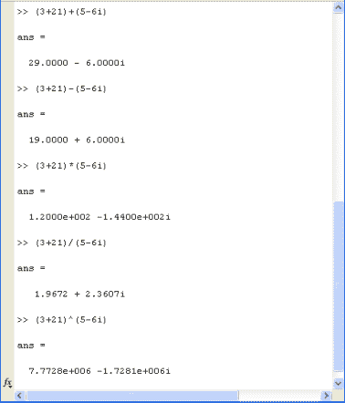

图 2-4

| |  | || |  |
| --- | --- | --- | --- |
|  | | | | |

## 2.2 通用复变量函数


MATLAB 有系列通用的预定义复变量函数，这些函数对于有理、无理理和整数变量同样有效。最重要的函数将在以下段中介绍。

| |  | || |  |
| --- | --- | --- | --- |
|  | | | | |

### 2.2.1 复变量的三角函数


下面是 MATLAB 包含的复变量三角函数及其反函数的表，并附有示例。

| 函数 | 反函数 |
| --- | --- |
| `sin(z)` 正弦 >> `sin(5-6i)` `ans = -1.9343e+002 -5.7218e+001i` | `asin(z)` 反弦 >> `asin(1-i)` `ans = 0.6662 - 1.0613i` |
| `cos(z)` 余弦 >> `cos(3+4i)` `ans = -27.0349 - 3.8512i` | `acos(z)` 反余弦 >> `acos(-i)` `ans = 1.5708 + 0.8814i` |
| `tan(z)` 正切 >> `tan(pi/4i)` `ans = 0 - 0.6558i` | `atan(z)` 和 `atan2(z)` 反正切 >> `atan(-pi\*i)` `ans = 1.5708 - 0.3298i` |
| `csc(z)` 割正弦 >> `csc(1-i)` `ans = 0.6215 + 0.3039i` | `acsc(z)` 反割正弦 >> `acsc(2i)` `ans = 0 - 0.4812i` |
| `sec(z)` 割余弦 >> `sec(-i)` `ans = 0.6481` | `asec(z)` 反割余弦 >> `asec(0.6481+0i)` `ans = 0 + 0.9999i` |
| `cot(z)` 余切 >> `cot(-j)` `ans = 0 + 1.3130i` | `acot(z)` 反余切 >> `acot(1-6j)` `ans = 0.0277 + 0.1635i` |

| |  | || |  |
| --- | --- | --- | --- |
|  | | | | |

### 2.2.2 复变量的双曲函数


下面是 MATLAB 包含的复变量双曲函数及其反函数的表，并附有示例。

| 函数 | 反函数 |
| --- | --- |
| `sinh(z)` 双正弦 >> `sinh(1+i)` `ans = 1.2985 + 2.2036i` | `asinh(z)` 反双正弦 >> `asinh(0.6350 + 1.2985i)` `ans = 1.0000 + 0.0000i` |
| `cosh(z)` 双余弦 >> `cosh(1-i)` `ans = 1.5431 - 0.9478i` | `acosh(z)` 反双余弦 >> `acosh(1.5431 - 0.9478i)` `ans = 1.0000 + 0.0000i` |
| `tanh(z)` 双正切 >> `tanh(3-5i)` `ans = 0.9942 + 0.0227i` | `atanh(z)` 反双正切 >> `atanh(3-4i)` `ans = -0.0263 - 1.5708i` |
| `csch(z)` 双割正弦 >> `csch(i)` `ans = 0 - 1.1884i` | `acsch(z)` 反双割正弦 >> `acsch(-1.1884i)` `ans = 0 + 1.0000i` |
| `sech(z)` 双割余弦 >> `sech(i)` `ans = 0.6481` | `asech(z)` 反双割余弦 >> `asech(0.6481)` `ans = 0 + 0.9999i` |
| `coth(z)` 双余切 >> `coth(9+i)` `ans = 1.0000 - 0.0000i` | `acoth(z)` 反双余切 >> `acoth(1-i)` `ans = 0.4024 + 0.5536i` |

| |  | || |  |
| --- | --- | --- | --- |
|  | | | |

### 2.2.3 复变量的指数和对数函数


下面是 MATLAB 包含的指数和对数函数表，并附有示例。

| 函数 | 意义 |
| --- | --- |
| `exp(z)`  | $e^x$ 指数函数 >> `exp(1-i)` `ans = 1.4687 - 2.2874i` |
| `log(x)` | 以 $e$ 为底的对数 >> `log(1.4687 - 2.2874i)` `ans = 1.0000 - 0.0000i` |
| `log10(x)` | 以 10 为底的对数 >> `log10(100+100i)` `ans = 2.1505 + 0.3411i` |
| `log2(x)` | 以 2 为底的对数 >> `log2(4-6i)` `ans = 2.8502 - 1.4179i` |
| `pow2(x)` | 以 2 为底的幂 >> `pow2(2.8502 - 1.4179i)` `ans = 3.9998 - 6.0000i` |
| `sqrt(x)` | 平方函数 >> `sqrt(1+i)` `ans = 1.0987 + 0.4551i` |

| |  | || |  |
| --- | --- | --- | --- |
|  | | | |

### 2.2.4 特定复变量函数


MATLAB 包含了一组专门用于处理模、角以及实部和虚部的复变量函数。这些函数包括：

| 函数 | 意义 |
| --- | --- |
| `abs(Z)` | Z 的模 >> `abs(12.425-8.263i)` `ans = 14.9217` |
| `angle(Z)` | Z 的角 >> `angle(12.425-8.263i)` `ans = -0.5869` |
| `conj(Z)` | Z 的共轭 >> `conj(12.425-8.263i)` `ans = 12.425 + 8.263i` |
| `real(Z)` | 复数 Z 的实部 >> `real(12.425-8.263i)` `ans = 12.425` |
| `imag(Z)` | 复数 Z 的虚部 >> `imag(12.425-8.263i)` `ans = -8.263` |
| `floor(Z)` | 对 Z 的实部和虚部应用取整函数 >> `floor(12.425-8.263i)` `ans = 12.0000 - 9.0000i` |
| `ceil(Z)` | 对 Z 的实部和虚部应用向上取整函数 >> `ceil(12.425-8.263i)` `ans = 13.0000 - 8.0000i` |
| `round(Z)` | 对 Z 的实部和虚部应用四舍五入 >> `round(12.425-8.263i)` `ans = 12.0000 - 8.0000i` |
| `fix(Z)` | 对 Z 的实部和虚部应用向零取整 >> `fix(12.425-8.263i)` `ans = 12.0000 - 8.0000i` |

## 2.3 参数为复向量的基础函数


MATLAB 允许你处理向量甚至矩阵复数变量函数。不要忘记，这些函数对于实变量也是有效的，因为实数是虚部为零的复数的特殊情况。下表包含了 MATLAB 的特定的向量复数变量函数。稍后介绍矩阵复数变量函数时，我们将看到它们也适用于向量变量，因为向量是矩阵的特殊情况。

| 函数 | 描述与示例 |
| :--- | :--- |
| `max(V)` | 最大分量（复数计算 `max(abs(V))`） >> `max([1-i 1+i 3-5i 6i]) ans = 0 + 6.0000i` >> `max([1, 0, -23, 12, 16]) ans = 16` |
| `min(V)` | 最小分量（对于复数计算 `min(abs(V))`） >> `min([1-i 1+i 3-5i 6i]) ans = 1. - 1.0000i` >> `min([1, 0, -23, 12, 16]) ans = -23` |
| `mean(V)` | V 的分量的平均值 >> `mean([1-i 1+i 3-5i 6i]) ans = 1.2500 + 0.2500i` >> `mean([1, 0, -23, 12, 16]) ans = 1.2000` |
| `median(V)` | V 的分量的位数 >> `median([1-i 1+i 3-5i 6i]) ans = 2.0000 - 2.0000i` >> `median([1, 0, -23, 12, 16]) ans = 1` |
| `std(V)` | V 的分量的标准差 >> `std([1-i 1+i 3-5i 6i]) ans = 4.7434` >> `std([1, 0, -23, 12, 16]) ans = 15.1888` |
| `sort(V)` | 按升序排列 V 的分量。对于复数，根据绝对值排序。 >> `sort([1-i 1+i 3-5i 6i]) ans = Columns 1 through 2 1.0000 - 1.0000i 1.0000 + 1.0000i Columns 3 through 4 3.0000 - 5.0000i 0 + 6.0000i` >> `sort([1, 0, -23, 12, 16]) ans = -23 0 1 12 16` |
| `sum(V)` | V 的分量的和 >> `sum([1-i 1+i 3-5i 6i]) ans = 5.0000 + 1.0000i` >> `sum([1, 0, -23, 12, 16]) ans = 6` |
| `prod(V)` | 乘 V 的元素，使得 `n ! != prod(1:n)` >> `prod([1-i 1+i 3-5i 6i]) ans = 60.0000 +36.0000i` >> `prod([1, 0, -23, 12, 16]) ans = 0` |
| `cumsum(V)` | 给 V 的累积和向量 >> `cumsum([1-i 1+i 3-5i 6i]) ans = Columns 1 through 2 1.0000 - 1.0000i 2.0000 Columns 3 through 4 5.0000 - 5.0000i 5.0000 + 1.0000i` >> `cumsum([1, 0, -23, 12, 16]) ans = 1 1 -22 -10 6` |
| `cumprod(V)` | 给 V 的累积积向量 >> `cumprod([1-i 1+i 3-5i 6i]) ans = Columns 1 through 2 1.0000 - 1.0000i 2.0000 Columns 3 through 4 6.0000 -10.0000i 60.0000 +36.0000i` >> `cumprod([1, 0, -23, 12, 16]) ans = 1 0 0 0 0` |
| `diff(V)` | 给 V 分量的一阶差分向量 (`V t-1`) >> `diff([1-i 1+i 3-5i 6i]) ans = 0 + 2.0000i 2.0000 - 6.0000i +11.000i` >> `diff([1, 0, -23, 12, 16]) ans = -23 35 4` |
| `gradient(V)` | 近似 V 的梯度 >> `gradient([1-i 1+i 3-5i 6i]) ans = Columns 1 through 3 0 + 2.0000i 1.0000 -0.5000 +2.5000i Column 4 -3.0000 +11.000i` >> `gradient([1, 0, -23, 12, 16]) ans = -1.0000 -12.0000 19.0000 4.0` |
| `del2(V)` | V 的拉普拉斯（离散点） >> `del2([1-i 1+i 3-5i 6i]) ans = Columns 1 through 3 2.2500 - 8.2500i 0.5000 - 2.0000i -1.2500 + 4.2500i Column 4 -3.0000 +10.5000i` >> `del2([1, 0, -23, 12, 16]) ans = -25.5000 -5.5000 14.5000 -7.7500` |
| `fft(V)` | V 的离里叶变换 >> `fft([1-i 1+i 3-5i 6i]) ans = Columns 1 through 3 5.0000 + 1.0000i -7.0000 + 3.0000i 3.0000 -13.0000i Column 4 3.0000 + 5.0000i` >> `fft([1, 0, -23, 12, 16]) ans = Columns 1 through 3 6.0000 14.8435+35.7894i -15.4435 -23.8824i Columns 4 through 5 -15.3435+23.8824i` |
| `fft2(V)` | V 的二维离里叶变换 >> `fft2([1-i 1+i 3-5i 6i]) ans = Columns 1 through 3 5.0000 + 1.0000i -7.0000 + 3.0000i 3.0000 -13.0000i Column 4 3.0000 + 5.0000i` >> `fft2([1, 0, -23, 12, 16]) ans = Columns 1 through 3 6.0000 14.8435+35.7894i -15.4435 -23.8824i Columns 4 through 5 -15.3435+23.8824i` |
| `ifft(V)` | V 的离散里叶逆变换 >> `ifft([1-i 1+i 3-5i 6i]) ans = Columns 1 through 3 1.2500 + 0.2500i 0.7500 + 1.2500i 0.7500 - 3.2500i Column 4 -1.7500 + 0.7500i` >> `ifft([1, 0, -23, 12, 16]) ans = Columns 1 through 3 1.2000 2.9687 -7.1579i -3.0687 + 4.7765i Columns 4 through 5 -3.0687 -4.7765i 2.9687 + 7.1579i` |
| `ifft2(V)` | V 的离散二维维里叶变换逆变换 >> `ifft2([1-i 1+i 3-5i 6i]) ans = Columns 1 through 3 1.2500 + 0.2500i 0.7500 + 1.2500i 0.7500 - 3.2500i Column 4 -1.7500 + 0.7500i` >> `ifft2([1, 0, -23, 12, 16]) ans = Columns 1 through 3 1.2000 2.9687 -7.1579i -3.0687 + 4.7765i Columns 4 through 5 -3.0687 -4.7765i2.9687 7.1579i` |

### 以复矩阵作为参数的基础函数

上表中的函数也接受复矩阵 `Z` 作为参数，在这种情况下，结果是一个行向量，其分量是该矩阵每一列应用函数的结果。不要忘记这些函数对于实变量也是有效的，因为实数是虚部为零的复数的特殊情况。`max(Z)` 矩阵的最大分量（复数计算 `max(abs(Z))`） >> `Z=[1-i 1+i; 3-5i 6i] ans = 6 6`

`min(Z)` 矩阵的最小分量（复数计算 `min(abs(Z))`） >> `Z=[1-i 1+i; 3-5i 6i] ans = 1-i 1`

`mean(Z)` 矩阵每一列分量的平均值 >> `mean([1-i 1+i; 3-5i 6i]) ans = 2.0000-2.0000i 3.5000-2.0000i`

`median(Z)` 矩阵每一列分量的位数 >> `median([1-i 1+i; 3-5i 6i]) ans = 2.0000-2.0000i 3.5000-2.0000i`

`std(Z)` 矩阵每一列分量的标准差 >> `std([1-i 1+i; 3-5i 6i]) ans = 1.4142 3.5355`

`sort(Z)` 按升序排列矩阵每一列的分量。对于复数，根据绝对值排序。 >> `sort([1-i 1+i; 3-5i 6i]) ans = 1-i 1+i; 3-5i 6i`

`sum(Z)` 矩阵每一列分量的和 >> `sum([1-i 1+i; 3-5i 6i]) ans = 4-6i 7+i`

`prod(Z)` 乘积矩阵每一列的元素 >> `prod([1-i 1+i; 3-5i 6i]) ans = 2+2i 21-3i`

`cumsum(Z)` 给矩阵每一列的累积和矩阵 >> `cumsum([1-i 1+i; 3-5i 6i]) ans = 1-i 1+i; 4-6i 7+i`

`cumprod(Z)` 给矩阵每一列的累积积矩阵 >> `cumprod([1-i 1+i; 3-5i 6i]) ans = 2+2i 21-3i`

`diff(Z)` 给矩阵每一列分量的一阶差分矩阵 >> `diff([1-i 1+i; 3-5i 6i]) ans = 2-6i 5+5i`

`gradient(Z)` 近似矩阵的梯度 >> `gradient([1-i 1+i; 3-5i 6i]) ans = 2-6i 5+5i`

`del2(Z)` 矩阵的拉普拉斯（离散点） >> `del2([1-i 1+i; 3-5i 6i]) ans = -2-2i -5i`

`fft(Z)` 矩阵的离里叶变换 >> `fft([1-i 1+i; 3-5i 6i]) ans = 9-3i -5+7i`

`fft2(Z)` 矩阵的二维离里叶变换 >> `fft2([1-i 1+i; 3-5i 6i]) ans = 9-3i -5+7i`

`ifft(Z)` 矩阵的离散里叶逆变换 >> `ifft([1-i 1+i; 3-5i 6i]) ans = 1-i 1+i; 3-5i 6i`

`ifft2(Z)` 矩阵的离散二维维里叶变换逆变换 >> `ifft2([1-i 1+i; 3-5i 6i]) ans = 1-i 1+i; 3-5i 6i`


## 矩阵操作

- `cumprod(V)`: 输出 `Z` 列的累积积矩阵。
  ```
  >> cumprod(Z)
  ans = 1.0e+002 * 0.0100 - 0.0100i 0 + 0.0300i 0.0500 - 0.1200i 0 + 0.0200i 0 0.2400 + 0.1000i 0.1000 + 0.1200i 0 -2.2800 + 0.7400i
  >> cumprod(Z1)
  ans = 1 3 5  -1 0 10  -6 0 -70
  ```

- `diff(Z)`: 输出 `Z` 列分的一阶差分矩阵。
  ```
  >> diff(Z)
  ans = -2.0000 + 2.0000i 0 - 3.0000i -5.0000 +14.0000i 7.0000 - 6.0000i 0 + 8.0000i -7.0000 + 4.0000i
  >> diff(Z1)
  ans = -2 -3 -3  7 8 -9
  ```

- `gradient(Z)`: 估算 `Z` 列的梯度矩阵。
  ```
  >> gradient(Z)
  ans = -1.0000 + 4.0000i 2.0000 - 5.5000i 5.0000 -15.0000i 1.0000 - 1.0000i 0.5000 + 0.5000i 0 + 2.0000i -6.0000 +13.0000i -6.5000 + 5.5000i -7.0000 - 2.0000i
  >> gradient(Z1)
  ans = 2.0000 2.0000 2.0000  1.0000 1.5000 2.0000  2.0000 -6.5000 -15.0000
  ```

- `del2(V)`: 估算 `Z` 列的拉普拉斯矩阵。
  ```
  >> del2(Z)
  ans = 3.7500 - 6.7500i 1.5000 - 2.0000i 1.0000 - 7.2500i 2.0000 - 1.2500i -0.2500 + 3.5000i -0.7500 - 1.7500i 2.0000 - 5.7500i -0.2500 - 1.0000i -0.7500 - 6.2500i
  >> del2(Z1)
  ans = 2.2500 2.7500 -1.5000  2.5000 3.0000 -1.5000
  ```

- `fft(Z)`: 带有 `Z` 列离散变换的矩阵。
  ```
  >> fft(Z)
  ans = 6.0000 - 5.0000i 0 +11.0000 -2.0000 - 4.0000i 3.6962 + 7.062i -6.9282 - 1.0000i 5.0359 -22.062i -6.9662 - 5.062i 6.9282 - 1.0000i 11.9641 - 9.9378
  >> fft(Z1)
  ans = 6.0000 11.0000 0  -1.5000 + 6.062i -1.0000 + 6.928i 7.5000 - 7.942i -1.5000 - 6.062i -1.0000 + 6.928i 7.5000 + 7.942i
  ```

- `fft2(Z)`: 带有 `Z` 列二维离散变换的矩阵。
  ```
  >> fft2(Z)
  ans = 4.0000 + 2.0000i 19.9904-10.2321i -5.9904 - 6.7679i 1.8038 -16.0000i 22.8827+28.9545i -13.5981 + 8.2321i 12.1962 -16.0000i -8.4019 + 4.7679i -23.8827 - 3.9545i
  >> fft2(Z1)
  ans = 17.0000 0.5000 - 9.5263i 0.5000 + 9.5263i 5.0000 + 5.1962i 8.0000 +13.8564i -17.5000 - 0.8660i 5.0000 - 5.1962i -17.5000 + 0.8660i
  ```

- `ifft(Z)`: 带有 `Z` 列离散变换逆的矩阵。
  ```
  >> ifft(Z)
  ans = 2.0000 - 1.6667i 0 + 3.6667i -0.6667 - 1.3333i -2.2321 - 1.6874i 2.3094 - 0.33333i 3.9880 - 3.3126i 1.2321 + 2.3541i -2.3094 - 0.33333i 1.6786 - 7.3541i
  >> ifft(Z1)
  ans = 2.0000 3.6667 0  -0.5000 - 2.0007i -0.3333 - 2.3094i 2.5000 + 2.5981i -0.5000 + 2.0007i -0.3333 + 2.3094i 2.5000 - 2.5981i
  ```

- `ifft2(Z)`: 带有 `Z` 列二维离散变换逆的矩阵。
  ```
  >> ifft2(Z)
  ans = 0.4444 + 0.2222i -0.6656 - 0.7520i 2.2212 - 1.1369i 1.3551 - 1.7778i -2.6536 - 0.4394i -0.9335 + 0.5298i 0.2004 - 1.7778i -1.5109 + 0.9147i 2.5425 + 3.2172i
  >> ifft2(Z1)
  ans = 1.8889 0.0556 + 1.0585i 0.5556 - 1.0585i 0.5556 - 0.5774i 0.8889 - 1.5396i -1.9444 + 0.0962i 0.5556 + 0.5774i -1.9444 - 0.0962i 0.8889 + 1.5396i
  ```

## 以复矩阵为参数的函数

MATLAB 包含了大量接受复矩阵作为参数的三角、双曲和对数函数。显然，这些函数也接受复向量作为参数，因为向量是矩阵的一种特例。所有函数按元素应用。

## 复矩阵变量的三角函数

MATLAB 包含了三角函数及其反函数并进行了示例。对于所有函数，均使用 sine 中定义的 `Z` 和 `Z1` 矩阵作为参数。

- `sin(z)`: 正弦函数
  ```
  >> Z = [1-i, 1+i, 2i; 3-6i, 2+4i, -i; i, 2i, 3i]
  Z = 1.0000 - 1.0000i 1.0000 + 1.0000i 0.0000 + 2.0000i
      3.0000 - 6.0000i 2.0000 + 4.0000i -0.0000 - 1.0000i
      0.0000 + 1.0000i 0.0000 + 2.0000i 0.0000 + 3.0000i
  >> Z1 = [1,1,2; 3,2,-1; 1,2,3]
  Z1 =
         1  1  2
         3  2 -1
         1  2  3
  >> sin(Z)
  ans = 1.0e+002 * 0.0130 - 0.0063i 0.0130 + 0.0063i 0 + 0.0363i
      0.2847 + 1.9969i 0.2483 - 0.1136i -0.0118i + 0.0118i 0.0363i 0 + 0.1002i
  >> sin(Z1)
  ans = 0.8415 0.8415 0.9093  0.1411 0.9093 -0.8415 0.8415 0.9093 0.1411
  ```

- `cos(z)`: 余弦函数
  ```
  >> cos(Z)
  ans = 1.0e+002 * 0.0083 + 0.0099i 0.0083 - 0.0099i 0.0376
      -1.9970 + 0.2847i -0.1136 + 0.2481i 0.0154 + 0.0376 0.1007
  >> cos(Z1)
  ans = 0.5403 0.5403 -0.4161 -0.9900 -0.4161 0.5403 - -0.4161
  ```

- `tan(z)`: 正切函数
  ```
  >> tan(Z)
  ans = 0.2718 - 1.0839i 0.2718 + 1.0839i 0 + 0.9640
      0.0000 -  .0004i 0.701i + 0.7610 + 0.7610 + 0.9640 + 0.951i
  >> tan(Z1)
  ans = 1.5574 1.5574 -2.1850 -0.1425 -2.1554 - ...151  
  ```

- `csc(z)`: 余 csc 函数
  ```
  >> csc(Z)
  ans = 0.6215 + 0.3039i 0.6215 - 0.3039i -0.2757 - 0.0007i -0.0049i 0.0333 + 0.0152i 0.8509 - 0.8509i -0.2757 - 0.0998i
  >> csc(Z1)
  ans = 1.1884 1.1884 1.0998 7.0862 1.0998 -1.1884 1.0998 7.0862
  ```

- `cot(z)`: 余 cot 函数
  ```
  >> cot(Z)
  ans = 0.2176 + 0.8680i 0.2176 - 0.8680i 0 - 1.0373i
      -0.0000 + 1.0000i -0.0005 - 0.9996i 0 + 1.3130i 0 -1.3130i -0.0373 - 1.0050i
  >> cot(Z1)
  ans = 0.6421 0.6421 -0.4577  -7.0153 -0.4577 -0.6421 0.6421 -7.0153
  ```

## 反三角函数

- `asin(z)`: 弧反正函数
  ```
  >> asin(Z)
  ans = 0.6662 - 1.0613i 0.6662 + 1.0613i 0 + 1.4436i
      0.4592 - 2.5998i 0.4539 + 2.1986i 0 -0.8814i + 0.8814i 0 + 1.4436i 0 + 1.8184i
  >> asin(Z1)
  ans = 1.5708 1.5708 1.5708 -1.3170i  1.5708 - 1.7627i 1.5708 - 1.3170i -1.5708  1.5708 1.5708 -1.3170i 1.5708 - 1.7627i
  ```

- `acos(z)`: 弧余弦函数
  ```
  >> acos(Z)
  ans = 0.9046 + 1.0613i 0.9046 - 1.0613i 1.5708 - 1.4436i
      1.1115 + 2.5998i 1.1169 - 2.1986i 1.5708 + 0.8814i 1.5708 - 0.8814i 1.5708 - 1.4436i 1.5708 - 1.8184i
  >> acos(Z1)
  ans = 0 0 0 + 1.3170i 0 + 1.7627i 0 + 1.3170i 3.1416  0 0 + 1.3170i 0 + 1.7627i
  ```

- `atan(z) and atan2(z)`: 反正切函数
  ```
  >> atan(Z)
  Warning: Singularity in ATAN. This warning will be removed in a future release. Use DBSTOP when debugging.
  Warning: Singularity in ATAN. This warning will be removed in a future release. Use DBSTOP when debugging.
  ans = 1.0172 - 0.4024i 1.0172 + 0.4024i -1.5708 + 0.5493i 1.5030 - 0.1355i 1.4670 + 0.2006i 0 - Infi  0 + Infi -1.5708 + 0.5493i -1.5708 + 0.3466i
  >> atan(Z1)
  ans = 0.7854 0.7854 1.1071  1.2490 1.1071 -0.7854  0.7854 1.1071 1.2490
  ```

- `acsc(z)`: 弧 csc 函数
  ```
  >> acsc(Z)
  ans = 0.6215 + 0.3039i 0.6215 - 0.3039i -0.2757 - 0.0007i -0.0049i 0.0333 + 0.0152i 0.8509 - 0.8509i -0.2757 - 0.0998i
  >> acsc(Z1)
  ans = 1.5708 1.5708 0.5236  0.3398 0.5236 -1.5708  1.5708 0.5236 0.3398
  ```


| `asec(z)` | 余割角函数 | `>> asec(Z) ans = 1.1185 - 0.5306i 1.1185 + 0.5306i 1.5708 + 0.4812i 1.5047 - 0.1332i 1.4726 + 0.1996i 1.5708 - 0.8814i 1.5708 + 0.8814i 1.5708 + 0.4812i 1.5708 + 0.3275i  >> asec(Z1) ans = 0 0 1.0472 1.2310 1.0472 3.1416 0 1.0472 1.2310` |
| `acot(z)` | 反余角函数 | `>> acot(Z) Warning: Singularity in ATAN. This warning will be removed in a future release. Consider using DBSTOP IF NANINF when debugging. > In acot at 13 ans = 0.5536 + 0.4024i 0.5536 - 0.4024i 0 - 0.5493i 0.0678 + 0.1335i 0.1037 - 0.2006i 0 + Infi 0 - Infi 0 - 0.5493i 0 - 0.3466i >> acot(Z1) ans = 0.7854 0.7854 0.4636 0.3218 0.4636 -0.7854 0.7854 0.4636 0.3218` |

|  | ||  |
| --- | --- | --- |


### 2.5.2 复数矩阵变量的双曲函数


下表是 MATLAB 包含的复变量双曲函数及其反函数的表格，并配有示例。

| 直接双曲函数 |
| --- |
| `sinh(z)` | 双曲正弦函数 | `>> sinh(Z) ans = 0.6350 - 1.2985i 0.6350 + 1.2985i 0 + 0.9093i 9.6189 + 2.8131i -2.3707 - 2.8472i 0 - 0.8415i 0 + 0.8415i 0 + 0.9093i 0 + 0.1411i >> sinh(Z1) ans = 1.1752 1.1752 3.6269 10.0179 3.6269 -1.1752 1.1752 3.6269 10.0179` |
| `cosh(z)` | 双曲余弦函数 | `>> cosh(Z) ans = 0.8337 - 0.9889i 0.8337 + 0.9889i -0.4161 9.6667 + 2.7991i -2.4591 - 2.7448i 0.5403 0.5403 -0.4161 -0.9900 >> cosh(Z1) ans = 1.5431 1.5431 3.7622 10.0677 3.7622 1.5431 1.5431 3.7622 10.0677` |
| `tanh(z)` | 双曲正切函数 | `>> tanh(Z) ans = 1.0839 - 0.2718i 1.0839 + 0.2718i 0 - 2.1850i 0.9958 + 0.0026i 1.0047 + 0.0364i 0 - 1.5574i 0 + 1.5574i 0 - 2.1850i 0 - 0.1425i >> tanh(Z1) ans = 0.7616 0.7616 0.9640 0.9951 0.9640 -0.7616 0.7616 0.9640 0.9951` |
| `csch(z)` | 双曲正割函数 | `>> csch(Z) ans = 0.3039 + 0.6215i 0.3039 - 0.6215i 0 - 1.0998i 0.0958 - 0.0280i -0.1727 + 0.2074i 0 + 1.1884 0 - 1.1884 0 - 1.0998 0 - 7.0862i >> csch(Z1) ans = 0.8509 0.8509 0.2757 0.0998 0.2757 -0.8509 0.8509 0.2757 0.0998` |
| `sech(z)` | 双曲正割函数 | `>> sech(Z) ans = 0.4983 + 0.5911i 0.4983 - 0.5911i -2.4030 0.0954 - 0.0276i -0.1727 + 0.2074i 0 + 1.1884 0 - 1.1884 0 - 1.0998 00...0000000000000000000.0000000.0000....000.....0.........0.00..0..0000000000.0000..0000.0000000000000.000000..0.0...0.0000000000.00.0000.0000000000000.0000.0.0.0...0000..............................................00000000000000000000000000000000000000000000000000000000000000000000000000000000000000000000000000000000000000000000000000000000000000000000000000000000000000000000000000000000000000000000000000000000000000000000000000000000000000000000000000000000000000000000000000000000000000000000000000000000000000000000000000000000000000000000000000000000000000000000000000000000000000000000000000000000000000000000000000000000000000000000000000000000000000000000000000000000000000000000000000000000000000000000000000000000000000000000000000000000000000000000000000000000000000000000.4983 + 0.5911i 0.4983 - 0.5911i -2.4030 0.0954 - 0.0276i -0.1727 + 0.2074i 0 + 1.1884 0 - 1.18880 -2.4030 -1.0101 >> sech(Z1) ans = 0.6481 0.6481 0.2658 0.0993 0.2658 0.6481 0.2658 0.0993 |
| `coth(z)` | 双曲余切函数 | `>> coth(Z) ans = 0.8660 + 0.2176i 0.8660 - 0.2176i 0 + 0.4577i 1.0042 - 0.0027i 0.9940 - 0.0360i 0 + 0.6421 0 - 0.6421 0 + 0.4577i 0 + 7.0153i >> coth(Z1) ans = 1.3130 1.3130 0.0373 1.0050 0.0373 -1.3130 1.3130 0.0373 1.0050` |  | 反双曲函数 |
| --- |
| `asinh(z)` | 反双曲正弦函数 | `>> asinh(Z) ans = 1.0613 - 0.6662i 1.0613 + 0.6662i 1.3170 + 1.5708i 2.5932 - 1.1027i 2.1836 + 1.0969i 0 - 1.5708i 0 + 1.5708i 1.3170 + 1.5708i 1.7627 + 1.5708i >> asinh(Z1) ans = 0.8814 0.8814 0.4436 0.8184 0.4436 -0.8814 0.8814 0.4436 0.8184` |
| `acosh(z)` | 反双曲余弦函数 | `>> acosh(Z) ans = 1.0613 - 0.9046i 1.0613 + 0.9046i 1.4436 + 1.5708i 2.5998 - 1.1115i 2.1986 + 1.1169i 0.8814 - 1.5708i 0 + 1.5708i 1.4436 + 1.5708i 1.8184 + 1.5708i >> acosh(Z1) ans = 0 0 1.3170 1.7627 1.3170 0 + 3.1416i 0 1.3170 1.7627` |
| `atanh(z)` | 反双曲正切函数 | `>> atanh(Z) ans = 0.4024 - 1.0172i 0.4024 + 1.0172i 0 + 1.1071i 0.0656 - 1.4377i 0.0964 + 1.3715i 0 - 0.7854i 0 + 0.7854i 0 + 1.1071i 0 + 1.2490i >> atanh(Z1) ans = Inf Inf 0.5493 + 1.5708i 0.3466 + 1.5708i 0.5493 + 1.5708i -Inf Inf 0.5493 + 1.5708i 0.3466 + 1.5708i` |
| `acsch(z)` | 反双曲正割函数 | `>> acsch(Z) ans = 0.5306 + 0.4523i 0.5306 - 0.4523i 0 - 0.5236i 0.0672 + 0.1334i 0.1019 - 0.2003i 0 + 1.5708i 0 - 1.5708i 0 - 0.5236i 0 - 0.3398i >> acsch(Z1) ans = 0.8814 0.8814 0.4812 0.3275 0.4812 -0.8814 0.8814 0.4812 0.3275` |
| `asech(z)` | 反双曲正割函数 | `>> asech(Z) ans = 0.5306 + 1.1185i 0.5306 - 1.1185i 0.4812 - 1.5708i 0.1332 + 1.5047i 0.1996 - 1.4726i 0.8814 + 1.5708i 0.8814 - 1.5708i 0.4812 - 1.5708i 0.3275 - 1.5708i >> asech(Z1) ans = 0 0 0 + 1.0472i + 1.2310i + 1.0472i + 3.1416i 0 0 0 + 1.0472i + 1.2310i` |
| `acoth(z)` | 反双曲余切函数 | `>> acoth(Z) ans = 0.4024 + 0.5536i 0.4024 - 0.5536i 0 - 0.4636i 0.0656 + 0.1331i 0.0964 - 0.1993i 0 + 0.7854i 0 - 0.7854i 0 - 0.4636i 0 - 0.3218i >> acoth(Z1) ans = Inf Inf 0.5493 + 1.5708i 0.3466 + 1.5708i 0.5493 + 1.5708i -Inf Inf 0.5493 + 1.5708i 0.3466 + 1.5708i` |  ||  |
| --- | --- | --- |


### 2.5.3 复数变量的指数和对数函数

以下是 MATLAB 包含的指数和对数函数表格，配有示例。`Z` 和 `Z1` 矩阵与之前相同。

––––


| 函数 | 含义 |
| --- | --- |
| `exp(z)` | 以 $e$ 为底的指数函数 ($e^x$) `>> exp(Z) ans = 1.4687 - 2.2874i 1.4687 + 2.2874i -0.4161 + 0.9093i 19.2855 + 5.6122i -4.8298 - 5.5921i 0.5403 - 0.8415i 0.5403 + 0.8415i -0.9900+0.1411i >> exp(Z1) ans = 2.7183 2.7183 7.3891 20.0855 7.3891 0.3679 2.7183 7.3891 20.0855` |
| `log(x)` | 以 $e$ 为底的 $x$ 的对数 `>> log(Z) ans = 0.3466 - 0.7854i 0.3466 + 0.7854i 0.6931 + 1.5708i 0.9033 - 1.1071i 1.4979 + 1.1171i 0 - 1.5708i 0 + 1.5708i 0.6931 + 1.5708i >> log(Z1) ans = 0 0 0.6931 1.0986 0.6931 + 3.1416i 0 0.6931 1.0986` |
| `log10(x)` | 以 10 为底的 $x$ 的对数 `>> log10(Z) ans = 0.5000 - 1.1331i 0.5000 + 1.1331i 1.0000 + 2.2662i 2.7459 - 1.5973i 2.1610 + 1.5973i 0 - 2.2662i 0 + 2.2662i 1.0000 + 2.2662i 1.5850 + 2.2662i >> log10(Z1) ans = 0 0 1.0000 1.5850 1.0000 + 4.5324i 0 1.0000 1.5850` |
| `log2(x)` | 以 2 为底的 $x$ 的对数 `>> log2(Z) ans = 1.5385 - 1.2779i 1.5385 + 1.2779i 0.1835 + 0.9830i -4.2054 + 6.8055i -3.7307 + 1.4427i 0.7692 - 0.6390i 0.7692 + 0.6390i 0.1835 + 0.9830i -0.4870 + 0.8734i >> log2(Z1) ans = 2.0000 2.0000 4.0000 8.0000 4.0000 0.5000 2.0000 4.0000 8.0000` |
| `pow2(x)` | $x$ 的底为 2 的幂函数 `>> pow2(Z) ans = 1.5385 - 1.2779i 1.5385 + 1.2779i 0.1835 + 0.9830i -4.2054 + 6.8055i -3.7307 + 1.4427i 0.7692 - 0.6390i 0.7692 + 0.6390i 0.1835 + 0.9830i -0.4870 + 0.8734i >> pow2(Z1) ans = 2.0000 2.0000 4.0000 8.0000 4.0000 0.5000 2.0000 4.0000 8.0000` |


| 函数 | 说明 | 示例 |
| :--- | :--- | :--- |
| `abs(Z)` | `Z`-复数的模值 | >> `abs(Z)` `ans = 1.4142 1.4142 2.0000 6.7082 4.4721 1.0000 1.0000 2.0000 3.0000` >> `abs(Z1)` `ans = 1 1 2 3 2 1 1 2 3` |
| `angle(Z)` | `Z`-复数的幅角 | >> `angle(Z)` `ans = -0.7854 0.7854 1.5708 -1.1071 1.1071 -1.5708 1.5708 1.5708 1.5708` >> `angle(Z1)` `ans = 0 0 0 0 0 3.1416 0 0 0` |
| `conj(Z)` | `Z`-复数的共轭数 | >> `conj(Z)` `ans = 1.0000 + 1.0000i 1.0000 - 1.0000i 0 - 2.0000i 3.0000 + 6.0000i 2.0000 - 4.0000i 0 + 1.0000i 0 - 1.0000i 0 - 2.0000i 0 - 3.0000i` >> `conj(Z1)` `ans = 1 1 2 3 2 -1 1 2 3` |
| `real(Z)` | 复数 `Z`的实部 | >> `real(Z)` `ans = 1 1 0 3 2 0 0 0 0` >> `real(Z1)` `ans = 1 1 2 3 2 -1 1 2 3` |
| `imag(Z)` | 复数 `Z`的虚部 | >> `imag(Z)` `ans = -1 1 2 -6 4 -1 1 2 3` >> `imag(Z1)` `ans = 0 0 0 0 0 0 0 0 0` |
| `floor(Z)` | 对`real(Z)`和`imag(Z)`应用取整函数 | >> `floor(12.357*Z)` `ans = 12.0000 -13.0000i 12.0000 +12.0000i 0 +24.0000i 37.0000 -75.0000i 24.0000 +49.0000i 0 -13.0000i 0 +12.0000i 0 +24.0000i 0 +37.0000i` >> `floor(12.357*Z1)` `ans = 12 12 24 37 24 -13 12 24 37` |
| `ceil(Z)` | 对`real(Z)`和`imag(Z)`应用向上取整函数 | >> `ceil(12.357*Z)` `ans = 13.0000 -12.0000i 13.0000 +13.0000i 0+25.0000i 38.0000 -74.0000i 25.0000 +50.0000i 0 -12.0000i 0 +13.0000i 0 +25.0000i 0 +38.0000i` >> `ceil(12.357*Z1)` `ans = 13 13 25 38 25 -12 13 25 38` |
| `round(Z)` | 对`real(Z)`和`imag(Z)`应用四舍五入函数 | >> `round(12.357*Z)` `ans = 12.0000 -12.0000i 12.0000 +12.0000i 0 +25.0000i 37.0000 -74.0000i 25.0000 +49.0000i 0 -12.0000i 0 +12.0000i 0 +25.0000i 0 +37.0000i` >> `round(12.357*Z1)` `ans = 12 12 25 37 25 -12 12 37` |
| `fix(Z)` | 对`real(Z)`和`imag(Z)`应用截断函数 | >> `fix(12.357*Z)` `ans = 12.0000 -12.0000i 12.0000 +12.0000i 0 +24.0000i 37.0000 -74.0000i 24.0000 +49.0000i 0 -12.0000i 0 +12.0000i 0 +24.0000i 0 +37.0000i` >> `fix(12.357*Z1)` `ans = 12 12 24 37 24 -12 12 24 37` |

## 实数矩阵与复数矩阵

`M` 包含了复数的常规加法、减法、乘法和逆。显然，这些操作对于实数矩阵也是有效的。下表总结了适用于实数矩阵的操作。

| 操作 | 说明 | 示例 |
| :--- | :--- | :--- |
| `A+B` | 矩阵变量加法 | >> `A=[1+i,1-i,2i; -i,-3i,5i;2+3i,2-3i,i]` `A = 1.0000+1.0000i 1.0000-1.0000i 0+2.0000i 0-1.0000i 0-3.0000i 6.0000-5.0000i 2.0000+3.0000i 2.0000-3.0000i 0+i` >> `B=[i,-i,2i; 1-i,-3i,2-5i;8-6i,5-i,1+i]` `B = 0+1.0000i 0-1.0000i 0+2.0000i 1.0000-1.0000i 7.0000-3.0000i 2.0000-5.0000i 8.0000-6.0000i 5.0000-1.0000i 1.0000+1.0000i` >> `A1=[1,6,2;3,5,0;2,4,-1]` `A1 = 1 6 2 3 5 0 2 4 -1` >> `B1=[-3,-6,1;-3,-5,2;12,14,-10]` `B1 = -3 -6 1 -3 -5 2 12 14 -10` >> `A+B` `ans = 1.0000+2.0000i 1.0000-2.0000i 0+4.0000i 1.0000-2.0000i 7.0000-6.0000i 8.0000-10.0000i 10.0000-3.0000i 7.0000-4.0000i 1.0000+2.0000i` >> `A1+B1` `ans = -2 0 3 0 0 2 14 18 -11` |
| `A-B` | 矩阵变量减法 | >> `A-B` `ans = 1.0000 1.0000 0 -1.0000-7.0000 4.0000 -6.0000+9.0000i-3.0000-2.0000i-1.0000i` >> `A1-B1` `ans = 4 12 1 6 10 -2 -10 -10 9` |
| `A*B` | 矩阵变量乘法 | >> `A*B` `ans = 11.0000+15.0000i 7.0000-1.0000i-7.0000-3.0000i 16.0000-79.0000i 15.0000-52.0000i-2.0000-5.0000i 2.0000+5.0000i 9.0000-24.0000i-18.0000-11.0000` >> `A1*B1` `ans = 3-8 -24 13-30` |
| `A^n` | 矩阵的 `n` 次方 | >> `A³` `ans = 1.0000-0.3400i 0.3200-0.1200i 0.3400-0.3600i 0.0900-0.0300i 1.0700+0.2100i-0.2500+0.6700i 0.3700-0.7900i-1.0300-0.0300i-1.0700+0.3700i` >> `A1³` `ans = 155 358 46 159 34 30 106 232 19` `ans = 2 1.0000-0.0000i 2.0000-3.0000i 1.0000+0.0000i 0.0000+3.0000i 0.0000+0.0000i 0.0000+5.0000i 0.0000-1.0000i` >> `cumprod([1,0,0;0,12,16]) = 1 0 0` |
| `P^A` | 标量 `p` 幂矩阵 | >> `3^A` `ans = 0.1599-1.2801i-0.5297+2.8779i-0.9855+3.0796i-0.3372+0.4829i 17.0229+12.9445i-14.7327+20.1633i-5.0438+0.2388i 7.0696+6.9611i 5.7189+9.5696i` >> `3^A` `ans = 1.0e+03*2.2230 4.9342 0.4889 2.1519 4.7769 0.4728 1.4346 3.1844 0.3156` |
| `A'` | 矩阵 `A` 转置 | >> `A'` `ans = 1.0000-1.0000i 0+1.0000i 2.0000-3.0000i 1.0000+1.0000i 0+3.0000i 0.0000+0.0000i 0.0000+5.0000i 0.0000-1.0000i` >> `A1'` `ans = 1 3 2 6 5 4 2 2 0 -1` |
| `A^-1` | 矩阵变量 `A` 的逆 | >> `A^-1` `ans = -2.5000+2.0000i -0.0500+0.6500i 0.8500-1.0500i 0.5000+3.0000i 0.5500+0.3500i-0.3500-0.9500i-1.0000-1.0000i-0.2000+0.1000i 0.4000+0.3000i` >> `A1^-1` `ans = -0.2941 0.8235-0.5882 0.1765-0.2941 0.3529 0.1176 0.4706-0.7647` >> `A*A^-1` `ans = 1.0000 0.0000-0.0000i-0.0000+0.0000i-0.0000-0.0000i 1.0000+0.0000i 0.0000 0.0000+0.0000i 0.0000 1.0000+0.0000i` >> `A1*A1^-1` `ans = 1.0000-0.0000 0 -0.0000 1.0000 0 -0.0000-0.0000 1.0000` |
| `A` | 如果 `A` 是方阵，则 `A=(A^-1)*B`；如果 `A` 不是方阵，则 `A` 是方程 `AX=B` 的最小二乘解。 | >> `A` `ans = -0.9000-15.3000i 6.8000+1.1000i 1.0500-3.6500i-10.6000-5.2000i 5.2000-4.1000i-2.5500-2.3500i 5.9000-0.7000i 0.2000+3.4000i 2.2000-0.1000i` >> `A1B` `ans = -8.6471-10.5882 7.2353 4.5882 5.3529-3.9412-10.9412-13.7647 8.7059` |
| `B/A` | 与 `A'B'` 一致 | >> `B/A` `ans = 3.0000-5.0000i` |

 练习 2. 对复数执行以下操作：

```
>> (i⁸-i^(-8))/(3-4i) + 1 `ans = 1`
>> i^(sin(1+i)) `ans = -0.16665202215166+0.32904139450307i`
>> (2+log(i))^(1/i) `ans = 1.15809185259777-1.56388053989023i`
>> (1+i)^i `ans = 0.42882900629437+0.15487175246425i`
>> i^(log(1+i)) `ans = 0.24911518828716+0.15081974484717i`
>> (1+sqrt(3)*i)^(1-i) `ans = 5.34581479196611+1.97594883452873i`
```

求以下复数的实部、虚部、模和幅角：


```matlab
>> Z1=i³*i; Z2=(1+sqrt(3)*i)^(1-i); Z3=(i^i)^i;Z4=i^i; 
>> format short 
>> real([Z1 Z2 Z3 Z4]) 
ans = 1.0000 5.3458 0.0000 0.2079 
>> imag([Z1 Z2 Z3 Z4]) 
ans = 0 1.9759 -1.0000 0 
>> abs([Z1 Z2 Z3 Z4]) 
ans = 1.0000 5.6993 1.0000 0.2079 
>> angle([Z1 Z2 Z3 Z4]) 
ans = 0 0.3541 -1.5708 0 
```

考虑由行元素为前九个正整数的 3 阶方阵构成的虚数乘矩阵 `M`。

获取它的平方、平方根以及底数为 2 和 -2 的指数。

获取它的逐元素自然对数（neperian logarithm）和逐元素 e 为底数的指数。

获取 `e^(M)` 和 `Ln(M)`。

```matlab
>> M=i*[1 2 3;4 5 6;7 8 9] 
M = 
0 + 1.0000i 0 + 2.0000i 0 + 3.0000i 
0 + 4.0000i 0 + 5.0000i 0 + 6.0000i 
0 + 7.0000i 0 + 8.0000i 0 + 9.0000i 
>> C=M² 
C = 
-30 -36 -42 
-66 -81 -96 
-102 -126 -150 
>> D=M^(1/2) 
D = 
0.8570 - 0.2210i 0.5370 + 0.2445i 0.2169 + 0.7101i 
0.7797 + 0.6607i 0.9011 + 0.8688i 1.0224 + 1.0769i 
0.7024 + 1.5424i 1.2651 + 1.4930i 1.8279 + 1.4437i 
>> 2^M 
ans = 
0.7020 - 0.6146i -0.1693 - 0.2723i -0.0407 + 0.0699i 
-0.2320 - 0.3055i 0.7366 - 0.3220i -0.2947 - 0.3386i 
-0.1661 + 0.0036i -0.3574 - 0.3717i 0.4513 - 0.7471i 
>> (-2)^M 
ans = 
17.3946 -16.8443i 4.3404 - 4.5696i -7.7139 + 7.7050i 
1.5685 - 1.8595i 1.1826 - 0.5045i -1.2033 + 0.8506i 
-13.2575 +13.1252i -3.9751 + 3.5607i 6.3073 - 6.0038i 
>> log(M) 
ans = 
0 + 1.5708i 0.6931 + 1.5708i 1.0986 + 1.5708i 
1.3863 + 1.5708i 1.6094 + 1.5708i 1.7918 + 1.5708i 
1.9459 + 1.5708i 2.0794 + 1.5708i 2.1972 + 1.5708i 
>> exp(M) 
ans = 
0.5403 + 0.8415i -0.4161 + 0.9093i -0.9900 + 0.1411i 
-0.6536 - 0.7568i 0.2837 - 0.9589i 0.9602 - 0.2794i 
0.7539 + 0.6570i -0.1455 + 0.9894i -0.9111 + 0.4121i 
```


```matlab
>> logm(M)  
ans = 
-5.4033 - 0.8472i 11.9931 - 0.3109i-5.3770 + 0.8466i 
12.3029 + 0.0537i -22.3087 + 0.8953i 12.6127 + 0.4183i 
-4.7574 + 1.6138i 12.9225 + 0.7828i -4.1641 + 0.6112i 
>> expm(M) 
ans = 
0.3802 - 0.6928i -0.3738 - 0.2306i -0.1278 + 0.2316i 
0.5312 - 0.1724i 0.3901 - 0.1434i -0.6886 - 0.1143i 
0.4426 + 0.3479i -0.8460 - 0.0561i -0.2493 - 0.4602i
```

将向量 `V` 视为复向量 `Z=(i,-i,i)` 和实向量 `R=(0,1,1)` 之和。求 `V` 的平均值、中位数、标准差、和和最小值，以及它的梯度、离散傅里叶变换和逆。

```matlab
>> Z=[i,-i,i] 
Z = 0 + 1.0000i 0 - 1.0000i 0 + 1.0000i 
>> R=[0,1,1] 
R = 
     0     1     1 
>> V=Z+R 
V = 
0 + 1.0000i 1 - 1.0000i 1 + 1.0000i 
>> [mean(V),median(V),std(V),sum(V),min(V)] 
ans = 
0.6667 + 0.3333i 1.0000 + 0.0000i 0.8165 + 0.8165i 2.0000 + 0.0000i 0.0000 + 1.0000i 
>> gradient(V) 
ans = 
1.0000 - 2.0000i 0.0000 + 2.0000i 
>> fft(V) 
ans = 
2.0000 + 0.0000i -1.7321 + 1.7321i 0.0000 + 0.0000i 
>> ifft(V) 
ans = 
0.6667 + 0.3333i 0.2440 + 0.3333i -0.9107 + 0.3333i 
```

练习 6. 给定矩阵：


初始计算 `A1+A2`、`B1-B2` 和 `C1+C2`。然后计算 `AB - BA`、`A²+B²+C²`、`ABC`、`sqrt(A)+sqrt(B)-sqrt(C)`、`e^A(e^B+e^C)`，它们的逆和转置。最后，检查任何矩阵与其逆相乘得到单位矩阵。

```matlab
>> A1=eye(3) 
A1 = 
     1     0     0
     0     1     0
     0     0     1
>> A2=[0 1 0; 0 0 1;0 0 0] 
A2 = 
     0     1     0
     0     0     1
     0     0     0
>> A= A1+A2 
A = 
     1     1     0
     0     1     1
     0     0     1
>> B1=[0 1 2;0 -1 3;0 0 0] 
B1 = 
     0     1     2
     0    -1     3
     0     0     0
>> B2=[-i -i;0 0 i;0 0 i] 
B2 = 
   0 - 1.0000i   0 - 1.0000i
   0 + 0.0000i   0 + 0.0000i   0 + 1.0000i
   0 + 0.0000i   0 + 0.0000i   0 + 1.0000i
>> B=B1-B2 
B = 
   0 + 1.0000i   1 + 1.0000i   2 + 1.0000i
   0 + 0.0000i  -1 + 1.0000i   3 - 1.0000i
   0 + 0.0000i   0 + 0.0000i   0 - 1.0000i
>> C1=[1, -1, 0;-1,sqrt(2)*i,-sqrt(2)*i;0,0,-1] 
C1 = 
     1.0000   -1.0000        0
    -1.0000   1.4142i   -1.4142i
         0        0   -1.0000
>> C2=[0 2 1;1 0 0;1 -1 0] 
C2 = 
     0     2     1
     1     0     0
     1    -1     0
>> C=C1+C2 
C = 
     1.0000    1.0000    1.0000
    -0.0000   1.4142i   -1.4142i
     1.0000   -1.0000   -1.0000
>> M1=A*B-B*A 
M1 = 
     0 + 1.0000i   1 + 1.0000i   2 + 1.0000i
     0 + 1.0000i  -1 + 1.0000i   3 - 1.0000i
     0.000000 - 1.0000i
>> M2=A²+B²+C² 
M2 = 
     2.0000   2.0000   2.0000
     3.4142   5.4142   -1.4142
     0.0000   0.0000   1.4142
>> M3=A*B*C 
M3 = 
     5.0000 + 1.0000i   -3.5858 + 1.0000i   -6.4142 + 1.0000i
     0.0000 + 1.0000i   0.0000 + 3.4142i
>> M4=sqrt(A)+sqrt(B)-sqrt(C) 
M4 = 
     0.6356 + 0.8361i   -0.3250 - 0.8204i   3.0734 + 1.2896i
     0.1582 - 0.1521i   0.0896 + 0.5702i   3.3029 - 1.8025i
     -0.3740 - 0.2654i   0.7472 + 0.3370i   1.2255 + 0.1048i
```


```matlab
>> M5=expm(A)*(expm(B)+expm(C)) 
M5 = 
    14.1906 - 0.0822i   5.4400 + 4.2724i   17.9169 - 9.5842i
    4.5854 - 1.4972i   0.6830 + 2.1575i   8.5597 - 7.6573i
    3.5528 + 0.3560i   0.1008 - 0.7488i   3.2433 - 1.8406i 
>> inv(A) 
ans = 
     1    -1     0
     0     1    -1
     0     0     1
>> inv(B) 
ans = 
     0 - 1.0000i   0 - 1.0000i
    -4.0000 + 3.0000i   -1.0000 + 3.0000i   0 + 3.0000i
>> inv(C) 
ans = 
     0.5000    0.2500    0.2500
     0.0000    0.5000    0.5000
     ... (省略)
>> A*inv(A) B*inv(B) C*inv(C). 
ans = 
     1     0     0
     0     1     0
     0     0     1
     1     0     0
     0     1     0
     0     0     1
     1     0     0
     0     1     0
     0     0     1
>> A' 
ans = 
     1     0     0
     1     1     0
     0     1     1
>> B' 
ans = 
     0 + 0.0000i   0 + 0.0000i   0 + 0.0000i
     1 + 0.0000i  -1 + 0.0000i   0 + 0.0000i
     2 + 0.0000i   3 + 0.0000i   0 + 1.0000i
>> C' 
ans = 
     1.0000   -1.0000        0
    -1.0000   1.4142i   -1.4142i
         0        0   -1.0000
```

练习 7. 给定矩阵：


对它们的元素应用正弦、e 为底的指数、平方根、模和舍入函数。计算 `e^(B)` 和 `Ln(A)`。

```matlab
>> A=[1 2 3;4 5 6;7 8 9] 
A = 
     1     2     3
     4     5     6
     7     8     9
>> sin(A) 
ans = 
     0.8415 0.9093 0.1411
    -0.7568 -0.9589 -0.2794
     0.6570 0.9894 0.4121
>> B=[1+i 2+i;3+i 4+i] 
B = 
     1+i     2+i
     3+i     4+i
>> sin(B) 
ans = 
     1.2985 + 0.6350i   1.4031 - 0.4891i
     0.2178 - 1.1634i   -1.1678 - 0.7682i
>> exp(A) 
ans = 
1.0e+003 *
     0.0027 0.0074 0.0201
     0.0546 0.1484 0.4034
     1.0966 2.9810 8.1031 
>> exp(B) 
ans = 
     1.4687 + 2.2874i   3.9923 + 6.2177i
    10.8523 +16.9014i   29.4995 +45.9428i
>> log(B) 
ans = 
     0.3466 + 0.7854i   0.8047 + 0.4636i
     1.1513 + 0.3218i   1.4166 + 0.2450i
>> sqrt(B) 
ans = 
     1.0987 + 0.4551i   1.4553 + 0.3436i
     1.7553 + 0.2848i   2.0153 + 0.2481i
>> abs(B) 
ans = 
     1.4142 2.2361
     3.1623 4.1231
>> imag(B) 
ans = 
     1     1
     1     1
>> fix(sin(B)) 
ans = 
     1.0000   1.0000
     0 - 1.0000i - 1.0000
>> ceil(log(A)) 
ans = 
     0     1     2
     2     2     2
     2     3     3
>> sign(B) 
ans = 
     0.7071 + 0.7071i   0.8944 + 0.4472i
     0.9487 + 0.3162i   0.9701 + 0.2425i 

上述使用的指数、平方根和对数函数是逐元素应用于矩阵的，与下面使用的指数矩阵和对数矩阵函数无关。

```matlab
>> expm(B) 
ans = 
1.0e+002 *
    -0.3071 + 0.4625i   -0.3583 + 0.6939i
    -0.3629 + 1.0431i   -0.3207 + 1.5102i 
>> logm(A) 
ans = 
```


-5.6588 + 2.7896i 12.5041 - 0.4325i -5.6325 - 0.5129i
12.8139 - 0.7970i -23.3307 + 2.1623i 13.1237 - 1.1616i
-5.0129 - 1.2421i 13.4334 - 1.5262i -4.4196 + 1.3313i

–––––––


### 练习 8. 在复数域内解方程：

`Sen(z) = 2`

```matlab
>> vpa(solve('sin(z)=2'))

ans =
1.316957896924816708625046347308*i + 1.5707963267948966192313216916398
1.5707963267948966192313216916398 - 1.316957896924816708625046347308*i
```

–––––––


### 练习 9. 解以下方程：

a) `1+x+x^( 2 )+x+x^( 3 )+x+x^( 4 )+x^( 5 ) = 0`
b) `x^( 2 )+(6-i)x+8-4i = 0`
(c) `tan(Z) = 3i/5`

```matlab
>> solve('1+x+x²+x³+x⁴+x⁵ = 0')

ans =
-1
- 1/2 - (3^(1/2)*i)/2
1/2 - (3^(1/2)*i)/2
- 1/2 + (3^(1/2)*i)/2
1/2 + (3^(1/2)*i)/2
```

```matlab
>> solve('x²+(6-i)*x+8-4*i = 0')

ans =
-4
i - 2
```

```matlab
>> vpa(solve('tan(Z) = 3*i/5'))

ans =
0.69314718055994530941723212145818*i
```

### 练习 10. 执行以下操作：

(a) -1 和 1 的四根
(b) 2+2i 和 -1+i√3$ 的五根
(c) `Tan(iLn((a+ib)/(a-ib)))` 的实部
(d) `Z= (2+i)^( Cos(4-i) )` 的虚部

```matlab
>> solve('x⁴+1=0')

ans =
2^(1/2)*(- i/2 - 1/2)
2^(1/2)*(i/2 - 1/2)
2^(1/2)*(1/2 - i/2)
2^(1/2)*(i/2 + 1/2)
```

```matlab
>> pretty(solve('x⁴+1=0'))

+- -+
| 1/2 / i 1 \\ |
| 2 | - - - - | |
| \ 2 2 / |
| |
| 1/2 / i 1 \\ |
| 2 | - - - | |
| \ 2 2 / |
| |
| 1/2 / 1 i \\ |
| 2 | - - - | |
| \ 2 2 / |
| |
| 1/2 / i 1 \\ |
| 2 | - + - | |
| \ 2 2 / |
+- -+
```

```matlab
>> solve('x⁴-1=0')

ans =
-1
1
-i
i
```

```matlab
>> vpa(solve('x⁵-2-2*i=0'))

ans =
0.19259341768888084906125263406469*i + 1.2159869826496146992458377919696
- 0.87055056329612413913627001747975*i - 0.87055056329612413913627001747975
0.558927867466009703949859468402*i - 1.096957776924816708625046347308*i
```

# 图形

ATLAB 是一个实现高性能图形的科学软件。它允许绘制二维和三维探索性数据分析图、显式、隐式和参数曲线、表面图、网格和等值线图。还可以选择图形的窗口和位置、选择线条和标记特征、放置坐标轴限制、标记和网格、放置注释、标签和图例，并将图形导出到不同的格式，这些功能将在本章中介绍。

## 3.1 探索性数据图

ATLAB 包含了许多允许你执行基础探索性图形的命令，例如直方图、柱状图、饼图、箭头图等。下表总结了这些命令。对于所有这些命令，都需要预先定义变量的变化范围。


| `rose(Y,n)` | 使用 `n` 个等半径绘制向量 `Y` 的角度直方图。 |
| `rose(X,Y)` | 使用向量 `X` 中元素指定的半径，绘制相对于向量 `Y` 的角度直方图。 |
| `compas(Z)` |  绘制一个从原点出发的箭头图，其幅和方向由向量 `Z` 中复数分量的模和幅角决定。相对于复数 `Zi` 的箭头将原点与 `Zi` 的复数值点连接起来 >>
```matlab
z=eig(randn(20,20)); compass(z)
```
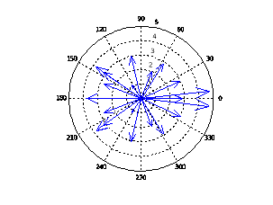 |
| `compas(X,Y)` | 等于 `compas(X+i\*Y)` |
| `compas(Z,S)` 或 `compas(X,Y,S)` | 在 `S` 中指定箭头使用的线条类型。 |
| `feather(Z)` 或 `feather(X,Y)` 或 `feather(Z,S)` 或 `feather(X,Y,S)` | 与 `compas` 相同，唯一的区别是箭头的起点不在坐标原点，而是来自水平线上的等间距点。 >>
```matlab
z=eig(randn(20,20)); feather(z)
```
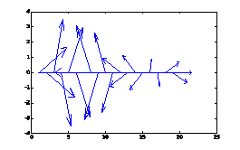 |
|  | |  |
| --- | --- | --- |

 |

## 3.2 显式、隐式、参数和极坐标中的曲线


下表列出了用于在显式、隐性和极坐标中表示二维曲线最重要的 MATLAB 命令。

| `plot(X,Y)` | 绘制点集 `(X,Y)`，其中 `X` 和 `Y` 是行向量。要绘制函数 `y=f(x)`，需要知道一组点 `(X,f(X))`，必须预先定义变量 `x` 的向量变化范围 `X`。`X` 和 `Y` 可以是相同维度的矩阵，在这种情况下，为每对行绘制一张图并在同一轴上显示。对于 `X` 和 `Y` 的复值，忽略其虚部。对于具有给定 `t` 的 `x = x(t)` 和 `y = y(t)`，绘制指定的参数平面曲线 >>
```matlab
x=0:0.1:6\*pi; y=x.\*sin(x); plot(x,y)
```
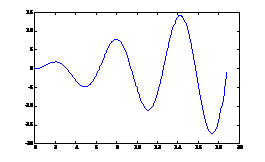 |
| --- | --- |
| `plot(Y)` | 将向量 `Y` 的元素相对于其索引绘图，即给出点集 `(t,y)` `t=1,2,...n (n=length(Y))` 的图形。这对于绘制时间序列非常有用。如果 `Y` 是矩阵，`plot(Y)` 会为 `Y` 的每一列绘制一张图，并将它们全部显示在同一轴上。如果向量 `Y` 的分量是复数，`plot(Y)` 等于 `plot(real(Y),imag(Y))` >>
```matlab
Y=[1,3,9,27,81,243]; plot(Y)
```
 |
| `plot(X,Y,S)` | 使用选项 `S` 绘制 `X,Y`。通常 `S` 由两个引号内的数字组成，第一个设置绘图颜色，第二个设置绘图使用的字符。可能的颜色和字符分别为：`y`（黄色）、`m`（洋红色）、`c`（青色）、`r`（红色）、`b`（蓝色）、`w`（白色）、`k`（黑色）、`.`（点）、`o`（圆）、`x`（标记）、`+`（加号）、`-`（实线）、`*`（星号）、 `:`（冒号）、`--`（虚线）和 `-.`（点划线）。 >>
```matlab
plot([1,2,3,4,5,6,7,8,9],[1/2,3/4,5/6,7/8,9],'r')
```
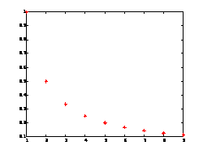 |
| `plot(X1,Y1,S1,X2,Y2,S2)` | 在同一轴上合并由三元组 `(Xi,Yi,Si)` 定义的图形。这是在同一图中表示多个函数的方法。 |
| `fplot('f',xmin,xmax)` | 在给定的 `x` 范围内绘制显式函数 `y=f(x)` >>
```matlab
fplot('x\*sin(1/x)',[0,pi/16])
```
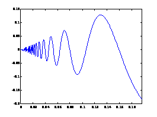 |
| `fplot('f',xmin,xmax,ymin,ymax)` | 给指定的 `x` 和 `y` 范围内绘制显式函数 `y=f(x)`，通过 `S` 选择颜色和字符。 >>
```matlab
fplot('x²/(x+1)',[-12,12,-8,8])
```
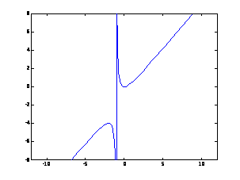 |
| `fplot('f',xmin,xmax,...,t)` | 以容差 `t` 绘制 `f`。 |
| `fplot('f',xmin,xmax,...,n)` | 以容差 `t` 以至少 `n+1` 个点绘制 `f`。 |
| `fplot('f1,f2,...,fn',xmin,xmax,ymin,ymax,S)` | 在指定的 `x` 和 `y` 范围内绘制函数 `f1, f2, ..., fn`，使用 `S` 中指定的颜色。 >>
```matlab
fplot('sin(x), sin(2\*x), sin(3\*x)',[0,2\*pi])
```
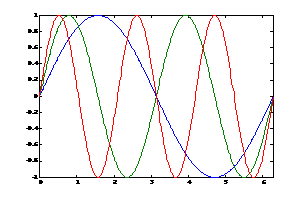 >>
```matlab
fplot('sin(x), sin(2\*x), sin(3\*x)',[0,2\*pi],'k')
```
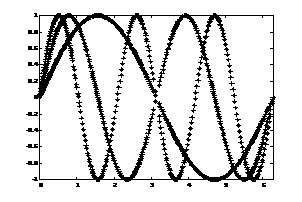 |
| `ezplot('f',xmin,xmax)` | 在给定的 `x` 范围内绘制显式函数 `y=f(x)` 或隐式函数 `f(x,y)=k`。变量的变化范围可以省略。 >>
```matlab
ezplot('y\*x²+x\*y²=10',[-10,10])
```
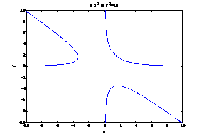 >>
```matlab
ezplot('x²/(x²-1)')
```
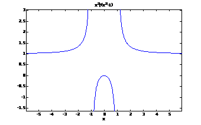 |
| `ezplot('f',xmin,xmax,ymin,ymax)` | 在给定的（或未指定的）`x` 和 `y` 范围内绘制显式函数 `y=f(x)` 或隐式函数 `f(x,y)=k` >>
```matlab
ezplot('x²+y³=1/2',[-10,10,-8,8])
```
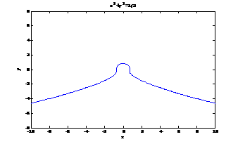 >>
```matlab
ezplot('x²-y⁴=1')
```
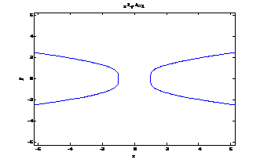 |
| `ezplot(x,y)` | 在域 `0 < t < 2` 上绘制平面参数曲线 `x=x(t)` 和 `y=y(t)` >>
```matlab
ezplot('4\*cos(t)-cos(4\*t)', '4\*sin(t)-sin(4\*t)')
```
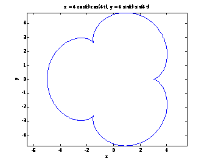 |
| `ezplot('f',xmin,xmax)` | 在域 `xmin < t < xmax` 上绘制参数平面曲线 `x=x(t)` 和 `y=y(t)` >>
```matlab
ezplot('t\*sin(t)', 't\*cos(t)',[-4\*pi,4\*pi])
```
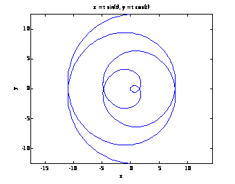 |
| `ezplot('f')` | 在 `[-2, 2]` 内以隐式坐标绘制曲线 `f` >>
```matlab
ezplot('y⁴-x⁴-24\*y²+25\*x²=0')
```
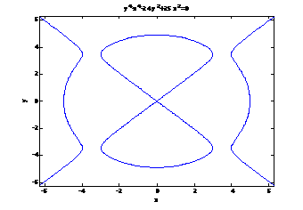 |
| `loglog(X,Y)` | 与 `plot(X,Y)` 相似，但两个轴都使用对数刻度 >>
```matlab
x=0:0.1:pi; y=x.\*sin(x); loglog(x,y)
```
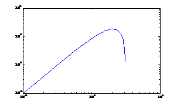 |
| `semilogx(X,Y)` | 与 `plot(X,Y)` 相似，但 X 轴使用对数刻度，Y 轴使用普通刻度 >>
```matlab
x=0:0.1:pi; y=x.\*sin(x); semilogx(x,y)
```
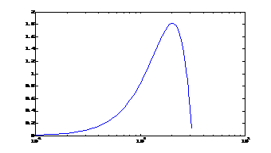 |
| `semilogy(X,Y)` | 与 `plot(X,Y)` 相似，但 Y 轴使用对数刻度，X 轴使用普通刻度 >>
```matlab
x=0:0.1:pi; y=x.\*sin(x); semilogy(x,y)
```
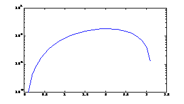 |
| `polar(α,r)` | 在极坐标下绘制 `r=r(α)` >>
```matlab
t=0:0.1:2\*pi; r=sin(t).\*cos(t); polar(t,r)
```
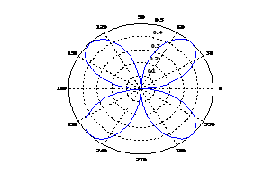 |
| `polar(α,r,S)` | 在极坐标下绘制 `r=r(α)`，使用由 `S` 指定的线条 >>
```matlab
t=0:0.05:2\*pi; r=sin(t).\*cos(t); polar(t,r,'\*r')
```
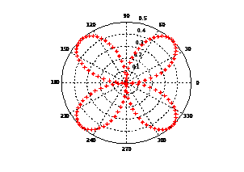 |
| `ezpolar(r)` `ezpolar(r,a,b)` | 在极坐标下绘制 `r=r(α)`，若未指定则 `α` 的范围为 `[0 2π]`，若未指定则在 `a` 和 `b` 之间 >>
```matlab
ezpolar('1+cos(t)')
```
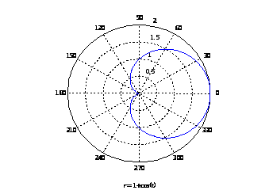 |


| `fill(X,Y,C)` | 绘制紧凑的多边形，其顶点为列向量 `X` 和 `Y` 的分量对 `(Xi,Yi)`。`C` 是一个与 `X` 和 `Y` 维度相同的向量，包含每个点 `(Xi,Yi)` 的颜色 `Ci`。`Ci` 的值可以是：'r', 'g', 'b', 'c', 'm', 'y', 'w', 'k'，这些含义我们已经知道。如果 `C` 是单个字符，则多边形的所有点都将涂成该字符对应的颜色。如果 `X` 和 `Y` 是相同维度的矩阵，则将同时表示与每对列向量 `(X.j,Y.j)` 对应的多个多边形。在这种情况下，`C` 可以是一个行向量，其元素 `Cj` 决定了与列向量对 `(X.j,Y.j)` 对应的每个多边形的唯一颜色。`C` 也可以是与 `X` 和 `Y` 维度相同的矩阵，在这种情况下，它的元素决定了多边形集合每个每个点 `(Xij,Yij)` 的颜色。 >>
```
t = (1/16:1/8:1)'*2*pi;x = sin(t);y = cos(t); fill(x,y,'r')
```
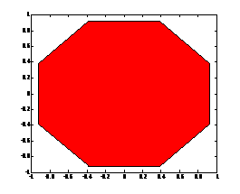 |
| `fill(X1,Y1,C1,...)` | 绘制顶点由点 `(Xi, Yi, Ci)` 给出的紧凑多边形 | |
|  | |  |
| --- | --- | --- |


## 3.3 扭曲曲线 (WARPED CURVES)


MATLAB 包含了允许你在三维空间中表示扭曲曲线的命令。其中最重要的命令列在下表中。

| `plot3(X,Y,Z)` | 绘制点集 `(X,Y,Z)`，其中 `X`、`Y` 和 `Z` 是行向量。`X`、`Y` 和 `Z` 可以是参数坐标或相同维矩阵，在这种情况下，将为每个行三元组在相同坐标轴上绘制一个图。对于 `X`、`Y` 和 `Z` 的复值，将忽略其虚部。 >>
```
X = [0 1 1 2;1 1 2 2;0 0 1 1];
Y = [1 1 1 1;1 0 1 0;0 0 0 0];
Z = [1 1 1 1;1 0 1 0;0 0 0 0];
plot3(X,Y,Z)
```
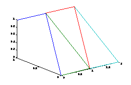 >>
```
t=0:pi/100:20*pi;plot3 (2*sin(2*t),2*cos(2*t),4*t)
```
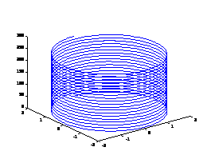 |
| --- | --- |
| `plot3(X,Y,Z,S)` | 使用 `S` 中定义的选项绘制 `(X,Y,Z)`。通常 `S` 由两个单引号内的数字组成，第一个设置绘图线条的颜色，第二个设置绘图时使用的字符。颜色和字符的可能值在解释 `plot` 命令时已经描述过。 |
| `plot3(X1,Y1,Z1,S1, X2,Y2,S2, X3,Y3,S3,...)` | 它在相同坐标轴上组合了为三元组 `(Xi,Yi,Zi)` 定义的图形。这是在同一张图上表示多个函数的方法。 |
| `fill3(X,Y,Z,C)` | 绘制紧凑的多边形，其顶点为列向量 `X`、`Y` 和 `Z` 的三元组 `(Xi,Yi,Zi)`。`C` 是一个与 `X` 和 `Y` 维度相同的向量，包含每个点 `(Xi,Yi,Zi)` 的颜色 `Ci`。`Ci` 的值可以是 'r','g','b','c','m','y','k'。如果 `C` 是单个字符，多边形的所有点将将涂成该字符对应的颜色。如果 `X` 和 `Y` 维度相同，则将同时表示与每个列向量三元组 `(X.j,Y.j,Z.j)` 对应的多个多边形。在这种情况下，`C` 可以是一个行向量，其元素 `Cj` 决定了与列向量三元组 `(X.j,Y.j,Z.j)` 对应的每个多边形的唯一颜色。`C` 也可以是与 `X` 和 `Y` 维度相同的矩阵，在这种情况下，它的元素决定了多边形集合每个点 `(Xijk,Yijk,Zijk)` 的颜色。
```
X = [0 1 1 2;1 1 2 2;0 0 1 1];
Y = [1 1 1 1;1 0 1 0;0 0 0 0];
Z = [1 1 1 1;1 0 1 0;0 0 0 0];
C = [0.5000 1.0000 1.0000 0.5000; 1.0000 0.5000 0.5000 0.1667; 0.3330 0.3330 0.5000 0.5000];
fill3(X,Y,Z,C)
```
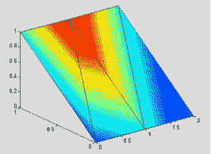 |
| `fill3(X1,Y1,Z1,C1, X2,Y2, Z2,...)` | 绘制顶点由点 `(Xi, Yi, Zi, Ci)` 给出的紧凑多边形。 |
| `ezplot3(x(t),y(t),z(t))` `ezplot3(x(t),y(t),z(t), [tmin,tmax])` | 绘制由三个参数组件定义的扭曲曲线。通过其三个参数组件绘制扭曲曲线。 >>
```
ezplot3('sin(t)','cos(t)','t',[0,6])
```
 |
|  | |  |
| --- | --- | --- |


## 3.4 显式与参数曲面 (EXPLICIT AND SURFACES)


MATLAB 包含了允许你在三维空间中表示扭曲曲线的 `z=f(x,y)` 显式曲面。`surf` 命令用于绘制曲面，`mesh` 命令用于绘制网格。`contour` 命令用于绘制曲面上的等值线。`contour3` 命令用于绘制三维空间中的等值面。`fsurf` 命令用于绘制参数曲面。`patch` 和 `fill3` 命令用于绘制多边形。

| `plot(X,Y,Z)` | 绘制点集 `(X,Y,Z)`，其中 `X`、`Y` 和 `Z` 是行向量。`X`、`Y` 和 `Z` 可以是参数坐标或相同维度的矩阵，在这种情况下，将为每个行三元组在相同坐标轴上绘制一个图。对于 `X`、`Y` 和 `Z` 的复值，将忽略其虚部。 >>
```
X = 0:0.1:1; Y = 0:0.1:1;
Z = X.² + Y.²;
plot(X,Y,Z)
```
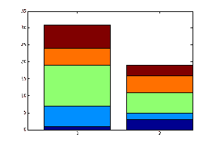 |
| `surf(X,Y,Z)` | 使用 `X,Y,Z` 绘制曲面。`X,Y` 是矩阵，`Z` 是高度。 >>
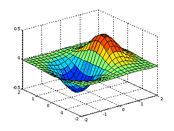 |
| `surf(X,Y,Z,C)` | 绘制曲面，`C` 是颜色数据。 >>
 |
| `mesh(X,Y,Z)` | 绘制网格。 >>
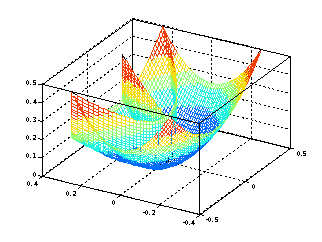 |
| `mesh(X,Y,Z,C)` | 绘制网格，`C` 是颜色数据。 >>
 |
| `contour(X,Y,Z)` | 在 `XY` 平面上绘制 `Z` 的等值线。 >>
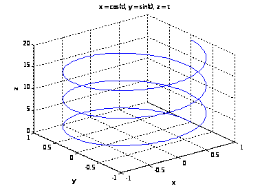 |
| `contour(X,Y,Z,C)` | 在 `XY` 平面上绘制 `Z` 的等值线。 >>
 |
| `contour3(X,Y,Z)` | 绘制三维空间中的等值面。 >>
 |
| `fsurf(f)` | 绘制参数曲面。 |
| `fsurf(f,u,v)` | 绘制参数曲面。 |
| `patch(V,F,C)` | 绘制多边形。 |
| `fill3(X,Y,Z,C)` | 绘制多边形。 |


### `meshc(X,Y,Z,C)`
表示显式表面 $z=f(x,y)$ 或参数方程 $x=x(t,u),y=y(t,u), z=z(t,u)$，以及对应的等高图（投影到 XY 平面的等高线）。
```
[X,Y] = meshgrid(-2:.2:2, -2:.2:2);
Z = X .* exp(-X.² - Y.²);
meshc(X,Y,Z)
```
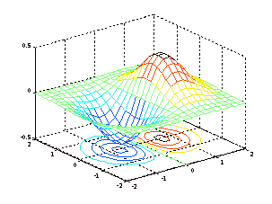

### `contour(Z)`
为矩阵 `Z` 绘制等高图（等高线）。使用的等高线数量将自动选择。
```
[X,Y] = meshgrid(-2:.2:2, -2:.2:2);
Z = X .* exp(-X.² - Y.²);
contour(Z)
```
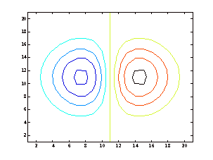

### `contour(Z,n)`
使用 `n` 条等高线为矩阵 `Z` 绘制等高图。
```
[X,Y] = meshgrid(-2:.2:2, -2:.2:2);
Z = X .* exp(-X.² - Y.²);
contour(Z)
```
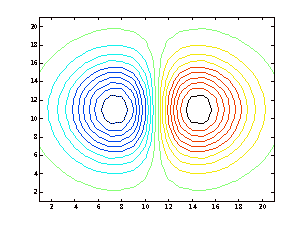

### `contour(x,y,Z,n)`
使用 `x` 和 `y` 向量定义的 X 和 Y 轴缩放比例，为矩阵 `Z` 绘制等高图（`n` 条等高线）。
```
r=(0:0.1:2*pi)';
t=(-pi:0.1:2*pi);
X=cos(r)*cos(t);
Y=sin(r)*sin(t);
Z=ones(1,size(r))'\t;
contour(X,Y,Z)
```
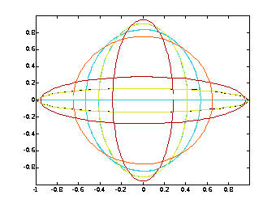

### `contour3(Z)`, `contour3(Z,n)` and `contour3(x,y,Z,n)`
在三维空间中绘制等高图。
```
r=(0:0.1:2*pi)';
t=(-pi:0.1:2*pi);
X=cos(r)*cos(t);
Y=sin(r)*sin(t);
Z=ones(1,size(r))'\t;
contour3(X,Y,Z)
```
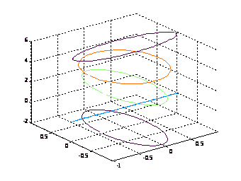

### `contourf(...)`
绘制等高图并填充等值线之间的区域。
```
r=(0:0.1:2*pi)';
t=(-pi:0.1:2*pi);
X=cos(r)*cos(t);
Y=sin(r)*sin(t);
Z=ones(1,size(r))'\t;
contourf(X,Y,Z)
```
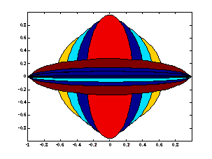

### `pcolor(X,Y,Z)`
基于颜色密度的表示法为 `(X,Y,Z)` 矩阵绘制等高图（等高线）。通常被称为密度图。
```
[X,Y] = meshgrid(-2:.2:2, -2:.2:2);
Z = X .* exp(-X.² - Y.²);
meshc(X,Y,Z)
pcolor(X,Y,Z)
```
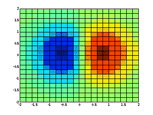

### `trimesh(Tri,X,Y,Z,C)`
以网格形式显示 `Tri` 矩阵定义的三角形。`Tri` 矩阵的每一行定义一个三角形面，`C` 定义颜色。`C` 参数可选。

### `trisurf(Tri,X,Y,Z,C)`
以表面形式显示 `Tri` 矩阵定义的三角形。`Tri` 矩阵的每一行定义一个三角形面，`C` 定义颜色。`C` 参数可选。

## 3.5 三维几何形状

使用 MATLAB 可以绘制圆柱体、球体、柱状图、截面、状图和其他几何形状。下表总结了这些命令。

### `bar3(Y)`
相对于频率向量 `Y` 绘制柱状图。如果 `Y` 是矩阵，则为 `Y` 的每一行获取多个柱状图。
```
bar3(rand(4,4))
```
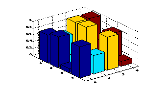

### `bar3(x,Y)`
相对于频率向量 `Y` 绘制柱状图，其中 `x` 是定义柱子在 X 轴上位置的向量。

### `bar3(...,width)`
具有指定宽度的柱状图。默认宽度为 `0.8`，设置为 `1` 会使柱子接触。

### `bar3(...,'style')`
具有指定样式的柱状图。样式有 `'detached'`（分离的）、`'grouped'`（分组的）和 `'stacked'`（堆叠的）。

### `bar3(...,colour)`
柱子均为指定的颜色（`r=red` 红色、`g=green` 绿色、`b=blue` 蓝色、`c=cyan` 青色、`m=magenta` 品红色、`k=black` 黑色和 `w=white` 白色）。

### `com3(z)`, `com3(x,y,z)`
相对于 `z` 向量的彗星图。参数图（`x(t)`, `y(t)`, `z(t)`）。
```
t = -pi:pi/500:pi;
com3(sin(t),cos(t),t)
```
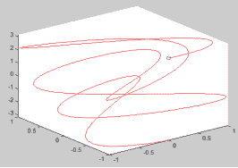

### `cylinder(...)`
给出单位圆柱坐标。给出由曲线 `r` 生成的圆柱坐标。给出由曲线 `r` 生成的带有 `Z` 轴对齐的周截面（默认 `n=20`）。绘制上述图形：
```
t = 0:pi/10:pi;
[X,Y,Z] = cylinder(2+cos(t));
surf(X,Y,Z)
```
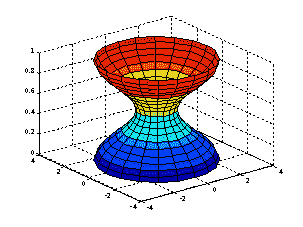

### `sphere`
使用 `20x20` 面绘制单位球。

### `sphere(n)`
使用 `nxn` 面生成球体。
```
sphere(100)
```
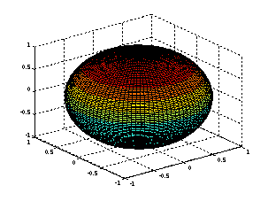

### `[X,Y,Z] = sphere(n)`
给出 `(n+1)x(n+1)` 矩阵的球体坐标。

### `slice(V,sx,sy,sz)`, `slice(X,Y,Z,V,sx,sy,sz)`, `slice(V,XI,YI,ZI)`, `slice(X,Y,Z,V,XI,YI,ZI)`
绘制切片
沿向量 `sx,sy,sz` 定义的体积 `V`（数组 `mxnp`）的 `x, y, z` 方向绘制切片。在由三维数组 `X,Y,Z` 定义的体积 `V` 中通过向量 `sx,sy,sz` 绘制切片。在矩阵 `XI,YI,ZI` 定义的体积 `V` 中绘制生成面的切片。在三维数组 `X,Y,Z` 定义的体积 `V` 中通过数组 `XI,YI,ZI` 绘制生成面的切片。根据指定的插值方法绘制（`linear` 为线性，`cubic` 为三次，`nearest` 为最近邻）。
```
[x,y,z] = meshgrid(-2:.2:2, -2:.25:2, -2:.16:2);
v = x .* exp(-x.² - y.² - z.²);
slice(x,y,z,v,[-1.2 .8 2],2,[-2 -.2])
```
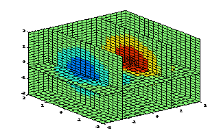

### `stem3(Z)`, `stem3(X,Y,Z)`, `stem3(...,'fill')`, `stem3(...,S)`
在 `(x,y)` 平面上将序列 `Z` 绘制为状图。在 `X` 和 `Y` 指定的值处绘制 `Z`。用颜色填充柱状顶端的圆。使用 `S` 规范制作带状图（`colour`, ...）。
```
X = linspace(0,1,10);
Y = X./2;
Z = sin(X) + cos(Y);
stem3(X,Y,Z,'fill')
```


## 3.6 专用图形

ATLAB 提供了绘制面积图、箱线图、三维饼图、帕累托图和其他专用图的命令。下表是这些命令的语法。

### `area(Y)`, `area(X,Y)`, `area(...,ymin)`
相对于频率向量 `Y` 绘制面积图。相对于通过向量 `X` 的频率向量 `Y` 绘制面积图。指定填充区域在 `y` 方向的下边界。
```
Y = [1, 5, 3;3, 2, 7;1, 5, 3;2, 6, 1];
area(Y)
```


### `box on, box off`
启用或关闭二维和三维图的轴框。

### `comet(y)`, `comet(x,y)`
相对于频率向量 `Y` 绘制风筝图。相对于通过向量 `X` 的频率向量 `Y` 绘制风筝图。
```
t = -pi:pi/200:pi;
comet(t,tan(sin(t))-sin(tan(t)))
```


| `ezcontourf(f)` | `ezcontourf(f,domain)` | `ezcontourf(...,n)` | $f(x,y)$ 在 $[-2\pi, 2\pi] \times[-2\pi, 2\pi]$ 上的填充等高图 | 在给定区域内填充 $f(x,y)$ 等高图 | 在 $nxn$ 网格上填充 $f(x,y)$ 等高图 | >> `ezcontourf('sqrt(x² + y²)')` !(image | |
| `ezmesh(f)` | `ezmesh(f,domain)` | `ezmesh(...,n)` | `ezmesh(x,y,z)` | `ezmesh(x,y,z, domain)` | `ezmesh(..., 'circ')` | $f(x,y)$ 在 $[-2\pi, 2\pi] \times[-2\pi, 2\pi]$ 上的填充网格图 | 在给定区域内填充 $f(x,y)$ 的网格图 | 在 $nxn$ 网格上填充 $f(x,y)$ 的网格图 | $x=x(t,u), y=y(t,u), z=z(t,u)$ $t,u \in[-2\pi, 2\pi]$ 的网格图 | $x=x(t,u), y=y(t,u), z=z(t,u)$ $t,u \in domain$ 的网格图 | 区域中心圆盘上的网格图 | >> `ezmesh('sqrt(x² + y²)')` !(image | |
| `ezmeshc(f)` | `ezmeshc(f,domain)` | `ezmeshc(...,n)` | `ezmeshc(x,y,z)` | `ezmeshc(x,y,z, domain)` | `ezmeshc(..., 'circ')` | 执行网格与等高图的组合绘制 | >> `ezmeshc('sqrt(x² + y²)')` !(image | |
| `ezsurf(f)` | `ezsurf(f,domain)` | `ezsurf(...,n)` | `ezsurf(x,y,z)` | `ezsurf(x,y,z, domain)` | `ezsurf(..., 'circ')` | 生成彩色表面图 | >> `ezsurf('sqrt(x² + y²)')` !(image | |
| `ezsurfc(f)` | `ezsurfc(f,domain)` | `ezsurfc(...,n)` | `ezsurfc(x,y,z)` | `ezsurfc(x,y,z, domain)` | `ezsurfc(..., 'circ')` | 执行表面与等高图的组合绘制 | >> `ezsurfc('sqrt(x² + y²)')` !(image | |
| `ezplot3(x,y,z)` | `ezplot3(x,y,z,domain)` | `ezplot3(..., 'animate')` | 3D 参数曲线 $x=x(t), y=y(t), z=z(t)$ $t \in[-2\pi, 2\pi]$ | 3D 参数曲线 $x=x(t), y=y(t), z=z(t)$ $t \in domain$ | 带有动画的 3D 参数曲线 | >> `ezplot3('cos(t)','t.*sin(t)','sqrt(t)')` !(image | |
| `ezpolar(f)` | `ezpolar(f, [a,b])` | 绘制 $c \in[0, 2\pi]$ 的极坐标曲线 $r=f(c)$ | 绘制 $c \in[a, b]$ 的极坐标曲线 $r=f(c)$ | `ezpolar('sin(2*t).*cos(3*t)',[0 pi])` !(image | |
| `pareto(Y)` | `pareto(X,Y)` | 相频率向量 $Y$ 生成帕雷托图 | 根据通过向量 $X$ 给出的频率向量 $Y$ 生成帕雷托图 | >> `code_lines = [200 120 555 608 1024 101 57 687]; encoders = ... {'Fred','Ginger','Norman','Max','Julia','Wally','Heidi','Pat'}; pareto(code_lines, encoders) title('Lines of code per programmer')` !(image | |
| `foot3(X)` `​` | `pie3(X,explode)` | 频率 $X$ 的三维饼图 | 分为三维扇形的三维饼图 | >> `pie3([2 4 3 5],[0 1 1 0],{'North','South','East','West'})` !(image | |
| `plotmatrix(X,Y)` | $X$ 与 $Y$ 列的散点图 | >> `x = randn(50,3); y = x*[-1 2 1;2 0 1;-2 3;];plotmatrix(y)` !(image |
| `stairs(Y)` | `stairs(X,Y)` `stairs(...,LineSpec)` | $Y$ 元素的阶梯图 | 对应 $X$ 元素的阶梯图 | 阶梯图规格 | >> `x = linspace(-2*pi,2*pi,40);stairs(x,sin(x))` !([image]071.png) |
| `scatter(X,Y,S,C)` | `scatter(X,Y)` `scatter(X,Y,S)` `scatter(...,marker)` `scatter(...,'filled')` | 根据颜色 $C$ 和标记 $S$ 的 $(X,Y)$ 散图。也可以获取填充图形并使用不同类型的标记。 |
| `scatter3(X,Y,Z,S,C)` | `scatter3(X,Y,Z)` `scatter3(X,Y,Z,S)` `scatter3(...,marker)` `scatter(...,'filled')` | 根据颜色 $C$ 和标记 $S$ 的 $(X,Y,Z)$ 三维散点图。也可以获取填充图形并使用不同类型的标记。 | >> `x=(0:0.1:4); scatter(x,cos(x))` >> `x=(0:0.1:pi); scatter3(x),cos(x),sin(x))` !(image |

### 2D 和 3D 图形选项

MATLAB 提供了许多处理标题、标签、视角等图形选项。下表列出了最重要的。

| 命令 | 说明 |
| :--- | :--- |
| `title('text')` | 在 2D 和 3D 图表顶部添加文本作为标题 |
| `xlabel('text')` | 在 2D 和 3D 图形中的 x 轴上放置文本 |
| `ylabel('text')` | 在 2D 和 3D 图形中的 y 轴上放置文本 |
| `zlabel('text')` | 在 3D 图形中的 z 轴上放置文本 |
| `clabel(C,h)` | 旋转标签并置于等高线内部 |
| `clabel(C,h,v)` | 为向量 $v$ 给出的等高线创建标签并置于等高线内部 |
| `datetick(axis)` | 根据指定轴的最大值最小值标记指定轴 ('x', 'y' 或 'z') |
| `datetick(axis, date)` | 使用给定的日期格式（1 到 28 之间的整数）标记指定轴 ('x', 'y' 或 'z') |
| `legend('string1', 'string2',...)` | 在连续 $n$ 个图中放置字符串指定的图例 |
| `legend(h, 'string1', 'string2',...)` | 根据向量 $h$ 在管理的图中放置字符串指定的图例 |
| `legend('off')` | 移除当前轴的图例 |
| `text(x,y,'text')` | 在 2D 图形中的点 $(x,y)$ 放置文本 |
| `text(x,y,z,'text')` | 在 3D 图形中的点 $(x,y,z)$ 放置文本 |
| `gtext('text')` | 在 2D 图形中通过鼠标选择的点放置文本 |
| `grid` | 在 2D 或 3D 图表的轴上放置网格。`grid on` 选项放置网格，`grid off` 移除它们。`grid` 选项在开启和关闭之间切换 |
| `hold` | 允许你保留现有图形及其所有属性，以便制作的图形位于相同的轴上并覆盖现有图。`hold on` 选项激活该选项，`hold off` 移除。`hold` 选项在开启和关闭之间切换。适用于 2D 和 3D |
| `axis([xmin xmax ymin ymax zmin zmax])` | 在当前图中放置 X、Y 和 Z 轴的最大值最小值 |
| `axis('auto')` | 将轴设置为默认自动缩放（由 $xmin = min(x), xmax = max(x)$ 给出且 $y$ 自由） |
| `axis(axis)` | 冻结轴缩放为当前限制，以便当另一个图放置在相同轴上（开启 hold）时，缩放不会发生变化 |
| `V=axis` | 给出一个 4 元素向量 $V$，包含当前图的缩放 |
| `axis('xy')` | 将笛卡尔坐标原点放在图左下角 |
| `axis('tight')` | 将轴限制放置在数据范围内 |
| `axis('ij')` | 将坐标原点放在图左上角 |
| `axis('square')` | 将绘制矩形变为正方形，使图形凸起 |
| `axis('equal')` | 为两个轴设置相同的缩放因子 |
| `axis('normal')` | 移除正方形和相等选项 |
| `axis('off')` | 移除轴和网格上的标签和标记，保留通过 `text` 和 `gtext` 放置在上面的标题和文本 |
| `axis('on')` | 替换标签、标记和轴网格 |
| `subplot(m,n,p)` | 将图形窗口划分为 $mxn$ 子窗口并将当前图放置在第 $p$ 个窗口中，从左上开始从左到右计数直到行尾，然后移动到下一个 |


### 图形命令

- `plottyy(X1,Y1,X2,Y2)`
- `plottyy(X1,Y1,X2,Y2, 'function')`
- `plottyy(X1,Y1,X2,Y2, 'function1','function2')`
  在左侧绘制 `X1` 对 `Y1` 的图，在右侧绘制 `X2` 对 `Y2` 的图。与之前的命令相同，但函数可以是 `plot`、`loglog`、`semilogx`、`semilogy`、`item` 或任何 `h=function(x,y)`。与之前的命令相同，但每对 `(XiYi)` 使用每个函数 `fi`。

- `axis([xmin xmax ymin ymax zmin zmax])`
  在指定值处设置轴的变化范围。它还接受 `'ij'`、`'square'`、`'equal'` 等选项，与之前看到的二维选项相同。

- `view([x,y,z])`
  将图形的视角放置在笛卡尔坐标点 `(x,y,z)`处。

- `view([az, el])`
  将图形的视角放置在方位角（水平旋转） `'az'` 和仰角（垂直仰角） `'el'`处。

- `hidden`
  控制图表中隐藏线的显示。`hidden on` 显示隐藏线，`hidden off` 隐藏。

- `shading`
  控制用 `surf`、`mesh`、`pcolor`、`fill` 和 `fill3` 命令创建的面的着色类型。`shading flat` 选项设置光滑着色，`shading interp` 选项设置密集着色，`shading faceted` 选项（默认选项）设置普通着色。

- `colormap(M)`
  将矩阵 `M` 作为当前颜色映射。`M` 必须有三列，且包含仅位于 0 到 1 之间的值。它也可以是一个行向量为 RGB 类型 `[r g b]` 的矩阵。MATLAB 中已经定义了矩阵 `M`，例如：`bone(p)`、`contrast(p)`、`cool(p)`、`copper(p)`、`flag(p)`、`gray(p)`、`hsv(p)`、`hot(p)`、`jet(p)`、`pink(p)`、`prism(p)` 和 `white(p)`。所有矩阵都有 3 列和 `p` 行。例如，语法 `colormap(hot(8))` 将 `hot(8)` 矩阵设置为当前颜色映射（当前图形的完整颜色系统）。

- `brighten(p)`
  调整图形的亮度。如果 `0<p<1`，图形将变亮；如果 `-1<p<0`，图形将变暗。`p` 的范围是 `(-1,1)`，随着 `p` 的值接近 `-1`，图形变暗，而随着 `p` 的值接近 `1`，图形变亮。

- `image(A)`
  生成一个二维图像，其亮度与矩阵 `A` 的元素成正比，用于显示适应矩阵 `A` 中给定亮度的照片和绘图。矩阵 `A` 的每个元素 `(m,n)` 影响图形中的一个单元格。

- `pcolor(A)`
  生成一个颜色与矩阵 `A` 的元素成正比的二维图形，用于显示具有不同颜色抽象数学对象。矩阵 `A` 的每个元素 `(m,n)` 影响图形中的一个网格。

- `caxis([cmin cmax])`
  为图形设置颜色比例（由 `colormap` 定义，并通过网格与轴上的划分相关）的最小值和最大值。因此，它允许图形使用 `colormap` 定义的颜色子集。

- `figure(h)` 或 `h=figure`
  创建一个名为 `h` 的图形并将其作为普通图形。`gcf(h)` 命令用于引用图形 `h` 的任何属性。`close(h)` 关闭图形 `h`。`whitebg(h)` 命令更改图形 `h` 的背景颜色。`clf` 命令清除当前图形。`graymon` 命令设置灰度。`newplot` 命令确定新图形。`refresh` 命令刷新图形。

- `axes(e)` 或 `e=axes`
  在当前图形创建一个名为 `e` 的轴。`gca(e)` 命令引用轴 `e` 的任何属性。`cla` 命令清除当前轴。

- `l=line(x,y)` 或 `l=line(x,y,z)`
  创建一个名为 `l` 的对象，连接平面 `(X,Y)` 或空间 `(X,Y,Z)` 点。

- `p=patch(X,Y,C)` 或 `patch(X,Y,Z,C)`
  由点 `(X,Y)` 或 `(X,Y,Z)` 定义的不多形区域，其颜色由 `C` 指定，作为对象 `p`。

- `s=surface(X,Y,Z,C)`
  由 `X`、`Y` 和 `Z` 定义的参数表面，其颜色由 `C` 指定，作为对象 `s`。

- `i=image(C)`
  通过矩阵 `C` 中的给定颜色创建图像 `i`。

- `t=text(x,y,'string')` 或 `t=text(x,y,z,'string')`
  由字符串定义的文本，位于平面点 `(x,y)` 或空间点 `(x,y,z)`。

- `set(h, 'property1', 'property2', ...)`
  在对象 `h` 上设置指定的属性（`gca` 用于轴，`gcf` 用于图形，`gcbo`, `gcbd` 等）。

- `get(h, 'property')`
  返回对象 `h` 给定属性的当前值。

- `object=gco`
  返回当前图形。

- `rotate(h, [a, e], [p,r])`
  沿方位轴 `a` 和仰角 `e` 旋转对象 `h` 角度 `α`，点为 `(p,q)`。

- `reset(h)`
  更新分配给对象 `h` 的属性并设置其默认属性。

- `delete(h)`
  删除对象 `h`。

### MATLAB 属性

| 对象 | 属性 | 可能值 |
| :--- | :--- | :--- |
| **Figure** | Colour（背景颜色） | `'y'`, `'m'`, `'c'`, `'r'`, `'g'`, `'b'`, `'k'` |
| | ColorMap（颜色映射） | `hot(p)`, `gray(p)`, `pink(p)`, .... |
| | Position（位置） | `[left, bottom, width, height]` |
| | Name（名称） | 带有名称 |
| | MinColorMap（颜色） | 映射的最小颜色数 |
| | NextPlot（后续绘图模式） | `new`, `add`, `replace` |
| | NumberTitle（图形内标题） | `on`, `off` |
| | Units（单位） | `pixels`, `inches`, `points` |
| | Resize（鼠标调整图形大小） | `on`（可以更改），`off`（不更改） |
| **Axes** | Box（图形框） | `on`, `off` |
| | Colour（轴颜色） | `'y'`, `'m'`, `'c'`, `'r'`, `'g'`, `'b'`, `'k'` |
| | GridLineStyle（网格线样式） | `'-'`, `'—'`, `':'`, `'-.'` |
| | Position（屏幕位置） | `[left, bottom, width, height]` |
| | TickLength（刻度长度） | 数值 |
| | TickDir（刻度方向） | `in`, `out` |
| | Units（单位） | `pixels`, `inches`, `points` |
| | View（视角） | `[azimuth, elevation]` [azimuth, elevation] |
| | FontAngle（字体角度） | `normal`, *italic*, *oblique* |
| | FontName（字体名称） | 带有来源的文本 |
| | FontSize（字体大小） | 数值 |
| | FontWeight（字体粗细） | `light`, `normal`, `demi`, **bold** |
| | DrawMode（绘制模式） | `normal`, `fast` |
| | Xcolor, Ycolor, Zcolor（轴颜色） | `[min, max]` `[min, max]` `[min, max]` `[min, max]` `[min, max]` `[min, max]` |
| | XDir, YDir, ZDir（轴方向） | `normal`（从左到右增长），`reverse`（反向） |
| | XGrid, YGrid, Zgrid（网格） | `on`, `off` |
| | XLabel, YLabel, Zlabel（标签） | 带有标签内容的字符串 |
| | XLim, YLim, Zlim（限制值） | `[min, max]`（变化范围） |
| | XScale, YScale, ZScale（比例） | `linear`（线性），`log`（对数） |
| | XTick, YTick, ZTick（刻度） | `[m1,m2,...]`（轴上的刻度位置） |


### 属性参考表

| 类别 | 属性 | 描述 |
| :--- | :--- | :--- |
| | `Xdata,Ydata,Zdata` (坐标) | 线的坐标集 |
| `Text` | `Colour` (文本颜色) | `'y'`, `'m'`, `'c'`, `'r'`, `'g'`, `'b'`, `'w'`, `'k'`。 |
| | `FontAngle` (字体角度) | 正常，斜体，倾斜 |
| | `FontName` (字体名称) | 带有字体名称的文本 |
| | `FontSize` | 数值 |
| | `FontWeight` (字体粗细) | 细、正常、半粗、粗体 |
| | `HorizontalAlignment` (水平对齐) | 左对、居中、右对 |
| | `VerticalAlignment` (垂直对齐) | 顶部、顶端、中间、基线、底部 |
| | `Position` (屏幕上的位置) | `[x, y, z]` (位置点) |
| | `Rotation` (文本方向) | 0,± 90, ±180, ±270 |
| | `Units` (测量单位) | 像素、英寸、厘米、点 |
| | `String` (要放置的文本字符串) | 带有文本的字符串 |
| `Surface` | `Cdata` (每个点的颜色) | 颜色矩阵 |
| | `Edgecolor` (网格颜色) | `'y'`, `'m'`,..., none, flat, interp |
| | `Facecolor` (面颜色) | `'y'`, `'m'`,..., none, flat, interp |
| | `LineStyle` (线型) | `'-'`, `'—'`, `':'`, `'-.'`, `'+'`, `'*'`, `'.'`, `'x'` |
| | `LineWidth` (线宽) | 数值 |
| | `MeshStyle` (行和列中的线) | 行、列、两者 |
| | `Visible` (线在屏幕上是否可见) | 显示，关闭 |
| | `Xdata,Ydata,Zdata` (坐标) | 表面坐标集 |
| `Patch` | `Cdata` (每个点的颜色) | 颜色矩阵 |
| | `Edgecolor` (轴颜色) | `'y'`, `'m'`,..., none, flat, interp |
| | `Facecolor` (面颜色) | `'y'`, `'m'`,..., none, flat, interp |
| | `LineWidth` (线宽) | 数值 |
| | `Visible` (线在屏幕上是否可见) | 显示，关闭 |
| | `Xdata,Ydata,Zdata` (坐标) | 表面坐标集 |
| `Image` | `Cdata` (每个点的颜色) | 颜色矩阵 |
| | `Xdata,Ydata,Zdata` (坐标) | 图像坐标集 |

### 示例说明

让我们来看一些示例说明。

```mat
x=linspace(0,2,30);
y=sin(x.²);
plot(x,y)
text(1,0.8, 'y=sin(x²)')
hold on
z=log(sqrt(x));
plot(x,z)
text(1,-0.1, 'y=log(x)')
xlabel('X-axis');
ylabel('Y-axis');
title('Sine and logarithmic graph');
```

```matlab
subplot(2,2,1);
ezplot('sin(x)',-2*pi 2*pi);
subplot(2,2,2);
ezplot('cos(x)',-2*pi 2*pi);
subplot(2,2,3);
ezplot('csc(x)',-2*pi 2*pi);
subplot(2,2,4);
ezplot('sec(x)',-2*pi 2*pi);
```

```matlab
X,Y=meshgrid(-2:.05:2);
Z=X.²-Y.²;
subplot(2,2,1);
surf(X,Y);
subplot(2,2,2);
surf(X,Y),view(-90,0);
subplot(2,2,3);
surf(X,Y),view(60,30);
subplot(2,2,4);
surf(X,Y),view(-10,30);
```

### 练习 1
表示方程定义的表面：

```matlab
x,y=meshgrid(0:.05:2,-2:.05:2);
z=y.²*(x-1).²./(y.²+(x-1).²;
mesh(x,y,z),view([-23,30]);
```

我们也可以以下方式表示表面：

```matlab
ezsurf('y²*(x-1)²/(y²+(x-1)²)')
```

### 练习 2
设 $f:R² \to R$ 为由定义的函数：在 $(0,0)$ 环境中对其绘图。

```matlab
x,y=meshgrid(-1/100:0.0009:1/100,-1/100:0.0009:1/100);
z=(1-cos(x)).*sin(y)./(x.³+y.³);
surf(x,y,z)
view([50,-15])
```

在同一图中相邻绘制极坐标曲线：表示它们的交点。

```matlab
a=0:.1:2*pi;
subplot(1,2,1);
r=sqrt(cos(2*a));
polar(a,r)
title(' r = sqrt(Cos(2a))');
subplot(1,2,2);
r=sin(2*a);
polar(a,r)
title(' r = Sen(2a)')
```

为了看到这两条曲线的交点，我们将它们都画在同一个轴上。

```matlab
a=0:.1:2*pi;
r=sqrt(cos(2*a));
polar(a,r)
hold on;
r=sin(2*a);
polar(a,r);
```

### 练习 4
绕 OX 轴旋转三次曲线 $12x - 9x² + 2x³$ 生成的体积，范围在 $x=0$ 到 $x=5/2$ 之间。

旋转面具有方程 $y²+z² = (12x-9x²+2x³$，可以通过以下方式参数化绘图：

```matlab
t=(0:.1:5/2);
u=(0:.1:2*pi);
z=(12*t-9*t²+2*t³).*sin(u)
```

绕 OX 轴和 OY 轴旋转椭圆生成的体积。我们在同一图中表示生成的图形，但只画正半部分。最终体积是该体积的两倍。图形 $y²+z²=9$ 的方程参数化如下：

```matlab
t=(0:.1:2);
u=(0:.1:2*pi);
x=t, y=3*cos(u), z=3*sin(u)
surf(x,y,z)
```

### 练习 6
表示抛物面 $x²+y²=2$ 与平面 $z=x+2$ 的交点。

```matlab
x,y=meshgrid(-3:.1:3);
z=x.²+y.²;
mesh(x,y,z)
hold on;
z=x+2;
mesh(x,y,z)
```

表示由抛物面 $x²+4y²=z$ 以及侧面方程 $y²=x$ 和 $x=y²$ 的圆柱面围成的体积。

```matlab
x,y=meshgrid(-1/2:.02:1/2,-1/4:.01:1/4);
z=x.²+4*y.²;
mesh(x,y,z)
hold on;
y=x.²;
mesh(x,y,z)
hold on;
x=y.²;
mesh(x,y,z)
```

在同一轴上表示抛物线 $y²=x$ 和 $x²=y$。同样在同一轴上表示抛物线 $y²=4x$ 和直线 $x+y=3$。

```matlab
fplot('\[x²,sqrt(x)\]',\[0,1.2])
fplot('\[(4\*x)^(1    /2),3-x\]',\[0,4,0,4])
```


### 练习 10. 在方程的隐式坐标中表示曲率：

$x⁵ - x²y² + y⁵ = 0$

$x⁴ + x²y - y⁵ + y⁴ = 0$


```
ezplot('x⁵-x²\*y²+y⁵', [-1,1,-1,1])
```


```
ezplot('x⁴+x²\*y-y³+y⁴', [-1/2,1/2,-1/2,3/2])
```


### 练习 11. 用参数坐标表示该曲线：

$x(t) = t\sin(t)$

$y(t) = t\cos(t)$


```
ezplot('t\*sin(t)', 't\*cos(t)')
```


### 练习 12. 用极坐标表示该曲线：

$\rho=1-\cos(\theta)$


```
ezpolar('1-cos(t)')
```


### 练习 13. 表示参数方程的扭曲曲线：

$x=\cos(t), y=\sin(t), z=t$


```
ezplot3('cos(t)', 'sin(t)', 't', [0,6\*pi])
```


# 第 4 章：代数表达式、多项式、方程和方程组

## 4.1 代数表达式的展开、简化和因式分解

MATLAB 包含了大量的命令，允许你处理代数表达式。你可以对表达式进行尽可能的简化、展开或进行适当的因式分解。下表列了处理代数表达式最常用的命令。

| 命令 | 说明 |
| --- | --- |
| `expand(expr)` | 尽可能地展开代数表达式，完全展开乘积和幂，直到结果以求和的形式呈现。对三角表达式应用多个倍角公式，并正式地应用对数和指数函数的性质。还会将代数分式分解为和。 |
| `factor(expr)` | 将展开的代数表达式写为因子的乘积（`expand` 的逆操作）。因式分解默认对表达式的主体进行。对于代数分式，对分子和分母进行分解并简化公因子。 |
| `simplify(expr)` | 通过执行最终求和以及代数的加法，尽可能地简化代数表达式。 |
| `simple(expr)` | 通过显示使用的规则尽可能地简化代数表达式。 |
| `collect(expr)` | 通过按变量的幂对项分组来展示表达式的结果。 |
| `horner(expr)` | 以霍纳形式（Horner form）对表达式进行因式分解。 |

## 4.2 多项式

MATLAB 实现了用于多项式的特定命令，例如求根、求导和插值。下表给出了涉及多项式的命令的语法和示例。

| 命令 | 说明 |
| --- | --- |
| `poly2sym(vector)` | 将向量转换为符号多项式，其系数为向量元素（从高幂到低幂）。 |
| `poly2sym(vector,'v')` | 将向量转换为变量 `v` 的符号多项式，其系数为向量元素。 |
| `sym2poly(polynomial)` | 将多项式转换为向量，其元素为系数。 |
| `q=conv(u,v)` | 给由向量 `u` 和 `v` 指定系数的多项式乘积的系数。 |
| `[q,r] = deconv(v,u)` | 给多项式 `u` 和 `v` 相除的商和余数。我们有 `v = conv(u,q)+r`。 |
| `p = poly(r)` | 给根为向量 `r` 的多项式 `p` 的系数。 |


## 4.3 多项式插值

`k = polyder(p)`, `k = polyder(a,b)`, `[q,d] = polyder(b,a)`
给出多项式 `p` 导出的多项式 `k` 的系数。
给出 `a` 和 `b` 之积导数的系数。
给出 `a/b` 数的分子 `q` 和分母 `d`。

```
>> polyder([1 -8 17 2 -24])
ans = 4 -24 34 2
>> poly2sym([1 -8 17 2 -24])
ans = x⁴ - 8*x³ + 17*x² + 2*x - 24
>> poly2sym(polyder([1 -8 17 2 -24]))
ans = 4*x³ - 24*x² + 34*x + 2
>> u=[3 -1 4 2];v=[2 1 4 4 6 8 3];
>> k=polyder(u,v)
k = 48 7 114 110 144 99 82 28
>> poly2sym(k)
ans = 48*x⁷ + 7*x⁶ + 114*x⁵ + 110*x⁴ + 144*x³ + 99*x² + 82*x + 28
>> [q,d]=polyder(u,v)
q = -12 3 -30 -10 8 -29 -30 -4
d = 4 4 17 32 60 76 106 120 100 48 9
```

`p = polyfit(x,y,n)`, `[p,S] = polyfit(x,y,n)`, `[p,S,u] = polyfit(x,y,n)`
拟合点云 `(x,y)` 的 `n` 次多项式。
`n` 次多项式拟合点 `(x,y)`，方差为 `S`。
`n` 次多项式拟合 `(x,y)` 点，拟合误差的方值为 `S`，均值为 `u`。

```
>> u=[3 -1 4 2];v=[2 1 4 6];
>> p=poly2sym(polyfit(u,v,3))
p = (53*x³)/60 - (99*x²)/20 + (119*x)/30 + 54/5
>> [p,S,u]=polyfit(u,v,3)
p = 8.9050 1.6333 -11.3053 6.0000
S = A: [4x4 double]. df: 0 normr: 1.2686e-014
u = 2.0000 2.1602
```

`y = polyval(p,x)`, `y = polyval(p,x,[],u)`, `[y,delta] = polyval(p,x,S)`, `[y,delta] = polyval(p,x,S,u)`
在 `x` 处求多项式 `p`。
在均值为 `u` 的 `x` 处求多项式 `p`。
在方差为 `S` 的 `x` 处求多项式 `p`，结果误差为 `y ±delta`。
在均值为 `u` 且方差为 `S` 的 `x` 处求多项式 `p`，结果误差为 `y ±delta`。

```
>> p=[2 0 -1 7 9]
p = 2 0 -1 7 9
>> poly2sym(p)
ans = 2*x⁴ - x² + 7*x + 9
>> polyval(p,10)
ans = 19979
```

`Y = polyvalm(p,X)`
在矩阵变量 `X` 处求多项式 `p`。

```
>> X=[1 2 3;4 5 6;7 8 9]
X = 1 2 3 4 5 6 7 8 9
>> p=[2 0 -1 7 9]
p = 2 0 -1 7 9
>> A=polyval(p,X)
A = 17 51 183 533 1269 2607 4811 8193 13113
```

`[r,p,k] = residue(b,a)`, `[b,a] = residue(r,p,k)`
给出有理展开 `b/a` 的残数、极点和直接项。
将有理展开转换为多项式 `b` 和 `a`。

```
>> u=[3 -1 4 2];v=[2 1 4 4 6 8 3];
>> [r,p,k]=residue(v,u)
r = 0.4751-0.6032i 0.3705+1.2240i -0.4076
p = 0.6667 0.5556 0.6296
>> [v,u]=residue(r,p)
v = 0.6667 0.3333 1.3333 2.0000 2.6667
```

`r = roots(c)`
给出系数为 `c` 的多项式根的列向量 `r`。

```
>> v=[0.6667 0.3333 1.3333 2.0000 2.6667];
>> r=roots(v)
r = 0.6662+1.4813i 0.6662-1.4813i 0.6662+0.8326i 0.6662-0.8326i -0.5000
```

MATLAB 实现了用于多项式插值的代数和图形命令。下表展示了多项式插值最重要的命令。

`Yi = interp1(X,Y)`, `Yi = interp1(Y,Xi)`, `Yi = interp1(X,Y,method)`, `Yi = interp1(X,Y,method,ext)`
给出向量 `Yi`，其中 `(Xi,Yi)` 是通过点集 `(X,Y)` 的一维插值得到的点集。假设 `X=1:N`，其中 `N` 是 `Y` 的长度。使用指定的方法进行插值，方法可以是 `nearest`（最近邻）、`linear`（线性）、`cubic`（三次）、`v5cubic`（五三次）和 `pchip`（Hermite 三次）。此外，对于插值 `x` 范围外的值 `ext` 执行外推。
在下面的示例中，根据函数 `y=sin(x)`，对等间距的 `x` 值对 20 个点 `(x,y)` 进行插值。

```
>> x = 0:10; y = sin(x); xi = 0:.5:10;yi = interp1(x,y,xi); points=[xi',yi'].
points =
0 0
0.5000 0.4207
1.0000 0.8415
1.5000 0.8754
2.0000 0.9093
2.5000 0.5252
3.0000 0.1411
3.5000 -0.3078
4.0000 -0.7568
4.5000 -0.8579
5.0000 -0.9589
5.5000 -0.6192
6.0000 -0.2794
6.5000 0.1888
7.0000 0.6570
7.5000 0.8232
8.0000 0.9894
8.5000 0.7007
9.0000 0.4121
10.0000 -0.5440
```

`Zi = interp2(X,Y,Z,Xi)`, `Zi = interp2(Z)`, `Zi = interp2(X,Y,Xi,method)`
给出向量 `Zi`，其中 `(Xi,Yi)` 是通过点集 `(X,Y,Z)` 的二维插值得到的点集。假设 `X=1:n`, `Y=1:m` 且 `(n,m) = size(Z)`。进行 `n` 次二维递归插值。使用指定的方法进行插值。在下面的示例中，我们考虑了一组年份和工资，并尝试通过插值找到工作了 15 年的员工在 1975 年赚取的工资。

```
>> years = 1950:10:1990;
services = 10:10:30;
wages = [150,697 199,592 187,625 179,323 203,212 226,767 153,706 249,633 598,243];
>> w = interp2(services,years,wages,15,1975)
w = 190.6288
```

`Vi = interp3(X,Y,Z,V,Xi,Yi,Zi)`, `Vi = interp3(V)`, `Vi = interp3(...,method)`
给出向量 `Vi`，其中 `(Xi,Yi,Zi)` 是对点集 `(X,Y,Z)` 应用三维函数 `V` 后通过三维插值得到的点集。假设 `X=1:n, Y=1:m, Z=1:p` 且 `(n,m,p) = size(V)`。进行 `n` 次三维递归插值。使用指定的方法进行插值。在下面的示例中，根据预定义 MATLAB 函数 `flower` 在 `x` 在 0.1 到 10 之间（间距为 0.5）以及 `y` 和 `z` 在 -3 到 3 之间（间距为 0.5）的取值点 `(x,y,z,t)` 计算了三维插值的体积点矩阵 `w=f(x,y,z)` 并绘制。

```
>> [x,y,z,v] = flow(10);
[xi,yi,zi] = meshgrid(.1:.5:10,-3:.5:3,-3:.5:3);
vi = interp3(x,y,z,v,xi,yi,zi);
slice(xi,yi,zi,vi,[6 9.5],2,[-2 .2]), shading flat
```


### 插值方法

`Y = interpft(X,n)`, `y = interpft(x,n,dim)`
使用 FFT 方法进行一维插值。它给出向量 `Y`，其中包含在 `n` 个等间隔点上采样的周期函数 `X` 的值。原始向量 `X` 使用快速傅里变换 `FFT` 转换傅里叶频率域。沿指定的维度操作。展示了一个示例，比较了原始点与通过 FFT 方法插值的点。

```matlab
y = [0:.5:2 1.5:-.5:-2 -1.5:.5:0]; % 等间距的点
factor = 5; % 因子为 5 的插值
m = length(y)*factor;
x = 1:factor:m;
xi = 1:m;
yi = interpft(y,m);
plot(x,y,'o',xi,yi,'\*')
legend('original data','interpolated data')
```


`Vi = interpn(X,Y,Z,...V,Xi,Yi,Zi...)`
`Vi = interpn(V,Xi,Yi,Zi)`, `Vi = interpn(V,n)`, `Vi = interpn(...,method)`
给出向量 `Vi`，使得 `(Xi,Yi, Zi,...)` 是通过对三维函数 `V` 应用于 `(X,Y,Z,...)` 后进行 `n` 维插值得到的点集。假设 `X=1:n`, `Y=1:m`, `Z=1:p,...` 且 `(n,m,p,...) = size V`。递归进行 `n` 次 `n` 维插值。使用指定的方法进行插值。


`Yi = pchip(X,Y,Xi)`
`pp = pchip(X,Y)`
给出向量 `Yi`，使得 `(Xi,Yi)` 是通过分段埃米三次多项式插值 (PCHIP) 对给定点集 `(X,Y)` 得到的点集。在中间点处执行插值。

`Yi = spline(X,Y,Xi)`
`pp = spline(X,Y)`
给出向量 `Yi`，使得 `(Xi,Yi)` 是通过三次样条插值对给定点集 `(X,Y)` 得到的点集。在中间点处执行插值。展示了一个示例，比较了原始点与通过 `pchip` 和 `spline` 方法插值的点。

```matlab
x = -3:3;
y = [-1 -1 -1 0 1 1 1];
t = -3:.01:3;
plot(x,y,'o',t,[pchip(x,y,t); spline(x,y,t)])
legend('data','pchip','spline',4)
```


`Zi = griddata(X,Y,Z,Xi,Yi)`
`[Xi,Yi,Zi] = griddata(X,Y,Z,Xi,Yi)`, `[...] = griddata(...,method)`
在向量空间 `(X,Y,Z)` 中拟合一个形式为 `Z=f(X,Y)` 的表面。向量 `Zi` 确定给定点 `(X,Y,Z)` 之间的插值点 `(Xi,Yi,Zi)`。使用反距离法进行插值。除了 `Xi` 之外，还给出行列向量 `Yi` 和 `Zi`。使用指定的方法进行插值。以下是一个表面插值调整的示例。

```matlab
x = rand(100,1)*4-2; y = rand(100,1)*4-2;
z = x.*exp(-y.²);
ti = -2:.25:2;
[xi,yi] = meshgrid(ti,ti);
zi = griddata(x,y,z,xi,yi);
mesh(xi,yi,zi), hold on, plot3(x,y,z,'o'), hold off
```


`W = griddata3(X,Y,Z,V,Xi,Yi,Zi)`
`W = griddata3(...,method)`
在在向量空间 `(X,Y,Z)` 中拟合一个形式为 `W=f(X,Y,Z)` 的表面。向量 `W` 确定给定点 `(X,Y,Z)` 之间的插值点 `(Xi,Yi,Zi)`。使用反距离法进行插值。使用指定的方法进行插值。以下是一个表面插值调整的示例。

```matlab
x = 2*rand(5000,1)-1; y = 2*rand(5000,1)-1; z = 2*rand(5000,1)-1;
v = x.² + y.² + z.²;
d = -0.8:.05:0.8;
[xi,yi,zi] = meshgrid(d,d,d);
w = griddata3(x,y,z,v,xi,yi,zi);
p = isosurface(xi,yi,zi,w,0);
patch(p,'FaceColor','blue','EdgeColor','none');
view(3), axis equal, axis off, camlight, lighting gouraud
```


# 4.4 求解方程和组

MATLAB 提供了多个求解方程和组的命令。后续章节介绍了这些方法的语法和特性。

### 4.4.1 通用方法

以下是 MATLAB 中求解方程和组的最常用命令。

`solve('equation','x')`
求解变量 `x` 的方程。
`solve('sin(x) = r')`
`ans = asin(r/p)`

`solve('equation(x)','x')`
求解变量 `x` 的方程 `equation(x)=0`。
`sym r; solve('cos(x)=r', x)`
`ans = acos(r/p)`

`solve('ec1,ec2,...,en','x1,x2,...,xn')`
在变量 `x1` 到 `xn` 上求解 `n` 个联立方程 `ec1` 到 `en`。
`sym x,y; solve([x²+y+y-3, x²-4x+3=0])`
`x = 1/3`, `y = -3/2`

`sym x1,x2...xn; solve('ec1,ec2,...,en,x1,x2,...,xn')`
在变量 `x1` 到 `xn` 上求解 `n` 个联立方程 `ec1` 到 `en`。
`sym x,y; solve([x²+y+y-3, x²-4x+3])`
`x = 1/3`, `y = -3/2`

`X = linsolve(A,B)`
对方方矩阵 `A` 求解 `A*X=B`，其中 `B` 和 `X` 是矩阵。我们求解组：
`x + y + z + t = 1`
`x + 2y + z + t = 2`
`x + y + 2z + t = 3`
`x + y + z + 2t = 4`
```matlab
A=[2,1,1,1;1,2,1,1;1,1,2,1;1,1,1,2]; B=[1,2,3,4];
linsolve(A,B)
ans = -1 0 1 2
```

`x = lscov(A,B)`, `x = lscov(A,B,V)`
以最小二乘法求解 `A*x=B`。以误差协方差正比于 `V` 的最小二乘法求解 `A*x=B`。即，给出向量 `x` 使得 `Ax=b+e` 且 `e→N(0,V)`。给出使 `(A*x-B)'*inv(V)*(A*x-B)` 的 `x`（向量）。
```matlab
A=[2,1,1,1;1,2,1,1;1,1,2,1;1,1,1,2]; B=[1,2,3,4];
lscov(A,B)
ans = -1 0 1 2
```

`X = A`
求解组 `A*X=B`。
```matlab
A=[2,1,1,1;1,2,1,1;1,1,2,1;1,1,1,2]; B=[1,2,3,4];
A
ans = -1.0000 -0.0000 1.0000 2.0000
```

`X = A/B`
求解组。


# 双共轭梯度法 

| `x = bicg(A,b)` | `bicg(A,b,tol)` | `bicg(A,b,tol,maxit)` | `bicg(A,b,tol,maxit,M)` | `bicg(A,b,tol,maxit,M1,M2)` | `bicg(A,b,tol,maxit,M1,M2,x0)` | `[x,f] = bicg(A,b,...)` |
| --- | --- | --- | --- | --- | --- | --- |

尝试使用双共轭梯度法求解方程 `Ax=b`。

```matlab
A=[pi 2*pi 3*pi -pi; 1 0 -1 2; exp(1) exp(2) exp(3) exp(4); i 2i 3i -i];
B=[1 2 3 4]';
bicg(A,B)
```
bicg 在第 4 次迭代时停止，未达到期望的容差 1e-006，因为达到了最大迭代次数。返回的迭代值（次数 0）的相对残差为 1。
`ans = 0 0 0 0`

指定容差求解 `Ax=b`
指定容差和最大迭代次数求解 `Ax=b`
```matlab
bicg(A,B, 1e-009,100)
```
`ans = 1.0e+016 * 4.1449 - 0.7033i -7.1997 + 1.2216i 3.2729 - 0.5553i -0.4360 + 0.0740i`

求解方程 `inv(M)*A*x = inv(M)*b`
使用 `M=M1*M2` 求解方程 `inv(M)*A*x = inv(M)*b`
使用 `M=M1*M2` 和初始值 `x0` 求解方程 `inv(M)*A*x = inv(M)*b`
求解方程，`f` 表示结果（0=收敛，1=不收敛，2=条件收敛，3=停滞，4=极值数值）。

```matlab
[x,f]=bicg(A,B, 1e-009,100)
```
`x = 1.0e+016 * 4.1449 - 0.7033i -7.1997 + 1.2216i 3.2729 - 0.5553i -0.4360 + 0.0740i`
`f = 3`

# 稳定双共轭梯度法

| `x = bicgstab(A,b)` | `bicgstab(A,b,tol)` | `bicgstab(A,b,tol,maxit)` | `bicgstab(A,b,tol,maxit,M)` | `bicgstab(A,b,tol,maxit,M1,M2)` | `bicgstab(A,b,tol,maxit,M1,M2,x0)` | `[x,f] = bicgstab(A,b,...)` |
| --- | --- | --- | --- | --- | --- | --- |

`[x,f,relres] = bicgstab(A,b,...)`, `[x,f,relres,iter] = bicgstab(A,b,...)`

使用稳定双共轭梯度法求解方程 `Ax=b`。

```matlab
bicgstab(A,B)
```
bicgstab 在第 4 次迭代时停止，未达到期望的容差 1e-006，因为达到了最大迭代次数。返回的迭代值（次数 4）的相对残差为 0.88。
`ans = 1.0e+011 * 0.6696 - 0.4857i -1.1631 + 0.8437i 0.5287 - 0.3835i -0.0704 + 0.0511i`

指定容差求解 `Ax=b`
指定容差和最大迭代次数求解 `Ax=b`
```matlab
bicg(A,B, 1e-009,100)
```
`ans = 1.0e+016 * 4.1449 - 0.7033i -7.1997 + 1.2216i 3.2729 - 0.5553i -0.4360 + 0.0740i`

求解方程 `inv(M)*A*x = inv(M)*b`
使用 `M=M1*M2` 求解方程 `inv(M)*A*x = inv(M)*b`
使用 `M=M1*M2` 和初始值 `x0` 求解方程 `inv(M)*A*x = inv(M)*b`
求解方程，`f` 表示结果（0=收敛，1=不收敛，2=条件收敛，3=停滞，4=极值数值）。它还返回相对残差 `norm(b-A*x)/norm(b)`。同时返回迭代次数。

```matlab
[x,f,r,i]=bicg(A,B, 1e-006,100)
```
`x = 1.0e+016 * 4.1449 - 0.7033i -7.1997 + 1.2216i 3.2729 - 0.5553i -0.4360 + 0.0740i`
`f = 3, r = 0415, i = 18`

### 共轭梯度法

| `x = pcg(A,b)` | `pcg(A,b,tol)` | `pcg(A,b,tol,maxit)` | `pcg(A,b,tol,maxit,M)` | `pcg(A,b,tol,maxit,M1,M2)` | `pcg(A,b,tol,maxit,M1,M2,x0)` | `[x,f] = pcg(A,b,...)` |
| --- | --- | --- | --- | --- | --- | --- |
以下是 MATLAB 用于通过共轭法求解方程的命令。

| `x = pcg(A,b)` | `pcg(A,b,tol)` | `pcg(A,b,tol,maxit)` | `pcg(A,b,tol,maxit,M)` | `pcg(A,b,tol,maxit,M1,M2)` | `pcg(A,b,tol,maxit,M1,M2,x0)` | `[x,f] = pcg(A,b,...)` |
`[x,f,relres] = pcg(A,b,...)`, `[x,f,relres,iter] = pcg(A,b,...)`

使用预条件共轭梯度法求解方程 `Ax=b`。
指定容差求解 `Ax=b`
指定容差和最大迭代次数求解 `Ax=b`
求解方程 `inv(M)*A*x = inv(M)*b`
使用 `M=M1*M2` 求解方程 `inv(M)*A*x = inv(M)*b`
使用 `M=M1*M2` 和初始值 `x0` 求解方程 `inv(M)*A*x = inv(M)*b`
求解方程，`f` 表示结果（0=收敛，1=不收敛，2=条件收敛，3=停滞，4=极值数值）。它还返回相对残差 `norm(b-A*x)/norm(b)`。同时返回迭代次数。

```matlab
A=[pi 2*pi 3*pi -pi; 1 0 -1 2; exp(1) exp(2) exp(3) exp(4); i 2i 3i -i];
B=[1 2 3 4]';
[x,f,r,i]=pcg(A,B, 1e-006,1000)
```
`x = 0 0 0 0, f = 4, r = 1, i = 0`

### 正规方程共轭梯度法

| `x = lsqr(A,b)` | `lsqr(A,b,tol)` | `lsqr(A,b,tol,maxit)` | `lsqr(A,b,tol,maxit,M)` | `lsqr(A,b,tol,maxit,M1,M2)` | `lsqr(A,b,tol,maxit,M1,M2,x0)` | `[x,f] = lsqr(A,b,...)` |
| --- | --- | --- | --- | --- | --- | --- |

`[x,f,relres] = lsqr(A,b,...)`, `[x,f,relres,iter] = lsqr(A,b,...)`

使用正规方程共轭梯度法求解方程 `Ax=b`。
指定容差求解 `Ax=b`
指定容差和最大迭代次数求解 `Ax=b`
求解方程 `inv(M)*A*x = inv(M)*b`
使用 `M=M1*M2` 求解方程 `inv(M)*A*x = inv(M)*b`
使用 `M=M1*M2` 和初始值 `x0` 求解方程 `inv(M)*A*x = inv(M)*b`
求解方程，`f` 表示结果（0=收敛，1=不收敛，2=条件收敛，3=停滞，4=极值数值）。它还返回相对残差 `norm(b-A*x)/norm(b)`。同时返回迭代次数。

```matlab
A=[pi 2*pi 3*pi -pi; 1 0 -1 2; exp(1) exp(2) exp(3) exp(4); i 2i 3i -i];
B=[1 2 3 4]';
[x,f,r,i]=lsqr(A,B, 1e-006,1000)
```
`x = 1.1869 - 0.0910i, 0.4295 - 0.0705i, -0.5402 - 0.0362i, 0.1364 + 0.0274i`
`f = 0, r = 0.6981, i = 3`

### 最小残差法

| `x = qmr(A,b)` | `qmr(A,b,tol)` | `qmr(A,b,tol,maxit)` | `qmr(A,b,tol,maxit,M)` | `qmr(A,b,tol,maxit,M1,M2)` | `qmr(A,b,tol,maxit,M1,M2,x0)` | `[x,f] = qmr(A,b,...)` |
| --- | --- | --- | --- | --- | --- | --- |

`[x,f,relres] = qmr(A,b,...)`, `[x,f,relres,iter] = qmr(A,b,...)`

使用最小残差法求解方程 `Ax=b`。
指定容差求解 `Ax=b`
指定容差和最大迭代次数求解 `Ax=b`
求解方程 `inv(M)*A*x = inv(M)*b`
使用 `M=M1*M2` 求解方程 `inv(M)*A*x = inv(M)*b`
使用 `M=M1*M2` 和初始值 `x0` 求解方程 `inv(M)*A*x = inv(M)*b`
求解方程，`f` 表示结果（0=收敛，1=不收敛，2=条件收敛，3=停滞，4=极值数值）。它还返回相对残差 `norm(b-A*x)/norm(b)`。同时返回迭代次数。

```matlab
A=[pi 2*pi 3*pi -pi; 1 0 -1 2; exp(1) exp(2) exp(3) exp(4); i 2i 3i -i];
B=[1 2 3 4]';
[x,f,r,i]=qmr(A,B, 1e-006,1000)
```
`x = 1.0e+016 * 0.4810 - 4.0071i - 0.8356 + 6.9603i 0.3798 - 3.1640i -0.0506 + 0.4215i`
`f = 3, r = 19.5999, i = 11`


# 4.5 对称和非负最小二乘

以下是 MATLAB 提供的通过对称最小二乘和非负最小二乘法求解方程和系统的命令。我们已经学习了一般的方程和系统。在该领域，可以使用我们目前看到的命令，但 MATLAB 为这些问题专门提供了特定的命令。

### gmres

| `x = gmres(A,b)` | `gmres(A,b,tol)` | `gmres(A,b,tol,maxit)` | `gmres(A,b,tol,maxit,M)` | `gmres(A,b,tol,maxit,M1,M2)` | `gmres(A,b,tol,maxit,M1,M2,x0)` | `[x,f] = gmres(A,b,...)` |
| :--- | :--- | :--- | :--- | :--- | :--- | :--- |
| | | | | | |  |
| `[x,f,relres] = gmres(A,b,...)` | `[x,f,relres,iter] = gmres(A,b,...)` | | | | | |
| 尝试通过广义最小残留法求解系统 `Ax=b`。 | 指定容差求解 `Ax=b` | 指定容差和最大迭代次数求解 `Ax=b` | 求解系统 `inv(M)*A*x = inv(M)*b` | 使用 `M=M1*M2` 求解系统 `inv(M)*A*x = inv(M)*b` | 使用 `M=M1*M2` 且初值 `x0` 求解系统 `inv(M)*A*x = inv(M)*b` | 求解系统且 `f` 表示结果（0=收敛，1=不收敛，2=条件收敛，3=停滞和 4=极极端数值）。它还返回相对残差范 `norm(b-A*x)/norm(b)`。同时也返回迭代次数。 |

```matlab
>> A=[pi 2*pi 3*pi-pi; 1 0 -1 2; exp(1) exp(2) exp(4); i 2i 3i -i];
>> B=[1 2 3 4]';
>> [x,f,r,i]=gmres(A,B)
x = 1.5504 + 0.0085i -0.2019 - 0.2433i -0.2532 + 0.0423i 0.0982 + 0.0169i
f = 3
r = 0.6981
i = 1 4
```

| `x = minres(A,b)` | `minres(A,b,tol)` | `minres(A,b,tol,maxit)` | `minres(A,b,tol,maxit,M)` | `minres(A,b,tol,maxit,M1,M2)` | `minres(A,b,tol,maxit,M1,M2,x0)` | `[x,f] = minres(A,b,...)` |
| :--- | :--- | :--- | :--- | :--- | :--- | :--- |
| | | | | | |  |
| `[x,f,relres] = minres(A,b,...)` | `[x,f,relres,iter] = minres(A,b,...)` | | | | | |
| 尝试通过最小残留法求解系统 `Ax=b`。 | 指定容差求解 `Ax=b` | 指定容差和最大迭代次数求解 `Ax=b` | 求解系统 `inv(M)*A*x = inv(M)*b` | 使用 `M=M1*M2` 求解系统 `inv(M)*A*x = inv(M)*b` | 使用 `M=M1*M2` 且初值 `x0` 求解系统 `inv(M)*A*x = inv(M)*b` | 求解系统且 `f` 表示结果（0=收敛，1=不收敛，2=条件收敛，3=停滞和 4=极极端数值）。它还返回相对残差 `norm(b-A*x)/norm(b)`。同时也返回迭代次数。 |

```matlab
>> A=[pi 2*pi 3*pi-pi; 1 0 -1 2; exp(1) exp(2) exp(3) exp(4); i 2i 3i -i];
>> B=[1 2 3 4]';
>> [x,f,r,i]=minres(A,B, 1e-006,1000)
x = 0.0748 -0.0070i -0.0761 -0.0001i 0.5934 -0.1085i +0.0380i
f = 1
r = 0.0592
i = 1000
```

|  |  |
| :--- | :--- |
| | |
|  |

### symmlq

| `x = symmlq(A,b)` | `symmlq(A,b,tol)` | `symmlq(A,b,tol,maxit)` | `symmlq(A,b,tol,maxit,M)` | `symmlq(A,b,tol,maxit,M1,M2)` | `symmlq(A,b,tol,maxit,M1,M2,x0)` | `[x,flag] = symmlq(A,b,...)` |
| :--- | :--- | :--- | :--- | :--- | :--- | :--- |
| | | | | | |  |
| `[x,flag,relres] = symmlq(A,b,...)` | `[x,flag,relres,iter] = symmlq(A,b,...)` | | | | | |
| 尝试通过对称 LQ 方法求解系统 `Ax=b`。 | 指定容差求解 `Ax=b` | 指定容差和最大迭代次数求解 `Ax=b` | 求解系统 `inv(M)*A*x = inv(M)*b` | 使用 `M=M1*M2` 求解系统 `inv(M)*A*x = inv(M)*b` | 使用 `M=M1*M2` 且初值 `x0` 求解系统 `inv(M)*A*x = inv(M)*b` | 求解系统且 `f` 表示结果（0=收敛，1=不收敛，2=条件收敛，3=停滞和 4=极极端数值）。它还返回相对残差 `norm(b-A*x)/norm(b)`。同时也返回迭代次数。 |

```matlab
>> A=[pi 2*pi 3*pi-pi; 1 0 -1 2; exp(1) exp(2) exp(3) exp(4); i 2i 3i -i];
>> B=[1 2 3 4]';
>> [x,f,r,i]=symmlq(A,B, 1e-006,1000)
x = 0.0121 -0.0004i 0.0035 -0.0001i 0.1467 -0.0061i 0.0001 + 0.0039i
f = 1
r = 0.8325
i = 3
```

## lsqnonneg

| `x = lsqnonneg(C,d)` | `x = lsqnonneg(C,d,x0)` | `x = lsqnonneg(C,d,x0,opt)` | `[x,resnorm] = lsqnonneg(...)` | `[x,resnorm,residual] = lsqnonneg(...)` | `[x,resnorm,residual,f] = lsqnonneg(...)` | `[x,resnorm,residual,f,out,lambda] = lsqnonneg(...)` |
| :--- | :--- | :--- | :--- | :--- | :--- | :--- |
| | | | | | | |
| 通过最小二乘法（实数 `C` 和 `d`）给出在 `x≥0` 条件下最小 `norm(C*x-d)` 的 `x` | 给出在 `x≥0` 条件下最小 `norm(C*x-d)` 的 `x`，但使用 `x=x0` 作为初值。 | 给出在 `x≥0` 条件下使用 `x=x0≥0` 作为初值和选项 `opt` 最小 `norm(C*x-d)` 的 `x`。 | | | |

以下是 MATLAB 提供的通过对称最小二乘和非负最小二乘法求解方程和系统的命令。


如果 `M` 的行列式为零，则方程组有无穷解，这意味着 `M` 中存在线性依赖的行或列。在这种情况下，将计算冗余方程的数量，以确定需要固定多少个变量才能得到无穷解。如果矩阵 `M` 是矩形的（非方阵），则系统可能是不定的（方程个数少于变量个数）、超定的（方程个数大于变量个数）或非奇异的（方程个数等于变量个数且 `M` 的行列式非零）。不定的系统可能有无穷解，也可能无解，超定系统也是如此。如果一个系统无解，则称为不一致（不兼容），如果至少存在解，则称为相容（兼容）。当向量 `B` 为零向量时，系统 `M.X = B` 称为`齐`系统。该系统将具有 `M.X = 0` 的形式。如果 `M` 的行列式非零，系统的唯一解是零向量（通过 `linsolve` 命令获得）。如果 `M` 的行列式为零，则系统有无穷多解（它是不定相容的）。解将通过之前见过的用于通用线性系统的 `solve` 或 `linsolve`、`lsqr` 等命令找到。

分析和求解方程组的一个基本工具是 `Rouché Frobenius 定理`。该定理指出，一个有 `m` 个方程 `n` 个未知数的系统有解，当且仅当系数矩阵的秩与包含系统独立项列向量的扩展矩阵的秩相等。如果两个秩相等且等于未知数，则系统有唯一解。如果两个秩相等但小于未知数，则系统有无穷解。如果它们不等，则系统无解。

令 `A` 为系统的系数矩阵，`B` 为带有独立项向量的扩展矩阵。

- 如果 `range(A) ≠range(B)`，系统是不兼容的（无解的）。
- 如果 `rank(A)=rank(B) < n`，系统是不定相容（有无穷解）。
- 如果 `rank(A)=rank(B) = n`，系统是确定相容（有唯一解）。

该定理使得在求解方程组之前分析其解成为可能。

我们已经知道另一种特殊类型的线性方程是`齐次方程组`。如果独立项向量 `B` 为零，则系统 `A.X=B` 是齐次的，因此任何齐次系统都具有 `A.X=0` 的形式。在齐次系统中，系数矩阵的秩与带有独立项列的扩展矩阵的秩始终相等。如果应用 Rouché-Frobenius 定理，当矩阵 `A` 的行列式非零时，齐次系统有一个唯一解。这个唯一解是零向量，因为齐次系统中总能零解。当矩阵 `A` 的行列式为零时，齐次系统有无穷解。在这种情况下，无穷解的计算方法与通用相同（`solve` 命令），也可以使用 `null` 函数 `(A)`。

### 示例 1

作为第一个示例，我们求解方程：
```
2 x + y + z + t = 1
x + 2 y + z + t = 1
x + y +2 z + t = 1
x + y + z +2 t = 1
```
我们将找到系统矩阵以及带有独立项列的扩展矩阵的秩。
```
>> A=[2,1,1,1;1,2,1,1;1,1,2,1;1,1,1,2];
>> B=[2,1,1,1;1,2,1,1;1,1,2,1;1,1,1,2];
>> [rank(A), rank(B)] >> [rank(A), rank(B)].
ans = 4 4
```
我们观察到两个矩阵的秩等于未知数的个数。Rouché-Frobenius 定理确保了系统是确定相容且具有唯一解。我们可以通过以下方式计算解：
```
>> B=[1 1 1 1];
>> linsolve(A,B)
ans = 0.2000 0.2000 0.2000 0.2000
```
系统也可以通过以下命令求解：
```
>> solve(A,B) # 注意：此处应为 solve，原文可能误写为 scov，但按原意保留或修正，此处保持代码不翻译
>> bicg(A,B)
bicg 在第 1 次迭代收敛到解，残差为 0
ans = 0.2000 0.2000 0.2000 0.2000
>> pcg(A,B)
pcg 在第 1 次迭代收敛到解，残差为 0
ans = 0.2000 0.2000 0.2000 0.2000
>> lsqr(A,B)
lsqr 在第 1 次迭代收敛到解，残差为 0
ans = 0.2000 0.2000 0.2000 0.2000
>> qmr(A,B)
qmr 在第 1 次迭代收敛到解，残差为 0
ans = 0.2000 0.2000 0.2000 0.2000
>> gmres(A,B)
gmres 在第 1 次迭代收敛到解，残差为 1.5e-16
ans = 0.2000 0.2000 0.2000 0.2000
>> symmlq(A,B)
symmlq 在第 1 次迭代收敛到解，残差为 0
ans = 0.2000 0.2000 0.2000 0.2000
```

### 示例 2

作为第二个示例，我们求解方程：
```
x + 2y + 3z = 6
x + 3y + 8z = 19
2x + 3y + z = -1
5x + 6y + 4z = 5
```
我们将找到系统矩阵以及带有独立项列的扩展矩阵的秩。
```
>> A=[1,2,3;1,3,8;2,3,1;5,6,4];
>> B=[1,2,3,6;1,3,8,19;2,3,1,-1;5,6,4,5];
>> [rank(A), rank(B)] >> [rank(A), rank(B)].
ans = 3 3
```
我们观察到两个矩阵的秩等于未知数的个数。Rouché-Frobenius 定理确保了系统是确定相容且具有唯一解。我们可以通过以下方式计算解：
```
>> A=[1,2,3;1,3,8;2,3,1;5,6,4];
>> B=[6 19 -1 5]';
>> linsolve(A,B)
ans = 1.0000 -2.0000 3.0000 

### 示例 3

作为第三个示例，我们求解方程：
```
x + 2y - z = 0
2x - y + z = 0
3x + y = 0
```
由于我们处理的是齐次系统，我们将计算系统系数矩阵的行列式。
```
>> A=[1,2,-1;2,-1,1;3,1,0];
>> det(A)
ans = 5.5511e-16
```
由于行列式实际上为零，齐次系统将有无穷解，如下所示使用 `solve` 命令计算：
```
>> [x,y,z]=solve('x+2y-z, 2x-y+z, 3x+y', 'x,y,z')
x = -z1/5
y = (3*z1)/5
z = z1
```
观察到无穷解取决于参数 `z1`，并可以写如下：
`{(-z1/5, 3z1/5, z1)}z1`

### 练习 1

展开以下代数式：
```
syms x y z t a b
pretty(expand((x+1)*(x+2)))
pretty(expand((x+1)/(x+2)))
pretty(expand(sin(x+y)))
pretty(expand(cos(2*x)))
pretty(expand(exp(a+log(b))))
pretty(expand(log(x/(1-x)²))))
pretty(expand((x+1)*(y+z)))
```
因式分解以下代数式：
```
syms x y
pretty(factor(6*x²+18*x-24))
pretty(factor(x⁴-y⁴))
pretty(factor(x³+y³))
pretty(factor((x³-y³)/(x⁴-y⁴))))
```


## 练习 3. 简化以下代数表达式：


```matlab
syms x y a b c
simplify(sin(x)² + cos(x)²)
ans = 1
```

```matlab
pretty(simplify(exp(a+log(b*exp(c)))))
```
b exp(a + c)

```matlab
pretty(sym(simple(cos(3*acos(x)))))
```
3
4x - 3x

```matlab
pretty(simple((x²-y²)/(x-y)³))
```
x + y
———— (x - y)²


## 练习 4. 合并以下代数表达式中的 x 的同类项：

`f(x) = a³x - x + a³x + a`, `p(x) = y/x+2z/x+x+x^(1/3)-y*x^(1/3)`, `q(x) = (x+1)(x+2)`

在表达式 `y(sin(x)+1)+sen(x)` 中合并 `sin(x)` 的同类项。

在表达式 `f=aLn(x)-xLn(x)-x` 中合并 `Ln(x)` 的同类项。

在表达式 `p=xy+zxy+yx²+zyx²+x+zx+zx` 中合并 `(x,y)` 的同类项。


```matlab
syms a x y z
pretty(collect(a³*x-x+a³+a, x))
```
33
(a - 1) x + a + a

```matlab
pretty(collect(y/x+2*z/x+x^(1/3)-y*x^(1/3), x)))
```
44
- -


33
y + 2z - xy + x
————————


```matlab
pretty(collect((x+1)*(x+2)))
```
2
x + 3x + 2

```matlab
p = x*y+z*x*y+y*x²-z*y*x²+x+z*x;
pretty(collect(p, [x,y]))
```
2
(1 - z) xy + (z + 1) xy + (z + 1) x

```matlab
f = a*log(x)-log(x)*x-x;
pretty(collect(f,log(x)))
```
(a - x) log(x) - x

## 练习 5. 尽可能合并以下表达式中的同类项：

`aln(x)+3ln(x)-ln(1-x)+ln(1+x)/2`

假设 `a` 为实数且 `x>0`，进行简化。

```matlab
pretty(sym(simple(a*log(x)+3*log(x)-log(1-x)+log(1+x)/2))))
```
log(x + 1)
—————— log(1 - x) + 3 log(x) + a log(x) / 2

```matlab
x = sym('x', 'positive')
x = x
```

```matlab
a = sym('a', 'real')
a = a
```

```matlab
pretty(sym(simple(a*log(x)+3*log(x)-log(1-x)+log(1+x)/2))))
```
/ x - 1
- log| -————————|
| 3 a 1/2 |
\ x x (x + 1) /

## 展开并尽可能简化以下三角表达式：

a) `Sin[3x]Cos[5x]`
(b) `[(Cot[a])²+(Sec[a])²-(Csc[a])²`
c) `Sin[a]/(1+Cot[a]²)-Sin[a]³`

```matlab
pretty(simple(expand(sym(sin(3*x)*cos(5*x)))))
```
sin(8x) sin(2x)
———————————


```matlab
pretty(simple(expand(((cot(a))²+(sec(a))²-(csc(a))²))))
```
1
———- 1 / 2
cos(a)

```matlab
pretty(simple(expand(expand(sin(a)/(1+cot(a)²)-sin(a)³)))))
```
0

## 练习 7. 执行以下代数运算，并尽可能简化结果：

`x/(x+y)-y/(x-y)+2*x/(x²-y²)(1+a²)/b+(1-b²)/a-(a³)/b`


```matlab
pretty(simple(expand(x/(x+y)-y/(x-y)+2*x/(x²-y²))))
```
1
```matlab
pretty(simple(expand((1+a²)/b+(1-b²)/a-(a³)/b)))
```
1
1
- + b

## 练习 8. 尽可能简化以下代数分式：

`(a³-a²b+ac²-b²)/(a³+c²+a²b+b)`
`(x²-9)*(x²-2x+1)/(x²-6x+9)*(x-1)`

```matlab
pretty(simple(factor(a³-a²b+ac²-b²)/(a³+c²+a²b+b)))
```
a - b


```matlab
pretty(simple(factor((x²-9)*(x²-2x+1)/(x²-6x+9)*(x-1))))
```
2
—+ 1
x + 1

### 练习 9. 计算以下多项式的根：


计算第一个单位矩阵的 3 阶多项式、第二个单位矩阵的 3 阶多项式以及第三个单位矩阵的 3 阶多项式。求出这些给定多项式的系数以及多项式本身。

```matlab
p1 = [1 -6 -27];
r = roots(p1)
```
12.229
-5.7345
-0.3884

```matlab
p2 = [2 -3 4 -5 11];
r = roots(p2)
```
1.2817+1.0040
1.2817-1.0040
0.5317+1.3387
0.5317-1.3387

```matlab
p3 = [1 0 0 0 0 0 0 0 0];
r = roots(p3)
```
-1.0000
-0.8413+0.5406
-0.8413-0.5406
-0.4154+0.9096
-0.4154-0.9096
0.1423+0.9898
0.1423-0.9898
0.6549+0.7557
0.6549-0.7557
0.9595+0.2817
0.9595-0.2817

考虑区间 [0 5] 中每隔十分之一的一个点。对这些点对函数进行插值，并拟合一个 6 阶多项式。在同一张图中绘制原始曲线和插值曲线。

```matlab
x = (0:0.1:5)';
y = erf(x);
f = polyval(p,x);
```
```matlab
p = polyfit(x,y,6)
```
0.0012 -0.0173
0.0812 -0.0791
-0.4495+0.3107
-0.128
```matlab
plot(x,y,'o',x,f,'')
```


最小二乘法计算通过 (-1,4), (0,2), (1,6) 的二次插值多项式。

```matlab
x = [-1,0,1];y = [4,2,6];
p = poly2sym(polyfit(x,y,2))
```
3x²+x+2

在 0 到 2 之间等间隔的 20 个 $x$ 值处，由函数 $e^x$ 取值的点 $(x,y)$ 绘制 200 个三次插值点。将它们与初始点一起画在图中。

```matlab
x=0:0.01:2;
y=exp(x);
f = polyval(p,x);
```
```matlab
yi = interp1(x,y,xi,'cubic');
```
plot(x,y,'o',xi,yi)
```


通过参数化函数 $X=Cosh(t), Y=Sinh(t), Z=Tanh(t)$ 在 $t$ 从 0 到 $\pi/6$ 之间的值获得 25 个近似点，这些点定义在区间 $(\pi/6)$ 内 $0 \le t \le 6$ 的值上。首先，我们定义在 0 到 $\pi/6$ 之间等间隔的 25 个点 $(x,y,z)$。

```matlab
t=0:pi/150:pi/6;
x=cosh(t);y=sinh(t);z=tanh(t);
```
```matlab
xi=cosh(t);yi=sinh(t);
zi=griddata(x,y,z,xi,yi);
```
points=[xi',yi',zi']
points = points = points = points = points = points = points = points = points = points
1.0000 0 0
1.0002 0.0209 0.0209
1.0009 0.0419 0.0419
1.0020 0.0629 0.0627
1.0035 0.0839 0.0836
1.0055 0.1049 0.1043
1.0079 0.1260 0.1250
1.0108 0.1471 0.1456
1.0141 0.1683 0.1660
1.0178 0.1896 0.1863
1.0220 0.2110 0.2064
1.0267 0.2324 0.2264
1.0317 0.2540 0.2462
1.0373 0.2756 0.2657
1.0433 0.2974 0.2851
1.0498 0.3194 0.3042
1.0567 0.3414 0.3231
1.0641 0.3636 0.3417
1.0719 0.3860 0.3601
1.0802 0.4085 0.3782
1.0890 0.4312 0.3960
1.0983 0.4541 0.4135
1.1080 0.4772 0.4307
1.1183 0.5006 0.4476
1.1290 0.5241 0.4642
1.1402 0.5479 0.4805

```matlab
Y1 = polyval(p1,eye(3))
```
-104 -27 -27
-27 -104 -27
-27 -27 -104

```matlab
Y2 = polyval(p2,ones(3))
```
9 9 9
9 9 9
9 9 9

```matlab
Y3 = polyval(p3,rand(3))
```
1.1050 1.3691 1.0000
1.3368 1.0065 1.0013
1.0000 1.6202

```matlab
d1 = polyder(p1)
d1 = 3 -12 -72
```
```matlab
pretty(poly2(d1,'x'))
```
3x -12x -72

```matlab
d2 = polyder(p2)
d2 = 8 -9 -5
```
```matlab
pretty(poly2(d2,'x'))
```
32x -9x - 5

```matlab
d3 = polyder(p3)
d3 = 11 0 0 0 0 0 0 0 0
```
```matlab
pretty(poly2(d3,'x'))
```
11x


`x=(0:pi/10:2\*pi);`

现在我们找到要求的 30 个插值点 `(x,y)`。

```
>> y=interpft(sinh(x),30);
>> points=\[y',(asinh(y))'\]
```

`points = points = points = points = points = points = points = points = points = points = points`

-0.0000 -0.0000
-28.2506 -4.0346
23.3719 3.8451
-4.9711 -2.3067
-7.7918 -2.7503
14.0406 3.3364
-4.8129 -2.2751
-0.8717 -0.7877
11.5537 3.1420
-3.3804 -1.9323
4.4531 2.1991
11.8616 3.1682
-0.2121 -0.2105
10.9811 3.0914
15.1648 3.4132
6.1408 2.5147
21.2540 3.7502
23.3792 3.8455
18.5918 3.6166
39.4061 4.3672
40.6473 4.3982
42.8049 4.4499
73.2876 4.9876
74.8962 5.0093
89.7159 5.1898
139.0371 5.6279
139.3869 5.6304
180.2289 5.8874
282.4798 6.3368
201.7871 6.0004

```
>> plot(points)
```


以最小二乘法找到最拟合点云 `(i, i^( 2 )`（即使对于 `1 ≤ i≤7`）的 3 次多项式。求它在 `x=10` 处的值并绘制拟合曲线。

```
>> x=(1:7);y=\[1,4,9,16,25,36,49\];p=vpa(poly2sym(polyfit(x,y,2)))
```

`p =`
`x² - 0.000000000000000000916169181662272872871686413366801652\*x + 0.0000000000000000020761891472015924526365781895317`

现在我们计算多项式 `p` 在 `x=10` 处的数值。

```
>> subs(p,10)
```

`ans =`
`100.0000`

拟合图如所示所示：

```
ezplot(p,\[-5,5\])
```


求解以下方程：
`Sen(x)Cos(x)=0`, `Sen(x)=aCos(x)`, `ax²+bx+c=0` 和 `Sen(x)+Cos(x)=sqrt(3)/2`

```
>> solve('sin(x)\*cos(x)=0')
```
`ans =`
`\[ 0\]`
`\[ 1/2\*pi\]`
`\[ -1/2\*pi\]`

```
>> solve('sin(x)=a\*cos(x)','x')
```
`ans =`
`tie(a)`

```
>> solve('a\*x²+b\*x+c=0','x')
```
`ans =`
`\[1/2/a\*(-b+(b²-4\*a\*c)^(1/2))\]`
`\[1/2/a\*(-b-(b²-4\*a\*c)^(1/2))\]`

```
>> solve('sin(x)+cos(x)=sqrt(3)/2')
```
`ans =`
`\[1/2\*3^(1/2)\]`
`\[1/2\*3^(1/2)\]`

为以下两个三角方程和指数方程每个至少找到两个解：
`xSen(x)=1/2` 和 `2 ^ ( x³ ) =4( 2 ^ ( 3x ) )`

最初，我们使用 `solve` 命令：

```
>> vpa(solve('x\*sin(x)=1/2','x'))
```
`ans =`
`matrix(\\[-26.19681523984047475338978\\])`

```
>> vpa(solve('2^(x³)=4\*2^(3x)','x'))
```
`ans =`
`2.0`
`-1.0`

对于第一个方程我们没有得到解，但对于第二个方程有。为了更好地分析第一个方程，我们进行图形表示以查看可能的解所在的位置。

```
>> fplot('x\*sin(x)-1/2',\[0,4\*pi\])
```


你可以看到 0 到 2 之间有一个解，2 到 4 之间有另一个解，以此此类推。让我们用 `fzero` 计算其中三个。

```
>> s1=fzero('x\*sin(x)-1/2',2)
```
`s1 =` `0.7408`

```
>> s2=fzero('x\*sin(x)-1/2',4)
```
`s2 =` `2.9726`

```
>> s3=fzero('x\*sin(x)-1/2',6)
```
`s3 =` `6.3619`

求解以下两个对数方程和无根方程：
`x^(3/2)log(x) = x^(3/2)` 和 `sqrt(1-x)+sqrt(1+x) = a`


```
>> vpa(solve('x^(3/2)\log(x)=x\*log^(3/2)'))
```
`ans =`
`1.0`
`0.3181315052047641353126542515876-1.33723570143068940890116243197\*i`

然后进行图形表示，以便直观地找到可能解所在的区间。发现 `x=1` 是一个实解。

```
>> fplot('x^(3/2)\log(x)=x\*log^(3/2)',\[0,5\])
```


然后求解无根方程：

```
>> vpa(solve('sqrt(1-x)+sqrt(1+x)=a','x'))
```
`ans =`
`empty sym`


$y =$
$z2$
$z =$
$13 - 5*z1$
–––––––


$t =$
$z1$

这次的解取决于两个参数。通过在实数范围内改变 $y$ 和 $t$，可以得到该方程组的无限解。这些解构成了二维实向量空间的一个二维向量子空间，可以表示如下：

$\{7z1-z2-20,z2,13-5z1,z1\} \forall z1,z2 \in \mathbb{R}$

学习并求解方程组：

```
3 x_1 + x_2 + x_3 - x_4 = 0
2 x_1 + x_2 - x_3 + x_4 = 0
x_1 +2 x_2 + 4 x_3 + 2 x_4 = 0
2 x_1 + x_2 - 2 x_3 - x_4 = 0
```

`>> det([3,1,1,-1;2,1,-1,1;1,2,4,2;2,1,-2,-1])`

`ans = -30`

由于系数矩阵的行列式不为零，方程组只有唯一的零解：

```
>> [x_1,x_2,x_3,x_4]=solve('3*x_1+x_2+x_3-x_4=0','2*x_1+x_2-x_3+x_4=0','x_1+2*x_2-4*x_3-2*x_4=0','x_1-x_2-3*x_3-5*x_4=0','x_1','x_2','x_3','x_4')
```

$x_1 = 0$
$x_2 = 0$
$x_3 = 0$
$x_4 = 0$

根据 $m$ 的值，学习并求解方程组：

```
m x + y + z = 1
x + m y + z = m
x + y + m z = m²
```

```
>> syms m
>> A=[m,1,1;1,m,1;1,1,1,m]
```

$A = [m, 1, 1]; [1, m, 1]; [1, 1, m]$

```
>> det(A)
```
`ans = m³ - 3*m + 2`

```
>> solve('m³ - 3*m + 2=0','m')
```
`ans = -2; 1; 1`

决定矩阵秩的 $m$ 值为 -2 和 1。

现在我们考虑作为 $m$ 的增广矩阵：

```
>> B=[m,1,1,1;1,m,1,m;1,1,m,m²]
```

$B = [m, 1, 1, 1]; [1, m, 1, m]; [1, 1, 1, m, m²]$

让我们研究 $m = -2$ 的情况：

```
>> rank(subs(A,{m},{-2}))
```
`ans = 2`

```
>> rank(subs(B,{m},{-2}))
```
`ans = 3`

我们看到这两个矩阵的秩不同，因此方程组在 $m=-2$ 时是不相容的（无解）。

现在研究 $m=1$ 的情况：

```
>> rank(subs(A,{m},{1}))
```
`ans = 1`

```
>> rank(subs(B,{m},{1}))
```
`ans = 1`

现在两个矩阵的秩均为 1，小于未知数的个数。因此方程组有无限解（欠定）。我们通过将 $m=1$ 代入初始方程组找到它们：

```
>> [x,y,z]=solve('x+y+z=1','x','y','z')
```
3 个变量中有 2 个方程。引入了新变量。

$x = 1 - z_2$
$y = z_2$
$z = z_1$

然后通过在实数范围内改变参数 $y$ 和 $z$，得到了无限解。解的空间维度为 2：

$\{1-z_2,z_2,z_1\} \forall z_1,z_2 \in \mathbb{R}$

如果我们考虑 $m$ 不等于 -2 且不等于 1 的情况，方程组有唯一解（正定），由 `solve` 命令给出：

```
>> [x,y,z]=solve('m*x+y+z=1','x+m*y+z=m','x+y+m*z=m²')
```

$x = -(m+1)/(m+2)$
$y = 1/(m+2)$
$z = (m²+m+1)/(m+2)$

根据 $m$ 的值学习并求解方程组：

```
m y = 1 + m
x - z = m
y + z = m
```

```
>> syms m
>> A=[0,m,0;m+1,0,-1;0,1,1]
```

$A = [0, m, 0]; [m+1, 0, -1]; [0, 1, 1]$

```
>> det(A)
```
`ans = -m² - m`

```
>> solve('-m² - m=0','m')
```
`ans = -1; 0`

我们看到决定方程组系数矩阵秩的 $m$ 值为 $m=-1$ 和 $m=0$。

现在我们考虑增广矩阵：

```
>> B=[0,m,0,1;m+1,0,-1,m;0,1,1,m]
```

$B = [0, m, 0, 1]; [m+1, 0, -1, m]; [0, 1, 1, m]$

```
>> rank(subs(A,{m},{-1}))
```
`ans = 2`

```
>> rank(subs(B,{m},{-1}))
```
`ans = 3`

在 $m=-1$ 的情况下，我们看到方程组无解（不相容），因为方程组系数矩阵的秩为 2，而增广矩阵的秩为 3。

分析 $m=0$ 的情况：

当 $m$ 为零时，由于所有独立项均为零，方程组是齐次的。为了研究它，我们分析方程组系数矩阵的行列式：

```
>> det(subs(A,{m},{0}))
```
`ans = 0`

由于行列式为零，方程组有无限解：

```
>> [x,y,z]=solve('x-z=0','y+z=0','x','y','z')
```
3 个变量中有 2 个方程。引入了新变量。

$x = z_1$
$y = -z_1$
$z = z_1$

然后，当参数 $z$ 在实数范围内变化时，得到了无限解。解的空间维度为 1：

$\{z_1,-z_1,z_1\} \forall z_1 \in \mathbb{R}$

如果 $m$ 不等于 0 且不等于 -1，方程组是正定的（唯一解），因为方程矩阵和增广矩阵的秩相同。使用 `solve` 函数计算解：

```
>> [x,y,z]=solve('m*y=m','(1+m)*x-z=m','y+z=m','x','y','z')
```

$x = (2m-1)/(m+1)$
$y = 1$
$z = m-1$

学习并求解方程组：

```
2x + y + z = 1
x + 2y + z = 1
x + y + 2z = 1
x + y + 2z = 1
```

```
>> A=[2,1,1,1;1,2,1,1;1,1,2,1;1,1,1,2]
>> B=[2,1,1,1;1,2,1,1;1,1,2,1;1,1,1,2]
>> rank(A), rank(B)
```
`ans = 4; 4`

```
>> b=[1,1,1,1]'
```

我们看到矩阵 $A$ 和 $B$（扩展后）的秩为 4，这恰好与未知数的个数相同。因此，方程组有唯一解（与方程个数相同的正定方程）。可以使用任何命令来求解：

```
>> [x,y,z]=solve('2x+y+z=1','x+2y+z=1','x+y+2z=1')
```


MATLAB 包含了一些 `commands`，允许你对数值矩阵和符号矩阵执行最常用的操作。下表显示了最重要的命令。

| 命令 |  | 示例 |
| :--- | :--- | :--- |
| `A+B` | 矩阵 `A` 和 `B` 的和 | `>> A=[-1 7 2;i -i 8; 3 1 4]` `A = -1.0000 7.0000 2.0000 0 + 1.0000i 0 - 1.0000i 8.0000 3.0000 1.0000 4.0000` `>> B=[1 2 3; 1+i 1-2i 1-3i; -3 -5 -i].` `B = 1.0000 2.0000 3.0000 1.0000 + 1.0000i 1.0000 - 2.0000i 1.0000 - 3.0000i -3.0000 -5.0000 0 - 1.0000i` `>> A+B` `ans = 0 9.0000 5.0000 1.0000 + 2.0000i 1.0000 - 3.0000i 9.0000 - 3.0000i 0 -4.0000 4.0000 - 1.0000i` |
| `A-B` | 矩阵 `A` 和 `B` 的差 | `>> A-B` `ans = -2.0000 5.0000 -1.0000 -1.0000 -1.0000 + 1.0000i 7.0000 + 3.0000i 6.0000 6.0000 4.0000 + 1.0000i` |
| `A*B` | 矩阵 `A` 和 `B` 的乘积 | `>> A*B` `ans = 0 + 7.0000i -5.0000 -14.0000i 4.0000 -23.0000i -23.0000 -42.0000 + 1.0000i -3.0000 - 6.0000i -8.0000 + 1.0000i -13.0000 - 2.0000i 10.0000 - 7.0000i` |
| `c*A` | 标量与矩阵的乘积 | `>> i*A` `ans = 0 - 1.0000i 0 + 7.0000i 0 + 2.0000i -1.0000 1.0000 0 + 2.0000i 0 + 3.0000i 0 + 4.0000i` |
| `expm(A)` | 通过特征值计算 `e^A` | `>> expm(A)` `ans = 1.0e+003 0.5710 + 0.0674i 0.7081 - 0.0337i 1.7019 - 0.0338i 0.5710 + 0.0674i 0.7081 - 0.0337i 1.7018 - 0.0337i 0.5710 + 0.0675i 0.7082 - 0.0337i` |
| `expm1(A)` | 通过 Padé 近似法计算 `e^A` | `>> expm1(A)` `ans = 1.0e+003 -0.0006 1.0956 0.0064 -0.0005 + 0.0008i -0.0005 - 0.0008i 2.9800 0.0191 0.0536` |
| `logm(A)` | 矩阵 `A` 的矩阵对数 | `>> logm(A)` `ans = 1.3756 + 0.0063i 2.4201 + 0.4906i -1.7161 + 0.4969i -0.9903 + 0.444ii .24442 ..22444441 331111 +00.1999 006444 - 0.0412 0..375 - 0.1572i 2.0705 +0.1184i` |
| `sqrtm(A)` | 矩阵 `A` 的平方根 | `>> sqrtm(A)` `ans = 1.1538 - 0.0556i 2.4904 + 0.3474i -0.8158 - 0.2918i -0.6332 + 0.2331i 1.5192 - 0.3779i 1.9424 + 0.1449i 0.8187 - 0.0083i -0.2678 - 0.0893i 2.2775 + 0.0975i` |
| `funm(A, 'function')` | 将函数应用于矩阵 `A`。可使用的函数有 `EXP`, `LOG`, `COS`, `SIN`, `COSH`, `SINH`, `SQRT`, `EXPM`。`>> funm(A,'log')` `ans = 1.3756 +0.0063i 2.4201 +0.4906i -1.7161 +0.4969i -0.9903 +0.1445i 1.7284 -0.2954i 1.3413 +0.1509i 0.6464 -0.0412i -0.6375 -0.1572i 2.0705 +0.1984i` `>> funm(A,'sinh')` `ans = 1.0e+003 2.8840 +0.3729i 3.4704 -0.1953i 8.5505 -0.1776i 2.8821 +0.3256i 3.5574 -0.1265i 8.4652 -0.1992i 2.8359 +0.3291i 3.5556 -0.1738i 8.5133 -0.1553i` `>> funm(A,'cos')` `ans = -22.0565 +0.2759i 20.1371 -0.22895i 1.7740 +0.1436i 2.0152 +0.6436i -22.5464 +0.7537i 20.3857 -0.13973i 6.7526 -6.1638i 1.5253 +0.5214i -8.4234 +0.0424i` |
| `transpose(A)` or `A'` | 矩阵 `A` 的转置 | `>> transpose(A)` `ans = -1.0000 0 +1.0000 3.0000 0 -1.0000 2.0000 0` |
| `inv(A)` | 方阵 `A` 的逆矩阵 | `>> inv(A)` `ans = -0.0430 -0.0266i -0.1465 -0.0133i 0.3145 +0.0400i 0.1373 -0.0102i -0.0564 -0.0051i 0.0441 +0.0154i -0.0220 +0.0225i 0.1240 +0.0113i 0.0031 -0.0338i` |
| `det(A)` | 方阵 `A` 的行列式 | `>> det(A)` `ans = 1.7600e+002 -1.6000e+001i` |
| `rank(A)` | 矩阵 `A` 的秩 | `>> rank(A)` `ans = 3` |
| `trace(A)` | 矩阵 `A` 对角线元素之和 | `>> trace(A)` `ans = 3.0000 -0.0000i` |
| `svd(A)` | 矩阵 `A` 的奇异值向量 `V`，这些是对称矩阵 `A'*A` 特征值的平方根 | `>> svd(A)` `ans = 9.7269 6.6228 2.7434` |
| `[U,S,V]=svd(A)` | 给 `A` 的奇异值对角矩阵 `S`（从大到小排序）以及满足 `A=U*S*V'` 的矩阵 `U` 和 `V` | `>> [U,S,V]=svd(A)` `U = -0.1891 -0.4193i -0.6966 -0.5354i -0.0595 +0.1139i -0.5350 -0.5583i 0.3725 +0.1937i -0.4752 -0.0029i -0.2989 -0.3181i 0.2210 -0.0543i 0.8621 -0.1204i` `S = 9.7269 0 0 0 6.6228 0 0 0 2.7434` `V = -0.1301 0.2346 0.9634 -0.1094 -0.3895i -0.7321 +0.5179i 0.1635 +0.0735i -0.6018 -0.6762i 0.3731 +0.0396i` |
| `subspace(A,B)` | 由 `A` 的列指定的空间与 `B` 之间的角。如果是向量，它们形成的角 | `>> subspace(A,B)` `ans = 1.728e-015` |
| `rref(A)` | 矩阵 `A` 的行阶最简形式。`rref(A)` 的非零行数是 `A` 的秩 | `>> rref(A)` `ans = 1 0 -1 2 0 0` |
| `A^p` | 矩阵 `A` 的标量幂 `p` | `>> A³` `ans = 1.0e+002 1.8600 -0.1200i 1.0400 +0.5400i 2.2200 -0.4200i 0.6400 -0.1000i 2.1400 -0.2000i 2.3400 +0.3000i 0.8200 +0.2400i 0.9200 -0.1800i 3.3800 -0.0600i` |
| `p^A` | 标量 `p` 幂次矩阵 `A` | `>> 3^A` `ans = 1.0e+003 1.2568 +0.1484i 1.5585 -0.0742i 3.7457 -0.0742i 1.2568 +0.1484i 1.5586 -0.0742i 3.7456 -0.0742i 1.2568 +0.1485i 1.5586 -0.0742i 3.7456 -0.0742i` |
| `diag(V,k)` | 构建一个阶为 `n+|k|` 的对角矩阵，其中向量 `V` 的 `n` 个元素位于第 `k` 条对角线上。如果 `k=0`，对角线为主对角线；如果 `k>0`，对角线在主对角线上 `k` 单位；如果 `k<0`，对角线在主对角线下方 `k` 单位。此外 `diag(V,0)=diag(V)` | `>> diag([1 2 3 3 4 5 6])` `ans = 1 0 0 0 0 0 0 0 2 0 0 0 0 0 0 0 0 3 0 0 0 0 0 0 0 0 0 0 0 0 0 0 0 0 0 0 0 0 0 0 0 0 0 0 0 0 6` `>> diag([1 2 3 4 5 6],1)` `ans = 0 1 0 0 0 0 0 0 0 0 2 0 0 0 0 0 0 0 0 3 0 0 0 0 0 0 0 0 0 0 0 0 0 0 0 0 0 0 0 0 0 0 0 0 0 0 0 0 0 0 0 0 0 0 0 0 0` `>> diag([1 2 3 4 5 6],-2)` `ans = 0 0 0 0 0 0 0 0 0 0 0 0 0 0 0 0 1 0 0 0 0 0 0 0 0 0 0 0 0 0 0 0 0 0 0 0 0 0 0 0 0 0 0 0 0 0 0 0 0 0 0 0 0 0 0 0 0 0 0 0 0 0 0 0 0 0 0 0 0 0 0 0 0 0 0 0 0 0 0 0 0 0 0 0 0` |


| `triu(A,k)` | 构造一个上三角矩阵，其元素为 `A` 中第 `k` 条对角线以上的元素。如果 `k=0`，则对角线为主；如果 `k>0`，对角线位于主角线上方 `k` 个单位；如果 `k<0`，对角线位于主角线下方 `k` 个单位。此外 `triu(A,0)=triu(V)` >> `triu([1 2 3 ;4 5 6; 7 8 9],1)` `ans = 0 2 3 0 0 6 0 0 0` >> `triu([1 2 3 ;4 5 6; 7 8 9],1)` `ans = 0 2 3 0 0 6 0 0 0` >> `triu([1 2 3 ;4 5 6; 7 8 9],-1)` `ans = 1 2 3 4 5 6 0 8 9` |
| `tril(A,k)` | 构造一个下三角矩阵，其元素为 `A` 中第 `k` 条对角线以上的元素。如果 `k=0`，则对角线为主；如果 `k>0`，对角线位于主角线上方 `k` 个单位；如果 `k<0`，对角线位于主角线下方 `k` 个单位。此外 `tril(A,0)=tril(V)` >> `tril([1 2 3 ;4 5 6; 7 8 9])` `ans = 1 0 0 4 5 0 7 8 9` >> `tril([1 2 3 ;4 5 6; 7 8 9],1)` `ans = 1 2 0 4 5 6 7 8 9` >> `tril([1 2 3 ;4 5 6; 7 8 9],-1)` `ans = 0 0 0 4 0 0 7 8 0` |
| `A=sym('[f1;f2,...,fm])` | 定义行从 `f1` 到 `fn` 的符号矩阵 `mxn`，其中 `fi=[ai1,ai2,...,ain]`。符号矩阵的运算和函数与已见过的数值矩阵相似。 >> `A=sym('[a,a+1,a+2;a,a-1,a-2;1,2,3])` `A = [a, a + 1, a + 2]. [a, a - 1, a - 2] [1, 2, 3]` >> `B=sym('[b,b+1,b+2;b,b-1,b-2;1,2,3])` `B = [b, b + 1, b + 2]. [b, b - 1, b - 2]. [1, 2, 3]` >> `A+B` `ans = [a + b, a + b + 2, a + b + 4]. [a + b, a + b - 2, a + b - 4]. [2, 4, 6]` >> `det(A)` `ans = 0` >> `rank(A)` `ans = 2` >> `trace(A)` `ans = 2*a + 2` >> `triu(A,2)` `ans = [0, 0, a + 2] [0, 0, 0] [0, 0, 0]` |
| `dot(A,B)` | 向量 `A` 和 `B` 的标量积 >> `a = [1 2 3]; b = [4 5 6]; c = dot(a,b)` `c = 32` |
| `cross(A,B)` | 向量 `A` 和 `B` 的向量积 >> `a = [1 2 3]; b = [4 5 6]; c = cross(a,b)` `c = -3 6 -3` |
|  | |  |
| --- | --- | --- |


## 5.2 矩阵分解。特征值与特征向量


MATLAB 允许你在矩阵分解领域进行精细操作。它实现了大多数已知分解的命令，以及用于处理特征值和特征向量命令。该领域最常用命令的语法见下表。

| `eig(A)` | 寻找方阵矩阵 `A` 的特征值 >> `A=rand(4)` `A = 0.8147 0.6324 0.9575 0.9572 0.9058 0.0975 0.9649 0.4854 0.1270 0.2785 0.1576 0.8003 0.9134 0.5469 0.9706 0.1419` >> `B=sym('[1, a²;1, -a;0, 0])` `B = [1, a²; 1, -a; 0, 0]` >> `eig(A)` `ans = 2.4021 -0.0346 -0.7158 -0.4400` >> `eig(B)` `ans = 0 1+a` |
| --- | --- |
| `[V,D] = eig(A)` | 寻找 `A` 的特征值对角矩阵 `D` 以及列为对应特征向量的矩阵 `V`，其中 `A*V=D` >> `[V,D]=eig(A)` `V = -0.6621 -0.7149 0.1745 0.1821 -0.4819 -0.0292 -0.6291 -0.9288 -0.2766 0.9972 0.5995 0.3178 -0.5029 -0.0438 -0.4630 0.0570` `D = 2.4021 0 0 -0.0346 0 0 -0.7158 0 0 -0.4400` >> `[V1,D1]=eig(B)` `V1 = [-a, a², 1; 1, -a, 1; 0, 0, 0]` `D = [0, 0, 0] [0, 1, 0]`
| `eig(A,B)` | 返回方阵 `A` 和 `B` 的特征值向量。`A` 和 `B` 的特征值是多项式 `det(λC-A)` 的根 >> `C=randn(4)` `C = -0.1241 0.6715 0.4889 0.2939 1.4897 -1.2075 1.0347 -0.7873 1.4090 0.7172 0.7269 0.8884 1.4172 1.6302 -0.3034 -1.1471` >> `eig(A,C)` `ans = 0.6654+0.6533i 0.6654-0.6533i 0.0259 0.1997` |
| `[V,D] = eig(A,B)` | 寻找 `A` 的特征值对角矩阵 `D` 以及列为对应特征向量的矩阵 `V`，满足 `A*V=B*D` >> `[V2,D2]=eig(A,C)` `V2 = 0.2665-0.0340i 0.2665+0.0340i 1.0000 0.4002 -0.3908+0.0213i -0.3908-0.0213i 0.0953 1.0000 -0.8463-0.1537i -0.8463+0.1537i 0.9489-0.1449 0.6062-0.2931i 0.6062+0.2931i 0.0211 0.3193` `D2 = 0.6654+0.6533i 0.6654-0.6533i 0.0259 0.1997` |
| `[AA,BB,Q,Z] [AA,BB,Q,Z]. = qz(A,B)` | 计算上三角矩阵 `AA` 和 `BB` 以及矩阵 `Q` 和 `Z` 使得 `Q*A*Z=AA` 和 `Q*B*Z=BB`，并给出 `A` 和 `B` 的特征向量 `V`。特征值是 `AA` 和 `BB` 的对角元素，使得 `A*V*diag(BB)=B*V*diag(AA)` >> `[AA,CC,Q,Z]=qz(A,C)` `AA = 0.6430-0.6312i 0.9129-1.0466i 1.2477-0.7149i -0.1102+0.2576i 0 0.9818+0.9639i -0.1338+0.8139i 0.2874+0.0652i 0 0 0.0482 0.0822 0 0 0.4374` `C = 0.9663+0.1979+0.6330i 1.5008-0.7681i -0.2960+0.0079i 0 1.4756-0.0309i 1.0436-0.1974i -0.3071i 0 1.8638+0.1951 0 0 2.1900` `Q = 0.4727-0.0698i 0.3875-0.1637i 0.1251+0.3290i 0.4287-0.5358i 0.2342+0.4500i 0.0410+0.2938i 0.5545+0.3640i -0.4572+0.0751i -0.5656-0.0713 0.6541 0.4972 0.4410-0.8544 0.0909 0.2594` `Z = -0.1939-0.1152i 0.0800+0.0321i 0.8930-0.3798i 0.2939+0.1469i -0.0424-0.0841i 0.4423 0.8292 0.7032+0.1644i 0.4323-0.4410 0.0188-0.3110 -0.3690-0.4283i 0.7481-0.2067i -0.0812 0.2673` |
| `[T,B] = balance(A)` | 寻找变换矩阵 `T` 使得 `B=T\A*T` 的特征值接近 `A` 的特征值。矩阵 `B` 称为矩阵 `A` 的平衡矩阵。 >> `[T,B2]=balance(A)` `T = 1.0000 0 0 0 1.0000 0 0 0 0.5000 0 0 0 1.0000` `B2 = 0.8147 0.6324 0.4788 0.9572 0.9058 0.0975 0.4824 0.4854 0.2540 0.5570 0.1576 1.6006 0.9134 0.5469 0.4853 0.1419` |
| `balance(A)` | 计算矩阵 `A` 的平衡矩阵 `B`。当 `A` 的特征值难以计算时，其主要用于近似 `A` 的特征值。`eig(A)=balance(A))` `ans = 0.8147 0.6324 0.4788 0.9572 0.9058 0.0975 0.4824 0.4854 0.2540 0.5570 0.1576 1.6006 0.9134 0.5469 0.4853 0.1419` |
| `[V,D] = cdf2rdf(V,D)` | 将 `eig` 命令的复输出 `[V,D]` 转换为实形式。`D` 对角线上的每个复特征值对应于矩阵 `D` 实形式中的一个 2x2 子矩阵 >> `[V,D]=cdf2rdf(A,C)` `V = 0.8147 0.6324 0.9575 0.9572 0.9058 0.0975 0.9649 0.4854 0.1270 0.2785 0.1576 0.8003 0.9134 0.5469 0.9706 0.1419` `D = -0.1241 0.6715 0.4889 0.2939 1.4897 -1.2075 1.0347 -0.7873 1.4090 0.7172 0.7269 0.8884 1.4172 1.6302 -0.3034 -1.1471` |


### 矩阵函数

#### `[U,T] = schur(A)`
寻找一个矩阵 `T` 和一个酉矩阵 `U`使得 `A = U*T*U'` 且 `U'*U = eye(U)`。如果 `A` 是复数，`T` 是一个对角线上为 `A` 特值的上三角矩阵。如果 `A` 是实数，矩阵 `T` 的对角线上是 `A` 的特征值，对应的复特征值对应于矩阵 `T` 中的 2x2 对角线块。

```
[U,T] = schur(A)
U = -0.6621 -0.5327 0.5206 -0.0825 -0.4819 0.1301 -0.5815 -0.6424 -0.2766 0.8273 0.4848 -0.0637 -0.5029 0.1217 -0.3947 0.7593
T = 2.4021 -0.8133 -0.6225 -0.1304 0 -0.0346 -0.1940 0.2110 0 0 -0.7158 0.3496 0 0 0 -0.4400
```

#### `schur(A)`
仅返回上一节中的矩阵 `T`。

```
schur(A)
ans = 2.4021 -0.8133 -0.6225 -0.1304 0 -0.0346 -0.1940 0.2110 0 0 -0.7158 0.3496 0 0 0 -0.4400
```

#### `[U,T] = rsf2csf(U,T)`
将 `schur` 命令的输出 `[U,T]` 转换为复数。

```
[U1,T1] = rsf2csf(A,C)
U1 = 0.0394 + 0.2165i -0.8561 + 0.0945i -0.9360 1.1092 0.5415 + 0.2407i -0.7067 - 0.0479i -0.8523 0.6459 -0.1702 + 0.0337i -0.2203 + 0.0689i -0.1028 0.8155 0.1937 + 0.2427i -0.8861 + 0.0600i -1.0560 0.3086
T1 = -0.8576 + 0.4577i -1.7102 + 0.4507i 0.1154 + 0.1647i 0.9728 - 0.0995i 0 -0.8576 - 0.4577i 0.7230 + 0.1166i 0.0766 + 0.2499i 1.4090 0 0.9535 -0.9437 1.4172 1.6302 0 -0.9901
```

#### `[P,H] = hess(A)`
返回酉矩阵 `P` 和海森堡矩阵 `H`使得 `A = P*H*P'` 且 `P'*P = eye(size(P))`。

```
[P,H] = hess(A)
P = 1.0000 0 0 0 0 -0.7007 0.1180 -0.7036 0 -0.0982 -0.9928 -0.0687 0 -0.7066 0.0210 0.7073
H = 0.8147 -1.2135 -0.8559 0.1663 -1.2926 0.8399 1.2997 0.0668 0 0.6987 -0.0233 -0.3394 0 0 0.0323 -0.4196
```

#### `[L,U] = lu(A)`
将矩阵 `A` 分解为乘积 `A=L*U`（`A` 的 LU 分解），其中 `U` 是上三角矩阵，`L` 是通过排列得到的下拟三角矩阵。

```
[L,U] = lu(A)
L = 0.8920 -0.3250 1.0000 0 0.9917 1.0000 0 0 0.1390 -0.5552 0.2567 1.0000 1.0000 0
U = 0.9134 0.5469 0.9706 0.1419 -0.4448 0.0024 0.3447 0 0 0.0925 0.9426 0 0 0.6955
```

#### `[L,U,P] = lu(A)`
给出下三角矩阵 `L`、上三角矩阵 `U` 和排列矩阵 `P`使得 `P*A=L*U`。

```
[L,U,P] = lu(A)
L = 1.0000 0 0 0 0.9917 1.0000 0 0 0.1390 -0.5552 0.2567 1.0000 1.0000 0
U = 0.9134 0.5469 0.9706 0.1419 -0.4448 0.0024 0.3447 0 0 0.0925 0.9426 0 0 0.6955
P = 0 0 0 1 0 0 1 0 0 0 0 0
```

#### `R = chol(A)`
当 `A` 为正定时，返回上三角矩阵 `R`使得 `R'*R=A`（`A` 的 Cholesky 分解）。如果 `A` 不是正定的，则返回错误。

#### `[Q,R] = qr(A)`
返回与 `A` 相同的上三角矩阵 `R` 和正交矩阵 `Q`使得 `A=Q*R`（`A` 的 QR 分解）。此分解可适用于非方矩阵。

```
[Q,R] = qr(A)
Q = 0.5332 0.4892 0.6519 -0.2267 0.5928 -0.7162 0.1668 0.3284 0.0831 0.4507 -0.0991 0.8833 0.5978 0.2112 -0.7331 -0.2462
R = 1.5279 0.7451 1.6759 0.9494 0 0.4805 0.0534 0.5113 0 0 0.0580 0.5216 0 0 0.6143
```

#### `[Q,R,E] = qr(A)`
返回与 `A` 相同的上三角矩阵 `R`、排列矩阵 `E` 和正交矩阵 `Q`使得 `A*E=Q*R`。

```
[Q,R,E] = qr(A)
Q = 0.5707 0.4307 0.2564 -0.6504 0.5751 -0.0867 -0.8029 0.1308 0.0939 0.7694 0.0861 0.6259 0.5785 -0.4636 0.5313 0.4100
R = 1.6777 0.9827 0.7595 1.5263 0 0.9201 0.2246 -0.0534 0 0 0.3983 -0.0222 0 0 0 0.0425
E = 0 0 0 1 0 0 1 0 0 0 1 0
```

#### `jordan(A) [V,J] = jordan(A)`
寻找矩阵 `A` 的 Jordan 矩阵 `J`（`J` 的对角线上为 `A` 的特征值）。寻找矩阵 `A` 的 Jordan 矩阵 `J` 以及列为 `A` 特征向量的矩阵 `V` 使得 `A*V=J`。

```
jordan(A) [V,J] = jordan(A)
ans = -0.0346 + 0.0000i 0 0 0 2.4021 -0.0000i 0 0 0 -0.4400 + 0.0000i 0 0 0 -0.7158 -0.0000i
V = 16.3153 + 0.0000i 1.3164 + 0.0000i 3.1933 + 0.0000i -0.3768 - 0.0000i 0.6553 + 0.0000i 0.9583 + 0.0000i -1.2888 - 0.0000i 1.3588 + 0.0000i -1.9101 - 0.0000i 0.5499 - 0.0000i 5.5734 - 0.0000i -1.2947 - 0.0000i
```

#### `condeig(A)`
带有 `A` 特征值的条件数的向量。

```
condeig(A)
ans = 1.0733 1.1338 1.7360 1.6539
```

#### `[V,D,s] = condeig(A)`
等于 `[V,D]=eig(A)` 和 `s`。

```
[V,D,s] = condeig(A)
V = -0.6621 -0.7149 0.1745 0.1821 -0.4819 -0.0292 -0.6291 -0.9288 -0.2766 0.6972 0.5995 0.3178 -0.5029 -0.0438 -0.4630 0.0570
```

#### `[U,V,X,C,S] = gsvd(A,B)`
给出酉矩阵 `U` 和 `V`、方矩阵 `X` 以及非负对角矩阵 `C` 和 `S`使得 `A = U*C*X'`，`B = V*S*X'`。`A` 是 `(m,p)`，`B` 是 `(n,p)`，`U` 是 `(m,M)`，`V` 是 `(n,n)`，`X` 是 `(p,q)` 且 `q=min(m+n,p)`。当 `m ≥ n` 时，`U` 和 `V` 有最多 `p` 列，而 `C` 和 `S` 有最多 `p` 行。返回广义奇异值向量 `sqrt(diag(C'*C)/diag(S'*S))`。

#### `X = pinv(A)`
返回与 `A'` 维度相同的矩阵 `X`（`A` 的伪逆），使得 `A*X*A=A` 且 `X*A*X=X`，其中 `A*X` 和 `X*A` 是厄尔米矩阵。

```
X = pinv(A)
X = -15.2997 3.0761 14.7235 9.6445 -0.2088 -1.8442 1.0366 1.8711 14.5694 -1.9337 -14.6497 -9.0413 -0.3690 0.5345 1.4378 -0.4008
```

#### `hess(A)`
返回海森堡矩阵 `H`。

```
hess(A)
ans = 0.8147 -1.2135 -0.8559 0.1663 -1.2926 0.8399 1.2997 0.0668 0 0.6987 -0.0233 -0.3394 0 0 0.0323 -0.4196
```

#### `poly(A)`
返回矩阵 `A` 的特征多项式。

```
poly(A)
ans = 1.0000 -1.2118 -2.5045 -0.8416 -0.0261
```

#### `poly(V)`
返回一个向量，其分值为多项式的系数，其根为向量 `V` 中的元素。

```
poly([1 2 3 4 5 6])
ans = 1 -21 175 -735 1624 -1764 720
```

#### `vander(C)`
返回范德蒙德矩阵 `A`使得其第 j 列为向量 `C`。此外 `A(:,j) = C ^ ( n-j )`。

```
vander([1 -1 0 6 6 3])
ans = 1 1 1 1 1
1 -1 1 -1 1
0 0 0 0 1
1296 216 36 6 1
81 27 9 3 1
```


# 特征值与奇异值函数

- `eigs(A)`: `A` 的六最大特征值的向量。
- `eigs(A,B)`: 对于对称 `B` 求解方程 `A*V == B*V*D`。
- `eigs(A,k)`: `A` 的 `k` 个最大特征值的向量。
- `eigs(A,B,k)`: 返回 `A*V == B*V*D` 的 `k` 个最大解。
- `eigs(A,k, σ)`: 基于 `σ` 的 `A` 的 `k` 个最大特征值，其中 `σ` 可以取 `'lm'`（最大幅度）、`'sm'`（最小幅度）、`'lr'`（最大实部）、`'sr'`（最小实部）、`'li'`（最大虚部）和 `'si'`（最小虚部）。根据 `σ` 提供 `A*V == B*V*D` 的 `k` 个最大解。
- `eigs(A,...)`: 提供 `A` 的特征值对角矩阵 `D` 以及列为相应特征向量的矩阵 `V`。

>> `[V,D] = eigs(A)`
```
V = -0.6621 0.1745 0.1821 -0.7149 -0.4819 -0.6291 -0.9288 -0.0292 -0.2766 0.5995 0.3178 0.6972 -0.5029 -0.4630 0.0570 -0.0438
D = 2.4021 0 0 0 0 -0.7158 0 0 0 0 -0.4400 0 0 0 0 -0.0346
```

- `svds(A)`: 提供 `A` 的 5 个最大奇异值。
- `svds(A,k)`: 提供 `A` 的 `k` 个最大奇异值。
- `svds(A,k,0)`: 使用 `eigs` 提供 `A` 的 `k` 个最大奇异值。
- `svds(A,...)`: 提供具有正交列的矩阵 `U(m,k)`、对角矩阵 `S(k,k)` 和具有正交列的 `V(n,k)`。

>> `[U,S,V] = svds(A)`
```
U = -0.6380 0.3590 0.2155 0.6462 -0.5202 0.2451 -0.8111 -0.1069 -0.2287 0.7358 0.0083 -0.6373 -0.5197 -0.5193 0.5436 -0.4059
S = 2.6201 0 0 0 0 0.8590 0 0 0 0 0.3796 0 0 0
V = -0.5705 -0.3613 -0.1621 -0.7196 -0.3061 0.1444 0.9401 -0.0416 -0.6310 -0.3268 -0.1247 0.6924 -0.4274 0.8613 -0.2729 -0.0321
```

- `hadamard(n)`: 值为 1 或 -1 的矩阵，使得 `H*H = eye(n)`。
>> `H=hadamard(4)`
```
1 1 1 1
...
```

- `hankel(V)`: 第一列为向量 `V` 且在第一反对角线以下元素为零的矩阵。`hankel(C,R)` 的第一列为向量 `C`，最后一行为向量 `R`。
>> `hankel([1 2 3 4 5])`
```
1 2 3 4 5
2 3 4 5 0
3 4 5 0 0
4 5 0 0 0
5 0 0 0 0
```

- `hilb(n)`: 阶 `n` 的希尔伯特矩阵，使得 `A_ij=1/(i+j-1)`。
>> `hilb(4)`
```
1.0000 0.5000 0.3333 0.2500
0.5000 0.3333 0.2500 0.2000
0.3333 0.2500 0.2000 0.1667
0.2500 0.2000 0.1667 0.1429
```

- `invhilb(n)`: 阶 `n` 希尔伯特矩阵的逆。
>> `invhilb(4)`
```
16 -120 240 -140
-120 1200 -2700 1680
240 -2700 6480 -4200
-140 1680 -4200 2800
```

- `magic(n)`: 阶 `n` 的幻矩阵。其元素为 1 到 `n²` 之间的整数，且行列和相等。
>> `magic(4)`
```
16 2 3 13
5 11 10 8
9 7 6 12
4 14 15 1
```

- `pascal(n)`: 阶 `n` 的帕斯卡矩阵（对称、正定且基于杨辉三角）。
>> `pascal(4)`
```
1 1 1 1
1 2 3 4
1 3 6 10
1 4 10 20
```

- `ross`: 具有双重特征值、零、三个相等特征值和两个相反特征值的矩阵。`toeplitz(C,R)`: 托普利茨矩阵（以向量 `C` 为第一列，向量 `R` 为第一行）。
>> `toeplitz([1 2 3 4], [1 6 7 8])`
```
1 6 7 8
2 1 6 7
3 2 1 6
4 3 2 1
```

- `wilkinson(n)`: 威尔金森矩阵（三对角对称但特征值成对相等）。
>> `wilkinson(5)`
```
2 1 0 0 0
1 2 1 0 0
0 1 2 1 0
0 0 1 2 1
```

- `compan(P)`: 多项式系数 `P` 的矩阵。
>> `compan([1 2 3 4 5])`
```
-2 -3 -4 -5 0
```

# 5. 线性空间、线性变换与二次形式

上述命令允许你处理线性空间、线性变换和二次形式。将通过示例说明线性相关与独立、基以及二维和三维几何。

作为第一个示例，检查向量 `{{1,2,-3,4}, {3,-1,2,1}, {1,-5,8,-7}, {2,3,1,-1}}` 是否线性。
>> `A=[1,2,-3,4;3,-1,2,1;1,-5,8,-7;2,3,1,-1]`
>> `det(A)`
ans=0
由于坐标行列式为零，向量是线性相关的。

作为第二个示例，让我们检查 `R⁴` 中的向量集 `{{1,2,2,1},{3,4,4,3},{1,0,0,1}}` 是否线性独立。
>> `B=[1,2,2,1;3,4,4,3;1,0,0,1]`
>> `rank(B)`
ans=2
我们在 `R⁴` 中有三个向量，如果矩阵秩为 3，它们应该是独立的。但我们看到秩为 2，这表明向量是线性相关的。

作为第三个示例，我们将获得向量 `{{2,3,4,-1,1},{3,4,7,-2,-1},{1,-3,1,8},{0,5,5,-1,4}}` 生成的线性空间的维和基。为了找到线性空间的维，我们计算生成它的向量的秩。该秩即为线性空间的维。
>> `A=[2,3,4,-1,1;3,4,7,-2,-1;1,-3,1,8;0,5,5,-1,4]`
>> `rank(A)`
ans=3
我们得到线性空间的维为 3，基由包含矩阵 `A` 的任意非零三阶子式的向量组成。
>> `det([3,4,7;1,3,-1;0,5,5])`
ans=75
那么线性空间的基将由向量 `{{3,4,7,-2,-1},{1,-3,-1,1,8},{0,5,5,-1,4}}` 组成。

作为第四个示例，我们将检查向量 `{{2,3,-1},{0,0,1},{2,1,0}}` 是否在 `R³` 中形成基，如果是，我们将在上述基中获得向量 `{3,5,1}` 的分量。给向量是三维空间的 3 个向量，因此它们形成基的条件是它们的行列式为零。
>> `det([2,3,-1;0,0,1;2,1,0])`
ans=4
向量形成了一个基。为了在该基中找到向量 `{3,5,1}` 的分量，执行以下操作：
>> `inv([2,0,2;3,0,1;-1,1,0])*[3,5,1]`
ans=
1.7500
2.7500
-0.2500

作为第五个示例，我们考虑定义 `R³` 的基 `B={{1,0,0},{-1,1,0},{0,1,-1}}` 和 `B1={{{1,0,-1},{2,1,0},{-1,1,1}}`，通过额外计算向量 `{2,1,3}` 在基 `B` 中和基 `B1` 中的分量，找到从 `B` 到 `B1` 的基变换矩阵。要执行的操作如下：
>> `B=[1,0,0;-1,1,0;0,1,-1]`
>> `B1=[1,0,-1;2,1,0;-1,1,1]`
>> `A=inv(B1')*B'`


# 1

>> (1/2)*det([0,0,1;5,1,1;3,7,1])

ans = 16

## 示例七：线性映射

作为第七个例子，我们考虑一个从 $R⁵$ 到 $R³$ 的线性映射，其在标准基下的矩阵如下：


目标是通过该映射找到其核（kernel）的基及其维数，以及向量 {4,2,0,0,0,-6} 和 {1,2,-1,-2,3}的像。同时也找到 `f` 的像的基及其维数。

>> $A=[0,-3,-1,-3,-1;-3,3,-3,-3,-1;2,2,-1,1,2]$

$A = $

```
0 -3 -1 -3 -1
-3 3 -3 -3 -1
2 2 -1 1 2
```

>> `null(A)`

ans =

```
-0.5397 -0.1251
-0.2787 -0.2942
-0.0266 -0.6948
0.0230 0.6021
0.7936 -0.2292
```

上述输出中的两个向量形成了核的基，因此核的维数为 2。

为了通过线性映射 `f` 找到任何向量 `X` 的像，我们假设 `f(X) = A*X`。

>> $A*[4 2 0 0 -6]'$

ans =

```
0
0
0
```

>> $A*[1 2 -1 -2 3]'$

ans =
```
-2
9
11
```

`f` 的像的维数与其矩阵的秩相等。

>> `rank(A)`

ans = 3

`f` 的像的维数为 3，其基由矩阵 A 中包含三个线性无关的列组成。

>> `det([0 -3 -2;-3 3 2; -1 -3 -1])`

ans = -9

因此，向量 {{0 -3 -2}; {-3 3 2}; {-1 -3 -1}} 形成了 `f` 的像的基。

## 示例八：向量子空间

作为第八个例子，我们考虑三维实空间两个向量子空间 `U` 和 `V` 之间的线性映射 `f`，使得 $f(a,b,c) = (a+b,b+c,a+c)$其中 $(a,b,c)$ 是 U 中的任意一点。我们需要找到与映射 `f`、`f⁵` 和 `e^f` 相关的矩阵。

为了找到 `f` 的矩阵，我们必须考虑 `f` 对标准基向量的变换：

>> `f`
$f = [a + b, b + c, a + c]$

>> `subs(f,{a,b,c},{1,0,0})`

ans =
```
1 0 1
```

>> `subs(f,{a,b,c},{0,1,0})`

ans =
```
1 1 0
```

>> `subs(f,{a,b,c},{0,0,1})`

ans =
```
0 1 1
```

与线性映射 `f` 相关的矩阵将以上述由 $R³$ 标准基变换而来的向量为列。它将是：


与 `f⁵` 相关的矩阵应为 `A⁵`，与 `e^f` 相关的矩阵应为 `e^A`。

>> $A=([1 0 1;1 0;0 1])'$

$A = $
```
1 0 1
1 0 0
0 1 1
```

>> `A⁵`

ans =
```
11 10 11
11 11 10
10 11 11
```

>> `expm(A)`

ans =
```
3.1751 2.8321 1.3819
1.3819 3.1751 2.8321
2.8321 1.3819 3.1751
```

## 示例九：双线性形式与二次型

作为第九个例子，我们对如下定义的双线性形式 `f:Ux→R` 和二次型 `g:U→R` 进行分类：


>> $A=[1,-2,0;0,0,4;-1,0,-3]$

$A = $
```
1 -2 0
0 0 4
-1 0 -3
```

>> `det(A)`

ans = 8

由于 `f` 矩阵的行列式不零，该双线性形式是正则非退定的。

>> $B=[1,-1,3;-1,1,-3/2;3,-3/2,4]$

$B = $
```
1 -1 3
-1 1 -1.5
3 -1.5 4
```

为了对二次型进行分类，我们计算其对角行列式。

>> `det(B)`

ans = -2.2500

>> `det([1,-1;-1,1])`

ans = 0

结果表明该二次型是负半定的。但也可以通过二次型的特征值来进行分类。二次型是正定的，当且仅当它的所有特征值都严格大于 0。二次型是负定的，当且仅当它的所有特征值都严格小于 0。二次型是正半定的，当且仅当它的所有特征值都是非负的。二次型是负半定的，当且仅当它的所有特征值都是非正的。如果存在正特征和负特征值，则二次型是非定定的。

>> `eig(B)`

ans =
```
-0.8569
0.4071
6.4498
```

存在正特征和负特征值，因此该二次型是未定义的。

## 练习 1：矩阵运算

考虑以下矩阵：


找到它的转置、逆矩阵、行列式、秩、迹、奇异值、`M³`、`log(M)` 和 `sqrt(M)`：

>> `M=sym([1/3,1/4,1/5; 1/4,1/5,1/6;1/5,1/6,1/7])`

$M =$
```
1/3 1/4 1/5
1/4 1/5 1/6
1/5 1/6 1/7
```

>> `transposed=M'`

transposed =
```
1/3 1/4 1/5
1/4 1/5 1/6
1/5 1/6 1/7
```

>> `inverse=inv(M)`

inverse =
```
300 -900 630
-900 1800 -900
630 -900 600
```

>> `determinant=det(M)`

determinant = 2.6455e-06

>> `rank=rank(M)`

rank = 3

>> `trace=trace(M)`

trace = 0.6762

>> `singulars=svd(M)`

singulars =
```
0.6571
0.0189
0.0002
```

>> `condition=cond(M)`

condition = 3.0886e+03

为了计算范数，我们找到 1-范数、无穷范数和 F 范数：

>> `norm(M)`

ans =
```
0.6571
```

>> `norm(M,1)`

ans =
```
0.7833
```

>> `norm(M,inf)`

ans =
```
0.7833
```

>> `norm(M,'fro')`

ans =
```
0.6573
```

>> `M³`

ans =
```
0.1403 0.1096 0.0901
0.1096 0.0856 0.0704
0.0901 0.0704 0.0578
```

>> `logm(M)`

ans =
```
-2.4766 2.2200 0.5021
2.2200 -5.6421 2.8954
0.5021 2.8954 -4.7240
```

为了计算 `e^M`，将使用特征值、Padé近似和泰勒级数：

>> `expm(M)`

ans =
```
1.4679 0.3550 0.2863
0.3550 1.2821 0.2342
0.2863 0.2342 1.1984
```

>> `expm1(M)`

ans =
```
1.4679 0.3550 0.2863
0.3550 1.2821 0.2342
0.2863 0.2342 1.1984
```

>> `expm2(M)`

ans =
```
1.4679 0.3550 0.2863
0.3550 1.2821 0.2342
0.2863 0.2342 1.1984
```

>> `expm3(M)`

ans =
```
1.4679 0.3550 0.2863
0.3550 1.2821 0.2342
0.2863 0.2342 1.1984
```

我们可以看到，指数矩阵对于所有使用的方法都是一致的。

考虑以下矩阵：


找到它的转置、逆矩阵、行列式、秩、迹、奇异值、`M³`、`log(M)` 和 `sqrt(M)`：

>> `M=sym([1/3,1/4,1/5; 1/4,1/5,1/6;1/5,1/6,1/7])`

$M =$
```
1/3 1/4 1/5
1/4 1/5 1/6
1/5 1/6 1/7
```

>> `transposed=M'`

transposed =
```
1/3 1/4 1/5
1/4 1/5 1/6
1/5 1/6 1/7
```

>> `inverse=inv(M)`

inverse =
```
300 -900 630
-900 1800 -900
630 -900 600
```

>> `determinant=det(M)`

determinant = 2.6455e-06

>> `rank=rank(M)`

rank = 3

>> `trace=trace(M)`

trace = 0.6762

>> `singulars=svd(M)`

singulars =
```
0.6571
0.0189
0.0002
```

>> `condition=cond(M)`

condition = 3.0886e+03

为了检查逆矩阵计算是否正确，我们将它乘以 `M`，结果必须是单位矩阵：

>> `M*inv(M)`

ans =
```
1 0 0
0 1 0
0 0 1
```


```
(1030177/(49787136*(1045602865/35129803161616 + (102103^(1/2)*i)/49787136)^(1/3)) + (1045602865/35129803161616 + (102103^(1/2)*i)/49787136)^(1/3) + 12703/88200)^(1/2) 

>> M³ 

ans = [ 10603/75600, 1227/11200, 26477/294000] [ 1227/11200, 10783/126000, 74461/1058400] [ 26477/294000, 74461/1058400, 8927/154350] 

>> log(M) 

ans = [-log(3), -log(4), -log(5)]. [-log(4), -log(5), -log(6)]. [-log(5), -log(6), -log(7)]. 

>> sqrt(M) 

ans = [ 3^(1/2)/3, 1/2, 5^(1/2)/5] [ 1/2, 5^(1/2)/5, 6^(1/2)/6] [ 5^(1/2)/5, 6^(1/2)/6, 7^(1/2)/7]
```

### 练习 3

考虑以下符号矩阵：


计算 $A'$，$A^{-1}$、`determinant(A)`、`trace(A)`、`rank(A)`、`inv(A)` 和 $A²$。

```matlab
>> A=sym('[a,b,c; 3*c,a-3*c,b; 3*b,-3*b+3*c,a-3*c]') 
A = [ a, b, c] [ 3*c, a - 3*c, b] [ 3*b, 3*c - 3*b, a - 3*c ] 

>> transpose(A)
ans = [ a, 3*c, 3*b] [ b, a - 3*c, 3*c - 3*b] [ c, b, a - 3*c] 

>> pretty(det(A))
3 2 2 2 3 2 3
a - 6 a c + 3 a b - 9 a b c + 9 a c + 9 a c + 3 b + 9 c

>> pretty(trace(A))
3 a - 6 c

>> rank(A)
ans = 3

>> simplify(inv(A))
ans = (a² - 6*a*c + 3*b² - 3*b*c + 9*c²)/(a²*(9*a+b) - c*(6*a²+a) + 3*a*b + a³ + 9*c³), -(a*b - 3*c²)/(a²*(9*a+b) - c*(6*a²+a) + 3*a*b + a³ + 9*c³), (b² + 3*c² - a*c)/(a²*(9*a+b) - c*(6*a²+a) + 3*a*b + a³ + 9*c³)] [(3*b² + 9*c² - 3*a*c)/(a²*(9*a+b) - c*(6*a²+a) + 3*a*b + a³ + 9*c³), -(c*(a + 3*b) - a²)/(9*b*c² - 6*a²*c + a*(3*b² - 9*b*c + 9*c²) + a³ + 9*c³), (a*b - 3*c²)/(9*b*c² - 6*a²*c + a*(3*b² - 9*b*c + 9*c²) + a³ + 9*c³)] [(3*a*b - 9*c²)/(a²*(9*a+b) - c*(6*a²+a) + 3*a*b + a³ + 9*c³), (3*b² + 3*a*b - 3*a*c)/(a²*(9*a+b) - c*(6*a²+a) + 3*a*b + a³ + 9*c³), -(c*(a + 3*b) - a²)/(9*b*c² - 6*a²*c + a*(3*b² - 9*b*c + 9*c²) + a³ + 9*c³)]

>> pretty(simplify(A²))
| 2 2 2 |
| a + 6b*c, 3c - 6b*c + 2a, b - 3c + 2a |
| 2 2 2 |
| 3b - 9c + 6a, 6c - 3b + (a-3c), 2b(a-3c) + 3c |
| 2 2 |
| 9c - 18b + 6a, 3b - 9c + 2a, ... |
```

### 练习 4

给定矩阵 $A$ 和 $B$：


a) 计算 $M_1 = A² + B²$，$M_2 = A² - B²$，$A^n$，$B^n$，$e^A$，$e^B$。

b) 找到矩阵 $A$ 和 $B$ 的逆、行列式和迹。

```matlab
>> A=sym('[cosh(a),sinh(a);sinh(a),cosh(a)]')
A = [cosh(a), sinh(a)] [sinh(a), cosh(a)]

>> B=sym('[sinh(a),cosh(a);cosh(a),sinh(a)]')
B = [sinh(a), cosh(a)] [cosh(a), sinh(a)]

>> M1=A²+B²
M1 = [2*cosh(a)² + 2*sinh(a)², 4*cosh(a)*sinh(a)] [4*cosh(a)*sinh(a), 2*cosh(a)² + 2*sinh(a)²]

>> pretty(simplify(M1))
| 2 2 |
| 4*sinh(a) + 2, 4*sinh(a) + 2 |

>> M2=A²-B²
M2 = [0, 0] [0, 0]
```

为了计算 $A^n$ 和 $B^n$，我们通过它们的连续幂来观察规律：

```matlab
>> simplify(A²), simplify(A³), simplify(A⁴)
ans = [cosh(2*a), sinh(2*a)] [sinh(2*a), cosh(2*a)]
ans = [cosh(3*a), sinh(3*a)] [sinh(3*a), cosh(3*a)]
ans = [cosh(4*a), sinh(4*a)] [sinh(4*a), cosh(4*a)]

>> simplify(B²), simplify(B³), simplify(B⁴)
ans = [cosh(2*a), -sinh(2*a)] [-sinh(2*a), cosh(2*a)]
ans = [cosh(3*a), -sinh(3*a)] [-sinh(3*a), cosh(3*a)]
ans = [cosh(4*a), -sinh(4*a)] [-sinh(4*a), cosh(4*a)]
```

$n$ 次幂的形成规律显而易见，所以我们现在可以写：


```matlab
>> simplify(inv(A))
ans = [cosh(a), -sinh(a)] [-sinh(a), cosh(a)]

>> simplify(inv(B))
ans = [cosh(a), sinh(a)] [-sinh(a), cosh(a)]

>> simplify(det(A))
ans = 1

>> simplify(det(B))
ans = -1

>> simplify(trace(A))
ans = 2*cosh(a)

>> simplify(trace(B))
ans = 2*sinh(a)

>> simplify(exp(A))
ans = [exp(cosh(a)), exp(sinh(a))] [exp(sinh(a)), exp(cosh(a))]

>> simplify(exp(B))
ans = [exp(cosh(a)), exp(-sinh(a))] [exp(-sinh(a)), exp(cosh(a))]
```


考虑一个随机的 3 阶正规矩阵 $A$，并计算具有 $A$ 特征值的对角矩阵 $D$ 以及列为其特征向量的矩阵 $V$（如果输出是复数，将其转换为实数）。

找到 $A$ 的平衡矩阵及其 Schur 分解的实形式和复形式。

找到矩阵 $A$ 的特征多式的系数。

计算与矩阵 $A$ 相同的上三角矩阵 $R$、排列矩阵 $E$ 和正交矩阵 $Q$，使得 $AE=QR$ 并检查结果。

考虑 $A$ 的 Hessenberg 矩阵 $B$，并计算 $A$ 和 $B$ 的广义特征值的对角矩阵 $D$，以及列为对应特征向量的矩阵 $V$，使得 $AV=VD$。同时计算 $A$ 和 $B$ 的广义奇异值向量。

```matlab
>> A=randn(3)
A = -0.4326    0.2877    1.1892
   -1.6656   -1.1465   -0.0376
    0.1253    1.1909    0.3273

>> V,D = eig(A)
V =
   0.2827+0.4094i, 0.4094+0.3992i, 0.8191+0.0950i
   0.2827-0.4094i, 0.4094-0.3992i, 0.8191-0.0950i
   0.1250+0.5569i, 0.1250-0.5569i, 0.5948+0.5948i

D =
   -1.6984         0         0
         0 0.2233+1.0309i      0
         0         0 0.2233-1.0309i

>> V,D = cdf(V,D)
V =
   0.2827    0.4094    0.8191
   0.2827    0.4094    0.8191
   0.1250    0.1250    0.5948

D =
   -1.6984         0         0
         0 0.2233+1.0309i      0
         0         0 0.2233-1.0309i

>> T,B = balance(A)
T =
   1    0    0
   0    1    0
   0    0    1
B =
   -0.4326    0.2877    1.1892
   -1.6656   -1.1465   -0.0376
    0.1253    1.1909    0.3273

>> U,T = schur(A)
U =
   0.2827    0.2924    0.9136
   0.8191    -0.5691   -0.0713
   -0.4991   -0.7685    0.4004
T =
   -1.6984    0.2644   -1.2548
         0    0.2233    0.7223
         0         0   -1.4713

>> U,T = rsfcs(U,T)
U =
   0.2827   -0.7482+0.1678i   0.2395-0.5242i
   0.8191    0.0584-0.3266i   0.4661+0.0409i
   -0.4991   -0.3279-0.4410i   -0.6294-0.2298i
T =
   -1.6984   1.0277+0.1517i   0.7201i
         0    0.2233+1.0309i   0.7490
         0         0   0.2233-1.0309i

>> poly(A)
ans =  1.0000   1.2517   0.3540   1.8895

>> Q,R,E = qr(A)
Q =
   -0.2507    0.4556   -0.8542
   -0.9653   0.0514    0.2559
    0.0726    0.8887    0.4527
R =
    1.7254    1.1211   -0.2380
         0    1.2484    0.8346
         0         0   -0.8772
E =
   1    0    0
   0    1    0
   0    0    1

>> A*E
ans =
   -0.4326    0.2877    1.1892
   -1.6656   -1.1465   -0.0376
    0.1253    1.1909    0.3273

>> Q*R
ans =
   -0.4326    0.2877    1.1892
   -1.6656   -1.1465   -0.0376
    0.1253    1.1909    0.3273
```
观察到 $AE=QR$ 被满足。

现在我们考虑 $A$ 的 Hessenberg 矩阵 $B$，并计算 $A$ 和 $B$ 的广义特征值的对角矩阵 $D$，以及列为对应特征向量的矩阵 $V$，使得 $AV=VD$。我们还计算 $A$ 和 $B$ 的广义奇异值向量。

```matlab
>> B=hess(A)
B = -0.4326 -0.1976 1.2074 1.6703 -1.2245 0.1544 0 -1.0741 0.4053

>> V,D = eig(A,B)
V =
   0.0567    1.0000    1.0000   -0.0376   0.4998    0.5297   -1.0000    0.4172    0.3785
D =
   1.0000         0         0
         0 -0.4722         0
         0         0 -2.1176

>> A*V
```


```
ans =
-1.2245 -0.0803 0.1699
-0.0137 -1.1082 -2.2872
-0.3649 -0.3334 0.8801
```
>> `B*V*D`

```
ans =
-1.2245 -0.0803 0.1699
-0.0137 -1.1082 -2.2872
-0.3649 -0.3334 0.8801
```
>> `sigma = gsvd(A,B)`

```
sigma =
0.2874
1.0000
3.4799
```

考虑以下 3x3 平方矩阵：


执行 Schur、LU、QR、Cholesky、Hessenberg 和奇异值分解，并检查结果是否正确。同时找到 `A` 的伪逆矩阵。

首先，我们找到 Schur 分解，检查结果是否正确。

>> `A=[1,5,-2;-7,3,1;2,2,-2];`
>> `[U,T] = schur(A)`

```
U =
-0.0530 -0.8892 -0.4544
-0.9910 -0.0093 0.1337
0.1231 -0.4573 0.8807
T =
2.4475 -5.7952 -4.6361
5.7628 0.3689 2.4332
0 0 -0.8163
```

现在我们检查 `U*T*U'=A` 且 `U*U'=eye(3)`：

>> `[U*T*U', U*U']`

```
ans =
1.0000 5.0000 -2.0000 1.0000 0.0000 0.0000
-7.0000 3.0000 1.0000 0.0000 1.0000 0.0000
2.0000 2.0000 -2.0000 0.0000 0.0000 1.0000
```

我们现在找到 LU、QR、Cholesky、Hessenberg 和奇异值分解，并检查每个情况的结果：

```
[L,U,P] = lu(A)

L =
1.0000 0 0
-0.1429 1.0000 0 下三角矩阵
-0.2857 0.5263 1.0000
U =
-7.0000 3.0000 1.0000
0 5.4286 -1.8571 上三角矩阵
0 0 -0.7368
P =
0 1 0
1 0 0
0 0 1
>> [P*A, L*U].

ans =
-7 3 1  -7 3 1
1 5 -2  1 5 -2
2 2 -2  2 2 -2
```
我们得到 `P*A=L*U`。

```
>> [Q,R,E] = qr(A)

Q =
-0.1361 -0.8785 -0.4579
0.9526 -0.2430 0.1831
-0.2722 -0.4112 0.8700
R =
-7.3485 1.6330 1.7691
0 -5.9442 2.3366 上三角矩阵
0 0 -0.6410
E =
1 0 0
0 1 0
0 0 1
>> [A*E,Q*R] [A*E,Q*R] >> [A*E,Q*R]

ans =
1.0000 5.0000 -2.0000 1.0000 5.0000 -2.0000
-7.0000 3.0000 1.0000 -7.0000 3.0000 1.0000
2.0000 2.0000 -2.0000 2.0000 2.0000 -2.0000
```
因此 `A*E=Q*R`。

```
>> R = chol(A)
chol 必须是正定的。因为矩阵不是正定的。

```
>> [P,H] = hess(A)
P =
1.0000 0 0
-0.9615 0.2747 0.2747 0.9615
H =
1.0000 -5.3571 -0.5494
7.2801 1.8302 -2.0943
-3.0943 -0.8302
>> [P*H*P', P'*P].

ans =
1.0000 5.0000 -2.0000 1.0000 0 0
-7.0000 3.0000 1.0000 0 1.0000 0
2.0000 2.0000 -2.0000 0 0 1.0000
0.0000 0 0 1.0000
```
我们得到 `P*H*P'=A` 和 `P'*P=I`。

```
>> [U,S,V] = svd(A)
U =
-0.1034 -0.8623 0.4957
-0.9808 0.0056 -0.1949
0.1653 -0.5064 -0.8463
S =
7.8306 0 0
0 6.2735 0
0 0 0.5700
V =
0.9058 -0.3051 0.2940
-0.3996 -0.8460 0.3530
-0.1411 0.4372 0.8882
>> U*S*V'

ans =
1.0000 5.0000 -2.0000
-7.0000 3.0000 1.0000
2.0000 2.0000 -2.0000
```
我们看到 `U*S*V'=A`。

现在我们计算 `A` 的伪逆：

```
>> X = pinv(A)
X =
0.2857 -0.2143 -0.3929
0.4286 -0.0714 -0.4643
0.7143 -0.2857 -1.3571
>> [A*X*A, X*A] >> [A*X*A, X*A] >> [A*X*A, X*A]

ans =
1.0000 5.0000 -2.0000 0.2857 -0.2143 -0.3929
-7.0000 3.0000 1.0000 0.4286 -0.0714 -0.4643
2.0000 2.0000 -2.0000 0.7143 -0.2857 -1.3571
```
那么，满足 `AXA=A` 和 `XAX=X`。

---


### 练习 7

给定以下矩阵：

计算它的特征值、特征方程、Jordan 标准型和奇异值。

我们首先将矩阵 `A` 定义为符号矩阵：

```
A=sym([1 0 0; 0 cos(a) -sin(a); 0 sin(a) cos(a)]')
A =
[ 1, 0, 0]
[ 0,cos(a),-sin(a)]
[ 0,sin(a), cos(a)]
```

```
eigensys(A)
ans =
[1]
[cos(a)+1/2*(-4*sin(a)²)^(1/2)]
[cos(a)-1/2*(-4*sin(a)²)^(1/2)]
```

```
pretty(simple(poly(A)))
3  2  2
x³ - 2*x²*cos(a) + x - x + 2*x*cos(a) - 1
```

```
jordan(A)
ans =
[1, 0, 0]
[0, cos(a)+1/2*(-4*sin(a)²)^(1/2), 0]
[0, 0, cos(a)-1/2*(-4*sin(a)²)^(1/2)]
```

```
simple(svd(A))
ans =
[1]
[1/2*(4*cos(a)-conj(a))+(-2+2*cos(a)-conj(a)))^(1/2)]
[1/2*(4*cos(a)-conj(a))-(-2+2*cos(a)-conj(a)))^(1/2)]
```

对行向量为 `(3,-1,0), (-1,2,-1), (0,-1,3)` 的矩阵进行对角化。找到变换矩阵 `V`，检查结果并查看初始矩阵的特征值是给定矩阵对角线的元素。我们计算与 `A` 相似的对角矩阵 `J`，它将 `A` 的特征值位于对角线上并带有变换矩阵 `V`。为了实现这一点，我们使用 `[V,J]=jordan(A)`：

```
A=[3,-1,0; -1,2,-1; 0,-1,3]
A =
3 -1 0
-1 2 -1
0 -1 3
>> [V,J]=jordan(A)
V =
-1 -1 1
2 0 -1
1 1 1
```


```
J =
1 0 0
0 3 0
0 0 4
```

现在检查 `J` 与 `A` 相似的对角矩阵，存在 `V`：

```
inv(A)
ans =
1.0000 5.0000 -2.0000
-7.0000 3.0000 1.0000
2.0000 2.0000 -2.0000
```

现在我们检查 `J` 与 `A` 相似的对角矩阵，存在 `V`：

```
J =
1 0 0
0 3 0
0 0 4
```


>> pretty(poly(A))

```
3 2 2 2
```

```
x + (p + q + r ) x
```

>> pretty(simple(sym(poly(B))))

```
3
X
```

>> pretty(simple(sym(poly(C))))

```
2
x - 2 cos(a) x + 1
```

求 8 阶 Wilkinson 矩阵、8 阶幻幻矩阵以及 Rosser 矩阵的特征值。

>> [eig(wilkinson(8)), eig(rosser), eig(magic(8))].

```
ans =
1.0e+003 *
-0.0010 -1.0200 0.2600
0.0002 0.0000 0.0518
0.0011 0.0001 -0.0518
0.0017 1.0000 0.0000
0.0026 1.0000 -0.0000 + 0.0000i
0.0028 1.0199 -0.0000 - 0.0000i
0.0042 1.0200 -0.0000 + 0.0000i
0.0043 1.0200 -0.0000 - 0.0000i
```

观察发现 Wilkinson 矩阵具有接近但不相等的特征值对。Rosser 矩阵有一个双重特征值、一个零特征值、三个相等的特征值、一个极小的特征值和两个相反的特征值。

考虑两个向量子空间 $U$（包含于 $R^{(3)}$）和 $V$（包含于 $R^{(4)}$）之间的线性映射 `f`使得对于 $U$ 中的任意点 `(a,b,c)`都有：


求 `f` 的核以及核与像的维数。

>> A=([1,0,0;0,0,0;0,0,1;0,0,0]);

核是 $U$ 中映射为 $V$ 中零向量的向量集合：

>> null(A)

```
ans =
0
1
0
```

因此，核是向量 `{0, b, 0}` 的集合，其中 `b` 在 $U$ 中变化。此外，核的维数显然为 1，因为我们已经看到基是向量 `{0,1,0}`。

>> rank(A)

```
ans =
2
```

`f` 的像的维数将是 2，因为核与像的维数和必须等于 $U$ 的维数（即 3，因为它是 $R^{(3)}$ 的子空间）。另一方面，`f` 的像的维数必须与线性映射矩阵的秩相等，即 2。包含定义矩阵秩的非零子式的元素的两个列向量将构成 `f` 像的一个基。

>> det([1,0;0,1])

```
ans =
1
```

那么 `f` 的像的一个基将是 {{1,0,0,0,0},{0,0,1,0}}。

给定定义如下二次型 `g:U→R`：


对其进行分类并找到其化简方程、秩和符号。

为了对二次型进行分类，计算它的对角行列式。

>> G=[1,0,0;0,2,2;0,2,2]

```
G =
1 0 0
0 2 2
0 2 2
```

>> det(G)

```
ans =
0
```

>> det([1,0;0,2])

```
ans =
2
```

该二次型是退化的、正半定的。

为了找到化简方程，我们对其矩阵进行对角化并利用对角矩阵找到表达式。

>> J=jordan(G)

```
J =
0 0 0
0 1 0
0 0 4
```

该二次型的化简方程将为：

 >> rank(J)

```
ans =
2
```

该二次型的秩为 2，因为其矩阵的秩为 2。符号也为 2，因为对角化矩阵对角线上的正项个数为 2。

