# 数字系统工程师数学：现代密码学、计算机安全与通信技术基础


8. 关于作者
9. 序言：为什么写这本书？


# 第 9 章

7. 表 5.7 模 6 加法。


2. 表 9.2 $\mathbb{Z}_7$ 中的差集 {0, 1, 3} images/toc_dequ24.png
3. 表 9.3 $\mathbb{Z}_{11}$ 中的差集 {0, 2, 3, 4, 8} images/toc_dequ25.png
4. 表 9.4 $n=2$ 的射影平面 images/toc_dequ26.png
7. 致谢


271. 252
272. 253
273. 254
274. 255
275. 256


## 责任限制/免责声明
尽管出版者和作者在准备本作品时已尽到最大努力（包括对作品内容进行审查），但出版者和作者均对本书内容的准确性或完整性不作任何陈述或保证，并特别否认所有保证，包括但不限于对销销性或特定用途的适用性的暗示保证。销售代表、针对本作品的书面销售材料或促销声明均不得对本作品创建或扩展任何保证。书中引用某个机构、网站或产品作为引用和/或潜在的进一步信息来源，并不意味着出版者和作者认可该机构、网站或产品可能提供的信息或服务，或其可能提出的建议。本作品的销售基于出版者并未提供专业服务的理解。本文的建议和策略可能不适用于您的情况。您在适当的情况下咨询专家。此外，读者应注意书中列出的网站在作品编写与阅读之间可能已经更改或消失。出版者和作者对任何利润损失或任何其他商业损害不负责，包括但不限于特殊的、间接的后果性的或其他损害。

有关我们其他产品和服务的一般信息或需技术支持，请联系我们的美国客户服务部门 (800) 762-2974，美国境外拨 (317) 572-3993 或传真 (317) 572-4002。Wiley 还以多种电子格式出版书籍。印刷版中显示的某些内容可能没有电子格式版本。有关更多关于 Wiley 产品的信息，请访问我们的网站 [www.wiley.com](https://www.wiley.com)。

- 封面：Wiley
- 封面图片：© [stock.com](http://stock.com)


# 关于作者

**Chris J. Mitchell** 在伦敦大学获得数学学学士学位（1975 年）和博士学位（1979 年）。在被任命为皇家霍洛伊学院（Royal Holloway）教授之前，他曾在布里斯托的惠尔-惠普（Hewlett-Packard）工作。他于 1990 年加入皇家霍洛伊学院。他出生于萨塞克斯，现住在威尔特夏郡。他的研究领域处于离散数学、计算机科学和密码学的交叉领域。他已成功指导过约 40 名博士研究生。

# 前言：为什么写这本书？

本书的主要目标是为那些发现自己正在处理并可能实现这些技术的工程师和计算机科学家，对群和有限域等主题提供一个通俗易懂的介绍。

为什么这本书是必要的呢？毕竟，有很多优秀的书籍能够为工程师和计算机科学家提供数学基础。然而，现有的书籍涵盖的是通常所谓的“传统”应用数学，这与我涵盖的主题非常不同。虽然传统意义上的应用数学仍然具有巨大的性，但现代数字系统越来越多地建立在不同类型的数学之上，而这些不同类型的数学构成了本书的重点。

我试图让这本书尽可能被广泛的读者阅读。我会提供一些证明（没有证明的数学书就不是数学书了），但如果你愿意，可以跳过它们，尽管我认为避开它们是很遗憾的，因为它们是数学中不可或缺的一部分。更重要的是，在介绍性材料之后的所有主要章节中，我提供了案例研究，说明我所介绍的数学如何作为关键现代技术的基础，特别是那些与安全和可靠通信相关的技术。

本书的一个次要目标是向普通读者介绍支撑现代数字和以信息为中心的世界的某些迷人数学。通过这种方式，我希望让非数学专业人士体验到数学的本质，至少从数学家的视角来看是那样的。我应该说，我十年前就想写这本书了，但找到时间一直是主要的障碍。

对我来说，这似乎相当讽刺，我在书中尝试描述的许多数学知识并不是为了应用而开发的。相反，它们是在纯数学（而非应用数学）的旗帜下开发的，并且在很大程度上仍然是以这种方式进行教学的——至少从历史角度来看，纯数学意味着在不考虑应用的情况下进行的数学。我将探索的关键领域属于所谓的“抽象代数”（或“现代代数”）范畴。


所以我为什么说这听起来很讽刺呢？嗯，传统上，或许也令人惊讶的是，一些纯数学家对应用数学带有一丝傲慢，将其视为一种低级形式。纯数学，至少在某些人看来，在某种意义上是优越的，恰恰是因为它与应用无关，而是纯粹为了自身而发展的。在某种意义上，这种观点似乎是毫无意义的，因为我怀疑所有数学的原始根源都在于应用，尽管在某些情况下，数学已经从其源头进展了非常远。当然，数学并不是独例；我怀疑这种观点渗透到了人类活动的其他领域——例如，也许艺术界就有点像这样，我的印象是，商业艺术有时被认为不如纯艺术有价值，或者说“为了艺术而艺术”。

当然，当我提到应用数学时，我指的是应用于物理科学或机械或电气工程的数学。`applied mathematics` 一词通常被认为仅指代这一点，而其他发现现实世界应用的数学领域则未被贴上这个标签。无论如何，虽然我确定并不是所有人都会认同这种相当简单的术语讨论，但我希望它能让你领略到在提到数学时，“纯”和“应用”这两个词被使用的相当奇特的方式。我在书中的重点是应用于计算和通信相关的现实世界系统的数学，尽管这些数学通常被认为是纯数学。

总之，回到代数。Algebra（代）一词源于阿拉伯语 `al-jabr`，意为“破碎部分的重组”，由波斯数学家和天文学家穆哈默德·伊本·穆萨·阿尔·花拉子（生活于公元 9 世纪）用于命名一种变换方程的方法。有趣的是，阿尔·花拉子还将他的名字赋予了 `algorithm`（算法）一词，但那是另一本书的事了。

我怀疑大多数读者会认为代数涉及处理和求解包含代表数字符号的方程。当然，在方程中使用符号来解决问题是一项极其强大的技术，在学校里就被教到了。我们大家都知道代数是什么，但“抽象”代数呢？在方程中使用符号来解决问题固然是一项非常强大的技术。抽象代数，正如我将在第一章中详细讨论的那样，寻求的是当我们对加法和乘法进行运算时会发生什么。在某些意义上，抽象代数是数学的最高形式。

我怀疑大多数读者会认为代数涉及处理和求解包含代表数字符号的方程。当然，在方程中使用符号来解决问题固然是一项极其强大的技术，在学校里就被教到了。我们大家都知道代数是什么，但“抽象”代数呢？抽象代数，正如我将在第一章中详细讨论的那样，寻求的是当我们对加法和乘法进行运算时会发生什么。在某些意义上，抽象代数是数学的最高形式。

*(注：由于您提供的原文文本中存在大量重复段落，翻译时已根据“一定不要重复输出原文”的原则进行了去重处理，确保内容的逻辑连贯。)*


最后，我必须感谢 Wiley 团队，特别感谢 Aileen Storry 和 Christina Spinks，她们在整个出版过程中提供的帮助和鼓励。Wiley 还慷慨地提供了由专家编写的索引。我采纳了 Claire Minton 的决定性建议，她说：“永远不要自己给自己做索引”，并认为索引是“只有最业余的作者才会尝试为自己的书做索引”。^()


<math xmlns="http://www.w3.org/1998/Math/MathML" overflow="scroll" display="inline"><mi mathvariant="normal">&#8450;</mi></math>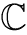: 复数


<math xmlns="http://www.w3.org/1998/Math/MathML" overflow="scroll" display="inline"><mi mathvariant="double-struck">N</mi></math>: 自然数（正整数）


<math xmlns="http://www.w3.org/1998/Math/MathML" overflow="scroll" display="inline"><mi:="double-struck">Q</mi></math>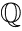: 有理数


<math xmlns="http://www.w3.org/1998/Math/MathML" overflow="scroll" display="inline"><mi:="double-struck">R</mi></math>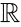: 实数


# 第 1 章：入门介绍

> 数学是上帝编写宇宙的语言。^()

> > 逻辑是我们所获得的所有知识的确定性的基础。^()

> > > 数学家像法国人：无论你对他们说什么，他们都会将其翻译成自己的语言，并立刻变成某种完全不同的东西。^()

> > > ## 1.1 这本书是关于什么的？

正如我在引言中提到的，这是一本关于数字的书，但不仅仅是我们熟悉并每天使用的数字（例如 1, 2, 3 以及像 <math xmlns="http://www.w3.org/1998/Math/MathML" overflow="scroll" display="inline"><mfrac><mrow><mn>1</mn></mrow><mrow><mn>2</mn></mrow></mfrac></math>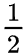 和 <math xmlns="http://www.w3.org/1998/Math/MathML" overflow="scroll" display="inline"><mfrac><mrow><mn>3</mn></mrow><mrow><mn>4</mn></mrow></mfrac></math>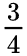这样的分数）。我想向大家介绍一些不太熟悉的数字类型，尽管我们个人并不每天使用，但它们支撑了许多技术。同时，我希望向大家介绍数学眼中的数学——这与你们在学校学的数学可能大不同。

## 1.2 数学家眼中的数学

我想先说，专业数学家所做的——即发明（或*发现*）新数学——是一项创造活动。也就是说，数学研究的目标是陈述并证明新的定理或猜想，或者找到反驳猜想的例子，或者证明某些条件是可以实现的。每位工作中的数学家总是希望能以某种方式扩展数学体系。


然而，在这一点上我想稍微反驳一下自己的观点！虽然数学显然是人类完全创造的产物，但重要的是，许多——如果不是大多数——数学家，无论有意识还是无意识，谈论数学时都好像它一直存在一样。例如，他们（包括我）会谈论“发现”一个定理，而不是“创造”一个定理。事实上，存在一种广泛且往往未曾言明的感觉，即我们发展的思想和证明的定理总是存在的，我们只是负责去`discover`它们。许多之前的作者已经对此进行过详细讨论，而`platonism`（柏图主义）通常是这种信念的名称（尽管这与柏拉图主义，即柏拉图的哲学不同）。当然，当被问及这种看似奇异的信念时，许多数学家会有些收缩，并承认数学是被创造出来的，但这并不能完全解释为什么“发现”定理或证明的说法在数学界如此普遍。

数学是`有效`的这一事实，即它不自矛盾，并且在应用于极广泛的活动时如此高效，这增强了人们认为它是普遍的、并且存在于其人类创造者之外的感觉^()

数学的伟大力量之一来自于抽象和概括。我所说的抽象是指提取某个具体的东西，例如对整个整数进行加法运算（`integers`^())

这引导我们走向我认为数学的核心：定理和证明。定理和引理仅仅是关于某些数学结构属性的陈述。要成为一个定理而非仅仅是一个猜想，必须配有证明。证明将以逻辑的方式建立定理的真理性性。在定理拥有完整证明之前，数学界不会接受其为真。

那么，为什么我们需要证明呢？我在书中将陈述并证明的许多定理和引理看起来是显而易见的或直觉上真实的。然而，虽然数学直觉极其重要，但它也非常不可靠，“显而易见”的结果可能被证明是错误的。这就是数学家们在 18 世纪和 19 世纪付出了巨大努力，为实数和复数的数学建立一个稳固基础的主要原因。

当然，在这一点上我必须承认我们都是会犯错的；事实上，正如亚历山大·波普所说：“人非完人”。^()

四色定理（“4CT”）就是一个著名的例子。^()

阿尔弗雷德·坎普在 1879 年发表了该定理的“证明”，这在当时被接受了。然而， 1890 年，珀西·海伍德发现了一个缺陷。因此，从那时起，它变成了“四色猜想”，直到 1976 年肯尼·阿佩尔和沃尔夫冈·哈肯宣布了他们的计算机辅助证明，它才再次成为 4CT。他们需要计算机的帮助来完成证明，以检查 1482 个独立情况。

通常情况下，我们在论文提交发表的审稿过程中，依靠其他数学家检查证明，尽管这显然并非万无一失。更广泛地说，任何重大结果都可能被许多数学家查看和检查。有趣的是，1976 年四色定理证明是计算机辅助的，使得人工检查几乎不可能，这在当时引起了许多争议，尽管该结果在今天已被广泛接受。事实上，之后又发表了第二个证明（或者我应该说是被发现了？）——需要计算机检查的情况少得得多。

## 1.3 定理与证明

那么，如果定理是数学的基石，它们是什么样子的呢？定理的陈述通常开头说明它适用于哪些数学对象（或多个对象），例如`integers`。它可能还会说明了额外的限制——例如，一个关于整数的定理可能只适用于特定的整数，例如质数。然后定理将列出一个或多个关于所考虑对象的真陈述。这些都是相当抽象的，但定理陈述的细节会根据主题而有很大不同。

一个简单的例子是所谓的`毕哥拉斯定理`，尽管正如许多命名定理的情况一样，毕哥拉斯并不是第一个知道它的人。显然，在毕哥拉斯出生前 1000 年，毕哥拉斯法则就已经广为人知。定理内容如下：

上一行末尾的小框（`<math xmlns="http://www.w3.org/1998/Math/MathML" overflow="scroll" display="inline"><mo>&#9633;</mo></math>`符号）标记了证明的结束，^()

现在我们知道定理是什么样子的了，我也应该尝试解释定理和引理之间的区别。在最基础的层面上两者没有区别，因为它们都涉及对某事真性的陈述，并且都必须配有证明。什么被标记为引理，什么被称为定理，通常取决于作者的品味。通常来说，定理是由于其自身价值而值得陈述的东西，而引理通常是唯一目的是帮助其他引理或定理的东西。

在陈述定理时，或者在定理的证明过程中，惯做法是使用“当且仅当”短语（有时缩写为 `iff`）来表示双向蕴含。通常的语境是类似于`<math xmlns="http://www.w3.org/1998/Math/MathML" overflow="scroll" display="inline"><mi>A</mi></math>![images/c001_dequ21.png]`为真当且仅当 <math xmlns="http://www.w3.org/1998/Math/MathML" overflow="scroll" display="inline"><mi>B</mi></math>![images/c001_dequ22.png]`为真。其含义仅仅是，如果 `<math xmlns="http://www.w3.org/1998/Math/MathML" overflow="scroll" display="inline"><mi>A</mi></math>![images/c001_dequ23.png]`为真，那么`<math xmlns="http://www.w3.org/1998/Math/MathML" overflow="scroll" display="inline"><mi>B</mi></math>![images/c001_dequ24.png]`为真，*并且也*如果`<math xmlns="http://www.w3.org/1998/Math/MathML" overflow="scroll" display="inline"><mi>B</mi></math>![images/c001_dequ25.png]`为真，那么`<math xmlns="http://www.w3.org/1998/Math/MathML" overflow="scroll" display="inline"><mi>A</mi></math>![images/c001_dequ26.png]`为真。

定理的证明方法有很多种；事实上，对数学底层规则感兴趣的逻辑学家已经识别了一系列不同`类型`的证明。最显而易见的证明方法是从定理的假设开始，给出一个逻辑递进的论证，从而得出所需的结果。我给毕哥拉斯定理的证明就是这种类型。

另一种非常常见的论证类型是`反证法`。这涉及到假设要证明的结果的反反面，然后通过一系列逻辑推演，得出一个不可能为真的结论——通常是与定理底层的某个假设相矛盾。结果，该陈述必须是真的（因为如果不能为假的，它就必须是真的^()）。


第三种论证形式称为 `induction`（归纳法），它适用于断言关于正整数 $n$ 的函数语句 $P(n)$ 为真的定理。这种证明方法将在第 3 章中进行解释。

最后，对于陈述某个数学对象存在的定理，例如关于存在勾股数组的定理（即存在三个整数 $a$、$b$ 和 $h$，使得 $a² + b² = h²$），证明只需要给出一个例子即可。对于勾股数定理，只需要给出一个合适的三元组 $(a, b, h)$ 例子，例如 (3, 4, 5) 即可。

此外还有其他证明定理的方法，例如通过提供反例来证明某个断言是不错误的，但前面的列表对于本书来说足够了。

在继续阅读之前，我觉得我应该简单解释一下如何为一个定理构思证明方法。通常，在尝试证明一个结果时，我会在脑海中与问题搏斗，直到我觉得自己有了一些思路——也许不是完整的证明，但可能是正确方向上的某一步。当我尝试把它们写下来时，真正的“酸性测试”就来了；遗憾的是，当我准备写下一个想法时，往往发现它实际上行不可通，因为我遗漏了一些只有在处理细节时才会显现的点。所以，把事情写下来是一个绝对关键的步骤；实际上，我相信这一原则适用于许多研究领域，而不仅仅是数学。

当我真正证明了某些东西时，我想出的第一个证明可能相当冗长且不优雅——事实上，它可能仍然是，因为即使是写下来也不总能捕捉到细微的错误！包含在学术论文或书籍中的最终证明通常不是发现的第一个证明，而是一个精修的版本，即一个尽可能简洁整洁的版本。事实上，对于广为人知的定理（如本书所包含的定理），数学界通常有成百甚至上千年的时间来推导出最巧妙、最优雅的证明。

这并不是一个总是像它应该被充分讨论的话题；你甚至可以称之为数学家们一个略显肮脏的秘密。当你作为一个数学学生面对一个证明时，它们看起来总是比你被要求为“作业”或作为练习时可能构思出的任何证明都要好得多。但当然，你不必为此感到难过——我们大多数人都是如此！所以，当在本本书的各个地方要求你尝试证明一个结果时，如果你的证明比我在书末展示的证明不优雅或不简单，请不要灰心；记住，我是“了弊的，利用了各种已建立的来源找到了我最喜欢的证明。此外，如果你的证明与我的不同，也不要担心；有许多不同且同样有效的方法来建立相同的结果。

事实上，找到一个证明往往比比弄清楚应该尝试证明的定理是什么要简单得多。

## 1.4 抽象代数

我已经简要提到过抽象和泛化的思想。抽象代数，正如其名，是关于研究当你抛弃关于“两个对象相加或相乘意味着什么”的刻板印象时会发生什么。涉及的对象可以取自有限或无限集合，这些对象可以是熟悉的数字、几何对象，或者更复杂的实体，如多项式。随着你阅读本书，你将遇到广泛的示例。

在下一章的结束，我将提供一些我们对泛化加法或乘法概念（或我称之为 `operations`）可能预期的抽象属性的示例。那里给出的列表绝不是完整的，而且在书的后续部分，我还会引入其他示例，特别是关于两个操作如何相互作用的示例。

## 1.5 需要了解什么才能读懂本书？

这当然是一个至关重要的问题。我假设你对学校学过的数学有非常基础的了解，特别是关于整数、加法、乘法、减法和幂（即一个数的另一个数的幂）的初级概念。

然而，在其他方面，我试图让这本书自成体系，每当我引入新概念时，都会提供我希望你觉得有用的示例。有时我怀疑你可能需要在继续之前花一点时间玩玩某个概念，如果你对理解某些内容有困难，我建议用纸笔算出你自己的例子。不要担心，每个数学家（也许是拥有行星级智慧的人外）都需要偶尔在纸上涂涂画画，试图掌握一个概念。

## 1.6 应用案例研究

我已经在前言中提到，本书的主要目标是为工程师和计算机科学家提供关于群和有限域等主题的入门介绍，以帮助他们发现自己正在从事这些概念的应用。当然，我希望这本书也能对对现代数字技术如何运作感兴趣的人产生吸引。重点是数学本身；然而，在开头的三个介绍性章节之后，每一章我都提供了所引入数学的应用案例研究。重点是我个人熟悉的主题，特别是与数字通信保护相关的，但我试图涵盖一系列应用领域。主要的案例研究主题总结如下。

*   在第 4 章中，我介绍了两个完全不同的应用，它们都基于模算术。第一个是校验位的概念，用于保护数值数据的完整性免受意外错误的影响。其次，我引入了公钥加密的想法和 RSA 公钥加密系统，其安全性取决于寻找极大大数的质因数的困难性；RSA 在许多领域被广泛使用，特别是在信用卡交易的保护中。
*   第 5 章介绍了群，它包含了另一种不同类型的公钥加密系统的描述，即 Diffie–Hellman 密钥交换，它已通过一系列底层群被广泛实现。


- 在第 6 章中，我介绍了环，并在那里我回到了保护数据完整性的问题，并介绍了一种在过去 60 多年里具有巨大实践意义的技术，即块码。我还介绍了一类块码的一个关键例子，即海明码。
- 第 7 章引入了多项式作为独立数学对象的思想。这里探索的关键应用是线性反馈移位寄存器以及此类寄存器生成的序列。移位寄存器已被广泛应用于数字通信领域，包括密码学和扩频通信。
- 数学山之巅在第 8 章中达到，我在那里介绍了有限域。这里所描述的案例研究再次与密码学有关，特别是所谓的椭圆曲线密码学。
- 最后一个主要章节第 9 章与书的其他部分略有不同，因为它由我无法忍心遗漏的主题汇编组成。虽然某些主题没有直接的应用，但对差集和有限几何的介绍涉及了一系列具有实际兴趣的主题，包括密码学，尽管在这里并未探讨其应用。


# 第 2 章：集、函数与关系

集合是一个允许自己被视为“一”的“多”。

## 2.1 为什么集合很重要？

在本章中，我将探索对于书中其余数学至关重要的思想。我将在贯穿始终这些简单但有时非常微妙的概念中使用。

首先，我将介绍`set`（集）的概念，你可以将其看作某种对象的集合；在原则上，这些对象可以是任何东西：人、动物、房子、行星或任何其他，但在这里我主要关注的是数字等数学对象。你可能会发现本章的讨论语调有些抽象，但我将尝试提供一些示例来使这些思想更加具体。

那么，为什么我要费力用这些烦你呢？事实证明，集是数学中绝对基础的工具。这可能令人惊讶，因为集合的概念直到 19 世纪末才出现，特别是在格奥尔格·康托尔（Georg Cantor）的作品中，他的引言开启了本章的序幕。

我还将介绍`relation`（关系）的概念，其中`relation`是指任何两个元素之间存在或不存在的某种关系。例如，如果一个集合包含某个村子里的所有人，那么`is married to`（已婚）这种关系可能适用于某些个人对。

在关系之后，我将描述一种特别重要的关系类型，被称为`equivalence relation`（等价关系）。等价关系泛化了相等的概念，而相等本身就是关系的一种特殊类型。

同样重要的概念是`function`（函数）。`function`将元素从一个集合（`domain`，域）映射到第二个集合（`codomain`，陪域）。当然，域和陪域可以是相同的，但这显然不是必须的。可能遇到过的函数示例有三角函数：`sine`（正弦）、`cosine`（余弦）和`tangent`（正切）（通常称为 `sin`、`cos` 和 `tan`），以及数值函数如`logarithm`（对数）。

本章以介绍`operations`（运算）结束，即定义的组合集合中的元素对以得到同一集合的另一个元素，正如`addition`（加法）或`multiplication`（乘法）可以组合两个数字得到另一个数字一样。某些特殊类型的运算将是书中几乎所有部分的关键。

事实上，可以说所有的数学都是关于研究和证明某些类型集合的属性，以及定义在这些集元素上的特定关系、函数和运算。因此，在本章中，我正铺设用于几乎所有数学的基础工具。这些数学基础工具简单且易于表述，但使用它们可以取得的成就似乎没有限制——就像英语中区几万单词可以用来构建数量无限的、优劣不齐的文学作品一样。

## 2.2 集

什么是集？正如我已经提到的，集可以被看作某种东西的集合。对于集合中包含什么没有任何限制；定义集的关键是确保有一个明确的规则，使任何人都能判断某个特定对象是否是该集的`member`（成员）。

我将使用一些特殊符号来描述集。首先，我将始终使用大括号 `{…}` 来限定集的内容。一个简单的集示例可能是

```
<math xmlns="http://www.w3.org/1998/Math/MathML" overflow="scroll" display="block"><mo stretchy="false">{</mo><mtext>pink</mtext><mo>,</mo><mtext>blue</mtext><mo>,</mo><mtext>green</mtext><mo stretchy="false">}</mo><mo>.</mo></math>
```
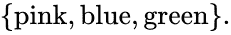


这个集合包含了三个对象，它们恰好是粉红色、蓝色和绿色。集合的成员被称为它的 `elements`（元素）。我也用特殊符号 <math xmlns="http://www.w3.org/1998/Math/MathML" overflow="scroll" display="inline"><mo>&#8712;</mo></math>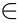 来表示一个对象是集合的成员。因此，我可以写成

<math xmlns="http://www.w3.org/1998/Math/MathML" overflow="scroll" display="block"><mtext>pink</mtext><mo>&#8712;</mo><mo stretchy="false">{</mo><mtext>pink</mtext><mo>,</mo><mtext>blue</mtext><mo>,</mo><mtext>green</mtext><mo stretchy="false">}</mo><mo>.</mo></math>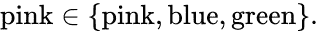

我也可以写成

<math xmlns="http://www.w3.org/1998/Math/MathML" overflow="scroll" display="block"><mtext>yellow</mtext><mo>&#8713;</mo><mo stretchy="false">{</mo><mtext>pink</mtext><mo>,</mo><mtext>blue</mtext><mo>,</mo><mtext>green</mtext><mo stretchy="false">}</mo><mo>,</mo></math>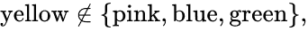

其中 <math xmlns="http://www.w3.org/1998/Math/MathML" overflow="scroll" display="inline"><mo>&#8713;</mo></math>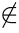 可以读作“不是……的成员”或“不是……的元素”。

集合的一个重要属性是它的大小，或 `cardinality`（基数），即集合中元素的数量。对于我们简单的例子，<math xmlns="http://www.w3.org/1998/Math/MathML" overflow="scroll" display="inline"><mo fence="false" stretchy="false">{</mo><mtext>Pink</mtext><mo>,</mo><mtext>blue</mtext><mo>,</mo><mtext>green</mtext><mo fence="false" stretchy="false">}</mo></math>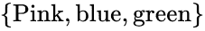的基数显然是 3。如果我将这个集合称为 <math xmlns="http://www.w3.org/1998/Math/MathML" overflow="scroll" display="inline"><mi>C</mi></math>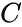，即：

<math xmlns="http://www.w3.org/1998/Math/MathML" overflow="scroll" display="block"><mi>C</mi><mo>=</mo><mo stretchy="false">{</mo><mtext>pink</mtext><mo>,</mo><mtext>blue</mtext><mo>,</mo><mtext>green</mtext><mo stretchy="false">}</mo><mo>,</mo></math>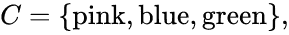

那么我用竖线来表示基数，也就是说我可以写成

<math xmlns="http://www.w3.org/1998/Math/MathML" overflow="scroll" display="block"><mo stretchy="false">&#124;</mo><mi>C</mi><mo stretchy="false">&#124;</mo><mo>=</mo><mn>3</mn></math>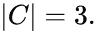

两个非常重要的集合是 `Natural Numbers`（自然数）<math xmlns="http://www.w3.org/1998/Math/MathML" overflow="scroll" display="inline"><mi var="double-struck">N</mi> 和整数 <math xmlns="http://www.w3.org/1998/Math/MathML" overflow="scroll" display="inline"><mi var="double-struck">Z</mi>。特殊符号 <math xmlns="http://www.w3.org/1998/Math/MathML" overflow="scroll" display="inline"><mi var="double-struck">N</mi> 和 <math xmlns="http://www.w3.org/1998/Math/MathML" overflow="scroll" display="inline"><mi var="double-struck">Z</mi> 在数学中被广泛使用。自然数正如其名所示，包含了我们所有人熟悉的日常数字，即：

<math xmlns="http://www.w3.org/1998/Math/MathML" overflow="scroll" display="block"><mi var="double-struck">N</mi><mo>=</mo><mo stretchy="false">{</mo><mn>1</mn><mo>,</mo><mn>2</mn><mo>,</mo><mn>3</mn><mo>,</mo><mo stretchy="false">}</mo></math>

整数包含了所有的自然数，以及负数和零。即

<math xmlns="http://www.w3.org/1998/Math/MathML" overflow="scroll" display="block"><mi var="double-struck">Z</mi><mo>=</mo><mo stretchy="false">{</mo><mn>-3</mn><mo>,</mo><mn>-2</mn><mo>,</mo><mn>-1</mn><mo>,</mo><mn>0</mn><mo>,</mo><mn>1</mn><mo>,</mo><mn>2</mn><mo>,</mo><mn>3</mn><mo>,</mo><mo stretchy="false">...</mo><mo stretchy="false">}</mo></math

这两个集合包含无限数量的元素，那么它们的基数是多少？非正式地说，它们被认为具有无限基数。事实上，可以正式地定义什么是无限基数——这个主题我们在书的第 9.2 节 中讨论。通常观察一个集合包含另一个的情况很有趣，这意味着一个集合中的所有元素都在另一个集合中。对于我给出的例子显然，<math xmlns="http://www.w3.org/1998/Math/MathML" overflow="scroll" display="inline"><mi var="double-struck">N</mi> 包含 <math xmlns="http://www.w3.org/1998/Math/MathML" overflow="scroll" display="inline"><mi var="double-struck">Z</mi>。我说 <math xmlns="http://www.w3.org/1998/Math/MathML" overflow="scroll" display="inline"><mi var="double-struck">N</mi> 是 <math xmlns="http://www.w3.org/1998/Math/MathML" overflow="scroll" display="inline"><mi var="double-struck">Z</mi> 的 `subset`（子集），并写成

<math xmlns="http://www.w3.org/1998/Math/MathML" overflow="scroll" display="block"><mi var="double-struck">N</mi><mo>&#8838;</mo><mi var="double-struck">Z</mi><mo>.</math>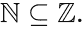

你应该将符号 <math xmlns="http://www.w3.org/1998/Math/MathML" overflow="scroll" display="inline"><mo>&#8838;</mo></math>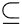读为“包含”或“是……的子集”。图 2.1 描绘了 <math xmlns="http://www.w3.org/1998/Math/MathML" overflow="scroll" display="inline"><mi var="double-struck">N</mi>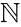 和 <math xmlns="http://www.w3.org/1998/Math/MathML" overflow="scroll" display="inline"><mstyle var="bold"><mi var="double-struck">Z</mi></mstyle></math> 之间的子集关系。


图 2.1 展示了 `N` 如何与 `Z` 关联。

我还需要一个与集合相关的符号。存在一个不包含任何元素的（唯一）集合。这被称为`空集`，写作 `∅`。

我向你们承诺过给出证明，所以现在是时候在第 1 章的例子之外，再给你们展示一个证明了。在形式数学中，我们给出想要证明其为真的陈述，正如我在第 1 章中提到的，我们将它们标记为定理或引理（如果你表现得吹毛求疵，也可以称为 lemmata）。对于我的第一个证明示例（除了勾股达定理之外），我将从一个非常简单的结果开始；我会将其称为引理而不是定理，因为它只是一个微小但有用的结果。

注意，在证明中，我完全可以假设 `x ∈ B` 但 `x ∉ A`，并使用完全相同的论证——这是证明中一种假设的例子，通常被称为“不失一般性地”（without loss of generality）。

我怀疑你们可能有点困惑：a) 为什么我要费心陈述这个结果，以及 (b) 为什么我要费力给出证明，因为这似乎是显而易见的。(a) 的答案很简单：它为我们提供了一种证明两个集合相等简单方法——也就是说，如果我证明 `A ⊆ B` 且 `B ⊆ A`，那么根据引理 2.1，我立刻就知道 `A = B`。事实上，这正是我们构建数学的方式：开发一系列引理，然后将它们结合起来证明我们想要建立任何主要结果。

(b) 的答案更为复杂。首先，我想给你们提供一个非常简单证明的例子，好让你们进入状态。其次，仅仅因为事情看起来显而易见并不意味着它是正确的。的是，数学史上充满了由于盲目接受看似明显但事实被证明是错误的说法而导致的错误。

第三，我想演示所谓的`反证法`（reductio ad absurdum）证明技术，在这种技术中，我假设我试图证明的结果是假的，然后证明这会导致我假设为真的事情产生矛盾——因此，结果必须是真实的！反证法是一种极其有用的技术；事实上，正如 20 世纪伟大的英国数学家戈夫雷 ·哈罗德·哈迪（Godfrey Harold Hardy）所说：

> 欧几里得如此喜爱的反证法是数学家最完美的武器之一。这比任何象棋走法都要高明得多：棋手可能会牺牲一个兵甚至一个棋子，但数学家牺牲的是整局棋游戏。

处理两个集合都包含元素的情况很常见，有时这些共同元素是有意义的。举个简单的例子，假设 `B` 是与彩虹相关的颜色集合，即 `B = {red, orange, green, blue, violet}`，并且之前假设 `C = {pink, blue, green}`。

那么 `B` 和 `C` 有两个共同元素：蓝色和绿色。我说 `B` 和 `C` 的`交集`（intersection），即 `B` 和 `C`共同拥有的元素集合，是 `{blue, green}`，我写道：

`B ∩ C = {blue, green}`。


即符号 `∩` 表示集合交集。集合 `B` 和 `C` 之间的关系如图图 2.2 所示，其中 `B ∩ C` 是两个圆重叠的区域。如果两个集合 `A` 和 `B` 的交集为空，即 `A ∩ B = ∅`，则说 `A` 和 `B` 是互斥的。

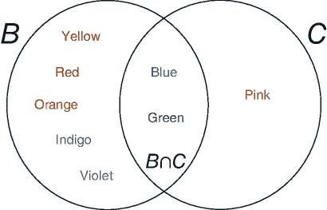

图 2.2 `B` 和 `C` 之间的关系。

同样，我有时也对包含两个集合中至少一个元素的集合感兴趣。对于两个集合，包含其中任何一个集合中所有元素的集合被称为这两个集合的并集，我们使用符号 `∪` 来表示。因此我可以写成：

`B ∪ C = {pink, red, orange, yellow, green, blue, indigo, violet}`

这意味着 `B` 和 `C` 的并集是一个包含出现在 `B` 或 `C` 中的所有元素的集合。再次查看图 2.2，`B ∪ C` 由两个圆内部的区域表示。该图是恩图的一个简单示例，以韦恩命名。在恩图中，集合通常被显示为一个圆。与数学的悠久历史相比，集合的概念相对较新，但在 20 世纪集合成为了一项基础工具。

### 集合的笛卡尔积

在研究我们可以对集合做什么之前，我需要简要介绍一种组合集合以形成更大集合的方法。假设 `A` 和 `B` 是集合。那么集合 `A × B` 是所有元素对的集合，对中的第一个元素来自 `A`，第二个来自 `B`。这被称为 `A` 和 `B` 的笛卡尔积。这个名字来源于 17 世纪法国哲学家、数学家勒内·笛卡尔。

更正式地说，

`A × B = {(a, b) : a ∈ A, b ∈ B}`。


我可以将这个定义扩展到三个或多个集合，例如，如果 $A, B, C, D$ 是四个集合，那么 $A \times B \times C \times D$ 包含所有的有序四元组，其中第一个元素来自 $A$，第二个元素来自 $B$，依此类推。

按照标准惯例，我将有序对 $(a, b)$ 称为 2-元组，将有序三元组 $(a, b, c)$ 称为 3-元组，依此类推。

举一个简单的例子，假设 $A = \{1, 2\}$ 且 $B = \{a, b, c\}$。那么 $A \times B$ 总共包含六个元素：

$(1, a), (1, b), (1, c), (2, a), (2, b), (2, c)$。

更一般地说，很容易看出如果 $A$ 和 $B$ 是有限集，那么 $A \times B$ 的基数（即元素的个数）简单等于 $A$ 和 $B$ 基数的乘积。在上面的例子中，$|A| = 2$，$|B| = 3$ 且 $|A \times B| = |A| \times |B| = 6$。

## 2.4 关系


集合本身并没有太大用处。我需要描述集合中的元素之间是如何相关的，或者它们是如何组合的。作为这一方向的第一步，我将定义集合成员上的 `relation`（关系）的概念。如果 $S$![images/c002_dequ100.png) 是一个集合，那么关系 $R$![images/c002_dequ101.png) 适用于该集合中的某些元素对。如果 $a \in S$![images/c002_dequ102.png) 且 $b \in S$![images/c002_dequ103.png)，那么当 $a$![images/c002_dequ105.png) 于 $b$![images/c002_dequ106.png) 时，我写下 '$aRb$'![images/c002_dequ104.png)。（考虑关系 $R$![images/c002_dequ107.png) 的另一种思考方式是，它是集合 $S \times S$![images/c002_dequ109.png] 的子集 $U$![images/c002_dequ108.png)，其中 $aRb$![images/c002_dequ110.png] 当当且仅当 $(a,b) \in U$![images/c002_dequ111.png]。）

考虑以下简单的例子。假设 $S$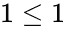
表 2.1 定义在 {1, 2, 3, 4} 上的小于等于关系。

更严格地说，我定义的是 `binary`（二元）关系，因为它适用于元素对。当然，也可以在三个或更多元素的组上定义操作，但这超出了感兴趣的范围。我刚刚给出的例子是一种特殊的关系，称为 `ordering`（序），而序有它们自己的性质——我将在第 3 章中给出序的基本性质。然而，接下来我想定义并给出另一种类型的关系示例，这对于本书以及数学都至关重要。

## 2.5 等价关系与等价类

`equivalence relation`（等价关系）的概念简单而强大。等价关系定义背后的思想是泛化等式的概念，毕竟等式本身就是一种特殊的关系。要理解等价关系的动机，考虑等式的性质是非常重要的。

等式的第一个关键性质是它是 `reflexive`（自反的），即对于任何 $x$，$x=x$![images/c002_dequ139.png] 总是成立的。等式的第二个重要性质是 `symmetry`（对称性），即如果 $x=y$![images/c002_dequ140.png]，则总是推导出 $y=x$![images/c002_dequ141.png]。等式的第三个基本性质是 `transitive`（传递性），即如果 $x=y$![images/c002_dequ142.png] 且 $y=z$![images/c002_dequ143.png]，则推导出 $x=z$![images/c002_dequ144.png]。这些当然是显而易见的观察，但它们启发了一个非常重要的想法。

假设关系 $R$![images/c002_dequ145.png] 定义在集合 $S$![images/c002_dequ146.png) 上。同样假设 $R$![images/c002_dequ147.png] 具有以下三个性质：

* 对于每个 $x \in S$，以及


如果 $xRy$<math xmlns="http://www.w3.org/1998/Math/MathML" overflow="scroll" display="inline"><mi>x</mi><mstyle scriptlevel="0"><mspace width="0.167em"/></mstyle><mi>R</mi><mstyle scriptlevel="0"><mspace width="0.167em"/></mstyle><mi>y</mi></math> 和 $yRz$<math xmlns="http://www.w3.org/1998/Math/MathML" overflow="scroll" display="inline"><mi>y</mi><mstyle scriptlevel="0"><mspace width="0.167em"/></mstyle><mi>R</mi><mstyle scriptlevel="0"><mspace width="0.167em"/></mstyle><mi>z</mi></math>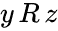，对于某些 $x, y, z \in S$<math xmlns="http://www.w3.org/1998/Math/MathML" overflow="scroll" display="inline"><mi>x</mi><mo,</mo><mi>y</mi><mo,</mo><mi>z</mi><mo>&#8712;</mo><mi>S</mi></math>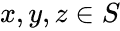，则 $xRz$<math xmlns="http://www.w3.org/1998/Math/MathML" overflow="scroll" display="inline"><mi>x</mi><mstyle scriptlevel="0"><mspace width="0.167em"/></mstyle><mi>R</mi><mstyle scriptlevel="0"><mspace width="0.167em"/></mstyle><mi>z</mi></math>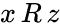（传递性）。

那么 $R$<math xmlns="http://www.w3.org/1998/Math/MathML" overflow="scroll" display="inline"><mi>R</mi></math> 被称为等价关系，这意味着 $R$<math xmlns="http://www.w3.org/1998/Math/MathML" overflow="scroll" display="inline"><mi>R</mi></math>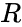 是具有等价性某些关键性质的关系。事实证明，等价关系在数学的许多分支中随处可见。

特别是由于等价关系具有重要的性质，每当我遇到这种关系的实例时，我立刻知道它具有所有这些性质。这是数学中一个重要的思想，即证明一类通用对象的性质，然后将其应用于具体的实例。这展示了抽象的威力。

一个简单的、非数学的例子涉及人。设集合 $S$<math xmlns="http://www.w3.org/1998/Math/MathML" overflow="scroll" display="inline"><mi>S</mi></math> 为英国的所有人，假设关系 $R$<math xmlns="http://www.w3.org/1998/Math/MathML" overflow="scroll" display="inline"><mi>R</mi></math> 是“住在同一条街道”。很难看出 $R$<math xmlns="http://www.w3.org/1998/Math/MathML" overflow="scroll" display="inline"><mi>R</mi></math> 是一个等价关系。每个人都和自己住在同一条街道（自反性）。如果 Jane 和 Mary 住在同一条街道，那么 Mary 和 Jane 也住在同一条街道（对称性）。最后，如果 John 和 Jim 住在同一条街道，Jim 和 Mike 也住在同一条街道，显然 John 和 Mike 也住在同一条街道（传递性）。

当然，在这个例子中略过了两个问题。首先，由于某种原因，有些人没有固定的街道地址，因此在这种情况下该关系未定义。我可以通过限制集合 $S$<math xmlns="http://www.w3.org/1998/Math/MathML" overflow="scroll" display="inline"><mi>S</mi></math> 为具有固定街道地址的人来解决这个问题——当然，这通常是政府在想要忽视无 homeless 问题时所做的。其次，人们一直在出生、搬家和去世，因此集合 $S$<math xmlns="http://www.w3.org/1998/Math/MathML" overflow="scroll" display="inline"><mi>S</mi></math> 和关系 $R$<math xmlns="http://www.w3.org/1998/Math/MathML" overflow="scroll" display="inline"><mi>R</mi></math> 不是固定的；尽管如此，只要我们考虑的是某个时刻的 $S$<math xmlns="http://www.w3.org/1998/Math/MathML" overflow="scroll" display="inline"><mi>S</mi></math> 和 $R$<math xmlns="http://www.w3.org/1998/Math/MathML" overflow="scroll" display="inline"><mi>R</mi></math>，结果依然成立。当然，这就是生活的困难之处——它不像数学世界那样容易处理。

我特别感兴趣一个关键性质，即等价关系划分它所定义的集合，也就是说它将集合分为不重叠的部分。为了建立这个重要的结果，我们需要另一个符号。如果 $R$<math xmlns="http://www.w3.org/1998/Math/MathML" overflow="scroll" display="inline"><mi>R</mi></math>是集合 $S$<math xmlns="http://www.w3.org/1998/Math/MathML" overflow="scroll" display="inline"><mi>S</math>上的等价关系，那么对于任意 $x \in S$<math xmlns="http://www.w3.org/1998/Math/MathML" overflow="scroll" display="inline"><mi>x</mi><mo>&#8712;</mo><mi>S</mi></math>令 $\{x\}R$<math xmlns="http://www.w3.org/1998/Math/MathML" overflow="scroll" display="inline"><mo stretchy="false">{</mo><mi>x</mi><mo stretchy="false">}</mo></mrow>R</mi></math](images/c002_dequ169.png)表示与 $x$ 相关的集合；即，在形式语言中：

```
{x}R = {y ∈ S : xRy}
```

上面的内容可以读作“$\{x\}R$<math xmlns="http://www.w3.org/1998/Math/MathML" overflow="scroll" display="inline"><msub><mo stretchy="false">{</mo><mi>x</mi><mo stretchy="false">}</mo></mrow><mi>R</mi></msub></math> 等于所有 $y$<math xmlns="http://www.w3.org/1998/Math/MathML" overflow="scroll" display="inline"><mi>y</mi></math> 在 $S$<math xmlns="http://www.w3.org/1998/Math/MathML" overflow="scroll" display="inline"><mi>S</mi></math> 中且满足 $xRy$<math xmlns="http://www.w3.org/1998/Math/MathML" overflow="scroll" display="inline"><mi>x</mi><mstyle scriptlevel="0"><mspace width="0.167em"/></mstyle><mi>R</mi><mstyle scriptlevel="0"><mspace width="0.167em"/></mstyle><mi>y</mi></math>”，即在定义集合时，我们用冒号作为“使得”或“具有……性质”的简写。我们称 $\{x\}R$<math xmlns="http://www.w3.org/1998/Math/MathML" overflow="scroll" display="inline"><msub><mo stretchy="false">{</mo><mi>x</mi><mo stretchy="false">}</mo></mrow><mi>R</mi></msub></math>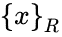 为*等价类*。

有了了这些符号，我们现在可以给出（并证明）我们的核心结果。下方的定理表述相当正式，但其含义将在下文中以非正式的形式进行解释。


###那么这个定理意味着什么？

如果你仔细思考一下，它意味着等价类划分了定义该关系的集合，并且一个等价类中的所有成员之间都是相互相关的。回到我们那个简单的例子，假设关系 `R` 表示“住在同一条街道上”，那么等价类就是居住在特定街道的人的集合——每条街道都有其对应的人员等价类。因此，这种关系将 `S` 中的所有人划分成了不同的街道子集。

在英语单词汇集合上定义的一个简单等价关系是“以相同的字母开头”。该等价关系的一些等价类如图图 2.3 所示。

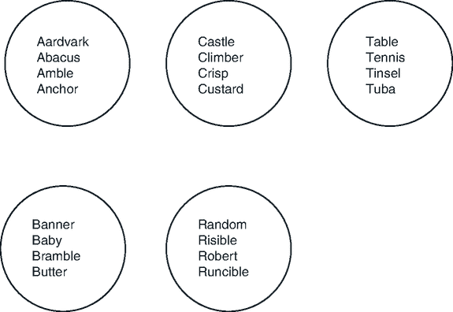

图 2.3 “以相同的字母开头”的等价类。

在第 2.6 节 中，我提供了一个关于该定理如何运作的更详细示例。然而，在进入这个例子之前，我想——出于趣味考虑——和你们分享一个听起来合理（但错误）的论证。假设 `R` 是集合 `S` 上一个具有对称性和传递性的关系。任取元素 `x`，并令 `y` 为 `S` 中任何满足 `x R y` 的元素。根据对称性，我们知道 `y R x`。此外，由于 `x R y` 且 `y R x`，根据传递性我们知道 `x R x`，也就是说 `R` 必须是自反的。因此，似乎我们可以把等价关系的定义简化为仅具有对称性和传递性的关系（而不需要假设自反性）。

那么这个论证错在哪里呢？请思考一下。我在书末的“读者问答”部分进一步讨论了这一点（参见第 222 页）。当然，发现证明中的错误是数学家们非常担心的事情。有时很容易忽略掉一个隐含假设，而这恰恰发生在这里。

## 2.6 关系：详细示例

接下来我想给出一个相当微妙的关系示例。该关系再次定义在特定集合的人身上。这次的集合包含了活者和死者——为了论证，我将集合 `S` 定义为自 1800 年初以来英国生存的所有，但下面的论证适用于任何其他定义的人员。关系 `R` 是“是……亲亲”。这是一个相当模糊的概念，为了使其更精确，我会说 `S` 中的两个个体 `x` 和 `y` 具有血缘关系（即 `x Ry`），当且仅当 `x` 和 `y` 在集合 `S` 中拥有共同祖先时。例如，如果 Bob 的曾祖母是 Doris 的祖母，那么 Bob 和 Doris 就是血缘亲属（实际上他们是表亲/堂亲）。

那么这种关系具有什么属性？嗯，它显然是自反的，因为任何个体与自己有两个共同祖先，即他们的母亲和父亲。所以，这不是一个等价关系，它也没有将人类划分为血缘群体。也许这是一件好事，因为我们几乎不需要另一种方法让人们把自己划分为“我们”和“他们”；毕竟，近年来，民粹政治家煽动人们对被识别为“他们”的个人产生偏见似乎越来越流行，并导致了显而不可理想的结果；毕竟，“我们对抗他们”是独裁者常用的广为人知的梗。尽管如此，是否有任何方法可以限制我们的定义，让我们能够定义这种类型的等价关系？事实证明，通过只观察一种性别就可以做到。


令 $S_f$ 为 $S$ 中包含自 1800 年以来英国存世的所有女性的子集。当然，在不失一般性的情况下，我们也可以对男性进行同样的分析。那么，定义 $R_f$ 为“在集合 $S_f$ 中具有共同祖先”，是 $S_f$ 上的一种等价关系。这是为什么呢？


嗯，$R_f$ 显然是自反且对称的，就像 $R$ 一样。为什么它也是传递的呢？假设 $x, y$ 和 $z$ 都在 $S_f$ 中，且 $xRy$ 和 $yRz$，也就是说假设 $x$ 和 $y$ 有一个共同的女性祖先（假设为 $c_{xy}$），$y$ 和 $z$ 如此（假设为 $c_{yz}$）。我们需要证明 $xRz$，即 $x$ 和 $z$ 有一个共同的祖先。验证 $y$ 的女性祖先形成一个链是显而易见的，因为 $y$ 有一个母亲，母亲有一个母亲（$y$ 的祖母），祖母有一个母亲，依此类推。那么 $c_{xy}$ 和 $c_{yz}$ 必须位于 $y$ 的祖先链（母亲、祖母、曾祖母等）的某处，因为它们都是 $y$ 的祖先。如果 $c_{xy}=c_{yz}$，那么我们就完成了，因为这意味着 $c_{xy}$ 是 $x$ 和 $z$ 的共同祖先。现在假设 $c_{xy}$ 在 $y$ 的祖先链中比 $c_{yz}$ 更靠（更近期）。那么 $c_{yz}$ 是 $c_{xy}$ 的祖先（而 $c_{xy}$ 是 $x$ 的祖先），也就是说，$c_{yz}$ 是 $x$ 和 $z$ 的共同祖先，我们完成了；同样，如果 $c_{yz}$ 在 $y$ 的祖先链中比 $c_{xy}$ 更靠（更近期），我们可以使用相同的论证。


那么，当我们观察这种基于家族的关系所定义的等价类时，这意味着什么呢？有趣的是，一个等价类中的所有女性拥有相同的线粒体 DNA，因为这种 DNA 总是从母亲那里遗传的。同样，如果我们观察男性的对应关系 `<math xmlns="http://www.w3.org/1998/Math/MathML" overflow="scroll" display="inline"><msub><mi>R</mi><mi>m</mi></msub></math>说`，那么同一个等价类中的所有男性拥有相同的 Y 染色体，因为这种体总是从父亲那里遗传的。此外，如果我做出简化假设，男性永远不改变姓氏，且儿子总是随父亲的姓，那么一个等价类中的所有男性将拥有相同的姓氏。

> 这向我暗示了两点。第一，与英国和其他许多国家的习惯做法不同，也许女性应该随母姓而不是父姓，这样在`<math xmlns="http://www.w3.org/1998/Math/MathML" overflow="scroll" display="inline"><msub><mi>R</mi><mi>f</mi></msub></math>`下同一等价类中的女性将拥有相同的姓。

> 当然，我们的分析存在某些问题情况。如果将集合`<math xmlns="http://www.w3.org/1998/Math/MathML" overflow="scroll" display="inline"><mi>R</mi></math>`扩展到所有人类（无论生死），那么所有人类都将一个共同的祖先，因为进化生物学家告诉我们，全人类都源于三十万年前的一位女性——所谓的“线粒体夏娃”。从更根本上说，医学使婴儿能够来自两个以上父母的遗传物质，这使问题变得复杂。此外，DNA 会随着时间的推移发生变异，因此`<math xmlns="http://www.w3.org/1998/Math/MathML" overflow="scroll" display="inline"><msub><mi>R</mi><mi>f</mi></msub></math>`下等价类中的女性并不总是拥有相同的线粒体 DNA。事实上，如果没有发生变异，我们都将拥有相同的线粒体 DNA。同样，`<math xmlns="http://www.w3.org/1998/Math/MathML" overflow="scroll" display="inline"><msub><mi>R</mi><mi>m</mi></msub></math>`下的同一等价类男性将拥有相同的 Y 染色体，尽管在这两种情况下，类内的差异几乎都会非常小。总之，上述分析表明，证明`<math xmlns="http://www.w3.org/1998/Math/MathML" overflow="scroll" display="inline"><msub><mi>R</mi><mi>f</mi></msub></math>`（或`<math xmlns="http://www.w3.org/1998/Math/MathML" overflow="scroll" display="inline"><msub><mi>R</mi><mi>m</mi></msub></math>`）是一个等价关系，揭示了关于家族关系的一些显而易见的事实。事实证明，等价关系出现在许多意想不到的地方，因此定理 2.1](#c002.xhtml#c002-sec-0007）是一个非常实用的工具，在许多不同的背景下告诉我们有趣的事情。

## 7 函数

我怀疑你对什么是函数已经有一个非正式的概念了，但我想简短地将这个概念放在集合更正式的背景中。例如，我确定你遇到过函数的例子，比如三角函数 `sin` 和 `cos`，但你可能从未见过基于集合的正式定义。


如果 $X$ 和 $Y$ 是集合，那么一个从 $X$ 到 $Y$ 的函数 $f$（写作 $f:X \to Y$）是一种规则，对于给定任意元素 $x \in X$，指定一个唯一的元素 $y \in Y$，我们写作 $y = f(x)$。我们将 $y$ 称为 $x$ 在 $f$ 下的*像*（image）；相反，我们将 $x$ 称为 $y$ 在 $f$ 下的*原像*（pre-image）。此外，如果 $f:X \to Y$，我们将 $X$ 称为 $f$ 的*域*（domain），将 $Y$ 称为 $f$ 的*陪域*（codomain）。$f$ 的*值域*（range）是陪域 $Y$ 的子集，定义为所有存在 $x \in X$ 使得 $f(x) = y$ 的 $Y$ 中的元素。也就是说，值域是 $X$ 中被至少一个元素映射元素的集合。

我们可以像图 2.4 所示用图化的方式表示函数 $f$。

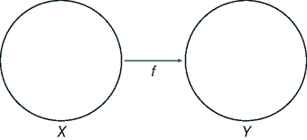

图 2.4 从 $X$ 映射到 $Y$ 的函数。

从 $\mathbb{Z}$ 映射到 $\mathbb{Z}$ 的函数 $f$ 的简单示例由 $f(x) = x + 1$ 指定（或者我们同样可以写作 $f:\mathbb{Z} \to x+1$）。在这种情况下，$f(-2) = -1$，$f(-1) = 0$，$f(0) = 1$，$f(1) = 2$，依此类推。

函数可以具备两个特别重要的性质。


- **单射 (One-to-one)**。函数 `one-to-one`（或 1-to-1 或 `injective`）是指该函数的每个输入 <math xmlns="http://www.w3.org/1998/Math/MathML" overflow="scroll" display="inline"><mi>x</mi></math>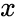 都对应不同的输出 <math xmlns="http://www.w3.org/1998/Math/MathML" overflow="scroll" display="inline"><mi>y</mi></math>。更正式地说，我们说如果 <math xmlns="http://www.w3.org/1998/Math/MathML" overflow="scroll" display="inline"><mi>f</mi></math> 满足 <math xmlns="http://www.w3.org/1998/Math/MathML" overflow="scroll" display="inline"><mi>f</mi><mo stretchy="false">(</mo><mi>x</mi><mo stretchy="false">)</mo><mo>=</mo><mi>f</mi><mo stretchy="false">(</mo><mi>y</mi><mo stretchy="false">)</mo></math>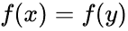 意味着 <math xmlns="http://www.w3.org/1998/Math/MathML" overflow="scroll" display="inline"><mi>x</mi><mo>=</mo><mi>y</mi></math>。或者，用同样有效的方法，我将单射定义为：如果 <math xmlns="http://www.w3.org/1998/Math/MathML" overflow="scroll" display="inline"><mi>x</mi><mo>&#8800;</mo><mi>y</mi></math>，那么 <math xmlns="http://www.w3.org/1998/Math/MathML" overflow="scroll" display="inline"><mi>f</mi><mo stretchy="false">(</mo><mi>x</mi><mo stretchy="false">)</mo><mo>&#8800;</mo><mi>f</mi><mo stretchy="false">(</mo><mi>y</mi><mo stretchy="false">)</mo></math>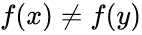。

- **满射 (Onto)**。如果 <math xmlns="http://www.w3.org/1998/Math/MathML" overflow="scroll" display="inline"><mi>f</mi></math> 的输出覆盖了整个 <math xmlns="http://www.w3.org/1998/Math/MathML" overflow="scroll" display="inline"><mi>Y</mi></math>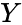，即对于每一个 <math xmlns="http://www.w3.org/1998/Math/MathML" overflow="scroll" display="inline"><mi>y</mi><mo>&#8712;</mo><mi>Y</mi></math>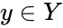，都存在一个 <math xmlns="http://www.w3.org/1998/Math/MathML" overflow="scroll" display="inline"><mi>x</mi><mo>&#8712;</mo><mi>X</mi></math>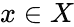，使得 <math xmlns="http://www.w3.org/1998/Math/MathML" overflow="scroll" display="inline"><mi>f</mi><mo stretchy="false">(</mo><mi>x</mi><mo stretchy="false">)</mo><mo>=</mo><mi>y</mi></math>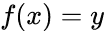。在这种情况下，我们说 <math xmlns="http://www.w3.org/1998/Math/MathML" overflow="scroll" display="inline"><mi>f</mi></math> 将 <math xmlns="http://www.w3.org/1998/Math/MathML" overflow="scroll" display="inline"><mi>X</mi></math>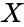 映射 `onto` 到 <math xmlns="http://www.w3.org/1998/Math/MathML" overflow="scroll" display="inline"><mi>Y</mi></math>。我们也可以等价地定义：当且仅当值域等于陪域时，该函数是满射的。

我怀疑举几个例子会有帮助：

- 如果我们从函数 <math xmlns="http://www.w3.org/1998/Math/MathML" overflow="scroll" display="inline"><mi>f</mi><mo stretchy="false">(</mo><mi>x</mi><mo stretchy="false">)</mo><mo>=</mo><mi>x</mi><mo><mn>1</mn></math>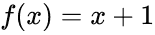，如上所述，它将 <math xmlns="http://www.w3.org/1998/Math/MathML" overflow="scroll" display="inline"><mi lang="double-struck">Z</mi></math> `onto` 到 <math xmlns="http://www.w3.org/1998/Math/MathML" overflow="scroll" display="inline"><mi lang="double-struck">Z</mi></math>。观察这一点，如果 <math xmlns="http://www.w3.org/1998/Math/MathML" overflow="scroll" display="inline"><mi>y</mi></math> 是任意整数，那么它在 <math xmlns="http://www.w3.org/1998/Math/MathML" overflow="scroll" display="inline"><mi>f</mi></math> 下的原像是 <math xmlns="http://www.w3.org/1998/Math/MathML" overflow="scroll" display="inline"><mi>y</mi><mo>&#8723;</mo><mn>1</mn></math>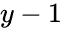，即 <math xmlns="http://www.w3.org/1998/Math/MathML" overflow="scroll" display="inline"><mi>f</mi><mo stretchy="false">(</mo><mi>y</mi><mo stretchy="false">)</mo><mo>=</mo><mi>y</mi></math>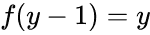 且 <math xmlns="http://www.w3.org/1998/Math/MathML" overflow="scroll" display="inline"><mi>y</mi><mo>&#8712;</mo><mi lang="double-struck">Z</mi></math>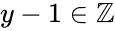。也就是说，<math xmlns="http://www.w3.org/1998/Math/MathML" overflow="scroll" display="inline"><mi>f</mi></math> 覆盖了整个 <math xmlns="http://www.w3.org/1998/Math/MathML" overflow="scroll" display="inline"><mi lang="double-struck">Z</mi></math>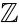。它也是单射的，因为如果 <math xmlns="http://www.w3.org/1998/Math/MathML" overflow="scroll" display="inline"><mi>f</mi><mo stretchy="false">(</mo><mi>x</mi><mo stretchy="false">)</mo><mo>=</mo><mi>f</mi><mo stretchy="false">(</mo><mi>z</mi><mo stretchy="false">)</mo></math>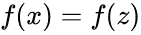 那么 <math xmlns="http://www.w3.org/1998/Math/MathML" overflow="scroll" display="inline"><mi>x</mi><mo><mn>1</mn></math><mo>=</mo><mi>z</mi><mo><mn>1</mn></math>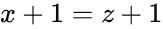，所以 <math xmlns="http://www.w3.org/1998/Math/MathML" overflow="scroll" display="inline"><mi>x</mi><mo>=</mo><mi>z</mi></math>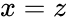。

- 相同的函数，即 <math xmlns="http://www.w3.org/1998/Math/MathML" overflow="scroll" display="inline"><mi>f</mi><mo stretchy="false">(</mo><mi>x</mi><mo stretchy="false">)</mo><mo>=</mo><mi>x</mi><mo><mn>1</mn></math>，也从 <math xmlns="http://www.w3.org/1998/Math/MathML" overflow="scroll" display="inline"><mi lang="double-struck">N</mi></math> 映射到 <math xmlns="http://www.w3.org/1998/Math/MathML" overflow="scroll" display="inline"><mi lang="double-struck">N</mi></math>。在这种情况下，它仍然是单射的，但不是满射的，因为不存在一个 <math xmlns="http://www.w3.org/1998/Math/MathML" overflow="scroll" display="inline"><mi>x</mi><mo>&#8712;</mo><mi lang="double-struck">N</mi></math>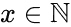 使得 <math xmlns="http://www.w3.org/1998/Math/MathML" overflow="scroll" display="inline"><mi>f</mi><mo stretchy="false">(</mo><mi>x</mi><mo stretchy="false">)</mo><mo>=</mo><mn>1</mn></math>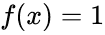（记得零不在 <math xmlns="http://www.w3.org/1998/Math/MathML" overflow="scroll" display="inline"><mi lang="double-struck">N</mi></math>）。


* 下一个例子是函数 $g:x \rightarrow 2x$。它将 $\mathbb{Z}$ 映射到 $\mathbb{Z}$。它显然是单射，但不是满射，因为奇数不能是整数在 $g$ 下的像。

* 最后一个例子是函数 $h:x \rightarrow |x|$，其中 $|x|$ 表示 $x$ 的绝对值。如果 $x$ 为正或零则 $|x| = x$，如果 $x$ 为负数则 $|x| = -x$；这确保了 $|x|$ 始终为正数。函数 $h$ 将 $\mathbb{Z}$ 映射到 $\mathbb{Z}$。它不是满射，因为没有负数可以作为 $h$ 下的像；而且它不是单射，因为 $f(x) = f(-x)$。

然而，如果我们考虑从 $\mathbb{N}$ 到 $\mathbb{N}$ 的同一个函数，那么它既是单射也是满射。事实上，在这种情况下，它被认为是集合 $\mathbb{N}$ 的恒等函数。更广义地说，恒等函数（有时记为 $I$）是将集合 $X$ 映射到自身且对于每个 $x \in X$ 都有 $I(x)=x$ 的函数；$I$ 显然既是单射也是满射。

两个函数可以复合，通过先应用一个函数然后对结果应用第二个函数来实现。也就是说，如果 $f:X \rightarrow Y$ 且 $g:Y \rightarrow Z$，我们可以将函数 $f$ 和 $g$ 的复合定义为函数 $(f \circ g):X \rightarrow Z$，其定义为 $(f \circ g)(x) = g(f(x))$。显然，只有当 $g$ 的域包含 $f$ 的值域时，才能对两个函数 $f$ 和 $g$ 进行复合。

我们可以立即得出以下简单结论。


> 我将证明过程留给你们作为一项简单的练习。如果你从定义开始，证明几乎是显而易见的。有趣的观察是，其他可能的结果并不成立；也就是说，如果 $f \circ g$ 是单射，那么 $g$ 不一定是单射；如果 $f \circ g$ 是满射，那么 $f$ 不一定是满射。我提供了该引理的证明并给出了反例^()

> 我已经提到过*恒等函数*。对于任何集合 $X$，恒等函数 $I_X$ 是一个从 $X$ 映射到 $X$ 的函数，其性质是对于每一个 $x \in X$，都有 $I_X(x) = x$。这使我能够引入*反函数*的概念。

> 假设函数 $f: X \to Y$ 既是单射又是满射。那么我将它的反函数 $f^{-1}: Y \to X$ 定义如下：任 $y \in Y$。由于 $f$ 是满射，因此存在 $x \in X$ 使得 $f(x) = y$；而且由于 $f$ 是单射，这个 $x$ 是唯一的。因此定义 $f^{-1}(y) = x$。显而易见，$f \circ f^{-1} = I_X$，即对于每一个 $x \in X$，都有 $f^{-1}(f(x)) = x$。

> 我通过给出以下结论来结束对函数的这一简短讨论。

## 2.8 运算

> 我将通过引入集合中元素对的*运算*这一核心概念，来结束这个相当抽象的章节。事实上，我们都对对数字的某些运算非常熟悉，例如加法和乘法。运算的抽象概念是对这些思想的推广。

> 形式上，我将运算定义为一种过程，它取集合中的任意两个元素（不一定相同），并输出该集合的一个元素作为输出。因此，如果 $\circ$ 是集合 $S$ 上的运算，那么对于 $S$ 中的任意两个元素 $x$ 和 $y$（其中 $x$ 可能等于 $y$），$x \circ y$ 就是 $S$ 中的一个元素。

> 那么除了加法和乘法之外，运算的例子可能是什么？一个不怎么有帮助的答案是——几乎任何东西！适用于数字的两个明显例子是减法和除法，另一个是幂，即将第一个数字提高第二个数字的幂。

> 正如我将在后面的章节中讨论的那样，我希望运算能满足某些关键属性，以便它是“有有趣的”。这些关键属性通常是某些（或所有）已知运算所具备的属性。然后我们就可以开始建立关于满足某些关键属性集的运算的结论，无论该运算是什么，只要它具备必要的属性集，这些结论就适用。这是抽象和推广力量的另一个例子。


在下文讨论中，我假设 $\ast$ 是集合 $S$ 上的一个运算，也就是说对于每一个 $x, y \in S$，存在一个定义的 $x \ast y \in S$。

1. 关键属性的第一个例子是，集合中有一个元素被称为**单位元**（identity element），通常写做 $e$。单位元具有这样一种性质：如果它与集合中的任意元素结合，输出结果都是该元素（即它没有影响）。形式化地说，$e$ 是单位元当且仅当：对于每一个 $x \in S$，$x \ast e = e \ast x = x$。

当集合为整数集（即 $S = \mathbb{Z}$）且运算为加法时，零（0）是一个单位元的显而易见的例子。在这种情况下，零是一个单位元，因为对于任何整数 $x$，$x + 0 = 0 + x = x$。对于整数来说，另一个显而易见的例子是运算为乘法；在这种情况下，1（one）是一个单位元，因为对于任何整数 $x$，$x \times 1 = 1 \times x = x$。

如果你思考一下整数上的减法运算，那么 0 只部分符合单位元的定义。这是因为虽然对于每个整数 $x$都有 $x - 0 = x$（正如我们希望的那样），但 $0 - x = -x$，且除非 $x = 0$，否则 $-x \neq x$。也就是说，对于整数上的减法运算，0 是**右单位元**（right identity）的一个例子，而一个元素只有当它既是右单位元又是左单位元时，才是一个真正的单位元（左单位元的定义是显而易见的）。

那么除法呢？根据我们给出的定义，除法不是整数上的运算，因为将一个整数除以任何除 +1 或 −1 以外的整数得到的不是整数，所以它是行不通的（在这种情况下，该运算被称为“未定义”）。请记住，运算必须始终给出一个**在其定义定义的集合之内**的结果。事实上，除法还有另一个问题，因为即使我们处理分数时，除以 0 也是未定义的。

最后，重要的是，单位元如果存在，那么它将始终是唯一的。这可以通过以下简单的论证来证明。假设 $e$ 和 $e'$ 是集合 $S$ 上运算 $\ast$ 的单位元。我需要证明这意味着 $e = e'$。现在由于 $e$ 是单位元，$e \ast e' = e'$。但由于 $e'$ 也是单位元，$e' \ast e = e$。因此 $e = e' = e'$，我证明了唯一性。


## 2. 另一个相关性质是每个元素都存在`逆元`。假设 `e` 是集合 `S` 上关于运算 `⋅` 的单位元。如果 `x` 是 `S` 中的任意元素，且 `x ⋅ y = e`，则 `y` 被称为 `x` 的`右逆元`。同样，如果 `y ⋅ x = e`，则 `y` 被称为 `x` 的`左逆元`。我们通常关注每个元素都同时具有左右逆元且两者相等的情况。

另一个显而易见的例子再次涉及加法和整数。每个整数在加法下都有逆元，即该整数的负数（记得负数的负数正数）。所以 `3 + (− 3) = 0` 且 `(−7) + (− (−7)) = (−7) + 7 = 0`。然而，当我们考虑乘法运算的整数时，除了 `+1` 和 `−1` 之外，没有元素具有逆元。当然，如果我们允许分数，情况就会有所不同，但我们想得太快了。

## 3. 第三个重要性质稍微不那么明显，被称为`结合律`。从本质上说，结合律意味着我们可以在移动或移除括号而不影响结果。形式上，集合 `S` 上的运算 `⋅` 是结合的，当且仅当对于 `S` 中的任意元素 `x`、`y` 和 `z`：

```
(x ⋅ y) ⋅ z = x ⋅ (y ⋅ z)
```

然而，整数的加法和乘法具有这一性质。但减法不具备，因为 `(6 − 3) − 2 = 1`。

我们在这里引入的最后一个性质是`交换律`。如果一个运算元素的顺序无关紧要，那么该运算就是交换的。用形式的话，集合 `S` 上的运算 `⋅` 是交换的，当且仅当对于 `S` 中的任意元素 `x` 和 `y`：

```
x ⋅ y = y ⋅ x
```

意所料的是，整数的加法和乘法具有这一性质，但减法不具备，因为 `3 − 2 = 1`，这不等于 `2 − 3 = − 1`。

你可能会想推测，既然结合律和交换律都涉及运算的顺序，那么其中一个可能意味着另一个。然而，事实绝非如此；也就是说，可以定义一个满足结合但不交换的运算，也可以定义一个满足交换但不结合的运算。

我本可以还可以描述许多其他可能的运算性质，但我刚刚介绍的这些是对于本书后续章节讨论中最重要的性质之一。我将特别感兴趣一个运算具有上述四个性质中的前三种的情况，这将给出一个所谓`群`（group）的示例。事实上，群非常重要，以至于它们单独占据了一个章节（第 5 章）。


2. 本书早期草稿的一位读者挑战我，让我举出一个显而易见但事实证明是错误的例子。当然，举出例子的一个问题在于，对某人来说显而易见的事，对另一个人可能并非如此。无论如何，经过思考，我决定对简单概率的“显而易见”计算往往是错误的。以下场景提供了一个著名的例子：一个不透明的袋子里有两个球，可能是白色或黑色——每种概率均为 1/2（或 50%）。也就是说，袋中物品有三种可能：两个黑球（概率为 1/4）、两个白球（概率为 1/4）以及一黑一白（概率为 1/2）。你手伸进袋里（不看）取出一个黑球。那么剩下的球是白色的概率是多少？我建议“显而易见”的答案是 2/3 (67%)，因为你抽出的球告诉你袋子里不包含两个白球，而且袋子里包含一白一黑的概率是包含两个黑球的两倍。然而，这个显而易见的答案是错误的——另一个球是白色的概率是 1/2，即 50%。我在书末的“读者问题解答”部分解释了为什么这个看似违背直觉的答案是正确的——参见第 221 页。

3. E T Bell-‘The Queen of the Sciences’, Williams & Wilkins, 1931.

4. G H Hardy, ‘A Mathematician’s Apology’, Cambridge University Press, 1940.

5. 正如数学中经常出现，事实证明罗塞尔并不是第一个表述这一悖论的人。它似乎是由德国数学家恩斯特·策梅尔洛（Ernst Zermelo）在 1899 年独立发现的。

6. 对于我们这些特定年龄的人来说，他的名字与埃里克·爱德（Eric Idle）编写的蒙提派蛇剧《哲学家歌曲》密不可分。其中对笛卡尔描述相当刺耳的歌词随处可见，例如在 `https://www.songfacts.com/lyrics/monty-python/bruces-philosophers-song`。

7. 注意，为了建立传递性，必须假设每个人都恰好住在一条街道上——如果吉姆同时住在两条街道上，那么传递性论证就不成立了。

8. 这个论证对于出生在 19 世纪初的人来说是的，因为他们的两个祖先出生于 1800 年之前，因此在 `S` 之外。为了解决这个问题，我将假设每个人都是自己的祖先，这意味着 `R` 在定义上是自反的。

9. 冰岛的姓命名系统在某种程度上遵循这一方向：女孩的姓是其母亲的名字加上“dóttir”，男孩的姓是其父亲的名字加上“son”。冰岛显然是开明的——事实上，我了解到自 2019 年以来，冰岛非二元性别者可以使用后缀“-bur”（意为“……的孩子”）代替 -son 或 -dóttir。

10. 数学家们使用“反例”一词是指某种证明某个可能的定理不成立的例子。例如，数字 2 的存在就是“所有质数都是奇数”这一主张的反例。

11. 满足结合律但不满足交换律的运算示例见[第 5.7 节]。一个定义在整数上满足交换律但不满足结合律的运算简单例子是运算 `x * y = |x - y|`，其中竖线表示绝对值，例如 `|-3| = |+3| = 3`。

# 第 3 章：我们熟悉并喜爱的数字

Die ganzen Zahlen hat der liebe Gott gemacht, alles andere ist Menschenwerk（上帝创造了整数，其他一切都是人的造物）。

## 3.1 数学从何开始？

开启本章的克罗内克（Kronecker）引言对数学从何开始给出了惊人准确的总结。在过去的 200 多多年里，特别是在 19 世纪，数学家们试图以严谨的方式从简单的基础重建所有已知数学。也就是说，你在学校里记得的所有数学，包括正弦和余弦等三角函数、对数、向量等，都是从基本原理严谨推导出来的。这意味着在每种情况下，都是从基础开始，证明这些函数存在并具有预期的属性，而不诉诸几何论证。

这项宏大的工程为数学奠定了更坚实的基础。

然而，这种严谨的推是从整数开始的。也就是说，整数构成了构建严谨数学的基础基石。数学家通常认为整数的定义是数学基础的一部分，而不是普通的数学。当然，也曾过从严谨的基本原理来构建整数的努力，但这类工作通常被数学家认为虽然重要，但构成了一个独立于普通数学的学科。事实上，这类关于数学基础的工作包括尝试分析我们用于构建证明的各种规则以及各种类型的逻辑。大体上，数学家们认为这些概念是理所当然的。显然，还有很多可以说的，但在这里写将意味着偏离本书的主要目的。我建议遵循其他数学家的做法，假设整数是有良好定义的，并对整数的某些基本属性视为理所当然。

在此处，你可能会合理地问，我假设整数具有哪些具体的属性？首先，我们假设整数有两个相关的运算：加法 (+) 和乘法 (×)。此外，我们假设：

- 加法运算满足[第 2.8 节]中列出的所有属性（即存在单位元（0）和加法逆，以及结合律和交换律）；
- 乘法运算满足[第 2.8 节]中列出的三个属性（即存在单位元（1），以及结合律和交换律，但除了 +1 和 −1 之外，它不具备乘法逆）。


-   乘法对加法具有分配律，即对于任何整数 $a$、$b$ 和 $c$，都有 $a \times (b + c) = a \times b + a \times c$。

当然，这些我们在对整数进行任何算术运算时假设的性质。我们还假设整数是有序的，我们将在第 3.4 节中重新回到这个话题。

虽然整数不是本书的主题，但我认为我们仍然从头开始，考虑它们的一些关键性质。整数也是此处涵盖的所有内容的基础，因此值得花一点时间思考它们。鉴于它们作为示例的重要性，在章节末尾，我还会简要介绍我们如何从整数构建出有理数。

## 3.2 自然数与整数

我真的需要从自然数开始，即整数 1, 2, 3, ……。整数仅仅是将自然数扩展到包含负数和零，即 …, −3, −2, −1, 0, 1, 2, 3, ……。我已经在第 2 章中使用自然数 $\mathbb{N}$ 和整数 $\mathbb{Z}$ 作为示例。此时我应该说，有些作者将零包含在自然数中，但为了本书起，我从 $\mathbb{N}$ 中排除零。在讨论符号时，我还应该提到集合 $\mathbb{Z}^+$ 和 $\mathbb{Z}^-$，分别代表正整数和负整数。我相信你们会立即发现 $\mathbb{Z}^+$ 和 $\mathbb{N}$ 是同一个集合，至少按我定义的 $\mathbb{N}$ 来说。事实上，考虑到 $\mathbb{N}$ 是否包含零可能存在歧义，从这里起我主要使用 $\mathbb{Z}^+$。

自然数（或*计数数*）的概念已经存在很久了。在史史的某个时期，人类将数字的概念（例如“三”）从三个特定类型的物体的存在中分离出来。这涉及到识别“三之性”的概念，使得三只兔子和三棵树共享这个数字“三”的抽象概念。这个基本思想几乎被重新发明了许多次，而且无疑是我们许多人在婴儿时期就会重新发现的东西。无论如何，虽然关于计数数概念发展的已有许多论述，但在本书中，我想将它们视为某种基础且不可改变的东西。

那么整数呢？很好吧，零是一个*数字*（就像一、二、三等一样），而不仅仅是任何物的缺失，这个观点要新颖得多。当然，对数字使用*位值法*或*位值记数法*，即写 123 表示一百加二十加三，显然需要某种形式的零的符号，以便我们可以写 103 表示一百、零十位和三；位值法将在第 3.3 节中进行更详细的讨论。那么这是否意味着位值法的发明必须在零作为数字的概念*之后*出现呢？

嗯，这远不清楚。虽然古代发明了各种类型的位值法，但似乎我们今天使用的十进制记数法起源于印度，尽管其他此类系统在其他也被发明了，包括中国。位值法通过阿拉伯世界进入欧洲，阿拉伯人从公元 10 世纪左右开始采用阿拉伯数字的位值记数法。这解释了为什么——至少在英语中——我们今天使用的数字被称为阿拉伯数字，尽管它们与阿拉伯语中使用的数字不同！

那么这是否意味着在公元 10 世纪，零就已经被公认为是一个数字了？嗯，不一定，早期的位值系统使用空格或其他标记来代替我们今天使用的零。我认为可以说，将零作为数字与 1, 2, 3 等具有同等地位被采纳，是一个逐渐发生的过程。


事实上，今天我们自动使用“数字”（number）一词来涵盖许多与计数对象并不直接相关的数量。例如，虽然我会把分数 `1/4` 称为数字，但它显然对数羊并没有用处——也许在肉案店或超市的肉类区——但它对于测量物体非常有用，例如 `1/4`kg 黄油。我打算以一种更通用的方式使用“数字”一词，来涵盖那些不太熟悉的数量，尽管这些数量仍然是可以相加或相乘的，并且在现实生活中具有某种解释。事实上，这正是本书的主要目的。

回到我们在第 2 章中介绍的运算属性，零的优点是为加法提供了单位元，而负数在加法下提供了正数的逆元。这意味着整数的加法运算具备了我们介绍的所有四个属性，即单位元的存在、所有元素逆元的存在、结合律和交换律。

## 3.3 数字的记法

在第 3.2 节中，我提到了位值制或位置计数法的概念。我们所有人使用的位计数法被称为`base 10`或十进制（decimal），因为从数字最右侧的数字向左计算，这些数字代表个位、十位、百位等以此类推。也就是说，连续的数字代表 10 的连续幂的倍数。所以，例如，数字 4567 等：

```
7 * 10⁰ + 6 * 10¹ + 5 * 10² + 4 * 10³
```

显然，这个思想可以扩展到适用于任何进制，而不仅仅是 10。一种特别重要的替代表示法是`base 2`或“二进制”。在数字的二进制表示中，连续的数字代表 1, 2, 4, 8、……的倍数，即 2 的连续幂次。二进制表示中的数字非 0 即 1——被称为二进制位（binary digits）的缩写 `bits`。例如，二进制表示中的数字 10110 等于更熟悉的十进制表示中的 22。这是因为：

```
0 * 2⁰ + 1 * 2¹ + 1 * 2² + 1 * 2³ + 0 * 2⁴ = 22
```

二进制表示在计算和数字电子领域至关重要，因为计算机内存是由单个元素组成的，每个元素都能存储单个位（bit），即单个 0 或 1。因此，计算机使用二进制表示来存储数字。类似，数字通信通常涉及发送 0 和 1 的序列。

其他广泛使用的进制还包括 8，`base 8` 被称为八进制（octal），以及 16，即十六进制（hexadecimal）。在后的情况下，我们需要额外的六个数字来表示 10–15 的数字，对此通常使用字母 `a, b, c, d, e, f`，有时使用大写，其中 `a = 10`，`b = 11`，以此此类推。所以，例如，十六进制数字 `fe` 等于十进制的 `14 * 1 + 15 * 16 = 254`。为了避免混淆，在使用多个进制时，将进制写成下标，所以我们可以写成：

```
fe_16 = 25_10 = 1111111_2
```

## 3.4 整数的排序


正如我在第 3.1 节中提到的，整数有许多数学家在构建数学时视为所当然的性质。其中之一就是我们之前讨论过的，加法运算具有第 2 章中引入的四个性质。另一个关键性质是整数是`全序`的，即对于任意两个整数 <math xmlns="http://www.w3.org/1998/Math/MathML" overflow="scroll" display="inline"><mi>x</mi></math> 和 <math xmlns="http://www.w3.org/1998/Math/MathML" overflow="scroll" display="inline"><mi>y</mi></math>，那么要么 <math xmlns="http://www.w3.org/1998/Math/MathML" overflow="scroll" display="inline"><mi>x</mi><mo>&#8804;</mo><mi>y</mi></math>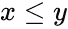 ，或者 <math xmlns="http://www.w3.org/1998/Math/MathML" overflow="scroll" display="inline"><mi>y</mi><mo>&#8804;</mo><mi>x</mi></math>（或者两者都是，在这种情况下 <math xmlns="http://www.w3.org/1998/Math/MathML" overflow="scroll" display="inline"><mi>x</mi><mo>=</mo><mi>y</mi></math>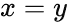）。此外，如果 <math xmlns="http://www.w3.org/1998/Math/MathML" overflow="scroll" display="inline"><mi>x</mi><mo>&#8804;</mo><mi>y</mi></math> 且 <math xmlns="http://www.w3.org/1998/Math/MathML" overflow="scroll" display="inline"><mi>y</mi><mo>&#8804;</mo><mi>z</mi></math>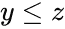，那么 <math xmlns="http://www.w3.org/1998/Math/MathML" overflow="scroll" display="inline"><mi>x</mi><mo>&#8804;</mo><mi>z</mi></math>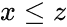。这种序性质还将整数划分为正值和负值——正整数是 <math xmlns="http://www.w3.org/1998/Math/MathML" overflow="scroll" display="inline"><mi>x</mi><mo>&#62;</mo><mn>0</mn></math>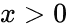 的整数，负整数是 <math xmlns="http://www.w3.org/1998/Math/MathML" overflow="scroll" display="inline"><mi>x</mi><mo>&#60;</mo><mn>0</mn></math>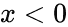 的整数（其中 <math xmlns="http://www.w3.org/1998/Math/MathML" overflow="scroll" display="inline"><mi>x</mi><mo>&#62;</mo><mi>y</mi></math> 仅仅意味着 <math xmlns="http://www.w3.org/1998/Math/MathML" overflow="scroll" display="inline"><mi>x</mi><mo>&#8805;</mo><mi>y</mi></math> 且 <math xmlns="http://www.w3.org/1998/Math/MathML" overflow="scroll" display="inline"><mi>x</mi><mo>&#8800;</mo><mi>y</mi></math>）。这种序性质是我们所有人理所当然的；否则，我们如何知道哪支球队在足球比赛中领先呢？

整数满足这种序性质是我们在“数轴”上广泛使用的整数表示的基础，如图 3.1

图 3.1 带有小整数的数轴。

整数的另一个假设性质是两个正整数的和和乘积也是正整数。

事实上，整数对之间的序关系只是称为`偏序`的特殊类型关系的一个例子。如果一个集合 <math xmlns="http://www.w3.org/1998/Math/MathML" overflow="scroll" display="inline"><mi>S</mi></math> 具有以下三个属性的关系（通常写为 <math xmlns="http://www.w3.org/1998/Math/MathML" overflow="scroll" display="inline"><mo>&#8804;</mo></math>），那么对 <math xmlns="http://www.w3.org/1998/Math/MathML" overflow="scroll" display="inline"><mfenced separators="" open close=")"><mi>S</mi><mo>,><mo>&#8804;</mo></mo></math> 是一个`偏序`集，并且 <math xmlns="http://www.w3.org/1998/Math/MathML" overflow="scroll" display="inline"><mo>&#8804;</mo></math> 称为 <math xmlns="http://www.w3.org/1998/Math/MathML" overflow="scroll" display="inline"><mi>S</math> 上的`序`：

-   <math xmlns="http://www.w3.org/1998/Math/MathML" overflow="scroll" display="inline"><mi>x</mi><mo>&#8804;</mo><mi>x</mi></math> 对于每一个 <math xmlns="http://www.w3.org/1998/Math/MathML" overflow="scroll" display="inline"><mi>S</math>自反性；
-   如果 <math xmlns="http://www.w3.org/1998/Math/MathML" overflow="scroll" display="inline"><mi>x</mi><mo>&#8804;</mo><mi>y</mi></math> 且 <math xmlns="http://www.w3.org/1998/Math/MathML" overflow="scroll" display="inline"><mi>y</mi><mo>&#8804;</mo><mi>x</mi></math>，对于某些 <math xmlns="http://www.w3.org/1998/Math/MathML" overflow="scroll" display="inline"><mi>x</mi><mo>,><mi>y</mi><mo>&#8812;</mo><mi>S</math>，那么 <math xmlns="http://www.w3.org/1998/Math/MathML" overflow="scroll" display="inline"><mi>x</mi><mo>=</mo><mi>y</mi></math>反对称性；
-   如果 <math xmlns="http://www.w3.org/1998/Math/MathML" overflow="scroll" display="inline"><mi>x</mi><mo>&#8804;</mo><mi>y</mi></math> 且 <math xmlns="http://www.w3.org/1998/Math/MathML" overflow="scroll" display="inline"><mi>y</mi><mo>&#8804;</mo><mi>z</mi></math>，对于某些 <math xmlns="http://www.w3.org/1998/Math/MathML" overflow="scroll" display="inline"><mi>x</mi><mo>,><mi>y</mi><mo>,><mi>z</mi><mo>&#8812;</mo><mi>S</math>，那么 <math xmlns="http://www.w3.org/1998/Math/MathML" overflow="scroll" display="inline"><mi>x</mi><mo>&#8804;</mo><mi>z</mi></math>（传递性）。

如果你回过来看，你会发现第一个和第三个属性与等价关系要求的第一个和第三个属性完全相同。然而，第二个属性已经从对称性变成了反对称性。


显然，整数和 $\le$ 关系，即对 $(\mathbb{Z}, \le)$，构成了一个偏序集。事实上，正如我已经提到的，$(\mathbb{Z}, \le)$ 是全序集的一个例子，因为对于任意两个整数 $x$ 和 $y$，要么 $x \le y$，要么 $y \le x$（或者两者都满足，在这种情况下 $x = y$）。

当然，存在并非全序的偏序关系。一个简单的例子是定义在集合子集上的“子集” $\subseteq$ 关系定义的序。不难看出这构成了一个偏序集。集合 $S = \{a, b, c\}$ 的一个示例见图 3.2。


图 3.2 集合子集之间的序关系。

在图中图中，展示了 $S$ 的所有子集，并画了箭头来表示子集关系。也就是说，从子集 $\{a\}$ 指向子集 $\{a, b\}$ 有箭头，表示 $\{a\} \subseteq \{a, b\}$。当然，$\{a\}$ 也是 $\{a, b, c\}$ 的子集，但在这种情况下没有提供箭头，因为该关系具有传递性。

整数的另一个性质是，任何正整数的子集（即 $\mathbb{Z}^+$）都有最小元素。例如，考虑所有分数的熟悉集合 $\mathbb{Q}$，即：
```
mathbb{Q} = \{ \frac{x}{y} \mid x, y \in \mathbb{Z}, y \neq 0 \}
```
注意，我们需要确保 $y \neq 0$，因为除以零是没有意义的。我将在本章稍后的部分详细地探讨 $\mathbb{Q}$。

现在，设 $A$ 为所有形式为 $\frac{1}{y}$ 的分数的集合，其中 $y = 1, 2, 3, \dots$。即：


$A = \{ \frac{1}{1}(= 1), \frac{1}{2}, \frac{1}{3}, \frac{1}{4}, \dots \}$

形式上，我们可以写成：

$A = \{ \frac{1}{y} : y \in \mathbb{Z}^+ \} \subseteq \mathbb{Q}.$

那么，$A$ 不包含最小元素。显然，0 小于 $A$ 中的任何元素，而且我们可以找到 $A$ 中任意接近 0 的元素，但 0 并不在 $A$ 中（在这种情况下，0 被称为集合 $A$ 的 `infimum` [下确界]）。证明 $A$ 没有最小元素可以通过简单的归反法证明（reductio ad absurdum）来实现。你可以思考一下。如果你想知道为什么，我在书末的“读者读者问题解答]”章节中（见）提供了一个简单的证明（参见第 243 页）。

因此，每个整数集合都具有最小元素这一性质可能并不十分显而易见……我还应该说，在这些讨论中我略过了一个重要的点。我一直很小心地称为“一个最小元素”而不是“唯一的最小元素”，因为我还没有证明最小元素是唯一的。当然，我预计你已经 `new` [知道] 任何最小元素必须是唯一的，但这不是我们可以简单假设的——我们需要证明它。事实上，正如我们接下来要展示的，我们可以为任何偏序集证明一个更通用的结论。

这表明，如果一个偏序集包含最小元素，那么它是唯一的，因此我可以安全地指的是该最小元素。

## 3.5 归纳法

这看起来似乎偏离了整数主题，但 `induction` [归纳法] 是数学中至关重要的一部分，它依赖于最小元素`induction` 是证明定理的方法。`induction` 原理陈述非常简单。

有时归纳原理的表述略有不同。也就是说，第二个要求的陈述是：如果 `P(i)` 对于每个 $m \le i \le k$ 都成立，那么这意味着 `P(k+1)` 对于每个 $k \ge m$ 都成立。

修改后的定理的证明方法完全相同。

关于归纳法使用的一个非常简单的例子，假设结论 `P(n)` 为：

$1 + 3 + \dots + (2n-1) = n².$

我们要证明对于每个 $n \ge 1$，$P(n)$ 都成立。


> 根据归纳法原理（即 定理 3.1），我需要证明两点：
> (a) `P(1)` ![images/c003_dequ155.png 是成立的；
> (b) 如果 `P(k)` ![images/c003_dequ156.png 是成立的，那么 `P(k+1)` ![images/c003_dequ157.png] 也是成立的。
>
> 为了证明 (a)，观察到 `P(1)` ![images/c003_dequ158.png] 仅仅是断言 `1 = 1²`，因此显然是成立的。现在假设 `P(k)` ![images/c003_dequ160.png 是成立的，即我们知道：
> 
> ```math
> 1 + 3 + ... + (2k - 1) = k²
> ```
> ![images/c003_dequ161.png]
> 
> 所以我们知道：
> 
> ```math
> (1 + 3 + ... + (2k - 1)) + (2k + 1) = k² + (2k + 1)
> ```
> ![images/c003_dequ162.png]
> 
> 经过代数变形可知：
> 
> ```math
> k² + (2k + 1) = (k + 1)²
> ```
> ![images/c003_dequ163.png]
> 
> 因此 `P(k+1)` ![images/c003_dequ164.png] 是成立的。因此，根据 定理 3.1,，我们知道 `P(n)` ![images/c003_dequ165.png] 对于每一个 `n ≥ 1` ![images/c003_dequ166.png] 都是成立的。
> 
> 虽然这是一个非常平凡的例子，但归纳法可以证明许多不那么明显的结论，它是数学家工具箱中非常有用的工具。然而，使用时必须小心，很容易出错。我将通过对一个显然错误的命题给出错误的证明来展示这一点。
> 
> 在此之前，我不禁提到一下，我不相信我并不孤单，也觉得归纳法证明比其他类型的证明缺乏某种美感。为什么会这样呢？毕竟，无论过程如何，证明不就是证明吗？我并不是在暗示归纳法的有效性低于其他类型的证明；只是在某些情况下（至少是），它们并没有很好地解释*为什么*定理是成立的。这种主张很难证明，而且毫无无疑某些数学家会认为我有点疯了。然而，我确实更倾向于直接证明某个东西，而不是通过归纳法，我想这主要是出于审美考虑。^()


无论如何，回到这个错误的证明。假设命题 $P(n)$![images/c003_dequ167.png] 是“每组 $n$![images/c003_dequ168.png]个人都有相同的名字”。我们要证明 $P(n)$![images/c003_dequ169.png]对于每一个 $n \ge 1$![images/c003_dequ170.png] 都是真的。我们需要证明 (a) $P(1)$![images/c003_dequ171.png] 是真的，且 (b) 如果 $P(k)$![images/c003_dequ172.png] 是真的，那么 $P(k+1)$![images/c003_dequ173.png] 也是真的。现在，$P(1)$![images/c003_dequ174.png] 显然是真实的，因为一个人显然和自己有相同的名字。现在假设 $P(k)$![images/c003_dequ175.png] 是真的，即我们知道任何一组 $k$![images/c003_dequ176.png]个人总都有相同的名字。现在考虑任何一组 $k+1$![images/c003_dequ177.png]个人，并假设他们按某种顺序排队。我们知道前 $k$![images/c003_dequ178.png]个人有相同的名字（因为 $P(k)$![images/c003_dequ179.png] 是真的），而且最后 $k$![images/c003_dequ180.png]个人也有相同的名字。因此，所有 $k+1$![images/c003_dequ181.png]个人必须有相同的名字。这显然是一个令人惊讶的结果，所以这个论证一定哪里出了问题。看看你是否能错误在哪里。

## 3.6 除法定理

现在我想引入一个重要的定理，我怀疑你们会认为它是显而易见的。事实证明它是理解整数行为的关键，我将需要这个定理来帮助在本章后面以及下一章中开发思路。


> 在给出结果之前，我需要提到一个关于符号表示的重要点。在本书中，我经常用 $a \times b$ 表示 $a$ 乘以 $b$，即通常所说的 $a$ “乘以” $b$。然而，在某些地方，如果上下文很清楚，我会直接写成 $ab$。坦诚地说，我是在写完这一章之后才添加了这条说明的，因为对我来说，省略 $\times$ 符号是习惯成性的。当然，这是一种非常标准的处理方式——你一定遇到过著名的方程 $E=mc²$，而且你完全可以更正式地写成 $E=m \times c²$，但没有人会这样做。

> 举个简单的例子，假设 $a=9$ 且 $b=4$。那么我们知道：

>

 $9 = 2 \times 4 + 1$
>
> 即在这种情况下，唯一的商 $(q)$ 是 2，而余数 $(r)$ 是 1。

## 3.7 质数与公因子

现在我想花一点时间介绍一个希望你们已经熟悉的主题——质数（或简称为素数）。据我所知，质数已经被研究了数千年，就其原因而言，是出于好奇心，尽管神秘主义和宗教可能也参与其中。然而，在尝试定义什么是质数之前，我需要引入“除”的概念。如果 $m$ 和 $n$ 是正整数，且存在一个正整数 $a$ 满足 $m \times a = n$，我们就说 $m$ 是 $n$ 的除数或因子（$n$ 是 $m$ 的倍数）。我们有时也会写“$m$ 整除 $n”，并使用简写符号 $m|n$ 表示 $m$ 是 $n$ 的除数。例如，$2 \times 3 = 6$，所以 2 和 3 都是 6 的除数，我们可以写成 $2|6$ 和 $3|6$。

我们现在可以定义什么是质数。质数是一个大于 1 的正整数，它的特性是唯一的除数只有 1 和本身。显然，每个正整数 $n$ 都有除数 1 和 $n$，因为 $1 \times n = n$，而质数除了这些之外没有其他因子。前几个质数是：

> $$ 2, 3, 5, 7, 11, 13, \dots $$

> 你可能会发现我从质数列表中除了 1 感到有些意外。在过去，将 1 视为质数并不常见见，但因为其非常特殊的性质，过去 100 年左右的共识是将 1 排除在质数列表之外。通常的做法是将任何大于 1 的非质正整数称为合数。


在过去的 3000 年里，对素数的研究催生了大量的新数学。然而，直到 20 世纪下半叶，素数及其性质才开始对现实世界产生影响——或许是通过神秘主义的方式。我不会在这里花费大量时间讨论素数的性质，但我无法不提到一个古希腊人已知（并由欧几里德记载过）的关键事实，即素数有无穷多个。证明这一点实际上非常简单，我在第 9 章中包含了一个证明。

相关的概念是`公因子`（common factor）或`公约数`（common divisor）。给定任意两个正整数 `m` 和 `n`，公约数是指满足以下性质任意正整数 `r`：`r` 是 `m` 和 `n` 的约数，即 `r|m` 和 `r|n`。如果 `S` 是一对整数所有公约数的集合，那么 `S` 必须是有限的，因此 `S` 必须有一个最大元素；这个最大元素被称为`最大公因子`（highest common factor）或`最大公约数`（greatest common divisor）。为了方便起见，我将 `m` 和 `n` 的最大公约数写为 `gcd(m, n)`。

作为一个简单的例子，考虑数字 12 和 18。它们四个公约数；公约数的完整集合是 `{1, 2, 3, 6}`。最大公约数是 6，即 `gcd(12, 18) = 6`。

接下来我们建立一个稍显惊讶但实用的结论。如果你觉得这个引理难以置信，这里有一个 `a=7` 和 `b = 11` 的简单例子。由于 `a` 和 `b` 是不同的素数，因此 `gcd(a, b) = 1`。因此，我们需要找到 `s` 和 `t` 使得 `7s + 11t = 1`。我声称 `t = 2` 和 `s = -3` 是有效的，因为：

```
7*(-3) + 11*2 = (-21) + 22 = 1
```

以下三个基本结果的集合都可以使用贝祖差等式（Bézout’s identity）轻松证明。

如果两个正整数 `m` 和 `n` 的最大公约数为 1，即如果 `gcd(m, n) = 1`，我们称 `m` 和 `n` 是`互质`的。也就是说，一对互质的正整数除了 1 之外没有公约数。我们在第 4 章中观察模运算时，这个概念是关键的。

以下类似的结论也源自贝祖差等式。


> 该证明是贝祖数等式（引理 3.2）直接应用，我建议你尝试证明它。我在“给读者的问答”部分提供了一个简短的证明（见第 224 页）。

最后，我需要给出关于整除性的以下结论。

到目前为止我还没有讨论的是如何找到两个整数的最大公约数。当然，你可以遍历小于两者中较者的所有整数，并检查它们是否为因数。然而，对于大小相对较小的整数，这可能会变得极其耗时；如果这些数字有例如 20 位小数，即使是快速的计算机也需要相当的时间才能完成此类计算。我们需要一种更好的方法，而这正是我将在本章后面演示的。

## 3.8 唯一因数分解

在第 3.7 节中介绍了质数后，我觉得有必要介绍一个我怀疑你们中许多人已经知道的结果，即任何整数都可以唯一地表示为质数的乘积，尽管质数的顺序可以不同。这一结果可以追溯到欧几里得，并隐含在欧几里得于公元 3 世纪编写的《几何原本》中的一个结论中。

可以这样表述：

## 3.9 欧几里得算法

现在我想介绍介绍书中的第一个算法。在进入细节之前，我需要解释什么是算法。对于我的目的来说，算法可以被视为一组精确定义的步骤序列，用于执行特定的计算或解决某个问题。计算机科学的一个整个主要分支都致力于寻找高效的算法来解决常见的计算问题，以便这些算法被编写到计算机软件中。

欧几里得算法正如其名，是一种追溯到古希腊的算法，并由欧几里得描述。它可以非常高效地计算任意一对正整数的最大公约数。

作为该算法运行方式的一个示例，假设 <math xmlns="http://www.w3.org/1998/Math/MathML" overflow="scroll" display="inline"><mi>a</mi><mo>=</mo><mn>260</mn></math>和 <math xmlns="http://www.w3.org/1998/Math/MathML" overflow="scroll" display="inline"><mi>b</mi><mo>=</mo><mn>184</mn></math>。

*   <math xmlns="http://www.w3.org/1998/Math/MathML" overflow="scroll" display="inline"><mn>260</mn><mo>=</mo><mn>1</mn><mo>&#215;</mo><mn>184</mn><mo>+</mo><mn>76</mn></math>.
*   <math xmlns="http://www.w3.org/1998/Math/MathML" overflow="scroll" display="inline"><mn>184</mn><mo>=</mo><mn>2</mn><mo>&#215;</mo><mn>76</mn><mo>+</mo><mn>32</mn></math>.
*   <math xmlns="http://www.w3.org/1998/Math/MathML" overflow="scroll" display="inline"><mn>76</mn><mo>=</mo><mn>2</mn><mo>&#215;</mo><mn>32</mn><mo>+</mo><mn>12</mn></math>.
*   <math xmlns="http://www.w3.org/1998/Math/MathML" overflow="scroll" display="inline"><mn>32</mn><mo>=</mo><mn>2</mn><mo>&#215;</mo><mn>12</mn><mo>+</mo><mn>8</mn></math>.
*   <math xmlns="http://www.w3.org/1998/Math/MathML" overflow="scroll" display="inline"><mn>12</mn><mo>=</mo><mn>1</mn><mo>&#215;</mo><mn>8</mn><mo>+</mo><mn>4</mn></math>.
*   <math xmlns="http://www.w3.org/1998/Math/MathML" overflow="scroll" display="inline"><mn>8</mn><mo>=</mo><mn>2</mn><mo>&#215;</mo><mn>4</mn><mo>+</mo><mn>0</mn></math>.

所以，`gcd(260,184)=4`。

出于实际目的（如在第 4 章中讨论），有必要计算两个大整数（可能有数百甚至数千位小数）的最大公约数。幸运的是，欧几里得算法非常高效，且迭代次数受到常数系数的限制，该系数是 <math xmlns="http://www.w3.org/1998/Math/MathML" overflow="scroll" display="inline"><mi>a</mi></math> 的位数。这一结果是由德国数学家汉斯·阿诺尔德·希尔布隆恩（Hans Arnold Heilbronn）和加拿大数学家约翰·D·迪克斯森（John D Dixon）于 1969/1970 年独立建立的。最近，在 1998 年，法国数学家和计算机科学家布丽吉特·瓦莱（Brigitte Vallé）为一种被称为二进制欧几里得算法的高效算法正式建立了一个类似的结论。仅仅因为一个算法是“老旧”，并不意味着关于它没有新发现可以发现！

## 3.10 有理数

在本节中，我简要介绍有理数 <math xmlns="http://www.w3.org/1998/Math/MathML" overflow="scroll" display="inline"><mi mathvariant="double-struck">Q</mi></math>。正如你预期的，有理数源于分数 <math xmlns="http://www.w3.org/1998/Math/MathML" overflow="scroll" display="inline"><mfrac><mrow>a</mi></mrow><mrow>b</mi></mrow></mfrac></math>，其中整数 <math xmlns="http://www.w3.org/1998/Math/MathML" overflow="scroll" display="inline"><mi>a</math> 和 <math xmlns="http://www.w3.org/1998/Math/MathML" overflow="scroll" display="inline"><mi>b</math><math xmlns="http://www.w3.org/1998/Math/MathML" overflow="scroll" display="inline"><mfenced open="close=")"><mi>b</mi><mo>&#8800;</mo><mn>0</mn></mfenced></math>。我不确定这个名字的来源，但它可能与“ratio”（ratio）有关，因为分数 <math xmlns="http://www.w3.org/1998/Math/MathML" overflow="scroll" display="inline"><mfrac><mrow>a</mi></mrow><mrow>b</mi></mrow></mfrac></math>可以被视为 <math xmlns="http://www.w3.org/1998/Math/MathML" overflow="scroll" display="inline"><mi>a</math> 与 <math xmlns="http://www.w3.org/1998/Math/MathML" overflow="scroll" display="inline"><mi>b</math> 之间的比例。

可以从第一原理开始定义 <math xmlns="http://www.w3.org/1998/Math/MathML" overflow="scroll" display="inline"><mi mathvariant="double-struck">Q</mi></math>，从整数的已知性质开始。为了开始，按以下方式定义分数的加法和乘法。

定义加法，：

<math xmlns="http://www.w3.org/1998/Math/MathML" overflow="scroll" display="block"><mstyle displaystyle="true"><mfrac><mrow>a</mi></mrow><mrow>b</mi></mrow></mfrac></mstyle><mo>+</mo><mstyle displaystyle="true"><mfrac><mrow>c</mi></mrow><mrow>d</mi></mrow></mfrac></mstyle><mo>=</mo><mstyle displaystyle="true"><mfrac><mrow>a</mi><mi>d</mi><mo>+</mo><mi>b</mi><mi>c</mi></mrow><mrow>b</mi><mi>d</mi></mrow></mfrac></mstyle><mo>,</mo></math>

而定义乘法，让


$\frac{a}{b} \times \frac{c}{d} = \frac{ac}{bd}.$ 

验证所有预期的属性都成立是非常简单的。

例如，对于加法：

$\frac{1}{2} + \frac{2}{3} = \frac{1 \times 3 + 2 \times 2}{2 \times 3} = \frac{7}{6},$ 

以及对于乘法：

$\frac{1}{2} \times \frac{2}{3} = \frac{1 \times 2}{2 \times 3} = \frac{2}{6}.$ 

整数是由 $\frac{a}{1}$  组成分数集，其中 $\frac{a}{1}$ 为整数 。使用以下规则验证这种方法是简单的：

$\frac{a}{1} + \frac{b}{1} = \frac{a \times 1 + b \times 1}{1 \times 1} = \frac{a+b}{1},$ 

以及

$\frac{a}{1} \times \frac{b}{1} = \frac{ab}{1},$  正如预期。

然而，你无疑已经发现了这里的问题。如果我简单地将有理数定义等于所有分数的集合，我将得到大量的重复。正如我预计你知道的那样，$\frac{2}{3}$  与 $\frac{4}{6}$  是“相同”；更通地说，它对于所有整数 $n$  都等于 $\frac{2n}{3n}$ 。这个问题可以通过首先在分数集上定义一个等价关系 $\sim$  来避免。

如果 $\frac{a}{b}$  和 $\frac{c}{d}$  是两个分数，那么当且仅当 $ad = bc$  时，称 $\frac{a}{b} \sim \frac{c}{d}$ 。因此，$\frac{3}{5} \sim \frac{6}{10}$ ，因为 $3 \times 10 = 5 \times 6 (30)$ 。我把它留给你来检查等价关系的三个属性（自反性、对称性和传递性）是否适用于 $\sim$ 。如果你不相信我，我在书末尾的“读者的问题解答”章节中包含了一个简短的证明（见第 224 页）。


然后我可以正式地将有理数定义为分数等价类的集合，而每个等价类可以用该类中的任何分数来表示；换句话说，每个等价类包含所有表示相同数值（相同比例）的分数。你可以通过检查两个分数（例如 $a/b$ (images/c003_dequ592.png) 和 $c/d$ (images/c003_dequ593.png)）是否属于同一个等价类，来判断它们是否表示相同的数值，即通过检查 $ad=bc$ (images/c003_dequ594.png)。在这种情况下，$a/b=c/d$ (images/c003_dequ595.png)。

正如我已经观察到的，有许多方法可以用分数来表示同一个数值。假设 $a/b$ (images/c003_dequ596.png)是一个分数，而$c$ (images/c003_dequ597.png)是$a$ (images/c003_dequ598.png)和$b$ (images/c003_dequ599.png)的公约数。那么，对于某些整数$x$ (images/c003_dequ602.png)和$y$ (images/c003_dequ603.png)，有$a=xc$ (images/c003_dequ600.png)和$b=yc$ (images/c003_dequ601.png)，且$x/y=a/b$ (images/c003_dequ604.png)。这很容易检查：

```
xb - ya = x(yc) - y(xc) = (xy)c - (xy)c = 0
```
(images/c003_dequ605.png) 所示。如果$c$ (images/c003_dequ606.png)是$a$ (images/c003_dequ607.png)和$b$ (images/c003_dequ608.png)的最大公约数，那么这就得了一个*最简形式*的分数$x/y$ (images/c003_dequ609.png)，即使得 `gcd(x, y) = 1` (images/c003_dequ610.png)，或者换句话说，$x$ (images/c003_dequ611.png)和$y$ (images/c003_dequ612.png)是互质的。

虽然它们不是本书的主要课题之一，但讨论有理数的原因之一是，它们是我将在后续章节中介绍的某些代数结构非常有用的例子。它们也是整数的“自然”扩展。我这是什么意思？


> 正如我讨论过的，加法运算下的整数满足第 2.8 节中引入的所有四个性质，即单位元（零）的存在、每个元素逆元的存在（<math xmlns="http://www.w3.org/1998/Math/MathML" overflow="scroll" display="inline"><mo>&#8722;</mo><mi>x</mi></math>是<math xmlns="http://www.w3.org/1998/Math/MathML" overflow="scroll" display="inline"><mi>x</mi></math>的逆元）、结合律（移动括号不改变结果）以及交换律`<math xmlns="http://www.w3.org/1998/Math/MathML" overflow="scroll" display="inline"><mfenced separators="" open="(" close=")"><mi>x</mi><mo>+</mo><mi>y</mi><mo>=</mo><mi>y</mi><mo>+</mo><mi>x</mi></mfenced></math>`。然而，乘法呢？它也有一个单位元（1，因为对于每个非零<math xmlns="http://www.w3.org/1998/Math/MathML" overflow="scroll" display="inline"><mi>x</mi><mo>&#215;</mo><mn>1</mn><mo>=</mo><mi>x</mi></math>对于<math xmlns="http://www.w3.org/1998/Math/MathML" overflow="scroll" display="inline"><mi>x</mi></math>成立）、结合律（因为对于每个<math xmlns="http://www.w3.org/1998/Math/MathML" overflow="scroll" display="inline"><mi>x</mi></math>，<math xmlns="http://www.w3.org/1998/Math/MathML" overflow="scroll" display="inline"><mi>y</mi></math>和<math xmlns="http://www.w3.org/1998/Math/MathML" overflow="scroll" display="inline"><mi>z</mi></math>，`<math xmlns="http://www.w3.org/1998/Math/MathML" overflow="scroll" display="inline"><mo stretchy="false">(mo><mi>x</mi><mo>&#215;</mo><mi>y</mi><mo stretchy="false">)</mo><mo>&#215;</mo><mi>z</mi><mo>=</mo><mi>x</mi><mo>&#215;</mo><mo stretchy="false">(mo><mi>y</mi><mo>&#215;</mo><mi>z</mi><mo stretchy="false">)</mo></math>`）以及交换律（因为<math xmlns="http://www.w3.org/1998/Math/MathML" overflow="scroll" display="inline"><mi>x</mi><mo>&#215;</mo><mi>y</mi><mo>=</mo><mi>y</mi><mo>&#215;</mo><mi>x</mi></math>对于每个<math xmlns="http://www.w3.org/1998/Math/MathML" overflow="scroll" display="inline"><mi>x</mi></math>和<math xmlns="http://www.w3.org/1998/Math/MathML" overflow="scroll" display="inline"><mi>y</mi></math>成立）。然而，除了 +1 和 −1，没有整数在乘法下具有逆元。

> 如果我想给整数加上乘法逆元，那么我最终将得到所有有理数。为了证明这一点，假设<math xmlns="http://www.w3.org/1998/Math/MathML" overflow="scroll" display="inline"><mi>S</mi></math>是一个包含整数的集合，其中<math xmlns="http://www.w3.org/1998/Math/MathML" overflow="scroll" display="inline"><mi>S</mi></math>对乘法是封闭的（即<math xmlns="http://www.w3.org/1998/Math/MathML" overflow="scroll" display="inline"><mi>S</mi></math>必须包含<math xmlns="http://www.w3.org/1998/Math/MathML" overflow="scroll" display="inline"><mn>1</mn><mo>/</mi>x</mi></math>对于每个非零整数<math xmlns="http://www.w3.org/1998/Math/MathML" overflow="scroll" display="inline"><mi>x</mi></math>，因为<math xmlns="http://www.w3.org/1998/Math/MathML" overflow="scroll" display="inline"><mi>x</mi><mo>&#215;</mo><mn>1</mn><mo>=</mo><mi>x</mi></math>成立。但我只要求<math xmlns="http://www.w3.org/1998/Math/MathML" overflow="scroll" display="inline"><mi>S</mi></math>对乘法封闭的，所以<math xmlns="http://www.w3.org/1998/Math/MathML" overflow="scroll" display="inline"><mi>x</mi><mo>&#215;</mo><mi>y</mi><mo>=</mo><mi>y</mi></math>必须是<math xmlns="http://www.w3.org/1998/Math/MathML" overflow="scroll" display="inline"><mi>S</mi></math>的元素。

> 有时考虑数线是有帮助的，数线是一条所有整数和有理数都位于其上的直线。图 3.3 给出了包含整数的数线的简单图片。

> 

> 图 3.3 带有小整数的数线。

> 我可以在这个图片中添加有理数——图 3.4 放大了 0 到 1 之间的数线部分，并展示了该部分的一小部分分数。

> 

> 图 3.4 放大 0 到 1 之间的数线。


> 图 3.5 再次放大到数轴上 0 到 <math xmlns="http://www.w3.org/1998/Math/MathML" overflow="scroll" display="inline"><mfrac><mrow><mn>1</mn></mrow><mrow><mn>8</mn></></></mfrac></math>之间的部分，这是 图 3.4 中显示的第一个分数。我再次在数轴的范围内展示了一小部分分数。

> 

> 图 3.5 进一步放大：0 到 1/8 之间的数轴。

> 我可以无限持续，对数轴上不断缩小的部分展示这样的图形，并且在每情况下，我仍然可以找到任意数量的分数来在图中展示。也就是说，有理数在数轴上是`稠密`的。如果我选择任意两个分数，无论它们多么接近，我都能找到另一个分数（事实上是无限多个）填补在这两个分数之间。

> 所以，既然数轴上被有理数密集地填充了，这难道就足够了吗？我们真的不能找到更多的数字来填进去吗？这自然地引出了对`实数`的讨论……

## 3.11 实数与复数

如果我尝试假设有理数已经完成了数轴，那么我很快就会遇到重大问题。这些问题在古代就已经被观察到了。

为了这一点，让我们从尝试求解一个简单的二次方程开始考虑考虑 <math xmlns="http://www.w3.org/1998/Math/MathML" overflow="scroll" display="inline"><msup><mi>x</mi><mn>2</mn></msup><mo>=</mo><mn>2</mn></math>；这等同于说 <math xmlns="http://www.w3.org/1998/Math/MathML" overflow="scroll" display="inline"><mi>x</mi><mo>=</mo><msqrt><mrow><mn>2</mn></mrow></msqrt></math>。看起来 <math xmlns="http://www.w3.org/1998/Math/MathML" overflow="scroll" display="inline"><mi>x</mi></math> 应该是某种数字是合理的，所以让我们假设 <math xmlns="http://www.w3.org/1998/Math/MathML" overflow="scroll" display="inline"><mi>x</mi></math> 是有理数，即

```
<math xmlns="http://www.w3.org/1998/Math/MathML" overflow="scroll" display="block"><mi>x</mi><mo>=</mo><mstyle displaystyle="true"><mfrac><mi>a</mi><mi>b</mi></mfrac></mstyle><mo>,</mo></math>
```


其中我们假设 <math xmlns="http://www.w3.org/1998/Math/MathML" overflow="scroll" display="inline"><mfrac><mrow><mi>a</mi></mrow><mrow><mi>b</mi></mrow></mfrac></math> 是最简形式，即 <math xmlns="http://www.w3.org/1998/Math/MathML" overflow="scroll" display="inline"><mtext>gcd</mtext><mo stretchy="false">(</mo><mi>a</mi><mo></mo><mi>b</mi><mo stretchy="false">)</mo><mo>=</mo><mn>1</mn></math>。那么就可以得出 <math xmlns="http://www.w3.org/1998/Math/MathML" overflow="scroll" display="inline"><msup><mrow><mo>(</mo><mfrac><mi>a</mi><mi>b</mi></mfrac><mo>)</mo></mrow><mn>2</mn></msup><mo>=</mo><mn>2</mn></math>，所以 <math xmlns="http://www.w3.org/1998/Math/MathML" overflow="scroll" display="inline"><mrow><mo>(</mo><mfrac><msup><mi>a</mi><mn>2</mn></msup><msup><mi>b</mi><mn>2</mn></msup></mfrac><mo>)</mo></mrow><mo>=</mo><mn>2</mn></math>。这意味着 <math xmlns="http://www.w3.org/1998/Math/MathML" overflow="scroll" display="inline"><msup><mi>a</mi><mn>2</mn></msup><mo>=</mo><mn>2</mn><msup><mi>b</mi><mn>2</mn></msup></math>。所以 2 是 <math xmlns="http://www.w3.org/1998/Math/MathML" overflow="scroll" display="inline"><msup><mi>a</mi><mn>2</mn></msup></math> 的除因子，因此因为 2 是质数，这意味着 2 是 <math xmlns="http://www.w3.org/1998/Math/MathML" overflow="scroll" display="inline"><mi>a</mi></math> 的除因子（这根据引理 3.4）。现在假设 <math xmlns="http://www.w3.org/1998/Math/MathML" overflow="scroll" display="inline"><mi>a</mi><mo>=</mo><mn>2</mn><mi>d</math>，对于某个整数 <math xmlns="http://www.w3.org/1998/Math/MathML" overflow="scroll" display="inline"><mi>d</math>。那么，由于 <math xmlns="http://www.w3.org/1998/Math/MathML" overflow="scroll" display="inline"><msup><mi>a</mi><mn>2</mn></msup><mo>=</mo><mn>2</mn><msup><mi>b</mi><mn>2</msup></math>，我们有 <math xmlns="http://www.w3.org/1998/Math/MathML" overflow="scroll" display="inline"><msup><mrow><mo><mn>2</mn><mi>d</mi><mo>)</mo></mrow><mn>2</msup><mo>=</mo><mn>2</mn><msup><mi>b</mi><mn>2</msup></math>，即 <math xmlns="http://www.w3.org/1998/Math/MathML" overflow="scroll" display="inline"><mn>4</mn><msup><mi>d</mi><mn>2</msup><mo>=</mo><mn>2</mn><msup><mi>b</mi><mn>2</msup></math> 所以 <math xmlns="http://www.w3.org/1998/Math/MathML" overflow="scroll" display="inline"><msup><mi>b</mi><mn>2</mn></msup><mo>=</mo><mn>2</mn><msup><mi>d</mi><mn>2</msup></math>。也就是说，2 是 <math xmlns="http://www.w3.org/1998/Math/MathML" overflow="scroll" display="inline"><msup><mi>b</mi><mn>2</mn></msup></math> 的除因子，因此因为 2 是质数，这意味着 2 是 <math xmlns="http://www.w3.org/1998/Math/MathML" overflow="scroll" display="inline"><mi>b</mi></math> 的除因子。


> 因此，2 既是 $a$![images/c003_dequ670.png) 也是 $b$![images/c003_dequ671.png) 的因数。但我假设 $a/b$![images/c003_dequ672.png) 是最简形式，这是一个矛盾。因此，我证明了 $\sqrt{2}$![images/c003_dequ673.png) 不是理数。事实上，对于任何非平方数的整数 $n$![images/c003_dequ675.png)，$\sqrt{n}$![images/c003_dequ674.png) 也是如此。但 $\sqrt{2}$![images/c003_dequ676.png) 位于数轴上似乎是合理的，因为你可以快速大致算出它所在的位置；它大约是 1.4142，所以它显然位于分数 $1414/100$![images/c003_dequ677.png) 和 $1415/100$![images/c003_dequ678.png] 之间——继续获得更好的近似值也是很直接的。然而，无论我如何努力，尽管我可以无限接近它，我永远无法找到一个实际上等于 $\sqrt{2}$![images/c003_dequ679.png) 的分数。因此，$\sqrt{2}$![images/c003_dequ680.png) 被称为无理数，因为它不是理数。

> 寻找如 $x²=2$![images/c003_dequ681.png) 或 $x⁴=3$![images/c003_dequ682.png) 等方程的解并不是唯一的问题。你可能熟悉数值 $\pi$，![images/c003_dequ683.png)，它等于圆周长与直径的比值。数值 $\pi$![images/c003_dequ684.png] 也是无理数，尽管这直到 18 世纪才由瑞士法国数学家约翰·兰伯特（Johann Lambert）证明。事实上，寻找等于 $\pi$![images/c003_dequ685.png) 的比例是古希腊数学家就已知的问题，它与几何问题“化圆”密切相关。“化圆”涉及仅使用有限步数（通过圆规和直尺）来构造出一个与特定圆面积相同的正方形。化圆是不可能的，尽管这并没有阻止人们的尝试！

> 无理数提出的问题通过所谓的“实数”得到了解决，实数通常写为 $\mathbb{R}$![images/c003_dequ686.png]，它们可以最好地理解为包含数轴上的所有可能值——当然，包括理数。理数已经被广泛使用了很长时间，直到 19 世纪，数学家们才能够正式地定义它们。

> 在结束本章之前，我想简要提到复数。我已经提到过，理数中一个明显的缺失项是如 $x²=-2$![images/c003_dequ687.png) 等二次方程的解，这个缺口通过创建复数得到了解决。然而，仍然存在这类在实数中没有解的方程。一个明显的简单例子是方程 $x²+1=0$![images/c003_dequ688.png]。这显然在实数中没有解，因为对于任何实数 $r$，$r² \ge 0$![images/c003_dequ689.png]。

> 复数是通过在实数集上添加一个新数产生的，即该方程的解。这个数通常标记为 $i$，![images/c003_dequ691.png]，具有 $i²=-1$![images/c003_dequ692.png] 的性质。如果将 $i$![images/c003_dequ693.png] 与实数以及其他为了确保结果在加法和乘法下封闭所需的数字结合，就得到了复数，通常写为 $\mathbb{C}$![images/c003_dequ694.png]，这些复数开启了一个全新的数学可能性世界。然而，我就此作罢，因为我还有其他要讨论的内容！


归根底，“普通”数字的内容远比表面看到的要多得多！在本书的剩余章节，我想探讨不同类型的数字，它们在许多方面比有理数、实数和复数容易处理得多，但具有相当不同的性质。事实证明，它们在数字信息通信和处理领域有许多重要的应用。

## 3.12 复数的应用——一个日常生活中的例子

在继续之前，我将简要介绍复数在电气工程中的一个重要应用。这类应用非常属于“传统应用数学”的范畴，因此与本书其余部分的应用并不典型。尽管如此，它有助于我们说明为什么某些似乎只对数学家感兴趣的奇异概念，事实证明对现实世界至关重要。

电路通常是为了利用交流电（AC）而构建的；事实上，家用电源都使用交流电。在交流系统中，电流的极性会定期变化；例如，在英国和欧洲大部分地区，电流每秒切换 50 次极性。在利用交流电分析电气系统的行为时，使用复数对电流进行建模是最方便的。

特别是，电压和电流可以表示为复数的函数。如果将电压写为关于时间 `t` 的函数 `V(t)`，我们有：

```
V(t) = V_m cos(omega*t + theta)
```

其中 `V_m` 是振幅，`omega` 是角频率，`theta` 是相位角。我们可以使用复数将此公式重写为：

```
V(t) = V_m e^{i(omega*t + theta)}
```

这种表示方法可以让电路相关的计算变得简单得多。

更广泛地说，复数在信号处理和控制系统分析中有应用，使得一系列计算任务变得更简单、更高效。

## Notes

1. Leopold Kronecker, 1823–1891.
2. 这被称为良序原理。
3. 这可能看起来相当令人，但许多数学家对证明的美学有自己的看法。例如，据报道，20 世纪初伟大的德国数学家埃米·诺特特（Emmy Noether）曾说过：“如果通过先证明 `a` 小于等于 `b` 然后证明 `a` 大于等于 `b` 来证明两个数字 `a` 和 `b` 相等，这是不公平的；相反，人们应该通过揭示它们相等的内在基础来证明它们相等。”
4. G H Hardy,Ramanujan. Cambridge University Press, 1940.
5. 见 `https://en.wikipedia.org/wiki/Interesting_number_paradox.`
6. 见 `https://oeis.org/`。
7. 见 `https://www.theguardian.com/alexs-adventures-in-numberland/2014/oct/07/neil-sloane-the-man-who-loved-only-sequences`。
8. `http://oeis.org/A00040`
9. `https://en.wikipedia.org/wiki/Interesting_number_paradox.`
10. 在这个 1905 年爱因斯坦论文的方程中，`E` 代表能量，`m` 代表质量，`c` 代表光速。
11. 我在这里稍微偷懒，之前我称良序原理适用于正整数。允许集合包含零并没有区别。
12. 消去律说，如果 `ab = ac` 且 `a` 不为零，则可以消去 `a` 导出 `b = c`。该律对于整数是的，因为两个非零整数的乘积始终非零（见第 6 章，在称为环的通用结构背景下讨论消去律）。两个非零整数乘积为非零这一事实反过来可以从两个正整数乘积始终为正的假设推导出来。

# 第 4 章整数上的模运算

## 4.1 模运算

模运算的思想最早由高斯开发，他是最伟大的数学家之一，他的名言作为本章的开头。我将先对模运算给出一个相当正式正式介绍，然后给出一个更正式的版本。


模运算是在整数的一个子集上进行的，相对于一个特定的正整数，该整数被称为`modulus`（模）。当数字达到模数时，它们会回到起点。这就像时钟上的数字——在一个典型的钟表盘上，你会发现从 1 到 12 的数字。12 点过后的一小时不是 13 点，而是 1 点。也就是说，钟表面上的小时是按模 12 运行的。事实上，模运算有时被非正式地称为`钟表算术`。在模运算中，并不是直线，而是一个数字圆，就像钟面一样。当进行模 6 运算时，数字圆如图图 4.1 所示。


图 4.1 模 6 的数字圆。

除了（半）天中的小时之外，我们测量时间的其他方式也使用了模运算（年份除外）。秒和分钟从 0 到 59，然后回到 0，也就是说它们是模 60 运行的。星期按模 7 运行，尽管我们使用的是七不同的名称而不是数字。时间并不是我们使用模运算的唯一例子。

例如，指南针上的角度是模 360 运行的。

所以，如果我们按模 6 进行运算，我们的计数方式如下：

```
<math xmlns="http://www.w3.org/1998/Math/MathML" overflow="scroll" display="block"><mn>0</mn><mo>,</mo><mtext>&#160;</mtext><mn>1</mn><mo>,</mo><mtext>&#160;</mtext><mn>2</mn><mo>,</mo><mtext>&#160;</mtext><mn>3</mn><mo>,</mo><mtext>&#160;</mtext><mn>4</mn><mo>,</mo><mtext>&#160;</mtext><mn>5</mn><mo>,</mo><mtext>&#160;</mtext><mn>0</mn><mo>,</mo><mtext>&#160;</mtext><mn>1</mn><mo>,</mo><mtext>&#160;</mtext><mn>2</mn><mo>,</mo><mtext>&#160;</mtext><mn>3</mn><mo>,</mo><mtext>&#160;</mtext><mn>4</mn><mo>,</mo><mtext>&#160;</mtext><mn>5</mn><mo>,</mo><mtext>&#160;</mtext><mn>0</mn><mo>,</mo><mtext>&#160;</mtext>mn&#8230;</mo></math>
```


同样按模 6 运算，如果我们将 3 和 5 相加，得到的是 2，而不是在整数运算中得到的 8！

事实证明，模运算的应用非常广泛，而且在数学上也非常有趣，正如我们将会看到的。

## 4.2 同余关系：使其更加数学化

到目前为止，我说的一切都是非正式的。现在我想让它变得更加正式，以便我开始建立模运算的一些重要性质（或所谓的“模<math xmlns="http://www.w3.org/1998/Math/MathML" overflow="scroll" display="inline"><mi>n</mi></math>”整数）。我首先需要在整数上定义一个简单的关系。

如果 `<math xmlns="http://www.w3.org/1998/Math/MathML" overflow="scroll" display="inline"><mi>a</mi></math>`，`<math xmlns="http://www.w3.org/1998/Math/MathML" overflow="scroll" display="inline"><mi>b</mi></math>` 和 `<math xmlns="http://www.w3.org/1998/Math/MathML" overflow="scroll" display="inline"><mi>n</mi></math>` 是整数，其中 `<math xmlns="http://www.w3.org/1998/Math/MathML" overflow="scroll" display="inline"><mi>n</mi><mo>&#62;</mo><mn>0</mn></math>`，那么我们写作：

```
<math xmlns="http://www.w3.org/1998/Math/MathML" overflow="scroll" display="block"><mi>a</mi><mo class="stixwiley" rspace="0" lspace="0">&#8801;</mo><mi>b</mi><mtext>&#160;</mtext><mtext>&#160;</mtext><mtext>&#160;</mtext><mo stretchy="false"><mrow>mod</mi></mrow><mtext>&#160;</mtext><mi>n</mo stretchy="false">)</mo></math>
```
（a mod n）且仅当 `<math xmlns="http://www.w3.org/1998/Math/MathML" overflow="scroll" display="inline"><mi>n</mi><mo>&#8739;</mo><mi>b</mi><mo>&#8722;</mo><mi>a</mo></math>`（b 减 a）。你应该将 `<math xmlns="http://www.w3.org/1998/Math/MathML" overflow="scroll" display="inline"><mo class="stixwiley" rspace="0" lspace="0">&#8801;</mo>` 理解为“同”。换句话说，该定理指出 `<math xmlns="http://www.w3.org/1998/Math/MathML" overflow="scroll" display="inline"><mi>a</mi></math>` 和 `<math xmlns="http://www.w3.org/1998/Math/MathML" overflow="scroll" display="inline"><mi>b</mi></math>` 模 `<math xmlns="http://www.w3.org/1998/Math/MathML" overflow="scroll" display="inline"><mi>n</mi></math>` 同余，当仅当它们之间的差是 `<math xmlns="http://www.w3.org/1998/Math/MathML" overflow="scroll" display="inline"><mi>n</mi></math>` 的整数倍。回到我们的模运算的概念，我们可以说如果 `<math xmlns="http://www.w3.org/1998/Math/MathML" overflow="scroll" display="inline"><mi>a</mi></math><mo class="stixwiley" rspace="0" lspace="0">&#8801;</mo><mi>b</mi><mtext>&#160;</mtext><mtext>&#160;</mtext><mo stretchy="false"><mrow>mod</mi></mrow><mtext>&#160;</mtext><mi>n</mo stretchy="false">)</mo></math>`（a mod n），那么 `<math xmlns="http://www.w3.org/1998/Math/MathML" overflow="scroll" display="inline"><mi>a</mi></math>` 和 `<math xmlns="http://www.w3.org/1998/Math/MathML" overflow="scroll" display="inline"><mi>b</mi></math>` 模 `<math xmlns="http://www.w3.org/1998/Math/MathML" overflow="scroll" display="inline"><mi>n</mi></math>` 是“相同的”。

回到我们模 6 运算的例子，即 `<math xmlns="http://www.w3.org/1998/Math/MathML" overflow="scroll" display="inline"><mi>n</mi><mo>=</6</mn></math>`（n 等于 6）（images/c004_dequ17.png），显然：

```
<math xmlns="http://www.w3.org/1998/Math/MathML" overflow="scroll" display="block"><mn>3</mn><mo class="stixwiley" rspace="0" lspace="0">&#8801;</mo><mn>15</mn><mtext>&#160;</mtext><mtext>&#160;</mtext><mtext>&#160;</mtext><mo stretchy="false"><mrow>mod</mi></mrow><mtext>&#160;</mtext><mn>6</mo stretchy="false">)</mo></math>
```
（3 15 mod 6），因为 `<math xmlns="http://www.w3.org/1998/Math/MathML" overflow="scroll" display="inline"><mn>15</mn><mo>&#8722;</mo><mn>3</mn><mo>=</mn>12</mn></math>`（15 减 3 等于 12）是 6 的整数倍，所以非正式地我们可以说 3 和 15 模 6 是相同的。同样

```
<math xmlns="http://www.w3.org/1998/Math/MathML" overflow="scroll" display="block"><mn>18</mn><mo class="stixwiley" rspace="0" lspace="0">&#8801;</mo><mn>0</mn><mtext>&#160;</mtext><mtext>&#160;</mtext><mtext>&#160;</mtext><mo stretchy="false"><mrow>mod</mi></mrow><mtext>&#160;</mtext><mn>6</mo stretchy="false">)</mo></mo></math>
```
（18 0 mod 6），因为 `<math xmlns="http://www.w3.org/1998/Math/MathML" overflow="scroll" display="inline"><mn>0</mn><mo>&#8722;</mo><mn>18</mn><mo>=</mn><mo>&#8722;</mo><mn>18</mn></math>`（0 减 18 等于负 18）也是 6 的整数倍。


由于 $a \equiv b (\text{mod } n)$ 是定义在整数上的一种关系，我们自然会问它具有哪些性质。以下结果具有关键性意义。

这意味着，对于任何正整数 $n$，我们可以将所有整数划分为若干等价类。在模 $n$ 下运算时，我们将包含整数 $a$ 的等价类记为 $\{a\}_n$。$\{a\}_n$ 中的每一个整数 $b$ 都满足 $a \equiv b (\text{mod } n)$。因此，对于 $n=6$，有六个类：$\{0\}_6, \{1\}_6, \{2\}_6, \{3\}_6, \{4\}_6$ 和 $\{5\}_6$，例如，
$$\{2\}_6 = \{\dots, -16, -10, -4, 2, 8, 14, \dots\}.$$
模 6 的等价类集合如图 4.2 所示。

然后我们可以根据整数加法在等价类上定义加法，其中：
$$\{a\}_n + \{b\}_n = \{a+b\}_n.$$
很容易看出，对于加法而言，$\{0\}_n$ 是单位元，对于每一个元素 $\{a\}_n$ 都存在一个逆元 $\{-a\}_n$，并且由于整数加法满足结合律，加法也满足结合律。我们用符号 $\mathbb{Z}_n$ 表示模 $n$ 的等价类集合。


正如我刚刚描述的，$x \equiv y \pmod n$ 是定义在整数上的一个关系。稍显困惑的是，“mod” 符号也用于一种运算（与模关系紧密相关），其定义下文。这种术语的双重用法是遗憾的，但我只是遵循了既有惯例，而且现在才更改这些术语几乎已经太晚了。幸运的是，这些术语的使用方式不同，因此从上下文中应该清楚地是指一种关系还一种运算。

如果 $a$ 和 $n$ 是整数 $(n > 0)$，则 $r = a \pmod n$ 被定义为具有以下属性的唯一整数：

$$a = qn + r$$

其中 $q$ 和 $r$ 是整数，且 $0 \le r < n$。我们根据除法定理（定理 3.2）知道 $r$ 是唯一的。由此得出 $r \equiv a \pmod n$（因为 $r - a = qn$，即 $n \mid (r - a)$）。

为了理解它是如何工作的，如果 $a = 12$ 且 $n = 5$，那么 $12 \pmod 5 = 2$，因此 2 是范围 $0, 1, \dots, 4$ 内与 $12 \pmod 5$ 同余的唯一值。

这一切看起来都非常棒，但模运算仅仅是一种游戏吗？我们能用它做些严肃的事情吗？意乎意料，答案是定的。这不仅体现在我们能推出的数学上，也体现在现实应用中，正如我接下来将说的。

## 4.3 奇偶校验：使用模 2 运算

模运算应用的第一个可能最简单的例子是计算校验位。你可能在问什么是校验位？

校验位用于许多场景，但在所有情况下，其目的都是为了防止在输入或管理具有特殊意义的数字时发生意外错误。例如，我想我们所有人，无论身处何地，都有广泛的数字以某种方式识别我们、我们的财产或其他物体。显而易见的例子包括信用卡号、电话号码、会员号、序列号、型号、邮政编码或（在英国）国民保险号码。此类识别号码

在输入此类数字时，始终存在出错的可能，例如输入了错误的数字，其后果可能非常严重。其核心思想是在数字后添加一个或多个校验位，使数字的接收方能够检查其是否有效，从而减少错误数字被接受的概率。例如，如果该数字指定了一个接收大额存款的银行账户，我相信你能够看到努力确保数字正确的重要性。

校验位最简单的例子可能适用于纯由 0 和 1 组成的数字，即当我们在 $\mathbb{Z}_2$ 中工作时。在 $\mathbb{Z}_2$ 中，加法非常简单：


<math xmlns="http://www.w3.org/1998/Math/MathML" overflow="scroll" display="block"><msub><mrow><mo stretchy="false">{</mo><mn>0</mn><mo stretchy="false">}</mo></mrow><mn>2</mn></msub><mo>+</mo><msub><mrow><mo stretchy="false">{</mo><mn>0</mn><mo stretchy="false">}</mo></mrow><mn>2</mn></msub><mo>=</mo><msub><mrow><mo stretchy="false">{</mo><mn>0</mn><mo stretchy="false">}</mo></mrow><mn>2</mn></msub><mo;</mo><mtext>&#160;</mtext><msub><mrow><mo stretchy="false">{</mo><mn>0</mn><mo stretchy="false">}</mo></mrow><mn>2</mn></msub><mo>+</mo><msub><mrow><mo stretchy="false">{</mo><mn>1</mn><mo stretchy="false">}</mo></mrow><mn>2</mn></msub><mo>=</mo><msub><mrow><mo stretchy="false">{</mo><mn>1</mn><mo stretchy="false">}</mo></mrow><mn>2</mn></msub><mo>+</mo><msub><mrow><mo stretchy="false">{</mo><mn>0</mn><mo stretchy="false">}</mo></mrow><mn>2</mn></msub><mo>=</mo><msub><mrow><mo stretchy="false">{</mo><mn>1</mn><mo stretchy="false">}</mo></mrow><mn>2</mn></msub><mo;</mo><mtext>&#160;</mtext><mtext>and</mtext><mtext>&#160;</mtext><msub><mrow><mo stretchy="false">{</mo><mn>1</mn><mo stretchy="false">}</mo></mrow><mn>2</mn></msub><mo>+</mo><msub><mrow><mo stretchy="false">{</mo><mn>1</mn><mo stretchy="false">}</mo></mrow><mn>2</mn></msub><mo>=</mo><msub><mrow><mo stretchy="false">{</mo><mn>0</mn><mo stretchy="false">}</mo></mrow><mn>2</mn></msub><mo>.</mo></math>

为了方便起见，我们通常简化符号并省略 <math xmlns="http://www.w3.org/1998/Math/MathML" overflow="scroll" display="inline"><msub><mrow><mo stretchy="false">{</mo><mo>&#8230;</mo><mo stretchy="false">}</mo></mrow><mn>2</mn></msub></math> 并写成：

<math xmlns="http://www.w3.org/1998/Math/MathML" overflow="scroll" display="block"><mn>0</mn><mo>+</mo><mn>0</mn><mo>=</mo><mn>0</mn><mo;</mo><mtext>&#160;</mtext><mn>0</mn><mo>+</mo><mn>1</mn><mo>=</mo><mn>1</mn><mo;</mo><mtext>&#160;</mtext><mn>1</mn><mo>+</mo><mn>0</mn><mo>=</mo><mn>1</mn><mo;</mo><mtext>&#160;</mtext>and</mtext><mtext>&#160;</mtext><mn>1</mn><mo>+</mo><mn>1</mn><mo>=</mo><mn>0</mn><mo>.</math></mo></math>，那么校验位 <math xmlns="http://www.w3.org/1998/Math/MathML" overflow="scroll" display="inline"><msub>a</mi><mn>8</msub></math> 定义为：

<math xmlns="http://www.w3.org/1998/Math/MathML" overflow="scroll" display="block"><msub>a</mi><mn>8</msub><mo class="stixiley" rsp="0" lspace="0">&#8801><msub>a</mi><mn>0</msub></mo>+</mo><msub>a</mi><mn>1</msub></mo>+</mo><msub>a</mi><mn>7</msub><mo class="stixiley" rsp="0" lspace="0">&#8801><mo>(</mo><mo>normal</mo><mo>2</mo></mo>)</mo></mo></math>

结果是，这种情况始终被称为 `偶校验`（even parity）。这意味着如果任何地方（包括校验位）发生单位错误，例如将一个 1 变为 0 或反之，模 2 和将得到 1，表示发生了错误。当然，如果发生了两个错误，校验检查将无法检测到，但在大多数情况下这是很有可能的。

显然，为了使之运行，每当字节改变时，校验位都需要改变，并且每次使用字节时都必须将其构建到硬件中。作为一个简单的例子，考虑字节 (1101100)。将这些位相加：

<math xmlns="http://www.w3.org/1998/Math/MathML" overflow="scroll" display="block"><mn>1</mn><mo>+</mo><mn>1</mn><mo>+</mo><mn>0</mn><mo>+</mo><mn>1</mn><mo>+</mo><mn>1</mn><mo>+</mo><mn>1</mn><mo>+</mo><mn>0</mn><mo>+</mo><mn>0</mn><mo class="stixiley" rsp="0" lspace="0">&#8801><mn>5</mn><mo class="stixiley" rsp="0" lspace="0">&#8801><mn>1</mn><mo>(</mo><mo>normal</mo><mo>2</mo></mo>)</mo></math>

所以校验位是 1，因此带有新增校验位的字节现在看起来是 (110111001)。如果我们再次将这些位相加，我们得到 <math xmlns="http://www.w3.org/1998/Math/MathML" overflow="scroll" display="inline"><mn>6</mn><mo class="stixiley" rsp="0" lspace="0">&#8801><mn>0</mn><mo>(</mo><mo>normal</mo><mo>2</mo></mo>)</mo></math>，即带有校验位的字节具有偶校验，正如预期的。

观察发现，如果默认校验是 `奇校验`（odd parity），系统工作将同样良好，即如果


$a_8 \equiv a_0 + a_1 + \dots + a_7 + 1 \pmod 2$。(images/c004_dequ117.png)

在这种情况下，所有九个位位的模 2 之和始终为 1，如果和曾经为 0，则一定发生了错误。

## 4.4 校验位：一个更复杂的示例

奇偶校验示例是非常简单的例子，可以设计出复杂得多的校验位系统，通常使用模算术。事实上，有一个关于校验位计算的国际标准：ISO/IEC 7064，名为*校验字符系统*（Check character systems）。

这种方法被称为 MOD 11-2（考虑到这个名字并不意外），基于模 11 算术。MOD 11-2 是一种为数字字符串计算单个校验位的技术，即受保护防止错误的值由一组 0 到 9 之间的数字组成。更正式地说，如果用于防止错误的数字序列序列为 $(a_n, a_{n-1}, \dots, a_2)$ (images/MathXIA4EQ_0003.png)，那么校验位 $a_1$ (images/c004_dequ121.png) 的计算方式使得以下方程成立：

$a_1 + 2a_2 + 2²a_3 + \dots + 2^{n-1}a_n \equiv 1 \pmod{11}$。(images/c004_dequ122.png)

注意，值 $n$ 等于受保护数字字符串的长度加 1，且数字是反序编号的。这些略微奇怪的选择是由该标准的原始作者提出的，为了避免混淆，我在这里也保留了这些设定。

这个看起来相当复杂的公式在实践中实际上可以通过以下方式每次处理一个数字来易于计算。设置 $S = a_n$ (images/c004_dequ124.png)，然后执行以下 $n-2$ 步的操作（在每一步中，左侧符号 $\leftarrow$ 表示将右侧的值赋给变量）：

* $S \leftarrow (2S + a_{n-1}) \pmod{11}$ (images/c004_dequ127.png)
* $S \leftarrow (2S + a_{n-2}) \pmod{11}$ (images/c004_dequ128.png)
* $\dots$
* $S \leftarrow (2S + a_2) \pmod{11}$。(images/c004_dequ129.png)

最后设置 $a_1 = (1 - 2S) \pmod{11}$ (images/c004_dequ130.png)。

你可能已经注意到，根据定义，$a_n$ (images/c004_dequ131.png)、$a_{n-1}$ (images/c004_dequ132.png)、……$a_2$ (images/c004_dequ133.png) 都是 0–9 范围内的数字，但 $a_1$ (images/c004_dequ134.png) 是模 11 计算的，因此它可能是 0, 1, …, 9, 10 中的任何一个。那么如果 $a_1 = 10$ (images/c004_dequ135.png) 呢？通过将 10 替换为 X（10 的罗马数字）来解决这个问题，因此最后的校验位可以是 0, 1, …, 9, X 中的任何一个。


接下来我将通过一个简单的示例来展示它的工作原理。假设我们需要为数字“0749”计算校验位，即 $a_5 = 0$，$a_4 = 7$，$a_3 = 4$  $a_2 = 9$；我们需要计算 $a_1$。按照上述步骤，我们首先令 $S = a_n = a_5 = 0$。由于 $n = 5$，我们随后需要执行以下 $n-2 = 3$ 步：

*   $S \to (2S + a_4) \pmod{11}$，即 $S \to (2 \times 0 + 7) \pmod{11} = 7$；
*   $S \to (2S + a_3) \pmod{11}$，即 $S \to (2 \times 7 + 4) \pmod{11} = 18 \pmod{11} = 7$；
*   $S \to (2S + a_2) \pmod{11}$，即 $S \to (2 \times 7 + 9) \pmod{11} = 23 \pmod{11} = 1$。

最后令 $a_1 = (1 - 2S) \pmod{11} = (1 - 2 \times 1) \pmod{11} = -1 \pmod{11} = 10$。因此校验位是 $X$。也就是说，带有校验位的四位数字为 $0749-X$。

那么，我们为什么要大费周章计算校验位呢？毕竟，类似于奇偶校验，我们可以简单地将所有数字相加并对 10 取模来得到一个校验位，这就能检测出任何单个数字错误。然而，这样做无法让我们检测出我们是否写错了数字的顺序，因为它们的和完全相同。执行这种稍微复杂的计算意味着，任何单个数字错误，以及任何相邻数字的转位（以及间隔少量其他数字的数字转位）将通过校验位检测出来。也就是说，如果发生了这些任何类型的错误，校验位计算将给出错误的结果，从而检测到错误。这特别有用，因为——至少从个人经验来看——在书写或输入长数字时，不小心写反数字是一个常见的错误。

你可能会质问，为什么 MOD 11-2 校验位计算中涉及的特定计算具有这些理想属性。嗯，我可以向你保证这绝非偶然。请思考一下为什么这种计算方式是行行的。我在书末的“读者问题解答”部分包含了对 MOD 11-2 系统属性的讨论（参见第 225 页）。

由于其相对简单性且在捕捉错误方面非常有效，该方法的某种变体曾用于最初的 10 位国际标准书号（ISBN），即 `ISBN-10`，该版本一直使用到 2007 年。


$a_1 + 3a_2 + a_3 + 3a_4 + \dots + 3a_{12} + a_{13} \equiv 0 \pmod{10}$](images/c004_dequ155.png)。ISBN-13 校验位在检测错误方面的效果略于其 ISBN-10 对应项，如果两个数字的差值为 5，可能会漏掉一对易位的数字。

许多其他编号系统也使用模运算来计算校验位。例如，国际银行账户号码（IBAN）包含两个通过模 97 计算的校验位。该方法是 ISO 7064 规定的方法之一。事实上，我强烈建议任何新的编号系统都至少采用 ISO 7064 中的适当方法包含一个校验位。

## 4.5 $\mathbb{Z}^{*[n]}$ 的初等性质

在进入最后的、也是我认为最有趣的现实世界应用示例之前，我需要介绍模运算的另外两个重要性质。如果你现在想暂时跳过这个理论性较强的章节，那是可以的，尽管你之后可能需要回顾这些结果。

### 4.5.1 解同余方程

第一个结果被称为**中国剩余定理**，它为求解模运算中的同方程组提供了一种计算高效的方法。这个名字显然源于该定理最早的描述是由中国数学家孙子提出的。

例如，假设 $x \equiv 3 \pmod{17}$](images/c004_dequ201.png)（即 $t_1 = 3$](images/c004_dequ202.png) 和 $n_1 = 17$](images/c004_dequ203.png)）且 $x \equiv 4 \pmod{23}$](images/c004_dequ204.png)（即 $t_2 = 4$](images/c004_dequ205.png) 和 $n_2 = 23$](images/c004_dequ206.png)）。由于 17 和 23 互质——事实上它们都是互质的——一定存在解，且所有解对模 $17 \times 23 = 391$ 都同余。](images/c004_dequ207.png)。但如何找到解呢？

根据定理 4.2 的证明，贝祖数等式意味着存在 $a$ 和 $b$ 使得 $17a + 23b = 1$。可以使用欧几里得算法找到 $a$ 和 $b$ 的值，如下所示：

* 首先而言，$23 = 17 + 6$](images/c004_dequ213.png)（因此 $6 = 23 - 17$](images/c004_dequ214.png)).
* 其次，$17 = 2 \times 6 + 5$](images/c004_dequ215.png)（因此 $5 = 17 - 2 \times 6 = 17 - 2 \times (23 - 17) = 3 \times 17 - 2 \times 23$](images/c004_dequ216.png)).
* 最后，$6 = 5 + 1$](images/c004_dequ217.png)（因此 $1 = 6 - 5 = (23 - 17) - (3 \times 17 - 2 \times 23) = 3 \times 23 - 4 \times 17$](images/c004_dequ218.png)).


因此 $3 \times 23 - 4 \times 17 = 1$![images/c004_dequ219.png)，即 $a = -4$![images/c004_dequ220.png) 和 $b = 3$![images/c004_dequ221.png)。同样遵循该定理的证明，

$x = (t_2 - t_1)an_1 + t_1 = (4 - 3) \times (-4) \times 17 + 3 = -68 + 3 = -65$![images/c004_dequ222.png)

只需检查 $-65 \equiv 3 \pmod{17}$![images/c004_dequ223.png) (这是因为 $-65 = (-4) \times 17 + 3$)![images/c004_dequ224.png)) 同样 $-65 \equiv 4 \pmod{23}$![images/c004_dequ225.png] (这是因为 $-65 = (-3) \times 23 + 4$)![images/c004_dequ226.png)。

上述所有计算都在几分钟内完成，甚至没有使用计算器，我希望这能让你相信这是一种有效的方法。它对于大数字也同样高效。

### 4.5.2 欧拉拉函数

第二个结果涉及到所谓的*欧拉 Phi 函数*，也称为*欧拉相关的函数*。出乎意料的是，这个函数最早由瑞士数学家莱昂哈德·欧拉于 1763 年引入，尽管他并没有使用希腊字母 $\phi$![images/c004_dequ227.png] 来表示它。$\phi$ 的使用可以追溯到 19 世纪初，归于约翰·高斯。这个重要的函数与两位伟大的数学家密切相关！

该函数可以定义如下：假设 $n$ 是一个正整数。那么 $\phi(n)$ 是与 $n$ 互质的（$0 < m < n$）的整数 $m$ 的个数，即 $\gcd(m, n) = 1$。例如，$\phi(3) = 2$![images/c004_dequ235.png]，因为 1 和 2 与 3 互质。我们还有 $\phi(4) = 2$![images/c004_dequ236.png]，因为 1 和 3 与 4 互质，且 $\phi(5) = 4$![images/c004_dequ237.png]，因为 1, 2, 3 和 4 都与 5 互质。

重要的是，应当明确的是，对于任何素数 $p$![images/c004_dequ238.png]，$\phi(p) = p - 1$![images/c004_dequ239.png]，因为从 1 到 $p - 1$![images/c004_dequ240.png] 之间的每一个数与 $p$![images/c004_dequ241.png] 都互质。

现在我们可以得出以下结论，它被称为欧拉定理、欧拉-费马定理或欧拉泛函数定理。

我在这里打破常规，不立即提供证明。证明这个定理最简单的方法涉及群论，我将在第 5 章中介绍它。我在第 5.5 节中提供了证明。


作为其工作原理的一个示例，假设 $n=10$。现在 $\phi(10)=4$，因为 1、3、7 和 9 是小于 10 且与 10 互质的四个正整数。因此：

$3^{\phi(10)} = 3⁴ = 3 \times 3 \times 3 \times 3 = 81 \equiv 1 \pmod{10}$ 符合定理的要求。我留给你们检查该公式对于 7 和 9（除 1 以外的另外两个与 10 互质的整数）同样适用。

欧拉拉函数的一个关键且略显惊讶的性质是它是`multiplicative`的。也就是说，以下结果成立。

我将证明过程留给读者作为练习。我在书末的“给读者的问题解答”部分提供了一个证明（参见第 226 页）。

这个引理有一个重要的直接结论，适用于第 4.6 节中描述的应用。如果我们假设 $n=pq$，其中 $p$ 和 $q$ 是质数，那么 $\phi(n)=(p-1)(q-1)$。例如，如果 $n=15=3 \times 5$，那么 $\phi(15)=\phi(3) \times \phi(5)=2 \times 4=8$。你可以通过观察立即验证：小于 15 且与 15 互质的正整数集合为 {1, 2, 4, 7, 8, 11, 13, 14}，其基数为 8，正如预期那样。

我想通过给出一个可以被看作欧拉定理的特例来结束这段讨论，这个定理更老，且证明非常简单。这被称为`费马小定理`。它之所以有这个名字，是因为是由皮埃尔·费马（Pierre Fermat）在 1640 年首次提出的（尽管没有证明）。关于这个定理有许多证明，至少对我来说这似乎出乎意之外。我建议你尝试证明这个结论。所罗门·戈伦布（Solomon Golomb，他在第 7 章中再次被提到）的方法涉及考虑所有元素来自 $\{0, 1, \dots, a-1\}$ 的可能向量。首先观察到有 $a^p$ 个这样的向量（向量第一个元素有 $a$ 种选择，第二个元素有 $a$ 种选择，以此此类推）。还有 $a^{p-1}$ 个形式为 $(x, x, \dots, x)$ 的向量（对于某个 $x$），它们可以被划分为相同数值序列循环移位的集合。


回一下在第 3.7 节中，我介绍了贝祖等式（引理 3.2）。该定理指出，如果 `a` 和 `b` 是任意两个不全零的整数，那么存在整数 `s` 和 `t` 使得：

`gcd(a, b) = as + bt`

这个略显惊讶的结果被证明在各种方面都极其有用。然而，它属于人们所谓的*存在性*结果——即它证明了某物存在，但没有告诉你如何找到它。通常情况下，在证明某物存在时，实际展示如何构造一个示例要有用得多。事实上，如果你能展示如何构造某个东西的示例，那么你就清楚地证明了该东西（无论它是什么）的存在！

我们可以通过*扩展欧几里得算法*（EEA）来弥补这一差距；也就是说对于任何整数 `a` 和 `b`，该算法都能使我们找到整数 `s` 和 `t`，使得 `gcd(a, b) = as + bt`。EEA 涉及反向运行欧几里得算法。使用示例来解释它的工作原理可能是最简单的。在第 3.9 节中，我曾给出过一个使用欧几里得算法计算 `a = 260` 和 `b = 184` 最大公约数的示例：

```
260 = 1 * 76
184 = 2 * 32
76 = 2 * 12
32 = 2 * 8
12 = 1 * 4
8 = 2 * 0
```

因此 `gcd(260, 184) = 4`。

EEA 仅涉及从倒数第二步开始倒回推，方式如下：

* `12 = 1 * 4`，所以 `4 = 12 - 8`
* `32 = 2 * 8`，所以 `8 = 32 / 2`。代入上一步得到 `4 = 12 - (32 / 2)`
* `76 = 2 * 12`，所以 `12 = 76 - 2 * 32`。代入得到 `4 = 3 * (76 - 2 * 32) - 32 = 3 * 76 - 7 * 32`


* $184 = 2 \times 76 + 32$, 因此 $32 = 184 - 2 \times 76$. 代入得 $4 = 3 \times 76 - 7(184 - 2 \times 76) = 17 \times 76 - 7 \times 184$](images/c004_dequ302.png)。

* $260 = 1 \times 184 + 76$, 因此 $76 = 260 - 184$. 代入得 $4 = 17(260 - 184) - 7 \times 184 = 17 \times 260 - 24 \times 184$](images/c004_dequ305.png)。

因此我们知道 $gcd(260, 184) = 4 = 17 \times 260 - 24 \times 184$。

事实上，这两组步骤可以合并，以避免正向和反向计算。扩展欧几里得算法（EEA）似乎很复杂，但“扩展”部分并不涉及乘法，只需一些加减法。它非常容易机械化，并且对于大数字非常高效。

在结论之前，我需要提到另一个结果，它不仅是 RSA 算法（后文描述）运行的关键，而且具有广泛的意义。我们将在第 5 章再次提到它。

值得注意的是，对于任意的 `c`](images/c004_dequ321) 和 `n`](images/c004_dequ322)，其中 $gcd(c, n) = 1$，可以使用 EEA 找到一个 `a`](images/c004_dequ324)，使得 $ab \equiv 1 \pmod n$。这是因为引理 4.2 的证明使用了贝祖数等式，而 EEA 提供了贝祖数等式的解。

现在我们拥有了研究下一个真实世界示例所需的工具，即 RSA 加密系统。

## 4.7 古代与现代密码学

在给出这个例子之前，我需要简单解释一下现代密码学及其密钥的使用。密码学历史可以追溯到 2000 多年前，直到 20 世纪，密码学一直等同于设计（和破解）密码的研究，即隐藏消息内容的方法，以便消息可以通过不可信的通道发送，而不必担心其内容被泄露。消息（或明文）的发送者使用只有预期接收者才知道的程序对其加密以获得密文；接收者随后解密密文以还原原始明文。加密后的消息（即密文）不应该透露关于明文的任何信息，除非是它的长度。

在实践中，这过去和现在意味着，尽管加密的底层方法可能是为人知的——也许是在某种机械设备中——但发送者和接收者共享一个秘密值，该值与加密方法一起定义加密过程的工作方式。这个秘密值被称为密钥。在今天广泛的商业密码学应用中，被称为加密算法的加密方法是公开的——事实上，它们通常是标准化的。因此，加密过程的安全性仅取决于两点：加密算法对抗密码分析的稳健性，以及密钥的保密性。我所说的密码分析是指在预先密钥的情况下尝试解密数据的方法——通常密码分析通过分析密文来寻找密钥，然后使用该密钥解密所有加密数据。

一种相当琐微的密码分析方法涉及尝试所有可能的密钥，就像通过尝试所有可能的数字序列来打开组合锁一样。要抵抗这种方法，只需确保有密钥，使得这种方法在可行的时间内无法成功——现代加密方法通常涉及至少 128 位的密钥，也就是说，有 $2^{128} \approx 3.4 \times 10^{38}$ 个密钥，即 34 后面跟着 37 个零；这确实是一个巨大的数字！当然，还有许多更复杂的密码分析方法，取决于加密算法的性质。然而，我在这里的主要兴趣在于密钥。


我刚才描述的加密场景在 2000 年或更长的时间基本上保持不变，直到 20 世纪 70 年代。在这漫长的时期，唯一改变的是加密方法，它们变得日益复杂（并最终机械化），以抵抗日益高明的密码分析方法。在继续之前，请注意每种加密方法都需要相应的解密方法。通常，它们的工作方式非常相似；而且按照惯，加密和解密使用同一个秘密密钥。

那么 20 世纪 70 年代发生了什么呢？1976 年，美国密码学家惠特菲尔·迪菲（Whitfield Diffie）和马丁·赫尔曼（Martin Hellman）发表了具有突破意义的论文《密码学新方向》（New Directions in Cryptography）。

当然，到目前为止，这个想法并没有革命性。毕竟，这种模型适用于传统加密（也称为`symmetric encryption`），其中解密密钥恰好与加密密钥相同。然而，他们假设可以设计一种系统，使得：(a) 生成新的密钥对很容易，且 (b) 即使你知道相应的加密密钥，找到解密密钥也非常困难。如果我们能设计出这样的系统，那么每个人都可以选择自己的密钥对，并发布他们的加密密钥（因此称为`public key`加密）。所以，如果我想给你发一条秘密信息，我先查找你的公钥密钥（例如在互联网上），然后用它来加密这条信息。我可以通过不安全的通道将加密信息发给你（例如，我可以把它发布在社交媒体页面上），而你是唯一可以解密的人，因为只有你才知道你的个人解密密钥。

迪菲和赫尔曼还描述了一个相关的想法，即迪菲-赫尔曼密钥交换（Diffie–Hellman key exchange）。这种方法旨在让双方约定一个共享秘密值，例如用于传统加密方案的秘密密钥。这在第 5 章中描述。

虽然迪菲-赫尔曼的论文描述了公钥加密算法的属性，但他们并没有给出示例。

然而，有一种提出的方法不仅经受了严格的审查，而且被广泛使用。这种方法以其发明者命名——美国密码学家兼计算机科学家罗纳德·林恩·里维斯特（Ronald Linn Rivest）、以色列密码学家阿迪·沙米尔（Adi Shamir）和美国计算机科学家莱纳德·M·阿德曼（Leonard M.Adleman），被称为 RSA，它于 1978 年发表。

几年后发现，公钥加密（也称为非对称加密）的想法以及 RSA 算法是在 20 世纪 70 年代初由英国政府通信部总部（GCHQ）的密码学家独立且秘密开发的。詹姆斯·埃利斯（James Ellis）提出了公钥加密的观点，他的同事克利福德·库克斯（Clifford Cocks）后来提出了 RSA 算法（尽管当时它还没有叫这个名字）。然而，GCHQ 的密码学家似乎并没有意识到他们的发现会对商业安全世界产生如此巨大的影响，也许是因为由于他们的职责是保护政府秘密，而不是让更广泛的商业世界变得安全。这只是一个伟大想法被不同个人或群体在大致同一时间独立开发的案例。有时，世界已经准备好接受某个想法，而这个想法被独立地发明了多次。

我给出这些前言是因为 RSA 基于模数运算。事实上，它的有效性基于可以追溯到数百年前的数论定理。在本章的剩余部分中，我将探讨它是如何工作的、如何使用的，以及如何克服它带来的实现问题。

## 4.8 RSA：它是如何工作的？

RSA 的工作原理如下。任何想要接收加密信息的人必须首先生成自己的密钥对，该密钥由一个加密密钥（公开）和一个解密密钥（秘密）组成。他们按照以下步骤操作，注意密钥的一部分是`modulus`，即用于模运算计算的正整数。

1. 他们首先需要决定模数的长度——模数越长，安全性越高，但加密解密涉及的计算也越困难。模数的典型长度可能是 700–800 位十进制数字。我们处理的是非常大的数字！
2. 接下来必须选择两个大质数`p`和`q`，p`和`q`分别是`p`和`q`，其中它们的位数大致相同，且这个数字等于所选模数长度的一半。
3. 密钥对的模数是 `N = p * q`。
4. 接下来他们必须选择一对正整数 `(d, e)`，满足以下属性：

```
d * e ≡ 1 (mod phi(N)),
```


观察到 $\phi(N) = (p-1)(q-1)$![images/c004_dequ333.png) 来自引理 4.1。根据引理 4.2，这样的对是存在的（观察到 $d$![images/c004_dequ334.png) 和 $e$![images/c004_dequ335.png) 必须与 $\phi(N)$![images/c004_dequ336.png) 互素）。有多种方法选择这样的对——一种可能的方法是随机选择 $e$![images/c004_dequ337.png)，并满足 $gcd(e, (p-1)(q-1)) = 1$![images/c004_dequ338.png) 的限制，然后计算出对应的 $d$![images/c004_dequ339.png] 必须是什么。但注意，无论我们如何选择 $d$![images/c004_dequ340.png) 和 $e$![images/c004_dequ341.png)，它们都必须与 $(p-1)(q-1) = \phi(N)$![images/c004_dequ342.png) 互素，因此它们都必须是奇数。

5. 最后，将加密密钥设置为对 $(e, N)$![images/MathXIA4EQ_0008.png]，并将解密密钥设置为对 $(d, N)$![images/MathXIA4EQ_0009.png]。现在可以发布加密密钥了。然而，解密密钥以及质数 $p$![images/c004_dequ347.png) 和 $q$![images/c004_dequ348.png) 必须保密。

RSA 的核心思想是，即使你知道公钥（即对 $(e, N)$![images/MathXIA4EQ_0010.png]），只要 $N$![images/c004_dequ352.png) 足够大，找到 $d$![images/c004_dequ351.png] 的值在计算上就是不可行的。这种困难反过来基于大合数分解分解的困难。

为了说明这个过程，一个简单的例子会有帮助。这个例子使用了小质数。假设选择了质数 $p=11$![images/c004_dequ353.png) 和 $q=17$![images/c004_dequ354.png)，因此模数 $N=pq=187$![images/c004_dequ355.png]。由此得出 $\phi(N)=(p-1)(q-1)=160$![images/c004_dequ356.png]。

假设按照通常做法，$e$![images/c004_dequ357.png) 和 $d$![images/c004_dequ358.png) 的生成方式是：首先选择 $e$![images/c004_dequ359.png) 使得 $gcd(e, \phi(N)) = 1$![images/c004_dequ360.png)，然后利用对 $p$![images/c004_dequ362.png) 和 $q$![images/c004_dequ363.png) 的知识计算 $d$ 的值。因此，为了这个例子，假设选择了 $e=3$![images/c004_dequ364.png)，观察到 3 和 160 的最大公约数为 1。


我们现在需要找到 $d$，使得 $e \times d \equiv 1 \pmod{\phi(N)}$，即使得 $3d \equiv 1 \pmod{160}$。一个解是设置 $d = 107$，因为 $3 \times 107 = 321 \equiv 1 \pmod{160}$。也就是说，公钥为 $(3, 187)$，对应的解密密钥为 $(107, 187)$。当然，这个例子在安全性上是毫无保障的，因为分解 187 极其易事（只需尝试所有可能的质因数直到找到 11 为止）；此时从 $(e, N)$ 计算 $(d, N)$ 也是轻而易举的。在实践中需要大得数字才能使分解变得不可行。

解释为什么很难从加密密钥推导出解密密钥是非常重要的。密钥生成者拥有的而潜在第三方不拥有的信息是质数 $p$ 和 $q$。如果你知道 $p$ 和 $q$，那么从 $e$ 计算 $d$ 就相对直接，正如我在第 4.9 节中所讨论的那样。在不知道 $p$ 和 $q$ 的情况下，只要质数足够大，这在计算上就是不可行的。

这是为什么呢？事实证明，虽然两个数相乘并不困难（即使它们每个都有大约 400 位），但尝试寻找一个非常大数的质因数是非常困难的。事实上，从一个 800 位的 $N$ 寻找 $p$ 和 $q$ 需要花费数百年——至少使用目前现有的技术是这样。目前 RSA 类型数字（即两个大质数的乘积）的最大因子分解分解记录大约是 250 位。

因此，通过先找到 $p$ 和 $q$ 来从 $e$ 学习 $d$ 并不是可行的路线。假设通过其他手段找到 $d$ 是可能的呢？这很难证明，如果你可以找到 $d$ 和 $e$（$d$ 和 $e$ 均为 $\pm 1$ 的平凡解除外），使得

$$d \times e \equiv 1 \pmod{(p-1)(q-1)},$$

那么这样做就是可能的。

那么，这些密钥是如何使用的呢？也就是说，消息的加密和解密是如何运作的？


待加密的消息 $m$ 必须是满足 $0 < m < N$ 的数字形式。例如，如果消息是一个位字符串，那么数字 $m$ 可以是该位字符串作为其二进制表示的整数。加密过程仅涉及计算：

```
c = m^e mod N,
```

其中 $e$ 和 $N$ 组成了公钥。因此，消息的加密版本将是 0 到 $N$ 之间的另一个数字。

解密过程非常相似。如果 $c$ 是接收到的加密消息，则可以通过计算以下公式恢复明文 $m$：

```
m = c^d mod N.
```

那么，为什么它是起行的呢？假设 $m' = c^d \pmod N$，其中 $c = m^e \pmod N$。我们需要证明 $m = m'$。由于 $m' = c^d \pmod N$，我们可以代入 $c$ 得到：

```
m' = (m^e)^d mod N.
```
但 $(m^e)^d = m^{ed} \pmod N$，我们还知道对于某个整数 $s$，有 $ed = s\phi(N) + 1$。因此：

```
m' = m^{s\phi(N) + 1} = (m^{\phi(N)})^s \cdot m mod N.
```
而根据欧拉定理（定理 4.3）：

```
m^{\phi(N)} \equiv 1 \pmod N.
```


并且 $m' \equiv m \pmod N$，符合要求。

接下来我将展示如何使用上述示例密钥来演示这一过程，即公密密钥为 $(3, 187)$，对应的解密密钥为 $(107, 187)$。假设要加密的消息为 $m = 12$。那么

$c \equiv 12³ \pmod{187}$。（注：原文此处为 1³，根据上下文应为笔误）

由于数字较小，计算非常简单：$12³ = 1728$，且 $1728 \pmod{187} = 45$（因为 $1728 = 9 \times 187 + 45$），即 $c = 45$。

现在我们需要证明解密是有效的。要解密 $c = 45$，我们将 $c$ 提升为 $d = 107$ 次幂，即计算：

$m' \equiv 45^{107} \pmod{187}$。

这并不简单！如果你只是尝试用普通计算器计算 $45^{107}$，结果将巨大到无法精确给出，因为它包含 77 位数字。这意味着，我们不需要计算出完整的幂后再对 187 取模，而是要在每次执行单次乘法后都对 187 取模。有一种简单的方法可以，即“平方幂法”（在本章稍后部分讨论），它允许你仅通过四次乘法和六次平方运算（每次都对 187 取模）来计算 $45^{107} \pmod{187}$。我将在第 4.10 节中展示如何使用计算器（或纸笔）轻松地完成此计算。在此期间，你可以使用在线高精度计算器检查 $45^{107} \pmod{187}$ 是否等于 $12$。

显然，RSA 的安全性取决于分解 $N$ 的难度。也就是说，如果可以分解构成公钥一部分的模数 $N$，那么就可以确定该公钥对应的私钥，从而解密任何截获的消息。我也提到，从 $e$ 和 $N$ 学习 $d$ 与分解 $N$ 一样困难。那么这是否意味着破解 RSA 的难度与分解大数相同呢？简单的答案是：没有人知道。

问题的产生是因为，理论上可能在不知道 $d$ 的情况下解密加密消息。这看起来似乎不太可能，但还没有人能证明在不知道 $d$ 的情况下解密是不可能的。正如其他作者观察到的，现在这个问题似乎没有以前那么重要了，因为如果将来制造出规模足够大的通用量子计算机，分解大整数将变得轻而易举，RSA 将立即变得不再安全。这个问题将在第 5 章中进一步讨论。

## 4.9 使用 RSA

到目前，我纯粹从加密的背景描述了 RSA。事实上，在“密码学”标题下，我只讨论了加密。然而，如今的密码学涵盖了更多重要的安全相关功能。


加密提供了一项非常重要的安全服务，即防止敏感信息泄露给未经授权的方。然而，还有其他与数据相关的非常重要的安全服务，即保护`data integrity`（数据完整性）和`data origin authentication`（数据源身份认证）。数据完整性保护数据免受未经授权的修改，而源身份认证使数据接收方能够验证数据的来源。例如，如果你向银行发送消息，要求向特定接收者转账一笔资金，你依赖于消息完整性得以保持，以确保银行不会转错金额，或者将正确的金额转给错的接收者。银行同样依赖于源身份认证，因为它希望确保这是来自你的真实真实指令，而不是来自冒充者。

这些服务可以使用密码学方法提供。事实上，在许多情况下，保护完整性和验证来源似乎比机密性更为重要。在当今的互联网中，这些服务是通过使用基于密码学的协议（如传输层安全协议 `TLS`）自动提供的。

## 数字签名

提供完整性保护的一种方法是使用所谓的`digital signature`（数字签名）。数字签名方案是另一种类型的公密钥加密方法，它允许消息发送者计算出一个称为`digital signature`（数字签名）的值；该数字签名是作为消息的函数计算的，如果随消息一起发送，就可以验证其来源和完整性。其理念是，每个想要生成数字签名的方都创建一对特殊的密钥：一个可以公开用于检查签名的密钥，以及一个用于创建签名且需要保密的密钥。

正如 Rivest、Shamir 和 Adleman 在他们 1978 年的的论文中描述的那样，`RSA`算法可以作为创建和验证数字签名的方法。这使得 RSA 特别有价值，因为它既可以用于加密也可以用于创建数字签名。任何想要使用`RSA`创建数字签名的人都会生成一个`RSA`密钥对，正如我之前描述的那样。然而，在这种情况下，密钥对由一个签名密钥 `(d, N)`（保密）和一个可以公开的验证密钥 `(e, N)`组成，以便所有人都能验证生成的签名。

## 密码学哈希函数

为了创建和验证数字签名，需要一种称为`cryptographic hash function`（密码学哈希函数）的特殊函数。这些函数使用密码原理设计，但不使用密钥。密码学哈希函数将任意长度的位串作为输入，并输出固定长度的位串（例如一个 256 位的块）。它必须满足以下属性：

- 计算输出必须简单且快速，即使对于长输入也是如此；
- 给定一个可能的输出（即相应长度的位串），反推其输入在计算上是不可行的；
- 对于给定的输入，找到一个映射到相同输出的第二个输入在计算上是不可行的；
- 找到两个产生相同输出的输入在计算上是不可行的（这被称为“抗碰撞性属性”）。

有许多众名的、广泛接受且国际标准的哈希函数，包括一种被广泛使用的函数，`SHA-256`，它是`SHA`哈希函数族的一部分。

## 创建数字签名

为消息 `m`（假设为位序列）创建数字签名涉及以下步骤：

- 将约定的密码学哈希函数 `h` 应用于 `m` 以获得 `h(m)`。
- 如果发送者的 `RSA` 签名密钥为 `(d, N)`，则计算 `S = h(m)^d mod N`，其中位串 `h(m)` 被转换为整数（例如将其视为一个数字）。
- 消息 `m` 的签名即为 `S`，发送者将对 `(m, S)` 作为签名消息发送。

## 验证签名

验证已签名消息的工作方式如下：

- 如果发送者的 `RSA` 验证密钥为 `(e, N)`，则计算 `h' = S^e mod N`。
- 将约定的密码学哈希函数 `h` 应用于 `m` 以获得 `h(m)`。


-   如果 <math xmlns="http://www.w3.org/1998/Math/MathML" overflow="scroll" display="inline"><msup><mi>h</mi><mi>&#8242;</mi></msup><mo>=</mo><mi>h</mi><mo stretchy="false">(</mo><mi>m</mi><mo stretchy="false">)</mo></math>，则应接受该签名；否则应将其拒绝为无效。

我之前关于使用 RSA 进行加密和数字签名的描述可能有些天真。在这两种情况下，在计算指数之前都需要对数据进行某种格式化。在加密情况下，这种格式化需要添加一些随机位，这些位在解密后可以被丢弃。这种格式化和对随机性的使用对于应对某些可能的攻击是必要的。

在过去的 30 年里，RSA 被非常广泛地，尽管我们几乎肯定已经过了“RSA 巅峰时期”（我们在本章结尾讨论这个主题）。例如，RSA 已被用于基于芯片的信用卡和借记卡交易的安全，并常用于帮助 Web 浏览器和 Web 服务器之间建立安全的 TLS 会话。RSA 既用于加密也用于创建数字签名。

RSA 加密主要用于加密传统加密算法的密钥。这是因为执行 RSA 加密在计算上是复杂的，而且 RSA 加密比使用现代传统算法的加密慢几个数量级。因此，不是直接用 RSA 加密消息，而是随机生成一个用于传统加密算法的一次密钥，并用它加密消息。然后使用目标接收者的公钥对该一次密钥进行 RSA 加密，并将加密后的一次密钥与加密消息一起发送。接收者可以先解密 RSA 加密的一次密钥，然后使用该一次密钥解密消息。

加密密钥所需的完整操作 set（包括格式化和添加随机性）形成了所谓的`密钥封装机制`或 `KEM`。在该范围内，有多种成熟且标准化的 KEM 涉及 RSA 的使用.^()

意乎所料，关于 RSA 的使用还有很多话可以说的，但我希望我提供的内容已经勾起了你的胃口，并说服你数论和同余算术实际上非常有用——而且在过去的两三千年来一直是数学兴趣的来源。

## 4.10 实现 RSA

在生成密钥和使用 RSA 的过程中有很多步骤，我在描述时没有给出任何关于它们如何实际实现的提示，我怀疑你已经在质疑某些计算的可行性了。使用 RSA 必须需要以下三个函数，但如何实现它们可能并不那么显而。我将通过简要解释来结束本章，即看似不可行的实际上其实是可行的。

### 4.10.1 选择素数 $p$ 和 $q$

这可能是整个中最具挑战性的部分。我怀疑对于许多读者来说，确定一个数字是否为素数的唯一方法是找到它的因数，而我们假设涉及的数字大到这种方法是不可行的！那么，我们如何决定一个数字是否为素数呢？我们使用所谓的`素性测试`。我们知道素数具有某些特殊属性，如果我们有一个“候选素数”（即我们希望可能是素数的数），我们就可以检查它是否具有这种属性。如果没有，它就不是素数，我们可以选择另一个候选数。相反，如果它具有该属性，那么它`可能`是素数，理想情况下具有很高概率。如果我们重复这个过程足够次数，且候选数通过了所有测试，我们就知道该候选数有极高概率是素数——这对于我们的目的已经足够了。

那么我们可能测试什么？嗯，从费马小定理（定理 4.4 是素数，那么对于任何整数 <math xmlns="http://www.w3.org/1998/Math/MathML" overflow="scroll" display="inline"><mi>a</mi></math>，<math xmlns="http://www.w3.org/1998/Math/MathML" overflow="scroll" display="inline"><msup><mi>a</mi><mi>n</mi></msup><equiv><mi>a</mi><mo stretchy="false">(</mod <mi>n</mi><mo stretchy="false">)</mo></math>成立。所以，如果 <math xmlns="http://www.w3.org/1998/Math/MathML" overflow="scroll" display="inline"><mi>n</mi></math>是一个候选素数，我们可以选择一个随机的 <math xmlns="http://www.w3.org/1998/Math/MathML" overflow="scroll" display="inline"><mi>a</mi></math>并计算 <math xmlns="http://www.w3.org/1998/Math/MathML" overflow="scroll" display="inline"><msup><mi>a</mi><mi>n</mi></msup></math>——如果结果模 $n$ 不同于 <math xmlns="http://www.w3.org/1998/Math/MathML" overflow="scroll" display="inline"><mi>a</mi></math>，那么 `n` 绝对不是素数——否则 <math xmlns="http://www.w3.org/1998/Math/MathML" overflow="scroll" display="inline"><mi>n</mi></math>是素数的概率大于 1/2，即它是合数的概率小于 1/2。所以，如果这种测试使用随机的 <math xmlns="http://www.w3.org/1998/Math/MathML" overflow="scroll" display="inline"><mi>a</mi></math> 重复足够次数且通过了测试（例如 20 次），那么它不是素数的概率就小于 <math xmlns="http://www.w3.org/1998/Math/MathML" overflow="scroll" display="inline"><msup><mrow><mo stretchy="false">(</mo><mn>1</mn><mo>/</mo><mn>2</mn><mo stretchy="false">)</mo></mrow><mn>20</mn></msup></math>，这小于百万分之一。

### 4.10.2 寻找数对 (*d*, *e*)


正如我之前提到的，有许多方法可以选择这样的组合。常用方法是首先选择 `e`——也许是为了获得方便的属性，或者简单随机。`e` 的候选值必须满足 `gcd(e, (p-1)(q-1)) = 1`。然后只需使用扩展欧几里得算法（EEA，在第 4.6 节(q-1) + de = 1`，而 `d` 正是我们完成密钥生成所需的。

幸运的是，如第 4.6 节中的例子。我曾在那里没有给出证明的情况下声称 $4^{107} \pmod{187} = 12$。现在我将展示如何使用平方与乘法方法非常容易地完成这个看似有问题的计算。

首先注意，在这种情况下，指数 107 的二进制表示为 1101011，因此，使用上述符号，$s=7$。


我们首先设定 $a=m=45$ 且 $i=s-1=6$。然后我们执行 $s-1=6$ 次循环，步骤如下：

*   $a \to a² \pmod N$，即 $a \to 45² \pmod{187}$。现在 $45² = 2025 = 10 \times 187 + 155$，因此 $a \to 155$。
*   $i \to i-1=5$。
*   $e_5=1$，所以 $a \to am \pmod N$，即 $a \to 155 \times 45 \pmod{187}$。现在 $155 \times 45 = 6975 = 37 \times 187 + 56$，因此 $a \to 56$。
*   $a \to 5² \pmod{187}$（注：原文此处应为 $56²$，但按原文翻译）。现在 $5² = 3136 = 16 \times 187 + 144$，因此 $a \to 144$。
*   $i \to i-1=4$。
*   $e_4=0$，所以我们什么都不做。
*   $a \to 14² \pmod{187}$（注：原文此处应为 $144²$，但按原文翻译）。现在 $14² = 2036 = 10 \times 187 + 166$，因此 $a \to 166$。
*   $i \to i-1=3$。
*   $e_3=1$，所以 $a \to 166 \times 45 \pmod{187}$。现在 $166 \times 45 = 7470 = 39 \times 187 + 177$，因此 $a \to 177$。


* $a \rightarrow 17 \times 7² \pmod{187}$ (images/c004_dequ547.png). 现在 $17² = 31329 = 167 \times 187 + 100$ (images/c004_dequ548.png)，因此 $a \rightarrow 100$ (images/c004_dequ549.png).
* $i \rightarrow i^{-1} = 2$ (images/c004_dequ550.png).
* $e_2 = 0$ (images/c004_dequ551.png)，所以我们不执行操作。
* $a \rightarrow 10 \times 0² \pmod{187}$ (images/c004_dequ552.png). 现在 $10² = 10000 = 53 \times 187 + 89$ (images/c004_dequ553.png)，因此 $a \rightarrow 89$ (images/c004_dequ554.png).
* $i \rightarrow i^{-1} = 1$ (images/c004_dequ555.png).
* $e_1 = 1$ (images/c004_dequ556.png)，所以 $a \rightarrow 89 \times 45 \pmod{187}$ (images/c004_dequ557.png). 现在 $89 \times 45 = 4005 = 21 \times 187 + 78$ (images/c004_dequ558.png)，因此 $a \rightarrow 78$.
* $a \rightarrow 7² \pmod{187}$ (images/c004_dequ560.png). 现在 $7² = 6084 = 32 \times 187 + 100$ (images/c004_dequ561.png)，因此 $a \rightarrow 100$ (images/c004_dequ562.png).
* $i \rightarrow i^{-1} = 0$ (images/c004_dequ563.png).
* $e_0 = 1$ (images/c004_dequ564.png)，所以 $a \rightarrow 100 \times 45 \pmod{187}$ (images/c004_dequ565.png). 现在 $100 \times 45 = 4500 = 24 \times 187 + 12$ (images/c004_dequ566.png)，因此 $a \rightarrow 12$ (images/c004_dequ567.png).

也就是说，我们得到了预期的 12！

如果指数的二进制表示包含数字，上述程序将涉及平方运算，以及大约为该位数一半的乘法运算——具体的乘法次数取决于二进制表示中 1 的数量。当然，所有这些计算都涉及巨大的数字，因此从计算的角度来看它们并不廉价。尽管如此，在现代计算机上执行 RSA 计算可以在不到一秒的时间内完成。

## 4.1 RSA 与未来

我之前提到过，我们可能已经越过了“RSA 巅峰”。为什么呢？主要有两个原因。

首先，可能也是重要的一点是，存在其他更高效的数字签名和加密方案，即所需的计算更不复杂。特别是基于有限群中离散对数的方案（第 5 章）已经占据了主导地位。通过仔细选择群，不仅可以使运算更高效，还可以使密钥更小。

其次，我认为我们可以预计在未来 10 到 20 年内，由于量子计算的威胁，RSA 和基于离散对数的方案将逐渐淘汰。对于 RSA 而言，如果建立一台足够大的量子计算机，它可以被用于分解比今天计算机能够分解大多的数字；这意味着对于任何实际的模长度选择，RSA 都是不安全的。


当然，分解方法的改进一直对 RSA 的安全性构成了威胁。事实上，RSA 的出现突然意味着寻找计算上高效的分解方法（这在以前是计算数论中一个相当冷众的领域）突然变成了一个主流话题。这意味着有更多的学者致力于这一问题，而且资金投入也大幅增加了！

自 20 世纪 70 年代末以来，可以轻松分解的数字长度显著增加。在早期，使用包含 100 位十进制数的 RSA 模被认为是安全的。然而，在 90 年代和 2000 年代期间间，一系列规模不断扩大的“挑战数字”（即为了测试研究人员分解数字能力而发布的 RSA 模）逐渐被成功分解。1992 年分解了一个 110 位的数字，1993 年分解了一个 120 位的数字，1999 年分解了一个 140 位的数字，2004 年分解了一个 150 位的数字，以此此类推。直到 2010 年左右的这项工作历史，可以在美国密码学家 Burt Kaliski^() 的一篇短文中找到。

取得进展主要有三个原因：算法的改进、更强大且数量更多的计算机，以及更有效的实现方案。很难说清每项进展所做出的精确贡献，但我个人的印象是，更高效的实现是最有效的工具。无疑，对于没有特殊形式的整数，最快的算法（被称为 `number field sieve`）已经为人知晓了。

## 4.12 模运算的其他应用

我已经提到过，计算机以字形式排列的二进制位或位（0 和 1）存储数据，典型的字长为 64 位。这些字可以存储各种类型的信息。如果它们被用于存储整数，那么当两个字相加并将结果存储另一个字中时，该结果通常将模 $2^{64}$ 计算。这是必要的，因为 $2^{64}-1$ 是二进制表示存储在 64 位中的最大数字。也就是说，计算机并不是真的在进行整数算术——它们是在进行模运算。如果你需要处理大于 $2^{64}-1$ 的数字，则需要使用特殊的软件，以便使用多个字来存储你正在处理的数字。

模运算的进一步应用将在第 5 章中讨论。然而，在结束本章之前，我想提到一个你可能已经熟悉的简单应用，但你可能没有意识到它与模运算有关。我已经在第 3 章中讨论过整数的整除性；有时，了解一个给定数字是否为小值（如 2、3 或 5）的倍数是有趣的。这里的关键在于，数字 `n` 能被 `a` 整除，当且仅当 `n mod a = 0`。这是所有后续方法的基础。

检查是否被 2 整除非常简单，因为一个数字只有在是偶数时才能被 2 整除，即它以 2、4、6、8 或 0 结尾。我们只需要检查最后一位，这一事实源于 10 是 2 的倍数，即因为 `10 mod 2 = 0`。例如，如果一个三位数的形式为 `abc`，其中 `a` 是百位，，`b` 是十位，`c` 是最后一位，那么 `abc mod 2 = c mod 2`，因此 `abc` 能被 2 整除，当且仅当 `c` 能被 2 整除。这对于具有任意位数的数值同样适用。

检查是否被 5 整除的方法完全相同。我们只需要检查最后一位是否能被 5 整除，因为 `10 mod 5 = 0`。

扩展这个想法，由于 `100 mod 4 = 0`，可以通过检查最后两位来检查一个数字是否能被 4 整除。例如，12364 能被 4 整除，因为 64 能被 4 整除。此外，由于 `1000 mod 8 = 0`，一个数字能被 8 整除，当且仅当由最后三位组成的数值能被 8 整除。


接下来，有一个稍有不同的巧妙技巧可以检查一个数字是否能被 3 整除，这同样是因为模运算的。首先观察到 $10 \equiv 1 \pmod{3}$ (images/c004_dequ588.png)（因此 $100 \equiv 1 \pmod{3}$ (images/c004_dequ589.png)，$1000 \equiv 1 \pmod{3}$ (images/c004_dequ590.png)，以此此类推）。在通常的进制表示法中，每个位数字都代表某个 $i$ 的 $10^i$ 的倍数 (images/c004_dequ592.png)（例如数字 $456 = 4 \times 10² + 5 \times 10¹ + 6 \times 10⁰$ (images/c004_dequ593.png)，其中像往常一样，$10⁰ = 1$ (images/c004_dequ594.png)。但是对于每个 $i$，$10^i \equiv 1 \pmod{3}$ (images/c004_dequ596.png)。所以，对 10 取模，我们得到 $456 \equiv 4 + 5 + 6 \pmod{3}$ (images/c004_dequ597.png)，这同样适用于任何数字；即一个数字的各位之和与该数字模 3 同余。因此，如果各位之和能被 3 整除，那么该数字也能被 3 整除。在我刚才提到的例子中，$4 + 5 + 6 = 15$ (images/c004_dequ598.png)，它能被 3 整除，所以 456 也能被 3 整除。

同样的技巧也适用于检查是否被 9 整除，因为我们有 $10 \equiv 1 \pmod{9}$ (images/c004_dequ599.png)。也就是说，如果你将一个数字的所有数字相加，当且仅当原数字能被 9 整除时，该和才能能被 9 整除。


最后，有一个稍微复杂的技巧可以检查是否被 11 整除。这涉及到观察到 $11 \equiv 1+1 (mod\ 10)$，$11 \equiv -1 (mod\ 100)$，$11 \equiv 1+1 (mod\ 1000)$ 等。

所以如果我们给你一个数字，例如 23456，要检查它是否能被 11 整除，你将偶数位相加 $(3+5=8)$，并减去奇数位之和 $(2+4+6=12)$，在这种情况下得到 $8-12=-4$。显然 $-4$ 不能被 11 整除，23456 也是。

然而，对于 93456，我们得到 $(3+5) - (9+4+6) = -11$，这*确实*能被 11 整除，因此 93456 能被 11 整除（事实上 $93456 = 8496 \times 11$）。

要检查是否被 6 整除，我们只需检查是否能被 2 和 3 整除；要检查是否被 12 整除，我们可以检查是否能被 3 和 4 整除。将所有方法整合起来，我们就有了检查 13 以下每个数字整除性的简单方法。据我所知，没有一种*非常简单*的方法来检查是否被 7 整除，但有一种稍微复杂的方法（同样适用于 13），它是基于观察到 $1001=7 \times 11$，因此 $7 \equiv 1 (mod\ 1000)$。我把它留给你们思考。

## 注释

1. Johann Carl Friedrich Gauss, 1777–1855。高斯是一位德国数学家、天文学家和物理学家，活跃于 19 世纪上半叶。
2. 你可能已经注意到我以相当通的方式使用了“数字”（number）一词，因为我提供的某些示例中包含了字母和数字——例如英国的邮政编码和国家保险单号码。
3. 如果 0 表示假，1 表示真，那么正如你可能观察到的，这个 `+` 操作与逻辑或（或通常写的异或 XOR）完全相同。
4. 形式上，标准的标题是 `ISO/IEC 7064:2003`，“信息技术—安全技术——校验系统”。这项 2003 年的标准取代了 1983 年的标准 `ISO 7064:1983`。
5. 该方法最初于 1970 年在 `ISO 2108:1970` 中标准化。
6. 数学家孙子（Sun Tzu）不应与誉为《兵法》作者的孙子混淆；这位数学家比他的同名者生活晚得多。
7. 这是一个被称为“*兔子”（rabbit）的简单示例。我向你展示了一个似乎凭空出现的表达式，它有助于证明该定理，就像兔子从魔术师帽子里出来一样。这有点像作弊，因为寻找这个兔子花了一些工作，而我没有给你展示这个过程。然而，它确实让证明变得简洁！当然，这里“兔子”一词的使用不要与斐波那契的*兔子繁殖问题*混淆，该问题引出了著名的*斐波那契数列*的定义：1, 1, 2, 3, 5, 8, …（参见 `https://oeis.org/A000045`），它以 12/13 世纪的意大利数学家斐波那契命名——另见 `https://mathshistory.st-andrews.ac.uk/Biographies/Fibonacci/`。当然，我现在掉进了一个非常深的“兔子洞”……
8. W Diffie and M Hellman, ‘New directions in cryptography’, in *IEEE Transactions on Information Theory*, vol. 22, no. 6, pp. 644–654, November 1976, `https://doi.org/10.1109/TIT.1976.1055638`。
9. 正我刚刚提到的，虽然他们没有公钥加密方案的示例，但 Diffie 和 Hellman 也描述了一种在两个用户之间建立密钥的方法。回想起来，一篇论文中包含公钥加密和 Diffie–Hellman 密钥交换这两个革命性的想法，似乎简直是奇迹。
10. 伟大的想法在我们被告知之后往往显得显而易见，但天才之处在于首先提出这个想法。
11. R L Rivest, A Shamir and L Adleman, ‘A method for obtaining digital signatures and public-key cryptosystems’, *Communications of the ACM,* vol. 21, no. 2, pp. 120–126, February 1978. `https://doi.org/10.1145/359340.359342`。
12. 这在书末的“读者问题解答”部分部分有进一步讨论（参见第 228 页）。
13. 我使用了 `https://www.wolframalpha.com`，但还有其他工具。


> 14. *计算上不可行*（computationally infeasible）的精确含义取决于上下文，但其核心思想是，即使使用大量的高性能计算机，该计算也无法在可接受的时间（例如几十年）内完成。
> 15. SHA-256 标准于 ISO/IEC 10118-3:2018，“哈希函数—第 3 部分：专用哈希函数”。
> 16. ISO/IEC 18033-2:2006，“加密算法—第 2 部分：非对称密码”包含了大量的密钥封装机制（KEMs），包括基于 RSA 的示例。
> 17. 这些数字以美国数学家罗伯特·卡迈克尔（Robert Carmichael）的名字命名——更多信息请参见 OEIS 中的序列 A002997，`https://oeis.org/A002997`。
> 18. 有多种方法可以适度提高平方相乘算法的速度，但基本思想保持不变。
> 19. B Kaliski，“RSA 分解挑战”。In: H C A van Tilborg (ed), Encyclopedia of Cryptography and Security, Springer, 2005, pp. 1064–1065. `https://doi.org/10.1007/0-387-23483-7_362`。
> 20.  `https://en.wikipedia.org/wiki/RSA_Factoring_Challenge`。
> 21. 关于这项工作的更多细节（耗时 2700 个处理器年，并在几个月内涉及全球数千台机器），请参见 `https://phys.org/news/2020-03-cryptographic.html`。

# 第 5 章 群

## 群

在我看来，如果一个人想在数学上取得进步，应该学习大师而不是学生。

## 5.1 什么是群？

群是抽象代数中最重要且最简单的结构之一。群 `<math xmlns="http://www.w3.org/1998/Math/MathML" overflow="scroll" display="inline"><mi mathvariant="script">G</mi><mo>=</mo><mo stretchy="false">(mo><mi>G</mi><mo>,</mo><mo>&#8727;</mo><mo stretchy="false">)</mo></math>` 被定义为一个集合 `<math xmlns="http://www.w3.org/1998/Math/MathML" overflow="scroll" display="inline"><mi>G</math>`![cap g]，并且在 `<math xmlns="http://www.w3.org/1998/Math/MathML" overflow="scroll" display="inline"><mi>G</math>`![cap g] 上有一个运算 `*`，且该运算满足以下属性：

- `<math xmlns="http://www.w3.org/1998/Math/MathML" overflow="scroll" display="inline"><mi>G</math>`![cap g] 包含一个*单位元*（identity element）`<math xmlns="http://www.w3.org/1998/Math/MathML" overflow="scroll" display="inline"><mi>e</mi></math>`![e]，即一个元素 `<math xmlns="http://www.w3.org/1998/Math/MathML" overflow="scroll" display="inline"><mi>e</mi></math>`![e]，其属性为：对于每一个 `<math xmlns="http://www.w3.org/1998/Math/MathML" overflow="scroll" display="inline"><mi>G</math>`![cap g]，`<math xmlns="http://www.w3.org/1998/Math/MathML" overflow="scroll" display="inline"><mi>g</mi><mo>&#8727;</mo><mi>e</mi><mo>=</mo><mi>e</mi></math>`![equation sequence g operator e part 2 e equals part 3 g]。
- 每个元素 `<math xmlns="http://www.w3.org/1998/Math/MathML" overflow="scroll" display="inline"><mi>g</mi></math>`![cap g] 在 `<math xmlns="http://www.w3.org/1998/Math/MathML" overflow="scroll" display="inline"><mi>G</math>`![cap g] 中都有一个*逆元*（inverse），即一个元素 `<math xmlns="http://www.w3.org/1998/Math/MathML" overflow="scroll" display="inline"><mi>g</mi><mrow>&#8727;</mo><mn>1</mo></mrow></math>`![g negative one]，其属性为：`<math xmlns="http://www.w3.org/1998/Math/MathML" overflow="scroll" display="inline"><mi>g</mi><mrow>&#8727;</mo><mn>1</mo></mrow></momo><mi>g</mi><mrow>&#8727;</mo><mn>1</mo></mrow></momo><mi>e</mi></math>`![equation sequence g operator negative one part 2 g negative one equals part 3 e]。
- 运算 `*` 是*结合律的*（associative），即对于任何 `<math xmlns="http://www.w3.org/1998/Math/MathML" overflow="scroll" display="inline"><mi>g</mi><mo>,</mo><mi>h</mi><mo>,</mo><mi>k</mi><mo>&#8712;</mo><mi>G</mi></math>`![g comma h comma k element of g]，`<math xmlns="http://www.w3.org/1998/Math/MathML" overflow="scroll" display="inline"><mo stretchy="false">(</mo><mi>g</mi><mo>&#8727;</mo><mi>h</mi><mo stretchy="false">)</mo><mo>&#8727;</mo><mi>k</mi><mo>=</mo><mi>g</mi><mo>&#8727;</mo><mo stretchy="false">(</mo><mi>h</mi><mo>&#8727;</mo><mi>k</mi><mo stretchy="false">)</mo></math>`。

这些当然是我 2.8 节中介绍的运算可能属性的前三个。某些作者还会增加一个*封闭性*（closure）的要求，即要求对于任何 `<math xmlns="http://www.w3.org/1998/Math/MathML" overflow="scroll" display="inline"><mi>g</mi><mo>&#8727;</mo><mi>h</mi><mo>&#8712;</mo><mi>G</mi></math>`，对于任何 `<math xmlns="http://www.w3.org/1998/Math/MathML" overflow="scroll" display="inline"><mi>g</mi><mo>,</mo><mi>h</mi><mo>&#8712;</mo><mi>G</mi></math>`），但对于本书而言，这通过运算的定义得到了保证。

[注：此处为待翻译文本]


在此应当指出，群中的单位元 `e` 总是唯一的（我在第 2.8 节中证明了这一点）。在群中，逆元也是唯一的。为了证明这一点，假设 `h` 和 `k` 都是群 `(G, *)` 中 `g` 的逆元。考虑表达式 `h*g*k`（我可以省略括号，因为满足结合律）。首先注意到 `h*g*k = (h*g)*k = e*k = k`。但同样可以得出 `h*g*k = h*(g*k) = h*e = h`，因此 `h = k`。事实上，我们只使用了结合律来建立这一结论，因此在任何存在单位元且满足结合律的结构中（即在*单群*中——见下文），如果一个元素具有逆元，那么它一定是唯一的。

> 法国数学家埃瓦里斯特·伽罗瓦似乎是 1830 年首次在该语境下使用“群”一词（法语中实际为‘groupe’）。然而，他使用该术语指的是我们今天所说的置换群的一个特定例子。该术语随后由英国数学家亚瑟·凯莱在 1854 年在更通用的语境下使用。^()

> 数学家使用*群论*一词来描述涵盖群的存在和性质的结论体系。群论已成为数学的一个主要分支，其应用范围非常广泛，不仅涵盖数学的其他领域，还涵盖广泛的科学领域和现实世界。本章稍后将探讨其中的一些应用。这样一个简单的对象竟然有如此深奥且复杂的理论，这可能令人惊讶，但人们也可以对整数说同样的话——它们看起来极其简单，但数论是非常重要的部分。脑中可能会出的问题是：“为什么是这个集合？”我应该先说，这并不是因为其他许多。例子包括以下：

> * *魔群*（magma，或*拟群*）是一个具有二元运算的集合。
> * *半群*是一个具有满足结合律的二元运算的集合。
> * *单群*是一个具有满足结合律的二元运算且包含单位元的集合。
> * 最后，我应该提到*阿贝尔群*。

> 我能提供的关于群之所以被如此广泛研究的唯一原因是，是因为这三个属性恰好提供了让它们有趣的足够程度。结构太少，元素就太多；结构太多，则不够。在讨论群的主题时，你可能注意到我要求单位元同时是右单位和左单位，并且要求逆元既是右逆也是左逆。事实上，我可以做一个稍微弱一点的假设。也就是说，我可以假设存在一个右单位，即一个元素 `e`，使得对于每个元素 `g`都有 `g*e = g`，并且每个元素都有一个右逆元，使得对于每个 `g`都有一个 `g^-1`，满足 `g*g^-1 = e`。然后可以证明左单位和左逆元的属性是正确的。请看你否证明这一点。^()


如果 $G = (G, *)$ 是一个群且 $g \in G$，那么对于任何正整数 $n$，我用 $g^n$ 表示：

$$\underbrace{g * g * \dots * g}_{n \times 次}$$

即 $g$ 与其自身结合了 $n$ 次。因此 $g¹ = g$，$g² = g * g$，$g³ = g * g * g$，以此此类推。请注意，由于运算 $*$ 具有结合律，因此这个定义是良的。我同样定义 $g⁰$ 为单位元 $e$。

群中任意元素的一个关键性质是它的**阶**（order）。$g \in G$ 的阶是满足 $g^n = e$ 的**最小**正整数 $n$，我将其记为 `ord(g) = n`。如果 $n = ord(g)$，那么可以推导出对于每一个正整数 $i$，都有 $g^{in} = e$。当然，也可能不存在这样的 $n$，在这种情况下，$g$ 具有无限阶。

最后，在本书的剩余部分，我将特别关注**有限群**（finite groups），即元素集合 $G$ 为有限集的群 $G = (G, *)$。有限群 $G$ 的元素个数称为它的**阶**，我将其记为 `ord(G)`；如果 $G$ 是无限的，则称该群具有**无限**次阶。你可能已经注意到，我将“阶”一词同时用于群的元素和群本身，但我希望这不会引起混淆，因为其含义在语文中应该是清晰的。

## 5.2 第一个例子：整数

我怀疑我已经错过了本该为你提供群的例子的时机，所以我将从给出的一个可能是所有例子中最显而易见的例子开始，即带有加法运算的整数。

你可能已经意识到，带有运算 $+$ 的整数，即 $(\mathbb{Z}, +)$，构成了一个群。事实上，我已经在第 2.8 节中指出，整数在加法下满足群的三个必要性质，即它们拥有一个单位元 (0)，每个整数 $a$ 都有一个逆元（即 $-a$），并且满足结合律。最后这一性质的成立，是我们直接作为数学基础构建块之一的整数性质之一（如第 3.1 节所讨论）。


群 $(\mathbb{Z}, +)$ 实际上是一个交换群，因为正如我确定你所知道的，整数上的加法具有交换律，即对于任意整数 $a$ 和 $b$，都有 $a+b=b+a$。显然，这个群的阶是无限的，因为整数有无限多个。除 0 之外，每个元素的阶也都是无限的。

但带有其他运算的整数呢？嗯，减法和乘法都不能构成群，尽管原因不同。以减法为运算的整数，即 $(\mathbb{Z}, -)$，无法形成一个群，因为减法不满足结合律。乘法，即 $(\mathbb{Z}, \times)$ 同样也不行，因为尽管存在一个单位元（1），且乘法*具有*结合律，但除了元素 $+1$ 和 $-1$ 之外，没有逆元存在。

为了构造一个乘法群，我们需要将整数扩展为有理数 $\mathbb{Q}$。有理数在加法下构成一个交换群，非零有理数在乘法下也构成一个交换群。也就是说，$(\mathbb{Q}, +)$ 和 $(\mathbb{Q}^*, \times)$ 都是交换群，其中 $\mathbb{Q}^*$ 表示非零有理数。

## 5.3 第二个例子：模加法

既然说了我对比有限群特别感兴趣，但我提供的第一个例子却是无限群，这看起来可能有点奇怪。然而，整数无疑是重要的，所以从这里开始似乎是个很好的选择。无论如何，我现在给有限群的例子。

在第 4 章中，我介绍了 $\mathbb{Z}_n$，即模 $n$ 整数。我怀疑大家可能会惊讶地发现，模 $n$ 整数加法，即 $(\mathbb{Z}_n, +)$，对于任意正整数 $n>1$ 都是一个群。单位元是 $\{0\}_n$，任何元素 $\{a\}_n$ 的逆元简单来说就是 $\{n-a\}_n$。加法运算 $+$ 满足结合律这一事实可以直接从 $+$ 在整数上满足结合律这一事实推得出。

例如，表 5.1 提供了一个完整的表格：

表 5.1 模 5 加法。

| + | 0 | 1 | 2 | 3 | 4 |
| --- | --- | --- | --- | --- | --- |
| 0 | 0 | 1 | 2 | 3 | 4 |
| 1 | 1 | 2 | 3 | 4 | 0 |
| 2 | 2 | 3 | 4 | 0 | 1 |
| 3 | 3 | 4 | 0 | 1 | 2 |
| 4 | 4 | 0 | 1 | 2 | 3 |

通过观察这个表我们可以学到什么？应该能立刻看出 0 是单位元；你可以很容易地检查对于每个 $a$，都有 $0+a=a+0=a$，因为 0 所在的行和 0 所在的列都按顺序包含 01234。你也可以检查出，发现每个元素都有逆元，因为 0 出现在每一行和每一列中。最后，你可以看到 $+$ 是可交换的，即 $(\mathbb{Z}_n, +)$ 是一个交换群，因为表格关于主对角线是对称的，即从左上角到右下角的线。

然而，据我所知，并没有简单的方法仅通过观察表格来检查一个运算是否满足结合律.^()


该群的另一个有趣性质是它是`循环的`（cyclic）。如果一个群 $G=(G, *)$ 存在一个元素 $g \in G$，使得集合 $\{e, g, g², g³, \dots\}$包含了 $G$ 的每一个元素，则称该群为循环群（如前，如果 $n$ 是非负整数，则 $g^n$ 用作简写：

$$\underbrace{g * g * \dots * g}_{n \text{ 次}}.$$

如果一个群 $G=(G, *)$ 是循环群，则任何满足 $\{e, g, g², g³, \dots\} = G$ 属性的元素 $g$ 都称为 $G$ 的`生成元`（generator）。注意，循环群始终是交换群（abelian）；你自己可以检查一下这一点——我在“读者问题解答”部分中提供了一个简短的证明（见第 229 页）。

例如，在模 $n$ 整数加法群的例子中，即 $(\mathbb{Z}_n, +)$，对于每一个 $n$，元素 1 都是该群的生成元，因为序列 1, 1+1, 1+1+1, … 将覆盖群的每一个元素。在 $n=5$ 的情况下，检查每个非零元素都是生成元并不困难。这是否意味着对于任何 $n$ 结论都是成立的？简单的答案是“否”，但我留给你去思考，在哪些 $n$ 取值下，在加法下每个非零元素都是该群的生成元。

事实上，同样的论证表明群 $(\mathbb{Z}, +)$（即带加法的整数群）也是循环的。在这种情况下，只有 +1 和 −1 是生成元。因此既有有限循环群，也有无限循环群。

## 5.4 但模乘法呢？


正如紧上方所述，对于每一个 $n > 1$，$(\mathbb{Z}_n, +)$ 都是交换循环群。但乘法如何呢？首先，我需要将零排除在外，因为对于任何整数 $a$，$0 \times a = 0$，因此 $(\mathbb{Z}_n, \times)$ 不可能成为群。相反，我考虑 $(\mathbb{Z}_n^{\setminus \{0\}}, \times)$，其中 $\mathbb{Z}_n^{\setminus \{0\}}$ 包含 $\mathbb{Z}_n$ 中除零以外的所有元素，因此为 $\mathbb{Z}_n^{\setminus \{0\}}$。

即使经过这种修改，情况也比加法要复杂得多，且结果取决于 $n$ 的值。尽管如此，对于每一个 $n$，$(\mathbb{Z}_n^{\setminus \{0\}}, \times)$ 都具备群的三个属性中的两个，即：

* 存在单位元，即 1，因为对于每个非零元素 $a$，都有 $a \times 1 = a$；
* 乘法具有结合律——这是根据整数乘法的结合律推得出的。

同样，对于每一个 $n$，$\mathbb{Z}_n^{\setminus \{0\}}, \times$ 中的乘法也是交换的，同样是因为整数乘法具有交换律。

逆元的情况更为复杂。首先观察到，当 $n$ 是质数时，一切都是完美的——$(\mathbb{Z}_n^{\setminus \{0\}}, \times)$ 是一个交换群。为了证明这一点，我需要以下结论，它作为第 4 章 (#c004.xhtml#c004) 中的引理给出。为了方便起见，我在这里重复一遍。


这有什么帮助呢？如果 $n$ 是质数，那么每一个非零元素 $a \in \mathbb{Z}$ 都与 $p$ 互质。因此，对于范围 $1, 2, \dots, n-1$ 内的每一个整数 $a$，都存在一个整数 $a^{-1}$满足 $a \times a^{-1} \equiv 1 \pmod{n}$。所以，对于每一个 $\{a\}_n \in \mathbb{Z}_n^*$，存在一个 $\{a^{-1}\}_n \in \mathbb{Z}_n^*$，使得 $\{a\}_n \times \{a^{-1}\}_n = \{1\}_n$。也就是说，$\mathbb{Z}_n$ 的每一个非零元素都有逆元，因此 $(\mathbb{Z}_n, \times)$ 是一个交换群。

例如，表 5.2 显示了群 $(\mathbb{Z}_5, \times)$ 的凯莱表。和之前一样，很容易验证每个元素都有逆元，因为数字 1 出现在每一行中。

表 5.2 模 5 乘法。

| × | 1 | 2 | 3 | 4 |
| --- | --- | --- | --- | --- |
| 1 | 1 | 2 | 3 | 4 |
| 2 | 2 | 4 | 1 | 3 |
| 3 | 3 | 1 | 4 | 2 |
| 4 | 4 | 3 | 2 | 1 |

然而，如果 $n$ 是合数（即不是质数），情况就没那么简单了。例如，考虑 $n=6$ 的情况。表 5.3 显示了 $(\mathbb{Z}_6, \times)$ 的凯莱表。

表 5.3 模 6 乘法。

| × | 1 | 2 | 3 | 4 | 5 |
| --- | --- | --- | --- | --- | --- |
| 1 | 1 | 2 | 3 | 4 | 5 |
| 2 | 2 | 4 | 0 | 2 | 4 |
| 3 | 3 | 0 | 3 | 0 | 3 |
| 4 | 4 | 2 | 0 | 4 | 2 |
| 5 | 5 | 4 | 3 | 2 | 1 |

显而易见，2、3 和 4 没有逆元，因为单位元没有出现在 2、3 和 4 的行（和列）中，而 1 和 5 确实有逆元。所以，一般来说，$(\mathbb{Z}_n, \times)$ 中的哪些元素具有逆元？另一个例子可能有助于更容易地观察这一点。表 5.4 显示了 $(\mathbb{Z}_8, \times)$ 的凯莱表。

表 5.4 模 8 乘法。

| × | 1 | 2 | 3 | 4 | 5 | 6 | 7 |
| --- | --- | --- | --- | --- | --- | --- | --- |
| 1 | 1 | 2 | 3 | 4 | 5 | 6 | 7 |
| 2 | 2 | 4 | 6 | 0 | 2 | 4 | 6 |
| 3 | 3 | 6 | 1 | 4 | 7 | 2 | 5 |
| 4 | 4 | 0 | 4 | 0 | 4 | 0 | 4 |
| 5 | 5 | 2 | 7 | 4 | 1 | 6 | 3 |


| 6 || 6 || 4 || 2 || 0 || 6 || 4 || 2 |
| 7 || 7 || 6 || 5 || 4 || 3 || 2 || 1 |

在 $n=8$![images/c005_dequ162.png) 的情况下，1, 3, 5 和 7 *确实*具有逆元素，而 2, 4 和 6 则没有。我希望这个模式开始显现。通常情况下，一个元素 $\{a\}_n$![images/c005_dequ163.png) 在乘法下具有逆元（称为*乘法逆*），当且仅当 $gcd(a, n)=1$![images/c005_dequ164.png)，即当且仅当 $a$![images/c005_dequ165.png) 和 $n$![images/c005_dequ166.png) 互质。上述陈述的“如果”部分可以直接从之前复出的引理 4.2 推导出。也就是说，如果 $a$![images/c005_dequ167.png) 和 $n$![images/c005_dequ168.png) 互质，那么 $\{a\}_n$![images/c005_dequ169.png)具有乘法逆元。“只有当”部分说，如果 $\{a\}_n$，并且由于 $b|n$![images/c005_dequ183.png]，同样推出 $n=tb$。由于 $a \times c = 1(mod n)$![images/c005_dequ186.png]，

$sbc = 1(mod tb)$![images/c005_dequ187.png]


> 根据定义，这意味着 $t\bar{b}(abc-1)$images/c005_dequ188.png，因此，特别是 $\bar{b}(abc-1)$images/c005_dequ189.png。由于 $b\bar{b}(bc)$images/c005_dequ190.png，这意味着 $\bar{b}(-1)$images/c005_dequ191.png，由于 $-1$ 的整数因数只有 $+1$ 和 $-1$，因此得到了所需的结果。

> 所以，对于某个 $n$images/c005_dequ195.png，如果我取满足 $1 \le a < n$images/c005_dequ197.png 且 $gcd(a,n) = 1$images/c005_dequ198.png 的值 $a$images/c005_dequ196.png，那么值 $\{a\}_n$images/c005_dequ199.png 都具有乘法逆元（模 $n$images/c005_dequ200.png）。事实上，正如后续引理所述，这些元素构成了一个称为模 $n$images/c005_dequ201.png 的 `简化剩余系` 的群。

> 模 8 和模 10 简化剩余系的 Cayley 表的一些简单用例见 表 5.5 和 表 5.6。

> 表 5.5 模 8 的简化剩余系。

| × | 1 | 3 | 5 | 7 |
| --- | --- | --- | --- | --- |
| 1 | 1 | 3 | 5 | 7 |
| 3 | 3 | 1 | 7 | 5 |
| 5 | 5 | 7 | 1 | 3 |
| 7 | 7 | 5 | 3 | 1 |

> 表 5.6 模 10 的简化剩余系。

| × | 1 | 3 | 7 | 9 |
| --- | --- | --- | --- | --- |
| 1 | 1 | 3 | 7 | 9 |
| 3 | 3 | 9 | 1 | 7 |
| 7 | 7 | 1 | 9 | 3 |
| 9 | 9 | 7 | 3 | 1 |

> 在两种情况下，每个元素都具有逆元，这是因为每行每列都有 1。两个表都是对称的，这说明群是阿贝尔群。正如我在下面讨论的，这些群在实际应用中具有重要性。它们在数学上也具有重要意义。关于模乘法我想讨论的最后一点由结果得出。这个重要结果的证明非常直观，因此我没有在上面浪费时间，而是将证明包含在书末的 读者问答 章节中（见第 230 页）。事实上，我提供的证明依赖于我尚未介绍的概念和结果，因此现在推迟这一结果是有意义。

## 5.5 子群

在看了几个群的例子之后，接下来我想引入群中的群的概念，即为人知的 `子群`。假设 $G=(G,*)$images/c005_dequ238.png 是一个群。那么，如果 $H$images/c005_dequ241.png 是 $G$images/c005_dequ242.png 的子集（即 $H \subseteq G$），且 $H$images/c005_dequ244.png 的元素在运算 `*` 下构成一个群，那么 $H=(H,*)$images/c005_dequ239.png 就是 $G$images/c005_dequ240.png 的一个子群。显而易见的是，也可以看出 $(e,*)$images/c005_dequ246.png（即仅包含 $G$ 单位元的阶数为一的集合）也是 $G$images/c005_dequ248.png 的子群。当然，每个群都会包含这两个 `平凡` 子群，但我对非平凡子群更感兴趣（如果它们存在的话）。

> 如何判断子集 $H$images/c005_dequ249.png 是否是 $G$images/c005_dequ250.png 的子群？嗯，下面的简单引理提供了一个判定判据。


我不需要证明结合律，因为这必须基于 `G`![images/c005_dequ269.png]是一个群这一事实。接下来我将依次建立这三点。

* 既然 `H`![images/c005_dequ270.png]非空，令 `h∈H`![images/c005_dequ271.png]。那么，根据引理中的假设，`h*⁻¹∈H`![images/c005_dequ272.png]，即 `e∈H`![images/c005_dequ273.png]。

* 再次，假设 `h∈H`![images/c005_dequ274.png]。由于 `e∈H`![images/c005_dequ275.png]，得出 `e*h⁻¹=h⁻¹∈H`![images/c005_dequ276.png]，因此 `H`![images/c005_dequ277.png]中的每一个元素在 `H`![images/c005_dequ278.png]中都有逆元。

* 最后，为了证明 ∗ 是 `H`![images/c005_dequ280.png]上的一个良良好的运算，我只需要证明对于每一个 `h`![images/MathXIA4EQ_0025.png] 和 `k∈H`![images/MathXIA4EQ_0026.png]，都有 `h*k∈H`![images/c005_dequ282.png]。根据上一点，如果 `k∈H`![images/c005_dequ283.png]，那么 `k⁻¹∈H`![images/c005_dequ284.png]。因此，根据我们的假设，`h*(k⁻¹)⁻¹∈H`![images/c005_dequ285.png]，且由于 `(k⁻¹)⁻¹=k`![images/c005_dequ286.png]，得出 `h*k∈H`![images/c005_dequ287.png]。

所以，`H`是一个群，结论得出了。具有两个非平凡子群的群的一个简单例子是 `(Z₆,+)`![images/c005_dequ289.png]。表 5.7 给出了该群的凯莱表。

| + | 0 | 1 | 2 | 3 | 4 | 5 |
| --- | --- | --- | --- | --- | --- | --- |
| 0 | 0 | 1 | 2 | 3 | 4 | 5 |
| 1 | 1 | 2 | 3 | 4 | 5 | 0 |
| 2 | 2 | 3 | 4 | 5 | 0 | 1 |
| 3 | 3 | 4 | 5 | 0 | 1 | 2 |
| 4 | 4 | 5 | 0 | 1 | 2 | 3 |
| 5 | 5 | 0 | 1 | 2 | 3 | 4 |

很容易看出 `({0, 3})`![images/c005_dequ290.png]和 `({0, 2, 4})`![images/c005_dequ291.png]都是子群。在第一情况下，3 是它自身的逆元（它是“自逆”的）。在第二情况下，2 是 4 的逆元，而 4 是 2 的逆元。

关于群的子群的存在性和性质可以许多结论。然而，以下结论可能是最基本的。它以数学家约瑟夫-路易·拉格朗日（Joseph-Louis Lagrange）的名字命名。


为了证明这个定理，我需要引入 `coset`（陪类）的概念。假设 $H=(H, *)$ 是有限群 $G=(G, *)$ 的一个子群。如果 $a \in G$，则陪类 $Ha$ 定义为 $G$ 中所有形式为 $ha$ 的元素组成的集合，其中 $h \in H$。

为了了解陪类是如何工作的，考虑群 $(\mathbb{Z}_6, +)$ 的子群 $(\{0, 3\},)$)$ 例子。很容易看出，有三个不同的陪类：

$$
\{0, 3\} + 0 = \{0, 3\} + 3 = \{0, 3\}
\{0, 3\} + 1 = \{0, 3\} + 4 = \{1, 4\}
\{0, 3\} + 2 = \{0, 3\} + 5 = \{2, 5\}
$$

也就是说，在这种情况下，子群的任意两个陪类要么完全相同，要么没有公共元素。事实上，正如我们在后续定理的证明中所所示，情况总是如此的。

第一个陈述表明陪类划分了 $G$ 的元素，第二个陈述表明 $G$ 中的元素个数是 $H$ 中元素个数的倍数，从而得出所需的结论。


为了证明第一个断言，假设 $H^*a$ 与 $H^*b$ 的交集非空；令 $k$ 为 $H^*a$ 和 $H^*b$ 的公共元素，即 $k \in H^*a \cap H^*b$。我需要证明这意味着 $H^*a = H^*b$。由于 $k \in H^*a$，可知对于某个 $h \in H$，$k = h^*a$。但 $k \in H^*b$ 同样成立，因此对于某个 $h' \in H$，$k = h'^*b$；即 $h^*a = h'^*b$，从而对于某个 $h' \in H$，有 $a = h^{-1}h'b$。因此，对于某个 $c \in H$，$a = cb$（因为 $H$ 是一个群，$h^{-1} \in H$，且 $H$ 中任意两个元素的乘积仍在 $H$ 中）。


现在，考虑 $H \ast a$![images/c005_dequ336.png) 中的任意元素 $g \ast a$![images/c005_dequ335.png)（其中 $g \in H$![images/c005_dequ337.png)）。那么 $g \ast a = g \ast (c \ast b) = (g \ast c) \ast b$![images/c005_dequ339.png)，由于 $g \in H$![images/c005_dequ341.png) 且 $c \in H$![images/c005_dequ342.png)，所以 $g \ast c \in H$![images/c005_dequ340.png)。因此，$g \ast a \in H \ast b$![images/c005_dequ343.png)，由此我证明了 $H \ast a \subseteq H \ast b$![images/c005_dequ344.png)。通过相同的参数可以证明 $H \ast b \subseteq H \ast a$![images/c005_dequ345.png]，因此根据引理 2.1$H \ast a = H \ast b$![images/c005_dequ346.png]。所以，第一个断题成立。

对于任意的 $a$，$H \ast a$![images/c005_dequ347.png)中有多少元素？$H \ast a$![images/c005_dequ349.png) 中的每一个元素都可以写为 $h \ast a$，其中 $h \in H$![images/c005_dequ351.png)。$h$ 有 $|H|$![images/c005_dequ352.png) 种可能的选择![images/c005_dequ353.png]，因此 $|H \ast a| \le |H|$![images/c005_dequ354.png]。剩下的需要证明，当 $h$ 遍历 $H$ 的所有元素![images/c005_dequ357.png]时，值 $h \ast a$![images/c005_dequ355.png] 都是不同的。所以，假设 $h \ast a = h' \ast a$![images/c005_dequ358.png]，其中 $h, h' \in H$![images/c005_dequ359.png]。两边等式右乘 $a^{-1}$![images/c005_dequ360.png]，我们得到 $h \ast a \ast a^{-1} = h' \ast a \ast a^{-1}$![images/c005_dequ361.png]，即 $h = h'$![images/c005_dequ362.png]。第二个断题成立。


> 有趣的是，这个证明与 Golomb 对费马小定理的简单证明有很多共同之处（参见定理 4.4）。

## 5.7 非交换群的示例

到目前为止，我给出的所有群示例都是交换群。然而，在本节中，我将描述两类重要的非交换群示例。

事实上，对于有限群而言，在许多方面，非交换群要有趣得多。我为什么这么说呢？事实证明，有限交换群的分类相对直观。相比之下，非交换有限群种类极其多样且难以分类，而理解它们存在和行为的尝试已经产生了 20 世纪后半叶重大的数学成就之一，即所有有限单群的分类。这不是我想要在本章中进一步探讨的内容，因为这将涉及引入更多术语（包括定义什么是简单群），并偏离我的主目标。不过，在第 9 章中，我将简要回到这个话题。^()

### 5.7.1 对称群

一类非常重要的群是由包含规则对象对称性的群组成的。我所说的`对称性`是指一种变换，通常是旋转或反射，它将一个形状映射到它本身。我将使用的示例是二维的，但三维对称性的研究是晶体学中的一个重要课题。

假设形状是一个等边三角形。一种对称性涉及三角形旋转 120°。这在图 5.1 中所示。


图 5.1 等边三角形的旋转对称性。

顶点 <math xmlns="http://www.w3.org/1998/Math/MathML" overflow="scroll" display="inline"><mi>A</mi></math>从顶部移动到右侧，顶点 <math xmlns="http://www.w3.org/1998/Math/MathML" overflow="scroll" display="inline"><mi>B</mi></math>从右侧移动到左侧，顶点 <math xmlns="http://www.w3.org/1998/Math/MathML" overflow="scroll" display="inline"><mi>C</mi></math>移动到顶部。如果我重复这种旋转，最终会导致顶点 <math xmlns="http://www.w3.org/1998/Math/MathML" overflow="scroll" display="inline"><mi>A</mi></math>位于左侧，顶点 <math xmlns="http://www.w3.org/1998/Math/MathML" overflow="scroll" display="inline"><mi>B</mi></math>位于顶部，顶点 <math xmlns="http://www.w3.org/1998/Math/MathML" overflow="scroll" display="inline"><mi>C</mi></math>位于右侧。如果我重复第三次，我就回到了起始位置。所以，如果这种对称性被称为 <math xmlns="http://www.w3.org/1998/Math/MathML" overflow="scroll" display="inline"><mi>r</mi></math>，那么 <math xmlns="http://www.w3.org/1998/Math/MathML" overflow="scroll" display="inline"><msup><mi>r</mi><mn>3</mn></msup><mo>=</mo><mi>e</mi></math>，其中 <math xmlns="http://www.w3.org/1998/Math/MathML" overflow="scroll" display="inline"><mi>e</mi></math>是恒等对称性（即没有任何变化），而 <math xmlns="http://www.w3.org/1998/Math/MathML" overflow="scroll" display="inline"><msup><mi>r</mi><mn>3</mn></msup></math>仅意味着执行三次 <math xmlns="http://www.w3.org/1998/Math/MathML" overflow="scroll" display="inline"><mi>r</mi></math>。

但我确定你已经三角形还有另一种对称性，涉及反射。垂直轴的作用在图 5.2 中所示。


图 5.2 等边三角形的反射对称性。在这里 <math xmlns="http://www.w3.org/1998/Math/MathML" overflow="scroll" display="inline"><mi>A</mi></math>保持不变，<math xmlns="http://www.w3.org/1998/Math/MathML" overflow="scroll" display="inline"><mi>B</mi></math>和 <math xmlns="http://www.w3.org/1998/Math/MathML" overflow="scroll" display="inline"><mi>C</mi></math>交换位置。如果重复这种反射，三角形就会回到原始位置。所以如果将这种对称性称为 <math xmlns="http://www.w3.org/1998/Math/MathML" overflow="scroll" display="inline"><mi>f</mi></math>，那么 <math xmlns="http://www.w3.org/1998/Math/MathML" overflow="scroll" display="inline"><msup><mi>f</mi><mn>2</mn></msup><mo>=</mo><mi>e</mi></math>。

剩下的问题是，这些对称性是如何相互作用的？旋转后通过垂直轴反射在图 5.3 中所示。


图 5.3 等边三角形的旋转反射。要理解为什么会发生这种情况，请考虑图 5.1 所示的旋转效果，然后旋转仅仅交换了 <math xmlns="http://www.w3.org/1998/Math/MathML" overflow="scroll" display="inline"><mi>A</mi></math>和 <math xmlns="http://www.w3.org/1998/Math/MathML" overflow="scroll" display="inline"><mi>B</mi></math>。下一个明显的问题是——对称性具有交换律吗？也就是说，先反射后旋转能得到相同的结果吗？简单的答案是“否”。这在图 5.4 中所示，其结果与图 5.3 明显不同。


图 5.4 等边三角形的反射旋转。要理解为什么会发生这种情况，请考虑图 5.2 所示的反射效果。随后的旋转会将 <math xmlns="http://www.w3.org/1998/Math/MathML" overflow="scroll" display="inline"><mi>A</mi></math>移动到右下角，<math xmlns="http://www.w3.org/1998/Math/MathML" overflow="scroll" display="inline"><mi>C</mi></math>移动到左下角，并将 <math xmlns="http://www.w3.org/1998/Math/MathML" overflow="scroll" display="inline"><mi>B</mi></math>移动到顶部。


所有对称性的集合形成了一个群，其中运算 `*` 仅仅是对称性的复合，即：如果 `a` 和 `b` 是两个对称性，那么 `a*b` 就是先执行 `a` 后执行 `b` 的结果。对于等三角形，该群有六个元素；该群的凯莱表见表 5.8。它是一个非交换群，因为正如我刚刚观察到的，反射后接旋转与旋转后接反射的结果并不相同。


表 5.8 三角形的对称性群。

观察表格可以很容易看出每个元素都有逆元，因为 `e` 出现在每一行和每一列中；同时，因为它不关于主对角线对称，它也是非交换的。

同样很容易看出，该群有两个（循环）子群：

*   由三个可能的旋转构成的子群，即 `H=(H,*)`，其中 `H={e, r, r²}`，这是一个阶为 3 的子群；
*   由两个可能的反射构成的子群，即 `K=(K,*)`，其中 `K={e, f}`，这是一个阶为 2 的子群。

由于它们是循环的，这两个子群是交换的（见第 258 页）。事实上，表 5.8 表格左上角是子群 `H`的凯莱表，它是对称的。

当然，三角形对称性群只是无限对称性群示例中的第一个，即正多形的对称性群。一般而言，正 n 边形个元素，由 `n` 个旋转和 `n` 个“反射旋转”组成。因此，正方形的对称性群包含 `2*4=8`元素，正五边形的群有 10 个元素，依此类推。

三维对象可能有更复杂的对称性群。例如，立方体的对称性群有一个阶为 24 的子群。为了理解这一点，观察立方体可以放在它的六个面中的任意一个上，然后以四个方向中的一个定向。因此，立方体有 `6*4=24`可能的旋转。但我忽略了反射，这意味着立方体的对称性群阶为 `2*24=48`。当然，四维或更高维度的情况变得更加复杂，我承认我无法对其可视化！

为了完成对对称性群的讨论，请观察对称性出现在各种数学对象中，而不仅仅是几何对象。这些对称性涉及同构和自同的概念，是我在本章中进一步探讨的话题。

### 5.7.2 置换群

我想展示的第二个例子是由排列组成的。我指的排列是什么意思？嗯，排列是对象集合的任何排序。对于我们的目的，我对有限对象集感兴趣，为了方便，我将它们标记为 1, 2, …, `n`。所以，当 `n=3` 时，1, 2 和 3 有六种可能的排列方式，即：

```123, 132, 213, 231, 312 and 321.
```


更一般地说，数字 1, 2, …, `n` 有 `n!` 种排列，其中 `n!=1*2*3*...*n`。


为了能够组合排列，我将它们定义为函数，那么组合排列的操作将简单地变为函数的复合（如第 2.7 节中描述）。也就是说，我定义集合 `S={1, 2, \dots, n}`![images/c005_dequ629.png) 上的排列 `f`![images/c005_dequ630.png) 为函数 `f:S \to S`![images/c005_dequ631.png)，该函数是单射且满的。如果 `f`![images/c005_dequ632.png) 是 `{1, 2, \dots, n}`![images/c005_dequ633.png) 的排列，那么我可以将 `f`![images/c005_dequ634.png) 写为：

```math
f = \begin{pmatrix} 1 & 2 & \dots & n \\ f(1) & f(2) & \dots & f(n) \end{pmatrix}
```![images/c005_dequ635.png]

例如，如果 `f`![images/c005_dequ636.png) 是 `{1, 2, 3}`![images/c005_dequ637.png] 上的排列，由 `f(1)=2`、`f(2)=3` 和 `f(3)=1`![images/c005_dequ640.png] 定义，我写为：

```math
f = \begin{pmatrix} 1 & 2 & 3 \\ 2 & 3 & 1 \end{pmatrix}
```![images/c005_dequ641.png]

如果 `f`![images/c005_dequ642.png) 和 `g`![images/c005_dequ643.png] 是定义在同一个集合 `S`![images/c005_dequ644.png) 上的排列，那么 `f`![images/c005_dequ645.png] 的值域与 `g`![images/c005_dequ646.png] 的定义域相同，因此我可以复合这两个排列以得到函数 `h = f \circ g`![images/c005_dequ647.png]。证明 `h`![images/c005_dequ648.png] 也是一个排列并不困难，我将在下方证明这一观点。然而，我想先给出一个简单的例子。假设 `n=7`![images/c005_dequ649.png]，并让 `f`![images/c005_dequ650.png] 和 `g`![images/c005_dequ651.png] 如下。


<math xmlns="http://www.w3.org/1998/Math/MathML" overflow="scroll" display="block"><mi>f</mi><mo>=</mo><mfenced separators="" open="(" close=")"><mrow><mtable align="axis" style="" equalrows="false" columnlines="none none none none none none none none none none" equalcolumns="false" rowlines="none none none"><mtr><td columnalign="center"><mn>1</mn></td><td columnalign="center"><mn>2</mn></td><td columnalign="center"><mn>3</mn></td><td columnalign="center"><mn>4</mn></td><td columnalign="center"><mn>5</mn></td><td columnalign="center"><mn>6</mn></td><td columnalign="center"><mn>7</mn></td></mtr><mtr><td columnalign="center"><mn>7</mn></td><td columnalign="center"><mn>1</mn></td><td columnalign="center"><mn>3</mn></td><td columnalign="center"><mn>2</mn></td><td columnalign="center"><mn>6</mn></td><td columnalign="center"><mn>4</mn></td><td columnalign="center"><mn>5</mn></td></mtr></mtable></addRow></mfenced><mo;</mo><mtext>&#160;</mtext><mtext>&#160;</mtext><mi>g</mi><mo>=</mo><mfenced separators="" open="(" close=")"><mrow><mtable align="axis" style="" equalrows="false" columnlines="none none none none none none none none none none" equalcolumns="false" rowlines="none none none"><mtr><td columnalign="center"><mn>1</mn></td><td columnalign="center"><mn>2</mn></td><td columnalign="center"><mn>3</mn></td><td columnalign="center"><mn>4</mn></td><td columnalign="center"><mn>5</mn></td><td columnalign="center"><mn>6</mn></td><td columnalign="center"><mn>7</mn></td></mtr><mtr><td columnalign="center"><mn>3</mn></td><td columnalign="center"><mn>1</mn></td><td columnalign="center"><mn>7</mn></td><td columnalign="center"><mn>6</mn></td><td columnalign="center"><mn>2</mn></td><td columnalign="center"><mn>4</mn></td><td columnalign="center"><mn>5</mn></td></mtr></mtable></addRow></mfenced><mo>.</mo></math>

那么要验证 <math xmlns="http://www.w3.org/1998/Math/MathML" overflow="scroll" display="inline"><mi>h</mi><mo>=</mo><mi>f</mi><mo>&#8728;</mo><mi>g</mi></math> 如下（细节部分留给你们自行检查）。

<math xmlns="http://www.w3.org/1998/Math/MathML" overflow="scroll" display="block"><mi>h</mi><mo>=</mo><mfenced separators="" open="(" close=")"><mrow><mtable align="axis" style="" equalrows="false" columnlines="none none none none none none none none none none" equalcolumns="false" rowlines="none none none"><mtr><td columnalign="center"><mn>1</mn></td><td columnalign="center"><mn>2</mn></td><td columnalign="center"><mn>3</mn></td><td columnalign="center"><mn>4</mn></td><td columnalign="center"><mn>5</mn></td><td columnalign="center"><mn>6</mn></td><td columnalign="center"><mn>7</mn></td></mtr><mtr><td columnalign="center"><mn>5</mn></td><td columnalign="center"><mn>3</mn></td><td columnalign="center"><mn>7</mn></td><td columnalign="center"><mn>1</mn></td><td columnalign="center"><mn>4</mn></td><td columnalign="center"><mn>6</mn></td><td columnalign="center"><mn>2</mn></td></mtr></mtable></addRow></mfenced><mo>.</math>

现在我将证明我关于置换复合所提出的断言。

我现在的断言是：在集合 <math xmlns="http://www.w3.org/1998/Math/MathML" overflow="scroll" display="inline"><mi>S</mi><mo>=</mo>{<mn>1</mn>,<mn>2</mn>,<mn>&#8230;</mn>,<mn>n</mn}</math> 上的运算 `circ` <math xmlns="http://www.w3.org/1998/Math/MathML" overflow="scroll" display="inline"><mo>&#8728;</mo></math> 构成了一个群，称为对称群，并记作 <math xmlns="http://www.w3.org/1998/Math/MathML" overflow="scroll" display="inline"><msub><mi>S</mi><mi>n</msub></math>。我刚刚证明了 `circ` 是集合 <math xmlns="http://www.w3.org/1998/Math/MathML" overflow="scroll" display="inline"><mi>S</mi></math> 上的良运算。恒等置换仅仅是恒等函数，即函数 `e` <math xmlns="http://www.w3.org/1998/Math/MathML" overflow="scroll" display="inline"><mi>e</mi></math>，对于每一个 <math xmlns="http://www.w3.org/1998/Math/MathML" overflow="scroll" display="inline"><mrow><mi>i</mi><mspace width="0.2em"/><mo stretchy='false'</mo><mn>1</mn><mo>&#2264;</mo><mi>i</mi><mo>&#2264;</mo><mn>n</mn><mo stretchy='false'>)</mo></math> 都有 `e(i) = i`。


同样，与其英语和许多其他欧洲语言中使用的“阿拉伯”数字 $0, 1, 2, 3, 4, \dots$ (images/c005_dequ697.png)，如果你居住在阿拉伯语国家，你可能会使用阿拉伯数字 $0, 1, 2, 3, 4, \dots$ (images/c05inl001.png) 来写数字。同样，我认为大多数人会同意，尽管使用的符号不同，但它们的含义是相同的。

那么，这与群（或者说，与任何其他数学对象）有什么关系呢？请考虑以下三个群的例子，它们都包含三个元素（即它们的阶均为 3）。

*   第一个群 $G=(G, +)$ (images/c005_dequ698.png) 涉及模加法。该群的三个元素是 $\{0\}_3$ (images/c005_dequ699.png)、$\{1\}_3$ (images/c005_dequ700.png) 和 $\{2\}_3$ (images/c005_dequ701.png)，因此 $G=\{\{0\}_3, \{1\}_3, \{2\}_3\}$ (images/c005_dequ702.png)，其群运算是模 3 加法。该群的凯莱表（Cayley Table）见表 5.9。

表 5.9 模 3 加法。

| + | 0 | 1 | 2 |
| --- | --- | --- | --- |
| 0 | 0 | 1 | 2 |
| 1 | 1 | 2 | 0 |
| 2 | 2 | 0 | 1 |

*   第二个例子是 $H=(H, *)$ (images/c005_dequ703.png)，其中 $H=\{e, r, r²\}$ (images/c005_dequ704.png) 包含等边三角形的三个旋转，正如第 5.7 节 所介绍，其中 $r$ (images/c005_dequ705.png) 表示顺时针旋转 $120^\circ$。该群的凯莱表见表 10。

*   第三个群的例子是 $K=(K, \circ)$ (images/c005_dequ723.png)，其中 $K$ (images/c005_dequ724.png) 包含集合 $S=\{1, 2, 3\}$ (images/c005_dequ725.png) 上的三个置换：

```
e = \begin{pmatrix} 1 & 2 & 3 \\ 1 & 2 & 3 \end{pmatrix}, f = \begin{pmatrix} 1 & 2 & 3 \\ 2 & 3 & 1 \end{pmatrix}, \text{and } f² = \begin{pmatrix} 1 & 2 & 3 \\ 3 & 1 & 2 \end{pmatrix}.
```
(images/c005_dequ726.png)

该群的凯莱表见表 5.11。

(images/c005_dequ727.png)


表 5.11 $S_3$ 的一个子群![images/c005_dequ727a.png)。

这三个群 $G$![images/c005_dequ743.png), $H$![images/c005_dequ744.png] 和 $K$![images/c005_dequ745.png] 不仅具有相同的阶，而且它们都是循环群。在某种意义上，它们是同一个群，因为我鼓励你检查它们的凯利表（Cayley Tables）是否是相同的，除了使用了不同的符号之外。

为了给这种“相同性”的概念一个坚实的基础，我引入了群之间的`同构`（isomorphism）概念。同构仅仅是指从一个群到另一个群的映射，它保留了群元素相互作用的方式。本质上，两个群之间存在同构，当且仅当它们具有相同的凯利表。正式定义如下。

假设 $G=(G, *)$![images/c005_dequ746.png] 和 $H=(H, \circ)$![images/c005_dequ747.png] 是群，且 $\alpha$![images/c005_dequ748.png]（读作 *alpha*）是一个从 $G$![images/c005_dequ749.png] 到 $H$![images/c005_dequ750.png]的函数，即 $\alpha:G \to H$![images/c005_dequ751.png]。如果满足以下条件，则 $\alpha$![images/c005_dequ752.png] 是从 $G$![images/c005_dequ753.png] 到 $H$![images/c005_dequ754.png]的`同构`：

* $\alpha$![images/c005_dequ755.png] 是单射的；
* $\alpha$![images/c005_dequ756.png] 是满射的；且
* 对于任何 $g, g' \in G$![images/c005_dequ757.png]，$\alpha(g * g') = \alpha(g) \circ \alpha(g')$![images/c005_dequ758.png]。

前两个条件确保了 $G$![images/c005_dequ759.png] 和 $H$![images/c005_dequ760.png] 具有相同的基数。第三个条件说明，当应用于它们的集合时，两者的作用方式相同。如果从群 $G$![images/c005_dequ761.png]到群 $H$![images/c005_dequ762.png]存在同构，则说 $G$ 和 $H$ 是同构的，我写作 $G \cong H$![images/c005_dequ764.png]。

为了说明这是如何工作的，请考虑我上面给出的三个简单例子 $G$![images/c005_dequ765.png], $H$![images/c005_dequ766.png] 和 $K$![images/c005_dequ767.png]。

假设 $\alpha$![images/c005_dequ768.png] 是映射 $G$![images/c005_dequ769.png] 到 $H$![images/c005_dequ770.png]的函数，定义为：

```
alpha(0) = e;
alpha(1) = r;
and alpha(2) = r².
```![images/c005_dequ772.png]

它显然是单射且满的。它也满足第三个条件，例如：


<math xmlns="http://www.w3.org/1998/Math/MathML" overflow="scroll" display="block"><mi>&#945;</mi><mo stretchy="false">(</mo><mn>1</mn><mo>+</mo><mn>1</mn><mo stretchy="false">)</mo><mo>=</mo><mi>&#945;</mi><mo stretchy="false">(</mo><mn>2</mn><mo stretchy="false">)</mo><mo>=</mo><msup><mi>r</mi><mn>2</mn></msup><mo>;</mo><mtext>&#160;and&#160;</mtext><mi>&#945;</mi><mo stretchy="false">(</mo><mn>1</mn><mo stretchy="false">)</mo><mo>&#8727;</mo><mi>&#945;</mi><mo stretchy="false">(</mo><mn>1</mn><mo stretchy="false">)</mo><mo>=</mo><mi>r</mi><mo>&#8727;</mo><mi>r</mi><mo>=</mo><msup><mi>r</mi><mn>2</mn></msup><mo>.</mo></math>

很容易检查第三个要求适用于所有元素的所有组合。因此我证明了 <math xmlns="http://www.w3.org/1998/Math/MathML" overflow="scroll" display="inline"><mi mathvariant="script">G</mi></math>同构于 <math xmlns="http://www.w3.org/1998/Math/MathML" overflow="scroll" display="inline"><mi mathvariant="script">H</mi></math>，我可以写下 <math xmlns="http://www.w3.org/1998/Math/MathML" overflow="scroll" display="inline"><mi mathvariant="script">G</mi><mo>&#8773;</mo><mi mathvariant="script">H</mi></math>。

事实上，这并不是从 <math xmlns="http://www.w3.org/1998/Math/MathML" overflow="scroll" display="inline"><mi mathvariant="script">G</mi></math>到 <math xmlns="http://www.w3.org/1998/Math/MathML" overflow="scroll" display="inline"><mi mathvariant="script">H</mi></math>的唯一同构。我可以定义另一个函数 <math xmlns="http://www.w3.org/1998/Math/MathML" overflow="scroll" display="inline"><mi>&#946;</mi></math>(读作 *beta*) 如下：

<math xmlns="http://www.w3.org/1998/Math/MathML" overflow="scroll" display="block"><mi>&#946;</mi><mo stretchy="false">(</mo><mn>0</mn><mo stretchy="false">)</mo><mo>=</mo><mi>e</mi><mo;</mo><mtext>&#160;</mtext><mtext>&#160;</mtext><mi>&#946;</mi><mo stretchy="false">(</mo><mn>1</mn><mo stretchy="false">)</mo><mo>=</mo><msup><mi>r</mi><mn>2</mn></msup><mo;</mo><mtext>&#160;</mtext><mtext>&#160;</mtext><mtext>and</mtext><mtext>&#160;</mtext><mtext>&#160;</mtext><mi>&#946;</mi><mo stretchy="false">(</mo><mn>2</mn><mo stretchy="false">)</mo><mo>=</mo><mi>r</mi><mo>.</mo></math>

留给你们检查 <math xmlns="http://www.w3.org/1998/Math/MathML" overflow="scroll" display="inline"><mi>&#946;</mi></math> 也满足同构的第三个条件。

以几乎完全相同的方式，我可以通过以下方式定义从 <math xmlns="http://www.w3.org/1998/Math/MathML" overflow="scroll" display="inline"><mi mathvariant="script">H</mi></math>到 <math xmlns="http://www.w3.org/1998/Math/MathML" overflow="scroll" display="inline"><mi mathvariant="script">K</mi></math>的同构 <math xmlns="http://www.w3.org/1998/Math/MathML" overflow="scroll" display="inline"><mi>&#947;</mi></math>(读作 *gamma*)：

<math xmlns="http://www.w3.org/1998/Math/MathML" overflow="scroll" display="block"><mi>&#947;</mi><mo stretchy="false">(</mo><mn>0</mn><mo stretchy="false">)</mo><mo>=</mo><mi>e</mi><mo;</mo><mtext>&#160;</mtext><mtext>&#160;</mtext><mi>&#947;</mi><mo stretchy="false">(</mo><mn>1</mn><mo stretchy="false">)</mo><mo>=</mo><mi>f</mi><mo;</mo><mtext>&#160;</mtext><mtext>&#160;</mtext><mtext>and</mtext><mtext>&#160;</mtext><mtext>&#160;</mtext><mi>&#947;</mi><mo stretchy="false">(</mo><mn>2</mn><mo stretchy="false">)</mo><mo>=</mo><mi>r</mi><mo>.</mo></math>

所以 <math xmlns="http://www.w3.org/1998/Math/MathML" overflow="scroll" display="inline"><mi mathvariant="script">H</mi><mo>&#8773;</mo><mi mathvariant="script">K</mi></math>事实上，同构性是一个等价关系。为了证明这一点，我需要在 [2.5] 节中建立等价关系的三个要求。

形式上，假设 <math xmlns="http://www.w3.org/1998/Math/MathML" overflow="scroll" display="inline"><munder accentunder="false"><mi typeof="script">G</mi><mo accent="true">&#818;</mo></munder></math> 是所有群的集合，并且关系 <math xmlns="http://www.w3.org/1998/Math/MathML" overflow="scroll" display="inline"><mo>&#8773;</mo></math> 的定义使得：群 <math xmlns="http://www.w3.org/1998/Math/MathML" overflow="scroll" display="inline"><mi typeof="script">G</mi>,</mo><mi typeof="script">H</mi><mo>&#8712;</mo><munder accentunder="false"><mi typeof="script">G</mi><mo accent="true">&#818;</mo></munder></math> 满足，当且仅当存在从 <math xmlns="http://www.w3.org/1998/Math/MathML" overflow="scroll" display="inline"><mi typeof="script">G</mi></math>到 <math xmlns="http://www.w3.org/1998/Math/MathML" overflow="scroll" display="inline"><mi typeof="script">H</mi></math>的同构。我现在证明 <math xmlns="http://www.w3.org/1998/Math/MathML" overflow="scroll" display="inline"><mo>&#8773;</mo></math> 是 <math xmlns="http://www.w3.org/1998/Math/MathML" overflow="scroll" display="inline"><munder accentunder="false"><mi typeof="script">G</mi><mo accent="true">&#818;</mo></munder></math> 上的等价关系。


*   对于任何群 $G = (G, \ast)$，恒等函数 $I: G \to G$（对于每个 $g \in G$，有 $I(g) = g$）是从 $G$ 到其自身的同构映射，这建立了*自反性*。

*   假设 $G = (G, \ast) \approx H=(H, \triangle)$。那么存在一个同构映射 $\alpha: G \to H$。根据定义，函数 $\alpha$ 是单射且满射，因此根据第 2.7 节，存在一个从 $H$ 映射到 $G$ 的反函数 $\alpha^{-1}$，它同样是单射且满的。我将其作为一个简单的练习留给你，验证 $\alpha^{-1}$ 是否满足同构映射的第三个条件，因此同构具有*对称性*。在“读者问题解答”部分给出了一个简短的证明。

*   最后，我需要证明*传递性*。假设 $G = (G, \ast) \approx H=(H, \triangle)$ 且 $H=(H, \triangle) \approx K=(K, \square)$。那么存在一个同构映射 $\alpha: G \to H$ 和第二个同构映射 $\beta: H \to K$。我声称 $\alpha$ 和 $\beta$ 的复合是从 $G$ 到 $K$ 的同构映射，因此根据要求 $G \approx K$。注意，函数复合 $\alpha \circ \beta$ 是单射且满射，因为 $\alpha$ 和 $\beta$ 都是单射且满射——这遵循证明引理 5.4 时使用的逻辑。与上面，我将证明 $\alpha \circ \beta$ 满足同构映射的第三个条件作为一个练习留给你。


最后，我需要简要提到自同态（automorphism）的概念。自同态简单来说就是一个群映射到自身的同构。自同态的一个平凡例子就是恒等映射。然而，一个群完全可能拥有其他自同态。例如，考虑等边三角形旋转对称群 $H=(H, *)$，其凯莱图表见表 5.10。那么按如下定义的映射 $\alpha: H \to H$ 是 $H$ 的一个自同态：

```
\alpha(e) = e;
\alpha(r) = r²;
\alpha(r²) = r.
```

为了理解为什么这是成立的，请思考 $r$ 和 $r²$ 代表什么。群元素 $r$ 对应三角形顺时针旋转 120°，而 $r²$ 是逆时针旋转 120°。因此，如果你把三角形画在一个窗户上，那么取决于你观察窗户的哪一，$r$ 和 $r²$ 执行的是完全相同的操作。所以，群 $\{e, r, r²\}$ 和 $\{e, r², r\}$ 在某种意义上是相同的，这并不意外。

当然，通常情况下，群的自同态并不那么容易识别。然而，一个群的自同态集有一个非常重要的性质——它们本身构成了一个群！自同态群揭示了底层群的属性；事实上，证明两个群不同同构的一种方法就是证明它们具有不同的自同态群。将自同态视为一种对称性是有帮助的；事实上，几何形状（如本章之前使用的三角形）的对称性本质上是自同态的一种。旋转和反射是将形状映射到自身的方式，这些映射保持了形状的所有属性。

## 5.9 群的结合

在继续研究群的应用之前，我想快速介绍一种将两个或多个群组合成一个更大群的方法——这种想法有点像两个数字相乘的方式。基本方法依赖于第 2.3 节中介绍的集合笛卡尔积。

假设 $G=(G,*)$ 和 $H=(H,\square)$ 是群。那么我将定义一个在集合 $G \times H$ 上的新群，正如你可能记得的，$G \times H$ 由所有元素序对 $(g,h)$ 组成，其中 $g \in G$ 且 $h \in H$。我以以下简单的方式在 $G \times H$ 的元素上定义了一个新运算 $\triangle$。

假设 $g, g' \in G$ 且 $h, h' \in H$。那么


$(g, h) \triangle (g', h') = (g * g', h \square h')$ (images/c005_dequ845.png)

也就是说，我简单地使用群 $G$ 的群运算将两个元组中的第一个元素结合在一起，并使用群 $H$ 的群运算将元组中的第二个元素结合在一起。我需要证明该运算在集合 $G \times H$上的定义是恰的，即对于任意的 $g, g' \in G$ 和 $h, h' \in H$，它们的组合 $(g, h) \triangle (g', h')$ 是 $G \times H$。然而，这一点是显而易见的，因为 $g * g' \in G$ 且 $h \square h' \in H$。

接着我证明群的三个性质：

* 存在单位元 $(e_G, e_H)$，其中 $e_G$ 和 $e_H$ 分别是 $G$ 和 $H$ 中的单位元。
* $(g, h)$ 的逆元是 $(g^{-1}, h^{-1})$，其中 $g^{-1}$ 和 $h^{-1}$ 分别是 $g$ 和 $h$ 在各自群中的逆元。
* 运算 $\triangle$ 具有结合律，因为 $*$ 和 $\square$ 都是结合的。

这个新群被称为 $G$ 和 $H$ 的*直积*（或简单称为*积积*），记作 $G \times H$。


> 为了说明直积是如何运作的的一个简单例子，我将取 <math xmlns="http://www.w3.org/1998/Math/MathML" overflow="scroll" display="inline"><mi mathvariant="script">G</mi><mo>=</mo><mo stretchy="false">(</mo><msub><mi mathvariant="double-struck">Z</mi><mn>2</mn></msub><mo>,</mo><mo>+</mo><mo stretchy="false">)</mo></math>模 2 整数的加法群) 和 <math xmlns="http://www.w3.org/1998/Math/MathML" overflow="scroll" display="inline"><mi mathvariant="script">H</mi><mo>=</mo><mo stretchy="false">(</mo><msub><mi mathvariant="double-struck">Z</mi><mn>3</mn></msub><mo>,</mo><mo>+</mo><mo stretchy="false">)</mo></math>（模 3 整数的加法群）。在 <math xmlns="http://www.w3.org/1998/Math/MathML" overflow="scroll" display="inline"><mo stretchy="false">(</mo><msub><mi mathvariant="double-struck">Z</mi><mn>2</mn></msub><mo>,</mo><mo>+</mo><mo stretchy="false">)</mo><mo>&#215;</mo><mo stretchy="false">(</mo><msub><mi mathvariant="double-struck">Z</mi><mn>3</mn></msub><mo>,</mo><mo>+</mo><mo stretchy="false">)</mo></math>中的加法 Cayley 表见 表 5.12。

> 表 5.12 <math xmlns="http://www.w3.org/1998/Math/MathML" overflow="scroll" display="inline"><mstyle mathvariant="bold"><mo stretchy="false">(</mo><msub><mi mathvariant="double-struck">Z</mi><mn>2</mn></msub><mo>,</mo><mo>+</mo><mo stretchy="false">)</mo><mo>&#215;</mo><mo stretchy="false">(</mo><msub><mi mathvariant="double-struck">Z</mi><mn>3</mn></msub><mo>,</mo><mo>+</mo><mo stretchy="false">)</mo></mstyle></math>。

> | + || (0,0) || (0,1) || (0,2) || (1,0) || (1,1) || (1,2) |
> | --- | --- | --- | --- | --- | --- | --- |
> | (0,0) || (0,0) || (0,1) || (0,2) || (1,0) || (1,1) || (1,2) |
> | (0,1) || (0,1) || (0,2) || (0,0) || (1,1) || (1,2) || (1,0) |
> | (0,2) || (0,2) || (0,0) || (0,1) || (1,2) || (1,0) || (1,1) |
> | (1,0) || (1,0) || (1,1) || (1,2) || (0,0) || (0,1) || (0,2) |
> | (1,1) || (1,1) || (1,2) || (1,0) || (0,1) || (0,2) || (0,0) |
> | (1,2) || (1,2) || (1,0) || (1,1) || (0,2) || (0,0) || (0,1) |

> 不意料的是，该群显然是交换群，因为表格关于主对角线是对称的。第一行和第一列仅仅是顺序排列元素，表明 <math xmlns="http://www.w3.org/1998/Math/MathML" overflow="scroll" display="inline"><mo stretchy="false">(</mo><mn>0</mn><momo><mn>0</mn><mo stretchy="false">)</mo></math>是单位元，且单位元 <math xmlns="http://www.w3.org/1998/Math/MathML" overflow="scroll" display="inline"><mo stretchy="false">(</mo><mn>0</mn><momo><mn>0</mn><mo stretchy="false">)</mo></math>出现在每一行每一列中，说明每个元素都有逆元。

> 如果你观察子集 <math xmlns="http://www.w3.org/1998/Math/MathML" overflow="scroll" display="inline"><mo stretchy="false">(</mo><mn>0</mn><momo><mn>0</mn><mo stretchy="false">)</mo><mo>,</mo><mo><mn>1</mn><momo><mn>0</mn><mo stretchy="false">)</mo></math，它构成了一个同构于 <math xmlns="http://www.w3.org/1998/Math/MathML" overflow="scroll" display="inline"><mo stretchy="false">(</mo><msub><mi mathvariant="double-struck">Z</mi><mn>2</mn></msub><mo>,</mo><mo>+</mo><mo stretchy="false">)</mo></math>的子群，<math xmlns="http://www.w3.org/1998/Math/MathML" overflow="scroll" display="inline"><mo stretchy="false">(</mo><mn>0</mn><momo><mn>0</mn><mo stretchy="false">)</mo><mo>,</mo><mo><mn>1</mn><momo><mn>0</mn><mo stretchy="false">)</mo></math><momo><mo><mn>2</mn><momo><mn>0</mn><mo stretchy="false">)</mo></math，它同构于 <math xmlns="http://www.w3.org/1998/Math/MathML" overflow="scroll" display="inline"><mo stretchy="false">(</mo><msub><mi mathvariant="double-struck">Z</mi><mn>3</mn></msub><mo>,</mo><mo>+</mo><mo stretchy="false">)</mo></math>。更一般地说，任何直积群 <math xmlns="http://www.w3.org/1998/Math/MathML" overflow="scroll" display="inline"><mi mathvariant="script">G</mi><mo>&#215;</mo><mi mathvariant="script">H</math>都包含同构于 <math xmlns="http://www.w3.org/1998/Math/MathML" overflow="scroll" display="inline"><mi mathvariant="script">G</mi></math>的子群——第一种是所有形式为 <math xmlns="http://www.w3.org/1998/Math/MathML" overflow="scroll" display="inline"><mo stretchy="false">(</mo><mi>g</mi><mo>,</mo><msub><mi>e</mi><mi>H</msub><mo stretchy="false">)</mo></math>；第二种是所有形式为 <math xmlns="http://www.w3.org/1998/Math/MathML" overflow="scroll" display="inline"><mo stretchy="false">(</mo><msub><mi>e</mi><mi>G</msub><mo>,</mo><mi>h</mi><mo stretchy="false">)</mo></math>的元素，其中如前所述，<math xmlns="http://www.w3.org/1998/Math/MathML" overflow="scroll" display="inline"><msub><mi>e</mi><mi>G</msub></math>和 <math xmlns="http://www.w3.org/1998/Math/MathML" overflow="scroll" display="inline"><msub><mi>e</mi><mi>H</msub></math>分别是 $G$ 和 $H$ 中的单位元。

> 因此，通过直积，我们可以从少数几个分量群开始构建出越来越大的群。这一关键构造在在本书随后的章节中将非常重要。

> 现在，我想介绍群论在 IT 和安全通信领域的一个关键应用。该应用涉及到所谓的离散对数，即在有限循环群内计算的对数。


希望你还能回想起对数是什么，也许是在学校数学课上学过的。其核心思想是：给定一个实数 $b > 1$ (images/c005_dequ891.png) 称为*底数*，每一个正实数都可以表示为 $b$ 的幂（images/c005_dequ892.png）。

因此，例如如果底数为 2，那么就存在整数幂，例如 $2^{-2} = 0.25$ (images/c005_dequ893.png)、$2^{-1} = 0.5$ (images/c005_dequ894.png)、$2⁰ = 1$ (images/c005_dequ895.png)、$2¹ = 2$ (images/c005_dequ896.png)、$2² = 4$ (images/c005_dequ897.png)，依此类推。使用非整数的 2 的幂也是可以的，例如 $2^{1.584962...} = 3$ (images/c005_dequ898.png)。最终，每一个正实数 $x$ (images/c005_dequ899.png) 都可以表示为 $2^y$，其中 $y$ 是某个实数 (images/c005_dequ901.png)。

得到特定结果 $x$ (images/c005_dequ902.png) 所需的幂称为 $x$ 以底 $b$ 的对数 (images/c005_dequ904.png)，我们用 $\log_b(x)$ (images/c005_dequ905.png) 来表示这个值。即 $\log_b(x) = x$ (images/c005_dequ906.png)。因此，例如，如果 $b = 2$ (images/c005_dequ907.png)，那么 $\log_2(0.25) = -2$ (images/c005_dequ908.png)、$\log_2(3) = 1.584962...$ (images/c005_dequ909.png) 以及 $\log_2(4) = 2$ (images/c005_dequ910.png)，因为分别 $2^{-2} = 0.25$ (images/c005_dequ911.png)、$2^{1.584962...} = 3$ (images/c005_dequ912.png) 和 $2² = 4$ (images/c005_dequ913.png)。


在电子计算器普及之前，以及随后它们又被手机和电脑上的计算器应用取代之前，对数表（即 `log tables`）在进行数值计算时是无价的辅助工具；这些表格使得能够快速找到任何数字 $x$![images/c005_dequ914.png) 的 $\log_{10}(x)$![images/c005_dequ915.png)。除其他外，对数还可以快速计算任意两个数的乘积。如果我想计算 $x$![images/c005_dequ916.png) 和 $y$![images/c005_dequ917.png) 的乘积，我会使用查表找到 $\log_{10}(x)$![images/c005_dequ918.png) 和 $\log_{10}(y)$![images/c005_dequ919.png)。

然后我会计算这两个对数的和，即 $\log_{10}(x) + \log_{10}(y)$——这用纸笔就能轻松完成。接着，我会反向查表找到数字 $z$![images/c005_dequ921.png]，其对数数值为 $\log_{10}(x) + \log_{10}(y)$，即：

$$\log_{10}(z) = \log_{10}(x) + \log_{10}(y).$$![images/c005_dequ923.png]

那么 $z=x \cdot y$![images/c005_dequ925.png]，因为 $10^{\log_{10}(x) + \log_{10}(y)} = 10^{\log_{10}(z)}$![images/c005_dequ926.png]。当然，我不认为现在大多数人甚至不知道什么是对数表，但它们曾被极其广泛地使用，计算尺也是如此，计算尺是对数表的一种物理模拟物。

无论如何，离散对数的工作原理大体，但应用完全不同。假设 $G = (G, *)$![images/c005_dequ927.png] 是阶为 $n$![images/c005_dequ928.png] 的有限循环群。也就是说 $G$ 包含一个阶为 $n$ 的元素 $g$，该元素生成了 $G$，即 $G$ 中的每一个元素都等于 $g^i$（对于某个 $i$）。

那么，如果 $h \in G$![images/c005_dequ936.png]，则 $h$![images/c005_dequ937.png] 关于生成元 $g$![images/c005_dequ938.png] 的离散对数记作 $\log_g(h)$![images/c005_dequ939.png]，是满足以下属性的唯一正整数 $i$![images/c005_dequ940.png]：$g^i=h$![images/c005_dequ941.png] 且 $0 \le i < n$ 的离散对数，即 <math xmlns="http://www.w3.org/1998/Math/MathML" overflow="scroll" display="inline"><mi>i</mi><mo>=</mo><msub><mi>log</mi><mi>g</mi></msub><mo stretchy="false">(</mo><mi>h</mi><mo stretchy="false">)</mo></math>，那么根据定义我们知道 <math xmlns="http://www.w3.org/1998/Math/MathML" overflow="scroll" display="inline"><mi>h</mi><mo>=</mo><msup><mi>g</mi><mi>i</mi></msup></math>。因此，只要我们能高效地计算群元素 <math xmlns="http://www.w3.org/1998/Math/MathML" overflow="scroll" display="inline"><mi>x</mi><mo>&#8727;</mo><mi>y</mi></math> 的 <math xmlns="http://www.w3.org/1998/Math/MathML" overflow="scroll" display="inline"><mi>x</mi></math> 和 <math xmlns="http://www.w3.org/1998/Math/MathML" overflow="scroll" display="inline"><mi>y</mi></math>，我们就可以为非常大的 <math xmlns="http://www.w3.org/1998/Math/MathML" overflow="scroll" display="inline"><mi>i</mi></math> 计算出 <math xmlns="http://www.w3.org/1998/Math/MathML" overflow="scroll" display="inline"><mi>h</mi><mo>=</mo><msup><mi>g</mi><mi>i</mi></msup></math>，例如可以使用 第 4.10.3 节 中描述的平方乘幂法。

> 

> 然而，寻找群元素的离散对数可能困难得多。困难程度在很大程度上取决于群的 `representation`（表示）。我已经说过 <math xmlns="http://www.w3.org/1998/Math/MathML" overflow="scroll" display="inline"><mi mathvariant="script">G</mi><mo>=</mo><mo stretchy="false">(</mo><mi>G</mi><momo><mo>&#8727;</mo><mo stretchy="false">)</mo></math> 是有限循环群，还需要定义什么呢？毕竟，任何阶为 <math xmlns="http://www.w3.org/1998/Math/MathML" overflow="scroll" display="inline"><mi>n</mi></math> 的有限循环群只有一个。

>尽管如此，仅仅因为两个群同构并不意味着在它们内部进行计算同样容易。这初看起来是一个惊讶的断言，但它正是我们大部分流量安全的赖的基础！我将用一个简单的例子来解释这一点。

> 令 <math xmlns="http://www.w3.org/1998/Math/MathML" overflow="scroll" display="inline"><mi6="script">G</mi><mo>=</mo><mo stretchy="false">(</mo><mi>G</mi><momo><mo>&#8727;</mo><mo stretchy="false">)</mo></math> 为具有 <math xmlns="http://www.w3.org/1998/Math/MathML" overflow="scroll" display="inline"><mi>n</mi></math> 边的正多边形的旋转对称群（对于某个非常大的 <math xmlns="http://www.w3.org/1998/Math/MathML" overflow="scroll" display="inline"><mi>n</mi></math>-gon）——为了方便起见，假设 <math xmlns="http://www.w3.org/1998/Math/MathML" overflow="scroll" display="inline"><mi>n</mi></math> 有 1000 位数字。一个 <math xmlns="http://www.w3.org/1998/Math/MathML" overflow="scroll" display="inline"><mi>n</mi></math>-gon 有 <math xmlns="http://www.w3.org/1998/Math/MathML" overflow="scroll" display="inline"><mi>n</mi></math> 个旋转对称性。令 <math xmlns="http://www.w3.org/1998/Math/MathML" overflow="scroll" display="inline"><mi>r</mi></math> 为顺时针旋转 <math xmlns="http://www.w3.org/1998/Math/MathML" overflow="scroll" display="inline"><mfrac><mrow><mn>36</mn><msup><mn>0</mn><mo>&#8728;</mo></msup></mrow><mrow><mi>n</mi></mrow></mfrac></math>，很容易看出 <math xmlns="http://www.w3.org/1998/Math/MathML" overflow="scroll" display="inline"><mi>r</mi></math> 是包含所有旋转对称性的 <math xmlns="http://www.w3.org/1998/Math/MathML" overflow="scroll" display="inline"><mi>n</mi></math> 循环群的生成元。一个群元素 <math xmlns="http://www.w3.org/1998/Math/MathML" overflow="scroll" display="inline"><mi>h</mi><mo>=</mo><msup><mi>r</mi><mi>i</mi></msup></math> 由一个顺时针旋转 <math xmlns="http://www.w3.org/1998/Math/MathML" overflow="scroll" display="inline"><mfrac><mrow><mi>i</mi><mo>&#215;</mo><mn>36</mn><msup><mn>0</mn><mo>&#8728;</mo></msup></mrow><mrow><mi>n</mi></mrow></mfrac></math>。也就是说，对于任何群元素 <math xmlns="http://www.w3.org/1998/Math/MathML" overflow="scroll" display="inline"><mi>h</mi></math>，只需将旋转角度除以 360 并乘以 <math xmlns="http://www.w3.org/1998/Math/MathML" overflow="scroll" display="inline"><mi>n</mi></math>，就可以很容易算出它相对于 <math xmlns="http://www.w3.org/1998/Math/MathML" overflow="scroll" display="inline"><mi>r</mi></math> 的离散对数，答案将是 <math xmlns="http://www.w3.org/1998/Math/MathML" overflow="scroll" display="inline"><mi>i</mi></math>。因此，在这种情况下，计算离散对数非常简单。


然而，现在考虑群 $(\mathbb{Z}_n^*, \times)$，其中 $n$ 是一个质数。正如我在第 5.4 节中所提到的，当 $n$ 为质数时，$(\mathbb{Z}_n^*, \times)$ 是循环群。该群的某些循环子群被认为具有特性：只要我们选择的质数 $n$ 足够大，幂运算是非常简单的，但计算离散系数在计算上是不可行的。这里的足够大指的是接近 1000 位十进制。

### 为什么这很难？

考虑以下这个小例子。假设 $n=31$，是一个质数；那么 3 是群 $(\mathbb{Z}_{31}^*, \cdot)$ 的生成元。也就是说，当 $i$ 取值从 1 到 30 时时，$3^i$ 将覆盖模 31 意义下所有可能的非零元素。例如，$3⁷ \equiv 17 \pmod{31}$，因此 17 在模 31 情况下以 3 为底的离散系数为 7。检查这一点的真实是非常简单的——你只需要计算 $3⁷ \pmod{31}$ 即可。但如果我没有告诉你答案，你如何知道 17 的离散系数是多少呢？你可以尝试计算 3 的连续幂，直到得到 17，这在这个小例子中是可能的，但你可以看出，一旦模数变大，这种方法就会迅速变得耗时到无法接受。事实上，在这个群中，有比遍历所有可能性更有效的方法来计算离散系数，但一旦问题足够大，即使是这些更有效的方法也会变得复杂。

因此，对于某些循环群的表示，幂运算很容易，但计算离散系数非常困难。此类群的示例对于实现密码系统非常重要，正如我将在章的剩余部分描述的那样。

## 5.1 Diffie–Hellman 密钥交换

Diffie–Hellman 密钥交换方案最初由 Whitfield Diffie 和 Martin Hellman 在他们 1976 年的论文《新方向》（New Directions）中描述，该论文还包含了他们的公钥概念（参见第 4 节）。该方案的设计旨在让双方在不向其他人泄露密钥的情况下达成一个秘密密钥，且双方之间不需要任何预先约定的秘密。在使用该方案之前，双方 $A$ 和 $B$ 需要商定一个特定的循环群 $G=(G, \times)$ 以及该群的一个生成元 $g$，我们假设该生成元的阶为 $n$。这个群和生成元可以是被广泛使用甚至经过标准化的选择。$G$ 和 $g$ 必须具备两个关键属性：

*   对于任何整数 $i$，计算 $g^i$ 必须是简单的；


# 离散对数假设

给定任意群元素 $h$ ，找到一个整数 $i$  使得 $h = g^i$  在计算上是不可行的；也就是说，对于 $g$  计算离散对数是非常困难的。

注意 `computationally infeasible`（计算不可行）这个术语是关键。在无限时间和无限计算能力的情况下，找到任何群元素的离散对总是可能的。为了理解这一点，假设想要找到 $h$  的离散对。那么，如果离散对数的基数为 $g$ ，你可以计算 $g²$ 、$g³$  等以此类推，直到结果为 $h$ ；然后，如果 $g^i = h$ ，你立即知道 $i$  就是所需的离散对数。因此，我们并不是要求寻找离散对数是不可能的，而是要求它需要花费巨大的时间和计算资源。事实上，这种关于计算可行性的假设是几乎所有现实世界密码学的基础。

## 方案

该方案的工作原理如下：

1. $A$  选择一个随机正整数 $a$ ，其中 $1 \le a < n$，计算群元素 $g^a$，私下存储 $a$ ，并将 $g^a$ 发送给 $B$ 。
2. $B$  选择一个随机正整数 $b$ ，其中 $1 \le b < n$，计算群元素 $g^b$，私下存储 $b$ ，并将 $g^b$ 发送给 $A$ 。这一步可以在 $B$ 从 $A$ 接收到 $g^a$ 后发生，也可以并行发生。
3. $A$  使用从 $B$  接收的值以及其存储的 $a$  计算 $K = (g^b)^a = g^{ab}$ 。
4. $B$  使用从 $A$  接收的值以及其存储的 $b$  计算 $K = (g^a)^b = g^{ab}$ 。

也就是说，在过程结束时，$A$  和 $B$  都对群元素 $K = g^{ab}$  达成了共识，该元素从未在他们之间传输过。事实上，双方都没有真正选择过这个元素。


该协议在图 5.5 中以图示形式给出。


图 5.5 Diffie–Hellman 协议。

只要在群中计算幂运算是高效的，该方案就是可用的。但安全性如何？任何拦截 $A$ 和 $B$ 之间通信的方都将获得 $g^a$ 和 $g^b$。问题在于——是否可以利用这两条信息以可行的方式确定 $g^{ab}$？当然，如果可以学习群元素的离散对数，那么显然该方案是不安全的，因为可以从 $g^a$ 获知 $a$，然后利用对 $g^b$ 的认知来计算出 $g^{ab}$。然而，我们假设计算离散对数在计算上是不可行的。因此，关键问题是：是否还有其他方法可以从 $g^a$ 和 $g^b$ 确定 $g^{ab}$？

简单的答案是，没人知道。人们广泛认为，这个被称为 `Diffie–Hellman Problem`（或 DHP）的问题与寻找离散对数一样等困难，并且在某些特殊情况下，这种观点已被证明是正确的。使用计算复杂度（计算机科学中一个致力于研究计算问题难性的分支）的语言，我们要求群 $G$ 满足 `Computational Diffie–Hellman`（CDH）假设。群的 CDH 假设简单地断言，从 $g^a$ 和 $g^b$ 确定 $g^{ab}$ 在计算上是困难的。

此时，尽管不是严格相关，我觉得我必须提一下，Diffie–Hellman 密钥协商在某些方面类似于一种依赖挂锁在两个双方之间发送秘密的旧想法。该想法是这样的：假设 $A$ 想给 $B$ 发送一条秘密信息。$A$ 将信息写下来并放入一个（不可破解的）公文箱中，然后用一把只有 $A$ 拥有钥匙的锁锁好。$A$ 将公文箱发送给 $B$。$B$ 现在加上第二个只有 $B$ 拥有钥匙的锁，并将其寄回 $A$。收到后，$A$ 拆掉自己的锁并将公文箱寄回 $B$。最后，$B$ 可以取掉自己的锁，打开公文箱并读取信息。在 $A$ 和 $B$ 之间传输公文箱的过程中，没有任何一次没有挂至少一把锁。这是一个非常巧妙的想法——遗憾的是我不知道它源自何处。它并不实用，因为我相信还没有人发明出不可破解的公文箱。此外，该方案面临与 Diffie–Hellman 相同的身份验证问题，我们将在下文中讨论这一点。

总之，回到主题。那么，我们使用什么群来实现 Diffie–Hellman 呢？在实践中，我们需要同时选择群的性质和群的大小（通常，群越大，计算问题就越困难）。


多年来，人们选择的群一直是模大素数整数乘法群<math xmlns="http://www.w3.org/1998/Math/MathML" overflow="scroll" display="inline"><mi>p</mi></math>的一个子群，即 subgroup of<math xmlns="http://www.w3.org/1998/Math/MathML" overflow="scroll" display="inline"><mo stretchy="false">(</mo><msubsup><mi mathvariant="double-struck">Z</mi><mi>p</mi><mo>&#8727;</mo></msubsup><momomo><mo>&#215;</mo><mo stretchy="false">)</mo></math>的子群，在第 5.4 节中讨论过。事实上，那里给出的定理 5.1 指出<math xmlns="http://www.w3.org/1998/Math/MathML" overflow="scroll" display="inline"><mo stretchy="false">(</mo><msubsup><mi mathvariant="double-struck">Z</mi><mi>p</mi><mo>&#8727;</mo></msubsup><momo><mo>&#215;</mo><mo stretchy="false">)</mo></math>是循环群，因此我们在原则上可以选择该群的一个生成元。然而，出于安全性的良好考虑，我们希望用于 Diffie–Hellman 的循环群具有素数阶，而<math xmlns="http://www.w3.org/1998/Math/MathML" overflow="scroll" display="inline"><mo stretchy="false">(</mo><msubsup><mi mathvariant="double-struck">Z</mi><mi>p</mi><mo>&#8727;</mo></msubsup><momo><mo>&#215;</mo><mo stretchy="false">)</mo></math>的阶为<math xmlns="http://www.w3.org/1998/Math/MathML" overflow="scroll" display="inline"><mi>p</mi><mo>&#8722;</mo><mn>1</mn></math>，它必须是偶数，因此不能是素数。因此，通常做法是使用<math xmlns="http://www.w3.org/1998/Math/MathML" overflow="scroll" display="inline"><mo stretchy="false">(</mo><msubsup><mi mathvariant="double-struck">Z</mi><mi>p</mi><mo>&#8727;</mo></msubsup><momo><mo>&#215;</mo><mo stretchy="false">)</mo></math>的一个循环子群，其阶为<math xmlns="http://www.w3.org/1998/Math/MathML" overflow="scroll" display="inline"><mi>p</mi><mo>&#8722;</mo><mn>1</mn></math>的一个素因子。

实现这一点的一种方法是选择素数<math xmlns="http://www.w3.org/1998/Math/MathML" overflow="scroll" display="inline"><mi>p</mi></math>，使其满足属性<math xmlns="http://www.w3.org/1998/Math/MathML" overflow="scroll" display="inline"><mi>p</mi><mo>=</mn>2</mn><mi>q</mi><mo>+</mo><mn>1</mn></math>，其中对于另一个素数<math xmlns="http://www.w3.org/1998/Math/MathML" overflow="scroll" display="inline"><mi>q</mi></math>。那么，<math xmlns="http://www.w3.org/1998/Math/MathML" overflow="scroll" display="inline"><mo stretchy="false">(</mo><msubsup><mi mathvariant="double-struck">Z</mi><mi>p</mi><mo>&#8727;</mo></msubsup><momo><mo>&#215;</mo><mo stretchy="false">)</mo></math>的阶为<math xmlns="http://www.w3.org/1998/Math/MathML" overflow="scroll" display="inline"><mn>2</mn><mi>q</mi></math>。由于<math xmlns="http://www.w3.org/1998/Math/MathML" overflow="scroll" display="inline"><mi>q</mi></math>是群<math xmlns="http://www.w3.org/1998/Math/MathML" overflow="scroll" display="inline"><mo stretchy="false">(</mo><msubsup><mi mathvariant="double-struck">Z</mi><mi>p</mi><mo>&#8727;</mo></mtext><momo><mo>&#215;</mo><mo stretchy="false">)</mo></math>阶的因子，根据柯西定理（定理 5.3），群<math xmlns="http://www.w3.org/1998/Math/MathML" overflow="scroll" display="inline"><mo stretchy="false">(</mo><msubsup><mi mathvariant="double-struck">Z</mi><mi>p</mi><mo>&#8727;</mo></mtext><momo><mo>&#215;</mo><mo stretchy="false">)</mo></math>包含一个阶为<math xmlns="http://www.w3.org/1998/Math/MathML" overflow="scroll" display="inline"><mi>q</mi></math>的元素，例如<math xmlns="http://www.w3.org/1998/Math/MathML" overflow="scroll" display="inline"><mi>g</mi></math>，因此存在一个阶为<math xmlns="http://www.w3.org/1998/Math/MathML" overflow="scroll" display="inline"><mi>q</mi></math>的循环群。长期以来，通常做法是这种形式的生成元<math xmlns="http://www.w3.org/1998/Math/MathML" overflow="scroll" display="inline"><mi>g</mi></math>来实现 Diffie–Hellman ，即在群<math xmlns="http://www.w3.org/1998/Math/MathML" overflow="scroll" display="inline"><mo stretchy="false">(</mo><msubsup><mi mathvariant="double-struck">Z</mi><mrow><mn>2</mn><mi>q</mi><mo>+</mo><mn>1</mn></mrow><mo>&#8727;</mo></mtext><momomomo><mo>&#215;</mo><mo stretchy="false">)</mo></math>，其中<math xmlns="http://www.w3.org/1998/Math/MathML" overflow="scroll" display="inline"><mn>2</mn><mi>q</mi><mo>+</mo><mn>1</mn></math>是素数。


在此处，我认为一个简单的具体示例可能会有所帮助。假设 $p=23$ (images/c005_dequ1086.png）（一个质数），其中 $23 = 2 \times 11 + 1$ (images/c005_dequ1087.png)，且 $q=11$ (images/c005_dequ1088.png)也是一个质数。我们需要在群 $(\mathbb{Z}_{23}^*, \times)$ (images/c005_dequ1090.png)中找到一个阶为 $q=11$ (images/c005_dequ1089.png）的元素。为了这个示例，我将选择 $g=3$ (images/c005_dequ1091.png)，它在 $(\mathbb{Z}_{23}^*, \times)$ (images/c005_dequ1092.png)中的阶为 11（你可以检查 $3^{11} = 177147 \equiv 1 \pmod{23}$ (images/c005_dequ1093.png) $(m \times o \times 23)$ (images/c005_dequ1094.png)）。我们假设 $A$ 和 $B$ 已经对 $p$ 的值和生成器 $g$ 达成一致——在实践中，这些值可以在一组范围内达成，尽管真实的数值会比示例中的数值大得多。

$A$ 现在必须选择一个随机的 $a \in \mathbb{Z}_{23}^*$。为了简化示例，假设 $A$ 选择了 $a=2$ (images/c005_dequ1002.png)。$A$ 现在计算 $g^a = 3² = 9$ (images/c005_dequ1004.png)，并发送给 $B$ (images/c005_dequ1005.png)。同时，$B$ 需要选择一个随机的 $b \in \mathbb{Z}_{23}^*$。假设 $B$ 选择了 $b=5$ (images/c005_dequ1009.png)，计算 $g^b = 3⁵ = 243 \equiv 13 \pmod{23}$ (images/c005_dequ1010.png)，并将 13 发送给 $A$ (images/c005_dequ1011.png)。


> 为了发现共享密钥，`A`![images/c005_dequ1112.png)使用从 `B`![images/c005_dequ1113.png)接收到的值 13 以及秘密值 `(a=2)`![images/MathXIA4EQ_0031.png)计算 `13^a = 13² = 169 = 8(mod 23)`![images/c005_dequ1115.png)。同时，`B`![images/c005_dequ1116.png)使用其秘密值 `(b=5)`![images/MathXIA4EQ_0032.png)以及从 `A`![images/c005_dequ1118.png)接收到的值 9 来计算 `9^b = 9⁵ = 59049 = 8(mod 23)`![images/c005_dequ1119.png)。也就是说，双方都可以恢复出值为 8 的共享密钥。

> 当然，在“实际”使用该方案时，我们需要确保 `p`![images/c005_dequ1120.png]（以及因此 `q`![images/c005_dequ1121.png]）足够大，以确保由 `q`![images/c005_dequ1122.png]生成的群满足 CDH 假设。如上面简述提到的，在实践中，这意味着选择 `p`![images/c005_dequ1123.png]的数量级为 1000 个十位数。有趣的是，为了确保 `Z_p*`![images/c005_dequ1124.png]乘法群中的 CDH 假设成立，推荐的参数大小与 RSA 的推荐参数大小相同。事实上，整数分解问题与整数乘法群中寻找离散对数的问题之间存在着有趣的关系。

> 在过去的 10 到 15 年里，一个主要趋势是转向一种完全不同的有限循环群表示方法，在这种方法中，对于给定的群大小，离散对数问题被认为要复杂得多。这具有巨大的吸引力，因为它使得计算变得更简单，因为计算中的值要小得多。涉及的群由在有限域上计算的椭圆曲线上的点组成。在这种背景下，椭圆曲线意味着形式如 `y² = f(x)`![images/c005_dequ1126.png]方程的解 `(x,y)`![images/c005_dequ1125.png]，其中 `f`![images/c005_dequ1127.png]是一个特殊的三次多项式。

> 由于我还没有定义什么是域，更不用有限域了，我将在下一章介绍域之后，在第 8 章中重新回到这些群。

> 在继续离离散对数的应用之前，我需要提到 Diffie–Hellman 密钥交换的一个根本缺陷——即它未经身份验证。也就是说，`A`![images/c005_dequ1128.png]没有办法判断接收到的值 `g^b`![images/c005_dequ1129.png]是否真的来自 `B`![images/c005_dequ1130.png]，同样地，`B`![images/c005_dequ1131.png]也不知道 `g^a`![images/c005_dequ1132.png]是否真的来自 `A`![images/c005_dequ1133.png]。结果是，尽管双方达成了一个任何其他人都无法获取的秘密密钥，但 `A`![images/c005_dequ1134.png]和 `B`![images/c005_dequ1135.png] 均不知道他们实际上与谁达成了密钥。


> 在实践中，该问题通过使用另一种安全方案来保护交换消息的完整性并保证其来源来解决。一种可能性是双方对 Diffie–Hellman 协议的交换创建数字签名，从而使 `<math xmlns="http://www.w3.org/1998/Math/MathML" overflow="scroll" display="inline"><mi>A</mi></math>`和 `<math xmlns="http://www.w3.org/1998/Math/MathML" overflow="scroll" display="inline"><mi>B</mi></math>` 知道他们正在与谁建立密钥。然而，这已经超出了本书所涵盖的细节范围。

## 5.12 离散对数的其他应用

Diffie–Hellman 协议绝不是构建在`Discrete Logarithm Problem`上的唯一加密方案。1985 年，埃及密码学家 Taher Elgamal 提出了两种安全性基于离散对数问题的公钥加密方案——一种数字签名方案和一个加密方案。

Elgamal 签名已被广泛采用。特别重要的是一种名为 `DSA`（即`Digital Signature Algorithm`）的变体，它在 1994 年被采用美国联邦标准。

然而，该标准的当前版本不支持最初标准化的方案，而是采用了一种密切相关的方案 `EC-DSA`（即`Elliptic Curve DSA`），在该方案中，群`<math xmlns="http://www.w3.org/1998/Math/MathML" overflow="scroll" display="inline"><mo stretchy="false">(</mo><msubsup><mi mathvariant="double-struck">Z</mi><mi>p</mi><mo>&#8727;</mo></msubsup><momomo><mo>&#215;</mo><mo stretchy="false">)</mo></math>`被椭圆曲线上的点群所取代（见第 8 章）。

## 5.13 量子计算带来的威胁

在过去的几年里，量子计算对当今密码学的影响被广泛讨论。虽然目前还没有普遍共认为将会制造出大规模、通用的量子计算机，但人们在开发它们方面付出了巨大努力，并正在稳步进展。一旦此类计算机问世，对当今许多加密系统性的影响将是巨大的。特别是，已经设计出一种量子算法（即在量子计算机上运行的算法），它严重影响了目前广泛使用的所有公钥加密算法，特别是 `RSA` 以及所有安全性基于计算离散对数困难性的方案。

该算法由美国数学家 Peter Shor 设计，现在被称为 `Shor’s algorithm`，于 1994 年发表。这项进展的一项关键影响是，如果出现了能够对大整数进行分解或计算离散对数的量子计算机，那么所需的密钥长度增加将是巨大到无法接受的程度。大多数评论者似乎认同，我们距离“量子末日”至少还有十年时间，但对于目前使用的算法来说，情况非常严重。

这导致若干机构多年来致力于开发新标准，包括美国标准机构国家标准与技术研究院（`NIST`）、欧洲电信标准协会（`ETSI`）以及与国际标准化组织（`ISO`）和国际电工委员会（`IEC`）合作，旨在开发一套在未来“后量子”世界中依然保持安全的非对称算法。

鉴于对当今密码学安全可能造成的毁灭性后果，这种影响将是灾难性的。在编写本文时，`NIST` 最近发布了三项标准。

这并不是说抽象代数对密码学将不再重要！替代方案使用了多种数学结构，我们在在[第 8 章](#c008.xhtml#c008）和[第 9 章](#c009.xhtml#c009）中涉及了其中一些结构。公钥加密的未来仍在演变中，尽管现在替代方案的标准开始出现（至少来自美国），但情况开始变得清晰起来。

## 5.14 群的其他应用

本书的重点是抽象代数在计算和数字通信领域的应用，特别是密码学。然而，群在许多领域都有许多其他应用。我将简要提到几个。

群发挥重要作用的一个领域是`晶体学`。根据`Brittica`，这项工作的一个重要方面是寻找并研究所研究对象的对称性。任何晶体或分子的对称性集合将形成一个群，对这个群的理解使我们能够更多地了解对象的结构。事实上，如果两个具有不同的对称群，我们立刻知道它们的内部结构是不同的。然而，远不止于此。

群发挥关键作用的另一个领域是量子力学。

> 在量子力学的早期，数学家 Hermann Weyl 敏锐地意识到，所使用的数学结构正是他在表示论领域工作中非常熟悉的结构。

> 我甚至不想尝试解释群论在量子力学中实际上是如何被使用的，因为遗憾的是，理查德·费曼的那句话也适用于我。


> 这绝不是群在现实世界中重要性的终。我应该补充一点，群在数学的许多其他领域都会出现，使其成为现代数学研究中一个绝对基础的部分。数学中一个显而易见的重要应用是通过同构群。虽然我只定义了群的同构概念，但几乎任何可以想象的数学结构都可以定义类似的概念，并且一个结构的同构集将形成一个群。研究这些群不仅能揭示关于具有该同构群的对象的见解，还可能揭示关于群论本身的有趣的见解。

## Notes Notes

1. 1 尼尔斯·亨利克·阿贝尔（Niels Henrik Abel），1802–1829 年。
2. 2 关于该术语的历史，以及更广义的数学术语历史，我很乐意向你推荐这个优秀的网站 `https://mathshistory.st-andrews.ac.uk/Miller/mathword`
3. 3 这个名字是为了纪念伟大的挪威数学家尼尔斯·亨利克·阿贝尔，他不幸年轻早逝，他的名言开启了本章的开头。
4. 4 思考元素 `<math xmlns="http://www.w3.org/1998/Math/MathML" overflow="scroll" display="inline"><msup><mi>g</mi><mrow><mo>&#8722;</mo><mn>1</mn></mrow></msup><mo>&#8727;</mo><mi>g</mi><mo>&#8727;</mo><msup><mi>g</mi><mrow><mo>&#8722;</mo><mn>1</mn></mrow></msup></math>`，并使用 `*` 的结合律。
5. 5 这样的表格显然被称为`凯利表`（Cayley Table），以 19 世纪数学家亚瑟·凯莱（Arthur Cayley）命名。
6. 6 一种可能的方法，比尝试每一个三元组稍微简单，被称为 Light 结合律测试（Light’s Associativity Test），以 F W Light 命名，但这仍然可能相当复杂。关于这个主题还有一篇有趣的论文提供了一种替代方法——参见 S K Abdali，‘Verification of Associativity of a Binary Operation’，发表于 *The Mathematical Gazette,* `vol. 54, no. 390, pp. 372–374, 1970.` `https://doi.org/10.2307/3613856`。
7. 7 拉朗日出生在意大利，但后来搬到了法国，因此采用了名字的法语版本，最初是 Giuseppe Luigi Lagrangia。拉朗日并没有以此处陈述的形式给出定理，而只考虑了所有排列群的子群的情况。直到由法国数学家卡米尔·乔丹（Camille Jordan）以此处的形式提供的。
8. 8 J H McKay，‘Another proof of Cauchy’s group theorem’，发表于 *American Mathematical Monthly*，`vol. 66, no. 22, p. 119, 1959.` `https://doi.org/10.2307/2310010.`。
9. 9 如果你等不及，已故英国数学家彼特·纽曼（Peter Neumann）有一个关于该主题的视频——我能找到视频 URL 长得离谱，但你可以通过搜索视频标题“A breakthrough in Algebra: Classification of the Finite Simple Groups—LMS 1992”找到它。
10. 10 为了让你开始，请观察 `<math xmlns="http://www.w3.org/1998/Math/MathML" overflow="scroll" display="inline"><mi>f</mi></math>`将 1 映射到 7，且 `<math xmlns="http://www.w3.org/1998/Math/MathML" overflow="scroll" display="inline"><mi>g</mi></math>`将 7 映射到 5，因此 `<math xmlns="http://www.w3.org/1998/Math/MathML" overflow="scroll" display="inline"><mi>f</mi></math>`和 `<mi>g</mi>` 的复合是... (注：此处原文截断，已完成翻译逻辑)


当然，我相信你能够想到具有两个定义运算的集合例子，包括整数 $Z$ (images/c006_dequ1.png)、有理数 $Q$ (images/c006_dequ2.png)、实数 $R$ (images/c006_dequ3.png) 以及 $Z_n$ (images/c006_dequ4.png)，即模 $n$ 整数 (images/c006_dequ5.png)。我将在本章的不同位置提到所有这些例子，因为它们都是我感兴趣的数学结构的范例。

在继续下去之前，我想解释一下我将用于表示此处所涵盖结构中这一对运算的符号表示。在本章中，我将使用相同的两个符号表示定义在结构上的两种运算，即 `+` 和 `×`（有时称为加法和乘法）。当然，定义在集合上的运算可以用任何符号表示，但我们已经在非常熟悉的语文中（包括整数、有理数和实数）使用了这两个符号来表示运算。虽然我在这里关注的是这些熟悉结构以外的结构，但在所有情况下，这两个运算的性质将类似于我们对这些符号的熟悉用法所预期的性质。

同样与熟悉的例子一致，我还将使用符号 `0` 作为 `+` 运算的单位元，如果 `×` 运算存在单位元，我将用符号 `1` 来表示它。元素 $a$ (images/c006_dequ9.png) 在 `+` 运算下的逆元将始终写为 `-a` (images/c006_dequ10.png)，而元素在 `×` 运算下的逆元将写为 `a^{-1}` (images/c006_dequ12.png)（如果存在）。我将使用两种简写方式表示对同一元素重复多次的运算：

* 我将用 `g^n` (images/c006_dequ13.png) 表示 `g` (images/c006_dequ14.png) 相加 `n` 次 (images/c006_dequ15.png)，即：
```
ng = g + g + ... + g
```
(images/c006_dequ16.png)

* 类似地，我将用 `g^n` (images/c006_dequ17.png) 表示 `g` (images/c006_dequ18.png) 自相乘 `n` 次 (images/c006_dequ19.png)，即：
```
g^n = g × g × ... × g
```
(images/c006_dequ20.png)

最后，按照惯例，我通常会用 `a·b` (images/c006_dequ21.png) 甚至 `ab` (images/c006_dequ22.png) 来代替 `a×b` (images/c006_dequ23.png)。

## 6.2 什么是环？

我定义的简单结构被称为**环**。非正式地说，环 $\mathcal{R}$ (images/c006_dequ24.png) 是一个集合 $R$ (images/c006_dequ25.png)，其在 $R$ 上定义了两个运算 `+` 和 `×` (images/c006_dequ28.png)，其中 $(R, +)$ 是一个交换群，`×` 在 $R$ 上具有结合律 (images/c006_dequ31.png)，且 `+` 和 `×` 满足分配律。后者的规定决定了这两个运算如何相互作用。

环理论的根至少可以追溯到 19 世纪，当时理查德·德德克因（Richard Dedekind）和利奥波德·克罗内克（Leopold Kronecker）的工作被认为为该理论奠定了某些基础。环直到 20 世纪 20 年代才由埃米·诺特（Emmy Noether）和沃尔夫冈·克鲁尔（Wolfgang Krull）正式正式定义。

一些作者要求环对于 $(R, ×)$ 拥有一个单位元 1 (images/c006_dequ34.png)，在这里与处处一样，$R¹ (images/c006_dequ35.png)$ 表示去除了零的 $R$ (images/c006_dequ36.png)。然而，为了本书的目的，我不提出这一要求。要求环必须包含乘法单位元的作者将使用术语“rng”来描述我所说的“环”（当然地，“rng”就是去掉了 1 的“ring”）。


更正式地说，环可以定义如下。三元组 $R = (R, +, \times)$，其中 $R$ 是一个非空集，$+$ 和 $\times$ 是定义在 $R$ 上的运算，如果满足以下条件，则被称为环：

* $(R, +)$ 是一个交换群；
* $\times$ 是 $R$ 上的结合律运算；
* 对于任意 $a, b, c \in R$，有 $a \times (b + c) = a \times b + a \times c$（*左分配律*）。
* 对于任意 $a, b, c \in R$，有 $(a + b) \times c = a \times c + b \times c$（*右分配律*）。

左分配律和右分配律统称为*分配律*。

整数集 $\mathbb{Z}$ 是一个具有启发性的例子，正如之前过的，$(\mathbb{Z}, +)$ 是一个交换群，$\times$ 在 $\mathbb{Z}$ 上具有结合律，且乘法对加法满足分配律。另一个显而见的例子是对于任意整数 $n$ 的 $\mathbb{Z}^n$。对于熟悉矩阵的读者，带有实数元素的 2x2 矩阵集在通常的加法和乘法运算构成了一个环。

环的一些基本性质包含在以下平凡的引理中。该引理描述了运算 $+$ 和 $\times$ 相互作用的两种方式。这些结果非常基础，以至于在使用它们时不必总是引用这个引理。最后，我需要引入一个非常基础的术语。假设 $R = (R, +, \times)$ 是一个环，$a, b, c$ 是 $R$ 的元素；那么如果 $a \times b = c$，则称 $a$ 为 $c$ 的一个*因数*。这显然推广了第 3.7 节引入的整数因数概念——我使用“推广”一词是因为 $\mathbb{Z}$ 是一个环，因此任何适用于环中元素的定义也适用于整数。如果 $a$ 是 $c$ 的因数，那么对于整数一样，我将等价地说 $a$ 整除 $c$，$c$ 是 $a$ 的倍数，并记作 $a \mid c$。

环还有许多其他例子，包括许多与整数无关的环，环在数学的不同分支中都起着非常重要的作用。

## 6.3 环的类型


存在多种类型的 `types`（环），即具有各种附加性质的环。我在本书的剩余部分将研究的代数结构，特别是多项式环和域，都是特殊的环。因此，回顾一些环类型的关键示例以及它们最重要的性质是非常重要的。

*   `带单位元的环`（ring with one）简单来说是指具有乘法单位元 `1` 的环（该单位元必须既是右单位元也是左单位元），即 <math xmlns="http://www.w3.org/1998/Math/MathML" overflow="scroll" display="inline"><mi>a</mi><mo>&#8901;</mo><mn>1</mn><mo>=</mo><mn>1</mn><mo>&#8901;</mo><mi>a</mi><mo>=</mo><mi>a</mi></math>，对于每一个 <math xmlns="http://www.w3.org/1998/Math/MathML" overflow="scroll" display="inline"><mi>a</mi><mo>&#8712;</mo><mi>R</mi></math>。正如我上面提到的，许多作者会将带单位元的环简称为环。为了避免环中仅包含一个元素 <math xmlns="http://www.w3.org/1998/Math/MathML" overflow="scroll" display="inline"><mn>0</mn><mo>=</mo><mn>1</mn></math>，因此，带单位元的环至少包含两个元素。

如果 <math xmlns="http://www.w3.org/1998/Math/MathML" overflow="scroll" display="inline"><mi mathvariant="script">R</mi><mo>=</mo><mo stretchy="false">(</mo><mi>R</mi><mo>,</mo><mo><mo><mo><mo>&#8901;</mo><mo stretchy="false">)</mo></math> 是带单位元的环，那么 <math xmlns="http://www.w3.org/1998/Math/MathML" overflow="scroll" display="inline"><msup><mi>R</mi><mo>&#8727;</mo></msup></math> 中的某些元素（其中，如常一样，<math xmlns="http://www.w3.org/1998/Math/MathML" overflow="scroll" display="inline"><msup><mi>R</mi><mo>&#8727;</mo></msup></math> 表示 <math xmlns="http://www.w3.org/1998/Math/MathML" overflow="scroll" display="inline"><mi>R</mi></math> 的非零元素集合）可能具有乘逆。也就是说，对于某些元素 <math xmlns="http://www.w3.org/1998/Math/MathML" overflow="scroll" display="inline"><mi>a</mi><mo>&#8712;</mo><msup><mi>R</mi><mo>&#8727;</mo></msup><mo>,</math，存在一个 <math xmlns="http://www.w3.org/1998/Math/MathML" overflow="scroll" display="inline"><msup><mi>a</mi><mrow><mo>&#8722;</mo><mn>1</mn></mrow></msup><mo>&#8712;</mo><msup><mi>R</mi><mo>&#8727;</mo></msup></math 使得 <math xmlns="http://www.w3.org/1998/Math/MathML" overflow="scroll" display="inline"><mi>a</mi><mo>&#8901;</mo><msup><mi>a</mi><mrow><mo>&#8722;</mo><mn>1</mn></mrow></msup><mo>=</mo><msup><mi>a</mi><mrow><mo>&#8722;</mo><mn>1</mn></mrow></msup><mo>&#8901;</mo><mi>a</mi><mo>=</mo><mn>1</mn></math。如果 <math xmlns="http://www.w3.org/1998/Math/MathML" overflow="scroll" display="inline"><mi>a</mi></math 是这样的元素，那么它被称为 `unit`（单位元）。每个带单位元的环至少有一个单位元，即 `1` 本身，这有助于解释“单位元”这一术语。思考单位元的另一种方式是：一个元素是单位元，当且仅当它是 1 的因因子。


如上所述，`<math xmlns="http://www.w3.org/1998/Math/MathML" overflow="scroll" display="inline"><mo stretchy="false">(</mo><mi mathvariant="double-struck">Z</mi><mo>,</mo><mo>+</mo><mo>,</mo><mo>&#8901;</mo><mo stretchy="false">)</mo></math>` 和 `<math xmlns="http://www.w3.org/1998/Math/MathML" overflow="scroll" display="inline"><mo stretchy="false">(</mo><msub><mi mathvariant="double-struck">Z</mi><mi>n</mi></msub><mo>,</mo><mo>+</mo><mo>,</mo><mo>&#8901;</mo><mo stretchy="false">)</mo></math>`）都是带单位元的环。但这些环中的哪些元素是单位呢？在`<math xmlns="http://www.w3.org/1998/Math/MathML" overflow="scroll" display="inline"><mi mathvariant="double-struck">Z</mi></math>` 的情况下，只有`<math xmlns="http://www.w3.org/1998/Math/MathML" overflow="scroll" display="inline"><mo>+</mo><mn>1</mn></math>` 和 `<math xmlns="http://www.w3.org/1998/Math/MathML" overflow="scroll" display="inline"><mo>&#8722;</mo><mn>1</mn></math>` 是单位，后者是一个单位是因为`<math xmlns="http://www.w3.org/1998/Math/MathML" overflow="scroll" display="inline"><mo stretchy="false">(</mo><mo>&#8722;</mo><mn>1</mn><mo stretchy="false">)</mo><mo>&#8901;</mo><mo stretchy="false">(</mo><mo>&#8722;</mo><mn>1</mn><mo stretchy="false">)</mo><mo>=</mo><mn>1</mn></math>`。`<math xmlns="http://www.w3.org/1998/Math/MathML" overflow="scroll" display="inline"><msub><mi mathvariant="double-struck">Z</mi><mi>n</mi></msub></math>`的情况稍微复杂一点。如果`<math xmlns="http://www.w3.org/1998/Math/MathML" overflow="scroll" display="inline"><mi>n</mi></math>`是质数，那么`<math xmlns="http://www.w3.org/1998/Math/MathML" overflow="scroll" display="inline"><msubsup><mi mathvariant="double-struck">Z</mi><mi>n</mi><mo>&#8727;</mo></msubsup></math>`的每一个元素都是单位——这源于第 4 节中提到的引理 2。然而，更一般地，再次根据引理 2，一个`<math xmlns="http://www.w3.org/1998/Math/MathML" overflow="scroll" display="inline"><mi>a</mi><mo>&#8712;</mo><msubsup><mi mathvariant="double-struck">Z</mi><mi>n</mi><mo>&#8727;</mo></msubsup></math>`是单位当且仅当`<math xmlns="http://www.w3.org/1998/Math/MathML" overflow="scroll" display="inline"><mtext>gcd</mtext><mo stretchy="false">(</mo><mi>a</mi><mo>,</mo><mi>n</mo><mo stretchy="false">)</mo>=</mo><mn>1</mn></math>`![gcd(a,n) 等于 1]，并且在第 5 节中讨论，`<math xmlns="http://www.w3.org/1998/Math/MathML" overflow="scroll" display="inline"><msubsup><mi mathvariant="double-struck">Z</mi><mi>n</mi><mo>&#8727;</mo></msubsup></math>`的单位在乘法下形成一个群，因此，两个单位的积总是单位。
- *交换环*正如其名称所示，是指乘法交换律的环。交换环不需要带单位元，带单位元的环也可以不是交换的。正如你所观察到的，`<math xmlns="http://www.w3.org/1998/Math/MathML" overflow="scroll" display="inline"><mo stretchy="false">(</mo><mi mathvariant="double-struck">Z</mi><mo>,</mo><mo>+</mo><mo>,</mo><mo>&#8901;</mo><mo stretchy="false">)</mo></math>`和`<math xmlns="http://www.w3.org/1998/Math/MathML" overflow="scroll" display="inline"><mo stretchy="false">(</mo><msub><mi mathvariant="double-struck">Z</mi><mi>n</mi></msub><mo>,</mo><mo>+</mo><mo>,</mo><mo>&#8901;</mo><mo stretchy="false">)</mo></math>`都是带单位元的交换环。然而，实数元素的二维矩阵环有一个单位元（即对角线为单位矩阵），但不是交换的。从这里起我们将主要讨论带单位元的环。
* 最后，在定义一种称为整道的特殊环之前，我需要解释零因子的概念。环`<math xmlns="http://www.w3.org/1998/Math/MathML" overflow="scroll" display="inline"><mi mathvariant="script">R</mi><mo>=</mo><mo stretchy="false">(</mo><mi>R</mi><mo>,</mo><mo>+</mo><mo>,</mo><mo>&#8901;</mo><mo stretchy="false">)</mo></math>`中的零因子是一个元素`<math xmlns="http://www.w3.org/1998/Math/MathML" overflow="scroll" display="inline"><mi>a</mi><mo>&#8712;</mo><mi>R</mi></math>`，对于某个非零元素`<math xmlns="http://www.w3.org/1998/Math/MathML" overflow="scroll" display="inline"><mi>b</mi><mo>&#8712;</mo><msup><mi>R</mi><mo>&#8727;</mo></msup></math>`，满足`<math xmlns="http://www.w3.org/1998/Math/MathML" overflow="scroll" display="inline"><mi>a</mi><mo>&#8901;</mo><mi>b</mi><mo>=</mo><mn>0</mn></math>`；也就是说，正如你预期的，它是一个零因子。


显然，零本身在任何环中都是零因因子。如果 $n$ 不是质数，则在 $\mathbb{Z}_n$ 中会出现其他例子。例如，如果 $n=6$，正如第 5.4 节中的表 5.3 所示，数值 2、3 和 4 都是零因因子。更广义地说，$\mathbb{Z}_n$ 中任何与 $n$ 不互质的元素 $a$（即 $gcd(a, n) \neq 1$ 的元素）都是零因因子。也就是说，当且仅当 $n$ 不是质数时，$\mathbb{Z}_n$ 拥有非零零因因子。

> 在解释了什么是零因因子之后，我现在可以给出定义：*整域*是一个没有非零零因子的含单位元的交换环。有趣的是，整数的许多关键性质也适用于任何整域，我们将在本章后面的内容中探讨这些性质。

> 因此，由于当 $n$ 不是质数时 $\mathbb{Z}_n$ 包含非零零因因子，在这种情况下 $\mathbb{Z}_n$ 是含单位元的交换环，但不是整域。然而，对于质数 $p$ $\mathbb{Z}_p$ 是整域，整数 $\mathbb{Z}$ 自然也是如此。

> 还有许多其他特殊类型的环，但这些中是最常见的类型。一些最重要的环类型之间的关系在维恩图图 6.1 中所示。


## 6.4 环的复合

正如我在第 5 章中针对群（在第 5.9 节）所示的那样，可以将两个环结合成一个更大的环。同样，正如群的情况，我使用集合的笛卡尔积（参见第 2.3 节）来结合来自两个环的集合。

假设 $R = (R, +)$  $S = (S, +)$。假设 $r, r' \in R$ 且 $s, s' \in S$。那么

```
(r, s) + (r', s') = (r + r', s + s')
```

同样地，令

```
(r, s) \cdot (r', s') = (r \cdot r', s \cdot s')
```


> 也就是说，我们简单地使用 $R$ 的适当环运算将两个对中的第一个元素结合起来，并使用 $S$ 的环运算将这对中的第二个元素结合起来。我需要证明这些运算在集合 $R \times S$上的定义良好的，即对于任何 $r, r' \in R$和 $s, s' \in S$，它们的组合 $(r,s) + (r',s')$ 和 $(r,s) \cdot (r',s')$都是 $R \times S$的元素。然而，这直接从定义中得出，因为 $r+r' \in R$，$r \cdot r' \in R$，$s+s' \in S$且 $s \cdot s' \in S$。

> $+$ 运算在 $R \times S$上形成了一个群，单位元为 $(0,0)$，使用的方法与第 5.9 节中采用完全相同。最后，分配律是显然成立的，因为它在 $R$和 $S$中成立。因此，直积 $R \times S$是一个环。

> 此外，如果 $R$和 $S$是交换环，那么 $R \times S$也是交换的。最后，如果 $R$和 $S$是有单位元的环，那么 $R \times S$也是。然而，如果 $R$和 $S$是整域，那么（除平凡情况外）$R \times S$并不是整域。


这一点之所以成立是因为 $R \times S$![images/c006_dequ187.png) 总是包含非零零因子。也就是说，如果 $r \in R$![images/c006_dequ188.png) 和 $s \in S$![images/c006_dequ189.png) 均为非零，那么 $(r, 0)$![images/c006_dequ190.png) 和 $(0, s)$![images/c006_dequ191.png) 是 $R \times S$![images/c006_dequ192.png) 中的非零元素。然而，

```
(r, 0) \cdot (0, s) = (r \cdot 0, 0 \cdot s) = (0, 0).
```
![images/c006_dequ193.png)

也就是说$(r, 0)$![images/c006_dequ194.png) 和 $(0, s)$![images/c006_dequ195.png] 都是非零零因子，因此 $R \times S$![images/c006_dequ196.png]不是整。

举一个具体的例子，令 $R = (\mathbb{Z}_2, +, \cdot)$![images/c006_dequ197.png]（模 2 整数环）且 $S = (\mathbb{Z}_3, +, \cdot)$$![images/c006_dequ199.png)），因为它们没有意义。

$(\mathbb{Z}_2, +, \cdot) \times (\mathbb{Z}_3, +, \cdot)$ 中的乘法![images/MMit1EQ_0006.png]

| ⋅ | (0,1) | (0,2) | (1,0) | (1,1) | (1,2) |
| :--- | :--- | :--- | :--- | :--- | :--- |
| (0,1) | (0,1) | (0,2) | (0,0) | (0,1) | (0,2) |
| (0,2) | (0,2) | (0,1) | (0,0) | (0,2) | (0,1) |
| (1,0) | (0,0) | (0,0) | (1,0) | (1,0) | (1,0) |
| (1,1) | (0,1) | (0,2) | (1,0) | (1,1) | (1,2) |
| (1,2) | (0,2) | (0,1) | (1,0) | (1,2) | (1,1) |

显而易见，在这种情况下，除 $(1,1)$![images/c006_dequ201.png]和 $(1,2)$![images/c006_dequ202.png]之外的所有元素都是零因子。如果我们想用来自 $R \times S$![images/c006_dequ203.png]的元素来创建一个整，那么我们需要找到一种更好的方法来定义 $R \times S$![images/c006_dequ204.png] 元素的乘法，以避免零因子的产生。我们在 `Chapter 8` 查看如何构造非质有限域时将再次讨论这个问题。


> 我同样可以将整域定义为满足消去律的含单位元的交换环。也就是说，如果满足消去律，那么可以证明不存在非零零因子。我将该证明留给你们作为一项小练习。我在“给读读者的问题解答]”部分提供了一个证明（请参见第 235 页）。

> 如果 `a` 整除 `b` 且 `b` 整除 `a`，则称 `a` 和 `b` 为`相等元`（associates）。以下简单结论刻画了两个元素互为相等元的含义。

> 然而，整域并不具备我们在整数中认为理所当然的所有性质。特别是，基于环的唯一分解定理的对应结论并不一定成立。尽管如此，我们仍然接近它。我们需要以下两个定义。

> 整域 `R = (R, +, ·)` 的一个`不可约元素` `p` 是一个非单位元，且满足以下性质：如果 `p = a · b`（对于 `a, b ∈ R`），则 `a` 或 `b` 至少有一个是单位元。注意，`a` 或 `b` 中恰好有一个单位元，因为如果 `a` 和 `b` 都是单位元，那么 `a · b = p` 必须也是单位元。

> 在整域 `R = (R, +, ·)` 中，如果非单位元 `p` 满足 `p | (a · b)` 意味着 `p | a` 或 `p | b`，则 `p` 为`质元`。当然，这是我们知道整数质数具备的性质（引理 3.4）。

> 然而，逆命题并不一定成立。也就是说，可能存在不是质元的不可约元素。因此，唯一分解性——即每个元素都可以唯一为不可约元素的积（忽略单位元）——在整域中并不一定成立。

> 至少就我所知，关于唯一分解不成立的整域还没有真正简单的例子。也就是说，教科书中的大多数例子都涉及许多我未介绍过的数学知识。我能找到的最简单的例子如下：

> 定义 `R` 为环 `(R, +, ·)`，其中 `R = {a + b√5 : a, b ∈ Z}`，且加法和乘法是整数加法乘法的自然扩展，即：

```
(a + b√5) + (c + d√5) = (a + c) + (b + d)√5,
```


$(a+b\sqrt{5})(c+d\sqrt{5}) = (ac+5bd)+(b+d)\sqrt{5}.$![images/c006_dequ303.png)

因此，例如，除了所有的整数，$R$![images/c006_dequ304.png]包含了如 $2+3\sqrt{5}$![images/c006_dequ305.png)、$-6\sqrt{5}$![images/c006_dequ306.png) 和 $-10+9\sqrt{5}$![images/c006_dequ307.png)等元素。两个元素的相加运算方式如下：$(2+3\sqrt{5}) + (-10+9\sqrt{5}) = (2-10)+(3+9)\sqrt{5} = -8+12\sqrt{5},$![images/c006_dequ308.png)相同元素的乘法结果为：$$\begin{aligned}(2+3\sqrt{5}) \cdot (-10+9\sqrt{5}) &= ((2 \cdot (-10) + (3 \cdot 9 \cdot (\sqrt{5})²)) + (2 \cdot 9 + 3 \cdot (-10))\sqrt{5} \\&= -20+27\cdot 5-12\sqrt{5} \\&= 115-12\sqrt{5}.\end{aligned}$$![multiline equation row 1 left parenthesis two plus three times Square root of five right parenthesis dot operator left parenthesis negative ten plus nine times Square root of five right parenthesis equals left parenthesis left parenthesis two dot operator left parenthesis negative ten right parenthesis) plus left parenthesis three dot operator nine dot operator left parenthesis Square root of five right parenthesis squared right parenthesis) right parenthesis plus left parenthesis two dot operator nine plus three dot operator left parenthesis negative ten right parenthesis) times Square root of five row 2 equals 20 plus 27 dot five row 3 equals 115 minus 12 times Square root full stop](img/png)

它显而易见，$R$![images/c006_dequ309.png]元素的加法和乘法始终会得到 $R$![images/c006_dequ310.png]中的元素；0 和 1 是加法和乘法的单位；每个元素都有加法逆元（$a+b\sqrt{5}$![images/c006_dequ311.png]的加法逆元简单就是 $-a-b\sqrt{5}$![images/c006_dequ312.png)）。因此，$R$![images/c006_dequ313.png]是一个单位交换环。最后，为了证明它是一个整域，我们需要证明没有非零零因子。通常的论证是该域仅仅是实数的子环，而实数由于构成了一个域，因此没有零因子，

所以 $R$![images/c006_dequ314.png]是一个整域。现在观察到

$$6 = 2 \cdot 3 = (1+\sqrt{5})(1-\sqrt{5})$$


并且这四个值 2, 3, $1+\sqrt{5}$ (images/c006_dequ317.png) 和 $1-\sqrt{5}$ (images/c006_dequ318.png) 都是不可约的。此外，它们之间没有两个是互伴的，即这四个值中没有一个值等于另一个值乘以一个单位。

## 6.6 唯一分解域——关键性质

事实证明，具有唯一分解性质的整环具有特殊的研究价值。具有这一性质的整环被称为`唯一分解域`（Unique Factorisation Domains`）。也就是说，如果每个非零非单位元素的不可约因因子在单位相乘意义下是唯一定义的，那么该整环就称为`唯一分解域`（简称为 `UFD`）。正如我们刚刚展示的，并不是每个整环都是 `UFD`。

在 `UFD` 中，引理 6.4 的逆命题成立；也就是说，每个不可约元素都是质元。就像整数一样，`UFD` 中的任意两个元素都有一个`最大公约数`。

我现在可以给出以下引理，它证明了 `UFD` 中任意两个元素的最大公约数在单位相乘意义下是唯一的。

更一般地说，`UFDs` 具有整数的许多性质。然而，通常情况下，`UFD` 不具备除法定理 (定理 3.2）的对应形式，因为这需要元素的某种排序，而 `UFD` 并不一定具备排序。当然，我们可以继续添加额外的性质来定义具有更多整数性质的环，包括`主理想域`和`欧几里得域`，在后者中除法定理是成立的。特别是，每个欧几里得域都是主理想域，而每个主理想域都是 `UFD`。然而，定义和探索这些特殊类型整环的性质远远超出了本书的范围。

## 6.7 什么时候两个环是同一个环？

就像群的情况一样，有很多不同的环，但其中一些是相同的。也就是说，如果我们观察两个环的凯莱表（一个环有两个这样的表，一个用于加法，一个用于乘法），如果我们发现它们除了元素的标签和顺序外完全相同，那么这些环本质上是相同的。

因此，我需要引入环之间同构的概念来形式化这一思想，就像我在群中做的那样。假设 $R = (R, +, \cdot)$ (images/c006_dequ357.png) 和 $R' = (R', \oplus, \odot)$ (images/c006_dequ358.png) 是环。从 $R$ (images/c006_dequ360.png) 到 $R'$ (images/c006_dequ361.png) 的映射 $\alpha$ (images/c006_dequ359.png) 是从 $R$ (images/c006_dequ362.png) 到 $R'$ (images/c006_dequ363.png) 的`环同构`，如果当满足以下三个条件时：

*   $\alpha$ (images/c006_dequ364.png) 是单射且满射；
*   对于 $R$ (images/c006_dequ367.png) 中的每一个 $a$ (images/MMit009.png), $b$ (images/MMit010.png)，$\alpha(a + b) = \alpha(a) \oplus \alpha(b)$ (images/c006_dequ365.png)；
*   并且
*   对于 $R$ (images/c006_dequ370.png) 中的每一个 $a$ (images/MMit011.png), $b$ (images/MMit12.png)，$\alpha(a \cdot b) = \alpha(a) \odot \alpha(b)$ (images/c006_dequ368.png)。

很显然，前两个条件与群同构的条件完全相同，并且群的情况一样，核心思想是映射精确地保持了环运算的方式。

如果两个环之间存在同构，则它们被称为`同构的`。就像群同构一样，环同构是所有环集合上的一种等价关系。建立这一点的论证与群对应的论证本质上相同。

此时，我认为给出一个环同构的例子可能会有。首先，考虑环 $(\mathbb{Z}_6, +, \cdot)$ (images/c006_dequ371.png)，即模 6 整数环。加法的凯莱表（以相当不正规的顺序）如表 6.2 所示。

表 6.2 模 6 加法。

| \+ | 0 | 4 | 2 | 3 | 1 | 5 |
| --- | --- | --- | --- | --- | --- | --- |
| | | | | | | |


```
| 0 | 0 | 4 | 2 | 3 | 1 | 5 |
| 4 | 4 | 2 | 0 | 1 | 5 | 3 |
| 2 | 2 | 0 | 4 | 5 | 3 | 1 |
| 3 | 3 | 1 | 5 | 3 | 4 | 2 |
| 1 | 1 | 5 | 3 | 4 | 2 | 0 |
| 5 | 5 | 3 | 1 | 2 | 0 | 4 |
```

我声称这个环同构于环 `<math xmlns="http://www.w3.org/1998/Math/MathML" overflow="scroll" display="inline"><mo stretchy="false">(</mo><msub><mihar="double-struck">Z</mi><mn>2</mn></msub><mo>&#215;</mo><msub><mihar="double-struck">Z</mi><mn>3</mn></msub><mo>,</mo><mo>+</mo><mo>,</mo><mo>&#8901;</mo><mo stretchy="false">)</mo></math>`，我在第 6.4 节 中描述过它。后者的环的加法表在表 5.12 中给出。为了方便起见，这里重复列出了表 6.3。

### 表 6.3：`<math xmlns="http://www.w3.org/1998/Math/MathML" overflow="scroll" display="inline"><mstyle typeof="bold"><mo stretchy="false">(</mo><msub><mihar="double-struck">Z</mi><mn>2</mn></msub><mo>&#215;</mo><msub><mihar="double-struck">Z</mi><mn>3</mn></msub><mo>,</mo><mo>+</mo><mo stretchy="false">)</mo><mo>.</mo></></math>`中的加法`

```
| + | (0,0) | (0,1) | (0,2) | (1,0) | (1,1) | (1,2) |
| :--- | :--- | :--- | :--- | :--- | :--- | :--- |
| | | | | | | |
| (0,0) | (0,0) | (0,1) | (0,2) | (1,0) | (1,1) | (1,2) |
| (0,1) | (0,1) | (0,2) | (0,0) | (1,1) | (1,2) | (1,0) |
| (0,2) | (0,2) | (0,0) | (0,1) | (1,2) | (1,0) | (1,1) |
| (1,0) | (1,0) | (1,1) | (1,2) | (0,0) | (0,1) | (0,2) |
| (1,1) | (1,1) | (1,2) | (1,0) | (0,1) | (0,2) | (0,0) |
| (1,2) | (1,2) | (1,0) | (1,1) | (0,2) | (0,0) | (0,1) |
```

我声称，如果你将 `0` 映射到 `(0,0)`，`4` 映射到 `(0,1)`，`2` 映射到 `(0,2)`，`3` 映射到 `(1,0)`，最后将 `5` 映射到 `(1,2)`，这些表实际上是相同的——而且，这种映射实际上是这两个环之间的同构映射。例如，`4+3=1` 且 `(0,1)+(1,0)=(1,1)`。细节部分由你们自行检查。请注意，我重新排列了模 6 表以便于对应。当然，我们还需要检查乘法表是否匹配。我之前给过 `<math xmlns="http://www.w3.org/1998/Math/MathML" overflow="scroll" display="inline"><mo stretchy="false">(</mo><msub><mihar="double-struck">Z</mi><mn>6</mn></msub><mo>,</mo><mo>+</mo><mo>,</mo><mo>&#8901;</mo><mo stretchy="false">)</mo></math>` 的乘法表在表 5 中，但为了方便检查同构，我在表 6.4 中再次给出了它。

### 表 6.4：模 6 的乘法

```
| × | 4 | 2 | 3 | 1 | 5 |
| :--- | :--- | :--- | :--- | :--- | :--- |
| 4 | 4 | 2 | 0 | 4 | 2 |
| 2 | 2 | 4 | 0 | 2 | 4 |
| 3 | 0 | 0 | 3 | 3 | 3 |
| 1 | 4 | 2 | 3 | 1 | 5 |
| 5 | 2 | 4 | 3 | 5 | 1 |
```

`<math xmlns="http://www.w3.org/1998/Math/MathML" overflow="scroll" display="inline"><mo stretchy="false">(</mo><msub><mihar="double-struck">Z</mi><mn>2</mn></msub><mo>&#215;</mo><msub><mihar="double-struck">Z</mi><mn>3</mn></msub><mo>,</mo><mo>+</mo><mo>,</mo><mo>&#8901;</mo><mo stretchy="false">)</mo></math>` 的乘法表之前在表 5 中。

### 表 6.5：`<math xmlns="http://www.w3.org/1998/Math/MathML" overflow="scroll" display="inline"><mo stretchy="false">(</mo><msub><mihar="double-struck">Z</mi><mn>2</mn></msub><mo>&#215;</mo><msub><mihar="double-struck">Z</mi><mn>3</mn></msub><mo>,</mo><mo>+</mo><mo>,</mo><mo>&#8901;</mo><mo stretchy="false">)</mo></math>` 中的乘法

```
| ⋅ | (0,0) | (0,1) | (0,2) | (1,0) | (1,1) | (1,2) |
| :--- | :--- | :--- | :--- | :--- | :--- | :--- |
| | | | | | | |
| (0,1) | (0,1) | (0,2) | (0,0) | (0,1) | (0,2) |
| (0,2) | (0,2) | (0,1) | (0,0) | (0,2) | (0,1) |
| (1,0) | (0,0) | (0,0) | (1,0) | (1,0) | (1,0) |
| (1,1) | (0,1) | (0,2) | (1,0) | (1,1) | (1,2) |
| (1,2) | (0,2) | (0,1) | (1,0) | (1,2) | (1,1) |
```

你可以很容易地检查出表再次是相同的，`<math xmlns="http://www.w3.org/1998/Math/MathML" overflow="scroll" display="inline"><mo stretchy="false">(</mo><msub><mihar="double-struck">Z</mi><mn>6</mn></msub><mo>,</mo><mo>+</mo><mo>,</mo><mo>&#8901;</mo><mo stretchy="false">)</mo></math>` 和 `<math xmlns="http://www.w3.org/1998/Math/MathML" overflow="scroll" display="inline"><mo stretchy="false">(</mo><msub><mihar="double-struck">Z</mi><mn>2</mn></msub><mo>&#215;</mo><msub><mihar="double-struck">Z</mi><mn>3</mn></msub><mo>,</mo><mo>+</mo><mo>,</mo><mo>&#8901;</mo><mo stretchy="false">)</mo></math>` 元素之间的映射是相同的。


因此，我已经证明环 $(\mathbb{Z}_6, +, ·)$ 和 $(\mathbb{Z}_2 \times \mathbb{Z}_3, +, ·)$ 是同构的。此时，你可能会认为 $(\mathbb{Z}_m \times \mathbb{Z}_n, +, ·)$ 总是与环 $(\mathbb{Z}_{mn}, +, ·)$ 同构。然而，一般情况下，情况并非如此。例如，$(\mathbb{Z}_2 \times \mathbb{Z}_2, +, ·)$ 与环 $(\mathbb{Z}_4, +, ·)$ 不同构。这一点我留给你们自行检查。如果你想知道为什么，我在书末的“读者读者问答”中讨论了这一点（见第 236 页）。

最后，就像群一样，同构可以从环映射到自身，这种情况下被称为环自同构。每个环至少有一个恒等同构。然而，到目前为止我介绍的所有环除了恒等映射外都不具备自同构，尽管你得听我的，确实存在具有自同构的环。例子之所以不简单，是因为加法逆元和乘法逆元 `0` 和 `1` 在自同构下的像必须是它们本身。此外，环中每个等于某个整数 $n$ 之 `1 + 1 + ... + 1` 的元素也必须映射到自身，因为 `1` 映射到自身。因此，如果环中的所有元素都能表示为某个整数 $n$ 之 `1 + 1 + ... + 1`，那么唯一的自同构就是恒等映射。

## 6.8 域

我在这里想要介绍的最后一种结构是域。域 $F=(F, +, ·)$ 是一个带单位元的交换环，其中 $F^*$ 中的每个元素都是单位元，即每个非零元素都有乘法逆元。特别地这意味着 $(F^*, ·)$ 是一个阿贝尔群，且 $F^*$ 的所有元素都是单位。根据定义，域是一个整环，因为消去律成立的（因为始终存在乘法逆元），因此域没有非零零因子。


也许关于域最显而易见的激励例子是理数 $\mathbb{Q}$，即 $(\mathbb{Z}_p, +, \cdot)$。事实上，我已经在[Section 5.4]中证明了 $(\mathbb{Z}_p, +, \cdot)$是一个域。

通过引入域的概念，正如我们在本书中考虑的任何代数结构一样，我们能关于域证明的任何定理都适用于所有例子。因此，我们不需要对 $\mathbb{Q}$、$\mathbb{R}$、$\mathbb{C}$ 和 $\mathbb{Z}_p$ 分别证明定理，任何可以对任意域证明的定理都自动适用于所有它们。

就像群和子群一样，我们可以定义域的子域的概念。假设 $F = (F, +, \cdot)$ 是一个域，并且假设 $E$ 是 $F$ 的子集（即 $E \subseteq F$）。如果：
* $E$ 在两种运算下封闭的
* $(E, +)$ 是 $(F, +)$ 的子群
* $(E, \cdot)$ 是 $(F, \cdot)$ 的子群

那么 $E = (E, +, \cdot)$ 就是 $F$ 的子域。

子域的显然例子是基于上述例子建立的，即 $\mathbb{Q}$![images/c006_dequ421.png) 是 $\mathbb{R}$![images/c006_dequ422.png] 的子域，而 $\mathbb{R}$![images/c006_dequ423.png) 是 $\mathbb{C}$![images/c006_dequ424.png) 的子域。

我还需要引入域的同构，就像我对群和环做的那样。事实上，由于域仅仅是一种特殊的环，我不需要重新定义同构，因为环同构的定义同样适用于域。如前所述，如果两个域之间存在同构，则它们被认为是*同构的*。

域 $(\mathbb{Z}_p, +, \cdot)$ 是*有限域*的一个重要特殊用例，即具有有限数量元素的域。有限域构成了[Chapter 8]的关注关注点。


在进一步详细研究有限域之前，我需要介绍任何域的一个重要特征，即其`特征`（characteristic）。假设 1 是域的乘法单位元`<math xmlns="http://www.w3.org/1998/Math/MathML" overflow="scroll" display="inline"><mi mathvariant="script">F</mi><mo>=</mo><mo stretchy="false">(</mo><mi>F</mi><mo>,</mo><mo>+</mo><mo>,</mo><mo>&#8901;</mo><mo stretchy="false">)</mo></math>`。那么，如果存在满足以下条件的最小正整数`<math xmlns="http://www.w3.org/1998/Math/MathML" overflow="scroll" display="inline"><mi>n</mi></math>`：

```
<math xmlns="http://www.w3.org/1998/Math/MathML" overflow="scroll" display="block"><munder><munder accentunder="false"><mrow><mn>1</mn><mo>+</mo><mn>1</mn><mo>+</mo><mo>&#8943;</mo><mo>+</mo><mn>1</mn></mrow><mo>&#9183;</mo></munder><mrow><mi>n</mi><mtext>&#160;</mtext><mtext>times</mtext></mrow></munder><mo>=</mo><mn>0</mn></math>
```


该整数被称为该域的特征（且`<math xmlns="http://www.w3.org/1998/Math/MathML" overflow="scroll" display="inline"><mi mathvariant="script">F</mi>` 被认为具有`有限特征`）。如果不存在这样的`<math xmlns="http://www.w3.org/1998/Math/MathML" overflow="scroll" display="inline"><mi>n</mi></math>`，即：

```
<math xmlns="http://www.w3.org/1998/Math/MathML" overflow="scroll" display="block"><munder><munder accentunder="false"><mrow><mn>1</mn><mo>+</mo><mn>1</mn><mo>+</mo><mo>&#8943;</mo><mo>+</mo><mn>1</mn></mrow><mo>&#9183;</mo></munder><mrow><mi>n</mi><mtext>&#160;</mtext><mtext>times</mtext></mrow></munder><mo>&#8800;</mo><mn>0</mn></math>
```


对于每一个`<math xmlns="http://www.w3.org/1998/Math/MathML" overflow="scroll" display="inline"><mi>n</mi></math>``，则该域被认为具有`特征零`或`无限特征`。注意，域的特征等于`<math xmlns="http://www.w3.org/1998/Math/MathML" overflow="scroll" display="inline"><mo stretchy="false">(</mo><mi>F</mi><mo>,</mo><mo>+</mo><mo>,</mo><mo>&#8901;</mo><mo stretchy="false">)</mo></math>`的阶。

遗憾的是，如果一个域有有限元素，它必然具有有限特征，但反之并不成立。整数显然不是域，但它们确实构成了一个整环。

关于环，我想说的就到此了。虽然环本身具有巨大的研究价值，但我在这里讨论它们的主要目的是为定义域（特别是有限域）提供基础。在第 8 章中，我将进一步探索有限域，包括如何构造它们以及它们的用途。

## 6.9 编码理论

### 6.9.1 编码与块码

环在实际应用中最重要的领域之一是`编码理论`，它是关于如何对数据进行编码以通过可能不可靠（即可能引入错误）的信道的理论。也许区分编码理论与密码学最简单的方法是：编码理论涉及防止意外错误的方法，而密码学关注的是对信道的故意的（恶）操纵和拦截。

编码理论如何防止错误？嗯，我假设数据是以符号序列的形式通过不可靠信道从一个地方发送到另一个地方（例如从一台计算机到另一台计算机）。这句话中有三个词值得解释：

- `符号`？通常发送的符号是 0 和 1，但也可以是数字或任何代数结构（如环）的元素。当然，0 和 1 是`<math xmlns="http://www.w3.org/1998/Math/MathML" overflow="scroll" display="inline"><msub><mi mathvariant="double-struck">Z</mi><mn>2</mn></msub></math>`的元素，它不仅是一个环，也是一个域。
- `信道`？嗯，为了讨论，我简单指的是一种将数据从一个地方发送到另一个地方的方法，并有明确的`发送者`和`接收者`。如果两个设备通过支持数据传输的电缆连接，那么信道是非常简单的——但在实践中，通过互联网连接的计算机之间的信道将涉及许多不同的数据链路。


## 什么是不可靠信道？

什么是不可靠信道？正如我上面提到的，这意味着信道可能会引入错误，即接收到的数据与发送的数据并不完全相同。取决于通信信道的性质，可能会发生各种错误。例如，符号可能会被意外改变（例如，发送了 1 但接收到 0），符号可能会被遗漏或插入额外的符号。处理不同类型的错误通常需要不同的技术。为了讨论的起见，我将重点关注符号可能被意外改变的情况。需要注意的是，我将提到的所有技术都是为了处理意外错误；如果错误是故意引入的，那么通常我所描述的方法将不起作用，因为引入错误的恶意方可以设计设法地制造出这些错误，使其不被检测到。要处理故意引入的错误需要其他方法，通常涉及密码学。

## 块码

块码是编码理论中的一个关键组成部分。块码的思想是将待传输的数据（由固定字母表中的符号序列组成）划分为固定大小的数据块。然后，你为每个块添加根据指定公式计算的额外校验符号。数据块和校验符号共同构成了所谓的码字。

接下来会发生什么？如果检测到错误，接收端可以将接收到的数据视为可疑并请求重新发送。如果块码具有纠错能力，那么接收端可以使用纠正后的数据符号。

这种安排的一个简单示例是第 4.3 描述的奇偶校验。在这种情况下，符号是 0 和 1，数据块可以是任意长度。每个块只有一个校验位，其计算使得码字（即附加了校验位的数据符号序列）具有偶校验性。也就是说，数据位和校验位的模 2 之和为 0。

通常情况下，一个特定的块码有两个关联的算法：

- 编码算法，用于为给定的数据符号序列计算校验符号；
- 解码算法，用于处理接收到的字，并使用校验位检测错误和/或纠正错误。

对于奇偶校验示例，编码仅包括将所有数据位相加以计算校验位，而解码涉及将接收字中的所有位相加，并检查结果是 0（偶校验性）还是 1（奇校验性）。如果结果为偶校验性，则没有检测到错误；反之，如果发现奇校验性，则该字包含错误，可以报告以进行进一步处理。

当然，就像任何块码一样，奇偶校验方法并不是万无一的。它只能检测出码字中奇数个错误。例如，如果码字受到两个错误的影响，即码字中两个位置的 0 变为 1（或反之），那么错误接收字的校验性将为偶数，从而无法检测到错误。这意味着你需要根据特定通信信道的预期错误概率（以及你对错误未被检测出的容忍度）选择合适的代码。一如既往，在实践中这是一个权衡。

## 效率与率

块码的效率或率可以通过计算信息符号（数据符号）的数量与码字中符号总数的比率来衡量。因此，如果块码涉及 `<math xmlns="http://www.w3.org/1998/Math/MathML" overflow="scroll" display="inline"><mi>k</mi></math>` 个信息符号和 `<math xmlns="http://www.w3.org/1998/Math/MathML" overflow="scroll" display="inline"><mi>c</mi></math>` 个校验符号，那么其率简单为

<math xmlns="http://www.w3.org/1998/Math/MathML" overflow="scroll" display="block"><mstyle displaystyle="true"><mfrac><mrow><mi>k</mi></mrow><mrow><mi>k</mi><mo>+</mo><mi>c</mi></mrow></mfrac></mstyle></math>

因为一个码字将包含 `<math xmlns="http://www.w3.org/1998/Math/MathML" overflow="scroll" display="inline"><mi>n</mi><mo>=</mo><mi>k</mi><mo>+</mo><mi>c</mi></math>` 个符号。如果使用奇偶校验方案对 8 位数据块计算校验位，则码字的长度为 9，该代码的传输率为 `<math xmlns="http://www.w3.org/1998/Math/MathML" overflow="scroll" display="inline"><mn>8</mn><mo>/</mn>9</mn><mo>&#8771;</mo><mn>89</mn><mi>%</mi></math>`。显然，通常情况下，率越高越好。然而，代码提供的保护能力越强，率越低。

## 字的距离

最后，我需要引入字距离的概念。假设我们正在考虑包含 `<math xmlns="http://www.w3.org/1998/Math/MathML" overflow="scroll" display="inline"><mi>n</mi></math>` 个符号的某些 `<math xmlns="http://www.w3.org/1998/Math/MathML" overflow="scroll" display="inline"><mi>n</mi></math>`。在上面的示例中，`<math xmlns="http://www.w3.org/1998/Math/MathML" overflow="scroll" display="inline"><mi>n</mi><mo>=</mo><mn>9</mn></math>`。那么，给定两个字 `<math xmlns="http://www.w3.org/1998/Math/MathML" overflow="scroll" display="inline"><mo stretchy="false">(</mo><msub>a</mi><mn>0</msub><mo>,</mo><msub>a</mi><mn>1</msub><mo>,</mo><mo>&#830;</mo><mo>,</mo><msub>a</mi><mrow>n</mi><mo>&#8722;</mo><mn>1</mrow></msub><mo stretchy="false">)</mo>` 和 `<math xmlns="http://www.w3.org/1998/Math/MathML" overflow="scroll" display="inline"><mo stretchy="false">(</mo><msub>b</mi><mn>0</msub><mo>,</mo><msub>b</mi><mn>1</msub><mo>,</mo><mo>&#830;</mo><mo>,</mo><msub>b</mi><mrow>n</mi><mo>&#8722;</mo><mn>1</mrow></msub><mo stretchy="false">)</mo>`，那么它们之间的汉明距离为三，因为它们在三个地方不同（你可以很容易检查这一点）。

```
<math xmlns="http://www.w3.org/1998/Math/MathML" overflow="scroll" display="block"><mo stretchy="false">(</mo><mn>0</mn><mo>,</mo><mn>0</mn><mo>,</mo><mn>0</mn><mo>,</mo><mn>0</mn><mo>,</mo><mn>1</mn><mo>,</mo><mn>0</mn><mo>,</mo><mn>1</mn><mo>,</mo><mn>0</mn><mo>,</mo><mn>0</mn><mo stretchy="false">)</mo><mtext>&#160;and&#160;</mtext><mo stretchy="false">(</mo><mn>0</mn><mo>,</mo><mn>1</mn><mo>,</mo><mn>0</mn><mo>,</mo><mn>1</mn><mo>,</mo><mn>0</mn><mo>,</mo><mn>0</mn><mo>,</mo><mn>1</mn><mo>,</mo><mn>0</mn><mo>,</mo><mn>0</mn><mo stretchy="false">)</mo><mo>,</mo></math>
```


这意味着，每个代码都有一个 `最小距离`，即任意两个码字之间的最小距离。对于奇偶校验示例，最小距离为二。为什么呢？嗯，如果 `<math xmlns="http://www.w3.org/1998/Math/MathML" overflow="scroll" display="inline"><mo stretchy="false">(</mo><msub><mi>a</mi><mn>0</mn></msub><mo>,</mo><msub><mi>a</mi><mn>1</mn></msub><mo>,</mo><mo>&#8230;</mo><mo>,</mo><msub><mi>a</mi><mrow><mi>n</mi><mo>&#8722;</mo><mn>1</mn></mrow></msub><mo stretchy="false">)</mo></math>` 是码字，那么它具有偶数校验位。现在考虑与 `<math xmlns="http://www.w3.org/1998/Math/MathML" overflow="scroll" display="inline"><mo stretchy="false">(</mo><msub><mi>a</mi><mn>0</mn></msub><mo>,</mo><msub><mi>a</mi><mn>1</mn></msub><mo>,</mo><mo>&#8230;</mo><mo>,</mo><msub><mi>a</mi><mrow><mi>n</mi><mo>&#8722;</mo><mn>1</mn></mrow></msub><mo stretchy="false">)</mo></math>` 距离为一的所有词——它们都具有奇数校验位，因此它们不能是码字。所以两个码字之间的距离不为一，我们已经证明了最小距离是二。

相反，任何最小距离为二（即每对码字之间的距离至少为二）都能检测出一个错误。更通地说，如果一个代码的最小距离为某个正整数 `<math xmlns="http://www.w3.org/1998/Math/MathML" overflow="scroll" display="inline"><mi>d</mi></math>`，那么它可以检测 `<math xmlns="http://www.w3.org/1998/Math/MathML" overflow="scroll" display="inline"><mi>d</mi><mo>&#8722;</mo><mn>1</mn></math>` 个错误，因为对码字的 `d-1` 次变化永远不会产生另一个码字。

最后，我想简要讨论纠错的可能性。假设代码的最小距离为三，即任意两个码字之间的汉明距离至少为三。在这种情况下，接收词中的一个错误是可以被纠正的。为什么？嗯，如果码字在传输过程中发生了一个错误，那么接收词与正确码字以外的每个码字的汉明距离至少为二。因此，接收端可以选择与接收词“最近”的码字，只要错误发生了一个，它就是正确的码字。更通地说，如果最小距离至少为 `<math xmlns="http://www.w3.org/1998/Math/MathML" overflow="scroll" display="inline"><mn>2</mn><mi>e</mi><mo>+</mo><mn>1</mn></math>`，就可以纠正 `<math xmlns="http://www.w3.org/1998/Math/MathML" overflow="scroll" display="inline"><mi>e</mi></math>` 个错误。我接下来将展示如何构造一个最小距离为三的代码，因此它可以检测单个错误，或者检测最多两个错误。

### 6.9.2 通过小技巧理解汉明码

我现在将提供一个不仅能检测还能纠正错误的分组码示例。该代码以其发明者——20 世纪美国数学家理查德·威斯·汉明（Richard Wesley Hamming）命名为 `Hamming Code`。

描述这种代码有很多方法，其中许多我在这里还没有介绍。为了避免问题过于复杂，并让生活更有趣，我将使用一种基于你可能熟悉的古代小技巧的简单描述。这种技巧的一个较小版本如图 6.2 所示。


类似的技巧也适用于任何正整数 $m$ 在范围 $1, 2, \dots, 2^m-1$ 内的神秘数字，共有 $m$ 张卡片。我刚刚给出的例子是 $m=5$ 的情况，神秘数字在 $1, 2, \dots, 2^m-1=31$ 范围内，共有五张卡片。

现在你已经知道这个技巧是如何运作的——但你可能会问，这与编码理论和分组码有什么关系？汉明码（Hamming Code）是一种二进制码（即符号为 0 和 1），它的工作原理与这个魔术完全相同。在汉明码中，对于任何正整数 $m$，码字的长度为 $n=2^m-1$，在码字的 $n$ 个位中，有 $m$ 个是校验位，其余 $2^m-m-1$ 个是数据位。它的最小距离为三，因此可以用于纠正单比特错误。

假设码字中的位标记为 $a_1, a_2, \dots, a_{2^m-1}$。那么校验位是 $a_1, a_2, a_4, \dots, a_{2^m-1}$，码字中的所有其他位都是数据位。那么校验位是如何计算的呢？

每个校验位都是通过选定的数据位的模 2 之和得出的。校验位 $a_1$ 的计算方法是：所有 $i$ 的二进制表示在最右位置为 1 的数据位 $a_i$ 的模 2 和。校验位 $a_2$ 的计算方法是：所有 $i$ 的二进制表示在倒数第二位为 1 的数据位 $a_i$ 的模 2 和，以此此类推。


我希望这听起来很熟悉，因为这正是派对游戏卡片的工作原理。所以，如果 $m=5$（如图 6.2 所示的卡片组），那么校验位 $a_1$ 的计算方法为：所有数据位 $a_i$ 的模 2 和，其中 $i$ 出现在图 6.2 中的第一张卡片上。校验位 $a_2$ 的计算方法为：所有数据位 $a_i$ 的模 2 和，其中 $i$出现在第二张卡片上；$a_4$ 的计算方法为：所有数据位 $a_i$ 的模 2 和，其中 $i$出现在第三张卡片上；$a_8$ 的计算方法为：所有数据位 $a_i$ 的模 2 和，其中 $i$出现在第四张卡片上；以及 $a_{16}$ 的计算方法为：所有数据位 $a_i$ 的模 2 和，其中 $i$出现在第五张卡片上。

这就是编码的工作原理，即如何计算任何一组数据位的校验位。还剩下两个问题：首先，该编码在检测/或错误方面的能力如何？其次，解码是如何工作的，即接收方对接收到的字进行什么操作以检查并可能纠错？

第一个问题很容易回答——最小距离为三，即任何两个码字之间至少在三个位置上不同。看看你是否能证明这是正确的。证明这一点的一种方法是观察任意数据位 $a_i$ 的 $i$ 的二进制表示，并考虑它可能包含多少个 1。我在书末的“读者的问题解答”章节中给出了简短的证明（参见第 257 页）。

第二个问题的答案依赖于派对游戏卡片。假设接收到一个字（即作为码字发送的内容，但现在可能包含错误）。接收方首先使用接收到的数据位重新计算校验位，并在每种情况下将新计算的校验位与接收到的该校验位的值进行比较。如果它们全部一致，则没有错误，按原样接受数据。然而，如果某些不一致，我们需要使用派对游戏卡片来确定错误所在。

只需取出所有不一致的校验位 $a_j$ 的索引 $j$ 并将它们相加，得到一个数字 $k$。该错误将位于位 $a_k$ 中。这就像我们在派对游戏中通过相加包含秘密数字卡片左上角的数字来识别秘密数字的方法一样。为什么这有效？嗯，有两种情况需要考虑。

*   如果校验位中存在错误，例如 $a_j$，那么这将是唯一出现差异的地方，因为所有其他校验位都会计算正确。因此我们有 $k=j$，我们成功识别了错误所在。
*   现在，如果数据位中存在错误，例如 $a_s$，那么所有依赖于 $a_s$ 的重新计算的校验位将与它们的接收值不同。这些校验位恰好是 $s$ 的二进制表示中为 1 的校验位，而这些校验位对应于写有 $s$ 的卡片。


接下来，我将给出一个简单的例子，说明在 $m=3$ 的情况下这一切是如何运作的，即码字中包含 $2^{m-1}=7$位，其中 $m=3$位是校验位（比特 $a_1$、$a_2$ 和 $a_4$），另外四位是数据位。在图 6.3 中，我展示了用于这种情况的三张数字戏法卡片，我将用它们来演示编码和解码。


图 6.3 用于数字戏法的卡片 $(m=3)$。

### 编码

首先是*编码*。假设四个数据位为 1101，那么完整的码字看起来像 $xx1x101$，其中校验位用 $x$标记。这三个校验位的计算方法如下：

* 第一个校验位 $(a_1)$ 计算为图 6.3 中第一张卡片上 $i$ 取值对应的 $a_i$ 之和，即 $a_3=1$、$a_5=1$ 和 $a_7=1$。因此，在模 2 下，$a_1 = 1+1+1=1$。

* 同样地，$a_2$ 等于第二张卡片上 $i$ 取值对应的 $a_i$ 之和，即 $a_3=1$、$a_6=0$ 和 $a_7=1$，所以 $a_2 = 1+0+1=0$。

* 最后，$a_4$ 是第三张卡片上 $i$ 取值对应的 $a_i$ 之和，即 $a_5=1$、$a_6=0$ 和 $a_7=1$，所以 $a_4 = 1+0+1=0$。

因此码字是 1010101。

### 解码

那么解码是如何工作的呢？如果没有错误，将接收到 1010101，当使用接收到的数据位重新计算校验位时，它们将与接收到的校验位值一致。接下来假设存在单个错误。


-   首先，假设错误位于校验位中，例如 $a_2$ (images/c006_dequ657.png)。例如，假设接收到的 $a_2$ 为 1 而不是 0，即接收到的码字为 1110101。另外两个校验位（$a_1$ (images/c006_dequ660.png) 和 $a_4$ (images/c006_dequ661.png)）独立于 $a_2$，因此，接收到的校验位与重新计算的校验位之间的唯一区别仅在于 $a_2$ (images/c006_dequ663.png)，这意味着接收端可以确定 $a_2$ (images/c006_dequ664.png) 是错误位。

-   其次，假设错误影响了数据位。假设一个例子是 $a_5$ (images/c006_dequ665.png) 被接收为 0 而不是 1，因此接收到的码字为 1010001。通过图 6.3 中的三张卡片检查，卡片 1 和 3 上都有 5，因此 $a_1$ (images/c006_dequ667.png) 和 $a_4$ (images/c006_dequ668.png) 是 $a_5$ 的函数。这意味着，这两个校验位的重新计算版本将与接收版本不同，意味着错误位是第 $1+4=5$ 位 (images/c006_dequ670.png)。

海明码（Hamming Codes）是非常重要的线性码——`linear codes`的一个例子。有限域 $\mathcal{F}$ (images/c006_dequ671.png) 上的线性码是指所有符号都选自 $\mathcal{F}$ (images/c006_dequ672.png)，且校验位是码位的线性函数（在 $\mathcal{F}$ 中计算）。我说的线性函数是指什么？嗯，如果数据符号是 $d_1, d_2, \dots, d_k$ (images/c006_dequ674.png)，那么数据符号的线性函数的形式为：

$c_1d_1 + c_2d_2 + \dots + c_kd_k$

其中 $c_i$ (images/c006_dequ675.png) (`coefficients`) 和数据符号 $d_i$ (images/c006_dequ677.png) 都是域 $\mathcal{F}$ (images/c006_dequ678.png) 的元素。当然，在海明码的情况下，系数全为 0 或 1，因为我们是在域 $(\mathbb{Z}_2, +, +)$ (images/c006_dequ679.png) 上工作。

同样应该清楚，奇偶校验的情况也是有限域上线性码的一个例子，因为在这种情况下，校验位是所有数据位的和。在这种情况下，与海明码一样，底层有限域是 $(\mathbb{Z}_2, +, +)$ (images/c006_dequ680.png)。还有许多其他在有限域上线性的重要编码示例，包括里德-穆勒码（Reed–Muller Codes），其中一个例子被用于传输 1971 年海洋者 9 号探测器传回的火星表面的纠错照片。

### 6.9.3 基于环的编码

从历史上看，讨论最多的分块码都具有代数结构，其元素取自有限域。事实上，有限域上的线性码在编码理论中起着核心作用，至少在历史上如此。然而，长期以来已知许多高效分块码示例（即相对于最小距离而言数据率很高的码）在有限域上并不是线性的。

然而，出人意料的是，1994 年 A Roger Hammons, P Vijay Kumar, A R Calderbank, N J A Sloane 发表的一篇论文

这一发现引发了人们对在广泛环上线性的的巨大兴趣，这类编码已成为编码理论中既有的一部分。因此，虽然讨论这些编码的细节超出了本书的范围，但我希望我已经说服了你们，对于编码理论而言，环具有真正的实用价值，并在抽象代数中起着基础性作用。

## 注释

1. 1 埃米·诺特（Emmy Noether），1882–1935。尽管在一个剥夺女性机会的时代学习和教学数学时必须克服巨大的障碍，她在许多重大贡献之外，还为今天所知环论的发展奠定了基础，更广泛地为抽象代数奠定了基础。遗憾的是，也许是因为她是女性，今天才一个家喻户晓的名字。
2. 2 当然，创作虚构故事或开发神话是完全另一回事！


3. 更通地说，每当我提到一个环（ring）时，我都要求它至少包含一个 0 以外的元素。如果一个环包含两个元素且包含 1，那么必然遵循 <math xmlns="http://www.w3.org/1998/Math/MathML" overflow="scroll" display="inline"><mn>1</mn><mo>&#8800;</mo><mn>0</mn></math>。

4. 我在这里稍微偷懒，在两个环的运算中都使用了相同的符号（`+` 和 `⋅`），尽管它们作用于不同的集合。然而，我希望其含的的在上下文中是清晰的——即，当将运算应用于 <math xmlns="http://www.w3.org/1998/Math/MathML" overflow="scroll" display="inline"><mi mathvariant="script">R</mi></math> 的元素时，指的是该环的操作；同理，对于 <math xmlns="http://www.w3.org/1998/Math/MathML" overflow="scroll" display="inline"><mi mathvariant="script">S</mi></math> 的元素，也是如此的。

5. 另一个相对简单的例子由 Scott Chapman 在 S T Chapman, ‘A Simple Example of Non-Unique Factorization in Integral Domains’, *The American Mathematical Monthly*, vol. 99, no. 10, pp. 943–945 中提供的 `https://doi.org/10.2307/2324487`。

6. 通过突然引入实数，这个论证似乎有点像作弊，但我遗憾地说，我没有可以避免这一点的替代论证。

7. 我在这里没有展示这些，但证明这些属性是正确的需要大量的额外工作。

8. 我在“读者问题解答”部分提供了这一断言的证明（见第 236 页）。

9. 事实上，并不是所有的块码都是这样工作的。我描述的是一种被称为系统码（systematic code）的特殊情况，其中每个码字被整齐地分为数据符号和校验符号。这种特殊情况对于我们这里的讨论已经足够了。

10. 海明距离（Hamming distance）与下面描述的海明码一样是以美国数学家理查德·韦斯利·海明（Richard Wesley Hamming）命名的。

11. 在二战期间参与曼哈顿计划后，理查德·海明搬到了贝尔实验室，他在那里显然与伟大的克劳德·香农（Claude Shannon）共享办公室。他是第一个系统研究块码的人，并在 1950 年发表的一论文中引入了海明距离的概念（见 `https://doi.org/10.1002/j.1538-7305.1950.tb00463.x`），在论文中他还描述了海明码。1968 年，他成为第三届 ACM 图灵奖的获得者（见 `https://amturing.acm.org/`），这与密码学和计算史提供了一个很棒联系。RSA 的共同发明者 Ronald Rivest、Adi Shamir 和 Leonard Adleman 是 2002 年该奖的获得者，而公钥密码的发明者 Whitfield Diffie 和 Martin Hellman 则在 2015 年获得了该奖。

12. 这当然是负责创建了 OEIS 的那位伟大的 Neil Sloane——见 `https://oeis.org/`。

13. A R Hammons, P V Kumar, A R Calderbank, N J A Sloane and P Soleé, ‘The <math xmlns="http://www.w3.org/1998/Math/MathML" overflow="scroll" display="inline"><msub><mi mathvariant="double-struck">Z</mi><mn>4</mn></msub></math>-linearity of Kerdock, Preparata, Goethals, and related codes’, IEEE Transactions on Information Theory, vol. 40, no. 2, pp. 301–319. 1994. `https://doi.org/10.1109/18.312154`.

# 第 7 章：多项式与多项式环

我虽不自称数学家，但每当有空闲时，就乐于数学……

## 7. 我说的多项式是指什么？

现在我想介绍一些你可能觉得熟悉的东西，即多项式。然而，我定义和使用它们的方式可能不那么熟悉。这里的核心思想是将数学表达式视为其自身的数学对象，例如 `<math xmlns="http://www.w3.org/1998/Math/MathML" overflow="scroll" display="inline"><mn>3</mn><mi>x</mi><mo>+</mn>4</math>` 或 `<math xmlns="http://www.w3.org/1998/Math/MathML" overflow="scroll" display="inline"><msup><mi>x</mi><mn>3</mn></msup><msup><mi>x</mi><mn>2</mn></msup>></mi>x</mi><mo>+</mn>1</math>`。我在这里感兴趣的是涉及单个未知数或未量的表达式，我将其标记为 `x` (<math xmlns="http://www.w3.org/1998/Math/MathML" overflow="scroll" display="inline"><mi>x</math>)。我怀疑你更习惯于将这些表达式作为方程的一部分，例如 `<math xmlns="http://www.w3.org/1998/Math/MathML" overflow="scroll" display="inline"><mn>3</mn><mi>x</mi><mo>+</mn>4</mn><mo>=</mn>7</math>` 或 `<math xmlns="http://www.w3.org/1998/Math/MathML" overflow="scroll" display="inline"><msup><mi>x</mi><mn>3</mn></msup><msup><mi>x</mi><mn>2</mn></msup><mo>&#8722;</mi>x</mi><mo>&#8722;</mn>1</mn><mo>=</mn>0</math>`，并邀请你求解它们。假设运算在整数中进行，在前一种情况下 `<math xmlns="http://www.w3.org/1998/Math/MathML" overflow="scroll" display="inline"><mi>x</mi><mo>=</mn><mn>1</math>` 是唯一解，在后一种情况下 `<math xmlns="http://www.w3.org/1998/Math/MathML" overflow="scroll" display="inline"><mi>x</mi><mo>=</mn><mo>&#8722;</mn>1</math>` 和 `<math xmlns="http://www.w3.org/1998/Math/MathML" overflow="scroll" display="inline"><mi>x</mi><mo>=</mn><mo>+</mn><mn>1</math>` 是两个可能的解。然而，我在这里感兴趣的多项式方程，而是涉及 `x` 的表达式。


如果 $p(x)$ 是一个包含 $\mathbb{R}$（一个含单位元的交换环）的元素以及单个变量 $x$（可能包含 $x$ 的任意幂次）的表达式，我们称 $p(x)$ 为关于 $x$ 的多项式`，并将多项式中乘以 $x$ 幂次的 $\mathbb{R}$ 元素称为 `系数`。

例如，$3x⁴ + 5x² + 7$ 是整数环 $\mathbb{Z}$ 上的多项式，值 3、5 和 7 分别是 $x⁴$ 和 $x²$ 的系数。零多项式简单就是元素 0，即环中的单位元。

一般而言，多项式 $p(x)$ 的形式如下：
```
p(x) = p_0 + p_1x + p_2x² + \dots + p_dx^d
```
其中值 $p_0, p_1, \dots, p_d$ 是 $\mathbb{R}$ 中的元素，且 $d \ge 0$。因此，除了像 $x² + 5$ 这样的多项式外，单个环元素也是多项式，也就是说环 $\mathbb{R}$ 包含在系数来自 $\mathbb{R}$ 的多项式集合中。


> 如果 $p(x)$ 是一个多项式且 $d$ 是 $p(x)$ 中系数非零的 $x$ 的最高幂，则 $d$ 被称为 $p(x)$ 的 `degree`（次数）。同样，$p(x)$ 中包含 $x^d$（其中 $d$ 为次数）的项被称为该多项式的 `leading term`（首项），而首项的系数被称为 `leading coefficient`（首系数）。例如，多项式 $6x⁵ + x⁴ - 7x² - 4$ 的次数为 5，首项为 $6x⁵$，首项系数为 6；同样，多项式 $7$ 的次数为 0（因为多项式中出现的 $x$ 的最高幂是 $x⁰$），首项系数为 7。次数为零的多项式对应于环元素，被称为 `constant polynomials`（常数多项式）；两个特殊的常数多项式是 0 和 1（$R$ 中的加法单位元和乘法单位元）。

> 如果两个多项式具有相同的次数且其对应的系数相等，则认为这两个多项式相等。如果一个多项式的首系数等于 1（环 $R$ 中的乘法单位元），我们称该多项式为 `monic`（首一的）。

> 在此时我应该指出，尽管可以在任意多个变量上定义多项式，但我们在这里只对单个未知数 $x$ 的多项式感兴趣——即 `univariate`（单变量）多项式。

> 假设 $R = (R, +, \cdot)$ 是一个带元的交换环。

> 我们令

```
p(x) + q(x) = (p_0 + q_0) + (p_1 + q_1)x + (p_2 + q_2)x² + \dots + (p_d + q_d)x^d,
```

> 并且


$$
p(x) \cdot q(x) = (p_0q_0) + (p_0q_1 + p_1q_0)x + (p_0q_2 + p_1q_1 + p_2q_0)x² + \dots + (p_{d-1}q_d + p_dq_{d-1})x^{2d-1} + (p_dq_d)x^{2d}.
$$


也就是说，多项式的加法和乘法完全完全如你预期的一样。例如，如果我们取两个整数系数的多项式：$p(x) = 3x + 4$ 和 $q(x) = x³ + x² + x + 1$，那么

$$
p(x) + q(x) = (3x + 4) + (x³ + x² + x + 1) = x³ + x² + 4x + 5,
$$


现在我们已经在多项式集合上定义了运算 $+$ 和 $\cdot$，我们可以考虑得到什么样的代数性质。我们立即得到以下基本结论。

以下引理证实了你预期的结论——但请注意，为了使这一点成立，我们需要假设我们是在整环中运行，而不仅仅是任意带单位元的交换环。


注意到 $deg(p(x) + q(x)) = \max(deg(p(x)), deg(q(x)))$，除非 $p(x)$ 和 $q(x)$ 的次数相同，且这两个多项式的首项互为相加逆。例如，如果 $p(x) = x³ + x + 2$ 且 $q(x) = -x³ + 2x² - 4$，那么 $p(x) + q(x) = 2x² + x - 2$，也就是说尽管 $p(x)$ 和 $q(x)$ 的次数都是 3，但 $p(x) + q(x)$ 的次数仅为 2。

> 我们还有关于定理 7.1 的以下扩展。

> 类似的结论也适用于唯一分解整域（UFDs）。

> 该结果的证明是非常复杂的，我在读者问答中其中包含了一个简短的讨论（参见第 237 页）。

> 如果 $R[x] = (R, +)$ 是一个 UFD，我们将 $R[x]$ 中的不可约元素称为`不可约多项式`。这些元素具有类似于整数中质数的性质。正如我们在第 8 章中所示，不可约多项式在构建有限域中起着关键作用。

## 7.2 多项式的算术

我已经定义了多项式的加法和乘法规则。随后我证明了，如果底层环是一个包含单位元的交换环，那么具有定义的加法和乘法操作的多项式集合也是一个包含单位元的交换环。同样，如果底层环是一个整域，那么它也是多项式环。

在本节中，我将进一步探索环上多项式的算术性质，特别是展示它们如何具有整数的一个关键性质。也就是说，我们拥有一个由与整数完全不同的对象代数结构，但它们与整数共享许多性质。

本节的主要结果表明，当我们用一个多项式除以另一个多项式时，我们像整数一样拥有唯一的商和余数。

在继续之前，我想为多项式定义一个重要的概念。

假设 $R[x] = (R, +)$ 是一个交换环，令 $p(x)$ 和 $q(x)$ 为 $R[x]$ 中的多项式。如果存在 $R[x]$ 中的多项式 $r(x)$ 满足性质：

```
p(x) \cdot r(x) = q(x),
```


$p(x)$ 被称为 $q(x)$ 的因因子。

这个定义显然直接对应于整数的因子的概念，该概念在第 3.7 节中介绍过。事实上，我已经在第 6.2 节中定义过一般环的因子的概念，因此，由于 $R[x]$是一个环，可以说我没有再次给出这个定义。

## 7.3 域上的多项式

接下来我将考虑当多项式的系数从域选取时会发生什么。也就是说，我感兴趣的是当 $F$ 是域时，$F[x]$ 中的多项式。由于域比含单位交换环更“特殊”，特别是其所有非零元素都是单位，多项式环 $F[x]$ 也具有特殊的性质。

首先，观察到由于域 $F$ 是一个整域，正如我在第 6.8 节开头观察到的那样，根据推论 7.2 可以得出 $F[x]$也是一个整域。我已经定义过整域元素的 `associates`（相伴元）概念（参见第 6.5 节），但为了方便起见，我将在这里针对 $F$ 为域 $F=(F, +, \cdot)$ 的特殊情况对 $F[x]$ 重复一遍。


如果 $p(x)$ 和 $q(x)$ 是 $F[x]$ 中的多项式，那么当存在 $F[x]$ 中的一个单位 $u(x)$ 使得 $p(x) = u(x) \cdot q(x)$ 时，则 $p(x)$ 和 $q(x)$ 是伴元（associates）。那么 $F[x]$ 中的单位是什么样子的呢？事实上，$F^*$ 中的任何元素都是单位（即它们具有乘法逆元），因为根据域的定义$(F^*, \cdot)$ 是一个阿贝尔群。因此，$F[x]$ 的单位包括所有次数为零的元素，即“常数多项式”。我声称 $F[x]$ 中没有其他元素可以是单位，因为两个非零多项式的乘积次数等于这两个多项式次数之和（见引理 7.1），因此任何次数大于零的多项式都不可能是单位。也就是说，$F[x]$ 中的单位恰好是次数为 0 的元素。这意味着在这种特殊情况下，我们可以重新表述伴元的定义：如果存在一个非零的 $c \in F$ 使得 $c \cdot p(x) = q(x)$，则 $p(x)$ 和 $q(x)$ 是伴元。

例如，如果 $F = \mathbb{Q}$（有理数域），以下多项式是伴元：

$x² + \frac{1}{2}x + 3$ 和 $2x² + x + 6$，

因为第二个多项式是第一个多项式的两倍。因此，对于任何多项式 $p(x)$，我们都可以找到一个首系数为 1（即首多项式）的伴元。要证明这一点，可以观察到：如果 $p(x)$ 的首系数是 $\ell$，那么 $\ell^{-1}p(x)$ 的首系数将为 1。

在得出这一观察后，我们现在可以给出适用于域上多项式的除法定理简化版本。对于含有 1 的交换环上的多项式除法定理在定理 7.2 中给出。


> 我在第 6.6 节中已经为 UFD 中的任意两个元素定义了`最大公约数`的概念，并且还证明了 UFD 中的每一对元素都具有一个最大公约数。我还断言（未给出证明），如果 `R`是一个 UFD，那么 `R[x]`也是 UFD（参见推论 7.2）。因此，由于域显然是 UFD（因为没有非零非单位元），这意味着对于任何域 `F`，`F[x]`都是 UFD。为了完整性，我给出了 `F[x]`多项式最大公约数的定义。快速检查就会发现，它与第 6.6 节中的定义完全相同，不同之处在于处理的是多项式而非 UFD 的任意元素，并且增加了 `d(x)`是首一系数的要求。
>
> > 如果对于任何域 `F`，`p(x)`和`q(x)`是 `F[x]`中的多项式，那么首一多项式 `d(x)∈F[x]`是`p(x)`和`q(x)`的最大公约数
> > > * `d(x)∈p(x)`
> > > * `d(x)∈q(x)`;
> > > * 如果 `d'(x)∈p(x)`且`d'(x)∈q(x)`，则 `d'(x)∈d(x)`。


现在我们知道最大公约数总是存在的，因为这对任何唯一因式分解域（UFD）都成立。引理 6.5 指出任意两个最大公约数都是等元的，即如果 `d(x)`![images/c007_dequ345.png]和 `d'(x)`![images/c007_dequ346.png] 都是 `p(x)`![images/c007_dequ347.png]和 `q(x)`![images/c007_dequ348.png]的最大公约数，那么对于某个非零域元素 `c`![images/c007_dequ350.png]，有 `d(x) = c*d'(x)`![images/c007_dequ349.png]。但根据定义，`d(x)`![images/c007_dequ351.png]和 `d'(x)`![images/c007_dequ352.png]都是首一的，因此任意两个多项式的最大公约数是唯一的。我用 `gcd(p(x), q(x))`![images/c007_dequ353.png] 表示多项式 `p(x)`![images/c007_dequ354.png]和 `q(x)`![images/c007_dequ355.png]的唯一最大公约数。如果两个多项式的最大公约数为 1，则称它们是*互质*的，就像最大公约数为 1 的两个整数一样。

作为一个例子，假设我们在域 `(Z3, +, ·)`![images/c007_dequ356.png] 上工作，即乘法和加法对 3 取模。以下两个多项式属于 `Z3[x]`![images/c007_dequ357.png]：

```
2x⁴ + 2x³ + x and x³ + 2
```![images/c007_dequ358.png] 但它们的最大公约数是什么？它是 `x² + x + 1`![images/c007_dequ359.png]，因为


```
2x⁴ + 2x³ + x = (x² + x + 1)(x³ + 2)
```![images/c007_dequ360.png]和

```
x³ + 2 = (x² + x + 1)(x + 2)
```![images/c007_dequ361.png]，且 `2x² + 1`![images/c007_dequ362.png]和 `x + 2`![images/c007_dequ363.png] 是互质的。

因此，最大公约数存在且唯一，就像在整数中一样。但我们如何找到它们呢？幸运的是，对于整数的许多重要结果都有直接的多项式对应，这些结果可以用来轻松找到任意两个多项式的最大公约数。

我将从多项式版本的贝祖等等式开始（参见 引理 3.2）。

证明本质上与引理 3.2 的证明相同，所以我不再在这里给出。然而，如果你想看完整的证明，我已经将其放在“读者的问题解答”中了（参见第 238 页）。

还存在适用于域上多项式的欧几里得算法版本。如果你将其与算法 3.1 进行比较，你会发现下面的算法与整数版本相同，只是用多项式替换了整数。该算法将计算两个多项式的最大公约数。我邀请使用它来检查我声称的这两个多项式的最大公约数：


$2x⁴ + 2x³ + x + 1 \text{ 和 } x³ + 2x² + 2x + 1$.](images/c007_dequ372.png)

该证明过程本质上与该定理的整数版本证明相同（参见定理 3.4），因此我在此不再给出。与之前一样，如果你想查看完整的证明，我已经在“给读者的问题解答”中给出了（参见第 239 页）。

正如整数情况一样，我们可以通过反向执行欧几里得算法的步骤来寻找贝蜀祖等式的解。这被称为**扩展欧几里得算法**。

## 7.4 移位寄存器序列

### 7.4.1 移位寄存器是做什么的？

多项式有非常广泛的应用，涵盖数学的其他领域以及数学在通信和计算中的应用。我在这里简要介绍的应用领域，即线性反馈移位寄存器（LFSRs），与密码学有关，但在工程和计算中也有许多其他应用。

然而，在展示多项式如何分析移位寄存器之前，我需要解释什么是移位寄存器。我将移位寄存器的概念解释为某种在硬件（通常是电子设备）中实现的设备，但移位寄存器同样可以在软件中实现。

一种移位寄存器的最简单示例所示图 7.1。“方框”代表`storage elements`（或`stages`），即可以存储单个符号的位置。移位寄存器在任何时刻的`state`是存储在各级中的符号序列。对于我的目的，我只对符号位于有限域的情况感兴趣，特别感兴趣的是域为 $(\mathbb{Z}_2, +, \cdot)$ 的情况](images/c007_dequ392.png)，其中加法和乘法对模 2 运算，且只有两个符号（0 和 1）。


图 7.1 移位寄存器。

移位寄存器的状态以固定间隔（或`time slots`）发生变化，这涉及到将某级的内容移动到其左侧的级，如箭头所示。一个新的符号被移入最右侧的级（移位寄存器的`input`），而寄存器的`output`则是最左侧级中的内容。我们将时间槽标记为 $t=0, 1, 2, \dots$](images/c007_dequ393.png)，因此寄存器的`initial state`是时间 $t=0$ 时刻的状态](images/c007_dequ394.png)，时间 $t=1$ 时刻的状态](images/c007_dequ395.png)是时间 $t=0$ 的状态向左移动一个位置后的状态，依此类推。

如果你考虑图 7.1 所示的寄存器，并假设它具有 $n$ 级](images/c007_dequ397.png)，对于某个正整数 $n$](images/c007_dequ398.png)，那么时间 $t$ 时刻的输入](images/c007_dequ399.png)就是时间 $t+n$ 时刻的输出](images/c007_dequ400.png)。当然，虽然此类移位寄存器可能在数字电路中有应用，但它们并不十分有趣。

第二类型的移位寄存器，即`feedback register`（反馈寄存器），所示图 7.2。在这里，输入直接就是输出。寄存器的内容将进行旋转。

 图 7.2 反馈寄存器。

假设寄存器中有 $n$ 级](images/c007_dequ401.png)。我将这些级标记为 $s_0, s_1, \dots, s_{n-1}$](images/c007_dequ402.png)，如图所示。此外，假设时间 $t$ 时刻级 $s_i$的内容](images/c007_dequ403.png)用 $s_i(t)$ 表示](images/c007_dequ404.png)。因此在时间 $t=0$ 时刻](images/c007_dequ405.png)，当寄存器处于初始状态时，移位寄存器的 $n$ 级](images/c007_dequ406.png)的内容为：

$s_0(0), s_1(0), \dots, s_{n-1}(0)$.](images/c007_dequ407.png)

因此，因为寄存器的移位方式，我们得到


$s_0(1) = s_1(0), s_1(1) = s_2(0), \dots, s_{n-2}(1) = s_{n-1}(0)$  $s_{n-1}(1) = s_0(0)$

更地说，我们有 $s_i(t+1) = s_{i+1}(t)$ 对于 $0 \le i < n-1$ 以及 $s_{n-1}(t+1) = s_0(t)$。

现在，由于反馈只是在循环，寄存器在时间 $t$ 时的状态 将与其在时间 $t+n$ 时的状态、$t+2n$ 以及此类推相同。同样，我在这里描述的寄存器并不十分有趣，但它们表现出一个重要的特性：周期性。我说的周期性是指什么？

嗯，反馈寄存器产生的序列将在 $n$ 之后重复。也就是说，如果寄存器的初始状态为 $s_0(0), s_1(0), \dots, s_{n-1}(0)$，那么寄存器产生的序列将是 $s_0(0), s_1(0), \dots, s_{n-1}(0), s_0(0), s_1(0), \dots, s_{n-1}(0), s_0(0), s_1(0), \dots$。

这是一个周期序列的例子。更地说，如果序列 $x_0, x_1, x_2, \dots$ 对于每一个 $i \ge 0$ 有某个 $p > 0$ 使得 $x_i = x_{i+p}$，则该序列是周期性的。如果 $p$ 是使序列具有该属性的最小正整数，则称该序列的周期为 $p$。例如，全 1 序列的周期为一，而序列 010101… 的周期为二。我将此类序列的一个*周期*称为连续的 $p$ 个符号，因此序列 010101…的一个周期简单就是 [01]。


那么，回到反馈移位寄存器的情况，它输出序列的周期是多少？它可能是 $n$，但也可能小于 $n$。例如，如果初始状态全为 1，那么输出的序列将是 1111……，即周期为 1 的序列。我们唯一能确定的是，周期将是 $n$ 的因数——具体的周期取决于移位寄存器的初始状态。

### 7.4.2 线性反馈移位寄存器

接下来的图图 7.3 显示了我特别感兴趣的移位寄存器，即线性反馈移位寄存器，或简称 LFSR。


图 7.3 具有 $n$阶段的线性反馈移位寄存器。

在此图中，每对阶段之间都有抽头（tap），该抽头的输出在乘以固定值 $a_i$ 反馈到阶段 $s_{n-1}$的值等于：

```
a_0s_0(t) + a_1s_1(t) + ... + a_{n-1}s_{n-1}(t),
```


其中 $s_0(t), s_1(t), ..., s_{n-1}(t)$ 代表移位寄存器的当前状态。也就是说，在时刻 $t+1$ 阶段 $s_{n-1}$ 的内容定义为：

```
s_{n-1}(t+1) = a_0s_0(t) + a_1s_1(t) + ... + a_{n-1}s_{n-1}(t).
```


使用第 6 章中的术语（参见第 6.9.2 节），$s_{n-1}(t+1)$ 是状态变量的线性函数，这解释了“线性反馈移位寄存器”术语的含义。

在本文感兴趣的情况下，即二进制情况（即我们在 $\mathbb{Z}_2$ 为非零，否则我们可以通过删除 $s_0$ 并使用较短的寄存器获得完全相同的输出序列。

从现在起，我将主要关注二进制情况，即域为 $\mathbb{Z}_2$的情况。然而，我要说的几乎所有都可以推广到符号来自任意有限域的情况。

为了更清楚，我接下来将给出一个 $n=5$ 的二进制 LFSR 简单示例，如图图 7.4 所示。


 $n=5$ 的线性反馈移位寄存器](images/c007_dequ449.png)

有两个抽取，因此反馈是两个阶段之和。即：

$s_4(t+1) = s_0(t) + s_2(t),$(images/c007_dequ450.png)

其中加法是在域 $\mathbb{Z}_2$ 中计算的。(images/c007_dequ451.png)

假设初始状态为 00111，即：

$s_0(1) = 0; s_1(0) = 0; s_2(0) = 1; s_3(0) = 1;$ 且 $s_4(0) = 1$.$(images/c007_dequ453.png)

然后，将所有内容向移动一位，我们得到：

$s_0(0) = 0; s_1(1) = 1; s_2(1) = 1; s_3(1) = 1.$(images/c007_dequ454.png)

剩下的只需计算 $s_4(1)$，即反馈到寄存器右端的新值。现在我们知道：

$s_4(1) = s_0(0) + s_2(0) = 0 + 1 = 1.$(images/c007_dequ456.png)

因此，寄存器的新状态（在时间 $t=1$(images/c007_dequ457.png)）为 01111。通过类似的推理，$t=2$(images/c007_dequ459.png) 的状态为 11111。

移位寄存器在 $t=0, 1, \dots, 32$ 的连续状态（images/c007_dequ461.png）所示表 7.1。


表 7.1 图 7.4 中移位寄存器的连续状态。

接下来我想得出一个重要的、虽然相当简单的观察。LFSR 在时间 $t$(images/c007_dequ468.png) 的状态仅取决于时间 $t-1$ 时的状态。(images/c007_dequ469.png)。也就是说，如果 LFSR 的状态曾经等于之前某个时刻的状态，那么此后的状态序列将与该重复状态上次出现之后的状态序列完全相同。因此，LFSR 的状态序列最终将是周期的。

那么我刚刚给出的这个例子呢？很容易看出，时间 $t=31$(images/c007_dequ470.png) 的状态与时间 $t=0$(images/c007_dequ471.png) 的状态相同，因此状态序列的周期能整除 31。然而，由于 31 是质数，周期恰好为 31。你可以检查表格，发现在 $t=31$(images/c007_dequ472.png) 之前没有任何状态重复过。


那么周期序列可以有多长呢？嗯，这显然取决于移位寄存器可能状态的数量。也就是说，因为如果同一个状态再次出现，序列也将从该点开始循环，因此任何状态序列的周期最多不能超过状态的数量。因此，如果填充寄存器级元的符号取自大小为 $k$ 的集合![images/c007_dequ473.png)，那么一个 $n$![images/c007_dequ474.png) 级移位寄存器的最大周期必须是 $k^n$![images/c007_dequ475.png)。事实上，我们 own 做得比这更好一点。

假设寄存器的初始状态为全零。那么反馈位将是所有零零的线性函数，因此它将为零。这意味着，如果移位寄存器进入过全零状态，它将永远保持这种状态。因此，最长序列不能包含全零状态，所以线性反馈移位寄存器（LFSR）状态序列的最大周期为 $k^n-1$![images/c007_dequ476.png)。

在上面的示例中，$k=2$![images/c007_dequ477.png)且 $n=5$![images/c007_dequ478.png)，即最大周期为 $2⁵-1=31$![images/c007_dequ479.png)。因此表 7.1 中状态序列的周期是可能的最大。在这种情况下，移位寄存器输出的序列尤为重要，我将在紧下方对其进行进一步讨论。

在继续之前，请注意 LFSR 所有可能状态序列的周期之和始终等于 $k^n$![images/c007_dequ480.png)，其中 $k$![images/c007_dequ481.png)是可能符号的数量，$n$![images/c007_dequ482.png)是寄存器的长度。我留给你们去思考为什么是这样。我在“读者问题解答”部分提供了一个简要的解释（参见第 240 页）。

虽然我目前关注的是状态序列以及这些序列的可能周期，但从现在起，我对 LFSR*输出序列*的周期感兴趣，它的周期与 LFSR 状态序列的周期相同。例如，图 7.4 所示的 LFSR 可以输出两个可能的序列——全零序列（周期为一）以及序列：

```
00111 11000 11011 10101 00001 00101 1 00111 11000 ...
```
![images/c007_dequ483.png)

其周期为 31。我实际上展示了序列的 41 项，并在第 31 项之后留了一个很大的间隔，显示它从哪里开始重复（小间隔是为了提高可读性）。

### 7.4.3 LFSR 序列与多项式

正如我提到的，我对 LFSR 输出的序列特别感兴趣，特别是周期，即周期为 $k^n-1$![images/c007_dequ484.png)的序列。这些被称为 m 序列（其中“m”代表*maximum*），它们具有广泛的实际应用，将在后续稍作探讨。

也许关键问题在于如何选择抽头（taps）。然而，在解释理论之前，我将给出另一个例子来说说明并不是所有的反馈设置都能生成最大周期。图 7.5 所示的序列并非如此。

![images/c007_dequ485.png)
图 7.5 具有四级。

对于 $n=4$![images/c007_dequ486.png)且 $k=2$![images/c007_dequ487.png)，最大周期将是 $2⁴-1=15$![images/c007_dequ488.png)。然而，如表 7.2 所示，该 LFSR 实际上生成了四个不同的序列，周期分别为 6、6 和 3（最后一个是全零序列，因此未列在表中）。

![images/c007_dequ489.png)
表 7.2 图 7.5 中移位寄存器的状态序列。

如果我对图 7.5 中四级寄存器的抽头位置进行微调，以得到图 7.6 所示的 LFSR，那么我们将得到完全不同的结果。在这种情况下，从任何非零状态开始都会产生周期为 15 的状态序列，即可能的最大。输出序列（周期为 15）为：

```
00110 10111 10001 ...
```
![images/c007_dequ503.png)

我留给你们去检查（生成此序列的初始状态只需为 0011）。

![images/c07f006.png)
图 7.6 第二个具有四级的线性反馈移位寄存器。


因此，抽头（taps）的位置是决定状态序列是否具有最大周期的关键。这种工作原理通过相关有限域上的多项式来解释最为简单，即寄存器中符号所属的域。

假设反馈位等于：

<math xmlns="http://www.w3.org/1998/Math/MathML" overflow="scroll" display="block"><msub><mi>a</mi><mn>0</mn></msub><mo>&#8901;</mo><msub><mi>s</mi><mn>0</mn></msub><mo stretchy="false">(</mo><mi>t</mi><mo stretchy="false">)</mo><mo>+</mo><msub><mi>a</mi><mn>1</mn></msub><mo>&#8901;</mo><msub><mi>s</mi><mn>1</mn></msub><mo stretchy="false">(</mo><mi>t</mi><mo stretchy="false">)</mo><mo>+</mo><mo>&#8943;</mo><mo>+</mo><msub><mi>a</mi><mrow><mi>n</mi><mo>&#8722;</mo><mn>1</mn></mrow></msub><mo>&#8901;</mo><msub><mi>s</mi><mrow><mi>n</mi><mo>&#8722;</mo><mn>1</mn></mrow></msub><mo stretchy="false">(</mo><mi>t</mi><mo stretchy="false">)</mo></math>

正如图 7.3 所示的 LFSR 那样。那么我们将 LFSR 的`特征多项式`（characteristic polynomial）或`反馈多项式`（feedback polynomial）定义为多项式：

<math xmlns="http://www.w3.org/1998/Math/MathML" overflow="scroll" display="block"><msub><mi>a</mi><mn>0</mn></msub><mo>+</mo><msub><mi>a</mi><mn>1</mn></msub><mi>x</mi><mo>+</mo><mi>a</mi><mo><+><mn>2</mn><msup><mi>x</mi><mn>2</mn></msup><mo>+</mo><mo>&#8943;</mo><mo>+</mo><msub><mi>a</mi><mrow><mi>n</mi><mo>&#8722;</mo><mn>1</mn></mrow></msub><msup><mi>x</mi><mrow><mi>n</mi><mo>&#8722;</mo><mn>1</mn></mrow></msup><mo>+</mo><msup><mi>x</mi><mi>n</mi></msup><mo>.</mo></math>

次数为 <math xmlns="http://www.w3.org/1998/Math/MathML" overflow="scroll" display="inline"><mi>n</mi></math>。

在图 7.4 所示的五级 LFSR 示例中，特征多项式简单为：

<math xmlns="http://www.w3.org/1998/Math/MathML" overflow="scroll" display="block"><mn>1</mn><mo>+</mo><msup><mi>x</mi><mn>2</mn></msup><mo>+</mo><msup><mi>x</mi><mn>5</mn></msup></math>

因为我们是在含有两个元素的域 <math xmlns="http://www.w3.org/1998/Math/MathML" overflow="scroll" display="inline"><mrow><mo stretchy='false'</mo><msub><mi>&#x2124;</mi><mn>2</mn></msub><mo stretchy='false'</mo></mrow></math> 以及 <math xmlns="http://www.w3.org/1998/Math/MathML" overflow="scroll" display="inline"><msub><mi>a</mi><mn>0</mn></msub><mo>=</mo><msub><mi>a</mi><mn>2</mn></msub><mo>=</mo><mn>1</mn></math> 以及 <math xmlns="http://www.w3.org/1998/Math/MathML" overflow="scroll" display="inline"><msub><mi>a</mi><mn>1</mn></msub><mo>=</mo><msub><mi>a</mi><mn>3</mn></msub><mo>=</mo><msub><mi>a</mi><mn>4</mn></msub><mo>=</mo><mn>0</math>。在 7.5 和 7.6 所示的四级 LFSR 示例中，其特征多项式分别为 <math xmlns="http://www.w3.org/1998/Math/MathML" overflow="scroll" display="inline"><mn>1</mn><mo>+</mo><msup><mi>x</mi><mn>2</mn></msup><mo>+</mo><msup><mi>x</mi><mn>4</mn></msup></math> 和 <math xmlns="http://www.w3.org/1998/Math/MathML" overflow="scroll" display="inline"><mn>1</mn><mo>+</mo><mi>x</mi><mo>+</mo><msup><mi>x</mi><mn>4</mn></msup></math>。

我们可以给出以下定理，它对产生最大周期的反馈集合给出了精确描述。

为了理解这一结果，我需要解释什么是`本原多项式`（primitive polynomial）。`本原多项式`是一个次数为 <math xmlns="http://www.w3.org/1998/Math/MathML" overflow="scroll" display="inline"><mi>d</mi> 的项式式其属性为：最小的正整数 <math xmlns="http://www.w3.org/1998/Math/MathML" overflow="scroll" display="inline"><mi>n</mi> 使得 <math xmlns="http://www.w3.org/1998/Math/MathML" overflow="scroll" display="inline"><mi>p</mo stretchy='false'</mo><mi>x</mo stretchy='false'></math> 是 <math xmlns="http://www.w3.org/1998/Math/MathML" overflow="scroll" display="inline"><msup><mi>x</mi><mi>n</mi></msup><mo>&#8722;</mo><mn>1</math> 的 <math xmlns="http://www.w3.org/1998/Math/MathML" overflow="scroll" display="inline"><msup><mi>k</mi><mi>d</mi></msup><mo>&#8722;</mo><mn>1</math>，其中 <math xmlns="http://www.w3.org/1998/Math/MathML" overflow="scroll" display="inline"><mi>k</mi> 是有限域中的元素个数，即寄存器每一级中可能的符号个数。

该定理的证明是非显意的，且涉及我尚未介绍的概念，因此我将证明留给书末的“读者的解答”部分（见第 241 页）。

回顾我们的示例，<math xmlns="http://www.w3.org/1998/Math/MathML" overflow="scroll" display="inline"><mn>1</mn><mo>+</mo><mi>x</mi><mo>+</mo><msup><mi>x</mi><mn>4</mn></msup></math> 和 <math xmlns="http://www.w3.org/1998/Math/MathML" overflow="scroll" display="inline"><mn>1</mn><mo>+</mo><msup><mi>x</mi><mn>2</mn></msup><mo>+</mo><mi>x</mi><mo>+</mo><mn>5</mn></math> 是 <math xmlns="http://www.w3.org/1998/Math/MathML" overflow="scroll" display="inline"><msub><mi typeof="double-struck">Z</mi><mn>2</mn></msub></math> 中的本原多项式，而 <math xmlns="http://www.w3.org/1998/Math/MathML" overflow="scroll" display="inline"><mn>1</mn><mo>+</mo><msup><mi>x</mi><mn>2</mn></msup><mo>+</mo><msup><mi>x</mi><mn>4</mn></msup></math> 则不是幸运的是，任何有限域对于任何可能的次数都有本原多项式，因此可以找到抽头位置集合来生成长度为 <math xmlns="http://www.w3.org/1998/Math/MathML" overflow="scroll" display="inline"><msup><mn>2</mn><mi>n</mi></msup><mo>&#8722;</mo><mn>1</math> 的 m 序列，对于每一个正整数 <math xmlns="http://www.w3.org/1998/Math/MathML" overflow="scroll" display="inline"><mi>n</mi></math>。

在继续之前，我想定义另一个一个概念，即`线性递归关系`（linear recurrence relation）。


$s_{n-1}(t+1) = a_0 \cdot s_0(t) + a_1 \cdot s_1(t) + \dots + a_{n-1} \cdot s_{n-1}(t)$.](images/c007_dequ532.png)

现在，由于 LFSR 中的值在每个时间槽都会向左移动一位，因此时间 $t$ 时阶段 $s_{n-2}$ 的值（即 $s_{n-2}(t)$）实际上就是时间 $t-1$ 时阶段 $s_{n-1}$ 的值（即 $s_{n-1}(t-1)$）。更通地说，我们有：

$s_i(t) = s_{n-1}(t-n+1+i)$.](images/c007_dequ539.png)

因此，我们可以将其代入 $s_{n-1}(t+1)$ 的方程中得到：

$s_{n-1}(t+1) = a_0 \cdot s_{n-1}(t+n+1) + a_1 \cdot s_{n-1}(t+n+2) + \dots + a_{n-1} \cdot s_{n-1}(t)$.](images/c007_dequ540.png)

这意味着阶段 $s_{n-1}$ 的内容是同一寄存器中之前取值的线性函数。这意味着 LFSR 的输出满足上述的线性递归关系。因此，如果 LFSR 输出的序列为 $u_0, u_1, u_2, \dots$，那么我们知道对于任何 $i \ge n$：

$u_{i+1} = a_0 \cdot u_{i-n+1} + a_1 \cdot u_{i-n+2} + \dots + a_{n-2} \cdot u_{i-1} + a_{n-1} \cdot u_i$.](images/c007_dequ547.png)

这是一个线性递归关系的一个例子。

回过 图 7.6 所示的 LFSR 示例，我已经说明过该 LFSR 产生以下输出序列：


如果我们我们将该序列称为 $u_0, u_1, u_2, \dots$ (images/c007_dequ549.png)，那么由于在这种情况下 $a_0 = a_1 = 1$ (images/c007_dequ550.png)且 $a_2 = a_3 = 0$ (images/c007_dequ551.png) 且 $n=4$ (images/c007_dequ552.png)，我们知道

$u_{i+1} = u_{i-3} + u_{i-2}$。(images/c007_dequ553.png)

这很容易验证。

### 7.4.4 m-序列的性质

m-序列，即最大周期线性反馈移位寄存器 LFSR 序列具有许多有趣的性质。其中一个显而易见的性质是，仅包含几个存储元素的非常简单电路就可以生成一个长周期序列。例如，一个 20 级的二进制 LFSR 可以生成一个周期超过百万的序列。

它们还具有一个非常优良性质：如果将同一序列的任意两个移位相加，结果是该序列的另一个移位（或全零序列）。为什么呢？通过序列的*移位*，我简单指的是从不同的地方开始。例如，如果我们考虑周期性序列

$00110 10111 10001 \dots$,(images/c007_dequ554.png)

那么该序列向左移位一位就是周期性序列

$01101 01111 00010 \dots$。(images/c007_dequ555.png)

为什么这个性质成立呢？嗯，这是因为序列的两个移位都满足相同的线性递推关系。两个满足线性递推关系的序列之和必须满足相同的递推关系，这意味着同一个 m-序列的两个移位之和是该序列的另一个移位。

除此之外，它们还表现出许多其他性质，这意味着该序列看起来非常像随机序列（尽管当然，它与真正的随机差巨大）！由确定性过程生成的序列（如 m-序列），并且至少在某种程度上类似于随机序列。

著名的美国数学家和工程师所罗门·沃尔夫·戈伦布

*   **R1**: 在序列的任何周期内，1 的数量与 0 的数量之差最多一。
*   **R2**: 在序列的任何周期内，大约一半的游程（runs）
*   **R3**: 如果将序列与其自身的某个移位进行比较，那么在一个周期内，相同位的个数减去不同位的个数将为常数。用更数学的术语来说，m-序列的反相位自相关满足所有的 R1–R3。例如，考虑 7.6 所示的 m-序列，即序列：

$001101011100 \dots$。(images/c007_dequ556.png)

只需验证一个周期内包含八个 1 和七个 0，因此 R1 成立。有四个长度为一的游程和四个长度为二的游程，因此 R2 成立。R3 作为“m-序列的两个移位之和将产生另一个移位”这一性质的直接推论成立。在计算两个位的和时，如果两个位相同则结果为 0，如果它们不同则结果为 1。但一个具有 $n$ 级的 m-序列 (images/c007_dequ557.png) 将恰好包含 $2^{n-1}$ (images/c007_dequ558.png) 个 1 和 $2^{n-1}$ (images/c007_dequ559.png) 个 0，因此任意两个移位之间的相同位个数为 $2^{n-1}-1$ (images/c007_dequ560.png)，不同位个数为 $2^{n-1}$ (images/c007_dequ561.png)。因此，相同位减去不同位的个数始终为 $-1$。(images/c007_dequ562.png)

当然，任何满足 R1–R3 的序列显然不是随机的。事实上，这些性质意味着整个周期的序列会显得“太规则”，但如果我们只使用 m-序列的一部分，那么它将适用于需要随机特性的应用。

### 7.4.5 m-序列的应用

正如我之前提到的，m-序列在现实世界中有数无数的应用。特别是它们的伪随机性性质、长周期和生成的简单性，使得它们对于任何需要大量“类随机”位序列的情况都非常有用。以下是两个应用示例。


在扩频通信中，m 序列被用作码分多址（CDMA）系统的一部分，将无线信号“扩展”到宽带频率范围内。每个传输实体都被分配其自己的 m 序列代码，使得多个信号能够在同一组频率上同时传输，从而最大限度地减少干扰。m 序列对于信号扩展非常重要，是因为它们具有自相关特性，这种特性可以减少两个信号之间的干扰。它们的平衡性和运行特性还能确保发射器和接收机之间可靠的同步。

可以使用 m 序列推导出用于错误检测和纠的代码。m 序列的所有位移构成了所谓的单形码（Simplex Code），它与一阶里德-穆勒码（Reed–Muller Codes）密切相关。

我将进一步详细探讨另一个应用，即它们作为一种名为`流密码`（stream cipher）加密技术组件的使用。流密码加密的高级操作如图图 7.7

图 7.7 流密码加密。

加密的工作方式非常简单。明文需要转换为零和一的序列，尽管通常数据本身就是这样存储的。关键组件是`序列生成器`。序列生成器接收密钥（必须与授权解密的实体共享）作为输入，并输出一个零一一序列，通常称为`密钥流`（keystream）。然后，将该密钥流序列逐位与明文结合，生成密文。这种结合仅涉及模 2 加法。

如果流密码是安全的，序列生成器需要具有若干重要属性。这些包括：

* 密钥流序列需要大周期（它必须是周期性的，因为像`LFSR` 一样，它具有有限的可能内部状态）。
* 密钥流序列需要具有伪随机属性，即它类似于随机序列。
* 可能最重要的一点是，在计算上不应可以通过利用密钥流序列部分的知识来推出密钥流的其他部分。

为什么需要这些属性？首先，如果密钥流序列的周期不够大，那么同一段密钥流位可能会被用于加密两个不同的明文。如果密码分析人员获悉了这一点，就可以此揭露某些明文的信息。

如果密钥流具有非随机属性，例如序列中 1 出现的概率远大于 0，那么明文的统计特性就会“泄露”到密文中，即仅通过对密文进行统计分析，就可能推出关于明文的信息。

对最后一个属性的需求可能没有那么明显。要求此属性的原因是，访问密文的密码分析人员可能会某种某种知道对应明文的部分。这可能是出于许多原因。可能仅仅是因为明文高度格式化，并且总是以相同的方式开头。许多流行的文件格式都是如此的。密码学和密码分析的历史上有许多所谓的“已知明文”攻击成为可能的例子。

如果密码分析人员知道一个密文位和对应的明文位，那么它们的和将是密钥流位（这就是模 2 加法的工作原理）。因此，知道例如几百个连续明文位及其对应的密文位，将立即产生 200 个已知的密钥流位；因此，确保这无法用于推导出更多密钥流位（或在最坏的情况下，推回密钥）是至关重要的。

那么这一切与`LFSRs` 有什么关系？我希望你已经注意到 m 序列满足密钥流序列三个理想属性中的前两个。此外，它们可以使用非常简单的电子设备（或软件）以极高的数据率生成。然而，它们惨败地未能满足第三个要求。给定`2n` 个连续的 m 序列位，即使你不知道反馈抽头位置，也可以很容易计算出序列的任何其他位。事实上，很难想象还有什么序列在满足第三属性方面会如此惨败！

尽管如此，`LFSRs` 在许多流密码序列生成器的设计中起着关键作用。通过使用非线性逻辑结合或多个 `LFSRs`，可以产生具有大周期的伪随机序列，据我们知，这些序列也具有第三属性。`LFSRs` 实现的易性以及它们的周期性和伪随机属性使其成为流密码设计中极具吸引力的组件。

在结束这个话题之前，我禁不住提到一个具有历史意义的流密码家族，即德国在二战后后期使用的 `Lorenz SZ40`、`SZ42a` 和 `SZ42b` 系统。它们被用于高级通信，并被认为对密码分析免疫。然而，得益于英国加拿大数学家威廉·托马斯·图特（Bill Tutte）的天才，尽管不知道 Lorenz 发生器的工作原理，他仅凭部分密钥流就推出了它的运行机制。该密钥流是由于操作员无意误用系统获得的，即两个版本的相同信息使用了相同的密钥流发送。这使得布莱切利公园高级密码分析师约翰·蒂尔曼（John Tiltman）推断出所使用的加密系统是一种流密码。蒂尔曼随后推断出两条信息，并因此获得部分密钥流。这被交给比尔·图特处理，尽管这似乎是一个注定失败的任务。

一旦知道了洛伦兹系统的运行机制，就可以研究密码分析方法。最终，显然有必要将这一过程机械化，这导致了世界上第一数字计算机之一`Colossus`的设计和制造。`Colossus`由邮局工程师汤米·弗洛尔（Tommy Flowers）设计，而且正如众所周知，艾兰·图灵（Alan Turing）也参与了这项工作。但需要明确的是，尽管存在流行的误解，`Colossus`的建造是为了破解洛伦兹流密码，而不是恩尼格玛机。

`Colossus`在战后多年内一直保密，遗憾的是，所有幸存的设备最终都被安全地销毁了。然而，好消息是，足够的信息和原始创造者保留了下来，使得布莱切利公园能够制造出一个工作复制品，可以在布莱切利公园博物馆看到。

### 7.4.6 非线性反馈移位寄存器


到目前为止，我只看了移位寄存器的反馈函数是寄存器 $n$ 级存储值线性函数的情况。即如图 7.3 所示，$t+1$ 时刻级 $s_{n-1}$ 的值是 $t$ 时刻级 $s_0, s_1, \dots, s_{n-1}$ 内容的线性函数。然而，考虑反馈函数不受限制的情况也很有趣，即如图 7.8 所示，$t+1$ 时刻级 $s_{n-1}$ 的值是 $t$ 时刻级 $s_0, s_1, \dots, s_{n-1}$内容的任意函数。具有非线性反馈函数的移位寄存器被称为非线性移位寄存器（NFSR）。这类移位寄存器已被广泛研究，并有一系列现实应用，包括流密钥流生成器的设计。

## 7.5 模多项式算术

我将通过引入一种对多项式模运算的方法来结束本章；这种方法与第 4 章中的思路相似，只不过处理的是多项式而不是整数。这是开发有限域理论的关键，你将在第 8 章中看到。

假设 $R(+,\cdot)$ 是一个交换环。令 $m(x)$ 为 $R[x]$ 中的一个多项式。我可以定义一个模 $m(x)$ 运算的新结构，就像我为某些整数 $n$ 定义模 $n$ 整数一样。

如果 $m(x)$ 是它们差的因因子，那么我称 $R[x]$ 中的两个多项式 $p(x), q(x)$ 模 $m(x)$ 同余。也就是说，当且仅当 $m(x) \mid (q(x) - p(x))$ 时，我会说 $p(x) \equiv q(x) \cdot o \cdot d \cdot m(x)$。

所以，例如，如果我们在 $\mathbb{Z}[x]$（整数系数多项式环）中工作，我们有


$x³ \equiv 1 \pmod{(mx²+x+1)}$

由于 $(x²+x+1)(x-1) = x³-1$，即 $x²+x+1$ 是 $x³-1$ 的除因子。正如整数上的同余情况一样，我们有以下重要结论，它与定理 4.1 直接类比。

该证明的步骤与定理 4.1 的证明完全相同，因此我将其留给读者作为你们的一项练习。我在书末尾的“问题解答”部分给出了简短的证明（见第 243 页）。

由于模多项式 $m(x)$ 的同余关系定义了一个等价关系，它将所有多项式集合划分为等价类，称为剩余类（模 $m(x)$）。我用用包含多项式 $p(x)$ 的等价类记为 $\overline{p(x)}$。我也将等价类集合记为 $R[x]/(p(x))$。

由于以下结果，如果 $m(x)$ 是首一式的且次数为 $d$，那么所有次数小于 $d$ 的多项式与等价类集合之间存在简单的对应关系。

因此，当在模 $m(x)$ 下工作且已知 $m(x)$ 是 $d$ 次首一式时，我可以用次数小于 $d$ 的多项式来表示任何剩余类（模 $m(x)$）。

例如，假设我们在环 $(\mathbb{Z}_2, +, \cdot)$ 中工作（这是一个域）。由于 $\mathbb{Z}_2$ 只有两个元素（0 和 1），这些是多项式可能的系数。假设我们也在模多项式 $m(x) = x²+x+1$ 下工作。那么四个等价类，对应于四个小于 $m(x)$ 次数的可能的多项式（即 2 次以下），即：

$\overline{0}, \overline{1}, \overline{x}, \text{和 } \overline{x+1}.$


要确定多项式属于哪个等价类，我们只需要将多项式除以 $m(x) = x² + x + 1$ ![images/c007_dequ634.png]。我通过从 $p(x)$ ![images/c007_dequ636.png] 中减去 $m(x)$ 的倍数 ![images/c007_dequ635.png] 来演示这一点，每次都降低次数，直到得到一个次数小于 2 的结果。对于熟悉这一操作的你们来说，这个过程有点像整数的长除法。

例如，如果我选择 $p(x) = x⁴ + x + 1$ ![images/c007_dequ637.png]，我们首先将 $m(x)$ ![images/c007_dequ638.png] 乘以 $x$ ![images/c007_dequ639.png] 的 $deg(p(x)) - deg(m(x))$ 次方（即 2 次），并将其从 $p(x)$ ![images/c007_dequ641.png] 中减去，如下：

```
p(x) - x²*m(x) = x⁴ + x + 1 - x²(x² + x + 1) = x³ - x² + x + 1
```
![images/c007_dequ642.png]

注意，所有系数的算运算都在 $\mathbb{Z}_2$ ![images/c007_dequ643.png] 中进行的，其中 $1 + 1 = 0$。如果我们将第一步的输出称为 $p'(x)$ ![images/c007_dequ645.png]，我们现在重复这个过程，但这次是将 $m(x)$ ![images/c007_dequ646.png] 乘以 $x$ ![images/c007_dequ647.png] 并采用加法而非减法：

```
p'(x) + x*m(x) = x³ - x² + x + 1 + x(x² + x + 1) = 1
```
![images/c007_dequ650.png]

也就是说，$x⁴ + x + 1 \equiv 1 \cdot (x² + x + 1)$ ![images/c007_dequ651.png]，即 $x⁴ + x + 1 \equiv 1$ ![images/c007_dequ652.png]。

等价地，我们可以简单地观察到


即 $\overline{m(x)p(x)-1}$ (images/c007_dequ654.png)。

我也可以在这些等价类上定义加法和乘法，其方法与整数模运算时对等价类定义加法和乘法完全相同（如第 4.2 节$和$q(x)$是$R[x]$中的多项式，其中 $\mathcal{R} = (R, +, \cdot)$ 是一个交换环，我定义：

$\overline{p(x)} + \overline{q(x)} = \overline{p(x) + q(x)}$ (images/c007_dequ659.png)

$\overline{p(x)} \cdot \overline{q(x)} = \overline{p(x) \cdot q(x)}$ (images/c007_dequ60.png)

根据定义可以得出，这些运算是良定义的，即任意两个类的和或积都将是一个等价类。之前，我稍微“偷了点懒”，使用了相同的符号 $+$和$$\cdot$ 来表示单个多项式的加法和乘法，希望这能从上下文中看出这一点。

为了说明这些运算是如何工作的，我提供了 $\mathbb{Z}_2[x]/(x²+x+1)$ 中加法和乘法的凯莱乘积表（images/c007_dequ663.png），分别位于表 7.3 和表 7.4 中，即我刚才看到的那个例子。


表 7.3 $\mathbb{Z}_2[x]/(x²+x+1)$ 中的加法 (images/MMit1EQ_0018.png)


# $\mathbb{Z}_2[x]/(x²+x+1)$ 中的乘法


加法表（Table 7.3。

如果你检查这些表，你会发现这两个表都是群的表。事实上，$\mathbb{Z}_2[x]/(x²+x+1)$ 实际上是一个域![images/c007_dequ706.png)。然而，对于每一个多项式环 $R[x]$![images/c007_dequ707.png) 和每一个首一多项式 $m(x)$![images/c007_dequ708.png)，这并不总是如此。尽管如此，我们确实有如下结论：该结论指出模首一多项式的多项式等价类在结合加法和乘法运算时形成一个交换环。这一结果特别重要，因为它是定义非素域的基础。

人们倾向于认为，如果 $R[x]$ 是一个整域（因为我们知道多项式环 $R[x]$ 是整域（Corollary 7.1)），那么对于任何首一多项式 $m(x)$，$R[x]/(m(x))$ 也将是一个整域![images/c007_dequ725.png)。然而，正如简单的例子所示，这对于所有 $m(x)$ 的选择并不成立![images/c007_dequ726.png)。

该示例使用了与上示例相同的环，即 $(\mathbb{Z}_2, \cdot)$![images/c007_dequ727.png)。然而，我们没有使用 $x²+x+1$![images/c007_dequ728.png)，而是令 $m(x) = x²+1$![images/c007_dequ729.png)，它（当然）是首一的。所以 Theorem 7.7 仍然适用。然而，我们得到的环记作 $\mathbb{Z}_2[x]/(x²+1)$![images/c007_dequ730.png)，并不是一个整域，尽管 $(\mathbb{Z}_2, \cdot)$![images/c007_dequ731.png)并不是整域而实际上是一个域。### 为什么这样？嗯，与之前一样，这个环中有四个元素，即等价类<math xmlns="http://www.w3.org/1998/Math/MathML" overflow="scroll" display="block"><mover><mn>0</mn><mo accent="true">&8213;</mo></mover><mo>,</mo><mtext>&1660;</mtext><mtext>&1660;</mtext><mover><mn>1</mn><mo accent="true">&8213;</mo></mover><mo>,</mo><mtext>&1660;</mtext><mtext>&1660;</mtext><mover><mi>x</mi><mo accent="true">&8213;</mo></mover><mtext>&1660;</mtext><mtext>&1660;</mtext><mtext>&1660;</mtext><mtext>&1660;</mtext><mtext>&1660;</mtext><mtext>&1660;</mtext><mover><mrow><mi>x</mi><mo>+</mo><mn>1</mn></mrow><mo accent="true">&8213;</mo></mover><mo>.</math>

这些等价类的加法法与之前的示例完全相同，即对于 $\mathbb{Z}_2[x]/(x²+x+1)$ 情况![images/c007_dequ733.png)，因此 Table 7.3 中给出的加法凯莱表在这种情况下也适用。然而，乘法是不同的。这种情况下的凯莱表在 Table 7.5 中给出。


### [表 7.5] $\mathbb{Z}_2/(x²+1)$ 中的乘法](images/MMit1EQ_0020.png)

最奇怪的行为发生在 $x+1$ 上](images/c007_dequ750.png)。首先观察到 $(x+1)x=x²+x](images/c007_dequ751.png)。现在 $x²+x \equiv x+1 \pmod{x²+1}$](images/c007_dequ752.png)，因为 $(x²+x)-(x+1)=x²-1=x²+1$](images/c007_dequ753.png)，因为在 $\mathbb{Z}_2$ 中 $+1=-1$](images/c007_dequ755.png)。也就是说，我们知道 $(x²+1)(x²+x)-(x+1)=0$](images/c007_dequ756.png)。所以 $x(x+1)=1(x+1)$](images/c007_dequ757.png)，显然消去律并不适用。其次，我们有非零零因子，因为 $(x+1)²=x²+1 \equiv 0$](images/c007_dequ758.png)。所以显然在这种情况下我们没有得到一个整域。

那么，为什么会有差异呢？我留给你们思考，我将在“读者问答”中进一步讨论（参见第 244 页）。

我们在第 8 章回到这个问题，在那里我们将展示，通过使用适当的多项式 $m(x)$](images/c007_dequ759.png)（当系数来自素数 $p$ 的 $\mathbb{Z}_p$ 时](images/c007_dequ760.png](images/c007_dequ761.png)),模 $m(x)$ 的多项式环](images/c007_dequ762.png) 实际上是一个有限域。

## Notes

1. François Vietë, 1540–1603。他是一位法国业余数学家和天文学家，引入了第一套系统的代数符号。他的贡献对本书特别相关，不仅是因为他在代数方面的贡献，还因为他还是一位一位密码学家。更多细节请参见，例如 `https://mathshistory.st-andrews.ac.uk/Biographies/Viete/`。
2. 当然，一个多项式只有在环 $\mathcal{R}$ 中存在 1 时才能是首一的](images/c007_dequ763.png)，因此该定义只在包含单位元的环中才有意义。
3. 可以将这个定义推广到更通用的环，但我在这里只对这种情况感兴趣。


# 4 一个使用递归关系生成的整数序列的著名例子是斐波那契数列，它在第 4 章中被提到。

# 5 我意识到我并没有真正定义什么是随机序列。事实上，这是一个相当难以定义的概念，因为随机过程可以生成任何序列。*无限猴子定理*就说明了这一点，该定理指出，在打字机上随机敲击键盘的猴子最终会打出威廉·莎士比亚的全集。这一观点显然至少可以追溯到 20 世纪初法国数学家 `Émile Borel` 的著作。无论如何，撇开这段离题不谈，对于本文而言，我指的是通过某种非确定性过程（如抛掷硬币）以等概率选择每个符号而生成的序列。

# 6 显然，他在多格形（polyominoes）方面的工作启发了游戏*俄罗斯俄罗斯*。

# 7 在这里，*运行*（run）是指前后由 1（或 0）相邻的 0（或 1）序列。

# 8 正如我在第 6 章中提到的，水手座号太空探测器使用一阶 Reed–Muller 对从火星传回的信号进行错误保护。

# 9 我描述这种加密算法时假设明文和密钥流必须是二进制序列，在实践中通常也是如此。然而，如果明文和密钥流序列是任意有限域的元素，同样的原理依然适用。

# 10 回到书中简要提到的一个主题，四色定理的最终证明建立在特特（Tutte）的工作之上。在出生地萨福克的纽马市场，可以找到比尔·特特（Bill Tutte）的纪念碑。

# 11 参阅 `https://bletchleypark.org.uk/`。

# 12 在 `<math xmlns="http://www.w3.org/1998/Math/MathML" overflow="scroll" display="inline"><msub><mi mathvariant="double-struck">Z</mi><mn>2</mn></msub></math>` 的特殊情况下，加法等于减法，因为`<math xmlns="http://www.w3.org/1998/Math/MathML" overflow="scroll" display="inline"><mo>&#8722;</mo><mn>1</mn><mo>=</mo><mo>+</mo><mn>1</mn></math>`，但更一般地说，这是你需要做的。

# 第 8 章
## 有限域

作者对读者造成的伤害，莫过于他隐藏了一个难点。^()

## 8.1 本书的核心

我花了一段时间才走到这里，但现在我已经准备好描述有限域的性质，以及它们许多实际应用中的一小部分。正如之前提到的，我在这里强调的应用反映了我的兴趣；还有许多我在此未提到的。事实证明，有限域在现代信息和通信技术中具有至关重要的意义，尽管我很信在 100 多年前开发基础理论的数学家们完全没有过会有这种情况。

有限域以 `Évariste Galois` 命名为伽罗瓦域（Galois Fields），本章开头引用了他的名言。事实上，伽罗瓦域构成了被称为伽罗瓦理论的数学领域的一部分。在 `Galois` 短而动荡的人生中，为代数的一个主要分支奠定了基础，尽管当然，我们今天使用的术语是在他去世很久以后发展的。虽然 `Galois` 经常被认为是群论的发基者，但意大利数学家 `Paolo Ruffini` 先先其中的许多想法，尽管他的工作当时被数学界忽视了。素域

我已经在第 6 章中介绍过“域”的概念，在其中，`<math xmlns="http://www.w3.org/1998/Math/MathML" overflow="scroll" display="inline"><msub><mi mathvariant="double-struck">Z</mi><mn>p</mn></msub></math>`对于每个素数 `p` 都是一个域。

此外，正如我在引理 6.7 中所示的，每一个具有有限特征的域都同构于 `<math xmlns="http://www.w3.org/1998/Math/MathML" overflow="scroll" display="inline"><msub><mi mathvariant="double-struck">Z</mi><mn>p</mn></msub></math>`，其中 `p` 是该域的特征。

## 8.2 素域

这些被称为*素域*（prime fields）的域对数学的其他部分以及广泛的应用具有至关重要的意义，其中一些我已经描述过了。特别是，由于有限域必须具有有限特征，因此所有有限域都包含一个某个素数 `p` 的 `<math xmlns="http://www.w3.org/1998/Math/MathML" overflow="scroll" display="inline"><msub><mi mathvariant="double-struck">Z</mi><mn>p</mn></msub></math>`的副本，其中 `p` 是该域的特征。作为素域的一个例子，我给出了五个元素的域的凯莱表，该域为`<math xmlns="http://www.w3.org/1998/Math/MathML" overflow="scroll" display="inline"><msub><mi:="double-struck">Z</mi><mn>5</mn></msub></math>`，见表 5.1 和 5.2。

然而，素域并不是唯一的有限域；在第 8.3 节中，我考虑了有限域可能有多少元素，随后我展示了如何为每个可能的元素数量构造“非素”有限域。这自然引出了对有限域应用的考虑，除了我已经提到的那些之外。

## 8.3 可能有多少个元素？

显然，素域`<math xmlns="http://www.w3.org/1998/Math/MathML" overflow="scroll" display="inline"><msub><mi mathvariant="double-struck">Z</mi><mn>p</mn></msub></math>`拥有素数个元素，但有限域可以包含多少个元素？定理 8.1 指出它是素数的幂。


在下一节中，我将提供一种对于任意素数 $p$ 和每个正整数 $n$，构造包含 $p^n$ 个元素的域的方法。因此，有限域不仅必须对于某个素数 $p$ 有 $p^n$ 个元素，而且总是存在具有该数量元素的有限域。

## 8.4 素数幂域

现在我将描述一种对于任意素数 $p$ 和任意正整数 $n$，构造包含 $p^n$ 个元素的有限域的方法。在数学文献中，这种构造通常用如 `ideals`（理想）等概念来描述，但为了让讲解尽可能基础，我刻意避免了引入这些概念。因此，阅读这里的数学家们可能会有点不高兴！尽管如此，我在叙述中仍然尽力做到尽可能严谨。

这种构造方法使用了多项式——事实上，具有 $p^n$ 个元素的有限域的元素被定义为系数取自具有 $p$ 个元素的素域的多项式的等价类。我们在[定理 7.7]的基础上，给出了以下使用多项式构造域的通用方法。

虽然[定理 8.2]适用于任何有限或无限的域 $\mathcal{F}$，但我特别对 $\mathcal{F}$ 是一个有限素域的情况感兴趣。在这种情况下，我们有如下简单的推论。

因此，[定理 8.2]提供了一种对于任意素数 $p$ 和任意正整数 $n$，构造包含 $p^n$ 个元素的有限域的通用方法。你只需要一个在 $\mathbb{Z}_p$ 上次数为 $n$ 的不可约多项式。幸运的是，在每个素域上都存在所有可能次数的不可约多项式。我已经给出了定理 8.2 的两个简单例子：

* 在[第 7.5 节] 最后，我举了一个例子说明，如果 $p(x) = x² + 1$，那么 $\mathbb{Z}_2[x]/p(x)$ 有零因子，这是因为在 $\mathbb{Z}_2[x]$ 中工作时多项式 $x²+1$ 不是不可约的。事实上，我们有 $x²+1=(x+1)²$。
* 我还给了另一个例子，如果 $p(x) = x² + x + 1$，那么 $\mathbb{Z}_2[x]/p(x)$ 是一个域，因为在 $\mathbb{Z}_2[x]$ 中工作时，$x²+x+1$ *是*不可约的。

接下来我将给出稍微复杂一点的例子，这在以后将很有用。我将展示如何构造一个包含 9 = $3²$ 个元素的域，因此我们需要一个在 $\mathbb{Z}_3$ 上次数为 2 的不可约多项式。


我声称 $x²+1$ 是 $\mathbb{Z}_3[x]$ 中的一个不可约多项式。检查这一点很简单，因为它的次数只有二——这意味着任何非平凡因子的次数必须为一。现在，$x$、$x+1$ 和 $x+2$ 显然不是 $x²+1$ 的因子，这足以证明它是不可约的。（我们只需要检查可能的单首因子，因为域上的每个多项式都等于一个常数乘以一个单首多项式）。

这九个剩余类对应于九个次数小于二的多项式，即：

$\bar{0}, \bar{1}, \bar{2}, \bar{x}, \overline{x+1}, \overline{x+2}, \overline{2x}, \overline{2x+1}, \overline{2x+2}$。

该域加法的 Cayley 表非常简单——参见表 8.1。

![表 8.1 $\mathbb{Z}_3[x]$ 中的加法](images/c008_dequ141.png)

计算乘法表稍微复杂一点，因为我们需要对多项式 $x²+1$ 取模。例如：

$$(x+1)(2x) = 2x²+2x \equiv (-2)+2x \equiv 2x+1 \pmod{x²+1},$$

因为 $x² \equiv -1 \pmod{x²+1}$](images/c008_dequ243.png)

非零元素的完整乘法表见表 8.2。

![表 8.2 $\mathbb{Z}_3[x]/(x²+1)$ 中的乘法](images/c008_dequ245.png)

表 8.2 $\mathbb{Z}_3[x]/(x²+1)$ 中的乘法。

像往常一样，你可以很容易地看出每个元素都有乘法逆元，因为 $\bar{1}$ 出现在每一行（每一列）中。此外，该表是对称的，因此乘法具有交换律。


观察到 $x+1$ 是乘法群的生成器，即 $\mathbb{Z}[x]/(x²+1)$ 的乘法群是循环群。这一点很容易看出：


这并非偶然，正如我们在第 8.5 节 中观察到的。

## 8.5 有限域的唯一性与表示

有限域研究中的一个基本结果是：对于任意 $p$ 和 $n$，具有 $p^n$ 个元素的有限域（记为 $GF(p^n)$，其中 $GF$ 代表*伽罗瓦域*，Galois Field）在同构意义下是唯一的。我遗憾地说，我还没有找到一个不需要引入大量数学机制的该结果证明。因此，不幸的是，你可能需要在其他地方寻找证明，尽管任何关于该主题的标准教科书都会提供证明。同样，任何有限域的非零元素乘法群都是循环群。

从现在起，我将假设这一结果，并将 $GF(q)$ 称为具有 $q$ 个元素的*有限域，其中 $q=p^n$，对于某个素数 $p$ 和正整数 $n$。当然，我们知道对于每个素数 $p，$GF(p) = \mathbb{Z}_p$。

我怀疑如果你的直觉是去实现，你可能会疑惑处理 $GF(q)$ 元素的最佳方法是什么。事实上，使用有限域进行计算比你想象的要简单。提醒你一下，对于 $q=p^n$，$GF(q)$ 的元素是多项式的剩余类，每个类都包含一个次数小于 $n$ 的唯一多项式，并用来“表示”该类。次数小于 $n$ 的多项式可以表示为系数的 $n$ 元组，其中每个系数都来自素域 $GF(p) = \mathbb{Z}_p$。也就是说，如果该剩余类为 $r_{n-1}x^{n-1} + r_{n-2}x^{n-2} + \dots + r_1x + r_0$，其中值 $r_i$ 来自 $\mathbb{Z}_p$，那么我们就可以用 $n$ 元组 $(r_{n-1}, r_{n-2}, \dots, r_1, r_0)$ 来表示该剩余类。


例如，在上述关于 <math xmlns="http://www.w3.org/1998/Math/MathML" overflow="scroll" display="inline"><mi>q</mi><mo>=</mo><msup><mn>3</mn><mn>2</mn></msup></math> 的示例中，我们可以用九个二元组表示九个剩余类：

<math xmlns="http://www.w3.org/1998/Math/MathML" overflow="scroll" display="block"><mo stretchy="false">(</mo><mn>0</mn><mo>,</mo><mn>0</mn><mo stretchy="false">)</mo><mo>,</mo><mtext>&#160;</mtext><mo stretchy="false">(</mo><mn>0</mn><mo>,</mo><mn>1</mn><mo stretchy="false">)</mo><mo>,</mo><mtext>&#160;</mtext><mo stretchy="false">(</mo><mn>0</mn><mo>,</mo><mn>2</mn><mo stretchy="false">)</mo><mo>,</mo><mtext>&#160;</mtext><mo stretchy="false">(</mo><mn>1</mn><mo>,</mo><mn>0</mn><mo stretchy="false">)</mo><mo>,</mo><mtext>&#160;</mtext><mo stretchy="false">(</mo><mn>1</mn><mo>,</mo><mn>1</mn><mo stretchy="false">)</mo><mo>,</mo><mtext>&#160;</mtext><mo stretchy="false">(</mo><mn>1</mn><mo>,</mo><mn>2</mn><mo stretchy="false">)</mo><mo>,</mo><mtext>&#160;</mtext><mo stretchy="false">(</mo><mn>2</mn><mo>,</mo><mn>0</mn><mo stretchy="false">)</mo><mo>,</mo><mtext>&#160;</mtext><mo stretchy="false">(</mo><mn>2</mn><mo>,</mo><mn>1</mn><mo stretchy="false">)</mo><mo>,</mo><mtext>&#160;</mtext><mo stretchy="false">(</mo><mn>2</mn><mo>,</mo><mn>2</mn><mo stretchy="false">)</mo><mo></mo></math>

它们分别对应于

<math xmlns="http://www.w3.org/1998/Math/MathML" overflow="scroll" display="block"><mover><mn>0</mn><mo accent="true">&#8213;</mo></mover><mo>,</mo><mover><mn>1</mn><mo accent="true">&#8213;</mo></mover><mo>,</mo><mover><mn>2</mn><mo accent="true">&#8213;</mo></mover><mo>,</mo><mtext>&#160;</mtext><mover><mi>x</mi><mo accent="true">&#8213;</mo></mover><mo>,</mo><mover accent="false"><mrow><mi>x</mi><mo>+</mo><mn>1</mn></mrow><mo accent="true">&#8213;</mo></mover><mo>,</mo><mover accent="false"><mrow><mi>x</mi><mo>+</mo><mn>2</mn></mrow><mo accent="true">&#8213;</mo></mover><mo>,</mo><mtext>&#160;</mtext><mover accent="false"><mrow><mn>2</mn><mi>x</mi></mrow><mo accent="true">&#8213;</mo></mover><mo>,</mo><mover accent="false"><mrow><mn>2</mn><mi>x</mi><mo>+</mo><mn>1</mn></mrow><mo accent="true">&#8213;</mo></mover><mo>,</mo><mover accent="false"><mrow><mn>2</mn><mi>x</mi><mo>+</mo><mn>2</mn></mrow><mo accent="true">&#8213;</mo></mover><mo></mo></math>

因此，域元素可以表示为维度为 <math xmlns="http://www.w3.org/1998/Math/MathML" overflow="scroll" display="inline"><mi>n</mi></math> 数组中的元素。

此外，加法仅仅是 <math xmlns="http://www.w3.org/1998/Math/MathML" overflow="scroll" display="inline"><mi>n</mi></math> 元组中对应数字的相加，例如上面的例子：<math xmlns="http://www.w3.org/1998/Math/MathML" overflow="scroll" display="inline"><mo stretchy="false">(</mo><mn>0</mn><mo>,</mo><mn>1</mn><mo stretchy="false">)</mo><mo>,</mo><mo stretchy="false">(</mo><mn>1</mn><mo>,</mo><mn>2</mn><mo stretchy="false">)</mo><mo>=</mo><mo stretchy="false">(</mo><mn>1</mn><mo>,</mo><mn>0</mn><mo stretchy="false">)</mo></math> 对应于项式 <math xmlns="http://www.w3.org/1998/Math/MathML" overflow="scroll" display="inline"><mo stretchy="false"><mover><mn>1</mn><mo accent="true">&#8213;</mo></mover><mo>+</mo><mover accent="false"><mrow><mi>x</mi><mo>+</mo><mn>2</mn></mrow><mo accent="true">&#8213;</mo></mo></math>。因此，在域中进行加法并不比在 <math xmlns="http://www.w3.org/1998/Math/MathML" overflow="scroll" display="inline"><mtext>GF</mtext><mo stretchy="false">(</mo>p</mo></mo></math> 中进行加法更困难。


*   对于任何正整数 $n$，计算 $g^n$ 都是简单的（其中 $g$ 是循环群的生成器），即使对于较大的 $n$ 值也是如此；然而
*   如果 $h$ 是群中的任意元素，那么寻找使得 $g^i = h$ 的 $i$ 值（即计算 $h$ 的离散对数）被认为在计算上是不可行的，只要该群足够大。

然而，任何具有上述属性的循环群实例在广泛的加密方法中同样有效。特别是，理想的情况是找到大循环群的实例，在这些实例中计算 $g^n$ 仍然是简单的，但在给定的群规模下，计算离散对数比在 $(\mathbb{Z}_p^*, \times)$ 中得多。在这种情况下，可以使用较小的群来实现所需的安全级别，这可能会使计算更快（密钥也更小）。这正是椭圆曲线密码学开发的动力。

本质上，使用椭圆曲线使我们能够定义循环群，对于这些群，在给定群规模下，求解离散对数问题的计算需求远高于 $(\mathbb{Z}_p^*, \times)$ 的离散对数问题。结果，在过去的十年多年里，加密技术已经发生了重大转变，从基于 $(\mathbb{Z}_p^*, \times)$ 子群中离散对数的加密转向使用椭圆曲线群中离散对数的加密。

那么，什么是椭圆曲线？什么是椭圆曲线群？我想从引入曲线的概念开始。在我这里，曲线仅仅是定义在域 $F$ 上的特定方程的解 $(x, y)$ 的集合。例如，如果域是实数域 $\mathbb{R}$，那么方程 $y = x$ 定义了一条非常简单的曲线——事实上，如果我们在图上绘制所有的解 $(x, y)$，我们得到一条通过点 $(0, 0)$ 并从西南延伸到东北的对角线。图 8.1 显示了该曲线的图像。

稍微有趣的曲线（同样针对域 $\mathbb{R}$）是通过考虑方程 $y = x²$ 得到的。在这种情况下，我们得到了如图 8.2 所示的称为抛物线的曲线。


虽然我刚才提供的两个曲线示例可以在图表上绘制成线，但正如人们对“*曲线*”一词的预期那样，通常情况下并非如此。也就是说，对于我的目的，曲线仅仅是涉及 $x$ 和 $y$ 的方程的解的集合 $(x, y)$，它并不一定具有良好的几何解释性。

通常来说，*椭圆曲线*仅仅是定义在域 $F$ 上的特定形式方程的解的集合 $(x, y)$。我们通常将曲线上的点集（即满足定义方程的数对 $(x, y)$ 集合）记为 $E(F)$，其中 $F$ 是底层域——如果从上下文已经很明显，则简记为 $E$。通用的椭圆曲线方程如下：

```math
y² + a_1xy + a_3y = x³ + a_2x² + a_4x + a_6
```

其中 $a_1, a_2, a_3, a_4$ 和 $a_6$ 都是元素。

它们之所以被称为椭圆曲线，是因为它们最初是作为研究椭圆弧长的努力的一部分而产生的。这反过来导致了对实数和复数上称为*椭圆积分*的某些函数的研究。因此，它与椭圆这一术语的关系并不直接——这并不意味着这些曲线是椭圆形状，尽管它们具有椭球特征。

幸运的是，通过改变变量 $x$ 和 $y$，可以简化定义椭圆曲线的方程；这涉及在一组同构曲线中选择一条具有简单参数的椭圆曲线，其中两个本质相同曲线之间的映射类比于群或域同构。遗憾的是，简化方程的精确形式取决于域的特征，正如在第 6.8 节中所讨论的，域的特征要么无限要么等于一个素数。

出现以下情况：

* 如果特征不等于 2 或 3，则曲线的简化方程为：
  ```
  y² = x³ + ax + b
  ```
  其中 $a$ 和 $b$ 是域元素。

* 如果特征等于 2，则有两种可能的方程。
  * *非超奇异*方程：
    ```
    y² + xy = x³ + ax² + b
    ```
    其中 $a$ 和 $b$ 是域元素。
  * *超奇异*方程是：
    ```
    y² + cy = x³ + ax + b
    ```
    其中 $a, b$ 和 $c$ 都是域元素。

* 如果特征等于 3，同样有两个方程。
  * *非超奇异*方程是：
    ```
    y² = x³ + ax² + b
    ```


其中 `a` 和 `b` 是域元素。

超奇异方程为：

```
y² = x³ + ax + b
```

其中 `a` 和 `b` 是域元素。

如果你曾需要检查基于椭圆曲线的密码系统的实现，那么上述内容就解释了为什么所使用的方程会根据底层域的性质而略有不同。

在某个时刻，人们发现可以在 `E(F)`（椭圆曲线上的点）上定义一个群。事实上，如果域是 `\mathbb{R}`，那么该群运算具有非常佳的视觉几何解释。虽然这为运算的定义提供了底层动机，但在域为有限域时，这种视觉几何解释并不适用，尽管尽管我们仍然可以通过代数方式定义切线等概念；此外，我只对有限域的情况感兴趣，因此我在这里不再介绍这种几何动机的细节。

在给出群运算如何定义的细节之前，我应该说明，为了定义该群，我们实际上向曲线 `E` 增加了一个额外的元素；这个元素通常被称为无穷远点。这个名称同样源于几何解释。它充当群的单位元，按照惯例，我将这个添加的元素简单称为 `∞`。注意，当我此后提到 `E` 时，指的是椭圆曲线方程的解集加上 `∞`。如果我仅提到曲线或曲线方程的解，则*不包含* `∞`。

群运算的精确定义取决于域的特征数。我将只描述特征大于 3 的情况，即定义曲线的方程为 `y² = x³ + ax + b` 的情况。

* 由于 `∞` 实际上并不是曲线上的点，因此我们需要单独定义它与点的相互作用，而不是定义点之间如何组合。根据定义，对于 `E` 的任意点 `(x, y)`，我们有 `(x, y) + ∞ = (x, y)`，即 `∞` 单位单位元。

* 假设 `P = (x1, y1)` 和 `Q = (x2, y2)` 是两个曲线上的点，其中 `x1 ≠ x2`。那么 `P + Q` 定义为曲线上的点 `(x3, y3)`。


$x_3 = \left(\frac{y_2 - y_1}{x_2 - x_1}\right)² - (x_1 + x_2)$ (images/c008_dequ437.png)

$y_3 = \left(\frac{y_2 - y_1}{x_2 - x_1}\right)(x_1 - x_3) - y_1$ (images/c008_dequ438.png)

要证明 $(x_3, y_3)$ (images/c008_dequ439.png) 确实是曲线上的点，即 $y_3² = x_3³ + ax_3 + b$ (images/c008_dequ440.png)，并不容易。我已将细节包含在“问题解答”部分（参见第 244 页）。

*   点 $P=(x, y)$ (images/c008_dequ441.png) 的逆点定义为 $P^{-1}=(x, -y)$ (images/c008_dequ442.png)。

根据定义，我们要求每一个 $P$ 都有 $P \cdot P^{-1} = \infty$ (images/c008_dequ443.png)。很容易检查出，如果 $(x, y)$ (images/c008_dequ445.png) 是 $E$ (images/c008_dequ446.png) 上的点，那么 $(x, -y)$ (images/c008_dequ447.png) 也是，因为在定义曲线的方程中，涉及 $y$ (images/c008_dequ448.png) 的项是 $y²$，而在任何域中 $(y)² = (-y)²$ (images/c008_dequ450.png)。

*   最后，我需要定义如何将点与自身相加。如果 $P=(x_1, y_1)$ (images/c008_dequ451.png) 且 $y_1 \neq 0$ (images/c008_dequ452.png)，那么 $P \cdot P = P² = (x_2, y_2)$ (images/c008_dequ453.png)，其中：

$x_2 = \left(\frac{3(x_1)² + a}{2y_1}\right)² - 2x_1$ (images/c008_dequ454.png)

and


$y_2 = \left(\frac{3(x_1)² + a}{2y_1}\right)(x_1 - x_2) - y_1$.

与之前一样，证明 $(x_2, y_2)$是曲线上的点并不简单，因此我再次将这一讨论留在了“读者问题解答”部分（参见第 244 页）。如果 $y_1 = 0$![images/c008_dequ457.png)，那么根据定义 $P = P^{-1}$![images/c008_dequ458.png)，并且根据之前的项目符号段落，我们有 $P² = \infty$![images/c008_dequ459.png)。

这完成了群运算的定义。关于这个定义有四点需要稍微解释：

* 要证明 $(E, \cdot)$ 是一个群，我们需要证明运算 $\cdot$ 具有结合律。证明这一点是一项艰巨的工作，我甚至不会建议将其作为练习题，但我可以向你它是成立的！
* 你可能已经注意到我定义了如何结合两个点 $(x_1, y_1)$![images/c008_dequ462.png] 和 $(x_2, y_2)$![images/c008_dequ463.png]，如果 $x_1 \neq x_2$![images/c008_dequ464.png)，我也定义了如何将 $(x, y)$![images/c008_dequ465.png] 与自身以及 $(x, -y)$![images/c008_dequ466.png] 结合。然而，我没有说明当 $y'$![images/c008_dequ469.png] 不等于 $y$![images/c008_dequ470.png] 或 $-y$![images/c008_dequ471.png] 时，如何将 $(x, y)$![images/c008_dequ467.png] 与 $(x, y')$![images/c008_dequ468.png] 结合。幸运的是这并没有必要的，因为这种情况不会发生，因为对于任何 $x$![images/c008_dequ472.png]，最多有两个 $y$ 值![images/c008_dequ473.png] 使得 $(x, y)$![images/c008_dequ474.png] 是曲线上的点。


-   该群始终是阿贝尔群。这源于群运算的定义。如果交换 $(x_1, y_1)$ 和 $(x_2, y_2)$，则 $x_3$ 的方程将相同，因此无论操作数的顺序如何，$x_3$ 的值都是相同的。由于在给定 $x_3$ 的情况下，$y_3$ 只有两种可能（其中一个是另一个的负数），这表明对于任意两个不同的点 $P$ 和 $Q$，都有 $P \cdot Q = \pm Q \cdot P$。$P \cdot Q = Q \cdot P$ 这一事实可以通过某种相当复杂的代数运算来证明。

-   我选择使用 $\cdot$ 符号来表示群运算。换句话说，我用乘法的方式来描述该群，即使用与乘法相关的术语。然而，出于历史原因，群通常使用加法符号进行描述。为了与第 5 章中对离散对数的描述保持一致，我选择偏离惯例。由于底层域中的群运算与 $+$ 的关系并不比与 $\cdot$ 的关系少，因此如何表示它完全是任意的，我选择了更符合我所感兴趣的应用的表示方法。这使得基于离散对数的加密系统能够以独立于底层群的方式呈现。在此此时，一个示例可能会有所帮助。我选择重用 Darrel Hankerson、Alfred Menezes 和 Scott Vanstone 书中给出的示例。该示例基于素数域 GF(29)（即 $\mathbb{Z}_{29}$）。曲线的定义方程为：

```y² = x³ + 4x + 20
```
即在给出的符号中，`a=4` 且 `b=20`。37 个群元素 $E$ 的集合如表 8.3 所示，由曲线上的 36 个点加上特殊元素 $\infty$ 组成。

表 8.3 GF(29) 上椭圆曲线上的点 $(x, y)$。

首先注意，定义曲线的方程在 11 个 $x$ 值上没有解，即 $x=7, 9, 11, 12, 18, 21, 22, 23, 25, 26$ 和 $28$，这解释了为什么曲上只有 36 个点而不是 $2 \times 29 = 58$ 个。同样观察到，正如预期的那样，如果 $(x, y)$ 在曲上，那么 $(x, -y)$ 也在曲上，也就是说如果 $P$ 在曲上，那么 $P^{-1}$ 也在曲上。


群运算的两个示例为：

$(5, 22) \oplus (16, 27) = (13, 6)$；$(5, 22)² = (5, 22) \oplus (5, 22) = (14, 6)$。（images/c008_dequ503.png)

这些就留给你们检查了！

那么，通常情况下，$GF(q)$ 上的曲线上有多少个点（images/c008_dequ350.png）？嗯，由于对于任意 $x$ 值，方程最多有两个解（images/c008_dequ505.png），而 $x$ 有 $q$ 种可能的值（images/c008_dequ507.png），因此曲线方程最多有 $2q$ 个解，即曲线上最多会有 $2q$ 个点 $(x, y)$（images/c008_dequ510.png）。因此，群中最多会有 $2q+1$ 个元素（因为我们添加了额外的元素 $\infty$ (images/c008_dequ512.png)）。然而，实际数量总是远少于此。事实上，德国数学家 Helmut Hasse 在 1931 年证明的一个结果指出，有限域 $GF(q)$ 上的椭圆曲线上的点数始终在该范围内（images/c008_dequ350.png）。

下一个结果告诉我们，曲线 $E$ 上的群要么是循环群，要么拥有一个大的子群。如果 $n=2$，显然 $E$ 是循环的。对于之前给出的曲线示例，群的阶为 37，是一个质数，因此在这种情况下群是循环的。事实上，点 $P=(1, 22)$（images/c008_dequ531.png）是该群的生成器。$P$ 的连续幂（images/c008_dequ537.png）如表 8.4 所示（如第五章所述）。

因此，通过适当选择曲线，我们可以得到循环群。也就是说，给定循环群的生成器，我们可以相对于该生成器定义离散对数。事实证明，据我们所知，只要参数选择得当，在适当的椭圆曲线上计算离散对数比计算模 $p$ 非零整数群（images/c008_dequ572.png）中的离散对数要计算复杂得多，即 $(\mathbb{Z}_p^*, \oplus)$（images/c008_dequ573.png）。正如我刚刚提到的，使用的曲线需要仔细选择，以避免某些密码分析攻击，即计算离散对数被证明要容易得的情况。事实上，目前有广泛认可的曲线生成标准，例如 ISO/IEC 15946-5。

单个曲线也已经标准化，因为目前没有多个用户使用同一条曲线的已知风险。


在椭曲线群中的计算从表面上看比 $(\mathbb{Z}_p^*, \cdot)$ 群要复杂得多（images/c008_dequ574.png）。如果你查看上述用于计算 $(x_3, y_3) = (x_1, y_1) \cdot (x_2, y_2)$images/c008_dequ575.png) 的方程，且曲线为 $y² = x³ + ax + b$(images/c008_dequ576.png)，你会：

*   计算 $x_3$(images/c008_dequ577.png) 涉及到四次有限域加法（或减法）、一次除法运算和一次平方运算；
*   计算 $y_3$(images/c008_dequ578.png) 涉及到四次有限域加法（或减法）、一次除法运算和一次乘法运算。

观察到除法仅仅是乘以逆元素，而 $(x, y)$images/c008_dequ579.png 的逆是 $(x, -y)$images/c008_dequ580.png，这意味着计算 $(x_3, y_3)$images/c008_dequ581.png 涉及到三次有限域乘法、一次平方运算（可能比乘法便宜）和八次加法运算。虽然加法运算比乘法简单得多，但如果域很大，这仍然是相当巨大的计算量，这对于确保计算离散对数在计算上是不可行的是必要的。

幸运的是，有很多记录充分的优化方法可以减轻计算负载。例如，可以选择合适的曲线，使得计算负担更小。

最后，正如我之前提到的，密码学中椭曲线群之所以真正具有吸引力，原因在于据我们所知，在该群中计算离散对数比在 $(\mathbb{Z}_p^*, \cdot)$群 images/c008_dequ582.png 中复杂得多。通过选择显著较小的参数所获得的收益远大于执行群运算略微增加的计算成本。

## 8.7 量子计算——下一步是什么？

遗憾的是，正如第 5.13 节中所过的，基于离散对数的密码系统的安全性面临着大规模通用量子计算机可能出现的威胁。也就是说，一台合适的量子计算机使得大型群的离散对数计算变得可行，无论计算离散对数的循环群表示方式如何。因此，在未来几年内，我们需要放弃所有使用离散对数的密码系统。

正如我之前提到的，人们已经提出了许多新的加密方法，这些被认为即使在包含大规模量子计算机的世界也是安全的。到为止，被认真对待的建议基于三个数学问题，简要总结如下，所有这些都与书中已经探讨的主题有关。

*   第一个是大块码的解码问题。在第 6.9 节中，我介绍了块码并给出了块码的一个简单示例，即汉明码。我还介绍了块码的编码和解码概念，其中编码涉及使用数据位计算校验位，而解码涉及处理接收到的字以检测错误和/或纠正错误。更广泛地说，编码可以看作是将数据位序列转换为码字。计算校验位并将其与数据位结合以获得码字只是一种变换，但通常情况下可能没那么简单。我还提到，如果码字之间的最小距离至少为 $2e+1$(images/c008_dequ583.png)，则可以纠正接收字中多达 $e$(images/c008_dequ584.png)个错误。在这种情况下，解码算法的目的是求出与接收字汉明距离最小的码字。在一般情况下，可能没有高效的解码算法，因此寻找与接收字“最接近”的码字在计算上可能是困难的，至少当码字非常长时。最早提出的公钥密码系统之一就是建立在这个困难的计算问题之上的。它由著名的美国工程师 Robert J McEliece 在 1978 年发表。


它从未被广泛使用，主要是因为加密和解密过程非常复杂，且密钥非常大。尽管如此，近年来它引起了极大关注，因为目前尚未已攻击方法，即使使用量子计算机也是如此。事实上，它是处于国际标准化高级阶段的“后量子”加密算法之一（作为 `ISO/IEC 18033-2` 即将发布的修订案）。

*   作为新型加密算法基础的第二个也是讨论最广泛的计算问题是`误差学习`（learning with errors, LWE）。它指的是在有限环（通常为 `(\mathbb{Z}_q, +, \cdot)`，即对于给定的 $q$，模 $q$ 整数环）上推断线性函数 `f` 的计算问题，其输入为给定样本 `y_i = f(x_i)`，其中某些样本可能包含错误。LWE 问题被认为很难解决，即使在存在量子计算机的情况下也是如此。

准确地说，未知函数 `f` 从 $\mathbb{Z}_q$ 元素的 $n$ 元组映射到 $\mathbb{Z}_q$。该函数是线性的，因此如果 `f(x_1, x_2, ..., x_n) = y`，那么 `y = a_1x_1 + a_2x_2 + ... + a_nx_n`，其中 `a_1, a_2, ..., a_n` 是来自 $\mathbb{Z}_q$ 的秘密系数，且所有操作都在 $\mathbb{Z}_q$ 中计算。问题的输入是一组对 `((x_1, x_2, ..., x_n), y)`，对于每一对，都有高概率满足 `f(x_1, x_2, ..., x_n) = y`。问题的目标是推导出 `f`。当然，如果所有输入都是正确的，那么在给定足够对的情况下，寻找 `a_1, a_2, ..., a_n` 非常简单。然而，如果其中一些是错误的，问题就会变得困难得多。

LWE 问题及其变体已成为各种公钥加密体系的基础，包括加密、数字签名和密钥建立的方法。使用 LWE 的技术已经并正在被许多机构进行正式标准化。

*   第三个问题涉及群之间的一类特殊函数，称为`群同源`（group isogenies）。具体而言，同源是椭圆曲线之间的一种特殊函数，它保持了群结构。最近提出的基于同源的公钥加密体系非常有吸引力，因为它们提供的密钥长度比其他方法短得多。然而，设计能够抵御细微攻击的系统已被证明是困难的。

事实上，一种名为 `SIDH` 或 `SIKE`（用于`超奇异同源迪菲-赫尔曼密钥交换`）的非常著名的方案曾接近作为标准化方案被采纳。`SIDH` 类似于第 5.11 节描述的 Diffie–Hellman 方案。然而，该方案在 2022 年被证明在不涉及量子计算机的方法在下是完全不安全的。

## 8.8 有限域的其他应用

在过去的 75 年左右，有限域出现了许多种实际应用。我刚刚描述了其中一种，即在椭圆曲线加密学中的应用。然而，还有许多其他，接下来我将简要介绍两种，即`里德-所蒙码`（Reed–Solomon Codes）和密码学中使用的线性对（bilinear pairings）。

事实上，有限域的应用领域是如此丰富，以至于有专门针对该主题的学术期刊，包括*有限域及其应用*（*Finite Fields and their Applications*）。


### 8.8.1 Reed–Solomon 码

Reed–Solomon 码由美国数学家和工程师艾尔文·里德和古斯塔夫·所罗门发明。相关细节首次于 1960 年发表。它们是分组码，其中单个码字符号来自有限域。它们被广泛应用，例如用于保护存储在 CD、DVD 和蓝光介质中的数据，以及保护数字视频电视广播（DVB）等许多系统中的传输数据。最广为人知的是，基于域 `GF(256)` 的 Reed–Solomon 码曾与其他编码技术结合，保护了旅行者 1 号和旅行者 2 号探测器从外太阳系传回地球的数据。

与汉明码一样，它们是系统码，即数据符号与校验符号是分离的。码字包含 `n`![images/c008_dequ603.png) 个符号，其中 `k`![images/c008_dequ604.png) 是数据符号，其余 `n-k`![images/c008_dequ605.png) 是校验符号。如果码字中的符号来自有限域 `GF(q)`![images/c008_dequ606.png]，那么 `n`![images/c008_dequ607.png]（码字长度）必须满足 `n ≤ q`![images/c008_dequ608.png)。虽然这些码适用于任何有限域，但在典型应用中，符号通常来自形式为 `GF(2^n)`![images/c008_dequ609.png] 的域（其中 `n`![images/c008_dequ610.png] 为某个正整数），因此它们由二进制 `n`![images/c008_dequ611.png] 元组组成（即长度为 `n`![images/c008_dequ612.png] 的二进制向量）。

Reed–Solomon 码是最大距离可分（MDS）码的示例。MDS 码具有一种非常理想的特性：在给定的数据速率下，码字之间的距离尽可能大。为了解释这一点，我首先需要介绍所谓的信格顿界（Singleton bound），它以美国统计学家理查德·信格顿命名，他于 1964 年发表了该理论。事实上，该界被发表过两次：一次是印度统计学家 D Joshi 在 1958 年，另一次更早是日本数学家 Y Komiyama 在 1953 年。因此，这是该界被错误命名的案例之一——也许应该将其重命名为宫山-乔西界，以反映它至少被三次独立推导出的事实。该界总结在以下定理中

由于它是 MDS 码，最小距离为 `d`![images/c008_dequ632.png) 的 Reed–Solomon 码必须恰好包含 `q^{n-d+1}`![images/c008_dequ633.png) 个码字。或者，如果码字符号来自大小为 `q`![images/c008_dequ634.png) 的集合，且有 `k`![images/c008_dequ635.png) 个数据符号，则有 `q^k`![images/c008_dequ636.png] 个码字，且最小距离为 `d = n-k+1`![images/c008_dequ637.png)。但 Reed–Solomon 码是如何工作的呢？

描述这些码有多种方法，我将选择一种与里德和所罗门最初方法略不同但更简单的方法。我假设数据符号来自具有 `q`![images/c008_dequ639.png] 个元素的有限域 `GF(q)`![images/c008_dequ638.png]，其中 `q`![images/c008_dequ640.png] 是某个质数的幂。使用一个特意选择的多项式 `g(x)`![images/c008_dequ641.png]（称为生成多项式）来从数据符号计算出校验符号。该多项式的系数来自所选的有限域，其阶为 `n-k`![images/c008_dequ642.png]。总是构造出一个适当的多项式，尽管我省略了细节。


假设一个块的 `k` 个数据符号为 $p_0, p_1, \dots, p_{k-1}$。据此我们定义次数为 $k-1$ 的数据多项式 $p(x) = p_0 + p_1x + \dots + p_{k-1}x^{k-1}$。现在发送的字码对应于多项式 $s(x) = p(x) \cdot g(x)$ 的系数；也就是说，“编码”数据只需将数据多项式与生成多项式相乘。观察发现 $s(x)$ 的次数将为 $(n-k) + (k-1) = n-1$，因此将有 $n$ 个系数。由于 $g(x)$ 的选取方式，生成的代码保证具有最小距离 $d=n-k-1$。

我刚刚描述的步骤可以通过简单的方法进行修改，以给出一个系统化的编码过程，其中每个字码的前 $m$ 个符号是数据符号，后 $n-k$ 个符号是校验符号。我把这作为一个练习留给你们思考；我已经在“答案”部分描述了它的工作原理。

最后，还有解码过程，接收到的字可以高效处理最多 $(d-1)/2$ 个错误，其中 $d$ 是代码的最小距离。

### 8.2 双线性配对 (Bilinear Pairings)

我想描述的有限域的最后一个应用与密码学有关。它涉及一种被称为*双线性配对*的特殊函数。虽然配对的概念非常通用并定义在任何交换环上，但我感兴趣的是以下“特殊”类型：

设 $G_1$ 和 $G_T$ 为阶为 $p$ 的有限群，其中 $p$ 为某个素数（因此它们都是阿贝尔群循环循环——参见定理 5.1）。*双线性配对*是一个从 $G_1 \times G_1$ 到 $G_T$ 的映射 $f$，它满足以下两个属性：


1. **双线性性**: 对于 $G_1$![images/c008_dequ667.png) 中的每一个 $a, b, c$![images/c008_dequ666.png)，都有 $f(a \cdot b, c) = f(a, c) \cdot f(b, c)$![images/c008_dequ664.png) 和 $f(a, b \cdot c) = f(a, b) \cdot f(a, c)$![images/c008_dequ665.png)（注：此处原文公式可能有笔误）。

2. **非退化性**: 对于 $G_1$![images/c008_dequ670.png) 中的每一个 $a$![images/c008_dequ669.png)$(a \neq 1)$![images/c008_dequ671.png)，有 $f(a, a) \neq 1$![images/c008_dequ668.png)，其中我用 1 表示 $G_1$![images/c008_dequ672.png) 和 $G_T$![images/c008_dequ673.png) 中的单位元。

为了在密码学应用中实用，还需要函数 $f$![images/c008_dequ674.png] 能够易于计算，我从这里开始假设这一点。引理 8.1 给出了双线性配的额外性质。

该引理的证明是基础性的，我将其留给读者练习。完整细节请见第 248 页的“读者问题解答”部分。

双线性性质的一个有趣意义是：$G_1$![images/c008_dequ686.png] 中的离散问题实例可以高效地还原为 $G_T$![images/c008_dequ687.png] 中的问题实例。因此，如果 $G_1$![images/c008_dequ688.png) 和 $G_T$![images/c008_dequ689.png] 之间存在配对，并且存在高效计算 $G_T$![images/c008_dequ690.png] 中离散对数的方法，那么也存在高效计算 $G_1$![images/c008_dequ691.png] 中离散对数的方法（因为我们已经假设 $f$![images/c008_dequ692.png] 是易于计算的）。

那么，这种还原是如何工作的？假设 $a$![images/c008_dequ693.png] 是 $G_1$![images/c008_dequ694.png] 的生成元，假设对于某个正整数 $x$![images/c008_dequ696.png]，有 $b = a^x$![images/c008_dequ695.png] 且 $b \in G_1$![images/c008_dequ697.png]。从 $a$![images/c008_dequ699.png] 和 $x$![images/c008_dequ700.png] 计算 $b$![images/c008_dequ698.png] 是直接的（只要我们有高效计算元素乘积的方法），但从 $a$![images/c008_dequ702.png] 和 $b$![images/c008_dequ703.png] 计算 $x$![images/c008_dequ701.png] 则涉及计算离散对数。根据双线性性（以及引理 8.1），得出：

```
f(a, b) = f(a, a^x) = f(a, a)^x.
```
![images/c008_dequ704.png)


因此，如果我们令 $f(a, a) = g$![images/c008_dequ705.png]且 $f(a, b) = h$![images/c008_dequ706.png)，其中 $g$![images/c008_dequ707.png]和 $h$的元素，那么我们 $h = g^x$![images/c008_dequ710.png]。所以，如果在$G_T$中计算离散对数是可行的，那么我们就可以算出$x$![images/c008_dequ712.png]。但$x$![images/c008_dequ713.png)是$b$![images/c008_dequ714.png]在$G_1$中相对于$a$![images/c008_dequ715.png]的离散对数，也就是说我们有了一种在$G_1$中计算离散对数的方法。

为了作为密码算法的基础，我们需要一个不可解决的计算问题。在双线性配对的情况下，关键问题被称为*双线性迪菲-赫尔曼问题*（BDHP），其如下：假设$a$![images/c008_dequ718.png]是$G_1$的一个元素，且$x, y, z$是正整数。BDHP 要求在给定四个值：$a$![images/c008_dequ722.png],$a^x$![images/c008_dequ723.png],$a^y$![images/c008_dequ724.png]和$a^z$![images/c008_dequ725.png]的情况下，计算$f(a, a)^{xy}$。

如果解决 BDHP 在计算上是不可行的，那么意味着迪菲-赫尔曼问题（DHP）（参见第 5 节）在$G_1$或$G_T$中都是困难的。换句话说，如果我们能在$G_1$或$G_T$中解决 DHP，那么我们就可以解决从$G_1$映射到$G_T$的双线性配对映射的 BDHP。这一点很容易检查。然而，目前尚未发现其他其他解决该问题的方法。遗憾的是，由于足够强大的量子计算机甚至可以在非常大的群中找到离散对数，这意味着 BDHP 也可以通过量子计算机来解决；因此，从远来看，所有基于 BDHP 困难性的加密方案都需要被替换。

在这一点，你可能会合理地问，为什么我会在“域的应用”这一标题下讨论双线性配对，而这里只涉及群？嗯，最受讨论的两种双线性配对涉及有限域；事实上，它们涉及定义在有限域上的椭圆曲线群。这些配对根据其各自的发明者——法国数学家安德烈·韦尔（André Weil）命名为韦尔配对和泰特配对。

无论如何，假设我们有一个 BDHP 难以求解的双线性配对。已经根据 BDHP 的困难性设计了各种加密方案。我将简要描述一种允许三方约定秘密密钥的方案；它类似于我在第 5 章中介绍的迪菲-赫尔曼密钥交换方案，不同的是它涉及三方而不是。该方案由法国密码学家安托万·朱克斯（Antoine Joux）于 2000 年发表；我描述的版本是由荷兰密码学家埃里克·费赫尔（Eric Verheul）在 2001 年修改后的原始方案。


假设三方分别为 $A$, $B$ 和 $C$，它们已经约定了一组合适的群对 $G_1$ 和 $G_T$（阶数为素数 $p$），它们之间存在 BDHP 困难的双线性映射 $f$，以及 $G_1$ 的生成器 $a$。主要步骤如下：

1. $A$ 选择一个随机整数 $x$，满足 $1 < x < p$，在 $G_1$ 中计算 $a^x$，并发送（广播）$a^x$ 给 $B$ 和 $C$。

2. 同理，$B$ 和 $C$ 分别选择随机整数 $y$ 和 $z$，并计算且广播 $a^y$ 和 $a^z$。

3. $A$ 现在可以计算共享密钥为 $f(a^y, a^z)^x = f(a, a)^{xyz}$。$B$ 和 $C$ 对它们接收到的值执行相应的计算，以获得相同的密钥。

Verheul 协议在图 8.3 中所示。


Figure 8.3 Verheul 协议。

注意，三方保持值 $x$、$y$ 和 $z$ 为秘密，因为其中任何一个值结合广播值都可以用于揭露密钥。窃听者获取了三个广播值 $a^x$、$a^y$ 和 $a^z$，且假设其已知 $a$，则必须解决 BDHP 实例才能获得密钥。

还有许多其他基于双线性映射的加密方案，但 Joux 方案在其简单性上特别为优雅（类似于 Diffie–Hellman 密钥交换）。更广泛地说，有限域还有许多我尚未触及的现实应用。总之，我希望这几页的内容已经说服了你：有限域这种相当奇特的算术——其“数字”实际上是多项式，且乘法涉及模多项式的运算——是应该更广泛地为人知并思考的。

## 注释

1. 1 Évariste Galois, 1811–1832.


## 2. 数值 $a_1, a_2, a_3, a_4$ 和 $a_6$ 需要满足一个相当复杂的方程以确保所谓的`判别式`不为零，但其细节和原理远超本书的讨论范围。

## 3. 超奇异（supersingular）和非超奇异（non-supersingular）这两个术语带有任意性，可以简单地视为定义方程两种形式的名称。

## 4. D Hankerson, A Menezes and S Vanstone, *Guide to elliptic curve cryptography*, Springer, New York (2004).

## 5. 在大多数教科书中，范围被给出为 $q+1-2\sqrt{q} \le |E| \le q+1+2\sqrt{q}$，其中 $E$ 包含了“添加”的值 $\infty$；我选择根据曲线方程解的数量给出界限，这对我来说更符合逻辑，因为曲线通常定义为满足定义方程的点集。

## 6. ISO/IEC 15946-5:2022, *信息安全——基于椭圆曲线的密码技术——第 5 部分：椭圆曲线生成*，第 3 版，2022。

## 7. 推荐曲线的示例位于 Internet RFC 8032 中，S. Josefsson 和 I. Luisvaara，‘Edwards 曲线数字签名算法 (EdDSA)’，可访问 `https://www.rfc-editor.org/rfc/rfc8032`。

## 8. ISO/IEC 18033-2:2006, *信息技术——安全技术——加密算法——第 2 部分：对称密码*，第 1 版，2006。

## 9. 关于该攻击的优秀总结，请参阅 Steven Galbraith 的博客，地址为 `ellipticnews.wordpress.com/2022/07/31/breaking-supersingular-isogeny-diffie-hellman-sidh/`。

## 10. 从密码学用户的角度来看，量子计算的出现是一个巨大的麻烦。由于公钥加密嵌入在信息通信技术（ICT）的许多领域，全球将需要进行大规模系统升级，可能面临巨大的成本和不便。此外，替代加密算法的使用性并不像被取代的方案那样简单。如果将这些成本加上开发量子计算的巨额成本，很难想象量子计算的潜在优势何时（如果会的话）能产生回报。我不禁在想，如果量子计算的概念从未问世，世界是否会更好；但现在，魔鬼已经破出了瓶颈！当然，对于密码学家和量子物理学家来说，这整件事是一笔横财。

## 11. 本期刊由 `sciencedirect.com` 出版。

## 12. 我在这里给出的定义实际上是`fields and applications”（领域与应用）。

## 13. 魏尔的一些最伟大成就是他在狱期间取得的。

# 第 9 章：何止？

现在我们已经到达了探寻的终点，我想鼓励你继续发展你的数学知识储备——所以请不要在这里停止！为了鼓励你，我想包含几个我发现特别感兴趣的话题的简要介绍。这可能涉及应用，也仅仅是因为这些结果的美感。

## 9.1 一些精选亮点

这是一个赠送章节。我写这本书的主要目标是尽可能达到`领域与应用`，假设你已经读了之前的章节，你将看到我如何分阶段构建通这一点的。作为数学家，无论是主要的还是次要的（我非常属于后者），我们继承前人完成的工作并在其基础上构建。与科学领域不同，旧的理论或模型让位给新理论或更好的模型，旧的数学不会消失或变得无关。相反，它构成了我们所构建的基础。这被那句广为人知的名言所捕捉。

我选择的话题相当混合，我不能声称这些选择有任何重大的逻辑，或者它们之间存在任何关系。它们仅仅是我个人的精选亮点。我希望你会喜欢。

## 9.2 无数的尺度

当我作为本科生接触到第一个话题时，我记得觉得它既非常令人惊讶又非常奇妙。在 19 世纪 70 年代，当奥格·康托尔（Georg Cantor）首次发表我在这里简要探讨的思想时，他遭到了同时代极其负面的反应，其中包括当时一些领先的数学家。利奥波德·克罗内克（Leopold Kronecker）指责他推广自己的思想是“青年的腐蚀者”，据报道他还说：“我不知道康托尔理论中主导的是什么——哲学还是神学，但我确定那里没有数学。”我想你会同意，这些话说得很重，但它说明了数学家非常关心数学——也许克罗内克比大多数人都如此。

那么，这些激进的思想（顺便说一下，它们在今天已经是数学思想的公组成部分）是什么？嗯，他真正激进的思想……


有限集的基数是我们之前讨论过的，它简单来说就是集合中元素的个数。然而，对于元素数量不是有限的集合，基数意味着什么呢？嗯，我们可以从提供一种简单的方法开始判断两个集合是否具有相同的基数——这个定义无论这两个集合是有限基数还是无限基数都适用。

如果 `S` 和 `T` 是集合，那么说它们的基数相等，即 `|S|= |T|`，当且仅当存在一个从 `S` 映射到 `T` 的双射（一一且满）函数 `f` 时。在这种情况下，我们说 `S` 和 `T` 之间存在*一一对应关系*。这对于有限集来说是显而易见的，因为如果集合 `S` 拥有 `n` 个元素，那么我们可以在 `S` 和集合 `{1, 2, …, n}` 之间定义一一对应关系，这两个集合显然具有基数 `n`。可以证明这种基数相等的概念是一个等价关系。

接下来我给出第一个无限数。定义自然数集 `N` 的基数为 `aleph₀`（其中 `aleph`读作“aleph”，是希伯来字母表中的第一个字母）。也就是说，任何能与 `N` 建立一一对应的集合其基数都是 `aleph₀`。此外，任何基数为 `aleph₀` 的集合都是*可数的*，也就是说元素可以通过与 1, 2, .... 的对应关系进行“计数”。

接下来观察到 `Z` 是可数的，即它具有基数 `aleph₀`。为了建立这一点，我们需要定义一个从 `Z` 映射到 `N` 的双射函数。有很多方法可以实现，其中一个例子如下。定义 `f:Z→N` 如下：

```
f(x) = { 2x + 1, if x ≥ 0; -2x, if x < 0 }
```


> 使得 $f(0)=1$![images/c009_dequ27.png), $f(-1)=2$![images/c009_dequ28.png), $f(1)=3$![images/c009_dequ29.png), $f(-2)=4$![images/c009_dequ30.png), $f(2)=5$![images/c009_dequ31.png) 等此类推。很容易检查出 $f$![images/c009_dequ32.png) 是单射且满的。

> 所以 $\mathbb{Z}$![images/c009_dequ33.png) 和 $\mathbb{N}$![images/c009_dequ34.png) 具有相同的“大小”，尽管你可能认为 $\mathbb{Z}$![images/c009_dequ35.png) 包含的元素是 $\mathbb{N}$![images/c009_dequ36.png) 的两倍！无限数字的行为有点奇怪。但有理数 $\mathbb{Q}$![images/c009_dequ37.png] 呢？$\mathbb{Q}$![images/c009_dequ38.png] 的基数显然大于 $\mathbb{N}$![images/c009_dequ39.png] 的基数吧？惊讶的是，答案是否——也就是说，有理数是可数的。

> 在这种情况下，建立一一对应关系要稍微复杂一点。事实上，为了方便，我将先给出一个用的引理。在给出引理之前，我需要设定一些符号。假设 $S$![images/c009_dequ40.png] 和 $T$![images/c009_dequ41.png] 是集合，并假设存在从 $A$![images/c009_dequ43.png] 到 $B$![images/c009_dequ44.png] 的单射函数（one-to-one function）$f$![images/c009_dequ42.png]（$f$ 不一定是满的）。那么我们说 $|A| \le |B|$![images/c009_dequ46.png]。

> 因为上述结果，我只需要证明 $|\mathbb{Q}| \le |\mathbb{N}|$![images/c009_dequ66.png] 和 $|\mathbb{N}| \le |\mathbb{Q}|$![images/c009_dequ67.png]。后者的建立显而易见，因为 $\mathbb{N} \subseteq \mathbb{Q}$![images/c009_dequ68.png]。剩下的只需证明 $|\mathbb{Q}| \le |\mathbb{N}|$![images/c009_dequ69.png]。根据定义，我需要找到一个将 $\mathbb{Q}$![images/c009_dequ71.png] 映射到 $\mathbb{N}$![images/c009_dequ72.png] 的单射函数 $f$![images/c009_dequ70.png]。我将首先展示一个简单的函数，它将正有理数 $\mathbb{Q}^+$![images/c009_dequ73.png] 映射到 $\mathbb{N}$![images/c009_dequ74.png]。


> 假设 $a/b$ 是一个分数，其中 $a \ge 0$ 且 $b > 0$。则定义 $f(a/b) = 2^a 3^b$。显然，由于 $a \ge 0$ 且 $b > 0$，$2^a 3^b$ 是一个正整数。此外，根据整数的唯一分解定理（参见定理 3.3)），每一个对 $(a, b)$ 会产生不同的整数。因此 $|\mathbb{Q}^+| \le |N|$。将这一结果推广到整个 $\mathbb{Q}$，我只需扩展 $f$，使得当 $a/b < 0$ 时，$f(a/b) = 2^a 3^b 5$，即可。

> 然而，与有理数不同，实数是不可计数的，即 $|R| > |N| = |Q|$。这一结果的证明非常优雅且简单，由康托尔（Cantor）提出，被称为对角线证法。

> 该证明实际上证明了 0 到 1 之间（包含 0）的实数是不可数的，因此无法与正整数建立对应关系。该范围内的实数都可以表示为形式 $0.abc...$ 的无限小数展开，例如 $1/3 = 0.333...$，$1/2 = 0.500...$，$\pi-3 = 0.14159...$ 等。假设我们使用一一对应将该范围内的所有实数列入编号列表，例如：

> | 整数 | 实数 |
> | --- | --- |
> | 1 | `0.0148934844...` |
> | 2 | `0.1258934885...` |
> | 3 | `0.2387834832...` |
> | 4 | `0.8059021346...` |
> | 5 | `0.6789059021...` |
> | `...` | |

> 范围内的每一个实数都会出现在此列表的某处，尽管取决于列表的构建方式，它们并不一定按升序排列。


现在我将构造一个不在列表中但在范围 $0 \le x < 1$ 内的数字 `x`。`x` 的十进制表示被定义为 $0.a_1a_2a_3a_4\dots$，其中 `a_i` 设定为列表中第 $i$ 个整数的第 $i$ 位数字加 1（对 10 取模），但除非该整数是 8，此时 `a_i` 被设置为 0。因此，如果我们使用我刚刚给出的示例列表，`x` 将如下所示：

```
0.13001\dots
```

这是为什么呢？，$a_1=1$ 是因为列表中的第一个数字在十进制展开的第一位是 0；$a_2=3$ 是因为列表中的第二个数字在十进制展开的第二位是 2；$a_3=0$ 是因为列表中的第三个数字在十进制展开的第三位是 8（且上述上述的特殊情况），以此此类推。

显然，`x` 不在列表中，因为它与列表中每一个数字至少在一个数字上不同。它也在范围内，且不以 9 结尾（因为它不包含任何 9）。

关于无限基数还有很多可以说的，我只提到两点：代数数是所有作为有理系数方程解的实数，例如 $\sqrt{2}$ 是代数数，尽管它不是有理数。然而，如果 `A` 表示代数集合，那么 $|Q| < |A| < |R|$。

显然，这两种情况都不可能存在等号，因为我们知道 $|Q| < |R|$。

事实证明 $|Q| = |A|$，即甚至代数数也是可数的。因此，所有像 $\pi$（它不是代数数）这样奇奇妙妙的实数数量实际上远比所有代数数多。也就是说，超越数（即所有非代数数的实数）是不可数的。如果你觉得这很难理解，不要担心；当这些结果首次发表时，它们对集合和无限性本质的思维引发了重大转变。

最后，你可能会想是否存在甚至比实数基数“更大”的无限性。嗯，这并不是显而易见的，因为证明 $|C| = |R|$ 是相当直接的。所以，复数的数量与实数是“一样多”的。


然而，对于任何集合 $S$，我们可以定义集合 $2^S$，它包含 $S$ 的所有子集。因此，如果 $S = \{1, 2, 3\}$，那么

$$
2^S = \{\emptyset, \{1\}, \{2\}, \{3\}, \{1, 2\}, \{1, 3\}, \{2, 3\}, \{1, 2, 3\}\}.
$$

对于有限集合 $S$，很容易看出：

$$
|2^S| = 2^{|S|}
$$

这解释了该记符号的含义。要理解为什么这成立，只需依次遍历 $S$ 中的每一个元素 $x$，并观察到任何子集都有两种可能：要么包含 $x$，要么不包含 $x$。因此，子集的数量简单来说

$$
2^{|S|}.
$$

例如可以观察到，如果 $|S| = 3$，那么 $|2^S| = 2³=8$，我在上面的例子中已经展示了 $\{1, 2, 3\}$ 有八个子集。

因此，对于有限非空集合 $S$，我们显然有

$$
|S| < |2^S|.
$$

事实证明这个不等式也适用于无限集合，例如

$$
|\mathbb{R}| < |2^{\mathbb{R}}|.
$$

这个过程可以无限重复，因此不存在“最大的”无穷大。


然而，存在一个“最小”的无穷，那就是 $\mathbb{N}$ 的基数——我们将其记作 $\aleph_0$。你可能也会合理地问是否存在一个比 $\aleph_0$ 大但比 $|\mathbb{R}|$ 小的无穷。简单的答案是：没有人知道！这是数学中伟大的未未解决问题之一。`由格奥尔格·康托尔提出的连续统假设说`指出，不存在一个基数大于 $\aleph_0$ 但小于 $|\mathbb{R}|$ 的集合。事实证明，连续统假设说的真伪无法通过“标准”集合论来判定，而且可以构建出两个版本的数学——一个假设该假设成立，另一个假设该假设不成立；这是由美国数学家保罗·约瑟夫·科恩确立的，其结果于 1965 年发表。从直觉上来说这极其不可思议，但直觉往往就是如此！我应该最后总结说，这是逻辑学家和集合论者持续研究的领域，因此关于这个主题仍有很多话可以说，尽管这远超了我的能力范围。

## 9.3 有多少个素数？

现在我想重新回顾整数和素数。我希望你们都熟悉素数，以及素数序列 2, 3, 5, 7, 11, 13, ……。关于素数的一个显而易的问题是它们是否会“耗尽”，即是否存在最大的素数，还是无论你把数字多大，都总有更多的素数？这个问题在古代就已经解决了，欧几里得在它的《几何原本》中提供了一个证明。

这个证明非常简单且优雅，是奥地利数学家马丁·艾格纳和德国数学家君特·M·齐格勒合集的《书中的证明》（`Proofs from the Book`）书中许多优证明之一。

对素数及其分布的研究千年来一直吸引着数学家的兴趣，并且今天仍然是数学的关键部分。似乎可以提出无穷无尽的问题，其中许多问题很难解决。最著名的结果之一涉及小于任何给定正整数的素数的近似个数。令 $\pi(n)$ 为小于或等于正整数 $n$ 的素数个数。对于较小的 $n$，$\pi(n)$ 的取值见表 9.1。


表 9.1 较小 $n$ 的 $\pi(n)$ 取值。

到 18 世纪末，数学家们已经在观察函数 $\pi(n)$ 随 $n$ 值增大而产生的行为，并对其进行推测。1799 年，法国数学家亚德连·马里·柯叶首次提出了后来著名的素数定理（我怀疑当这个定理在 100 年后被证明时，该定理的陈述需要一些解释。首先，什么是 `ln(n)`？这简单意味着以 $e$ 为底的 $n$ 自然对数，其中 $e \approx 2.71828$（$e$ 是无理数）。也就是说，如果 `x = ln(n)`，那么 `e^x = n`。其次，$\sim$ 是什么意思？这个符号表示“渐近于”，其中渐近意味着随着 $n$ 越来越大，符号右侧和左侧表达式的比值会越来越接近 1。所以我完全可以写成：

```
\frac{\pi(n) \ln(n)}{n}
```


随着 $n$ 越来越大，$n$ 变得越来越接近 1。

在许多数学家工作的基础上，特别是著名的德国数学家伯恩哈德·黎曼（Bernhard Riemann），1896 年，两位法国数学家独立地得出了该定理的证明：雅雅克·萨洛门·哈达玛（Jacques-Salomon Hadamard）和查尔斯·德拉瓦莱·普辛（Charles de la Valée Poussin）。他们提出的证明涉及复数理论，且既长又难。此后又设计了其他证明，但没有一个可以被描述为简单的。1949 年，挪威数学家阿特·塞尔伯格（Atle Selberg）和保罗·埃尔什（Paul Erdős）设计了一种避开使用复数的证明；由于它避免了使用 $\mathbb{C}$，这被称为“初等”证明，但从该词的通常意义上来说它远非简单。

## 9.4 差集、序列与有限几何

我想介绍的下一个“额外”主题不像前两个那么有名，但它是一个与我个人的数学兴趣密切相关的学科，并且与书中介绍的许多主题相关。这个主题是差集。

我将从一个简单的例子开始。考虑整数模 7 的子集 $\{0, 1, 3\}$（即 $\mathbb{Z}_7$）。我感兴趣的是该子集元素对之间所有可能的差。很难看出这个子集具有一个非常特殊的性质——如表 9.2 所示，每一个可能的差恰好出现一次。请注意，在表格和整个讨论中，我没有写 $a+(-b)$，而是直接写了 $a-b$。

Table 9.2 $\mathbb{Z}_7$ 中的差集 {0, 1, 3}。

| 元素对 | 差 |
| --- | --- |
| 1 – 0 | 1 |
| 3 – 0 | 3 |
| 0 – 1 | 6 |
| 3 – 1 | 2 |
| 0 – 3 | 4 |
| 1 – 3 | 5 |

这个子集被称为 (7,3,1)-差集，因为整个集合是 $\mathbb{Z}_7$，子集的大小为 3，且每一个可能的差恰好出现一次。更一般地说，如果提取元素的集合包含 $v$ 个元素，且每一个可能的差恰好出现 $\lambda$ 次，那么它被称为 $(v,k,\lambda)$-差集。

差集的另一个例子是 $D=\{0, 2, 3, 4, 8\}$，它是 $(\mathbb{Z}_{11},+)$ 的一个 (11,5,2)-差集。20 个可能的差（使得 $D$ 的每个非零元素出现两次）汇总在表 9.3 中。由你们来检查它是否有效！


Table 9.3 $\mathbb{Z}_{11}$ 中的差集 {0, 2, 3, 4, 8}。


> 事实上，差集的概念可以定义为任何有限群的子集，而不仅仅是群 $(\mathbb{Z}_v, +)$。也就是说，一个 `difference set` $D$ 是有限群 $G=(G, \ast)$ 中元素的一个子集，具有以下非常特殊的性质：如果 $|G| = v$ 且 $|D| = k$，那么如果 $G$ 的每一个元素（单位元外）都能恰好以 $\lambda$ 种方式表示为积 $d*e^{-1}$（其中 $d$ 和 $e$ 是 $D$ 中不同的元素），则称 $D$ 为一个 $(v, k, \lambda)$-差集。

> 如果群运算用加法表示（例如对于某个整数 $v$，$G=(\mathbb{Z}_v, +)$ 的情况），那么该定义可以等价地表述如下：如果 $G$ 的每一个元素（单位元外）都能恰好以 $\lambda$ 种方式表示为和 $d + (-e)$（其中 $d$ 和 $e$ 是 $D$ 中不同的元素），则称 $D$ 为一个 $(v, k, \lambda)$-差集。在这种情况下，通常直接写成 $d-e$ 而不是 $d + (-e)$，正如我在示例中所做的那样，这意味着 $G$ 的每一个元素恰好以 $\lambda$ 种方式作为 $D$ 中两个元素之间的*差*出现。我希望这解释了为什么它们被称为*差集*。

> 下面的简单等结论限制了 $v$、$k$ 和 $\lambda$ 的可能取值。


差集之所以受到关注有许多原因。我将简要描述其中两个。第一个与有限几何有关。我首先应该解释一下这个术语的含义。在这里，有限几何简单来说就是是一对称为`点`（points）和`线`（lines）的有限集合，以及它们之间一种称为`关联`（incidence）的关系。也就是说，一个点要么与某条关联，要么不关联。因此，一个有限几何 <math xmlns="http://www.w3.org/1998/Math/MathML" overflow="scroll" display="inline"><mi mathvariant="script">P</mi></math>可以定义为一个三元组 <math xmlns="http://www.w3.org/1998/Math/MathML" overflow="scroll" display="inline"><mo stretchy="false">(</mo><mi>P</mi><mo>/</mo><mi>L</mi><mo>/</mo><mi>I</mi><mo stretchy="false">)</mo></math>，其中 <math xmlns="http://www.w3.org/1998/Math/MathML" overflow="scroll" display="inline"><mi>P</mi></math是点集，<math xmlns="http://www.w3.org/1998/Math/MathML" overflow="scroll" display="inline"><mi>L</mi></math是线集，<math xmlns="http://www.w3.org/1998/Math/MathML" overflow="scroll" display="inline"><mi>I</mi></math是 <math xmlns="http://www.w3.org/1998/Math/MathML" overflow="scroll" display="inline"><mi>P</mi></math和 <math xmlns="http://www.w3.org/1998/Math/MathML" overflow="scroll" display="inline"><mi>L</mi></math之间的关联关系。我将使用常用的几何术语，如果点和线关联，则称点在某条线上，或称该条线经过该点。

可能令人惊讶的是，如此简单的定义产生了丰富的可能性。一类特别重要的有限几何是所谓的`有限射平面`（finite projective planes）。一个有限射平面是具有以下三个关键属性的有限几何：

*   线的数量与点的数量相同（且集合的基数至少为二）；
*   每条线与其关联的点数相同；
*   对于每一对点，都存在唯一的线同时与这两个点关联。

以下简单的结论是不而易举的。

一个 <math xmlns="http://www.w3.org/1998/Math/MathML" overflow="scroll" display="inline"><mi>n</mi><mo>=</mo><mn>2</mn></math的简单例子，即在有 <math xmlns="http://www.w3.org/1998/Math/MathML" overflow="scroll" display="inline"><msup><mn>2</mn><mn>2</mn></msup><mo>+</mo><mn>2</mn><mo>+</mo><mn>1</mn><mo>=</mo><mn>7</mn></math的点和线，且每条线上有 <math xmlns="http://www.w3.org/1998/Math/MathML" overflow="scroll" display="inline"><msup><mn>2</mn><mn>2</mn></msup><mo>+</mo><mn>1</mn><mo>=</mo><mn>3</math的点，每个点有相同的线，见表 9.4。


Table 9.4 对于 <math xmlns="http://www.w3.org/1998/Math/MathML" overflow="scroll" display="inline"><mstyle mathvariant="bold"><mi mathvariant="bold-italic">n</mi><mo>=</mo><mn>2.</mn></mstyle></math的射平面。

这个非常简单的射平面以意大利数学家 Gino Fano 的命名，即费诺平面（Fano Plane），() 

Figure 9.1 费诺平面。

有限射平面的研究是一个独立的数学领域。在继续之前，我只想提到，每当 <math xmlns="http://www.w3.org/1998/Math/MathML" overflow="scroll" display="inline"><mi>q</mi></math是质数的幂时，就有许多阶为 <math xmlns="http://www.w3.org/1998/Math/MathML" overflow="scroll" display="inline"><mi>q</mi></math的射平面例子。然而，目前尚不存在阶不等于质数幂的射平面；是否存在这样的射平面尚不为人知。阶为 6 的射平面（最小情况）不存在，是“36 军官问题”^ 事实的一个简单推论。

那么，为什么我在讨论差集时突然引入了射平面呢？也许你已经猜到了。阶为 <math xmlns="http://www.w3.org/1998/Math/MathML" overflow="scroll" display="inline"><mi>&#955;</mi><mo>=</mo><mn>1</math 的差集可以用来构造射平面（但并非总是反过来）。事实上，<math xmlns="http://www.w3.org/1998/Math/MathML" overflow="scroll" display="inline"><mo stretchy="false">(</mo><mn>0</mo><mo>/</mo><mn>1</mo><mo>/</mo><mn>3</mo><mo stretchy="false">)</mo></math 在表 9.2 中总结的差集被用于构造费诺平面。通过对每个元素加上一个常数，得到了七个点集：

```
<math xmlns="http://www.w3.org/1998/Math/MathML" overflow="scroll" display="block"><mo fence="false">{mo><mn>0</mo><mo>/</mo><mi>i</mi><mo>/</mo><mn>1</mo><mo>/</mo><mn>3</mo><mo>/</mo><mi>i</mi><mo fence="false}</mo></math>
```

对于 <math xmlns="http://www.w3.org/1998/Math/MathML" overflow="scroll" display="inline"><mi>i</mi><mo>=</mo><mn>0</mo><mo>/</mo><mn>1</mo><mo>/</mo><mo>&#8230;</mo><mo>/</mo><mn>6</math。

这种从差集到射平面的方法总是有效的，正如我现在所示。

射平面的概念可以推广为所谓的对称 <math xmlns="http://www.w3.org/1998/Math/MathML" overflow="scroll" display="inline"><mn>2</mn><mo>&#8722;</mo><mo stretchy="false">(</mo><mi>v</mi><mo>/</mo><mi>k</mi><mo>/</mo><mi>&#955;</mi><mo stretchy="false">)</mo></math设计。其定义与射平面的定义相同，只是每一对点恰好关联于 <math xmlns="http://www.w3.org/1998/Math/MathML" overflow="scroll" display="inline"><mi>&#955;</mi></math条线^

对称设计作为组合结构本身是非常有趣的；然而，它们在统计学中也具有实际意义，特别是在实验设计中。事实上，这正是最初研究它们的动力。

差集受到关注的另一个原因是它们可以构造具有有趣有用属性的二进制序列。群 <math xmlns="http://www.w3.org/1998/Math/MathML" overflow="scroll" display="inline"><msub><mi mathvariant="double-struck">Z</mi><mi>n</mi></msub></math上的差集可以用非常简单的方法来构造二进制序列。


例如，取 $\mathbb{Z}_7$ 上的差集 $\{0, 1, 3\}$。这将产生一个周期为 7 的二进制序列：

```
1101000 1101000 1101...
```

假设我们将该序列的一个周期与其向左移动一位的自身进行比较，如下所示：

```
(\begin{matrix}
1 & 1 & 0 & 1 & 0 & 0 & 0 \\
1 & 0 & 1 & 0 & 0 & 0 & 1 \\
+ & - & - & - & + & + & -
\end{matrix}).
```

对于每个位置，如果两个数字相同，我在下方放了一个 `+`；如果不一致，则放了一个 `–`。自相关性等于一致的次数减去不一致的次数，即 $3 - 4 = -1$。引理规定这应该是 $v-4(k-\lambda)$，由于在此例中 $v=7$，$k=3$ 且 $\lambda=1$，则 $v-4(k-\lambda) = 7-4(3-1) = 7-8 = -1$，因此我们得到了预期结果。你可以检查每一个位移是否出现相同的情况。

具有 R3 属性的序列在数字通信中有一系列的应用，这意味着差集不仅在数学上很有趣，而且与现实世界的工程相关。

在引理 9.4 中，我证明了 $\mathbb{Z}_v$ 上的差集可以用于构造周期为 $v$ 且具有恒定非相位自相关的二进制序列。然而，这只是故事的一半。反之亦然——即：注意 $D$ 包含了序列 $S$ 中 1 的位位置。证明非常直观，我将其留作练习题。完整的证明在“读者问题解答”中给出——参见第 249 页。

为了展示它是如何工作的，请考虑来自第 7.4.3 节的周期为 15 的二进制序列：

```
00110 10111 10001 00110 10111...
```

很容易看出，1 出现在位 2,3,5,7,8,9,10 和 14 上。因此可以得出 $\{2,3,5,7,8,9,10,14\}$ 是一个差集。参数为 $(15, 8, 4)$，即从 1 到 14 范围内的每个数字作为差值出现了四次。随便举一个任意例子，3 作为差值出现了四次，即 $3 = 5-2 = 8-5 = 10-7 = 2-14$（当然是在模 15 运算下）。其他情况留给你们自己检查！


现在对于每个正整数 $n$，都存在周期为 $2^{n-1}$ 的二进制 $m$-序列，它们在一个周期内包含 $2^{n-1}$ 个 1，并且具有互相关的自相关性^()。

这绝不是构造差集的唯一方法。事实上，存在许多方法，而且寻找新的差集仍然是一个活跃的研究领域。然而，进一步探索这一领域将远远超出本书的范围，因此遗憾的是，我必须在此作笔。

## 9.5 有限单群

我想要简要探讨的最后一个主题与有限群有关，它是 20 世纪后半叶最伟数学成就之一。这一成就就是所有有限单群的分类。

为了解释它的含义，我首先需要告诉你们什么是单群，尽管为了这一点，我首先需要介绍一些其他概念。正如我在第 5.5 节中解释的那样，如果 `G=(G,*)` 是一个群，那么当 `H ⊆ G` 且 `H` 的元素在运算 * 下形成一个群时，则 `H=(H,*)` 是 `G` 的子群。我还定义了*陪集*的概念，即如果 `H=(H,*)` 是 `G` 的子群，那么陪集 `H*a` 就是 `G` 中所有形式为 `h*a` 的元素的集合，其中 `h ∈ H`。我在这里还需要再进一步一点，引入右陪集和左陪集的概念。我刚刚定义的是 `H` 的*右陪集*。*左陪集*写作 `a*H`，简单来说就是 `G` 中所有形式为 `a*h` 的元素的集合，其中 `h ∈ H`。

当然，如果 `G` 是阿贝尔群（即运算满足交换律的群），那么左陪集与右陪集完全相同，但通常情况下并非如此。


我现在可以给出一个关键定义。假设 $H=(H,*)$ 是 $G=(G,*)$ 的一个子群；如果对于每一个 $a \in G$，都有 $a*H=H*a$，则称 $H$ 是 $G$ 的一个*正子群*。也就是说，如果 $H$ 的所有左陪集与 $H$ 的右陪集相同，则 $H$ 是正子群。通常用 $H \trianglelefteq G$ 来表示 $H$ 是 $G$ 的正子群。

当然，如果 $G$ 是阿贝尔群，正如我刚刚指出的，左陪集和右陪集自动相同，因此阿贝尔群的所有子群都是正子群。然而，对于非阿贝尔群，这个定义变得更有趣。

简单的例子是集合 $\{1, 2, 3\}$ 的置换群，这在第 5.7.2 节 中描述过。这个群通常被称为 $S_3$，有六个元素且是非阿贝尔群。这六个元素为

```
(1, 2, 3), (1, 3, 2), (2, 1, 3), (2, 3, 1), (3, 1, 2), (3, 2, 1)
```

其中列表中的第一个元素是群中的单位元（它将 1 映射到 1，2 映射到 2，3 映射到 3）。其中三个元素，即


$\begin{pmatrix} 1 & 2 & 3 \\ 1 & 2 & 3 \end{pmatrix}, \begin{pmatrix} 1 & 2 & 3 \\ 2 & 3 & 1 \end{pmatrix}, \begin{pmatrix} 1 & 2 & 3 \\ 3 & 1 & 2 \end{pmatrix}$ (images/c009_dequ587.png)

构成一个名为 $A_3$ 的子群 (images/c009_dequ588.png)，它是 $S_3$ 的一个正子群 (images/c009_dequ589.png)，即 $A_3 \triangleleft S_3$ (images/c009_dequ590.png)。检查它是否构成子群很容易的，因为两个非单位元互为为逆元。证明它是正子群的一种方法是观察到 $A_3$ (images/c009_dequ591.png) 的大小是 $S_3$ (images/c009_dequ592.png) 的一半，即 $|S_3|/|A_3| = 6/3 = 2$ (images/c009_dequ593.png)。现在，由于 $A_3$ (images/c009_dequ594.png) 的任意（左或右）陪集的元素个数始终与 $A_3$ (images/c009_dequ595.png) 相同（参见第 5.5 节），因此 $A_3$ (images/c009_dequ596.png) 只有两个右陪集两个左陪集。其中一个是 $A_3$ (images/c009_dequ597.png) 本身，因此另一个左陪集和另一个右陪集必须相同，它们由所有 $S_3$ (images/c009_dequ598.png) 中不在 $A_3$ (images/c009_dequ599.png) 中的元素组成！这个论证立即告诉我们一个更一般的结论：如果 $H=(H, *)$ (images/c009_dequ600.png) 是 $G=(G, *)$ (images/c009_dequ601.png) 的子群且 $|G|/|H| = 2$ (images/c009_dequ602.png)，那么得出 $H$ (images/c009_dequ603.png) 始终是 $G$ (images/c009_dequ604.png) 的正子群。

$S_3$ (images/c009_dequ606.png) 的子群 $A_3$ (images/c009_dequ605.png) 包含 $S_3$ (images/c009_dequ607.png) 中的所有偶置。奇置换和偶置可以通过以下方式定义：首先将单位置换定义为偶置。接下来，考虑可能的“最简单”排列，即那些交换两个元素但保持其他元素不变的排列——这些被称为对换（transpositions）。例如，在 $S_3$ (images/c009_dequ608.png) 中以下三个置换是对换：


$\begin{pmatrix} 1 & 2 & 3 \\ 1 & 3 & 2 \end{pmatrix}, \begin{pmatrix} 1 & 2 & 3 \\ 3 & 2 & 1 \end{pmatrix}, \begin{pmatrix} 1 & 2 & 3 \\ 2 & 1 & 3 \end{pmatrix}.$](images/c009_dequ609.png)

所有的对换都被定义为“奇”排列。

从此开始，正如你所预期的那样，两个对换的乘积是偶排列；三个对换的乘积是奇排列；依此类推。我们可以通过这种方式定义每一个排列是奇排列还是偶排列，因为每一个排列都可以表示为若干对换的乘积。在用对换表示一个排列时，无论你如何表示，其奇偶偶偶性都是保持不变的。

正如我在第 5.7.2 节中描述的，$\{1, 2, \dots, n\}$上所有排列的集合](images/c009_dequ610.png)被称为对称群，并记为 $S_n$](images/c009_dequ611.png)；该群的阶为 $n! = n \times (n-1) \times \dots \times 2 \times 1$](images/c009_dequ612.png)。$S_n$中所有偶排列的集合](images/c009_dequ613.png)构成一个被称为交错群的子群，并记为 $A_n$](images/c009_dequ614.png)。奇排列和偶排列的数量总是相等的，因此对于每一个 $n$，|A_n| = |S_n|/2 = n!/2$](images/c009_dequ615.png)。由于 $|S_n| = 2|A_n|$](images/c009_dequ617.png)，这意味着像上面一样，$A_n$](images/c009_dequ618.png)始终是 $S_n$的正子群](images/c009_dequ619.png)，即 $A_n \trianglelefteq S_n$](images/c009_dequ620.png)。

现在我可以定义此讨论的关键术语了。如果一个群 $G$](images/c009_dequ621.png)唯一的正子群是 $G$](images/c009_dequ622.png)本身和仅包含单位元的平凡子群，则称该群为*简单*。事实证明，单群对于理解有限群的可能结构至关重要。

那么哪些群是简单的呢？嗯，任何没有平凡子群的群必须是简单的，因此素数阶循环群（对于 $p$，通常记作 $C_p$](images/c009_dequ623.png)](images/c009_dequ624.png)）必须是简单的。这是因为子群的阶整除群的阶（参见定理 5.2），如果阶是素数，那么子群的阶只能是素数本身或 1。


一组更有趣的单群是由交错群 $A_n$ ![images/c009_dequ625.png] 。可以证明（尽管细节远超本书的范围），当 $n \ge 5$ 时，$A_n$ ![images/c009_dequ626.png] 是单群 ![images/c009_dequ627.png]。$A_5$ ![images/c009_dequ628.png] 是单群这一事实最早由 Évariste Galois 证明，尽管单群在理解有限群中的完整重要直到 20 世纪才显现出来。

在给出建立单群基础作用的关键结果之前，我需要另外一个定义，即商群。假设 $H=(H, *)$ ![images/c009_dequ629.png] 是 $G=(G, *)$ ![images/c009_dequ630.png] 的正子群。那么我们定义集合 $G/H$ ![images/c009_dequ631.png] 由所有 $H$ 的右陪类 ![images/c009_dequ632.png] 组成（这与左陪类集合相同，因为 $H \le G$ ![images/c009_dequ633.png]）。集合 $G/H$ ![images/c009_dequ634.png] 将包含 $|G|/|H|$ 个元素 ![images/c009_dequ635.png]，因为每个陪类都包含 $G$ 的 $|H|$ 个元素 ![images/c009_dequ636.png] ![images/c009_dequ637.png]。我们现在按照以下方式在集合 $G/H$ ![images/c009_dequ639.png] 上定义运算 $\cdot$。

假设 $H*a$ 和 $H*b$ 是 $G/H$ 的两个元素。那么定义 $(H*a)\cdot(H*b) = H*(a*b)$ ![images/c009_dequ643.png]。

我声称这种在 $G/H$ ![images/c009_dequ644.png] 上的运算满足群公理，即 $(G/H, \cdot)$ ![images/c009_dequ645.png] 是一个群。

首先观察到根据 $\cdot$ 的定义 $(H*a)\cdot((H*b)\cdot(H*c)) = (H*a)\cdot(H*(b*c)) = H*(a*(b*c))$ ![images/c009_dequ646.png]。相似地


$((H*a)\cdot(H*b))\cdot(H*c) = (H*(a*b))\cdot(H*c) = H((a*b)*c).$ (images/c009_dequ648.png)

但 $(G,*)$ 是一个群，因此满足结合律。因此 $H*(a*(b*c)) = H((a*b)*c)$ (images/c009_dequ650.png) 且 $\cdot$ 结合律。

单位元是 $H$ (images/c009_dequ652.png)，因为

$(H*a)\cdot H = (H*a)\cdot(H*e) = H*(a*e) = H*a,$ (images/c009_dequ653.png)

其中 $e$ 是 $G$ 中的单位元。(images/c009_dequ655.png)

最后，$H*a$ 的逆元仅仅是 $H*(a^{-1})$，其中 $a^{-1}$ 是 $a$ 在 $G$ 中的逆元。(images/c009_dequ660.png) 要证明这一点，请观察：

$(H*a)\cdot(H*a^{-1}) = H*(a*a^{-1}) = H*e = H.$ (images/c009_dequ661.png)

---

我现在解释为什么单群在群的研究中起着如此核心的作用。使单群如此重要的关键事实概括在以下两个定理中，我不给出证明。

与之补充的是由法国数学家玛丽·昂内蒙·卡米尔·乔丹（Marie Ennemond Camille Jordan）和德国数学家路德维希·奥托·霍尔德（Ludwig Otto Hölder）提出的以下基本重要的定理。

需要注意的是，尽管一个群可以有两个不同的组合序列，两个不同的群可能有相同的组合序列，但乔丹-霍尔德定理（Jordan–Hölder Theorem）意味着任何两个组合序列在组合因子排序范围内是等价的。

上述结果意味着，有限单群在某种意义上是所有有限群的“原子”或构建块，类似于整数的素数或多项式的不可约多项式。因此，如果你理解了所有可能的有限单群，你就掌握了理解*所有*有限群的方法。结果，在 20 世纪的大部分时间，有限群论中最受关注的问题就是分类所有的有限单群。这个问题直到 20 世纪的最后几十年才得到解决。那么，有限单群到底是什么？


我已经提到过两个广为人知的无限单群族，即素数阶循环群和 $n \ge 5$ 的交错群 $A_n$。还有两类无限有限单群。这些类是“经典群”，即在一系列域上的矩阵群，以及李型例外群（我甚至不想尝试解释这个术语了）！这些群体在 20 世纪 60 年代初就已经为人知，此外还有少数所谓的“散产有限单群”，其中著名的包括五个马西群，它们以其发现者——19  世纪法国数学家埃米尔·莱昂纳德·马西（Émile Léonard Mathieu）的名字命名。它们之所以被称为散产，是因为它们显然不属于任何无限族。

在 20 世纪初，英国数学家威廉·伯恩赛（William Burnside）推测，所有非交换有限单群的阶都必须是偶数。这一假设直到 1962–1963 年才由奥地利裔数学家沃尔特·费特（Walter Feit）和美国数学家约翰·格里格斯·汤普森（John Griggs Thompson）证明正确。他们的证明超过了 250 多页，为所有有限单群的分类项目提供了动力。

美国数学家丹尼尔·戈伦斯坦（Daniel Gorenstein）是这项协调工作的组织者。在 20 世纪 60 年代和 70 年代，随着工作的进行，更多的散产单群被发现，使得这类群的总数达到了 26 个（除了五个马西群外，其余都是 1965 年之后发现的）。在这些散产群中，最引人注目且最后一个被发现的被称为“魔兽群”（The Monster），由美国数学家罗伯特·格里斯（Robert Griess）于 1980 年发现。它的阶极其巨大，为：

$808,017,424,794,512,875,886,459,904,961,710,757,005,754,368,000,000,000 \simeq 8 \times 10^{53}$。

魔兽群包含 20 个散产群（包括其自身）作为商群。

有限单群分类定理（或简称为 `CFSG`）指出不再有更多的群了。也就是说，唯一的有限单群就是已知的无限族和 26 个散产群。很难为这个定理的证明给出一个单一日期。该证明涉及由数十位作者撰写的数百篇不同研究论文中的数万页内容，这些论文大多发表在 1955 年到 2004 年之间。事实上，在他的书（上述书籍）中，罗伯特·威尔逊（Robert Wilson）出了如下陈述：

关于 `CFSG` 是否应该被称为定理存在许多争论，这种争论促进了关于什么是定理、什么是证明、数学是什么（或数学）以及我们在看到它们时如何识别它们的哲学论证。

……

那么 `CFSG` 究竟如何？它真的被证明了吗？显然，当 1980 年左右宣布证明即将完成时，整理证明各个部分、填补漏洞和纠正错误的过程比任何人预期的都要长。戈伦斯坦、莱昂斯（Lyons）和所罗门（Solomon）撰写整个（所谓的“第二代”）证明的项目仍在进行中；预计的十一卷中目前已出版了六卷。

我恐怕必须把本书的最后一个主题就此收笔了。这段简短的叙述仅仅触及这个巨大话题的皮毛，这对群论的其他部分有许多影响。然而，在结束之前，我必须提到另一本书，即由约翰·霍特顿·康威（John Horton Conway）、罗伯特·特纳纳·柯蒂斯（Robert Turner Curtis）、西蒙·菲利普·诺顿（Simon Phillips Norton）、理查德·艾伦·帕克（Richard Alan Parker）和罗伯特·阿诺特·威尔逊（Robert Arnott Wilson）编写的《有限群》（Atlas of Finite Groups）。

## 注释

1. 艾萨·牛顿（Isaac Newton），1642–1727。
2. 他与集合论密不可分，尽管集合论并非他的发明；他只是集合论的倡导者，并发展了某些与集合相关的关键概念。
3. 事实上，它们显然不能升序排列，因为如果整数 $i$ 映射到实数 $x$，而 $i+1$ 映射到 $y$，那么实数 $\frac{x+y}{2}$ 就在范围内。
4. M Aigner 和 Günter Ziegler，《数学之书》（Proofs from THE BOOK）。Springer，2001 年（第 2 版）。本书旨在收集“卓越的思想、巧妙的见解和奇的观察”。它源于伟大的匈牙数学家保罗·埃尔什（Paul Erdős）的一个想法。引用书序言：“保罗·埃尔什喜欢谈论《这本书》，上帝在那里维护着数学定理的完美证明，遵循了 G H·哈迪（G H Hardy）的格言：丑陋数学没有永久的地方。埃尔什还说你不需要相信上帝，但作为一名数学家，你应该相信《这本书》。”我认为几乎每位数学家在某种程度上都相信《这本书》，因为某些证明确实非常奇妙。

埃尔什还因埃尔什数（Erdős number）闻名，即某人与埃尔什之间在合作论文方面的最短路径步数——更多细节可以参考埃尔什数项目——参见 `https://sites.google.com/oakland.edu/grossman/home/the-erdoes-number-project`。我很高兴地报告，我的埃尔什数是三，这感谢于与唐·库珀斯密（Don Coppersmith）和乔纳森·杰德瓦（Jonathan Jedwab）合著过论文（他们的埃尔什数都是二）。事实上，可以争论我通过与加拿大数学家罗纳德·克莱夫兰德·穆林（Ronald Cleveland Mullin）合著的一篇短社论拥有二的埃尔什数，但我认为这像是在作弊，因为那不是学术研究论文。
5. 根据 MacTuor 的说法（参见 `https://mathshistory.st-andrews.ac.uk/Biographies/Fano/`），吉诺·法诺（Gino Fano）最广为人知的身份是有限几何的创始人。


## 6. 36 军官问题涉及尝试将来自六个团、具有六种军衔的 36 名军官安排在一个六乘六的正方形中，使得任何行或列中都不会出现两个来自同一团且军衔相同的的军官。1782 年，莱昂哈德·欧拉（Leonhard Euler）写道：“在我们投入大量精力寻找解决方案后，我们不得不承认这种排列是不可能的，尽管我们无法对此给出严密的证明”。对于`n`乘`n`网格，对应的问题对于除 `n=2` 和 `n=6` 之外的所有正整数`n`都有解。作为证明这一点的第一步，可以使用任何奇数群的凯利表（Cayley Table）来构造任何奇数`n`的解。然而，对于偶数`n`情况没有那么简单。欧拉推测，当`n` 模 4 等于 2 时，`n`平方军官问题是无解的。直到 1959 年，两位伟大的印度数学家和统计学家拉杰·钱德拉·鲍斯（Raj Chandra Bose）和沙拉德钱德拉·尚里坎德（Sharadchandra Shankar Shrikhande）通过找到`n=22`的解反驳了欧拉的猜想。不久后，他们（同美国数学家内斯特·蒂尔登·帕克 Ernest Tilden Parker）发表了一篇论文，证明对于所有`n \ge 7`，`n`平方军官问题都有解。

## 7. 实际上，在对称设计的文献中使用的是`block`（块）而不是 line（行），但我们在这里不需要担心这一点。

## 8. 我之前从未声明过 m 序列的相位自相关性为−1。然而，我确实观察到 m 序列与其自身的移位进行模 2 和会产生同一序列的另一个移位。当将一个序列与其自身的移位相加时，如果两个位相同则结果为 0，如果不同则结果为 1。现在，m 序列的自相关性等于相同位的次数减去不同位的次数，这必须等于 m 序列一个周期内 0 的个数减去 1 的个数，即等于−1。

## 9. 本书中涉及其他主题的链接源于观察到哈达玛（Hadamard）的博士学生之一是安德·韦尔（André Weil），他是 Weil 配（Weil pairing）的发明者，在 8.8.2 节中简要提到。

## 10. 在下述论中，我没有显式地使用`H`是`G`的正子群这一事实。然而，如果`H`不是正子群，则操作`·`是未定义的。如果`Ha = Ha'`（a \neq a'），那么如果`H`不是`G`的正子群，则不能保证`Ha*b = Ha'*b`。

## 11. 感兴趣的读者建议参考罗伯特·威尔逊（Robert Wilson）的优秀著作 R A Wilson《The Finite Simple Groups》。Springer, 2009。

## 12. 通过“不能进一步细化”，我的意思是不能在复合序列中插入任何额外的群。这等同于要求`Gi/G_{i-1}`是简单群。

## 13. 这段引用写于 2009 年，之后一直在进展。截至 2023 年，修订后的证明已出版了 10 卷，目前还不清楚完成这项工作究竟还需要多少卷。

## 14. J H Conway, R T Curtis, S P Norton, R A Parker and R A Wilson, *Atlas of Finite Groups*. Oxford University Press (1985).

# 读者问题解答

## 集合与关系

### 袋中球的概率


在 Section 2.2 中，我对一个关于“袋中球”的概率问题提出了断言。这与由 19 世纪法国数学家约瑟·路易·弗朗索瓦·伯兰德命名的伯兰德箱悖论密切相关。假设有两个球分别标记为 `b1` (images/b01_dequ1.png) 和 `b2` (images/b01_dequ2.png)。我们假设 `b1` (images/b01_dequ3.png) 是白色的概率以及 `b2` (images/b01_dequ4.png) 是白色的概率均为 `1/2`（即 0.5 或 50%，取决于你的习惯）。

因此有四种情况需要考虑，每种情况的概率均为 1/4：

* `b1` (images/b01_dequ6.png) 和 `b2` (images/b01_dequ7.png) 都是黑色的；
* `b1` (images/b01_dequ8.png) 是黑色的，`b2` (images/b01_dequ9.png) 是白色的；
* `b1` (images/b01_dequ10.png) 是白色的，`b2` (images/b01_dequ11.png) 是黑色的；
* `b1` (images/b01_dequ12.png) 和 `b2` (images/b01_dequ13.png) 都是白色的。

当你取出一个球时，我假设取出 `b1` (images/b01_dequ14.png) 或 `b2` (images/b01_dequ15.png) 的概率相等。也就是说，当你取出一个球时，可能会发生八种事件，每种事件的概率均为 1/8：

1. `b1` (images/b01_dequ16.png) 和 `b2` (images/b01_dequ17.png) 都是黑色的，且你取出了 `b1` (images/b01_dequ18.png);
2. `b1` (images/b01_dequ19.png) 和 `b2` (images/b01_dequ20.png) 都是黑色的，且你取出了 `b2` (images/b01_dequ21.png);
3. `b1` (images/b01_dequ22.png) 是黑色的，`b2` (images/b01_dequ23.png) 是白色的，且你取出了 `b1` (images/b01_dequ24.png);
4. `b1` (images/b01_dequ25.png) 是黑色的，`b2` (images/b01_dequ26.png) 是白色的，且你取出了 `b2` (images/b01_dequ27.png);
5. `b1` (images/b01_dequ28.png) 是白色的，`b2` (images/b01_dequ29.png) 是黑色的，且你取出了 `b1` (images/b01_dequ30.png);
6. `b1` (images/b01_dequ31.png) 是白色的，`b2` (images/b01_dequ32.png) 是黑色的，且你取出了 `b2` (images/b01_dequ33.png);
7. `b1` (images/b01_dequ34.png) 和 `b2` (images/b01_dequ35.png) 都是白色的，且你取出了 `b1` (images/b01_dequ36.png);
8. `b1` (images/b01_dequ37.png) 和 `b2` (images/b01_dequ38.png) 都是白色的，且你取出了 `b2` (images/b01_dequ39.png)。

由于你取出的球实际上是黑色的，显然发生的是上述列表中的事件 1、2、3 和 6 之一，这些事件的概率相等（概率均为 1/4）。但另一个球呢？那么，如果事件 1 或 2 发生了（总概率为 1/2），那么剩下的球就是黑色的。如果事件 3 或 6 发生了（总概率为 1/2），那么剩下的球就是白色的，也就是说，我证明了所需的结果。


还有许多其他简单概率计算的例子，其结果并非显而易见。最著名的可能是所谓的门霍亭问题（Monty Hall problem），它已经被广泛讨论过.^()

### 等价关系的定义

在第 2.5 节中，我给出的论证认为我们可以将等价关系的定义简化为仅满足对称性和传递性的定义，因为自反性可以从另外两个属性推导出来。为什么这个论证是错误的？

在我给出的论证中，我开始说：“选取任一元素 <math xmlns="http://www.w3.org/1998/Math/MathML" overflow="scroll" display="inline"><mi>x</mi></math>，并让 <math xmlns="http://www.w3.org/1998/Math/MathML" overflow="scroll" display="inline"><mi>y</mi></math>成为 <math xmlns="http://www.w3.org/1998/Math/MathML" overflow="scroll" display="inline"><mi>S</mi></math>中的任意其他元素，使得 <math xmlns="http://www.w3.org/1998/Math/MathML" overflow="scroll" display="inline"><mi>x</mi><mstyle scriptlevel="0"><mspace width="0.167em"/></mstyle><mi>R</mi><mstyle scriptlevel="0"><mspace width="0.167em"/></mstyle><mi>y</mi></math>”。然而，这样说是错误的，因为可能不存在这样的元素 <math xmlns="http://www.w3.org/1998/Math/MathML" overflow="scroll" display="inline"><mi>y</mi></math>。也就是说，元素 <math xmlns="http://www.w3.org/1998/Math/MathML" overflow="scroll" display="inline"><mi>x</mi></math>可能与集合中的任何其他元素都不相关，在这种情况下，合适的 <math xmlns="http://www.w3.org/1998/Math/MathML" overflow="scroll" display="inline"><mi>y</mi></math>就不存在。在这种情况下，<math xmlns="http://www.w3.org/1998/Math/MathML" overflow="scroll" display="inline"><mi>x</mi><mstyle scriptlevel="0"><mspace width="0.167em"/></mstyle><mi>R</mi><mstyle scriptlevel="0"><mspace width="0.167em"/></mstyle><mi>x</mi></math>将不成立，因此自反性不成立。也就是说，即使我们假设了对称性和传递性，仍然需要假设自反性。

### 函数复合

第 2.7 节包含了以下引理，现在我提供其证明。

我还声称，如果 <math xmlns="http://www.w3.org/1998/Math/MathML" overflow="scroll" display="inline"><mi>f</mi><mo>&#8728;</mo><mi>g</mi></math>是单射的，那么 <math xmlns="http://www.w3.org/1998/Math/MathML" overflow="scroll" display="inline"><mi>g</mi></math>不必是单射的，且如果 <math xmlns="http://www.w3.org/1998/Math/MathML" overflow="scroll" display="inline"><mi>f</mi><mo>&#8728;</mo><mi>g</mi></math>是映射的，那么 <math xmlns="http://www.w3.org/1998/Math/MathML" overflow="scroll" display="inline"><mi>f</mi></math>不必是映射的。考虑以下对函数：

*   <math xmlns="http://www.w3.org/1998/Math/MathML" overflow="scroll" display="inline"><mi>f</mi><mo:</mo><mi mathvariant="double-struck">N</mi><mo>&#8594;</mo><mi mathvariant="double-struck">Z</mi></math>由 <math xmlns="http://www.w3.org/1998/Math/MathML" overflow="scroll" display="inline"><mi>f</mi><mo stretchy="false">(</mo><mi>x</mi><mo stretchy="false">)</mo><mo>=</mo><mi>x</mi></math>定义；

*   <math xmlns="http://www.w3.org/1998/Math/MathML" overflow="scroll" display="inline"><mi>g</mi><mo:</mo><mi mathvariant="double-struck">Z</mi><mo>&#8594;</mo><mi mathvariant="double-struck">N</mi></math>由 <math xmlns="http://www.w3.org/1998/Math/MathML" overflow="scroll" display="inline"><mi>g</mi><mo stretchy="false">(</mo><mi>x</mi><mo stretchy="false">)</mo><mo>=</mo><mo stretchy="false">&#124;</mo><mi>x</mi><mo stretchy="false">&#124;</mo></math>不是映射的，因为负整数和零没有 <math xmlns="http://www.w3.org/1998/Math/MathML" overflow="scroll" display="inline"><mi>f</mi>像。同时，<math xmlns="http://www.w3.org/1998/Math/MathML" overflow="scroll" display="inline"><mi>g</mi></math>不是单射的，因为对于任何整数 <math xmlns="http://www.w3.org/1998/Math/MathML" overflow="scroll" display="inline"><mi>g</mi><mo stretchy="false">(</mo><mo stretchy="false">&#124;</mo><mi>x</mi><mo stretchy="false">&#124;</mo><mo stretchy="false">)</mo>。然而，<math xmlns="http://www.w3.org/1998/Math/MathML" overflow="scroll" display="inline"><mi>f</mi><mo>&#8728;</mo><mi>g</mi></math>既是单射的映射的。事实上，<math xmlns="http://www.w3.org/1998/Math/MathML" overflow="scroll" display="inline"><mo stretchy="false">(</mo><mi>f</mi><mo>&#8728;</mo><mi>g</mi><mo stretchy="false">)</mo><mo stretchy="false">(</mo><mi>x</mi><mo stretchy="false">)</mo><mo>=</mo><mi>x</math>对于每一个正整数 <math xmlns="http://www.w3.org/1998/Math/MathML" overflow="scroll" display="inline"><mi>x</mi></math>。

## 我们熟悉并喜爱的数字

### 最小元素

在第 3 章中，我声称证明集合

<math xmlns="http://www.w3.org/1998/Math/MathML" overflow="scroll" display="block"><mi>A</mi><mo>=</mo><mrow><mo>{</mo><mstyle displaystyle="true"><mfrac><mn>1</mn><mi>y</mi></mfrac></mstyle><mo:</mo><mi>y</mi><mo>&#8712;</mo><msup><mi mathvariant="double-struck">Z</mi><mo>+</mo></msup><mo>}</mo></mrow></math>

没有最小元素是简单的，这可以使用反证法。其中一种类型的论证如下。


> 假设 `A` 确实有一个最小元素。根据 `A` 的定义，这必须等于 `1/x`，对于某个正整数 `x`。但 `A` 也包含 `1/(x+1)`，且 `1/(x+1) < 1/x`，这与我们假设 `1/x` 是 `A` 的最小元素的假设相矛盾。这就是我们想要的矛盾，因此我们证明了 `A` 确实没有最小元素。

### 一个错误的归纳法论证

在同一章节的后面（在第 3.5 节），我给出了以下归纳论证。

> 假设语句 `P(n)` 为“每组 `n` 人都有相同的名字”。为了证明 `P(n)` 对于每一个 `n ≥ 1` 都成立，我们需要证明：(a) `P(1)` 是的，且 (b) 如果 `P(k)` 是的，那么 `P(k+1)` 就是成立的。现在 `P(1)` 显然是的，因为一个人显然和自己的名字相同。现在假设 `P(k)` 是的，例如，我们知道任何一组 `k`![images/b01_dequ119.png] 人总有相同的名字。现在考虑任何一组 `k+1`![images/b01_dequ120.png] 人，并假设他们排成队。我们知道前 `k`![images/b01_dequ121.png] 人有相同的名字（因为 `P(k)` 是成立的），且最后 `k`![images/b01_dequ123.png] 人也有相同的。因此，所有 `k+1`![images/b01_dequ124.png] 人必须有相同的名字。那么错误在哪里呢？问题出现在从 `k=1`![images/b01_dequ125.png] 移动到 `k+1=2`![images/b01_dequ126.png]。前 `k`![images/b01_dequ127.png] 个人的集合和后 `k`![images/b01_dequ128.png] 个人的集合之间不会有交集。因此我们无法得出任何两个人的组合都有相同名字的结论（也许并不令人意外）！

### 质因数

在第 3.7 节中，我陈述以下引理。

### 定义理数

第 3.10 节包含一个断言：定义在分数上的关系 `∼` 是一个等价关系。记得如果 `a/b` 和 `c/d` 是两个分数，那么 `a/b ∼ c/d` 当当且仅当 `ad = bc`。等价关系的三个性质（自反性、对称性和传递性）由于以下原因对 `∼` 成立。


*   自反性（Reflexivity）成立，即 <math xmlns="http://www.w3.org/1998/Math/MathML" overflow="scroll" display="inline"><mfrac><mrow><mi>a</mi><mrow><mi>b</mi></mrow></mfrac><mo>&#8764;</mo><mfrac><mrow><mi>a</mi><mrow><mi>b</mi></mrow></math>，因为 <math xmlns="http://www.w3.org/1998/Math/MathML" overflow="scroll" display="inline"><mi>a</mi><mi>b</mi><mo>=</mo><mi>b</mi><mi>a</math>。
*   如果 <math xmlns="http://www.w3.org/1998/Math/MathML" overflow="scroll" display="inline"><mfrac><mrow><mi>a</mi><mrow><mi>b</mi></mrow></mfrac><mo>&#8764;</mo><mfrac><mrow><mi>c</mi><mrow><mi>d</mi></mrow></math>，那么 <math xmlns="http://www.w3.org/1998/Math/MathML" overflow="scroll" display="inline"><mi>a</mi><mi>d</mi><mo>=</mo><mi>b</mi><mi>c</mi></math>，从而有 <math xmlns="http://www.w3.org/1998/Math/MathML" overflow="scroll" display="inline"><mi>c</mi><mi>b</mi><mo>=</mo><mi>d</mi><mi>a</mi></math>，因此 <math xmlns="http://www.w3.org/1998/Math/MathML" overflow="scroll" display="inline"><mfrac><mrow><mi>c</mi><mrow><mi>d</mi></mrow></mfrac><mo>&#8764;</mo><mfrac><mrow><mi>a</mi><mrow><mi>b</mi></mrow></math>（显示了对称性）。
*   如果 <math xmlns="http://www.w3.org/1998/Math/MathML" overflow="scroll" display="inline"><mfrac><mrow><mi>a</mi><mrow><mi>b</mi></mrow></mfrac><mo>&#8764;</mo><mfrac><mrow><mi>c</mi><mrow><mi>d</mi></mrow></math> 且 <math xmlns="http://www.w3.org/1998/Math/MathML" overflow="scroll" display="inline"><mfrac><mrow><mi>c</mi><mrow><mi>d</mi></mrow></mfrac><mo>&#8764;</mo><mfrac><mrow><mi>e</mi><mrow><mi>f</mi></mrow></math>，那么根据定义，<math xmlns="http://www.w3.org/1998/Math/MathML" overflow="scroll" display="inline"><mi>a</mi><mi>d</mi><mo>=</mo><mi>b</mi><mi>c</mi></math> 且 <math xmlns="http://www.w3.org/1998/Math/MathML" overflow="scroll" display="inline"><mi>c</mi><mi>f</mi><mo>=</mo><mi>d</mi><mi>e</mi></math>。将这两个方程相乘，我们得到 <math xmlns="http://www.w3.org/1998/Math/MathML" overflow="scroll" display="inline"><mi>a</mi><mi>d</mi><mi>c</mi><mi>f</mi><mo>=</mo><mi>b</mi><mi>c</mi><mi>d</mi><mi>e</mi></math>。通过等式两边变形消去 <math xmlns="http://www.w3.org/1998/Math/MathML" overflow="scroll" display="inline"><mi>c</mi><mi>d</mi></math>，我们得到 <math xmlns="http://www.w3.org/1998/Math/MathML" overflow="scroll" display="inline"><mi>a</mi><mi>f</mi><mo>=</mo><mi>b</mi><mi>e</mi></math>。但这意味着 <math xmlns="http://www.w3.org/1998/Math/MathML" overflow="scroll" display="inline"><mfrac><mrow><mi>a</mi><mrow><mi>b</mi></mrow></mfrac><mo>&#8764;</mo><mfrac><mrow><mi>e</mi><mrow><mi>f</mi></mrow></math>，显示了传递性。

## 整数上的模算术

### MOD11 校验的属性

在第 4 节中，我提到过 MOD11 方法意味着任何单个错误以及相邻数字的转位都会被校验位保护。也就是说，如果发生了这些类型错误中的任何一个，校验位将给出错误的结果，从而检测到该错误。这里有两个断言：

- 第一个是任何单个错误都会被检测到，就像二进制检查一样。
- 第二个是“局部”转位会被检测到。

为了证明这些断言，我需要更详细地查看校验位的定义。如果需要保护的数字序列是 <math xmlns="http://www.w3.org/1998/Math/MathML" overflow="scroll" display="inline"><mo stretchy="false">(</mo><msub><mi>a</mi><mrow><mi>n</mi></mrow></msub><momo><msub><mi>a</mi><mrow><mi>n</mi></mrow><mo>&#8722;</mo><mn>1</mrow></msub><momo><mo>&#8943;</mo><mo><msub><mi>a</mi><mn>2</mn></msub><mo stretchy="false">)</mo></math>，那么校验位 <math xmlns="http://www.w3.org/1998/Math/MathML" overflow="scroll" display="inline"><msub><mi>a</mi><mn>1</mn></math> 的计算使得以下方程成立：

```<math xmlns="http://www.w3.org/1998/Math/MathML" overflow="scroll" display="block"><msub><mi>a</mi><mn>1</msub><mo>+</mo><mn>2</mn><msub><mi>a</mi><mn>2</msub><mo>+</mo><msup><mn>2</mn><mn>2</mn></msup><msub><mi>a</mi><mn>3</msub><mo>+</mo><mo>&#8943;</mo><mo>+</mo><msup><mn>2</mn><mrow><mi>n</mi><mo>&#8722;</mo><mn>1</mrow></msup><msub><mi>a</mi><mi>n</msub><mo class="stixwiley" rspace="0" lspace="0">&#8801;</mo><mn>1><mspace width="1em"/><mo stretchy="false">(</mo><mi mathvariant="normal">mod</mi><mtext>&#8201;</mtext><mtext>&#8201;</mtext><mn>11</mn><mo stretchy="false">)</mo><mo>.</mo></math>
```


数字 2 的选择并非随机。如果我们观察 2 的连续幂次值（模 11 运算），我们可以看到 $2¹ \equiv 2$，$2² \equiv 4$，$2³ \equiv 8$，$2⁴ \equiv 5$，$2⁵ \equiv 10$，$2⁶ \equiv 9$，$2⁷ \equiv 7$，$2⁸ \equiv 3$，$2⁹ \equiv 6$ 以及 $2^{10} \equiv 1$。这意味着 2 的连续幂次遍遍了所有小于 11 的非零整数。这表明 2 是群 $(\mathbb{Z}_{11}^*, \times)$ 的生成元，因此该群必须是循环群。我们称 2 为 $\mathbb{Z}_{11}^*$ 中的一个*原根*。

至于第一个主张，如果在位置 $i$ 处存在一个数字数值错误，例如将数字 $a_i = x$ 变为 $a_i = y$，那么和将改变 $2^{i-1}(y-x)$。现在，由于 $y \neq x$，则 $2^{i-1}(y-x) \not\equiv 0 \pmod{11}$，而且我们也知道 $2^{i-1} \not\equiv 0 \pmod{11}$。也就是说，和将不再等于 1，错误将被检测出来。


接下来假设 $a_i$![images/b01_dequ198.png) 和 $a_{i-1}$![images/b01_dequ199.png) 的值交换了。在求和的贡献中，$a_{i-1}$![images/b01_dequ200.png) 被乘以 $2^{i-2}$![images/b01_dequ201.png)，而 $a_i$![images/b01_dequ202.png) 被乘以 $2^{i-1}$![images/b01_dequ203.png)。也就是说，对和的贡献（模 11）为 $a_{i-1}2^{i-2} + a_i2^{i-1}$![images/b01_dequ204.png)。如果它们的顺序发生反转，那么对和的贡献将是 $a_i2^{i-2} + a_{i-1}2^{i-1}$![images/b01_dequ205.png]。也就是说，和的差异将是

$$(a_i - a_{i-1})2^{i-2} + (a_{i-1} - a_i)2^{i-1} = (a_i - a_{i-1})(2^{i-2} - 2^{i-1}).![images/b01_dequ206.png]

如果 $a_i$![images/b01_dequ207.png) 和 $a_{i-1}$![images/b01_dequ208.png) 是不同的，且我们不需要担心它们是否相同，那么 $(a_i - a_{i-1}) \equiv 0 \pmod{11}$![images/b01_dequ209.png)。同样，我们已经观察到，对于任何 $i$![images/b01_dequ211.png)，$2^{i-2} \not\equiv 2^{i-1} \pmod{11}$![images/b01_dequ210.png)，因此在交换两个数字后，模 11 的和将会发生变化，错误将被检测到。事实上，如果交换的数字间隔小于 10 个位置，错误将被检测到。

### 欧拉拉函数

在第 4.5 节中，我声称欧拉函数（又称为欧拉倒和函数）是*乘性的*；即以下结果成立。


一个简单的例子可能会有所帮助。在第 4.5.2 节中我给出了 $n=15=3 \times 5$ 的例子（images/b01_dequ344.png）。首先观察到 $\phi(3)=2$ (images/b01_dequ345.png)，其中小于 3 且与 3 互质的正整数集合为 $\{1, 2\}$ (images/b01_dequ346.png)。同样地，$\phi(5)=4$ (images/b01_dequ347.png)，在这种情况下，互质的整数集合为 $\{1, 2, 3, 4\}$ (images/b01_dequ348.png)。然后数值集合 $a \times 5 + b \times 3$ (images/b01_dequ349.png)，其中 $a$ 与 3 互质且 $b$ 与 5 互质，为：

```
{
1×5+1×3=8, 2×5+1×3=13,
1×5+2×3=11, 2×5+2×3=16,
1×5+3×3=14, 2×5+3×3=19,
1×5+4×3=17, 2×5+4×3=22
}
``` (images/b01_dequ350.png)

在对 15 取模后，得到了集合 $\{8, 13, 11, 1, 14, 4, 2, 7\}$ 的值，这些值正是与 15 互质的数值。

### 证明费马小定理
我在第 4.5 节末尾给出了费马小定理，并将证明留作练习题。

### 大数因数分解
在第 4.8 节中，我断言，证明如果 $N=p \times q$ (images/b01_dequ381.png) 且你能找到 $d$ (images/b01_dequ382.png) 和 $e$ (images/b01_dequ383.png) 使得

```
d × e ≡ 1 (mod (p-1)(q-1))
``` (images/b01_dequ384.png)

那么就可以找到 $p$ (images/b01_dequ385.png) 和 $q$ (images/b01_dequ386.png)，即对 $N$ 进行因数分解 (images/b01_dequ387.png)。


由于 $d \times e \equiv 1 \pmod{(p-1)(q-1)}$](images/b01_dequ388.png)，我们知道 $de-1 = s(p-1)(q-1)$](images/b01_dequ389.png)，对于某个整数 $s$](images/b01_dequ390.png)。令 $c = (de-1)/2$](images/b01_dequ391.png)；我们可以这样做是因为 $de-1$](images/b01_dequ392.png) 是偶数；这是因为 $d$](images/b01_dequ393.png) 和 $e$](images/b01_dequ394.png) 都是奇数。选择一个随机值 $g$ ($1 < g < N$)](images/b01_dequ396.png) 并计算 $h = g^c \pmod N$](images/b01_dequ397.png)。有合理的概率 $p$](images/b01_dequ398.png) 或 $q$](images/b01_dequ399.png) 是 $h-1$](images/b01_dequ400.png) 的因数；这是因为：

```
h² = (g^c)² = g^{2c} = g^{de-1} \equiv 1 (mod N)
```
(images/b01_dequ401.png)

因此 $N(h²-1) = (h+1)(h-1)$](images/b01_dequ402.png)，因此 $p$](images/b01_dequ403.png) 和 $q$](images/b01_dequ404.png) 均整除 $h+1$](images/b01_dequ405.png) 或 $h-1$](images/b01_dequ406.png)，或者其中一个整除 $h-1$](images/b01_dequ407.png) 而另一个整除 $h+1$](images/b01_dequ408.png)（后者正是我们想要的情况）。

如果 $p$](images/b01_dequ409.png) 或 $q$](images/b01_dequ410.png) 是 $h-1$](images/b01_dequ411.png) 的因数，那么 $p$](images/b01_dequ412.png) 或 $q$](images/b01_dequ413.png) 将等于 `gcd(h-1, N)`](images/b01_dequ414.png)，这可以使用扩展欧几里得算法很容易计算出来。如果 `gcd` 为 1，则可以简单地尝试另一个值 $g$](images/b01_dequ415.png)，直到找到 $p$](images/b01_dequ416.png) 和 $q$](images/b01_dequ417.png)。


当我在 5.1 节中给出群的定义时，我要求单位元既是左单位也是右单位，并且逆元同时是左逆元和右逆元。然而，随后我声称只需要要求 (a) 存在一个右单位和 (b) 每个元素都有一个右逆元，其余自然得成立。现在我将证明为什么这是正确的。

假设对于 $(G, *)$ 中的每一个元素，存在一个右单位 $e$（即对于每个 $g \in G$，都有 $g*e=g$），并且每个元素都有一个右逆元，即对于每个 $g \in G$，存在一个元素 $g^{-1}$ 满足 $g*g^{-1} = e$。

假设 $g \in G$，且 $g^{-1}$ 是它的右逆元，即 $g*g^{-1} = e$。

```
g^{-1} = g^{-1}*e = g^{-1}*g*g^{-1}.
```

第一个等式成立是因为 $e$ 是右单位，第二个等式成立是因为我假设了 $g*g^{-1}=e$。但由于每个元素都有右逆元，因此 g^{-1}$ 也必须有一个右逆元——我们称之为 $(g^{-1})^{-1}$。在上述方程两边同乘以 $(g^{-1})^{-1}$，我得到：

```
g^{-1}*(g^{-1})^{-1} = g^{-1}*g*g^{-1}*(g^{-1})^{-1},
```

即：

```
e = g^{-1}*g*e = g^{-1}*g.
```

所以如果 $g^{-1}$ 是 $g$ 的右逆元，那么它也是 $g$ 的左逆元。

现在我需要证明 $e$ 既是右单位也是左单位。我假设对于任何 $g \in G$，都有 $e=g*g^{-1}$，因此，在方程两边后右乘以 $g$ 后，可以得出


<math xmlns="http://www.w3.org/1998/Math/MathML" overflow="scroll" display="block"><mi>e</mi><mo>&#8727;</mo><mi>g</mi><mo>=</mo><mi>g</mi><mo>&#8727;</mo><msup><mi>g</mi><mrow><mo>&#8722;</mo><mn>1</mn></mrow></msup><mo>&#8727;</mo><mi>g</mi><mo>=</mo><mi>g</mi><mo>.</.</math>

也就是说，<math xmlns="http://www.w3.org/1998/Math/MathML" overflow="scroll" display="inline"><mi>e</mi></math> 是左单位，结论随之成立。

### 循环群是交换群

在第 5.3 节中，我提出了一个断言：每个循环群都是交换群，并要求你看看能否证明它。

### 构造模 $m$ 整数加法群

<math xmlns="http://www.w3.org/1998/Math/MathML" overflow="scroll" display="inline"><mi>m</mi></math> 在加法下

我在第 5.3 节中关于<math xmlns="http://www.w3.org/1998/Math/MathML" overflow="scroll" display="inline"><msub><mi mathvariant="double-struck">Z</mi><mi>n</mi></msub></math>提出了一个简单的问题。我观察到<math xmlns="http://www.w3.org/1998/Math/MathML" overflow="scroll" display="inline"><msub><mi>="double-struck">Z</mi><mn>5</mn></msub></math>的每一个非零元素都是<math xmlns="http://www.w3.org/1998/Math/MathML" overflow="scroll" display="inline"><mo stretchy="false">(</mo><msub><mi:="double-struck">Z</mi><mn>5</mn></msub><mo>,</mo><mo>+</mo><mo stretchy="false">)</mo></math>的生成元。我曾提到类似的结论对于每个<math xmlns="http://www.w3.org/1998/Math/MathML" overflow="scroll" display="inline"><mi>n</mi></math>并不成立，并请你找出它究竟对于哪些<math xmlns="http://www.w3.org/1998/Math/MathML" overflow="scroll" display="inline"><mi>n</mi></math>*成立*。简单的答案是：当当且仅当<math xmlns="http://www.w3.org/1998/Math/MathML" overflow="scroll" display="inline"><mi>n</mi></math>为质数时，该结论成立。

首先假设<math xmlns="http://www.w3.org/1998/Math/MathML" overflow="scroll" display="inline"><mi>n</mi></math>是质数，令<math xmlns="http://www.w3.org/1998/Math/MathML" overflow="scroll" display="inline"><mi>x</mi></math>满足<math xmlns="http://www.w3.org/1998/Math/MathML" overflow="scroll" display="inline"><mn>1</mn><mo>&#8804;</mo><mi>x</mi><mo>&#8804;</mo><mi>n</mi><mo>&#8722;</mo><mn>1</mn></math>。那么显然<math xmlns="http://www.w3.org/1998/Math/MathML" overflow="scroll" display="inline"><mi>n</mi><mi>x</mi><mo class="stixwiley" rspace="0" lspace="0">&#8801;</mo><mn>0</mn><mspace width="0.3em"/><mo stretchy="false">(</mo><mo>mod</mo><mspace width="0.3em"/><mi>n</mi><mo stretchy="false">)</mo></math>，且<math xmlns="http://www.w3.org/1998/Math/MathML" overflow="scroll" display="inline"><mtext>ord</mtext><mo stretchy="false">(</mo><mi>x</mi><mo stretchy="false">)</mo><mo>&#8739;</mo><mi>n</mi></math>，其中<math xmlns="http://www.w3.org/1998/Math/MathML" overflow="scroll" display="inline"><mtext>ord</mtext><mo stretchy="false">(</mo><mi>x</mi><mo stretchy="false">)</mo></math>是使得等式成立的最小整数<math xmlns="http://www.w3.org/1998/Math/MathML" overflow="scroll" display="inline"><mi>s</mi></math>，满足<math xmlns="http://www.w3.org/1998/Math/MathML" overflow="scroll" display="block"><underset><mrow><mi>x</mi><mo>+</mo><mi>x</mi><mo>&#8943;</mo><mi>x</mi></mrow><mo>&#9183;</mo></munder><mrow><mi>s</mi><mtext>times</mtext></mrow></munder><mo class="stixwiley" rspace="0" lspace="0">&#8801;</mo><mn>0</mn><mo stretchy="false">(</mo><mrow><mi="normal">m</mi><mrow><mi="normal">o</mi><mrow><mi="normal">d</mi></mrow><mo stretchy="false">)</mo><mo>.</math>![plus plus xx times midline horizontal ellipsis x bottom bracket]

但<math xmlns="http://www.w3.org/1998/Math/MathML" overflow="scroll" display="inline"><mi>x</mi><mo>&#8800;</mo><mn>0</mn></math>，因此<math xmlns="http://www.w3.org/1998/Math/MathML" overflow="scroll" display="inline"><mi>s</mi><mo>=</mo><mtext>ord</mtext><mo stretchy="false">(</mo><mi>x</mi><mo stretchy="false">)</mo><mo>&#62;</mo><mn>1</mn></math>。因此，由于<math xmlns="http://www.w3.org/1998/Math/MathML" overflow="scroll" display="inline"><mi>n</mi></math>是质数，<math xmlns="http://www.w3.org/1998/Math/MathML" overflow="scroll" display="inline"><mtext>ord</mtext><mo stretchy="false">(</mo><mi>x</mi><mo stretchy="false">)</mo><mo>=</mo><mi>n</mi></math>.


现在假设 $n$ 不是质数，因此假设 $a$ 是 $n$ 的一个因子，且 $1 < a < n$。因此存在一个整数 $b$ 满足 $ab = n$，且 $1 < b < n$。我们知道 $ord(a) \mid b$ 且 $b < n$。因此 $a$ 不是 $(\mathbb{Z}_n, +)$ 的生成元。

### 群 $(\mathbb{Z}_p^*, \times)$ 是循环群

第 5.4 节以定理 5.1 结束。我在那里提到，该结果的证明是非平凡的，并承诺在这里提供更多信息。事实上，为了建立这一结果，我将使用第 6 章中的一些关键结果和术语，因此将其放在书末是合理的。

为了让读者你更方便，我将首先重复我想要证明的结果。

我还需要引入多项式根的概念。假设 $p(x)$ 是域 $\mathbb{F}$ 上 $\mathbb{F}[x]$ 中的一个多项式。如果假设

$$p(x) = p_0 + p_1x + p_2x² + \dots + p_dx^d,$$

且 $c$ 是 $\mathbb{F}$ 中的一个元素，那么 $p(x)$ 在 $c$ 处的值记作 $p(c)$，仅通过将 $c$ 替换为 $x$ 得到的域元素，即

$$p(c) = p_0 + p_1c + p_2c² + \dots + p_dc^d.$$

如果对于某个域元素 $c$ 有 $p(c) = 0$，则 $c$ 为多项式 $p(x)$ 的根。

例如，假设域是 $\mathbb{Z}_7$（模 7 整数），且

$$p(x) = x³ + 5x² + x + 5.$$

那么 2 是 $p(x)$ 的一个根，因为


$p(2) = 2³ + 5 \cdot 2² + 2 + 5 = 8 + 20 + 2 + 5 = 35 \equiv 0 \pmod{7}.$
images/b01_dequ575.png

我现在可以给出以下重要结论。

这得出一个重要的推论。

我现在准备好证明这个定理了。

**主的证明。** 如果 $g$ 是 $\mathbb{Z}_p^*$ 中的任意元素，则 $\text{ord}(g) \mid (p-1)$（因为 $(\mathbb{Z}_p^*, \cdot)$ 是一个阶为 $p-1$ 的群），这可以通过引理 5.3 得出。因此，mathbb{Z}_p^*$ 中的 $p-1$ 个元素可以划分为集合 $X_d$，如果 $g$ 的阶为 $d$，则 $g^d \in X_d$（且仅当 $d \mid (p-1)$ 时，$X_d$ 才有定义）。那么

$\sum_{d \mid (p-1)} |X_d| = |\mathbb{Z}_p^*| = p-1.$
images/b01_dequ641.png

接下来我引入一组相关的集合族 $Y_d$，其中 $Y_d$ 包含 $\mathbb{Z}_p^*$ 中所有满足 $g^d = 1$ 的元素 $g$。显然 $X_d \subseteq Y_d$，因此 $|X_d| \le |Y_d|$。
images/b01_dequ648.png


我接着断言 $|Y_d| \le d$![images/b01_dequ649.png]。为什么呢？嗯，$Y_d$ 的每一个元素 $g$![images/b01_dequ650.png] 都是多项式方程 $x^d - 1 = 0$![images/b01_dequ652.png] 的解，即 $Y_d$ 中的每个 $g$![images/b01_dequ653.png] 都是多项式 $x^d - 1$![images/b01_dequ655.png] 的根。因此，根据因子定理（推论 1），可以得出 $(x-g)|x^d-1)$![images/b01_dequ656.png]。

现在从推论 7.2 可以得出 $\mathbb{Z}_p^*[x]$![images/b01_dequ657.png] 是唯一分解整环，因此 $x^d-1$![images/b01_dequ660.png] 最多有 $d$![images/b01_dequ658.png] 个因子 $(x-g)$![images/b01_dequ659.png]，所以 $|Y_d| \le d$![images/b01_dequ661.png]。

接下来假设 $d|(p-1)$![images/b01_dequ662.png] 且 $X_d$![images/b01_dequ663.png] 非空（我想证明对于每一个这样的 $d$![images/b01_dequ665.png]，$X_d$![images/b01_dequ664.png] 都是非空的，但我还没到那一步）。令 $g \in X_d$![images/b01_dequ666.png]；那么 $g$![images/b01_dequ667.png] 生成了 $(\mathbb{Z}_p^*,)$![images/b01_dequ669.png] 中一个阶为 $d$![images/b01_dequ670.png] 的循环子群 $G=\langle g \rangle$![images/b01_dequ668.png]（参见引理 5.3 的证明）。根据引理 5.3，这意味着 $G$![images/b01_dequ672.png] 的每一个元素 $h$![images/b01_dequ671.png] 都满足 $\text{ord}(h) = d$![images/b01_dequ673.png]，因此 $G \subseteq Y_d$![images/b01_dequ674.png]，即 $|G| \le |Y_d|$![images/b01_dequ675.png]。但 $|G|=d$![images/b01_dequ676.png] 且 $|Y_d| \le d$![images/b01_dequ677.png]，因此 $|G| = |Y_d|$![images/b01_dequ678.png]，从而得 $G=Y_d$![images/b01_dequ679.png]（因为 $G \subseteq Y_d$![images/b01_dequ680.png]）。


因此，由于 $X_d \subseteq = G$，$X_d$ 等于 $G$ 中阶恰好为 $d$ 的元素。回想起 $g$ 是 $\mathcal{G}$ 的生成元，这意味着 $X_d$ 等于 $G$ 中的元素 $g^t$，其中 $\gcd(t, d) = 1$ ($1 \le t \le d$)。满足条件的元素恰好有 $\phi(d)$ 个，因此 $|X_d| = \phi(d)$。

所以，每个 $X_d$ 要么为空（此时 $|X_d| = 0$），要么满足 $|X_d| = \phi(d)$，即对于每一个 $d \mid (p-1)$，都有 $|X_d| \le \phi(d)$。此外，如果 $\sum_{d \mid (p-1)} |X_d| = p-1$，那么 $\sum_{d \mid (p-1)} \phi(d) = p-1$ 同样成立。

这立即意味着对于每一个 $d \mid (p-1)$，都有 $|X_d| = \phi(d)$，特别是 $X_{p-1}$ 是非空的，即在 $(\mathbb{Z}_p^*, \cdot)$ 中存在乘法阶为 $p-1$ 的元素，由此得出结论。

### 同构是一个等价关系

在第 5.8 节中，我简要总结了群同构关系是一个等价关系。为了更正式地解释这一点，我将首先再次给出同构的定义。


假设 $G = (G, *)$ 和 $H = (H, \circ)$ 是群，且 $\alpha$（读作 *alpha*）是一个从 $G$ 到 $H$ 的函数，即 $\alpha: G \to H$。如果满足以下条件，则 $\alpha$ 是从 $G$ 到 $H$ 的同构映射：

* $\alpha$ 是单射的；
* $\alpha$ 是满射的；且
对于任意的 $g, g' \in G$，$\alpha(g * g') = \alpha(g) \circ \alpha(g')$。

我们现在建立等价关系的三个性质。

* **自反性**：如第 5.8 节 所示，恒等函数 $I$ 是从 $G$ 到 $G$ 的同构映射，因此我们具有自反性。
* **对称性**：假设 $G = (G, *)$ 和 $H = (H, \circ)$。那么存在一个同构映射 $\alpha: G \to H$。由于 $\alpha$ 是单射且满射的，它有一个逆映射 $\alpha^{-1}$。我声称 $\alpha^{-1}$ 是从 $H$ 到 $G$ 的同构映射。显然 $\alpha^{-1}$ 是单射且满射的，因此我只需要证明同构映射的第三个性质，即 $\alpha^{-1}(h \circ h') = \alpha^{-1}(h) * \alpha^{-1}(h')$。

然而，由于 $\alpha^{-1}(h)$ 和 $\alpha^{-1}(h')$ 是 $G$ 中的元素，且由于 $\alpha$ 是同构映射，可以得出


$\alpha(\alpha^{-1}(h) * \alpha^{-1}(h')) = \alpha(\alpha^{-1}(h)) \Delta(\alpha^{-1}(h')) = h \Delta h'$. (images/b01_dequ737.png)

对等式两边应用 $\alpha^{-1}$ 得到

$\alpha^{-1}(\alpha(\alpha^{-1}(h) * \alpha^{-1}(h'))) = \alpha^{-1}(h \Delta h')$. (images/b01_dequ739.png)

但上一个方程的左侧简单等于 $\alpha^{-1}(h) * \alpha^{-1}(h')$，从而得到所需的结果。(images/b01_dequ740.png)

- **传递性**：假设 $\mathcal{G}=(G, \Delta)$ 和 $\mathcal{H}=(H, \Delta)$，其中 $g \approx h$ (images/b01_dequ741.png)，且 $\mathcal{H}=(H, \Delta)$ 和 $\mathcal{K}=(K, \triangle)$，其中 $h \approx k$ (images/b01_dequ742.png)。那么存在一个同构 $\alpha: G \to H$ (images/b01_dequ743.png) 和第二个同构 $\beta: H \to K$ (images/b01_dequ744.png)。我声称 $\alpha$ 和 $\beta$ 的复合映射是从 $G$ 映射到 $K$ 的同构，因此符合要求的 $\mathcal{G} \approx \mathcal{K}$ (images/b01_dequ749.png)。我已经在第 5.8 节中观察到，函数复合 $\alpha \circ \beta$ (images/b01_dequ750.png) 是单射且满的，因为 $\alpha$ 和 $\beta$ 都是单射且满的——这遵循证明引理 5.4 时使用的论证。只需证明同构的第三个性质。

现在，如果 $g, g' \in G$ (images/b01_dequ753.png)，我们知道

$\alpha(g * g') = \alpha(g) \Delta \alpha(g')$，(images/b01_dequ754.png)


由于 $\alpha$![images/b01_dequ755.png]是一个同构映射。但由于 $\beta$![images/b01_dequ756.png]也是同构映射，可以得出：

$\beta(\alpha(g) \triangle \alpha(g')) = \beta(\alpha(g)) \square \beta(\alpha(g'))$![images/b01_dequ757.png]

因此将 $\beta$![images/b01_dequ758.png]作用于第一个方程可得：

$\beta(\alpha(g * g')) = \beta(\alpha(g)) \cdot \beta(\alpha(g')),![images/b01_dequ759.png]

符合要求。

# 环与域

### 整域——另一种定义

在第 6.2 节中，我将整域定义为没有非零零因子的单位交换环。在第 6.5 节中，我声称同样可以将整域定义为满足消去律（引理 6.2）的单位交换环，并将该断言的证明留作一道简单的练习。这一结果可以通过以下方法建立。

### 为什么 UFD 有最大公约数

在第 6.6 节中，我提到 UFD 中的任意两对非零元素都有最大公约数，但我没有提供证明。相反，我将在这里对其进行证明。

### 为什么 $\mathbb{Z}_4$![images/b01_dequ831.png]不同构于 $\mathbb{Z}_2 \times \mathbb{Z}_2$![images/b01_dequ832.png]

在第 6.7 节中，我指出环 $(\mathbb{Z}_4, +, \cdot)$![images/b01_dequ833.png]不同构于环 $(\mathbb{Z}_2 \times \mathbb{Z}_2, +, \cdot)$![images/b01_dequ834.png]，并邀请你证明为什么这是正确的。我将通过展示群 $(\mathbb{Z}_4, +)$![images/b01_dequ835.png]不同构于群 $(\mathbb{Z}_2 \times \mathbb{Z}_2, +)$ 来证明这一点。

下表给出了 $\mathbb{Z}_4$![images/b01_dequ836.png]中的加法凯利表：

| + | 0 | 1 | 2 | 3 |
| --- | --- | --- | --- | --- |
| 0 | 0 | 1 | 2 | 3 |
| 1 | 1 | 2 | 3 | 0 |
| 2 | 2 | 3 | 0 | 1 |
| 3 | 3 | 0 | 1 | 2 |

从这个表中可以清楚看出 $(\mathbb{Z}_4, +)$![images/b01_dequ838.png]是循环群，因为 1 是该群的生成元（3 也是，但 2 不是）。这是因为 1, 1+1=2 和 1+1+1=3 覆盖了所有的非零元素。

下表给出了 $\mathbb{Z}_2 \times \mathbb{Z}_2$![images/b01_dequ839.png]中的加法凯利表：

| + | (0,0) | (0,1) | (1,0) | (1,1) |
| --- | --- | --- | --- | --- |
| (0,0) | (0,0) | (0,1) | (1,0) | (1,1) |
| (0,1) | (0,1) | (0,0) | (1,1) | (1,0) |
| (1,0) | (1,0) | (1,1) | (0,0) | (0,1) |
| (1,1) | (1,1) | (1,0) | (0,1) | (0,0) |

很容易检查出这个群*不是*循环群。检查我们拥有的三个非零元素：


<math xmlns="http://www.w3.org/1998/Math/MathML" overflow="scroll" display="block"><mtable columnalign="right center left" columnspacing="1em"><mtr><mtd><mo stretchy="false">(</mo><mn>0</mn><mo>,</mo><mn>1</mn><mo stretchy="false">)</mo><mo>+</mo><mo stretchy="false">(</mo><mn>0</mn><mo>,</mo><mn>1</mn><mo stretchy="false">)</mo></mtd><mtd><mo>=</mo></mtd><mtd><mo stretchy="false">(</mo><mn>0</mn><mo>,</mo><mn>0</mn><mo stretchy="false">)</mo></mtd></mtr><mtr><mtd><mo stretchy="false">(</mo><mn>1</mn><mo>,</mo><mn>0</mn><mo stretchy="false">)</mo><mo>+</mo><mo stretchy="false">(</mo><mn>1</mn><mo>,</mo><mn>0</mn><mo stretchy="false">)</mo></mtd><mtd><mo>=</mo></mtd><mtd><mo stretchy="false">(</mo><mn>0</mn><mo>,</mo><mn>0</mn><mo stretchy="false">)</mo></mtd></mtr><mtr><mtd><mo stretchy="false">(</mo><mn>1</mn><mo>,</mo><mn>1</mn><mo stretchy="false">)</mo><mo>+</mo><mo stretchy="false">(</mo><mn>1</mn><mo>,</mo><mn>1</mn><mo stretchy="false">)</mo></mtd><mtd><mo>=</mo></mtd><mtd><mo stretchy="false">(</mo><mn>0</mn><mo>,</mo><mn>0</mn><mo stretchy="false">)</mo></mo></mo></mtd></mtr></mtable></math>

也就是说，所有三个非零元素的加法阶均为二，因此该群不是循环群。

结果是这两个群在本质上是“不同的”，因此它们是不同构的。

### 如果 <math xmlns="http://www.w3.org/1998/Math/MathML" overflow="scroll" display="inline"><mi:="script">R</mi></math> 是一个唯一分解环（UFD），那么 <math xmlns="http://www.w3.org/1998/Math/MathML" overflow="scroll" display="inline"><mi:="script">R</mi><mo stretchy="false">\[</mo><mi>x</mi><mo stretchy="false">\]</mo></math> 也是。

在第 7.1 节关于多项式的讨论中，我证明了如果 <math xmlns="http://www.w3.org/1998/Math/MathML" overflow="scroll" display="inline"><mi:="script">R</mi></math> 是一个带单位元的交换环，那么 <math xmlns="http://www.w3.org/1998/Math/MathML" overflow="scroll" display="inline"><mi:="script">R</mi><mo stretchy="false">\[</mo><mi>x</mi><mo stretchy="false">\]</mo></math> 也是。我进一步证明了，如果 <math xmlns="http://www.w3.org/1998/Math/MathML" overflow="scroll" display="inline"><mi:="script">R</mi></math> 是一个整域，那么 <math xmlns="http://www.w3.org/1998/Math/MathML" overflow="scroll" display="inline"><mi:="script">R</mi><mo stretchy="false">\[</mo><mi>x</mi><mo stretchy="false">\]</mo></math> 也是。最后，我在没有给出证明的情况下指出，如果 <math xmlns="http://www.w3.org/1998/Math/MathML" overflow="scroll" display="inline"><mi:="script">R</mi></math> 是一个 UFD，那么 <math xmlns="http://www.w3.org/1998/Math/MathML" overflow="scroll" display="inline"><mi:="script">R</mi><mo stretchy="false">\[</mo><mi>x</mi><mo stretchy="false">\]</mo></math> 也是。

我查阅了大量的资料，遗憾的是，我能找到关于这一最终结果的证明都涉及到我未介绍过的数学概念。因此，我决定在这里不提供证明。如果你对查看证明感兴趣，我建议尝试书末列出的在线资源，或者标准的抽象代数教科书。

### 海明码的最小距离为三

我在第 6.9.2 节中在没有证明的情况下声称海明码的最小距离为三，并承诺解释为什么这是正确的。

首先观察到，如果我指定码字的数据位，那么校验位就是数据位的固定函数。校验位是那些 <math xmlns="http://www.w3.org/1998/Math/MathML" overflow="scroll" display="inline"><msub><mi>a</mi><mi>i</mi></msub></math>，其 <math xmlns="http://www.w3.org/1998/Math/MathML" overflow="scroll" display="inline"><mi>i</mi></math>的值是 1, 2, 4, 8, …, 之一，即二进制表示中只包含一个 1 的数字。<math xmlns="http://www.w3.org/1998/Math/MathML" overflow="scroll" display="inline"><mi>i</mi></math> 的二进制表示将至少包含两个 1。相比之下，对于任何数据位 <math xmlns="http://www.w3.org/1998/Math/MathML" overflow="scroll" display="inline"><msub><mi>a</mi><mi>i</mi></msub></math>，它始终包含至少两个 1。<math xmlns="http://www.w3.org/1998/Math/MathML" overflow="scroll" display="inline"><mi>i</mi></math> 中 1 的位置决定了哪些校验位是作为该数据位的函数计算的。因此，<math xmlns="http://www.w3.org/1998/Math/MathML" overflow="scroll" display="inline"><mi>i</mi></math> 值中 1 的个数将等于数据位 <math xmlns="http://www.w3.org/1998/Math/MathML" overflow="scroll" display="inline"><msub><mi>a</mi><mi>i</mi></msub></math> 的校验位数量。

所以，如果我改变一个数据位 <math xmlns="http://www.w3.org/1998/Math/MathML" overflow="scroll" display="inline"><msub><mi>a</mi><mi>i</mi></msub></math>从 1 变为 0 或从 0 变为 1），改变的校验位数量将等于 <math xmlns="http://www.w3.org/1998/Math/MathML" overflow="scroll" display="inline"><mi>i</mi></math> 的二进制表示中 1 的个数。但我们说过，对于任何数据位这至少有两个。因此，改变一个数据位将涉及改变两个校验位。这证明了码的最小距离为三。

## 多项式与多项式环

### 多项式的裴蜀等式

我在第 7.3 节中在没有证明的情况下给出了以下引理。该证明与整数裴蜀等式的证明非常相似，在重述该引理后给出。

### 多项式的欧几里得算法

在第 7.3 节中，我规定了多项式的欧几里得算法(算法 7.1)），并给出一个定理断言它能正确计算两个多项式的最大公约数。该证明与整数欧几里得算法正确性的证明非常相似，在我首先重述该定理后给出。

### LFSR 状态序列的周期


我在第 7.4.1 节中提到，LFSR 状态可能序列的周期之和始终等于 $k^n$![images/b01_dequ981.png)，其中 $k$![images/b01_dequ982.png)是可能符号的数量，$n$![images/b01_dequ983.png)是寄存器的长度。我曾建议你将此作为一个简单的练习来证明它。

这在实际上非常容易证明。寄存器的每个状态恰好出现在一个可能的周期性状态序列中，并且在这样一个序列的一个周期内只出现一次。因此，状态序列的周期之和等于可能状态的总数，即 $k^n$![images/b01_dequ984.png)。

### 刻画产生 m 序列的 LFSR

在第 7.4.3 节中，我给出了以下定理但没有证明，但我承诺在这里提供证明。

上述引理有一个直接的推论：生成 m 序列的 LFSR 的特征多项式必须是不可约的。为了证明这一点，假设次数为 $n$![images/b01_dequ1061.png]的 $p(x)$![images/b01_dequ1060.png]不是不可约的，例如 $p(x) = q(x)r(x)$![images/b01_dequ1062.png]，其中 $q(x)$![images/b01_dequ1063.png]和 $r(x)$![images/b01_dequ1064.png]的次数均小于 $n$![images/b01_dequ1065.png)。那么，由特征多项式 $q(x)$![images/b01_dequ1066.png]（或 $r(x)$![images/b01_dequ1067.png]）的 LFSR 生成的所有序列（其周期小于 $2^n-1$![images/b01_dequ1068.png]）也将由特征多项式为 $p(x)$![images/b01_dequ1069.png]的 LFSR 生成。

下一个引理补充了上一个引理。

结合上述两个引理意味着，如果特征多项式为 $p(x)$![images/b01_dequ1089.png]和 $q(x)$![images/b01_dequ1090.png]的 LFSR 生成相同的序列 $(u_i)$![images/b01_dequ1091.png]，那么对于任何非零多项式 $s(x)$![images/b01_dequ1093.png]和 $t(x)$![images/b01_dequ1094.png]，$s(x)p(x) + t(x)q(x)$![images/b01_dequ1092.png]也会生成该序列。这引出了第三个引理，该引理是原多项式定义的基础。

因此，任何不可约多项式都能整除 $x^r-1$![images/b01_dequ1117.png]，其中 $r \le 2^n-1$![images/b01_dequ1118.png]，且不可约多项式是原的当且仅当 $r$![images/b01_dequ1119.png]是最大值。现在我可以给出所需结果的证明。注意，在证明中我使用了上述三个引理。


主定理的证明。

假设多项式 $p(x)$ 是生成 m 序列的线性反馈移位器（LFSR）的特征多项式，即周期为 $2^n-1$ 的序列。由于 m 序列的周期为 $2^n-1$，我们知道 $p(x)$ 整除 $x^{2^n-1}-1$。此外，$p(x)$ 不能被任何更小的 $m$ 值整除 $x^m-1$，否则 LFSR 将生成周期为 $m$ 的序列，即非极大长度序列。因此，$p(x)$ 是原性的。

现在假设 $p(x)$ 是原性的。由于 $p(x)$ 整除 $x^{2^n-1}-1$，特征多项式为 $p(x)$ 的 LFSR 输出序列的周期是 $2^n-1$ 的约数。然而，此类 LFSR 输出的任何非零序列的周期 $r$ 不可能小于 $2^n-1$，否则 $p(x)$ 将整除 $x^r-1$，这与 $p(x)$ 是原性的假设相。

### 多项式同余是一个等价关系

在第 7.5 节 (#c007.xhtml#c007-sec-0021) 中，我给出了以下定理并将证明作为练习。下面给出证明。

### 为什么 $\mathbb{Z}_2/(x²+1)$ 不是整域？

在第 7.5 节 (#c007.xhtml#c007-sec-0021) 中，我证明了尽管 $\mathbb{Z}_2/(x²+x+1)$ 是整域，但 $\mathbb{Z}_2/(x²+1)$ 不是（至少是因为后者包含零因因子）。我请你们思考为什么这是真的。最简单的答案是 $x²+x+1$（在 $\mathbb{Z}_2$ 上）是不可约的，而 $x²+1$ 不是。很容易看出为什么 $x²+1$ 不可约——我们知道在 $\mathbb{Z}_2$ 上运算时，$x²+1=(x+1)²$。这为什么很重要？


嗯，$m(x)$ 的任何因子（单位元除外）自动将成为 $\mathbb{Z}_2/(m(x))$ 中的零因数。为了证明这一点，假设 $p(x)$ 是 $m(x)$ 的因子，即对于某个 $q(x)$ 有 $p(x) \cdot q(x) = m(x)$。那么，而易见地，$m(x)$ 是 $p(x) \cdot q(x) - 0$ 的因子，因此 $p(x) \cdot q(x) \equiv 0 \pmod{m(x)}$。

因此，如果目标是避免非零零因数，那么 $m(x)$ 必须选择为在 $R[x]$ 中不可约。利用这个论点，我可以继续证明如果 $R$ 是一个整域，且 $m(x)$ 在 $R[x]$ 中不可约的，那么 $R[x]/(m(x))$ 就是一个整域，但这超出了我想完成的范围。

## 有限域

### 椭圆曲线运算

在第 8.6 节中，我说过我将展示两个点的乘积实际上是一个点。提醒你一下，曲线是满足方程 $y² = x³ + ax + b$ 的点集 $(x, y)$。如果 $P=(x_1, y_1)$ 和 $Q=(x_2, y_2)$ 是两个点且 $x_1 \neq x_2$，则 $P \cdot Q$ 定义为曲线点 $(x_3, y_3)$，其中

$$x_3 = \left(\frac{y_2 - y_1}{x_2 - x_1}\right)² - (x_1 + x_2),$$


$y_3 = \left(\frac{y_2 - y_1}{x_2 - x_1}\right)(x_1 - x_3) - y_1$。(images/b01_dequ1205.png)

我需要证明 $(x_3, y_3)$ (images/b01_dequ1206.png) 满足

$(y_3)² = x_3³ + ax_3 + b$。(images/b01_dequ1207.png)

我将通过一种比较迂折的方法来实现。某种程度上，应该有一种更直接的方法通过简单的代数运算来建立这一结果，但尽管经过反复尝试，我仍然没有找到它。

点乘法定义的后的思想是：乘积 $P \cdot Q = (x_3, y_3)$ (images/b01_dequ1208.png) 的定义方式，使得三个点 $P = (x_1, y_1)$ (images/b01_dequ1209.png)、$Q = (x_2, y_2)$ (images/b01_dequ1210.png) 和 $P \cdot Q = (x_3, y_3)$ (images/b01_dequ1211.png) 均位于曲线 $L$ (images/b01_dequ1212.png) 上，该曲线定义为：

$y = \lambda x + \nu$。(images/b01_dequ1213.png)

其中两个域元素 $\lambda$ (images/b01_dequ1214.png) 和 $\nu$ (images/b01_dequ1215.png) （并且也都位于椭圆线上）。这两个域元素 $\lambda$ (images/b01_dequ1216.png) 和 $\nu$ (images/b01_dequ1217.png) 定义为：

$\lambda = \frac{y_2 - y_1}{x_2 - x_1}$。(images/b01_dequ1218.png)

以及

$\nu = y_1 - \lambda x$。(images/b01_dequ1219.png)

证明三个点均位于 $L$ (images/b01_dequ1220.png) 上是证明 $(x_3, y_3)$ (images/b01_dequ1221.png) 在椭圆线上的第一步。


$(x_1, y_1)$ 位于 $L$ 上这一事实根据 $\nu$ 的定义可以直接得出的。我接着声称 $y_2 - \lambda x_2 = y_1 - \lambda x_1 = \nu$，因此 $(x_2, y_2)$ 也位于曲线 $L$ 上。那么为什么 $y_1 - \lambda x_1 = y_2 - \lambda x_2$ 呢？

因为，

```
y_1 - \lambda x_1 = y_1 - \left( \frac{y_2 - y_1}{x_2 - x_1} \right) x_1 = \frac{y_1 x_2 - y_2 x_1}{x_2 - x_1}.
```
(images/b01_dequ1229.png 序列部分 1 y sub one minus lamda times x sub one equals part 2 y sub one minus left parenthesis y sub two minus y one divided by x sub two minus x one right parenthesis) times x one equals part 3 y sub one times x two minus y sub two times x one divided by x sub two minus x one full stop)

但是

```
y_2 - \lambda x_2 = y_2 - \left( \frac{y_2 - y_1}{x_2 - x_1} \right) x_2 = \frac{y_1 x_2 - y_2 x_1}{x_2 - x_1},
```
(images/b01_dequ1230.png 序列部分 1 y sub two minus lamda times x sub two equals part 2 y sub two minus left parenthesis y sub two minus y one divided by x sub two minus x one right parenthesis) times x two equals part 3 y sub one times x two minus y sub two times x one divided by x sub two minus x one comma)

因此 $y_2 - \lambda x_2 = y_1 - \lambda x_1 = \nu$。

这意味着点 $P$ 和 $Q$ 同时位于由 $y² = x³ + ax + b$ 定义的椭圆曲线以及由 $y = \lambda x + \nu$ 定义的曲线 $L$ 上，因此 $x_1$ 和 $x_2$ 都是多项式的根

```
r(x) = x³ + ax + b - (\lambda x + \nu)².
```
(images/b01_dequ1239.png r of x equals sum with 3 summands x cubed plus a times x plus b minus left parenthesis lamda times x plus nu right parenthesis squared full stop)


如果 $(x_3, y_3)$ 也在椭圆曲上，那么 $x_3$ 也是多项式 $r(x)$ 的根。因此，根据因定理（推论 9.1），$x-x_1$、$x-x_2$ 和 $x-x_3$ 都是 $r(x)$ 的因式。但由于 $r(x)$ 是三次首一系数多项式，所以 $r(x) = (x-x_1)(x-x_2)(x-x_3)$。

$r(x)$ 中 $x²$ 的系数仅为 $\lambda²$，而 $(x-x_1)(x-x_2)(x-x_3)$ 中 $x²$ 的系数是 $x_1+x_2+x_3$。因此 $x_3 = \lambda² - x_1 - x_2$，符合预期。最后，$y_3 = \lambda x_3 + y_1 - \lambda x_1$。

你可能会合理地反对，我并没有完全完成我承诺的任务，即证明 $(x_3, y_3)$ 在椭圆曲线上。我实际上证明的是，如果存在一个点 $(x_3, y_3)$ 同时是椭圆曲线和曲线 $L$ 的第三个点，那么它必须具有指定的形式，这并不完全一回事！

然而，这其实是可以的。为什么呢？因为如果存在解，它必须是多项式 $r(x)$ 的根，而该多项式是三次。此外，$x-x_1$ 和 $x-x_2$ 是 $r(x)$ 的因式，且


$r(x) = (x-x_1)(x-x_2)s(x),$ (images/b01_dequ1264.png)

对于某个多项式 $s(x)$ (images/b01_dequ1265.png)。然而，由于 $r(x)$ 是首一的且次数为三，而 $x-x_1$ 和 $x-x_2$ 也是首一的，那么 $s(x)$ 必须是首一的且次数为一次，即对于某些 $t$，$s(x) = x-t$。因此 $r(x)$ 有第三个根（即 $t$），所以我们仍然没有问题。

在第 8.6 节中，我也承诺过展示为什么点自结合公式会导致曲线上的一个点。回一下，如果 $P = (x_1, y_1)$ (images/b01_dequ1274.png) 且 $y_1 \neq 0$，(images/b01_dequ1275.png)，那么 $P \cdot P = P² = (x_2, y_2)$ (images/b01_dequ1276.png)，其中

$x_2 = \left(\frac{3(x_1)²+a}{2y_1}\right)² - 2x_1,$ (images/b01_dequ1277.png)

以及

$y_2 = \frac{3(x_1)²+a}{2y_1}(x_1-x_2) - y_1.$ (images/b01_dequ1278.png)

证明 $(x_2, y_2)$ (images/b01_dequ1279.png) 在曲线 $y² = x³+ax+b$ (images/b01_dequ1280.png) 上使用了与之前情况类似的论证。也就是说，该论证涉及 $P=(x_1, y_1)$ 和 $P²=(x_2, y_2)$ 均位于由以下方程定义的曲线 $L$ (images/b01_dequ1283.png)：

$y = \lambda x + \nu,$ (images/b01_dequ1284.png)

两个域元素 $\lambda$ (images/b01_dequ1285.png) 和 $\nu$ (images/b01_dequ1286.png)(它们也都位于椭圆上）。然而，在这种情况下 $\lambda$ (images/b01_dequ1287.png) 是不同的；这两个域元素定义为满足：


$\lambda = \frac{3(x_1)² + a}{2y_1}$ (images/b01_dequ1288.png)

并且（如前所述）

$\nu = y_1 - \lambda x_1$。(images/b01_dequ1289.png)

同样，$P$ 位于曲线 $L$ 上的事实直接根据 $\nu$ 的定义得出。论证的其余部分与上述部分类似。

### 使 Reed–Solomon 编码系统化

在第 8.8.1 节中，我将其作为一个练习，让发现如何使 Reed–Solomon 编码系统化。需要注意的关键点是，码字对应于次数最高为 $n-1$ 的多项式，这些多项式是生成多项式的倍数。

回数据多项式（次数为 $k-1$）为：

$p(x) = p_0 + p_1x + p_2x² + \dots + p_{k-1}x^{k-1}$ (images/b01_dequ1295.png)

其中 $p_0, p_1, \dots, p_{k-1}$ 是数据符号，即来自所选有限域的元素。生成多项式（次数为 $n-k-1$）为：

$g(x) = g_0 + g_1x + g_2x² + \dots + g_{n-k-1}x^{n-k-1}$ (images/b01_dequ1297.png)

其中 $g_0, g_1, \dots$ 是所选域的元素。

要生成包含数据符号的码字 $s(x)$，按以下步骤操作。首先计算 $p(x)x^k = p_0x^k + p_1x^{k+1} + p_2x^{k+2} + \dots + p_{k-1}x^n$ (images/b01_dequ1301.png)。

也就是说这是一个多项式，其“高位”项是数据符号。现在我需要选择“低位”项的系数，使得生成的多项式是 $g(x)$ 的倍数。(images/b01_dequ1302.png)。为了做到这一点，我首先使用有限域多项式除法定理 (定理 7.3) 来找到 $q(x)$ 和 $r(x)$，使得

$p(x)x^k = q(x) \cdot g(x) + r(x)$ (images/b01_dequ1305.png)


其中 `r(x)` 的次数小于 `g(x)` 的次数，即小于 `n-k`。也就是说，`r(x)` 的次数最多为 `n-k-1`。

现在令 `s(x) = p(x)x^{n-k}-r(x)`。我声称 `s(x)` 是 `g(x)` 的倍数，因此是一个码字。为了证明这一点，请观察：

```
s(x) = p(x)x^{n-k}-r(x) = q(x)·g(x),
```


根据 `q(x)` 和 `r(x)` 的定义。最后，由于 `r(x)` 的次数最多为 `n-k-1`，从 `p(x)x^{n-k}` 中减去它将留下 `n-k-1` 的系数。


-   M Aigner 和 G M Ziegler，‘`书中的证明}`，Springer (2001)，第 2 版。这本书收录了一系列特别优美的定理证明，其灵感源于已故的伟大的保罗·埃尔德（Paul Erdős），他曾将“那本书”比作上帝为了记录完美证明而维护的读物。

-   E T Bell，‘`数学家们}`，Touchstone Books (1986)，包含了一系列关于主要数学家的简短传记，最初发表于 1937 年。这些叙述并不总是 100% 可靠，但极具可读性，让这些人物栩栩如生。当然，标题在某种程度上带有性别歧视，因为它刻意或无意地暗示了数学是只属于男性的。不过，书中提到了一位女性，即索尼·科瓦列夫斯基（Sonja Kowalewski）。

-   D Debakcsy，‘`数学中的女性历史}`，Pen & Sword Books (2023)，提供了从古代至今主要女性数学家的简要画像。它是对 E T Bell《数学家们》的某种补充，展示了尽管在几个世纪中面临重重障碍，女性所取得的数学成就是多么宽广。

-   G H Hardy，‘`数学家的忏}`，Lector House (1940)，这是由 20 世纪上半叶一位大师之一撰写的数学个人见解，最初发表于 1940 年。他捍卫这样一种观点：数学是优美的，值得为了其本身而追求，而不仅仅是为了它的潜在应用。我想，如果他知道在 1940 年被认为无用但美丽的数学现在竟然如此有用，他会感到惊讶的。

-   R Kanigel，‘`发现无限的人}`，Scribners (1992)，这是一部极具可读性的传记，讲述了数学天才斯里尼瓦萨萨·拉马努金（Srinivasa Ramanujan）的一生以及他与 G H Hardy 的友谊。事实上，你可能对 2016 年的电影改编版更熟悉，但我鼓励你去探索这本书。

-   M Kline，‘`数学：确定性的丧失}`，Oxford University Press (1980)，其范围非常广，涵盖了近 3000 年严谨数学的发展史。它以对数学基础状态的回顾作为总结，数学基础在 20 世纪初似乎经历了一场当时看来重大的灾难。粗略地说，用数学本身来证明数学的一致性的努力被证明是不可能的。

-   L M Osen，‘`数学中的女性}`，MIT Press (1974)，进一步证明了女性对数学所做出的丰富但经常被忽视的贡献。书中包含了八位女性的传记，以及对她们数学贡献的总结。

-   B Wardaugh，‘`奇迹之书}`，William Collins (2020)，这是一部关于欧几里得《几何原本》的趣味且富有启发性的历史著作，该书是首批尝试对数学进行严谨处理（尽管不是第一部）的论著之一，涉及了定理和证明。自 2300 多年前首次编写以来，欧几里得《几何原本》对数学的发展产生了深刻的影响。

## 抽象代数

这里列出的书籍都涵盖了本书的大部分内容，尽管通常范围更广、更深，且形式更像教科书。

-   G Birkhoff 和 S Mac Lane，‘`现代代数概论}`，A K Peters (1997)，1997，是一部经典，涵盖了比本书多的代数内容。

-   G Birkhoff 和 S Mac Lane，‘`现代代数概论}`，A K Peters (1997)，1997，是一部经典，涵盖了比本书多的代数内容。

-   G Birkhoff 和 S Mac Lane，‘`现代代数概论}`，A K Peters (1997)，1997，是一部经典，涵盖了比本书多的代数内容。

-   G Birkhoff 和 S Mac Lane，‘`现代代数概论}`，A K Peters (1997)，1997，是一部经典，涵盖了比本书多的代数内容。

-   G Birkhoff 和 S Mac Lane，‘`现代代数概论}`，A K Peters (1997)，1997，是一部经典，涵盖了比本书多的代数内容。

-   G Birkhoff 和 S Mac Lane，‘`现代代数概论}`，A K Peters (1997)，1997，是一部经典，涵盖了比本书多的代数内容。

-   G Birkhoff 和 S Mac Lane，‘`现代代数概论}`，A K Peters (1997)，1997，是一部经典，涵盖了比本书多的代数内容。

-   G Birkhoff 和 S Mac Lane，‘`现代代数概论}`，A K Peters (1997)，1997，是一部经典，涵盖了比本书多的代数内容。

-   G Birkhoff 和 S Mac Lane，‘`现代代数概论}`，A K Peters (1997)，1997，是一部经典，涵盖了比本书多的代数内容。

-   G Birkhoff 和 S Mac Lane，‘`现代代数概论}`，A K Peters (1997)，1997，是一部经典，涵盖了比本书多的代数内容。

-   G Birkhoff 和 S Mac Lane，‘`现代代数概论}`，A K Peters (1997)，1997，是一部经典，涵盖了比本书多的代数内容。

-   G Birkhoff 和 S Mac Lane，‘`现代代数概论}`，A K Peters (1997)，1997，是一部经典，涵盖了比本书多的代数内容。

-   G Birkhoff 和 S Mac Lane，‘`现代代数概论}`，A K Peters (1997)，1997，是一部经典，涵盖了比本书多的代数内容。

-   G Birkhoff 和 S Mac Lane，‘`现代代数概论}`，A K Peters (1997)，1997，是一部经典，涵盖了比本书多的代数内容。

-   G Birkhoff 和 S Mac Lane，‘`现代代数概论}`，A K Peters (1997)，1997，是一部经典，涵盖了比本书多的代数内容。

-   G Birkhoff 和 S Mac Lane，‘`现代代数概论}`，A K Peters (1997)，1997，是一部经典，涵盖了比本书多的代数内容。

-   G Birkhoff 和 S Mac Lane，‘`现代代数概论}`，A K Peters (1997)，1997，是一部经典，涵盖了比本书多的代数内容。

-   G Birkhoff 和 S Mac Lane，````现代代数概论}`，A K Peters (1997)，1997，是一部经典，涵盖了比本书多的代数内容。

-   G Birkhoff 和 S Mac Lane，````现代代数概论}`，A K Peters (1997)，1997，是一部经典，涵盖了比本书多的代数内容。

-   G Birkhoff 和 S Mac Lane，````现代代数概论}`，A K Peters (1997)，1997，是一部经典，涵盖了比本书多的代数内容。

-   G Birkhoff 和 S Mac Lane，````现代代数概论}`，A K Peters (1997)，1997，是一部经典，涵盖了比本书多的代数内容。

-   G Birkhoff 和 S Mac Lane，````现代代数概论}`，A K Peters (1997)，1997，是一部经典，涵盖了比本书多的代数内容。

-   G Birkhoff 和 S Mac Lane，````现代代数概论}`，A K Peters (1997)，1997，是一部经典，涵盖了比本书多的代数内容。

-   G Birkhoff 和 S Mac Lane，````现代代数概论}`，A K Peters (1997)，1997，是一部经典，涵盖了比本书多的代数内容。

-   G Birkhoff 和 S Mac Lane，````现代代数概论}`，A K Peters (1997)，1997，是一部经典，涵盖了比本书多的代数内容。

-   G Birkhoff 和 S Mac Lane，````现代代数概论}`，A K Peters (1997)，1997，是一部经典，涵盖了比本书多的代数内容。

-   G Birkhoff 和 S Mac Lane，````现代代数概论}`，A K Peters (1997)，1997，是一部经典，涵盖了比本书多的代数内容。

-   G Birkhoff 和 S Mac Lane，````现代代数概论}`，A K Peters (1997)，1997，是一部经典，涵盖了比本书多的代数内容。

-   G Birkhoff 和 S Mac Lane，````现代代数概论}`，A K Peters (1997)，1997，是一部经典，涵盖了比本书多的代数内容。

-   G Birkhoff 和 S Mac Lane，````现代代数概论}`，A K Peters (1997)，1997，是一部经典，涵盖了比本书多的代数内容。

-   G Birkhoff 和 S Mac Lane，````现代代数概论}`，A K Peters (1997)，1997，是一部经典，涵盖了比本书多的代数内容。

-   G Birkhoff 和 S Mac Lane，````现代代数概论}`，A K Peters (1997)，1997，是一部经典，涵盖了比本书多的代数内容。

-   G Birkhoff 和 S Mac Lane，````现代代数概论}`，A K Peters (1997)，1997，是一部经典，涵盖了比本书多的代数内容。

-   A Wilson，````本科代数：入门课程}`，Oxford University Press (1986)，是一本非常易读的读，为该领域提供了良好的介绍。

-   G Birkhoff 和 S Mac Lane，````现代代数概论}`，A K Peters (1997)，1997，是一部经典，涵盖了比本书多的代数内容。

-   A Wilson，````本科代数：入门课程}`，Oxford University Press (1986)，是一本非常易读的读，为该领域提供了良好的介绍。

-   A Wilson 和````本科代数：入门课程}`，Press (1986)，是一)，是一 a，和 读，并为该领域提供了良好的介绍。（注：原文此处存在多处乱码/重复，此处已按原文字面翻译）

-   A Wilson，````本科代数：入门课程}`，Oxford University Press (1986)，是一本非常易读的读，为该领域提供了良好的介绍。

-   A Wilson，````本科代数：入门课程}`，Oxford University Press (1986)，是一本非常易读的读，为该领域提供了良好的介绍。

-   A Wilson，````本科代数：入门课程}`，Oxford University Press (1986)，是一本非常易读的读，为该领域提供了良好的介绍。

-   A Wilson，````本科代数：入门课程}`，Oxford University Press (1986)，是一本非常易读的读，为该领域提供了良好的介绍。

-   A Wilson，````本科代数：入门课程}`，Oxford University Press (1986)，是一本非常易读的读，为该领域提供了良好的介绍。

-   A Wilson 和````本科代数：入门课程}`，Oxford University Press (1986)，是一本非常易读的读，为该领域提供了良好的介绍。

-   A Wilson，````本科代数：入门课程}`，Oxford University Press (1986)，是一本非常易读的读，和读，并为该领域提供了良好的介绍。

-   G Birkhoff 和 S Mac Lane，````现代代数概论}`，A K Peters (1997)，1997，是一部经典，涵盖了比本书多的代数内容。

-   G Birkhoff 和 S Mac Lane，````现代代数概论}`，A K Peters (1997)，1997，是一部经典，涵盖了比本书多的代数内容。

-   A Wilson，````本科代数：入门课程}`，Oxford University Press (1986)，是一本非常易读的读，为该领域提供了良好的介绍。

-   G Birkhoff 和 S Mac Lane，````现代代数概论}`，A K Peters (1997)，1997，是一部经典，涵盖了比本书多的代数内容。

-   A Wilson，````本科代数：入门课程}`，Oxford University Press (1986)，是一本非常易读的读，为该领域提供了良好的介绍。

-   A Wilson 和````本科代数：入门课程}`，Press (1986)，是一)，是一 a，和 读，并为该领域提供了良好的介绍。（注：原文存在重复）

-   A Wilson，````本科代数：入门课程}`，Oxford University Press (1986)，是一本非常易读的读，为该领域提供了良好的介绍。

-   A Wilson，````本科代数：入门课程}`，Oxford University Press (1986)，是一本非常易读的读，为该领域提供了良好的介绍。

-   A Wilson，````本科代数：入门课程}`，Oxford University Press (1986)，是一本非常易读的读，为该领域提供了良好的介绍。

-   A Wilson，````本科代数：入门课程}`，Oxford University Press (1986)，是一本非常易读的读，为该领域提供了良好的介绍。

-   A Wilson，````本科代数：入门课程}`，Oxford University Press (1986)，是一本非常易读的读，为该领域提供了良好的介绍。

-   A Wilson 和````本科代数：入门课程}`，Oxford University Press (1986)，是一本非常易读的读，为该领域提供了良好的介绍。

-   A Wilson，````本科代数：入门课程}`，Oxford University Press (1986)，是一本非常易读的读，为该领域提供了良好的介绍。

-   A Wilson，````本科代数：入门课程}`，Oxford University Press (1986)，是一本非常易读的读，为该领域提供了良好的介绍。

-   A Wilson，````本科代数：入门课程}`，Oxford University Press (1986)，是一本非常易读的读，为该领域提供了良好的介绍。

-   A Wilson，````本科代数：入门课程}`，Oxford University Press (1986)，是一本非常易读的读，为该领域提供了良好的介绍。

-   A Wilson，````本科代数：入门课程}`，Oxford University Press (1986)，是一本非常易读的读，为该领域提供了良好的介绍。

-   A Wilson，````本科代数：入门课程}`，Oxford University Press (1986)，是一本非常易读的读，为该领域提供了良好的介绍。

-   A Wilson，````本科代数：入门课程}`，Oxford University Press (1986)，是一本非常易读的读，为该领域提供了良好的介绍。

-   A Wilson，````本科代数：入门课程}`，Oxford University Press (1986)，是一本非常易读的读，为该领域提供了良好的介绍。

-   A Wilson，````本科代数：入门课程}`，Oxford University Press (1986)，是一本非常易读的读，为该领域提供了良好的介绍。

-   A Wilson，````本科代数：入门课程}`，Oxford University Press (1986)，是一本非常易读的读，为该领域提供了良好的介绍。

-   A Wilson，````本科代数：入门课程}`，Oxford University Press (1986)，是一本非常易读的读，为该领域提供了良好的介绍。

-      ，，，，，，领域提供了的介绍。

-   A Wilson，````本科代数：入门课程}`，Oxford University Press (1986)，是一本非常易读的读，为该领域提供了良好的介绍。

-   G Birkhoff 和 S Mac Lane，````现代代数概论}`，A K Peters (1997)，1997，是一部经典，涵盖了比本书多的代数内容。

-   A Wilson，````本科代数：入门课程}`，Oxford University Press (1986)，是一本非常易读的读，为该领域提供了良好的介绍。

## 应用

在本书中，我描述了许多应用，尽管这些书籍涵盖的范围通常更广、更深，以下是我的个人喜好：

-   K M Martin，````日常加密：基本原理与应用}`，Oxford University Press (2017)，提供了加密用途和滥用的首次介绍。它并不那么关注底层数学，主要关注加密可以做什么。

-   S Golomb，````位寄存器序列}`，Holden-Day (1967)，是位寄存器序列的经典，由在该领域发展做出巨大贡献的人编写。现在的呈现方式有些过时，但它是一本极好的资源。

-   M Goresky 和 A Klapper，````代数位寄存器序列}`，Cambridge University Press (2012)，是对该主题全面且现代的描述。它包含一个提供数学背景的详细附录。

-   D R Hughes 和 F Piper，````设计理论}`，Cambridge University Press (1985)，为块设计（包括差集）提供了非常易于理解的介绍。虽然它没有 Beth、Jungnickel 和 Lenz 详尽，但它涵盖了基础知识。


*   `T M Thompson`, ‘*From Error-correcting Codes Through Sphere Packings to Simple Groups*’, Mathematical Association of America (1983)，是一部关于一系列主题的极具可读性的著作，这些主题与本书介绍的主题也密切相关。
*   `D Welsh`, ‘*Codes and Cryptography*’, Oxford University Press (1988)，现在看起来有些过时了，但它是编码理论和密码学的一个非常优秀且易于入门的介绍，侧重于从数学角度感兴趣的领域。

## 在线资源

最后，我想提到几个我在写这本书时发现特别有用的在线资源。当然，还有很多资源。

*   我个人非常喜欢的是 `Combinatorial Objects Server` (`http://combos.org/`)。这个网站允许你研究组合对象，例如具有特定属性的 `permutations`（排列）。
*   `MacTutor` (`https://mathshistory.st-andrews.ac.uk/`) 是一个极好的免费在线资源，包含了 3000 多位数学家的传记以及其他许多内容。在提供书中许多传记信息时，我广泛使用了这一资源。
*   `Mathematics Stack Exchange` (`https://math.stackexchange.com`) 是 183 个在线“问答”社区之一，允许任何人提出数学问题，并从数学社区获得详细且信息量丰富的答案。我强烈推荐它——通常你想问的问题已经被问过并回答过了。
*   我已经提到过精彩的 `整数序列在线全书`（`OEIS`）——访问地址为 `https://oeis.org/`。探索这个极佳资源时，很难不陷入无止境的兔子洞。
*   `ProofWiki` (`https://proofwiki.org`) 是一个各种数学结果证明的免费访问库，同时也包含了大量的数学概念定义集。

## 备注

1.  1 该故事最初发表于 1964 年 7 月份的 *Worlds of If* 杂志，之后出现在至少两本短篇小说集中，包括由 Rudy Rucker 编辑、Arbor House 出于 1987 年出版的 *Mathenauts: Tales of Mathematical Wonder*。在设想的远未来，只有数学家才能作为“数学航员”（Mathenauts）在太空中旅行。涉及主角之一 Ed Goldwasser 的一段引言如下：“他碰了一个按钮，设置了一个组件，并检查了自己的那本 *Birkhoff and MacLane*’。”

# 索引

注意：*斜体*和**粗体**页码分别指代图和表，带有‘*n*’的页码指的是脚注。

## *a*

*   阿贝尔群 82
*   绝对值 25
*   抽象代数 8–9, 117*n*1
*   偶然错误 135
*   `AC`。*见* `交流电 (AC)
*   代数数 203
*   `交流电 (AC)` 50
*   古代密码学 66–69
*   反对对称性 201
*   阿拉伯数字 101
*   多项式的算术性质 149–151
*   结合律 81, 82
*   结合性 27
*   同构射 103–104, 115

## *b*

*   Baarle-Hertog 4
*   十进制。*见* `小数数字`
*   `BDHP`。*见* `双线性 Diffie–Hellman 问题 (BDHP)
*   欧几里得等 41, 42, 61–62, 64 用于多项式 153–154
*   双线性 Diffie–Hellman 问题 (BDHP) 196–197
*   双线性性 195
*   双线性配 194–197, 197
*   双线性 Diffie–Hellman 问题 (BDHP) 196–197
*   双线性性质 195
*   Diffie–Hellman 问题 (DHP) 196
*   映射 195
*   非退化性质 195
*   二进制协议 197
*   二进制算法 46
*   二进制关系 18
*   Cayley 格 167
*   块码 135–138
    *   码字 136–138
    *   数据块 136
    *   检错/纠错 136
    *   最小距离 137
    *   校验和 136–137
    *   码字 136–137
*   *Bruces’ Philosophers Song* [Idle] 17*n*6

## *c*

*   消去律 44*n*12
*   消去性质 124
*   Cantor–Bernstein 定理/Cantor–Schröder 定理 201
*   Cantor 理论 200
*   基数 13, 200–201
*   卡米尔数 76
*   集合的卡尔图积 17
*   柯西定理 93–95, 176
*   Cayley 表 84, 86, 123, 176
*   `CDH`。*见* 计算 Diffie-Hellman (CDH)
*   `CDMA`。*见* 分码多址 (CDMA)
*   `CFSG`。*见* 有限单群分类定理 (CFSG)
*   通道 135
*   特征项式 161
*   特征 0 131
*   校验系统 59
*   校验位 57–61
*   校验符号 136–137
*   中国剩余定理 61
*   密文 66
*   有限单群分类定理 (CFSG) 220
*   时钟术 53
*   分码多址 (CDMA) 164–165
*   通过环的编码 142–143
*   码字 136–138
*   编码和块码 135–138
    *   海明码，派对技巧 138–142, 138, 141


* `可数的` 200–201
* `反例` 25n*10
* `创意艺术` 2
* `密码分析` 66–67
* `密码分析师` 166
* `加密算法` 196
* `加密哈希函数` 73
* `加密方案` 196–197
* `古代与现代密码学` 66–69
* `晶体学` 114
* `曲线方程` 185, 188n*5
* `循环群` 85, 181–182

## d

* `数据块` 136
* `数据完整性` 72–73
* `数据源认证` 73
* `十进制` 32
* `解码` 141
* `解码算法` 136
* `解密` 71
* `DHP`。参见 Diffie-Hellman Problem (DHP)
* `差集` 206–215, 207, 210, 210
* `Diffie-Hellman 密钥协商` 108–112, 109, 196
* `Diffie–Hellman 密钥交换` 68
* `Diffie-Hellman 问题 (DHP)` 109, 196
* `数字签名` 73–74, 114
* `数字签名算法 (DSA)` 112
* `数字签名标准 (DSS)` 112n*14
* `数字视频广播 (DVB)` 193
* `发现定理` 2–3
* `离散数` 106–108, 181–182
    * 112 的其他应用
* `判别式` 184n*2
* `不相交的` 16
* `分配律` 118–120
* `除法定理` 38–40
    * 用于多项式 149–151
    * 用于有限域上的多项式 152–153
* `约数` 120
* `DSA`。参见 数字签名算法 (DSA)
* `DSS`。参见 数字签名标准 (DSS)
* `DVB`。参见 数字视频广播 (DVB)

## e

* `EC-DSA`。参见 椭圆曲线 DSA (EC-DSA)
* `EEA`。参见 扩展欧几里得算法 (EEA)
* `元素` 12
* `ElGamal 签名` 112
* `椭圆曲线密码学` 181–190, 183, 188, 189
    * 计算 189–190
    * 加密技术 181–182
    * 循环群 182, 188
    * 离散数 181–182, 188
    * 椭圆积分 184
    * 通用方程 184
    * 群运算 185–188
    * 无穷或等于素数 184–185
    * 抛物线 182
    * 标准指导 189
    * 超奇异与非奇异方程 185
    * 两个曲线点 185–186
    * 几何几何解释 185
    * 魏尔拉斯方程 184
* `椭圆曲线 DSA (EC-DSA)` 112
* `椭圆积分` 184
* `空集` 13
* `编码` 141
* `编码算法` 136
* `加密` 72, 165
* `加密算法` 66
* `等价类` 18–21, 21
* `模等价类` 56, 56
* `等价关系` 12, 18–21, 169
* `厄尔什数` 205n*4
* `ETSI`。参见 欧洲电信标准协会 (ETSI)
* `欧几里得算法` 44–46
    * 用于多项式 153–154
* `欧几里得域` 127
* `欧几里得定理` 204–205
* `欧拉 Phi 函数`。参见 欧拉许多函数
* `欧拉定理` 63–64
    * 证明 92–95
    * 欧拉许多函数 63–64
* `欧洲电信标准协会 (ETSI)` 113
* `偶校验位` 58
* `偶置换` 217
* `飞地地` 4
* `扩展欧几里得算法 (EEA)` 64, 154

## f

* `费 ano 平面` 210, 210
* `联邦信息标准 (FIPS)` 112, 114
* `反馈移位寄存器` 15, 155
* `费马小定理` 64, 76
* `斐波纳契序列` 62, 162
* `域` 130, 134
    * 双线性对 194, 197
    * 特征 130
    * 定义 130
    * 示例 130
    * 维整环域 130
    * 子群 130
    * 同构 131
    * 构型 133
    * 多项式系数 131
    * 素数域 132
* `有限特征` 131
* `有限域` 131
    * 应用 192–197, 197
    * 椭圆曲线密码学 181–190, 183, 188, 189
    * 元素个数 176–177
    * 素数域 176
    * 素幂次域 177–180, 179, 180
    * 量子计算 190–192
    * 唯一性和表示 180–181
* `有限几何` 206–215
* `有限群` 83
* `有限整环域` 134
* `有限射影平面` 208, 210
* `有限单单群` 215–220
    * 阿贝尔群 216
    * 分类定理 220
    * 复合列 218–219
    * 偶置换 217


* `Jordan–Hölder Theorem` 219–220
* 左陪集 216
* 西厄群 219
* 非交换的 216
* 正子群 216
* 奇置换 217
* 右陪集 216
* 单群 217
* 散在群 219–220
* 对换 217
* 两个元素 218
* `FIPS`。*参见* 联邦信息处理标准 (FIPS)
* 四色猜想 4
* 四色定理 (4CT) 4, 167*n*10
* 函数 12, 24–26, 24
* 算术基本定理 43–44

## # g

* 伽罗域 (GF) 175, 180–181
* 伽罗瓦理论 175
* GCHQ。*参见* 政府通信总总部 (GCHQ)
* 生成器 85
* 生成多式 194
* Golomb 随机性 213, 215
* 政府通信总总部 (GCHQ) 68
* 最大公约数 41, 127, 152–154
* 群同源 191–192
* 群论 82
* 群 28, 81–83
    * 群的组合 104–105
    * Diffie-Hellman 密钥交换 108–112
    * 离散对数 106–108
    * 非交换群的示例 95–100
    * 整数 83–84
    * 加法 84–86
    * 乘法 86–89
    * 其他应用 14–115
    * 离散对数的其他应用 12
    * 证明欧拉定理 92–95
    * 子群与拉格朗日定理 89–92
    * 量子计算带来的威胁 12–114
    * 两个群，“同一群” 100–104
    * 群论 82
    * *椭圆曲线密码指南* (Hankerson, Menezes and Stone) 187*n*4

## # h

* 哈达玛集 215
* 海明码 193
    * 校验位 139–141
    * 码字 139–141
    * 数据符号 142
    * 解码 141–142
    * 描述 138–140
    * 编码 141
    * 线性码 142
    * 校验 138–142, 138, 141
    * 海明距离 137–138, 137*n*10
    * 哈迪-拉曼努数 37
    * 十六进制数 32
    * 隐藏群 111*n*12
    * 最大公因子 41

## # i

* `IBAN`。*参见* 国际银行账号 (IBAN)
* 理想 177
* 识别码 57
* 恒元元素 26, 82
* 集合恒等函数 25
* `IEC`。*参见* 国际电工委员会 (IEC)
* 关联性 208
* 归纳法 7
* 集合的下界 35
* 无限特征 131
* *无限猴子定理* 163*n*5
* 无限阶 83
* 信息与通信技术 1
* 单射函数。*参见* 单对应函数
* 整数分解问题 70
* 整数 3, 14, 29, 30–32, 83–84
    * 序关系 33–35, 34
    * 整数集 13
* 整域 121, 124–126
    * 消去律 124–125
    * 交换环 126
    * 不约元素 125, 126
    * 质数 125
    * 整数性质 124
    * 唯一分解性 125–126
* 国际银行账号 (IBAN) 61
* 国际电工委员会 (IEC) 113
* 国际标准组织 (ISO) 113
* 国际标准书号 (ISBN) 60
    * ISBN-10, 60
    * ISBN-13 号 60
    * 交集 15, 16
    * 逆元元素 27
    * 逆函数 25
    * 不约元素 125, 177
    * `ISBN`。*参见* 国际标准书号 (ISBN)
    * 同构 128, 129, 131
    * 同构性 102
    * `ISO`。*参见* 国际标准组织 (ISO)

## # j

* `Jordan–Hölder Theorem` 219–220
* Joux 方案 197

## # k

* `KEM`。*参见* 密钥封装机制 (KEM)
* 密钥 66
* 密钥封装机制 (KEM) 75, 114*n*15
* 密钥流序列 165–166
* Komiyama–Joshi–Singleton 界 193

## # l

* 拉格朗日定理 91–92, 176
    * 子群与 89–92
* 排除中律 7*n*9
* 领先系数 146
* 领先项 146
* 误差学习 (LWE) 191
* 左陪集 216
* `LFSR`。*参见* 线性反馈移位器 (LFSR)
* Light 结合性检验 85*n*6
* 线性码 142
* 线性反馈移位器 (LFSR) 154, 156–159, 157
    * 全零状态 159
    * 线性递归关系 162
    * 周期序列 159
    * 与多式 160–162, 160, 160, 161
    * 原始多式 161–162
    * 序列输出 159


- `sequences` 160–162, *160*, **160**, *161*
- `stages` 157
- `success states` 157, **158**
- `tap` 156–157, *156*
- `time depends` 159
- `linear recurrence relation` 162
- `logic` 1
- `Lorenz system` 167
- `LWE`. *see* learning with errors (LWE)

## m

- `magma` 82
- `mathematics` 1–2, 12, 53
    - `abstract algebra` 8–9
    - `case studies of applications` 9–10
    - `history of` 13–14
    - `initiation of` 29–30
    - `as mathematicians perspective` 2–4
    - `theorems and proofs` 5–8
- `Maximum Distance Separable (MDS)` 193
- `MDS`. *see* Maximum Distance Separable (MDS)
- `minimum distance` 137–138
- `Mitochondrial Eve` 23
- `MOD 11-2 method` 59
- `modern cryptography` 66–69
- `modern medical science` 23
- `modular addition` 84–86
- `modular arithmetic` 53
    - `check digits` 58–61
    - `congruences` 54–57
    - `cryptography ancient and modern` 66–69
    - `elementary properties of ℤ[n]` 61
    - `Euler totient function` 63–64
    - `extended Euclidean algorithm` 64–66
    - `other applications of` 79–80
    - `parity checks` 57–58
    - `RSA` 69–79
    - `solving simultaneous congruences` 61–63
    - `working relative to modulus` 53–54, *54*
- `modular multiplication` 86–89
- `modulus` 53
    - `working relative to` 53–54
- `monoid` 82
- `monster group` 219–220
- `m-sequences` 160, 215
    - `applications of` 164–167, *165*
    - `ciphertext` 166
    - `keystream sequence` 165–166
    - `Lorenz generator` 167
    - `periodic binary pseudandom sequence` 163–164
    - `plaintext` 166
    - `properties of` 163–164
    - `pseudorandom sequences` 163
    - `sequence generator` 165–166
    - `Simplex Code` 165
    - `spread spectrum` 164–165
    - `stream cipher` 166–167
    - `two shifts` 163
    - `multiplicative inverse` 87–88

## n

- `National Institute for Standards and Technology (NIST)` 113
- `natural logarithm` 206
- `natural numbers` 13, *14*, 30
- `negative number` 31
- `NFSRs`. *see* non-linear feedback registers (NFSRs)
- `NIST`. *see* National Institute for Standards and Technology (NIST)
- `non-abelian groups`
    - `examples of` 95
    - `groups of symmetries` 96–99
    - `permutation groups` 99–100
- `non-degeneracy` 195
- `non-linear feedback registers (NFSRs)` 168, *168*
- `non-prime finite field` 176
- `non-supersingular equation` 184–185, 184
- `notion of set` 16
- `<math xmlns="http://www.w3.org/1998/Math/MathML" overflow="scroll" display="inline"><mi>n</mi>-tuple` 181
- `number field` 79
- `number line` 48, *48*
- `numbers` 1
    - `applying complex numbers` 50–51
    - `division theorem` 38–40
    - `Euclidean algorithm` 44–46
    - `induction` 35–38
    - `initiation of mathematics` 29–30
    - `natural numbers and integers` 30–32
    - `ordering integers` 33–35
    - `prime numbers and common factors` 40–43
    - `rationals` 46–48
    - `real and complex numbers` 49–50
    - `unique factorisation` 43–44
    - `writing down` 32

## o

- `octal number` 32
- `odd parity` 58
- `odd permutation` 217
- `OEIS`. *see* Online Encyclopaedia of Sequences (OEIS)–202
- `one-to-one function` 24
- `Online Encyclopaedia of Sequences (OEIS)` 38, 142
- `onto function` 24
- `operations` 12, 26–28
- `order` 83
- `ordering` 18
- `out-of-phase autocorrelation` 212–214, 215

## p

- `parabola` 182, *183*
- `parity check bit` 58
- `parity checks` 57–58
- `partially ordered set` 33
- `partial ordering` 33
- `Penitentiary System` 196
- `permutation groups` 99–100
- `place notation` 31
- `plaintext` 66, 165
- `platonism` 2
- `polynomials` 145, 177
    - `arithmetic modulo` 168–173, **171**, **172**
    - `arithmetic with` 149–151
    - `coefficient` 146, 148
    - `commutative ring with one` 147
    - `constant polynomials` 146
    - `definition of` 145
    - `degree of p(x)` 146
    - `field of` 151–154
    - `integral domain` 148
    - `leading coefficient` 146
    - `leading term` 146
    - `LFSR sequences and` 160–162, *160*, **160**, *161*
    - `linear feedback shift registers` 156–159, *156*, *157*, **158**
    - `monic` 146


- `m-序列`，应用 164–167, 165
- `m-序列`，性质 163–164
- `非线性反馈移位寄存器` 168, 168
- `移位寄存器` 154–156, 155, 158
- `移位寄存器序列` 154–168
- `两个多项式` 146–147
- `唯一分解域` 148–149
- `单变量多项式` 146
- `域中的多项式` 151–154
    - `相元素` 151–152
    - `欧几里德等式` 153–154
    - `除法定理` 152–153
    - `欧几里德算法` 154
    - `最大公约数` 152–153
- `模多项式算术` 168–172
    - `阿贝尔的` 172
    - `加法与乘法` 170, 171
    - `交换环` 171
    - `等价类` 170, 172
    - `等价关系` 169
    - `有限域` 173
    - `整域` 172
    - `剩余类类` 169
    - `唯一多项式` 169
- `位值计数法` 31
- `素性测试` 75
- `素数域` 176
- `素数` 40–43, 204–206, 205
    - `欧几里得定理` 204–205
    - `自然对数` 206
    - `素数定理` 205–206
    - `证明` 206
    - `关于的研究` 205
- `素数定理` 205–206
- `素数幂域` 177–180, 179, 180
    - `加法` 179, 179
    - `理想` 177
    - `不可约的` 177–178
    - `乘法` 180, 180
    - `剩余类` 178
    - `原始多项式` 161–162
    - `主理想域` 127
    - `射影平面` 208, 210, 210
    - `证明` 3–8
    - `反证法` 7
    - `来自书的证明` (Aigner and Ziegler) 205, 205
    - `伪随机序列` 163
    - `公钥密码学` 114
    - `公钥加密` 67
    - `公钥加密算法` 114
    - `勾股哥定理` 5
- `q`
    - `证毕。`见 quod erat demonstrandum
    - `量子计算` 190–192
    - `加密与数字签名` 190–192
    - `群同源` 191–192
    - `带误差学习 (LWE)` 191
    - `解码问题` 190–191
    - `SIDH/SIKE` 192
    - `由...带来的威胁` 112–114
    - `足够了。`见 quod erat demonstrandum
    - `证毕。` 6
- `r`
    - `兔子繁殖问题` 62
    - `拉马努数` 37
    - `随机性公理` 163
    - `随机序列` 163, 163
    - `有理数` 46–48
    - `实数` 48, 49–50
    - `接收器` 135
    - `简化剩余系` 88–89, 121
    - `归谬法` 7
        - `证明技术` 15
    - `Reed-Muller 码` 142, 165, 165
    - `Reed-Solomon 码` 193–194
    - `自反` 103, 201
    - `关系` 1–12, 17–18
        - `示例` 21–23
        - `小于等于` 18
        - `关系` 18–21
    - `替换方案` 114
    - `表示` 180–181
    - `表示理论` 115
    - `剩余类` 169, 178
    - `右陪集` 216
    - `环` 118–120
        - `合并环` 122–123
        - `交换环` 121
        - `定义` 118–119
        - `分配律` 119
        - `历史` 118
        - `整域` 121, 124
        - `矩阵` 119
        - `带单位环` 120–121
        - `两个运算相互作用` 119–120
        - `两个环，相同的环` 127–130, 128–129
        - `类型` 120–122
    - `环自同` 130
    - `环同构` 128, 130
    - `带单位环` 120–121
    - `Rivest–Shamir–Adleman (RSA) 算法` 68–69, 190
        - `选择素数` 75–76
        - `计算 <math xmlns="http://www.w3.org/1998/Math/MathML" overflow="scroll" display="inline"><msup><mi>m</mi><mi>e</mi></msup><mtext> &#160;mod&#160;</mtext><mi>N</mi></math>and <math xmlns="http://www.w3.org/1998/Math/MathML" overflow="scroll" display="inline"><msup><mi>c</mi><mi>d</mi></msup><mtext> &#160;mod&#160;</mtext><mi>N</mi></math>` 76–78
        - `寻找数对` 76
        - `以及未来` 78–79
        - `实现` 75
        - `使用` 72–75
        - `工作流程` 69–72
- `RSA.` 见 `Rivest–Shamir–Adleman (RSA)`
- `运行` 164, 164
- `罗素悖论` 16
- `s`
    - `Schröder–Bernstein 定理` 201
    - `半群` 82
    - `发送者` 135
    - `序列生成器` 165
    - `序列` 206–215
- `集合` 11–17
    - `卡尔图积` 17
    - `等价关系与等价类` 18, 18–21
    - `函数` 24–26
    - `运算` 26–28
    - `关系` 17–18, 21–23
    - `替换方案` 114
    - `表示` 180–181
    - `表示理论` 115
    - `剩余类` 169, 178
    - `右陪集` 216
    - `环` 118–120
        - `合并环` 122–123
        - `交换环` 121
        - `定义` 118–119
        - `分配律` 119
        - `历史` 118
        - `整域` 121, 124
        - `矩阵` 119
        - `带单位环` 120–121
        - `两个运算相互作用` 119–120
        - `两个环，相同的环` 127–130, 128–129
        - `类型` 120–122
    - `环自同` 130
    - `环同构` 128, 130
    - `带单位环` 120–121
- `集合论` 200


* `SHA-256`, 74*n*15
* `移位寄存器` 154–156, 155, 158
* `移位寄存器序列`
    * `LFSR 序列与多项式` 160–162, 160, 160, 161
    * `线性反馈移位寄存器` 156–159, 156, 157, 158
    * `m-序列的应用` 164–167, 165
    * `m-序列的性质` 163–164
    * `非线性反馈移位寄存器` 168, 168
* `SIDH/SIKE`。*参见* 超奇异同源迪菲-赫曼密钥交换 (SIDH/SIKE)
* `单形码` 165
* `单宁子上界` 193
* `无穷的阶` 200–204
    * `代数数` 203
    * `康托尔对角法` 201
    * `连续体假设` 204
    * `可计数的` 200–201
    * `有限或无限基数` 200–201
    * `无限小数展开` 202
    * `一一对应` 200–202
    * `施罗德德-伯恩斯坦定理` 201
* `子集` 203
    * `传递性` 201
* `奇有群` 219–220
* `扩频通信` 164
* `化圆术` 49
* `流密码加密` 165, 165
* `子群与拉格朗日定理` 89–92
* `子集` 13
* `孙子定理` 61
* `超奇异方程` 184*n*3, 185
* `超奇异同源迪菲-赫曼密钥交换 (SIDH/SIKE)` 192
* `射函数`。*参见* 满函数
* `符号` 135–137
* `对称双线性对` 195*n*12
* `对称设计` 212
* `对称加密` 67
* `对称群` 96–99, 98
* `系统码` 136*n*9, 193

## *t*
* `定理` 3, 5–8
* `量子计算带来的威胁` 112–114
* `TLS`。*参见* 传输层安全协议 (TLS)
* `墓碑` 6
* `全序集` 201
* `超越数` 203
* `传递性` 55, 103
* `传输层安全协议 (TLS)` 73
* `置换` 217
* `三角函数` 16
* `平凡群` 89
* `两种运算` 117
    * `加法与乘法` 118
    * `定义` 117
* `两个环` 127
    * `同构` 128
    * `乘法表` 128
    * `环自同态` 130

## *u*
* `UFDs`。*参见* 唯一分解整环 (UFDs)
* `集并` 16
* `唯一分解` 43
* `唯一分解整环 (UFDs)` 127, 148–149, 152–153
* `唯一性` 180–181
* `唯一多项式` 169
* `元` 121
* `单变量多项式` 146
* `不可靠信` 135

## *v*
* `维恩图` 16
* `Verheul 协议` 197

## *w*
* `Weierstrass 方程` 184
* `Weil 对与 Tate 对` 196

## *x*
* `X 射线晶体学` 114

## *z*
* `零多项式` 146

