# Microsoft Certified Azure 数据基础认证学习指南：Exam DP-900


## 致谢
## 关于作者
## 关于技术编辑
## 简介

### 谁应该阅读本书？
### 交互式在线学习环境和题库
### DP-900 考试目标
### 领域 1：描述核心数据组件
### 领域 2：描述如何在 Azure 上处理关系数据
### 领域 3：描述如何在 Azure 上处理非关系数据
### 领域 4：描述 Azure 上的分析工作负载
### 评估测试
## 评估测试答案


## 最终用户许可协议


## Chapter 2

1. 图 2.9 创建 Azure SQL 数据库托管实例：基本选项卡。

2. 图 2.10 创建 Azure SQL 数据库托管实例：网络选项卡。

3. 图 2.11 配置 Azure SQL 数据库

4. 图 2.12 创建 Azure SQL 数据库：基本选项卡。

5. 图 2.13 创建 Azure SQL 数据库：网络选项卡。

6. 图 2.14 缩放 Azure SQL MI

7. 图 2.15 创建 MySQL 服务器：基本选项卡。

8. 图 2.16 Azure Cloud Shell 图标

9. 图 2.17 添加 AAD 管理员

10. 图 2.18 使用 SSMS 连接到用户数据库

11. 图 2.19 将脚本视图作为 ALTER 语句

12. 图 2.20 SSMS 执行计划

13. 图 2.21 SQL 连接类型

## Chapter 3

1. 图 3.1 键值存储

2. 图 3.2 文档数据库

3. 图 3.3 列式数据库

4. 图 3.4 图数据库

5. 图 3.5 选择 Azure Cosmos DB API。

6. 图 3.6 创建 Azure Cosmos DB 账户：基本选项卡。

7. 图 3.7 创建 Azure Cosmos DB 账户：网络选项卡。

8. 图 3.8 创建 Azure Cosmos DB 账户：备份策略选项卡。

9. 图 3.9 Azure Cosmos DB 数据资源管理器按钮

10. 图 3.10 Azure Cosmos DB 数据资源管理器启动页

11. 图 3.11 新建数据库

12. 图 3.12 新建容器

13. 图 3.13 添加新写入区域副本

14. 图 3.14 将默认一致性更新为有界过期性

15. 图 3.15 Azure Cosmos DB 资源管理器全屏图标

16. 图 3.16 Azure Cosmos DB 资源管理器弹出屏幕

## Chapter 4

1. 图 4.1 创建存储帐户：基本选项卡。

2. 图 4.2 创建存储帐户：高级选项卡安全配置。

3. 图 4.3 创建存储帐户：高级选项卡存储配置。

4. 图 4.4 创建存储帐户：网络选项卡。

5. 图 4.5 创建存储帐户：数据保护选项卡。

6. 图 4.6 文件共享按钮

7. 图 4.7 创建新文件共享按钮。

8. 图 4.8 新建文件共享

9. 图 4.9 连接按钮

10. 图 4.10 连接页

11. 图 4.11 容器按钮

12. 图 4.12 创建新容器按钮。

13. 图 4.13 新建容器

14. 图 4.14 上传按钮

15. 图 4.15 上传 Blob

16. 图 4.16 网络按钮

17. 图 4.17 虚拟网络和防火墙访问

18. 图 4.18 异常和网络路由

19. 图 4.19 共享访问签名配置选项

20. 图 4.20 为 Azure Files 配置 Active Directory。

21. 图 4.21 在 Azure 门户中管理 ACL。

22. 图 4.22 ADLS 如何评估标识访问

23. 图 4.23 连接到 Azure 存储按钮

24. 图 4.24 存储帐户显示

25. 图 4.25 上传文件弹出页

## Chapter 5

1. 图 5.1 批处理示例

2. 图 5.2 按需流处理示例

3. 图 5.3 Lambda 架构工作流

4. 图 5.4 Apache Spark 分布式架构

5. 图 5.5 创建 Azure Databricks 工作区：基本选项卡。

6. 图 5.6 创建 Azure Databricks 工作区：网络选项卡。

7. 图 5.7 启动工作区按钮

8. 图 5.8 Azure Databricks 主页

9. 图 5.9 Azure Databricks 工作区角色

10. 图 5.10 Azure Databricks 工作区选项卡

11. 图 5.11 Azure Databricks 计算页

12. 图 5.12 Azure Databricks 作业页

13. 图 5.13 Azure Databricks 创建群集页

14. 图 5.14 Azure Databricks 创建笔记本页

15. 图 5.15 使用 Azure AD 凭据直通创建装载点

16. 图 5.16 创建 ADF 实例：基本选项卡。

17. 图 5.17 创建 ADF 实例：Git 配置选项卡。

18. 图 5.18 Azure 数据工厂概览页

19. 图 5.19 Azure 数据工厂 Studio 主页

20. 图 5.20 Azure 数据工厂 Studio 创作页

21. 图 5.21 Azure 数据工厂 Studio 监视页

22. 图 5.22 Azure 数据工厂 Studio 管理页

23. 图 5.23 创建空白 ADF 管道

24. 图 5.24 ADF 管道创建页

25. 图 5.25 复制数据活动：常规选项卡

26. 图 5.26 新建数据集页

27. 图 5.27 新建链接服务页：Azure SQL 数据库

28. 图 5.28 新建数据集属性页：Azure SQL 数据库

29. 图 5.29 复制数据活动：源选项卡

30. 图 5.30 新建链接服务页：ADLS

31. 图 5.31 新建数据集属性页：ADLS

32. 图 5.32 使用 Azure 数据工厂 Studio 编辑 CSV 数据集

33. 图 5.33 复制数据活动：映射选项卡

34. 图 5.34 使用“全部发布”按钮保存管道和数据集....

35. 图 5.35 创建 Azure Synapse Analytics 工作区：基本选项卡。

36. 图 5.36 创建 Azure Synapse Analytics 工作区：安全选项卡。

37. 图 5.37 Azure Synapse 工作区概览页

38. 图 5.38 Synapse Studio 主页

39. 图 5.39 Synapse Studio 数据页

40. 图 5.40 Synapse Studio 开发页

41. 图 5.41 Synapse Studio 集成页


# 第 6 章


1. 图 6.1 Power BI Desktop 报表视图中的空白报表。您可以切换...
2. 图 6.2 获取数据页面
3. 图 6.3 SQL Server 数据库连接页面
4. 图 6.4 选择要导入到 Power BI... 中的表或视图
5. 图 6.5 Power Query 编辑器
6. 图 6.6 可通过 Power Query 高级编辑器查看和编辑 M 代码...
7. 图 6.7 Power BI Desktop 模型视图
8. 图 6.8 Power BI Desktop 数据视图
9. 图 6.9 Power BI Desktop 报表视图，显示每件商品销售订单数量...
10. 图 6.10 Power BI 服务工作区主页
11. 图 6.11 Power BI 服务报表视图
12. 图 6.12 报表可视化对象上的图钉图标
13. 图 6.13 Power BI 仪表板
14. 图 6.14 Power BI 问答输出
15. 图 6.15 Power BI 报表生成器入门窗口
16. 图 6.16 Power BI 报表生成器中的空白报表


4. 致谢
5. 作者简介
6. 技术编辑简介
7. 简介
8. 开始阅读
9. 附录：复习题答案


1. iii
2. iv
3. v
4. vii
5. xi
6. xvii
7. xviii
8. xix
9. xx
10. xxi
11. xxii
12. xxiii
13. xxiv
14. xxv
15. xxvi
16. xxvii
17. xxviii
18. xxix
19. xxx
20. xxxi
21. xxxii
22. xxxiii
23. xxxiv
24. xxxv
25. xxxvi
26. xxxvii
27. xxxviii
28. xxxix
29. xl
30. xli
31. xlii
32. xliii
33. xliv
34. 1
35. 2
36. 3
37. 4
38. 5
39. 6
40. 7
41. 8
42. 9
43. 10
44. 11
45. 12
46. 13
47. 14
48. 15
49. 16
50. 17
51. 18
52. 19
53. 20
54. 21
55. 22
56. 23
57. 24
58. 25
59. 26
60. 27
61. 28
62. 29
63. 30
64. 31
65. 32
66. 33
67. 34
68. 35
69. 36
70. 37
71. 38
72. 39
73. 40
74. 41
75. 42
76. 43
77. 44
78. 45
79. 46
80. 47
81. 49
82. 50
83. 51
84. 52
85. 53
86. 54
87. 55
88. 56
89. 57
90. 58
91. 59
92. 60
93. 61
94. 62
95. 63
96. 64
97. 65
98. 66
99. 67
100. 68
101. 69
102. 70
103. 71
104. 72
105. 73
106. 74
107. 75
108. 76
109. 77
110. 78
111. 79
112. 80
113. 81
114. 82
115. 83
116. 84
117. 85
118. 86
119. 87
120. 88
121. 89
122. 90
123. 91
124. 92
125. 93
126. 94
127. 95
128. 96
129. 97
130. 98
131. 99
132. 100
133. 101
134. 102
135. 103
136. 104
137. 105
138. 106
139. 107
140. 108
141. 109
142. 110
143. 111
144. 112
145. 113
146. 114
147. 115
148. 116
149. 117
150. 118
151. 119
152. 120
153. 121
154. 122
155. 123
156. 124
157. 125
158. 126
159. 127
160. 128
161. 129
162. 130
163. 131
164. 132
165. 133
166. 134
167. 135
168. 136


---


WileyPRE

## 致谢

在我在微软的职业生涯中，有幸参与过多个令人兴奋的项目，包括进行现场演示并与世界上一些最知名的品牌组织合作，但这是我第一次撰写技术书籍。这个项目既紧张又极具成就感，因为它让我能够分享我认为任何人都需要掌握的基本技能，以便在 Microsoft 数据栈上开启成功的职业生涯。然而，如果没有以下人士的支持，这一切都不可能实现。

首先，我要感谢我的妻子 Kaiya，在撰写本书期间她给予我的爱与支持。正是从她身上，我汲取灵感，每天都能做最好的自己。感谢我的爸爸妈妈，感谢他们不懈的支持，并帮助我充分利用每一个机会。

我也要感谢我的同事 Susanne Tedrick，她是 `WOMEN OF COLOR IN TECH: A Blueprint for Inspiring and Mentoring the Next Generation of Technology Innovators`（Wiley, 2020）的作者，感谢她在该机会出现时联系我，还要感谢获购编辑 Kenyon Brown，感谢他帮助我启动这个项目。非常感谢本书的技术编辑 Ayman El-Ghazali，他在我于微软工作期间一直是我的导师。特别感谢我的两位微软同事 Jon Flynn 和 Tash Tahir，感谢他们从繁忙的日程中抽出时间审阅内容。

最后，感谢整个团队让本书得以出版，包括项目编辑 David Clark、总编辑 Pete Gaughan、校对 Judy Flynn，以及 Barath Kumar Rajasekaran，他们润色了粗糙的内容并确保项目顺利推进。还要感谢所有在本书制作过程中幕后工作的人员。

## 关于作者

`Jake Switzer` 自在阿拉巴马大学读书时起就开始利用技术构建面向数据的解决方案。他在微软担任交付和咨询职务已有九年多，包括担任顾问和云解决方案架构师。Jake 为众多微软企业客户设计并开发了数据平台和高级分析解决方案，以确保满足其特定业务需求。在过去几年中，他专注于指导微软的体育行业客户如何在 Azure 上设计和构建现代数据解决方案。他在这个职位上的职责包括提供架构指导、构建概念验证、协助生产部署以及排查支持问题。他精通多种数据工程技术和框架，例如 SQL Server、Apache Spark、Azure Data Factory、Azure Databricks、Azure Synapse Analytics 和 Power BI。在空闲时间，他喜欢户外徒步旅行，大多数周末都会和妻子一起做饭、分享苏格兰威士忌。

## 关于技术编辑

`Ayman El-Ghazali` 是一位经验丰富的数据和分析专业人士，从业始于 2006 年。他对技术的热情始于童年，那时他在父亲的电脑上玩 DOS 游戏。之后，他在埃及上高中期间攻读计算机科学，并继续深造，获得德雷克塞尔大学的信息系统学士和硕士学位。从个人角度来说，Ayman 喜欢踢足球和观看足球比赛、练习武术（主要是巴西柔术），并与妻子、孩子、朋友和家人共度时光。如需了解其背景和工作的更多信息，请访问他的博客 `thesqlpro.com` 或 `linkedin.com/in/aymansqldba`。

## 简介

你好！我是 `Jake Switzer`，作为微软的数据与高级分析云解决方案架构师，我与多家微软客户合作，在 Azure 上设计和实施数据解决方案。这些问题日复一日，从非常深入的技术问题到诸如“我想分析的新数据馈送的正确数据处理解决方案是什么？”或“为什么我要将本地 SQL Server 解决方案迁移到基于云的数据解决方案？”等问题不等。虽然这些问题在难度和具体性上各不相同，但它们都可以追溯到一个共同主题：Azure 数据基础。


如果你是第一次拿起这本书，我假设你正在开始在 Azure 上成为数据从业者的旅程。本书内容不仅能帮助你准备 DP-900 Microsoft Certified Azure Data Fundamentals 认证考试，还能让你广泛了解 Azure 中的数据解决方案。本书旨在帮助你了解在 Azure 中存储数据的不同方法，以及如何将原始数据转化为用于做出有价值商业决策的信息。虽然本次考试不会深入探讨本书中列出的产品的具体技术特性，但你需要对这些技术有广泛的了解，这将成为你如果选择深入学习每种技术的起点。

## Who Should Read This Book?

本书适合任何希望广泛了解 Azure 数据基础知识并准备 DP-900 考试的人。数据工程师、数据科学家和 DBA 等技术人员，如果在处理数据方面工作，将从 Azure 数据基础知识培训中获益匪浅。这将帮助他们将现有技能（无论是在本地数据解决方案还是其他云平台上的解决方案）转移到 Azure 职业生涯中。除了了解高度技术性的角色外，本书还可以帮助分析师和项目经理了解如何使用 Power BI 和其他 Azure 数据服务等技术来帮助他们完成工作。技术销售人员也会发现本书很有价值，因为他们将获得在销售讨论中所需的知识，而 Azure 数据服务对于赢得潜在客户的业务至关重要。

### What's Included in the Book?

本书包含六章以及补充信息：术语表、本简介、闪存卡以及简介之后的评估测试。章节组织如下：

*   Chapter 1，“Core Data Concepts”，涵盖数据存储和分析技术的基础知识。它定义了不同类型的数据、数据处理模式和数据分析类别。

*   Chapter 2，“Relational Databases in Azure”，涵盖 Azure 中的不同关系型数据库选项以及何时使用哪一个。这包括 SQL Server in a VM、Azure SQL Database 和 Azure SQL Managed Instance 等 IaaS 和 PaaS 产品。Chapter 2 定义了在 Azure 中部署、迁移、保护、管理和查询关系型数据库的最佳实践。本章还包括 Azure 中可用的开源关系型数据库 PaaS 选项。

*   Chapter 3，“Nonrelational Databases in Azure”，涵盖不同类型的 NoSQL 数据库以及如何使用 Azure Cosmos DB 实现它们。本章定义了不同的 Azure Cosmos DB API，并探讨了 Azure Cosmos DB 如何为 NoSQL 数据提供安全性、高可用性和一致性。

*   Chapter 4，“File, Object, and Data Lake Storage”，探讨 Azure 存储中的文件和对象存储选项，包括 Azure Files、Azure Blob 存储和 Azure Data Lake Storage Gen2 (ADLS)。本章涵盖 Azure 存储服务的部署、安全性和管理选项。

*   Chapter 5，“Modern Data Warehouses in Azure”，探讨分析工作负载使用的常见数据处理模式和功能。本章涵盖用于构建现代数据仓库的几个常见 Azure 服务，例如 Azure HDInsight、Azure Databricks、Azure Data Factory 和 Azure Synapse Analytics。

*   Chapter 6，“Reporting with Power BI”，探讨 Power BI 的不同组件，例如 Power BI Desktop、Power BI 服务和 Power BI 报表生成器。本章涵盖 Power BI 工作流中使用的常见步骤以及交互式报表、分页报表和仪表板的不同方面。

每章开头都列出了该章涵盖的目标。本书并未按顺序涵盖目标，因此你不应对书中目标的一些奇怪顺序感到惊讶。在每章末尾，你将找到以下可用于准备考试的元素：

*   *Exam Essentials* — 本节总结了本章涵盖的最重要信息。你应该能够回答与此信息相关的问题。

*   *Review Questions* — 每章末尾都有复习问题。你应该回答这些问题，并将你的答案与问题后提供的答案进行核对。如果你无法正确回答至少 80% 的问题，请回头复习本章，或者至少复习那些似乎让你感到困难的部分。

为了从本书中获得最大收益，你应该从头到尾阅读每一章，然后使用章末元素检查你的记忆和理解。即使你已经熟悉某个主题，也应该浏览该章；Azure 数据服务足够复杂，完成一项任务通常有多种方法，因此即使你在某个领域已经很熟练，也可能会学到新东西。

### Recommended Home Lab Setup

DP-900 考试中有多个目标将要求你下载和安装不同的桌面工具。这些工具在各自的章节中有所描述，并附有下载位置和使用说明。

除了这些工具外，拥有 Microsoft Azure 订阅的访问权限也很重要。由于 Microsoft Azure 是基于云的产品，你只需要一台连接互联网的计算机即可设置免费的 Azure 订阅用于实验。你可以访问 `https://azure.microsoft.com/en-us/free` 并点击 *Start Free* 来创建免费的 Azure 订阅。你需要使用 Microsoft 帐户（例如 Hotmail、Live 或 Outlook 帐户）登录。Azure 网站将引导你完成免费订阅的注册过程。虽然你需要提供联系信息和信用卡号码，但除非你升级到付费订阅，否则 Microsoft 不会收取信用卡费用。

## Interactive Online Learning Environment and Test Bank

我们整理了一些非常出色的在线工具，帮助你通过 MC Microsoft Certified Azure Data Fundamentals 考试。随本学习指南提供的交互式在线学习环境提供了一个题库和学习工具，帮助你准备考试。使用这些工具，你可以大大提高第一次就通过考试的机会。

题库包括以下内容：

*   **Sample Tests**  本书和在线中提供了许多样例测试，包括你将在本简介末尾找到的评估测试，以及每章末尾的章节复习问题。此外，还有一个奖励练习考试。使用所有这些练习问题来测试你对材料的了解。在线题库可在多种设备上运行。

*   **Flashcards**  在线文本题库包含 100 多张专门编写的闪存卡，旨在让你吃力，所以如果你一开始没有轻松通过，不要气馁！它们的存在是为了确保你真正准备好参加考试。别担心——有了评估测试、复习问题、练习考试和闪存卡，当考试日到来时，你将准备充分！问题以数字闪存卡格式提供（一个问题后跟一个正确答案）。你可以使用闪存卡来巩固学习，并在考试前进行最后的考试准备。

*   **Other Study Tools**  本书中的关键术语及其定义的术语表可作为完全可搜索的 PDF 提供。

## DP-900 Exam Objectives


本书旨在以适合考试权重的水平覆盖每个考试目标。下表详细列出了本书的考试覆盖情况，显示了每个部分的权重以及涵盖每个目标或子目标的章节：

| Subject Area | % of Exam |
| --- | --- |
| Describe core data concepts | 15–20% |
| Describe how to work with relational data on Azure | 25–30% |
| Describe how to work with nonrelational data on Azure | 25–30% |
| Describe an analytics workload on Azure | 25–30% |
| **Total** | 100% |

## Domain 1: Describe Core Data Components

### Subdomain 1a: Describe types of core data workloads

| Exam Objective | Chapter |
| --- | --- |
| 1-1 Describe batch data | 1 |
| 1-2 Describe streaming data | 1 |
| 1-3 Describe the difference between batch and streaming data | 1 |
| 1-4 Describe the characteristics of relational data | 1 |

### Subdomain 1b: Describe data analytics core concepts

| Exam Objective | Chapter |
| --- | --- |
| 1-5 Describe data visualization (e.g., visualization, reporting, business intelligence (BI)) | 1 |
| 1-6 Describe basic chart types such as bar charts and pie charts | 1 |
| 1-7 Describe analytics techniques (e.g., descriptive, diagnostic, predictive, prescriptive, cognitive) | 1 |
| 1-8 Describe ELT and ETL processing | 1 |
| 1-9 Describe the concepts of data processing | 1 |

## Domain 2: Describe How to Work with Relational Data on Azure

### Subdomain 2a: Describe relational data workloads

| Exam Objective | Chapter |
| --- | --- |
| 2-1 Identify the right data offering for a relational workload | 2 |
| 2-2 Describe relational data structures (e.g., tables, index, views) | 2 |

### Subdomain 2b: Describe relational Azure data services

| Exam Objective | Chapter |
| --- | --- |
| 2-3 Describe and compare PaaS, IaaS, and SaaS solutions | 2 |
| 2-4 Describe Azure SQL database services including Azure SQL Database, Azure SQL Managed Instance, and SQL Server on Azure Virtual Machine | 2 |
| 2-5 Describe Azure Synapse Analytics | 2 |
| 2-6 Describe Azure Database for PostgreSQL, Azure Database for MariaDB, and Azure Database for MySQL | 2 |

### Subdomain 2c: Identify basic management tasks for relational data

| Exam Objective | Chapter |
| --- | --- |
| 2-7 Describe provisioning and deployment of relational data services | 2 |
| 2-8 Describe method for deployment including the Azure portal, Azure Resource Manager templates, Azure PowerShell, and the Azure command-line interface (CLI) | 2 |
| 2-9 Identify data security components (e.g., firewall, authentication) | 2 |
| 2-10 Identify basic connectivity issues (e.g., accessing from on-premises, access with Azure VNETs, access from Internet, authentication, firewalls) | 2 |
| 2-11 Identify query tools (e.g., Azure Data Studio, SQL Server Management Studio, sqlcmd utility, etc.) | 2 |

### Subdomain 2d: Describe query techniques for data using SQL language

| Exam Objective | Chapter |
| --- | --- |
| 2-12 Compare Data Definition Language (DDL) versus Data Manipulation Language (DML) | 2 |
| 2-13 Query relational data in Azure SQL Database, Azure Database for PostgreSQL, and Azure Database for MySQL | 2 |

## Domain 3: Describe How to Work with Nonrelational Data on Azure

### Subdomain 3a: Describe nonrelational data workloads

| Exam Objective | Chapter |
| --- | --- |
| 3-1 Describe the characteristics of nonrelational data | 3 |
| 3-2 Describe the types of nonrelational and NoSQL data | 3 |
| 3-3 Recommend the correct data store | 3 |
| 3-4 Determine when to use nonrelational data | 3 |

### Subdomain 3b: Describe nonrelational data offerings on Azure

| Exam Objective | Chapter |
| --- | --- |
| 3-5 Identify Azure data services for nonrelational workloads | 3 |
| 3-6 Describe Azure Cosmos DB APIs | 3 |
| 3-7 Describe Azure Table storage | 3 |
| 3-8 Describe Azure Blob storage | 4 |
| 3-9 Describe Azure File storage | 4 |

### Subdomain 3c: Identify basic management tasks for nonrelational data

| Exam Objective | Chapter |
| --- | --- |
| 3-10 Describe provisioning and deployment of nonrelational data services | 3, 4 |
| 3-11 Describe method for deployment including the Azure portal, Azure Resource Manager templates, Azure PowerShell, and the Azure command-line interface (CLI) | 3, 4 |
| 3-12 Identify data security components (e.g., firewall, authentication, encryption) | 3, 4 |
| 3-13 Identify basic connectivity issues (e.g., accessing from on-premises, access with Azure VNETs, access from Internet, authentication, firewalls) | 3, 4 |
| 3-14 Identify management tools for nonrelational data | 3, 4 |

## Domain 4: Describe an Analytics Workload on Azure

### Subdomain 4a: Describe analytics workloads

| Exam Objective | Chapter |
| --- | --- |
| 4-1 Describe transactional workloads | 5 |
| 4-2 Describe the difference between a transactional and an analytics workload | 5 |
| 4-3 Describe the difference between batch and real time | 5 |
| 4-4 Describe data warehousing workloads | 5 |
| 4-5 Determine when a data warehouse solution is needed | 5 |

### Subdomain 4b: Describe the components of a modern data warehouse

| Exam Objective | Chapter |
| --- | --- |
| 4-6 Describe Azure data services for modern data warehousing such as Azure Data Lake, Azure Synapse Analytics, Azure Databricks, and Azure HDInsight | 5 |
| 4-7 Describe modern data warehousing architecture and workload | 5 |

### Subdomain 4c: Describe data ingestion and processing on Azure

| Exam Objective | Chapter |
| --- | --- |
| 4-8 Describe common practices for data loading | 5 |
| 4-9 Describe the components of Azure Data Factory (e.g., pipeline, activities, etc.) | 5 |
| 4-10 Describe data processing options (e.g., Azure HDInsight, Azure Databricks Azure Synapse Analytics, Azure Data Factory) | 5 |

### Subdomain 4d: Describe data visualization in Microsoft Power BI

| Exam Objective | Chapter |
| --- | --- |
| 4-11 Describe the role of paginated reporting | 6 |
| 4-12 Describe the role of interactive reports | 6 |
| 4-13 Describe the role of dashboards | 6 |
| 4-14 Describe the workflow in Power BI | 6 |

## Assessment Test

1. Which of the four Vs of big data is related to the speed at which data is processed?

   1. Volume
   2. Velocity
   3. Value
   4. Variety

2. Which of the following components is not included in the Lambda architecture design pattern?

   1. Batch layer
   2. Serving layer
   3. Speed layer
   4. Transactional layer

3. Which of the following transactional database properties ensures that once a transaction is committed, it will remain committed even if there is a system failure?

   1. Consistency
   2. Atomicity
   3. Durability
   4. Resilience

4. Which of the following technologies can be used to orchestrate the flow of data in a data processing pipeline?

   1. Azure SQL Database
   2. Azure Data Factory
   3. Azure Data Lake Storage Gen2
   4. Azure Synapse Analytics dedicated SQL pools

5. Is the italicized portion of the following statement true, or does it need to be replaced with one of the other fragments that appear below? Azure Synapse Analytics dedicated SQL pools is an example of a *relational* database.

   1. Nonrelational
   2. NoSQL
   3. Object
   4. No change needed

6. Which of the following is not a core component of a relational database?

   1. Document
   2. Index
   3. Table
   4. View


7. 哪个选项是存储图像、遥测数据以及用于分布式分析解决方案的数据的最优解决方案？

1. `Azure SQL Database`
2. `Azure Blob Storage`
3. `Azure Cosmos DB Gremlin API`
4. `Azure Files`

8. 传统商业智能解决方案通常使用哪种数据处理方法来处理数据？

1. `ELT`
2. `Batch`
3. `Streaming`
4. `ETL`

9. 转换为满足目标表架构要求的数据是哪种数据处理策略的示例？

1. `Schema-on-upload`
2. `Schema-on-read`
3. `Schema-on-write`
4. `Analytical processing`

10. Azure 中哪种技术允许数据工程师使用图形用户界面构建数据处理管道？

1. `Azure Data Factory mapping data flows`
2. `SSIS`
3. `Azure Databricks`
4. `Azure Logic Apps`

11. 以下哪种方法用于管理数据处理活动的执行顺序？

1. `Data flow`
2. `Management flow`
3. `Control flow`
4. `Orchestration flow`

12. 你被指派将存储在 Azure Data Lake Storage Gen2 中的 Parquet 文件数据加载到 Azure Synapse Analytics 数据仓库中，仅加载最近三年的数据。但是，你必须先查询 Parquet 数据以确定哪些行属于最近三年。以下哪个选项允许你查询 Parquet 数据，而无需先将数据物理存储在数据仓库中？

1. `Azure Synapse Analytic serverless SQL pools`
2. `Synapse Pipelines`
3. `Synapse Link`
4. `Linked Service`

13. 以下陈述中斜体部分是正确的，还是需要用下面出现的其他片段替换？*Prescriptive* analytics involves examining historical data to determine why certain events happened.

1. `Predictive`
2. `Diagnostic`
3. `Cognitive`
4. `No change needed`

14. 你是一家销售不同类型自行车的公司的数据分析师。为了即将到来的上一季度销售审查，你希望构建一份报告，显示不同类型的自行车在公司各个销售区域的表现。该报告的一项要求是包含一个可视化，以显示每个自行车子类别的总销售额。以下哪种可视化最能满足此要求？

1. `Line chart`
2. `Column chart`
3. `Scatter plot`
4. `Map`

15. 哪种索引类型最适合用于执行大量数据聚合的查询的数据库表？

1. `Columnstore`
2. `Clustered`
3. `Nonclustered`
4. `Unique`

16. 以下哪个 Azure SQL 选项是 IaaS 产品的示例？

1. `Azure SQL Database`
2. `Azure SQL Managed Instance`
3. `SQL Server on an Azure Virtual Machine`
4. `Azure Synapse Analytics dedicated SQL pools`

17. 哪个 Azure SQL 选项所需的管理工作量最少，通常用于构建现代云应用程序？

1. `Azure SQL Managed Instance`
2. `Azure SQL Database`
3. `Azure Synapse Analytics Serverless SQL Pools`
4. `SQL Server on an Azure Virtual Machine`

18. 你正在开发一个将为 OLTP 系统提供服务并需要存储超过 10 TB 数据的数据库平台。该数据库平台需要尽可能减少管理工作量。以下哪个数据库和服务层选项最适合此用例？

1. `Azure SQL Database Hyperscale`
2. `Azure SQL Database Elastic Pool`
3. `Azure SQL MI, Business Critical`
4. `Azure Synapse Analytics dedicated SQL pools`

19. 以下哪个选项会将特定 IP 地址的访问权限授予 Azure SQL Database 的逻辑服务器？

1. `Virtual network firewall rules`
2. `Private Link`
3. `Server-level IP firewall rules`
4. `Database-level IP firewall rules`

20. 在计划 SQL Server 数据库升级或迁移到 Azure SQL 时，可以使用哪个免费工具来确定潜在的兼容性问题？

1. `Data Migration Planner`
2. `Data Migration Assistant`
3. `Database Migration Recommender`
4. `Database Migration Service`

21. 以下哪些工具可用于自动化 Azure 资源部署？

1. `Azure PowerShell`
2. `Azure CLI`
3. `Azure Resource Manager templates`
4. `All of the above`

22. Azure 多久对 Azure SQL Database 执行一次完整数据库备份？

1. `Once a month`
2. `Once a week`
3. `Once a day`
4. `Once an hour`

23. 以下哪个命令是 DML 命令的示例？

1. `SELECT`
2. `CREATE`
3. `ALTER`
4. `DROP`

24. 哪个 SQL Server 功能可用于模糊不同列中的敏感数据？

1. `Always Encrypted`
2. `Transparent Data Encryption`
3. `Dynamic data masking`
4. `Column-Level Security`

25. 以下哪些开源数据库可作为 Azure 中的 PaaS 产品提供？

1. `PostgreSQL`
2. `MySQL`
3. `MariaDB`
4. `All of the above`

26. 以下哪项描述了 SQL Server 的 Read Committed 隔离？

1. `Transactions running with Read Committed isolation issue locks on involved data at the time of data modification to prevent other transactions from reading dirty data. This is the default isolation level for SQL Server–based database engines.`
2. `Transactions running with Read Committed isolation issue read and write locks on involved data until the end of the transaction.`
3. `Read Committed isolation is the lowest isolation level, only guaranteeing that physically corrupt data is not read.`
4. `Read Committed isolation is the highest isolation level, completely isolating transactions from one another.`

27. 在为数据仓库遵循星型架构设计模式时，以下哪种表类型用于存储指标？

1. `Measure table`
2. `Dimension table`
3. `Materialized table`
4. `Fact table`

28. 在 Azure VM 上配置 SQL Server 实例时，磁盘、日志和 tempdb 文件的推荐存储配置是什么？

1. `Place data and log files on the same disk and tempdb on a separate disk.`
2. `Place data, log, and tempdb files on separate disks.`
3. `Place log and tempdb files on the same disk and data files on a different disk.`
4. `Place data and tempdb files on the same disk and log files on a separate disk.`

29. 以下陈述中斜体部分是正确的，还是需要用下面出现的其他片段替换？*Nonrepeatable* reads occur when a transaction reads the same row several times and returns different data each time.

1. `Phantom`
2. `Dirty`
3. `Inconsistent`
4. `No change needed`

30. 哪种连接类型将检索连接条件左表的所有数据，以及右表中仅满足连接条件的数据？

1. `Full inner join`
2. `Left inner join`
3. `Left outer join`
4. `Right outer join`

31. 以下哪种非关系型数据库类型最适合存储多个实体之间的关系？

1. `Graph database`
2. `Document database`
3. `Key-value store`
4. `Columnar database`

32. 关于文档数据库中的文档，以下哪项陈述不正确？

1. `Different schemas can be used across multiple documents.`
2. `Documents are typically stored as semi-structured data formats, such as JSON, BSON, and XML.`
3. `Queries performing specific lookups or filters can only search by a document's key and not by one of the data values.`


## 4. 文档可以轻松分布到多个存储设备上。

## 33. 你正在设计一个数据存储解决方案，用于存储电子商务网站上进行的交易。这些交易的架构非常流动，通常每个交易都不同。还有一个要求是数据库能够全球扩展，其中一些复制区域可以进行写入。以下哪项是最合适的？

1. Azure SQL 数据库
2. Azure Cosmos DB API for MongoDB
3. Azure Cosmos DB Cassandra API
4. Azure Cosmos DB Core (SQL) API

## 34. 以下哪项是 Azure 表存储与 Azure Cosmos DB 表 API 之间的区别？

1. Azure 表存储中的实体维护定义的架构，而 Azure Cosmos DB 表 API 中的实体具有灵活的架构。
2. Azure 表存储提供单区域复制，而 Azure Cosmos DB 表 API 提供多区域复制。
3. 与 Azure 表存储交互时，查询只能对键进行搜索，而 Azure Cosmos DB 表 API 允许查询对键和值进行搜索。
4. Azure 表存储中实体的最大大小为 2 MB，而 Azure Cosmos DB 表 API 中实体的最大大小为 4 MB。

## 35. 用于表示读取和写入存储在 Azure Cosmos DB 中的数据所需吞吐量的计量单位是什么？

1. 数据库事务单位 (DTUs)
2. 请求单位 (RUs)
3. 吞吐量单位 (TUs)
4. Cosmos DB 事务单位 (CDTUs)

## 36. Azure Cosmos DB 帐户生成哪种类型的密钥以提供对其资源的访问？创建了多少个？

1. 一个读写密钥和一个只读密钥
2. 两个读写密钥和一个只读密钥
3. 一个读写密钥和两个只读密钥
4. 两个读写密钥和两个只读密钥

## 37. 哪种一致性级别保证所有读取都将返回文档的最新版本，但可能会导致写入性能变慢，因为在提交事务时应用程序连接会暂停？

1. 会话
2. 有限延迟
3. 强一致性
4. 最终一致性

## 38. 用于将 Azure Cosmos DB 数据分布到存储中的字段名称是什么？

1. 分区键
2. 分布键
3. 主键
4. 外键

## 39. 你被要求通过将 Azure Cosmos DB 帐户与虚拟网络中的子网关联来对其进行隔离。以下哪项服务可用于将子网中的专用 IP 地址附加到帐户？

1. 专用终结点
2. 服务终结点
3. IP 终结点
4. 访问终结点

## 40. 作为公司的数据架构师，你被指派设计一个存储解决方案，该方案针对存储视频、图像、音频文件以及每个文件的关联元数据进行了优化。应该使用哪种类型的数据存储？

1. 图形
2. 文档
3. 对象
4. 列式

## 41. 以下哪种存储服务用于替换现有的本地文件共享，并可通过 SMB 或 NFS 协议访问？

1. Azure Blob 存储
2. Azure 文件
3. Azure Data Lake Storage Gen2
4. Azure Cosmos DB 文件 API

## 42. 以下哪种访问层可用于托管在标准 Azure 存储帐户上的文件共享？

1. 事务优化
2. 热
3. 冷
4. 以上全部

## 43. 什么对象用于在 Azure Blob 存储中组织数据？

1. 容器
2. 目录
3. Blob
4. 表

## 44. 哪种存储服务由于其数据结构方式及其与 Hadoop 分布式文件系统的集成，而经过优化可用于向大数据分析环境（如 Azure HDInsight、Azure Databricks 和 Azure Synapse Analytics）提供数据？

1. Azure Blob 存储
2. Azure 文件
3. Azure Data Lake Storage Gen2
4. Azure 表存储

## 45. 以下陈述中斜体部分是正确的，还是需要替换为下面出现的其他片段之一？`Azure Data Lake Storage Gen2` 为用户提供使用类似 POSIX 的访问控制列表来授予对存储对象和数据的细粒度访问的功能。

1. Azure Blob 存储
2. Azure 文件
3. Azure 表存储
4. 无需更改

## 46. 你正在设计一个用于存储日志文件的 Azure 存储解决方案。解决方案的要求之一是，数据必须复制到不同 Azure 区域中的辅助存储帐户，以防发生区域中断。应该在存储帐户上启用以下哪个选项？

1. 地理冗余存储 (GRS)
2. 地理区域冗余存储 (GZRS)
3. 区域冗余存储 (ZRS)
4. A 和 B 都是

## 47. 要托管两个 Blob 容器、一个文件共享和一个表，最少需要创建多少个存储帐户？

1. 一个
2. 两个
3. 三个
4. 四个

## 48. 以下哪个 Azure RBAC 角色将授予用户对 Azure Blob 存储容器的读取、写入和删除访问权限，但不会授予他们对容器的完全管理权限？

1. 存储 Blob 数据所有者
2. 存储 Blob 数据参与者
3. 存储 Blob 数据读取者
4. 存储 Blob 数据写入者

## 49. 以下陈述中斜体部分是正确的，还是需要替换为下面出现的其他片段之一？`AzCopy` 是一个独立的桌面应用程序，可用于创建和删除 Azure 存储资源，例如 Blob 容器和文件共享。用户还可以使用 `AzCopy` 上传、下载和删除 Azure 存储数据。

1. Azure 数据工厂
2. Azure 数据盒
3. Azure 存储资源管理器
4. 无需更改

## 50. 以下哪个开源框架可以与 Azure HDInsight 一起部署？

1. Apache Hadoop
2. Apache Storm
3. Apache Kafka
4. 以上全部

## 51. 以下陈述中斜体部分是正确的，还是需要替换为下面出现的其他片段之一？`Spark 驱动程序` 安装在 Spark 群集的每个工作节点上，用于执行作业任务。

1. Spark 会话
2. Spark 执行器
3. 群集管理器
4. 无需更改

## 52. 关于 Azure Databricks 的以下哪项陈述是正确的？

1. Azure Databricks 可用于批处理和流处理工作流。
2. Databricks 文件系统 (DBFS) 是 Azure Databricks 用于在 Databricks 群集终止后持久保存数据的内置分布式文件系统，以防数据丢失。
3. Azure Databricks 提供用于数据探索的交互式开发环境。
4. 以上全部。

## 53. Azure Databricks 群集的成本由哪两个组件组成？

1. Azure VM 和 Databricks 单位 (DBUs)
2. Azure Kubernetes 服务 (AKS) 和 Databricks 单位 (DBUs)
3. Azure 容器实例 (ACI) 和 Databricks 单位 (DBUs)
4. Azure Kubernetes 服务 (AKS) 和 Databricks 成本单位 (DCUs)

## 54. 你正在配置一个新的 Azure Databricks 群集，该群集将用于每晚的批处理作业。该群集将负责处理非常大的数据集，并且需要能够水平扩展以便在几小时内完成数据处理。以下哪种群集模式最适合此工作负载？

1. 高并发
2. 标准
3. 单节点
4. 计算

## 55. 以下哪项不是 Azure Synapse Analytics 提供的分析池类型？

1. 无服务器 SQL 池
2. 专用 SQL 池
3. Databricks 池


## 4. Apache Spark pool

56. 你正在设计一个数据仓库，该数据仓库使用 Azure Synapse Analytics 专用 SQL 池，用于支持商业智能应用程序和分析查询。为优化查询性能，你应该考虑为以下哪种表类型添加聚集列存储索引？

1. 行数超过 6000 万行的大型事实表
2. 小型参考表
3. 中型维度表
4. 以上全部

57. 以下陈述中斜体部分是正确的，还是需要用下面出现的其他片段替换？在 Azure Data Factory 中，*链接服务*表示数据存储中的数据结构，例如 SQL Server 表或 Azure Data Lake Storage Gen2 中的一组文件。

1. 数据集
2. 活动
3. 管道
4. 无需更改

58. 哪个 Azure Data Factory 资源用于驱动管道运行？

1. 计算资源
2. 集成运行时
3. Spark 群集
4. Hadoop 群集

59. Azure Databricks 笔记本和 Azure HDInsight Hive 查询是 Azure Data Factory 中哪种活动类型的示例？

1. 控制
2. 数据移动
3. 数据转换
4. 数据操作

60. 以下哪种原生于 Azure Synapse Analytics 专用 SQL 池的数据移动机制在从 Azure Storage 加载数据时提供最大的灵活性？

1. PolyBase
2. COPY 命令
3. BCP
4. OPENROWSET

61. 以下陈述中斜体部分是正确的，还是需要用下面出现的其他片段替换？*外部表*被 Azure Synapse Analytics 等服务用于从 Azure Storage 中的文件读取数据，而无需创建数据的额外副本。

1. 物化视图
2. SQL 表
3. 虚拟表
4. 无需更改

62. 使用 PolyBase 时，以下哪些 T-SQL 命令用于在专用 SQL 池中定义外部表？

1. CREATE EXTERNAL FILE FORMAT
2. CREATE EXTERNAL TABLE
3. CREATE EXTERNAL DATA SOURCE
4. 以上全部

63. 哪个服务用于创建 Power BI 分页报表？

1. Power BI 报表生成器
2. Power BI 服务
3. Power BI Desktop
4. Power BI 报表服务器

64. 以下哪种 Power BI 数据连接类型不能用于与 Azure SQL 数据库建立连接？

1. 导入。
2. 实时连接。
3. DirectQuery。
4. 以上全部都可以用于连接到 Azure SQL 数据库。

65. Power BI 支持哪种公式语言来构建自定义计算（例如度量值、自定义列和自定义表）？

1. M
2. DAX
3. F#
4. SQL

66. 以下陈述中斜体部分是正确的，还是需要用下面出现的其他片段替换？Power BI *仪表板*提供摘要视图，使业务决策者能够通过单个页面监控其业务。

1. 交互式报表
2. 分页报表
3. 表
4. 无需更改

67. 以下哪个 Power BI 服务组件可用于使用自然语言查询探索数据？

1. Power BI 快速见解
2. Power BI 问答
3. Power BI 自然语言查询
4. Power BI 数据流

## 评估测试答案

1. B. 数据处理的速度定义为按计划批处理或实时流式处理。有关详细信息，请参阅 第 1 章。

2. D. Lambda 架构具有用于批处理数据的批处理层和服务层，以及用于流处理数据的速度层。有关详细信息，请参阅 第 1 章。

3. C. 遵循 ACID 属性时，事务数据库必须确保事务持久，并且在数据库从故障重新联机后可用于查询。有关详细信息，请参阅 第 1 章。

4. B. Azure Data Factory 可用于编排数据处理管道中的数据流。它可以安排不同转换活动发生的顺序，并允许用户合并错误处理逻辑。有关详细信息，请参阅 第 1 章。

5. D. Azure Synapse Analytics 专用 SQL 池是一种关系数据库产品，遵循分布式多并行处理架构。有关详细信息，请参阅 第 1 章。

6. A. 文档表示 NoSQL 数据库（如 Azure Cosmos DB 或 MongoDB）中的用户定义内容。表、索引和视图是关系数据库的核心组件。有关详细信息，请参阅 第 1 章。

7. B. Azure Blob Storage 针对存储对象（例如图像和遥测数据）进行了优化。它也是分布式分析平台（例如 Azure Databricks 和 Azure HDInsight）使用的数据的最佳数据存储。有关详细信息，请参阅 第 1 章。

8. D. ETL（提取、转换和加载）方法已用于构建商业智能解决方案多年。该方法涉及从源系统提取数据，将其转换以符合业务规则，并将其加载到用于分析的数据模型中。有关详细信息，请参阅 第 1 章。

9. C. 将数据符合预定义架构称为架构即写入。相比之下，架构即读取是从存储位置读取数据时定义架构的过程。有关详细信息，请参阅 第 1 章。

10. A. Azure Data Factory 映射数据流是一种图形工具，使数据工程师能够从一个或多个源系统提取数据，通过一系列不同的活动转换数据，然后将数据加载到目标数据存储中用于报告。有关详细信息，请参阅 第 1 章。

11. C. 控制流用于强制执行数据移动和数据转换活动的正确处理顺序。有关详细信息，请参阅 第 1 章。

12. A. Azure Synapse Analytics 无服务器 SQL 池是一种交互式服务，允许开发人员查询 ADLS 或 Azure Blob Storage 中的数据。有关详细信息，请参阅 第 1 章。

13. B. 诊断分析使用历史数据来回答不同事件发生的原因，而指令性分析回答为实现特定目标应采取哪些措施。有关详细信息，请参阅 第 1 章。

14. B. 柱形图显示分类数据的聚合。有关详细信息，请参阅 第 1 章。

15. A. 列存储索引以列格式压缩数据，非常适合在执行聚合时进行的大规模数据扫描。有关详细信息，请参阅 第 2 章。

16. C. 虚拟机是 Azure 中的基础设施即服务 (IaaS) 产品。这些产品允许组织将硬件基础设施管理卸载到 Azure，同时提供服务在本地环境中托管方式的镜像。Azure VM 上的 SQL Server 选项允许组织完全控制操作系统和数据库引擎，而无需托管任何硬件。有关详细信息，请参阅 第 2 章。

17. B. Azure SQL 数据库是 Azure 中完全托管的 PaaS 关系数据库。硬件、操作系统和数据库引擎完全由 Microsoft 管理，使开发人员能够专注于应用程序开发，而无需花费时间实现备份管理、高可用性、灾难恢复和高级威胁防护等数据库功能。有关详细信息，请参阅 第 2 章。


## 18. A. Azure SQL Database Hyperscale

Azure SQL Database Hyperscale 用于非常大的 OLTP 数据库（>4 TB），并可自动缩放存储和计算。它使用横向扩展架构将数据存储在多个节点的文件组中。有关详细信息，请参阅 第 2 章。

## 19. C. Server-level IP firewall rules

Azure SQL Database 的服务器级 IP 防火墙规则将端口 1433 开放到指定 IP 地址，以供逻辑服务器上的所有数据库使用。有关详细信息，请参阅 第 2 章。

## 20. B. Data Migration Assistant

Data Migration Assistant 可用于检测 SQL Server 各版本之间的兼容性问题，并就如何解决这些问题提出建议。Azure 数据库迁移服务使用 Data Migration Assistant 来评估本地 SQL Server 数据库与不同版本 Azure SQL 的兼容性。有关详细信息，请参阅 第 2 章。

## 21. D. Resource deployments in Azure

Azure 中的资源部署可以使用 Azure PowerShell、Azure CLI 和基础设施即代码模板（例如 Azure 资源管理器模板）进行脚本编写和自动化。有关详细信息，请参阅 第 2 章。

## 22. B. Azure database backups

Azure 每周创建一次完整数据库备份，同时每 12 到 24 小时创建一次差异备份，每 5 到 10 分钟创建一次事务日志备份。有关详细信息，请参阅 第 2 章。

## 23. A. Data Manipulation Language (DML)

数据操作语言 (DML) 命令用于与数据库中存储的数据进行交互。DML 命令可用于检索和聚合数据以进行分析、插入新行或编辑现有行。有关详细信息，请参阅 第 2 章。

## 24. C. Dynamic data masking

动态数据掩码会模糊数据库表中的敏感数据。它允许用户指定要使用多种可用掩码模式之一掩码的列。有关详细信息，请参阅 第 2 章。

## 25. D. Azure PaaS offerings

PostgreSQL、MySQL 和 MariaDB 均可作为 Azure 上的 PaaS 产品/服务使用。有关详细信息，请参阅 第 2 章。

## 26. A. Read Committed transactions

读取已提交事务会在数据修改时对涉及的数据加锁，以防止其他事务读取脏数据。但是，数据可能会被其他事务修改，这可能导致不可重复读取或幻影读取。有关详细信息，请参阅 第 2 章。

## 27. D. Fact tables

事实表存储可观测的数据或事件，例如销售总额和库存。有关详细信息，请参阅 第 2 章。

## 28. B. SQL Server storage configuration

SQL Server 存储的推荐配置是将数据、日志和 tempdb 文件放在不同的驱动器上。有关详细信息，请参阅 第 2 章。

## 29. D. Nonrepeatable reads

当事务多次读取同一行且每次返回的数据不同时，就会发生不可重复读取。有关详细信息，请参阅 第 2 章。

## 30. C. Left outer joins

左外连接检索连接条件左侧表中的所有数据，以及右侧表中满足连接条件的数据。有关详细信息，请参阅 第 2 章。

## 31. A. Graph databases

图数据库是专注于存储数据实体之间关系的专用数据库。从图数据库读取数据的应用程序会遍历实体网络，分析其关系。有关详细信息，请参阅 第 3 章。

## 32. C. Document databases vs key-value stores

与键值存储不同，文档既可以通过键查询，也可以通过不同的数据值查询。有关详细信息，请参阅 第 3 章。

## 33. D. Azure Cosmos DB Core (SQL) API

Azure Cosmos DB Core (SQL) API 是 Azure Cosmos DB 的原生文档数据库 API。它以 JSON 格式存储数据，允许存储事务的文档保持不同的架构。Azure Cosmos DB 可以全球分布到世界各地的多个区域，甚至允许用户将一个或多个复制区域设置为允许写入操作。有关详细信息，请参阅 第 3 章。

## 34. B. Azure Table storage vs Azure Cosmos DB Table API

Azure 表存储仅支持一个额外副本，该副本可选择支持只读工作负载。Azure Cosmos DB 表 API 支持多区域复制，并支持只读和读写副本。有关详细信息，请参阅 第 3 章。

## 35. B. Request Units (RUs)

请求单位 (RUs) 是计算资源单位，用于衡量在 Azure Cosmos DB 中读取和写入数据所需的吞吐量。有关详细信息，请参阅 第 3 章。

## 36. D. Azure Cosmos DB keys

Azure Cosmos DB 提供主密钥和辅助密钥，用于读写和只读访问。这允许用户在无需任何停机时间的情况下重新生成和轮换密钥。有关详细信息，请参阅 第 3 章。

## 37. C. Strong consistency

强一致性保证读取将返回最新版本。这是以写入性能为代价的，因为所有应用程序连接都将暂停，直到事务与每个参与区域完全同步。有关详细信息，请参阅 第 3 章。

## 38. A. Partition keys

分区键是用于将数据分布到逻辑分区的数据字段。逻辑分区随后分布到物理存储分区。有关详细信息，请参阅 第 3 章。

## 39. A. Private endpoint

专用终结点是使用虚拟网络中的专用 IP 地址的网络接口。您可以将专用终结点附加到 PaaS 技术（例如 Azure Cosmos DB），以将其隔离在虚拟网络中。有关详细信息，请参阅 第 3 章。

## 40. C. Object storage

对象存储用于以二进制和文本格式存储大量数据。这可以包括以文本格式保存的视频、图像、音频文件和元数据。有关详细信息，请参阅 第 4 章。

## 41. B. Azure Files

Azure 文件是 Azure 存储服务套件中的完全托管文件共享服务。它具有全球冗余，并可使用 SMB 或 NFS 协议访问。有关详细信息，请参阅 第 4 章。

## 42. D. Access tiers for file shares

事务优化、热和冷访问层可用于托管在标准 Azure 存储帐户上的文件共享。有关详细信息，请参阅 第 4 章。

## 43. A. Storage accounts and Blob storage

存储帐户允许用户在容器对象中组织其 Blob 存储数据。有关详细信息，请参阅 第 4 章。

## 44. C. Azure Data Lake Gen2 (ADLS)

Azure Data Lake Gen2 (ADLS) 使用分层命名空间以优化数据访问的方式组织数据。使用 Azure Blob 文件系统 (ABFS) 驱动程序允许 Apache Hadoop 轻松与 ADLS 交互。有关详细信息，请参阅 第 4 章。

## 45. D. Azure Data Lake Storage Gen2 (ADLS) access control

Azure Data Lake Storage Gen2 (ADLS) 实现了支持基于角色的访问控制 (RBAC) 和类似 POSIX 的访问控制列表 (ACL) 的访问控制模型。有关详细信息，请参阅 第 4 章。

## 46. D. GRS and GZRS disaster recovery

GRS 和 GZRS 都是有效的灾难恢复选项，因为它们都将数据复制到辅助 Azure 区域。有关详细信息，请参阅 第 4 章。

## 47. A. Storage account resources

单个存储帐户可以托管多个 Blob 容器、文件共享、表和队列。有关详细信息，请参阅 第 4 章。

## 48. B. Azure AD identities and Storage Blob Data Contributor

分配了存储 Blob 数据参与者 RBAC 角色的 Azure AD 标识可以读取、写入和删除 Blob 容器和数据。存储 Blob 数据所有者角色也授予这些权限，但还提供额外的管理访问权限。有关详细信息，请参阅 第 4 章。

## 49. C. Azure Storage Explorer

Azure 存储资源管理器是一个独立的桌面应用程序，可用于管理 Azure 存储资源和数据。有关详细信息，请参阅 第 4 章。

## 50. D. Azure HDInsight

Azure HDInsight 是 Azure 中的托管开源分析服务，可用于部署用于 Apache Hadoop、Apache Spark、Apache Interactive Query/LLAP、Apache Kafka、Apache Storm 和 Apache HBase 的分布式群集。有关详细信息，请参阅 第 5 章。

## 51. B. Spark executors

Spark 执行程序安装在每个工作节点上，并从 Spark 驱动程序分配任务。执行程序随后负责处理分配给它的任务。有关详细信息，请参阅 第 5 章。


# Chapter 1

## Core Data Concepts

本章将重点介绍 Microsoft Azure DP-900 考试认证的第一个目标：描述核心数据概念。我们将讨论不同类型的数据及其存储方式、数据处理技术以及数据分析的类别。理解本章涵盖的概念对于为任何业务问题在 Azure 中设计最合适的现代数据解决方案至关重要。

## Describe Types of Core Data Workloads

近年来，世界产生的数据量呈爆炸式增长。每年都会产生泽字节级的数据，其种类看似无穷无尽。在快速变化的世界中竞争，要求公司利用他们最近才接触到的海量数据。更重要的是，借助允许 `Internet of Things (IoT)` 数据在云端和本地设备之间无缝移动的边缘设备，公司可以实时做出有价值的数据驱动决策。

组织在做出关键业务决策时必须利用数据。但是，他们如何将原始数据转化为可用的信息？他们如何决定什么是有价值的，什么是噪声？随着云计算能力的增强以及存储成本每年都在降低，公司很容易存储所有可用的数据，并构建结合多种不同设计模式的创造性解决方案。例如，现代数据存储和计算技术使体育特许经营公司能够通过将传统统计信息与从传感器捕获的实时数据相结合来创建更复杂的训练计划，这些传感器测量速度和敏捷性等特征。电子商务公司利用点击流数据来跟踪用户在其网站上的活动，从而能够为客户构建定制体验以减少客户流失。

数据的指数级增长以及组织可以利用的数据源数量增加，使得对做出正确解决方案设计决策的关注度日益提高。决定涉及的不同类型数据的最优数据存储以及处理数据的最优分析模式，可以在项目启动之前就决定其成败。最终，在为数据驱动解决方案做出设计决策时，需要回答四个关键问题：

*   为解决方案提供动力的数据将提供什么 `value`？
*   涉及的数据 `volume` 有多大？
*   解决方案中包含的数据 `variety` 是什么？
*   将摄入目标平台的数据 `velocity` 是什么？

## Data Value

在设计数据驱动解决方案时，需要回答的第一个问题是：通过处理、存储和分析潜在数据源，将获得什么价值？企业试图解决什么问题？虽然拥有更多数据可以提供新的、更精细的洞察，但有时这可能会付出代价。组织必须认真思考哪些数据有价值、哪些数据没有价值，同时尽量减少在决策过程中花费的时间。


# 设计数据驱动的解决方案

设计数据驱动的解决方案要求所有参与人员专注于从解决方案中的每个流程中获取价值。这意味着数据架构师必须从一开始就了解解决方案的业务目标。这是否将是一个为企业电子商务网站提供后端支持的事务数据库？它是否将是一个从多个源系统聚合数据以提供企业绩效全面视图的数据仓库？或者，数据存储是否需要能够摄取突发的 IoT 数据以进行实时分析？要回答这些问题，我们首先需要了解不同类型的数据存储以及每种数据存储最适合的场景。

## 关系型数据库

关系型数据库将数据组织成表，这些表可以基于彼此共有的数据进行关联。表之间的关系允许用户通过将多个表的列连接在一起，在同一查询中轻松查询多个表。数据库表以行的形式存储数据，并组织成固定数量的列。列由特定的数据类型（如整数或字符串）定义，因此只接受新行或修改行中的特定类型数据。例如，如果你有一个数据库表，其中的名称列只接受字符串值，那么尝试将数字插入该列将会失败。关系型数据库允许设计人员更进一步，在列上设计约束，以便数据必须满足预定义的标准。关系型数据库中数据必须遵循的这种预定义结构称为架构，是用户查询关系型数据的基础。

查询关系型数据库的用户使用结构化查询语言（`SQL`）的版本向数据库发出查询。根据供应商的不同，大多数关系型数据库管理系统（`RDBMSs`）都有基于 ANSI 标准化版本 `SQL` 的自己的 `SQL` 变体。例如，Microsoft 的 `RDBMSs` 套件（例如 `SQL Server`、`Azure SQL Database`、`Azure SQL Managed Instance`）可以使用 Transact SQL（`T-SQL`）进行交互。`T-SQL` 提供四种用于查询开发的命令类型：

*   数据操作语言（`DML`）命令用于操作数据库表中的数据。`DML` 命令包括 `SELECT`、`INSERT`、`UPDATE` 和 `DELETE`。

*   数据定义语言（`DDL`）命令用于定义 `RDBMS` 对象，例如数据库、表、视图、存储过程和触发器。`DDL` 命令包括 `CREATE`、`ALTER` 和 `DROP`。

*   数据控制语言（`DCL`）命令用于管理数据库中用户的权限和访问控制。`DCL` 命令包括 `GRANT`、`REVOKE` 和 `DENY`。

*   事务控制语言（`TCL`）命令用于显式管理和控制事务执行，以确保特定事务在不违反数据库完整性的情况下成功完成。`TCL` 命令包括 `BEGIN TRANSACTION`、`COMMIT TRANSACTION` 和 `ROLLBACK TRANSACTION`。

关系型数据库设计考虑在很大程度上取决于数据库将支持什么。支持企业电子商务网站并需要记录客户每笔交易的数据库，与支持报表应用程序的数据库有着截然不同的要求。虽然数据驱动解决方案有许多不同的设计模式，但大多数都属于两大类别之一：事务处理系统或分析系统。

### 事务处理系统

事务处理系统，也称为在线事务处理（`OLTP`）系统，用于捕获支持组织日常运营的业务交易。交易可以包括在购买时记录到销售点（`PoS`）系统的零售购买、通过电子商务平台购买的订单，甚至是体育或音乐会场馆的门票扫描。交易不仅包括新插入的数据，还包括数据的删除和更新。虽然每个交易都是一项小而独特的工作量，但 `OLTP` 系统需要能够每天处理数百万笔交易。这要求 `OLTP` 系统以优化交易应用速度的方式进行设计。为了支持这一要求，存储在关系型数据库中的 `OLTP` 数据被分成小块并存储在单独的数据库表中。将数据拆分为多个表允许系统仅更新需要更新的表，同时保持与相关但未随该交易更新的表中数据的关系。这通常被称为数据规范化。

事务数据库必须遵守 `ACID` 属性（原子性、一致性、隔离性、持久性），以确保每个交易都是可靠的。这些属性可以定义如下：

*   原子性保证每个交易被视为一个工作单元，要么完全成功，要么完全失败。如果事务中的插入、删除或更新操作的任何部分失败，则整个事务失败，数据库保持不变。

*   一致性确保受交易影响的数据符合所有预定义规则。只有在插入或修改数据时保持受影响列的适当预定义数据类型和约束，操作才会成功。

*   隔离性确保并发交互不会相互影响。

*   持久性保证一旦交易已提交，即使发生系统故障，它也将保持已提交状态。

遵守 `ACID` 属性对于支持许多并发用户同时读取和写入的 `OLTP` 系统至关重要。它们需要能够隔离处理交易，同时确保查询数据的用户可以在数据被修改时检索到一致的数据视图。许多 `RDBMSs` 通过在更新数据时对其应用锁来实现关系型一致性和隔离性。锁会阻止其他进程读取数据，直到锁被释放，而锁仅在事务提交或回滚时才会释放。长时间运行的查询引起的大量锁可能导致查询性能不佳。为了缓解表锁引起的问题，`SQL Server` 和 `Azure SQL Database` 为数据库管理员（`DBAs`）提供了指定一个事务必须与其他事务所做的数据修改隔离的级别的能力。隔离级别决定了查询返回未由插入、更新或删除提交的数据的接受率，以便更快地返回时间。有关隔离级别的更多信息可以在 第 2 章，“Azure 中的关系型数据库”中找到。

### 分析系统

分析系统旨在支持需要从大量数据中做出明智业务决策的业务用户。例如，基于分析系统做出的决策可以根据商品的季节性受欢迎程度，决定商品在零售店或电子商务网站上的摆放位置。大多数分析系统从多个来源（例如 `OLTP` 系统）摄取数据，并执行利用业务规则的转换，以清洗和聚合数据，使其可用于决策。决策者通常不需要特定交易的所有细节，因此数据架构师会设计分析系统，仅使用 `OLTP` 系统中的数据来包含相关信息。分析系统也会进行反规范化，以便查询它们的用户不必开发连接多个表的复杂查询。分析系统（如数据仓库）通过同时处理批量数据或从可以流式传输数据的来源实时聚合数据来更新。这些不同的数据处理技术将在本章后面的“数据速度”部分进一步讨论。


两种分析系统的类型是 `data warehouses` 和 `online analytical processing (OLAP)` 系统。`Data warehouses` 作为企业内不同功能领域的单一真实数据源。优秀的 `data warehouses` 整合多个异构数据源，并针对数据读取进行了优化，使其成为报告应用程序的理想数据源。`Data warehouses` 通常是关系型数据存储，例如 `Azure Synapse Analytics dedicated SQL pool` 或 `Azure SQL Database`。`OLAP` 模型通常是商业智能 (`BI`) 模型，它们将业务逻辑和预聚合应用于数据仓库数据，以在数据仓库和报告平台之间创建一个抽象层。`Azure Analysis Services` 和 `Power BI` 表格模型是可以创建此类数据模型的 `OLAP` 技术示例。

典型的数据仓库和 `OLAP` 表格模型将使用星型架构存储数据。由于数据的非规范化方式，星型架构使数据易于报告。度量和指标汇总在事实表中。它们连接到包含每个度量描述性属性的表，也称为维度表。例如，互联网销售事实表可以关联到多个维度表，其中包括提供购买日期详细信息的日期维度、包含购买客户特定信息的客户维度，以及描述所售产品不同属性的产品维度。星型架构设计的固有简单性使分析人员能够轻松地在事实表上创建聚合，同时连接必要的维度表来回答关于数据的不同业务问题。

## 非关系型数据存储

有大量数据不适合关系型模型。非关系型数据，也称为 `NoSQL` (`Not Only SQL`)，是指不适合关系型模型的数据。某些解决方案需要比关系型数据库更灵活的数据模型，并可以牺牲 ACID 合规性来换取速度和水平扩展。`NoSQL` 数据库比关系型数据库更能处理快速写入和读取的易失性数据，因为它们不强制数据符合特定结构。

二进制对象，如图像、视频和 PDF，也被视为非关系型数据。虽然像 `SQL Server` 这样的关系型数据库可以使用 `FILESTREAM` 等功能存储本书的 PDF 副本等文件，但这并不是文件存储的最优解决方案。对象存储针对二进制文件存储进行了优化，可以轻松访问以将这些文件提供给应用程序。它们还可用于为大数据处理解决方案创建高度可扩展的数据湖生态系统。

### NoSQL 数据库

`NoSQL databases` 不会对其存储的数据强加架构，允许数据在摄入过程中保持其自然格式。事实上，主要优势之一是设计 `NoSQL` 数据库解决方案的用户不需要提前定义架构。这种灵活性使 `NoSQL` 数据库成为需要毫秒级响应时间并需要能够快速扩展的解决方案的理想选择。`NoSQL` 数据库可能比关系型数据库更好的场景包括摄入和分析来自 IoT 传感器的突发数据、为电子商务网站的 Web 搜索功能存储产品目录数据，以及为 Web、移动和社交媒体应用程序存储用户生成的内容。

与关系型数据库中将数据存储为表格行不同，数据作为实体存储在集合或容器中。与表格中的行不同，同一集合中的实体可以具有不同的字段集。这种灵活性允许根据解决方案要求实现多种不同的 `NoSQL` 数据库实现。通常，这些实现分为以下四类：

* `Key-value stores` 是插入和查询数据的最简单类型的 `NoSQL` 数据库（参见 图 1.1 是一个电话目录示例，在键值存储中为每个人存储一个或多个电话号码。键值存储的示例包括 Python 字典对象、`Azure Table storage` 和 `Azure Cosmos DB Table API`。

    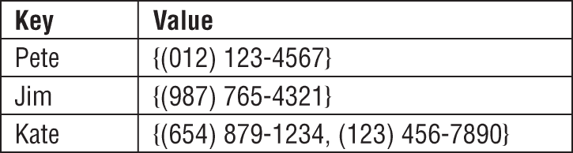

    图 1.1 键值存储

* `Document databases` 是最常见的 `NoSQL` 数据库类型（参见 图 1.2 说明了文档数据库中存储为文档的客户订单示例。文档数据库的示例包括 `MongoDB` 和 `Azure Cosmos DB Core (SQL)` API。

    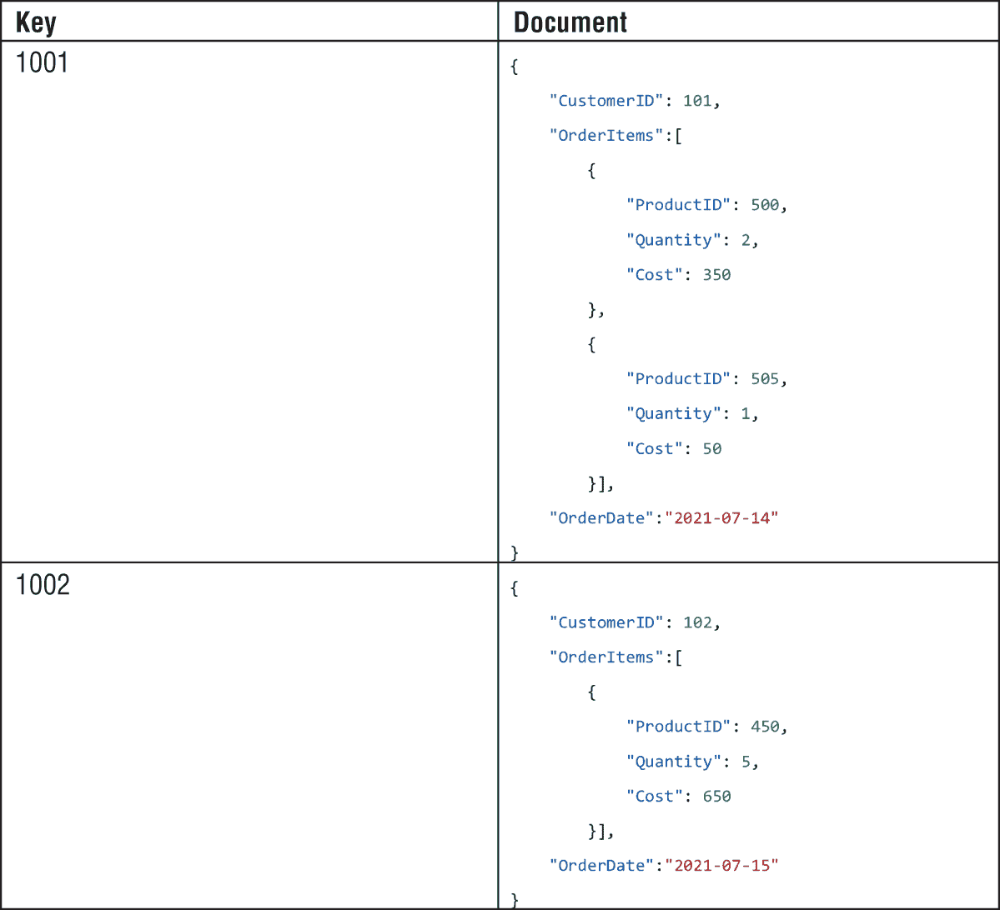

    图 1.2 文档数据库

* `Columnar databases` 在概念上类似于关系型数据库（参见 图 1.3）。它们将数据组织为行和列，但对数据进行非规范化，使其分为多个列族。每个列族包含一组逻辑相关的列。图 1.3 是自行车公司产品信息以列式格式存储的示例。列式数据库的示例是 `Azure Cosmos DB Cassandra API`。

    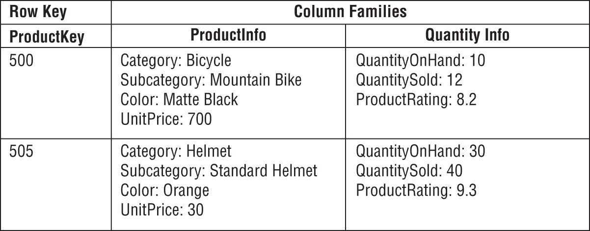

    图 1.3 列式数据库

* `Graph databases` 将数据存储为实体，并关注这些实体之间的关系（参见 图 1.4）。实体定义为节点，而它们之间的关系定义为边。查询图数据库的应用程序通过遍历节点和边的网络来实现，分析实体之间的关系。虽然关系型数据库可以实现类似目标，但大型图数据库可以非常快速地遍历关系，无需对许多表执行多个联接操作。图 1.4 说明了存储组织人员图表的图数据库示例。实体代表不同的职位和部门，而边代表每个实体之间的关系。图数据库的示例包括 `Neo4j` 和 `Azure Cosmos DB Gremlin API`。

 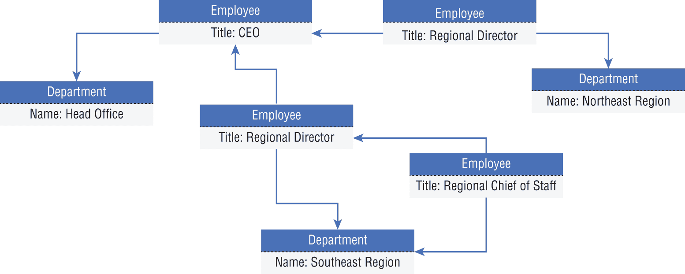

图 1.4 图数据库

### 对象存储


对象数据存储（例如 Azure 存储帐户）以文本和二进制格式存储海量数据。你可以将存储帐户视为组织本地网络上的共享文件夹。与本地文件共享不同，存储帐户具有高度可扩展性，并让组织能够随意添加所需数据，而无需担心增加硬件。依赖于文件中存储的数据的 Azure 解决方案会以某种形式使用 Azure 存储帐户，如以下场景所示：

* 存储由深度学习模型分析或提供给网站的图像或视频

* 存储用于大数据解决方案中分布式处理的文件，例如 JSON、Avro、Parquet、CSV 或 TSV

* 存储用于备份和还原、灾难恢复以及归档的数据

* 存储可用于近实时分析的日志文件形式的遥测信息

存储帐户可以支持多种对象存储用例。根据场景，你可以决定使用以下存储帐户服务之一来存储二进制对象：

* `Azure Blob Storage` 是 Azure 中对象存储最常用的服务。需要分析（例如图像或视频、备份管理或用于分布式处理解决方案的文件）的解决方案可以将数据存储在 Blob Storage 中。它可以存储 EB 级别的数据，并提供不同的访问层，以最具成本效益的方式存储数据。

* `Azure Data Lake Storage Gen2`（也称为 ADLS）是一组构建在 Blob Storage 之上的功能，但专门针对分布式分析解决方案。ADLS 的关键功能是其 `hierarchical namespace`，它能够实现快速高效的数据访问。分层命名空间将文件组织成目录层次结构，使你能够存储原始数据、清洗数据和聚合数据，而无需为下一份副本牺牲一份。

* `Azure Files` 是 Azure 中的完全托管文件共享解决方案。文件共享可通过服务器消息块 (SMB) 协议或网络文件系统 (NFS) 协议访问。它们可以由云或本地系统并发挂载。

## Data Volume

数据量是指需要分析和处理的数据量。访问更大的数据集既能带来清晰度，也可能带来同样多的麻烦。存储在采用不良设计实践的数据库中，或由编写不良的查询访问的大型数据集，可能导致应用程序性能极差，甚至完全停止。传统关系数据库（例如 SQL Server 或 Azure SQL Database）可用于大型数据仓库，前提是它们采用经过深思熟虑的数据模型设计（配备适当的索引和分区），且应用程序使用编写良好的查询读取数据。然而，传统数据库技术和处理模式所能处理的数据量是有限的。

在设计阶段选择合适的数据存储技术和处理模式至关重要，尤其是当数据集规模将非常大时。即使是调校得再好的关系数据库，在超过一定规模阈值后也会开始性能不佳。`Symmetric multiprocessing`（对称多处理，SMP）系统（例如 SQL Server 和 Azure SQL Database）的特点是单个 RDBMS 实例共享所有资源（CPU、内存和磁盘）。SMP 系统可以纵向扩展以处理 GB 级和 TB 级的数据，但在达到资源限制时会遇到瓶颈。`Massively parallel processing`（大规模并行处理，MPP）系统（例如 Azure Synapse Analytics 专用 SQL 池）旨在处理大型数据集。MPP 系统设计为分布式并行处理解决方案，这意味着它们不仅可以通过添加更多计算资源来纵向扩展，还可以通过向系统添加更多节点来横向扩展。

你可以将 SMP 和 MPP 系统在数据处理上的差异比作杂货店补货货架的方式。一名员工可以在相对较短的时间内高效地补货单个过道。然而，如果只有一名员工可用于该任务，补货拥有众多过道的大型商店的每个过道可能需要数小时甚至数天。在大多数情况下，商店的楼层经理会将不同的过道分配给不同的员工。由于许多员工正在并行补货货架，这大大缩短了补货整个商店所需的时间。Azure Synapse Analytics、Azure HDInsight 和 Azure Databricks 等 MPP 系统的运作方式也是如此。底层架构包括一个驱动程序/控制节点，它将大型处理任务划分为多个操作，并将其分配给不同的工作/计算节点。数据存储在分布式文件系统中，该系统将数据分割为块，由不同的工作节点进行处理。

将计算和存储分离的能力使 MPP 系统能够非常快速地扩展。向 Azure Synapse Analytics 专用 SQL 池或 Azure Databricks 群集添加节点，无需重新分区数据。相反，数据持久化存储在分布式文件系统中，该系统将其分片为分区或分布式数据，以优化系统性能。Azure Blob Storage 或 Azure Data Lake Storage Gen2 等基于云的对象存储通常用作分布式文件系统的基础。这些技术在设计上具有高度可扩展性，使得存储 MPP 系统使用的海量数据变得容易。

虽然 Azure Synapse Analytics 和 Azure Databricks 等技术非常适合现代数据仓库和数据处理需求，但它们并非为存储高度事务性数据而设计。分布式文件系统非常适合存储用于创建聚合分析的数据，但并未针对一次插入或优化一条的事务性数据进行优化。在需要存储和全球分布大量事务性数据（例如每秒数千笔交易）的情况下，使用 Azure Cosmos DB 等 NoSQL 数据库来存储事务性数据可能会有所帮助。使用 NoSQL 数据库的事务性系统具有放宽的 ACID 特性，以换取架构灵活性和跨多个节点的水平扩展。这与 MPP 系统提供类似的好处，因为有更多计算资源可用于处理和存储。这里的权衡在于，维护事务一致性的过程将落在应用程序开发人员身上，因为 NoSQL 数据库不严格遵循 ACID 特性。

## Data Variety

数据多样性是指涉及的数据类型。你可能认为数据只是电子表格中的条目，但它可以有多种不同的形式。从销售点 (PoS) 系统捕获的交易、传感器生成的事件，甚至图片都可以生成企业可用于决策的宝贵洞察。最终，数据分为三类：结构化数据、半结构化数据和非结构化数据。

## Structured Data

`Structured data` 可定义为由行和列组成的表格数据。Excel 电子表格或 CSV 文件中的数据被认为是结构化数据，SQL Server、Oracle 或 MySQL 等关系数据库中的数据也是如此。结构化数据符合定义明确的架构，这意味着表中的每一行都将具有相同数量的列，即使其中一列或多列在该行中没有任何值。结构化数据集中每一行都具有相同数量的列的过程称为架构完整性。这正是使用户能够在关系数据库中创建表之间关系的原因。本章后面以及 Chapter 2 中将详细介绍此内容。


虽然架构完整性使关系数据易于查询和分析，但它迫使数据遵循严格的结构。这种严格的结构迫使用户考虑其数据随时间变化的程度。考虑架构随时间的演变方式，或源数据架构与目标解决方案之间的差异，将迫使你开发复杂的数据管道，以确保这种波动性不会对你的解决方案产生负面影响。

Figure 1.5 说明了结构化数据的示例。图中的数据来自公开可用的 AdventureWorks2019 数据库的产品信息。

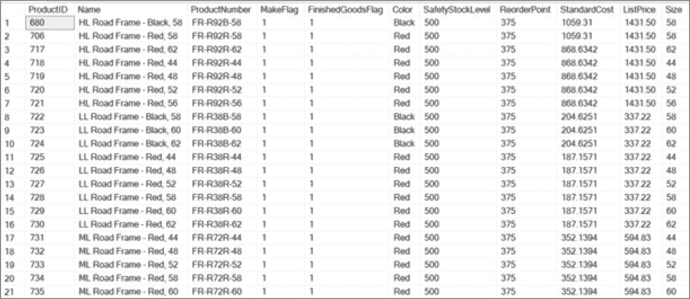

FIGURE 1.5 结构化数据

### 半结构化数据

`Semi-structured data` 具有一定的结构，但没有定义的架构。这允许数据被快速写入和读取，因为存储引擎不会重新组织数据以满足严格的格式。虽然缺乏定义的架构自然消除了与结构化数据相关的大多数数据波动性问题，但它使分析查询变得更加复杂，因为在创建查询时没有可靠的架构可用。

半结构化数据集最流行的示例是 XML 和 JSON 文件。JSON 特别流行于通过 Web API 共享数据。JSON 将数据存储为数组中的对象，这允许轻松传输数据。XML 和 JSON 格式都具有一定的结构，但足够灵活，以至于某些对象可能比其他对象具有更多或更少的属性。由于数据的结构比带有架构的数据库更加流动，我们通常将查询半结构化数据称为 `schema-on-read`。这意味着查询定义为数据创建了一种准架构，以便数据符合该架构。Figure 1.6 演示了如何使用 JSON 为多个客户存储数据，同时为每个客户包含不同的字段。

我们可以存储半结构化数据的方式有多种，从 NoSQL 数据库（如 Azure Cosmos DB（请参阅 第 3 章））到 Azure 存储帐户中的文件（请参阅 第 4 章）。关系数据库（如 SQL Server、Azure SQL 数据库和 Azure Synapse Analytics）也可以使用原生 JSON 和 XML 数据类型处理半结构化数据。虽然这为数据从业者在同一位置管理结构化数据和半结构化数据提供了一种便捷的方式，但建议将存储在关系数据库中的半结构化数据量限制在极少或没有。

半结构化数据也可以存储在其他类型的 NoSQL 数据存储中，例如键值存储、列式数据库和图数据库。

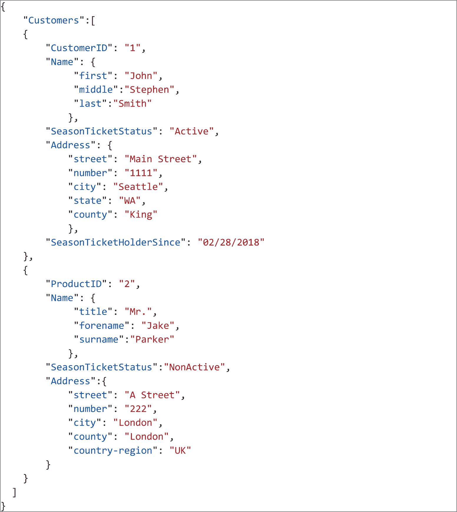

FIGURE 1.6 JSON 示例

### 非结构化数据

`Unstructured data` 用于描述不符合结构化或半结构化分类的所有内容。PDF、图像、视频和电子邮件只是非结构化数据的几个示例。虽然非结构化数据无法像结构化或半结构化数据那样查询，但深度学习和人工智能（AI）应用程序可以从中获得有价值的见解。例如，使用图像分类的应用程序可以通过将图像与其他图像进行比较，训练其在图像中查找特定细节。

如今，存储非结构化数据比以往任何时候都更容易。如前所述，Azure Blob 存储允许公司和个人以任何格式存储艾字节级的数据。虽然本考试不涵盖非结构化数据的许多应用程序，但重要的是要注意，非结构化数据对于公司在当今世界获得竞争优势变得越来越重要。

## 数据速度

数据处理的速度通常称为数据速度。数据处理的要求在很大程度上取决于我们试图解决的业务问题或问题。原始数据（如足球运动员统计数据）可以作为原始数据存储，直到给定周的每场比赛结束后才将其转换为有价值的信息。这种分批处理数据的数据处理类型通常称为 `batch processing`。我们还可以实时处理来自运动员佩戴的设备上传感器的数据，以便在比赛进行时监控运动员表现。这种类型的数据处理称为 `stream processing`。

## 批处理

批处理是一次转换一组或一批数据的做法。此过程也称为处理静态数据。传统 BI 平台依赖批处理解决方案从其数据中创建有意义的见解。音乐会场馆会利用 SQL Server 等技术存储批量数据，并利用 SQL Server Integration Services (SSIS) 按计划将事务数据转换为可存储在其数据仓库中以供报告的信息。如今，许多相同的概念适用于批处理，但云计算为我们提供了处理指数级更多数据的可扩展性。Hadoop 和 Spark 等分布式计算范式允许组织使用多台商品服务器的计算资源来批量处理大量数据。

批处理通常由编排服务（如 `Azure Data Factory (ADF)`）自动化的一组作业来完成。这些作业可以逐个运行、并行运行，或者两者混合运行，具体取决于这些作业所属解决方案的要求。自动批处理作业可以在数据存储中达到一定数据阈值后运行，但更常见的触发方式有两种：

*   按重复计划运行——ADF 管道每天午夜运行一次，或从指定开始时间开始按周期性时间间隔运行。

*   基于事件/触发器——ADF 管道在文件上传到 Azure Blob 存储中的容器后运行。

批处理还必须包括对失败作业采取措施的错误处理逻辑。Azure 中处理批处理的常见架构模式在 Figure 1.7 中有示意。

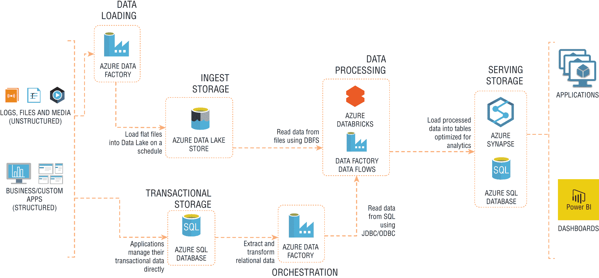

FIGURE 1.7 Azure 中批处理的常见架构

Figure 1.7 中的图表内容较多，因此让我们逐步分解：

*   数据从不同的源系统加载到 Azure。这可能从将原始文件上传到中央数据存储库（如 Azure Data Lake Storage Gen2 (ADLS)）到从 OLTP 数据库（如 Azure SQL 数据库）中的业务应用程序收集数据不等。

*   然后将原始数据转换为适合分析和报告的状态。在此，我们可以在 Azure Databricks 等代码优先选项之间进行选择，以完全控制数据的转换方式，或者选择 Azure Data Factory 数据流等基于 GUI 的技术。这两个选项都可以作为 ADF 管道中的活动执行。

*   汇总数据加载到准备报告的优化数据存储中。根据工作负载和数据大小，可以使用 MPP 数据仓库（如 Azure Synapse Analytics 专用 SQL 池）来最佳存储用于报告的数据。

*   准备报告的数据随后通过客户端原生应用程序或商业智能工具（如 Power BI）进行分析。


虽然 图 1.7 中的架构是批处理数据的常见模式，但绝非唯一模式。确定处理批量数据的最合适技术和策略，需要对数据进行探索性分析、了解将要处理的源数据，并明确数据使用的需求。你还需要决定采用 `extract, transform, and load` `(ETL)` 还是 `extract, load, and transform (ELT)` 数据操作模式，具体取决于你的存储和转换引擎是否为同一引擎。本章后面的“数据处理技术”部分将进一步探讨这两种模式。批处理包括以下优势：

*   一次准确处理大量数据。可分配更多计算能力给批处理，且批处理的时间限制通常不如流处理关键。

*   方便安排数据处理时间。批处理作业可以随时安排，使组织能够将批处理作业安排在非高峰时段运行。

*   轻松创建复杂的数据分析和聚合。由于批处理的数据持久化存储在 `ADLS`、`Azure SQL Database` 和 `Azure Synapse Analytics` 等数据存储中，组织可以反复使用干净的数据集进行报告和机器学习。

*   将 `JSON` 或 `XML` 等半结构化数据转换为适合分析查询的结构化、带架构的格式。

批处理包括以下劣势：

*   接收数据到能够分析数据之间的延迟。

*   批处理作业处理的数据必须在批处理开始前准备好。如前所述，需要建立复杂的错误处理检查，以确保数据、错误或失败活动的问题不会导致整个过程崩溃。

## 流处理

与批处理按计划间隔处理数据组不同，流处理在数据生成时实时对其执行操作。近年来，连接应用程序和物联网传感器设备的普及导致可流式传输数据的数据源激增。利用数据流的组织能够随时随地进行创新，从而立即响应客户需求。

你可以将数据流视为来自某个源（也称为消息生产者）的持续数据流。流中的每个数据片段通常称为事件或消息，通常以非结构化或半结构化格式（如 `JSON`）到达。以下列表包含一些流处理示例：

*   电子商务公司在消费者浏览其网站时分析点击流数据，以实时提供产品推荐

*   健身追踪器将心率和运动数据流式传输到移动应用，并提供穿戴者锻炼效率的实时更新

*   金融机构实时跟踪股票市场变化，并随着股票价格变化自动做出投资组合决策

*   石油公司监控管道和钻探设备的状态

虽然这些示例包含与许多批处理相同的转换活动，但它们的延迟要求要短得多。

流处理是设计实时数据处理解决方案的一个步骤。设计实时解决方案时需要考虑以下逻辑组件：

*   `Real-time message ingestion`—架构必须包含一种方式来捕获和存储实时消息，无论创建数据流的技术是什么。`Azure Event Hubs`、`Azure IoT Hub` 和 `Apache Kafka` 等消息代理用于从一个或多个消息生产者每秒摄取数百万个事件。这些技术随后会在将消息发送到架构中下一个适当步骤之前对其进行排队。大多数情况下，这将是某种类型的处理引擎，但某些解决方案需要将原始消息发送到长期存储解决方案（如 `Azure Blob Storage` 或 `ADLS`），以供将来进行批量分析。

*   `Stream processing`—流处理引擎是处理、聚合和转换数据流的计算平台。`Azure Functions`、`Azure Stream Analytics` 和 `Azure Databricks Structured Streaming` 等技术可以创建在实时消息代理中排队的时限洞察数据。这些技术随后会将结果写入消息消费者，例如分析数据存储或可显示实时更新的报告工具。

*   `Analytical data store`—处理后的实时数据可以写入 `Azure Synapse Analytics`、`Azure Data Explorer` 和 `Azure Cosmos DB` 等数据库，为分析应用程序提供支持。

*   `Analysis and reporting`—处理后的实时数据可以直接从流处理引擎发布到 `Power BI` 等报告应用程序，而无需先写入分析数据存储。

使用这些步骤，我们可以灵活选择是实时处理数据流、按需处理，还是两者结合。“实时”方法是处理数据流最常见的方法，涉及在数据从 `Azure Event Hubs` 等消息代理到达时持续分析数据。这种方法使组织能够针对数据流创建计算和聚合，用于时间分析。图 1.8 通过一个简单的示例说明了这种方法，即物联网恒温器将温度数据流式传输到 Azure 进行分析。

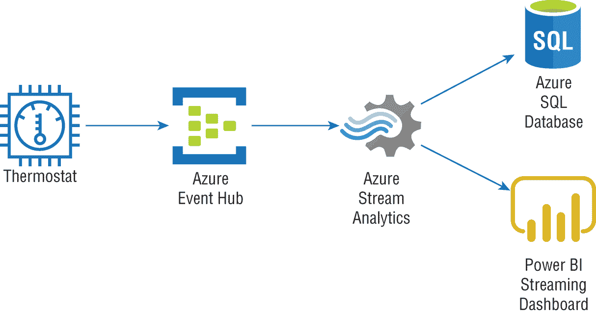

FIGURE 1.8 Live stream processing

这种方法生成一个实时流式处理解决方案，在转换数据并将其存储在 `Azure SQL Database` 中以供进一步分析（例如，将一个月的温度数据与前一年同月的数据进行比较）的同时，即时创建温度分析。

虽然大多数流式处理解决方案都采用实时方法设计，但有些情况需要以微批处理方式处理流数据。这种“按需”方法涉及将传入数据持久化到 `ADLS` 等数据存储中，并在方便时处理数据。如果场景不需要实时分析，则可以显著降低计算成本。图 1.9 说明了这种方法的示例。虽然它类似于 图 1.8 中的解决方案，但按需设计增加了一个额外步骤，即在 `Azure Stream Analytics` 对数据执行任何计算并将其输出到 `Power BI` 和 `Azure SQL Database` 之前，先将温度数据存储在 `ADLS` 中。

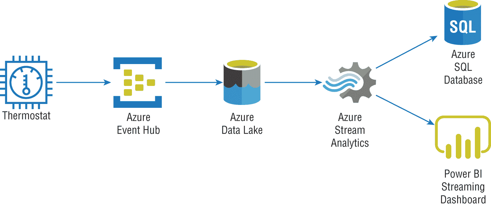

FIGURE 1.9 On-demand stream processing

像这样的解决方案展示了通常用于批处理场景的技术如何用于流处理解决方案。在下一节中，我们将讨论如何利用现代设计原则在同一解决方案中结合使用批处理和流处理。

## 结合使用批处理和流处理


直到最近，大多数组织处理数据的速度都受限于其数据中心的硬件和网络连接。它们通常受限于可以使用实时数据运行的查询类型，并且经常需要等待数小时才能完成流处理活动。然而，Azure 等基于云的解决方案的可扩展性使组织能够随时处理数据。这种灵活性催生了现代架构设计，这些设计能够在同一解决方案中创造性地分析批处理和流处理数据。其中最流行的设计模式之一是 `Lambda architecture`。`Lambda architecture` 是一种数据处理架构，它将批处理和流处理操作分为冷路径和热路径。图 1.10 说明了该模式的流动情况。

 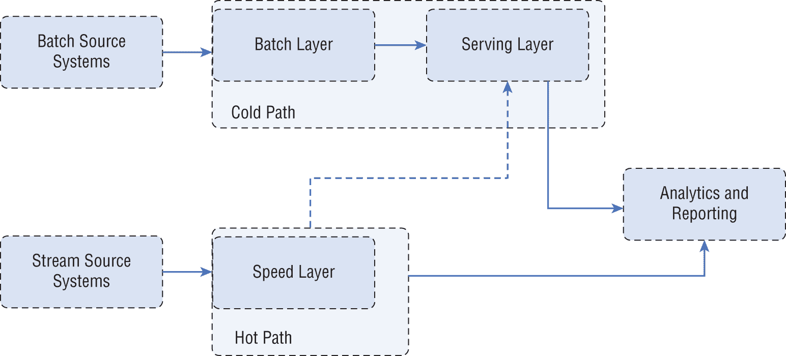

FIGURE 1.10 Lambda architecture

使用 `Lambda architecture` 的解决方案为数据处理创建两条路径：

*   `cold path` 是批处理操作（也称为批处理层）发生的地方。流入此路径的数据不受低延迟要求的限制，允许按计划处理更大的数据集。一旦数据在批处理层中被处理，结果将发送到服务层（例如，Azure Synapse Analytics 或 Azure SQL Database 等数据仓库）以供查询。

*   `hot path` 是速度处理操作（也称为速度层）发生的地方。流入此路径的数据需要尽可能快地处理，以牺牲准确性为代价。处理后，速度层的数据要么直接发送到分析/报告应用程序进行分析，要么基于最新数据增量更新服务层。

最终，热路径和冷路径的数据将在分析/报告应用程序中汇合。如果应用程序需要实时显示数据，它将从热路径获取数据。否则，应用程序将从冷路径读取数据，以显示基于更大数据集创建的更准确的分析。

`Lambda architecture` 的核心原则之一是，批处理层中存储的原始数据是不可变的。新数据始终追加到现有数据，永远不会覆盖旧数据。特定数据集的值的更改存储为新的带时间戳的记录。这允许在任何时间点重新编译计算，以提供更准确的历史分析。Azure 使组织能够轻松实现此设计，而无需购买和安装新硬件。例如，Azure Data Lake Storage Gen2 可以存储 PB 级的信息，并且凭借其原生分层命名空间（可以将其视为文件资源管理器中的目录和文件夹），组织可以创建对应于不同日期的目录树，这些目录树可以存储和维护在该日期生成的数据。组织无需承担扩展现有存储设备或安装新存储设备的负担，而是可以专注于实现业务逻辑。

## 描述数据分析核心概念

将原始数据转化为有用信息的过程称为数据分析。投资于复杂且设计良好的数据分析解决方案的公司，旨在发现有助于提升组织整体性能的信息。发现新机会、识别弱点和提高客户满意度都是数据分析带来的结果。这涉及构建一个可重复的解决方案，从适当的源系统收集数据，将其转化为可靠的信息，并以易于消费的方式提供。

端到端数据分析解决方案的一个例子是，一家体育俱乐部希望构建一个球迷参与解决方案，以通过留住更多季票持有者并为不同球迷群体创建基于激励的计划，来提高体育场出席率和体育场内零售销售额。创建此解决方案的第一步是确定与谁参加比赛以及哪些外部因素可能影响出席率相关的问题所需的最有用数据源。下一步是将这些分散的数据源进行转换，使其呈现可靠的数据视图，以便对数据采取行动的消费者可以轻松读取。例如，数据的消费者可能是开发回归模型以预测未来体育场出席率的数据科学家，或者是为不同球迷群体构建报告和仪表板以显示体育场内趋势的分析师。这些行动随后用于制定决策，以提升比赛期间的门票销售和运营效率。

## 数据处理技术

数据分析解决方案中最关键的部分是结果集是干净、可靠的数据。数据的消费者必须能够从问题中检索到相同的答案，无论问题是如何呈现给数据模型的。不应对所报告的数据质量存在疑问。这就是数据处理的目标。

简单来说，数据处理是用于摄取原始数据并将其转换为一个或多个信息性业务模型的方法论。数据处理解决方案会以批处理或流的方式摄取数据，并可以将数据以原始形式存储，或开始对其进行转换。数据在准备好进行报告之前可能会经历多次转换。一些最常见的转换活动如下：

*   过滤掉损坏、重复或不必要的数据

*   将数据连接或追加到其他数据集

*   将数据标准化以符合标准命名法

*   聚合数据以生成摘要

*   将功能更新为更有用的数据类型

数据处理管道必须包含可重复且足够灵活的活动，以处理各种场景。可以使用 `ADF`、`Azure Databricks` 和 `Azure Functions` 等工具构建处理管道，这些管道使用参数来生成所需结果。这些工具还允许开发人员在其处理管道中包含错误处理逻辑，以管理当出现处理错误时管道如何继续，而不会使管道戛然而止。

基于云的数据处理解决方案使在多个转换阶段后存储数据变得容易。`ADLS` 等存储解决方案允许组织以非常低廉的成本存储海量数据，这些数据存储在指定用于刚摄取的原始数据、已过滤和标准化的数据，以及已汇总并建模用于报告的数据的文件夹中。这使数据处理解决方案可以随时重复使用数据，以验证对数据采取的操作，并从数据生命周期的任何点生成新的分析。

在从源系统提取数据、对其进行转换，并将处理后的信息加载到数据模型时，可以采用两种数据处理方法。这些方法是提取、转换、加载 (`ETL`) 和提取、加载、转换 (`ELT`)。在两者之间进行选择取决于转换和存储引擎之间的依赖关系。

## 提取、转换、加载 (`ETL`)


ETL 管道以线性方式处理数据，每个阶段都有不同的步骤。它们首先从不同来源收集数据，转换数据以删除脏数据并符合业务规则，然后将处理后的数据加载到目标数据存储中。这种方法在商业智能（BI）解决方案中已使用多年，并拥有广泛的既定最佳实践。在设计三个阶段中的每一个时，都需要投入同等的精力。如果设计和开发得当，ETL 管道可以并行处理多个数据源以节省时间。例如，在从一个来源提取数据的同时，转换活动可以处理已经接收的数据，加载进程可以开始将转换后的数据写入目标数据存储（例如数据仓库）。Figure 1.11 说明了 ETL 工作流中每个阶段常用的 Azure 技术。

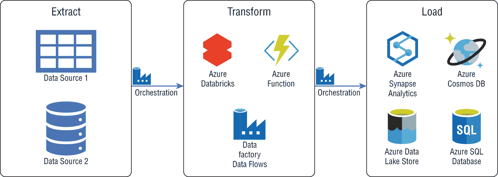

FIGURE 1.11 ETL workflow

在此示例中，数据从源系统提取，并由一个或多个计算引擎（例如 Azure Databricks、Azure Functions 或 Azure Data Factory 映射数据流）进行转换。完成必要的转换后，数据被加载到目标数据存储（例如 Azure Synapse Analytics、Azure Cosmos DB、ADLS 或 Azure SQL Database）中，以支持不同类型的应用程序。ADF 自动化此工作流并控制每个步骤的执行时间。请记住，这是一个基础示例，典型的 ETL 管道在准备数据时可能包含多个暂存层和转换活动。以下各节将描述每个阶段以及如何在 ETL 工作流中管理每个活动。

## Extract

ETL 过程的第一个阶段涉及从不同源系统提取数据，并将其存储在转换工具更易于访问的统一暂存层中。数据源通常是异构的，并由各种数据格式表示。暂存层可以是临时的，以减少存储需求或消除源系统中可能存在的个人身份信息（PII）；如果不存在 PII 数据且存储不是问题，则可以持久化。暂存层通常作为文件持久化到对象存储（例如 Azure Blob Storage 或 ADLS）中。

在 Azure 中，Azure Logic Apps 和 ADF 等工具允许数据工程师使用图形用户界面（GUI）拖放活动，从源系统复制数据并将其放置在暂存层中。这些活动可以参数化，以动态调整原始数据的暂存位置。Azure Databricks 和 Azure Functions 等自定义代码选项也可用于使用 C#、Python、Scala 和 JavaScript 等语言提取数据。这些自定义代码选项的本质使数据工程师能够更好地控制提取数据的格式化和暂存方式。无论数据提取是使用基于 GUI 的工具还是代码优先工具完成，数据提取活动都可以自动化，按计划运行或基于事件触发，具体取决于何时向源系统添加新数据。

可以通过几种不同的方式从源系统提取数据。增量提取仅拉取最近插入或更新的源数据。这可以最大限度地减少提取必要源数据的时间和转换新原始记录的时间，但需要额外的逻辑来确定哪些数据已更改。对于无法识别哪些记录已更改的系统，需要进行全量数据提取。这需要拥有正在提取的源数据的完整副本。虽然这可以生成源数据的准确副本，但提取可能需要更长时间，后续的转换活动运行时间也会更长。

## Transform

ETL 过程的第二个阶段涉及转换提取的数据，使其清洗并满足一组业务要求。数据会被清除脏数据，并做好准备以符合目标数据模型的架构。转换被拆分为多个活动，以实现数据管道的最佳性能。这种模块化方法允许转换活动并行运行，并提供更轻松的故障排除方法。它还允许数据工程师在添加新业务要求时轻松实现其他转换活动。

根据转换的复杂程度，数据可能被加载到一个或多个额外的暂存层中，作为部分转换数据的中间阶段。一个示例是将数据转换的不同阶段分为青铜、白银和黄金暂存层。

*   `bronze` 层代表从不同来源摄入的原始数据，采用多种不同的格式。可能已经进行了一些过滤以将数据带到此阶段，但青铜层中的数据转换极少。

*   `silver` 层代表数据的更精细视图。白银层数据的特征是已清除脏记录，并由来自多个青铜层数据集的字段通过联接或合并操作组成的实体组成。白银层中的数据通常用于机器学习活动，因为这些数据已清洗但未汇总。

*   `gold` 层代表报告应用程序使用的汇总数据集。每周销售和环比平均值等计算包含在黄金层数据集中。

与提取阶段一样，转换活动可以使用基于 GUI 或基于代码的技术构建。SQL Server Integration Services (SSIS) 是一种 ETL 工具，用于传统的本地 BI 解决方案。SSIS 提供许多开箱即用的连接器和转换活动，允许开发人员使用 GUI 构建复杂的数据工程管道。ADF 为基于云的 ETL 提供类似的开发体验。ADF 提供拖放体验，并附带多种可以图形化链接在一起的数据转换活动。ADF 如何编排 ETL 管道的核心组件将在本章后面的“控制流和数据流”部分讨论，但就转换而言，ADF 可以通过四种方式执行转换活动：

*   `External Compute Services`—ADF 可用于自动执行外部托管的自定义编码转换活动。这些活动可以使用多种不同的语言开发，并托管在 Azure Databricks 和 Azure Functions 等工具中。托管在 Azure SQL Database 或 Azure Synapse Analytics 上的存储过程也可以由 ADF 使用存储过程活动调用。从头开发的转换使工程师在如何实现业务规则以及如何处理不同场景方面拥有更大的灵活性。ADF 允许工程师将数据管道中先前步骤的结果作为参数或静态预定义参数传递给自定义开发的转换活动，以便它可以更动态地转换数据。


# Mapping Data Flows

ADF 为数据工程师提供了使用映射数据流构建无代码转换管道的选项。这些数据流与 SSIS 中的数据流活动非常相似，使数据工程师能够使用 GUI 创建转换活动。这种无代码解决方案的好处在于，执行转换的代码和运行代码的计算资源对数据工程师来说是隐藏的。这可以大大提高运营生产力，让工程师能够纯粹专注于实现业务逻辑，而不是优化代码和计算基础设施。就像托管在外部计算服务上的转换活动一样，ADF 可以将静态参数或先前执行的活动的结果作为参数传递给映射数据流，以动态转换数据。

# Power Query

以前称为数据整理流，ADF 允许数据工程师使用 Power Query 对数据进行无代码转换。Power Query 是 Power BI 的原生组件，使分析师能够以可扩展的方式执行转换活动。ADF 中的 Power Query 使公民数据分析师能够在 ADF 中创建自己的管道，而无需了解如何构建复杂的数据工程管道。

# SSIS

组织多年来一直在构建 BI 解决方案，如果其解决方案涉及 SQL Server，那么很可能涉及 SSIS 组件。如果现有的 SSIS 足迹很复杂，使用 ADF 管道重建现有的 SSIS 可能非常耗时。这可能成为组织迁移到 Azure 的障碍。为了缓解这些顾虑，客户可以选择将其 SSIS 项目迁移到 ADF。数据工程师可以在数据管道中使用 `Execute SSIS Package` 活动作为单例活动，或将其与其他 ADF 原生活动链接起来。在 ADF 中运行 SSIS 项目需要使用一种称为 Azure-SSIS 集成运行时的特殊计算基础设施。第 5 章将详细讨论 Azure-SSIS 集成运行时和其他类型的运行时。

# Load

ETL 过程的最后阶段涉及将转换后的数据加载到目标数据模型中。此数据模型可以是数据仓库，例如 Azure Synapse Analytics 或 Azure SQL Database，也可以是数据库，例如 Azure Cosmos DB（用于服务高度分布式的 Web 应用程序），或者是对象存储，例如 ADLS（用作机器学习活动的数据黄金副本）。此阶段也可以由基于 GUI 的工具（例如 ADF）或自定义代码解决方案处理。

可以使用几种不同的加载模式将数据加载到目标数据存储中。增量或差异加载涉及添加新数据或使用新值更新现有数据。这可以缩短将新转换的数据加载到目标数据存储所需的时间，使数据消费者能够尽快分析新数据。有时需要将目标数据存储加载为整个数据集，这需要擦除现有数据存储的数据。对于这些用例，在目标数据存储中设置暂存表可能很有用，以作为最终转换的数据副本与正在分析的生产表之间的中介。由于暂存表是被截断的表，消费者不会因数据缺失而经历任何停机时间。新记录可以通过称为分区切换的过程添加到生产表中。

由 ETL 管道处理的数据加载的关系数据库表必须预先构建其架构。不考虑表现有架构的结构可能会导致因数据类型不匹配和列名不正确而产生加载错误。这种将数据塑造为符合预定义架构的要求称为 `schema-on-write`。

# Control Flows and Data Flows

许多 ETL 工具采用两种方法来编排数据管道。确保数据处理活动有序处理的任务称为 `control flows`。数据处理活动称为 `data flows`，可以从控制流按顺序执行。使用 ADF 编排数据管道的数据工程师可以使用控制流来管理其数据流的处理顺序。

控制流用于强制执行数据移动和数据转换活动的正确处理顺序。使用优先级约束，控制流可以规定如果任务成功或失败，管道如何进行。后续任务在其前任任务完成之前不会开始处理。ADF 中控制流操作的示例包括 Filter、ForEach、If Condition、Set Variable、Until、Web 和 Wait 活动。ADF 还允许工程师在活动完成后使用 `Execute Pipeline` 控制流活动在管道中运行整个管道。图 1.12 显示了 ADF 中的一个简单控制流，其中 Lookup 任务正在从 SQL Server 数据库中检索表元数据，这些元数据将传递给一组 Copy 活动，以将这些表迁移到托管在 Azure Synapse Analytics 中的数据仓库。

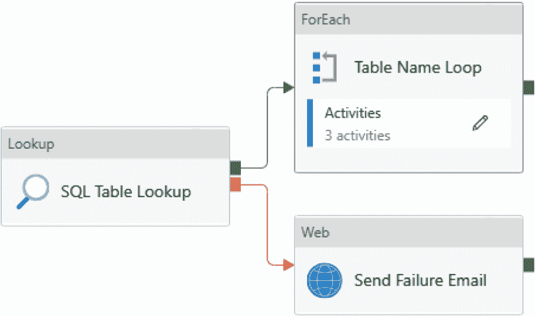

FIGURE 1.12 ADF control flow

此控制流包括表元数据成功查找和失败的结果。如果元数据检索成功，则下一步将是一个 ForEach 循环，其中包含数据移动任务，将成功检索到的每个 SQL Server 表迁移到 Azure Synapse Analytics。如果 Lookup 任务出于任何原因失败，则下一步将是一个 Web 活动，该活动将发送电子邮件通知管理员失败情况。

控制流的另一个示例是执行不同映射数据流的顺序。使用 `Data Flow` 活动，数据工程师可以将多个映射数据流链接在一起，以按正确顺序处理数据。图 1.13 说明了一个控制流示例，该控制流按顺序和并行执行一系列数据流。

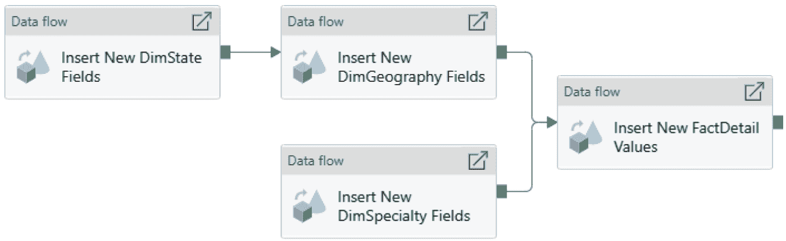

FIGURE 1.13 Ordering data flow processing with a control flow

此管道首先在 State 和地理目标表中插入新的 State 字段，随后插入新的地理字段，同时并行插入新的专业字段。这些数据流完成后，控制流将运行最后一个数据流，将新的详细信息字段插入到目标详细信息表中。当然，这些任务仅控制 ETL 活动运行的顺序，而不是底层数据转换步骤。ADF 允许开发人员通过双击其相应的 `Data Flow` 控制流活动来构建或编辑特定的映射数据流。

虽然控制流管理 ETL 管道的操作顺序，但数据流是 ETL 神奇之处所在。数据流是控制流中的特定任务，负责从源提取数据、转换数据，并将转换后的数据加载到适当的目标数据存储中。一个数据流任务的输出可以是下一个数据流任务的输入，而彼此之间没有依赖关系的数据流可以并行运行。如前面本章“Transform”部分中所述，ADF 可以执行四种类型的转换活动，这些活动可以作为数据流。本节将重点介绍其中两种类型：映射数据流和托管自定义代码的外部计算服务。


# 映射数据流

映射数据流是数据工程师可以使用 GUI 设计的 ETL 管道。开发人员首先选择要从中提取数据的源，然后对数据执行一个或多个转换活动，最后将转换后的数据加载到目标数据存储中。完成的数据流在执行时会被翻译为代码，并使用扩展的 Apache Spark 集群来运行它们。图 1.14 是来自 图 1.13 的“插入新 DimSpecialty 字段”数据流任务的屏幕截图。

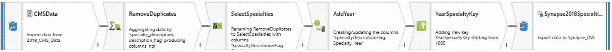

FIGURE 1.14 ADF mapping data flow

此数据流首先从 CSV 文件中提取数据。接下来，CSV 数据会经过几个转换，包括删除重复行、仅选择所需的列，以及创建新列以符合目标数据存储的架构。最后，数据流通过将每个转换后的列插入到其关联的目标列中，将转换后的数据加载到 Azure Synapse Analytics 的 DimSpecialty 表中。完成这些任务后，控制流会将此数据流标记为已成功完成，并等待“插入新 DimGeography 字段”数据流成功完成，然后再转到“插入新 FactDetail 值”数据流。

ADF 还可用于自动化托管在外部计算服务（如 Azure Functions、Azure Databricks、SQL 存储过程或 Azure HDInsight）中的自定义编码数据流活动。托管在这些平台上的代码可用于执行 ETL 管道的一个或多个阶段。将这些任务作为 ADF 中的活动运行，使它们可以按计划运行，并与其他活动（如映射数据流或其他自定义编码数据流）一起运行。图 1.15 说明了 ADF 中的控制流，该控制流执行托管在 Azure Databricks 和 Azure SQL Database 中的外部数据流。

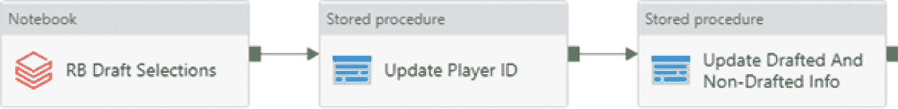

FIGURE 1.15 Azure Databricks and SQL stored procedure control flow

此示例是分析美国橄榄球运动员（即 NFL 橄榄球运动员）的解决方案的一部分。目标数据存储是托管在 Azure SQL Database 上的数据仓库，它为消费者提供了将当前年的潜在新秀群体与往年群体进行比较的功能。图 1.15 中的管道首先运行托管在 Azure Databricks 中的 Python 笔记本，以提取潜在新秀在当前年 NFL 选秀中被选中的时间信息，清理数据，并将清理后的数据加载到数据仓库中。管道的下一步是在数据仓库中运行存储过程，以关联在 NFL 选秀之前分配给他们的唯一标识符。最后，管道执行另一个存储过程，以告知分析师某个潜在新秀是否未被选中。如您所见，这些数据流中的每一个对于此数据分析解决方案的成功都至关重要。ADF 使得可以按顺序运行在不同技术上开发的这些活动，并控制它们的运行时间。

## 提取、加载和转换 (ELT)

ELT 工作流与 ETL 工作流的唯一区别在于数据转换的位置。ELT 不使用单独的转换引擎，而是使用目标数据存储来加载和转换数据。这通过删除通常用于转换数据的多余组件来简化设计。由于转换和加载组件是一体的，目标数据存储必须足够强大，才能同时高效地完成这两项任务。这使得大规模分析场景成为 ELT 工作流的完美用例，因为它们依赖于 MPP 技术（如 Azure Synapse Analytics 或 Azure Databricks）的可扩展性。图 1.16 说明了 ELT 工作流各个阶段中常用的 Azure 技术。

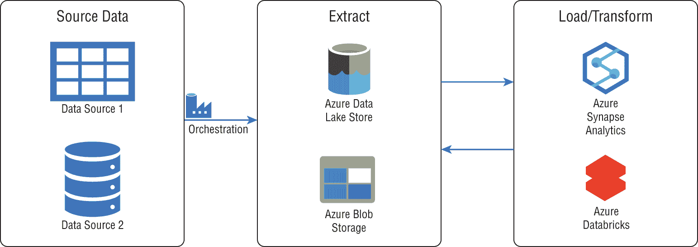

FIGURE 1.16 ELT workflow

在此示例中，数据通过 ADF 从其源系统中提取，并作为平面文件存储在原始数据存储（如 ADLS 或 Azure Blob 存储）中。接下来，数据被虚拟“加载”到目标数据存储的暂存表中。`Data virtualization` 是使 ELT 工作流能够以相对较低的开销处理大量数据的关键。数据不是物理存储在目标数据存储中，而是使用外部表在 ADLS 或 Azure Blob 存储的平面文件数据上覆盖架构。然后，数据可以像任何其他表一样进行查询，而不会占用目标数据存储的存储空间。MPP 技术（如 Spark（使用 Azure Databricks 或 Azure Synapse Apache Spark 池）和 Azure Synapse Analytics）是通常用于此方法的数据存储，因为它们具有创建外部表并对其执行转换的机制。以下部分将详细描述每个阶段。

## 提取

从各种来源收集数据在 ELT 工作流中与在 ETL 工作流中同样重要。与可能在数据提取后立即开始原始处理的 ETL 场景不同，ELT 场景中涉及的数据始终会汇总到中央存储库中。这些存储库必须能够处理大量数据。基于 `Hadoop Distributed File System (HDFS)` 的可扩展文件系统（如 ADLS 和 Azure Blob 存储）通常用于这些场景。

提取的数据还必须采用与目标技术的加载机制兼容的格式。典型的文件格式包括分隔文本文件（如 CSV 或 TSV）、半结构化文件（如 XML 或 JSON）以及列压缩文件（如 AVRO、ORC 或 Parquet）。列压缩文件格式应用于较大的数据集，因为这些格式针对大数据工作负载进行了优化，支持非常高效的压缩和编码方案。Parquet 被广泛使用，因为它能够将数据的架构嵌入到数据结构中，从而减少数据加载和转换逻辑的复杂性。

## 加载和转换

任何 ELT 工作流的关键在于目标数据存储处理数据而无需在引擎中存储数据的能力。MPP 技术通过在存储于 ADLS 或 Azure Blob 存储中的一个或多个文件上安装架构来实现这一点。目标数据存储仅管理数据的架构，而不管理数据的存储。这些外部表允许工程师查询和处理数据，就像处理存储在目标数据存储中的表一样，但最大限度地减少了所需的存储量。对虚拟化数据执行的转换利用目标数据存储的功能和能力，但应用于对象存储中的数据。

可在 ELT 工作流中执行加载和转换操作的三种 Azure 技术是 Azure HDInsight、Azure Databricks 和 Azure Synapse Analytics。

`Azure HDInsight` 是一项托管云服务，可让数据工程师构建和管理 Hadoop、Spark、Kafka、Storm 和 HBase 集群，这些集群可以处理存储在 ADLS 或 Azure Blob 存储中的数据。HDInsight 集群使用 Apache Hive 在对象存储上的数据上投影架构，而无需将数据本地持久化到集群中。计算与存储的这种解耦使集群能够大规模处理数据。


# Azure Databricks

Azure Databricks 是一个完全托管的、基于云的数据平台，允许数据工程师构建企业级 Spark 驱动的应用程序。Databricks 是由构建 Apache Spark 的同一团队构建的，并提供了开源 Spark 运行时的高度优化版本。Azure Databricks 是 Databricks 的一种特定实现，包括与多种基于 Azure 的存储（如 ADLS、Azure Blob 存储、Azure Synapse Analytics、Azure SQL 数据库和 Azure Cosmos DB）的原生集成。Azure Databricks 提供了类似于 Azure HDInsight 的将计算与存储解耦的机制，但具有几个关键优势。首先，Azure Databricks 提供与 Azure Active Directory 的原生集成，用于身份和访问管理。Azure Databricks 还提供了更轻松的集群管理方式，允许数据工程师手动暂停集群，或在空闲固定时间后设置自动关闭。集群还可以设置为自动缩放，以支持不同的工作负载大小。

# Azure Synapse Analytics

Azure Synapse Analytics 是一个全面的数据分析平台，包括用于数据引入、转换、探索和展示的工具。就本节而言，我们将重点介绍可用于加载和转换阶段的三种工具：专用 SQL 池、无服务器 SQL 池和 Apache Spark 池。

## 专用 SQL 池

专用 SQL 池（以前称为 Azure SQL 数据仓库）将数据存储在带有列式存储的关系表中。专用 SQL 池可以根据工作负载的大小进行扩展或缩减，并且在不使用时可以暂停。数据工程师可以选择使用 PolyBase 或 `COPY` 语句来虚拟化存储在对象存储中的数据。PolyBase 使用外部表来定义和访问 Azure 对象存储中的数据。PolyBase 需要创建一些外部对象才能读取数据。这些包括指向数据在 ADLS 或 Azure Blob 存储中的位置的外部数据源、定义数据格式的外部文件格式，以及最终的实际外部表定义。`COPY` 语句是用于将数据加载到专用 SQL 池的较新命令。它通过仅需要运行单个 T-SQL 语句而不是创建多个数据库对象来简化加载过程。它还包括 PolyBase 提供的一些额外功能。今后，应使用 `COPY` 语句将数据从 ADLS 和 Azure Blob 存储加载到专用 SQL 池。

## 无服务器 SQL 池

无服务器 SQL 池是一项交互式服务，允许开发人员查询 ADLS 或 Azure Blob 存储中的数据。它是一个分布式数据处理系统，专为大规模数据探索而构建。由于它是无服务器的，因此无需设置基础设施或维护集群。为每个部署的 Azure Synapse Analytics 工作区预配了无服务器 SQL 池的默认终结点。数据工程师和数据分析师可以使用 `OPENROWSET` 函数查询 Azure 对象存储中的文件，并可以创建外部表或视图以维护数据结构以供以后使用。无服务器 SQL 池支持 T-SQL 供用户查询和处理数据。

## Apache Spark 池

Apache Spark 池允许数据工程师使用 Spark 的开源版本部署 Spark 集群来处理大量数据。

这些技术中的每一种都是 MPP 系统，旨在处理大数据场景。使用刚刚讨论的 MPP 技术处理大数据场景的关键优势在于，一旦数据加载完成，它们就会将数据分解为较小的分区，并将分区的处理分布到多台机器上并行执行。与一个作业处理海量数据集不同，转换可以在较小的数据子集上并行发生，从而实现更高效的数据处理。有关 Azure HDInsight、Azure Databricks 和 Azure Synapse Analytics 的更多信息，以及更好地了解何时使用哪一种或如何协同使用它们，请参阅 第 5 章。

## 描述分析技术

虽然花费大量时间规划和开发数据处理管道很重要，但绝不能忘记最初驱动构建解决方案的问题。能够回答以下问题对于企业的成功至关重要：发生了什么？为什么某些事件会发生？将来会发生什么？我们应该做什么？如果不同变量发生变化，会发生什么？。知道如何回答这些问题可以帮助企业了解过去的成功和失败，并预测未来应该采取什么行动。这些问题可以使用五种分析技术来回答，讲述企业过去、现在和未来的故事。

五种分析技术包括描述性分析、诊断性分析、预测性分析、指导性分析和认知分析。每种分析类型代表组织分析成熟度的不同阶段。例如，描述性分析技术基于数十年的最佳实践，比指导性分析更容易实现，但提供的价值不那么大。分析技术提供的价值与其实现复杂性之间的关系被称为分析成熟度模型。这在 图 1.17 中有所插图。

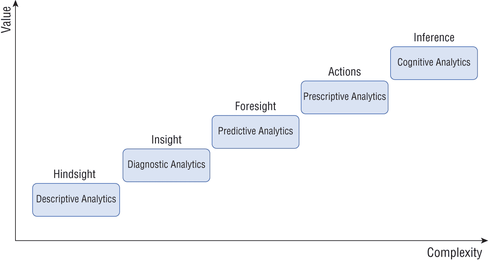

FIGURE 1.17 Analytics Maturity Model

## 描述性分析

描述性分析使用历史数据来回答关于企业发生了什么的问题。这是进行统计分析的一个很好的第一步，因为它可以让决策者了解任何趋势、数据分布以及数据中是否存在异常值。关键绩效指标 (KPI) 允许分析人员汇总大型数据集以跟踪关键目标的成功和失败。这种分析类型是反应性的，通常是基于数据做出决策的组织使用的第一种分析技术。

用于描述性分析的数据通常被收集并持久化存储在中央存储库中，例如数据仓库。设计良好的数据仓库使 OLAP 模型和 BI 工具能够针对各种场景分析绩效指标。描述性分析的一个示例是生成报告以提供组织销售数据的视图。

## 诊断性分析

诊断性分析使用历史数据来回答关于不同事件发生原因的问题。虽然描述性分析使用历史数据来显示过去的结果，但诊断性分析更进一步，确定这些结果背后的根本原因。这是第一种利用机器学习提供洞察的技术。诊断性分析的示例包括下钻以关注数据的特定方面、异常检测、从海量数据中获取信息的数据挖掘，以及用于确定因果关系的相关性分析。

## 预测性分析

预测性分析使用历史数据构建统计和机器学习模型，以预测未来将发生什么。这是分析成熟度模型中第一种回答关于企业未来问题的分析类型。神经网络、决策树和回归模型等技术允许预测性分析解决方案对以下场景提出建议：

*   客户是否会转向竞争对手。客户流失模型使用过去的趋势来预测客户流失的风险。这些模型可以帮助组织决定如何主动维护高风险客户的业务。


# 何时更换或修理设备

预测性维护模型使依赖机器运行业务的组织（例如，石油和天然气公司或自动售货机公司）知道何时应采取主动措施来修理或更换设备。

# 欺诈检测

欺诈检测模型会在发现任何可疑交易活动时提醒组织。

# 预测分析

虽然描述性分析和诊断性分析可以使用传统的 BI 技术完成，但预测分析要求开发人员具备更专业的技能。除了需要妥善维护历史数据仓库之外，涉及预测分析的解决方案还必须维护并定期回顾模型性能，以确保模型做出明智的决策。虽然这不在本书范围内，但了解用于维护机器学习模型生命周期的工具和机制非常重要。Azure 机器学习和 Apache Spark 的 MLflow 使数据科学家能够训练、部署、自动化和管理其机器学习模型。这些技术允许数据科学家使用基于容器的技术（如 Kubernetes 或 Azure 容器实例）部署模型，这些技术可被应用程序用于进行批量或实时预测。

## 指导性

指导性分析解决方案比预测分析更进一步，因为它们不仅预测结果，还会就如何实现期望结果向组织提供建议。这些解决方案利用描述性、诊断性和预测性分析技术的发现结果，来回答为实现特定目标应采取哪些行动的问题。机器学习算法和业务规则的组合用于模拟不同输入参数的结果。指导性分析解决方案可以产生影响的一个例子是在运动科学领域。指导性分析解决方案不仅能预测运动员何时会发生软组织损伤，还会就团队医生应采取哪些措施来预防损伤提供建议。它们还可以用于就运动员进行最有效的训练练习以达到最佳状态提供建议。

## 认知性

认知性分析解决方案结合了多种人工智能和机器学习技术，例如深度学习和自然语言处理，以从现有数据和模式中得出推论。这种分析将基于现有知识库提供信息，然后将这些信息添加回知识库，以供未来推论使用。

这种分析借鉴了人脑处理信息的方式。认知性分析解决方案不是通过查询检索数据或使用结构化开发方法创建分析，而是通过从每次与数据的交互中学习，随时间推移得出更准确的推论。

# 描述数据可视化技术

不同的分析技术为企业提供做出关键决策所需的信息，但如果结果仅以纯数字形式呈现，则可能难以解读。数据可视化是指以图形方式表示有价值信息的过程。生成的信息图表包括图表、图形、地图和其他对象，使信息易于阅读。可视化使分析师和业务决策者能够轻松查看数据中的趋势、异常值和模式。正因如此，使用最有效的可视化来表示信息对于数据分析的讲故事过程至关重要。

数据可视化技术有几种不同的类型。取决于信息图表的目的和最终用户的技能，数据可视化可以使用以下三种方法之一开发：

## 分析工具

分析工具允许用户访问和操作非常细粒度的数据。SQL Server Analysis Services (SSAS)、Azure Analysis Services (AAS) 和 Power BI 等工具将数据存储为 OLAP 模型，这些模型可以以允许分析师查看不同场景下计算指标的方式进行筛选。数据科学家可以使用 Jupyter Notebooks 等工具在基于浏览器的外壳中使用 Python 或 R 开发可视化。使用 Python 或 R 包（如 matplotlib 或 ggplot2），数据科学家可以构建高度定制的可视化，具体取决于他们试图讲述的故事。使用分析工具构建信息图表的分析师和开发人员必须对所使用的数据有深入了解，并必须具备非常专业的开发技能。然而，虽然分析工具需要使用最复杂的技能集，但它们为用户提供了在可视化信息方面的最大灵活性。

## 报表工具

报表工具使分析师能够将数据组织成信息摘要，以监控组织不同领域的绩效。传统的报表工具（如 SQL Server Reporting Services (SSRS)）允许报表构建者构建使用固定筛选器来监控业务绩效的静态报表，仅在为报表提供数据的数据集刷新时才更新显示的数据。Power BI 等现代技术通过允许用户使用筛选器、切片器和交互式可视化动态更改显示的数据，从而改进了报表功能。这种交互功能使决策者在确定其业务最合适的行动方案时能够考虑多种场景。报表通常由最终用户通过在线门户（如 `powerbi.com`）访问，并且仅对具有适当访问权限的用户可用。您可以在 第 6 章，“使用 Power BI 进行报表”中了解有关 Power BI 安全性的更多信息。

## 仪表板工具

仪表板工具提供最相关信息的快速概览。仪表板设计为易于消费，使决策者能够在数据暴露新机会或威胁后不久采取行动。Power BI 等工具允许分析师将报表中最相关的部分收集起来，并将其固定到仪表板上。

一旦确定了最有用的数据可视化技术，选择最适合所显示数据的可视化或可视化组合就很重要。选择不当的可视化可能难以解读，或者更糟的是，传达错误的信息。另一个重要方面是每个可视化的设计。仅仅为工作选择正确的图表或图形是不够的，分析师还必须在可视化的纵横比和配色方案上保持一致。这将有助于让最终用户专注于显示的任何洞察，而不是被冲突的颜色模式和不一致的尺寸所压倒。最终用户应能够在几乎不需要解释的情况下快速解读每个可视化所传达的信息。以下部分包括分析、报表和仪表板工具中使用的常见可视化。虽然这些可视化很受欢迎且易于构建，但还有无数其他可视化可用于讲故事。

## 表格

表格是一个包含按行和列排列的数据的网格。表格适用于定量比较，即您正在评估单个类别的许多值。Power BI 分页报表和 SSRS 等技术将大型表格格式化为适合多页，以便更易于阅读。这种报表被称为分页报表，并在 BI 解决方案中使用了数十年。图 1.18 是一个表格示例，列出了不同美国地区在线销售的不同自行车子类别的销售数量和总销售额。

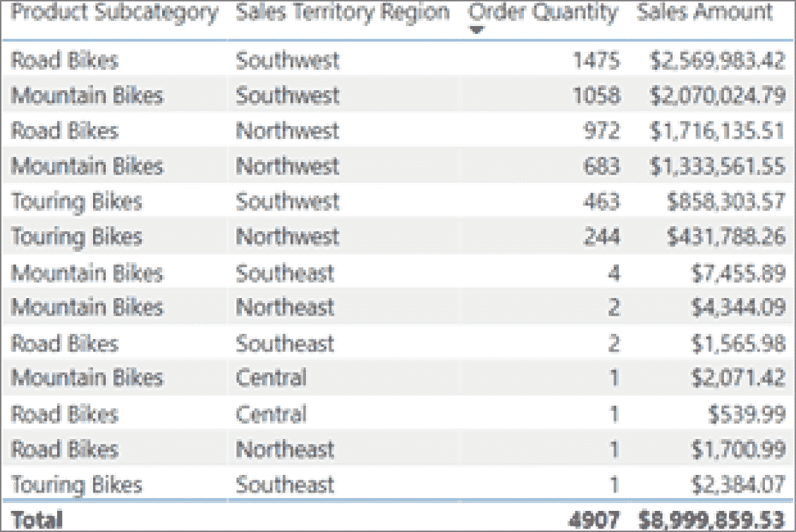

FIGURE 1.18 Table

# 矩阵


矩阵是一种将数据汇总为不同分组的总计和小计的表格。在 图 1.18 中，我们可以看到，在美国在线销售的大多数自行车都在西北和西南销售区域销售。但是，如果开始添加更细粒度的级别（例如特定类型自行车的销售数据），表格可能会变得非常难以阅读。矩阵通过提供分层结构来解决这个问题，该结构为多个粒度层级提供总计。图 1.19 是一个矩阵示例，它显示了在美国西北和西南地区在线销售的自行车、每个自行车子类别和每种特定自行车类型的订单数量和销售总额。

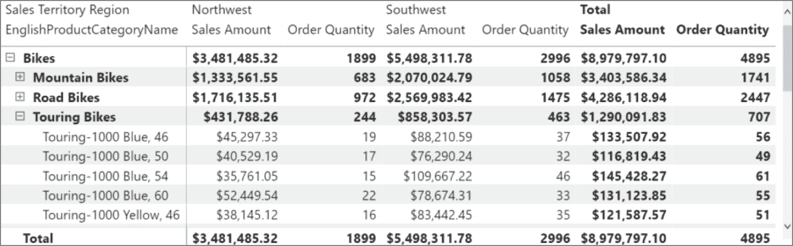

图 1.19 矩阵

## 柱形图和条形图

条形图和柱形图使组织能够查看一组变量在不同类别之间的变化情况。这两种图表类型都使用矩形条来表示数据。两者的区别在于，如果矩形条水平堆叠，则称为条形图；当它们垂直对齐时，则称为柱形图。图 1.20 说明了一个柱形图示例，该图表比较了在美国西北和西南销售区域销售的不同自行车子类别的总互联网销售额。

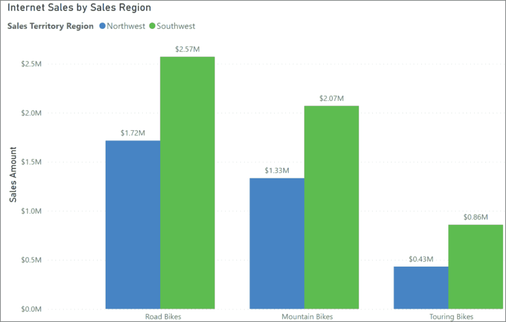

图 1.20 柱形图

# 折线图

折线图表示一系列值随时间的变化情况。Power BI 通过包含工具提示来增强折线图，该工具提示为 x 轴上的每个数据点提供更细粒度的信息。如果您试图证明数据点之间的相关性，这将很有帮助。可以通过将鼠标悬停在要进一步分析的 x 轴值上来显示工具提示。图 1.21 说明了一个折线图示例，该图表比较了 2011 年、2012 年和 2013 年美国西部销售区域的每月互联网自行车销售额。此折线图还包含一个工具提示，显示每年 7 月份的互联网销售总额。

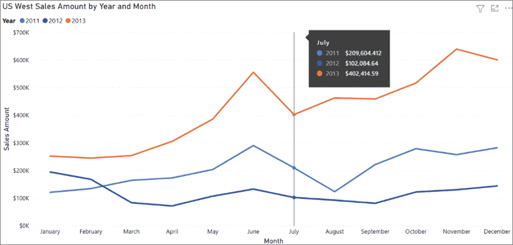

图 1.21 折线图

## 饼图

饼图有助于确定不同类别对给定值的贡献程度。每个类别对应饼图的一个切片，每个切片的大小表示每个类别对整个饼图所占的百分比。图 1.22 说明了一个饼图示例，该图表显示了每个发生销售的国家的总互联网自行车销售额，以及每个国家对总销售额所占的百分比。

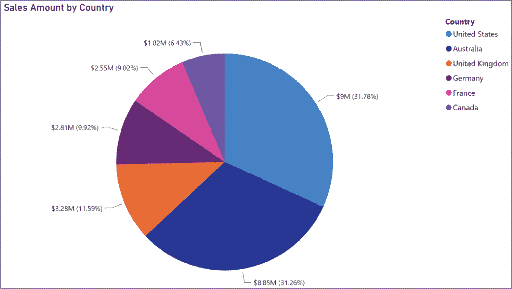

图 1.22 饼图

## 散点图

散点图显示两个数值之间的关系。Power BI 通过包含工具提示来增强散点图，该工具提示为每个数据点或气泡提供更细粒度的信息。可以通过将鼠标悬停在要进一步分析的气泡上来显示工具提示。图 1.23 说明了一个简单的散点图示例，该图表显示了在线销售的不同类型自行车的销售额与订单数量之间的相关性。该图表通过检查美国西北和西南地区的这种相关性，将分析进一步深入。

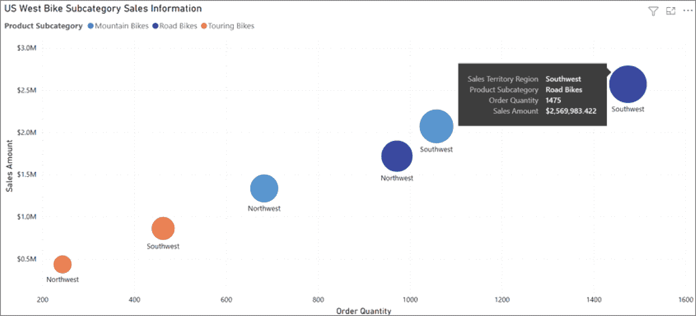

图 1.23 散点图

# 地图

地图显示数据的地理分布。这些可视化效果可以显示广泛的比较，例如国家或州的销售信息，也可以显示邮政编码、地址或纬度和经度级别的非常细粒度的比较。图 1.24 说明了一张地图，该地图显示了美国太平洋西北地区在线购买自行车的城市。气泡的大小表示每个城市对总自行车销售比例的贡献。

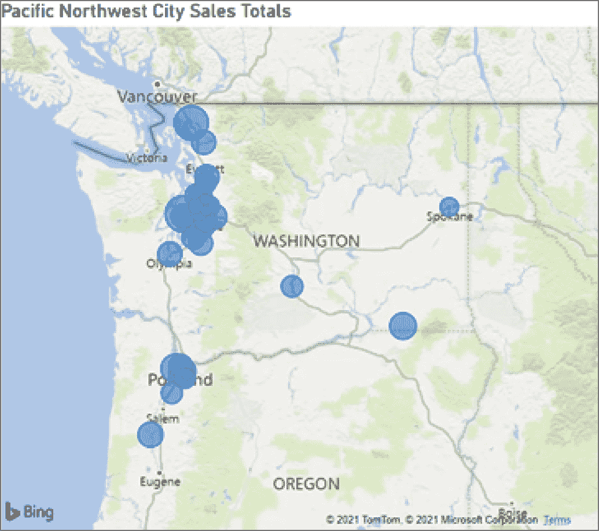

图 1.24 地图

## 摘要

本章包含的概念涵盖了不同类别的数据、存储选项和处理模式。本章还介绍了常见的分析技术，以及根据您试图回答的业务问题使用不同可视化效果的时机。理解这些核心定义将帮助您为任何场景在 Azure 中设计数据解决方案。

本章涵盖了以下概念：

*   **描述核心数据工作负载类型。** 数据解决方案的设计策略取决于解决方案将提供的价值、解决方案将存储和处理的数据量、涉及的数据种类以及数据摄入的速度。解决方案可以是事务性工作负载，用于记录支持组织日常运营的业务交易；也可以是分析性工作负载，用于支持需要从大量数据中做出计算性业务决策的业务用户。这些工作负载可以包含结构化、半结构化和非结构化数据，这些数据可以存储在关系型或非关系型数据库中，或作为对象存储中的文件。基于云的解决方案可以轻松支持对数据进行批处理和流处理的要求。

*   **描述数据分析核心概念。** 数据分析是将原始数据转化为用于做出重要业务决策的信息的过程。首先，原始数据从用于驱动业务的源系统中提取，然后先转换再加载到目标数据存储中，或者先加载再在目标数据存储中转换。根据从信息中得出的价值，可以将一种或多种分析技术应用于处理后的数据，以查看过去的表现并预测最优行动，以利用未来的机会或防止潜在威胁。然后通过多种数据可视化技术公开价值，以便决策者可以轻松解读处理后的数据，并快速做出确保其业务成功的决策。

## 考试要点

*   **描述关系型数据的特征。** 关系型数据库是数据存储技术，将数据组织成可以基于彼此共有数据进行链接的表格。数据库表格以行的形式存储数据，并组织为固定数量的列。表格之间的关系允许用户同时轻松查询多个表格中的数据。这些数据库还强制执行架构完整性并维护 ACID 规则，因此它们是存储结构化数据的一个好选择。关系型数据库对于分析性工作负载（如数据仓库）也至关重要，因为它们以易于提供给报告应用程序的方式构建数据。

*   **描述非关系型数据的特征。** 非关系型数据是指在存储方式上需要灵活性的数据。半结构化数据（如 JSON 和 XML）以及非结构化数据（如图像或视频）都是非关系型数据的示例。NoSQL 数据库可用于存储架构不断变化的数据，而无需强制其符合固定结构。这使得从这些数据库写入和读取数据的查询可能比关系型数据库快得多。对象存储可用于存储非结构化数据，例如无法存储在数据库中的二进制文件。


# 描述批处理数据

批处理是指对静态数据的组（或批次）进行转换的做法。批处理解决方案中涉及的数据可以来自任意数量的数据存储，包括关系型、非关系型以及存储在对象存储中的文件。批处理作业可以安排在固定时间段运行，或在发生事件时运行，例如当新事务添加到事务型数据存储时。这些作业一次可以处理大量数据，并且可以依赖其产生非常准确的结果，因为处理可能需要花费大量时间才能完成。

# 描述流式数据

流式数据是来自某个源的连续数据流。数据在流式处理解决方案中到达时即实时处理。流中的每个数据片段通常被称为事件或消息，并且通常以非结构化或半结构化格式到达，例如 `JSON`。流式数据解决方案首先从源（例如 IoT 传感器）摄取数据，将其导入实时消息引擎系统以排队进行实时处理，或导入对象存储以进行按需处理。然后使用流处理引擎（例如 `Azure Stream Analytics`）来转换数据，通常按时间窗口进行，并将转换后的数据写入分析数据存储或直接写入仪表板。流处理非常适合需要实时分析且不需要一次处理大量数据的解决方案。

# 描述数据处理的概念

数据处理是用于摄取原始数据并将其转换为一个或多个信息性业务模型的方法论。数据处理解决方案将以批次或流的形式摄取数据，并可以以原始形式存储数据或开始对其进行转换。数据在准备好进行报告之前，可能会经过多种转换，例如过滤、标准化和聚合。数据处理管道必须包括可重复且足够灵活以处理各种场景的活动。

# 描述提取、转换、加载（ETL）和提取、加载、转换（ELT）处理

提取、转换、加载（`ETL`）是一种数据处理技术，它从各种源提取数据，根据业务规则转换数据，并将其加载到目标数据存储中。数据转换在专用技术中进行，并包括多个操作。在数据加载到生产表之前，数据通常存储在暂存表中，以便在转换过程中临时存储。

提取、加载、转换（`ELT`）类似于 `ETL`，但与 `ETL` 工作流的区别仅在于转换发生的位置。`ELT` 工作流不使用单独的转换引擎，而是在目标数据存储中转换数据。存储为可扩展对象存储（例如 `Azure Data Lake Store Gen2`）中的平面文件的数据将映射到目标数据存储中的架构。这种读时架构方法允许目标数据存储在不需要复制数据的情况下对数据执行必要的转换。在这些场景中，目标数据存储通常是大规模并行处理（`MPP`）技术，例如 `Spark` 或 `Azure Synapse Analytics`，它们能够一次处理大量数据。

# 描述分析如何讲述企业的过去、现在和未来

组织数据分析之旅的成熟度可以通过其实施每个分析类别的能力来概括。从易到难，分析类别包括描述性、诊断性、预测性、指令性和认知分析。描述性分析回答关于已发生情况的问题，诊断性分析回答事情发生的原因，预测性分析回答关于将要发生情况的问题，指令性分析回答关于为实现目标应采取什么行动的问题，认知分析则从现有数据和模式中推导出推断。

# 描述数据可视化技术

数据可视化技术可以分为三个核心类别：分析、报告和仪表板。分析工具允许用户访问和操作非常细粒度的数据。数据科学家可以使用这些工具创建高度自定义的可视化效果，以显示多个不同场景下的洞察。报告工具使分析人员能够将数据组织成信息摘要，以监控组织不同领域的表现情况。使用这些工具构建的报告可以是静态的，也可以是动态的，具体取决于分析人员希望报告具有多大的交互性。仪表板工具为决策者提供最相关可视化效果的快速概览。仪表板使决策者能够在机会或威胁出现时迅速采取行动。

选择正确的信息图表类型来显示信息对于数据分析解决方案的成功至关重要。选择不当的可视化效果可能难以解读，或者更糟的是，传达错误的信息。另一个重要方面是每个可视化效果的设计。仅为工作选择正确的图表或图形是不够的，分析人员还必须在可视化效果的纵横比和配色方案上保持一致。这将有助于让最终用户专注于显示的任何洞察，而不是被冲突的颜色模式和不一致的尺寸所淹没。

## 复习问题

1. 以下哪种技术不是实时消息摄取引擎的示例？

    1. `Azure IoT Hub`

    2. `Azure Event Hubs`

    3. `Azure SQL Database`

    4. `Apache Kafka`

2. 以下陈述中加下划线的部分是正确的，还是需要用以下出现的其他片段之一替换它？

    `DML` 语句包括 `start cssstyle="text-decoration:underline"` ?`INSERT`, `UPDATE`, 和 `DELETE` 命令。

    1. `GRANT`, `DENY`, 和 `REVOKE`。

    2. `SELECT`, `INSERT`, `UPDATE`, 和 `DELETE`。

    3. `BEGIN TRANSACTION`, `COMMIT TRANSACTION`, 和 `ROLLBACK TRANSACTION`。

    4. 不需要更改。

3. 您是一家游戏公司的数据架构师，正在为新游戏设计数据库层。该游戏将在全球发布，预计会受到欢迎，可能有数百万人同时在线玩游戏。玩家期望游戏能够与社交媒体平台集成，以便他们可以实时流式传输自己的游戏会话和游戏内得分。以下哪个数据库平台最适合此场景？

    1. `Azure Cosmos DB` 支持毫秒级读取和写入，以避免游戏过程中的延迟，并可以轻松集成社交功能。

    2. `Azure SQL Database` 是必要的，因为此工作负载本质上是事务性的。

    3. `Azure Synapse Analytics` 专用 SQL 池是必要的，以同时分析数百万用户的数据。

    4. `Azure Cache` 用于支持每个玩家及其相关玩家元数据的内存中存储。

4. 您正在开发一个实时流式处理解决方案，该方案处理来自不同品牌 IoT 设备的流式数据。该解决方案必须能够检索每个设备的元数据，以确定每个设备使用的度量单位。以下哪个选项可作为此用例的有效解决方案？

    1. 按需处理 IoT 数据，并将其与静态参考数据一起存储在 `Azure Blob Storage` 的微批次中。`Azure Databricks Structured Streaming` 可以处理来自 `Azure Blob Storage` 的两个数据集以检索所需信息。

    2. 实时处理 IoT 数据，并使用存储在 `Azure Blob Storage` 中的静态数据为解决方案提供必要的元数据。`Azure Stream Analytics` 支持 `Azure Blob Storage` 作为参考数据的存储层。

    3. 这无法实时完成。

    4. A 或 B 都可以。


# Chapter 2  

## Azure 中的关系型数据库

关系型数据库在过去几十年中一直是组织 IT 基础设施的关键组成部分。由于其易于使用、支持的解决方案种类繁多以及成熟的设计最佳实践，它们是存储数据最常见的方式。关系型数据库适用于存储相关且必须以一致方式存储的数据元素。本章将讨论关系型数据库的关键功能、Azure 中的不同关系型数据库产品、关系型数据库的基本管理任务以及关系型数据的常见查询技术。

## 关系型数据库功能

5. 以下哪项是非关系型数据存储的示例？

1. Azure Blob 存储
2. Azure Cosmos DB
3. MongoDB
4. 以上都是

6. 您是一家制造公司的数据架构师。您最近接到一个项目，需要设计一个解决方案，使贵公司实现 Azure 认知搜索（Azure Cognitive Search）更容易分析员工和部门之间的关系。以下哪项是该项目最有效的解决方案？

1. 使用 Azure Cosmos DB Gremlin API 存储实体和关系，以便快速查询结果。
2. 在 Azure SQL 数据库关系模型中将部门和员工存储为值。
3. 将数据作为 Parquet 文件存储在 Azure Data Lake Store Gen2 中，然后使用 Azure Databricks 查询关系。
4. 使用 Azure Cosmos DB Cassandra API 将数据反规范化为列族。

7. 您正在设计一个解决方案，该方案将利用机器学习模型识别不同野生动物保护区栖息的不同濒危物种。该解决方案的一部分要求您针对这些动物的图像训练模型，以便它能识别哪种动物是哪种。您应该使用哪种存储解决方案来存储图像？

1. Azure SQL 数据库的 FILESTREAM 功能
2. Azure Blob 存储
3. Azure Data Lake Storage Gen2
4. Azure Cosmos DB Gremlin API

8. 您是托管在 Azure Synapse Analytics 专用 SQL 池实例中的数据仓库的管理员。您选择使用 ELT 转换和加载数据，以消除数据从数据湖环境到数据仓库所需经过的跳转次数。以下哪种技术提供了通过 ELT 将数据加载到 Azure Synapse Analytics 专用 SQL 池实例的最有效方式？

1. Azure Databricks
2. Azure 流分析
3. COPY 语句
4. Azure 数据工厂

9. 以下陈述中加下划线的部分是正确的，还是需要用下面出现的其他片段之一替换它？

Azure SQL 数据库是 MPP 系统的示例。

1. Azure 数据工厂。
2. Azure Synapse Analytics 专用 SQL 池。
3. Azure 批处理。
4. 无需更改。

10. 您是一家销售运动服装的零售公司的数据工程师。公司决策者依赖更新的销售信息，根据购买趋势做出决策。每晚必须处理新数据，以便决策者查看报告时，报告中拥有最新的销售信息。这描述的是哪种处理类型？

1. 事务处理
2. 流处理
3. 计划处理
4. 批处理

11. 作为零售公司的数据架构师，您被要求设计一个解决方案，该方案将每晚处理大量客户和交易数据，并将其存储在 Azure Synapse 专用 SQL 池数据仓库中以供分析。必须处理多个数据源，以确保分析人员能够根据这些数据集做出最合适的业务决策。该解决方案还必须易于维护，并且具有最小的运营开销。以下哪项是该解决方案最合适的选择？

1. 创建 Azure 数据工厂映射数据流来处理每个实体，并将它们添加到 ADF 中的控制流中，以便每晚按正确顺序处理。
2. 在 Azure Databricks 中开发数据流，并通过 Azure Databricks 作业安排它们每晚运行。
3. 在 Azure VM 中创建 SSIS 作业来处理每个实体，并将它们添加到 SSIS 中的控制流中，以便每晚按正确顺序处理。
4. 在 Azure 逻辑应用中创建工作流来每晚处理每个实体。

12. 以下陈述中加下划线的部分是正确的，还是需要用下面出现的其他片段之一替换它？

start cssstyle="text-decoration:underline" ?描述性分析回答为什么事情会发生的问题。

1. 预测性。
2. 认知性。
3. 诊断性。
4. 无需更改。

13. 以下陈述中加下划线的部分是正确的，还是需要用下面出现的其他片段之一替换它？

start cssstyle="text-decoration:underline" ?矩阵可用于显示不同类别数据组的总计和小计。

1. 表。
2. 条形图。
3. 散点图。
4. 无需更改。

14. 您负责设计一个报告平台，该平台将为领导团队提供制定公司长期和短期战略所需的信息。分析人员必须能够以最小的复杂性构建交互式可视化效果，以便根据业务绩效和客户趋势为高管提供建议。分析人员还需要能够为高管创建最关键信息的视图，供其查看。这些视图是高管需要访问的平台的唯一部分。考虑到这些要求，以下哪项是最合适的选择？

1. 让分析人员能够在 Power BI 中创建和交互报告，同时让他们为高管创建仪表板。高管只需要访问 Power BI 仪表板。
2. 让分析人员和高管都能够在 Power BI 中创建和交互报告。这将使高管能够为时间敏感的决策构建仪表板。
3. 建议分析人员在 Jupyter Notebook 中使用 Python 或 R 构建信息图，因为这是构建高管所需仪表板的唯一方法。
4. 让分析人员能够使用 SSRS 构建静态报告，并将最重要的 SSRS 可视化效果固定到 Power BI 仪表板。

15. 您是一家依赖在线销售的零售公司的报告设计师。您的老板要求您在高管绩效仪表板中添加一个可视化效果，以显示过去三年的销售模式。以下哪项是最合适的选项？

1. 柱状图
2. 折线图
3. 散点图
4. 矩阵

16. 作为一家大型自行车公司的首席数据科学家，您被指派设计一个机器人服务，客户可以使用该服务获取自行车维护指导。机器人必须能够在收到新查询时进行学习，以便提高其响应质量。这是哪种分析的示例？

1. 认知分析
2. 规范分析
3. 预测分析
4. 诊断分析

WileyPRE


关系型数据库以表格形式将数据存储为实体的集合。在数据语境下，实体可以描述为名词，例如人员、公司、国家或产品。表格包含描述实体的结构化数据，由零行或多行以及一列或多列数据组成。其中一些列可能是特殊列，用于唯一标识每一行，或作为引用另一张可能与之相关的表格。行可能不包含每一列的值，但由于关系型数据库采用严格的架构设计，该列仍会包含在行的定义中。当某行未提供值时，会使用默认值或空值。这种有组织的数据存储方式允许实体之间建立关系，数据分析师或数据处理解决方案可以轻松查询这些关系。让我们来探讨关系型数据库的特性，从设计注意事项开始。

## 关系型数据库设计注意事项

关系型数据库的设计注意事项在很大程度上取决于数据库将为哪种类型的解决方案提供支持。如第 1 章“核心数据概念”中所述，关系型数据库通常用于支持在线事务处理（OLTP）和分析系统。由 OLTP 数据库驱动的解决方案与分析数据库具有不同的读写要求。尽管 OLTP 数据库通常作为数据仓库或在线分析处理（OLAP）系统的数据源，但这些要求使得在每个系统中都有必要以不同的方式分布和存储数据。

## OLTP 工作负载设计注意事项

存储在 OLTP 数据库中的事务数据涉及与组织活动相关的交互。这些交互可以包括从客户处收到的付款、向供应商支付的款项或已下的订单。典型的 OLTP 数据库经过优化，用于处理写入的数据，并且必须能够确保事务遵守 ACID 属性（有关 ACID 属性的更多信息，请参见[第 1 章](#c01.xhtml））。这将保证存储记录的完整性。关系型数据库管理系统（RDBMS）通常使用锁或行版本化来强制执行这些规则。

无论事务是读取、插入、更新还是删除数据，事务中涉及的数据都必须可靠。当并发在同一数据片段上运行事务的用户数量增加时，这一点变得更加重要，从而导致以下问题：

*   脏读可能发生在一个事务正在读取另一个事务正在修改的数据时。执行读取的事务正在读取尚未提交的修改后的数据。如果修改数据的事务回滚到原始值，这可能导致结果集不准确。

*   不可重复读发生在一个事务多次读取同一行，并且每次返回的数据都不同时。这是由于一个或多个其他事务能够在事务内的读取之间修改数据所导致的。

*   幻读发生在同一事务中运行的两个相同查询返回不同结果时。当另一个查询在两个查询执行之间插入一些数据时，可能会发生这种情况，导致第二个查询返回新插入的数据。

为了缓解这些问题，事务将对其依赖的不同类型资源（例如行和表）请求锁。事务锁通过阻止其他事务对事务中涉及的数据对象进行修改，来防止脏读、不可重复读和幻读。事务在完成对资源的读取/修改后，将释放其锁。虽然锁对于确保一致性至关重要，但它们可能会导致已发出被阻塞事务的用户长时间等待。可以将以下隔离级别分配给事务，以根据其要求在一致性与性能之间取得平衡：

*   未提交读是最低的隔离级别，仅保证不读取物理损坏的数据。使用此隔离级别的事务存在返回脏读的风险，因为会读取未提交的数据。

*   已提交读事务在数据修改时对涉及的数据加锁，以防止其他事务读取脏数据。但是，数据可以被其他事务修改，这可能导致不可重复读或幻读。这是 SQL Server 和 Azure SQL 数据库的默认隔离级别。

*   可重复读事务在事务结束前对涉及的数据加读锁和写锁。在可重复读事务完成之前，没有其他事务可以修改该事务涉及的数据。但是，其他事务可以向可重复读事务涉及的表中插入新行。这可能导致发生幻读。

*   可串行化是最高的隔离级别，可完全隔离事务。语句不能读取尚未由具有可串行化隔离的事务提交的数据。不仅如此，语句不能修改正在由隔离级别设置为可串行化的事务读取的数据。

SQL Server 和 Azure SQL 数据库还允许用户使用行版本化来维护修改行的版本。可以指定事务使用行版本来查看事务开始时存在的数据，而不是使用锁来保护数据。这允许事务读取数据的一致副本，同时缓解锁定带来的性能问题。以下隔离级别支持行版本化：

*   提交读快照是已提交读隔离级别的一个版本，它使用行版本化为事务中的每个语句提供语句开始时存在的数据的一致快照。不使用锁来保护数据免受其他事务的更新。要启用提交读快照，请将 `READ_COMMITTED_SNAPSHOT` 数据库选项设置为 ON。

*   快照隔离使用行版本化返回事务开始时存在的行，而不论另一个事务是否修改了这些行。要启用快照隔离，请将 `ALLOW_SNAPSHOT_ISOLATION` 数据库选项设置为 ON。

在保持 ACID 合规性的同时确保高性能体验并非易事。OLTP 数据库的设计最佳实践能够通过将数据分解为冗余较少的较小块（也称为数据规范化）来实现这一点。数据规范化有几条规则，可定义如下：

*   第一范式（1NF）涉及消除单个表中的重复组，为每组相关数据创建单独的表，并使用主键标识每组相关数据。这基本上意味着不应在单个表中使用多个字段来存储类似数据。例如，零售公司可能有客户在不同时间段下多个订单。与其每次客户下订单时都复制客户信息，不如将所有客户信息放在名为 Customers 的单独表中，并使用唯一主键标识每个客户。

*   第二范式（2NF）在 1NF 的基础上更进一步。除了定义 1NF 的规则外，2NF 还涉及为适用于多条记录的值集创建单独的表，然后通过外键将这些表关联起来。例如，如果 Customer、Order 和 Shipping 表都需要客户的地址，则将地址分离到单个表中，例如 Customer 表或他们自己的 Address 表。


第三范式（3NF）在 1NF 和 2NF 的基础上，增加了一项要求：消除表中不依赖于键的字段。例如，假设零售公司销售的每个产品包含多个子类别。如果每个子类别都存储在 Products 表中，那么每个产品都会被复制多次以包含每个子类别。在这种情况下，创建 Product Subcategory 表并将其与 Products 表关联会更高效。

数据库越规范化，处理写操作的效率就越高。这是因为规范化数据避免了对冗余数据进行额外处理。典型的 OLTP 数据库遵循 3NF，以确保数据库写入尽可能高效。图 2.1 是 AdventureWorks OLTP 实体关系图（ERD）的部分示例，重点介绍与 AdventureWorks 制造和销售的产品相关的实体。完整的 ERD 可在 `https://dataedo.com/download/AdventureWorks.pdf` 上找到。

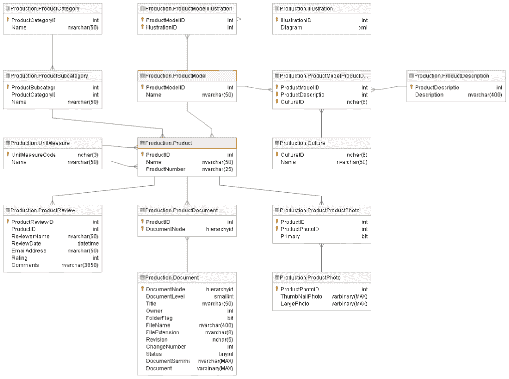

图 2.1 OLTP ERD

在此图中，每个具有多条记录的实体都被拆分为多个表，以避免冗余数据存储。相互关联的实体可以一对一或一对多关联。例如，每个产品类别都有多个产品子类别。因此，ProductCategory 表与 ProductSubcategory 表之间的关系是一对多。关系中的 `crow's feet` 形状表示每个产品类别都有多个产品子类别。

虽然这种程度的数据规范化对于写入和存储单个事务非常高效，但对于执行大量读取操作的应用程序来说，可能效率较低。从读取密集型应用程序（例如，报告和分析应用程序）发出的查询可能需要许多连接来反规范化数据，使这些查询变得非常长且复杂。对大量数据执行聚合的读取操作对 OLTP 数据库来说也非常耗资源，并可能导致针对数据库发出的其他事务出现阻塞问题。正是出于这些原因，分析数据库的设计最佳实践与其 OLTP 同类产品不同。

## 分析工作负载设计注意事项

数据仓库和在线分析处理（OLAP）系统经过优化设计，适用于读取密集型应用程序。虽然 OLTP 系统专注于存储当前事务，但数据仓库和 OLAP 模型专注于存储历史数据，这些数据可用于衡量企业的绩效并预测其应采取的未来行动。

数据仓库充当一个或多个异构数据源（包括各种 OLTP 系统）的数据中央存储库。这不仅消除了在 OLTP 数据库上运行分析工作负载的负担，还通过其他数据源丰富了 OLTP 数据，为决策者提供有用信息。数据仓库可以存储批处理和实时处理的数据，为组织的分析需求提供 `single source of truth`。数据分析师通常会针对数据仓库运行分析查询，返回可用于支持业务决策的聚合计算。

数据仓库可以使用 Azure 上的一种 SMP 数据库产品构建，例如 Azure SQL Database，也可以使用 MPP 数据仓库 Azure Synapse Analytics 专用 SQL 池构建。选择主要取决于将要存储的历史数据量以及将要针对数据仓库发出的查询的性质。一个好的经验法则是，如果数据仓库的大小将小于 1 TB，那么 Azure SQL Database 就足够了。但是，这是一个一般性陈述，在决定选择 SMP 还是 MPP 时需要更多考虑。第 5 章，“Azure 中的现代数据仓库”，详细介绍了在设计现代数据仓库时需要考虑的内容。

OLAP 模型从数据仓库中提取常用数据用于报告，以简化数据分析。与数据仓库一样，OLAP 模型用于读取密集型场景，通常包括以下预定义功能，以允许用户查看一致的结果，而无需编写自己的逻辑：

*   可立即报告的聚合
*   面向时间的计算

OLAP 模型有两种类型：多维和表格。使用 SQL Server Analysis Services (SSAS) 创建的多维立方体等在传统商业智能（BI）解决方案中用于以维度和度量的形式提供数据。表格模型（例如 Azure Analysis Services 和在 Power BI 中构建的模型）使用关系建模构造（例如，表和列）提供数据，同时在后台将元数据存储为多维建模构造（例如，维度和度量）。表格模型已成为 OLAP 模型的标准，因为它们使用与关系数据库相似的设计模式，利用列式存储以最优方式压缩用于分析的数据，并利用易于学习的语言（DAX），数据分析师可以使用该语言创建自定义度量。第 6 章，“使用 Power BI 进行报告”，将详细介绍表格模型及其在 Power BI 中的使用方式。

数据仓库和 OLAP 模型以一种方式存储数据，旨在让分析师和开发人员轻松读取。分析系统中的表被定义为易于业务用户理解，以便他们在每次需要针对历史数据生成新分析时，都不必依赖 IT。分析系统不使用严格的命名规范和规范化规则（这些规则使 OLTP 系统非常适合存储事务数据），而是将数据扁平化，以便业务用户可以轻松查询数据，而无需将多个表连接在一起。

数据仓库和 OLAP 模型的一种常见设计模式是 `star schema`。星型架构对来自 OLTP 系统的数据进行反规范化，导致某些属性在表中被复制。这样做是为了让分析师更容易读取数据，使他们能够在查询中避免连接多个表。虽然反规范化对于写入密集型事务工作负载来说不是最佳选择，但它会提高读取导向型分析工作负载的性能。

星型架构通过将业务实体（也称为业务名词）与可衡量事件相关联来工作。这些可以分解为特定于星型架构的以下分类：

*   `Dimension tables` 存储有关业务实体的信息。维度表为每个实体存储描述性列和一个作为唯一标识符的键列。示例包括日期、客户、地理和产品维度。维度表通常存储相对较少的行数但许多列，具体取决于给定维度需要多少个描述符。

*   `Fact tables` 存储可衡量的观察或事件，例如 Internet 销售、库存或销售配额。除了数值度量外，事实表还包含每个度量或观察所关联的每个维度的维度键列。这些关系决定了事实表中数据的粒度。例如，一个具有日期维度键的 Internet 销售事实表，其粒度仅取决于日期维度表中存储的详细信息级别。如果日期维度表仅包含年份和月份的详细信息，那么执行基于时间计算的查询只能钻取到月度销售。但是，如果它包含年份、季度、月份、周、天和小时的详细信息，那么查询将能够对数据进行更精细的分析。


图 2.2 是 AdventureWorks DW 星型架构的部分示例，重点介绍与 AdventureWorks 制造和销售的产品的互联网销售相关的维度和事实。完整的图表可在 `https://dataedo.com/samples/html/Data_warehouse/doc/AdventureWorksDW_4/modules/Internet_Sales_101/module.html` 处找到。

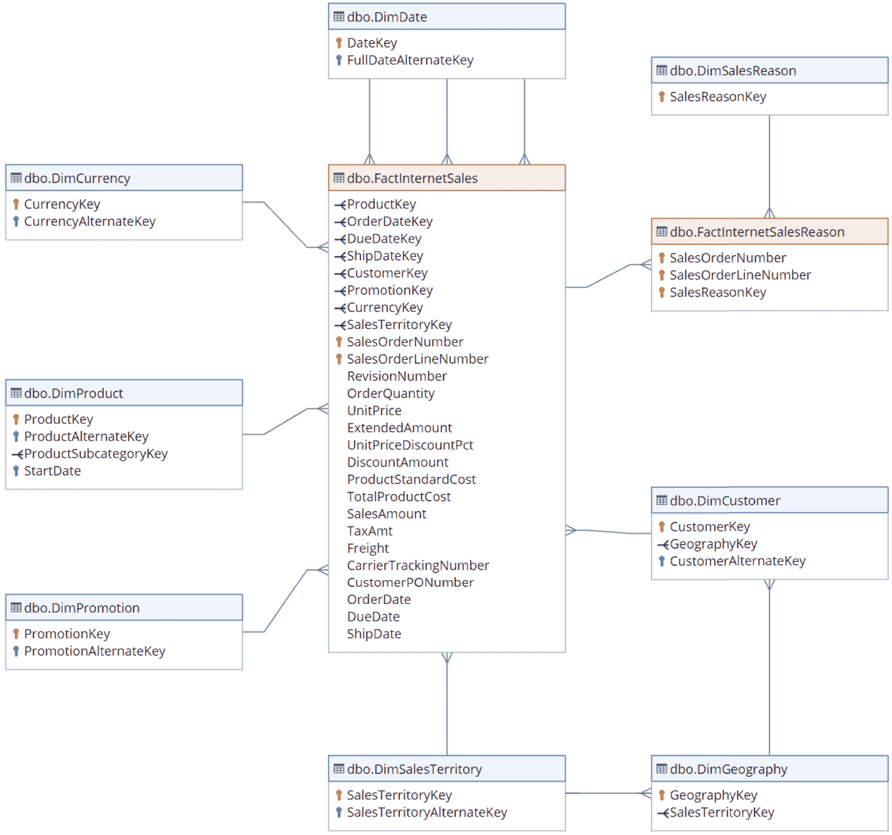

图 2.2 星型架构

此图显示了在线销售中涉及的 `nouns` 与相关指标之间的关系。虽然图中未显示，但如果您访问上一段中的链接，将找到每个维度表的更多详细信息，并会发现它们包含许多列，为销售指标提供高粒度。

OLAP 模型通过包含业务逻辑和预定义计算，将星型架构进一步推进，这些计算可直接用于报表。这种允许用户专注于构建关键业务报表，而无需编写在底层数据上执行聚合和连接的 SQL 查询的抽象级别，称为 `semantic layer`。语义层通常放置在从数据仓库提取的数据之上。除了星型架构附带的业务友好名称外，语义层还存储计算，使用户能够轻松筛选和汇总数据。

## 关系型数据结构

关系型数据库由多个不同的组件组成。以支持零售公司 POS 的 OLTP 数据库为例。该数据库可能包含一个客户表，其中包含每位购买过商品的客户的行。该表可以包含每位客户的名、姓、电话号码、地址等列。每个列都有预定义的数据类型，插入的值必须遵守该类型。如果客户选择不提供某些信息（例如电话号码），可以添加 null 值作为占位符，以便行保持表架构的结构。每行还会分配一个唯一标识客户的 ID，也称为 `primary key`。某些列（例如 ID 列）也用于与其他表关联，例如存储购买中涉及产品更多信息的表。这称为 `foreign key`。客户表还可以包含 `indexes`，用于优化数据组织方式，以便查询能快速检索数据。以下部分将定义这些数据库结构及其他结构。

## 表

表是结构化的数据库对象，用于存储数据库中的所有数据。数据按行和列组织，行表示数据记录，列表示记录中的字段。除了持久化数据的用户定义表外，用户还可以选择创建临时表，用于短期存储无需长期持久化的数据。这些表分为两种类型：

*   局部临时表仅对创建它们的用户连接实例（也称为会话）可见。会话断开连接后，它们会立即被删除。

*   全局临时表在创建后对任何用户可见，并在所有引用该表的用户会话断开连接时被删除。

SMP 和 MPP 数据库允许用户在表上创建分区，以将数据水平分布到数据库中的多个文件组。这使得大型表更易于管理，因为用户可以快速高效地访问单个数据分区，同时保持整个表的完整性。MPP 系统（例如 Azure Synapse Analytics 专用 SQL 池）进一步推进了这一功能。除了能够跨文件组分区数据外，MPP 系统还将数据分布到一个或多个计算节点上的多个 `distributions`。Azure Synapse Analytics 专用 SQL 池中可用的分布式表类型以及何时使用每种类型，将在 第 5 章“Azure 中的现代数据仓库”中介绍。

## 视图

`Views` 是虚拟表，其内容由查询定义。视图中的行和列数据来自定义视图的查询中引用的表。它们充当虚拟层，用于筛选和合并经常查询的表中的数据。用户可以简化查询，因为视图处理了通常需要由用户处理的复杂筛选和连接数据。它们也是有用的安全机制，因为用户不需要访问构成视图的底层表的权限。

图 2.3 是从 AdventureWorks OLTP 数据库中提取的视图定义示例。此视图查询 ProductModel、ProductModelProductDescriptionCulture 和 ProductDescription 表，以编制已售产品及其多语言描述列表。

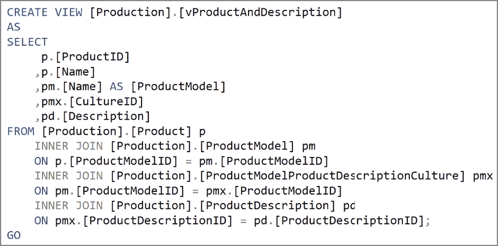

图 2.3 视图定义

此视图允许查询产品描述信息的用户将查询从对多个表执行连接简化为仅从一个数据库对象读取。

一种特殊的视图，可用于提升针对大型数据仓库数据集发出的复杂分析查询的性能，称为 `materialized views`。与每次使用视图时生成的常规视图不同，物化视图是预处理并存储在数据仓库中的。物化视图中存储的数据会随底层表的更新而更新。由复杂分析查询定义的物化视图通过预聚合数据并以可直接用于报表的方式存储，从而提高性能并缩短为分析准备数据所需的时间。

# 索引

请考虑本书末尾的索引。其目的是对关键字进行排序，并提供每个关键字在书中的位置。数据库索引的工作方式非常相似，它们对值列表进行排序，并提供指向这些值物理位置的指针。理想情况下，索引旨在优化数据库表中数据的存储方式，以最好地服务于发送到它们的查询类型。

根据工作负载，索引以行格式（rowstore）或列格式（columnstore）物理存储数据。如果查询正在搜索值（也称为 seeks）或小范围的值，则聚集索引和非聚集索引等 rowstore 索引是理想的选择。另一方面，columnstore 索引最适合存储通常被扫描和聚合的数据的数据库表。以下是三种常用索引类型的描述：

*   `Clustered indexes` 根据值对数据进行物理排序和存储。只能有一个聚集索引，因为聚集索引决定数据的物理顺序。包含大部分唯一值的列是聚集索引的理想候选列。出于此原因，聚集索引会自动在主键列上创建。

*   `Nonclustered indexes` 包含指向数据所在位置的指针。数据库上可以有多个非聚集索引，每个索引可以由多个列组成，具体取决于发送到数据库的查询性质。例如，基于特定筛选条件返回数据的查询可以从筛选列上的非聚集索引中受益。非聚集索引允许数据库引擎快速找到与筛选条件匹配的数据。

*   `Columnstore indexes` 使用基于列的数据存储来优化数据仓库中存储数据的存储方式。与聚集索引或非聚集索引以行格式物理存储数据不同，columnstore 索引以列格式存储数据。这提供了高级别的压缩，并且非常适合对大量数据执行聚合的分析查询。


合理的索引设计可能是性能不佳的数据库与运行流畅的数据库之间的区别。虽然索引设计最佳实践超出了本书的范围，但我推荐以下文章作为选择索引策略的指南：`https://docs.microsoft.com/en-us/sql/relational-databases/sql-server-index-design-guide?view=sql-server-ver15`。

## 存储过程

存储过程是一组或多组 T-SQL 语句，用于对数据库中的数据执行操作。它们可以手动执行，也可以通过外部应用程序（例如，自定义 .NET 应用程序、Azure 数据工厂）执行。它们还可以通过 SQL Server 代理作业按预定的时间段运行，例如每小时或每天午夜运行。存储过程可以接受输入参数，并将多个值作为输出参数返回给调用它们的应用程序。

经常用于执行数据库操作的代码非常适合封装在存储过程中。这样就无需反复重写相同的代码，从而也减少了因代码不一致而导致错误的可能性。应用层也得到了简化，因为应用程序只需执行存储过程，而无需维护和运行整个 T-SQL 代码块。

# 函数

函数与存储过程类似，它们都封装了常用代码。SQL 中用户定义的函数与存储过程的主要区别在于，函数必须返回一个值。存储过程可以用于对数据进行更改，而无需向运行存储过程的用户返回任何响应。另一方面，函数只能返回通常是复杂计算结果的数据。函数接受参数，并将值作为单个标量值或结果集返回。

## 触发器

触发器是响应各种事件而执行的 T-SQL 语句。这些事件可以是 DDL、DML 或与登录相关的事件。通常在以下情况下使用触发器：

*   阻止对表中列的某些更改。
*   基于数据库架构或底层数据的更改执行操作。
*   记录数据库架构的更改。
*   在整个数据库中强制执行关系完整性。

## Azure 中的关系型数据库产品

直到最近，大多数组织仍将其数据库系统托管在其拥有或租赁的本地数据中心。他们负责对数据库软件应用更新，并必须确保托管数据库的硬件得到妥善维护。需要实施数据库备份管理、高可用性 (HA) 和灾难恢复 (DR) 标准等业务连续性方面，以确保在数据库损坏或服务器停机时停机时间最短。可扩展性也是一个问题，因为超出分配给其计算资源的数据库服务器需要有人物理地向服务器添加计算资源。所有这些项目都需要额外的硬件和员工的专业知识，从而增加了数据库的总拥有成本 (TCO)。

基于云的托管从根本上改变了组织计算其关系型数据库 TCO 的方式。许多围绕数据库升级或修补、业务连续性和可扩展性的操作由云公司处理。这使组织能够将注意力从维护硬件和管理业务连续性问题转移到纯粹关注数据库用户的需求上。预配和缩放数据库也容易得多，因为几乎每个要求都已预配置。简而言之，数据库可以在 Azure 中轻松部署，只需单击按钮，并可通过滑块进行上下缩放（本章后面将详细介绍）。

在深入了解 Azure 中的不同关系型数据库产品之前，了解三种云计算服务类型非常重要。掌握每种服务的实现基础知识对于理解在 Azure 上托管数据库的责任和 TCO 至关重要。

*   *基础设施即服务 (IaaS)* Azure 中的产品为客户提供创建虚拟基础设施的能力，该基础设施可镜像本地环境。IaaS 产品使组织能够轻松将其本地基础设施迁移到 Azure 中类似的基于 IaaS 的产品，而无需使用云原生方法完全重新设计其应用程序。这是迁移到云的典型第一步，因为它允许组织使用 *提升和迁移* 策略将硬件管理卸载给 Microsoft。虽然 IaaS 部署使组织不再需要担心维护为应用程序提供动力的硬件，但它们仍然需要管理操作系统 (OS) 和应用程序级别的维护。IaaS 产品包括托管通常在客户本地环境中托管的服务（例如 SQL Server）的虚拟机，并通过 Azure 虚拟网络 (VNet) 连接。这些服务可以轻松连接到组织现有的网络基础设施，使它们能够利用混合云策略。

*   *平台即服务 (PaaS)* 在 IaaS 的基础上更进一步，将操作系统和应用程序软件与用户分离。部署 PaaS 产品时，组织可以指定要部署的资源、初始大小和计算层级（取决于工作负载的强度）、要部署到的 Azure 区域以及其他可选或特定于服务的要求。然后，Azure 将预配必要的资源以满足这些特定要求。部署后，所有操作系统和软件维护（例如业务连续性、升级和修补）均由 Azure 处理。这使组织能够最大限度地减少维护这些服务所需的工作量，并专注于使用它们来构建影响业务的解决方案。与 IaaS 产品类似，PaaS 产品也可以通过 VNet 互连，并连接到组织现有的本地网络基础设施。PaaS 服务包括 Azure SQL 数据库、Azure SQL 托管实例 (MI) 以及托管在 Azure SQL 上的所有开源关系型数据库产品。

*   *软件即服务 (SaaS)* 产品代表了组织在云中托管其基础设施和应用程序时可用的最高抽象级别。组织只需购买服务所需的许可证数量，然后即可使用。SaaS 产品的典型示例包括 Power BI Online 和 Office 365。本章讨论的关系型数据库产品均不是 SaaS 产品。

## Azure SQL

Azure SQL 是一个广义术语，用于描述 Azure 中基于 Microsoft SQL Server 引擎构建的 SMP 关系型数据库产品系列。这些产品包括一个 IaaS 选项（Azure 虚拟机 (VM) 上的 SQL Server）和两个 PaaS 选项（Azure SQL MI 和 Azure SQL 数据库）。Azure SQL 数据库可以进一步细分为两个不同的选项：单一数据库和弹性池。每个产品还提供多个服务层级，以最适合不同类型的工作负载。由于有如此多的选项可供选择，组织在决定哪个 Azure SQL 选项最适合其用例时，必须权衡多个因素：

*   *成本*—所有三个选项都包括一个基本价格，涵盖底层基础设施和许可。每个选项还包括混合许可权益，允许组织将本地 SQL Server 许可证应用于降低服务成本。请记住，在虚拟机中托管数据库将需要 PaaS 选项不需要的额外管理开销。


* `Service-level agreement (SLA)`—所有三个选项均提供高标准、符合行业标准的 SLA。PaaS 选项保证 99.99% 的 SLA，而 IaaS 为基础设施保证 99.95% 的 SLA，这意味着组织需要实施额外机制来确保数据库可用性。有关 Azure SQL SLA 的更多信息，请参阅以下文档：`https://docs.microsoft.com/en-us/azure/azure-sql/azure-sql-iaas-vs-paas-what-is-overview#service-level-agreement-sla`。

* `Migration timeline`—如果组织是将应用迁移到 Azure，而不是从零开始构建具有云原生设计的应用程序，则必须考虑此因素。组织可能会根据时间线的长短选择其中一个选项。例如，数据库可以在相对较短的时间内迁移到虚拟机，因为虚拟机可以托管与本地 SQL Server 实例相同版本的 SQL Server。Azure SQL MI 也提供与本地 SQL Server 几乎相同的功能平等性，但可能需要应用一些更改，尤其是当要迁移的数据库托管在较旧版本的 SQL Server 上时。

* `Administration`—Azure SQL 数据库和 Azure SQL MI 通过管理典型的数据库管理活动（如数据库备份、补丁、版本升级、HA 和威胁防护）来最大限度地减少开销。然而，这也限制了可以执行的自定义管理活动的范围。

* `Feature parity`—因为 Azure SQL 数据库将操作系统和数据库服务器组件与用户隔离，因此某些 SQL Server 功能在 Azure SQL 数据库中不受支持。这些功能包括跨数据库联接、CLR 集成和 SQL Server Agent。Azure SQL MI 与 SQL Server 几乎 100% 功能兼容，但仍保留一些差异，例如依赖于 Windows 相关对象的功能。Azure VM 上的 SQL Server 提供 100% 的功能平等性，因为它与托管在本地虚拟机上的 SQL Server 实例相同。然而，由于可能存在 SQL Server 版本差异，从旧版本的 SQL Server 迁移到 Azure VM 上的较新版本的 SQL Server 或其中一个 PaaS 选项时，可能会出现功能差异。可以使用数据迁移助手 (DMA) 发现已弃用的功能和与 PaaS 选项不兼容的功能。DMA 将在本章后面部分详细介绍。

各种 Azure SQL 产品具有不同级别的抽象和管理。图 2.4 说明了每个选项中抽象与管理工作量之间的关系。

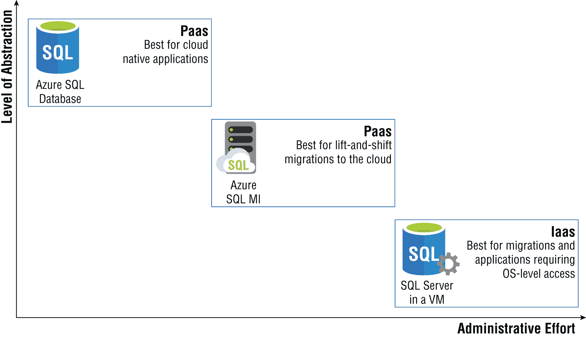

图 2.4 Azure SQL 抽象与管理工作量对比

如图所示，Azure VM 上的 SQL Server 需要最多的管理工作量，因为它对 SQL Server 实例和底层操作系统提供完全控制。这非常适合需要高度自定义操作系统和/或数据库映像，或需要对 SQL Server 引擎进行非常精细控制的场景。Azure SQL MI 从用户角度移除了操作系统层，但与 Azure SQL 数据库相比，它更像本地 SQL Server 实例，因为它提供了封装在 VNet 中的完全隔离环境，并包含系统数据库。将数据库托管在 Azure SQL MI 上的用户仍然可以从使用 PaaS 数据库中受益，因为补丁、SQL Server 版本升级、备份、HA、DR、数据加密、审核和威胁防护均由 Microsoft 在幕后处理。Azure SQL 数据库将操作系统层和数据库引擎与用户完全隔离。使用云原生最佳实践开发的绿地解决方案通常将 Azure SQL 数据库用作其后端关系数据库。

归根结底，选择合适的 Azure SQL 选项取决于解决方案需求以及对操作系统和数据库引擎所需的控制程度。以下各部分将详细探讨每个选项。

## Azure 虚拟机上的 SQL Server

组织希望将其应用程序迁移到云端有多种原因。最常见的原因可能是将其拥有或租赁的硬件和网络设备的维护工作卸载给云提供商。数据中心租约到期或硬件老化迫使许多公司重新思考其 IT 基础设施的管理方式。虽然许多组织会努力将其应用程序现代化为云原生，但其中大多数仍然使用依赖于 Azure SQL PaaS 产品中不可用的 SQL Server 功能的旧版应用程序。也可能存在需要对数据库引擎及其所在的操作系统进行精细控制的特定情况。出于这些原因，组织可能决定将其现有的 SQL Server 足迹迁移到 Azure SQL 的 IaaS 产品：Azure VM 上的 SQL Server。

就数据库引擎而言，Azure VM 上的 SQL Server 与托管在本地环境物理服务器上的 SQL Server 实例没有区别。这使开发人员和数据库管理员能够快速适应在 Azure 上使用 SQL Server。部署 Azure VM 上 SQL Server 的工程师可以选择三种方法之一：

* 从 Azure 市场选择可用的 SQL Server VM 映像之一。这些映像允许您轻松在所选操作系统上部署特定版本的 SQL Server。

* 在 VM 上安装您自己的 SQL Server 许可证。在 Azure 中拥有现有 VM 的用户可以选择使用现有许可证安装 SQL Server，以节省部署新 VM 的需求。

* 使用 Azure Migrate 将本地环境中的现有 VM 迁移到 Azure（迁移并转换）。Azure Migrate 是可用于评估和迁移本地基础设施到 Azure 的工具。托管 SQL Server 的 VM 可以使用 Azure Migrate 迁移到 Azure，而无需通过 Azure 市场部署新 VM。有关使用 Azure Migrate 将 VM 迁移到 Azure 的更多信息，请参阅 `https://docs.microsoft.com/en-us/azure/migrate/migrate-services-overview#azure-migrate-server-migration-tool`。

利用 Azure 市场中可用的现成映像大大减少了在 Azure 中预配 SQL Server VM 所需的时间。SQL Server VM 有两种许可类型：即用即付和自带许可证 (BYOL)。即用即付通过按实例按分钟使用计费来简化许可成本。表 2.1 概述了 Azure 中可用的即用即付 SQL Server 映像。

表 2.1 可用的即用即付 SQL Server 映像

| 版本 | 操作系统 | 版本 |
| --- | --- | --- |
| SQL Server 2019 | Windows Server 2019 | Enterprise, Standard, Web, Developer |
| SQL Server 2019 | Ubuntu 18.04 | Enterprise, Standard, Web, Developer |
| SQL Server 2019 | Red Hat Enterprise Linux (RHEL) 8 | Enterprise, Standard, Web, Developer |
| SQL Server 2019 | SUSE Linux Enterprise Server (SLES) v12 SP5 | Enterprise, Standard, Web, Developer |
| SQL Server 2017 | Windows Server 2016 | Enterprise, Standard, Web, Express, Developer |
| SQL Server 2017 | Red Hat Enterprise Linux (RHEL) 7.4 | Enterprise, Standard, Web, Express, Developer |
| SQL Server 2017 | SUSE Linux Enterprise Server (SLES) v12 SP2 | Enterprise, Standard, Web, Express, Developer |
| SQL Server 2017 | Ubuntu 16.04 LTS | Enterprise, Standard, Web, Express, Developer |
| SQL Server 2016 SP2 | Windows Server 2016 | Enterprise, Standard, Web, Express, Developer |
| SQL Server 2014 SP2 | Windows Server 2012 R2 | Enterprise, Standard, Web, Express |


| SQL Server 2012 SP4 | Windows Server 2012 R2 | Enterprise, Standard, Web, Express |
|---|---|---|
| SQL Server 2008 R2 SP4 | Windows Server 2008 R2 | Enterprise, Standard, Web, Express |

已经购买 SQL Server 许可证的组织也可以将这些许可证应用于降低虚拟机的 SQL Server 成本组件。这被称为自带许可证，简称 BYOL。表 2.2 概述了 Azure 中可用的 BYOL SQL Server 镜像。

TABLE 2.2 可用的自带许可证 SQL Server 镜像

| Version | Operating System | Edition |
|---|---|---|
| SQL Server 2019 | Windows Server 2019 | Enterprise BYOL, Standard BYOL |
| SQL Server 2017 | Windows Server 2016 | Enterprise BYOL, Standard BYOL |
| SQL Server 2016 SP2 | Windows Server 2016 | Enterprise BYOL, Standard BYOL |
| SQL Server 2014 SP2 | Windows Server 2012 R2 | Enterprise BYOL, Standard BYOL |
| SQL Server 2012 SP4 | Windows Server 2012 R2 | Enterprise BYOL, Standard BYOL |

可用的即用即付和 BYOL SQL Server 镜像可能会随着新版本 SQL Server 的推出和旧版本的弃用而发生变化。您可以通过参考以下链接中的表格，随时了解可用的 SQL Server VM 镜像：`https://docs.microsoft.com/en-us/azure/azure-sql/virtual-machines/windows/sql-server-on-azure-vm-iaas-what-is-overview#get-started-with-sql-server-vms`。

在创建 SQL Server Azure VM 时，还必须考虑 VM 大小和存储配置。有多种可用的 VM 大小，包含不同的虚拟 CPU 数量、内存大小和不同的磁盘大小。除了 SQL Server 之外，还可以根据 VM 上托管的内容添加其他磁盘。还有不同类别的 VM 大小，为性能提供不同的基线，包括这些：

*   `Memory optimized`—这些提供更强的内存与 vCPU 比率，是 Azure 上 SQL Server VM 的 Microsoft 推荐选择。

*   `General purpose`—这些提供平衡的内存与 vCPU 比率，最适合较小的工作负载，例如开发和测试、Web 服务器和较小的数据库服务器。

*   `Storage optimized`—这些经过优化，具有优化的磁盘吞吐量和输入输出 (`I/O`)，是数据分析工作负载的强大选择。

这些是一般建议，应与应用程序性能指标结合使用，为不同的工作负载做出最合适的 VM 选择。请记住，VM 使用即用即付成本模型，在不需要时可以停止，以便在此期间不产生费用。但是，大多数 SQL Server VM 需要保持在线，除非 SQL Server 实例是测试实例。将使用一个或多个 SQL Server VM 一年或三年的组织可以购买 `Azure Reserved Virtual Machine Instances`。一旦应用于 VM，Azure Reserved Virtual Machine Instances 将折扣虚拟机和计算成本。

从 Azure 市场部署现成的 SQL Server VM 镜像将包括数据、日志和 tempdb 文件的默认存储配置。虽然这些配置对一般工作负载是最佳的，但许多工作负载可能会从不同的配置中受益。对于非生产工作负载，可能还需要在成本与性能之间进行优化。无论工作负载类型如何，在为 Azure 上的 SQL Server VM 配置存储时，应考虑以下一些一般清单项目：

*   将数据、日志和 tempdb 文件放在单独的驱动器上。

*   将 tempdb 放在本地 SSD 驱动器上。此驱动器是临时的，在 VM 停止时会释放资源。

*   考虑为开发和测试工作负载使用标准 HDD/SDD 存储。

*   对于生产 SQL Server 工作负载，使用高级 SSD 磁盘存储数据和日志文件。

    *   对于数据文件，使用 P30 和/或 P40 磁盘以确保缓存支持。

    *   对于日志文件，使用 P30 到 P80 磁盘。

收集将迁移到 Azure 的工作负载的存储性能指标将有助于确定最合适的磁盘配置。有关 Azure VM 上 SQL Server 存储配置的更多信息，请参阅 `https://docs.microsoft.com/en-us/azure/azure-sql/virtual-machines/windows/performance-guidelines-best-practices-storage`。

## 业务连续性

Azure 中有多种解决方案可确保 SQL Server VM 上托管的数据在多种中断场景（从计划停机到数据中心级灾难）中高度可用。这些包括在数据库级别提供数据库备份管理解决方案，以及在 VM 和数据库级别提供高可用性和灾难恢复 (`HADR`) 功能的解决方案。

Azure 通过创建磁盘上存储的数据副本并将其存储在 Azure Blob 存储中，为磁盘存储提供业务连续性。这种冗余可以通过以下选项进行细分：

*   `Locally redundant storage (LRS)` 创建磁盘上存储数据的三个副本，并将其存储在同一 Azure 区域的同一位置。

*   `Geo-redundant storage (GRS)` 在与 VM 相同的 Azure 区域中存储三个磁盘数据副本，然后在单独的区域中存储另外三个副本。

虽然这些服务为存储在 Azure VM 上的数据提供冗余，但不应将其作为 SQL Server 数据的唯一业务连续性解决方案。还应进行数据库备份，以防止应用程序或用户错误。此外，GRS 不支持将数据和日志文件存储在单独的磁盘上。这两个文件的数据是独立且异步复制的，在发生中断时存在数据丢失的风险。

组织可以选择通过维护计划设置自己的数据库备份策略，这些计划作为 SQL Server Agent 作业按计划运行。备份可以存储在本地存储或 Azure Blob 存储中。Azure 还允许组织通过使用名为 `Automated Backup` 的服务来卸载此过程。该服务定期创建数据库备份并将其存储在 Azure Blob 存储中，而无需数据库管理员在数据库引擎上设置作业。

对于真正的数据库级 HADR，组织可以将 SQL Server VM 上托管的数据库添加到 `SQL Server Always On availability group` 中。可用性组（简称 AG）将一组用户数据库的数据复制到托管在不同 VM 上的一个或多个辅助 SQL Server 实例。托管主和辅助 SQL Server 实例的 VM（或服务器节点）在操作系统级别进行集群。集群监控服务器节点的运行状况，如果现有主节点发生故障，会将辅助服务器节点提升为主节点。

典型的 AG 配置包括至少一个与主节点位于同一区域的辅助节点以保持 HA，以及至少一个位于不同区域的辅助节点以用于 DR。在主节点计划停机期间，数据库连接将移动或故障转移到 HA 节点。如果主节点和与主节点位于同一区域的辅助节点同时停机，数据库连接将故障转移到其他区域的 DR 节点。

AG 配置不限于仅 Azure VM。还支持混合场景，允许组织将本地 SQL Server 实例添加到解决方案中。这需要 SQL Server Azure VM 所在的 Azure 网络与本地 SQL Server 所在的本地网络之间的 VPN 连接。Azure 上的 SQL Server VM 和混合场景的网络要求将在下一节中讨论。

## 网络隔离


任何 IaaS 产品的一个关键组件是其能够在虚拟网络内完全自我隔离的能力。Azure 中的虚拟网络，也称为 VNet，为不同服务之间的通信隔离提供了骨干。VNet 可以包含一个或多个子网，具体取决于其托管的服务。VNet 可以使用名为 VNet 对等互连的服务连接到其他 Azure VNet，并可以通过点对站点 VPN、站点到站点 VPN 或 Azure ExpressRoute 连接到本地网络。混合连接对于在 Azure 中有业务且继续在本地环境中维护某些应用程序的组织至关重要。

VNet 使组织能够阻止特定 IP 地址范围和网络协议访问连接到它们的资源。这包括阻止与公共 Internet 的访问。因此，托管在 Azure SQL Server VM 上的数据库仅限于与组织网络安全团队批准的应用程序进行通信。

## 通过 Azure 门户部署

在 Azure 中部署服务可以在 Azure 门户中手动完成，也可以使用脚本语言（例如，PowerShell 或 Bash）或 `Infrastructure as Code` 模板进行自动化部署。Azure VM 上的 SQL Server 在此方面与任何其他服务无异，为用户提供了多种管理其在 Azure 上的 SQL Server 数据库部署的选项。本节将介绍如何通过 Azure 门户手动部署 SQL Server Azure VM 的步骤。有关在 Azure 中为关系数据库脚本化和自动化部署过程的更多信息，请参见本章后面的“部署脚本化和自动化”部分。

使用以下步骤在 Azure 门户中创建 Azure VM 上的 SQL Server：

1. 登录到 `portal.azure.com` 并在页面顶部的搜索栏中搜索 `SQL virtual machines`。单击 `SQL virtual machines` 进入 Azure 门户中的 SQL virtual machines 页面。

2. 单击 `Create` 开始选择 Azure VM 上 SQL Server 的配置选项。

3. 导航到 `Select SQL deployment option` 页面上的 SQL virtual machines 选项，并选择要部署的 VM 映射。图 2.5 显示了单击 `Image` 下拉箭头后该页面的显示方式以及可用的一些选项。选择映射后，单击 `Create` 按钮继续配置 VM。

    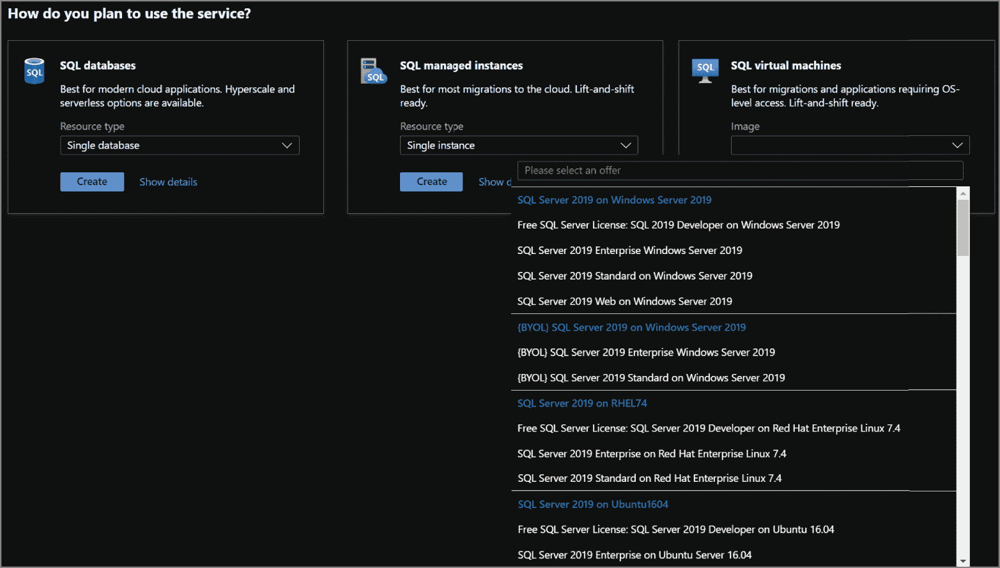

    FIGURE 2.5 Select a SQL virtual machine image.

4. `Create a virtual machine` 页面包含八个选项卡，具有不同的配置选项，用于定制 SQL Server VM 以满足您的需求。让我们从探索 Basics 选项卡中可用的选项开始。除了描述每个选项的以下列表外，您还可以在 图 2.6 中查看此选项卡的完成示例。

    1. 选择将包含 SQL Server VM 的订阅和资源组。如果您尚未创建资源组，可以在此页面上创建一个新资源组。

    2. 为 VM 输入名称。

    3. 选择希望部署映射的 Azure 区域。

    4. 选择是否希望通过使用可用性区域或可用性集为 VM 启用高可用性。请注意，这是针对 VM 的高可用性，而不是针对 SQL Server 实例的高可用性。

    5. 查看所选的 VM 映射，并在必要时更改它。

    6. 选择 VM 大小。

    7. 为管理员帐户设置用户名和密码。

    8. 设置任何您希望能够从公共 Internet 访问的入站网络端口。

    9. 此页面上的最后一个可选步骤是是否希望将现有 Windows Server 许可证应用到 VM 以降低其成本。

    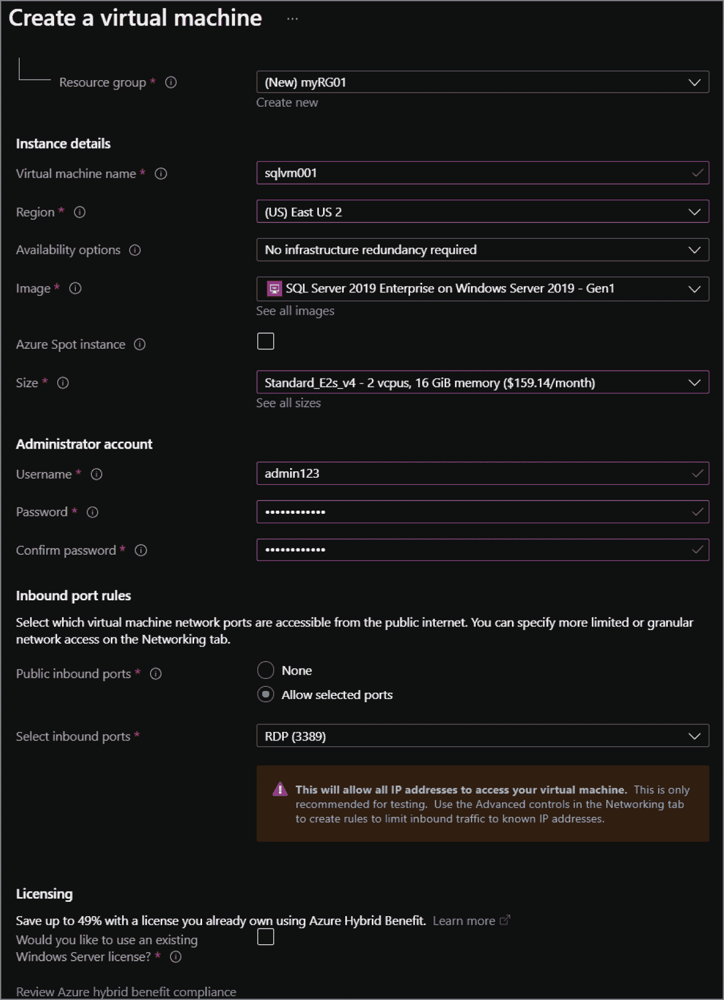

    FIGURE 2.6 Create a SQL virtual machine: Basics tab.

5. Disks 选项卡专注于操作系统的磁盘配置。您可以选择将其从高级 SSD 更改为另一种磁盘类型，以及更改磁盘使用的加密类型。

6. Networking 选项卡为 VM 提供以下网络配置选项。此选项卡的完成示例可以在 图 2.7 中查看。

    1. 选择 VM 将位于其中的虚拟网络。

    2. 为 VM 选择该虚拟网络中的一个子网。

    3. 可选地选择一个公共 IP 地址，用于虚拟网络外部的通信。

    4. 如果需要，修改 Basics 选项卡中选择的开放入站端口。

    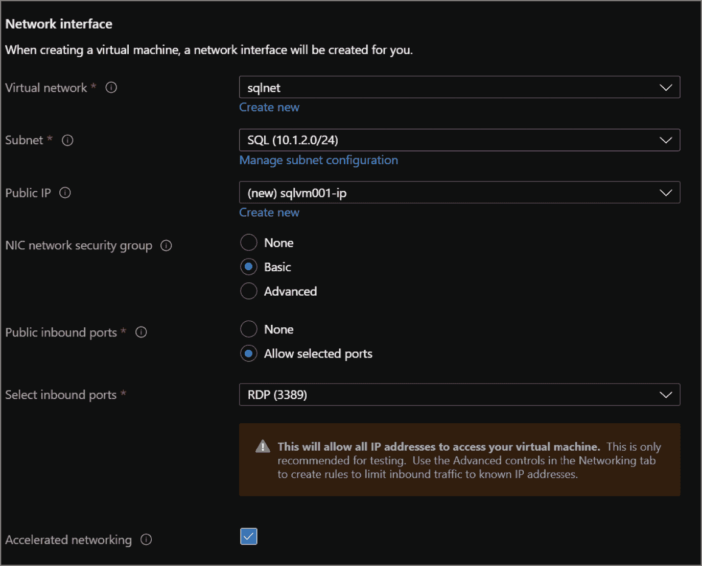

    FIGURE 2.7 Create a SQL virtual machine: Networking tab.

7. Management 选项卡允许您自定义功能，例如 Azure 安全中心监控、为 VM 启用自动关机，以及应用操作系统补丁的时间。

8. Advanced 选项卡允许您添加任何扩展或脚本，以便在预配 VM 时进一步自定义 VM。

9. SQL Server settings 选项卡为托管在 VM 上的 SQL Server 实例提供以下配置选项。图 2.8 说明了此选项卡的完成视图。

    1. 为 SQL 选择网络隔离级别。此选项的默认值是将通信限制为连接到 VM 所在 VNet 的应用程序。但是，还有选项可以进一步锁定 SQL Server 实例，以便只有 VM 中的应用程序可以与其通信，并通过允许任何通过公共 Internet 通信的应用程序访问它来放宽安全性。

    2. 选择是否要启用 SQL 身份验证和 Azure Key Vault 集成。

    3. 查看 SQL Server 数据、日志和 tempdb 文件的默认存储配置。如果默认选项不满足您的要求，请编辑配置。

    4. 选择应用现有 SQL Server 许可证以降低 SQL 的成本。

    5. 选择可以应用补丁到操作系统和 SQL 的时间窗口。

    6. 选择启用自动备份，如果您希望将备份管理卸载到 Azure。

    7. 最后一个可选设置是针对 R 服务的。这将使用户能够使用 R 语言在 SQL Server 中执行机器学习活动。

10. Tags 选项卡允许您为与 SQL Server VM 一起部署的资源添加标记。标记用于对资源进行分类，以便进行成本管理。

11. 最后，Review + Create 选项卡允许您查看设计过程中所做的配置选择。如果您对为 VM 所做的选择感到满意，请单击 `Create` 按钮开始预配 SQL Server VM。

## Azure SQL 托管实例

将 SQL Server 工作负载迁移到 Azure 可以带来的好处不仅仅是卸载硬件管理。组织还可以利用 PaaS 的优势，消除管理虚拟机（例如操作系统和 SQL Server 实例）的开销。但是，需要 `instance-scoped` 功能的应用程序仍然需要能够与 SQL Server 实例进行交互。这使数据库架构师有两个选择：(1) 重新架构解决方案，使用云原生技术替代 instance-scoped 功能，或 (2) 迁移到支持这些功能的技术。几年前，这意味着希望迁移到 Azure 的组织需要花费大量时间来重建解决方案，或者迁移到 VM 上的 SQL Server 并管理虚拟机和 SQL Server 级别的维护（例如升级）。正是出于这些原因，微软推出了 Azure SQL 托管实例。


# Azure SQL Managed Instance

Azure SQL Managed Instance，或简称 Azure SQL MI，是 Azure 上的 PaaS 数据库产品。它抽象了操作系统，但包含一个 SQL Server 实例，因此用户可以继续使用现有的 SQL Server 流程，而无需管理硬件或虚拟机。这使其成为希望以最小努力将许多数据库迁移到 Azure 的客户的理想解决方案。Azure SQL MI 还包含许多系统数据库，例如 `model`、`msdb` 和 `tempdb`。它可用于托管事务复制的分发数据库、SSRS 数据库和 SSIS 数据目录数据库。

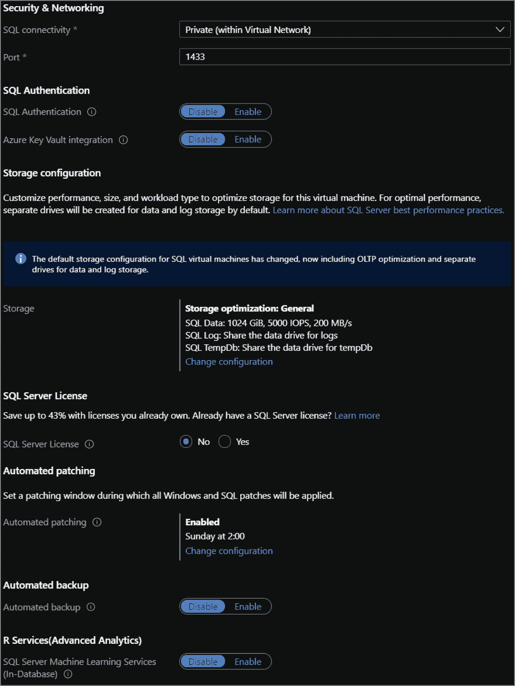

FIGURE 2.8 Create a SQL virtual machine: Settings tab.

Azure SQL MI 数据库引擎使用最新版本的 SQL Server Enterprise Edition，Microsoft 会在更新和补丁发布时应用它们。Azure SQL MI 与本地 SQL Server 几乎 100% 兼容，并支持实例范围的功能，例如 SQL Server Agent、公共语言运行库 (CLR)、链接服务器、数据库邮件和分布式事务。它还包含原生 VNet 实现，以为其托管的数据库提供网络隔离。

## Service Tiers

Azure SQL MI 提供两个服务层级：

*   `General Purpose` 专为具有典型性能要求的应用程序设计。

*   `Business Critical` 专为具有低延迟和严格高可用性要求的应用程序设计。此层级使用 SQL Server Always On 可用性组实现高可用性，并允许其中一个辅助节点用于只读工作负载。

Table 2.3 概述了两个层级之间的一些关键差异。列出的描述适用于 Azure SQL MI 的 Gen5 硬件版本。

TABLE 2.3 Azure SQL MI 服务层级特性

| Feature | General Purpose | Business Critical |
| --- | --- | --- |
| Number of vCores | 4, 8, 16, 24, 32, 40, 64, 80 | 4, 8, 16, 24, 32, 40, 64, 80 |
| Max Memory | 20.4 GB—408 GB (5.1 GB/vCore) | 20.4 GB—408 GB (5.1 GB/vCore) |
| Storage Type | High Performance Azure Blob storage | Local SSD storage |
| Max Instance Storage | 2 TB for 4 vCores<br>8 TB for other sizes | 1 TB for 4, 8, 16 vCores<br>2 TB for 24 vCores<br>4 TB for 32, 40, 64, 80 vCores |
| Max Number of Databases per Instance | 100 user databases | 100 user databases |
| Data/Log IOPS | Up to 30–40K IOPS per instance | 16K–320K (4000 IOPS/vCore) |
| Storage I/O Latency | 5–10 ms | 1–2 ms |

有关不同 Azure SQL MI 服务类别的更多信息，请参阅 `https://docs.microsoft.com/en-us/azure/azure-sql/managed-instance/resource-limits#service-tier-characteristics`。每个服务层级都属于基于 vCore 的购买模型，可以在 Azure 门户或通过自动化脚本根据工作负载要求进行扩展或缩减。

可以通过多种方法降低 Azure SQL MI 的成本。首先，拥有现有 SQL Server 许可证的组织可以将其应用于 Azure SQL MI 以降低成本。如果组织没有或决定不使用现有许可证，则可以选择购买预留容量。类似于 Azure VM 上 SQL Server 的 Azure 预留虚拟机实例，预留容量允许组织承诺使用 Azure SQL MI 一年或三年。要购买预留容量，需要指定 Azure SQL MI 将部署到的 Azure 区域、服务层级以及承诺期限。

## Network Isolation

创建 Azure SQL MI 时，必须将其放置在 VNet 中。除此之外，Azure SQL MI 部署到的子网必须专用于托管一个或多个 Azure SQL MI。此要求将托管在 Azure SQL MI 上的数据库的访问权限限制为仅能与该 VNet 通信的应用程序。托管连接到 Azure SQL MI 的应用程序的本地网络可以使用 VPN 或 Azure ExpressRoute 与 Azure 中的 VNet 通信。

首次将 Azure SQL MI 部署到子网时，创建的不仅仅是数据库引擎。除了数据库引擎之外，部署还将创建以下内容：

*   一个虚拟集群，用于托管部署到该子网的每个 Azure SQL MI。Azure SQL MI 由一组托管在专用虚拟机上的服务组件组成，这些虚拟机对用户抽象并在子网内运行。这些虚拟机共同构成一个虚拟集群。

*   一个网络安全组 (NSG)，用于通过过滤端口 1433 和端口 11000–11999 上的流量来控制对 SQL 托管实例数据终结点的访问，当 SQL 托管实例配置为重定向连接时。NSG 在预配后将与子网关联。

*   一个用户定义路由 (UDR) 表，用于将目标为本地专用 IP 范围的流量路由到虚拟网络网关或虚拟网络设备 (NVA)。UDR 表在预配后将与子网关联。

子网还将委托给 `Microsoft.Sql/managedInstances` 资源提供程序。有关资源提供程序的更多信息，请参阅本章后面的“Azure 资源管理器模板”部分。

## Deploying through the Azure Portal

使用以下步骤通过 Azure 门户创建 Azure SQL MI：

1.  登录到 `portal.azure.com`，并在页面顶部的搜索栏中搜索 `SQL managed instances`。单击 `SQL managed instances` 以转到 Azure 门户中的 SQL 托管实例页面。

2.  单击 `Create` 以开始为 Azure SQL MI 选择配置选项。

3.  `Create Azure SQL Database Managed Instance` 页面包含五个选项卡，具有不同的配置选项，以根据需求定制 Azure SQL MI。让我们先探索 Basics 选项卡中可用的选项。除了描述每个选项的以下列表外，您还可以查看此选项卡的已完成示例，请参阅 Figure 2.9。

    1.  选择将包含 Azure SQL MI 及其部署到实例的数据库的订阅和资源组。如果尚未创建资源组，可以在此页面上创建一个新资源组。

    2.  为 Azure SQL MI 输入名称。

    3.  选择希望部署实例的 Azure 区域。

    4.  为实例选择层级（例如 `General Purpose` 或 `Business Critical`）、vCore 数量、存储量以及备份存储的冗余类型。

    5.  为管理员帐户设置用户名和密码。

    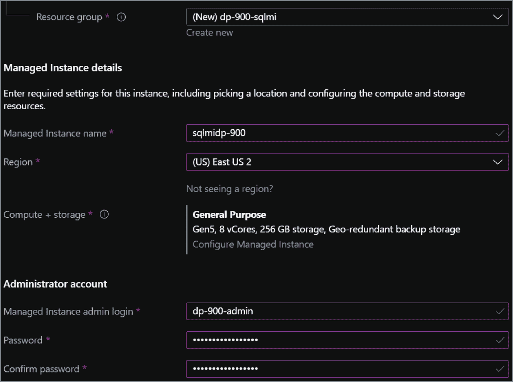

    FIGURE 2.9 Create Azure SQL Database Managed Instance: Basics tab.

4.  Networking 选项卡为 Azure SQL MI 提供以下网络配置选项。此选项卡的已完成示例请参阅 Figure 2.10。

    1.  选择将托管 Azure SQL MI 的 VNet 和专用子网。

    2.  下一个重要组件是决定是否要为 Azure SQL MI 启用公共终结点。公共终结点默认禁用，以限制仅能与 Azure SQL MI 所在 VNet 通信的应用程序的连接。

    3.  选择用于加密入站连接传输中数据的最低 TLS 版本。默认 TLS 版本为 1.2，除非有特定要求使用较低版本，否则应保持不变。

    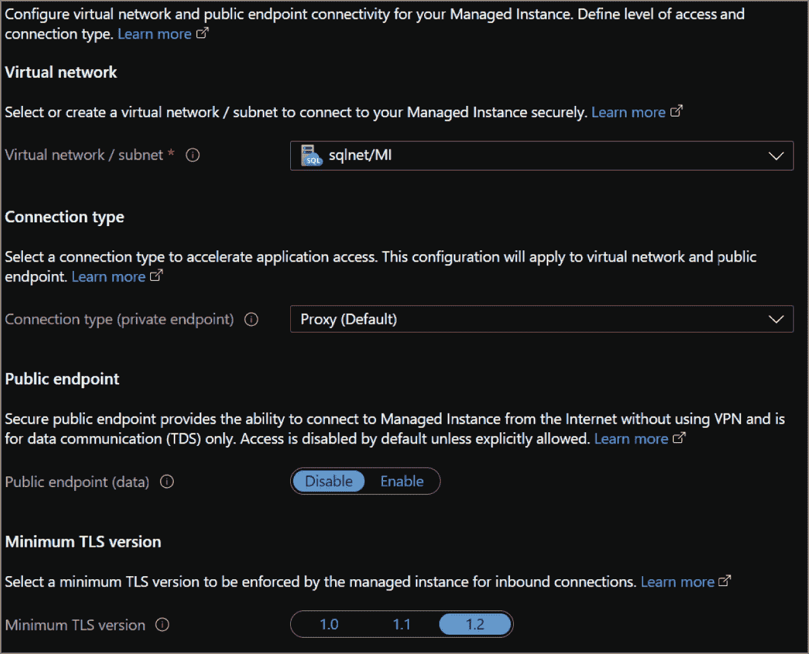

    FIGURE 2.10 Create Azure SQL Database Managed Instance: Networking tab.


5. “其他设置”选项卡提供了用于更改 Azure SQL MI 底层 SQL Server 数据库引擎的排序规则、时区和维护时段的选项。它还包括一个选项，用于将实例启用为 Azure SQL 故障转移组中的辅助实例，以用于灾难恢复。

6. “标记”选项卡允许你为 Azure SQL MI 添加标记，用于成本管理。

7. 最后，“查看 + 创建”选项卡允许你查看设计过程中所做的配置选择。如果你对为实例所做的选择感到满意，请单击 `Create` 按钮开始预配 Azure SQL MI。

## Azure SQL 数据库

从零开始构建并采用云原生最佳实践的现代应用程序依赖于灵活且尽量减少管理数据库所需行政工作量的数据库平台。管理员必须能够轻松地向上或向下扩展性能资源，以满足动态需求要求，并达到最具成本效益的价格点。现代应用程序通常设计为不需要 SQL Server 等平台提供的实例范围功能，因为这些功能可以使用其他云原生产品来实现。例如，可以使用 Azure 数据工厂、Azure 逻辑应用或 Azure 自动化来自动运行数据库中的存储过程或其他任务，从而消除了对 SQL Server 代理作业的需求，这些作业用于执行 Microsoft 未原生处理的自定义维护任务。

`Azure SQL 数据库` 是一个完全托管的 PaaS 数据库引擎，专为服务于云原生应用程序而设计。它抽象了操作系统和 SQL Server 实例，以便用户可以全身心投入到应用程序开发中。升级、补丁、备份、高可用性和监控等管理操作也在后台处理，无需用户付出任何努力。Azure SQL 数据库提供 99.99% 的可用性保证，无论部署选项或服务层级如何。与 Azure SQL 托管实例一样，Azure SQL 数据库使用最新版本的 SQL Server 企业版。事实上，SQL Server 的最新功能首先发布到 Azure SQL 数据库，然后才发布到 SQL Server。

尽管 Azure SQL 数据库向用户抽象了物理 SQL Server 实例，但它仍然公开一个逻辑服务器。与物理服务器不同，逻辑服务器不公开任何实例范围功能。相反，它作为一个或多个 Azure SQL 数据库的父资源，并为其关联的数据库维护防火墙、审核和威胁检测规则。逻辑服务器还为与其关联的每个 Azure SQL 数据库提供连接终结点，供应用程序用于连接到它们。

Azure SQL 数据库提供两种部署选项，允许组织优化数据库性能和成本：

* `单一数据库` 是一个完全托管的隔离数据库。此选项利用分配给它的所有资源（例如，CPU 和内存），并在现代应用程序需要单个可靠数据库时使用。

* `弹性池` 是一组共享一组资源（例如 CPU 或内存）的单一数据库。弹性池在某些数据库在不同时间段的使用频率高于其他数据库的场景中很有用。这将降低这些数据库的成本，因为它们将共享同一资源池。

这些选项可以进一步细分为 Azure SQL 数据库可用的以下购买模型：

* `基于 DTU 的` 购买模型提供固定的 CPU、内存和 IOPS 混合。每个混合计算包称为数据库事务单元 (DTU)。基于 DTU 的购买模型附带固定数量的存储空间，每个服务层级的存储空间不同。

* `基于 vCore 的` 购买模型允许组织选择要分配的虚拟核心 (vCore) 数量。使用基于 vCore 的购买模型的服务层级根据所使用的硬件代和计算选项，为每个 vCore 分配固定数量的内存。此购买模型允许组织应用其现有的 SQL Server 许可证以降低数据库的总体成本。预留容量也仅适用于基于 vCore 的购买模型，允许组织以折扣价承诺使用 Azure SQL 数据库一年或三年。基于 vCore 的购买模型提供两种计算选项：

    * 预配计算允许组织部署特定服务层级并设置固定数量的计算资源。预配计算可以手动或通过自动化脚本动态缩放。

    * 无服务器计算允许组织为数据库指定最小和最大 vCore 限制。配置为使用无服务器计算的数据库将根据工作负载需求自动缩放。它还将在非活动期间自动暂停数据库，并在活动恢复时重新启动它们，以削减计算成本。此选项仅适用于单一数据库。

决定选择哪种购买模型取决于你希望对计算资源拥有多少控制权。基于 DTU 的购买模型提供固定的资源组合，允许组织非常快速地开始开发。基于 vCore 的购买模型允许组织选择计算资源的数量，或者在无服务器的情况下选择计算资源范围。此模型还包括更广泛的存储大小选择，以及使用预留容量或现有许可证的更多节省成本选项。

## 服务层级

Azure SQL 数据库服务层级因购买模型而异。基于 DTU 的购买模型提供基本、标准和高级层级。表 2.4 列出了这些层级的一些常见特性。

TABLE 2.4 基于 DTU 的购买模型服务层级特性

| 特性 | 基本 | 标准 | 高级 |
| --- | --- | --- | --- |
| DTUs | 5 | S0: 10<br>S1: 20<br>S2: 50<br>S3: 100<br>S4: 200<br>S6: 400<br>S7: 800<br>S9: 1600<br>S12: 3000 | P1: 125<br>P2: 250<br>P4: 500<br>P6: 1000<br>P11: 1750<br>P15: 4000 |
| 包含存储 | 2 GB | 250 GB | P1–P6: 500 GB<br>P11 及以上: 4 TB |
| 最大存储 | 2 GB | S0–S2: 250 GB<br>S3 及以上: 1 TB | P1–P6: 1 TB<br>P11 及以上: 4 TB |
| 最大备份保留期 | 7 天 | 35 天 | 35 天 |
| CPU | 低 | 低、中、高 | 中、高 |
| IOPS | 每个 DTU 1–4 IOPS | 每个 DTU 1–4 IOPS | 每个 DTU >25 IOPS |
| IO 延迟 | 5 ms (读取), 10 ms (写入) | 5 ms (读取), 10 ms (写入) | 2 ms (读取/写入) |
| 列存储索引 | 不适用 | S3 及以上 | 支持 |
| 内存 OLTP | 不适用 | 不适用 | 支持 |

基于 vCore 的购买模型提供以下三种服务层级：

* `常规用途` 用于大多数业务工作负载。此层级提供平衡的计算和存储选项。

* `业务关键` 用于需要高 I/O 性能的业务应用程序。它也是需要高度复原能力以应对中断的应用程序的最佳选择，通过利用 SQL Server Always On 可用性组实现高可用性。

* `超大规模` 用于非常大的 OLTP 数据库 (>4 TB)，并可以自动缩放存储和计算。超大规模数据库使用本地 SSD 进行本地缓冲池缓存和数据存储。长期数据存储使用远程存储。

表 2.5 列出了基于 vCore 的购买模型服务层级的常见特性：

TABLE 2.5 基于 vCore 的购买模型服务层级特性

| 特性 | 常规用途 | 业务关键 | 超大规模 |
| --- | --- | --- | --- |
| 存储 | 使用远程存储。<br>预配计算: 5 GB–4 TB | | |


Serverless Compute: 5 GB–4 TB || Uses local SSD storage  

Provisioned Compute: 5 GB–4 TB || Supports up to 100 TB |

| --- | --- | --- | --- |

| Availability || 1 replica, no read-scale replicas || 3 replicas, 1 read-scale replica || 1 read-write replica, 0–4 read-scale replicas |

| In-Memory || Not Supported || Supported || Partial Support |

## Network Isolation

Unlike SQL Server on a VM and Azure SQL MI, a logical server for an Azure SQL Database does not come with a built-in private endpoint. This means that an Azure SQL Database is not isolated within a VNet by default. Network isolation for Azure SQL Database can instead be achieved by limiting access to the logical server's public endpoint through the server's firewall, restricting access to only services in a specific VNet or subnet, or explicitly adding a private endpoint that is associated with a subnet in a VNet.

Public endpoint access can be limited using the following settings:

*   `Allow Azure Services` allows all resources hosted on Azure, such as an Azure VM or Azure Data Factory, to communicate with databases associated with the logical server. This setting is turned off by default, as turning it on typically provides database access to more resources than what is needed.

*   `IP firewall rules` open port 1433 (the default port SQL Server listens on) to a specific IP address or a range of IP addresses. Firewall rules can be set at the server level to allow access to all databases associated with a logical server or at the database level to only allow access to a specific database. 

Private access to the logical server can also be enabled so that database connectivity is restricted to specific VNets. This type of access can be enabled using one of the following settings:

*   `Virtual network firewall rules` restrict access to databases associated with a logical server to traffic using the private IP range of a VNet. Application traffic coming from a specific subnet in a VNet can be switched from using public IP addresses to private IP addresses by adding the Microsoft.Sql service endpoint to the subnet. The subnet can then be added as a virtual network rule in the logical server to allow traffic from that subnet to connect to databases associated with the logical server.

*   `Private Link` is a service in Azure that allows you to add a private endpoint to a logical server. Private endpoints are private IP addresses within a specific subnet in a VNet. Once a private endpoint is attached, connectivity will be limited to other applications in the VNet or applications that can connect to the VNet through VNet peering, VPN, or Azure ExpressRoute.

## Deploying Through the Azure Portal

Use the following steps to create an Azure SQL Database through the Azure Portal:

1.  Log into `portal.azure.com` and search for `SQL databases` in the search bar at the top of the page. Click `SQL databases` to go to the SQL databases page in the Azure Portal.

2.  Click `Create` to start choosing the configuration options for your Azure SQL Database.

3.  The `Create SQL Database` page includes six tabs with different configuration options to tailor the Azure SQL Database to fit your needs. Let's start by exploring the options available in the Basics tab. Along with the following list that describes each option, you can view a completed example of this tab in Figure 2.12.

    1.  Choose the subscription and resource group that will contain the Azure SQL Database. You can create a new resource group on this page if you have not already created one.

    2.  Enter a name for the Azure SQL Database.

    3.  Choose the logical server you wish to deploy the database to. You can create a new logical server on this page if there is not one already available. The logical server chosen will dictate which region the database will be deployed to. Note that creating a new logical server will also require you to set a username and password for the administrator account.

    4.  Choose whether the database will be a part of an elastic pool.

    5.  Click `Configure database` to choose the purchasing model and service tier. If you choose one of the vCore-based purchasing model service tiers, you will be given the option to apply existing SQL Server licenses, choose the number of vCores, and set the maximum amount of storage allocated for data. Choosing a DTU-based purchasing model service tier will give you options to change the number of DTUs allocated to the database and the maximum amount of storage allocated for data. Figure 2.11 is an example of completed configuration for a General Purpose database. As you can see, the database configuration comes with a monthly cost estimate.

    6.  Choose the redundancy tier for database backups.

    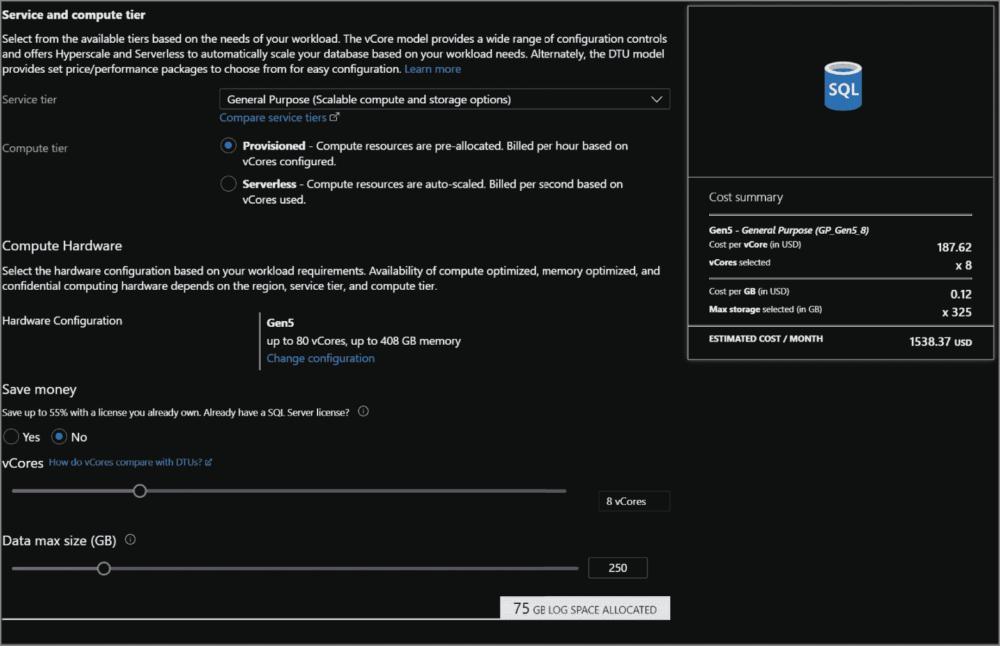

    FIGURE 2.11 Configuring an Azure SQL Database

4.  The Networking tab allows you to configure network access and connectivity for your logical server if you are creating a new one. If you are deploying the database to an existing logical server, then most of the options will be grayed out as it will be taking on the existing state of the server. A completed example of configuring a new logical server can be seen in Figure 2.13.

    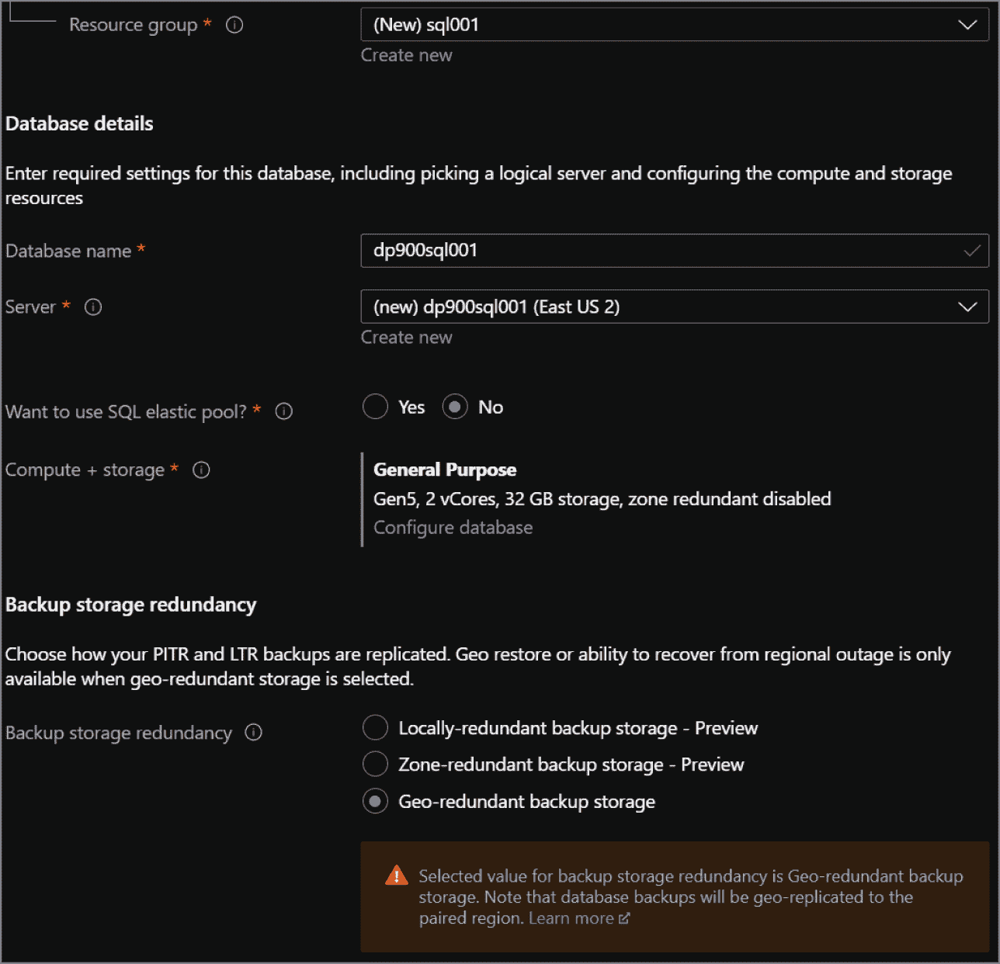

    FIGURE 2.12 Create Azure SQL Database: Basics tab.

    1.  There are three options available for network connectivity. The first option, `No Access`, allows you to continue configuring your database without needing to configure any connectivity until after it is provisioned. `Public Endpoint` will display a new set of options specific to the logical server's firewall. These will allow you to allow or deny Azure services and the client IP address you are deploying the logical server from access to the databases on the server. The final option, `Private Endpoint`, will allow you to associate a private IP address from a VNet to the logical server. This will isolate the databases within a VNet, allowing connectivity only to applications that can communicate with the VNet.

    2.  Choose how client applications will communicate with the logical server.

    3.  Choose the minimum TLS version that will be used to encrypt data in-transit for inbound connections. The default TLS version is 1.2 and should be left as is unless there are specific requirements for a lower version.

    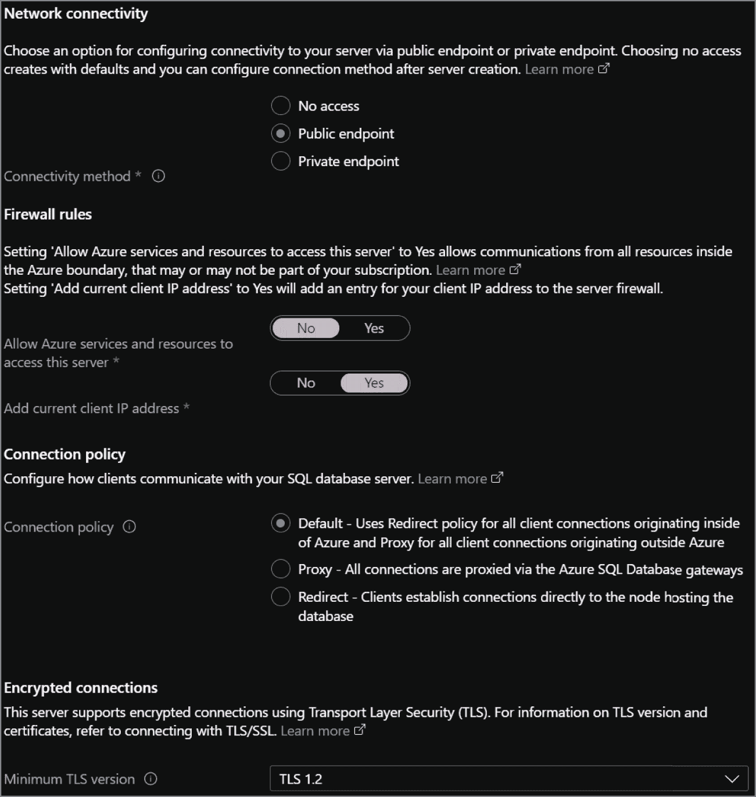

    FIGURE 2.13 Create Azure SQL Database: Networking tab.

5.  The Security tab allows you to choose if you would like to use Azure Defender for SQL to provide advanced threat protection for your data.

6.  The Additional Settings tab allows you to start your database as a blank database, from a backup, or from a sample provided by Microsoft. You can also choose if you would like to change the default collation for the database and the default maintenance window.

7.  The Tags tab allows you to place a tag on the Azure SQL Database for cost management.

8.  Finally, the Review + Create tab allows you to review the configuration choices made during the design process. If you are satisfied with the choices made for the instance, click the `Create` button to begin provisioning the Azure SQL Database.

## Scaling PaaS Azure SQL in the Azure Portal


# 缩放 Azure SQL MI 或 Azure SQL 数据库资源

根据工作负载需求向上或向下缩放 Azure SQL MI 或 Azure SQL 数据库资源（也称为垂直缩放）在 Azure 门户中非常容易。垂直缩放的需求可能源于由于缺乏计算资源导致的性能下降，或者计算资源分配过多导致不必要的开支。用户通过 Azure 门户垂直缩放计算和存储资源的速度，使组织能够非常快速地响应工作负载需求的变化。由于此过程对于 Azure SQL MI 和 Azure SQL 数据库是相同的，本节将以缩放 Azure SQL MI 为例进行详细说明。两者之间的唯一区别是，你需要转到 SQL 数据库页面来缩放 Azure SQL 数据库，而不是 SQL 托管实例页面。

要缩放 Azure SQL MI，请转到 Azure 门户中的 SQL 托管实例页面。单击你最近创建的 Azure SQL MI，然后单击“设置”下的 `Compute + storage` 选项。此页面将允许你更改服务层级、vCore 数量以及分配给实例的存储量。当你更改不同的配置设置时，页面还会更新实例的成本摘要。图 2.14 说明了此过程的示例。

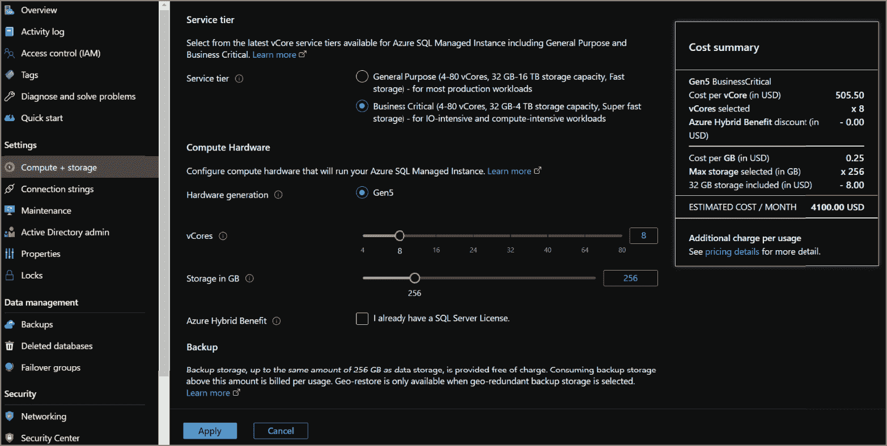

图 2.14 缩放 Azure SQL MI

## PaaS Azure SQL 的业务连续性

Azure 通过每周创建一次完整备份、每 12 到 24 小时创建一次差异备份以及每 5 到 10 分钟创建一次事务日志备份，来管理 Azure SQL 数据库和 Azure SQL MI 数据库的备份。这些备份存储在地理冗余 Azure Blob 存储中，并复制到单独的 Azure 区域。备份保留 7 到 35 天，具体取决于服务层级和管理员设置的保留设置。还可以启用长期备份保留 (LTR) 以保留完整数据库备份长达 10 年。

可以通过执行 `point-in-time restore (PITR)` 将数据库备份还原到 Azure SQL 数据库或 Azure SQL MI。PITR 可以从现有数据库或已删除的数据库还原备份。从 Azure SQL MI 获取的数据库备份可以还原到同一 Azure SQL MI（使用不同的数据库名称）或不同的 Azure SQL MI。这可以通过 Azure 门户、Azure 命令行界面 (CLI) 或 Azure PowerShell 完成。

Azure SQL 数据库和 Azure SQL MI 的高可用性取决于所使用的服务层级。以下部分概述了 Azure SQL 数据库和 Azure SQL MI 各服务层级使用的高可用性架构。

## 基础、标准和常规用途

Azure SQL 数据库的基础、标准和常规用途层级以及 Azure SQL MI 的常规用途层级的高可用性是通过标准可用性模型实现的。这包括以下两个层：

*   运行 `sqlservr.exe` 进程且仅包含临时数据（例如存储在 tempdb 中的数据）的无状态计算层。这由 Azure Service Fabric 操作，在发生数据库或操作系统升级或故障时，它会将 `sqlservr.exe` 移动到另一个无状态计算节点。此过程保证 99.99% 的可用性，但可能会导致性能下降，因为 `sqlservr.exe` 在故障转移后将以冷缓存启动。

*   将数据文件存储在具有内置高可用性的 Azure Blob 存储中的有状态数据层。

## 高级、业务关键和超大规模

Azure SQL 数据库的高级和业务关键层级以及 Azure SQL MI 的业务关键层级的高可用性是通过高级可用性模型实现的。该模型使用 SQL Server Always On AG 实现高可用性，并在后台部署额外的三个或四个节点作为 AG 的辅助节点。AG 会将计算和存储从主节点同步复制到每个辅助节点。这确保了在完全提交每个事务之前，辅助节点与主节点保持同步。如果主节点出现任何停机，Azure Service Fabric 会自动启动到其中一个辅助节点的故障转移。这将确保使用数据库的任何人都不会注意到故障转移。此配置的额外好处是，可以使用其中一个辅助节点处理只读工作负载。这通过消除只读操作和写入操作之间的资源竞争来提高性能。

## Azure Synapse Analytics 专用 SQL 池

Azure Synapse Analytics 专用 SQL 池是一种针对数据仓库工作负载优化的 PaaS 关系数据库引擎。专用 SQL 池使用 `scale-out` MPP 架构来处理非常大量的数据。这意味着数据被分片到多个分布中，并在一个或多个计算节点上进行处理。为此，专用 SQL 池使用 SQL 引擎执行计算，并使用 Azure 存储存储数据，从而将计算和存储分离。尽管数据存储在 Azure Blob 存储中，但专用 SQL 池以表或视图的关系格式向用户提供数据。

专用 SQL 池将数据分片到一个或多个计算节点上的 60 个分布中。在创建表或物化视图时，需要考虑三种不同的分布模式。最佳选择将取决于表或物化视图的大小和性质。它们包括以下分布模式：

*   哈希分布使用哈希函数确定性地将每一行分配到一个分布中。在表或视图定义中，将其中一列指定为分布列。最佳的分布列具有大量的不同值和均匀的数据偏斜。哈希分布是大型事实表和维度表的最佳选择，因为它为大型表上的联接和聚合提供了最佳性能。

*   轮询分布是最简单的分布模式，因为它将数据随机均匀地分片到各个分布中。使用轮询分布可以快速将数据加载到表或视图中，但由于数据在各个分布中未以最佳方式组织，可能会导致性能问题。轮询分布的典型用例包括暂存表，或者在没有具有高度不同值的列时使用它。

*   复制表或物化视图会在每个计算节点的第一个分布上缓存表或物化视图的完整副本。这提供了最快的查询性能，因为在聚合或联接时，数据不需要在分布之间移动。由于需要额外的存储空间，建议将复制表和物化视图用于小表或包含静态值的表。

应仔细考虑分布设计，因为数据分布会导致数据在物理上存储在不同的位置。例如，轮询分布表或哈希分布表上选择不当的分布列在查询数据时可能会导致大量数据 `shuffling`。数据需要移动的次数越多，查询完成所需的时间就越长。

与 Azure SQL 数据库一样，可以通过 Azure 门户、PowerShell 或 T-SQL 根据工作负载需求轻松向上或向下缩放专用 SQL 池。服务级别目标 (SLO) 代表专用 SQL 池的可缩放性设置，并确定成本和性能级别以及分配的计算节点数量。这些由计算数据仓库单位 (cDWUs) 衡量，cDWUs 是 CPU、内存和 I/O 的捆绑计算单元。表 2.6 列出了可用的专用 SQL 池 SLO。

表 2.6 专用 SQL 池服务级别目标


## Azure 中的开源数据库

虽然 SQL Server 是非常受欢迎的关系型数据库产品，但有几个组织依赖开源数据库平台来存储其关系数据。开源数据库平台可以以极低的成本快速部署，使组织能够以极少的开销为其应用程序搭建存储平台。但是，本地开源数据库部署仍然需要组织管理硬件、操作系统和数据库引擎维护。出于这个原因，Azure 提供了三个 PaaS 选项来托管开源数据库。这些包括 `Azure Database for MySQL`、`Azure Database for MariaDB` 和 `Azure Database for PostgreSQL`。就像 `Azure SQL Database` 一样，这些产品都带有原生高可用性、自动修补、自动备份和自动威胁防护。

每个产品都使用基于 vCore 的购买模型，并包括以下三个服务层级：

*   `Basic`—需要轻量级计算和 I/O 性能的工作负载，例如开发和测试环境
*   `General Purpose`—需要计算和内存之间平衡的大多数业务工作负载，具有可扩展的 I/O 性能
*   `Memory Optimized`—需要高性能和内存中功能的工作负载

`Azure Database for MySQL` 和 `Azure Database for PostgreSQL` 包含两个部署选项：单服务器和灵活服务器。

*   单服务器是完全托管的数据库服务，它管理数据库引擎，处理数据库和操作系统修补、自动备份计划以及高可用性。此选项最适合使用云原生设计实践的现代应用程序。
*   灵活服务器让用户对数据库引擎的管理有更细粒度的控制。它允许用户在一个可用性区域内或跨多个可用性区域配置高可用性。用户还可以停止和启动服务器，并为不始终需要固定计算容量的工作负载设置可突发计算层级。

以下部分将仅涵盖单服务器，因为灵活服务器仍处于预览阶段，并且不是 DP-900 考试的重点。

每个选项的折扣定价可通过预付计算资源获得。预留容量允许用户为 `Azure Database for PostgreSQL` 购买一年期，为 `Azure Database for MySQL` 和 `Azure Database for MariaDB` 购买一年或三年期。与 `Azure SQL` 一样，需要事先知道 vCore 的数量，因为这些是购买的资源。

## Azure Database for MySQL

MySQL 是一个开源关系型数据库引擎，与 SQL Server 非常相似。用户可以使用 SQL 向 MySQL 数据库发出查询，与 Microsoft SQL Server 实现 SQL 相比，存在一些细微的语法差异。

`Azure Database for MySQL` 是基于 MySQL 社区版的 PaaS 关系型数据库产品。支持的 MySQL 数据库引擎版本包括 `5.6`、`5.7` 和 `8.0`。`Azure Database for MySQL` 包括每个定价层级的资源配置选项，如 表 2.7 所示。

TABLE 2.7 Azure Database for MySQL 服务层级资源选项

| 功能 | 基础 | 常规用途 | 内存优化 |
| --- | --- | --- | --- |
| vCore 数量 | 1, 2 | 2, 4, 8, 16, 32, 64 | 2, 4, 16, 32 |
| 每个 vCore 的内存量 | 2 GB | 5 GB | 10 GB |
| 存储大小 | 5 GB 到 1 TB | 5 GB 到 16 TB | 5 GB 到 16 TB |

## 通过 Azure 门户部署

通过 Azure 门户部署 `Azure Database for MySQL` 与部署 `Azure SQL Database` 非常相似。

1. 登录 `portal.azure.com`，并在页面顶部的搜索栏中搜索 *Azure Database for MySQL servers*。单击 *Azure Database for MySQL servers* 进入 Azure 门户中的 Azure Database for MySQL servers 页面。
2. 单击 *Create* 开始为您的 `Azure Database for MySQL` 服务器选择配置选项。
3. 下一页将允许您选择要使用的部署选项。本示例将演示如何配置单服务器部署。在 *Single server* 选项下单击 *Create* 以继续。
4. *Create MySQL server* 页面包含六个选项卡，具有不同的配置选项，以定制 `Azure Database for MySQL` 服务器以满足您的需求。让我们从探索 Basics 选项卡中可用的选项开始。除了描述每个选项的以下列表外，您还可以在 图 2.15 中查看此选项卡的完成示例。

    1. 选择将包含 `Azure Database for MySQL` 服务器的订阅和资源组。如果您尚未创建资源组，可以在此页面上创建一个新资源组。
    2. 输入服务器名称。
    3. 选择在不关联任何数据库的情况下启动服务器，或在部署服务器时将数据库备份还原到服务器。
    4. 选择服务器所在的 Azure 区域。
    5. 选择 MySQL 数据库引擎版本。
    6. 选择服务层级、vCore 数量、存储量、备份保留期和备份冗余。请注意，服务器部署后无法缩减存储。
    7. 请注意，创建新的逻辑服务器还需要为管理员帐户设置用户名和密码。

    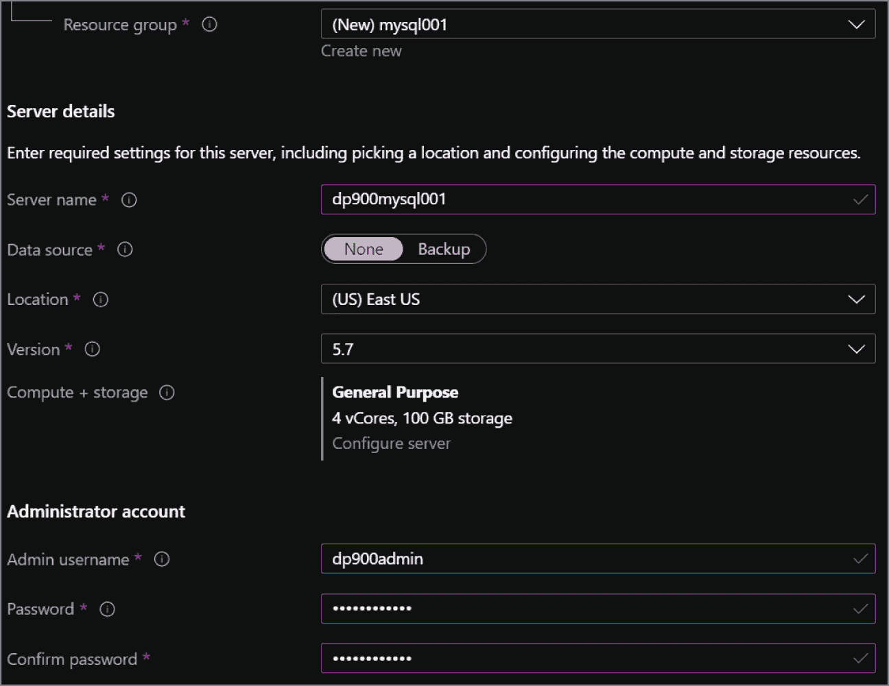

    FIGURE 2.15 创建 MySQL 服务器：基础选项卡。

5. Additional Settings 选项卡允许您在需要时启用双重加密。此设置将在数据库和数据库备份加密层之上添加额外的基础设施加密层。
6. Tags 选项卡允许您为 `Azure Database for MySQL` 服务器添加标签以进行成本管理。
7. 最后，Review + Create 选项卡允许您审查设计过程中所做的配置选择。如果您对实例所做的选择感到满意，请单击 *Create* 按钮开始预配 `Azure Database for MySQL` 服务器。

## Azure Database for MariaDB

MariaDB 是另一个开源关系型数据库平台，是 MySQL 的一个分支。事实上，MariaDB 的创始人是 MySQL 的原始创始人。查询优化器和存储引擎有一些性能改进，但大部分核心功能与 MySQL 相同。有关 MariaDB 的更多信息可以在 `https://mariadb.org` 上找到。

`Azure Database for MySQL` 是基于 MariaDB 社区版的 PaaS 关系型数据库产品。支持的 MariaDB 数据库引擎版本包括 `10.2` 和 `10.3`。

`Azure Database for MariaDB` 包括与 `Azure Database for MySQL` 相同的服务层级资源配置。它在通过 Azure 门户部署时也包含与 `Azure Database for MySQL` 大部分相同的配置选项。唯一的区别是 `Azure Database for MariaDB` 不需要您选择单服务器或灵活服务器，并且它没有 Additional Settings 选项卡。

## Azure Database for PostgreSQL


# PostgreSQL 简介

PostgreSQL 是一个开源的对象关系型数据库系统，使用 SQL 进行原生查询。它拥有强大的功能集，支持标准和复杂的数据类型，包括：

*   `Primitives`：Integer、numeric、string、Boolean
*   `Document`：JSON/JSONB、XML、键值对
*   `Geometry`：Point、line、circle、polygon

PostgreSQL 数据库引擎也具有高度可扩展性，允许用户使用其专有语言 PL/PGSQL 或其他常见开发语言（如 Perl 和 Python）定义自己的数据类型和自定义函数。还可使用可解决特定业务问题的自定义扩展，例如 PostGIS 地理空间数据库扩展。该扩展添加了地理空间特定功能，有效地将 PostgreSQL 转换为空间数据库管理系统。有关 PostgreSQL 和 PostGIS 的更多信息，请访问 `www.postgresql.org/about`。

# Azure Database for PostgreSQL 概述

Azure Database for PostgreSQL 是基于 PostgreSQL Community Edition 的 PaaS 关系型数据库产品。支持的 PostgreSQL 数据库引擎版本包括 Single Server 的 9.6、10 和 11，以及 Flexible Server 的 11、12 和 13。Azure Database for PostgreSQL 包含与 Azure Database for MySQL 相同的服务层资源配置，适用于其 Single Server 和 Flexible Server 部署模型。它还包含与 Azure Database for MySQL 相同的配置选项，适用于通过 Azure 门户部署的情况。

除了 Single Server 和 Flexible Server 部署模型外，Azure Database for PostgreSQL 还包含 Hyperscale 部署选项。Hyperscale (Citus) 通过数据分片在多个节点上水平扩展查询。此部署选项通常用于需要更大规模和性能的多租户应用程序，例如实时操作和高吞吐量事务工作负载。Azure Database for PostgreSQL Hyperscale (Citus) 支持 PostgreSQL 数据库引擎的 11、12 和 13 版本。

## 关系型数据库在 Azure 中的管理任务

虽然 Azure 删除了管理本地关系型数据库环境所带来的许多僵化维护要求，但仍有几项管理任务必须处理。如果不给这些任务予以适当关注，将导致数据库性能不佳，甚至更糟，会带来潜在的安全风险。这些常见管理任务包括：

*   通过 Azure 门户或使用自动化脚本管理数据库的部署
*   将现有本地关系型数据迁移到 Azure 中的新环境
*   通过网络隔离、访问管理、威胁防护和数据加密维护数据安全性

有时也会出现连接问题并需要进行故障排除。这些问题可能是意外或预期的行为，具体取决于服务在 Azure 中的配置方式。以下部分详细介绍了这些任务以及可用于数据库管理的一些工具。

## 部署脚本和自动化

Azure 等云环境大大降低了构建关系型数据库所涉及的复杂性。采购硬件、安装网络设备以及在数据中心预留容量等任务（以前需要数月的规划和实施）现在只需几分钟即可完成。当不再需要关系型数据库时，也可以同样快速地将其缩减或删除，从而使组织能够削减未使用服务的成本。

在前面的部分中，我们讨论了组织如何利用 Azure 门户手动部署关系型数据库服务。虽然这使得在单个环境中开始使用数据库变得容易，但对于将数据库部署到多个环境来说，这并不是最实用的解决方案。大多数组织使用多个应用程序开发生命周期阶段（如开发、测试和质量保证），以确保应用程序的每个版本在推送到生产环境之前都满足特定的满意度级别。基于云的服务使此过程变得容易，允许开发团队将其基础设施要求打包到自动化脚本中，这些脚本描述要部署的每个服务及其所需配置。这些脚本可以参数化，以满足应用程序开发生命周期中使用的不同环境的成本和性能需求。

Azure 提供三种主要的服务部署脚本选项：Azure PowerShell、Azure CLI 和基础设施即代码模板。Azure PowerShell 和 Azure CLI 是命令行实用程序，允许用户使用 PowerShell 或 Bash 对部署进行脚本编写。虽然可以使用这些工具在 Azure 中部署服务，但它们最常见的用途是管理自动化的基础设施即代码部署。基础设施即代码模板定义要部署的服务及其所需设置。Terraform 和 Azure 资源管理器 (ARM) 是用于自动化 Azure 部署的最常见的基础设施即代码服务。使用 Terraform 构建和部署服务超出了 DP-900 考试的范围，本书将不予介绍。如果您想了解更多有关 Terraform 的信息，可以访问 `www.terraform.io`。

## Azure PowerShell

Azure PowerShell 包含一组功能强大的 PowerShell cmdlet（发音为 command-lets），可用于从命令行管理和管理 Azure 服务。使用 Azure PowerShell 开发的脚本可以通过 Azure 门户中的 `Azure Cloud Shell` 运行，也可以通过本地计算机或 VM 上的 Windows PowerShell 命令提示符或集成脚本环境 (ISE) 运行。请记住，在本地开发和运行 Azure PowerShell 脚本需要在计算机上安装 `Azure Az` PowerShell 模块。有关安装 Azure Az PowerShell 模块的步骤和注意事项，请访问 `https://docs.microsoft.com/en-us/powershell/azure/install-az-ps?view=azps-6.3.0#installation`。该模块在 Azure Cloud Shell 中预安装，允许用户立即在 PowerShell 脚本中使用 Azure Az 模块 cmdlet。

Azure Cloud Shell 是一个基于 Web 的界面，允许用户在 Azure 门户中运行 PowerShell 和 Azure CLI 脚本。您可以通过选择 Azure 门户右上角的 Cloud Shell 图标来访问 Azure Cloud Shell。Figure 2.16 说明了该图标在 Azure 门户中的外观。

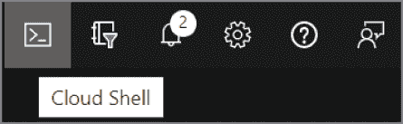

FIGURE 2.16 Azure Cloud Shell icon

Azure Cloud Shell 加载到屏幕底部后，您将能够开发和运行 Bash 或 PowerShell 脚本来管理 Azure 服务。从 Bash 切换到 PowerShell 以运行 Azure PowerShell 命令。

可以使用 Azure PowerShell 轻松部署关系型数据库。这些脚本可以定义与部署关系型数据库相关的每个选项，例如部署位置、数据库类型、服务器管理员帐户用户名和密码、网络隔离设置以及服务层。以下代码片段是一个 Azure PowerShell 脚本，用于创建以下资源：

*   用于逻辑包含逻辑服务器及其数据库的资源组
*   逻辑服务器和 IP 防火墙规则，该规则将向定义的 IP 地址范围打开逻辑服务器上的端口 1433
*   服务器管理员帐户的用户名和密码
*   Azure SQL 数据库、其初始服务层以及分配给它的初始 vCore 数量


## Azure 命令行界面

Azure CLI 是一个命令行工具，允许用户创建和管理 Azure 资源。与 Azure PowerShell 类似，使用 Azure CLI 开发的脚本可以通过 Azure Cloud Shell 或本地计算机或 VM 上的交互式 shell 执行。Azure CLI 命令可以在 Windows 计算机上的命令提示符（如 `cmd.exe`）或 PowerShell 中运行，也可以在 Linux 或 macOS 环境中的 Bash shell 中运行。有关在本地计算机或 VM 上安装 Azure CLI 的步骤和注意事项，请参阅 `https://docs.microsoft.com/en-us/cli/azure/install-azure-cli`。

以下代码片段是一个 Azure CLI 脚本，它执行的操作与前面的 Azure PowerShell 脚本相同：

```
#!/bin/bash
 
# Set the subscription. Not required if being run in the Azure Cloud Shell
az account set—subscription <replace with your subscription name or id>
 
# Set the resource group name and location for your database
resourceGroupName=sql001
location=eastus2
 
# Set an admin login and password for the logical server adminlogin=dp900admin
password=<Admin Password>
 
# Set a logical server and database name
servername=dp900sql001sv
databasename=dp900sql001db
 
<#
The IP address range that you want to 
allow to access your server. This is optional and 
can be set after the deployment has finished.
#>
startip=<First IP Address in Range>
endip=<Last IP Address in Range>
 
# Create a resource group
az group create \
—name $resourceGroupName \
—location $location
 
# Create a logical server in the resource group
az sql server create \
—name $servername \
—resource-group $resourceGroupName \
—location $location \
—admin-user $adminlogin \
—admin-password $password
 
# Configure a firewall rule for the server
az sql server firewall-rule create \
—resource-group $resourceGroupName \
—server $servername \
 -n AllowYourIp \
—start-ip-address $startip \
—end-ip-address $endip
 
# Create a database in the server
az sql db create \
—resource-group $resourceGroupName \
—server $servername \
—name $databasename \
—edition GeneralPurpose \
—capacity 2
```

## Azure 资源管理器模板

在深入了解如何定义 Azure 资源管理器 (ARM) 模板之前，我们首先需要了解什么是 ARM。ARM 是部署和管理服务，使用户能够在 Azure 中创建、更新和删除资源。它接收、验证并授权由 API、Azure 门户、Azure PowerShell、Azure CLI 或使用 Azure SDK 之一的应用程序发出的所有请求。

ARM 使用 `resource providers` 来了解请求中涉及哪些 Azure 资源。资源提供程序提供 Azure 中的不同资源类型以及它们所需的所有配置详细信息。一个常见的资源提供程序是 `Microsoft.Sql`，它包括 Azure SQL 数据库、Azure SQL MI 和 Azure Synapse Analytics 资源类型。这些资源可以使用语法 `{resource provider}/{resource type}` 指定。示例包括 `Microsoft.Sql/servers` 或 `Microsoft.Sql/managedInstances`。资源提供程序也是 ARM 模板的基本构建块，因为模板中的所有其他项目都将与模板中定义的资源的配置要求相关。

ARM 模板是 JSON 文件，用于定义部署到 Azure 的资源和配置要求。模板使用声明性语法定义，这意味着它们以描述所需资源及其所需配置的方式编写，而无需担心将创建这些资源的编程命令。ARM 模板中定义的资源也可以依赖于其他资源。依赖项将阻止模板尝试部署资源，如果它依赖的资源不可用。然后，模板可以从 Azure PowerShell 和 Azure CLI 脚本、Azure 门户以及 Azure DevOps 等工具部署，这些工具管理持续集成和持续开发 (CI/CD) 管道。

您可以将 ARM 模板视为通过在线配送服务下的食物订单。下订单时，您会声明性地列出想要吃的项目。这可能包括开胃菜、主菜、配菜和甜点，具体取决于您希望订单中包含的内容。订单的大小也可能因您是只为自己订购还是也为其他人订购而有所不同。某些项目（例如牛排）还要求您说明希望如何烹饪。下订单后，餐厅将处理准备、烹饪和包装食品所涉及的低级别细节。

## 定义 ARM 模板

以下是构成 ARM 模板的必需和可选元素列表：

*   `schema`—这是必需部分，用于定义描述 JSON 数据结构的 JSON 架构文件的位置。

*   `contentVersion`—这是必需部分，用于定义模板的版本。

*   `apiProfile`—这是可选部分，用于定义资源类型的 API 版本集合。

*   `parameters`—这是可选部分，用于在部署期间提供值。参数是根据资源部署环境而变化的值。这些值可以由参数文件、Azure PowerShell 或 Azure CLI 或在 Azure 门户中提供。

*   `variables`—这是可选部分，用于在模板中重复使用的值。

*   `functions`—这是可选部分，用于定义用户定义的函数，以简化模板中可能经常使用的复杂表达式。

*   `resources`—这是必需部分，用于定义要在 Azure 中创建或更新的资源。

*   `output`—这是可选部分，用于指定部署结束时将返回的值。


以下是一个 ARM 模板示例，用于创建 Azure SQL 数据库。模板定义包含以下元素：

*   逻辑服务器名称。
*   服务器管理员帐户的用户名和密码。
*   Azure SQL 数据库、其初始服务层级及其性能 SKU。

```
{
  "$schema": "https://schema.management.azure.com/schemas/2019–04–01/deploymentTemplate.json#",
  "contentVersion": "1.0.0.0",
  "parameters": {
    "serverName": {
      "type": "string",
      "defaultValue": "dp900sql001sv",
      "metadata": {
        "description": "The name of the SQL logical server."
      }
    },
    "sqlDBName": {
      "type": "string",
      "defaultValue": "dp900sql001db",
      "metadata": {
        "description": "The name of the SQL Database."
      }
    },
    "location": {
      "type": "string",
      "defaultValue": "eastus2",
      "metadata": {
        "description": "Location for all resources."
      }
    },
    "administratorLogin": {
      "type": "string",
      "metadata": {
        "description": "The administrator username of the SQL logical server."
      }
    },
    "administratorLoginPassword": {
      "type": "securestring",
      "metadata": {
        "description": "The administrator password of the SQL logical server."
      }
    }
  },
  "variables": {},
  "resources": [
    {
      "type": "Microsoft.Sql/servers",
      "apiVersion": "2020–02–02-preview",
      "name": "[parameters('serverName')]",
      "location": "[parameters('location')]",
      "properties": {
        "administratorLogin": "[parameters('administratorLogin')]",
        "administratorLoginPassword": "[parameters('administratorLoginPassword')]"
      },
      "resources": [
        {
          "type": "databases",
          "apiVersion": "2020–08–01-preview",
          "name": "[parameters('sqlDBName')]",
          "location": "[parameters('location')]",
          "sku": {
            "name": "GP_Gen5_2",
            "tier": "GeneralPurpose",
          },
          "dependsOn": [
            "[resourceId('Microsoft.Sql/servers', concat(parameters('serverName')))]"
          ]
        }
      ]
    }
  ]
}
```

然后可以通过 Azure 门户、Azure PowerShell 或 Azure CLI 部署此模板。以下是一个 Azure PowerShell 脚本示例，该脚本将前面的 ARM 模板部署到新资源组。它还定义逻辑服务器的管理员用户名和密码，并在部署模板时将信息传递给模板。此脚本还假设模板与 Azure PowerShell 脚本位于同一文件夹中，文件名为 `azuredeploy.json`。

```
Connect-AzAccount

# Set an admin login and password for your server
$adminSqlLogin = "dp900admin"
$password = "<Admin Password>"

New-AzResourceGroup -Name sql001 -Location eastus
New-AzResourceGroupDeployment -ResourceGroupName `
arm-vscode -TemplateFile ./azuredeploy.json `
-administratorLogin $adminSqlLogin `
-administratorLoginPassword $password
```

## 迁移到 Azure SQL

有多种方法可用于将数据库从本地 SQL Server 实例迁移到 Azure SQL。除非您正在从较旧版本的 SQL Server 升级并需要更新任何已弃用的功能，否则将数据库迁移到 Azure VM 上的 SQL Server 相对简单。以下迁移选项通常包括：

*   备份本地数据库并将其存储在 Azure Blob 存储中。使用 `RESTORE DATABASE FROM URL` 将数据库备份从 Azure Blob 存储还原到 Azure VM 上的 SQL Server。
*   如果本地实例是 Always On AG 中的主实例，请将 Azure VM 上的 SQL Server 添加为辅助实例。数据同步到 Azure VM 上的 SQL Server 后，执行故障转移，使 Azure VM 上的 SQL Server 成为新的主实例。
*   配置事务复制，使本地 SQL Server 实例为发布服务器，Azure VM 上的 SQL Server 为订阅服务器。数据复制到 Azure VM 上的 SQL Server 后，更新应用程序连接字符串并将用户指向 Azure 中的数据库。

由于本地 SQL Server 与 PaaS Azure SQL 之间存在兼容性差异，迁移到 Azure SQL 数据库或 Azure SQL MI 需要更多规划和考虑。尽管 Azure SQL MI 与本地 SQL Server 几乎 100% 兼容，但两者之间仍存在一些功能差异，可能会导致迁移问题。本地 MySQL 和 PostgreSQL 实例与 Azure Database for MySQL 和 Azure Database for PostgreSQL 之间的差异也是如此。这就是 Azure 数据库迁移服务等服务可以提供数据，使迁移规划过程更加容易的地方。

`Azure 数据库迁移服务 (DMS)` 是一项完全托管的服务，可用于发现任何潜在的兼容性问题，并在解决这些问题后迁移数据库。它使用 `数据迁移助手 (DMA)` 来检测兼容性问题，并提出如何解决这些问题的建议。DMA 也可用于迁移到 Azure VM 上的 SQL Server，方法是发现旧版 SQL Server 与 Azure VM 上较新版本之间的兼容性问题。DMA 可用于评估从 SQL Server 2005 到最新版本的各种 SQL Server 版本。解决任何兼容性问题后，可以使用 DMA 迁移数据库架构，以便使用 DMS 简化数据迁移。

DMS 可用于脱机和在线迁移。`脱机`迁移是指应用程序停机时间从迁移开始时即开始。应用程序切换是手动过程，必须由用户执行。脱机迁移适用于迁移到 Azure SQL 数据库、Azure SQL MI、Azure VM 上的 SQL Server、Azure Cosmos DB、Azure Database for MySQL 和 Azure Database for PostgreSQL。DMS 还可以通过 `在线`迁移处理应用程序切换过程来限制停机时间。在线迁移仅适用于迁移到 Azure SQL MI、Azure Cosmos DB 和 Azure Database for PostgreSQL。

## 数据库安全

数据库安全对任何 RDBMS 都至关重要。出于此原因，Azure 中的关系数据库通过以下方法强制实施数据库安全：

*   网络隔离
*   访问管理
*   数据加密和混淆
*   安全管理

这些方法中的每一种都代表了保护数据免受未经授权访问的不同安全级别。虽然与不同安全层相关的许多任务在 Azure 中的不同关系数据库产品上以相同的方式应用，但有些任务在不同数据库平台之间处理方式不同。例如，网络隔离在 Azure VM 上的 SQL Server 上的实现方式与在 Azure SQL 数据库上的实现方式非常不同。

由于网络隔离是详细介绍 Azure 中不同关系数据库产品的章节中的核心主题，以下部分将重点介绍访问管理、数据加密和混淆以及安全管理功能。

## 访问管理


Azure 中关系数据库的访问管理围绕 `least-privilege`（最小权限）概念展开。这始于 Azure 基础设施层面的基于角色的访问控制（`RBACs`），允许组织仅限制那些需要此类访问权限的用户来管理在 Azure 中处理的数据库操作，例如更改维护窗口和缩放计算资源。下一步是将数据库访问权限限制为仅需要访问权限的用户，也称为数据库身份验证。最后，能够对数据库进行身份验证的用户需要被授予数据库中数据和对象的不同权限级别，这些权限应设置为用户所需的最小权限量。这称为用户的授权级别。以下各部分将探讨这些不同的访问管理级别。

## 基于角色的访问控制 (RBAC)

通过 Azure 处理的关系数据库的管理操作（例如网络隔离、缩放计算资源和更改维护窗口）通过 `RBAC` 进行控制。`RBAC` 是构建在 `ARM` 之上的授权系统，为 Azure Active Directory 中的用户和对象提供 Azure 资源的精细访问管理。需要注意的是，`RBAC` 与数据库级别的安全性是解耦的，因此这些角色不影响数据库访问。

较高级别的 `RBAC` 角色（例如 `Owner` 和 `Contributor`）可用于管理 SQL 资源，但会授予可能不必要的额外权限。有专门针对 Azure SQL 的内置 `RBAC` 角色，可以授予 Azure Active Directory 帐户，从而无需为管理 Azure SQL 资源使用较高级别的角色。PaaS 关系数据库包括以下内置角色：

*   `SQL DB Contributor`—允许用户管理 Azure SQL 数据库，但不允许访问它们。此外，此角色不允许用户管理安全相关策略或其关联的逻辑服务器。

*   `SQL Managed Instance Contributor`—允许用户管理 Azure SQL 托管实例和所需的网络配置，但不允许访问它们。

*   `SQL Security Manager`—允许用户管理 Azure SQL 数据库和管理数据库的逻辑服务器的安全相关策略，但不允许访问它们。

*   `SQL Server Contributor`—允许用户管理 Azure SQL 数据库及其关联的逻辑服务器，但不允许访问它们。此外，此角色不允许用户管理安全相关策略。

这些角色不适用于 Azure VM 上的 SQL Server，因为数据库引擎在 VM 中进行管理。但是，有特定于 VM 的 `RBAC` 角色可用于管理 VM 配置。有关这些及其他内置 `RBAC` 角色的更多信息，请参阅 `https://docs.microsoft.com/en-us/azure/role-based-access-control/built-in-roles`。

## 身份验证

身份验证是验证尝试访问数据库的用户身份的过程。所有版本的 Azure SQL 都支持两种身份验证方法：SQL 身份验证和 Active Directory (`AD`)。

`SQL 身份验证`涉及在 master 数据库中存储 SQL Server 特定的登录名和密码信息，或者在数据库包含用户的用户数据库中存储这些信息。事实上，在创建 Azure VM 上的 SQL Server、Azure SQL MI、Azure SQL 数据库或 Azure Synapse Analytics 专用 SQL 池时定义的管理员帐户就是一个 SQL 登录示例。管理员还可以创建其他 SQL 登录，供其他用户或自动化服务（例如 SQL Server Agent 或 Azure Data Factory）用于与数据库交互。

`Active Directory 身份验证`涉及将存储在 Windows AD 或 Azure AD (`AAD`) 中的用户或组添加为 SQL 中的登录名或包含用户。这是首选的身份验证方法，因为它比 SQL 身份验证更安全且更易于管理。如果包含 Azure VM 上的 SQL Server 的 VNet 加入了具有 AD 的域，则 Azure VM 上的 SQL Server 可以使用 Windows AD 登录进行身份验证。截至本书撰写时，Azure VM 上的 SQL Server 不能使用 AAD 用户和组进行身份验证。另一方面，Azure SQL 数据库和 Azure SQL MI 可以使用 AAD 对象。以下步骤概述了如何将 AAD 用户或组添加为 Azure SQL 数据库逻辑服务器的管理员。

1. 登录到 `portal.azure.com`，并在页面顶部的搜索栏中搜索 `SQL servers`。单击 `SQL servers` 进入 Azure 门户中的 SQL servers 页面。此页面是 Azure SQL 数据库逻辑服务器的主页。

2. 单击创建 Azure SQL 数据库时创建的逻辑服务器。

3. 在左侧面板的“设置”下单击 `Azure Active Directory`。单击 `Set admin` 将 AAD 用户或组添加为服务器上的管理员。Figure 2.17 说明了单击 `Set admin` 之前此页面的显示情况。

4. 添加帐户后，单击 `Save` 将帐户保存为管理员。

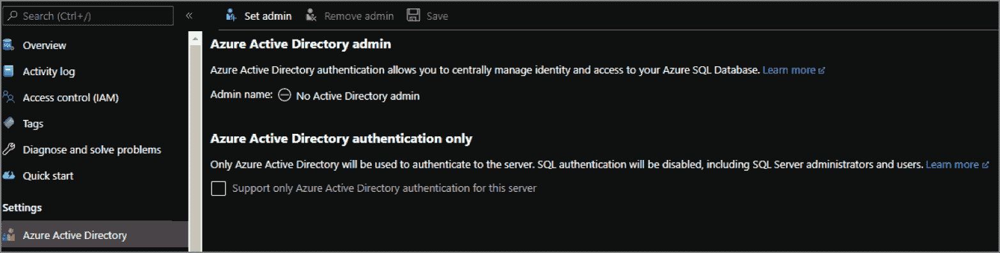

FIGURE 2.17 Adding an AAD Administrator

非管理员 AAD 用户和组也可以使用 `T-SQL` 添加。要将其他 AAD 用户和组添加为数据库用户，请使用具有在数据库中创建用户权限的登录名，通过 SQL Server Management Studio（本章后面将介绍管理工具）等管理工具连接到逻辑服务器。这可以包括 SQL 身份验证服务器管理员或 AAD 服务器管理员。登录后，可以使用以下命令将包含用户添加到数据库。

```
CREATE USER [<AAD_User>] FROM EXTERNAL PROVIDER;
```

有三种方法可用于使用 AAD 登录名连接到数据库。正确的选择取决于组织如何配置 AAD。这些方法如下：

*   `Azure Active Directory—Integrated`：如果用户使用 AAD 帐户登录到正在从中连接到数据库的 Windows 计算机，则可以使用此方法。

*   `Azure Active Directory—Password`：此方法强制用户输入 AAD 登录名和密码以连接到数据库。

*   `Azure Active Directory—Universal with MFA`：这是一种交互式方法，使用多因素身份验证 (`MFA`) 为数据库提供额外的访问安全性。

## 授权

授权是指用户在数据库中拥有的权限级别。这些权限包括是否可以在不同表中读取或写入数据、执行存储过程以及添加或删除其他用户。权限通常由数据库角色管理，这些角色包含一组预定义的权限。数据库角色包括 SQL Server 和 Azure SQL 中包含的固定数据库角色，以及由数据库管理员创建的用户定义数据库角色。

用户权限还可以通过对象级别的权限进行管理，例如授予或撤销在特定表或视图中选择、更新或删除数据的能力。对象级别的权限还可以限制用户可以访问哪些列。使用 `T-SQL` 拒绝访问表中特定列的示例如下所示：

```
DENY SELECT ON <table_name>(<column_1, column_2>) TO User
```

还有一种特殊的数据库授权类型，用于限制对不同表中特定行的访问。`Row-level security (RLS)` 允许数据库管理员根据运行查询的用户的特征控制对表中行的访问。这是通过用户定义的表值函数实现的，这些函数基于某些安全谓词阻止对行的访问。`RLS` 支持两种类型的安全谓词，以防止用户访问特定行：

*   Filter predicates that silently filter the rows available to read operations


*   阻止违反谓词的写操作的阻断谓词

## 数据加密和混淆

Azure 提供多种方法来保护数据，通过加密传输中和静止的数据来防止恶意活动。这些方法有助于确保，如果托管数据库、数据文件、数据库备份或数据库连接的磁盘被攻破，则数据不可读。

Azure SQL 和 Azure 中的开源 SQL 数据库使用 `Transport Layer Security (TLS)` 来加密传输中的数据。TLS 加密通过 Internet 发送的数据，以确保黑客无法查看传输的数据。支持的版本包括 1.0、1.1 和 1.2。根据应用程序要求，可以设置最低 TLS 版本，以便使用最低允许的 TLS 版本或更高版本的应用程序连接可以连接到该数据库。

Azure 还通过加密支持各种数据库选项的磁盘来加密静止数据。这确保了如果涉及托管数据库（例如，数据、日志和 tempdb 磁盘）的磁盘被攻破，则这些磁盘上的数据将不可读。除了加密物理磁盘之外，SQL Server 和 Azure SQL 原生具有一些其他加密措施，以确保数据库静止加密。这些内容将在以下部分进一步讨论。

## 透明数据加密 (TDE)

`Transparent Data Encryption (TDE)` 是 SQL Server 的一项功能，用于在页面级别加密数据库中的所有数据。TDE 适用于托管在 Azure VM 上的 SQL Server、Azure SQL 数据库、Azure SQL 托管实例和 Azure Synapse Analytics 专用 SQL 池中的数据库。数据在写入磁盘上的数据页时加密，在数据页读入内存时解密。TDE 还加密数据库备份，因为备份操作只是从数据库复制数据和日志页。

使用 TDE 进行加密是通过使用称为数据库加密密钥 (DEK) 的对称密钥完成的。DEK 默认由 Azure 中的服务托管证书管理。组织也可以使用自己的证书，即所谓的自带密钥 (BYOK) 方法，来管理 DEK。客户托管的证书可以在 Azure 密钥保管库中管理。

## 始终加密

除了使用 TDE 加密静止的整个数据库之外，SQL Server 和 Azure SQL 还允许组织使用 `Always Encrypted` 加密表中的单个列。此功能旨在允许组织保护存储在数据库表中的敏感数据，例如信用卡号码或个人身份信息 (PII)。始终加密允许客户端应用程序在应用程序内部加密数据，永远不会向数据库引擎泄露加密密钥。这使组织能够区分谁可以管理数据（例如数据库管理员）和谁可以读取数据。

始终加密使用列加密密钥对列数据进行随机加密或确定性加密，并使用主加密密钥加密列加密密钥。这两个密钥都不存储在数据库引擎中，而是存储在外部可信密钥存储（例如 Azure 密钥保管库）中。存储在数据库引擎中的两个密钥的唯一值是列加密密钥的加密值以及关于主密钥位置的信息。

访问加密数据的客户端应用程序必须使用始终加密客户端驱动程序。驱动程序将能够访问存储列和主加密密钥的密钥存储，并将在数据提供给应用程序时使用它们来解密数据。向加密列写入数据的应用程序也将使用始终加密客户端驱动程序，以确保数据在写入时被加密。此处需要强调的是，数据永远不会在数据库引擎中解密，只在应用程序级别解密。

## 动态数据掩码

`Dynamic data masking` 通过模糊特定列中的数据，限制应用程序用户对敏感数据的暴露。从带有掩码列的表中读取数据的应用程序不需要更新，因为动态数据掩码规则应用于查询结果，这不会更改存储在数据库中的数据。这意味着用户可以查看被掩码的列，但看不到列中存储的实际数据。

有多种掩码模式可用于模糊列数据。SQL Server 和 Azure SQL 提供以下掩码模式：

*   `Default`—完全掩码列中的数据。用户将看到字符串值显示为 XXXX，数字显示为 0，日期值显示为 01.01.1900。

*   `Email`—掩码电子邮件地址中的所有内容，只保留电子邮件的第一个字母和后缀 .com（例如，jXXXX@XXXX.com）。

*   `Random`—用指定范围内的随机值替换数值数据。

*   `Custom`—公开数据的第一个和最后一个数字，并在中间添加自定义填充字符串（例如，5XXX0）。

这些掩码模式可以通过 Azure 门户或 T-SQL 启用。Azure 门户中还提供其他模式。

动态数据掩码旨在限制对一组预定义查询的数据暴露，无需对应用程序代码进行任何更改。但是，需要注意的是，被掩码的数据未加密，可以使用推断或暴力破解技术绕过。它旨在与 TDE、始终加密和 RLS 等其他安全功能相辅相成。

## 安全管理

一旦数据通过网络隔离、访问管理以及数据加密和混淆技术得到保护，就需要确保数据安全性持续得到维护。Azure 和数据库引擎提供以下方法来管理数据库安全性。

## 审核

组织为 Azure SQL 启用审核，以保持法规合规性、了解数据库活动，并监控数据库中可能指示可疑活动的差异。Azure VM 上的 SQL Server 和 Azure SQL 托管实例通过数据库引擎使用传统的 SQL Server 审核。这会生成包含预定义服务器级别或数据库级别事件的审核日志。Azure SQL 数据库和 Azure Synapse Analytics 专用 SQL 池使用 Azure SQL 审核将审核日志写入 Azure Blob 存储、Azure Log Analytics 或 Azure 事件中心。Azure SQL 审核可以通过 Azure 门户启用。

## Azure Defender for SQL

Azure Defender 提供多种 SQL 安全管理功能。它包括用于监控和缓解潜在数据库漏洞以及检测潜在恶意活动的功能。它可以在 Azure 订阅级别通过 Azure 门户为订阅中的所有 Azure SQL 实例启用，也可以在服务器级别为单个 Azure SQL 实例启用。这些安全功能由 Azure Defender 服务中打包的以下两个工具涵盖：SQL 漏洞评估和高级威胁防护。

SQL 漏洞评估是一项扫描服务，可提供有关数据库安全状态的洞察。它还提供数据库管理员可以采取的操作项，以解决发现的任何安全问题。为了捕获数据库中的安全漏洞，SQL 漏洞评估采用基于 Microsoft 数据库安全最佳实践的多个规则。这些规则涵盖数据库级别和服务器级别问题，例如防火墙设置和登录的过度权限。SQL 漏洞评估使用的完整规则列表可在 `https://docs.microsoft.com/en-us/azure/azure-sql/database/sql-database-vulnerability-assessment-rules` 找到。


# 高级威胁防护

高级威胁防护是一种工具，可使组织检测并响应可能恶意的数据库访问尝试。当该工具检测到有害的数据库活动（例如 SQL 注入、数据外泄、匿名登录和暴力破解访问）时，会向用户发送警报和建议的操作事项。它适用于所有版本的 Azure SQL 以及 Azure Synapse Analytics 专用 SQL 池。

## 常见连接问题

有时会出现与数据库的连接问题。这些问题可能与网络或防火墙配置、身份验证超时，或与 Azure 动态重新配置数据库以应对重负载相关的瞬态故障错误有关。以下部分列出了常见连接问题及其故障排除方法。

## 与网络相关或特定于实例的问题

“在建立与服务器的连接时发生与网络相关或特定于实例的错误”错误消息表明应用程序无法找到其尝试连接的数据库服务器。排查此问题的最常用方法如下：

1. 确保在应用程序服务器上将 TCP/IP 启用为客户端协议。对于安装了 SQL 工具的服务器（例如 Azure VM 上的 SQL Server），可以使用 SQL Server 配置管理器中的以下步骤启用 TCP/IP：

   1. 展开 `SQL Server Native Client Configuration` 并单击 `Client Protocols`。

   2. 双击 `TCP/IP` 并将 `Enabled` 从 `No` 更改为 `Yes`。

      未安装 SQL 工具的应用程序服务器也可以通过运行 SQL Server 客户端网络实用工具（`cliconfig.exe`）来检查 TCP/IP 是否已启用。

2. 确保连接字符串指定了正确的端口（默认情况下为 1433）并使用完全限定的服务器名称。Azure SQL 数据库的完全限定逻辑服务器名称示例为 `dp900sql001.database.windows.net`。

3. 连接超时可能是通过慢速网络连接的应用程序的根本原因。可以通过在 SQL 中增加连接超时来缓解此问题。Microsoft 建议的连接超时至少为 30 秒。

## 与防火墙相关的问题

“由于防火墙问题无法连接到服务器”错误消息表明客户端应用程序的 IP 地址未被服务器级别或数据库级别防火墙加入白名单。将 IP 地址添加为服务器级别或数据库级别防火墙规则以缓解此问题。

请记住，如果数据库托管在 Azure SQL MI 上，或者是使用专用终结点的 Azure SQL 数据库，那么尝试与数据库通信的应用程序需要能够与数据库所在的 VNet 通信。这包括以下应用程序：

* 托管在与数据库相同 VNet 中的应用程序。

* 托管在可以与托管数据库的 VNet 通信的网络中的应用程序。这可以通过 VNet 对等互连、VPN 或 Azure ExpressRoute 实现。

* 允许通过 NSG 或 Azure Firewall 与托管数据库的 VNet 中的资源通信的应用程序。有关 NSG 中网络安全规则的更多信息，请参阅 `https://docs.microsoft.com/en-us/azure/virtual-network/network-security-groups-overview`。

## 包含数据库用户的登录失败

“无法打开登录名请求的数据库“master”。登录失败”错误是因为登录到服务器的帐户无权访问 master 数据库。这对于尝试使用 SQL Server Management Studio (SSMS) 连接到数据库的包含数据库用户来说很常见。使用以下步骤解决此问题：

1. 在 SSMS 中建立到 SQL 实例的连接时，在“连接到服务器”页面左下角单击 `Options`，然后选择 `Connection Properties`。

2. 在 `Connect to database` 字段中，键入用户所在的数据库名称，然后单击 `Connect`。图 2.18 是 `Connection Properties` 选项卡连接到指定用户数据库的示例。

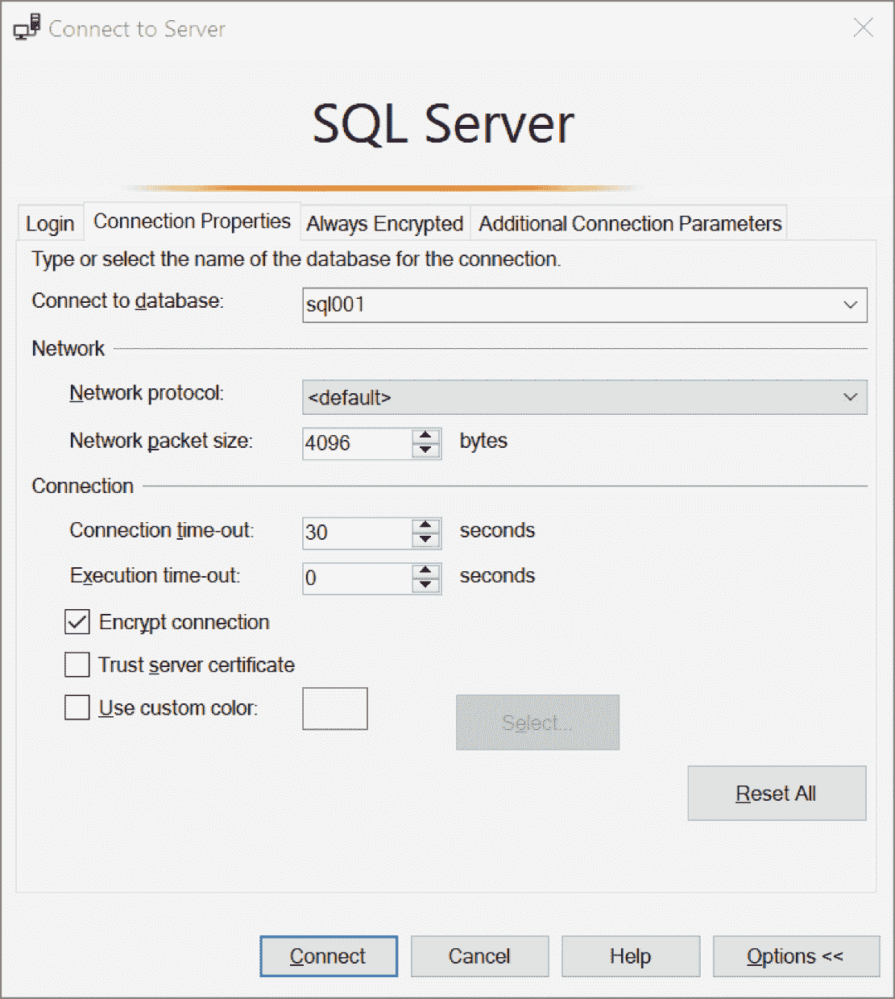

图 2.18 使用 SSMS 连接到用户数据库

## 瞬态故障错误

当 Azure 动态重新配置托管数据库的基础结构时，会发生瞬态故障错误。这些错误可能包括计划内事件（例如数据库升级）和计划外事件（例如负载均衡）。导致瞬态故障错误的重新配置事件通常是短暂的，持续时间少于 60 秒。但是，这仍然可能会导致问题，因为在此期间连接到数据库的应用程序可能会遇到一些连接问题。出于此原因，应用程序应构建重试逻辑，以便在事务因瞬态错误而失败时重复该事务。瞬态错误由 `SqlException` 的抛出引发，并被识别为几个错误代码之一。这允许错误处理逻辑包含针对包含瞬态错误代码的异常的重试策略。完整的瞬态错误代码列表可在 `https://docs.microsoft.com/en-us/azure/azure-sql/database/troubleshoot-common-errors-issues#transient-fault-error-messages-40197–40613-and-others` 中找到。

## 管理工具

在前面的部分中，我们确定了 Azure 门户和 Azure PowerShell 等工具是管理 Azure 中关系数据库部署的强大机制。但是，还有其他工具是开发人员用于在将查询添加到应用程序之前编写、测试和优化查询的。这些工具也被数据库管理员用于执行管理表设计、索引和用户权限等任务。以下部分简要介绍了三种最流行的数据库管理工具。

## SQL Server Management Studio

SQL Server Management Studio（简称 SSMS）多年来一直被数据库管理员和开发人员使用。它可以连接到任何类型的基于 SQL Server 的基础结构，包括 SQL Server、Azure SQL 和 Azure Synapse Analytics 专用 SQL 池。连接到数据库后，SSMS 可用于管理和开发 SQL 的所有组件，包括以下任务：

* 构建和管理数据库对象，例如表、存储过程、函数和触发器

* 开发和优化查询

* 管理安全操作

* 执行数据库备份和还原操作

* 构建 HADR 解决方案，例如 Always On 可用性组

其中许多活动可以通过 GUI 或在 SSMS 的查询编辑器中编写和执行的 T-SQL 脚本来完成。

打开 SSMS 后，系统会提示您连接到数据库服务器。连接到 Azure SQL 数据库和 Azure SQL MI 将使用为服务器创建的终结点。这可以在 `Overview` 页面中找到，旁边列有 `Server Name for Azure SQL Database and Host for Azure SQL MI`。输入服务器名称后，您需要选择要使用的身份验证类型并输入凭据。请记住，如果您使用无权访问 master 数据库的用户登录，则需要在 `Connection Properties` 中指定要连接的数据库。


一旦连接成功，用户即可通过单击顶部功能区中的 `New Query` 开始编写查询。这将在查询编辑器中打开一个新页面，查询运行后，结果将显示在查询编辑器的底部。SSMS 还允许用户通过在对象资源管理器中右键单击数据库中的任何对象，将鼠标悬停在 `Script <object> as` 上，并选择其中一个“script as”选项来脚本化任何对象。图 2.19 说明了如何在 SSMS 中为现有数据库视图脚本化 ALTER VIEW 语句的示例。此示例在新的查询编辑器窗口中打开脚本。

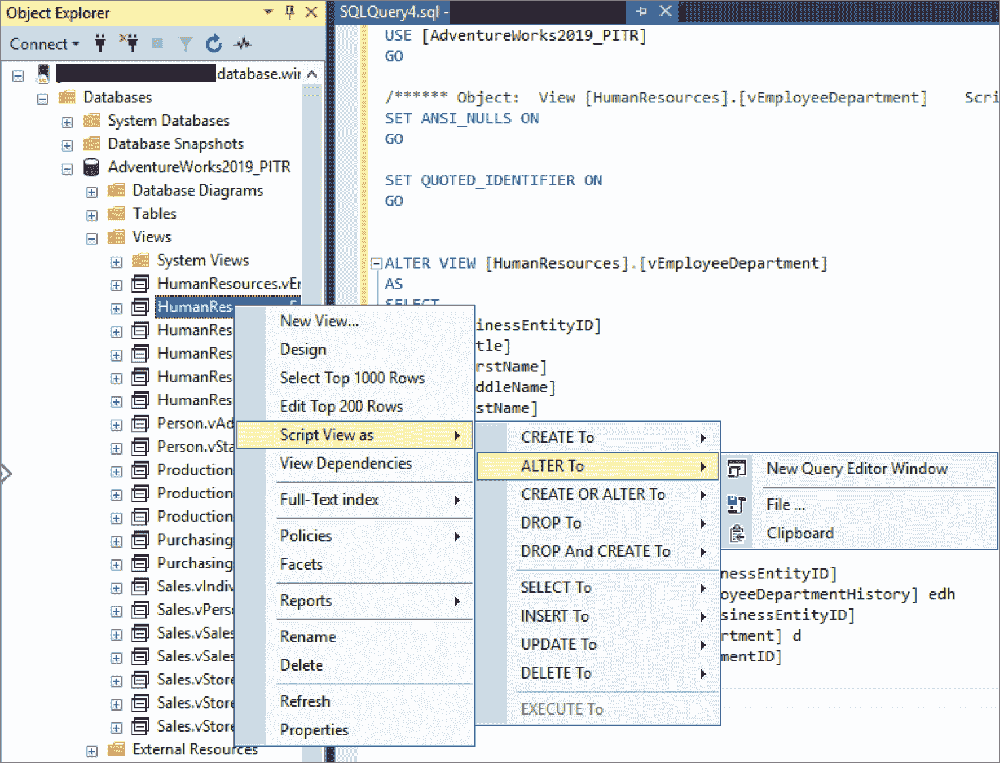

图 2.19 将视图脚本化为 ALTER To 语句

SSMS 原生提供多个管理功能，包括根据执行计划优化查询的功能。`execution plan` 是数据库引擎查询优化器执行查询所采取步骤的图形化解释。它从右向左阅读，并显示每个步骤的指标，包括执行的操作。如果将鼠标悬停在步骤上，SSMS 还会显示该步骤的资源使用情况。图 2.20 说明了执行计划的示例，并包含其中一个步骤的弹出式信息图。

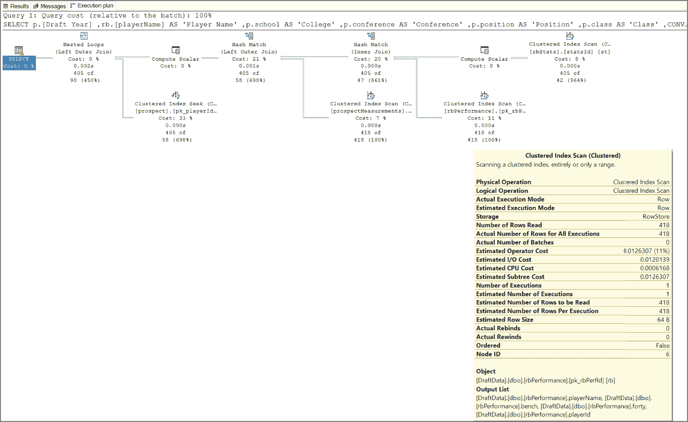

图 2.20 SSMS 执行计划

## Azure Data Studio

Azure Data Studio 是一款开源数据库管理工具，可在 Windows、macOS 或 Linux 机器上使用。与 SSMS 类似，它可以连接到 SQL Server、Azure SQL 和 Azure Synapse Analytics 专用 SQL 池。Azure Data Studio 提供了具有 IntelliSense、源代码控制集成和集成终端等功能的现代开发者体验。它不仅显示查询结果，还带有内置图表功能，允许用户可视化趋势和数据偏斜。

启动后，您可以通过单击 `New Connection` 使用 Azure Data Studio 连接到数据库。这将在右侧打开一个新窗口，您可以在其中添加服务器名称、身份验证类型和凭据。如果您使用包含数据库用户登录，还有一个选项可以将数据库从 `<Default>` 更改为用户数据库。

单击 `Connect` 后，Azure Data Studio 将显示类型（例如，Azure SQL 数据库、Azure SQL MI 等）、SQL Server 版本以及服务器上托管的数据库。用户随后可以选择 `New Query` 或 `New Notebook` 开始开发代码。单击 `New Query` 将打开一个查询窗口，提供类似于 SSMS 查询编辑器的体验。单击 `New Notebook` 将打开一个 Jupyter Notebook，允许用户使用 SQL、Python、Julia、R、Scala 和 PowerShell 代码编写查询。

## Sqlcmd

Sqlcmd 是一个命令行实用程序，可用于连接和查询托管在 SQL Server、Azure SQL 和 Azure Synapse Analytics 专用 SQL 池中的数据库。该实用程序允许用户通过命令提示符输入 T-SQL 语句或运行脚本文件。它包含多个内置开关，可用于身份验证、从文件运行查询以及配置查询返回的信息等任务。一些最常见的 sqlcmd 开关列于 表 2.8。

表 2.8 常见 sqlcmd 开关

| 开关 || 定义 |

| --- | --- |

| `-d` || 数据库名称 |

| --- | --- |

| `-E` || 使用受信任的连接 |

| `-g` || 启用列加密 |

| `-G` || 使用 AAD 身份验证 |

| `-i` || 输入文件 |

| `-K` || 设置应用程序意图（对只读工作负载有用） |

| `-l` || 登录超时 |

| `-m` || 错误级别 |

| `-N` || 加密连接 |

| `-o` || 输出文件 |

| `-P` || 密码 |

| `-S` || 服务器名称 |

| `-t` || 查询超时 |

| `-U` || 用户名 |

| `-V` || 错误严重性级别 |

| `-z` || 新密码 |

| `-Z` || 新密码并退出 |

要使用 sqlcmd，请打开命令提示符，输入 `sqlcmd`，后跟服务器信息和身份验证详细信息。以下是连接到 Azure SQL 数据库的 sqlcmd 命令示例：

```
sqlcmd -S <server_name>.database.windows.net 
-d <database_name> -U <user_name> -P <password>
```

使用 sqlcmd 从命令提示符运行查询非常简单，只需输入 `sqlcmd` 命令，后跟查询即可。以下是 sqlcmd 中返回表中每一行的查询示例：

```
sqlcmd
USE <database_name>;
GO
SELECT * FROM <table_name>;
GO
```

## SQL 查询技巧

如前所述，第 1 章 中提到，SQL 是用于构建、访问和操作关系数据库的开发语言。美国国家标准协会 (ANSI) 和国际标准化组织 (ISO) 将 SQL 视为标准语言。虽然 ANSI SQL 是所有主要关系数据库供应商遵循的标准，但大多数供应商都会针对其关系数据库产品扩展该语言功能。例如，T-SQL 是 Microsoft 对 ANSI SQL 的扩展，是 SQL Server、Azure SQL、Azure SQL 数据库、Azure SQL MI 和 Azure Synapse Analytics 的原生语言。

## DDL 与 DML 命令

标准 ANSI SQL 命令可分为两大类：数据定义语言 (DDL) 和数据操纵语言 (DML)。DDL 命令用于定义关系数据库对象，例如数据库、表、视图、存储过程和触发器。DML 命令用于操作存储在关系数据库中的数据。以下部分描述了这些类别常用的命令和语句结构。

## 数据定义语言 (DDL)

DDL 语句用于定义数据库对象。它们可用于创建新对象、修改现有对象或删除不再需要的对象。DDL 语句以指示语句正在执行哪种操作的命令开头。表 2.9 包含这些命令及其相关常见语句结构的列表。

表 2.9 DDL 命令

| 命令 || 描述 || 语句结构 |

| --- | --- | --- |

| CREATE || 在数据库中创建新对象。 || `CREATE TABLE <table name>`  

`(`  

`<list of columns>`  

`)` |

| --- | --- | --- |

| ALTER || 修改现有数据库对象的结构。 || `ALTER TABLE <table name>`  

`ADD COLUMN <column name>` |

| DROP || 从数据库中删除对象。 || `DROP TABLE <table name>` |

| RENAME || 重命名现有对象。 || `EXEC sp_rename <old name>, <new name>` |

| TRUNCATE || 删除表中的所有行。 || `TRUNCATE TABLE <table name>` |

除了数据库对象，DDL 语句还可以定义对象列中可以存储的数据类型。`Data types` 指定列可以存储的数据类型，这也定义了可以对该列执行哪些操作。例如，定义为数值数据类型的列可以以字符串数据类型无法实现的方式进行聚合。表 2.10 包含一些最常用 SQL 数据类型及其描述的列表。

表 2.10 常见 SQL 数据类型

| 数据类型 || 描述 |

| --- | --- |

| INT || 用于定义四舍五入为整数的数值数据。 |

| --- | --- |

| DECIMAL(`p, s`) || 用于定义具有固定精度 (`p`) 和小数位数 (`s`) 的数值数据。 |

| FLOAT(`n`) || 用于定义具有近似或浮点小数位数的数值数据。 |

| BIT || 用于定义可以取值为 1、0 或 NULL 的数值数据。 |

| DATE || 用于定义日期。 |

| DATETIME || 用于定义包含日期和时间的日期。 |


| `VARCHAR(n)` | 用于定义大小可变的字符串数据。`n` 用于定义可存储的字符数。 |

| `NVARCHAR(n)` | `VARCHAR(n)` 数据类型的 Unicode 版本。存储大小是字符数的两倍。 |

| `CHAR(n)` | 用于定义大小固定的字符串数据。`n` 用于定义可存储的字符数。 |

| `NCHAR(n)` | `CHAR(n)` 数据类型的 Unicode 版本。存储大小是字符数的两倍。 |

数据类型不是 DDL 命令定义表数据的唯一方式。约束与数据类型配合使用，用于限制可以存储在列中的数据类型。如果插入或更新数据的语句违反了约束，则该操作会立即取消。表 2.11 包含一些最常用约束的列表。

表 2.11 常见 SQL 约束

| 命令 | 描述 |

| --- | --- |

| `NOT NULL` | 确保每一行在列中都有值。 |

| `UNIQUE` | 确保列中的所有值都不同。 |

| `PRIMARY KEY` | 唯一标识表中的每一行。同时使用 `NOT NULL` 和 `UNIQUE` 约束，以确保每一行都有唯一值。 |

| `FOREIGN KEY` | 用于与其他表建立关系。防止任何操作破坏关系。 |

| `CHECK` | 用于指定一个或多个列中可接受的数据值。 |

| `DEFAULT` | 在插入新数据时未指定值，为列设置默认值。 |

| `INDEXES` | 用于增强查询性能。根据索引类型，它们可以在对象中按物理顺序排列数据，或提供指向数据物理位置的指针。 |

现在我们已经讨论了 DDL 命令、数据类型和约束，让我们探讨如何使用这些内容来构建 DDL 语句。以下语句创建一个名为 `DimProductCategory` 的表。

```
CREATE TABLE [dbo].DimProductCategory NOT NULL,
…..[ProductCategoryAlternateKey] [int] NULL,
…..[EnglishProductCategoryName] nvarchar NOT NULL,
…..[SpanishProductCategoryName] nvarchar NOT NULL,
…..[FrenchProductCategoryName] nvarchar NOT NULL,
CONSTRAINT [PK_DimProductCategory_ProductCategoryKey] PRIMARY KEY CLUSTERED
(
…..[ProductCategoryKey] ASC
)ON [PRIMARY],
CONSTRAINT [AK_DimProductCategory_ProductCategoryAlternateKey]
 UNIQUE NONCLUSTERED
(
…..[ProductCategoryAlternateKey] ASC
)ON [PRIMARY]
)
GO
```

该语句首先声明将在数据库中创建一个新表。然后在开括号和闭括号之间定义列、其数据类型和约束。表语句中定义的索引还包括它们基于的列以及列的升序或降序排序方向。

请注意，`ProductCategoryKey` 列定义还包括 `IDENTITY` 关键字。此属性用于确保主键或唯一约束列为每个新插入的行生成唯一值。除非在事务开始时使用 `SET IDENTITY_INSERT ON` 命令关闭此属性，否则标识列不允许用户修改。相反，标识列的值是根据 `CREATE TABLE` 语句中定义的 `seed` 和 `increment` 参数生成的。例如，在 `DimProductCategory` 表中插入的第一行将在 `ProductCategoryKey` 列中生成值 1，因为 `seed` 参数设置为 1。第二个参数表示添加到前一行的增量值。在此示例中，插入的第二行将在 `ProductCategoryKey` 列中生成值 2，因为 `increment` 值设置为 1，且第一行的 `ProductCategoryKey` 列等于 1。

## 数据操作语言 (DML)

DML 语句用于操作存储在数据库中的数据。它们可用于检索和聚合数据以进行分析、插入新行或编辑现有行。表 2.12 列出了四个主要 DML 命令及其各自的常见语句结构。

表 2.12 DML 命令

| 命令 | 描述 | 语句结构 |

| --- | --- | --- |

| `SELECT` | 从表或视图中读取行 | `SELECT`<列列表>FROM<表名>WHERE <筛选条件>GROUP BY <分组表达式>HAVING <搜索条件>ORDER BY <要排序的列> |

| `INSERT` | 向表中插入新行 | `INSERT INTO <表名>`(<列列表>)VALUES(<要插入的值>) |

| `UPDATE` | 更新现有行 | `UPDATE <表名>`SET <列> = <新值>WHERE <筛选条件> |

| `DELETE` | 删除现有行 | `DELETE FROM <表名>`WHERE <筛选条件> |

SELECT 语句通常比 表 2.12 中所示的示例结构更复杂。查询可以从多个表中检索数据、转换列数据类型并执行聚合。`UNION`、`EXCEPT` 和 `INTERSECT` 运算符也可用于将多个查询的结果合并或对比为一个结果集。后续章节中将提供更复杂的查询示例，但需要注意的是，SELECT 语句中操作的处理顺序与它们编写的顺序不匹配。此顺序（也称为 *逻辑处理顺序*）决定了某一步骤的结果何时可供后续步骤使用。逻辑处理顺序定义如下：

1. `FROM`

2. `ON`

3. `JOIN`

4. `WHERE`

5. `GROUP BY`

6. `WITH CUBE` 或 `WITH ROLLUP`

7. `HAVING`

8. `SELECT`

9. `DISTINCT`

10. `ORDER BY`

11. `TOP`

有关 T-SQL SELECT 语句结构的更多信息，请参阅 `https://docs.microsoft.com/en-US/sql/t-sql/queries/select-transact-sql?view=sql-server-ver15`。

## 在 Azure SQL、MySQL、MariaDB 和 PostgreSQL 中查询关系数据

虽然大多数 RDBMS 对 SQL 的实现使用相同的核心功能，但存在一些细微差别。以下部分探讨了用于在 Azure SQL、Azure Database for MySQL、Azure Database for MariaDB 和 Azure Database for PostgreSQL 中查询数据的语法，并突出了一些关键差异。

## 使用 T-SQL 查询 Azure SQL

首先讨论的一组查询是使用 T-SQL 构建的。如前所述，T-SQL 是 Microsoft 对 ANSI SQL 的扩展，用于与基于 SQL Server 的关系数据库通信。本节中的所有示例都可用于查询 `AdventureWorksDW2019` 数据库中的表。使用以下链接下载数据库备份：`https://docs.microsoft.com/en-us/sql/samples/adventureworks-install-configure?view=sql-server-ver15&tabs=ssms#download-backup-files`。该链接还提供了有关如何将数据库还原到 SQL Server 或 Azure SQL 实例的说明。

从关系数据库中检索数据始于 SELECT 命令。以下是一个 SELECT 语句示例，用于返回单个表中每个列的所有数据：

```
SELECT *
FROM [dbo].[FactInternetSales]
```

星号 (`*`) 符号是通配符字符，表示“所有”。在此示例中，`*` 用于表示 `FactInternetSales` 表中的每个列。虽然这在编写包含长列列表的查询时可以节省用户时间，但可能会因返回超出所需范围的数据而导致查询性能不佳。此外，当查询的表或视图中添加新列时，使用 `SELECT *` 语句的应用程序可能会中断。出于这些原因，在 SELECT 语句中始终明确列出所需的列总是更好的选择。


查询通常用于返回经过筛选的数据列表。以下示例仅返回成本超过 $1,000 的产品的销售信息。结果集还按销售金额降序排序。

```
SELECT ProductKey
    ,ProductStandardCost
    ,TotalProductCost
    ,SalesAmount
    ,OrderDate
FROM [dbo].[FactInternetSales]
WHERE ProductStandardCost> 1000
ORDER BY SalesAmount DESC
```

应用程序和报告很少只使用来自一个表的数据。相反，查询关系数据库的应用程序通常会使用相同的 SELECT 语句从两个或多个表构建结果集。查询可以通过使用 `join` 操作来实现这一点。Join 操作利用表之间的逻辑关系，构建包含来自不同表列的数据行。有多种可用的 Join 操作类型，可以返回不同的数据组合。以下是四种最常见的 Join 类型及其 T-SQL 实现列表：

*   内部连接检索两个表中满足连接条件的数据。内部连接可以使用 `INNER JOIN` 或 `JOIN` 表达式定义。

*   左外连接检索连接条件左侧表的所有数据，以及右侧表中满足连接条件的数据。左外连接可以使用 `LEFT OUTER JOIN` 或 `LEFT JOIN` 表达式定义。

*   右外连接检索连接条件右侧表的所有数据，以及左侧表中满足连接条件的数据。右外连接可以使用 `RIGHT OUTER JOIN` 或 `RIGHT JOIN` 表达式定义。

*   全外连接检索左侧和右侧表的所有数据。全外连接可以使用 `FULL OUTER JOIN` 或 `FULL JOIN` 表达式定义。

图 2.21 说明了不同连接类型如何从两个表（表示为表 A 和表 B）中检索数据。

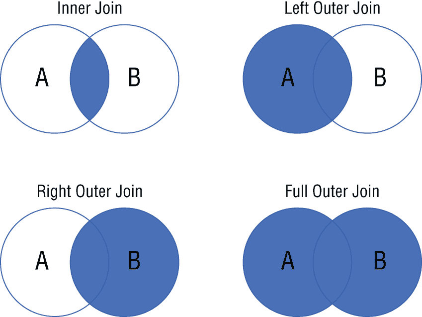

FIGURE 2.21 Types of SQL joins

除了这些连接类型，基于 SQL Server 的数据库引擎还允许用户使用 `cross joins` 开发查询。交叉连接是一种特殊的连接类型，返回两个表行的笛卡尔积。交叉连接可以使用 `CROSS JOIN` 表达式定义。

以下查询在前一个示例的基础上添加了 DimProduct 表的数据。由于它使用不带任何额外形容词的 `JOIN` 命令，该查询将执行内部连接，仅返回两个表中满足 `ON` 子句中定义的连接条件的数据。

```
SELECT P.EnglishProductName
     ,FIS.ProductKey
     ,FIS.ProductStandardCost
     ,FIS.TotalProductCost
     ,FIS.SalesAmount
     ,FIS.OrderDate
FROM [dbo].[FactInternetSales] AS FIS
    JOIN [dbo].[DimProduct] AS P
        ON FIS.ProductKey = P.ProductKey
WHERE ProductStandardCost> 1000
ORDER BY SalesAmount DESC
```

请注意，查询在 `FROM` 子句中使用 `AS` 命令为每个表指定一个短别名。此别名可用于指定所选列所在的表以及连接条件的定义方式。别名也可以指定给列，允许用户为聚合结果列命名。

SQL 提供了多种内置函数，可用于从关系数据中推断洞察。内置函数可根据其对数据执行的操作进行分类。例如，聚合函数（如 `SUM()`、`MAX()` 和 `MIN()`）对一组值执行计算并返回单个值。它们可以与 `GROUP BY` 子句结合使用，以计算行类别的聚合。

以下查询修订了前一个查询，使其返回成本超过 $1,000 的产品的总销售数量和总销售金额。它还按产品名称和每年每月的销售额对销售总额进行分组。

```
SELECT P.EnglishProductName
     ,SUM(FIS.OrderQuantity) AS TotalQuantity
     ,SUM(FIS.SalesAmount) AS TotalSales
     ,MONTH(FIS.OrderDate) AS [Month]
     ,YEAR(FIS.OrderDate) AS [Year]
FROM [dbo].[FactInternetSales] AS FIS
    JOIN [dbo].[DimProduct] AS P
        ON FIS.ProductKey = P.ProductKey
WHERE ProductStandardCost> 1000
      AND YEAR(FIS.OrderDate)> 2010
GROUP BY P.EnglishProductName,
         MONTH(FIS.OrderDate),
         YEAR(FIS.OrderDate)
ORDER BY [Year], TotalSales DESC
```

你可能会疑惑，为什么 `WHERE` 和 `GROUP BY` 子句不使用语句开头定义的列别名。这是由于本章前面讨论过的 T-SQL 逻辑处理顺序。由于数据库引擎在处理 `SELECT` 之前处理 `WHERE` 和 `GROUP BY` 子句，这些子句不知道如何解析列别名。

本节的最后一个 T-SQL 示例描述了如何将结果集限制为查询返回的前 10 行。这是 T-SQL 与其他 SQL 版本之间的一个关键区别，因为 T-SQL 使用 `TOP` 命令，而其他版本使用 `LIMIT`。我们将演示其他关系数据库平台如何实现 `LIMIT` 命令。

```
SELECT TOP(10) P.EnglishProductName
     ,SUM(FIS.OrderQuantity) AS TotalQuantity
     ,SUM(FIS.SalesAmount) AS TotalSales
FROM [dbo].[FactInternetSales] AS FIS
    JOIN [dbo].[DimProduct] AS P
        ON FIS.ProductKey = P.ProductKey
WHERE ProductStandardCost> 1000
GROUP BY P.EnglishProductName
ORDER BY TotalSales DESC
```

## 查询 MySQL、MariaDB 和 PostgreSQL

用于与 MySQL、MariaDB 和 PostgreSQL 数据库交互的查询与用 T-SQL 编写的查询非常相似。以下示例与前一个 T-SQL 查询几乎相同，只有一个关键区别。

```
SELECT P.EnglishProductName
     ,SUM(FIS.OrderQuantity) AS TotalQuantity
     ,SUM(FIS.SalesAmount) AS TotalSales
FROM [dbo].[FactInternetSales] AS FIS
    JOIN [dbo].[DimProduct] AS P
        ON FIS.ProductKey = P.ProductKey
WHERE ProductStandardCost> 1000
GROUP BY P.EnglishProductName
ORDER BY TotalSales DESC
LIMIT 10
```

MySQL、MariaDB 和 PostgreSQL 使用的 SQL 方言不使用 `TOP(*n*)` 命令来检索查询返回的前 *n* 行。相反，这些方言使用 `LIMIT` 命令来限制返回的行数。

请记住，用于检索和操作存储在这些数据库引擎之一中的数据的查询需要使用能够连接到它们的工具来执行。MySQL Workbench 是一个图形工具，类似于 SSMS，可用于连接到 MySQL 和 MariaDB 数据库。为 PostgreSQL 数据库开发的查询可以使用图形工具 pgAdmin 来完成。

## 摘要

DP-900 考试的“Azure 上的关系数据”目标侧重于建立对常见关系数据库工作负载和数据库结构的基础理解。它侧重于 Azure 中不同类型的关系数据库产品，以及针对它们的部署、安全性和开发注意事项。

本章涵盖了以下概念：

*   `Describe relational data workloads.` 关系数据工作负载可以分为事务型和分析型。事务型（或 OLTP）工作负载存储与组织活动相关的交互，例如零售购买。SQL Server 和 Azure SQL Database 等数据库包括用于管理并发事务以保持 ACID 合规性的机制。与专注于优化数据库写入的 OLTP 工作负载不同，分析工作负载针对读取密集型应用程序进行了优化。分析数据库为此被扁平化，以便读取数据的用户不必编写过于复杂的查询来查询数据。


# 描述关系型 Azure 数据服务

Azure 上有几种关系型数据库选项，旨在满足任何组织的需求。Azure SQL 产品组合包括使用 Microsoft SQL Server 数据库引擎的关系型数据库产品。这些包括 `SQL Server on Azure Virtual Machine`、`Azure SQL Managed Instance` 和 `Azure SQL Database`。需要为数据仓库和大数据分析工作负载实现水平扩展的组织可以使用 `Azure Synapse Analytics` 专用 SQL 池。`Azure Database for PostgreSQL`、`Azure Database for MariaDB` 和 `Azure Database for MySQL` 使组织能够将其本地开源关系型数据库基础架构和管理卸载到 Azure。

# 描述 Azure 中关系型数据库的常见管理任务

在 Azure 中托管的关系型数据库消除了与管理基础架构相关的繁琐活动，使组织能够花更多时间构建提供有价值洞察的解决方案。但是，仍有几项管理活动需要由管理员维护，例如自动化环境部署和管理安全性。出于此原因，Azure 为组织提供了各种选项来自动化数据库部署，这些部署既灵活又高度可扩展。安全性也在 Azure 和数据库引擎中多个层级提供。这些可以按网络隔离、访问管理、数据加密和混淆以及安全管理进行分类。微软还提供了几种工具，使数据库管理员和开发人员能够轻松执行维护高性能关系型数据库解决方案所需的活动。

# 描述常见查询技术

结构化查询语言，简称 SQL，是一种符合 ANSI/ISO 标准的开发语言，用于与关系型数据进行交互。SQL 命令可分为四种不同类型：数据定义语言 (DDL)、数据操作语言 (DML)、数据控制语言 (DCL) 和事务控制语言 (TCL)。其中，DDL 和 DML 语句对于理解 DP-900 考试最为重要。虽然 ANSI SQL 是所有主要 RDBMS 使用的标准，但其中大多数都通过一些自定义功能扩展了该语言。例如，Transact-SQL (T-SQL) 是 SQL Server–based 关系型数据库使用的 SQL 实现。

## 考试要点

## 为关系型工作负载识别合适的数据产品

对于此主题，请务必了解何时使用 SMP 数据库（如 `Azure SQL`）、MPP 数据库（如 `Azure Synapse Analytics` 专用 SQL 池）以及 OLAP 工具（如 `Power BI`）。SMP 数据库通常用于事务性工作负载和较小的数据仓库。MPP 数据库用于大型分析工作负载。OLAP 工具用作数据集市或分析工作负载的语义层，并包含可直接用于报告的预定义聚合。

## 描述关系型数据结构

能够识别关系型数据库结构，例如表、视图、索引、存储过程、函数和触发器。表是关系型数据库的基本存储对象，以行的形式存储数据元素，并将一个或多个属性存储为列。视图是虚拟对象，其内容由从一个或多个表返回数据的查询定义。索引通过对数据进行物理排序并提供数据存储位置的指针来优化查询。存储过程和函数封装常用的 T-SQL 代码，以最大限度地减少应用程序所需的代码量。触发器是响应 DML、DDL 或基于登录的事件而执行的代码块。

## 描述 IaaS 和 PaaS Azure SQL 服务

Azure 提供了多种托管关系型数据库的选项，具有不同的抽象级别和管理工作量。在这些选项中，`SQL Server on Azure VMs` 最类似于本地 SQL Server 实例，因为它让组织对操作系统和数据库引擎拥有最大控制权。这是基础设施即服务（IaaS）产品的示例。希望卸载操作系统和数据库引擎功能管理的组织可以利用平台即服务（PaaS）产品，例如 `Azure SQL Managed Instance` 和 `Azure SQL Database`。

## 描述 Azure Synapse Analytics 专用 SQL 池

`Azure Synapse Analytics` 专用 SQL 池是 Azure 中的一种 MPP 关系型数据库产品，专为大型数据仓库设计。它使用分级架构，将计算引擎与数据存储位置分离，以便能够高效处理大数据工作负载。数据仓库从业者可以通过配置表来使用哈希分布或轮询分布，或将数据复制到每个计算节点的第一个分布，从而选择数据的分布方式。

## 描述 Azure 中的开源选项，例如 Azure Database for PostgreSQL、Azure Database for MariaDB 和 Azure Database for MySQL

组织可以将其现有的 PostgreSQL、MariaDB 和 MySQL 足迹迁移到 Azure，以卸载与本地环境相关的许多管理要求。与 Azure SQL 类似，Azure 会为这些数据库管理常见任务，例如升级、修补、数据库备份、高可用性和威胁防护，无需任何用户干预。每个选项都包含三个服务层级，旨在满足不同的性能要求。

## 描述 Azure 中关系型数据库的自动化部署选项

虽然组织可以通过 Azure 门户手动在 Azure 中部署关系型数据库，但通常会使用脚本语言或基础设施即代码模板等技术来自动化数据库部署。Azure 特有的自动化技术包括 `Azure PowerShell`、`Azure CLI` 和 ARM 模板。

## 描述数据库安全组件

在 Azure 中托管的关系型数据库的安全性可分为四类：网络隔离、访问管理、数据加密和混淆以及安全管理。了解每个类别中可用的不同方法和技术非常重要。此外，还要能够区分访问管理中的身份验证和授权。

## 描述常见关系型数据库管理工具

有多种工具可供数据库管理员和开发人员构建和管理数据库解决方案。微软提供的三种最常用工具是 `SQL Server Management Studio (SSMS)`、`Azure Data Studio` 和 `sqlcmd`。

## 描述 DDL 和 DML 命令

标准 ANSI SQL 命令可分为两类：数据定义语言 (DDL) 和数据操作语言 (DML)。DDL 命令是指用于创建新对象、修改现有对象或删除不再需要的对象的 SQL 操作。DDL 命令包括 `CREATE`、`ALTER` 和 `DROP`。DML 命令是指在数据库中读取和写入数据的 SQL 操作。DML 命令包括 `SELECT`、`INSERT`、`UPDATE` 和 `DELETE`。

## 描述用于在 Azure SQL、Azure Database for PostgreSQL 和 Azure Database for MySQL 中查询关系型数据的技术

SQL 是一种高度灵活的语言，允许开发人员执行从同一查询中检索多个表的数据、筛选数据以及对数据进行计算的操作。不同的 SQL 方言（例如 T-SQL）具有多个内置函数，可用于执行计算和操作查询检索的数据。虽然大多数 SQL 方言使用相同的核心功能，但存在一些细微差别，例如 T-SQL 和其他 SQL 方言限制查询返回行数的方式。

## 复习问题


# 数据库与 Azure 服务选择题

## 1. 隔离级别与不可重复读

Which of the following isolation levels may result in queries running into the nonrepeatable read issue?

1. Snapshot
2. Read Committed
3. Repeatable Read
4. Serializable

## 2. 分析系统数据存储最佳实践

Is the italicized portion of the following statement true, or does it need to be replaced with one of the other fragments that appear below? “The best practice for storing data in analytical systems such as data warehouses and OLAP models is to *normalize data using 2NF*.”

1. Normalize data using 1NF
2. Normalize data using 3NF
3. De-normalize the data and use a star schema
4. No change necessary

## 3. 非主键列过滤性能优化

You are the database administrator for a company that sells bicycles. One of the developers at the company has expressed a concern with the performance of queries that perform specific filters on columns that are not the primary key. Which of the following types of indexes should you use to increase the performance of these queries?

1. Nonclustered index
2. Clustered index
3. Clustered columnstore index
4. Filtered index

## 4. Azure SQL Managed Instance 服务模型

Is the italicized portion of the following statement true, or does it need to be replaced with one of the other fragments that appear below? “Azure SQL Managed Instance is an example of a *PaaS* solution.”

1. IaaS
2. SaaS
3. DbaaS
4. No change necessary

## 5. 应用迁移至 Azure 的数据库选择

You are a consultant for a company that is moving many of its applications from on-premises infrastructure to Azure. Each database must be hosted on a database platform that requires the least amount of administrative effort. One of the applications has a relatively short migration timeline, greatly reducing the amount of time to update deprecated features or fix any compatibility issues. The databases serving this application run on SQL Server 2019 and have a few SQL Server Agent jobs. Which of the following database offerings provides the fastest time to Azure while maintaining the administrative requirement?

1. Azure SQL MI
2. SQL Server on Azure VM
3. Azure SQL Database Single Database
4. Azure SQL Database Elastic Pool

## 6. SQL Server 工作负载推荐 VM 类别

Which Azure virtual machine category is the recommended choice for most SQL Server workloads?

1. Compute optimized
2. Memory optimized
3. Storage optimized
4. General purpose

## 7. SQL Server on Azure VM HADR 策略设计

As the lead database administrator for a large retail company, you have been tasked with designing the HADR strategy for your SQL Server on Azure VM footprint. While every database needs to be replicated to a separate server in the same region, only some databases need to be replicated to another server in a different region. During a planned outage, the databases should immediately failover to the server in the same region. If there is a datacenter-wide outage, then the database will need to immediately failover to the server in the other region. Which of the following HADR options should you recommend for this approach?

1. SQL Server Database Mirroring
2. SQL Server Always On availability groups
3. Azure Site Recovery
4. SQL Server Failover Cluster Instances

## 8. Azure 虚拟网络定义

Is the italicized portion of the following statement true, or does it need to be replaced with one of the other fragments that appear below? “A *virtual network* is a networking service in Azure that provides network isolation for relational database services such as SQL Server on Azure VM and Azure SQL MI.”

1. Route table
2. Azure ExpressRoute
3. Network security group
4. No change necessary

## 9. Azure SQL MI 部署组件

Which of the following components are deployed with Azure SQL MI and exposed to the end user?

1. Network security group
2. SQL database
3. VNet
4. Virtual machine

## 10. OLTP 工作负载与分析读取隔离方案

You are designing a database solution in Azure that will serve as the storage engine for an OLTP workload. The chosen database option will need to minimize the amount of administrative effort. Along with supporting several write operations, the solution will also be used by many analysts who will be reading data to build daily summaries of the data. The solution will need to route these read-only workloads so that they do not affect the performance of the write operations. Which of the following is the best option for this scenario?

1. Design the solution to use a SQL Server on Azure VM as the database solution. Create multiple virtual machines and cluster them so that they can participate in an availability group for HADR. Enable one of the instances to serve read-only workloads and set the application the analysts are using to use a read-only application intent. This will route their queries to the read-only secondary.
2. Design the solution to use Azure SQL MI as the database solution. Choose the Business Critical tier and set the application the analysts are using to use a read-only application intent. This will route their queries to the read-only secondary that is deployed with the Business Critical tier of Azure SQL MI.
3. Design the solution to use Azure SQL MI as the database solution. Choose the General Purpose tier and set the application the analysts are using to use a read-only application intent. This will route their queries to the read-only secondary that is deployed with the General Purpose tier of Azure SQL MI.
4. Design the solution to use Azure SQL Database as the database solution. Choose the Standard tier and set the application the analysts are using to use a read-only application intent. This will route their queries to the read-only secondary that is deployed with the Standard tier of Azure SQL Database.

## 11. Azure SQL MI 用户数据库最大数量

What is the maximum number of user databases that can be deployed to a single Azure SQL MI?

1. 1,000
2. 50
3. 100
4. 500

## 12. Azure SQL Database 私有 IP 附加服务

Which of the following services allow users to attach a private IP address to an Azure SQL Database logical server?

1. VNet
2. Network Security Group
3. Private Link
4. Azure Firewall

## 13. Azure Synapse 专用 SQL 池报表对象选择

You are designing a data warehouse with an Azure Synapse Analytics dedicated SQL pool that analysts will use to power their reporting dashboards. One of the requirements is that users must be able to query data without needing to write complex T-SQL code to retrieve data. These result sets will perform aggregations over a common set of tables. Which object native to dedicated SQL pools is the most performant option for this use case?

1. View
2. Materialized view
3. Temporary tables
4. Stored procedure

## 14. Azure Synapse 专用 SQL 池数据分片数量

Azure Synapse Analytics dedicated SQL pool shards data into how many distributions when performing computations?

1. 30
2. 100
3. 45
4. 60

## 15. Azure SQL MI 数据库点还原与跨实例复制

You are the lead DBA of an organization that hosts its mission-critical OLTP databases on Azure SQL MI. The development team for an application using one of these databases has requested an older copy of the database be placed on a separate Azure SQL MI to perform tests on data that has since been deleted. They are asking for a version that is two days older than the current date. Which of the following options should you use to copy the database to the other Azure SQL MI?

1. Azure Blob storage automatically stores Azure SQL MI database backups. Use a RESTORE FROM URL command to restore a backup of the database from two days ago on the second Azure SQL MI.
2. Azure manages backups for Azure SQL MI with automated backups. Perform a point-in-time restore to restore a backup of the database from two days ago on the second Azure SQL MI.
3. Azure manages backups for Azure SQL MI with automated backups. Perform a point-in-time restore to restore a backup of the database from two days ago on the first Azure SQL MI using a different name. Then, configure transactional replication to replicate the restored database from the first Azure SQL MI to the second.


4. Azure 使用自动备份为 Azure SQL 托管实例管理备份。在第一个 Azure SQL 托管实例上使用不同的名称，对两天前的数据库备份执行时间点还原。然后，使用 Azure 数据同步将还原的数据库从第一个 Azure SQL 托管实例复制到第二个。

16. 适用于 Azure SQL 数据库的常规用途服务层使用哪种购买模型？

1. `vCore-based`
2. `DTU-based`
3. `DWU-based`
4. `DBU-based`

17. 以下语句中斜体部分是正确的，还是需要替换为下面出现的其他片段之一？“*Azure Database for MySQL* 提供三种部署模型，包括使用横向扩展架构支持大型 OLTP 工作负载的超大规模部署模型。”

1. `Azure Database for MariaDB`
2. `Azure Database for PostgreSQL`
3. `Azure Database for HBase`
4. 无需更改

18. 从本地计算机或 VM 运行 Azure PowerShell 脚本时，必须在脚本开头运行以下哪个 Azure PowerShell 命令以与 Azure 环境建立连接？

1. `Connect-AzSession`
2. `Connect-AzAccount`
3. `Connect-AzureRmAccount`
4. `Connect-AzureRmSession`

19. 你正在设计一个 Azure Synapse Analytics 专用 SQL 池数据仓库，它将用作电子商务公司的单一事实来源。有几个大型事实表，每个表都包含用于标识每行的列。这些列具有许多不同的值。以下哪种表分布设计最适合这些事实表？

1. 轮询
2. 复制表
3. 哈希
4. 广播

20. Azure 用于管理 Azure SQL 数据库部署的资源提供程序和资源类型组合是以下哪个？

1. `Microsoft.Sql/managedInstances`
2. `Microsoft.Sql/databases`
3. `Microsoft.Sql/servers`
4. `Microsoft.Sql/servers/databases`

21. 可以使用哪个 Azure PowerShell 命令创建新的 Azure SQL 数据库？

1. `New-AzSqlDatabase`
2. `Create-AzSqlDatabase`
3. `New-AzRmSqlDatabase`
4. `Create-AzRmSqlDatabase`

22. 以下哪个 RBAC 角色允许用户创建和管理数据库，但不授予访问权限？选择授予用户最少权限的选项。

1. Azure Active Directory 管理员
2. SQL DB 参与者
3. SQL 安全管理器
4. 参与者

23. 你正在设计一个应用程序，该应用程序将向 Web 应用程序提供高度敏感的信息。数据必须加密，以便只有应用程序可以解密数据，防止数据库管理员查看原始值。以下哪个选项是加密存储此敏感信息的列的最佳选择？

1. 动态数据掩码
2. 使用 `DENY` 语句拒绝访问列
3. Always Encrypted
4. 透明数据加密

24. 哪个数据库管理工具最适合执行管理任务，例如管理用户权限、优化查询和构建 HADR 解决方案？

1. Azure Data Studio
2. Azure PowerShell
3. Azure 门户
4. SQL Server Management Studio

25. 你是一家大型电子商务公司的数据库管理员。一名开发人员在连接到你管理的某个 Azure SQL 数据库时遇到问题，并向你寻求帮助。SSMS 中的错误消息指示登录失败，并指出用户无法打开“master”数据库。你得知该开发人员正在使用包含的数据库用户登录到数据库。你应该告诉开发人员采取什么步骤来修复此问题？

1. 将 SSMS 登录屏幕上的数据库上下文从 *default* 更改为用户有权访问的数据库。
2. 使用 SQL 管理员凭据登录到逻辑服务器以访问数据库。
3. 使用 AAD 帐户登录到数据库。
4. 为 SQL 实例启用 TCP/IP。

26. `CREATE TABLE` 语句属于哪类 SQL 语句？

1. DML
2. DDL
3. DCL
4. TCL

27. Azure Defender for SQL 的哪个组件会向用户发出恶意活动（例如 SQL 注入和数据外泄）的警报？

1. SQL 审核
2. 漏洞评估
3. SQL Server 扩展事件
4. 高级威胁防护

28. 可以使用哪个 T-SQL 语句将 Azure Active Directory 用户或组添加为 Azure SQL 数据库的用户？

1. `CREATE EXTERNAL PROVIDER AAD; CREATE USER \[<AAD\_User>\] FROM AAD;`
2. `CREATE USER \[<AAD\_User>\] FROM EXTERNAL PROVIDER;`
3. `CREATE USER \[<AAD\_User>\] FROM EXTERNAL SERVICE;`
4. `CREATE USER \[<AAD\_User>\]`

29. 在 T-SQL SELECT 语句的逻辑处理顺序中，以下哪个步骤排在第一位？

1. `FROM`
2. `GROUP BY`
3. `ORDER BY`
4. `SELECT`

30. 以下哪个是用于定义可变大小字符串数据的 Unicode 数据类型？

1. `VARCHAR()`
2. `NVARCHAR()`
3. `CHAR()`
4. `NCHAR()`

31. 以下语句中斜体部分是正确的，还是需要替换为下面出现的其他片段之一？“A(n) *Full Join* 是一种用于检索同时满足连接条件的两个表数据的连接类型。”

1. Full inner join
2. Inner join
3. Outer join
4. 无需更改

# 第 3 章

## Azure 中的非关系型数据库

非关系型数据库，通常也称为 NoSQL 数据库，允许用户存储和查询非关系型数据，而无需将其调整以适应预定义的架构。NoSQL 数据库通常用于需要快速摄入和读取数据的场景，例如游戏、电子商务、IoT 和移动应用程序。NoSQL 数据库的主要类别包括键值、文档、列式和图形。本章将讨论不同类别的 NoSQL 数据库、如何使用 Azure Cosmos DB 实现它们，以及 Azure 中 NoSQL 数据库的基本管理任务。

## 非关系型数据库功能

在过去几年中，数据驱动型应用程序的兴起迫使组织重新思考如何存储数据。大量形状和大小各异的数据需要在近乎实时的情况下被捕获，这使得组织几乎不可能对所有数据存储需求都使用传统的关系型模型。此外，云计算的出现使组织能够轻松且廉价地在不同地理区域横向扩展其数据存储解决方案。这使组织能够以其自然格式存储数据，而无需先应用复杂的数据规范化规则。出于这些原因，NoSQL 数据库已成为需要动态数据存储解决方案的软件开发人员的热门选择。

NoSQL 数据库不强制数据适应严格的架构，而是使用针对所存储数据的要求进行优化的存储模型。无需过多关注数据库管理，使软件开发人员能够以更敏捷的方法构建应用程序，从而更快地适应不断变化的需求。

虽然有几种类别的 NoSQL 数据库，但它们共享以下特征：

* ACID 原则的实现模糊不清。这对于处理大量数据且速度非常快的事务性工作负载是有益的。
* 由于数据之间没有关系，因此可以轻松地在多个分区和存储设备上横向扩展，允许数据存储在任何位置。


# 实现更快速、更敏捷软件开发的架构灵活性

这允许新的数据记录拥有与先前存储的记录不同的字段和数据类型。NoSQL 数据库固有的灵活架构设计使其非常适合半结构化和非结构化数据。

通常，NoSQL 数据库可分为键值存储、文档数据库、列式数据库或图数据库。这些内容已在 第 1 章 中总结，并在以下部分中详细介绍。

# 键值存储

键值存储是最简单的 NoSQL 数据库类型，它将数据片段存储为两个常见元素：用于标识的唯一键和捕获的值。应用程序可以使用键执行查找操作，以检索与之关联的数据值。这些数据存储具有高度可扩展性，通过对键应用哈希算法，将数据分布在所有可用存储上。虽然键是唯一且标量的，但值可以从标量值到复杂数据对象（例如 JSON 数组）不等。图 3.1 是存储电话簿数据的键值存储示例。

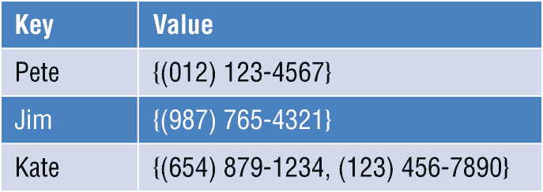

FIGURE 3.1 Key-Value store

键值存储针对摄入大量必须快速存储和读取的数据进行了优化。从键值存储读取数据的应用程序通常使用单个键或一组键执行简单查找。以下是键值存储作为理想存储解决方案的两个常见场景：

* 实时存储用户会话元数据的 Web 应用程序。这些应用程序还可以使用键值存储，在用户浏览网站时向其提供实时推荐。

* 缓存频繁访问的数据，以通过最大限度减少对基于磁盘的存储（例如 Azure SQL 数据库）的读取来优化应用程序性能。

虽然键值存储非常适合为执行简单读取操作的应用程序提供数据，但它们并不适合需要执行密集搜索操作的应用程序的理想存储解决方案。它们也不支持需要按值过滤数据的查询场景。键值存储仅支持插入和删除操作，要求用户通过完全覆盖现有项来修改数据。

Azure 提供了几种不同的选项来实现键值存储：

* Azure 表存储

* Azure Cosmos DB 表 API

* Azure Cache for Redis

本章将重点介绍 Azure 表存储和 Azure Cosmos DB 表 API，因为这些内容在 DP-900 考试范围内。如果您想了解有关 Azure Cache for Redis 的更多信息，可以在 `https://docs.microsoft.com/en-us/azure/azure-cache-for-redis/cache-overview` 上找到更多信息。

## 文档数据库

文档数据库是键值存储的高级版本，它将数据存储为半结构化文档。文档中包含的单个数据字段可以由单个值或嵌套元素组成。文档分配了唯一 ID，应用程序可以使用该 ID 查询数据。唯一 ID（也称为文档键）通常会被哈希处理，以将数据均匀分布在可用存储中。图 3.2 说明了文档数据库结构的示例。

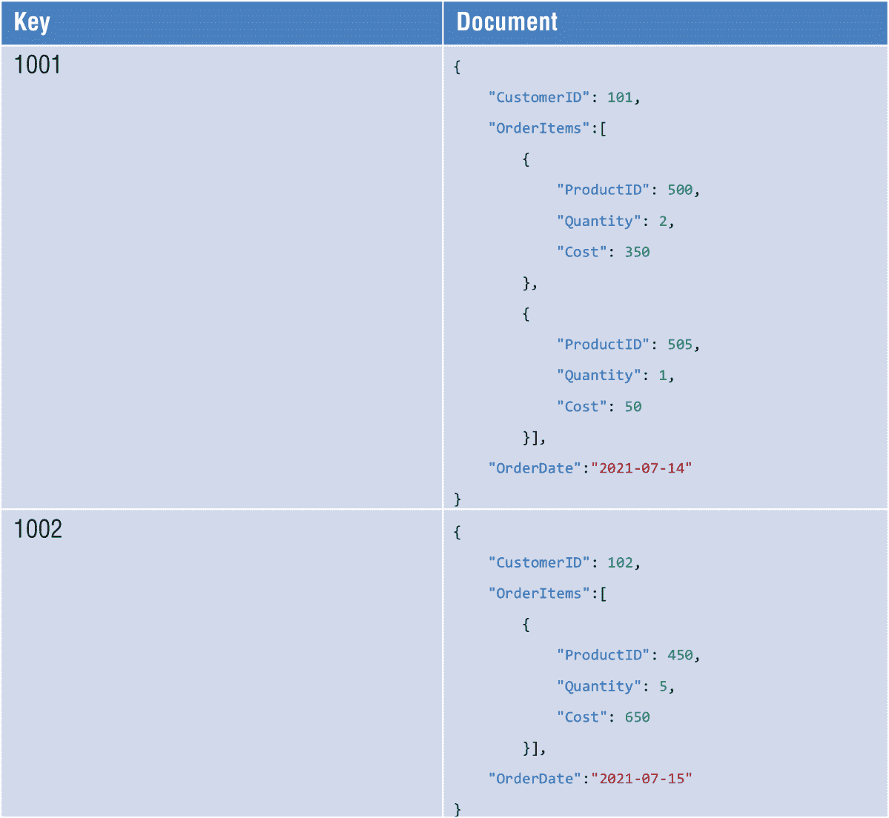

FIGURE 3.2 Document database

文档包含给定实体的所有数据。一个实体示例可能是与电子商务网站上下的订单相关的所有详细信息，例如客户信息和订购的商品。这种非规范化的数据存储方式可以优化需要非常快速检索数据的查询性能，因为它消除了从多个表读取数据的需求。

文档数据库中的每个文档可以拥有不同的字段集，类似于键值存储中的值。但是，与键值存储不同，查询可以按字段值过滤数据。这使得文档数据库成为需要非常快速存储大量数据，并在查询数据时执行复杂过滤的应用程序的理想选择。

Azure 提供了几种不同的选项来实现文档数据库：

* Azure Cosmos DB Core (SQL) API

* Azure Cosmos API for MongoDB

## 列式数据库

列式数据库与关系数据库类似，它们将数据组织为列和行。与关系数据库不同，列式数据库是完全非规范化的，将数据分为称为列族的组。列族包含如果数据存储在关系数据库中通常会分离为一组列的数据。但是，与关系数据库不同，列族中的行不必共享通用架构。一个条目可以有多个列，而另一个条目可能只有一个或两个列。

同一实体的一部分列族共享通用行键。此键被视为主键，并用于按顺序物理存储数据。应用程序可以使用特定行键或一组键执行查找。还可以应用二级索引，以允许应用程序按列值过滤。

图 3.3 说明了一个公司使用的列式数据库示例，该公司销售自行车和自行车配件。此数据库有两个列族，一个包含产品信息，另一个列出数量信息。相关列族由通用产品键绑定。

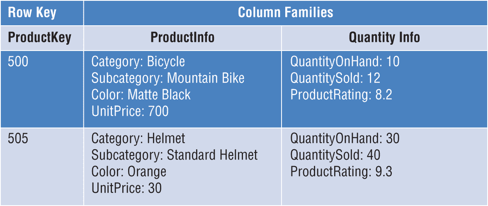

FIGURE 3.3 Columnar database

列式数据库通常用于分析场景。将数据分组为列族允许查询直接跳转到特定数据所在位置。这可以实现非常快速的聚合，因为查询不需要逐行跳转来查找属于聚合的一部分的字段。列族中的列也具有相同的数据类型，从而实现更好的数据压缩和更快的查询。

虽然列式数据库非常适合聚合数据的分析工作负载，但不太适合执行特定值查找的事务性工作负载。在这种情况下，以行格式存储数据的传统关系数据库性能更佳。将数据写入列式数据库也可能比在行式数据库中花费更多时间。虽然行式数据库中的新条目可以在一次操作中插入，但列式数据库会逐个将新条目写入每个列。

Azure 提供了几种不同的选项来实现列式数据库：

* Azure Cosmos DB Cassandra API

* Azure HDInsight 中的 HBase

本章将重点介绍 Azure Cosmos DB Cassandra API。如果您想了解有关 Azure HDInsight 中 HBase 的更多信息，可以在 `https://docs.microsoft.com/en-us/azure/hdinsight/hbase/apache-hbase-overview` 上找到更多信息。

# 图数据库

图数据库是专注于存储数据实体之间关系的专用数据库。图数据库中的实体存储为节点，而实体之间的关系称为边。节点和边可以包含特定于它们的属性，类似于关系数据库中的表。边也可以具有方向，以指示两个节点之间关系的性质。

使用图数据库的应用程序运行需要遍历节点和边网络、分析实体之间关系的查询。图 3.4 演示了一个存储组织人员架构信息的图数据库示例。实体代表不同的职位和部门，而边代表不同员工的汇报结构。

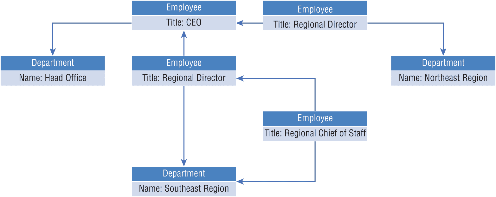


图 3.4 图数据库

图数据库最适合用于询问诸如“查找所有直接向 CEO 汇报的员工”之类问题的解决方案。查询包含大量节点和边的大型图（例如社交媒体网络）的应用程序可以非常快速地执行复杂分析。虽然关系数据库可用于存储与图数据库相同的数据，但为图数据库编写的查询可以绕过关系数据库中需要考虑的任何联接操作或子查询。

图数据库可以使用 Azure Cosmos DB Gremlin API 在 Azure 中实现。

## Azure Cosmos DB

`Azure Cosmos DB` 是一种多模型 PaaS NoSQL 数据库管理系统。`Multi-model` 表示组织可以使用 Azure Cosmos DB 构建键值、文档、列式和图数据存储。不同的类别作为数据库 API 提供，包括表 API、Core (SQL) API、API for MongoDB、Cassandra API 和 Gremlin API。用户在部署 Azure Cosmos DB 实例时可以选择其中一个 API。

Azure Cosmos DB 的最高管理级别是数据库帐户。目前，在 Azure 订阅中最多允许拥有 50 个 Azure Cosmos DB 帐户，但可以通过在 Azure 门户中提交支持票证来增加此数量。每个数据库帐户可以拥有一个或多个数据库（在使用 Azure Cosmos DB Cassandra API 时称为键空间），这些数据库作为一组容器的管理单元。

容器是吞吐量和存储的基本可缩放单元。正是在此级别，数据被分区并跨多个区域复制。用户还可以在容器内注册存储过程、用户定义的函数、触发器和合并过程。容器根据部署的 NoSQL 数据库类型使用不同的名称标识。表 3.1 列出了每个 Azure Cosmos DB API 使用的命名约定。

表 3.1 Azure Cosmos DB API 特定的容器名称

| API || 容器命名约定 |

| --- | --- |

| 表 API || 表 |

| --- | --- |

| Core (SQL) API || 容器 |

| Cassandra API || 表 |

| API for MongoDB || 集合 |

| Gremlin API || 图 |

存储在容器中的数据会根据分区键自动分组到逻辑分区，并分布到物理分区。`分区键` 是用于高效分组吞吐量和相关数据的指定数据字段。除了选择适当的分区键之外，分区管理由 Azure Cosmos DB 在内部处理。

存储在数据库容器中的单个数据记录称为 `项`。当 Azure Cosmos DB 分区数据时，它会将具有相同分区键值的项分组到同一逻辑分区中。项在添加到容器时会自动编入索引。索引行为也可以通过配置容器上的索引策略来自定义。与容器一样，项根据部署的 NoSQL 数据库类型使用不同的名称标识。表 3.2 列出了每个 Azure Cosmos DB API 使用的命名约定。

表 3.2 Azure Cosmos DB API 特定的项名称

| API || 项命名约定 |

| --- | --- |

| 表 API || 实体 |

| --- | --- |

| Core (SQL) API || 项 |

| Cassandra API || 行 |

| API for MongoDB || 文档 |

| Gremlin API || 节点或边 |

Azure Cosmos DB 确保数据高度可用，无论使用哪个 API。事实上，Azure Cosmos DB 在部署到单个区域时保证 99.99% 的高可用性，在部署到多个区域时保证 99.999% 的高可用性。读取和写入也保证在跨区域复制数据的任何位置在 10 毫秒内完成。以下部分将重点介绍如何在介绍不同数据库 API 之前优化 Azure Cosmos DB 的性能和可用性。

# 高可用性

高可用性是 Azure Cosmos DB 的基础组件。Azure Cosmos DB 中的 `全球分布` 允许用户通过将一个或多个其他区域关联到 Azure Cosmos DB 帐户，轻松将数据复制到多个区域。添加新区域可以通过 Azure 门户或以编程方式完成。

新区域可以配置为只读，或允许读取和写入。可以将只读工作负载（例如报告应用程序生成的工作负载）卸载到只读副本，从而提高这些工作负载和执行写入操作的工作负载的性能。建议配置至少两个不同的区域以允许写入，以防发生区域故障。这保证了如果主区域宕机，写入操作将自动路由到另一个区域。

除了全球分布之外，Azure Cosmos DB 在每个区域内维护四个数据副本。例如，如果你定义 Azure Cosmos DB 帐户使用两个区域，那么将维护八个数据副本。通过启用可用性区域支持，也可以保证区域内的数据复原能力。可用性区域确保副本放置在给定区域的不同区域中，从而保护数据免受区域内区域故障的影响。

## 一致性级别

分布式数据库（例如 Azure Cosmos DB）在不同区域管理多个写入副本时，需要在数据一致性、可用性和性能之间进行权衡。使用强一致性模型会导致应用程序读取最新数据，但可能会导致性能变慢，因为数据必须复制并提交到每个关联区域，然后应用程序才能读取数据。虽然最终一致性提供了更好的性能，但读取数据的应用程序可能会返回脏数据的风险。

Azure Cosmos DB 提供五个定义明确的 `一致性级别` 来平衡一致性、可用性和性能之间的权衡。以下列表描述了每个一致性级别，从最严格的一致性级别开始，到最宽松的一致性级别结束：

*   `Strong`—此一致性级别保证读取返回数据的最新版本，无论应用程序从哪个区域读取数据。可能会出现性能变慢的情况，因为应用程序连接可能会在事务提交到每个关联区域之前出现延迟。

*   `Bounded staleness`—使用此一致性级别时，从数据写入的同一区域读取数据的应用程序使用强一致性。对于从数据写入区域之外的区域读取数据的应用程序，数据有一个设定的“过期窗口”。这意味着数据会异步提交到 Azure Cosmos DB 帐户中的其他关联区域。过期窗口可以通过以下两种方式之一配置：

    *   记录的版本数量

    *   写入之间的设定时间间隔 只要达到这两个限制中的任何一个，连接就会暂停，数据会提交到外部区域。Bounded staleness 是需要低写入延迟和保证本地一致性的应用程序的不错选择。

*   `Session`—这是单区域和全球分布式帐户最广泛使用的一致性级别。它向写入数据的应用程序授予会话令牌，并保证它以及共享相同会话令牌的任何其他应用程序都能看到数据的最新版本。所有其他读取都使用最终一致性。


*   `Consistent prefix`—数据最终会跨区域复制，但此级别不提供任何关于数据复制所需时间的保证。但是，它确实保证读取数据的应用程序会按顺序读取数据。例如，如果应用程序按顺序将记录 100、101 和 102 写入数据库，那么读取数据的应用程序将看到 100、`[100, 101]`、`[101, 102]` 或 `[100, 101, 102]`，但绝不会看到 `[100, 102]` 之类的乱序组合。

*   `Eventual`—与一致前缀一致性级别非常相似，最终一致性保证数据最终会跨区域复制，但不提供任何关于数据复制所需时间的保证。同样，也没有保证数据不会按乱序复制。虽然它在读写延迟方面是性能最好的一致性级别，但也是最不可能保证一致性的级别。

会话一致性是 Azure Cosmos DB 的默认一致性级别。你可以在 Azure 门户或通过部署脚本使用滑动条将一致性更改为更一致或更高性能。

## 请求单位

与 Azure 中的任何 PaaS 产品一样，Azure Cosmos DB 将计算资源与最终用户分离。相反，CPU、IOPS 和内存等资源被捆绑为称为请求单位的计量单位。

`Request Units (RUs)` 表示在 Azure Cosmos DB 中读取和写入数据所需的吞吐量。一个经验法则是，读取和写入 1 KB 项目的成本分别约为 1 RU 和 5 RU。无论你正在与哪种类型的 Azure Cosmos DB API 交互，此规则均适用。当然，给定查询所需的 RU 数量将基于读取或写入的数据量、数据索引的完善程度、一致性模型选择以及查询的复杂性而有所变化。有关 RU 注意事项的更多信息可在 `https://docs.microsoft.com/en-us/azure/cosmos-db/request-units#request-unit-considerations` 中找到。

由于 RU 使用量按秒计量，吞吐量是使用每秒请求单位 (RU/s) 设置的。吞吐量的计费方式取决于 Azure Cosmos DB 帐户上 RU/s 计量的配置方式。这些包括预配吞吐量、自动缩放和无服务器。

## 预配

Azure Cosmos DB 允许用户手动增加或减少 RU/s 的数量。使用此选项，用户可以通过 Azure 门户或使用 .NET 或 Java SDK 以编程方式在数据库级别和容器级别分配 RU/s。可为容器或数据库分配的最小吞吐量为 400 RU/s。

Azure Cosmos DB 数据库上的预配吞吐量在数据库中的所有容器之间共享。这意味着所有容器共享分配给数据库的计算资源。还有一个选项可以将吞吐量专用于特定容器。例如，假设你创建了一个包含五个容器的数据库，其中一个容器需要专用吞吐量。在预配此容器时，你可以启用 `Provision dedicated throughput for your container` 选项以显式分配 RU/s 给容器。其余容器将共享分配给数据库的吞吐量。

关于预配吞吐量的 400 RU/s 最小值有几点注意事项。实际最小值通常是以下各项中的最大值：

*   400 RU/s

*   每添加 1 GB 存储空间 10 RU/s

*   先前预配的最高 RU/s 除以 100

例如，如果向新容器添加了 50 GB 数据，则该容器的最小 RU/s 为 500 RU/s。

首次部署数据库时，预配吞吐量很难计算。了解你将存储多少数据、需要多少个容器以及哪种类型的查询将与数据库交互非常重要。可在 `https://cosmos.azure.com/capacitycalculator` 找到一个用于估算吞吐量和吞吐量成本的有用工具。计算器使用区域数量、是否有其他写入区域、存储的数据量以及每秒的创建、读取和删除操作数量等参数来估算所需的 RU/s 数量以及工作负载的成本。

## 自动缩放

自动缩放是预配吞吐量的一个版本，它授予 Azure Cosmos DB 自动缩放数据库或容器吞吐量的能力。启用后，用户可以设置数据库或容器可以缩放到的最大 RU/s 数量。然后，吞吐量将基于使用情况进行缩放，而不会影响任何现有工作负载的性能。

自动缩放的典型用例包括使用情况不一致或不频繁的工作负载，以及用户不确定应预配多少吞吐量的新应用程序。自动缩放是大多数工作负载的简单、经济高效的解决方案，同时仍提供高可用性。

## 无服务器

无服务器模式不要求用户在 Azure Cosmos DB 中创建数据库或容器时预配吞吐量。相反，Azure Cosmos DB 为工作负载管理吞吐量，并在计费周期结束时向用户收取该期间消耗的 RU/s 数量的费用。

最适合无服务器的场景包括那些你预期工作负载流量不可预测且有长时间停机的场景。这些包括开发、测试和原型设计场景，其流量模式未知，以及活动高度随机的应用程序。

## Azure Cosmos DB API

Azure Cosmos DB 提供多个数据库 API 来创建不同类型的 NoSQL 数据库，包括以下选项：

*   用于键值存储的 Table API

*   用于文档数据库的 Core (SQL) API

*   用于文档数据库的 API for MongoDB

*   用于列式数据库的 Cassandra API

*   用于图形数据库的 Gremlin API

用户在首次创建 Azure Cosmos DB 帐户时需要选择一个 API。选择最合适的 API 完全取决于该 Azure Cosmos DB 实例将支持的解决方案。以下部分将讨论每个 API 及其使用时机。

## Table API

Azure Cosmos DB Table API 是基于 Azure 表存储的键值存储。差异主要集中在 Azure Cosmos DB 服务固有的功能上，例如更高的性能和可用性、全球分布、自动辅助索引以及更多配置吞吐量的选项。但是，了解 Azure 表存储的核心组件对于了解如何使用 Azure Cosmos DB Table API 实现键值存储非常重要。

`Azure Table storage` 是一个键值存储，用于存储非关系型结构化数据。Azure 表存储中的容器表示为 `tables`，可以在 Azure 存储帐户中创建。数据以 `entities` 的集合形式存储在表中，类似于关系数据库中的行。实体中的单个数据字段表示为 `properties`。Properties 类似于关系数据库中的列。

尽管术语可能将 Azure 表存储呈现为关系数据存储，但事实远非如此。表不对实体强制执行架构，允许实体具有不同的属性集。但是，必须遵守一些实体条件。首先，每个实体都必须包含一组系统属性，用于指定分区键、行键和时间戳。其次，还有一个 255 个属性的限制，包括之前提到的三个系统属性。


# Azure 表存储的典型用例

Azure 表存储的典型用例包括为 Web 应用程序缓存用户数据、通讯录、设备信息或其他类型的元数据。使用 .NET、Java、Python、Node.js 或 Go 编写的应用程序可以使用这些语言的 Azure SDK 与 Azure 表存储进行交互。可以使用所有语言的 OData 以及 .NET 应用程序的 LINQ 查询来访问数据。

# 迁移到 Azure Cosmos DB 表 API

Azure 中的表存储服务正从 Azure 存储迁移到 Azure Cosmos DB，以克服延迟、缩放、吞吐量、可用性和查询性能方面的现有限制。请记住，Azure Cosmos DB 表 API 和 Azure 表存储与 Azure 表存储共享相同的数据模型，并通过其 SDK 公开相同的查询操作。出于此原因，为 Azure 表存储编写的应用程序可以轻松迁移到 Azure Cosmos DB 表 API，只需进行最少的代码更改。

表 3.3 包含从 Azure 表存储迁移到 Azure Cosmos DB 表 API 可以获得的一些主要优势列表。

TABLE 3.3 Azure 表存储 vs. Azure Cosmos DB 表 API

| 功能 | Azure 表存储 | Azure Cosmos DB 表 API |
| --- | --- | --- |
| 最大实体大小 | 1 MB | 2 MB |
| 延迟 | 快速，但延迟没有上限。 | 读取和写入在 99 百分位的延迟小于 10 毫秒，适用于世界任何地方。 |
| 吞吐量 | 可变吞吐量模型。 | 具有预配、自动缩放和无服务器吞吐量选项的高度可扩展性。 |
| 全球分布 | 单个区域和一个可选的辅助读取区域。 | 支持世界任何地方的多区域写入和读取，随时自动和手动故障转移。 |
| 一致性 | 主区域内强一致，辅助区域最终一致。 | 五个定义明确的一致性级别。 |

更多优势可以在 `https://docs.microsoft.com/en-us/azure/cosmos-db/table/introduction#table-offerings` 中找到。

# Core (SQL) API

Azure Cosmos DB Core (SQL) API 是一个文档数据库服务，也是 Azure Cosmos DB 的默认 API。正如其名称所暗示的那样，Core (SQL) API 是在 Azure Cosmos DB 中处理 NoSQL 数据的核心或原生 API。此 API 推荐用于需要高性能和全球分布的新应用程序，以及从其他 NoSQL 数据库平台迁移到 Azure 的情况。Core (SQL) API 也是需要 NoSQL 数据库优势的关系数据库的推荐迁移选项。

Core (SQL) API 的数据模型使用默认的资源层次结构，其中一个帐户托管一个或多个数据库，一个数据库托管一组容器，一个容器将数据作为项目存储。项目格式化为 JSON 文档，并可以使用 SQL 进行交互。

Core (SQL) API 使用的 SQL 语法与 T-SQL 非常相似，并带有一些专门用于与 JSON 数据交互的附加功能。例如，查询 Azure Cosmos DB Core (SQL) API 帐户中数据库的 Persons 容器的应用程序可能希望检索存储在以下 JSON 文档中的用户信息：

```
{
    "firstname": "John",
    "lastname": "Smith",
    "age": 23,
    "favoriteSports": {
        "mostFavorite": "Basketball",
        "secondFavorite": "Baseball"
    },
    "id": "de5760d6-64fd-4dc3-8cb9-cc914ee860b0",
}
```

该应用程序可以使用以下 SQL 查询来返回用户的名字和他们最喜欢的运动：

```
SELECT p.firstname, p.favoriteSports.mostFavorite
FROM Persons AS p
WHERE p.id = 'de5760d6-64fd-4dc3-8cb9-cc914ee860b0'
```

查询的结果是：

```
[
    {
        "firstname": "John",
        "mostFavorite": "Basketball"
    }
]
```

除了 SQL，Core (SQL) API 还支持用 JavaScript 编写的用户定义函数和存储过程。

# API for MongoDB

MongoDB 是一个流行的文档数据库平台，将数据项存储为二进制 JSON (BSON) 文档。希望利用 Azure Cosmos DB 提供的可扩展性、性能、高可用性和易于维护，而又不更改任何现有代码的组织，可以通过将其 MongoDB 数据库迁移到 Azure Cosmos DB API for MongoDB 来实现这一点。

可以使用 mongodump、mongorestore 或 Azure 原生 Azure 数据库迁移服务等工具将数据迁移到 API for MongoDB。数据迁移到 Azure 后，组织可以通过仅更改连接字符串来继续使用其现有的 MongoDB 应用程序。原生于 MongoDB 的工具，如 MongoDB shell 和 MongoDB Compass，可以与托管在 API for MongoDB 上的数据库进行交互，就像它们与本地数据中心中托管的 MongoDB 一样。

Azure Cosmos DB API for MongoDB 与 MongoDB 服务器版本 4.0、3.6 和 3.2 兼容。有关迁移到 Azure Cosmos DB API for MongoDB 和估算吞吐量的更多信息，可以在 `https://docs.microsoft.com/en-us/azure/cosmos-db/mongodb/mongodb-introduction` 中找到。

# Cassandra API

Apache Cassandra 是一个流行的列式数据库，使用面向列的架构存储大量数据。就像 MongoDB 和 Azure Cosmos DB API for MongoDB 一样，组织可以将其现有的 Cassandra 工作负载迁移到 Azure Cosmos DB Cassandra API，以利用 Azure Cosmos DB 提供的高级功能。

用户可以使用 Cassandra 查询语言 (CQL) 和 CQL shell (cqlsh) 等工具查询存储在 Cassandra API 中的数据。应用程序也可以继续使用现有的 Cassandra 客户端驱动程序与托管在 Cassandra API 上的 Cassandra 数据库进行交互。

# Gremlin API

Azure Cosmos DB Gremlin API 使用 Apache Tinkerpop 图形框架在 Azure Cosmos DB 中提供图形数据库接口。它允许组织管理现有和新的图形数据库应用程序，而无需担心基础设施、吞吐量和可用性等开销。

虽然数据像 Core (SQL) API 一样存储为 JSON 文档，但 Gremlin API 使数据能够使用图形查询进行查询。应用程序可以使用 Gremlin 查询语言查询托管在 Gremlin API 上的数据库。有关 Gremlin 查询语言及其用于查询存储在 Azure Cosmos DB Gremlin API 中的数据的更多信息，可以在 `https://docs.microsoft.com/en-us/azure/cosmos-db/graph/tutorial-query-graph` 中找到。

## Azure Cosmos DB 的管理任务

就像 Azure 中的关系 PaaS 数据库一样，有几个管理任务必须为 Azure Cosmos DB 考虑。这些任务包括部署 Azure Cosmos DB 实例、配置吞吐量和全球分布、将现有本地工作负载迁移到 Azure Cosmos DB，以及维护数据安全性。以下部分将详细讨论这些任务，以及使用 Azure Cosmos DB 时如何排查常见的连接问题。

## 部署选项

Azure Cosmos DB 实例可以使用多种方法部署到 Azure 订阅。用户可以通过 Azure 门户手动配置其 Azure Cosmos DB 环境所需的必要要求，或使用不同的脚本语言自动化部署。如 第 2 章 中所述，Azure PowerShell、Azure CLI 和 ARM 模板是自动化 Azure 资源部署的一些最常见方法。让我们在以下部分讨论如何使用这些不同的选项来配置和部署 Azure Cosmos DB。

## Azure 门户

使用以下步骤通过 Azure 门户创建 Azure Cosmos DB 帐户：

1. 登录到 `portal.azure.com` 并在页面顶部的搜索栏中搜索 `Azure Cosmos DB`。单击 `Azure Cosmos DB` 以转到 Azure 门户中的 Azure Cosmos DB 页面。


## 2. 单击“创建”以开始选择 Azure Cosmos DB 帐户的配置选项。

## 3. 选择 API

创建 Azure Cosmos DB 帐户的首要要求是选择最适合其将要服务的工作负载的 API。“选择 API”选项页面允许你从五个 API 中进行选择。图 3.5 是该页面的屏幕截图。就本示例而言，我们将选择 `Core (SQL)` API。

## 4. 配置“基本信息”选项卡

“创建 Azure Cosmos DB 帐户”页面包含六个选项卡，具有不同的配置选项，可根据你的需求定制 Azure Cosmos DB 帐户。让我们先探索“基本信息”选项卡中可用的选项。除了下面描述每个选项的列表外，你还可以在 图 3.6 中查看该选项卡的完成示例。

1. 选择将包含 Azure Cosmos DB 帐户的订阅和资源组。如果你尚未创建资源组，可以在此页面上创建一个新资源组。

2. 为 Azure Cosmos DB 帐户输入名称。

   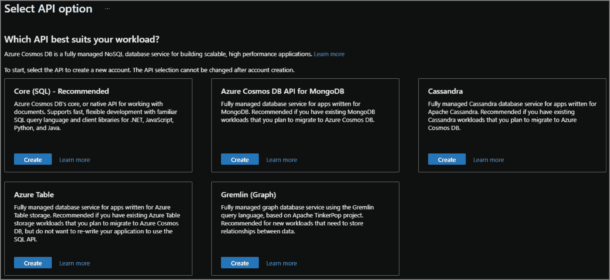

   图 3.5 选择 Azure Cosmos DB API。

3. 为帐户选择主要 Azure 区域。

4. 选择是要为 Azure Cosmos DB 预配吞吐量，还是让 Azure Cosmos DB 使用无服务器来管理吞吐量。

5. 最后一个选项允许你选择是否要将免费层折扣应用于此 Azure Cosmos DB 帐户。这样你就可以在帐户中免费获得前 1000 RU/s 和 25 GB 存储空间。每个订阅只能为一个帐户启用此选项。

   

   图 3.6 创建 Azure Cosmos DB 帐户：“基本信息”选项卡。

## 5. 配置“全局分发”选项卡

“全局分发”选项卡允许你为帐户启用异地冗余、多区域写入和可用性区域。这些选项也可以在部署后进行配置。

## 6. 配置“网络”选项卡

“网络”选项卡允许你为 Azure Cosmos DB 帐户配置网络访问和连接。网络配置有三个选项可供选择：`All networks`、`Public endpoint (selected network)` 和 `Private endpoint`。

1. `All networks` 允许来自任何网络的应用程序访问帐户。此选项将网络隔离作为数据安全组件从 Azure Cosmos DB 配置中删除。

2. `Public endpoint (selected network)` 将 Azure Cosmos DB 配置为使用防火墙，仅允许来自特定 IP 地址的访问。这包括来自 Azure 门户、创建 Azure Cosmos DB 帐户的计算机的 IP 地址，以及 Azure VNet 中一个或多个子网中的 IP 地址的访问。图 3.7 说明了此配置的示例。

3. `Private endpoint` 将 Azure VNet 中的 IP 地址附加到 Azure Cosmos DB 帐户，限制只能与 VNet 通信的应用程序访问。此选项还允许你从 Azure 门户和创建 Azure Cosmos DB 帐户的计算机的 IP 地址启用对帐户的访问。

   

   图 3.7 创建 Azure Cosmos DB 帐户：“网络”选项卡。

## 7. 配置“备份策略”选项卡

“备份策略”选项卡允许你为存储在此 Azure Cosmos DB 帐户中的数据选择 `Periodic` 或 `Continuous` 备份策略。`Periodic` 设置允许你设置数据备份的时间间隔、保留率和区域冗余。`Continuous` 设置将在帐户发生更改后 100 秒内自动备份数据，包括对数据库、容器和项所做的更改。图 3.8 说明了 `Periodic` 备份策略配置的示例。

   

   图 3.8 创建 Azure Cosmos DB 帐户：“备份策略”选项卡。

## 8. 配置“加密”选项卡

“加密”选项卡允许你选择数据加密是使用由 Azure 生成和管理的密钥，还是使用存储在 Azure Key Vault 中的自定义密钥。

## 9. 配置“标记”选项卡

“标记”选项卡允许你为 Azure Cosmos DB 帐户添加标记以进行成本管理。

## 10. 审阅 + 创建

最后，“审阅 + 创建”选项卡允许你审阅设计过程中所做的配置选择。如果你对为实例所做的选择感到满意，请单击“创建”按钮以开始预配 Azure Cosmos DB 帐户。

## 配置数据库和容器

部署 Azure Cosmos DB 帐户后，你可以开始添加数据库和容器来存储数据。你可以使用 Azure PowerShell、Azure CLI 和基础结构即代码模板添加这些对象。还有可用于构建 Azure Cosmos DB 对象的 .NET、Java、Node.js、Python 和 Xamarin SDK。就 DP-900 考试而言，让我们专注于使用 Azure 门户中的以下步骤配置这些对象：

1. 转到 Azure 门户中的 Azure Cosmos DB 页面，然后单击你最近创建的 Azure Cosmos DB 帐户。

2. 在 Azure Cosmos DB 边栏选项卡的左侧面板中，单击“数据资源管理器”。图 3.9 显示了此按钮的位置。

3. 数据资源管理器提供了一个基于 Web 的界面，用于与 Azure Cosmos DB 中的数据库、容器和项进行交互。欢迎页显示该帐户中的所有对象和数据，以及创建新任务（例如新数据库）的一些快速链接。可以在 图 3.10 中查看此页面。

4. 若要创建新数据库，请在“常见任务”下单击“新建数据库”。“新建数据库”页面为你提供了使用自动缩放或手动选项预配吞吐量的选项，以及如果使用手动选项所需的 RU/s 数量，或者如果使用自动缩放选项所需的最大数据库 RU/s 数量。图 3.11 是使用自动缩放选项且最大 RU/s 分配为 4000 的新数据库示例。

   

   图 3.9 Azure Cosmos DB 数据资源管理器按钮

   

   图 3.10 Azure Cosmos DB 数据资源管理器欢迎页

5. 若要为该数据库创建新容器，可以单击数据资源管理器页面左上角的“新建容器”按钮，也可以单击数据库名称旁边的省略号并选择 `New Container`。

6. “新建容器”页面为你提供了多个配置容器的选项。除了选择将托管容器的数据库外，你还可以为容器命名并设置分区键。此页面还允许你设置容器是使用专用吞吐量还是共享吞吐量。选中“为该容器预配专用吞吐量”复选框后，将为容器预配专用吞吐量。否则，容器将与数据库托管的其他容器共享吞吐量。图 3.12 显示了使用专用吞吐量的容器的配置。

7. 从此处，你可以开始通过数据资源管理器或应用程序向容器添加新项。

   

   图 3.11 新建数据库

   

   图 3.12 新建容器

## 配置全局分发

可以将其他区域添加到 Azure Cosmos DB 帐户，以便为高可用性目的复制数据。可以通过 Azure 门户使用以下步骤完成此操作：


1. 单击 Azure Cosmos DB 边栏左侧面板 `Settings` 下的 `Replicate Data Globally` 按钮。

2. 从该页面，您可以通过在世界地图上单击区域或单击 `Add Region` 并在下拉列表中选择一个区域来添加区域。您也可以选择使用 `Add Region` 按钮添加新的写入区域。图 3.13 说明了如何添加新的写入区域副本。


FIGURE 3.13 Adding a new write region replica

## 配置一致性

Azure 门户允许您将一致性级别从默认的会话一致性更改为其他级别。只需单击左侧面板 `Settings` 下的 `Default Consistency` 按钮，然后选择新的默认一致性级别即可。

如果您选择有界过期一致性级别，则将获得配置最大延迟时间和最大延迟操作的选项。图 3.14 说明了如何通过 `Default Consistency` 页面将默认一致性更改为有界过期。


FIGURE 3.14 Updating the default consistency to bounded staleness

## Azure PowerShell

与 Azure 中的关系数据库一样，您可以使用 Azure PowerShell 创建和管理 Azure Cosmos DB 的所有组件。以下 PowerShell 脚本可以在 Azure Cloud Shell 或 PowerShell 窗口中运行，以创建新的 Azure Cosmos DB 帐户：

```
<# 
Sign into your Azure environment. Not required 
if running this script in the Azure Cloud Shell
#>
Connect-AzAccount
 
<#
Set the parameters needed to create the account 
such as the resource group name, account name, 
API type, consistency level, and replica locations
#>
$resourceGroupName = "dp900cosmos001"
$accountName = "dp900cosmos001"
$apiKind = "Sql"
$consistencyLevel = "Session"
$locations = @()
$locations += New-AzCosmosDBLocationObject `
-LocationName "East US" -FailoverPriority 0 -IsZoneRedundant 0
$locations += New-AzCosmosDBLocationObject `
-LocationName "West US" -FailoverPriority 1 -IsZoneRedundant 0
 
#Create the account
New-AzCosmosDBAccount `
    -ResourceGroupName $resourceGroupName `
    -LocationObject $locations `
    -Name $accountName `
    -ApiKind $apiKind `
    -EnableAutomaticFailover: $true `
    -DefaultConsistencyLevel $consistencyLevel
```

此脚本包含一些用于定义帐户的关键参数：

*   `$resourceGroupName`—Azure Cosmos DB 帐户将部署到的资源组。资源组必须已存在。

*   `$accountName`—帐户的名称。

*   `$apiKind`—将用于帐户的 Azure Cosmos DB API。

*   `$consistencyLevel`—帐户的默认一致性级别。

*   `$locations`—帐户的副本区域。`FailoverPriority` 设置为 0 的区域是写入区域。

Azure PowerShell 还可用于创建 Azure Cosmos DB 数据库和容器。以下脚本用于在新创建的帐户中创建一个吞吐量为 4000 RU/s 的新数据库，以及一个吞吐量为 400 RU/s 的容器：

```
$resourceGroupName = "dp900cosmos001"
$accountName = "dp900cosmos001"
$databaseName = "dp900cosmosdb01"
$containerName = "dp900cosmoscontainer01"
$partitionKey = "/Id"
$databaseThroughput = 4000
$containerThroughput = 400
 
New-AzCosmosDBSqlDatabase `
    -ResourceGroupName $resourceGroupName `
    -AccountName $accountName `
    -Name $databaseName `
    -Throughput $databaseThroughput
 
New-AzCosmosDBSqlContainer `
    -ResourceGroupName $resourceGroupName `
    -AccountName $accountName `
    -DatabaseName $databaseName `
    -Name $containerName `
    -PartitionKeyKind Hash `
    -PartitionKeyPath $partitionKeyPath `
    -Throughput $containerThroughput
```

有关使用 Azure PowerShell 创建和管理 Azure Cosmos DB 对象的更多信息，请参阅 `https://docs.microsoft.com/en-us/azure/cosmos-db/sql/manage-with-powershell`。

## Azure CLI

Azure CLI 是通过脚本语言创建和管理 Azure Cosmos DB 组件的 Azure PowerShell 替代方案。以下 Azure CLI 脚本可以在 Azure Cloud Shell、PowerShell 窗口或命令提示符中运行，以创建新的 Azure Cosmos DB 帐户、数据库和容器。此脚本使用与上一节中 Azure PowerShell 脚本相同的参数：

```
resourceGroupName='dp900cosmos001'
accountName='dp900cosmos001'
databaseName='dp900cosmosdb01'
containerName='dp900cosmoscontainer01'
partitionKey='/Id'
dbThroughput=4000
containerThroughput=400
 
az cosmosdb create \
    -n $accountName \
    -g $resourceGroupName \
    --default-consistency-level Session \
    --locations regionName='West US 2' \
        failoverPriority=0 isZoneRedundant=False \
    --locations regionName='East US 2' 
        failoverPriority=1 isZoneRedundant=False \
 
az cosmosdb sql database create \
    -a $accountName \
    -g $resourceGroupName \
    -n $databaseName \
    --throughput $dbThroughput
 
az cosmosdb sql container create \
    -a $accountName -g $resourceGroupName \
    -d $databaseName -n $containerName \
    -p $partitionKey --throughput $containerThroughput
```

有关使用 Azure CLI 创建和管理 Azure Cosmos DB 对象的更多信息，请参阅 `https://docs.microsoft.com/en-us/azure/cosmos-db/sql/manage-with-cli`。

## ARM 模板

如 第 2 章 中所述，ARM 模板可用于定义 Azure 部署的资源和配置要求。这些模板可用于自动化 Azure Cosmos DB 的新部署，以及不同开发环境中 Azure Cosmos DB 的配置更改。

可在 `https://docs.microsoft.com/en-us/azure/cosmos-db/sql/quick-create-template?tabs=CLI` 处找到创建 Azure Cosmos DB 帐户、数据库和容器的 ARM 模板示例。该脚本可以通过单击链接中的 `Deploy To Azure` 按钮并输入所需参数来部署，也可以通过运行以下 Azure PowerShell 脚本来部署：

```
Connect-AzAccount
$resourceGroupName = "dp900cosmos001"
$location = "East US"
 
New-AzResourceGroup 
    -Name $resourceGroupName
    -Location $location
 
New-AzResourceGroupDeployment 
    -ResourceGroupName $resourceGroupName `
    -TemplateUri https://raw.githubusercontent.com/Azure
/azure-quickstart-templates/master/quickstarts
/microsoft.documentdb/cosmosdb-sql/azuredeploy.json
```

## Azure Cosmos DB 安全性

Azure Cosmos DB 的数据安全性在 Azure 中的多个级别实现。与存储在 Azure 中的关系数据库中的数据一样，对 Azure Cosmos DB 的未经授权的访问是通过网络隔离和身份管理来防止的。存储在 Azure Cosmos DB 中的数据也在静态和传输过程中加密，以保护数据免受恶意活动的影响。以下部分将更详细地探讨 Azure 用于保护存储在 Azure Cosmos DB 中的数据的方法。

## 网络隔离

在了解如何使用 Azure 门户部署帐户时，我们简要地研究了 Azure Cosmos DB 的两个网络隔离选项。这些选项包括以下内容：

*   使用 Azure Cosmos DB 防火墙设置基于 IP 的访问控制，以将通信限制为批准的 IP 地址集。还可以通过在子网上启用 Azure Cosmos DB 服务终结点来允许整个子网的访问，从而进一步实现此功能。

*   从 VNet 为 Azure Cosmos DB 帐户分配带有专用终结点的专用 IP 地址。这将限制仅允许可以与专用终结点关联的 VNet 通信的应用程序访问。


虽然可以开启 Azure Cosmos DB 以接受来自任何网络的请求，但需要考虑该设置可能带来的安全影响（如有）。安全要求通常不能仅通过实施访问管理和数据加密方法来满足。网络隔离是一项重要的设计考量，在构建使用 Azure Cosmos DB 的数据驱动型解决方案时应予以讨论。

## 访问管理

Azure Cosmos DB 提供三种控制数据访问的方法：基于密钥的访问控制、基于角色的访问控制（RBAC）和资源令牌。这些选项不仅将访问权限限制在应拥有访问权限的用户，还决定用户对数据库对象具有读写权限还是只读权限。以下部分对这些选项进行了概述。

# 基于密钥的访问控制

Azure Cosmos DB 提供用于读写访问的主密钥和辅助密钥，以及用于只读访问的主密钥和辅助密钥。密钥可访问 Azure Cosmos DB 账户中的所有资源。拥有主密钥和辅助密钥的目的是允许用户重新生成一个密钥，而无需任何停机时间。

虽然在向不同应用程序提供访问权限时密钥可能很有用，但管理起来可能比较麻烦。密钥还暴露的 Azure Cosmos DB 账户对象比大多数用户需要的更多。在大多数情况下，最好使用身份管理模型，向 Azure Active Directory (AAD) 或原生 Azure Cosmos DB 身份授予精细权限，用于数据库身份验证和授权。

## 基于角色的访问控制 (RBAC)

Azure 使组织能够使用 AAD 和 RBAC 角色集中管理身份。如 第 2 章 中所述，RBAC 角色用于控制对不同 Azure 服务的访问。RBAC 角色可以分配给 AAD 对象（称为身份），例如用户、组、服务主体和托管身份，使它们能够执行这些角色允许的任务。有几个特定于 Azure Cosmos DB 的 RBAC 角色可用于执行管理和数据操作操作。

首先，让我们来看看控制管理平面操作的 Azure Cosmos DB RBAC 角色。这些角色允许 AAD 身份管理 Azure Cosmos DB 账户对象、数据库备份和还原以及性能监控的创建/替换/删除操作。以下是支持管理操作的 Azure Cosmos DB RBAC 角色：

*   `DocumentDB Account Contributor` 角色可以管理 Azure Cosmos DB 账户。

*   `CosmosDB Account Reader` 角色可以读取 Azure Cosmos DB 账户数据。

*   `Cosmos Backup Operator` 角色可以为启用定期备份的数据库或容器提交还原请求。它可以通过 Azure 门户修改备份间隔和保留期。此角色无法访问任何数据或使用数据资源管理器。

*   `CosmosRestoreOperator` 角色可以使用连续备份模式为 Azure Cosmos DB 账户执行还原。

*   `Cosmos DB Operator` 角色可以预配 Azure Cosmos DB 账户、数据库和容器。它无法访问任何数据或使用数据资源管理器。

有关支持管理活动的 Azure Cosmos DB RBAC 角色的更多信息，请参阅 `https://docs.microsoft.com/en-us/azure/cosmos-db/role-based-access-control`。

下一组需要牢记的 Azure Cosmos DB RBAC 角色是支持数据平面操作的角色。这些角色允许 AAD 身份从数据库和容器中创建、读取、更新和删除数据。以下是用于管理数据平面操作的两个内置 Azure Cosmos DB RBAC 角色：

*   `Cosmos DB Built-in Data Reader` 角色可以读取账户元数据、特定项目（点读和查询）的数据以及特定容器的更改源。

*   `Cosmos DB Built-in Data Contributor` 角色可以读取账户元数据，并对特定容器和项目中的数据执行创建、读取和删除操作。

有关支持管理活动的 Azure Cosmos DB RBAC 角色的更多信息，请参阅 `https://docs.microsoft.com/en-us/azure/cosmos-db/how-to-setup-rbac`。

## 资源令牌

资源令牌允许对 Azure Cosmos DB 资源（例如容器、分区键、项目、存储过程、触发器和用户定义的函数）进行有限时间的访问。当用户被授予特定资源的权限时，这些令牌最初被创建，并且在预设的时间限制内有效。资源令牌的默认时间限制为一小时，最长可延长至五小时。当用户向 Azure Cosmos DB 发出 API 请求（`GET`、`PUT` 或 `POST`）时，资源令牌会被重新创建。

Azure Cosmos DB 数据库用户是身份构造，用于提供对数据库中特定对象的权限，类似于 Azure SQL 中的数据库包含用户。可以使用一组权限（也称为权限资源）向用户授予对数据库资源的不同访问级别。权限是与数据库用户关联的授权令牌，用于授权访问不同的数据库资源。权限资源为数据库资源提供以下访问级别：

*   `All`—此模式提供对资源的读取、写入和删除访问权限。

*   `Read`—此模式提供对资源的只读访问权限。

## 数据加密

Azure Cosmos DB 默认提供静态和传输中数据加密。没有开启或关闭加密的控件。Azure Cosmos DB 支持使用 TLS 版本 1.2 或更高版本进行传输中数据加密。存储在 Azure Cosmos DB 中的数据使用由 Microsoft 在幕后管理的密钥进行静态加密。组织还可以选择使用自己的密钥添加第二层加密。

## Azure Cosmos DB 常见连接问题

与任何数据存储服务一样，在与 Azure Cosmos DB 交互时偶尔会出现问题。这些问题通常与错误请求异常、未授权请求或禁止异常相关。以下部分包含常见的 Azure Cosmos DB 连接问题及其故障排除方法。

## 错误请求异常

返回 HTTP 400 状态代码的错误表示错误请求异常，其中应用程序请求包含无效数据或缺少所需参数。这些错误通常由以下问题引起：

*   `missing the ID property` 错误表示正在插入的 JSON 项目缺少所需的 ID 属性。将 ID 属性指定为带有字符串值的项目的一部分以解决此问题。

*   `invalid partition key type` 错误表示分区键值是无效的数据类型。请确保分区键是字符串或数值。

*   `wrong partition key value` 错误表示请求中传递的分区键值与容器中的项目值不匹配。例如，如果分区键路径为 `/Id`，则该项目有一个名为 Id 的字段，其值不包括查询中提供的值。要解决此问题，请确保查询中使用的值是有效的分区键值。

## 未授权请求

未授权请求由 401 HTTP 错误代码表示，当应用程序请求使用无效密钥执行操作时发生。以下是未授权请求的潜在原因列表：

*   密钥已重新生成，且使用该密钥的应用程序未遵循密钥轮换的最佳实践。可以通过将主密钥轮换到辅助密钥，然后重新生成主密钥来解决此问题。有关密钥重新生成和轮换的更多信息，请参阅 `https://docs.microsoft.com/en-us/azure/cosmos-db/secure-access-to-data?tabs=using-primary-key#key-rotation`。


密钥配置错误或未正确复制。只需重新复制主密钥或切换到辅助密钥即可解决此问题。

应用程序在尝试执行写入操作时使用的是只读密钥。如果应用程序应获授权以创建或删除数据，请将密钥切换为读写密钥。

应用程序尝试在容器创建完成之前访问该容器。这种情况通常发生在容器被删除，然后使用相同名称重新创建时。

## 禁止异常

当来自应用程序的数据平面请求的 IP 地址未被 Azure Cosmos DB 防火墙加入白名单，或无法与 Azure Cosmos DB 关联的 VNet 通信时，会发生禁止异常。这些异常由 403 状态代码表示。

此错误的解决方案取决于应用程序请求是否来自可以与 Azure Cosmos DB 通信的 IP 地址。它们还取决于帐户使用的网络隔离类型。如果应用程序请求来自预期路径，请使用以下建议：

*   如果 Azure Cosmos DB 帐户使用防火墙，请检查以确保请求的 IP 地址已在 Azure Cosmos 防火墙中加入白名单，或来自启用了 Azure Cosmos DB 服务终结点的子网。

*   如果 Azure Cosmos DB 帐户使用私有终结点，请确保请求的 IP 地址可以与私有终结点关联的 VNet 通信。

如果应用程序请求不是来自预期路径，则问题可能与应用程序端配置有关。请根据帐户使用的网络隔离类型，使用以下指南来排查问题：

*   如果应用程序请求预期应使用服务终结点，但改为使用公共 Internet，请检查应用程序 IP 地址所在的子网是否已启用 Azure Cosmos DB 服务终结点。

*   如果应用程序请求预期应通过私有终结点，但改为来自公共 Internet，请检查应用程序使用的 DNS 是否可以将帐户终结点解析为与私有终结点关联的私有 IP 地址。

## 管理工具

Azure 提供了两个 Azure Cosmos DB 管理工具，开发人员可以使用它们在将查询添加到应用程序之前编写和测试查询。Data Explorer 和 Azure Cosmos DB Explorer 为开发人员和管理员提供了创建新资源和管理现有资源的能力，以及优化吞吐量的成本性能比。以下部分将详细介绍每个工具。

## Data Explorer

Data Explorer 是 Azure 门户中可用的开发环境，用于查询和管理 Azure Cosmos DB。它可以用于创建和删除数据库、容器、存储过程、用户定义函数和触发器等资源。开发人员可以使用查询窗口（类似于 SSMS 和 Azure Data Studio 中的窗口）来编写读取、写入或删除数据的 SQL 语句。

管理员也可以利用 Data Explorer 来管理 Azure Cosmos DB。诸如缩放吞吐量、修改索引策略和设置生存时间（TTL）周期等任务可以使用 Data Explorer 来处理。

## Azure Cosmos DB Explorer

Azure Cosmos DB Explorer 是 Data Explorer 工具的全屏扩展。它提供相同的功能，例如创建新帐户对象、编写查询和缩放吞吐量。但是，与 Data Explorer 不同，Azure Cosmos DB Explorer 可以在 Azure 门户之外使用。连接到 Azure Cosmos DB 帐户的用户只需要使用与帐户一起生成的读写密钥或只读密钥之一。这使管理员能够限制谁可以修改数据，同时仍为开发人员提供易于使用的开发环境。

使用以下步骤从 Azure 门户打开 Azure Cosmos DB Explorer：

1.  转到先前创建的 Azure Cosmos DB 帐户，然后单击 Data Explorer。

2.  单击 Data Explorer 边栏选项卡最右侧的“打开全屏”图标。图 3.15 显示了可以找到此图标的位置。

    

    FIGURE 3.15 Azure Cosmos DB Explorer Open Full Screen icon

3.  单击此图标后，您将看到两个 URL 选项：`Read and Write` 和 `Read Only`。您可以复制其中一个链接，或单击“打开”按钮在单独的浏览器选项卡中打开 Azure Cosmos DB Explorer。图 3.16 说明了此弹出页面的外观。

    

    FIGURE 3.16 Azure Cosmos DB Explorer pop-up screen

4.  打开 Azure Cosmos DB Explorer 后，您将看到与 Data Explorer 相同的界面。

## 摘要

本章介绍了 NoSQL 数据库，包括键值、文档、列式和图数据库。虽然它们专注于不同的场景，但确实共享一些共同特征。这些特征包括 ACID 原则的模糊实现、灵活的架构设计以及水平扩展的能力。

Azure Cosmos DB 是一个完全托管、高可用的 PaaS NoSQL 数据库，为每种类型的 NoSQL 数据存储提供多个数据库 API，包括 Azure Cosmos DB 表 API、Azure Cosmos DB Core (SQL) API、Azure Cosmos DB API for MongoDB、Azure Cosmos DB Cassandra API 和 Azure Cosmos DB Gremlin API。这些 API 中每个都至少提供 99.99% 的 SLA，并可以轻松复制到世界各地的不同区域。Azure Cosmos DB 允许用户从五个不同的一致性模型中进行选择，以平衡一致性、可用性和性能之间的权衡。

在 Azure Cosmos DB 中，计算以读取和写入数据所需的吞吐量来衡量。吞吐量表示为每秒请求单位（`RU/s`）。`RU/s` 可以在数据库和容器级别设置，方法是预配专用的 `RU/s` 数量，或设置数据库或容器可以缩放到的最大 `RU/s` 数量。还有一个无服务器选项，允许 Azure Cosmos DB 根据工作负载使用所需的任意数量的 `RU/s`。

就像 Azure 中的关系数据库一样，Azure Cosmos DB 可以在 Azure 门户中手动部署，也可以使用脚本或基础设施即代码模板进行自动化部署。存储在 Cosmos DB 中的数据也在多个层级上受到保护，原生加密静态数据和传输中的数据，并提供灵活的网络隔离和访问管理选项。

本章最后介绍了可用于管理和查询 Azure Cosmos DB 的两个主要管理工具：Data Explorer 和 Azure Cosmos DB Explorer。Data Explorer 可以在 Azure 门户中访问。Azure Cosmos DB Explorer 是一个独立的 Web 应用程序，提供与 Data Explorer 相同的选项和界面，通常由无权访问 Azure 门户的开发人员使用。

## 考试要点

*   描述 NoSQL 数据库的特征。由于近年来数据量在更快的速度下产生，NoSQL 数据库变得越来越流行。敏捷开发标准的出现和存储成本的降低也使软件开发人员能够更有能力使用提供更多动态存储选项的数据库平台。

    不同 NoSQL 数据库类别之间的共同特征包括架构灵活性、对 ACID 原则的模糊解释以及水平扩展的能力。


# 描述键值存储

键值存储是最简单的 NoSQL 数据库类型。每个条目包括一个数据值和一个唯一键。这些数据存储针对摄入大量必须快速存储和读取的数据进行了优化。Azure 提供了多种实现键值存储的选项，包括 Azure 表存储、Azure Cosmos DB 表 API 和 Azure Redis 缓存。

# 描述文档数据库

文档数据库与键值存储类似，每个条目包括一个带有数据值的唯一键。在 Azure 中实现文档数据库有两个可用选项：Azure Cosmos DB Core (SQL) API 和 Azure Cosmos DB API for MongoDB。

## 描述列式数据库

列式数据库像关系数据库一样按行和列组织数据，但将列分组为列族，以便数据保持非规范化。在 Azure 中实现列式数据库有两个可用选项：Azure Cosmos DB Cassandra API 和 Azure HDInsight 中的 HBase。

## 描述图数据库

图数据库是用于存储不同实体之间关系的专用数据库。图数据库可以使用 Azure Cosmos DB Gremlin API 在 Azure 中实现。

# 描述 Azure Cosmos DB

Azure Cosmos DB 是 Azure 中的 PaaS NoSQL 数据库，可用于构建键值、文档、列式和图数据存储。它具有高度恢复能力，为用户提供全球复制数据的功能。

Azure Cosmos DB 中最高级别的管理是帐户。一个帐户可以有一个或多个数据库，数据库作为一组容器的管理单元。容器是 Azure Cosmos DB 中最基本的可扩展性单元，存储用户定义的函数、存储过程和数据等数据库对象。数据被称为项，通过对选定的分区键运行哈希算法将其分布到多个分区中。

# 描述 Azure Cosmos DB 一致性级别

用户可以通过为其 Azure Cosmos DB 帐户选择五个一致性级别之一（强一致性、有限延迟、会话、一致前缀或最终一致性）来自定义读取一致性和性能之间的权衡。会话是 Azure Cosmos DB 的默认一致性级别，适用于大多数工作负载。

# 描述 Azure Cosmos DB 吞吐量

请求单位 (RU) 表示在 Azure Cosmos DB 中读取和写入数据所需的吞吐量。由于 RU 使用量按秒计量，吞吐量使用每秒请求单位 (RU/s) 进行设置。

用户可以在数据库级别和容器级别分配专用的 RU/s 数量，或提供 Azure Cosmos DB 可以自动缩放到的最大 RU/s 数量。他们还可以选择不预配吞吐量并使用无服务器模式，以便 Azure Cosmos DB 在无需用户干预的情况下管理 RU/s 使用量。

# 描述 Azure Cosmos DB API

Azure Cosmos DB 中有五个 API，允许用户在 Azure 中构建键值、文档、列式和图数据存储。它们包括 Azure Cosmos DB API、Azure Cosmos DB Core (SQL) API、Azure Cosmos DB API for MongoDB、Azure Cosmos DB Cassandra API 和 Azure Cosmos DB Gremlin API。

Azure Cosmos DB Core (SQL) API 是 Azure Cosmos DB 的原生 API，推荐用于需要高性能和全球分发的新应用程序，以及从其他数据库平台迁移到 Azure Cosmos DB 时使用。

# 描述 Azure 表存储

Azure 表存储是 Azure 中的键值存储，用于存储非关系型结构化数据。表可以在 Azure 存储帐户中创建，并可以托管一个或多个数据实体。请记住，分区键和行键构成表中每个实体的主键。

# 描述 Azure Cosmos DB 的部署选项

了解如何使用 Azure 门户、Azure PowerShell、Azure CLI 和 Azure PowerShell 部署 Azure Cosmos DB 非常重要。请记住，每个订阅可以为一个 Azure Cosmos DB 帐户使用免费层折扣，其中前 1000 RU/s 和 25 GB 存储空间免费。

跨多个开发环境管理部署的最佳方法是使用基础设施即代码模板对部署进行脚本编写。这可以是 ARM、Terraform 或 Bicep 模板。

# 描述如何保护 Azure Cosmos DB

就像 Azure 中的关系型数据库产品一样，Azure Cosmos DB 具有多层安全性。网络隔离可以通过在 Azure Cosmos DB 防火墙中列入 IP 地址或 VNet 白名单，或向帐户附加专用终结点来实现。请记住，虽然 Azure Cosmos DB 提供密钥，但通常更好的做是将 RBAC 角色分配给 AAD 身份，或使用原生 Azure Cosmos DB 用户的权限资源进行访问管理。

# 描述 Azure Cosmos DB 的管理工具

有两个管理工具可用于管理帐户资源、开发查询和处理管理任务：数据资源管理器和 Azure Cosmos DB 资源管理器。数据资源管理器可以在 Azure 门户中单击 Azure Cosmos DB 帐户后打开。Azure Cosmos DB 资源管理器是一个基于 Web 的工具，提供与数据资源管理器相同的功能。

## 复习问题

1. Azure 中以下哪些服务可用于构建键值存储？

    1. Azure 表存储

    2. Azure Cosmos DB

    3. Azure Redis 缓存

    4. 以上全部

2. 以下陈述中斜体部分是正确的，还是需要替换为下面出现的其他片段之一？“查询可以返回按键和数据字段过滤的数据，来自 *键值存储*。”

    1. 文档数据库

    2. 图数据库

    3. Azure 表存储

    4. 无需更改

3. 哪个资源是吞吐量和存储的基本可扩展性单元？

    1. 数据库

    2. 项

    3. 容器

    4. 帐户

4. 哪个一致性级别是 Azure Cosmos DB 的默认一致性级别？

    1. 会话

    2. 一致前缀

    3. 强一致性

    4. 有限延迟

5. 你正在设计一个 Azure 中的键值存储，用于存储电子商务网站的用户会话。所选数据存储必须能够允许向多个区域写入，以确保全球用户的低写入延迟。哪个 Azure 服务是此解决方案的最佳选择？

    1. Azure 表存储

    2. Azure Cosmos DB 图 API

    3. Azure Cosmos DB 表 API

    4. Azure 键值存储

6. 以下哪个 Azure Cosmos DB API 允许用户托管文档数据库？

    1. 表 API

    2. Cassandra API

    3. Gremlin API

    4. API for MongoDB

7. 以下陈述中斜体部分是正确的，还是需要替换为下面出现的其他片段之一？“如果对 Azure Cosmos DB 帐户应用免费层折扣，则该帐户使用的前 *100 RU/s 和 10 GB 存储空间* 是免费的。”

    1. 1000 RU/s 和 25 GB 存储空间

    2. 500 RU/s 和 10 GB 存储空间

    3. 2000 RU/s 和 25 GB 存储空间

    4. 无需更改

8. 以下哪个选项是跨多个环境管理 Azure Cosmos DB 部署的最佳方式？

    1. Azure PowerShell

    2. Azure CLI

    3. ARM 模板

    4. Azure 门户

9. 哪个 RBAC 角色可用于将 Azure Active Directory 身份的数据平面访问权限限制为只读？

    1. Cosmos DB 内置数据参与者

    2. CosmosDB 帐户读取者

    3. Cosmos DB 内置数据读取者

    4. DocumentDB 内置数据读取者


10. 你是一个 Azure Cosmos DB 账户的管理员，该账户由一个电子商务应用程序使用。你的经理要求你向一名应用程序开发人员提供只读访问权限，并推荐一个他们可以用来开发和测试正在添加到应用程序中的查询的工具。该开发人员无法访问 Azure 门户。你应该推荐以下哪个工具？

1. Azure Cosmos DB Explorer
2. Data Explorer
3. Azure Storage Explorer
4. Visual Studio Code

# 第 4 章

## 文件、对象和数据湖存储

上一章探讨了存储在 NoSQL 数据库中的非关系型数据。本章重点介绍存储在对象存储中的非关系型数据。Azure 中的对象存储服务用于将数据作为文件进行存储。这些服务可用于存储视频和图像等二进制数据、存储数据处理系统中使用的文件，以及替换现有的本地文件服务器。了解这些服务的工作原理不仅能帮助你理解 Azure 中的对象存储服务，还能为你在 第 5 章 “Azure 中的现代数据仓库”中涵盖的现代分析解决方案的企业级数据湖方面做好准备。

## 文件和对象存储功能

文件存储将数据作为扁平文件组织和存储在目录和子目录的层次结构下的文件夹中。数据存储在本地硬盘或网络附加存储 (NAS) 设备上。使用 NAS 设备的共享文件夹允许多个用户相互共享数据。虽然文件存储是少量有组织文件的良好存储解决方案，但对于包含不同类型数据的大量文件来说并不理想。在处理大文件或非结构化数据时，层次结构文件夹结构可能会成为瓶颈。对象存储可以克服其中的许多限制。

`Object storage` 用于以二进制和文本格式存储大量数据。对象存储中存储的数据可以是结构化、半结构化或非结构化数据。这些数据存储类似于本地网络上的共享文件夹，不同之处在于它们将数据与自定义元数据捆绑在一起。API 可以使用对象的元数据来检索其内容。基于云的对象数据存储具有高度可扩展性，使组织能够存储数以 EB 计的文件。此外，这些系统设计为高度冗余，以防止硬件故障。

对象数据存储在以下场景中很有用：

* 存储由深度学习模型分析或提供给网站的图像、视频和音频
* 存储针对分布式计算解决方案进行优化的 `Parquet`、`ORC` 或 `Avro` 等文件格式中的原始数据和处理后的数据
* 作为现代数据仓库场景的后端存储层，这些场景通过扩展架构分离计算和存储
* 捕获 IoT 数据以进行长期存储和分析
* 存储数据备份以实现高可用性
* 存档数据以满足法规合规性要求

Azure 通过 Azure 存储平台服务提供文件和对象存储选项。让我们在以下部分中探讨 Azure 存储平台及其提供的核心存储选项。

## Azure 存储

Azure 存储是一个多用途 PaaS 存储平台，允许用户创建对象、文件、键值和队列数据存储。虽然托管不同类型数据存储的功能类似于 Azure Cosmos DB 的多模式实现，但它与 Azure Cosmos DB 不同之处在于，单个 Azure 存储实例可以管理多种类型的数据存储。

Azure 存储的最高管理级别是存储帐户。`Storage accounts` 作为容器将核心 Azure 存储数据服务组合在一起。正是在这个管理级别，硬件性能、业务连续性、网络隔离和数据加密得到管理。用户可以在存储帐户中创建一个或多个以下服务来托管其数据：

* `Azure Files` 可用于在 Azure 中创建完全托管的文件共享。使用 Azure Files 创建的文件共享可通过服务器消息块 (SMB) 和网络文件系统 (NFS) 协议访问。
* `Azure Blob Storage` 是一个对象数据存储，可用于存储数以 EB 计的数据，包括非结构化数据、备份或用于分布式处理解决方案的文件。
* `Azure Data Lake Storage Gen2` 是一个针对分布式分析解决方案进行优化的对象数据存储。它在 Azure Blob 存储服务之上添加了分层命名空间，以实现快速高效的数据访问。创建存储帐户时可以启用此服务。
* `Azure Table storage` 是一个 NoSQL 数据库，以键值对形式存储数据。Azure Table storage 在第 第 3 章 “Azure 中的非关系型数据库”中已介绍，并正在迁移到 Azure Cosmos DB 表 API。
* `Azure Queue storage` 用于存储数百万条消息并在不同应用程序之间传输它们。Azure Queue storage 的具体内容超出了本书和 DP-900 考试的范围。但是，如果你想了解有关 Azure Queue storage 的更多信息，可以随意使用以下链接：`https://docs.microsoft.com/en-us/azure/storage/queues/storage-dotnet-how-to-use-queues?tabs=dotnet`。

前面提到的每个存储服务都使用不同的 URL 终结点进行连接。表 4.1 列出了每个服务使用的 URL 终结点模式。

TABLE 4.1 存储服务 URL 终结点模式

| 存储服务 | URL 模式 |
| --- | --- |
| Azure Files | `https://<storage-account-name>.file.core.windows.net/` |
| Azure Blob storage | `https://<storage-account-name>.blob.core.windows.net/` |
| Azure Data Lake Storage Gen2 | `https://<storage-account-name>.dfs.core.windows.net/` |
| Azure Table storage | `https://<storage-account-name>.table.core.windows.net/` |
| Azure Queue storage | `https://<storage-account-name>.queue.core.windows.net/` |

## 性能层

存储帐户可以使用以下两种性能层之一创建，具体取决于所需的存储类型和硬盘速度：

* `Standard tier` 存储帐户支持所有 Azure 存储服务套件，并推荐用于大多数场景。此层使用标准硬盘驱动器 (HDD) 进行存储。在标准存储帐户上创建的 Azure Files 仅支持 SMB 文件共享。
* `Premium tier` 存储帐户支持 Azure Files、Azure Blob 存储和 Azure Data Lake Storage Gen2 (ADLS)。此层使用固态驱动器 (SSD) 进行存储。使用此层的存储帐户通常用于数据事务率高或需要始终保持低延迟的场景。在高级存储帐户上创建的 Azure Files 支持 SMB 和 NFS 文件共享。

## 数据冗余

Azure 存储通过在同一区域内存储多个数据副本，并可选择跨不同区域存储，来维护 HADR。这确保了数据免受计划内和计划外停机的影响。Azure 存储提供以下四种数据复制选项：

* `Locally redundant storage (LRS)` 在单个数据中心创建三个数据副本。LRS 保护数据免受服务器机架和驱动器故障的影响，但不保护免受数据中心范围的故障（例如自然灾害）的影响。

    写入操作是同步执行的，只有在数据复制到所有三个副本后才会成功返回。


* `Zone-redundant storage (ZRS)` 将数据复制到同一区域的三个不同可用区。ZRS 推荐用于需要高可用性的解决方案，因为每个可用区都是一个独立的物理位置。例如，ZRS 可以防止数据中心范围的停电，因为数据已复制到同一区域的其他数据中心。

与 LRS 类似，写入操作是同步执行的，并且只有在更改已完成复制到所有三个可用区后才会成功返回。

* `Geo-redundant storage (GRS)` 在单个数据中心使用 LRS 创建三个数据副本。然后它在辅助区域创建额外的三个数据副本，以防止区域范围的故障，例如自然灾害。

写入操作首先在主区域同步提交。完成后，更改会异步复制到辅助区域。然后，这些更改使用 LRS 在辅助位置的三个副本之间同步复制。

* `Geo-zone-redundant storage (GZRS)` 使用 ZRS 将数据复制到同一区域的三个不同可用区。然后它在辅助区域使用 LRS 创建额外的三个数据副本。GZRS 推荐用于需要最大 HADR 的解决方案。

使用 GRS 或 GZRS 的存储帐户还可以配置为将只读工作负载卸载到辅助区域。这称为读取访问异地冗余存储 (`RA-GRS`) 和读取访问异地区域冗余存储 (`RA-GZRS`) 。应用程序可以通过使用辅助 URL 终结点来利用辅助区域的读取访问权限。该终结点仅在主 URL 终结点的存储帐户名称后附加后缀 `-secondary`（例如，`https://myaccount-secondary.blob.core.windows.net`）。

不同存储帐户类型支持的冗余级别存在一些限制。表 4.2 列出了每种存储帐户类型支持的冗余选项。

表 4.2 存储帐户冗余选项

| 存储帐户类型 | 支持的存储服务 | 冗余选项 |
| --- | --- | --- |
| 标准 | Blob 存储、ADLS、队列存储、表存储和 Azure 文件 | LRS、ZRS、GRS、GZRS、RA-GRS 和 RA-GZRS |
| 高级块 Blob | Blob 存储和 ADLS | LRS 和 ZRS |
| 高级文件共享 | Azure 文件 | LRS 和 ZRS |
| 高级页 Blob | 页 Blob | LRS |

表 4.2 中提到的不同类型的 Blob 将在本章后面的“Azure Blob 存储”部分中详细介绍。目前，重要的是要了解，使用 GRS、RA-GRS、GZRS 和 RA-GZRS 将数据复制到辅助区域仅由标准存储帐户支持。

## 通过 Azure 门户部署

存储帐户可以轻松地通过 Azure 门户部署。部署帐户后，用户将能够使用它来创建其解决方案所需的存储服务。使用以下步骤通过 Azure 门户创建 Azure 存储帐户：

1. 登录到 `portal.azure.com` 并在页面顶部的搜索栏中搜索 `Storage accounts`。单击 `Storage Accounts` 进入 Azure 门户中的存储帐户页面。

2. 单击 `Create` 开始为存储帐户选择配置选项。

3. 创建存储帐户页面包含六个选项卡，具有不同的配置选项，以便将存储帐户定制为满足您的需求。让我们先探索“基本”选项卡中可用的选项。除了下面描述每个选项的列表外，您还可以在 图 4.1 中查看此选项卡的完成示例。

    1. 选择将包含存储帐户的订阅和资源组。如果您尚未创建资源组，可以在此页面上创建一个新资源组。

    2. 为存储帐户输入名称。

    3. 为存储帐户选择主 Azure 区域。

    4. 为存储帐户选择性能层。如果选择高级，系统会要求您从以下三种帐户类型中进行选择：块 Blob、文件共享和页 Blob。本示例将继续使用标准层。

    5. 选择希望存储帐户具有的冗余类型。如果选择 GRS 或 GZRS，系统将为您提供启用读取访问的选项。

    

    图 4.1 创建存储帐户：基本选项卡。

4. “高级”选项卡允许您启用特定的安全和存储设置。以下是描述此选项卡中可配置的设置。

    1. 第一组配置选项与安全性有关。它们包括为 REST API 操作启用或禁用安全传输、基础设施加密、Blob 存储的匿名公共访问、通过帐户密钥访问、Azure Active Directory 授权以及最低 TLS 版本。本示例将使用默认配置设置，如 图 4.2 所示。

    2. 下一个设置将允许您为 ADLS 启用分层命名空间。我们将在本章后面的“Azure Data Lake Storage Gen2”部分中介绍何时启用此设置，但目前请了解，如果存储帐户将用于存储分布式分析工作负载使用的数据，则应启用此选项。需要注意的是，存储帐户部署后无法更改此设置。

        

        图 4.2 创建存储帐户：高级选项卡安全配置。

    3. 下一组配置选项特定于存储帐户中可用的存储服务。此处需要考虑的一个重要设置是您希望为存储帐户配置的访问层。这将取决于帐户是频繁访问（热）还是不频繁访问（冷）。

    4. 此页面上需要考虑的最后一个设置与 Azure 文件有关。如果您将在帐户中创建 Azure 文件共享，则需要考虑文件共享的大小。虽然标准存储限制为 5 TB，但启用大文件设置将把限制增加到 100 TB。图 4.3 说明了带有默认选项的高级存储设置示例。

5. “网络”选项卡允许您配置存储帐户的网络访问和连接性。网络配置有三个选项可供选择：`Public endpoint (all networks)`、`Public endpoint (selected networks)` 和 `Private endpoint`。

    1. `Public endpoint (all networks)` 向任何网络中的应用程序开放帐户访问权限。此选项将网络隔离作为存储帐户配置的数据安全组件移除。图 4.4 说明了启用此选项的“网络”选项卡示例。

    2. `Public endpoint (select networks)` 允许访问所选 VNet 中的特定子网。

    3. `Private endpoint` 允许您将 VNet 中的专用 IP 地址附加到存储帐户，限制只能与 VNet 通信的应用程序访问。

    

    图 4.3 创建存储帐户：高级选项卡存储配置。

    

    图 4.4 创建存储帐户：网络选项卡。


6.  `Data Protection` 选项卡允许您保护数据免受意外删除或修改，启用版本管理，并为 Blob 版本设置基于时间的保留策略。图 4.5 说明了使用默认选项的数据保护设置示例。

    

    FIGURE 4.5 Create a Storage Account: Data Protection tab.

7.  `Tags` 选项卡允许您为存储账户添加标签以进行成本管理。

8.  最后，`Review + Create` 选项卡允许您查看设计过程中做出的配置选择。如果您对实例所做的选择感到满意，请单击 `Create` 按钮以开始预配存储账户。

## Azure 存储服务

DP-900 考试涵盖 Azure Files、Azure Blob 存储、ADLS 和 Azure 表存储。由于 Azure 表存储已在 第 3 章 中介绍，以下部分将重点介绍 Azure Files、Azure Blob 存储和 ADLS。

## Azure Files

Azure Files 是一种存储服务，允许组织在 Azure 中构建完全托管的文件共享。通过 Azure Files 部署的文件共享可以在标准和高级存储账户上使用 SMB 协议访问，或在高级存储账户上使用 NFS 协议访问。该服务以层级文件夹结构组织数据，通常用于替代或补充本地文件共享。除了 Azure 存储账户固有的优势（例如卸载硬件管理和全局冗余）之外，存储在 Azure 文件共享中的数据可以从世界任何地方访问。

在 Azure Files 中创建的文件共享可以同时挂载到云中的 VM 或用户的本地计算机以进行访问。SMB 文件共享可以挂载到 Windows、Linux 或 macOS 设备。NFS 文件共享仅限于 Linux 和 macOS 设备。除了作为挂载驱动器访问之外，SMB 文件共享还可以使用 `Azure File Sync` 在 Azure Files 和 Windows Server 设备上的本地共享之间进行同步。此服务允许组织将频繁访问的数据缓存在本地文件共享中，同时将访问最少的数据保留在 Azure 中。

## 访问层

Azure Files 提供四种存储层，以满足不同工作负载的性能和价格要求：

*   `Premium` 文件共享使用 SSD 进行存储，为 IO 密集型工作负载提供高性能和低延迟。此层仅在高级存储账户中可用。

*   `Transaction optimized` 文件共享使用标准 HDD 进行存储，支持不需要高级文件共享提供的低延迟的事务密集型工作负载。此层在标准存储账户中可用。

*   `Hot` 文件共享使用标准 HDD 进行存储，并针对通用文件共享场景进行了优化。此层在标准存储账户中可用。

*   `Cool` 文件共享使用标准 HDD 进行存储，并提供针对归档存储场景优化的成本效益存储。此层在标准存储账户中可用。

高级存储层是用户可以通过 SMB 和 NFS 协议访问的唯一层。事务优化、热和冷层仅在标准存储账户中提供，并且截至撰写本文时不支持 NFS 协议。

在标准存储账户上创建的文件共享可以在事务优化、热和冷层之间切换，而无需移动到不同的存储账户。从标准存储账户层之一移动到高级层将需要您创建一个新的高级存储账户，并将数据从旧文件共享复制到新文件共享。数据可以使用本章后面将介绍的 `AzCopy` 实用程序从旧共享复制到新共享。

有关 Azure Files 可用的不同存储层的更多信息，请参阅 `https://docs.microsoft.com/en-us/azure/storage/files/storage-files-planning#storage-tiers`。

## 创建文件共享

Azure 中的文件共享可以通过 Azure 门户、REST API 调用、Azure PowerShell 或 Azure CLI 脚本，或作为基础设施即代码模板的一部分来创建。Azure Files 客户端库可用于自定义 .NET、Java、C++ 或 Python 应用程序以操作文件共享。以下步骤介绍如何在 Azure 门户中创建文件共享。

1.  在 Azure 门户中导航到存储账户页面，然后单击先前创建的存储账户。

2.  在存储账户边栏选项卡的左侧面板中，单击 `File shares`。图 4.6 显示了此按钮的位置。

    

    FIGURE 4.6 File shares button

3.  单击文件共享边栏选项卡顶部的 `+ File Share` 按钮以配置新文件共享。图 4.7 显示了此按钮的外观及其在页面顶部的位置。

    

    FIGURE 4.7 Create a New File Share button.

4.  输入名称并为新文件共享选择访问层。图 4.8 说明了此页面的完成示例。

    

    FIGURE 4.8 New file share

5.  单击 `Create` 以创建文件共享。

## 挂载文件共享

使用 Azure 文件共享的最大优势之一是它们可以挂载到世界上任何一台计算机。但是，需要考虑一些事项：

*   如果您通过 SMB 连接，则挂载文件共享的计算机的操作系统必须支持 SMB 3.0 及更高版本。

*   如果您通过 SMB 连接并使用文件共享的公共终结点，请确保 TCP 端口 445 已打开。这是 SMB 协议用于通信的端口。

*   截至撰写本文时，使用其公共终结点挂载 NFS 文件共享仅限于 Azure 内部的 VM。

许多组织不允许公共终结点访问，并出于安全原因阻止 TCP 端口 445。在这些场景中，组织可以使用 VPN 或 ExpressRoute 连接在 Azure VNet 和其本地网络之间建立安全网络隧道。这允许他们将 VNet 中的专用 IP 地址或专用终结点附加到托管文件共享的存储账户。使用专用终结点允许用户使用安全网络连接访问文件共享，而无需打开 TCP 端口 445。有关安全访问 Azure 文件共享的更多信息，请参阅 `https://docs.microsoft.com/en-us/azure/storage/files/storage-files-networking-overview#accessing-your-azure-file-shares`。

Azure 门户提供脚本，可使用兼容的操作系统将文件共享挂载到计算机。以下步骤介绍如何访问这些脚本：

1.  在 Azure 门户中导航到存储账户页面，然后单击先前创建的存储账户。

2.  在存储账户边栏选项卡的左侧面板中，单击 `File Shares`。

3.  单击先前创建的文件共享。

4.  单击页面顶部的 `Connect` 按钮。图 4.9 显示了此按钮的外观及其在页面顶部的位置。

    

    FIGURE 4.9 Connect button

5.  在 Connect 弹出页面中，选择您将要挂载文件共享的操作系统。此示例将使用 Windows 选项。

6.  选择挂载文件共享将使用的驱动器号和身份验证方法。示例将使用 `Z` 作为驱动器号，并使用 `Storage account key` 作为身份验证方法。


7. 复制弹出窗口中提供的脚本。将脚本粘贴到要将文件共享挂载到的主机上的命令提示符或 PowerShell 窗口中并运行它。如果所有依赖项都已正确配置，则该脚本将文件共享挂载到主机机器。图 4.10 说明了 Connect 页面的完成示例。

## Azure 文件同步

Azure 文件同步允许用户将 Azure 文件用作本地文件共享的高度弹性的中央文件存储库。它通过在一台或多台本地 Windows 文件服务器上创建 Azure 文件共享的本地缓存来实现这一点。内容在 Azure 文件和每个本地文件服务器之间同步，从而保持数据的一致视图。通过启用云分层功能，Azure 文件同步可以控制缓存所需的本地存储量，方法是允许用户仅缓存经常访问的文件。

要使用 Azure 文件同步在 Azure 文件和本地文件共享之间保持数据的同步副本，您首先需要将 Azure 文件同步代理下载并安装到本地服务器。安装代理后，您可以使用同步组将 Azure 文件共享映射到本地服务器上的文件夹。有关下载和安装 Azure 文件同步代理以及设置同步组的说明，可以在 `https://docs.microsoft.com/en-us/azure/storage/file-sync/file-sync-extend-servers#install-the-agent` 处找到。


图 4.10 Connect page

## Azure Blob 存储

Azure Blob 存储是一种高度灵活的云对象数据存储解决方案。它旨在存储用于多种不同场景的海量数据。以下列表包括 Blob 存储的一些常见用例：

* 存储非结构化数据，例如视频、图像和音频

* 存储用于大数据解决方案的大量数据文件

* 存储应用程序日志文件

* 存储数据备份

* 作为历史数据的归档

用户可以在 `container` 对象中管理其 Azure Blob 存储数据。容器类似于文件系统中的目录，可以存储无限量的数据。用户可以在单个存储帐户中创建任意数量的容器，从而允许他们按需组织数据。可以通过将容器名称追加到 Blob 存储 URI 的末端（例如，`https://<storage-account-name>.blob.core.windows.net/<container_name>`）从世界任何位置访问容器。

容器将单个数据片段存储为 `blob` 对象。上传到 Azure Blob 存储时，新数据片段可以分类为以下 Blob 类型之一：

* `Block blobs` 经过优化，用于存储大量文本和二进制数据。作为块 Blob 上传的数据由块段组成。单个块 Blob 最多可包含 50,000 个块，每个块由唯一的块 ID 标识。可以通过插入、替换或删除块来修改现有块 Blob。单个块 Blob 大小可达约 190.7 TB。

* `Append blobs` 与块 Blob 一样由块组成，但经过优化，用于追加操作。修改追加 Blob 时，附加数据会追加到 Blob 的末尾。不支持更新或删除现有块。追加 Blob 通常用于存储虚拟机的日志文件。

* `Page blobs` 将数据存储为 512 字节页面的集合，最大 Blob 大小为 8 TB。它们经过优化，用于随机读写操作。对页 Blob 的写入可以覆盖 Blob 中最多 4 MB 的页面。可以从页 Blob 读取或写入随机字节范围，因此非常适合存储 VM 和数据库的操作系统和数据磁盘。出于此原因，为 Azure VM 提供服务的虚拟数据磁盘作为页 Blob 持久化。Azure SQL 数据库也使用页 Blob 作为其数据库的底层存储。有关页 Blob 及其用例的更多信息，可以在 `https://docs.microsoft.com/en-us/azure/storage/blobs/storage-blob-pageblob-overview?tabs=dotnet` 处找到。

## 访问层

Azure Blob 存储通常用于在同一存储帐户中存储经常访问和很少访问的数据。在这些场景中，区分活跃使用的数据和归档数据至关重要。出于此原因，Azure Blob 存储提供三个访问层，允许用户根据数据的使用方式以最具成本效益的方式存储 Blob 数据：

* `Hot tier` 是用于存储经常访问的数据的在线层。配置为使用此层的数据预计会经常读取或写入。此层的存储成本最高，但访问延迟最低。

* `Cool tier` 是用于存储很少访问且应至少存储 30 天的数据的在线层。冷访问层的典型用例包括存储短期数据备份以及不经常访问但需要随时可用的旧数据集。

* `Archive tier` 是用于存储几乎从不访问且应至少存储 180 天的数据的离线层。此层的存储成本最低，但访问成本最高。使用此访问层存储的数据应具有灵活的延迟要求，因为检索可能需要数小时。归档层的典型用例包括存储长期备份、出于合规原因需要保留的合规数据，以及处理后必须保留但永不再次使用的原始数据集。

## 创建 Blob 容器

与任何其他 Azure 存储服务一样，Blob 容器可以通过 Azure 门户、REST API 调用、Azure PowerShell 或 Azure CLI 脚本、基础设施即代码模板或使用 Azure Blob 存储客户端库的自定义应用程序轻松创建。以下步骤介绍了如何在 Azure 门户中创建新容器：

1. 在 Azure 门户中导航到存储帐户页面，然后单击之前创建的存储帐户。

2. 在存储帐户边栏选项卡的左侧面板中，单击 `Containers`。图 4.11 显示了此按钮的位置。


图 4.11 Containers button

3. 单击容器边栏选项卡顶部的 `+ Container` 按钮以配置新容器。图 4.12 显示了此按钮的外观及其在页面顶部的位置。


图 4.12 Create a New Container button.

4. 输入名称并选择以下三个公共访问级别选项之一：Private（无匿名访问）、Blob（仅对 Blob 允许匿名读取访问）或 Container（对容器和 Blob 允许匿名读取访问）。

1. `Private (no anonymous access)` 拒绝所有匿名请求，仅允许授权请求访问容器及其 Blob。这是新容器的默认设置。图 4.13 说明了使用此选项的新容器完成示例。

2. `Blob (anonymous read access for blobs only)` 允许匿名请求访问容器中的 Blob，但拒绝尝试读取容器数据的匿名请求。

3. `Container (anonymous read access for containers and blobs)` 允许匿名请求访问容器和 Blob 数据，但容器权限设置和元数据除外。

5. 新容器页面中的 Advanced 下拉列表允许您更改容器 Blob 的加密范围和版本级别不可变性。本示例将使用默认选项。


FIGURE 4.13 新建容器

6. 单击 `Create` 以创建容器。

## 上传 Blob

将 Blob 上传到容器可以使用多种不同的方法。管理员可以编写脚本，使用 Azure PowerShell 和 Azure CLI 来创建和管理 Blob。开发人员可以在其应用程序中实现自定义逻辑，通过 REST API 或 Azure Blob 存储客户端库一次上传和操作多个 Blob。可以使用 Azure 存储资源管理器、AzCopy、Azure 数据工厂和 Azure 数据盒等管理工具，将大量数据迁移到 Azure Blob 存储。这些工具将在本章后面“管理工具”小节中介绍。

以下步骤介绍如何通过 Azure 门户上传 Blob：

1. 转到之前创建的容器。

2. 单击容器边栏顶部的 `Upload` 按钮以上传新的 Blob。图 4.14 显示了该按钮的外观及其在页面顶部的位置。


图 4.14 上传按钮

3. 上传 Blob 弹出页面提供了一种浏览本地计算机以查找要上传数据的方式。它还提供了一个设置，用于在 Blob 已存在时覆盖该 Blob。

4. 高级下拉列表允许您定义用于上传数据的身份验证方法，并配置 Blob 类型、访问层、保留策略和其他可选的 Blob 设置。图 4.15 说明了如何使用此页面以及默认选项上传 CSV 文件的示例。

## Blob 服务 REST API

Blob 服务 REST API 可用于上传、管理、组织和删除容器和 Blob。它允许用户使用 HTTP 操作来管理 Azure Blob 存储内容。例如，您可以通过发出以下 GET 操作来编译特定容器中所有 Blob 的列表：

```
https://<storage-account-name>.blob.core.windows.net/<container_name>?resttype=container&comp=list
```

有关通过 Blob 服务 REST API 可用的不同操作的更多信息，请参阅以下链接：`https://docs.microsoft.com/en-us/rest/api/storageservices/blob-service-rest-api`。

## Azure Blob 存储客户端库

Azure Blob 存储客户端库是 Azure SDK 的一部分，用户可以使用它来构建管理 Azure Blob 存储的自定义应用程序逻辑。用户在使用不同语言（包括 .NET、Java、Python、JavaScript 和 C++）构建应用程序时，可以利用此 SDK。该库包含多个类，可用于创建、替换、列出和删除容器或 Blob。


图 4.15 上传 Blob

以下是与 Azure Blob 存储内容交互最有用的类：

* `BlobServiceClient` 允许用户操作存储帐户资源，例如 Blob 容器。

* `BlobContainerClient` 允许用户操作容器及其 Blob。在 Azure Blob 存储客户端库的 Python 和 JavaScript 版本中，此类名为 `ContainerClient`。

* `BlobClient` 允许用户操作 Blob。

如果您想了解有关如何开始构建操作 Azure Blob 存储的自定义应用程序逻辑的更多信息，请查看以下教程：`https://docs.microsoft.com/en-us/azure/storage/blobs/storage-quickstart-blobs-dotnet`。虽然此特定教程使用 .NET，但还有其他几个教程可用于支持 Azure Blob 存储客户端库的其他语言。

## Azure Data Lake Storage Gen2

Azure Data Lake Storage Gen2（简称 ADLS）是构建在 Azure Blob 存储之上的对象存储解决方案。可以在 Azure 门户中创建存储帐户时，在“高级”选项卡中选择“启用分层命名空间”设置来启用它。分层命名空间允许用户轻松地将数据对象组织成目录和子目录的层次结构，以实现高效的数据访问。

将分层命名空间添加到 Azure Blob 存储的现有功能中，使 ADLS 成为大数据和分布式分析解决方案的理想存储解决方案。用户可以轻松地将数据组织到特定于数据处理生命周期中所处位置的不同目录中。例如，可能有一个原始目录，用作新数据集的登陆区；一个清洗目录，用于存储在消除任何错误或不一致性后的数据；以及一个报告就绪目录，用于存储在应用聚合和业务逻辑后的数据。此外，这些目录中的每个目录都可以托管多个子目录，以按年、月、日期等特定功能对数据进行分区。

ADLS 易于扩展且非常具成本效益，因为它构建在 Azure Blob 存储之上。这使组织可以在多个阶段存储数据，而无需担心高成本或存储空间不足。这允许用户利用不同生命周期中的数据来支持多种不同的用例。例如，数据科学家可以使用原始数据和处理后的数据来构建模型，分析人员可以使用报告就绪目录来构建报告或与其他业务单元共享聚合数据集。

除了性能增强之外，ADLS 还提供了比 Azure Blob 存储更细粒度的访问安全性。管理员可以使用类似 POSIX 的访问控制列表 (ACL) 来设置目录和文件级别的用户权限。使用 ACL 管理存储在 ADLS 中的数据的访问权限将在本章后面的“访问管理”部分中进一步介绍。

## Azure Blob 文件系统驱动程序

使用 ADLS 最大的好处或许在于它能够允许用户像使用 Hadoop 分布式文件系统 (HDFS) 一样来管理和访问数据。Azure Blob 文件系统 (ABFS) 驱动程序是 ADLS 的原生驱动程序，Apache Hadoop 环境使用它来创建和与 ADLS 中的数据进行交互。Azure 中使用 ABFS 驱动程序访问 ADLS 的典型环境包括 Azure HDInsight、Azure Databricks 和 Azure Synapse Analytics。

ABFS 驱动程序使用基于 URI 的连接来实现对 ADLS 资源的访问。构建 URI 的应用程序可以使用以下格式来导航到 ADLS 中的特定目录或文件：

```
abfs://<container-name>@<storage-account-name>.dfs.core.windows.net/<path>/<file-name>
```

如您所见，父目录是容器对象。该对象可以包含多个级别的子目录，具体取决于数据的组织方式。例如，按日期存储产品数据的目录层次结构可能如下所示：`<product>/<year>/<month>/<day>`，其中 product 是父目录，year、month 和 day 代表不同的子目录。使用此目录结构，让我们看看如何格式化 ABFS URI 以访问 2021 年 11 月 11 日的产品数据：

```
abfs://product@dp900adls001.dfs.core.windows.net/2021/November/11/
```

此 URI 将访问 `11` 子目录中的所有数据。在 URI 末尾添加特定文件名（例如 `bicycles.csv`）将重定向访问到该单一文件。还支持通过在 URI 末尾添加 `*` 通配符和文件扩展名来访问特定格式的所有文件。以下示例扩展了前面的示例，以访问 2021 年 11 月 11 日生成的所有 CSV 数据。

```
abfs://product@dp900adls001.dfs.core.windows.net/2021/November/11/*.csv
```

## Azure 存储的管理任务


在使用 Azure 存储时，管理员和开发人员需要考虑多项管理活动。例如，用户需要决定如何设计其 Azure 存储部署，以便在多个环境中重复使用。管理员还需要决定如何保护其存储帐户，以及如何提供/限制对帐户中创建的不同存储服务的访问。以下部分将讨论执行这些任务的常用方法，以及用户可用于管理其存储帐户的工具。

## 部署脚本和自动化

对于使用云资源的任何多环境工作负载，自动化资源部署都是标准做法。与任何 Azure 资源一样，Azure 存储部署可以使用多种方法进行脚本编写，包括 Azure PowerShell、Azure CLI 和基础设施即代码模板。Azure PowerShell 和 Azure CLI 也是可用于管理 Azure 存储中存储数据的常用工具。以下部分将介绍如何使用 Azure PowerShell、Azure CLI 和 ARM 模板部署 Azure 存储资源。

## Azure PowerShell

用户可以轻松编写 Azure PowerShell 脚本来部署和管理 Azure 存储资源。以下是一个示例脚本，用于创建标准常规用途 v2 存储帐户：

```
<# Sign into your Azure environment. Not required 
if running this script in the Azure Cloud Shell #>
Connect-AzAccount

$resourceGroupName = "dp900storageacct001"
$storageAccountName = "dp900stracct001"
$location = "East US"

New-AzStorageAccount -ResourceGroupName $resourceGroup `
  -Name $storageAccountName `
  -Location $location `
  -SkuName Standard_RAGRS `
  -Kind StorageV2
```

创建存储帐户并设置安全态势后，下一步是开始创建文件共享和/或 Blob 容器。以下脚本在先前创建的存储帐户中创建一个新的 Blob 容器：

```
$resourceGroupName = "dp900storageacct001"
$storageAccountName = "dp900stracct001"
$containerName = "dp900container01"


# Retrieve an existing Storage Account reference
$storageContext = Get-AzStorageAccount -ResourceGroupName $resourceGroupName `
    -Name $storageAccountName

# Create the container
New-AzStorageContainer -Name $containerName `
    -Context $storageContext `
```

创建容器后，可以开始使用 `Set-AzStorageBlobContent` Azure PowerShell 命令向其中上传数据。以下脚本演示了如何使用此命令将本地目录中存储的图像上传到容器。它还将 Blob 配置为使用热访问层以实现快速访问。

```
$resourceGroupName = "dp900storageacct001"
$storageAccountName = "dp900stracct001"
$containerName = "dp900container01"


# Retrieve an existing Storage Account reference
$storageAccount = Get-AzStorageAccount -ResourceGroupName $resourceGroupName `
    -Name $storageAccountName

# Get the Storage Account context
$storageContext = $storageAccount.Context

# Upload a file to the Hot access tier
Set-AzStorageBlobContent -File "D:\Images\Image001.jpg" `
  -Container $containerName `
  -Blob "Image001.jpg" `
  -Context $storageContext `
  -StandardBlobTier Hot
```

可以修改该脚本，通过循环本地目录来上传多个文件。有关使用 Azure PowerShell 创建和管理 Azure Blob 存储资源的更多信息，请参阅 `https://docs.microsoft.com/en-us/azure/storage/blobs/storage-quickstart-blobs-powershell`。

## Azure CLI

Azure CLI 是管理员可用于创建和管理 Azure 存储资源的另一种脚本环境。以下 Azure CLI 脚本使用与上一部分 Azure PowerShell 脚本相同的参数来创建存储帐户和 Blob 容器：

```
resourceGroupName='dp900storageacct001'
storageAccountName='dp900stracct001'
containerName='dp900container01'
location='eastus'

az storage account create \
  --name $storageAccountName \
  --resource-group $resourceGroupName \
  --location $location \
  --sku Standard_RAGRS \
  --kind StorageV2

az storage container create \
    --account-name $storageAccountName \
    --name $containerName \
```

有关使用 Azure CLI 创建和管理 Azure Blob 存储资源的更多信息，请参阅 `https://docs.microsoft.com/en-us/azure/storage/blobs/storage-quickstart-blobs-cli`。

## ARM 模板

与其他 Azure 服务一样，基础设施即代码模板（例如 Azure 资源管理器 (ARM) 模板）是定义 Azure 存储部署资源的最佳方式。这些模板可用于在多个开发环境中快速构建 Azure 存储服务，从而使开发人员能够轻松构建和测试新功能。

可在 `https://github.com/Azure/azure-quickstart-templates/tree/master/quickstarts/microsoft.storage/storage-account-create` 处找到创建标准存储帐户的 ARM 模板示例。该模板可以使用以下 Azure PowerShell 进行部署：

```
Connect-AzAccount
 $resourceGroupName = "dp900storageacct001"
 $location = "East US"
  
 New-AzResourceGroup 
     -Name $resourceGroupName
     -Location $location
  
 New-AzResourceGroupDeployment 
     -ResourceGroupName $resourceGroupName `
     -TemplateUri https://raw.githubusercontent.com/Azure/azure-quickstart-templates/master/quickstarts/microsoft.storage/storage-account-create
 /azuredeploy.json
 
```

## Azure 存储安全性

Microsoft 提供多层安全性，以确保存储在 Azure 存储服务之一中的数据受到保护，防止未经授权的访问。与 Azure 中的任何其他数据服务一样，有多种网络隔离和标识管理选项可用于限制谁可以访问存储帐户中的数据。以下部分将介绍用于保护 Azure 存储中数据的方法，以及一些默认安全标准（例如数据加密和防止意外删除）。

## 网络隔离

存储帐户具有公共终结点，可通过 Internet 提供访问。Azure 允许用户通过防火墙、受信任的 Azure 服务或特定 Azure 子网限制对特定 IP 地址的访问，从而隔离此终结点。Azure 还允许用户将 VNet 中的专用 IP 地址附加到存储帐户，将通信限制为可以访问 VNet 的流量。这是 Microsoft 推荐的用于保护存储敏感数据（例如个人身份信息 (PII)）的存储帐户的方法。

所有这些选项都可以在创建存储帐户后，通过 Azure 门户或 Azure PowerShell 或 Azure CLI 脚本进行配置。让我们了解如何在 Azure 门户中配置其中一种网络隔离选项：

1. 导航到 Azure 门户中的存储帐户页面，然后单击先前创建的存储帐户。

2. 在存储帐户边栏选项卡的左侧面板中，单击 `Networking`。图 4.16 显示了此按钮的位置。

    

    图 4.16 网络按钮

3. 网络页面顶部列出了三个选项卡：防火墙和虚拟网络、专用终结点连接和自定义域。我们将介绍防火墙和虚拟网络以及专用终结点连接选项卡，以便在存储帐户上配置网络隔离。只需知道，自定义域选项卡允许您将自定义域映射到 Blob 或静态网站终结点。

4. 防火墙和虚拟网络选项卡允许用户允许来自特定 VNet 和子网以及特定 IP 地址的访问。图 4.17 说明了这些设置。


此选项卡还允许你配置来自受信任 Azure 服务的访问权限，以及从任何网络读取存储日志和指标。还有一个选项可用于确定流量在从源应用程序传输到存储帐户的公共终结点时，是通过 Microsoft 网络还是 Internet 路由。这些设置在 图 4.18 中进行了说明。


图 4.17 虚拟网络和防火墙访问


图 4.18 异常和网络路由

1. 如果你单击 `Private Endpoint Connections` 选项卡，则可以创建一个新的专用终结点，该终结点将拥有来自 VNet 的专用 IP 地址。这将限制存储帐户访问权限，仅允许能够与该 VNet 通信的流量访问。

## 访问管理

Azure 存储要求每个与存储帐户交互的应用程序都具有相应的授权权限。此规则的唯一例外是为容器或 Blob 配置了匿名读取访问权限的情况。Azure 允许组织使用以下一种或多种授权方法的组合来提供存储帐户访问权限：

* `Storage account access keys`

* `Shared access signatures (SAS)`

* `Azure AD Integration`

* `AD Domain Services (AD DS) for Azure Files`

* `Access control lists (ACLs) for ADLS`

以下各部分将详细介绍每个选项。

## 存储帐户访问密钥

存储帐户原生包含两个访问密钥，可用于授权访问 Blob、文件、队列和表存储服务。这些密钥可以随时重新生成，并可以存储在安全位置（例如 Azure Key Vault）。可以通过单击存储帐户边栏左侧的 `Access keys` 按钮来找到它们。

访问密钥可用于任何 REST API 调用的授权标头中，以提供存储访问权限。用户可以选择使用访问密钥页面上可用的预定义连接字符串之一，而不是将访问密钥分配给授权标头，以授权其应用程序请求。

虽然访问密钥是存储帐户的可用授权选项，但建议改用 Azure AD 凭据。访问密钥为多个存储服务提供共享授权，这可能会提供超出所需范围的访问权限。Azure AD 可用于为特定存储服务（例如 Blob 容器和文件共享）提供更精细的权限。出于此原因，Azure 为管理员提供了阻止使用访问密钥的存储帐户请求的选项。可以通过单击存储帐户边栏左侧的 `Configuration` 按钮（在“设置”下），并在“允许存储帐户密钥访问”设置下单击 `Disabled` 来完成此操作。

## 共享访问签名 (SAS)

共享访问签名 (SAS) 在预定的时间段内将访问权限委派给特定的存储帐户资源。SAS 提供的访问权限比帐户密钥更精细，因为它允许管理员限制客户端应用程序可以访问的资源以及它对这些资源拥有的权限。

管理员可以使用 Azure 门户、Azure PowerShell、Azure CLI 或适用于 .NET 的 Azure 存储客户端库创建 SAS。创建 SAS 会生成一个或多个签名 URL，这些 URL 指向 SAS 被授予访问权限的每个存储服务。URL 包含一个令牌，该令牌指示客户端应用程序获准使用 SAS 的权限。

要在 Azure 门户中创建 SAS，请单击存储帐户边栏左侧的 `Shared Access Signature` 按钮。图 4.19 说明了共享访问签名页面上的配置选项。


图 4.19 共享访问签名配置选项

以下列表描述了此页面上的每个配置选项：

* `Allowed services` 定义 SAS 可以访问哪些存储服务。选项包括 Blob、文件、队列和表存储。

* `Allowed resource types` 设置 SAS 的访问粒度。例如，将允许的资源类型范围设置为“服务”将启用对整个 Blob、文件、队列或表服务的访问。将对象资源类型范围设置为“对象”将限制对存储服务中存储的数据对象的访问。选项包括服务、容器和对象类型。

* `Allowed permissions` 定义 SAS 获准执行哪些权限。选项包括读取、写入、删除、列表、添加、创建、更新、处理和不可变存储。

* `Blob versioning permissions` 设置如果启用了版本控制，SAS 是否可以删除 Blob 版本。

* `Allowed blob index permissions` 定义 SAS 获准对 Blob 索引执行哪些权限。选项包括读取/写入和筛选。

* `Start and expiry date/time` 定义 SAS 的有效期。

* `Allowed IP addresses` 将访问权限限制为一个 IP 地址或一组 IP 地址。将此选项留空将允许任何 IP 地址通过 SAS 与存储帐户通信。

* `Allowed protocols` 设置使用 SAS 的请求允许的协议。默认情况下，此选项设置为仅 HTTPS，但可以更改为允许 HTTPS 和 HTTP 连接。建议仅允许 HTTPS 连接。

单击页面底部的 `Generate SAS And Connection String` 按钮，为每个选定的存储服务生成 SAS 令牌以及连接字符串和 SAS URL。

与访问密钥一样，建议使用 Azure AD 凭据而不是 SAS。阻止使用访问密钥发出的请求的同一过程也会阻止使用 SAS 的请求。

## Azure AD 集成

Azure AD 是 Azure 存储服务支持的标识管理服务。管理员可以使用 Azure RBAC 角色将存储访问权限分配给 Azure AD 用户、组和应用程序。这些角色可用于在以下存储级别向 Azure AD 标识授予访问权限：

* `The storage account level`—范围限定为存储帐户的 Azure AD 标识将其委派的权限传播到存储帐户中托管的所有资源对象。

* 资源级别—这包括存储帐户可能托管的任何资源，例如 Blob 容器或文件共享。范围限定为资源的 Azure AD 标识可以与该资源的数据进行交互，前提是标识尝试执行的操作已获分配给它的权限允许。

标识可以使用多种方法设置，例如通过 Azure 门户、Azure PowerShell 和 Azure CLI。要通过 Azure 门户添加标识，请单击要向其添加标识的资源左侧面板中的 `Access Control (IAM)` 按钮。单击“访问控制 (IAM)”页面上的 `Add` 按钮，开始向标识添加角色分配。除了 `Owner`、`Contributor` 和 `Reader` 等通用 RBAC 角色（这些角色将授予对象的管理访问权限）之外，Azure 存储服务还具有授予资源特定权限的内置角色。以下是与 DP-900 考试相关的 Azure 存储特定角色列表：

* `Storage Blob Data Owner`—分配了此角色的标识对 Blob 容器和数据拥有完全访问权限。它还可用于向 ADLS 文件夹分配 ACL。此角色适用于 Azure Blob 存储和 ADLS。


# Azure 存储角色和访问控制

## 存储 Blob 数据角色

* `Storage Blob Data Contributor`—分配了此角色的标识对 Blob 容器和数据具有读取、写入和删除权限。此角色适用于 Azure Blob 存储和 ADLS。

* `Storage Blob Data Reader`—分配了此角色的标识对 Blob 容器和数据具有读取权限。此角色适用于 Azure Blob 存储和 ADLS。

## 存储文件数据角色

* `Storage File Data SMB Share Elevated Contributor`—分配了此角色的标识通过 SMB 对文件共享具有读取、写入、删除和修改 NTFS 权限的访问权限。此角色适用于 Azure 文件。

* `Storage File Data SMB Share Contributor`—分配了此角色的标识通过 SMB 对文件共享具有读取、写入和删除权限。此角色适用于 Azure 文件。

* `Storage File Data SMB Share Reader`—分配了此角色的标识通过 SMB 对文件共享具有读取权限。此角色适用于 Azure 文件。

还有一些特定于 Azure 队列和 Azure 表存储的内置角色，包括参与者和读者角色。这些角色向标识分配的权限与 Azure Blob 存储和 Azure 文件的参与者和读者角色类似。

## Azure 文件的 AD 域服务 (AD DS)

Azure 文件使用本地 AD 域服务 (AD DS) 和 Azure AD 域服务 (Azure AD DS) 通过 SMB 管理身份验证和授权。这在混合场景中很有用，其中本地文件服务器迁移到 Azure 文件，但仍需支持本地 AD 标识。Azure AD DS 使管理员能够为托管在 Azure AD 中的标识分配 Azure 文件的内置 RBAC 角色之一，以分配文件共享访问权限。

要为 Azure 文件启用本地 AD DS 或 Azure AD DS，请单击存储帐户左侧面板中的 `File Shares` 按钮。检查文件共享页面顶部是否已配置 AD。如果未配置 AD，请单击 `Not Configured`。如果未配置 AD，此设置将如 图 4.20 所示。


FIGURE 4.20 Configure Active Directory for Azure Files.

Active Directory 页面将允许您将本地 Active Directory 域控制器或 Azure AD DS 设置为 Azure 文件实例的身份提供程序。完成此步骤后，标识可以限定为文件共享并分配 RBAC 角色。

Azure 文件使用 Kerberos 对应用程序请求进行身份验证，无论是本地 AD DS 还是 Azure AD DS。当应用程序尝试访问 Azure 文件共享时，访问请求将路由到 AD DS 或 Azure AD DS 进行身份验证。如果找到应用程序使用的标识且身份验证成功，本地 AD DS 或 Azure AD 实例将向应用程序返回一个 Kerberos 令牌。然后，应用程序将带有 Kerberos 令牌的请求发送到 Azure 文件共享，文件共享使用该令牌来授权请求。

有关使用本地 AD DS、Azure AD DS 和 Kerberos 进行 Azure 文件身份验证和授权的更多信息，请参阅 `https://docs.microsoft.com/en-us/azure/storage/files/storage-files-active-directory-overview#how-it-works`。

## ADLS 访问控制列表 (ACL)

虽然 RBAC 角色通常会向用户授予适当的访问级别，但有时可能会授予过多权限。可以通过分配 RBAC 角色（例如 `Storage Blob Data Contributor` 或 `Storage Blob Data Reader`）向标识授予存储帐户或 Blob 容器的访问权限，以限制该标识对数据的操作。但是，这会向标识提供容器中所有数据的访问权限。RBAC 不能用于向容器中的单个 Blob 授予特定权限。ADLS 使管理员能够使用 ACL 授予 Blob 级别的访问权限。

ACL 使管理员能够向 Azure AD 标识授予对 ADLS 中目录和 Blob 的 `read`、`write` 或 `execute` 权限。表 4.3 详细说明了如何使用这些权限。

TABLE 4.3 Blob 和目录 ACL 权限

| Permission || Blob || Directory |

| --- | --- | --- |

| Read (R) || Read the contents of a blob || Requires read and execute to list the directory's contents |

| --- | --- | --- |

| Write (W) || Write and append content to a blob || Requires write and execute to create child items in the directory |

| Execute (X) || Does not provide any permissions to blobs || Required to traverse the child items (such as additional subdirectories and blobs) in the directory |

关于通过 ACL 向特定标识提供 Blob 级别读取或写入权限的关键概念是，该标识需要对通往 Blob 的每个目录具有执行权限。如果我们使用之前的产品数据示例，该数据按日期层次结构组织，那么向单个 Blob 授予读取权限将需要对先于该 Blob 的产品、年、月和日目录具有执行权限。

ACL 可以通过 Azure 门户、Azure PowerShell、Azure CLI、REST API 或 Azure 存储客户端库设置。要通过 Azure 门户管理 ACL，请转到启用 ADLS 的存储帐户并单击容器。在容器边栏选项卡的左侧面板中单击 `Manage ACL` 按钮。Manage ACL 页面将允许您添加标识并向其分配读取、写入或执行权限。图 4.21 说明了此页面的示例。


FIGURE 4.21 Manage ACLs in the Azure Portal.

由于 ADLS 是 Azure Blob 存储的附加组件，它能够同时利用 Azure RBAC 和 ACL 来控制用户访问。ADLS 在评估标识的 RBAC 和 ACL 权限时使用以下规则：

1. Azure RBAC 角色分配首先被评估，并优先于 ACL 分配。

2. 如果基于标识的 RBAC 分配完全授权了操作，则不会评估其可能分配的任何 ACL。

3. 如果操作未通过 RBAC 授权，则评估标识的 ACL。

图 4.22 说明了 ADLS 用于评估读取请求的权限流。


FIGURE 4.22 How ADLS evaluates identity access

## 数据加密

存储在 Azure 存储帐户中的所有数据默认情况下都会静态加密。Azure 存储还使用 TLS 加密传输中的数据，并允许组织对发送到存储帐户的请求强制要求最低 TLS 版本。

存储在存储帐户中的数据默认使用 Microsoft 托管的密钥进行加密。这将加密密钥管理从存储帐户管理员中抽象化。虽然这对某些组织可能是一种好处，但其他组织需要更多地控制加密密钥。出于此原因，Azure 存储允许组织使用自己的密钥来加密存储帐户数据。客户托管的密钥必须存储在 Azure Key Vault 中。

可以通过更改存储帐户的加密类型来配置其使用客户托管的密钥。为此，请单击存储帐户边栏选项卡左侧的 `Encryption` 按钮，并将加密类型更改为 Customer Managed Keys。这将提示您选择 Azure Key Vault 和加密密钥。

## 数据保护

除了为业务连续性提供数据冗余之外，Azure 存储还通过以下功能保护数据免遭删除或修改：


* `Soft delete` 保护数据免遭意外删除。启用此功能后，在指定的保留期内，存储资源可以被恢复。在保留期内，已删除的存储资源可以恢复到删除时的状态。可以为文件共享、容器和 Blob 配置软删除。

* `Blob versioning` 捕获 Blob 在特定时间点的状态。启用此功能后，Azure Blob Storage 在创建 Blob 以及每次修改 Blob 时都会创建新版本。此功能不适用于 ADLS 或 Azure 文件。

* `Immutability policies` 使用户能够限制数据一旦写入 Azure Blob Storage 后即无法被修改或删除。使用此功能，数据可以按需多次读取，但在用户指定的时间间隔内永远不会被修改或删除。

Azure Blob 存储支持两种不可变性策略：基于时间的策略和法律保留策略。基于时间的保留策略允许用户定义数据不可变的天数，范围在 1 到 146,000 天之间。法律保留策略限制数据在明确移除法律保留之前无法被修改或删除。

## Azure 存储常见连接问题

与 Azure 存储交互的应用程序需要穿越多个安全级别才能建立成功的连接。虽然这对于在 Azure 中安全存储数据至关重要，但可能会导致一些连接中断。这些中断可能是预期的或意外的，通常与授权问题、资源不可用或网络故障有关。以下部分描述了一些常见的 Azure 存储连接问题及其修复方法。

## 禁止异常

当应用程序尝试使用不具有存储帐户适当访问权限的访问密钥、SAS 或 Azure AD 标识进行身份验证时，通常会发生禁止异常。遇到此问题的客户端应用程序会抛出 403 异常，以指示请求未获授权。

如果客户端应用程序使用访问密钥进行身份验证，请验证访问密钥是否仍然有效。密钥可能已被重新生成，但未在应用程序中更改。如果应用程序使用 Azure AD 标识访问存储帐户，请验证该标识是否具有执行应用程序尝试的操作所需的正确权限。

虽然访问密钥或 Azure AD 的身份验证问题可能发生，但 403 禁止异常通常是由无效或过期的 SAS 导致的。使用以下规则来最大限度地减少此问题发生的可能性：

* 初始设置 SAS 时，不要设置未来的开始时间。如果客户端应用程序向存储帐户发送请求的时间与 SAS 开始时间之间存在时钟差异，则 SAS 可能无效。

* 不要在 SAS 上设置短过期时间。

* 确保 SAS 中的版本参数与客户端应用程序使用的 Azure 存储客户端库版本匹配。始终使用最新版本的 Azure 存储客户端库来缓解此问题。

## 资源未找到

资源未找到错误意味着客户端应用程序尝试连接的资源不存在。遇到此问题的客户端应用程序会抛出 404 异常。此错误有几种可能的原因：

* 应用程序尝试访问的对象已被先前的操作删除。

* 应用程序使用的 SAS 不包含执行尝试操作所需的所有权限。

* 意外的网络故障。

## 管理工具

Microsoft 提供多种用于上传和管理 Azure 存储中数据的工具。这些工具还包括可用于将数据从旧版存储解决方案迁移到 Azure 存储的工具。以下部分描述了一些用于与 Azure 存储交互的最流行工具。

## AzCopy

AzCopy 是一个命令行工具，可用于将数据迁移到 Azure 存储中或从中迁移出去。它包含一组命令，用户可以利用这些命令将数据从本地文件共享、Amazon S3、Google Cloud Storage 或另一个 Azure 存储帐户移动到 Azure 存储帐户。

从以下链接下载最新版本的 AzCopy 以开始使用：`https://docs.microsoft.com/en-us/azure/storage/common/storage-use-azcopy-v10#download-azcopy`。安装后，您将能够通过本地命令提示符运行 AzCopy 命令。

使用 AzCopy 将数据移动到存储帐户或从中移出需要授权连接。表 4.4 列出了 AzCopy 连接到 Azure 存储时可以使用的授权方法：

TABLE 4.4 支持的 AzCopy 授权方法

| 存储服务 || 支持的授权方法 |
| --- | --- |
| Azure Blob 存储 || Azure AD 和 SAS |
| ADLS || Azure AD 和 SAS |
| Azure 文件 || SAS |

所有 AzCopy 语句都以 `azcopy` 关键字开头，以指示该语句使用 AzCopy 可执行文件。大多数 AzCopy 语句使用以下格式来执行操作：

```
azcopy [command] [source-file-path] [destination-storage-account] --[optional-flag]
```

例如，以下语句使用此格式将本地目录中的数据上传到 Azure Blob 存储：

```
azcopy copy 'C:\myDirectory' 'https://dp900stracct001.blob.core.windows.net/dp900container01' --recursive=true
```

此示例假设该语句使用有权在存储帐户中创建数据的 Azure AD 标识运行。要使用 SAS 而不是 Azure AD 来对存储帐户进行身份验证，只需将 SAS 令牌添加到 Blob URL 的末尾（例如，`https://dp900stracct001.blob.core.windows.net/dp900container01<SAS-Token>`）。

## Azure 存储资源管理器

Azure 存储资源管理器是一个免费的桌面应用程序，可用于跨 Azure 订阅管理 Azure 存储资源。该应用程序使用 AzCopy 执行资源管理和数据移动操作，允许用户在易于使用的 GUI 中利用 AzCopy 的性能优势。

您可以通过从 `https://azure.microsoft.com/en-us/features/storage-explorer` 下载最新版本来开始使用 Azure 存储资源管理器。在这里，您将找到适用于 Windows、macOS 和 Linux 设备的下载选项。安装后，用户可以利用 Azure 存储资源管理器执行以下任务：

* 连接到并管理多个 Azure 订阅中的 Azure 存储帐户。

* 创建、管理和删除 Blob 容器、ADLS 目录和文件共享。

* 上传、管理、下载和删除数据及虚拟硬盘。

使用以下步骤登录到您的 Azure 帐户并列出您有权访问的订阅和存储帐户：

1. 打开 Azure 存储资源管理器并单击 `Connect to Azure Storage` 按钮。图 4.23 说明了可以在哪里找到此按钮。


FIGURE 4.23 Connect to Azure Storage button

2. Connect to Azure Storage 弹出窗口提供 Azure 订阅、存储帐户和存储服务级别的连接选项。单击 `Subscription` 按钮并按照提示登录到您的 Azure 帐户。

3. 成功登录到 Azure 帐户后，该帐户及其关联的订阅将出现在帐户管理页面下。选择托管您要管理的存储帐户的订阅，然后单击 `Open Explorer`。


## 4. Explorer 页面将列出所选订阅中的所有存储帐户和存储资源

图 4.24 说明了先前创建的 Blob 容器和文件共享如何在 Azure 存储资源管理器中列出。


图 4.24 存储帐户显示

当你单击 Blob 容器或文件共享时，主窗格将显示其所有内容，以及上传新项目和创建新子文件夹的选项。单击先前创建的 Blob 容器，然后单击顶部功能区中的 `Upload` 按钮。单击 `Upload Files` 以上传一个或多个数据文件。Upload Files 弹出页面允许你选择要上传的文件、Blob 类型以及 Blob 的访问层。图 4.25 显示了此页面上传带热访问层的块 Blob 的示例。

上传完成后，你将能够使用顶部功能区中的多个选项以及右键单击 Blob 来操作数据。

## Azure 数据工厂

Azure 数据工厂是一种 PaaS ETL 技术，可用于编排数据移动和数据转换活动。借助 Azure 数据工厂的本机数据存储连接器，用户可以快速建立与本地和云数据存储的连接。开发人员随后可以使用这些已建立的连接（称为 `Linked Services`）来构建用于 Azure 数据工厂管道的数据集。管道由处理数据集的活动组成，将数据存储为数据科学和报告应用程序可使用的格式。

Azure 数据工厂的核心组件之一是其 `Copy Data` 活动。开发人员可以使用此活动将大量数据从本地和云数据存储移动到 Azure 存储中的中央数据存储库。Copy 活动通常是 Azure 数据工厂 ETL 管道中使用的第一步，将原始源数据整合到单个 ADLS 帐户中。此活动还用于将视频、图像和音频文件等二进制对象迁移到 Azure Blob 存储。


图 4.25 Upload Files 弹出页面

创建 Azure 数据工厂资源（如链接服务、数据集、管道和管道活动）将在 第 5 章“Azure 中的现代数据仓库”中进一步详细介绍。

## Azure 数据盒

对于某些组织，使用编程方式将数据从本地设备迁移到 Azure 所需的时间可能超过可接受的范围。Microsoft 可以通过 Azure 数据盒支持面临此问题的组织。`Azure 数据盒` 是一种物理设备，可让组织非常快速地将大量数据发送到 Azure。它通常用于在网络连接有限或没有网络连接的场景中迁移大于 40 TB 的数据集。Azure 数据盒用于以下场景：

*   将大量媒体数据（如视频、图像和音频文件）移动到 Azure
*   一次将多个 VM 迁移到 Azure
*   将分布式分析解决方案使用的大量历史数据迁移

Azure 数据盒还可用于将数据从 Azure 存储导出到本地数据中心。

以下步骤描述了使用 Azure 数据盒将数据迁移到 Azure 时使用的工作流：

1. 通过 Azure 门户订购设备。提供运输信息和数据的目标 Azure 存储帐户。
2. 设备送达后，使用有线连接将设备连接到网络。确保用于复制数据的计算机可以访问数据。
3. 将数据复制到设备。
4. 数据复制完成后，关闭设备并将其寄回正在迁移数据的 Azure 数据中心。
5. 设备返回后，数据将移动到指定的 Azure 存储帐户。

有关采购和管理 Azure 数据盒设备的更多信息，请访问 `https://docs.microsoft.com/en-us/azure/databox/data-box-overview`。

## 摘要

本章介绍了文件和对象存储概念以及何时使用其中一种而非另一种。简而言之，文件存储用于在文件共享上组织数据，通常用于全网协作。文件存储针对可以使用目录和子目录层次结构组织的少量数据进行了优化。对象存储用于以二进制和文本格式存储大量数据。这包括图像、视频、音频以及分布式分析解决方案中使用的数据。

Azure 存储是一种多用途 PaaS 存储平台，允许用户创建对象、文件、键值和队列数据存储。存储帐户是 Azure 存储的最高管理级别，可以托管一个或多个存储服务。存储服务包括 Azure Blob 存储、Azure Data Lake Storage Gen2、Azure 文件、Azure 表存储和 Azure 队列存储。

根据用例的性能要求，存储帐户可以配置为两种帐户类型之一：标准或高级。标准和高级存储帐户均会在本地将其数据复制三次以实现高可用性。标准存储帐户还允许用户配置辅助区域，该区域将在不同的 Azure 区域中再次复制数据三次，以实现灾难恢复优势。

Azure 文件是 Azure 中的完全托管文件共享解决方案，支持 SMB 和 NFS 访问协议。文件共享可以轻松装载到网络驱动器，或使用 Azure 文件同步同步到本地计算机。Azure 为文件共享提供以下四种存储层级，以满足不同工作负载的性能和价格要求：高级、事务优化、热和冷。

Azure Blob 存储是 Azure 的对象存储解决方案。典型的 Azure Blob 存储用例包括存储图像和视频等二进制数据，以及存储大量文本数据用于大数据处理解决方案和作为数据存档。Azure Blob 存储中的数据表示为 Blob 对象。Blob 可以存储在三种访问层级之一中，这些层级允许用户根据延迟要求和访问频率以最具成本效益的方式存储 Blob 数据。

Azure Data Lake Storage Gen2 (ADLS) 是构建在 Azure Blob 存储之上的对象存储解决方案。凭借其分层命名空间实现和原生 HDFS 支持，ADLS 是大数据分析解决方案的理想存储解决方案。

与 Azure 中的任何服务一样，Azure 存储服务可以在 Azure 门户中手动部署，也可以通过脚本或基础设施即代码模板进行自动化部署。Azure 存储提供多种方法来保护数据，包括多种网络隔离和访问管理技术。数据在静止和传输过程中均原生加密，并受到防止意外删除或修改的保护。

本章最后介绍了一些可用于管理和移动数据到 Azure 存储的工具。数据移动可以通过 AzCopy 命令行进行管理，通过 Azure 存储资源管理器以图形方式进行管理，或作为 Azure 数据工厂 ETL 管道的一部分进行管理。Microsoft 还提供 Azure 数据盒，组织可以采购这种物理设备来迁移大量数据。订购并收到设备后，组织可以将 Azure 数据盒设备连接到本地网络并将数据上传到其中。然后，Azure 数据盒设备可以寄回 Azure 数据中心，Microsoft 将把数据上传到组织选择的存储帐户。

## 考试要点


# 描述对象存储的特性

了解对象存储的组成部分。这可以从非结构化数据（如视频、图像和音频）到用于分布式计算解决方案的半结构化或结构化数据文件。这些数据存储也用于存储静态内容、数据备份和归档数据。

# 描述 Azure 存储

对于考试，请记住 Azure 存储是一个多用途存储平台，允许用户创建 Azure Blob 存储、Azure Data Lake Storage Gen2、Azure 文件、Azure 队列存储和 Azure 表存储服务。存储帐户提供两个性能层，标准和高级，具体取决于所需的存储类型和硬件速度。存储帐户可以使用四个冗余选项来实现业务连续性，包括本地冗余存储 (LRS)、区域冗余存储 (ZRS)、异地冗余存储 (GRS) 和异地区域冗余存储 (GZRS)。辅助 GRS 和 GZRS 区域可以配置为可读取。

# 描述 Azure 文件

Azure 文件是一种存储服务，允许组织在 Azure 中构建完全托管的文件共享。通过 Azure 文件部署的文件共享可以在标准和高级存储帐户上使用 SMB 访问，或在高级存储帐户上使用 NFS 访问。请记住，它有四个访问层：高级（仅适用于高级存储帐户）、事务优化、热和冷。Azure 文件共享可以装载到运行 Windows、Linux 或 macOS 操作系统的世界上任何计算机上。用户还可以使用 Azure 文件同步在运行 Windows Server 2012 R2 或更高版本的计算机上创建 Azure 文件共享的本地缓存来访问文件。用户可以通过打开 TCP 端口 `445` 或将专用终结点附加到主机存储帐户并在专用终结点的 VNet 与本地网络之间建立 VPN 或 ExpressRoute 连接，从本地网络连接到 Azure 文件共享。

# 描述 Azure Blob 存储

Azure Blob 存储是 Microsoft 在 Azure 中的对象存储解决方案。它可以存储任何类型的文件，并针对存储视频、图像、音频、用于大数据处理的文本格式文件、备份和归档数据进行了优化。对于考试，请记住，单个存储帐户可以拥有无限数量的容器，单个容器可以拥有无限数量的 Blob。请记住，有三种类型的 Blob：块 Blob、追加 Blob 和页 Blob。

Blob 可以设置为使用三种不同的访问层之一，包括热、冷和归档。给定 Blob 的适当设置取决于其访问频率及其延迟要求。

# 描述 Azure Data Lake Storage Gen2

Azure Data Lake Storage Gen2（简称 ADLS）是构建在 Azure Blob 存储之上的对象存储解决方案。它使用分层命名空间以目录和子目录的结构组织数据，以实现高效的数据访问。这使其成为大数据和分布式分析解决方案的理想存储解决方案，例如使用 Azure HDInsight、Azure Databricks 或 Azure Synapse Analytics 构建的解决方案。请记住，Azure Blob 文件系统 (ABFS) 驱动程序允许 Apache Hadoop 环境轻松与存储在 ADLS 中的数据进行交互。

# 描述自动化 Azure 存储部署

与其他 Azure 数据服务一样，DP-900 考试将包含一些关于 Azure 存储部署最佳实践的问题。Azure PowerShell、Azure CLI 和基础结构即代码模板通常用于在多个开发环境中自动化 Azure 存储部署。

# 描述 Azure 存储的网络隔离

与 Azure 中的其他数据服务一样，存储帐户使用公共终结点，可以使用 IP 防火墙保护该终结点，或允许访问特定的 Azure VNet 或 Azure 服务。用户还可以将专用终结点附加到存储帐户，将访问限制为仅能与 IP 地址所在的 VNet 通信的应用程序。

# 描述 Azure 存储的访问管理

请记住，有三种方法可用于管理存储帐户的身份验证和授权：访问密钥、共享访问签名 (SAS) 和 Azure AD 身份。Microsoft 建议使用 Azure AD 身份进行访问管理，因为这些身份更易于管理，并且比访问密钥或 SAS 提供更细粒度的权限级别。请知道，有几个特定于访问不同类型 Azure 存储的 Azure RBAC 角色。还要记住，ADLS 允许 Azure RBAC 与类似 POSIX 的访问控制列表 (ACL) 相结合，以在存储帐户、容器、目录和 Blob 级别提供访问权限。

# 描述 Azure 存储的数据加密和数据保护

Azure 默认对存储在 Azure 存储中的静态数据进行加密。Azure 存储还使用 TLS 加密传输中的数据，并允许组织对发送到存储帐户的请求强制实施最低所需的 TLS 版本。Azure 存储还通过以下功能保护数据免遭删除或修改：软删除、Blob 版本控制和不可变性策略。

# 描述 Azure 存储的管理工具

DP-900 考试涵盖可用于管理 Azure 存储中数据的多种工具。AzCopy 是一个命令行工具，用于将数据从本地或云存储迁移到 Azure 存储帐户。Azure 存储资源管理器是一个桌面工具，可用于管理存储帐户资源。请记住，Azure 存储资源管理器使用 AzCopy 上传数据。Azure 数据工厂是一个编排工具，可用于将数据作为 ETL 管道的一部分移动到 Azure 存储。最后，Azure 数据箱是一种物理设备，组织可以使用它将大量数据（超过 40 TB）移动到 Azure 存储。

## 复习问题

1. 以下哪种类型的数据可以存储在 Azure 存储中？

   1. 非结构化

   2. 结构化

   3. 半结构化

   4. 以上全部

2. 以下哪种冗余选项不适用于高级层存储帐户？

   1. 本地冗余存储。

   2. 异地冗余存储。

   3. 区域冗余存储。

   4. 所有这些都是高级存储帐户可用的冗余选项。

3. 作为贵公司的 Azure 管理员，您负责创建一个存储系统，以替换开发人员使用的现有 SMB 文件共享。该解决方案必须能够快速访问经常使用的文件，并将不经常使用的文件的存储卸载到云中。以下哪种解决方案满足此要求？

   1. 创建 Azure 文件共享并在 Windows Server 设备上设置 Azure 文件同步。

   2. 创建 Azure 文件共享并将共享装载到本地网络驱动器。

   3. 创建 Azure Blob 存储容器并将容器装载到本地网络驱动器。

   4. 创建 Azure 文件共享并在 Linux 设备上设置 Azure 文件同步。

4. 如果没有建立 Azure VPN 或 ExpressRoute 来隧道传输 SMB 流量到共享，则需要打开哪个端口才能允许与 Azure 文件共享进行 SMB 通信？

   1. `445`

   2. `443`

   3. `1433`

   4. `2049`

5. Azure VM 用于磁盘存储的 Blob 类型是什么？

   1. 块 Blob

   2. 追加 Blob

   3. 页 Blob

   4. 磁盘 Blob

6. 您正在设计一个 Azure Blob 存储解决方案，以作为大数据处理解决方案的后端。最初，数据必须可供以最小延迟进行处理和分析。一旦原始数据被处理且不再有用，则必须出于合规性原因予以保留。以下哪个选项应实施以创建最具成本效益的存储解决方案？


# Chapter 5  

Azure 中的现代数据仓库

第 1 章，“核心数据概念”，和 第 2 章，“Azure 中的关系型数据库”，探讨了分析工作负载的基本概念，包括常见定义和设计模式。本章通过探讨 Azure 分析工作负载中可能涉及的各种组件，对这些概念进行了扩展。这些组件包括用于数据摄取和处理的服务，以及现代数据仓库的存储选项。

## 分析工作负载特性

在本书中，我们已介绍不同工作负载类型使用的特性和设计注意事项。因此，以下各部分将仅对不同工作负载类型进行概述。本章的重要收获是分析工作负载与事务性工作负载的区别，以及批处理和流处理如何用于现代数据仓库解决方案。了解这些特性将为本章后续内容奠定基础，届时我们将探讨如何在 Azure 中构建现代数据仓库。

## 事务性 vs. 分析性工作负载

分析工作负载可以使用许多与事务性工作负载相同的技术和组件来构建。但是，有几种设计实践和特性对其中一种更为优化。在设计现代数据仓库时，重要的是要考虑分析和事务性工作负载的区别。

## 事务性工作负载特性

如 第 1 章，“核心数据概念”中所述，在线事务处理（OLTP）系统捕获支持企业日常运营的业务事务。用于 OLTP 系统的数据存储必须能够每天处理数百万笔事务，同时确保没有数据损坏。传统上，OLTP 系统始终托管在关系型数据库上，因为这些平台实现 ACID 属性以确保数据完整性。

支持 OLTP 系统的关系型数据库高度规范化，通常遵循第三范式（3NF），将相关数据分离到多个表中以消除数据冗余。这种设计标准确保数据库表针对写入操作进行了优化。虽然这种规范化级别非常适合写入操作，但对于执行读取密集型操作的分析工作负载来说效率较低。从为 OLTP 工作负载设计的数据库构建报告的分析师，不可避免地被迫编写使用多个联接操作来创建所需结果集的复杂查询。这可能导致写入操作出现性能不佳和并发问题。

在探讨分析工作负载的特性和最佳实践之前，重要的是要注意，并非所有 OLTP 工作负载都适合高度规范化的关系型数据库。大批量且高速生成的事务数据在符合固定规范化架构时可能会受到性能影响。在这些情况下，组织可以选择将其事务性工作负载托管在 NoSQL 文档数据库上，例如 Azure Cosmos DB Core (SQL) API。这些数据库以半结构化文档的原始状态存储数据，使事务能够非常快速地写入。

虽然文档数据库是大批量和高速写入操作的极高效数据存储，但缺乏一致的结构使其难以与报告工具等分析应用程序一起使用。有用的数据字段通常从半结构化 NoSQL 文档中提取，并以针对读取密集型操作优化的格式存储。几种现代分析服务还可以利用数据虚拟化技术，在将数据保留在源数据存储的同时，为报告应用程序构建结构化数据。

## 分析工作负载特性

分析工作负载旨在帮助业务用户做出数据驱动的决策。这些系统用于回答关于业务的几个问题：上一时期发生了什么？特定事件发生的原因是什么？如果一切保持不变，会发生什么？如果我们在不同领域做出特定更改，会发生什么？如 第 1 章中所述，这些问题由构成分析成熟度模型的不同类型的分析来回答。

数据驱动的业务决策来自从多个源数据存储（包括 OLTP 数据库）中提取有用信息。提取后，源数据通常会经历多个转换步骤，以删除多余特性并修复数据质量问题。清洗后的数据随后符合易于使用的分析数据模型。准备好进行分析的数据存储在关系型数据仓库、OLAP 模型中，或作为企业数据湖中的文件。


报告应用程序和用于分析历史数据的分析应用程序通常从针对读取进行优化的数据存储（例如数据仓库或 OLAP 模型）中检索数据。许多此类系统提供内存和列式存储功能，非常适合聚合大量数据的分析查询。数据仓库和面向部门的数据集市是使用 `Azure Synapse Analytics dedicated SQL pools` 或 `Azure SQL Database` 等关系型数据库构建的。与使用关系型数据库构建的 OLTP 数据存储不同，数据仓库使用非规范化数据模型。本章后面的“数据仓库数据建模最佳实践”部分将更详细地介绍此方法。

虽然大多数分析工作负载将报告应用程序使用的处理后数据存储在关系型数据仓库（例如 `Azure Synapse Analytics dedicated SQL pools`）或 OLAP 工具（例如 `Azure Analysis Services`）中，但许多组织选择将数据科学家使用的数据作为文件存储在企业数据湖中。基于云的数据湖（例如 `Azure Data Lake Store Gen2 (ADLS)`）可以以比关系型数据仓库便宜得多的成本存储海量数据。数据湖还可以存储大量非结构化数据（例如图像、视频和音频），数据科学家可以利用深度学习技术来处理这些数据。数据架构师可以通过为数据科学家提供大量且多种类型的数据，利用这些功能来构建有洞察力的机器学习模型。

现代基于云的分析工作负载通常使用企业数据湖和数据仓库的组合。用于托管数据仓库的关系型数据库引擎比数据湖技术提供更快的查询性能、更高的用户并发性和更精细的安全性。另一方面，数据湖服务可以以更便宜的成本托管无限量的数据，允许用户存储多份数据副本以用于多种不同的用例。数据湖还可以存储各种各样的数据，使用户能够相对轻松地与半结构化和非结构化数据进行交互。这就是为什么大多数组织将所有数据存储在企业数据湖中，仅将报告所需的数据从数据湖加载到数据仓库中。

近年来，引入了几种针对数据湖中存储的数据进行临时分析而优化的技术。通过使用 Parquet 等列式格式存储数据，分析师可以利用数据虚拟化技术（例如 `Azure Synapse Analytics serverless SQL pools`）使用 T-SQL 查询数据，而无需在关系型数据库中创建单独的数据副本。数据工程师还可以使用 `Delta Lake` 将数据存储在 ADLS 中。Delta Lake 是一个开源存储层，可在 ADLS 中的 Parquet 文件上启用 ACID 属性。这确保了 ADLS 中存储数据的完整性，非常适合临时分析和数据科学计划。有关 Delta Lake 和“湖仓一体”概念的更多信息，请访问 `https://delta.io`。

虽然将数据湖用作数据仓库可以作为较小工作负载的关系型数据库替代方案，但分析来自多个来源的数据的大型报告工作负载可以从关系型数据库的性能中受益。您可以在 James Serra 的以下博客文章中找到有关同时使用关系型数据仓库和数据湖的优势的更多信息：`www.jamesserra.com/archive/2020/09/data-lakehouse-synapse`。

分析工作负载使用的数据在最终进入数据湖和/或数据仓库之前，必须经过数据处理工作流。即使数据没有经过任何转换，它仍然需要被提取并加载到目标数据存储中。数据工程师可以使用一种或多种以下数据处理技术来创建端到端数据管道：批处理和流处理。

## 数据处理技术

批处理和流处理是用于处理静态数据和实时数据的两种数据处理技术。如在 第 1 章 中讨论的，这些技术可以在现代数据处理架构（例如 Lambda 架构）中一起使用。这使组织能够使用在不同时间生成的各种数据来做出决策。在探讨如何在同一解决方案中使用这些技术之前，让我们先在以下部分进一步了解每种技术。

## 批处理

批处理活动在预定的时间段或特定事件发生后，对一组或一批数据进行操作。批处理的一个示例是零售公司每晚处理每日销售数据，并将转换后的数据加载到数据仓库中。以下列表包含您可能希望使用批处理的原因：

*   处理需要大量计算能力和时间的大量数据
*   在非工作时间运行数据处理活动，以避免报告不准确
*   每当发生特定事件时处理数据，例如将 blob 上传到 Azure Blob 存储
*   将半结构化数据（例如 JSON 或 XML）的批次转换为可加载到数据仓库中的结构化格式
*   处理与业务间隔相关的数据，例如年度/季度/月度/每周聚合

数据架构师可以使用以下两种技术之一实现批处理活动：提取、转换、加载 (ETL) 或提取、加载、转换 (ELT)。ETL 管道从一个或多个源系统提取数据，将数据转换以满足用户规范，然后将数据加载到分析数据存储中。ELT 过程颠倒了转换和加载阶段，允许数据工程师在分析数据存储中转换数据。由于 ELT 模式针对大数据工作负载进行了优化，分析数据存储必须能够大规模处理数据。出于此原因，ELT 管道通常使用 `Azure Synapse Analytics` 等 MPP 技术作为分析数据存储。

云中的批处理工作流通常使用以下组件：

*   `Orchestration engine`—此组件管理数据管道的流程。它处理管道何时以及如何启动，从源系统提取数据并将其落地到数据湖存储，以及执行转换活动。开发人员还可以利用编排引擎中的错误处理逻辑来控制如何管理管道活动错误。根据设计，编排引擎还可以用于将转换后的数据移动到分析数据存储中。`Azure Data Factory (ADF)` 是常用于此工作流组件的服务。
*   `Object storage`—这是一个分布式数据存储或数据湖，用于托管各种格式的大量文件。开发人员可以使用数据湖在多个阶段管理数据。这可以包括直接从源提取的原始数据的青铜层、清除任何数据质量问题后的数据的银层，以及存储经过特定领域业务规则丰富的聚合数据版本的金层。`ADLS` 或 `Azure Blob Storage` 可用于此工作流组件。
*   `Transformation activities`—这是一种计算服务，能够处理长时间运行的批处理作业，以过滤、聚合、标准化并准备数据以供分析。这些活动从数据湖存储读取源数据，对其进行处理，并将输出写回数据湖存储或分析数据存储。`Azure Databricks`、`Azure HDInsight`、`Azure Synapse Analytics` 和 `ADF mapping data flows` 只是几个可以转换数据的计算服务示例。


# 批处理工作流

*   `Analytical data store`—这是一种存储服务，经过优化可将数据提供给 Power BI 等分析工具。Azure 中可用作分析数据存储的服务包括 Azure Synapse Analytics 和 Azure SQL Database。

*   `Analysis and reporting`—报告工具和分析应用程序用于使用处理后的数据创建信息图。Power BI 是批处理工作流中使用的一种报告工具示例。

Figure 5.1 说明了一个批处理工作流示例，该工作流使用 ADF 从少数源系统提取数据，将原始数据存入 ADLS，使用 Azure Databricks 和 ADF 映射数据流的组合处理数据，最后将处理后的数据加载到 Azure Synapse Analytics 专用 SQL 池中。


FIGURE 5.1 Batch processing example

## 流处理

流处理是一种数据处理技术，涉及摄取连续的数据流并对数据进行实时计算。它用于延迟要求非常短的处理场景，通常以秒或毫秒为单位。准备好进行分析的数据要么直接发送到仪表板，要么加载到持久数据存储（如 ADLS 或 Azure Synapse Analytics 专用 SQL 池）中以进行长期分析。流处理的一些示例如下：

*   分析点击流数据以实时提供推荐

*   使用健身追踪器和其他 IoT 设备观察生物特征数据

*   监控离岸钻探设备以检测任何指示需要维修或更换的异常情况

基于云的流处理工作流通常使用以下组件：

*   `Real-time message ingestion`—此组件以消息形式实时捕获从生成数据流的不同技术中获取的数据。Azure 事件中心和 Azure IoT 中心是两个 PaaS 产品，数据架构师可以使用它们进行实时消息摄取。多个组织利用 Apache Kafka（一种流行的开源消息摄取平台）来处理数据流。组织可以使用 Azure HDInsight Kafka 群集类型或 Azure Events for Kafka 协议将现有 Kafka 工作负载迁移到 Azure。

*   `Stream processing`—此组件转换、聚合并准备数据流以供分析。这些技术还可以将数据加载到持久数据存储中以进行长期分析。Azure 流分析和 Azure Functions 是两个 PaaS 产品，数据工程师可以使用它们从实时摄取服务接收数据并对数据应用计算。

*   `Apache Spark`—这是一种流行的开源数据工程平台，支持批处理和流处理。流处理通过 Spark 结构化流式处理服务执行，该服务以微批的形式实时转换数据流。Spark 结构化流式处理作业可以使用 Azure Databricks、Azure HDInsight Spark 群集类型或 Azure Synapse Analytics Apache Spark 池进行开发。Azure Databricks 的协作特性和易用性使其成为 Spark 结构化流式处理作业的首选服务。

*   `Object storage`—数据流可以加载到对象存储中以进行存档，或与其他数据集结合用于批处理。流处理服务可以使用 ADLS 或 Azure Blob 存储等对象存储作为处理后数据的目标或接收器数据存储。某些实时摄取服务（如 Azure 事件中心）可以在无需流处理服务的帮助下直接将数据加载到对象存储中。这对于需要长期存储原始数据流的组织很有用。

*   `Analytical data store`—这是一种存储服务，可将处理后的数据流提供给分析应用程序。Azure Synapse Analytics、Azure Cosmos DB 和 Azure Data Explorer 是 Azure 中可用作数据流分析数据存储的服务。

*   `Analysis and reporting tools`—处理后的数据可以直接写入报告工具（如 Power BI 仪表板）以进行即时分析。

如 第 1 章 中所述，流处理工作流可以采用两种方法之一：实时或按需。“实时”方法是最常用的模式，在数据生成时持续处理数据。“按需”方法将传入的数据持久化到对象存储中，并以微批的形式处理。这种方法的示例在 Figure 5.2 中说明。


FIGURE 5.2 On-demand stream processing example

## 使用批处理和流处理的现代数据解决方案

Azure 数据服务使数据架构师能够在同一解决方案中轻松使用批处理和流处理工作流。这种灵活性使业务单位能够快速从数据中做出明智决策。这些云原生解决方案采用 Lambda 架构等现代数据处理模式设计。

Lambda 架构是一种数据处理模式，为用户如何结合使用批处理和流处理进行数据分析提供了框架。使用 Lambda 架构的解决方案将批处理和流处理操作分为冷路径和热路径。Figure 5.3 说明了 Lambda 架构使用的组件和进程流。

冷路径（也称为批处理层）管理不受低延迟要求限制的所有操作。批处理层操作通常在预定的时间段处理大型数据集。处理后，数据被加载到服务层（例如，像 Azure Synapse Analytics 这样的分析数据存储）中，以供报告和分析应用程序分析。

热路径（也称为速度层）管理流处理操作。数据立即被处理，要么直接发送到报告应用程序以进行即时分析，要么加载到服务层并与批处理层中处理的数据结合。


FIGURE 5.3 Lambda architecture workflow

# 现代数据仓库组件

现代数据仓库解决方案不仅仅是一个简单的分析数据存储。它们由多个组件组成，为用户提供灵活的选项来分析数据。现代数据仓库解决方案使用的技术设计为可以水平和垂直扩展，这意味着它们可以处理和存储非常大的数据集。使这些技术能够管理大型且多样化数据集的现代计算范式也导致了更动态的设计模式。如前所述，现代数据仓库解决方案可以结合批处理和流处理工作流以及 Lambda 架构。

Azure 等云平台使构建这些解决方案比以往任何时候都更容易。用户无需采购硬件并花费时间配置 Hadoop 或 Spark 等分布式服务以在本地环境中工作，而是可以快速部署设计为现代数据仓库解决方案核心组件的服务。Azure 的按使用量付费成本模型以及快速扩展或删除服务的能力使组织能够通过完成称为概念验证（POC）的短期项目来测试不同的现代数据仓库组件。POC 使用户能够在无需进行任何大额前期硬件承诺的情况下评估关键设计决策。

以下部分探讨了现代数据仓库解决方案中最常用的 Azure 服务的数据建模最佳实践。

## 数据仓库的数据建模最佳实践


# 数据仓库

数据仓库是支持分析工作负载和商业智能（BI）活动的数据管理系统。数据仓库管理的数据源自多个来源，例如 OLTP 系统、Web API、IoT 设备和社交媒体网络。与 OLTP 系统不同，数据仓库使用经过读取优化的数据模型，因此针对其发出的分析查询可以高效地返回聚合计算，以支持业务决策。

如 第 2 章 中所述，数据仓库使用非规范化数据模型，这些模型针对分析查询和读取密集型工作负载进行了优化。这种方法最常见的设计实践是星型模式。星型模式对业务数据进行非规范化处理，以最大限度地减少数据模型中的表数量。表由与这些实体相关的业务实体和可衡量事件组成。这种数据类别的划分由星型模式中定义的两种表表示：维度表和事实表。

维度表包含描述特定业务实体的信息。这些表通常非常宽，包含多个描述符列和一个作为唯一标识符的键列。一些作为维度表存储的常见实体包括日期、客户、产品类别和产品子类别信息。在所有这些情况下，可能只有相对较少的行，但有大量的列，以尽可能提供描述性信息。

事实表存储与维度表相关的可量化观测值。这些表可以增长到非常大，包含与特定可衡量事件相关的数百万行。一些事实表示例包括互联网销售、产品库存和天气指标。事实表还包括用于与维度表建立关系的外键列。这些关系确定分析查询在筛选事实表数据时可以使用的粒度级别。例如，按日期维度筛选互联网销售事实表的查询只能返回日期维度中包含的详细级别的时间片。

## 现代数据仓库的 Azure 服务

在 Azure 生态系统中，有几种服务可用于构建现代数据仓库解决方案。根据构建解决方案的工程师的场景和技能，大多数 Azure 服务都可以用于构建数据处理管道的不同组件。但是，有一组核心 Azure 数据服务专门设计用于处理大数据工作负载：

* Azure Data Factory
* Azure HDInsight
* Azure Databricks
* Azure Synapse Analytics

这些服务中的每一种都可以在数据处理管道中执行各种不同的功能。这种多功能性使它们能够用于 ETL 或 ELT 管道的各个阶段。它们可以管理各种不同格式的数据，并可以水平和垂直扩展，以处理非常大的数据量。

首先，让我们来看看 Azure HDInsight、Azure Databricks 和 ADF 在现代数据仓库解决方案中的使用方式。关于 Azure Synapse Analytics 的端到端数据处理解决方案将在本章后面的“使用 Azure Synapse Analytics 进行端到端分析”部分中描述。

## Azure HDInsight

Azure HDInsight 是 Azure 中的托管开源分析服务。使用 Azure HDInsight，您可以在 Azure 中部署用于 Apache Hadoop、Apache Spark、Apache Interactive Query/LLAP（Live Long and Process）、Apache Kafka、Apache Storm 和 Apache HBase 的分布式群集。能够快速搭建这些环境而无需采购和管理硬件，降低了开始构建现代数据仓库的组织的入门门槛。

Hadoop 和 Spark 等开源框架旨在通过使用扩展架构来处理大规模数据处理活动。虽然它们可以安装在单个服务器节点上用于测试目的，但大多数用例都利用多个服务器节点，这些节点聚集在一起以大规模执行处理活动。群集由一个头/驱动节点组成，该节点将作业分解为较小的任务，以及一个或多个工作节点，这些节点执行每个任务。

分布式框架还依赖于资源管理器（如 Apache Hadoop YARN（Yet Another Resource Negotiator））来管理群集资源和作业调度。资源管理器将计算资源（例如 CPU、内存、IO）分配给群集节点并监控资源使用情况。了解 YARN 和其他资源管理器的设计细节超出了 DP-900 考试和本书的范围，但如果您想了解更多信息，可以在以下链接中找到更多信息：`https://hadoop.apache.org/docs/current/hadoop-yarn/hadoop-yarn-site/YARN.html`。

Azure HDInsight 使管理 Hadoop 和 Spark 等分布式框架变得容易，并提供自定义群集部署的功能，例如添加新组件和语言。此外，由于 Azure HDInsight 是 PaaS 服务，您可以轻松地分配给群集的工作节点数量进行向上或向下扩展，以增加计算能力或降低成本。

了解不同的 Azure HDInsight 群集类型以及何时使用它们非常重要。此外，请记住，在部署 Azure HDInsight 群集后，您将无法更改群集类型。因此，了解群集将支持的场景至关重要。以下列表描述了 Azure HDInsight 支持的每种群集类型：

* Apache Hadoop 是一种用于分布式数据处理的开源技术。它使用 MapReduce 并行处理框架大规模处理数据，并使用 Hadoop 分布式文件系统（HDFS）作为分布式存储系统。MapReduce 作业将计算作业分解为较小的工作单元，以便在群集中的各个节点上并行运行。用户还可以利用 Apache Hive 与 Hadoop 一起在数据上投影架构，并使用 HiveQL 查询数据。有关 Apache Hive 的更多信息可以在 `https://docs.microsoft.com/en-us/azure/hdinsight/hadoop/hdinsight-use-hive` 找到。

Hadoop 的一个缺点是它仅支持批处理，迫使用户利用 Apache Storm 或 Apache Spark 等其他服务进行分布式流处理。Hadoop 还从磁盘读取和写入数据，可能导致比支持内存处理的 Apache Spark 更差的处理性能。

* Apache Spark 是一种开源的分布式处理框架，支持内存处理。由于其速度，Spark 已成为批处理和流分布式处理活动的标准框架，取代了 Hadoop。Apache Spark 还支持交互式查询功能，允许用户使用 Spark SQL 等流行开发语言轻松查询 ADLS 等分布式数据存储中的数据。更多 Spark 特定功能（例如开发语言、工作流和最佳实践）将在“Azure Databricks”部分中描述。

* Apache Kafka 是一种开源的分布式实时数据摄取平台，用于构建流处理数据管道。它提供消息代理功能，允许用户发布和订阅数据流。

* Apache HBase 是一种开源 NoSQL 数据库，构建在 Apache Hadoop 之上。它使用列式格式将行数据存储为列族，类似于 Azure Cosmos DB Cassandra API。开发人员可以使用 Hive 查询与 HBase 数据进行交互。

* Apache Storm 是一种开源的实时处理系统，用于非常快速地处理大数据流。与 Hadoop 和 Spark 类似，它使用分布式框架来并行化流处理作业。


Apache Interactive Query 是一个开源的、内存中缓存服务，用于交互式和更快速的 Hive 查询。此集群类型可供开发人员或数据科学家使用，以便轻松针对存储在 Azure Blob Storage 或 ADLS 中的大型数据集运行 Hive 查询。

与 Azure 中的任何服务一样，您可以通过 Azure 门户、Azure PowerShell 或 Azure CLI 脚本，或通过 ARM 或 Bicep 等基础设施即代码模板来配置和部署 Azure HDInsight 群集。在 Azure 中创建 Azure HDInsight 群集会部署所选的群集类型、用于管理群集资源的 Apache Hadoop YARN 资源管理器，以及 Ambari、Avro、Hive、Sqoop、Tez、Pig 和 Zookeeper 等多种流行的开源工具。这大大缩短了构建分布式解决方案所需的时间。

大多数现代数据仓库场景利用 Apache Spark 而非 Apache Hadoop、Apache Storm 和 Apache Interactive Query 来处理大型数据集，原因在于其速度、执行批处理和流处理活动的能力、数据源连接器的数量以及整体易用性。事实上，ADF 映射数据流使用 Apache Spark 群集执行 ETL 活动。Apache Spark 还使数据科学家和数据分析师能够交互式地并发操作数据。

部署 Azure HDInsight 群集时，必须考虑以下几个管理方面：

*   预配后，Azure HDInsight 群集无法暂停。这意味着，如果您希望在群集未使用时节省成本，则需要删除群集。组织通常使用 Azure Automation 等自动化框架，在运行完成后使用 Azure PowerShell 或 Azure CLI 删除群集。然后，他们可以使用自动化脚本或基础设施即代码模板重新部署群集。

*   群集缺少暂停功能，为元数据管理带来了两难困境。Azure HDInsight 群集使用 Azure SQL Database 作为中央架构存储库，也称为元存储。默认元存储与群集的生命周期绑定，这意味着删除群集时，元存储以及所有关于 Hive 表架构的信息也会被删除。可以通过使用自己的 Azure SQL Database 作为自定义元存储来避免此问题。自定义元存储不与群集的生命周期绑定，允许您创建和删除群集而不会丢失任何元数据。它们还可用于管理多个群集的 Hive 表架构。有关自定义元存储的更多信息，请参阅 `https://docs.microsoft.com/en-us/azure/hdinsight/hdinsight-use-external-metadata-stores#custom-metastore`。

*   群集默认不支持 Azure AD 身份验证、RBAC 和多用户功能。可以通过在部署工作流中将企业安全性包 (ESP) 添加到群集来集成这些服务。有关 ESP 的更多信息，请参阅 `https://docs.microsoft.com/en-us/azure/hdinsight/enterprise-security-package`。

本章后面将讨论可用于构建 Apache Spark 群集的另外两项 Azure 服务。Azure Databricks 和 Azure Synapse Apache Spark 池是两个基于 Apache Spark 的分析平台，可克服 Azure HDInsight 带来的管理开销。这两项服务都允许您轻松暂停（在 Azure Databricks 中称为“终止”）Spark 群集，并无需自定义外部元存储即可维护架构元数据。它们还与 Azure AD 原生集成，使用户能够利用其现有的身份验证/授权机制。由于易于使用以及提供数据工程师统一开发体验的其他组件，Azure Databricks 和 Azure Synapse Analytics 是 Apache Spark 工作负载的首选。有关使用 Azure Databricks 而非 Azure Synapse Analytics Apache Spark 池以及反之亦然的原因，将在以下部分中描述。

Azure HDInsight 群集通常用于无法使用 Azure Databricks 和 Azure Synapse Analytics 或需要 Apache Kafka 的场景。无法使用 Azure Databricks 和 Azure Synapse Analytics 的最常见场景示例是：解决方案要求其 Azure 资源来自不支持这两项服务的区域。Azure 事件中心还提供与 Apache Kafka 兼容的终结点，大多数 Apache Kafka 应用程序可以将其作为管理 Azure HDInsight 中 Apache Kafka 群集的替代方案。配置 Azure 事件中心 Kafka 终结点超出了 DP-900 考试的范围，但如果您想了解更多信息，可以参阅 `https://docs.microsoft.com/en-us/azure/event-hubs/event-hubs-for-kafka-ecosystem-overview`。

# Azure Databricks

Apache Spark 于 2009 年由加州大学伯克利分校的研究人员开发。他们的目标是构建一个解决方案，以克服 Apache Hadoop MapReduce 框架在大数据处理活动中的低效性。虽然基于 MapReduce 框架来在多个计算服务器之间分发处理活动，但 Apache Spark 通过在内存中执行多个操作来增强该框架。Spark 还通过允许用户即时交互式查询数据并创建流处理工作流来扩展 MapReduce。

Spark 架构与 Hadoop 使用的分布式模式非常相似。从高层次来看，Spark 应用程序可以分解为以下四个组件：

*   `Spark driver` 负责将数据处理操作划分为由 Spark 执行器执行的较小任务。Spark 驱动程序还负责从群集管理器为 Spark 执行器请求计算资源。具有多个节点的群集在驱动程序节点上托管 Spark 驱动程序。

*   `Spark session` 是 Spark 功能的入口点。建立 Spark 会话允许用户使用弹性分布式数据集 (RDD) API 和 Spark DataFrame API。这些代表了开发人员可用于构建 Spark 数据结构的低级和高级 Spark API。

*   `cluster manager` 负责管理群集的资源分配。Spark 支持四种类型的群集管理器：内置群集管理器、Apache Hadoop YARN、Apache Mesos 和 Kubernetes。

*   `Spark executor` 从 Spark 驱动程序获取任务并执行该任务。群集中的每个工作节点都分配有自己的 Spark 执行器。Spark 执行器通过将任务分配给节点上的 `slot` 来进一步并行化工作。工作节点插槽的数量由分配给节点的核心数决定。

Figure 5.4 说明了 Spark 应用程序的组件如何适应三节点（一个驱动程序和两个工作节点）Spark 群集的架构。


FIGURE 5.4 Apache Spark distributed architecture

Spark Core API 使开发人员能够使用多种流行的开发语言构建 Spark 应用程序，包括 Java、Scala、Python、R 和 SQL。这些语言具有特定于 Spark 的 API，例如用于 Python 的 PySpark 和用于 R 的 SparkR，旨在跨 Spark 执行器并行化代码操作。Spark 的创建者还开发了多个基于 Spark 的库，旨在用于各种大数据场景，包括用于分布式机器学习应用程序的 MLlib、用于图处理的 GraphX、用于流处理的 Spark Structured Streaming，以及用于结构化和分析数据的 Spark SQL + DataFrames。


# Spark RDD API 与 Spark DataFrame API

As mentioned earlier, the Spark RDD API and the Spark DataFrame API are used to create and manipulate data objects. The RDD API is a low-level API that serves as the foundation for Spark programming. An RDD is an immutable distributed collection of data, partitioned across multiple worker nodes. The RDD API has several operations that allow developers to perform transformations and actions in a parallelized manner. While the Spark DataFrame API is used more often than the Spark RDD API, there are still some scenarios where RDDs can be more optimal than DataFrames. More information on RDDs can be found at `https://databricks.com/glossary/what-is-rdd`.

The DataFrame API is a high-level abstraction of the RDD API that allows developers to use a query language like SQL to manipulate data. Unlike RDDs, DataFrame objects are organized as named columns (like a relational database table), making them easy to manipulate. DataFrames are also optimized with Spark's native optimization engine, the catalyst optimizer, a feature that is not available for RDDs. More information on how to get started with the DataFrame API can be found at `https://docs.microsoft.com/en-us/azure/databricks/getting-started/spark/dataframes`.

# Databricks 简介

In 2013, the creators of Apache Spark founded Databricks, a data and artificial intelligence company that packages the Spark ecosystem into an easy-to-use cloud-native platform. The company brands the Databricks service as a “Unified Analytics Platform” that enables data engineers, data scientists, and data analysts to work together in the same environment. Within a single instantiation of a Databricks environment, known as a `workspace`, users can take advantage of the following features:

## Optimized Spark runtime

Databricks uses an enhanced version of the open-source Apache Spark runtime, known as the Databricks runtime, that is optimized for enterprise workloads. The Databricks runtime includes several libraries used for engineering operations with Spark. Additionally, the Databricks runtime for Machine Learning (ML) is optimized for machine learning activities and includes popular libraries like PyTorch, Keras, TensorFlow, and XGBoost.

## Create and manage clusters

Since Databricks is a cloud-native, PaaS platform, administrators can easily deploy and manage clusters through the workspace UI. Users can choose from several cluster options, including the cluster mode, Databricks runtime version, compute server type, and the number of compute nodes. This UI also lets administrators manually terminate a cluster or specify an inactivity period (in minutes) after which they want the cluster to terminate.

## Notebooks

Developers can create notebooks in Databricks workspaces that they can use to author code. Similar to Jupyter Notebooks, notebooks created in a Databricks workspace are web-based interfaces that organize code, visualizations, and text in cells. Databricks notebooks can be easily attached to clusters and support collaborative development, code versioning, and parameterized workflows. Notebook execution can be operationalized and automated with Spark jobs or ADF.

## Databricks File System (DBFS)

Like HDFS, DBFS is a distributed file system mounted into a Databricks workspace and available on Databricks clusters. DBFS is an abstraction layer on top of cloud object storage. For example, Azure Databricks uses Azure Blob Storage to manage DBFS. Users can mount external object storage (e.g., Azure Blob Storage or ADLS) so that they can seamlessly access data without needing to reauthenticate. Files can also be persisted to DBFS so that data is not lost after a cluster is terminated.

## Enterprise security

Databricks workspaces incorporate several industry-standard security techniques such as access control, encryption at rest and in-transit, auditing, and single sign-on. Administrators can use access control lists (ACLs) to configure access permissions for workspace objects (e.g., folders, notebooks, experiments, and models), clusters, pools, jobs, and data tables.

## Delta Lake

Delta Lake is an open-source storage layer that guarantees ACID transactions for data stored in a data lake. Data is stored in Parquet format and Delta Lake uses a transaction log to manage schema enforcement and ACID compliancy. Developers can use Delta Lake as a unified layer for batch and stream processing activities. Delta Lake runs on top of existing cloud object storage infrastructure such as ADLS.

# MLflow

MLflow is an open-source Spark platform for managing the end-to-end machine learning model. Databricks workspaces provide a fully managed and hosted version of MLflow that can be used to track experiments, manage and deploy machine learning models, package models in a reusable form, store models in a well-defined registry, and serve models as REST endpoints for application usage.

# Azure Databricks

The Databricks platform can be used on Azure with the Azure Databricks service. Azure Databricks is fully integrated with other Azure services such as Azure AD and has connectors for several popular Azure data stores such as ADLS, Azure SQL Database, Azure Cosmos DB, and Azure Synapse Analytics dedicated SQL pools. Because Azure Databricks natively integrates with Azure AD, administrators can use their existing identity infrastructure to enable fine-grained user permissions for Databricks objects such as notebooks, clusters, jobs, and data.

## Platform Architecture

The platform architecture for Azure Databricks can be broken down into two fundamental layers: the control plane and the data plane.

## Control plane

The `control plane` includes all services that are managed by the Azure Databricks cloud and not the cloud subscription of the organization that deployed the Azure Databricks workspace. This includes the web application, cluster manager, jobs, job scheduler, notebooks and notebook results, and the hive metastore used to persist metadata.

## Data plane

The `data plane` is managed by a user's Azure subscription and is where data manipulated by Azure Databricks is stored. Clusters and data stores are included in the data plane.

Spark clusters deployed through Azure Databricks use Azure VMs as cluster nodes. As we will discuss in the section “Creating a Spark Cluster with Azure Databricks” later in this chapter, users can choose from several different VM types to serve different use cases.

Azure Databricks allows users to create two types of Spark clusters: `all-purpose` and `job`. All-purpose clusters can be used to analyze data collaboratively with interactive notebooks, while job clusters are used to run automated jobs for dedicated workloads. Job clusters are brought online when a job is started and terminated when the job is finished.

## Azure Databricks Cost Structure

Azure Databricks workspaces can be deployed with one of three price tiers: standard, premium, or trial. The primary difference between the standard and premium price tiers is that role-based access control for workspace objects and Azure AD credential passthrough is only available with the premium price tier. The trial price tier is a 14-day free trial of the Azure Databricks premium price tier.

Pricing for Spark clusters created in Azure Databricks consists of two primary components: the cost of the driver and worker node VMs and the processing cost. Processing cost is measured by the number of `Databricks Units (DBUs)` consumed during cluster runtime. A DBU is a unit of processing capability per hour, billed on per-second usage. You can easily calculate the number of DBUs usage by multiplying the total number of cluster nodes by the number of hours the cluster was running. For example, a cluster with 1 driver node and 3 worker nodes that ran for a total of 2 hours consumed 8 DBUs (that is, 4 nodes × 2 cluster runtime hours).


虽然 Azure VM 的成本无论 Azure Databricks 工作区部署的是哪个定价层都保持不变，但 DBU 价格会有所不同。表 5.1 列出了标准定价层和高级定价层的 DBU 价格差异。

表 5.1 标准和高级定价层 DBU 价格

| 工作负载 | 标准定价层 DBU 价格 | 高级定价层 DBU 价格 |
| --- | --- | --- |
| 通用计算 | $0.40 DBU/小时 | $0.55 DBU/小时 |
| 作业计算 | $0.15 DBU/小时 | $0.30 DBU/小时 |
| 作业轻量计算 | $0.07 DBU/小时 | $0.22 DBU/小时 |

## 部署 Azure Databricks 工作区

可以通过任何 Azure 部署方法创建 Azure Databricks 工作区。最简单的入门方式是通过 Azure 门户创建工作区，步骤如下：

1. 登录到 `portal.azure.com`，并在页面顶部的搜索栏中搜索 `Azure Databricks`。单击 Azure Databricks 以转到 Azure 门户中的 Azure Databricks 页面。

2. 单击 Create 以开始选择 Azure Databricks 工作区的配置选项。

3. 创建 Azure Databricks 工作区页面包含五个选项卡，用于自定义工作区配置。让我们先探索 Basics 选项卡中的选项。与其他服务一样，此选项卡要求你为工作区选择一个 Azure 订阅、一个资源组、一个名称和一个区域。此选项卡上的最后一个选项要求你选择一个定价层。此选项卡的完成示例可以在 图 5.5 中查看。


图 5.5 创建 Azure Databricks 工作区：Basics 选项卡。

4. Networking 选项卡允许用户配置两个可选的网络安全设置：安全群集连接（无公共 IP）和 VNet 注入。

* 安全群集连接设置是一个简单的是/否单选按钮。如果选择是，群集节点将不会分配任何公共 IP 地址，群集网络上的所有端口都将关闭。无论是 Databricks 托管的 VNet 还是通过 VNet 注入配置的客户 VNet，情况均如此。这既简化了网络管理，又增强了 Azure Databricks 群集的网络安全性。

* VNet 注入设置允许用户使用其 VNet 作为群集资源关联的网络。这使你能够以更安全的方式使用服务终结点或私有终结点轻松将 Azure Databricks 连接到其他 Azure 服务，使用用户定义的路径连接到本地数据源，并配置 Azure Databricks 使用自定义 DNS。如果选择是，系统将提示你选择一个 VNet，并将该 VNet 的两个子网委派给 Azure Databricks 独占使用。第一个子网将用作主机子网，第二个子网将用作容器子网。主机子网是每个群集节点 IP 地址的来源，容器子网是部署在每个群集节点上的 Databricks 运行时容器的 IP 地址来源。主机子网默认是公共的，但如果启用了安全群集连接，主机子网将是私有的。容器子网默认是私有的。图 5.6 是启用了安全群集连接和 VNet 注入的 Networking 选项卡示例。出于安全原因，示例子网范围已保留。/26 的子网范围是两个子网推荐的最小子网大小。


图 5.6 创建 Azure Databricks 工作区：Networking 选项卡。

5. Advanced 选项卡允许你为存储在 DBFS 中的数据启用基础结构加密。请记住，Azure 默认会加密静态存储帐户数据，因此此选项为存储帐户增加了第二层加密。

6. Tags 选项卡允许你为使用 Azure Databricks 部署的资源添加标记。标记用于对资源进行分类，以便进行成本管理。

7. 最后，Review + Create 选项卡允许你查看设计过程中所做的配置选择。如果你对为 Azure Databricks 所做的选择感到满意，请单击 Create 按钮以开始部署工作区。

部署 Azure Databricks 工作区后，返回 Azure Databricks 页面，然后单击新创建的工作区。单击概述页面中间的 Launch Workspace 按钮，以导航到工作区 UI 并开始在 Databricks 生态系统中工作。图 5.7 是该按钮外观的示例。


图 5.7 Launch Workspace 按钮

单击 Launch Workspace 按钮后，将打开一个新的浏览器窗口，提示你使用 Azure AD 凭据登录。登录后，你将被带到 Azure Databricks Web 应用程序，在那里你可以开始使用 Databricks。下一节将介绍 Web 应用程序的关键组件。

## 浏览 Azure Databricks 工作区 UI

Azure Databricks 工作区的主页是用户开始使用 Databricks 的位置。图 5.8 是 Azure Databricks Web 应用程序主页的示例。


图 5.8 Azure Databricks 主页

如 图 5.8 所示，有常见的任务选项，例如创建新笔记本和导入数据。还有指向最近使用过的笔记本、Spark 文档和有用博客文章的快速导航链接。

页面左侧是一个带有多个按钮的工具栏。工具栏中的按钮数量因所选角色而异。Azure Databricks 角色包括数据科学与工程、机器学习和 SQL。你可以通过单击工具栏中 Databricks 徽标下方的图标来更改角色。图 5.9 说明了此图标以及可以从中选择的不同选项。

出于本书和 DP-900 考试的目的，我们将只介绍数据科学与工程角色。在数据科学与工程角色图标下的 13 个按钮中，前 8 个按钮与在 Azure Databricks 中构建解决方案最相关，包括以下内容：

* Create 按钮打开一个弹出窗口，允许你创建新笔记本或 DBFS 表。它还提供快速导航到可以在其中创建新群集或新作业的页面。


图 5.9 Azure Databricks 工作区角色

* Workspace 按钮打开一个选项卡，其中包含工作区中存储的文件夹和文件的层次结构视图。管理员可以使用此视图设置权限并导入/导出文件夹或文件。用户名充当父文件夹（通常是 Azure AD 标识），与这些用户名关联的用户可以向其中添加新项目。用户可以从此视图创建的项目包括笔记本、库、MLflow 实验和其他子文件夹。图 5.10 是 Workspace 选项卡构建方式的示例。


图 5.10 Azure Databricks Workspace 选项卡


# 工作区导航与功能概述

The Repos button opens a tab that enables developers to create code repositories for their notebooks. Databricks automatically maintains a repository for every user with its native Databricks Repos service. Users can also create shared code repositories for collaborative development efforts. Databricks also supports other Git providers, including GitHub, Bitbucket, GitLab, and Azure DevOps, allowing developers to maintain their code repositories in a single service.

The Recents button opens a tab that maintains the most recently worked on notebooks.

The Search button opens a tab that allows users to search for different items in the workspace.

The Data button opens a hierarchical view of the catalogs, databases, and tables created for each cluster. The metadata for these objects are maintained while a cluster is terminated, allowing developers to easily continue where they left off once the cluster is back online. Depending on how they are defined, tables can be either global or local. Global tables are accessible from any cluster, whereas local tables are only accessible from the cluster they were created from.

The Clusters button opens the Compute page, displaying the clusters available to the user navigating the workspace. It includes tabs for all-purpose clusters, job clusters, pools, and cluster policies (see Figure 5.11). Users can perform administrative tasks on clusters from this page, such as changing the number and size of cluster nodes and modifying the autoscale setting and changing the inactivity period before clusters are automatically terminated.


FIGURE 5.11 Azure Databricks Compute page

The Jobs button opens a page that displays the Spark jobs available to the user navigating the workspace (see Figure 5.12). The Jobs page includes a button that allows users to create new jobs that will execute notebooks on a schedule.


FIGURE 5.12 Azure Databricks Jobs page

# 使用 Azure Databricks 创建 Spark 集群

Spark clusters can be configured and deployed by clicking on the Create Cluster button on the Compute page. Clicking this button will take you to the Create Cluster page, where you will be required to define the following settings (see Figure 5.13):

1. Enter a unique cluster name in the Cluster Name field.

2. Select a cluster mode from the Cluster Mode field. The options include:

   * `Standard`—Optimized for single-user clusters that run batch or stream processing jobs. This cluster mode supports SQL, Python, R, and Scala workloads.

   * `High Concurrency`—Optimized to run concurrent workloads for users performing interactive analysis. This cluster mode supports SQL, Python, and R workloads.

   * `Single Node`—This cluster mode runs a Spark application on a single compute node. It is recommended for single-user workloads that work with small data volumes.

   

   FIGURE 5.13 Azure Databricks Create Cluster page

3. Select a Databricks runtime from the Databricks Runtime Version field. This field allows you to select from several Databricks runtimes, including current, older, and beta versions. You can also choose from several Databricks runtimes that are optimized for machine learning workloads.

4. The Autopilot Options field allows you to set two settings: autoscaling and auto-terminate. Selecting the Enable Autoscaling check box will configure the cluster to automatically scale between the minimum and maximum number of cluster nodes, based on the workload. You can also enable and set an inactivity threshold (in minutes) after which a cluster will automatically terminate.

5. Define the size and number of Azure VMs that will be used as cluster nodes in the Worker Type and Driver Type fields. There are several VM types and sizes to choose from, including those that are optimized for compute-heavy workloads, machine learning applications, and deep learning solutions that require GPUs. If autoscaling is enabled, you will also be able to choose a minimum and maximum number of worker nodes.

6. The Advanced Options section allows you to fine-tune your Spark cluster by altering various Spark configuration options, adding libraries or environment-specific settings with init scripts, and defining custom logging. This section also allows you to enable ADLS credential passthrough, which automatically passes the Azure AD credentials of a specific user (when using the Standard or Single Node cluster mode) or the current user (when using the High Concurrency cluster mode) to Databricks for authentication when interacting with an ADLS account.

7. Click Create Cluster at the top of the page to begin creating the cluster.

# 创建笔记本并访问 Azure 存储

The first step to begin working with data is to create a new notebook. You can do this by clicking the Create button on the left-side toolbar and clicking `Notebook`. This will open a pop-up window that will prompt you to enter a name for the notebook, choose a primary language (Python, Scala, SQL, or R), and select a cluster to attach the notebook to. Once these options are set, click the Create button to create the notebook. You will be guided to the notebook once it is finished being created. Figure 5.14 illustrates how to create a new Python notebook from this window.


FIGURE 5.14 Azure Databricks Create Notebook page

The first cell in a notebook is typically used to import any libraries that will be needed to manipulate data or to establish a connection with an external data source. This section will focus on connecting to Azure Storage, more specifically ADLS. There are three ways to establish a connection to ADLS with Azure Databricks:

* Create a mount point in DBFS to the storage account or the desired folder with an access key, a SAS token, a service principal, or Azure AD credential passthrough.

* Access ADLS via a direct path with a service principal.

* Access ADLS directly with Azure AD credential passthrough.

Creating a service principal is out of scope for the DP-900 exam and will not be covered in this book. Refer to the following blog to learn how to create a service principal that can be used to establish a connection with ADLS: `https://docs.microsoft.com/en-us/azure/active-directory/develop/howto-create-service-principal-portal`. For now, we will cover how to establish a connection by creating a mount point in DBFS with Azure AD credential passthrough.

To create a mount point in DBFS for an ADLS account, use the `dbutils.fs.mount` command in the first notebook cell. This command uses three parameters to define a mount point:

* A `source` parameter that takes the ADLS URI as an argument. If required, the URI can point to a specific subdirectory in ADLS.

* A `mount_point` parameter that sets the location (in DBFS) and name of the mount point.

* An `extra_config` parameter that accepts the authorization information required to access the external storage account. You can set a variable to the OAuth and Spark configuration settings for Azure AD credential passthrough and pass it in the `extra_config` parameter to make the `dbutils.fs.mount` command reusable and more readable.


创建装载点后，可以使用装载点名称作为参数运行 `dbutils.fs.ls` 命令，以验证是否可以查看 dp900-adls-container 容器中的子目录。有关 `dbutils.fs.mount` 和 `dbutils.fs.ls` 命令的示意图，请参阅 图 5.15。

尝试通过装载点读取或写入数据的用户，其凭据将被评估。或者，与创建装载点不同，用户可以通过在 `spark.read` 命令中传递 ADLS URI，直接从 ADLS 帐户使用 Azure AD 凭据直通访问数据。例如，以下 PySpark 代码假设运行该命令的群集已启用 Azure AD 凭据直通，且运行该命令的用户拥有 dp900-adls-container 容器中 products 子目录的相应权限：


FIGURE 5.15 Creating a mount point with Azure AD credential passthrough

```
readCsvData = spark.read.csv("abfss://dp900-adls-container@dp900adls001.dfs.core.windows.net/products/products/*.csv")
```

虽然 Azure AD 凭据直通是访问 ADLS 帐户最无缝的方法，但在多种场景下，您需要使用其他两种访问方法之一。例如，通过 ADF 或 Azure Databricks 作业编排的批处理作业需要使用服务主体建立与 ADLS 路径的连接，以保证连接一致性。请参阅以下内容，了解如何使用不同的访问方法与 ADLS 建立连接：`https://cloudblogs.microsoft.com/industry-blog/en-gb/technetuk/2020/07/01/securing-access-to-azure-data-lake-gen-2-from-azure-databricks`。

## Azure Data Factory

Azure Data Factory (ADF) 是一种托管云服务，可用于构建复杂的 ETL、ELT 和数据集成项目。使用 ADF，数据工程师可以创建自动化工作流（称为管道），用于编排数据移动和数据转换活动。以下列表包含多项优势，使 ADF 成为在 Azure 中构建的任何数据驱动型解决方案不可或缺的一部分：

*   能够使用图形用户界面 (GUI) 编写无代码数据管道，以简化管道开发和维护

*   超过 90 个用于本地和多云数据源的原生连接器，支持混合数据移动场景

*   与多个计算服务（如 Azure HDInsight、Azure Databricks 和 Azure SQL）集成，以编排转换活动（例如 Spark 作业和 SQL 存储过程）

*   控制流构造（如循环、条件活动、变量和参数），用于控制管道运行的自定义

*   无代码/低代码数据转换，使用映射数据流和 Power Query，并利用按需 Spark 群集进行计算

*   能够在固定时间、定期时间间隔或响应事件时触发管道运行

*   SDK 和 REST API 支持，允许开发人员使用现有应用程序和脚本语言（例如 Azure PowerShell 和 Azure CLI）管理数据工厂工作流

*   与 Azure DevOps 原生集成，可将 ADF 工作流与现有持续集成/持续开发 (CI/CD) 管道相结合

*   能够监控管道运行并向用户发出任何失败的警报

单个 Azure 订阅可以拥有一个或多个数据工厂（也称为 ADF 实例）。这样，用户可以隔离不同的项目，并支持解决方案开发生命周期的不同阶段，例如开发、测试、质量保证和生产。

ADF 实例由以下核心组件组成：

*   `Pipelines` 是执行数据转换或数据移动操作的活动的逻辑分组。例如，管道可以包含一组将数据从外部数据源移动到 ADLS 的活动，随后是一个 Azure Databricks 笔记本活动，用于执行处理数据的 Azure Databricks 笔记本。管道活动可以链接在一起按顺序运行，也可以独立并行运行。

*   `Activities` 表示管道中的数据转换或数据移动步骤。ADF 支持以下三种类型的活动：

    *   `Data movement activities`—这些活动将数据从一个源移动到另一个源。例如，可以使用复制活动将数据从一个数据源复制到另一个数据源。

    *   `Data transformation activities`—这些活动对数据执行转换操作。一些数据转换活动包括 Azure Databricks 笔记本、在 Azure HDInsight 群集上运行的 Hive 查询、Azure Function 以及 ADF 映射数据流。

    *   `Control activities`—这些活动控制 ADF 管道的流程。例如，ADF 支持 foreach、filter、if、switch 和 until 活动来控制管道的流程。开发人员还可以使用执行管道控制活动，将管道作为另一个管道的一部分来运行。

*   `Linked services` 定义 ADF 连接到外部资源所需的连接信息。ADF 支持以下两种类型的链接服务：

    *   `Data store`—此链接服务类型用于定义外部数据源（例如 Azure SQL 数据库、Azure Blob 存储和 Azure Cosmos DB）的连接信息。支持的数据存储完整列表可在 `https://docs.microsoft.com/en-us/azure/data-factory/copy-activity-overview#supported-data-stores-and-formats` 中找到。

    *   `Compute resources`—此链接服务类型用于定义外部计算资源（例如 Azure HDInsight、Azure Databricks 和 Azure Functions）的连接信息。支持的外部计算存储完整列表可在 `https://docs.microsoft.com/en-us/azure/data-factory/transform-data#external-transformations` 中找到。

*   `Datasets` 使用链接服务表示数据存储中的数据结构，例如关系数据库表或一组文件。例如，Azure Blob 存储链接服务定义 ADF 用于连接到 Azure Blob 存储帐户的连接信息。Azure Blob 存储数据集可以使用该链接服务来表示存储帐户中的 Blob 容器或特定文件。数据集可以在活动中用作输入或输出。

*   `Integration runtimes` 提供活动运行或从中触发的计算基础设施。虽然在创建 ADF 实例时会选择其位置，但可以为集成运行时分配不同的位置。这使开发人员能够使用更靠近数据存储位置的计算基础设施来运行活动。ADF 支持以下三种集成运行时类型：

    *   `Azure integration runtimes` 可以在 Azure 中运行数据流活动、在云数据存储之间运行复制活动，并触发基于 Azure 的计算活动（例如 Azure HDInsight Hive 操作或 Azure Databricks 笔记本）。每个 ADF 实例创建的默认 `AutoResolveIntegrationRuntime` 是 Azure 集成运行时。Azure 集成运行时在连接到数据存储和计算服务时支持公共连接和专用连接。可以通过为集成运行时启用托管虚拟网络来建立专用连接。


*自托管集成运行时* 用于在云数据存储与专用或本地网络中的数据存储之间运行数据移动活动。此集成运行时类型也用于触发托管在本地或 Azure 虚拟网络中的计算活动。自托管集成运行时要求在与专用或本地网络关联并连接到 ADF 中自托管集成运行时的一台或多台计算机上安装自托管集成运行时客户端应用程序。有关创建和配置自托管集成运行时的更多信息，请参阅 `https://docs.microsoft.com/en-us/azure/data-factory/create-self-hosted-integration-runtime?tabs=data-factory`。

*Azure-SSIS 集成运行时* 用于在 ADF 中执行旧版 SQL Server Integration Services (SSIS) 包。这允许用户将现有 SSIS 工作负载迁移到 Azure，而无需在 ADF 中完全重新构建其控制流和数据流。配置 Azure-SSIS 集成运行时后，用户可以利用它来驱动执行 SSIS 包活动。此活动将运行已部署的 SSIS 包。有关配置 Azure-SSIS 集成运行时的更多信息，请参阅 `https://docs.microsoft.com/en-us/azure/data-factory/concepts-integration-runtime#azure-ssis-integration-runtime`。

既然我们已经了解了 ADF 的核心组件，现在让我们深入了解如何通过 Azure 门户创建 ADF 实例以及如何浏览 Azure 数据工厂 Studio UI。

## 部署 ADF 实例

以下步骤描述了如何通过 Azure 门户创建新的 Azure 数据工厂实例：

1. 登录到 `portal.azure.com` 并在页面顶部的搜索栏中搜索 *数据工厂*。单击数据工厂以转到 Azure 门户中的数据工厂页面。

2. 单击创建以开始选择 ADF 实例的配置选项。

3. *创建数据工厂* 页面包含六个选项卡，用于自定义工作区配置。让我们先探索基础选项卡中的选项。与其他服务一样，此选项卡要求您为实例选择 Azure 订阅、资源组、名称和区域。有一个选项可以选择旧版 ADF 版本，但建议使用最新版本。图 5.16 是此选项卡的完成示例。


图 5.16 创建 ADF 实例：基础选项卡。

4. Git 配置选项卡允许您将 ADF 实例与现有的 Azure DevOps 或 GitHub 存储库集成。ADF 实体（如管道、活动、链接服务和数据集）在幕后作为 JSON 对象进行管理，可以与现有 CI/CD 存储库集成。如果您希望稍后配置 Git 管道或将 ADF 实体保存到数据工厂服务，请单击稍后配置 Git 复选框（请参阅 图 5.17）。


图 5.17 创建 ADF 实例：Git 配置选项卡。

5. 网络选项卡允许您为自动解析集成运行时以及您可能预配的任何自托管集成运行时定义网络规则。

6. 高级选项卡允许您为 Blob 和文件数据提供自己的加密密钥。默认情况下，数据使用 Microsoft 托管的密钥加密，但可以更改为客户托管的密钥，只要密钥存储在 Azure 密钥保管库中。

7. 标记选项卡允许您在 ADF 实例上放置标记。标记用于出于成本管理目的对资源进行分类。

8. 最后，查看 + 创建选项卡允许您查看设计过程中所做的配置选择。如果您对为 ADF 实例所做的选择感到满意，请单击创建按钮以开始部署实例。

ADF 实例部署完成后，返回数据工厂页面并单击新创建的工作区。单击概述页面中间的打开 Azure 数据工厂 Studio 按钮，以导航到 Azure 数据工厂 Studio 并在 ADF 生态系统中开始工作。图 5.18 是带有打开 Azure 数据工厂 Studio 按钮的概述页面示例。


图 5.18 Azure 数据工厂概述页面

单击打开 Azure 数据工厂 Studio 按钮将打开一个新的浏览器窗口，使用您的 Azure AD 凭据登录到 Azure 数据工厂 Studio。图 5.19 突出显示了 Azure 数据工厂 Studio 主页的主要功能。


图 5.19 Azure 数据工厂 Studio 主页

## 浏览 Azure 数据工厂 Studio

Azure 数据工厂 Studio 是创作 ADF 资源的中心工具。主页上有几个按钮，使用户能够非常快速地开始构建新工作流：

* 导入按钮，将用户导航到复制数据工具。此工具允许开发人员快速开始将数据从一个数据存储复制到另一个数据存储

* 编排按钮，将用户导航到创作页面，他们可以在其中开始构建管道

* 转换数据按钮，打开一个新页面，开发人员可以在其中构建映射数据流

* 配置 SSIS 按钮，将用户导航到一个新页面，他们可以在其中配置新的 Azure-SSIS 集成运行时

页面左侧有一个包含四个按钮的工具栏，包括一个主页按钮，该按钮将用户导航回 Azure 数据工厂 Studio 主页。以下列表描述了如何使用工具栏中的其他按钮来构建和管理 ADF 资源：

* 创作按钮打开创作页面，用户可以在其中构建和管理管道、数据集、映射数据流和 Power Query 活动。图 5.20 是创作页面的示例，其中包含一个从 Azure SQL 数据库将数据复制到 ADLS 的单活动管道。


图 5.20 Azure 数据工厂 Studio 创作页面

* 监视按钮打开一个页面，该页面提供管道运行、触发器运行和集成运行时的性能指标。图 5.21 是监视页面的示例。


图 5.21 Azure 数据工厂 Studio 监视页面

* 管理按钮打开一个页面（请参阅 图 5.22），允许您执行多项管理任务，例如此处列出的任务：

    * 创建或删除链接服务。

    * 创建或删除集成运行时。

    * 将 Azure Purview 帐户链接到元数据和数据血缘目录。

    * 将 ADF 实例连接到 Git 存储库。

    * 创建或删除管道触发器。

    * 配置客户托管的加密密钥并为 ADF 实例定义访问管理。


图 5.22 Azure 数据工厂 Studio 管理页面


## 构建带有复制数据活动的 ADF 管道

以下部分“构建带有复制数据活动的 ADF 管道”将详细介绍如何创建与管道关联的活动、数据集和链接服务，如图 5.20（前面所示）所示。更具体地说，它将演示如何使用复制活动将数据从 Azure SQL 数据库复制到 ADLS 帐户。源数据库是从公开可用的 AdventureWorksLT2019 数据库备份还原的。如果您想自行构建此演示，可以在 `https://docs.microsoft.com/en-us/sql/samples/adventureworks-install-configure?view=sql-server-ver15&tabs=ssms#download-backup-files` 处找到数据库备份。

## 构建带有复制数据活动的 ADF 管道

在 Azure Data Factory Studio 中创建 ADF 管道的第一步是导航到“创作”页面，方法是单击左侧工具栏上的“创作”按钮或主页上的“编排”按钮。“创作”页面左侧窗格包含名为“工厂资源”的树形视图。从此处，您可以单击每个菜单项旁边的 + 按钮或省略号 (…) 来创建或浏览现有管道、数据集、映射数据流或 Power Query 活动。图 5.23 说明了如何通过单击 + 按钮创建空白管道。


FIGURE 5.23 创建空白 ADF 管道

单击“管道”后，将打开一个空白管道画布，画布左侧有一个新工具栏，其中包含可以添加到管道的每个活动。可以从“活动”工具栏将这些活动中的任何一个拖动到中央画布上以构建管道。在画布顶部，有用于验证管道是否存在错误、调试管道以及向管道添加触发器的按钮。在画布右侧是“属性”选项卡，您可以在其中为管道添加友好名称和描述。在画布底部，有用于创建新参数和变量的选项，这些参数和变量可以使管道运行更加动态。图 5.24 说明了这些组件，并在“属性”选项卡中添加了友好名称。


FIGURE 5.24 ADF 管道创建页面

要添加复制活动，请在“活动”工具栏中展开“移动和转换”选项，并将“复制数据”活动拖动到画布上。新活动将包含六个配置选项卡，这些选项卡将位于选项卡底部。第一个选项卡（“常规”选项卡）允许您为活动提供友好名称和描述，以及超时和重试设置。图 5.25 是此视图的示例，其中包含描述活动功能的友好名称。


FIGURE 5.25 复制数据活动：常规选项卡

在六个复制活动配置选项卡中，只有两个需要用户输入：源选项卡和接收器选项卡。这两个选项卡将定义源数据集和目标（或接收器）数据集，数据将被复制到该数据集。源选项卡允许您选择现有数据集或创建新数据集。如果单击“+ 新建”按钮，将打开一个新页面，您可以在其中从可用的数据源连接器中进行选择（请参阅图 5.26）。


FIGURE 5.26 新建数据集页面

在搜索栏中，键入 **Azure SQL 数据库** 并选择 Azure SQL 数据库连接器。单击页面底部的“继续”以打开数据集的“设置属性”页面。此页面允许您为数据集设置友好名称，并选择/创建将用于连接到数据源的链接服务。展开“链接服务”下拉菜单并单击“+ 新建”以为数据库创建链接服务。这将打开一个新页面，您可以在其中为链接服务设置友好名称、集成运行时以及数据库的连接信息。图 5.27 是 Azure SQL 数据库的“新建链接服务”页面的完成示例。


FIGURE 5.27 新建链接服务页面：Azure SQL 数据库

链接服务设置正确后，单击“创建”按钮以创建链接服务并重定向到数据集的“设置属性”页面。定义链接服务后，下一步是选择数据集将代表的表或视图，或将“表名”设置留空。为了本示例的目的，我们将选择 SalesLT.ProductCategory 表。图 5.28 是“设置属性”页面的完成示例。


FIGURE 5.28 新建数据集的设置属性页面：Azure SQL 数据库

单击“设置属性”页面底部的“确定”后，数据集将被创建并添加为复制活动中的源数据集。由于源数据集是 Azure SQL 数据库，源选项卡包括几个针对关系数据库定制的可选设置。例如，如果您在数据集选项卡中未选择表或视图，可以使用查询或存储过程来定义数据集。您还可以参数化此设置，以便数据集基于传递给参数的值而变化。图 5.29 说明了 Azure SQL 数据库源选项卡中可用的选项列表。


FIGURE 5.29 复制数据活动：源选项卡

现在源数据集已设置，下一步是配置接收器数据集。接收器选项卡提供与源选项卡相同的选项，并具有创建新数据集的功能。由于本示例使用 ADLS 帐户作为接收器数据存储，请在“新建数据集”页面上选择 Azure Data Lake Storage Gen2 连接器。单击“继续”后，系统将提示您为数据集设置文件格式。对于本示例，请选择 DelimitedText (CSV) 选项并单击“继续”。

与 Azure SQL 数据库数据集一样，“设置属性”页面允许您为数据集设置友好名称，并选择/创建将用于连接到数据源的链接服务。ADLS 的新建链接服务页面也与 Azure SQL 数据库的新建链接服务页面类似，因为它允许您为链接服务设置友好名称、集成运行时以及存储帐户的连接信息（请参阅图 5.30）。单击“创建”按钮以创建链接服务并重定向到数据集的“设置属性”页面。


FIGURE 5.30 新建链接服务页面：ADLS

定义 ADLS 链接服务后，“设置属性”页面允许您为数据集设置文件路径或将其留空。本示例为接收器数据集使用 `dp900-adls-container/products/` 文件路径（请参阅图 5.31）。


FIGURE 5.31 新建数据集的设置属性页面：ADLS


单击“设置属性”页面底部的“确定”后，将创建数据集，并将其添加为复制活动中的接收器数据集。与 Azure SQL 数据库数据集类似，“接收器”选项卡中有几个与所选数据集类型相关的其他设置。“接收器”选项卡（以及“源”选项卡）还允许你使用“打开”按钮（位于“接收器数据集”设置旁边）打开数据集。此按钮将打开一个新页面，允许你进行特定于数据集类型的多项更改。由于接收器数据集是存储在 ADLS 中的 CSV 数据，可编辑的设置列表包括数据的压缩方式、数据的列和行分隔符、数据的编码方式，以及是否应将第一行视为标题。你还可以使用此页面为数据集定义文件名。图 5.32 说明了包含所有可用数据集设置的此页面。

在正确配置数据集设置后，通过单击页面顶部的“管道”选项卡返回到管道。单击“映射”选项卡，将源数据集列映射到接收器列。此选项卡还允许你设置数据类型设置，例如日期/时间格式，以及是否截断长于列定义允许范围的数据。图 5.33 是“映射”选项卡的示例。


FIGURE 5.32 使用 Azure 数据工厂工作室编辑 CSV 数据集


FIGURE 5.33 复制数据活动：映射选项卡

映射源和接收器列后，导航到“设置”选项卡。此选项卡允许你设置要分配给管道的 DIU 数量，或者是否希望管道自动应用最佳数量的 DIU。你还可以设置复制活动将使用的并行度，如果源数据集的数据量需要扩展解决方案。

复制活动中的最后一个选项卡是“用户属性”选项卡。这允许你标记和监视特定 ADF 资源，例如数据集。

单击页面顶部的“全部发布”按钮以保存管道和数据集。要运行管道或计划管道在以后运行，请单击画布顶部的“添加触发器”按钮，并选择“立即触发”以开始管道运行，或选择“新建/编辑”以创建计划或基于事件的触发器。图 5.34 说明了“全部发布”和“添加触发器”按钮的位置。发布管道后，单击“触发器”按钮，立即运行管道或创建计划以在以后运行。


FIGURE 5.34 使用“全部发布”按钮保存管道和数据集。

## 实时 Azure 数据处理服务

虽然前面描述的一组服务可用于各种数据处理任务，但请注意，还有其他用于利基数据处理用例的 Azure 数据服务。例如，Azure 流分析和 Azure 数据资源管理器几乎专用于流处理工作流。这些服务不在 DP-900 考试范围内，仅在以下部分中简要介绍。

## Azure 流分析

Azure 流分析是一种 PaaS 流处理引擎，可用于处理来自多个源的大量流式数据。用户可以通过 Azure 门户、Azure CLI、Azure PowerShell 或基础设施即代码模板（如 ARM）创建 Azure 流分析作业。作业由三个核心组件组成：一个或多个输入、一个查询和一个或多个输出。

输入可以包括实时消息引入服务（如 Azure 事件中心和 Azure IoT 中心）以及持久数据存储（如 Azure Blob 存储和 Azure SQL 数据库）。这使开发人员能够将流式数据与历史数据或用于查找操作的参考数据相结合。

开发人员可以使用流分析查询语言来筛选、排序、聚合或联接来自不同源的数据。这种语言是标准 T-SQL 的子集，具有用于在特定时间窗口上应用计算的附加功能。该语言还可以使用 JavaScript 和 C# 用户定义函数进行扩展。

作业将处理后的信息传递到一个或多个输出。Azure 流分析允许你根据处理的数据结果自定义发生的情况。以下是一些常见输出：

*   服务，例如 Azure 事件中心、Azure 服务总线或 Azure Functions，用于触发警报或自定义工作流

*   Power BI 仪表板，用于实时仪表板

*   持久数据存储，例如 Azure Blob 存储、ADLS、Azure SQL 数据库或 Azure Synapse Analytics 专用 SQL 池，用于长期存储或批处理

如果要了解有关 Azure 流分析的更多信息，请访问 `https://docs.microsoft.com/en-us/azure/stream-analytics/stream-analytics-introduction`。

## Azure 数据资源管理器

Azure 数据资源管理器是一种近实时处理引擎，用于分析跨时间窗口的结构化、半结构化和非结构化数据。它使用 Kusto 查询语言 (KQL) 分析数据，并能够引入和分析 PB 级数据。Azure 数据资源管理器的典型用例包括交互式分析日志以及对 IoT 传感器的指标数据进行时间序列分析。

如果要了解有关 Azure 数据资源管理器的更多信息，请访问 `https://docs.microsoft.com/en-us/azure/data-explorer/data-explorer-overview`。

## 使用 Azure Synapse Analytics 进行端到端分析

Azure Synapse Analytics 是一种企业分析系统，可在单个环境中集成多个服务，用于服务分析工作负载。通过 Azure Synapse 工作区，用户可以利用以下服务构建现代数据仓库解决方案：

*   `Synapse Studio` 是一个统一环境，用户可以在其中管理 Azure Synapse Analytics 生态系统的所有组件。可以使用 `Synapse Studio` 执行以下任务：

    *   构建可自动在预定时间或特定事件后运行的 ETL 和 ELT 工作流。

    *   配置和部署专用 SQL、Apache Spark 和数据资源管理器池。

    *   开发 SQL、Spark 或 KQL 代码，以使用 SQL、Spark 或数据资源管理器池分析数据。

    *   监视 SQL、Spark 或数据资源管理器池之间的资源利用率、查询性能和用户访问情况。

    *   与 CI/CD 和数据目录服务（例如 Azure DevOps 和 Azure Purview）集成。

*   `专用 SQL 池` 是分析数据存储，使用扩展的大规模并行处理 (MPP) 架构有效管理多个 PB 级数据。存储和计算是解耦的，允许用户轻松扩展计算能力，而无需移动数据。Azure Synapse 工作区可以有一个或多个专用 SQL 池。

*   `无服务器 SQL 池` 是一种无服务器查询服务，允许分析师使用 T-SQL 交互式查询 Azure 存储文件。它没有本地存储或引入功能。每个 Azure Synapse 工作区都带有一个无法删除的无服务器 SQL 池终结点。Azure Synapse 工作区仅支持单个无服务器 SQL 池（名为“内置”）。


# Azure Synapse Analytics 核心组件

*   `Apache Spark pools` 是 Azure Synapse 生态系统中托管的开源 Apache Spark 集群。用户可以设置集群中的计算节点数量，并可根据工作负载自动缩放集群。集群节点可配置为预定义的节点大小，范围从 `small`（4 vCores，32 GB 内存）到 `xxx large`（80 vCores，504 GB 内存）。通过 Synapse notebooks，数据工程师可以使用 Apache Spark pool 使用 Python、SQL、R、Scala、Java 或 .NET 代码分析数据。有关 Azure Synapse Analytics Apache Spark pools 的更多信息，请参阅 `https://docs.microsoft.com/en-us/azure/synapse-analytics/spark/apache-spark-pool-configurations`。

*   `Synapse pipelines` 是编排工作流，用于定义对数据执行的一组操作。此服务具有与 ADF 相同的功能，但可通过 Azure Synapse 工作区使用，因此更适合希望从同一环境管理分析数据存储、数据工程活动和编排管道的用户。本章前面介绍的 ADF 概念也适用于 Azure Synapse pipelines。

*   `Synapse Link` 是一种混合事务和分析处理（HTAP）工具，使用户能够在事务数据上运行近实时分析查询。使用 Azure Synapse Link，用户无需构建复杂的 ETL 工作流来将数据从事务数据存储移动到分析数据存储。相反，Synapse Link 将来自 Azure Cosmos DB 和 Azure SQL Database 等事务数据存储的数据同步到面向列的分析数据存储，该存储可以使用 Azure Synapse Analytics 无服务器 SQL pool 或 Azure Synapse Analytics Apache Spark pool 进行探索。有关 Azure Synapse Link 的更多信息，请参阅 `https://docs.microsoft.com/en-us/azure/cosmos-db/synapse-link`。

*   `Data Explorer pools` 针对遥测分析进行了优化。Azure Synapse data explorer 会自动索引在遥测数据（如日志和时间序列数据）中发现的自由文本和半结构化数据。本章前面介绍的 Azure Data Explorer 概念也适用于 Azure Synapse data explorer。

*   `Power BI` 是一种报告服务，可用于开发自助式 BI 的仪表板、报告和数据集。Azure Synapse Analytics 允许用户将 Power BI 工作区连接到 Azure Synapse Analytics 工作区，以实现无缝的开发体验。这为分析师提供了一个单一环境，用于分析数据、开发有洞察力的报告，并将报告共享给各种业务用户。Power BI 工作区将在第 6 章“使用 Power BI 进行报告”中详细介绍。

由此可见，Azure Synapse Analytics 允许用户在同一环境中利用多种不同技术构建现代数据仓库解决方案。以下部分介绍如何开始使用 Azure Synapse Analytics，包括如何部署工作区以及如何导航 Synapse Studio。随后，我们将介绍专用和无服务器两类 SQL pools 以及何时使用它们。

## 部署 Azure Synapse Analytics 工作区

与 Azure 中的任何服务一样，Azure Synapse 工作区可以通过 Azure 门户、Azure PowerShell 或 Azure CLI 部署，也可以通过基础设施即代码模板部署。以下步骤介绍如何通过 Azure 门户部署新的 Azure Synapse 工作区：

1. 登录 `portal.azure.com`，并在页面顶部的搜索栏中搜索 `Azure Synapse Analytics`。单击 Azure Synapse Analytics 以转到 Azure 门户中的 Azure Synapse Analytics 页面。

2. 单击 Create 以开始选择 Azure Synapse 工作区的配置选项。

Create Synapse Workspace 页面包含五个选项卡，用于自定义工作区配置。让我们先探索 Basics 选项卡中的选项。与其他服务一样，此选项卡要求您为工作区选择 Azure 订阅、资源组、名称和区域。您还需要将 ADLS 帐户关联到工作区。Azure Synapse 将使用此 ADLS 帐户作为主存储帐户和用于存储工作区数据的容器。此选项卡的已完成示例可见于 Figure 5.35。

Security 选项卡要求您为工作区管理的无服务器和专用 SQL pools 创建管理员帐户。您还可以使用此选项卡通过工作区托管标识启用对关联 ADLS 帐户的网络访问，并使用您提供的密钥启用双重加密。Figure 5.36 是安全选项卡的示例。

Networking 选项卡允许您选择是否为 Azure Synapse Analytics 设置专用的托管 VNet。您还可以通过此选项卡启用对所有 IP 地址的访问，或选择在部署工作区后授予特定 IP 地址的访问权限。

Tags 选项卡允许您为使用 Azure Synapse Analytics 部署的资源添加标签。标签用于对资源进行分类以进行成本管理。

最后，Review + Create 选项卡允许您查看设计过程中做出的配置选择。如果您对 Azure Synapse Analytics 工作区所做的选择感到满意，请单击 Create 按钮以开始部署工作区。

部署 Azure Synapse Analytics 工作区后，返回 Azure Synapse Analytics 页面，然后单击新创建的工作区。从 Azure 门户，管理员可以设置 Azure AD 身份验证、创建新的分析池（专用 SQL、Apache Spark 和 Data Explorer 池）、配置网络设置并监控性能。单击概述页面中间的 Open Synapse Studio 按钮以导航到 Synapse Studio UI。Figure 5.37 是带有突出显示的 Open Synapse Studio 按钮的工作区概述页面示例。


FIGURE 5.35 Create an Azure Synapse Analytics workspace: Basics tab.

单击 Open Synapse Studio 按钮后，将打开一个新的浏览器窗口，并使用您的 Azure AD 凭据登录到工作区。Figure 5.38 是 Synapse Studio 主页的示例。

## 导航 Synapse Studio UI

Synapse Studio 是用于管理和管理 Azure Synapse Analytics 生态系统所有方面的中心工具，使用户能够非常快速地开始构建新的 Azure Synapse Analytics 工作流，包括用于开始移动数据的 Ingest 按钮、用于将用户导航到 Azure Synapse Analytics 教程的 Explore and Analyze 按钮，以及用于连接到 Power BI 工作区的 Visualize 按钮。页面左侧有一个包含六个按钮的工具栏，包括一个 Home 按钮，该按钮将用户导航回 Synapse Studio 主页。以下列表介绍了如何使用工具栏中的其他按钮来构建现代数据仓库：


FIGURE 5.36 Create an Azure Synapse Analytics workspace: Security tab.


FIGURE 5.37 Azure Synapse workspace overview page


FIGURE 5.38 Synapse Studio home page


## Data

`Data` 按钮打开一个页面，允许你将外部和集成数据集链接到 Azure Synapse Analytics 工作区。它有两个选项卡，`Workspace` 选项卡用于组织与工作区关联的任何分析池，`Linked` 选项卡用于组织外部存储（例如 ADLS 或 Azure Blob 存储）。从此页面，你可以创建新的空白脚本页面或预定义脚本，这些脚本运行批量加载操作或选择表的前 100 行。图 5.39 是 Workspace 选项卡以及单击 `+` 按钮可添加的外部数据源选项的示例。

## Develop

`Develop` 按钮打开一个页面，用于组织所有 SQL 脚本、KQL 脚本、笔记本、映射数据流和 Apache Spark 作业。图 5.40 是 Develop 页面以及单击 `+` 按钮可添加的各种对象的示例。

## Integrate

`Integrate` 按钮打开一个页面，允许你构建数据编排和移动管道。你可以创建新管道，或使用“复制数据”工具从超过 90 个数据源执行一次性或计划的数据加载。该功能与 ADF 类似，但包含一些特定于 Azure Synapse Analytics 的附加活动。图 5.41 是 Integrate 页面以及 Synapse 特定活动的示例。


FIGURE 5.39 Synapse Studio Data page


FIGURE 5.40 Synapse Studio Develop page


FIGURE 5.41 Synapse Studio Integrate page

## Monitor

`Monitor` 按钮打开一个页面，提供不同分析池、活动和集成管道的性能详情和状态的全面视图。图 5.42 是 Monitor 页面的示例，重点介绍 SQL 池部分。


FIGURE 5.42 Synapse Studio Monitor page

## Manage

`Manage` 按钮打开 Manage 页面（请参阅 图 5.43）。此页面允许你执行多项管理任务：

* 创建、配置、暂停和恢复分析池。
* 创建和删除链接服务。链接服务提供 Synapse 管道中使用的外部数据源的连接信息。
* 将 Azure Purview 帐户链接到元数据和数据血缘。
* 创建和删除触发器。触发器用于自动执行 Synapse 管道的运行时间。触发器类型包括计划、存储事件和自定义事件。
* 创建和删除集成运行时。集成运行时（`IR`）是 Synapse 管道使用的计算基础结构。
* 管理所有安全访问控制和凭据。
* 将 Git 存储库链接到 Azure Synapse Analytics 工作区。


FIGURE 5.43 Synapse Studio Manage page

## Dedicated SQL Pools

Azure Synapse Analytics 专用 SQL 池（原 Azure SQL 数据仓库）是关系型数据存储，使用大规模并行处理（`MPP`）架构来最优地管理大型数据集。这可以通过将计算和存储分离来实现，使用 SQL 引擎执行计算，使用 Azure 存储来存储数据。专用 SQL 池使用关系架构，通常是星型架构，以表或视图的形式向用户提供数据，供商业智能应用程序使用。

在现代数据仓库架构中，专用 SQL 池位于 ETL/ELT 过程的末端，作为数据分析师和 BI 应用程序的 `单一事实来源`。使用列存储压缩的表可以存储无限量的数据，使专用 SQL 池成为处理数 TB 甚至数 PB 数据的大数据工作负载的理想目标数据存储。其他过程还可以从专用 SQL 池中提取代表特定业务细分的数据子集，并将其加载到 Azure Analysis Services 或 Power BI OLAP 模型中，用于自助式 BI 场景。

如前所述 第 2 章，专用 SQL 池将数据分片到 60 个分布中，分布在一个或多个计算节点上，具体取决于专用 SQL 池的服务级别目标（`SLO`）。表可以定义为三种分布模式之一，以优化数据在分布中的分片方式。以下列表是三种分布模式及其使用时机的快速提醒：

* `哈希分布` 使用哈希函数将每一行确定性地分配到一个分布中。使用此分布类型定义表时，将其中一个列指定为分布列。此分布类型为大型表上的联接和聚合提供了最优的查询性能。出于此原因，大型事实表通常定义为哈希分布表。但是，请记住，指定为分布列的列的值无法更新。该列还必须具有大量唯一值和少量空值。选择不当的分布列可能导致无法通过重新创建表来解决的不可接受的查询响应时间。如果大型事实表没有合适的分布列，请使用轮询分布而不是哈希分布。

* `轮询分布` 将行均匀且随机地分布到所有 60 个分布中。暂存表和没有合适分布列候选项的事实表通常定义为轮询表。

* `复制表` 在每个计算节点的第一个分布上缓存表的完整副本。这消除了从多个分布查询数据时混洗数据的需求。但是，复制表可能需要额外的存储，因此对于大型表或频繁写入的表来说不切实际。出于此原因，只有小型表（小于 2 GB）或存储静态数据（例如参考数据）的表才定义为复制表。

除了分区、行存储索引和统计信息等经典关系型数据库功能外，专用 SQL 池还包括几种优化聚合大量行的分析查询性能的功能。这些功能对于查询事实表中的历史数据尤其有用，因为事实表可能会迅速变得非常大。其中一些最重要的功能如下：

* `聚集列存储索引`（`CCIs`）将表物理组织为列存储格式。使用列存储格式时，数据行被压缩为 `行组`，优化了大型表的存储方式（与未压缩数据相比，数据压缩率最高可达 10 倍）以及执行表扫描的查询的处理时间（与传统的面向行的索引相比，查询性能最高可提升 10 倍）。这非常适合数据仓库，尤其是那些受到扫描大量数据的分析查询影响的大型事实表。


* `Materialized views` 是从 SELECT 语句创建并以逻辑表形式呈现给用户的虚拟表。与标准视图一样，物化视图向用户抽象了底层 SELECT 语句的复杂性，因此无需重写该语句。与标准视图不同，物化视图会像表一样在专用 SQL 池中预先计算、存储和维护数据。由于每次使用物化视图时都不需要重新计算，因此针对物化视图运行的查询比标准视图快得多。物化视图在提升包含多个连接和聚合的复杂查询性能的同时，简化了查询维护。专用 SQL 池中的查询优化器还可以使用物化视图来改进查询的执行计划，而查询无需直接引用物化视图。用于构建物化视图的查询必须在其定义中包含聚合。

* `Result set caching` 通过在专用 SQL 池用户数据库中自动缓存查询结果以供后续使用，从而提高查询性能。这样，后续运行的查询可以直接从缓存中获取结果，而无需重新计算结果。可以通过运行以下 T-SQL 命令为数据库启用结果集缓存：

```
ALTER DATABASE dp900dedicatedSQLpool
SET RESULT_SET_CACHING ON;
```

与 Azure SQL 数据库等 OLTP 数据库引擎不同，专用 SQL 池不适合事务性工作负载，后者的特点是频繁的小型写入操作以及仅与少量数据行交互的查询（例如带有 WHERE 子句的查询，该子句执行定位到特定行集的查找操作）。相反，它最适合用于批量写入操作以及对大量数据执行聚合的查询。

除了 Synapse Studio，专用 SQL 池还支持其他 Microsoft SQL 产品（例如 SQL Server 和 Azure SQL 数据库）常用的多种管理任务和工具。SQL 开发人员可以使用 Azure Data Studio 或 SQL Server Management Studio (SSMS) 连接到专用 SQL 池。数据库管理员还可以利用常见的 Azure SQL 安全态势，例如：

* 使用 Azure VNet 或 IP 防火墙进行网络隔离

* 使用 SQL 身份验证和 Azure AD 进行访问管理

* 使用 TDE 和 TLS、Always Encrypted、行级加密、列级加密和动态数据掩码进行数据加密和模糊处理

* 使用 SQL 漏洞评估和高级威胁防护服务进行安全管理

有关 Azure SQL 中可用的不同安全组件的更多信息，请参阅 第 2 章。

## 部署和缩放专用 SQL 池

除了本书前面描述的部署 Azure 资源的方法外，用户还可以通过 Synapse Studio 按以下步骤部署新的专用 SQL 池：

1. 单击 Synapse Studio 左侧工具栏上的“管理”按钮，然后单击“SQL 池”。单击“+ 新建”以开始创建新的专用 SQL 池。您可以在 图 5.43（前面已显示）中查看 SQL 池页面的示例。

2. “新建专用 SQL 池”页面包含四个选项卡，用于自定义工作区配置。让我们探索四个选项卡中的选项。

    * “基础”选项卡要求您为专用 SQL 池设置名称和初始性能级别 (SLO)。可以通过将滑块向左或向右拖动来设置性能级别。图 5.44 是“基础”选项卡的已完成示例。

        

        图 5.44 新建专用 SQL 池：基础选项卡

    * “其他设置”选项卡允许您设置专用 SQL 池的初始状态，包括是从空白数据库还是从数据库备份开始。图 5.45 是“其他设置”选项卡的已完成示例。

        

        图 5.45 新建专用 SQL 池：其他设置选项卡

    * “标记”选项卡允许您为专用 SQL 池添加标记。标记用于对资源进行分类以进行成本管理。

    * 最后，“查看 + 创建”选项卡允许您查看设计过程中所做的配置选择。

3. 如果您对专用 SQL 池所做的选择感到满意，请单击“查看 + 创建”选项卡上的“创建”按钮以开始部署新的专用 SQL 池。

与 Azure 中的任何 PaaS 数据库一样，专用 SQL 池的 SLO 可以轻松向上或向下缩放以满足不同的工作负载需求。这可以通过 Azure 门户、Azure PowerShell、T-SQL 或创建或更新数据库 REST API 完成。以下是将专用 SQL 池的 SLO 更新为 DW1000c 的示例 T-SQL 脚本：

```
ALTER DATABASE dp900dedicatedSQLpool
MODIFY (SERVICE_OBJECTIVE = 'DW1000C');
```

由于计算和存储是分离的，当专用 SQL 池未使用时可以暂停以节省计算成本。用户可以通过 Azure 门户、Synapse Studio、Azure PowerShell 和专用 SQL 池 REST API 暂停和重新启动专用 SQL 池。专用 SQL 池的暂停和重新启动还可以通过 Azure 自动化运行手册、Synapse 管道或 ADF 进行自动化。图 5.46 说明了在 Synapse Studio 中查找专用 SQL 池暂停按钮的位置。池暂停后，暂停按钮将被恢复按钮替换。


图 5.46 暂停专用 SQL 池

## 专用 SQL 池的数据加载方法

使用对称多处理 (SMP) 设计的传统关系数据库（例如 SQL Server 或 Azure SQL 数据库）使用 ETL 过程进行数据加载。使用 MPP 设计的分布式平台（例如 Azure Synapse Analytics 专用 SQL 池）可以大规模处理和存储大量数据，从而能够利用 ELT 模式在同一服务中加载和转换数据。这使开发人员能够执行数据处理活动，而无需依赖其他服务在加载前进行数据转换。

专用 SQL 池支持多种数据加载方法，包括流行的 SQL Server 方法，例如大量复制程序 (bcp) 实用程序和 SQLBulkCopy API。但是，加载数据的最快且最具可扩展性的方式是通过 PolyBase 或 COPY 语句。事实上，通过 ADF 将数据加载到专用 SQL 池时，建议将“接收”选项卡中的复制方法设置为使用复制命令或 PolyBase。使用 PolyBase 和 COPY 语句，开发人员可以通过 T-SQL 命令访问存储在 Azure Blob 存储或 ADLS 中的数据。

通常，这两种数据加载选项在将数据加载到暂存表时效果最好。暂存表通常定义为堆表，即没有任何索引的表。缺少索引意味着数据在写入时不会被重新排序，从而允许数据被非常快速地写入。暂存表可以在使用正常 `CREATE TABLE` 命令创建外部表之前预先定义，也可以在外部表建立后使用 `CREATE TABLE AS SELECT` (CTAS) 语句创建。有关 CTAS 语句的更多信息，请参阅本章后面的“PolyBase”部分。


一旦数据加载到暂存表中，开发人员就可以使用不同的技术将暂存数据更新到生产表中。一些技术包括使用 `MERGE` 语句根据暂存表中的差异在生产表中插入、更新或删除数据，或者通过称为分区切换的过程，使用更新后的暂存表替换生产表的一部分。有关分区切换的更多信息可以在 `https://docs.microsoft.com/en-us/azure/synapse-analytics/sql-data-warehouse/sql-data-warehouse-tables-partition#partition-switching` 中找到。基于暂存表但使用不同分布方法和索引设计的新生产表可以通过 `CTAS` 操作创建。

虽然 `COPY` 语句在加载数据方面提供了最佳性能和最大灵活性，但了解如何使用 PolyBase 将数据加载到专用 SQL 池中仍然很重要。以下部分描述了如何使用 PolyBase 和 `COPY` 语句将数据从 Azure Storage 加载到专用 SQL 池中。

## PolyBase

PolyBase 是一种数据虚拟化技术，它使专用 SQL 池能够查询 Azure Storage 数据，同时允许数据保留在其原始位置和格式中。PolyBase 使用 `external tables` 来塑造和访问 Azure Storage 数据。外部表在数据之上覆盖了架构，以便可以使用 T-SQL 命令轻松查询。

定义外部表涉及指定数据源、Azure Storage 中文件的格式以及表定义。这些可以使用以下 T-SQL 命令定义：

* `CREATE EXTERNAL DATA SOURCE`
* `CREATE EXTERNAL FILE FORMAT`
* `CREATE EXTERNAL TABLE`

外部数据源用于与 Azure 存储帐户建立连接，例如支持 Azure Blob 存储或 ADLS 的存储帐户。用于创建外部数据源的 `CREATE EXTERNAL DATA SOURCE` 命令需要以下参数：

* `LOCATION`—这提供了数据源的连接协议和路径，例如 `abfss://dp900-adls-container@dp900adls001.dfs.core.windows.net/`。
* `CREDENTIAL`—这指定了用于向外部数据源进行身份验证的数据库范围凭据。仅当存储对象不允许匿名访问时，才需要此参数。存储帐户访问密钥、服务主体和托管标识是 Azure Storage 唯一支持的身份验证机制。开发人员可以使用 `CREATE DATABASE SCOPED CREDENTIAL` T-SQL 命令创建数据库范围凭据。
* `TYPE=HADOOP`—这指定正在配置的外部数据源类型。当外部数据源是 ADLS 和 Azure Blob 存储时，这是必需的。

以下示例创建了一个使用访问密钥对存储帐户进行身份验证的 ADLS 外部数据源：

```
/* The following creates a database master key that is used to encrypt
the credential secret created in the CREATE DATABASE SCOPED CREDENTIAL step. */

CREATE MASTER KEY ENCRYPTION BY PASSWORD = '<password>';

/* Use the following command to create the database-scoped
credential with the storage account key. */

CREATE DATABASE SCOPED CREDENTIAL dp900StorageCredential
WITH
     IDENTITY = 'dp900adls001' -- This is the storage account name.
     SECRET = '<storage_account_access_key>'

CREATE EXTERNAL DATA SOURCE dp900_ADLS_Ext_Source
WITH
(
  LOCATION = 'abfss://dp900-adls-container@dp900adls001.dfs.core.windows.net/',
  CREDENTIAL = dp900StorageCredential,
  TYPE = HADOOP
);
```

使用 PolyBase 的下一步是定义存储在外部数据源中的数据的文件格式。为 Azure Synapse Analytics SQL 池（包括专用和无服务器 SQL 池）创建的外部文件格式支持分隔文本（例如 CSV 或 TSV）和 Parquet 文件格式。`CREATE EXTERNAL FILE FORMAT` 命令接受必需的 `FORMAT_TYPE` 参数，该参数定义文件格式，以及几个可选参数，例如数据压缩方式。其中几个可选参数仅适用于分隔文本文件，包括：

* `FIELD_TERMINATOR`—这指定分隔文本文件中标记每个字段（列）结束的字符。默认字段终止符是管道字符（`|`）。
* `STRING_TERMINATOR`—这指定分隔文本文件中单词或字符串数据的字段终止符。默认字符串终止符是空字符串（`""`）。
* `FIRST_ROW`—这指定所有文件首先读取的行号。
* `DATE_FORMAT`—这指定分隔文本文件中日期和时间数据的特定格式。

以下示例为 CSV 文件创建外部文件格式：

```
CREATE EXTERNAL FILE FORMAT dp900_CSV_File_Format
WITH
(
     FORMAT_TYPE = DELIMITEDTEXT,
     FIELD_TERMINATOR = ',',
     STRING_TERMINATOR = '″'
);
```

现在，外部数据源和外部文件格式已定义，我们终于可以创建外部表了。`CREATE EXTERNAL TABLE` 命令允许开发人员为外部数据定义列名和数据类型。它还接受外部数据源和外部文件格式的参数。它还允许开发人员使用可选的 `LOCATION` 参数指定外部数据源中数据的文件夹或文件路径和文件名。

`CREATE EXTERNAL TABLE` 命令还允许开发人员指定拒绝参数，这些参数将确定 PolyBase 如何处理脏记录。这些信息在创建外部表时作为元数据存储，并在针对表发出 `SELECT` 语句时用于确定查询失败前可以拒绝的行数或百分比。查询将返回部分结果，直到超过拒绝阈值，之后查询将随相应的错误消息失败。以下参数可用于设置拒绝阈值：

* `REJECT_TYPE`—澄清 `REJECT_VALUE` 选项是作为文本值还是百分比指定。当选择 `value` 时，针对外部表发出的查询将在拒绝的行数超过定义值时失败。当选择 `percentage` 时，针对外部表发出的查询将在拒绝的行百分比超过定义阈值时失败。
* `REJECT_VALUE`—这指定查询失败前可以拒绝的行数或百分比的值。当选择 `value` 时，参数必须是 0 到 2,147,483,647 之间的整数。当选择 `percentage` 时，参数必须是 0 到 100 之间的小数值。
* `REJECT_SAMPLE_VALUE`—这确定 PolyBase 重新计算拒绝行百分比之前尝试检索的行数。它仅在 `REJECT_TYPE` 选择 `percentage` 时可用，并且必须是 0 到 2,147,483,647 之间的整数。

以下示例为 SalesLT.ProductCategory CSV 文件创建外部表，该文件之前在本章中描述的 ADF 复制活动在 ADLS 中创建：

```
CREATE EXTERNAL TABLE [dbo].[ProductCategory_External]
(
     ProductID INT,
     ProductSubcategoryID INT,
     ProductName VARCHAR(50)
)
WITH
(
     LOCATION = '/products/productcategory.csv',
     DATA_SOURCE = dp900_ADLS_Ext_Source,
     FILE_FORMAT = dp900_CSV_File_Format,
     REJECT_TYPE = VALUE,
     REJECT_VALUE = 0
);
```


定义外部表后，开发人员可以针对数据发出查询，而无需将数据从 Azure 存储移动到专用 SQL 池。如果他们想要在专用 SQL 池中创建数据副本，则可以使用 `CTAS` 语句来实现。`CTAS` 语句允许开发人员基于 `SELECT` 语句的输出创建新表。在专用 SQL 池中，开发人员可以在 `CTAS` 语句的上下文中定义分布方法和索引设计。以下示例使用 `CTAS` 基于先前创建的外部表来创建专用 SQL 池暂存表：

```
CREATE TABLE [dbo].[ProductCategory_Staging]
WITH (DISTRIBUTION = ROUND_ROBIN)
AS SELECT * FROM [dbo].[ProductCategory_External]
```

数据存储在暂存表后，数据工程师可以利用专用 SQL 池的内置分布式查询处理功能，使用原生 `T-SQL` 查询执行转换。转换后的数据随后可以通过多种方法从暂存表移动到生产表，例如 `MERGE` 语句、分区切换或 `INSERT INTO SELECT` 语句。新的生产表也可以使用 `CTAS` 语句创建，其中的 `SELECT` 语句从暂存表检索数据。

## COPY 语句

`COPY` 语句是一种 `T-SQL` 构造，为并行数据摄取到 Azure Synapse Analytics 专用 SQL 池提供了最大的灵活性和最佳性能。它相对于 PolyBase 提供了多项数据加载功能增强：

*   允许权限较低的用户加载数据，而无需向其授予数据仓库的 `CONTROL` 权限。

*   执行单个 `T-SQL` 语句，而无需创建任何其他对象（即外部文件格式、外部数据源和外部表）。

*   使用更广泛的字段、字符串和行分隔符列表来解析和加载 CSV 文件。

*   使用共享访问签名 (`SAS`) 以更精细的权限模型访问数据，而无需公开存储帐户访问密钥。

*   为 CSV 文件指定自定义行终止符。

*   对 CSV 文件使用 SQL Server 日期格式。

*   利用自动架构发现来简化将源数据定义并映射到目标表的过程。

*   使用自动表创建参数自动创建目标表。此功能与自动架构发现功能协同工作。

`COPY` 命令使用多个参数来确定如何摄取数据：

*   `FILE_TYPE`—指定外部数据的格式。支持的文件格式包括 CSV、Parquet 和 ORC。

*   `CREDENTIAL`—指定用于访问 Azure 存储帐户的身份验证机制。

*   `MAXERRORS`—此可选参数指定在取消 `COPY` 语句之前允许的拒绝行的最大数量。如果未指定，则此参数的默认值为 0。

*   `COMPRESSION`—此可选参数指定数据的压缩方法。

*   `FIELDQUOTE`—此参数适用于 CSV 文件，并指定文件中将用作引号字符的字符。如果未指定，则引号字符 (`"`) 将用作此参数的默认值。

*   `FIELDTERMINATOR`—此参数适用于 CSV 文件，并指定将在 CSV 文件中使用的字段终止符。如果未指定，则逗号字符 (`,`) 将用作此参数的默认值。

*   `ROWTERMINATOR`—此参数适用于 CSV 文件，并指定将在 CSV 文件中使用的行终止符。默认情况下，行终止符为 `\r\n`。

*   `FIRSTROW`—此参数适用于 CSV 文件，并指定 `COPY` 语句在所有文件中首先读取的行号。

*   `DATEFORMAT`—此参数适用于 CSV 文件，并指定使用 SQL Server 日期格式的日期映射的日期格式。支持的日期格式包括 *mdy*、*dmy*、*ymd*、*ydm*、*myd* 和 *dym*。

*   `ENCODING`—此参数适用于 CSV 文件，并指定文件的数据编码标准。此参数的默认值为 UTF8，但可以根据 `COPY` 语句加载的文件所使用的编码标准更改为 UTF16。

*   `IDENTITY_INSERT`—此参数特定于映射到目标表中标识列的值。如果参数设置为 *off*（这是默认值），则验证值但不导入。如果参数设置为 *on*，则值将导入到标识列中。

*   `AUTO_CREATE_TABLE`—此参数指定表是否可以通过与自动架构发现功能协同工作来自动创建。

可与 `COPY` 语句一起使用的参数的更详尽列表可在 `https://docs.microsoft.com/en-us/sql/t-sql/statements/copy-into-transact-sql?view=azure-sqldw-latest&preserve-view=true#syntax` 处找到。

以下示例使用 `COPY` 语句将 ADLS 中的 SalesLT.ProductCategory CSV 文件加载到 `[dbo].[ProductCategory_Staging]` 专用 SQL 池表中。它假设表已创建且为空。

```
COPY INTO [dbo].[ProductCategory_Staging]
FROM 'https://dp900adls001.dfs.core.windows.net/
dp900-adls-container/products/productcategory.csv'
WITH (
     FILE_TYPE = 'CSV',
     CREDENTIAL = (IDENTITY='Shared Access Signature', SECRET = '<SAS_TOKEN>'),
     FIELDQUOTE = '"',
     FIELDTERMINATOR = ',',
     ROWTERMINATOR = '0X0A'
)
```

使用此命令，开发人员可以快速将数据从 ADLS 加载到专用 SQL 池暂存表，并在将暂存数据移动到生产表之前执行所需的任何计算。

## 无服务器 SQL 池

Azure Synapse Analytics 无服务器 SQL 池是一种无服务器查询服务，使用户能够使用 `T-SQL` 查询分析 Azure 存储中的文件。每个工作区都带有一个无服务器 SQL 终结点（名为“内置”），数据分析师和开发人员可以使用它快速开始查询各种不同格式的数据，包括 Parquet、CSV 和 JSON。此外，无服务器 SQL 池还可用于通过 Azure Synapse Link 查询 Azure Cosmos DB，以及查询使用 Azure Synapse Analytics Apache Spark 池创建的 Spark 表。

无服务器 SQL 池的典型用例如下：

*   使用 SQL 查询进行基本发现和探索性分析。分析师可以在 `SELECT` 语句的 `FROM` 子句中使用 `OPENROWSET` 函数，从 Azure 存储访问多种不同格式（Parquet、CSV、JSON 和 Delta）的数据，而无需在单独的对象中持久化连接信息。

*   创建逻辑数据仓库，在不移动或创建数据第二个副本的前提下，为 Azure 存储中的原始数据提供关系架构。无服务器 SQL 池中的逻辑数据仓库包含熟悉的关系数据库构造，例如数据库、表和视图。

*   使用 `T-SQL` 简化数据转换活动，并将转换后的数据加载回 Azure 存储或持久关系数据存储（例如专用 SQL 池或 Azure SQL 数据库）。转换后的数据也可以直接提供给 Power BI 等 BI 工具。

使用无服务器 SQL 池构建的逻辑数据仓库使用与专用 SQL 池类似的数据虚拟化技术，包括用于连接到存储帐户的外部数据源、用于定义 Azure 存储中数据格式的外部文件格式，以及用于为外部数据源定义架构的外部表。主要区别在于，外部数据源是 Synapse SQL 池的原生功能，不需要（也不支持）`TYPE=HADOOP` 参数。有关使用这些构造在无服务器 SQL 池中创建逻辑数据仓库的更多信息，可在 `https://docs.microsoft.com/en-us/azure/synapse-analytics/sql/tutorial-logical-data-warehouse` 处找到。


就像专用 SQL 池一样，无服务器 SQL 池支持几种与 Microsoft SQL 产品套件常见的管理任务和工具。开发人员可以选择从 Synapse Studio 或通过常见客户端工具（如 Azure Data Studio 和 SQL Server Management Studio (SSMS)）针对无服务器 SQL 池终结点运行临时查询。此外，数据库管理员可以使用 SQL 身份验证和 Azure AD 来管理身份验证和授权。

虽然无服务器和专用 SQL 池都利用旨在管理大型数据集的分布式处理架构，但何时使用哪一个取决于用例要求和可接受的成本与性能阈值。无服务器 SQL 池使用按查询付费的成本模型，仅对每个查询处理的数据量向用户收费。这种成本模型为无服务器 SQL 池提供了一种廉价的替代方案，可用于通过临时查询快速分析数据。但是，由于存储不在无服务器 SQL 池本地且计算会自动缩放，查询的运行速度往往比针对专用 SQL 池执行的查询要慢（慢几秒或几分钟）。出于此原因，专用 SQL 池是需要优化且一致的性能要求的工作负载的更好选择。

## 使用无服务器 SQL 池进行探索性分析

Synapse Studio 使通过创建新的 SQL 脚本来开始使用无服务器 SQL 池分析数据变得容易。为此，请单击左侧工具栏上的 Develop 按钮，然后单击 + 图标。选择 `SQL script` 以打开新的 SQL 脚本窗口。在脚本窗口中，您可以编写使用无服务器 SQL 池或与工作区关联的专用 SQL 池之一的 SQL 脚本。脚本窗口右侧的属性窗格允许您重命名脚本并添加描述，以解释脚本的功能。您还可以通过单击脚本窗口顶部的 Publish All 将脚本保存在 Synapse Studio 或关联的 Git 存储库中。Figure 5.47 说明了 SQL 脚本窗口的布局。


FIGURE 5.47 Synapse Studio SQL script window

SQL 脚本窗口顶部的功能区包括运行脚本、查看查询执行计划（仅限专用 SQL 池）、连接到 SQL 池以及设置数据库上下文的几个选项。要使用无服务器 SQL 池终结点执行查询，请确保在 Connect To 下拉菜单中选择了“Built-in”SQL 池（请参阅 Figure 5.48）。


FIGURE 5.48 Choosing the Built-in SQL pool

在介绍如何在 Synapse Studio 中运行查询之前，让我们简要讨论一下无服务器 SQL 池查询的基本结构。执行探索性分析的无服务器 SQL 池查询严重依赖 `OPENROWSET` 函数来从外部存储设备读取数据。例如，以下查询使用 `OPENROWSET` 函数检索公开可用的纽约市黄色出租车数据集的前 100 条记录。

```
SELECT TOP 100 * FROM
OPENROWSET(
    BULK 'https://azureopendatastorage.blob.core.windows.net/
nyctlc/yellow/puYear=*/puMonth=*/*.parquet',
    FORMAT='PARQUET'
) AS [nyc]
```

`BULK` 参数指定数据的位置，而 `FORMAT` 指定正在读取的数据的文件格式。查询使用的 URL 位置还使用通配符（`*`）来读取所有年份和月份文件夹中的所有 Parquet 文件。

此查询还使用 Parquet 文件中的列元数据来推断结果集的列名和数据类型。如果存在标题行，查询还可以自动推断 CSV 文件的列名。但是，有时您希望显式定义架构以更好地控制数据。显式定义架构还允许您指定要从文件中读取哪些列。您可以通过在 `OPENROWSET` 命令末尾添加带有列名和数据类型的 `WITH` 子句来为数据定义架构。以下示例使用 `WITH` 子句从纽约市黄色出租车数据集中显式返回三列。

```
SELECT TOP 100 * FROM
OPENROWSET(
    BULK 'https://azureopendatastorage.blob.core.windows.net/
nyctlc/yellow/puYear=*/puMonth=*/*.parquet',
    FORMAT='PARQUET'
) WITH (
    tpepPickupDateTime DATETIME2,
    passengerCount INT,
    tripDistance FLOAT
) AS [nyc]
```

将整个存储 URL 传递给 `BULK` 参数是使用基本身份验证方法（例如用于 Azure AD 登录的 Azure AD 身份验证）或从公开可用的文件读取文件内容的快速简便方法。但是，此选项提供的身份验证选项有限，并且可能会变得繁琐，因为它迫使开发人员在查询存储帐户时将存储 URL 添加到 `BULK` 参数中。更可重复且更安全的选项是将位置作为外部数据源，并将访问凭据作为无服务器 SQL 池逻辑数据库中的外部作用域凭据进行持久化。

以下示例创建一个新的逻辑数据库和一个引用纽约市黄色出租车数据集位置的外部数据源。然后，您可以将外部数据源名称传递给 `OPENROWSET` 命令中的可选 `DATA_SOURCE` 参数。这样，您可以将传递给 `BULK` 参数的参数更改为仅需查询的文件夹路径。

```
CREATE DATABASE dp900_serverlessdb;

USE dp900_serverlessdb
GO;
CREATE EXTERNAL DATA SOURCE nyc_yellowcab
WITH
(
    location = 'https://azureopendatastorage.blob.core.windows.net/
nyctlc/yellow/'
);

SELECT TOP 100 * FROM
    OPENROWSET(
        BULK 'puYear=*/puMonth=*/*.parquet',
        DATA_SOURCE='nyc_yellowcab',
        FORMAT='PARQUET'
    ) WITH (
        tpepPickupDateTime DATETIME2,
        passengerCount INT,
        tripDistance FLOAT
    ) AS [nyc]
```

可以通过单击窗口顶部的 Run 按钮在 Synapse Studio SQL 脚本窗口中执行此脚本。Figure 5.49 显示了 SQL 脚本窗口和执行脚本的结果。


FIGURE 5.49 Executing Serverless SQL Pool Queries in Synapse Studio

有关如何使用 `OPENROWSET` 通过无服务器 SQL 池查询外部数据的更多信息，请参阅 `https://docs.microsoft.com/en-us/azure/synapse-analytics/sql/develop-openrowset`。

## 摘要

本章首先讨论了不同类型的数据工作流。事务系统（也称为在线事务处理 (OLTP) 系统）捕获业务交易，例如销售点系统中的销售。它们针对写密集型工作负载进行了优化，通常每天处理数百万笔交易。分析系统与事务系统不同，它们针对读密集型操作进行了优化。数据从多个源系统收集并整合到一个或几个数据存储中，用户可以使用这些数据存储进行报告、临时分析和数据科学项目。

分析系统可以批量处理数据，也可以作为连续的数据流进行处理。批处理涉及在预定的时间段或指定事件后处理大量数据。流处理在数据生成时实时摄取和转换数据。像 Lambda 架构这样的现代数据架构使在同一解决方案中同时使用批处理和流处理变得容易。


Azure 提供多种服务，数据工程师在构建现代数据仓库解决方案时可以使用这些服务。Azure HDInsight 是一种 PaaS 资源，可用于构建数据处理管道，支持多种流行的开源框架，例如 Apache Hadoop、Apache Spark、Apache Kafka、Apache HBase、Apache Interactive Query 和 Apache Storm。Azure Databricks 是另一种 PaaS 资源，为构建数据处理管道的数据工程师提供统一平台，基于 Databricks Spark。Databricks Spark 是 Apache Spark 的高度优化版本，因此是大多数 Spark 应用程序最理想的服务。

Azure HDInsight、Azure Databricks 以及多种其他数据移动和数据转换活动可以通过 Azure 数据工厂 (ADF) 进行编排。ADF 使数据工程师能够使用 Azure 数据工厂 Studio（一种拖放式、低代码/无代码开发环境）构建数据工程管道。开发人员可以编写数据移动和数据转换活动以并行运行，或将它们链接在一起以顺序运行。由于 ADF 是一种 PaaS 产品，计算基础设施以集成运行时的形式对用户进行了抽象。但是，用户可以选择在虚拟机上安装自托管集成运行时，以使用自己的计算基础设施。这允许用户利用位于本地和专用网络中的数据源。

希望使用单一平台实现端到端分析的组织可以使用 Azure Synapse Analytics。使用 Azure Synapse Analytics，用户可以使用 Synapse Studio 管理数据处理生命周期的所有方面。开发人员可以编写低代码/无代码数据集成管道来移动和转换数据，利用无服务器 SQL 池在不移动数据的情况下使用 T-SQL 探索操作数据和对象数据存储，使用 Apache Spark 池构建可扩展的数据工程解决方案，并将报告就绪数据存储在关系表中，这些表针对使用专用 SQL 池服务分析查询进行了优化。

## 考试要点

## 描述事务性工作负载和分析性工作负载之间的区别。

事务性系统用于捕获支持企业日常运营的业务事务，而分析性系统将事务性数据和其他数据源转换为用于决策的信息。请记住，事务性数据高度规范化以支持写入操作，而分析性数据反规范化以支持读取操作。根据用例，分析性工作负载可以将数据存储在关系数据仓库（例如 Azure Synapse Analytics 专用 SQL 池）中，或作为文件存储在企业数据湖（例如 ADLS）中。

## 描述批处理和流处理。

数据工程师可以使用一种或两种技术的组合来构建数据处理管道：批处理和流处理。对于 DP-900 考试，请记住，批处理工作流在预定义的时间段内或在特定事件发生后处理批量数据。流处理工作流实时摄取和转换连续的数据流。了解两种处理类型各组件所列出的技术。还要记住，现代基于云的架构使得在同一解决方案中实现批处理和流处理工作流变得容易。

## 描述数据仓库功能。

请记住，数据仓库存储针对分析查询进行了优化的数据，通常用作对业务部门决策至关重要的数据的 `单一事实来源`。数据模型遵循星型架构设计模式，其中业务实体及其相关描述符存储在维度表中，与业务实体相关的可衡量事件存储在事实表中。

## 描述 Azure HDInsight。

Azure HDInsight 是 Azure 中的一种托管开源分析服务，可用于为 Apache Hadoop、Apache Spark、Apache Interactive Query/LLAP、Apache Storm、Apache Kafka 和 Apache HBase 部署分布式群集。请记住，与 Azure Databricks 和 Azure Synapse Analytics Apache Spark 池不同，Azure HDInsight 群集无法暂停。您需要销毁群集并使用自动化脚本构建新群集来管理 Azure HDInsight 成本。出于此及其他管理原因，建议您使用其他 Azure 服务（例如 Azure Databricks、Azure Synapse Analytics 和 Azure 事件中心 Kafka 终结点）进行分布式分析。

## 描述 Azure Databricks。

Azure Databricks 是一个统一的分析平台，支持针对批处理和流处理优化的 Spark 群集。该平台是一种 PaaS 资源，提供原生笔记本环境，开发人员可以使用 SQL、Python、Java 或 R 构建 Spark 工作流。请记住，Databricks 群集使用 Azure VM 作为计算节点，处理以 Databricks 单元 (DBU) 计量。Databricks 群集可以配置为单个用户的专用计算、预定的处理作业（单节点或标准），或用于多个用户进行交互式分析的并发工作负载（高并发）。请记住，您可以通过创建装载点或使用服务主体通过直接路径连接来与 Azure 存储帐户建立连接。ADLS 帐户也可以直接使用 Azure AD 凭据直通访问。

## 描述 Azure 数据工厂。

Azure 数据工厂 (ADF) 是一种托管云服务，可用于构建复杂的 ETL、ELT 和数据集成项目。ADF 实例为数据工程师提供了一个平台，用于编写无代码的数据移动和数据转换活动，并通过管道顺序或并行运行它们。ADF 管道可以手动执行，也可以通过计划或基于事件的触发器自动执行。用户可以定义到 90 多个数据源和计算资源的连接作为链接服务。为数据源创建的链接服务可用于表示数据存储中的特定数据结构，例如关系数据库表或一组文件。请记住，集成运行时是为管道活动提供动力的计算基础设施。集成运行时有三种类型：一种用于可通过公共终结点访问的 Azure 资源，一种用于本地资源或仅通过专用网络可访问的 Azure 资源的自托管集成运行时，以及一种 SSIS 特定的集成运行时，允许用户在 ADF 管道中运行旧版 SSIS 包。

## 描述 Azure Synapse Analytics。

Azure Synapse Analytics 是一种企业分析系统，将服务于分析工作负载的多种服务统一在单一环境中。在 Synapse Studio 中，数据工程师可以使用 Synapse 管道自动化数据移动和处理活动，使用专用 SQL 池作为分析数据存储来管理需要快速为报告和分析应用程序提供服务的数据，使用无服务器 SQL 池交互式查询 Azure 存储中的数据，使用 Apache Spark 池使用 Spark 执行数据工程活动，以及使用 Data Explorer 池近乎实时地分析遥测数据。分析人员还可以将 Power BI 工作区链接到 Azure Synapse Analytics 工作区，以便在管理数据和编写查询的同一环境中构建报告。

## 复习问题

## 1. 以下陈述中斜体部分是正确的，还是需要用下面出现的其他片段之一替换它？

服务于事务性工作负载的关系数据库通常使用 `星型架构` 作为其数据模型策略。这种建模模式最适合写入密集型操作。

1. `1NF`
2. `3NF`
3. `2NF`
4. 无需更改


## 2. 以下哪些数据存储选项适合数据科学家和分析师在分析业务数据时使用？

1. 数据仓库
2. OLAP 模型
3. 企业数据湖
4. 以上都是

## 3. 哪种开源技术为存储在 ADLS 中的数据提供 ACID 属性？

1. Delta Lake
2. Parquet
3. Apache Spark
4. Hadoop

## 4. 以下哪些服务不用于批处理工作流？

1. Azure Databricks
2. Azure Stream Analytics
3. Azure Synapse Analytics
4. Azure Data Factory

## 5. 你正在为一家场馆管理公司设计一个将作为单一事实来源的数据仓库。该数据仓库的数据模型将使用星型架构，以便针对报表工具和分析查询进行优化。使用这种设计模式，哪种类型的表将存储特卖和零售销售指标？

1. 维度表
2. 物化视图
3. 事实表
4. 复合表

## 6. 你正在为 IoT 工作流设计一个流处理管道。该解决方案将使用 Apache Spark Structured Streaming 来处理数据，但它需要一个高度可扩展的服务来充当实时消息引入引擎。以下哪种 Azure HDInsight 群集类型是引入大量流数据的可行选项？

1. Apache Hadoop
2. Apache Spark
3. Apache Kafka
4. Apache Storm

## 7. 关于 Azure Databricks 的以下哪项陈述是错误的？

1. Azure Databricks 无法从 Azure 事件中心或 Apache Kafka 等实时引入引擎读取数据。
2. 管理员可以利用现有的 Azure Active Directory 基础架构来管理 Databricks 特定对象（例如笔记本、群集和作业）的用户访问控制。
3. Azure Databricks 可以读取和写入 Azure 数据存储（例如 Azure Blob 存储、ADLS、Azure SQL 数据库和 Azure Synapse Analytics 专用 SQL 池）中的数据。
4. 在 Azure Databricks 中创建 Spark 群集时，用户可以设置一个时间段，Azure Databricks 将在群集空闲时使用该时间段自动终止群集。

## 8. 在计算 Azure Databricks 群集成本时，以下哪个组件不被使用？

1. Azure VM 价格
2. 消耗的 DBU 价格
3. Azure Databricks 工作区价格
4. 以上都不是

## 9. 你正在部署一个新的 Azure Databricks 工作区，该工作区将由贵公司的数据工程师和数据科学家使用。部署到工作区的群集需要能够连接到分配了专用终结点的 Azure 服务。你还需要配置 Azure Databricks，以便群集节点没有公共 IP 地址。以下哪个选项是满足所列要求的推荐解决方案？

1. 在工作区上启用 VNet 注入，以便所有群集节点都在你的一个 VNet 上运行。这将允许你轻松使用专用终结点将群集连接到服务。VNet 注入默认使用所有专用 IP 地址。
2. 在工作区上启用 VNet 注入，以便所有群集节点都在你的一个 VNet 上运行。这将允许你轻松使用专用终结点将群集连接到服务。启用安全群集连接以将公共子网更改为私有子网。
3. 在工作区上启用 VNet 注入，以便所有群集节点都在你的一个 VNet 上运行。这将允许你轻松使用专用终结点将群集连接到服务。启用专用链接以将公共子网更改为私有子网。
4. 使用 VNet 对等互连将 Databricks 托管的 VNet 与托管你要连接的专用终结点的 VNet 进行对等互连。VVet 注入默认使用所有专用 IP 地址。启用安全群集连接以确保仅使用专用 IP 地址。

## 10. 以下哪些 Git 提供商受 Azure Databricks 支持？

1. Bitbucket
2. GitHub
3. Azure DevOps
4. 以上都是

## 11. 你正在配置一个将由多位分析师和数据科学家使用的 Azure Databricks 群集。由于用户将间歇性地运行交互式工作负载，因此群集必须能够支持并发请求。应该为该群集定义哪种群集模式？

1. 标准
2. 高并发
3. 单用户
4. 交互式

## 12. 以下哪项不是在部署 Azure Synapse Analytics 工作区后可以手动创建的组件？

1. 无服务器 SQL 池
2. 专用 SQL 池
3. Data Explorer 池
4. Apache Spark 池

## 13. 你正在设计一个解决方案，用于分析存储在 Azure Cosmos DB Core (SQL) API 数据库中的操作数据。该解决方案必须是近实时的，但也必须最大限度地降低对操作数据存储性能的影响。以下哪个选项最适合此场景？

1. 启用 Azure Synapse Link，将事务数据从 Azure Cosmos DB 同步到面向列的分析数据存储，并使用 Azure Synapse Analytics 无服务器 SQL 池分析数据。
2. 创建 Azure Data Factory 复制活动，将数据从 Azure Cosmos DB 复制到 Azure Synapse Analytics 专用 SQL 池。
3. 创建 Azure Data Factory 复制活动，将数据从 Azure Cosmos DB 复制到 Azure Synapse Analytics 无服务器 SQL 池。
4. 启用 Azure Synapse Link，将事务数据从 Azure Cosmos DB 同步到面向列的分析数据存储，并使用 Azure Synapse Analytics Data Explorer 池分析数据。

## 14. 可以向单个工作区添加多少个额外的 Azure Synapse Analytics 无服务器 SQL 池？

1. 1
2. 10
3. 0
4. 5

## 15. 你是 Azure Synapse Analytics 专用 SQL 池的管理员。表分布和索引设计已针对针对数据库频繁执行的查询的工作负载需求进行优化。你最近被要求改进定期运行的查询的性能。启用后，以下哪个功能将通过缓存结果以供后续使用来立即改进查询的性能？

1. 结果集缓存
2. 查询存储
3. 扩展事件
4. 群集列存储索引

## 16. 以下哪项是 Azure Synapse Analytics 无服务器 SQL 池的常见用例？

1. 使用 T-SQL 查询对 Azure 存储数据进行探索性分析
2. 创建逻辑数据仓库，通过在 Azure 存储中存储的原始数据之上提供关系架构而无需移动数据来保持数据的最新视图
3. 使用 T-SQL 转换 ADLS 数据，并将转换后的数据提供给 Power BI 或持久数据存储（例如 Azure SQL 数据库）
4. 以上都是

## 17. 哪个 T-SQL 函数允许你使用无服务器 SQL 池读取存储在 Azure 存储中的文件内容？

1. OPENQUERY
2. OPENROWSET
3. OPENDATASOURCE
4. OPENEXTERNALDATA

## 18. 以下陈述中斜体部分是正确的，还是需要用下面出现的其他片段之一替换它？*无服务器 SQL 池* 是一种分析数据存储，它使用横向扩展架构将数据处理分布到多个节点。它针对向数据分析师和 BI 应用程序快速提供大量历史数据进行了优化，通常用作业务洞察的单一事实来源。

1. 专用 SQL 池
2. Data Explorer 池
3. Apache Spark 池
4. 无需更改

## 19. 哪种类型的 Azure Data Factory 活动用于管理管道的流程？

1. 数据移动活动
2. 控制活动
3. 数据转换活动


## 4. 计算活动

20. 以下哪些选项可以与 ADF 复制活动一起使用，以定义从 Azure SQL 数据库表中复制哪些数据？

1. 整个表
2. 查询的结果集
3. 存储过程的结果集
4. 以上全部

21. 您是一家公司的首席数据工程师，该公司正在将其现有数据平台现代化到 Azure。现代化工作的一部分是将现有的 SSIS 包迁移到 Azure，并使用 PaaS 基础设施来运行 SSIS 包。以下哪种方法在 Azure 中是有效的，同时最大限度地减少基础设施开销？

1. 将现有包部署到托管在 Azure SQL 数据库上的 SSISDB 数据库，并使用 SQL Server Agent 执行它们。
2. 首先，将现有包部署到托管在 Azure SQL 数据库上的 SSISDB 数据库。接下来，在 Azure 数据工厂实例中创建 Azure-SSIS 集成运行时，并使用执行 SSIS 包活动和集成运行时来运行 SSIS 包。
3. 将现有包部署到托管在 SQL Server Azure VM 上的 SSISDB 数据库，并使用 SQL Server Agent 执行它们。
4. 首先，将现有包部署到托管在 Azure SQL 数据库上的 SSISDB 数据库。接下来，在 Azure 数据工厂实例中创建自承载集成运行时，并使用执行 SSIS 包活动和集成运行时来运行 SSIS 包。

22. ADF 管道可以手动部署、按计划部署，并在以下哪种事件类型之后部署？

1. 在 blob 上传到 Azure Blob 存储之后
2. 在新行数据插入到 SQL Server 数据库表之后
3. 在新项添加到 Azure Cosmos DB 数据库容器之后
4. 以上全部

23. 您正在设计一个数据引入策略，该策略使用 PolyBase 将 CSV 数据从 ADLS 加载到 Azure Synapse Analytics 专用 SQL 池中。在定义外部文件格式时，应该使用哪个参数和终止符字符来指示文件中每个字段的结束？

1. `FIELD_TERMINATOR = '|'`
2. `STRING_TERMINATOR = '|'`
3. `STRING_TERMINATOR = ','`
4. `FIELD_TERMINATOR = ','`

24. 您正在构建一个数据引入解决方案，该方案将执行一次性加载 ORC 数据从 ADLS 到 Azure Synapse Analytics 专用 SQL 池暂存表。以下哪个选项为该用例提供了最佳性能？

1. 使用 PolyBase 构造构建解决方案，创建为 ORC 数据提供架构的外部表。创建外部表后，使用 CTAS 语句基于 PolyBase 外部表创建暂存表。
2. 使用批量复制程序 (bcp) 实用程序将数据复制到暂存表。
3. 使用 COPY 语句将数据复制到暂存表。
4. 使用 AzCopy 将数据复制到暂存表。

WileyPRE

# 第 6 章

使用 Power BI 进行报告

第 1 章，“核心数据概念”，介绍了不同的数据处理技术以及几种流行的数据可视化，例如表、矩阵、饼图、柱状图、折线图、散点图和地图。第 5 章，“Azure 中的现代数据仓库”，描述了不同的数据处理服务和分析数据存储。本章在上述课程的基础上，探讨了如何使用 Power BI 从不同数据存储引入数据，并使用可视化、报告和仪表板分析数据。

## Power BI 概览

`Power BI` 通常被视为一种功能强大的报告工具，可用于使用丰富的数据可视化套件分析数据。虽然这是事实，但 Power BI 提供的远不止于此。具有不同技术专长的分析师和商业智能 (BI) 从业人员可以使用 Power BI 从 130 多个不同的数据源引入、清洗、建模、分析和可视化数据。公民数据科学家也可以使用内置的 AI 相关功能，例如 `Key Influencers` 可视化和 `AI Insights`，以获得超越传统描述性和诊断性分析所能获得的洞察。

Power BI 可用于的场景几乎是无限的。自助式 BI 开发人员可以使用 Power BI 桌面工具将数据从大型数据仓库（例如 Azure Synapse Analytics 专用 SQL 池）引入 Power BI 模型，并将数据塑造为易于使用的 OLAP 模型。分析师还可以使用该服务将运营和分析数据存储引入同一个 Power BI 模型，以发现可以添加到现代数据仓库的其他功能。准备好大规模使用的报告可以发布到中央工作区（在线或本地），以便与任何需要访问报告的用户共享。

虽然 Power BI 包含几个核心组件，但三个最基本的元素如下：

* `Power BI Desktop`—一款免费的 Windows 桌面应用程序，用于引入数据、构建数据模型和创作交互式报告。此工具还可用于将数据集和报告发布到 Power BI 服务或 Power BI 报表服务器，以便与其他用户共享或协作。您可以单击 `https://powerbi.microsoft.com/en-us/desktop` 处的“下载免费版”按钮下载 Power BI Desktop 的免费副本。

* `Power BI 服务`—一个在线软件即服务 (SaaS) 平台，可用于托管 Power BI 资源，例如数据集、报告和仪表板。这些资源可以与其他用户共享，以便他们查看和交互。分析师和 BI 从业人员可以在 Power BI 服务（也称为 Power BI 在线）中创建工作区，以便邀请其他用户协作处理报告和仪表板。您可以单击 `https://powerbi.microsoft.com/en-us/getting-started-with-power-bi` 处的“免费试用 Power BI”按钮注册 Power BI 服务的免费试用版。

* `Power BI 移动应用`—这些是移动应用程序，用户可以通过移动设备查看和交互报告。移动应用受 Windows、iOS 和 Android 操作系统支持。

Power BI 还包含用于构建传统报告解决方案的两个元素：

* `Power BI 报表生成器`—一款免费的 Windows 桌面应用程序，用于创建传统的分页报告。这些报告可以上传到 Power BI 服务或 Power BI 报表服务器。您可以单击 `www.microsoft.com/en-us/download/details.aspx?id=58158` 处的“下载”按钮下载 Power BI 报表生成器的免费副本。

* `Power BI 报表服务器`—一个本地报表服务器，报表创建者可以在其中在 Power BI Desktop 或 Power BI 报表生成器中创建报告后发布其 Power BI 报告。

由于 Power BI 在 DP-900 考试中仅简要介绍，以下各节将仅高级别介绍核心 Power BI 组件。但是，了解如何以及何时使用这些组件将提供开始使用 Power BI 所需的基础知识。

## 使用 Power BI

在探索不同报告类型和仪表板的用例之前，让我们先来看看大多数 Power BI 工作流遵循的常见步骤：

1. 从一个或多个数据源引入数据。
2. 转换数据以满足正在构建的报告的特定需求。
3. 构建数据模型。
4. 定义计算以回答特定于业务的问题。
5. 创作报告。
6. 发布报告。
7. 使用一个或多个报告中的可视化创建仪表板，以总结不同的业务视图。
8. 将报告和仪表板共享给将根据所呈现的信息消费并做出决策的业务用户。


虽然它们遵循类似的工作流程，但交互式报表和分页报表在构建时需要非常不同的方法，这将在本章后面的“交互式报表”和“分页报表”章节中讨论。用于摄取、转换和可视化数据的工具和方法，对于交互式报表和分页报表来说差异很大。

交互式报表是两种 Power BI 报表类型中功能最为复杂、功能最丰富的一种。事实上，当交互式报表于 2015 年首次发布时，它是用户可以使用 Power BI 构建的唯一报表类型。使用 Power BI 创作、发布和共享分页报表的功能直到几年后的 2019 年才得到支持。出于这个原因，大多数 Power BI 工作流程使用的步骤都是针对交互式报表设计的。

以下各节将探讨交互式报表的完整生命周期，然后再描述仪表板和分页报表在 Power BI 中的角色。

## 交互式报表

交互式报表是数据可视化和筛选器的集合，用于揭示数据集中的洞察。正如其名称所暗示的那样，它们被设计为“交互式”，这意味着用户可以通过与报表上的任何可视化对象或筛选器进行交互来筛选和切片数据。单个报表可以有多个页面，每个页面都包含专注于所分析数据集不同方面的内容。接下来的两个部分将探讨如何通过 Power BI Desktop 创建交互式报表，并将报表发布到 Power BI 服务以进行共享和协作。

## 使用 Power BI Desktop 创建交互式报表

虽然可以通过 Power BI 服务开发交互式报表，但创作交互式报表的首选工具是 Power BI Desktop。这是一个完全免费的工具，可以从以下链接下载：`https://powerbi.microsoft.com/en-us/desktop`。

下载、安装并打开 Power BI Desktop 后，它会要求您登录 Power BI 账户。如果您不打算将报表发布到 Power BI 服务，请随意跳过此步骤。

Power BI Desktop 的用户界面外观和感觉与 Microsoft Office 产品（例如 Microsoft Excel）相似。画布顶部的功能区允许您连接到不同的数据源、创建自定义度量值和列，并执行特定于不同 Power BI Desktop 视图的各种任务。Power BI Desktop 中有三个可用视图，所有视图都可以在画布左侧访问。以下是按出现顺序列出的视图：

* `Report`—在此视图中，报表创建者可以构建和修改交互式报表。此视图包括 UI 右侧的多个工具窗格，报表创建者可以使用这些窗格来构建新的数据可视化对象，并选择页面上显示的数据片段。在此视图的底部，有一个标记为“页面 1”的选项卡，旁边有一个 + 号。交互式报表可以有多个页面，作为组织不同主题内容的一种方式。

* `Data`—此视图显示数据模型中使用的所有表、度量值和数据字段。此视图还允许用户转换数据，以便报表的数据模型能够最佳地使用这些数据。

* `Model`—此视图允许用户查看和编辑数据模型中表之间的关系。

图 6.1 说明了 Report 视图中的空白报表，并突出显示了可以在哪里访问其他视图。


图 6.1 Power BI Desktop Report 视图中的空白报表。您可以单击画布左侧的选项之一来切换视图。

构建交互式报表的第一步是连接到一个或多个数据源。为此，请单击画布顶部“开始”功能区中的“获取数据”按钮。这将打开“获取数据”页面（参见 图 6.2），显示 Power BI 可以连接的众多数据源。Power BI Desktop 将其数据分为以下类别：

* `File`—此类别包括常见的文件源，例如 Excel、CSV、JSON 和 PDF 文件。

* `Database`—此类别包括多种流行的数据库服务，包括 SQL Server、Access、Oracle、MySQL、PostgreSQL、SAP HANA、Amazon Redshift、Teradata 和 MariaDB。

* `Power Platform`—此类别提供与 Microsoft Power Platform 生态系统的连接，包括 Power BI 数据集和数据流以及 Dataverse。

* `Azure`—此类别包含连接到最流行的 Azure 数据服务的连接器，包括 Azure SQL 数据库、Azure Synapse Analytics SQL 池（专用和无服务器）、Azure Blob 存储、ADLS、Azure Databricks 和 Azure Cosmos DB。

* `Online Services`—此类别包含连接到流行 SaaS 平台的连接器，例如 SharePoint Online 列表、Microsoft Exchange Online、Dynamics 365、Salesforce 和 Google Analytics。

* `Other`—此类别包含不属于任何特定类别的服务的连接器，例如 Active Directory、SharePoint 列表、Solver 和 Apache Spark。它还包括通用接口，例如 ODBC、OLE DB、OData 和 REST API，以扩展 Power BI 的连接选项，以连接任何可通过这些接口访问的服务。最后，用户可以利用现有的 R 或 Python 脚本，通过 `R script` 或 `Python script` 连接器访问数据源。

选择连接器类型后，Power BI 将打开一个提示，请求特定于该连接器的访问信息。大多数连接器类型还会询问是将数据副本导入 Power BI 的内存数据存储，还是将数据留在其源系统中，以便在每次与报表交互时动态查询。Power BI 支持以下数据连接类型：

* `Import`—此数据连接类型将所选的所有数据对象加载到 Power BI 缓存中。这是性能最好的数据连接选项，因为任何基于导入数据构建的可视化对象在每次交互时都会查询缓存。导入的数据与数据模型一起打包，发布到 Power BI 服务或 Power BI 报表服务器的报表也会将导入的数据作为数据集发布。源数据存储所做的更改不会自动反映，因此需要手动刷新数据集或将其计划在预定义的时间段内刷新。

* `DirectQuery`—此数据连接类型不会将数据从源数据存储加载到 Power BI。相反，Power BI 创建对所选数据对象的引用，并在每次与数据可视化对象交互时查询数据源。虽然此选项没有存储限制，但存在性能影响，因为每次与数据可视化对象交互都会导致针对源数据存储发出查询。当数据频繁变化且需要近乎实时报告，以及报告的数据量非常大，导致导入所有数据变得麻烦时，通常使用 DirectQuery 而不是导入数据。

* `Live connections`—此数据连接类型与 DirectQuery 类似，但特定于使用与 Power BI 相同存储引擎的连接器，例如 Azure Analysis Services 和 SQL Server Analysis Services。


图 6.2 获取数据页面


# Power BI 混合数据模型与数据处理

Power BI allows users to mix different connectivity types, resulting in composite data models. `Composite models` consist of two or more data connections from different data sources. For example, a report creator can use DirectQuery to connect to an Azure Synapse Analytics dedicated SQL pool to minimize the size of the Power BI dataset and import reference data from a CSV file to optimize report performance. While this is useful, not all data sources can be used in a composite model. More information about composite model limitations can be found at `https://docs.microsoft.com/en-us/power-bi/transform-model/desktop-composite-models#considerations-and-limitations`.

## 连接 Azure SQL 数据库

By selecting the Azure SQL Database connector, you can connect to the dp900sql001 logical server and the dp900sql001 database that were created in 第 2 章，“Azure 中的关系数据库”。As you can see in 图 6.3, by expanding the Advanced Options setting on the SQL Server database pop-up window, you can use a T-SQL query to retrieve the data you want added to the data model. After clicking OK, you will be asked to authenticate to the Azure SQL Database instance.


图 6.3 SQL Server database connection page

If you do not use a query to retrieve data from the database, Power BI will open a new prompt that will allow you to select one or more tables or views to import or reference (see 图 6.4). This example will import the SalesLT.Product, SalesLT.ProductCategory, and SalesLT.SalesOrderDetail tables from the database into the dataset. Click Transform Data after selecting the tables to use Power BI's `Power Query Editor` to modify data before it is loaded into Power BI.


图 6.4 Select the tables or views that will be imported into the Power BI data model.

## Power Query 编辑器

The Power Query Editor enables report creators to preprocess data to meet report requirements. Users can apply several transformations to the data, such as changing column data types, removing rows based on specific criteria, splitting columns, pivoting rows into columns and vice versa, applying mathematical functions to columns, and parameterizing the dataset to make it more dynamic. The Power Query Editor can also apply machine learning transformations by connecting to an Azure Machine Learning model, by invoking an Azure Cognitive Services API, or by running an R or a Python script against the data.

As you can see in 图 6.5, the Power Query Editor is divided into the following four main components:

*   In the ribbon at the top of the page, there are several buttons available to apply transformation steps to the data.
*   In the left pane, each table/view selected is presented as a query. Users can switch back and forth between queries to apply different transformations to each one. Keep in mind that if you use a T-SQL query to establish the connection to the data source, then the data source will be presented as a single query in the Power Query Editor.
*   In the center pane, data from the selected query is displayed and is available for shaping.
*   The Query Settings pane on the right of the page displays all of the transformation steps applied to the query. This pane also allows users to rename the query to a more user-friendly name.


图 6.5 Power Query Editor

Transformations that are applied through the Power Query Editor are translated to M code. M is the formula language used by the Power Query engines in Analysis Services (both Azure and SQL Server Analysis Services), Excel, and Power BI to apply data transformations to connected data sources. The Power Query Editor allows users to view the M code by clicking the Advanced Editor button in the ribbon at the top of the page. It also lets users edit the code and add transformation steps or parameters that are not exposed through the Power Query Editor UI. 图 6.6 is an example of the Advanced Editor and the M code that is generated to connect to the SalesLT.SalesOrderDetail table. The code also applies a single transformation that changes the LineTotal column data type.


图 6.6 M Code can be viewed and edited through the Power Query Advanced Editor.

Click Close & Apply in the ribbon at the top of the page to load the data after you are satisfied with the data model. You can revisit the Power Query Editor to add or modify data transformation steps at any time by clicking the Transform Data button in the Home ribbon.

If you go to the `Model` view in Power BI Desktop, you will see that Power BI has inferred a one-to-many relationship between the Product and Sales Order Detail tables and a one-to-many relationship between the Product Category and Product tables (see 图 6.7). These relationships are proposed based on common field names and can be altered through the Manage Relationships button in the Home ribbon. At the bottom of the view, users can create additional tabs that focus on different subsets of tables. The All Tables tab is created automatically to display the relationships between all tables in the model.


图 6.7 Power BI Desktop Model view

## 数据视图与 Tabular 模型

Before moving to the Data view, it is important to note how Power BI manages imported data. Power BI use an in-memory storage engine that stores data as tabular models, just like Azure Analysis Services and the SQL Server Analysis Services tabular mode. `Tabular models` use relational constructs like rows and columns to manage data. The VertiPaq engine used to power tabular models leverages modern compression algorithms to ensure fast performance for data retrieval and custom calculations. Tabular models support Data Analysis Expression (DAX) formulas to create custom calculations such as measures or calculated columns.

Navigate to the `Data` view to see the imported data in tabular format; it can be broken down into the following components (see 图 6.8):

*   The data grid in the center of the view displays the selected table and all columns and rows in it. You can highlight specific columns in the data grid to apply filters and quick transformations to the data.
*   The Fields pane on the right side of the view allows you to choose which table is displayed in the data grid. You can also use the `Fields` pane to add new calculated measures or columns, rename data objects, and hide objects from the report view.
*   The formula bar just above the data grid allows you to enter DAX formulas to create new measures and calculated columns. This is grayed out by default, but if you click New Measure or New Column, the formula bar will become available for you to enter DAX code. Let's take this time to create a new measure that calculates the most popular item sold by order quantity by clicking New Measure and adding the following DAX code to the formula bar:

    ```
            Most Popular Item Sold = TOPN(1, VALUES('Product'[Name]),
            CALCULATE(SUM('Sales Order Detail'[OrderQty])))
    ```

*   At the top of the view there are two contextual ribbons, Table Tools and Column Tools, that contain common transformation activities like changing a column's data type and format.


图 6.8 Power BI Desktop Data view


一旦数据建模并清理以满足报告规范，请导航到报表视图以构建交互式报表。此视图允许报表创建者做他们最擅长的事：构建报表。以下步骤可用于创建报表，该报表将显示每个公路自行车子类别的总订单销售额和总订单数量。

## 1. 为产品名称创建切片器

有两种方法可以开始使用 Power BI Desktop 创建可视化效果。你可以将字段窗格中的字段拖到画布上并选择合适的可视化效果，或者将可视化窗格中的可视化效果拖到画布上并将数据字段拖到相应的设置中。对于此筛选器，我们将从 `Product Category` 表中拖动 `Names` 字段到画布上并选择 `Slicer` 可视化效果。在切片器中选择 `Road Bikes`，以筛选页面上的每个可视化效果，仅显示公路自行车的数据。

## 2. 创建聚集柱形图以显示每个已售产品类别的总订单数量

选择 `Clustered Column Chart` 可视化效果以创建空白聚集柱形图。将 `Product` 表中的 `Name` 字段拖到 `Axis` 设置中。接下来，将 `Sales Order Detail` 表中的 `OrderQty` 字段拖到 `Values` 设置中。这将创建一个聚集柱形图，显示每个产品的销售数量。由于切片器正按公路自行车类别主动筛选报表，柱形图将显示每个公路自行车子类别的订单数量数据。你可以随时通过单击 `Visualizations` 窗格中的 `Format` 图标并更改柱形颜色、文本字体、标题和数据标签等设置来修改可视化效果的格式。

## 3. 创建三个卡片可视化效果，分别显示总销售额、总订单数量和最受欢迎的商品

选择 `Card` 可视化效果三次，在画布上创建三个空白卡片。将以下内容添加到每个卡片中：

1. 对于第一张卡片，将 `Sales Order Detail` 表中的 `OrderQty` 字段拖到 `Fields` 设置中。Power BI 将自动聚合 `OrderQty` 字段，以根据任何应用的筛选器显示其总和。

2. 对于第二张卡片，将 `Sales Order Detail` 表中的 `LineTotal` 字段拖到 `Fields` 设置中。Power BI 将自动聚合 `LineTotal` 字段，以根据任何应用的筛选器显示其总和。

3. 对于第三张卡片，将先前定义的 `Most Popular Item` 度量值从 `Product` 表拖到 `Fields` 设置中。Power BI 将使用此度量值，根据任何应用的筛选器显示 `OrderQty` 值最高的商品。

作为交互式报表，筛选功能不仅限于切片器可视化效果。单击柱形图中的任何柱子时，页面将进行筛选，以便其他可视化效果聚焦于与单击柱子关联的特定产品名称。此外，如果你将鼠标悬停在任何柱子上，将看到一个工具提示，显示该特定产品的产品名称和订单数量。Figure 6.9 说明了带有柱形图中第一个柱子工具提示的完成报表。


FIGURE 6.9 Power BI Desktop Report view on the Order Quantity Sold Per Item page

构建完报表后，可以将文件本地保存为 `PBIX` 文件。`PBIX` 文件（使用 `.pbix` 文件扩展名保存）可以随时由 Power BI Desktop 打开，以便报表创建者修改用于驱动报表的可视化效果、数据模型和查询定义。除了将报表保存为 `PBIX` 文件外，还可以将报表保存为 Power BI 报表模板（`PBIT`），其他报表创建者可以将其用作新报表布局、数据模型和查询定义的起点。与 `PBIX` 文件不同，`PBIT` 文件（使用 `.pbit` 文件扩展名保存）不包含用于驱动报表的数据。有关 Power BI 报表模板的更多信息，请参阅 `https://docs.microsoft.com/en-us/power-bi/create-reports/desktop-templates`。

## 使用 Power BI 服务发布和共享交互式报表

既然数据模型和报表已准备好与其他用户共享，让我们将报表发布到 Power BI 服务。你可以通过单击 `Home` 功能区中的 `Publish` 按钮，并为报表和数据模型选择目标工作区来完成此操作。请记住，在发布报表之前，你需要先登录服务。

`Workspaces` 在 Power BI 服务中充当容器，用户可以在其中逻辑地组织内容并与同事协作。单个工作区可以托管多个数据集、报表和仪表板，以满足特定业务单元或特定解决方案的报告需求。拥有 Power BI Pro 或 Power BI Premium Per User 许可证的内容创建者可以将工作区内容共享给不同用户，并通过分配以下角色之一来控制其访问级别：

* `Viewer`—分配此角色的用户只能查看和与工作区中包含的报表和仪表板进行交互。

* `Contributor`—分配此角色的用户将获得 `Viewer` 权限以及创建、编辑和删除内容的能力。这包括将报表发布到工作区、下载报表和计划数据刷新。

* `Member`—分配此角色的用户将获得 `Viewer` 和 `Contributor` 权限，以及将其他用户添加到工作区并授予 `Viewer` 或 `Contributor` 权限的能力。

* `Admin`—分配此角色的用户将对工作区拥有完全控制权，包括更新和删除工作区的能力。

有关 Power BI 工作区角色的更多信息，请参阅 `https://docs.microsoft.com/en-US/power-bi/collaborate-share/service-roles-new-workspaces#workspace-roles`。

可用于用户的工作区功能（例如，他们可以计划数据刷新的次数或工作区可以管理的最大数据模型大小）取决于用户拥有的许可证类型以及应用于工作区的 Power BI 计划。虽然许可证不在 DP-900 考试范围内，但重要的是要知道，用户可以使用 Power BI Pro 或 Power BI Premium Per User 许可证来管理内容，并且工作区可以使用共享容量或高级（专用）容量。许可证和计划类型之间的功能和价格差异可以在 `https://powerbi.microsoft.com/en-us/pricing` 上找到。

工作区内容按仪表板、报表和数据集以及迄今未讨论的另外两个对象（工作簿和数据流）组织成不同的部分。Power BI 工作簿是导入到 Power BI 工作区的 Excel 工作簿。一旦导入到 Power BI 工作区，工作簿将转换为可用于提供新报表的数据集。Power BI 数据流提供与 Power BI Desktop Power Query 编辑器类似的数据连接、引入和转换功能，但由 Power BI 服务管理。

你可以通过访问 `https://powerbi.com` 导航到 Power BI 服务。登录后，你将能够使用左侧菜单中的按钮浏览服务。该菜单分为两个部分，顶部包括将用户带到常用页面的按钮，例如 Power BI 服务主页、最近查看的对象、Power BI 应用和部署管道。左侧菜单的底部允许用户导航到他们有权访问的不同工作区。


# 工作区与仪表板概述

选择工作区后，与该工作区关联的所有内容都会显示在页面中央。工作区主页还包含允许用户管理多项管理活动的选项，例如设置数据集刷新计划和授予用户访问权限。Figure 6.10 显示了包含 DP900PBI 报表和数据集的“DP900-PBI-Workspace”工作区的主页。

如果单击报表名称，Power BI 将在页面中央打开它。这种视图称为“阅读视图”，允许用户与可视化对象交互并从报表中获取洞察。拥有相应访问权限的用户可以单击顶部栏中的“编辑”按钮，直接在 Power BI 服务中对报表进行修改。Figure 6.11 显示了 DP900-PBI-Workspace 中的 DP900PBI 报表。

如 Figure 6.11 所示，顶部栏包含其他设置，允许您监控报表的使用情况，并将报表共享给内部和外部业务用户。还有允许用户将报表导出为 PDF 或 PowerPoint 的选项，以供那些偏好通过这些媒介消费报表的业务用户使用。


FIGURE 6.10 Power BI Service Workspace home page


FIGURE 6.11 Power BI Service Report view

交互式报表和分页报表通常对于需要实时监控业务绩效的业务决策者来说过于细致。许多时候，这些决策者寻找的是清晰、摘要的视图，使他们能够监控业务并查看最重要的指标，而无需在大量报表中挖掘。内容创建者可以在 Power BI 中通过构建仪表板来提供此功能，仪表板突出显示来自一个或多个 Power BI 报表的最相关可视化对象。下一节“仪表板”将更详细地探讨 Power BI 仪表板。

## 仪表板

Power BI 仪表板是单页视图，包含从报表和其他数据讲述对象中获取的固定可视化对象集合。重要的是要记住，虽然报表讲述详细的故事，但仪表板仅提供该故事的亮点。

您可以将固定可视化对象（称为 *磁贴*）视为其来源报表的“标题”。磁贴应总结用户监控业务所需的信息，同时仍然发人深省。如果用户想要更详细地检查磁贴及其底层信息，或者“阅读完整故事”，他们可以单击磁贴，Power BI 将导航到磁贴来源的报表。

报表可视化对象可以通过 *固定* 添加到仪表板。要固定可视化对象，请将鼠标悬停在报表可视化对象上并单击固定图标（见 Figure 6.12

FIGURE 6.12 The pin icon on a report visual

虽然报表可视化对象通常用于构建仪表板，但还有其他对象类型可以固定到仪表板。以下是可以固定的对象的完整列表：

*   *报表可视化对象* — 固定的报表可视化对象保留在将可视化对象固定到仪表板时底层报表中应用的筛选器。请记住，报表可视化对象在固定到仪表板后无法筛选，除非您在焦点模式下打开磁贴。即便如此，退出焦点模式后筛选器也会被删除。

*   *整个报表* — 除了能够将单个报表元素固定到仪表板外，Power BI 还允许您固定整个报表页面。当您固定整个报表页面时，磁贴保留报表的交互功能。这意味着您可以像操作报表一样与磁贴交互。

*   *来自另一个仪表板的磁贴* — 您可以将一个仪表板中的磁贴固定到另一个仪表板。单击时，共享磁贴仍将带您前往磁贴来源的报表。

*   *Excel 工作簿* — 您可以将 Excel 工作簿中的单元格范围、整个表或数据透视表固定到仪表板。工作簿必须位于 OneDrive for Business 帐户中，并且该帐户必须链接到 Power BI 工作区。您可以通过单击 Power BI 工作区中的“获取数据”，选择“文件”，然后选择“OneDrive - 商业版”来完成此操作。从此处，您将选择工作簿文件并选择“连接”。有关如何连接并固定来自 Excel 工作簿的内容的更多信息，请参阅 `https://docs.microsoft.com/en-us/power-bi/create-reports/service-dashboard-pin-tile-from-excel#connect-your-excel-workbook-from-onedrive-for-business-to-power-bi`。

*   *Power BI 问答* — 问答是 Power BI 工具，用于使用自然语言探索数据，例如“按订单数量排名前 10 的产品类别”。您可以在任何仪表板的顶部找到此工具，提示语为“询问有关您数据的问题”。截至撰写本文时，Power BI 问答仅支持用英语提出的问题，西班牙语支持处于公共预览阶段。如果 Power BI 可以将您的问题翻译为数据集中定义的功能和度量值，问答将呈现一个针对回答您的问题而定制的可视化对象。生成的可视化对象可以固定到仪表板。

*   *快速见解* — Power BI 中的快速见解功能使用微软研究院开发的一组高级分析算法来生成突出显示数据集特定功能的可视化对象。您也可以在仪表板磁贴上运行快速见解功能，以从磁贴中发现有价值的信息。快速见解功能运行完成后，您可以选择将任何生成的可视化对象固定到仪表板。

*   *分页报表* — Power BI 允许您固定托管在 Power BI 服务、本地 Power BI 报表服务器或 SQL Server Reporting Services (SSRS) 中的分页报表。

除了固定的磁贴外，仪表板设计者还可以将以下五种独立磁贴类型纳入他们的仪表板：

*   *Web 内容* — 使用此磁贴类型，您可以在仪表板中嵌入 HTML 代码。如果您想要从社交媒体网站或 `embed.ly` 添加内容到仪表板，这很有用。

*   *图像* — 此磁贴类型将在线图像添加到仪表板。只需提供图像 URL，图像将显示。存储在需要安全凭据的网站上的图像（例如 OneDrive 或 SharePoint）不受支持。另外，存储为 SVG 格式的图像不受支持。

*   *文本框* — 此磁贴类型允许您向仪表板添加文本。

*   *视频* — 此磁贴类型允许您向仪表板添加 YouTube 或 Vimeo 视频。

*   *流式数据* — 此磁贴类型允许您将实时数据流（例如社交媒体馈送或传感器数据）添加到仪表板。Power BI 支持来自 API、Azure Stream Analytics 或 PubNub 的数据流。

您可以通过单击仪表板顶部的“编辑”按钮并选择 *+* 添加磁贴，来添加任何这些独立磁贴类型。

Figure 6.13 说明了带有来自 DP900PBI 报表的磁贴的仪表板示例。前三个磁贴关注最受欢迎的商品、销售总额和售出的商品总数。在这些磁贴下方是柱状图，按每个产品子类别细分了售出的数量。如您所见，仪表板磁贴反映了在底层报表中应用的“Road Bikes”筛选器。

 

FIGURE 6.13 Power BI dashboard


仪表板磁贴上方是 Power BI Q&A 文本框。如果在文本框中输入诸如“按订单数量排序的前 10 个产品类别”之类的问题，Q&A 将生成一个聚集柱状图，其中 y 轴为产品类别名称字段，x 轴为销售订单明细 OrderQty 字段（请参阅 图 6.14

图 6.14 Power BI Q&A 输出

分页报表多年来一直是 BI 解决方案的支柱。在 Power BI 提供分页报表之前，组织可以在 SSRS 中托管其分页报表。虽然组织仍然可以在 SSRS 实例中托管其分页报表，但 Power BI 使它们能够将所有报表整合到单个生态系统中。

报表创建者可以使用 Visual Studio 或 Power BI 报表生成器创建分页报表。Power BI 报表生成器是一个免费的桌面应用程序，专门用于构建 Power BI 分页报表。如前所述，您可以免费下载 Power BI 报表生成器副本，网址为 `www.microsoft.com/en-us/download/details.aspx?id=58158`。

在桌面上打开 Power BI 报表生成器时，将显示一个弹出窗口，提供几个入门选项（请参阅 图 6.15

图 6.15 Power BI 报表生成器入门窗口

页面中央是报表画布，其中包含两个预填充字段，用于报表标题和执行时间（如果不需要，可以删除这些字段）。您可以通过导航到画布顶部的“插入”功能区，选择可视化效果并将其放置在画布上的任何位置，从而向报表添加新的数据可视化效果。图 6.16 说明了 Power BI 报表生成器中的新报表，重点介绍了“插入”功能区：

您可以通过选择画布顶部“数据”功能区中的选项之一，建立到数据源的连接。截至撰写本文时，分页报表支持以下数据源：

*   Azure SQL 数据库

*   Azure Synapse Analytics

*   Azure Analysis Services

*   Dataverse

*   SQL Server

*   SQL Server Analysis Services

*   Power BI 数据集

*   Oracle

*   Teradata

*   ODBC 连接


图 6.16 Power BI 报表生成器中的空白报表

完成报表构建后，可以将文件本地保存为报表定义语言 (RDL) 文件。RDL 文件（使用 `.rdl` 文件扩展名保存）可以随时由 Power BI 报表生成器打开，以便报表创建者修改报表。您可以单击“主页”功能区中的“发布”按钮并为报表选择目标工作区，将报表发布到 Power BI 高级容量中的 Power BI 工作区。

## 摘要

Power BI 是一组将数据转化为连贯且具有视觉吸引力的见解的服务生态系统。BI 从业人员和数据分析师可以使用 Power BI Desktop 从多个数据源组合构建交互式报表，并将这些报表上传到 Power BI 服务，以便与业务用户共享。报表发布到 Power BI 服务后，用户可以创建报表的移动友好版本，业务用户可以通过 Power BI 移动应用查看该版本。报表创建者还可以通过 Power BI 报表生成器创建传统的分页报表，并使用 Power BI 报表服务器将其内容托管在本地环境中。

无论用户创建哪种类型的报表，大多数 Power BI 解决方案都遵循相同的概念工作流：引入数据、转换数据以满足特定报表要求、构建数据模型、定义面向业务的计算、编写报表、发布报表、创建仪表板，以及将 Power BI 内容共享给业务用户。

在两种报表类型中，交互式报表要复杂和功能丰富得多。这些报表是交互式数据可视化效果和筛选器的集合，用于揭示数据集中的见解。交互式报表通常使用 Power BI Desktop 构建，用户可以将数据从一个或多个数据源导入 Power BI 数据模型以实现快速性能，或者使用 DirectQuery 或实时连接与数据源建立直接连接，以最大限度地减少数据模型占用空间。用户可以在使用 Power Query 编辑器引入数据时应用数据转换活动，并在定义数据模型后使用 DAX 公式创建自定义计算。

报表准备好共享后，用户可以将报表发布到 Power BI 服务中的工作区。内容创建者可以将其报表和其他工作区内容共享给需要查看报表的业务用户，以及将向工作区添加内容的其他内容创建者。除了报表和数据集之外，Power BI 工作区还管理其他数据分析对象，例如工作簿、数据流和仪表板。


内容创建者可以通过将可视化效果固定为 Power BI 仪表板上的磁贴，来突出报告中最重要的方面。如果用户想要更详细地查看某个磁贴及其来源报告，则可以单击该磁贴，Power BI 将导航至该报告。磁贴可以由多种数据讲述对象创建，包括报告可视化效果、整个报告（交互式或分页式）、Excel 工作簿、由 Power BI Q&A 或 Power BI 快速见解生成的可视化效果，或其他仪表板磁贴。仪表板还可以包含多种独立磁贴类型，用于显示 Web 内容、文本、图像、视频或流式数据。仪表板设计者可以使用 Power BI 服务为仪表板定义两种不同的布局：一种是针对计算机和平板电脑优化的 Web 布局，另一种是可供 Power BI 移动应用使用的移动布局。

分页式报告旨在显示表格数据，并格式化为整齐地适应一页或多页。与交互式报告一样，只要拥有 Premium 容量或本地 Power BI 报表服务器，分页式报告就可以通过 Power BI 服务共享给业务用户。报告创建者可以使用 Power BI 报表生成器构建分页式报告，这是一款桌面工具，为用户提供专用环境来构建 Power BI 分页式报告。

## 考试要点

## 描述 Power BI 工作流
Power BI 解决方案通常遵循相同的概念工作流：引入数据、转换数据以满足特定报告要求、构建数据模型、定义面向业务的计算、编写报告、发布报告、创建仪表板，并将 Power BI 内容共享给业务用户。请记住，虽然工作流相同，但构建交互式报告和分页式报告需要不同的工具，并采用不同的设计方法。

## 描述交互式报告
交互式报告通常使用 Power BI Desktop 创建，由交互式可视化效果和筛选器组成，可用于揭示有价值的业务洞察。报告创建者可以选择将数据从一个或多个数据源导入单个 Power BI 数据模型以实现快速性能，或建立与数据源的直接连接以最大限度地减少数据模型占用空间。请记住，您可以在使用 Power Query 编辑器引入数据时应用数据转换步骤，并且可以在定义数据模型后使用 DAX 公式创建自定义计算。一旦报告创建完成并准备共享，您可以将报告及其底层数据模型发布到 Power BI 服务。从此，您可以授予业务用户查看报告的权限，或授予内容创建者添加和修改内容的权限。

## 描述 Power BI 仪表板
Power BI 仪表板是单页视图，包含从报告和其他数据讲述对象中获取的固定可视化效果集合。它们突出显示一组报告中最重要的功能，为用户提供其业务状态的高级概览。仪表板可以包含报告可视化效果、整个交互式或分页式报告、Excel 工作簿对象、Power BI Q&A 可视化效果、Power BI 快速见解可视化效果，或来自另一个仪表板的磁贴。仪表板还可以包含显示 Web 内容、文本、图像、视频或流式数据的独立磁贴。除非磁贴在焦点模式下打开或是固定的报告，否则仪表板磁贴无法筛选。请记住，Power BI 仪表板只能通过 Power BI 服务创建，并且您可以为仪表板创建 Web 布局和移动布局。

## 描述分页式报告
分页式报告格式化为整齐地适应一页或多页，使其易于打印。分页式报告只有在拥有 Premium 容量时，才能通过 Power BI 服务发布和共享。否则，用户可以通过本地 Power BI 报表服务器实例发布和共享其分页式报告。报告创建者可以在 Visual Studio 或 Power BI 报表生成器中构建分页式报告。Power BI 报表生成器是一款桌面应用程序，为用户提供专用环境来构建分页式报告，并将分页式报告发布到位于 Power BI Premium 容量或 Power BI 报表服务器实例中的 Power BI 工作区。

## 复习问题

1. 以下陈述中斜体部分是正确的，还是需要替换为下面出现的其他片段之一？`Power BI service` 是一个免费的 Windows 桌面应用程序，用于引入数据、构建数据模型和编写交互式报告。

    1. Power BI Report Builder

    2. Power BI Desktop

    3. Power BI Report Server

    4. 无需更改

2. 以下哪项服务不能用于创建 Power BI 交互式报告？

    1. Power BI service

    2. Power BI Desktop

    3. Power BI Report Builder

    4. 以上皆是

3. 您正在使用 Power BI Desktop 构建报告，这些报告将使用托管在 Azure Synapse Analytics 专用 SQL 池上的大型数据仓库中的数据。您不想导入所有事实表数据，因为数据量太大，无法上传到 Power BI 服务。另一方面，您想要连接的维度表体积小且性质静态。以下哪个选项将为该数据集提供最佳性能？

    1. 使用 DirectQuery 创建到事实表的实时连接，并导入较小的维度表。

    2. 使用实时连接连接类型连接到事实表，并导入较小的维度表。

    3. 使用 DirectQuery 创建到事实表和维度表的实时连接。

    4. 使用实时连接连接类型连接到事实表和维度表。

4. 允许用户查看现有报告并将新报告发布到 Power BI 工作区所需的最低角色是什么？

    1. Viewer

    2. Member

    3. Contributor

    4. Admin

5. 以下哪种场景允许您筛选或切片整个仪表板？

    1. 如果将整个报告页面固定到仪表板。

    2. 当来自同一报告的筛选器和可视化效果作为单独的磁贴固定到仪表板时。

    3. 当仪表板磁贴在焦点模式下打开时，您可以筛选该磁贴。退出焦点模式后，筛选器将被保存并应用于仪表板上的其他磁贴。

    4. 以上皆是。

6. 以下哪项可以作为独立磁贴添加到 Power BI 仪表板？

    1. 文本框

    2. 流式数据

    3. Web 内容

    4. 以上皆是

7. 分页式报告可以发布到 Power BI 工作区，前提是工作区位于以下哪种 Power BI 容量类型中？

    1. Shared

    2. Premium

    3. Pro

    4. 以上皆是

WileyPRE

# 附录

## 复习问题答案

## 第 1 章：核心数据概念

1. C. Azure IoT Hub、Azure Event Hubs 和 Apache Kafka 是消息代理，可用于从一个或多个消息生产者每秒摄入数百万个事件。然后，它们可以在将消息发送到冷数据存储（例如 Azure Data Lake Store Gen2）或流处理引擎（例如 Azure Stream Analytics）之前对消息进行排队。Azure SQL Database 是一种关系数据库，用于存储结构化数据。

2. B. 数据操作语言命令用于操作存储在关系数据库中的数据。这些命令包括 SELECT、INSERT、UPDATE 和 DELETE。

3. A. Azure Cosmos DB 不仅支持毫秒级读写以避免延迟，而且其灵活的架构使得添加玩家的会员信息变得容易，前提是他们是任何游戏或社交媒体社区的一部分。


## 4. D. Azure Databricks Structured Streaming 和 Azure 流分析可用于创建实时和按需流处理解决方案。这两种技术都可以使用存储在 Azure Blob Storage 中的数据作为参考数据。

## 5. D. 所有这些选项都是非关系型数据存储。虽然 Azure Blob Storage 不是数据库，但它仍然是非关系型数据存储，因为它能够存储二进制、JSON 和 Parquet 文件等非关系型数据。

## 6. A. Azure Cosmos DB 的 Gremlin API 是存储不同部门实体之间关系的最佳选择。虽然可以使用关系模型来实现这一点，但 Azure Cosmos DB 的 Gremlin API 等图数据库是更好的选择，因为它们不需要应用程序执行包含多个联接操作的复杂查询。

## 7. B. Azure Blob Storage 针对存储大量二进制数据（例如图像）进行了优化，并可被多个机器学习开发平台访问。

## 8. C. `COPY` 语句为从外部存储帐户向 Azure Synapse Analytics 进行高吞吐量数据加载提供了最大的灵活性。

## 9. B. Azure Synapse Analytics 专用 SQL 池通过将数据和数据处理分布到多个节点来利用横向扩展架构。

## 10. D. 批处理是在计划的时间段内转换数据组的做法。

## 11. A. Azure Data Factory 映射数据流是一种工具，允许数据工程师使用图形用户界面构建数据处理管道。由于不涉及任何代码，因此此解决方案最易于维护，并且运营开销最小。

## 12. C. 诊断分析回答事情发生的原因，而描述性分析回答已经发生了什么。

## 13. D. 矩阵是有用的信息图，可用于清晰地显示不同类别组的数值总计和小计。

## 14. A. 分析师需要能够创建和交互报告，并能够将报告中最相关的可视化效果固定到面板中，供高管使用。

## 15. B. 折线图适用于显示数据随时间的变化情况。

## 16. A. 认知分析技术可用于构建驱动对话机器人的机器学习或深度学习模型。每次查询时，这些模型都会变得更加准确，因为这些模型旨在从与数据的每次交互中学习。

# 第 2 章：Azure 中的关系型数据库

## 1. B. 虽然具有读取提交隔离级别的事务可防止其他事务读取脏数据，但它们无法阻止其他事务修改或插入数据。这可能导致不可重复读或幻读。

## 2. C. 在分析系统中存储数据的最佳方法是将数据扁平化为星型架构。这样，业务用户可以轻松编写查询来读取数据，而无需复杂的联接。

## 3. A. 在常用查询的筛选条件中包含的列或列上创建非聚集索引将提高其性能。

## 4. D. 无需更改，因为 Azure SQL 托管实例属于 PaaS 数据库选项。

## 5. A. Azure SQL MI 非常适合需要快速迁移到 Azure 的提升和迁移场景。SQL MI 与 SQL Server 具有近乎 100% 的功能兼容性，同时为用户提供 PaaS 数据库的优势。

## 6. B. 内存优化虚拟机提供更强的内存与 CPU 比率，非常适合 SQL Server 工作负载。

## 7. B. SQL Server Always On 可用性组将特定用户数据库复制到其他 SQL Server 实例，用于 HADR 目的。

## 8. D. 虚拟网络（简称 VNet）是构建 Azure 中隔离网络的基本构建块。Azure VM 上的 SQL Server 和 Azure SQL MI 等服务可以添加到 VNet，以限制应用程序连接到可以连接到 VNet 的应用程序。

## 9. A. 网络安全组（简称 NSG）通过筛选端口 1433 和端口 11000–11999 上的流量来控制对 SQL 托管实例数据终结点的访问，前提是 SQL 托管实例配置为重定向连接。创建 NSG 后，将其与托管 Azure SQL MI 的子网关联。

## 10. B. Azure SQL MI 的业务关键层会自动创建 SQL Server Always On 可用性组和多个辅助节点，用于 HADR 目的。虽然这些节点对用户是抽象的，但其中一个节点已启用以提供只读工作负载。这允许用户从数据库读取数据，而不会影响写入操作的性能。

## 11. C. 可部署到单个 Azure SQL MI 的用户数据库最大数量为 100。

## 12. C. 私有链接是 Azure 中的一项服务，允许用户将专用终结点附加到 Azure SQL Database 等 PaaS 产品。专用终结点是 VNet 中特定子网的专用 IP 地址。

## 13. B. 物化视图由对多个表执行的聚合组成，允许分析师使用简单查询构建报告。物化视图还会在基础表中更新数据时编译和存储聚合，因此比传统视图快得多。

## 14. D. 为了充分利用 Azure Synapse Analytics 专用 SQL 池的横向扩展设计，数据被分片为 60 个分布，分布在一个或多个计算节点上。

## 15. B. Azure SQL MI 通过在计划的时间段内执行完整备份、差异备份和事务日志备份来管理数据库备份。可以使用时间点还原将数据库备份还原到另一个 Azure SQL MI，以指定应还原哪个版本的数据库。

## 16. A. Azure SQL Database 的基于 vCore 的购买模型包括以下服务层：常规用途、业务关键、超大规模。此购买模型让用户能够选择 vCore 数量、内存大小和存储速度。

## 17. B. Azure Database for PostgreSQL 是唯一提供超大规模部署模型的开源 PaaS 数据库选项，适用于大型 OLTP 工作负载。

## 18. B. 在管理资源之前，需要 `Connect-AzAccount` 才能与 Azure 环境建立连接。

## 19. C. 哈希分布是大型事实表的最佳选择，并为联接和聚合提供最佳性能。这种分布类型通过对表中的列运行哈希函数来分布数据，该函数将确定性地将表的每一行分配到一个分布。

## 20. D. `Microsoft.Sql/servers` 管理逻辑服务器的部署配置，而 `Microsoft.Sql/servers/databases` 管理与逻辑服务器关联的每个数据库的部署配置。

## 21. A. `New-AzSqlDatabase` 是用于创建新 Azure SQL Database 的 Azure PowerShell 命令。

## 22. B. SQL DB 参与者角色赋予用户在 Azure 中创建和管理数据库的能力。虽然参与者角色也允许用户执行相同的任务，但它授予的权限超出了所需范围。

## 23. C. Always Encrypted 是 SQL Server 和 Azure SQL 中的一项功能，用于加密敏感表列。它允许客户端应用程序管理加密和解密密钥，确保只有客户端应用程序可以解密敏感数据。

## 24. D. SQL Server Management Studio (SSMS) 提供用于配置、监控和管理 SQL Server 和 Azure SQL 实例的工具。

## 25. A. 数据库包含用户只能访问其所在的数据库。在 SSMS 连接到服务器屏幕中将数据库上下文从 `default` 更改为用户所在的数据库，以成功建立连接。

## 26. B. `CREATE TABLE` 语句属于 SQL 语句的数据定义语言（DDL）类别。


# 第 3 章：Azure 中的非关系型数据库

1. D. `Azure Table storage`、`Azure Cosmos DB Table API` 和 `Azure Cache for Redis` 是键值存储，可以部署在 Azure 中。

2. A. 键值存储只能通过键进行查询，而不能通过值进行查询。文档数据库可以通过存储在文档中的键和字段进行查询。

3. C. 容器是 `Azure Cosmos DB` 中吞吐量和存储的基本可扩展性资源。数据在此级别分组为分区并进行复制。

4. A. 会话一致性级别是 `Azure Cosmos DB` 的默认一致性级别。它会向写入数据的应用程序授予会话令牌，并保证该应用程序以及任何共享相同会话令牌的其他应用程序都能看到数据的最新版本。

5. C. 虽然 `Azure Table storage` 和 `Azure Cosmos DB Table API` 都是基于 Azure 的键值存储，但只有 `Azure Cosmos DB Table API` 可以启用多个写入区域。

6. D. `Azure Cosmos DB API for MongoDB` 是 `Azure Cosmos DB` 提供的两个文档数据库 API 之一。MongoDB API 允许用户将现有的 MongoDB 文档数据库迁移到 Azure，并利用 `Azure Cosmos DB` 提供的高级功能。

7. A. 当免费层折扣应用于 `Azure Cosmos DB` 账户时，前 1000 RU/s 和 25 GB 的存储空间是免费的。请记住，免费层折扣每个 Azure 订阅只能应用于一个 `Azure Cosmos DB` 账户。

8. C. 基础设施即代码文件（例如 ARM 模板）维护开发环境所需的基础设施设置。它们可以用于快速在多个环境中预配新的 `Azure Cosmos DB` 实例，确保每个环境都使用一致的标准构建。

9. C. `Cosmos DB Built-in Data Reader` 是内置的 RBAC 角色，用于向 Azure Active Directory 标识授予对 `Azure Cosmos DB` 数据的读取访问权限。此角色授予读取账户元数据、特定项目（点读和查询）的数据以及特定容器的更改源的权限。它不授予创建和删除数据的权限。

10. A. `Azure Cosmos DB Explorer` 是一个独立的 Web 应用程序，可用于查看和管理存储在 `Azure Cosmos DB` 中的数据。开发人员可以使用读写密钥或只读密钥之一，通过 `Azure Cosmos DB Explorer` 连接到 `Azure Cosmos DB` 账户。这样管理员可以通过给开发人员一个只读密钥来限制其只读访问权限。

# 第 4 章：文件、对象和数据湖存储

1. D. `Azure Storage` 账户用于以多种文件格式存储各种类型的数据。这包括视频和图像等二进制数据，以及 CSV、JSON、XML 和 Parquet 等文本格式。

2. B. 异地冗余和异地区域冗余存储仅适用于标准通用 v2 存储账户。

3. A. `Azure Files` 是 Azure 中的完全托管文件共享服务，可用于替换或补充现有的本地文件共享。要在 Azure 文件共享和本地环境之间建立性能最佳的连接，请在 Windows Server 计算机上设置 `Azure File Sync` 以创建常用项目的本地缓存。`Azure File Sync` 目前仅适用于 Windows Server 2012 R2 及更高版本。

4. A. SMB 使用端口 445 进行通信，如果没有建立 Azure VPN 或 ExpressRoute 来隧道传输 SMB 流量，则需要打开该端口。

5. C. 页 Blob 针对随机读写操作进行了优化，非常适合存储 VM 和数据库的数据磁盘。

6. B. 此解决方案最具成本效益的选项是最初使用热访问层存储原始数据，然后在处理完原始数据后将其转移到存档访问层。热访问层针对经常读取或写入的 Blob 数据进行了优化。存档访问层适用于很少访问的 Blob 数据，通常用于仅出于合规目的保存的数据。

7. A. 分层命名空间是 ADLS 的基本组件，它将对象数据组织为目录和子目录的层次结构中的文件，以实现高效的数据访问。此功能还允许用户使用 POSIX 权限对目录或单个文件启用更精细的访问控制。

8. B. `Get-AzStorageAccount` 命令用于获取指定存储账户或资源组或订阅中所有存储账户的信息。虽然 `Get-AzureRmStorageAccount` 模块也会执行相同的功能，但 AzureRM PowerShell 模块正在被弃用，改为使用 Az PowerShell 模块。AzureRM PowerShell 模块将于 2024 年 2 月正式停用。

9. C. 使用专用终结点将访问限制为仅能与专用 IP 地址所在 VNet 通信的应用程序。这是 Microsoft 推荐的保护个人身份信息的解决方案。

10. D. 存储 Blob 数据读取者角色向其分配的标识授予对 Blob 容器和数据的读取访问权限。

11. B. `Azure Data Box` 是一种物理设备，可让组织将大量数据快速发送到 Azure。Microsoft 会将设备寄送到组织。收到设备后，组织可以通过有线连接将数据上传到设备，并将设备退回到他们希望存储账户所在的 Azure 数据中心。Microsoft 在设备收到 Azure 数据中心后，会将 `Azure Data Box` 中的数据上传到所需的存储账户。

12. D. `Azure Storage Explorer` 可以在多个不同级别进行连接，包括 Azure 订阅、存储账户和存储服务。

# 第 5 章：Azure 中的现代数据仓库

1. B. 第三范式（简称 3NF）是一种数据库表建模方法，最适合事务性工作负载。它确保数据不会冗余存储，并减少在将事务写入数据库时出现并发问题的可能性。

2. D. 数据仓库、OLAP 模型和企业数据湖都是分析工作负载的有效数据存储。虽然大多数分析工作负载会将干净数据加载到数据仓库或 OLAP 模型中，但数据科学家通常使用存储为企业数据湖中文件的数据来构建预测性和指导性分析。

3. A. Delta Lake 是一种开源存储层，为存储在 ADLS 中的数据带来 ACID 特性。它针对大数据工作负载和交互式查询引擎（例如 Apache Spark 和 Azure Synapse Analytics 无服务器 SQL 池）进行了优化。

4. B. `Azure Stream Analytics` 是一种实时分析引擎，旨在处理流式数据。它不用于批处理，但可以用于将数据存储到持久数据存储（例如 ADLS 和 Azure Synapse Analytics 专用 SQL 池）中。

5. C. 与维度表一起，事实表是星型模式的核心组件。事实表存储可观测的数据或事件，例如销售指标。

6. C. Apache Kafka 是一种流行的开源框架，用于大规模流处理工作流。它提供消息代理功能，可用于摄取大量流式数据。


# 第 6 章：使用 Power BI 进行报告

1.  B. Power BI Desktop 工具是一款免费的 Windows 桌面应用程序，用于引入数据、构建数据模型和创作交互式报告。

2.  C. Power BI Report Builder 可用于创建分页报告，但不能创建交互式报告。虽然 Power BI Desktop 是创建交互式报告的首选工具，但报告创作者可以通过 Power BI 服务快速创作交互式报告。

3.  A. 使用 DirectQuery 连接到事实表将缓解与将数据导入 Power BI 数据模型相关的任何问题。导入较小的静态维度表将确保使用该数据的可视化效果和筛选器能够快速响应任何用户交互。

4.  C. 被分配了参与者 Power BI 工作区角色的用户能够查看和修改现有工作区内容，例如报告和仪表板。他们还能够将新内容发布到工作区。

5.  A. 只有在将整个报告页面固定到仪表板时，仪表板才能被筛选。虽然您可以在聚焦模式下筛选单个仪表板磁贴，但退出聚焦模式时筛选器不会被保存。

6.  D. 除了来自 Power BI 报告的磁贴外，Power BI 仪表板还可以包含显示 Web 内容、图像、视频、文本框和流式数据的独立磁贴。

7.  B. 分页报告只能上传到位于 Power BI Premium 容量中的 Power BI 工作区。

WileyPRE

# 索引

*   **A**

*   AAD (Azure AD), 108–109, 206–207

*   ABFS (Azure Blob File System), 197

*   access control lists (ACLs), 208–210

*   access keys, 204

*   access management 

    *   about, 107–110

    *   Azure Cosmos DB and, 165–167

    *   Azure Storage security and, 204–210

*   access tiers 

    *   for Azure Blob Storage, 192–193

    *   for Azure Files, 187–188

*   accessing Azure Storage, 249–251

*   ACLs (access control lists), 208–210

*   Active Directory (AD) authentication, 108–109

*   activities, 252

*   AD Domain Services (AD DS), 207–208

*   ADF (Azure Data Factory) 

    *   about, 14, 215–216, 251–254

    *   creating pipelines with Copy Data Activity, 259–267

    *   deploying instances, 254–256

    *   navigating, 256–258

    *   navigating Azure Data Factory Studio, 256–258

*   ADLS (Azure Data Lake Storage Gen2), 9, 18–19, 20, 179, 180, 197–198, 208–210, 235

*   Admin role (Power BI service), 316

*   administration options, for Azure SQL, 63

*   Advanced Threat protection, 112

*   AdventureWorksDW2019 sample database, 36

*   AGs (availability groups), 69

*   all-purpose clusters, 241

*   ALTER command, 120

*   Always Encrypted option, 111

*   analysis, reporting and, 230, 232

*   analytical data store, 230, 231

*   analytical systems, 5–6

*   analytical tools, 35

*   analytical workloads, 227–229

*   Analytics Maturity Model, 32–34

*   Apache Hadoop, 235–236


# 索引

*   `Apache HBase`, 236

*   `Apache Hive`, 236

*   `Apache Interactive Query`, 236

*   `Apache Kafka`, 236

*   `Apache Spark`, 231, 236, 238–240

*   `Apache Spark pools`, 31, 269

*   `Apache Storm`, 236

*   `apiProfile`, in ARM templates, 101

*   `append blobs`, 192

*   `application programming interfaces (APIs)` (`Azure Cosmos DB`), 150–153

*   `Archive tier`, for `Azure Blob Storage`, 193

*   `atomicity`, as a property of transactional processing systems, 4

*   `auditing`, 112

*   `authentication`, 108–109

*   `Author button` (`Azure Data Factory Studio`), 257

*   `authorization`, 109–110

*   `Automated Backup`, 69

*   `automation` 

    *   for deployment, 96–105

    *   as a management task for `Azure Storage`, 198–201

*   `autoscale throughput`, 149

*   `availability groups (AGs)`, 69

*   `AzCopy`, 213–214

*   `Azure AD (AAD)`, 108–109, 206–207

*   `Azure Blob File System (ABFS)`, 197

*   `Azure Blob Storage`, 9, 18, 179, 180, 191–197

*   `Azure Cache for Redis`, 141

*   `Azure category` (`Power BI Desktop`), 306

*   `Azure Cloud Shell`, 97–99

*   `Azure Command-Line Interface (Azure CLI)` 

    *   about, 100–101, 200–201

    *   as a deployment option for `Azure Cosmos DB`, 163–164

*   `Azure Cosmos API for MongoDB`, 143

*   `Azure Cosmos DB` 

    *   about, 19, 145–146

    *   API for MongoDB, 153

    *   Cassandra API, 144, 153

    *   Core (SQL) API, 143, 152

    *   Explorer, 169–170

    *   Gremlin API, 153

    *   high availability, 146–148

    *   Table API, 141, 150–151

*   `Azure Data Box`, 216–217

*   `Azure Data Explorer`, 268

*   `Azure Data Factory (ADF)` 

    *   about, 14, 215–216, 251–254

    *   creating pipelines with Copy Data Activity, 259–267

    *   deploying instances, 254–256

    *   navigating, 256–258

    *   navigating `Azure Data Factory Studio`, 256–258

*   `Azure Data Lake Storage Gen2 (ADLS)`, 9, 18–19, 20, 179, 180, 197–198, 208–210, 235

*   `Azure Data Studio`, 117–118

*   `Azure Database Migration Service (DMS)`, 106

*   `Azure Databricks` 

    *   about, 29, 30–31, 238–241

    *   access `Azure Storage`, 249–251

    *   cost structure, 241–242

    *   creating notebooks, 249–251

    *   creating Spark clusters with, 247–249

    *   deploying workspaces, 242–245

    *   navigating workspace UI, 245–247

*   `Azure Defender for SQL`, 112

*   `Azure Event Hubs`, 18

*   `Azure File Sync`, 187, 190–191

*   `Azure Files`, 9, 179, 180, 187–191, 207–208

*   `Azure HDInsight`, 30, 235–238

*   `Azure integration runtimes`, 253

*   `Azure IoT Hub`, 18

*   `Azure Portal` 

    *   deploying through, 70–74, 78–79, 84–88, 93–95, 182–186

    *   as a deployment option for `Azure Cosmos DB`, 154–161

    *   scaling PaaS `Azure SQL` in, 88

*   `Azure PowerShell` 

    *   about, 97–99, 199–200

    *   as a deployment option for `Azure Cosmos DB`, 162–163

*   `Azure Queue storage`, 179, 180

*   `Azure Reserved Virtual Machine Instances`, 68

*   `Azure Resource Manager (ARMs)` templates 

    *   about, 101–105, 201

    *   as a deployment option for `Azure Cosmos DB`, 164–165

*   `Azure services`, for modern data warehouses 

    *   about, 234–235

    *   `Azure Data Factory`, 251–267

    *   `Azure Databricks`, 238–251

    *   `Azure HDInsight`, 235–238

    *   real-time `Azure data processing services`, 267–268

*   `Azure SQL` 

    *   about, 63–65

    *   `Azure SQL Database`, 80–88

    *   `Azure SQL Managed Instance (Azure SQL MI)`, 74–79

    *   `Azure Synapse Analytics dedicated SQL pools`, 90–92

    *   databases for MySQL, 93–96

    *   disaster recovery for, 90

    *   migrating to, 105–106

    *   open-source databases in, 92–96

    *   querying relational data in, 125–128

    *   scaling PaaS `Azure SQL` in `Azure Portal`, 88

    *   SQL Server on `Azure Virtual Machine`, 65–74

*   `Azure SQL Database`, 19

*   `Azure SQL Server`, on `Azure Virtual Machine (Azure VM)`, 65–74

*   `Azure Storage` 

    *   about, 179–180

    *   accessing, 249–251

    *   data redundancy, 181–182

    *   deploying through `Azure Portal`, 182–186

    *   performance tiers, 180

    *   services 

        *   `Azure Blob Storage`, 191–197

        *   `Azure Data Lake Storage Gen2`, 197–198

        *   `Azure Files`, 187–191

*   `Azure Storage Explorer`, 214–215

*   `Azure Stream Analytics`, 267–268

*   `Azure Synapse Analytics` 

    *   about, 31, 238

    *   end-to-end analytics with 

        *   about, 268–270

        *   dedicated SQL pools, 90–92, 275–287

        *   deploying workspaces, 270–271

        *   navigating UI, 271–275

        *   serverless SQL pools, 287–291

*   `Azure Table storage`, 141, 179, 180


# 索引

## A

* Azure Virtual Machine (Azure VM), Azure SQL Server on, 65–74
* Azure-SSIS integration runtimes, 253

## B

* bar charts, 37
* Basic service tier
    * about, 92
    * of Azure SQL Database, 89
* batch processing
    * about, 14–17, 19–20, 229–230
    * modern data solutions with, 232–233
* BIT data type, 121
* Blob service REST API, 195
* blob versioning, 211
* BlobClient, 196
* BlobContainerClient, 196
* BlobServiceClient, 196
* block blobs, 192
* bounded staleness consistency level, 147
* Boyce, Jim (author), `Microsoft Certified Azure Fundamental Exam Guide`, 62
* bronze layer, in data transformation, 24
* business continuity
    * for PaaS Azure SQL, 89–90
    * solutions for, 69–70
* Business Critical service tier
    * in Azure SQL Database, 82, 89
    * Azure SQL Managed Instance (Azure SQL MI), 76

## C

* cDWUs (compute Data Warehouse Units), 91
* CHAR data type, 121
* Chart Wizard (Power BI), 321
* CHECK command, 122
* client library (Azure Blob Storage), 195–197
* cloud-based hosting, 61–62
* cluster manager, 238
* clustered columnstore indexes (CCIs), 277–278
* clustered indexes, 60
* Clusters button (Azure Databricks), 247
* cognitive analytics, 34
* cold path, 20, 232–233
* column charts, 37
* columnar databases, 8, 143–144
* columnstore indexes, 60
* composite models, 307–308
* compute Data Warehouse Units (cDWUs), 91
* compute resources, 253
* Configure SSIS button (Azure Data Factory Studio), 257
* configuring
    * consistency, 161
    * containers, 157–160
    * databases, 157–160
    * global distribution, 160–161
* connectivity issues
    * Azure Storage, 212–213
    * common, 113–115
    * common for Azure Cosmos DB, 167–169
* consistency
    * Azure Cosmos DB and, 147–148
    * configuring, 161
    * as a property of transactional processing systems, 4
* consistent prefix consistency level, 148
* containers, configuring, 157–160
* contentVersion, in ARM templates, 101
* Contributor role (Power BI service), 315
* control activities, 252
* control flows, 26–29
* control plane, 241
* Cool access tier
    * for Azure Blob Storage, 192
    * for Azure Files, 187
* Copy Data Activity, creating ADF pipelines with, 259–267
* COPY statement, 285–287
* core data
    * about, 40–41
    * analytics concepts
        * about, 21
        * data processing techniques, 21–32
        * describing, 32–34
        * describing data visualization techniques, 34–40
    * exam essentials, 41–43
    * review question answers, 330–331
    * review questions, 44–47
    * workloads
        * about, 2
        * data value, 3–9
        * data variety, 11–14
        * data velocity, 14–20
        * data volume, 10–11
* Cosmos Backup Operator role, 166
* Cosmos DB Account Reader role, 166
* Cosmos DB Built-in Data Contributor role, 166
* Cosmos DB Built-in Data Reader role, 166
* Cosmos DB Operator role, 166
* CosmosRestoreOperator role, 166
* cost
    * Azure Databricks, 241–242
    * options for Azure SQL, 63
* Create button (Azure Databricks), 245
* CREATE command, 120
* CREATE EXTERNAL TABLE command, 283–284
* creating
    * ADF pipelines with Copy Data Activity, 259–267
    * blob containers, 193–194
    * file shares, 188–189
    * interactive reports with Power BI Desktop, 304–315
    * notebooks, 249–251
    * Spark clusters with Azure Databricks, 247–249
* cross joins, 126
* CTAS statement, 285

## D

* dashboards
    * Power BI, 318–320
    * tools for, 35
* Data Analysis Expression (DAX), 312
* data analytics, 21
* Data button
    * Azure Databricks, 246–247
    * Synapse Studio, 273, 274
* Data Control Language (DCL), 3
* Data Definition Language (DDL), 3, 120–123
* data encryption
    * about, 110–112
    * Azure Cosmos DB and, 167
    * Azure Storage security and, 211
* Data Explorer, 169, 269
* Data Explorer pools, 269
* data flows, 26–29
* data grid (Power BI), 312
* data lake storage. *See* file, object, and data lake storage
* data loading methods, for dedicated SQL pools, 281–287
* Data Manipulation Language (DML), 3, 120, 123–124
* Data Migration Assistant (DMA), 106
* data modeling, for data warehouses, 233–234
* data movement activities, 252
* data plane, 241
* data processing techniques
    * about, 21–22, 229
    * batch processing, 229–230, 232–233
    * data visualization techniques, 34–40
    * extract
        * load, and transform (ELT), 29–32
        * transform, and load (ETL), 22–29
    * modern data solutions with batch and stream processing, 232–233
    * real-time, 267–268


# E 部分

* `elastic pool`, 80

* 端到端分析，使用 Azure Synapse Analytics

    * 关于，268–270

    * 专用 SQL 池，275–287

    * 部署工作区，270–271

    * 导航 UI，271–275

    * 无服务器 SQL 池，287–291

* Enterprise Security Package (ESP), 237

* 实体，150

* 实体关系图 (ERD), 54–55

* 最终一致性级别，148

* 考试要点

    * 核心数据，41–43

    * 数据仓库，293–294

    * 文件、对象和数据湖存储，218–220

    * 非关系型数据库，171–173

    * Power BI, 325

    * 关系型数据库，130–131

* Excel 工作簿，在 Power BI 中固定，318–319

* 执行计划，117

* 外部计算服务，ADF 和，24

* 外部表，282

* `extra_config` 参数，250

* 提取

    * 加载和转换 (ELT), 16–17, 29–32

    * 转换和加载 (ETL), 16–17, 22–29

* 提取阶段，在提取中

    * 加载和转换 (ELT), 30

    * 转换和加载 (ETL), 23

# F 部分

* 事实表，56

* 功能等效选项，适用于 Azure SQL，63–64

* 字段窗格 (Power BI), 312

* 文件

    * 对象和数据湖存储

        * 关于，178, 217–218

        * 考试要点，218–220

        * 功能，178–179

        * 复习题答案，334–335

        * 复习题，221–223

        * Azure 存储

            * 关于，179–180

            * 数据冗余，181–182

            * 通过 Azure 门户部署，182–186

            * 管理任务，198–217

            * 性能层，180

            * 服务，187–198

* 文件类别 (Power BI Desktop), 306

* 防火墙相关问题，113–114


# first normal form (1NF)
53

# Flexible Server 部署
92

# FLOAT 数据类型
121

# forbidden exceptions
## 作为 Azure Cosmos DB 的常见连接问题
168–169

## 作为 Azure Storage 的常见连接问题
212

# 外键
58

# FOREIGN KEY 命令
122

# 公式栏 (Power BI)
312–313

# 函数
## 在 ARM 模板中
102

## 作为关系型数据结构
61

# G

# 常规用途服务层级
## 简介
92

## 在 Azure SQL Database 中
82, 89

## 在 Azure SQL 托管实例 (Azure SQL MI) 中
76

# 常规用途 VM
68

# 地理冗余存储 (GRS)
69, 181

# 地理区域冗余存储 (GZRS)
181

# 全球分布
## 简介
146–147

## 配置
160–161

# 金层
在数据转换中，24

# 图数据库
8, 144–145

# H

# Hadoop 分布式文件系统 (HDFS)
30, 197, 235–236

# 哈希分布
90, 277

# Azure HDInsight 中的 HBase
144

# 分层命名空间
9, 197

# 高可用性
Azure Cosmos DB 和，146–148

# 高并发模式 (Azure Databricks)
247

# 热路径
20, 232–233

# 热层
## 对于 Azure Blob 存储
192

## 对于 Azure 文件
187

# 超大规模服务层级
在 Azure SQL Database 中，82, 89

# I

# 图像
作为 Power BI 仪表板中的磁贴类型，319

# 不可变性策略
211

# 导入连接 (Power BI)
306

# 索引
作为关系型数据结构，60

# INDEXES 命令
122

# 基础设施即服务 (IaaS)
62

# 基础设施即代码
70

# 引入按钮 (Azure 数据工厂工作室)
256

# INSERT 命令
123

# INSERT INTO SELECT 语句
285

# 实例相关问题
113

# 实例 (ADF)
254–256

# 实例范围功能
74

# INT 数据类型
121

# 集成按钮 (Synapse Studio)
273, 275

# 集成运行时
253

# 交互式报表 (Power BI)
304

# 隔离
作为事务处理系统的属性，4

# J

# 作业群集
241

# 作业按钮 (Azure Databricks)
247

# K

# 关键绩效指标 (KPI)
33

# 基于密钥的访问控制
对于 Azure Cosmos DB，166

# 键值存储
## 简介
6–7

## 作为非关系型数据库的功能
141

# L

# Lambda 架构
19–20, 232–233

# 折线图
38

# 链接服务
252–253

# 实时连接 (Power BI)
307

# 加载阶段
在提取

## 加载和转换 (ELT)
30–32

## 转换和加载 (ETL)
25–26

# 本地冗余存储 (LRS)
69, 181

# 登录失败
114

# 逻辑处理顺序
124

# M

# 管理按钮
## Azure 数据工厂工作室
258

## Synapse Studio
274–275

# 管理
## 访问
## 简介
107–110

### Azure Cosmos DB 和
165–167

### Azure 存储安全和
204–210

## Azure Cosmos DB 的任务
154–170

## Azure 存储的任务
## 简介
198

## 常见连接问题
212–213

## 部署脚本和自动化
198–201

## 管理工具
213–217

## 安全
201–211

## 关系型数据库的任务
## 简介
96

## 常见连接问题
113–115

## 数据库安全
106–112

## 部署脚本和自动化
96–105

## 管理工具
115–119

## 迁移到 Azure SQL
105–106

## 工具
## 简介
115–119

## 对于 Azure Cosmos DB
169–170

## 对于 Azure 存储
## AzCopy
213–214

## Azure Data Box
216–217

## Azure 数据工厂
215–216

## Azure 存储资源管理器
214–215

# 映射向导 (Power BI)
321

# 映射数据流
ADF 和，24–25

# 地图
40

# MariaDB
## Azure 数据库用于
95

## 查询
128

# 大规模并行处理 (MPP) 系统
10, 32

# 物化视图
59, 90, 278

# 矩阵
36–37

# 成员角色 (Power BI 服务)
315

# 内存优化服务层级
92

# 内存优化 VM
67

# MERGE 语句
285

# 消息生产者
17

# Microsoft Certified Azure Fundamental Exam Guide (Boyce)
62

# Microsoft Power BI
*请参阅* Power BI

# 迁移
## 到 Azure SQL
105–106

## Azure SQL 的时间表选项
63

# MLflow
241

# 模型视图 (Power BI Desktop)
305

# MongoDB
Azure Cosmos DB API 用于，153

# 监视按钮
## Azure 数据工厂工作室
257–258

## Synapse Studio
274

# 装载文件共享
189–190

# `mount_point` 参数
250

# MPP (大规模并行处理) 系统
10, 32

# MySQL
## Azure 数据库用于
93–96

## 查询
128

# N

# 导航
## Azure 数据工厂工作室
256–258

## Azure Databricks 工作区 UI
245–247

## Synapse Studio UI
271–275

# NCHAR 数据类型
121


# O

*   obfuscation, 110–112
*   object storage, 9, 230, 231. *See also* file, object, and data lake storage
*   online analytical processing (OLAP) systems
    *   about, 5
    *   workload design considerations, 55–58
*   Online Services category (Power BI Desktop), 306
*   online transaction processing (OLTP) systems
    *   about, 4–5
    *   workload design considerations, 52–55
*   OPENROWSET command, 289–291
*   OPENROWSET function, 287
*   open-source databases in Azure, 92–96
*   Orchestration button (Azure Data Factory Studio), 257
*   orchestration engine, 229–230
*   Other category (Power BI Desktop), 306
*   output, in ARM templates, 102

# P

*   PaaS (Platform as a Service), 62
*   page blobs, 192
*   paginated reports (Power BI)
    *   about, 320–323
    *   pinning, 319
*   parameters, in ARM templates, 101
*   partition keys, 151
*   PBIX files, 315
*   performance tiers, in Azure Storage, 180
*   phantom reads, 52
*   pie charts, 38–39
*   pipelines
    *   about, 252
    *   creating with Copy Data Activity, 259–267
    *   Synapse, 269
*   PITR (point-in-time restore), 89
*   Platform as a Service (PaaS), 62
*   point-in-time restore (PITR), 89
*   PolyBase, 282–285
*   PostgreSQL
    *   Azure databases for, 95–96
    *   querying, 128
*   Power BI
    *   about, 269, 302–303, 324
    *   exam essentials, 325
    *   review question answers, 337
    *   review questions, 326–327
    *   working with
        *   about, 303–304
        *   dashboards, 318–320
        *   interactive reports, 304–318
        *   paginated reports, 320–323
*   Power BI Desktop, 302, 304–315
*   Power BI mobile app, 303
*   Power BI Q&A, 319
*   Power BI Report Builder, 303
*   Power BI Report Server, 303
*   Power BI report template (PBIT), 315
*   Power BI service
    *   about, 302–303
    *   publishing and sharing interactive reports with, 315–318
*   Power Platform category (Power BI Desktop), 306
*   Power Query, ADF and, 25
*   Power Query Editor, 309–311
*   predictive analytics, 33–34
*   Premium tier
    *   for Azure Files, 187
    *   for Azure SQL Database, 89
*   premium tier storage, 180
*   prescriptive analytics, 34
*   primary key, 58
*   PRIMARY KEY command, 122
*   private endpoint, 156
*   Private Link, 84
*   properties, 150
*   provisioned compute, 81
*   provisioned throughput, 149
*   public endpoint, 156
*   publishing interactive reports with Power BI service, 315–318

# Q

*   query techniques, for SQL, 119–128
*   Quick Insights (Power BI), 319

# R

*   RBAC (role-based access control)
    *   about, 107–108
    *   for Azure Cosmos DB, 166–167
*   Read Committed isolation level, 52
*   Read Committed Snapshot isolation level, 53
*   Read Uncommitted isolation level, 52
*   real-time message ingestion, 17, 231
*   Recents button (Azure Databricks), 246
*   relational data structures
    *   about, 58
    *   functions, 61
    *   indexes, 60
    *   stored procedures, 60–61
    *   tables, 58
    *   triggers, 61
    *   views, 58–59
*   relational databases
    *   about, 3–6, 129–130
    *   Azure offerings
        *   about, 61–62
        *   Azure SQL, 63–90
        *   Azure Synapse Analytics dedicated SQL pools, 90–92
        *   open-source databases, 92–96
    *   exam essentials, 130–131
    *   features of
        *   about, 51
        *   design considerations, 51–61
    *   management tasks for
        *   about, 96
        *   common connectivity issues, 113–115
        *   database security, 106–112
        *   deployment scripting and automation, 96–105
        *   management tools, 115–119


*   迁移到 Azure SQL，105–106

    *   SQL 查询技术

        *   关于，119

        *   数据定义语言 (DDL)，120–123

        *   数据操纵语言 (DML)，120，123–124

        *   MariaDB，128

        *   MySQL，128

        *   PostgreSQL，128

        *   T-SQL，125–128

    *   复习问题答案，331–333

    *   复习问题，132–138

*   RENAME 命令，120

*   可重复读隔离级别，53

*   复制表，90，277

*   报表视图 (Power BI Desktop)，305

*   报表。另请参阅 Power BI

    *   分析与，230，232

    *   交互式

        *   关于，304

        *   使用 Power BI Desktop 创建，304–315

        *   使用 Power BI 服务发布和共享，315–318

    *   在 Power BI 中固定可视对象，318

    *   用于的工具，35

*   Repos 按钮 (Azure Databricks)，246

*   请求异常，作为 Azure Cosmos DB 的常见连接问题，167–168

*   请求单位，Azure Cosmos DB 和，148–150

*   每秒请求单位 (RU/s)，148–150

*   资源未找到错误，作为 Azure Storage 的常见连接问题，212–213

*   资源令牌，用于 Azure Cosmos DB，167

*   资源，在 ARM 模板中，102

*   REST API，Azure Blob Storage，195

*   结果集缓存，278

*   复习问题答案

    *   核心数据，330–331

    *   数据仓库，335–337

    *   文件、对象和数据湖存储，334–335

    *   非关系数据库，333–334

    *   Power BI，337

    *   关系数据库，331–333

*   复习问题

    *   核心数据，44–47

    *   数据仓库，295–300

    *   文件、对象和数据湖存储，221–223

    *   非关系数据库，174–175

    *   Power BI，326–327

    *   关系数据库，132–138

*   基于角色的访问控制 (RBAC)

    *   关于，107–108

    *   用于 Azure Cosmos DB，166–167

*   轮询分布，90，277

*   行级安全性 (RLS)，109–110

*   S

*   SaaS (软件即服务)，62

*   SAS (共享访问签名)，204–206

*   横向扩展 MPP 架构，90

*   缩放

    *   专用 SQL 池，279–281

    *   Azure 门户中的 PaaS Azure SQL，88

*   散点图，39

*   架构，在 ARM 模板中，101

*   写时架构，26

*   脚本，用于部署，96–105

*   搜索按钮 (Azure Databricks)，246

*   第二范式 (2NF)，54

*   安全性

    *   Azure Cosmos DB，165–167

    *   Azure Storage

        *   访问管理，204–210

        *   数据加密，211

        *   数据保护，211

        *   网络隔离，202–203

    *   数据库的，106–112

*   SELECT 命令，123，287

*   自承载集成运行时，253

*   语义层，57–58

*   半结构化数据，12–13

*   可串行化隔离级别，53

*   无服务器计算，81

*   无服务器 SQL 池，31，269，287–291

*   无服务器吞吐量，149–150

*   服务级别目标 (SLO)，277

*   服务层级

    *   在 Azure SQL 数据库中，81–83

    *   在 Azure SQL 托管实例中，76–77

*   服务级别协议 (SLA)，用于 Azure SQL，63

*   会话一致性级别，147–148

*   共享访问签名 (SAS)，204–206

*   使用 Power BI 服务共享交互式报表，315–318

*   银层，在数据转换中，24

*   单数据库，80

*   单节点模式 (Azure Databricks)，247

*   单服务器部署，92

*   SLO (服务级别目标)，277

*   槽，在节点上，238

*   SMP (对称多处理) 系统，10

*   快照隔离级别，53

*   软删除，211

*   软件即服务 (SaaS)，62

*   `source` 参数，250

*   Spark 群集，使用 Azure Databricks 创建，247–249

*   Spark Core API，239

*   Spark 驱动程序，238

*   Spark 执行程序，238

*   Spark RDD API，239

*   Spark 会话，238

*   SQL (结构化查询语言)，3

*   SQL Db 参与者角色，107

*   SQL 托管实例参与者角色，107

*   SQL 脚本，288–291

*   SQL 安全管理器角色，107

*   SQL Server 参与者角色，107

*   SQL Server Integration Services (SSIS)，ADF 和，25

*   SQL Server Management Studio (SSMS)，115–117

*   SQL 漏洞评估，112

*   Sqlcmd，118–119

*   标准模式 (Azure Databricks)，247

*   标准层，Azure SQL 数据库的，89

*   标准层存储，180

*   星型架构，56–57

*   存储帐户访问密钥，204

*   存储 Blob 数据参与者角色，207

*   存储 Blob 数据所有者角色，207

*   存储 Blob 数据读取者角色，207

*   存储文件数据 SMB 共享提升参与者角色，207

*   存储文件数据 SMB 共享读取者角色，207

*   存储优化 VM，68

*   存储过程，作为关系数据结构，60–61

*   流处理

    *   关于，17–20，231–232

    *   使用的现代数据解决方案，232–233

*   流式数据，作为 Power BI 仪表板中的磁贴类型，319

*   强一致性级别，147

*   结构化数据，11–12

*   结构化查询语言 (SQL)，3


# 索引

*   `symmetric multiprocessing (SMP)` systems, 10

*   `Synapse Link`, 269

*   `Synapse pipelines`, 269

*   `Synapse Studio`, 268

*   `T`

*   `Table or Matrix Wizard (Power BI)`, 321

*   `tables`

    *   `about`, 36

    *   `as relational data structures`, 58

*   `tabular models`, 312

*   `TDE (Transparent Data Encryption)`, 110

*   `text boxes`, as a tile type in Power BI dashboards, 319

*   `third normal form (3NF)`, 54

*   `tiles`, pinning in Power BI, 318

*   `TLS (Transport Layer Security)`, 110

*   `total cost of ownership (TCO)`, 61

*   `Transaction Control Language (TCL)`, 3

*   `Transaction optimized access tier`, in Azure Files, 187

*   `transactional processing systems`, 4–5

*   `transactional workloads`, 226–227

*   `Transform Data button (Azure Data Factory Studio)`, 257

*   `transform phase`, in extract

    *   `load`, and `transform` (ELT), 30–32

    *   `transform`, and `load` (ETL), 23–25

*   `transformation activities`, 230

*   `transient fault errors`, 115

*   `Transparent Data Encryption (TDE)`, 110

*   `Transport Layer Security (TLS)`, 110

*   `triggers`, as relational data structures, 61

*   `TRUNCATE command`, 120

*   `T-SQL`, querying Azure SQL with, 125–128

*   `U`

*   `unauthorized requests`, as common connectivity issue for Azure Cosmos DB, 168

*   `UNIQUE command`, 122

*   `unstructured data`, 13–14

*   `UPDATE command`, 124

*   `uploading blobs`, 194–195

*   `User Defined Route (UDR)`, 77

*   `V`

*   `VARCHAR data type`, 121

*   `variables`, in ARM templates, 102

*   `vCore-based purchasing model`, 81, 92

*   `videos`, as a tile type in Power BI dashboards, 319

*   `Viewer role (Power BI service)`, 315

*   `views`, as relational data structures, 58–59

*   `virtual cluster`, 77

*   `virtual network firewall rules`, 84

*   `Visualizations pane (Power BI)`, 315

*   `VNets`, 70, 243

*   `W`

*   `Web content`, as a tile type in Power BI dashboards, 319

*   `websites`

    *   `AdventureWorksDW2019 sample database`, 36

    *   `Power BI Desktop`, 304

    *   `Power BI service`, 316

*   `Workspace button (Azure Databricks)`, 246

*   `workspaces`, in Power BI service, 315–318

*   `Y`

*   `Yet Another Resource Negotiator (YARN)`, 235

*   `Z`

*   `zone redundancy`, 90

*   `zone-redundant storage (ZRS)`, 181

# Online Test Bank

Register to gain one year of FREE access after activation to the online interactive test bank to help you study for your MC Azure Data Fundamentals certification exam—included with your purchase of this book! All of the chapter review questions and the practice tests in this book are included in the online test bank so you can practice in a timed and graded setting.

## Register and Access the Online Test Bank

To register your book and get access to the online test bank, follow these steps:

1.  Go to `www.wiley.com/go/sybextestprep`.

2.  Select your book from the list.

3.  Complete the required registration information, including answering the security verification to prove book ownership. You will be emailed a pin code.

4.  Follow the directions in the email or go to `www.wiley.com/go/sybextestprep`.

5.  Find your book on that page and click the “Register or Login” link with it. Then enter the pin code you received and click the “Activate PIN” button.

6.  On the Create an Account or Login page, enter your username and password, and click Login or, if you don't have an account already, create a new account.

7.  At this point, you should be in the test bank site with your new test bank listed at the top of the page. If you do not see it there, please refresh the page or log out and log back in.


# WILEY END USER LICENSE AGREEMENT

Go to [`www.wiley.com/go/eula`](http://www.wiley.com/go/eula) to access Wiley’s ebook EULA.

