# MCA-net：基于12导联心电图的心肌梗死检测和定位多任务通道注意力网络


# ABSTRACT

问题：心肌梗死（MI）是一种经典的心血管疾病（CVD），需要及时诊断。然而，由于其病理的复杂性，心脏病专家在短时间内做出准确诊断很困难。

目的：在临床上，MI可以通过12导联心电图（ECG）上的形态学变化进行检测和定位。因此，我们需要开发一种基于12导联心电图的自动、高性能且易于扩展的算法，用于MI检测和定位，以有效减轻心脏病专家的负担。

方法：本文提出了一种用于12导联心电图的MI检测和定位的多任务通道注意力网络（MCA-net）。它采用基于残差结构的通道注意力网络，以高效捕获和整合不同导联的特征。在此基础上，使用多任务框架来额外引入MI检测和定位任务之间的共享和互补信息，以进一步提升模型性能。

结果：我们的模型在两个数据集（PTB和PTBXL数据集）上进行了评估。它在两个数据集上的MI检测任务中均达到了90%以上的准确率。对于MI定位任务，我们在PTB数据集上分别达到了68.90%和49.18%的准确率。在PTBXL数据集上，我们达到了80%以上的准确率。

结论：大量对比实验表明，MCA-net优于最先进的方法，并具有更好的泛化能力。因此，它可以有效协助心脏病专家检测和定位MI，对MI早期诊断和患者预后具有重要意义。

# 1. 引言

心血管疾病（CVD）是全球健康问题，且在发展中国家的发生率持续上升。心肌梗死（MI）是一种典型的CVD，由冠状动脉阻塞引起，这些阻塞会导致心肌血流显著减少 [1]。由于MI难以检测且发作迅速，它也被称为沉默的心脏病发作。根据美国心脏协会（AHA）的统计数据，每年约有605,000人发作MI，200,000名MI患者复发 [2]。此外，MI的定位众多且相互邻近，涉及不同的冠状动脉和不同程度的严重性，可能严重影响患者的预后。如图1所示，它们大致可分为前壁MI（AMI）、前间隔MI（ASMI）、前外侧MI（ALMI）、下壁MI（IMI）、下外侧MI（ILMI）及其他 [3]。因此，早期检测和定位MI对于延长患者预期寿命和改善患者生活质量至关重要。

持续采集和记录受试者心电图波形的动态变化，通常可以为临床医生做出MI诊断提供关键信息 [4,5]。因此，心电图是MI诊断的必要工具，应在首次医疗接触后及时获取和解读。然而，由于MI的心电图表现复杂多样，使用12导联心电图检测和定位MI对心脏病专家来说极其耗时且费力，甚至容易误诊。因此，基于心电图的自动MI诊断已成为医学人工智能领域的研究热点。

传统的MI检测和定位方法通常包括三个步骤：特征提取、特征选择和分类 [6]。早期的特征提取方法通常通过小波变换（WT）[9]、主成分分析（PCA）[10]或经验模态分解（EMD）[11]等方法提取相关
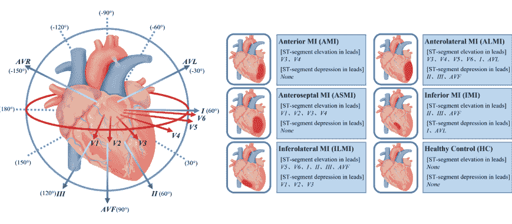
心电图特征，如ST段抬高和Q波异常 [7,8]。然后，使用K近邻（KNN）[12,13]、随机森林（RF）[14]或支持向量机（SVM）[15,16]等传统机器学习方法进行分类。然而，这些方法的特征选择过程通常依赖人工干预，需要广泛的医学专业知识和经验。此外，如果所选心电图波形的形态特征不够准确，这些常规MI检测和定位方法的分类性能会大幅下降。因此，为了解决上述问题，需要一种更稳定的MI端到端自动检测和定位方法。

由于深度学习方法在许多领域取得了显著成果，它们也在基于心电信号的CVD分类中展现出优势 [17,18]，例如卷积神经网络（CNN）和长短期记忆网络（LSTM）。它们不仅能够同时执行特征提取和分类过程，而且通常比传统方法获得更高的准确率。因此，研究人员提出了许多基于深度学习的方法来检测和定位MI，取得了有希望的结果。例如，Strodthoff等人 [19] 提出了一种基于全卷积网络并使用八导联心电图的MI检测与解释算法，该算法直接从原始心电图数据中提取特征，达到了93.3%的灵敏度和89.7%的特异度。Acharya等人 [20] 提出了一种新方法，使用11层CNN基于单导联心电图自动检测MI。该方法无需人工特征提取或选择，因此即使在存在噪声的情况下也能对MI进行准确检测。结果，在存在和不存在噪声的情况下，分别获得了93.53%和95.22%的准确率。He等人 [21] 开发了一种新的基于12导联心电图的深度主动半监督学习框架，用于MI定位，名为多分支密集连接卷积网络（MB-DenseNet）。它首先采用主动学习（AL）来提高初始模型的分类性能，然后设计了一种名为空间匹配自训练（STSM）的新半监督学习方法来更新模型。MB-DenseNet在患者内方案和特定患者方案下分别获得了99.87%和96.09%的准确率。

上述方法在MI自动检测和定位方面带来了一些显著改进。然而，仍有许多挑战需要解决。首先，不同心脏部位的MI发作通常会导致不同导联组合中的异常心电图波形。例如，从图1可以看出，AMI可能导致V3和V4导联出现ST段抬高，而ALMI可能导致不同导联（II、III和AVF）出现ST段抬高。因此，导联信息不完整可能导致定位特征缺失，从而影响识别准确性。与大多数仅使用单导联或部分导联心电图的现有方法不同，我们充分使用了12导联心电图以引入更多数据信息，增强我们方法的性能。其次，虽然一些研究也考虑了12导联心电图，但它们倾向于将MI检测和定位任务视为两个独立任务，未考虑两者之间的相关性 [22–25]，这可能严重限制现有方法的性能和改进空间。

因此，为了解决上述问题，我们提出了一种用于MI检测和定位任务的多任务通道注意力网络（MCA-net）。本文的贡献可归纳如下：

- 1. 我们提出了一种新的通道注意力网络，用于从12导联心电图中进行特征学习，该网络采用多个独立通道网络从单个导联中提取特征。在每个通道网络中，利用挤压-激励（SE）[26]注意力机制和跳跃连接，在不同阶段高效提取和整合特征。
- 2. 根据MI检测和定位任务的相关性，我们在MCA-net中引入多任务框架。该多任务框架通过联合优化损失方式利用任务之间的共享和互补信息，提高MCA-net的性能和通用性。因此，MCA-net可以轻松扩展到不同任务。
- 3. 在实验部分，我们使用两个公共数据集来充分验证MCA-net的性能和泛化能力。我们采用多折交叉验证策略对模型性能进行更严格的评估。我们还进行了许多消融实验，以比较和分析多任务框架的影响以及通道注意力网络中各模块的作用。实验结果表明，与其他研究相比，MCA-net在性能和通用性方面均表现出色。

本文其余部分组织如下：第2节讨论了关于MI检测和定位方法的相关工作。第3节描述了我们使用的数据集和预处理方法。第4节详细介绍了我们提出的方法。在第5节，我们介绍了实验实施的细节并讨论了结果。在第6节，介绍了我们模型的消融实验和进一步分析。最后，在第7节总结了我们的工作。

# 2. 相关工作

由于其易于获取和无创的特性，心电图常被用作临床MI检测和定位的关键手段。


然而，传统的心电图（ECG）手动分析极其耗时且费力，需要医生具备专业知识和经验。因此，研究人员已探索并开发了许多自动MI诊断算法，以减轻心脏病专家的负担。

早期的自动MI诊断算法专注于MI检测任务，即对MI和HC（健康对照）人群进行分类。研究人员通常使用生物信号处理方法结合经典机器学习方法。这些方法在分类前通常需要许多繁琐的手动数据处理步骤，例如去噪、归一化、特征提取和选择。常用方法包括WT、频域分析（FDA）[27]、隐马尔可夫模型（HMM）[28]和SVM等。

例如，为了基于ECG进行自动MI检测，Sun等人[29]提出了一种名为隐性主题多实例学习的多实例学习（MIL）方法。该方法利用训练集中的未标记心电搏来创建主题空间，并将ECG映射到该空间。然后，将心电图水平的主题向量输入SVM进行最终分类。Nidhyananthan等人[30]提出了一种基于小波的方法来检测MI和用户身份。该模型首先使用Daubechies小波变换分解多层心电图信号，然后使用SVM分类器对信号中的正常和异常情况进行分类。Benameur等人[31]基于三种心脏MRI参数成像技术来定量与梗死相关的收缩功能受损区域以检测MI。从一元信号生成的参数图像取得了最佳性能。Pereira等人[32]设计了一种结合小波分解和特征空间分析的方法来检测MI。小波分解用于提取心电图中不同频率的波形并将其分离。特征空间分析提供了从协方差矩阵计算得到的特征值。因此，这些训练特征可以帮助分类HC和MI患者。Liu等人[33]使用可调Q因子小波变换（TQWT）设计了一种新的心电图信号处理方法，以提取高质量心电图并进行MI检测。在所提出的方法中，作者将12导联心电图信号分解为高Q因子和低Q因子分量，然后手动提取大量特征，最终将其输入KNN以获得更好的性能。Wah等人[34]使用SVM和KNN作为分类器，基于从心电图信号中提取相关波形或特征并分析峰值的某些特定区域及其时间频率，对心电图信号中的心脏状况进行分类。Fatimah等人[13]开发了两种模型来自动检测MI，分别称为基于单导联心电图的原始方法和修改方法。原始算法在基于R波峰的分段操作后获得的心电搏上应用了傅里叶分解法（FDM），并使用修改后的算法来计算其效率。这些方法获得的特征被输入到多种常规机器学习分类器中，并在KNN中取得了最佳性能。Han等人[16]提出了一种基于12导联心电图融合能量熵和形态特征的新MI检测方法。具体而言，首先对心电图进行分解，然后计算分解系数以获取能量熵，最后将其与局部形态特征融合为全局特征，以进行更准确的分类。Sahu等人[35]设计了一种使用变分模态分解（VMD）和正则化邻域成分分析（RNCA）的新型MI检测和定位方法。它从VMD的内禀模态函数计算的统计特征和非线性特征构建了特征集，并使用RNCA进行排序，然后将其输入KNN和AdaBoost分类器进行分类。不幸的是，这些基于特征工程的传统方法过度依赖专业医学经验，并且需要长时间的特征提取过程和严格的特征选择过程。因此，它们在便利性和稳定性方面容易受到限制，且难以满足临床标准。

然而，随着深度学习方法在计算机视觉、生物信号分析和机器翻译等领域表现出巨大优势，其强大的自动特征提取能力已得到证明。因此，越来越多的基于深度学习的自动MI检测方法被提出。例如，Liu等人[36]开发了一种基于多导联CNN（ML-CNN）的新算法，通过四导联心电图进行MI检测。在该方法中，应用了引线非对称池化（LAP）层和子二维（2-D）卷积层，以学习不同引线的多尺度特征表示，其准确率达到了96.00%。Li等人[37]提出了一种自动MI检测模型，利用生成对抗网络（GANs）合成形态相似度高的单导联心电图。它同时对原始心电图和GANs合成的心电图使用CNN来自动检测MI，达到了99.06%的准确率。此外，Liu等人[23]提出了一种多特征分支卷积双向循环神经网络（MFB-CBRNN），用于有效地基于12导联心电图进行自动MI检测，该网络由12个多特征分支组成。具体而言，MFB-CBRNN利用多个堆叠的多尺度卷积层结合池化操作，充分提取心电图引线内的特征。然后，它使用双向LSTM融合每个多特征分支的特征，并在病人间和病人内范式下分别达到了99.54%和86.29%的准确率。

并且，随着自动MI检测方法的不断完善，研究人员正逐渐将研究重点转向更具挑战性且临床价值更高的MI定位任务。例如，Liu等人[38]提出了一种新的多特征分支CNN（MFB-CNN），用于基于12导联心电图自动检测和定位MI，该网络通过相应的特征分支学习引线特征。因此，该模型在MI检测和定位任务上分别获得了98.79%和94.82%的平均准确率。Cao等人[39]提出了一种基于残差网络和注意力机制组合的多尺度深度学习模型，用于12导联心电图记录。该模型主要使用SENet模型和Grad-CAM算法来计算每个引线的权重，并基于加权特征检测和定位MI，两者均取得了超过99%的准确率。Han等人[22]设计了一种多导联残差神经网络（ML-ResNet），用于基于12导联心电图记录进行MI检测和定位任务。它从不同引线中提取局部特征以构建全局特征表示，并在病人间范式下对MI检测和定位任务分别达到了95.49%和55.74%的准确率。Cao等人[24]提出了一种新型多通道轻量级模型（ML-Net），为便携设备上的自动MI检测和定位提供算法支持。具体而言，ML-Net采用多导联框架，使每个引线内的特征能够独立学习，从而保留不同引线所代表的不同角度的独特特征，最终在MI检测和定位任务中分别达到了96.00%和66.85%的分类准确率。然而，大多数方法是为特定任务设计的，难以扩展到其他下游任务，限制了其在临床实践中的应用。相比之下，同时考虑MI检测和定位任务的方法通常将MI检测和定位视为两个独立任务。它们不考虑任务之间的相关性，并且在训练期间不支持任务之间的有效信息共享和互补性，这可能会限制其整体性能。

为了解决现有方法的局限性，我们设计了一种名为MCA-net的多任务通道注意力网络。在我们的模型中，我们使用通道注意力网络来学习和融合每个引线的特征，并采用多任务框架来高效结合MI检测和定位任务之间的共享和互补信息。实验表明，MCA-net可以自动执行MI检测和定位任务，并具有很高的应用价值。

# 3. 数据描述与预处理

本文使用的心电图数据分别来自PTB [40]和PTBXL数据集 [41]。


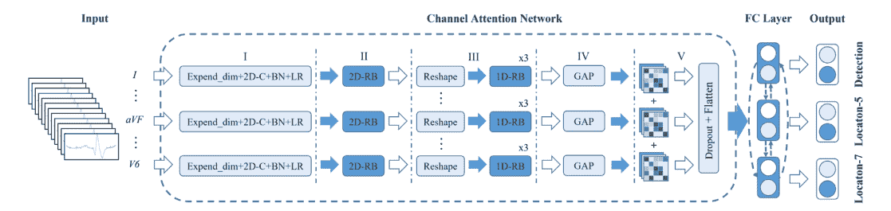

图 2. MCA-net 概览。2D-C：二维卷积层。BN：批量归一化层。LR：LeakyReLU 层。2D-RB：二维残差块。1D-RB：一维残差块。GAP：全局平均池化层。FC 层：全连接层。Detection：二分类检测任务。Location-5：五分类定位任务。Location-7：七分类定位任务。

Table 1
本文使用的 PTB 数据集摘要。

| 类别 | 受试者 | 记录数 | 心跳数 |
|---|---|---|---|
| AMI | 17 | 47 | 4369 |
| ASMI | 28 | 79 | 7596 |
| ALMI | 16 | 43 | 4152 |
| IMI | 30 | 89 | 7970 |
| ILMI | 23 | 56 | 5235 |
| 其他 | 13 | 32 | 2956 |
| HC | 52 | 80 | 7866 |
| 总计 | 179 | 426 | 40,144 |

## 3.3. 预处理

对于 PTB 数据集中的每条记录，我们首先将其重采样至 500 Hz。然后，将重采样后的记录分割为若干固定长度的心拍，长度小于该值的心拍将被丢弃。各心拍之间不存在重叠。由于完整心电图波形的持续时间约为 0.6 s，为确保每个心拍至少包含一个完整的心电图波形，本文将每个心拍的固定长度设置为 1.2 s（600 个采样点）。如表 1 所示，最终得到的心拍总数为 40,144 个。

对于 PTBXL 数据集，我们直接选择 500 Hz 采样频率版本，以与 PTB 数据集保持一致。考虑到 PTBXL 数据集中的每条记录可能包含多个标注，我们不对其进行分割，以确保多标签信息的完整性。

基于上述预处理，我们分别获得了以心拍为基本单位的单标签数据集和以心电图记录为基本单位的多标签数据集，以充分验证我们方法的有效性。

Table 2
本文使用的 PTBXL 数据集摘要。

| 类别 | 受试者 | 记录数 |
|---|---|---|
| AMI | 348 | 354 |
| ASMI | 2037 | 2363 |
| ALMI | 245 | 290 |
| IMI | 2362 | 2685 |
| ILMI | 416 | 479 |
| 其他 | 278 | 302 |
| HC | 8903 | 9528 |
| 总计 | 13,460 | 15,013 |

## 3.1. PTB 数据集

PTB 数据集通常用于训练和评估不同的 MI 检测和定位方法。它包含 549 条 12 导联心电图记录，其中来自 52 名 HC 患者和 148 名 MI 患者的 368 条心电图记录在本文中使用。该数据集中的所有心电图数据均可在线获取。每条心电图记录由 12 条标准导联（如图 1 所示）和 3 条 Frank 导联（VX、VY 和 VZ）组成，采样率为 1000 Hz。此外，这些心电图记录均由心脏病专家标注，一个受试者可能提供多条心电图记录，但每条心电图记录只有一个标签。这些心电图记录大多持续约 2 分钟，至少 30 秒。PTB 数据集中使用的 12 导联心电图统计信息如表 1 所示。

## 3.2. PTBXL 数据集

PTBXL 数据集是一个大型公开可用的心电图数据集，于 2020 年 4 月首次发布 [41]，包含 18,885 名受试者，并提供约 21,837 条心电图记录。其中包含 5486 条 MI 记录和 9528 条 HC 记录。与 PTB 数据集类似，每条记录包含 12 条标准导联，并提供 100 Hz 和 200 Hz 两个采样频率版本。每条记录持续 10 秒。该数据集中每个受试者提供一条到多条带标注的心电图记录，且大多数记录包含多个标注。PTBXL 数据集中使用的 12 导联心电图统计信息如表 2 所示。

# 4. 方法

如图 2 所示，MCA-net 的整体结构由基于多任务框架的通道注意力网络组成。具体而言，我们将 12 导联心电图输入到一个具有 12 个通道的通道注意力网络中，每个通道对应一个导联。对于心电图信号的每个导联，我们首先通过增加额外维度将数据格式化为二维矩阵。然后将二维矩阵输入到二维卷积层，以捕获特征提取早期阶段的重要信息。接着，为了提取多尺度特征，我们采用具有不同卷积核大小的二维残差块。紧接着，我们将特征重塑为一维特征，然后输入到三个一维残差块中，以进一步提取更精细的特征。三个一维残差块之后，使用全局平均池化层来提取关键特征并提高泛化能力。最后，我们将不同通道的特征拼接，使用 dropout 避免过拟合，并将展平的全局特征输入到三个全连接层。MCA-net 中使用的所有卷积均为 Same Convolution，它是标准卷积（一维和二维）的一种。各部分的详细信息如表 3 所示，并在下文描述。

## 4.1. 通道注意力网络

我们的通道注意力网络结构概览如图 2 中虚线框内所示。常规的 12 导联心电图数据可以反映心脏活动的不同视图，并提供大量不同的信息性表示。尤其是在 MI 定位任务中，不同导联提供的特征可能指向不同的梗死位置。因此，充分利用 12 导联心电图中的关键信息至关重要。在通道注意力网络中，每个

| 部分 | 层 | 卷积核 | PTB | PTBXL |
|---|---|---|---|---|
| I | Expand_dims | - | 600 x 1 | 5000 x 1 |
| | 2D-C | 2 | 600 x 1 x 1 | 5000 x 1 x 1 |
| | BN+LR | - | - | - |
| II | 2D-RB | 4 | 600 x 1 x 2 | 5000 x 1 x 2 |
| III | Reshape | - | 600 x 1 x 4 | 5000 x 1 x 4 |
| | 1D-RB | 4 | 300 x 4 | 2500 x 4 |
| | 1D-RB | 8 | 100 x 4 | 833 x 4 |
| | 1D-RB | 16 | 33 x 8 | 277 x 8 |
| IV | GAP | - | 11 x 16 | 92 x 16 |
| V | Concatenate | - | 1 x 16 | 1 x 16 |
| | Dropout | - | 1 x 192 | 1 x 192 |
| | Flatten | - | 1 x 192 | 1 x 192 |

| 类型 | 卷积核大小 | 卷积核数量 |
|---|---|---|
| 2D-C | 17 | 2/4/8/16 |
| BN+LR | - | - |
| 2D-C | 11 | 2/4/8/16 |
| BN+LR | - | - |
| 2D-C | 5 | 2/4/8/16 |
| BN+LR | - | - |
| SE | - | - |
| 跳跃连接 | 1 | - |
| LR | - | - |

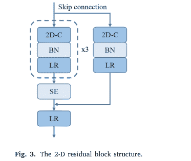

导联由其独立的通道表示以生成特征。每个通道包含五个组件，充分考虑不同阶段的不同尺度特征，如表 3 所示。最终，12 通道网络学习到的特征被集成到最终的患者心电图表示中，并输入到全连接层进行分类。通道注意力网络的详细信息将在下文中描述。

### 4.1.1. 二维卷积层

首先，每个导联的原始一维信号被转换为二维矩阵（如表 3 中第 I 部分所示），并输入到二维卷积层进行特征提取。二维卷积层可描述为：

```
$$x_j^l = f \left( \sum_{i \in M_j} x_i^{l-1} * w_{ij}^l + b_j^l \right)$$
```

其中 \(x_i^{l-1}\) 是 \((l-1)\) 层中第 \(j\) 个卷积核的输出，用于输入到 \(l\) 层。它在 \(M_j\) 的感受野下，与该层的偏置系数 \(w_{ij}^l\) 和相应的偏置 \(b_j^l\) 进行运算。其中 * 指二维卷积操作。然后，将修正线性单元 (ReLU) 应用为激活函数 \(f(\cdot)\) 以输出 \(x_j^l\)。随后，使用批量归一化层和 LeakyReLU 激活函数来缓解梯度消失问题并加速收敛。

### 4.1.2. 二维残差块层

二维卷积层之后，我们将学习到的特征输入到二维残差块层。如图 3 和表 4 所示，该二维残差块层主要由三个具有不同卷积核大小的二维卷积层组成。在这三个堆叠的二维卷积层之后，我们使用 SE 模块来处理和融合学习到的特征图，以获得更高效的特征表示。然后，我们将 SE 模块和跳跃连接（包含一个二维卷积层）中的特征相结合，以避免重要信息的丢失。最后，将特征输入到 LeakyReLU 层。

### 4.1.3. 一维残差块层

为了进一步学习每个通道中更精细的特征，我们设计了一个一维残差块层，该层在二维残差块层之后包含三个堆叠的一维残差块。在此之前，从二维残差块层提取的特征表示被重塑为一维张量。一维残差块层的结构与图 3 中的二维残差块类似。不同之处在于，二维残差块中的二维卷积层被一维卷积层取代，并且在 LeakyReLU 激活函数之后添加了一个额外的平均池化层，以降低特征的维度并提供更好的泛化能力。一维平均池化的操作如下：

```
$$x_j^r(k) = Avg_{a \in A} \left[ x_j^{l-1}(k \times s + a) \right]$$
```

其中，特征表示 \(x_j^r(k)\) 使用 \(k\) 作为采样点索引。\(s\) 表示池化操作的步长，在本文中全部设置为 1。\(R\) 表示整个池化区域，被分为 \(r\) 个部分。最后，我们使用 \(Avg (\bullet)\) 获取池化窗口的平均值。

### 4.1.4. 全局平均池化层

在执行多导联特征融合之前，我们使用全局平均池化层来降低特征维度，并为每个通道提供更具体的内部表示。

### 4.1.5. 特征融合层

最后，我们将每个通道学习到的特征拼接，并将其输入到 dropout 层，然后使用 flatten 层获取特征表示。随后将该特征表示输入到不同的全连接层，以获得 MI 检测和定位任务的相应分类结果。

## 4.2. 多任务框架

从临床诊断的基本过程来看，心脏病专家通常先检测 MI，在确诊后再进行 MI 定位。同时，MI 检测结果也可以通过定位结果进行验证。然而，现有方法通常设计为仅实现单一特定任务或多个独立任务，未考虑这两个任务之间的关系及其可能带来的额外信息。这些方法限制了现有方法的分类性能和改进空间。因此，对于 MI 检测和定位任务，能够同时执行两者的模型比多个独立模型更可靠。此外，这种模型在泛化能力和性能方面可能更有效，因为


MI检测和定位任务可能具有重叠的关键特征以及可以互补的附加信息。

多任务框架已被证明通过学习多任务之间的共享和互补信息来优化所有任务的性能，在类似任务中发挥有益作用[42–44]。我们采用最经典的多任务框架，即共享底层模型[42]。该模型通过在多个任务之间共享底层表示并在多个任务中执行损失优化，实现了分类性能的提升。因此，基于该多任务框架的MCA-net可以更有效地结合MI检测和定位任务。该框架可表示为：

```
y^n = F^n(\boldsymbol{C}(\boldsymbol{x}))
```

本文设计了三个相关任务：（1）两分类MI检测任务（Detection），旨在识别受试者是MI还是HC；（2）五分类MI定位任务（Location-5），其目标是区分AMI、ASMI、ALMI、其他及HC人群；（3）七分类MI定位任务（Location-7），其目标是区分AMI、ASMI、ALMI、IMI、ILMI、其他及HC人群。对于Location-5任务，我们选择它是因为大比例MI患者患有广泛性前壁MI（GAMI）[36]，后者由AMI、ASMI和ALMI组成，因此我们首先将任务聚焦于区分GAMI，并将剩余的MI标签归类为其他类别。随后，我们考虑大多数现有研究涉及的任务、该任务与Location-5任务的相关性以及数据集上的标签分布。最终，在Location-5任务的基础上额外选取IMI和ILMI进行分类，以形成Location-7任务。

具体而言，多任务框架在通道注意力网络中在三个任务之间共享参数和特征表示，该网络表示为函数**C**。对于每个任务，_n_分别为1、2、3。然后通过相应的全连接层_F^n_得到每个任务的输出_y^n_。

多任务框架中这些任务的损失以加权求和形式结合用于联合优化，总损失可表示为：

```
L_{total} = aL_d + bL_{l-5} + cL_{l-7}
```

其中L_d、L_{l-5}、L_{l-7}分别对应Detection、Location-5和Location-7任务，a、b、c是三个相关任务的权重。

# 5. 实验与结果

在本节中，我们在PTB和PTBXL数据集上对MCA-net进行了全面评估，并将其与自动MI检测和定位的最先进方法进行比较。此外，我们对实验结果进行了显著性检验，以展示我们方法的改进。

## 5.1. 对比方法

为进行全面评估，我们在PTB和PTBXL数据集上，将我们的方法与其他三种最先进的MI分类方法（即MFB-CBRNN [23]、ML-ResNet [22]和ML-Net [24]）进行了对比实验。

- **MFB-CBRNN**：MFB-CBRNN基于12导联心电图采用多导联框架进行MI检测。为充分利用全部12个导联中包含的心电图波形信息，采用了12个多特征分支来提取每个导联内的特征，这些分支主要由卷积层组成。为了实现有效的特征融合，MFB-CBRNN还使用了双向LSTM来整合各导联分支输出的所有特征。

- **ML-ResNet**：ML-ResNet同样采用多导联框架进行MI检测和定位，但在设计多特征分支时使用了基于残差的网络结构。每个多特征分支主要由三个堆叠的残差块组成，每个残差块包含三个卷积层和一个跳跃连接。因此，ML-ResNet可以分层学习导联内的特征表示并执行特征融合。

- **ML-Net**：ML-Net也在多导联框架基础上采用了新颖的通道分支结构。该分支结构设计为三个并行卷积网络，通过设置不同的卷积核大小来整合导联内的多尺度特征。然而，与上述两种方法不同，ML-Net仅使用四个导联的心电图数据，以满足便携设备对轻量化的需求。

与这些方法不同，我们的方法结合了2-D和1-D残差块，用于提取早期显著特征和更精细的特征。我们还在MCA-net中使用了SE模块和跳跃连接，用于特征加权并防止有效信息丢失。最后，通过引入多任务框架，充分挖掘任务间的相关性和互补性，将MCA-net扩展到各个任务并提高整体分类性能。由于MFB-CBRNN、ML-ResNet和ML-Net最初均针对不同的MI分类任务设计，使用了不同数量的数据和不同的数据处理方式。我们通过统一数据输入并修改其相应的分类层，将它们扩展到我们的任务中，以进行公平比较。

## 5.2. 实现细节

本文中涉及的所有方法均基于Keras和TensorFlow框架[45]开发，使用python 3.6进行训练和测试。相关实验在一台搭载Intel(R) Xeon(R) Gold 6230 CPU @ 2.10 GHz和251 GB内存的服务器上进行。我们将模型的初始学习率设为0.001，并在训练过程中使用回调函数ReduceLROnPlateau进行优化。训练轮数和批量大小分别设为100和64。此外，我们还部署了Adam优化器和早停策略，以加快学习过程并防止过拟合。

## 5.3. 评价指标

在本工作中，PTB数据集上的模型性能由三项指标评估，即灵敏度（Sen）、特异度（Spe）和准确率（Acc）。Sen又称为召回率，表示模型正确预测的阳性样本占全部阳性样本的百分比。相反，Spe表示模型正确预测的阴性样本占全部阴性样本的百分比。而准确率（Acc）是所有正确识别样本占总样本数的百分比。这三项评价指标可通过以下公式计算：

```
Sen = \frac{TP}{TP + FN}
```

```
Spe = \frac{TN}{TN + FP}
```

```
Acc = \frac{TP + TN}{TP + TN + FP + FN}
```

其中TP（真阳性）和TN（真阴性）指真实类别和预测类别均为阳性或均为阴性的样本数量。而FP（假阳性）和FN（假阴性）分别指真实类别和预测类别为阳性和阴性、或阴性和阳性的样本数量。对于多标签数据集PTBXL，我们使用相同的指标来评估模型在MI检测任务上的性能。但对于MI定位任务，我们选择数据集发布者建议[41]的准确率和ROC曲线下面积（AUROC）来评估模型性能。它指随机抽取的阳性样本排在阴性样本之前的期望值。在我们的工作中，我们依次将每个标签设为阳性样本，将其余标签设为阴性样本，以计算它们的AUROC并取平均值。

所有评价指标在交叉验证实验结果中均以均值-方差形式呈现，用于衡量所涉方法的分类性能和稳定性。

# 表 5
基于患者间方案，MCA-net与PTB数据集上三种最先进方法的性能对比。

| Model | 检测 | | | Location-5 | | | Location-7 | | |
|---|---|---|---|---|---|---|---|---|---|
| | 灵敏度(%) | 特异度(%) | 准确率(%) | 灵敏度(%) | 特异度(%) | 准确率(%) | 灵敏度(%) | 特异度(%) | 准确率(%) |
| MFB-CBRNN | 93.34 ± 0.11 | 73.94 ± 0.73 | 89.53 ± 0.16 | 54.41 ± 0.37 | 63.04 ± 0.18 | 63.79 ± 0.19 | 36.96 ± 0.33 | 41.59 ± 0.39 | 41.71 ± 0.39 |
| ML-ResNet | 96.07 ± 0.06 | 71.60 ± 1.45 | 91.28 ± 0.10 | 53.38 ± 0.48 | 64.04 ± 0.23 | 65.00 ± 0.21 | 36.61 ± 0.34 | 42.37 ± 0.51 | 42.51 ± 0.52 |
| ML-Net | 95.24 ± 0.03 | 77.69 ± 0.53 | 91.81 ± 0.04 | 54.23 ± 0.16 | 64.80 ± 0.12 | 65.62 ± 0.12 | 36.57 ± 0.30 | 41.90 ± 0.32 | 42.03 ± 0.32 |
| MCA-net | 98.01 ± 0.05<sup>c</sup> | 86.01 ± 0.18<sup>c</sup> | 95.57 ± 0.06<sup>c</sup> | 55.35 ± 0.10 | 67.96 ± 0.10 | 68.90 ± 0.10 | 41.80 ± 0.10<sup>abc</sup> | 49.01 ± 0.09 | 49.18 ± 0.09<sup>a</sup> |

Location-5：五分类MI定位任务。Location-7：七分类MI定位任务。
<sup>a,b,c</sup>表示在0.05显著性水平的T检验实验中，MCA-net在该列相较于MFB-CBRNN、ML-ResNet和ML-Net分别显示出显著改进。

## 5.4. PTB数据集上的实验结果

与以往研究中常用的患者内方案不同，患者间方案在证明模型泛化能力方面具有更大的临床意义。因此，我们在PTB数据集上基于患者间方案进行5折交叉验证实验，以验证我们方法的有效性和泛化性，模型的平均灵敏度、特异度和准确率如表5所示，其中最优解已加以突出。可以看出，MCA-net在所有任务中均实现了最佳性能。在检测任务中，MCA-net的灵敏度、特异度和准确率相较于其他对比方法有所提高，分别达到98.01%、89.01%和95.57%，且特异度的改进尤为明显。MCA-net在Location-5任务中的分类性能也有所提升，分别达到55.35%、67.96%和68.90%。对于Location-7任务，MCA-net分别达到41.80%、49.01%和49.18%，准确率提升超过6%。

还可以观察到，与其他方法相比，MFB-CBRNN在所有任务中的表现稍差。ML-ResNet在检测和定位任务上均取得了良好的分类准确率。ML-Net在检测和Location-5任务上略优于ML-ResNet，但在Location-7任务上稍差。这表明它们缺乏对不同任务的适应性。相比之下，我们的方法不仅性能卓越，而且具有高度的泛化能力。这主要是因为我们使用不同卷积核大小的多个卷积层以及SE模块来学习不同粒度的重要特征。另一方面，它还受益于多任务框架，该框架能够有效地共享不同任务之间的底层参数和互补信息。

除了评价指标的平均结果外，我们还计算其方差范围以比较不同方法之间的稳定性。如表5所示，我们的方法在大多数评价指标上的方差波动范围小于对比方法，这证明了我们的方法在保持卓越性能的同时确保了可靠的稳定性。此外，还使用0.05显著性水平的T检验来分析MCA-net在每项评价指标上是否显著优于其他对比方法。可以看出，我们的方法在检测和Location-7任务上具有一定性能优势，尤其是在灵敏度方面。然而，在Location-5任务中，可能受标签不平衡和分布的影响，对模型的区分能力提出了更高要求。

## 5.5. PTBXL数据集上的实验结果

与PTB数据集不同，PTBXL数据集涉及更多数量和更广泛范围的患者，每位患者可提供一条或多条心电图记录，从而提供更丰富的样本信息和更长的心电图序列。此外，PTBXL数据集比PTB数据集更接近实际临床情况，因为其心电图记录通常包含多个标签。我们从PTBXL数据集中提取HC和MI记录用于MI检测和定位实验，以验证MCA-net的性能。使用更长时长的心电图记录作为输入单元，以验证MCA-net在学习长时序特征方面的有效性。为了更贴近真实世界的数据分布，PTBXL数据集由其发布者划分为十折患者间范式[41]，这意味着所有折叠中心电图记录的患者来源不重叠。因此，我们基于这些集进行10折交叉验证，以获得更可靠的结果。如表6所示，我们的方法仍优于其他对比方法，在检测任务中达到88.59%的灵敏度、96.55%的特异度和93.65%的准确率。同时，MCA-net在Location-5和Location-7任务上也优于其他方法，分别达到84.03%和81.47%的准确率，以及78.76%和74.05%的AUROC。这表明了我们的方法在不同数据集上的有效性和泛化能力。

还可以看到，与PTB数据集上的结果相反，ML-Net在PTBXL数据集上的表现最差。可能的原因是PTBXL数据集提供的数据长度要长得多（通常超过数千个采样点），而ML-Net采用的轻量级框架无法从如此长的心电图序列中有效地学习长期依赖关系。MFB-CBRNN在两个数据集上均表现相对较好，这证明了卷积层的稳定性。此外，ML-ResNet的平均性能优于另外两种对比方法，证明了残差模块的有效性。我们的方法不仅将卷积层的稳定性与残差模块的有效性相结合，而且更能够学习心电图序列的长期依赖关系，从而实现更好的性能。

再次，MCA-net的可靠稳定性通过实验结果的方差波动范围得到了进一步验证。除此之外，我们仍使用T检验来验证MCA-net在PTBXL数据集上的显著性。如表6所示，相较于对比方法，MCA-net在大多数任务上取得了显著改进，尤其是Location-5和Location-7任务。

# 6. 讨论

本文针对MI检测和定位任务设计了一种名为MCA-net的多任务通道注意力网络。与其他方法相比，我们的方法在整体性能上有所提升。为了进一步评估MCA-net内各组件的有效性，我们首先讨论多任务框架为MCA-net带来的增益。随后，对MCA-net内通道注意力网络的主要模块进行消融实验。最后，进行了进一步分析。


表6
MCA-net与三种最先进方法在PTBXL数据集（病人间方案）下的性能比较。

| 模型 | 检测灵敏度(%) | 检测特异度(%) | 检测准确率(%) | 5类定位准确率(%) | 5类定位AUROC(%) | 7类定位准确率(%) | 7类定位AUROC(%) |
| :--- | :--- | :--- | :--- | :--- | :--- | :--- | :--- |
| MFB-CBRNN | 83.12 ± 0.71 | 96.41 ± 0.02 | 91.55 ± 0.06 | 81.96 ± 0.02 | 74.51 ± 0.09 | 79.17 ± 0.02 | 69.21 ± 0.09 |
| ML-ResNet | 86.87 ± 0.08 | **96.93 ± 0.01** | 93.24 ± 0.01 | 83.25 ± 0.00 | 76.15 ± 0.01 | 80.23 ± 0.01 | 72.07 ± 0.03 |
| MI-Net | 73.32 ± 0.08 | 91.56 ± 0.02 | 84.89 ± 0.00 | 68.30 ± 0.01 | 68.11 ± 0.00 | 64.64 ± 0.00 | 62.98 ± 0.00 |
| **MCA-net** | **88.59 ± 0.06**<sup>abc</sup> | 96.55 ± 0.01<sup>c</sup> | **93.65 ± 0.01**<sup>ac</sup> | **84.03 ± 0.005**<sup>abc</sup> | **78.76 ± 0.02**<sup>ac</sup> | **81.47 ± 0.01**<sup>abc</sup> | **74.05 ± 0.03**<sup>bc</sup> |

5类定位：五类心肌梗死定位任务。7类定位：七类心肌梗死定位任务。
*a,b,c* 表示在0.05显著性水平的T检验实验中，MCA-net在此列上分别较MFB-CBRNN、ML-ResNet和MI-Net显示出显著改进。

表7
病人间方案下多任务框架的消融实验。

| 模型 | PTB数据集 Acc-2(%) | Acc-5(%) | Acc-7(%) | PTBXL数据集 Acc-2(%) | Acc-5(%) | AUROC-5(%) | Acc-7(%) | AUROC-7(%) |
| :--- | :--- | :--- | :--- | :--- | :--- | :--- | :--- | :--- |
| Cnet | 94.52 ± 0.06 | 66.45 ± 0.51 | 46.41 ± 0.47 | 93.57 ± 0.00 | 83.95 ± 0.00 | 76.99 ± 0.02 | 81.34 ± 0.01 | 73.43 ± 0.02 |
| MCA-net<sub>5</sub> | 95.04 ± 0.06 | 67.06 ± 0.36 | - | 93.60 ± 0.01 | 83.74 ± 0.01 | 77.77 ± 0.03 | - | - |
| MCA-net<sub>7</sub> | 95.21 ± 0.07 | - | 48.12 ± 0.03 | 93.65 ± 0.01 | - | - | 81.14 ± 0.01 | 73.48 ± 0.02 |
| **MCA-net** | **95.57 ± 0.06** | **68.90 ± 0.10** | **49.18 ± 0.09** | **93.65 ± 0.01** | **84.03 ± 0.00** | **78.76 ± 0.02** | **81.47 ± 0.01** | **74.05 ± 0.03** |

Acc-2：心肌梗死检测任务的准确率。Acc-5：五类心肌梗死定位任务的准确率。Acc-7：七类心肌梗死定位任务的准确率。AUROC-5：五类心肌梗死定位任务的AUROC。AUROC-7：七类心肌梗死定位任务的AUROC。

表8
MCA-net与三种最先进方法的训练时间比较。

| 模型 | PTB数据集 Epoch(s) | Fold(s) | PTBXL数据集 Epoch(s) | Fold(s) |
| :--- | :--- | :--- | :--- | :--- |
| MFB-CBRNN | 93.78 | 37205.48 | 156.74 | 2743.85 |
| MI-ResNet | 115.11 | 4595.61 | **84.64** | **1847.15** |
| MI-Net | 98.55 | 3145.82 | 85.54 | 3413.86 |
| MCA-net | **77.23** | **2276.68** | 135.44 | 2682.60 |

## 6.1. 多任务框架的优势

为验证多任务框架在MCA-net中的影响，我们设计了一个单任务模型和两个双任务模型，在PTB和PTBXL数据集上执行与我们的模型相同的实验。消融实验结果可见表7。在此，Cnet指单任务模型，MCA-net<sub>5</sub>指用于检测和5类定位任务的双任务模型，MCA-net<sub>7</sub>指用于检测和7类定位任务的双任务模型。

根据表7，我们可以发现单任务模型Cnet在不同精细任务上表现良好，尤其是心肌梗死检测任务。同时，我们还可以发现，随着任务数量的增加和任务粒度的细化，实验结果不断得到优化。特别是，我们的模型不仅在不同数据集上，而且在不同任务上均取得了最佳结果。在PTB数据集上，心肌梗死检测和定位任务的改进率分别为1.05%、2.45%和2.77%。在PTBXL数据集上，我们分别将AUROC提高了0.08%、1.77%和0.62%，同时保持了高准确率。这证明我们采用的多任务学习框架可以有效捕捉与不同任务相关的共同信息和任务特定特征，并通过任务间的信息互补增强最终特征表示。我们还可以观察到，增加任务数量能够实现来自不同任务的学习特征的更多聚合，并增强最终学习的表示。而且，分类类别数量的增加促使模型学习更准确的特征，从而影响最终决策。

顺便说一下，结合表5和表6，我们还可以观察到单任务模型Cnet的分类准确率仍高于所有对比方法，这进一步表明通道注意力网络结构能够更有效地捕捉12导联心电图中的相关特征。

## 6.2. 通道注意力网络的优势

在此小节中，为了进一步了解各模块对最终分类性能的影响，我们分别移除了通道注意力网络的不同模块，并在相同配置下进行了实验。我们比较了我们的模型MCA-net与MCA-net变体（即不含2D残差块的MCA-net、不含1D残差块的MCA-net、不含SE模块的MCA-net）之间的分类准确率。PTB和PTBXL数据集上的消融实验结果如图4所示。

- **无2D残差块**：从图4可以看出，不含2D残差块的模型相比MCA-net准确率下降。这表明2D残差块可以帮助模型在早期特征提取阶段学习导联内部心电图波形的形态特征。此外，我们可以看到，2D残差块在PTB数据集上对模型性能有更好的影响，这表明2D残差块在提取短心电图序列方面可能更有效。

- **无1D残差块**：我们也可以看到，不含堆叠1D残差块的模型也表现出性能下降。然而，1D残差块对模型的影响在不同数据集上存在显著差异。如图4a所示，1D残差块在PTB数据集上每个任务带来的准确率提升小于2%，而在PTBXL数据集（如图4b所示）上，它比其他模块更有效，分别带来了3.77%、5.36%和7.18%的增益。这证明堆叠的1D残差块能够更有效地增强模型从长心电图序列中捕捉精细特征的能力，并更适合处理相对复杂的学习任务。

- **无SE**：为了探索SE模块带来的好处，我们从2D残差块和1D残差块中移除了SE模块，然后进行了实验。从图4可以看出，移除SE模块后MCA-net的分类性能下降。这在PTB数据集上尤为明显，三个分类任务的准确率下降分别达到2.83%、4.62%和6.63%。这表明SE模块可以在心电图分类任务中增强重要特征并削弱不重要特征，从而达到提高分类性能的目的。

### a) PTB数据集上的消融实验

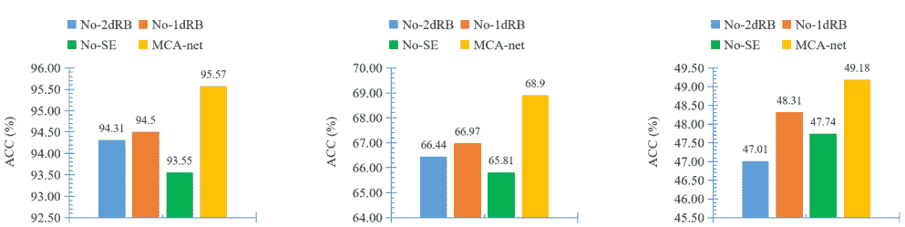

### b) PTBXL数据集上的消融实验

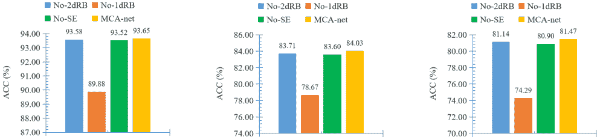

图4. 通道注意力网络中的消融实验。

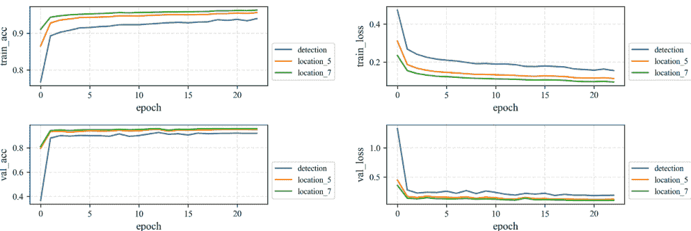

图5. 学习曲线示例（PTBXL数据集上的第10个折）。

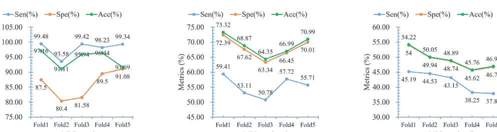

| 验证数据 | Fold 1 | Fold 2 | Fold 3 | Fold 4 | Fold 5 | 总计 |
|---|---|---|---|---|---|---|
| 记录数 | 8072 | 8247 | 8110 | 7800 | 7915 | 40144 |
| 患者数 | 33 | 35 | 35 | 38 | 38 | 179 |

图6. PTB数据集上的5折交叉验证结果。


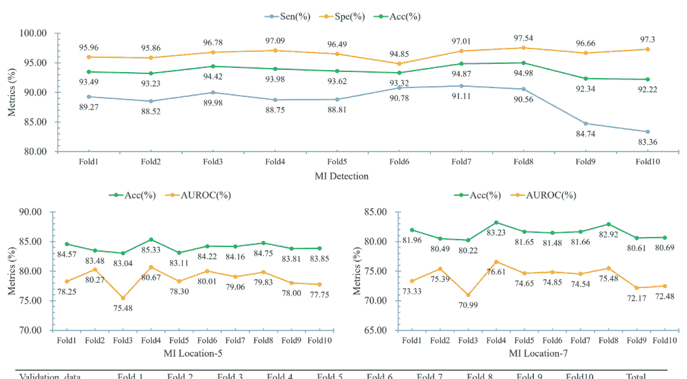

| 验证数据 | 第 1 折 | 第 2 折 | 第 3 折 | 第 4 折 | 第 5 折 | 第 6 折 | 第 7 折 | 第 8 折 | 第 9 折 | 第 10 折 | 总计 |
|---|---|---|---|---|---|---|---|---|---|---|---|
| 记录数 | 1491 | 1507 | 1522 | 1479 | 1504 | 1496 | 1521 | 1475 | 1501 | 1517 | 15013 |
| 患者数 | 1332 | 1334 | 1363 | 1330 | 1364 | 1342 | 1349 | 1319 | 1381 | 1346 | 13460 |

图 7. PTBXL 数据集上的 10 折交叉验证结果。

**表 9**
MCA-net 与三种最先进方法的训练资源对比。

| 模型 | 可训练参数 |
|---|---|
| MFB-CBRNN | 14,462 |
| ML-ResNet | 83,006 |
| ML-Net | 3,849,314 |
| MCA-net | 112,250 |

三项任务中训练集和验证集上的准确率和损失动态。我们可以轻松地观察到，MCA-net 在每项任务上的性能随着 epoch 的增加逐渐提高，并迅速达到稳定。PTBXL 和 PTB 数据集上的学习曲线完整结果显示在补充材料中（图 S1–15）。

## 6.3. 进一步分析

- **时间和资源**：为了证明与其他方法相比，我们的方法在时间和资源方面相对经济。我们首先统计每种方法完成每个任务一个 epoch 和一个 fold 所需的平均时间开销。对于 MCA-net 多任务模型，每个任务将同时完成。对于对比方法，我们并行执行三个任务，并选择最后完成任务的训练时间作为比较基准。然后，我们通过考虑每个任务所需的可训练参数总和，进一步比较模型的资源开销。从表 8 和表 9 可以看出，MFB-CBRNN 所需的可训练参数最少，但训练时间相对较长，尤其是在 PTB 数据集上一个 fold 的时间开销。相比之下，ML-Net 在两个数据集上的时间开销相对较低，但所需的可训练参数远多于其他方法。相对而言，ML-ResNet 和我们的方法在时间和资源开销之间取得了更好的平衡，但我们的方法在每个任务上的分类性能优于 ML-ResNet。未来，我们将在确保高分类准确率的同时，进一步优化模型以减少模型开销。

- **收敛性**：我们基于 PTB 和 PTBXL 数据集上的学习曲线对 MCA-net 进行了收敛性分析。由于篇幅限制，我们仅随机给出了 PTBXL 数据集部分学习曲线，如图 5 所示。它显示了

- **定性结果**：我们分别在 PTB 和 PTBXL 数据集上使用 5 折和 10 折交叉验证，以获得更可靠的结果。在此情况下，每个 fold 依次用作测试集，其余数据用作训练集。因此，为了对实验结果进行进一步的定性分析，我们详细列出了每个 fold 的性能结果以及相应的记录数和患者数，如图 6 和图 7 所示。可以看到，MCA-net 在 MI 检测任务上取得了良好的整体性能，大多数 fold 的准确率超过 95%。在 PTB 数据集上，不同 fold 之间的结果存在一定差异，这可能受患者特异性的影响，因为每个 fold 中涉及的患者数量有限。相比之下，PTBXL 数据集上不同 fold 之间的结果相对稳定。这表明 MCA-net 具有良好的适应性和稳定性。

- **局限性**：虽然我们的方法在每个任务上都显示出一些优势，但仍存在一些局限性。首先，由于数据不平衡，模型在某些标签上存在欠学习问题，导致模型性能出现瓶颈。例如，如图 8 所示（由于 PTBXL 数据集是多标签数据集，我们仅给出了 PTB 数据集上每个任务的混淆矩阵），在 MI 位置任务中，ALMI 的分类准确率明显低于其他标签。其次，在 MI 位置任务中，我们发现 ALMI 与 AMI 以及 IMI 与 ILMI 容易混淆。这可能是因为梗死位置的邻近性通常会导致类似的心电图波形异常，从而使我们的模型更难以区分它们，这表明我们的方法在识别相邻梗死位置的能力上仍需进一步改进。

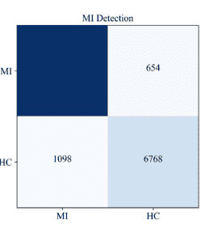
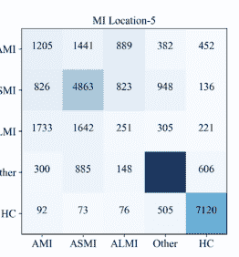
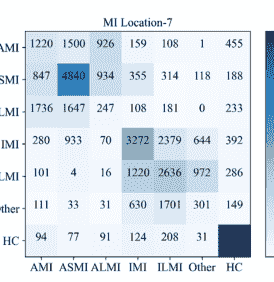

图 8. PTB 数据集上 MI 检测和定位任务的混淆矩阵。

# 7. 结论

临床实践中，心脏病学家可以通过分析异常心电图信号对 MI 做出初步诊断，但要快速准确地给出诊断非常困难。因此，提供自动计算机辅助方法可以在减轻医务人员负担的同时，为患者预后评估提供可靠支持。

本文设计了一种名为 MCA-net 的多任务通道注意力网络。它使用多个独立通道，从每个导联中更全面地提取有效特征。每个通道包含多个堆叠的卷积层，其中包含 SE 模块以更好地分配特征权重。我们还添加了一个多任务框架，以额外考虑 MI 检测任务和定位任务之间的共享和互补信息，从而进一步提升 MCA-net 的性能。实验结果表明，我们的模型具有最先进的性能。

虽然我们的方法在每个任务上都显示出一些优势，但仍存在一些局限性。首先，由于数据不平衡，模型在某些标签上存在欠学习问题。其次，MCA-net 在区分相关标签时容易混淆。为了解决上述问题，未来我们将考虑收集更多临床数据，并借助对比学习等数据增强技术进一步改进 MCA-net。此外，考虑到 12 导联心电图的多视图特性，可以从多视图融合的角度考虑更有效的导联融合方法，以获得更丰富的特征表示。

# 竞争利益声明

作者声明，他们没有已知的可能影响本文所报告工作的竞争性财务利益或个人关系。

# 致谢

该工作部分得到中国国家重点研发计划（编号：2021YFF1201200）、NSFC-浙江联合基金工业化与信息化融合（编号：U1909208）、111 计划（编号：B18059）和长沙市科学技术重大项目（编号：kh2202004）的支持。该工作部分使用中南大学高性能计算中心的计算资源完成。

# 附录 A. 补充数据

本文相关补充材料可在以下网址在线查找：https://doi.org/10.1016/j.compbiomed.2022.106199。

# 参考文献

- [1] Javad Hassannejad Joloudari, Sanaz Mojar, Issa Nodehi, Amir Mashkool, Samiyeh Khosravi, Mitra Akbari, Edris Hassannejad 等人，关于心肌梗死疾病诊断中人工智能应用的综述，2021，arXiv 预印本 arXiv:2107.06179。
- [2] Emilia J. Benjamin 等人，心脏病和中风统计——2019 年更新：美国心脏协会报告，Circulation 139 (10) (2019) e56–e528。
- [3] R.M. Savage 等人，心肌梗死患者尸检解剖所见与心电图变化的相关性：典型前壁和后壁梗死患者的回顾性研究，Circulation 55 (2) (1977) 279–285。
- [4] Ammar Awad Mutlag 等人，用于 ECG 监测的关键医疗任务管理模型 (CHTM) 的雾-云计算多代理系统，Sensors 21 (20) (2021) 6923。
- [5] Ammar Awad Mutlag 等人，ECG 生物医学传感器的医疗资源管理优化框架，载于：《海量医疗物联网的高效数据处理》，Springer，2021，第 229–244 页。
- [6] Xinwen Liu 等人，ECG 诊断中的深度学习：综述，Knowl.-Based Syst. 227 (2021) 107187。
- [7] Patrick T. O'Gara 等人，2013 年 ST 段抬高型心肌梗死管理 ACCF/AHA 指南：美国心脏病学会基金会/美国心脏协会临床实践指南工作组报告，J. Am. Coll. Cardiol. 61 (4) (2013) e78–e140。
- [8] Ph. Gabriel Steg 等人，ST 段抬高型急性心肌梗死患者管理 ESC 指南，Eur. Heart J. 33 (2012) 2569–2619。
- [9] L.D. Sharma, R.K. Shukaria，基于最优特性导联特异性方法的心肌梗死检测与定位，Inov. Res. Biomed. Eng. 41 (1) (2020) 58–70。
- [10] Gong Zhang 等人，使用格拉姆角场和主成分分析网络的自动心肌梗死检测，IEEE Access 7 (2019) 171570–171583。
- [11] Nahan Ibn Hasan, Arnab Bhattacharjee，基于经验模态分解修改 ECG 信号的心血管疾病分类深度学习方法，Biomed. Signal Process. Control 52 (2019) 128–140。
- [12] Chaitra Sridhar 等人，使用 ECG 信号非线性特征的心肌梗死准确检测，J. Ambient Intell. Hum. Comput. 12 (3) (2021) 3227–3244。
- [13] Binhil Fatimah 等人，单导联 ECG 信号中高效心肌梗死检测，Biomed. Signal Process. Control 68 (2021) 102678。
- [14] Dionisije Sopie 等人，可穿戴系统上心肌梗死早期检测和预防的实时事件驱动分类技术，IEEE Trans. Biomed. Circuits Syst. 12 (5) (2018) 982–992。
- [15] Ashok Kumar Dohare 等人，基于支持向量机的 12 导联 ECG 中心肌梗死检测，Appl. Soft Comput. 64 (2018) 138–147。


- [16] Chuang Han, Li Shi, 基于能量熵和形态特征融合的心肌梗死自动可解释检测, 计算机方法与生物医学程序. 175 (2019) 9–23.

- [17] Awni Y. Hannun, Pranav Rajpurkar, Masoumeh Haghpanahi, Geoffrey H. Tison, Codie Bourn, Mintu P. Turakhia, Andrew Y. Ng, 基于深度神经网络的动态心电图心脏病专家水平心律失常检测与分类, 自然医学. 25 (1) (2019) 65–69.

- [18] Zahra Ebrahimi, Mohammad Loni, Masoud Daneshtalab, Arash Gahre baghi, 心电图心律失常分类深度学习方法综述, 专家系统与应用 X. 7 (2020) 100033.

- [19] Nils Strodthoff, Claas Strodthoff, 使用完全卷积神经网络检测和解释心肌梗死, 生理测量. 40 (1) (2019) 015001.

- [20] U. Rajendra Acharya, Hamido Fujita, Shu Lih Oh, Yuki Hagiwara, Jen Hong Tan, Muhammad Adam, 使用心电图信号的深度卷积神经网络自动检测心肌梗死的应用, 信息科学. 415–416 (2017) 190–198.

- [21] Ziyang He, Shuaiying Yuan, Jianhui Zhao, Bo Du, Zhiyong Yuan, Adi Alhu-dhaif, Fayadh Alenezi, Sara A. Althubiti, 一种新型心肌梗死定位方法，采用多支路DenseNet和基于空间匹配的主动半监督学习, 信息科学. 606 (2022) 649–668.

- [22] Chuang Han, Li Shi, ML-ResNet: 一种用于12导联心电图检测和定位心肌梗死的新型网络, 计算机方法与生物医学程序. 185 (2020) 105138.

- [23] Wenhan Liu, Fei Wang, Qijun Huang, Sheng Chang, Hao Wang, Jin He, MFB-CBRNN: 一种用于12导联心电图心肌梗死检测的混合网络, IEEE 生物医学与健康信息学期刊. 24 (2) (2020) 503–514.

- [24] Yangjie Cao, Tingting Wei, Bo Zhang, Nan Lin, Joel J.P.C. Rodrigues, Jie Li, Di Zhang, ML-net: 一种用于检测心肌梗死的多通道轻量级网络, IEEE 生物医学与健康信息学期刊. 25 (10) (2021) 3721–3731.

- [25] Lidan Fu, Binchun Lu, Bo Nie, Zhiyun Peng, Hongying Liu, Xitian Pi, 基于12导联心电图信号的带注意力机制混合网络用于心肌梗死检测与定位, 传感器. 20 (4) (2020) 1020.

- [26] Jie Hu, Li Shen, Gang Sun, 挤压-激励网络, in: IEEE计算机视觉与模式识别会议论文集, CVPR, 2018, pp. 7132–7141.

- [27] K. Minami, H. Nakajima, T. Toyoshima, 基于傅里叶变换神经网络的室性心动过速心律失常实时鉴别, IEEE 生物医学工程汇刊. 46 (2) (1999) 179–185.

- [28] D.A. Coast, R.M. Stern, G.G. Cano, S.A. Briller, 基于隐马尔可夫模型的心脏心律失常分析方法, IEEE 生物医学工程汇刊. 37 (9) (1990) 826–836.

- [29] Li Sun, Yanping Lu, Kaitao Yang, Shaozi Li, 使用多实例学习的心电图分析用于心肌梗死检测, IEEE 生物医学工程汇刊. 59 (12) (2012) 3348–3356.

- [30] S. Selva Nidhyananthan, S. Saranya, R. Shantha Selva Kumari, 心肌梗死检测与心脏病患者身份验证, in: 2016年无线通信、信号处理与网络国际会议 (WiSPNET), 2016, pp. 1107–1111.

- [31] Narjes Benameur, M. Abed Mohammed, Ramzi Mahmoudi, Younes Arous, Begoña Garcia-Zapirain, Karrar Hameed Abdulkareem, Mohamed Hedi Bedoui, 心脏壁运动异常区域评估的参数方法：比较研究, 计算材料与连续介质. 69 (1) (2021) 1233–1252.

- [32] Hope Pereira, Nivedita Daimiwal, 基于小波的心肌梗死和健康患者特征分析, in: 2016年信号处理进步会议, CASP, 2016, pp. 164–169.

- [33] Jia Liu, Chi Zhang, Tapani Ristaniemi, Fengyu Cong, 使用双Q可调Q因子小波变换从多导联心电图中检测心肌梗死, in: 2019年第41届IEEE医学与生物学工程学会年会国际会议, EMBC, 2019, pp. 1496–1499.

- [34] Teh Ying Wah, Mazin Abed Mohammed, Uzair Iqbal, Seifedine Kadry, Arnab Majumdar, Oratai Thinnukool 等, 用于心电图心跳分类的新型DERMA融合技术, 生命. 12 (6) (2022) 842.

- [35] Garima Sahu, Kailash Chandra Ray, 一种高效的心肌梗死检测与定位方法, IEEE 仪器与测量汇刊. 71 (2021) 1–12.

- [36] Wenhan Liu, Mengxin Zhang, Yidan Zhang, Yuan Liao, Qijun Huang, Sheng Chang, Hao Wang, Jin He, 用于心肌梗死检测的实时多导联卷积神经网络, IEEE 生物医学与健康信息学期刊. 22 (5) (2017) 1434–1444.

- [37] Wenqiang Li, Yuk Ming Tang, Kai Ming Yu, Suet To, SLC-GAN: 基于生成对抗网络和卷积神经网络的单导联心电图合成自动心肌梗死检测模型, 信息科学. 589 (2022) 738–750.

- [38] Wenhan Liu, Qijun Huang, Sheng Chang, Hao Wang, Jin He, 基于心电图的多特征分支卷积神经网络用于心肌梗死诊断, 生物医学信号处理与控制. 45 (2018) 22–32.

- [39] Yang Cao, Wenyuan Liu, Shuang Zhang, Lisheng Xu, Baofeng Zhu, Huiling Cui, Ning Geng, Hongguang Han, Stephen E. Greenwood, 基于多尺度ResNet和注意力机制的心肌梗死检测与定位, 生理学前沿. 13 (2022) 24.

- [40] R. Bousseljot, D. Kreiseler, A. Schnabel, 通过互联网使用PTB的EKG信号数据库CARDIO DAT, 生物医学技术. 40 (1995) 317–318.

- [41] Patrick Wagner, Nils Strodthoff, Ralf-Dieter Bousseljot, Dieter Kreiseler, Fatima I. Lunze, Wojciech Samek, Tobias Schaeffter, PTB-XL，一个大型公开可用的心电图数据集, 科学数据. 7 (1) (2020) 1–15.

- [42] Rich Caruana, 多任务学习, 机器学习. 28 (1) (1997) 41–75.

- [43] Jonathan Baxter, 归纳偏置学习模型, 人工智能研究杂志. 12 (2000) 149–198.

- [44] Sebastian Ruder, 深度神经网络中多任务学习概览, 2017, arXiv 预印本 arXiv:1706.05098.

- [45] Martin Abadi, Paul Barham, Jianmin Chen, Zhifeng Chen, Andy Davis, Jeffrey Dean, Matthieu Devin, Sanjay Ghemawat, Geoffrey Irving, Michael Isard, 等, Tensorflow：大规模机器学习系统, in: 第12届USENIX操作系统设计与实现研讨会 (OSDI 16), 2016, pp. 265–283.

