# 微软认证专家 网络安全架构师 学习指南：考试 SC-100


Includes one year of FREE access after activation to the interactive online learning environment and study tools:

- Custom practice exam
- 100 electronic flashcards
- Searchable key term glossary


## MCE


Kathiravan Udayakumar
Puthiyavan Udayakumar
SYBEX A Wiley Brand
To the Wiley team for this opportunity and all their support to complete this book.
—Kathiravan Udayakumar

I am grateful to my mother and father for all you have done for me.
I am deeply thankful to my better half for helping me thrive in our life journey.
To my dearest brother and mentor, my sincere gratitude.
To the Wiley team, thanks for creating this opportunity.
—Puthiyavan Udayakumar

## Acknowledgments

We want to express our sincere thanks to Sybex for continuing to support this project.
Although this book bears our name as authors, numerous people contributed to its design and development of the content. They helped make this book possible, or at best, it would be in a lesser form without them. Kenyon Brown was the acquisitions editor and so helped get the book started. Pete Gaughan, the managing editor, oversaw the book as it progressed through all its stages. Jon Buhagiar was the technical editor who checked the text for technical errors and omissions—but any remaining mistakes are our own. Patrick Walsh, the project editor, helped keep the text grammatical and understandable. Archana Pragash, content refinement specialist, and others from her team helped check the text for typos and shaped the content.

## About the Authors

**Kathiravan Udayakumar** is Head of Delivery and Chief Architect for Oracle Technologies & Analytics (Europe Practice) at Cognizant covering various elements of technology services in on-prem and cloud. He has more than 19 years of experience in architecture, design, implementation, administration, and integration with greenfield IT systems, ERP, and cloud platforms and solutions across various business domains and industries. He is passionate about networking from his undergraduate studies and is a Cisco Certified Network Associate (CCNA). He has also proposed, in his undergraduate thesis protocols for optimal routings in complex networks, using the Differential Routing Information Protocol (DRIP) to avoid pinch-hole congestion.

**Puthiyavan Udayakumar** is an infrastructure architect with more than 14 years of experience in modernizing and securing IT infrastructure, including the cloud. He has been writing technical books for more than 10 years on various infrastructure and security domains. He has designed, deployed, and secured IT infrastructure out of and on-premises and on the cloud, including virtual servers, networks, storage, and desktops for various industries such as pharmaceutical, banking, healthcare, aviation, federal entities, and so on. He is an Open Group Certified Master Certified Architect.

## About the Technical Editor

**Jon Buhagiar** (Network+, A+, CCNA, MCSA, MCSE, BS/ITM) is an information technology professional with two decades of experience in higher education. During the past 23 years he has been responsible for network operations at Pittsburgh Technical College and has led several projects, such as virtualization (server and desktop), VoIP, Microsoft 365, and many other projects supporting the quality of education at the college. He has achieved several certifications from Cisco, CompTIA, and Microsoft, and has taught many of the certification paths. He is the author of several books, including Sybex's CompTIA Network+ Review Guide: Exam N10-008 (Sybex, 2021) and CCNA Certification Practice Tests: Exam 200-301 (Sybex, 2020).

## 简介

欢迎使用 MCE Microsoft® 认证专家网络安全架构师学习指南：Exam SC-100。本书为 Microsoft 的 Exam SC-100 提供了坚实的基础。本简介介绍了本书和 Microsoft Certified Architect SC-100 考试的基本概况。

## 什么是 Azure？

Microsoft Azure 云平台包含 200 多种 IT 产品和服务，旨在帮助您实现新的 IT 解决方案，解决当今的挑战并创造未来。您可以使用所选的工具和框架，在多个云、本地和边缘位置构建、运行和管理应用程序。

全球各地的组织可以通过 Microsoft Azure 实现更紧密的数字化连接，网络安全策略可以转变其安全性。在云环境中，安全即服务为客户提供数据、应用程序、标识和基础架构的安全策略。网络安全架构师角色在云环境中不断发展，专业人员将工作负载保护到云端，管理混合安全，保护远程员工，并支持以战略场景为导向的数字化转型。

## 关于 SC-100 认证考试

SC-100 认证考试测试您对 Microsoft Azure 网络安全架构师角色的知识和理解。具体而言，该认证旨在验证您在保护 Azure 工作负载方面的专业知识，包括数据、应用程序、访问管理、标识、基础架构合规性、治理风险合规性以及对 Azure 服务的隐私访问。

将测试您将要求转化为安全、可扩展且可靠的网络安全设计和网络安全解决方案部署的能力。

本考试测试您对企业架构所有方面以及 Microsoft 网络安全架构师角色的深入理解，以设计和发展保护公司使命和业务流程的网络安全策略。除了 GRC 技术策略外，您作为网络安全架构师在为数据、应用程序、访问管理、标识和基础架构创建零信任安全策略，以及设计零信任架构和评估安全运营策略方面的技能，将在本 SC-100 考试中得到验证。

## 为什么要成为认证的 Microsoft Azure 网络安全架构师？

您是否希望通过规划、设计、部署和管理客户的 Azure 网络安全解决方案，向公司或客户展示您的 Microsoft Azure 网络安全技能和经验？

因为 Microsoft 认证是掌握实用技能的全球认可且获得行业背书的证明，持有此类认证的人被认为更高效、更富生产力。Microsoft 认证通过证明您具备当前 Microsoft 网络解决方案的广泛技能和经验，使您与众不同。

Microsoft 认证考试是展示您的专业知识和构建简历的好方法。您可以通过参加 Microsoft 认证 SC-100 考试来验证您的产品知识和经验。

> 在 2020 年开始的 COVID-19 大流行期间及之后，许多测试组织更改了现场测试程序，有些甚至提供远程考试监考。鉴于此，请务必在注册前和考试当天之前，与 Microsoft 网站以及您计划参加考试的提供商确认考试现场程序的最新实时变更。

## 准备成为认证的 Microsoft 网络安全架构师

为规划和实施组织的网络安全策略，网络安全架构师会持续与 IT 安全、隐私和其他组织角色协作。

本考试要求在多个安全工程领域具备高级知识和经验，包括标识和访问、平台保护、安全运营以及数据和应用程序安全。此外，您应熟悉混合和云实现。

要获得 Microsoft 网络安全架构师专家认证，考生必须通过以下任一考试：SC-200、SC-300、AZ-500 或 MS-500。Microsoft 强烈建议您在参加 SC-100 考试之前先完成这一步。

备考的最佳方式是通过学习和实践操作。学习本书将为您提供准备 Microsoft 网络安全架构师认证 SC-100 所需的信息和技能。


我们建议为 MCE SC-100 考试投入大约 10 周的时间进行密集学习。以下是一些最大化学习时间的建议。您可以根据自身的学习经验对本列表进行必要的修改。

- 每天获得 Azure 门户的实操经验，阅读有关 Azure 的文章，并学习 Azure 网络安全术语。
- 花一两个晚上阅读本书的每一章，并复习其中的复习材料。
- 回答所有复习问题，并参加本书网站上提供的模拟考试。
- 复习 Microsoft 页面上针对本次考试列出的 Microsoft Azure SC-100 衡量技能。learn.microsoft.com/en-us/certifications/exams/sc-100
- 每个考试和 Microsoft 认证页面上都会有“衡量的技能”部分。以下是将对 SC-100 考试进行评估的主要技能。可以从 Microsoft 网站下载本次考试的详细大纲。
- 设计零信任策略和架构。
- 评估治理风险合规技术策略和安全运营策略。
- 为基础设施设计安全。
- 为数据和应用程序设计策略。
- 推荐安全最佳实践和优先级。
- 使用本书在线学习工具中包含的闪存卡来加强对概念的理解。
- 在 Microsoft Learn 上参加免费的实践学习课程。learn.microsoft.com/en-gb/certifications/exams/sc-100
- 阅读 Microsoft Azure 文档。docs.microsoft.com/en-us/azure/?product=popular

## 如何成为认证的 Microsoft 网络安全架构师

当您准备就绪后，可以从 Microsoft 认证考试 SC-100 详情页面注册考试。learn.microsoft.com/en-gb/certifications/exams/sc-100

在认证详情页面上，您会在“安排考试”部分找到注册选项。

此次考试将测试在安全性、合规性和身份方面拥有先前 Azure 认证的 Azure 安全工程师。安全工程师应在各种安全工程领域（包括身份与访问、平台保护、安全运营、数据安全和应用程序）拥有高级专业知识和知识。他们还应熟悉混合或基于云的实现。刚入门的人应该改为参加 SC-900：Microsoft 安全性、合规性和身份基础知识。

您可以在线或在本地考试中心参加考试，因此您需要选择考试中心或使用在线监考。两者各有优势。本地考试中心提供安全环境。通过在线参加考试，您几乎可以随时随地参加考试。但是，需要可靠的连接和安全的浏览器。在线参加考试时，系统将首先进行检查，以确保其满足要求。

## 谁应该购买此书

任何想要通过 Microsoft SC-100 考试的人都将从阅读本书中受益。如果您是 Azure 网络安全的新手，本书将涵盖您需要学习的材料，从基础开始。接着，它提供了您需要具备的知识，以便能够熟练通过 SC-100 考试。如果您已经熟悉 Azure 网络安全，本书可以作为复习和回顾课程，帮助您了解可能并不完全了解的信息。无论哪种情况，阅读本书都将帮助您通过 Microsoft SC-100 考试。

本书假设您至少了解一些 Azure 知识，并在广泛的安全工程领域（包括身份与访问、平台保护、安全运营、保护数据和保护应用程序）拥有基本的网络安全经验和知识。如果您有混合和云实施方面的经验，这将为您开启 SC-100 之旅提供巨大的价值。

## 本书的组织方式

本书涵盖四个领域：零信任、治理风险合规（GRC）、安全运营（SecOps）以及数据和应用程序。此外，学生将能够使用零信任原则设计和构建解决方案，并为多种服务模型（SaaS、PaaS、IaaS）中的云基础设施指定安全要求。

本书由九章及补充信息组成。各章组织如下：

### 第1章：定义并实施整体安全策略和架构

本章涵盖云和网络安全基础、零信任入门、在架构中设计集成点、根据业务目标设计安全需求、解读安全需求的技术能力、为复原力方法设计安全、识别混合和多租户环境相关的安全风险，以及规划技术和治理策略的流量过滤与分段。

### 第2章：定义安全运营策略

第2章涵盖设计日志和审计安全策略、为混合和多云环境开发安全运营、为安全信息和事件管理（SIEM）与安全编排、自动化和响应（SOAR）设计策略、评估安全工作流、审查事件管理的安全策略、针对技术威胁情报评估安全运营、监控来源以获取威胁和缓解措施的洞察，以及在架构中开发集成点。

### 第3章：定义身份安全策略

本章涵盖云资源访问策略的设计、推荐身份存储（租户、B2B、B2C、混合）、推荐身份验证策略、推荐授权策略、设计条件访问系统、设计角色分配和委派策略、为特权角色访问基础设施设计安全策略（包括基于身份的防火墙规则、使用 Azure PIM），以及为特权活动设计安全策略（包括 PAM、权利管理、云租户管理）。

### 第4章：识别法规遵从策略

第4章涵盖法规遵从策略入门、评估合规要求的技术能力、使用 Microsoft Defender for Cloud 评估基础设施合规性、识别合规问题并推荐解决措施、开发和验证 Azure 策略、设计数据驻留要求，以及将隐私要求转换为安全要求。

### 第5章：识别安全态势并推荐管理风险的技术策略

第5章涵盖使用基准分析安全态势、使用 Microsoft Defender for Cloud 分析安全态势、使用安全分数评估安全态势、评估云工作负载安全、为 Azure 着陆区规划和设计安全、识别技术威胁、推荐缓解措施，以及通过使用安全控件提供降低已识别风险的建议。

### 第6章：定义保护基础设施的策略

第6章涵盖跨团队规划和部署安全策略、建立安全策略主动且持续演进的流程、为服务器和客户端端点指定安全基线、为服务器指定安全基线，以及为移动设备和客户端指定安全要求（包括端点保护、强化和配置）。此外，还包括为保护 Active Directory 域服务指定要求；设计管理机密、密钥和证书的策略；设计安全远程访问策略；以及设计保护特权访问的策略。

### 第7章：定义保护 PaaS、IaaS 和 SaaS 服务的策略和要求

第7章涵盖建立 PaaS 安全基线、为 IaaS 服务建立安全基线、为 SaaS 建立安全基线、为 IoT 工作负载建立安全要求、建立数据安全要求、定义 Web 工作负载的安全要求、确定存储工作负载的安全要求、定义容器安全要求，以及为容器编排提供安全规范。

### 第8章：定义应用程序和数据的策略和要求

第8章涵盖为缓解应用程序威胁指定优先级、为新应用程序加入定义安全标准、为应用程序和 API 定义安全策略、识别敏感数据并对其进行保护、设计缓解数据威胁的策略，以及定义静态数据和传输中数据的加密标准。

### 第9章：推荐安全最佳实践和优先级

第9章涵盖多个领域的最佳实践，包括网络安全能力和控制、内部和外部攻击、零信任安全、零信任快速现代化计划、DevSecOps 流程以及资产保护。它还涵盖管理和最小化风险的策略、针对勒索软件防护和基于敲诈的攻击进行规划、保护资产免受勒索软件攻击，以及推荐 Microsoft 勒索软件最佳实践。

## 章节功能

每章开头都列出了本章涵盖的 Microsoft Cybersecurity Architect SC-100 考试目标。请注意，本书并未按顺序涵盖这些目标。因此，您不应对本书中目标的一些奇特顺序感到惊讶。

每章中的示例旨在巩固刚刚学习的内容。我们为每章列出了可用于备考的几个要素：

### 考试要点

每章中的本部分提供了本章所呈现关键信息的概述。您应该能够完成每项任务或传达所请求的信息。

### 复习问题

每章末尾有 20 道复习问题。这些问题的答案在书末的附录中提供；您可以在那里核对答案。如果无法正确回答至少 80% 的这些问题，则应复习本章或难以理解的部分。

本书包含的复习问题、评估测试和其他测试元素均非源自 SC-100 考试题目，因此请勿背诵这些问题的答案并假设这样做就能让您通过考试。您应该学习本书文本中描述的基础主题。这样，您就能回答本书提供的问题并通过考试。学习基础主题也是在工作中最能帮助您的方法——这也是 SC-100 等认证的目标。


要充分利用本书，您应该从头到尾阅读每一章，然后使用章末元素检查您的记忆和理解。即使您已经熟悉某个主题，也应该浏览该章；Azure 网络安全足够复杂，完成一项任务通常有多种方法，因此即使您在某个领域已经很称职，也可能会学到新东西。

## 奖励数字内容

我们整理了一些出色的在线工具，帮助您通过 SC-100 考试。随 MCE Microsoft® 认证专家网络安全架构师学习指南：考试 SC-100 提供的交互式在线学习环境提供题库和学习工具，帮助您备考。这些配套文件中可用的项目包括以下内容：

- **练习测试** 本书中的所有问题均出现在我们专有的数字测试引擎中——包括本简介末尾的 30 道题评估测试、一份 65 道题的练习考试，以及构成每章末尾复习问题部分的 180 道题。此外，还有一份 30 道题的附加考试。

- **电子闪卡** 数字配套文件包含 100 道闪卡格式的问题（一个问题后跟一个正确答案）。您可以使用这些题目复习 SC-100 考试目标的知识。

- **术语表** 本书中的关键术语及其定义可作为完全可搜索的 PDF 提供。

### 交互式在线学习环境和题库

您可以在 www.wiley.com/go/sybextestprep 访问所有这些资源。到达后，从列表中选择您的书籍，完成注册（包括回答问题以证明您拥有本书），系统将向您发送个人 PIN 码。收到 PIN 码后，请按照电子邮件中的说明操作，或前往 www.wiley.com/go/sybextestprep 激活 PIN 码，注册账户或将新书添加到现有账户中。

**注意** 与所有考试一样，考试 SC-100：Microsoft 网络安全架构师会定期更新，并可能最终被淘汰或替换。在 Microsoft 不再提供此考试后的某个时间点，我们书籍和在线工具的旧版本将被淘汰。如果您在考试淘汰后购买了此书，或在考试淘汰后尝试在 Sybex 在线学习环境中注册，请知悉我们不保证该考试的在线 Sybex 工具在考试不可用后仍然可用。

## 本书使用的约定

本书使用特定的排版样式，帮助您快速识别重要信息，并避免对屏幕提示等单词含义产生混淆。特别是，请注意以下样式：

- 等宽字体表示配置文件的内容、文本模式 Linux shell 提示符处显示的消息、文件名、文本模式命令名和 Internet URL。

除了这些可应用于单个单词或整个段落的文本约定外，还有一些约定用于突出显示文本段落。


> 提示提供可以节省您时间或避免沮丧的信息，并且这些信息可能并非完全显而易见。提示可能会描述如何绕过限制或如何使用功能来执行不寻常的任务。


> 注意表示有用或有趣的信息，或提供与主文本略属边缘的额外相关信息。

| 侧边栏 |
| :--- |
| 侧边栏类似于注释，但更长。侧边栏中的信息有用，但不适合放入主文本流中。 |

## 使用本书

要充分利用本书，您只需一个 Azure 订阅（付费）和一个互联网连接，这是使用和练习本书在线练习所必需的。

除了基于 Web 的控制台外，Azure 门户还适用于桌面、平板电脑和移动设备。使用 Azure 门户必须在浏览器上启用 JavaScript。请确保使用适用于您操作系统的最新浏览器。

本书包含真实世界示例和场景的详细解释，涵盖所有 SC-100 网络安全架构师考试目标。借助这本考试参考书，IT 安全专业人员将学习在 Microsoft 认证专家级别取得成功所需的批判性思维和决策能力。

虽然我们已竭力确保本书尽可能准确，但 Azure 会不断变化。本书中，某些涉及 Azure 门户的屏幕截图可能与您显示器上的内容不同，因为 Azure 门户现在与本书出版时已有所不同。此外，可能还发生了轻微的界面更改、名称更改等。

作为网络安全架构师，您的职责包括设计和部署 Azure 网络安全解决方案。您需要使用网络安全解决方案来维护安全性、隐私性和合规性。本书将帮助您使用 Azure 参考框架、架构、安全基线和最佳实践来设计、部署和管理网络安全解决方案。

虽然本书涵盖考试中的所有主题，但您不会找到可能出现在真实考试中的每一道题目。我们无法涵盖特定问题，因为只有 Microsoft 考试团队成员可以访问考试题目，并且 Microsoft 会不断添加新的考试题目。因此，请将本书视为您相关真实世界经验和其他学习材料的补充。

## 技术要求

除了付费的 Azure 订阅和互联网连接外，以下内容有助于您轻松阅读本书：

- Azure 订阅（必备）：您可以通过访问 azure.microsoft.com 注册。

- PowerShell：运行 `$PSVersionTable.PSVersion` 以检查您安装的 PowerShell 版本。您必须安装 PowerShell 7.0.6 LTS 或 PowerShell 7.1.3 或更高版本。

- Azure PowerShell 模块：下载适用于 Azure 安全模块的最新 PowerShell 模块。默认情况下您不会拥有全部模块。

- Azure PowerShell：要运行 PowerShell，一台配备 4 GB 内存的 Windows 10 或 11 计算机即可满足要求。

## SC-100 考试目标

本书结构基于 Microsoft 发布的“考试 SC-100：Microsoft 网络安全架构师–衡量的技能”文档（可在 query.prod.cms.rt.microsoft.com/cms/api/am/binary/RWVbXN 获取）。

SC-100 涵盖以下五个主要主题领域：

| 主题领域 | 考试占比 |
|---|---|
| 设计零信任策略和架构 | 30%–35% |
| 评估治理风险合规（GRC）技术策略和安全运营策略 | 10%–15% |
| 设计基础架构安全性 | 10%–15% |
| 设计数据和应用程序策略 | 15%–20% |
| 推荐安全最佳实践和优先级 | 20%–15% |

本书的九章分别对应每个衡量的 Azure 技能。以下表格指示书中涵盖主题的位置。

### 衡量的技能：设计零信任策略和架构

| 考试目标 | 章节 |
|---|---|
| 定义并实施整体安全策略和架构 | 1 |
| 定义安全运营策略 | 2 |
| 定义身份安全策略 | 3 |

### 衡量的技能：评估治理风险合规（GRC）技术策略和安全运营策略

| 考试目标 | 章节 |
|---|---|
| 设计法规合规策略 | 4 |
| 评估安全态势并推荐管理风险的技术策略 | 5 |

### 衡量的技能：设计基础架构安全性

| 考试目标 | 章节 |
|---|---|
| 定义保护服务器和客户端终端的策略 | 6 |
| 定义保护 PaaS、IaaS 和 SaaS 服务的策略和要求 | 7 |

### 衡量的技能：设计数据和应用程序策略

| 考试目标 | 章节 |
|---|---|
| 定义应用程序的策略和要求 | 8 |
| 定义保护数据的策略和要求 | 8 |


### 技能衡量：推荐安全最佳实践和优先级

| 考试目标 | 章节 |
|---|---|
| 使用 Microsoft Cybersecurity Reference Architecture (MCRA) 和 Azure Security Benchmarks 推荐安全最佳实践 | 9 |
| 使用 Cloud Adoption Framework (CAF) 推荐安全方法论 | 9 |
| 使用 Microsoft Security Best Practices 推荐勒索软件策略 | 9 |

> 微软保留在不事先通知的情况下更改考试领域和目标的权利。最新信息可在微软网站上找到：query.prod.cms.rt.microsoft.com/cms/api/am/binary/RWVbXN。

## 如何联系出版商

如果您发现本书中有任何错误，请告知我们。在约翰·威利父子公司，我们深知为客户提供准确内容的重要性，但即使我们竭尽全力，也可能会出现错误。
要提交您可能的勘误，请将其发送至我们的客户服务团队 wileysupport@wiley.com，邮件主题为“可能的图书勘误提交”。

## 评估测试

1. 谁负责设计、构建和维护组织 IT 环境的安全功能？

A. 基础架构架构师
B. 应用程序架构师
C. 安全分析师
D. 网络安全架构师

2. Sybex 想要一个能有效适应现代环境复杂性、拥抱移动员工队伍，并无论人员、设备、应用程序和数据位于何处都予以保护的新安全模型。以下哪项符合这些要求？

A. 零信任
B. DMZ 防火墙
C. 内部防火墙
D. 以上都不是

3. 公司希望在其远程办公室之间建立安全通信隧道。以下哪种技术不可以使用？

A. 站点到站点 VPN
B. 点到站点 VPN
C. ExpressRoute
D. 隐式 FTP over SSL

4. Azure 资源日志提供关于您的资源执行的操作的见解，使用的是哪个集成的 Azure 服务？

A. Azure Monitor
B. Graph API
C. Network Watcher
D. 以上全部

5. 正确或错误：Azure Active Directory (Azure AD) 活动日志不包括审核日志，后者提供每个记录事件的概述。

A. 正确
B. 错误

6. 正确或错误：Microsoft 365 管理中心不提供访问 Microsoft 365 活动日志的权限。

A. 正确
B. 错误

7. 作为公司纵深安全方法的一部分，可能会实施哪些措施？

A. 所有用户的多重身份验证
B. 域用户名和密码
C. 匿名登录
D. 以上都不是

8. 公司正在为其最终用户推出一款新应用。最终用户将使用带有公司品牌标识的自定义登录屏幕。组织应使用哪个 Azure 外部标识解决方案？

A. Azure AD B2B
B. Azure AD B2C
C. Azure AD 混合标识
D. 以上都不是

9. 您的公司已完成全面云迁移，并为所有最终用户购买了设备。最终用户通过在 Azure AD 中配置的公司帐户登录设备。请选择最能描述这些设备在 Azure AD 中配置方式的选项。

A. 设备已连接到 Azure AD。
B. 设备已连接到本地 AD 加入。
C. 设备已连接到外部云加入。
D. 以上都不是。

10. 一名 Sybex 开发人员希望应用程序连接支持 Azure AD 身份验证的 Azure 资源，而无需产生额外成本。最好用什么来描述应用程序的标识类型？

A. 第三方标识
B. 托管标识
C. 混合标识
D. 以上都不是

11. 正确或错误：使用单点登录，用户只需登录一次，即可访问大量应用程序或资源。

A. 正确
B. 错误

12. 正确或错误：通过帮助管理员了解并改善其合规性评分，Microsoft Purview Compliance Manager 帮助组织改善合规性态势、保持合规、降低数据保护风险、实施控制措施，并跟进法规和认证。

A. 正确
B. 错误

13. 正确或错误：您可以使用 Azure Policy 强制执行隐私要求，Azure Policy 与 Azure Resource Manager 深度集成，可让您的组织跨资源强制执行策略。

A. 正确
B. 错误

14. 客户可以使用各种 Microsoft 选项来保护 Azure 网络内部以及跨 Internet 外部的传输中数据；以下哪项有效？

A. VPN（使用 IPsec/IKE 加密）
B. TLS 1.2 或更高版本（通过 Azure Front Door 或应用程序网关等 Azure 组件）
C. 直接在 Azure 虚拟机上使用 Windows IPsec 或 SMB 及其他协议
D. 以上全部

15. 正确或错误：每个客户在设计和实施 Azure 落地区域时都应考虑安全性。

A. 正确
B. 错误

16. 正确或错误：通过 Microsoft Defender for Cloud，Azure 安全基准操作系统基线可用作 Windows 或 Linux 安全建议。

A. 正确
B. 错误

17. 为虚拟机提供远程访问时，Azure 提供不同的技术。以下是哪些？（选择三项。）

A. 实时访问
B. Azure 堡垒机
C. VPN 和 ExpressRoute
D. Azure 资源管理器

18. 您的公司已将 Microsoft 365 应用程序部署到所有员工。根据共同责任模型，谁负责这些员工的帐户和标识？

A. 您
B. Microsoft
C. 另一家云服务提供商
D. 以上都不是

19. 正确或错误：凭据不需要访问 API，因为容器集群不能跨越多个 Azure 区域。

A. 正确
B. 错误

20. 哪个 Azure 服务是一种云原生解决方案，可改进、监视和维护群集、容器及其应用程序的安全性？

A. Azure Monitor
B. Azure Insights
C. Microsoft Defender for Cloud
D. Microsoft Defender for Containers

21. Defender for Containers 在以下哪些环境中运行时保护您的 Kubernetes 集群？（选择三项。）

A. Azure Kubernetes 服务
B. 本地/IaaS 上的 Kubernetes
C. Amazon EKS
D. Azure Insights

22. 正确或错误：当您通过 Azure RBAC 向 Azure AD 安全主体分配权限时，请牢记最小权限原则。

A. 正确
B. 错误

23. 哪个工具允许软件架构师在潜在安全问题相对容易且成本效益较高时尽早识别并缓解这些问题？

A. OWASP
B. STRIDE
C. Microsoft 威胁建模工具
D. 以上全部

24. 正确或错误：始终使用标识服务进行身份验证，如果可用，优先使用加密密钥。

A. 正确
B. 错误

25. 您会使用哪种安全机制来确保员工数据被加密？

A. 静态数据
B. 传输中数据
C. 运动中数据
D. 以上全部

26. 最好用什么来描述数据主权的概念？

A. 不信任任何人，验证一切。
B. 所有数据（尤其是个人数据）都必须遵守数据所存储、处理或收集的国家或地区的法律法规。
C. 管理数据存储位置的法规。
D. 以上都不是。

27. 正确或错误：根据 Microsoft 对 Web 应用程序的建议，确保敏感内容已在浏览器上缓存。

A. 正确
B. 错误

28. 正确或错误：零信任快速现代化计划 (RaMP) 未包含在 Microsoft Cybersecurity Reference Architecture (MCRA) 中。

A. 正确
B. 错误

29. 您的公司已迁移到云。以下哪些责任可以转移给云提供商？

A. 物理硬件固件更新
B. 主机虚拟化解决方案
C. 存储虚拟化解决方案
D. A 和 B

30. 您的公司需要对端点、电子邮件和标识上的常见攻击进行响应式检测和修复；需要高质量警报；并且希望在响应过程中尽量减少摩擦和手动步骤。您应该采用哪个 Azure 服务？

A. 像 Microsoft 365 Defender 这样的扩展检测和响应 (XDR) 工具
B. Azure Monitor
C. Azure Sentinel
D. 以上都不是


## 评估测试答案

- 1. D. 网络安全架构师负责设计、构建和维护组织 IT 环境的安全功能。
- 2. A. 当今，组织需要一种新的安全模型，该模型能够有效适应现代环境的复杂性，拥抱移动劳动力，并无论人员、设备、应用程序和数据位于何处都予以保护。零信任提供了这一模型。
- 3. D. FTP over SSL 无法用于部署安全通信隧道。
- 4. A. Azure 资源日志通过与 Azure Monitor 集成，提供关于资源自身执行的操作的洞察。
- 5. B. 对应用程序、组、用户和许可证的更改均反映在 Azure Active Directory 审核日志中，这些日志全面报告 Azure AD 中的记录事件。
- 6. B. Microsoft 365 活动日志只能在 Microsoft 365 管理中心查看，尽管 Microsoft 365 活动日志和 Azure AD 活动日志共享许多目录资源。
- 7. A. 多重身份验证是身份和访问层纵深防御的一个示例。
- 8. B. Azure AD B2C 是一种客户身份验证解决方案，您可以使用品牌标识对其进行自定义。
- 9. A. 已加入 Azure AD 的设备是通过组织帐户加入 Azure AD 的，然后使用该帐户登录设备。设备通常由加入 Azure AD 的组织所有。
- 10. A. 托管标识是 Azure AD 中的一种服务主体，消除了开发人员管理凭据的需求。
- 11. A. 使用单一登录 (SSO)，用户只需一组登录凭据（例如用户名和密码）即可访问多个应用程序。
- 12. A. Microsoft Purview 合规管理器是 Microsoft Purview 合规门户中的一项功能，可让您的组织更方便、更快速地管理其多云合规要求。使用合规管理器，我们可以盘点数据保护风险、实施控制措施、跟进法规和认证，并在整个合规过程中向审计人员报告。
- 13. A. 您可以使用 Azure Policy 强制实施隐私要求。Azure Policy 深度集成到 Azure 资源管理器中，因此您的组织可以跨所有资源强制实施策略。通过在组织级别定义 Azure Policy，您可以防止开发人员分配违反这些策略的资源。

## 评估测试答案

- 14. D. 客户可以使用多种 Microsoft 选项，例如 VPN、TLS 1.2 或更高版本、Windows IPsec 或 SMB Azure VM（以及更多）来保护数据在 Azure 网络内部以及跨互联网外部传输过程中的安全。
- 15. 正确。设计和部署安全控制和流程以保护云环境是一个关键因素。
- 16. A. Microsoft Defender for Cloud 根据 Azure 安全基准 (ASB) OS 基线为 Linux 和 Windows 服务器提供安全建议。
- 17. A、B、C. 对于 VM 的远程访问，Azure 提供以下技术：Azure Bastion、包括 Azure ExpressRoute 和 VPN 在内的混合连接选项，以及即时 (JIT) 访问。
- 18. A. 使用共享责任模型，客户组织负责其数据，包括员工、设备、帐户和身份信息。
- 19. B. 访问 API 和登录所需的凭据必须受到保护，例如密码和令牌，因为容器集群可能跨越多个 Azure 区域。
- 20. D. Microsoft Defender for Containers 云原生解决方案改进、监控并维护集群、容器及其应用程序的安全性。
- 21. A、B、C. Azure Kubernetes Service、本地/IaaS 上的 Kubernetes 以及 Amazon EKS 保护您的 Kubernetes 集群。
- 22. 正确。在配置 Azure 存储帐户时，Microsoft 建议通过 Azure RBAC 向 Azure AD 安全主体分配权限时考虑最小权限原则。
- 23. C. Microsoft 威胁建模工具对 Microsoft 安全开发生命周期 (SDL) 至关重要。它允许软件架构师在开发早期识别并缓解潜在的安全问题。
- 24. A. 组织不应从零开始，而应使用指导和自动化来保护云应用程序；关键建议之一是始终使用身份服务进行身份验证，如果可用，则最好使用加密密钥。
- 25. A. 员工数据安全策略可能包括静态数据加密。
- 26. B. 数据主权与数据安全、云计算、网络和技术主权密切相关。数据主权是指数据受其收集所在国家法律和治理结构管辖的原则。
- 27. B. Microsoft 不建议在浏览器上缓存敏感内容。
- 28. B. 零信任快速现代化计划包含在 Microsoft 网络安全参考架构中，并概述了有助于您确定安全现代化优先级的最佳实践。
- 29. D. 云计算允许将许多职责转移给云提供商，包括更新固件和虚拟化解决方案。
- 30. A. Microsoft 365 Defender 提供全面的警报，并在对终端、电子邮件和身份的常见攻击进行响应式检测和修复时最大限度地减少差异和手动步骤。

## 第 1 章

## 定义并实施整体安全策略和架构

## 本章涵盖的 Microsoft SC-100 考试目标包括：

- 网络安全简介
- 零信任入门
- 使用 Microsoft 网络安全参考架构 (MCRA) 识别架构中的集成点
- 将业务目标转化为安全要求
- 将安全要求转化为技术能力，包括安全服务、安全产品和安全流程
- 为复原能力策略设计安全性
- 将混合或多租户环境集成到安全策略中
- 为安全制定技术治理策略


## 云计算基础


在第 1 章中，我们将重点介绍 SC-100 备考所需的先决知识。您将阅读云和网络安全基础知识，并学习如何设计和部署整体安全策略和架构。

Microsoft Azure 通过其云计算服务提供基础设施即服务 (IaaS)、平台即服务 (PaaS) 和软件即服务 (SaaS)。Azure 的云计算服务包括添加虚拟网络、存储、计算资源、数据库服务、分析报告、安全服务等多种功能。使用 Azure，您可以访问各种操作系统、编程语言、框架、工具、数据库和设备。可以构建 JavaScript、Python、.NET、PHP、Java 和 Node.js 应用程序，以及面向 iOS、Android 和 Windows 设备的后端。

Microsoft Azure 公有云服务支持数百万开发人员和 IT 专业人员已经依赖的相同解决方案。组织依赖公有云服务提供商，在构建或迁移 IT 资产到云服务时，使用所需的服务和控制措施来保护其应用程序和数据，并管理基于云资产的安全性。组织可以使用 Azure 的安全基础设施来满足其安全要求，该基础设施旨在同时托管数百万客户。

本章结束时，您将阅读云和网络安全基础知识以及零信任入门。您将了解架构中的集成点设计、基于业务目标设计安全需求、根据可用的 Azure 技术能力解码安全要求、为复原能力方法设计安全性、识别混合和多租户环境相关的安全风险，以及规划流量过滤和分段的技术和治理策略。

让我们从云计算和网络安全基础知识开始。云计算通过按需付费的方式按需通过互联网交付信息技术 (IT) 资源。组织无需构建和维护物理数据中心，可以从 Microsoft Azure 等云服务提供商处租用 IT 资源，并按需实时访问技术服务。

尽管云计算对 IT 有深远的影响，但真正的变革机遇仍在未来。近年来，各种规模的公司都涌现出云优先文化，因为更多资源被投入到遵循云优先策略中。


当将云计算与传统的本地 IT 进行比较，并取决于所选择的云服务组织时，云计算有助于降低 IT 成本，提高敏捷性和价值实现时间，并能更高效、更经济地进行规模化。

云计算由美国国家标准与技术研究院（NIST）定义如下：

> 云计算是一种模型，用于实现对可配置计算资源共享池（例如，网络、服务器、存储、应用程序和服务）的普遍、便捷、按需网络访问，这些资源可以快速配置和释放，只需最小的管理努力或与服务提供商交互。（nvlpubs.nist.gov/nistpubs/Legacy/SP/nistspecialpublication800-145.pdf）

简单来说，借助云计算，您可以通过 Internet 即时访问包括服务器、存储、数据库、网络、软件、分析和智能在内的计算服务，从而更快速地创新、更高效地调整资源并实现规模经济。通常，您只需为所使用的云服务付费，这使您能够降低运营成本、更高效地运行基础设施，并根据业务需求变化进行扩展。

## 云计算的必要性

企业可以利用云计算来最大限度地提高效率、灵活性和战略优势。基于云的计算环境允许企业扩展其计算资源，降低获取和维护资源的成本。组织按需为这些资源付费，这意味着它们只需为所使用的资源付费。这已被证明比单独获取和管理资源便宜得多。

组织拥有的 IT 基础设施正在经历异常的磨损和损耗，以满足对快速、安全和稳定服务的期望。组织通常发现，改进和管理一个强大、可扩展且安全的 IT 基础非常昂贵，因为它们致力于开发其 IT 系统的处理能力和存储能力。

在现代数字时代，云计算已成为构建和交付应用程序的标准方法，以推动敏捷性、差异化和上市速度。工作负载波动的企业应该考虑云计算，因为云基础设施可以根据组织的需求进行扩展。借助云计算功能，不同地点的人们可以无需面对面会面即可合作开展业务项目。

云服务提供商获取和控制底层云基础设施，帮助企业将精力集中在管理核心业务运营上。现代数字化转型和云计算提供了以下流程、服务和工具，以赋能并专注于核心业务运营。

DevOps 通过结合文化理念、实践和工具，开发和运维（DevOps）提高了组织快速生产应用程序和服务的能力。DevOps 使组织能够比传统的软件开发和基础设施管理流程更快地开发和改进产品，从而使组织能够更好地服务客户并更有效地竞争。

DevSecOps 开发、安全和运维（DevSecOps）方法结合开发、安全和运维，将安全作为共同责任集成到整个 IT 生命周期中。

SRE 站点可靠性工程（SRE）通过站点可靠性工程软件管理 IT 运营，SRE 团队使用该软件来解决问题、自动化运营和管理系统。

DevOps、DevSecOps 和 SRE 工程师可以借助云计算汇聚于最重要的事项，并退出诸如采购、支持和保留计划等不具差异化的业务。云计算的采用催生了许多针对用户特定需求定制的不同模型和部署策略。云服务和部署组织为消费者提供不同程度的控制权、灵活性和管理权。

### 云服务模型

提供了多种云计算服务模型，每种模型都满足独特的业务需求。NIST 定义了三种云部署类型：基础设施即服务（IaaS）、平台即服务（PaaS）、软件即服务（SaaS）。

软件即服务（SaaS）提供给消费者的功能是使用提供商在云基础设施上运行的应用程序。这些应用程序可通过各种客户端设备访问，可采用瘦客户端界面（例如，Web 浏览器（如基于 Web 的电子邮件））或程序接口。消费者不管理或控制底层云基础设施（包括网络、服务器、操作系统、存储，甚至单个应用程序功能），但可能例外的是有限的用户特定应用程序配置设置。

基础设施即服务（IaaS）提供给消费者的功能是配置处理、存储、网络和其他基本计算资源，消费者可以部署和运行任意软件，这些软件可能包括操作系统和应用程序。消费者不管理或控制底层云基础设施，但可以控制操作系统、存储和已部署的应用程序；并且可能对特定网络组件（例如，主机防火墙）有有限的控制权。

**平台即服务（PaaS）**提供给消费者的功能是将消费者创建或获取的应用程序部署到云基础设施上，这些应用程序使用提供商支持的编程语言、库、服务和工具创建。消费者不管理或控制底层云基础设施，包括网络、服务器、操作系统或存储，但可以控制已部署的应用程序以及应用程序托管环境的可能配置设置。

(nvlpubs.nist.gov/nistpubs/Legacy/SP/nistspecialpublication800-145.pdf)

## 云部署模型

NIST 定义了四种云部署类型：公有云、私有云、社区云和混合云。云部署模型由基础设施所在位置和谁控制它来定义。IT 组织在云部署中应做出的最关键决策之一是其部署模型。

**公有云**云基础设施供公众公开使用。它可能由企业、学术机构或政府组织，或其组合拥有、管理和运营。它位于云提供商的场所内。

**私有云**云基础设施供单个组织（包含多个消费者，例如业务单元）独家使用。它可能由组织、第三方或其组合拥有、管理和运营，并且可能位于内部或外部。

**社区云**云基础设施供来自具有共同关切（例如，使命、安全要求、政策和合规性考量）的组织的特定消费者社区独家使用。它可能由社区中的一个或多个组织、第三方或其组合拥有、管理和运营，并且可能位于内部或外部。

**混合云**云基础设施是两个或多个不同云基础设施（私有云、社区云或公有云）的组合，它们仍然是独立的实体，但由标准化或专有技术绑定在一起，该技术实现数据和应用程序的可移植性（例如，云爆发用于云之间的负载平衡）。

(nvlpubs.nist.gov/nistpubs/Legacy/SP/nistspecialpublication800-145.pdf)

## 网络安全简介

网络安全指导运用人员、流程和技术的组合，以保护组织、计算机系统、网络和个人免受其数据、硬件和软件被盗窃、误导和损坏。网络安全旨在保护关键系统、网络、程序和敏感信息免受数字攻击。网络安全措施（也称为 IT 安全）保护网络系统和应用程序免受外部或内部威胁。

将技术和数字信息融入日常工作，使组织面临网络威胁的脆弱性大大增加。针对关键基础设施和信息的攻击的复杂性也在增加。

组织可能会因网络风险事件而遭受运营、财务、声誉和战略方面的后果。因此，现有措施已变得不那么有效，要求大多数组织加强网络安全工作。由于网络攻击前所未有的激增，对网络安全专业人员的需求从未如此重大。

网络安全旨在防止个人、组织和政府未经授权访问和使用网络系统和数据。

- **个人级别** 个人身份、数据和计算设备必须在个人级别上受到保护。任何可以识别用户的信息都可被视为个人数据，并且可以存在于离线或在线状态。许多人认为，如果他们没有社交媒体账户或在线账户，就没有在线身份。在线身份是由使用互联网的人创建的。

- **组织级别** 组织中的每个人都有责任保护组织的声誉、数据和客户。

- **政府级别** 政府实体正在收集和共享越来越多的数字信息，使得在政府层面（涉及州、地方和联邦安全、经济稳定以及公共安全）数据保护更加关键。

尽管网络安全和信息安全技能正变得越来越相似，但仍有几点差异值得注意。

网络安全涉及防止和阻止来自组织内部或外部的网络攻击。它保护和保障任何易受黑客攻击、攻击或未经授权访问的事物，包括计算机、设备、网络、服务器和程序。

网络安全还专门涉及保护以数字形式产生的数据——它特定于数字文件，这是它与信息安全不同的一个关键方式。因此，当我们谈论网络安全时，我们自动讨论数字信息、系统和网络。


信息安全通过防止未经授权的访问、修改和删除信息，提供机密性、完整性和可用性。信息安全主要保护数据的机密性、完整性和可用性，无论其形式如何。

## 网络安全的必要性

随着数字技术的发展、设备和用户增加、复杂的全球供应链以及数据价值的提升，数据将在数字经济中变得越来越重要。坚实的网络安全策略对于系统和数据安全至关重要，可最大限度地降低遭受攻击的风险。

数据泄露和网络攻击影响个人、政府、企业、非营利组织和教育机构。即使组织有安全事件响应计划，检测到泄露也可能需要超过六个月。在此期间，攻击者可能窃取数据、进行监视、损坏系统或索要赎金。

除了保护本地和云端的所有企业资产外，企业网络安全还涉及比传统信息安全更加复杂的流程。

网络安全对于保护所有类型的数据免遭窃取和损坏至关重要。这些类别包括敏感数据、个人身份信息（PII）、受保护的健康信息（PHI）、个人信息和专有数据。

- **敏感数据** *敏感数据*一词是指组织因其对组织的价值或为遵守现有法律法规而需要保护的任何信息。例如，机密信息、专有信息和受保护信息均可归为此类。

- **个人身份信息** 任何可用于识别特定个人的信息均被视为PII。组织有责任保护PII，包括其员工和客户的相关信息。许多法律要求组织在PII因数据泄露而被泄露时通知相关个人。

- **受保护的健康信息** 美国HIPAA法律保护受保护的健康信息。有些人认为，只有医疗服务提供者（如医生和医院）才必须保护PHI。然而，HIPAA对PHI的定义要宽泛得多。每个提供或补充医疗保险政策的雇主都会收集和处理PHI。由于美国许多组织提供或增加医疗保险政策，因此HIPAA法案适用于其中许多组织。

- **专有数据** 组织的专有数据可包括已开发的软件代码、产品技术规划、内部流程、知识产权、商业秘密以及其他有助于其保持竞争优势的信息。如果竞争对手获取专有数据，组织的主要使命可能会受到严重损害。

版权、专利和商业秘密法为专有数据提供了一定程度的保护，但并不总是足够。许多犯罪分子忽视这些法律，而外国实体已窃取了大量专有信息。

如果缺乏网络安全计划，网络犯罪分子将利用贵组织的漏洞，这使得贵组织成为毫无抗拒力的目标。

由于越来越多地使用全球连接和云服务（例如Amazon Web Services）来存储敏感数据和个人信息，固有风险和残余风险都在增加。云服务配置不佳的情况普遍存在，网络犯罪分子也变得越来越娴熟，这增加了贵组织成为成功网络攻击受害者的可能性。

面对传统的网络防御，网络犯罪分子变得更加创新和有韧性，因此企业已不能再仅依赖防病毒软件和防火墙等现成的网络安全解决方案。保护自己免受网络威胁需要覆盖网络安全的所有领域。

此外，贵组织各个层面都存在网络威胁。工作场所必须提供网络安全意识培训，以教育员工了解社会工程诈骗、网络钓鱼、勒索软件攻击（如WannaCry）以及旨在窃取知识产权的恶意软件。

由于数据泄露日益频繁，网络安全不仅与医疗等受严格监管的行业相关。如果缺乏构建强大网络防御所需的资源，小型组织可能特别脆弱。数据泄露可能会给小型组织造成无法挽回的声誉损害。如果您尚未关注，则应担心网络安全风险。到2025年，网络犯罪将使全球损失高达10.5万亿美元，较2021年增加了6万亿美元。为打击网络犯罪，强大的网络安全至关重要。

总的来说，我们的社会比以往任何时候都更加依赖技术，且这一趋势丝毫没有放缓的迹象。可能导致身份盗窃的数据泄露公开披露已在社交媒体平台上司空见惯。Dropbox或Google Drive等云存储服务会存储敏感信息，例如社会安全号码、信用卡号和银行账号。

无论是个人、小企业还是跨国公司，我们都依赖计算机系统。此外，云服务正在兴起，云服务安全性较差，智能手机也无处不在。

全球各国政府正越来越重视网络犯罪；通用数据保护条例（GDPR）就是一个很好的例子。由于欧盟法规，数据泄露增加了在欧盟运营的组织的声誉损害。

欧洲并非公开披露增加的唯一地区。美国没有全国性法律来监管数据泄露披露，但50个州都有数据泄露法律。它们有几个共同点：

- 尽快通知受影响人员的要求
- 尽快通知政府的要求
- 处以罚款

发生数据泄露时，必须“无不合理延迟”或“立即”通知受影响人员。

NIST已发布框架，帮助组织了解其安全风险、改进网络安全并防止网络攻击。欲了解更多信息，请参阅以下链接：www.nist.gov/cyberframework/getting-started。

先进的网络防御计划和保护这些数据的机制至关重要，并符合每个人的利益。每个人都依赖医院和其他医疗机构、金融服务计划以及发电厂等关键基础设施。

网络安全攻击在个人层面可能导致身份盗窃和敲诈勒索，这可能会严重损害该个人的生活。

我们的数据和个人信息的安全对所有组织都至关重要，例如在登录应用程序或在数字医疗系统中填写敏感数据时。在此意义上，我们谈论的是通过技术和政策实现安全。如果这些系统、网络和基础设施没有得到充分保护，我们的数据可能会落入不法分子手中。

组织和企业、政府、军队及其他社会关键组织也是如此。他们在数据仓库、计算机和其他设备中存储大量数据，其中大部分包含敏感信息。这些信息泄露在许多情况下可能会对公民对机构的信任、企业的竞争力、个人的声誉以及消费者对组织的信心产生负面影响。

## 网络安全领域

为防止网络犯罪，需要多层次防护，包括能够访问、修改或破坏数据、从用户那里敲诈IT资源或干扰正常业务活动的威胁。解决方案应解决以下问题：

### 云安全

为了支持客户隐私、业务要求和法规遵从标准，可信的机密计算会对云中的静态数据（存储时）、传输中数据（服务间转换时）和使用中数据（处理期间）进行加密。

Azure提供内置安全服务，可尽早识别快速演变的威胁，以便您快速响应来保护数据、应用和基础设施。请确保通过分层纵深防御策略，充分保护身份、数据、主机和网络。混合云安全管理可以统一，并启用高级威胁防护。

### 关键基础设施安全

国家安全、经济健康和公共安全取决于计算机系统、网络和其他受保护资产。NIST已制定网络安全框架，而国土安全部（DHS）提供额外指导。


在大多数 IaaS 场景中，Azure 虚拟机 (VM) 是使用云计算的组织的主要工作负载。以下是需要考虑的 VM 工作负载因子：

- 使用 IAM 控制保护虚拟机。
- 使用多个 VM 以提高可用性。
- 防御恶意软件。
- 管理 VM 更新。
- 管理 VM 安全态势。
- 监视 VM 性能。
- 加密虚拟硬盘文件。
- 限制直接 Internet 连接。

### 网络安全
您的应用程序和服务可以使用强大的网络基础设施连接到 Microsoft Azure。Azure 本地资源、Azure 托管资源以及 Internet 与 Azure 之间均可实现网络连接。Azure 网络基础设施可让您通过虚拟网络 (VNet) 安全地连接 Azure 资源。

Azure 防火墙是一种云原生且智能的网络防火墙安全服务，用于保护您的 Azure 工作负载免受威胁。使用 Azure 防火墙，您可以获得完全有状态的防火墙，该防火墙在云中具有高可用性和可扩展性。东西向和南北向均提供检测。

Azure 虚拟网络上的网络流量可根据您的自定义路由偏好进行路由。Azure 允许您为此目的配置用户定义的路由。

### 应用程序安全
这些流程保护本地和云应用程序。在设计应用程序时，应考虑数据处理、用户身份验证和其他安全问题。

Azure 的基础设施和平台安全由 Azure 负责，但保护您的应用程序是您的责任。安全地开发、部署和管理您的应用程序代码和内容至关重要。否则，您仍然容易受到应用程序代码和内容威胁的影响。

Azure Web 应用程序防火墙 (WAF) 为您的 Web 应用程序提供针对常见漏洞利用和漏洞的集中式保护。

### 存储安全
为确保数据复原能力，应实施多项防护措施。数据副本必须是不可变的、隔离的，并进行加密。将这些副本保存在同一池中，可在发生网络攻击时快速恢复，最大限度地减少损失。

### 标识管理和数据安全
作为数据安全的一部分，我们实施强大的信息存储技术，保证静态数据和传输中数据的安全。这是一种框架、流程和活动，可使合法个人访问组织内的信息系统。使用 Azure，您可以管理用户标识和凭据，并控制对业务和个人信息的访问。

对企业数据中心和云应用程序的访问受 Microsoft 标识和访问管理解决方案的保护，这些方案支持多重身份验证和条件访问策略。高级安全报告、审核和警报可让缓解潜在安全问题变得更加容易。通过 Azure Active Directory Premium，您可以访问在服务器上运行的数千个云应用程序和 Web 应用程序。

Azure RMS 通过加密、身份验证和授权文件和电子邮件来帮助保护它们。使用 Azure RMS，您可以保护内部和外部设备（手机、平板电脑和 PC）。由于 Azure RMS 即使在数据离开组织边界时也会为数据添加一层保护，因此可以实现此功能。

### 移动安全
安全的移动邮件系统、容器应用程序安全以及面向最终用户移动劳动力的应用程序安全，将帮助您管理和保护移动最终用户劳动力。

### 数据安全
数据分类是保护数据的关键步骤。对数据和资产进行分类后，必须确定安全要求和安全控制措施以实施它们。请考虑为您的组织使用机密/专有、私密、敏感和公共数据标签。管理层根据数据安全策略确定特定的安全控制措施，以保护这些类别中的数据。

### 最终用户教育
为加强终端安全，在整个组织中建立安全意识。通过最终用户教育，最终用户在获得合适的工具和技能后，会更加了解如何保护自己和组织的数据免受丢失或攻击。为了了解组织的弱点、系统漏洞和安全风险，员工需要定期接受最终用户教育和评估。当今复杂的威胁环境使网络攻击者很容易将员工作为进入私营组织系统的入口点。员工对网络攻击越了解，就越容易识别攻击并保护自己。安全意识培训是降低网络安全风险和建立安全意识文化的最有效方法。

### 灾难恢复/业务连续性规划
当发生非计划事件时，可以通过对自然灾害、停电和网络安全事件进行处理，将对关键操作的干扰降至最低。

### 安全运营
安全运营主要侧重于检测和保护敏感及业务关键信息。大多数安全运营中心 (SOC) 岗位将位于此领域。为出色地履行职责，他们需要了解威胁猎手的职责，包括事件响应、威胁情报和取证分析。

### 安全架构
安全架构领域指的是一种方法和一套法规，用于表示系统为满足用户要求而需要提供的安全服务、部署这些服务所需的系统元素，以及应对威胁环境所需的性能水平。

## 零信任入门
在本节中，您将了解零信任模型的基础知识。在现代世界中，组织需要一种新的安全模型，该模型能够有效适应当代环境的复杂性，拥抱移动劳动力，并无论人员、设备、应用程序和数据位于何处都能对其进行保护。

零信任在云环境中呈现一种前瞻性的、集成的网络安全方法。零信任持续验证每笔交易，主张最小特权，并依赖于情报、高级检测和实时威胁响应。

零信任的核心在于：零信任模型假设企业防火墙已被攻破，并将所有请求视为来自不受控网络的请求进行验证。零信任教导我们“永不信任，持续验证”，无论请求访问哪里或访问什么资源。

零信任是一种安全框架，要求用户在获得或维持对应用程序和数据的访问权之前（无论是在组织网络内部还是外部）进行身份验证、授权，并持续验证其安全配置和态势。在零信任中，网络可以是本地、云端或混合网络，资源和员工可以位于任何地方；没有传统的网络边缘。

现代数字化转型需要保护基础设施和数据；零信任提供了该框架。该解决方案独特地解决了与远程员工、混合云环境和勒索软件威胁相关的安全问题。多个组织已制定标准，帮助您将零信任与组织保持一致，尽管许多供应商已尝试创建自己的定义。

## NIST 对零信任的抽象定义
零信任 (ZT) 是一组不断发展的网络安全范式的术语，这些范式将防御从静态的基于网络的边界转移到关注用户、资产和资源。零信任架构 (ZTA) 使用零信任原则来规划工业和企业基础设施及工作流。零信任假设，不会仅根据资产或用户帐户的物理或网络位置（即局域网与 Internet 的区别）或根据资产所有权（企业所有或个人所有）而授予任何隐式信任。身份验证和授权（主体和设备）是在建立到企业资源的会话之前执行的离散功能。零信任是对企业网络趋势的回应，这些趋势包括远程用户、自带设备 (BYOD) 以及不位于企业拥有的网络边界内的基于云的资产。零信任专注于保护资源（资产、服务、工作流、网络帐户等），而非网络段，因为网络位置不再被视为资源安全态势的首要组成部分。本章包含 ZTA 的抽象定义，并提供一般部署模型和用例，其中零信任可以改善企业的整体信息技术安全态势。

有关详细信息，请参阅 nvlpubs.nist.gov/nistpubs/SpecialPublications/NIST.SP.800-207.pdf。


基于零信任的方法涉及将一切视为未知——无论是人类还是机器——以确保在网络安全策略背景下的负责任行为。

## 零信任的关键优势

以下是零信任的关键优势：

- 零信任比基于边界的安全性更有效。基于边界的安全性确保内部网络内的任何人都可信，而网络外的任何人都不可信。自该模型确立为领先的网络安全模型以来，已过去二十多年。零信任基于“先验证，后信任”的原则——要信任，必须先验证——零信任消除了传统内部网络中固有的信任假设。

- 使用这种方法，企业内的网络安全可以更具结构性和基于风险。

- 因此，企业资产和资源可以被更好地理解和利用，网络和数据也能以此方式得到更好的保护。

- 零信任方法确保只有授权用户、设备和服务才能访问企业网络上的指定资源。通过提升态势感知，可以更有效地满足网络安全法规和标准。

- 零信任可以让员工无论在现场还是远程，都能安全地访问企业资源和网络，特别是在劳动力向混合工作模式转型时。

## 零信任的指导原则

格言“永不信任，持续验证”或许最能描述零信任。然而，该安全模型通常基于更广泛的指导原则集合，其中一些由美国国家安全局（SP 800-207）提供。根据美国国家安全局的最佳实践，组织应根据其实施的可行性分析应考虑哪些上下文原则。

零信任是安全性的一个重要方面。以下安全原则描述了如何设计和实施它们，而非产品或服务。Microsoft 将零信任定义为遵循以下三项基本原则：

- 显式验证：使用所有可用数据点进行身份验证和授权，包括用户身份、位置、设备运行状况、服务或工作负载、数据分类和异常。

- 应用最小特权访问：提供按需和足够访问（JIT/JEA）、基于风险的策略以及数据保护，以帮助保障数据和生产力的安全。

- 假设已被攻破：应将影响范围最小化，并对访问进行分段。通过验证端到端加密和分析来获取可见性、检测威胁并改进防御。

## 零信任架构

零信任方法应贯穿整个云环境，并作为一种集成的安全哲学和端到端策略。集成的策略强制执行和自动化、威胁情报以及威胁防护是零信任架构的基本组成部分。这些集成组件基于每个支柱的遥测数据运行，以利用实时信号来制定决策。

零信任方法在九个基础元素中实施。图 1.1 描绘了零信任架构。每个元素都是信号源、强制执行的控制平面以及需要防御的关键资源。

### 图 1.1 Microsoft 零信任架构

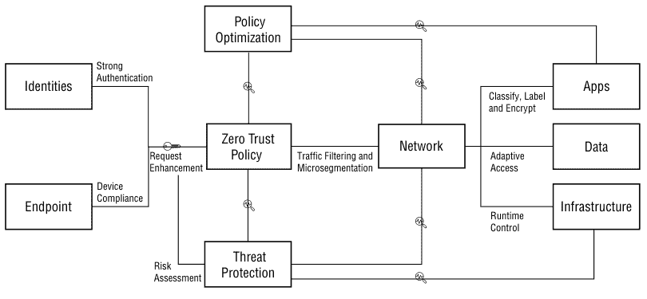

Microsoft 的零信任方法围绕以下关键技术构建块组织。

### 使用零信任保护身份

零信任控制平面由人员、工作负载、端点和 IoT 设备组成。Microsoft 建议确保当身份尝试访问资源时，访问对于该身份而言是合规且典型的，并且遵循最小特权访问原则。

### 使用零信任保护端点

多个身份可以通过各种设备访问数据——从 IoT 设备到智能手机，从自带设备（BYOD）到合作伙伴托管的设备，再从本地工作负载到云托管的服务器。为了安全访问，由于这种多样性，我们必须监控并强制执行设备运行状况和合规性。

### 使用零信任保护基础设施

关键威胁向量是基础设施（本地服务器、云中的虚拟机、容器或微服务）。通过评估版本、配置和 JIT 访问，使用遥测数据检测攻击和异常，并自动阻止和标记风险行为来加强防御。

### 使用零信任保护网络

网络基础设施最终负责提供对所有数据的访问。由于使用网络控制，攻击者无法在网络中横向移动，并且更容易被发现。建议对网络进行分段（包括网络内的微分段），并采用实时威胁防护、端到端加密、监控和分析。

### 使用零信任保护应用程序

要使用数据，会采用 API 和应用程序。应用程序可以是本地旧版应用程序、提升和迁移的云工作负载或现代 SaaS 应用程序。应发现影子 IT，授予适当权限，使用实时分析来控制访问，监控异常行为，控制用户操作，并验证安全配置选项。

### 使用零信任保护数据

安全团队专注于保护数据。即使设备、应用程序、基础设施和网络脱离组织控制，数据也应保持安全。数据的分类、标记、加密和访问限制应基于该数据的属性。

### 通过策略优化来保护

组织特定的安全策略适用于组织的所有数字资产。这些准则针对业务流程、治理、合规性和最终用户体验进行了优化。

### 通过零信任策略来保护

作为零信任策略的结果，请求会被拦截，所有六个基础元素均根据策略配置进行显式验证，并强制执行最小特权访问。用户角色、位置、设备合规性、数据敏感性、应用程序敏感性等因素均被视为信号。威胁防护策略会基于遥测数据、状态信息以及威胁防护的风险评估，自动实时响应威胁。该策略在访问期间强制执行，并在会话过程中持续评估。

### 通过威胁防护来保护

Microsoft 零信任架构会将所有六个基础元素的遥测数据和分析馈送到 Microsoft 的威胁防护系统中。通过将遥测数据和分析与威胁情报相结合，可以生成高质量的风险评估，这些评估可以手动调查或自动执行。风险评估为实时自动威胁防护提供策略引擎。

零信任用“例外信任”取代了“默认信任”。具备自动管理例外和警报的集成能力至关重要，可以更轻松地在整个组织中查找和检测威胁、响应威胁，并防止或阻止不想要的事件。

## 在架构中设计集成点

Microsoft 开发了 Microsoft 网络安全参考架构 (MCRA)。Microsoft 的安全功能与 Microsoft 服务和应用程序、Microsoft 云平台（如 Azure 和 Microsoft 365）、第三方应用（如 Salesforce 和 ServiceNow）以及第三方平台（如 Amazon Web Services (AWS) 和 Google Cloud Platform (GCP)）集成。

Microsoft 网络安全参考架构 (MCRA) 用于多种目的。

- 组织的网络安全功能通常使用此模板作为安全架构的起点来定义。除了涵盖本地、移动设备、多云以及 IoT/运维（O&M）中的功能外，该架构对组织而言具有价值，因为它涵盖了现代企业环境中广泛的功能。

- 一些组织使用 MCRA 将 Microsoft 的架构建议与自身的进行比较。许多组织不了解自己已经拥有多少安全架构技术。

- MCRA 帮助架构师和技术团队识别使用 Microsoft 集成点的机会。

- 如果您是网络安全新手，请将此作为参考模型来规划绿地部署。

MCRA 参考架构提供了 Microsoft 网络安全功能、面向用户的零信任访问、安全运营、运营技术 (OT)、跨平台和多云功能、攻击链覆盖、Azure 原生安全控制以及安全组织功能的高级别技术图示。

图 1.2 描绘了 MCRA。

### 图 1.2 高级别 Microsoft 网络安全参考架构

| 安全运营/SOC | | SaaS |
|---|---|---|
| 条件访问 | | |
| 端点和设备 | 混合基础设施 – IaaS, PaaS, 本地 | 身份和访问 |
| | | 信息保护 |
| IoT 和运营技术 (OT) | | 人员安全 |


MCRA 还包含零信任概览以及针对零信任的快速现代化计划 (RaMP)。其中还有关于安全运营和关键工作的其他重要信息，例如防止人工操作的勒索软件、保护特权访问、超越 VPN 等。

## 安全运营中心

企业安全运营会监控其环境中的活跃攻击操作，以识别和修复风险，并将其洞察和威胁情报与其他部门共享。

图 1.3 描绘了 MCRA SOC 构建块。

### 图 1.3 高级 Microsoft Cybersecurity Reference Architecture SOC 构建块

| 安全运营/SOC |
| :--- |
| 威胁专家 | 检测与响应团队 (DART) | MSSP/MDR |
| Microsoft Sentinel – 面向 IT、OT 和 IoT 的云原生 SIEM、SOAR 和 UEBA |
| Microsoft Defender – 扩展检测与响应 (XDR) 高级检测与修复 | 自动化调查与修复 | 高级威胁搜寻 |
| 云 | 终端 | Office 365 | 身份 | SaaS | + 更多 OT、IoT、SOL 等 | 其他工具、日志和数据源 |

MCRA 的 SOC 构建块说明了关键 Microsoft 技术如何融入组织的安全格局。

**Microsoft Sentinel** 此解决方案将安全编排自动化响应 (SOAR) 与安全信息事件管理 (SIEM) 相结合。借助 Microsoft Sentinel，组织可以以统一方式检测警报、识别威胁、搜寻威胁并响应威胁。

**Microsoft Defender for Cloud** 使用统一的基础架构安全管理方法保护云和本地中的混合工作负载，该方法支持数据中心的安全态势并提供高级威胁防护。

**Microsoft Defender for Identity** 使用 Active Directory 域服务信号，基于云的安全解决方案可以识别、检测和调查高级威胁、受攻击身份以及恶意内部人员活动。安全专业人员和 SecOp 分析师可以使用 Defender for Identity 在混合环境中检测高级攻击。

**Microsoft Defender for Office 365** 此功能可提供针对恶意电子邮件、链接和协作工具的防护。

**Microsoft Defender for Endpoint** 企业网络可以使用此终端保护平台来防止、检测、调查和响应高级威胁。

**App Governance Add-on to Microsoft Defender for Cloud Apps** Microsoft Graph API 允许应用使用启用 OAuth 的应用访问 Microsoft 365 数据。

**Azure Monitor** 此功能通过让您收集、分析并处理来自云和本地的遥测数据，来提高应用程序和服务的可用性和性能。通过主动识别影响应用程序及其依赖资源的问题，它帮助您了解其性能表现。

**Microsoft 365 Defender 门户** 在中央门户中，您可以结合电子邮件、协作、身份、设备保护、检测、调查和响应。它包含来自 Defender for Office 365、Defender for Endpoint、Defender for Identity 和 Defender for Cloud Apps 的信息，以便快速访问信息并获得更详细的布局，将相关事实集中在一起，以实现更轻松的警报检测和威胁检测可见性、主动搜寻以及事件响应。

## 软件即服务

在云平台中，应用程序及其关联数据是业务价值的主要来源。尽管在安全环境中，身份和存储等平台组件很重要，但应用程序在业务风险中扮演着过大的角色，原因如下：

- 应用程序封装并执行业务流程，服务必须可用并提供高完整性。

- 应用程序工作负载存储和处理业务数据，这需要对机密性、完整性和可用性提供高度保障。

图 1.4 描绘了 MCRA SaaS 构建块。MCRA 的 SaaS 构建块说明了关键 Microsoft 技术如何融入组织的安全格局。

**Microsoft Defender for Cloud Apps** Microsoft Defender for Cloud Apps 是一种云访问安全代理 (CASB)，可管理多云之间的数据流动，以便您可以凭借丰富的可见性、控制和复杂的分析来识别和打击所有云服务中的网络威胁。CASB 在多个云环境中运行。它通过详细的可见性、数据流动控制和复杂的分析来识别和打击所有云服务中的网络威胁。作为 CASB，Microsoft Defender for Cloud Apps 支持多种部署方法，包括日志收集、API 连接器和反向代理。借助此解决方案，您可以凭借丰富的可见性、对数据流动的控制以及复杂的分析，在 Microsoft 和第三方云服务中识别和打击网络威胁。

网络安全专业人员受益于 Microsoft Defender for Cloud Apps，它可与 Microsoft 解决方案原生集成，并提供简单部署、集中式管理和创新自动化功能。

### 图 1.4 高级 Microsoft Cybersecurity Reference Architecture SaaS 构建块

| 软件即服务 (SaaS) |
| :--- |
| **Microsoft Defender for Cloud Apps** |
| • 应用发现与风险评分 (影子 IT) |
| • 威胁检测与响应 |
| • 策略审计与强制执行 |
| • 会话监控与控制 |
| • 信息防护与数据丢失防护 (DLP) |

## 混合基础架构—IaaS、PaaS、本地

保护混合基础架构是任何业务成功的基础。随着全球企业努力应对工业化、有组织且高度经济驱动的攻击者生态系统的增长，多云和混合基础架构及工作负载安全变得越来越紧迫。

图 1.5 描绘了 MCRA 混合基础架构构建块。

针对多云、本地和混合环境，网络安全解决方案是什么样子的？有效的防御必须是统一的、简化的且可操作的，使数字化转型更加易于管理而不抑制进步。需要保护多云、本地和混合基础架构的人可以从考虑以下组件级注意事项开始：

- **Microsoft Defender for Cloud** 使用统一的基础架构安全管理方法保护云和本地中的混合工作负载，该方法支持数据中心的安全态势并提供高级威胁防护。

- **Azure AD 应用代理** 借助 Azure Active Directory (Azure AD)，用户、应用和数据在本地和云中均受保护。如果 IT 专业人员想要将本地 Web 应用程序发布到外部，可以实现 Azure AD 应用程序代理。需要内部应用的用户可以从远程位置安全地访问它们。

- **Azure Arc** Azure Arc 允许您将 Azure 平台扩展到跨数据中心、边缘和多云环境运行应用程序和服务。持续开发、操作和保护云原生应用程序。它在新旧硬件、虚拟化和 Kubernetes 平台、IoT 设备及集成系统上运行。

- **Azure Stack** Azure Stack 将 Azure 服务和功能从数据中心扩展到边缘位置和远程办公室。凭借多种工作负载的灵活性，您可以跨 IT 生态系统统一构建、部署和运行混合及边缘计算应用程序。

- **Azure 防火墙** 借助 Azure 防火墙，您可以使用业界领先的威胁防护来保护在 Azure 中运行的云工作负载。凭借不受限制的云可扩展性和内置的高可用性，它是一种完全有状态的防火墙即服务。除了检测东西向流量外，它还检测南北向流量。

- **Azure Web 应用程序防火墙 (WAF)** Azure 应用程序网关的 Web 应用程序防火墙提供针对常见漏洞和弱点的集中式防护。利用常见已知漏洞发起的恶意攻击越来越多地针对 Web 应用程序。最常见的攻击是 SQL 注入和跨站点脚本。

- **Azure DDoS** 将 Azure DDoS 保护标准版与应用程序设计最佳实践相结合，提供增强的 DDoS 缓解功能来防御 DDoS 攻击。当您向虚拟网络添加 Azure 资源时，它会自动调整以保护这些资源。向新建或现有虚拟网络添加防护很容易，无需对应用程序或资源进行更改。

- **Azure 密钥保管库** Azure 密钥保管库允许您安全地在云中存储和访问机密。API 密钥、密码、证书和加密密钥是机密的示例，API 密钥也是。密钥保管库服务支持两种类型的容器：保管库和托管硬件安全模块 (HSM)。保管库可以存储机密、证书和由 HSM 支持的软件密钥，而托管 HSM 池仅支持 HSM 支持的密钥。

- **Azure 堡垒机** Azure 堡垒机允许您使用浏览器和 Azure 门户通过 Azure 订阅连接到虚拟机。它是一种 Azure PaaS 服务，您在虚拟网络内预配，完全由平台管理。

- **Azure Lighthouse** 借助 Azure Lighthouse，多租户管理可以扩展和自动化，从而增强资源治理。服务提供商可以利用 Azure Lighthouse 的全面且强大的工具来交付托管服务。Azure Lighthouse 管理工具简化了企业资源的管理

在多个租户中运营资源的组织。客户控制谁有权访问其租户、可以访问哪些资源以及可以采取哪些操作。

**Azure Backup** 使用 Azure Backup，从 Microsoft Azure 云进行数据备份和恢复既简单、安全又具成本效益。

**Azure ExpressRoute** ExpressRoute 通过 ExpressRoute 合作伙伴在您的网络与 Azure 之间建立连接。它是私有连接。流量不经过 Internet。

**Azure Private Link** Azure Private Link 允许您通过专用网络连接连接到 Azure PaaS 服务（Azure 存储和 SQL 数据库）以及 Azure 托管的、客户拥有的和合作伙伴服务。

### 图 1.5 Microsoft 网络安全参考架构混合基础设施构建块高级概览

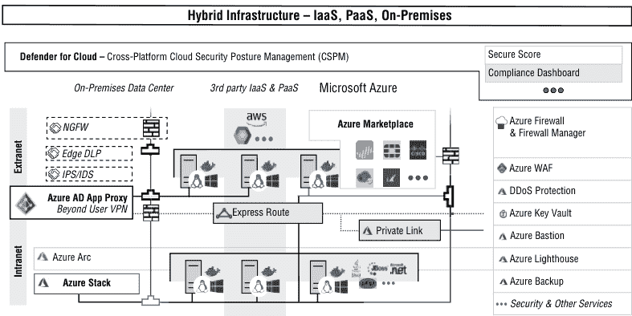

## 端点和设备

在当今世界，访问企业数据的端点种类繁多。因此，端点可能迅速成为零信任安全策略中最薄弱的环节。

组织希望了解访问其网络的端点情况，无论这些端点是自带设备（BYOD）还是企业拥有且托管的设备，以确保只允许健康且合规的设备访问企业资源。Microsoft 还关注这些端点上移动和桌面应用的健康状态和可信度。除了确保这些应用健康且合规之外，Microsoft 还希望确保企业数据不会意外或恶意地泄露到消费者应用或服务中。

图 1.6 描绘了 MCRA 端点和设备构建块。

### 图 1.6 Microsoft 网络安全参考架构端点和设备构建块高级概览

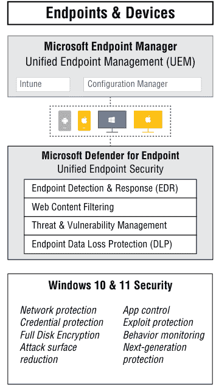

MCRA 的端点和设备构建块阐明了关键 Microsoft 技术如何融入组织的安全格局。

**Microsoft Defender for Endpoint** 可使用 Microsoft Defender for Endpoint 发现并保护跨多平台企业的终端设备。

**Microsoft Endpoint Manager** 通过整合 Microsoft Intune 和 Configuration Manager，Microsoft Endpoint Manager 作为统一管理平台的一部分提供终端设备管理和安全性。

## 信息保护

信息是一项资产，信息安全必须在信息价值及其泄露后果的背景下加以理解。过去，小型计算机和台式计算机是小偷唯一会窃取的物品。如今，网络犯罪是一个日益严重的问题，小偷会从可投保硬件（包括手机）中窃取关键数据和信息。黑客如今就是小偷。

图 1.7 描绘了 MCRA 信息保护构建块。

### 图 1.7 Microsoft 网络安全参考架构信息保护构建块高级概览

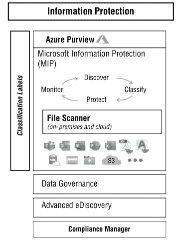

Azure Purview Microsoft Purview 的治理门户提供统一的数据治理解决方案，帮助您管理本地、多云和 SaaS 数据。Microsoft Purview 的治理门户提供以下功能：

- 通过端到端数据血缘和自动数据发现，快速发现、分类并追踪您的数据全生命周期。
- 您的数据资产可由数据管理员进行管理和保护。
- 应将有价值且可靠的数据提供给使用者。

Azure Compliance Manager 合规性管理器是 Microsoft Purview 合规性门户中的一种基于工作流的风险评估工具，用于处理与 Microsoft 云服务相关的法规遵从性操作。

## 标识和访问

Microsoft 在线服务的设计目的是使 Microsoft 工程师能够在不访问客户任何内容的情况下运行服务。Microsoft 工程师不拥有生产环境的特权访问权限或客户内容的零常设访问权限。每当支持 Microsoft 在线服务需要临时访问生产环境时，服务团队工程师都会使用即时（JIT）和足够访问（JEA）模型。JIT 访问模型用工程师按需申请临时提升到特权角色的程序，取代了标准的持续管理访问权限。

图 1.8 描绘了 MCRA 标识和访问构建块。

### 图 1.8 Microsoft 网络安全参考架构标识和访问构建块高级概览

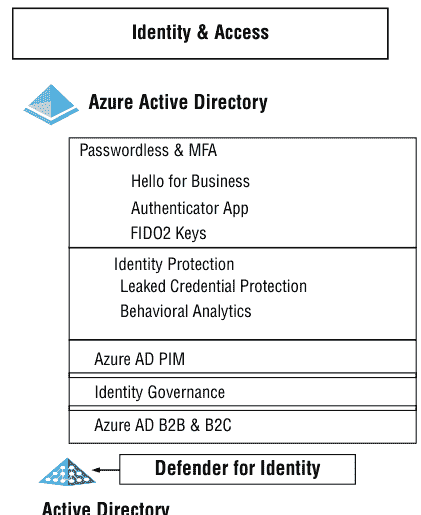

Azure Active Directory 使用 Azure Active Directory (Azure AD) 管理标识和访问。成千上万个 SaaS 应用程序可通过此服务访问，包括 Microsoft 365、Azure 门户以及更多应用程序。Azure Active Directory 还允许其访问内部资源，例如企业内网上的应用程序以及为您的组织开发的任何云应用。

**Azure Identity Protection** 为了保护您的用户，Microsoft 借鉴了其在使用 Azure Active Directory 的组织、使用 Microsoft 帐户的消费者领域以及 Xbox 游戏方面的经验。Microsoft 通过每天分析数万亿个信号来保护客户免受威胁。

**Azure Identity Governance** Azure Active Directory (Azure AD) 中的标识治理可帮助您在保持可见性的同时平衡安全性和员工生产力。可使用其功能管理对正确资源的访问。通过 Azure AD 和 Enterprise Mobility + Security 功能，您可以保护、监控和审核对关键资产的访问，以降低访问风险。

**Defender for Identity** Microsoft Defender for Identity（又称 Azure 高级威胁防护）是一种基于云的安全解决方案，它利用您的 Active Directory 信号来识别、检测和调查针对您的组织的高级威胁、受损标识以及恶意内部人员行为。

## 人员安全

全面的人员安全计划可保护组织免受无意人为错误和恶意内部人员攻击。图 1.9 描绘了 Microsoft MCRA 人员安全构建块。

### 图 1.9 Microsoft 网络安全参考架构人员安全构建块高级概览

| 人员安全 |
|---|
| 攻击模拟器 | 内部风险管理 | 通信合规性 |

**攻击模拟器** 假设您的组织拥有 Microsoft 365 E5 或 Microsoft Defender for Office 365 计划 2。要在组织中运行现实的攻击场景，可以在 Microsoft 365 Defender 门户中使用攻击模拟培训。在攻击影响您的底线之前，这些模拟可以帮助您识别并定位易受攻击的用户。

**内部风险管理** Microsoft Purview 内部风险管理通过检测、调查和响应恶意和疏忽的组织活动来降低内部风险。定义内部风险策略可让您识别并查看组织中的风险，并将案例升级到 Microsoft eDiscovery (高级版)。请确保组织中的风险分析师遵守组织的合规性标准。

通信合规性 Microsoft Purview 通信合规性通过检测、捕获和响应不当的组织消息来帮助您最大限度地降低内部风险。您可以使用预定义或自定义策略扫描内部和外部通信以查找策略匹配项，以便指定的审阅者可以检查它们。通过审阅组织中扫描的电子邮件、Microsoft Teams、Yammer 或第三方通信，可以强制执行消息标准。

## IoT 和运营技术

过去关于物联网和运营技术 (OT) 设备的常见误解已被推翻。过去假设传统端点（工作站、服务器和移动设备）与 IoT 和 OT 设备隔离，或部署在独立的隔离网络中。可见性是保护 IoT 和 OT 设备的主要挑战。针对基础设施即服务和平台即服务 (IaaS 和 PaaS) 的组织，主动威胁防护

Azure Sphere 使用 Azure Sphere，您可以构建具有内置通信和安全功能的高级应用程序。安全、连接的交叉微控制器单元 (MCU)、基于 Linux 的自定义操作系统 (OS) 以及基于云的安全服务可提供持续、可更新的安全性。

Microsoft Defender for Cloud 使用统一的基础设施安全管理方法保护云和本地中的混合工作负载，该方法支持数据中心的安全态势并提供高级威胁防护。

Defender for IoT 在整个基础设施中集成 IoT/OT 安全性以加速数字化转型。除了快速部署之外，Microsoft Defender for IoT 支持无代理网络检测和响应 (NDR)；可与 IoT、OT 和工业控制系统 (ICS) 设备协同工作；并且与 Microsoft 兼容


365 Defender、Microsoft Sentinel 和外部安全运营中心。使用云或本地 Defender for IoT 可为 IoT 设备构建者提供轻量级代理，以实现更强大的设备层安全性。

## 设计安全需基于业务目标

最成功的转型之旅始于业务目标。采用云可能既耗时又昂贵，成功的项目需要 IT 和其他业务领域的支持。为了帮助客户识别简洁明确且能产生可衡量结果的业务成果，Microsoft 开发了云采用框架。

Microsoft 员工、合作伙伴和客户在云采用框架中分享云采用最佳实践。除了工具和文档外，它还包含经过验证的技术。您可以使用其中包含的工具来塑造技术、业务和人员策略，以实现最佳业务成果。

Microsoft Azure 云采用框架是一个完整的生命周期框架，可帮助云架构师、IT 专业人员和业务决策者采用云服务。提供云计算最佳实践、文档和工具，以帮助您创建和实施云计算策略。

图 1.11 描绘了 Microsoft 云采用框架 (MCAF)。

### 图 1.11 Microsoft 云采用框架

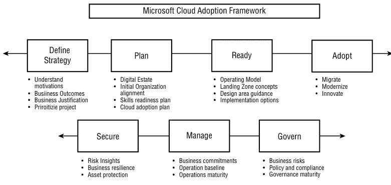

九种方法论构成了 Microsoft 云采用框架。云采用生命周期包括图 1.11 中列出的每种方法论。在整个云采用过程中，云采用框架的方法论被整合到一个生命周期中。

- 策略：建立采用业务案例和预期收益。
- 计划：识别业务成果并使采用计划保持一致。
- 准备：确保云环境已为计划中的更改做好准备。
- 迁移：将现有工作负载移至云并对其进行现代化。
- 创新：创建云原生和混合解决方案。
- 安全：随着时间的推移不断改进安全性。
- 管理：管理混合云和本地解决方案。
- 治理：控制您的环境和工作负载。
- 组织：协调组织中支持云采用的角色和团队。

### 定义策略

此处讨论云迁移的目的以及您希望从中实现的目标。您是想扩大市场还是满足需求？成本会降低，还是业务敏捷性会提高？在定义云业务策略时，您应考虑业务影响、周转时间、全球覆盖范围、性能等因素。定义云策略涉及以下步骤：

- 定义并记录动机：与利益相关者和领导层讨论上云的原因会有所帮助。
- 记录业务成果：与财务、市场、销售和人力资源领域的领导者讨论您的目标。
- 评估财务因素：分析目标并确定投资回报率。
- 了解技术因素：完成您的第一个技术项目以评估技术问题。

### 准备计划

您将制定一份计划，概述为实现目标将采取的具体行动。良好的计划可确保您的工作与预期的业务成果保持一致。以下是构建稳固计划的步骤：

- 数字资产：对将迁移到云的现有数字资产和工作负载进行清点。
- **初始组织对齐：** 从技术和治理角度，将合适的人员纳入迁移工作中。
- **技能准备计划：** 制定计划，帮助个人发展基于云的技能。
- **云采用计划：** 协调开发、运维和业务团队，朝着云采用的共同目标努力。

### 准备就绪

您将创建着陆区或环境来托管云中的工作负载。您可以按照以下步骤为组织做好准备：

- **Azure 设置指南：** 查看 Azure 设置指南，了解如何创建着陆区。
- **Azure 着陆区：** 在 Azure 着陆区中构建各主要业务领域的 Azure 订阅。着陆区包含多个组件，包括基础设施、治理、会计和安全性。
- **扩展着陆区：** 确保着陆区满足您的运营、治理和安全性要求。
- **最佳实践：** 从最佳实践和建议入手，帮助确保您的云迁移工作可扩展且易于维护。

### 采用

采用云安全性以改进针对企业或组织的网络防御。采用方法论是您开始使用云并体验其优势的地方。迁移、现代化和创新是云中采用安全性的三种方法。每个流程都提供独特的优势和解决方案。

- **迁移：** 使用迁移安全方法将工作负载迁移到云中。重新托管是迁移的几种形式之一，重新托管也称为 _直接迁移_。重新托管涉及将工作负载移至云 IaaS 解决方案而不进行更改。
- **现代化：** 安全性现代化是指增强现有应用程序以改进运营、提高效率并最大限度地提高开发人员速度。业务现代化使用 PaaS 解决方案。
- **创新：** 通过采用云原生技术，您可以创建以客户为中心的云原生安全解决方案，快速转变业务成果。

### 安全

网络安全架构师会对云采用框架的 Secure 方法论感兴趣。Secure 提供安全计划最终状态的全面视图，以指导其随时间推移的改进。在图 1.12 中，安全性与更大的组织及其学科进行了可视化映射。

### 图 1.12 网络安全业务对齐和学科

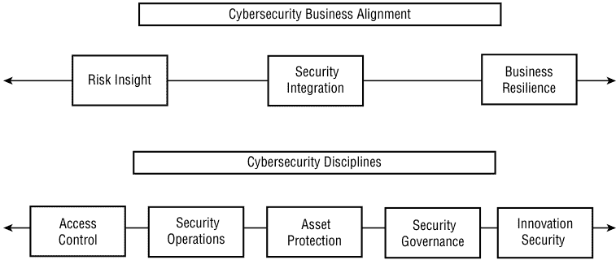

作为网络安全计划的一部分，您应该纳入三种将安全性集成到更大组织中的方式以及五种安全学科。

### 网络安全业务对齐和集成方法

以下是在将业务需求与网络安全安全措施保持一致时应关注的领域。

- 风险洞察：安全团队了解组织的运营以识别业务目标和资产风险。反过来，安全性会向决策者推荐哪些风险是可以接受的。必须了解，资产或流程所有者负责做出这些决策。
- 安全集成：每个人都应该对安全性负责，就像他们应该对业务需求、性能和可靠性负责一样。安全专业人员必须了解组织的整体业务优先级、IT 举措和风险承受能力。安全性的主线应连接业务的各个方面，业务的安全性应该感觉像是安全性的自然组成部分。
- 业务韧性：虽然安全攻击永远无法被完全阻止，但组织可以变得更有韧性。就像我们在物理世界中永远无法完全免受所有健康和安全风险的影响一样，我们的数据和信息系统也永远无法 100% 免受所有攻击。通过集中安全工作，提高业务运营对安全事件的韧性。作为这些工作的结果，风险可以降低，并且您响应事件和改善安全态势的能力可以不断提高。

### 网络安全学科

以下是应关注的网络安全学科领域。

- 访问控制：人们最可能将访问控制体验为安全性的一部分。每当他们登录计算机或手机、共享文件或访问应用程序，或使用 ID 卡钥匙进入大楼或房间时，都会看到它。访问控制并非安全性的全部，但它至关重要，需要妥善处理，以确保用户体验和安全保障。

- 安全运营 (SecOps)：管理安全运营可以通过限制攻击者访问组织资源所造成的损害来降低风险。
  - SecOps 是将内部安全实践与 IT 运营实践相结合以改进协作和降低风险的组织。安全性和 IT 运营传统上由不同组织使用不同的方法和方法论独立处理。
  - SecOps 团队成员负责各种活动，包括主动监控、事件响应和恢复、补救活动、合规性以及协调和上下文。

- 资产保护：物理资产和虚拟资产包括笔记本电脑、数据库、文件和虚拟存储帐户。关键业务资产通常由底层系统（如存储、数据、端点和应用程序）的安全性进行保护。通常，数据和应用程序（例如业务网站、生产线和通信）是最有价值的技术资产。

- 安全治理：它是业务优先级与技术实现（如架构、标准和策略）之间的桥梁，这些构成了安全治理的基础。随着安全态势的改善，治理团队提供监督和监控。根据监管机构的要求，这些团队还报告合规性。

- 创新安全性：在数字时代，组织的创新流程和数据必须免受网络攻击，而创新安全性可保护它们免受网络攻击。借助 DevOps 和 DevSecOps，应用程序可以快速开发，而无需等待可能需要数月或数年的传统瀑布式发布计划。

### 管理

云策略需要稳固的规划、准备和采用。数字资产在持续运营时可提供切实的业务成果，而没有可靠且管理良好的运营计划，云解决方案将几乎没有价值。

### 治理

当业务托管在云中时，支持它的技术会出现新范式。这些新范式正在改变技术采用、管理和治理。您可以使用一行代码删除并重建整个虚拟数据中心，该代码


由无人值守进程执行。尤其是在治理方面，这种推理是有效的。

云治理涉及迭代流程。组织的本地IT策略应由云治理加以补充。根据云治理的成熟度和云中的数字资产性质，本地与云之间的企业策略以不同程度进行集成。云治理流程和程序会随着云资产不断演变。

## 将安全需求解码为技术能力

许多组织正在经历多项同步转型。几乎所有外部市场都在响应客户对移动和云技术的新偏好而发生变化，从而推动这些内部转型。初创企业颠覆和传统竞争对手的数字化转型是组织面临的常见威胁。

组织转型通常涉及以下内容：

- 抓取新机遇并与数字化原生初创企业竞争需要业务转型。
- 随着威胁环境变得更加复杂，IT组织必须实施云计算服务，现代化开发实践，并做出其他更改以支持该计划和安全。

实施零信任架构需要根据组织的安全转型强制执行安全设计原则。安全架构原则描述了一个托管在云端或本地（或两者结合）的系统。如果应用这些原则，您的安全架构更有可能保持机密、完整和可用。

以下关键设计原则用作透镜来评估Azure应用程序的安全性。使用这些透镜提供了一个评估应用程序的框架。

## 资源规划与加固

以下是Microsoft关于资源规划和加固的网络安全架构师建议：

- 规划工作负载资源时应考虑安全性。
- 熟悉云服务提供的保护类型。
- 使用框架评估服务启用情况。

## 降低特权并自动化

Microsoft关于自动化和应用最小特权的网络安全架构师建议如下：

- 通过在应用程序和控制平面的每个级别实施最小特权，可以防止数据外泄和恶意行为者场景。
- 利用DevSecOps来实现自动化并最大限度地减少人工交互。

## 通过分类和加密保护数据

Microsoft关于数据保护、分类和加密的网络安全架构师建议如下：

- 数据应根据其风险级别进行分类。
- 使用行业标准加密安全地存储和管理静态及传输中的密钥和证书。

## 监控系统安全并规划事件响应

Microsoft关于系统安全和实施事件响应的网络安全架构师建议如下：

- 通过关联审核和安全事件来评估应用程序运行状况。
- 通过关联审核和安全事件来识别活动威胁。
- 通过建立程序来自动和手动响应事件。
- 使用安全信息和事件管理(SIEM)工具跟踪安全事件。

## 识别和保护终结点

Microsoft关于识别和保护终结点的网络安全架构师建议如下：

- 使用安全设备和Azure服务监控和保护内部和外部终结点的网络完整性。
- SlowLoris等DoS攻击是常见的攻击向量，因此请使用行业标准方法来防范它们。

## 防范代码级漏洞

网络安全架构师应遵循Microsoft关于防范代码级漏洞的建议：

- 应识别和缓解跨站点脚本漏洞和SQL注入漏洞。
- 定期将以下内容纳入操作生命周期：
  - 安全问题的修复
  - 修补代码库和依赖项

## 模拟并测试潜在威胁

网络安全架构师应遵循Microsoft的建议来模拟和测试潜在威胁：

- 建立识别和缓解已知威胁的程序。
- 渗透测试可用于验证威胁是否已得到缓解。
- 静态代码分析是防止未来漏洞的有价值工具。
- 要防止未来漏洞，请使用代码扫描。

## 为恢复能力方法设计安全性

弹性安全策略保护您业务的每个方面免受不可预见的威胁或变化的影响。我们生活在一个不确定的时代。随着变化加速，企业在整个企业中大力投资以加强弹性。公司在适应变化的过程中可以从这些举措中获益，从财务弹性到运营弹性再到组织弹性和供应链弹性。安全性是这些举措的组成部分，因此如果企业未能投资于安全弹性，其投资将会付之东流。

随着世界日益互联，安全弹性也必须随之改变。企业、客户、供应商和合作伙伴作为集成生态系统运作，彼此之间的边界变得模糊。此外，人员、设备和数据之间的接触点数量不断扩大。混合工作将长期存在，因为企业正在适应不断变化的工作模式。

安全弹性的目标是支持您业务的弹性，并有两个主要目标：

- 提高您的业务创新和快速适应变化环境的能力。
- 在主动攻击发生前、发生中和发生后，限制对业务运营的影响和可能性。

根据图1.13，安全弹性通过在整个生命周期中管理风险来实现。

## 事件发生前

不断改进安全态势和响应能力。安全态势的持续改进可减少安全事件对业务运营和资产的可能性和影响。安全学科涵盖许多技术，但所有技术都旨在提高攻击成本。通过阻止其旧方法，您迫使攻击者想出新方法。这些技术会减慢攻击者并限制其成功，从而提高成本和摩擦。

## 图1.13 安全弹性管理风险

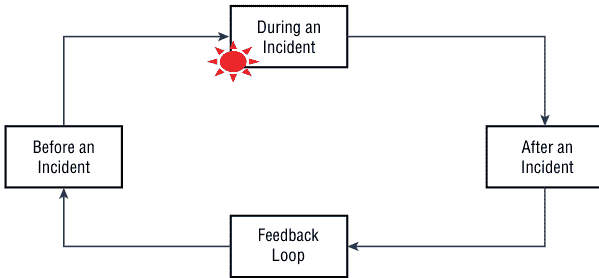

## 事件发生期间

在事件期间，无论业务运营受到多大程度的降级、变慢或限制，都必须继续进行。在攻击期间，医院不能停止照顾患者，船舶不能停止运输货物，飞机不能停止飞行。发生事件时，以下两项优先事项至关重要。

- 如果受到威胁，所有努力都应致力于保护和维持关键业务运营。
- 检测并迅速将攻击者从环境中驱逐是安全运营的默认优先事项。这种驱逐可以防止攻击者进行报复。

## 事件发生后

攻击破坏业务运营后，必须立即开始修复以恢复整个运营。即使这意味着在没有丢失数据的情况下恢复运营（例如在勒索软件事件或NotPetya等破坏性攻击中），修复也是必要的。

## 反馈循环

攻击者发现重复攻击或其他攻击的副本是有效的。您最好应持续从针对您组织的攻击中吸取教训，因为攻击者也会从针对您组织的攻击中学习。考虑采用过去经过验证并可用的技术。接下来，确保您可以阻止、检测、快速响应并从中恢复。通过您的努力阻止或减缓未来的攻击，可以提高针对您组织的攻击成本。


## 识别混合和多租户环境相关的安全风险

组织可以通过混合部署将其现有的本地环境扩展到云端。混合部署使组织能够在本地环境和云环境之间无缝切换。也可以使用混合部署完全迁移到云环境。

## 部署安全的混合身份环境

随着企业和公司越来越多地结合本地和云应用程序，在本地和云中管理用户面临挑战。Microsoft 的身份解决方案涵盖本地和云端功能。这些解决方案为所有资源的身份验证和授权创建标准用户身份，无论位置如何，Microsoft 将其定义为混合身份。

图 1.14 描绘了混合身份解决方案的设计参考，帮助 IT 管理员将现有的本地 Windows Server Active Directory 解决方案与 Microsoft Azure Active Directory 集成，以便用户在 Azure 和本地的应用程序中使用单点登录 (SSO)。

### 图 1.14 混合安全身份环境

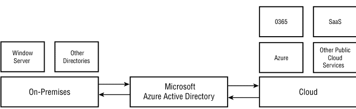

## 部署安全的混合网络

图 1.15 所示的参考架构描绘了一个安全的混合网络，该网络将本地网络扩展到 Azure。Azure 虚拟网络通过 DMZ（也称为边缘网络或筛选网络）连接到本地网络。所有入站和出站流量均通过 Azure 防火墙。

### 图 1.15 部署安全的混合网络

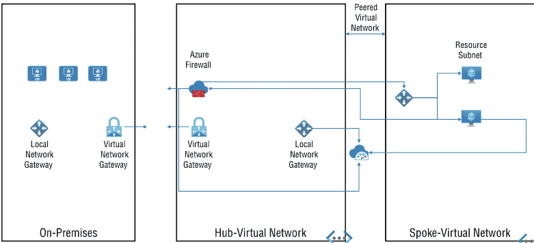

## 设计多租户环境

多租户架构在租户之间共享部分或全部资源。因此，多租户架构可以帮您节省资金并提高运营效率。然而，多租户也带来了一系列挑战，包括以下内容：

- 对于您的特定解决方案，您如何定义租户？租户是指客户、用户还是团队？
- 您将如何部署基础架构以支持多租户，以及租户将如何相互隔离？
- 您的租户是否需要一定的服务级别？考虑性能、弹性、安全性和合规性要求。
- 您发展业务或解决方案的计划是什么，它能否容纳大量租户？
- 您的租户是否有任何特殊或独特的需求？您最大的客户是否需要更强的保障或更高的性能？
- 您将如何监控、自动化、管理、缩放和治理您的 Azure 域，多租户将如何影响此过程？

无论您使用何种架构，都必须了解客户或租户的要求。在设计解决方案时，您需要知道客户的要求，如果您向他们做出了销售承诺或有合同义务。您还可能对多租户解决方案的工作方式或行为有隐性期望，这可能会影响您的设计方式。

假设您是一名向金融服务企业销售多租户解决方案的软件开发人员。为了将您的解决方案添加到其防火墙允许列表中，您的客户需要您的解决方案所使用的所有域名的综合列表。因此，您必须确保您的租户相互隔离，并且您使用的 Azure 服务符合此要求。此外，他们要求其解决方案具有一定的最低弹性水平。在整个解决方案中，您可能需要考虑许多类似的显性和隐性期望。

可以通过多种方式实现多租户，在租户之间共享资源是决定如何做出此决定的主要因素。如果您的业务正在增长并且正在添加更多租户，这可能看起来是个好主意，但随着业务扩展，它可能会迅速变得昂贵。

在考虑多租户模型时，查看您如何为组织定义租户、业务驱动因素以及计划如何缩放解决方案会很有帮助。本节为技术决策者提供了您可以考虑的租户模型及其权衡的指导。有两种标准模型：企业对企业 (B2B) 和企业对消费者 (B2C)。

### 企业对企业

如果您的客户是其他组织，您可能会将这些客户视为您的租户。但是，请考虑您的客户是否可能有团队或部门等分支机构，或者他们是否在多个国家/地区有业务。如果这些子组有不同的要求，请考虑让单个客户映射到多个租户。

同样，客户可能希望通过维护您服务的两个实例来将其开发环境和生产环境分开。您通常会发现，单个租户会有多个用户；例如，您客户的所有员工都将是用户。

### 企业对消费者

如果您的客户是消费者，客户、租户和用户之间的关系通常更加复杂，在某些场景中，消费者本身可能是一个租户。家庭、朋友、俱乐部、协会或任何需要共同访问和管理其数据的群体都可能使用您的解决方案。例如，音乐流媒体服务可能同时支持个人用户和家庭，并在将它们分为租户时对每种账户类型进行不同处理。

多租户架构必须考虑每个租户所需的隔离程度。隔离需要考虑的设计事项如下：

- 在单个共享基础架构上，每个租户都有自己的应用程序实例和自己的数据库。
- 可以与其他租户共享一些资源，同时保持其他资源独立。
- 将数据与物理基础架构分离。在云中为每个租户部署专用主机或单独的 Azure 资源甚至可能是必要的。

而不是将一个租户与另一个租户隔离开来。您需要一个稳健的身份策略和一个授权流程，该流程会考虑租户和用户的身份。

- 成本：共享基础架构更便宜，因为多个租户可以使用它。
- 性能：如果您共享基础架构，系统性能可能会受到影响，因为随着更多客户使用，资源可能会被更快地消耗。
- 可靠性：故障可能会影响使用单个共享基础架构的所有人。

### 响应单个租户的需求

如果基础架构专用于特定租户，则可能可以针对特定租户调整专用基础架构的配置。您的定价模型甚至可能支持允许客户为隔离部署支付更多费用。

您的解决方案架构可能会影响您可用的隔离选项。让我们考虑一个三层解决方案架构示例：

- 所有租户可以通过您的多租户 Web 应用程序访问相同的主机名。
- 您的中间层可以是带有共享消息队列的共享应用层。
- 数据层可以是隔离的数据库、表或 Blob 容器。

可以在每个层级上混合和匹配隔离级别。选择共享什么和隔离什么将取决于许多因素，例如成本、复杂性、客户要求以及在达到 Azure 配额之前可以部署的资源数量。

## Azure Arc 使混合环境能够大规模运行

在当今世界，组织难以控制和治理跨越多个数据中心、多个云和网络边界的日益复杂的环境。新的 DevOps 和 ITOps 运营模型在资源间实施可能具有挑战性，因为每个域和云都有其管理工具。

Microsoft Azure Arc 通过为多云和本地环境提供一致的管理平台，简化了治理和管理。Microsoft Azure Arc 平台以集中统一的方式提供以下功能：

- 通过将现有非 Azure 和本地资源投影到 Azure 资源管理器来管理整个环境。
- 对虚拟机、Kubernetes 群集和数据库进行类 Azure 的管理。
- 无论 Azure 服务位于何处，都可以访问和管理它们。


- 在环境中支持云原生模式，继续使用传统的 IT 运维实践，同时引入 DevOps 实践。
- 使用自定义位置作为抽象层来配置 Kubernetes 群集和扩展。

## Azure Policy 使混合环境能够大规模运行

使用 Azure Policy 可以大规模强制执行组织标准并评估合规性。通过其合规性仪表板，用户可以查看环境的汇总视图，并钻取到每个资源、每个策略的粒度级别。此外，它还允许对现有资源进行批量修正，并对新资源进行自动修正，使其符合合规性要求。

Azure Policy 最常见的用例包括为资源一致性、法规合规性、安全性和成本控制实施治理。Azure 环境已为这些日常用例提供内置策略定义，以帮助架构师。

用于确定资源是否符合合规性的逻辑使用 JavaScript 对象表示法 (JSON) 表示。定义中包含策略规则和元数据。可以使用函数、参数、逻辑运算符、条件和属性别名来定义规则。在分配中，策略规则决定评估哪些资源。

在资源和策略分配生命周期期间以及常规的持续合规性评估期间，资源会在特定时间进行评估。资源将在以下时间或事件下进行评估：

- 策略分配在范围内创建或更新资源。
- 范围新分配给策略或计划。
- 过程或计划的范围已更新。
- 每 24 小时，标准合规性评估周期将执行。

## 规划流量筛选和分段的技术与治理策略

网络边界假设其内部的所有系统都是可信的。然而，当今员工可以通过各种设备和应用从任何位置访问其组织的资源，这使得边界安全控制变得不相关。为了掌握安全性与生产力之间的平衡，安全管理员需要考虑如何访问资源以及谁可以访问这些资源。仅仅关注谁有权访问资源对于访问控制策略来说是不够的。

与传统防御相比，如果网络安全受到破坏，受信任边界内的一个端点可能会被攻破，并迅速将其影响范围扩散到整个系统。网络在边界内的位置不是确定零信任网络中信任的因素。对于新举措，应采用零信任方法，使用设备和用户信任声明在访问期间验证信任。零信任架构使用设备和用户信任声明来访问组织数据和资源。

### 逻辑分段子网

组织的虚拟机、物理服务器、网络和安全设备通过分段相互隔离。这是一种有效的检测和遏制对手移动的方法。可以通过隔离网络来实现分段。由于不同的技术团队可能与业务用例和应用工作负载不一致，因此不推荐这种方法。它可能导致速度降低，或者更糟的是，由于这种不匹配而导致广泛的网络防火墙例外，尤其是关于本地网络。统一的分段策略应将网络控制作为分段策略的一部分。

企业安全传统上高度依赖网络安全。由于云计算，网络边界变得日益脆弱，攻击者在攻击身份系统元素时可以绕过网络控制。由于这些因素，与网络访问控制相比，主要关注基于身份的访问控制以保护资源已变得越来越重要。

所有技术团队（IT、安全、应用程序）都应使用分段策略，通过网络、应用程序、身份和其他控制来隔离访问。为了使策略成功，它应执行以下操作：

- 将运营实践与业务应用程序对齐，以最大限度地减少运营摩擦。
- 通过增加攻击者的成本，您可以降低风险。因此，您正在执行以下操作：
  - 保护敏感工作负载免受其他资产被攻破的影响
  - 保护高暴露系统免于被用作跳板
- 监控可能威胁分段完整性的操作（帐户使用情况、意外流量）。

例如，Azure 中的虚拟网络类似于本地网络上的局域网 (LAN)。所有 Azure 虚拟机都可以位于单个 IP 地址上。A 类 (10.0.0.0/8)、B 类 (172.16.0.0/12) 和 C 类 (192.168.0.0/16) 是当前已知的三个专用 IP 地址空间。

### 为安全区域部署边界网络

边界网络（也称为 DMZ）在资产和 Internet 之间充当额外的安全层。作为虚拟网络的一部分，专用访问控制设备仅允许所需流量进入边界网络。Azure 中的边界网络有助于管理、监视、记录和报告虚拟网络边缘设备。边界网络用于防止分布式拒绝服务 (DDoS)、入侵检测和防御系统 (IDS/IPS)、防火墙规则、Web 筛选和网络反恶意软件。网络安全设备位于 Azure 虚拟网络和 Internet 之间，并在两个网络上都有接口。

Azure 或第三方解决方案可以基于零信任概念提供边界网络，以在资产和 Internet 之间提供下一级别的安全性。

## 使用专用 WAN 链接避免暴露于 Internet

许多组织已采用混合 IT 方法。混合云部署模型使用 Azure 存储某些信息资产，而本地存储用于其他资产。许多服务在 Azure 上运行某些组件，并在本地运行其他组件。混合 IT 场景通常包括跨本地连接，Azure 虚拟网络可以连接到组织的本地网络

## 使用虚拟网络设备

网络安全组和用户定义的路由可以在网络层和传输层提供一定程度的网络安全。但在某些情况下，必须在高级堆栈级别启用安全性。在此类情况下，Microsoft 建议部署 Azure 合作伙伴提供的虚拟网络安全设备。网络级别控制无法提供与 Azure 网络安全设备同等的安全性。

## 摘要

本章探讨了与云网络基础相关的多个主题，并简要概述了云计算和云中的网络安全。

随着您的组织迁移到 Microsoft Azure，您必须设计和部署安全的云环境。最终用户必须以安全的方式无缝且安全地获取所需的云资源。

Microsoft 网络安全参考架构 (MCRA) 概述了 Microsoft 的网络安全功能。在本章中，您已了解 Microsoft 安全功能如何与 Microsoft 365、Microsoft Azure 及其他第三方平台等 Microsoft 平台集成。

在本章中，您学习了如何采用 Microsoft 网络安全参考架构、将业务目标转换为安全要求、将安全要求转换为技术功能、定义安全弹性策略以及为 Microsoft Azure 制定治理策略。

## 考试要点

### 了解云计算和网络安全。

您应具备云计算、Microsoft Azure、安全策略、要求、零信任架构和混合环境管理方面的概念性知识。基于业务目标制定安全要求、应用零信任策略以及应用安全策略对 SC-100 考试至关重要。

### 在架构中开发集成点。

Microsoft 网络安全参考架构描述了 Microsoft 的网络安全能力。参考架构定义了 Microsoft 的安全功能如何与 Azure 和 Microsoft 365 等 Microsoft 云服务、ServiceNow 和 Salesforce 等第三方应用程序，以及 Amazon Web Services (AWS) 和 Google Cloud Platform (GCP) 等第三方平台集成。参考架构由 Microsoft 网络安全能力、零信任用户访问、安全运营、运营技术 (OT)、多云和平台功能、攻击链覆盖、Azure 原生安全控制以及安全组织功能方面的详细技术逻辑构建块组成。Microsoft 网络安全架构师必须了解端到端的 MCRA。

### 基于业务目标开发安全要求。

云采用可能耗时且成本高昂，而云解决方案被攻破的代价会更高。成功的转型始于业务目标。您可以使用 Microsoft 云采用框架来克服这一障碍；Microsoft 已创建一个框架，帮助客户识别推动可观察结果或业务绩效变化的业务成果。

### 将安全要求转换为技术功能。

许多组织同时发生多项组织转型。这些内部转型通常始于几乎所有外部市场都在转型以满足客户对移动和云技术的偏好。组织通常会面临新创企业的竞争威胁以及具有颠覆市场潜力的传统竞争对手的数字化转型。为克服这些挑战，请将安全要求转换为 Microsoft Azure 功能。了解每个现代化功能至关重要。

### 为弹性策略设计安全性。

安全弹性侧重于支持业务的弹性。它有两个主要目标。第一是使您的业务能够快速创新并适应不断变化的业务环境。第二是限制在业务运营受到主动攻击之前、期间和之后发生中断的影响和可能性。

### 为混合和多租户环境设计安全策略。

通过部署混合解决方案，组织可以充分利用其在本地已有的功能和管理控制。组织可以使用混合部署来创建无缝的


在本地环境与云环境之间进行过渡。混合部署也可以是在完全迁移到云之前的中间步骤。

### 设计流量过滤与分段的技术与治理策略

为保护网络免受入侵，网络需要从传统防御发展演变。受信任边界内的单个端点可能被攻击者攻破，随后迅速在整个网络中扩散。与依赖边界内的网络位置来建立信任不同，零信任架构使用用户信任声明来访问组织资源和数据。对于在访问点验证信任的新举措，应采用零信任方法。

## 复习题

1. 以下哪些是 Microsoft Azure 提供的云计算服务模型类型？（选择三项。）
- A. 基础设施即服务
- B. 平台即服务
- C. 个人电脑即服务
- D. 软件即服务

2. 以下哪种云部署模型是专供包含多个消费者的单个组织独占使用的？
- A. 私有云
- B. 公有云
- C. 社区云
- D. 混合云

3. 哪些云部署模型是专供来自具有共同关切（例如目标、任务、安全和合规性关切）的组织的特定客户群体独占使用的？
- A. 私有云
- B. 公有云
- C. 社区云
- D. 混合云

4. 哪种云计算模型允许客户免费使用部分公有云计算资源，而其他资源可以通过订阅或按使用量付费定价模型购买？
- A. 私有云
- B. 公有云
- C. 社区云
- D. 混合云

5. 以下哪项通过提供托管的基于云的网络安全来保护您的 Azure 虚拟网络资源？
- A. Azure 防火墙
- B. Azure 虚拟 WAN
- C. Azure 虚拟 WAF
- D. 以上都不是

6. 以下哪个不断发展的网络安全范式集表示，在授予或维持对应用程序和数据的访问权限之前，无论用户位于组织网络内部还是外部，都必须进行身份验证和授权？
- A. 零信任
- B. Azure 虚拟 WAN
- C. Azure 虚拟 WAF
- D. Azure 防火墙

7. Microsoft 使用以下哪三项基本原则来定义零信任？
- A. 显式验证、应用最小特权访问、假设已发生泄露
- B. 显式验证、应用最小特权访问、假设存在风险
- C. 不验证任何内容、应用最小特权访问、假设已发生泄露
- D. 不验证任何内容、不应用任何特权访问、假设已发生泄露

8. 以下哪项可让你将 Azure 平台扩展到跨数据中心、边缘和多云环境运行应用程序和服务？
- A. 终点防御
- B. Azure Arc
- C. 云防御
- D. Azure 防火墙

9. 以下哪项是基于云的安全解决方案，用于识别、见证和分析在您的组织中执行的高级威胁、被盗用身份和恶意内部人员活动？
- A. 终点防御
- B. 身份防御
- C. 云防御
- D. Azure 防火墙

10. 以下哪项是网络服务，可让您通过专用网络连接连接到 Azure PaaS 服务（Azure 存储和 SQL 数据库）以及 Azure 托管、客户拥有和合作伙伴服务？
- A. Azure ExpressRoute
- B. Azure 站点到站点 VPN
- C. Azure 点到站点 VPN
- D. Azure 私有链路

11. 在以下参考架构中，哪个提供了 Azure 网络安全功能的高级技术图，包括用户零信任访问、SecOps、OT、混合云和跨平台功能、攻击链范围、原生 Azure 安全管理以及安全组织流程？
- A. Microsoft 网络安全参考架构
- B. The Open Group 网络安全参考架构
- C. Zachman 网络安全参考架构
- D. 以上都不是

12. 以下哪项通过让您收集、分析和处理来自云和本地的遥测数据来增强您的应用程序和服务的可用性和性能？
- A. Azure SOAR
- B. Azure SIEM
- C. Azure Monitor
- D. 以上都不是

13. 以下哪项可让您使用浏览器和 Azure 门户通过 Azure 订阅连接到虚拟机？它是一种 Azure PaaS 服务，可在您的虚拟网络内预配，并由平台完全托管。
- A. Azure VM
- B. Azure 跳板机
- C. Azure 堡垒
- D. 以上都不是

14. 以下哪项可让您安全地大规模运行混合环境？（选择两项。）
- A. Azure Arc
- B. Azure Policy
- C. Azure 堡垒
- D. 以上都不是

15. 以下哪些是 Microsoft 针对网络安全架构师在资源规划和加固方面的建议？（选择三项。）
- A. 规划工作负载资源以考虑安全性。
- B. 熟悉云服务提供的保护类型。
- C. 使用框架评估服务启用情况。
- D. 以上都不是。

16. 以下哪些是 Microsoft 针对网络安全架构师在自动化和应用最小特权方面的建议？（选择两项。）
- A. 在应用程序和控制平面的每个级别实现最小特权，以防止数据泄露和恶意行为者场景。
- B. 利用 DevSecOps 实现自动化并尽量减少人工交互。
- C. 使用框架评估服务启用情况。
- D. 以上都不是。

17. 网络安全架构师应遵循以下哪些 Microsoft 建议来防护代码级漏洞？（选择三项。）
- A. 已识别并缓解跨站点脚本漏洞和 SQL 注入漏洞
- B. 修复安全问题
- C. 修补代码库和依赖项
- D. 以上都不是

18. Microsoft 针对网络安全架构师的建议中包括以下哪些关于数据保护、分类和加密的内容？（选择两项。）
- A. 根据风险级别对数据进行分类。
- B. 使用行业标准加密安全地存储和管理静态及传输中的密钥和证书。
- C. 修补代码库和依赖项。
- D. 以上都不是。

19. 以下哪项可让您在云上安全地存储和访问机密？（API 密钥、密码、证书和加密密钥是机密示例。）
- A. Azure 密钥保管库
- B. Azure SIEM
- C. Azure Monitor
- D. 以上都不是

20. Microsoft 多租户有两个标准模型；以下哪些是它们？（选择两项。）
- A. 企业部署
- B. 企业对企业 (B2B)
- C. 企业对消费者 (B2C)
- D. 以上都不是

## 第 2 章

## 定义安全运营策略

### 本章涵盖的 Microsoft SC-100 考试目标包括：

- 设计日志记录和审计策略以支持安全运营
- 开发安全运营以支持混合或多云环境
- 设计 SIEM 和 SOAR 策略
- 评估安全工作流
- 评估事件管理生命周期的安全运营策略
- 评估共享技术威胁情报的安全运营策略


在本章中，我们将专注于设计安全运营策略。设计安全运营策略的先决条件包括根据业务目标了解和开发安全策略和要求，应用零信任策略来构建零信任架构，应用安全策略，以及管理混合环境。

在安全运营中心 (SOC) 中，网络威胁会全天候被监控、预防、检测、调查和响应。组织资产（例如知识产权、人员数据、业务系统和品牌完整性）由 SOC 团队监控和保护。为了监控、评估和防御网络攻击，SOC 团队实施组织的整体网络安全策略。

在本章中，您将了解安全策略开发的这些组成部分：

- 设计日志记录和审计安全策略
- 为混合和多云环境开发安全运营
- 设计安全信息和事件管理 (SIEM) 以及安全编排、自动化和响应 (SOAR) 策略
- 评估安全工作流
- 审查事件管理的安全策略
- 评估技术威胁情报的安全运营
- 监控威胁和缓解措施的来源以获得洞察
- 在架构中开发集成点

## 安全运营与策略基础

让我们先从安全运营策略的基础入手。安全运营中心旨在解决组织和技术安全挑战。SOC 可以是您组织内部的团队，也可以外包给专门从事托管检测和响应的第三方。尽管“SOC”被混用来描述内部和外包团队，但外包团队的正确名称是安全运营中心即服务 (SOCaaS)。

无论组织是雇佣还是外包 IT 安全专业人员团队，网络安全事件都会由一组专业人员实时检测并高效、有效地响应。安全运营中心通常被称为信息安全运营中心 (ISOC)，全天候运行。


此外，SOC为组织选择、运行和维护网络技术，并不断分析威胁数据，以维护和提升组织的安全态势。

无论SOC是内部运营还是外包，组织都可以同步其安全工具、实践和对安全事件的响应。通过改进预防措施和安全策略、更快速地检测安全威胁，并更有效、高效地响应威胁，通常可以降低安全威胁。此外，SOC可以简化和加强对行业、国家和国际隐私法律的合规性。

传统上，您需要跟踪每一级。关于云提供商的好消息是，他们负责其职责范围内的入侵检测和响应，就像他们负责其他控制措施一样。提供商泄露可能会影响您，在这种情况下，您将收到通知，并且可能需要执行与您使用的服务相关的响应和恢复活动。但是，在绝大多数情况下，您所有的检测、响应和恢复活动都将位于标记为消费者责任的区域。

根据服务和部署模型，云提供商将设有安全运营中心，监督各种云数据中心和基础设施，以及平台和应用程序。但是，云客户可能负责监控其自身用户和账户及其安全运营。

让我们深入探讨SOC运营模型。

## SOC运营模型

SOC是一支由高素质、经验丰富的网络安全分析师和工程师组成的团队，致力于确保高标准的IT安全。这些人员使用专门的安全流程和计算机程序，识别公司虚拟基础设施中的弱点，并防止其被利用。

SOC监控、检测并响应其监管的计算机、服务器和网络上的事件，以防止网络安全威胁。由于员工轮班工作，全天候轮换并记录活动，SOC具有持续监控所有系统的独特能力。

可以使用防火墙、探测器以及SOC采用的安全信息和事件管理系统跨多个平台监控数据。

SOC运营模型由三个构建块组成：SOC框架、功能和运营。图2.1描绘了SOC运营模型。

## SOC框架

SOC是一个设施，其中信息安全团队持续监控和分析组织的安全。SOC团队使用技术、人员和流程来检测、分析和响应网络安全事件。SOC分析师管理并改善组织三大支柱（人员、流程和技术）中的安全。一个有效的SOC需要人员、流程和技术之间的紧密协调。我们将讨论谁、什么以及如何构建SOC。

图 2.1 SOC运营模型

| 类别 | 详情 |
|------|------|
| 技术 | SIEM, SOAR |
| | 检测、预防、分析 |
| 流程 | 组织SOC模型，或通用NIST标准 |
| 人员 | SOC分析师、事件响应人员、威胁猎手 |
| | 安全工程师、SOC经理 |
| 行业特定合规 | GDPR, FISMA, HIPAA, PCI-DSS 及更多 |

## SOC功能

### 类别1：准备、规划和预防

- 资产清单
- 事件响应计划
- 保持最新
- 定期维护和准备
- 持续测试

### 类别2：监控、检测和响应

- 日志管理
- 威胁检测
- 事件响应
- 连续、全天候安全监控
- 安全信息和事件管理，即SIEM

### 类别3：恢复、优化和合规

- 恢复和修复
- 事后分析和优化
- 合规管理

工具：监控、日志记录、性能管理、资产管理、自动化、编排

## SOC运营

| 层级 | 角色 | |
|------|------|----|
| Tier - 01 | 警报分析师 / SOC L1分析师 | |
| Tier - 02 | 事件响应人员 / DART / SOC L2分析师 | |
| Tier - 03 及以上 | 威胁专家和SOC领导层 | SOC L3 & L4负责人 |

- 定制团队结构
- SOC合作伙伴管理

## 人员

网络安全组织必须拥有受过高度培训的人员，并熟悉安全警报和攻击场景。由于攻击类型不断变化，我们需要愿意研究并快速适应新攻击的队友。

## 流程

SOC团队流程因组织规模和行业而异，但大多数共享类似的角色和职责。通常，SOC是组织内的一个集中式功能，通过预防、检测、分析和响应网络安全事件来监控和改善组织的网络安全态势。

## 技术

必须为网络安全的许多方面拥有各种工具，包括渗透测试、检测、预防和分析。最适合您的解决方案取决于密切关注市场和技术。偶尔，市场上最好的产品可能不适合您，这可能是因为您的预算有限。

在大多数中小型数据中心，集中式设施将持续监控网络性能和安全控制。网络运营中心（或被称为类似术语的团队）也称为*安全运营中心*。安全人员和管理员通常可以访问整个IT环境中放置的安全设备和代理的实时和历史数据流。安全运营中心将接收来自数据防泄漏（DLP）、反恶意软件、SIEM/安全事件管理（SEM）/安全信息管理（SIM）、防火墙以及入侵检测系统/入侵防御系统（IDS/IPS）的日志和报告，以进行分析和实时响应。

## 行业特定合规

网络安全痛点在各个行业部门有所不同，但也存在重叠。网络钓鱼在所有部门中都是一个特别棘手的问题，因为它利用了我们的行为，并且作为攻击媒介非常成功。每个行业都有法规和合规措施，以应对针对本国企业的网络威胁，包括安全和隐私要求。

- 通用数据保护条例（GDPR）：作为世界上最严格的隐私和安全法，GDPR对在任何收集或针对欧洲公民数据的组织施加义务。
- 健康保险可携性和责任法案（HIPAA）：无论是纸质、电子还是口头形式的所有健康信息，均受HIPAA保护。
- FISMA（联邦信息安全管理法）第三篇：美国联邦行政分支机构的信息和信息系统受到全面保护。
- 网络安全框架（美国国家标准与技术研究院网络安全框架）：NIST CSF为管理网络安全风险提供指南、标准和最佳实践。
- 其他：特定行业的法规和合规标准众多。

## SOC运营

就网络安全而言，预防始终胜过响应。SOC全天候监控网络，而不是在威胁发生时才做出响应。在恶意活动造成损害之前检测并防止它们，是SOC团队的职责。

当SOC分析师发现可疑情况时，他们会收集尽可能多的细节以进行更深入的分析。分析师在调查阶段执行威胁分析，以确定威胁是否以及在多大程度上渗透了系统。通过从攻击者的角度查看组织的网络和运营，安全分析师会在关键指标和漏洞被利用之前寻找它们。

通过识别和分类各种类型的安全事件，分析师了解攻击如何展开，以及在事情失控之前如何响应。SOC分析师将组织网络的信息与最新的全球威胁情报相结合，后者包括攻击者工具、方法和动向的具体细节，以执行有用的分类。

SOC团队在调查后协调响应。在事件确认后立即，SOC会隔离终端、终止有害进程、防止其执行、删除文件等等。

事件发生后，SOC团队致力于恢复系统和数据。为了应对勒索软件攻击，您可能需要擦除并重新启动终端、重新配置系统，或部署可用的备份来绕过勒索软件。

典型的IT环境不具备SOC环境所拥有的持久安全控制。要使控制被视为完整（并且相关风险得到永久缓解），它不能被购买、实施后就视为完成。您必须持续监控IT资源，以确保控制措施充足、按预期运行，并解决其本应缓解的风险或漏洞。此外，还必须持续监控新出现或新兴的威胁或危险，以确保它们得到适当处理。

如果研究成功或在旧安全范式下未显示出显著结果，IT环境可能被视为在特定时期内受到保护。建议根据当前行业指导和最佳实践使用持续监控。NIST（在风险管理框架中）、ISO（在27000系列IT安全标准中）和CIS（以前称为SANS Top 20安全控制指南）强调的，是保护IT环境的核心原则。


SOC 运营团队由以下角色组成：

- **SOC 分析师**：根据 SOC 结构，此角色可分为 1 级、2 级和 3 级。安全分析师对警报进行分类，确定原因，并建议补救措施。

- **SOC 1 级/分析师**：在该级别，分析师审查并将新警报分类为可在该级别处理或需要升级到 2 级的警报。他们还识别组织内安全工具中的近期事件和警报。

- **SOC 2 级/事件响应人员**：安全漏洞的初始评估由事件响应官员进行。他们对受影响的系统进行调查，审查侧重于遏制的日志，并启动补救措施来处理 1 级提出的高复杂性事件。此外，该级别的分析师可以进行根本原因分析、恢复系统并开发安全报告。

- **SOC 3 级/威胁猎人**：此人员搜索异常行为、测试安全控制，并使用内部和外部威胁情报保护资产。通过执行渗透测试和漏洞评估并定期审查安全控制，3 级分析师主动发现弱点。此团队成员的责任是在攻击者利用漏洞之前发现漏洞。

- **安全工程师**：安全工程师的工作是维护 SIEM 解决方案和 SOC 产品的安全基础架构，并准备 SIEM 与 SOAR 解决方案之间的连接。

- **SOC 经理**：SOC 经理处理运营事务而非技术问题，例如预算编制、战略制定、人员管理和运营协调。

- **取证调查员**：取证调查员必须收集证据以支持其调查结果，以确定根本原因并定位所有攻击来源。

- **合规审计师**：作为质量控制部门，合规审计师确保 SOC 内部的流程符合标准。

## Azure 云的 Microsoft SOC 策略

黑客活动分子破坏系统以发表政治言论并吸引眼球。有组织犯罪集团使用精巧的财务手段赚钱。国家行为体利用广泛资源推进其议程。全球威胁无处不在，没有任何个人或组织是安全的。我们的对手继续使用复杂的策略以新方式与我们交锋。尽管我们今天面临的威胁并不新鲜，但它们仍在日益复杂化。

从默认信任转向例外信任是零信任安全框架的标志。一旦需要信任，仍需要一种可靠的方法来建立信任。为了证明提案的时间点可信度，您必须选择一种形式来证明提案的可靠性，因为您不再假设请求是可信的。获取对请求及其周围活动的可见性对于此证明至关重要。投资于所有这些事项将提高您的可见性，使您能够基于更好的数据做出更好的信任决策。在将零信任应用于身份、端点、基础架构和网络等其他领域时，SOC 必须缓解更多事件。

为更好地防御威胁并验证事务中的信任，需要一种集成能力来管理每个区域生成的数据流入。根据 Microsoft 的建议，需要以下能力：

- 检测漏洞和威胁
- 执行调查
- 响应事件
- 威胁狩猎
- 使用威胁分析提供额外上下文
- 评估漏洞
- 获得世界各地专家的帮助
- 确保事件不跨支柱发生，通过预防或阻止它们

为管理威胁，您的 SOC 团队需要支持被动检测和主动检测的工具。

- **被动检测：** 身份、设备、应用程序、数据、基础架构和网络可以触发事件。此外，像 SIEM 这样的管理产品可能支持另一层分析来丰富和关联数据，从而识别有害事件。随后的操作将是调查攻击以了解发生了什么。

- **主动检测：** 根据可用信息执行数据挖掘，以证明关于入侵的假设。查找证实违规的证据始于假设已发生违规。

攻击者在环境中停留的每一分钟都可以发起攻击并访问敏感或有价值的系统。环境控制可确保符合行业和组织安全标准。

Microsoft 网络安全架构师在应用 Microsoft 安全运营策略时应考虑以下功能：

- 您的组织在 Microsoft Azure 环境中有多个工程团队。
- 由您的组织的 Azure 管理员管理和保护多个订阅。
- 必须在您的组织 Azure 环境中强制执行法规要求，并对所有云资源遵循合规标准。
- 应考虑设计和部署、日志记录和审计安全流程。

检测、优先级排序和潜在攻击分类是安全运营团队（也称为安全运营中心或 SecOps）的职责。通过消除误报并专注于实际攻击，这些操作缩短了解决实际事件的平均时间。

中心 SecOps 团队监控与安全相关的遥测数据并调查安全漏洞。沟通、调查和狩猎活动必须与应用程序团队保持一致。Microsoft 网络安全架构师在设计 SOC 运营时必须遵循以下一般最佳实践。

作为运营的一部分，实施以下 NIST 网络安全框架功能：

- **识别**：建立对系统、人员、资产、数据和能力的网络安全风险的组织认知。

- **保护**：通过开发和实施适当的防护措施，确保交付关键服务。

- **检测**：分析系统以检测对手的存在。如果检测到对手，就有可能迅速中和对手。应该降低他们发起攻击并接触敏感系统的可能性。

- **响应**：通过及时调查，识别它是误报还是实际攻击。快速响应警报。随着防御人员对误报进行分类，检测到的对手不应被忽视。

- **恢复**：在攻击期间和之后恢复机密性、完整性和工作负载可用性。

基于 NIST 框架核心，SOC 结果可以通过特定活动和指导实现。

有关更多信息，请参阅以下链接：

nvlpubs.nist.gov/nistpubs/CSWP/NIST.CSWP.04162018.pdf

随着系统成熟，主动搜寻对手。如果您付出此努力，高技能水平的对手在环境中运作的时间将更少。

## Azure 云的 Microsoft SOC 功能

Microsoft 定义 SOC 功能需要解决三个关键目标：事件管理、事件准备和威胁情报。让我们对每个目标进行高层次的了解。

- **事件管理**：保护环境免受主动攻击，包括以下内容：
  - 根据约定的服务级别协议，以被动方式响应检测到的攻击。
  - 主动检测可能规避传统威胁检测方法的攻击。
  - 安全事件具有法律、沟通和其他业务后果，需要加以管理。

- **事件准备**：组织需要为未来的攻击做准备，这涉及一系列更广泛的活动，以在所有层级建立肌肉记忆和上下文。由于此策略，人们将更好地为重大攻击做准备，安全流程也将得到改进。

- **威胁情报**：这意味着将收集、处理和传播的威胁情报交付给安全运营、安全团队和业务领导者。

安全运营团队专注于基本要素以实现所需业务成果至关重要。在较大的组织中，SecOps 团队将成果细分为子团队是很常见的。

现在，让我们探索每个级别；我们将从 0 级开始。

### 0 级

0 级是通过 SOC 自动化实现自动化和优化安全态势的终极效率。威胁检测和补救可以通过 SOC 自动化加快。

管理威胁和漏洞，响应事件，并自动化安全运营。自动化扫描漏洞、搜索日志或解决已知攻击等流程，可以自动处理它们。

### 1 级

1 级是安全事件的首要联系点。在分类处理中，由自动化和工具生成的警报大量处理。大多数常见事件类型通过分类处理在团队内部解决。如果 1 级事件更复杂或从未出现过，应予以升级。

### 2 级

SOC 应专注于需要进一步调查的事件，这些事件通常需要关联来自不同来源的数据点。2 级调查升级的问题以提供可重复的解决方案，以便 1 级可以在将来解决类似问题。业务关键系统警报也将由 2 级处理，这将反映风险的严重性和立即采取行动的必要性。

### 3 级

为了成熟安全控制，SOC 应主动搜寻高度复杂的攻击流程并指导更广泛的团队。3 级团队还作为重大事件的升级点，支持取证分析和响应。

## SecOps 与业务领导者之间的 Microsoft SOC 集成

SecOps 与业务领导者之间存在多种可能的价值交换，包括 SecOps 的业务上下文、与 SecOps 的联合实践演练、SecOps 的重大事件以及 SOC 商业情报。


## SecOps的业务背景

要将上下文应用于流动的实时安全态势，SecOps必须了解组织关注什么。

- 对业务最不利的影响是什么？
- 是否发生关键系统中断？
- 声誉是否受损，客户信任是否丧失？
- 敏感数据是否泄露？
- 对手是否正试图篡改关键数据或系统？

在整个微软中，领导者和SOC员工已了解，理解此上下文至关重要。对事件进行分类；优先安排他们的时间、注意力和精力；并应对不断涌来的信息洪流。

## 与SecOps的联合实践练习

为应对重大事件，业务领导应定期参与SecOps。这样的培训计划能建立在实际事件中快速且恰当决策所需的肌肉记忆和关系，从而帮助降低组织风险。此外，这种实践通过在事件发生前暴露差距和假设来降低风险。

## SecOps的重大事件

重大事件一旦发生，SecOps应尽快通知企业。业务领导可以利用这些信息了解风险，并采取主动和被动措施进行管理。

## SOC业务情报

偶尔，SecOps会发现对手正针对意外系统或数据集。应在发现这些情况时尽快通知业务领导，因为它们可能引发洞察。例如，业务外部人员可能得知某个秘密项目，或者攻击者可能针对原本会被忽略的数据集。

## 微软SOC人员与流程

除了高度技术性之外，安全运营也是高度人性化的。人员使安全运营有效，他们的经验、技能、洞察力、创造力和机智是最宝贵的资产。

罪犯、间谍和黑客活动者等人员也可能策划并实施对贵组织的攻击。虽然某些实体攻击是完全自动化的，但最危险的攻击通常由真人攻击操作员执行。

## 专注于赋能人员

自动化不应是你的目标。能简化员工日常任务的工具将赋予他们能力。这些工具可以跟上甚至领先于人类对手。

投资于人员和自动化都是快速从噪声（误报）中识别信号所必需的。技术和自动化可以减少人工工作，但攻击者是人类，而人类判断对于击败他们至关重要。

## 多样化设计与部署思路组合

安全运营是许多职业领域（如刑事司法）中取证调查的另一种形式。雇佣在调查或演绎/归纳推理方面具有强大能力的人员，并对其进行技术培训。

确保你的文化健康且衡量正确的结果。这些实践可以提高生产力和员工对工作的满意度。

## 微软SOC指标

衡量成功是推动行为的关键要素。通过定义清晰、可衡量的目标，指标将文化转化为结果。

微软建议关注并强制执行组织特定的指标。

管理安全运营需要处理超出其控制的变量，例如攻击和攻击者。任何偏离目标的情况都应主要被视为流程或工具改进的学习机会，而不应认为是SOC未能实现目标的失败。

以下指标直接影响组织风险：

- 平均确认时间（MTTA）：在SecOps能够直接控制的少数事项中，响应能力是其中之一。衡量从警报发生（例如指示灯闪烁）到分析师发现警报并开始调查之间的时间。通过避免误报，分析师可以提高其响应能力。通过严格的优先级排序，可以尽可能准确地保留需要分析师响应的警报源。

- 平均修复时间（MTTR）：下次，以更有效的方式降低风险措施。分析师在此期间开始调查和解决事件。在SecOps中，MTTR是指从环境中移除攻击者访问权限所需的时间。分析师可以利用这些信息来确定在流程和工具方面的投资方向，以降低风险。

- 修复的事件（手动或通过自动化）：另一个关键步骤是通过衡量手动和自动化事件的数量来为人员配置和工具决策提供信息。

- 各层级之间的升级：跟踪有多少事件从一个层级升级到另一个层级。除了人员配置决策外，准确的工作负载跟踪还用于做出其他决策。例如，升级事件的工作不会被错误地归因于错误的团队。

## 微软SOC现代化

同样，与其他安全学科一样，安全运营也受到不断演变的业务模式、攻击者和技术平台的变革性影响。

安全运营正因以下趋势而发生转变：

- 云平台覆盖：云资源必须包含在安全运营的攻击检测和响应中。对于SecOps专业人员，云资源是一个新的且快速演变的平台。

- 转向以身份为中心的安全：除了基于网络的工具外，SecOps现在还必须集成终端、应用程序和身份工具。此集成的原因如下：

- 身份攻击（包括网络钓鱼、凭据窃取、密码喷洒和其他攻击）已被纳入攻击者的武器库，能可靠地规避基于网络的检测。

- 当有价值的资产（例如自带设备）生命周期的部分或全部在网络边界之外时，网络检测的效用有限。

- 物联网（IoT）和运营技术（OT）范围：作为攻击链的一部分，对手积极针对物联网和运营技术设备。目标可能是访问或穿越环境的手段，也可能是攻击的最终目的。

- 遥测云处理：随着基于云的遥测数据增加，安全运营必须现代化。使用经典方法和本地资源，难以或无法处理此类遥测数据。因此，SecOps采用提供大规模分析、机器学习和行为分析的云服务。通过使用这些技术，安全运营可以快速提取价值。

## SOC MITRE ATT&CK

MITRE ATT&CK是一个基于现实世界对手战术和技术观察的全球知识库。在私营部门、政府以及网络安全产品和服务社区中，ATT&CK知识库被用于开发特定的威胁模型和方法。

通过加入社区开发更有效的网络安全，MITRE履行其创造更安全世界的使命。所有个人和组织均可免费使用ATT&CK。

网络攻击通常会在MITRE ATT&CK框架中经过几个步骤。

以下是MITRE的ATT&CK矩阵，供企业用于保护基于云的资源，其中包含战术和技术。

### 侦察

为规划未来操作，对手收集信息。

对手可能通过主动或被动收集信息来支持目标定位，从而进行侦察。这些信息可能包括受害者的组织、基础设施和人员。对手可以利用这些信息来规划和执行初始访问、界定并优先处理入侵后的目标，或者在其生命周期的其他阶段主导并执行侦察。

### 资源开发

对手正试图建立支持操作的资源。

对手可以创建、购买、攻破或窃取资源。例如，它可以是基础设施组件、账户或功能。除了初始访问外，这些资源还可用于窃取代码签名证书或购买域名以规避防御。

### 初始访问

对手正试图访问您的网络。

初始访问方法使用各种入口向量在网络中立足。攻击者使用鱼叉式网络钓鱼并利用面向公众的Web服务器中的漏洞来立足。作为初始访问的结果，您可能保留对外部远程服务、有效账户的访问权限，或因密码更改而受限的访问权限。

### 执行

对手正在运行恶意代码。

远程或本地系统可以通过执行过程中使用的技术运行受对手控制的代码。恶意代码通常与其他策略结合以实现更广泛的目标，例如探索网络或窃取数据。对手可能在远程系统发现中使用远程访问工具运行PowerShell脚本。

### 持久性

保持立足点是对手的目标。

持久性是指对手用于在重启、凭据更改和其他中断后保持对系统访问权限的技术。持久性攻击可以通过替换或劫持合法代码或添加启动代码来在系统上保持立足点。

### 权限提升

对手正在寻求更高级别的权限。

对手可以使用权限提升技术在系统或网络上提升权限。对手通常可以使用非特权访问来探索网络，但需要提升的权限来执行其活动。系统弱点、配置错误和漏洞常被利用。


## 防御规避

为了避免被发现，攻击者正试图隐藏。
在防御规避中，攻击者在整个妥协过程中使用技术来避免被发现。在防御规避中，软件被卸载/禁用，或数据被混淆/加密。此外，攻击者滥用可信方法，隐藏和伪装其恶意软件。当其他策略的技术也颠覆防御时，也会在此列出。

## 凭证访问

攻击者正试图窃取密码和账户名。
密码和账户名通过凭证访问技术被窃取，可以使用键盘记录器或凭证转储来获取凭证。通过使用合法凭证，攻击者可以访问系统、更难被发现，并创建更多账户以实现其目标。

## 发现

您的攻击者正试图了解您的环境。
发现技术涉及从攻击者处获取有关系统和内部网络的知识。在决定如何行动之前，攻击者使用这些技术来观察和定位环境。此外，这些技术使攻击者能够探索其控制的内容以及入口点周围的内容，以发现如何从中获益。这种事后妥协的信息收集通常使用本机操作系统工具完成。

## 横向移动

您的攻击者正试图在您的环境中移动。
在横向移动中，攻击者访问网络上的远程系统并控制它们。寻找目标并获得访问权限通常是实现其主要目标的第一步。为了实现目标，他们通常通过多个系统和账户进行跳转。为了实现横向移动，攻击者可能安装自己的远程访问工具，或使用本机网络和操作系统工具配合合法凭证，这可能更隐蔽。

## 收集

攻击者正在收集对其有价值的数据。
收集包括攻击者可能用于收集与实现攻击者目标相关的信息和来源的技术。一旦收集数据，数据通常会被窃取（外泄）。目标数据的最常见来源是驱动器、浏览器、音频、视频和电子邮件；键盘输入和屏幕截图是收集数据的两种常见方式。

## 命令与控制

攻击者通过通信控制受攻击的系统。
攻击者可能使用命令与控制技术，在受害者网络内与其受控系统进行通信。为了避免被发现，攻击者通常试图模仿常规的预期流量。基于受害者的网络结构和防御，攻击者可能使用不同隐蔽级别建立命令与控制。

## 外泄

正在尝试从攻击者处窃取数据。
外泄是指攻击者从您的网络窃取数据。攻击者收集的数据通常被打包并移除以避免被发现。在此过程中可以使用加密和压缩。目标网络通常通过其命令与控制通道或备用通道传输数据以将数据传出。此外，传输可能会受到大小限制。

## 影响

攻击者操纵、中断或破坏您的系统和数据。
攻击者的影响是指他们操纵业务和运营流程以中断可用性或破坏完整性。数据可以被销毁或篡改，作为造成影响的一种方式。即使业务流程看起来正常，攻击者也可能修改业务流程以使其受益。攻击者可能使用这些技术来实现其最终目标或掩盖机密性泄露。

Microsoft 建议采用以下关键最佳实践来监控系统安全并规划您的事件响应：

- 通过关联安全和审计事件来建模应用程序运行状况。
- 通过分析审计和安全事件来评估活跃威胁。
- 使用自动和手动程序响应事件。
- 使用 SIEM 工具跟踪信息安全事件。

## 设计日志记录和审计策略以支持安全运营

随着云计算的出现，运营团队的角色发生了巨大变化。应用程序不再托管由其管理的硬件和基础设施上。应用程序的运营对其成功仍然至关重要。运营团队执行以下功能：

- 部署
- 监控
- 上报
- 响应事件
- 审计

在云应用程序中，强大的日志记录和跟踪至关重要。通过让运营团队参与应用程序的设计和规划，为其提供所需的数据和洞察。

Microsoft 建议以下设计注意事项，以使日志记录和审计与企业云安全策略保持一致：

### 让一切可观察

解决方案的日志和跟踪在部署并运行后可提供对系统的即时洞察。跟踪会追踪系统的路径，并帮助定位瓶颈、性能问题和故障点。事件日志记录应用程序状态更改、错误和异常等事件。获取洞察的秘诀是记录生产环境的日志。否则，您将在最需要它的时候丢失它。

### 监控工具

应用程序监控可提供有关应用程序可用性、性能和系统运行状况的洞察，例如监控是否持续满足 SLA。监控过程应在系统正常运行期间实时进行，以便运营人员能够快速响应任何问题。监控的目标是在问题发生之前防止其变得严重。

### 根本原因分析工具

根本原因分析是识别已发生故障的根本原因的过程。

### 使用分布式跟踪

分布式跟踪系统解决了可扩展性、并发性和异步性问题。跟踪中应包含跨服务相关性 ID。单个操作可能涉及对多个应用程序服务的调用，相关性 ID 有助于识别故障原因。

### 标准化日志和指标

您的解决方案中的各种服务需要运营团队进行日志聚合。在这种情况下，如果每个服务都使用自己的日志格式，则从每个服务获取有价值的信息是不可能的或很困难的。创建一个标准架构，包括相关性 ID、事件名称、发送者 IP 地址等字段。单个服务可以创建自定义架构，将其他字段纳入基础架构中。

### 自动化管理任务

包括监控、预配置和部署。通过自动化任务可以实现可重复性和错误减少。

### 将配置视为代码

您应将配置文件签入版本控制系统，以便跟踪和回滚更改。

### 网络杀伤链应与日志记录和审计保持一致

由洛克希德·马丁公司（2022）开发的网络杀伤链描述了攻击者如何在线查找和利用漏洞。攻击者使用网络杀伤链步骤在网络空间中攻击目标。Microsoft 网络安全架构师负责保卫网络。它可以帮助您了解网络攻击的各个阶段以及如何预防或拦截它。

网络杀伤链由七个阶段组成：侦察、武器化、投递、利用、安装、命令与控制（C2）和目标行动。

## Azure 日志功能概览

Microsoft Azure 中的安全审计和日志记录可以配置为识别策略和机制中的安全差距。云应用程序有许多活动部件，这使其变得复杂。可以从有关您的应用程序的日志数据中获得洞察，您可以通过排查过去的问题来防止未来的问题，确保应用程序的可维护性或性能，并通过自动化手动任务使其更高效。

Microsoft Azure 中提供以下类型的日志：

- 控制/管理日志：描述 Azure Resource Manager 如何执行 CREATE、UPDATE 和 DELETE 操作。
- 数据平面日志：提供使用 Azure 资源时生成的事件。这些日志类型包括 Windows 事件系统、VM 中的安全和应用程序日志以及通过 Azure Monitor 配置的诊断日志。
- 已处理的事件：描述已分析的事件/警报。此类型的示例是 Microsoft Defender for Cloud 警报，其中已处理和分析订阅并提供了安全警报。

表 2.1 列出了 Microsoft Azure 中最重要的日志类型。

## 表 2.1 Azure 日志

| 日志类别 | 日志类型 | 集成 | 用途 |
|---|---|---|---|
| Azure 资源日志 | 订阅的 Azure 资源管理器资源使用数据 | Azure Monitor | 可在此报告中查看资源的操作。 |
| 活动日志 | 发生在 Azure 资源管理器资源控制平面中的事件 | REST API, Azure Monitor | 关于对订阅资源执行的操作的信息。 |


| 日志类别 | 日志类型 | 集成 | 用途 |
| :--- | :--- | :--- | :--- |
| 虚拟机和云服务 | Linux Syslog 和 Windows 事件日志 | Windows（使用 Microsoft Azure 诊断 WAD 存储）和 Linux in Azure Monitor | 日志和系统数据在虚拟机上捕获，并传输到您选择的存储帐户。 |
| Azure Active Directory 报告 | 日志和报告 | Graph API | 提供有关用户和组管理活动的信息，包括登录和系统活动。 |
| 网络安全组 (NSG) 流日志 | 按规则以 JSON 格式显示出站和入站流 | Azure 网络观察者 | 网络安全组显示入站和出站 IP 流量信息。 |
| Azure 存储分析 | 存储日志提供存储帐户的统计信息。 | REST API 或客户端库 | 使用趋势分析、追踪请求洞察以及存储帐户问题诊断。 |
| Application Insights | 诊断、日志和异常 | REST API、Power BI | 此服务在多个平台上提供 Web 应用程序监控（应用程序性能监控）。 |
| 进程数据/安全警报 | Microsoft Defender for Cloud 生成的警报和 Azure Monitor 生成的警报 | REST API、JSON | 与安全相关的信息和警报。 |

您可以配置 Azure 的安全审核和日志记录选项，以识别安全策略和机制中的差距。在表 2.2 中，您可以了解如何为各种 Azure 服务收集、分析和生成安全日志。

## 表 2.2 安全日志

| 组件 | 服务概述 |
|---|---|
| Dynamics CRM | 为解决方案的敏感实体实施变更审核。 |
| Web 应用程序 | 必须强制执行应用程序审核和日志记录。<br>确保日志已轮换和分离。<br>不要在应用程序中记录敏感用户信息。<br>日志文件和审核日志应受限制。<br>确保已记录用户管理事件。<br>使用内置防御保护系统免遭滥用。<br>为 Azure App Service Web 应用启用诊断日志记录。 |
| 数据库 | 在 SQL Server 上，确保已启用登录审核。<br>在 Azure SQL 中检测威胁。 |
| Azure 存储 | 使用 Azure 存储分析分析 Azure 存储访问。 |
| Windows 通信基础 | 确保维护足够的日志。<br>确保已采取足够措施处理审核失败。 |
| Web API | 在 Web API 上，确保强制执行审核和日志记录。 |
| IoT 字段网关 | 应适当实施字段网关审核和日志记录。 |
| IoT 云网关 | 应在云网关上强制执行日志记录和审核。 |

## 开发安全运营以支持混合云或多云环境

微软 Azure 是一个基于云的平台，提供您构建和运营技术解决方案所需的一切，如果您的业务需要，还可提供多个私有云和公有云。

私有云（本地基础设施）和公有云（第三方通过互联网提供的计算服务）形成混合云。混合云允许数据和应用程序在两个云环境之间无缝移动。企业通常选择混合云策略来满足各种业务需求，包括法规要求、最大化本地技术投资和降低延迟。

随着混合云工作负载日益重要，公有云边缘计算设备将计算能力提供给私有云，更靠近 IoT 设备、连接设备和移动消费者服务。通过将工作负载移至边缘来降低延迟，设备可以可靠运行较长时间，即使处于离线状态。

作为异构计算环境的一部分，多云计算使用来自多个云提供商（包括私有云和公有云）的多种云计算服务。使用多种云可以实现更大的灵活性和风险缓解。采用此策略，您可以选择最适合您需求的云提供商，或利用特定提供商在特定位置提供的服务。

混合云或多云环境场景说明了如何通过遵循标准的混合云和多云叙述，在组织的云采用工作中取得成功。此一般叙述的范围不仅限于单一云采用方法论，而是涵盖整个采用过程。

为您的组织使用混合云平台有许多优势：更大的灵活性、控制力、可扩展性、更多部署选项、全球规模、集成的跨平台安全性、统一的合规性，以及企业范围内改进的工作负载、运营和成本效率。混合云计算使您能够将本地基础设施无缝扩展到公有云，以处理任何溢出，而无需将整个数据库暴露给第三方数据中心。为特定工作负载使用公有云可提供灵活性和创新，同时将高度敏感的数据保留在您自己的数据中心以满足合规性要求。

因此，关键任务应用程序和数据可以在扩展计算资源的同时得到现代化和保护。通过消除短期需求激增，可以减少资本投资或释放本地资源来处理更多敏感数据。与其购买、编程和维护可能长期闲置的额外资源和设备，不如使用云计费模式，让您的组织仅为其临时使用的资源按使用量付费。

还可以消除对异地备份和灾难恢复基础设施的投资。当本地工作负载及其相关数据不受限制，可以存储在公有云时，使用公有云是一个有吸引力的选择。公有云为客户提供显著优势，例如隐私和安全性、按需可扩展性、易用性以及快速恢复。

边缘、多云和本地基础设施均正在被组织使用。微软经常听到客户表示，他们有四项日常需求。

- 客户希望有一个统一的管理界面，以便了解所有现有和未来基础设施及应用程序的情况。
- 组织理解治理标准的必要性，因为云基础设施和本地策略需要更好地集成。组织理解治理标准的必要性。
- 组织中通常有不同的应用程序开发团队在运行，因此在本地和云之间存在广泛的技能范围。为了统一开发实践，客户希望两者之间具有一致的互操作性。
- 客户希望在不对当前运营进行大幅修改的情况下管理安全态势。多云和云计算加剧了这一挑战，降低了信任度并增加了担忧。

如果您正在部署混合云和多云服务，应考虑使用云原生服务。云服务包括将数据和应用程序移至公有云。混合策略可以通过在受严格监管的行业（例如政府基础设施、医疗保健和金融服务）中禁止使用公有云来支持客户运营。根据地理位置和数据主权法规，在本地保护内部和客户数据可能是必要的。本地数据中心必须靠近源数据，因为数据延迟非常敏感，且互联网连接中断可能会很严重。混合解决方案可以部署在本地数据中心，以提供云服务、降低管理开销并提供按需付费的云计费。

## 混合云和多云环境的集成运营

为混合云、多云和边缘云使用单一仪表板。

当使用混合云、多云和边缘部署时，运营成本通常会增加。在这种情况下，意外的成本增加是由重复或分散的运营引起的，每个云提供商都有自己的工作实践。通过标准治理和运营管理实践，Microsoft Unified Operations 为管理每个云提供商维护一套工具和流程。通过正式治理和运营管理实践，Microsoft Unified Operations 为管理每个云提供商维护一套工具和技术。

云平台实用工具（如身份、治理、安全和运营工具）的重复可能会导致混合云和多云策略中管理成本的初步增加。从长远来看，可能会出现业务挑战，例如为核心职能或具备多样化技能的团队配备人员。

由于混合云和多云策略，云成本被错误地认为高于本地成本。在最近由 Microsoft 委托的 Forrester Consulting 研究中，发现混合云和多云策略比本地基础设施和人员便宜得多。根据 Accenture 和 WSP 关于能源和环境的研究，云解决方案可以提高大型部署的能源效率。组织通过将云解决方案与本地业务应用程序进行比较，在能源和碳排放方面节省了 30% 以上。在小型部署中，云解决方案可以将成本降低 90% 以上。

组织可以采用一种简单的方法来降低风险、增加和减少管理成本，并有效地为核心职能配备人员。集成运营可以将短期


使用混合、多云和边缘云策略，可减少重复工作并减轻技术团队的长期压力。

Microsoft Azure 特定的统一运营专注于在任何基础设施、任何位置对 IT 资产进行清点、组织和治理。这个集中式企业控制平面可以管理本地、多云和边缘环境。

通过整合混合和多云策略，贵组织在实施此方案后将能够更多地创新、更加敏捷并促进业务增长。组织可以通过将云控制扩展到本地、多云和边缘，实现一致的管理和治理。采用混合和多云策略，贵组织可以实现增长、创新并变得更加敏捷。混合、多云和边缘部署可以通过扩展（或网关）进行控制。

图 2.2 说明了统一运营的各个组件如何相互连接。

有关更多信息，请参阅以下内容：learn.microsoft.com/en-us/azure/cloud-adoption-framework/scenarios/hybrid/unified-operations

## 客户流程

统一运营的主要目标之一是确保跨部署的一致性。云提供商只能在混合云、多云或边缘部署中实现 100% 的功能等效。但是，提供商应当能够在所有实现中提供共享的基线功能集，以便您的治理和运营管理流程保持统一。

客户最常见的需求是在其定义的治理和运营管理流程中实现一致性的能力。您的统一运营解决方案必须能够扩展以满足这些标准流程，以满足长期需求。

常见治理流程中执行的任务列表如下：

- 成本管理：识别并缓解基于云的 IT 风险，并分析、管理和优化成本。
- 安全基线：在用户身份中纳入身份验证和授权，并指导识别和缓解潜在的与身份相关的业务风险。
- 资源一致性：组织、配置并识别潜在的业务风险，并为其提供缓解指导。
- 身份基线：为潜在的与身份相关的业务风险提供识别和缓解指导，并在用户身份中强制实施身份验证和授权。
- 部署加速：实施模板、自动化和管道，以确保合规、一致且可重复的资源部署和配置（用于部署、配置对齐和可重用资产）。

## 图 2.2 Microsoft 统一运营

## 客户流程

### 治理
- 成本管理
- 安全基线
- 资源一致性
- 身份基线
- 部署加速

### 管理
- 清点与可见性
- 优化运营
- 保护与恢复
- 平台运营
- 工作负载运营

## 统一运营解决方案

## 主要云控制

### 基本功能
- 搜索、索引、分组和标记
- 模板、自动化和扩展
- 访问和安全边界

### 增强可见性
- 性能与清点
- 安全与合规
- 应用程序与依赖项

### 自动化控制
- 环境与来宾策略
- 配置与更新
- 保护与恢复

## 主要资源

### 基本功能
- 服务器
- 容器
- 应用程序和数据

### 混合

#### 多云
服务器 | 容器 | 应用程序 | 数据

#### 边缘
数据中心 | 公有云 | 工厂、办公室或其他边缘设施

## 主要设施

主要云提供商区域

或

本地数据中心

常见运营管理流程中执行的任务列表如下：

- 清点与可见性：跟踪并报告企业级环境中的所有资产。
- 优化运营：如果不监控、修补和优化，修补不一致或配置漂移可能导致业务中断。
- 保护与恢复：备份、确保业务连续性以及规划灾难恢复可以减少不可避免的停电持续时间和影响。
- 平台运营：管理 SQL 数据库、Azure 虚拟桌面和 SAP 等标准技术（用于中高关键工作负载）。
- 工作负载运营：专业操作的运营卓越性（用于关键任务工作负载）。

在平台和工作负载运营过程中，使用迭代流程来改进系统设计、自动化修复、扩展更改，并持续改进系统的设计、自动化和规模。

统一运营解决方案应支持混合、多云和边缘部署以及所需的技术能力和管理工具。

## 主要云控制

为了便于或自动化云中通常所需的客户流程，您的主要云平台应包含基本功能。

大规模交付云采用需要所有这些基本功能：

- 通过搜索、索引、分组和标记所有已部署资产来扩展可见性和管理。
- 通过自动化、模板化和扩展工具来简化一致部署。
- 建立安全和访问边界以保护已部署资产。

要大规模运营混合和多云环境，可能需要以下增强功能：

- 清点和性能报告
- 自动化安全和合规审计
- 应用程序和依赖项跟踪与报告

通过自动化您的环境来现代化和优化您的运营。

- 来宾策略和环境
- 更新和配置
- 提供保护和恢复

这些功能很可能已包含在您的主要云提供商的控制集中。

该控制集中可能还会包含许多其他功能和自动化流程。这些功能应在您的统一运营解决方案中可用，涵盖混合、多云和边缘。

## 混合、多云网关与企业控制平面

可以配置扩展或网关来扩展您主要云的控制。为外部资源开发规则可确保跨分散异构环境的可见性，并创建一个控制平面。

Azure Arc 扩展是 Microsoft 云平台的一部分。在管理您的 Azure 云时，Azure Arc 将这些控制和流程扩展到其他公有云、私有云和边缘。在异构本地、多云和边缘环境中，这些云控制可实现统一运营方法，以实现一致的治理和运营管理流程。

借助 Azure Resource Manager (ARM)（Azure 的操作系统），您可以通过统一运营扩展其覆盖范围。在 ARM 中，分散的资源将被引入 Azure 并进行表示。借助统一功能，Azure 的覆盖范围和能力可以扩展到任何基础设施，从而实现混合和多云解决方案。

采用统一运营方法，任何环境都可以在任何地方进行管理、治理和保护，同时确保合规性、可见性和运营全部集中。Azure Arc 启用的服务允许您更快速、更一致地在任何地方部署 Azure 服务。从部署到监控，您可以从任何地方大规模构建云应用程序。

通过混合和多云方案，您可以支持传统应用程序、云原生应用程序和分布式边缘应用程序。您可以支持以下内容：

- 精简管理
- 更快速的应用程序开发流程
- 一致的 Azure 体验

在整个 IT 环境中，这些方案可应用于任何基础设施。混合和多云基础设施受益于标准化、互操作且合规的中央 Azure 控制平面。

- 确保运营和治理的一致可见性和管理
- 提高生产力
- 实现风险降低
- 使组织能够更快速地采用和迁移到云技术和实践

## Azure 安全运营服务

可以使用 Azure 安全运营的服务、控制和功能来保护 Microsoft Azure 中的数据、应用程序和其他资产。通过其独特的功能，Microsoft 已将获得的知识纳入框架。其中一些功能


包括 Microsoft 安全开发生命周期 (SDL)、Microsoft 安全响应中心以及对网络安全威胁的深入理解。

IT 运维团队管理混合和多云环境，包括数据中心基础设施、应用程序和数据，以及它们的安全性和稳定性。随着 IT 环境日益复杂，组织通常必须集成来自多个安全和管理系统的数据，以获取安全洞察。

使用 Microsoft Azure Monitor 日志可以轻松管理和保护本地及云基础设施。接下来列出的 Azure 服务提供其核心功能。可利用 Azure 的多种优势来管理和保护本地及云基础设施。每项服务提供特定的管理功能，通过组合服务可以实现不同的管理场景。

在 Microsoft Azure 云平台中，Microsoft 运营安全涵盖以下服务，统一运营架构也需要以下管理服务：

- **Azure Monitor**：Azure Monitor 收集托管数据源，并使用集中式数据存储对其进行存储。可以包含通过 API 提供的事件、性能数据或自定义数据。数据收集后，可以对其进行分析、生成警报并导出。

- **Azure Automation**：Azure Automation 在云和企业环境中自动执行手动、长时间运行、容易出错且频繁重复的任务。除了节省时间，它还提高了管理任务的可靠性。

- **Azure Backup**：可以使用 Azure Backup 备份（或保护）并还原 Azure 数据。一种可靠、安全且经济高效的云备份解决方案替代了现有的本地或异地备份解决方案。

- **Azure Site Recovery**：在 Azure Site Recovery 中，如果无法访问主站点，本地虚拟机和物理机会复制到 Azure 或辅助站点，以便用户可以继续工作。

- **Azure Active Directory**：Azure Active Directory (Azure AD) 是一项综合性身份服务，提供以下功能：
  - 管理云和混合环境的身份和访问。
  - 管理访问并提供单点登录 (SSO) 和报告。它与广泛的安全解决方案生态系统协同工作，以检测否则将不被发现的威胁。
  - 为数千个 Azure Marketplace 应用程序提供集成访问管理，包括 Salesforce、Google Apps、Box 和 Concur。

- **Microsoft Defender for Cloud**：可以使用 Microsoft Defender for Cloud 查看（并控制）Azure 资源的安全性，以防止、检测和响应威胁。使用它，可以管理订阅的安全策略并监控安全性。它有助于检测否则可能不被察觉的威胁，并与广泛的安全解决方案生态系统协同工作。

## 使用 Microsoft Sentinel 和 Defender for Cloud 监控混合安全

监控是混合安全最重要的方面之一。基于良好混合监控实践构建的架构在混合和多云环境中应具有弹性，以提供关于攻击以及机密性、完整性和可用性的日志洞察。

Microsoft Defender for Cloud 可以监控 Azure Monitor 资源、Azure VM，甚至由其他云提供商托管的 VM。

可以使用 Microsoft Sentinel 简化不同来源的数据收集，包括 Azure、本地解决方案以及带有内置连接器的云。Microsoft Sentinel 在云规模上收集数据——涵盖所有用户、设备、应用程序和基础设施，包括本地环境和多个云中的环境。

图 2.3 说明了使用 Microsoft Defender for Cloud 和 Microsoft Sentinel 监控本地和 Azure 操作系统工作负载的安全配置和遥测的混合安全架构。

### 图 2.3 用于监控混合安全的 Microsoft Sentinel 和 Defender for Cloud 参考架构

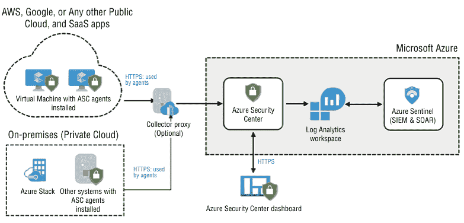

此架构适用于以下用例：

- 通过集成本地安全和遥测监控，充分利用 Azure 工作负载
- 将 Microsoft Defender for Cloud 与 Azure Stack 集成
- Microsoft Sentinel 和 Microsoft Defender for Cloud 集成

在此架构中，工作流如下：

- **Microsoft Defender for Cloud**：Azure 订阅者可以访问这个高级的统一安全管理平台。使用 Defender for Cloud，可以保护云工作负载并管理云安全态势。以工作负载为中心的安全保护解决方案通常是基于代理的解决方案。Microsoft Defender for Cloud 为 Azure 工作负载（包括本地工作负载和其他云中的工作负载）提供威胁防护，涵盖 Windows 和 Linux 虚拟机、容器、数据库以及物联网 (IoT)。激活 Azure 虚拟机时会自动部署 Log Analytics 代理。Windows 和 Linux 服务器及虚拟机可以通过脚本部署，也可以使用组织的部署工具（例如 Microsoft Endpoint Protection Manager）。安装 Defender for Cloud 后，它将评估所有虚拟机、网络、应用程序和数据的安全状态。

- **Microsoft Sentinel**：一种基于云原生技术的云原生 SIEM 解决方案，利用先进的人工智能、安全分析和威胁搜寻功能，在整个企业中检测、搜寻和防止威胁。

- **Azure Stack**：Azure Stack 允许将 Azure 服务和功能扩展到所选的任何区域，从数据中心到边缘位置。Azure Stack 通常与四到十六个机架的服务器硬件集成，由可信赖的硬件供应商直接交付到您的数据中心。

- **Azure Monitor**：可以从各种本地和 Azure 监控源收集监控遥测，包括 Microsoft Defender for Cloud 和 Azure Automation。

- **Log Analytics 工作区**：Azure Monitor 存储日志数据，而 Log Analytics 工作区包含数据和配置信息。

- **Log Analytics 代理**：此场景使用 Microsoft Operations Management Suite (OMS) 网关从 Azure 来宾操作系统和 VM 工作负载收集监控数据。

- **本地网络**：为定义的系统配置了 HTTPS 出站防火墙。

- **本地 Windows 和 Linux 系统**：在系统上安装 Log Analytics 代理。

- **Azure Windows 和 Linux VM**：系统上安装了 Microsoft Defender for Cloud 监控代理。

设计时，应遵循 Azure Well-Architected Framework，考虑可扩展性、可管理性、安全性和成本优化。


将 Microsoft Sentinel 与 Microsoft Defender for Cloud 集成的要求如下：

- 必须拥有 Microsoft Azure 订阅。
- 需要 Microsoft Defender for Cloud。
- Microsoft Sentinel 是付费服务，您的工作区应属于您拥有参与者或读者权限的资源组。

以下是关键注意事项：

默认情况下，激活 Microsoft Defender for Cloud 不会创建 Log Analytics 工作区，因为自定义工作区会根据其定价保留数据。

## 设计 SIEM 和 SOAR 策略

通过主动和被动检测策略，SOC 管理员可以检测、调查、修复和搜寻威胁；使用威胁情报；了解已知漏洞；咨询专家；并在所有六大支柱中阻止威胁。通过将这些工具集成到单一工作流中，SOC 分析师可以提供无缝体验，从而提高其有效性。

来自 Azure 的 Microsoft Sentinel 是一款可扩展的云原生解决方案，提供以下功能：

- 安全信息和事件管理
- 安全编排、自动化和响应

使用 Microsoft Sentinel，可以检测攻击、深入了解威胁、采取主动措施予以应对，并在整个企业中对其进行智能监控。

Azure 服务（例如 Log Analytics 和 Logic Apps）已原生集成到 Microsoft Sentinel 中。Microsoft Sentinel 增强了基于情报的调查和检测，并提供 Microsoft 的威胁情报流，使组织能够引入其自身的威胁情报。

安全运营中心通常使用 SIEM 和 SOAR 技术来收集、检测、调查和响应威胁。Microsoft 的 SIEM 即服务产品 Microsoft Sentinel 从 Microsoft Defender for Identity 和第三方来源收集数据。

Microsoft 365 Defender 是 Microsoft Sentinel 的关键组成部分，可跨所有 Microsoft 365 组件提供感知上下文的保护、检测和响应。为了保护端点、协作工具、身份和应用程序，Microsoft 365 客户必须具备上下文感知能力并保持协调。

Microsoft 客户可以利用此层次结构来最大限度地提高专注度。凭借其上下文感知能力和自动修复功能，Microsoft 365 Defender 可以检测并阻止各种威胁，而不会增加已不堪重负的 SOC 人员的警报疲劳。在 Microsoft 365 Defender 中，高级搜寻通过考虑搜寻的上下文来关注多个关键攻击点。Microsoft Sentinel 还提供了跨整个生态系统获得可见性的能力，同时在异构环境中最大限度地降低操作员的认知负载。

Microsoft 建议在实施端到端零信任框架时专注于以下部署目标：

- 使用 Microsoft Defender 确保可见性。
- 自动化流程。
- 设置其他保护和检测控制。


要提供集中式事件调查和响应平台，必须将 Microsoft 365 Defender、其他数据连接器和相关第三方产品连接到 Microsoft Sentinel，以便深入了解部署零信任模型所产生的事件。数据连接过程、分析和事件激活可以集成，以创建可随时间可视化数据的工作簿。

除了开箱即用的机器学习和融合分析外，还可以通过引入威胁情报数据来丰富 Microsoft Sentinel。

可以通过向 Microsoft 365 Defender 和 Sentinel 添加更多控制措施，来提升可见性和编排响应的能力。

*攻击面*是组织面临网络威胁和攻击的所有薄弱环节。可以使用 Defender for Endpoint 来减少攻击面。

*攻击面缩减*控制措施便是其中一种机会。通过阻止某些恶意软件相关活动，这些防护控制措施可以最大限度地降低攻击者在攻击周期早期利用这些技术的可能性。

## SIEM 和 SOAR 的安全运营中心最佳实践

基于当前 Azure 平台功能和功能设置，以下是保护数据、应用程序和其他 Azure 资产的运营最佳实践。

## 接收 Microsoft 事件通知

如果 Azure 资源遭到破坏，安全运营团队应接收 Microsoft Azure 事件通知。这样他们就可以快速响应并修复潜在的安全风险。

Azure 注册门户的管理员联系信息（包括电子邮件地址和电话号码）用于通知安全运营团队。

## 留意存储服务中意外的行为变化

云环境比传统环境更复杂，用于诊断和排查分布式应用程序故障。可以在本地、PaaS 或 IaaS 环境中、在移动设备上，或在这些环境的组合中部署应用程序。应用程序的网络流量可以使用多种存储技术跨越公共网络和专用网络。

监视应用程序存储服务中任何意外的行为变化（例如响应时间变慢）。可以通过记录更详细的数据来深入分析问题。可以通过监视和记录诊断信息来确定应用程序的根本原因。在问题被识别后，对其进行排查并选择合适的行动计划。

Microsoft 建议使用 Azure 存储分析来分析存储帐户问题、跟踪需求并检查使用趋势。

## 防御、检测和响应威胁

以下是防御、检测和响应威胁的最佳实践：

- 通过使用基于云的 SIEM 提高 SIEM 的速度和可扩展性。将 Microsoft Sentinel 的功能和特性与现有的本地 SIEM 工具进行比较。如果组织的 SIEM 要求得到满足，Microsoft Sentinel 可能是您的不错选择。

- 查看 Azure 安全分数，了解 Microsoft Defender for Cloud 中内置的 Azure 策略和计划提出的建议，以优先调查最严重的安全漏洞。这些建议包括安全更新、终端保护、加密、配置、缺少 WAF、联网虚拟机以及许多其他项目。

- 发现并确定潜在安全问题的优先级，并监视计算机、网络、存储、数据服务和应用程序。

- 通过集成 Defender for Cloud 警报来简化 SIEM。拥有 SIEM 工具的组织通常使用它来清除需要分析师关注的安全警报。Defender for Cloud 将处理后的事件发布到 Azure 活动日志，后者是通过 Azure Monitor 提供的日志之一。

- 可以使用 Azure Monitor 通过 SIEM 工具收集和导出 Azure 日志。联机日志保留期限有限，此做法对于安全事件调查至关重要。

- 通过 Defender for Cloud 安全策略集成 Microsoft Defender for Endpoint 可以加快调查和威胁搜寻流程，并减少误报。

## 监控端到端基于场景的网络监控

可以在 Azure 中通过组合虚拟网络、ExpressRoute、应用程序网关和负载均衡器等网络资源来构建网络。所有网络资源均可进行监控。

区域 Azure 网络观察者服务可用。其诊断和可视化工具可监控和诊断 Azure 内部及来自 Azure 的网络状况。

可使用以下工具和最佳实践来监控网络：

- 网络观察者通过数据包捕获实现远程网络监控自动化。无需登录到虚拟机即可诊断网络问题。通过设置警报，可以获取数据包级别的实时性能信息。通过详细调查观察到的问题，可以进行更准确的诊断。

- 使用网络安全组流日志来了解网络流量模式。可以使用入流日志中的信息来监控、审核和验证网络安全配置文件。

- 网络观察者能够诊断 VPN 连接问题。可以识别问题并使用详细日志进行进一步调查。

## 监视 Azure AD 风险报告

大多数安全漏洞都是由于攻击者窃取用户身份导致的，而且不易发现已泄露的身份。Azure AD 使用机器学习算法和启发式方法来检测可疑用户操作。对于检测到的每项可疑活动，都会保留名为 _风险检测_ 的记录，Azure AD 安全报告会记录风险检测。

- 监视与用户帐户相关的可疑操作。

- 使用 Azure AD 安全报告监视处于风险中的用户和风险登录。

安全运营团队可以使用 Microsoft 365 Defender 的自动调查和响应 (AIR) 功能，更有效、更高效地应对威胁。它适用于电子邮件、设备、内容和身份。

## 评估安全工作流

事件响应流程是每个安全计划的一部分。除了通知相关利益干系人外，可能会启动变更管理流程，并应用特定的修复步骤。应尽可能自动化这些流程中的许多步骤。通过自动化，可以降低开销。此外，它可确保流程步骤快速、一致地执行，并符合预定义的要求，从而提升安全性。

## Microsoft 事件响应最佳实践

根据 Microsoft 的建议，在响应事件时，可以有效解决技术和运营视角的问题。

从技术角度来看，事件响应应旨在实现以下目标：

- 查明对手使用了多少种持久化机制。大多数对手都会使用多种持久化机制。

- 确定攻击目的。持续性攻击者经常会在未来的攻击中为达目的（数据/系统）而再次返回。

以下是事件响应安全运营 (SecOps) 方面的一些目标：

- 保持专注。将注意力集中在关键业务数据、客户影响和修复准备上。

- 协调运营并明确角色。确保技术、法律和通信团队进行沟通。

- 保持业务视角。应始终考虑对手行为和响应行为对业务运营的影响。

## Microsoft 恢复最佳实践

使用这些建议，可以从技术和运营两个角度有效地从事件中恢复。在从事件恢复时，应考虑以下一些技术目标：

- 应限制响应范围，以便在 24 小时或更短时间内执行恢复。为周末的应急和纠正措施做好准备。

- 在恢复操作完成之前，避免进行大规模复杂的安全系统投资或更换反恶意软件解决方案。干扰事项是指任何不直接影响当前恢复操作的事项。

在从事件恢复期间，应考虑以下目标：

- 制定范围有限的明确计划：与技术团队密切合作，制定明确的计划。在根据对手活动进行规划时，限制范围扩大和承担额外任务至关重要。

- 建立对恢复计划的明确所有权：恢复操作涉及许多人同时执行多项任务，因此应指定项目负责人，以确保所有危机团队成员步调一致并知道该做什么。

- 与利益干系人沟通：在通信团队的帮助下，为组织利益干系人提供及时更新并管理预期。

## Azure 工作流自动化使用几种关键技术

可以使用几种关键技术来实现 Azure 工作流自动化。

- Azure Logic Apps 可以自动化集成应用、数据、服务和系统的工作流。该平台可以快速开发业务对业务 (B2B) 集成解决方案。Azure Logic Apps 简化了跨云、本地和混合环境连接传统系统、现代系统和尖端系统的过程。

- 当发生安全警报、建议和法规合规性更改时，可以通过 Microsoft Defender for Cloud 的工作流自动化功能触发 Logic Apps。

- Azure Logic Apps 和 Microsoft Graph Security 连接器可让您自动化将 Microsoft 安全产品、服务和合作伙伴集成到应用中，以检测、保护和响应威胁。可以在 Microsoft Defender for Cloud 中创建手册来监控和管理 Microsoft Graph Security 实体。

- Microsoft Sentinel 提供手册和自动化规则。自动化规则可用于通过更改事件属性或运行手册来帮助对事件进行分类。Microsoft Sentinel 可以运行手册来响应警报或事件。

如果您的组织使用 Microsoft 365 Defender，它将启用自动调查和响应 (AIR)。您的安全运营团队可以自动采取修复措施


或在获批后，具体取决于如何配置 AIR 功能。操作会列在“操作中心”中，无论是待处理还是已完成。安全运营团队可以通过以下方式从 AIR 功能中受益：

- 分析威胁并确定是否需要予以处理
- 采取需要采取（或推荐）的任何补救措施
- 确定是否应当开展以及应当开展哪些其他调查
- 根据需要对其他警报重复该过程


创建自动化工作流，以集成 Microsoft 安全产品和服务，并与 Azure Logic Apps 以及 Microsoft Graph Security 连接器配合使用。

可以在逻辑应用工作流中使用操作来获取 Microsoft Graph Security 的响应，并在部署后将该输出提供给其他工作流操作。此外，还可以在其他工作流中使用 Microsoft Graph Security 连接器操作的输出。

## 评估事件管理生命周期的安全运营策略

NIST 将事件响应描述为“缓解违反安全策略和推荐做法的行为”。

在事件响应 (IR) 期间，SOC 会全力以赴，以遏制、清除并从攻击中恢复——在数据丢失或业务遭受不可挽回损害之前。多步骤过程需要团队协同配合，以便在事件发生后将业务恢复正常运营。为应对安全事件，安全响应团队和服务团队应协同工作。

当客户数据或个人数据被意外或非法销毁、丢失、更改、泄露或访问时，即受到安全事件的影响。例如，如果发生对基础架构的未经授权访问或客户数据被外泄，则会构成安全事件；相比之下，合规性事件则不属于安全事件。

每当发生安全事件时，组织的服务和客户数据都应快速高效地得到保护。应制定有效的策略，以高效调查、遏制和清除安全威胁。

员工应每年接受识别和报告潜在安全事件以及自动化安全监控和警报的培训。如果员工、客户或安全监控工具检测到任何可疑活动，应联系服务特定的安全响应团队。包括安全团队在内的服务运营团队应保持深度值班轮班，以便全天候（24/7/365）为事件响应提供资源。许多公司现在正在外包托管的服务特定响应功能。

一旦检测到可疑活动，应启动调查、遏制、清除和恢复过程。作为调查的一部分，这些团队应确定潜在事件的范围，包括对客户或客户数据的任何影响。安全响应团队应能够与受影响的服务团队合作，制定计划以遏制威胁并最大限度地降低其影响，从环境中清除威胁，并最终根据此分析将系统恢复到已知的安全状态。

服务团队应在事件解决后实施吸取的教训，以便更好地预防、检测和响应未来事件。安全事件发生后（尤其是涉及客户或导致数据泄露时）应进行完整的事后复查。事后复查应旨在识别可能导致事件的技术疏漏、程序失误、人工错误和其他流程缺陷。

事后复查中确定的改进措施应在安全响应团队的协调下实施，以预防未来事件并提高检测和响应能力。

- **准备：** 指响应所需的组织实践，例如工具、流程、能力和就绪程度。
- **检测和分析：** 在生产环境中，此活动涉及检测安全事件并分析所有事件以验证其真实性。
- **遏制、清除和恢复：** 基于上一阶段的分析，指遏制安全事件所需的操作。从安全事件中恢复在此阶段也可能需要额外分析。
- **事件后活动：** 在恢复安全事件后进行的事后分析过程。将审查准备或检测和分析阶段，以确定是否需要进行任何更改。

### 准备

准备充分的响应有助于快速响应事件，甚至可以防止事件发生。为准备应对安全事件，Azure 投入了大量资源。

应向使用 Azure 服务的员工教授与其角色相适应的安全事件和响应程序。每位员工在入职时以及此后每年都应接受培训。为确保所有员工在培训完成后了解组织的安全方法，应涵盖以下内容：

- 安全事件概览
- 员工负责报告安全事件
- 怀疑存在安全漏洞时应采取的措施
- 识别安全事件并予以响应
- 关于隐私的问题，特别是客户隐私
- 如果对安全或隐私有疑问，应采取什么措施，以及联系谁进行升级
- 其他相关安全领域（如有必要）

应每年为相应员工提供安全复习培训。复习培训包括以下主题：

- 过去一年修改的标准操作程序
- 所有人都应报告的安全事件以及报告方式
- 关于安全和隐私需要知道的事项以及如何联系升级人员

每年，您可能需要关注其他新的安全主题。

### 检测和分析

组织应集中审计日志记录和分析，以检测异常或可疑活动。为 Azure 日志文件创建一个集中式、综合数据库将很有益。安全响应团队可以通过集中式日志分析全面监控环境，并关联不同服务的日志条目。

除防病毒和反恶意软件套件、基于网络和基于主机的入侵检测系统以及手动检测方法外，还应配备集中管理的检测工具。

当检测到带有初步严重性评级的潜在事件时，安全响应团队是安全事件响应过程的编排者。安全响应团队应根据检测指标检测安全事件，并在必要时调整严重性级别。如果团队发现任何数据泄露、修改或破坏，安全响应应启动安全通知流程。

作为调查的一部分，安全响应团队应记录与事件相关的所有信息。与特定案例相关的信息可能包括以下内容：

- 事件概述
- 基于其潜在影响的事件影响和严重性
- 导致发现事件的所有指标列表
- 任何相关事件列表
- 安全响应团队以及任何关联服务团队采取的行动记录
- 事件响应过程中收集的任何证据
- 推荐的操作和后续步骤

### 遏制、清除和恢复

为最大限度地减少安全事件并从环境中移除威胁，应根据安全响应团队进行的分析制定适当的遏制和恢复计划。安全响应应支持相关服务团队实施该计划，以确保威胁被成功消除且受影响的服务完全恢复。

#### 遏制

必须通过遏制来保护数据、系统和应用程序免受损害。此阶段涉及确定安全事件的影响，并防止对受影响的服务团队造成进一步损害。Azure 内的自动化响应解决方案应协助团队遏制事件。

作为清除和恢复计划的一部分，在整个遏制阶段，所有受影响的服务和租户都应包含在数据收集和分析中。只有在成功追踪所有受影响的服务后，才能进行清除和恢复。

#### 清除

为实现高度信心，必须消除安全事件的根本原因。清除涉及两个目标：将对手从环境中驱逐，并缓解允许对手进入的任何漏洞。

为驱逐对手并缓解漏洞，根据上一事件响应阶段的分析应用清除步骤。为确保威胁已从环境中成功移除，安全响应团队应与受影响的服务团队协调。在恢复之前，必须解决根本原因并移除威胁。

#### 恢复

安全响应团队一旦确信对手已被驱逐且所有已知漏洞均已修复，即应与受影响的服务团队合作启动恢复。恢复后，受影响的服务会恢复到已知的安全配置。恢复过程的步骤如下：

- 1. 应识别服务的最后已知良好状态。
- 2. 此状态可以从备份中恢复。
- 3. 一旦确认恢复后的状态，即缓解导致事件的漏洞。

恢复过程包括增强的检测控制，以确保恢复计划已成功执行且没有漏洞迹象保留。其他检测控制包括网络级监控、定向警报以及针对关键资源加强安全团队的警惕性。通过监控环境，组织可以确保对手无法重新进入，并且清除将会成功。


## 事后活动

安全事件解决后，尤其是如果事件影响了客户或导致数据泄露，应当进行全面的事件事后分析（post-mortem）；事后分析流程应当设计用于识别技术疏漏、程序失效、人工错误以及可能在事件响应过程中导致或在该过程中被识别的其他流程缺陷。作为流程的一部分，应当包含以下内容：

- 通过调查和分析根本原因，识别改进安全事件响应流程或系统安全性的机会。
- 与产品组专家以及安全和隐私专家合作，识别流程、培训或技术改进机会。
- 将实施新的自动化监控和检测机制，以发现未来的问题。

## 持续改进

安全响应团队应当实施从安全事件中汲取的经验教训，以防止未来的安全事件并改进检测和响应能力。事件响应的效率和有效性取决于持续改进。为了保护组织及其客户免受不断演变的威胁，事后活动确保经验教训在整个企业中成功实施。

按照 Microsoft 的标准 SDL，任何发现都会记录为工作项或缺陷，供产品团队处理，并且这些项目会分配给相应的负责团队。在高级管理层每月的安全事件评审会议上，会讨论事后分析的结果。

## 评估共享技术威胁情报的安全运营策略

组织的威胁情报团队使用威胁情报平台（TIP）提供背景和洞察。这些洞察可以包含许多不同的方面，例如以下内容：

- 如何在事件期间利用技术研究来应对活跃事件
- 主动研究攻击者群体、攻击趋势、高调攻击和新兴技术
- 指导业务和安全技术团队优先级和流程的分析、研究和洞察

要取得成功，需要将大量且多样的威胁情报数据应用到您的流程和工具中，而 Microsoft 正好具备这两方面能力。

您必须确保 Microsoft 从各种来源收集的数据仅以客户同意的方式使用，并将其通过严格的隐私/合规边界进行处理。Microsoft 将此视为一项庄严的责任。

数据来源如下：

- 专用 Microsoft 安全产品
- 黑市情报（犯罪论坛）
- Microsoft 事件响应合作项目提供的情报

虚假信息、国家行为体、勒索软件、IoT 以及运营技术（OT）安全是 Microsoft 研究并帮助解决的一些关键主题。Microsoft 数字安全报告（MDDR）发布相关经验教训和可操作的建议。

此过程中的一些重要部分如下：

- 在数据收集和分析阶段，数据会被标准化，并应用各种分析（已列出）以识别相关的安全洞察和发现，同时会发布 API。
- 在数据集成阶段，Microsoft 的安全功能访问该数据，以提供与该功能相关的发现、背景和洞察。随后，这些发现会自动馈入其他 Microsoft 产品以丰富它们。
- 除了 AI 之外，人类团队还会持续使用这些情报，在 Azure、Office 365、Microsoft IT 和 Microsoft 365 Defender 中寻找对手。此外，这些团队还在开发、调整和验证新的分析方法，以改进检测。

网络安全攻击的特征是多种复杂的恶意事件、属性和上下文。区分可疑活动和非可疑活动是一项具有挑战性的任务。在确定观察到的行为是否可疑时，了解与您所在行业特定相关的已知属性和异常活动至关重要。

Microsoft 网络为组织提供访问可用于收集网络威胁情报的各种信号的渠道。网络威胁情报可从许多来源获得。组织的安全调查可能会通过其开源数据馈送、威胁情报共享社区、商业情报馈送和商业情报馈送来收集本地情报。每秒，Microsoft Intelligent Security Graph 会添加数百 GB 的数据。

此匿名数据的来源如下：

- Microsoft 数据中心网络遍布全球，拥有 100 多个数据中心。
- 每月通过 Windows Update 更新的 10 亿多台 PC 所面临的威胁。
- Microsoft 通过 Microsoft 数字犯罪部门和网络安全防御运营中心进行大量研究，并与行业和执法部门合作以收集外部数据点。

Azure 中的威胁情报提供来自各种来源的监控洞察，并借助以下内容帮助缓解威胁：

- 它利用 Microsoft 网络中数十亿个信号（信号表示信息流量）。
- 使用机器学习和人工智能。
- 它整合来自不同安全产品的多个数据源，以应对不同的攻击场景。

Microsoft 使用 Intelligent Security Graph 和其他第三方馈送，通过 Windows、Azure 和 Microsoft 365 获取信号。Microsoft 在一个平台上整合这些信号，供安全服务与另一个平台上的安全服务进行通信。因此，在 Windows 上发现的任何威胁都会自动且快速地添加到 Azure 的威胁视图中。这种设计为不断演变的网络威胁格局提供了深入的洞察。

### Microsoft Sentinel 的威胁情报

类似于 Microsoft Sentinel 的 SIEM 解决方案使用威胁指标（也称为入侵指标 IoC）作为最常见的网络威胁情报（CTI）形式。威胁指标将观察到的工件（例如 URL、文件哈希或 IP 地址）与已知威胁（例如网络钓鱼、僵尸网络或恶意软件）关联起来。为了帮助安全调查人员确定如何应对环境中观察到的恶意活动，Microsoft Sentinel 提供可供评估的威胁指标。

用于将威胁情报（TI）集成到 Microsoft Sentinel 的活动如下：

- 通过启用到各种 TI 平台和馈送的数据连接器，可以将威胁情报导入 Microsoft Sentinel。
- Microsoft Sentinel 的威胁情报页面和日志允许您查看和管理导入的威胁情报。
- 基于导入到内置分析规则模板中的威胁情报来检测威胁并生成安全警报和事件。
- Microsoft Sentinel 中的威胁情报工作簿允许您可视化关于导入的威胁情报的重要信息。

### Defender for Endpoint 的威胁情报

您可以通过创建自定义威胁警报，使用 Microsoft 365 Defender 跟踪组织中可能的攻击活动。您可以标记可疑事件以收集线索，并通过标记可疑事件来阻止攻击链。与常规威胁警报不同，这些警报将仅在您的组织内显示，并且仅会标记您设置为跟踪的事件。

在创建自定义威胁警报之前，了解警报定义和 IoC 背后的概念至关重要。

### 警报定义

警报定义是上下文属性，它们共同可以识别可能的网络安全攻击的早期线索。这些指标通常是攻击者为成功实现攻击目标而采取的行动的一系列活动和特征的组合。监控这些属性组合对于获得对抗攻击的制高点至关重要。基于这些指标的监控可以帮助在攻击者达到目标之前干预事件链。

### 入侵指标

IoC 指已知的恶意事件，表明网络或设备已被攻破。IoC 通常在攻击执行并达到目标（例如数据外泄）后才可见。与警报定义不同，这些指标被视为攻破的证据，法医调查需要跟踪它们。虽然它无法干预攻击链，但收集这些指标可以帮助为未来的攻击创建更好的防御。

### 警报定义与 IoC 的关系

在 Microsoft 365 Defender 和 Microsoft Defender for Endpoint 中，警报定义是 IoC 的容器，并定义警报，包括针对特定 IoC 匹配而引发的元数据。除了识别信号外，警报定义还包括描述、名称、严重性和攻击描述。

Microsoft 365 Defender 根据 IoC 的类型、值和操作定义具体的检测逻辑，以及它在警报中的显示方式。

### Defender for IoT 的威胁情报

IoT 和运营技术（OT）设备、漏洞和威胁通过中央界面使用 Microsoft Defender for IoT 进行识别和管理。

Microsoft Defender for IoT 附带原生威胁情报功能，使用威胁情报包，可以部署在 Azure 连接的环境、混合环境或本地环境中。Defender for IoT 和 Microsoft Sentinel 提供来自 Defender for IoT 的威胁情报以及来自 Sentinel 的增强威胁情报。

Defender for IoT 提供基于代理和无代理的监控：

- Microsoft Defender for IoT 为最终用户组织提供无代理的网络层监控。您可以在本地或 Azure 连接的混合环境中部署 Microsoft Defender for IoT。
- 此外，Microsoft Defender for IoT 还为 IoT 设备制造商提供轻量级微代理，支持 Linux 和实时操作系统（RTOS）操作系统。使用 Microsoft Defender 设备构建器代理，您可以确保 IoT/OT 项目从云端开始即具有安全性。

### Defender for Cloud 的威胁情报

Defender for Cloud 通过收集和分析有关 Azure 资源的信息来检测威胁。当 Defender for Cloud 检测到威胁时，会触发包含有关该事件的详细信息（包括修复建议）的安全警报。


## Microsoft 365 Defender 威胁情报

To assist incident response teams in investigating and remediating threats, Defender for Cloud provides threat intelligence reports. The threat intelligence report includes the following information:

- An attacker's identity or affiliations (if any)
- Objectives of attackers
- Information about current and historical attack campaigns (if available)
- Tools, techniques, and tactics used by attackers
- URLs and file hashes associated with indicators of compromise
- Identifying the risks to your Azure resources by taking a look at the victimology of your industry and geographical location
- Information on mitigation and remediation

In the Microsoft 365 Defender, threat investigation and response capabilities allow your organization's security team to protect its users from email- or file-based attacks. These insights can help your security team protect users. With these capabilities, you can monitor signals and gather data from multiple sources, including user activity, authentication, email, compromised PCs, and security incidents. Business decision-makers and your security operations team can use this information to understand and respond to threats against your organization and protect your intellectual property.

Microsoft 365 Defender includes a set of tools and response workflows for investigating threats.

- Explorer
- Incidents
- Attack simulation training
- Automated investigation and response


A workflow that integrates apps, data, services, and systems can be analyzed and run using Azure Monitor.

You can use Microsoft Sentinel to evaluate threat indicators in an Azure environment to detect malicious activity and inform security investigators about what to do.

To monitor security incidents, you can use other Azure services, such as Activity Logs, Azure AD Reporting, and Network Security Group flow logs.

## Summary

This chapter explored several topics related to the foundation of security operation centers and various strategies required to be adopted in your organization's security operation center.

As your organization moves to Microsoft Azure, you must define and deploy a SOC team that is enabled with the appropriate SOC strategy, resources, tools, and processes to manage and respond to cybersecurity incidents.

In this chapter, you learned about developing security operations for hybrid and multi-cloud environments, designing logging and auditing security strategies, and developing security operations for hybrid and multi-cloud environments. Develop an approach to security information and event management and security orchestration, automation, and response to evaluate security workflows, review security strategies to manage incidents, evaluate security operations for technical threat intelligence, and monitor sources to identify threats and mitigations.

## Exam Essentials

### Understand the security operations strategy.
Zero Trust security frameworks are characterized by a significant shift from trust-by-default to trust-by-exception as one of their considerable changes in perspectives. It is, however, still necessary to establish trust once it is required to prove the trustworthiness of a request at a point in time, you must select a means of attesting to its reliability. It is necessary to gain visibility into the activities associated with the request to perform this attestation.

### Understand the method to develop a logging and auditing security strategy.
Security operations teams are responsible for identifying, prioritizing, and triaging potential threats. It reduces the time it takes to resolve real incidents by reducing false positives and concentrating on real attacks. Adopt the MITRE ATT&CK framework.

### Understand the method to develop security operations for hybrid and multi-cloud environments.
Managing the hardware and infrastructure hosting the application is no longer the responsibility of the operations team due to the cloud. Operating a successful cloud application is still dependent on operations. The operations team is responsible for deploying, monitoring, escalating, responding to incidents, and performing security audits.

To ensure the application gives the operations team the data and insight they need, incorporate robust logging and tracing into its design and planning.

### Understand the method to develop SIEM and the SOAR method.
Through standard governance and operations management practices, unified operations consistently maintain one set of tools and processes to manage each cloud provider.

To use proactive and reactive detection tactics to manage threats, you should have a central console that allows SOC administrators to detect, investigate, remediate, and hunt threats; use threat intelligence; understand known vulnerabilities; rely on threat experts; and block threats across any of the six pillars. A seamless experience that increases the effectiveness of the SOC analyst is achieved when the tools required to support these phases are converted into a single workflow.

### Know the method to evaluate security workflows.
Microsoft recommends that security practitioners automate as many steps of those procedures as possible. These processes can include notifying relevant stakeholders, launching a change management process, and applying specific remediation steps. By automating the processes, you reduce overhead and improve your security by ensuring the steps are done in a timely, consistent manner and according to your predefined requirements.

### Review security strategies for incident management.
An incident of security occurs when customer data or personal information is destroyed, lost, altered, or accessed unauthorized due to a security breach. Security incidents include, for example, unauthorized access to infrastructure and exfiltration of customer data. Compliance events that do not affect confidentiality, integrity, or availability of customer data aren't considered security incidents.

A security incident should be investigated, and lessons learned implemented in conjunction with the security response team to prevent future incidents. Continuous improvement is essential for effective and efficient incident response programs.

### Know the method to evaluate security operations for technical threat intelligence.
Threat intelligence teams support all other functions such as security analysts in large organizations (for example, through threat intelligence platforms).

It takes a large, diverse set of data and the ability to apply it to your processes and tools to succeed at threat intelligence, and Microsoft does both. Microsoft collects data from various sources to ensure that our customers’ data is used only in ways they have agreed to. It passes through a strict privacy/compliance boundary.

### Know to monitor sources for insights on threats and mitigations.
As a result of accessing various signals across the Microsoft network, organizations use cyberthreat intelligence to gather information. It can be gathered from many different sources. It includes open-source data feeds, threat intelligence–sharing communities, commercial intelligence feeds, and local intelligence from security investigations. The Microsoft Intelligent Security Graph receives hundreds of gigabytes of data every second.

## Review Questions

- 1. Which of the following allows you to select, operate, maintain, and continually analyze threat data to find ways to improve the organization's security posture?
  - A. Security operations center
  - B. Incident management
  - C. Problem management
  - D. Forensic team

- 2. In general, traditional environments categorize applicable SOC activities and choose those relevant to the cloud environment for which of the following choices?
  - A. Preparation, planning, and prevention
  - B. Monitoring, detection, and response
  - C. Recovery, refinement, and compliance
  - D. All of the above

- 3. Microsoft recommends the SOC team be enabled with tools that support which type of detection?
  - A. Reactive and proactive
  - B. Reactive-only tools
  - C. Proactive-only tools
  - D. None of the above

- 4. As a Microsoft Cybersecurity Architect, you will need to consider a Microsoft security operations strategy with which of the following requirements?
  - A. Multiple engineering teams working in Microsoft Azure.
  - B. Multiple subscriptions to manage and secure.
  - C. Regulatory requirements must be enforced.
  - D. All of the above.

- 5. As a Microsoft Cybersecurity Architect, you will need to consider SOC functions in line with Microsoft definitions; which of the following will you consider in your SOC strategy?
  - A. Incident management, incident preparation, and threat intelligence
  - B. Change management, change preparation, and threat management
  - C. Incident management, change preparation, and threat intelligence
  - D. None of above


- 6. 作为 Microsoft 网络安全架构师，您需要考虑以下哪些指标会直接影响组织风险？
- A. MTTA
- B. MTTR
- C. 各层级修复的事件和升级
- D. 以上全部

- 7. 在 MITRE ATT&CK 框架的以下哪个阶段，对手正在运行恶意代码？
- A. 侦察
- B. 资源开发
- C. 初始访问
- D. 执行

- 8. 在 MITRE ATT&CK 框架的以下哪个阶段，对手收集信息以规划未来操作？
- A. 资源开发
- B. 初始访问
- C. 侦察
- D. 执行

- 9. 作为 Microsoft 网络安全架构师，您需要考虑以下哪种日志记录和审计策略以与企业云安全策略保持一致？
- A. 监控工具
- B. 根因分析工具
- C. 使用分布式跟踪等更多功能
- D. 以上全部

- 10. Microsoft Azure 中有哪些类型的日志可用？
- A. 控制/管理日志
- B. 数据平面日志
- C. 已处理的事件
- D. 以上全部

- 11. 作为 Microsoft 网络安全架构师，您被要求审查 Microsoft Azure 云中资源的操作；您将向 SOC 索取哪份报告？
- A. Azure 资源日志
- B. 活动日志
- C. 虚拟机和云服务
- D. Azure Active Directory 报告

- 12. 作为 Microsoft 网络安全架构师，您被要求审查 Microsoft Azure 云中有关用户和组管理活动的信息（包括登录和系统活动）；您将向 SOC 索取哪份报告？
- A. Azure 资源日志
- B. 活动日志
- C. 虚拟机和云服务
- D. Azure Active Directory 报告

- 13. 作为 Microsoft 网络安全架构师，您被要求审查 Microsoft Azure 云中有关使用趋势分析、跟踪请求洞察和存储帐户问题诊断的信息；您将向 SOC 索取哪份报告？
- A. Azure 资源日志
- B. Azure 存储分析
- C. Azure Active Directory 报告
- D. 活动日志

- 14. 作为 Microsoft 网络安全架构师，您被要求审查 Microsoft Azure 云中多个平台上 Web 应用程序 (APM) 的信息；您将向 SOC 索取哪份报告？
- A. Azure 资源日志
- B. 应用程序洞察
- C. Azure 存储分析
- D. 活动日志

- 15. 作为 Microsoft 网络安全架构师，您必须使用以下哪项 Azure 服务来收集数据、事件、性能数据和警报？
- A. Azure 自动化
- B. Azure Monitor
- C. Azure 备份
- D. 以上都不是

- 16. 作为 Microsoft 网络安全架构师，您必须使用以下哪项 Azure 服务来避免重复工作、人为错误，并最终避免安全配置错误？
- A. Azure 自动化
- B. Azure Monitor
- C. Azure 备份
- D. 以上都不是

- 17. 作为 Microsoft 网络安全架构师，您必须使用以下哪项 Azure 服务来根据恢复能力要求恢复和保护数据？
- A. Azure 自动化
- B. Azure Monitor
- C. Azure 备份
- D. 以上都不是

- **18.** Microsoft Sentinel 中以下哪项可让您可视化导入威胁情报的基本信息？
- A. Azure Log Analytics
- B. Azure Monitor
- C. 威胁情报工作簿
- D. 以上都不是

- **19.** 以下哪项使用威胁情报包原生自带威胁情报功能，并可部署在 Azure 连接环境、混合环境或本地环境中？
- A. Microsoft Defender for IoT
- B. Defender for Cloud
- C. 威胁情报工作簿
- D. 以上都不是

- **20.** 以下哪项具有威胁检测功能，并可将警报和上下文信号关联到有关您 Azure 资源的事件中？
- A. Microsoft Defender for IoT
- B. Defender for Cloud
- C. 威胁情报工作簿
- D. 以上都不是


## 第 3 章

## 定义身份安全策略

本章涵盖的 Microsoft SC-100 考试目标包括：

- 设计云资源访问策略
- 推荐身份存储（租户、B2B、B2C、混合）
- 推荐身份验证策略和授权策略
- 设计条件访问策略
- 设计角色分配和委派策略
- 设计基础设施特权角色访问安全策略，包括基于身份的防火墙规则和 Azure PIM
- 设计特权活动安全策略，包括 PAM、权利管理和云租户管理


本章将重点介绍如何设计身份安全策略。要设计身份安全策略，您需要了解如何保护对 Azure 资源的访问，并能够围绕身份验证和授权推荐并应用最佳实践。

Microsoft 通过保护组织的用户、智能设备和服务免受威胁，帮助您解决身份和访问挑战。使用强身份验证和基于风险的自适应访问策略，Microsoft 的身份和访问管理策略有助于保护对资源和数据的访问。它还可以通过提供便捷、快速的登录流程，帮助用户保持高效、减少管理密码的时间，并提高最终用户生产力。使用 Microsoft 的身份和访问管理策略，您可以在云或本地的中心位置管理所有身份并访问所有应用，以提高可见性。通过自动化身份治理，Microsoft 的身份和访问管理策略有助于控制所有用户和管理员对应用和数据的访问。

读完本章后，您将了解如何设计云资源访问策略、推荐身份存储（租户、B2B、B2C、混合）、推荐身份验证策略和推荐授权策略。您还将了解如何设计条件访问策略、角色分配和委派策略、基础设施特权角色访问策略（包括基于身份的防火墙规则和 Azure PIM）以及特权活动策略（包括 PAM、权利管理和云租户管理）。

### 设计云资源访问策略

让我们先了解身份识别和身份验证的区别，再深入探讨 Microsoft 保护对 Azure 资源访问的方法。主体必须向系统提供身份，以启动身份验证、授权和问责。身份识别是声明或自称身份的过程。个人可以通过键入用户名、刷智能卡、挥动令牌设备、说出短语，或将摄像头或扫描仪置于面部、手部或手指前来提供其身份。身份验证的一个核心原则是，所有主体都必须具有唯一身份。

身份验证通过将一个或多个因素与有效身份数据库（例如用户帐户）进行比较来验证主体身份。保护用于验证身份的身份验证信息至关重要。密码很少以明文形式存储在数据库中。相反，身份验证系统存储密码哈希。主体和系统为保持身份验证信息保密所采取的措施，立即反映了该系统的安全级别。

身份识别和身份验证始终作为单一两步流程共同发生。提供身份是第一步，提供身份验证信息是第二步。如果没有这两者，主体就无法访问系统。

让我们现在转向 Microsoft 保护对 Azure 资源访问的方法。随着云应用程序和移动员工队伍的出现，安全边界已被重新定义。员工自带设备并远程工作，数据与企业网络之外的外部合作伙伴和供应商共享。随着企业应用程序和数据转移到混合和云环境，传统网络安全控制已不再充足。控制必须转移到数据所在的位置：设备、应用程序和合作伙伴上。

当今的网络、终端和应用程序通过代表人员、服务和 IoT 设备的身份相互互连。身份在零信任模型中充当一种强大、灵活且粒度细的安全控制。在允许身份访问资源之前，组织必须采取以下步骤：

- 使用强身份验证来验证身份。
- 保持身份合规并确保访问适当。
- 遵循最小特权访问原则。

需要验证身份，随后 Microsoft 可以基于组织策略、持续风险分析和其他机制来维护该身份对云资源的访问。

要制定成功的访问控制策略，您必须考虑不止一种策略或技术，并采取务实的方法，针对当前特定情况采用合适的技术和策略。

现代访问控制必须满足组织的生产力要求，并且还必须具备以下所有特性：

- **安全：** 在访问请求期间，使用所有可用数据和遥测来验证用户和设备的可信度。此配置可防止攻击者在不被发现的情况下冒充合法用户。实施消除未授权特权升级的访问控制策略也至关重要。例如，授予某项权限可用于获取更高权限。有关保护特权访问的更多信息，请参阅保护特权访问部分。
- **一致：** 环境应保持一致且无缝地受到保护。通过实施此标准，攻击者无法通过不连贯或复杂的访问控制实现中的弱点潜入，从而改善用户体验。为避免配置不一致和漂移，应使用单一访问控制策略，该策略使用最少数量的策略引擎。
- **全面：** 在资源和访问路径附近强制实施访问策略可提高安全覆盖率，并使安全能够无缝融入用户的场景和期望中。使用针对数据、应用程序、身份、网络和数据库的安全控制，将策略强制实施更贴近有价值的业务资产。
- **以身份为中心：** 尽可能利用身份及相关控制。身份控制提供原始网络流量所不具备的关于访问请求和应用程序上下文的丰富信息。尽管网络控制是必要的，而且有时


唯一可用的选项（例如在运营技术环境中），身份始终应是首选。如果在从身份层访问应用程序时显示失败对话框，用户无需联系帮助台即可更轻松地解决问题。

图 3.1 中的此构建基块展示了基于零信任的企业访问解决方案，适用于所有类型的内部和外部用户、服务、应用程序以及具有管理访问权限的特权账户。

## 身份零信任部署目标

组织在开始零信任之旅之前，常常对其身份处理方式感到困扰。正在使用本地身份提供商，云应用与本地应用之间不存在 SSO，且对身份风险的可见性有限。

作为部署端到端零信任身份框架的第一步，Microsoft 建议专注于以下目标：

- 1. 确保云身份与本地身份之间的集成。
- 2. 通过条件访问策略提供修复活动。
- 3. 通过分析增强可见性。
- 4. 通过身份治理管理身份和访问权限。
- 5. 对用户、设备、位置和行为进行实时分析，以确定风险并提供持续保护。
- 6. 使用其他安全解决方案检测、保护和响应威胁。

例如，当今许多组织在其网络入口/出口点开始实施有限（或零）内部流量分段（以及其他支持安全元素，例如入侵检测和预防、代理等）。

使用此标准配置，网络中连接到另一设备的任何设备都可以直接与任何其他设备通信（无论信任级别或资产敏感度如何）。虽然这不会造成生产力障碍，但会带来重大风险：单个受攻击设备可以快速攻击任何其他资源（通常使用从受攻击设备窃取的特权内部凭据，例如来自成功的网络钓鱼攻击的凭据）。

在许多组织中，看似影响较低的初始攻击向量（网络钓鱼攻击、用户设备妥协等）会因这种事实上的架构允许的横向移动而迅速变成重大事件。

组织（包括 Microsoft 在内）通常会为特权访问实施专用安全控件。这些控件包括独立账户、特权访问工作站 (PAWs，又称 .ms/PAW) 以及利用特权身份/访问管理 (PIM/PAM) 的即时 (JIT) 解决方案。

零信任方法的重点是通过在允许访问资源之前显式验证用户和设备的信任度来降低风险。为了实现远程工作并控制攻击造成的损害，用户和设备必须证明自身安全（且不影响用户体验和生产力）。

## 图 3.1 基于零信任的企业访问解决方案

| 特权访问 | 特权账户（及 PIM/PAM 系统） | 管理设备和工作站 | 中介 | | |
|---|---|---|---|---|---|
| 控制平面 | 网络通常为运营技术等传统设备提供基础控制平面 | | | | 第 0 层控制平面 |
| 管理平面 | 资产管理、监控。安全<br>数据/工作负载平面 ML、应用和网站、API | | | | 第 1 层拆分<br>• 管理<br>• 平面<br>• 数据/工作负载<br>• 平面 |
| 用户访问 | 用户账户 | 用户设备和工作站 | 中介 | 外部访问 | 第 2 层拆分<br>• 用户访问<br>• 应用访问 |

由于访问控制架构发生了变化，托管设备只有在经过显式验证（配置合规、计算机未感染等）后才被允许访问云资源和本地资源。作为 Azure AD 身份验证过程的一部分，条件访问会根据组织策略验证用户。


使用 Azure AD Identity Protection，您的组织将获得潜在漏洞和风险检测的综合视图。除了使用 Azure Active Directory 的现有异常检测功能（可通过 Azure AD 的异常活动报告获得）之外，Identity Protection 还引入了新的风险检测类型，可实时检测异常。

## Microsoft 的身份零信任部署方法

在当今的移动劳动力和基于云的应用程序中，安全边界被重新定义。员工自带设备并远程工作。数据在企业网络之外被访问，并与网络外的合作伙伴和供应商共享。组织无法依赖传统网络控制来保障安全，因为企业系统随时随地都在使用。无论数据存储在哪里，都应为设备、应用和合作伙伴配备控制措施。

在当今的众多网络、终端和应用程序中，身份代表人员、服务或 IoT 设备。在零信任安全模型中，身份充当控制数据访问的决定性、可适应且可接受的方式。

以下是零信任安全框架中管理身份所涉及步骤的概述。

### 步骤 1：云身份与本地身份的集成

Azure Active Directory (AD) 实现强身份验证、终端安全集成以及以用户为中心的策略核心，以确保最小特权访问。基于用户身份、环境、设备运行状况和风险，Azure AD 的条件访问功能确定如何访问资源。

Microsoft 云身份与本地身份之间的集成方法包含四个阶段。

在阶段 1（“将所有用户连接到 Azure AD 并与本地身份系统联合”）中，通过维护员工身份的健康管道以及必要的安全项目（用于授权的组和用于访问策略控制的终结点），确保云身份和控件保持一致。

要开始使用，请执行以下步骤：

- 1. 选择身份验证选项。Azure AD 对暴力破解攻击、DDoS 攻击和密码喷洒攻击提供最佳保护。为您的组织和合规性要求制定恰当的判定。
- 2. 利用上云的机会，舍弃仅适用于本地的账户。舍弃来自本地的特权角色。
- 3. 如果您的公司用户、组和设备总数超过 100,000，请构建高性能同步盒，以保持组织生命周期同步最新。

在阶段 2（“使用 Azure AD 建立身份基础”）中，在零信任策略中，您必须显式验证、使用最小特权访问原则，并假设已发生泄露。Azure AD 可以充当您的策略决策点，根据对用户、终端和目标资源的洞察来强制执行访问策略。

Microsoft 建议采取此步骤：

- 1. 每个访问请求都应发送到 Azure AD。Azure AD 从此身份控制平面接收信号，以确定每个用户和每个应用或资源的最佳身份验证/授权风险。使用单一登录和一致的策略护栏可改善用户体验并提高生产力。

在阶段 3（“将所有应用程序与 Azure AD 集成”），通过使用单一登录，用户无法在各种应用中留下其凭据副本，也不会因过多提示而泄露其凭据。

您还应确保环境中不存在多个身份访问管理 (IAM) 引擎。如果有两个或多个 IAM 引擎，Azure AD 看到的信号就会减少，从而允许恶意行为者在 IAM 引擎之间潜伏。这还可能导致用户体验不佳，并让您的业务合作伙伴第一次对您的零信任策略表示质疑。

Microsoft 建议遵循以下步骤：

- 1. 实施启用 OAuth2.0 或 SAML 的企业应用程序。
- 2. 使用 Azure AD 应用程序代理集成 Kerberos 和基于表单的身份验证应用程序。
- 3. 如果您发布旧版应用程序，请将 Azure AD 与大多数主要应用程序交付网络/控制器（例如 Citrix、Akamai 和 F5）集成。
- 4. 了解您应该使用 Azure 资源和工具将应用程序从现有/旧版 IAM 引擎迁移出来。
- 5. 在各种云应用程序之间提供更紧密的身份生命周期集成。

在阶段 4（“使用强身份验证进行显式验证”）中，Microsoft 建议采取以下步骤：

- 1. 作为降低用户会话风险的基础组件，推出 Azure AD MFA（高级版 1）。用户在移动时响应多重身份验证 (MFA) 挑战的能力，是他们让我们相信这些是熟悉设备和位置（而无需管理员解析单个信号）的最直接方式之一，即使这些设备和位置是新的或未知的。
- 2. 恶意行为者经常利用无法处理现代安全挑战（例如凭据被盗或重放）的旧版身份验证机制，如 SMTP。


## 步骤 2：通过条件访问策略提供补救活动

Azure AD 条件访问 (CA) 通过分析用户、设备和位置信号来自动化决策并强制执行组织访问策略。您可以使用 CA 策略实施 MFA 等安全控制。CA 策略允许在必要时提示用户进行 MFA，在不需要时则不打扰用户。

Microsoft 提供名为 _安全默认值_ 的标准条件策略作为基本安全措施。相比之下，您的组织可能需要比安全默认值所能提供的更多灵活性。使用条件访问，您可以配置满足要求的新策略，并以更细粒度自定义安全默认值。

在零信任部署中，规划 CA 策略并拥有活动策略和回退策略对于强制执行访问策略至关重要。您应该在环境中配置受信任的 IP 位置。即使这些 IP 未在条件访问策略中使用，配置它们也会让您了解身份保护风险。

Microsoft 建议将设备注册到 Azure AD，以限制来自受攻击和易受攻击设备的访问。如果您管理用户的笔记本电脑/计算机，请启用 Azure AD 混合加入或 Azure AD 加入，利用该信息帮助您做出更好的决策。如果您知道用户来自贵组织控制和管理的计算机，可以允许他们访问数据（计算机上带有脱机副本的客户端）。否则，如果您阻止来自富客户端的访问，用户可能会尝试绕过您的安全性或使用影子 IT。

要为用户管理和注册移动设备，请在 Microsoft EMS 中启用 Intune 服务。

使用移动设备类似于使用笔记本电脑：您了解设备功能越多，就越能依赖或不信任它们，并为阻止/允许访问提供理由。

## 步骤 3：通过分析增强可见性

在使用身份验证、授权和预配构建 Azure AD 环境时，深入了解目录中发生的情况至关重要。使用 SIEM 系统或 Azure AD 报告和监控配置日志记录和报告，以改善可见性。

## 步骤 4：标识治理管理标识和访问特权

完成最初的三个步骤后，下一步将专注于更进一步的目标，例如更强大的标识治理。图 3.2 描绘了 Microsoft 的标识治理方法，用于管理标识和访问特权。

在阶段 1（“使用 Privileged Identity Management 保护特权访问”）中，控制用户的终端、条件和凭据，以访问特定操作/角色。

### 图 3.2 Microsoft 标识治理方法，用于管理标识和访问特权

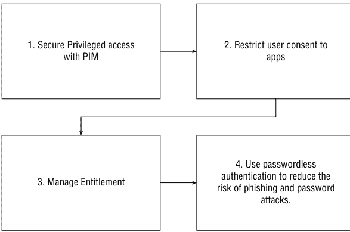

Microsoft 建议执行此步骤：

- 1. 使用 Privileged Identity Management 保护特权标识。在数字化转型的组织中，特权标识的作用不可低估。特权超出了管理员访问权限。

在阶段 2（“限制用户同意应用程序”）中，现代应用程序通常需要用户同意才能访问组织资源。

Microsoft 建议执行以下步骤：

- 1. 通过限制用户同意和管理同意请求，确保您的组织数据不会在未经同意的情况下暴露给应用程序。
- 2. 如果您的组织存在任何过度或恶意同意，请审查您组织中的先前/现有同意。

在阶段 3（“管理权利”）中，既然 Azure AD 用于身份验证应用程序，您可以简化请求、批准和重新认证访问的流程，以便正确的人拥有适当的访问权限，并且您拥有用户拥有其访问权限的原因审计线索。

Microsoft 建议执行以下步骤。

- 1. 实施权利管理，以允许用户创建访问包，从而提供对与其团队/项目关联的资源（如应用程序、SharePoint 网站、组成员身份）的访问权限。
- 2. 如果此时无法实施权利管理，可以在您的组织中启用自助服务组管理和自助服务应用程序访问。

在阶段 4（“使用无密码身份验证以降低网络钓鱼和密码攻击风险”）中，Azure AD 支持 FIDO 2.0 和无密码电话登录，因此您可以减少用户（易受攻击/特权用户）每天使用的凭据数量。除了作为重要身份验证因素外，这些凭据还可以有效降低风险。

Microsoft 建议执行此步骤。

- 1. 开始在您的组织中采用无密码凭据。

## 步骤 5：对用户、设备、位置和行为进行实时分析，以确定风险并提供持续保护

Microsoft 将确定风险并为用户、设备、位置和行为提供持续保护所需的关键实时分析划分为四个阶段。

在阶段 1（“部署 Azure AD 密码保护”）中，绝不能忽视弱密码、密码喷洒或泄露重放攻击，即使可以使用其他方法来预防这些攻击。经典的复杂密码策略只能控制部分密码攻击。

Microsoft 建议执行此步骤：

- 1. 为本地和云中的 Azure AD 用户启用密码保护。

在阶段 2（“启用身份保护”）中，通过使用身份保护，您可以获得更细粒度的会话/用户风险信号。这将有助于引擎更好地了解您环境中的风险是什么样子，以便您可以确认或驳回该信号。

执行此步骤：

- 1. 确保已启用身份保护。

在阶段 3（“启用 Microsoft Defender for Cloud Apps 与身份保护的集成”）中，通过监控用户在 SaaS 和现代应用程序中的行为，Microsoft Defender for Cloud Apps 会获取他们在 Azure AD 中进行身份验证并接收令牌后所发生情况的信息。当用户行为看起来可疑时（例如，从 OneDrive 下载 GB 级数据或在 Exchange Online 中发送垃圾邮件），Azure AD 可以收到通知，表明用户似乎已被攻破或风险很高。在将来，Azure AD 可以在用户随后的访问请求时验证或阻止用户。

Microsoft 建议执行此步骤。

- 1. 可以通过启用 Defender for Cloud Apps 监控来增强身份保护信号。

在阶段 4（“启用与 Microsoft Defender for Cloud Apps 的条件访问集成”）中，您可以监控前往 SaaS 应用程序的会话，并通过使用身份验证后发出的信号以及 Defender for Cloud Apps 代理请求来强制执行限制。

Microsoft 建议执行以下步骤：

- 1. 应启用条件访问集成。
- 2. 本地应用程序可以添加到条件访问。

启用受限会话以用于访问决策；当用户风险较低但从未知终端登录时，您可能希望给他们关键资源的访问权限，但不要允许他们做出导致组织不合规的事情。在 Exchange Online 和 SharePoint Online 中，您现在可以配置用户会话，使其只能阅读电子邮件或查看文件，但不能下载或将其保存到不受信任的设备。Microsoft 建议执行以下步骤：

- 1. 限制 SharePoint Online 和 Exchange Online 访问。

## 步骤 6：使用其他安全解决方案检测、保护和响应威胁

集成其他安全解决方案也可以增强效果。与 Microsoft Defender for Identity 集成可让 Azure AD 检测用户访问本地非现代资源（如文件共享）时的风险行为。随后可以将其视为一般用户风险，而高用户风险可能会阻止云中的进一步访问。Microsoft 建议执行以下步骤：

- 1. Microsoft Defender for Identity 可以与 Microsoft Defender for Cloud Apps 集成，以集成本地风险信号。
- 2. 为了全面了解哪些用户风险最大，请合并每个用户的调查优先级分数。

通过评估 Windows 计算机的运行状况并确定它们是否已被攻破，Microsoft Defender for Endpoint 帮助您在运行时降低风险。域加入让您感受到控制力。Defender for Endpoint 可以检测到多个用户设备正在访问不可信网站的模式，并在面临近乎实时的恶意软件攻击时提升其设备/用户风险。Microsoft 建议执行此步骤：

- 1. 可以配置 Microsoft Defender for Endpoint 以允许条件访问。

> 作为端点安全的集成点，Azure AD 确保最小特权访问并启用强身份验证。使用 Azure AD 的条件访问功能，对资源的访问基于身份、环境、设备运行状况和风险进行决策，并在入口点进行显式验证。

## 推荐标识商店（租户、B2B、B2C、混合）

Azure Active Directory 是 Microsoft 的基于云的标识和访问管理服务。企业可以使用单一登录身份验证、条件访问、无密码和多因素身份验证、自动化用户预配以及许多其他功能，大规模保护和自动化标识流程。


你可以通过多种方式将解决方案与 Azure Active Directory 集成。使用 Azure Active Directory 的内置安全功能，基础集成可以保护您的客户，而高级集成则增强解决方案的安全功能。让我们从基础点开始。

### 集成基础
基础集成使用 Azure Active Directory 的内置安全功能保护您的客户。

### 启用 SSO 和发布者验证
在 Azure Active Directory 应用库中发布应用以启用单点登录。这将增加客户信任，因为他们知道您的应用程序与 Azure Active Directory 兼容。您可以成为经过验证的发布者，让客户知道您是他们添加的应用程序的发布者。

将应用库与自动化应用注册结合到您的租户中，将使 IT 管理员轻松集成解决方案。将应用添加到库中将防止应用出现这些问题，因为手动注册是支持问题的常见原因。

### 集成用户预配功能
拥有数千名用户的组织在管理身份和访问方面面临挑战。当大型组织使用您的解决方案时，您可以在应用程序与 Azure Active Directory 之间同步用户和访问信息，以便在发生更改时保持用户访问一致。

可以使用跨域身份管理系统 (SCIM) 用户管理 API 在应用程序与 Azure Active Directory 之间自动预配用户和组。

### Azure Active Directory B2C
Azure Active Directory B2C 中的客户身份和访问管理 (CIAM) 支持数百万用户和数十亿次日常身份验证。此解决方案使品牌 Web 和移动应用程序能够与白标身份验证体验无缝融合。

使用 Azure Active Directory B2C，合作伙伴可以使用 Microsoft Graph 和关键安全 API（例如条件访问、确认泄露和风险用户 API）进行集成。

### 与 RESTful 终结点集成
独立软件供应商可以使用 RESTful 终结点和身份验证来启用多重身份验证 (MFA) 和基于角色的访问控制 (RBAC)。还可以启用身份证明，通过机器人检测和欺诈预防改善安全性，并满足安全客户身份验证 (SCA) 要求。

来自 Microsoft 的 RESTful API 附带详细指南和合作伙伴示例集成演练：

- 客户身份验证和身份证明，允许他们验证最终用户的身份
- 通过基于角色的访问控制为最终用户提供细粒度访问控制
- 本地应用程序的混合访问，使最终用户能够安全地访问本地和旧版应用程序
- 为客户提供针对机器人攻击和欺诈登录尝试的欺诈防护

Azure AD 外部标识指的是如何安全地与组织外部用户进行交互。

如果您允许外部用户使用其首选身份登录到 Microsoft 应用程序或其他企业应用程序（SaaS 应用程序、自定义开发的应用程序等），则可以与他们协作。在目录中，B2B 协作用户显示为来宾用户。

使用 B2B 直接连接，您可以与另一个 Azure AD 组织建立互惠的双向信任。使用 B2B 直接连接，外部用户可以使用共享频道从其 Teams 实例访问您的资源。在 Teams 管理中心报告中，使用 B2B 直接连接的用户不会显示在您的目录中，但可以在 Teams 共享频道中查看。

您可以使用 Azure AD B2C 为现代 SaaS 和自定义开发的应用程序（不包括 Microsoft 应用程序）管理身份和访问。

## 推荐身份验证和授权策略

Microsoft Cybersecurity Architects 设计 IAM 解决方案，为所有用户、应用程序和设备实施身份验证和授权。强大的身份和访问管理解决方案应提供统一身份管理、安全自适应访问、简化的身份治理和无缝用户体验。

在考虑身份验证和授权选项时，请考虑健壮 IAM 解决方案的这些特性：

- 通过在一个位置管理所有应用程序的所有身份和访问（无论在云中还是本地），提高可见性和控制力。
- 通过提供轻松、快速的登录体验，使用户保持高效并减少密码管理时间。
- 强身份验证和基于风险的自适应访问策略可确保安全地访问资源和数据，同时不影响用户体验。
- 控制所有用户和管理员对应用程序和数据的访问：自动化身份治理可确保只有授权用户才能访问应用程序和数据。

组织需要一个身份控制平面，以增强其安全性并使其云应用程序免受入侵者的威胁。用户使用由身份控制平面验证或身份验证的凭据登录设备、应用程序或服务。对于希望将应用迁移到云的组织来说，选择正确的身份验证方法至关重要。

- 迁移到云的组织必须首先做出此决定。
- 组织在云中的存在取决于其身份验证方法。它控制对所有云数据和资源的访问。
- 因此，Azure AD 提供高级安全和用户体验功能。

组织通过身份验证访问云应用程序，身份验证充当 IT 安全的新控制平面。

Azure AD 身份验证不仅仅是验证用户名和密码。以下是有助于提高安全性和减少技术支持的一些组件：

- 自助密码重置
- Azure AD 中的多重身份验证
- 与本地环境集成以将密码更改写回
- 用于本地密码保护的混合集成
- 无密码身份验证

当 Azure AD 混合身份是您的新控制平面时，身份验证是云访问的基础。要实现 Azure AD 混合身份解决方案，选择正确的身份验证方法至关重要。通过使用 Azure AD Connect 作为登录方法，用户也可以在云中预配。

组织应根据实现所涉及的时间、现有基础设施、复杂性和成本来选择身份验证方法。这些因素因组织而异，并可能随时间变化。

在混合身份解决方案场景中，Azure AD 支持以下身份验证方法：

- 云身份验证
- 联合身份验证

### 云身份验证

当您选择身份验证方法时，Azure AD 处理用户的登录过程。云身份验证包含单点登录 (SSO)，因此用户可以登录云应用而无需重新输入凭据。云身份验证有以下两个选项：

- Azure AD 密码哈希同步
- Azure AD 直通身份验证

## Azure AD 密码哈希同步

本地目录对象可以使用相同的用户名和密码在 Azure AD 中进行身份验证。不需要额外基础设施。Azure AD 的高级功能（例如 Identity Protection 和 Azure AD 域服务）需要密码哈希同步，无论使用哪种身份验证方法。

图 3.3 描绘了 Azure AD 密码哈希同步的参考体系结构。

### **图 3.3** Microsoft Azure AD 密码哈希同步参考体系结构

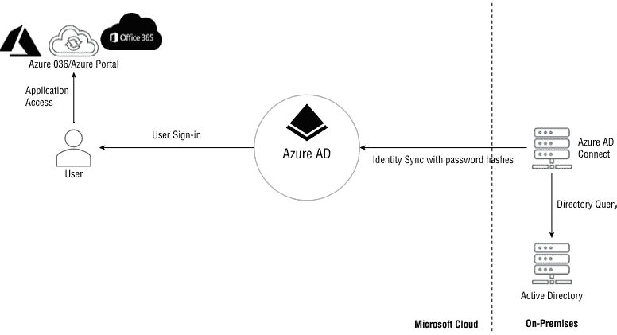

在设计 Azure AD 密码哈希同步时，请考虑以下事项：

- **从工作量角度看**：仅登录到 Microsoft 365、SaaS 应用和 Azure AD 资源的组织需要密码哈希同步，以进行小规模部署、维护和基础设施工作。启用后，密码哈希同步在 Azure AD Connect 同步期间每两分钟发生一次。
- **从用户体验角度看**：具有密码哈希同步的无缝 SSO 解决方案将改善用户的登录体验。无缝 SSO 在登录期间删除不必要的提示。
- **从高级用例角度看**：使用 Azure AD 高级版 P2，组织可以使用 Azure AD Identity Protection 报告中身份的洞察。在使用密码哈希同步时，Windows Hello for Business 有特定要求。示例是泄露凭据报告。要在托管域中使用企业凭据预配用户，Azure AD 域服务需要密码哈希同步。


要求使用密码哈希同步进行多因素身份验证的组织必须使用 Azure AD 多因素身份验证或条件访问自定义控制。这些组织不能在本地或使用第三方提供的联合多因素身份验证方法。

- 从灾难恢复和业务连续性角度来看：作为可扩展到所有 Microsoft 数据中心的云服务，使用云身份验证的密码哈希同步具有高可用性。如果密码哈希同步长时间中断，请部署一台处于暂存模式的 Azure AD Connect 服务器作为备用服务器。

编写本书时，密码哈希同步不会立即强制执行本地帐户状态的更改。

在用户帐户状态与 Azure AD 同步之前，可以访问云应用。管理员批量更新本地用户帐户状态后，组织可能需要运行新的同步周期来克服此限制。

## Azure AD 直通身份验证

Azure AD 直通身份验证服务通过使用本地软件代理为 Azure AD 身份验证服务验证密码。为确保密码验证不在云中进行，服务器会直接与本地 Active Directory 验证用户。

需要立即强制执行本地密码策略和登录时间的组织可以使用此身份验证方法。

图 3.4 描绘了直通身份验证的参考架构。

## 图 3.4 Microsoft Azure AD 直通身份验证参考架构

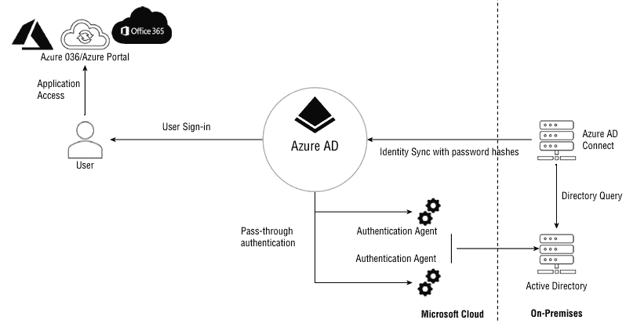

在设计 Azure AD 直通身份验证时，请考虑 Azure AD 直通同步的关键元素。

- 从精力角度来看：要使用直通身份验证，必须在现有服务器上安装一个或多个轻量代理（Microsoft 建议三个）。必须为代理提供访问 Active Directory 域服务（包括本地 AD 域控制器）的权限。出于此原因，不建议在外围网络中部署代理，并且它们需要出站 Internet 访问权限和访问域控制器的权限。
- 在直通身份验证中，域控制器必须拥有不受限制的网络访问权限，并且所有网络流量都必须加密且仅限于身份验证请求。
- 从用户体验角度来看：直通身份验证通过删除不必要的提示来改善用户的登录体验。无缝 SSO 可避免用户登录后出现不必要的提示。
- 从高级用例角度来看：在登录时，直通身份验证强制执行本地帐户策略。如果本地用户的帐户已禁用或锁定、密码已过期，或者登录尝试不在登录时间内，其登录尝试可能会被拒绝访问。

要求使用直通身份验证进行多因素身份验证的组织需要 Azure AD MFA 或 CA 自定义控制。这些组织不能使用依赖于联合的多因素身份验证。无论您是否选择直通身份验证，都需要密码哈希同步来支持高级功能。

为实现灾难恢复和业务连续性，Microsoft 建议部署两个额外的直通身份验证代理。除了 Azure AD Connect 服务器代理之外，这些额外代理可确保身份验证请求的高可用性。即使部署了三个代理，如果另一个代理因维护而停机，一个代理仍可能失败。

将密码哈希同步与直通身份验证相结合也很有意义，因为它在主身份验证尝试失败时可充当备份身份验证方法。假设发生重大本地故障导致代理无法验证用户凭据，在这种情况下，密码哈希同步可作为直通身份验证的备份身份验证机制。您应使用 Azure AD Connect 手动切换到密码哈希同步。

## 联合身份验证

使用此身份验证方法时，Azure AD 会将身份验证过程传递给外部身份验证系统，例如 AD FS。可以将基于智能卡或第三方多因素身份验证作为额外的高级身份验证要求提供。

图 3.5 描绘了联合身份验证的参考架构。

## 图 3.5 Microsoft 联合身份验证参考架构

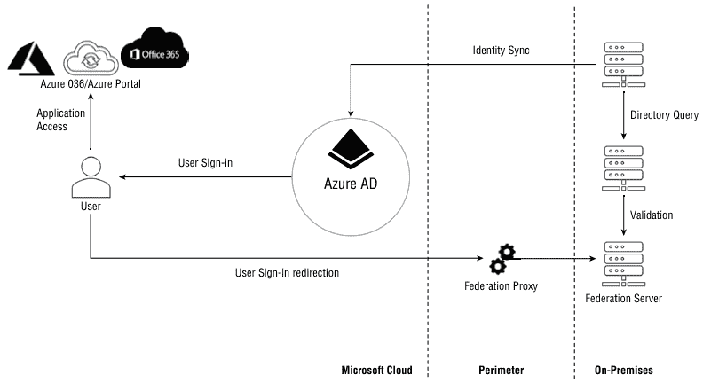

在设计联合身份验证时，请考虑以下事项。

- **从精力角度来看：** 在联合身份验证系统中，身份验证由外部可信系统处理。基于 Azure AD 的混合标识解决方案允许某些公司重复利用现有的联合系统投资。Azure AD 不负责维护和管理联合系统；组织的责任是安全地使用联合系统并处理身份验证负载。
- **从用户体验角度来看：** 联合身份验证的用户体验取决于联合场拓扑、配置和功能的实现方式。某些组织必须足够灵活，以根据其安全要求调整和配置联合场访问。例如，可以配置内部连接的用户和设备自动登录，无需提示输入凭据，因为它们已经登录。高级安全功能有时会使用户的登录过程更加困难。
- **从高级用例角度来看：** 具有 Azure AD 不原生支持的身份验证要求的客户应考虑使用联合身份验证。以下是一些需要考虑的常见场景：
  - 身份验证需要智能卡或证书。
  - 需要针对本地或第三方多因素身份验证服务器的联合身份提供程序。
  - 预配由第三方提供的身份验证解决方案。
- 安装一个登录协议，该协议不使用用户主体名称 (UPN)（例如 user@domain.com），而是要求使用 SAMAccountName（例如 DOMAIN\username）。
- 从灾难恢复和业务连续性角度来看：联合身份验证系统通常需要一个负载均衡的服务器阵列，称为 *场*，并按确保身份验证请求高可用性的拓扑进行配置。

例如，在本地服务器不可用时，部署密码哈希同步和联合身份验证作为备份方法。在多个配置了地理 DNS 的 Internet 入口点提供低延迟身份验证请求是某些需要联合解决方案的大型企业组织的要求。

大多数组织如果目前在本地联合基础架构方面有投资，并且使用单个身份提供程序是重要的业务要求，则会选择此方案。默认情况下，联合系统需要更高的基础架构投资，并且联合的操作和故障排除比云身份验证解决方案更具挑战性。

图 3.6 描绘了决策树；使用它，您可以作为 Microsoft 网络安全架构师决定哪种身份验证方法最适合您。使用它，您可以决定是使用联合身份验证还是云身份验证来管理 Azure AD 混合标识。

## 身份验证方法比较

表 3.1 比较了各种身份验证方法，这将帮助 Microsoft 网络安全架构师定义标识控制平面。

以下是 Microsoft 提供的用于设计标识层的高级指南：

- 它通过控制对云以及您迁移并在云中提供的业务线应用程序的访问来保护组织的敏感数据。

无论您选择哪种身份验证方法，Microsoft 建议您最好使用或启用密码哈希同步，原因如下：

**高可用性和灾难恢复注意事项** 直通身份验证和联合身份验证需要本地基础架构。直通身份验证包括代理所需的服务器硬件和网络。使用联合身份验证时，本地足迹更为关键。您需要在外围网络中部署代理服务器来代理身份验证请求，并部署内部联合服务器来处理联合身份验证。

通过部署冗余服务器，可以防止单点故障。在直通身份验证和联合身份验证中，即使任何组件发生故障，身份验证请求仍会得到处理，域控制器也可能无法响应身份验证请求。维护对于保持这些组件正常运行至关重要；当维护没有正确计划和实施时，中断更可能发生。Microsoft Azure AD 云身份验证服务在全球范围内扩展且始终可用，因此可以使用密码哈希同步来避免中断。


## 图 3.6 Microsoft 身份验证方法决策树

- 开始
- 是否希望 Azure AD 在 Azure 中完全处理登录？
- 是否希望与现有联合提供程序集成？
- 是否希望在登录期间强制执行用户级 AD 安全策略？
- 是否有 Azure AD 原生不支持的登录要求？
- 是否有 Azure AD 原生不支持的登录要求
- 是否希望登录灾难恢复或泄露凭据报告？
- 密码哈希同步 + 无缝单一登录
- 密码哈希身份验证 + 无缝单一登录
- 密码哈希身份验证 + 无缝单一登录（带密码哈希同步）
- 是否希望登录灾难恢复或泄露凭据报告？
- 联合身份验证
- 带密码哈希同步的联合身份验证

## 本地故障期间的生存

由于由网络攻击或灾难引起的本地故障，后果可能非常严重，从声誉受损到组织瘫痪不等。最近，许多组织成为恶意软件攻击（例如勒索软件）的受害者，这些攻击导致组织的本地系统关闭。根据 Microsoft 在处理此类攻击方面的经验，它根据组织的网络安全特征及其在网络攻击中的表现，将组织分为两种类型。

- 对于以前使用联合或直通身份验证以及密码哈希同步的组织，其主要身份验证方法已更改为密码哈希同步。通过 Microsoft 365 访问电子邮件，他们迅速解决了问题并访问了其他基于云的工作负载。他们在几小时内重新上线。通过访问 Microsoft 365 电子邮件，他们能够解决问题并访问其他基于云的工作负载。

- 以前，没有密码哈希同步的组织依赖不受信任的外部消费者电子邮件系统来解决问题。发生这种情况时，在最终用户能够登录基于云的应用程序之前，组织的本地身份解决方案需要数周才能恢复。

## 身份保护

带有 Azure AD Premium P2 的 Azure AD Identity Protection 是保护云中用户的最佳方法之一。不法分子在暗网上出售和提供用户和密码列表，Microsoft 会不断扫描 Internet 以查找这些列表。在 Azure AD 中，您可以使用这些信息来查明组织的任何用户名和密码是否已泄露。无论使用哪种身份验证方法，密码哈希同步都至关重要，无论是通过联合身份验证还是直通身份验证。使用这些信息，当用户尝试使用泄露的凭据登录时，您可以阻止或强制用户更改密码。

## 表 3.1 身份验证方法

| 设计和部署注意事项 | 直通身份验证和无缝单一登录 | 密码哈希同步和无缝单一登录 | 带 AD FS 的联合身份验证 |
| :--- | :--- | :--- | :--- |
| 身份验证的流程是什么？ | 通过云中的本地身份验证代理进行安全密码验证交换。 | 在云中 | 本地。 |
| 是否需要 TLS/SSL 证书？ | 否。 | 否 | 是。 |
| 预配系统如何与本地 Internet 和网络要求交互？ | 基于身份验证代理的出站 Internet 访问。 | 无 | 可通过 Internet 访问边缘 WAP 服务器。边缘中的 WAP 服务器可以通过入站网络访问访问 AD FS 服务器。网络负载平衡。 |
| Azure AD Connect 是否需要任何其他本地服务器？ | 每增加一个身份验证代理，应有一台服务器。 | 无 | 两个或更多 AD FS 服务器。边缘/DMZ 网络中两个或更多 WAP 服务器。 |
| 有哪些可用的运行状况监控解决方案？ | Azure Active Directory 管理中心提供代理状态。 | 不需要 | Azure AD Connect Health。 |
| 公司网络内的域加入设备能否使用单一登录访问云资源？ | 是，使用无缝单一登录。 | 是，使用无缝单一登录。 | 是。 |
| 支持哪些登录类型？ | 用户主体名称 + 密码。使用无缝单一登录的 Windows 集成身份验证。备用登录 ID。 | 用户主体名称 + 密码。使用无缝单一登录的 Windows 集成身份验证。备用登录 ID。 | 用户主体名称 + 密码。SAMAccountName + 密码。Windows 集成身份验证。证书和智能卡身份验证。备用登录 ID。 |
| Windows Hello for Business 是否支持？ | 密钥信任模型。混合云信任。两者都需要 Windows Server 2016 域功能级别。 | 密钥信任模型。混合云信任。 | 密钥信任模型。混合云信任。证书信任模型。 |
| 支持哪些多重身份验证？ | Azure AD MFA。带条件访问的自定义控件。 | Azure AD MFA。带条件访问的自定义控件。 | Azure AD MFA。Azure MFA 服务器。第三方 MFA。带条件访问的自定义控件。 |
| 支持哪些用户帐户状态？ | 已禁用的帐户。帐户锁定。帐户过期。密码过期。登录小时数。 | 已禁用的帐户（最多 30 分钟延迟） | 已禁用的帐户。帐户锁定。帐户过期。密码过期。登录小时数。 |
| 条件访问可以以何种方式使用？ | 带有 Azure AD Premium 的 Azure AD 条件访问。 | 带有 Azure AD Premium 的 Azure AD 条件访问 | 带有 Azure AD Premium 的 Azure AD 条件访问。AD FS 索赔规则。 |
| 是否可以阻止旧版协议？ | 是。 | 是 | 是。 |
| 是否可以自定义登录页面上的徽标、图像和说明？ | 是，使用 Azure AD Premium。 | 是，使用 Azure AD Premium。 | 是。 |
| 高级场景如何处理？ | 智能密码锁定。 | 智能密码锁定。泄露凭据报告，使用 Azure AD Premium P2 | 多站点低延迟身份验证系统。AD FS 外网锁定。与第三方身份系统集成。 |

来源：改编自 https://learn.microsoft.com/en-us/azure/active-directory/hybrid/choose-ad-authn#comparing-methods

## 安全授权

成功将用户身份验证到云资源后，现在需要确保他们只能执行他们应该执行的操作。最终用户应用程序通常自己处理授权。例如，可能有包含每个用户访问级别的数据库行或文档。这样做很合理，因为每个应用程序都有其授权功能，但您需要检查所有应用程序以了解用户可以访问什么。

职责分离和最小特权是授权中最关键的概念。按定义，最小特权意味着只有您的用户、系统和工具完成工作所需的信息才应可访问。这意味着您通常采用“默认拒绝”策略，即除非您明确授权，否则标识无法执行任何操作。

关于财务控制，对于超过一定金额的支票可能需要两个签名，职责分离是一种常见做法。它通常意味着确保没有任何个人能够完全破坏整个云环境的安全。能够更改系统的个人也不应能够更改或审查来自这些系统的日志。

随着云服务和内部应用程序变得越来越流行，集中式授权变得越来越关键。授权验证尝试连接的标识是否具有访问服务、功能、函数、对象或方法所需的权限。在没有身份验证的情况下，在执行任何授权检查之前连接会失败，授权始终在成功身份验证后发生。如果用户或组不具备必要的授权，则成功身份验证连接可能不允许特定操作。

为强制实施零信任，管理员应了解以下授权方法：

- 安全组成员身份
- 基于角色的访问控制
- 访问级别
- 功能标志
- 安全命名空间和权限

从 SC-100 考试角度来看，请记住：直通身份验证、密码哈希同步和联合身份验证是三种密码同步类型。Azure AD 不会以明文存储密码或使用可逆算法对其加密，且自定义控件目前尚不支持 Azure AD 条件访问中的设备注册。Azure AD 混合标识解决方案必须使用 Azure AD Connect 支持的拓扑之一进行部署。

## 设计条件访问策略

身份驱动的信号可以作为组织访问控制决策的一部分，以将其安全边界扩展到网络之外。作为新的身份驱动控制平面的一部分，Microsoft Azure Active Directory 条件访问整合信号以做出决策并强制执行策略。

如果-那么 语句是条件访问策略的主要形式。用户如果想要访问资源，必须执行特定操作。管理员面临两个主要目标。

- 无论用户身在何处，都提升用户生产力。
- 确保组织资产受到保护。

为保持组织安全，请使用条件访问策略。零信任高度依赖条件访问，因为它基于计算出的风险和预配置策略，确保正确的用户能够访问正确的资源。Azure Active Directory 可以让访问


基于计算风险做出决策。在适当的情况下，独立软件供应商可以在其产品中提供应用条件访问策略的选项。

第一因素身份验证后，将强制执行条件访问策略。但是，条件访问不打算成为组织针对拒绝服务攻击等场景的第一道防线。

每家公司都有自己的安全策略和要求。使用此条件访问框架，您可以创建满足公司需求的架构。指南包含与零信任相关的原则，可在创建架构时作为输入使用。根据公司要求和政策，相应调整架构。

例如，一家公司可能有以下要求：

- 必须使用至少两个因素来保护所有访问。
- 非托管设备不得包含数据。
- 不允许来宾。
- 访问云服务必须使用不需要密码的身份验证方法。

基于条件访问，Microsoft 建议创建符合以下三项原则的零信任访问模型：显式验证、使用最低特权访问、假设已发生泄露。

## 显式验证

显式验证的关键注意事项如下：

- 将应用与 Azure AD 集成，并使用条件访问保护它们。
- 假设所有客户端都是外部客户端。

## 使用最低特权访问

使用最低特权访问的关键注意事项如下：

- 评估访问时，应考虑与用户、登录和设备相关的风险。
- 使用条件访问进行保护，直接访问资源。
  - 可以使用 Azure AD 应用程序代理访问资源。可以使用条件访问保护资源。
  - 使用基于条件访问的 VPN 访问资源。将访问限制在应用程序或 DNS 名称级别。

## 假设已发生泄露

采用假设已发生泄露场景的关键注意事项如下：

- 网络基础设施需要分段。
- 确保尽可能少地使用企业公钥基础设施 (PKI)。
- 密码哈希同步 (PHS) 应取代来自 AD FS 的单一登录 (SSO)。
- 在 Azure AD 中使用 Kerberos 密钥分发中心 (KDC) 以最大程度地减少对域控制器的依赖。
- 使用 Microsoft EMS 将管理平面移至云端。

以下是设计中应遵循的 Microsoft 推荐条件访问原则和最佳实践列表：

- 条件访问应基于零信任原则。
- 在将策略投入生产之前，请使用仅报告模式。
- 应测试正面和负面场景。
- 条件访问策略应受更改和修订控制。
- 使用 Azure DevOps/GitHub 和 Azure Logic Apps 等工具自动化条件访问策略管理。
- 除非不得已，否则不要对常规访问使用阻止模式。
- 必须确保所有应用程序和平台都受到保护。条件访问没有隐式“拒绝所有”功能。
- 所有 Microsoft 365 基于角色的访问控制 (RBAC) 系统都必须保护特权用户。
- 高风险用户和登录（按登录频率强制实施）需要更改密码和多因素身份验证。
- 使用带有 Intune 合规性检查的条件访问策略限制对高风险设备的访问。
- 应保护对 Office 365、Azure、AWS 和 Google Cloud 管理门户的访问。
- 使用不受信任设备的用户和管理员不得保留浏览器会话。
- 使用旧式凭据进行身份验证。
- 不支持或未知的设备不得获准访问。
- 访问资源应要求使用符合条件的设备。
- 应限制使用强凭据进行注册。
- 如果在中断之前满足适当条件，请考虑使用默认会话策略，以便在发生中断时允许会话继续。

在创建条件访问策略时，请考虑以下 Microsoft 建议列表。

- **命名约定：** 为策略定义命名约定后，您和同事将能够了解策略的用途，从而简化策略管理和故障排除。
- 编号方案：确保编号方案可预测且标准。
- 策略类型：Microsoft 建议考虑五种主要类型：基础保护、身份保护、数据保护、应用保护和攻击面缩减。
- 标准策略组件：应用程序、平台类型、授予控制类型和名称都是需要预先定义的组件，以便所有策略保持一致。

## 条件访问零信任架构

在条件访问架构方面，Microsoft 建议在企业设计中采用目标模型或零信任。

该架构非常符合零信任原则。在条件访问策略中，如果选择“所有云应用”选项，所有终结点都将由提供的授予控制（例如已知用户和符合条件的设备）保护。该策略适用于用户交互的所有终结点，而不仅限于条件访问支持的终结点。

各种新的 PowerShell 和 Microsoft Graph 工具使用设备登录流终结点。设备登录流可从没有登录屏幕的设备（例如 IoT 设备）登录。

用户在设备上执行基于设备的登录命令后，会显示一个代码。若要在下一台设备上使用相同代码，用户必须转到 aka.ms/devicelogin 并输入其用户名和密码。在其他设备上登录后，同一用户上下文中的 IoT 设备登录将成功。

此登录不支持基于设备的条件访问，这带来了挑战。如果为所有云应用程序应用要求已知用户和已知设备的基线策略，则没有人可以使用这些工具和命令。其他应用程序的基于设备的条件访问也会出现同样的问题。

另一种架构是目标模型，即在条件访问策略中仅针对希望保护的应用程序。因此，条件访问策略不保护已由所有云应用程序覆盖的终结点（例如对 Azure Active Directory 的 Graph 调用）的设备登录。

要区分这两种架构，可以使用设备登录进行身份验证。假设每个应用程序都是目标对象，并且可以排除在要求基于设备登录的条件访问策略之外。在这种情况下，可以允许一个或几个单独的应用程序进行设备登录。

在目标架构中，您可能会忘记保护所有云应用程序。不过，您会在条件访问策略中选择所有可选择的应用程序，而让不可选择的应用程序处于未受保护的访问状态。用户可以访问几个非常敏感的门户，例如 Office 门户、Azure 企业协议 (EA) 门户和安全信息门户。

Microsoft 及其合作伙伴不断推出新功能，IT 管理员随时间推移将各种应用程序与 Azure Active Directory (Azure AD) 集成，因此 Office 365 和 Azure Active Directory (Azure AD) 应用程序的数量不断增长。条件访问只能通过检测新应用并自动应用策略的脚本来保护，开发和管理此类脚本可能非常复杂。

条件访问策略最多可包含 250 个应用程序。可以添加多达 600 个，然后才会收到负载已超过的错误，但不支持该数量。

实施条件访问策略以保护各种类型的用户免于访问敏感资源可能需要时间和精力。策略可以根据资源的敏感性构建。

另一种方法是根据用户在组织中的位置定义访问策略。此方法可能导致条件访问策略数量无法管理。

为满足一组用户的精确需求，最好将与常见访问需求相关的策略构建并捆绑为角色。企业角色共享常见属性、职责、经验、目标和访问权限，以及常见的企业属性、职责、经验和目标。全面的零信任策略需要了解各种角色如何访问企业资产和资源。

还应为不属于任何角色组的标识单独定义一个角色。这称为 _全局角色_，旨在为不属于任何角色组的标识强制执行策略。

## 角色摘要

Microsoft 建议在企业设计中考虑表 3.2 中列出的角色。

| 角色 | 角色描述 |
|---|---|
| Global | 全局通常表示适用于所有角色或不适用于任何特定角色的策略。使用它来定义其他角色未涵盖的策略。该角色有助于保护所有相关场景。 |
| Admin | 管理员是非来宾标识（无论是云端还是同步的），在 Azure AD 或 Microsoft 365 中具有管理员角色（例如，在 Microsoft Defender for Cloud Apps、Exchange、Defender for Endpoints 或 Compliance Manager 中）。此角色排除具有这些角色的来宾，因为另一个角色涵盖他们。 |
| Developers | 开发者角色中的用户有独特需求。他们基于同步到 Azure AD 的 Active Directory 帐户，但对 Azure DevOps、持续集成/持续交付管道、设备代码流和 GitHub 拥有特殊访问权限。开发者角色中可以有内部用户和外部用户，但一个人应仅包含在一个角色中。 |
| Internals | Microsoft 建议将开发者的内部用户添加到开发者角色，前提是其 Active Directory 帐户已与 Azure AD 同步。 |
| Externals | 具有已同步到 Azure AD 的 Active Directory 帐户的外部顾问。应将外部开发者添加到开发者角色。 |


| Role | 人员角色说明 |
| --- | --- |
| Guest | 来宾包括受邀到客户 Azure AD 租户作为来宾的所有用户。 |
| Guest Admins | 被分配了任何先前管理员角色的 Azure AD 来宾帐户用户可位于来宾管理员角色中。 |
| Microsoft 365 Service Accounts | 当其他解决方案（例如托管服务标识）无法满足需求时，此角色的用户将使用 Azure AD 帐户访问 Microsoft 365 服务。 |
| Azure Service Accounts | Azure (IaaS/PaaS) 服务帐户是为访问 Azure (IaaS/PaaS) 服务而创建的基于用户的帐户，无需使用托管服务标识。 |
| Corp Service Accounts | 这些服务帐户是基于用户的，并具有以下特征：使用本地 Active Directory 进行身份验证。在另一个（云）数据中心（例如 Azure）中的基于 IaaS 的虚拟机用于访问它们。它们已同步到可访问任何 Azure 或 Microsoft 365 服务的 Azure AD 实例。虽然此方法可行，但强烈建议不要使用此方法。 |
| Workload Identities | 条件访问现在支持保护来自机器标识（例如 Azure AD 服务主体和托管标识）对资源的访问。 |

来源：改编自 https://learn.microsoft.com/en-us/azure/architecture/guide/security/conditional-access-architecture#conditional-access-personas

零信任架构依赖于条件访问来定义和强制实施策略。根据各种信号或条件，条件访问可以阻止或授予对资源的有限访问。Microsoft 建议使用条件访问作为中央控制平面和策略引擎，将控制和管理移入云服务。

## 设计角色分配和委派策略

通过向 Azure AD 组分配角色，全局管理员和特权角色管理员可以简化 Azure AD 中角色分配的管理。

例如，公司 XYZ 在全球雇佣了人员来管理和重设其 Azure AD 客户的密码。全局管理员和特权角色管理员可以创建名为 CompanyXYZHelpdeskAdministrators 的组，并将角色分配给该组，而不是单独分配给所有员工。加入组的人员将间接分配角色。

为确保只有合法用户是组成员，帮助台单独用户将分配帮助台管理员角色。现有治理工作流可以执行审批流程并审核组成员资格。

使用 Azure AD Privileged Identity Management (PIM)，可以将角色分配给组。每个组成员都可以在固定时间内激活角色分配。以下是使用 Azure Active Directory 基于角色的访问控制 (Azure AD RBAC) 的最佳实践：

**最小权限管理。** 作为最佳实践，将访问控制策略管理到尽可能小的权限是最好的。最小权限是指为管理员提供其完成工作所需的权限。向管理员分配角色时，需要考虑三个方面：特定权限集、指定范围和指定时期。起初，在更广泛的范围内分配更广泛的角色似乎更容易，但最好避免这样做。Azure AD RBAC 支持 65 多个内置角色。如果发生安全主体泄露，可以通过限制角色和范围来限制面临风险的资源。Azure AD 的一些角色包括目录对象、组和应用程序的管理，以及 Exchange、SharePoint 和 Intune 等 Microsoft 365 服务的管理。

**可以使用特权标识管理即时授予访问权限。** 在最小权限原则下，授予访问权限应有一个有限的时间段。Microsoft 建议启用 Azure AD Privileged Identity Management (PIM) 以向管理员授予即时访问权限。在 Azure AD 中，PIM 允许个人成为有限期角色的合格成员，并根据需要激活角色。时间段过期后，特权访问将自动删除。激活高特权角色还可以通过 PIM 设置要求审批或通过电子邮件通知。当有新用户加入时，通知会提醒您。

**对于所有管理员帐户，请启用 MFA。** 根据以下链接中的 Microsoft 研究，如果使用 MFA，帐户被攻破的可能性将降低 99.9%。

如果使用多重身份验证 (MFA)，帐户被攻破的可能性将降低 99.9%。

- 可在 Azure AD 角色上启用 MFA 的两种方法：
  - 在 PIM 中设置角色
  - 条件访问

**通过配置定期访问评审来随时间限制访问。** 访问评审应确保只有系统工程师或管理员可以访问组织的系统或服务。定期审计出于多种原因至关重要。

- 恶意攻击者可以攻破帐户。
- 如果不进行审计，人员在团队之间转移时可能会累积不必要的访问权限。

**确保全局管理员不超过五名。** 应将组织中的全局管理员数量限制在五名以下。如前所述，应使用多重身份验证保护这些帐户。缩小攻击面符合您的最大利益，因为全局管理员掌握着王国的钥匙。

为确保这些帐户不需要多重身份验证，Microsoft 建议保留两个永久分配给全局管理员角色的紧急访问帐户。

**Azure AD 中的角色分配可以委派给组。** 如果外部治理系统使用组，则应考虑将角色分配给 Azure AD 组，而非个人。PIM 还可以管理可分配角色的组，以防止永久所有者和成员。

可分配角色的组的所有者可以使用组按角色为基础委派角色管理。特权角色管理员或全局管理员决定谁被添加到组或从组中移除。

**使用特权访问组，可以同时激活多个角色。** 个人可能有五六个通过 PIM 有资格分配的 Azure AD 角色。单独激活每个角色会降低生产力，而情况更糟的是，他们可能被分配了几十个或几百个 Azure 资源。

在这种情况下，用户应是特权访问组的合格成员或所有者。创建特权访问组，并将其分配给多个角色（Azure AD 和 Azure）的永久访问权限。只需一次激活，他们即可访问所有关联资源。

**Azure AD 角色应分配给云原生帐户。** 如果本地帐户被攻破，则 Azure AD 资源也可能随之被攻破。不要使用本地同步帐户进行 Azure AD 角色分配。

**强制实施委派。** 让我们看一个示例，以了解在权利管理中如何委派访问治理。

Jon 是 IT 管理员，Ahmed（财务部门）和 Tim（法务部门）负责其部门的资源和关键业务内容。

可以通过权利管理将访问治理委派给这些非管理员，因为他们知道用户需要访问什么、何时访问以及访问多长时间。通过向非管理员委派访问权限，部门由合适的人员管理。

为避免混淆导致安全风险，请明确界定公司工作负载和支持基础设施的责任范围并分离职责。

Microsoft 建议如下：

- 以协调的方式与应用程序团队进行沟通、调查和威胁搜寻。
- 对于需要访问云环境资源以评估和报告组织风险的安全团队，请根据最小权限原则为所有云环境资源建立访问控制。

## 设计特权角色访问基础结构的安全策略，包括基于标识的防火墙规则和 Azure PIM

为了访问敏感数据，网络攻击者在凭据盗窃攻击中以管理员帐户和其他具有特权访问权限的帐户为目标。云服务提供商及其客户共同负责预防和响应。

由于 SaaS 应用程序和最终用户设备已连接到 Internet，安全边界不再像以前那样有效。Azure AD 使用标识层身份验证取代安全边界，并向用户分配特权管理角色。无论环境是本地、云还是混合，用户都必须受到访问保护。

Microsoft 建议采用一种策略，帮助组织降低高影响、高可能性的特权访问攻击风险。在每个组织中，特权访问都应是首要安全优先事项。这些用户的任何泄露都会对组织产生重大负面影响。

特权访问的安全性至关重要，因为它是所有其他安全保障的基础元素。如果攻击者控制了特权帐户，所有其他安全保障都将失效。从风险角度来看，特权访问丢失的可能性很大，且在各行业中以惊人的速度增加。

早期使用这些技术的攻击导致知名品牌发生高知名度泄露（以及许多未报告的事件）。最近，勒索软件攻击者采用了这些技术，推动了高度获利的人工操作勒索软件攻击的爆炸式增长，这些攻击故意在整个行业中中断业务运营。

当攻击者攻破组织中特权用户的帐户时，他们将能够访问业务关键资产。Microsoft 建议采用三级安全策略，通过提供明确指导和灵活性来促进随时间的渐进式改进，如图 3.7 所示。


### 图 3.7 Microsoft 建议采用端到端安全。

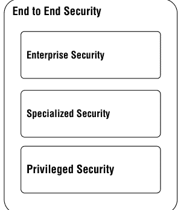

组织可以使用这些级别快速部署这些关键防护，因为它们提供了简单直接的技术指导。特权访问策略认识到组织有独特需求，并且定制解决方案会产生复杂性，导致长期成本更高、安全性更低。

为了平衡这一要求，该策略为每个级别提供了明确的规定性指导，并允许组织确定何时强制执行各个角色以满足该级别的需求，从而提供灵活性。

尽管底层技术复杂，但保持简单至关重要，而不是创建难以维护的定制解决方案。

引导式特权访问安全策略实施了一套简单的三级保障系统，涵盖所有设备、帐户、中介和接口等领域，这些领域都受相同安全级别的约束。

### 企业安全
面向企业用户和生产力场景的安全适用于所有企业用户。

在快速现代化计划之前，企业也充当技术和特权访问的起点，他们在其中逐步构建企业安全中的安全控制。

### 专用安全
如果攻击者或恶意内部人员破坏了高业务影响角色，专用安全控制会提供更高级别的保护。

识别所有符合组织专用和特权标准的角色和帐户。典型的专用角色包括以下内容：

- 业务关键系统开发人员
- 拥有敏感业务信息的业务角色，包括 SWIFT 终端用户、有权访问敏感数据的研究人员、薪酬管理员以及敏感业务流程审批人等
- 经常处理敏感信息的人员，如高管和个人助理/行政助理
- 高影响力社交媒体帐户，可能会损害公司声誉

此组包括拥有显著权限但并非企业范围的单个高影响工作负载的管理员。他们通常拥有显著的权限和影响。（示例包括企业资源计划系统管理员、银行管理员、服务台管理员等）。

特权安全在此基础上进一步构建了专用帐户安全。

### 特权安全
最高级别的安全称为*特权安全*。它专为那些在攻击者或恶意内部人员获得访问权限时可能造成重大损害并可能导致组织发生重大事件的角色而设计。此级别的技术角色通常拥有大多数或所有企业系统（有时包括业务关键系统）的管理权限。对特权帐户而言，安全是第一优先级，而生产力被定义为快速且安全地完成一组固定敏感工作任务的能力。

## 保护特权访问

要保护特权访问，需要进行以下更改：

- 知识管理、管理实践和流程
- 主机防御、帐户保护和身份管理组件

对于本地管理员帐户，请管理并报告您的特权访问。

让我们讨论 Microsoft Azure AD 特权标识管理 (PIM) 功能。

Azure Active Directory (Azure AD) 服务特权标识管理提供了一种管理、控制和监视组织关键资源访问的方式。为最大限度地降低安全信息或资源泄露的风险，组织应减少有权访问资源的人数。

因此，以下情况发生的可能性较小：

- 恶意行为者访问
- 授权用户意外影响敏感资源

组织可以向特权用户授予 Azure 的即时特权访问权限。Azure AD 资源会监视特权用户如何使用其权限。特权用户仍需使用 Azure AD、Azure、Microsoft 365 或 SaaS 应用来执行特权操作。使用 PIM 功能需要 Azure AD Premium P2 许可证。

在特权标识管理中，只有拥有特权角色管理员或全局管理员角色的用户才能管理 Azure AD 角色。在特权标识管理中，全局管理员、安全管理员、全局读取者和安全读取者可以查看 Azure AD 角色。

特权标识管理允许订阅管理员、资源所有者或资源用户访问管理员向其他管理员分配 Azure 资源角色。默认情况下，拥有特权角色管理员、安全管理员或安全读取者角色的用户无法在特权标识管理中查看 Azure 资源角色分配。以下是特权标识管理的一些关键功能，用于降低资源上过度、不必要或滥用的访问权限的风险：

- 即时：Azure AD 和 Azure 资源可以即时访问。
- 时限：使用开始和结束日期，为资源分配时限访问权限。
- 审批：激活特权角色需要审批。
- 多重身份验证：使用多重身份验证激活任何角色。
- 理由：通过使用理由可以了解用户激活的原因。
- 通知：激活特权角色并接收通知。
- 访问评审：通过进行访问评审，确保用户角色仍然需要。
- 审计历史记录：这包括内部或外部审计以及下载审计历史记录。
- 最后活动的全局管理员和特权角色管理员：这防止了最后活动的全局管理员和特权角色管理员角色分配被删除。

## 制定路线图

Microsoft 建议制定路线图，以防止网络攻击者访问特权资源。随着组织能力和要求的发展，可以不断调整路线图，以抵御网络攻击者对特权访问的威胁。Microsoft 在其路线图中建议四个阶段，使对手更难且更昂贵地获得对本地、云或混合资产的特权访问权限。最有效且最快速的实施应排在首位。从高层面来看，各阶段的目标如下：

- 第一阶段（24–48 小时）：Microsoft 建议您立即处理关键事项。
- 第二阶段：缓解最常用的攻击（2–4 周）。
- 第三阶段（1–3 个月）：构建可见性并控制管理员活动。
- 第四阶段（六个月及以后）：进一步加固安全平台。

### 阶段 1：立即执行的关键事项

路线图阶段 1 侧重于快速、轻松地实施关键任务。为了实现基本级别的安全特权访问，Microsoft 建议您在 24–48 小时内完成这些任务。以下操作包含在保护特权访问路线图的此阶段中：

- 在 Azure AD 中启用特权标识管理。
- 识别并分类高特权帐户。
- 为至少两个人提供紧急访问权限。
- 为所有高特权、非联合单用户管理员帐户注册多重身份验证。

### 阶段 2：缓解常用攻击

保护特权访问路线图的阶段 2 针对最常用的凭据窃取和滥用攻击方法。该阶段可在 2–4 周内实施，并包括以下操作：

- 应该进行服务、所有者和管理员清查。
- 确定哪些 Microsoft 帐户需要从管理员角色切换到工作或学校帐户。
- 为全局管理员维护单独的用户帐户并转发其电子邮件。
- 应为管理员帐户进行最近的密码更改。
- 启用密码哈希同步。
- 确保拥有特权角色且面临安全风险的用户需要多重身份验证。
- 通过配置标识保护来保护您的身份。
- 准备事件/应急响应计划；确定负责人。
- 确保本地特权管理员帐户安全。
- 配置条件访问策略。

### 阶段 3：控制管理员活动

作为保护特权访问路线图此阶段的一部分，以下组件将在大约 1–3 个月内实施。

- 应为管理员角色的用户完成访问评审。
- 继续向所有用户推出更强的身份验证。
- Azure AD 管理应使用专用工作站。
- 确定美国国家标准与技术研究院 (NIST) 的事件处理建议。
- 使用特权标识管理为 JIT 增加管理员角色的数量。
- 如果使用 Exchange Online，请确定是否暴露于基于密码的登录协议。
- 应清查虚拟机的特权帐户。
- Azure AD 管理员应实施 PIM。
- 监视连接的云应用中的活动。
- 配置条件访问。


## 阶段 4：继续构建防御

- 评估 Microsoft 365 中的角色（如果使用 Microsoft 365）。
- 集成信息保护。
- 使用 Azure 日志集成将相关日志发送到 SIEM。

使用 PIM 管理、控制和监视 Azure 资源访问。PIM 通过报告和警报降低特权暴露时间并提升可见性。

为了保护特权访问环境免受当前已知的潜在攻击，路线图的阶段 4 应在完成后六个月内实施。Microsoft 建议将安全视为一个持续过程，该过程会增加成本并降低针对您环境的攻击者的成功率，以应对明天的安全威胁。本阶段包含以下组件：

- 查看 Azure AD 管理员角色。
- 应审查负责管理已加入 Azure AD 的设备的用户。
- 规划事件响应并对其进行验证。

## 在 Microsoft 平台上管理标识和访问的最佳实践

标识构成基于云的安全保障。在传统 IT 基础设施中，防火墙和网络安全解决方案常用于在 Internet 出口点抵御外部威胁。不过，这些控制措施在云架构中效果较差，因为共享服务通过云提供商网络或 Internet 访问。

由于对这些服务托管的网络进行控制，编写简洁的防火墙规则更容易。随着云资源动态启动和关闭，云客户可能共享通用基础设施，且员工和用户期望能够从任何位置访问数据和服务，因此编写简洁的防火墙规则具有挑战性或不可能。在云中保护数据和资源需要标识身份验证和授权控制。

由于其对跨许多客户的大量访问请求和威胁的可见性，基于云的标识解决方案（如 Azure AD）提供了传统标识服务不具备的其他安全功能。

以下是在 Microsoft 平台上管理标识和访问的最佳实践：

- 将全职员工的标识与单一企业目录中的企业资源集成。
- 将现有标识系统与云标识集成。
- 不要将供应商、合作伙伴和客户帐户包含在本地目录中，而应使用云标识服务。
- 最终，所有用户都应能够在无需密码或使用多重身份验证 (MFA) 的情况下访问其帐户。
- 确保面向 Internet 的服务不使用不安全的旧版协议。
- 不要将高度特权的 Active Directory 域服务帐户（例如域、企业和架构管理员）与 Azure Active Directory 同步。
- 对于无法实现无密码的帐户，提供现代且充分的保护。
- 所有平台（Windows、Linux 等）和云服务都应使用单一标识提供程序进行身份验证。
- 所有用户都应进行身份验证以支持零信任策略，并应测量和强制实施安全属性。
- 通过定期模拟针对用户的攻击来教育和赋能用户。


存在三个相关概念：特权标识管理、特权帐户管理和云基础设施权利管理，它们均提供即时权限：

- **特权帐户管理**：授予帐户永久访问权限的工作流
- **特权标识管理**：将特权授予经过身份验证的帐户的工作流
- **云基础设施权利管理**：用于授予基础设施权利访问权限的工作流

### 为包括 PAM、权利管理和云租户管理在内的特权活动设计安全策略

Microsoft 建议采用以下特权访问策略，以快速降低组织因针对特权访问的高影响和高可能性攻击而面临的风险。由于攻击者危害此级别访问权限的潜在业务影响（以及高可能性），组织应将保护特权访问作为首要安全优先事项。

针对这些用户的攻击几乎总会对组织产生重大负面影响。特权用户可以访问业务关键资产，当其帐户被攻破时，会对组织造成重大不利影响。拥有特权访问权限的 IT 管理员控制着组织大部分资产，而其他拥有特权访问权限的用户也可以访问业务关键资产。

由于人工操控的勒索软件攻击和有针对性的数据窃取，攻击者经常利用特权访问安全中的弱点。特权访问帐户或工作站对攻击者来说是一个有吸引力的目标，因为它允许他们快速访问公司资产，通常会导致立即且重大的业务损失。

失去特权访问权限会对业务产生重大影响并造成重大损害。攻击者实际上控制了所有企业资产和资源，使其能够泄露机密数据、停止所有业务流程，或破坏业务流程和计算机以伤害人员或损坏财产。

随着从哈希传递（pass-the-hash）开始的现代凭据窃取技术的出现，特权访问攻击变得越来越普遍。自 2008 年发布哈希传递工具包（Pass-the-Hash Toolkit）以来，这些技术在罪犯中迅速流行起来，并随后演变为一套可靠的攻击技术（主要基于 Mimikatz 工具包）。由于武器化和自动化，攻击（及其后续影响）有所增加，仅受目标组织的漏洞以及攻击者的货币化和激励模型的限制。

## 制定特权访问策略

作为企业环境中使用的术语，特权访问描述的是超出标准用户能力的特殊能力或访问权限。组织可以通过保护基础设施和应用程序、高效运行业务以及保护敏感数据和关键基础设施来维护特权访问。

拥有特权访问权限的用户可以是人类和非人类，包括应用程序和机器。

作为保护组织免受凭据窃取和特权滥用的一种方式，组织实施特权访问管理 (PAM)。PAM 是一种综合网络安全策略，涵盖人员、流程和技术，用于控制、监控、保护和审计企业 IT 环境中所有特权标识和活动。

PAM 也称为特权标识管理 (PIM) 或特权访问安全 (PAS)，其重点是仅授予用户完成任务所需的访问级别。作为标准安全实践，最小权限原则对于保护高价值数据和资产至关重要。组织可以通过强制实施最小权限原则来减少攻击面并降低恶意内部人员或外部网络攻击的风险。

快速获胜和渐进式进步必须特征化特权访问之旅。必须通过特权访问策略中的每个弱点，将持续且灵活的攻击者挡在特权访问之外，因为它们就像试图渗入您环境的水。

将多种技术与深思熟虑、整体性和优先级的风险缓解相结合，是降低特权访问风险所必需的。

制定特权访问策略涉及累积进步和快速获胜的结合。在制定特权访问策略时，必须“关闭”拥有特权访问权限的持续且灵活的攻击者。

攻击者在实践中优先考虑这些路径的组合。

- 已建立的技术（通常自动化为攻击工具）
- 可利用的新方法

由于涉及的技术种类繁多，此策略需要一种结合多种技术并遵循零信任原则的完整策略。

- 攻击者使用任何有效的攻击，无论涉及何种技术。
- 大多数企业系统都与您正在防御的访问控制骨干集成。

仅靠特权访问解决方案或网络控制无法检测或防止这些威胁。对于业务敏感系统的特权访问，Microsoft 建议使用受信任的干净设备、帐户和中介系统，逐步构建特权访问的闭环系统。

重要的是要有意图地设计此策略，仔细建立并遵循标准，并继续监控和审计产品以消除泄漏，就像您在现实生活中对复杂事物（例如船舶）进行防水处理一样。如果只是把木板钉在一起，船就不会防水。

构建和防水关键部件（如发动机和转向机制，同时保留进入方式）将是优先事项，随后才是收音机、座椅等舒适项目。

此外，您必须长期维护，因为即使是最完美的系统也可能后来出现泄漏，因此预防性维护和泄漏监控对于保持其漂浮至关重要。

保护特权访问有两个简单目标：

- 确保特权操作仅能通过少数几个授权通道执行。
- 确保这些通道受到保护并受到密切监控。

访问系统有两种通道：用户访问和特权访问。

用户帐户执行电子邮件、协作和网页浏览任务。帐户登录到设备或工作站，通过中介（例如远程访问解决方案）传递，并作为该路径的一部分与企业系统交互。

特权帐户（如 IT 管理员或其他敏感帐户）访问业务关键系统和数据，或在企业系统上执行管理任务。虽然技术组件可能相同，但对手使用特权访问所能造成的危害要大得多。

标准用户和特权用户由托管帐户和管理组、同步和联合以及提供其他标识支持功能的标识系统支持。

在 PAM/PIM 系统中，授权提升路径允许标准用户与特权工作流交互，例如管理者或同行通过即时 (JIT) 过程批准对敏感系统的管理访问请求。这些组件共同构成了特权访问攻击面，对手可能会针对其尝试获得对您企业的提升访问权限。


建立行之有效的特权身份策略；结合以下方法将有所帮助：

- 本建议贯穿了快速现代化计划（RAMP）和零信任访问控制。
- 资产保护通过在系统中实施良好的安全卫生习惯来防范直接的资产攻击。

## 安全快速现代化计划

从高级别来看，RAMP 包括以下步骤：

### 应分离并管理具有特权访问权限的账户。

- 组织应尽量少使用紧急访问账户，因为存在危及其 Azure Active Directory（Azure AD）的潜在风险。
- 您可以使用 Azure AD PIM 发现并保护特权账户。PIM 可降低不必要的、过度的或被滥用的访问权限风险。
- 该过程通过识别和分类具有高业务影响的特权账户（Azure AD），来识别并最大限度地减少需要单独账户和特权访问保护的人数（立即或随时间推移）。
- 管理员的账户应禁用邮件，且任何管理员账户（本地 AD 账户）均不应允许使用个人 Microsoft 账户。
- 在部署 Microsoft Defender for Identity 后，所有未处理的警报应由相应团队进行审查和缓解。

### 加强凭据管理。

- 在组织中建立并强制实施自助密码重置（SSPR）和组合安全信息注册。
- 所有永久分配到一个或多个 Azure AD 管理员角色的用户在登录时都需要 Azure Active Directory MFA。
- 如果为特权用户账户启用了旧版身份验证协议，攻击者可以访问其账户。
- 通过强制实施应用程序同意流程，可以建立集中式同意流程，以保持对有权访问 Azure AD 中数据的应用程序的可见性和控制。
- 建立监控和管理用户及登录风险的方法。使用 Azure AD Identity Protection 清理账户和登录风险。

### 通过执行关键战略举措来管理特权活动。

要实施推荐的特权活动策略，需要开展几项战略举措。需要实施四项互补举措，每项都有定义的预期结果和成功标准。

- 端到端会话安全。为特权、用户和提升的会话建立明确的零信任验证。
  - Microsoft 定义的成功标准：在允许用户和设备访问系统之前，将对其可信度进行验证。
- 维护目录、身份管理、管理员账户、同意授权等身份系统。
  - Microsoft 定义的成功标准：每个系统都将受到保护，以防其可能影响业务。
- 通过缓解横向移动来保护本地账户密码、服务账户密码或其他机密。
  - Microsoft 定义的成功标准：要使单个设备安全，它不能被攻破。结果是，环境中的许多或所有其他设备可能会受到控制。
- 通过实施快速威胁响应来减少对手在环境中的时间和访问权限。
  - Microsoft 定义的成功标准：涉及特权访问的事件的平均修复时间（MTTR）应降低至接近零，所有事件的 MTTR 应降低至几分钟，以防止对手在环境中可靠地实施多阶段攻击。这样一来，对手就没有时间来攻击特权访问了。

## Azure AD 权利管理

通过 Azure Active Directory 权利管理，组织可以自动化访问请求工作流、分配和审查用户访问权限，并大规模使访问权限过期。员工在履行职责过程中需要访问各种组、应用程序和 SharePoint Online 站点。随着需求的变化，管理这些访问变得越来越具有挑战性，新应用程序被添加，或者用户需要更多访问权限。如果您与外部组织合作，此场景会变得更加困难。他们可能不知道您的组织使用什么应用程序、组或站点，您也不知道谁需要访问他们的资源。

通过管理 Azure AD 权利，您可以管理内部用户对组、应用程序和 SharePoint Online 站点的访问权限，以及外部用户的访问权限。权利管理包括以下功能：

- 通过临时分配和定期访问评审，您可以控制谁可以访问应用、组、Teams 和 SharePoint 站点。
- 允许用户根据其部门或成本中心访问这些资源，并在这些属性更改时移除其访问权限。
- 由受委托的访问包管理器定义策略，指定哪些用户可以请求资源、谁必须批准这些请求以及这些访问包的访问何时过期。用户可以从这些访问包请求资源。
- 尚未拥有您目录访问权限的用户可以通过选择连接的组织来请求访问权限。请求访问权限并获批的用户会自动获得访问权限。在您的目录中，当用户访问权限过期且未分配任何其他访问包时，其 B2B 账户可以自动移除。

可以利用 Azure AD 简化访问请求、审批和重新认证，以确保只有正确的人拥有访问权限并且访问请求已记录。要遵循的步骤如下：

1. 当用户加入不同的团队/项目时，权利管理可以创建可用于分配访问权限的访问包，这些访问包关联每个团队/项目的资源（例如应用程序、SharePoint 站点和组成员资格）。
2. 在您的组织中部署权利管理之前，请尝试通过部署自助组管理和自助应用程序访问来启用自助范式。

> Azure AD 身份和访问管理解决方案每月将 4.25 亿用户与其应用程序、设备和数据连接起来。它通过强大的身份验证来验证和保护整个数字资产中的每个身份。

## 摘要

本章向您介绍了基于零信任为您的组织设计、定义和推荐安全策略和架构的不同策略。

作为身份安全策略的一部分，组织对其安全主体进行身份验证和授权。除了控制安全主体（标识）的信息外，它还包括服务、应用程序、用户、组等等。跨公司数据中心并延伸到云端管理身份和访问是 Microsoft 身份和访问管理解决方案的目标之一。

在本章中，您学习了如何设计云资源访问策略、推荐标识存储（租户、B2B、B2C、混合）、推荐身份验证策略、推荐授权策略、设计条件访问策略、设计角色分配和委派策略、设计包括基于标识的防火墙规则和 Azure PIM 在内的特权角色访问基础设施的安全策略，以及设计包括 PAM、权利管理和云租户管理在内的特权活动安全策略。

## 考试要点

### 了解身份安全。

Azure 身份和访问管理解决方案可在前端保护您的数据和应用程序。使用基于风险的访问控制、身份保护工具和强大的身份验证选项来防范恶意登录尝试并保持凭据安全。

组织的身份安全策略应描述对其安全主体进行身份验证和授权的过程。此外，它还涉及控制这些主体（标识）的信息。可以包括服务、应用程序、用户、组和其他安全主体（标识）。Microsoft 身份和访问管理解决方案对于保护整个企业数据中心及云端的应用程序和资源访问至关重要。

### 了解安全标识存储的最佳实践。

Azure AD 允许您连接到 Microsoft 云服务，并在 Azure Active Directory 服务中开发自己的云服务。

您的组织使用 Windows Server 上的 Active Directory 在本地环境中管理标识和访问。Azure AD 是 Microsoft 基于云的身份和访问管理解决方案，Microsoft 确保 Azure AD 在全球范围内可用，尽管您正在控制标识账户。如果您熟悉 Active Directory，那么将期望您了解 Azure AD。

当您在本地保护标识时，Active Directory 不会跟踪登录尝试。当 Active Directory 连接到 Azure AD 时，Microsoft 会通过检测可疑登录尝试（无需额外费用）来帮助保护您。例如，Azure AD 会检测来自意外位置或未知设备的登录尝试。

### 了解安全身份验证和授权策略的最佳实践。

身份验证是验证人员、服务或设备身份的方法。身份验证就像出差时出示身份证件一样，要求人员、服务或设备提供凭据来证明其身份。Azure 支持多种身份验证方法，包括标准密码、单一登录、多重身份验证和无密码身份验证。它不确认您持有票证；它只是证明您是您声称的那个人。

身份验证过程确保尝试连接的身份具有访问服务、功能、函数、对象和方法的正确权限。授权在成功身份验证后发生，未经过身份验证的连接在执行授权检查前会失败。即使连接身份验证成功，用户或组可能也没有获准执行特定操作。

### 了解安全条件访问的最佳实践。

零信任高度依赖条件访问，因为它确保正确的用户可以访问正确的资源。如果启用条件访问，Azure Active Directory 可以基于计算的风险和预配置策略做出访问决策。通过在适当时将条件访问策略作为功能公开，独立软件供应商可以利用条件访问。


如果条件访问提供了更细粒度的多重身份验证体验，用户在已知位置时可能不会受到第二个身份验证因素的质询。但是，如果他们的登录信号异常或身处意外位置，他们可能需要提供第二个身份验证因素。

条件访问收集登录信号，基于这些信号做出决策，然后通过允许或拒绝访问或要求多重身份验证来强制执行该决策。

### 规划角色分配和委托
最小权限的概念意味着，您只应授予完成任务所需的云环境中资源的访问权限。当您拥有多个 IT 和工程团队时，如何控制其资源访问？只在需要读取访问权限时才授予 Azure 存储的读取访问权限是一项良好的安全做法，不应向存储授予写入访问权限，也不应向其他存储授予读取访问权限。

但是，对整个团队来说，管理这种级别的权限具有挑战性。通过 Azure 基于角色的访问控制，您可以控制访问，而无需为每个人定义详细的访问要求，并在向团队添加新资源或有新人员加入团队时更新这些要求。

### 了解用于访问评审和权利管理的标识治理
管理员可以通过创建和管理 Azure AD 权利管理方面的内容，轻松确保用户和来宾默认拥有适当的访问权限。用户或决策者可以参与访问评审，并重新认证（或证明）其访问权限。这些用户可能仅了解需要访问包的一些情况。访问评审完成后，您可以进行更改并删除不再需要访问权限的用户的访问权限。评审完成后，评审者可以根据来自 Azure AD 的建议，对每个用户是否需要继续访问提出意见。

### 为基础架构的特权角色访问设计安全策略
顾名思义，特权安全适用于如果落入攻击者或恶意内部人员手中可能导致重大事件和实质性损害的角色。此级别的少数关键业务角色通常对大多数或所有企业系统拥有管理权限。特权帐户的设计旨在将安全性作为最高优先事项，生产力的特点是能够轻松专注于将安全性作为最高优先事项，并安全地执行一组固定的敏感工作任务（而非一般生产力）。

以下是需要考虑的关键标准：

- 通过识别并最大限度地减少拥有访问权限的人数，限制对安全信息和资源的访问。
- 敏感资源上的访问权限可能过度、不必要或被滥用。
- 确保恶意行为者无法访问安全信息或资源。
- 确保未经授权的用户不会无意中访问敏感资源。

为特权访问设计安全策略。零信任访问控制和资产保护应构成成功特权身份策略的基础。快速现代化计划支持特权身份策略并改善凭据管理体验。尝试满足保护特权访问的两个简单目标。

- 确保特权操作只能通过几条授权路径执行。
- 确保这些路径受到保护并受到密切监控。

## 复习问题

- 1. 作为 Microsoft 网络安全架构师，您负责保护私有网络外部本地应用程序的访问，例如 SharePoint 站点、Outlook Web 应用和基于 IIS 的应用程序。您将在企业标识和访问管理解决方案中采用哪项 Azure 标识功能？
  - A. Azure AD 应用程序代理
  - B. 多重身份验证
  - C. 单一登录
  - D. 设备注册

- 2. 作为 Microsoft 网络安全架构师，您负责保护对数据和应用程序的访问；您将在企业标识和访问管理解决方案中采用哪项 Azure 标识功能？
  - A. Azure AD 应用程序代理
  - B. 多重身份验证
  - C. 单一登录
  - D. 设备注册

- 3. 作为 Microsoft 网络安全架构师，您负责确保您需要的所有应用程序和资源均可通过单个用户帐户访问，因此您只需登录一次。登录到所有应用程序后，您无需再次进行身份验证（例如，键入密码）。您将在企业标识和访问管理解决方案中采用哪项 Azure 标识功能？
  - A. Azure AD 应用程序代理
  - B. 多重身份验证
  - C. 单一登录
  - D. 设备注册

- 4. 作为 Microsoft 网络安全架构师，您负责部署基于设备的条件访问策略，以便安全管理员可以阻止或允许资源。您将在企业标识和访问管理解决方案中采用哪项 Azure 标识功能？
  - A. Azure AD 应用程序代理
  - B. 多重身份验证
  - C. 单一登录
  - D. 设备注册

- 5. 作为 Microsoft 网络安全架构师，您负责通过提供风险检测和潜在漏洞的统一视图来保护组织的标识。您将在企业标识和访问管理解决方案中采用哪项 Azure 标识功能？
  - A. Azure AD 标识保护
  - B. 多重身份验证
  - C. 单一登录
  - D. 设备注册

- 6. 作为 Microsoft 网络安全架构师，您负责使用单一登录身份验证、条件访问、无密码和多重身份验证以及自动化和用户预配来大规模保护和自动化标识流程。您将在企业标识和访问管理解决方案中采用哪项 Azure 标识功能？
  - A. Azure Active Directory
  - B. Azure S2S VPN
  - C. Azure P2S VPN
  - D. ExpressRoute

- 7. 作为 Microsoft 网络安全架构师，您负责设计和部署混合标识解决方案。您的企业支持哪些 Azure 标识身份验证方法？（选择两项。）
  - A. Azure Active Directory
  - B. 云身份验证
  - C. 联合身份验证
  - D. Microsoft Active Directory

- 8. 作为 Microsoft 网络安全架构师，您负责设计和部署混合标识解决方案；您已选择云身份验证。云身份验证中有哪些可用选项？（选择两项。）
  - A. Azure AD 密码哈希同步
  - B. Microsoft Active Directory
  - C. Azure AD 直通身份验证
  - D. 以上都不是

- 9. Azure Active Directory B2C 中的以下哪项功能支持数百万用户和数十亿次日常身份验证？此解决方案使品牌 Web 和移动应用程序能够与白标身份验证体验无缝融合。
  - A. 客户标识和访问管理 (CIAM)
  - B. Microsoft Active Directory
  - C. Azure AD 直通身份验证
  - D. Azure AD 密码哈希同步

- 10. 以下哪项将身份验证过程传递给外部身份验证系统（例如 Active Directory Federation Services (AD FS)）？
  - A. Azure Active Directory (Azure AD)
  - B. Microsoft Active Directory
  - C. Azure AD 直通身份验证
  - D. 以上都不是

- 11. 当您在解决方案中采用直通身份验证和无缝 SSO 时，身份验证过程是什么？
  - A. 与云中的本地身份验证代理进行安全密码验证交换。
  - B. 身份验证在云中发生。
  - C. 身份验证在本地发生。
  - D. 身份验证在另一标识服务提供商上发生。

- 12. 当您在解决方案中采用与 AD FS 联合时，有哪些运行状况监控解决方案可用？
  - A. Azure Active Directory 管理中心提供代理状态。
  - B. 不需要。
  - C. Azure AD Connect Health。
  - D. 本地。

- 13. 作为 Microsoft 网络安全架构师，您负责设计和部署条件访问解决方案。在创建零信任访问模型时，您将采用以下哪些 Microsoft 建议？
  - A. 显式验证。
  - B. 使用最小特权访问。
  - C. 假设已发生泄露。
  - D. 以上全部。

- 14. 当您在解决方案中采用直通身份验证和无缝 SSO 时，Windows Hello for Business 支持以下哪些选项？（选择两项。）
  - A. 密钥信任模型
  - B. 混合云信任假设泄露
  - C. 证书信任模型
  - D. 以上都不是

- 15. 作为 Microsoft 网络安全架构师，您负责设计和部署角色分配和委托。您将在解决方案中采用以下哪些 Microsoft 建议？（选择两项。）
  - A. 配置定期访问评估，以随时间撤销不必要的权限。
  - B. 如果没有审核，人们在团队之间移动时可能会随着时间的推移累积不必要的访问权限。为所有管理员帐户关闭多重身份验证。
  - C. 以上都不是。


16. 作为 Microsoft 网络安全架构师，您负责为组织设计和部署企业云安全。在以下 Microsoft 建议中，您将采用哪一项？
- A. 企业安全
- B. 专业安全
- C. 特权安全
- D. 以上皆是

17. 作为 Microsoft 网络安全架构师，您负责制定保护特权访问免受网络攻击者攻击的路线图。您将考虑以下哪些 Microsoft 建议？（选择两项。）
- A. 第 1 阶段（24–48 小时），Microsoft 建议您立即执行这些关键事项，第二阶段是缓解最常用的攻击技术（2–4 周）。
- B. 第三阶段（1–3 个月）涉及全面构建可见性并控制管理活动，第四阶段（6 个月及以后）包括构建防御以进一步加固安全平台。
- C. 第五阶段（24 个月及以后）是发布新功能。
- D. 以上皆是。

18. 保护特权访问有两个简单目标；以下哪些是它们？（选择两项。）
- A. 监控并非必不可少。
- B. 将特权操作的访问限制在少数授权路径上。
- C. 保护并密切监控这些路径。
- D. 以上都不是。

19. 成功的特权身份需要结合以下哪两项关键考量？（选择两项。）
- A. Zero Trust 访问控制
- B. 资产保护
- C. 身份保护
- D. 用户保护

20. 以下哪项可帮助您管理访问权利，并允许您的组织自动化访问请求工作流、为用户分配和审查访问权限，并大规模过期访问权限？
- A. Azure Active Directory
- B. Microsoft Active Directory
- C. Microsoft LDAP
- D. 以上都不是

## 识别法规遵从策略

### 本章涵盖的 Microsoft SC-100 考试目标包括：

- 解释遵从性要求并将其转换为特定技术功能（新增或现有）
- 使用 Microsoft Defender for Cloud 评估基础结构遵从性
- 解释遵从性评分并推荐解决问题或改善安全性的措施
- 设计 Azure Policy 实现
- 设计数据驻留要求
- 将隐私要求转换为安全解决方案要求


在本章中，我们将重点介绍设计法规遵从性策略，以确保治理风险合规（GRC）。在法规遵从性中，组织遵循其所在地区或行业的管辖机构强制执行的法律或自愿采用的行业标准。组织的 IT 法规遵从性流程涉及监控其企业系统，以检测和防止违反这些管辖法律、法规和标准所建立的政策和程序。此过程反过来适用于多种监控和强制执行流程。这些流程可能因行业和地域而异，且可能冗长而复杂。

医疗保健和金融服务行业受到严格监管，这使得跨国组织的合规工作充满挑战。标准和法规繁多且可能不断变化，使得企业难以跟上不断变化的国际电子数据处理法律。

在本章中，您将了解如何着手制定法规遵从性策略、评估遵从性要求的技术功能、使用 Microsoft Defender for Cloud 评估基础结构遵从性、识别遵从性问题并推荐解决措施、开发和验证 Azure 策略、设计数据驻留要求，以及将隐私要求转换为安全要求。

## 解释遵从性要求并将其转换为特定技术功能

目前，Azure 在全球 60 多个区域提供超大规模云服务。Azure 服务允许组织选择存储最终用户数据的区域。Microsoft 可以通过在同一地理区域内的其他 Azure 区域复制最终用户数据来提供数据复原能力。但是，Microsoft 不会将客户数据复制到该地理区域之外。

Microsoft 提供多种 Azure 云环境：
- Azure：Azure 是一项全球服务，可通过其商业、公共和全球名称使用。
- Azure China：21Vianet 是该国最大的互联网服务提供商之一，与 Microsoft 合作提供 Azure China。
- Azure Government：Microsoft Azure Government 可在美国五个区域使用。美国国防部利用两个区域（US DoD Central 和 US DoD East）。
- Azure Government Secret：三个 Azure Government Secret 区域专门服务于美国政府需求，均设计用于容纳机密秘密工作负载。
- Azure Government Top Secret：Azure Government Top Secret 处理被列为美国绝密的国家安全工作负载，以服务于情报界、国防部和联邦文职机构。

Azure 合规证书和审计报告中明确列出了 Azure 服务的独立第三方审计情况。不同的审计可能将其他在线服务纳入其审计范围。在撰写本书时，Azure 审计范围涵盖以下在线服务：

- Microsoft Azure
- Azure DevOps
- Dynamics 365
- Intelligent Recommendations
- Microsoft 365 Defender（即 Microsoft Threat Protection）
- Microsoft AppSource
- Microsoft Bing for Commerce
- Microsoft Cloud for Financial Services
- Microsoft Defender for Cloud（即 Azure Security Center）
- Microsoft Defender for Cloud Apps（即 Microsoft Cloud App Security）
- Microsoft Defender for Endpoint（即 Microsoft Defender Advanced Threat Protection）
- Microsoft Defender for Identity（即 Azure Advanced Threat Protection）
- Microsoft Defender for IoT（即 Azure Defender for IoT）
- Microsoft Graph
- Microsoft Intune
- Microsoft Managed Desktop
- Microsoft Sentinel（即 Azure Sentinel）
- Microsoft Stream
- Microsoft Threat Experts
- Nomination Portal
- Power Apps
- Power Automate（即 Microsoft Flow）
- Power BI
- Power BI Embedded
- Power Virtual Agents
- Universal Print
- Update Compliance

Office 365 为其服务维护独立的合规证书和审计报告。
您需要 Azure 订阅或 Azure Government 免费试用帐户才能下载审计文档。在服务信任门户 (STP) 上，您可以访问与 Azure 相关的审计报告。要访问审计报告，您必须登录。

Microsoft Azure 在全球、美国政府、金融服务、健康与生命科学、汽车、教育以及媒体和电信等类别中提供合规产品。Azure 还为美洲、EMEA 和亚太地区提供区域合规产品。

表 4.1 说明了 Azure 涵盖的合规性。

有关更多信息和最新更新，请访问 learn.microsoft.com/en-us/azure/compliance。

表 4.1 Azure 合规性

| 分类 | 合规产品 |
| :--- | :--- |
| 全球 | CIS benchmark |
| | CSA STAR Attestation |
| | CSA STAR Certification |
| | CSA STAR self-assessment |
| | SOC 1 Type 2 |
| | SOC 2 Type 2 |
| | SOC 3 |
| | ISO 20000-1 |
| | ISO 22301 |
| | ISO 27001 |
| | ISO 27017 |
| | ISO 27018 |
| | ISO 27701 |
| | ISO 9001 |
| | WCAG |
| 美国政府 | CJIS |
| | CMMC |
| | CNSSI 1253 |
| | DFARS |
| | DoD IL2 |
| | DoD IL4 |
| | DoD IL5 |
| | DoD IL6 |
| | DoD 10 CFR Part 810 |
| | EAR |
| | FedRAMP |
| | FIPS 140 |
| | ICD 503 |
| | IRS 1075 |
| | ITAR |
| | JSIG |
| | NDAA |
| | NIST 800-161 |
| | NIST 800-171 |
| | NIST 800-53 |
| | NIST 800-63 |
| | NIST CSF |
| | Section 508 VPATs |
| | StateRAMP |
| 金融服务 | 23 NYCRR Part 500 (US) |
| | AFM and DNB (Netherlands) |
| | AFM and ACPR (France) |
| | APRA (Australia) |
| | CFTC 1.31 (US) |
| | EBA (EU) |
| | FCA and PRA (UK) |
| | FFIEC (US) |
| | FINMA (Switzerland) |
| | FINRA 4511 (US) |
| | FISC (Japan) |


TABLE 4.1 Azure Compliance (continued)

| 分类 | 合规产品 |
| :--- | :--- |
| | - FSA (丹麦)<br>- GLBA (美国)<br>- KNF (波兰)<br>- MAS 和 ABS (新加坡)<br>- NBB 和 FSMA (比利时)<br>- OSFI (加拿大)<br>- OSPAR (新加坡)<br>- PCI 3DS<br>- PCI DSS<br>- RBI 和 IRDAI (印度)<br>- SEC 17a-4 (美国)<br>- SEC Regulation SCI (美国)<br>- SOX (美国)<br>- TruSight |
| 医疗保健和生命科学 | - ASIP HDS (法国)<br>- EPCS (美国)<br>- GxP (FDA 21 CFR Part 11)<br>- HIPAA (美国)<br>- HITRUST<br>- MARS-E (美国)<br>- NEN 7510 (荷兰) |
| 媒体 | - CDSA<br>- MPA<br>- FACT (英国)<br>- DPP (英国) |
| 能源 | - NERC (美国) |
| 教育 | - FERPA (美国) |
| 汽车 | - TISAX |
| 电信 | - GSMA |
| Azure 区域 – 美洲 | 阿根廷 PDPA |
| | 加拿大隐私法律 |
| | 加拿大 Protected B |
| | 美国 CCPA |
| Azure 区域 – 亚太 | 澳大利亚 IRAP |
| | 中国 GB 18030 |
| | 中国 DJCP (MLPS) |
| | 中国 TCS |
| | 印度 MeitY |
| | 日本 CS Gold Mark |
| | 日本 ISMAP |
| | 日本 My Number Act |
| | 韩国 K-ISMS |
| | 新西兰 ISPC |
| | 新加坡 MTCS |
| Azure 区域 – EMEA | 欧盟 Cloud CoC |
| | 欧盟 EN 301 549 |
| | ENISA IAF |
| | 欧盟 GDPR |
| | 欧盟模型条款 |
| | 德国 C5 |
| | 德国 IT-Grundschutz 手册 |
| | 荷兰 BIR 2012 |
| | 卡塔尔 NIA |
| Azure Policy 法规合规性内置计划 | 澳大利亚政府 ISM PROTECTED |
| | 加拿大联邦 PBMM |
| | CIS Azure 基础 Benchmark |
| | FedRAMP High |
| | HIPAA HITRUST |
| | IRS 1075 |
| | ISO 27001 |
| | PCI DSS |
| | NIST SP 800-171 |
| | 英国 OFFICIAL 和英国 NHS |

Table 4.1 shows that compliance is fundamental to Azure. Microsoft put a lot of effort into providing Microsoft customers with the most extensive and comprehensive compliance offerings available in the cloud computing industry.

表 4.1 表明合规性是 Azure 的基础。Microsoft 投入了大量精力，为 Microsoft 客户提供云计算行业中最广泛、最全面的合规产品。

The compliance resources include audit reports, privacy information, compliance implementations, mappings, white papers, and analyst reports. You must log in to your Azure cloud service to access Azure Resources. Country and region privacy and compliance guidelines are also available.

合规资源包括审核报告、隐私信息、合规实施、映射、白皮书和分析师报告。您必须登录 Azure 云服务才能访问 Azure 资源。各国和地区的隐私及合规指南也可供使用。

A workload may be subject to regulatory requirements that require operational data, such as application logs and metrics, to remain within a particular geographical region.

工作负载可能受监管要求约束，该要求规定运营数据（如应用程序日志和指标）必须保留在特定地理区域内。

In addition to requiring strict security measures, these requirements impact the selection, configuration, and scheduling of specific PaaS and SaaS services. They also have implications for how workloads should be operationalized.

除了要求严格的安全措施外，这些要求还会影响特定 PaaS 和 SaaS 服务的选择、配置和调度。它们还会影响工作负载的运营方式。

As a true lasting transformation doesn't happen overnight, cloud governance results from an ongoing adoption effort. In some industries, third-party compliance affects initial policy creation, so assessing risk tolerance is critical in creating minimally invasive policies governing cloud adoption and managing risks.

真正的持久转变不会一蹴而就，云治理是持续采用工作的结果。在某些行业中，第三方合规性会影响初始策略创建，因此评估风险容忍度对于制定管理云采用和风险的微创策略至关重要。

The purpose and scope of these standards and regulations vary. Regulatory organizations frequently publish standards and updates that define good security practices to prevent negligence. However, data protection and retention design, network access, and system security can be influenced by security requirements.

这些标准和法规的目的和范围各不相同。监管组织经常发布定义良好安全实践以防止疏忽的标准和更新。但是，数据保护和保留设计、网络访问以及系统安全可能受到安全要求的影响。

## Review the Organization Requirements

## 审查组织要求

To help organizations avoid negligence, regulatory organizations should regularly review and publish standards and updates that define good compliance practices. Nevertheless, compliance requirements can influence the design of data protection and retention, network access, and system security. These standards and regulations’ purpose and scope vary according to industry or country.

为帮助组织避免疏忽，监管组织应定期审查并发布定义良好合规实践的标准和更新。尽管如此，合规要求可能会影响数据保护和保留、网络访问以及系统安全的设计。这些标准和法规的目的和范围因行业或国家而异。

Today's globalized world demands that you know if your cloud resources comply with country standards mandated by governments or industry organizations.

当今全球化的世界要求您了解云资源是否符合政府或行业组织规定的国家标准。

For example, credit card transactions are governed by Payment Card Industry (PCI) standards, which prohibit Internet access into any system component storing cardholder data.

例如，信用卡交易受支付卡行业 (PCI) 标准管辖，该标准禁止任何存储持卡人数据的系统组件接入互联网。

The following options can be used to deploy a restrictive environment:

可使用以下选项部署受限环境：

- Provide your own virtual network (VNet) for the workload hosted in a different Azure compute option.
- 为在不同 Azure 计算选项中托管的工作负载提供您自己的虚拟网络 (VNet)。
- By using private endpoints, you can remove all Internet-facing endpoints.
- 通过使用专用终结点，可以删除所有面向互联网的终结点。
- Inbound and outbound access rules should be defined using network security groups (NSGs).
- 应使用网络安全组 (NSG) 定义入站和出站访问规则。

There may be more business impacts if you don't comply with a standard. Review the standard thoroughly to learn each requirement's intent and literal wording.

如果不遵守标准，可能会产生更多业务影响。请彻底审查标准，以了解每项要求的意图和字面表述。

- What are the methods for measuring compliance?
- 衡量合规性的方法有哪些？
- The workload must meet the requirements, but who approves it?
- 工作负载必须满足要求，但由谁批准？
- Attestations can be obtained through what processes?
- 可以通过什么流程获得证明？
- What are the documentation requirements?
- 文档要求是什么？

## Microsoft-Recommended Action

## Microsoft 建议的操作

Assess your current compliance score with Microsoft Defender for Cloud and identify the gaps. With Microsoft Defender for Cloud, you can streamline the process of meeting regulatory compliance requirements using the regulatory compliance dashboard. Defender for Cloud continually assesses your hybrid cloud environment to identify the risk factors based on the controls and best practices applied to your subscriptions. Your compliance status is reflected on the dashboard.

使用 Microsoft Defender for Cloud 评估当前的合规性评分并识别差距。借助 Microsoft Defender for Cloud，您可以使用法规合规性仪表板来简化满足法规合规性要求的过程。Defender for Cloud 会持续评估您的混合云环境，以根据应用于订阅的控制措施和最佳实践识别风险因素。您的合规状态会反映在仪表板上。

Microsoft cloud security benchmarks are automatically assigned to Azure subscriptions when Defender for Cloud is enabled. Based on CIS, PCI-DSS, and NIST controls, this widely acknowledged benchmark emphasizes cloud-centric security controls.

启用 Defender for Cloud 时，Microsoft 云安全基准会自动分配给 Azure 订阅。基于 CIS、PCI-DSS 和 NIST 控制，此广泛认可的基准强调以云为中心的安全控制。

Your regulatory compliance dashboard summarizes all the assessments for the standards and regulations you have selected in your environment. You will improve your compliance posture as you implement the recommendations and reduce the risk factors in your environment.

您的法规合规性仪表板汇总了您在环境中所选标准和法规的所有评估。随着您实施建议并降低环境中的风险因素，合规性态势将得到改善。

This regulatory compliance dashboard displays all the requirements associated with your selected compliance standards and the corresponding security assessments. Compliance with the standard is reflected in the status of these assessments.

此法规合规性仪表板显示所选合规标准关联的所有要求及相应的安全评估。对标准的合规性体现在这些评估的状态中。

You can use the regulatory compliance dashboard to assist you in identifying gaps in compliance with the standards and regulations you have chosen. By focusing on compliance within dynamic cloud and hybrid environments, you will also be able to monitor compliance over time.

您可以使用法规合规性仪表板来帮助识别所选标准和法规的合规性差距。通过关注动态云和混合环境中的合规性，您还可以随时间监控合规性。

The regulatory compliance dashboard can be used to investigate any issues that may be impacting your compliance.

法规合规性仪表板可用于调查可能影响合规性的任何问题。

There are both automated and manual assessments within regulatory compliance that may require remediation. Resolve regulatory compliance recommendations directly within the regulatory compliance dashboard using the information provided.

法规合规性中既有自动评估也有手动评估，可能需要补救。可以直接在法规合规性仪表板内使用提供的信息来解决法规合规性建议。

## Design a Compliance Strategy

## 设计合规策略

A Microsoft Cybersecurity Architect can develop a regulatory compliance strategy once the business risks are mapped and converted into policy statements. Additionally, this strategy considers the type of transaction an organization performs or the industry to which it belongs. A good compliance strategy needs to ensure that security controls are implemented to map regulatory compliance requirements directly; that’s why it’s crucial to establish a regulatory compliance strategy with a thorough understanding of the type of business, transactions, and overall business requirements.

Microsoft 网络安全架构师在业务风险映射并转化为策略声明后，可以制定法规合规策略。此外，该策略还会考虑组织执行的交易类型或其所属的行业。良好的合规策略需要确保实施安全控制，以直接映射法规合规要求；这就是为什么必须彻底了解业务类型、交易和总体业务要求，以建立法规合规策略至关重要。

Working with your regulators and carefully reviewing the standard to understand the language and intent of each requirement is key to avoiding fines or other business impacts down the road.

与监管机构合作并仔细审查标准，以理解每项要求的措辞和意图，是避免未来罚款或其他业务影响的关键。

The corporate policy creates the working definition of governance in traditional and incremental governance.

企业策略为传统和渐进式治理创建了治理的工作定义。

Figure 4.1 depicts the value exchange between business risk, policy, compliance, monitoring processes, and enforcement processes to create a governance strategy.

图 4.1 描绘了业务风险、策略、合规性、监控流程和强制执行流程之间的价值交换，以制定治理策略。

## FIGURE 4.1 Microsoft's five cybersecurity disciplines of cloud governance

## 图 4.1 Microsoft 云治理的五大网络安全学科

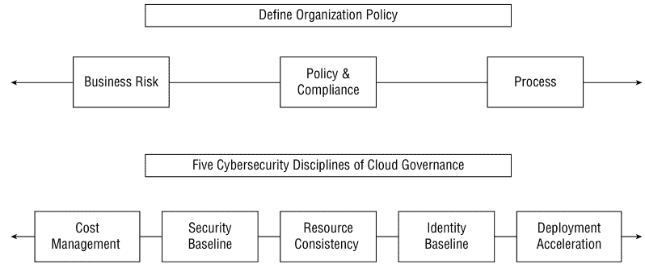

Most IT governance actions strive to deploy technology that monitors, enforces, operates, and automates those organization policies; and cloud governance is built on similar concepts. You can use the five disciplines shown in Figure 4.1 to develop a cloud governance strategy.

大多数 IT 治理行动都致力于部署监控、强制执行、操作和自动化这些组织策略的技术；云治理也是基于类似概念构建的。您可以使用图 4.1 中显示的五大学科来制定云治理策略。

**Cost Management** Developing cost control policies for all cloud platforms is a primary concern for cloud users.

**成本管理** 为所有云平台制定成本控制政策是云用户的首要关注点。

**Security Baseline** A company’s security requirements are unique. Once these requirements are established, cloud governance policies and enforcement apply the conditions across networks, data, and assets.

**安全基线** 公司的安全要求各不相同。一旦这些要求建立，云治理策略和强制执行就会将条件应用于网络、数据和资产。

**Resource Consistency** Managing onboarding, drift, discoverability, and recovery risks in the cloud requires consistent resource configuration. With governance tooling, resources can be configured consistently.

**资源一致性** 在云中管理登机、漂移、可发现性和恢复风险需要一致的资源配置。借助治理工具，可以一致地配置资源。

**Identity Baseline** By applying identity requirements consistently across cloud adoption efforts, the Identity Baseline discipline reduces the risk of breach.

**标识基线** 通过在云采用过程中一致地应用标识要求，标识基线学科可降低泄露风险。

**Deployment Acceleration** Centralization, standardization, and consistency in deployment and configuration methods improve governance approaches. When delivered through cloud-based governance tooling, they complete a cloud factor that can accelerate deployment actions.

**部署加速** 部署和配置方法的集中化、标准化和一致性可改进治理方法。当通过基于云的治理工具交付时，它们完成了一个可加速部署操作的云因素。

In the organization policy definition phase, you will consult with the organization to coordinate risk tolerance and cost mitigation. You will investigate current cloud adoption plans and data classification in this phase.

在组织策略定义阶段，您将与组织协商以协调风险容忍度和成本缓解。在此阶段，您将调查当前的云采用计划和数据分类。

To create minimally intrusive policies to govern cloud adoption and manage risks, you must determine the business risks and assess risk tolerance. Remember that third-party compliance can affect some industries’ initial policy creation process. As adoption and innovation activities progress, policy violations will naturally occur, and monitoring and enforcing policy compliance will be easier if relevant processes are executed.

为制定管理云采用和管理风险的微入侵策略，必须确定业务风险并评估风险容忍度。请记住，第三方合规性可能会影响某些行业的初始策略创建过程。随着采用和创新活动的进展，策略违规将自然发生，如果执行相关流程，监控和强制执行策略合规性将更加容易。


为确保长期合规，在配置新工作负载时，您需要一项包含法规遵从性要求的组织策略。

## 关键合规注意事项

组织可能需要遵循多项行业标准。合规过程涉及各种保证，包括正式认证、证明、验证、授权和评估，以及合同修订、自我评估和客户指导文档。

除了法规风险之外，还存在运营风险。根据美国联邦监管机构的说法，运营风险的特征是缺乏内部控制和独立保证功能。组织面临重大欺诈、挪用公款和其他运营损失等威胁。

由于未遵守法律、法规、规则或其他监管要求，可能面临法律或监管制裁、财务损失或声誉受损。合规策略的规划应考虑支持法规遵从性的运营合规。如果您使用供应商或其他受信任的业务合作伙伴，这些外部组织缺乏遵守法规要求的行为可能是您组织面临的最重大业务风险之一。在开始策略审查之前，请识别并了解第三方合规要求。这种风险通常无法解决，可能需要所有各方严格遵守。

改进运营合规可降低因配置影响或系统漏洞未修补而导致中断的可能性。

表 4.2 提供了运营合规问题、Azure 解决方案和合规目标的示例。

**表 4.2 运营合规问题和解决方案**

| 问题 | Azure 解决方案 | 合规目标 |
| :--- | :--- | :--- |
| 补丁管理 | Azure Automation Update Management | 计划和管理更新。 |
| 策略强制实施 | Azure Policy | 强制实施策略，以确保环境和来宾符合合规要求。 |
| 环境配置 | Azure Blueprints | 核心服务的合规自动化。 |
| 资源配置 | Desired State Configuration | 来宾操作系统和某些环境方面的自动化配置。 |
| 云安全态势管理 (CSPM) 和云工作负载保护平台 (CWPP) | Microsoft Defender for Cloud | 强制执行并自动执行组织的治理决策。 |

可以使用 Azure Policy 强制实施组织标准，并大规模评估合规性。除了提供环境的汇总视图之外，它还通过合规仪表板提供按资源和策略深入到粒度级别的功能。通过对现有资源进行批量修正以及对新资源进行自动修正，它还可帮助您使资源符合合规要求。

Azure Policy 可用于针对资源一致性、法规遵从性、安全性、成本和管理实施治理。为了帮助您入门，Azure 已为这些日常用例提供内置策略。

Microsoft Azure Policy 将资源属性与业务规则进行比较。这些业务规则（也称为 *策略定义*）以 JSON 格式描述。策略计划（有时称为 *策略集*）是为简化管理而分组在一起的多个业务规则的集合。制定业务规则后，可以将策略定义或计划分配给任何 Azure 资源，包括管理组、订阅、资源组和单个资源。可以从分配中排除资源管理器范围内的资源。

若要查明 Azure 资源是否符合合规性，Azure Policy 使用 JSON 格式来构建评估逻辑。除了元数据之外，还定义了策略规则。定义的规则可以使用函数、参数、逻辑运算符、条件和属性别名匹配任何场景。策略规则确定应在分配下评估哪些资源。

Azure Blueprints 允许云架构师和 IT 部门定义可重复的 Azure 资源，以实现并遵守组织的标准、模式和要求。使用 Azure Blueprints，开发团队可以使用一组内置组件（例如网络）快速创建和启动符合组织合规要求的新环境，从而加快开发和交付。

在 Azure 资源管理器模板 (ARM 模板) 和资源组中，蓝图作为一种声明性方式来协调多个资源模板的部署。

全球分布的 Azure Cosmos DB 支持 Azure Blueprints。蓝图对象会在多个 Azure 区域中复制。Azure Blueprints 会在对您最方便的区域部署您的资源，为蓝图对象提供低延迟、高可用性和一致的访问。

在部署期间以及针对已存在的资源时，策略会验证订阅中的资源属性是否符合云治理的要求和标准。

Azure 安全基准将每个控制与 Azure Policy 相关联。Azure Policy 法规遵从性的内置计划定义映射到合规域和控制。您可以使用这些策略来评估对控制的合规性，但控制和策略之间通常不存在一对一或完全匹配的关系。

如果仅符合 Azure Policy 中的策略定义，则您并未完全符合所有控制要求。此外，合规标准包括 Azure Policy 定义未涵盖的控制。因此，符合 Azure Policy 只能提供整体合规性的部分图景。未来，此合规标准的合规域、控制和 Azure Policy 定义之间的关联可能会发生变化。

每个订阅中均包含 Azure 安全基准，这是一组由 Microsoft 编写的安全和合规最佳实践准则。

在撰写本书时，Microsoft 涵盖了以下标准：

- PCI-DSS v3.2.1:2018
- NIST SP 800-53 R4
- NIST SP 800-171 R2
- SOC TSP
- UK OFFICIAL and UK NHS
- Canada Federal PBMM
- Azure CIS 1.1.0
- New Zealand ISM Restricted
- CMMC Level 3
- Azure CIS 1.3.0
- HIPAA/HITRUST
- SWIFT CSP CSCF v2020
- ISO 27001:2013
- NIST SP 800-53 R5
- FedRAMP H
- FedRAMP M

Microsoft 网络安全架构师和中央 IT 团队可以使用 Azure Blueprints 定义可重复使用的 Azure 资源。Azure Blueprints 允许开发团队基于组织的标准、模式和要求快速构建和创建新环境。可以使用 Azure 资源设置并遵守组织的标准、模式和条件。由于有一组内置组件（例如网络），开发团队确信自己符合组织合规性。

您可以使用 Azure Policy 创建、分配和管理策略，以确保您的资源遵循企业标准和服务级别。Azure Policy 扫描您的资源并识别不符合的资源。

您的治理策略高度依赖 Microsoft Defender for Cloud。通过跨工作负载的统一视图，它收集、搜索和分析来自多个来源的安全数据，包括防火墙和其他合作伙伴解决方案，因此您可以随时掌握安全状况。Defender 提供可操作的安全建议，以便在问题被利用之前修复问题，并跨混合云工作负载应用安全策略，以保持与信息安全标准的合规性。

## 使用 Microsoft Defender for Cloud 评估基础结构合规性

通过云安全态势管理 (CSPM) 和云工作负载保护平台 (CWPP)，Microsoft Defender for Cloud 管理 Azure、本地和多云资源。在云和本地处理资源和工作负载时，Defender for Cloud 满足三项关键需求。

- 安全分数会持续评估您的安全态势，以便您可以跟踪新的安全机会。
- 报告安全工作的进展情况。
- 遵循 Defender for Cloud 的建议，您可以保护工作负载免受已知安全风险的影响。

CWPP 和 CSPM 使您能够管理 Azure、本地和多云资源。

在 Microsoft Defender for Cloud 中，合规标准及其所有要求均显示在法规遵从性仪表板上，受支持的条件与安全评估相对应。这些评估指示您是否符合标准。

Microsoft Defender for Cloud 保护 Azure、本地和其他云。该解决方案保护混合数据、云原生服务和系统免受勒索软件和其他威胁的影响；并且其服务与现有安全工作流（例如 SIEM 解决方案）进行交互。

为简化威胁缓解，Microsoft 利用其庞大的威胁情报。

Azure Arc 使用 Microsoft Defender for Cloud 为本地和多云虚拟机及 SQL 数据库提供保护。

使用 Microsoft Defender for Cloud 中的法规遵从性仪表板，您可以简化遵守法规要求的流程。Defender for Cloud 持续评估您的混合云环境，以根据您应用于订阅的控制和最佳实践分析风险因素。这些标准在仪表板中得到体现，如图 4.2 所示。

### 图 4.2 Microsoft Defender for Cloud

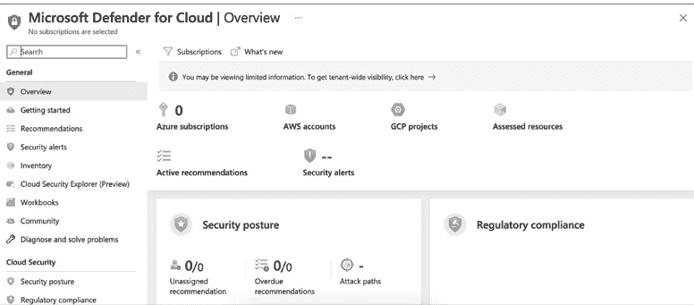


当启用 Defender for Cloud 时，Microsoft 云安全基准会自动应用于 Azure 订阅。CIS、PCI-DSS 和 NIST 控件用于创建这个广受尊重的基准，该基准除强调 Center for Internet Security (CIS)、PCI-DSS 和 NIST 强制执行的控件外，还强调以云为中心的安全。

Defender for Cloud 包含若干基于 Microsoft 威胁情报的高级智能保护，用于保护你的工作负载。除了工作负载保护外，Microsoft Defender 还提供针对你订阅的资源量身定制的订阅计划。

## 在一个屋檐下保护你的所有 IT 资源

Defender for Cloud 允许你像 Azure 原生服务一样监控和保护 Azure 服务，而无需任何部署。不过，你也可以添加位于本地或其他公有云中的资源。

凭借其广泛的方法，Defender for Cloud 成为满足所有云安全需求的单一管理平台。如果需要，Defender for Cloud 可以自动部署 Log Analytics 代理。Azure Arc 用于将 Microsoft Defender 计划扩展到混合和多云环境中的非 Azure 计算机。多云计算机可以在无需代理的情况下访问 CSPM 功能。

## 保护你的 Azure 原生资源

使用 Defender for Cloud 检测以下平台上的威胁：

- 保护 Azure PaaS 服务，包括 Azure 应用服务、Azure SQL、Azure 存储帐户等。你可以通过集成 Microsoft Defender for Cloud apps（以前称为 Microsoft Cloud App Security）来检测 Azure 活动日志中的异常。
- Defender for Cloud 提供多项功能，包括能够在 Azure SQL 中自动对数据进行分类。它还可以评估 Azure SQL 和 Azure 存储中的漏洞，并推荐缓解措施。
- 使用 Defender for Cloud，你的网络受到暴力破解攻击的保护。限制对虚拟机端口的访问并使用即时 VM 访问可以防止对网络的不必要访问。对于选定的端口，你可以将访问限制为授权用户、特定 IP 地址或 IP 范围，期限有限。

## 保护你的本地资源

使用 Defender for Cloud，你可以通过保护非 Azure 服务器来保护混合和 Azure 环境。为了专注于最重要的内容，你将根据环境接收定制的威胁情报和优先级警报。

Defender 可以使用 Defender for Cloud 的增强安全功能来保护本地计算机。

## 保护在其他云上运行的资源

Amazon Web Services 和 Google Compute Engine 是 Defender for Cloud 可以保护的两个云。

如果你的 AWS 账户已连接到 Azure 订阅，则可以启用这些保护。

- 除了 Defender for Cloud 的 CSPM 功能外，你的 AWS 资源还将根据 AWS 特定的安全建议进行评估，这些建议已包含在你的安全分数中。此外，还将评估 AWS 内置安全标准（AWS CIS、AWS PCI DSS 和 AWS Foundational Security Best Practices）。Defender for Cloud 中的资产清单是一项多云功能，可让你将 AWS 资源与 Azure 资源一起管理。
- Amazon EKS Linux 集群受 Microsoft Defender for Kubernetes 保护。
- Windows 和 Linux EC2 实例可以从 Microsoft Defender for Servers 的威胁检测和高级防御中受益。Microsoft Defender for Endpoint 包含在此计划中，此外还包括基线安全评估、操作系统级评估、漏洞评估、自适应应用程序控制、文件完整性监控等更多功能。

如果你的 GCP 账户已连接到 Azure 订阅，则可以启用这些保护。

- 原生云连接器（Microsoft 推荐）提供到 Google Cloud Platform 账户的无代理连接，然后可以使用 Defender for Cloud 的 Defender 计划对其进行扩展，以确保你的 Google Cloud Platform 资源的安全。
- Defender for Cloud 使用经典云连接器连接到你的 GCP 环境，这需要在你的 GCP 项目中进行配置。
- 一个 Azure 订阅可用于连接多个项目。
- 可以将多个项目连接到多个 Azure 订阅。

漏洞评估解决方案是 Defender for Cloud 针对虚拟机、容器和 SQL 服务器的增强安全功能的一部分。

Microsoft Defender for Servers 与 Microsoft Defender for Endpoints 之间提供自动的原生集成。你可以在 Defender for Cloud 中查看这些漏洞扫描结果并做出响应。


在你的治理策略中，Microsoft Defender for Cloud 发挥着至关重要的作用。安全数据从许多来源（包括防火墙和其他合作伙伴解决方案）收集、搜索和分析，以便通过跨工作负载的统一视图确保你始终处于安全领域的前沿。Defender 通过提供可操作的安全建议在问题被利用之前修复问题，并确保安全策略应用于混合云工作负载，从而确保符合安全标准。

## 解释合规性评分并建议采取措施解决问题或改善安全

当你采取建议措施并减少环境中的风险因素，以及查看所选标准和法规的所有环境评估结果时，你的合规性状况将得到改善。

使用 Microsoft Defender for Cloud CSPM 模块，你可以通过提供的工具评估和修复安全问题。这些工具包括：

- 安全法规的治理与合规
- 云安全图
- 攻击路径分析
- 无代理计算机扫描

在法规合规性仪表板中，你可以查看所选的所有合规性标准及其支持的要求。此仪表板显示这些安全评估的状态，并显示你对这些标准的合规性情况。实施环境的安全建议将提高你的安全分数。使用筛选器，你可以找到对分数影响最大的建议，或从建议列表中你应当实施的建议。

转到 Azure 门户，在搜索框中查找 Defender for Cloud。在 Defender for Cloud 的概述中，选择安全状况，然后选择查看建议。

你可以使用建议列表上方的搜索框和筛选器来搜索特定建议。使用每个建议的详细信息作为指南，决定是否应修复、豁免或禁用该建议。查找并修复带有不正常资源的建议对于提高安全分数和改善安全状况至关重要。

你的安全分数可以通过 API 访问，从而让你查询数据并创建自己的报告机制。Defender for Cloud 的工作簿页面中包含一个现成报告，用于跟踪你的订阅、安全控件等。

实施安全控制中的所有建议将导致潜在的分数增加。当你实施安全控制的所有建议时，列出的百分比点数将增加。

使用法规合规性仪表板，专注于所选标准和法规中的合规性差距。使用此仪表板，你可以在动态的云和混合环境中随时间持续监控合规性。要查看任何失败评估的详细信息，请从仪表板中选择它。建议包括解决问题的修复步骤。你可以查看从仪表板中选择的任何失败评估的详细信息。每个建议都提供了修复步骤。


某些控件可能会变灰，因为它们没有任何 Defender for Cloud 评估。请查看贵组织的要求并在你的环境中对其进行评估。其中一些控件可能与流程相关，而非技术性。

当你在 Microsoft Defender for Cloud 仪表板中收到建议时，请按照建议中提供的修复步骤操作，以更有效地保护你的资源。Microsoft 建议优先处理那些能提高安全分数的安全控件。在审阅所有建议后，确定首先要修复哪一项。许多建议中都包含“修复”选项，以简化修复操作并改善你环境的安全性（并提高安全分数）。

修复操作使用模板部署或 REST API 补丁请求将配置应用到资源。该操作记录在 Azure 活动日志中。

## 设计并验证 Azure Policy 的实现

Azure Policy 是 Microsoft Azure 提供的一项服务，允许你创建、分配和管理策略，以维护或审核组织的 Azure 资源。因此，资源配置在不同配置下始终符合企业标准。

由于其动态性质，采用云计算的组织必须进行持续监控。每天都会新建工作负载，因此必须确保这些工作负载默认安全。在流程开始时实施护栏至关重要，可防止用户部署不安全的工作负载。

如果不提供持续监控和策略强制执行，你的环境将面临风险，因为工作负载默认不安全。

必须根据组织的基础架构和合规需求来设计策略。将所有合规数据集中在一个地方，有助于通过开发定制策略来减少审核环境所需的时间。表 4.3 定义了 Azure Policy 中使用的关键术语。

## 表 4.3 Azure Policy 术语表

| 术语 | 描述 |
|---|---|
| 别名 | 策略定义中用于映射到资源属性的字段。 |
| 适用性 | 对资源与策略的评估基于其相关性。当资源在策略分配范围内时，它既未被排除也不豁免于策略分配，并且满足策略规则中指定的条件；如果它被阻止，则被视为适用于该策略。 |
| 分配 | 由 JSON 定义的对象，用于确定策略定义应用于的资源。 |
| Azure Policy | 强制执行组织标准并评估 Azure 资源合规性的服务。 |
| 内置 | 这是自定义策略定义的替代方案，默认可用并由 Azure 资源提供程序生成。 |
| 类别 | 策略定义中的元数据属性，根据其关注领域对定义进行分类。类别通常指示目标资源提供程序（计算、存储、监控）。 |
| 合规状态 | 可表示符合、不符合、豁免、冲突、未开始或受保护，以反映对适用策略的遵循情况。 |
| 符合 | 根据策略定义，如果资源遵循策略规则，则被视为符合。 |
| 控件 | 法规合规组是组的另一种称呼。 |
| 自定义 | 由策略用户编写的内置策略定义的替代方案。 |
| 定义 | 策略对象的目的是描述资源合规要求及违反后果。 |
| 定义位置 | 可以将管理组或订阅分配给计划或策略定义，并且可以在该范围之上或之下进行分配。 |
| 效果 | 当策略规则满足时，会对资源采取操作。 |
| 强制执行 | 策略效果可以具有预防性作用。 |
| 强制执行模式 | 可以配置策略，以便启用或禁用某些策略效果，同时仍评估合规性并提供日志。 |
| 评估 | 描述扫描云环境中资源以确定分配策略的适用性和合规性的过程。 |
| 事件 | 可以使用 Event Grid 在 Azure Policy 中发生更改时集成事件或结果。 |
| 排除 | 也称为 NotScopes。排除的范围不会出现在 Azure 门户合规性边栏中，因为它们不包含子资源容器或子资源。 |
| 豁免 | 合规状态表示豁免。 |
| 豁免 | 由 JSON 定义的对象会从评估中排除资源层次结构或单个资源。该资源仍计入总体合规性，但不会被评估。 |
| 组 | 在计划定义中，ID 的子集对应策略定义。 |
| 标识 | 在 Azure Policy 中，托管标识由系统或用户分配。 |
| 计划 | 策略定义集合是一种由策略定义集合组成的策略定义类型。它允许通过单个分配来管理一组策略定义，共享参数和标识。 |
| JSON | Azure Policy 使用 JavaScript 对象表示法 (JSON) 来定义策略对象。 |
| 不符合 | 不符合策略规则的资源被归类为不符合。 |
| 策略规则 | 规则为策略分配提供汇总合规状态。 |
| 模式 | Azure 资源管理器 (ARM) 属性或资源提供程序 (RP) 属性确定针对策略定义评估哪些资源类型。 |
| 策略状态 | 状态描述策略分配在合规性方面的表现。 |
| 法规合规性 | 这描述了一种特定类型的计划，允许将策略分组到控件中，并根据责任（客户、Microsoft、共享）将策略分类到合规性域中。可使用自定义法规合规性内置项，客户也可以创建自己的。 |
| 修复 | 由 JSON 定义的对象使用 deployIfNotExists 或 modify 效果来纠正违反策略的资源。对于新创建或更新的资源，修复是自动的；对于现有资源，则必须触发修复。 |
| 范围 | ARM 描述分配适用的资源集，包括订阅、管理组、资源组和单个资源。 |
| 模板信息 | 在适用于 Kubernetes 群集的 Azure Policy 中，约束模板定义为策略定义的一部分。 |

## 关于 Azure Policy 需要了解的关键输入

以下是 Microsoft 网络安全架构师需要了解的输入：

- Azure Policy 中的策略和计划可以定义为单个策略，也可以定义为相关策略组，称为*计划*。Azure Policy 中内置了多个策略和计划定义。
- Azure 策略会被继承。资源的分配会被其所有子资源继承。
- Azure 策略可以在不同组织级别进行范围限定并强制执行。
- Azure Policy 会突出显示资源当前策略的合规性。
- 使用 Azure Policy 自动修复不合规的资源。
- Azure Policy 与 Azure DevOps 配合应用预部署和后部署策略。

通过在资源中设置护栏，Azure Policy 可以帮助你确保云合规性，避免配置错误，并在整个组织中实施一致的资源治理。除了提高开发人员生产力和优化云支出之外，Azure Policy 还可以通过在 Azure 平台核心实施策略来减少外部审批流程的数量。

通过建立资源约定，Azure Policy 使治理 Azure 资源、强制执行策略、审核合规性和持续监控合规性变得容易。策略定义描述资源合规条件以及满足这些条件时产生的效果。

别名用于访问资源属性字段。条件将资源属性字段与所需值进行比较。当资源属性字段是数组时，唯一数组别名可以从所有数组成员中选择值，并将条件应用到每个值。

Azure Policy 会评估你的资源并突出显示不符合你所创建策略的资源。Azure Policy 还可以防止创建不合规的资源。

存储、网络、计算、安全中心和监控在 Azure Policy 中都有内置策略和计划定义。例如，假设你定义了一个策略，该策略仅允许在环境中为虚拟机 (VM) 使用特定的库存保管单位 (SKU) 大小。创建新 VM 或调整现有 VM 大小时，会调用 Azure Policy。环境中的所有 VM 都由 Azure Policy 进行评估和监控。

在某些情况下，不合规的资源或配置可以由 Azure Policy 自动修复，以确保资源完整性。如果 Azure Policy 未为某个资源组中的所有资源应用带有 AppName 标记和 SpecialOrders 值的标记，则它会自动应用该标记。

此外，Azure Policy 可以与 Azure DevOps 集成，为应用程序的预部署和后部署阶段应用持续集成管道策略。

在流程开始时使用 Azure Policy 可以在资源创建后强制执行策略，如图 4.3 所示。


## 图 4.3 Azure 策略逻辑视图

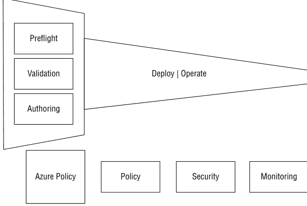

定义约定后，可以控制成本并更高效地管理资源。例如，仅当资源具有特定标记且策略分配向下传递到子资源时，才允许特定类型的虚拟机。如果将 Azure 策略分配应用到资源组，则它会传播到该资源组中的所有资源。

## Azure 策略和 Azure 资源

在设计 Azure 资源时，Azure 策略必须满足业务标准和合规性要求。

Azure 策略会审查由人员、流程或管道发起的创建或更新资源的请求。

策略定义效果（例如 Modify、Append 或 DeployIfNotExists）会更改或添加请求。当策略定义效果为 Audit 或 AuditIfNotExists 时，会为新资源和更新资源创建活动日志条目。当策略定义效果为 Deny 时，请求无法创建或更改。

## 验证新策略

以下步骤是 Microsoft 推荐的验证新策略定义的方法：

- 仔细定义策略。
- 执行资源审核。
- 审核新建或更新的资源请求。
- 在资源上实施策略。
- 持续监控。

让我们逐个阶段开始。

### 仔细定义策略

了解 Azure 资源如何连接到其他 Azure 服务以及如何实施业务策略非常重要，因为策略定义至关重要。识别要求并确定资源属性，可让您超越业务策略的狭窄目的。

- 例如，您的策略是否规定“所有虚拟机必须符合组织标准”。
- HDInsight 或 AKS 是否是使用 VM 的另一项 Azure 服务？

必须考虑策略将如何影响其他服务的资源。因此，应尽可能严格地定义策略，以专注于需要评估合规性的资源和属性。

从高级别来看，Azure Policy 中的策略定义涉及三个步骤：定义策略、将其分配给资源以及审查评估。

可以通过策略定义阻止在特定 Azure 区域部署 VM。还可以审核存储帐户，以确保只连接允许的网络。

以下是一些策略定义示例及其强制实施的条件。当条件满足时，策略定义还具有伴随效果。

- 允许的 VM SKU：您可以使用此策略指定组织可以部署哪些 VM SKU。
- 允许的位置：当组织部署资源时，此策略限制其可以指定的位置，并强制执行地理合规性要求。
- 应在对订阅具有写入权限的帐户上启用 MFA：为防止帐户或资源泄露，具有写入特权的帐户必须启用多重身份验证 (MFA)。
- CORS 不应允许每个资源访问 Web 应用：出于安全原因，跨源资源共享 (CORS) 使 Web 应用程序能够访问其域外的资源。为确保安全，现代浏览器默认限制跨站点脚本。根据此策略，只有所需域可以与 Web 应用交互。
- 应在 VM 上安装系统更新：Azure 安全中心会在缺少系统更新时向服务器推荐安全系统更新。

### 将其分配给资源

将定义分配给资源是实施策略定义的方式。策略定义可以分配给管理组（订阅群集）、资源组或单个订阅。

资源组的资源成员将继承该组内的策略分配。

当策略应用于资源组时，它适用于该组内的所有资源。

当需要从子范围排除特定子资源时，可以将其从策略分配中排除。

### 审查评估

当针对现有资源评估条件时，现有资源的合规性结果将标记为合规或不合规。

策略评估大约每小时进行一次。如果修改策略定义并进行策略分配，则该策略会在一小时内对 Azure 资源进行评估。

### 执行资源审核

在管理新资源或更新资源之前，应检查新策略定义如何评估现有资源的小子集（例如测试资源组）。为防止效果触发或创建活动日志条目，请将策略分配设置为 Disabled (DoNotEnforce)。

由于此步骤，新策略可以在不影响工作流的情况下进行评估。确保您预期不合规的资源未被标记为不合规（误报）。在初始子集得到验证后，逐步扩大对所有现有资源的评估。

此外，评估现有资源可在完全实施新策略之前修复不合规资源。

### 审核新资源或更新资源

要确定新策略定义是否会影响创建或更新的资源，需要验证其是否能正确报告现有资源。如果策略定义影响参数化，建议使用审核。要确定新策略定义是否在不影响现有工作或请求的情况下在 Azure 活动日志中触发不合规资源条目，请使用此配置监控资源创建和更新。

为确保在预期时正确触发 Audit 效果，应更新并创建与策略定义匹配的新资源。当新策略定义触发 Audit 效果时，请留意不应受影响的资源请求。作为误报的另一个示例，这些受影响的资源必须在完全实施之前在策略定义中更正。

如果在此测试阶段更改策略定义，Microsoft 建议现有审核资源开始验证过程。新资源或更新资源可能会受到策略定义更改的影响，导致误报。

验证过程需要确保只识别不合规资源，且不会将合规资源错误地包含在结果中（称为误报）。

### 在资源上实施策略

验证后，即可开始对现有资源和新资源实施新策略定义。实施前，建议将新策略定义分配给所有资源的子集（例如资源组）。初始部署验证后，应将策略范围扩展到新层级（例如订阅和管理组）。在目标范围创建新分配，直到新策略定义涵盖所有预期涵盖的资源。一旦新定义涵盖所有预期涵盖的资源，即可删除该分配。

在推出期间如果发现免于新策略定义的资源，应采取以下措施：
- 为减少意外影响，请更新策略定义。
- 通过删除并创建新策略分配，可以更改策略分配范围。
- 将排除列表添加到策略分配。

应将范围（级别或排除）的任何更改通知安全和合规性组织，以确保不存在缺口。

### 持续监控

需要持续监控资源与新策略定义的合规性级别，并在检测到不合规设备时设置 Azure Monitor 警报和通知。实施和分配策略定义并非过程的终点。作为评估过程的一部分，应定期审查策略定义及其分配的任务，以确保它们满足业务策略和合规性要求。如果不再需要策略，应将其删除。随着底层 Azure 资源的发展并添加新属性和功能，策略还需要不时更新。

## 关于 Azure 策略需要了解的关键设计注意事项

以下是 Microsoft 网络安全架构师从设计和部署角度需要了解的事项。

- 可以使用 Azure 策略合规性仪表板分析环境的整体状态。仪表板提供汇总视图，可钻下来查看每个资源和层级的组织策略。为了快速有效地解决问题，该工具为现有资源提供批量修复，为新资源提供自动修复。

- 考虑 Azure Policy 如何评估资源。规划 Azure Policy 在特定时间如何评估组织资源。了解评估触发的时间和方式。不合规资源可能会稍后被检测到。评估由以下事件或时间触发：
  - 策略分配在范围内创建、删除或更新资源。
  - 将新范围分配给策略或计划。
  - 使用分配的策略或计划更新范围。
  - 每 24 小时进行一次合规性评估。

- 决定如何处理不合规资源。组织可以根据资源以不同方式处理不合规问题。以下是一些示例：
  - 拒绝接受更改。
  - 记录资源的任何更改。
  - 在更改前或更改后修改资源。
  - 应部署合规资源。


考虑何时自动修复不合规资源。确定 Azure Policy 是否应对不合规资源执行自动修复。修复在资源标记方面尤其有用。Azure Policy 可以应用资源标记，已删除的标记可以重新应用。使用 Azure Policy，您可以确保特定资源组中的所有资源都标记有特定标记（例如 location），以便可以标识区域。

最好使用 Azure RBAC 和 Azure Policy 来实现完全的范围控制。最好使用 Azure RBAC 和 Azure Policy 来获取完全的范围控制。

Azure Policy 会评估资源的状态并采取措施，确保其始终符合组织的业务规则。合规性不取决于谁进行了更改或谁有权进行更改。Azure Policy 通过评估资源状态来确保资源保持合规。

Azure RBAC 通过关注不同范围内的用户操作，控制谁可以访问 Azure 资源、可以对这些资源执行什么操作以及可以访问哪些区域。如果需要控制操作，请使用 Azure RBAC。即使授予用户完成某项操作的访问权限，Azure Policy 仍会阻止它，从而导致资源不合规。

表 4.4 说明了 Azure Policy 的配置最大值。

| 适用对象 | 适用项 | 最大计数 |
|---|---|---|
| 范围 | 策略定义 | 500 |
| 范围 | 计划定义 | 200 |
| 租户 | 计划定义 | 2,500 |
| 范围 | 策略或计划分配 | 200 |
| 范围 | 豁免 | 1000 |
| 策略定义 | 参数 | 20 |
| 计划定义 | 策略 | 1000 |
| 计划定义 | 参数 | 300 |
| 策略或计划分配 | 排除项 (notScopes) | 400 |
| 策略规则 | 嵌套条件 | 512 |
| 修复任务 | 资源 | 50,000 |
| 策略定义、计划或分配请求体 | 字节 | 1,048,576 |

您还可以将 Azure Policy 与 Azure DevOps 集成，以应用与应用程序的预部署和后部署阶段相关的持续集成或交付流水线策略。

使用 Azure Policy，可以通过内置计划定义访问法规合规性，使用户能够确定哪些控制和合规领域适用于哪个组织（客户、Microsoft 或共享）。

法规合规性使客户能够创建自己的法规合规计划。

目前，法规合规性是预览功能。

## 设计数据驻留要求

Microsoft 使用多层安全性和加密协议来保护您的数据。默认情况下，存储在物理介质上的数据始终使用符合 FIPS 140-2 标准的加密协议和 Microsoft 托管密钥进行加密。客户托管密钥 (CMK)、双重加密和硬件安全模块 (HSM) 可以提供进一步的数据保护。

数据中心之间的流量受到 IEEE 802.1AE MAC 安全标准的保护，可防止物理中间人攻击。Microsoft 通过使用有时会跨越地理边界的可变网络路径来保持复原能力，但客户数据始终通过区域间的加密连接进行复制。

作为 Microsoft 全球云服务（包括运行和改进服务、计费以及欺诈预防）的一部分，Azure 生成假名标识符以尽量降低隐私风险。根据 Microsoft 的说法，假名标识符永远不能直接用于识别个人，且访问可识别个人身份的客户数据始终受到保护。

不同组织可能会根据地区和行业特定法规，对数据驻留和主权有不同的要求。

除暗示数据驻留之外，数据主权还引入了规范谁控制和访问客户数据的规则和要求。在许多情况下，数据主权规定客户数据必须受数据所在国家或地区法律和法律管辖权的约束。即使是平台维护和客户支持请求也可能受到这些法律的影响。

根据数据所在的管辖区域，数据驻留法规规定了数据在国际上可以存储、处理和访问的地点和方式。

出于数据驻留考虑，合规性考量可能支持甚至规定数据存储位置以及数据可以在国际上转移的方式和时间。因此，Azure 的区域和服务为客户提供了基于管辖区域的各种选项，用于选择和限制数据驻留及访问。法规可能会因管辖区域的不同而有显著差异。得益于这种灵活性，受监管行业的客户可以在云中运行任务关键型工作负载，并利用 Microsoft 超大规模云计算的所有优势。

## 区域服务的数据存储

虚拟机、存储和 SQL 数据库是一些可以按区域部署并分配到特定区域的 Azure 服务。

未经您的授权，您的客户数据不会在您指定的地理区域 (Geo) 之外进行存储或处理。

Microsoft 可能会在给定地理区域内的区域之间复制客户数据，以确保数据冗余或用于其他操作目的。为了在发生重大数据中心灾难时增强数据可靠性，异地冗余存储会在同一地理区域内的两个区域之间复制 Blob、文件、队列和表。Geo 中的远程数据处理系统可能由 Geo 外部的 Microsoft 人员控制，但未经您的许可，不会访问客户数据。

以下服务可能会将部分数据存储或处理在指定地理区域之外：

- Azure Cloud Services 会为 Web 和辅助角色软件部署包提供备份，无论部署区域如何。
- 一个基于欧洲的集群会在 Azure Data Explorer (ADX) 中存储部分使用数据和服务跟踪，存储期限有限。
- 取决于客户使用的创作区域，语言理解可能会将实时学习数据存储在美国、欧洲或澳大利亚。
- Azure Machine Learning 可能会出于调试目的，存储客户提供的资产名称的自由格式文本（例如工作区名称、资源组名称、实验名称、文件名和映像名称），以及实验执行参数或实验元数据。
- Azure 上的 Databricks 可能会存储标识信息、表名称和对象路径。
- 当 Azure 串行控制台与 Azure 门户配合使用时，控制台命令和响应会在客户选择的 Geo 之外进行处理，以向该门户提供控制台体验。

## 非区域服务的数据存储

某些 Azure 服务不允许客户指定服务部署的区域。除非另有说明，否则客户数据可能在 Azure 公共区域内的任何一个 Microsoft 数据中心中进行存储和处理。

以下服务可能会为非区域服务存储或处理部分数据：

- Azure 内容分发网络会在全球边缘位置缓存客户数据。
- 可以全局存储 Azure AD 数据，但美国部署除外（Azure AD 数据仅存储在美国境内）或欧洲部署除外（Azure AD 数据存储在美国或欧洲）。
- Azure 多重身份验证会将身份验证数据存储在美国。
- 从客户资源（例如虚拟机或 Azure AD 租户）获取或与之关联的数据可能会存储在 Microsoft Defender for Cloud 中。
- 数据将存储在与资源相同的地理编码中，但 Microsoft 尚未部署 Microsoft Defender for Cloud 的地理编码除外，在这种情况下，数据将存储在美国。
- 地理编码意味着您的 API 请求可以包含地址或位置名称等搜索词，并将结果作为纬度和经度坐标返回。
- 数据也可能会根据处理此类数据的另一项 Microsoft 联机服务的地理位置规则进行存储。
- Microsoft Defender for IoT 可能会使用其他 Microsoft 联机服务来处理安全相关的客户数据，具体取决于其他联机服务的地理位置规则。
- 不处理或存储客户数据的全局路由服务，例如 Azure 流量管理器。

### 数据主权

数据驻留解决方案设计需要考虑数据主权要求。数据主权暗示数据驻留，但也引入了定义谁可以访问和控制基于云的数据的规则和要求。由于数据主权，大量客户数据受数据所在国家或地区法律和法律管辖权的约束。当启动平台维护或客户支持请求时，这些法律可能会直接影响数据访问。

您可以将 Azure 的公共多租户云与 Azure Stack 产品（用于本地和边缘解决方案）相结合，以满足数据主权要求。可以部署这些其他产品，使您完全控制自己的数据，包括存储、处理、传输和远程访问。

### 个人数据

使用 Azure 服务存储和托管客户数据（例如个人信息和其他内容）时，权利、权属和权益均归您所有。Microsoft 不会在您的地理区域之外存储或处理客户数据，但某些服务和场景除外。您还可以在全球移动、复制和访问客户数据。大多数 Azure 服务都按区域部署，允许您确定客户数据将存储和处理的位置。区域服务示例包括虚拟机、存储和 SQL 数据库。Microsoft 通过使用跨越地理边界的可变网络路径来保持复原能力；但是，区域间的数据复制始终是加密的。


## Azure Policy 注意事项

在设计数据驻留解决方案时，必须考虑 Azure Policy。使用 Azure Policy，您可以管理云基础设施和数据。治理包括定义资源可部署的位置、可部署的服务以及资源必须如何监控。客户可以使用 Allowed Locations 策略将数据和资源限制在特定的 Azure 区域，例如用于数据驻留。为了确保持续合规，新部署的资源将根据策略进行检查，旧资源将定期扫描。

## Azure Blueprints 注意事项

Azure Blueprints 是一项免费服务，提供用于创建、部署和更新完全受治管的云环境的模板，帮助客户符合法规要求。

考虑使用 Azure Blueprints 来管理特定合规需求的数据驻留，方法是为资源组指定允许和许可的位置。当您需要用于创建、部署和更新完全受治管的云环境的模板时，Azure Blueprints 会很有帮助。

多项常见标准（包括 HIPAA、FedRAMP 和 PCI DSS）均已映射到 Azure Blueprints。例如，它将 ISO 27001 和 PCI DSS 的一组核心策略映射到任何 Azure 环境。

使用 Blueprints，您可以部署多个 Azure 订阅并从集中位置进行管理，它们可扩展以适用于大规模迁移和生产实现。在 Azure Blueprints 中，ARM 模板、资源组、策略分配和角色分配均打包在一个容器中，这与 Azure Resource Manager (ARM) 和 Azure Policy 不同。

Blueprints 通过将策略打包在单个蓝图定义中，简化了大规模 Azure 部署。将策略打包在单个蓝图定义中，可让您快速轻松地部署所有这些组件。

为确保数据仅存储在您选择的区域，应选择以下选项：

- Azure 服务是区域部署的，因此您可以指定服务的部署位置。除 Azure 数据位置页面上描述的少数区域和预览服务外，Microsoft 不会将您的数据存储在指定区域之外。这样，您的数据将保留在您提供数据时所在的区域。
- 某些 Azure 服务可以部署在特定区域，但您的服务不能。数据位置页面描述了如何指定区域。

只要数据存储在 Azure 存储帐户中，就会复制数据以实现持久性和最大可用性。Azure 存储会复制您的数据，以应对暂时性硬件故障、网络中断甚至大规模自然灾害。同一数据中心、区域内的可用性区或地理上分离的区域可以复制您的数据。

非区域服务的一个示例是 Azure Active Directory (Azure AD)。换句话说，Azure AD 可能会在全球范围内存储标识数据，但美国、欧洲、澳大利亚和新西兰的 Azure AD 部署除外。

发生灾难时，Azure Backup 可确保您的数据安全且可恢复。使用 Microsoft Azure 恢复服务 (MARS) 代理，您可以备份文件、文件夹、所需的系统状态以及整个 Windows/Linux VM 的备份（使用备份扩展）。还可以备份 Azure 文件共享、运行在 Azure VM 上的 SQL Server VM 以及运行在 Azure VM 上的 SAP HANA 数据库。

Azure Backup、Azure Data Factory、Azure Site Recovery、Azure 流分析和本地冗余存储 (LRS) 只是可以仅在一个区域存储客户数据的 Azure 服务、层级和计划中的一些示例。

## 保护组织数据

Microsoft 网络安全架构师可以保护组织数据免受未授权访问。确保云工作负载机密性的关键组件是加密。Microsoft 的产品和服务中使用了多种加密方法、协议和算法，以通过 Azure 基础设施为数据传输提供安全路径，并确保其中存储的数据的机密性。为了保护客户的数据，Microsoft 使用业内最强大的加密协议之一。

作为 Azure 的一部分，客户还可以管理和控制其数据的安全性，包括静态数据、传输中数据和处理中数据的加密。正确管理加密密钥是加密最佳实践的关键，Azure Key Vault 有助于保护加密密钥。Azure、Key Vault 中的客户或客户本地环境可以管理和存储加密密钥。

密钥管理策略可以包括由 Azure 服务管理的服务器端密钥，或者 Azure 无法访问加密密钥的客户端加密。

## 静态数据加密

只要客户数据写入 Azure 存储（包括 Azure 托管磁盘、Azure Blob、队列和表存储），就会自动加密。除了符合 FIPS 140-2 标准外，Azure 存储数据还使用 256 位 AES 加密进行加密。

Azure 为 Windows Server 和 Linux 实例 (VMSS) 的操作系统磁盘和数据磁盘提供了多种加密选项。

对于基础设施即服务 (IaaS) 虚拟机磁盘，Azure 磁盘加密基于 Windows 上的 BitLocker 和 Linux 上的 DM-Crypt 提供全卷加密。需要 Azure 密钥保管库来管理和控制磁盘加密密钥和机密。

作为 BitLocker 的一部分，Windows Server 2016 屏蔽 VM 已加密，以防止受限制的管理员访问虚拟机内部的信息。密钥保管库和 VM 必须位于同一区域和订阅中。作为屏蔽 VM 解决方案的一部分，主机守护人员服务会认证虚拟化主机并释放加密密钥。

## 特定存储类型的加密技术

对于特定存储类型，还有其他加密技术可用，包括：

- 存储在 Azure Synapse Analytics 中的数据由透明数据加密 (TDE) 进行静态加密。
- 使用 Always Encrypted，数据可以在客户端应用程序中加密，然后再存储到 Azure SQL 数据库。通过启用就地加密和更丰富的机密查询，带安全隔区的 Always Encrypted 扩展了 Always Encrypted 的机密计算功能。
- 与 Azure SQL 数据库一样，Azure 数据湖存储 (ADLS) 受到静态透明加密的保护。默认情况下，ADLS 执行密钥管理，但如果需要，可以独立管理密钥。存储服务加密 (SSE) 类似于 Blob 存储，会使用 Microsoft 托管密钥或客户提供的加密密钥在 ADLS Gen 2 中自动加密静态数据。
- Azure Cosmos DB 默认使用安全密钥存储系统、加密网络和加密 API 进行加密。Microsoft 管理加密密钥，并根据 Microsoft 内部策略对其进行轮换。

## 密钥管理

Azure 可以为客户管理密钥，或代表客户执行加密。

使用服务器端加密时，可根据组织需求在三种服务器端加密模型中进行选择。

- 服务托管密钥通过 Azure Key Vault 结合了控制和便利性，且开销低。Azure 资源提供程序执行加密和解密操作，Microsoft 管理密钥。
- 客户托管密钥对密钥提供完全控制，包括自带密钥 (BYOK) 支持或生成新密钥的功能。Azure 资源提供程序处理加密和解密操作。客户通过 Azure Key Vault 控制密钥。
- 通过使用客户提供的密钥 (CPK)，您可以在本地除 Azure Key Vault 以外的密钥存储区中管理密钥。

使用客户端加密时，加密密钥对 Microsoft 不可用，且数据无法被解密。在此模型中，客户加密数据，将其作为加密 Blob 上传，并对密钥保持完全控制。密钥对 Azure 服务不可用。

## 传输中数据加密

在任何数据保护策略中，都应确保传输中的数据已加密。不保护传输中数据的公司更容易遭受中间人攻击、窃听和会话劫持。一般建议是客户始终


使用安全套接层/传输层安全（SSL/TLS）协议在不同位置之间交换数据，因为数据在多个位置之间来回传输。

为了加密网络上的通信，Microsoft 为客户提供使用 TLS（TLS 握手）和对称加密（共享密钥）的选项，以在客户数据传输到 Azure 数据中心期间对其进行加密。

数据在网络上传输时的身份验证、完整性和机密性也受到 Microsoft 的 Internet 协议安全（IPsec）的保护，这是一套行业标准协议。

每个 Azure 服务器都配备了 Azure SmartNIC，它使用现场可编程门阵列（FPGA）技术。FPGA 是可编程硬件模块，可大大加快数据处理速度，包括传输过程中的数据加密。Microsoft 在开源许可下发布了该硬件设计，因此社区和客户都可以从中受益。以下是优势：

- 硬件设计是开源的，因此不需要许可。
- 客户可以选择使用加密，且无需额外费用。

虚拟专用网络（VPN）可以隔离本地与云基础架构之间的通信通道，并保护传输中的数据。以下是一些保护传输中数据的方法：

- 在本地基础架构与 Azure 之间移动数据时，请使用 HTTPS 或 VPN 等适当的防护措施。
- Azure 站点到站点 VPN 是需要从多个本地工作站安全访问 Azure 的组织的最佳解决方案。
- 使用点到站点 VPN 是需要从一台本地工作站安全访问 Azure 的组织的最佳选择。
- ExpressRoute 允许您通过专用高速 WAN 链接移动大型数据集，并在应用程序级别使用 SSL/TLS 对其进行加密。
- 在通过 Azure 门户与 Azure 存储交互时，您还可以通过 HTTPS 访问存储 REST API、Azure 存储和 Azure SQL 数据库。

## 数据处理期间的加密

基于云的 Intel SGX 和基于虚拟化的安全性在使用 Azure 机密计算进行处理时保护客户数据。当数据需要以明文（未加密）形式存在以进行高效处理时，机密计算会在可信执行环境（TEE）中对其进行保护。

保护 TEE 内部的数据和操作免受外部查看（即使使用调试器）至关重要。TEE 在处理数据时强制执行这些保护措施，包括 Microsoft 员工的访问。此外，如果代码被更改或篡改，环境将被禁用，操作将被拒绝。此外，这确保只有授权代码才能访问数据。

支持 SGX 的 Intel Xeon E-2288G 处理器是使用机密计算的客户的理想选择。有关更多信息，请参阅 https://azure.microsoft.com/en-us/updates/intel-sgx-based-confidential-computing-vms-now-available-on-azure-dedicated-hosts。

## Azure 客户密码箱

作为 Microsoft 保护客户数据努力的一部分，Azure 客户现在拥有客户密码箱，它允许 Microsoft 工程师在回应客户发起的支持工单或 Microsoft 识别的问题时访问客户数据，紧急情况或外部法律要求除外。客户可以通过审核、批准或拒绝来控制 Microsoft 对客户数据的请求。

客户可以通过 Azure 门户访问与此服务相关的日志，并将其集成到其 SIEM 系统中。通过 Azure 门户将此服务的日志集成到您的 SIEM 系统中。

Microsoft 作为其合规性产品的一部分，提供多种保证，包括认证、证明、验证、授权和评估，以及合同修订、自我评估和客户指南。

Microsoft 遵守其在线服务适用的所有法律法规，包括管辖安全漏洞的法律法规。无论哪些法律法规适用于客户或其行业，Microsoft 都不负责遵守它们。Microsoft 无法确定客户数据是否受特定法律法规的约束。

为了确定 Azure 服务是否符合适用于您业务的特定法律法规，Microsoft 可以提供有关 Microsoft 合规性计划的审计报告和证书。

## 将隐私要求转化为安全解决方案要求

使用 Azure，您可以使用行业领先的安全控制、合规性工具和隐私策略保护云中的数据，包括受特定安全或隐私法规管辖的数据类别。除遵守这些标准外，您还将遵守欧盟-美国隐私盾、欧盟示范合同条款、HIPAA/HITECH 和 HITRUST 法案。

- Azure 中提供了以下工具，可帮助您实现隐私目标：
  - 对于 GDPR 门户，Azure 数据主体请求提供按 GDPR 要求查找和处理存储在 Azure 中的个人数据的分步指导。除公有云和主权云上的 Microsoft Azure 门户外，Microsoft 还跨 Microsoft 在线服务提供现成的 API 和 UI，允许用户执行数据主体请求。
  - 作为 Azure 资源管理器的深度集成，Azure Policy 使您的组织更容易跨资源强制执行策略。使用 Azure Policy，您可以在组织级别管理资源，并防止开发人员意外分配违反这些策略的资源。使用 Azure Policy，可以通过加密或在特定位置存储数据来确保 GDPR 合规性。
  - 通过合规性管理器（一个基于工作流的风险评估工具），您可以在云的共享责任模型中管理法规合规性。除 Microsoft 控制实现详细信息、测试结果和客户托管控制外，它还提供标准、法规和评估的仪表板视图。您可以在组织内跟踪、分配和验证法规合规性活动。
  - Microsoft Purview 信息保护可识别本地服务器上的敏感数据；对其打标签、分类和保护；从而实现更好的数据治理。
  - 使用 Azure 安全中心，您可以使用统一安全策略管理和保护混合云工作负载。将 Azure Policy 与混合云工作负载集成可实现加密，限制组织面临的威胁并响应攻击。
  - 您可以使用 Azure 安全与合规性 GDPR 蓝图构建和启动符合 GDPR 的云应用程序。通过利用 Microsoft 常见参考架构、部署指南、GDPR 条款实现映射、客户责任矩阵和威胁模型，您将能够简化 Azure 的采用，以支持您的 GDPR 合规性工作。

### 利用 Azure Policy

Azure Policy 深度集成到 Azure 资源管理器中，允许您的组织跨所有资源强制执行隐私策略。Azure Policy 允许您在组织级别管理资源，并防止开发人员分配违反这些策略的资源。使用 Azure Policy，您可以加密数据或将其保存在特定区域，以符合特定安全法规。

### Azure 的安全基础

通过启用隐私敏感的云场景（例如金融和医疗服务），您可以更高效地实现合规性，从而加快向云端迁移，让您放心地启用云服务。公司的隐私要求将因行业和合规标准而异。除在其自身基础架构上提供强大的数据安全性外，Azure 还为客户提供客户启用的服务。

## 数据状态

在设计满足隐私要求的解决方案时，您应考虑特定时间点的数据状态。在某些场景中，您可能需要保护传输中的数据，而不仅仅是静止数据。例如，PCI DSS 要求 4 在传输过程中加密持卡人数据，您的解决方案必须加密传输中的数据以满足此要求。以下是基于数据阶段的保护示例：

- -**静止数据保护：** 对数据存储硬件的物理访问可能允许攻击者破坏数据。在维护期间，攻击者可能已从服务器中移除硬盘驱动器，从而导致攻击。移除硬盘驱动器后，攻击者控制的计算机可能会尝试访问它。攻击者在获得其所在硬件的物理访问权限时，会试图破坏静止数据。攻击者可能在服务器维护期间移除了硬盘驱动器，从而导致攻击。移除硬盘驱动器后，攻击者将使用其控制的计算机访问数据。客户可以在 Azure 存储服务加密中加密其所有数据。

- -**传输中数据保护：** 作为任何数据保护策略的一部分，传输中数据的保护至关重要。因为数据同时在许多位置之间来回移动，Microsoft 建议使用 SSL/TLS 协议在多个位置之间交换数据。您可能需要 VPN 来隔离本地和云通信通道。为了保护传输中的数据，Microsoft 向客户提供多种选项，既适用于 Azure 网络内部，也适用于跨 Internet 到最终用户。Azure 虚拟机使用 TLS 1.2 或更高版本（通过 Azure Front Door 或应用程序网关等 Azure 组件）与多种协议（例如 Windows IPsec 或 SMB）进行通信。

Microsoft Azure 服务支持一种或多种静态加密模型。但是，某些服务可能不支持一种或多种加密模型，Azure 密钥保管库可能仅支持客户管理的关键加密密钥的一个子集。此外，服务可能会按不同的计划发布这些场景和密钥类型。

撰写本文时，以下 Azure 数据存储服务支持静态加密：

- -**Azure 磁盘加密：** 客户可以通过 Azure 磁盘加密加密其 IaaS VM 和静止磁盘。
- -**Azure 存储：** 所有 Azure 存储服务（Blob 存储、队列存储、表存储和 Azure 文件）均提供静态服务器端加密；某些服务还提供客户托管密钥和客户端加密。
- -**Azure SQL 数据库：** Azure SQL 数据库支持用于静态加密的 Microsoft 托管服务器端和客户端加密方案。Azure SQL 数据库客户还可以使用透明数据加密和服务器加密。TDE 密钥可以自动启用，数据库和服务器静态加密均可启用。TDE 已默认启用。Azure 密钥保管库支持用于 Azure SQL 数据库、数据仓库和自带密钥（BYOK）的 RSA 2048 位客户托管密钥。客户端加密适用于 Azure SQL 数据库、数据仓库和自带密钥（BYOK）。SQL Server Management Studio 允许 SQL 用户选择用于加密 Azure SQL 数据库每个列的密钥。客户端在 Windows、Azure 密钥保管库或本地硬件安全模块中创建和存储加密密钥。


## Data Classification

要优先处理对安全至关重要的数据，您需要对其进行分类，以确保优先处理安全数据。安全控制也将因数据所需的隐私级别而异。数据分类的概念包括基于业务上下文向数据资产分配逻辑标签或类别。护照号码、驾驶执照号码、信用卡号码、SWIFT 代码或人员姓名可用于对资产进行分类。

您可以在 Azure 中使用 Microsoft Purview（一种统一的数据治理服务）来管理和治理本地、多云以及软件即服务（SaaS）数据。自动化数据发现，分类敏感数据，并端到端追踪数据血缘，以构建全面且最新的数据地图。通过数据策展人管理并保护您的数据资产。使数据消费者能够找到有价值、可靠的信息。像 Microsoft Purview 这样的常见数据管理平台为数据生产者和消费者提供对目录、洞察和地图等常见数据管理功能的访问。除与本地、云和 SaaS 应用程序集成外，它还可以与 Azure Synapse Analytics、SQL Server、Power BI、Azure SQL 和 Microsoft 365 云数据服务集成。

## Identity Protection

受损的用户身份可能会泄露数据并影响您的隐私要求。隐私的一个重要方面是确保您拥有保护用户身份的系统。如果您想满足隐私要求，请考虑使用 Azure AD Identity Protection 增强身份保护策略。

为了识别和保护客户免受威胁，Microsoft 每天分析 6.5 万亿个信号。安全信息和事件管理工具也可用于调查由 Identity Protection 生成并馈送至条件访问以进行访问决策的信号。

Microsoft 提供了多种解决方案以满足您的隐私要求。

- 可以使用 Azure Information Protection 发现、分类和控制敏感数据。
- Cloud App Security 可识别云应用、基础设施 (IaaS) 和平台 (PaaS) 服务，以帮助发现和控制影子 IT。
- 云服务和本地服务的身份验证可以通过 Azure Active Directory 进行管理和部署。
- 可以使用 Azure Monitor 收集、分析并响应来自 Azure 和本地环境的遥测数据。
- 您可以使用 Azure 平台对静态或传输中的数据进行加密。
- 可以使用 Azure Key Vault 导入或生成从不离开 HSM 边界的 HSM。
- 在 Azure Active Directory 中部署多因素身份验证有多种选项可用。
- 可以使用 Azure Information Protection 发现、分类和控制敏感数据。

## Summary

本章向您介绍了设计、定义和推荐法规合规性策略的不同方法。

Azure 中的数据保护和隐私建立在赋予组织对客户数据的控制权和所有权的承诺之上。在 Azure 中，您的所有数据均由您拥有，Microsoft 仅将其用于约定的服务，而不用于营销或广告。

由您控制客户数据存储在何处、由谁使用以及如何使用。您可以随时出于任何原因访问客户数据。Microsoft 会严格管理由政府和执法机构提出的客户数据请求，如果您停止服务，您的数据将根据严格标准删除。

因此，请在您的法规策略设计和部署中考虑所有这些因素。

## Exam Essentials

**了解 Microsoft GRC 功能。** 法规环境正变得日益复杂和动态，需要采取更具结构化的方法来管理治理、风险和合规性 (GRC)。

通过实施合规性和风险管理框架，GRC 能力可帮助组织降低风险并提高合规性有效性。

以下是可帮助您实施企业网络安全解决方案 GRC 的功能：

- Microsoft 365 Defender 门户为身份和访问管理、威胁防护、信息防护及安全管理专业人员提供了一个集中式中心和专用工作区，用于管理和最大限度地发挥 Microsoft 365 智能安全解决方案的效用。
- 可以使用 Microsoft Purview 的合规门户轻松管理组织的合规性需求。
- 无论是否在 Azure 中，Microsoft Defender for Cloud 是一个统一的基础设施安全管理系统，用于加强数据中心的安全态势，并在云中的混合工作负载上提供高级威胁防护。
- 使用 Azure Policy，您可以针对 Azure 资源创建、分配和管理策略，以确保符合企业标准。
- 可以使用 Azure Blueprints 实施和遵守组织的标准、模式和要求。

**了解合规性要求并与 Microsoft 最佳实践保持一致。** 利用 Azure 提供的内置控制、配置管理工具、实施和指导资源以及第三方审计报告，更快地设计、部署和管理合规性项目。

- 使用 Azure 安全和合规蓝图，您可以轻松创建、部署和更新合规性环境，包括用于 ISO:27001、PCI DSS 和 UK OFFICIAL 认证的环境。
- 使用 Azure Security Center（即 Microsoft Defender for Cloud）在混合云工作负载上集成安全管理。
- 定义并强制执行策略，帮助您的云环境符合内部和外部法规。

**使用 Microsoft Defender for Cloud 评估基础设施合规性。** Microsoft Defender for Cloud 在您的治理策略中起着至关重要的作用，并帮助您时刻关注安全。Microsoft Defender for Cloud 中的法规合规性仪表板反映了您对标准的符合情况。来自各种来源的数据（包括防火墙和其他合作伙伴解决方案）会被收集、搜索和分析，使您能够在一个位置查看所有工作负载。

**分析合规性评分并推荐操作以解决问题或改善安全性。** 使用 Microsoft Defender for Cloud，您可以在法规合规性仪表板上查看所选标准和法规的所有合规性评估状态。通过采纳建议并减少环境中的风险因素，您可以改善合规性态势。

**设计、部署和验证 Azure Policy 的实施。** 除了帮助您确保云合规性并避免配置错误外，Azure Policy 还可帮助您实践一致的资源治理并为资源设置护栏。除了减少外部审批流程的数量外，Azure Policy 还可以通过在 Azure 平台核心实施策略来提高开发人员生产力并优化云支出。在使用现有资源以及新的或更新的资源请求验证新策略定义后，您即可开始实施该策略。

**了解数据驻留和保留要求。** 为了将数据存储在特定的地理边界（例如国家边界）内，数据需要驻留在该边界内。数据驻留要求有多种类型：地方、国家或地区法律或法规；行业标准和合规性认证等非政府要求；或合同要求。在处理数据传输时采取了适当保护措施的情况下，法规要求要求数据驻留。所有客户数据通常用于满足数据驻留要求。不过，特定类型的数据可能只需在某些情况下遵守，例如财务信息、个人信息或健康信息。Microsoft 为许多服务在 35 多个国家/地区提供数据驻留，并且还在不断增加。因此，Microsoft Cloud 客户拥有越来越多的选择，可以在本地存储和处理其数据。


- 大多数 Azure 服务都可以指定数据存储和处理区域。
- 客户的数据通常存储与其首个 Dynamics 365 和 Power Platform 订阅相关联的地理位置中。Microsoft 在所选地理位置的边界内复制 Dynamics 365 和 Power Platform 客户数据，以确保数据持久性。
- 当客户注册 Microsoft 365 时，核心客户数据会根据账单地址存储在特定的 Geo 中。

**将隐私要求解码为安全解决方案的需求。** 使用 Microsoft Azure 的安全控制、合规性工具和隐私策略，您的数据在云端受到保护，包括特定安全或隐私法规识别的任何个人数据类别。

## 复习问题

- 1. 以下哪项 Azure 合规性服务可直接在 Azure 体验中为所有资源提供保护，并将保护扩展到本地和多云环境？
  - A. Microsoft Defender for Cloud
  - B. Azure Policy
  - C. Azure Desired State Configuration
  - D. Azure Automation Update Management

- 2. 作为 Microsoft 网络安全架构师，您负责管理和计划 Azure 中 Windows 和 Linux VM 的更新，以及本地和其他云环境中的物理机或 VM。您会在企业解决方案中采用哪些 Azure 合规性功能？
  - A. Azure Policy
  - B. Azure Blueprint
  - C. Azure Desired State Configuration
  - D. Azure Automation Update Management

- 3. 作为 Microsoft 网络安全架构师，您负责策略强制实施以确保环境和来宾合规性。您会在企业解决方案中采用哪些 Azure 合规性功能？
  - A. Azure Policy
  - B. Azure Blueprint
  - C. Azure Desired State Configuration
  - D. Azure Automation Update Management

- 4. 作为 Microsoft 网络安全架构师，您负责核心服务的自动化合规性。您会在企业解决方案中采用哪些 Azure 合规性功能？
  - A. Azure Policy
  - B. Azure Blueprint
  - C. Azure Desired State Configuration
  - D. Microsoft Defender for Cloud

- 5. 作为 Microsoft 网络安全架构师，您负责来宾操作系统的自动化更新。您会在企业解决方案中采用哪些 Azure 合规性功能？
  - A. Azure Policy
  - B. Microsoft Defender for Cloud
  - C. Azure Desired State Configuration
  - D. Azure Automation Update Management

- 6. 作为 Microsoft 网络安全架构师，您负责强制实施并自动执行组织的治理决策。您会在企业解决方案中采用哪些 Azure 合规性功能？
  - A. Azure Policy
  - B. Microsoft Defender for Cloud
  - C. Azure Desired State Configuration
  - D. Azure Automation Update Management

- 7. 以下哪项 Azure 合规性服务可直接在 Azure 体验中为所有资源提供威胁防护，并将防护扩展到本地和多云环境，以及与您的 SIEM 解决方案集成？
  - A. Microsoft Defender for Cloud
  - B. Azure Policy
  - C. Azure Desired State Configuration
  - D. Azure Automation Update Management

- 8. 您可以通过与以下哪项服务集成来保护 Azure PaaS 服务，包括 Azure 应用服务、Azure SQL、Azure 存储帐户等？
  - A. Microsoft Defender for Cloud Apps
  - B. Microsoft Defender for Cloud
  - C. Azure Policy
  - D. Azure Blueprint

- 9. Microsoft Defender for Cloud 的哪项功能可帮助您将其他公共云资源（如 AWS）扩展到 Microsoft Defender for Cloud？
  - A. Microsoft Defender for Cloud 的 CSPM
  - B. Microsoft Defender for Cloud 的 Apps
  - C. Microsoft Defender for Cloud 的 CWPP
  - D. 以上都不是。

- 10. 以下哪项操作可帮助您提高安全控制分数？
  - A. 按行业标准一次性部署合规性。
  - B. 修复所有建议。
  - C. 重建环境。
  - D. 以上都不是。

- 11. 以下哪项 Azure 策略术语适用于以下语句？Azure 策略术语通常指示目标资源的资源提供程序（例如，计算、存储、监控）。
  - A. 元数据属性
  - B. 类别
  - C. 别名
  - D. 定义

- 12. 哪项策略分配属性允许用户在保持合规性并提供日志的同时启用或禁用某些策略效果（例如拒绝）？
  - A. 更改模式
  - B. 强制执行模式
  - C. 执行模式
  - D. 以上都不是

- 13. 以下哪项 Azure 策略术语在 Azure 策略中的策略状态（例如创建、更改或删除）发生变化时会创建事件或结果？
  - A. Event Grid
  - B. Event Hub
  - C. Event Spoke
  - D. 以上都不是

- 14. 作为 Microsoft 网络安全架构师，您负责在资源中设置防护栏。哪项 Azure 合规性服务可以帮助您确保云合规性、避免配置错误，并在整个组织中实践一致的资源治理？
  - A. Microsoft Defender for Cloud Apps
  - B. Microsoft Defender for Cloud
  - C. Azure Policy
  - D. Azure Blueprint

- 15. 存储在物理介质上的数据始终使用以下哪种协议加密，由谁管理密钥？
  - A. AES 且由 Microsoft 托管
  - B. FIPS 140-2 且由 Microsoft 托管
  - C. FIPS 140-2 且由客户托管
  - D. TupleHash 且由客户托管

- 16. 数据中心之间的流量受以下哪种安全标准保护，该标准还可防止物理中间人攻击？
  - A. IEEE 802.1 AE MAC
  - B. 使用 Microsoft 标准加密
  - C. IEEE 801.2 AE MAC
  - D. 使用客户标准加密

- 17. 当客户数据写入 Azure 存储（包括 Azure 托管磁盘、Azure Blob、队列和表存储）时，会自动加密。所有 Azure 存储数据符合哪种标准，使用哪种加密方法？
  - A. 符合 FIPS 140-2 标准且使用 256 位 AES 加密
  - B. 符合 FIPS 140-2 标准且使用 128 位 AES 加密
  - C. 符合 TDEA 标准且使用 128 位 AES 加密
  - D. 符合 HMAC 标准且使用 256 位 AES 加密

- 18. 作为 Microsoft 网络安全架构师，您负责保护 IaaS 工作负载，特别是操作系统和数据磁盘。您会采用以下哪项为 Windows 和 Linux VM 提供加密？
  - A. Windows VM 上的 BitLocker 和 Linux VM 上的 DM-Crypt
  - B. Linux VM 上的 BitLocker 和 Windows VM 上的 DM-Crypt
  - C. Microsoft 托管的 Windows 和 Linux 统一终端保护
  - D. 以上都不是

- 19. 作为 Microsoft 网络安全架构师，您负责保护 IaaS 工作负载；以下哪些服务可以托管在特定区域中？
  - A. 虚拟机
  - B. 存储
  - C. SQL 数据库
  - D. 以上全部

- 20. 基于云的 Intel SGX 和虚拟化安全保护客户数据处于数据的哪个阶段？
  - A. 静态数据
  - B. 传输中数据
  - C. 处理中数据
  - D. 以上都不是


## 第 5 章

## 识别安全态势并推荐管理风险的技术策略

### 本章涵盖的 Microsoft SC-100 考试目标包括：

- 使用 Azure 安全基准评估安全态势
- 使用 Microsoft Defender for Cloud 评估安全态势
- 使用安全分数评估安全态势
- 评估云工作负载的安全态势
- 为 Azure 落地区设计安全
- 解读技术威胁情报并推荐风险缓解措施
- 推荐安全功能或控制措施以缓解已识别的风险


在本章中，我们将重点介绍识别安全态势的方法，并制定管理风险的技术策略建议。

在大多数组织中，当采用云优先策略且组织希望将安全最佳实践部署到混合云时，会使用云安全态势框架。

该框架应旨在识别云中的配置错误问题和合规性风险，并应持续监控云服务中安全策略强制执行方面的缺口。

尽管基础设施即服务通常与技术相关联，但该解决方案必须用于最大限度地减少软件即服务和平台即服务产品中的配置错误并降低合规性风险。

在本章中，您将回顾如何使用基准分析安全态势、如何使用 Microsoft Defender for Cloud 分析安全态势、如何使用安全分数评估安全态势、如何评估云工作负载安全、如何规划和设计 Azure 落地区的安全、如何识别技术威胁并推荐缓解措施，以及如何通过使用安全控制措施提供降低已识别风险的建议。

## 使用 Azure 安全基准分析安全态势

让我们先从什么是安全态势开始。NIST 将安全态势定义如下：“企业网络、信息和系统的安全状态，基于信息安全资源（例如，人员、硬件、软件、策略）以及为保护企业并应对不断变化的情况而已有的能力。”

安全态势是指组织抵御网络威胁的整体韧性及其网络安全强度。数字网络攻击复杂且多种多样，这使得分析和改进安全态势变得具有挑战性。

随着威胁环境不断演变，组织正在摒弃上一代安全策略和碎片化解决方案。采用自动化架构来管理安全态势对数字时代至关重要。

您组织的安全态势基础可以简要通过以下几点进行评估：

- 获取库存中资产及您拥有的攻击面的概览
- 使用控制措施和流程保护您的企业免受网络攻击


- 检测和遏制攻击
- 响应安全事件并从中恢复
- 确定您的安全计划的自动化程度

简而言之，创建准确的 IT 资产清单，绘制攻击面图，并了解您的网络风险。

数字时代的治理必须具有与其他团队持续交互的运营元素。安全态势管理是一项不断发展的功能，描述了在实现安全功能长期融合方面迈出的一步。安全合规报告和漏洞管理是回答“云环境有多安全？”这一问题的功能之一。

本地环境中的安全治理遵循其可获取的环境数据的节奏，更新这些数据可能需要时间。云技术提供对按需安全态势和资产覆盖范围的可见性，将治理转变为更动态的组织。该组织与其他安全团队密切协作，提供指导、监控安全标准并改进流程。在理想状态下，治理是持续改进的核心。作为整体安全治理的一部分，这一改进会让您的组织持续改进安全态势（一个称为态势管理的过程），它融入整体安全治理，如图 5.1 所示。

### 图 5.1 整体安全治理

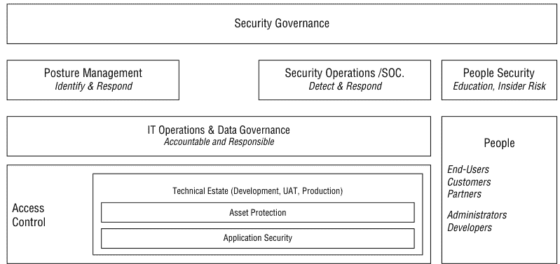

为了跟上云和攻击者的步伐，治理团队需要通过改进标准并强制执行这些标准，持续改进资产安全态势。信息技术（IT）组织需要快速响应新威胁，并在威胁出现时进行调整。新的攻击不断涌现，防御也在不断改进，并且可能需要启用这些防御。在初始配置中，您有时只能获得部分所需的安全性。

按照图 5.2 所示的快速现代化计划（RaMP），您将能够以最少的障碍快速改善安全态势。

### 图 5.2 安全态势管理快速现代化计划

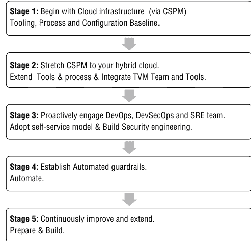

态势管理功能需要增长并持续改进，以应对因安全优先级较低而产生的完整技术债务集。态势管理需要保护组织中的所有技术和团队，并满足组织在变化过程中的需求（例如采用新平台、出现新的安全工具来监控和降低风险等）。有必要通过建立领导支持、跨技术团队的关系、技能集以及态势管理团队的流程，为任何范围扩展做好准备。

图 5.3 涉及公司的整体安全态势，包括其身份安全、端点保护、用户数据保护、应用程序安全和基础架构安全。

图 5.3 展示了安全态势管理的三大支柱。让我们详细了解这三个支柱。

### 防护

组织的安全态势并非一成不变；它们会随威胁的出现和环境变量的变化而变化。为管理员启用保护措施（例如多重身份验证 (MFA)）可加强公司的安全态势。缺乏意识及其导致的无作为（例如未能更新端点或应用可用的保护措施）会削弱组织的安全态势。当环境具备良好的安全卫生习惯时，威胁行为者成功攻破您的工作负载的可能性较小。

### 检测

在实施所有安全保护建议后，您还必须实施威胁检测，以便快速识别工作负载中的可疑活动并触发警报。

### 响应

最后一步是确保您已建立自动化流程，以便及时响应收到的警报，并采取可以遏制和缓解攻击的措施。

### 图 5.3 安全态势管理支柱

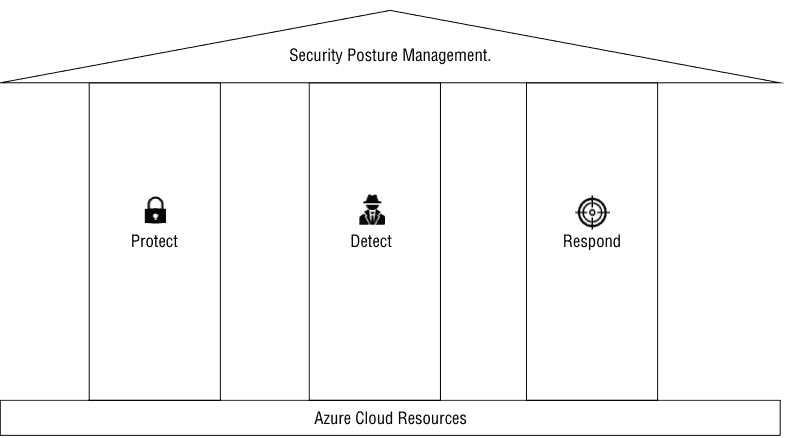

在 IT 行业中，使用基准来评估当前环境、了解现有差距并提供改进指导是普遍做法。基准可以为您提供切实可行的措施，以增强安全态势。它们可以源自行业标准（例如 ISO 27001），也可以源自云提供商的基准，例如适用于 Azure 工作负载的 Azure 安全基准 (ASB) 或专为 Amazon Web Services 工作负载制定的互联网安全中心 (CIS) AWS 基础基准。通过提供加固工作负载的修复步骤，基准还将帮助您更快地识别安全差距。通过实施这些安全建议，您的工作负载将变得更加安全，整体云安全态势也将得到加强。作为架构师，您会发现基准在遵循行业标准的同时，充当改进云安全态势的指南。

安全卫生习惯至关重要，在评估云工作负载时需要考虑所有可用选项。作为这些过程的一部分，您可能需要通知相关利益相关者、启动变更管理流程并实施特定的修复步骤。自动化可降低开销，因此请考虑尽可能自动化许多步骤。除了提高安全性之外，它还能确保您的预定义流程步骤快速、一致且准确地执行。

您还应确保使用安全最佳实践来加固云工作负载并改善其安全卫生习惯。每个工作负载都有自己独特的一套需要遵循的安全最佳实践。


在改进安全态势之前进行风险评估至关重要。一旦了解您业务的风险，您就可以优化安全态势以降低这些风险。

通过评估公司的安全态势，您可以确定组织是否受到保护以及需要做出哪些更改。评估使组织能够降低成功网络攻击的可能性，并限制发生攻击时的损害程度。

## 评估 Azure 工作负载中的安全态势

通过使用 ASB，组织可以满足其安全控制要求；您也可以评估工作负载的安全态势。为了满足安全和合规要求，ASB 为安全配置 Azure 资源提供了清晰具体的指导。除了加速初始 Azure 上线和持续的 Azure 上线/评估之外，ASB 在 Azure 上线中经常发挥至关重要的作用。

在规划和评估 Azure 环境时，客户通常需要协调多个控制框架以满足安全和合规要求。安全团队需要为每个控制框架重复相同的评估流程，造成不必要的开销、成本和时间。通过提供一个协调的控制框架，帮助您在云环境中使用既定标准，Microsoft 开发了 CIS Controls v7 和 v8、NIST SP800-53 Rev4 以及 PCI-DSS v3.2.1。组织还可以持续高效地使用 ASB，根据行业标准评估 Azure 部署的安全态势。

Microsoft Defender for Cloud 在其法规遵从性仪表板中显示 ASB，如图 5.4 所示。

在此基准中，您可以看到每个合规性控制下哪些安全建议处于打开状态。Defender for Cloud 会针对每个合规性控制运行评估。这并不意味着如果它们都显示绿色，您就完全符合控制要求；它仅表示它们当前正在通过。Defender for Cloud 的评估并未涵盖特定法规的所有控制，因此此报告只是您整体合规性的部分快照。

尽管这是 Azure 的首选基准，但根据组织的需求，您可能需要使用不同的基准。使用分配给法规标准的选项卡，您可以查看已评估的合规性控制及其当前状态。


### 图 5.4 Microsoft Defender for Cloud 法规合规性

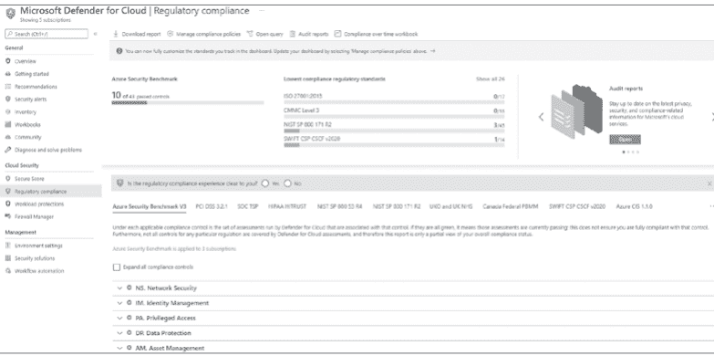

从 SC-100 考试的角度来看，请记住，考试可能会测试您通过检查安全基准来评估系统或服务安全状况的能力。Azure 安全基准是系统或服务安全状况的一个示例。

## 使用 Microsoft Defender for Cloud 分析安全状况

作为网络安全架构师，您将负责保护组织的系统、用户和数据。您的用户必须能够轻松访问您的数据、资产和资源，同时防止未经授权的访问。云安全是一个复杂的领域。像 Microsoft Defender for Cloud 这样的统一基础架构安全管理系统可以帮助保护您的资产并确保法规合规性。

除了提供统一的基础架构安全管理外，Microsoft Defender for Cloud 还可帮助您完成以下操作：

- 增强组织的安全状况
- 符合法规要求
- 为 Azure 和非 Azure 工作负载提供威胁保护

使用 Azure 门户中的工作负载保护仪表板，了解公司的安全状况、合规性和威胁概览。Microsoft Defender for Cloud 会查看您的整个环境并提供一个总分，以显示其安全性。这是您可以在“策略和合规性”部分中找到的域的安全得分。

在此部分中，您还可以检查存储帐户是否符合合规性要求以及如何解决问题。例如，您将看到是否有任何存储帐户未能满足特定的合规性控制。Microsoft Defender for Cloud 建议补救步骤，以便您可以相应采取行动。

使用 Microsoft Defender for Cloud 还可以设置保护环境不同部分的安全策略。通过这种方式，您可以识别环境中哪些部分未遵守安全策略以及如何修复它们。

您可以始终确信 Microsoft Defender for Cloud 正在保护您的资源、订阅和组织免受安全威胁。所有发现随后合并为一个得分，以便您一目了然地了解组织的安全性：得分越高，风险级别越低。

作为安全运营中心分析师，识别潜在风险和攻击向量以便更有效地对它们进行优先级排序对您来说至关重要。Microsoft Defender for Cloud 将其安全建议与基于实际对手观察的 MITRE ATT&CK 进行映射，以便更轻松地进行优先级排序。客户可以使用映射到 MITRE ATT&CK 框架的 Microsoft 建议来维护安全的环境。

使用 MITRE ATT&CK 评估安全状况时，您可以根据 MITRE ATT&CK 框架的不同阶段制定补救策略。通过补救映射到 MITRE ATT&CK 框架早期阶段的建议，您可以防止威胁行为者将来访问您的工作负载。如图 5.5 所示，Defender for Cloud 有一个筛选器，可让您可视化这些数据。

### 图 5.5 Microsoft Defender for Cloud 仪表板

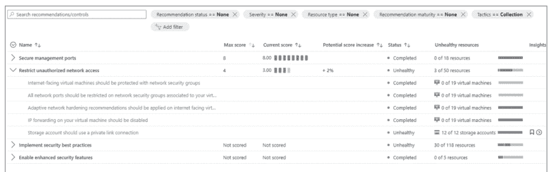

Microsoft Defender for Cloud 提供运行状况评估。使用分析和监视功能，Defender for Cloud 会检测广泛潜在恶意活动并在工作负载保护仪表板中显示安全警报。

## 评估云工作负载的安全卫生状况

组织中的多个个人和团队可以使用 Defender for Cloud 完成各种安全相关任务。Defender for Cloud 使这些个人能够完成这些各项职责。

SOC 分析师通常必须在工作负载中拥有适当的权限级别，以便能够更快地修复建议。如图 5.6 所示，尝试修复建议时，没有适当权限级别的用户会体验到灰显的“修复”按钮，如图 5.6 所示。

### 图 5.6 安全卫生建议修复

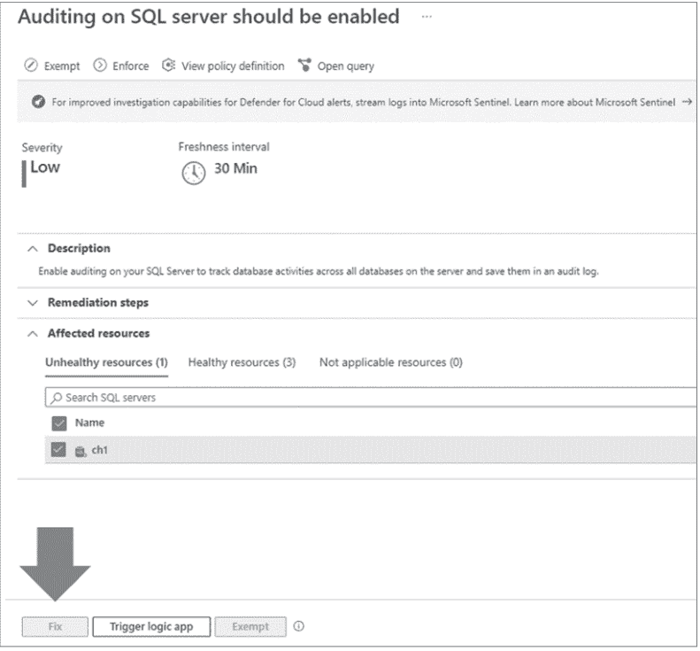

因此，当安全建议可供修复时，必须通知工作负载所有者。Defender for Cloud 的工作流自动化功能可用于在触发建议时触发操作，例如向资源所有者发送电子邮件。此工作流的示例在图 5.7 中描绘。

### 图 5.7 安全卫生修复工作流

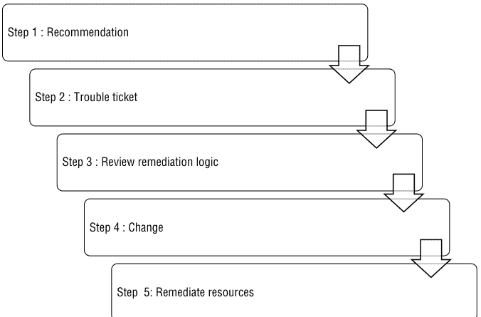

步骤如下：

- 1. Microsoft Defender for Cloud 团队确定需要处理的安全建议以及受其影响的资源。
- 2. 已打开并分配给工作负载所有者的工单。此工单包含有关安全建议及修复建议的详细信息。
- 3. 工作负载所有者查看工单并确定此建议有一个快速修复。他们可以单击“查看修复逻辑”按钮来了解将对系统进行哪些更改。
- 4. 他们在对更改感到满意后安排修复。
- 5. 在预定日期，需要按计划应用 Azure 资源修复。

或者，工作负载所有者可以使用 Defender for Cloud 的内置集成。当数据库管理员管理多个数据库时，Microsoft Defender for Cloud 选项可以提供安全建议，这些建议将有助于改善其工作负载的安全卫生状况，如图 5.8 所示。

### 图 5.8 Microsoft Defender for Cloud—工作负载的安全卫生状况

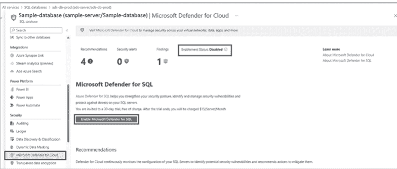

## 评估云工作负载的安全状况

使用 Microsoft 威胁情报，Defender for Cloud 提供安全警报。一系列高级智能防护措施也会保护您的工作负载。Microsoft Defender 基于订阅中包含的资源提供工作负载保护。使用 Microsoft Defender for Storage，当存储资源上检测到可疑活动时，您可以收到警报。

Azure 原生的 Defender for Cloud 无需任何部署即可监视和保护许多 Azure 服务，尽管您也可以添加本地或其他公共云中的资源。

除了加固资源、跟踪安全状况和防范网络攻击外，Defender for Cloud 还简化了安全管理流程。其原生集成使部署变得轻松，得益于简单的自动预配，您可以默认自动保护资源。在管理云和本地资源及工作负载的安全性时，Defender for Cloud 满足三个基本需求。

- 持续评估：持续评估您的安全状况。
- 安全：确保连接到网络的所有资源和服务都经过加固。
- 防御：协助检测和解决针对这些资源和服务的威胁。

为了应对这些挑战，Microsoft Defender for Cloud 提供以下工具：

- **安全得分**：当前安全情况由当前安全得分指示；得分越高，风险级别越低。
- **安全建议**：这些是针对组织需求量身定制并为改进设定优先级的加固任务。实施建议涉及遵循建议中提供的详细补救步骤。Defender for Cloud 为许多建议提供自动实施选项！
- **安全警报**：启用增强安全功能后，Defender for Cloud 会检测针对您的资源和工作负载的威胁。Defender for Cloud 可以通过电子邮件将这些警报发送到组织中的相关员工，并在 Azure 门户中显示它们。还可以配置安全信息和事件管理 (SIEM)、安全编排、自动化和响应 (SOAR) 以及 IT 服务管理 (ITSM) 解决方案来接收警报。

Microsoft Defender for Cloud 会持续检测工作负载中的所有资源，并确定其是否按照最佳安全实践进行配置。如果未识别，则会将其标记。提供了需要修复的建议的优先级列表，以保护您的计算机。

Microsoft Defender for Cloud 将每个建议分组到安全控制中，以便更轻松地了解每个建议对整体安全状况的重要性。每个控制都分配了一个安全得分。这种评分对于确定安全工作的优先级至关重要。

除了保护基于 Azure 的平台即服务 (PaaS) 之外，Defender for Cloud 还在基础设施即服务 (IaaS) 层检测和防止威胁。

Microsoft Defender for Cloud 自带 Fusion 杀伤链分析。什么是 Fusion 杀伤链分析？Fusion 作为正则化器，对分类警报应用概率杀伤链。防御者会优先处理受时间限制的杀伤链，因为它们是基于真实人员（Microsoft 安全专家、供应商和客户）如何分类警报的。在一天内执行的杀伤链优先级高于几天前忽略的杀伤链，所有步骤均已完成的杀伤链优先级更高。当概率杀伤链应用于 Fusion 机器学习统计模型时，Fusion 将威胁数量从数十亿减少到数百。

Fusion 杀伤链分析基于您的环境中的网络杀伤链分析来关联警报。此分析可帮助您更好地了解攻击活动、其来源及其对资源的影响。

当需要安全相关数据时，Microsoft Defender for Cloud 可以自动部署 Log Analytics 代理。部署直接在 Azure 计算机上处理。可以使用 Azure Arc 将 Microsoft Defender 计划扩展到混合和多云环境中的非 Azure 计算机。

什么是 Azure Arc？您可以使用 Azure Arc 构建足够灵活的应用程序和服务，以便在数据中心、边缘和多云环境中运行。此桥扩展了 Azure 平台。使用 Azure Arc，您可以创建云原生


在新旧硬件、虚拟化、Kubernetes 平台、IoT 设备和集成系统中，拥有统一的开发、运维和安全模型的应用程序。它可让您使用云原生解决方案实现业务现代化，以更少的资源做更多的事情。

多云计算机可以在无需安装代理的情况下受益于云安全态势管理 (CSPM) 功能。您可以使用 Defender for Cloud 在广泛的平台上检测威胁。

- Azure PaaS 服务：Azure PaaS 服务可用于检测蔓延至 Azure 服务（例如 Azure App Service、Azure SQL、Azure 存储帐户等）的威胁。作为与 Microsoft Defender for Cloud Apps（以前称为 Microsoft Cloud App Security）原生集成的一部分，您可以检测 Azure 活动日志中的异常。

- Azure 数据服务：作为 Defender for Cloud 的一部分，您可以自动分类 Azure SQL 数据。您还可以获取跨 Azure SQL 和存储服务的潜在漏洞评估以及缓解建议。

- 网络：您可以使用网络和 Defender for Cloud 将暴力破解攻击的风险降到最低。通过减少对虚拟机端口的访问，即时 VM 访问可防止对虚拟机端口的不必要访问。可为选定端口设置安全访问策略，仅限授权用户使用，限定天数，并限定 IP 地址范围。

Microsoft Defender for Cloud 的 Defender 计划为计算、数据和服务层提供全面保护。

- Microsoft Defender for Servers
- Microsoft Defender for Storage
- Microsoft Defender for SQL
- Microsoft Defender for Containers
- Microsoft Defender for App Service
- Microsoft Defender for Key Vault
- Microsoft Defender for Azure Resource Manager
- Microsoft Defender for DNS
- Microsoft Defender for DevOps

让我们逐一了解它们。

- Microsoft Defender for Cloud：为监控安全漏洞和威胁，Defender for Cloud 会从 Azure 虚拟机 (VM)、虚拟机规模集、IaaS 容器和非 Azure 计算机（包括本地计算机）收集数据。您的工作负载数据由某些 Defender 计划中的监控组件收集。

使用 Microsoft Defender for Cloud，操作系统态势问题的覆盖范围超出了基于代理的评估范围。通过无需代理、网络连接要求或影响计算机性能即可扫描 VM，您可以获得可操作态势问题的无摩擦、全面且即时的可见性。

可使用 Defender 漏洞管理在 Azure 和 Amazon AWS 环境中以无代理方式扫描虚拟机，用于软件清单和漏洞评估。可通过无代理扫描在 Defender Cloud Security Posture Management 和 Defender for Servers P2 中无代理扫描。

收集用于监控缺失的更新、错误配置的操作系统安全设置、终端保护状态以及运行状况和威胁防护的数据是必需的。数据收集仅针对计算资源（如 VM、VM 规模集和 IaaS 容器）是必需的。

借助 Microsoft Defender for Cloud 的增强安全功能，有多个计划可供选择，包括 Microsoft Defender for Servers。Defender for Servers 产品可保护 Azure、AWS、Google Cloud Platform 和本地环境中的 Windows 和 Linux 计算机。

Microsoft Defender for Containers：除了改进、监控和维护群集、容器及其应用程序的安全性之外，您还可以使用 Microsoft Defender for Containers（一种云原生解决方案）来保护容器。

Microsoft Defender for SQL：使用 Defender for Cloud 数据库防护（可检测和响应攻击）来保护整个 Azure 数据库资产。根据每个数据库引擎和数据类型的攻击面和安全风险，Defender for Cloud 提供定制保护。

Microsoft Defender for Storage：使用 Azure 原生安全智能，您可以检测对存储帐户的异常或潜在有害访问或利用尝试。Microsoft 威胁情报数据和高级威胁检测功能提供上下文相关的安全警报。这些警报还包含用于防止未来攻击的缓解和预防步骤。

Microsoft Defender for App Service：使用 Defender for Cloud 时，您无需部署任何内容或经历加入过程。集成是透明的。

假设您想使用 Microsoft Defender for App Service 来保护 Azure App Service 计划。在这种情况下，您需要启用专用计算机和 Defender for Cloud 增强防护的受支持 App Service 计划。

Microsoft Defender for Key Vault：证书、连接字符串和密码在 Azure Key Vault（一种云服务）中受到保护。

对于 Azure Key Vault，请启用 Microsoft Defender for Key Vault，它提供高级威胁防护。

Microsoft Defender for Azure Resource Manager：Azure 资源管理器是用于管理和部署 Azure 资源的服务。Azure 帐户管理提供用于创建、更新和删除资源的层。部署后，您可以使用访问控制、锁和标记等管理功能来保护和组织资源。

- 它是连接所有云资源的云管理层。因此，攻击者也可能将其作为目标。我们建议安全运营团队密切监控资源管理层。

- Microsoft Defender for DNS：作为额外的保护层，Microsoft Defender for DNS 补充了 Azure DNS 的名称解析功能。

- Defender for DNS 监控来自 Azure DNS 的查询，并在无需在资源上安装其他代理的情况下检测可疑活动。

- Microsoft Defender for DevOps：您可以通过 Azure Defender for Cloud 监控、管理和保护跨 Azure、AWS、Google Cloud Platform 和本地资源的多云环境。安全团队可以使用 Defender for Cloud 中的一项服务 Defender for DevOps，在多个管道中开展 DevOps 安全工作。

- GitHub 和 Azure DevOps 是 Defender for DevOps 使用集中式控制台保护的两个多管道环境示例。将 Defender for DevOps 的发现与上下文相关的云安全见解进行比较，将允许根据结果对代码修复进行优先级排序。

> 通过 Microsoft Defender for Cloud，您的资源安全性会因更高的可见性和控制能力而得到增强，它可以预防、检测和响应威胁。使用它，您可以监控订阅中的安全性，检测否则将无法发现的威胁，并与广泛的安全解决方案生态系统协同工作。
>
> 计算、网络、存储和数据以及应用程序汇总了 Defender for Cloud 概述页面上的环境安全态势。

## 为 Azure 登陆区设计安全

成功的云转型始于登陆区，而云计算是各形式数字化转型的基础和支柱。

在设计和部署云时，架构师必须考虑日常决策，例如将登陆区定义为多账户、经良好设计、可扩展且安全的云环境。

您可以使用云登陆区在安全和基础设施环境中快速且自信地启动和部署工作负载和应用程序。贵组织的未来增长和业务目标将影响构建登陆区时所做的技术和业务决策。

每个云登陆区支持特定的要求和操作模式，因此它们在各领域中是相同的。云环境需要针对组织的长期目标进行审查、修改和迭代。云登陆区可以通过使云消费者能够共同验证、自定义和扩展其云登陆区，来构成客户数字化转型的基础。

端到端云登陆区集成了最佳实践、精心设计的架构模式和集中式策略。监控、日志记录和云消费者管理均已集成。云登陆区（下一代治理和安全解决方案）是完全自动化的、企业级的，且独立于云模型。

在 Microsoft 云采用策略中，登陆区充当基本组成部分。除了可扩展性、安全性、治理、网络和标识之外，它还构建了一个考虑并支撑这些功能的 Azure 环境。Azure 登陆区允许企业迁移应用程序、实现现代化和创新。

为确保云消费者域间的一致性，并以敏捷方式满足每个动态业务要求，云登陆区确保目标环境经过精心设计、部署、保护和治理。云登陆区使云消费者能够保持合规并控制成本，从而能够在最重要的地方进行投资。

Azure 登陆区通过在多订阅环境中结合规模、安全治理、网络和标识来创建。企业可以使用 Azure 登陆区迁移应用程序、更新基础设施并进行创新。在这些区域中，所有支持客户应用程序组合所需的平台资源均予以考虑，不区分基础设施即服务和平台即服务。

随着云消费者扩展其云组合并需要解决部署和运营需求，有多种选项可供选择。一种解决方案仅适用于某些技术环境。

### 可扩展性

Azure 上的登陆区提供可重复的环境，无论部署什么工作负载或资源，都具有统一的配置和控制。

### 模块化

基于一组标准设计领域，Azure 登陆区允许您以模块化方式创建云消费者环境。每个设计领域可以支持各种不同的技术平台要求，包括 Azure SQL 数据库、Azure Kubernetes 服务和 Azure 虚拟桌面。

针对企业级部署，设计了模块化架构。它使组织能够使用基础登陆区控制平面在 Azure 上构建和部署新应用程序，无论其是在迁移还是开发和部署新应用程序。组织所处的规模无关紧要。该架构会随着它们一起扩展。

组织必须基于企业级架构做出各种设计决策，以绘制其 Azure 之旅，随着 Azure 平台的发展。

Azure 企业级登陆区存在特定于客户的云采用框架，这些框架认识到并非所有企业都以相同方式采用 Azure。技术


企业级架构的考虑因素和设计建议可能需要根据云消费者组织的具体情况进行权衡。组织在遵循核心建议时，可以有效地扩展其组织。

在迁移到 Azure 时，组织可以使用着陆区和 Microsoft 云采用框架（Cloud Adoption Framework）来就治理、策略和安全性做出明智的决策。在 Azure 环境中设计着陆区的领域包括以下考虑因素：

**资源组织** 云用户将组织其资源以发展业务，考虑各个团队、管理组、订阅和业务领域的需求。

**云订阅** 订阅是一种用于管理、计费和缩放 Azure 服务的方式。大规模采用 Azure 进行设计需要用到订阅。通过使用订阅可以加速新应用程序开发和迁移。业务领域和组合所有者应将订阅与其需求和优先级保持一致。

**Azure 计费产品和 Active Directory 租户** Azure 计费和 Azure Active Directory (Azure AD) 是该关键领域中所有云 Azure 部署的两个最高对齐级别。

**多租户** 多个云租户应实施标记策略，并为其他租户（开发/预生产/生产）提供不同的安全配置文件。

**网络连接** 云消费者可以通过将网络模式与外部数据中心相结合来创建混合系统和多云采用模型。网络实现提供高可用性、复原能力和可扩展性。在设计网络连接之前，我们应该向客户询问以下问题：我们的网络拓扑将是什么样子？我们的资源将位于何处？

**标识和访问管理** 集成 MFA SSO 平台与所有托管的生产应用程序和云控制台集成，作为任何完全合规的云架构的基础。

Azure 着陆区的合规性设计领域包括以下考虑因素：

**安全性和合规性** 云用户可以通过着陆区主动地实施数据驻留和合规性策略。

**管理** 此处建立了对 Azure、混合和多云环境的管理。

**业务连续性和灾难恢复 (BCDR)** 应用程序的平稳运行取决于复原能力，而 BCDR 是强度的关键要素。通过使用 BCDR，云消费者可以通过备份保护其数据，并在发生中断时恢复其应用程序。

治理和运营 云消费者打算如何管理、监控和优化其环境？云消费者将如何确保其环境按预期运行？

平台自动化和 DevOps 组织可以通过使用自动化来提高生产力、可扩展性和可靠性。DevOps 的一部分是必须遵循持续集成/持续部署 (CI/CD) 管道来交付新软件版本。通过自动化软件开发生命周期，CI/CD 管道改进软件交付。

云着陆区基于 Terraform、ARM 或云形成模板自动化 CI/CD 管道，以部署多账户订阅结构并提高生产力、可扩展性和可靠性。

考虑规模、安全治理、网络和标识的多订阅 Azure 环境会产生 Azure 着陆区。通过 Azure 着陆区，企业级应用程序可以大规模迁移、现代化和创新。这些区域中没有基础设施即服务或平台即服务的区别，因为它们考虑客户应用程序组合所需的所有平台资源。

设计和构建 Azure 环境需要良好地理解安全性、治理和合规性。这些主题可帮助您构建坚实的基础，并长期保持坚实的流程和控制。

您实施的工具和流程将在管理环境时帮助检测和响应问题。随着云环境的发展，组织将迭代改进这些合规性设计领域。这些工具将与帮助保持和证明合规性的控制措施协同工作。例如，当新应用程序引入特定要求或新的合规性标准时，业务要求可能已发生变更。

## 设计安全评审

安全应在 Azure 着陆区的设计和实施过程中始终作为核心考虑因素。使用 Cloud Adoption Framework (CAF) 安全方法，可对整体安全性流程和工具提供额外指导。安全设计着重于着陆区决策的考虑因素和建议。Cloud Adoption Framework 中的安全方法将帮助您日后增强此基础。它在 Azure、混合和多云环境中创建了坚实的安全基础。

在设计领域中，请根据以下准则确保您建立活跃角色和功能、明确范围内内容和范围外内容：

- 参与角色或功能：在此设计领域中，云安全（具体为该团队内的安全架构师）负责主持工作。云平台和云卓越中心必须审查网络和标识决策。可能需要集体角色来定义和实施由此练习得出的技术要求。云治理还可以为更高级的安全护栏提供支持。

- 范围内：此练习侧重于理解和实施云平台的安全要求，包括零信任和高级网络安全。

- 范围外：为简化对话，此练习必须涉及某些 CAF 安全学科，以在云中建立现代化安全运营中心。此设计领域的讨论需要涵盖安全运营、资产保护和创新安全，这些内容将基于您的 Azure 着陆区部署。

## 安全设计考虑因素

Azure 平台服务的安全监控和审计日志记录是可扩展框架的关键组成部分。组织必须了解其技术云资产中发生的情况。在设计安全运营时，请遵循以下准则：

- 安全警报：
  - 哪些团队需要收到安全警报通知？
  - 是否存在一组服务，其警报应路由到不同的团队？
  - 实时监控和警报，以满足业务要求。
  - 集成 Microsoft Defender for Cloud 和 Microsoft Sentinel，用于安全信息和事件管理。

- 安全日志：
  - 审计数据的数据保留期为 30 天。Azure AD 高级版报告的数据保留期为 30 天。
  - Azure 活动日志、VM 日志和 PaaS 日志等日志可存档多年。

- 安全控制：
  - Azure 的来宾 VM 策略提供基本安全配置。
  - 请务必将安全控制与治理准则保持一致。

- 漏洞管理：
  - 发生关键漏洞时，将应用紧急补丁。
  - 虚拟机提供广泛的离线修补功能。
  - 会对虚拟机进行漏洞评估。

- 共同责任：
  - 在监控或响应安全事件时，了解团队职责的交接点在哪里。
  - 对于安全运营，考虑使用安全方法是个好主意。

- 加密和密钥：
  - 在环境中，谁需要访问密钥？
  - 密钥将如何管理？

## Azure 着陆区加速器中的安全性

Azure 着陆区加速器将安全性放在其实施的核心位置，部署各种工具和控制措施，帮助组织快速建立安全基准。

例如，包含以下内容：

- 工具：
  - Microsoft Defender for Cloud 的免费或标准层
  - Microsoft Sentinel
  - Microsoft Azure DDoS 标准保护计划
  - Microsoft Azure Firewall
  - Web 应用程序防火墙
  - 特权标识管理

- 适用于在线和企业连接的着陆区策略：
  - 为存储帐户部署安全访问（例如 HTTPS）。
  - 为 Azure SQL 数据库部署审核。
  - 为 Azure SQL 数据库部署加密。
  - 阻止 IP 转发。
  - 阻止来自 Internet 的入站 RDP。
  - 部署与网络安全组 (NSG) 关联的子网。

## 改进 Azure 着陆区中的安全性

当工作负载或着陆区托管敏感数据或关键系统时，必须保护数据和资产。

一旦退出就绪状态，就必须继续维护环境的安全性。作为云安全流程而非静态终点，必须根据目标和关键成果来构想安全的终态。使用 CAF 安全方法中的概念、框架和标准，为人员领域开发角色和职责。

## 获取风险洞察

使用安全实践识别适合规划和解决的风险，安全团队应向决策者通报并就安全风险如何融入其框架提供建议。

- 理解网络安全风险：确定人类攻击者试图窃取企业的货币、机密信息或技术所造成的任何潜在损害或破坏。


- **使组织安全风险管理保持一致：**投资于弥合网络安全与组织领导力之间的差距，使用业务友好的术语解释安全威胁，积极倾听并与企业内所有人进行沟通。

- **了解网络安全风险：**识别人为攻击者的动机和行为模式，并识别不同攻击的潜在影响。

## 安全组件集成

将安全集成到每个人的角色中，并通过确保安全是组织关注的问题而不是孤立的部门来最大限度地减少与业务流程的摩擦。具体指导包括以下内容：

- **规范关系：**在运营团队和安全团队之间建立对安全目标的共同理解。此外，确保安全控制不会超过业务价值。

- **与 IT 和业务运营集成：**在实施安全更新时，既要考虑当前的业务影响，也要考虑未来的安全风险。

- **集成安全团队：**采取措施应对活跃威胁并持续改进组织的安全态势，是避免部门孤立运作的最佳方式。

## 业务弹性

尽管组织无法实现完美安全，但业务弹性确保在事件发生前、中、后的整个生命周期中都能应对安全风险。

- **弹性目标：**优化业务快速创新、减少影响以及安全采用技术的能力。

- **安全弹性与假设已被攻破：**践行务实的安全行为以防止攻击、限制损害并从攻击中快速恢复至关重要。

## 访问控制

确保访问控制策略中用户体验与安全保持一致。

- **实施零信任访问控制方法：**拥抱零信任访问控制方法，在云端建立安全保障并采用新技术。

- **采用端到端策略：**现代访问控制需要一个全面、一致且灵活的策略，超越每个工作负载、云或业务敏感度级别单一策略或单一技术的范围。

- **已知、受信任、允许：**使用动态的三步流程，确保应用程序、服务和数据受到信任，并授予适当的权限和特权。

- **数据驱动的访问决策：**基于关于用户和设备的多样化数据，确定是否满足显式验证要求。

- **分段：**为了保护而分离。将内部环境分成不同的段，以便成功的攻击可以被控制。

- **隔离：**为关键业务资产分离人员、流程和技术。

## 安全运营

通过降低风险、快速响应和快速恢复，您可以建立安全运营以保护您的组织。

- **人员与流程：**赋予和培训在取证调查角色方面有扎实背景的人员，使其成为您最宝贵的资产。

- **安全运营模型：**在子团队之间分配对大批量和复杂事件进行分类、调查和威胁搜寻的责任。

- **SecOps 业务接触点：**与业务领导者就重大事件及其对关键系统的影响进行沟通。实施持续的响应实践以降低组织风险。

- **SecOps 现代化：**实施 IoT 和 OT 设备、以 IoT 为中心的安全以及来自云端的相关遥测，以发展安全运营。

## 资产保护

为每种资产类型集成量身定制的安全控制，以保护关键业务资产。保持与策略、标准和架构一致的预防性和检测性防护。

- **安全获取：**确保棕地和绿地资产配置为最新的安全标准和策略。

- **保持安全：**定期评估业务和技术需求，并计划升级或淘汰生命周期结束的软件。

- **启动：**首先关注众所周知的云资源，并利用行业和供应商的主要基准进行安全配置，以保护资产。

- **基本信息：**使用负责任且有问责的团队，确定管理企业资产的最佳实践，例如云弹性工作负载需求和设计控制。计算资产安全性的业务价值，并优先采用自动化策略以避免成本和人工重复。

## 安全治理

通过基于业务目标和风险的监督和监控，随时间维护和改进安全态势。

- **合规性与报告：**遵守行业特定的安全策略。

- **架构与规范：**在大多数企业中，本地资源和云资源都在混合环境中使用。

- **安全态势管理：**它可以通过策略驱动的治理来确保敏捷性，该治理监控安全标准、提供指导并改进流程。通过策略驱动的治理和持续改进来保持敏捷性，是维护安全态势的关键。

- **治理与保护专业化：**通过安全控制来确定最佳解决方案。

- **治理与安全运营：**将从事件中汲取的经验教训融入运营和治理例行程序中。

## 创新安全

在开发新应用程序时以创新安全为出发点，保护创新流程和数据免受网络攻击。

- 将安全集成到 DevOps 和开发流程中，以降低创新风险。

- 确保安全贯穿 DevOps 生命周期，并且团队与创新速度、可靠性和弹性保持一致。

- 保护组织的 IT 基础设施免受利用 DevOps 流程中弱点的攻击者的侵害，从而保护您的客户。

- 像大多数组织一样，使用 DevOps 分两阶段孵化想法。确定最小可行产品（MVP）要求，使用领导技巧解决团队冲突，并将安全集成到现有流程和工具中。

- 在转变安全性时，教育、时间、资源以及 IT 运营的整体转变都将是常见的挑战。

## DevSecOps 控制

每次实施 DevSecOps 控制时，请确保在 CI/CD 的每个阶段都包含安全性。

- 规划和开发：在现代开发方法中实施威胁建模、IDE 安全插件和 pre-commit 以确保安全性。

- 提交代码：评估集中式代码仓库中的漏洞，并实施漏洞扫描以发现并修复它们。

- 构建和测试：使用构建和发布管道来自动化和标准化安全代码的构建和部署，而无需花费大量时间重新部署或升级现有环境。

- 进入生产并运行：确保系统投入生产时是安全的。使用工具和技术进行基础设施扫描和渗透测试，以查找需要解决的风险和漏洞。

使用 Defender for Cloud，您可以通过统一的安全性来管理和保护混合云和多云工作负载。您可以通过启用增强的安全功能，将这些功能扩展到本地和其他云，而免费功能为 Azure 资源提供有限的保护。您可以免费试用 Defender for Cloud 的改进安全功能。它可以查找并修复安全漏洞，通过访问和应用程序控制阻止恶意活动，更快地检测威胁并做出响应。

要使 Defender for Cloud 工作，您必须拥有 Microsoft Azure 订阅。要启用增强的安全功能，您必须被分配订阅所有者、参与者或安全管理员角色。

## 使用安全分数评估安全态势

为防止安全问题发生，我们必须采取主动方法，并在问题出现时制定适当的解决方案。

Microsoft 安全分数衡量安全态势，分数越高表示采取的改进安全性的操作越多。Microsoft 安全分数服务提供指标和趋势的强大可视化、与其他 Microsoft 产品的集成，以及与类似公司比较分数的能力。

安全分数的优势包括以下内容：

- 它提供一份描述组织当前安全态势的报告。

- 它提供可发现性、可见性、指导和控制，以改善其安全态势。

- 它基于基准建立关键绩效指标。

Microsoft 改进操作已分组，以便您更轻松地找到所需的信息。

- 标识 (Azure Active Directory 中的帐户和角色)

- 设备 (以前称为 Microsoft 设备安全分数，现在称为 Microsoft Defender for Endpoint)

- Microsoft Defender for Cloud Apps 和 Office 365 (电子邮件和云应用)

在 Microsoft 安全分数概览页面上了解可用的积分以及积分在这些组之间如何分配。此外，您可以查看总分、历史安全分数趋势、基准比较以及可以采取的优先操作以提高分数。

如果您想了解自己的安全分数，请转到 Microsoft 安全分数概览页面并点击“你的安全分数”。您的积分将显示在总分中。


## 参考资料

有关详细信息，请参阅 learn.microsoft.com/en-us/microsoft-365/security/defender/microsoft-secure-score?view=o365-worldwide。

如果单击得分旁边的“包含”按钮，得分磁贴和得分明细图表将显示带有不同得分视图的图表。

为了更全面地了解总体得分，可以添加以下得分：

- 计划得分：显示预计在计划操作完成后达到的得分
- 当前许可得分：显示当前 Microsoft 许可可实现的得分
- 可实现得分：根据 Microsoft 许可和风险接受情况确定可实现的得分

安全建议列于“改进操作”选项卡中，用于处理潜在攻击面。此外，还包含每个项目的状态（当前正在处理、计划中、风险已接受、通过第三方消除、通过替代缓解措施消除、已完成）。安全管理员可以筛选、搜索和分组所有改进操作。

还可以每天同步安全评分，以接收有关每个操作获得积分的系统数据。得分会实时更新，以反映可视化和改进操作页面中显示的信息。

让我们详细了解 Microsoft Defender for Cloud Apps。

Microsoft Defender for Cloud 计划会持续监控组织的订阅和资源，以检测安全问题。结果将生成一个得分，指示组织当前的安全状况。得分越高，组织识别出的风险级别越低。

可以使用 Microsoft Defender for Cloud 采取主动措施保护资产，从而保护云中的工作负载，包括以下内容：

- 数据和存储
- 虚拟机和服务器
- 容器
- 物联网 (IoT) 基础设施
- Azure 密钥保管库

接下来，让我们查看有关数据和存储的详细参考。

组织中运行的工作负载用于各种业务流程，因此必须随时为其提供强大且智能的保护。

使用 Microsoft Defender for Cloud，可以保护数据和存储资源。针对存储和数据资源检测威胁、发出警报并建议补救措施，将有助于应对这些威胁。要保障数据和存储安全，无需学习多个安全监控系统或成为专家。无需依赖除 Microsoft Defender for Cloud 之外的其他工具也能成为专家。可以使用 Microsoft Defender for Cloud 保护不同的数据和存储资源及服务，包括以下内容：

- Azure 存储
- Azure Cosmos DB
- Azure 密钥保管库
- SQL 数据库

Microsoft Defender for Cloud 以不同方式保护每个资源或服务。Microsoft Defender 通过高级威胁保护保护云中的 Azure 存储资源，包括以下内容：

- Blob 容器
- 文件共享
- 数据湖

将基于 Azure 存储帐户中的事件接收警报。例如，Microsoft Defender for Cloud 会监控 Azure 存储帐户中的活动。

- **可疑活动**：例如，有人可能使用活跃的 Tor 出口节点 IP 地址访问了其中一个存储帐户。
- **异常行为**：当 Microsoft Defender for Cloud 检测到异常行为时，会发出警报。通常，存储帐户从美国访问，但现在可能会尝试从另一个大洲访问。

要实现这一点，云安全态势必须强大。将能够识别并解决不符合安全和合规标准的任何组件和系统。

图 5.9 中的 Defender for Cloud 安全评分显示了一个或多个订阅的得分（基于在 Azure 门户中选择的订阅数量）。

可以通过查看 Defender for Cloud 的建议页面并遵循每项建议的补救说明来提高安全性。建议按安全控件组织，每个控件代表易受攻击的攻击面，并逻辑地对相关安全建议进行分组。只有在控件内的所有建议都得到处理后，才能修复控件中的单个资源。通过查看每个安全控件得分，了解组织保护每个攻击面的效果如何。

图 5.10 展示了建议仪表板的示例，所有安全控件按从上到下的列表排列，列表顶部的控件对安全评分影响最大。

在持续修复安全建议以改进安全评分的过程中，可以将进度作为关键绩效指标 (KPI) 进行跟踪。

推荐的做法是使用安全评分跟踪进度并修复由 Microsoft Defender for Cloud 触发的安全建议。但是，仍可以做更多工作，以朝着更好的安全姿态持续取得积极进展。如果公司的 Azure 治理不够成熟，其安全评分可能会上下波动，而未配置安全设置的新资源也会导致此问题。

## 图 5.9 Microsoft Defender for Cloud 评分仪表板

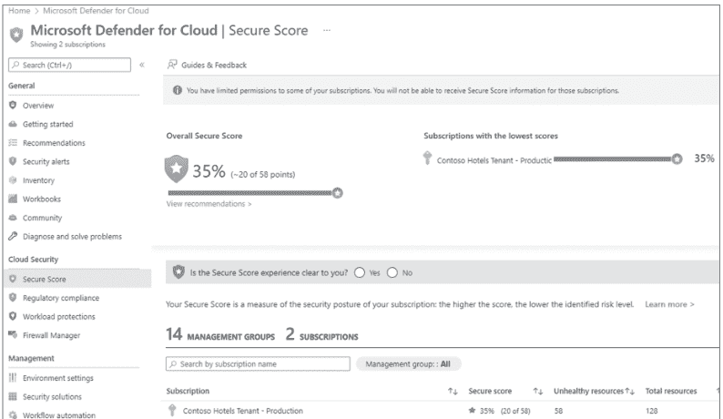

## 图 5.10 Microsoft Defender for Cloud 建议仪表板

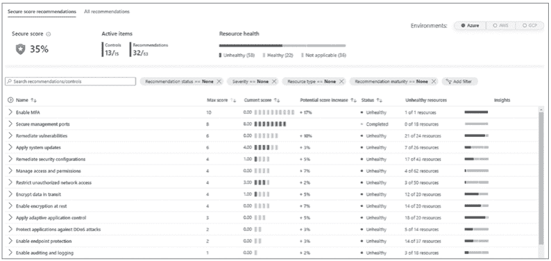

建立完善的 Azure 治理后，可以确保按照特定标准、模式和配置部署新资源。要强制实施策略并拒绝不符合特定标准的资源部署，可以使用 Azure Policy 和 Azure 蓝图。

使用 Defender for Cloud 时，Azure Policy 可以根据特定建议强制实施安全配置，以帮助管理这些工作负载。


Defender for Cloud 对跨云资源进行持续评估，以识别任何安全问题。然后将调查结果汇总为单一得分，让您一目了然地了解当前安全状况：得分越高，风险级别越低。可以通过实施 Defender for Cloud 针对每个问题的补救说明来提高安全性。

## 识别技术威胁并推荐缓解措施

Microsoft 监控的威胁包括拒绝服务攻击、恶意软件和未经授权的数据访问。通过利用此情报，组织可以采取有针对性的行动，例如发布系统更新、强制执行安全策略或根据上下文实施其他安全措施。

为了让您了解威胁并降低风险，威胁情报提供了上下文、相关性和优先级。威胁情报计划超越了不良域名和不良哈希列表，提供上下文、相关性和优先级。以下是一些可使用威胁情报做出更快、更好、更主动的网络安全决策的场景：

- 安全分析师使用威胁情报分析最高优先级的信号并采取行动。
- 信息工作者知道要警惕可疑的电子邮件链接，并将其作为网络钓鱼尝试进行报告。例如，如果收件人意识到这些风险，他们可能会更加警惕，避免打开文件或点击可疑链接，并将电子邮件报告为可疑。
- 组织使用威胁情报通知员工，特定的电子邮件附件可能包含勒索软件。

网络威胁并不局限于任何行业。组织必须防范这些威胁，并将其整合到战略和运营中。为了做好准备，了解攻击类型、目标、频率和来源至关重要。组织可以通过威胁情报了解安全事件的可见性、上下文和相关性。安全团队内外的决策者需要访问并共享这些知识，因为这有助于他们确定行动优先级并降低风险。

各种来源可以提供网络威胁情报 (CTI)，包括开源数据馈送、威胁情报共享社区、付费情报馈送和内部安全调查。组织可以使用 CTI 收集有关威胁行为者的信息，例如其动机、基础设施和技术，以及对 IP 地址的观察，


域和哈希。安全人员在发生异常活动时必须迅速采取行动，以保护人员和资产。

在类似 Microsoft Sentinel 的 SIEM 解决方案中，最常用的 CTI 是威胁指标数据，有时也称为妥协指标（IoCs）。威胁指标将 URL、文件哈希、IP 地址和其他数据与已知的威胁活动（例如网络钓鱼、僵尸网络或恶意软件）关联起来。这种形式的威胁情报通常被称为战术威胁情报，因为安全产品和自动化可以大规模使用它来防范和检测潜在威胁。图 5.11 描绘了该解决方案的核心构建块。

图 5.11 SIEM 中的 CTI 构建块

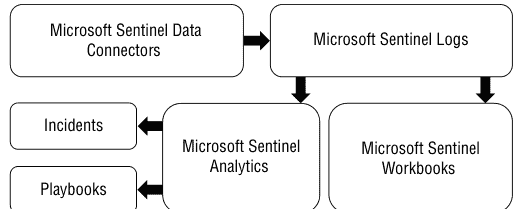

除了检测、响应恶意网络活动并为其提供 CTI 上下文外，Microsoft Sentinel 还可用于以下用途：

- 结构化威胁信息表达式（STIX）和可信自动化情报信息交换（TAXII）服务器或任何威胁情报平台（TIP）可用于将威胁指标导入 Microsoft Sentinel。
- 查询和查看威胁指标数据。
- 构建分析规则，从 CTI 数据生成安全警报、事件和自动响应。
- 在工作簿中可视化 CTI 信息。

除了 Microsoft Sentinel 之外，另一款使用威胁情报的产品是 Microsoft Defender for Cloud。Defender for Cloud 的威胁防护会监视来自 Azure 资源、网络和已连接合作伙伴解决方案的信息。这些信息经过分析（通常从多个来源关联），以识别威胁。Defender for Cloud 在检测到威胁时会触发安全警报，其中包含事件的详细信息和修复建议。为协助事件响应团队调查和修复威胁，Defender for Cloud 提供威胁情报报告。报告包含以下类似信息：

- 攻击者的身份或归属（如果可用）
- 攻击者的目标
- 历史和当前攻击（如果可用）
- 攻击者使用的工具、策略和程序
- 可作为 IoC 的 URL 和文件哈希

要确定 Azure 资源是否面临风险，应审查受害者画像，即行业和地理分布情况。

Defender for Cloud 提供三种类型的威胁报告，帮助缓解或修复攻击。可用报告如下：

- **活动组报告：** 活动组报告中包含对攻击者策略、目标和动机的详细分析。
- **攻击活动报告：** 攻击活动报告中详细说明了特定攻击的细节。
- **威胁摘要报告：** 威胁摘要报告涵盖了前两个报告中的所有项目。

在事件响应过程中，此类信息非常有用，此时正在开展调查，以确定攻击源、攻击者的动机以及如何在未来缓解该问题。

在其他 Microsoft 安全解决方案中，例如 Azure AD Identity Protection，威胁检测是一种利用威胁情报的功能。在"风险用户"报告中，风险检测（包括用户相关和登录相关的检测）会影响整体用户风险评分。安全研究人员、执法专业人员、Microsoft 安全团队以及其他可信来源（包括 Microsoft 的内部和外部威胁情报来源）被用于离线计算这些风险。图 5.12 显示了 Azure AD Identity Protection 中的风险检测。

图 5.12 Azure AD Identity Protection 风险检测

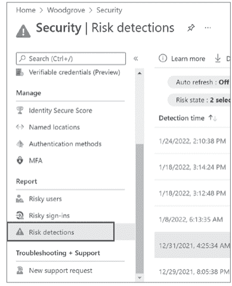

在此模型中，风险被视为潜在的未来事件。每个风险描述了可能在未来发生的事件。这一概念有时被称为*事件驱动的风险模型*。对风险的分析应包括其发生概率以及此类事件对项目的影响等信息。此外，它还可能描述降低发生概率和减轻影响的方法。

风险管理包含四个阶段：识别、评估、响应、监控和报告。

### 识别
为有效管理风险，应识别环境中所有潜在风险、威胁和漏洞，包括内部威胁和漏洞。识别阶段还包括决策日志、活动安全和合规性例外，以及先前风险评估中的缓解工作。

### 评估
每个已识别风险的影响使用三个指标进行衡量：可能性、控制缺陷和影响。可能性定义了潜在风险实现的概率，而控制缺陷衡量已实施缓解控制的有效性。影响描述了对服务或业务会造成的损害。

### 响应
根据已识别的风险，您可以采取以下响应方式：

- 容忍：允许低风险区域在最小控制下暴露。
- 运行：对低暴露风险区域使用被认为足够的控制措施。
- 监控：对被认为足以应对高暴露风险区域的控制措施的有效性进行监控。
- 改进：加强控制水平低的高暴露风险区域，这些区域是最高优先级。

### 监控和报告
使用多种策略来监控和报告风险评估识别出的风险，包括定期风险审查、渗透测试和漏洞扫描。


网络威胁情报（CTI）是安全运营中心（SOC）分析师在当今网络攻击的数字时代中进行事件分类和响应的关键组成部分。Azure Sentinel SIEM 解决方案允许客户从各种来源导入威胁情报数据，例如付费威胁馈送、开源馈送以及类似 ISAC 的威胁情报共享社区。

## 建议安全功能或控制措施以缓解已识别的风险

随着员工在各种平台和服务中创建、管理和共享数据，他们可以越来越多地访问这些数据。大多数组织缺乏识别和缓解组织风险所需的资源和工具，同时还要维护员工隐私并满足合规性要求。离职员工可能会窃取数据，意外共享或恶意意图可能导致数据泄露到组织外部。

Microsoft Azure 风险管理框架旨在识别、评估、响应、管理和报告 Microsoft Azure 服务的风险。Microsoft 的首要任务是主动识别和解决可能影响其服务基础设施、客户、数据和信任的风险。此外，一个强大的风险管理计划是满足云合同义务并维护客户依赖以满足其合规性要求的公共认证所必需的。

风险管理计划识别、评估、响应、监控和报告威胁组织资本和收益的风险。导致这些风险的因素包括财务不确定性、法律责任、技术问题、战略管理错误、事故和自然灾害。

组织必须将所有风险视为其风险管理计划的一部分。风险的连锁反应也可能影响组织的战略目标。

图 5.13 显示了 Microsoft 推荐的风险管理框架。风险管理活动伴随输出，该输出将进入下一阶段。

图 5.13 风险管理框架

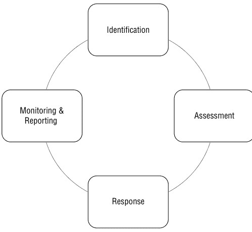

假设您是一名负责建议安全功能和控制措施以缓解已识别风险的网络安全架构师。

- 在识别风险时，您发现了一个生产订阅，其中包含 10 个通过 Internet 广泛可访问的 Azure 存储帐户。
- 在评估阶段，您确定其中五个存储帐户如果被攻破将产生高影响。
- 对于前五个，响应是容忍风险，而对于其他五个，则需要添加技术控制措施来缓解风险。

在此示例中，技术控制措施包括以下内容：

- 为存储帐户添加安全访问（HTTPS）。
- 确保存储帐户已锁定，以防止意外或恶意删除或配置更改。
- 通过 Azure Active Directory（Azure AD）授权对 Blob 数据的访问。
- 使容器和 Blob 对匿名公共读者不可访问。
- 设置存储帐户所需的最低传输层安全（TLS）版本。
- 启用防火墙规则。
- 确保已启用 Defender for Storage。

在监控和报告阶段，确保存储帐户上启用了诊断日志，并在订阅级别启用了 Microsoft Defender for Cloud，以持续评估存储帐户。

基于所列参数（包括威胁类型），风险缓解措施应逐个案例评估。如果在识别过程中确定 RDP 暴力破解攻击可能攻破管理端口打开的 Windows VM，则该 VM 可能会被攻破。因此，您需要缓解此风险，Defender for Servers 的"Just-in-Time"VM 访问功能是一种可帮助减少攻击向量的技术控制措施。

Defender for Cloud 提供安全控制的自上而下概览，因此您可以使用优先级列表来确定安全建议的优先级。除了改善安全态势外，在修复属于安全控制的所有安全建议后，您还会看到总体安全评分的提升。安全控制"安全管理端口"在图 5.14 所示的示例中有三个必须处理的建议。

如图 5.14 中“最大得分”列所示，一旦从安全管理端口角度解决所有三个问题，您的安全评分将增加 8 分。

安全控制还可以建议实施安全功能，例如，为保护应用程序免受 DDoS 攻击，建议启用 Web 应用程序防火墙（WAF）作为缓解方法。

Azure Security Benchmark 还可以帮助识别面临风险的资源，并根据基准建议的修复步骤启用安全功能以缓解这些风险，如图 5.15 所示。


## FIGURE 5.14 安全控制安全管理仪表板

| 名称 | 最高得分 | 当前得分 | 潜在得分增加 | 状态 | 不正常资源 | 见解 |
|---|---|---|---|---|---|---|
| 启用 MFA | 10 | 0.00 | +17% | 不正常 | 3 个中的 3 个资源 | |
| 安全管理端口 | 8 | 5.05 | +4% | 不正常 | 64 个中的 0 个资源 | |
| 面向 Internet 的虚拟机应使用网络安全组进行保护 | | | | 不正常 | 65 个虚拟机中的 1 个 | |
| 应在虚拟机上关闭管理端口 | | | | 不正常 | 45 个虚拟机中的 7 个 | |
| 虚拟机的管理端口应使用即时网络访问进行保护 | | | | 不正常 | 45 个虚拟机中的 7 个 | |
| 修复漏洞 | 6 | 0.00 | +10% | 不正常 | 68 个资源中的 72 个 | |
| 应用系统更新 | 6 | 3.97 | +3% | 不正常 | 75 个资源中的 16 个 | |
| 限制未经身份验证的网络访问 | 4 | 1.57 | +4% | 不正常 | 720 个资源中的 83 个 | |
| 修复安全配置 | 4 | 1.46 | +4% | 不正常 | 153 个资源中的 52 个 | |
| 管理访问权限和权限 | 4 | 2.00 | +2% | 不正常 | 384 个资源中的 45 个 | |
| 启用静态加密 | 4 | 0.39 | +6% | 不正常 | 115 个资源中的 80 个 | |
| 加密传输中的数据 | 4 | 1.34 | +5% | 不正常 | 103 个资源中的 51 个 | |
| 应用自适应应用程序控制 | 3 | 0.71 | +4% | 不正常 | 76 个资源中的 39 个 | |

## FIGURE 5.15 安全加密传输中数据仪表板

| 客户责任 | 资源类型 | 失败资源 |
|---|---|---|
| 应启用对存储帐户的安全传输 | 存储帐户 | 62 个中的 13 个 |
| 函数应用中应要求使用 HTTPS | Web 应用程序 | 12 个中的 12 个 |
| Windows Web 服务器应配置为使用安全通信协议 | VM 和服务器 | 52 个中的 11 个 |
| Function App 应仅可通过 HTTPS 访问 | Web 应用程序 | 12 个中的 9 个 |
| Web 应用程序应仅可通过 HTTPS 访问 | Web 应用程序 | 6 个中的 6 个 |

请注意，在此场景中，您有一个名为 DP-3 的安全控制，用于加密传输中的敏感数据。在此控制中，您有一系列针对不同工作负载（存储帐户、Web 应用程序、VM 和服务器）的安全建议。此方法的优势在于，您正在缓解特定场景（即加密传输中的敏感数据），并且正在跨不同工作负载查看此场景。

作为网络安全架构师，您必须为给定风险选择适当的安全功能。对于某些场景，这可能意味着添加新服务。

让我们考虑一个示例：一家公司需要根据一系列条件（包括在出现异常行为时限制访问）为员工提供自定义远程访问。尽管大多数用户的行为正常且可追踪，但当其行为超出此常范围时允许其登录可能存在风险。

为应对此风险，您可以使用 Azure AD 条件访问和基于登录风险的条件访问策略来阻止该用户，或要求其执行多重身份验证。

同样，可以根据风险选择适当的安全控制；在此情况下，加固当前资源可能是最佳安全控制。您可以通过加固数据库并启用透明数据加密 (TDE) 等安全控制，来降低攻击者攻破数据库的风险。使用此技术，您可以在不更改现有应用程序的情况下加密静态数据。

## Summary

本章概述了 Microsoft Azure 云中可用的不同安全态势评估方法、工具和技术。业务安全态势是指组织通过检查其网络的所有方面来识别和应对网络攻击的能力。安全态势评估可以帮助组织确定其在网络安全之旅中的位置，并制定战略路线图以增强其网络安全。

在本章中，您学习了如何使用基准分析安全态势、使用 Microsoft Defender for Cloud 分析安全态势、使用安全分数评估安全态势、评估云工作负载安全、为 Azure 登陆区规划和设计安全、识别技术威胁并推荐缓解措施，以及通过使用安全控制来提供降低已识别风险的建议。

## Exam Essentials

了解如何使用 Azure 安全基准评估安全态势的方法。在云时代进行治理需要积极与其他团队合作。安全态势管理是一项新兴功能，安全功能的融合是朝着正确方向迈出的一步。

作为 Azure 安全基准 (ASB) 的一部分，提供了规范性最佳实践，作为改善 Azure 上工作负载、数据和服务安全性的建议。为了增强云防御，许多组织使用 CISv7.1 和 NIST 800-53 R4 等标准。通过 ASB，Azure 的安全功能与 CISv7.1 和 NIST 800-53 R4 一致。提供一致的安全标准、合规性和安全基准对于成功的云迁移和采用至关重要。无论您是否是 Azure 新用户，都可以改善 Azure 资源的安全性和合规性态势。

了解如何使用 Microsoft Defender for Cloud 评估安全态势的技术。Defender for Cloud 会监视您的订阅、资源和组织中的安全问题。随后将所有发现汇编为单个分数，让您一目了然地了解自身安全性：分数越高，风险级别越低。

了解如何评估安全卫生的技术。取决于您组织的大小和结构，不同的个人和团队可能会使用 Defender for Cloud 执行各种安全相关任务。工作负载保护仪表板的功能包括：查看不同资源类型中 Microsoft Defender for Cloud 覆盖范围的可见性、配置高级威胁防护功能的链接、上线和代理安装状态，以及威胁检测警报。当 Defender for Cloud 在环境的任何区域检测到威胁时，会向您发出警报。响应这些警报可能有一个触发逻辑应用的选项，该选项描述了受影响资源的详细信息和建议的修复步骤，以提高网络安全卫生。

### Plan and design security for an Azure landing zone

### 为 Azure 登陆区规划和设计安全

多订阅 Azure 环境会生成考虑规模、安全治理、网络和标识的登陆区。Azure 登陆区使企业级应用程序迁移、现代化和创新成为可能。组织必须了解正在发生的情况，才能有效管理技术云资产。监视和审核 Azure 平台服务是可扩展架构的关键组成部分。将 Azure 登陆区加速器采用到企业级解决方案中。

### Be able to assess the security posture of cloud workloads

### 能够评估云工作负载的安全态势

Defender for Cloud 的一项关键功能是使用 Microsoft 威胁情报进行安全警报。您还可以利用各种高级和智能保护来保护工作负载，Microsoft Defender 计划根据订阅中的资源类型提供工作负载保护。如果启用 Microsoft Defender for Storage，您将收到关于可疑存储活动的警报。

### Know the process to determine a security posture by using Secure Scores

### 了解如何使用安全分数确定安全态势的流程

Defender for Cloud 在订阅级别显示带有安全分数的仪表板。按照 Defender for Cloud 的修复说明，在其建议页面上实施每项建议以提高安全性。每项建议都有不同的安全控制。

### Interpret technical threat intelligence and recommend risk mitigations

### 解释技术威胁情报并推荐风险缓解措施

Microsoft 的威胁情报计划包括与拒绝服务、恶意软件和未经授权的数据访问等领域相关的内部和外部信号。适当的上下文可以导致有针对性的操作，例如系统更新、多重身份验证和其他安全措施。可以使用 Microsoft Sentinel 检测、响应和情境化恶意网络活动。Defender for Cloud 中的威胁防护会监视来自 Azure 资源、网络和连接的合作伙伴解决方案的安全信息。其他 Microsoft 安全解决方案也使用威胁情报，例如具有风险检测功能的 Azure AD 标识保护。

### Recommend security capabilities or controls to mitigate identified risks

### 推荐安全功能或控制来缓解已识别的风险

在日益互联的世界中，员工可以访问广泛的平台和服务，这些平台和服务允许他们管理、共享和创建数据。在大多数情况下，组织拥有的资源和工具有限，无法在满足合规性要求和员工隐私标准的同时，识别和缓解组织范围的风险。您的组织主动识别和解决影响其数据和服务基础设施的风险至关重要。


## 复习问题

- 1. 在安全态势管理方面，三大支柱是什么？（选择三项。）
  - A. 保护
  - B. 检测
  - C. 响应
  - D. 监控

- 2. 如何保护 Azure 资源，使其同时满足安全性和合规性要求？
  - A. Azure 安全基准
  - B. Azure 蓝图
  - C. Azure Express Route
  - D. 以上都不是

- 3. 哪种方法可以让你快速且以最少的努力改善安全态势？
  - A. 快速现代化计划 (RaMP)
  - B. 持续改进计划
  - C. 最小可行计划
  - D. 以上都不是

- 4. 以下哪项会持续监控你的资源、订阅和组织的安全问题？
  - A. Defender for Cloud
  - B. Azure Active Directory
  - C. Azure Sentinel
  - D. 以上都不是

- 5. 基于以下哪个框架的阶段，在评估安全态势时可以创建活动来修复建议？
  - A. 云采用框架
  - B. 开放组框架
  - C. MITRE ATT&CK 框架
  - D. 以上都不是

- 6. 通常，IT 安全管理员需要必要的权限来加快建议的修复。如果管理员没有所需权限并尝试使用“修复”按钮修复建议，他们会发现“修复”按钮变灰。下一步是什么？
  - A. 工作负载读取者已被分配工单。工作负载读取者审查工单并确定可以快速解决此建议。作为变更管理流程的一部分，工作负载读取者安排并部署修复。
  - B. 工作负载修改者已被分配工单。工作负载修改者审查工单并确定可以快速解决此建议。作为变更管理流程的一部分，工作负载修改者安排并部署修复。
  - C. 工作负载所有者已被分配工单。工作负载所有者审查工单并确定可以快速解决此建议。作为变更管理流程的一部分，工作负载所有者安排并部署修复。
  - D. 以上都不是。

- 7. 以下哪项是 Microsoft 云安全态势管理解决方案，用于持续评估 Azure 资源以实现安全卫生，并根据 Azure 安全基准提供建议？
  - A. Azure 安全中心
  - B. 安全中心分数
  - C. Azure Defender
  - D. 以上都不是

- 8. 以下哪些 Microsoft Azure 服务为混合资源和 Azure 资源提供高级保护？通过这样做，你可以访问其他策略、法规标准和 Azure 安全基准，从而自定义合规性分析。
  - A. Azure 安全中心
  - B. 安全中心分数
  - C. Azure Defender
  - D. 以上都不是

- 9. Azure 登陆区源自涵盖可扩展性、安全治理、网络和身份管理的多订阅 Azure 环境。以下哪些功能由 Azure 登陆区启用？
  - A. 在 Azure 中实现企业级的应用程序修复和合理化
  - B. 在 Azure 中实现企业级的应用程序迁移、现代化和创新
  - C. 在 Azure 中实现企业级的应用程序下线
  - D. 以上都不是

- 10. 关于安全运营设计，作为网络安全架构师，你将遵循以下哪些 Microsoft 建议和最佳实践？
  - A. 安全警报和安全日志
  - B. 安全控制和漏洞管理
  - C. 共享责任以及加密和密钥
  - D. 以上全部

- 11. 没有一种解决方案适合所有技术环境。尽管如此，一些 Azure 登陆区实施选项可以帮助你满足不断增长的云组合的部署和运营需求。以下哪两种方法有助于实现这一点？
  - A. 功能性
  - B. 可扩展性
  - C. 模块化
  - D. 可靠性

- 12. 作为网络安全架构师，你将审查并采用以下哪些 Microsoft 建议、最佳实践和框架作为企业级安全架构的基础？
  - A. Azure 登陆区
  - B. 云采用框架
  - C. Azure 登陆区加速器
  - D. 以上全部

- 13. 作为网络安全架构师，你正在考虑使用 Azure 登陆区加速器。你的客户要求提供默认工具列表；以下哪个默认工具集包含在 Azure 登陆区加速器中？
  - A. Microsoft Defender for Cloud（标准或免费层）和 Microsoft Sentinel
  - B. Azure DDoS 标准保护计划（可选）和 Azure 防火墙
  - C. Web 应用程序防火墙 (WAF) 和 Privileged Identity Management (PIM)
  - D. 以上全部

- 14. 以下哪项 Azure 服务可帮助你监控威胁并降低风险，从而为你的团队提供上下文、相关性和优先级？
  - A. 安全中心分数
  - B. Azure Defender
  - C. 威胁情报
  - D. 以上都不是

- 15. 以下哪些 Microsoft Azure 服务可帮助你的团队检测和响应恶意网络活动，并为网络威胁情报提供上下文？
  - A. 安全中心分数
  - B. Microsoft Sentinel
  - C. 威胁情报
  - D. 以上都不是

- 16. 根据 Microsoft，风险管理分为四个阶段；以下哪些是它们？
  - A. 识别、评估、响应、监控和报告
  - B. 识别、估算、答案、监控和报告
  - C. 识别、分析、检测、监控和报告
  - D. 识别、评估、响应、日志记录和文档

- 17. Microsoft 的哪种威胁情报解决方案通过监控 Azure 资源、网络和连接的合作伙伴解决方案的安全信息来帮助保护工作？
  - A. 安全中心分数
  - B. Microsoft Defender for Cloud
  - C. 威胁情报
  - D. 以上都不是

- 18. 作为网络安全架构师，如果你想提高组织的安全分数，必须在 Defender for Cloud 中查看哪个页面来处理修复问题？
  - A. 安全分数建议
  - B. 主页
  - C. 摘要
  - D. 以上都不是

- 19. 哪种 Azure 服务可以通过使用 Azure Policy 强制实施安全配置来增强 Azure 工作负载的治理？
  - A. Defender for Cloud
  - B. 威胁情报
  - C. Microsoft Sentinel
  - D. 以上都不是

- 20. 作为网络安全架构师，你必须为即将到来的风险场景选择合适的安全功能。你必须根据多种条件为员工提供自定义远程访问，包括在出现异常行为证据时限制访问。你可能会在解决方案中采用哪些 Azure 服务？
  - A. Azure AD 条件访问
  - B. 采用基于登录风险的条件访问策略
  - C. Azure WAF
  - D. A 和 B 都是


## 第 6 章

## 为保护基础架构定义策略

### 本章涵盖的 Microsoft SC-100 考试目标包括：

- 为服务器和客户端终结点指定安全基线
- 为服务器指定安全要求，包括多个平台和操作系统
- 为移动设备和客户端指定安全要求，包括终结点保护、强化和配置
- 为保护 Active Directory 域服务指定要求
- 设计管理机密、密钥和证书的策略
- 设计安全远程访问的策略
- 设计保护特权访问的策略。


在本章中，我们将重点了解架构、最佳实践，以及两者如何随着云的变化而变化。

致力于确保信息系统和数据得到保护，并确保机密性、完整性和可用性得到保障。在本章中，你将了解架构最佳实践如何帮助你设计更安全的环境，以及云计算如何改变架构师进行设计思维的方式。

为了确保服务器和客户端终结点受到保护，确保它们持续接受评估以更新其安全态势，并全面了解攻击动态，需要建立安全策略。

在本章中，你将了解如何跨团队规划和部署安全策略，建立安全策略主动且持续演进的流程，并为服务器和客户端终结点指定安全基线。你还将学习如何为服务器指定安全基线，包括多个平台和操作系统，并为移动设备和客户端指定安全要求，包括终结点保护、强化和配置。最后，你将学习如何为保护 Active Directory 域服务指定要求；设计管理机密、密钥和证书的策略；设计安全远程访问的策略；以及设计保护特权访问的策略。

## 跨团队规划和部署安全策略

正如从大型机转向桌面机一样，你将企业服务器转向云端用于安全，不仅仅是一次技术变更。为了成功驾驭变更并提高安全团队的有效性，你需要采用正确的思维方式和期望。尽管这些内容可以包含在任何安全现代化计划中，但云端的快速变化使得采用它们变得紧迫。

业务与 IT 之间以共同目标为基础的合作伙伴关系至关重要。当今，由于决策节奏快且流程不断演进，安全无法采取袖手旁观的方式来批准或拒绝对环境的更改。为了实现生产力、可靠性和安全性，安全团队必须与业务和 IT 团队紧密合作。

通过在流程早期整合安全，这种合作伙伴关系代表了“左移”的终极形式，这是一种更有效、更高效地解决安全问题的方法。为了实现这一点，所有相关方（安全、业务和 IT）都需要了解各自的文化和


其他群体的规范，并相互教授这些文化。安全团队必须执行以下操作：

- 了解它们是如何构成框架的。此外，它与 NIST 网络安全的识别、保护、检测、响应和恢复功能相匹配。如图 6.1 所示，安全角色能够实现业务成果。

## 图 6.1 Microsoft 定义的安全角色和职责

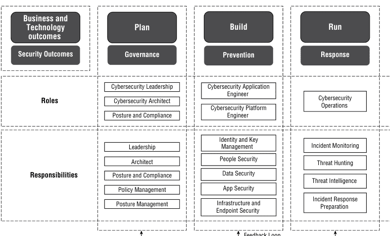

安全领导角色的职责是为整个组织和技术资产提供愿景、指导和协调。

通过与安全态势和合规角色合作，与学科专家合作来缓解主要安全风险，这些角色负责识别和缓解整个企业的安全风险。通常，这些角色管理安全合规性、政策、标准和态势。

平台安全工程师专注于企业范围内的系统，例如身份验证和密钥管理，以及各种基础设施和端点，例如网络安全、服务器/VM 安全和客户端终端/设备。

通常，应用程序安全工程师专注于在开发单个工作负载和应用程序的同时保护它们。除了基础设施和端点技能外，这些职责还包括应用程序安全和 DevSecOps，以及按工作负载计算的数据安全。随着数字化转型推动云技术、DevOps/DevSecOps 模型和基础设施即代码方法的采用，预计对这些技能组的需求将继续增长。

人员安全是一门新兴学科，致力于对组织内的人员进行教育、保护他们，并防范内部威胁。

在运营阶段，运营团队的组合负责维护生产环境（IT 和 OT 运营、DevOps）和安全运营。

作为安全运营的一部分，会监控和响应被动事件和响应，并主动搜寻威胁以暴露逃过检测的对手。安全运营通常会孵化威胁情报和事件准备功能，随着成熟度的提高，范围会扩大，并与技术和组织实践相集成。

安全效果和安全流程的成熟度取决于健康的反馈循环。随着团队继续自动化技术流程并采用侧重于快速敏捷迭代的 DevOps 式方法，预计预防和响应之间的关系将不断加强。

## 安全策略注意事项

安全确保企业的机密性、完整性和可用性。内部和外部的恶意和意外行为都可能对运营造成不利影响，因此安全工作具有关键重点。安全应被视为云采购过程每个阶段（制定策略）的一部分。

遵循这些步骤，您可以在流程的关键点集成安全。这样做将减少对业务和运营造成不必要中断的可能性。

有效的云安全策略必须考虑当前威胁环境和托管企业资产的云平台的性质。提供安全且可持续的企业云环境需要一种直接的方法，以改善所有团队的工作效率。安全策略必须支持定义的业务成果，将风险降低到可接受水平，并使员工能够高效工作。

随着团队为云采购做准备，云安全策略指导所有团队解决技术、流程和人员就绪性问题。系统不仅应展示云架构和技术能力的发展，还应影响安全架构和能力的发展及相关能力。

要制定安全的云策略，必须纳入所有团队的投入和积极参与。流程文档的格式可能有所不同，但包含以下元素：

- **来自团队的积极投入** 只有组织内部的人员采纳该策略，它通常才能奏效。将所有团队聚集在一起共同制定计划。在进行客户研讨会时，Microsoft 经常发现组织以事实上的孤岛形式运行。通常，这些聚会会让人们第一次见面。包容性要求对我们来说是显而易见的。如果某些团队不参与，则需要重复举办研讨会。如果他们不参与，项目将无法推进。

- **清晰记录和传达** 所有团队必须了解安全策略，该策略应清晰记录并清晰传达。安全策略应作为整体技术策略的组成部分，包含集成安全的理由以及与安全相关的内容。安全策略定义了安全领域中成功的样子。因此，应用程序和开发团队能够获得清晰、有条理的指导，而无需阅读无关信息。

- **稳定但灵活** 通常，策略相对一致且稳定，但架构和文档需要澄清并适应云计算的动态性质。即使您从使用第三方下一代防火墙切换到 Azure 防火墙，并调整过滤恶意外部流量的图表和指南，过滤恶意外部流量仍然是战略性的当务之急。

- **从业务对齐开始** Microsoft 建议将安全策略与业务目标和风险概况相对齐。安全团队将解决许多战略问题，无论大小，但您必须从业务对齐开始。尽管从“如果所有业务系统都停机，您会先恢复什么？”等具体问题开始可能具有挑战性，但您可以在建立快速胜利的同时开始建立关系。

### 交付成果

为了便于讨论和更新，Microsoft 建议将策略记录在演示文稿中，并可根据您的文化和偏好附带文档。

高管受众可能会收到策略摘要版本或单份演示文稿。

- **完整演示文稿：** 主要演示文稿或可选参考幻灯片应包含安全策略的所有元素。

- **高管摘要：** 高管和董事会成员的高管摘要仅包含与其角色相关的元素，包括其风险偏好、首要任务和可接受的风险。

策略和计划模板允许您记录动机、结果和业务理由。

### 构建安全策略的最佳实践

成功的安全策略包含以下元素：

- **紧密对齐业务策略：** 为了最大限度地提高内部和谐并使安全工作与业务策略保持一致，必须将安全工作与安全宪章（即保护业务价值）紧密对齐。


- 创建对业务、IT 和安全要求的共同理解。
- 在云采用早期集成安全，以避免最后时刻的危机。
- 立即建立最低安全要求，并随着时间的推移不断改进安全保障，这需要敏捷方法。
- 鼓励采取主动领导行动来改变安全文化。
- **现代化安全策略：** 要维持充分安全，安全策略中必须考虑现代技术环境、威胁态势和安全社区资源。
  - 采用基于云的共享责任模型。
  - 包含多云部署。
  - 使用云原生控件避免不必要的摩擦。
  - 通过整合安全社区，跟上攻击者的演进。

### 战略批准

组织中的高管和业务领导者，例如董事会，应批准此策略，并对业务部门的结果或风险负责。

## 部署主动且持续演进安全策略的流程

安全规划定义了实施安全策略的成果、里程碑、时间表和任务负责人。安全规划与云采用规划应协同进行，以防止因安全问题发现太晚而导致工作停滞或风险增加。在规划周期早期邀请云安全团队至关重要。

### 安全规划中的注意事项

充分融入云规划流程，使安全规划能够借助对数字资产和现有 IT 资产组合的理解而得到增强。

### 交付成果

组织应在其云实施的主要规划文档中包含安全计划。这可能是这些格式的组合，具体取决于组织的规模、文化和标准做法。所有这些元素都应包含在安全计划中：

- 组织职能计划，以便团队了解向云迁移将如何影响当前的安全角色和职责
- 安全技能计划旨在支持团队成员适应重大的技术变化、角色和职责
- 提供给技术团队的技术安全架构和能力路线图

为所有团队制定安全意识和教育计划，使其熟悉安全基础知识。

与业务影响保持一致的分类法，由业务利益相关者、安全团队以及其他有兴趣识别敏感资产的各方制定。

安全计划触发的更改应反映在云采用计划的其他部分中。

### 安全规划的最佳实践

本节将讨论如何在使用本地和基于云的应用程序（例如软件即服务（SaaS）和平台即服务（PaaS））时提高安全计划的成功率。

首先识别关键安全要求，并为后续步骤确定非关键项目的优先级。您的计划不应针对三到五年过于详细。云环境和威胁环境变化非常迅速，这种计划不适用。相反，您应专注于制定初始步骤和目标状态。

- 时间范围可能因组织文化、标准做法和其他因素而异，但在长期计划开始之前，快速见效的措施将产生高影响。
- 目标状态愿景应指导团队规划（这可能需要几年才能实现）。

获得利益相关者对计划的支持、反馈和意识。广泛分享该计划。将您的计划与安全策略的战略成果保持一致并实现它们。确定负责完成每项任务的人员及其问责人，以及该任务的具体截止日期。

随着安全行业的转型和新期望的出现，通过实施以下策略来吸引人们关注人性因素：

- 为团队成员提供辅导和清晰沟通，以支持他们的转型。
- 告知人们需要掌握的技能（他们需要知道什么，以及可以使用哪些资源来学习）。
- 识别学习这些技能的好处。
- 鼓励人们通过使安全意识变得引人入胜，将自己与保持组织安全的角色联系起来。

通过查看 Microsoft 培训和指南，了解 Microsoft 如何帮助您的组织规划向云和现代安全策略的过渡。有适用于安全的录制培训模块、文档以及推荐的最佳实践和标准。

## 建立基本安全实践

人员、流程和技术元素在云安全中起着至关重要的作用。此外，某些架构选择是基础性的，以后难以更改，因此应仔细考虑。

无论您的组织当前是否已经在云中运营，还是计划在未来这样做，都应遵循以下 11 项基本安全实践（除了确保符合可能存在的任何明确监管要求外）。

### 人员

- 为团队开发云学习计划。
- 为团队提供云安全培训。

### 流程

- 为云安全决策分配问责责任。
- 更新云事件响应流程。
- 管理安全态势。

### 技术

- 使用无密码或多因素身份验证。
- 使用本地防火墙保护您的网络。
- 本地检测威胁。

### 基础架构决策

- 一个目录和标识应作为标准。
- 基于标识的访问控制。
- 统一安全策略。

公司的风险态势和容忍度可能受多种因素影响。例如，由于声誉风险，银行可能无法容忍其测试系统甚至受到轻微攻击。一些组织如果能将数字化转型提前三到六个月，可能可以接受同样的风险。

## 安全管理策略

云服务不会改变安全组织的最终目标，但实现这些目标的方式会发生变化。为了减少攻击带来的业务风险，安全团队仍必须确保信息系统和数据安全、可靠且可用。

组织在采用和运行基于云的服务时，必须现代化策略、架构和技术。随着安全计划的现代化，安全可以摆脱与传统方法相关的一些痛苦负担。然而，变更的规模和数量起初可能令人望而生畏。尽管云环境和威胁环境变化迅速，组织可以暂时使用传统策略和工具进行运营。

## 持续评估

必须对该系统进行持续评估和验证，以确保安全配置保持完好，并识别出先前未知的漏洞。监控工作负载的安全态势（包括虚拟机、网络、存储和应用程序）需要持续评估。云计算的性质使其非常动态，这意味着新工作负载会不断配置。如果您的云采用还不成熟，可能无法拥有所有默认强制执行安全所需的保障措施，因此对工作负载的持续评估变得更加关键。

Microsoft Defender for Cloud 是一个 IaaS 和 PaaS 解决方案，可用于持续评估云和本地资源及工作负载的安全性。图 6.2 描绘了 Microsoft 持续评估安全性并防御威胁的方法。

### 图 6.2 Microsoft 持续评估方法

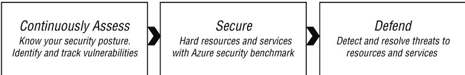

Defender for Cloud 的安全评分是帮助您实现这些目标的核心功能。Defender for Cloud 不断检查您的资源、订阅和组织中的安全问题。要评估当前的安全状况，评分会将所有结果汇总为一个分数：分数越高，风险级别越低。

当在工作负载中部署新资源时，Defender for Cloud 会持续检查它们是否配置安全。随后会标记它们，并为您提供需要修复事项的优先级列表。Microsoft 建议可帮助您降低每个资源的攻击面。

部署 Microsoft Defender for Cloud 可使您的组织持续评估其安全态势和控制措施。除了加强云资源的安全态势外，Defender for Cloud 还包括集成的 Microsoft Defender 计划，用于保护在 Azure、混合和其他云平台上运行的工作负载。

您可以在 Microsoft 365 SaaS 环境中使用 Compliance Manager 进行持续评估。它会识别 Microsoft 365 环境中的设置，这些设置决定了


特定配置满足改进操作的实现要求。

除了检测您可能部署的其他合规性解决方案的信号外，Compliance Manager 还使用 Microsoft Secure Score 监控来检测互补的改进操作。这包括数据生命周期管理、信息保护、通信合规性和内部风险管理。

进行更改后，您的操作状态将在 24 小时内在仪表板上更新。在按照建议实施控制后，控制状态通常会在次日更新。当您在 Azure AD 门户中启用 Azure Active Directory 多因素身份验证 (MFA) 时，Compliance Manager 会检测该设置并在控制访问解决方案中显示它。如果您未在 Azure AD 门户中启用 Azure Active Directory MFA，Compliance Manager 将建议您启用并配置 MFA。

## 连续策略演进

设定高级别目标并持续审查向这些目标的进展，是随着时间的推移演进安全策略的重要组成部分。根据 Microsoft 的说法，记分卡指标应关注以下四个主要领域：

- 业务赋能：用户体验和业务流程。安全摩擦有多大？
- 安全态势：
  - 安全状况是否每月都在改善？
  - 我们的安全态势在防止损害方面有多有效？
- 安全响应：对安全漏洞的响应和恢复。您在响应和恢复方面有多有效？
- 安全改进：持续改进计划的计划是什么？

表 6.1 列出了每个类别中的一个示例指标。这些绩效度量可用于开始讨论如何衡量安全计划的成功。

每个组织的业务目标、风险偏好、技术组合和其他因素将确定度量和目标/阈值/权重。

## 表 6.1 示例指标

| 安全领域 | 指标 |
|---|---|
| 业务赋能 | 安全审查平均时间<br>应用程序安全审查天数<br>托管设备的平均启动/登录时间<br>用户工作流中的安全中断次数<br>IT 帮助台在低价值安全活动上花费的时间百分比 |

## 表 6.1 示例指标（续）

| 安全领域 | 指标 |
|---|---|
| 安全态势 | 新应用审查百分比 |
| | 安全评分 |
| | 合规应用百分比 |
| | 满足 100% 要求的特权帐户数量 |
| | 满足 100% 要求的帐户数量 |
| 安全响应 | 恢复平均时间 (MTTR) |
| | 确认平均时间 (MTTA) |
| | 恢复关键系统所需时间 |
| | 高严重性事件数量 |
| | 事件增长率（总体） |
| 安全改进 | 进行中的现代化项目数量 |
| | 过去 60 天内实现的现代化项目里程碑数量 |
| | 从工作流中移除的重复手动步骤数量 |
| | 从内部/外部事件吸取的教训数量 |

## 为服务器和客户端终端指定安全基线

尽管 Windows 客户端和 Windows 服务器设计为开箱即用的安全性，但安全配置仍需针对每个组织足够细致。Microsoft 提供安全基线，以指导组织如何配置各种安全功能来应对大量控制项。使用 Microsoft 的行业标准、广为人知且经过充分测试的配置，您可以避免自己创建基线的需要。

## 什么是安全基线？

对一个组织最相关的安全威胁类型可能与另一个组织的完全不同。例如，电子商务组织可能专注于保护其 Web 应用，而医院可能优先保护机密患者数据。然而，所有组织都有一个共同点：他们需要保护其应用和设备，且设备必须符合组织的安全标准（或安全基线）。

安全基线是预配置的 Windows 设置，可帮助您通过使用 Microsoft Intune 创建安全基线配置文件来强制实施安全团队推荐的细粒度安全设置。

## 什么是 Microsoft Intune？

Microsoft Intune 终端管理解决方案是一项基于云的服务。它可管理您众多设备（包括移动设备、桌面设备和虚拟机）上的用户对应用和设备的访问权限。

您可以使用多个设备配置配置文件创建模板，以便只能使用 Microsoft Intune 强制实施您需要的设置和值。

## 什么是安全合规性工具包？

安全合规性工具包 (SCT) 的一个功能是能够下载、分析、测试、编辑和存储适用于 Windows 和其他 Microsoft 产品的 Microsoft 推荐安全配置基线。

SCT 简化了企业内部组策略对象 (GPO) 的管理。使用 SCT 工具包，组织系统管理员可以将其当前 GPO 与 Microsoft 推荐的 GPO 基线或其他基线相对应，对其进行编辑，以 GPO 备份文件格式保存，并通过 Active Directory 广泛使用它们或通过本地策略单独使用它们。

## 基线的基础原则

Microsoft 根据以下原则推荐一种精简高效的基线定义方法：

- 标准最终用户没有管理员权限，这些基线适用于管理良好且安全意识强的组织。
- 必须缓解安全威胁，才能强制实施基线，同时防止比其缓解的风险更严重的运营问题。
- 当授权用户原本可以将默认值更改为不安全状态时，基线会强制实施安全默认值。
- 确保如果非管理员可以设置不安全状态，则强制执行默认状态。
- 如果设置不安全状态需要管理员权限，则只有在管理员可能因信息错误而选择错误的情况下，才实施默认值。

## 选择适当的基线

了解将应用安全基线的操作系统是选择适当安全基线的第一步。在异构环境中，可能需要为每个操作系统的需求制定多个基线。当您拥有组织中使用的操作系统及其版本列表时，您可以决定使用什么工具来部署这些基线。

您可以选择使用 SCT 作为一种选项。基本上，它是一组工具，可帮助企业安全管理人员下载、分析、测试、编辑和存储适用于 Windows 和其他 Microsoft 产品的安全配置基线。管理员可以使用 SCT 有效地管理 GPO。管理员可以将其当前 GPO 与 Microsoft 推荐的基线或其他基线进行比较，对其进行编辑，以 GPO 文件格式创建备份，并使用该工具包通过 Active Directory 广泛应用它们或通过本地策略单独应用它们。

以下参考链接提供了有关如何使用该工具包的指导：
learn.microsoft.com/en-us/windows/security/threat-protection/windows-security-configuration-framework/security-compliance-toolkit-10

Azure 安全基准 (ASB) 还提供基于 Azure 安全基线的 Windows 和 Linux 服务器安全基线文档。

例如，如果您的安全基线主要集中在安装和配置终端（Windows 客户端）上，则可以使用 Intune 来自动化该过程。使用 Intune，您可以快速部署 Windows 安全基线以保护和保障用户的安全。Intune 让您可以为用户组或设备组部署安全基线，且设置适用于 Windows 10/11 设备。除了在可移动驱动器上启用 BitLocker 之外，移动设备管理 (MDM) 安全基线还要求密码才能解锁设备，禁用基本身份验证，等等。当默认值不适用于您的环境时，请自定义基线以应用您的设置。

了解您选择使用的基线类型的默认值，然后修改每个基线以适应您组织的需求，这一点至关重要。

Intune 安全基线不符合 CIS 或 NIST 标准。尽管 Microsoft 在编制其建议之前会咨询 CIS，但符合 CIS 标准的基线与 Microsoft 基线之间不存在一对一映射。

Microsoft 的安全团队在与企业客户和外部合作伙伴（包括国防部 (DOD) 和美国国家标准与技术研究院 (NIST））的互动基础上开发了这些基线。这些组织也有


他们的建议与 Microsoft 的建议高度一致，Microsoft 还与这些组织共享建议和基线。Microsoft 开发了这些组策略基线的类似版本，以便 MDM 继续发展为云服务。Microsoft Intune 包括这些附加基线，其中包括遵循这些基线的用户、组和设备的合规性报告。

在 Azure Policy 中，组织标准得到强制实施，并大规模评估合规性。通过其合规性仪表板，它提供环境的全面视图，并能针对每个资源和每个策略钻取到细粒度级别。您还可以通过对现有资源进行批量修正以及自动化新资源修正，将资源带入合规状态。

Azure Policy 常用于在资源一致性、法规合规性、安全性和成本管理中实施治理。得益于内置的 Azure 策略定义，您可以立即在 Azure 环境中开始使用这些简单的用例。

以下参考链接提供 Azure Policy 的 Windows 安全基线：

```
learn.microsoft.com/en-us/azure/governance/policy/samples/guest-configuration-baseline-windows
```

以下参考链接提供 Azure Policy 的 Linux 安全基线：

```
learn.microsoft.com/en-us/azure/governance/policy/samples/guest-configuration-baseline-linux
```

以下参考链接提供 Azure Policy 的 Docker 安全基线：

```
learn.microsoft.com/en-us/azure/governance/policy/samples/guest-configuration-baseline-docker
```

安全基线可在 Microsoft 客户端的 endpoint.microsoft.com 上获取，其中列出了 Microsoft Intune 中 Windows 10/11 MDM 安全基线的配置列表。

```
learn.microsoft.com/en-us/mem/intune/protect/security-baseline-settings-mdm-all?pivots=mdm-november-2021
```


Microsoft 通过 Windows 和 Windows Server 为其客户提供安全操作系统，Microsoft Edge 提供安全应用。您可以使用 Microsoft 的各种配置功能，对环境进行精细控制，并获得其产品提供的安全保障。

可从 Microsoft 下载中心下载安全基线。SCT 为管理员提供管理安全基线和基线的工具。您还可以使用 SCT 来管理安全基线。

运行 Windows 10 或 Windows 11 的设备可以轻松在 Microsoft Intune 中配置 MDM 安全基线。

## 为服务器指定安全基线（包括多个平台和操作系统）

确保 Windows Server 环境中的服务器和客户端计算机配置安全，是保护环境的重要组成部分。加固操作系统对于保护 Windows Server 环境至关重要。为服务器定义安全要求取决于服务器角色，因为角色将确定所需的加固设置。

处于独特角色的服务器可能需要更多配置，但大多数服务器都会有核心基础安全要求。如果服务器是域控制器 (DC)，则有必要采取额外步骤来加固服务器上的 Active Directory 服务。Microsoft SCT 是了解服务器当前状态的绝佳工具。

## 分析安全配置

Microsoft SCT 是一组用于下载和安装安全配置基线（通常称为 *安全基线*）的工具，适用于 Windows Server 和其他 Microsoft 产品（包括 Windows 10、Microsoft 365 企业应用版和 Microsoft Edge）。您可以通过管理 GPO 来实施安全配置基线。

此外，您可以使用 SCT 将当前 GPO 与推荐的 GPO 安全基线进行比较。将现有 GPO 与推荐 GPO 进行比较后，您可以编辑推荐的 GPO 并将其应用于设备。

此外，SCT 包括用于管理 Windows Server GPO 设置的工具，包括 Policy Analyzer、Local Group Policy Object (LGPO) 以及 Set Object Security 和 GPO to Policy Rules。

## 安全加固服务器（域成员）

## 本地管理员帐户

域中的每台计算机成员都保留一个本地 Administrator 帐户。手动部署计算机或使用 Microsoft Endpoint Configuration Manager 等软件部署工具时，会自动配置此帐户。如果 IT 人员无法连接到域，可以使用本地管理员帐户登录到计算机。

对于计算机数量较多的组织，管理本地管理员帐户的密码可能非常困难。组织中每个本地 Administrator 帐户都有不同的密码，组织通常会为所有本地 Administrator 帐户分配相同的通用密码。采用这种方法的缺点在于，非 IT 运维团队的人员可能会通过猜测密码，获取对组织中未授权计算机的访问权限。

除了管理加入域的计算机的本地帐户密码外，本地管理员密码解决方案 (LAPS) 可用于所有当前受支持的 Windows Server 和客户端操作系统。

本地管理员密码解决方案 (LAPS) 允许加入域的计算机管理本地管理员帐户的密码。密码随机生成，并存储在 Active Directory (AD) 中，受 ACL 保护，因此只有合格用户才能读取或请求重置。

## SMB 协议

服务器消息块 (SMB) 协议是一种主要用于文件共享的网络协议，也是服务器保护的另一个关键部分。它禁用旧版协议并强制执行更安全的通信方式。除了文件共享外，打印机、扫描仪和电子邮件服务器也经常使用 SMB。SMB 1.0 不支持加密，而 3.0 版引入了 SMB 加密。

使用 SMB 加密，服务器可以为 Microsoft SQL Server 等应用程序提供安全存储，并向客户端提供某些数据传输。与基于硬件的加密（通常更复杂）相比，SMB 加密通常更易于使用。SMB 加密为用户提供数据包安全性，防止恶意黑客拦截或篡改数据包。

Windows Server 2019 中包含的 SMB 3.1.1.c 版 SMB 对 SMB 3.0 的安全性进行了多项增强。此版本的 SMB 包括预身份验证完整性检查和加密改进。

SMB 在 Windows Server 系统中有多个版本可用。要使用 SMB 3.1.1，主机服务器及其通信系统必须支持 SMB 3.1.1。这样，它们就可以与运行其他操作系统和 Windows 版本的服务器和客户端进行通信。

某些修改 SMB 数据包的广域网 (WAN) 加速器不支持 SMB 3.1.1 的预身份验证。因此，您可能需要更换一些网络设备。

## Azure 安全基准

确保所有服务器都符合 ASB OS 基线，作为指定服务器要求的替代方案。使用 Microsoft Defender for Cloud，ASB OS 基线可用作 Windows 或 Linux 的安全建议，如图 6.3 所示。

访问建议将显示一组规则，这些规则使用 Azure 来宾配置功能对操作系统进行安全检查，以确保其配置安全。

如图 6.4 所示，单击每个规则将显示有关安全检查和受影响资源的更多信息。

## 图 6.3 Microsoft Defender for Cloud 适用于 Windows 和 Linux 的 ASB OS 基线

修正安全配置

- 应修正 Windows 计算机上的安全配置漏洞（由来宾配置提供支持）
- 应修正 Linux 计算机上的安全配置漏洞（由来宾配置提供支持）

## 图 6.4 修正的详细视图

## 拒绝以批处理任务身份登录

### 描述

拒绝以批处理任务身份登录

### 影响

如果将“拒绝以批处理任务身份登录”用户权限分配给其他帐户，可能会拒绝分配到特定管理角色的用户执行其所需工作活动的权限。您应确认委派的任务不会受到不利影响。例如，如果将此用户权限分配给 IWAM_<ComputerName> 帐户，MSM 管理点将失败。在新安装运行 Windows Server 2003 的计算机上，此帐户不属于 Guests 组，但在从 Windows 2000 升级的计算机上，此帐户是 Guests 组的成员。因此，了解哪些帐户属于您分配“拒绝以批处理任务身份登录”用户权限的任何组非常重要。

| 规则 ID | 49258884-b2f0-4a4e-b66a-6954bb8473bf |
| 名称 | 拒绝以批处理任务身份登录 |
| 类别 | 用户权限分配 |
| 扫描时间 | 2022/4/9 下午 2:56:22 (UTC) |

### 漏洞

拥有“拒绝以批处理任务身份登录”用户权限的帐户可能被用来计划作业，这些作业可能会消耗过多计算机资源并导致拒绝服务 (DoS) 状态。

### 修正

不可用

### 受影响的资源

## 自动管理

使用 Automanage，可将自动化和最佳实践应用于在 Azure 或受 Azure Arc 支持的混合环境中运行的 Windows 和 Linux 服务器。


Windows 和 Linux 虚拟机可以使用 Automanage 进行管理，包括以下组件：

- 启动诊断
- 安全中心
- 监视
- 更新管理
- 自动化帐户
- 更改跟踪和清单
- 配置管理
- Log Analytics
- 备份

借助 Azure Automanage VM 最佳实践，您无需发现、学习如何加入并配置某些有助于虚拟机的 Azure 服务。除了提高虚拟机的可靠性、安全性和管理性之外，这些服务还被视为 Azure 最佳实践。

## Azure 磁盘加密

通过保护和保障您的数据，您可以使用 Azure 磁盘加密 (ADE) 满足组织的安全和合规性承诺。ADE 使用 Linux 和 Windows 中的 dm-crypt 或 BitLocker 功能，加密 Azure 虚拟机 (VM) 的操作系统磁盘和数据磁盘。ADE 与 Azure 密钥保管库集成，以便于管理和控制磁盘加密密钥和机密。

在密钥保管库中管理加密密钥需要 Azure AD 身份验证。ADE 在密钥保管库中生成并写入加密密钥。


以下是您在环境中可采用的 VM 管理最佳实践：

- 确保只有授权人员可以访问您的 VM 是保护 VM 的第一步。
- 对于 Linux VM，使用 Azure AD 身份验证，您可以集中控制并强制执行允许或拒绝访问 VM 的策略。您可以使用 Azure AD 身份验证提高 Azure 上 Linux VM 的安全性。
- Azure Automanage 可用于 Windows 和 Linux 虚拟机，使其保持更新状态。
- 采用最小特权原则，使用户能够访问和设置 VM。
- Azure 磁盘加密可帮助加密 Windows 和 Linux IaaS 虚拟机磁盘。
- 可以使用 Add-AzKeyVaultKey cmdlet 在密钥保管库中创建密钥加密密钥。
- 当网络安全组允许来自任何 IP 地址的访问时，Defender for Cloud 建议您通过面向 Internet 的终结点限制访问。

## 为移动设备和客户端指定安全要求，包括终结点保护、强化和配置

您可以使用 Microsoft Intune 管理跨设备的应用、设备和用户，Intune 提供基于云的终结点管理。您可以保护组织拥有的设备和用户拥有的设备上的数据访问。Microsoft Intune 可帮助您管理设备管理的所有方面，从注册到配置再到保护，直至设备不再需要时的退役。

移动设备安全要求主要关注配置和保护阶段，但您应考虑以下所有阶段：

- **注册：** 验证组织的注册选项并评估可用设备。
- **配置：** 在设备的初始配置过程中，您可以从各种策略中选择，以确保设备安全且合规。
- **保护：** 除了最初配置的内容之外，您还有其他设置可用于保护设备免受恶意攻击或未授权访问。确保设备免受未授权访问是您最关键的任务之一。
- **退役：** 在大多数情况下，当设备丢失、被盗、更换或用户更换工作时，就是退役或擦除设备的时候了。这可以通过多种方式完成，包括重置设备、从管理中移除设备以及擦除企业数据。

### 应用隔离和控制

使用 Microsoft Intune，在托管应用场景中，应用保护策略 (APP) 可确保组织的数据受到保护或包含。当用户尝试访问或移动“企业”数据时，将强制执行策略，或者在用户在应用内时禁止或监视操作。托管应用可由 Intune 管理，并应用应用保护策略。

您可以使用移动应用程序管理 (MAM) 策略在应用程序内管理和保护组织的数据。

您的员工在移动设备上执行个人和工作任务，员工必须能够保持高效工作，同时防止故意或无意的数据丢失。您存储在未管理设备上的数据也需要受到保护。

移动设备管理解决方案 (MDM) 不是使用 Intune 应用保护策略所必需的。无论您的设备是否注册到设备管理解决方案，您都可以保护公司数据。通过实施应用级策略，您可以限制对公司资源的访问，并将企业数据保持在您的监管范围内。

将 Intune 应用保护策略与条件访问（Azure Active Directory 的一项功能）结合使用，可保护在 Intune 中注册的设备上的工作文件。

图 6.5 中所示的示例表明，管理员在应用应用保护策略后，已将 Outlook 应用添加到已批准的应用列表中。

图 6.5 Microsoft 持续评估方法

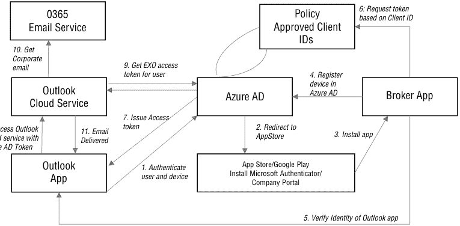

可以设置 APP 保护策略，以便在用户尝试访问或修改企业数据时强制执行规则，或禁止或监视应用程序内的特定操作。应用保护策略可应用于托管应用；Intune 可以对其进行管理。

## 在设备管理和应用管理之间进行选择

Microsoft Intune 为组织拥有的设备提供 MDM。由于 MDM 具有以设备为中心的特性，功能是根据谁需要它们来配置的。如果用户使用组织帐户登录，您可以配置设备以允许访问 Wi-Fi。

Intune 通过配置功能和设置提供安全性和保护。除了登录的用户身份、安装的应用和访问的数据之外，您的组织还会管理设备。

您的策略可以在注册过程中部署，当设备注册并在注册完成后即可使用。

在 BYOD 场景中，您可以使用 Intune 为个人设备进行移动应用程序管理 (MAM)。无论使用哪台设备访问应用数据，该数据都会受到保护，因为 MAM 是以用户为中心的。重点在于应用，包括保护应用内的数据并安全地访问它们。

使用 MAM，您可以执行以下操作：

- 可将移动应用发布给用户。
- 您可以自动配置和更新应用。
- 可提供应用使用情况和清单报告。

也可以结合使用 MDM 和 MAM。如果您的设备已注册且某些应用需要额外保护，还可以使用 MAM 应用保护策略。

设备管理是任何终结点管理解决方案的重要组成部分。组织需要管理笔记本电脑、平板电脑、移动电话、可穿戴设备等等。

Intune 是一种基于云的服务，通过策略（包括安全策略）控制设备。

组织的数据使用 APP 在托管应用中得到安全保护或包含。使用此方法意味着，如果用户尝试访问或移动企业数据，则强制执行规则；也意味着强制执行一组用户在应用内被禁止或受到监视的操作。托管应用可由 Intune 控制，并应用应用保护策略。

通过使用 Intune MAM，您可以控制许多生产力应用（例如 Microsoft Office），并管理和保护组织在其中的数据。

在图 6.5 的示例中，如果您仅允许 Microsoft Outlook 应用程序访问 Exchange Online，则可以阻止 iOS/iPad 和 Android 上的内置邮件应用。此外，您可以阻止未受 Intune 保护的应用访问 SharePoint Online。

针对 Exchange Online 和其他 Microsoft 365 服务的条件访问结合客户端应用管理，可通过确保仅支持 Intune 应用保护策略的客户端应用能够访问这些服务，来增加一层安全性。


以下是图 6.5 中所示工作流的描述：

- 1. 用户尝试通过 Outlook 应用使用 Azure AD 进行身份验证。
- 2. 首次进行身份验证时，用户将被引导至应用商店部署代理应用。代理应用包括适用于 iOS 的 Microsoft Authenticator 和适用于 Android 的 Microsoft 公司门户。
- 3. 如果用户尝试访问本机电子邮件应用，他们将被重定向到应用商店以部署 Outlook 应用。
- 4. 在设备上安装代理应用。
- 5. 代理应用创建 Azure AD 注册过程，该过程会在 Azure AD 中生成设备记录。它不同于 MDM 注册过程，但条件访问记录对于在该设备上强制执行策略是必要的。
- 6. Azure AD 登录服务器基于 Azure AD 设备 ID、用户和应用程序信息验证对请求服务的访问权限。
- 7. 代理应用将应用客户端 ID 传输到 Azure AD，作为用户身份验证的一部分以验证其批准情况。
- 8. Azure AD 基于已批准的应用列表对应用程序进行身份验证并授予访问权限。如果该应用不在列表中，Azure AD 将拒绝访问。
- 9. 通过 Outlook 云服务完成 Exchange Online 激活。
- 10. Outlook 云服务通过 Azure AD 获取用户的 Exchange Online 服务访问令牌。
- 11. Outlook 使用 Exchange Online 检索用户的企业电子邮件。
- 12. 用户在其邮箱中收到企业电子邮件。

使用应用保护，您可以强制执行移动设备的安全要求，其中可能包括以下内容：

- 确保工作文件已加密。
- 访问工作文件需要 PIN 码；连续五次尝试失败后，必须重置 PIN 码。
- 防止将工作文件备份到 iTunes、iCloud 或 Android 备份服务等公共云服务中。
- 要求仅将工作文件保存到 OneDrive 或 SharePoint。
- 防止越狱或 Root 的应用程序加载工作文件。
- 离线 720 分钟后，阻止访问工作文件。
- 非活动 90 天后，将删除工作文件。

## 设备设置

除了应用隔离和保护之外，您还需要保护设备设置。当最终用户的移动设备注册到您的 Microsoft 365 组织时，您可以使用移动性和安全性功能来管理和连接它。员工可以随时随地使用智能手机和平板电脑等移动设备处理工作，这些设备可以访问工作电子邮件、日历、联系人和文档。因此，为移动设备提供安全策略和规则，并在设备丢失或被盗时擦除它们，对于保护组织的信息至关重要。

使用基本移动性和安全性，您的组织可以保护和管理 iPhone、iPod、Android 和 Windows Phone 等移动设备。可以使用受支持的移动设备和应用在 MDM 策略下访问 Microsoft 365 电子邮件和文档，其中的设置有助于控制访问。如果设备丢失或被盗，可以远程擦除设备以删除敏感的组织数据。

移动设备必须遵循以下要求进行加固：

- 要求使用密码。
- 确保不使用简单密码。
- 密码必须为字母数字组合。
- 密码必须具有最小长度。
- 在设备被擦除之前，会计算失败的登录尝试次数。
- 设置设备在非活动状态下锁定前的分钟数。
- 设置密码的过期日期（天数）。
- 通过记住密码历史记录来防止重复使用密码。
- 加密包含数据的设备。
- 不支持 Root 或越狱设备。
- 阻止屏幕捕获。
- 访问应用商店需要密码。

在设置安全要求时，您应确保要管理的安全设置适用于贵组织使用的设备类型。

## 客户端要求

您的客户端工作站应加入域。许多环境使用本地 Active Directory (AD)。混合 Azure AD 加入的设备是既加入 AD 域又属于 Azure AD 的设备。您可以使用 Windows Autopilot 在 Intune 中注册混合 Azure AD 加入的设备。如果您有域加入配置文件，则注册将是合理的。

确定客户端是否加入域后，即可开始规划操作系统配置的安全要求。安全基线也可以包含应用于运行 Windows 10/11 的设备和组的这些要求。

可以使用 Intune 向组或设备部署安全基线。MDM 安全基线会自动为可移动驱动器启用 BitLocker；解锁设备会自动需要密码，禁用基本身份验证，等等。当默认值不起作用时，请使用自定义基线来应用所需的设置。

客户端安全策略应管理以下设置：

- 磁盘加密
- 防病毒
- Windows 防火墙
- 攻击面缩减
- 终端检测和响应
- 帐户保护


Intune 中的终端安全节点提供了多种可帮助保护设备的设置。安全管理员可以使用 Intune 中的终端安全节点配置设备安全性，并在设备面临风险时管理安全任务。使用终端安全策略，您可以在关注设备安全性的同时保护设备并降低风险。

根据产品相关 Microsoft 安全团队的建议，Intune 中的安全基线是预配置的设置组。Microsoft Intune 平台允许您为 Windows 10/11 设备设置、Microsoft Edge、Microsoft Defender for Endpoint Protection 等创建安全基线。

通过设备合规性策略，为设备和用户访问网络资源和组织网络建立条件。

## 指定保护 Active Directory 域服务的要求

借助 Active Directory 域服务 (AD DS)，组织可以简化用户和资源管理；创建可扩展、安全且可管理的基础架构；并简化用户和资源管理。AD DS 可以管理分支机构、Microsoft Exchange Server 和多个自治环境（也称为林）。

要使您的 AD DS 部署策略取得成功，必须进行高级别评估并正确识别部署任务。根据现有网络配置，您可能需要调整 AD DS 部署策略。

如果要指定保护 Active Directory 域服务的要求，必须首先认识到威胁行为者通常会执行凭据窃取并针对某些特定帐户。作为凭据窃取攻击的一部分，攻击者会使用最高特权级别（root、administrator 或 SYSTEM，具体取决于操作系统）访问网络上的计算机，然后使用免费可用的工具从其他已登录的帐户中提取凭据。根据系统配置，这些凭据可以以哈希、票据或明文密码的形式被提取。

管理员必须了解会增加凭据窃取攻击可能性的活动，因为高特权域帐户和 VIP 帐户通常是凭据窃取的目标。虽然攻击者也会针对 VIP 帐户，但窃取其凭据需要其他攻击，例如通过社会工程学诱使 VIP 提供机密信息。

使凭据窃取攻击成功的核心漏洞是，使用在整个环境中拥有广泛且深层特权的帐户登录不安全的计算机。因此，作为保护 AD DS 的一部分，您需要缩小攻击面，其中包括以下任务：

- **部署最小特权管理模型** 探讨将高特权帐户用于日常管理所关联的风险，并提供降低这些风险的建议。
- **部署安全的管理主机** 提供部署安全管理主机的方法示例以及部署安全管理系统的原则。
- **保护域控制器免受攻击** 描述了策略和设置，这些策略和设置虽然与实施安全管理主机的建议相似，但提供了一些特定于域控制器的建议，以帮助确保域控制器及其管理系统安全。

受信任的系统（例如域控制器）绝不应从受信任程度较低的主机（与其管理系统安全级别不同的工作站）进行管理。在执行特权活动时，应依赖不止一个身份验证因素；例如，用户名和密码不应被视为可接受的身份验证，因为它们只代表一个因素（你知道的内容）。管理场景中生成的凭据应在某个位置缓存或存储。

## 保护域控制器免受攻击

除了为 Active Directory 域服务 (AD DS) 数据库提供物理存储之外，域控制器还使企业能够有效管理其服务器、工作站、用户和应用程序。假设恶意用户访问域控制器。在这种情况下，AD DS 数据库以及由此延伸的 Active Directory 管理的所有系统和帐户都可能被修改、损坏或销毁。

由于域控制器可以读取和写入 AD DS 数据库中的任何内容，如果域控制器被攻破，您的 Active Directory 林可以被视为


只有在可以恢复已知良好的备份后，系统才会重新可信。导致被攻破的漏洞已被修补。

无法修复的损害可能在几分钟到几小时内造成，而不是几天或几周，具体取决于攻击者的准备、工具和技能。当攻击者获得 Active Directory 的特权访问权时，关键不在于他们拥有该权限的时间长短，而在于他们为此做了多少周密计划。Active Directory、成员服务器和工作站最容易通过攻破域控制器来摧毁，因此该威胁要求对域控制器采取不同且更严格的安全措施。

以下是应采用的关键基本最佳实践。

物理域控制器应安装在数据中心与其他服务器分开的安全机架或机柜中。域控制器服务器应配置可信平台模块 (TPM) 芯片，并使用 BitLocker 驱动器加密来加密域控制器服务器上的所有卷。即使磁盘从服务器上取下，BitLocker 也能保护目录免受攻破。

如果您已实现虚拟域控制器，则应将其安装在环境中与其他虚拟机分开的物理主机上。

最好在所有域控制器上运行最新版本的 Windows Server。组织必须尽快将域控制器群中的旧版操作系统停用。维护最新的域控制器并消除旧版域控制器，可让您使用新功能和安全性。使用旧版操作系统的域和林可能无法使用这些功能。

在林中与所有域控制器 OU 关联的 GPO 中，只应允许来自授权用户和系统（例如跳板服务器）的 RDP 连接。该策略可以通过组合使用用户权限设置和通过 GPO 实现的 WFAS 配置来一致应用。如果策略被绕过，刷新组策略将使系统恢复到正确的配置。

尽管这可能看起来反直觉，但您应考虑将域控制器和其他关键基础设施组件与 Windows 分别进行修补。如果所有计算机都由企业配置管理软件管理，则所有基础设施组件都可能被攻破或摧毁。通过将修补和系统管理与普通计算机群体分开，您可以减少安装在域控制器上的软件数量，并严格控制其管理。

您还应采取以下步骤：

- 应使用 Microsoft Defender for Identity 等工具持续监控 Active Directory 是否有被攻破的迹象。
- 确保已配置并审查审核策略。

## Microsoft Defender for Identity

Microsoft Defender for Identity (MDI) 通过捕获和解析网络流量并使用 Windows 事件来监控您的域控制器，并分析数据以查找威胁和攻击。Defender for Identity 了解您的网络，使用分析、确定性检测、机器学习和行为算法来检测异常，并警告您可疑活动。图 6.6 显示了 Defender for Identity 的核心架构。

## 图 6.6 带有 AD FS 的 Microsoft Defender for Identity

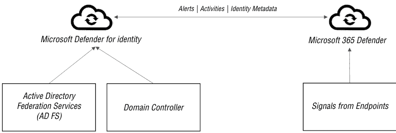

Defender for Identity 传感器安装在域控制器 (DC) 或 AD FS 服务器上后，将直接从每个服务器访问事件日志。传感器解析日志和网络流量后，Defender for Identity 仅将解析的信息发送到 Defender for Identity 云服务（仅发送百分比的日志）。

难以在混合环境中检测高级攻击的安全专业人员和 SecOp 分析师可以使用 Defender for Identity 来检测这些攻击。通过使用基于学习的分析，可以通过 Microsoft Defender for Identity 监控用户、实体和活动。

## 设计管理机密、密钥和证书的策略

使用 Azure Key Vault，您可以将加密密钥、证书和服务器端令牌集中存储在云中。

- 机密管理：Azure Key Vault 可以安全地存储并严格控制 API 密钥、令牌、密码和证书。
- 密钥管理：您可以使用 Azure Key Vault 管理用于加密数据的加密密钥。
- 证书管理：可以使用 Azure Key Vault 轻松预配、管理和部署 TLS/SSL 证书。

Key Vault 将您的应用程序机密存储在集中位置，并提供安全访问、权限控制和访问日志，以便您可以管理它们。Azure Key Vault 使用三个主要概念：保管库、密钥和机密。

使用 Azure Key Vault 创建名为 *保管库* 的多个安全容器。组织可能拥有多个 Key Vault。将应用程序机密集中存储可降低安全信息意外丢失的风险。在 Key Vault 中，您可以存储加密密钥和加密受保护的数据（称为 *机密*），这些密钥和数据由组织内的一名或多名人员管理。Key Vault 代表组织中密钥和机密的逻辑分组。它们类似于文件系统文件夹，并跟踪和记录对密钥和机密的访问。

作为 Azure Key Vault 中的核心参与者，密钥发挥着重要作用。Key Vault 密钥是用于特定目的的加密资产，例如 Microsoft Azure RMS 的非对称主密钥，或用于非对称数据加密、列级加密和 SQL Server 加密备份的非对称密钥。

使用 Key Vault，您可以创建 HSM 生成的密钥来保护小型（小于 10KB）数据 blob。机密的目的是简化持久存储敏感数据的过程，例如存储帐户密钥、PFX 文件、SQL 连接字符串、加密密钥等。

Key Vault 提供自动续期功能，并使 Microsoft Azure 的应用程序和用户能够存储和使用证书。

将表 6.2 中显示的安全最佳实践纳入 Key Vault 维护策略中。

## 表 6.2 最佳实践

| 最佳实践 | 解决方案 |
|---|---|
| 授予用户、组和应用程序在特定范围内的访问权限。 | RBAC 的预定义角色可用于授予用户管理 Key Vault 的访问权限。例如，如果您想要向用户授予 Key Vault 访问权限，请在特定范围内将用户分配给 Key Vault Contributor 角色。如果预定义角色不符合您的需求，您可以定义自己的角色。组件列表可以是订阅、资源组或特定 Key Vault。 |
| 控制用户可以访问的内容。 | 控制对 Key Vault 的访问有两个独立的接口：管理平面接口和数据平面接口。数据平面接口和管理平面彼此独立。您可以使用 RBAC 来管理用户可以访问的内容。如果您希望授予应用程序使用 Key Vault 中密钥的权限，且该应用程序仅需要数据平面访问权限，则无需为此应用程序授予管理平面访问权限。如果您希望用户对保管库属性具有读取访问权限，但无法访问密钥、机密或证书，则可以通过管理平面授予他们读取访问权限，而无需授予他们数据平面的访问权限。 |
| 在 Key Vault 中存储证书。 | 您可以通过为 Key Vault 设置适当的访问策略来控制谁可以访问您的证书。部署 Azure VM 时，Azure Resource Manager 可以安全地部署存储在 Azure Key Vault 中的证书。Azure Key Vault 还允许您在一个位置管理所有证书。 |
| 确保您可以恢复 Key Vault 或 Key Vault 对象的删除。 | 删除分为意外删除和恶意删除两种类型。启用 Key Vault 的软删除和清除保护功能，特别是在密钥用于加密静态数据时。删除这些密钥相当于数据丢失，因此您可以恢复已删除的保管库和对象。请定期练习恢复保管库和保管库对象。 |

### 管理对机密、证书和密钥的访问

Key Vault 的访问有两个方面：管理 Key Vault 本身和访问其数据。管理平面和数据平面分别称为 *管理平面* 和 *数据平面*。Key Vault 创建（一项管理操作）是与在 Key Vault 中存储和检索机密不同的角色，因此这两个领域是分开的。Key Vault 有两个组件：身份验证（用于识别调用者）和授权（用于确定调用者获授权执行的操作）。

### 身份验证

用户和应用可以使用 Azure AD 访问保管库。Key Vault 的访问始终通过将请求用户或应用的经过身份验证的身份与 Key Vault 所在的 Azure AD 租户相关联来进行身份验证。不支持对 Key Vault 进行匿名访问。

### 授权

管理操作（创建新的 Azure Key Vault）使用 RBAC 系统。Key Vault Contributor 是内置角色，可以管理 Key Vault 但无法访问 Key Vault 数据。这是建议使用的角色。还可用 Contributor 角色，它带有完整的管理权限，包括授予对数据平面的访问权限。

Key Vault 中读取和写入数据的访问策略是分开的。Key Vault 访问策略将用户或托管标识分配给读取、写入或删除机密和密钥的访问权限。您可以使用 CLI、REST API 或 Azure Portal 创建访问策略。


## 限制网络访问

还有几个关于 Azure Key Vault 的事项需要考虑。通常，您网络中的终结点可以暴露到 Internet 上以访问密钥保管库，并且需要最低限度的网络访问。例如，您可以将 Key Vault 终结点限制为特定的 Azure 虚拟网络子网、IP 地址或受信任的 Microsoft 服务，例如 Azure SQL、Azure 应用服务和基于加密密钥的存储服务。

## 管理证书

安全管理证书的挑战在于保持私钥安全并定期更新它们，以确保您的网站流量安全。您可以直接在 Azure 门户中使用 Azure Key Vault 支持的基于 X.509 的证书创建自签名证书。在此过程中，会生成一个公钥/私钥对，并使用其密钥对证书进行签名。可以使用这些证书进行测试和开发。

为 X.509 创建证书签名请求 (CSR) 会在 Key Vault 中同时创建一个公钥/私钥对和一个证书签名请求，该请求可提交给您的证书颁发机构。使用 Key Vault 中持有的密钥对，签名的 X.509 证书随后可以合并到 Key Vault 中以完成证书，如图 6.7 所示。

图 6.7 Microsoft 已集成证书颁发机构

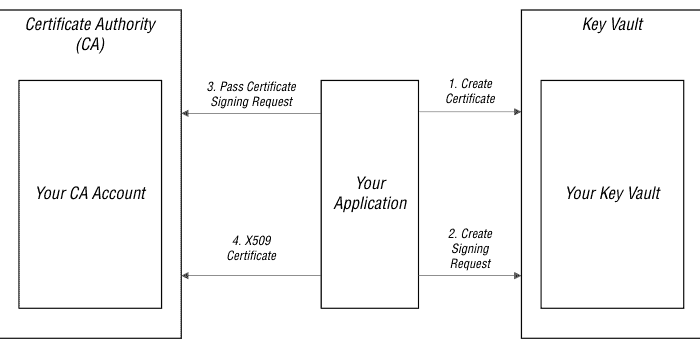

- 1. 首先，Key Vault 向您的应用程序发送证书签名请求 (CSR)。
- 2. 在第二步中，通过您的应用程序将 CSR 发送到您选择的 CA。
- 3. 在第三步中，由您选择的 CA 颁发 X.509 证书。
- 4. 最后，通过将您的 CA 的 X.509 证书与您的应用程序合并，您会创建一个新证书。

由于私钥是在 Azure Key Vault 中创建并安全存储的，因此它比直接处理 CSR 提供了更好的安全性。此外，如果您将 Key Vault 连接到受信任的证书颁发机构（称为集成 CA），您可以直接在 Azure Key Vault 中创建证书。

要连接证书颁发机构，您需要执行一次性设置。类似于前面所示的手动 CSR 创建过程，您可以请求证书，Key Vault 将直接与 CA 交互以满足您的请求。图 6.8 显示了一个图表，展示了该过程的端到端详细信息。

图 6.8 Microsoft 已集成证书颁发机构和 Key Vault

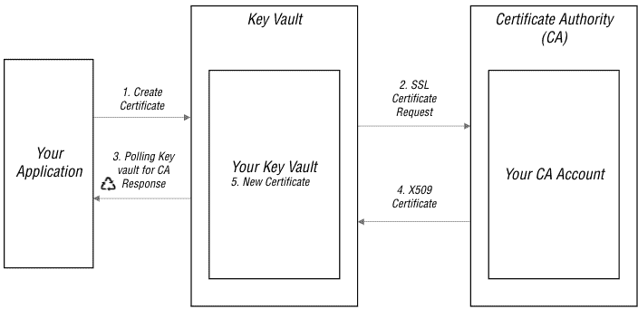

- 1. 在前面的图表中，由您的应用程序创建证书，这会在您的 Key Vault 中内部创建一个密钥。
- 2. 在收到来自 CA 的 SSL 证书请求后，Key Vault 将其发送到 CA。
- 3. 应用程序轮询您的 Key Vault 以查询证书完成情况，一旦收到 CA 的 X.509 证书响应，即完成。
- 4. CA 会响应 Key Vault 的 SSL 证书请求，颁发 X.509 SSL 证书。
- 5. 一旦 CA 的 X.509 证书与新证书合并，您的新证书即会创建完成。

这种方法有几个明显的优势，包括 Key Vault 可以监控和管理证书生命周期，因为它已连接到颁发 CA。因此，它可以自动续订您的证书，在证书过期时通知您，并跟踪证书吊销。

Azure Key Vault 资源提供程序支持两种资源类型：保管库和托管 HSM，使用户和应用程序能够存储和使用广泛的密钥/密钥数据类型。

Azure Key Vault 服务有两个层级：标准层使用软件密钥进行加密，高级层使用硬件安全模块 (HSM) 来保护密钥。

您可以通过将应用程序密钥集中在 Azure Key Vault 中来控制其分发，Key Vault 大大降低了密钥意外泄露的可能性。由于不在应用程序中存储安全信息，应用程序开发人员不再需要编写包含此信息的代码。

## 设计安全远程访问策略

在设计远程访问策略时，您必须考虑所有可用选项并确定哪个选项最合适。让我们从站点到站点 (S2S) VPN 开始。S2S VPN 是通过 Internet、专用网络或外包 IPsec 网络连接不同站点上的两个网关建立的。任何组织都可以快速且安全地访问其 IT 资源，无论这些资源是托管在本地还是在云中。

S2S VPN 的主要功能是提供对敏感信息和网络资源的安全访问，例如内部客户和销售系统、云应用程序以及最终用户在多种设备上使用的本地文件存储。

S2S 连接可以支持跨本地和混合配置。S2S VPN 网关是通过 IPsec/IKE (IKEv1 或 IKEv2) VPN 隧道建立的网络连接。流量在一端加密，并通过公共 Internet 发送到另一端，另一端解密并将其路由到目的地。S2S VPN 连接需要本地带有公共 IP 地址的 VPN 设备。该技术使使用公共 Internet 连接或 WAN 连接连接地理位置分离的站点或网络成为可能。VPN 连接需要一个分配有公共 IP 地址的本地 VPN 设备。

图 6.9 描绘了典型的部署拓扑，显示了在 Microsoft Azure 和本地之间建立 VPN 隧道 (IPsec VPN 隧道) 的单站点 S2S VPN。

图 6.9 站点到站点 VPN

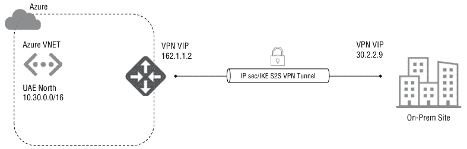

您可以从组织的虚拟网络网关创建多个 VPN 连接，通常连接到多个本地站点。多站点连接类型是 S2S 连接的扩展。多连接工作需要路由类型的 VPN（在与经典 VNet 共同使用时称为 *动态网关*）。所有通过网关的连接都共享可用带宽，因为每个虚拟网络仅限于一个 VPN 网关。

图 6.10 描绘了典型的部署拓扑，显示了在 Microsoft Azure 和本地之间建立 VPN 隧道 (IPsec VPN 隧道) 的多站点 S2S VPN。

图 6.10 Microsoft Azure 多站点 S2S VPN

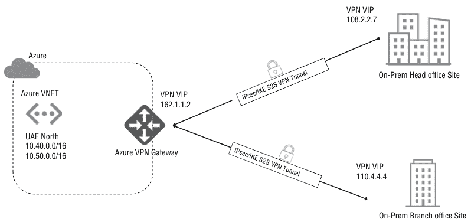

VPN 网关可以使用一个公共 IP 地址设置为主动-待机模式，或使用两个公共 IP 地址设置为主动-主动模式。将 VPN 网关设置为主动-主动模式是 Microsoft 推荐的方法，其中两个 IPsec 隧道都同时处于活动状态，数据同时通过两个隧道流动。

此外，云消费者受益于主动-主动带来的吞吐量增加。主动-待机是指一个 IPsec 隧道处于活动状态，另一个处于待机状态的操作。如果活动隧道出现问题，流量将切换到待机隧道。

点到站点 (P2S) VPN 网关连接允许网络工程师从单个最终用户计算机构建到 Azure 虚拟网络的安全连接。

连接到 P2S 网络是通过最终用户的计算机完成的。从远程位置（例如从家中或在会议期间）连接到 Azure VNet，对于远程工作者来说是一个绝佳的解决方案。如果只有少数客户端连接到 VNet，P2S VPN 也适用于 S2S VPN。P2S 连接不需要本地公共 IP 地址或 VPN 设备，这与 S2S 连接不同。如果两个链路的要求兼容，可以通过单个 VPN 网关同时使用 P2S 链路和 S2S 链路。图 6.11 描绘了典型的部署拓扑，显示了用户和 P2S VPN 以在 Microsoft Azure 和最终用户设备之间建立 VPN 隧道 (P2S SSTP 隧道和 P2S IKE 隧道)。

图 6.11 点到站点 VPN

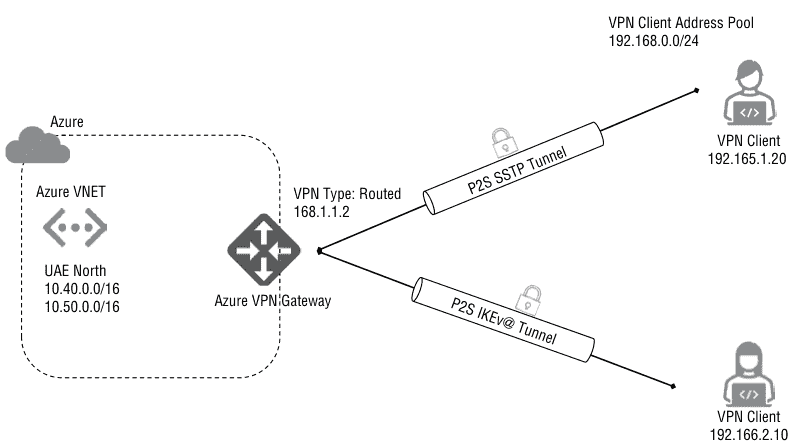

虚拟网络可以像虚拟网络的本地位置一样相互连接 (VNet 到 VNet)。两种连接类型都通过 VPN 网关提供 IPsec/IKE 隧道。您可以将 VNet 之间的通信与多站点配置相结合。可以建立结合本地到本地和本地到虚拟连接的网络拓扑。

使用 Azure 的 P2S 解决方案，用户可以快速轻松地在家工作，因为该解决方案是基于云的。您可以快速扩展容量，并在不再需要时同样轻松快速地将其关闭。使用点到站点 (P2S) VPN 网关，您可以安全地从客户端个人计算机连接到您的 (VNet) 虚拟网络。


当从客户端计算机启动 P2S 连接时，远程办公人员可以从家中、会议现场或远程位置访问 Azure 虚拟网络 (VNet) 或本地数据中心。如果您的设计要求是远程用户可以访问 Azure 和本地资源，则可以使用此方案，如图 6.12 所示。

## 图 6.12 Microsoft Azure 连接

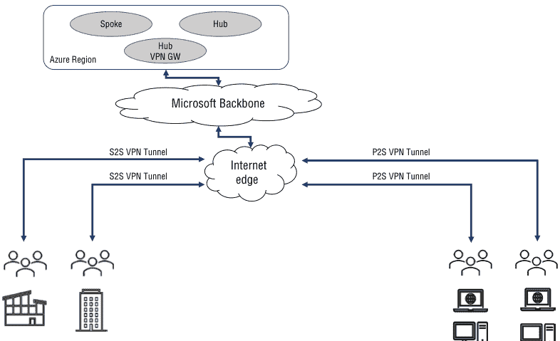

安全连接到 Azure 资源需要以下步骤：

- 1. 创建虚拟网络网关（如果尚不存在）。
- 2. 使用 P2S VPN 配置网关。
- 3. 配置 Azure 虚拟网络网关，使用 Internet 建立 S2S 隧道。
- 4. 在本地设备上安装 Azure 虚拟网络网关。
- 5. 可从 Azure 门户下载 P2S 配置文件，下载后分发到客户端。

如果您的设计要求需要连接两个站点（例如总部和分支机构），可以使用 S2S VPN。S2S（S2S VPN）网关连接是通过 IPsec/IKE（IKEv1 或 IKEv2）VPN 隧道建立的连接。S2S 连接可用于跨本地和混合配置。S2S 连接需要一个位于本地且分配有公共 IP 地址的 VPN 设备。

在某些场景中，远程员工可能只需访问部署在 Azure 上的资源。对于此场景，远程员工可以使用 Azure 堡垒解决方案，而不是 VPN 连接，以使用 RDP 或安全外壳协议 (SSH) 获得安全 shell 访问，而无需对被访问的 VM 拥有公共 IP 地址，如图 6.13 所示。该解决方案提供表 6.3 中描述的优势。

## 表 6.3 优势

| 优势 | 说明 |
|---|---|
| Azure 门户支持 RDP 和 SSH。 | 您可以在 Azure 门户中单击一下即可直接连接到 RDP 和 SSH 会话。 |
| RDP/SSH 的防火墙穿透和通过 TLS 的远程会话。 | 您将使用自动流式传输到本地设备的 HTML5 Web 客户端版本与 Azure 堡垒进行交互。您的 RDP/SSH 连接通过 TLS 端口 443 进行，以增强安全性。 |
| Azure 虚拟机不需要公共 IP 地址。 | 您不需要在 Azure VM 上配置公共 IP 地址即可通过 Azure 堡垒打开 RDP/SSH 连接。 |
| NSG 管理无需烦恼。 | Azure 堡垒不需要任何 NSG。您可以配置 NSG 以仅允许来自 Azure 堡垒的 RDP/SSH，因为 Azure 堡垒通过专用 IP 地址连接到您的虚拟机。因此，您无需在每次需要安全连接到虚拟机时管理 NSG。 |
| VM 上的堡垒主机无需单独管理。 | Azure 提供的 Azure 堡垒 PaaS 服务是一个完全托管的平台，通过内部强化过程提供安全的 RDP/SSH 连接。 |
| 端口扫描保护。 | VM 无需暴露在 Internet 上，因此可免受流氓和恶意用户的端口扫描。 |
| 单侧强化。 | 您的虚拟网络中的 VM 无需单独强化，因为 Azure 堡垒位于其边缘。 |
| 零日漏洞保护。 | Azure 堡垒可让您持续保持最新状态，并针对零日漏洞利用进行了强化。 |

许多 IT 组织必须针对居家办公政策调整其容量、网络、安全性和治理。当员工在家工作时，他们不受与本地服务关联的分层安全策略的保护。此类场景可能要求您选择一种能够更快速响应环境变化的解决方案，而虚拟桌面基础架构 (VDI) 正是合适的解决方案。Azure VDI 部署可以帮助组织快速响应不断变化的环境。要保护您的 VDI 部署，您需要一种方法来阻止入站和出站 Internet 流量。Azure 防火墙目标网络地址转换 (DNAT) 规则及其基于威胁情报的过滤功能可以帮助您实现此目标。

## 图 6.13 Microsoft Azure 远程连接

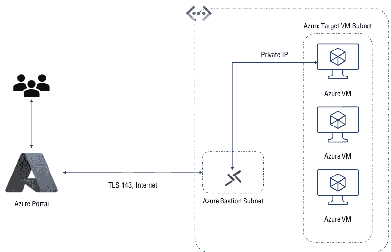

使用 Azure 虚拟桌面，您可以虚拟化桌面和应用。借助它，您可以简化管理、运行多个 Windows 10/11 会话、为企业优化 Microsoft 365 应用，并使用远程桌面服务 (RDS)。使用 Azure，您可以快速部署和缩放 Windows 桌面和应用，并获得内置的安全性和合规性选项。在 Azure 虚拟桌面网络中运行的虚拟机不需要一组入站网络连接。它们需要允许出站网络连接。

> 使用 Azure 堡垒，可以使用远程桌面协议 (RDP) 和安全外壳 (SSH) 安全且无缝地访问虚拟机 (VM)，而无需暴露公共 IP 地址。通过直接预配该服务，可支持本地或对等虚拟网络中的所有 VM。

使用 Azure 虚拟桌面，可在几分钟内实现安全远程办公。最终用户将能够使用 Windows 11 的功能和兼容性，体验新的可扩展多会话体验，同时通过使用现有 Windows 许可证来节省成本。您可以从 Azure 门户端到端管理 Azure 虚拟桌面部署。

利用 Azure AD 实现不受限制的单点登录 (SSO) 和多因素身份验证 (MFA)，以实现安全远程办公。

为实现远程办公，许多组织正在使用个人设备。Azure AD 条件访问和 Microsoft Intune 应用保护策略协同工作，以管理并保护批准应用中的企业数据。

可以在 Microsoft Defender for Office 365 中设置反网络钓鱼保护，以更好地保护员工免受日益复杂的攻击。

## 设计保护特权访问的策略

Microsoft 的特权访问策略旨在降低组织因高影响、高概率和高影响攻击而面临的风险。当攻击者攻破特权用户帐户时，几乎总会对组织内的业务关键资产产生重大影响。控制您特权帐户的攻击者可能会破坏所有其他安全保障。每个组织的首要安全优先事项都应该是特权访问。

使用这些技术的数据窃取攻击导致许多知名品牌发生多起高调泄露事件（以及许多未报告的事件）。此外，近年来勒索软件攻击者采用了这些技术，助长了旨在中断业务运营的高利可图的人工操作勒索软件攻击激增。

### 构建推荐的设计策略

Microsoft 推荐的特权访问策略是逐步构建特权访问的闭环系统。这确保只有可信的干净设备、帐户和中介才能用于提供特权访问。

为现实世界中复杂的事物（例如船舶）设计防水策略至关重要，需要仔细建立并遵循标准，并持续审计和监控结果以确保解决泄漏问题。您不能把木板钉成船的形状就指望船是防水的。构建防水部件（例如船体和发动机舱），并在留出供人进入的通道后，保持安全和舒适物品（例如收音机、座椅等）防水，首要的是先构建关键防水部件。即使是最好的系统最终也可能泄漏，因此您需要进行预防性维护，留意泄漏并修复它们，以防止船舶沉没。

保护特权访问有两个简单的目标。

- 将执行特权操作的能力严格限制在少数几个授权路径上。
- 保护并密切监控这些路径。

访问系统的路径有两种类型：用户访问（用于使用功能）和特权访问（用于管理功能或访问敏感功能）。

**用户访问** 图 6.14 底部较浅的路径描绘了标准用户帐户执行一般生产力任务，例如电子邮件、协作、网页浏览以及使用业务线应用程序或网站。此路径包括帐户登录到设备或工作站，有时通过远程访问解决方案等中介，并与企业系统交互。

**特权访问** 图 6.14 顶部较深的路径描绘了特权访问，其中 IT 管理员或其他敏感帐户等特权帐户访问业务关键系统和数据，或在企业系统上执行管理任务。虽然技术组件在性质上可能相似，但对手利用特权访问所能造成的损害要高得多。

## 图 6.14 Microsoft Azure 特权访问安全策略指南

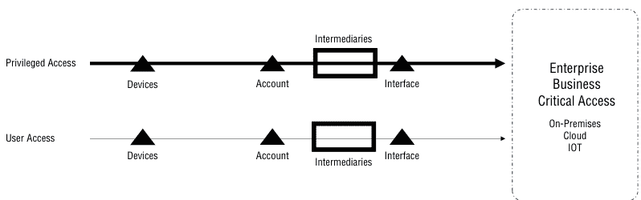

保护特权访问的目标有两个。

- 应允许少数几个授权路径执行特权操作。
- 密切监控并保护这些路径。

使用某项功能可授予用户对其的访问权限，而管理某项能力则会授予特权用户访问权限。

标识和授权的提升路径也是完整访问管理系统的一部分。


- 标识系统：标准和特权标识的用户可以访问包含帐户、管理组、同步和联合功能以及其他标识支持功能的标识目录。

- 授权提升路径：在特权访问/特权标识管理系统中，授权提升路径使标准用户能够与特权工作流进行交互。例如，管理者或同行可以作为即时 (JIT) 流程的一部分，批准针对敏感系统的管理员权限请求。

要获得对企业的特权访问权限，攻击者可能会同时针对这些组件。

为了使特权访问策略具有可持续性和可管理性，必须关闭所有未授权的攻击向量，并创建一个与系统物理连接的控制台的虚拟等效物。

结合以下策略将是有效的：

- 零信任访问控制：本指南讨论零信任访问控制。（在第 1 章“定义和实施整体安全策略与架构”中已详细讨论，包括快速现代化计划 [RAMPs]。）

- 资产防护：采用良好的安全卫生习惯，资产防护可以防止直接的资产攻击。本指南不涵盖访问控制组件之外资源的资产防护，但通常包括快速部署安全更新/补丁、配置操作系统以满足制造商/行业安全基线、保护传输中和静态数据，以及将安全最佳实践集成到开发/DevOps 流程中。


安全的特权访问要求对正在使用的账户进行端到端零信任身份验证，并且必须确认该账户属于人类用户，而非冒充他们的黑客。

在安全警报、事件调查和威胁搜寻中，特殊账户因其更高的业务影响而值得更多关注和优先处理。

最特权的账户受到最严密的保护，因为如果它们被攻破，可能会对组织运营产生重大或实质性影响。

## 摘要

基于可用的不同 Microsoft Azure 基础设施服务选项，选择适当的安全基线取决于了解该基线打算应用于哪种操作系统、应用程序、平台、设备和用户角色。

在本章中，您还阅读了关于规划基础设施、跨团队规划和部署安全策略、建立安全策略主动且持续演进的流程、指定移动设备和客户端的安全要求，以及强化操作系统和应用程序隔离的内容。此外，您还学习了如何创建管理密码、密钥和证书的策略，并指定保护 Active Directory 域服务的要求。

## 考试要点

**了解如何为服务器和客户端终端指定安全基线。** 您可以使用 Intune 快速部署 Windows 安全基线，以保护和保障用户的安全。

尽管 Windows 和 Windows Server 具有旨在保障安全的默认安全配置，但许多组织仍倾向于进一步自定义其安全设置。由于可用的控件数量众多，许多组织寻求关于配置不同安全功能的指导，而 Microsoft 以安全基线的形式提供了此类指导。

**了解如何为服务器（包括多个平台和操作系统）指定安全要求。** 通过确保服务器和客户端尽可能安全配置（即 *强化* 操作系统），来保护您的 Windows、Linux 及任何其他基于操作系统的服务器环境至关重要。因为服务器的角色决定了如何应用强化设置，因此必须首先定义服务器的安全要求。

在独特角色中的某些服务器可能比其他服务器需要更多配置，但大多数服务器都会有基础安全要求。如果您的服务器是域控制器，则需要采取额外步骤来强化目录服务。使用 Microsoft SCT 了解服务器的当前状态。

**了解如何为移动设备和客户端指定安全要求（包括终端防护、强化和配置）。** 在管理托管设备时，Microsoft Intune 可以帮助您保持设备安全和最新，同时保护组织的数据。托管设备和未托管设备都可以用于保护组织的数据，还可以通过阻止受攻破设备的访问来保护数据。

您可以使用 Intune 的设备配置和合规性策略来配置设备，以满足组织的安全目标。您可以将配置文件部署到支持一个或多个配置文件的策略注册设备组中。

**了解如何指定保护 AD DS 的要求。** Microsoft 建议将物理域控制器安装在数据中心与常规服务器群分开的安全机架或笼子中。应在可能的情况下在域控制器上安装 TPM 芯片，并为域控制器服务器上的所有卷启用 BitLocker 驱动器加密。

尽管 BitLocker 通常只会增加个位数百分比的性能开销，但它可以在移除磁盘时保护目录免遭攻破。

要监控域控制器，Microsoft Defender for Identity 会捕获和解析网络流量，并直接使用来自域控制器的 Windows 事件来分析数据以检测攻击。

**了解设计管理密码、密钥和证书的策略的方法。** 使用 Azure Key Vault，您可以在云中存储应用程序密码，例如加密密钥、证书和令牌。您的应用程序密码受 Key Vault 保护，安全存储、权限受控且访问有记录。保管库、密钥和密码是 Azure Key Vault 中的三个主要概念。

Key Vault 保护密码。如果密码被分组在一个保管库中，安全事件的影响范围将更大，因为攻击可以跨问题访问密码。

**了解设计安全远程访问策略的方法。** 在设计远程访问策略时，必须考虑可用选项并选择最适合您需求的选项。

Azure P2S 解决方案基于 Azure，可以快速部署以回应用户居家办公需求的增长。当不再需要增加的容量时，它可以同样轻松快速地关闭。

Azure 虚拟桌面服务为桌面和应用程序提供全面的虚拟化解决方案。使用它，您将获得简化的管理、多会话 Windows 10 和 11、针对企业环境优化的 Microsoft 365 应用以及 RDS 支持。

**了解设计保护特权访问策略的方法。** 控制您特权账户的攻击者可以破坏所有其他安全措施，因为特权账户的安全是所有其他安全措施的基础。从风险角度来看，特权访问安全丧失是一起影响大且发生概率高的事件，并且正在各行业以惊人的速度增长。

使用这些技术的有针对性的数据窃取攻击已导致许多知名品牌发生重大泄露事件（还有许多未报告的泄露事件）。最近，勒索软件攻击者采用了这些技术，导致高获利的人工操作勒索软件攻击激增。

## 复习问题

- 1. 哪个新兴学科致力于教育员工、保护员工并防范内部威胁？

- A. 网络安全
- B. 人员安全
- C. 应用和数据安全
- D. AI 和 ML 安全

- 2. 根据 Microsoft 构建安全策略的最佳实践，成功安全策略流程的组成部分是什么？

- A. 与业务战略紧密对齐。
- B. 现代化安全策略。
- C. 部署最有价值的计划。
- D. A 和 B 都是。

- 3. 以下哪项 Azure 安全服务可以持续评估贵组织的安全态势和控制？

- A. Microsoft Defender for Endpoints
- B. Microsoft Defender for Cloud
- C. Microsoft Intune
- D. 以上都不是

- 4. Microsoft 建议在以下哪些领域使用计分卡指标？（选择两项。）

- A. 业务赋能和安全改进
- B. 安全态势和安全响应
- C. 安全设计和策略
- D. 安全方面的每月改进

- 5. 有三大要素有助于保障企业安全。以下哪一项不包括在内？

- A. 机密性
- B. 冗余
- C. 可用性
- D. 完整性


**6.** 哪种工具允许企业安全管理员下载、检查、测试、修改、维护和管理 Microsoft 建议的 Windows 和其他 Microsoft 产品的安全配置基线？

- A. Microsoft Defender for Cloud
- B. Security Compliance Toolkit
- C. Azure Security Benchmark
- D. 以上皆非

**7.** 哪种工具允许企业安全管理员下载、检查、测试、修改、维护和管理 Windows 和 Linux 工作负载的特定操作系统强化？

- A. Microsoft Defender for Cloud
- B. Security Compliance Toolkit
- C. Azure Security Benchmark
- D. 以上皆非

**8.** 必须确保禁用旧版协议，并强制实施更安全的通信方法。根据 Microsoft 的建议，由于不支持加密，必须禁用哪种协议？

- A. SMB 1.0
- B. Telnet
- C. SMB 3.0
- D. 以上皆非

**9.** 哪种工具用于管理加入域的计算机上本地帐户的密码？

- A. LAPS
- B. MAPS
- C. GPMC
- D. 以上皆非

**10.** 作为网络安全架构师，你的任务是保护企业应用和数据，使其与用户自带设备（BYOD）计划中用户拥有的应用隔离。你会在解决方案中采用哪些 Azure 服务和 Azure 策略？

- A. Microsoft Intune 和 Microsoft Intune 应用保护策略
- B. Azure AD 和条件策略
- C. Azure AD 和应用保护策略
- D. 以上皆非

11. 作为网络安全架构师，你的任务是保护用户自带设备（BYOD）计划中的移动设备设置。你会在解决方案中采用哪些 Azure 服务和 Azure 策略？

- A. Microsoft Intune 和 Microsoft Intune 应用保护策略
- B. 用于设置设备安全策略和访问规则的移动性与安全性
- C. Azure AD 和设备保护策略
- D. 以上皆非

12. 作为网络安全架构师，你的任务是为 Windows 客户端 PC 部署 Autopilot 解决方案并将其注册。你需要什么先决条件？

- A. 注册需要多用户订阅。
- B. 注册需要 Windows 客户端 CAL 许可证。
- C. 注册需要域加入配置文件。
- D. 以上皆非

13. 以下哪项 Microsoft Azure 服务可帮助你监控和分析域控制器，以识别攻击和威胁？

- A. Microsoft 365 Defender
- B. Microsoft Defender for Cloud
- C. Microsoft Defender for Identity
- D. 以上皆非

14. 作为网络安全架构师，你的任务是采用解决方案，在 Microsoft 云中安全地存储密钥、证书和令牌。你会在组织中采用哪项 Azure 服务？

- A. Azure Key Vault
- B. Microsoft 证书颁发机构
- C. Microsoft 公钥基础设施
- D. 以上皆非

15. Azure Key Vault 使用哪些 Azure 服务来对寻求访问保管库的用户和应用程序进行身份验证？

- A. 在 Azure 中运行的组织拥有的 Microsoft Active Directory
- B. 在私有数据中心运行的组织拥有的 Microsoft Active Directory
- C. Microsoft Azure AD
- D. 以上皆非

16. 作为网络安全架构师，你的任务是采用远程访问解决方案，并需要以安全的方式从 Microsoft Azure 部署它；你会采用以下哪项 Azure 解决方案？

- A. Azure 虚拟桌面
- B. 在私有数据中心运行的 VMware Horizon
- C. 在私有数据中心运行的 Citrix Xenapp 和 XenDesktop
- D. 以上皆非

17. 作为网络安全架构师，你的任务是采用成本效益高的远程访问解决方案。你会为组织采用以下哪项解决方案？

- A. Azure 虚拟桌面
- B. 具有端到端安全性的 Azure 虚拟机
- C. Azure 堡垒解决方案
- D. 以上皆非

18. Azure 堡垒解决方案需要哪种安全解决方案？

- A. 仅在一处进行强化
- B. 不需要强化
- C. 由 Microsoft 执行强化
- D. 以上皆非

19. 可以使用哪种解决方案从单个客户端计算机安全地连接到虚拟网络？

- A. 点到站点 (P2S) VPN 网关
- B. 站点到站点 (S2S) VPN 网关
- C. ExpressRoute
- D. 以上皆非

20. 可以使用哪种解决方案从一个站点安全地连接到另一个站点的虚拟网络？

- A. 点到站点 (P2S) VPN 网关
- B. 站点到站点 (S2S) VPN 网关
- C. ExpressRoute
- D. 以上皆非

## 第 7 章

## 为保护 PaaS、IaaS 和 SaaS 服务制定策略和要求

### 本章涵盖的 Microsoft SC-100 考试目标包括：

- 为 SaaS、PaaS 和 IaaS 服务指定安全基线
- 为 IoT 工作负载指定安全要求
- 为数据工作负载（包括 SQL Server、Azure SQL、Azure Synapse 和 Azure Cosmos DB）指定安全要求
- 为 Web 工作负载（包括 Azure 应用服务）指定安全要求
- 为存储工作负载（包括 Azure 存储）指定安全要求
- 为容器指定安全要求
- 为容器编排指定安全要求


在本章中，我们将重点介绍了解保护 PaaS、IaaS 和 SaaS 服务的策略和要求。你将了解 Azure 云服务的共享责任模型，以及在考虑和评估这些服务时，你和 Microsoft 各自处理哪些安全任务。这取决于工作负载是作为软件即服务 (SaaS)、平台即服务 (PaaS)、基础设施即服务 (IaaS) 还是本地托管。

Microsoft 负责保护物理基础设施和抽象层。其余各层（包括业务应用程序）的安全义务由你的组织承担。在 IaaS 环境中，你可以部署网络数据包代理 (NPB) 来可视化云网络安全问题。NPB 将流量和数据发送到网络性能管理 (NPM) 系统和安全工具。此外，你可以确保记录网络端点事件。

Microsoft 可能会与 SaaS 服务的用户协商具体的安全责任条款。SaaS 服务通过浏览器提供对软件应用程序和数据的访问。可以使用云访问安全代理 (CASB) 提供的日志记录、审计、访问控制和加密功能来调查 SaaS 产品中的安全问题。

PaaS 平台允许组织构建应用程序，而无需管理硬件或后端软件的开销或复杂性。尽管 Microsoft 在 PaaS 模型中保护了大部分环境，但你的组织仍有责任保护其应用程序。你应该确保内部和外部使用 CASP、日志记录和警报、IP 限制以及 API 网关来保护 PaaS 应用程序的 API。

在本章中，你将了解如何为 PaaS 建立安全基线、为 IaaS 服务建立安全基线、为 SaaS 建立安全基线、为 IoT 工作负载建立安全要求、建立数据安全要求、定义 Web 工作负载的安全要求、确定存储工作负载的安全要求、定义容器安全要求，并为容器编排提供安全规范。

### 为 SaaS、PaaS 和 IaaS 服务建立安全基线

让我们开始了解 Microsoft Azure 的共享责任。组织在考虑和评估 Azure 云服务之前，必须考虑和评估 Azure 云服务的隐私、安全性和合规性。云提供商（例如 Microsoft）也必须


管理安全与合规，以实现安全的计算解决方案。此外，许多考虑采用 Azure 云的组织错误地认为，在迁移到云后，他们不再承担任何安全或合规责任。

云服务提供商通常负责确保某些元素（包括物理基础设施和网络）的安全，但组织应了解自身的义务。组织还必须了解自己在保护数据隐私和安全方面的角色，即使 Microsoft 提供服务来帮助保护数据。

Microsoft 明白，云服务提供商与组织共享责任，且责任划分取决于云服务模型。云计算的物理安全完全由 Microsoft 负责。

组织认为，将服务迁移到云的主要价值在于由其他人管理物理环境。被视为物理安全一部分的元素包括建筑物或设施、服务器以及网络设备。作为 Microsoft 安全策略和流程的一部分，基础设施受到防止未经授权的物理访问的保护，电力以高可用性方式维护，并且服务应在发生灾难时故障转移到新的物理位置。

组织有责任确保数据及其分类正确，并且解决方案符合法规要求。云服务提供商和组织共享其余责任。

让我们继续探讨 SaaS 的安全基线。软件即服务通过 Internet 连接到基于云的应用。最常见的示例包括电子邮件、日历和办公工具（例如 Microsoft Office 365）。

使用 SaaS，您可以按需付费购买完整的软件解决方案。在大多数情况下，您的组织租用应用程序，用户通过 Web 浏览器使用 Internet 访问该应用程序。基础设施、应用程序、中间件和数据均存储在服务提供商的数据中心。除了管理硬件和软件外，您的服务提供商还将通过适当的服务协议确保您的应用程序和数据的可用性和安全性。SaaS 应用程序可让您的组织在最小前期投资的情况下快速投入运行。

使用 SaaS 解决方案时，您可能只能在应用程序级别控制安全选项，因为云供应商持有基础设施和平台层。除了评估其声誉和往绩外，您还应查看其安全策略。除应用程序和数据安全外，您还应评估它们是否能提供网络安全。

使用 Microsoft Defender for Cloud，您可以通过使用安全得分来改善 Azure 工作负载的安全态势。使用 Microsoft 365，您还可以使用 Microsoft 安全得分来改善 SaaS 安全态势。安全得分建议可帮助您的组织保护自身免受威胁。通过 Microsoft 365 Defender 门户中的集中式仪表板，组织可以监控其身份、应用程序和设备的安全性并采取行动。此外，Microsoft 365 Defender 帮助组织执行以下操作：

- 评估组织的安全态势。
- 提供可发现性、可见性、指导和控制，以改善其安全态势。
- 通过与基准进行比较来建立关键绩效指标。

Office 云策略允许您在用户设备上强制执行 Microsoft 365 企业版应用的策略设置，即使这些设备未加入域或未进行其他管理。当用户登录时，Microsoft 365 企业版应用策略设置会漫游到设备。Windows、macOS、iOS 和 Android 设备可以使用策略设置，但并非所有设置在所有操作系统上都可用。

创建策略配置时，您可以查看并应用 Microsoft 推荐作为安全基线的策略。如果策略标记为安全基线，您还可以筛选视图以仅包含标记为安全基线的策略。

内容根据 Azure 安全基准定义的安全控制以及 Azure 云服务的相关指南进行分组。

Azure 控制（SaaS 服务，也称为云服务）侧重于网络安全、日志和监控、身份和访问控制、数据保护、漏洞管理、库存和资产管理、安全配置、恶意软件防护、数据恢复、事件响应、渗透测试和红队演练等领域。

什么是渗透测试？渗透测试是针对您的系统、应用程序和数据进行的模拟网络攻击，旨在检查可利用的漏洞。在 Web 应用程序安全性中，渗透测试通常用于扩展 Web 应用程序防火墙 (WAF)。

渗透测试可能涉及尝试入侵任意数量的应用程序系统（例如，应用程序编程接口 [API]、前端/后端服务器），以发现诸如未经清理的输入等漏洞，这些漏洞容易受到代码注入攻击。

渗透测试的了解可用于微调组织 WAF 安全策略并修补已发现的漏洞。

表 7.1 提供了 Azure 云服务与 Azure 安全基准之间的完整映射。

参考和更多信息，请参阅以下内容：
github.com/MicrosoftDocs/SecurityBenchmarks/raw/master/Azure%20offer%20Security%20Baselines/1.1/azure-cloud-services-security-baseline-v1.1.xlsx

## 表 7.1 Azure 云服务和 Azure 安全基准

| Azure 控制 | 责任 | 基准建议 |
|---|---|---|
| 网络安全 | 客户 | 在虚拟网络中保护 Azure 资源。 |
| 网络安全 | 客户 | 监控并记录虚拟网络、子网和 NIC 的配置和流量。 |
| 网络安全 | 客户 | 保护关键 Web 应用程序。 |
| 网络安全 | 客户 | 拒绝与已知恶意 IP 地址的通信。 |
| 网络安全 | 客户 | 记录网络数据包。 |

| Azure 控制 | 责任 | 基准建议 |
|---|---|---|
| 网络安全 | 客户 | 部署基于网络的入侵检测/入侵防御系统 (IDS/IPS)。 |
| 网络安全 | 客户 | 管理 Web 应用程序的流量。 |
| 网络安全 | 不适用 | 最大限度地降低网络安全规则的复杂性和管理开销。 |
| 网络安全 | 客户 | 为网络设备维护标准安全配置。 |
| 网络安全 | 客户 | 记录流量配置规则。 |
| 网络安全 | 客户 | 使用自动化工具监控网络资源配置并检测更改。 |
| 日志和监控 | 共享 | 使用批准的时间同步源。 |
| 日志和监控 | 客户 | 配置中央安全日志管理。 |
| 日志和监控 | 客户 | 为 Azure 资源启用审核日志记录。 |
| 日志和监控 | 不适用 | 从操作系统收集安全日志。 |
| 日志和监控 | 客户 | 配置安全日志存储保留期。 |
| 日志和监控 | 客户 | 监控和审查日志。 |
| 日志和监控 | 客户 | 为异常活动启用警报。 |
| 日志和监控 | 客户 | 集中反恶意软件日志记录。 |
| 日志和监控 | 不适用 | 启用 DNS 查询日志记录。 |
| 日志和监控 | 不适用 | 启用命令行审核日志记录。 |

## 表 7.1 Azure 云服务和 Azure 安全基准（续）

| Azure 控制 | 责任 | 基准建议 |
|---|---|---|
| 身份和访问控制 | 客户 | 维护管理帐户清单。 |
| 身份和访问控制 | 不适用 | 在适用的地方更改默认密码。 |
| 身份和访问控制 | 客户 | 使用专用管理帐户。 |
| 身份和访问控制 | 客户 | 与 Azure Active Directory 配合使用单一登录 (SSO)。 |
| 身份和访问控制 | 不适用 | 对所有基于 Azure Active Directory 的访问使用多重身份验证。 |
| 身份和访问控制 | 客户 | 对所有管理任务使用专用计算机（特权访问工作站）。 |
| 身份和访问控制 | 不适用 | 对来自管理帐户的可疑活动进行日志记录和警报。 |
| 身份和访问控制 | 不适用 | 仅从批准的位置管理 Azure 资源。 |
| 身份和访问控制 | 不适用 | 使用 Azure Active Directory。 |
| 身份和访问控制 | 不适用 | 定期审查和对齐用户访问。 |
| 身份和访问控制 | 不适用 | 监控访问已停用凭据的尝试。 |
| 身份和访问控制 | 不适用 | 对帐户登录行为偏差发出警报。 |
| 身份和访问控制 | 不适用 | 在支持场景中向 Microsoft 提供相关客户数据的访问权限。 |
| 数据保护 | 客户 | 维护敏感信息清单。 |
| 数据保护 | 客户 | 隔离存储或处理敏感信息的系统。 |


### 表 7.1 Azure 云服务和 Azure 安全基准（续）

| Azure 控制 | 责任 | 基准建议 |
|---|---|---|
| 数据保护 | 共享 | 监控并阻止敏感信息的未授权传输。 |
| 数据保护 | 共享 | 加密传输中的所有敏感信息。 |
| 数据保护 | 共享 | 使用主动发现工具识别敏感数据。 |
| 数据保护 | 不适用 | 使用 Azure RBAC 管理对资源的访问。 |
| 数据保护 | 共享 | 使用基于主机的数据防泄漏来强制执行访问控制。 |
| 数据保护 | 客户 | 加密静态敏感信息。 |
| 数据保护 | 客户 | 记录关键 Azure 资源的变更并发出警报。 |
| 漏洞管理 | Microsoft | 运行自动漏洞扫描工具。 |
| 漏洞管理 | 共享 | 部署自动操作系统补丁管理解决方案。 |
| 漏洞管理 | 客户 | 为第三方软件部署自动补丁管理解决方案。 |
| 漏洞管理 | Microsoft | 对比连续的漏洞扫描结果。 |
| 漏洞管理 | 客户 | 使用风险评级流程确定发现漏洞的修复优先级。 |
| 资产清单和资产管理 | 客户 | 使用自动资产发现解决方案。 |
| 资产清单和资产管理 | 不适用 | 维护资产元数据。 |
| 资产清单和资产管理 | 客户 | 删除未授权的 Azure 资源。 |
| 资产清单和资产管理 | 客户 | 定义并维护已批准 Azure 资源的清单。 |
| 资产清单和资产管理 | 客户 | 监控未批准的 Azure 资源。 |
| 资产清单和资产管理 | 客户 | 监控计算资源中的未批准软件应用程序。 |
| 资产清单和资产管理 | 客户 | 删除未批准的 Azure 资源和软件应用程序。 |
| 资产清单和资产管理 | 客户 | 仅使用已批准的应用程序。 |
| 资产清单和资产管理 | 不适用 | 仅使用已批准的 Azure 服务。 |
| 资产清单和资产管理 | 客户 | 维护已批准软件的清单。 |
| 资产清单和资产管理 | 不适用 | 限制用户与 Azure 资源管理器交互的能力。 |
| 资产清单和资产管理 | 客户 | 限制用户在计算资源中执行脚本的能力。 |
| 资产清单和资产管理 | 客户 | 在物理或逻辑上隔离高风险应用程序。 |
| 安全配置 | 客户 | 为所有 Azure 资源建立安全配置。 |
| 安全配置 | 不适用 | 建立安全的操作系统配置。 |
| 安全配置 | 客户 | 维护安全的 Azure 资源配置。 |
| 安全配置 | 不适用 | 维护安全的操作系统配置。 |
| 安全配置 | 客户 | 安全存储 Azure 资源的配置。 |
| 安全配置 | 不适用 | 安全存储自定义操作系统映像。 |
| 安全配置 | 客户 | 为 Azure 资源部署配置管理工具。 |
| 安全配置 | 客户 | 为操作系统部署配置管理工具。 |
| 安全配置 | 客户 | 为 Azure 资源实施自动配置监控。 |
| 安全配置 | 客户 | 为操作系统实施自动配置监控。 |
| 安全配置 | 客户 | 安全管理 Azure 机密。 |
| 安全配置 | 不适用 | 安全且自动地管理标识。 |
| 安全配置 | 客户 | 消除意外的凭据泄露。 |
| 恶意软件防护 | 客户 | 使用集中管理的反恶意软件。 |
| 恶意软件防护 | 不适用 | 预扫描要上传到非计算 Azure 资源的文件。 |
| 恶意软件防护 | 不适用 | 确保反恶意软件和签名已更新。 |
| 数据恢复 | 不适用 | 确保定期自动备份。 |
| 数据恢复 | 不适用 | 执行完整系统备份并备份客户托管的密钥。 |
| 数据恢复 | 不适用 | 验证包括客户托管密钥在内的所有备份。 |
| 数据恢复 | 不适用 | 确保备份和客户托管密钥的保护。 |
| 事件响应 | 客户 | 创建事件响应指南。 |
| 事件响应 | 客户 | 创建事件评分和优先级排序程序。 |
| 事件响应 | 客户 | 测试安全响应程序。 |
| 事件响应 | 客户 | 提供安全事件联系人详细信息并为安全事件配置警报通知。 |
| 事件响应 | 客户 | 将安全警报纳入事件响应系统。 |
| 事件响应 | 客户 | 自动化响应安全警报。 |
| 渗透测试和红队演习 | 共享 | 定期对 Azure 资源进行渗透测试，并确保修复所有关键安全发现。 |

## PaaS 安全基准

PaaS 是云中的一流开发和部署环境，提供的资源可让您构建从简单的云应用到精密的云启用型企业应用程序的各种内容。您按需从云服务提供商处购买所需资源，并通过安全的 Internet 连接访问这些资源。将 Azure PaaS 与本地部署进行对比，让我们从安全性方面探讨其优势。

PaaS 云平台使用虚拟版本，而非物理计算资源。PaaS 的一个吸引人的方面是，在构建、测试、部署、管理和更新 Web 应用程序的同时，它可让您避免购买和管理软件许可证的成本和复杂性。此外，它还提供开箱即用的开发环境，用于创建高度定制的应用程序。

可以使用密钥管理策略来缓解位于堆栈顶部的数据治理和权限管理风险。（密钥管理在最佳实践中有所介绍。）虽然密钥管理是一项额外的责任，但 PaaS 部署中存在无需管理的区域，因此您将拥有更多可用资源来管理密钥。

Azure 平台上的各种基于网络的技术可提供强大的 DDoS 防护。但是，所有基于网络的 DDoS 防护方法都受限于每个链路和每个数据中心。通过利用 Azure 的核心云功能，您可以快速且自动地扩展以抵御大型 DDoS 攻击，从而帮助避免大型攻击的影响。

使用 PaaS 部署时，您会转变整体安全方法。因此，您不再需要自己控制一切，而是将与 Microsoft 共享责任。此外，PaaS 部署与传统本地部署有很大不同，因为它们重新定义了主安全边界。传统上，您的网络将本地安全定义为主安全边界，大多数本地安全设计都将网络作为主安全枢纽。如果您正在部署 PaaS，则最好考虑将标识作为主安全边界。

所有受支持的 PaaS 服务都有基于 Azure 安全基准的安全建议。以下列表显示受支持的服务。

- Azure 应用服务
- Azure 自动化帐户
- Azure 批处理帐户
- Azure Blob 存储
- Azure Redis 缓存
- Azure 云服务
- Azure 认知搜索
- Azure 容器注册表
- Azure Cosmos DB
- Azure Data Lake 分析
- Azure Data Lake 存储
- Azure 事件中心命名空间
- Azure Functions 应用
- Azure 密钥保管库
- Azure Kubernetes 服务
- Azure 负载均衡器
- Azure 逻辑应用
- Azure SQL 数据库
- Azure SQL 托管实例
- Azure 服务总线命名空间
- Azure Service Fabric 帐户
- Azure 存储帐户
- Azure 流分析
- Azure 订阅
- Azure 虚拟网络（包括子网、网卡和网络安全组）

Azure 安全基准安全建议作为 Defender for Cloud 免费层的一部分，在建议列中提供。安全警报表示各威胁检测计划生成的警报。漏洞评估表示能够评估漏洞的服务。

Azure PaaS 安全基准可通过提供更好的工具、跟踪和安全功能以及改进保护您的


environment. 他们在创建安全基线时专注于以云为中心的控制领域。此基线指导 Azure 安全基准中列出的控制领域。它与知名的安全基准保持一致，例如由互联网安全中心 (CIS) 描述的那些基准。

每条建议中包含以下信息：

- **Azure ID**：这是 Azure 安全基准中与建议关联的 ID。
- **Recommendation**：建议紧随 Azure ID 之后，并对控制项提供高级别描述。
- **Guidance**：本部分指导你如何实施建议，并包含有关如何实施的指导链接。如果 Microsoft Defender 支持针对 Cloud 的建议，也会包含该信息。
- **Responsibility**：客户可能负责实施控制项，Microsoft 可能负责，或者责任可能由双方共享。
- **Microsoft Defender for Cloud monitoring**：Microsoft Defender for Cloud 监视控制项的程度，以及任何参考资料的链接。

基线中包含所有建议（包括与特定服务无关的建议），以便你全面了解 Azure 安全基准如何与每个服务相关联。控制项可能因各种原因偶尔不适用；例如，IaaS/以计算为中心的控制项（例如与 OS 配置管理相关的控制项）可能与 PaaS 服务无关。

你需要熟悉要保护的 PaaS 服务，然后根据对服务的了解使用相应的基线。例如，安全基线为应用服务在以下领域建立了安全建议：

- 网络安全
- 日志记录和监控
- 标识和访问控制
- 数据保护
- 漏洞管理
- 清单和资产管理
- 安全配置
- 数据恢复
- 事件响应

Defender for Cloud 的 Inventory 仪表板的一大好处是能够识别你的 PaaS 资源并验证未解决的问题。你可以按资源类型创建筛选器，以仅识别你要评估的 PaaS 资源。

现在，让我们了解应用服务的 Azure 安全基准。Microsoft 云安全基准由各种安全控制项组成，包括适用于应用服务的安全控制项，这些控制项规定了如何在 Azure 上保护你的云解决方案。

表 7.2 说明应用服务如何映射到 Microsoft 云安全基准（也称为 Azure 安全基准）。

有关参考和更多信息，请参见以下内容：

github.com/MicrosoftDocs/SecurityBenchmarks/tree/master/Azure%20Offer%20Security%20Baselines/3.0/app-service-azure-security-benchmark-v3-latest-security-baseline.xlsx

## 表 7.2 应用服务映射到 Microsoft 云安全基准

| Azure 控制项 | 责任 | 基准建议 |
|---|---|---|
| 网络安全 | 客户 | 在虚拟网络内保护 Azure 资源。 |
| 网络安全 | 客户 | 监视并记录虚拟网络、子网和网络接口的配置和流量。 |
| 网络安全 | 客户 | 保护关键 Web 应用程序。 |
| 网络安全 | 客户 | 拒绝与已知恶意 IP 地址的通信。 |
| 网络安全 | 客户 | 记录网络数据包。 |
| 网络安全 | 不适用 | 部署基于网络的入侵检测/入侵防御系统 (IDS/IPS)。 |
| 网络安全 | 客户 | 管理流向 Web 应用程序的流量。 |
| 网络安全 | 客户 | 最大限度地减少网络安全规则的复杂性和管理开销。 |
| 网络安全 | 客户 | 为网络设备维护标准安全配置。 |
| 网络安全 | 客户 | 记录流量配置规则。 |
| 网络安全 | 客户 | 使用自动化工具监视网络资源配置并检测更改。 |
| 日志记录和监控 | Microsoft | 使用批准的时间同步源。 |
| 日志记录和监控 | 客户 | 配置中央安全日志管理。 |
| 日志记录和监控 | 客户 | 为 Azure 资源启用审核日志记录。 |
| 日志记录和监控 | 不适用 | 从操作系统收集安全日志。 |
| 日志记录和监控 | 客户 | 配置安全日志存储保留期。 |
| 日志记录和监控 | 客户 | 监视并审查日志。 |
| 日志记录和监控 | 客户 | 为异常活动启用警报。 |
| 日志记录和监控 | 不适用 | 集中反恶意软件日志记录。 |
| 日志记录和监控 | 不适用 | 启用 DNS 查询日志记录。 |
| 日志记录和监控 | 不适用 | 启用命令行审核日志记录。 |
| 标识和访问控制 | 客户 | 维护管理员帐户清单。 |
| 标识和访问控制 | 客户 | 在适用的地方更改默认密码。 |
| 标识和访问控制 | 客户 | 使用专用管理员帐户。 |
| 标识和访问控制 | 客户 | 使用 Azure Active Directory 单一登录。 |
| 标识和访问控制 | 客户 | 对所有基于 Azure Active Directory 的访问使用多重身份验证。 |
| 标识和访问控制 | 客户 | 对管理任务使用安全的 Azure 托管工作站。 |
| 标识和访问控制 | 客户 | 记录并针对管理员帐户的可疑活动发出警报。 |
| 标识和访问控制 | 客户 | 仅从批准的位置管理 Azure 资源。 |
| 标识和访问控制 | 客户 | 使用 Azure Active Directory。 |
| 标识和访问控制 | 客户 | 定期审查和调和用户访问权限。 |
| 标识和访问控制 | 客户 | 监视访问已停用凭据的尝试。 |
| 标识和访问控制 | 客户 | 对帐户登录行为偏差发出警报。 |
| 标识和访问控制 | 客户 | 在支持场景中向 Microsoft 提供访问相关客户数据的权限。 |
| 数据保护 | 客户 | 维护敏感信息清单。 |
| 数据保护 | 客户 | 隔离存储或处理敏感信息的系统。 |
| 数据保护 | 共享 | 监视并阻止未经授权的敏感信息传输。 |
| 数据保护 | 客户 | 加密传输中的所有敏感信息。 |
| 数据保护 | 共享 | 使用主动发现工具识别敏感数据。 |
| 数据保护 | 客户 | 使用基于角色的访问控制来控制对资源的访问。 |
| 数据保护 | 不适用 | 使用基于主机的数据防泄漏来强制执行访问控制。 |
| 数据保护 | 客户 | 加密静止的敏感信息。 |
| 数据保护 | 客户 | 记录并针对关键 Azure 资源的更改发出警报。 |
| 漏洞管理 | 客户 | 运行自动化漏洞扫描工具。 |
| 漏洞管理 | 不适用 | 部署自动化操作系统补丁管理解决方案。 |
| 漏洞管理 | 不适用 | 为第三方软件部署自动化补丁管理解决方案。 |
| 漏洞管理 | 不适用 | 比较连续的漏洞扫描。 |
| 漏洞管理 | 共享 | 使用风险评级过程来确定发现漏洞的修复优先级。 |
| 清单和资产管理 | 客户 | 使用自动化资产发现解决方案。 |
| 清单和资产管理 | 客户 | 维护资产元数据。 |
| 清单和资产管理 | 客户 | 删除未经授权的 Azure 资源。 |
| 清单和资产管理 | 客户 | 定义并维护批准的 Azure 资源清单。 |
| 清单和资产管理 | 客户 | 监视未批准的 Azure 资源。 |
| 清单和资产管理 | 客户 | 监视计算资源中的未批准软件应用程序。 |
| 清单和资产管理 | 客户 | 删除未批准的 Azure 资源和软件应用程序。 |
| 清单和资产管理 | 客户 | 仅使用批准的应用程序。 |
| 清单和资产管理 | 客户 | 仅使用批准的 Azure 服务。 |


| Azure 控制 | 责任 | 基准建议 |
| :--- | :--- | :--- |
| 资产清单和资产管理 | 客户 | 维护已批准软件标题的清单。 |
| 资产清单和资产管理 | 客户 | 限制用户与 Azure 资源管理器交互的能力。 |
| 资产清单和资产管理 | 客户 | 限制用户在计算资源中执行脚本的能力。 |
| 资产清单和资产管理 | 客户 | 以物理或逻辑方式隔离高风险应用程序。 |
| 安全配置 | 客户 | 为所有 Azure 资源建立安全配置。 |
| 安全配置 | 不适用 | 建立安全操作系统配置。 |
| 安全配置 | 客户 | 维护安全 Azure 资源配置。 |
| 安全配置 | 不适用 | 维护安全操作系统配置。 |
| 安全配置 | 客户 | 安全存储 Azure 资源配置。 |
| 安全配置 | 不适用 | 安全存储自定义操作系统映像。 |
| 安全配置 | 客户 | 为 Azure 资源部署配置管理工具。 |
| 安全配置 | 不适用 | 为操作系统部署配置管理工具。 |
| 安全配置 | 客户 | 为 Azure 资源实施自动化配置监控。 |
| 安全配置 | 不适用 | 为操作系统实施自动化配置监控。 |
| 安全配置 | 客户 | 安全管理 Azure 机密。 |
| 安全配置 | 客户 | 安全且自动地管理身份。 |
| 安全配置 | 客户 | 消除意外的凭据泄露。 |

## 表 7.2 应用服务映射到 Microsoft 云安全基准（续）

| Azure 控制 | 责任 | 基准建议 |
| --- | --- | --- |
| 恶意软件防护 | 微软 | 使用集中管理的反恶意软件。 |
| 恶意软件防护 | 微软 | 在上传文件到非计算 Azure 资源之前预先扫描。 |
| 恶意软件防护 | 微软 | 确保反恶意软件和签名已更新。 |
| 数据恢复 | 客户 | 确保定期自动备份。 |
| 数据恢复 | 客户 | 执行完整系统备份并备份任何客户托管的密钥。 |
| 数据恢复 | 客户 | 验证包括客户托管密钥在内的所有备份。 |
| 数据恢复 | 客户 | 确保备份和客户托管密钥的保护。 |
| 事件响应 | 客户 | 创建事件响应指南。 |
| 事件响应 | 客户 | 创建事件评分和优先级程序。 |
| 事件响应 | 客户 | 提供安全事件联系详细信息并为安全事件配置警报通知。 |
| 事件响应 | 客户 | 将安全警报纳入事件响应系统。 |
| 事件响应 | 客户 | 自动化对安全警报的响应。 |
| 渗透测试和红队演练 | 共享 | 对 Azure 资源进行定期渗透测试，并确保修复所有关键安全发现。 |
| 事件响应 | 客户 | 测试安全响应程序。 |

对于其他 PaaS 服务和 Azure 安全基准，请参阅以下 GitHub 页面：github.com/MicrosoftDocs/SecurityBenchmarks/tree/master/Azure%20Offer%20Security%20Baselines/3.0

## IaaS 安全基准

基础设施即服务 (IaaS) 是一种云计算服务，它按需以即用即付服务的方式提供计算、存储和网络资源。

将组织的基础设施迁移到 IaaS 解决方案可帮助您减少本地数据中心的管理和维护工作，节省硬件成本，并更深入地了解您的业务。利用 IaaS 解决方案，您可以快速调整 IT 资源规模，快速部署新应用程序，并提高底层基础设施的可靠性。

每个资源都作为单独的服务组件提供，只要您需要该资源，就会为其付费。IaaS 避免了购买和管理物理服务器及数据中心基础设施的费用和复杂性。Azure 是管理基础设施的云计算服务提供商之一。

使用云计算的组织的主要工作负载是 IaaS 场景中的 Azure 虚拟机 (VM)。希望将工作负载迁移到云的组织的混合场景逐渐强调了这一事实。在这些方法中，遵循 IaaS 的一般安全注意事项，并确保所有 VM 都遵循安全最佳实践。

您可以通过将 Azure AD 身份验证与 VM 集成来提高 Azure 上 Linux VM 的安全性，以便只有授权用户才能创建和访问 VM。借助 Azure AD 身份验证，您可以集中控制和强制执行策略，以允许或拒绝访问 Linux VM。

## IaaS 虚拟机安全基准

以下安全准则适用于运行 Windows 或 Linux 的 IaaS VM。虽然每个操作系统都有自己的安全设置，但无论使用哪种操作系统，都应遵循一些一般准则。

- 保护虚拟机免受病毒和恶意软件侵害：Windows 用户可以使用针对 Azure 的 Microsoft 反恶意软件解决方案，将其用作应用程序和租户环境的单个代理。它在后台运行，无需人工干预，并设计为自动运行。根据您的应用程序工作负载，您可以默认部署安全性，或以高级方式配置反恶意软件监控。Microsoft Defender for Endpoint (MDE) 可用于 Linux。

- 加密敏感数据：Azure 磁盘加密可用于加密运行 Windows 或 Linux 的虚拟机磁盘。Azure 磁盘加密的卷加密服务部分由 Windows 的行业标准 BitLocker 功能和 Linux 的 dm-crypt 功能提供。将该解决方案与 Azure Key Vault 集成，可让您管理和控制密钥保管库订阅中的磁盘加密密钥和机密。在 Azure 存储中，存储在虚拟机磁盘上的所有数据都在静止状态下加密。

- 保护网络流量：Azure 虚拟网络是构建在物理 Azure 网络结构之上的逻辑构造。每个逻辑 Azure 虚拟网络彼此分离，Azure 虚拟网络相互隔离。通过隔离部署，Microsoft Azure 客户将无法访问网络流量。

- 识别和检测威胁：对于 Windows 和 Linux，您可以使用 Microsoft Defender for Servers，它提供威胁检测并与 Microsoft Deployment Engine (MDE) 集成。

现在，让我们了解 Azure 虚拟机的 Azure 安全基准。您可以使用 Azure 安全基准了解如何根据 Azure 安全基准中定义的安全控制为 Windows 虚拟机实施安全控制。

Azure Policy 定义可在 Microsoft Defender for Cloud 仪表板的法规符合性部分中找到。Microsoft Defender for Cloud 允许您监控此安全基准及其建议。

表 7.3 说明了 Microsoft Windows 虚拟机如何完全映射到 Microsoft 云安全基准（也称为 Azure 安全基准）。

## 表 7.3 Microsoft Windows 虚拟机映射

| Azure 控制 | 责任 | 基准建议 |
|---|---|---|
| 网络安全 | 客户 | 保护虚拟网络中的 Azure 资源。 |
| 网络安全 | 客户 | 监视并记录虚拟网络、子网和网络接口的配置和流量。 |
| 网络安全 | 客户 | 保护关键 Web 应用程序。 |
| 网络安全 | 客户 | 拒绝与已知恶意 IP 地址的通信。 |
| 网络安全 | 客户 | 记录网络数据包。 |
| 网络安全 | 客户 | 部署基于网络的入侵检测/入侵防御系统 (IDS/IPS)。 |
| 网络安全 | 客户 | 管理流向 Web 应用程序的流量。 |
| 网络安全 | 客户 | 最大限度地降低网络安全规则的复杂性和管理开销。 |
| 网络安全 | 客户 | 维护网络设备的标准安全配置。 |
| 网络安全 | 客户 | 记录流量配置规则。 |
| 网络安全 | 客户 | 使用自动化工具监控网络资源配置并检测更改。 |
| 日志记录和监视 | 微软 | 使用批准的时间同步源。 |
| 日志记录和监视 | 客户 | 配置中央安全日志管理。 |


## 表 7.3 Microsoft Windows 虚拟机映射（续）

| Azure Control | Responsibility | Benchmark Recommendation |
|---|---|---|
| Azure 控制 | 责任 | 基准建议 |
| 日志记录和监控 | 客户 | 为 Azure 资源启用审计日志记录。 |
| 日志记录和监控 | 客户 | 从操作系统收集安全日志。 |
| 日志记录和监控 | 客户 | 配置安全日志存储保留期。 |
| 日志记录和监控 | 客户 | 监控和审查日志。 |
| 日志记录和监控 | 客户 | 为异常活动启用警报。 |
| 日志记录和监控 | 客户 | 集中反恶意软件日志记录。 |
| 日志记录和监控 | 客户 | 启用 DNS 查询日志记录。 |
| 日志记录和监控 | 客户 | 启用命令行审计日志记录。 |
| 标识和访问控制 | 客户 | 维护管理员帐户清单。 |
| 标识和访问控制 | 客户 | 在适用处更改默认密码。 |
| 标识和访问控制 | 客户 | 使用专用管理员帐户。 |
| 标识和访问控制 | 客户 | 使用 Azure Active Directory 单点登录 (SSO)。 |
| 标识和访问控制 | 客户 | 对所有基于 Azure Active Directory 的访问使用多重身份验证。 |
| 标识和访问控制 | 客户 | 对于管理任务，使用安全的 Azure 托管工作站。 |
| 标识和访问控制 | 客户 | 记录并针对管理员帐户的可疑活动发出警报。 |

## 表 7.3 Microsoft Windows 虚拟机映射（续）

| Azure Control | Responsibility | Benchmark Recommendation |
|---|---|---|
| 标识和访问控制 | 客户 | 仅从批准位置管理 Azure 资源。 |
| 标识和访问控制 | 客户 | 使用 Azure Active Directory。 |
| 标识和访问控制 | 客户 | 定期审查和调和用户访问。 |
| 标识和访问控制 | 客户 | 监控对已停用凭据的访问尝试。 |
| 标识和访问控制 | 客户 | 针对帐户登录行为偏差发出警报。 |
| 标识和访问控制 | 客户 | 在支持场景中向 Microsoft 提供相关客户数据的访问权限。 |
| 数据保护 | 客户 | 维护敏感信息清单。 |
| 数据保护 | 客户 | 隔离存储或处理敏感信息的系统。 |
| 数据保护 | 客户 | 监控并阻止未经授权的敏感信息传输。 |
| 数据保护 | 共享 | 加密传输中的所有敏感信息。 |
| 数据保护 | 客户 | 使用主动发现工具识别敏感数据。 |
| 数据保护 | 客户 | 使用基于角色的访问控制来控制对资源的访问。 |
| 数据保护 | 客户 | 使用基于主机的数据防泄漏来强制实施访问控制。 |
| 数据保护 | 共享 | 加密静态敏感信息。 |
| 数据保护 | 客户 | 记录并针对关键 Azure 资源的更改发出警报。 |
| 漏洞管理 | 客户 | 运行自动化漏洞扫描工具。 |

| Azure Control | Responsibility | Benchmark Recommendation |
|---|---|---|
| 漏洞管理 | 客户 | 部署自动化操作系统补丁管理解决方案。 |
| 漏洞管理 | 客户 | 为第三方软件部署自动化补丁管理解决方案。 |
| 漏洞管理 | 客户 | 比较连续的漏洞扫描。 |
| 漏洞管理 | 客户 | 使用风险评级过程来确定发现漏洞的修复优先级。 |
| 资产和资源管理 | 客户 | 使用自动化资产发现解决方案。 |
| 资产和资源管理 | 客户 | 维护资产元数据。 |
| 资产和资源管理 | 客户 | 删除未经授权的 Azure 资源。 |
| 资产和资源管理 | 客户 | 定义并维护批准 Azure 资源清单。 |
| 资产和资源管理 | 客户 | 监控未经批准的 Azure 资源。 |
| 资产和资源管理 | 客户 | 监控计算资源中的未经批准的软件应用程序。 |
| 资产和资源管理 | 客户 | 删除未经批准的 Azure 资源和软件应用程序。 |
| 资产和资源管理 | 客户 | 仅使用批准的应用程序。 |
| 资产和资源管理 | 客户 | 仅使用批准的 Azure 服务。 |
| 资产和资源管理 | 客户 | 限制用户与 Azure 资源管理器交互的能力。 |
| 资产和资源管理 | 客户 | 限制用户在计算资源中执行脚本的能力。 |

## 表 7.3 Microsoft Windows 虚拟机映射（续）

| Azure Control | Responsibility | Benchmark Recommendation |
|---|---|---|
| 资产和资源管理 | 客户 | 从物理或逻辑上隔离高风险应用程序。 |
| 安全配置 | 客户 | 为所有 Azure 资源建立安全配置。 |
| 安全配置 | 客户 | 建立安全操作系统配置。 |
| 安全配置 | 客户 | 维护安全的 Azure 资源配置。 |
| 安全配置 | 客户 | 维护安全的操作系统配置。 |
| 安全配置 | 客户 | 安全存储 Azure 资源配置。 |
| 安全配置 | 客户 | 安全存储自定义操作系统映像。 |
| 安全配置 | 客户 | 为 Azure 资源部署配置管理工具。 |
| 安全配置 | 客户 | 为操作系统部署配置管理工具。 |
| 安全配置 | 客户 | 为 Azure 资源实施自动化配置监控。 |
| 安全配置 | 客户 | 为操作系统实施自动化配置监控。 |
| 安全配置 | 客户 | 安全管理 Azure 机密。 |
| 安全配置 | 客户 | 安全且自动地管理标识。 |
| 安全配置 | 客户 | 消除意外的凭据泄露。 |
| 恶意软件防护 | 客户 | 使用集中管理的反恶意软件。 |
| 恶意软件防护 | 不适用 | 在将文件上传到非计算 Azure 资源之前预先扫描。 |
| 恶意软件防护 | 客户 | 确保反恶意软件和签名已更新。 |

| Azure Control | Responsibility | Benchmark Recommendation |
|---|---|---|
| 数据恢复 | 客户 | 确保定期自动备份。 |
| 数据恢复 | 客户 | 执行完整系统备份并备份客户托管密钥。 |
| 数据恢复 | 客户 | 验证包括客户托管密钥在内的所有备份。 |
| 数据恢复 | 客户 | 确保备份和客户托管密钥的保护。 |
| 事件响应 | 客户 | 创建事件响应指南。 |
| 事件响应 | 客户 | 创建事件评分和优先级排序程序。 |
| 事件响应 | 客户 | 测试安全响应程序。 |
| 事件响应 | 客户 | 提供安全事件联系详细信息并为安全事件配置警报通知。 |
| 事件响应 | 客户 | 将安全警报纳入您的事件响应系统。 |
| 事件响应 | 客户 | 自动化对安全警报的响应。 |
| 渗透测试和红队演练 | 共享 | 对 Azure 资源进行定期渗透测试，并确保修复所有关键安全发现。 |
| 资产和资源管理 | 客户 | 维护批准软件标题清单。 |

如需参考和更多信息，请访问以下页面：
github.com/MicrosoftDocs/SecurityBenchmarks/blob/master/Azure%20Offer%20Security%20Baselines/1.1/windows-virtual-machines-security-baseline-v1.1.xlsx

访问以下页面，了解 Linux 虚拟机如何完全映射到 Microsoft 云安全基准（也称为 Azure 安全基准）：
github.com/MicrosoftDocs/SecurityBenchmarks/raw/master/Azure%20Offer%20Security%20Baselines/1.1/linux-virtual-machines-security-baseline-v1.1.xlsx.


## 为 IoT 工作负载建立安全要求

为了帮助您通过改进的工具、跟踪和安全功能来加强组织安全性，Azure 安全基线提供标准化文档，描述其每种产品可用的安全功能和最佳安全配置。

目前，服务基线仅适用于 Microsoft Azure。

Azure 安全基线的重点是以云为中心的控制区域。这些控制基于公认的行业标准，例如 CIS 或 NIST，这些标准已经十分成熟。我们的基线指导 Microsoft 云安全基准 v1 中的控制区域。

在物联网（IoT）中，数十亿台联网设备使用运营技术（OT）网络进行通信。IoT/OT 网络和设备通常在构建时未考虑安全性，因此无法由传统安全系统保护。随着每一波新创新的到来，IoT 设备和 OT 网络面临的风险都在增加。

利用 IoT，组织可以更好地了解人员、系统和数据之间的复杂关系。但是，保护各种相互之间几乎没有或没有直接交互的基于设备的解决方案也是一项挑战。

IoT 解决方案的设计和架构应考虑潜在威胁，并在过程中增加纵深防御。了解攻击者可能如何攻破系统对于确保采取适当的缓解措施至关重要，因此从一开始就以安全为中心设计解决方案至关重要。

要成功保护 IoT 基础架构，需要采用严格的纵深防御方法。该策略包括以下内容：

- 保护云中的数据
- 保护数据在公共 Internet 上传输过程中的完整性
- 安全地预配设备

每一层都会提高整体安全保证水平。

为了制定和实施这项纵深防御策略，参与制造、开发和部署 IoT 基础架构和设备的各利益相关方都需要积极参与。

零信任安全始于非 IoT 特定要求：保护身份和设备并限制其访问是第一步。除了明确验证用户、查看用户将哪些设备带入网络以及使用实时风险检测之外，还可以做出动态访问决策。

使用此方法，用户获得本地或云中 IoT 服务和数据的未经授权访问的能力受到限制，从而防止大规模信息泄露（例如泄露工厂生产数据）以及用于命令和控制的潜在特权提升（例如，停止工厂的生产线）。

IoT 解决方案的生命周期中涉及多种角色，例如 IoT 设备构建者、IoT 应用程序开发人员和 IoT 解决方案操作员。

表 7.4 提供了这些角色和安全要求的高级别概要。

### 表 7.4 角色和安全要求

| 角色 | 角色描述 | 安全要求 |
| --- | --- | --- |
| IoT 硬件制造商/集成商 | 通常，这些参与者要么是 IoT 硬件制造商，要么是从不同制造商处组装硬件的集成商，要么是为由其他供应商制造或集成的 IoT 部署提供硬件的供应商。 | 确定硬件的最低要求。<br>保护硬件免受篡改。<br>确保升级的安全性。 |
| IoT 解决方案开发人员 | 解决方案开发人员通常负责开发 IoT 解决方案。这些开发人员可能是内部团队的一部分，也可能为专门从事此领域的系统集成商（SI）工作。除了从零开始开发 IoT 解决方案的各个组件外，开发人员还可以将各种现成或开源组件集成到 IoT 解决方案中。 | 以安全的方式开发软件。<br>谨慎选择开源软件。<br>确保通过集成避免安全漏洞。 |
| IoT 解决方案部署人员 | 要在现场部署 IoT 解决方案，需要部署硬件、连接设备，并将解决方案部署到硬件或云中。 | 确保硬件的安全部署。<br>确保身份验证密钥的安全。 |
| IoT 解决方案操作员 | 部署后，长期运行、监控、升级和维护 IoT 解决方案是必要的。多个内部团队可以执行这些任务，包括信息技术专家、硬件运维团队以及监控 IoT 基础架构整体正确行为的领域专家。 | 保持系统处于最新状态。<br>确保防止恶意活动。<br>定期进行审计。<br>云中的凭据保护。 |

保护联网专用设备数字访问的框架需要考虑这些设备上发生的大量交互、攻击面和交互模式。在此背景下，“数字访问”区分了涉及直接设备交互的操作与物理访问控制。例如，将设备放在门上装有锁的房间内。无法使用软件或硬件拒绝物理访问，但可以采取措施防止物理访问对系统造成干扰。

检查交互模式时，请同时查看“设备控制”和“设备数据”。任何一方向设备提供的用于更改或影响其与其状态或环境相关的行为的信息都可以归类为 _设备控制_。_设备数据_ 一词描述设备向任何其他方传输的关于其状态及其环境观察状态的任何信息。

在威胁建模练习中，建议将典型的 IoT 架构划分为多个组件/区域，以优化安全最佳实践。这些组件/区域如下：

- 设备
- 现场网关
- 云网关
- 服务

_设备和现场网关区域_ 是设备和网关周围的主要物理空间，在该空间内可以实现物理访问和对等数字访问。许多工业公司使用 ISA 95 标准中包含的 Purdue 模型，以确保其过程控制网络既保护网络的有限带宽，又保持提供实时确定性行为的能力。近年来，随着来自内部和外部方的网络安全事件不断增加，网络安全团队已将 Purdue 模型视为纵深防御方法论的额外一层。

_云网关和服务区域_ 是指在云中运行的任何软件组件或模块，用于与设备和网关进行接口，以进行数据收集和分析以及命令和控制。

研究表明，区域提供了分段解决方案的广泛手段；每个区域通常都有其自身的数据、身份验证和授权需求。除了隔离损害外，区域还可以限制低信任区域对高信任区域的影响。信任边界分隔每个区域，代表从一个信息源到另一个信息源的转换。在此过程中，数据/信息可能易受欺骗、篡改、否认、信息泄露、拒绝服务和特权提升（STRIDE）的影响。

与其他云工作负载一样，IoT 工作负载需要持续的安全评估来改善整体安全态势。此外，威胁检测对于了解当前攻击向量以及应对策略也是必要的。采用提供安全态势管理和威胁检测的解决方案对于 IoT 安全要求至关重要。

Microsoft Defender for IoT 提供了一种统一的安全解决方案，使用户能够识别和管理 IoT 设备、漏洞和威胁。图 7.1 描绘了集成视图。


## 图 7.1 Microsoft Defender for IoT

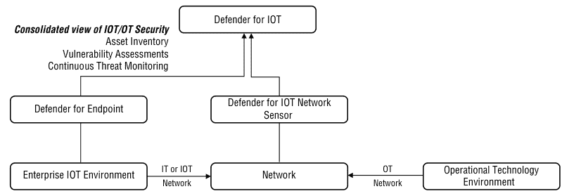

Defender for IoT 系统支持与云和本地元素的连接，并旨在在大型且地理分布广泛的环境中进行扩展。Defender for IoT 系统包含以下组件：

- Azure 门户，允许你管理和集成你的云（例如 Microsoft Sentinel）与其他 Microsoft 服务。
- 网络传感器可以部署在虚拟机中或作为物理设备。OT 传感器可以配置为云连接或完全本地。
- 一个关键组件是本地可用的云连接或本地气隔管理控制台。
- 嵌入式安全代理的存在是可选的。

Defender for IoT 将在 Defender for Cloud 仪表板中显示安全建议，如图 7.2 所示。

### 图 7.2 安全最佳实践

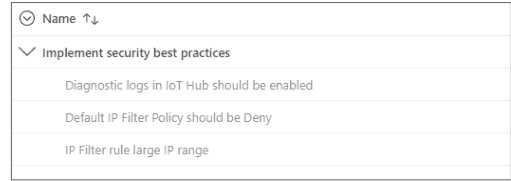

作为 IoT 安全解决方案的一部分，还需要将系统生成的威胁检测信息与你的 SIEM 系统集成。除了弥合 IT 和 OT 安全问题之间的差距之外，Microsoft Sentinel 和 Microsoft Defender for IoT 为 SOC 团队提供开箱即用的能力，以高效、有效地分析、检测和响应 OT 威胁。通过集成 Microsoft Defender for IoT 和 Microsoft Sentinel，组织可以快速检测经常跨越 IT 和 OT 边界的多阶段攻击。

以下是 Microsoft 为 Azure IoT 推荐的关键最佳实践：

- **保持最新：** 确保你使用受支持的平台、编程语言、协议和框架的最新版本。

- **确保身份验证密钥安全：** 为防止恶意设备伪装成已注册设备，部署后请将设备 ID 及其身份验证密钥妥善保管。

- **尽可能使用设备 SDK：** 为帮助你开发强大且安全的设备应用程序，设备 SDK 实现了多种安全功能，包括加密和身份验证。

- **应定义中心访问控制：** 根据每个组件的功能，确定每个成员对 IoT 中心的访问权限。可以授予四项权限：Registry Read、RegistryReadWrite、ServiceConnect 和 DeviceConnect。默认共享访问策略也可以根据组件在 IoT 中心中的角色定义权限。

- **应定义后端访问控制：** 除了 IoT 中心之外，Azure Cosmos DB、流分析、应用服务、逻辑应用和 Blob 存储可以使用你的 IoT 中心解决方案引入的数据。

- **安全设备身份验证：** 你将使用基于所选协议（MQTT、AMQP 或 HTTPS）的安全令牌，确保 IoT 中心与设备之间的安全通信。

- **安全设备通信：** 由于 IoT 中心支持传输层安全性（TLS）的版本 1.2 和 1.0，因此建议使用版本 1.2。

- **安全服务通信：** 通过 IoT 中心，终结点可以通过 TLS 协议连接到 Azure 存储和事件中心等服务，因此不会通过未加密的通道暴露任何终结点。一旦这些数据到达这些后端服务进行存储或分析，请确保它们使用适当的加密和安全方法，并保护其中的敏感信息。

- **确保设备免受未经授权的访问：** 构建机制以防止或检测对设备的物理篡改。将硬件端口保持在最小限度，以避免不必要的访问。

- **构建安全硬件：** 通过加入加密或受信任平台模块（TPM）安全功能来保护设备和基础设施。如果空间允许，请安装防病毒和反恶意软件，并确保操作系统和驱动程序是最新的。

- **监控对设备的未经授权的访问：** 使用设备操作系统的日志功能监控设备或其端口的任何安全漏洞或物理篡改。

- 从云监控你的 IoT 解决方案：Azure Monitor 指标提供你的 IoT 中心解决方案运行状况的概览。

- 设置诊断：为了了解解决方案的性能，请在解决方案中记录事件并将其发送到 Azure Monitor。

缩写 STRIDE 代表身份欺骗、数据篡改、否认威胁、信息泄露、拒绝服务和权限提升。在 20 世纪 90 年代末，Loren Kohnfelder 和 Praerit Garg 在 Microsoft 开发了 STRIDE。

可以在设计阶段使用 STRIDE 威胁模型检查应用程序或系统中的威胁。采用主动方法，第一步是识别潜在威胁，系统设计构成了发现威胁的基础。为消除漏洞，下一步是识别系统实现中固有的风险。

## 为数据工作负载建立安全要求，包括 SQL Server、Azure SQL、Azure Synapse 和 Azure Cosmos DB

Microsoft 建议保护你的本地和云数据免受未经授权和无意访问。无意访问是指用户根据其职位获得了不应访问的数据。在未经授权的访问中，恶意内部人员或外部攻击者会故意尝试访问数据，导致数据泄露、数据破坏或数据安全和隐私违规。除了恶意内部人员之外，普通攻击者还可以擦除、修改、外泄和加密你最敏感的数据，使你不那么能够抵御勒索软件攻击。

识别你的数据、保护它、防止其被破坏或外泄，并确保只有具有业务目的的用户才能访问它，以应对这两类攻击。保护你的数据是零信任“假设已被攻破”原则的关键部分。尽管你的组织对用户帐户和设备进行了保护，但你应该预料到攻击者可能会找到进入途径并开始探索你的环境，寻找有价值的公司信息。

了解你的数据环境并识别云和本地环境中的重要信息，是定义数据工作负载安全要求的第一步。为了更好地了解你的数据，可以采用表 7.5 所示的步骤。

| 步骤 | 负责人 |
|---|---|
| 1. 区分数据分类级别。 | 数据安全架构师 |
| 2. 区分内置和自定义敏感信息类型。 | 数据安全架构师 |
| 3. 区分预训练和自定义可训练分类器的使用。 | 数据安全架构师 |
| 4. 发现并区分敏感数据。 | 数据安全架构师和/或数据安全工程师 |

一旦你清楚了解自己的数据，就可以建立基本要求，包括以下内容：

- 通过应用与加密、访问限制、视觉标记等保护操作相关的敏感度标签，在数据生命周期中保护敏感数据。
- 通过应用一致的数据防丢失策略，监控、预防和修复云、本地环境和终端上涉及敏感数据的风险活动。
- 为满足业务和生产力要求，请使用最小权限访问：仅允许有权访问数据及其可执行操作的人员访问数据。

## 数据安全态势管理

与其他云工作负载类似，数据工作负载需要持续的安全评估以改善其整体安全态势。你可以使用 Azure Microsoft Purview 来管理和治理跨多云的本地、多云和 SaaS 数据。通过自动化数据发现、对敏感数据进行分类以及从头到尾跟踪数据血缘，为数据管理员提供全面、最新的数据环境视图。数据使用者应能在数据提供者的帮助下找到有价值、可信的数据。图 7.3 描绘了数据的安全态势管理。

随着 Microsoft Defender for Cloud 与 Azure Purview 的集成，你可以访问从 Azure Purview 派生的重要元数据层，并使用该信息创建有关潜在敏感数据的警报和建议。基于这些知识，安全专业人员可以将注意力集中在对敏感数据的威胁上并解决分类挑战。图 7.4 显示了 Defender for Cloud 中 SQL 数据库状态的示例，左下角提供了 Azure Purview 的数据增强。


### 图 7.3 数据安全态势管理

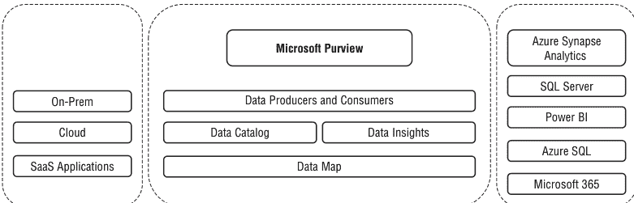

### 图 7.4 Azure SQL 数据库服务器的 Microsoft Defender

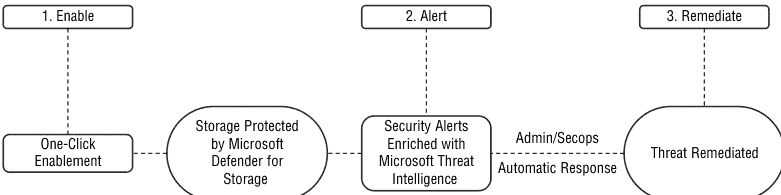

## 数据库

在数据工作负载中包含数据库，可以使用 Microsoft Defender for SQL 来管理数据库的安全态势。Microsoft Defender for Cloud 支持 Azure SQL 数据库、Azure SQL 托管实例和 Azure Synapse Analytics。作为此功能的一部分，可以识别和缓解潜在数据库漏洞，并可检测可能表明数据库威胁的异常活动。Defender for Cloud 提供了启用和管理这些功能的单一访问点。图 7.5 显示 SQL 数据库的安全建议。

通过提供高级威胁防护，你可以持续监控 SQL 服务器，以检测 SQL 注入、暴力破解攻击和特权滥用等威胁。作为此服务的一部分，Microsoft Defender for Cloud 会针对可疑活动发出警报，提供缓解威胁的指南，并允许你使用 Microsoft Sentinel 继续调查。

除 SQL 之外，Azure Cosmos DB 云原生数据库也是必不可少的。使用 Microsoft 威胁情报，Microsoft Defender for Azure Cosmos DB 检测 SQL 注入、已知恶意行为者、可疑访问模式，以及受损个人或恶意内部人员可能通过受损身份利用数据库的可能性。Defender for Azure Cosmos DB 利用高级威胁检测功能和 Microsoft Sentinel 威胁情报数据提供上下文相关的安全警报。作为这些警报的一部分，还包含可采取的步骤，以缓解检测到的威胁并防止未来的攻击。

### 图 7.5 SQL 数据库的安全建议

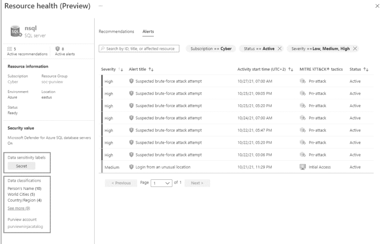

Azure 凭借全球安全情报、先进的面向客户控制以及将安全性集成到每个方面的强化安全基础设施，提供独特优势。

关于 Azure 数据安全和加密最佳实践，确定如何在云中保护数据时，建议关注数据的以下状态：

- 加密控件已集成到从虚拟机到存储和 SQL 数据库的各项服务中。
- 使用行业标准加密协议，数据在云与客户之间传输时可得到保护。
- 云应用程序和服务可以在 Azure Key Vault 中安全存储加密密钥、密码、连接字符串和证书。
- Azure 信息保护将对敏感数据进行分类、标记和保护。

## 定义 Web 工作负载的安全要求

在评估 Azure App Service 时，必须考虑 Web 工作负载的安全要求。Azure App Service 是一种基于 HTTP 的 Web 应用程序、REST API 和移动后端服务。Windows 和 Linux 环境均与这些应用程序兼容。

作为 Azure App Service 平台的一部分，你可以使用 Azure VM、存储、网络连接、Web 框架、管理和集成功能。Azure App Service 具有以下安全要求：

- **使用 HTTPS 保护应用：** 创建应用后，即可通过 HTTPS 访问该应用 (app_name.azurewebsites.net)。若要让客户端通过 HTTPS 安全连接到自定义域，应为自定义域配置 TLS/SSL 证书。
- **禁用不安全协议：** App Service 提供一键式配置来强制使用 HTTPS，这意味着未加密 (HTTP) 的流量在到达应用程序代码之前会被拒绝。
- **创建静态 IP 限制：** 默认设置允许 App Service 应用程序接受来自 Internet 上任何 IP 地址的请求，但你可以将此访问限制为一部分 IP 地址。例如，Windows 上的 App Service 允许你定义允许访问应用程序的 IP 地址列表。
- **启用客户端身份验证和授权：** Azure App Service 为客户端和用户开箱即用地提供身份验证和授权服务。用户和客户端应用可以无需或只需极少应用程序代码即可登录。你可以使用 App Service 来处理身份验证和授权过程，也可以实现自己的解决方案。
- **不要存储应用程序机密：** 访问应用程序机密（例如数据库凭据、API 令牌和私钥）的普遍接受方法是将其作为环境变量来引用。
- **实施网络隔离：** 隔离层通过在 Azure 虚拟网络实例中托管的专用 App Service 环境内部署应用程序，提供完全的网络隔离。

## App Service 的安全态势管理

Web 工作负载的整体安全态势需要持续评估，与其他云工作负载一样。Defender for App Service 利用云规模来识别针对在 App Service 上运行的应用程序的攻击。攻击者会探测 Web 应用程序的弱点以查找并利用它们——发送到在 Azure 中运行的应用程序的请求在路由到特定环境之前会经过多个网关。收集数据后，可以识别利用攻击和攻击者，并学习新模式。

启用 Microsoft Defender for App Service 时，此 Defender 计划提供以下服务：

- Defender for App Service 评估 App Service 计划覆盖的资源，并根据其发现生成安全建议。使用这些建议中的详细说明来强化 App Service 资源。

- Defender for App Service 通过监视以下内容，检测针对 App Service 资源的众多威胁：
  - 运行 App Service 的 VM 实例及其管理接口
  - 发送到和来自 App Service 应用的请求和响应
  - 底层沙箱和 VM
  - App Service 内部日志——得益于 Azure 作为云提供商拥有的可见性，可用

- 在 Defender for App Service 中，会评估 App Service 计划的资源是否存在安全漏洞，并根据评估结果生成安全建议。使用建议中的详细说明来强化 App Service 计划的资源。

由于 Defender 具有云原生特性，因此可以识别适用于多个目标的攻击方法。例如，单个主机可能无法区分来自小型 IP 地址子集的分布式攻击（这些子集正在爬取各种主机）。

> 可能需要在网络和 Web 流量控制的云原生策略中包含以下要求：

- 云原生策略可能不允许与本地资源进行混合连接。如果需要混合连接，则强大的企业安全策略示例将是更好的参考。
- Azure 虚拟网络和网络安全组允许用户建立安全连接。
- 通过阻止或不启用通过 SSH/RDP 对虚拟机的直接访问，Azure 防火墙可保护主机免受恶意网络流量的攻击。
- 诸如 Azure 应用程序网关、Web 应用程序防火墙 (WAF) 和 Azure DDoS 防护等服务可保护应用程序并确保虚拟机可用性。

## 确定存储工作负载的安全要求

Azure 存储帐户非常适合需要快速且一致的响应时间或涉及许多输入输出操作 (IOP) 的工作负载。存储帐户包含所有 Azure 存储数据对象，例如：

- Blob 对象
- 文件共享
- 队列
- 表
- 磁盘

按照以下建议优化 Azure 存储帐户的安全性：

- 为 Blob 启用软删除。
- 若要授权访问 Blob 数据，请使用 Azure AD。
- 使用 Azure RBAC 向 Azure AD 安全主体分配权限时，请考虑最小特权原则。
- 若要存储业务关键数据，请使用 Blob 版本控制或不可变 Blob。
- 存储帐户默认应限制访问 Internet。
- 通过配置防火墙规则限制对存储帐户的访问。
- 网络访问应限制在特定网络。
- 仅通过受信任的 Microsoft 服务访问存储帐户。
- 确保所有存储帐户都已启用“要求安全传输”选项。
- SAS 令牌应仅与 HTTPS 连接一起使用。
- 避免和防止使用共享密钥授权的存储帐户。
- 确保定期重新生成帐户密钥。
- 如果向客户端颁发 SAS，请创建吊销计划。

## 存储的安全态势管理

为改善 Web 工作负载的整体安全态势，需要像其他云工作负载一样对其进行持续安全评估。Azure Defender for Storage 使用 Azure 原生安全情报，检测访问和利用存储帐户的独特且可能具有破坏性的尝试。基于 Microsoft 威胁情报数据和高级威胁检测功能，以上下文相关的方式提供安全警报。作为这些警报的一部分，还概述了缓解威胁和防止未来攻击的步骤。


Defender for Storage可以在订阅（推荐）或资源（可选）级别启用。Azure Blob存储和Azure文件服务生成遥测流，Defender会持续分析这些流用于存储。当检测到潜在恶意活动时，将生成安全警报。除了可疑活动的详细信息、适当的调查步骤、修复操作和安全建议外，Microsoft Defender for Cloud在其警报窗格中显示这些警报。图7.6说明了Defender for Storage的两个重要操作。

### 图7.6 Defender for Storage双操作视图

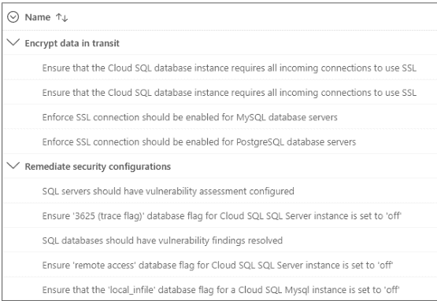

使用Defender for Cloud仪表板，单击即可启用Defender for Cloud。启用Defender for Cloud后，它将监控存储帐户并生成安全建议。如果检测到可疑活动，Defender for Cloud将提醒用户。Defender for Cloud仪表板或Microsoft Sentinel仪表板可以帮助处理警报。

> 可能有必要在云原生策略中包含以下网络和Web流量控制要求：

- 云原生策略可能不允许与本地资源的混合连接。如果需要混合连接，健全的企业安全策略示例将是更好的参考。
- Azure虚�拟网络和网络安全组允许用户建立安全连接。
- 通过阻止或不启用通过SSH/RDP直接访问虚拟机，Windows Azure防火墙可保护主机免受恶意网络流量的影响。
- Azure应用程序网关、Web应用程序防火墙(WAF)和Azure DDoS防护等服务可保护应用程序并确保虚拟机可用性。

### 定义容器安全要求

使用容器，应用程序可以在主机操作系统中以隔离、轻量级的方式运行。在容器中，仅存储在用户模式下运行的应用程序以及操作系统的一些轻量级API和服务，位于内核之上（内核可视为操作系统的埋藏管道）。尽管容器共享其主机的内核，但它们不具备完全访问权限。在某些情况下，容器接收系统的虚拟化视图，而不是隔离视图。例如，在虚拟化文件系统和注册表中，容器可以访问它们，但更改仅影响容器，并在容器停止后被丢弃。容器可以挂载持久存储（例如Azure磁盘或Azure文件）来存储数据。

镜像是从存储库中存储的镜像构建的容器。公共存储库（例如Docker Hub）可以与私有存储库（例如Docker Trusted Registry）结合使用，后者可托管在本地或虚拟私有云中。此外，Azure容器注册表作为基于云的私有容器注册表运行。

公开可用的容器镜像无法保证安全，且容器镜像包含多个软件层，可能存在漏洞。应从私有注册表（例如Azure容器注册表或Docker Trusted Registry）存储和检索镜像，以减少攻击威胁。此外，Azure容器注册表通过Azure Active Directory提供基于服务主体的基本身份验证。除了只读（pull）和只写（push）外，此身份验证还允许基于角色的访问。

在私有注册表中扫描容器镜像并识别潜在漏洞时，了解不同解决方案如何提供深度威胁检测非常重要。例如，在Azure容器注册表中，推送到注册表的所有Linux镜像都会由Microsoft Defender for Cloud自动扫描。集成的Qualys扫描器与Microsoft Defender for Cloud一起检测、分类镜像漏洞并提供修复指导。

由于容器可能分布在Azure的各个集群和区域中，您必须保护用于登录和API访问的凭据（如密码或令牌）。确保只有特权用户可以在传输中和静止时访问它们。确保所有凭据机密都已清点；开发人员必须使用特定于容器平台的工具来管理机密。可靠的解决方案应包括加密数据库、用于传输中加密数据的TLS加密以及最小特权访问控制。对于容器化应用程序，Azure密钥保管库保护加密密钥和机密（如证书、连接字符串和密码）。保持对密钥保管库的访问安全很重要，因为这些数据既敏感又对业务至关重要。

仅允许已批准的容器镜像。容器生态系统本身就有足够的变化和不稳定性，无需再允许未知容器。建立工具和流程来监控并阻止未批准的容器镜像。控制容器镜像流入开发环境是减少攻击面并防止开发人员犯下关键安全错误的有效方法。

## 容器安全态势管理

Web工作负载必须接受持续的安全评估，以改善其整体安全态势。Defender for Containers协助处理容器安全的所有方面，包括以下内容：

- 环境强化：无论Kubernetes集群托管在何处，Defender for Containers都会对其进行保护。通过持续评估集群，Defender for Containers可提供有关错误配置的见解以及缓解已识别威胁的指南。
- 漏洞评估：用于管理存储在ACR注册表中的镜像并在Azure Kubernetes服务中运行的镜像的工具。
- 节点和集群运行时威胁防护：集群和Linux节点的威胁防护会针对可疑活动生成安全警报。

在Defender for Cloud中，您的集群配置会持续评估并与订阅计划进行比较。在发现错误配置时，Defender for Cloud会生成安全建议。要查看和修复建议，请使用Defender for Cloud的建议页面。


容器安全应关注以下安全领域：控制域、身份管理、资产管理、端点安全、态势和漏洞管理、备份和恢复、特权访问数据保护、日志威胁检测和网络安全。

在容器安全中采用以下关键最佳实践：

- 使用集中式身份和身份验证系统。
- 在虚拟机中仅使用已批准的应用程序。
- 不应泄露凭据和机密。
- 使用现代反恶意软件。
- 确保反恶意软件和签名保持最新。
- 为计算资源定义并建立安全配置。
- 快速自动修复漏洞。
- 备份应定期自动化。
- 确保仅使用已批准的服务。
- 遵循足量管理原则（最小特权）。
- 使用安全的证书管理流程。
- 基于条件限制资源访问。
- 为第三方支持选择审批流程。
- 静态数据加密时（如果需要）使用客户托管密钥选项。
- 应默认启用静态数据加密。
- 传输中数据应加密。
- 监控针对敏感数据的异常和威胁。
- 启用威胁检测功能。
- 使用网络控制保护云服务。
- 使用端点检测和响应(EDR)。
- 使用安全的密钥管理流程。
- 分离并限制高度特权/管理用户。
- 自动化并保护应用程序身份管理。
- 为网络分段建立边界。
- 为安全调查启用网络日志。
- 发现、分类和标记敏感数据。
- 评估漏洞。

### 定义容器编排安全要求

在容器管理中，名为*容器编排器*的应用程序管理容器。通常，编排涉及工具，这些工具可自动化应用程序管理的所有方面，例如放置、调度和部署，以及支持扩展的稳态活动，例如部署、更新和运行状况监控。

作为历史上增长最快的开源项目之一，Kubernetes已成为许多公司计算堆栈的组成部分。Kubernetes集群可使用三项服务在Azure平台上轻松部署和管理：Azure Kubernetes Service (AKS)、Azure容器服务引擎 (ACS-Engine) 和 Azure容器实例。Kubernetes是一种流行的解决方案，并得到庞大开发者社区的支持。虽然还有其他几种提供云提供商集成的编排器，但Kubernetes是唯一原生集成到Microsoft Azure、Amazon Web Services和Google Cloud Platform等公共云的编排器。


除了众多优势之外，Kubernetes 还带来了一些必须解决的安全挑战。因此，了解容器化环境中的各种安全风险至关重要。

启用 Microsoft Defender for Containers 时，Azure Kubernetes Service 集群和 Azure Arc 启用的 Kubernetes 集群（预览版）将受到默认保护。启用 Microsoft Defender for Containers 时，安全建议会显示在 Defender for Cloud 仪表板上，如图 7.7 所示。

## 图 7.7 Microsoft Defender for Containers


Defender for Cloud 为 Azure Kubernetes Service 集群提供运行时防护并收集节点信号，无需安装代理软件。Defender 配置文件会部署到每个节点上，提供运行时防护并收集节点信号。Azure Policy 的 Kubernetes 插件包含用于准入控制策略的集群和工作负载配置。图 7.8 描绘了 Azure Kubernetes Service 集群。

- Defender 配置文件包含一个 DaemonSet，这是一组专注于收集清单和安全事件的容器。
- 开源策略代理 (OPA) 的 Gatekeeper 是准入控制器 Webhook，它在集群上实现大规模执行和大规模防护。

## 图 7.8 Azure Kubernetes Service 集群


Pod 安全标准和密钥是 Kubernetes 的安全组件。另一方面，Azure 的安全组件包括 Active Directory、Microsoft Defender for Containers、Azure Policy、Azure Key Vault、网络安全组和编排的集群升级。

以下安全组件与 AKS 结合，可提供以下功能：

- 提供身份验证和授权机制。
- 可以使用 AKS 的 Azure Policy 保护您的应用程序。
- 借助 Microsoft Defender for Containers，您可以从开发到部署获得端到端的洞察。
- 定期更新 AKS 集群的操作系统安全性和 Kubernetes 版本。
- 安全地访问敏感凭据和 Pod 流量。

## 摘要

了解组织与 Microsoft 之间安全职责的分类至关重要。

通过将安全职责转移给云提供商，可以提高安全覆盖率，从而使组织能够将注意力集中在其他业务优先事项上，并重新分配其安全资源。

本章介绍了 Azure PaaS 工作负载安全基线的简要描述以及 Microsoft Defender for Cloud 支持哪些 Azure PaaS 工作负载。您还学习了如何为 IaaS VM 指定安全基线，以及无论操作系统如何都可以实施的一般准则。我们讨论了如何在 SaaS 环境中使用 Microsoft 安全分数跟踪安全态势随时间的改善，以及 IoT 工作负载的安全要求。

此外，您还了解了 Azure App Service 如何使用 Microsoft Defender for App Service 提供态势管理和威胁检测。讨论了数据和存储工作负载的要求。此外，还讨论了容器编排和安全要求。

## 考试要点

### 能够识别 SaaS、PaaS 和 IaaS 服务的安全基线。

安全基线是标准化文档，描述 Azure 产品功能以及通过改进工具、跟踪和安全功能增强安全性的最佳配置。

对于 IaaS、SaaS 和 PaaS，在为云工作负载设计安全策略时，您需要考虑不同的云服务会有额外的安全要求。

物理基础设施位于堆栈底部，Microsoft 在此层缓解常见风险和职责。由于 Microsoft 持续监控 Microsoft 云，攻击者试图攻击它几乎没有意义。除非攻击者拥有大量资金和资源，否则不太可能针对 Microsoft 云。

### 识别 IoT 工作负载的安全要求。

OT 网络用于通过物联网 (IoT) 连接数十亿台联网设备。由于缺乏对安全性的重视，传统系统无法保护 IoT 和 OT 网络。每一次新的创新浪潮都会使 IoT 设备和 OT 网络面临越来越多的攻击面。

深度防御策略对于保护物联网 (IoT) 基础设施至关重要。此外，将 SIEM 解决方案与安全 IoT 解决方案集成以进行威胁检测也至关重要。

### 能够识别数据工作负载的安全要求，包括 SQL Server、Azure SQL、Azure Synapse 和 Azure Cosmos DB。

必须保护本地数据和云数据，防止意外和恶意访问。意外访问是指用户获得了不应访问的数据。恶意内部人员或外部攻击者故意试图访问数据，可能导致意外的数据泄露、数据破坏以及违反数据安全和隐私法规。恶意内部人员可能滥用数据，或受到外部攻击者的影响，后者可以删除、篡改、外泄并加密您的敏感数据。

Microsoft Defender for SQL 可以管理数据库的安全态势，因此您可以将其用于数据工作负载。SQL 数据库、SQL 托管实例和 Azure Synapse Analytics 均与 Microsoft Defender for Cloud 兼容。该产品可以识别数据库漏洞并加以缓解，还可以检测可能表明数据库基线安全威胁的异常活动。

### 能够识别 Web 工作负载的安全要求，包括 Azure App Service。

Azure App Service 是一种基于 HTTP 的服务，用于部署 Web 应用程序、REST API 和移动后端。在考虑 Azure App Service 时，您需要考虑 Web 工作负载的安全要求。基于 Windows 和 Linux 的环境都与应用程序兼容。

为提高 Web 工作负载的整体安全态势，如同任何其他云工作负载一样，需要持续的安全评估。借助云的规模，Microsoft Defender for App Service 可以识别针对 Web 应用程序的攻击。攻击者会探测 Web 应用程序的弱点并加以利用。Azure 应用程序的请求会经过多个网关，在被路由到特定环境之前，这些网关会对请求进行检查和记录。

### 能够识别存储工作负载的安全要求，包括 Azure Storage。

每秒输入/输出 (IOP) 操作适用于需要快速且一致响应时间的工作负载。Azure 存储帐户包含您在 Azure 存储帐户中使用的所有数据对象，包括 Blob、文件共享、队列、表和磁盘。

为提高 Web 工作负载的整体安全态势，如同任何其他云工作负载一样，需要持续的安全评估。

### 能够识别容器的安全要求。

容器是在主机系统上运行应用程序的轻量级、隔离的沙箱。容器构建在主机操作系统的内核（操作系统的底层管道）之上，仅包含应用程序以及一些轻量级 API 和服务。尽管容器与主机共享内核，但它无法完全访问内核，相反，容器获得的是系统的隔离（有时是虚拟化）视图。

您可以查看 Defender for Cloud 的建议页面，如果它在您的云中发现错误配置，可以通过将其与应用于订阅的计划进行比较来修复问题。Defender for Cloud 在发现错误配置时会生成安全建议。

### 能够识别容器编排的安全要求。

容器编排系统 Kubernetes 已成为许多组织计算堆栈的重要组成部分。可以使用三种服务在 Azure 上轻松部署和管理 Kubernetes 集群。Kubernetes 是一种流行的解决方案，拥有强大的开发者社区。Azure Kubernetes Service (AKS)、Azure Container Service Engine (ACS-Engine) 和 Azure Container Instance 均可用。

当 Defender for Cloud 保护托管在 Azure Kubernetes Service 中的集群时，它会收集无代理且无摩擦的审计日志数据。


## 复习问题

- 1. 以下哪个云环境组件受到 Microsoft 从共享责任堆栈底部开始的 100% 标准风险和义务的保护和缓解？
  - A. 物理基础设施
  - B. 数据管理
  - C. 应用程序和平台
  - D. 以上皆非

- 2. 作为网络安全架构师，您需要在设计中解决堆栈顶部的数据治理和权限管理问题，以应对风险。您将采用以下哪种缓解解决方案？
  - A. 数据管理
  - B. 证书管理
  - C. 密钥管理
  - D. 以上皆非

- 3. 作为网络安全架构师，您必须采用一套流程，通过改进工具、跟踪和安全功能来加强组织的安全性。您将在设计和部署中采用哪种解决方案？
  - A. Azure 安全基准
  - B. 安全评分
  - C. PaaS 和 SaaS CIS 标准
  - D. 以上皆非

- 4. 作为网络安全架构师，您必须在保护组织 IaaS 工作负载的虚拟机部分时采取第一步；您将在设计和部署中采用哪种解决方案？
  - A. 部署 Azure 安全基准
  - B. 启用远程访问
  - C. 仅向授权用户提供访问权限
  - D. 以上皆非

- 5. 作为网络安全架构师，您将如何控制和强制执行组织 Linux 工作负载的访问策略？您将在设计和部署中采用哪种解决方案？
  - A. 与运行在本地的 Microsoft LDAP over AD 集成
  - B. 与运行在本地的 Microsoft Active Directory 集成
  - C. 与 Azure AD 集成
  - D. 以上皆非

- 6. 作为网络安全架构师，您希望使用 Windows 的 BitLocker 功能和 Linux 工作负载的 dm-crypt 功能对组织数据进行加密；您将在设计和部署中采用哪些 Azure 服务？
  - A. Azure 磁盘加密
  - B. 存储加密
  - C. 文件级加密
  - D. 以上皆非

- 7. 您可以从哪个集中式仪表板监控组织并着手保护 365 身份、应用和设备？
  - A. Microsoft Azure 门户
  - B. Microsoft 365 门户
  - C. Microsoft 365 Defender
  - D. 以上皆非

- 8. 以下哪项是 Microsoft 365 的功能，有助于改善 SaaS 环境的安全态势？
  - A. Microsoft 安全评分
  - B. Microsoft 365 门户
  - C. Microsoft 365 Defender
  - D. 以上皆非

- 9. Microsoft 推荐的 IoT 架构作为威胁建模练习的一部分，分为多个组件/区域。以下哪些是有效的？
  - A. 设备、网络网关、服务
  - B. 设备、现场网关、云网关、服务
  - C. 设备、网络网关、函数
  - D. 以上皆非

- 10. 数据/信息从一个源转移到另一个源可能会受到 STRIDE 的影响。什么是 STRIDE？
  - A. 欺骗、威胁、风险、信息泄露、拒绝服务和特权提升
  - B. 搜索、威胁、风险、信息泄露、拒绝服务和特权提升
  - C. 欺骗、篡改、否认、信息泄露、拒绝服务和特权提升
  - D. 以上皆非

- 11. 以下哪项是最佳安全解决方案，可从一个位置识别 IoT 设备、漏洞和威胁并对其进行管理？
  - A. Microsoft Defender for IoT
  - B. Azure 安全中心
  - C. Azure Sentinel
  - D. 以上皆非

- 12. 以下哪些 Azure 服务有助于弥合 IT 和 OT 安全问题之间的差距，并赋予安全运营团队内置能力，以高效、有效地检测和响应 OT 威胁？
  - A. Microsoft Sentinel 和 Microsoft Defender for IoT
  - B. Microsoft 安全中心和 Microsoft Defender for IoT
  - C. Microsoft Defender for Cloud 和 Microsoft Defender for IoT
  - D. 以上皆非

- 13. 作为网络安全架构师，您需要选择一项 Azure 服务，使您能够部署统一的数据治理服务来管理和治理 SaaS、多云和本地数据。您将选择哪一项？
  - A. Microsoft Defender for IoT
  - B. Microsoft Purview
  - C. Microsoft Sentinel
  - D. 以上皆非

- 14. 哪项 Azure 服务允许您使用 Microsoft Purview 元数据进行警报和建议，并提供有关潜在敏感数据的信息？
  - A. 带有 Microsoft Purview 的 Microsoft Defender for Cloud
  - B. 带有 Microsoft Purview 的 Microsoft Defender for IOT
  - C. 带有 Microsoft Purview 的 Microsoft 365 Defender
  - D. 以上皆非

- 15. 哪些 Azure 服务适用于 Azure SQL 数据库、Azure SQL 托管实例和 Azure Synapse Analytics？
  - A. Microsoft Defender for Cloud
  - B. Azure 安全中心
  - C. Azure Sentinel
  - D. 以上皆非

- 16. 哪项 Azure 服务允许一键式 HTTPS 配置，以保护您的应用免受所有未加密的 HTTP 连接的影响？
  - A. Azure 虚拟机
  - B. 应用服务
  - C. Azure Functions
  - D. 以上皆非

- 17. 哪项 Azure 服务为用户或客户端应用提供即插即用的身份验证和授权？
  - A. 应用服务
  - B. Azure Functions
  - C. Azure 虚拟机
  - D. 以上皆非

- 18. 一旦启用适用于应用服务的 Microsoft Defender，您可以立即利用以下哪些功能？（选择两项。）
  - A. 安全评估
  - B. 威胁检测
  - C. 威胁防护
  - D. 安全自动化

- 19. Microsoft 使用以下哪项来分析威胁和缓解措施？
  - A. STRIDE
  - B. PASTA
  - C. LINDDUN
  - D. 以上皆非

- 20. 作为网络安全架构师，您需要减少容器映像的攻击面，因为映像包含多个层。每个层都存在高漏洞；您将在设计和部署中考虑哪项 Azure 服务？
  - A. Docker Trusted Registry
  - B. Azure 容器注册表
  - C. 公开可用的映像
  - D. A 和 B 都是

## 第 8 章

## 为应用程序和数据定义策略和要求

### 本章涵盖的 Microsoft SC-100 考试目标包括：

- 指定缓解应用程序威胁的优先级
- 指定新应用程序上线的安全标准
- 指定应用程序和 API 的安全策略
- 指定缓解数据威胁的优先级
- 设计识别和保护敏感数据的策略
- 指定静态和传输中数据的加密标准


本章将介绍相关洞察，并为应用程序和数据设计策略。

云平台最终将业务价值存储在应用程序及其关联数据中。由于业务流程和业务数据，应用程序在安全环境中发挥着重要作用，尽管设计和存储等平台组件也至关重要。

必须在设计阶段建立设计和功能规范。此外，设计有助于缓解整个项目中的安全和隐私问题。

安全的设计概念和要求可帮助您避免或最大限度地减少安全缺陷。应用程序发布后，安全缺陷可能会允许用户执行恶意或意外操作。

考虑如何在设计阶段分层安全性；可能需要多个保护级别。如果攻击者设法绕过 Web 应用程序防火墙 (WAF) 会发生什么？防御此类攻击需要另一项安全措施。

读完本章后，您将了解如何指定缓解应用程序威胁的优先级、定义新应用程序上线的安全标准、定义应用程序和 API 的安全策略、识别并保护敏感数据、设计缓解数据威胁的策略，以及定义静态和传输中数据的加密标准。

### 了解应用程序威胁情报模型

让我们先从应用程序威胁情报模型的基本概念入手。通过进行全面分析，它可以帮助您确定威胁、攻击、漏洞和对策。如果信息可用，就可以保护应用程序免受其威胁。您可以通过提出简单问题来识别潜在风险，然后再进行高级威胁建模技术。

Microsoft 的威胁建模工具是 Microsoft 安全开发生命周期 (SDL) 的核心组件。早期检测和缓解潜在安全问题，可让软件架构师降低成本并确保其产品的安全性，大幅


降低总体开发成本。Microsoft 还在设计工具时充分考虑了非安全专家的需求，以便所有开发人员都能更轻松地进行威胁建模。

它有助于就其系统的安全设计和安全问题分析进行沟通，以及管理针对这些问题的缓解措施。

你将收集有关基本安全控制的信息。Microsoft Azure 提供由威胁建模工具识别的所有威胁的报告。开发人员通常将此报告上传到跟踪工具，或将其转换为可验证和解决的工作项。随着解决方案中添加新功能，应更新威胁模型并将其纳入代码管理流程。当发现安全问题时，应建立对其严重性进行分级并确定如何何时修复的流程（例如，在下一个发布周期中）。

你将收集环境中应用程序各组件的信息。通过回答这些问题（列于表 8.1 中），将识别基本保护中的差距，并明确攻击向量。

## 表 8.1 要询问的问题

| 提出的问题 | 检测应用的控制 |
|---|---|
| 是否可以使用 Azure AD、TLS（带双向身份验证）或其他现代安全协议对连接进行身份验证？ | 确保未经授权的个人不会访问应用程序组件和数据。 |
| 应用程序访问是否仅限于需要写入或修改数据的帐户？ | 防止数据未经授权的修改或篡改。 |
| 使用 Azure Monitor 或类似解决方案，应用程序活动是否被记录并输入安全信息和事件管理 (SIEM) 系统？ | 通过检测和调查攻击，快速响应攻击。 |
| 关键数据是否可以使用安全团队批准的加密进行保护？ | 确保静态数据未经授权不被复制。 |
| 是否需要使用 TLS 加密入站和出站网络流量？ | 传输中的数据应受到保护，防止未经授权的复制。 |
| Azure DDoS 防护是否可以保护应用程序免受分布式拒绝服务 (DDoS) 攻击？ | 检测会使应用程序过载并阻止其正常工作的攻击。 |
| 应用程序是否能够存储登录凭据或密钥以访问其他应用程序、数据库或服务？ | 确定您的应用程序是否可用于攻击其他系统。 |
| 是否可以通过应用程序控制满足法规要求？ | 确保用户隐私并避免因不合规而被罚款。 |

## 渐进式分析应用程序设计

分析应用程序组件和连接之间的关系。在威胁建模中，会定义安全需求、识别并缓解威胁，并验证缓解措施。无论应用程序处于开发阶段还是生产阶段，在设计新功能时，这种技术效果最好。

提供了一种工具来辅助 Microsoft SDL，该工具使用 STRIDE。该工具免费。

开发威胁模型是 Microsoft SDL 的组成部分。这种工程技术可帮助您识别可能影响应用程序的威胁、攻击、漏洞和对策。通过使用威胁建模，您可以提高应用程序的安全性，实现公司的安全目标，并降低风险。

Microsoft Threat Modeling Tool 通过使用标准表示法可视化系统组件、数据流和安全边界，使所有开发人员都能更轻松地进行威胁建模。通过分析软件设计的结构，威胁建模人员还可以识别应考虑的威胁类别。通过关于创建和分析威胁模型的清晰指导，Microsoft 在设计该工具时充分考虑了非安全专家的需求。

通过早期识别和缓解潜在安全问题，Microsoft Threat Modeling Tool 使解决这些问题变得相对简单且具成本效益。这样做可以大幅降低总体开发成本。该工具还提供关于创建和分析威胁模型的清晰指导，因此非安全专家的开发人员也可以使用它。

## 缓解类别

基于 Web 应用程序安全框架，Microsoft Threat Modeling Tool 的缓解措施在表 8.2 中进行分类。

## 表 8.2 Microsoft Threat Modeling Tool 缓解措施

| 类别 | 描述 |
|---|---|
| 审核和日志 | 做了什么、何时做、谁做的？日志记录和审核是指您的应用程序记录安全相关信息的方式。<br>以下是 Microsoft 从审核和日志角度针对特定产品/服务的建议。<br>**Dynamics CRM**<br>- 在解决方案中实施更改审核以识别敏感实体。<br>**Web 应用程序**<br>- 确保应用程序已审核并记录日志。<br>- 确保日志已轮换和分离。<br>- 确保应用程序未记录敏感用户数据。<br>- 限制对审核和日志文件的访问。<br>- 确保已记录用户管理事件。<br>- 系统中应内置防滥用措施。<br>- 使用 Azure App Service 为 Web 应用启用诊断日志记录。<br>- 确保数据库已审核并记录日志。<br>- 确保 SQL Server 已配置为审核登录。<br>- 启用 Azure SQL 威胁检测。 |
| 身份验证 | 你是谁？在身份验证期间，通常使用凭据（如用户名和密码）来证明实体的身份。<br>以下是 Microsoft 从身份验证角度针对特定产品/服务的建议。<br>**Web 应用程序**<br>- 应使用标准身份验证机制对 Web 应用程序进行身份验证。<br>- 应用程序必须安全地处理身份验证失败场景。<br>- 可以启用自适应身份验证或逐级身份验证。<br>- 确保管理界面已适当保护。<br>- 确保忘记密码功能已安全实现。<br>- 实施密码和帐户策略。<br>- 通过实施控制防止用户名枚举。<br>**数据库**<br>- 尽可能使用 Windows 身份验证连接到 SQL Server。<br>- 连接到 SQL 数据库时，尽可能使用 Azure Active Directory 身份验证。<br>- 使用 SQL 身份验证模式时，确保强制执行 SQL Server 帐户和密码策略。<br>- 包含在容器中的数据库不应使用 SQL 身份验证。 |
| 授权 | 你能做什么？资源和操作访问由应用程序内的授权控制。<br>以下是 Microsoft 从授权角度针对特定产品/服务的建议。<br>**Web 应用程序**<br>- 确保业务逻辑流按顺序处理。<br>- 为防止枚举，实施速率限制机制。<br>- 遵循最小权限原则并确保适当授权。<br>- 请求参数不应用于确定资源访问的业务逻辑和授权决策。<br>- 不允许强行浏览或枚举内容和资源。<br>**数据库**<br>- 连接到数据库服务器时，使用最低权限帐户。<br>- 通过实施行级安全性 (RLS) 可以防止租户访问数据。<br>- sysadmin 角色中应仅包含有效用户。 |
| 通信安全 | 你在和谁通信？所有通信均使用通信安全进行保护。<br>以下是 Microsoft 从通信安全角度针对特定产品/服务的建议。<br>**Web 应用程序**<br>- SSL、TLS 和 DTLS 连接使用 X.509 证书进行身份验证。<br>- 在 Azure App Service 中，为自定义域配置 TLS/SSL 证书。<br>- 发送到 Azure App Service 的流量应通过 HTTPS 传输。<br>- 应启用 HTTP 严格传输安全 (HSTS)。<br>**数据库**<br>- 确保 SQL Server 连接已加密，并且证书已验证。<br>- 与 SQL Server 的通信必须加密。 |


## 表 8.2 Microsoft 威胁建模工具缓解措施

| 类别 | 描述 |
| :--- | :--- |
| 配置管理 | 你的应用程序以谁的身份运行？它连接哪些数据库？你的应用程序如何管理？有哪些安全措施来保护这些设置？你的应用程序的配置管理是指如何处理这些运营问题。<br><br>以下是 Microsoft 从配置管理角度针对特定产品/服务的建议。<br>**Web 应用程序**<br>- 确保已实施内容安全策略 (CSP)，并禁用内联 JavaScript。<br>- 在浏览器中打开 XSS 过滤器。<br>- 在部署 ASP.NET 应用程序之前，必须禁用跟踪和调试。<br>- 仅使用受信任的第三方 JavaScript 代码。<br>- 在经过身份验证的 ASP.NET 页面上实施 UI 重定位和点击劫持防御。<br>- 如果启用了跨源资源共享 (CORS)，ASP.NET Web 应用程序应仅允许受信任的源。CORS 是一种机制，通过该机制，当有需要时，网站的应用程序、数据或任何其他资源可以共享到第三方网站。<br>- 应在 ASP.NET 页面上启用 ValidateRequest 特性。<br>- JavaScript 库应在本地托管。<br>- 应禁用 MIME 嗅探。<br>- 通过删除 Windows Azure 网站上的标准服务器标头来避免指纹识别。<br>**数据库**<br>- 确保数据库引擎受 Windows 防火墙保护。 |
| 加密学 | 你使用什么方法来保守秘密（机密性）？你正在做什么来保护你的数据和库免受篡改（完整性）？我们可以为随机值提供加密学强度强的种子吗？使用加密技术，你可以确保应用程序的完整性和机密性。<br><br>以下是 Microsoft 从加密学角度针对特定产品/服务的建议。<br>**Web 应用程序**<br>- 密钥长度和对称块密码必须经过批准。<br>- 使用对称密码时，应使用经过批准的块密码模式和初始化向量。<br>- 确保密钥长度、填充和非对称算法已获批准。<br>- 应使用经过批准的生成器。<br>- 不应使用对称流密码。<br>- MAC、HMAC 和带键哈希的算法应经过批准。<br>- 仅使用经过批准的加密哈希。<br>**数据库**<br>- 使用强大的加密算法加密数据库中的数据。<br>- 建议使用加密并数字签名的 SQL Server Integration Services (SSIS) 包。Microsoft SSIS 是随 Microsoft SQL Server 数据库提供的数据迁移和集成工具，可用于提取、集成和转换数据。SSIS 是一种提取、转换和加载 (ETL) 解决方案。<br>- 使用数字签名保护关键数据库信息。<br>- 使用 SQL Server 可扩展密钥管理 (EKM) 保护加密密钥。<br>- 为防止加密密钥泄露给数据库引擎，请使用 AlwaysEncrypted 功能。 |
| 异常管理 | 当你的应用程序中的方法调用失败时会发生什么？你的披露范围有多大？你能为最终用户提供友好的错误信息吗？你是否将有价值的异常信息传回给调用者？你能否在应用程序中优雅地处理失败？<br><br>以下是 Microsoft 从异常管理角度针对特定产品/服务的建议。<br>**Web 应用程序**<br>- 错误消息中不应公开安全详细信息。<br>- 应实现默认错误处理页面。<br>- 在 IIS 中将部署方法指定为 Retail。<br>- 安全的异常处理至关重要。 |
| 输入验证 | 验证应用程序接收的输入是否安全有效的最佳方法是什么？你的应用程序在进一步处理之前通过过滤、清理或拒绝来验证输入。通过出口点对输出进行编码，并通过入口点限制输入。数据库和文件共享是可靠的数据来源吗？<br><br>以下是 Microsoft 从输入验证角度针对特定产品/服务的建议。<br>**Web 应用程序**<br>- 不应使用不受信任的样式表进行可扩展样式表语言转换 (XSLT) 脚本。<br>- 确保所有可能包含用户可控内容的页面都退出自动多用途 Internet 邮件扩展 (MIME) 嗅探。<br>- 以强化或禁用的方式解析 XML 实体。<br>- 使用 http.sys 的应用程序执行 URL 规范化验证过程。<br>- 接收用户文件应受到适当控制。<br>- Web 应用程序的数据访问应使用类型安全的参数。<br>- 为防止模型-视图-控制器 (MVC) 批量赋值漏洞，应使用单独的模型绑定类或绑定筛选列表。<br>- 在呈现之前，对不受信任的 Web 输出进行编码。<br>- 所有字符串类型的模型属性都应经过验证和过滤。<br>- 例如，应对富文本编辑器进行消毒，因为它们接受所有字符。<br>- 不应将没有内置编码的汇点分配给 DOM 元素。<br>- 确保应用程序中的所有重定向都是关闭的或安全的。<br>- 验证控制器方法接受的所有字符串类型。<br>- 为防止因不良正则表达式导致的拒绝服务 (DoS)，为正则表达式处理设置上限超时。<br>- Razor 视图不应使用 Html.Raw。<br>**数据库**<br>- 存储过程不应使用动态查询。 |
| 敏感数据 | 你的应用程序处理敏感数据的方法是什么？内存中、网络上或持久存储中必须受到保护的任何数据都是敏感数据。<br><br>以下是 Microsoft 从敏感数据角度针对特定产品/服务的建议。<br>**Web 应用程序**<br>- 浏览器缓存不应包含敏感内容。<br>- 确保 Web 应用程序配置文件中的敏感数据已加密。<br>- 包含敏感信息的表单和输入应明确禁用使用 autocomplete HTML 属性。<br>- 掩码显示在用户屏幕上的敏感数据。<br>**数据库**<br>- 通过实施动态数据掩码，将对非特权用户的敏感数据暴露限制在最小范围。<br>- 密码应以加盐哈希格式存储。<br>- 加密数据库列中的敏感数据。<br>- 确保已启用数据库级加密，例如透明数据加密 (TDE)。<br>- 加密数据库备份。 |
| 会话管理 | 你的应用程序采取哪些步骤来确保用户会话受到保护？你的 Web 应用程序会对会话期间与用户的一系列相关交互做出响应。<br><br>以下是 Microsoft 从会话管理角度针对特定产品/服务的建议。<br>**Web 应用程序**<br>- 可通过 HTTPS 访问的应用程序必须使用安全 Cookie。<br>- 对于 Cookie 定义，所有基于 HTTP 的应用程序都应指定仅限 HTTP。<br>- ASP.NET Web 页面应受到跨站点请求伪造 (CSRF) 攻击的保护。<br>- 配置会话的非活动生存期。<br>- 应用程序应能够正确注销。 |

## 缓解已识别的威胁

使用威胁建模工具，将识别所有威胁并生成报告。一旦识别出潜在威胁，就要确定如何检测和响应它。建立流程和时间表，以最大限度地减少工作负载中任何已识别漏洞的暴露，确保它们不会得不到处理。

深度防御是一种使用多种安全措施来保护组织资产的技术。其考虑是，如果一道防线被攻破，则会有额外的层作为阻塞，以确保威胁在途中被阻止。深度防御管理不仅植根于硬件和软件，而且植根于人员的安全漏洞，因为失职或人为错误通常会导致安全漏洞。

因此，可以确定如果主要安全控制失败，设计中需要哪些控制来降低风险。分析主要控制失败的可能性。在这种情况下，对组织的潜在风险是什么？此外，附加控制的有效性如何（特别是在导致主要控制失败时）？根据评估，使用深度防御措施解决潜在的安全控制失败。

深度防御可以使用最小权限原则来实现。一个账户造成的损害不会像另一个账户那么大。确保账户获得在合理时间内实现所需权限所需的最少数量的权限。对账户的访问可以减轻攻击者危及安全保障所造成的损害。

> 在 Microsoft SDL 中，威胁建模工具起着至关重要的作用。因此，软件架构师可以在问题相对简单且成本效益较高时尽早识别和缓解潜在安全问题。因此，它大大降低了开发成本。

### 指定缓解应用程序威胁的优先级

企业组织的应用程序组合通常非常庞大，但只有少数应用程序同等重要。监控、时间和资源应适当地分配给包含业务关键信息、受监管数据以及高可见性、高价值和高关键性的应用程序。对系统或应用程序的大量访问可能允许控制其他关键系统。

#### 识别和分类应用程序

分析你的组合以识别和分类关键业务应用程序。如果你在威胁建模等手动且密集资源的任务中优先安排时间和精力，则可以提高安全计划的有效性。

评估应用程序的潜在影响或风险。分析你的组合以识别和分类关键业务应用程序。如果你在威胁建模等手动且密集资源的任务中优先安排时间和精力，则可以提高安全计划的有效性。


## 评估应用程序的潜在影响或风险

以下是评估应用程序潜在影响或风险的关键领域：

- **业务关键数据：** 处理或存储信息的应用程序必须提供安全性、完整性和可用性保障。

- **受管控数据：** 这是一种处理敏感个人信息和货币工具的软件应用程序，例如受支付卡行业 (PCI)、通用数据保护条例 (GDPR) 或健康保险可携性和责任法案 (HIPAA) 等法规的约束。

- **业务关键可用性：** 有几种对业务使命至关重要的应用程序类型，例如产生收入的生产线、关系生命与安全的设备或服务，以及其他功能。

- **重大访问权限：** 通过技术手段，高影响应用程序能够访问诸如以下系统：
  - 存储在服务器上的访问凭据、密钥或证书。
  - ACLs 和其他授予权限的方法。

- **易受攻击风险高：** 例如，公共互联网上的 Web 应用程序很容易被攻击者访问。旧版应用程序也可能更容易受到攻击，因为攻击者（和渗透测试人员）经常针对它们，因为这些旧版应用程序通常具有难以修复的漏洞。

确定哪些应用程序对组织造成威胁或使其暴露于威胁之下的潜在影响最大（参见表 8.3）。

## 表 8.3 风险应用程序

| 风险 | 缓解措施 | 示例 |
| :--- | :--- | :--- |
| 高潜在影响 | 识别在发生妥协时对业务有重大影响的应用程序。 | 如果安全性、完整性和可用性受到破坏，会对业务运营或任务造成严重负面影响的数据处理或存储应用程序，即为业务关键应用程序。 |
| | | 敏感信息和货币工具的处理受标准监管。其中包括 PCI 和 HIPAA，HIPAA 用于保护健康信息。 |
| | | 关键应用程序（例如产生收入的生产线、关系生命与安全的设备或服务，或其他关键应用程序）必须始终可用，以完成组织的业务任务。 |
| | | 通过存储凭据或通过访问控制列表或其他技术手段获取权限，对高潜在影响系统具有重大访问权限的应用程序可能对这些系统产生重大影响。 |
| 易受攻击风险高 | 公开互联网上的 Web 应用程序容易被攻击者访问。 | 不适用 |

典型企业组织拥有庞大的应用程序组合，但只有部分应用程序同等重要。监控、时间和资源应适当针对包含业务关键数据、包含受管控数据以及具有高业务价值、可见性或关键性的应用程序进行分配。评估每个容易被攻击者访问的应用程序（例如公开的互联网 Web 应用程序）。评估每个在发生妥协时可能对业务产生重大影响的应用程序。

### 为新应用程序上线指定安全标准

云平台上的业务价值最终存储在应用程序及其数据中。尽管身份和存储等平台组件很重要，但应用程序在业务风险中扮演着过大的角色。

- **业务流程：** 应用程序封装并执行业务流程，服务必须可访问且可靠。

- **业务数据：** 业务数据的机密性、完整性和可用性对应用程序工作负载至关重要。

由您或他人代表您编写的应用程序与安装在 IaaS VM 上的 SaaS 或商业可用应用程序之间存在差异。像 Azure 这样的现代云平台可以托管旧版和现代版的应用程序。

- **旧版：** 旧版应用程序在虚拟机上运行，该虚拟机将所有操作系统、中间件和其他依赖项作为基础设施即服务 (IaaS) 的一部分。

- **现代版：** PaaS 应用程序（有时是完全无服务器的，使用函数即服务构建）不要求应用程序所有者管理和保护基础服务器操作系统。

- **混合版：** 混合应用程序有多种形式，但最常见的是 IaaS-plus 状态，即旧版应用程序迁移到现代架构，现代服务取代或补充旧版组件。

保护应用程序时，必须保护三种类型的组件：

- 应用程序代码：应用程序代码是定义自定义应用程序的逻辑。在代码中包含任何开源片段或组件时，应用程序所有者对所有代际应用程序架构中的此代码安全负责。设计和实现应用程序必须安全，必须识别并缓解风险。在供应链中包含组件还需要评估其风险。

- 应用程序服务：应用程序服务包括数据库、身份提供程序、事件中心、IoT 设备管理和其他标准化组件。

- 应用程序托管平台：应用程序在此计算环境中执行和运行。在公司中，如果应用程序托管在本地、Azure 或 Amazon Web Services (AWS) 等第三方云上，应用程序托管平台可能采取多种形式，安全责任的主体也存在显著差异。

## 上线新应用程序

将业务应用程序注册到 Azure AD。任何配置错误或疏于维护都可能导致停机或遭到破坏。以下属性是安全最佳实践：

- 重定向 URI：维护应用程序的重定向 URI 很有意义。如果某个重定向 URI 的所有者出现疏漏，应用程序可能会被破坏。定期监控 DNS 记录的变更，并根据需要进行更新。确保所有 URI 都归您所有，且不要使用通配符回复 URL 或非安全 URI 方案（如 HTTP）。

- 访问令牌的隐式授权流：现在可以在需要隐式流的场景中使用授权代码流，以减少与隐式授权流滥用相关的被破坏风险。出于安全原因，如果您不主动使用隐式流为应用程序获取访问令牌，我们建议您关闭该设置。

- 凭据：用作机密客户端的应用程序在注册时需要凭据。确保如果应用程序仅用作公共客户端应用程序（允许用户使用公共终结点登录），则不要在应用中存储任何凭据。

- AppId URI：租户的 AppId URI 可用于标识某个应用程序（通过 WebAPI）公开的资源。为避免组织中的 URI 冲突，Microsoft 建议使用 API 或 HTTPS URI 方案，并按以下格式设置 AppId URI：
  - URI 格式
  - api://<appId>
  - api://<tenantId>/<appId>
  - api://<tenantId>/<string>
  - api://<string>/<appId>
  - https://<tenantInitialDomain>.onmicrosoft.com/<string>
  - https://<verifiedCustomDomain>/<string>
  - https://<string>.<verifiedCustomDomain>
  - https://<string>.<verifiedCustomDomain>/<string>

AppId URI 必须使用经过验证的客户拥有的域，以在 API 代码中为范围添加前缀。此外，对于多租户应用程序，该值必须在全球唯一。

**应用程序所有权**：将组织内拥有应用程序的人员数量保持在最低限度。为保持对应用程序注册的所有权，Microsoft 建议每隔几个月检查一次所有者列表。

**检查清单**：Azure 门户中提供了一个检查清单，可指导应用程序开发人员确保其应用程序注册符合高质量标准。与 Microsoft 身份平台结合使用时，集成助手会突出显示最佳实践和建议，以帮助避免疏忽。

### 上线应用程序的安全标准

组织应使用外部来源的指南和自动化工具来保护云应用程序，而不是从头开始。

- 组织可以通过使用已更快采用这些模型的外部组织的资源和经验教训来改进其安全态势。

- 开发人员不应编写数据库、加密、身份目录和身份验证等已建立功能的自定义版本，而应使用云提供商提供的服务。

- 应优先使用云服务中内置的本机安全功能，而不是添加外部安全组件（例如数据加密、网络流量过滤、威胁检测等）。

- 使用身份服务而非加密密钥进行身份验证。

- 实施 Web 应用程序防火墙 (WAF) 以防止攻击者利用常见安全漏洞。

- 以下指南旨在帮助您管理这种新的应用程序架构类型：
  - 对托管在容器中的应用程序实施安全性、通用应用程序最佳实践以及一些特定指南。
  - 两种流行的威胁模型标准是 STRIDE 和 Open Web Application Security Project (OWASP)，它们可以识别更多潜在风险。


由于潜在的安全影响，应优先考虑几项功能。

- **标识：** 仅通过开发用户目录和其他身份验证功能，才能实现安全保障。与使用自研身份验证方案相比，应选择使用 Azure Active Directory (Azure AD)、Azure 的 AAD B2B 和 Azure AD 的 B2C 版本等成熟功能。用户、合作伙伴、客户、应用程序、服务及其他实体可以通过第三方解决方案进行身份验证并获取授权。

- **数据保护：** 为加密和保护数据，开发者应使用包含原生加密的云服务。安全领域中有许多保护数据或密码失败、无法抵御攻击的案例。只有在能够直接使用加密技术的情况下，开发者才应尝试创建自己的加密算法。

- **密钥管理：** 与直接处理密钥相比，应优先使用身份验证。Azure Key Vault 或 AWS Key Management Service 等密钥管理服务，可以访问需要密钥的服务。与试图在应用程序代码中安全处理密钥相比，这将帮助你管理和保护这些密钥。

- **应用程序配置：** 配置不一致会为应用程序带来安全风险。Azure 应用程序配置服务通过集中管理应用程序设置和功能标志，帮助降低此风险。


从 SC-100 考试角度来看，请记住 STRIDE 和 OWASP 两种流行标准可以识别更多潜在风险。在设计应用或系统时，开发者可以使用 STRIDE 威胁模型发现威胁。OWASP 是一个致力于改进软件安全性的非营利组织。

## 为应用程序和 API 指定安全策略

应用程序和 API 开发的持续集成/持续交付 (CI/CD) 应尽快纳入 DevOps 生命周期，以避免瀑布式开发周期。

什么是瀑布模型？*瀑布模型*是引入的第一个过程模型。它也被称为*线性顺序生命周期模型*，并且非常易于理解和使用。在瀑布模型中，每个阶段必须在下一步骤开始前完成，各阶段之间没有重叠。

DevOps 中人员、流程和工具的结合使向最终用户持续交付价值成为可能。作为 Dev 和 Ops 融合的结果，开发和运维的多学科团队使用共享且高效的工具和实践进行协作。

在 DevOps 环境中，无需等待瀑布模型更长的计划和测试周期，即可快速解决安全问题。应用程序和 API 生命周期在计划、开发、交付和运维阶段都受到 DevOps 的影响。各阶段没有特定角色，但相互依赖。在真正的 DevOps 文化中，在某种程度上，所有角色都参与每个阶段。表 8.4 描述了 DevOps 文化的各个阶段。

## 表 8.4 DevOps 阶段和任务

| 阶段 | 任务 |
| :--- | :--- |
| Plan | DevOps 团队构想、定义并描述其正在构建的应用程序和系统的功能与特性。单产品任务可以在低粒度级别跟踪，多产品组合任务可以在高粒度级别跟踪。DevOps 团队通过创建积压项、跟踪 Bug、使用 Scrum 管理敏捷软件开发、使用看板以及可视化进度，以敏捷和可见性的方式进行规划。 |
| Develop | 这包括编码的所有方面，例如编写、测试、评审、集成以及打包代码，以便团队成员将其部署到各种环境中。团队使用版本控制软件协作编写代码并并行工作，通常使用 Git。此外，他们致力于在不牺牲质量、稳定性或生产力的前提下快速创新。通过自动化测试和持续集成，他们使用高效工具以小幅迭代、自动化枯燥的手动步骤并使用高效工具进行迭代。 |
| Deliver | 以持续交付方式将应用程序一致且可靠地部署到生产环境中。除了交付阶段外，支撑这些环境的基础设施也必须部署和配置。容器、微服务和基础设施即代码 (IaC) 在这些环境中被广泛使用。 |
| Operate | 在此阶段，你需在公有云和混合云中维护、监控并排查生产应用程序的故障。DevOps 实践确保系统可靠且高可用，旨在实现零停机时间，同时强化安全性和治理。 |

## 实施 DevOps 安全

不拥有标准 DevSecOps 策略的团队应尽快开始准备。起初，团队成员可能不愿接受现有威胁，因为他们未能充分认识到这些威胁。有些人可能认为这项独特投资是浪费，因为他们相信团队需要具备迎接挑战的能力。作为第一步，团队需要就风险的性质、如何缓解风险以及是否需要目前不具备的额外资源达成共识。

怀疑论者会提出几个常见论点，包括以下几点：

- 威胁级别如何？团队负责保护的数据和服务通常被低估了。
- 我们的团队好吗？安全讨论可能被视为对团队构建安全系统能力的质疑。
- 这不可能。初级工程师经常提出这个论点，而经验丰富的人通常更清楚。
- 我们从未遭受过入侵。你怎么知道？你能告诉我们如何知道吗？
- 价值争论没有止境。可能会认为 DevSecOps 是对核心功能开发的干扰。虽然安全投资必须与其他优先事项相平衡，但不可忽视。

### 安全策略组件

可应用多种技术来构建更安全的系统。表 8.5 展示了安全策略组件。

## **表 8.5** 安全策略组件

| 防止入侵 | 假设入侵 |
|---|---|
| 威胁模型 | 战争游戏演练 |
| 代码评审 | 集中安全监控 |
| 安全测试 | 生产环境渗透测试 |

每个团队都应已有一些防止入侵的实践。静态分析工具和其他安全测试功能越来越多地免费提供，大多数开发者已习惯于编写安全代码。

在入侵已成定局的世界中，许多团队需要一套应对策略。承认这一点可能具有挑战性，尤其是在处理复杂的管理情况时。练习假设入侵会发生的技术，将帮助团队在有充足时间时自行解答有关其安全性的问题，而无需在实际安全紧急情况中临场应对。

团队成员应考虑以下问题：

- 有没有检测攻击的方法？
- 如果遭受攻击或入侵，您将如何响应？
- 有没有从攻击中恢复的方法，例如在数据泄露或被篡改时？

### 缓解威胁的策略

识别系统面临的每一种可能威胁是不可能的，因为列表太长。在某些情况下，安全漏洞是由依赖项问题引起的，例如过时的操作系统和库。维护这些依赖项至关重要。

大多数现代 Web 应用程序都会向客户端提供 API。设计良好的 Web API 应支持以下内容：

- **平台独立性：** 无论 API 内部如何实现，任何客户端都应能够调用它。为了实现这一点，必须使用标准协议，并就客户端与 Web 服务之间交换的数据格式达成一致。
- **服务演进：** 客户端应用程序不应依赖 Web API 来演进并添加功能，API 应能够在无需任何修改的情况下支持现有客户端应用程序。所有功能都必须可发现，以便客户端应用程序能够充分使用它。

关注 Web API 的业务实体。例如，电子商务系统可能将客户和订单作为其主要实体。创建订单的过程涉及发送包含订单信息的 HTTP POST 请求。HTTP 响应指示订单是否下单成功。尽可能应使用名词（资源）作为资源 URI，而不是动词（对资源的操作）。

> 从 SC-100 考试角度来看，请记住，防止入侵的安全策略关键组件包括威胁模型、代码评审、安全测试和 SDL。

### 为缓解针对数据的威胁指定优先级

Microsoft 将贵组织中的网络安全弱点映射到可执行的安全建议，并根据其影响程度对其进行优先级排序。有了优先级建议，缓解或修复漏洞会更容易。


在安全行业，攻击遵循一个称为 *杀伤链* 的过程。攻击遵循基本模式并从一个步骤进展到下一个步骤。安全措施可以在链路的关键节点实施，以防止这种逐步过程。各种利用技术可以绕过任何阶段，因此最有效的策略是在每一层构建防御。

在内容检查期间，您可以在本地使用防火墙、电子邮件网关和代理。除了移动设备、平板电脑和云资产之外，该边界现在还包括移动设备、平板电脑和云资产。在许多情况下，公司对访问其数据的设备进行轻度管理或根本不进行管理。移动设备管理（MDM）解决方案可帮助公司在设备被盗的情况下强制执行安全措施，例如加密和远程擦除。当这些设备上的数据离开其受控环境时，这些解决方案仍然无法对其进行任何控制。

当今以云为中心的世界给组织带来了无监管（例如存储在云服务上的文件）和未知（例如针对用户电子邮件的高级威胁）这两方面的挑战。因此，要保护来自所有来源（本地、PC、手机和云）的数据变得更加困难。

表 8.6 描述了微软推荐的保护数据的方法。

## 表 8.6 保护数据的方法

| 产品/服务 | 描述 |
| :--- | :--- |
| 机器信任边界 | 包含敏感信息的二进制文件应进行混淆。<br>使用加密文件系统（EFS）保护机密用户特定数据。<br>在应用程序存储敏感数据之前，必须先对文件系统进行加密。 |
| Web 应用程序 | 确保敏感内容不会在浏览器中缓存。<br>确保 Web 应用程序配置文件中的敏感数据已加密。<br>包含敏感信息的表单和输入应明确禁用使用 autocomplete HTML 属性。<br>显示敏感数据时，应对用户屏幕进行遮罩。 |
| 数据库 | 通过实施动态数据掩码，限制非特权用户对敏感数据的暴露。<br>密码应以加盐哈希格式存储。<br>数据库列中的数据应加密以保护敏感信息。<br>必须在数据库中启用表级加密（TDE）。<br>数据库的备份应加密。 |
| Web API | 不要在浏览器中存储与 Web API 相关的敏感数据。 |
| Azure Document DB | 使用 Azure Cosmos DB，您可以加密敏感数据。 |
| Azure IaaS VM 信任边界 | 您可以使用 Azure 磁盘加密加密虚拟机使用的磁盘。 |
| Service Fabric 信任边界 | 使用 Service Fabric 的应用程序应加密机密。<br>Azure Service Fabric 是一种 PaaS 解决方案，旨在支持从 Microsoft Azure 云平台开发、部署和管理高度可扩展且可定制的应用程序。 |
| Dynamics CRM | 在适当的地方利用业务单元和团队进行安全建模。<br>减少对关键实体共享功能的访问。<br>Dynamics CRM 共享功能存在一些风险，因此用户应接受有关风险及如何避免风险的培训。<br>在异常管理标准中，包含一条禁止显示配置详细信息的规则。 |
| Azure 存储 | 使用 Azure 存储服务加密（预览版）进行静态数据加密。<br>Azure 存储可以使用客户端加密进行加密。 |
| 移动客户端 | 包含敏感或个人可识别信息（PII）的数据在存储到手机本地存储之前应进行加密。<br>分发混淆的二进制文件。 |
| WCF | 证书或 Windows 凭据应设置为 clientCredentialType。<br>WCF-Security 配置未启用。 |

## 勒索软件防护

勒索软件和敲诈攻击的高影响，以及组织成为攻击目标的可能性，使得防止这些攻击成为组织的紧急优先事项。勒索软件的一个示例是加密文件和文件夹、阻止访问重要信息的敲诈攻击。通常，勒索软件通过要求以加密货币交换解密密钥来从受害者那里勒索钱财。暗网和公共互联网通常被用作通过勒索软件从受害者那里勒索钱财的手段。

这些攻击可能会严重损害业务运营，而且难以清理，需要完全驱逐攻击者以防止未来的攻击。人工操作的勒索软件对业务运营构成的威胁远大于早期仅需要恶意软件修复的勒索软件形式。

## 勒索软件：预防与恢复

勒索软件预防和恢复分为以下三个阶段：

第一阶段：应准备好您的恢复计划。通过让勒索软件攻击者无法获利，此阶段最大限度地减少他们获得的金钱激励。

- 访问和破坏系统以及加密或损坏关键组织数据变得复杂得多。
- 您的组织将能够在不支付赎金的情况下更快地从攻击中恢复。

第二阶段：应限制损害。通过限制对特权访问角色的访问，攻击者将更难访问多个业务关键系统。当攻击者无法获得特权访问权限时，他们从对您组织的攻击中获利将更加困难，因此他们更有可能放弃。

第三阶段：增加进入的难度。除了增加进入的摩擦之外，这最后一组任务作为更大规模安全工作的一部分将需要时间来完成。攻击者将不得不在这些常见入口点上付出更多努力才能访问您的本地或云基础设施。由于这里有许多任务，根据可用资源您能多快完成工作来确定优先级至关重要。


减轻数据威胁的关键安全建议包括：使用 Azure 存储服务加密（SSE）和客户端加密在 Azure 存储中存储敏感数据，使用 Azure 磁盘加密加密虚拟机使用的磁盘，启用数据库级加密（TDE），以及不在浏览器中缓存敏感内容。

## 设计识别和保护敏感数据的策略

如果一切顺利，所有员工都会理解保护信息和遵守政策的重要性。但是，如果您的业务伙伴经常处理会计信息，他们可能会无意中将带有错误权限的敏感文档上传到您的 Box 存储库。想象一下，一周后您业务的机密数据泄露给竞争对手。

识别和保护数据需要考虑以下元素。某些概念可能比其他概念更重要，具体取决于您使用的产品。

- 数据发现：清点贵组织的所有数据存储和知识库。
- 数据分类：确定贵组织哪些数据是敏感的。
- 数据保护：应用灵活的保护措施，包括加密、访问限制和视觉标记，以控制对数据的访问和共享。
- 使用监控：记录和审计数据访问活动。
- 数据丢失防护：防止敏感信息被意外共享。

## 数据发现：了解您的数据

组织必须识别要保护和治理的敏感数据的类型和数量。最好详细了解敏感数据存储在何处以及如何受到保护。为了制定保护和治理数据的策略，您需要在环境中发现和分类关键数据，并使用这些信息来评估整体风险。此过程涉及回答诸如以下的问题：

- 您拥有哪些类型的数据？
- 谁拥有我的数据？
- 我的数据在哪里？
- 为什么这会带来风险？
- 我可以使用哪些方法来分类我的数据？
- 我可以在哪里分类我的数据？
- 我如何了解数据在其生命周期中发生的情况？

## 数据分类

在数据分类中，您将使用表 8.7 中描述的方法来识别和分类内容，以便更好地了解数据环境。


| 功能 | 解决了什么问题？ |
| :--- | :--- |
| 敏感信息类型 | 使用正则表达式或函数来识别敏感数据。佐证包括关键字、置信度级别和近距离。 |
| 可训练分类器 | 你可以使用自己的内容自行训练分类器，或使用内置分类器来识别敏感数据。 |
| 数据分类 | 这可以帮助你了解用户对带有敏感度标签、保留标签或已在组织中分类的项目采取的操作。 |
| 策略 | 策略输入包括敏感信息类型、可训练分类器、敏感度标签和保留标签。策略定义行为，例如是否应用默认标签、是否强制贴标签、在哪里应用标签以及在什么情况下应用。 |

## 什么是数据分类框架？

数据分类框架（也称为 *数据分类策略*）通常由三个分类级别组成：名称、描述和现实世界示例。

为了保持用户界面（UI）的易管理性，Microsoft 建议使用五个顶级父标签，每个标签包含五个子标签（共 25 个）。

- 公共。
- 内部。
- 机密。
- 高度机密。
- 受限、非受限和消费者受保护是你可能遇到的一些最终选择的级别名称变体示例。

Microsoft 建议标签名称应具有自描述性并指示其相对敏感度。例如，机密和受限可能会让用户不确定哪个更敏感，而机密和高度机密则明确指出了哪个更敏感。

与每个级别关联的控制是数据分类框架的另一个关键组成部分。数据分类级别指示内容的价值或敏感度。数据分类框架指定你需要为每个分类级别实施哪些控制来保护数据。这些控制包括以下内容：

- 存储类型和位置
- 加密
- 访问控制
- 数据销毁
- 数据丢失防护
- 公开披露
- 记录和跟踪访问
- 根据需要的其他控制目标

## 自定义敏感数据类型

通过识别敏感信息类型，可以防止敏感项目被意外或不当共享，在电子发现中查找相关信息，并通过使用敏感信息类型对某些类型的信息实施治理操作。定义敏感信息类型 (SIT) 时，必须考虑以下因素：

- 模式
- 关键字证据，例如员工社会安全号码或 ID
- 特定模式中字符与证明的近距离
- 置信度级别

拥有一个匹配精确或近似精确数据值的 SIT，而不是使用通用模式查找匹配项，是否合理？可以使用精确数据匹配 (EDM) 分类创建敏感信息类型，并设计为执行以下操作：

- 动态且可快速刷新。
- 可扩展性更强。
- 误报更少。
- 使用结构化敏感数据。
- 更安全地处理敏感信息，不与任何人共享，包括 Microsoft。
- 可与多个 Microsoft 云服务一起使用。

数百万个数据源可以使用 EDM 向 DLP 或 MCAS 策略提供 SSN 或信用卡号码等数据片段。可以动态更新数据库，此精确匹配数据库最多可包含 1 亿行数据。当零售商希望围绕信用卡号码等敏感信息设置规则，针对其客户的号码制定严格规则，并针对从开箱即用分类器派生的信用卡号码制定较不严格的规则时，这是一个很好的解决方案。

## 数据保护

由于数据保护组件的作用，不同类型的敏感信息将根据整个数据域中建立的策略进行访问和共享。

_数据域_是指组织的所有数据，无论其存储位置如何。当你将这些数据迁移到云端或在本地现代化环境时，可以获得关键洞察来推动创新。

## Microsoft 信息保护的流程和功能

可以使用不同的产品进行信息保护，因此存在不同的阶段。

- Defender for Cloud Apps：使用此工具进行发现、分类、保护和监控。你可以使用 Microsoft Defender for Cloud Apps 保护组织的数据泄露点，它提供一套全面的 DLP 功能。
- Microsoft Purview：Microsoft Purview 帮助你了解数据、保护数据、防止数据丢失并管理数据。Microsoft Purview 是一种统一的数据治理服务，使你能够治理和管理本地、多云以及软件即服务 (SaaS) 数据。

Microsoft Purview 分为以下阶段。

### Purview 阶段 1：了解你的数据

Microsoft Purview 自动化数据的发现和分类。

数据发现和分类合并到 Microsoft Purview 的“了解你的数据”支柱下。表 8.8 中列出的功能可以帮助你了解数据环境，并在混合环境中识别敏感数据。

| 功能 | 解决了什么问题？ | 入门 |
| :--- | :--- | :--- |
| 敏感信息类型 | 使用正则表达式或函数来识别敏感数据。除关键字和置信度级别外，近距离也是一种佐证形式。 | 自定义内置的敏感信息类型。 |
| 可训练分类器 | 此函数不识别项目中的元素（模式匹配），而是使用示例来确定敏感数据。可以使用自己的内容或内置分类器来训练分类器。 | 开始使用可训练分类器。 |
| 数据分类 | 在组织中以图形方式识别带有敏感度、保留或分类标签的项目。这些信息也可用于了解用户的操作。 | 开始使用内容资源管理器。 |

### Defender 阶段 1：发现你的数据

使用 Defender for Cloud Apps 自动化数据发现。

- 连接应用：发现组织中正在使用哪些数据的第一步是将组织中使用的云应用连接到 Defender for Cloud Apps。连接后，Defender for Cloud Apps 可以扫描数据、添加分类并强制执行策略和控制。应用连接的方式影响扫描和控制应用的方式和时间。你可以通过以下方式之一连接应用：

    - 使用应用连接器：Microsoft 应用连接器使用应用提供商提供的 API。它们提供对组织中使用的应用的更高可见性和控制力。扫描定期（每 12 小时）进行，并实时（每次检测到更改时触发）进行。
    - 使用条件访问应用控制解决方案：条件访问应用控制解决方案使用反向代理架构，与 Azure Active Directory (AD) 条件访问唯一集成。在 Azure AD 中配置后，用户将被路由到 Defender for Cloud Apps，在那里将强制执行访问和会话策略以保护应用尝试使用的数据。这种连接方法允许你对任何应用应用控制。
    - 调查：使用 API 连接器将应用连接到 Defender for Cloud Apps 后，Defender for Cloud Apps 会扫描其使用的所有文件。然后，你可以选择“调查” > “文件”转到文件调查页面，以获取云应用共享的文件、其可访问性及其状态的概览。

### Defender 阶段 2：分类敏感信息

Microsoft 信息保护与 Defender for Cloud Apps 原生集成数据分类。

### Purview 阶段 2：保护你的数据（Defender 阶段 3）

表 8.9 列出了 Microsoft Purview 包含的全面数据保护功能集（包括将 Defender for Cloud Apps 作为一个功能）。

| 功能 | 解决了什么问题？ |
| :--- | :--- |
| 敏感度标签 | 使用跨应用、服务和设备的单一标记解决方案保护组织内外的数据。 |
| Azure 信息保护统一标记客户端 | 如果需要，可针对 Office 应用提供附加功能，将标记扩展到 Windows 计算机上的文件资源管理器和 PowerShell。 |
| 双重密钥加密 | 最好将加密密钥保存在地理区域内以满足法规要求。只有你的组织可以解密受保护的内容。 |
| Office 365 消息加密 (OME) | 提供加密，以便仅授权的收件人可以读取电子邮件和附件文档。 |
| 带客户密钥的服务加密 | 在 Microsoft 数据中心，BitLocker 磁盘加密通过保护数据免遭未经授权的系统或人员查看来补充此功能。 |
| SharePoint 信息权限管理 (IRM) | 确保当用户签出文档时，只有授权人员可以查看和使用从 SharePoint 列表和库中下载的文件。 |


## 表 8.9 数据保护功能（续）

| 功能 | 解决什么问题？ |
| --- | --- |
| 权限管理连接器 | 仅适用于 Exchange、SharePoint 或文件分类基础结构 (FCI) 安装的现有本地部署。 |
| 信息保护扫描程序 | 为本地数据存储提供敏感数据发现、标记和保护服务。 |
| Microsoft Defender for Cloud Apps | 通过发现、标记和保护敏感信息，为基于云的数据存储提供安全访问。 |
| Microsoft Purview 数据映射 | 分析 Microsoft Purview 数据映射资产，并对敏感内容应用自动标记。Azure Cosmos DB 和 Azure SQL DB 支持存储结构化数据，例如文件和列。 |
| Microsoft 信息保护 SDK | 第三方应用和服务现在可以标记敏感度标签。 |

### Defender 第 4 阶段：监控并报告您的数据

使用 Microsoft Defender for Cloud Apps 时，监控和报告受到更多强调。数据检查和保护策略均已就位。您需要每天查看仪表板，以了解是否有新的警报已被触发。在此处关注云环境的运行状况。您可以在仪表板上查看正在发生的情况，并在必要时启动调查。

您可以通过转到“策略”页面并查看已配置策略的匹配项，来最有效地监控敏感文件事件。此外，如果您已配置警报，请考虑定期监控文件警报。转到“警报”页面，将 DLP 指定为类别，并查看正在触发哪些与文件相关的策略。通过审查这些事件，您可以微调策略，以针对组织感兴趣的威胁。

因此，以这种方式管理敏感信息时，云数据将免受恶意方的渗透和外泄。此外，只有授权用户才能访问已共享或丢失的文件。

### Purview 第 4 阶段：管理您的数据

在 Microsoft Purview 中，治理包括以下内容：

- 数据生命周期管理
  - 工作负载保留策略
  - 非活动邮箱和存档邮箱
- 记录管理
  - 项目保留标签
  - 处置审查

## Microsoft Purview 数据生命周期管理

要保留所需内容并删除不需要的内容，请参阅表 8.10。

## 表 8.10 Purview 数据生命周期管理功能

| 功能 | 解决什么问题？ |
|---|---|
| Microsoft 365 保留策略，带有例外标签 | 可以通过策略管理保留或删除电子邮件、文档、Teams 和 Yammer 消息。 |
| 非活动邮箱 | 为管理员、合规官员和记录管理人员提供在员工离开组织后访问邮箱内容的权限。 |
| 存档邮箱 | 允许用户在邮箱中存储更多信息。 |
| PST 文件导入服务 | 支持将 PST 文件批量导入到 Exchange Online 邮箱，以保留和搜索电子邮件消息，满足合规性或法规要求。 |

## Microsoft Purview 记录管理

为满足业务、法律或法规记录保存目的，请按表 8.11 所述管理高价值项目。

## 表 8.11 记录管理

| 功能 | 解决什么问题？ |
|---|---|
| 文件计划。 | 可以交互式创建保留标签，或批量导入并导出以供分析。标签允许添加其他管理信息（可选），以帮助您识别和跟踪业务或法规要求。 |
| 如果需要，应为单个项目制定基线保留策略。 | 使用标签，您可以创建灵活的保留和删除计划，这些计划可以手动或自动应用，并根据需要配合记录声明使用。 |
| 处置证明和处置审查。 | 在内容可被永久删除之前，需要提供记录处置证明。 |

## 最佳实践

以下是最佳实践：

**将生产环境与非生产环境分开。** 尤其是当您为每个环境拥有不同的数据实例时，应分别部署 Microsoft Purview 实例。一个 Microsoft Purview 实例可以注册和扫描生产和非生产数据源。Microsoft Purview 允许您在必要时在多种情况下注册数据源。

**强制执行合规性要求。** 假设您的组织数据分布在多个地理区域，并且需要将元数据保留在与实际数据相同的区域。在这种情况下，必须按地理区域单独部署 Microsoft Purview。与数据源区域或地理区域对应的 Microsoft Purview 实例需要与每个区域的数据源一起注册和扫描。

## 数据保护最佳实践

以下是最佳实践：

**DP-1：发现敏感数据，对其进行分类并加上标签。** Microsoft 隐私评审和 SDL 流程涵盖 Microsoft Defender for Cloud Apps 中的所有数据流。客户无法控制数据，

**DP-2：保护敏感信息。** 使用 Azure Active Directory (Azure AD) 角色，Microsoft Defender for Cloud Apps 管理敏感数据。

**DP-3：检测未经授权的数据传输。** 监控传输到企业可见性和控制范围之外的位置的数据。通常通过监控异常活动（大量或不寻常的传输）来检测数据外泄。

**DP-4：传输过程中加密敏感数据。** 使用 Microsoft Defender for Cloud Apps，传输中的数据采用 TLS v1.2 或更高版本进行加密。对于外部和公共网络上的流量，这是可选的，但至关重要。如果您使用 HTTP 流量连接到 Azure 资源，请确保客户端可以协商 TLS v1.2 或更高版本。远程管理时，请使用 SSH（适用于 Linux）或 RDP/TLS（适用于 Windows）而非未加密协议。应禁用弱加密算法以及过时的 SSL、TLS 和 SSH 协议。


组织需要识别其环境中拥有的数据类型和数量。通过识别和标记组织内的内容，分类过程可帮助他们更好地了解其数据格局。数据保护组件充当跨组织访问和共享敏感数据的策略执行点。

## 指定静态数据和传输中数据的加密标准

通过加密静态数据，Microsoft Defender for Cloud Apps 防止带外攻击（例如访问底层存储）。因此，数据受到保护，防止被攻击者读取或修改。以下是采用静态数据和传输中数据加密标准的关键领域。

- 使用 Microsoft Defender 为云应用提供安全性和隐私性。
- 了解 Azure 静态加密的工作原理。
- 在 Azure 中，静态数据会进行双重加密。

请考虑数据可能存在的可能状态以及每种状态可用的控制措施。以下是 Azure 数据安全性和加密的最佳实践：

**静态** “*静态*” 术语是指存储信息存储对象、容器和类型的所有物理介质，无论是磁性还是光学介质。

**传输中** 当数据在传输时，它在组件、位置或程序之间传输。典型示例包括通过网络、跨服务总线（从本地到云以及反之亦然，包括 ExpressRoute 等混合连接）或在输入和输出操作期间进行的传输。

在 Azure 中，传输中和静态数据均已加密。双重加密涉及两个或多个独立的加密层，以防止任何加密层被攻破。当使用两层加密时，可缓解数据加密被攻破的威胁。

## 静态数据加密

来自 Microsoft Azure 的各种基于云的服务均提供静态数据加密，包括 SaaS、PaaS 和 IaaS。

静态信息是指以任何数字格式存储在物理介质上的信息。存档数据、磁性或光学介质以及数据备份均可包含在介质中。使用 Microsoft Azure，您可以以多种方式存储数据，包括文件、磁盘、Blob 和表。除 Azure SQL 数据库、Azure Cosmos DB 和 Azure Data Lake 之外，Microsoft 还提供加密功能。

## Azure 中的数据加密模型

使用 Azure，您可以使用服务托管密钥的服务器端加密、Key Vault 中的客户托管密钥，或客户控制的硬件上的客户托管密钥。客户端加密允许您在本地或其他安全位置存储和管理密钥。


在客户端执行的加密发生在 Azure 之外。它包括以下内容：

- 运行在客户数据中心的应用程序或服务应用程序对数据进行加密。
- Azure 接收的数据已经过加密。

您保管加密密钥，因此云服务提供商无法使用客户端加密解密您的数据。

**服务器端加密** 三种服务器端加密模型提供了不同的密钥管理特性，您可以根据需求进行选择。

- **服务托管密钥：** 服务托管密钥在低开销的同时结合了控制力和便利性。
- **客户托管密钥：** 这允许您管理自己的密钥，包括自带密钥或创建新密钥。
- **客户控制硬件上的服务托管密钥：** 可以在客户控制硬件上使用服务托管密钥，在您的专有存储库中管理密钥，且不受 Microsoft 控制。此功能称为 Host Your Key。因此，大多数 Azure 服务不支持此配置。

**Azure 磁盘加密** DM-Crypt 和 Windows BitLocker 是 Azure 磁盘加密中使用完整卷加密保护操作系统磁盘和数据磁盘的两种方法。

您的 Azure Key Vault 订阅保护加密密钥和机密。配置了密钥加密密钥 (KEK) 的虚拟机 (VM) 可以使用 Azure 备份进行备份和还原。

## 传输中数据的加密

在将数据从一个位置移动到另一个位置时，Azure 提供了许多机制来确保隐私。

## Azure 中的数据链路层加密

每当 Azure 客户端流量在 Microsoft（或代表 Microsoft）未控制的物理边界外的数据中心之间移动时，就会在基础网络硬件上应用数据链路层加密方法。此方法称为 MACsec。加密的数据包可防止物理中间人攻击（也称为路径攻击或嗅探/窃听攻击），并在发送前在设备上解密。除在网络硬件本身上提供线速加密之外，该技术还不会以可测量的方式增加链路延迟。默认情况下，所有在区域内或区域之间传输的 Azure 流量都使用 MACsec 加密，因此客户无需采取任何操作来启用它。

## Azure 中的 TLS 加密

当数据在云服务与客户之间传输时，Microsoft 使用传输层安全性 (TLS)。Azure 服务通过 TLS 连接连接到 Microsoft 数据中心。TLS 协议提供强身份验证、消息隐私和完整性（能够检测篡改、拦截和伪造）、互操作性、算法灵活性和易于部署。

## 完美前向保密

如果使用唯一密钥保护客户端系统，完美前向保密组合会使拦截和访问传输中的数据变得困难。基于 RSA 的 2048 位密钥也会加密 Microsoft 云服务。

## Azure 存储事务

除了使用 Azure 门户之外，您还可以通过 HTTPS 上的存储 REST API 与 Azure 存储进行交互。所有与 Azure 存储的事务都通过 HTTPS 进行。通过为存储帐户启用所需的安全传输，您可以在使用 REST API 访问存储帐户中的对象时强制使用 HTTPS。

## 共享访问签名

当用于委派对 Azure 存储对象的访问权限时，共享访问签名 (SAS) 允许您指定只能使用 HTTPS 协议。这确保了 SAS 令牌仅通过 HTTPS 发送。

Azure 文件共享访问协议 SMB 3.0 支持加密。它可在 Windows Server 2012 R2、Windows 8、Windows 8.1 和 Windows 10 上使用。

客户端加密保护数据，并在数据到达您的 Azure 存储实例之前，在数据跨网络传输时对其进行保护。

## Azure 虚拟网络上的 SMB 加密

可以在运行 Windows Server 2012 或更高版本的 VM 中使用 SMB 3.0，对 Azure 虚拟网络上的传输中数据进行加密。管理员可以为整个服务器或特定共享启用 SMB 加密，以防止数据受到篡改和窃听攻击。加密可保护数据免受篡改和窃听。

默认情况下，使用 SMB 加密的共享和服务器只能由 SMB 3.0 客户端访问。

## 点到站点 VPN

使用点到站点 VPN，客户端可以使用安全套接字隧道协议 (SSTP) 访问 Azure 虚拟网络，该协议可以穿过防火墙（隧道显示为 HTTPS 连接）。点到站点连接可以使用您的内部公钥基础结构 (PKI) 根证书颁发机构 (CA) 来实现。

## 站点到站点 VPN

通过 IPsec/IKE（IKEv1 或 IKEv2）VPN 隧道，您可以通过站点到站点 VPN 网关连接将本地网络连接到 Azure 虚拟网络。必须为本地 VPN 设备分配面向外部的公共 IP 地址才能执行此类连接。

## Azure 数据安全和加密最佳实践

以下是 Azure 数据安全和加密的关键最佳实践。

## 选择密钥管理解决方案

使用 Key Vault，您可以创建多个称为保管库的安全容器，这些容器由硬件安全模块 (HSM) 支持。

HSM 是一种存储加密密钥的硬件单元，用于保持其私密性，同时仅限有权使用的人员访问。HSM 安全的直接目的是处理谁有权访问组织的数字安全密钥。

使用 HSM 加密，您可以允许员工操作您的私钥，而无需授予其直接访问权限。

保管库通过集中管理应用程序机密来帮助降低安全信息意外丢失的风险。除了控制和记录对密钥保管库中存储内容的访问之外，Azure Key Vault 还负责签发和续订传输层安全性 (TLS) 证书。通过此强大的解决方案，证书生命周期管理得到了简化。

最佳实践：为访问用户、组和应用程序设置特定范围。如果您使用 Azure RBAC 预定义角色，则通过在特定范围内向其分配 Key Vault 参与者预定义角色来授予用户对密钥保管库的访问权限。如果预定义角色不满足您的需求，您可以定义自己的角色。在这种情况下，范围可以是订阅、资源组或密钥保管库。

最佳实践：确保用户只能访问他们需要的内容。对密钥保管库的访问由管理平面和数据平面访问控件独立控制。

最佳实践：通过将证书存储在密钥保管库中，确保您的应用程序和数据的安全性得到维护。您的证书价值很高，如果落入错误之手，您的应用程序或数据的安全性可能会受到威胁。Azure 资源管理器在部署时会将存储在 Azure Key Vault 中的证书安全地部署到 Azure VM。使用 Azure Key Vault 管理所有证书也很容易。您还可以通过设置适当的访问策略来控制谁有权访问您的证书。

最佳实践：确保您可以恢复已删除的密钥保管库对象或密钥保管库。可能会意外或恶意删除密钥保管库或密钥保管库对象，尤其是加密静态数据的密钥，启用 Key Vault 的软删除和清除保护功能。删除这些密钥相当于数据丢失，因此您可以恢复丢失的保管库和保管库对象。请经常练习 Key Vault 恢复操作。

## 使用安全工作站进行管理

终结点被攻破可能会允许攻击者使用用户的凭据访问组织的数据。由于绝大多数攻击都针对最终用户，终结点成为主要攻击点之一。终结点攻击通常利用用户的本地管理员权限。

**最佳实践：使用安全管理工作站确保敏感帐户、任务和数据的安全。** 通过使用特权访问工作站来减少工作站的攻击面。这些安全管理工作站可以帮助缓解某些攻击并保护您的数据安全。

**最佳实践：确保终结点安全。** 在所有使用数据的设备上实施安全策略，无论数据位于何处（云或本地）。

## 保护静态数据

例如，未经授权或恶意用户可能会从被攻破的帐户窃取数据，或在不强制实施数据加密的组织中未经授权访问采用明文格式编码的数据。为了符合行业法规，公司还必须证明他们已尽职并实施了适当的安全控制来保护其数据。

**最佳实践：加密磁盘以确保您的数据受到保护。** Azure 磁盘加密功能允许管理员在 Windows 和 Linux 虚拟机中加密磁盘。它结合了 Windows BitLocker 的卷加密实用工具和 Linux 的 dm-crypt。默认情况下，Azure 存储和 Azure SQL 数据库会加密静态数据。您还可以使用 Azure Key Vault 控制用于访问和加密数据的密钥。

**最佳实践：实施加密以缓解未经授权的数据访问相关的风险。** 在将敏感数据写入驱动器之前，请确保驱动器已加密。

## 保护传输中数据

**最佳实践：从多个本地工作站提供对 Azure 虚拟网络的安全访问。** 保护传输中的数据对于您的数据保护策略至关重要。由于数据在多个位置之间来回移动，因此应始终使用 SSL/TLS 协议在多个位置之间交换数据。在某些情况下，您可能希望通过 VPN 隔离本地基础结构与云基础结构之间的整个通信通道。


## 使用站点到站点 VPN

最佳实践：本地工作站必须能够安全访问 Azure 虚拟网络。为了在最终用户或管理员工作站与 Azure 安全虚拟网络之间提供安全通信，需要按照组织要求和标准设计和部署相关方案。

## 使用点到站点 VPN

以下是最佳实践：

- 最佳实践：对于较大的数据集，使用高速 WAN 链路。为了提供额外保护，你可以使用 ExpressRoute 并配合 SSL/TLS 或其他协议在应用程序级别加密数据。
- 最佳实践：使用 Azure 门户与 Azure 存储交互。若要与 Azure 存储交互，请使用通过 HTTPS 访问的存储 REST API。所有事务均通过 HTTPS 进行。

## 使用 Key Vault 进行密钥管理

云服务只有在其加密密钥得到充分保护和管理时，才能有效运行。Key Vault 是 Microsoft 推荐的处理方式和控制加密密钥访问权限的方法。可以使用 Azure Active Directory 帐户为服务或用户分配访问密钥的权限。使用 Key Vault 后，不再需要配置、修补和维护 HSM 和密钥管理软件。

Azure Key Vault 有助于解决以下问题：

- 机密管理：Azure Key Vault 允许以安全且严格受控的方式进行令牌存储、密码存储、证书存储和 API 密钥管理。
- 密钥管理：可以使用 Azure Key Vault 完成密钥管理。使用 Azure Key Vault，你可以轻松管理和创建加密密钥。
- 证书管理：Azure Key Vault 使为 Azure 和内部连接资源预配、管理和部署 TLS/SSL 证书变得轻松。


Azure 支持多种加密模型，包括使用服务托管密钥的服务器端加密、Key Vault 中的客户托管密钥以及客户控制硬件上的客户托管密钥。客户端加密在 Azure 外部执行。

从 SC-100 考试角度来看，请记住，为了防止带外攻击（例如访问底层存储），Microsoft Defender for Cloud Apps 会加密静态数据。

## 摘要

本章指导规划和设计整体应用程序和数据安全策略。使用不同策略设计、定义并推荐了组织级应用程序安全策略和架构。

借助 Microsoft Sentinel，得益于其云原生安全信息和事件管理 (SIEM) 解决方案，你可以快速访问来自各种来源的威胁情报。

Microsoft SDL 包含威胁建模工具。早期发现潜在安全问题，使软件架构师能够以经济高效的方式缓解这些问题。因此，开发成本大幅降低。

Microsoft 365 Defender 现在包含 Microsoft Defender for Cloud Apps（以前称为 Microsoft Cloud App Security）。安全管理员可以通过 Microsoft 365 Defender 门户在一个位置管理其安全任务。除了简化工作流程外，Microsoft 365 Defender 还添加了新功能。你可以使用 Microsoft 365 Defender 监控和管理 Microsoft 标识、数据、设备、应用和基础设施中的安全性。

在本章中，你了解了用于指定缓解应用程序威胁的优先级的方法、为新应用程序接入定义安全标准的方法、为应用程序和 API 定义安全策略、识别敏感数据并对其进行保护、设计缓解数据威胁的策略，以及定义静态数据和传输中数据的加密标准。

## 考试要点

### 了解如何为缓解应用程序威胁设定优先级

威胁建模工具是 Microsoft 安全开发生命周期的组成部分。通过早期识别和缓解潜在安全问题，你可以相对轻松且经济高效地解决这些问题。因此，总开发成本大幅降低。通过提供创建和分析威胁模型的明确指导，我们设计了该工具，即使是安全领域的非专家也能轻松使用。

任何人都可以使用此工具来沟通其安全设计，分析这些设计中的潜在弱点，并针对这些弱点提出缓解建议。

根据识别和分类对应用程序进行优先级排序，以确保适当的监控、时间和资源分配。

### 了解如何为新应用程序接入指定安全标准

组织不应从零开始，而应使用外部来源的指导和自动化来保护云中的应用程序。首先，你可以采用以下标准，利用外部组织（这些模型的早期采用者）的资源和经验教训，以更少的努力和资源加速改进组织的安全态势。随后，开发人员应使用云服务提供商针对数据库、加密、标识目录和身份验证等成熟功能提供的服务，而不是编写自定义版本。使用更全面的威胁模型标准来识别更多潜在风险；两个流行的标准是 STRIDE 和 OWASP。最后，使用云服务内置的原生安全功能，而不是添加外部安全组件（数据加密、网络流量过滤、威胁检测和其他功能）。

### 了解如何为应用程序和 API 指定安全策略

特别是在开发 API 和应用程序时，组织应尽快从基于瀑布的开发流程转向涉及持续集成、交付和部署的 DevOps 方法。DevOps 中人力资源、流程和工具的结合，使得能够向最终用户持续交付价值。

可以监控 Microsoft Defender for Cloud 安全基线及其建议。Microsoft Defender for Cloud 仪表板将在法规合规性下列出 Azure Policy 定义。

### 能够为缓解数据威胁指定优先级

当今以云为中心的世界让组织既面临未受管控的数据（例如存储在云服务上的文件），也面临未知威胁（例如针对用户电子邮件的高级威胁）。因此，更难保护来自所有来源的数据：本地、PC 上、手机上以及云中。勒索软件和敲诈攻击的高影响性以及组织被攻击的可能性，使得预防这些攻击成为组织的紧急优先事项。部署 Microsoft 推荐的修复计划。

### 了解设计识别和保护敏感数据策略的方法

强制执行点针对数据域中敏感信息的访问和共享；数据保护组件强制执行访问和共享敏感信息的策略。

根据所使用的产品，信息保护可以分为不同阶段。使用 Defender for Cloud Apps，你可以发现、分类、保护和监控云应用程序。Microsoft Defender for Cloud Apps 提供了一整套全面的数据泄漏防护功能，涵盖组织中的广泛数据泄漏点。

你可以使用 Microsoft Purview 来治理数据、保护数据并防止数据丢失。数据治理是在一个位置管理和治理本地、多云和 SaaS 数据的实践。

特别是当你为每个环境拥有不同的数据实例时，应该部署单独的 Microsoft Purview 帐户实例。

### 了解如何为静态数据和传输中数据指定加密标准

为了在云中保障数据安全，你需要考虑数据可能存在的各种状态以及这些状态下可用的控制措施。Azure 中会对传输中和静态数据进行加密。双重加密系统使用两个或多个独立的加密层来防止任何一层被攻破。当数据使用两层加密时，可以缓解随之而来的威胁。Azure 支持多种加密模型，包括使用服务托管密钥的服务器端加密、Key Vault 中的密钥管理，或客户控制硬件上的密钥管理。可以使用客户端加密安全地在本地或另一个安全位置管理和存储密钥。


## Review Questions

- 1. 当涉及在应用程序中记录与安全相关的事件时，以下哪项适用？
- A. 通信安全
- B. 审计和日志
- C. 授权
- D. 异常管理

- 2. 哪项服务用于确认实体的身份，通常通过凭据（例如用户名和密码）实现？
- A. 输入验证
- B. 身份验证
- C. 授权
- D. 异常管理

- 3. 哪项服务用于确认应用程序如何处理 Azure 资源和操作的访问控制？
- A. 输入验证
- B. 身份验证
- C. 授权
- D. 异常管理

- 4. 哪个类别定义了处理或存储必须提供安全性、完整性和可用性保障的信息的应用程序的风险？
- A. 受监管的数据
- B. 关键业务数据
- C. 关键业务可用性
- D. 高攻击暴露

- 5. 哪个类别定义了对业务使命至关重要的应用程序的风险，例如产生收入的生产线、对生命和安全至关重要的设备或服务，以及其他功能？
- A. 受监管的数据
- B. 关键业务数据
- C. 关键业务可用性
- D. 高攻击暴露

- 6. 哪个类别定义了公共互联网上的 Web 应用程序易受攻击者访问的风险？
- A. 受监管的数据
- B. 关键业务数据
- C. 关键业务可用性
- D. 高攻击暴露

- 7. 以下哪种方法被定义为在包含所有所需依赖项（包括操作系统、中间件等）的虚拟机上托管应用程序？
- A. 现代
- B. 旧式
- C. 混合
- D. 重构

- 8. 诸如平台即服务 (PaaS) 之类的应用程序不需要应用程序所有者来管理和保护底层服务器操作系统，有时是完全无服务器的，并且几乎完全使用函数即服务构建。它们属于哪个类别？
- A. 现代
- B. 旧式
- C. 混合
- D. 重构

- 9. 应考虑部署哪种解决方案来降低攻击者能够利用常见已知安全问题所带来的风险？
- A. Azure WAF
- B. Azure NSG
- C. Azure 防火墙
- D. 以上都不是

- 10. 哪些流程会影响规划、开发、交付和运营全过程中的应用程序和 API 生命周期？
- A. DevOps
- B. TOGAF
- C. SRE
- D. 以上都不是

- 11. 组织应尽快从哪种开发周期转向持续集成/持续交付 (CI/CD) 的 DevOps 生命周期，用于应用程序和 API 开发？
- A. 瀑布模型
- B. TOGAF
- C. SRE
- D. 以上都不是

- 12. 作为网络安全架构师，你需要采用安全标准或模型来保护组织中的现代应用程序；你将从以下选项中采用哪个标准或模型？
- A. STRIDE
- B. TOGAF
- C. NIST SP 800-63-1
- D. 以上都不是

- 13. 以下哪项是加密文件和文件夹、阻止访问关键数据的一种勒索攻击类型？
- A. 恶意软件攻击
- B. 钓鱼攻击
- C. 密码攻击
- D. 勒索软件攻击

- 14. 数据识别和保护的哪个部分会创建组织所有数据存储和知识库的列表？
- A. 数据创建
- B. 数据发现
- C. 数据分类
- D. 数据防泄漏

- 15. 在数据识别和保护的哪个部分应定义数据共享和访问策略，实施加密、访问限制和视觉标记等灵活保护措施？
- A. 数据创建
- B. 数据发现
- C. 数据保护
- D. 数据防泄漏

- 16. 以下哪个 Azure 服务提供全面的数据泄漏防护功能，例如发现、分类、保护和监控？
- A. Defender for Cloud Apps
- B. Defender for Identity
- C. Defender 365
- D. 以上都不是

- 17. 可以使用以下哪项在本地、多云和软件即服务 (SaaS) 中管理和治理数据？
- A. Defender 365
- B. Defender for Identity
- C. Defender for Cloud Apps
- D. Microsoft Purview

- 18. Defender for Cloud Apps 的数据分类功能通过哪些服务与 Microsoft Purview 服务原生集成？
- A. Microsoft 信息保护
- B. Defender 365
- C. Defender for Cloud Apps
- D. Microsoft Purview

- 19. 敏感数据由 Microsoft Defender for Cloud Apps 管理；所有数据流由哪个流程治理？
- A. Microsoft 隐私审查和 SDL 流程
- B. Microsoft 合规性审查和 SDL 流程
- C. Microsoft DevOps 审查和 SRE 流程
- D. Microsoft DevSecOps 审查和 SRE 流程

- 20. 以下哪项将允许你为 Azure 和内部资源预配、管理和部署公共和私有传输层安全/安全套接层 (TLS/SSL) 证书？
- A. Microsoft CA 服务器
- B. Azure Key Vault 证书管理
- C. Azure WAF
- D. 以上都不是

## 第 9 章

## 建议安全最佳实践和优先事项

## 本章中涵盖的 Microsoft SC-100 考试目标包括：

- 建议网络安全功能和控件的最佳实践
- 建议防范内部和外部攻击的最佳实践
- 建议 Zero Trust 安全的最佳实践
- 建议 Zero Trust 快速现代化计划的最佳实践
- 建议 DevSecOps 流程
- 建议资产保护的方法论
- 建议管理和最小化风险的策略
- 制定勒索软件保护和基于勒索的攻击计划
- 保护资产免受勒索软件攻击
- 建议 Microsoft 勒索软件最佳实践


在本章中，你将阅读关于 Azure 安全的最佳实践和优先事项。面对威胁的数量和复杂性，组织在保护其数据中心时面临许多挑战，包括招聘和留住安全专家。借助 Azure，组织可以克服这些挑战。

阅读本章时，你将了解网络安全功能和控件的最佳实践、防范内部和外部攻击的最佳实践、Zero Trust 安全的最佳实践，以及 Zero Trust 快速现代化计划的推荐最佳实践。

此外，你将阅读 DevSecOps 流程、资产保护方法论、管理和最小化风险的策略、勒索软件保护计划、保护资产免受勒索软件攻击，以及推荐的 Microsoft 勒索软件最佳实践。

## 建议网络安全功能和控件的最佳实践

Microsoft Azure 产品和服务包含一套全面的安全功能和配置设置。其主要优点是，它们可以定制（在一定范围内），因此你的组织可以开发适合其需求的安全态势。其价值不仅仅是开启正确的设置来采用和维护良好的安全态势。

在制定最佳实践时，必须专注于控件和技术功能。技术本身并不能改善安全，也不能取代对安全专家的需求，但它可以自动化流程并让人们专注于其他任务。

Microsoft 建议每个组织在四个领域（人员、流程、技术和架构）下专注于以下领域：

- 人员：教育团队了解云安全之旅。
- 人员：教育团队了解云安全技术。
- 流程：分配云安全决策的责任。
- 流程：为云更新事件响应 (IR) 流程。
- 流程：建立安全态势管理。
- 技术：要求无密码或多因素身份验证。
- 技术：集成本机防火墙和网络安全。
- 技术：集成本机威胁检测。
- 架构：标准化为单一目录和身份。
- 架构：使用基于身份的访问控制（而不是密钥）。
- 架构：建立单一统一的安全策略。

可以在 Microsoft 网络安全参考架构 (MCRA) 和 Microsoft 云安全基准 (MCSBs) 中找到最佳实践和功能。有些嵌入在 MCRA 架构图中（在 Chapter 1，“定义和实施整体安全策略和架构”中解释），有些在其他 MCRA 章节，有些则在 MCSBs 中明确说明。

详细技术图表是 Microsoft 网络安全参考架构的组成部分。它们描述了 Microsoft 网络安全功能、Zero Trust 用户访问、安全运营、运营技术 (OT)、多云和跨平台功能、攻击链覆盖、Azure 原生安全控件和安全组织职能。

## MCRA 中的基本最佳实践

MCRA 中的基本最佳实践包括以下内容：

- 了解可用的资源：了解你有权访问和使用的安全控件和功能，并使用这些资源。
- 为工作选择合适的工具：采用多技术方法，而不是仅依赖一种技术，例如网络防火墙或 SIEM。
  - 数据和管理平面的安全：确保数据平面（自预云本地数据中心时代起即可用）上的安全控件和管理平面（可嵌入云平台以实现额外可见性和控制）上的安全控件都已包含。
- 平台和基础设施安全以及工作负载安全：确保你有控件来保护特定工作负载（例如 Web 应用程序防火墙 [WAFs]）以及整体基础设施和开发环境。
- 采用云原生控件：确保原生云控件保护你的云资产。
- 采用一致的工具：跨云提供商使用一致的工具，以确保在基础设施和平台上有效部署控件。通过减少实施和监控控件所需的时间和精力，你可以利用现有资源完成更多安全工作。
- 从整体上考虑安全：必须对资产的整个生命周期保持可见性和控制，以确保其安全。对于云托管资源，以下内容将包括：


- 访问它的人数
- 用于访问系统的用户账户和组
- 最终用户用于访问这些账户的设备
- 资源访问接口（Azure Portal、命令行接口、应用程序编程接口等）
- 整体而言，该资源，
- 与资源交互的存储、虚拟机、容器和其他云/应用程序服务
- 所有设备和客户账户均可访问的资源

### 安全与生产力
确保安全性既能实现生产力，也能降低风险。在设计或运行系统时，安全性应提供健康的摩擦，鼓励人们批判性地思考风险。安全性不得制造阻碍生产力或无法有效降低风险的不健康摩擦。

### 维护特权访问保护
确保为特权账户和系统配备提升的安全措施、监控和响应。由于特权访问遭到攻破，攻击者可以通过勒索软件/敲诈攻击关闭整个组织的业务运营。由于这种访问级别可以快速高效地同时攻破多个系统，攻击者经常针对高度特权账户。组织应实施多项增强保护，包括以下内容：

- 使用强大的多因素身份验证、威胁检测和标记来保护特权用户账户，以确保对异常事件做出快速响应。
- 确保与这些账户关联的工作站和设备通过使用特权访问工作站 (PAW) 以及额外的监控和响应得到保护。
- 增强保护、安全策略监控、威胁检测等措施可以帮助处理特权账户和会话的中介机构，例如虚拟专用网络 (VPN)、特权标识管理 (PIM)/特权访问管理 (PAM) 解决方案、域控制器等。

### 规划勒索软件和敲诈攻击
确保通过实施最全面的安全控制来为勒索软件和敲诈攻击做好准备。

### 验证 BC/DR 流程
确保您的业务连续性和灾难恢复 (BC/DR) 流程考虑到所有业务关键系统以及勒索软件/敲诈攻击场景。此外，最好最近演练过此场景。如果尚未演练，您可能无法从这种攻击中恢复所有业务关键系统。

### 防御破坏来保护备份
确保备份免受攻击者故意删除或加密的影响，这是攻击者常用的策略。如果备份不安全，您可能无法在不支付赎金/敲诈费用的情况下恢复关键业务操作。支付赎金速度要慢得多，无法保证成功，并且涉及潜在责任和其他风险。

Azure 和多云环境可以从 MCSB 中受益，MCSB 提供了改进工作负载、数据和服务安全性的规定性最佳实践和建议。作为该基准的一部分，Microsoft 和行业安全指南已纳入一组以云为中心的控制领域，包括以下内容：

- 关于云采用的指南，包括安全策略、角色和职责，以及 Azure 十大安全最佳实践。
- 使用 Azure Well-Architected Framework 保护 Azure 上工作负载的指南。
- 在 CISO 研讨会上，CISO 将讨论指南和参考策略，帮助他们使用零信任原则加速安全现代化。
- 除了 Amazon Web Services Well-Architected Framework 和互联网安全中心控制措施外，美国国家标准与技术研究院 (NIST) 和支付卡行业数据安全标准 (PCI-DSS) 也是可供行业组织和云服务提供商使用的最佳实践标准和框架之一。

MCSB 安全控制中包含多项与网络安全相关的最佳实践。这些包括技术和非技术能力及控制，例如流程。

MCSB 关注以下三个领域：

- 多云环境安全框架
- Microsoft Defender for Cloud，用于为 Amazon Web Services 提供自动化控制监控
- 已更新的 Azure 安全原则，在以下列表中列出

### 网络安全 (NS)
网络安全概念是指为保护和保障网络而采取的措施，包括创建虚拟网络、建立私有连接、预防和缓解外部攻击以及保护 DNS。

### 标识管理 (IM)
标识管理描述了使用标识和访问管理系统创建安全标识和访问控制的控制措施，例如单点登录、强身份验证、用于应用程序的托管标识（和服务主体）、条件访问以及账户异常监控。

### 特权访问 (PA)
保护租户和资源的特权访问包括一系列控制措施，用于防止管理模型、账户和特权访问工作站遭受故意和无意的滥用。

### 数据保护 (DP)
除了静态、传输中和通过授权访问机制的数据保护控制外，访问控制、加密、密钥管理和证书管理也用于检测、分类、保护和监控敏感数据资产。

### 资产管理 (AM)
资产管理相关的控制措施包括关于安全人员权限、资产清单安全访问以及服务和资源（清单、跟踪和更正）审批管理的建议。

### 日志记录和威胁检测 (LTD)
日志记录和威胁检测涵盖用于在云端检测威胁以及为云服务启用、收集和存储审计日志的控制措施。除了使用云服务中的原生威胁检测控制措施来生成高质量警报，以支持检测、调查和修复流程外，该系统还包括以下内容：

- 通过云监控服务收集日志
- 通过 SIEM 进行集中安全分析
- 时间同步
- 日志保留
- 事件响应 (IR)

与事件响应相关的控制措施包括准备、检测和分析、遏制、事后活动，以及通过 Azure 服务（例如 Microsoft Defender for Cloud 和 Sentinel）自动化事件响应流程。

### 态势和漏洞 (PV) 管理
云中的态势和漏洞管理涉及评估和改进安全态势，包括漏洞扫描、渗透测试、修复以及安全配置跟踪、报告和更正。

### 终端安全 (ES)
在云环境中，终端安全包括终端检测和响应 (EDR) 以及终端反恶意软件服务。

### 备份和恢复 (BR)
作为备份和恢复流程的一部分，建立了控制措施，以确保在不同服务层级上执行、验证和保护数据和配置备份。

### DevOps 安全 (DS)
除了解决 DevOps 流程中的安全工程和运营外，DevOps 安全还概述了确保整个 DevOps 流程安全性的措施，包括部署必要的安全检查（例如静态应用程序安全测试和漏洞管理）。除了威胁建模和软件供应链安全外，它还涵盖常见主题。

### 治理与策略 (GS)
治理与策略指南确保一致的安全策略和文档化的治理方法，以指导和维护安全保证，包括为所有云安全功能建立角色和职责、制定统一的技术策略以及建立支持性标准和政策。


作为参考和了解治理与策略指南的更多信息，请参阅以下内容：
learn.microsoft.com/en-us/security/benchmark/azure/mcsb-governance-strategy

表 9.1 列出了组织应采用的所有高级别关键最佳实践。
作为参考和了解更多信息，请参阅以下内容：
github.com/MicrosoftDocs/SecurityBenchmarks/blob/master/Azure%20Security%20Benchmark/3.0/azure-security-benchmark-v3.0.xlsx

## 表 9.1 Microsoft Azure 安全基准 各工作负载关键最佳实践

### 安全控制

| 控制 |
| --- |
| DP-1: 发现、分类并标记敏感数据。 |
| DP-2: 监视针对敏感数据的异常和威胁。 |
| DP-3: 加密传输中的敏感数据。 |
| DP-4: 默认启用静态数据加密。 |
| DP-5: 在需要时，在静态数据加密中使用客户托管密钥选项。 |
| DP-6: 使用安全的密钥管理流程。 |
| DP-7: 使用安全的证书管理流程。 |
| DP-8: 确保密钥和证书存储库的安全性。 |
| AM-1: 跟踪资产清单及其风险。 |
| AM-2: 仅使用批准的服务。 |
| AM-3: 确保资产生命周期管理的安全性。 |
| AM-4: 限制对资产管理的访问。 |
| AM-5: 在虚拟机中仅使用批准的应用程序。 |
| PV-1: 定义并建立安全配置。 |
| PV-2: 审计并强制实施安全配置。 |
| PV-3: 为计算资源定义并建立安全配置。 |
| PV-4: 审计并强制实施计算资源的安全配置。 |
| PV-5: 执行漏洞评估。 |
| PV-6: 快速自动修复漏洞。 |
| PV-7: 定期开展红队演练。 |
| ES-1: 使用终端检测和响应 (EDR)。 |
| ES-2: 使用现代反恶意软件。 |
| ES-3: 确保反恶意软件和签名已更新。 |
| BR-1: 确保定期自动备份。 |
| BR-2: 保护备份和恢复数据。 |
| BR-3: 监视备份。 |
| BR-4: 定期测试备份。 |
| DS-1: 开展威胁建模。 |
| DS-2: 确保软件供应链安全。 |
| DS-3: 保护 DevOps 基础结构。 |
| DS-4: 将静态应用程序安全测试集成到 DevOps 管道中。 |
| DS-5: 将动态应用程序安全测试集成到 DevOps 管道中。 |
| DS-6: 在 DevOps 生命周期中强制实施工作负载安全性。 |
| DS-7: 在 DevOps 中启用日志记录和监视。 |
| GS-1: 使组织角色、职责和问责制保持一致。 |
| GS-2: 定义并实施企业分段/职责分离策略。 |
| GS-3: 定义并实施数据保护策略。 |
| GS-4: 定义并实施网络安全策略。 |
| GS-5: 定义并实施安全态势管理策略。 |
| GS-6: 定义并实施标识和特权访问策略。 |
| GS-7: 定义并实施日志记录、威胁检测和事件响应策略。 |
| GS-8: 定义并实施备份和恢复策略。 |
| GS-9: 定义并实施终端安全策略。 |
| GS-10: 定义并实施 DevOps 安全策略。 |

> MCSB 包含大量网络安全最佳实践，涉及技术和非技术功能以及流程等控制措施。MCSB 包含一组在单云或多云环境中具有高影响的安全建议。除安全控制之外，MCSB 还包括服务基线。与基线不同，控制以高级方式描述功能或活动。它不指定活动的技术或实现，而基线描述了如何在单个 Azure 服务上实施控制。在 Azure 中，服务基线当前仅适用于 Azure。每个组织自行决定基准建议。

## 防范内部和外部攻击的推荐最佳实践

在 MCRA 和 MCSB 中，您可以找到针对内部风险和外部威胁的最佳实践。本节的目的是主要考察安全控制在内部风险和外部攻击安全运营方面的内容。所有安全控制都应在一种或两种场景中降低风险。

在攻击链中，对手或内部人员会采取技术和非技术行动来损害组织。需要注意的是，内部风险或外部攻击没有线性路径。每次攻击都可能采取其自身独特的路径，但所有攻击都有许多共同元素。

如图 9.1 所示，MCRA 包含一个攻击链图，用于说明标准外部和内部攻击技术。

在图 9.1 中，上半部分说明了许多外部攻击共有的步骤，以及与每个步骤对应的 Microsoft 功能。在下半部分，您将找到有关主要内部风险指标的信息，以及 Microsoft Purview Insider Risk Management 如何帮助您快速识别、分类并处理风险用户活动。

外部攻击涉及多个常见步骤和模式，如图 9.1 所示。外部攻击的大部分差异源于使用不同的入口点。此外，攻击可能取决于攻击者的目标而有所不同，包括窃取数据、加密数据或破坏业务运营。

导致重大事件的外部攻击通常涉及某种形式的特权提升，使用凭据窃取，可以通过保护特权访问来缓解。

洛克希德·马丁公司创建了将军事“杀伤链”概念早期改编为网络安全的方法。由于这一网络安全攻击链概念，组织通过将攻击视为一系列按顺序发生的事件，不断发展其对攻击和安全控制的理解。对于详细的控制规划（例如威胁检测覆盖范围），当今许多组织使用 MITRE ATT&CK 框架。

图 9.2 说明了这些内容如何与 Microsoft 开发的简单“准备-进入-横向移动-执行”（PETE）模型相关联，以改善与非安全专业人员和业务领导者的沟通。

攻击者可以使用不同的技术来实现准备、进入、横向移动和执行的目标。他们还可以组合各种技术或反复使用相同的流程来完成目标。

### 图 9.1 Microsoft 网络安全参考架构


### 图 9.2 准备-进入-横向移动-执行


MCRA 和 MCSB 安全最佳实践旨在尽量降低攻击者成功的风险。MCRA 最佳实践主要侧重于检测、响应和从外部攻击中恢复。关键最佳实践包括：

- -**向完全覆盖持续改进：** 确保无法查看且缺乏任何预防措施的高度脆弱区域得到持续改进。

- -**平衡控制投资：** 在识别、保护、检测、响应和恢复的整个生命周期中投资安全控制。

- -**从“面向所有内容的 SIEM”到“XDR + SIEM”：** 对于许多安全运营而言，安全信息和事件管理 (SIEM) 一直是检测攻击并响应攻击的主要工具。从“面向所有内容的 SIEM”到 XDR 和 SIEM，安全信息和事件管理 (SIEM) 一直是检测和响应攻击的主要工具。由于误报率迅速降低，扩展检测和响应 (XDR) 工具迅速成为其监控平台（从终端检测和响应 [EDR] 用于终端开始）不可或缺的工具。这些工具保护的来源范围不同于 XDR 覆盖的技术所对应的 SIEM，但它们显著简化并增强了检测和响应。安全最佳实践随后不断发展，以反映 SIEM（跨所有工具和技术的全面可见性和关联）和 XDR（受监控资产的简单高质量威胁检测）的优势，以及安全运营中对这两种工具的集体需求。

- -**现代分析和 SOAR 自动化：** 集成使用安全编排、自动化和响应 (SOAR)、机器学习 (ML) 和用户实体行为分析 (UEBA) 技术，以减少安全运营涉及的手动工作量。通过自动化手动操作，SOAR 技术可减少人工分析师在检测、调查和响应过程中的分心和疲劳。机器学习通过将人类专业知识扩展到大型数据集并检测可能指示恶意活动的异常，显著改进检测。与试图在完整的原始日志数据集中查找模式不同，UEBA 通过分析攻击者攻破的单个帐户和实体来改进检测和调查。


- OT 适配：将工具和流程与 OT 环境集成时进行调整。这些环境通常优先考虑安全性，并可能包含仍需补丁且在主动扫描后可能崩溃的旧系统。被动网络检测通常是检测威胁和隔离系统的最佳方法。

- 将内部风险作为独立关注领域部署适当控制：为内部风险开发适当控制是一个特定的关注领域。虽然内部风险攻击的一些目标与外部攻击类似，但降低内部风险不同于降低外部风险。以下是内部风险的示例：

  - 敏感数据泄露和数据溢出
  - 机密性违规
  - 知识产权（IP）窃盗
  - 欺诈
  - 内幕交易
  - 法规合规违规

Microsoft Cloud Security Benchmark 中包含许多最佳实践，可帮助防范内部和外部攻击，包括表 9.2 中列出的专注于安全运营的安全控制。

### 表 9.2 Microsoft 安全基准：事件响应和日志记录视角

### 安全控制

| 项目 |
| --- |
| IR-1：准备：更新事件响应计划和处理流程。 |
| IR-2：准备：设置事件通知。 |
| IR-3：检测和分析：基于高质量警报创建事件。 |
| IR-4：检测和分析：调查事件。 |
| IR-5：检测和分析：确定事件优先级。 |
| IR-6：遏制、清除和恢复：自动化事件处理。 |
| IR-7：事件后活动：开展经验教训并保留证据。 |
| LT-1：启用威胁检测功能。 |
| LT-2：为身份和访问管理启用威胁检测。 |
| LT-3：为安全调查启用日志记录。 |
| LT-4：为安全调查启用网络日志记录。 |
| LT-5：集中安全日志管理和分析。 |
| LT-6：配置日志存储保留期。 |
| LT-7：使用批准的时间同步源。 |

如需参考和更多信息，请访问以下网址：
github.com/MicrosoftDocs/SecurityBenchmarks/blob/master/Azure%20Security%20Benchmark/3.0/azure-security-benchmark-v3.0.xlsx

您可以在 MCRA 和 MCSB 中使用这些最佳实践，以提高安全计划对内部和外部威胁的有效性。

遵循 MCRA 和 MCSB 中的最佳实践，您的安全计划可以更有效地应对内部威胁和外部攻击。作为 MCRA 和 MCSB 的一部分，多项安全最佳实践旨在降低攻击者成功的风险。多项 MCRA 最佳实践专注于外部攻击的安全运营方面：检测、响应和恢复。

## 推荐零信任安全最佳实践

为了跟上威胁、云平台的变化以及世界快速发展中业务模式的变化，需要采用零信任安全方法。您可以在 MCRA 和 MCSB 中找到采用零信任安全方法的最佳实践。本节将介绍与零信任策略的首要且最明显的优先事项——现代化访问控制相关的最佳实践。

三项原则指导 Microsoft 的零信任安全方法：假设已发生泄露、显式验证和最小权限。这些原则通常通过一系列现代化举措应用于整个技术环境中的零信任转型。这些举措包括安全标识和访问；现代安全运营；基础设施和开发安全；OT 和物联网（IoT）安全；数据安全；以及治理、风险和合规。

### 安全标识和访问

通过此举措，用户可以通过现代化访问控制从世界任何地方安全地访问资源。与基于网络位置的传统访问控制不同，现代访问控制会显式验证用户和设备上的信任信号。此外，这采用了假设已发生泄露/入侵的一般思路，并实施最小权限以限制对资源的访问（定义权限、即时权限等）。

### 现代安全运营

通过减少攻击者潜伏时间，此举措旨在降低组织风险。为那些试图保持隐蔽的攻击者开发现代检测，需要利用假设已发生泄露的原则来减少潜伏时间。潜伏时间与攻击者在被检测并移除之前访问资源的时间长度相关。

### 基础设施和开发安全

此任务的重要目标是将安全性集成到基础设施、平台和应用程序中。应将安全性集成到相关举措中，例如将现有工作负载迁移到云端，以及使用 DevOps 技术开发新的工作负载。

### OT 和 IoT 安全

此任务的关键目标是在旧技术所施加的约束下（处理能力有限、连接性有限、安全法规严格以及运行正常时间要求高），现代化 OT 和 IoT 安全并采用零信任原则。

### 数据安全

此举措旨在使组织能够识别、分类、保护和监控关键业务数据。

### 治理、风险和合规

使用零信任原则作为流程、实践和策略的基础，此举措旨在现代化确保组织遵守安全性和合规性要求的功能。

作为现代化访问控制举措的一部分，MCRA 包含许多最佳实践。

### 优先处理特权访问。

为特权资源提供增强的安全性。

### 要现代化访问控制，请实施零信任原则。

在访问请求和授权会话期间实施和验证遥测和信号，并基于最小权限限制对帐户的访问。条件访问汇集信号，以做出决策并强制执行组织策略。Azure AD 条件访问是新身份驱动型控制平面的核心。

确保多重身份验证 (MFA) 结合多种身份验证类型，并且声明者就是其所声称的人。

您可以使用 Azure AD 标识保护和 Azure AD 条件访问来验证用户及其会话上的信任信号。

### 显式验证设备信任信号。

设备信任信号指示用户的设备是否配置正确并已打补丁，以及攻击者是否已入侵该设备。可以使用 Microsoft Defender for Endpoint、Azure AD 条件访问和 Microsoft Intune 来实现这一点。随着攻击者发现规避现有控制的新方法，应持续改进信号覆盖率和保真度。确保在所有访问请求中强制执行一致的身份验证策略，包括直接访问云应用程序、通过虚拟专用网络进行远程网络访问、通过应用程序代理远程访问旧版和本地应用程序，以及本地无线和有线网络。借助此技术，人们可以从任何地方安全地工作。

### 将安全运营信号与访问决策集成。

将受损设备、用户和其他资产的当前信息集成到访问决策中非常重要。在安全运营清理受损资产期间，应阻止访问来自和指向受损资产的访问。一旦资产的完整性得到恢复，应授予访问权限。

### 简化身份和访问管理架构。

复杂性会降低安全性，导致在手动任务和自动化部署期间出现人为错误。简化普通用户、IT 人员和安全工程师的体验至关重要，以便攻击者可以利用差距和不一致之处。使用单一身份和


例如，实施单点登录将简化用户体验，并减少安全运营工作流、管理员工作流等中的摩擦和复杂性。使用单一目录将简化架构、运营和安全运营。

超越VPN，现代化本地应用程序的访问。采用此概念，人们可以在家工作而不会遇到减速或VPN引入的额外步骤。此概念包含在采用安全访问服务边缘（SASE）架构中，该架构强调启用身份的网络访问选项。

MCSB安全控制中包含多种零信任最佳实践，包括表9.3中与访问控制现代化相关的实践。表9.3列出了从身份管理、特权访问和网络安全角度在组织中应用的所有高级别关键最佳实践。

如需参考和更多信息，请访问以下网址：

github.com/MicrosoftDocs/SecurityBenchmarks/blob/master/
Azure%20Security%20Benchmark/3.0/azure-security-benchmark-v3.0.xlsx

## 表 9.3 身份管理、特权访问和网络安全最佳实践

| 安全控制 |
|---|
| IM-1: 使用集中式身份和身份验证系统。 |
| IM-2: 保护身份和身份验证系统。 |
| IM-3: 安全且自动地管理应用程序身份。 |
| IM-4: 身份验证服务器和服务。 |
| IM-5: 对应用程序访问使用单点登录（SSO）。 |
| IM-6: 使用强身份验证控制。 |
| IM-7: 基于条件限制资源访问。 |
| IM-8: 限制凭据和密钥的暴露。 |
| IM-9: 保护对现有应用程序的用户访问。 |
| PA-1: 分离并限制高度特权/管理员用户。 |
| PA-2: 避免用户帐户和权限的常驻访问。 |
| PA-3: 管理身份和权利的生命周期。 |
| PA-4: 定期审查和调和用户访问。 |
| PA-5: 设置紧急访问。 |
| PA-6: 使用特权访问工作站。 |
| PA-7: 遵循恰好管理（最小特权）原则。 |
| PA-8: 确定云提供商支持的访问流程。 |
| NS-1: 建立网络分段边界。 |
| NS-2: 使用网络控制保护云服务。 |
| NS-3: 在企业网络边缘部署防火墙。 |
| NS-4: 部署入侵检测/入侵防御系统（IDS/IPS）。 |
| NS-5: 部署DDoS防护。 |
| NS-6: 部署Web应用程序防火墙。 |
| NS-7: 简化网络安全配置。 |
| NS-8: 检测并禁用不安全的服务和协议。 |
| NS-9: 私下连接本地或云网络。 |
| NS-10: 确保域名系统（DNS）安全。 |

随着威胁、云平台和业务模式的快速发展，需要采用零信任安全方法来跟上步伐。在MCRA和MCSB中，您可以找到采用零信任安全方法的最佳实践。

## 零信任快速现代化计划推荐最佳实践

为了以最少的时间和精力获得最出色的安全性和生产力收益，您需要从零信任开始，这是一项重大的安全计划转型。

零信任快速现代化计划（RaMP）包含在MCRA中，并提供帮助您确定安全现代化优先级的最佳实践。在RaMP中，Microsoft确定了针对最相关和最常见的攻击所需时间、精力和资源最少的最有效控制措施。

零信任RaMP中推荐的安全现代化举措包括以下内容：

- 安全身份和访问：使用基于云的安全解决方案（如Azure AD、Intune、Microsoft Defender for Endpoints和Azure AD App Proxy），这些快速成果可现代化访问控制，以提高生产力和安全性。
- 数据安全治理、风险和合规（GRC）：这一快速成果旨在保护业务关键数据并快速从勒索软件/敲诈攻击中恢复。
- 现代安全运营：这些快速成果旨在简化对标准攻击的响应，获得企业范围的可见性，并自动化使分析师疲惫的手动任务。
- 基础设施和开发安全：部署用于身份和网络访问控制的微分段概念，以及降低旧版风险，是该领域中的快速成果之一。
- OT和IoT安全：这一快速成果旨在快速检测、保护和监控这些系统。

> 您可以通过遵循包含在MCRA中的零信任RaMP来确定安全现代化的优先级。结果，针对最常见和最相关的攻击，可以在所需时间、精力和资源最少的情况下识别出最有效的控制措施。

## 推荐DevSecOps流程

使用DevSecOps流程和工具，将创新安全应用于DevOps开发流程。DevSecOps必须理解并深思熟虑地将安全集成到开发过程中，因为DevOps本身是一门新兴学科，有许多流程变体。对代码、开发流程和托管工作负载的基础设施进行低摩擦的更改，应该是添加安全性的第一步。投资于对安全性产生最大积极影响的更改，同时对DevOps技能和流程造成较低负担。

本节讨论了持续集成和持续交付（CI/CD）DevOps流程，以及Microsoft建议首先集成的安全控制措施。

### 规划与开发

现代开发通常使用敏捷开发方法。安全性应以以下方式集成到此过程中：

- 对威胁进行建模，以潜在攻击者的角度查看应用程序
- 为集成开发环境（IDE）使用轻量级静态分析插件
- 通过同行评审建立安全编码标准、同行评审流程和预提交钩子

这些步骤每一项都不是强制性的，但每一项都有助于尽早发现安全问题，从而以更高效、成本更低的方式进行修复。

## 威胁建模

威胁模型是最关键的安全实践之一，因为它可以立即产生结果，并帮助开发人员培养安全思维，以改善未来项目的安全性。

威胁模型很简单，尽管在必要时也可能很复杂。其目的是为您的应用程序提供现实的安全视图，包括以下内容：

- 攻击者如何利用应用程序的设计？
- 如何修复漏洞？
- 修复问题的重要性如何？

它让您从攻击者的角度查看应用程序，设身处地为攻击者着想。您可以了解在攻击者执行攻击之前如何阻止攻击。如果您的团队在设计中使用用户角色，则可以将攻击者视为敌对用户角色。

存在多种威胁建模方法，从简单的问答方法到详细的基于工具的分析，例如STRIDE模型、DREAD模型或OWASP威胁模型。

## 从简单的威胁建模开始

建议使用基本问题作为威胁建模的起点，因为某些方法可能耗时且需要高级技能。尽管更简单的方法提供的细节较少，但它们可以启动批判性思维过程，并帮助您快速识别主要安全问题。

Microsoft的简单问题方法会提出特定的技术问题，旨在突出常见的安全设计错误。

应针对每个应用程序或组件提出并回答以下问题：

- 是否使用Azure AD、TLS（带相互身份验证）或另一种现代安全协议来对连接进行身份验证？这可防止未经授权访问应用程序和数据。您的安全团队建议使用Azure Active Directory、TLS（带相互身份验证）或另一种现代安全协议来保护应用程序和数据免受未经授权的访问。
- 应用程序和用户（如适用）
- 不同应用程序组件和服务之间的交互（如适用）
- 您的应用程序是否仅将数据访问权限限制给需要的人？这可防止未经授权更改或篡改数据。
- 如果通过Azure Monitor或类似解决方案记录应用程序活动并将其输入安全信息和事件管理（SIEM），安全团队可以更快地检测和调查攻击。
- 确保业务关键数据使用安全团队批准的方法进行加密。这可防止静态数据被未经授权复制。


- TLS 有助于防止入站和出站网络流量期间未经授权的数据复制。
- 应用程序是否使用类似 Azure DDoS 防护、Akamai 或其他服务来防护分布式拒绝服务（DDoS）攻击？
- 应用程序可能会存储用于访问其他应用程序、数据库或服务的身份验证凭据，这有助于识别攻击者是否可以利用它攻击其他系统。
- 您在运营所在地区必须满足哪些安全和隐私要求？（这有助于保护用户的私人信息并避免合规罚款。）

OWASP 威胁建模方法也通过提出简单的非技术问题来开始威胁建模过程。
您可以根据团队需求选择其中一种或两种方法。
团队在熟悉流程后将能够应用 Microsoft 安全开发生命周期中的高级技术。他们还可以集成 Microsoft 威胁建模工具等威胁建模工具，以获得更深入的洞察并自动化流程。

## IDE 的预提交钩子和安全插件

开发人员需要专注于交付速度，以便安全检查不会拖慢流程。当安全检查从流水线开始时，会出现减速。添加 IDE 安全插件和预提交钩子等步骤对于加快流程并提供即时反馈至关重要。开发人员在将代码推送到存储库后才会了解潜在漏洞。推送代码是指将内容移动或发布到生产环境或供最终用户使用。

在开发人员熟悉的 IDE 环境中，IDE 安全插件会在开发过程中识别不同的安全问题。除了对开发人员代码中的安全风险提供即时反馈之外，插件还可以揭示第三方库和包中的安全风险。根据您使用的 IDE，许多由安全公司提供的开源和商业插件可供使用。

如果您的版本控制系统允许，请考虑使用预提交框架。预提交框架是 Git 钩子脚本，可帮助在开发人员提交代码审查之前识别问题。

Git 钩子是在发生特定事件时自动运行的脚本。
例如，您可以使用 GitHub 的预提交功能。

## 安全编码标准和同行评审

拉取请求是开发过程中的标准做法。通常，同行评审会揭示拉取请求过程中未发现的缺陷、错误或由人为错误引起的问题。在创建拉取请求之前，最好有安全倡导者或知识渊博的安全队友指导您完成同行评审过程。

OWASP 安全编码实践可以与一般编码技术相结合，帮助开发人员学习某些编码原则及其应用方法。

## 提交代码

开发人员在 GitHub 或 Azure Repos 等存储库中管理、共享和创建代码。这种方法使开发人员能够轻松协作处理中心化的、受版本控制的代码库。但是，在一个代码库中启用许多协作者也存在引入代码更改的风险。由于这种风险，可能会在提交中引入漏洞或无意中包含凭据和令牌。

开发团队应评估并实施存储库扫描功能以应对这一风险。存储库扫描工具会分析存储库中的源代码，查找漏洞和凭据更改，并标记任何问题以进行修复。此功能可防范人为错误，对于许多人在同一存储库中协作的分布式团队非常有帮助。

## 依赖项管理

当前大多数软件应用程序包含来自外部包和库的元素或基于它们构建。由于在源代码中采用依赖项，必须解决潜在风险。第三方库存在严重的安全问题，开发人员必须遵循最佳生命周期并始终如一地更新依赖项。

确保您的开发团队知道应将哪些组件包含在其应用程序中。您可以使用 OWASP Dependency-Check、WhiteSource 等工具从已知来源下载安全且最新的版本。您的团队还需要一个保持版本最新的流程。

包源的安全性也至关重要，关注点不仅限于依赖项漏洞或其生命周期。负责任的包管理管理必须解决这些风险，因为已知的攻击媒介针对包管理系统，包括拼写劫持、攻破现有包、替换攻击等。

拼写劫持是一种社会工程学攻击，目标是那些在 Web 浏览器中（最好是使用搜索引擎）错误输入 URL 的 Internet 用户。通常，它涉及诱骗用户访问具有知名网站常见拼写错误的 URL 的恶意网站。最终用户可能会被诱骗在虚假网站上输入敏感信息。这些网站可能会对受这些攻击者侵害的组织造成重大声誉损害。

攻破现有包时，攻击者上传恶意脚本来修改现有包，因此所有在其代码中嵌入了该包的开发人员都无意中将最终用户的 PC 感染了恶意软件。

替换攻击可以针对内部开发的包和从公共存储库获取的包。通常，恶意代码会作为版本号较高的包发布到共享包存储库中。攻击者会识别内部包名称，并在共享包存储库中放置同名的恶意代码。

## 静态应用程序安全测试

除了第三方库和包管理之外，您的团队还应关注代码安全。可以使用不同的方法来提高代码安全性，全面的源代码扫描也可以帮助捕获先前步骤遗漏的错误。如前面所讨论，您可以使用 IDE 安全插件，或将增量静态分析与预提交和提交检查连接起来。这种方法的结果是开发可能会变慢，并可能引入负担。

如果团队想要实施静态代码扫描实践，一种方法是将静态代码分析集成到持续集成中，以便在进行更改时立即验证安全性。SonarCloud 是一个很好的示例。SonarCloud 为不同语言封装了多种静态应用程序安全测试（SAST）工具，在评估和跟踪技术债务的同时关注可维护性。它还针对代码质量和样式提供了安全特定的检查器。商业和开源工具也可供使用。

您希望尽量减少误报，并提供关于需要修复问题的清晰、可操作的反馈，以确保反馈循环有效。实施工作流程以在发现任何问题时防止向默认分支提交代码也是个好主意。单元测试和质量已成为安全的一部分。

## 安全流水线

在 DevOps 中，自动化被提升到了一个新的水平，因为所有内容都构建到流水线中。持续集成和交付（CI/CD）是现代开发流程的组成部分。CI/CD 涉及定期将开发人员代码合并到中心代码库中，并自动执行标准构建和测试。

流水线是开发中至关重要的组成部分。但是，使用它来运行脚本或部署代码可能会带来独特的安全风险。您需要确保 CI/CD 流水线不会成为运行恶意代码、窃取凭据或为攻击者提供任何访问表面的途径。

此外，您的团队应仅部署将要发布的代码。针对 DevOps 团队使用的其他平台相关风险，有不同的指导原则。

## 构建和测试

使用发布流水线可以快速且大规模地对代码部分进行迭代更改。许多组织使用构建和发布流水线来自动化和标准化开发流程。团队只需花费很少时间即可重新部署或升级现有环境。

发布流水线允许团队将代码从开发环境提升到测试环境，最后进入生产环境。除了自动化之外，开发团队还应包含在将代码部署到测试环境时执行脚本化自动化测试的安全工具。应对应用程序功能进行单元测试，以检查漏洞和公共端点，测试可确保访问是有意为之的。

## 动态应用程序安全测试

作为瀑布开发模型的一部分，安全性通常在进入生产之前才引入，即在上线前。渗透（pen）测试是最流行的安全


方法。在渗透测试期间，团队可以从攻击者的角度或黑盒视角检查应用程序。

动态应用程序安全测试（DAST）是渗透测试的一个操作点。DAST 测试是一种 Web 应用程序安全测试，用于检查应用程序如何响应特制请求，以发现安全问题。DAST 工具也称为 Web 应用程序漏洞扫描器。一个示例是开源工具 OWASP Zed Attack Proxy (ZAP)。它可在运行的 Web 应用程序中查找漏洞。OWASP ZAP 可以根据配置执行被动基线扫描或完整扫描。

渗透测试的缺点是耗时，由于 DevOps 开发速度很快，这个时间框架可能不可行。渗透测试仍然值得，因为它可以发现开发过程中 SAST 和其他步骤可能遗漏的问题，而像 OWASP ZAP 这样的 DAST 工具可以提供帮助。

OWASP ZAP 扫描器在运行期间在容器中启动，执行扫描，然后发布结果。OWASP ZAP 作为任务集成到管道中。尽管它不是完整的渗透测试，但它仍然是开发周期中用于改善安全态势的有价值的质量措施。

## Cloud Configuration Validation and Infrastructure Scanning

确保保护应用程序的代码及其部署到的环境。希望快速推进、创新并利用新技术的组织需要安全的环境，以便团队能够在新环境中快速实验。

组织可以使用 Azure 功能（包括 Azure Policy）创建安全标准，团队可以使用 Azure Policy 创建策略集。由于这些策略集，无法创建某些工作负载类型和配置项，例如公共 IP 地址。团队可以使用这些护栏在安全可控的环境中进行实验，这些护栏平衡了创新与治理。

作为使开发人员和运维更紧密协作的努力的一部分，DevOps 支持将现有基础设施迁移到基础设施即代码。

作为基础设施即代码（IaC）的一部分，基础设施（网络、虚拟机、负载均衡器和连接拓扑）以声明方式管理。IaC 使用与 DevOps 团队用于源代码相同的版本控制模型。与精确源代码产生相同二进制文件的原理类似，IaC 模型每次使用时都会创建相同的环境。IaC 是持续交付中使用的关键 DevOps 实践。

DevSecOps 将安全前移，并强调安全不仅关乎应用程序安全，还关乎基础设施安全。作为 DevSecOps 的一部分，基础设施安全通过在部署前纳入安全扫描来支持。然后，您可以将基础设施即代码后的基础设施安全与应用程序安全应用相同的安全措施。根据您选择的 IaC 策略，有可用于进行基础设施安全扫描的安全工具。

由于云采用，团队越来越多地将容器化作为应用程序架构决策的一部分——某些容器仓库会扫描镜像中具有已知漏洞的软件包。然而，仍有容器包含过时软件的风险。由于此风险，扫描容器中的安全风险至关重要。针对该领域有几种开源和商业安全工具，它们与 CD 流程高度集成并针对该领域。除了使团队能够为基础设施即代码采用 DevSecOps 之外，这些安全工具还帮助他们了解如何更具体地使用容器。

## Go to Production and Operate

生产阶段结束后，必须继续监控和管理安全状态。此时，必须关注云基础设施和广泛应用的应用程序。

## Configuration and Infrastructure Scanning

来自 (The Azure Tenant Security Solution) AzSK 的 Azure 租户安全可跨多个订阅提供对云订阅和资源配置的可见性。

Azure 包含监控和安全功能。这些功能旨在检测并提醒任何需要调查和潜在修复的异常事件或配置。

若干第一方工具（例如 Microsoft Defender for Cloud 和 Microsoft Sentinel）原生集成到 Azure 环境中，并补充环境和代码安全工具。此外，这些技术提供全面的安全监控，使组织能够安全可靠地实验和创新。

## Penetration Testing

Microsoft 建议进行渗透测试，以确定基础设施或应用程序配置是否包含攻击者可能利用的任何漏洞。

Microsoft 指导 Azure 中的渗透测试，许多产品和合作伙伴也是如此。通常会进行多种类型的测试。

- 将在您的终结点上显示测试，以识别漏洞。
- 您可以通过提供畸形输入数据来测试终结点的模糊错误。
- 模糊测试方法用于查找代码和应用程序中的功能错误和安全缺陷。在模糊测试中发现的错误称为 _模糊错误_。
- 应扫描您的终结点的端口。

DevSecOps 的一个关键要素是使用数据驱动、事件驱动的流程。为组织提供集成安全模型，使其能够快速推进并尝试推动创新的新技术。

作为这些流程的一部分，许多组织将警报和使用数据集成到其 IT 服务管理 (ITSM) 平台中。这些流程帮助团队识别、评估和响应潜在风险。因此，安全事件可以使用与其他事件和请求相同的结构化工作流来处理。

## Feedback Loops

通过所有这些技术和工具，团队可以识别并标记需要进一步调查和解决的潜在风险和漏洞。对于在调查支持票据时收到警报或发现潜在问题的运维团队来说，建立一条返回开发团队的通路是必要的。顺畅、协作的反馈循环能够快速解决问题并最大限度地减少漏洞。

将反馈集成到开发人员工作管理系统（例如 Azure DevOps 或 GitHub）中是常见的。可以将警报或事件链接到开发人员可管理的工作项。因此，开发人员可以在其标准工作流（包括开发、测试和发布）的上下文中以成本效益的方式解决问题。

> DevSecOps 方法在开发和运维期间优先考虑安全。DevSecOps 帮助开发人员编写更安全的代码，采用安全最佳实践，快速响应软件供应链漏洞，并通过协作和采用安全最佳实践更快、更安全地发布代码。必须理解并深思熟虑地将安全集成到开发过程中，因为 DevOps 是一门新兴学科，流程变化程度很高。

## Recommend a Methodology for Asset Protection

资产可以是物理资产，也可以是虚拟资产，例如笔记本电脑、数据库、文件和虚拟存储帐户。业务关键资产的安全通常取决于底层系统（例如存储、数据、终端设备和应用程序组件）的性能。作为一般规则，最有价值的技术资产是数据以及应用程序的可用性，例如业务网站、生产线和通信工具。

资产保护控制支持安全架构、标准或策略。资产类型和安全要求各不相同，任何资产类型的安全标准都应一致地应用于所有实例。

资产保护是资产保护团队的职责。该团队与其他学科协作，例如治理、架构、安全运营和工作负载管理。

由于标准和策略应用存在差距，威胁行为者会持续存在并寻找漏洞。攻击者可以直接针对对业务至关重要的数据和应用程序。他们还可以针对授予其访问业务关键数据和应用程序的基础设施。在访问控制中，重点是管理


对资源的授权访问。作为资产保护的一部分，需考虑所有其他可能的带外访问或控制资源的方式。这两项学科相辅相成，应根据您的架构、策略和标准需求进行设计。

## 获取安全

在 Get Secure 中，我们的目标是使您组织的资源与当前的安全标准、策略和架构保持一致。活动可分为两类。

- **棕地**：通过将当前安全标准和控制措施回填到现有资产中来增强其安全性。IT 环境可能由将安全性作为低优先级的组织设计和运营。由于这种方法，会产生大量技术债务：安全配置薄弱、软件过时、通信和存储未加密、旧版软件和协议等。使您的安全控制措施保持最新。由于攻击者不断增强其能力以利用这些机会，这种改进对于降低风险至关重要。

- **绿地**：为新资产和资产类型的配置保持标准。此过程对于避免持续创建即遗留系统、棕地系统或不符合当前标准的系统至关重要。与此技术债务相关的支出将更加显著，在解决之前，它将增加风险敞口。

通常，获得安全对应于一次性资本支出（CAPEX）投资。对于新软件项目、重大软件升级或整体云采用计划，安全预算应尽可能在资产创建时分配。

## 保持安全

随着时间的推移，一切都会退化。由实物材料制成的物品会随时间磨损。虚拟事物（如虚拟机、SaaS、安全控制和安全性）在环境中不断变化。它们未来可能无法满足不断变化的要求。由于以下变化，这些转变今天发生得非常快：

- 业务需求受数字化转型的影响。
- 技术需求的更新源于云平台和新功能的快速发展。
- 攻击者创新以及本机云安全功能的快速发展，使得安全要求需要更新。

这种动态也影响创新安全中的 DevSecOps，以及安全运营、访问控制和安全性中的 DevSecOps。

保持安全有多个方面。通过关注以下两个领域来保护您的资产：

- 云的持续改进：利用云提供的安全功能持续改进。近年来，许多 Azure 服务（例如 Azure 存储和 Azure SQL 数据库）已添加安全功能，用于抵御攻击者。
- 软件生命周期结束：如果不再为任何软件（包括操作系统）提供安全更新，则业务关键数据和应用程序可能面临廉价且容易实施的攻击。云提供商通常维护云中的软件即服务 (SaaS) 以及基础设施和平台，但企业通常会自行安装、编写和维护大量软件。请考虑升级或退役生命周期结束的软件。

投资于安全态势将降低发生重大安全事件的风险。投资需要将持续的安全维护作为运营支出 (OPEX) 的一部分。

## 补丁两难困境

IT 和安全领导者及团队的支持对业务领导者至关重要。在运行复杂软件时，敌对环境会带来固有风险。管理运营风险和安全风险是 IT 和安全领导者面临的持续挑战。

- **运营风险**：对系统运行所在软件的更改可能会中断业务流程。此类更改会影响为组织定制系统时所做的假设。这一事实产生了避免更改系统的压力。
- **安全风险**：发生攻击时，业务面临停机风险。攻击者会在安全更新发布后立即对其进行分析。在 24 至 48 小时内，他们可以开发出可用漏洞来攻击未更新安全软件的组织。

由于技术和攻击技术在不断演变，您的组织可能会频繁面临这种两难困境。业务利益相关者应了解使用复杂软件所关联的风险。请参考以下更新业务流程的示例：

- **集成软件维护**：结合 IT 业务运营假设、计划、预测和其他业务流程，需要计划和执行软件维护。
- **投资于架构**：承诺采用能够简化维护并最大限度减少对业务运营影响的架构。实施面向服务架构或迁移到云服务可能涉及更新现有架构或完全创建新架构。

只有在业务领导者的支持下，IT 和安全领导者才能支持关键业务目标。不断需要管理企业策略以确保 IT 环境的安全，会创造出一种无法获胜的局面。

## 网络隔离

隔离网络可能是保护不再安全但无法立即退役的旧资产的可行方案。生命周期结束的操作系统和应用程序通常会遇到这种情况，这在 OT 环境和旧版系统中很常见。

尽管资产保护关注的是保护无法保护的资产，但隔离被视为一种访问控制措施。

在某些情况下，很难完全断开和隔离生命周期结束的系统。这些不安全的系统不应完全连接到生产网络，因为攻击者可以攻破此类配置并获取组织资产的访问权限。

运行十年或更长时间的技术升级或替换从来都不便宜也不容易；尽管如此，失去对多个关键资产控制的潜在业务影响通常比升级或替换它们的成本更为重大。对于无法隔离的资产，组织发现，使用云技术和分析来现代化工作负载可以创造新的业务价值，从而抵消或证明升级或替换资产的成本是合理的。

在不断变化的世界中，安全是一项挑战。持续意识到哪些资产需要现代化、哪些资产需要保护至关重要。评估应基于业务风险和业务优先级。

## 开始使用

Microsoft 建议组织遵循以下步骤来开始保护其资产：

- **首先关注已知资源**：考虑团队已经熟悉的云中虚拟机、网络和标识。通过使用 Microsoft Defender for Cloud 等本机云工具，您可以立即取得进展，并且这些资产通常更易于管理和保护。
- **从供应商/行业基线开始**：考虑实施经过验证且广为人知的安全解决方案，例如以下内容：
  - Microsoft 云安全基准中的安全基线。对于每个 Azure 服务，Microsoft 提供安全配置指南。基于这些基线，Azure 安全基准应用于每个服务的独特特征。安全团队可以使用这种方法来保护每个服务，并根据需要优化配置。
  - Microsoft 安全基线。Microsoft 为 Microsoft 产品（例如 Windows、Microsoft Office 和 Microsoft Edge）提供安全配置指南。
  - 互联网安全中心 (CIS) 基准。CIS 为许多产品和供应商提供了特定的配置指南。


## Key Information

以下各部分旨在指导您完成资产保护流程。

## Accountable and Responsible Teams

安全始终是企业中最终资源所有者的责任，即负责所有其他风险和收益的个人。除了向最终负责人提供关于风险、缓解措施以及如何执行实际部署的建议外，安全团队和主题专家共同承担责任。

资产保护职责可由管理企业范围资产的 IT 运维团队、负责其工作负载资产的 DevOps 和 DevSecOps 团队，或与 IT 及 DevOps 和 DevSecOps 团队协作的安全团队来承担。

云计算使组织能够将许多此类职责转移给云提供商（例如更新固件和虚拟化解决方案），或使其更易于访问（例如扫描和修复安全配置）。

## Cloud Elasticity

云资源的生命周期可能短于本地资源。为完成任务，工作负载可根据需要创建服务器、Azure Functions 和其他资源的额外实例。资源移除后，Azure 会将其删除。在某些情况下，此情景可能在几个月内发生，而在其他情况下，可能在几分钟或几小时内发生。请确保您的资产保护流程和度量考虑到这一可能性。

许多流程必须进行调整，以充分利用云弹性。您将能够按需查看库存，而无需依赖静态报告，从而提高可见性。此外，云弹性增强了解决问题的能力。

## Exception Management

最佳实践应在识别资产后始终如一地应用于该资产的所有实例。可能需要暂时做出例外，但应设定具体到期日期进行管理。请确保临时例外不会成为永久性业务风险。

## Challenges with Measuring Value

通常，很难确定资产保护的业务价值，问题往往在导致实际故障后才会显现。在没有安全更新的情况下，漏洞是无声且不可见的。

## Prefer Automated Policy

请考虑使用 Azure Policy 等自动化强制执行和修复机制来保护资产。通过避免重复性手动任务，可以避免成本和士气问题。该技术还可减少人为错误。

在 Azure Policy 中，中央团队可以指定所有基于云的资产应使用哪些配置。

## Design Controls as a Team

利益相关者应参与所有控制的设计：

- 此外，资产保护团队提供与资产、可用控制以及实施这些控制的可行性相关的主题专业知识。
- 治理团队提供关于控制如何契合安全架构、政策和标准以及法规合规要求的背景信息。
- 安全运营负责就检测控制提供建议。安全运营工具、流程和培训与警报和日志集成。
- 此外，供应商和云提供商能够就系统和组件提供深入的主题专业知识，以避免其客户通常遇到的问题。

资产保护旨在实施控制以支持安全架构、标准和政策。每种资产类型和安全要求都是唯一的，安全标准应始终如一地应用于资产类型的每个实例。预防性、检测性及其他类型的控制均与资产保护的政策、标准和架构保持一致。

## Recommend Strategies for Managing and Minimizing Risk

业务运营涉及风险。安全团队向决策者提供信息和建议以应对安全风险。在了解您的业务后，安全专业人员利用其专业知识识别对您的目标和资产构成的威胁。您的安全团队评估每项风险，并向决策者推荐可接受的风险。提供以下信息的前提是，资产或流程的所有者必须做出相关决策。

成熟的安全政策能够暴露、缓解风险，并赋予业务以最小风险进行变更的能力。要达到该成熟度水平，您必须深入理解风险并集成安全。无论组织的成熟度水平如何，主要安全风险都应列入风险登记册，并将这些风险降至可管理的水平。

## What Is Cybersecurity Risk?

人为攻击者试图窃取技术、资金或信息，以破坏或毁坏业务资产、收入和声誉。

网络安全风险应与您的风险度量、跟踪和缓解框架保持一致，尽管它们发生在技术环境中。尽管这些攻击发生在技术环境中，但它们通常对整个组织构成风险。组织将网络安全风险视为必须修复的技术问题，这种情况仍然普遍存在。基于这种认知得出的错误结论无法缓解网络安全风险的战略业务影响。

根据 Microsoft 的建议，典型的技术导向型计划如图 9.3 所示成为业务框架。

### 图 9.3 技术导向型计划


安全领导者不应仅关注安全的技术方面，而应了解业务领导者关注哪些资产和数据。应根据业务重要性来分配时间、关注和预算，从而组织团队。在制定解决方案时，安全和 IT 团队应用技术视角。如果将网络安全风险纯粹视为技术问题，则可能会得到错误的解决方案。

## Align Your Security Risk Management

保持组织领导层与网络安全之间的紧密联系。除了人际关系外，这一概念也适用于显式流程。业务机会始终在变化，安全风险的性质也是如此，维护和改善这种关系对于降低安全风险至关重要。

理解业务价值与特定技术资产之间的关系是此关键。没有此方向，您的安全团队无法确定对组织而言最重要的是什么，最重要的资产只能靠幸运的猜测来保护。

应尽快启动该流程。了解组织的敏感和业务关键资产是一个很好的起点。典型的流程如下：

- 在解释安全威胁时，请使用与您所接触的组织部分相同的语言进行沟通。这样，可以量化风险及其对组织整体使命和战略的影响。
- 与组织内的人员交谈，积极倾听和学习。了解妥协或违规对关键业务服务和信息的影响。通过此了解，您的安全团队可以看到投资于政策、标准、培训和安全控制的重要性。
- 根据对业务优先级和风险的了解，实施具体且可持续的行动，包括以下内容：
  - 优先导向的短期规划。
    - 确保关键资产和高价值信息通过适当的安全控制得到保护。这些控制在提高安全性的同时增强业务生产力。
    - 最可能导致业务影响的威胁是即时的和新兴的。
    - 与业务策略和举措保持一致。
  - 制定长期目标，通过逐步进展来提升整体安全态势。
- 制定零信任策略、计划和架构，通过与零信任原则（如假设被攻破、最小权限和详细验证）保持一致，降低组织内的风险。采用这些原则后，静态控制将被基于动态风险的决策所取代。这些决策基于对异常行为的实时检测，而不考虑威胁的来源。
- 在整个组织中运行安全最佳实践以偿还技术债务。安全补丁、退役或隔离旧系统，以及将基于密码的身份验证替换为无密码和多因素身份验证，都是减少技术债务的示例。您必须持续付出，才能实现投资的全部效益和价值，这就像偿还抵押贷款一样。
- 为在整个生命周期中保护数据免受丢失或泄露，请使用数据分类、敏感性标签和基于角色的访问控制。无法捕捉业务上下文的动态、繁荣性质以及对这些工作的洞察。然而，这些方法指导信息治理和保护，限制攻击的影响。

文化应强调业务、IT 和安全同事之间的开放协作。实践、沟通并公开示范正确行为，以建立健康的安全文化。在持续学习的成长型思维中应用此行为至关重要。文化变革应着重于消除安全、IT 和更大范围业务组织之间的部门墙，以增加知识共享和韧性。


## 了解网络安全风险

网络安全风险源于试图窃取资金、信息或技术的人类攻击者。了解他们的动机和行为模式至关重要。

### 动机原因

拥有合法动机和激励措施的组织与攻击者相似。只要你了解攻击者的动机，就能确定不同攻击的可能性和潜在影响。安全策略和最关键的技术控制在各组织中相似，但这种情境有助于你确定安全投资的优先级。

### 行为模式

人类攻击者以多种方式影响组织的行为。

- ROI：以牟利为目的的攻击者最可能对组织构成最大威胁，因为他们寻求投资回报（ROI）。这些攻击者倾向于使用最便宜且最有效的工具和技术。攻击（例如，隐蔽性和工具）通常会随着新方法被证明并大规模采用而变得更加复杂。
- 长期战略：具有领先优势的攻击组织由长期任务成果驱动，并拥有资金推动创新。创新策略可能包括投资供应链攻击以阻碍检测和调查，或在攻击活动中更改策略以阻碍检测和调查。
- 灵活性：他们用于进入网络的攻击向量具有灵活性。
- 目标驱动：他们通过访问你的环境来实现既定目的。目标可能特定于你的人员、数据或应用程序，或者你可能符合某个特定目标类别。例如，你可能被视为一家会为恢复数据访问权限而付费的盈利企业。
- 隐蔽性：他们删除证据并掩盖痕迹，通常投入不同程度的投资和优先级。
- 耐心：为了了解你的基础架构、应用程序、数据和业务环境，他们必须保持耐心。
- 资源充足且技术娴熟：他们的技能和资源与其所针对的技术相匹配，尽管其专业知识的深度可能有所不同。
- 经验丰富：他们的经验使他们能够使用成熟的技术和工具获取或控制资产的不同方面。

> 了解这些攻击者的动机和行为模式至关重要，以便最大限度地降低网络安全风险。人类攻击者窃取资金、信息或技术。通常，攻击者具有灵活性、目标驱动、隐蔽性、耐心、资源充足、技术娴熟且经验丰富。

## 勒索软件防护和基于勒索的攻击计划

当今企业面临的最大安全挑战是勒索软件攻击，近年来每年以高百分比增长。尽管最佳策略是防止勒索软件攻击发生，但你永远无法确定数据不会被劫持。因此，勒索软件响应计划至关重要。Microsoft 将勒索软件计划分为三个阶段。

制定恢复计划是勒索软件防护的第 1 阶段。勒索软件攻击可以通过勒索软件防护的第 2 阶段加以限制：将损害范围降至最低。它们可以通过第 3 阶段变得不可能实现：防止勒索软件攻击发生。

让我们从勒索软件防护的第 1 阶段开始，构建恢复计划。

如果你面临此类攻击，为你的组织准备支付赎金的替代方案很重要。尽管黑客有多种方式迫使你付款，但他们主要关注两件事。

- 付费恢复访问权限
- 付费避免泄露

### 付费恢复访问权限

通过加密你的系统和数据，并要求支付解密密钥，攻击者通常威胁不恢复你对系统和数据的访问权限。

支付赎金并不像表面上看起来那么简单。支付赎金是否有效尚不确定，因为你正在与只关心付款（且通常是使用他人提供的工具包的业余操作者）的罪犯打交道。如果他们未能为你提供能够解密 100% 系统和数据的密钥，则他们无需提供密钥。在许多情况下，使用攻击者自制的工具来解密这些系统。

### 付费避免泄露

要求付款是为了确保你的数据不会被发布到暗网（其他罪犯）或公众面前。

你的组织需要确保整个企业可以从不可更改的存储中恢复（攻击者和你都无法更改），以避免被迫付款（这对攻击者来说是最有利可图的情况）。识别最敏感的资产并确保其在更高级别的保障下受到保护也至关重要，但这是一个更复杂且更长的过程。在第 1 阶段和第 2 阶段，我们建议召集业务、IT 和安全利益相关方，提出并回答以下类似问题：

- 当我们的业务资产受到威胁时，哪些资产可能造成最严重的破坏？例如，如果攻击者控制了资产，我们愿意支付勒索要求的资产是什么？
- 与这些业务资产相关的 IT 资产有哪些（例如，文件、应用程序、数据库、服务器和控制系统）？
- 如何防止拥有普通 IT 环境访问权限的攻击者访问这些资产？我们如何保护或隔离这些资产？

### 安全备份

为了迫使你支付勒索要求，攻击者经常针对备份以及恢复所需的关键文档。大多数组织的备份和恢复程序无法保护这种级别的故意针对性攻击。为了防止攻击者故意删除或加密关键系统和数据的备份，你应始终备份基本系统及其数据。作为这项准备的结果，组织对自然灾害和 WannaCry 等快速攻击的抵御能力更强。

### 计划和项目成员的职责

为确定和推动结果，表 9.4 展示了如何通过赞助/计划管理/项目管理来保护你的数据免受勒索软件攻击。

表 9.4 防御勒索软件

| 负责人 | 实施者 | 职责 |
|---|---|---|
| 中央 IT 运营或 CIO | | 执行层赞助 |
| 中央 IT 基础架构计划负责人 | 中央 IT 基础架构/备份 | 推动结果和跨团队协作 |
| | 中央 IT 生产力/最终用户 | 启用基础架构备份 |
| | 安全架构 | 启用 OneDrive 备份 |
| | 安全策略和标准 | 就配置和标准提供建议 |
| | 安全合规管理 | 更新标准和策略文档<br>监控以确保合规性 |

### 部署检查表

应用表 9.5 中显示的最佳实践来保护你的备份基础架构。

| 任务 | 描述 |
|---|---|
| 为所有关键数据保持定期备份计划。 | 确保您可以恢复到上次备份点的数据。 |
| 定期进行业务连续性/灾难恢复（BC/DR）演练。 | 在勒索软件或勒索攻击期间，快速恢复业务运营。 |
| 通过以下强保护措施保护备份免遭故意删除和加密：<br>* 在修改在线备份（例如 Azure Backup）之前，要求进行带外步骤（MFA 或 PIN）。<br>* 备份可以存储在不可更改的在线存储（例如 Azure Blob）或完全异地。 | 如果攻击者可以访问备份，企业可能无法恢复其数据。改进备份安全性，使其无法更改备份数据。 |
| 确保你保护配置管理数据库 (CMDB)、网络图以及恢复程序文档，以确保你能够恢复。 | 确保这些资源能够幸存于勒索软件攻击，因为攻击者会故意针对它们。 |

### 部署结果和时间表

确保平均恢复时间 (MTTR) 在模拟和实际运行中满足你的 BC/DR 目标。

### 数据保护

为了快速可靠地从勒索软件攻击中恢复，实施数据保护至关重要。

如果你实施数据保护，就可以快速可靠地从勒索软件攻击中恢复。例如，你可以通过实施数据保护来阻止攻击者使用的某些攻击技术。


只有在失去所有合法访问权限时，勒索软件才有可能敲诈数据并破坏系统。假设攻击者无法在不支付赎金的情况下剥夺您恢复运营的能力。在这种情况下，您的业务将得到保护，攻击者攻击您业务的经济动机将被削弱。

## 项目和计划成员的职责

根据赞助/计划管理/项目管理层级，表 9.6 概述了您的数据将如何受到勒索软件保护。

| 负责人 | 实施者 | 职责 |
| :--- | :--- | :--- |
| Central IT 运维或 CIO | | 高管赞助。 |
| 来自 Central IT 基础设施的计划负责人 | Central IT 基础设施/备份 | 推动结果和跨团队协作。 |
| | Central IT 生产力/最终用户 | 启用基础设施备份。 |
| | 业务/应用程序 | 分析关键业务资产。 |
| | 安全架构 | 启用 OneDrive 备份。 |
| | 安全策略和标准 | 就配置和标准提供建议。 |
| | 安全合规性管理 | 更新标准和政策文件。监控以确保合规性。 |
| | 用户教育 | 根据策略变更更新用户指南。 |

## 部署检查清单

应用表 9.7 中的最佳实践来保护您组织的数据。

| 任务 | 说明 |
| :--- | :--- |
| 通过迁移您的组织来拥抱云：<br>- 使用 OneDrive/SharePoint 等云解决方案来管理用户数据并进行版本控制。<br>- 确保用户学会如何独立恢复其文件，以减少恢复过程的成本和时间。 | Microsoft 云中的用户数据可受内置安全性和数据管理功能的保护。 |
| 设置受保护文件夹。 | 这使得未经授权的应用程序更难修改这些文件夹中的数据。 |
| 确保您拥有正确的权限。<br>广泛的写入/删除权限定义为对文件共享、SharePoint 和其他解决方案中业务关键数据具有写入/删除权限的用户数量。<br>在满足业务协作要求的同时，减少关键数据位置的广泛权限。<br>审核和监控关键数据位置，以确保不会重新应用广泛权限。 | 降低依赖广泛访问的勒索软件活动的风险。 |

> 勒索软件是一种网络安全攻击，它会加密或销毁文件和文件夹，防止用户访问其数据。针对这些攻击，您首先应该做的是为组织做好准备，以便有支付赎金的替代方案。尽管攻击者使用各种方法施压迫使您付款，但最常见的要求是支付以重新获得访问权限并避免数据泄露。

## 保护资产免受勒索软件攻击

将损害范围降至最小是勒索软件保护的第二阶段。此阶段涉及保护特权角色，以防止攻击者访问敏感数据和系统。

## 特权访问策略

实施全面的策略来降低特权访问泄露相关的风险至关重要。拥有特权访问权限的攻击者可以轻易使您环境中的所有其他安全控制失效。勒索软件攻击者利用特权访问权限来控制组织中的所有关键资产。

## 项目和计划成员的职责

根据赞助/计划管理/项目管理层级，表 9.8 从特权访问角度概述了您的数据将如何受到勒索软件保护。

### 表 9.8 特权访问角度

| 负责人 | 实施者 | 职责 |
| :--- | :--- | :--- |
| CISO 或 CIO | | 高管赞助。 |
| 计划负责人 | | 推动结果和跨团队协作。 |
| | IT 和安全架构师 | 确定要集成到架构中的组件的优先级。 |
| | 身份和密钥管理 | 实施身份更改。 |
| | Central IT 生产力/最终用户团队 | 对设备和 Office 365 租户实施更改。 |
| | 安全策略和标准 | 更新标准和政策文件。 |
| | 安全合规性管理 | 监控以确保合规性。 |
| | 用户教育团队 | 更新任何密码指南。 |

## 部署检查清单

使用 aka.ms/SPA 中的指导构建多部分策略，其中包含表 9.9 所示的检查清单。

### 表 9.9 部署检查清单

| 任务 | 说明 |
| :--- | :--- |
| 强制实施端到端会话安全性。 | 在授予用户和设备访问权限之前，会明确验证对管理界面的访问（使用 Azure Active Directory 条件访问）。 |
| 保护和监控身份系统。 | 保护目录、身份、管理员帐户、组和同意授权配置，防止特权升级攻击。 |
| 缓解横向移动。 | 单个受攻击设备不会立即导致使用本地帐户密码、服务帐户密码或其他机密信息控制许多或所有其他设备。 |
| 确保快速威胁响应。 | 限制对手的访问和时间。 |

## 部署结果和时间表

在 30 到 90 天内，尝试实现以下结果：

- 所有管理员必须使用安全工作站。
- 本地工作站/服务器上的所有密码都已随机化。
- 已实施 100% 的特权升级缓解措施。

## 检测和响应

为限制攻击者在组织内横向移动的能力，您必须快速检测和修复终端、电子邮件和身份方面的常见攻击——每分钟都至关重要。

## 项目和计划成员的职责

根据赞助/计划管理/项目管理层级，表 9.10 从检测和响应时间角度概述了您的数据将如何受到勒索软件保护。

### 表 9.10 检测和响应时间角度

| 负责人 | 实施者 | 职责 |
| :--- | :--- | :--- |
| CISO 或 CIO | | 高管赞助。 |
| 安全运营计划负责人 | | 推动结果和跨团队协作。 |
| | Central IT 基础设施团队 | 实施客户端和服务器代理/功能。 |
| | 安全运营 | 将任何新工具集成到安全运营流程中。 |
| | Central IT 生产力/最终用户团队 | 为 Defender for Endpoint、Defender for Office 365、Defender for Identity 和 Defender for Cloud Apps 启用功能。 |
| | Central IT 身份团队 | 实施 Azure AD 安全性和 Defender for Identity。 |
| | 安全架构师 | 就配置、标准和工具提供建议。 |
| | 安全策略和标准 | 更新标准和政策文件。 |
| | 安全合规性管理 | 监控以确保合规性。 |

## 部署检查清单

应用表 9.11 中所示的最佳实践来改进您的检测和响应。

### 表 9.11 部署检查清单

| 任务 | 说明 |
| :--- | :--- |
| 将以下入口点列为首要优先事项： | 勒索软件运营商倾向于将终端、电子邮件、身份和 RDP 作为入口点。 |
| 使用集成的扩展检测和响应 (XDR) 工具（例如 Microsoft 365 Defender）监控诸如密码喷洒之类的暴力破解攻击。 | |
| 密码喷洒是暴力破解攻击的一个示例。 | |
| 监控对手禁用安全性（通常作为攻击链的一部分）包括以下内容：<br>- 必须清除 PowerShell 操作日志和安全事件日志。<br>- 工具和控件禁用。 | 为了更安全地攻击，攻击者会瞄准安全检测设施。 |
| 不应忽视通用恶意软件的威胁。 | 勒索软件攻击者会定期从暗网市场购买对目标组织的访问权限。 |
| Microsoft 检测和响应团队 (DART) 可以集成到流程中以补充专业知识。 | 要检测和恢复，经验至关重要。 |
| 使用 Defender for Endpoint，您可以快速隔离受攻击的计算机。 | 在 Windows 11 和 10 上这样做很容易。 |

> > 由于黑客攻破此级别访问权限可能对业务产生重大潜在影响，因此安全性必须成为组织保护特权访问权限的首要任务。战略需要采用整体方法，结合多种技术来保护和监控这些授权的提升路径，使用零信任原则，包括明确验证、最小特权以及假设发生来自勒索软件攻击的泄露。

## 推荐 Microsoft 勒索软件最佳实践

为防范勒索软件，第 3 阶段使攻击者难以获得访问权限。此阶段涉及逐步消除本地或云基础设施入口点处的风险，迫使攻击者付出更多努力。

可以通过在四个主要领域加固基础设施来防止勒索软件攻击。

- 远程访问
- 电子邮件和协作
- 终端
- 帐户


## 远程访问

勒索软件攻击者可能通过远程访问连接进入贵组织的内网。2021 年的殖民管道网络攻击是攻击者在用户账户被入侵后，在内网中游荡以收集情报、提升权限并安装勒索软件的绝佳示例。

### 项目与计划成员的职责

表 9.12 按照赞助/计划管理/项目管理层级，概述了您的数据将如何从远程访问角度受到勒索软件防护。

### 表 9.12 远程访问视角

| 负责人 | 实施者 | 职责 |
| --- | --- | --- |
| CISO 或 CIO | | 高管赞助。 |
| 中央 IT 基础设施/网络团队的计划负责人 | | 推动成果和跨团队协作。 |
| | IT 和安全架构师 | 优先将组件集成到架构中。 |
| | 中央 IT 身份团队 | 配置 Azure AD 和条件访问策略。 |
| | 中央 IT 运维 | 实施环境更改。 |
| | 工作负载所有者 | 协助应用程序发布的 RBAC 权限。 |
| | 安全策略和标准 | 更新标准和策略文档。 |
| | 安全合规性管理 | 监控以确保合规。 |
| | 用户教育团队 | 更新工作流更改的任何指南，并执行教育和变更管理。 |

## 部署检查清单

通过应用表 9.13 中显示的最佳实践，可以防止远程访问勒索软件攻击。

### 表 9.13 部署检查清单

| 任务 | 描述 |
| --- | --- |
| 确保软件应用程序和设备保持最新。避免遗漏或忽略制造商防护（安全更新、支持状态）。 | 未修补的已知漏洞常被攻击者用作攻击向量。 |
| 在 Azure Active Directory (Azure AD) 中使用条件访问强制执行 Zero Trust 用户和设备验证，以支持现有的远程访问。 | 采用 Zero Trust，您的组织将在多个层面上受到保护。 |
| 安装并配置现有第三方 VPN 解决方案的安全性（例如 Cisco AnyConnect、Palo Alto Networks GlobalProtect 和 Captive Portal、Fortinet FortiGate SSL VPN、Citrix NetScaler、Zscaler Private Access [ZPA] 等）。 | 您的远程访问解决方案带有内置安全功能。 |
| 使用 Azure 点对站点 (P2S) VPN 提供远程访问。 | 利用您现有的 Azure 订阅和 Azure AD 集成。 |
| 使用 Azure AD 应用程序代理，您可以发布本地 Web 应用程序。 | 通过 Azure AD 应用程序代理发布的应用程序不需要远程访问。 |
| Azure Bastion 提供对 Azure 资源的安全访问。 | 通过 SSL 安全且无缝地连接到您的 Azure 虚拟机。 |
| 查找基线偏差和潜在攻击（参见第 9 章和第 39 页的“检测和响应”）应当接受审计和监控。 | 保护基线安全功能和设置免受勒索软件攻击。 |

## 电子邮件和协作

攻击者可以借助经过授权的协作工具，通过电子邮件或文件共享将恶意内容传输到环境中。为电子邮件和协作解决方案实施最佳实践，以便您的员工可以轻松访问外部内容。Microsoft 已采取增强的缓解措施来防止这些攻击。

### 项目与计划成员的职责

表 9.14 按照赞助/计划管理/项目管理层级，概述了您的数据将如何从电子邮件和协作角度受到勒索软件防护。

### 表 9.14 电子邮件和协作视角

| 负责人 | 实施者 | 职责 |
| --- | --- | --- |
| CISO、CIO 或身份总监 | | 高管赞助。 |
| 安全架构团队的计划负责人 | | 推动成果和跨团队协作。 |
| | IT 架构师 | 优先将组件集成到架构中。 |
| | 云工作效率或最终用户团队 | 启用适用于 Office 365 的 Defender、ASR 和 AMSI。 |
| | 安全架构/基础设施 + 终端 | 配置协助。 |
| | 用户教育团队 | 更新工作流更改的指南。 |
| | 安全策略和标准 | 更新标准和策略文档。 |
| | 安全合规性管理 | 监控以确保合规。 |

### 部署检查清单

要防止针对电子邮件和协作解决方案的勒索软件攻击，请遵循表 9.15 中显示的最佳实践。

### 表 9.15 部署检查清单

| 任务 | 描述 |
| --- | --- |
| 允许 Office VBA 使用 AMSI。 | 终点防御（Defender for Endpoint）可防止 Office 宏攻击。 |
| 建议使用适用于 Office 365 的 Defender 或类似解决方案来实现高级电子邮件安全性。 | 攻击者的常见入口是通过电子邮件。 |
| 可使用 ASR 规则阻止常见的攻击技术，例如：<br>- 凭据盗窃、勒索软件以及可疑的 PsExec 和 WMI 使用。<br>- Office 应用程序发起的进程注入，包括宏和可执行文件。<br><br>**关键注意事项：** 考虑先以审计模式部署这些规则，然后评估任何负面影响，再以阻止模式部署。<br><br>要检测和修复基线偏差及潜在攻击，请执行审计和监控。 | 除了提供额外的保护层外，ASR 专门设计用于缓解常见的攻击方法。<br><br>因此，探测基线安全设置和功能的勒索软件活动会减少。 |

## 终端

应优先为直接暴露于 Internet 流量的终端（设备）和应用程序部署相关的安全功能和软件维护最佳实践。

暴露于 Internet 的终端是攻击者获取组织资产访问权限的常见入口。应优先使用预防性控制阻止标准操作系统和应用程序漏洞，以减缓或阻止它们执行进一步的攻击。

### 项目与计划成员的职责

表 9.16 按照赞助/计划管理/项目管理层级，概述了您的数据将如何从终端角度受到勒索软件防护。

### 表 9.16 终端视角

| 负责人 | 实施者 | 职责 |
| --- | --- | --- |
| 对停机和攻击造成的业务影响负责的业务领导 | | 高管赞助（维护）。 |
| 中央 IT 运维或 CIO | | 高管赞助（其他）。 |
| 中央 IT 基础设施团队的计划负责人 | | 推动成果和跨团队协作。 |
| | IT 和安全架构师 | 优先将组件集成到架构中。 |
| | 中央 IT 运维 | 实施环境更改。 |
| | 云工作效率或最终用户团队 | 启用攻击面缩减。 |
| | 工作负载/应用程序所有者 | 为更改确定维护窗口。 |
| | 安全策略和标准 | 更新标准和策略文档。 |
| | 安全合规性管理 | 监控以确保合规。 |

### 部署检查清单

确保表 9.17 中显示的最佳实践应用于所有 Windows、Linux、macOS、Android 和 iOS 设备。

### 表 9.17 部署检查清单

| 任务 | 描述 |
| --- | --- |
| 通过缩减攻击面、提供防篡改保护和保障来源安全，可以阻止所有已知威胁。 | 避免让这种未使用成为攻击者进入贵组织的原因。 |
| 在 Windows 服务器、暴露于 Internet 的客户端以及 Office 应用程序上安装安全基线。 | 从最低级别开始，将安全性构建到贵组织中。 |


| Task | Description |
| :--- | :--- |
| 确保您的软件：<br>- **已更新**：迅速为操作系统、浏览器和电子邮件客户端部署关键安全更新。<br>- **已升级**：将操作系统和软件升级到最新版本。<br>- 不受支持的操作系统和旧版协议应予以隔离、禁用或退役。 | 您必须跟上制造商的更新和升级，以避免成为攻击者的目标。 |
| 隔离、禁用或退役不安全的系统和协议，包括不受支持的操作系统和旧版协议。 | 攻击者利用旧设备、系统和协议中的已知漏洞来访问您的组织。 |
| 防火墙和网络防御可以阻止意外流量。 | 为了发起攻击连接，恶意软件攻击有时会使用未请求的入站流量。 |
| 审计和监控过程用于识别基准偏差和潜在攻击（请参阅“检测和响应”部分）。 | 有助于降低勒索软件活动（这些活动会探测基准安全功能和设置）的风险。 |

## 账户

仅凭密码无法保护账户免受当今常见攻击，这正如古董万能钥匙无法保护房屋免受现代窃贼侵害一样。无密码身份验证通过消除用户记住或输入密码的需求来改善登录体验。MFA 曾是一项繁琐的额外步骤。此外，受信任设备存储在零信任基础设施中，从而防止恼人的带外 MFA 提示。

为高特权管理员账户使用无密码或多重身份验证是最佳实践。

## 计划和项目成员的职责

表 9.18 概述了根据赞助/计划管理/项目管理层级，您的数据将如何具体从账户角度受到勒索软件保护。

| 主导方 | 实施方 | 职责 |
| :--- | :--- | :--- |
| CISO、CIO 或身份总监 | | 高管赞助。 |
| 来自身份和密钥管理或安全架构团队的计划负责人 | | 推动成果和跨团队协作。 |
| | IT 和安全架构师 | 将组件集成优先级纳入架构。 |
| | 身份和密钥管理或中央 IT 运营 | 部署配置更改。 |
| | 安全策略和标准 | 更新标准和策略文档。 |
| | 安全合规性管理 | 监控以确保合规性。 |
| | 用户教育团队 | 更新密码或登录指南并执行教育和变更管理。 |

## 部署清单

为了防止勒索软件攻击，请遵循表 9.19 中显示的最佳实践。

| 任务 | 说明 |
| :--- | :--- |
| 为所有用户启用强多重身份验证。首先从管理员和优先账户开始，使用以下一项或多项：<br>• 使用 Windows Hello 或 Microsoft Authenticator 应用进行无密码身份验证。<br>• Azure 多重身份验证。<br>• 实施独立的多重身份验证服务。 | 通过确定用户账户的密码，攻击者将难以危及凭据。 |
| Azure AD 密码保护会检测并阻止已知弱密码以及特定于您组织的其他弱术语，以便您可以提高密码安全性。将 Azure AD 密码保护扩展到本地 Active Directory 域服务 (AD DS) 账户。 | 基于组织名称或常用密码的密码应受到防暴力攻击保护。 |
| 通过审计和监控查找并修复基准偏差和潜在攻击。 | 因此，探测基准安全设置和功能的勒索软件活动已减少。 |

> Microsoft 勒索软件最佳实践使得在勒索软件保护阶段 3 中，使攻击者难以进入您的本地或云基础设施变得至关重要。在此期间，您会逐步消除入口点处的风险，迫使攻击者付出更大努力才能进入您的基础设施。有四个主要领域可以应用最佳实践来加固基础设施以防御勒索软件攻击：远程访问、电子邮件和协作、终端以及账户。

## 摘要

本章向您介绍了 Azure 服务和环境中各种推荐的安全最佳实践和优先事项。

最佳实践是做事最有效或最高效的方式。最佳实践可帮助您避免错误，并确保您的资源和精力物尽其用。最佳实践可在 Microsoft 参考资料中找到，例如 Microsoft Cybersecurity Reference Architectures (MCRA)、Microsoft 云安全基准和 Cloud Adoption Framework (CAF)。

在 MCRA 涵盖的众多主题中，零信任用户访问、安全运营、跨平台功能、多云功能、运营技术、攻击链、技术能力覆盖、Azure 原生安全控件以及安全角色和职责均是安全最佳实践的重要资源。

对于您阅读过的 Microsoft Azure、本地数据中心和其他云提供商的混合环境，MCSBs 提供了本章中的安全最佳实践。

您已探索了功能和控件的安全最佳实践、零信任的安全最佳实践、内部风险和外部攻击的安全最佳实践，以及零信任快速现代化计划 (RaMP)。

随后，您阅读了如何推荐 DevSecOps 流程、推荐风险管理方法论，以及推荐管理和最小化风险的策略，同时为勒索软件保护和勒索攻击做准备，保护资产免受勒索软件攻击，并推荐 Windows 勒索软件的最佳实践。

## 考试要点

**了解如何为网络安全能力和控制最佳实践制定建议。** 安全在企业中的作用是确保机密性、完整性和可用性。安全工作有助于保护运营免受恶意和无意的内部及外部活动影响。功能和控制的最佳实践可在 Microsoft Cybersecurity Reference Architecture 和 Microsoft Cloud Security Benchmarks 中找到。Microsoft Cloud Security Program 建议您在制定云战略时遵循四个领域：人员、流程、技术和架构决策。

每个类别下进一步分类了四个领域，例如：人员（向团队介绍云安全之旅并向团队介绍云安全技术）、流程（将云安全决策的责任下放、更新云事件响应方法并开发安全态势管理）、技术（强制执行无密码或多重身份验证）。提供原生防火墙和网络安全性，并提供原生威胁检测和基础架构建议。统一使用单个目录和身份，使用基于身份的访问控制（替代密钥），并建立单一统一的安全策略。

**了解如何为防范内部攻击和外部攻击建立最佳实践。** 除了防范内部风险外，充足的安全计划还必须防范外部威胁。Microsoft Cybersecurity Reference Architecture (MCRA) 和 Microsoft Cloud Security Benchmarks (MCSBs) 为两者提供最佳实践。本节主要关注内部风险方面和外部攻击的安全运营元素，尽管所有安全控件都应在这两种情形中的一种或两种中降低风险。

攻击者可以选择不同的技术来实现四个目标中的每一个：准备、进入、横向移动和执行。攻击者还可以组合技术，或反复使用相同的过程。

通过应用 MCRA 中的所有最佳实践来检测、响应和从外部攻击中恢复，MCSBs 旨在降低攻击者成功的风险。


## 了解如何为零信任安全实践提供建议的方法

今天使用零信任安全最佳实践对于应对不断演变的威胁、云平台和业务模式至关重要。

Microsoft 零信任安全基于三个原则：假设已遭破坏、显式验证和使用最小权限。通常通过将这些原则应用于整个技术环境来实施零信任转型，采用一系列现代化举措。这些举措包括安全标识和访问；现代安全运营；基础设施安全；物联网安全；数据安全；以及治理、风险和合规。

## 了解如何基于最佳实践制定零信任快速现代化计划

在实施零信任时，将最少的时间和资源投入到最具影响力的项目中至关重要，这将极大地改变安全计划。

在 Microsoft 网络安全参考架构 (MCRA) 中，零信任快速现代化计划 (RaMP) 为安全现代化优先级提供了最佳实践。基于最相关和最常见的攻击，此 RaMP 识别出需要付出最少努力和资源的最有效控制措施。

你可以使用零信任 RaMP 对安全现代化进行优先级排序。MCRA 包含此 RaMP，因为它识别出针对最常见和最相关的攻击所需时间、精力和资源最少的最有效控制措施。

RaMP 指南采用基于清单的方法：首先，映射关键利益相关者、实施者及其职责可以帮助你更快地组织内部项目并定义任务和负责人；其次，当你拥有部署目标和实施步骤的清单时，可以更轻松地了解基础设施要求的全貌。

## 了解如何为 DevSecOps 提供建议

在开发周期早期集成安全可以强化你的开发环境和供应链，以抵御新型网络攻击。借助 DevSecOps，DevOps 和 SecOps 团队可以协同使用 GitHub 和 Azure 产品与服务，构建比以往更快、更安全、更具创新性的应用程序。

如果你的业务存储此类数据，请在设计管理由客户或自定义数据的解决方案时将安全考虑在内。DevSecOps 从开发一开始就利用安全最佳实践，而不是在最后进行审计。

要使 DevSecOps 取得成功，你必须理解并深思熟虑地将安全集成到开发过程中，因为它是一门流程变化较大的新兴学科。从对代码、开发流程和托管工作负载的基础设施进行低摩擦的更改开始，是改进安全性的最佳方式。在专注于对安全性产生积极影响的更改的同时，对 DevOps 流程和技能造成最小的负担。

## 了解如何通过推荐方法论来保护资产

资产保护流程实施控制措施以符合安全架构、标准和策略。这些标准对于每种资产类型应保持一致，并应适用于所有实例。

策略、标准和架构保持一致，以确保高效有效的资产保护。

### 了解如何通过推荐策略来管理和最小化风险

网络攻击可能会损害业务资产、收入和声誉。人为攻击者试图窃取信息、资金和技术。

尽管这些攻击发生在技术环境中，但它们常常会对整个组织构成威胁。网络安全风险应整合到你的风险管理、跟踪和缓解框架中。许多组织仍然将网络安全风险视为需要解决的技术问题，而这种看法会导致无法缓解风险战略业务影响的错误结论。

保持网络安全与组织领导层之间的紧密关系。这一概念既适用于人际关系，也适用于显式流程。安全风险和商业机遇在不断变化，构建和改善这种关系对于减少安全风险来源至关重要。

### 了解什么是勒索软件保护并能够制定基于勒索的攻击计划

文件和文件夹的加密或破坏称为 *勒索软件*，它会阻止受影响设备的所有者访问它。作为解锁加密数据的交换，网络犯罪分子可能需要向业务所有者敲诈钱财。不过，即使支付了赎金，他们也可能需要返还密钥以恢复业务所有者的访问权限。

人为操作的勒索软件是针对本地或云 IT 基础设施的活跃网络犯罪攻击的结果，包括提升特权并部署勒索软件。

在大多数情况下，这些勒索软件攻击是自动化的，像病毒一样传播，通过钓鱼邮件和恶意软件投递等方法感染设备，并需要使用恶意软件清除程序将其移除。

为了快速配置 IT 基础设施以获得最有效的保护，请遵循利用攻击弱点的三个阶段，以保护你的组织免受勒索软件和勒索解决方案的影响：首先，确保你的组织已准备好从攻击中恢复而无需支付赎金；然后，保护特权角色免受勒索软件攻击以限制其影响；最后，逐一消除风险，使攻击者更难进入你的环境。

### 了解必须防止勒索软件攻击

根据 Microsoft 的建议，实施一项全面的策略来降低与特权访问泄露相关的风险将很有帮助。

拥有特权访问权限的攻击者可以迅速使你环境中的所有其他安全控制措施失效。勒索软件攻击者使用特权访问权限来控制组织中的所有关键资产。

### 了解如何推荐 Microsoft 关于打击勒索软件的最佳实践

勒索软件攻击通常分为四类：远程访问、电子邮件和协作、终端以及账户。

勒索软件攻击者通过远程访问连接访问组织内部网的可能性是一种潜在的攻击向量。一旦本地用户帐户被攻破，攻击者就可以在内部网中游荡，获取情报、提升特权并安装勒索软件。

通过实施电子邮件和协作解决方案的最佳实践，保障员工的安全。

为终端（设备）和应用程序维护软件维护最佳实践，优先处理直接暴露于 Internet 流量的应用程序和操作系统。

同样，密码无法保护账户免受当今所见此类攻击的侵害，正如古老的万能钥匙无法阻止现代窃贼一样。

## 复习问题

- **1.** 安全最佳实践只有在实际应用中才有用。以下哪些元素必须整合到安全最佳实践中？
  - A. 人的习惯和技能
  - B. 组织中的流程
  - C. 技术的架构
  - D. 以上全部

- **2.** 功能和控制最佳实践可以在 Microsoft 的哪些产品中找到？（选择两项。）
  - A. Microsoft 网络安全参考架构 (MCRA)
  - B. Microsoft 云安全基准 (MCSBs)
  - C. 公共云安全基准 (PCSBs)
  - D. 以上全部

- **3.** 如果这种类型的帐户没有得到适当保护、监控和响应，其被攻破可能会在勒索软件/敲诈攻击中导致整个组织的业务运营停止。你会在网络安全解决方案中优先保护哪种类型的帐户？
  - A. 特权帐户和系统帐户
  - B. 启用 MFA 的个人帐户
  - C. 仅使用密码的最终用户帐户
  - D. A 和 B

- **4.** 以下哪些 Microsoft Azure 服务可以帮助你的 SOC 团队监控平台并快速减少误报？
  - A. Azure EDR
  - B. Azure XDR
  - C. Azure Monitor
  - D. A 和 B

- **5.** 在检测、调查和其他响应任务期间，以下哪些 Microsoft Azure 服务可以自动化那些会分散和使人类分析师疲劳的手动工作？
  - A. Azure EDR
  - B. Azure XDR
  - C. Azure SOAR
  - D. A 和 B

- **6.** 作为零信任架构的一部分，以下哪些组件使组织能够发现、分类、保护和监控关键业务信息？
  - A. 运营技术 (OT) 和物联网 (IoT) 安全
  - B. 基础设施和开发安全


- C. 数据安全
- D. 应用程序数据

- 7. 哪个实践可以说是最重要的安全实践？这有助于开发人员为所有未来项目建立安全思维，并立即见效。
  - A. SDLCS
  - B. 威胁建模
  - C. IDE 插件
  - D. 以上都不是

- 8. 你可以通过观察应用程序对特制请求的响应来如何查找 Web 应用程序安全问题？
  - A. 动态应用程序安全测试
  - B. 静态应用程序安全测试
  - C. 用户验收测试
  - D. 以上都不是

- 9. 哪种方法在描述性模型中定义基础架构（网络、虚拟机、负载均衡器和连接拓扑）的操作？
  - A. 基础设施即代码
  - B. SRE
  - C. DevOps
  - D. 以上都不是

- 10. 哪些插件在开发人员熟悉的集成开发环境中识别开发过程中的安全问题？
  - A. VSS 安全插件
  - B. IDE 安全插件
  - C. Azure 信息保护插件
  - D. 以上都不是

- 11. 以下哪项是 Microsoft 推荐的检查可能导致攻击的应用程序或基础架构漏洞的程序？
  - A. 漏洞评估
  - B. 渗透测试
  - C. IT 审计
  - D. IT 风险评估

- 12. 以下哪些资产保护控制措施是为支持资产保护而实施的？
  - A. 安全架构
  - B. 标准
  - C. 政策渗透测试
  - D. 以上全部

- 13. 对于无法保护但又无法立即退役的旧资产，哪种可能是可行的保护方法？
  - A. 网络隔离
  - B. 仅数据隔离
  - C. 仅应用程序隔离
  - D. 以上都不是

- 14. 为了避免风险和影响，安全责任应由谁承担？
  - A. 资源所有者
  - B. 应用程序用户
  - C. 应用程序开发人员
  - D. 系统管理员

- 15. 哪些服务提供关于资产、可用控制措施以及控制措施部署可行性的主题专家知识？
  - A. 安全运营
  - B. 治理团队
  - C. 资产保护
  - D. CISO

- 16. 在资产保护方面，第一步应该是什么？
  - A. 选择众所周知的资源。
  - B. 识别负责和承担责任的团队。
  - C. 行业基准测量是一个好的起点。
  - D. Azure 基准安全是一个很好的起点。

- 17. 哪些服务提供关于控制措施如何融入安全架构、政策和标准的背景信息？
  - A. 安全运营
  - B. 治理团队
  - C. 资产保护
  - D. CISO

- 18. 哪些服务就侦测控制措施提供建议，并将警报和日志集成到安全运营工具、流程和培训中？
  - A. 安全运营
  - B. 治理团队
  - C. 资产保护
  - D. CISO

- 19. 哪种风险被归类为“通过窃取资金、信息或技术，人类攻击者可能会损害业务资产、收入或声誉”？
  - A. 网络安全风险
  - B. 剩余风险
  - C. 未定义风险
  - D. 以上都不是

- 20. 作为网络安全架构师，以下哪项应该是成熟安全计划的目标？
  - A. 识别并消除风险。
  - B. 暴露并缓解风险。
  - C. 确保风险得到预防。
  - D. 与 CISO 一起定义基准。

## 附录

### 复习问题答案


### 第 1 章：定义并实施整体安全策略和架构

- 1. A, B, D. 云计算服务部署模型允许您决定希望对信息拥有多少控制权，以及需要提供哪类服务。云计算服务可分为基础设施即服务、平台即服务或软件即服务。

- 2. A. 在私有云中，多个用户（例如，业务单元）可以独占使用基础架构。组织可以拥有、管理和运营它，也可以由第三方拥有、管理和运营，并且它可以在本地或场外。

- 3. C. 社区云是一种云服务，允许多个组织基于共同要求（例如，目标、任务、安全性和合规性问题）共享 IT 资源和服务。一个或多个社区组织、第三方或这些组合可以拥有、管理和运营它，具体取决于其所有权、管理和运营。

- 4. B. 云计算通常部署在公有云中。云资源（例如，服务器和存储）由第三方云服务提供商管理和拥有。云提供商拥有和管理公有云中的所有硬件、软件和其他基础架构，Microsoft Azure 是一个很好的示例。客户可以免费使用一些公有云计算资源，而其他资源可以通过订阅或按使用付费定价模型购买。

- 5. A. 使用 Azure 防火墙，您可以保护 Azure 虚拟网络资源。它高可用性、易于部署，且无需维护。您可以使用 Azure 防火墙跨订阅和虚拟网络创建、强制实施和记录策略。

- 6. A. 在零信任下，无论是在组织网络内部还是外部，都必须对其进行身份验证、授权，并持续验证安全配置和状态。正如零信任所假设的那样，没有传统的网络边缘；网络可能是本地的、云端的或混合的，资源和员工可以位于任何地方。

- 7. A. 零信任是安全的一个基本方面。Microsoft 将零信任定义为遵循三项基本原则：显式验证、应用最小特权访问和假设发生泄露。

- 8. B. 通过扩展 Azure 平台，Azure Arc 帮助您构建可以在数据中心、边缘和多云环境中运行的应用程序和服务。

- 9. B. 使用 Active Directory 信号，Microsoft Defender for Identity（又称 Azure 高级威胁防护）识别、检测并调查针对组织的高级威胁、泄露的身份和恶意内部人员行为。

- 10. D. 通过将虚拟网络连接到 Azure 平台即服务、客户拥有的服务或 Microsoft 合作伙伴服务，Azure Private Link 提供专用连接。消除将数据暴露到公共 Internet 简化了网络架构并保护了 Azure 终结点连接。

- 11. A. Microsoft 在 Microsoft 网络安全参考架构中描述了其网络安全功能以及它们如何与现有安全机制集成。参考架构主要包含 Microsoft 网络安全功能、零信任用户访问、SecOps、运营技术 (OT)、混合云和跨平台功能、攻击链范围、Azure 原生安全管理和安全组织程序的详细技术图表。

- 12. C. 通过收集、分析并采取针对云和本地环境遥测数据的措施，Azure Monitor 帮助您最大限度地提高应用程序和服务的可用性和性能。使用这些信息，您可以确定应用程序运行情况如何，并主动识别影响其及其依赖资源的问题。

- 13. C. 您可以使用 Azure Bastion 从浏览器或本地计算机访问虚拟机，其中已预装本地 SSH 或 RDP 客户端。它是您在虚拟网络内预配的 Azure PaaS 服务，由平台完全托管。

- 14. A, B. Azure Arc 扩展了 Azure 平台，以便您开发可以在数据中心、边缘和多个云中运行的应用程序和服务。可以大规模强制实施组织标准，并评估合规性。提供环境的聚合视图，使组织可以钻取到每个资源、每个策略级别的粒度。

- 15. A, B, C. 根据安全性规划工作负载资源、熟悉云服务提供的保护类型，以及使用框架评估服务启用情况，是 Microsoft 针对网络安全架构师在资源规划和加固方面的某些建议。

- 16. A, B. 通过自动化和应用最小特权，Microsoft 针对网络安全架构师的建议可以避免包括数据外泄和恶意行为者场景在内的问题。通过自动化并尽量减少人工交互，DevSecOps 可用于在应用程序和控制平面的每个级别实施最小特权。

- 17. A, B, C. Microsoft 针对防范代码级漏洞的建议包括识别和缓解跨站点脚本和 SQL 注入漏洞。安全修复和代码库及依赖项的补丁应定期纳入操作生命周期。

- 18. A, B. 在 Microsoft 针对网络安全架构师在数据保护、分类和加密方面的建议中，包括根据风险级别对数据进行分类，并安全存储和管理用于数据存储和传输的密钥和证书。


- 19. A. Azure Key Vault云服务允许你安全地存储和访问机密。机密是指你希望严格控制的任何内容，包括API密钥、密码、证书或加密密钥。使用Key Vault，你可以存储软件、密钥、机密、证书和托管硬件安全模块（HSM）。托管HSM池仅支持HSM支持的密钥。

- 20. B, C. 多租户解决方案是指由多个组织、公司、群组或部门使用的解决方案。根据Microsoft，多租户有两种标准模式：业务对业务（B2B）和业务对消费者（B2C）。除了会计软件和工作跟踪之外，软件即服务（SaaS）产品还可用于业务对业务（B2B）。社交网络、照片共享和音乐流媒体是业务对消费者（B2C）解决方案。

### Chapter 2: Define a Security Operations Strategy

- 1. A. 网络安全技术在安全运营中心中被选定、操作和维护，并持续分析威胁数据以进行改进。

- 2. D. 一般来说，传统环境将SOC活动和职责分为三类，例如：准备、规划和预防；监控、检测和响应；以及恢复、改进和合规性。

- 3. A. 为了管理威胁，你的SOC团队需要支持被动和主动检测的工具。

- 4. D. Microsoft网络安全架构师在以下场景中应考虑Microsoft安全运营策略：多个工程团队在Microsoft Azure中工作，需要管理和保护多个订阅，需要强制执行法规要求，所有云资源都需要遵循标准，并且需要定义的日志记录和审计安全流程。

- 5. A. Microsoft定义SOC功能需要解决三个关键目标：事件管理、事件准备和威胁情报。

- 6. D. SOC指标直接影响组织风险，例如平均承认时间（MTTA）、平均修复时间（MTTR）、已修复事件（手动或通过自动化）以及各层级间的升级。

- 7. D. 恶意代码正在MITRE ATT&CK框架的执行阶段由对手运行。

- 8. C. 为了规划未来操作，对手在MITRE ATT&CK框架的侦察阶段收集信息。

- 9. D. Microsoft推荐以下与企业云安全策略一致的日志记录和审计设计注意事项：使一切可见、使用监控工具、使用根本原因分析工具、使用分布式跟踪、标准化日志和指标、自动化管理任务、将配置视为代码，以及将日志记录和审计与网络攻击链对齐。

- 10. D. 你可以通过记录云应用程序的数据来了解应用程序的情况，这可能涉及许多移动部件且比较复杂。Microsoft Azure提供的日志类型包括控制/管理日志、数据平面日志和处理后的事件。

- 11. A. Azure资源日志提供关于Microsoft Azure云中资源操作的详细信息。

- 12. D. Azure Active Directory报告提供关于用户和组管理活动（包括登录和系统活动）的详细信息。

- 13. B. Azure存储分析记录并提供有关Azure帐户中所有存储服务以及Blob、队列和表日志的指标。Azure存储分析报告提供关于使用趋势分析、跟踪请求洞察和存储帐户问题诊断的详细信息。

- 14. B. Application Insights服务提供跨多个平台的Web应用程序监控（APM）。

- 15. B. Azure Monitor收集托管数据源，并使用集中式数据存储来存储它们。可以包括通过API提供的事件、性能数据或自定义数据。数据收集后可以进行分析、发出警报和导出。

- 16. A. Azure自动化在云和企业环境中自动化手动的、长时间运行的、容易出错的和频繁重复的任务。除了节省时间，它还提高了管理任务的可靠性。

- 17. C. 你可以使用Azure备份来备份（或保护）和还原Azure数据。这种可靠、安全且经济高效的云备份解决方案替代了现有的本地或异地备份解决方案。

- 18. C. 你导入的威胁情报可以在Microsoft Sentinel的威胁情报工作簿中进行可视化。

- 19. A. Microsoft Defender for IoT可以部署在多种环境中，并具有原生威胁情报功能，支持Azure连接环境、混合环境和本地部署。

- 20. B. Defender for Cloud事件与警报和上下文信号相关联。关联分析警报并结合安全知识和人工智能，通过分析跨资源的不同信号来发现新的攻击模式。在检测到威胁的情况下，Defender for Cloud会向你发送包含事件详细信息的警报，包括解决问题的建议。

### Chapter 3: Define an Identity Security Strategy

- 1. A. 用户、应用和数据可以使用Azure Active Directory（Azure AD）在本地和云端受到保护。使用Azure AD应用程序代理，IT专业人员可以发布本地Web应用程序（例如，SharePoint网站、Outlook Web应用和基于IIS的应用），以便通过Internet访问。因此，远程最终用户可以安全地在公司网络之外访问内部应用程序。

- 2. B. 多重身份验证通过要求多种验证方法，为用户登录和事务增加关键的第二层安全保护。在满足用户对简单登录过程需求的同时，多重身份验证保护对数据和应用程序的访问。可用于强身份验证的选项有多种，包括电话呼叫、短信、应用通知和第三方验证码。

- 3. C. 使用单点登录（SSO），你需要的所有应用程序和资源都可以通过一个用户帐户访问，因此只需登录一次。一旦登录到所有应用程序，你就不需要再次进行身份验证（例如，输入密码）。

- 4. D. Azure Active Directory设备标识为管理员提供可用于管理访问和配置的信息。与用户、组和应用程序一样，设备标识帮助管理员决定应授予什么访问权限以及应进行什么配置。基于设备的条件访问策略和使用Endpoint Manager的移动设备管理等条件需要设备标识。安全管理员可以在条件访问策略中使用访问控制来授予或阻止资源访问。

- 5. A. Microsoft每天分析万亿级信号，以识别和保护客户免受威胁。身份保护使组织能够执行三项基本任务。与身份相关的风险可以自动检测和修复。使用门户中的数据，可以调查风险并将数据导出到其他工具进行风险检测。因此，Azure AD Identity Protection可以通过提供风险检测和潜在漏洞的综合视图来保护组织的身份。

- 6. A. Azure Active Directory是Microsoft的基于云的身份和访问管理服务。企业可以使用单点登录身份验证、条件访问、无密码和多重身份验证、自动用户预配以及许多其他功能，大规模地保护和自动化身份流程。

- 7. B, C. 在混合身份解决方案场景中，Azure AD支持云身份验证和联合身份验证。

- 8. A, C. 这种身份验证方法使用Azure AD处理用户的登录过程。结合无缝单点登录（SSO），用户可以使用两个选项登录到云应用程序而无需重新输入凭据：Azure AD密码哈希同步和Azure AD直通身份验证。

- 9. A. Azure Active Directory B2C中的客户身份和访问管理（CIAM）支持数百万用户和数十亿次日常身份验证。此解决方案使品牌Web和移动应用程序能够与白标身份验证体验无缝融合。


- 10. A. Azure AD 将身份验证过程传递给外部身份验证系统，例如 Active Directory Federation Services (AD FS)。

- 11. A. 您的用户可以使用 Azure Active Directory (Azure AD) 直通身份验证，使用相同的密码登录本地和基于云的应用程序。

- 12. C. Azure AD Connect Health 是在采用 AD FS 联合身份验证方案时可用的运行状况监控解决方案。

- 13. D. 基于条件访问，Microsoft 建议创建与以下三项原则保持一致的零信任访问模型：显式验证、使用最低特权访问、以及假设已遭入侵。

- 14. A、B. 面向企业的 Windows Hello 支持密钥信任模型和混合云信任假设已遭入侵方法。但是，两者都要求 Windows Server 2016 域功能级别。

- 15. A、B. 访问评审的目的是确保只有合适的人才能访问您组织的管理员。定期审核管理员至关重要，原因有多种。例如，恶意行为者可能会破坏一个帐户，如果没有审核，人们在团队之间转移时会随着时间的推移累积不必要的访问权限。

- 16. D. Microsoft 推荐三个安全级别（企业安全、专业安全和特权安全），这些级别提供明确的指南和灵活性，并支持逐步安全改进。安全级别在所有设备、帐户、中介和界面中保持一致。

- 17. A、B. 与各行业客户合作，使 Microsoft 在网络攻击事件和响应管理方面积累了丰富经验。从总体上看，各阶段的目标如下：第一阶段（24–48 小时），Microsoft 建议您立即处理关键事项；第二阶段是缓解最常用的攻击（2–4 周）；第三阶段（1–3 个月）涉及构建可见性并控制管理员活动；第四阶段（六个月及以后）涉及进一步加固安全平台。Microsoft 框架中没有第五阶段。

- 18. B、C. 为了确保业务敏感系统仅可由可信的“干净”设备、帐户和中介访问，Microsoft 建议逐步构建特权访问的闭环系统。安全的特权访问系统有两个简单目标：将特权操作的访问限制在少数几个授权路径，并保护和密切监控这些路径。

- 19. A、B. 建立可行的特权身份策略。结合以下方法将有所帮助：快速现代化计划 (RAMP) 和零信任访问控制在本建议中已详细说明，资产保护通过对系统应用良好的安全卫生习惯来防范直接的资产攻击。

- 20. A. 通过 Azure Active Directory 权利管理，组织可以自动化访问请求工作流，为用户分配和审查访问权限，并大规模使访问权限过期。

### Chapter 4: Identify a Regulatory Compliance Strategy

- 1. A. 使用 Microsoft Defender for Cloud，您可以直接从 Azure 保护资源，并将保护扩展到本地和多云环境。

- 2. D. 通过使用 Azure 自动化，您可以管理物理机、虚拟机和本地计算机上的操作系统更新。

- 3. A. 在大规模环境中，Azure 策略帮助组织强制执行标准并评估合规性。其合规性仪表板提供环境状态的聚合视图，并可选择钻取到每个资源、每个策略的详细信息。批量修正现有资源并自动化新资源也有助于使您的资源达到合规状态。

- 4. B. 可以使用 Azure 蓝图实现并遵守组织的核心服务和要求标准、模式及合规性，这使云架构师能够轻松创建可重复的 Azure 资源。

- 5. C. 根据需要进行更新，以支持 Azure 所需状态配置 (DSC) VM 扩展提供的增强功能和新功能。

- 6. B. 使用 Microsoft Defender for Cloud Apps，您可以作为云访问安全代理 (CASB) 在多个云上运行。使用这些工具，您组织的治理决策将得到强制执行和自动化。它们提供丰富的可见性、对数据传输的控制以及复杂的分析。

- 7. A. Microsoft Defender for Cloud 可保护 Azure，无论是在本地还是其他云中。该解决方案保护混合数据、云原生服务和服务器免受勒索软件和其他威胁；它还与现有安全工作流（例如 SIEM 解决方案）集成。

- 8. A. Defender for Cloud 服务保护大量 Azure PaaS 服务。您可以通过与 Microsoft Defender for Cloud Apps 集成，在 Azure 活动日志中检测异常。

- 9. A. 除了 Defender for Cloud 的 CSPM 功能之外，您的 AWS 资源将根据 AWS 特定的安全建议进行评估，这些建议已包含在您的安全得分中。此外，还将评估 AWS 内置安全标准（AWS CIS、AWS PCI DSS 和 AWS Foundational Security Best Practices）。Defender for Cloud 中的资产清单是一项多云功能，可让您与 Azure 资源一起管理 AWS 资源。

- 10. B. 修正安全控制中的所有建议将可能导致得分增加。当您修正安全控制的所有建议时，列出的安全控制百分比得分将增加。

- 11. A. 策略定义中的元数据属性根据其关注领域对定义进行分类。

- 12. B. 使用强制模式，可以配置策略，以便启用或禁用某些策略效果。

- 13. A. 可以使用 Event Grid 在 Azure 策略中发生更改时集成事件或结果。

- 14. C. 通过在整个资源中设置护栏，Azure 策略可以帮助您确保云合规性、避免配置错误，并在整个组织中实践一致的资源治理。

- 15. B. 存储在物理介质上的数据默认始终使用符合 FIPS 140-2 的加密协议和 Microsoft 托管密钥进行加密。

- 16. A. 数据中心之间的流量受 IEEE 802.1AE MAC 安全标准保护，防止物理中间人攻击。

- 17. A. 客户数据一旦写入 Azure 存储（包括 Azure 托管磁盘、Azure Blob、队列和表存储），就会自动加密。Azure 存储数据使用 256 位 AES 加密进行加密，同时符合 FIPS 140-2 标准。

- 18. A. 在 Azure 磁盘加密中，对于基础设施即服务 (IaaS) VM 磁盘，操作系统磁盘和数据磁盘使用 Windows 上的 BitLocker 和 Linux 上的 DM-Crypt 提供全卷加密。

- 19. D. 虚拟机、存储和 SQL 数据库是一些可以按区域部署并分配到特定区域的 Azure 服务。

- 20. C. 基于云的 Intel SGX 和基于虚拟化的安全功能使用 Azure 机密计算在处理过程中保护客户数据。机密计算在数据需要在受信任执行环境 (TEE) 中以明文（未加密）形式进行处理时保护数据。

### Chapter 5: Identify Security Posture and Recommend Technical Strategies to Manage Risk

- 1. A、B、C. 一般来说，安全态势描述了公司的身份、终端、用户、应用程序和基础设施受到怎样的保护。安全态势管理策略由三个支柱组成：保护、检测和响应。

- 2. A. 您可以通过遵循 Azure 安全基准中的建议来保护 Azure 上的云解决方案。Azure 安全基准按安全和合规性标准及要求对内容进行分组。

- 3. A. 快速现代化计划 (RaMP) 可帮助您改进安全态势，并能以最少的挑战快速提升安全态势。

- 4. A. Defender for Cloud 会监控您的订阅、资源和组织中的安全威胁。之后，所有分析结果将汇总为一个得分，一目了然地指示您当前的安全状况：得分越高，识别出的风险级别越低。


- 5. C. 在根据 MITRE ATT&CK 框架的各个阶段评估安全态势时，您可以使用 MITRE ATT&CK 为修复建议创建活动。通过实施与 MITRE ATT&CK 框架早期阶段对应的建议，您可以降低威胁行为者进一步访问您系统的风险。

- 6. C. 为了让工作负载所有者在需要解决安全建议时收到通知，必须打开并分配给他们一个工单。在审查工单后，工作负载所有者确定此建议有可用的快速修复。工作负载所有者启动变更管理流程，以安排并部署修复，一旦他们对这些更改感到满意。

- 7. A. Azure Security Center 是 Microsoft 云安全态势管理解决方案，可持续评估 Azure 资源以实现安全卫生，并根据 Azure 安全基准为混合工作负载（无论是本地还是云端）推荐解决方案。值得注意的是，不同云供应商已开发工具来支持此云安全解决方案。

- 8. C. Azure Defender 是一款云工作负载保护平台，为混合和 Azure 资源提供高级保护。启用 Defender 后，您可以访问更多策略、法规标准和 Azure 安全基准，以自定义合规性分析。

- 9. B. 由于多订阅 Azure 环境，Azure 登陆区是基于缩放、安全治理、网络和身份考量而产生的。使用 Azure 登陆区，应用程序可以在企业规模下进行迁移、现代化和创新。

- 10. D. 组织的技术云环境必须对组织透明。安全监控和审计日志是 Azure 平台服务可扩展框架的重要组成部分。在设计安全运营时，审查以下准则很重要：安全警报、日志、安全控制、漏洞管理、共享责任和加密密钥。

- 11. B, C. 各种技术环境需要不同的解决方案。不过，有几个 Azure 登陆区实施选项可以帮助您满足不断增长的云基础设施的部署和运营需求。可扩展且模块化的方法有助于实现这一目标。

- 12. D. 安全设计领域中的注意事项和建议决定了登陆区的决策。作为 Cloud Adoption Framework 的一部分，Secure 方法论为全面的安全工具和流程提供了进一步指导。该设计领域旨在为 Azure、混合和多云环境中的安全奠定基础。使用 Cloud Adoption Framework 的 Secure 方法论，您可以在未来增强此基础。对于将此概念架构与其运营模型和资源结构结合使用的组织，有一个名为 Azure 登陆区加速器的现成部署体验。对于网络安全架构师，Microsoft 建议考虑列出的所有元素。

- 13. D. Azure 登陆区加速器包含以下默认工具集：Microsoft Defender for Cloud（标准或免费层）、Microsoft Sentinel、Azure DDoS 标准保护计划（可选）、Azure 防火墙、Web 应用程序防火墙 (WAF) 和 Privileged Identity Management (PIM)。

- 14. C. 威胁情报的有效使用在于监控威胁并降低风险。得益于威胁情报，提供了上下文、相关性和优先级。

- 15. B. 使用 Microsoft Sentinel，可以检测、响应并将恶意网络活动置于网络威胁情报 (CTI) 的上下文中。Microsoft Sentinel 还可以从结构化威胁信息表达式 (STIX)、可信自动化情报信息交换 (TAXII) 或任何威胁情报平台 (TIP) 导入威胁指标。

- 16. A. 识别、评估、响应以及监控和报告是风险管理的主要阶段。

- 17. B. Microsoft Defender for Cloud 产品也使用威胁情报。使用 Defender for Cloud，您可以监控来自 Azure 资源、网络和连接的合作伙伴解决方案的安全信息，以应对威胁。在识别威胁时，会分析这些信息，通常关联来自多个来源的数据。

- 18. A. 您应该查看 Defender for Cloud 的建议页面，并实施每个建议的修复说明以提高安全性。建议根据安全控制进行分类。此外，每个控制代表一组相关安全建议的逻辑分组，并反映您攻击面的脆弱性。

- 19. A. Defender for Cloud 可以通过使用 Azure Policy 强制执行特定建议的安全配置，来协助 Azure 工作负载的治理。

- 20. D. 大多数用户行为具有可预测性，因此如果他们偏离此模式，允许他们登录可能存在风险。可能需要阻止该用户，或者您可以要求他们执行多重身份验证，以确保最终用户就是其声称的那个人。

登录风险是指身份所有者不会授权给定身份验证请求的可能性。Azure AD Premium P2 许可证使组织能够创建包含 Azure AD Identity Protection 登录风险检测的条件访问策略。

### 第6章：定义保护基础设施的策略

- 1. B. 人员安全领域的重点是教育人们、保护他们，并保护组织免受内部威胁。

- 2. D. 业务安全有助于确保其机密性、完整性、安全性和可用性。如果未加以防范，内外部的恶意和非恶意行为会对运营产生重大影响。成功的安全策略流程与业务策略紧密对齐，并使安全策略现代化。

- 3. B. 部署 Microsoft Defender for Cloud 后，您的组织可以持续评估其安全态势。Defender for Cloud 通过保护 Azure、混合云平台以及与 Microsoft Defender 集成的其他平台上的工作负载，来加强您的云安全态势。

- 4. A, B. 组织的安全态势由 Microsoft Secure Score 衡量，分数越高表示推荐操作越多。Microsoft 建议在四个领域采用记分卡指标：业务赋能、安全改进、安全态势和安全响应。

- 5. B. CIA 三原则（机密性、完整性和可用性）指导企业的信息安全政策。要成功运营业务，信息的机密性、完整性和可用性至关重要。CIA 三原则将这三个理念分解为不同的侧重点。区分安全问题有助于安全团队确定可以采用的方法来应对它们。冗余不是 CIA 三原则的一部分。

- 6. B. 一个可行的选择是使用安全合规工具包 (SCT)，这是一组用于下载、分析、测试、编辑和存储 Microsoft 推荐的 Windows 及其他 Microsoft 产品安全配置基准的工具。管理员可以使用 SCT 管理其企业的组策略对象 (GPO)。此工具包允许管理员将当前 GPO 与 Microsoft 推荐的 GPO 基准进行比较、编辑、将其保存为 GPO 备份文件，并通过 Active Directory 或单独应用。

- 7. C. 对于服务器，可以使用 Azure 安全基准 (ASB) 将 Azure 安全基准应用于计算机。Windows 和 Linux 安全基准文档已根据 ASB 关于操作系统强化的指南开发完成。

- 8. A. 此外，确保更安全的通信方式并禁用旧版协议对于服务器安全至关重要。网络协议服务器消息块 (SMB) 主要用于文件共享。除文件共享外，打印机、扫描仪和电子邮件服务器也经常使用它。SMB 1.0（SMB 的原始版本）不支持加密；SMB 3.0 引入了加密。

- 9. A. 使用本地管理员密码解决方案 (LAPS)，您可以管理加入域的计算机上本地账户的密码。LAPS 有适用于当前受支持的每个版本的 Windows Server 和客户端的版本。

- 10. A. Microsoft Intune 用于 MDM 和应用保护策略，以在将设备注册到 Intune 时保护您的工作文件。应用保护策略还可以保护未注册到 Intune 进行管理的员工自有设备。即使您的组织不管理设备，确保工作文件和资源的安全仍然至关重要。

- 11. B. 工作电子邮件、日历、联系人和文档可以从智能手机和平板电脑访问，使员工能够随时随地工作。当人们在您的组织中使用设备时，您需要保护他们的信息。访问规则和设备


安全策略可以使用“基础移动性和安全性”来设置，并且如果移动设备丢失或被盗，也可以使用它将其擦除。

- 12. C. 许多环境在本地使用 Active Directory (AD)。已加入 AD 域且同时加入 Azure AD 的设备称为混合 Azure AD 加入设备。使用 Windows Autopilot，可以将混合 Azure AD 加入设备注册到 Intune。还需要域加入配置文件才能进行注册。

- 13. C. 通过直接从域控制器使用 Windows 事件并捕获网络流量，Microsoft Defender for Identity 监视和分析域控制器以识别攻击。

- 14. A. Azure 密钥保管库允许您在云中存储加密密钥、证书和服务器端令牌。通过提供安全访问、权限控制和访问日志记录，Key Vault 有助于确保应用程序的机密保持安全。保管库、密钥和机密是 Azure 密钥保管库中的主要概念。

- 15. C. 尝试访问保管库的用户和应用使用 Azure Active Directory (Azure AD) 进行身份验证。任何身份验证请求都通过将用户或应用的经过身份验证的身份与包含 Key Vault 的订阅的 Azure AD 租户相关联来进行身份验证。Key Vault 不能匿名访问。

- 16. A. Azure 中通过 Azure 虚拟桌面提供全面的桌面和应用虚拟化服务。具有简化管理、Windows 10/11 多会话支持、Microsoft 365 应用优化和远程桌面服务 (RDS) 支持的虚拟桌面基础结构 (VDI) 是唯一提供所有这些功能的 VDI 组件。

- 17. C. 使用 Azure 堡垒机解决方案，远程工作者可以访问在 Azure 中部署的资源，而无需对被访问的 VM 使用公共 IP 地址，无需 VPN 连接，并使用 RDP 或 SSH 提供安全 shell 访问。

- 18. C. 使用 Azure 堡垒机，您无需担心加固虚拟网络中的每个 VM，因为它位于虚拟网络的边界，并在内部经过加固以确保安全的 RDP/SSH 连接。Azure 堡垒机是 Microsoft Azure 提供的托管 PaaS 服务，在内部经过加固以提供安全的 RDP/SSH 连接。作为 Azure 平台的一部分，Azure 堡垒机经过加固并保持最新状态，以保护您免受零日漏洞利用的攻击。

- 19. A. 您可以使用点到站点 (P2S) VPN 网关从单个计算机建立到虚拟网络的安全连接。客户端计算机建立 P2S 连接。

- 20. B. 站点到站点 VPN 可以连接两个站点，例如主办公室和远程位置。它使用 IPsec/IKE (IKEv1 或 IKEv2) VPN 隧道来保护两个站点。在混合和跨本地配置中，可以使用 S2S 连接。S2S 连接需要具有公共 IP 地址的本地 VPN 设备。

### 第 7 章：为保护 PaaS、IaaS 和 SaaS 服务定义策略和要求

- 1. A. Microsoft 从底层的物理基础结构开始降低风险和责任。Microsoft 云不是攻击者的好目标，因为 Microsoft 持续对其进行监控，因此攻击它毫无意义。

- 2. C. 密钥管理减轻了堆栈顶部与数据治理和权限管理相关的风险之一。虽然密钥管理是一项额外的责任，但在 PaaS 部署中，您有无需处理的部分，因此可以将资源转移到密钥管理。

- 3. A. Azure 安全基线通过改善组织的工具、跟踪和安全功能来加强安全性。在保护环境时，它们还提供持续的知识背景。

- 4. C. 根据 Microsoft 建议，在 Microsoft Azure 中设置新虚拟机并仅将其访问权限授予授权用户是保护虚拟机的第一步。

- 5. C. 要增强 Microsoft Azure 上 Linux 工作负载的安全性，可以将其与 Azure AD 身份验证结合使用。为 Linux 工作负载使用 Azure AD 身份验证时，可以集中管理并强制执行允许或限制访问 Linux 工作负载的策略。

- 6. A. 您可以使用 Azure 磁盘加密加密 Windows 和 Linux 虚拟机磁盘。Azure 磁盘加密为 Windows 和 Linux 操作系统提供磁盘加密，使用 BitLocker 和 dm-crypt 功能。

- 7. C. 从集中的 Microsoft Defender 门户仪表板监视和保护 Microsoft 365 身份、应用和设备。在一个中心位置，Microsoft 365 Defender 门户结合了电子邮件、协作、身份、设备和云应用威胁的保护、检测、调查和响应。

- 8. A. Microsoft Defender for Cloud 具有安全分数，可帮助您改善 Azure 工作负载的安全态势，Microsoft 365 具有安全分数，可帮助 SaaS 系统改善其安全态势。

- 9. B. 在威胁建模练习中，Microsoft 建议将典型的 IoT 架构划分为四个区域：设备、现场网关、云网关和服务。

- 10. C. 通常，解决方案按区域分段；每个区域都有自己的身份验证、授权和数据要求。信任边界分隔区域，表示它们之间的信息和数据传输。欺骗、篡改、否认、信息泄露、拒绝服务和特权提升 (STRIDE) 可能在此转换过程中发生。

- 11. A. IoT 设备、漏洞和威胁可以通过单个界面由 Microsoft Defender for IoT 识别和管理。

- 12. A. 通过弥合 IT 和 OT 安全挑战之间的差距，并赋予 SOC 团队开箱即用的功能来检测和响应 OT 威胁，Microsoft Sentinel 和 Microsoft Defender for IoT 能够有效高效地工作。通过 Microsoft Defender for IoT 与 Microsoft Sentinel 的集成，检测通常跨越 IT/OT 边界的多阶段攻击变得更加容易。

- 13. B. Microsoft Purview 服务可帮助您跨本地、多云和软件即服务管理和管控数据。识别敏感数据、对其分类，并从端到端对其进行追踪，以全面了解数据环境。

- 14. A. 将 Microsoft Defender for Cloud 与 Microsoft Purview 集成，可以从 Microsoft Purview 获取有关任何潜在敏感数据的警报和建议的重要数据层。

- 15. A. 数据工作负载包括数据库，Microsoft Defender for SQL 可以管理数据库的安全态势。除了 Azure SQL 数据库和 Azure SQL 托管实例，Microsoft Defender for Cloud 还适用于 Azure Synapse Analytics 和 Azure SQL 数据库。

- 16. B. 应用服务允许您单击一下即可强制使用 HTTPS，从而保护您的应用免受所有未加密 (HTTP) 连接的影响。在请求到达应用程序代码之前，不安全的请求会被拒绝。

- 17. A. 用户和客户可以使用 Azure 应用服务对自己进行身份验证和授权。使用它，客户和用户无需编写任何代码即可登录。

- 18. A, B. 启用 Microsoft Defender for App Service 后，您将立即从安全评估和威胁检测服务中受益。

- 19. A. STRIDE 是 Microsoft 作为安全开发生命周期 (SDL) 一部分使用的威胁建模模型。威胁建模允许软件架构师在安全问题相对较快且经济地解决时早期检测和缓解这些问题。

- 20. D. 如果要降低攻击风险，应使用私有注册表，例如 Azure 容器注册表或 Docker 受信任注册表。

### 第 8 章：为应用程序和数据定义策略和要求

- 1. B. 对于识别安全策略和程序中的差距，Azure 提供广泛的可配置审核和日志记录选项。应用程序通过审核和日志记录记录安全相关事件。


- 2. B. 凭据（如用户名和密码）通常用于身份验证，以验证实体的身份。身份验证过程涉及证明你就是你声称的那个人。个人或设备的身份得到验证。

- 3. C. 应用程序的授权控制对资源和操作的访问。经过身份验证的各方在获得权限时获得执行某项操作的授权。在此过程中，你将获得对特定数据的访问权限，并被允许对该数据执行某些操作。AuthZ 有时用于缩写授权。授权由 Microsoft 标识平台使用 OAuth 2.0 协议处理。

- 4. B. 处理和存储信息的应用程序必须为业务关键数据提供安全性、完整性和可用性保障。

- 5. C. 对业务使命至关重要的应用程序（例如产生收入的生产线、对生命和安全至关重要的设备或服务以及其他功能）被定义为业务关键可用性。

- 6. D. 高攻击暴露度定义了易受攻击者访问的公共 Internet Web 应用程序的风险类别。攻击者（和渗透测试人员）也经常以旧版应用程序为目标，因为它们通常存在难以修复的漏洞。

- 7. B. 在旧版应用程序中，操作系统、中间件和其他组件通常包含在基础设施即服务 (IaaS) 虚拟机中。

- 8. A. 现代：平台即服务 (PaaS) 应用程序无需管理和保护底层服务器操作系统，可以完全无服务器，并主要使用函数构建。

- 9. A. 使用 Web 应用程序防火墙 (WAF) 以降低攻击者利用常见安全漏洞的可能性。

- 10. A. DevOps 影响 API 或应用程序生命周期的规划、开发、交付和运营阶段。各阶段没有特定的角色限制，因为每个阶段都依赖于其他阶段。DevOps 文化在某种程度上让每个角色参与每个阶段。

- 11. A. 应将持续集成/持续交付 (CI/CD) 和 API 开发从瀑布式开发周期移至 DevOps 生命周期。

- 12. A. 应按照 Microsoft 的建议采用 STRIDE 模型来保护现代应用程序。Praerit Garg 和 Loren Kohnfelder 在 Microsoft 开发了 STRIDE 以识别计算机安全威胁。

- 13. D. 作为一种勒索攻击，勒索软件会加密文件和文件夹，使得无法访问重要文档。通常，犯罪分子使用勒索软件通过要求加密货币来换取解密密钥，从受害者那里勒索钱财。犯罪分子也经常使用暗网或公共 Internet，承诺不泄露敏感信息来换取金钱，从受害者那里勒索钱财。

- 14. B. 在数据识别和保护策略定义的数据发现部分，应对贵组织的数据存储和知识库进行清点。

- 15. C. 数据保护是答案。创建策略，使用加密、访问限制和可视标记来控制数据的访问和共享，以提供灵活的保护。

- 16. A. Microsoft Defender for Cloud 提供全面的数据泄露防护功能，例如发现、分类、保护和监控。

- 17. D. 数据治理是关于了解、保护、防止和治理你的数据。Microsoft Purview 是一种统一的数据治理服务，用于管理和治理本地、多云和 SaaS 数据。

- 18. A. Microsoft 信息保护（Microsoft Purview 的一部分）与 Defender for Cloud Apps 中的数据分类原生集成。

- 19. A. Microsoft Defender for Cloud Apps 中已实施隐私评审和 SDL 流程，以保护敏感数据。数据不受客户控制。

- 20. B. 对于 Azure 和内部连接资源，Azure Key Vault 使预配、管理和部署公共或私有传输层安全/安全套接字层 (TLS/SSL) 证书变得轻松。

### 第 9 章：推荐安全最佳实践和优先事项

- 1. D. 网络安全架构师必须确保应用和集成最佳实践。安全最佳实践必须集成到人员的技能、习惯、组织流程和技术架构中。

- 2. A, B. Microsoft 网络安全参考架构 (MCRA) 和 Microsoft 云安全基准 (MCSB) 包含功能和控制最佳实践。有些嵌入在 MCRA 图中，有些则在 MCSB 指南中。

- 3. A. Microsoft 建议，如果特权账户和系统账户需要更高级别的安全防护、监控和响应，那么特权访问被攻破可能会导致勒索软件/勒索攻击中组织范围内的业务运营停止。

- 4. B. 安全运营用于检测和响应攻击的主要工具一直是安全信息和事件管理 (SIEM) 功能。引入扩展检测和响应 (XDR) 工具后，它们迅速成为监控平台不可或缺的工具（从端点的端点检测和响应 [EDR] 开始），因为误报率迅速降低。对于 XDR 覆盖的技术，这些工具以 SIEM 无法做到的方式简化并改进检测和响应。

- 5. C. 使用安全编排、自动化和响应技术 (SOAR)、机器学习 (ML) 和用户实体行为分析 (UEBA) 可以减少安全运营中的手动工作量。通过自动化手动工作，SOAR 技术可以在检测、调查和响应活动中让人类分析师摆脱分心和疲劳。

- 6. C. 组织的关键业务数据必须通过此计划进行发现、分类、保护和监控。因此，这是数据安全。

- 7. B. 威胁建模是基本安全实践之一。因此，开发人员培养出安全思维，这将有助于改善他们未来所有项目的安全性。威胁建模是一个简单的概念，但如果需要，可以非常详细和技术化。

- 8. A. 渗透测试中有几个操作点，包括动态应用程序安全测试 (DAST)。通过查看应用程序对特制请求的响应，DAST 工具检测正在运行的应用程序中的安全问题。它们也被称为 _Web 应用程序漏洞扫描器_。

- 9. A. 在基础设施即代码 (IaC) 中，基础设施（网络、虚拟机、负载均衡器和连接拓扑）使用描述性模型进行管理。DevOps 团队用于源代码的同一版本控制模型也用于基础设施即代码。就像使用相同源代码生成相同二进制文件的原理一样，每次应用时都会生成相同的环境。

- 10. B. 开发人员可以在开发过程中使用安全插件，在其熟悉的集成开发环境 (IDE) 中识别安全问题。如果开发人员的代码包含潜在安全风险，插件可以提供即时反馈。你还可以使用插件查找第三方库或包中的威胁。许多开源和商业插件可供使用，并由安全公司根据你使用的 IDE 提供。

- 11. B. 渗透测试是一种推荐的实践，用于识别应用程序配置或基础设施中可能被攻击者利用的漏洞。在 Azure 中，Microsoft 提供了渗透测试指南。许多产品和合作伙伴提供渗透测试服务。

- 12. D. 资产保护中的控件支持安全架构、标准和策略。安全标准应一致地应用于每种资源类型和安全要求的所有实例。资产保护侧重于跨所有控件类型的一致执行。预防性、侦测性和其他控件类型协调一致，以满足策略、标准和架构。

- 13. A. 当资产无法再受到保护但无法立即停用时，网络隔离可能是一个可行的选项。这种情况可能出现在生命周期结束的操作系统和应用程序中。它经常发生在旧版系统和运营技术 (OT) 环境中。

- 14. A. 拥有所有其他风险和收益的公司最终资源所有者应始终对安全负责。安全团队和主题专家的责任是就风险、缓解措施和实施向负责的所有者提供建议。


15. C. 资产保护领域专家提供关于资产、其控制措施以及如何实施这些措施的知识。

16. A. 首先查看知名资源。考虑团队已经熟悉的虚拟机、网络和标识。借助 Microsoft Defender for Cloud 等原生云工具，您可以立即取得进展，并且这些工具通常更易于管理和保护。

17. B. 治理团队提供关于控制措施如何与安全架构、政策和标准以及法规要求相关联的背景信息。

18. A. 作为安全运营的一部分，警报和日志集成到安全运营工具、流程和培训中。

19. A. 与网络安全相关的风险是指由于人为攻击者窃取资金或信息而可能对企业资产、收入和声誉造成的潜在损害。虽然这些攻击发生在技术环境中，但它们通常对整个组织构成风险。您的风险度量、跟踪和缓解框架应与网络安全风险保持一致。网络安全风险仍被视为技术问题，这种认知会导致无法缓解风险战略业务影响的错误结论。

20. B. 随着安全成熟度的提高，目标是暴露并缓解风险，并赋能业务以最小风险进行变革。这需要对安全风险有深入了解，并实现深度安全集成。贵组织的主要安全风险应在任何成熟度级别下出现在其风险登记册中。随后将这些风险管理至贵组织可接受的水平。

## Index

### A

access control
- best practices regarding, 128, 135–136
- as cybersecurity security discipline, 31
- identity governance management for, 106–108
- least-privilege, 123
- reviews of, 128–129
- user experience and security within, 213–214

access management architecture, simplification of, 388–389

access review, 439

access token, 344

accountability, 410, 412, 413–414, 416, 418, 419–420, 421–422

accounts, ransomware protection regarding, 421–423

Active Directory Domain Services (AD DS), 257–260

Active Directory Premium (Azure), 11

admin persona, 126, 134–135

Administrator account, secure servers for, 248–249

AIR (automated investigation and response), 82–83

alert definition, 89–90

alias, within Azure Policy, 167

Always Encrypted, 95, 180

AM (asset management), security principles regarding, 380

Amazon Web Services (AWS), 164, 440

analysis, incident, 85

analyst, security operations center (SOC), 54, 55

analytics, enhancing visibility through, 106

Antimalware for Azure (Microsoft), 299

API, security strategy specification for, 349–366

App Proxy (Azure Active Directory (AD)), 20

App Service (Microsoft), 293–298, 447

App ID URI, 344–345

applicability, within Azure Policy, 167

application
- authorization controls of, 448
- business value of, 343
- checklist for, 345
- classification of, 341
- code, 344
- configuration capability of, 346
- credential for, 344
- data protection capability of, 346
- design analysis of, 334
- hosting platform, 344
- hybrid, 343
- identification of, 341
- identity capability of, 346
- isolation and control of, 252–253
- key management capability of, 346
- legacy, 343
- mitigating threats to, 341–343
- onboarding new, 344–345
- ownership of, 345
- PaaS, 343
- risk potential of, 342–343
- security configuration of, 10, 110
- security standard for onboarding new, 343–346
- security strategy components for, 348–349
- security strategy specification for, 346–349
- services, 344

application management, device management versus, 253–255

application security engineer, 236

Application Threat Intelligence Model, 332–341

Arc (Azure)
- Automanage, 250–251
- function of, 74, 435
- hybrid infrastructure and, 20
- overview of, 39–40, 204–205

architecture, access management, simplification of, 388–389

architecture, investing in, 400

architecture domain, 377

assess risk tolerance, cloud governance strategy and, 158

assessment, 242–243, 253, 255

assessment phase of risk management, 223

asset management (AM), security principles regarding, 380

asset protection
- automated policy within, 402–403
- cloud elasticity within, 402
- cloud improvement within, 400
- considerations regarding, 214
- control designs within, 403, 450
- as cybersecurity security discipline, 31
- exception management within, 402
- getting secure within, 399
- goal of, 403
- key information regarding, 402–403
- methodology recommendation for, 398–403
- network isolation and, 401
- overview of, 273
- patch dilemma and, 400–401
- process of, 401
- from ransomware, 411–415
- software end of life and, 400
- staying secure within, 399–400
- teams within, 402
- value measurement within, 402

assignment, within Azure Policy, 167

assumed breach, considerations for, 124–125

attack, internal and external, best practices for protection from, 383–387

Attack Simulator, 25

attack surface, 79

audit scope, services for, 151–152

auditing, 64–68, 334–335, 437

authentication
- within Azure Key Vault, 251, 262
- cloud, 112–115
- as cloud access foundation, 112
- as control plane, 112
- federated, 115–121
- function of, 100
- method comparison regarding, 117–121
- as Microsoft Threat Modeling Tool mitigation, 335
- multifactor authentication (MFA), 110
- on-premise outage and, 119
- pass-through, 114–115, 119–121
- password hash synchronization, 113–114, 119–121
- process of, 101
- strategy recommendation regarding, 111–122

authorization, 111–122, 262, 336

authorized elevation path, 273

Automanage (Azure), 250–251

automated investigation and response (AIR), 82–83

automation
- Azure Automation, 75, 437, 440
- within DevOps, 395
- of management tasks, 65
- reducing, 33
- of security posture, 198
- workflow, 82–83

Automation (Azure), 75, 437, 440

AWS (Amazon Web Services), 164, 440

Azure (Microsoft)
- cloud computing services of, 2
- compliance offerings of, 152–155
- connectivity of, 268
- features of, 2, 68
- hybrid environments within, 40
- logging capabilities of, 66–68
- network connectivity and, 10
- overview of, 150
- policy of, 40
- public cloud services of, 2
- remote connectivity of, 270
- security operation services of, 74–75
- security services of, 9
- Service Trust Portal (STP) of, 152
- user-defined routes and, 10
- virtual network location within, 41
- website of, 71, 152, 182
- workflow automation within, 82–83

Azure Active Directory (AD)
- authentication characteristics of, 112, 185
- B2C of, 110
- cloud authentication and, 112–115
- conditional access (CA) policies and, 106
- data within, 179
- device identity within, 438
- entitlement management through, 140–141
- environments for, 445
- foundational point of, 110
- function of, 438, 439
- integration through, 110
- overview of, 24, 75, 81, 104–105, 109–111
- pass-through authentication, 114–115, 119–121
- password hash synchronization, 113–114, 119–121
- Premium P2, 113, 119
- reporting within, 437
- role assignment within, 129

Azure Active Directory (AD) App Proxy, 20

Azure Active Directory (AD) Connect Health, 439

Azure Active Directory (AD) Domain Services, 113

Azure Active Directory (AD) External Identities, 111

Azure Active Directory (AD) Identity Protection, 104, 119, 185, 222–223, 388

Azure Active Directory (AD) Password Protection, 423

Azure Active Directory Premium, 11

Azure Active Directory (AD) Privileged Identity Management (PIM), 128–129, 130–136

Azure App Service, 315

Azure Arc
- Automanage, 250–251
- function of, 74, 435
- hybrid infrastructure and, 20
- overview of, 39–40, 204–205

Azure Automation, 250–251

Azure Automation, 75, 437, 440

Azure Backup, 21, 75, 179

Azure Bastion, 20, 269, 435, 445

Azure Blob Storage, 318

Azure Blueprints, 160, 161, 178–179

Azure China, 151

Azure Cloud, 55–58

Azure Compliance Manager, 23, 183

Azure Container Instance, 321

Azure Container Service Engine (ACS-Engine), 321

Azure Content Delivery Network, 176

Azure Cosmos DB, 160, 180, 313

Azure Customer Lockbox, 182

Azure Data Explorer (ADX), 176

Azure Data Lake Storage (ADLS), 180

Azure Data Security and Encryption, 364

Azure DDOS, 20

Azure Defender, 442

Azure DevOps
- automation within, 395
- enforcing security for, 347–348
- lifecycle of, 346
- Microsoft Defender for DevOps, 207
- overview of, 3–4, 448
- phases and tasks of, 347
- platform automation and, 210
- processes of, 391
- security concerns within, 215, 347

Azure Disk Encryption (ADE), 184, 251, 299, 362, 441

Azure ExpressRoute, 21

Azure Files, 318

Azure Firewall, 10, 20, 434

Azure Government, 151

Azure Government Secret, 151

Azure Government Top Secret, 151

Azure Identity Governance, 25

Azure Identity Protection, 25, 108, 438

Azure Information Protection, 185

Azure Key Vault
- authentication for, 251, 262
- best practices regarding, 261–262
- for containerized applications, 319–320
- encryption through, 361
- features of, 260–265
- function of, 185, 436, 445
- hybrid infrastructure and, 20
- key management with, 366
- network access restriction within, 263–265
- resource types within, 264

Azure Kubernetes Service (AKS), 321–323

Azure landing zone, 207–216

Azure landing zone accelerator, 212

Azure Language Understand, 176

Azure Lighthouse, 20–21

Azure Logic Apps, 82

Azure Machine Learning, 176

Azure Monitor
- overview of, 18, 75, 437
- telemetry monitoring by, 77, 185, 435

Azure Multi-Factor Authentication, 114, 177

Azure Network Watcher, 80

Azure PaaS services, 205

Azure Policy
- asset protection and, 402–403
- configuration maximum of, 174
- considerations regarding, 178
- design considerations regarding, 173–174
- function of, 183, 440
- glossary of, 167–168
- implementation design and validation of, 166–175
- inputs regarding, 169–170
- leveraging, 183–185
- logical view of, 170
- Microsoft Defender for Cloud and, 219–220
- new policy validation within, 170–173
- overview of, 160
- remediation and, 40, 160, 168, 173, 174, 247, 402
- security baseline and, 247
- security standards using, 396

Azure Portal, 183

Azure Private Link, 21, 435

Azure Purview, 23, 312

Azure Recovery Services (MARS) (Microsoft), 179

Azure Resource Manager (ARM), 74, 160, 206–207

Azure Resources, 170

Azure Risk Management, 224–227

Azure RMS, 11

Azure Security Benchmark (ASB)
- analyzing security posture through, 194–199
- best practices across workloads, 381–382
- features of, 284–290
- function of, 225–226, 444
- overview of, 160–161, 249–250
- recommendations of, 291–292


- 安全基线和，246
- 通过支持的服务，291
- Azure 安全中心，183, 442
- Azure 串行控制台，176
- Azure 服务账户角色，127
- Azure 服务信任门户 (STP)，152
- Azure 站点恢复，75
- Azure SmartNIC，181
- Azure Sphere，26
- Azure SQL 数据库，180, 184
- Azure Stack，20, 77
- Azure 存储，178–179, 184, 363
- Azure 存储分析，79, 437
- Azure Synapse 分析，180
- Azure 虚拟桌面，270, 271
- Azure Web 应用程序防火墙 (WAF)，20, 110
- Azure 工作负载，198–199
- Azure 原生资源，使用 Microsoft Defender for Cloud 进行保护，163

## B

- B2B 直连，111
- B2C (Azure Active Directory (AD))，110
- 备份，378, 408, 409
- 备份 (Azure)，21, 75, 179
- 备份和恢复 (BR)，380
- 基线，安全
  - 以云为中心的控制领域和，306
  - 已定义，245, 248
  - 基础原则，245–246
  - 功能，446
  - 在治理流程中，71
  - 针对基础设施即服务 (IaaS)，299–305
  - Microsoft App Service 映射到，293–298
  - 针对平台即服务 (PaaS)，290–298
  - 选择，246–247
  - 针对软件即服务 (SaaS)，282–290
  - 指定，248–252
- 基本移动性和安全性，256
- 堡垒机 (Azure)，20, 269, 435, 445
- Blob 存储 (Azure)，318
- 蓝图 (Azure)，160, 161, 178–179
- 假设的违规，针对的注意事项，124–125
- 棕地活动，399
- 内置的，在 Azure Policy 中，167
- 业务
  - 对齐，30, 238
  - 业务连续性和灾难恢复 (BC/DR)，378
  - 连续性规划，11
  - 目标，设计安全和，27–32
  - 与 IT 的合作伙伴关系，234
  - 领导，安全运营中心 (SOC) 集成中的，58–59
  - 流程，更新的，400–401
  - 弹性，30, 213
  - 风险，158
- 企业对企业环境，38
- 企业对消费者环境，38–39

## C

- 资本支出 (CAPEX)，399
- 类别，在 Azure Policy 中，167
- 证书，管理策略针对，260–265, 366
- 证书签名请求 (CSR)，263
- 认证机构 (Microsoft)，263–264
- 中国 (Azure)，151
- CIA (机密性、完整性和可用性) 三元组原则，444
- CI/CD (持续集成/部署) 管道，210, 215, 395
- 云 (Azure)，55–58
- 云访问安全代理 (CASB)，18–19, 440
- 云采用框架 (MCAF) (Microsoft)，27–32, 442
- 云应用安全性，185
- 云身份验证，112–115
- 云计算。另请参阅特定服务
  - 基础知识，2–5
  - 成本，70
  - 客户流程，在其中，71–73
  - 已定义，3
  - 部署模型，5
  - 平台实用程序的重复，在其中，70
  - 混合，69
  - Microsoft Azure 云采用框架和，27
  - 多云，69
  - 性质，242
  - 需要，3–4
  - 本地 IT 与，3
  - 运营团队和，64
  - 边界和，41
  - 在公共云中，434
  - 安全治理，在其中，195
  - 服务模型，4–5, 434
  - 虚拟机 (VM) 和，10
- 云计算服务模型，434
- 云网关和服务区域，308
- 云治理策略，158
- 云身份，与本地集成，104–105
- 云基础设施权利管理，136
- 云平台覆盖趋势，61
- 云资源，访问的身份安全策略，100–109
- 云安全，作为网络安全领域，9
- 云安全基准 (MCSB) (Microsoft)，379–380, 382, 449
- 云安全态势管理 (CSPM)，159, 162, 205
- 云服务提供商，3–4, 70。另请参阅特定提供商
- 云服务 (Azure)，176, 284–290
- 云工作负载保护平台 (CWPP)，159, 162
- 云优先文化，增长，2
- 云原生策略，要求在，316, 318–319
- 云原生服务，相关注意事项，70
- 代码，提交，394–395
- 代码级漏洞，33
- 编码标准，393
- 协作，关于勒索软件防护，417–419
- 收集方法，在 MITRE ATT&CK 矩阵中，63
- 命令和控制方法，在 MITRE ATT&CK 矩阵中，64
- 通信合规性，26
- 通信安全性，作为 Microsoft 威胁建模工具缓解措施，336
- 社区云，5, 434
- 合规性
  - 保证，关于，182
  - Azure 提供，关于，152–155
  - 挑战，关于，150
  - 注意事项，关于，159–161
  - 要求解释，关于，150–161
  - 组织要求，关于，156–157
  - 分数解释，关于，165–166
- 合规性审计师，安全运营中心 (SOC)，55
- 合规性管理器，242–243
- 合规性管理器 (Azure)，23, 183
- 合规性状态，在 Azure Policy 中，167
- 符合的，在 Azure Policy 中，167
- 条件访问 (CA)，106, 122–127
- 条件访问应用控制解决方案，357
- 机密性、完整性和可用性 (CIA) 三元组原则，444
- 配置，即代码，65
- 配置管理，作为 Microsoft 威胁建模工具缓解措施，337
- 配置阶段，用于移动设备安全性，252
- 连接运行状况 (Azure Active Directory (AD))，439
- 容器实例 (Azure)，321
- 容器编排，安全要求定义，321–323
- 容器服务引擎 (ACS-Engine) (Azure)，321
- 容器/容器化，319–321, 396–397
- 遏制阶段，86
- 内容分发网络 (Azure)，176
- 持续评估，242–243, 253, 255
- 持续改进阶段，87
- 持续集成/部署 (CI/CD) 管道，210, 215, 395
- 控制，在 Azure Policy 中，167
- 控制平面，作为身份验证，112
- 公司服务账户角色，127
- Cosmos DB (Azure)，160, 180, 313
- 成本管理，在治理流程中，71
- CPK (客户提供的密钥)，180
- 凭据，139, 448
- 凭据访问方法，在 MITRE ATT&CK 矩阵中，63
- 关键基础设施安全性，作为网络安全领域，9
- 密码学，作为 Microsoft 威胁建模工具缓解措施，338
- CSPM (云安全态势管理)，159, 162, 205
- 自定义，在 Azure Policy 中，167
- 客户身份和访问管理 (CIAM)，110, 438
- 客户锁箱 (Azure)，182
- 客户流程，在云计算中，71–73
- 客户托管密钥，180, 362
- 客户提供的密钥 (CPK)，180
- CWPP (云工作负载保护平台)，159, 162
- 网络杀伤链，65–66
- 网络威胁情报 (CTI)，220–221
- 网络安全性。另请参阅特定方面
  - 攻击，88
  - 领域，9–11
  - 功能，6
  - 在政府级别，6
  - 在个人级别，6
  - 简介，6–9
  - 需要，7
  - 在组织级别，6
  - 相关性，8
  - 风险，404, 406, 451

## D

- DAST (动态应用程序安全性测试)，396, 450
- 数据
  - 分类，435
  - 分类，11, 33, 185, 353–355
  - 收集，在 Microsoft Sentinel 中，76
  - 发现，353
  - 识别步骤，312, 360
  - 组织保护，179
  - 个人数据，177
  - 处理，加密期间，181–182
  - 勒索软件防护，409–410
  - 防护最佳实践，关于，360
  - 防护，355–360
  - 防护建议，关于，350–351
  - 安全性，10, 11, 15
  - 安全态势管理，针对，312–313
  - 安全建议，关于，314
  - 敏感性，7, 340, 353–360
  - 主权，177
  - 状态，184
  - 存储，针对非区域服务，176–177
  - 存储，针对区域服务，176
  - 威胁缓解优先级，349–352
  - 工作负载，安全要求建立，311–314
- 静态数据，179–180, 184, 361–362, 365
- 数据中心，70, 175
- 数据分类框架，354–355
- 数据资产，355
- 数据资源管理器 (ADX) (Azure)，176
- 传输中数据，180–181, 184, 361, 362–364, 365
- 数据湖存储 (ADLS) (Azure)，180
- 数据保护 (DP)，安全原则方面，379
- 数据居留要求，175–182
- 数据安全性和加密 (Azure)，364
- 数据库，安全要求建立，313–314
- 数据链路层加密，362
- DDOS (Azure)，20
- Defender (Azure)，442
- Defender for App Service (Microsoft)，206, 315–316
- Defender for Azure Resource Manager (Microsoft)，206–207
- Defender for Cloud (Microsoft)。另请参阅 Microsoft Defender for Cloud
- Defender for Cloud Apps (Microsoft)，18–19, 440
- Defender for Containers (Microsoft)，206, 320–321, 322
- Defender for DevOps (Microsoft)，207
- Defender for DNS (Microsoft)，207
- Defender for Endpoint (Microsoft)，18, 22, 80, 89–90, 109
- Defender for Identity (MDI) (Microsoft)，18, 25, 259–260, 434
- Defender for IoT (Microsoft)，26–27, 90, 177, 308–310, 437
- Defender for Key Vault (Microsoft)，206
- Defender for Office 365 (Microsoft)，18
- Defender for Servers (Microsoft)，299
- Defender for SQL (Microsoft)，206, 313
- Defender for Storage (Microsoft)，206, 317–318
- 防御规避方法，在 MITRE ATT&CK 矩阵中，63
- 防御深度，341
- 定义，在 Azure Policy 中，167
- 定义位置，在 Azure Policy 中，167
- 委派策略，127–130
- 交付阶段，用于 DevOps，347
- 交付物，238, 239–240
- 依赖项管理，394
- 部署加速，在治理流程中，71
- 部署模型，云计算的，5
- 安全设计，27–32, 34–35
- 检测功能，用于 NIST 网络安全框架，57
- 安全态势的检测支柱，197
- 检测，威胁，80, 85, 109
- 开发阶段，用于 DevOps，347
- 开发者角色，用于条件访问，126
- 设备和现场网关区域，308
- 设备控制，308
- 设备数据，308
- 设备管理，与应用程序管理相比，253–255
- DevOps (Azure)
  - 自动化，在其中，395
  - 强制安全，针对，347–348
  - 生命周期，346
  - Microsoft Defender for DevOps，207
  - 概述，3–4, 448
  - 阶段和任务，347
  - 平台自动化和，210
  - 流程，391
  - 安全问题，在其中，215, 347
- DevOps 安全性 (DS)，380
- DevSecOps
  - 构建和测试，在其中，395–397
  - 云配置验证和，396–397


- 提交代码的相关内容, 394–395
- 控制, 215
- 依赖项管理与, 394
- 反馈循环与, 398
- 部署到生产并运行, 397–398
- 基础设施扫描与, 396–397
- 概述, 4
- 渗透测试, 397
- 规划与开发, 391–393
- 推荐的流程, 391–398
- 安全方法, 398
- 静态应用程序安全测试 (SAST)
  - 在其中, 394–395
- 威胁建模, 392–393
- 数字访问，安全方面, 308
- 数字资产, 28
- 数字化转型, 235
- 灾难恢复, 11, 114, 115, 117
- 网络安全学科, 31
- MITRE ATT&CK 矩阵中的发现方法, 63
- 磁盘加密 (ADE) (Azure), 184, 251, 299, 362, 441
- 分布式跟踪, 65
- DMZ, 36, 41–42
- Docker, 247, 319
- 域控制器，防范攻击, 258–259
- 域服务 (Azure Active Directory (AD)), 113
- DS (DevOps 安全), 380
- 动态应用程序安全测试 (DAST), 396, 450

## E

- EDR (端点检测与响应), 385, 449
- Azure Policy 中的效果, 167
- 电子邮件，勒索软件防护相关, 417–419
- 加密, 33, 179–182, 361–364
- 端到端安全, 131–132
- 端点
  - 攻击, 365
  - 客户端, 234, 236, 244–247
  - 识别和保护, 33
  - 互连, 101
  - Microsoft Defender for Endpoint, 18, 22, 80, 89–90, 109
  - Microsoft Endpoint Manager, 22
  - 概述, 21–22
  - 策略, 125
  - 私有, 156
  - 勒索软件防护相关, 419–421
  - 保护要求, 252–257
  - RESTful, 110–111
  - 安全，采用零信任 (ZT), 14
  - 安全意识与, 11
  - 安全基线, 244–247
- 端点检测与响应 (EDR), 385, 449
- Microsoft 终端管理器, 22
- 端点安全 (ES), 380
- 端点和设备构建基块 (MCRA), 21–22
- 最终用户教育, 11
- Azure Policy 中的强制执行, 167
- Azure Policy 中的强制执行模式, 167
- 注册阶段，移动设备安全相关, 252
- 企业控制平面, 74
- 企业安全, 131, 439
- 权利管理, 140–141
- 环境配置，合规性目标相关, 159
- 清除阶段, 86
- ES (端点安全), 380
- 升级指标, 60
- Azure Policy 中的评估, 167
- Azure Policy 中的事件, 167
- 事件网格, 441
- 事件驱动的风险模型, 223
- 异常管理，作为 Microsoft Threat Modeling Tool 的缓解措施, 338
- Exchange Online, 254
- Azure Policy 中的排除, 168
- MITRE ATT&CK 矩阵中的执行方法, 62
- Azure Policy 中的豁免, 168
- Azure Policy 中的豁免, 168
- MITRE ATT&CK 矩阵中的数据外泄方法, 64
- ExpressRoute (Azure), 21
- 外部攻击，防护最佳实践, 383–387
- 外部标识 (Azure Active Directory (AD)), 111
- 外部用户画像，条件访问相关, 126
- 勒索攻击, 378, 407–411, 448. 另请参阅 勒索软件

## F

- 联邦信息安全管理法 (FISMA), 53
- 联合身份验证, 115–121. 另请参阅 身份验证
- 反馈循环, 35, 398
- 现场可编程逻辑门阵列 (FPGA), 181
- 文件 (Azure), 318
- 防火墙 (Azure), 10, 20, 434
- 法医调查员，安全运营中心 (SOC), 55
- 林, 257
- Azure Active Directory (AD) 的基础点, 110
- 融合杀伤链分析, 204

## G

- 通用数据保护条例 (GDPR), 8–9, 53, 183
- 安全上云, 399
- GitHub, 207, 298
- 全局管理员, 129
- 全球用户画像，条件访问相关, 126, 129
- 治理, 31–32, 40–42, 195
- 治理和策略 (GS), 380
- 政府云 (Azure), 151
- 政府机密云 (Azure), 151
- 政府绝密云 (Azure), 151
- Microsoft Graph 安全性, 82, 125
- 全新活动, 399
- Azure Policy 中的组, 168
- 来宾管理员，条件访问相关, 127
- 来宾用户画像，条件访问相关, 127

## H

- 黑客活动家, 55
- 强化, 256, 320
- 硬件安全模块 (HSM), 364
- 健康保险可移植性与责任法案 (HIPAA), 53
- 面向企业的 Windows Hello, 113, 439
- 混合应用程序, 343
- 混合云, 5, 69
- 混合部署, 36–40
- 混合环境
  - 客户流程, 71–73
  - 集成运算符, 70–71
  - 适用于混合环境的 Microsoft Defender for Cloud, 76–78
  - 适用于混合环境的 Microsoft Sentinel, 76–78
  - 主要云控制措施, 73
  - 安全监控, 76–78
  - 安全运营, 68–78
  - 安全风险, 36–40
- 混合网关, 74
- 混合基础设施, 19–21

## I

- 基础设施即服务 (IaaS), 4, 10, 299–305
- 基础设施即代码 (IAC), 396
- 身份访问管理 (IAM) 引擎, 105, 111
- 识别，过程, 101
- 风险管理的识别阶段, 223
- 识别功能，NIST 网络安全框架相关, 57
- 身份
  - 架构，简化, 388–389
  - 基线，治理流程中, 71
  - 最佳实践, 135–136
  - 治理, 106–108
  - 身份治理管理, 106–108
  - 管理, 10, 389–390
  - 保护, 185
  - 安全，采用零信任 (ZT), 14
  - 系统，特权访问与, 273
- Azure Policy 中的身份, 168
- 身份访问管理 (IAM) 引擎, 105, 111
- 身份和访问构建基块 (MCRA), 24–25
- 身份控制平面, 112, 117–121
- 身份治理 (Azure), 25
- 身份管理 (IM), 379
- 身份保护 (Azure), 25, 108, 438
- 身份保护 (Azure Active Directory (AD)), 104, 119, 185, 222–223, 388
- 身份安全策略
  - 云资源访问, 100–109
  - 身份验证和授权建议, 111–122
  - 条件访问, 122–127
  - 委派, 127–130
  - 端到端安全, 131–132
  - 目标, 102
  - 概述, 100
  - 特权活动, 136–141
  - 特权角色访问与, 130–136
  - 生产力要求, 101–102
  - 角色分配, 127–130
  - 验证, 101
  - 零信任 (ZT) 部署方法, 104–109
  - 零信任 (ZT) 部署目标, 102–104
- 基于身份的防火墙规则, 130–136
- 以身份为中心的安全, 61
- 镜像，容器, 319–320
- MITRE ATT&CK 矩阵中的影响方法, 64
- 事件分析, 85
- 事件管理生命周期, 83–87
- 安全运营中心 (SOC) 的事件管理目标, 57
- 事件通知, 79
- 安全运营中心 (SOC) 的事件准备目标, 58
- 事件响应人员，安全运营中心 (SOC), 55
- 事件响应 (IR)
  - 最佳实践, 81
  - 后续改进, 84
  - Microsoft 安全基准, 386
  - 监控, 33
  - 弹性方法与, 34–35
  - 安全运营中心 (SOC) 的角色, 83
  - 阶段, 439
- 已修复事件指标, 60
- 妥协指标 (IoC), 89, 90, 221
- 信息保护 (Azure), 185
- 信息保护构建基块 (MCRA), 22–23
- 信息安全运营中心 (ISOC), 50
- 信息技术 (IT)，业务合作伙伴关系, 234
- 信息技术 (IT) 环境, 54
- 基础设施即服务 (IaaS), 4, 10, 299–305
- 基础设施即代码 (IaC), 396
- 基础设施合规性，使用 Microsoft Defender for Cloud 进行评估, 162–164
- 基础设施扫描, 396–397
- 基础设施安全, 15, 396–397
- MITRE ATT&CK 矩阵中的初始访问方法, 62
- Azure Policy 中的计划, 168
- 创新，作为安全采用方法, 29
- 创新安全, 31, 215
- 输入验证，作为 Microsoft Threat Modeling Tool 的缓解措施, 339
- 内部攻击，防护最佳实践, 383–387
- 内部风险管理, 25
- 集成证书颁发机构, 264
- 集成开发环境 (IDE), 393, 450
- 集成，云和本地, 104–105
- 集成点, 16–23, 24–25
- 威胁情报, 87–91, 220–221, 443
- 内部用户画像，条件访问相关, 126
- 物联网 (IoT)
  - 功能, 306
  - Microsoft Defender 用于威胁情报, 90
  - 误解, 26
  - 角色和安全要求, 307
  - 范围, 61
  - 工作负载，安全要求建立, 306–311
- Microsoft Intune
  - 应用保护策略 (APP) 与, 252
  - 端点安全节点, 257
  - 功能, 253–254
  - 功能, 444
  - 管理, 252
  - 概述, 245
  - 安全基线与, 246
- 运营管理流程中的清单, 73
- IoC (妥协指标), 89, 90, 221
- IOT (以及运营技术) 构建基块 (MCRA), 26–27
- 事件响应 (IR)
  - 最佳实践, 81
  - 后续改进, 84
  - Microsoft 安全基准, 386
  - 监控, 33
  - 弹性方法与, 34–35
  - 安全运营中心 (SOC) 的角色, 83
  - 阶段, 439
- ISOC (信息安全运营中心), 50
- IT (信息技术)，业务合作伙伴关系, 234
- IT (信息技术) 环境, 54

## J

- Azure Policy 中的 JSON, 168
- 充足访问 (JEA) 模型, 24
- 实时 (JIT) 模型, 24

## K

- 密钥
  - 访问管理, 262
  - 管理, 180, 290, 364, 366, 446
  - 管理策略, 260–265, 366
- 密钥保管库 (Azure)


- 身份验证 (for), 251, 262
- 关于...的最佳实践, 261–262
- 面向容器化应用程序, 319–320
- 通过...的加密, 361
- ...的特性, 260–265
- ...的功能, 185, 436, 445
- 混合基础设施与, 20
- 使用...的密钥管理, 366
- ...内的网络访问限制, 263–265
- ...内的资源类型, 264
- 杀伤链, 350
- 洛伦·科恩费尔德, 448
- Kubernetes 服务 (AKS) (Azure), 321–323

- ...中的最佳实践, 377–382, 385–386, 388
- ...的终端和设备构建基块, 21–22
- ...的混合基础设施构建基块, 19–21
- ...的身份和访问构建基块, 24–25
- ...的信息保护构建基块, 22–23
- ...的物联网和运营技术构建基块, 26–27
- ...概述, 16, 435, 449
- ...的人员安全构建基块, 25–26
- ...的安全运营中心 (SOC), 17–18
- 微软数字防御报告 (MDDR), 88
- 移动设备管理 (MDM), 253, 254, 350
- 平均确认时间 (MTTA) 指标, 60
- 平均修复时间 (MTTR) 指标, 60
- 元数据属性, 440
- 指标标准化, 65
- 多重身份验证 (MFA), 110, 114, 438
- Microsoft 365 Defender
- 合规管理器与, 242–243
- 面向终端威胁情报, 89–90
- 功能, 78, 283–284, 446
- 概述, 82–83
- 面向威胁情报, 91
- Microsoft 365 Defender 门户, 18
- Microsoft 365 服务账户角色, 用于条件访问, 127
- Microsoft Azure 反恶意软件, 299
- Microsoft 应用服务, 293–298, 447
- Microsoft Azure 恢复服务 (MARS), 179
- Microsoft 证书颁发机构, 263–264
- Microsoft 云采用框架 (MCAF), 27–32, 442
- Microsoft 云安全基准 (MCSB), 379–380, 382, 449
- Microsoft 网络安全参考架构 (MCRA)
    - ...中的最佳实践, 377–382, 385–386, 388
    - ...的终端和设备构建基块, 21–22
    - ...的混合基础设施构建基块, 19–21
    - ...的身份和访问构建基块, 24–25
    - ...的信息保护构建基块, 22–23
    - ...的物联网和运营技术构建基块, 26–27
    - ...概述, 16, 435, 449
    - ...的人员安全构建基块, 25–26
    - ...的安全运营中心 (SOC), 17–18
- Microsoft Defender for App Service, 206, 315–316
- Microsoft Defender for Azure Resource Manager, 206–207
- Microsoft Defender for Cloud
    - ...内的评估, 165–166, 198
    - Azure Policy 与, 219–220

## L

- 登陆区 (Azure), 207–216
- 登陆区准备, 29
- 登陆区加速器 (Azure), 212
- 语言理解 (Azure), 176
- 横向移动方法, 在 MITRE ATT&CK 矩阵内, 63
- 最小权限, 121, 123, 128, 435
- 最小权限管理模型, 258
- 旧版应用程序, 343
- Lighthouse (Azure), 20–21
- 线性顺序生命周期模型, 346
- Linux, 164, 247, 251, 305, 446
- 本地管理员密码解决方案 (LAPS), 249, 444
- Log Analytics 代理, 77
- Log Analytics 工作区, 77
- 日志记录和威胁检测 (LTD) 相关的安全原则, 380
- Logic Apps (Azure), 82
- 日志/日志记录, 64–68, 334–335, 386, 437
- 攻击者的长期战略, 406

## M

- 机器学习 (Azure), 176
- 机器学习 (ML), 385, 449–450
- MacSec, 362
- 移动应用管理 (MAM), 253, 254
- 管理任务自动化, 65
- 安全运营中心 (SOC) 经理, 55
- Microsoft 网络安全参考架构 (MCRA)
    - Azure 原生资源保护, 163
    - 合规性评分解释与, 165–166
    - 通过...的全面保护, 205
    - ...的仪表板, 200
    - 数据管理与, 312
    - ...内的数据存储, 177
    - ...的特性, 216
    - ...的功能, 441, 449
    - ...的 Fusion 杀伤链分析, 204
    - 治理策略与, 161, 164
    - 通过...的运行状况评估, 200
    - 面向混合环境, 76–78
    - 混合基础设施与, 19
    - ...内的事件, 437
    - 使用...的基础设施合规性评估, 162–164
    - ...的清单仪表板, 292
    - ...内的 IT 资源保护, 163–164
    - ...满足的需求, 203
    - 本地资源保护, 163
    - ...概述, 17, 26, 75, 76–78, 205–206, 242
    - 来自...的建议, 165–166
    - 法规合规性与, 157, 199
    - 修复与, 166, 200, 218, 220, 228, 443
    - ...的要求, 77–78
    - 安全分数与, 218–219
    - 来自...的安全警报, 203
    - ...的安全控制, 225
    - 通过...分析安全态势, 199–200
    - 通过...的存储和数据资源保护, 217–218
    - ...的订阅监控, 217
    - 面向威胁情报, 90–91
    - ...的威胁防护, 221–222, 443
    - 来自...的工具, 204
    - ...的工作流自动化功能, 202
- Microsoft Defender for Cloud Apps, 18–19, 440
- Microsoft Defender for Containers, 206, 320–321, 322
- Microsoft Defender for DevOps, 207
- Microsoft Defender for DNS, 207
- Microsoft Defender for Endpoint, 18, 22, 80, 89–90, 109
- Microsoft Defender for Identity (MDI), 18, 25, 259–260, 434
- Microsoft Defender for IoT, 26–27, 90, 177, 308–310, 437
- Microsoft Defender for Key Vault, 206
- Microsoft Defender for Office 365, 18
- Microsoft Defender for Servers, 299
- Microsoft Defender for SQL, 206, 313
- Microsoft Defender for Storage, 206, 317–318
- 微软数字防御报告 (MDDR), 88
- Microsoft Endpoint Manager, 22
- Microsoft for Azure IoT, 310–311
- Microsoft Graph 安全性, 82, 125
- Microsoft Intune
    - 应用保护策略 (APPs) 与, 252
    - ...内的终端安全节点, 257
    - ...的特性, 253–254
    - ...的功能, 444
    - 通过...的管理, 252
    - ...概述, 245
    - 安全基线与, 246
- Microsoft Office 365 合规性证书, 152
- Microsoft 平台上的身份和访问最佳实践, 135–136
- Microsoft Purview
    - ...的最佳实践, 360
    - 数据分类与, 185
    - ...的数据生命周期管理, 359
    - ...的功能, 447
    - ...概述, 356–358
    - ...的记录管理, 359
- Microsoft Purview 信息保护, 183
- Microsoft Sentinel
    - ...内的数据收集, 76
    - ...的特性, 82
    - ...的功能, 221, 443, 447
    - 面向混合环境, 76–78
    - ...概述, 17, 76–78
    - ...的要求, 77–78
    - 面向威胁情报, 89, 91
- Microsoft 威胁情报, 203, 313, 317
- Microsoft 威胁建模工具, 332–333, 334–340
- Microsoft 统一运营, 70–71, 72
- 迁移 (作为安全采用方法), 29
- 缓解措施相关建议, 220–223
- MITRE ATT&CK, 61–64, 200, 442
- 机器学习 (ML), 385, 449–450
- 移动应用管理 (MAM), 253, 254
- 移动设备管理 (MDM), 253, 254, 350
- 移动设备, 11, 252–257, 444–445
- Azure Policy 内的模式, 168
- 现代化 (作为安全采用方法), 29
- Azure Monitor
    - ...概述, 18, 75, 437
    - 由...进行的遥测监控, 77, 185, 435
- 风险管理的监控和报告阶段, 223

## N

- 条件访问策略名称约定, 124
- 美国国家标准与技术研究院 (NIST)
    - 云计算定义 (由...), 3
    - ...的网络安全框架, 54
    - ...的框架, 9
    - ...的网站, 3, 5, 57
    - 零信任定义 (的...), 12
- 网络访问限制, 263–265
- 网络隔离, 401
- 端到端基于场景的网络监控, 80
- 网络数据包代理 (NPB), 282
- 网络安全 (NS), 10, 15, 379, 389–390
- Azure 网络观察者, 80
- 针对...的 NIST 网络安全框架识别功能, 57
- Azure Policy 内的不合规, 168
- 事件通知, 79
- 条件访问策略编号方案, 125

## O

- 安全运营可观测性, 65
- 中间人攻击, 362
- 本地标识与云标识集成, 104–105
- 本地中断和身份验证, 119
- 使用 Microsoft Defender for Cloud 的本地资源保护, 163
- DevOps 的运营阶段, 347
- 运营风险, 400
- 运营技术 (OT), 26, 61, 386
- 运营管理流程内的优化运营, 73
- 合规性组织要求审查, 156–157
- 组织拥有的 IT 基础设施, 3
- 本地中断和身份验证, 119
- OWASP, 346, 396

## P

- 点到站点 (P2S) VPN, 267–268, 363, 366
- 平台即服务 (PaaS), 5, 282, 290–298, 343
- Azure PaaS 服务, 205
- 特权访问管理 (PAM), 137–139
- 特权访问安全 (PAS), 137–139
- 直通身份验证, 114–115, 119–121, 438
- 密码, 100, 113–114, 119–121, 438
- Azure Active Directory (AD) 密码保护, 423
- 补丁管理, 159, 400–401
- 安全实践同行评审, 393
- 渗透测试, 284, 395–396, 397, 450
- 人员领域, 376
- 人员安全, 237
- 人员安全构建基块 (MCRA), 25–26
- 完美前向保密, 363
- 边界网络, 36, 41–42
- MITRE ATT&CK 矩阵内的持久性方法, 62
- 条件访问角色, 126–127
- 可识别个人身份的信息的网络安全, 7
- PETE (准备-进入-遍历-执行) 模型, 385
- 受保护的健康信息 (PHI), 7
- 网络钓鱼, 53
- 安全流水线, 395
- Microsoft 云采用框架 (MCAF) 内的计划, 28–29
- DevOps 的计划阶段, 347
- 平台即服务 (PaaS), 5, 282, 290–298, 343
- 运营管理流程内的平台运营, 73
- 平台安全工程师, 236
- 集成开发环境 (IDE) 安全插件, 393
- 点到站点 (P2S) VPN, 267–268, 363, 366
- 策略定义, 160
- 合规性目标的策略强制执行, 159
- 零信任 (ZT) 策略优化, 15
- Azure Policy 内的策略规则, 168
- Azure Policy 内的策略状态, 168

- 攻击者动机, 406
- 平均确认时间 (MTTA) 指标, 60
- 平均修复时间 (MTTR) 指标, 60
- 多云计算, 69
- 多云环境安全运营, 68–78
- 多云网关, 74
- Azure 多重身份验证, 114, 177
- 多重身份验证 (MFA), 110, 114, 438
- 多租户环境, 36–40, 436


- policySet, 160
- 事件后活动阶段, 87
- 态势与漏洞 (PV) 管理, 380
- PowerShell, 125
- 预提交挂钩，用于与集成开发环境 (IDE) 配合, 393
- 准备，安全事件, 84–85
- 准备-进入-遍历-执行 (PETE) 模型, 385
- 预防，与反应相对, 54
- 威胁预防, 80, 352
- 隐私要求，转换为安全解决方案要求, 182–185
- 私有云, 5, 69, 434
- 特权升级方法，在 MITRE ATT&CK 矩阵中, 62
- 特权访问 (PA) 作为访问路径, 138, 272
  - 最佳实践, 389–390
  - 定义, 137
  - 维护保护, 378
  - 勒索软件策略, 412–415
  - 路线图, 133–135
  - 安全控制, 102, 132–133
  - 安全原则, 379
  - 安全策略, 271–273
- 特权访问组, 129
- 特权访问管理 (PAM), 137–139
- 特权访问安全 (PAS), 137–139
- 特权帐户管理, 136
- 特权活动，安全策略, 136–141
- 特权标识管理, 136
- 特权标识管理 (PIM) (Azure Active Directory (AD)), 128–129, 130–136
- 特权角色访问，安全策略, 130–136
- 特权安全, 132, 439
- 主动检测, 56
- 概率性攻击链, 204
- 进程域, 376–377
- 生产力，安全作为赋能, 378
- 专有数据，网络安全, 7–8
- 保护功能，适用于 NIST 网络安全框架, 57
- 保护阶段，适用于移动设备安全, 252
- 安全态势的保护支柱, 196–197
- 受保护的健康信息 (PHI), 7
- 威胁防护, 109
- 在运营管理流程中的防护, 73
- 公有云, 5, 69
- 公有云服务, 2
- 拉取请求, 393
- Purview (Microsoft)
  - 最佳实践, 360
  - 数据分类和, 185
  - 数据生命周期管理, 359
  - 功能, 447
  - 概述, 356–358
  - 记录管理, 359
- Purview 信息保护 (Microsoft), 183
- PV (态势与漏洞) 管理, 380

## R

- 勒索软件
  - 最佳实践, 415–423
  - 协作防护, 417–419
  - 定义, 411
  - 部署清单, 409
  - 概述, 448
  - 规划, 378
  - 保护资产免受, 411–415
  - 防护, 352, 407–411
- 快速现代化计划 (RaMP) (零信任), 139–140, 196, 390–391, 441
- RBAC (基于角色的访问控制), 110
- RDP (远程桌面协议), 270
- 被动检测, 56
- 实时分析, 108–109
- 侦察，在 MITRE ATT&CK 矩阵中, 62
- 恢复功能，适用于 NIST 网络安全框架, 57
- 恢复, 73, 82, 86, 352
- 冗余服务, 117
- 参考架构, 435
- 法规合规，在 Azure Policy 中, 168
- 法规合规策略
  - 行动建议, 165–166
  - 审计范围服务, 151–152
  - Azure 产品和服务, 152–155
  - Azure Policy 实施设计和验证, 166–175
  - 合规性评分解释, 165–166
  - 注意事项, 159–161
  - 数据驻留要求设计和, 175–182
  - 设计, 157–159
  - 基础架构合规性评估, 162–164
  - 解释和转换合规性要求, 150–161
  - Microsoft Defender for Cloud 和, 157, 199
  - 组织要求, 156–157
  - 概述, 150
  - 隐私要求转换为安全解决方案要求, 182–185
  - 计划, 150–151
- 修复
  - Azure Policy 和, 40, 160, 168, 173, 174, 247, 402
  - 定义, 168
  - 详细视图, 250
  - 问题标记, 394
  - Microsoft 365 Defender 和, 78
  - Microsoft Defender for Cloud, 166, 200, 218, 220, 228, 443
  - 安全卫生, 201, 202
  - 安全运营中心 (SOC) 和, 58
  - 通过条件访问策略, 106
- 远程访问, 265–271, 416–417
- 远程桌面协议 (RDP), 270
- 存储库, 319
- 弹性方法，为其设计安全, 34–35
- 资源审计, 172
- 资源配置，合规性目标, 159
- 资源一致性，在治理流程中, 71
- 资源开发，在 MITRE ATT&CK 矩阵中, 62
- 资源规划和加固, 32–33
- 响应功能，适用于 NIST 网络安全框架, 57
- 安全态势的响应支柱, 197
- 威胁响应, 80, 109
- 风险管理的响应阶段, 223
- RESTful 终结点, 110–111
- 退役阶段，适用于移动设备安全, 252
- 攻击者的投资回报率 (ROI), 406
- 风险
  - 应用程序, 342–343
  - 评估，在安全态势改进之前, 198
  - 业务, 158
  - 网络安全, 404, 406, 451
  - 检测, 81
  - 暴露和缓解, 451
  - 洞察, 30, 212–213
  - 管理, 223, 404–405
  - 安全与, 235
  - 管理和最小化的策略, 403–406
- 路线图，制定, 133–135
- 角色分配策略, 127–130
- 基于角色的访问控制 (RBAC), 110
- 根本原因分析，用于安全运营, 65

## S

- S2S (站点到站点) VPN, 265–266, 364, 365–366, 445
- SaaS (软件即服务), 4, 18–19, 282–290
- SAS (共享访问签名), 363
- SASE (安全访问服务边缘), 389
- SAST (静态应用程序安全测试), 394–395
- SCA (安全客户身份验证), 110
- 基础架构扫描, 396–397
- SCIM (跨域身份管理系统), 110
- 范围，在 Azure Policy 中, 168
- 筛选网络, 36
- SCT (安全合规工具包), 245, 246, 248, 444
- 机密，管理策略, 260–265, 366
- 安全访问服务边缘 (SASE), 389
- 安全授权, 121–122
- 安全客户身份验证 (SCA), 110
- Microsoft 云采用框架 (MCAF) 的安全方法, 29–31
- 安全评分, 199–200, 216–220, 242, 283, 446
- 安全外壳协议 (SSH), 270
- 安全工作站，使用, 365
- 安全
  - 客户端要求, 256–257
  - 持续评估, 242–243
  - 基础架构决策, 241
  - 作为整体, 377–378
  - 管理策略, 241–242
  - 人员, 241
  - 实践, 241
  - 流程, 241
  - 角色和职责, 235–237
  - 技术, 241
- 安全管理主机, 258
- 安全架构, 11
- 安全基线
  - 以云为中心的控制领域和, 306
  - 定义, 245, 248
  - 基础原则, 245–246
  - 功能, 446
  - 在治理流程中, 71
  - 适用于基础设施即服务 (IaaS), 299–305
  - Microsoft App Service 映射到, 293–298
  - 适用于平台即服务 (PaaS), 290–298
  - 选择, 246–247
  - 适用于软件即服务 (SaaS), 282–290
  - 指定, 248–252
- Security Benchmark (ASB) (Azure)
  - 通过分析安全态势, 194–199
  - 各工作负载的最佳实践, 381–382
  - 功能, 284–290
  - 功能, 225–226, 444
  - 概述, 160–161, 249–250
  - 建议, 291–292
  - 安全基线和, 246
  - 支持的服务, 291
- 安全功能，建议, 224–227
- 安全中心 (Azure), 183, 442
- 安全合规工具包 (SCT), 245, 246, 248, 444
- 安全控制, 225–226
- 安全默认值, 106
- 安全工程师，安全运营中心 (SOC), 55
- 安全治理, 31, 195, 214–215
- 以云为中心的控制领域的安全指南, 379
- 安全卫生, 197–198, 201–203
- 安全信息事件管理 (SIEM), 17, 78–81, 385, 449
- 安全集成，业务对齐和, 30
- 安全运营 (SecOps)。另请参阅 安全运营中心 (SOC)
  - 审计策略, 64–68
  - Azure RMS 和, 11
  - 业务上下文, 59
  - 商业智能, 59
  - 注意事项, 214
  - 作为网络安全学科, 31
  - 定义, 57
  - 基础, 50–51
  - 目标, 81
  - 适用于混合环境, 68–78
  - 信号集成, 388
  - 联合演练, 59
  - 日志策略, 64–68
  - 重大事件, 59
  - 适用于多云环境, 68–78
  - 被动事件和响应, 237
  - 安全运营中心 (SOC) 集成, 58–59
  - 团队, 57
- 安全运营中心 (SOC)
  - 分析员角色, 54, 55
  - Azure 云功能, 57–58
  - 业务领导层集成和, 58–59
  - 合规审计员角色, 55
  - 部署
  - (SOAR) 最佳实践, 79–81
  - 团队角色, 54
  - 技术, 53
  - 威胁猎手角色, 55
- Azure 安全运营服务, 75
- 安全运营策略, 83–91
- 安全编排自动化响应 (SOAR), 17, 78–81, 385, 449–450
- 安全边界, 101, 130
- 安全规划，注意事项, 239–241
- 安全态势
  - 分析, 194–199
  - 自动化, 198
  - Azure 登陆区和, 207–216
  - 云工作负载的评估, 203–207
  - 适用于容器, 320–321
  - 适用于数据管理, 312–313


- 已定义，194
- 关于……的设计注意事项，211
- 关于……的设计评审，210–211
- ……的检测支柱，197
- 在 Azure 工作负载中评估……，198–199
- ……的评估，194–195
- 适用于 Microsoft Defender for App Service，315–316
- Microsoft Defender for Cloud 和……，199–200
- ……概述，194
- ……中的保护支柱，196–197
- 快速现代化计划 (RAMP) 和……，196
- ……的响应支柱，197
- 风险评估和……，198
- 安全分数，使用……进行评估，216–220
- 在安全策略中，243
- 用于存储，317–318
- 安全要求，技术能力和，32–34
- 安全复原能力，43
- 安全响应团队，84
- 安全风险，管理，400
- 安全策略
  - 批准，239
  - 构建的最佳实践，238–239
  - 业务对齐和，238
  - 业务赋能和，243
  - 组件，348–349
  - 关于……的注意事项，237–238
  - 持续演进，243–244
  - 关于……的交付成果，238
  - 关于……的文档和沟通，238
  - 现代化，239
  - 规划和部署，234–239
  - 关于……的主动和持续演进流程，239–244
  - 评分卡指标，243–244
  - 安全改进和，243, 244
  - 安全态势和，243, 244
  - 安全响应和，243, 244
  - 作为稳定和灵活，238
- 安全工作流，评估，81–83
- 安全区域，边缘网络用于，41–42
- 分段，41
- 敏感数据，7, 340, 353–360
- Sentinel (Microsoft)
  - 在……中的数据收集，76
  - ……的功能，82
  - ……的作用，221, 443, 447
  - 用于混合环境，76–78
  - 概述，17, 76–78
  - 要求，77–78
  - 用于威胁情报，89, 91

- 职责分离，121
- 串行控制台 (Azure)，176
- 服务器，244–247, 248–252
- 服务器消息块 (SMB) 协议，249, 363
- 服务器，248–249
- 服务器端加密，362
- 服务账户角色 (Azure)，127
- 云计算中的服务模型，4–5
- 服务团队，84
- 服务信任门户 (STP) (Azure)，152
- 服务托管密钥，180, 362
- 会话管理，作为 Microsoft 威胁建模工具缓解措施，340
- 受保护虚拟机 (Windows)，179
- 安全信息事件管理 (SIEM)，17, 78–81, 385, 449
- 单一登录 (SSO)，36, 105, 110, 112, 438
- 站点恢复 (Azure)，75
- 站点可靠性工程 (SRE)，4
- 站点到站点 (S2S) VPN，265–266, 364, 365–366, 445
- 智能网卡 (Azure)，181
- 服务器消息块 (SMB) 协议，249, 363
- 窃听/窃线攻击，362
- SOC即服务 (SOCaaS)，50
- 软件即服务 (SaaS)，4, 18–19, 282–290
- 软件维护，400
- SonarCloud，395
- 专用安全，131–132, 439
- Sphere (Azure)，26
- 欺骗、篡改、否认、信息泄露、拒绝服务和特权提升 (STRIDE)，311, 346, 446, 447, 448
- SQL 数据库，314
- Azure SQL 数据库，180, 184
- SRE (站点可靠性工程)，4
- 安全外壳 (SSH)，270
- SSO (单一登录)，36, 105, 110, 112, 438
- Azure Stack，20, 77
- 静态应用程序安全测试 (SAST)，394–395
- Azure 存储，178–179, 184, 363
- Azure 存储分析，79, 437
- 存储安全，10
- 存储服务加密 (SSE)，180
- 存储服务中的行为变更，79
- 存储工作负载，安全要求确定，317–319
- 策略，在 Microsoft 云采用框架 (MCAF) 中，28
- 替代攻击，394
- Azure Synapse Analytics，180
- 跨域身份管理系统 (SCIM)，110

### T
- 战术威胁情报，221
- 团队，54, 57, 234-239
- 技术威胁，识别，220-223
- 技术域，377
- 可信执行环境 (TEE)，181
- 遥测，云处理，61
- 模板信息，在 Azure 策略中，168
- 威胁
  - 关于……的最佳实践，80
  - 检测，80, 85, 109
  - 情报，87-91, 220-221, 443
  - 缓解，340-341, 349
  - 预防，80, 352
  - 防护，15, 34, 109
  - 响应，80, 109
  - 共享关于……的情报，87-91
  - 技术，220-223
- 威胁猎人，安全运营中心 (SOC)，55
- Microsoft 威胁情报，203, 313, 317
- 威胁情报目标，58
- 威胁情报平台 (TIP)，87-91
- 威胁建模练习，308, 392-393
- Microsoft 威胁建模工具，332-333, 334-340
- 传输层安全 (TLS)，181, 363
- 工具，与……的一致性，377
- 流量过滤，40-42
- 培训，用于安全事件，83-84
- 转型，数字，作为安全机遇，235
- 传输层安全 (TLS)，181, 363
- 信任信号，验证，388
- 可信执行环境 (TEE)，181
- 可信平台模块 (TPM) 芯片，259
- 拼写错误域名抢注，394

### U
- Microsoft 统一运营，70-71, 72
- 无意访问，311
- 美国国家安全局，13
- 用户访问，作为访问路径，138, 272
- 用户实体行为分析 (UEBA)，385, 449-450

### V
- 保管库，261, 364
- 显式验证，注意事项，123
- Azure 虚拟桌面，270, 271
- 虚拟桌面基础架构 (VDI)，270
- 虚拟机 (VM)，171, 251-252, 270, 299-305
- 虚拟网络设备，42
- 虚拟网络 (Vnet)，10
- 虚拟专用网络 (VPN)，181, 265-266, 267
- 可见性，在运营管理流程中，73
- 漏洞评估，164

### W
- 广域网链路，42
- 瀑布模型，346
- 防水策略，271-272
- Azure 中的 Web 应用程序防火墙 (WAF)，10
- Web 应用程序防火墙 (WAF) (Azure)，20, 110
- Web 应用程序漏洞扫描器，450
- Web 流量控制，316, 318-319
- Web 工作负载，315-316
- 网站
  - Azure 云服务，284
  - Azure 策略，247
  - Azure 安全基准，293, 381, 386, 389
  - GitHub，298, 305, 386, 389
  - 治理和策略指南 (Microsoft)，381
  - Microsoft Azure，71, 152, 182
  - Microsoft Intune，247
  - Microsoft 安全分数，217
  - 美国国家标准与技术研究院 (NIST)，3, 57
  - 美国国家标准与技术研究院 (NIST) 框架，9
  - 安全基线，247, 284
  - 安全合规工具包 (SCT)，246
- Windows Hello 企业版，113, 439
- 工作负载标识，用于条件访问，127
- 工作负载操作，在运营管理流程中，73
- Azure 工作负载，198-199

### X
- 扩展检测和响应 (XDR)，385, 449

### Z
- 零信任 (ZT)
  - 访问控制和，273
  - 采用，40–41
  - 架构，12, 14–15
  - 授权方法，122
  - 优势，13
  - 最佳实践，387–390
  - 用于条件访问，125–126
  - 数据安全，388
  - 关于……的部署目标，78–79, 102–104
  - 功能，434
  - 入门，12–15
  - 治理、风险和合规，388
  - 指导原则，13
  - 标识部署，104–109
  - 基础设施和开发安全，387
  - 物联网 (IoT) 和，306
  - 现代安全运营，387
  - 美国国家标准与技术研究院 (NIST) 定义，12
  - OT 和 IoT 安全，388
  - 策略，15
  - 原则，123
  - 用于风险管理，405
  - 安全终端，14
  - 安全标识和访问，387
  - 安全基础设施，15
  - 安全框架，55–56
  - 安全标识，14

## 在线测试题库

为帮助您准备 MCE 网络安全架构师认证考试，注册即可在激活后免费获得一年访问在线互动测试题库的权限——此权限包含在您购买的本书中！本书中的所有练习题均包含在在线测试题库中，因此您可以在计时和评分的环境下学习。

### 注册并访问在线测试题库

要注册您的书籍并获取在线测试题库的访问权限，请执行以下步骤：

1. 转到 www.wiley.com/go/sybextestprep。您将看到“如何为在线访问注册您的书籍”说明。
2. 单击“此处注册”，然后从列表中选择您的书籍。
3. 完成所需的注册信息，包括回答安全验证以证明书籍所有权。您将收到一封包含 PIN 码的电子邮件。
4. 按照电子邮件中的说明操作，或转到 www.wiley.com/go/sybextestprep。
5. 在该页面上找到您的书籍，单击其旁边的“注册或登录”链接。然后输入您收到的 PIN 码，并单击“激活 PIN”按钮。
6. 在“创建帐户或登录”页面上，输入您的用户名和密码，单击登录，或者，如果您还没有帐户，请创建新帐户。
7. 此时，您应该已进入测试题库网站，新测试题库将列在页面顶部。如果您没有看到它，请刷新页面，或注销后重新登录。


## WILEY 最终用户许可协议

访问 www.wiley.com/go/eula 以获取 Wiley 的电子书 EULA。

