# MCSA Windows Server 2016：完整学习指南：考试 70-742

## 致谢

这本书献给我生命中的三位女性：我想感谢我的妻子也是我最好的朋友 Crystal。她始终是我隧道尽头的光。我想感谢我的两个女儿 Alexandria 和 Paige，感谢在撰写书籍期间给予我所有的爱和支持。她们三个是我的支持系统，没有她们我无法完成这一切。

我想感谢所有在我写书期间帮助我的家人和朋友。我想感谢 Rick、Gary 和 Rob。我想感谢我的好朋友 Shaun 和 Gene。我想感谢我在 StormWind Studios 每天共事的所有朋友和同事，包括 Tom W, Dan Y, Corey F, Dan J, Jessica, Dave, Tara, Ashley, Brittany, Doug, Vince, Ryan, Ralph, Dan G, Tyler, Jeff B, Shayne, Patrick, Noemi, Michelle, Zachary, Colin 和 Tom Grake。感谢你们所做的一切。没有你们的帮助，我无法完成这本书。

我想感谢 Sybex 团队的每个人，特别是我的开发编辑 Kim Wimpsett，她帮助我将这本书做得尽完美；还有我书籍技术编辑的 Rodney R. Fournier。有最棒的技术专家支持总是一件好事。我想感谢我的制作编辑 Christine O’Connor 以及担任我文字编辑的 Judy Flynn。我还要感谢我的校对 Chris Crayton。特别感谢我的征稿编辑 Kenyon Brown，他是整本书的负责人。最后，我想感谢幕后所有帮助使这本书成为可能的每一个人。有许多人为我的书籍工作以帮助它们变得完美，这真是一件非常不起的事情。我非常感谢你们的辛勤。

## 关于作者


William Panek 拥有以下认证：MCP, MCP+I, MCSA, MCSA+ Security and Messaging, MCSE-NT (3.51 & 4.0), MCSE 2000, 2003, 2012/2012 R2, MCSE+Security and Messaging, MCDBA, MCT, MCTS, MCITP, CCNA, CCDA, 和 CHFI。Will 还是四届且现任 MVP 获得者。

在计算机行业拥有多年成功经验后，Will 决定他可以作为讲师更好地发挥他的才华和个性。他开始在波士顿大学和马里兰大学等学校进行教学。他为世界上一些最大的政府和公司公司提供过咨询和培训，包括美国特勤局、思科、美国空军和陆军。

2015 年，Will 成为 StormWind Studios 的高级微软讲师（`www.stormwindstudios.com`）。他目前与妻子和女儿住在新罕布什州。Will 曾在 2010 年至 2012 年担任新罕布什州众议院员。在空闲时间，他喜欢铁锻、射击（胶靶和飞靶）、骑雪地、打壁球和骑哈雷。Will 还是一名商业直升机飞行员。

### 11. 复习题

### 13. 广告

### 14. 用户许可协议

5. 图 3.5 配置站点间复制计划

## 引言

本书源自超过 20 年的 IT 经验。我将这些经验转化为一本关于 Windows Server 2016 的书籍，它不仅能帮助你准备 `MCSA: Windows Server 2016` 考试，还能让你清晰理解如何安装和配置 Windows Server 2016，同时避免所有可能的配置陷阱。

许多微软书籍仅仅解释 Windows 操作系统，但通过《MCSA: Windows Server 2016 完全学习指南》，我更进了一，提供了许多深入的、分步骤的程序，以支持我对操作系统如何以最佳状态运行的解释。

Microsoft Windows Server 2016 是微软服务器操作系统软件的最新版本。微软吸收了 Windows Server 2003、Windows Server 2008 和 Windows Server 2012 的优点，并将它们结合成了最新的成果 Windows Server 2016。

Windows Server 2016 消除了许多困扰之前的 Windows Server 版本的问题，包含了更快的启动和关机速度。它也更容易安装和配置，在安装过程中几乎不会停止向用户询问任何问题。在书中，我将向你展示自动化安装期间安装了哪些功能，以及如果你需要更深入地控制你的操作系统及其功能，可以在哪里进行更改。

本书将带你了解 Windows Server 2016 的方方面面，包括安装、配置、组策略对象、审计、备份等等。

Windows Server 2016 改进了微软的桌面环境，使网络更加简单，增强了搜索能力并提升了性能——这只是冰山一角。

归结底，这是一本为想要将 Windows Server 2016 提升到水平并获得认证的 IT 专业人士编写的技术书籍。通过本书，你不仅将学习 Windows Server 2016 并理想地通过考试，还将成为一名 Windows Server 2016 专家。

### 微软认证计划

自认证计划成立以来，微软已认证了超过 200 万人。随着计算机网络行业在规模和复杂性上的不断增长，这个数字必将增长——对证明的能力的需求也会增加。认证可以帮助公司验证潜在员工和承包商的技能。

针对 Windows Server 2016 的微软认证路径包括：

**MCSA: Windows Server 2016** `MCSA: Windows Server 2016` 现在是你在与 Windows Server 2016 方面可以从微软获得的最低级别的认证。它需要通过三场考试：`70-740`、`70-741` 和 `70-742`。

**SE: Cloud Platform and Infrastructure** `MCSE: Cloud Platform and Infrastructure` 认证要求先获得 `MCSA`，然后通过两个额外的考试。额外的考试取决于你选择的 `MCSE` 路径。更多信息请访问微软网站：[www.microsoft.com/learning](https://www.microsoft.com/learning)。

#### 如何获得 Windows Server 2016 认证？

获得微软认证一直是一个挑战。在过去，学生可以从在线“题库”以及第三方“冲刺”书籍或软件产品获取详细的考试信息。对于新一代考试，情况不再如此。

微软在保护其新认证路径的安全性和完整性方面采取了强力措施。现在，潜在候选人必须完成涵盖广泛领域详细知识的课程。它为他们提供了源于所测试技术的真实技能。

新一代微软认证计划高度侧重于实践技能和经验。建议候选人通过实践经验和工作知识来获取排除技能。

幸运的是，如果你愿意投入精力学习 Windows Server 2016，你就可以通过正确的工具为考试做好准备。通过学习本书，你可以成功满足 Windows Server 2016 考试的要求。

#### MCSA 考试要求

Windows Server 2016 的 `MCSA` 认证候选人必须通过通过以下 Windows Server 2016 考试：

*   `70-740`：Windows Server 2016 的安装、存储和计算
*   `70-741`：Windows Server 2016 的网络
*   `70-742`：Windows Server 2016 的身份识别

微软提供考试目标是为了让你对微软考试可能涵盖的领域有一个大致的概述。但请记住，考试目标可能会更改恕不另行通知，并由微软自行决定。请访问微软学习网站（[www.microsoft.com/learning](https://www.microsoft.com/learning)）获取最新的考试目标列表。发布的目标及其与本书的对应关系将在引言稍后部分列出。

#### 参加 Windows Server 2016 考试的技巧

以下是参加认证考试取得成功的通用建议：

*   早点到达考场，以便你可以放松心情并复习学习材料。在最后的最后的复习期间，你可以查看与考试相关的信息的表格和列表。
*   仔细阅读题目。不要急于过早下结论。确保你*确切地*知道题目要求什么。
*   回答所有问题。如果你对某个问题不确定，请将其标记为“待复习”，并在稍后回来处理。
*   在模拟实验中，不要更改与题目没有直接相关的设置。此外，如果题目没有指定或暗示使用哪些设置，请假设使用默认设置。
*   对于你不确定的题目，请使用排除法先排除掉明显错误的答案。这可以提高你在进行有根据的推测时，选出正确答案的概率。

### 考试注册

在本书出版时，微软考试有两种进行方式。你可以参加在线实时考试，也可以通过全球范围内 1,000 多家授权的 VUE 考试中心参加考试。要查找您附近的考场，请访问 VUE 网站：[www.vue.com](http://www.vue.com)。如果您在美国和加拿大以外，请联系您当地的 VUE 注册中心。

找到您想要参加的考试编号，然后在距离您最近的 VUE 注册中心注册。此时，您会被要求预付考试费用。每场考试费用为 165 美元，您必须在付款后一年内参加。您可以提前最多六周预约考试，或最晚在考试日期前一个工作日预约。如果您在考试前至少两个工作日联系中心，就可以取消或重新安排考试。某些地点提供当天注册，但视名额情况而定。在提供当天注册的地方，您必须在考试开始前至少两小时注册。

当您预约考试时，您将收到有关预约和取消程序、身份证明要求以及考场位置信息的说明。此外，您将收到来自 VUE 的注册和缴费确认函。

### 谁应该读这本书？

本书旨在为想要获得 `MCSA: Windows Server 2016` 认证（微软认证专家专家）的人士编写的。

这本书不仅能帮助任何想要通过微软考试的人，还将帮助任何想要深入了解 `Windows Server 2016` 操作系统真实细节的人。

### 内部内容？

以下是各章节内容的概览：

*   **第 1 章：安装 Active Directory**：在第一章中，我将解释使用 `Active Directory` 的优势。我将解释 `Forests`（森林）、`Trees`（树）和 `Domains`（域）的工作原理，并向你如何安装 `Active Directory`。
*   **第 2 章：管理 Active Directory**：本章向你展示如何在 `Active Directory` 中创建账户。我将向你如何向 `Active Directory` 批量导入，以及如何创建和管理组。我还将向你如何创建和管理服务帐户。
*   **第 3 章：维护 Active Directory**：在本章中，我解释了如何配置 `Active Directory` 组件，如 `RODC`（读域控制器）、`DFSR` 和信任关系。我还将向你如何配置和使用 `Active Directory` 快照。
*   **第 4 章：实施 GPO**：本章将向你如何实施和配置组策略对象 (`GPOs`)。
*   **第 5 章：理解证书**：本章带你了解创建、管理和配置证书的不同方法。我将向你如何安装和配置 `Certificate Server`（证书服务器）。
*   **第 6 章：配置访问和信息保护解决方案**：你将看到设置和配置 `Active Directory Federation Services`（活动目录联合身份服务）的不同方法。我还将向你如何配置 `Web Application Proxy`（Web 代理）。

### 包含的内容

本书包含了许多实用的项目，旨在帮助你准备 `MCSA: Windows Server 2016` 认证。

*   **评估测试**：在引言部分的结尾有一个评估测试，可用于快速评估你在 `Windows Server 2016` 方面的水平。在开始学习本书之前应该进行此测试，它应该帮助你识别出自己擅长或薄弱的领域。请注意，这些问题的类型刻意比你在考试中可能看到的题目要简单。
*   **目标地图和开放目标列表**：在引言的后半部分，我包含了一份详细的考试目标地图，向你展示每个考试目标的覆盖范围。每个章节还包含所涵盖的考试目标列表。
*   **实用的练习**：在整书中，我包含了一些你应该能够执行的重要任务的逐步练习。其中一些练习配有相应的视频，可以从本书的网站下载。此外，在接下来的章节中，我有一个推荐的家庭实验室设置，对于完成这些任务非常有帮助。
*   **考试要点**：每章的结尾还包含一个考试要点列表。这些本质上是目标的重复，但请记住考试大纲中的任何目标都可能出现在考试中。
*   **章节复习题**：每个章节都包含复习题。这些题目用于评估你对章节的理解，并直接取自章节。这些题目基于考试目标，难度与你实际在 `MCSA: Windows Server 2016` 考试中可能收到的题目相似。

#### 交互式在线学习环境和题库

随本学习指南提供的交互式在线学习环境提供带有学习工具的题库，帮助你准备认证考试并增加首次通过的几率。

## 如何联系 Sybex/作者

Sybex 致力于为您提供工作中所需的最新工具和信息。请访问网站 [www.wiley.com/go/sybextestprep](http://www.wiley.com/go/sybextestprep)，如有需要，我将在该处发布补充本本书的额外内容和更新。

您可以通过访问我的网站 [www.willpanek.com](http://www.willpanek.com) 与我联系。您还可以在 [www.youtube.com/c/williampanek](http://www.youtube.com/c/williampanek) 上观看有关微软网络的免费视频。如果您想关注 Will Panek 关于 Windows Server 2016 的信息，请访问 Twitter `@AuthorWillPanek`。

表 I.1 提供了 70-742 考试的目标映射。除了书中的章节外，您可以在书籍的配套网站 [www.wiley.com/go/sybextestprep](http://www.wiley.com/go/sybextestprep) 闪卡、练习题和视频中找到考试目标的覆盖。

## 评估测试

1. 配置为域控制器的 Windows Server 2016 计算机最多可以同时参与多少个域？
    1. 零
    2. 一个
    3. 二
    4. 任意数量的域

2. Active Directory 需要以下哪种文件系统？
    1. FAT
    2. FAT32
    3. HPFS
    4. NTFS

3. Active Directory 需要以下哪些服务和协议？请选择所有适用项。
    1. NetBEUI
    2. TCP/IP
    3. DNS
    4. DHCP

4. 以下哪一个 PowerShell 命令允许你查看 Active Directory 目录用户？
    1. `Get-ADUser`
    2. `Get-User`
    3. `View-User`
    4. `See-ADUser`

5. 以下哪一个 PowerShell 命令允许你在 Active Directory 账户被锁定后启用它？
    1. `Release-ADAccount`
    2. `Enable-ADAccount`
    3. `Unlock-ADAccount`
    4. `Enable-Account`

6. 你需要使用命令提示符创建一个新账户。你会使用哪个命令？
    1. `dsmodify`
    2. `dscreate`
    3. `dsnew`
    4. `dsadd`

7. 同一森林中的两个域之间建立的是什么类型的信任？
    1. 外部信任
    2. 森林信任
    3. 快捷信任
    4. 域信任

8. 你需要在某些域控制器上停用全局目录（Global Catalog）。你将在 Active Directory 的哪个层级停用全局目录？
    1. 服务器
    2. 站点
    3. 域
    4. 森林

9. 你想允许新的销售总监拥有重置销售 OU 内所有用户密码的权限。以下是实现此点的最好方法？
    1. 在 OU 内创建一个特殊的管理账户，并授予其对 Active Directory 中所有对象的完全权限。
    2. 将用户的登录账户移动到其要管理的 OU 中。
    3. 将用户的登录账户移动到包含该 OU 的 OU（即其要管理的 OU 的父级 OU）。
    4. 使用“委托控制向导”在其要管理的 OU 上分配必要的权限。

10. 你需要在 Active Directory 中创建 OU。你可以在哪些 MMC 中完成此任务？请选择所有适用项。
    1. Active Directory 管理中心 (Active Directory Administrative Center)
    2. Active Directory 站点和和服务 (Active Directory Sites and Services)
    3. Active Directory 用户和计算机 (Active Directory Users and Computers)
    4. Active Directory 域和信任 (Active Directory Domains and Trusts)

11. 你想让一个 GPO 立即生效，并且你需要使用 Windows PowerShell。你会使用哪个 PowerShell 词命令？
    1. `Invoke-GPUpdate`
    2. `Invoke-GPForce`

12. 你需要在某些域控制器上停用全局目录。你将在 Active Directory 的哪个层级停用全局目录？
    1. 服务器
    2. 站点
    3. 域
    4. 森林

13. 你想允许新的销售总监拥有重置销售 OU 内所有用户密码的权限。以下是实现此点的最好方法？
    1. 在 OU 内创建一个特殊的管理账户，并授予其对 Active Directory 中所有对象的完全权限。
    2. 将用户的登录账户移动到其要管理的 OU 中。


3. 将用户的登录账户移动到包含该 OU 的 OU（即其要管理的 OU 的父级 OU）。

4. 使用“委托控制向导”在其要管理的 OU 上分配必要的权限。

14. 你需要在 Active Directory 中创建 OU。你可以在哪些 MMC 中完成此任务？请选择所有适用项。

    1. Active Directory 管理中心 (Active Directory Administrative Center)

    2. Active Directory 站点和和服务 (Active Directory Sites and Services)

    3. Active Directory 用户和计算机 (Active Directory Users and Computers)

    4. Active Directory 域和信任 (Active Directory Domains and Trusts)

15. 你想让一个 GPO 立即生效，并且你需要使用 Windows PowerShell。你会使用哪个 PowerShell 词命令？

    1. `Invoke-GPUpdate`

    2. `Invoke-GPForce`

# 评估测试答案

1. B. 域控制器只能包含一个域的 Active Directory 信息。如果你想使用多域环境，必须使用多个域控制器。请参阅第 1 章获取更多信息。

2. D. NTFS 具有文件级安全性，并能有效利用磁盘空间。由于此机器要配置为域控制器，配置需要至少一个 NTFS 分区来存储 Sysvol 信息。请参阅第 1 章获取更多信息。

3. B, C. 安装 Active Directory 时需要 TCP/IP 和 DNS。请参阅第 1 章获取更多信息。

4. A. `Get-ADUser` 命令允许你使用 PowerShell 查看 Active Directory 用户。请参阅第 2 章获取更多信息。

5. C. 管理员可以使用 `Unlock-ADAccount` 命令解锁 Active Directory 。请参阅第 2 章获取更多信息。

6. D. `dsadd` 命令允许你向 Active Directory 数据库添加对象（用户账户）。请参阅第 2 章获取更多信息。

7. C. 快捷信任是在同一森林的两个域之间建立的信任。请参阅第 3 章获取更多信息。

8. B. 站点级的 NTDS 设置是你激活和停用全局目录的地方。请参阅第 3 章获取更多信息。

9. D. “委托控制向导”旨在允许管理员在特定的 Active Directory 对象上设置权限。请参阅第 3 章获取更多信息。

10. A, C. 管理员可以使用“Active Directory 管理中心”或“Active Directory 用户和计算机”创建新的组织单元 (OU)。请参阅第 3 章获取更多信息。

11. A. 你将使用 Windows PowerShell `Invoke-GPUpdate` 词命令。该 PowerShell 词命令允许你强制 GPO 立即重新应用策略。请参阅第 4 章获取更多信息。

12. A. OU 级的 GPO 优先级高于域级的 GPO。域级的 GPO 反而又优先高于站点级的 GPO。请参阅第 4 章获取更多信息。

13. B. 只要没有设置“强制 (Enforced)”选项，“阻止策略继承 (Block Policy Inheritance)”选项可以防止高级级 Active Directory 对象的组策略应用于低级对象。请参阅第 4 章获取更多信息。

14. D. 要禁用安全组上组策略的应用，你应该拒绝 `Apply Group Policy`（应用组策略）选项。当你不想让 GPO 设置应用于特定组时，这特别有用，即使该组位于包含 GPO 设置的 OU 中。更多信息请参见第 4 章。

15. B, D. 要启用 AD FS 审核，你必须在 `Federation Service Properties` 对框的 `Events` 选项卡上勾选 `Success Audits`（成功审核）和 `Failure Audits`（失败审核）。你必须在本地策略或组策略中启用 `Object Access Auditing`（对象访问审计）。更多信息请参见第 5 章。

16. C. `Add-CATemplate` 命令允许管理员向 `CA` 添加证书模板。更多信息请参见第 5 章。

17. D. 管理员可以使用 `Get-CACrlDistributionPoint` 命令查看为 CRL 分发点（`CDP`）设置的所有位置。更多信息请参见第 5 章。

18. A. 要使用 `Web Application Proxy`（Web 代理），你必须安装 `Remote Access`（远程访问）角色。更多信息请参见第 6 章。

19. A, D. 要使用 `Web Application Proxy` 和 `AD FS`，你应该将防火墙设置为允许端口 `443` 和 `49443`。更多信息请参见第 6 章。

20. B. `Set-AdfsServerApplication` 命令允许管理员修改 `AD FS` 中应用程序的服务器角色的配置设置。更多信息请参见第 6 章。

本章涵盖了以下 70-742 考试目标：

*  安装并配置域控制器

    * 此目标可能包括但不限于：安装新林树；从域中添加或删除域控制器；升级域控制器；在服务器核心（Server Core）安装上安装 `AD DS`；通过介质安装 (`IFM`）安装域控制器；解决 `DNS SRV` 记录注册问题；安装和配置只读域控制器 (`RODC`)；配置域控制器克隆。

 你在网络上完成的最重要任务之一就是设置你的域。为了正确设置域，你必须知道如何安装和配置域控制器。

在我向你展示如何安装和配置域控制器之后，你将探索 `domain functional levels`（域功能级别）的概念，它本质上决定了你可以在环境中使用的域控制器类型。例如，在 Windows Server 2008 域功能级别下，你可以拥有 Windows Server 2008/2008 R2、Windows Server 2012/2012 R2 以及 Windows Server 2016 域控制器，但域的功能受到严重限制。此外，你不能拥有任何低于域功能的域控制器（在本例中没有低于 2008 的域控制器）。

一旦你理解了如何对你的域环境进行规划，你将学习如何安装 Active Directory，你可以通过将 Windows Server 2016 提升为域控制器来实现。我还将讨论 Windows Server 2016 中的一个名为 `read-only domain controller (RODC)` 的功能，并向你展示如何使用 `Windows PowerShell` 安装 Active Directory。

当你规划 Active Directory Deployment 时，操作系统使用的文件系统由于两个原因是一个重要的关注点。首先，文件系统可以为服务器本身存储的所有信息提供最高级别的安全保护。其次，它负责管理和跟踪所有这些数据。Windows Server 2016 平台支持三种文件系统：

尽管 `ReFS` 对于 Windows Server 2012 来说是全新的，但 `NTFS` 已经存在多年，且 Windows Server 2016 中的 `NTFS` 经过改进以获得更好的性能。

如果你已经处理服务器多年，你可能注意到服务器文件系统选择的一些变化。例如，在 Windows Server 2003 中，你可以在 `FAT`、`FAT32` 和 `NTFS` 之间选择。在 Windows Server 2016 中，你可以在 `FAT32`、`NTFS` 和 `ReFS` 之间选择（参见图 1.1）。

Windows Server 2016 包含一种名为 `Resilient File System (ReFS)` 的文件系统。创建 `ReFS`是为了帮助 Windows 最大数据的可用性。`ReFS` 使用数据完整性保护你的数据免受错误。`ReFS` 使用数据完整性确保在需要时所有数据在线。

多年来 IT 成员面临的问题之一是数据量快速增长。随着我们对计算机的依赖越来越大，我们的数据不断增大。这就是 `ReFS` 可以帮助的地方。`ReFS` 设计时专门考虑了扩展性和性能问题，带来了以下 `ReFS` 特性：

**可用性**：如果你的硬盘损坏，`ReFS` 有能力实施移除数据的救援策略。此功能允许健康数据继续可用，同时移除不健康的数据。这一切都可以在不离线硬盘的情况下完成。

**应用程序兼容性**：`ReFS` 允许大多数 `NTFS` 特性，并支持 `Win32 API`。由于此，`ReFS` 兼容大多数 应用程序。

### NTFS

让我们从 `NTFS` 的一些功能开始。使用 `NTFS` 有许多优点，包括对以下内容的支持：

**磁盘配额**：为了限制网络上用户使用的磁盘空间，系统管理员可以建立 `disk quotas`。默认情况下，Windows Server 2016 支持在卷级别设置磁盘配额限制。也就是说，你可以限制特定用户在单个磁盘卷上使用的存储空间。也可以提供更细粒度配额设置的第三方解决方案。

# 文件系统加密

网络操作系统（NOSs）的根本问题之一是，系统管理员通常被赋予查看硬盘上存储的所有文件和数据的权限，这可能引发安全和隐私方面的担忧。在某些情况下，这是必要的。例如，为了执行备份、恢复和磁盘管理功能，至少一个用户必须拥有所有权限。Windows Server 2016 和 NTFS 通过允许 `file system encryption` 解决了这些问题。加密本质上是在数据写入磁盘之前，对文件中存储的所有数据进行乱码。当授权用户请求文件时，文件将被透明地解密并提供。通过加密，你可以防止数据在被未经授权的用户（甚至是系统管理员）盗取或拦截时被使用。

# 动态卷

防止磁盘故障是生产服务器的一个重要问题。虽然早版本的 Windows NT 支持各种级别的独立磁盘冗余阵列（RAID）技术，但基于软件的解决方案存在一些缺点。最重要的一点可能是管理员需要重启服务器才能更改 RAID 配置。此外，你无法在不重新安装操作系统的情况下进行某些配置更改。由于 Windows Server 2016 对 `dynamic volumes` 的支持，系统管理员可以在无需重启或重新安装服务器的情况下更改 RAID 和其他磁盘配置设置。其结果是更高的数据保护、更高的扩展性和更高的运行时间。ReFS 也包含了动态卷。

# 挂载驱动

通过使用 `mounted drives`，系统管理员可以将本地磁盘驱动器映射到 NTFS 目录名称。这有助于他们组织服务器上的磁盘空间并提高管理性。通过使用挂载驱动，你可以将 `C:\Users` 目录挂载到实际物理磁盘。如果该磁盘满了，你可以将所有文件复制另一个更大的驱动器，而无需更改目录路径名称或重新配置应用程序。

# 远程存储

系统管理员经常发现，一旦增加了空间，就必须计划下一次升级。恢复磁盘空间的一种方法是将不常用的文件移动到外部硬盘。然而，备份和恢复这些文件可能非常困难且耗时。系统管理员可以使用 NTFS 支持的 `remote storage` 功能，将很少使用的数据自动卸载到备份系统或其他设备。然而，这些文件对用户来说仍然可用。如果用户请求归档文件，Windows Server 2016 可以从远程存储设备自动恢复该文件并供使用。像这样使用远程存储可以释放系统管理员的时间，让他们能够关注除微管理磁盘空间以外的任务。

# 自修复 NTFS

在之前的 Windows Server 操作系统中，如果你必须修复损坏的 NTFS 卷，你需要使用名为 `Chkdsk.exe` 的工具。该工具的缺点会破坏 Windows Server 的可用性。如果该服务器是你的域控制器，可能会停止域登录验证。

为了帮助保护 Windows Server 2016 NTFS 文件系统，微软现在使用一种名为自修复 NTFS 的功能。`Self-healing NTFS` 尝试在不将其离线的情况下修复损坏的 NTFS 文件系统。自修复 NTFS 允许在不运行 `Chkdsk.exe` 实用程序的情况下修正 NTFS 文件系统。NTFS 内代码的新功能允许在不停止机的情况下修正磁盘不一致。

# 安全

NTFS 不仅允许你配置文件夹级安全，还可以配置文件级安全。NTFS 安全是大多数公司使用 NTFS 的最大原因之一。ReFS 也允许文件夹和文件级安全。

## 设置 NTFS 分区

尽管上一节提到的功能可能迫使大多数系统管理员使用 NTFS，但额外的原因使得使用它是强制性的。最重要的原因是 Active Directory 数据存储必须存在于 NTFS 分区上。因此，在开始安装 Active Directory 之前，请确保你至少有一个可用的 NTFS 分区。此外，确保你有合理的磁盘空间可用（至少 4 GB）。因为 Active Directory 数据存储的大小会随着向其中添加对象而增长，所以请确保为未来留足够的空间。

练习 1.1 向你展示如何使用管理工具查看和修改磁盘配置。

如果你想将现有分区从 FAT 或 FAT32 转换为 NTFS，你需要使用 `CONVERT` 命令行实用。例如，以下命令将 `C:` 分区从 FAT 转换为 NTFS：

```
CONVERT c: /fs:ntfs
```

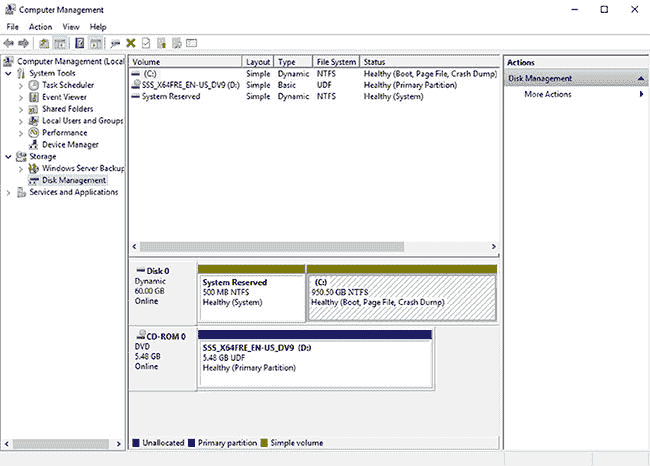

**图 1.2**](#c01.xhtml#figureanchor1-2) 磁盘管理

## 验证网络连通性

虽然 Windows Server 2016 可以独立使用而不连接网络，但如果没有网络连通性，你无法充分利用操作系统的潜力。因为网络操作系统的根本目的是为用户提供资源，所以你必须验证网络连通性。

### 基本连通性测试

在开始安装 Active Directory 之前，你应该对当前配置进行多次检查，以确保服务器在网络上的配置正确。你应该测试以下：

**网络适配器** 你的服务器上至少应安装并正确配置一个网络适配器。验证网络适配器是否安装正确的快速方法是使用“计算机管理”管理工具。在设备器的“网络适配器”分支下，你至少应该列出一个网络适配器。如果没有，使用控制面板中的“添加硬件”图标来配置硬件。

**TCP/IP** 确保在任何必要的网络适配器上都安装、配置并启用了 `TCP/IP`。服务器还应被赋予有效的 IP 地址和子网掩码。可选，你可能需要配置默认网关、`DNS` 服务器、`WINS` 服务器和其他网络设置。如果你使用 `DHCP`，请确保分配的信息是正确的。为服务器使用静态 IP 地址始终是一个好主意，因为处理不当，IP 地址更改会导致网络连通性问题。

**互联网访问** 如果服务器应该访问互联网，请验证它能够连接到局域网（LAN）之外外部 Web 服务器和其他机器。如果服务器无法连接，可能是你的 `TCP/IP` 配置有问题。

**LAN 访问** 服务器应该能够查看网络上的其他服务器和工作站。如果看不到其他机器，请确保你的环境网络和 `TCP/IP` 配置正确。

**客户端访问** 网络客户端计算机应该能够连接到你的服务器并查看任何共享资源。测试连通性的简单方法是创建一个共享，并测试其他机器是否能够看到其中的文件和文件夹。如果客户端无法访问该机器，请确保客户端和服务器都配置正确。

**广域网访问** 如果你在分布式环境中工作，你应该确保你有权访问任何需要连接到此机器的远程站点或用户。通常，这是网络管理员可以进行的简单测试。

### 测试网络配置的工具和技术

在某些情况下，验证网络访问可以非常简单。你可能有一些内部和外部网络资源可以测试。在其他情况下，可能会更复杂。你可以使用多种工具和技术来验证你的网络配置是否正确。

# 使用 `Ipconfig` 工具

在命令提示符中输入 `ipconfig/all`，可以查看计算机的 TCP/IP 设置信息。图 1.3 显示了你将收到的信息类型。

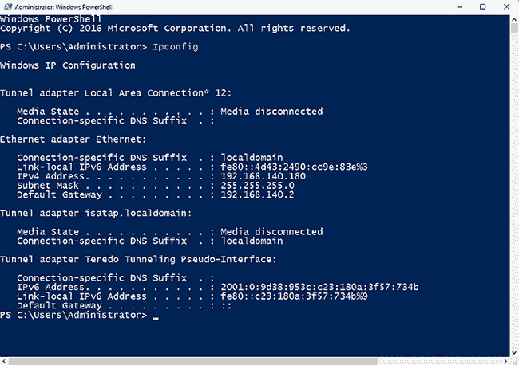

图 1.3 使用 ipconfig 工具查看 TCP/IP 信息

# 使用 `Ping` 命令

`ping` 命令设计用于测试与其他计算机的连接性。你只需在命令行中输入 `ping` 然后紧跟一个 IP 地址或主机名即可使用该命令。以下是使用 `ping` 命令测试连接性的某些步骤。

### Ping 同一子网上的其他计算机

你应该首先 `pinging` 网络上一个已知的活动 IP 地址以检查是否有响应。如果你收到了响应，说明你与网络之间是通的的。

接着检查是否可以使用主机名 `ping` 另一台机器。如果此操作有效，则说明本地名称解析工作正常。

### Ping 不同子网上的计算机

为了确保路由设置正确，你应该尝试 `ping` 网络中位于其他子网（如果存在）的计算机。如果测试失败，请尝试 `pinging` 默认网关。任何错误可能表明网络配置存在问题或路由器有问题。

# 使用 `TraceRT` 命令

`TraceRT` 命令的作用与 `ping` 命令相同，不同之处 `TraceRT` 命令会显示沿途的每一个跳点。因此，如果某个路由器或交换机故障，`TraceRT` 命令将显示跟踪停止的位置。

# 浏览网络

为了确保你可以访问网络上的其他计算机，请确保可以通过点击“网络”来看到它们。这验证了你的名称解析参数设置正确，并且其他计算机是可以访问的。此外，尝试连接其他机器上的资源（如文件共享或打印机）。

# 浏览互联网

你可以通过访问已知的网站（例如 [www.microsoft.com](http://www.microsoft.com)）来快速验证你的服务器是否可以访问互联网。成功则确保了你可以访问网络外部。如果你无法访问网页，可能需要验证你的代理服务器设置（如果适用）和你的 DNS 服务器设置。

通过执行这些简单的测试，你可以确保网络连接配置正确，并且其他网络资源是可用的。

## 理解域和森林功能级别


Windows Server 2016 Active Directory 使用了一个名为 `domain and forest functionality` 的概念。你在安装 Active Directory 期间选择的功能级别决定了你的域可以使用哪些功能。

## 关于域功能级别

Windows Server 2016 将支持以下域功能级别：

- Windows Server 2008
- Windows Server 2008 R2
- Windows Server 2012
- Windows Server 2012 R2
- Windows Server 2016

你使用的功能级别取决于你在网络上安装了哪些域控制器。这是一个需要记住的重要事实。只要这些服务器仅作为成员服务器，你可以使用任何版本的 Windows Server。你只能使用不低于你功能级别的域控制器。

例如，如果功能级别为 `Windows Server 2012 R2`，那么所有的域控制器必须至少为 `2012`。

表 1.1 显示了 Windows Server 2008、Windows Server 2008 R2、Windows Server 2012、Windows Server 2012 R2 和 Windows Server 2016 中可用的功能。

| 域功能 | Windows Server 2008 | Windows Server 2008 R2 | Windows Server 2012 | Windows Server 2012 R2 | Windows Server 2016 |
| :--- | :--- | :--- | :--- | :--- | :--- |
| 特权访问管理 | 禁用 | 启用 | 启用 | 启用 | 启用 |
| 身份验证 | 禁用 | 启用 | 启用 | 启用 | 启用 |
| 细粒度密码策略 | 禁用 | 启用 | 启用 | 启用 | 启用 |
| 最后登录时间戳 | 禁用 | 启用 | 启用 | 启用 | 启用 |
| 高级加密（Kerberos AES 128 和 256） | 禁用 | 启用 | 启用 | 启用 | 启用 |
| 分布式文件系统复制 Sysvol | 禁用 | 启用 | 启用 | 启用 | 启用 |
| 只读域控制器 (RODC) | 禁用 | 启用 | 启用 | 启用 | 启用 |
| 重定向用户和计算机容器 | 禁用 | 启用 | 启用 | 启用 | 启用 |
| 重命名域控制器的能力 | 禁用 | 启用 | 启用 | 启用 | 启用 |
| Kerberos KDC 密钥 | 禁用 | 启用 | 启用 | 启用 | 启用 |
| InetOrg 对象的密码 | 禁用 | 启用 | 启用 | 启用 | 启用 |
| SID 历史 | 禁用 | 启用 | 启用 | 启用 | 启用 |
| 组嵌套 | 禁用 | 启用 | 启用 | 启用 | 启用 |
| 通用组 | 禁用 | 启用 | 启用 | 启用 | 启用 |

## 关于森林功能

Windows Server 2016 功能功能适用于森林中的所有域。在升级森林之前，所有域都必须升级到 Windows Server 2016。

共有五个功能级别：

- Windows Server 2008
- Windows Server 2008 R2
- Windows Server 2012
- Windows Server 2012 R2
- Windows Server 2016

### 全局目录复制增强

当管理员向全局目录添加新属性时，只有这些更改会被复制到森林中的其他全局目录。这可以显著减少与复制相关的网络流量。

### 废弃架构类和属性

你无法从 Active Directory 架构中永久删除类和属性。但是你可以将它们标记为废弃以便无法使用。通过 Windows Server 2003、Windows Server 2008/2008 R2、Windows Server 2012/2012 R2 和 Windows Server 2016 功能，你可以重新定义废弃架构属性使其在架构中占据新的角色。

### 森林信任

以前，系统管理员没有简单的方法授予不同森林之间资源的权限。Windows Server 2003、Windows Server 2008/2008 R2、Windows Server 2012/2012 R2 和 Windows Server 2016 通过允许单独 Active Directory 森林之间的信任关系解决了部分这些困难。森林信任的作用与域信任类似，但它们扩展到两个森林中的每个域。注意，所有森林信任都是不可传递。

### 链接值复制

Windows Server 2003、Windows Server 2008/2008 R2、Windows Server 2012/2012 R2 和 Windows Server 2016 使用了一种名为 `linked value replication` 的概念。通过链接值复制，只有被更改的用户记录会被复制（而不是整个组）。这可以显著减少与复制相关的网络流量。

## 重命名域

尽管 Active Directory 域结构最初的设计具有灵活性，但仍存在一些局限性。由于合并、收购、公司重组和其他其他业务变化，你可能需要重命名域。在 Windows Server 2003、Windows Server 2008/2008 R2、Windows Server 2012/2012 R2 以及 Windows Server 2016 中，你可以更改任何域的 DNS 和 NetBIOS 名称。请注意，此操作并非简单地发布一个重命名命令。相反，你必须遵循特定的流程以确保操作成功。幸运的是，当你正确遵循该程序时，微软支持域重命名，尽管并不是所有的应用程序都支持它。

## 其他功能

Windows Server 2008/2008 R2、Windows Server 2012/2012 R2 以及 Windows Server 2016 还支持以下功能：

- 改进的复制算法和动态辅助类旨在提高性能、可扩展性和可靠性。
- `Active Directory Federation Services (AD FS)`（也称为 `Trustbridge`）处理联合身份管理。`Federated identity management` 是一种基于标准的 IT 过程，允许跨组织和平台边界进行分布式标识、验证和授权。Windows Server 2008、Windows Server 2008 R2、Windows Server 2012、Windows Server 2012 R2 以及 Windows Server 2016 中的 ADFS 解决方案通过允许组织安全地共享用户身份信息帮助管理员应对这些挑战。
- `Active Directory Lightweight Directory Services (AD LDS)` 为需要对目录启用应用程序提供灵活支持的组织而开发。AD LDS 使用轻量级目录访问协议 (`LDAP`)，是一种增加了灵活性并帮助组织避免基础设施成本增加的服务。
- Active Directory 回收桶（Windows Server 2008 R2 或更高级别）允许管理员在 AD DS 运行时完整地恢复已删除的对象。在此之前，如果你删除了一个 Active Directory 对象，你需要从备份中恢复它。现在，你可以从 AD 回收桶中恢复该对象。

## 规划域结构

一旦你验证了服务器 Active Directory 的技术配置，就是时候验证你组织的 Active Directory 配置了。由于本章内容侧重于在环境中安装第一个域，在开始设置之前，你确实只需要了解以下信息：

- 域的 DNS 名称
- 服务器的计算机名或 NetBIOS 名称（旧版本的 Windows 将用它访问服务器资源）
- 域将在什么种域功能级别运行
- 网络上是否有其他 DNS 服务器可用
- 网络上有什么类型以及多少台 DNS 服务器可用

然而，如果你将在你的环境中安装额外的域控制器，或者将将连接到现有的 Active Directory 结构，你还应该具备以下信息：

- 如果此域控制器将加入现有域，你需要知道该域的名称。你可能需要该域企业管理员组成员的密码，或者需要让具有相应权限的人员在提升之前创建一个域帐户。
- 你应该知道新域是否将加入现有的树，如果是，请知道它将加入的树的名称。
- 你应该知道该域将连接的森林名称（如果适用）。

## 安装 Active Directory

只要你提前做了充分计划并做出了必要的决策，安装 Active Directory 就是一个简单而直接的过程。你有许多方法可以安装 Active Directory。你可以使用 Windows Server 2016 安装磁盘（从介质安装 (IFM) ））、使用服务器管理器或使用 Windows PowerShell 来安装 Active Directory。但在执行实际安装之前，你必须首先确保网络已准备好安装。

在接下来的章节中，你将查看在给定环境中安装第一个域控制器的优势和所需步骤。

### 新手学习 Active Directory

与任何新版本的 Windows Server 一样，微软对 Active Directory 进行了某些改进。Windows Server 2016 Active Directory 实施了以下更改：

#### 特权访问管理

特权访问管理 (PAM) 你缓解对 Active Directory 环境的安全担忧。其中一些安全问题包括凭据窃取技术（哈希传递和叉式网络钓鱼）以及其他类型的类似攻击。PAM 允许管理员使用 Microsoft Identity Manager (`MIM`) 创建新的访问解决方案。

#### Azure AD

Azure Active Directory Join 允许你设置基于 Office 365 的 Azure 网络，然后轻松地将终端用户的系统加入该域。

#### Microsoft Passport

Microsoft Passport 允许你的用户设置基于密钥的身份验证，允许你的用户使用不仅仅是密码（生物识别或 PIN 码）进行身份验证。你的用户可以使用链接到证书或非对称密钥对的生物识别或 PIN 码登录到系统。

### 只读域控制器

Windows Server 2016 支持另一种类型的域控制器，称为 `read-only domain controller (RODC)`。这是 Active Directory 数据库的副本，但没有向 Active Directory 写入的能力。RODC 允许组织在担心安全的地方（现场或离线）安装域控制器。

RODC 需要从另一个域控制器获取其 Active Directory 数据库。如果某个域尚未设置域控制器，则 RODC 将不可用（选项将显示为灰色）。实施 RODC 与向域添加另一个域控制器相同。安装过程完全相同，只是在进入选择域控制器选项的屏幕时，勾选 RODC 复选框。再次，这仅在域中存在其他域控制器时才可用。

### Adprep

当你向 Active Directory 添加新用户时，你会填写如名、姓等字段。这些字段被称为 `attributes`。问题是，当你安装 Windows Server 2016 时，它的 Active Directory 版本比之前的 Active Directory 版本具有更新属性。因此，你需要设置当前的 Active Directory 版本，使其能够接受 Windows Server 2016 Active Directory 的安装。这就是为什么需要使用 Adprep。为了向现有域或森林中添加第一个 Windows Server 2016 域控制器，必须运行 Adprep。

为了向现有森林中添加第一个 Windows Server 2016 域控制器，你需要运行 `Adprep /forestprep`。`Adprep /forestprep` 必须由属于企业管理员组、架构管理员组以及架构主所在域的域管理员组的管理员运行。

为了向现有域中添加第一个 Windows Server 2016 域控制器，你需要运行 `Adprep /domainprep`。再次，为了执行此命令，你必须是安装 Windows Server 2016 域控制器的域的域管理员成员。

为了向现有森林中添加第一个 Windows Server 2016 RODC，必须运行 `Adprep /rodcprep`。运行此命令的管理员必须是企业管理员组的成员。

Windows Server 2016 Active Directory 安装过程的一个新特性是，如果需要，`Adprep` 将在常规 Active Directory Domain Services 安装期间自动执行。

#### Active Directory 先决条件

在将 Active Directory 安装到网络之前，你必须首先确保你的网络和服务器满足某些最低要求。表 1.2 将向你显示 Active Directory 所需的要求。

表 1.2 Active Directory 要求

| 要求 | 说明 |
| --- | --- |
| Adprep | 向现有 Active Directory 域中添加第一个 Windows Server 2016 控制器时，Adprep 命令将根据需要自动运行。 |
| 凭据 | 在安装新的 AD DS 树时，必须将第一台服务器的管理员设置为本地管理员。要在现有域中安装额外的域控制器，你需要成为域管理员（Domain Admins）组的成员。 |
| DNS | 需要安装域名系统系统才能使 Active Directory 正常运行。你可以在 Active Directory 安装期间安装 DNS。 |
| NTFS | 存储数据库、日志文件和 SYSVOL 文件夹的 Windows Server 2016 驱动器必须放在格式化为 NTFS 文件系统的卷上。 |
| RODCs | 只要域上已存在域控制器（Windows Server 2008 或更高版本），就可以安装只读域控制器。此外，森林功能级别必须至少为 Windows Server 2003。 |
| TCP/IP | 你必须在域上配置适当的 TCP/IP 设置，并且配置 DNS 服务器地址。 |

#### 安装过程

Windows Server 2016 计算机被配置为成员服务器（如果已加入域）或独立服务器（如果属于工作组的一部分）。将服务器转换为域控制器的过程被称为 `promotion`（提升）。通过使用服务器管理器简单直观的向导，系统管理员可以在安装后快速配置服务器成为域控制器。管理员还具有使用 Windows PowerShell 提升域控制器的能力。

安装 Active Directory 的第一步是将 Windows Server 2016 计算机提升为域控制器。环境中的第一个域控制器是森林、树、域以及操作主角色（operations master roles）的起点。

练习 1.2 显示了你需要遵循的步骤，将现有的 Windows Server 2016 计算机提升为域控制器。要完成此练习中的步骤，你必须已经安装并配置了 Windows Server 2016 计算机。你还需要一个支持 SRV 记录的 DNS 服务器。如果没有可用的 DNS 服务器，Active Directory 安装向导将自动为你配置一个。

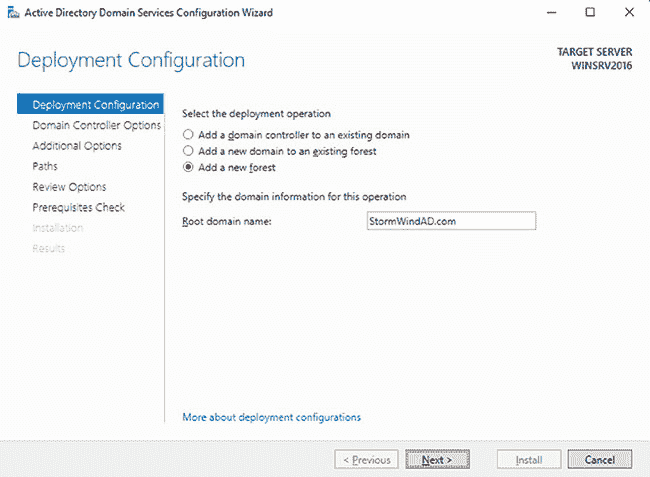

图 1.4 新森林屏幕

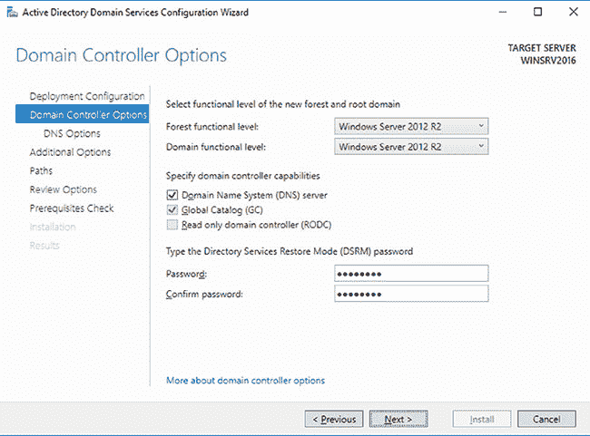

图 1.5 域控制器选项

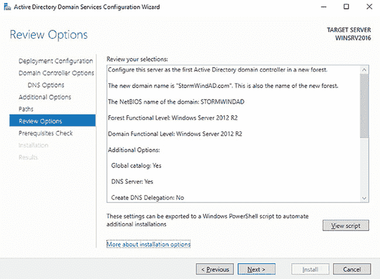

图 1.6 检查选项屏幕

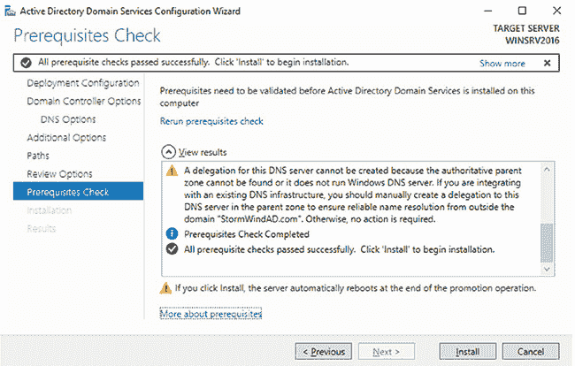

图 1.7 先决条件检查屏幕

安装 Active Directory 的第一步是将 Windows Server 2016 计算机提升为域控制器。环境中的第一个域控制器是森林、树、域以及操作主角色的起点。

练习 1.2 显示了你需要遵循的步骤，将现有的 Windows Server 2016 计算机提升为域控制器。要完成此练习中的步骤，你必须已经安装并配置了 Windows Server 2016 计算机。你还需要一个支持 SRV 记录的 DNS 服务器。如果没有可用的 DNS 服务器，Active Directory 安装向导将自动为你配置一个。

### 在 Windows Azure 中部署 Active Directory

好比，在我进入这个主题之前，我必须先解释我在谈论什么。Windows Azure 是一个云平台，允许你。将服务器转换为域控制器的过程被称为 `promotion`（提升）。通过使用服务器管理器简单直观的向导，系统管理员可以在安装后快速配置服务器成为域控制器。管理员还具有使用 Windows PowerShell 提升域控制器的能力。

安装 Active Directory 的第一步是将 Windows Server 2016 计算机提升为域控制器。环境中的第一个域控制器是森林、树、域以及操作主角色的起点。

练习 1.2 显示了你需要遵循的步骤，将现有的 Windows Server 2016 计算机提升为域控制器。要完成此练习中的步骤，你必须已经安装并配置了 Windows Server 2016 计算机。你还需要一个支持 SRV 记录的 DNS 服务器。如果没有可用的 DNS 服务器，Active Directory 安装向导将自动为你配置一个。

### 使用从介质安装安装额外的域控制器

有时你可能安装额外的域控制器，而不会产生大量的额外复制流量。当你不需要额外的复制流量即可安装域控制器时，安装速度会快得多。这是使用从介质安装（IFM）方法安装额外域控制器的完美时机。

Windows Server 2016 允许你使用 `Ntdsutil` 实用程序通过 IFM 方法安装域控制器。`Ntdsutil` 实用程序允许你为域中的额外的域控制器创建安装媒体。你必须记住的一个问题是，自 IFM 创建以来所创建、修改或删除的任何对象都必须进行复制。通过让创建 IFM 的时间尽可能接近于安装域控制器的时刻，可以确保所有对象在域控制器安装时被创建。


另一种创建 IFM 的方法是将相同域内另一个相似的域控制器的备份还原到另一个位置。

## 验证 Active Directory 安装

一旦你安装并配置了 Active Directory，你将希望验证你的操作是否正确。在接下来的章节中，你将查看执行此操作的方法。

### 使用事件查看器

验证 Active Directory 操作的第一种（可能也是信息量最大的）方法是查询存储在 Windows Server 2016 事件日志中的信息。你可以使用 Windows Server 2016 事件查看器执行此操作。练习 1.5 将引导你完成此过程。事件查看器中看到的条目包括错误、警告和信息消息。

除了提供与 Active Directory 相关的事件状态信息外，事件查看器还会显示有关其他系统服务和应用程序的有用信息。你应该经常使用此工具。

### 使用 Active Directory 管理工具

在服务器提升为域控制器后，你将看到各种工具被添加到管理工具程序组，包括以下：

**Active Directory 管理中心 (Active Directory Administrative Center)** 这是一个 `Microsoft Management Console (MMC)` 节点，允许你从一个中心位置完成许多 Active Directory 任务。此 `MMC` 节点允许你管理目录服务对象，包括执行以下任务：

* 重置用户密码

* 创建或管理用户账户

* 创建或管理组

* 创建或管理计算机帐户

* 创建或管理组织单元 (OU) 和容器

* 在 Active Directory 管理中心的同一实例中连接到一个或多个域或域控制器

* 过滤 Active Directory 数据

**Active Directory 域和信任 (Active Directory Domains and Trusts)** 使用此工具查看和更改与 Active Directory 环境中各种域相关的信息。此 `MMC` 节点允许你设置快捷信任。

**Active Directory 站点和服务 (Active Directory Sites and Services)** 使用此工具创建和管理 Active Directory 站点和服务，以将它们映射到组织的物理网络基础设施。

**Active Directory 用户和计算机 (Active Directory Users and Computers)** 用户和计算机管理是 Active Directory 环境的基础。Active Directory 用户和计算机工具允许你跨域进行特定于机器和用户的设置。此工具在本书中都会有讨论。

**Windows PowerShell 的 Active Directory 模块 (Active Directory Module for Windows PowerShell)** `Windows PowerShell` 是一种命令行壳和脚本语言。Windows PowerShell 的 Active Directory 模块是一组 `cmdlets`，用于在一个自包含包中管理 Active Directory 域、Active Directory 轻量级目录服务 (AD LDS) 配置集以及 Active Directory 数据库挂载工具实例。Windows PowerShell 的 Active Directory 模块是一个普通的 `PowerShell` 窗口。唯一的区别是，当你选择 Active Directory 模块时，Active Directory PowerShell 模块会预加载。

确保 Active Directory 可以访问并正常运行的良好方法是运行 Active Directory 用户和计算机工具。当你打开该工具时，你应该看到与图 1.8 类似的配置。具体来说，你应该点击“域控制器”文件夹并确保你的域名称出现在列表中。如果你的配置通过了这两个检查，则说明 Active Directory 存在。


### 从客户端测试

任何解决方案的最佳测试就是简单验证它是否按照你预期的方式工作。对于 Active Directory，一个很好的测试是确保客户端可以查看 Windows Server 2016 提供的资源。在接下来的章节中，你将查看验证 Active Directory 的几种方法。

#### 验证客户端连接性

如果你无法在网络上看到最近提升的服务器，可能存在网络配置错误。如果只有一个或少数客户端看不到该机器，问题可能与客户端端配置有关。要修复此问题，请客户端具有适当的 TCP/IP 配置（包括 DNS 服务器设置），并且它们可以看到网络上的其他计算机。

如果从任何客户端计算机都无法访问新的域控制器，你应该使用本章前面提到的方法验证 Active Directory 是否正常启动。如果 Active Directory 已经启动，请确保 DNS 设置正确。最后，使用 `ping` 命令测试服务器与客户端之间的网络连接性。

#### 加入域

如果 Active Directory 配置恰当，客户端和其他服务器应该能够加入域。练习 1.6 概述了你需要将 Windows 7、Windows 8/8.1 或 Windows 10 计算机加入域的步骤。

要完成此练习，你必须已经在你的环境中安装并正确配置了至少一个 Active Directory 域控制器和一个支持 SRV 记录的 DNS 服务器。除了域控制器外，你还需要另一一台未配置为域控制器的计算机，运行以下操作系统之一：Windows 7、Windows 8、Windows 8.1、Windows 10、Windows Server 2008、Windows Server 2008 R2、Windows Server 2012、Windows Server 2012 R2 或 Windows Server 2016。

一旦客户端能够成功加入域，它们就应该能够使用网络图标查看 Active Directory 资源。此测试验证了 Active Directory 的正常运行，并确保你与客户端计算机之间有连接。

## 创建和配置应用程序数据分区

组织在各种地方存储许多类型的信息。对于支持这些信息的 IT 部门来说，确保在需要的地方提供正确的信息可能是困难的。Windows Server 2016 使用名为 `application data partitions` 的功能，允许系统管理员和应用程序开发人员在 Active Directory 中存储自定义信息。

开发能够（例如）跨企业同步信息的分布式应用程序并非易易事。你必须构思出一种在远程站点（某些站点分布在世界各地）之间传输数据的方法，并且必须确保数据被正确复制。通过在 `Active Directory` 中存储应用程序信息，你可以利用它的存储机制和复制拓扑结构。存储在域控制器上的应用程序相关信息可以受益于其容错特性和可用性。

考虑以下这个简单的示例来理解它是如何运作的。假设你的组织开发了一个客户销售跟踪和库存应用程序。公司需要让该应用程序存储的信息对其遍布全球的所有分支机构和用户都可用。然而，目标是以最少的 IT 管理工作量来来实现这一目标。假设 `Active Directory` 已经在整个组织中部署，开发者可以在应用程序中构建支持功能，将数据存储在 `Active Directory` 中。然后，他们可以依赖 `Active Directory` 在各个站点之间存储并同步这些信息。当用户从应用程序请求更新后的数据时，应用程序可以从托管销售跟踪和库存数据副本的最近的域控制器处获取这些信息。

其他类型的应用程序也可以从使用应用程序数据分区中极大获益。现在你已经对应用程序数据分区的性质有了良好的理解，让我们来看如何使用 `Windows Server 2016` 和 `Active Directory` 创建并管理它们。

## 创建应用程序数据分区

默认情况下，在创建 `Active Directory` 环境后，你将没有任何任何自定义的应用程序数据分区。因此，启用此功能的第一步是创建一个新的应用程序数据分区。你可以使用多种工具来实现：

**第三方应用程序或特定于应用程序的工具**：通常，如果你计划安装一个可以在 `Active Directory` 数据库中存储信息的应用程序，你将随程序一起获得某些管理和配置该数据的方法。例如，应用程序的安装过程可能会帮助你完成设置新应用程序数据分区以及创建存储数据所需结构的步骤。

**Active Directory 服务接口**：`ADSI` 是一组可编程对象，可以通过 Visual Basic 脚本版 (`VBScript`)、Visual C#、Visual Basic .NET 以及许多其他支持组件对象模型 (`COM`) 标准的语言进行访问。通过使用 `ADSI`，开发者可以创建、访问和更新存储在 `Active Directory` 以及任何应用程序数据分区中的数据。

**LDP 工具**：你可以使用基于 `LDAP` 的查询查看和修改 `Active Directory` 架构的内容。`LDP` 工具允许你查看有关应用程序数据分区的信息。

`Ldp.exe` 是一个图形用户界面 (GUI) 工具，允许管理员配置轻量级目录访问协议 (`LDAP`) 目录服务。管理员有能力使用 `LDP` 工具管理 `Active Directory Lightweight Directory Services` (`AD LDS`) 实例。要使用 `LDP` 工具，你必须是管理员或相应人员。

**Ndsutil**：`ntdsutil` 工具是系统管理员在 `Windows Server 2016` 域控制器上创建和管理应用程序数据分区的主要方法。该工具的特定命令将在本章后面介绍。

你可以在 `Active Directory` 森林中的三个不同位置之一创建应用程序数据分区：

*   作为 `Active Directory` 森林中的一个新树

*   作为 `Active Directory` 域分区的子

*   例如，你可以在 `Finance.MyCompany.com` 域中创建一个会计应用程序数据分区

*   作为另一个应用程序数据分区的子

*   此方法允许你创建应用程序数据分区的层次结构

正如你所预期的，你必须是 `Enterprise Admins`（企业管理员）或 `Domain Admins`（域管理员）组的成员才能创建应用程序数据分区。或者，你可以被委派创建新分区的相应权限。

现在你已经对创建应用程序数据分区的基本方法有了很好的了解，让我们来看副本（应用程序数据分区信息的副本）是如何处理的。

## 管理副本

`副本` 是存储在 `Active Directory` 中任何数据的副本。与存储在 `Active Directory` 中的基础信息不同，应用程序分区不能包含安全主体。此外，并不是所有的域控制器都自动包含存储在应用程序数据分区中的副本。系统管理员可以定义哪些域控制器托管应用程序数据的副本。这是一个重要特性，因为如果有效使用副本，管理员可以在复制流量和数据一致性之间找到平衡。例如，假设你组织的 30 个地点中有三个地方需要最新的会计相关信息。你可能选择只将数据复制到位于需要这些数据的域控制器。限制此类数据的复制可以减少网络流量。

`复制` 是保持副本更新的过程。应用程序数据的存储和更新在指定服务器上的方式，与基础 `Active Directory` 信息（如用户和组）在域控制器之间的同步相同。应用程序数据分区副本使用`知识一致性检查器 (KCC)` 管理，它确保指定的域控制器接收更新的副本信息。此外，`KCC` 使用你创建的所有 `Active Directory` 站点和连接对象来确定处理复制的最佳方法。

## 移除副本

当你对域控制器执行`降级 (demotion)` 时，该服务器将无法再托管应用程序数据分区。如果域控制器包含应用程序数据分区信息的副本，你必须在降级之前从域控制器中删除副本。如果域控制器是托管应用程序数据分区副本的机器，那么整个应用程序数据分区将被删除并永久丢失。通常情况下，只有当你完全确定组织不再需要访问应用程序数据分区中存储的数据后才执行此操作。

## 使用 ntdutil 管理应用程序数据分区

系统管理员创建和管理应用程序数据分区的主要方法是通过 `ntdsutil` 命令行工具。你只需在命令提示符中输入 `ntdsutil` 即可启动该工具。`ntdsutil` 命令是交互式且对上下文敏感的。也就是说，一旦你启动了该工具，就会看到 `ntdsutil` 命令提示符。在此提示符处，你可以输入各种命令来设置你在应用程序中的上下文。例如，如果你输入域管理命令，你将能够使用与域相关的命令。某些操作还要求你在执行命令之前连接到域、域控制器或 `Active Directory` 对象。

[表 1.3] 描述了 `ntdsutil` 工具支持的域管理命令。你可以通过在命令提示符输入以下命令序列来访问这些信息：

```
ntdsutil
domain management
Help
```

| 命令 | 说明 |

| :--- | :--- |

| `Help or ?` | 显示 `ntdsutil` 命令中域管理菜单内可用命令的信息。 |

| `Connection or Connections` | 允许你连接到特定的域控制器。这将为在特定域控制器上执行的后续操作设置上下文。 |

| `Create NC PartitionDistinguishedNameDNSName` | 创建一个新的应用程序目录分区。 |

| `Delete NC PartitionDistinguishedName` | 移除一个应用程序数据分区。 |

| `List NC Information PartitionDistinguishedName` | 显示指定的应用程序数据分区的信息。 |

| `List NC Replicas PartitionDistinguishedName` | 返回特定应用程序数据分区的所有副本的信息。 |

| `Precreate PartitionDistinguishedNameServerDNSName` | 预创建交叉引用应用程序数据分区对象。这允许指定的 DNS 服务器托管应用程序数据分区的副本。 |

| `Remove NC Replica PartitionDistinguishedNameDCDNSName` | 从指定的域控制器上移除副本。 |

| `Select Operation Target` | 选择将用于其他操作的命名上下文。 |

| `Set NC Reference Domain PartitionDistinguishedNameDomainDistinguishedName` | 指定应用程序数据分区的参考域。 |

| `Set NC Replicate NotificationDelay PartitionDistinguishedNameFirstDCNotificationDelay OtherDCNotificationDelay` | 定义指定的应用程序数据分区复制频率的设置。 |

图 1.9 提供了使用 `ntdsutil` 的示例。输入了以下命令来为后续操作设置上下文：

```
ntdsutil
domain management
connections
connect to server localhost
connect to domain ADTest
quit
list
```

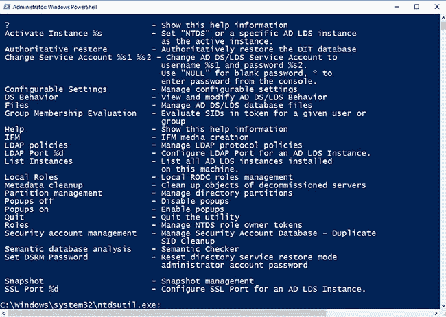

FIGURE 1.9 在本地域控制器上查看 ntdsutil 命令

## 配置 Active Directory 的 DNS 集成

将 Active Directory 和 DNS 服务集成有许多益处：

*   你可以与其他 Active Directory 组件一起配置和管理复制复制。

*   你可以通过使用动态更新来自动化 DNS 资源记录的大部分维护工作。

*   你将能够在 DNS 服务的各种属性上设置特定的安全选项。

练习 1.7 显示了为确保启用这些集成功能而必须采取的步骤。你将查看与 Active Directory 操作性特定的各种 DNS 函数。

在开始此练习之前，请确保本地机器已配置为 Active Directory 域控制器，并且 DNS 服务已正确配置。如果你指示 Active Directory 安装向导自动配置 DNS，则本节中提到的许多设置可能已经启用。但是，你应该验证配置，并熟悉如何手动设置这些选项。

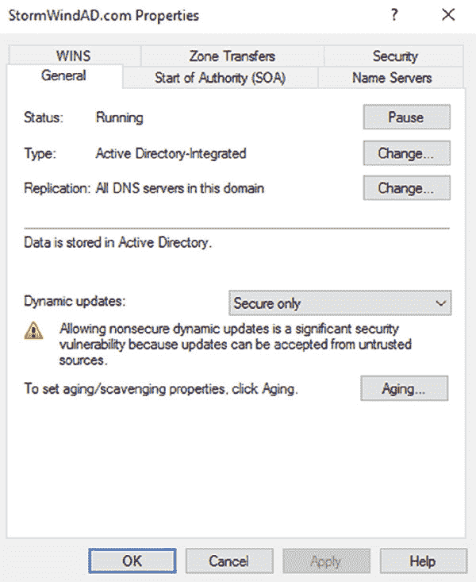

FIGURE 1.10 DNS 区域属性的常规选项卡

## 总结

本章涵盖了实现 Active Directory 森林和域结构的基础、创建和配置应用程序数据分区，以及设置你的域和森林的功能级别。

你现在已经熟悉了如何实施 Active Directory。我们仔细检查了在网络上安装 Active Directory 所需遵循的所有必要步骤和条件。首先，你需要为域命名系统（DNS）做好准备，因为没有 DNS 服务器的支持，无法安装 Active Directory。

你还需要验证升级为域控制器的计算机是否符合某些基本的文件系统和网络连接性要求，以便 Active Directory 能在你的组织中流畅高效地运行。这些是你部署 Active Directory 时必须执行的一些最常见的事情。

本章还涵盖了域功能级别的概念，它本质上决定了你可以在环境中使用哪些域控制器。

你还学习了如何安装 Active Directory，通过使用服务器管理器将 Windows Server 2016 计算机提升为域控制器。你还学习了如何通过客户端计算机测试 Active Directory 来验证安装。

本章范围限于检查与在 Active Directory 环境中安装和配置第一个域相关的问题。

## 考试要点

*   **了解将服务器提升为域控制器的前提条件。** 你应该理解在尝试升级服务器为域控制器之前必须完成的任务。此外，你应该对完成域控制器提升过程所需的信息有良好的了解。


# 理解 Active Directory 安装向导的步骤

当你运行 Active Directory 安装向导时，将看到许多不同的选择。你应该理解向导每一步中提供的各种选项的影响。

# 熟悉你将用于管理 Active Directory 的工具

在将 Windows Server 2016 提升为域控制器时，会安装三个主要的管理工具。确保你知道使用哪些工具完成什么类型的任务。

# 理解应用程序数据分区的目的

应用程序数据分区背后的想法是，既然你已经有一个可以复制各种安全信息的目录服务，你也可以用它来跟踪应用程序数据。在 Active Directory 中存储应用程序信息的主要优势是，你可以利用它的存储机制和复制拓扑。存储在域控制器上的应用程序相关信息受益于容错功能和可用性。

## 复习题

你可以在附录中找到答案。

1. 你是一个大型组织的系统管理员，该组织最近实施了 Windows Server 2016。你有几个安全性不严严的远程站点。你决定实施只读域控制器 (RODCs)。为了完成安装，网络需要什么样的森林和功能级别？（选择所有适用项）

   1. Windows Server 2016
   2. Windows Server 2008 R2
   3. Windows Server 2012 R2
   4. Windows Server 2008

2. 配置为域控制器的 Windows Server 2016 计算机一次可以参与多少个域？

   1. 零
   2. 一个
   3. 两个
   4. 任意数量的域

3. 系统管理员正试图确定为将成为 Windows Server 2016 文件服务器和域控制器的服务器使用什么文件系统。公司有以下要求：

   - 文件系统必须允许从 Windows Server 2016 内部进行文件级安全管理。
   - 文件系统必须在大分区上高效利用空间。
   - 域控制器的 `Sysvol` 必须存储在该分区上。

   以下哪些文件系统这些这些？

   1. FAT
   2. FAT32
   3. HPFS
   4. NTFS

4. 出于安全考虑，你决定将移动驱动器上的系统分区从 FAT32 文件系统转换为 NTFS。为了转换文件系统，必须采取哪些步骤？（选择两个）

   1. 从命令提示符运行 `CONVERT /FS:NTFS` 命令。
   2. 重新运行 Windows Server 2016 安装并在重新安装期间将分区转换为 NTFS。
   3. 从安装光盘启动 Windows Server 2016 安装并选择重建文件系统。
   4. 重启计算机。

5. Windows Server 2016 需要使用以下哪些协议或服务来支持 Active Directory？（选择两个。）

   1. `DHCP`
   2. `TCP/IP`
   3. `NetBEUI`
   4. `IPX/SPX`
   5. `DNS`

6. 你正在为了测试目的将一台 Windows Server 2016 计算机提升为 Active Directory 域控制器。新的域控制器将添加到现有域中。在使用 Active Directory 安装向导时，你收到了一条错误消息，阻止了服务器的提升。以下哪项可能是该问题的原因？（选择所有适用项）

   1. 系统不包含可以创建 `Sysvol` 目录的 `NTFS` 分区。
   2. 网络上没有 Windows Server 2016 `DNS` 服务器。
   3. 新服务器上的 `TCP/IP` 配置不正确。
   4. 域已达到域控制器的最大数量。

7. 你的网络包含一个单一 Active Directory 域。该域包含五个 Windows Server 2008 R2 域控制器。你计划安装一个新的 Windows Server 2016 域控制器。你需要执行哪两个操作？（每个正确答案都提供了解决方案的一部分。选择两个。）

   1. 在命令行中运行 `adprep.exe /rodcprep`。
   2. 在命令行中运行 `adprep.exe /forestprep`。
   3. 在命令行中运行 `adprep.exe /domainprep`。
   4. 从 Active Directory 域和信任中，提高域的功能级别。
   5. 从 Active Directory 用户和计算机中，预置 `RODC` 计算机账户。

8. 你是一家生产小部件的大型公司的网络管理员。管理层要求你实施一套新的 Windows Server 2016 系统。你需要实现联邦身份管理。以下哪项将帮助你实现此目标？

   1. Active Directory 联合身份服务 (Active Directory Federation Services)
   2. Active Directory DNS 服务
   3. Active Directory IIS 服务
   4. Active Directory IAS 服务

9. 你是负责公司基础设施的系统管理员。你认为名称解析存在问题，并且需要验证是否正在使用正确的主名。你想在本地系统上测试 DNS，并查看主机名 `server-1` 是否解析为 IP 地址 `10.1.1.1`。以下哪些操作提供了该问题的解决方案？

   1. 在你的本地子网中添加 `DNS` 服务器。
   2. 在本地系统的 `HOSTS` 文件中将主机名 `server-1` 到 IP 地址 `10.1.1.1`。
   3. 在你的本地 `WINS` 服务器上添加 `A` 记录。
   4. 在你的本地 `DNS` 服务器上添加 `MX` 记录。

10. 你的组织中有一个 Active Directory 森林，包含一个名为 `WillPanek.com` 的域。你有两个配置了安装 `DNS` 角色的域控制器。有两个名为 `WillPanek.com` 和 `WillPanekAD.com` 的 Active Directory 集成区域。你的一个 IT 成员（不是管理员）需要能够修改 `WillPanek.com` `DNS` 服务器，但你需要防止该用户修改 `WillPanekAD.com` 的 `SOA` 记录。你如何实现这一目标？

   1. 从 `DNS 管理`程序集中修改 `WillPanek.com` 区域的权限。
   2. 从 `DNS 管理`程序集中修改 `WillPanekAd.com` 区域的权限。
   3. 在 Active Directory 中运行“控制委派向导”（Delegation Of Control Wizard）。
   4. 在 `DNS`程序集中运行“控制委派向导”（Delegation Of Control Wizard）。

# 第 2 章：管理 Active Directory

本章涵盖了以下 70-742 考试目标：

- **创建和管理 Active Directory 用户和计算机**
  - 此目标可能包括但不限于：自动创建 Active Directory 账户；创建、复制、配置和删除用户和计算机；配置模板；执行批量 Active Directory 操作；配置用户权限；实施离线域加入；管理未活动和禁用的账户；使用 `Windows PowerShell` 自动解锁禁用的账户；使用 `Windows PowerShell` 自动重置密码。

- **创建和管理 Active Directory 组和组织单位**
  - 此目标可能包括但不限于：自动创建 Active Directory 账户；创建、复制、配置和删除用户和计算机；配置模板；执行批量 Active Directory 操作；配置用户权限；实施离线域加入；管理未活动和禁用的账户；使用 `Windows PowerShell` 自动解锁禁用的账户；使用 `Windows PowerShell` 自动重置密码。

- **配置身份验证和账户设置**
  - 此目标可能包括但不限于：自动创建 Active Directory 账户；创建、复制、配置和删除用户和计算机；配置模板；执行批量 Active Directory 操作；配置用户权限；实施离线域加入；管理未活动和禁用的账户；使用 `Windows PowerShell` 自动解锁禁用的账户；使用 `Windows PowerShell` 自动重置密码。

在之前的章节中，你学习了如何安装 Active Directory，但你还没有介绍过存在的低级对象。在本章中，你将查看各种组件的结构。由于与组织单位相关的概念非常简单，某些系统管理员可能会低估其重要性，并不对其相应的计划。不要误认为：成功的 Active Directory 安装的基础组件之一就是组织单位的正确设计和部署。

你将在本章中看到创建常用 Active Directory 对象所需的实际步骤，并学习如何配置和管理它们。最后，你将查看发布资源以及自动账户的方法。

## Active Directory 概述

Active Directory 的基本设计目标之一是定义一个集中的用户和资源存储库。Active Directory 记录了网络上所有用户、计算机和资源的信息。每个域充当逻辑边界，域成员（包括工作站、服务器和域控制器）共享它们内部的信息。

存储在 Active Directory 中的信息决定了哪些用户可以使用哪些资源。通过使用 Active Directory 对象的权限，你可以控制网络安全的各个方面。

在整个章节中，你将学习与 Active Directory 的安全细节。但注意，Active Directory 安全只是整体网络安全的一个方面。你还应该确保已对文件系统、网络设备和其他资源实施了适当的访问控制设置。让我们从查看网络安全的各种组件开始，包括处理安全主体以及管理安全和权限、访问控制列表 (`ACLs`) 和访问控制条目 (`ACEs`)）。

### 理解 Active Directory 功能

Active Directory 是微软域的心脏灵魂，我无法反复谈论 Active Directory 包含的角色和功能。让我们看看 Windows Server 2016 和 Active Directory 的一些优势。

## Active Directory 证书服务

Active Directory Certificate Services (AD CS) 提供了一组可定制的服务，允许您颁发和管理公钥基础设施 (PKI) 证书。这些证书可以用于采用公钥技术的软件安全系统。

## Active Directory 域服务

Active Directory 域服务 (AD DS) 包含新功能，使部署域控制器变得更简单，并允许您更快地实现它们。AD DS 还让域控制器在审计和授权文件访问方面更加灵活。此外，AD DS 的设计旨在通过一致的图形化和脚本化管理体验，使执行管理任务变得更容易。

## Active Directory 权限管理服务

Active Directory Rights Management Services (AD RMS) 提供管理和开发工具，允许您处理行业安全技术，包括加密、证书和身份验证。使用这些技术允许组织创建可靠的信息保护解决方案。

## Kerberos 身份验证

Windows Server 2016 使用 Kerberos 验证协议及其扩展进行基于密码和公密钥的身份验证。Kerberos 客户端作为安全支持程序 (SSP) 安装，并通过安全支持提供程序接口 (SSPI) 进行访问。

## Kerberos 约束委派

Kerberos 约束委派 (KCD) 是一种身份验证协议，管理员可以使用它为特定的服务账户委派客户端凭据。例如，KCD 可能是 SharePoint 2016 服务的就。如果您计划使用 SharePoint 2016 分析服务和 Power Pivot 数据，您将需要配置 KCD。KCD 允许服务账户充充另一个服务账户，从而访问特定资源。

## 托管服务账户

托管服务账户 (Managed Service Accounts) 是由 Active Directory 管理的 Windows Server 2016 账户。普通服务账户是用于运行 Exchange 和 SQL Server 等特定服务的账户。通常，当管理员创建服务账户时，由该管理员负责维护账户（包括更改密码）。托管服务账户是管理员创建的账户，但账户由 Active Directory 管理（包括密码更改）。要创建托管服务账户，您必须使用 `New-ADServiceAccount` PowerShell 命令。您必须使用 PowerShell 来创建托管服务账户。

## 组托管服务账户

组托管服务账户 (gMSA) 在域内提供与托管服务账户相同的功能，但 gMSA 将其功能扩展到多个服务器上。当服务账户需要与多个服务器协作时（例如用于网络负载均衡的服务器场），这些账户非常有用。

有时，身份验证过程要求服务的所有实例使用相同的服务账户。这就是 gMSA 的用用所在。一旦使用了组托管服务账户，Windows Server 2016 将自动管理服务账户的密码。网络管理员不再负责管理服务账户密码。

## 安全审计

安全审计赋予了组织帮助维护企业安全性的能力。通过使用安全审计，您可以验证对机器、资源、应用程序和服务的授权或未经授权的访问。安全最大的优势之一是验证合规性。

## TLS/SSL (Schannel SSP)

Schannel 是一种安全支持程序 (SSP)，它结合使用了安全套接层 (SSL) 和传输层安全 (TLS) 互联网标准身份验证协议。安全支持提供程序接口 (SSPI) 是 Windows 系统用于允许安全功能（包括身份验证）的 API。

## Windows 部署服务

Windows Deployment Services 管理员远程安装 Windows 操作系统。管理员可以使用 Windows Deployment Services 通过网络安装来设置新计算机。

## 理解安全主体

安全主体是被分配了安全标识符 (SID) 的 Active Directory 对象。SID 是唯一标识符，用于管理任何可以分配权限的对象。安全主体被赋予执行某些操作和访问某些网络资源的权限。

以下基本 Active Directory 对象类型作为安全主体：

### 用户账户

用户账户通过包含用户名和密码等信息来识别网络上的单个用户。用户账户是安全管理的基本单元。

### 组

组有两种主要类型：安全组和协作组。两种类型都可以包含用户账户。系统管理员使用安全组来简化安全权限的管理。另一方面，他们使用协作组仅发送电子邮件。协作组不是安全主体。

### 计算机账户

计算机账户识别哪些计算机是特定域的成员。由于这些计算机参与了 Active Directory 数据库，系统管理员可以管理影响计算机的安全设置。他们使用计算机账户确定计算机是否可以加入域以及用于验证。正如您在本章后面看到的，系统管理员还可以对某些计算机设置设置限制以增加安全性。这些设置适用于计算机，因此也适用于任何使用该计算机的用户（无论授予了用户账户什么权限）。

注意，其他对象（如组织单元 OU）不作为安全主体运行。这意味着您可以对 OU 内的所有对象应用某些设置（如组策略）；但是，您无法专门针对 OU 本身设置权限。OU 的目的是根据业务需求逻辑地组织其他 Active Directory 对象，为安全添加所需的控制级别，并创建一种更易于委派的方式。

您可以通过对安全主体执行以下操作来管理安全：

- 您可以为它们分配访问各种网络资源的权限。
- 您可以赋予它们用户权利。
- 您可以通过审计（在本章稍后部分介绍）跟踪它们的操作。

安全主体的主要类型——用户账户、组和计算机账户——构成了 Active Directory 安全架构的基础。作为系统管理员，您可能会花费部分时间管理这些对象的权限。

## OU 概述

组织单元 (OU) 是 Active Directory 对象的逻辑组，正如其名称所示。OU 充当容器（参见图 2.1），在其中可以创建 Active Directory 对象，但它们不构成 DNS 命名空间的一部分。它们仅用于在域内创建组织。

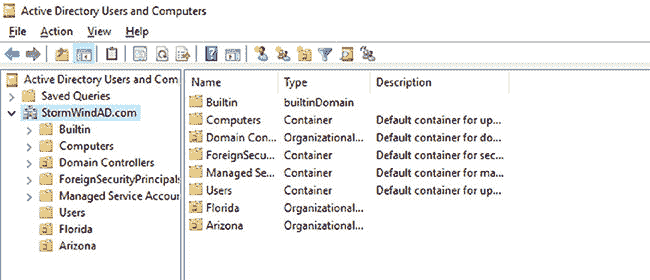

OU

OU 可以包含以下类型的 Active Directory 对象：

- 用户
- 组
- 计算机
- 共享文件夹对象
- 联系人
- 打印机
- InetOrgPerson 对象
- Microsoft 消息队列 (MSMQ) 队列别名
- 其他 OU

OU 最实用的功能可能是它们可以包含其他 OU 对象。因此，系统管理员可以根据业务实践分层分组资源和对象。OU 结构非常灵活，正如您在本章后面看到的，可以轻松重新排列以反映业务重组。

OU（组织单元）的另一个优势是每个 OU 都可以拥有自己的策略集。管理员可以为每个 OU 创建单独且组策略对象（`GPOs`）。`GPOs` 是适用于 OU 内所有对象的规则或策略。

在 Active Directory 域的组织中，每种类型的对象都有其特定的用途。在本章的后后部分，你将查看 `User`（用户）、`Computer`（计算机）、`Group`（组）和 `Shared Folder`（共享文件夹）对象的细节。现在，让我们关注使用 OU 的目的和益处。

## OU 的目的

OU 主要用于组织 Active Directory 内部的对象。然而，在深入研究 OU 的细节之前，你必须理解 OU、用户和组之间是如何交互的。最重要的是，你应该理解 OU 仅仅是你可以用来在逻辑上对各种对象进行分组的容器。但是，它们并不是传统意义上的“组”。也就是说，它们不用于分配安全权限。另一种表述方式是，包含在 OU 中的用户账户、计算机账户和组账户被视为安全主体（security principals），而 OU 本身不是。

OU 并不能取代标准的用户组权限。一种良好的通用做法是将用户分配到组中，然后将组放在 OU 中。这增强了设置安全权限以及使用 OU 层级结构进行设置的益处。

OU 仅包含其所在域内的对象。正如你将在本章稍后的“委派管理控制”节中看到的，OU 是用于组策略和其他管理设置的最精细粒度粒度级别。

## OU 的益处

在整个网络环境中使用 OU 有许多益处：

- OU 是你可以从中分配目录权限的最小单元。


你可以轻松地更改 OU 结构，它比域结构更具活性。

OU 结构可以支持许多不同的层级结构。

子对象可以继承 OU 设置。

你可以在 OU 上设置组策略设置。

你可以轻松地将 OU 及其内部对象的管理委派给适当的用户和组。

现在你已经对为什么要使用 OU 有了很好的了解，请查看一些你可以用于规划 OU 结构的通用惯做法。

## 规划 OU 结构

Active Directory 的核心优势之一是它可以为复杂的网络环境带来组织性。在开始实现各种配置的 OU 之前，你必须规划一个与业务和技术需求兼容的结构。在接下来的章节中，你将学习在规划 OU 结构时应该考虑的几个因素。

### 资源的逻辑分组

使用 OU 的根本目的是按层级对资源（存在于 Active Directory 中）进行分组。幸运的是，层级分组非常直观，并在大多数业务中被广泛使用。例如，一个典型的制造企业可能会将其各种业务分为不同的部门：

*   销售 (Sales)
*   市场 (Marketing)
*   工程 (Engineering)
*   研发 (Research and Development)
*   支持 (Support)
*   信息技术 (IT)

这些每个部门通常都有自己的目标和使命。为了使业务具有竞争力，每个部门的个人被分配到各种角色。可能会使用以下角色类型：

*   经理 (Managers)
*   文员 (Clerical staff)
*   技术人员 (Technical staff)
*   规划师 (Planners)

每个角色通常涉及特定的工作职责。例如，经理应该为普通员工提供指导。注意，这些角色的本质意味着员工可能担任许多不同的职位。也就是说，一个员工可能是某个部门的经理，同时是另一个部门的技术人员。在现代职场中，这种情况非常常见。

所有这些信息都有帮助，可以帮你规划如何使用 OU。首先，给定网络环境内的 OU 结构应该很好地映射业务需求，包括组织的政治和逻辑结构以及其技术需求。图 2.2 显示业务组织如何映射到 Active Directory 域内的 OU 结构。

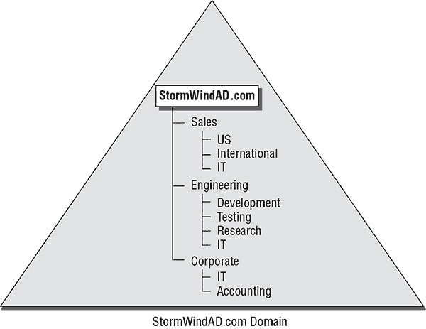

图 2.2 将业务组织映射到 OU 结构

为你的组织命名 OU 时，你应该记住几几个考虑因素和限制：

**保持名称和描述简单** OU 的目的是让管理和使用资源变得简单。因此，保持对象名称简单且具有描述性始终是一个好主意。有时，在这两个目标之间平衡可能是一个挑战。例如，虽然像“位于 Bob 隔位附近的激光打印机”这样的打印机名称看起来很有描述性，但显然很难输入。此外，想象一下如果 Bob 搬家了（或离开了公司），你可能不得不做出的命名更改！

**注意限制** OU 名称的最长长度为 64 个字符。在大多数情况下，这应该足以描述该 OU。记住，OU 的名称不需要唯一地描述对象，因为 OU 通常只作为整个层级结构的一部分被引用。例如，你可以在不同的父 OU 中创建相同名称的 OU。

**注意层级一致性** OU 的基本基础是它在层级中的位置。从设计的角度来看，这意味着你不能在同一级别有两个同名的 OU。但是，你可以在不同级别拥有相同的 OU。例如，你可以在北美 OU 中创建一个名为“Corporate”的 OU，在南 OU 中创建另一个。这是因为完全限定域名包含了有关层级的信息。当管理员尝试访问 Corporate OU 中的资源时，他们必须指定是哪个 Corporate OU。

例如，如果你创建一个北美 OU，加拿大 OU 在逻辑上应该属于它。如果你决定将北美和加拿大 OU 分在完全不同的容器中，那么你可能想使用更合适的名称。例如，你可以将北美改为“U.S.”。用户和管理员依赖于域内 OU 的层级结构，因此请确保其逻辑一致。

基于这些考虑，你应该对如何最好组织域的 OU 结构有了很好的了解。

### 理解 OU 继承

当你重新排列 Active Directory 结构中的 OU 时，你可以更改许多设置。在移动和重新组织 OU 时，系统管理员必须密切关注安全权限和其他配置选项的自动意外变化。默认情况下，OU 在移动后继承其新父容器的权限。

通过 Windows Server 2016 和 Active Directory 提供的内置工具，你只能在域内移动或复制 OU。你不能使用 Active Directory 用户和计算机工具在域之间移动 OU。要实现这一点，请使用 `Active Directory 迁移工具 (ADMT)`。这是 Active Directory 许多支持工具之一。

企业通常有一种分工，负责处理所有与保持公司网络顺畅运行相关的任务。然而，网络操作系统（NOSs）往往难以分配恰当的权限；换句话说，它们并不支持非常细粒度的权限分配。有时，为了确保只分配正确的权限，细粒度的度量是必要的。一个通用的良好原则是：为用户和管理员提供其工作所需的最小权限。这样，你就可以确保不会发生意外、恶意或其他非预期的更改。

在 `Active Directory` 的世界中，你通过委派来定义 `OU` 管理员的职责。作为一名系统管理员，你偶尔会被赋予将责任委派给别人的任务——你不能包揽一切，尽管有时管理员认为自己可以。你理解这种旧的 IT 逻辑，即为了工作安全而亲力完成所有任务，但这实际上可能会让你看起来更糟。

如果你发现自己处于一个需要委派任务的角色，请记住 `Windows Server 2016` 的设计初衷就是为你提供这种能力。从最简单的定义来说，`delegation`允许高级管理权限向个人和组授予容器及其子树特定的管理权限。这本质上消除了需要域管理员对大量用户群体拥有广泛权限的需求。你可以将这种对树中分支的控制拆分到你创建的每个 `OU` 内部。

当你考虑实施委派时，请记住以下两个关注点：

**父子关系** 当你考虑安全权限的可维护性时，你创建的 `OU` 层次结构将非常重要。`OUs` 以父子关系的形式存在，这意味着在层次结构中较高的 `OU`（父级）上设置的权限和组策略与较低级 `OU`（子级）中的对象交互。在委派权限时，这一点极其重要。你可以允许子容器自动继承父容器设置的权限。例如，如果你的组织北美部门包含 12 个其他 `OUs`，你可以通过在北美部门上设置安全权限，一次性向所有它们委派权限（从而节省时间并减少人为错误的概率）。这一功能可以极大地减轻管理负担，特别是在大型组织中，但它也提醒了在域内合理规划 `OU` 结构的重要性。

**继承设置** 现在你已经了解了如何利用父子关系进行管理，你应该应该考虑 `inheritance`，即子对象接管父容器权限的过程。当你对父容器设置权限时，所有子对象都将被配置为继承相同的权限。然而，如果业务规则不适合继承，你也可以覆盖这种行为。

### 应用组策略

Windows  way 系统的优势之一是它为用户提供了大量的权力和灵活性。从安装新软件到添加设备驱动程序，用户可以对其工作站配置进行许多更改。然而，这种程度的灵活性也是一个潜在的问题。例如，缺乏经验的用户可能会无意中更改设置，导致需要花费数小时才能修复的问题。

在许多情况下（特别是在业务环境中），用户只需要操作系统提供的完整功能的子集。然而在过去，实施和管理安全及策略设置相关的困难性导致了安全策略的松散。其中的原因之一是技术层面的——实施和管理安全限制既枯燥又困难。其他问题则是政治性的——用户和管理层可能认为他们应该拥有这些权限。

## 创建 OU

现在你已经查看了 `OUs` 的几种使用方法，是时候查看如何创建和管理它们了。通过使用 `Active Directory Users and Computers` 管理工具（也称为 `MMC`），你可以快速方便地添加、移动和更改 `OUs`。

图 2.3 显示了一个公司可能使用的基于地理结构的结构。注意，该组织总部位于北美。通常，其他办公室比公司总部小得多。

创建 `OU` 时的一个很好功能是能够保护 `OU` 不被意外删除。当你创建一个 `OU` 时，可以勾选 `Protect Container From Accidental Deletion`（防止意外删除容器）框。该选框防止管理员删除该 `OU`。要删除该 `OU`，你必须进入 `OU` 的高级视图并取消勾选框。

练习 2.1 将引导你完成为一家跨国企业创建多个 `OUs` 的过程。你将在本章后面的练习中使用此 OU 结构。

## 管理 OU

即使情况很少变化，管理网络环境仍然具有挑战性。然而在现实世界中，业务部门、部门和员工角色经常变化。随着业务和技术需求的变化，`Active Directory` 的结构也应该发生变化。

幸运的是，更改域内 `OUs` 的结构是一个相对简单的过程。在接下来的章节中，你将查看委派 `OUs` 控制以及进行其他更改的方法。

### 移动、删除和重命名 OU

虽然 `OUs` 主要是为了 Active Directory 环境中的组织目的而创建的，但它们有若干项你可以修改的设置。要使用 Active Directory 用户和计算机管理工具修改 `OU` 的属性，请右键点击任何 `OU` 的名称并选择`属性`。点击后将会出现`OU 属性`对话框。在图 2.5 所示的示例中，你将看到“常规”选项卡上的选项。

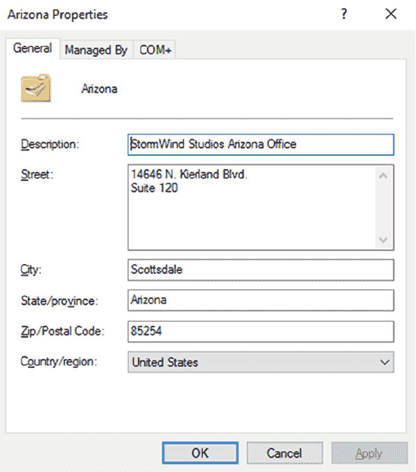

`图 2.5` `OU 属性`对话框的常规选项卡

在任何组织中，知道谁负责管理 `OU` 都有帮助。你可以在“映像”选项卡上设置此信息（参见图 2.6）。此选项卡上指定的信息非常方便，因为它是从用户记录的联系信息自动提取的。你应该考虑为组织中的每个 `OU` 始终设置一个联系人，以便其他系统管理员在需要进行更改时知道应该联系谁。

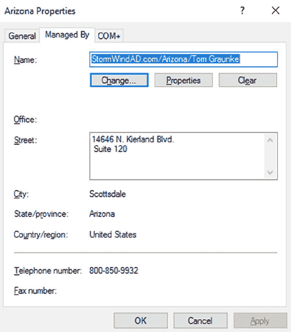

`图 2.6` `OU 属性`对话框的映像选项卡

### 委派 OU 控制

在简单的环境中，一个或几个系统管理员可能负责管理 Active Directory 中的所有设置。例如，单个系统管理员可以管理环境中所有 `OUs` 中的所有用户。然而，在较大的组织中，角色和职责可能会分配给许多不同的个人。一种典型的情况是，系统管理员仅负责 Active Directory 域中少数 `OUs` 内的对象。或者，一个系统管理员可能管理`用户`和`组`对象，而另一个人负责管理文件和打印服务。

幸运的是，使用 Active Directory 用户和计算机工具，你可以快速轻松地确保特定用户仅获得所需的权限。在练习 2.3 中，你将使用`控制委派向`向个人分配权限。要成功完成这些步骤，你必须先在本章之前的练习中创建了这些对象。

虽然通过向导提供的常用任务已足以许多委派操作，但你可能在某些情况下需要更多控制权。例如，你可能想给特定的系统管理员授予仅修改`计算机`对象的权限。练习 2.4 使用`控制委派向导`分配更细粒度的权限。要成功完成这些步骤，你必须已完成本章中之前的练习。

## OU 故障排除

通常情况下，你会发现使用 `OUs` 是一个相对简单且无痛苦的过程。通过充分的计划，你能够为 `OU` 对象实现直观且实用的结构。

`OU` 配置中最常见的问题与 `OU` 结构有关。在排除 `OUs` Fault 时，请注意以下因素：

**继承**：默认情况下，`组策略`和其他设置会自动从父 `OUs` 传输到子 `OUs` 和对象。即使特定的 `OU` 没有赋予一组权限，该 `OU` 内部的对象仍可能从父对象获取这些权限。

**管理委派**：如果你允许错误的用户帐户或组对 `OUs` 执行特定任务，你可能会带来安全风险。

**组织问题**：有时，Active Directory 结构无法轻松映射到业务需求。你可能需要重新组织对象以获得更好的管理。

## 创建和管理 Active Directory 对象

现在你已经熟悉了创建 `OUs` 的任务，你应该发现创建和管理其他 Active Directory 对象是简单的。

### Active Directory 对象概述

当你安装并配置域控制器时，Active Directory 会建立一个包含多个部分的组织结构。

#### Active Directory 组织

当你查看 Active Directory 时，你会看到像文件夹的看起来。这些是容器，或`组织单元 (OUs)`。区别在于，`OU` 是一个你可以链接 `GPO` 的容器。

默认情况下，在安装并配置域控制器后，你将看到以下：

- **内置**：`内置`容器包含了在提升域控制器时安装的所有标准组。
- **计算机**：默认情况下，`计算机`容器包含域中所有工作站的列表。
- **域控制器**：`域控制器` OU 包含域所有域控制器的列表。
- **外部安全主体**：这些允许将权限分配给不属于当前域的对象。
- **托管服务帐户**：`托管服务帐户`容器用于运行特定服务的帐户。要创建这些帐户，你必须使用 `New-ADServiceAccount` PowerShell 命令。
- **用户**：`用户`容器包含了属于域的所有安全帐户。

你希望确保保护管理员账户。你应该重命名管理员账户并确保密码足够复杂。受保护的管理员账户可以让你的网络更安全。每个黑客都知道服务器上默认有一个管理员账户。务必通过保护管理员账户来确保你的网络安全。

## Active Directory 对象

你可以创建并管理多种不同类型的 Active Directory 对象。以下是特定的对象类型：

**Computer (计算机)**：`Computer objects` 代表 Active Directory 域的一部分的工作站。域内的所有计算机共享相同的安全数据库，包括用户和组信息。计算机对象用于管理安全权限并实施组策略限制。

**Contact (联系人)**：`Contact objects` 通常用于组织单元 (OU)以指定主要的管理员联系人。联系人不像用户那样是安全主体。它们用于指定组织外人员的信息。

**Group (组)**：`Group objects` 是用户的逻辑集合，主要用于向资源分配安全权限。在管理用户时，你应该将他们放入组，然后向组分配权限。这允许进行灵活管理，而无需为每个用户设置权限。

**InetOrgPerson**：`InetOrgPerson object` 是一种 Active Directory 对象，用于定义轻量级目录访问协议 (LDAP) 和 X.500 目录中的用户属性。

**MSIMaging-PSPs**：`MSIMaging-PSPs` 是所有企业扫描后处理 (Enterprise Scan Post Scan Process) 对象的容器。

**MSMQ Queue Alias**：`MSMQ Queue Alias object` 是用于 `MSMQ-Custom-Recipient` 类 Active Directory 对象。微软消息队列 (MSMQ) 队列别名对象将 Active Directory 路径和用户定义的别名与公共、私有或直接单元素格式名称关联。这允许使用队列别名引用可能未在 Active Directory 域服务 (AD DS) 中列出的队列。

**Organizational Unit (组织单元)**：`OU object` 用于在 Active Directory 域内构建分级结构。它是用于创建管理分组的最小单元，并可分配组策略。通常，域内的 OU 结构反映了公司的业务组织。

**Printer (打印机)**：`Printer objects` 映射打印机。

**Shared Folder (共享文件夹)**：`Shared Folder objects` 映射服务器共享。它们用于组织文件/打印服务器上可能提供的各种文件资源。通常，共享文件夹对象用于为特定的文件集合提供逻辑名称。例如，系统管理员可能会为常用应用程序、用户数据和共享公共文件创建单独的共享文件夹。

**User (用户)**：`User object` 是 Active Directory 基于的基础安全主体。用户账户包含个人信息以及密码和其他权限信息。

## 使用 Active Directory 用户和计算机工具创建对象

练习 2.5 将引导你完成在 Active Directory 域内创建各种对象所需的步骤。在此练习中，你将创建一些基础的 Active Directory 对象。要完成此练习，你必须拥有至少一个 Active Directory 域控制器的权限，并且应该已经完成了本章之前的练习。

## 配置用户主体名称 (UPN)

当你登录域时，你的登录名称看起来像一个电子邮件地址（例如，`wpanek@willpanek.com`）。这被称为你的 `user principal name (UPN)`。UPN 是用户名后跟 @ 符号和域名。在创建用户账户时，默认会生成 UPN 后缀。UPN 的格式为 `userName@DomainName`，但管理员可以修改或更改默认的 UPN。如果你的森林有多个域且你需要将 UPN 更改为不同的域，你拥有这种能力。要更改 UPN 后缀，在 Active Directory 用户和计算机中，选择一个用户并进入其属性。选择属性编辑器 (Attribute Editor) 选项卡。滚动到 `userPrincipalName` 属性并进行更改。这些更改随后将同步到全局目录。

## 使用模板

现在你将深入研究用户模板。`User templates` 允许 Active Directory 管理员创建一个默认账户（例如，`template_sales`），并使用该账户创建所有匹配该模板的其他用户（所有销售人员）。

如果你正在创建多个账户，这可以节省大量的时间和资源。例如，如果你需要为公司添加 35 名新销售人员，你将为销售创建一个模板，并使用该模板的副本创建所有其他新账户。这避免了你反复填写许多相同字段的麻烦。当你复制模板时，某些信息不会被复制。这是因为它是用户特定的信息。以下是一些不会从模板中复制的字段：

*   名称 (Name)
*   登录名称 (Logon Name)
*   密码 (Password)
*   电子邮件 (Email)
*   电话 (Phone Numbers)
*   描述 (Description)
*   办公室 (Office)
*   网页 (Web Page)


许多重要字段，如所属组（`Member Of`）、配置文件路径（`Profile Path`）、部门（`Department`）和公司（`Company`）都会被复制。创建模板时有一项重要事项需要完成：模板账户在创建后需要被禁用。你不希望任何人使用此账户访问你的网络。在练习 2.6 中，你将创建一个用于销售部门的销售模板。

## 从文件导入对象

在练习 2.5 中，你使用 Active Directory 用户和计算机工具创建了一个账户。但如果你需要批量导入账户该怎么办？批量导入账户主要有两个应用程序：`ldifde.exe` 工具和`csvde.exe`工具。这两个工具都支持从文件导入账户。

`ldifde`工具从行分隔符分隔的文件导入数据。该工具允许管理员导出和导入数据，从而允许在 Active Directory 中执行添加、修改和删除等批量操作。Windows Server 2016 包含了`ldifde.exe`以帮助支持批量操作。

`csvde.exe`工具执行与`ldifde.exe`相同的导出功能，但`csvde.exe`使用逗号分隔值文件格式。`csvde.exe`工具不允许管理员修改或删除对象。它仅支持向 Active Directory 添加对象。

## Active Directory 迁移工具

管理员过去使用的另一个工具是`Active Directory Migration Tool (ADMT)`。ADMT 允许管理员将用户、组和计算机从旧版本的服务器迁移到当前版本的服务器。

管理员还使用 ADMT 在不同森林的 Active Directory 域之间（林间迁移）以及同一森林的 Active Directory 域之间（林内迁移）迁移用户、组和计算机。

在撰写此书时，微软尚未发布受 Windows Server 2016 支持的新版本 ADMT。我在书中提到它，是因为微软可能很快就会发布新版本，而我希望你了解它的功能。请继续检查微软网站以查看是否发布了新版本。

## 计算机的离线加域

*Offline domain join*（离线加域）让管理员能够在域中预置计算机账户，以便为操作系统的部署做准备。在启动时，计算机可以在无需联系域控制器的情况下加入域。这有助于缩短在数据中心部署计算机的时间。

假设你的数据中心需要部署多个虚拟机。这就是离线域成员加入（offline domain join）大显身场的地方。在操作系统安装首次启动时，离线域成员加入允许虚拟机自动加入域。不需要额外的步骤或重启。

以下是使用离线域成员加入的一些优势：

*   Active Directory 状态更改不会产生额外的网络流量。
*   计算机状态到域控制器的更改不会产生额外的网络流量。
*   Active Directory 状态更改和计算机状态的更改可以在不同时间完成。

## 管理对象属性

一旦你创建了必要的 Active Directory 对象，你可能需要对它们的默认属性进行更改。除了创建 Active Directory 对象时所做的设置外，你还可以配置更多属性。你也可以通过右键点击任何对象并从弹出菜单中选择`Properties`来访问对象属性。

每个对象类型都包含一组独特的属性。

### 用户对象属性

以下列表描述了`User`对象的一些属性（请参见 图 2.7）：

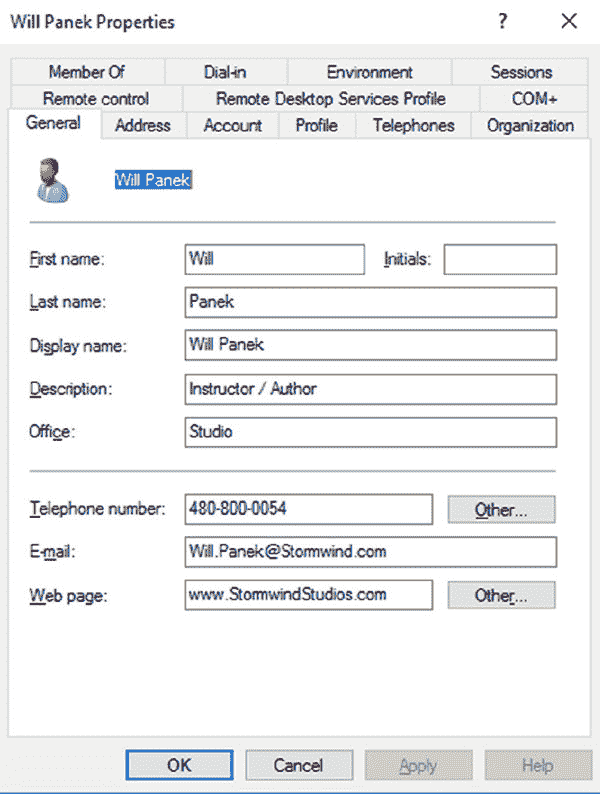

FIGURE 2.7 用户属性

**General** 关于此用户的常规账户信息

**Address** 关于此用户的物理位置信息

**Account** 用户登录名称以及其他账户限制，例如工作站限制和登录时间

**Profile** 关于用户漫游配置设置的信息

**Telephones** 用户的电话联系信息

**Organization** 用户的职称、部门和公司信息

**Member Of** 用户的组成员身份信息

**Dial-In** 用户的远程访问服务 (RAS) 权限

**Environment** 用户的登录和其他网络设置

**Sessions** 会话限制，包括最大会话时间和以及空闲会话设置

**Remote Control** 此用户会话的远程控制选项

**Remote Desktop Services Profile** 关于用于远程桌面服务的用户配置文件的信息

**Personal Virtual Desktop** 允许你为用户分配特定的虚拟机作为其个人虚拟桌面

**COM+** 为用户指定 COM+ 分区集

### 计算机对象属性

计算机对象的属性与用户对象不同。计算机对象是指客户端运行并加入域的系统。以下列表描述了一些计算机对象属性：

**General** 关于计算机名称、计算机角色及其描述的信息

（你可以启用一个选项，允许此机器的本地系统帐户从其他服务器请求服务。如果该机器是受信任且安全的计算机，这将非常有用。）

**Operating System** 运行在计算机上的操作系统的名称、版本和服务包信息

**Member Of** 此计算机对象所属的 Active Directory 组

**Delegation** 允许你设置代表另一个用户运行的服务

**Location** 计算机物理位置的描述

**Managed By** 负责此计算机的用户或联系对象信息

**Dial-In** 为计算机设置拨入选项

### 设置 Active Directory 对象属性

现在你已经看到了可以为 Active Directory 对象设置的各种属性，让我们来完成一个关于如何配置某些属性的练习。练习 2.7 将引导你完成如何为 Active Directory 对象设置各种属性。要完成此练习中的步骤，你必须先完成练习 2.5。

到此时，你可能已经注意到 Active Directory 对象有很多共同选项。例如，组和计算机对象都有一个`Managed By`选项卡。

Windows Server 2016 允许你同时管理多个用户对象。例如，你可以通过在选择时按住`Shift`或`Ctrl`键来选择多个用户对象。然后你可以右键点击所选的任何一个对象并选择`Properties`，以显示适用于多个用户的属性。注意，并不是每个用户属性都是可用的，因为某些属性每个用户唯一。你可以为包含用户和非用户（如计算机和组）在内的多个对象选择配置`Description`字段。

另一个对象管理任务是取消配置（deprovisioning）过程。*Deprovisioning*是对容器内 Active Directory 对象的管理。当你从 Active Directory 容器中删除对象时，取消配置过程会移除该对象并同步容器以保持更新。

## 理解组

现在你已经知道如何创建用户帐户，是时候学习如何创建组了。

### 组属性

现在你已经理解了为什么要使用组，让我们来看看设置组及其属性（请参见 图 2.8）。在创建组时，理解你需要的某些选项会有帮助。

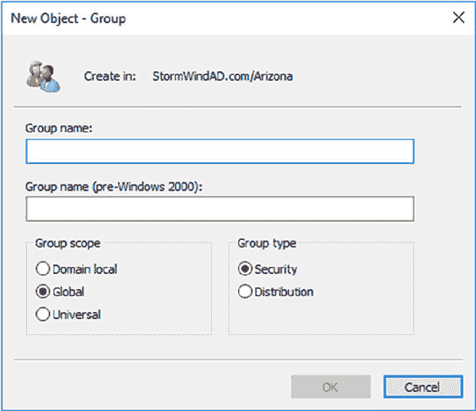

FIGURE 2.8 新组对话框

**Group Type** 你可以从两种组类型中选择：安全组和分布组。

**Security Groups** 这些组可以被赋予权利和权限。例如，如果你想让某组用户访问特定的打印机，你将创建一个安全组，然后对该组应用某些权利和权限。

安全组也可以接收电子邮件。如果有人向该组发送电子邮件，该组内的所有用户都会收到该邮件（只要他们拥有允许启用电子邮件组的邮件系统，例如 Exchange）。

**Distribution Groups** 这些组*仅*用于电子邮件（只要他们拥有允许启用电子邮件组的邮件系统，例如 Exchange）。你不能对这种类型的组设置对象的权限和权利。

**Group Scope** 在组作用域方面，你有三个选择。

**Domain Local Groups** 域本地组是保留在创建它们的所在域中的组。你使用这些组在单个域内授予权限。例如，如果你创建一个名为`HPLaser`的域本地组，你不能在任何其他域中使用该组，它必须驻留在你创建它的域中。

**Global Groups** 全局组可以包含来自组创建所在域的其他组和帐户。此外，你可以在森林中的任何域中赋予它们权限。

## 通用组

通用组可以包含来自域树或森林中任何域的组和账户。你可以为域树或森林中任何域的通用组授予权限。

## 创建组策略

当你创建组策略时，请记住微软在考试中喜欢使用的这个缩写：`AGDLP`（或`AGLP`）。这个缩写代表了你应该执行的一系列操作。以下是它的具体含义：

- **A** Accounts（账户：创建你的用户账户。）
- **G** Global groups（全局组：将用户账户放入全局组中。）
- **DL** Domain local groups（域本地组：将全局组放入域本地组中。）
- **P** Permissions（权限：在域本地组上分配如`Deny`拒绝或`Apply`应用。）

另一个代表你可以使用的策略的缩写是`AGUDLP`（或`AULP`）。以下是它的具体含义：

- **A** Accounts（账户：创建你的用户账户。）
- **G** Global groups（全局组：将用户账户放入全局组中。）
- **U** Universal groups（通用组：将全局组放入通用组中。）
- **DL** Domain local groups（域本地组：将通用组放入域本地组中。）
- **P** Permissions（权限：在本地组上设置权限。）

## 创建组

要创建一个新组，请打开“Active Directory 用户和计算机”单元。点击组将要所在的`OU`。右键点击并选择`New`（新建），然后选择`Group`（组）。创建组后，点击`Members`（成员）选项卡并选择`Add`（添加）。添加你想放入该组的用户，操作就完成了。

## 筛选和高级 Active Directory 特性

“Active Directory 用户和计算机”工具还有几个在管理大量对象时非常实用的功能。你可以通过点击`MMC`单元中的`View`（视图）菜单并选择`Filter Options`（过滤选项）来访问对话框。你将看到一个与图 2.9 所示类似的对话框。在这里，你可以选择按显示中的特定类型对对象进行过滤。例如，如果你是一个主要处理用户账户和组的管理员，可以通过在列表中勾选来选择这些特定项目。此外，你可以通过选择`Create Custom`（创建自定义）创建更复杂的过滤器。这样做将为你提供一个类似于`Find`（查找）命令的界面。

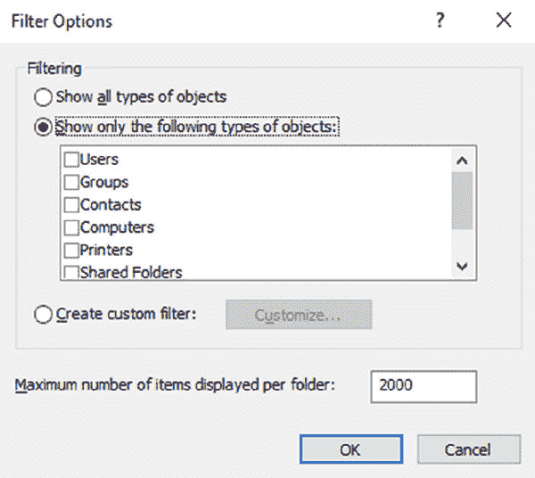

**FIGURE 2.9** 过滤选项对话框

“Active Directory 用户和计算机”工具的另一个选项是查看高级选项。你可以通过在`View`（视图）菜单中选择`Advanced Features`（高级功能）来启用高级选项。这将域下的列表添加一些顶级文件夹。让我们来看几个新的顶级文件夹。

`System`文件夹（如图 2.10 所示）提供了你可以配置以与 Active Directory 协同工作的额外功能。你可以为分布式文件系统 (`DFS`)、IP 安全 (`IPSec`) 策略、文件复制服务 (`FRS`) 等配置设置。除了`System`文件夹之外，你还会看到`LostAndFound`文件夹。该文件夹包含任何可能在域控制器之间没有正确复制的文件。你应该定期检查此文件夹中的任何文件，以便决定是否需要将它们移动或复制到其他位置。

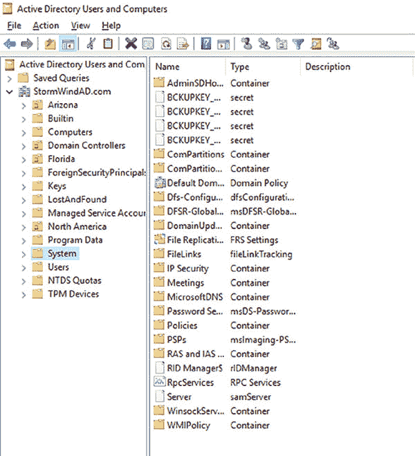

**FIGURE 2.10** Active Directory 用户和计算机工具 System 文件夹中的高级功能

如你所示，管理 Active Directory 对象通常是一项简单任务。Active Directory 用户和计算机工具允许你配置多个对象。让我们来看另一个常见的管理功能：移动对象。

## 移动、重命名和删除 Active Directory 对象

“Active Directory 用户和计算机”工具极其实用的功能之一是能够轻松移动用户和资源。

练习 2.8 将引导你完成移动 Active Directory 对象的过程。在此练习中，你将对 Active Directory 对象的组织进行几项更改。要完成此练习，你必须先完成练习 2.5。

除了在 Active Directory 中移动对象外，你还可以通过右键点击对象并选择`Rename`（重命名）来轻松重命名它们。注意，此选项并不适用于所有对象。你可以通过右键点击对象并选择`Delete`（删除）从 Active Directory 中删除对象。

## 重置现有计算机账户

域上的每台计算机在登录时都会域控制器建立一个独立的通信通道。域控制器存储一个随机生成的密码（与用户密码不同），用于跨通道验证。该密码每 30 天更新一次。

有时计算机的密码和域控制器的密码不匹配，两台机器之间的通信就会失败。如果没有重置计算机账户的能力，你将无法将计算机连接域。幸运的是，你可以使用 Active Directory 用户和计算机工具重新建立连接。

练习 2.9 向你展示如何重置现有的计算机账户。在开始此练习之前，你应该已经完成了本章中之前的练习。

在本书中，我尝试向你展示如何使用 PowerShell 方法来完成之前使用 MMC 单元显示的任务。这也不会有不同。

此示例向你展示如何使用 PowerShell 命令重置本地计算机与加入的域之间的安全连接。在此示例中，执行操作的域控制器指定为`StormDC1.AD.com`。要执行此 PowerShell 命令，你需要在本地计算机上运行：

```
Test-ComputerSecureChannel -Repair -Server StormDC1.AD.com
```

## 理解动态访问控制

Windows Server 2016 的优势之一是可以对文件服务器应用数据治理。这将有助于控制谁访问信息以及进行审核。你通过使用 DAC（动态访问控制）获得这些优势。DAC 允许你使用数据分类（自动和手动）识别数据，然后根据这些分类控制访问。

DAC 还允许管理员通过使用中心访问策略来控制文件访问。该中心访问策略还允许管理员设置访问审核，以便进行报告和司法调查。

DAC 允许管理员为 Microsoft Office 文档设置 Active Directory 数字服务加密。例如，你可以对任何包含财务信息的文档设置加密。

动态访问控制允许管理员灵活地配置基于域的文件访问和审核。为了实现这一点，DAC 控制身份验证中的声明、资源属性以及权限和审核项中的条件表达式。

管理员能够根据 Active Directory 属性授予用户访问文件和文件夹。例如，由于名为 Dana 的用户在 Active Directory（部门属性）属性中的值包含 Sales，该用户被授予访问文件服务器共享的权限。

为了方便管理并实现分级结构，你可以将组放在组织单元（OU）中。你还可以将组策略设置分配给 OU 中包含的所有对象。通过这种方法，你可以将分级结构（通过 OU）与安全主体的使用优势结合起来。

你用于管理用户、组和计算机安全权限的主要工具是`Active Directory 用户和计算机`（Active Directory Users and Computers）工具。使用此工具，你可以创建并管理 Active Directory 对象，并根据业务需求对其进行组织。许多系统管理员的常见任务可能包括以下内容：

* 重置用户密码（例如，在用户忘记密码的情况下）
* 创建新用户账户（例如，新员工加入公司时）
* 根据工作要求和职责变更修改组成员关系
* 禁用用户账户（例如，当用户长时间不在办公室且不需要访问网络资源时）

一旦你对用户进行了正确分组，就需要设置影响 Active Directory 内部对象的实际权限。可用的实际权限根据对象的类型而异。表 2.1 提供了可以应用于各种 Active Directory 对象的某些权限示例，以及每个权限作用的解释。

表 2.1 **Active Directory 对象的权限**

| 权限 | 解释 |
| --- | --- |
| 控制访问 | 更改对象上的安全权限 |
| 创建子项 | 在 OU 内创建对象（例如其他 OU） |
| 删除子项 | 删除 OU 内的子对象 |
| 删除树 | 删除 OU 及其内部的对象 |
| 列出内容 | 查看 OU 内的对象 |
| 列出对象 | 查看 OU 内对象的列表 |
| 读取 | 查看对象的属性（例如，用户名） |
| 写入 | 修改对象的属性 |

### 使用 ACL 和 ACE

Active Directory 中的每个对象都有一个`access control list`（访问控制列表）。`ACL`是允许访问资源的用户账户和组列表。对于每个`ACL`，都有一个访问控制条目（ACE），定义了用户或组实际上可以对资源执行什么操作。拒绝权限始终列在第一个。这意味着，如果用户通过用户或组成员关系拥有“拒绝”权限，他们将不会允许访问该对象，即使他们通过其他用户或组权限拥有显式的“允许”权限。

## 使用组策略进行安全

Active Directory 的一个非常有用且强大的功能是名为`Group Policy`（组策略）的技术。通过使用组策略设置，系统管理员为用户、组和 OU 分配数千不同的设置和选项。具体来说，在安全方面，你可以使用许多不同的选项来控制密码策略、用户权限和帐户锁定设置等重要功能的配置方式。

执行这些设置的通用过程是创建一个带有你所需设置的`Group Policy object (GPO)`，然后将其链接到 OU 或其他 Active Directory 对象。


表 2.2 列出了许多与创建安全 Active Directory 环境相关的组策略设置。请注意，此列表并不是尽的——通过 Windows Server 2016 的管理工具，可以使用许多其他选项。

**表 2.2 用于安全目的的组策略设置**

| 设置区域 | 设置名称 | 目的 |
| --- | --- | --- |
| 账户策略 ➢ 密码策略 | 强制密码历史 | 指定记住多少个密码。此选项防止用户在更改密码时重复使用相同密码。 |
| 账户策略 ➢ 密码策略 | 密码长度 | 通过指定密码必须包含的最小字符数，防止用户使用短弱密码。 |
| 账户策略 ➢ 帐户锁定策略 | 帐户锁定阈值 | 指定在帐户被锁定之前可以输入多少次错误的密码。 |
| 账户策略 ➢ 帐户锁定策略 | 帐户锁定时间 | 指定在输入过多错误密码尝试后，帐户将锁定多长时间。通过将此选项设置为一个合理值（例如 30 分钟），你可以减少管理开销，同时保持较强的安全性。 |
| 账户策略 ➢ 帐户锁定策略 | 在以下时间后重置帐户锁定计数器 | 指定帐户锁定阈值计数器在重置为 0 之前保留失败登录尝试的时间。 |
| 本地策略 ➢ 安全选项 | 账户：重命名管理员账户 | 通常，在尝试未经授权访问计算机时，个人会尝试猜测管理员密码密码。增加安全性的一种方法是重命名此账户，这样任何密码都无法通过此登录进入。 |
| 本地策略 ➢ 安全选项 | 域控制器：允许服务器操作员计划任务 | 此选项指定内置的服务器操作员组的成员是否允许在服务器上计划任务。 |
| 本地策略 ➢ 安全选项 | 交互式登录：不显示最后用户名 | 通过不显示登录到系统的最后一个用户名来增加安全性。 |
| 本地策略 ➢ 安全选项 | 关机：允许无需登录即可关闭系统 | 允许系统管理员在不登录服务器的情况下执行远程关机操作。 |

你可以使用 Windows Server 2016 自带工具的多种不同方法来配置组策略设置。练习 2.10 介绍了为了强制执行安全设置而创建基本组策略所需的步骤。要完成此练习的步骤，你必须先完成练习 2.1。

### 细粒度密码策略

Windows 2016 操作系统允许组织对域中的不同用户组设置不同的密码策略和帐户锁定策略。在 2008 之前的 Active Directory 版本中，管理员对每个域只能设置一个密码策略和帐户锁定策略。

默认域策略是配置这些策略设置的地方。由于每个域只能有一个密码策略和帐户锁定策略，想要多种密码和帐户锁定设置的组织必须创建密码过滤器或部署多个域。

细粒度密码策略允许你在单个域内指定多个密码策略。假设你希望管理员更改密码的频率不要销售人员那么频繁。

密码设置对象（`PSOs`）的创建是为了能够创建细粒度密码策略。你使用 `ADSI editor` 创建 `PSOs`，然后可以使用这些 `PSOs` 来创建你的细粒度密码策略。

## 发布 Active Directory 对象

Active Directory 的主要目标之一是让资源易于找到。在网络环境中，两种最常用的资源是服务器文件共享和打印机。事实上，大多数组织都有专门的文件和打印服务器。在管理这些类型的资源时，Active Directory 可以让你确定用户可以使用哪些文件和打印机。

尽管如此，让我们来看看 Active Directory 如何管理共享文件夹和打印机。

### 使 Active Directory 对象对用户可用

管理 Active Directory 对象的一个重要方面是，系统管理员可以控制用户可以看到哪些对象。将 Active Directory 对象转为用户可用的行为被称为*发布*（publishing）。两种主要的可发布对象类型是 `Printer`（打印机）对象和 `Shared Folder`（共享文件夹）对象。

创建服务器共享和共享打印机的通用过程与之前的 Windows 版本保持不变：你先创建各种对象（打印机或文件系统文件夹），然后启用它们的共享功能。然而，要通过 Active Directory 使这些资源变为可用，还需要一个额外的的步骤：你必须发布这些资源。一旦对象在 Active Directory 中被发布，客户端就可以使用它了。

当你在 Active Directory 中发布对象时，你应该知道资源的服务器名称和共享名称。当系统管理员使用 Active Directory 对象时，他们可以更改对象所指向的资源，而无需重新配置甚至无需通知客户端。例如，如果你将共享内容从一台服务器移动到另一台服务器，你所做的只是更新 `Shared Folder` 对象的属性以指向新位置。Active Directory 客户端仍然使用它们之前使用的相同路径和名称来引用该资源。

### 发布打印机

打印机可以轻松地在 Active Directory 中发布。这使得域内的用户可以使用它们。

练习 2.12 将引导你完成通过创建和共享打印机来共享并发布 `Printer` 对象所需的执行的步骤。要完成打印机安装，你需要访问 Windows Server 2016 安装介质（通过硬盘、网络共享或 DVD 驱动器）。

请注意，当你通过这种方式创建并共享打印机时，Active Directory `Printer` 对象不会显示在“Active Directory 用户和计算机”工具中。打印机实际上是与它连接的 `Computer` 对象关联的。

### 发布共享文件夹

现在你已经创建并发布了打印机，你将看到对共享文件夹执行相同的操作。

练习 2.13 详细介绍了创建文件夹、共享它然后在 Active Directory 中发布它所需的步骤。此练习假设你正在使用 `C:` 分区；但是，你可能根据你的服务器配置更改此设置。此练习假设你已经完成了练习 2.5。

一旦你创建并发布了 `Shared Folder` 对象，客户端就可以使用“我的网络位置”图标来找到它。`Shared Folder` 对象将根据你创建它时的 `OU`（组织单位）进行组织。当你使用发布时，你可以看到这如何方便管理共享文件夹。

### 查询 Active Directory

到为止，你已经创建了几个 Active Directory 资源。将所有资源信息都放在 Active Directory 中的主要好处之一是，你可以使用 `Find` 对话框轻松地找到你需要的内容。回想一下我建议你在创建 Active Directory 对象时尽可能输入尽可能信息。这正是那些额外努力开始产生回报的地方。

练习 2.14 将引导你完成在 Active Directory 中查找特定对象的步骤。要完成此练习，你必须已完成练习 2.5。

使用 `Find` 对话框中提供的许多选项，你通常可以快速高效地缩小要搜索的对象范围。用户和系统管理员在任何规模的环境中都会发现这个工具有用。现在你已经了解了如何在 Active Directory 中创建对象，让我们来看看一个名为 `Active Directory Administrative Center`（Active Directory 管理中心）的新 Windows Server 2016 功能。

### 使用 Active Directory 管理中心

Windows Server 2016 有一个名为 `Active Directory Administrative Center` 的功能。该功能允许你从一个中心位置管理许多 Active Directory 任务（参见图 2.11）。

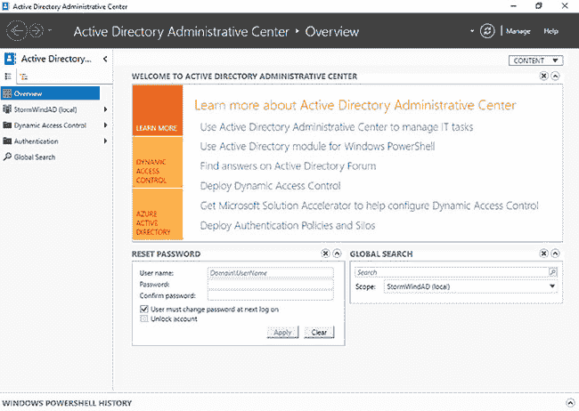

**图 2.11** 管理中心概述屏幕

使用 `Active Directory Administrative Center`，管理员可以执行的一些任务包括：

* 重置密码
* 创建新对象
* 删除对象
* 移动对象
* 执行全局搜索
* 为 Active Directory 对象配置属性

在 Windows Server 2016 中，`Active Directory Administrative Center` 只是你 Active Directory 工具带中的另一个工具。你以何种方式创建 Active Directory 对象并不重要，只要你充分了解如何创建它们即可。

使用 `Active Directory Administrative center` 完成的简单任务之一是创建 `Fine-Grained Password Policy`（细粒度密码策略）。

练习 2.15 将引导你完成为 IT 部门创建密码策略的步骤。要完成此练习，你必须有一个名为 `IT` 的全局安全组。如果你没有名为 `IT` 的组，请使用“Active Directory 用户和计算机”创建 `IT`。

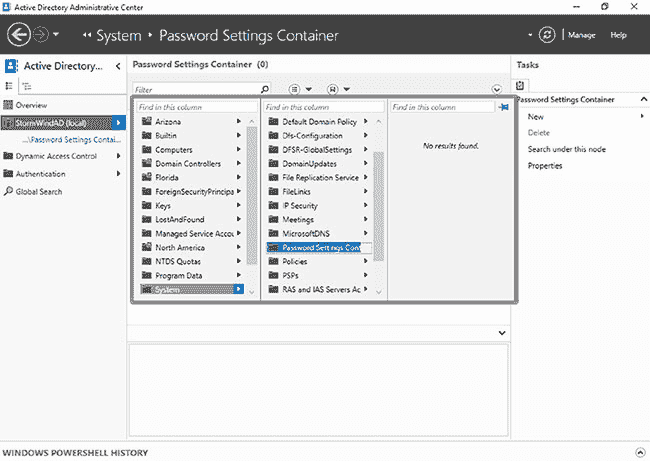

**图 2.12** 密码设置容器

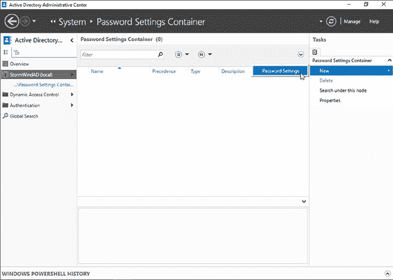

**图 2.13** 新密码设置

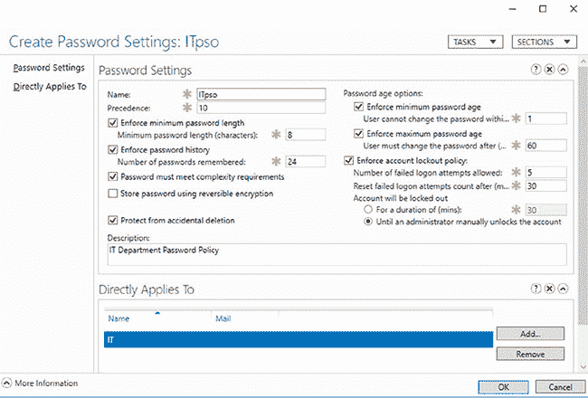

**图 2.14** PSO 设置

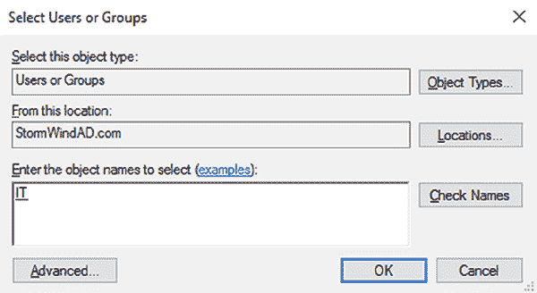

**图 2.15** 选择用户或组

## 使用管理 Active Directory

许多 IT 管理员喜欢使用命令行来配置和维护 Active Directory。使用命令行的一个优势是可以使用批处理进行多次更改。

通过命令行操作 Active Directory 的另一个优势是可以使用 Windows Server 2016 `Server Core`。`Server Core` 是一个没有 GUI 窗口的 Windows Server 2016 安装。配置 `Server Core` 的方法之一是使用命令行。

表 2.3 显示了许多命令行并解释了每个命令对 Active Directory 的影响。

**表 2.3 命令行**

| 命令 | 说明 |
| :--- | :--- |
| `Csvde` | 该命令允许从 Active Directory 导入和导出数据。数据以逗号分隔值格式存储。 |
| `Dcdag` | 该命令检查中域控制器的状态并返回报告。 |
| `Djoin` | 该命令允许计算机帐户加入域，并在计算机重启时执行离线加入。 |
| `Dsacls` | 该命令允许查看和更改 Active Directory 服务（AD DS）中对象的访问控制列表权限。 |
| `Dsadd` | 该命令允许向 AD DS 目录添加对象。 |
| `Dsamain` | 该命令显示存储在快照或备份中的 Active Directory 数据，就像在轻量级目录协议（LDAP）服务器中一样。 |
| `Dsdbutil` | 该命令为 Active Directory 轻量级目录服务（AD LDS）提供数据库工具。 |
| `Dsget` | 该命令显示 AD DS 目录对象的属性。 |
| `Dsmgmt` | 该命令为管理员提供 AD LDS 管理工具。 |
| `Dsmod` | 该命令允许你修改 AD DS 对象。 |
| `Dsmove` | 该命令允许将 Active Directory 域中的对象从当前 OU 移动到同一森林内的新 OU。 |
| `dsquery` | 此命令允许你查询 AD DS。 |
| `dsrm` | 此命令从 AD DS 目录中删除对象。 |
| `ldifde` | 此命令允许你从活动目录（Active Directory）导入和导出数据。数据以 LDAP 数据交换格式 (LDIF) 存储。 |
| `ntdssutil` | 这是 Active Directory 最重要的命令之一。它允许对 Active Directory 数据库进行维护。 |
| `repadmin` | 此命令允许管理员诊断域控制器之间的 Active Directory 复制问题。 |

## Active Directory 的 PowerShell

表 2.4 将向你展示一些用于维护 Active Directory 的可用 PowerShell 命令。这些 PowerShell 命令可以帮助你完成从解锁禁用的账户到重置密码的所有操作。

[`technet.microsoft.com/en-us/library/ee617195.aspx`](https://technet.microsoft.com/en-us/library/ee617195.aspx)

**表 2.4 Active Directory 的 PowerShell 命令**

| 命令 | 解释 |
| --- | --- |
| `Add-ADComputerServiceAccount` | 此命令允许管理员向目录添加服务账户。 |
| `Add-ADGroupMember` | 此命令允许你将用户添加到 Active Directory 组。 |
| `Disable-ADAccount` | 管理员可以使用此命令禁用 Active Directory 账户。 |
| `Enable-ADAccount` | 管理员可以使用此命令启用 Active Directory 账户。 |
| `Get-ADComputer` | 此命令允许你查看一个或多个 Active Directory 计算机。 |
| `Get-ADDomain` | 管理员可以使用此命令查看 Active Directory 域。 |
| `Get-ADFineGrainedPasswordPolicy` | 此命令允许你查看 Active Directory 细粒度密码策略。 |
| `Get-ADGroup` | 管理员可以使用此命令查看 Active Directory 组。 |
| `Get-ADGroupMember` | 此命令允许你查看 Active Directory 组中的用户。 |
| `Get-ADServiceAccount` | 管理员可以使用此命令查看 Active Directory 服务账户。 |
| `Get-ADUser` | 此命令允许你查看一个或多个 Active Directory 用户。 |
| `New-ADComputer` | 管理员可以使用此命令创建一个新的 Active Directory 计算机。 |
| `New-ADGroup` | 管理员可以使用此命令创建一个新的 Active Directory 组。 |
| `New-ADServiceAccount` | 此命令是创建新的托管服务账户的唯一方法。 |
| `New-ADUser` | 管理员可以使用此命令创建一个新的 Active Directory 用户。 |
| `Set-ADAccountPassword` | 此命令允许你修改 Active Directory 账户的密码。 |
| `Unlock-ADAccount` | 管理员可以使用此命令解锁 Active Directory 账户。 |

## 总结

本章涵盖了 Active Directory 管理的基础知识。管理 Active Directory 最重要的部分是学习如何与 OU（组织单元）协作。因此，你应该意识到 OU 的目的；即它们帮助你组织和管理目录。例如，考虑管理控制。如果你想进行管理控制。

本章涵盖了 Active Directory 管理的基础知识。管理 Active Directory 最重要的部分是学习如何与 OU（组织单元）协作。因此，你应该意识到 OU 的目的；即它们帮助你组织和管理目录。例如，考虑管理控制。如果你想进行管理控制。

本章涵盖了 Active Directory 管理的基础知识。管理 Active Directory 最重要的部分是学习如何与 OU（组织单元）协作。因此，你应该意识到 OU 的目的；即它们帮助你组织和管理目录。例如，考虑管理控制。如果你想进行管理控制。

本章涵盖了 Active Directory 管理的基础知识。管理 Active Directory 最重要的部分是学习如何与 OU（组织单元）协作。因此，你应该意识到 OU 的目的；即它们帮助你组织和管理目录。例如，考虑管理控制。如果你想进行管理控制。

本章涵盖了 Active Directory 管理的基础知识。管理 Active Directory 最重要的部分是学习如何与 OU（组织单元）协作。因此，你应该意识到 OU 的目的；即它们帮助你组织和管理目录。例如，考虑管理控制。如果你想进行管理控制。

本章涵盖了 Active Directory 管理的基础知识。管理 Active Directory 最重要的部分是学习如何与 OU（组织单元）协作。因此，你应该意识到 OU 的目的；即它们帮助你组织和管理目录。例如，考虑管理控制。如果你想进行管理控制。

本章涵盖了 Active Directory 管理的基础知识。管理 Active Directory 最重要的部分是学习如何与 OU（组织单元）协作。因此，你应该意识到 OU 的目的；即它们帮助你组织和管理目录。例如，考虑管理控制。如果你想进行管理控制。

本章涵盖了 Active Directory 管理的基础知识。管理 Active Directory 最重要的部分是学习如何与 OU（组织单元）协作。因此，你应该意识到 OU 的目的；即它们帮助你组织和管理目录。例如，考虑管理控制。如果你想进行管理控制。

本章涵盖了 Active Directory 管理的基础知识。管理 Active Directory 最重要的部分是学习如何与 OU（组织单元）协作。因此，你应该意识到 OU 的目的；即它们帮助你组织和管理目录。例如，考虑管理控制。如果你想进行管理控制。

本章涵盖了 Active Directory 管理的基础知识。管理 Active Directory 最重要的部分是学习如何与 OU（组织单元）协作。因此，你应该意识到 OU 的目的；即它们帮助你组织和管理目录。例如，考虑管理控制。如果你想进行管理控制。


本章涵盖了 Active Directory 管理的基础知识。管理 Active Directory 最重要的部分是学习如何与 OU（组织单元）协作。因此，你应该意识到 OU 的目的；即它们帮助你组织和管理目录。例如，考虑管理控制。如果你想进行管理控制。

本章涵盖了 Active Directory 管理的基础知识。管理 Active Directory 最重要的部分是学习如何与 OU（组织单元）协作。因此，你应该意识到 OU 的目的；即它们帮助你组织和管理目录。例如，考虑管理控制。如果你想进行管理控制。

## 总结

- **Active Directory OU**：管理 Active Directory 最重要的部分是学习如何与 OU（组织单元）协作。因此，你应该意识到 OU 的目的；即它们帮助你组织和管理目录。

- **管理控制**：例如，考虑管理控制。如果你想进行管理控制。

- **核心概念**：管理 Active Directory 最重要的部分是学习如何与 OU（组织单元）协作。因此，你应该意识到 OU 的目的；即它们帮助你组织和管理目录。例如，考虑管理控制。如果你想进行管理控制。

- 本章涵盖了 Active Directory 管理的基础知识。管理 Active Directory 最重要的部分是学习如何与 OU（组织单元）协作。因此，你应该意识到 OU 的目的；即它们帮助你组织和管理目录。例如，考虑管理控制。如果你想进行管理控制。

- 本章涵盖了 Active Directory 管理的基础知识。管理 Active Directory 最重要的部分是学习如何与 OU（组织单元）协作。因此，你应该意识到 OU 的目的；即它们帮助你组织和管理目录。例如，考虑管理控制。如果你想进行管理控制。

- 本章涵盖了 Active Directory 管理的基础知识。管理 Active Directory 最重要的部分是学习如何与 OU（组织单元）协作。因此，你应该意识到 OU 的目的；即它们帮助你组织和管理目录。例如，考虑管理控制。如果你想进行管理控制。

## 考试要点

- **OU 的目的**：管理 Active Directory 最重要的部分是学习如何与 OU（组织单元）协作。因此，你应该意识到 OU 的目的；即它们帮助你组织和管理目录。

- **继承**：理解继承的概念。默认情况下，子 OU 继承权限。

- **Active Directory 基础**：管理 Active Directory 最重要的部分是学习如何与 OU（组织单元）协作。因此，你应该意识到 OU 的目的；即它们帮助你组织和管理目录。

- **批量导入**：你可以通过批量导入导入多个账户。使用`ldifde.exe`和`csvde.exe`。

## 复习题

你可以在附录中找到答案。

1. 你是一个拥有单一 Active Directory 的组织的管理员。一个离开公司的用户在 16 周后回来。该用户尝试登录他的计算机，但收到身份验证失败的错误。该用户的账户已启用。你需要确保该用户能够登录该计算机。你应该做什么？

   - 在 Active Directory 中重置计算机账户。将计算机退出域然后重新加入域。

   - 使用`ADadd`命令重新加入计算机账户。

   - 在用户的计算机上运行 MMC 工具并添加域计算机插项。

   - 重新创建用户账户并将用户账户与计算机账户连接。

2. 你是一个拥有单一 Active Directory 域的组织的管理员。一位高级高管尝试登录机器，收到错误“此用户账户已过期。请联系管理员激活您的账户。”你需要确保这种情况不再发生在该用户身上。你应该做什么？

   - 配置域策略禁用账户锁定。

   - 配置密码策略将最大密码有效期延长到 0。

   - 修改用户属性以设置“账户永不过期”设置。

   - 修改用户属性将最大密码有效期延长到 0。

3. 你需要使用命令行提示创建一个新的用户账户。你会使用哪种命令？

   - `dsmodify`

   - `dscreate`

   - `dsnew`

   - `dsadd`

4. Maria 是一个属于销售分发全局组的用户。她无法访问网络上共享的激光打印机。销售全局组对该激光打印机具有完全访问权限。你如何解决这个问题？

   - 将组类型更改为安全组。

   - 将销售全局组添加到管理员组。

   - 将`Sales`全局组添加到`Printer Operators`组中。

   - 将`Sales`组更改为本地组。

5. 你是一个大型域的域管理员。最近，你被要求对域内某些与 OU 相关的权限进行更改。为了进一步限制`Texas OU`的安全性，你在该层级删除了某些权限。稍后，一位初级系统管理员提到，她再也无法对`Austin OU`内部的对象（该 OU 位于`Texas OU`内部）进行更改。假设 Active Directory 权限没有发生任何其他更改，以下关于 OU 的哪种特征可能导致了权限的更改？

   1. 继承

   2. 组策略

   3. 委派

   4. 对象属性

6. 系统管理员 Isabel 在一个已经包含两个树（trees）的环境中创建了一个新的 Active Directory 域。在提升域控制器的过程中，她选择创建一个新的 Active Directory 森林（forest）。Isabel 是`Enterprise Administrators`（企业管理员）组员，并对所有域具有完全权限。在组织迁移到 Active Directory 期间，对存储在域中的信息进行了大量更新。最近，用户和其他系统管理员抱怨说无法在一个或多个域中找到特定的 Active Directory 对象（尽管这些对象在其他域中存在）。为了调查这个问题，Isabel 想要检查任何没有在域控制器之间被正确复制的对象。如果可能，她希望将这些对象恢复到相关 Active Directory 域中的正确位置。

为了能够查看相关信息，她应该执行以下哪些操作？（选择两个。）

   1. 更改 Active Directory 权限以允许在所有域中查看对象信息。

   2. 在`View`（视图）菜单中选择`Advanced Features`（高级功能）。

   3. 将每个域中的成员服务器提升为域控制器。

   4. 从最新的备份重建所有域控制器。

   5. 使用`Active Directory Users and Computers`（Active Directory 用户和计算机）工具检查`LostAndFound`文件夹的内容。

7. 你受聘的一一名顾问，负责评估一个组织的 Active Directory 域。该域包含超过 200,000 个对象和数百个 OU。你开始检查域内的对象，但发现加载特定 OU 的内容需要很长时间。此外，对象列表可能很大。你想执行以下操作：

   * 使用内置的 Active Directory 管理工具，避免使用第三方工具或实用程序。

   * 将 OU 内的对象列表限制为你正在检查的对象类型（例如，仅限`Computer`计算机对象）。

   * 防止对 Active Directory 域或其内部任何对象进行任何更改。

以下哪项操作符合这些要求？

   1. 使用`Active Directory Users and Computers`工具中的`Filter`（筛选）选项限制对象的显示。

   2. 使用`Delegation of Control Wizard`（控制委派向导）仅给自己特定类型对象的权限。

   3. 为 OU 内的对象实施新的命名规范，然后使用此新命名规范对结果进行排序。

   4. 使用`Active Directory Domains and Trusts`（Active Directory 域和信任）工具查看来自所选域控制器的信息。

   5. 编辑域`Group Policy`（组策略）设置，允许自己仅查看感兴趣的对象。

8. 你是一个拥有四台服务器的小组织的管理员。你有一个名为`StormSrvA`的文件服务器，运行`Windows Server 2016`。你有一位初级管理员，需要在该服务器上进行备份。你需要确保该初级管理员可以使用`Windows Server Backup`为`StormSrvA`创建完整备份。你应该配置什么以允许初级管理员进行备份？

   1. 使用`Computer Management`（计算机管理）配置本地组

   2. 使用`Authorization Manager`（授权管理器）配置任务

   3. 使用`Local Group Policy Editor`（本地组策略编辑器）配置`User Rights Assignment`（用户权限分配）

   4. 使用`Authorization Manager`（授权管理器）配置`Role Assignment`（角色分配）

9. Miguel 是一个初级系统管理员，拥有 Active Directory 基本知识。作为他的主管，你要求 Miguel 对公司 Active Directory 域内的 OU 进行若干与安全相关的更改。你指示 Miguel 使用`Delegation of Control Wizard`（控制委派向导）提供的基本功能。以下哪些操作被视为`Delegation of Control Wizard`中的常见任务？（选择所有适用项。）

   1. 重置用户账户的密码。

   2. 管理`Group Policy`（组策略）链接。

   3. 修改组的成员关系。

   4. 创建、删除和管理组。

10. 你是一个大型 Active Directory 域的主要系统管理员。最近，你聘请了另一名系统管理员，打算向其交接部分职责。该系统管理员将负责处理帮助热线电话和基本的用户账户管理。你想允许新员工拥有重置特定 OU 内所有用户密码的权限。然而，出于安全考虑，让用户无法对域内其他 OU 中的对象更改权限是非常重要的。以下实现此点的最佳方法是？

   1. 在 OU 内创建一个特殊管理帐户，并授予其对 Active Directory 中所有对象的完全权限。

   2. 将用户的登录账户移动到新员工要管理的 OU 中。

   3. 将用户的登录账户移动到包含该 OU 的 OU 中（即新员工要管理的 OU 的父 OU）。

   4. 使用`Delegation of Control Wizard`（控制委派向导）在新员工要管理的 OU 上分配必要的权限。

# 第 3 章

## 维护 Active Directory

本章涵盖以下 70-742 考试目标：

* ** 维护 Active Directory**

  * 此目标可能包括但不限于：备份 Active Directory 和`SYSVOL`；离线管理 Active Directory；离线碎片 Active Directory 数据库；清理元数据；配置 Active Directory 快照；执行对象和容器级恢复；执行 Active Directory 恢复；使用 Active Directory 回收器配置并恢复对象；配置只读域控制器（RODC）；为 RODC 配置密码复制策略（PRP）；监控和管理复制；升级`SYSVOL`复制到分布式文件系统复制（DFSR）。

* ** 在复杂环境中配置 Active Directory**

  * 此目标可能包括但不限于：配置多域和多森林 Active Directory 基础设施；在现有的 Active Directory 环境中部署`Windows Server 2016`域控制器；升级现有域和森林；配置域和森林功能级别；配置多个用户主体（UPN）后缀；配置外部、森林、快捷和域信任；配置信任身份验证；配置 SID 过滤；配置后缀路由；配置站点和子网；创建并配置站点链接；管理站点范围；管理 SRV 记录注册；在站点之间移动域控制器；配置账户策略。

在之前的章节中，你学习了如何根据组织的逻辑设计创建 Active Directory 对象。例如，域结构和组织单元（OU）结构应主要根据组织的业务需求设计。

Active Directory 是用于管理网络资源的微软企业解决方案。

现在是时候学习`Active Directory`如何映射到组织的物理（physical）需求了。具体而言，你必须考虑站点之间的网络连接性，以及在非理想条件下域控制器（`DCs`）之间的信息流。这些限制因素决定了域控制器如何协同工作，以确保`Active Directory`中的对象无论网络规模多大、地理分布如何分散，都能保持同步状态。

幸运的是，通过使用`Active Directory Sites and Services`管理工具，你可以快速轻松地创建`Active Directory`复制拓扑的各种组件。使用该工具，你可以创建名为`sites`（站点）的对象，将服务器放置于站点中，并在站点之间建立连接。一旦你配置好`Active Directory`复制以适应你当前的网络环境，你就可以放心让`Active Directory`确保信息在各个域控制器之间保持一致。

本章将介绍`Active Directory`的功能，这些功能允许系统管理员根据其物理网络设计来修改复制行为。通过使用站点，系统和网络管理员将能够充分利用其网络基础设施，以支持`Windows Server 2016`和`Active Directory`。

到为止，你已经学习了安装`Domain Name System`（`DNS`）以及实现第一个`Active Directory`域的必要步骤。虽然我之前简要介绍了多域`Active Directory`结构，但我当时只关注了单个域及其内部的对象。

许多企业发现，使用单个域可以为满足其业务需求提供充分的解决方案。然而，通过使用`trees`（树）和`forests`（森林），大型组织可以使用多个域来更好地组织其环境。

## 网络规划概述

在讨论站点和复制之前，你需要理解一些基础的物理和网络概念。

### 三种类型的网络

在设计网络时，系统和网络管理员使用以下术语来定义位置与服务器之间连接的类型：

**局域网（Local Area Networks）** `local area network (LAN)` 通常被特征化为高带宽网络。通常，组织拥有其所有的`LAN`网络硬件和软件。`Ethernet`（以太网）是目前为止最常见的网络标准。`Ethernet`通常至少为`10 Mbps`，并可以扩展到每秒数千比特。目前，以太网的标准是`10 Gigabit Ethernet`（万兆以太网），其运行速度是`Gigabit Ethernet`（千兆以太网，`1 GB`）的 10 倍。多种`LAN`技术（包括路由和交换）可划分`LAN`并减少对网络资源的竞争。

**广域网（Wide Area Networks）** `wide area network (WAN)` 的目的与`LAN`类似，即连接网络设备。然而，与`LAN`不同，`WAN`通常是从第三方电信运营商和被称为互联网服务提供商（ISPs）的组织租赁的。虽然有极速的`WAN`连接，但对于组织来说，通过分布式环境实现这些连接成本很高。因此，`WAN`连接的特点是速度较低，有时是非持久连接。

**互联网（The Internet）** `Internet`是一个基于`Internet Protocol (IP)`的全球性公共网络基础设施。可以通过互联网服务提供商（`ISPs`）访问`Internet`由于它是公共网络，`Internet`没有单一的“所有者”。相反，大型网络和电信供应商不断升级该网络的基础设施以满足日益增长的需求。

经常使用`Internet`来销售和营销他们的产品和服务。例如，现如今很少看到不将你引导至某个网站的广告了。通过使用诸如`virtual private networks (VPNs)`等技术，组织可以使用`Internet`。

### 探索网络限制因素

在理想情况下，你能够快速访问资源。然而，你有很多限制因素需要考虑，包括网络带宽。

#### 网络带宽

网络带宽通常指的是通过特定连接的数据量。例如，在某种情况下，`T1`可能为`1.54 Mbps`，而`DSL`可能为`56 Kbps`。另一方面，你的`LAN`可能有`100 Mbps`或`1000 Mbps`。不同类型的网络以不同的速度运行。因此，你必须始终考虑考虑这些因素。

#### 网络成本

成本可能是决定网络设计的单一最大因素。如果成本不是限制，组织显然会选择使用高带宽。从现实来看，必须对性能进行权衡。影响网络成本的某些因素包括网络之间的距离和可用技术的类型。

#### 人员

你已经考虑了业务的货币价值。现在让我们考虑成本的另一个方面。在设计和配置网络时，你可以要求某些设备根据分配的成本做出数据传输决策。这些设备通常被称为`routers`（路由器），它们使用路由协议来做出路由决策。路由器用于配置路由协议的元素之一是其调整路由成本的能力。例如，路由器可能有多种方法连接到远程站点，它可能连接了多个接口，每个接口都有通往其所连接网络的不同路径。当有两个或多个路由可用时，你可以设置一种路由协议，规定自动使用成本较低的路由。

另一种成本是人员。你有足够的人员完成工作吗，还是你需要聘佣顾问？记住，即使你使用现有员工，他们也将花费时间在这些项目上。当你的 IT 团队正在处理项目时，这是一种成本，因为他们无法兼顾日常任务。

## Active Directory 复制与站点概述

现在我需要介绍两个主题，不仅在微软考试中重点介绍，而且所有 IT 管理员都应该理解这两个领域。

### 复制 Active Directory

无论与网络设计和技术限制的问题如何，网络用户都有许多必须解决的要求和需求。首先，必须提供网络资源，如文件、打印机和共享目录。同样，存储在`Active Directory`中的资源，特别是其安全信息，对于域内发生的许多操作都是必需的。

考虑到这些问题，请查看你如何配置 Active Directory 以通过复制实现连接性目标。


Active Directory 被设计为一种可扩展的分布式数据库，包含了有关组织网络资源的信息。在之前的章节中，你已经了解了如何创建和管理域，以及如何使用域控制器来存储 Active Directory 数据库。

即使在最简单的网络环境中，你通常也需要一个以上的域控制器。导致此两个主要原因是`容错性`（如果一个域控制器故障，其他控制器仍然可以根据需要提供服务）和性能（负载可以在多个域控制器之间进行平衡）。Windows Server 2016 域控制器被设计为包含 Active Directory 数据库的读写副本以及只读副本。然而，当在其他域控制器上创建或修改对象时，域控制器也必须保持更新。

为了保持域控制器之间信息的一致性，你使用`Active Directory 复制`。复制是将 Active Directory 数据库的更改在域控制器之间传输的过程。其结果是 Active Directory 域内的所有域控制器都包含最新的信息并实现收敛。请记住，域控制器的位置可能非常接近（例如，在同一个服务器机架内），也可能相隔世界两端。尽管复制的目标非常简单，但服务器之间网络连接的现实限制导致了你必须适应的许多限制。如果你在本地局域网上有一个域控制器，可能会发现你拥有`Gigabit Ethernet`，它在服务器连接之间以 1000 Mbps 的速度运行；而在另一侧或 WAN 上可能有一个域控制器，那里的网络链路速度只有`T1`、`56 Kbps`的部分。复制流量必须遍历每条链路以确保收敛，无论可用速度或带宽如何。

在整个章节中，你将学习 Active Directory 复制的技术细节。你还将学习使用站点（sites）和站点链接（site links）的概念将 Active Directory 的逻辑结构映射到物理网络拓扑，以帮助它高效运行，无论你使用的是何种类型的链接。

## 理解 Active Directory 站点概念

设计和实现 Active Directory 的最重要的方面之一是理解它如何允许你将逻辑组件与物理组件分离开。

逻辑组件——Active Directory 域、OU、用户、组和计算机——映射到公司的组织和业务需求。

另一方面，物理组件是根据保持网络同步的涉及的技术问题设计的（即确保网络的所有部分都拥有相同的最新信息）。Active Directory 使用站点的概念来映射到组织的物理网络。简单来说，`site`是一组连接良好的子网。站点的技术影响将在在本章稍后部分描述。

重要的是，Active Directory 域与 Active Directory 站点之间不存在特定的指定关系。一个 Active Directory 站点可以包含多个域。或者，单个 Active Directory 域可以跨越多个站点。图 3.1 说明了域和站点的这一非常重要的特性。

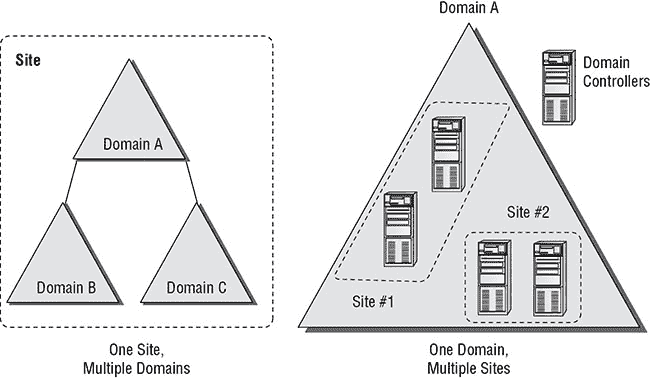

**图 3.1** 域与站点之间的潜在关系

使用 Active Directory 站点有两个主要原因：服务请求和复制。

### 服务请求

客户端通常需要域控制器的网络服务。常见的原因之一是它们需要域控制器执行网络身份验证。如果你的 Active Directory 网络建立了站点，客户端可以轻松连接到距离它们最近的域控制器。通过这样做，它们避免了与连接远程域控制器或位于慢网络连接另一侧控制器相关的许多低效率问题。例如，通过连接到本地域控制器，你可以避免与饱和网络链路相关的问题，这种链路可能会导致两个域控制器之间不同步。

### 复制

如前所述，Active Directory 复制的目的是确保域内所有域控制器上存储的信息保持同步。在具有许多域和域控制器的环境中，通常会有多个通信路径连接它们，这使得同步过程变得更加复杂。一种将更新和其他更改传输到 Active Directory 的简单方法是让所有服务器在更改发生后立即直接相互通信；它们都可以随更改一起进行更新并再次达到收敛。然而，这并不理想，因为这对网络带宽有很高的要求，并且对于许多使用较慢且昂贵的 WAN 链路的环境来说效率低下。

通过使用站点，Active Directory 可以自动确定执行复制操作的最佳方法。站点考虑了组织的网络基础设施，Active Directory 使用这些站点来确定同步信息的最有效方法。系统管理员可以将他们的物理网络设计映射到 Active Directory 对象。根据这些对象的创建和配置，Active Directory 服务可以高效地管理复制流量。

每当域控制器上的 Active Directory 数据库发生更改时，该更改就会获得一个更新序列号。域控制器随后根据复制设置将这些更改传播到其他域控制器。

Windows Server 2016 使用了一项称为`linked value replication`的功能，该功能仅当域处于 Windows Server 2003、Windows Server 2008、Windows Server 2008 R2、Windows Server 2012、Windows Server 2012 R2 或 Windows Server 2016 功能级别时有效。使用链接值复制时，只有组成员被复制。这极大增强了复制效率并降低了网络占用。

### 规划你的站点

设计 Active Directory 的大部分挑战与将公司的业务流程映射到分级数据存储的结构有关。到目前，你已经了解了许多此类需求。然而，现有的网络基础设施如何？显然，当你规划和设计 Active Directory 结构时，必须考虑你的局域网和广域网特性。让我们看看你可以如何使用 Active Directory 站点来管理复制流量。

同步 Active Directory 极其重要。Active Directory 数据存储支持`多主复制`；也就是说，数据可以在域内的任何域控制器上进行修改，因为复制确保了整个组织信息的一致性。

理想情况下，组织内的每个站点都与其他站点拥有可靠、高速的连接。然而，更符合现实的场景是带宽受到限制，且连接有时断断续续，有时完全不可用。

通过站点（Sites），网络和系统管理员可以定义哪些域控制器位于网络的哪些区域。这些设置可以基于网络区域之间的可用带宽。此外，这些管理员可以在网络区域之间定义`subnets`（子网）——即逻辑划分的网络区域。子网的设计是通过将 IP 地址划分为用于分配的可用块来实现的，它们也是位于“管理工具”文件夹中“站点和业务”（Sites and Services）Microsoft 管理控制台（MMC）中的对象。Windows Server 2016 Active Directory 服务使用这些信息来决定如何以及何时在域控制器之间同步数据。

在所有域控制器之间直接同步信息对于某些公司来说可能是一个行的解决方案。但对于其他公司，这可能会导致大量流量在缓慢或规模较小的网络链路上传输。在连接缓慢的站点之间高效同步数据的一种方法是使用`bridgehead server`（桥头服务器）。桥头服务器设计用于接收两个远程站点之间的流量，然后将这些信息转发到适当的服务器。图 3.2 提供了桥头服务器如何减少网络带宽需求并提高性能的示例。如果有带宽使用统计数据，通过配置按预定义的计划进行同步，也可以减少网络带宽需求并提高性能。

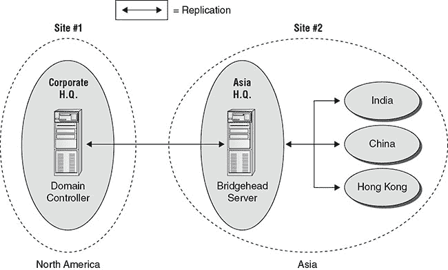

FIGURE 3.2 使用桥头服务器

桥头服务器并不适用于标准的星型（hub-and-spoke）WAN 拓扑。此类拓扑通常涉及一个核心站点（例如公司总部），远程站点作为从核心引出的链路。然而，你可以使用桥头服务器设计来适应分布式星型拓扑，即你具有一个星型拓扑设计，并且从第一组外线又引出了额外的外线。这样做将你的某些支线站点变成较小的核心站点。你需要在这些站点上放置桥头服务器。在图 3.2 中，你可以看到你的亚洲总部站点也是连接到印度、中国和香港的地方，因此使亚洲总部成为部署桥头服务器的理想站点。

除了管理同步流量外，站点提供的优势是允许客户端访问最近的域控制器。这防止了跨越缓慢网络连接的用户身份验证出现问题，并可以帮助找到通文件和打印机等资源的最短最快路径。因此，微软建议在包含缓慢链路的每个站点至少放置一个域控制器。最好该域控制器也包含一个全局目录（global catalog）的副本，这样登录尝试和资源搜索查询就不会跨越缓慢链路。然而，缺点是，在服务器上部署更多全局目录副本会增加同步流量。

通过对站点进行适当规划和部署，组织可以充分利用网络基础设施的能力，同时保持 Active Directory 的同步。

## 理解分布式文件系统同步

`DFS Replication (DFSR)`（DFS 步）的创建是为了取代 Windows 2000 Server 操作系统中引入的文件复制服务（FRS）。DFSR 是一种基于状态的多主同步引擎，支持同步调度和带宽限制。DFSR 具有检测文件中数据插入、删除和重新排列的能力。这使得 DFS 同步在文件更新时能够仅同步已更改的文件块。

DFS 同步组件使用许多不同的进程来保持多个服务器上的数据同步。为了理解 DFSR 过程，了解以下某些概念会有帮助：

- DFSR 是一个多任务同步引擎，发生在一个成员上的更改随后会同步到该同步组的所有其他成员中。
- DFSR 使用更新序列号（USN）日志来检测卷上的更改，然后 DFSR 只在文件更改后才同步这些更改。

所有这些组件共同工作，决定了如何使用信息在域控制器之间复制数据。图 3.3 提供了 Active Directory 物理组件的示例。

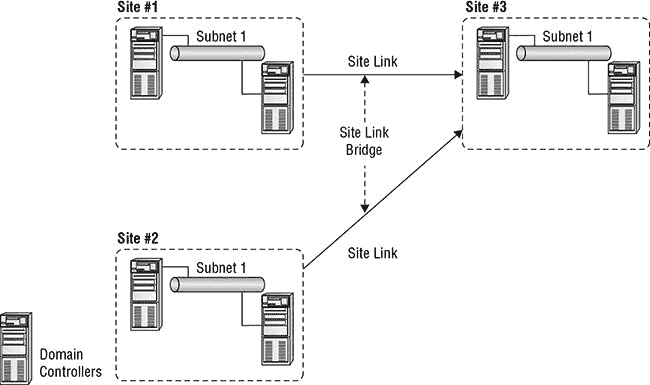

**图 3.3** `Active Directory 复制对象`

许多问题都与站点（sites）的配置和管理有关，本章将涵盖所有这些问题。总的来说，使用站点允许你控制域控制器之间 Active Directory 复制行为。在有了这些背景和目标的基础上，让我们来看看如何实现站点来控制 Active Directory 复制，使其既高效又同步。

如果你没有正确设置复制，过了一段时间后，你将遇到域控制器出现的问题。一个常见的复制问题示例是事件日志事件 ID `1311`，该事件标目表明 Windows NT 目录服务（`NTDS`）知识一致性检查器（`KCC`）发现（并报告）了 Active Directory 复制问题。此错误消息表示，Active Directory 中的复制配置信息未能准确反映网络的物理拓扑。这种错误常见于由于某种原因或其他原因出现复制问题的故障网络上。

## 创建站点

创建和管理 Active Directory 复制组件的主要方法是利用 Active Directory 站点和服务工具，或位于“管理工具”（Administrative Tools）文件夹中的 MMC。使用此管理组件，你可以以与创建和管理组织单元（OU）相同的方式，图形化地创建和管理站点。

练习 3.1 将引导你完成创建 Active Directory 站点的过程。为了完成此练习，本地计算机必须是域控制器。此外，此练习假设你尚未更改默认的域站点配置。

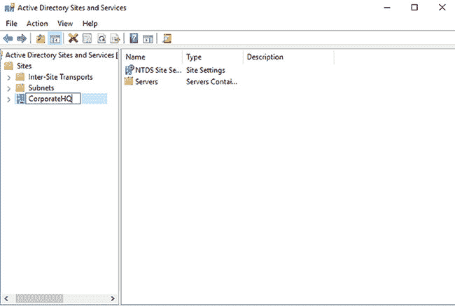

**图 3.4** `将站点重命名为 CorporateHQ`

## 创建子网

一旦你创建了映射到你的网络拓扑的站点，现在是时候定义定义站点边界的子网了。

子网基于`TCP/IPv4`或`TCP/IPv6`地址信息。例如，IPv4 地址可能是`10.10.0.0`，子网掩码可能是`255.255.0.0`。此信息指定所有以前两个字节开头的 TCP/IP 地址都是同一个 TCP/IP 子网的一部分。以下所有 TCP/IP 地址都在此子网内：

- `10.10.1.5`
- `10.10.100.17`
- `10.10.110.120`

Active Directory 站点和服务工具以略不同的表示法表示这些子网。它使用提供的子网地址并在后面附加一个斜杠，然后是子网掩码的位数。在上一段的示例中，子网将定义为`10.1.0.0/16`。

记住，站点通常代表不同的物理位置，并且它们几乎都有自己的子网。一个站点的域控制器能够访问另一个站点的 DC 的唯一方法是添加关于远程站点的子网信息。通常，有关特定网络环境子网定义的信息可以从网络设计人员获得。练习 3.2 将引导你完成创建子网并将子网分配给站点所需的步骤。要完成此练习中的步骤，你必须完成练习 3.1。

到为止，你已经创建了管理 Active Directory 站点和子网的基础组件。你还通过定义哪些子网属于哪些站点，将这两个组件连接起来。这两个步骤——创建站点和创建子网——构成了映射物理网络基础设施的基础。现在，让我们看看如何配置站点，你创建了管理 Active Directory 站点和子网的基础组件。

## 配置站点

一旦你创建了 Active Directory 站点并定义了它们包含哪些子网，现在是时候对站点进行一些额外的配置了。具体来说，你需要将服务器分配到站点并配置站点选项。在本章的后后部分，你将检查站点之间的复制细节。

在练习 3.3 中，你将向站点添加服务器并配置`CorpDC1`配置。要完成此练习，你必须完成练习 3.1 和练习 3.2。

站点间复制针对低带宽环境和可靠性较低的网络连接进行了优化。站点间复制提供了多项针对此类类型连接的定制功能。首先，可以使用两种不同的协议在站点之间传输信息：

### 基于 IP 的 RPC

当连接性相当可靠时，`IP`是一个很好的选择。基于`IP`的通信要求你在不同站点之间的两个或多个域控制器之间建立活动连接，并允许你传输活动目录（Active Directory）信息。`RPC over IP`最初是为速度较慢且经常发生丢包和损坏的广域网（WAN）设计的。

### 简单邮件传输协议

`简单邮件传输协议 (SMTP)`最广为人知的可能是用于在互联网上发送和接收电子邮件的协议。`SMTP`的设计是使用存储和转发机制，通过该机制，服务器接收消息副本并记录到磁盘，然后尝试将其转发到另一个电子邮件服务器。如果目标服务器不可用，它将保留消息并尝试定期重新重发。

这种类型的通信对于网络连接不可靠或并非总是可用的情况非常有用。例如，如果位于秘鲁的分支机构通过拨号连接连接到公司总部，而拨号连接仅在特定时间可用，那么`SMTP`将是与该分支机构通信的良好选择。

`SMTP`本质上是一种不安全的网络协议。因此，如果你希望确保安全地传输复制流量并使用`SMTP`进行活动目录复制，你必须利用 Windows Server 2016 的证书服务功能。

其他站点间复制特性旨在解决低带宽环境和可靠性较低的网络连接。这些功能让你在控制复制配置方面具有高度的灵活性。它们包括以下内容：

- 压缩活动目录信息。这种压缩是有帮助的，因为远程站点域控制器之间的更改可能包含大量信息，而且因为网络带宽往往可用性较差且成本更高。
- 站点链接（Site links）和站点链接桥接（site link bridges）有助于确定站点间的复制拓扑。
- 复制可以根据系统管理员定义的计划进行。

你可以使用活动目录站点和服务工具来配置站点间复制。选择你想要配置设置的站点名称。然后，在右侧窗格面板中右键点击`NTDS Site Settings`对象并选择“属性”。通过点击`NTDS Site Settings 属性`对话框中的“更改计划”按钮，你将能够配置站点之间发生复制的频率（参见图 3.5）。

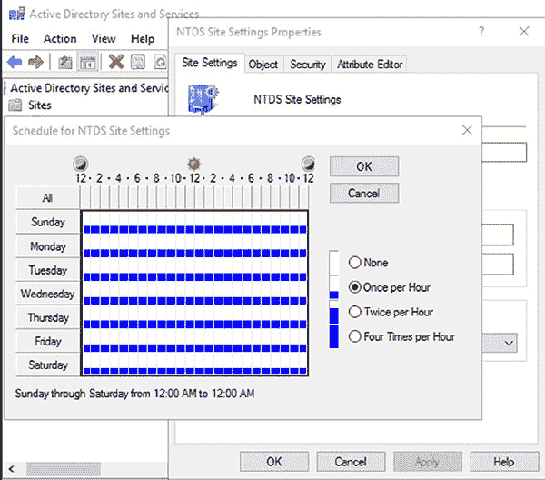

图 3.5 配置站点间复制计划

在接后的章节中，你将看到如何配置站点链接和站点链接桥接，以及如何管理连接对象和桥头服务器。

### 创建站点链接和站点链接桥接

站点间复制的整体拓扑基于站点链接和站点链接桥接的使用。站点链接（Site links）是定义两个活动目录站点之间路径的逻辑连接。站点链接可以包含几个描述性元素，用于定义它们的网络特性。站点链接桥接（Site link bridges）用于连接站点链接，以便关系具有传递性。图 3.6 提供了站点链接和站点链接桥接的示例。

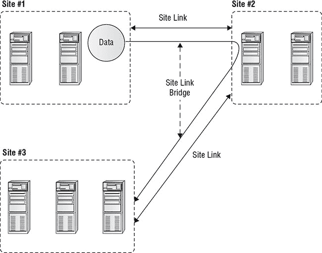

图 3.6 站点链接和站点链接桥接的示例

这两种类型的逻辑连接都被活动目录服务用于，以确定如何在远程站点的域控制器之间同步信息。知识一致性检查器（`KCC`）使用这些信息根据创建的站点拓扑形成复制拓扑。`KCC`服务负责确定在站点内复制信息的最佳方式。

在为你的站点创建站点链接时，需要考虑以下因素：

#### 传输信息

你可以选择使用`RPC over IP`或`SMTP`来传输信息。你需要根据你的网络基础设施和连接的可靠性来决定。

#### 分配成本

你可以创建站点链接并为站点链接分配成本值，系统将根据这些值确定复制的最佳路径。成本越低，被使用的可能性越高。例如，公司可能主要在分支机构之间使用 T1 连接，使用较慢的拨号 ISDN 连接作为备份（在此示例中，系统管理员可能为 T1 分配成本 25，为 ISDN 分配成本 100）。这确保了在 T1 可用时使用它。

#### 确定复制计划

一旦你确定了何时以及通过哪些连接进行复制，现在是确定何时复制信息的时间了。复制需要网络资源并占用带宽。因此，你需要在信息一致性需求与节省带宽之间取得平衡。例如，如果你认为在一个站点进行更新到所有其他站点之间有六小时的延迟是合理的，你可能会安排在早上、午休以及正常工作时间之后频繁地进行复制。

根据这些因素，你应该能够制定配置站点链接的策略。

练习 3.4 将引导你完成创建站点链接和站点链接桥接的过程。在完成此练习步骤之前，你必须完成练习 3.1、3.2 和 3.3。

### 创建连接对象

通常，允许活动目录的复制机制自动调度和管理功能是一种良好的做法。但在某些情况下，你可能希望对复制有更多控制。你可能希望按需要复制某些更改（例如创建新账户时）。或者你可能希望为某些服务器指定自定义计划。

连接对象为你提供了设置这些不同复制计划的方法。你可以通过活动目录站点和服务工具创建连接对象：展开服务器对象，右键点击`NTDS Settings`对象并选择“新建活动目录服务连接”。


在连接对象的属性中（可在活动目录站点和服务工具的右侧面板中查看），你可以指定用于复制的传输类型（`RPC over IP` 或 `SMTP`）、复制计划以及参与复制的域控制器。此外，你可以右键点击连接对象并选择“立即复制”。

### 在站点之间移动服务器对象

使用活动目录站点和服务工具，你可以轻松地在站点之间移动服务器。为此，只需右键点击域控制器的名称并选择“移动”。然后你可以选择你想将域控制器对象移动到的站点。

图 3.7 显示了移动服务器对话框。在移动服务器后，所有复制拓扑设置都将自动更新。如果您想选择自定义复制设置，则需要手动创建连接对象（如前文所述）。

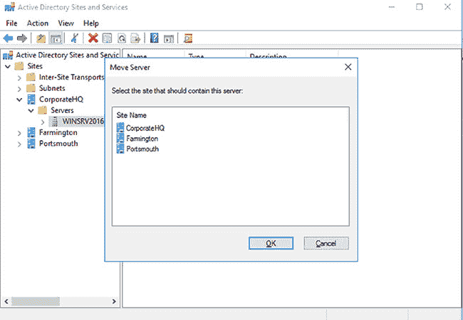

图 3.7 为特定服务器选择新站点

在练习 3.5 中，您将在不同的站点之间移动服务器对象。要完成此练习中的步骤，您必须已经完成了本章中之前的练习。

## 创建桥接服务器（桥头服务器，Bridgehead Servers）

默认情况下，一个站点中的所有服务器都与另一个站点中的所有服务器通信。然而，您可以使用桥头服务器来进一步控制站点之间的复制。正如本章前面提到的，使用桥头服务器有助于减少复制流量，特别是在较大的分布式星型网络拓扑结构中，而且它允许您专门用连接性优的机器来接收复制数据。默认情况下，数据每 180 分钟在站点之间进行一次复制。图 3.8 提供了桥头服务器工作原理示例。

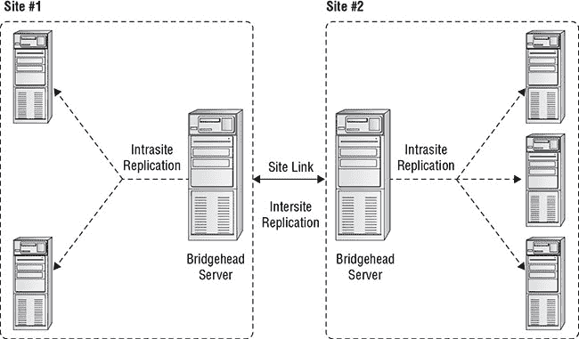

图 3.8 使用桥头服务器的复制场景

您可以使用桥头服务器来指定哪些域控制器优先用于在站点之间传输复制信息。可以为基于 IP 的 RPC 和 SMTP 复制选择不同的桥头服务器，从而允许您平衡负载。要为站点创建桥头服务器，只需右键点击域控制器并选择`Properties`（属性），这将弹出桥头服务器的`Properties`对话框。要使该服务器成为桥头服务器，只需从对话框左侧选择一个或两个复制类型（称为 `transports`），并点击`Add`（添加）按钮将其添加到对话框的右侧。

### RODC 与复制

在整本书中，我谈到了许多只读域控制器（RODC）。您需要理解这一点非常重要：由于 RODC 实际上不会对您环境中的 Active Directory 域服务 (AD DS) 数据库提交更改，因此，您的主域控制器 (PDC) 与您的 RODC 之间的复制只能单向方式进行。这被称为`单向复制`（unidirectional replication）。根据设计，任何作为您的某个 RODC 复制伙伴的可写域控制器永远都不会从该 RODC 拉取更改。这有助于确保从 RODC 生成的任何恶意或损坏更改都不会复制到您的整个森林中。RODC 对 AD DS 和 Sysvol 更改执行正常的入站复制。您在 RODC 上配置使用 DFS 复制进行复制的任何其他共享仍将使用双向复制。

RODC 带有额外的配置设置，如`密码复制策略 (Password Replication Policy (PRP))`。PRP 用于确定哪些用户的凭据可以缓存在特定的 RODC 上。默认情况下，RODC 不会缓存 Active Directory 用户的凭据。那样将违背 RODC 的目的。当用户想要向 RODC 身份验证时，身份验证请求将转发到可写域控制器进行验证。如果请求成功，它将传回给 RODC，然后该用户就可以登录域了。

尽管如此，通过配置 PRP，可以允许某些用户凭据缓存在 RODC 上。一旦用户被添加到`Allowed RODC Password Replication`组中，该用户的凭据将被缓存，该 RODC 将能够再次在本地对该用户进行身份验证。由于 RODC 仅维护用户凭据的子集，如果 RODC 被攻破或被盗，则只需更改在 RODC 上缓存的用户帐户的密码。要配置 RODC PRP，打开 RODC 属性，选择`Password Replication Policy`选项卡。

## 配置服务器拓扑

当您使用需要多个站点的环境时，必须仔细考虑服务器的位置。通过这样做，减少用户执行常见操作的时间，可以显著提高性能。

在设计 Active Directory 环境时，有两个主要问题。第一个是您如何在网络中放置域控制器。第二个是如何管理全局目录。

### 放置域控制器

微软强烈建议在每个域中至少有两个域控制器。正如本章前面提到的，使用额外的域控制器可带来以下好处：

- 提高网络性能：

    - 服务器可以平衡服务负载。

    - 客户端可以连接到最近的服务器，而不是跨越慢链路执行身份验证。

- 容错能力（万一一个域控制器故障，另一个仍然具有有效可用的 Active Directory 数据库副本。）

- 在 Windows Server 2016 中，RODC 有助于连接到不安全的远程位置时提高安全性。

### 放置全局目录服务器

全局目录（GC）服务器是包含构成 Active Directory 森林的所有对象副本的域控制器。将域控制器设置为全局目录非常简单，并且可以轻松更改此设置。这引出了更难的部分——确定哪些域控制器也应该是全局目录。

在哪里放置域控制器和全局目录以及部署多少个是重要的网络规划决策。通常，您希望在具有慢链路的每个站点提供全局目录服务。这意味着放置全局目录的最逻辑位置是在每个站点，并靠近 WAN 链路。然而，过多的全局目录服务器并非好事。主要问题与复制流量有关——您必须保持环境中的每个全局目录与其他服务器同步。在非常动态环境中，使用额外的全局目录会导致网络流量大幅增加。因此，您需要在自己的大型多域环境中复制负担和全局目录查询性能之间找到良好的平衡。

要创建全局目录服务器，只需在 Active Directory 站点和服务工具中扩展服务器对象，右键点击`NTDS Settings`并选择`Properties`以弹出`NTDS Settings Properties`对话框（参见图 3.9）。要将服务器配置为全局目录服务器，只需勾选`Global Catalog`框框。

### 使用通用组成员缓存

要理解通用组成员缓存（UGMC）的工作原理，你必须首先理解身份验证的工作原理。当用户尝试向域控制器进行身份验证时，首先发生的动作是域控制器检查全局目录（global catalog），以确定用户属于哪个域。

如果域控制器（用户尝试身份验证的那个）不是 `GC`，则域控制器会向 `GC` 发送请求以验证用户的域。`GC` 返回用户信息，随后域控制器对用户进行身份验证（如果该用户与域控制器属于同一个域）。

有两种方法可以加速身份验证过程。首先，你可以让所有的域控制器都成为全局目录。但这会导致大量的 GC 复制流量。如果你有多个站点，这个问题会变得更加严重，因为复制流量可能会超过你的站点间链路连接带宽。

因此，如果你拥有速度较慢的站点间链路连接或多个域，则可以使用通用组成员缓存。如果你使用 `UGMC`，在域控制器与全局目录通信后，域控制器将默认缓存用户的凭据缓存八 小时。现在，如果用户注销域并重新登录，域控制器将使用缓存的凭据，而不再询问全局目录。使用 `UGMC` 的缺点是它仅用于身份验证。全局目录有助于加速 Active Directory 搜索，并且它们与启用目录服务的应用程序（必须与 Active Directory 协作的应用程序）如 Exchange 和 SQL 工作。

## 域控制器克隆

在本书中，我一直讨论为什么有这么多组织正将服务器机房转向虚拟化。虚拟化允许管理员使用 Windows Server 2016 将一台物理服务器转换为多个虚拟服务器。

在 Windows Server 2016 中，管理员现在可以通过复制现有的虚拟域控制器，轻松且安全地创建副本域控制器。在 Windows Server 2012 之前，管理员必须使用 `sysprep.exe` 部署他们准备好的服务器镜像。在完成 `sysprep.exe` 之后，管理员必须将此服务器提升为域控制器，并为部署每个副本域控制器完成额外的配置要求。

域控制器克隆允许管理员快速部署大量的域控制器。要设置域控制器克隆，你必须是 Domain Admins 组的成员或具有同等权限。管理员随后必须在特权命令提示符中运行 Windows PowerShell。

只有托管在兼容虚拟机的虚拟机程序上的 Windows Server 2012 或 Windows Server 2016 域控制器才能用作克隆源。你还应该确保你选择克隆的域控制器处于健康状态（使用计算机管理查看计算机状态）。

以下示例用于创建一个名为 `TestClone` 的克隆域控制器，其静态 IP 地址为 10.0.0.5，子网掩码为 255.255.0.0。该命令还配置了 DNS 服务器和 WINS 服务器。

```
New-ADDCCloneConfigFile –CloneComputerName "TestClone" –Static -IPv4Address "10.0.0.5" –IPv4DNSResolver "10.0.0.1" –IPv4SubnetMask "255.255.0.0" –PreferredWinsServer "10.0.0.1" –AlternateWinsServer "10.0.0.2"
```

## 配置 DNS SRV 记录

在设置 Active Directory 时，需要一些 DNS 服务 (SRV) 记录。SRV 记录显示某机器正在运行特定的服务。网络正常运行需要一些服务。DNS 必须包含域控制器、全局目录、PDC 模拟器和 Kerberos KDC 服务的服务记录。

配置 SRV 记录的最简单方法是让这些机器都成为 DNS 客户端。DNS 客户端默认会将客户端信息发送到 DNS 服务器。但如果服务器不是 DNS 客户端，或者由于某些原因未向 DNS ，你可能需要手动创建这些 SRV 记录。要手动创建 SRV 记录，请完成以下步骤：

1. 点击开始 ➢ 管理工具 ➢ DNS 打开 DNS 管理工具。

2. 展开正查找区域并展开你的区域名称。

3. 右键点击 `_TCP` 并选择“其他新记录”。

4. 选择“SRV 记录”。

5. 输入 SRV 记录信息。

## 监控和排除 Active Directory 复制

大多数情况下，域控制器会自动处理复制过程。然而，系统管理员仍然需要监控 Active Directory 复制的性能，因为网络链路故障和错误的配置有时会导致域控制器之间信息的同步。

你可以监控 Active Directory 复制的行为，并在发生问题时对该过程进行排除。

### 关于系统监视器

Windows Server 2016 系统监视器管理工具旨在监控许多与使用 Active Directory 相关的性能统计。在你可以监控的各种性能统计中，包含了与 Active Directory 复制相关的计数器。

### 排除复制故障

复制问题的常见症状是信息在某些或所有域控制器上没有更新。例如，系统管理员在一个域控制器上创建了用户帐户，但更改没有传播到其他域控制器。在大多数环境中，这是一个潜在的严重问题，因为它影响网络安全，并可能阻止授权用户访问其所需的资源。

你可以采取几个步骤来排除 Active Directory 复制故障。这些步骤将在接后的章节中讨论。

### 验证网络连接性

为了让复制在分布式环境中正常工作，你必须具备网络连接性。虽然理想情况下所有域控制器都通过高速 LAN 链路连接，但对于大型组织来说很少见。在现实世界中，拨号连接和慢速很常见。如果你已经验证复制拓扑结构设置正确，则应该确认你的服务器能够通信。诸如拨号连接失败等问题可能会阻止重要的 Active Directory 信息进行复制。

### 验证路由器和防火墙配置

防火墙用于限制在网络之间传输的流量类型。它们主要通过防止未经授权的用户传输信息来增加安全性。在某些情况下，公司防火墙可能会阻止 Active Directory 复制发生所需的网络访问类型。例如，如果特定的路由器或防火墙阻止使用 SMTP 传输数据，则使用该协议的复制将失败。

### 检查事件日志

每当复制配置发生错误时，计算机将事件写入目录服务（Directory Service）和文件复制服务（File Replication Service）事件日志。通过使用事件查看器管理工具，你可以快速地查看与复制中任何问题相关的详细信息。例如，如果一个域控制器无法与另一个通信以传输更改，就会创建一个日志条目。

### 验证信息已同步

人们经常忘记对 Active Directory 信息的复制进行手动检查。其原因之一是 Active Directory 域控制器拥有 Active Directory 数据库的本地读写副本。因此，如果不存在连接，你在创建新对象时将不会遇到失败。

定期验证域控制器之间的对象是否已同步是非常重要的。这个过程可能仅仅是登录到另一个域控制器并查看特定 `OU` 内的对象。这种手动检查虽然可能很枯燥，但可以防止域控制器上存储的信息出现不一致，随着时间的推移，这种不一致可能会变成管理和安全方面的噩梦。

## 验证身份验证场景

常见的复制配置问题发生在客户端被迫跨越慢网络连接进行身份验证时。该问题的主要症状是用户抱怨登录到活动目录（Active Directory）花费的时间过（特别是在认证量非常大的期间，例如工作日开始时）。

通常，你可以通过使用额外的域控制器或重新配置站点拓扑来缓解这个问题。测试此问题的良好方法是考虑你所支持的各种客户端的可能场景。通常，通过演示配置（例如“一个位于 `Domain1` 的客户端尝试使用位于跨越 `WAN` 连接另一端的 `Domain2` 域控制器进行身份验证”），有助于确定潜在的问题区域。

## 验证复制拓扑

Active Directory 站点和服务工具允许你验证复制拓扑在逻辑上是一致的。你可以通过右键单击 `Server` 对象中的 `NTDS Settings` 并选择 `All Tasks ➢ Check Replication` 来快速轻松地完成此任务。如果存在任何错误，对话框将提示该问题。

另一种验证复制的方法是使用命令行实用程序 `Repadmin`。表 3.1 显示了一些 `Repadmin` 命令。

TABLE 3.1 **Repadmin 命令**

| 命令 | 描述 |

| --- | --- |

| `Repadmin Bridgeheads` | 列出指定站点的桥接服务器。 |

| `Repadmin dsaguid` | 在给定 `GUID` 时返回服务器名称。 |

| `Repadmin failcache` | 显示失败复制事件列表。 |

| `Repadmin istg` | 返回指定站点的站点间拓扑生成器 (`ISTG`) 服务器的服务器名称。`ISTG` 管理站点内桥接服务器的入站复制连接对象。 |

| `Repadmin kcc` | 强制知识一致性检查器 (`KCC`) 为指定的域控制器重新计算复制拓扑。`KCC` 根据系统范围内的更改修改本地目录中的数据。 |

| `Repadmin latency` | 显示复制之间的时间间隔。 |

| `Repadmin queue` | 显示等待在复制队列中的任务。 |

| `Repadmin querysites` | 使用路由信息确定从指定站点到另一个指定站点或其他站点的路由成本。 |

| `Repadmin replicate` | 在域控制器之间为指定的目录分区启动复制事件。 |

| `Repadmin replsummary` | 显示森林的复制状态和相对健康状况。 |

| `Repadmin showrepl` | 显示指定域控制器上每个目录分区的复制伙伴。 |

## 创建多个域的原因

在查看创建多个域所必须采取的步骤之前，请先熟悉组织可能想要创建多个域的原因。

通常情况下，你应该始终尝试在单个域内反映你组织的结构。通过使用组织单元 (`OUs`) 和其他对象，你通常可以在一个域内创建准确且高效的结构。创建和管理单个域比管理由多个域组成的复杂环境要简单得多。尽管如此，你应该熟悉使用多个域的某些优缺点。

### 使用多个域的原因

由于几个原因，你可能需要实现多个域。这些原因包括：

**可扩展性**

尽管微软设计的 Active Directory 可以容纳数百万对象，但对于你当前的环境，这可能并不可行。要确定 Active Directory 网络可以支持的大小，你需要在内部进行规划、设计和测试。

**减少复制流量**

所有域控制器必须保留数据库的更新副本。对于中小型域，这通常不是问题。如果你的两个站点通过慢网络连接（或根本没有连接），则复制是不可行的。在这种情况下，你可能希望创建独立的域来隔离复制流量。跨广域网 (`WAN`) 连接的间断性可能来自数字数字网络 (`ISDN`) 等技术。如果你完全没有连接，将会出现服务提供商中断或其他类型的故障。独立的域意味着独立的复制流量，但增加了管理开销。

由于在业务环境中经常存在 `WAN` 连接，你始终需要考虑用户如何验证到域控制器 (`DC`)。远程站点的 `DC` 通常用于在本地局域网 (`LAN`) 中本地验证用户。最常见的设计是在每个远程站点放置一个 `DC`，以防止身份验证流量穿越 `WAN`。如果相反，当 `WAN` 利用率高或链路中断且没有其他到达中心站点的方法时，身份验证流量可能会给用户带来问题。你经常看到的设计是每个服务器都将其信息数据库复制到其他服务器，以便网络及其系统能够收敛。

然而，重要的是，慢速 `WAN` 连接的存在本身并不是将组织拆分为多个域的好理由。最常见的解决方案是使用站点和服务微软管理控制台 (`MMC`) 设置站点链接。当你使用此 `MMC` 时，可以独立于域架构管理复制流量并进行精调。

**满足业务需求**

几个业务需求可能为创建多个域提供理由。业务需求可以进一步细分为组织和政治需求。

使用多个域的组织原因之一是为了避免与 `域管理员` 账户相关的潜在问题。至少有一个用户需要具有此级别的权限。如果你的组织无法或不愿意让一个人对所有业务部门拥有此级别的控制权，那么多个域可能是最佳答案。由于每个域都维护自己的安全数据库，你可以保持权限和资源的隔离。然而，通过信任关系，你仍然可以共享资源。


如果两家公司合并，且拥有两套独立但平等的管理团队和两组官员，那么可能会产生对独立领域的政治需求。在这种情况下，你可能需要将`Active Directory`拆分为两个独立的数据库，以保持两个组的安全性隔离。某些组织可能由于法律需要保持内部组独立。多域架构正提供了这种纯净隔离的环境。

## 许多层级结构

较大的组织往往具有复杂的内部和外部业务结构，这决定了对许多不同层级组织的需求。例如，两家公司可能会合并，并需要保留两组在不同逻辑分组下管理的官员。在“管理`Active Directory`”章节中，我曾向你展示过可以使用`OUs`来帮助对公司的不同分支，这样你就可以分配权限、委派或你能想到的任何其他内容，而不会影响他人。当你使用`OUs`时，管理数据会变得简单得多，而且如果你设计得当，`OUs`将帮助你直接从一个控制台控制整个网络。你可能只需要一层管理——你的公司可能足够小，足以使用`Active Directory`初安装时看到的默认`OU`结构。然而，如果你发现需要许多层级的`OUs`来管理资源（或者如果每个`OU`中存在大量对象），那么创建额外的域可能是有意义的。每个域将包含其自己的`OU`层级结构，并作为新一组对象的根。

## 去中心化管理

通常有两种主要的管理模型：集中式管理模型和去中心化管理模型。在集中式管理模型中，单一 IT 组织负责管理整个组织的所有用户、计算机和安全权限。在去中心化管理模型中，每个部门或业务单元可能有自己的 IT 部门。在这两种情况下，管理模型的需求对你是否决定使用多个域都起着重要作用。

例如，考虑一家跨国公司，每个国家的办公室都有独立的 IT 部门。每个 IT 部门仅负责支持其地区内的用户和计算机。由于管理模型很大程度上是去中心化的，从安全和维护的角度来看，为这些主要业务单元每一个创建一个独立的域可能是合理的。

## 多个 DNS 或域名

你可能需要使用多域架构的另一个原因是，你想或计划在组织内部使用多个 DNS 名称。如果你使用多个 DNS 名称或域名，你必须创建多个`Active Directory`域。每个`AD`域只能有一个`完全限定域名 (FQDN)`。`FQDN`是系统的完整名称，由本地主机、二级域名和顶级域名 (TLD) 组成。例如，`corp.WillPanek.com`是一个`FQDN`，`.com`是`TLD`，`www`是主机，而`WillPanek`是二级域名。

## 法律性

你可能需要使用多域架构的最后一个原因是组织内部的法律性要求。某些公司必须遵守州或联邦法规和法律。由于由于原因，它们可能需要多个域。

### 多个域的缺点

尽管有许多理由说明拥有多个域是有意义的，但也有理由说明你不应该将一个组织结构拆分为多个域，其中许多原因与维护和管理有关。以下是使用多个域的一些缺点：

### 管理不一致性

大多数系统管理员的基本职责之一是实施和管理安全。当你在多个域中实施`Group Policy`和安全设置时，你必须小心确保设置是一致的。在`Windows Server 2016`中，安全策略在域之间以及域内部都可以是不同的。如果这是组织的意图，那么就没问题。然而，如果一个组织想让相同的设置适用于所有用户，那么每个域都需要一个具有相似安全设置的独立`GPO`。

### 管理挑战增加

当你同时管理多个域时，管理服务器、用户和计算机可能会变成一项巨大的挑战，因为需要更多的管理单元。通常情况下，你需要单独为每个域内的对象管理所有用户、组和计算机设置。另一方面，`OUs`提供的层级结构提供了一种更简单、更易的方法来管理权限。

### 灵活性降低

创建域涉及将`DC`提升（`promotion`）到新域。虽然过程非常简单，但在`Active Directory`环境中重新排列域拓扑结构要比简单重新组织`OUs`困难得多。在规划域时，你应该确保域结构不会经常改变，或者根本不改变。

现在你已经检查了与多个域相关的优缺点，现在是时候查看如何创建域树和森林了。

## 创建域树和森林

到目前为止，本章涵盖了使用多个域的一些重要原因。现在是时候查看如何创建树和森林了。

无论你有多少个域，你始终有一棵树和一个森林。这可能会让那些通常认为域树和森林只属于包含多个域的`Active Directory`环境的人感到惊讶。然而，记住，当你在`Active Directory`中安装第一个域时，该域会自动创建一个新森林和新树。

在以下章节中，你将学习如何规划树和森林，以及如何提升域控制器以建立树和森林。

### 规划树和森林

你已经看到了你可能想在单家公司内拥有多个域的几个原因。你还没有看到的是多个域之间如何相互关联，以及它们的关系如何转换为域森林和树。

树和森林中存在的各种域之间的基本共同点是它们共享同一个`全局目录 (GC)`。这意味着如果你修改了`Active Directory`架构，这些更改必须传播到所有域的所有域控制器。这是一个重要的点，因为添加和修改`GC`中的信息结构会对复制和网络流量产生广泛影响。此外，你需要确保任何用于`GC`角色的系统都能胜任——你可能需要评估该系统的硬件需求。这在存在多个域时尤其如此。

`Active Directory`配置中的每个域都有自己唯一的名称。例如，即使你在两个不同的树中都有一个销售域，每个域的完整名称也是不同的（例如`sales.WillPanek1.com`和`sales.WillPanek2.com`）。

在接下来的章节中，我们将查看如何根据业务需求组织多个`Active Directory`域。

#### 使用单节点树

域树的概念是为了保留共享共同连续命名空间的多个域之间的关系。例如，你可能可能拥有以下 DNS 域（基于互联网名称）：

- `mycompany.com`
- `sales.mycompany.com`
- `engineering.mycompany.com`
- `europe.sales.mycompany.com`

注意，所有这些域都属于一个单一的连续命名空间。也就是说，它们都是`mycompany.com`域的直接或间接子域。在这种情况下，`mycompany.com`被称为`根域`。所有直接子域（例如`sales.mycompany.com`和`engineering.mycompany.com`）都被称为`子域`。最后，`父域`是指直接位于一个域之上的域。例如，`sales.mycompany.com`是`europe.sales.mycompany.com`的父域。图 3.10 提供了一个域树的示例。

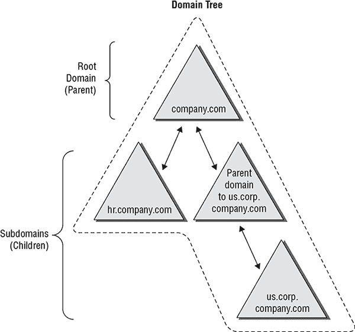

**图 3.10** 域树

要建立域树，你必须首先为该树创建根域。然后，你可以从该根域下添加子域。这些子域随后可以作为进一步子域的父域。每个域必须至少有一个域控制器，并且域控制器在同一时间只能参与一个域。然而，你可以将域控制器从一个域移动到另一个域。要这样做，你必须先将域控制器降级为成员服务器，然后将其提升为另一个域的域控制器。

域的设计是作为逻辑边界。树内的域默认情况下使用双向传递性信任关系自动绑定在一起，这允许通过使用适当的用户和组分配，在域之间共享资源。由于信任关系是具有传递性的，因此树中的形中所有域都相互信任。但请注意，信任本身并不会自动向域之间的用户或对象授予任何安全权限。信任的设计仅用于`allow`资源的共享；你仍然必须经过共享和管理这些资源的过程。在用户访问域之间的资源之前，企业管理员必须显式地为资源分配安全设置。

当你的组织仅维护一个单一的连续命名空间时，使用单一树是有意义的。无论此环境中存在多少个域，以及它们的安全设置彼此有多大差异，它们都通过共同名称相关联。虽然域树对于许多组织来说是有意义的，但在某些情况下，网络命名空间可能会复杂得多。接下来将查看森林如何处理这些情况。

### 使用森林

Active Directory 森林的设计是为了容纳多个非连续的命名空间。也就是说，它们可以将域树组合成逻辑单元。一个示例可能是下面的树和域结构：

- 树：`Organization1.com`
  - `Sales.Organization1.com`
  - `Marketing.Organization1.com`
  - `Engineering.Organization1.com`
  - `NorthAmerica.Engineering.Organization1.com`
- 树：`Organization2.com`
  - `Sales.Organization2.com`
  - `Engineering.Organization2.com.`

图 3.11 提供了多个树如何放入单个森林的示例。这种情况可能会发生在公司收购和合并中，或者当一家公司在逻辑上分为两个或多个完全独立且自主的业务部门时。

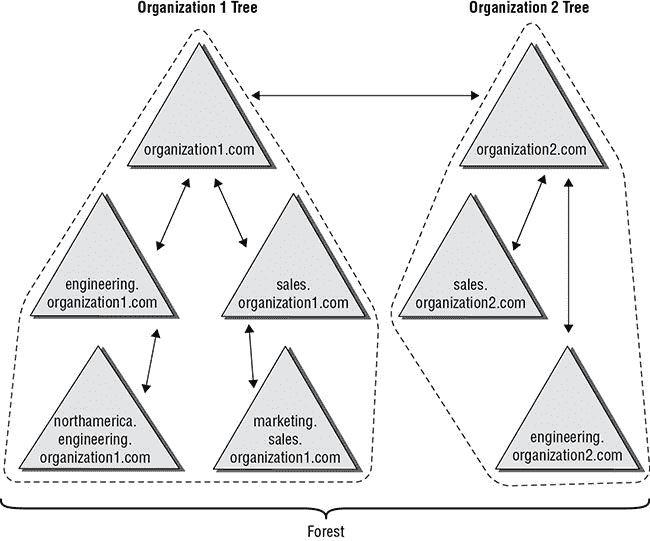

**图 3.11** 由多个树组成的单一森林

要建立域树，你必须首先为该树创建根域。然后，你可以从该根域下添加子域。（省略重复）

域的设计是作为逻辑边界。树内的域默认情况下使用双向传递性信任关系自动绑定在一起，这允许通过使用适当的用户和组分配，在域之间共享资源。由于信任关系是具有传递性的，因此树中的所有域都相互信任。但请注意，信任本身并不会自动向域之间的用户或对象授予任何安全权限。信任的设计仅用于`allow`资源的共享；你仍然必须经过共享和管理这些资源的过程。在用户访问域之间的资源之前，企业管理员必须显式地为资源分配安全设置。

当你的组织仅维护一个单一的连续命名空间时，使用单一树是有意义的。无论此环境中存在多少个域，以及它们的安全设置彼此有多大差异，它们都通过共同名称相关联。虽然域树对于许多组织来说是有意义的，但在某些情况下，网络命名空间可能会复杂得多。接下来将查看森林如何处理这些情况。

### 使用森林

Active Directory 森林的设计是为了容纳多个非连续的命名空间。也就是说，它们可以将域树组合成逻辑单元。一个示例可能是下面的树和域结构：

- 树：`Organization1.com`
  - `Sales.Organization1.com`
  - `Marketing.Organization1.com`
  - `Engineering.Organization1.com`
  - `NorthAmerica.Engineering.Organization1.com`
- 树：`Organization2.com`
  - `Sales.Organization2.com`
  - `Engineering.Organization2.com.`

图 3.11 提供了多个树如何放入单个森林的示例。这种情况可能会发生在公司收购和合并中，或者当一家公司在逻辑上分为两个或多个完全独立且自主的业务部门时。

### 提升过程

当新域作为现有域的子域添加时，就会域树。这种关系在提升 Windows Server 2016 的过程中建立。虽然在大型组织中底层关系可能非常复杂，但服务器器的 Active Directory 安装向导可以轻松创建森林和树。

使用 Active Directory 安装向导，你可以通过将 Windows Server 2016 独立服务器或成员服务器提升为域控制器，来快速地创建新域。当你安装新的域控制器时，你可以选择使其成为现有域的一部分，也可以选择使其成为新域的第一个域控制器。

### 创建域树

在之前的章节中，你学习了如何提升森林中第一个域的第一个域控制器，即根域。如果你不提升任何其他域控制器，那么该域控制器仅控制该一个域，且只创建一个树。要创建一个新的域树，你需要将 Windows Server 2016 计算机提升为域控制器。

在创建新的子域之前，你需要以下信息：

- 父域的名称
- 子域的名称（你计划安装的域）
- Active Directory（活动目录）数据库、日志和共享系统卷的文件位置
- DNS 配置信息
- 新服务器的 NetBIOS 名称
- 域管理员的用户名和密码

练习 3.6 将引导你完成如何使用服务器管理器（Server Manager）创建新的子域的过程。此练习假设你已经创建了父域，并且正在使用该域中一个不是域控制器的服务器。

### 将新域树加入到森林

`forest`（森林）是由一个或多个不共享连续命名空间的域树组成的。例如，你可以将`organization1.com`和`organization2.com`域合并，创建一个单一的 Active Directory 环境。

任何两个域树都可以合并形成一个`forest`（森林），只要第二个树是在第一个树之后安装的，且这两个域树具有不连续的命名空间。（如果命名空间是连续的，你实际上需要为现有的树创建一个新域。）创建新树以形成或添加到森林的过程非常，只需将一台服务器提升为与现有 Active Directory 域不共享命名空间的新域的域控制器即可。

要向现有森林中添加新域，你必须已经拥有至少另一个域，即根域。请记住，如果原始根域被完全移除，整个森林结构将不销毁。因此，你应该在 Active Directory 根域中至少保留两个域控制器；第二个作为备份，以防第一个出现问题，同时它也可以作为灾难恢复和容错目的的备份解决方案。这种设置在其中一个域控制器发生故障时，为整个森林提供额外的保护。

### 添加额外的域控制器

除了你已经执行的操作外，你还可以使用 Active Directory 安装向导为你的任何一个域创建额外的域控制器。创建额外域控制器的主要原因有两个：

**容错性与可靠性**  
你应该始终考虑`disaster recovery (DR)`（灾难恢复）理论并制定计划，有时被称为`disaster recovery plan (DRP)`（灾难恢复计划）。如果你属于那些依赖网络目录服务基础设施的组织之一，你需要 Active Directory 为所有用户提供安全资源支持。

出于此原因，停机和数据丢失是非常昂贵的。通过使用多个域控制器，你可以确保如果其中一台服务器宕机，另一台服务器可用以执行必要的任务，例如用户身份验证和资源浏览。此外，数据丢失（可能是由于硬盘故障）不会导致网络安全信息的丢失或不可用，因为你可以轻松从剩余的仍在运行的域控制器中恢复 Active Directory 信息。

**性能**  
处理登录请求以及作为安全权限和其他其他信息的存储库的负担可能是巨大的，特别是在较大的企业中。通过使用多个域控制器，你可以将此负载分布到多个系统上。此外，通过策略性地部署域控制器，你可以大幅缩短常见网络操作（如身份验证和资源浏览）的响应时间。

根据经验，你应该始终计划并设计你的基础设施，使每个域至少有两个域控制器。对于许多组织来说，这在服务器成本与可靠性和性能水平之间提供了良好的平衡。然而，对于规模更大或分布式组织，额外的域控制器会显著提高性能。

### 降低域控制器

除了可以将成员服务器提升为域控制器外，Active Directory 安装向导还可以执行相反的操作：降低域控制器。

你可能出于几个原因选择降低域控制器。首先，如果你确定服务器的角色应该发生变化（例如，从域控制器变为成员），你可以轻松地降低它。降低域控制器的常见原因是你想将其从一个域移动到另一个域。你无法在一个步内完成此操作：首先你需要降低现有的域控制器，结果是该服务器现在变成了另一个域的域控制器。

要降低域控制器，你只需访问 Active Directory 安装向导。向导会自动检测到本地服务器是域控制器，并要求你验证执行的每一步。请注意，如果本地服务器是全局目录（GC）服务器，你将收到警告，提示必须保留至少一个 GC。

在降低过程结束时，该服务器作为成员加入到它之前作为域控制器的域中。如果你降低了域中的最后一个域控制器，它将变成一台独立服务器。

### 管理多个域

你可以使用 Active Directory 域和信任（Domains and Trusts）工具轻松地管理大多数必须在域之间发生的操作。另一方面，如果你想在域内部配置设置，应该使用 Active Directory 用户和计算机工具。在接下来的章节中，你将查看如何使用上述工具执行两种常用的域功能：管理`single-master operations`（单主器操作）和`trusts`（信任）。你还将查看管理 UPN 后缀以简化用户账户的方法，并详细地检查 GC 服务器。

### 管理单主器操作

在大多数情况下，Active Directory 运行在所谓的`multimaster`（多主节点）复制中。这意味着环境中的每个域控制器都包含一份 Active Directory 数据库的副本，且该副本是可读可写的。这对于大多数类型的信息都有效。例如，如果你想修改用户的密码，可以轻松地在域内的任何域控制器上执行此操作。更改随后会自动传播到其他域控制器。

然而，某些功能并不是以多主节点的方式管理的。这些操作被称为`operations masters`（操作主器）。你必须在 Active Directory 森林中专门指定的域控制器上执行单主器操作。共有五个主要的单主器功能：两个适用于整个 Active Directory 森林，三个适用于每个域。

#### 森林操作主器（Forest Operations Masters）

你使用 Active Directory 域和信任工具来配置全森林（wide）的角色。以下单主器操作适用于整个森林：

**架构主器（Schema Master）**  
你之前已经学过，单个 Active Directory 环境内的所有域控制器共享相同的架构。这确保了信息的一致性。然而，开发人员和系统管理员可以通过添加自定义信息来修改 Active Directory 架构。一个微不足道的例子可能是在员工信息中添加一个字段，以指定用户的喜好颜色。

当你需要进行此类更改时，必须在作为环境`Schema Master`（架构主器）的域控制器上执行。然后，架构主器负责将所有更改传播到森林内的所有其他域控制器。

## 域命名主

`Domain Naming Master`的目的是跟踪 Active Directory（活动目录）森林中的所有域。每当你需要向树或森林添加/删除新域时，你都需要访问此域控制器。

## 域操作主


你使用“活动目录用户和计算机”（Active Directory Users and Computers）管理单元来管理域内的角色。在每个域中，至少要有一个域控制器必须担任以下每个角色：

### 相对标识符（RID）主

Active Directory 中的每个安全对象都必须分配一个唯一标识符，以便与其他对象区分开来。例如，如果你在不同的域中拥有两个名为 `IT` 的组织单位（OU），你必须有某种方法能够轻松地区分它们。此外，如果你删除了其中一个 `IT` OU 稍后重新创建它，系统必须能够确定它与另一个 `IT` OU 不是同一个对象。每个对象的唯一标识符由域标识符和相对标识符（`RID`）组成。`RID` 在 Active Directory 域内始终是唯一的，用于管理安全信息和验证用户身份。当创建新的 Active Directory 对象时，`RID Master` 负责在域内创建这些值。

### PDC 模拟器主

在域内，`PDC Emulator Master`（也称为 `PDC Emulator`）负责维护与 Windows 95、98 和 NT 客户端的后兼容性。`PDC Emulator Master` 还负责处理域用户账户与整个域所有域控制器之间的密码更改。

`PDC Emulator Master` 还是域内所有域控制器的默认时间服务器。这就是为什么确保你的 `PDC emulator` 拥有正确的时间是一个良好做法。它是其他系统依赖其获取时间准确性的系统。

如果另一个域控制器无法处理身份验证请求，`PDC Emulator Master` 将作为默认域控制器处理这些请求。当进行域安全更改时，`PDC emulators` 也会获得优先对待。`PDC emulators` 也是运行在域上的许多服务和应用程序的首选联系点。

### 基础结构主

当用户被添加到组或从组中删除时，所有其他域控制器都应该知晓这一变化。作为 `Infrastructure Master` 的域控制器的角色是确保组成员信息在 Active Directory 域内保持同步。

服务器可以控制网络的另一个服务是 `Windows Time service`（Windows 时间服务）。`Windows Time service` 使用网络时间协议（`NTP`）中的一套算法。这有助于确保整个网络中所有计算机的时间尽可能准确。Windows Server 2016 域内的所有客户端计算机都与权威计算机的时间保持同步。

## 分配单主角色

现在你已经熟悉了不同类型的单主操作，请看一眼 `Exercise 3.7`。此练习向你展示了如何向 Active Directory 环境中的服务器分配这些角色。在数项练习中，你将把单主操作角色分配给环境中的各种域控制器。要完成此项练习中的步骤，你需要一个 Active Directory 域控制器。

## 夺取角色（Seizing Roles）

将角色从一个域控制器更改到另一个非常简单。管理员进入 Active Directory 或 `PowerShell`，并将 `FSMO role` 从一台机器更改到另一台。问题发生在拥有其中一个角色的机器崩溃并宕机。你不能直接从一台无法工作的机器上切换角色。

那么，管理员该怎么办呢？嗯，在那时，你需要做的是夺取角色的控制权。你通过使用 `PowerShell` 来实现。让我们看看如何使用 `PowerShell` 夺取角色。

通常情况下，我会通过练习向你演示如何夺取 `FSMO role` 的控制权，但由于你可能手头没有几十个 Microsoft Windows Server 2016 域控制器，我将通过逐步过程向你展示如何夺取控制权。

为了向你展示如何设置一个逐步过程，你首先需要知道哪些 `FSMO roles` 分配给了哪些 `FSMO numbers`。以下角色每个都有一个对应的数字：

| FSMO 角色 | 数字 |
| :--- | :--- |
| `PDCEmulator` | 0 |
| `RIDMaster` | 1 |
| `InfrastructureMaster` | 2 |
| `SchemaMaster` | 3 |
| `DomainNamingMaster` | 4 |

现在你知道了角色及其关联的数字，只需要知道用于夺取角色控制权的 `PowerShell` 命令。以下是使用 `PowerShell` 的示例。

```powershell
Move-ADDomainControllerMaster -Identity DC1 -OperationMasterRole 0,1,2,3,4 -Force
```

1. 在域控制器上，以管理员身份登录并以提升权限启动 `PowerShell`。
2. 在 `PowerShell` 中，输入以下命令（如上所示）。
3. 在每个角色提示处输入 `Y` 或输入 `A` 接受所有。
4. 几分钟后，所有的 FSMO 角色都应该已经移动完毕。

最后，我想向你展示几个实用的 `PowerShell` 命令，以便你可以查看哪个域控制器拥有哪个角色。

```powershell
Get-ADForest | FT SchemaMaster,DomainNamingMaster
Get-ADDomain | FT PDCEmulator,RIDMaster,InfrastructureMaster
```

### 管理信任

信任关系使得域之间共享安全信息和网络资源变得更加容易。正如前面提到的，标准的传递性双向信任会自动在森林中的树之间创建。图 3.12 显示了 Active Directory 森林默认信任的示例。

## 外部信任

你使用 `external trusts`（外部信任）来访问无法使用森林信任的 Windows NT 4 域或森林中的资源。Windows NT 4 域无法受益 Windows Server 2016 中使用的其他信任类型。因此，在某些情况下，外部信任可能是你的唯一选择。外部信任始终是非可传递的，但它们可以以单向或双向配置进行建立。

## 外部信任上的默认 SID 过滤

当你设置外部信任时，请记住黑客可能会攻破受信任域中的域控制器。如果此信任被攻破，黑客可以使用安全标识符（`SID`）历史属性将 `SIDs` 与新用户账户关联，从而授予自己未经授权的权限（这被称为 `elevation-of-privileges attack`，即权限提升攻击）。为了帮助防止此类攻击，Windows Server 2016 会在所有外部信任上自动启用 SID 过滤器隔离。SID 过滤允许信任域（拥有资源的域）中的域控制器移除所有不属于受信任域成员的 SID 历史属性。

## 域信任

`Realm trusts`（域信任）与外部信任类似。你使用它们连接到使用 Kerberos 认证的非 Windows 域。域信任可以是可传递或不可传递的，单向或双向。

## 跨森林信任

`Cross-forest trusts`（跨森林信任）用于在森林之间共享资源。它们自 Windows Server 2000 域以来一直被使用，且不可传递，但你可以以单向或双向配置建立它们。在双向跨森林信任中，任何森林中的身份验证请求都可以到达另一个森林。如果你让一个森林信任另一个森林，你必须（至少）将其设置为至少 Windows Server 2003 的森林功能级别。

## 选择性验证与全森林验证

森林信任上的全森林身份验证意味着受信任森林的用户可以访问信任森林的所有资源。选择性验证意味着除非被显式允许，否则用户无法对信任森林中的域控制器或资源服务器进行身份验证。练习 3.8 将向你展示将全森林验证更改为选择性验证所需的步骤。

## 快捷信任

在某些情况下，你可能实际上想在两个隐式信任的域之间创建直接信任。这种信任有时被称为 `shortcut trust`（快捷信任），它可以提高跨多个不同域访问资源的速度。假设你有一个森林，如图 3.13 所示。

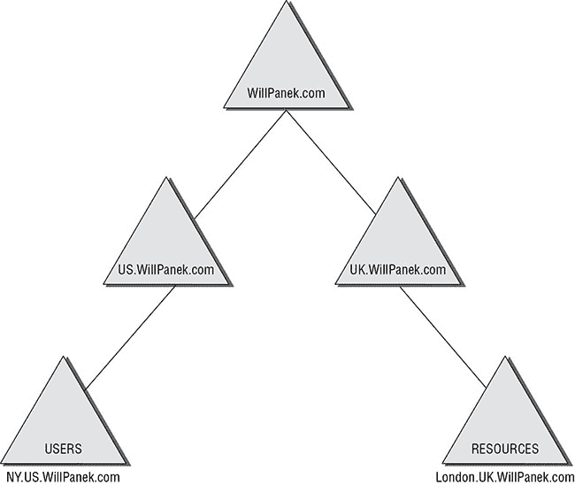

**图 3.13** 森林示例

`NY.us.WillPanek.com` 域的用户可以访问 `London.uk.WillPanek.com` 域的资源，但用户必须通过父域进行身份验证以获得访问权限（从 `NY.us.WillPanek.com` 到 `us.WillPanek.com` 再到 `WillPanek.com` 到 `uk.WillPanek.com` 最后到达 `London.uk.WillPanek.com`）。这个过程可能缓慢。管理员可以从 `London.uk.WillPanek.com`（信任域）设置一个单向信任。练习 3.8 将引导你完成这些步骤。

## 管理 UPN 后缀

`User principal name (UPN) suffixes`（用户主体名称后缀）是名称中出现在 `@` 符号之后的部分。例如，`user@domain.com`。在这个示例中，你可能会发现向全森林添加额外信息是有用的。练习 3.9 将向你展示如何添加 UPN 后缀。

## 命名路由

`Name Routing`（名称路由）是一种用于管理身份验证请求如何跨森林路由的机制。`unique suffix`（唯一后缀）是一个不属于任何树的名称。

## 管理全局目录服务器

像 Active Directory 这样的分布式目录服务的最佳功能之一是，你可以在不同的地方存储不同的信息。例如，日本的域可能会在其亚洲业务部门存储信息，而纽约的域则会包含其北美业务部门。这种架构允许系统管理员将最频繁访问的信息放置在不同域的域控制器上。

然而，当你处理分段到多个域的信息时，可能会遇到问题。例如，如果一个用户想要获取所有域中可用打印机的列表，会发生什么？在这种情况下，搜索通常需要每个域中至少一个域控制器的信息。其中一些域控制器可能位于跨越慢速 WAN 链路。

幸运的是，Active Directory 有一种机制可以加速此类搜索。你可以配置任意数量的域控制器来托管 GC 的副本。GC 包含所有架构信息以及环境中所有域的属性子集。虽然 GC 通常包含一组默认信息，但系统管理员可以选择添加额外信息。

包含 GC 副本的服务器被称为 `GC servers`。现在，每当用户执行需要跨域信息的查询时，他们只需要联系最近的 GC 服务器。为了帮助减少复制流量并保持 GC 数据库较小，只会复制每个对象的有限属性子集。这被称为 `partial attribute set (PAS)`（部分属性集）。你可以通过修改架构并标记要复制到 GC 的属性来更改 PAS。

练习 3.10 将带你完成将域控制器配置为 GC 服务器所需的步骤。

# 管理全局组成员缓存

许多网络都会遇到可用网络带宽和服务器硬件限制的问题。因此，在较小的分支机构办事处安装 `GC` 可能不是明智之举。`Windows Server 2016` 可以通过部署使用`全局组成员缓存 (UGMC)` 的域控制器来为这些较小的站点提供帮助。

一旦启用，`全局组成员缓存`会在用户首次尝试登录时将信息存储在本地。通过使用 `GC`，域控制器会保留该已登录用户的全局组成员身份关系。

当该用户下次尝试登录时，运行 `Windows Server 2016` 的身份验证域控制器将从其本地缓存中获取全局组成员信息，而无需联系 `GC`。默认情况下，全局组成员信息会在域控制器上保留八小时。

使用全局组成员缓存有以下几个优势：

**更快的登录速度**：由于域控制器不需要联系全局目录，因此身份验证速度更快。

**减少网络带宽**：域控制器不需要处理位于森林中所有对象的对象复制。

**能够使用现有硬件**：不需要升级硬件来支持 `GC`。

练习 3.11 将向你展示配置全局组成员缓存所需的步骤。

## 升级现有域和森林

现在你已经有了一个可以升级的新操作系统，重要的是你要花些时间了解让你的基础设施保持最新状态的各种方法。有很多升级路径需要考虑。表 3.2 说明了将你的域控制器从 `Windows Server 2008` 升级到 `Windows Server 2016` 最常用的原地升级路径。原地升级仅适用于 64 位的 `Server 2008` 到 `Server 2016` 版本。你无法对运行 `Windows Server 2003` 或 32 位版本 `Windows Server 2008` 的域控制器进行原地升级。如果你当前的环境配置超出了原地升级的可能范围，那么你将需要在最新的 `Windows Server OS` 上安装新的域控制器，然后删除旧的控制器。

**表 3.2** 支持的域控制器原地升级路径

| 如果你运行这些版本… | 你可以升级到这些版本… |
| --- | --- |
| 带有 `SP2` 的 `Windows Server 2008 Standard` 或带有 `SP2` 的 `Windows Server 2008 Enterprise` | `Windows Server 2016 Standard` 或 `Windows Server 2016 Datacenter` |
| 带有 `SP2` 的 `Windows Server 2008 Datacenter` | `Windows Server 2016 Datacenter` |
| `Windows Web Server 2008` | `Windows Server 2016 Standard` |
| 带有 `SP1` 的 `Windows Server 2008 R2 Standard` 或带有 `SP1` 的 `Windows Server 2008 R2 Enterprise` | `Windows Server 2016 Standard` 或 `Windows Server 2016 Datacenter` |
| 带有 `SP1` 的 `Windows Server 2008 R2 Datacenter` | `Windows Server 2016 Datacenter` |
| `Windows Web Server 2008` | `Windows Server 2016 Standard` |
| `Windows Server 2008 R2 Datacenter` | `Windows Server 2016 Datacenter` |
| `Windows Server 2008 R2 Datacenter` | `Windows Server 2016 Datacenter` |

## 维护 Active Directory

如果你已经部署了 Active Directory，你的用户就依赖它来运行。正如前面的章节所讨论的，为了防范万一，拥有多个备份是非常重要的。因此，备份 Active Directory 的重要性不言而喻。

虽然执行备份操作的一般目的——保护信息——是显而易见的，但为了起见，这里有几个备份的具体原因：

**防止硬件故障**：计算机硬件的寿命是有限的，所有硬件最终都会故障。`MTTF` 是设备在故障之前的平均运行时间。

**防止数据的意外删除或修改**：虽然硬件故障的威胁是真实的，但在大多数环境中，修改或删除数据时的错误更为常见。例如，假设系统管理员删除了特定 `OU` 中的所有对象。显然，能够从备份中检索这些信息非常重要。

**保留历史信息**：用户和系统管理员有时会修改文件，然后发现他们需要访问文件的旧版本。或者文件被意外删除，用户直到很久以后才发现这一事实。通过随着时间的推移保留多个备份，你可以从之前的备份中恢复信息。

**防止数据的恶意删除或修改**：即使在最安全的环境中，也可以想象未经授权的用户（或具有恶意意图的授权用户！）可能会删除或修改信息。在这种情况下，数据的丢失可能需要有效的备份来进行还原。

`Windows Server 2016` 包含一个用于备份操作系统文件和 Active Directory 数据存储的备份实用程序。它允许基本的备份功能，例如计划备份作业和选择要备份的文件。图 3.14 显示了 `Windows Server 2016` 备份工具的主界面。

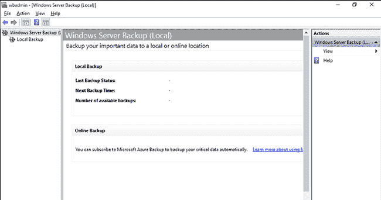

**图 3.14** Windows Server 2016 备份工具的主界面

## Windows Server 2016 备份工具概述

虽然执行备份操作的一般目的——保护信息——是显而易见的，但系统管理员在确定适用于环境的最佳备份和恢复方案时必须考虑许多因素。因素包括备份什么、备份多频繁以及何时执行备份。

在接下来的章节中，你将看到 `Windows Server 2016` 备份实用程序如何轻松地为许多网络环境实施备份计划。

## 备份类型

在执行备份时，你必须处理的重要问题之一是跟踪哪些文件已经备份，哪些文件需要备份。每当对文件进行备份时，该文件的归档位（archive bit）就会被设置。你可以通过右键点击系统文件并选择`属性`来查看其属性。通过点击`属性`对话框中的`高级`按钮，你将进入`高级属性`对话框。在这里，你将看到`文件夹已准备好归档`的选项。图 3.15 显示了文件夹属性的一个示例。

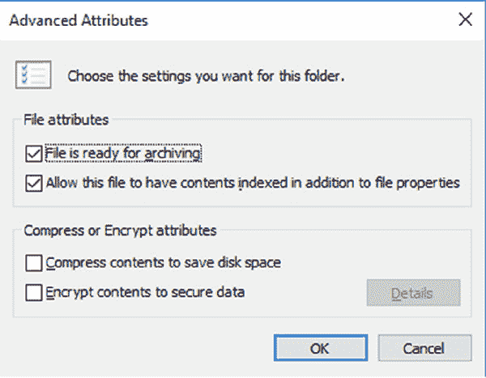

**图 3.15** 查看文件夹的归档属性

虽然在每次备份操作中备份文件系统中的所有文件是可能的，但有时仅备份选定的文件（例如自上次备份操作以来更改的文件）更为方便。在执行备份时，你可以备份到可移动介质（DVD）或网络位置。

微软建议备份到网络位置。这样做的原因是，如果你的公司发生灾难（火灾、飓风等），你的所有数据都可能丢失——包括备份。如果你备份到可移动介质源，则可以将备份的副本带到场外。这可以防止重大灾难的影响。

可以执行几种类型的备份：

- **常规**：常规备份（也称为`系统`或`全量备份`）备份所有选定的文件，然后将它们标记为已备份。此选项通常在进行全系统备份时使用。Windows Server 2016 支持这种备份。
- **复制**：`复制备份`备份所有选定的文件，但不将它们标记为已备份。当你想要对文件进行额外备份以将其移至场外，或者为了存档目的对同一份数据创建多个副本时，这非常有用。


**增量**：`增量备份`复制任何标记为准备好备份的选定文件（通常是因为它们尚未备份，或自上次备份以来已更改），然后将这些文件标记为已备份。当运行下次增量备份时，仅存储未标记为已备份的文件。增量备份通常与常规（全量）备份结合使用。

最常见的备份过程是进行全量备份，然后进行随后的增量备份。这种方法的优点是仅存储自上次全量或增量备份以来更改的文件。这可以减少备份时间以及对磁盘或磁带存储空间的需求。

从这种备份方法恢复信息时，系统管理员必须首先恢复全量备份，然后恢复每份增量备份。

**差分**：`差分备份`在目的上与增量备份相似，但有一个重要的区别：差分备份复制所有标记为要备份的文件，但不会将这些文件标记为已备份。在在使用常规和差分备份的环境下恢复文件时，你只需要恢复常规备份和最新的差分备份即可。

**每日**：`每日备份`备份单日内更改的所有文件。此操作使用文件时间/日期戳来确定应该备份哪些文件，并且不会将它们标记为已备份。

## 备份系统状态

当你计划备份信息时，请注意，最重要的组件被称为`系统状态`。系统状态数据包括以下内容，Windows Server 2016 提供了将它们备份到其他介质或网络共享的能力：

- **活动目录**：`活动目录`数据存储是域的核心。它包含了创建和管理资源所需的所有信息。
- **启动文件**：`启动文件`是启动 Windows Server 2016 所需的文件。
- **COM+ 注册数据库**：`COM+ 注册数据库`是所有 `COM+` 组件的列表。
- **注册表**：`注册表`是配置、网络设置和应用程序设置信息的中心存储库。
- **Sysvol 目录**：`Sysvol 目录`包含在共享的数据和文件。

## 裸机备份与恢复

在 Windows Server 2016 中，你的选项之一是执行`裸机恢复 (BMR)`。这是在机器被完全清除并格式化后的恢复。这种恢复通常发生在灾难性故障或崩溃之后。

Windows Server 2016 允许通过选择`裸机恢复`复选框来备份裸机恢复所需的所有文件（见图 3.16）。

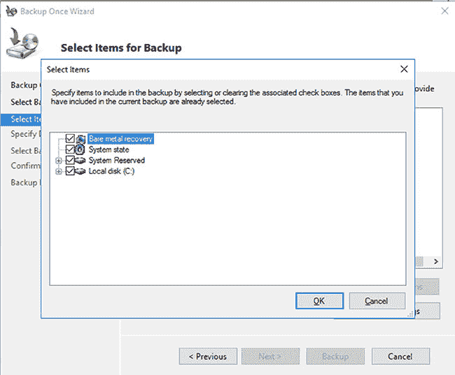

**图 3.16** 裸机恢复选项

当你在 Windows Server 2016 中选择裸机恢复选项时，所有子选项（`系统状态`、`系统保留`和`本地磁盘`）都会勾选。

### 计划备份

除了指定要备份的文件外，你还可以计划备份作业在特定时间运行。计划*何时*执行备份与决定备份*什么*同样重要。执行备份操作会降低系统性能；因此，你应该计划在服务器活动最少的时间备份信息。

要在计划中添加备份操作，只需点击`指定备份时间`窗口上的`添加`按钮。

在某些情况下，活动目录数据存储或其他系统状态数据可能会损坏或不可用。这可能是由于许多不同的原因。例如，硬盘故障可能会导致数据丢失。

恢复系统状态（System State）数据的实际操作步骤取决于导致数据丢失的原因以及该数据丢失对系统产生的影响。在理想情况下，系统状态数据损坏或不准确，但操作系统仍然可以启动。如果是此类情况，你所做的就是进入特殊的`Directory Services Restore Mode (DSRM)`，然后从备份中恢复系统状态数据。此过程将用备份中的系统状态数据替换当前的数据。因此，自上次备份以来所做的任何更改将完全丢失，且必须重新进行。

在最坏的情况下，服务器上的所有信息都已丢失，或者硬件故障导致机器无法正常启动。如果是这种情况，你必须采取以下几个步骤来恢复系统状态数据：

1. 修复可能阻止计算机启动的任何硬件问题（例如，更换任何故障的硬盘）。
2. 重新安装 Windows Server 2016 操作系统。这应该像在新系统上进行常规安装一样执行。
3. 重新安装你的备份设备可能需要的任何设备驱动程序。如果你是将信息备份到文件系统，则此项不适用。
4. 使用 Windows Server 2016 备份工具恢复系统状态数据。

我将在本节的稍后部分介绍执行恢复的技术细节。但现在，你应该理解备份信息的重要性，并且尽可能测试备份的有效性。

## 备份和恢复组策略对象

`Group Policy Objects (GPOs)` 是活动目录（Active Directory）的重要组成部分。当你备份活动目录时，GPOs 也可以被备份。你还有能力通过组策略管理控制台（`GPMC`）备份 GPOs。这让你具备备份和恢复单个 GPO 的能力。

要备份所有 GPOs，打开 `GPMC` 并右键点击 `Group Policy Objects` 容器。你会看到 `Back Up All`（备份所有）选项。选择此选项后，将启动一个向导询问你的备份位置。选择一个位置并点击 `Backup`（备份）。

要备份单个 GPO，右键点击 `GPO`（在 `Group Policy Objects` 容器中）并选择 `Backup`。同样，选择此选项后，将启动一个向导询问你的备份位置。选择一个位置并点击 `Backup`。

要恢复 GPO，过程与上述相同，只是你不是选择 `Backup`，而是选择 `Manage Backups`（管理备份，以恢复所有 GPOs）或 `Restore`（恢复，用于单个 GPO）。

## 设置活动目录备份

Windows Server 2016 备份工具可以让你轻松地作为正常备份操作的一部分备份系统数据（包括活动目录）。我们已经涵盖了不同备份类型背后的原理，以及为什么以及何时使用它们。

练习 3.12 将引导你完成备份域控制器的过程。为了完成此练习，本地计算机必须是一个域控制器，并且你必须有一个 DVD 刻录机或网络位置来备份系统状态。

## 恢复活动目录

活动目录的设计考虑了容错性。例如，微软强烈建议每个域至少有两个域控制器。这些域控制器中的每一个都包含了一份活动目录数据存储库的副本。如果其中一个域控制器发生故障，可用的那个可以接管故障服务器的功能。当故障服务器修复后，它可以被提升为现有环境中的域控制器。此过程有效地恢复了故障域控制器，而不会给最终用户带来任何停机时间，因为所有的活动目录数据将在下次计划同步中复制到修复的服务器上。

在某些情况下，你可能需要从备份恢复活动目录。例如，假设系统管理员不小心从域中删除了数百个用户，直到这些更改传播到所有其他域控制器时才发现。手动重新创建账户是不行的，因为对象的安全标识符（SID）将会不同（且所有权限都必须重置）。显然，从备份恢复的方法是最佳解决方案。你可以选择将活动目录恢复设为权威性的（authoritative）或非权威性的（nonauthoritative），如下文章节所示。

### 权威性恢复概述

如果系统文件或活动目录数据存储库损坏或变得不可用，恢复活动目录和其他系统状态数据是一个重要的过程。幸运的是，如果需要，Windows Server 2016 备份工具允许你轻松地从备份中恢复数据。

我之前提到过，在不小心删除活动目录信息的情况下，你可能需要从备份恢复活动目录。但如果存在多个域控制器会怎样？即使你执行了恢复，该域控制器上的信息也会被视为过时的，并被另一个域控制器覆盖。这些来自备份的数据正是你是你想要替换的信息。

幸运的是，Windows Server 2016 和活动目录允许你执行所谓的 `authoritative restore`（权威性恢复）。权威性恢复过程指定一个域控制器拥有活动目录数据存储库的权威（或主）副本。当其他域控制器与此域控制器通信时，它们的信息将会被覆盖。

现在你已经了解了权威性恢复是如何运作的，让我们开始查看执行该过程的细节。

### 执行权威性恢复

当你在 Windows Server 2016 域控制器上恢复活动目录信息时，请确保活动目录服务没有运行。这是因为恢复系统状态数据需要对系统文件和活动目录数据存储库的完全访问权限。如果你在域控制器运行时尝试恢复系统状态数据，将看到错误消息。

通常，恢复数据和操作系统文件是一个简单的过程。需要注意的是，恢复系统状态备份将替换现有注册表、Sysvol 和活动目录文件，因此你自上次备份以来所做的任何更改将丢失。

除了恢复整个活动目录数据库外，还可以使用 `ntdsutil` 工具中的 `restoresubtree` 命令恢复活动目录中的特定子树。这允许你恢复特定的信息，在意外删除孤立内容的情况下非常有用。

执行权威性恢复过程后，活动目录应更新到备份的时间。此外，该域的所有其他域控制器的活动目录信息都将被恢复操作的结果覆盖。结果是一个是从介质恢复的活动目录环境。

### 非权威性恢复

既然你已经理解了为什么要使用权威恢复以及它是如何执行的，那么理解非权威恢复在概念上就很容易跨越。请记住，通过将恢复设置为权威的，你仅仅是在告诉域内的其他域控制器，为了复制之目的，识别 Active Directory 的最新副本。如果你在域中只有一个域控制器，那么权威恢复过程就变得没有意义了；你可以直接跳过使恢复变为权威所需的步骤，并在之后立即开始使用该域控制器。

如果你在域中有多个域控制器并需要执行非权威恢复，只需让域控制器通过常规复制方法从其他域控制器处接收 Active Directory 信息即可。

## Active Directory 回收站

Active Directory 回收站（Active Directory Recycle Bin）是一项强大的功能，允许管理员恢复已删除的 Active Directory 对象。假设你有一位初级管理员对 Active Directory 进行了几个小时的更改。随后该初级管理员删除了一个 OU（组织单元）。你就必须从备份中重新加载该 OU，或者更糟糕，你可能需要重新加载整个 Active Directory（取决于备份软件），从而导致初级管理员完成的数小时工作丢失。

这个问题在于，当你从 Active Directory 中删除安全对象时，该对象的安全标识 (SID) 会被移除。所有用户的权利和权限都是与用户的 SID 关联的，而不是账户名称。这正是 AD 回收站可以帮助的地方。Active Directory 回收站允许你在无需使用备份的情况下保留并恢复意外删除的 Active Directory 对象。Active Directory 回收站同时适用于 Active Directory 域服务 (AD DS) 和 Active Directory 轻量级目录服务 (AD LDS)。

通过启用 Active Directory 回收站（默认禁用），任何被删除的 Active Directory 对象都将被保留，并可以完整地恢复到删除删除前的相同状态。要启用 Active Directory 回收站，你必须执行以下操作（你必须是 Schema Admins 组的成员）：

* 运行 `adprep /forestprep` 命令，在持有架构主节点（schema master）的服务器上准备森林以更新架构。
* 运行 `adprep /domainprep` 命令，在持有基础结构操作主句柄的服务器上准备域。
* 如果你的环境中存在只读域控制器 (RODC)，你还必须运行 `adprep /rodcprep` 命令。
* 确保你 Active Directory 森林中的所有域控制器都在运行 Windows Server 2016、Windows Server 2012 R2 或 Windows Server 2008 R2。
* 确保森林功能级别已设置为 Windows Server 2016、Windows Server 2012 R2 或 Windows Server 2008 R2。

### 可重启的 Active Directory

在 Windows Server 2016 操作系统中，管理员有能力停止并重启 Active Directory 而无需重启整个系统。管理员可以使用 Microsoft 管理控制台 (MMC) 单元程序或命令行来执行这些操作。

通过可重启的 Active Directory 服务（Restartable Active Directory Services），管理员有能力停止 Active Directory 服务，以便将更新和其他任务应用到域控制器。管理员在 Active Directory 停止期间可以执行的一项任务是数据库的离线碎片整理。

可重启 Active Directory 的优势之一是，运行在同一服务器上的其他服务在 Active Directory 停止时不需要依赖于 Active Directory 即可继续正常运行。管理员可以在 Local Services MMC 单元程序中停止并重启 Active Directory 域服务。

## 离线维护

正如你在上一节中学到的，有时你必须离线以进行维护。例如，你需要在域控制器离线状态下执行权威和非权威恢复。我们用于离线维护的主要工具是 `ntdsutil`。

### Ntdsutil.exe

系统管理员执行离线维护的主要方法是通过 `ntdsutil` 命令行工具。你只需在命令提示符中输入 `ntdsutil` 即可启动此工具。为了让命令正常工作，你必须以高权限启动命令提示符。`ntdsutil` 命令是交互式且对上下文的。也就是说，一旦启动该实用程序，就会看到 `ntdsutil` 命令提示符。在此提示符下，你可以输入设置上下文的命令。例如，某些操作需要你连接到域、域控制器或 Active Directory 对象。

### 表 3.3 Ntdsutil 离线维护命令

| Ntdsutil 域管理命令 | 目的 |
| :--- | :--- |
| `Help` 或 `?` | 显示域管理中可用命令的信息。 |
| `Activate instance %s` | 将 NTDS 或特定的 AD LDS 设置为活动实例。 |
| `Authoritative restore` | 设置 Active Directory 权威恢复的域控制器。 |
| `Change service account` | 允许更改 AD LDS 服务帐户的用户名和密码。你可以对空密码使用 `NULL`，可以使用 `\*` 提示用户输入密码。 |
| `configurable settings` | 允许管理员管理配置设置。 |
| `DS behavior` | 允许管理员查看并修改 AD DS 或 AD LDS 行为。 |
| `files` | 该命令允许管理员管理 AD DS 或 AD LDS 数据库文件。 |
| `Group Membership Evaluation` | 评估用户或组令牌中的安全标识 (SID)。 |
| `LDAP policies` | 管理员可以管理轻量级访问协议 (LDAP) 策略。 |
| `metadata cleanup` | 从弃用的域控制器中删除元数据。 |
| `security account management` | 该命令允许管理员管理 SID。 |
| `Set DSRM Password` | 重置目录服务恢复模式管理员帐户密码。 |

管理员在尝试恢复 Active Directory 时可能会遇到的问题之一是需要恢复多个备份以比较每个备份包含的 Active Directory 数据。Windows Server 2016 有一个名为 Active Directory 数据库挂载工具 (`Dsamain.exe`) 的实用程序，它可以解决这个问题。

`Dsamain.exe` 工具通过提供一种比较不同时间拍摄的快照中存在的数据的方式来帮助恢复过程，从而让你有能力决定恢复哪个 Active Directory 数据库。

定期创建快照可以让你拥有足够的数据，以便准确记录 Active Directory 数据库随时间变化的情况。`ntdsutil` 实用程序允许你通过 `ntdsutil snapshot` 操作拍摄快照。

你必须是 `Domain Admins` 组或 `Enterprise Admins` 组的成员才能查看生成的快照，因为这些快照包含了敏感的 `Active Directory` 数据。

## 压缩目录数据库文件（离线碎片整理）

多年来我们一直在执行的一项任务是对我们运行的操作系统进行碎片整理。自 `Windows NT` 以来，我们一直使用 `defragmentation` 工具。对系统进行 `Defragging` 有助于将空闲空间返回硬盘。

你还可以使用 `defragmentation` 过程在离线（Offline）状态下压缩 `Active Directory` 数据库。离线 `Offline` `defragmentation 有 有释放磁盘空间并检查 `Active Directory` 数据库的完整性。

要执行离线 `offline` `defragmentation`，你需要使用 `ntdsutil` 命令。当对 `Active Directory` 数据库进行 `defragmentation` 时，会生成一个新的压缩版本的数据库。此新数据库文件可以在相同机器上创建（如果空间允许），也可以在网络位置。创建新文件后，将压缩后的 `Ntds.dit` 文件复制回原始位置。

如果空间允许，保留一份旧的原始数据库文件的副本是一个良好习惯。你可以重命名旧数据库文件并将其保留在当前位置，也可以将旧数据库文件复制到其他位置。

## 监控复制

有时，你可能需要监控域控制器上复制流量的运行情况。我们将检查你可以使用的复制工具，该工具有助于确定你的网域是否存在问题。

### `Repadmin` 工具

在安装 `Windows Server 2016` 时内置了 `Repadmin` 工具。此命令行工具可帮助管理员诊断 `Windows` 域控制器之间的复制问题。

`Repadmin` 允许管理员从域控制器的视角查看每个域控制器的复制拓扑。管理员还可以使用 `Repadmin` 手动创建复制拓扑。通过手动创建复制拓扑，管理员可以强制域控制器之间发生复制事件并查看复制元数据向量。

要访问 `Repadmin` 工具，请使用高权限打开命令提示符（运行 ➢ `CMD`）。在命令提示符中输入 `Repadmin.exe`，将显示所有可用选项。

### 使用 ADSI 编辑器


另一个（在本章前面介绍过的）允许你管理 `Active Directory` 中对象和属性的工具是 `Active Directory 服务接口编辑器`（`ADSI Edit`）。之前我们使用 `ADSI Edit`（`Adsiedit.msc`）创建多个密码策略以允许细粒度的密码策略。`ADSI Edit` 允许你查看 `Active Directory` 森林中的每个对象和属性。

使用 `Adsiedit.msc` `MMC` 添加的一个优势是，该工具允许你查询、查看、创建和编辑未通过其他 `Active Directory` `Microsoft Management Console`（`MMC`）加载的属性。

`ADSI Edit` 允许你管理 `AD LDS` 实例。执行此操作，你必须首先连接并绑定到实例。连接并绑定后，你可以通过浏览容器或对象并右键点击它们来管理实例内的容器和对象。要完成此任务，你必须是 `AD LDS` 实例 `Administrators` 组的成员。

### `Wbadmin` 命令行工具

`wbadmin` 命令允许你从命令提示符备份和恢复操作系统、卷、文件、文件夹和应用程序。

你必须是 `Administrators` 组的成员才能配置备份计划。要使用 `wbadmin`，你必须使用高权限命令提示符（运行 ➢ `CMD`）。

| 命令 | 描述 |
| :--- | :--- |
| `wbadmin enable backup` | 配置并启用每日备份。 |
| `wbadmin disable backup` | 禁用每日备份。 |
| `wbadmin start backup` | 运行一次备份。 |
| `wbadmin stop job` | 停止正在运行的备份或恢复操作。 |
| `wbadmin get items` | 列出特定备份包含的项目。 |
| `wbadmin start recovery` | 恢复卷、应用程序、文件、文件夹。 |
| `wbadmin get status` | 显示正在运行的备份或恢复操作的状态。 |
| `wbadmin start staterecovery` | 运行系统状态恢复。 |
| `wbadmin start systemstatebackup` | 运行系统状态备份。 |
| `wbadmin start sysrecovery` | 恢复完整的系统状态。 |

# 理解使用多个域的原因

使用多个域主要有七个原因：它们提供了额外的扩展性、减少了复制流量、有助于解决政治和组织问题、提供了多个层次的层次结构、允许去中心化管理、维护了合法性，并允许使用多个 DNS 或域名。

## 理解使用多个域的缺点

使用多个域时，维持管理的一致性更加困难。管理单元的数量也会随之增加，这使得跟踪网络资源变得困难。最后，在 `Active Directory` 环境中重新排列域拓扑比重新组织 `OUs` 困难得多。

## 了解如何创建域树

要创建一个新的域树，你需要将 Windows Server 2016 计算机提升为域控制器，选择使该域控制器成为新域第一台机器的选项，并将该域设为新树的第一个域。结果就是一个新的域树。

# 了解如何将域树加入森林

创建一个新树以形成或添加到森林，其简单方法是将服务器提升为新域的域控制器，该新域*不*与现有的 `Active Directory` 域共享命名空间。要向现有森林添加域，你必须已经至少拥有另一个域。该域作为整个森林的根域。

# 理解如何管理单主器操作

单主操作必须在 `Active Directory` 森林内专门指定的机器上执行。主要有五个单主器功能：两个适用于整个 `Active Directory` 森林（`Schema Master` 和 `Domain Naming Master`），以及三个适用于每个域（`RID Master`、`PDC Emulator Master` 和 `Infrastructure Master`）。

# 理解如何管理信任

配置信任时，你需要考虑两个主要特性：传递性和方向。理解传递关系最简单的方法是通过这个例子：如果 `Domain A` 信任 `Domain B` 且 `Domain B` 信任 `Domain C`，那么 `Domain A` 隐式信任 `Domain C`。信任可以配置为非传递性，以防止发生此类行为。在单向关系中，信任域允许与信任域共享资源。在双向关系中，两个域平等地信任。特殊信任包括外部信任、林信任、跨森林信任和快捷信任。

# 理解如何管理 UPN 后缀

默认情况下，创建用户时的域名称决定了 UPN 后缀。通过向森林添加额外的 UPN 后缀，在创建新用户时，你可以轻松地选择更易于管理的后缀。

## 理解如何管理全局目录服务器

你可以配置任意数量的域控制器来托管全局目录（`GC`）的副本。`GC` 包含架构信息以及 `Active Directory` 环境中所有域的属性子集。包含 `GC` 副本的服务器被称为 `GC` 服务器。每当用户执行需要来自多个域的信息的查询时，他们只需要联系最近的 `GC` 服务器即可获取这些信息。同样，当用户必须跨域进行身份验证时，他们无需等待可能位于世界另一端的域控制器的响应。结果是提高了 `Active Directory` 查询的整体性能。

# 理解通用组成员资格缓存

你可以将一个域控制器启用为通用组资格缓存服务器。随后，通用组资格缓存机器将向 `GC` 服务器发送用户登录身份验证请求。然后，`GC` 将将信息发回给通用组资格缓存服务器。

## 理解 Active Directory 复制的目的

复制用于保持域控制器的同步，对于所有规模的 `Active Directory` 环境都至关重要。复制是将 `Active Directory` 数据库的更改在域控制器之间传输的过程。

# 理解站点、站点边界和子网的概念

子网定义了你网络的物理部分。站点被定义为连接良好的子网集合。站点边界由你包含在站点中的一个或多个子网定义。

## 理解站点内复制与站点间复制的差异

站点内复制旨在将信息同步到位于相同站点的机器。站点间复制用于同步不同站点之间的信息。

## 理解桥头服务器的作用

桥头服务器用于接收两个远程站点之间的流量，并将此信息转发给适当的服务器。在连接速度缓慢的站点之间高效同步数据的一种方法是使用桥头服务器。

# 实现站点链接、站点链接桥接和连接对象

你可以使用这三种对象类型来精细控制 `Active Directory` 复制的行为。创建站点链接是为了定义站点之间可连接类型。站点链接可以反映网络连接的相对成本，并反映通信的可用带宽。你可以使用站点链接桥来连接站点链接，以便该关系具有传递性。连接对象为你提供了一种设置特殊类型复制的方法，例如按需即时复制或指定自定义计划。

## 配置复制计划和站点链接成本

你可以在站点之间创建多个站点链接，并可以根据连接类型为站点链接分配成本值。系统管理员确定成本值，然后利用站点链接的相对成本来确定复制的最佳路径。成本越低，该链接被用于复制的可能性越高。一旦确定了如何以及通过哪些连接进行复制，就需要决定*何时*应该复制信息。复制需要网络资源并占用带宽。因此，你需要在一致目录信息的需求与节省带宽的需求之间取得平衡。

# 根据需求确定放置域控制器和全局目录服务器的位置

域控制器和全局目录服务器的位置可以积极影响 `Active Directory` 操作的性能。然而，为了优化性能，你需要知道在由多个站点组成的网络环境中放置这些服务器的最佳位置。

## 监控并排除复制故障

Windows Server 2016 监控工具设计用于监控与使用 `Active Directory` 相关的性能统计。除了这种监控外，你始终应该检查基础网络连接以及路由器和防火墙连接，并检查事件日志。

# 理解 Windows Server 2016 备份工具提供的各种备份类型

Windows Server 2016 备份工具可以执行全备和增量备份操作。某些第三方备份工具还支持差异备份和每日备份。你可以将这些操作作为高效备份策略的一部分。

## 了解如何还原 Active Directory

还原 Active Directory 数据库与其他还原操作相比大不同。要还原部分或整个 Active Directory 数据库，你必须先将机器引导到“目录服务还原模式”（Directory Services Restore mode）。

## 理解权威恢复过程的重要性

当你想要从 Active Directory 备份中恢复较早之前的信息，并希望这些较旧信息传播到环境中的其他域控制器时，你就会使用权威恢复。

## 了解使用 `ntdsutil` 进行离线维护

`ntdsutil` 命令行工具是系统管理员执行离线维护的主要方法。了解通过在命令提示符中输入 `ntdsutil` 来启动此工具。

## 复习题

你可以在附录中找到答案。

1. 你需要在某些域控制器上去激活 `UGMC` 选项。你会在 Active Directory 的哪个层级上去激活 `UGMC`？

   1. 服务器
   2. 站点
   3. 域
   4. 森林

2. 你在一个单域森林的组织中工作。你的公司有一个总部和两个分支机构。所有地点都配置为 Active Directory 站点，并且所有站点都通过 `DEFAULTIPSITELINK` 对象连接。你的连接运行速度慢于公司策略允许范围。你想减少不同站点之间所有域控制器之间的复制延迟。你应该做什么？

   1. 减少 `DEFAULTIPSITELINK` 对象的复制间隔。
   2. 减少站点的复制间隔。
   3. 减少站点的复制计划。
   4. 减少所有域控制器的复制计划。

3. 你需要将你的三个域控制器启用为全局目录服务器。你会在何处配置域控制器配置全局目录？

   1. 森林，`NTDS settings`
   2. 域，`NTDS settings`
   3. 站点，`NTDS settings`
   4. 服务器，`NTDS settings`

4. Daniel 负责管理一个部署了单一 Active Directory 域的中型组织的 Active Directory 复制流量。目前，环境配置有两个站点和默认的复制设置。每个站点包含 15 个域控制器。最近，网络管理员抱怨 Active Directory 流量使用了两个站点之间大量的可用网络带宽。Daniel 被要求满足以下条件：

   * 减少两个站点之间域控制器之间的网络流量。
   * 尽量减少对当前站点拓结构的更改。
   * 要求不对现有物理网络基础设施进行任何更改。

   Daniel 决定，在每个站点中配置特定的域控制器，让它们接收来自另一个站点的大部分复制流量是最有效的。以下哪种方案满足要求？

   1. 创建仅为复制流量设计的附加站点，并将现有的域控制器移动到这些站点。
   2. 在两个站点之间创建多个站点链路。
   3. 在两个站点之间创建站点链路桥（site link bridge）。
   4. 在每个站点配置一台服务器作为首选桥头服务器（bridgehead server）。

5. 在设置涉及三个域和三个站点的复制场景时，以下哪项不需要手动创建？

   1. 站点 (Sites)
   2. 站点链路 (Site links)
   3. 连接对象 (Connection objects)
   4. 子网 (Subnets)

6. Active Directory 的以下服务负责维护复制拓扑？

   1. 文件复制服务 (File Replication Service)
   2. 知识一致性检查器 (Knowledge Consistency Checker)
   3. Windows 域名服务 (Windows Internet Name Service)
   4. 域名系统 (Domain Name System)

7. 一个由三个站点组成的 Active Directory 环境的系统管理员想要将站点链路配置为具有传递性。以下哪些 Active Directory 对象负责表示站点之间的传递性关系？

   1. 附加站点 (Additional sites)
   2. 附加站点链路 (Additional site links)
   3. 桥头服务器 (Bridgehead servers)
   4. 站点链路桥 (Site link bridges)

8. 你已经配置了具有多个站点的 Active Directory 环境，并在每个站点中放置了适当的资源。你现在正尝试为两个站点之间的复制信息传输选择协议。两个站点之间的连接具有以下特征：

   * 由于网络提供商不稳定，链路在一天中的某些部分通常不可用。
   * 无论链路是否可用，都必须尝试复制传输。如果计划计划复制期间链路不可用，则应在链路再次可用后自动接收信息。
   * 复制流量必须能够通过标准的 Internet 连接传输。

   以下哪种协议满足这些要求？

   1. IP
   2. SMTP
   3. RPC
   4. DHCP

9. 系统管理员怀疑复制配置中存在错误。系统管理员如何查找与复制相关的特定错误消息？

   1. 通过使用 Active Directory 站点和和服务管理工具
   2. 通过使用计算机管理工具
   3. 转到事件查看器 (Event Viewer) ➢ 系统日志 (System Log)
   4. 转到事件查看器 (Event Viewer) ➢ 目录服务日志 (Directory Service Log)

10. Christina 负责管理中型组织的 Active Directory 复制流量。目前，环境配置有一个站点和默认的复制设置。该站点包含 50 多个域控制器，系统管理员经常对 Active Directory 数据库进行更改。最近，网络管理员抱怨 Active Directory 流量消耗了通过慢链路连接的网络部分之间大量的网络带宽。通常情况下，复制流量是合理的，但最近用户抱怨在一天中的某些时段网络性能变慢。

    Christina 被要求在满足以下条件的同时缓解问题：

    * 能够精确控制复制发生的时间。
    * 能够基于物理网络基础设施进行 Active Directory 复制。
    * 在不创建或删除任何域控制器的情况下执行更改。

    Christina 可以采取以下哪两个步骤来满足这些要求？（选择两项）

    1. 创建并定义连接对象，指定复制发生的小时。
    2. 创建多个站点链路。
    3. 创建站点链路桥。
    4. 创建反映物理网络拓扑的新 Active Directory 站点。
    5. 在每个新站点上配置一台服务器作为桥头服务器。

- 此目标可能包括但不限于：配置处理顺序和优先级；配置禁止继承；配置强制执行策略；配置安全过滤和 Windows 管理工具 (WMI) 过滤；配置环回处理；配置和管理慢链路处理以及组策略缓存；配置客户端扩展 (CSE) 行为；强制更新组策略。

## 配置组策略设置

- 此目标可能包括但不限于：配置软件安装；配置文件夹重定向；配置脚本；配置管理模板；导入安全模板；导入自定义管理模板文件；为管理模板配置属性过滤器。

## 配置组策略偏好设置设置

- 此目标可能包括但不限于：配置打印机偏好；定义网络驱动器映射；配置电源选项；配置自定义注册表设置；配置控制面板设置；配置 Internet Explorer 设置；配置文件和文件夹部署；配置快捷方式部署；配置项目级目标设定。

多年来，更改计算机或用户环境是一个非常耗时的过程。如果你想安装服务包或某个软件，除非你有一个第三方工具，否则你必须使用 `sneakernet`（也就是说，你得拿着一个包含软件的磁盘在不同计算机之间走动）。

安装任何类型的软件或进行公司范围的安全更改都是系统管理员面临的最大挑战之一。仅仅在整个环境中部署和管理工作站就已经足够困难了。再加上用户通常能够对自己的机器进行系统配置更改；这事实使得它很快变成了一场管理噩梦！

例如，想象一个用户发现没有足够的磁盘空间来拷贝一个大文件。他们没有向 IT 帮助台寻求协助，而是决定自己进行一些清理。不幸的是，这种清理操作可能导致删除了关键系统文件！或者，考虑那些“仅仅为了看看效果”就更改系统设置的用户。相对较小的更改，例如修改 TCP/IP 绑定或桌面设置，可能会导致数小时的支持头疼问题。现在，将这些（或其他常见的）问题乘以成百（（甚至上千）个终端用户。显然，系统管理员需要一种安全的方法来限制客户端操作系统用户可使用的选项。

你如何防止 Windows Server 2016 环境中发生此类问题呢？幸运的是，基础操作系统随带了一个随处可用且易于实施的解决方案。Windows Server 2016 和 Active Directory 中最重要的两个系统管理功能是 `Group Policy` 和 `Security Policy`。通过使用 `Group Policy objects (GPOs)`，管理员可以快速方便地对常用操作定义限制，然后在站点、域或组织单元 (OU) 级别应用这些限制。在本章中，你将看到组策略和安全策略是如何工作的，然后你将查看如何在 Active Directory 环境中实现它们。

## 介绍组策略

基于 Windows 的系统的优势之一是它们的灵活性。终端用户和系统管理员可以配置许多不同的选项以适应网络环境和个人喜好。然而，这种灵活性是有代价的——通常，网络上的终端用户不应更改这些选项中的许多项。例如，TCP/IP 配置和安全策略对于所有客户端计算机应保持一致。事实上，终端用户根本不需要能够更改这些类型的设置，因为他们中的许多人并不理解这些设置的目的。


Windows Server 2016 `group policies` 旨在为系统管理员提供自定义终端用户设置的能力，并对用户可以执行的操作类型设置限制。系统管理员可以轻松创建组策略，并在稍后将其应用于环境中的一个或多个用户或计算机。虽然它们最终会影响 `Registry`（注册表）设置，但通过使用组策略来配置和应用设置要比手动更改 `Registry` 容易得多。为了方便管理，微软设置了 Windows Server 2008、Windows Server 2008 R2、Windows Server 2012、Windows Server 2012 R2 以及 Windows Server 2016，使得组策略设置可以在管理控制台 (MMC) 中的组策略管理控制台 (GPMC) 中进行。

组策略有多种潜在用途。我将涵盖组策略在软件部署中的用法，还将关注组策略的技术背景及其如何应用。

让我们从查看组策略如何运作开始。

## 理解组策略设置

组策略设置基于 `administrative templates`（管理模板）。这些模板提供了用户友好的配置选项，并指定了它们应用的系统设置。默认情况下，Windows Server 2016 自带了一些可以使用的管理模板。此外，系统管理员和应用程序开发人员创建自己的管理模板来设置选项。

大多数组策略项目三个不同的设置选项（见图 4.1）：

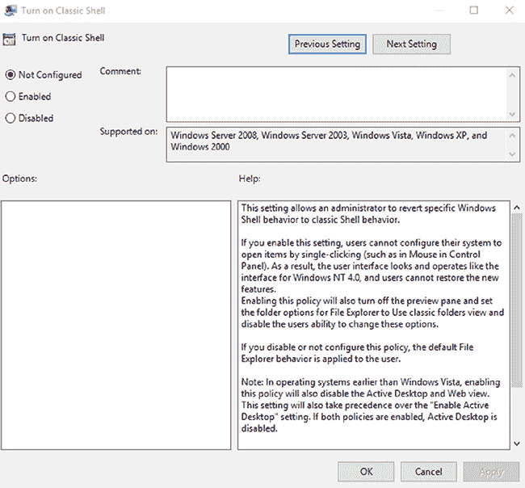

图 4.1 组策略配置设置

`Enabled`（已启用）：指定已为此 GPO 配置了项设置。某些设置需要指定值或选项。

`Disabled`（已禁用）：指定该选项对客户端计算机已禁用。注意，禁用一个选项是一种设置。也就是说，它指定系统管理员不允许某些功能。

`Not Configured`（未配置）：指定这些设置既未启用也未禁用。“未配置”是大多数设置的默认选项。它仅表示此组策略未指定选项，其他策略设置可能会优先。

可用的选项（及其影响）将取决于具体的设置。通常，您需要额外信息。例如，在设置账户锁定策略时，您必须指定在账户锁定之前允许进行多少次错误的登录尝试。基于此，让我们看看可以管理的用户和计算机设置类型。

## Windows 设置

`Windows Settings`（Windows 设置）选项允许系统管理员自定义 Windows 操作系统的行为。在此处提供的特定选项分为两种类型：用户和计算机。用户特定设置允许您配置 `Internet Explorer`（包括默认主页和其他设置）。计算机设置包括安全选项，例如 `Account Policy`（账户策略）和 `Event Log`（事件日志）选项。

## 管理模板

`Administrative templates`（管理模板）用于进一步配置用户和计算机设置。除了默认选项外，系统管理员还可以创建带有自定义选项的管理模板。

## 组策略首好

Windows Server 2016 操作系统包含了 `Group Policy preferences (GPPs)`（组策略首好），它提供了超过 20 种组策略扩展。这些扩展反过来在组策略对象中提供了广泛的可配置设置。新的组策略首好扩展中包含了文件夹选项、映射驱动器、打印机、`Registry`（注册表）、本地用户和组、计划任务、服务以及 `Start menu`（开始菜单）的设置。

除了提供更容易管理之外，组策略首好允许管理员为客户端计算机部署设置，而不会限制用户更改设置。这为管理员提供了所需的灵活性，以决定强制哪些设置以及不强制哪些设置。

图 4.2 显示了你可以用组策略配置的一些选项。

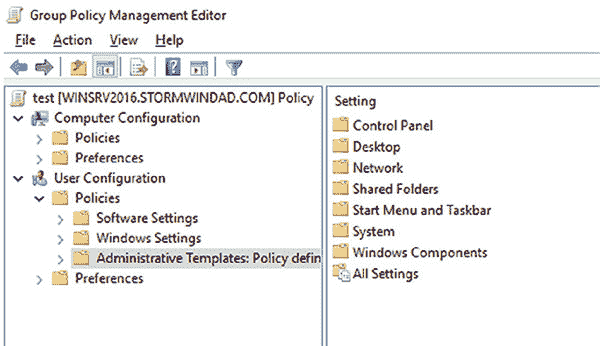

图 4.2 组策略选项

## ADMX 中央存储

GPO 设置中的另一个考虑因素是是否设置 `ADMX Central Store`。GPO 管理模板文件保存为 `ADMX (.admx)` 文件和针对支持语言的 `AMXL (.amxl)` 文件。为了充分利用管理模板，您应该创建一个 `ADMX Central Store`。

您在域控制器的 `SYSVOL` 文件夹中创建中央存储。中央存储是所有管理模板的存储，组策略工具会检查它。组策略工具随后使用在中央存储中找到任何 `ADMX` 文件。这些文件随后复制到域中的所有域控制器。

如果您希望客户端能够使用存储在 `ADMX Central Store` 中的 `ADMX` 文件来编辑基于域的 GPO，则您必须使用 `Windows Vista`、`Windows 7`、`Windows 8`、`Windows 10`、`Server 2008`、`Server 2008 R2`、`Server 2012`、`Windows Server 2012 R2` 或 `Server 2016`。

## 安全模板

`Security templates`（安全模板）用于通过 GPO 配置安全设置。可以配置的一些安全设置包括账户策略、本地策略、事件日志、限制组、系统服务和 `Registry`（注册表）。

## 启动 GPO

`Starter Group Policy objects`（启动组策略对象）允许管理员在单个对象中存储管理模板策略设置集合。管理员随后能够导入和导出启动 GPO，以便将 GPO 分发到其他环境中。当从启动 GPO 创建 GPO 时，就像任何模板一样，新的 GPO 将接收在启动 GPO 中从管理模板策略中定义的设置和值。

## GPO 的安全设置部分

GPO 最重要的部分之一是安全设置部分。Windows Settings（Windows 设置）部分下的安全设置部分允许管理员保护计算机和用户策略的许多方面。以下是安全设置部分的一些可配置选项：

### GPO 的仅限计算机部分

- 账户策略
- 本地策略
- 事件策略
- 限制组
- 系统服务
- 注册表
- 文件系统
- 有线网络
- 带高级安全的 Windows 防火墙
- 网络列表管理器策略
- 无线网络
- 网络访问保护
- 控制策略
- IP 安全策略
- 高级审核策略配置

### GPO 的计算机和用户部分

- 公钥策略
- 软件限制策略

#### 限制组

`Restricted Groups`（限制组）设置允许通过 GPO 控制组成员关系。我所指的组成员是指普通的 `Active Directory`（活动目录）组（域本地、全局和通用）。这些设置提供了两个可配置属性：`Members`（成员）和 `Members Of`（所属）。

`Members` 列表上的用户不属于限制组。`Members Of` 列表上的用户属于限制组。当您配置限制组策略时，不在 `Members` 列表中的限制组成员将被删除。在 `Members` 列表中但目前不是限制组成员的用户将被添加。

#### 软件限制策略

`Software restriction policies`（软件限制策略）允许管理员识别软件并控制其在用户本地计算机、组织单元、域或站点运行的能力。这防止了用户安装未经授权的软件。软件限制策略将在本章后面的“实施软件部署”部分进行更详细的讨论。

## 客户端扩展

在 Windows Server 中，组策略通过使用服务器端和客户端端扩展 (CSEs) 进行设计。服务器端元素包括一个用于创建每个组策略对象 (GPO) 的用户界面。当 Windows 客户端系统登录到 `Active Directory`（活动目录）网络时，客户端扩展（通常是一系列 `DLL` 文件）接收它们的 GPO，随后 GPO 对 Windows 客户端系统进行更改。

在 GPO 内部，为每个 CSE 存在一个计算机策略。这些策略通常包含最多三个选项：允许跨慢网络连接进行处理、不在周期性后台处理期间应用、即使在组策略对象未更改时也处理。

## 组策略对象

到目前为止，我讨论了组策略的设计用途。现在是时候深入研究你具体可以如何设置和配置它们了。

为了便于管理，组策略可以放置在称为 `Group Policy objects (GPOs)`（组策略对象）的项目中。GPO 是组策略文件内部设置的容器，这简化了设置的管理。例如，作为系统管理员，你可能为不同部门的用户和计算机拥有不同的策略。根据这些需求，你可以为销售部门创建一个 GPO，为工程部门创建另一个。然后你可以将这些 GPO 应用到每个部门的 OU。你需要理解的另一个重要概念是组策略设置是层次化的；也就是说，系统管理员可以在四个不同的级别应用组策略设置。这些级别决定了 GPO 的处理优先级。

### 本地

每个操作系统计算机都有一个存储在本地的组策略对象。该 GPO 同时适用于计算机和用户组策略。

### 站点

在最高级别，系统管理员可以配置 GPO 应用活动目录环境中的整个站点。这些设置适用于站点的所有域和服务器。在站点级别管理的组策略设置可能适用于同一森林内的多个域。因此，当你想要制作适用于活动目录树或森林中所有域的设置时，它们是非常用的。

### 域

域是系统管理员分配 GPO 的第三级。放置在域级别的 GPO 设置将适用于域内的所有用户和计算机对象。通常，系统管理员会在域级别进行主设置。

## 组织单元 (OUs)

GPO 最细粒度的设置级别是 OU 级别。通过为 OU 配置组策略选项，系统管理员可以利用 Active Directory 的分层结构。如果 OU 结构规划得当，你会发现很容易在 OU 级别为各个业务部门进行逻辑清晰的 GPO 分配。

根据业务需求和 Active Directory 环境的组织情况，系统管理员可能决定在以下四个级别中的任何一个级别设置组策略。由于设置默认是累积的，用户对象（User）可能会接收来自站点级（site）、域级（domain）以及其所属 OU 的策略设置。

## 组策略继承

在大多数情况下，组策略设置是累积的。例如，域级 GPO 可能指定域内所有用户都必须每 60 天更改一次密码，而 OU 级 GPO 可能会为该 OU 内的所有用户和计算机指定默认的桌面背景。在这种情况下，两种设置均生效，因此该 OU 内的用户被强制要求每 60 天更改一次密码，并使用默认桌面设置。

如果设置之间发生冲突会怎样？例如，假设你创建了这样一个场景：站点级的 GPO 指定用户使用红色壁纸，而 OU 级的 GPO 指定他们必须使用绿色壁纸。那么 OU 层的用户默认将使用绿色壁纸。虽然这只是假设的，但它提出了一个关于 `inheritance`（继承）的重要点。默认情况下，最特定级别的设置（在本例中为包含用户对象的 OU）会覆盖更通泛层级的设置。正如我的一位微软同事常说的，“后应用的胜出。”

尽管默认行为是设置是累积并继承的，但系统管理员可以修改这种行为。他们可以在 GPO 可能应用的各个层级上设置两个主要选项。

`Block Policy Inheritance`（阻止策略继承）选项指定对象的组策略设置不继承自其父对象。你可能会使用此功能，例如，当子 OU 需要与父 OU 完全不同的设置时。但请注意，你应该谨慎地管理阻止策略继承，因为此选项允许其他系统管理员覆盖在较高级别创建的设置。

`Enforced option`（有时称为 `No Override`）可以放置在父级对象上，它能确保所有低层级对象都继承这些设置。在某些情况下，系统管理员希望确保组策略继承不会在其他层级被阻止。例如，假设公司规定所有网络账户在尝试五次错误密码后都会被锁定。在这种情况下，你不希望低层级的系统管理员用其他设置覆盖该选项。

系统管理员通常在希望全局强制执行特定设置时使用此选项。例如，如果密码过期策略应适用于域内的所有用户和计算机，可以在域级创建一个启用了 `Force Policy Inheritance` 选项的 GPO。

你必须考虑最后一种情况：如果计算机设置和用户设置之间存在冲突，则以用户设置为准。例如，如果系统管理员为计算机策略应用了默认桌面设置，并为用户策略应用了不同的默认桌面设置，那么他们在用户策略中指定的那个设置将生效。这是因为用户设置更具体，并且允许系统管理员无论用户使用何种计算机，都能为单个用户进行更改。

## 规划组策略策略

通过规划组策略策略，你可以有效利用 Active Directory 的分层结构。通过组策略，你可以管理环境的各个方面。

根据业务需求和 Active Directory 环境的组织情况，系统管理员可能决定在以下四个级别中的任何一个级别设置组策略。由于设置默认是累积的，用户对象可能会接收来自站点级、域级以及其所属 OU 的策略设置。

总体目标应该是降低复杂性（例如，通过减少 GPO 的总数），同时满足用户的需求。

## 实施组策略

现在我已经涵盖了组策略的基本布局、结构及其工作原理，让我们看看如何在 Active Directory 环境中实施它们。在接下来的章节中，你将从创建 GPO 开始。

### 创建 GPO

在 Windows Server 2000 和 Windows Server 2003 中，你可以在许多位置创建 GPO。例如，你可以配合其他 GPO 工具使用 Active Directory 用户和在 OU 上创建 GPO。在 Windows 2016 中，情况变得简单了。你只能在一个位置为 OU 创建 GPO：组策略管理控制台 (`GPMC`)。为 Windows Server 2016 计算机设置策略时，你有三个应用程序可选。

`Local Computer Policy Tool`（本地组策略工具）此管理工具允许你快速访问本地计算机的组策略设置。这些选项适用于本地机器以及访问它的用户。你必须是本地管理员组的成员才能访问并更改这些设置。

管理员可能需要同时处理多个本地组策略对象 (`MLGPOs`) 的能力。要做到这一点，你需要完成以下步骤。（你不能在域控制器上配置 MLGPOs。）

1. 在运行框中输入 `MMC` 并打开 MMC。
2. 点击“文件”，然后选择“添加/删除正向程序”。
3. 从可用正向程序列表中选择“组策略编辑器”并点击“添加”。
4. 在“选择组策略对象”对话框中，点击“浏览”按钮。
5. 在“浏览组策略对象”对话框中点击“用户”选项卡。
6. 选择你想要创建或编辑本地组策略的用户或组，并点击“确定”。
7. 点击“完成”，然后点击“确定”。
8. 配置多个策略设置。

### 组策略管理控制

你必须使用 `GPMC` 来管理组策略部署。`GPMC` 为管理所有与组策略相关的任务提供了单一解决方案，它也最适合处理企业级任务，例如与森林相关的工作。

`GPMC` 允许管理员从一个易于使用的控制台管理组策略和 GPO，无论其企业解决方案是跨越一个或多个森林中的多个域和站点，还是本地于单个站点的。`GPMC` 增加了灵活性、可管理性和功能。使用此控制台，你还可以执行其他功能，如备份和恢复、导入和复制。

### `Auditpol.exe`

`Auditpol.exe` 是一个命令行实用程序，适用于 Windows Vista、Windows 7、Windows 8、Windows 10、Windows Server 2008、Windows Server 2008 R2、Windows Server 2012、Windows Server 2012 R2 以及 Windows Server 2016。管理员有能力显示策略信息，还可以执行某些功能来操纵审核策略。表 4.1 显示了部分 `auditpol.exe` 可用的开关。

TABLE 4.1 Auditpol.exe 开关

| 开关 | 说明 |
| --- | --- |
| `/?` | 这是 `Auditpol.exe` 的帮助命令。 |
| `/get` | 允许你显示当前的审核策略。 |
| `/set` | 允许你设置策略。 |
| `/list` | 显示可选的策略元素。 |
| `/backup` | 允许你将审核策略保存到文件中。 |
| `/restore` | 从之前的备份恢复策略。 |
| `/clear` | 清除审核策略。 |
| `/remove` | 移除所有每个用户的审核策略设置并禁用所有系统审核策略设置。 |
| `/ResourceSACL` | 配置全局资源 SACL。 |

练习 4.1 将引导你完成安装组策略管理 MMC 单元插程序的过程，以便用于编辑组策略设置和创建 GPO。

### 将现有的 GPO 链接到 Active Directory

创建 GPO 是分配组策略的第一步。第二步是将 GPO 链接到特定的 Active Directory 对象。如本章前面的所述，GPO 可以链接到站点、域和 OU。

练习 4.2 将引导你完成将现有 GPO 分配到本地域内 OU 必须采取的步骤。在此练习中，你将把 `Test Domain Policy` GPO 链接到一个 OU。要完成此练习中的步骤，你必须已完成练习 4.1。

注意，`GPMC` 工具在分配 GPO 时提供了很大的灵活性。你可以在此界面内创建新的 GPO、添加多个 GPO、直接编辑它们、更改优先级设置、删除链接并删除 GPO。通常情况下，使用 `GPMC` 工具创建新的 GPO 是创建你所需设置的最快、最简单的方法。

要测试组策略设置，你只需在练习 4.2 中使用的 `Africa OU` 内创建一个用户账户。然后，使用另一台属于同一域的计算机，你可以以新创建的用户身份登录。

### 强制更新 GPO

在某些情况下，你可能需要 GPO 立即被处理。如果你正在测试 GPO，你可能不想等待 GPO 按其自己的时间进行处理，或者你可能不想为了让 GPO 处理而注销域并重新登录域。

Windows Server 2016 更改了 GPO 的处理方式。在 Windows Server 2016 域中，当用户登录域时，最新版本的组策略将从域控制器下载。


Windows Server 2016 更改了 GPO 的处理方式。在 Windows Server 2016 域中，当用户登录域时，最新版本的组策略将从域控制器下载。

Windows Server 2016 更改了 GPO 的处理方式。在 Windows Server 2016 域中，当用户登录域时，最新版本的组策略将从域控制器下载。

Windows Server 2016 更改了 GPO 的处理方式。在 Windows Server 2016 域中，当用户登录域时，最新版本的组策略将从域控制器下载。

Windows Server 2016 更改了 GPO 的处理方式。在 Windows Server 2016 域中，当用户登录域时，最新版本的组策略将从域控制器下载。

Windows Server 2016 更改了 GPO 的处理方式。在 Windows Server 2016 域中，当用户登录域时，最新版本的组策略将从域控制器下载。

Windows Server 2016 更改了 GPO 的处理方式。在 Windows Server 2016 域中，当用户登录域时，最新版本的组策略将从域控制器下载。

Windows Server 2016 更改了 GPO 的处理方式。在 Windows Server 2016 域中，当用户登录域时，最新版本的组策略将从域控制器下载。

Windows Server 2016 更改了 GPO 的处理方式。在 Windows Server 2016 域中，当用户登录域时，最新版本的组策略将从域控制器下载。

Windows Server 2016 更改了 GPO 的处理方式。在 Windows Server 2016 域中，当用户登录域时，最新版本的组策略将从域控制器下载。

Windows Server 2016 更改了 GPO 的处理方式。在 Windows Server 2016 域中，当用户登录域时，最新版本的组策略将从域控制器下载。

Windows Server 2016 更改了 GPO 的处理方式。在 Windows Server 2016 域中，当用户登录域时，最新版本的组策略将从域控制器下载。

Windows Server 2016 更改了 GPO 的处理方式。在 Windows Server 2016 域中，当用户登录域时，最新版本的组策略将从域控制器下载。

Windows Server 2016 更改了 GPO 的处理方式。在 Windows Server 2016 域中，当用户登录域时，最新版本的组策略将从域控制器下载。

Windows Server 2016 更改了 GPO 的处理方式。在 Windows Server 2016 域中，当用户登录域时，最新版本的组策略将从域控制器下载。

Windows Server 2016 更改了 GPO 的处理方式。在 Windows Server 2016 域中，当用户登录域时，最新版本的组策略将从域控制器下载。

Windows Server 2016 更改了 GPO 的处理方式。在 Windows Server 2016 域中，当用户登录域时，最新版本的组策略将从域控制器下载。

Windows Server 2016 更改了 GPO 的处理方式。在 Windows Server 2016 域中，当用户登录域时，最新版本的组策略将从域控制器下载。

Windows Server 2016 更改了 GPO 的处理方式。在 Windows Server 2016 域中，当用户登录域时，最新版本的组策略将从域控制器下载。

Windows Server 2016 更改了 GPO 的处理方式。在 Windows Server 2016 域中，当用户登录域时，最新版本的组策略将从域控制器下载。

Windows Server 2016 更改了 GPO 的处理方式。在 Windows Server 2016 域中，当用户登录域时，最新版本的组策略将从域控制器下载。

Windows Server 2016 更改了 GPO 的处理方式。在 Windows Server 2016 域中，当用户登录域时，最新版本的组策略将从域控制器下载。

Windows Server 2016 更改了 GPO 的处理方式。在 Windows Server 2016 域中，当用户登录域时，最新版本的组策略将从域控制器下载。

Windows Server 2016 更改了 GPO 的处理方式。在 Windows Server 2016 域中，当用户登录域时，最新版本的组策略将从域控制器下载。

Windows Server 2016 更改了 GPO 的处理方式。在 Windows Server 2016 域中，当用户登录域时，最新版本的组策略将从域控制器下载。

Windows Server 2016 更改了 GPO 的处理方式。在 Windows Server 2016 域中，当用户登录域时，最新版本的组策略将从域控制器下载。

Windows Server 2016 更改了 GPO 的处理方式。在 Windows Server 2016 域中，当用户登录域时，最新版本的组策略将从域控制器下载。

Windows Server 2016 更改了 GPO 的处理方式。在 Windows Server 2016 域中，当用户登录域时，最新版本的组策略将从域控制器下载。

Windows Server 2016 更改了 GPO 的处理方式。在 Windows Server 2016 域中，当用户登录域时，最新版本的组策略将从域控制器下载。

Windows Server 2016 更改了 GPO 的处理方式。在 Windows Server 2016 域中，当用户登录域时，最新版本的组策略将从域控制器下载。

Windows Server 2016 更改了 GPO 的处理方式。在 Windows Server 2016 域中，当用户登录域时，最新版本的组策略将从域控制器下载。

Windows Server 2016 更改了 GPO 的处理方式。在 Windows Server 2016 域中，当用户登录域时，最新版本的组策略将从域控制器下载。

Windows Server 2016 更改了 GPO 的处理方式。在 Windows Server 2016 域中，当用户登录域时，最新版本的组策略将从域控制器下载。

Windows Server 2016 更改了 GPO 的处理方式。在 Windows Server 2016 域中，当用户登录域时，最新版本的组策略将从域控制器下载。

Windows Server 2016 更改了 GPO 的处理方式。在 Windows Server 2016 域中，当用户登录域时，最新版本的组策略将从域控制器下载。

Windows Server 2016 更改了 GPO 的处理方式。在 Windows Server 2016 域中，当用户登录域时，最新版本的组策略将从域控制器下载。

Windows Server 2016 更改了 GPO 的处理方式。在 Windows Server 2016 域中，当用户登录域时，最新版本的组策略将从域控制器下载。

Windows Server 2016 更改了 GPO 的处理方式。在 Windows Server 2016 域中，当用户登录域时，最新版本的组策略将从域控制器下载。

Windows Server 2016 更改了 GPO 的处理方式。在 Windows Server 2016 域中，当用户登录域时，最新版本的组策略将从域控制器下载。

Windows Server 2016 更改了 GPO 的处理方式。在 Windows Server 2016 域中，当用户登录域时，最新版本的组策略将从域控制器下载。

### 强制更新 GPO

在某些时候，你可能需要 GPO 立即被处理。如果你正在测试 GPO，你可能不想等待 GPO 按其自己的时间进行处理，或者你可能不想为了让 GPO 处理而注销域并重新登录域。

Windows Server 2016 更改了 GPO 的处理方式。在 Windows Server 2016 域中，当用户登录域时，最新版本的组策略将从域控制器下载。

如果你将 GPO 设置为同步模式，下次计算机重启时，它将使用最近下载的组策略。这是 Windows Server 2016 的新功能，它让组策略不需要从域下载。

现在，既然你已经了解了 GPO 是如何处理的，让我们看看几种在 Windows Server 2016 中强制执行 GPO 的方法。

#### 从服务器强制 GPO

Windows Server 2016 有一个名为组策略管理控制台（`GPMC`）的 MMC。通过使用此 MMC，你可以远程刷新组织单元（`OU`）并应用于该 OU 的所有设置和 GPO。在 OU 右键菜单中，你可以选择远程刷新 OU 以及关联到 OU 的 GPO。当你远程刷新 OU 时，会发生以下步骤：

1. Windows Server 2016 执行 Active Directory 查询，该查询返回属于 OU 的所有用户计算机。
2. Windows 管理规范（`WMI`）查询当前登录域的用户和计算机，并创建一个将要使用的列表。
3. 使用步骤 2 创建的列表，创建一个远程计划任务，并在所有用户和计算机上执行 `GPUpdate.exe /force`。该计划任务将在延迟 10 分钟后执行。

另一种立即强制 GPO 更新的方法是使用 PowerShell。通过 PowerShell 命令 `Invoke-GPUpdate`，你不仅可以强制执行 GPO，还可以设置更细粒度的参数。

#### 从客户端强制 GPO

作为管理员，你也有能力在你可能操作的客户端上强制执行 GPO。`GPUpdate.exe` 命令允许你在客户端上运行 GPO。表 4.2 显示了部分 GPUpdate 开关。

**TABLE 4.2 GPUpdate.exe 开关**

| 开关 | 说明 |
| --- | --- |
| `/target:{Computer \| User}` | 仅更新指定计算机或用户的策略设置。 |
| `/force` | 强制重新应用所有策略设置。默认情况下，仅应用更改的策略设置。 |
| `/wait: <VALUE>` | 确定系统在处理策略后返回到命令行提示符之前等待的秒数。 |
| `/logoff` | 组策略设置更新后，域用户将自动注销计算机。 |
| `/boot` | 应用组策略设置后，计算机将自动重启。 |
| `/sync` | 此开关强制下一次可用的前台策略应用同步进行。前台策略在计算机启动和用户登录时应用。 |
| `/?` | 在命令行提示符处显示帮助。 |

`GPOs` 的优点之一是它们是模块化的，可以应用于活动目录（Active Directory）中的许多不同对象和级别。如果管理不当，这也可以成为 `GPOs` 的缺点之一。与使用 `GPOs` 相关的常用管理功能是查找这些每个对象的所有活动目录链接。你可以在 `GPMC`（见图 4.3）中查看站点、域或 OU 的“链接组策略对象”（Linked Group Policy Objects）选项卡时执行此操作。

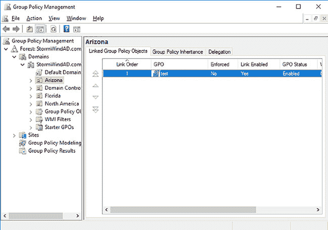

**FIGURE 4.3 查看指向 Active Directory OU 的 GPO 链接**

除了 OU 上委派权限这一常用操作外，你还可以设置关于修改 `GPOs` 的权限。实现此点的最佳方法是将用户添加到“组策略创建者/所有者”（Group Policy Creator/Owners）内置安全组。此组的成员能够修改安全策略。

## Windows 管理体系规范

`Windows Management Instrumentation (WMI)` 脚本用于收集信息或帮助 `GPOs` 更好地部署。解释这一点的最佳方法是举个例子。假设你想为公司内的所有人部署 Microsoft Office 2016。你首先会设置一个 `GPO` 来部署 Office 软件包（在节节后的“通过 GPO 部署软件”部分中详细说明）。

然后你可以在 `GPO` 上放置一个 `WMI` 脚本，规定只有具有 10 GB 硬盘空间的计算机才会部署 Office。现在，如果计算机有 10 GB 的可用空间，就会安装 Office `GPO`。如果计算机没有 10 GB 的硬盘空间，则 `GPO` 将不会部署。你可以使用 `WMI` 脚本检查 MAC 地址等计算机信息。`WMI` 是一个强大的工具，因为如果你知道如何编写脚本，可能性是无限的。以下脚本是一个 `WMI` 脚本示例，用于检查 `C:` 分区/卷上至少有 10 GB 的可用空间：

```sql
Select * from Win32_LogicalDisk where FreeSpace > 10737418240 AND Caption = "C:"
```

## 组策略的安全筛选

保护 `GPOs` 访问的另一种方法是对 `GPOs` 本设置权限。你可以通过打开 `GPMC`、选择 `GPO` 并点击“委派”（Delegation）选项卡中的“高级”按钮来实现。将出现“未链接测试 GPO 安全设置”（Unlinked Test GPO Security Settings）对话框（见图 4.4）。

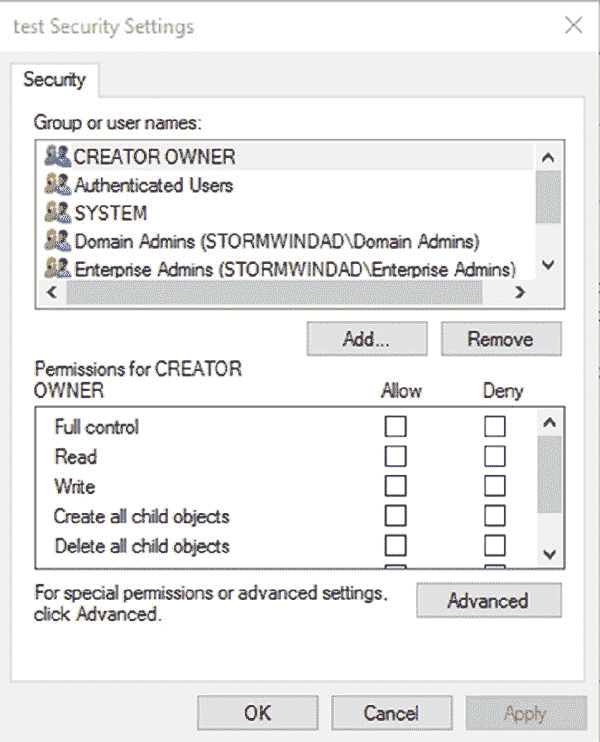

**FIGURE 4.4 GPO 的安全设置对话框**

可用权限选项：

- 完全控制
- 读取
- 写入
- 创建所有子对象
- 删除所有子对象
- 应用组策略

你可能需要滚动“权限”窗口才能看到“应用组策略”项。在这些选项中，“应用组策略”设置尤为重要，因为你用它来过滤 `GPO` 的范围。`筛选`（Filtering）是将选定的安全组包含或排除在 `GPOs` 影响之外的过程。要指定设置应应用于 `GPO`，你应该同时为“应用组策略”设置和“读取”设置勾选“允许”复选框。只有当安全组也包含在与 `GPO` 链接的站点、域或 OU 中，这些设置才会被应用。要禁用某组对 `GPO` 的访问，请在这两个设置中都选择“拒绝”。最后，如果你不想指定“允许”或“拒绝”，请将两个框留空。这实际上等同于没有设置。

在练习 4.3 中，你将使用安全组对组策略进行筛选。要完成此练习中的步骤，你必须已完成练习 4.1 和 4.2。

## 委派 GPOs 的管理控制

到目前为止，你已经学习了如何使用组策略来管理用户和计算机设置。你还没有做的是确定谁可以修改 `GPOs`。为 `GPOs` 本身建立适当的安全性是非常重要的，原因有两点：

- 如果安全设置得不当，用户和系统管理员可以轻易覆盖它们。这违背了最初设置 `GPOs` 的初衷。
- 让许多不同的系统管理员创建和修改 `GPOs` 可能会变得极其难以管理。当出现问题时，GPO 继承的层次结构可能导致难以确定问题所在。

幸运的是，通过委派，确定 `GPOs` 的安全权限是一项简单的任务。练习 4.4 将引导你完成必须采取的步骤，向用户账户授予适当的权限。具体而言，该过程涉及委派管理活动目录对象（如 OU）上的组策略链接的能力。要完成此练习，你必须已完成练习 4.1 和 4.2。

## 控制继承和筛选组策略

在管理 `GPOs` 时，控制继承是一个重要功能。在本章的早些部分，你已经学到，默认情况下，GPO 设置从高层活动目录对象流向低层对象。例如，用户生效的组策略设置集可能是基于在站点级别、域级别和 OU 层级中分配的 `GPOs`。

但在某些情况下，你可能希望阻止组策略继承。你可以通过选择链接了 GPO 的对象轻松实现这一点。通过启用此选项，你实际上是指定该对象从空白开始；没有其他组策略设置将应用于该对象。

系统管理员还可以强制继承。通过设置“强制”选项，可以阻止其他系统管理员对策略进行更改。你可以通过右键点击 GPO 并选择“强制”项来设置该选项（见图 4.5）。

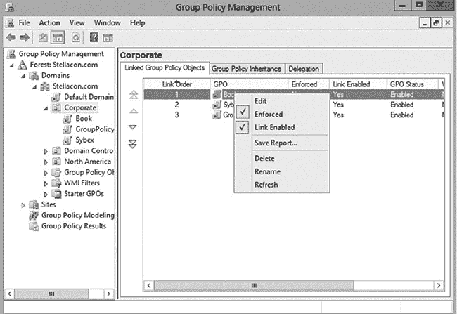

**FIGURE 4.5 设置强制选项**

### 分配脚本策略

系统管理员可能希望在启动或用户登录时进行某些更改并实施某些设置。登录脚本执行的最常见操作可能是映射网络驱动器。虽然用户可以手动映射驱动器，但在登录脚本中提供此功能可以确保映射的一致性，并且用户只需要记住资源的驱动器号。

`脚本策略`是组策略设置中的特定选项。这些设置引导操作系统在启动/关闭或登录/注销过程中处理特定的文件。你可以使用 `Windows Script Host (WSH)` 或标准批处理命令创建脚本。WSH 允许开发者和系统管理员使用 Visual Basic Script 版（VBScript）或 JScript（微软对 JavaScript 的实现）快速方便地创建脚本。此外，WSH 还可以扩展以适应其他常见的脚本语言。

要设置脚本策略选项，只需编辑组策略设置。如图 4.6 所示，设置脚本策略有两个主要区域：

- **启动/关闭脚本**：这些设置位于“计算机配置 ➔ Windows 设置 ➔ 脚本（启动/关闭）”对象。
- **登录/注销脚本**：这些设置位于“用户配置 ➔ Windows 设置 ➔ 脚本（登录/注销）”对象。

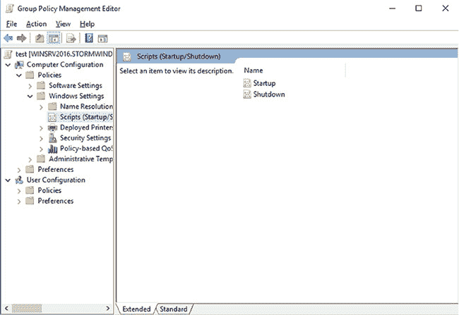

**FIGURE 4.6 查看启动/关闭脚本策略设置**


要分配脚本，只需双击设置即可出现`Properties`（属性）对话框。例如，如果双击`Startup`（启动）设置，将出现`Startup Properties`（启动属性）对话框（参见图 4.7）。要添加脚本文件名，点击`Add`按钮。点击后，系统会要求你提供脚本文件的名称（例如`MapNetworkDrives.vbs`或`ResetEnvironment.bat`）。

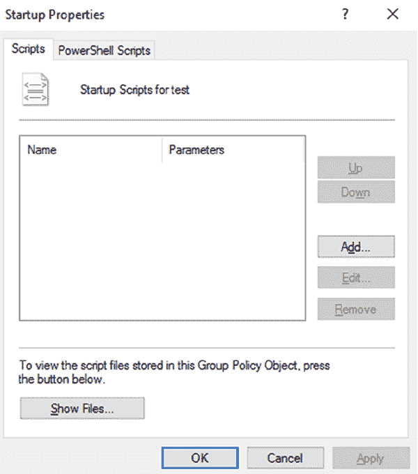

`图 4.7` 设置脚本选项

请注意，你可以使用`Up`和`Down`按钮来更改脚本的运行顺序。`Show Files`按钮会打开你理应该存储登录脚本文件的目录文件夹。为了确保文件复制到所有域控制器，你应该确保将文件放置在`SYSVOL`共享中。

### 理解环回策略

有时，组策略对象（GPO）的用户设置应该根据计算机的位置而不是用户对象来应用于计算机。通常情况下，用户组策略处理规定 GPO 应在计算机启动期间，根据计算机所在的组织单元（OU）按顺序应用。另一方面，用户 GPO 则在登录期间按顺序应用，无论其登录到哪台计算机。

在某些情况下，这种处理顺序可能并不恰当。一个很好的例子是自助机（kiosk machine）。你不希望分配或发布给用户的应用程序在用户登录到自助机时被安装。`Loopback Policy`（环回策略）允许通过两种方式，当用户使用 OU 中的特定计算机时，获取任何用户的 GPO 列表。

**合并模式（Merge Mode）**：计算机的 GPO 被添加到用户 GPO 的末尾。由于此原因，计算机的 GPO 优先级高于用户的 GPO。

**替换模式（Replace Mode）**：在替换模式下，不使用用户的 GPO。仅使用计算机对象的 GPO。

### 管理网络配置

组策略在网络配置方面也很有用。尽管管理员可以使用许多不同的方法（如动态主机配置协议 DHCP）在协议级别处理网络设置，但组策略允许他们设置用户和计算机可以使用哪些功能和操作。

图 4.8 显示了用于管理组策略设置的一些可用功能。这些设置的路径如下：

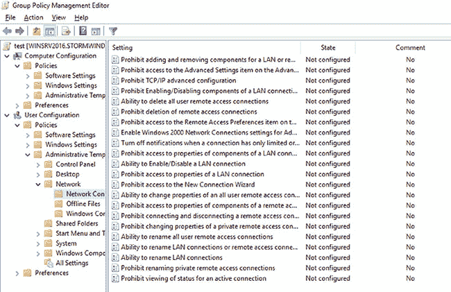

`图 4.8` 查看组策略用户网络配置选项

**计算机网络选项（Computer Network Options）**：这些设置位于`Computer Configuration ➢ Administrative Templates ➢ Network ➢ Network Connections`文件夹内。

**用户网络选项（User Network Options）**：这些设置位于`User Configuration ➢ Administrative Templates ➢ Network`中。

以下是可用设置类型的一些示例：

* 允许或禁止修改网络设置的能力。
* 在许多环境中，不当更改网络配置和协议设置是导致帮助台电话的常见原因。
* 允许或禁止创建远程访问服务（RAS）连接的能力。
* 此选项非常有用，特别是在较大的网络环境中，因为调制解调器和其他 WAN 设备的使用可能会对网络造成安全威胁。
* 设置离线文件和文件夹选项的能力。
* 这对于保持出差用户的文件的同步特别有用，通常为笔记本电脑进行配置。

每个设置在 GPO 编辑器窗口的描述区域都包含详细说明。通过使用这些配置选项，系统管理员可以维护用户和计算机的一致性，并避免许多常见的故障排除电话。

### 配置网络设置

在 Windows Server 2016 中，你可以使用 GPO 设置许多用户和网络设置。可以配置的某些设置包括：配置打印机首好、定义网络驱动器映射、配置电源选项、设置自定义注册表设置、操作控制面板设置、配置 Internet Explorer 设置、文件和文件夹部署、设置快捷方式部署以及配置项目级目标。

要配置这些任何设置，请打开组策略管理控制并选择你想要编辑的 GPO。一旦开始编辑，你就可以配置这些网络设置。

### 在组策略中自动注册用户和计算机证书

你还可以使用组策略自动注册用户和计算机证书，使整个证书过程对终端用户是透明的。在继续之前，你应该了解什么是证书以及为什么它们是网络安全的重要部分。

将数字证书想象成公钥的容器。证书包含公钥和一组属性，包括持有者的姓名和电子邮件地址。这些属性指定了关于持有者的某些信息：他们的身份、他们被允许使用证书做什么等。属性和公钥结合在一起，是因为证书是由发行它的实体进行数字签名的。任何想要验证证书内容的人都可以验证发行者的签名。

证书是安全专家所说的`public-key infrastructure (PKI)`的一部分。PKI 有几个不同的组件，你可以对它们进行组合以实现所需的结果。微软的 PKI 实现提供了以下功能：

**证书机构 (CA)**：发行证书、吊销已颁发的证书并为客户端发布证书。像 Thawte 和 VeriSign 这样的大 CA 为数百万用户提供此类服务。如果你需要，还可以为组织中的每个部门或工作组设置自己的`CA`。每个`CA`负责决定在证书中包含哪些属性，以及在发行证书之前使用什么机制来验证这些属性。

**证书发布者（Certificate Publishers）**：它们在组织内部或外部公开证书。这使得支持整个 PKI 所需的关键材料可用。

**精通 PKI 的应用程序（PKI-Savvy Applications）**：这些允许你和用户使用证书执行有用操作，例如加密电子邮件或网络连接。理想情况下，用户不需要知道（甚至感知）应用程序正在做什么——一切都应该无缝且自动地运行。最著名的精通 PKI 的应用程序示例是 Internet Explorer 和 Firefox 等网络浏览器，以及 Outlook 等电子邮件应用程序。

**证书模板（Certificate Templates）**：它们的作用像印章。通过指定一个特定模板作为新颁发证书的模型，你实际上是在告诉`CA`向证书中添加哪些可选属性，并隐式地告诉它如何填充某些强制性属性。模板极大地简化了发行证书的过程，因为它们让你不再需要记忆可能想要放入证书中的所有属性的名称。

在练习 4.5 中，你将学习如何在组策略中配置自动证书注册。在进行练习 4.5 之前，你必须先完成本章中的其他练习。

### 重定向文件夹

你将学习的另一组组策略设置是`文件夹重定向设置`。组策略提供了将文档、桌面和开始菜单文件夹以及缓存应用程序数据重定向到网络位置的方法。文件夹重定向对于以下原因特别有用：

* 当使用漫游用户配置文件时，用户每次登录时，其`Documents`文件夹都会被复制到本地计算机。如果`Documents`文件夹很大，这将消耗大量的带宽和时间。如果你重定向了`Documents`文件夹，它将保持在重定向后的位置，用户可以直接在该位置上打开并保存文件。
* 无论用户在何处登录，`Documents`始终是可用的。
* 共享位置中的数据可以在正常备份周期进行备份，而无需用户干预。
* 数据可以重定向到更健壮的由服务器端管理的磁盘上，该磁盘较不容易受到物理或人为错误的影响。

当你决定重定向文件夹时，有两种选项：基础和高级。

* 基础重定向将所有人的文件夹都重定向到相同的位置（但每个用户在该位置内都有自己的文件夹）。
* 高级重定向根据组组组成情况将文件夹重定向到不同的位置。例如，你可以配置`Engineers`组将其文件夹重定向到`//Engineering1/Documents/`，并将`Marketing`组重定向到`//Marketing1/Documents/`。同样，单个用户在重定向后的位置内仍会有自己的文件夹。

要配置文件夹重定向，请按照练习 4.6 中的步骤操作。你必须完成本章中的其他练习才能进行此练习。

### 使用 Windows PowerShell 组策略小命令管理 GPOs

如本书前面介绍的，`Windows PowerShell`是一种 Windows 命令行壳和脚本语言。`Windows PowerShell`还可以帮助管理员自动化许多你使用组策略管理控制台（GPMC）执行的相同任务。

`Windows Server 2016`通过提供超过 25 个`cmdlets`来帮助你执行许多组策略任务。每个`cmdlet`都是一个简单的、单功能的命令行工具。

`Windows PowerShell`组策略`cmdlets`可以帮助你对基于域的组策略对象执行某些任务：

* 维护、创建、删除、备份和导入`GPOs`
* 创建、更新和删除指向 Active Directory 容器的`GPO`链接
* 设置 Active Directory`OUs`域权限和继承标志位
* 配置组策略注册表设置
* 创建和编辑启动项`GPOs`

`Windows PowerShell`组策略`cmdlets`的要求是在域控制器或安装了`GPMC`的成员服务器上运行`Windows Server 2016`。`Windows 7`、`Windows 8`和`Windows 10`在安装了远程服务器管理工具 (`RSAT`) 的情况下也具有使用`Windows PowerShell`组策略`cmdlets`的。`RSAT`包含`GPMC`及其`cmdlets`。PowerShell 也是必要条件。

### 项目级目标

管理员可以使用名为“项目级目标”的 GPO 功能，将单个偏好项仅应用于选定的用户或计算机。项目级目标允许管理员选择`GPO`将查看的特定项目，然后将该`GPO`应用于特定的用户或计算机。管理员具有包含多个偏好项的能力，并且每个项目都可以为特定的用户或计算机进行自定义。

目标项目有一个属于它自己的值，该值可以是真也可以是假。管理员在构建此`GPO`时，通过使用`AND`或`OR`操作命令可以获得更细粒度的控制，这允许管理员将目标目标项目与前一个项目结合起来。一旦所有条件执行完毕，如果最终结果为假，则不应用该`GPO`。如果最终结果为真，则将`GPO`应用于之前确定的用户或计算机。

目标项目有一个属于它自己的值，该值可以是真也可以是假。管理员在构建此`GPO`时，通过使用`AND`或`OR`操作命令可以获得更细粒度的控制，这允许管理员将目标目标项目与前一个项目结合起来。一旦所有条件执行完毕，如果最终结果为假，则不应用该`GPO`。如果最终结果为真，则将`GPO`应用于之前确定的用户或计算机。

* 电池目标
* 计算机目标
* 日期目标
* 磁盘目标
* 域目标
* 环境目标
* LDAP 目标
* MAC 地址目标
* MSI 目标
* 网络目标
* 语言目标
* 操作系统目标
* PC 目标
* 便携式目标
* 处理目标
* 处理目标
* RAM 目标
* 注册表目标
* 安全目标
* 站点目标
* 会话目标
* 终端目标
* 时间目标
* 用户目标
* WMI 目标

要配置文件夹重定向，请按照练习 4.6 中的步骤：

1. 打开组策略管理控制台。
2. 在控制树中，右键点击“组策略对象”并选择“编辑”。
3. 双击 GPO，然后点击“偏好”。
4. 在属性对话框中，点击“常用”。
5. 选择“项目级目标”并点击“确定”。
6. 在选项菜单中，点击“新建”。
7. 如果你有多个项目，在属性对话框中点击“确定”。
8. 点击“确定”，你就设置好了。

### 备份、恢复、导入、复制和迁移表

使用 GPMC 的最大优势之一是它是一站式的。`GPMC`不仅允许你创建和链接`GPO`，还允许你备份、恢复、导入和使用迁移表。

#### 备份 GPO

由于本书是关于`Windows Server 2016`的，通过关于`Windows Server 2016`以及如何正确设置服务器的内容，你可能已经理解备份能为你做什么。管理员备份数据是为了发生崩溃或需要重新加载数据的重大错误。应该每天对组织的所有重要数据进行备份。备份既可以使用`Windows Server 2016`的备份工具进行，也可以购买第三方软件/硬件来备份数据。

我是 IT 总监，数据恢复性是我每天处理的关键项目之一。我使用来自`Unitrends`公司的第三方硬件设备。该设备对我所有的服务器进行每小时备份。`Unitrends`设备的一个很好的功能是将备份到硬件设备，然后将其发送到云端进行异地备份。这样，如果我需要恢复某一个数据，可以从硬件设备中获取。但如果发生了重大问题，例如火毁了整个服务器房，我有异地备份可以检索数据。

对于`GPOs`也是如此。你需要确保备份了`GPOs`，以防出现需要重新加载的问题。要手动备份`GPOs`，你可以进入`GPMC` `MMC`，在“组策略对象”下，右键点击并选择“备份所有”，或右键点击特定的`GPO`并选择“备份”。

#### 恢复 GPO

你可能需要恢复以前备份过的`GPO`。通常有两个需要恢复`GPO`的原因——你不小心删除了`GPO`，或者你需要将`GPO`恢复到之前的状态（这通常发生在你做了更改并导致问题时）。恢复`GPO`非常简单。

1. 打开组策略管理控制台。
2. 在控制树中，右键点击“组策略对象”并选择“管理备份”。
3. 选择要恢复的备份并点击“恢复”按钮。

#### 导入或复制 GPOs

作为管理员，有时可能需要将一个`GPO`从一个域导入或复制到另一个域。管理员这样做是为了让第二个域拥有与第一个相同的设置。

管理员可以将一个`GPO`的导入或复制-传输设置应用到同一域内的另一个`GPO`、同一森林（forest）中另一个域的`GPO`，或者应用到不同森林（forest）中某个域的`GPO`中。

导入或复制`GPO`是一个非常简单的过程。要执行此操作，管理员需要完成以下步骤：

1. 打开`Group Policy Management Console`（组策略管理控制）。
2. 在控制台树中，右键点击`Group Policy Objects`（组策略对象），并选择`Import Settings`（导入设置）或`Copy`（复制）。

### 迁移表

我们在复制或移动`GPO`时遇到的一个一次性问题是：某些`GPO`在创建时是特定于域的。当它们移动到另一个域的系统时，这可能会成为问题。这时迁移表就能派上用场。

`Migration tables`（迁移表）会告诉您，当`GPO`从其创建的域移动到另一个域时，如何处理特定域的设置。

迁移表是文件，用于将之前的域信息（如用户和组）映射到新域的特定对象数据。迁移表包含映射条目，将旧数据映射到新数据。

迁移表以 XML 格式存储其映射数据，并且迁移表有自己的扩展名`.migtable`。如果您想创建自己的迁移表，可以使用`Migration Table Editor (MTE)`（迁移表编辑器）。`MTE`是一个易于使用的程序，用于配置或仅查看迁移表。

无论您决定复制还是导入`GPO`都没有影响，迁移表都适用于`GPO`内的任何设置。但是，如果您是复制`GPO`而不是移动它，可以选择在复制时同时带入`Discretionary Access Control List (DACL)`（判别访问控制列表）选项。

如果您考虑使用迁移表，可以使用以下三个设置：

* `Do Not Use A Migration Table`（不使用迁移表）：如果管理员选择此选项，`GPO`将按原复制。所有安全对象和 UNC 路径都将完整复制，不进行任何修改。
* `Use A Migration Table`（使用迁移表）：如果管理员选择此选项，`GPO`中所有可以在迁移表中映射的选项将被映射。
* `Use A Migration Table Exclusively`（专门使用迁移表）：如果管理员选择此选项，`GPO`中的所有安全主体 UNC 路径信息将被选中。如果迁移表中未包含这些信息的任何部分，操作将失败。

要打开`Migration Table Editor`（迁移表编辑器），请执行以下步骤：

1. 打开`Group Policy Management Console`。
2. 在控制台树中，右键点击`Group Policy Objects`，并选择`Open Migration Table Editor`。

### 重置默认 GPO

有时您可能需要将默认`GPO`重置为原始设置。只要您了解如何使用`DCGPOFix`命令行工具，这很容易做到。该命令行工具顾名其实——它用于修复域控制器的`GPO`。要使用此命令，您将使用以下语法：

```
DCGPOFix [/ignoreschema] [/target: {Domain | DC | Both}] [/?]
```

现在，让我们来看上一个命令中的开关。`/ignoreschema`、`/target: {Domain | DC | Both}`和`/?`开关。

### 通过组策略部署软件

有时您可能需要将默认`GPO`重置为原始设置。只要您了解如何使用`DCGPOFix`命令行工具，这很容易做到。该命令行工具顾名其实——它用于修复域控制器的`GPO`。要使用此命令，您将使用以下语法：

```
DCGPOFix [/ignoreschema] [/target: {Domain | DC | Both}] [/?]
```

现在，让我们来看上一个命令中的开关。`/ignoreschema`、`/target: {Domain | DC | Both}`和`/?`开关。

### 软件管理周期

尽管使用新应用程序似乎只需要安装软件，但管理应用程序的整体涉及许多步骤。在管理软件时，其生命周期有三个主要阶段：

#### 1. 部署软件

使用应用程序的第一步是在客户端计算机上安装它们。通常，某些应用程序在 PC 的初始配置期间部署，另一些则在接到请求时部署。在后一种情况下，这通常意味着系统管理员访问客户端计算机并手动引导安装过程。

#### 2. 维护软件


一旦应用程序在客户端计算机上安装并使用，您就需要确保对软件进行维护。您必须通过应用由于错误修复、增强和其他类型的更新而产生的更改，来保持程序更新。这通常通过服务包、热补丁和更新完成。

### 移除软件

许多软件产品生命周期的终点涉及实际移除未使用的程序。当应用程序过时或用户不再需要其功能时，移除软件是必要的。

`Microsoft Windows 安装程序 (MSI)` 管理软件维护生命周期中的这三个阶段每一个。现在您已经对该流程有了整体了解，让我们继续查看使用组策略部署软件涉及的步骤。

如果你安装了较新的应用程序（例如 `Microsoft Office 2016`），你可能已经注意到了更新后的设置和安装程序。符合更新标准的应用程序使用 `Windows Installer specification` 和 `MSI` 软件包进行部署。每个包都包含了有关各种设置选项和安装所需文件的信息。尽管这些益处在表面上看起来可能并不显著，但在底层却包含许多新功能。

`Windows Installer` 的创建是为了解决与传统应用程序开发相关的许多问题。它包含多个组件，包括安装程序服务（运行在 `Windows 2000`、`XP`、`Vista`、`Windows 7`、`Windows 8`、`Windows 10`、`Windows Server 2003`、`Windows Server 2008`、`Windows Server 2008 R2`、`Windows Server 2012`、`Windows Server 2012 R2` 以及 `Windows Server 2016` 电脑上）、安装程序（`msiexec.exe`，该程序负责执行 `Windows Installer package` 中的指令），以及第三方开发者在创建自己的程序包时使用的规范。在每个安装包文件中，都包含一个关系结构（类似于数据库中的表结构），记录了包内包含的程序信息。

为了理解 `Windows Installer` 的真正价值，你需要查看传统软件部署机制的某些问题，然后看 `Windows Installer` 是如何解决其中许多问题的。

### 应用程序安装问题

在 `Windows Installer` 之前，应用程序是使用设置程序安装的，该程序管理程序运行所需的各种操作。这些操作包括复制文件、更改注册表设置以及可能需要的任何其他操作系统更改（例如启动或停止服务）。然而，这种方法存在几个问题：

* 设置过程并不够健壮，中止操作通常会在文件系统中留下许多不必要的文件。
* 该过程包括卸载应用程序（这通常也会在文件系统中留下许多不必要的文件）以及在 `Windows` 注册表和操作系统文件夹中留下残留物。随着时间的推移，这些残留物会导致系统整体性能的下降并浪费磁盘空间。
* 目前没有标准的方法来对应用程序进行升级，安装新版本通常需要用户先卸载旧程序、重启，然后安装新程序。
* 不同版本的`动态链接库 (DLLs)`——即跨多个应用程序使用的共享程序代码——之间的冲突，可能会导致一个应用程序的安装或删除破坏另一个程序的功能。

### Windows Installer 的益处

由于与传统软件安装相关的许多问题，微软创建了 `Windows Installer`。该系统为软件安装过程提供了更好的可管理性，并允许系统管理员对部署过程有更多的控制。具体而言，`Windows Installer` 提供了以下益处：

**改进软件卸载**：卸载软件的过程是一项重要工作，因为卸载过程中留下的残留物最终会污染注册表和文件系统。在安装过程中，`Windows Installer` 会跟踪设置包所做的所有更改。当需要删除应用程序时，所有这些更改都可以被回滚。

**更健壮的安装程序**：如果一个典型的设置程序在软件安装过程中被中止，其结果将是不可预测的。如果实际安装尚未开始，安装程序通常会移除任何可能创建的临时文件。然而，如果文件复制程序在系统遇到错误之前启动，那么这些文件可能不会自动从操作系统移除。

**使用权限权限**：安装应用程序通常需要用户拥有管理员权限，因为需要文件系统和注册表更改。在安装软件时，系统管理员有两种选择。首先，他们在安装软件前注销电脑，这种方法是耗时的。第二种选择是让用户在自己的电脑上临时管理员权限。这种方法可能会导致安全问题，并需要系统管理员的介入。通过使用安装程序服务，`Windows Installer` 能够以管理员权限安装应用程序。这允许用户无论安全设置如何执行安装。

**支持修复损坏的应用程序**：无论网络环境管理得有多好，关键文件有时会丢失或损坏。此类问题会导致应用程序无法正常运行并引发崩溃。`Windows Installer` 包允许你验证安装情况，并在必要时替换丢失或损坏的文件。这种支持节省了时间，并减少了重新安装整个应用程序带来的烦恼。

**防止文件冲突**：通常，相同文件的不同版本应该是兼容的。但在现实世界中情况并非如此。`Windows` 世界中的一个经典问题是一个程序替换了其他程序使用的 `DLL`。`Windows Installer` 准确跟踪哪些文件被哪些程序使用，确保共享文件不会被删除或覆盖。

**自动安装**：典型的应用程序设置过程需要最终用户或系统管理员响应提示。例如，用户可能可以选择创建图标的程序组以及程序将安装的文件系统位置。此外，他们可能被要求选择安装哪些选项。虽然这种灵活性很有用，但在发布多个应用程序时会变得非常耗时。然而，通过使用 `Windows Installer` 的功能，用户可以在过程开始之前指定设置选项。这允许系统管理员确保安装的一致性，并节省了用户的时间。

**广告和按需安装**：`Windows Installer` 最强大的功能之一是其按需安装软件的能力。在 `Windows Installer` 出现之前，应用程序安装选项非常简单——程序要么安装，要么不安装。在设置电脑时，系统管理员需要猜测用户可能需要哪些应用程序并全部安装。

`Windows Installer` 支持一种被称为“广告”的功能。“广告”让应用程序通过开始菜单显示可用，但程序本身可能尚未安装在系统上。当用户尝试访问广告过的应用程序时，`Windows Installer` 会自动从服务器下载必要文件并安装程序。结果是应用程序仅在需要时才安装，且该过程不需要最终用户的干预。

对于任何在网络环境中管理过许多软件应用程序的人来说，`Windows Installer` 的所有功能可能都是深受欢迎的。它们也让终端用户和应用程序开发者的生活变得轻松；他们可以专注于工作所要求的“实际工作”。

## Windows Installer 文件类型

在 `Windows Server 2016` 中使用 `Windows Installer` 执行软件部署时，你可能会遇到几种不同的文件类型。

**Windows 安装包 (Microsoft Windows Installer Packages)**：为了充分利用 `Windows Installer` 的功能，应用程序必须包含 `Microsoft Windows Installer` 包。第三方应用程序供应商和软件开发人员通常创建这些包，这些包包含了安装和配置应用程序以及任何支持文件所需的信息。

**Microsoft 转换文件 (Microsoft Transformation Files)**：当您自定义应用程序安装方式的细节时，`Microsoft Transformation (MST)` 文件非常有用。当系统管理员选择分配或发布应用程序时，他们可能希望为包指定额外的选项。例如，如果系统管理员想要允许用户仅安装 `Office 2016` 中的 `Microsoft Word` 和 `Microsoft PowerPoint` 组件，他们可以在转换文件中指定这些选项。然后，当用户安装应用程序时，他们将只获得与这些组件相关的选项。

**Microsoft 补丁 (Microsoft Patches)**：为了维护软件，通常需要补丁。补丁可能会更改 `Registry` 和/或文件系统。`补丁文件 (MSP)` 用于微小的系统更改，并受到某些限制。具体来说，补丁文件不能删除任何已安装的程序组件，并且不能删除或修改用户创建的任何快捷方式。

**初始化文件 (Initialization Files)**：为了支持发布非 `Windows Installer` 应用程序，可以使用`初始化文件`。这些文件提供了指向标准可执行文件的链接，该文件用于安装应用程序。示例可能是`\\server1\software\program1\setup.exe`。这些文件随后可以被发布和推广，用户可以访问“添加或删除程序”图标在网络上安装它们。

**应用程序分配脚本 (Application Assignment Scripts)**：`应用程序分配脚本 (AAS)` 存储了有关分配程序以及系统管理员做的任何设置的信息。当使用`组策略 (Group Policy)` 为用户和计算机创建软件包分配时，就会创建这些文件。

每种类型的文件提供了允许系统管理员自定义软件部署的功能。`Windows Installer` 包具有特殊属性，你可以通过在`文件资源管理器`中右键点击文件并选择“属性”来查看它们（参见图 4.9）。

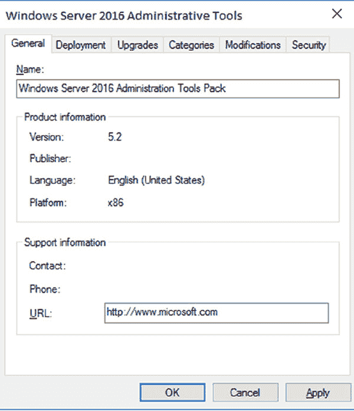

图 4.9 查看 MSI 包文件的属性

## 部署应用程序

`Windows Installer` 提供的功能为自行安装软件的终端用户带来了许多优势。然而，在网络环境中，这只是开始。正如你将在本章后半部分看到的，`Windows Installer` 的各种功能和兼容包允许系统管理员确定用户能够安装的中心化应用程序。

使用 `Active Directory` 向用户提供程序主要有两种方法：分配和发布。在接下来的章节中，我们将介绍分配和发布应用程序如何极大地方便 IT 人员和用户的工作。

这两种主要方法通过 `Windows Installer` 为终端用户提供了许多优势。在接下来的章节中，我们将查看如何通过分配和发布向用户提供程序。分配和发布都极大地简化了部署和管理应用程序的过程。

### 分配应用程序

软件应用程序可以分配给用户和计算机。`分配`软件包通过在“开始”菜单的`程序`文件夹中放置图标，使程序对用户可用。通过 `GPO` 管理已分配和发布的应用程序。

当应用程序分配给计算机时，无论用户使用哪台计算机，其图标都会出现。无论程序是否已安装在本地计算机上，一旦分配了，用户将可以从服务器访问它。如果用户之前没有安装 `Microsoft Office 2016`，在程序运行时将提示其输入所需的信息。

通常情况下，大多数用户需要的应用程序应该分配给计算机。这减少了按需安装应用程序所需的带宽，并通过防止首次访问应用程序时的延迟提高了用户体验。少数用户（或具有特定任务的用户）使用的应用程序应分配给用户。

### 发布应用程序

当应用程序被`发布`时，会被推广，但不会自动创建图标。相反，可以使用`控制面板`中的“程序和功能”图标使应用程序可安装。

## 实现软件部署

到此为止，你已经从理论层面熟悉与软件部署管理相关的问题。现在是时候通过 `Active Directory` 和 `GPMC` 功能执行实际步骤了。在接下来的章节中，你将运行创建分发点、发布和分配应用程序、更新已安装应用程序以及验证安装情况的步骤。

### 准备软件部署

在客户端计算机上安装应用程序之前，你必须确保对终端用户可用。在许多网络环境中，系统管理员在文件服务器上创建包含许多应用程序安装文件的共享。根据安全权限，终端用户或系统管理员都可以从客户端计算机连接到这些共享。

练习 4.7 将引导你完成创建分发点的过程。在此练习中，你将通过创建目录共享并在其中放置特定类型的文件来准备软件部署。要完成练习中的步骤，你需要拥有 `Microsoft Office 2013` 或 `Microsoft Office 2016` 安装文件（通过 `DVD` 或网络共享），并拥有 `2000 MB` 的空磁盘空间。在本练习中，我使用了 `Microsoft Office 2016`。

### 软件限制策略

作为 IT 管理员，我们面临的最大问题之一是用户下载并安装软件。许多软件包不会引起任何问题而且完全安全。遗憾的是，许多软件包确实带有病毒并可能导致问题。这正是软件限制策略（`Software restriction policies`）大显身手的地方。软件限制策略有助于识别软件并控制其在本地计算机、组织单元、域或站点上运行的能力。

软件限制策略赋予管理员监管未知或不受信软件的能力。软件限制策略允许您通过识别并指定允许安装哪些软件包，来保护您的计算机免受不受欢迎软件的影响。

在配置软件限制策略时，管理员能够为 `GPO` 定义默认安全级别，如“不受限制”（允许运行软件）或“禁止”（不允许运行软件）。管理员可以对此默认安全级别设置例外。他们可以为特定软件创建软件限制策略规则。

使用 `Group Policy Management Console`（组策略管理控制台）创建软件策略，请创建一个新的 `GPO`。在 `GPO` 中，展开用户或计算机配置部分下的 `Windows Settings`，展开 `Security`，右键点击 `Software Restriction Policy`，并选择 `New Software Restriction Policy`（新建软件限制策略）。根据您需要的安全级别设置策略。

### 使用 AppLocker

`AppLocker` 是 `Windows 7`、`Windows 8`、`Windows 10`、`Windows Server 2012/2012 R2` 以及 `Windows Server 2016` 中的一项功能。它是软件限制策略的替代方案。`AppLocker` 允许您为应用程序配置`Denied`（拒绝）列表和`Accepted`（接受）列表。配置`Denied`列表上的应用程序将在系统上运行，而`Accepted`列表上的应用程序将正常运行。

`AppLocker` 功能的新能力和扩展有助于减少管理开销，并帮助管理员控制用户访问和使用文件的方式，例如 `EXE` 文件、脚本、Windows 安装文件（`MSI` 和 `MSP` 文件）以及 `DLLs`。

### 组策略慢链检测

在设置 `GPOs` 时，我们大多数人假设服务器和客户端之间的连接速度将很快很快。在当今世界，很难看到位置之间存在慢连接，但它们仍然存在。有时连接速度可能会导致 `GPOs` 部署出现问题，特别是部署软件的策略。

`GPO` 的计算机和用户部分有一个名为 `Group Policy Slow Link Detection`（组策略慢链检测）的设置，它定义了用于应用和更新 `GPOs` 的慢连接。如果从提供 `GPO` 的域控制器到计算机的数据传输速率低于您在此设置中指定的速率，则该连接被视为慢连接。如果连接被认为是慢连接，系统响应将根据策略的不同而异。例如，如果一个 `GPO` 要部署软件且连接被认为是慢连接，则软件可能不会安装在客户端计算机上。如果您将此选项配置为 `0`，则所有连接都被视为快速连接。

### 发布和分配应用程序

如前所述，系统管理员可以使用发布（`publishing`）和分配（`assigning`）操作为用户提供软件包。这两项操作都允许系统管理员利用 `Active Directory`（特别是 `GPOs`）的力量来决定哪些应用程序对用户可用。此外，`OUs`（组织单元）可以提供结构，帮助根据用户的职位功能和软件需求对其进行分组。

通用流程包括创建一个包含用户和计算机软件部署设置的 `GPO`，然后将此 `GPO` 链接到 `Active Directory` 对象。

练习 4.8 将引导您完成发布和分配应用程序所需的步骤。在本次练习中，您将创建应用程序并使用 `GPOs` 将它们分配给特定的 `Active Directory` 对象。在完成练习中的步骤之前，您必须已完成练习 4.7。

使用 `Active Directory` 部署软件的整体过程非常简单。然而，你不应该让直观的图形界面误导你——在这些软件部署功能的背后隐藏着巨大的能量！一旦您正确地分配并发布了应用程序，就是时候查看您的工作成果了。

### 应用软件更新

上一节中描述的步骤仅在您安装新应用程序时有效。然而，软件公司经常发布您需要安装在现有应用程序之上的更新。这些更新通常包含错误修复或为了保持软件最新而所需的更改。您可以通过位于 `Group Policy Object Editor`（组策略对象编辑器）中的软件包 `Properties`（属性）对话框的 `Upgrades`（升级）选项卡在 `Active Directory` 中应用软件更新。

在练习 4.9，您将对现有应用程序应用软件更新。您应该按照在练习 4.8 步骤 8 到 12 中添加原始应用程序的方法，将升级包添加到 `GPO` 中。在尝试此练习之前，您也应该完成练习 4.8。

您应该理解，并非所有升级在所有情况下都是合理的。例如，如果 `Panek 2015` 文件与 `Panek 2018` 程序不兼容，那么您的 `Panek 2015` 用户可能不希望您执行升级，除非采取额外的步骤来确保他们能够继续使用自己的文件。此外，当不影响网络支持时，用户对使用哪个版本可能有选择权。

无论允许这种灵活性的底层原因是什么，您都应该意识到管理员可以为用户提供两种基本类型的升级：

**强制性升级（Mandatory Upgrade）**：强制所有当前拥有程序现有版本的人根据 `GPO` 进行升级。由于某种原因从未安装过该程序的用户将只能安装新的、升级后的版本。

**非强制升级（Nonmandatory Upgrade）**：允许用户选择是否升级。这种升级类型还允许未安装应用程序的用户选择他们想要使用的版本。

### 验证软件安装

为了确保您在 `GPO` 中设置的软件安装生效，可以从属于应用软件设置的 `OU` 内的 `Windows 10`、`Windows 8` 或 `Windows 7` 计算机登录域。当登录时，您会注意到两个变化。首先，应用程序已安装在计算机上（如果尚未安装）。要访问应用程序，用户需要点击“开始”菜单中“程序”组中的一个图标。请注意，应用程序对登录到此机器的任何用户可用。其次，设置适用于位于 `OU` 内的任何计算机以及登录到这些计算机的任何用户。


如果您向用户发布应用程序，变化可能不明显，但它同样有用。当登录到域成员的 Windows 7、Windows 8 或 Windows 10 计算机，并且使用来自发布应用程序的 `OU` 的用户账户时，您将能够自动安装任何发布的应用程序。

到目前为止，你已经看到了在组策略中部署应用程序的优势。组策略还提供了一种方法，通过 Windows Update 结合 Windows Server Update Service (WSUS)，为 Windows 10、Windows 7、Windows 8、Windows Server 2008/2008 R2、Windows Server 2012/2012 R2 以及 Windows Server 2016 跨网络安装操作系统更新。WSUS 是 SUS 的新版本，用于在 Windows Server 2016 系统上更新系统。你可能还记得，`WSUS` 和 `SUS` 是补丁管理工具，帮助你以受控的方式向系统部署更新。

Windows Update 通过微软网站可用，用于为 Windows 操作系统提供最新的文件。更新示例包括安全修复、关键更新、更新的帮助文件和更新的驱动程序。你可以通过点击系统托中的 Windows Update 图标来访问 Windows Update。

`WSUS` 用于在企业环境中利用 Windows Update 的功能，通过将 Windows 更新下载到企业服务器，然后向内部企业客户端提供更新。这允许管理员测试并完全控制在企业环境中部署了哪些更新。

在在使用 `Active Directory` 的企业网络中，你通常会看到通过组策略配置的自动更新。组策略用于通过 `Active Directory` 管理配置和设置。组策略还用于指定客户端将使用哪个服务器进行自动更新。

如果 `WSUS` 客户端是使用 `Active Directory` 的企业网络的一部分，你将通过组策略配置客户端。

## 配置软件部署设置

除了分配和发布应用程序的基本操作外，你还可以使用其他几个选项来指定软件部署的细节。在后续章节中，你将检查各种可用选项及其对软件安装过程的影响。

### 软件安装属性对话框

最重要的部署设置包含在软件安装属性对话框中，你可以通过右键点击“软件安装”项并从上下文菜单中选择`属性`来访问它。后续章节描述了对话框各个选项卡上包含的功能。

#### 管理包默认值

在软件安装属性对话框的`部署`选项卡上，你能够为在此 `GPO` 中创建的任何包指定某些默认值。图 4.10 显示了管理软件安装设置的部署选项。

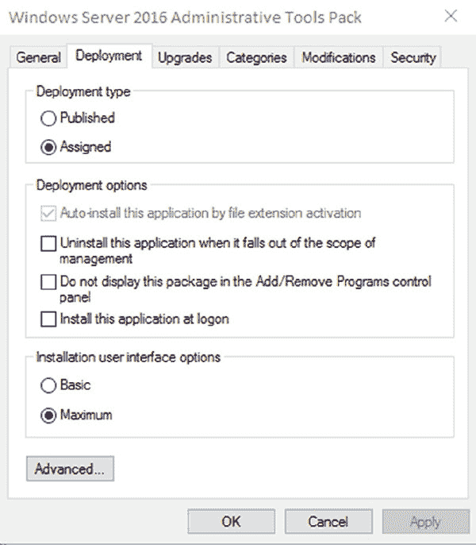

FIGURE 4.10 软件安装属性对话框的部署选项卡

以下选项用于管理软件安装设置：

**默认包位置** 此设置指定了软件安装包的默认文件系统或网络位置。如果你已经在使用文件服务器上的特定共享来托管必要的安装文件，则此设置非常有用。

**新包** 这些设置指定了在向用户或计算机设置中添加新包时将使用的默认包分配类型。如果你将分配或发布多个包，你可能会发现在此处设置默认值是很有用的。选择`高级`选项（参见图 4.11）可以使组策略在每次添加新包时都显示该包的`属性`对话框。

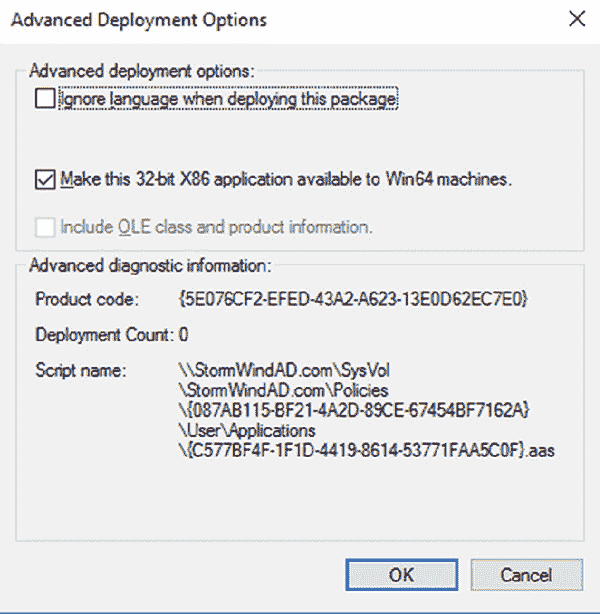

FIGURE 4.11 Advanced Deployment dialog box

**安装用户界面选项** 在安装应用程序时，系统管理员可能希望或不希望用户看到所有的高级安装选项。如果选择`基本`，用户将能够配置最少的设置（例如安装位置）。如果选择`最大`，则将显示所有可用的安装选项。具体的可用安装选项取决于包本身。

**当应用程序超出管理范围时卸载应用程序** 到目前为止，你已经看到了如何将应用程序分配并发布给用户或计算机。但当有效的 `GPOs` 发生时会发生什么？例如，假设用户 A 目前位于 `Sales OU`。一个分配 Microsoft Office 2013 应用程序套件的 `GPO` 链接到 `Sales OU`。你决定将用户 A 移动到 `Engineering OU`，该 OU 没有软件部署设置。该应用程序应该被卸载还是保留？

如果勾选了`当应用程序超出管理范围时卸载应用程序`选项，如果应用程序没有在 `GPOs` 中被特定分配或发布，则将被移除。在此示例中，这意味着为用户 A 卸载 Office 2013。然而，如果取消选此框，应用程序将保持安装状态。

#### 管理文件扩展名映射

使用许多不同文件类型相关的潜在问题之一是很难跟踪哪些应用程序与哪些文件配合。例如，如果你收到一个扩展名为 `.abc` 的文件，你将不知道需要哪个应用程序来查看它。

幸运的是，通过软件部署设置，系统管理员可以为特定的`文件名扩展`指定映射。例如，你可以指定每当用户尝试访问扩展名为 `.vsd` 的文件时，操作系统应尝试使用 Visio 绘图软件打开文件。如果用户机器上没有安装 `Visio`，计算机可以自动下载并安装它（假设该应用程序已正确广告发布）。

这种方法允许用户在需要时自动安装应用程序。以下是可能发生的事件序列示例：

1. 用户收到一封包含 PDF (`.pdf`) 文件附件的电子邮件。
2. 计算机意识到 PDF 文件没有安装用于查看此类文件的适当应用程序。然而，它也意识到 `Active Directory` 软件部署设置中存在文件名映射。
3. 客户端计算机从服务器请求 PDF 软件包，并使用 `Microsoft Windows Installer` 自动安装应用程序。
4. 计算机为用户打开附件。

注意，所有这些步骤都在没有与用户进一步交互的情况下完成的。

你可以通过右键点击“软件安装”项、选择`属性`并点击`文件扩展名`选项卡来管理文件名扩展映射。

#### 创建应用程序类别

在许多网络环境中，支持的应用程序列表可能包含数百项。对于寻找某一个特定程序的用户来说，在所有这些程序列表中搜索可能是困难且耗时的。

幸运的是，网络中提供了分类应用程序的方法。你可以通过右键点击“软件安装”项、选择`属性`并点击`类别`选项卡，轻松地管理用户和计算机的应用程序类别。

图 4.12 显示了软件包的类别选项。在创建类别时，使用对用户有意义的类别名称是一个好主意，这将使他们更容易找到正在寻找的程序。

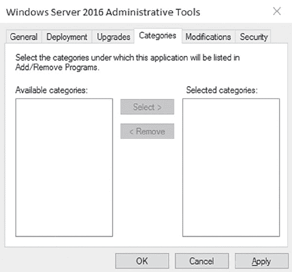

图 4.12 软件安装属性对话框的类别选项卡

一旦创建了软件安装类别，你就可以点击`控制面板`中的`程序`或`程序和功能`图标来查看它们。当你点击`添加新程序`时，你会看到`类别`下拉列表中会出现几个选项。现在，当你选择某个程序包的属性时，你将能够将应用程序分配到一个或多个类别中。

## 移除程序

正如在本章开头提到的，软件管理生命周期中的一个重要阶段是卸载应用程序。幸运的是，如果你使用 `GPMC` 和 `Windows 安装程序 (Windows Installer)` 程序包，过程就会非常简单。要删除应用程序，可以在`组策略`设置中右键点击程序包，并选择`所有任务 ➢ 移除`。这将弹出一个删除文本框（参见图 4.13）。

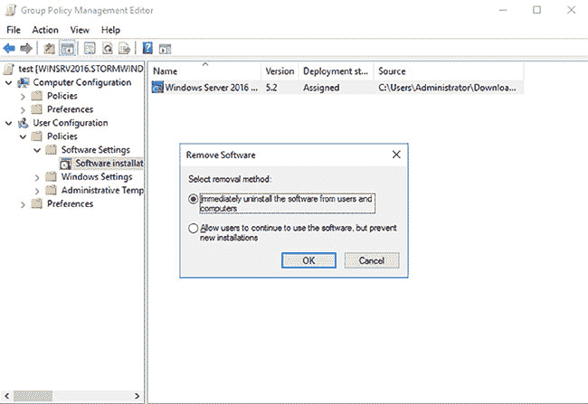

图 4.13 移除软件包

在选择从 `GPO` 移除软件程序包时，你有两种选项，在此所示：

**立即从用户和计算机上卸载软件** 系统管理员可以选择此选项，以确保受 `GPO` 影响的用户无法使用该应用程序。当选择此选项时，程序将自动从已安装程序包的用户和/或计算机上卸载。此选项可能有用，例如，某个应用程序的许可证已过期，或者某个程序不再批准的应用程序列表中。

**允许用户继续使用软件，但阻止新安装** 此选项防止用户对程序包进行新的安装，但如果软件已经为用户安装，则不会将其删除。如果公司该软件的额外许可证已用尽，但现有许可证仍然有效，这是一个很好的选项。

如果你不再需要安装或修复应用程序的能力，可以通过删除相应的 `Windows 安装程序`程序包文件，将其从你的软件分发共享点中删除。这将为新的应用程序释放额外的磁盘空间。

## Microsoft Windows 安装程序设置

有若干选项会影响 `Windows 安装程序`的行为；你可以在 `GPO` 中设置它们。你可以通过导航到`用户配置 ➢ 管理模板 ➢ Windows 组件 ➢ Windows 安装程序`来访问这些选项。

选项如下：

**始终使用提权权限安装** 此策略允许用户安装需要提权权限的应用程序。例如，如果用户没有修改`注册表`所需的权限，但安装程序必须对`注册表`进行更改，则此策略将允许过程成功。

**对任何安装禁止使用可移动介质源** 此选项不允许使用可移动介质（如 `CD-ROM` 或 `DVD-ROM`）安装软件。这对于确保用户只安装批准的应用程序很有用。

**禁止回滚** 当启用此选项时，`Windows 安装程序`将不会存储回滚应用程序安装所需的系统状态信息。系统管理员可以选择此选项，以减少安装期间所需的临时磁盘空间并提高安装操作的性能。然而，缺点是如果安装失败且需要删除应用程序，系统将无法恢复到原始状态。

**指定 Windows 安装程序搜索的顺序** 此设置指定了 `Windows 安装程序`搜索安装文件的顺序。选项包括 `n`（用于网络共享）、`m`（用于搜索删除介质）和 `u`（用于在 Internet 上搜索安装文件）。

通过这些选项，系统管理员可以控制 `Windows 安装程序`针对受 `GPO` 影响的特定用户的操作方式。

## 组策略排除

由于在建立策略时可能存在多种配置，因此你应该了解一些排除方法。在处理 `GPO` 时，这些排除方法有助于隔离设置问题。

`GPO` 配置的一个可能问题是，登录和系统启动可能耗时很长，这尤其发生在 `GPO` 设置需要通过网络传输的情况下。默认情况下，`GPO` 是同步方式处理的。这意味着一个 `GPO` 的处理必须完成后，另一个才能应用（与异步处理相反）。

当组策略在 Windows 操作系统上处理时，客户端扩展是解释策略并对操作系统做出更改的机制。当管理员排查给定扩展策略的应用时，可以在`注册表`中查看配置：

```
HKEY_LOCAL_MACHINE\Software\Windows\CurrentVersion\Group Policy
```

与`组策略`相关的最常见问题是意外的设置。在 `Windows Server 2000` 中，管理员花费时间分析继承关系和单个设置，以确定特定用户或计算机的问题。例如，假设名为 `wpanek` 的用户抱怨“开始”菜单中缺少“运行”选项。`wpanek` 用户帐户存储在 `New Hampshire OU` 中，并且你在 `OU`、域和站点级别上应用了组策略。为了确定问题源，你必须手动筛选每个 `GPO` 以找到“开始”菜单策略。

`Windows Server 2016` 具有一个实用的功能称为“策略结果集 (RSoP)”，它可以显示适用于单个用户、计算机、OU、域和站点的准确设置。在刚才描述的示例中，你可以对 `wpanek` 账户运行 `RSoP`，并查看适用于该账户的组策略设置。此外，每个设置的`属性`对话框都会显示派生该设置的 `GPO` 以及优先级、过滤状态和其他有用信息，正如稍后所示。

RSoP 实际上以两种模式运行：

**日志模式** `日志模式`显示适用于用户和计算机的实际设置，如上文示例所示。

**计划模式** `计划模式`可以应用于用户、计算机、OU、域和站点，并且你在应用任何设置之前使用它。正如其名，计划模式用于计划 `GPO`。

此外，你还可以运行命令行工具 `gpresult.exe` 来获取适用于用户和或计算机的组策略设置快照。

### 日志模式 RSoP

日志模式 RSoP 只能查询用户和计算机的策略。访问日志模式 RSoP 的简单方法是通过`活动目录用户和计算机`工具，你也可以作为独立的 `MMC` 节点运行它。

要分析前一个示例中 `wpanek` 的策略设置，你可以在“活动目录用户和计算机”中右键点击用户图标，并选择`所有任务`(All Tasks) ➢ `结果策略集 (日志)`(Resultant Set of Policy (Logging))。会出现组策略结果向导。该向导将引导你完成查看 `wpanek` 的 `RSoP` 所需的步骤。

图 4.14 显示的计算机选择页面要求你选择一个要显示设置的计算机。记住，`GPO` 同时包含用户和计算机设置，因此你必须选择一个用户已登录的计算机以继续使用向导。如果该用户从未登录过计算机，则你必须在计划模式下运行 `RSoP`，因为该用户还没有已登录的策略信息。

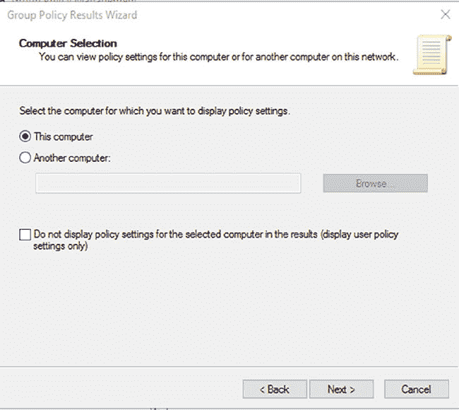

FIGURE 4.14 组策略结果向导的计算机选择页面

图 4.15 显示的用户选择页面要求你选择一个要分析的用户账户。由于我是从“活动目录用户和计算机”工具中选择了一个用户，因此用户名会自动填充。如果你在 MMC 模式下运行 `RSoP` 且无法在上下文中选择用户，那么此页面将非常有帮助。

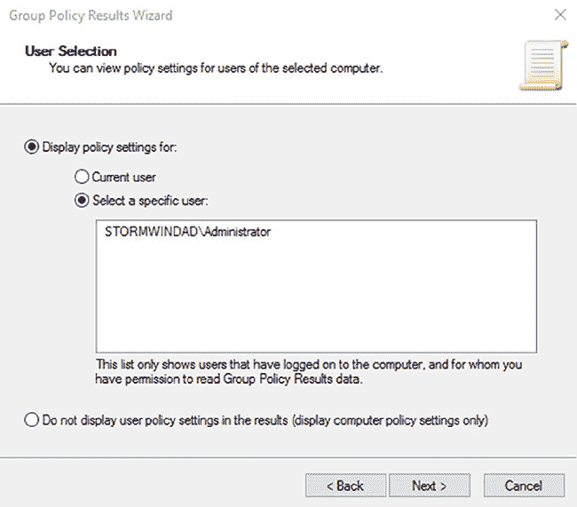

FIGURE 4.15 组策略结果向导的用户选择页面

图 4.16 显示的选择摘要页面汇括了你的选择，并提供了一个收集扩展错误信息的选项。如果你在开始分析策略设置之前需要进行任何更改，应点击摘要屏幕上的“上一步”按钮。否则，点击“下一步”。


FIGURE 4.16 组策略结果向导的选择摘要页面

向导完成后，你将看到图 4.17 所示的窗口。此窗口仅显示适用于你在向导中选择的用户和计算机的策略设置。你可以在树的最顶层看到这些用户和计算机。


FIGURE 4.17 计算机 WinSRV2016 上管理员的用户选择页面

任何警告或错误都会以黄色三角形或红色 `X` 显示在发生警告或错误的层级对应的适用图标上。要查看有关警告或错误的更多信息，请右键点击该图标并选择“属性”。

你无法对任何单个设置进行更改，因为 `RSoP` 是一个诊断工具而不是编辑器，但你可以通过点击设置并从右键菜单中选择“属性”来获取有关设置的更多信息。

图 4.18 显示的用户属性窗口详细选项卡显示了根据 `GPO` 继承适用于所指用户的实际设置。


FIGURE 4.18 对象属性窗口的详细选项卡

### 计划模式下的 RSoP

在计划模式下运行 `RSoP` 与在日志模式下运行 `RSoP` 没有太大区别，但 `RSoP` 向导要求提供比之前看到的稍多一点信息。

在前一个示例中，`wpanek` 无法在开始菜单中看到“运行”选项，因为他的用户账户受到圣何塞 `OU` 中新罕布什 `GPO` 的影响。作为管理员，你可以计划将他的用户账户移动到北美 `OU`。在此之前，你可以通过在计划模式下运行 `RSoP` 来验证他的新策略设置。在已将他从圣何塞 `OU` 移动到北美 `OU` 的场景下，对用户 `wpanek` 运行 `RSoP`。此时，你还没有实际移动该用户，但你可以看到如果移动了之后他的设置将会是什么。

### 使用 `gpresult.exe` 命令

命令行工具 `gpresult.exe` 作为 `RSoP` 工具的一部分包含在内。单独运行该命令而不带任何开关，将返回以下关于本地用户和计算机的组策略信息：

* 本地计算机检索策略信息的域控制器名称
* 应用策略的日期和时间
* 应用了哪些策略
* 哪些策略被过滤掉了
* 组组身份关系

你可以使用表 4.3 所示的开关来获取远程用户和计算机的信息，并启用其他选项。

TABLE 4.3 **gpresult 开关**

| 开关 | 描述 |
| --- | --- |
| `/S systemname` | 生成远程计算机的 RSoP 信息 |
| `/USER username` | 生成远程用户的 RSoP 信息 |
| `/x /h` | 以 XML (/x) 或 HTML (/h) 格式生成报告。文件名由 `filename` 指定 |
| `/V` | 指定详细模式，显示用户权限等详细信息 |
| `/Z` | 指定更高级别的详细信息 |
| `/SCOPE MACHINE` | 显示适用于系统的范围信息 |
| `/SCOPE USER` | 显示适用于用户的范围信息 |
| `>textfile.txt` | 将输出写入文本文件 |

例如，为了获取名为 `WILLPANK` 的系统中用户 `wpanek` 的信息，你会使用命令 `gpresult /S WILLPANK /USER wpanek`。通过这些技术的使用，你应该能够追踪棘手的组策略问题。但请记住，良好的故障排除技能不能取代规划维护！

### 使用基础设施状态

在 Windows Server 2016 中，组策略管理 MMC 还允许查看活动目录服务基础设施。要查看组策略基础设施，打开组策略管理控制台。点击 `GPO` 然后点击“状态”选项卡。然后你点击“立即检测”按钮来查看基础设施状态（参见图 4.19）。


FIGURE 4.19 基础设施状态

## 总结

在本章中，你检查了活动目录对许多管理员常见头疼问题的解决方案：策略设置。具体来说，我讨论了涵盖组策略的内容。

我涵盖了组策略的基础知识，包括其基本目的。你可以使用组策略对活动目录环境中的用户实施细粒度权限。组策略可以限制并修改活动目录环境内允许的操作。

某些组策略设置可能适用于用户、计算机或两者。计算机设置影响访问这些策略机器的所有用户。用户设置无论用户登录到哪些机器都会影响用户。

你学习了可以将组策略对象链接到活动目录站点、域或 OU。这种链接决定了策略适用于哪些对象。GPO 链接可以通过继承和过滤相互作用，从而产生有效的策略集。

本章涵盖了继承以及 GPO 如何向下传递。我为你展示了如何使用父级 `GPO` 上的“强制”选项，以及如何阻止子级 `GPO`。


你还可以使用管理模板来简化`GPOs`的创建。Windows Server 2016 自带了一些基础的默认模板。

此外，管理员可以委派`GPOs`的控制权，以分配管理职责。委派是一个重要的概念，因为它允许实现分布式管理。

你还可以使用`GPOs`部署软件。此功能通过在客户端计算机上自动安装和卸载软件，可以在整个软件管理生命周期内节省时间并提高工作效率。`Windows Installer`提供了一种更健壮的方法来管理安装和卸载，支持该方法的应用程序可以利用 Active Directory 的新功能。请确保你熟悉如何使用`Windows Installer`。

你学习了如何通过 Active Directory 发布应用程序，以及发布应用程序与分配应用程序之间的区别。你可以将某些应用程序分配给用户和计算机，以便它们始终处于可用状态。你还可以将它们发布给用户，以便用户在需要时以最小的精力进行安装。

你还学习了如何为软件部署做准备。在用户能够利用自动化软件安装的优势之前，你必须设置一个安装共享并提供适当的权限。

本章的最后一部分涵盖了`策略结果集 (RSoP)`工具，你可以在日志模式或规划模式下使用它，以确定具体是哪些策略适用于用户、计算机、`OUs`、域和站点。

## 考试要点

**理解组策略的作用。** 系统管理员使用`Group Policy`为 Active Directory 环境中的用户强制执行细粒度的权限控制。

**理解用户和计算机设置。** 某些`Group Policy`设置可能适用于用户、计算机或两者。计算机设置影响所有访问应用该策略的机器的用户。用户设置影响用户，无论他们登录到哪台机器上。

**了解组策略对象与 Active Directory 之间的交互作用。** `GPOs`可以链接到 Active Directory 对象。此链接决定了策略适用于哪些对象。

**理解 GPOs 之间过滤和继承的交互作用。** 为了方便管理，`GPOs`可以通过继承和过滤进行相互作用。在实施和排查`Group Policy`问题时，理解这些交互作用至关重要。

**了解组策略设置如何影响脚本策略和网络设置。** 你可以使用特殊的`GPOs`set 来管理网络配置设置。

**理解如何在 Active Directory 环境中使用用管理委派。** 委派是一个重要的概念，因为它允许实现分布式管理。

**了解如何使用策略结果集 (RSoP) 工具来排查和规划组策略。** Windows Server 2016 包含了`RSoP`功能，你可以在日志模式或规划模式下运行它，以确定具体是哪些策略适用于用户、计算机、`OUs`、域和站点。

**识别软件生命周期中的常见问题。** IT 专业人员在客户端应用程序方面面临许多挑战，包括开发、部署、维护和排错。

**理解 Windows Installer 的优势。** 使用`Windows Installer`是在 Windows 机器上安装应用程序的更新方式。它提供了一种更健壮的方法来执行应用程序所需的系统更改，并允许更整洁的卸载。基于`Windows Installer`的应用程序还可以利用 Active Directory 的新功能。

**理解发布应用程序与分配应用程序的区别。** 某些应用程序可以分配给用户和计算机，以便它们始终处于可用状态。应用程序可以发布给用户，以便用户在需要时以最小的精力安装应用程序。

**了解如何为软件部署做准备。** 在用户能够利用自动化软件安装的优势之前，你必须设置一个安装共享并提供适当的权限。

**了解如何使用 Active Directory 配置应用程序设置。** 使用 Windows Server 2016，你可以创建满足你要求的应用程序。

**创建应用程序类别以简化发布应用程序的列表。** 适用于这些应用程序的用户用户。

## 复习题

你可以在附录中找到答案。

1. 为 OU 内的对象分配权限以设置组策略的过程被称为 \_\_\_\_\_\_。

    1. 提升 (Promotion)

    2. 继承 (Inheritance)

    3. 委派 (Delegation)

    4. 过滤 (Filtering)

2. 关于从 OU 移除软件包时发生的操作，以下哪项表述是正确的？

    1. OU 内的所有用户都将卸载。

    2. 当前应用程序安装不受影响。

    3. 系统管理员可以决定。

    4. 当前用户可以决定。

3. 你是组织的网络管理员。正在为销售 OU 创建一个新的组策略。你希望策略立即生效。你会使用哪个命令？

    1. GPForce

    2. GPUpdate

    3. GPResult

    4. GPExecute

4. 你是组织的网络管理员。正在为营销 OU 创建一个新的组策略。你希望策略立即生效，并且你需要使用 PowerShell。你会使用哪个 cmdlet？

    1. Invoke-GPUpdate

    2. Invoke-GPForce

    3. Invoke-GPResult

    4. Invoke-GPExecute

5. 你是网络管理员，已决定设置具有目标设置的组策略。以下哪项不是目标设置选项？

    1. 电池存在目标 (Battery Present Targeting)

    2. 计算机名称目标 (Computer Name)

    3. CPU 速度目标 (CPU Speed Targeting)

    4. DVD 存在目标 (DVD Present)

6. 你是一个使用 Windows Server 2012 R2 域控制器和 DNS 服务器的组织的网络管理员。所有的客户端目前都运行 Windows XP 系统。你希望能够使用位于 ADMX 存储的 ADMX 文件编辑域组策略。如何完成此任务？（多选）

    1. 将客户端升级到 Windows 8。

    2. 将客户端升级到 Windows 7。

    3. 将客户端添加到 ADMX 编辑工具。

    4. 在 ADMX 存储中，选择允许所有客户端。

7. 你在一个拥有单一 Windows Server 2016 Active Directory 域的组织中工作。该域有销售、营销、管理、研发和财务的 OU。你需要让财务 OU 的用户在他们的计算机上自动安装 Microsoft Office 2016。你创建了一个名为 OfficeApp 的组策略。让所有财务用户获得 Office 2016 的下一步操作是什么？

    1. 编辑组策略，将应用程序分配给用户账户。将组策略链接到财务 OU。

    2. 编辑组策略，将应用程序分配给用户账户。将组策略链接到域。

    3. 编辑组策略，将应用程序分配给计算机账户。将组策略链接到域。

    4. 编辑组策略，将应用程序分配给计算机账户。将组策略链接到财务 OU。

## 8. 你被聘为 ABC 公司的顾问。公司老板抱怨她的桌面壁纸一直显示她没有选择过的图片。当你与 IT 团队交流时，你发现一名前员工创建了 20 个 GPO，而且他们无法确定是哪个 GPO 更改了老板的桌面壁纸。你如何解决这个问题？

1. 针对所有森林计算机账户运行`RSoP`工具。

2. 针对老板的计算机账户运行`RSoP`工具。

3. 针对老板的用户账户运行`RSoP`工具。

4. 针对所有域计算机账户运行`RSoP`工具。

## 9. 你是一个大型机构的网络管理员，该机构有多个站点和多个 OU（组织单位）。你 Setup 有一个名为`SalesSite`的站点，用于街对面的销售大楼。在域中，有一个名为`Sales`的 OU 包含所有销售人员。你为`SalesSite`设置了一个 GPO，并需要确保它应用于`Sales` OU。`Sales` OU 的 GPO 无法覆盖`SalesSite`的 GPO。你该怎么办？

1. 在 GPO 上，禁用“阻止子继承（Block Child Inheritance）”设置。

2. 在 GPO 上，设置“强制（Enforce）”设置。

3. 在 GPO 上，将优先级设置为 1。

4. 在`Sales` OU 上，设置“继承父级策略（Inherit Parent Policy）”设置。

## 10. 你是一个拥有多个地点的机构的管理员。你正在运行 Windows Server 2012 R2，你只有一个域，并为每个地点设置了多个 OU。你的其中一个地点`Boston`通过 256 Kbps 的 ISDN 线路连接到主机点。你配置了一个 GPO，为整个域中的所有计算机分配一个销售应用程序。你必须确保`Boston`用户能够正确接收到该 GPO。你应该做什么？

1. 在 GPO 中禁用“慢链路检测（Slow Link Detection）”设置。

2. 将 GPO 链接到`Boston` OU。

3. 更改 GPO 属性，将应用程序发布到`Boston` OU。

4. 让`Boston`的用户运行`GPResult/force`命令。

# 第 5 章：理解证书

本章涵盖以下 70-742 考试目标：

* ** 安装并配置 AD CS**

    * 该目标可能包括但不限于：安装 Active Directory 集成企业证书颁发机构 (CA)；安装离根 CA 和子级 CA；安装独立 CA；配置证书吊销列表 (CRL) 分发点；安装并配置在线响应程序 (Online Responder)；实施角色分离；配置 CA 备份和恢复。

* ** 管理证书**

    * 该目标可能包括但不限于：管理证书模板；实施并管理证书的部署、验证和撤销；管理证书续期；使用组策略管理计算机和用户的证书注册和续期；配置和管理密钥归档与恢复。

 在本章，我将讨论证书服务以及保护企业`公钥基础设施 (PKI)`环境的重要性。Windows 2016 的`PKI`实现存在于 Active Directory 证书服务。

## Active Directory 证书服务的特性

Active Directory 证书服务 (AD CS) 提供角色服务，用于在企业内部颁发和管理公钥证书。

### 服务器核心和最小化界面支持

你可以安装并部署六种角色服务中的任何一种。最小化界面（Minimal Interface）的外观感觉类似于 Server Core，但保留了大部分 GUI。

### 站点感知证书注册

一旦配置完成，Windows 2016 默认使用站点内的证书颁发机构作为 CA。然而，你必须在证书颁发机构上配置站点信息，站点感知功能才有意义。

### 非域连接计算机的自动证书续期

证书注册 Web 服务 (CES) 允许未加入域的计算机以及未直接连接网络的计算机请求并检索证书。

### 使用相同密钥强制证书续期

在早期的 Windows 版本中，从配置为相同密钥续期的模板接收证书的客户端必须使用相同的密钥进行续期，否则续期将失败。在 Windows 2016 中，你可以继续这种行为，也可以配置证书模板，使基于可信平台模块 (TPM) 的`KSPs`生成密钥。

### 国际化域名 (IDNs)

国际语言通常包含无法使用 ASCII 编码表示的字符，这限制了这些语言在注册证书时的功能。Windows Server 2016 现在支持 IDNs。

### 证书颁发机构角色服务的默认安全性增强

运行在 Windows Server 2016 上的证书颁发机构包含了更高的`RPC`（远程过程调用）安全性。CA 上的`RPC`安全性要求所有客户端在请求证书时，必须加密与 CA 之间的`RPC`通信。

| 服务 | 说明 |

|---|--- |

| 网络设备注册服务 (NDES) | NDES 允许路由器和其他未加入域的网络设备获取证书。 |

| 证书注册策略 Web 服务器 (CEP) | CEP 允许用户和计算机查询证书注册策略信息。 |

| 证书注册 Web 服务服务 (CES) | CES 允许用户和计算机通过 HTTPS 协议注册证书。CEP 和 CES 可以结合使用，为未加入域的计算机和未直接连接公司网络的计算机提供证书注册。 |

## 规划证书颁发机构层次结构

`证书颁发机构 (CA)`是一个受信任的服务器，旨在向个人、计算机或组织授予证书，以证明证书主体的身份和其他属性。

`CA`接收证书请求，根据`CA`的策略验证请求者的身份数据，并使用其私钥对证书进行数字签名处理。`CA`将证书作为 PKI 环境中的安全凭据颁发给证书主体。`CA`还要负责吊销证书并发布`证书吊销列表 (CRL)`。

`CA`可以是第三方颁发机构（例如 VeriSign），你也可以通过安装 Active Directory 证书服务来创建自己的`CA`。每个`CA`都有一个由另一个受信任的`CA`或根`CA`颁发的证书来确认其身份。

### 加密

证书颁发机构的加密选项为对密码学有深入了解的人提供了更高的部署灵活性。你可以通过使用加密服务程序 (`CSPs`) 或密钥存储提供程序 (`KSPs`) 实现加密选项。

`CSPs`是 Windows 操作系统的硬件和软件组件，提供通用的加密功能。`CSPs`可以提供多种加密和签名算法。密钥存储提供程序可以在运行`Windows Server 2012/2016`、`Windows Server 2008/2008 R2`、`Windows Vista`、`Windows 7`、`Windows 8/8.1`或`Windows 10`的计算机上提供强密钥保护。`图 5.1`显示 AD CS 安装中的某些加密选项。


`图 5.1` CA 加密屏幕

以下是选项：

**选择加密提供程序**：`Windows Server 2016`提供了许多`CSPs`和`KSPs`，你可以安装第三方提供的额外`CSPs`或`KSPs`。在`Windows Server 2016`中，算法名称列在提供程序列表中。名称中带有井号 (`#`) 的所有提供程序都是下一代加密 (`CNG`) 程序。`CNG`程序支持多种非对称算法。`CSPs`仅实现单一算法。

**密钥长度**：每个`CSP`和`KSP`都支持不同长度的加密密钥。配置较长的密钥长度可以防止黑客破解密钥的攻击，但会导致加密操作的性能。

**选择用于此 CA 的签名证书哈希算法**：`CA`使用哈希算法对`CA`证书进行签名并颁发证书，以确保外部身份未篡改证书。每个`CSP`可以支持不同的哈希算法。

**当 CA 访问私钥时允许管理员交互**：使用此选项通过要求管理员在每次加密操作之前输入密码，来帮助保护`CA`及其私钥。

### 私钥

`证书颁发机构`使用其分配的证书来生成和颁发证书。`CA`使用的证书包含公钥和私钥。私钥应对所有者可用。公钥对网络上的其他实体公开。

例如，用户的公钥可以发布在文件夹中的证书中，以便于组织内的其他人员访问。消息发送者可以从`Active Directory 域服务`检索用户证书，从证书中获取公钥，然后使用接收者的公钥对消息进行加密。

使用公钥加密的数据只能通过数学匹配的私钥进行解密。证书颁发机构在颁发证书时，使用其私钥在证书中创建数字签名。

### 企业级证书颁发机构

`企业级证书颁发机构 (CA)`向 Active Directory 发布证书和`CRLs`。`企业 CA`访问存储在 Active Directory 中的域数据。`企业 CA`在颁发证书时会使用证书模板。企业`CA`使用证书模板中的默认配置数据创建具有该证书类型相应属性的证书。

如果你想启用自动证书审批和自动用户证书注册，请使用企业`CA`颁发证书。这些功能仅当`CA`基础结构与 Active Directory 集成时可用。此外，只有企业`CA`可以颁发启用智能卡登录的证书，因为此过程需要`CA`将 Active Directory 中的用户帐户映射到智能卡证书。

`根 CA`（有时称为`根权威`）是组织 PKI 中受信任的`CA`类型。`根 CA`是唯一签署自己证书的`CA`。`根 CA`的物理安全和证书颁发策略应被强化。如果`根 CA`被破解或其向未经授权的身份颁发证书，你组织中任何基于证书的安全都将由于泄露的私钥而受到。最佳实践是部署第二层 PKI，由其他`CA`颁发证书，这些称为`下级 CA`（参见`图 5.2`）。


`图 5.2` 双层 PKI 模型

`下级 CA`是由`根 CA`、第三方`CA`或组织中的独立`CA`接收签名证书的`CA`。`下级 CA`通常为特定目的颁发证书，例如安全电子邮件、SSL、无线 801.x 安全或智能卡认证。`下级 CA`还可以向其他下级`CA`颁发证书。`根 CA`、由根签署的`下级 CA`以及由下级签署的下级`CA`构成了证书层次结构。

`独立证书颁发机构`未与 Active Directory 集成，不支持证书模板。如果你部署了独立 CA，必须在证书请求中包含有关请求证书类型的所有信息。默认情况下，所有提交给独立 CA 的证书请求都放在队列中，等待 CA 管理员审批。独立 CA 可以根据请求自动颁发证书，但并不建议这样做，因为请求未经过身份验证。

由于独立 CA 未集成到 Active Directory，独立 CA 似乎不是企业的更佳选择。然而，离线独立 CA 提供了一层保护，因为关机状态的独立 CA 较难被破解，且在 Active Directory 中没有足迹。越来越多的组织部署`离线独立根 CA`，仅在需要重新向下级 CA 颁发证书时临时上线。某些组织永久将离线独立根 CA 与网络断开，仅通过移动式介质（如 CD、DVD 或 USB 闪盘）分发证书。离线根 CA 具有以下特征：

*   作为独立根 CA 部署

*   部署在非加入域的服务器上，以避免在不需要同步计算机密码的情况下长时间离线或关机

## 有效期


所有由证书颁发机构颁发的证书都有有效期。`validity period`（有效期）是一个时间范围，指定了 PKI 客户端根据证书主体（subject）中声明的身份，可以将该证书作为权威凭据接受多长时间。此断言假设证书在有效期结束之前未被撤销，且颁发 CA 仍然受到信任。有效期限制了已颁发证书可能被泄露的时间范围。

所有 CA 都根据其 CA 证书的有效期结束日拥有过期日期。此规则影响 CA 颁发证书的能力，而不是其 CA 证书的有效期。由于此规则的存在，组织必须为证书层次结构中颁发给 CA 的每个证书规划续期，以确保现有的信任链并延长 CA 的生命周期。

Active Directory 证书服务（Active Directory Certificate Services）强制执行一项规则：CA 绝不会在其证书过期日期之后颁发证书。由于这种行为，当 CA 证书到达有效期终同时，该 CA 颁发的所有证书也将过期。由已过期 CA 颁发的证书将不再被视为有效的安全凭据。

Active Directory 证书服务允许表 5.2 所示的最大有效期，这些有效期基于证书的类型。您可以使用证书模板配置这些有效期。

### 表 5.2 AD CS 最大有效期

| 证书类型 | 最大有效期 |
| --- | --- |
| 根证书颁发机构 | 在 CA 部署期间确定 |
| 级 CA CA Internet 协议 安全 注册代理 域控制器 | 最多五年，但绝不会超过根 CA 或颁发 CA 的有效期 |
| 所有其他证书 | 一年，但绝不会超过根 CA 或颁发 CA 的有效期 |

## 证书验证

PKI 信任要求对证书的过期情况和整体信任链进行验证。当证书用户离开公司时，您将希望确保没有人可以使用该证书进行身份验证，并对证书进行撤销。撤销检查是 PKI 的关键组件之一。

证书撤销使用证书撤销列表（CRL）。CRL 包含一个不再有效的证书列表，且 CRL 可能会变得很大。为了解决这个问题，您可以访问包含更改或新撤销的增量 CRL（delta CRL）。因此，在讨论 CRL 时，主要类型：

* **基础 CRL (Base CRLs)**：基础 CRL 是包含所有未过期的撤销证书的 CRL。
* **增量 CRL (Delta CRLs)**：增量 CRL 是包含自上次基础 CRL 发布以来已撤销的所有未过期证书的 CRL。

通过 `CRL 分点 (CDPs)` 访问 CRL，这是 Windows Server 2016 中 CA 角色的一部分。可以使用 `HTTP`、`FTP`、`LDAP` 或基于文件的地址作为 URL。只有新颁发的证书会识别 CRL URL 中的新更改；旧证书将使用旧 URL 进行撤销列表操作。

在设置 CRL 时，您可以设置服务器检查 CRL 的频率时间间隔。这被称为 CRL 发布间隔或增量 CRL 发布间隔。因此，如果您想让证书服务器更频繁或更不频繁地检查 CRL，请设置发布间隔。

## 在线响应器 (Online Responders)

当颁发新证书时，计算机会查询颁发 CA 以确定该证书是否已被撤销。传统上，证书撤销检查可以通过检索发布在轻量级目录访问协议 (LDAP) 或超文本传输协议 (HTTP) 中的证书撤销列表，或使用名为在线证书状态协议 (OCSP) 的较 HTTP 方法完成。

OCSP 是一种轻量级 HTTP 协议，比下载传统的 CRL 更快速、高效。`online responder` 是一个受信任的服务器，负责接收并响应单个客户端的证书状态请求。OCSP 响应器检索 CRL，并根据给定证书颁发机构的 CRL 向客户端提供数字签名的实时证书撤销状态响应。无论撤销证书的数量，每个请求检索的数据量都保持不变。

在以下场景下，在线响应器处理证书状态请求比直接访问 CRL 更有效率（[`technet.microsoft.com/en-us/library/cc725958.aspx`](http://technet.microsoft.com/en-us/library/cc725958.aspx)）：

* 当客户端 VPN 连接缓慢，或没有下载大型 CRL 所需的高速连接时
* 当由于撤销检查活动频繁导致网络利用率达到峰值时，例如大量用户同时登录或发送签名邮件时
* 当需要来自非微软证书颁发机构的证书撤销数据时
* 当需要验证单个证书状态请求而非所有已撤销或挂挂的证书时

## 安装 AD CS

服务器管理器 (Server Manager) 提供图形化用户界面，用于在运行 Windows Server 2016 的本地和远程计算机上安装 Active Directory 证书服务。Windows Server 2016 远程服务器管理工具也包含服务器管理器，允许您在运行 Windows 8/8.1 的计算机上运行服务器管理器。在练习 5.1 中，您将使用服务器管理器在本地计算机上安装 AD CS 角色。

### 使用 Windows PowerShell 安装

将 Windows Server 2016 的服务器管理器基于 Windows PowerShell 所获得的一大主要优势是安装的一致性。服务器管理器依赖其 Windows PowerShell 基础作为底层引擎，负责安装任何 Active Directory 证书服务的角色服务。然而，您无法使用服务器管理器在 Windows Server 2016 核心安装上安装角色和功能。

Windows PowerShell 的服务器管理器模块提供了用于安装、查看和删除 Windows Server 2016 包含的功能和角色的 cmdlet。您可以在任何 Windows Server 2016 安装类型上使用这些 cmdlet，因为所有安装类型都提供了 Windows PowerShell。此外，这些 cmdlet 可以从运行 Windows Server 2016 的远程计算机上安装、查看和卸载 Active Directory 证书服务角色。

使用 Windows PowerShell 查看 Active Directory 服务的安装状态，请按照以下步骤操作：

1. 以管理员身份打开 Windows PowerShell 控制台。（在 Core 安装上，在命令控制台中输入 `PowerShell`。）
2. 在 Windows PowerShell 控制台中，输入以下命令并按回车：

```
Get-WindowsFeature *adcs-cert*
```

Windows PowerShell 命令输出三列信息：显示名称、名称和安装状态。显示名称列是功能或服务角色用途的友好名称。名称列代表组件的名称。您可以使用此名称配合 `Install-WindowsFeature` 和 `Remove-WindowsFeature` cmdlet。使用安装状态列确定角色或服务角色的安装状态。

通常，“安装状态”（Install State）列显示三种安装状态之一：已删除（Removed）、已可用（Available）和已安装（Installed）。`已删除`安装状态表示其关联的角色或功能未包含在当前的 Windows 安装中。如果功能或角色被删除，在没有安装介质或未连接到 `Windows Update` 的情况下，您无法安装关联的角色或功能。`已可用`安装状态表示该角色或功能已在当前的 Windows 安装中备，但目前尚未安装。`已安装`安装状态表示该角色或功能已安装在计算机当前的 Windows 安装上并已就绪，或者已经完成部署或配置。

`cmdlet` 输出中的 Active Directory Certificate Services（活动目录证书服务）条目代表父角色。父角色下方会出现六个子角色服务。如果六个子角色服务中的任何一个已安装，父角色的方括号之间会出现一个小写的 `x`。`cmdlet` 也会在任何已安装的子角色服务的括号之间放置一个小写的 `x`。您应该将方括号之间没有小写 `x` 的条目解释为未安装。检查安装状态以确定该角色或角色服务是否已在您的 Windows 安装中备用。

要使用 `Windows PowerShell` 安装 Active Directory Certificate Services，请遵循以下步骤：

1. 打开具有管理员权限的 `Windows PowerShell` 控制台。
2. 使用 `Get-WindowsFeature` `cmdlet` 确保 Active Directory Certificate Services 角色的安装状态为 `Available`。
3. 在 `Windows PowerShell` 控制台中，输入以下命令并按回车：

```
Install-WindowsFeature adcs-cert-authority -IncludeManagementTools
```

4. 使用 `Get-WindowsFeature` `cmdlet` 验证安装情况。

前面的命令指示 `Windows PowerShell` 的 `Server Manager` 模块获取证书体系角色服务的备用二进制文件并将其安装到当前计算机。

您只需通过将 `adcs-cert-authority` 参数替换为关联子角色服务的名称，即可使用 `Install-WindowsFeature` `cmdlet` 安装其他子角色服务。以下示例安装 Active Directory Certificate Services Web Enrollment 角色服务：

```
Install-WindowsFeature adcs-web-enrollment -IncludeManagementTools
```

### 配置 Active Directory Certificate Services

您通过启动 AD CS 配置向导（练习 5.2）开始 Active Directory Certificate Services 的部署。要启动向导，点击 `Action Flag` 对话框中“在目标服务器上配置活动目录证书服务”链接。向导在屏幕的“目标服务器”部分显示角色部署的当前目标。

#### 证书颁发机构名称

`CA` 名称不能超过 64 个字符。您可以使用任何 Unicode 字符创建名称，但如果担心互操作性，您可能希望使用 `ANSI` 字符集。

在活动目录域服务 (`AD DS`) 中，您在将服务器配置为 `CA` 时指定的名称（图 5.3）将成为 `CA` 的通用名称，此名称将反映在 `CA` 颁发的每个证书中。由于这种行为，不要使用完全限定域名 (`FQDN`) 作为 `CA` 的通用名称是至关重要的。黑客可以获取证书副本并使用 `CA` 的 `FQDN` 来破坏安全。


**图 5.3** 指定 CA 的名称

`CA` 名称不必是计算机名称。在安装 Active Directory Certificate Services (`AD CS`) 后更改名称将使 `CA` 颁发的每个证书失效。

#### 组策略证书自动注册

许多证书可以在无需客户端交互的情况下分发。这些包括颁发给计算机和服务的大多数类型证书，以及颁发给用户的许多证书。

要在域环境中为客户端自动注册证书，您必须执行以下操作：

* 配置具有自动注册权限的证书模板
* 为域配置自动注册策略

属于 `Domain Admins` 或 `Enterprise Admins` 或等等权限是完成此过程的最低要求。在练习 5.3 中，我们将配置一个组策略以支持自动注册功能。

#### 非加域计算机基于密钥的更新

Windows Server 2016 将自动证书更新与 `AD CS 证书注册 Web Services` 结合，使非加域计算机能够像面向互联网的 Web 服务器一样，在过期之前自动更新证书。

许多组织和服务提供商维护需要 `SSL` 证书的服务器。这些服务器通常未与颁发证书的颁发机构加入同一个域，并且在组织的 `Active Directory` 中没有身份记录或帐户。这意味着它们无法从今天基于 `Active Directory` 中安全证书模板的自动证书更新中获益。结果是这些组织手动管理和更新 `SSL` 证书，这是一个耗费时间且容易出错的过程。忽略更新单个 `SSL` 证书可能会导致大规模且昂贵的系统中断。

目前，`证书注册 Web Services` 支持三种服务器端身份验证模式：

* Windows 集成 (`Kerberos`)
* 基于证书
* 用户名和密码

然而，当客户端未加入域且企业证书颁发机构基于模板成员身份身份决策时，这些身份验证选项是不可行的。

考虑用于自动更新的身份验证选项：

**Windows 集成**：此身份验证选项不适用于自动更新，因为证书颁发机构和请求服务器所属的域之间没有信任关系，或者请求服务器未加入任何域。

**基于证书**：初始注册的服务器证书不允许身份验证，因为它不包含任何可以映射到目录对象的身份信息。

**用户名和密码**：用户名和密码可以缓存在系统的身份库中并用于对注册服务器进行身份验证。然而，密码的寿命通常比服务器证书短。（密码的默认和推荐设置都短于证书生命周期。）因此，当更新发生时，密码可能已经更改。

**匿名**：此身份验证选项不适用，因为 `MS CEP` 和 `CES` 不支持此选项，导致这些目标服务器系统无法自动更新。

#### 加密服务提供程序/密钥服务程序排序

Windows Server 2016 解决的另一个问题是支持 CSP/KSP 排序的 GUI。随着企业场景中部署可信平台模块（TPM）的兴趣增加，提供一种让 TPM 密钥优于其他类型密钥的机制，已成为基于证书模板注册证书的“刚需”。从客户端的角度来看，在注册不可导出密钥时，这一点非常重要。你希望确保不可导出密钥是在 TPM 中生成的，而不是基于软件的（假设没有涉及恶意软件且用户没有恶意行为）。

目前，这种优先级是通过作为 Active Directory 中证书模板对象的一个属性来捕获的；然而，目前不存在用于修改此类属性的用户界面，微软也不支持该操作。Windows Server 2016 的证书模板管理控制台完全支持 CSP/KSP 排序。

## 管理证书颁发机构：证书模板概述

企业证书颁发机构根据证书模板颁发证书，这是一个预定义的证书设置列表。这允许管理员为用户和计算机申请证书，而无需创建复杂的证书请求。Windows Server 2016 AD CS 确实包含了细微的用户界面变化以及适用于 Windows PowerShell 的 Active Directory 证书服务管理模块。证书模板管理控制台中的新“兼容性”选项卡允许你识别不同版本的 Windows 证书接收者与证书颁发机构之间不兼容的证书模板设置。Windows PowerShell AD CS 管理模块允许你使用 Windows PowerShell 管理常见的 AD CS 管理任务。

## 证书模板兼容性

Windows Server 产品系列已发布了多个版本的证书模板。新的证书模板版本包含了控制与每个新证书颁发机构相关功能的设置。然而，并非所有功能都兼容所有的证书颁发机构和证书请求。因此，确定哪些证书模板与不同版本的证书颁发机构以及不同的 Windows 证书请求者兼容可能会困难。

版本 2 证书模板是可自定义的证书模板，支持 Windows Server 2008 企业版 CA 或 Windows Server 2003 企业版 CA。版本 2 证书模板启用了高级 CA 功能，例如密钥归档与恢复以及证书自动注册。

版本 3 证书模板是 Windows Server 2008 新引入的特性。版本 3 证书模板的功能与版本 2 模板类似，并且支持 Windows Server 2008 中提供的新的 Active Directory 证书服务功能。这些功能包括 CNG，它引入了对 Suite B 密码算法（如椭圆曲线密码学 ECC）的支持。

Windows Server 2016 证书模板管理控制台包含一个新的证书模板兼容性选项卡，允许你选择证书颁发机构的 Windows 操作系统和证书接收者的 Windows 操作系统。证书模板管理控制台会确定选择之间的不兼容设置，并显示管理控制台从模板选择添加或删除的模板设置列表。你可以从证书模板管理控制台查看兼容性表。你可以在运行对话框或开始屏幕上输入 `certtmpl.msc` 并按回车启动证书模板管理控制台。

## 创建证书模板

在创建新的证书模板时，你会复制一个与特定应用程序所需的默认配置类似的现有模板。最好检查默认证书模板列表并找到最符合你应用程序要求的模板。

证书模板管理控制中的中的“处理”选项卡（图 5.4）具有“使用相同密钥更新证书模板配置”选项。当你将证书颁发机构和证书接收者选项分别设置为 Windows Server 2016 和 Windows 8/8.1、Windows 10 时，此证书模板选项将出现在用户界面中。


**图 5.4** 证书模板管理控制台的处理选项卡

你将在练习 5.4 中创建一个证书模板示例。

## 发布证书模板

在创建证书模板并应用适当的安全权限后，你希望通过发布到 Active Directory 来部署新的证书模板，以便与其进行共享。接下来的练习将引导我们完成此任务的步骤。

在练习 5.5 中，你将部署证书模板。

## 证书撤销

撤销使证书失效并在吊销列表中列出撤销证书。你可以按照练习 5.6 所示的步骤在证书颁发机构管理程序中撤销证书。

## 显示证书颁发机构的当前站点

输入以下命令显示一个或多个证书颁发机构的当前站点名称：

```
Certutil -ping caDns
```

该命令利用每个命名证书颁发机构的 `DsGetSiteName` API。确定所有证书颁发机构的站点后，`certutil.exe` 使用 `DsQuerySitesByCost` API 获取所有的机构的站点成本。

## CA 策略审计

默认情况下，Windows2016 CA 服务器未启用 PKI 审计日志。启用审计后，所有事件将记录在安全日志中。

练习 5.7 涵盖了 CA 管理员完成启用所需的步骤。

## 备份证书颁发机构服务器


AD CS 证书颁发机构部署会创建一个数据库。CA 将颁发的证书、归档的私钥、撤销的证书以及所有证书请求都记录在数据库中。

将数据库位置配置在服务器磁盘驱动器的 NTFS 分区上，为数据库文件提供尽可能可能的安全性。在“证书数据库位置”框中指定数据库的位置。默认情况下，向导将数据库位置配置为`%systemroot%\system32\certlog`。数据库文件名使用 CA 的名称，扩展名为`.edb`。

证书数据库使用事务日志来确保数据库的完整性。CA 在配置的日志文件中记录事务。然后 CA 将日志文件中的每个事务提交到数据库中。随后 CA 更新数据库中的最后提交事务，并继续该过程。

备份 CA 时，现有的证书数据库日志将被截断大小，因为不再需要它们来恢复到最新状态。

备份 CA（证书体系）的推荐方法是利用原生的`Backup`工具（包含在操作系统中）来备份整个服务器，包括包含 CA 数据的系统状态。然而，可以使用`Certificate Authority`加载项来备份和恢复 CA，但这种备份方法仅适用于您希望将 CA 数据迁移到不同服务器硬件的情况。公钥和私钥使用`PKCS #12 PFX`格式进行备份或恢复。

在备份公钥、私钥和 CA 证书时，`Backup Or Restore Wizard`向导会要求您提供一个密码。恢复 CA 时将需要此密码。

启动练习 5.8 的`Certificate Authority`加载项，该练习将解释如何备份 CA。

## 配置和管理密钥归档与恢复

密钥归档在 fact CA 数据库中存储证书的主体名称、公钥、私钥以及支持的加密算法。此过程可以根据配置手动或自动执行。如果证书模板要求密钥归档，则该过程不需要人工干预。但是，如果导出了私钥并将其发送给管理员导入到 CA 数据库，也可以手动执行密钥归档。

Active Directory 证书服务的标准模板中还有`Key Recovery Agent`模板。`Key Recovery Agent`模板允许`Domain Admins`和`Enterprise Admins`导出私钥。此外，您可以通过模板的`Security`选项卡添加其他帐户和组，以获得必要的权限（`Read`和`Enroll`）。

与其他证书模板一样，`Key Recovery Agent`模板也需要通过`Certification Authority`工具选择`Certificate Template To Issue`来启用。请本章前面的“发布证书模板”以获取有关在 CA 上启用证书模板的更多信息。

在部署`Key Recovery Agent`模板后，密钥归档和恢复必须以下过程：

1. 使用`Certificates`加载项请求密钥恢复代理证书。

2. 使用`Certification Authority`工具颁发密钥恢复代理证书。

3. 使用`Certificates`加载项检索已注册的证书。

4. 配置 CA 的密钥归档和恢复。

最后一步——配置 CA 的密钥归档和恢复，在需要归档和恢复密钥的每个 CA 的`Properties`框中进行。具体而言，`Recovery Agents`选项卡配置了 CA 在请求包含密钥归档时的行为。

每个`Key Recovery Agent`证书都应使用`Recovery Agents`选项卡上的`Add`按钮添加。

## 用于 AD CS 的 PowerShell

`Table 5.3`将为您显示维护 Active Directory 证书服务器的一些可用 PowerShell 命令。

### 表 5.3：用于 AD CS 的 PowerShell 命令

| 命令 | 说明 |

| :--- | :--- |

| `Add-CAAuthorityInformationAccess` | 此命令允许管理员在 CA 上配置权威信息访问 (`AIA`) 或在线证书状态协议 (`OCSP`) 的 URI。 |

| `Add-CACrlDistributionPoint` | 管理员可以使用此命令添加证书吊销列表 (`CRL`) 分发点。 |

| `Add-CATemplate` | 此命令允许管理员向 CA 添加证书模板。 |

| `Backup-CARoleService` | 此命令可用于备份 CA 数据库和私钥信息。 |

| `Confirm-CAEndorsementKeyInfo` | 管理员可以使用此命令检查本地 CA 上 TPM 的背书证书。 |

| `Get-CAAuthorityInformationAccess` | 此命令允许管理员查看权威信息访问 (`AIA`) 和在线证书状态协议 (`OCSP`) URI 信息集。 |

| `Get-CACrlDistributionPoint` | 管理员可以使用此命令查看为 CRL 分发点 (`CDP`) 设置的所有位置。 |

| `Get-CATemplate` | 此命令允许管理员查看在 CA 上设置的用于颁发证书的模板列表。 |

| `Remove-CAAuthorityInformationAccess` | 管理员可以使用此命令从 CA 删除权威信息访问 (`AIA`) 或在线证书状态协议 (`OCSP`) URI。 |

| `Remove-CACrlDistributionPoint` | 此命令允许管理员从 CA 中删除证书吊销列表 (`CRL`) 分发点 (`CDP`) 的 URI。 |

| `Remove-CATemplate` | 管理员可以使用此命令从 CA 中删除模板。 |

| `Restore-CARoleService` | 此命令允许管理员恢复 CA 数据库和私钥信息。 |

## 总结

在本章中，我讨论了证书颁发角色以及 Windows Server 2016 中的一些新功能，包括额外的管理选项、新的证书模板以及对全球化组织更好的支持。我还涵盖了相同密钥证书更新的要求以及 CA 上的安全设置。

## 考试要点

**理解证书颁发机构背后的概念**：证书颁发机构服务器管理证书。确保您理解公司为何使用证书服务器以及它们的工作原理。

**理解证书注册**：您需要理解向用户和计算机颁发证书的许多不同方法。您还需要理解使用`GPOs`安装证书、自动注册和 Web 注册之间的区别。

## 复习题

您可以在附录中找到答案。

1. 您是一家大型组织的网络管理员。您需要向证书颁发机构添加证书模板。您将使用哪种 PowerShell 命令？

   - `Get-CSTemplate`

   - `Add-CSTemplate`

   - `Add-CATemplate`

   - `New-Template`

2. Channel Fishing 公司想在 DMZ 中配置一个 CA 服务器，为远程用户颁发证书。您将如何实现？（选择多项）

   - 应该考虑在解决方案中包含`Certificate Enrollment Policy Web Server`角色。

   - 应该考虑在解决方案中包含在线响应器。

   - 应该考虑在解决方案中包含`Network Device Enrollment Service`角色。

   - 应该考虑在解决方案中包含 Web 服务。

   - 应该考虑在解决方案中包含`Certificate Enrollment Web Service`角色。

   - 应该考虑在解决方案中包含`Web Enrollment`服务。

3. 证书吊销列表 (`CRL`) 轮开始消耗带宽。您应该考虑哪些步骤来减少网络流量？

   - 应该考虑实施`Certificate Enrollment Policy Web Server`角色和`Certificate Enrollment Web Services`角色。

   - 应该考虑实施在线响应器。

   - 应该考虑实施在线颁发 CA 和根 CA。

   - 应该考虑发布更多的`CRLs`。

4. ABC 公司希望记录对证书颁发机构角服务的配置修改。您将如何实现？（选择多项）

   - 应该考虑启用系统事件审核。

   - 应该考虑启用日志。

   - 应该考虑启用对象访问审核。

   - 应该考虑启用权限使用审核。

   - 应该考虑启用进程跟踪审核。

## 5. 你是名为`WillPanek.com`的 Active Directory 森林的网络管理员。该森林包含一个域。该该域包含一个名为`Server1`的 Windows Server 2016 服务器。一位名为 John Smith 的管理员计划将`Server1`设置为独立证书颁发机构 (CA)。你需要 John Smith 将`Server1`设置为独立 CA。John Smith 需要加入哪个组才能将`Server1`配置为独立 CA？

1. `Server1`上的`Administrators`组

2. `WillPanek.com`中的`Domain Admins`组

3. `Server1`上的`Cert Publishers`组

4. `WillPanek.com`中的`Key Admins`组

## 6. 你是`WillPanek.com`的网络管理员。你设置了一个名为`ServerCA1`的企业级证书颁发机构 (CA)。你计划根据`User`证书模板颁发证书。你需要确保所颁发的证书有效期为两年，并且它们也支持自动注册。你首先应该做什么？

1. 运行`certutil.exe`命令并指定`resubmit`参数。

2. 复制`User`证书模板。

3. 为`CA1`添加一个新的用于颁发的证书模板。

4. 修改`CA`的`Request Handling`设置。

## 7. 你设置了一个名为`Server1`的企业级根证书颁发机构 (CA)。网络上的计算机已成功注册并收到了有效期为一年的证书。这些证书是基于名为`CA_Template1`的模板。你需要确保基于`CA_Template1`的新证书有效期为三年。你应该做什么来确保它们的有效期为三年？

1. 修改证书模板的`Validity period`（有效期）。

2. 指示用户通过运行`certreq.exe`命令请求证书。

3. 指示用户通过使用`Certificates`控制台请求证书。

4. 修改根`CA`证书的`Validity period`（有效期）。

## 8. 你是一家大公司的网络管理员。你需要确保证书客户端至少每 30 分钟检查一次`CRL`，以查看证书是否被撤销。为了实现这一目标，你应该配置以下哪项？

1. `Key recovery agent`

2. `CRL publication interval`（CRL 发布间隔）

3. `Delta CRL publication interval`（Delta CRL 发布间隔）

4. `Certificate templates`（证书模板）。

## 9. 你是你公司的网络管理员。你需要查看`CRL`分发点 (`CDP`) 的所有位置集。你会使用哪个 PowerShell 命令？

1. `View-CACrlDistributionPoint`

2. `See-CACrlDistributionPoint`

3. `Add-CACrlDistributionPoint`

4. `Get-CACrlDistributionPoint`

## 10. 你是你公司的网络管理员。你需要查看设置`CA`上用于颁发证书的模板列表。你会使用哪个 PowerShell 命令？

1. `Get-CATemplate`

2. `View-CATemplate`

3. `Add-CATemplate`

4. `New-CATemplate`

# 第 6 章：配置访问和信息保护解决方案

本章涵盖了以下 702-742 考试目标：

- `` 安装和配置 Active Directory 联邦服务 (ADFS)

  - `` 安装和配置 Active Directory 联邦服务

- `` 实现应用代理 (WAP)

  - `` 安装和配置 Active Directory 

- `` 在本章中我将讨论……

## 实现 Active Directory 联邦服务

Active Directory 联邦服务 (`ADFS`) 需要大量的准备和规划以确保成功实施。必须对用于签名`ADFS`证书的证书类型进行规划。必须与合作伙伴商定 SSL 加密级别。例如，应该与合作伙伴共享多少 Active Directory 信息？DNS 结构应该是什么样的？在实施`ADFS`之前，你必须探索所有这些问题。在接下来的章节中我将讨论如何部署`ADFS`以及用于建立伙伴关系的配置。

### 什么是声明 (Claim)？

`claim`（声明）是一个可识别的元素（电子邮件地址、用户名、密码等），由受信源对身份做出的断言，例如用户或计算机的`SID`。一个身份可以包含多个声明，并且这些声明的任何组合都可以用于授权访问。

Windows Server 2016 将授权身份扩展到使用`SID`之外，并允许管理员根据 Active Directory 中发布的声明来配置授权。今天，基于声明的身份模型带我们进入了云端认证。基于声明模型的一个类比是旧的机场登机手续程序：

1. 你首先在票务台办理登机。

2. 你出示合适的 ID 格式（驾照、护照、信用卡等）。在验证你的照片 ID 与你的面部匹配（身份验证）后，工作人员调出你的航班信息并验证你已经支付了票款（授权）。

3. 你收到一张登机牌（令牌）。登机牌让登口工作人员知道你的名字和常客号（身份验证和个性化）、你的航班号和座位优先级（授权）等。登机牌带有条形码信息（证书），带有登机序列号证明该登机牌是由航空公司发布的，而不是（自签名）伪造的。

Active Directory 联邦服务是微软基于声明的身份解决方案，为浏览器客户端（网络内部或外部）提供对一个或受保护 Internet 应用程序的透明访问。

当应用程序与用户帐户位于不同的网络时，用户在尝试访问应用程序时有时会被提示输入辅助凭据。托管应用程序的 Web 服务器通常需要这些凭据来做出最恰当的授权决策。

AD FS 通过提供信任关系，将用户的数字身份和访问权限发送给信任伙伴，从而使次要账户及其凭据变得不再必要。在联邦环境中，每个组织继续管理其自身的身份，但每个组织也可以安全地发送和接收来自其他组织的身份。这种无缝连接的过程被称为`单点登录 (SSO)`。

Windows Server 2016 AD FS 联邦服务器可以从用户的授权令牌中提取 Windows 授权声明，该令牌是在用户向 AD FS 联邦服务器进行身份验证时创建的。AD FS 将这些声明插入到其声明流水线中进行处理。你可以配置 Windows 授权声明以原样通过流水线，也可以配置 AD FS 将 Windows 授权声明转换为不同类型或已知的声明类型。

### 声明提供者 (Claims Provider)

`声明提供者`是处理受信任身份声明请求的联邦服务器。联邦服务器处理颁发、管理和验证安全令牌的请求。安全令牌由一组身份声明组成，例如用户的名称、角色或匿名标识符。联邦服务器可以发布多种格式的令牌。此外，联邦服务器可以使用`X.509`证书在传输过程中保护安全令牌的内容。

例如，当 Stellacon Corporation 用户需要访问 Fabrikam 的 Web 应用程序时，该 Stellacon Corporation 用户必须向 Stellacon Corporation AD FS 服务器声明提供者请求声明。该声明被转换为加密的安全令牌，然后发送到 Fabrikam 的 AD FS 服务器。

### 依赖方 (Relying Party)

`依赖方`是接收来自受信任联邦伙伴声明提供者安全令牌的联邦服务器。反之，依赖方会颁发新的安全令牌，供本地依赖方应用程序使用。在之前的示例中，Fabrikam 是依赖方，它依赖 Stellacon 的声明提供者来验证用户的声明。通过结合使用依赖方联邦服务器和声明提供者，组织可以为合作伙伴的用户 Web 单点登录。在这种情况下，每个组织管理自己的身份存储库。

### 端点 (Endpoints)

`端点`提供访问 AD FS 联邦服务器的功能，例如令牌颁发、信息卡颁发以及联邦元数据的发布。根据端点的类型，你可以启用或禁用端点，或者控制是否将端点发布到 AD FS 代理。

表 6.1 描述了区分 AD FS 暴露的各种内置端点的属性字段。该表包含了端点的类型及其客户端身份验证方法。表 6.2 描述了 AD FS 安全模式。

表 6.1 **AD FS 端点**

| 名称 || 描述 |

| --- | --- |

| WS-Trust 1.3 | 基于标准的简单对象访问协议 (SOAP) 协议构建的端点，用于颁发安全令牌。 |

| WS-Trust 2005 | 基于预标准的基于 SOAP 的协议构建的端点，用于颁发安全令牌。 |

| WS-Federation Passive/SAML Web SSO | 发布用于支持重定向 Web 浏览器客户端以颁发安全令牌的协议的端点。 |

| Federation Metadata | 标准格式的端点，用于交换有关声明提供者或依赖方的元数据。 |

| SAML Artifact Resolution | 基于安全断言标记语言 (SAML) 版本 2.0 协议子集构建的端点，描述了依赖方如何从声明提供者直接访问令牌。 |

| WS-Trust WSDL | 发布 WS-Trust Web 服务定义语言 (WSDL) 的端点，包含联邦服务必须从其他联邦服务器接受的元数据。 |

| SAML Token (Asymmetric) | 客户端接受带有异步密钥的 SAML 令牌。 |

表 6.2 **AD FS 安全模式**

| 名称 || 描述 |

| --- | --- |


| Transport (传输) | 客户端凭据包含在传输层。机密性由传输层（安全套接层 [SSL]）保护。 |

| Mixed (混合) | 客户端凭据包含在 SOAP 消息头部中。机密性由传输层（SSL）保护。 |

| Message (消息) | 客户端凭据包含在 SOAP 消息头部中。机密性通过 SOAP 消息内部的加密保护。 |

### 声明描述 (Claim Descriptions)

`声明描述`是基于实体或用户属性的声明类型，例如用户的电子邮件、用户名或 UPN。AD FS 在联邦元数据发布发布这些声明类型，常见的声明描述在 AD FS 管理单元中预先配置。

声明描述发布到存储在 AD FS 配置数据库中的联邦元数据。声明描述包括声明类型 URI、名称、发布状态和描述。

### 声明规则 (Claim Rules)

`声明规则`定义了 AD FS 如何处理声明。常见的规则是使用用户的电子邮件地址作为有效声明。电子邮件地址声明通过合作伙伴中用户帐户的 Active Directory 电子邮件属性进行验证。如果匹配成功，则该声明被接受为有效。

声明规则可以快速演变为更复杂的规则，包含更多属性，例如用户的员工 ID 或部门。声明规则的主要目标是以验证用户声明的方式处理声明，并根据足够的属性汇总用户配置信息，以便将用户置于某个角色或组。

### 属性存储库 (The Attribute Store)

`属性存储库`是包含声明值的仓库。AD FS 原生支持 Active Directory 作为属性存储库。还支持 SQL Server、AD LDS 和自定义属性存储库。

### AD FS 角色服务 (AD FS Role Services)

AD FS 服务器角色包括联邦、代理和 Web Agent 服务。这些服务实现了：

- Web 单点登录
- 联邦 Web 资源
- 自定义访问体验
- 应用程序访问管理

根据组织的需求，你可以部署运行任一 AD FS 角色服务的服务器：

**Active Directory Federation Service**：微软联邦解决方案，用于接受并颁发基于声明的令牌，以便用户单点登录合作伙伴应用程序。

**Federation Service Proxy**：联邦服务代理通过 `WS-Federation Passive Requestor Profile (WS-F PRP)` 协议将互联网或 DMZ 的用户声明转发到内部 ADFS 农。仅转发用户凭据数据。所有其他数据包均被丢弃。

**Claims-Aware Agent**：感知代理运行在具有感知应用程序的 Web 服务器上，使 Microsoft ASP.NET 应用程序接受 AD FS 安全令牌声明。

**Windows Token-Based Agent**：Windows 令牌代理运行在具有 Windows NT 令牌应用程序的 Web 服务器上，将 AD FS 安全令牌转换为模拟级别的 Windows NT 令牌身份验证。

#### HTTP.SYS

之前的 AD FS 版本依赖 IIS 组件来实现 AD FS 声明（claim）功能。微软通过在标准内核模式驱动程序——`HTTP.SYS` 之构建 AD FS 3.0 代码，改进了整体声明处理性能和 SSO 自定义功能。这种方法还避免了在域控制器上托管 IIS 这一巨大的安全大忌。

可以输入经典的 `netsh HTTP` 命令来查询和配置 `HTTP.SYS`。AD FS 代理服务器在使用 `HTTP.SYS` 时引入了一些有趣的部署复杂问题和“坑”，我将在“Web 代理服务”部分进行讨论。

## 改进的安装体验

Active Directory Federation Services 3.0 的安装体验非常繁琐，需要多个热补程序，以及 .NET Framework 3.5、Windows PowerShell 和 Windows Identity Foundation SDK。Windows Server 2016 的 AD FS 角色包含了运行 AD FS 所需的所有软件，提供了改进安装体验。

## Web 代理服务

Windows Server 2016 中的内核模式（`HTTP.SYS`）包含了服务器名称指示（SNI）支持配置。我强烈建议验证您当前的负载均衡器/反向代理固件是否支持 SNI。这一先决条件是现场大多数 AD FS 3.0 升级项目的痛点。因此，值得检查以下内容：

* 您首选的负载均衡器/设备需要支持 SNI。
* 客户端和用户代理需要支持 SNI，且不应被排除在认证之外。
* 所有受近期心血泪漏洞（[`heartbleed.com`](http://heartbleed.com)）影响的 SSL 终止端都需要修补，暴露 OpenSSL 库和证书。

## Windows Server 2016 中的 AD FS 依赖变化

Active Directory Federation Services 构建在名为 `Windows Identity Foundation (WIF)` 的基于声明的身份框架之上。在 Windows Server 2016 之前，WIF 以软件开发包和 .NET 运行时发行。WIF 目前集成在 .NET Framework 4.5 版本中，该版本随 Windows Server 2016 一起。

## Windows Identity Foundation

WIF 是一组 .NET Framework 类；它是用于为应用程序实现基于声明身份的框架。任何使用 .NET Framework 4.5 或更高版本的 Web 应用程序或 Web 服务都可以运行 WIF。

## 新声明模型和主体对象

声明是 .NET Framework 4.5 的核心。基础声明类（`Claim`、`ClaimsIdentity`、`ClaimsPrincipal`、`ClaimTypes` 和 `ClaimValueTypes`）都直接存在于 `mscorlib` 中。在 .NET 身份系统中不再需要接口来接入声明。`WindowsPrincipal`、`GenericPrincipal` 和 `RolePrincipal` 现在继承自 `ClaimsPrincipal`、`WindowsIdentity` 和 `GenericIdentity`，而 `FormsIdentity` 现在继承自 `ClaimsIdentity`。简，每个主体类现在都支持声明。因此，集成类和接口（`WindowsClaimsIdentity`、`WindowsClaimsPrincipal`、`IClaimsPrincipal` 和 `IClaimsIdentity`）已被移除。`ClaimsIdentity` 对象模型还包含各种改进，使得查询身份声明集合变得更容易。

当你进一步攀登“联邦山”（Mount Federation）时，你会发现并不是所有厂商的 SAML 变体都是兼容的，配置挑战可能会让最丰富的系统集成专家也感到棘手。SAML 值得写一整本书，为了避免本章达到百科全书的大小，我将仅提及几个要点。

AD FS 按安全强度从弱到强的顺序协商 SAML 认证，如表 6.3 所示。默认模式 Kerberos 被认为是最强的方法。可以通过执行 PowerShell 命令 `Set-AD FSProperties –AuthenticationContextOrder` 来调整认证优先级，以选择符合您组织安全要求的顺序。

**表 6.3** **支持 SAML 的认证方法**

| 认证方法 | 认证上下文类 URI |
| --- | --- |
| 用户名/密码 | `urn:oasis:names:tc:SAML:3.0:ac:classes:Password` |
| 密码保护的传输 | `urn:oasis:names:tc:SAML:3.0:ac:classes: PasswordProtectedTransport` |
| 传输层安全 (TLS) 客户端 | `urn:oasis:names:tc:SAML:3.0:ac:classes:TLSClient` |
| X.509 证书 | `urn:oasis:names:tc:SAML:3.0:ac:classes:X509` |
| 集成 Windows 认证 | `urn:federation:authentication:windows` |
| Kerberos | `urn:oasis:names:tc:SAML:3.0:classes:Kerberos` |

## Active Directory Federation Services 安装

现在我将描述如何在运行 Windows Server 2016 的计算机上安装和部署 Active Directory Federation Services 角色（参见练习 6.1）。你将学习以下内容：

* 使用 Windows PowerShell 部署 AD FS 角色服务
* AD FS 的升级场景

### 使用 Windows PowerShell 安装角色

要使用 Windows PowerShell 查看 AD FS 的安装状态，请打开提升的 Windows PowerShell 控制台，输入以下命令并按回车：

```
Get-WindowsFeature "adfs*","*fed*"
```

### 升级到 Windows AD FS 2016

Windows Server 2016 的 AD FS 角色支持升级 Active Directory Federation Services 3.0。你无法使用 Windows Server 2016 升级 3.0 版本之前的 AD FS 版本。

表 6.4 代表 Windows Server 2016 中 AD FS 角色的支持升级矩阵。

**表 6.4** **Windows Server 2016 中 AD FS 角色的支持升级矩阵**

| AD FS 和操作系统版本 | 支持 Windows Server 2016 升级 |
| --- | --- |
| 运行在 Windows Server 2008 上的 AD FS 3.0 | 是 |
| 运行在 Windows Server 2008 R2 上的 AD FS 3.0 | 是 |
| 运行在 Windows Server 2008 上的 AD FS 3.0 代理 | 是 |
| 运行在 Windows Server 2008 R2 上的 AD FS 3.0 代理 | 是 |
| 运行在 Windows Server 2008 上的 AD FS 1.1 | 否 |
| 运行在 Windows Server 2008 R2 上的 AD FS 1.1 | 否 |
| 运行在 Windows Server 2008 上的 AD FS 1.1 代理 | 否 |
| 运行在 Windows Server 2008 R2 上的 AD FS 1.1 代理 | 否 |
| 在 Windows Server 2008 或 Windows Server 2008 R2 上的 AD FS 1.1 Web | 是 |

### 配置 Active Federation Services

Windows Server 2016 区分了角色安装和角色部署。角色安装使分阶段的角色和服务可用。角色部署允许你配置角色服务，从而在你的环境中启用该服务。Windows Server 2016 中的 AD FS 使用与 AD FS 3.0 相同的部署工具。但是，服务器管理器包含了启动这些工具的入口。服务器管理器通过在操作标记上显示黄色三角形感叹号来指示有一个多个角色服务可以部署。点击操作标记可显示可以部署的角色服务。

#### 图形化部署 AD FS

Windows Server 2016 服务器管理器中的 AD FS 管理项是使用图形界面对 AD FS 角色进行初始配置的方法。或者，可以使用开始屏幕上的 AD FS 管理磁格启动 AD FS 管理控制台。开始屏幕磁格指向 `C:\windows\adfs` 文件夹下的 `Microsoft.IdentityServer.msc` 文件。

要配置 AD FS，选择开始 ➢ 运行并输入 `FsConfigWizard.exe`；或者，点击 `C:\windows\adfs` 文件夹下的 `FsConfigWizard.exe` 文件。

当您使用服务器管理器安装 AD FS 角色时，Windows Server 2016 会包含 Windows PowerShell 的活动目录联合身份服务模块。Windows PowerShell 的 AD FS 模块包含五个新的 cmdlet，用于部署 AD FS 角色：

* `Add-AdfsProxy`
* `Add-AdfsFarmNode`
* `Export-AdfsDeploymentSQLScript`
* `Install-AdfsStand-alone`
* `Install-AdfsFarm`

`Add-AdfsProxy` 将服务器配置为联合身份服务器代理。

`FederationServiceName` 指定服务器代理请求的联合身份服务的名称。

`FederationServiceTrustCredentials` 指定授权注册新联合身份服务器代理的活动目录身份的凭据。默认情况下，该帐户是运行联合身份服务的账户，或是联合身份服务器上 Administrators 组的成员账户。

`ForwardProxy` 指定该联合身份服务器代理用于访问联合身份服务的 HTTP 代理的 DNS 名称和端口。

`Add-AdfsFarmNode` 将此计算机添加到现有的联合身份服务器农场中。

`CertificateThumbprint` 指定在 IIS 默认网站的 SSL 绑定中使用的证书指纹值。此值应与本地计算机证书存储中有效证书的指纹匹配。

`OverwriteConfiguration` 必须使用它来删除现 AD FS 配置数据库并用新数据库覆盖它。

`SQLConnectionString` 指定存储 AD FS 配置设置的 SQL Server 数据库。如果未指定，AD FS 使用 Windows 内部数据库（元）存储配置设置。

`ServiceAccountCredential` 指定运行 AD FS 服务的活动目录帐户。农场中的所有节点必须具有相同的服务帐户。

`PrimaryComputerName` 指定该计算机将加入的农场中主联合服务器的名称。

`PrimaryComputerPort` 指定此计算机用于连接主计算机以同步配置设置的 HTTP 端口值。仅当主计算机上的 HTTP 端口不是 80 时，才为此参数指定值。

### 活动目录联合身份服务证书

AD FS 实现中使用了三种类型的证书：

* 服务通信
* 令牌解密
* 令牌签名

服务通信证书用于通过 SSL 与 Web 客户端通信，以及使用 Windows Foundation Foundation (WCF) 组件与 Web 应用程序服务通信。该证书在 AD FS 配置时指定。

令牌解密证书用于解密联合身份服务收到的声明（claims）和令牌。用于解密证书的公钥通常与依赖方共享，以便使用该证书加密声明和令牌。

令牌签名证书用于签名服务器创建的所有声明和令牌。您可以拥有多个令牌加密和签名证书，并可以在 AD FS 管理工具（如图 6.1 所示）中添加新证书。


`FIGURE 6.1` 活动目录联合控制台屏幕

### 依赖方信任 (Relying-Party Trust)

联合身份名称源于用于 AD FS 的 SSL 证书。SSL 证书可以是基于模板的并需要在 IIS 中注册并使用。

设置 AD FS 的下一步是配置依赖方信任。可以使用从依赖方获取的 URL 来配置依赖方信任。该 URL 包含用于完成联合信任的联合身份元数据。联合身份元数据也可以导出到文件，然后导入到依赖方信任中。此外还有配置依赖方信任的手动选项。

联合身份元数据字段请参阅表 6.5。

`TABLE 6.5` 联合身份元数据字段

| 字段 | 描述 |
| :--- | :--- |
| Display Name | 这是赋予此依赖方信任的友好显示名称。 |
| Profile | 为标准的 Windows Server 2012 AD FS 选择 AD FS Profile，或选择... |
| Certificate | |
| URL | |
| Identifiers | |
| Authorization | |

*(注：由于原文表 6.5 描述不完整，此处翻译了表头及前两行)*

*(更正：根据原文提供的文本，表 6.5 内容被截断了，重新整理如下：)*

依赖方信任可以使用从依赖方获取的 URL 进行配置。该 URL 包含用于完成联合信任的联合身份元数据。联合身份元数据也可以导出到文件，然后导入到依赖方信任中。

| 字段 | 描述 |
| :--- | :--- |
| Display Name | 这是赋予此依赖方信任的友好显示名称。 |
| Profile | 为标准的 Windows Server 2012 AD FS 选择 AD FS Profile，或选择... |
| Certificate | |
| URL | |
| Identifiers | |
| Authorization | |

*(注：原文输入文本中表 6.5 的内容似乎显示异常或存在错位，以下基于提供的文本内容进行对齐翻译)*

*(重新审视原文，发现表 6.5 的内容似乎与后续描述混在一起了，我将严格按照原文结构翻译：)*

**重新翻译 "Relying-Party Trust" 部分：**

### 依赖方信任 (Relying-Party Trust)

联合身份名称源于用于 AD FS 的 SSL 证书。SSL 证书可以是基于模板的并需要在 IIS 中注册并使用。


设置 AD FS 的下一步是配置依赖方信任。可以使用从依赖方获取的 URL 来配置依赖方信任。该 URL 包含用于完成联合信任的联合身份元数据。联合身份元数据也可以导出到文件，然后导入到依赖方信任中。此外还有配置依赖方信任的手动选项。

联合身份元数据字段请参阅表 6.5。

`TABLE 6.5` 联合身份元数据字段

| 字段 | 描述 |
| :--- | :--- |
| Display Name | 这是赋予此依赖方信任的友好显示名称。 |
| Profile | 为标准的 Windows Server 2012 AD FS 选择 AD FS Profile，或选择... |
| Certificate | |
| URL | |
| Identifiers | |
| Authorization | |

### 活动目录联合身份服务证书

AD FS 实现中使用了三种类型的证书：

* 服务通信
* 令牌解密
* 令牌签名

服务通信证书用于通过 SSL 与 Web 客户端通信，以及使用 Windows Foundation Foundation (WCF) 组件与 Web 应用程序服务通信。该证书在 AD FS 配置时指定。

令牌解密证书用于解密联合身份服务收到的声明（claims）和令牌。用于解密证书的公钥通常与依赖方共享，以便使用该证书加密声明和令牌。

令牌签名证书用于签名服务器创建的所有声明和令牌。您可以拥有多个令牌加密和签名证书，并可以在 AD FS 管理工具（如图 6.1 所示）中添加新证书。


`FIGURE 6.1` 活动目录联合控制台屏幕

### 依赖方信任（Relying-Party Trust）

联合身份名称源于用于 AD FS 的 SSL 证书。SSL 证书可以是基于模板的并需要在 IIS 中注册并使用。

设置 AD FS 的下一步是配置依赖方信任。可以使用从依赖方获取的 URL 来配置依赖方信任。该 URL 包含用于完成联合信任的联合身份元数据。联合身份元数据也可以导出到文件，然后导入到依赖方信任中。此外还有配置依赖方信任的手动选项。

联合身份元数据字段请参阅表 6.5。

`TABLE 6.5` 联合身份元数据字段

| 字段 | 描述 |
| :--- | :--- |
| Display Name | 这是赋予此依赖方信任的友好显示名称。 |
| Profile | 为标准的 Windows Server 2012 AD FS 选择 AD FS Profile，或选择... |
| Certificate | |
| URL | |
| Identifiers | |
| Authorization | |

### 配置声明提供者规则（Configuring Claims Provider）

`声明提供者规则`在 AD FS 管理控制台中配置，并基于每个信任进行配置。规划规则涉及确定依赖方所需的声明以及哪些用户需要访问依赖方。规则从模板开始。根据规则的类型，有不同类型的声明模板。转换规则取决于表 6.6。

`TABLE 6.6` 转换规则模板

| 模板 | 描述 |
| :--- | :--- |
| Send LDAP Attributes as Claims | LDAP 目录（如活动目录）中的属性可以作为声明的一部分。 |
| Send Group Membership as Claim | 登录用户的组组成将作为声明发送。 |
| Transform an Incoming Claim | 用于更改传入声明的规则。更改包括声明的类型和值。 |
| Pass Through or Filter an Incoming Claim | 根据某些标准对传入声明执行透传或过滤操作。 |
| Send Claims Using a Custom Rule | 创建预定义模板未涵盖的规则，例如使用自定义 LDAP 过滤器生成的 LDAP 属性。 |

### 在 AD FS 中定义 Windows 授权（Defining Windows Authorization Claims in AD FS）

Windows Server 2016 在活动目录的配置分区存储描述 Windows 授权的信息。Windows 将此类称为`类型`；然而，活动目录联合身份服务通常将此类信息称为声明描述（参见图 6.2）。AD FS Windows Server 2016 版本提供了超过 40 个新的声明描述。


`FIGURE 6.2` AD FS 声明描述

包含 Windows Server 2016 的活动目录联合身份服务角色允许您配置 AD FS 将 Windows 授权包含在 AD FS 声明管道中。为了简化此配置，您可以在 AD FS 中创建`声明描述`。Windows 授权声明中的类型类似于 AD FS 中的声明描述。Windows 授权声明 ID 映射到 AD FS 声明描述的声明标识符（参见图 6.3）。


`FIGURE 6.3` 添加声明描述

当您使用服务器管理器安装 AD FS 角色时，Windows Server 2016 会包含 Windows PowerShell 的活动目录联合身份服务模块。Windows PowerShell 的 AD FS 模块包含五个新的 cmdlet，用于部署 AD FS 角色：

* `Add-AdfsProxy`
* `Add-AdfsFarmNode`
* `Export-AdfsDeploymentSQLScript`
* `Install-AdfsStand-alone`
* `Install-AdfsFarm`

`Add-AdfsProxy` 将服务器配置为联合身份服务器代理。

`FederationServiceName` 指定服务器代理请求的联合身份服务的名称。

`FederationServiceTrustCredentials` 指定授权注册新联合身份服务器代理的活动目录身份的凭据。默认情况下，该帐户是运行联合身份服务的帐户，或是联合身份服务器上 Administrators 组的成员帐户。

`ForwardProxy` 指定该联合身份服务器代理用于访问联合身份服务的 HTTP 代理的 DNS 名称和端口。

`Add-AdfsFarmNode` 将此计算机添加到现有的联合身份服务器农场中。

`CertificateThumbprint` 指定在 IIS 默认网站的 SSL 绑定中使用的证书指纹值。此值应与本地计算机证书存储中有效证书的指纹匹配。

`OverwriteConfiguration` 必须使用它来删除现有 AD FS 配置数据库并用新数据库覆盖它。

`SQLConnectionString` 指定存储 AD FS 配置设置的 SQL Server 数据库。如果未指定，AD FS 使用 Windows 内部数据库存储配置设置。

`ServiceAccountCredential` 指定运行 AD FS 服务的活动目录帐户。农场中的所有节点必须具有相同的服务帐户。

`PrimaryComputerName` 指定该计算机将加入的农场中主联合身份服务器的名称。

`PrimaryComputerPort` 指定此计算机用于连接主计算机以同步配置设置的 HTTP 端口值。仅当主计算机上的 HTTP 端口不是 80 时，才为此参数指定值。

### 创建声明透传和转换规则

您需要使用 Active Directory 声明提供者信任向导（Active Directory Claims Provider Trusts Wizard）配置声明规则，将 Windows 授权声明插入 AD FS 声明流水线中。

创建声明描述可以更容易地选择传入声明类型。或者，您也可以在“传入声明类型”列表中直接输入声明类型 ID。`pass-through claim rule`（透传声明规则）允许 Windows 授权声明进入 AD FS 声明流水线。透传声明保持声明类型 ID 不变。因此，透传声明 ID 以`ad://ext`开头，而大多数声明描述 URI 以`http://`开头。此外，您还可以在 Active Directory 声明提供者信任向导上创建声明转换声明规则，将 Windows 授权声明转换为已知声明描述（请参见图 6.4）。


`FIGURE 6.4` 声明转换声明规则

创建声明提供者信任声明规则允许 Windows 授权声明进入 AD FS 声明流水线。但这并不确保 AD FS 发送 Windows 授权声明。AD FS 声明处理从声明提供者开始。这允许声明进入流水线。声明处理针对目标信赖方（relying party）继续——首先通过发布授权规则，然后通过发布转换规则进行。

您可以在信赖方配置的声明规则中配置 Windows 授权声明。默认情况下，信赖方没有任何发布转换规则。因此，当信赖方没有任何允许传入声明的规则时，AD FS 会丢弃流水线中所有发往信赖方的声明。此外，发布授权规则决定用户是否可以接收针对信赖方的声明，从而访问该信赖方。


从 Active Directory 声明提供者中创建的传入规则列表中选择您想要发送到指定信赖方的声明类型。然后创建规则，继续将所选声明类型通过流水线传递给信赖方。或者，您也可以创建一个将所有传入声明传递给信赖方的规则（请参见图 6.5）。


`FIGURE 6.5` 编辑声明规则

### 启用 AD FS 使用设备声明的复合身份验证：复合身份

Windows Server 2016 通过引入复合身份（compound authentication）增强了 Kerberos 身份验证。复合身份允许 Kerberos TGS 请求包含两个身份：用户的身份和用户设备的身份。Windows 通过扩展 Kerberos 灵活身份安全隧道（FAST）或 Kerberos 护甲（armoring）来实现复合身份。

在正常的 Kerberos 身份验证期间，请求服务验证的 Kerberos 客户端向票据授予服务（`TGS`）发送该服务的请求。使用 Kerberos 护甲，`TGS` 交换使用用户的票据（`TGT`）进行保护。在向客户端发送票据授予服务响应（`TGS-REP`）之前，KDC 会检查值中的 `0x00020000` 位。

`Active Directory Rights Management Services (AD RMS)` 包含在 Microsoft Windows Server 2016 中，有助于保护使用启用了 `AD RMS` 的应用程序（如 `Word`、`Outlook` 或 `InfoPath`）创建和分发的敏感信息，类似于 Adobe Acrobat 对打印、保存、填写表单和复制功能的权限。与传统的文件权限方法不同，RMS 权限随内容移动，并确保预期接收者的独占访问权限。

应用程序开发者可以使其应用程序与 RMS 扩展协同工作。`AD RMS` 使用从 `RMS` 服务器管理的策略，为整个企业的用户提供一致的体验。

你可以直接强制 `AD RMS` 使用策略模板来保护机密信息。你可以使用 `Server Manager` 轻松地安装 `AD RMS`，并通过 `MMC` 嵌入程序对其进行管理。这三个新的管理角色允许你委派 `AD RMS` 职责：

* `AD RMS Enterprise Administrators`（AD RMS 企业级管理员）
* `AD RMS Template Administrators`（AD RMS 模板管理员）
* `AD RMS Auditors`（AD RMS 审核员）

`AD RMS` 与 `AD FS` 集成，允许两个组织共享信息，而无需在两个组织中都部署 `AD RMS`。

自注册 `AD RMS` 服务器允许创建和签名服务器许可颁发证书（`SLC`）。此 `SLC` 使 `AD RMS` 服务器能够在需要时颁发证书和许可。

## AD RMS 的考虑因素和要求

在首次在 Windows Server 2016 上安装 Active Directory Rights Management Services 之前，你必须满足若干要求：

**AD RMS 服务器**：将 `AD RMS` 服务器作为成员服务器安装，并使其与将使用权限保护内容的用户账户位于同一个 `Active Directory` 域中。

**AD RMS 服务帐户**：创建一个没有额外权限的域用户账户，并用作 `AD RMS` 服务帐户。我建议使用组管理的服务帐户（group-managed service account），以确保账户密码由 `Active Directory` 管理，且不需要管理员手动更改密码。

如果你在安装期间正在注册 `AD RMS` 服务连接点，则安装 `AD RMS` 的用户帐户必须是 `AD DS Enterprise Admins` 组或等组的成员。

**AD RMS 将存储配置数据的数据库**：`Microsoft SQL Server 2008` 或更高版本以及 `WID` 是支持 `AD RMS` 配置数据的数据库。`Windows Internal Database` 更适用于小型和/或测试环境。如果你使用外部 SQL 数据库服务器作为 `AD RMS` 数据库，则安装 `AD RMS` 的用户帐户必须具有创建数据库的权限。

**AD RMS URL**：为 `AD RMS` 集群预留一个 URL，该 URL 在 `AD RMS` 安装的期间始终可用。确保预留的 URL 与计算机名称不同。

**加密模式**：`Mode 1` 由 `RSA 1024-bit` 密钥和 `SHA-1` 哈希组成。`Mode 2` 包含 `RSA 2048-bit` 密钥和 `SHA-256` 哈希，是一个更安全的推荐选项。

**集群密钥存储位置**：默认情况下，集群密钥存储在 `AD RMS` 中。你也可以部署加密服务提供程序来存储集群密钥。但在在安装额外的 `AD RMS` 服务器时，你必须手动分发密钥。

**集群密钥密码**：`Cluster Key` 密码有助于加密集群密钥，在将 `AD RMS` 服务器添加到集群时必须提供该密码。在从备份恢复 `AD RMS` 集群时，也必须提供 `Cluster Key` 密码。

**集群名称**：选择托管在 `AD RMS` 服务器上的完全限定域名名（FQDN）。应使用 `AD RMS` 服务器的 `FQDN` 配置 `SSL` 证书。在 `AD RMS` 部署后无法更改集群地址和端口。可以配置非 SSL 地址，但你将失去具有身份联合功能的 `AD RMS`。

新的 `AD RMS` 管理角色如下：

**AD RMS Service Group**：当向服务器安装 `AD RMS` 角色时，会创建一个本地 `AD RMS` 服务帐户并将其添加到本地 `AD RMS` 服务组。服务器使用该帐户在系统启动时启动服务，且不能与安装服务的帐户相同。

**AD RMS Enterprise Administrators**：`AD RMS` 策略和设置由本地 `AD RMS Enterprise Administrators` 组的成员管理。当 `AD RMS` 安装到服务器上时，安装角色的用户帐户会被添加到 `AD RMS Enterprise Administrators` 组。应仅将管理 `RMS` 的管理员添加到此组。

**AD RMS Template Administrators**：属于本地 `AD RMS Templates Administrators` 组的用户允许管理权限策略模板。`AD RMS` 模板管理员有权读取集群数据、列出权限策略模板、创建新的权限策略模板、修改现有的权限策略模板以及导出权限策略模板。

**AD RMS Auditors**：本地 `AD RMS Auditors` 角色允许拥有此权限的管理员管理日志和报告。`AD RMS Auditors` 角色是一个只读角色，限于运行 `AD RMS` 集群上提供的报告、读取集群信息以及读取日志设置。

## 安装 AD RMS

AD RMS 部署被描述为根集群，它在故障转移或网络负载均衡集群方面不被使用。`AD RMS` 根集群管理整个森林的所有 `AD RMS` 许可和证书颁发。每个 `AD forest` 只能有一个 `AD RMS` 根集群。在部署根集群后，可以选择安装额外的仅许可的集群，这些集群为客户端发布其内容颁发许可。

现在你已经对 `AD RMS` 有了基本的了解，让我们迈下一步进行安装。在练习 6.5 中，你将使用 `Server Manager` 安装 `AD RMS`。

## 管理 AD RMS：AD RMS 服务连接点

服务连接点（SCP）用于存储 `AD RMS` 集群的 URL。`SCP` 存储为 `Active Directory` 中的对象。可以在安装 `AD RMS` 时配置 `SCP`，也可以以后通过 `Active Directory Rights Management Services` 控制台配置。一个 Active Directory 森林中只能存在 `SCP`。

`AD RMS SCP` 可以在 `AD RMS` 安装期间自动注册，也可以在安装完成后注册。要注册 `SCP`，你必须是本地 `AD RMS Enterprise Administrators` 组和 `Active Directory Domain Services (AD DS)` Admins 组的成员，或者被授予了相应的权限。

管理 `SCP` 在 `AD RMS` 集群属性对话框的 `SCP` 选项卡上完成。

### AD RMS 模板

众所周知，模板是可以重复使用的。`AD RMS` 模板也不例外。在创建 `AD RMS` 模板之前，必须先创建一个存储模板的共享目录。管理员可以在 `AD RMS` 集群上创建权限策略模板并将将其导出到共享目录。如果你的用户连接到公司内部网络并使用启用 AD RMS 的应用程序，只要他们对共享文件夹具有读取权限，就可以直接从共享目录访问 `AD RMS` 模板。如果你的用户没有连接到公司内部网络，只需将模板复制到他们的计算机上，这将允许启用 AD RMS 的应用程序继续正常运行。

在发布受保护内容时，作者从本地计算机可用模板中选择要应用的权限策略模板。模板的可见性通过 `NTFS` 权限控制。如果用户没有 `NTFS` 读取权限，则在感知 RMS 的应用程序中将无法看到相应的模板。

当用户尝试使用受保护的内容时，启用 RMS 的应用程序将从配置数据库中获取用于发布该内容的最新版本权限策略模板。然后，启用 RMS 的应用程序将将其设置应用于内容中。当 RMS 服务器上修改了权限策略模板时，RMS 会相应地在配置数据库和共享文件夹中更新模板。

如果删除了权限策略模板，在删除模板时，它将从配置数据库中移除，并从共享文件夹（指定为存储模板副本的文件位置）中移除。

在处理权限策略模板时，请执行以下任务：

1. 创建并编辑权限策略模板。
2. 在创建权限策略模板时，定义适用的用户和权限。还要定义权限策略模板如何应用到内容。
3. 之后需要更新时，编辑权限策略模板。
4. 根据组织管理权限的需求创建数量所需的权限策略模板，但请注意，某些应用程序在用户界面中可以显示的模板数量是有限的。如果在一个集群中创建了多个模板，您可能希望通过修改 NTFS 权限，将不同的模板限制到不同的用户组。
5. 当模板不再适用时，将该权限策略模板归档，并向客户端更新权限策略模板的发布，以便用户不会尝试使用过期的模板保护内容。尝试使用受模板保护的内容的用户仍然可以这样做，因为颁发许可证的 RMS 服务器仍然可以访问归档的模板。
6. 如果不再需要使用受模板保护的所有文档，可以删除模板而不是归档。请确保您理解，如果用户尝试访问来自已删除模板的数据，该数据将无法访问，因为模板已经消失。

请参见表 6.7 获取 RMS 模板权限的说明。

TABLE 6.7 RMS 模板中的权限描述

| 权限 | 描述 |
| --- | --- |
| 完全控制 | 如果已建立，此权限允许用户执行许可证中的所有权限，无论这些权限是否专门为该用户设置的。 |
| 查看 | 如果建立了此权限，AD RMS 客户端将允许受保护的内容被解密。通常，在建立此权限时，感知 RMS 的应用程序将允许用户查看受保护的内容。 |
| 编辑 | 如果建立了此权限，AD RMS 客户端将允许使用相同的内容密钥对受保护的内容进行解密和重新加密。通常，在建立此权限时，感知 RMS 的应用程序将允许用户更改受保护的内容并保存到相同文件中。此权限实际上等同于保存权限。 |
| 保存 | 如果建立了此权限，AD RMS 客户端将允许使用相同的内容密钥对受保护的内容进行解密和重新加密。通常，在建立此权限时，感知 RMS 的应用程序将允许用户更改受保护的内容并保存到相同文件中。此权限实际上等同于编辑权限。 |
| 导出（另存为） | 如果建立了此权限，AD RMS 客户端将允许使用相同的内容密钥对受保护的内容进行解密和重新加密。通常，在建立此权限时，感知 RMS 的应用程序将允许用户更改受保护的内容并保存到相同文件中。此权限实际上等同于编辑权限。 |
| 打印 | 如果建立了此权限，AD RMS 客户端将允许受保护的内容被解密。 |
| 转发 | 如果建立了此权限，AD RMS 客户端将允许受保护的内容被解密。 |
| 回复 | 如果建立了此权限，AD RMS 客户端将允许受保护的内容被解密。 |
| 回复所有人 | 如果建立了此权限，AD RMS 客户端将允许受保护的内容被解密。 |
| 提取 | 如果建立了此权限，AD RMS 客户端将允许受保护的内容被解密。 |
| 允许启用宏 | 如果建立了此权限，AD RMS 客户端将允许受保护的内容被解密。 |

#### 备份 AD RMS

按照以下步骤操作，允许从任何权限管理服务器故障中恢复：

1. 记录您的集群密钥密码并将其存储。
2. 导出受信任发布域（见 6.8）。
3. 创建数据库备份。

##### 记录并存储您的集群密钥密码

在安装期间，请记住集群密钥密码并安全地存储。如果您继承了 AD RMS 服务器且没有记录集群密钥密码，则您应该在备份之前更改它。要实现此操作，在 `ServerName` -> `安全策略` -> `集群密钥密码` 下启动 Active Directory 管理服务控制台。点击“更改集群密钥密码”。

##### 创建 AD RMS 数据库备份

AD RMS 使用三个数据库：

* **配置数据库**：这是 AD RMS 安装的一个关键组件。该数据库存储、共享并检索所有配置数据以及服务管理整个集群的帐户验证、许可和发布服务所需的其他数据。
* **目录服务数据库**：包含有关用户、标识符（如电子邮件地址）、安全 ID、组组成和备用标识符的信息。这些信息是目录服务数据的缓存。
* **日志数据库**：包含所有关于客户端活动和许可证获取的历史数据。对于每个根集群或仅许可许可集群，AD RMS 默认在托管配置数据库的数据库实例中安装日志数据库。

在练习 6.6 中，我们将对 RMS 数据库进行备份。

#### AD RMS 信任策略

实施信任策略是为了定义整个企业范围内如何处理内容许可请求，包括来自其他 AD RMS 集群的受保护内容。信任策略定义如下：

* **受信任用户域**：受信任用户域（TUD）是 AD RMS 根集群处理客户端许可证证书或使用由其他 AD RMS 根集群颁发的权限帐户证书（RAC）用户的边界机制。您必须导入受信任的 AD RMS 集群的服务器许可证证书来定义您的 TUD。
* **受信任发布域**：受信任发布域（TPD）是另一种边界类型，允许一个 AD RMS 集群针对另一个 AD RMS 集群颁发的发布许可证颁发许可证。您还必须导入受信任服务器的服务器许可证证书和私钥来定义 TPD。

# Windows Live ID

微软提供了一项在线 RMS 服务，允许 `AD RMS` 用户通过其 `Windows Live ID` 向另一个用户发送受保护的内容。`Windows Live ID` 接收方随后能够从通过微软在线 RMS 服务注册的源 `AD RMS` 集群中读取受保护的内容。这种扩展的 `AD RMS` 部署并不允许 `Windows Live ID` 用户从本地 `AD RMS` 集群创建受保护的内容。

## 联合信任

在 AD 森林之间建立了联合信任后，来自一个组织的用户可以与另一个组织共享受保护的内容，而无需在信任的双方都部署 `AD RMS`。

## 微软联合身份网关

微软还通过 `Microsoft Federation Gateway` 提供联合信任，该网关本质上是组织之间的受信任中间人。`Microsoft Federation Gateway` 处理与所有参与的微软联合信任组织之间的身份验证。微软联合信任组织可以通过过滤列表来选择哪些网域可以从本地 `AD RMS` 集群接收证书或许可证，从而利用该网关。

## 管理受信任用户域

受信任用户域允许运行 `AD RMS` 的域之间建立信任，通常用于连接不同林之间的用户。TUD 管理在 `AD RMS Management` 控制台中完成。TUD 信息被导出到 `.bin` 文件中，然后随后使用“导入受信任用户域”对话框进行导入。

## 添加受信任用户域

默认情况下，Active Directory 权限管理服务（`AD RMS`）不处理其权利账户证书由不同 `AD RMS` 安装发发的用户的请求。然而，你可以将用户域添加到受信任用户域列表中，从而允许 `AD RMS` 处理此类请求。

对于每个 TUD，你还可以添加和删除特定的用户或用户组。此外，你可以删除 TUD；但你无法从 TUD 列表中删除此 Active Directory 森林的根集群。每台 `AD RMS` 器都信任其所属林中的根集群。在练习 6.7 中，我们将向测试域添加一个 TUD。

### 导出受信任用户域

TUD 允许 `AD RMS` 集群向其权利账户证书由 `AD RMS` 集群中另一台服务器建立的用户颁发许可证。导出 TUD 密钥并将其导入到另一个 `AD RMS` 集群中，允许该集群处理来自权利账户证书位于不同集群用户的许可许可证请求。

加入本地 `AD RMS Enterprise Admins` 组或等效组是完成此过程的最低要求。在练习 6.8 中，我们将导出 TUD 并将数据存储在你提供的位置。

### 导出受信任发布域

与受信任用户域不同，受信任发布域允许 `AD RMS` 集群像是另一个 `AD RMS` 集群一样颁发许可证。为了实现这一点，需要导入证书和私钥。这与 TUD 场景不同，TUD 仅导入证书。

导入 TPD 在 `AD RMS Management` 控制台中通过“导入受信任发布域”对话框完成的。在 `AD RMS` 管理控制台中内部可以保存受信任发布域的副本。在练习 6.9 中，我们将导出 TPD。

### 添加受信任发布域

练习 6.10 假设你已经导出了另一个 `AD RMS` 集群的受信任发布域（如前节所述）。加入本地 `AD RMS Enterprise Admins` 组或等效组是最低要求。

## 管理受信任用户域


受信任用户域允许运行`AD RMS`的域之间建立信任，通常用于连接不同林之间的用户。TUD管理在`AD RMS Management`控制台中完成。TUD信息被导出到`.bin`文件中，然后随后使用“导入受信任用户域”对话框进行导入。

## 添加受信任用户域

默认情况下，Active Directory权限管理服务（`AD RMS`）不处理其权利账户证书由不同`AD RMS`安装颁发的用户的请求。然而，你可以将用户域添加到受信任用户域列表中，从而允许`AD RMS`处理此类请求。对于每个TUD，你还可以添加和删除特定的用户或用户组。此外，你可以删除TUD；但你无法从TUD列表中删除此Active Directory森林的根集群。每台`AD RMS`服务器都信任其所属林中的根集群。在练习6.7中，我们将向测试域添加一个TUD。

### 导出受信任用户域

TUD允许`AD RMS`集群向其权利账户证书由`AD RMS`集群中另一台服务器建立的用户颁发许可证。导出TUD密钥并将其导入到另一个`AD RMS`集群中，允许该集群处理来自权利账户证书位于不同集群用户的许可许可证请求。加入本地`AD RMS Enterprise Admins`组或等效组是完成此过程的最低要求。在练习6.8中，我们将导出TUD并将数据存储在你提供的位置。

### 导出受信任发布域

与受信任用户域不同，受信任发布域允许`AD RMS`集群像是另一个`AD RMS`集群一样颁发许可证。为了实现这一点，需要导入证书和私钥。这与TUD场景不同，TUD仅导入证书。导入TPD在`AD RMS Management`控制台中通过“导入受信任发布域”对话框完成的。在`AD RMS`管理控制台中内部可以保存受信任发布域的副本。在练习6.9中，我们将导出TPD。

### 添加受信任发布域

练习6.10假设你已经导出了另一个`AD RMS`集群的受信任发布域（如前节所述）。加入本地`AD RMS Enterprise Admins`组或等效组是最低要求。

## 配置Web Proxy

使用Windows Server 2016访问服务的优势之一是`Web Proxy`。`Web Proxy`功能允许任何设备访问运行在公司网络内部的应用程序。管理员可以使用`Web Proxy`选择要提供的应用程序。

### 发布应用程序

公司网络的一个缺点是，访问网络的机器通常是由组织分发的。这就是`Web Proxy`发布大帮助的地方。`Web Proxy`允许组织设置应用程序，并允许其企业用户使用他们已有的设备使用这些程序。

### 配置透传验证

现在在设置Web Proxy（参见图6.6）以便用户访问应用程序时，你必须具备某种安全措施，否则任何拥有设备的人都可以访问并使用你的应用程序。

```
FIGURE 6.6 Web Proxy 设置示例
```

因此，Active Directory联合身份服务（`AD FS`）必须与Web Proxy一起部署。`AD FS`提供了单点登录（SSO）等功能。单点登录允许使用一组凭据登录一次，并使用该组凭据多次访问应用程序。要使用Web Proxy，你应该设置防火墙允许端口`443`和`49443`。

## AD FS预认证

AD FS预认证要求用户直接向AD FS服务器进行身份验证。在AD FS身份验证完成后，Web应用程序代理（Web Application Proxy）会将用户重定向到发布的Web应用程序。这确保了在用户访问发布的Web应用程序之前的流量已经过身份验证。

## 透传预认证

使用透传预认证（Pass-through Preauthentication）时，用户在允许连接到发布的Web应用程序之前不需要输入凭据。

`Pass-through authentication`对您的终端用户来说是一个巨大的优势。想象一下网络，用户每次访问应用程序都必须登录。让终端用户登录应用程序的次数越多，他们遇到可能问题的概率就越大。`Pass-through authentication`的工作如下：

1. 客户端在设备上输入URL地址，客户端系统尝试访问发布的Web应用程序。

2. `Web Application Proxy`将请求发送到代理服务器。

3. 如果后端服务器需要用户进行身份验证，终端用户只需输入一次凭据。

4. 服务器验证凭据后，客户端即可访问发布的Web应用程序。

为了方便访问由`Web Application Proxy`发布并使用AD FS预认证的应用程序，终端用户需要使用以下类型之一客户端：

* 支持重定向的任何HTTP客户端（网络浏览器）。当`Web Application Proxy`接收传入的消息时，`Web Application Proxy`将用户重定向到身份验证服务器，然后返回已验证的原始Web地址。

* 使用`HTTP basic`的富功能客户端。

* 使用`MSOFBBA`的客户端。

* 使用`Web Authentication Broker`进行验证的客户端，例如Windows Store应用和RESTful。

## 身份验证功能

使用AD FS进行身份验证的巨大优势之一是您的组织还可以受益于AD FS提供的所有不同功能，包括：

### 工作场所加入

AD FS中的此功能允许用户将通常无法加入域的设备加入公司网络。例如用户的家用电脑。一旦管理员启用此功能，AD FS管理员将能够配置所有要求在访问发布应用程序之前必须注册设备的应用程序。

### 单点登录

单点登录（`SSO`）功能允许用户只需输入一次凭据，即可通过所有支持的发布应用程序的身份验证。`SSO`是将公司网络连接到另一个网络（如云端）时经常使用的功能。用户登录一次即可访问两个网络。

### 多因素身份验证（MFA）

AD FS赋予管理员要求用户使用多种一种身份验证方案（如智能卡）进行身份验证的能力。

### 多因素访问控制

授权声明规则（Authorization claim rules）允许管理员在AD FS中控制访问。一旦实施了这些声明规则，它们将用于颁发或拒绝声明。这将有助于确定用户或用户组是否被允许访问AD FS保护的资源。授权规则只能在索取信任（relying party trusts）上设置。

管理员应该记住的一点是，当您决定使用`Web Application Proxy`发布应用程序时，管理员不需要配置上述任何AD FS身份验证功能。这允许网络管理员允许无法加入工作场所的设备访问，或提供额外的身份验证因子（自助亭机）。上述所有功能都可以组合使用。

## PowerShell命令

| 命令 | 描述 |

| :--- | :--- |

| `Get-AdfsApplicationGroup` | 查看应用程序组。 |

| `Get-AdfsAttributeStore` | 查看联合服务的属性存储。 |

| `Get-AdfsAuthenticationProvider` | 查看AD FS中所有身份验证提供者的列表。 |

| `Get-AdfsCertificate` | 查看来自AD FS的证书。 |

| `Get-AdfsCertificateAuthority` | 查看证书颁发机构。 |

| `Get-AdfsClient` | 查看OAuth 2.0客户端的注册信息。 |

| `Get-AdfsFarmInformation` | 查看行为级别和农节点信息。 |

| `Initialize-ADDeviceRegistration` | 在Active Directory林中初始化设备注册服务配置。 |

| `New-AdfsApplicationGroup` | 创建一个新的应用程序组。 |

| `New-AdfsClaimRuleSet` | 创建一组声明规则。 |

| `New-AdfsOrganization` | 创建一个新的组织信息对象。 |

| `Register-AdfsAuthenticationProvider` | 在AD FS中注册外部身份验证程序。 |

| `Remove-AdfsApplicationGroup` | 应用程序组。 |

| `Set-AdfsFarmInformation` | 从农场信息表中删除过或离线的农节点。 |

| `Set-AdfsProperties` | 设置控制AD FS全局行为的属性。 |

| `Set-AdfsServerApplication` | 修改AD FS中应用程序服务器应用程序角色的配置设置。 |

| `Set-AdfsWebConfig` | 修改Web自定义配置设置。 |

在本章中，我讨论了Active Directory身份联合服务（Active Directory Federation Services），它为基于Internet的客户端提供了安全的身份访问解决方案，可在Windows和非Windows操作系统上运行。

我还谈到了Active Directory权限管理服务（Active Directory Rights Management Services）。我解释了`AD RMS`包含在Microsoft Windows Server 2016中，并讨论了它如何允许管理员或用户确定为组织内的其他用户提供什么权限。

最后，我讨论了Web应用程序代理（Web Application Proxy）。Web应用程序代理允许管理员发布组织的应用程序，从而允许企业用户从他们自己的设备访问这些应用程序。

## 考试要点

**理解Active Directory身份联合服务。** Active Directory身份联合服务赋予用户能够单点登录（SSO），并在不需要辅助密码的情况下访问其他网络上的应用程序。组织可以与其他信任的组织建立信任关系，以便用户的数字身份和访问权限可以在不需要辅助密码的情况下被接受。

**了解如何安装Active Directory权限管理服务。** Active Directory权限管理服务包含在Microsoft Windows Server 2016中，允许管理员和用户决定向组织内的其他用户提供哪些访问权限（打开、读取、修改等）。这种访问权限可用于保护电子邮件、内部网站和文档。

**理解什么是Web应用程序代理。** Web应用程序代理允许您的企业用户从网络外的任何设备访问应用程序。

## 复习题

你可以在附录中找到答案。

1. ABC Industries希望对证书颁机构（Certification Authority）角色服务的配置更改进行记录。你将如何实现？（选择所有适用项。）

    1. 你应该考虑启用系统事件审核。

    2. 你应该考虑启用日志记录。

    3. 你应该考虑启用对象访问审计。

    4. 你应该考虑启用特权使用审计。

    5. 你应该考虑启用进程跟踪审核。

2. 身份联合代理服务是通过以下哪种方式安装的？

    1. 独立的Active Directory身份联合代理安装下载

    2. 服务器管理器 ➢ 远程访问 ➢ Web代理

    3. 服务器管理器 ➢ Active Directory身份联合服务 ➢ Active Directory代理服务

    4. Windows PowerShell ➢ `Install-Windows-Feature Web Proxy`

3. 新的工作场所加入（Workplace Join）功能支持以下哪些项？（选择所有适用项。）

    1. 将iPhone联合到企业内网

    2. 允许Windows 8客户端处理基于声明的信任（claim-based trusts）

    3. 允许Windows 8客户端与家庭域自动形成基于声明的信任

    4. 以上均不是

4. 你安装并配置了四台Windows Server 2016服务器作为AD FS服务器群。AD FS配置数据库存储在Microsoft SQL Server 2012数据库中。你需要确保在AD FS服务器故障时AD FS能够继续运行。你还需要确保AD FS群群中的所有四台服务器都能积极执行AD FS功能。你应该在解决方案中包含哪些内容？

    1. Windows故障转移集群（Windows Failover Clustering）

    2. Windows Identity Foundation 3.5

    3. 负载负载均衡（Network Load Balancing）

    4. Web代理服务器

5. 你的网络包含一个名为`contoso.com`的Active Directory域。你计划部署一个包含八台身份联合服务器的Windows 2016 Active Directory身份联合服务（`AD FS`）集群。你需要在安装身份联合服务器之前，识别必须在网络上部署的哪种技术或技术。你应该识别哪些技术或技术？（选择所有适用项。）

    1. 负载负载均衡

    2. Microsoft Forefront Identity Manager 2010

    3. Windows内部数据库（Windows Internal Database）功能

    4. Microsoft SQL Server 2016

    5. Windows Identity Foundation 3.5功能

6. 你是JavaCup的系统管理员，该地托管了一个Web RMS感知型应用程序，JavaCup森林和Boston Tea Company森林的用户需要访问该程序。你在JavaCup森林中部署了单台AD FS服务器。关于你的AD FS实现，以下哪些陈是正确的？（选择所有适用项。）

    1. 你将在JavaCup AD FS服务器上配置一个依赖方服务器（relying-party server）。

    2. Boston Tea Company森林中的AD FS服务器充当声明提供者（claims provider）。

    3. Boston Tea Company森林中的AD FS服务器充当依赖方服务器（relying-party server）。

    4. 你将在JavaCup AD FS服务器上配置一个声明提供者信任（claims provider trust）。

7. 你将AD FS服务器存储在名为`Federation Servers`的组织单元（OU）中。你想自动注册用于AD FS的证书。你应该向`GPO`添加哪些证书？

    1. 森林的CA证书

    2. 第三方（VeriSign, Entrust）CA证书

    3. 分配给AD FS服务器的SSL证书

    4. 分配给AD FS服务器的令牌签名证书（Token Signing certificate）

8. 你计划在企业范围内实施Active Directory权限管理服务（`AD RMS`）。你需要为森林规划AD RMS集群安装。所有域的用户将访问受AD RMS保护的文档。你需要尽可能地减少AD RMS集群的数量。以下哪项将帮助你确定需要多少AD RMS根集群？

    1. 你至少需要一个AD RMS根集群。

    2. 每个森林至少需要一个AD RMS根集群。

    3. 每个域至少需要一个AD RMS根集群。

    4. 每个Active Directory站点至少需要一个AD RMS根集群。

    5. 不需要AD RMS根集群。

9. 你的网络包含一个名为`contoso.com`的Active Directory域。你计划部署一个包含八台身份联合服务器的Windows 2016 Active Directory身份联合服务（`AD FS`）集群。你需要将`Server1`配置为Web应用程序代理。你应该在`Server1`上安装哪个服务器角色或服务？

    1. 远程访问

    2. Active Directory身份联合服务

    3. Web服务器（IIS）

    4. 直接访问和VPN（RAS）

10. 你的网络包含一个名为`WillPanek.com`的Active Directory森林。该森林有一台运行Windows Server 2016的边界服务器`Server1`。管理员在`Server1`上安装了Active Directory身份联合服务以及Web应用程序代理。你应该在防火墙上开放哪些入站TCP端口？每个正确答案都是解决方案的一部分。（选择两个。）

    1. 443

    2. 390

    3. 8443

    4. 49443

附录

第一章：安装Active Directory

1. A, B, C, D。森林和功能级别必须为Windows 2003或更高版本才能安装RODC。

2. B。一个域控制器只能包含一个域的Active Directory信息。如果你想使用多域环境，必须使用配置为树或森林的多个域控制器。

3. D。NTFS具有文件级安全性，并有效利用磁盘空间。由于此机器要配置为域控制器，配置需要至少一个NTFS分区来存储Sysvol信息。

4. A, D。要将分区转换为NTFS，必须首先使用`CONVERT`命令行工具并重启服务器。在下次启动期间，文件系统将进行转换。

5. B, E。使用`LDAP`和`TCP/IP`来支持Active Directory。`TCP/IP`是微软青睐的网络协议，它决定所有Active Directory通信都将在`TCP/IP`上进行。NetBEUI和IPX/SPX不是Windows Server 2016中可用的网络协议。


6. A, C. `Sysvol` 目录必须在 `NTFS` 分区上创建。如果没有此类可用分区，你将无法将服务器提升为域控制器。网络配置中的错误可能会防止服务器连接到环境中的另一个域控制器。

7. B, C. 在将第一个 `Windows Server 2016` 域控制器安装到 `Windows Server 2008 R2` 域时，你需要运行 `Adprep` 命令。`Adprep /rodcprep` 实际上是为安装只读域控制器（而非 GUI 版本）准备网络环境。

8. A. 你需要使用 `Active Directory Federation Services` (`AD FS`) 来实现联合身份管理。联合身份管理是一种基于标准的、技术过程，它能够实现跨组织和平台边界的分布式身份识别、验证和授权。`Windows Server 2016` 中的 `AD FS` 解决方案帮助管理员通过允许组织安全地共享用户身份信息来应对这些挑战。

9. B. `HOSTS` 文件是一个基于文本文件的数据库，用于主机名与 IP 地址之间的映射。它的工作方式类似于基于文件的 DNS。`DNS` 将主机名解析为 IP 地址。

10. A. 你只需要使用 `DNS` 选项卡授予他们 `WillPanek.com` 区域的权限。如果他们对 `WillPanekAD.com` 区域没有任何权限，他们将无法以任何方式配置此区域。

## 第 2 章：管理 Active Directory

1. A. 计算机账户和域通过密码进行相互验证。密码每 30 天重置一次。由于计算机已未连接域 16 周，需要将计算机重新加入域。

2. C. 勾选 `Account Never Expires` 框将防止此用户帐户再次过期。

3. D. `dsadd` 命令允许你向 `Active Directory` 数据库添加对象（用户帐户）。

4. A. 分发组仅用于电子邮件，且分发组不能向对象分配权限和许可。

5. A. 继承是位于父级 `OUs` 上设置的权限影响子级 `OUs` 的过程。在本例中，高级 `OU` (`Texas`) 的权限更改自动导致了低级 `OU` (`Austin`) 权限的更改。

6. B, E. 在“视图”菜单中启用“高级功能”项将允许 Isabel 看到 `LostAndFound` 和 `System` 文件夹。`LostAndFound` 文件夹包含无法在域控制器之间进行复制的对象信息。

7. A. 通过过滤，你可以使用 `Active Directory Users and Computers` 工具选择你想要看到的对象类型。其他几个选项可能有效，但它们需要更改 `Active Directory` 设置或对象。

8. A. 为了允许初级管理员执行备份，他们的帐户需要是 `Backup Operators` 本地组的一部分。要将他们的帐户添加到本地组，你需要使用 `Computer Management`。

9. A, B, C, D. 列出的所有选项都是“控制委派向导”中显示的常见任务。

10. D. “控制委派向导”旨在允许管理员在特定的 `Active Directory` 对象上设置权限。

## 第 3 章：维护 Active Directory

1. B. 站点级别的 `NTDS` 设置是你激活和停用 `UGMC` 的地方。

2. A. 通过减少 `DEFAULTIPSITELINK` 对象的复制间隔，将减少使用 `DEFAULTIPSITELINK` 的所有站点的复制延迟。

3. D. 在 `Active Directory Sites and Services` 控制台中，`Server NTDS` 设置是你激活和停用全局目录的地方。

4. D. 首选桥接服务器接收站点的复制信息，并将此信息传输到该站点内的其他域控制器。通过配置每个站点的一台服务器作为首选桥接服务器，Daniel 可以确保两个站点之间的所有复制流量都通过桥接服务器路由，并确保复制流量在域控制器之间正常流动。

5. C. 默认情况下，连接对象是由 `Active Directory` 复制引擎自动创建的。你可以通过手动创建连接对象覆盖 `Active Directory` 复制拓扑的默认行为，但此步骤并非必须。

6. B. 知识一致性检查器 (`KCC`) 负责建立复制拓扑并确保所有域控制器都保持更新。

7. D. 站点链接桥旨在允许站点链接具有传递性。也就是说，它们允许站点链接通过其他站点在站点之间传输复制信息。默认情况下，所有站点链接都是桥接的。但如果你想覆盖此行为，可以关闭传递性。

8. B. `Simple Mail Transfer Protocol`（简单邮件传输协议）是为可能无法始终提供持久连接的环境设计的。`SMTP` 使用存储和转发方法来确保在无法建立连接时信息不会丢失。

9. D. `Directory Service` 事件日志包含与复制相关的错误消息和信息。这些细节在排排除复制问题时可能非常有用。

10. A, D. 通过创建新站点，Christina 可以根据环境的网络连接定义 `Active Directory` 复制的设置。她可以使用连接对象来进一步定义域控制器之间如何以及何时传输复制流量的细节。

## 第 4 章：实施 GPO

1. C. 可以使用“控制委派向导”允许其他系统管理员拥有 `GPO` 链接的权限。

2. C. 系统管理员可以指定应用程序是将被卸载，还是防止未来的安装。

3. B. 你将使用 `GPUpdate.exe/force`。`/force` 开关强制 `GPO` 重新应用所有设置。默认情况下，仅应用已更改的策略设置。

4. A. 你将使用 Windows PowerShell `Invoke-GPUpdate` cmdlet。该 PowerShell 命令行允许你强制 `GPO` 立即重新应用策略。

5. D. `DVD Present Targeting` 不是在使用项目级目标时可以考虑的选项之一。

6. A, B. 如果你希望客户端能够使用存储 `ADMX Central Store` 中的 `ADMX` 文件编辑基于域的 GPOs，你必须使用 `Windows 10`、`Windows 8`、`Windows 7` 或 `Windows Server 2008/2008 R2/2012/2012 R2/2016`。

7. D. 如果你将应用程序分配给用户，应用程序不会自动安装。要自动安装应用程序，必须将应用程序分配给计算机帐户。由于 `Finance` 是唯一应该接收此应用程序的 OU，你只需将 GPO 链接到 `Finance`。

8. C. 策略集 (`RSoP`) 工具显示在继承和过滤生效后，适用于个人用户、计算机、OU、域和站点的精确设置。桌面壁纸设置位于 GPO 的用户部分，因此针对用户帐户运行 `RSoP`。

9. B. `Enforced` 选项可以放在父级 GPO 上，此选项确保所有低级对象继承这些设置。使用此选项可确保组策略继承不会在其他级别被阻止。

10. A. 如果从提供 GPO 的域控制器到计算机的数据传输速率低于你在慢链路检测中指定的速率，则该连接被认为是慢连接，应用程序将无法正确安装。

## 第 5 章：理解证书

1. C. `Add-CATemplate` 命令允许管理员向 `CA` 添加证书模板。

### 证书注册与 CRL 管理

1. 带有“证书注册策略 Web 服务器”角色的证书注册 Web 服务，是微软通过互联网颁发证书的首选解决方案。

2. B. 在线响应程序使用轻量级 HTTP 协议，比下载传统的 `CRL` 响应更快、更高效。

3. B, C. 要启用审计，你必须在“联合服务属性”对话框的“事件”选项卡上勾选“成功审核”和“失败审核”。你还必须在本地策略或组策略中启用“对象访问审核”。

4. A. 若要将服务器配置为独立 `CA` 服务器，你需要成为该服务器的管理员。

5. B. 于你计划根据用户证书模板颁发证书，因此你首先需要复制该模板，以便将其更改为新设置。

6. A. 当你更改证书模板的有效期时，管理员需要修改该证书模板的有效期设置。

7. C. 你之所以勾选增量 `CRL`，是因为增量 `CRL` 显示了自上次 `CRL` 更新以来的任何更改。因此，如果你希望客户端每 30 分钟验证一次 `CRL`，则需要设置增量 `CRL` 发布间隔。

8. D. 管理员可以使用 `Get-CACrlDistributionPoint` 命令查看为 `CRL` 分发点 (`CDP`) 设置的所有位置。

9. A. 管理员可以使用 `Get-CATemplate` 命令查看在 `CA` 上设置的用于颁发证书的模板列表。

## 第 6 章：配置访问和信息保护解决方案

1. B, C. 要启用 AD FS 审计，你必须在“联合服务属性”对话框的“事件”选项卡上勾选“成功审核”和“失败审核”。你还必须在本地策略或组策略中启用“对象访问审核”。

2. B. 在 Windows Server 2016 中，联合代理服务作为 Web 代理服务器安装在远程访问下。

3. A, B, C. 通过使用 Workplace Join，信息工作人员可以将个人设备与公司的工作场所计算机连接，以访问公司资源和服务。当你将个人设备连接到工作场所时，它将成为已知设备，并为工作场所资源和应用程序提供无缝的二次身份验证和单点登录。

4. C. 网络负载均衡 (`NLB`) 是唯一支持跨 ADFS 服务器农场提供高可用性的微软解决方案。Windows 故障集群目前不支持 ADFS，因为每个农场允许一个主服务器向配置数据库写入数据。

5. D. AD FS 配置数据库存储所有配置数据。它包含了联合服务识别伙伴、证书、属性存储、声明等所需的信息。你可以将此配置数据存储在 Microsoft SQL Server 2005 或更高版本的数据库中，也可以存储 Windows Server 2008/2008 R2、Windows Server 2012/2012 R2 以及 Windows Server 2016 的 Windows 内部数据库中。Windows 内部数据库每个农场支持五个联合服务器。

6. A, B. 依赖方服务器是 Active Directory 森林的一部分，托管合作伙伴用户所需的资源。在这种情况下，依赖方服务器应该是 JavaCup AD FS 服务器。声明提供者为用户提供声明。这些声明存储在数字加密和签名的令牌中。在这种情况下，Boston Tea Party 是声明提供者。

7. A. 森林 `CA` 证书是唯一自动信任的证书，在这种场景下不需要用户交互，且数字签名不会更改。

8. B. 许可服务器/集群是负责交付发布和使用许可的组件。根据技术需求（服务器工作负载和带宽限制），每个森林可以安装多个集群。

9. A. 要使用 Web 应用程序代理，你必须安装远程访问角色。

10. A, D. 要使用 Web 应用程序代理和 AD FS，你应该设置防火墙以允许 443 和 49443 端口。

## 综合在线学习环境

注册即可获得一年免费在线交互学习环境和测试题库访问权限，帮助你备 MCSA Windows Server 2016 认证考试——购买此书时已包含！

在线测试题库包括：

* `评估测试` (`Assessment Test`) 帮助将学习集中在特定目标上

* `章节测试` (`Chapter Tests`) 强化所学的知识

* `练习考试` (`Practice Exams`) 测试你对材料的掌握情况

* `数字闪卡` (`Digital Flashcards`) 强化学习并在考前提供最后的测试冲刺

* `可搜索词表` (`Searchable Glossary`) 定义你考试所需的关键术语

* `视频` (`Videos`) 由作者创建，配合许多章节练习使用

### 注册并访问在线测试题库

注册你的书籍并访问在线测试题库，请按照以下步骤操作：

1. 访问 `[bit.ly/SybexTest](http://bit.ly/SybexTest)`。

2. 从列表中选择你的书籍。

3. 完成所需的注册信息，包括回答证明拥有书籍的安全验证。你会通过电子邮件收到一个码。

4. 访问 `[www.wiley.com/go/sybextestprep](http://www.wiley.com/go/sybextestprep)` 并在页面上找到你的书籍，点击书籍下方的“注册或登录”（Register or Login）。

5. 如果你已经在 `[testbanks.wiley.com](http://testbanks.wiley.com)` 拥有账户，登录后点击“兑换激活码”（Redeem Access Code）按钮使用收到的码添加新书。如果你还没有账户，请创建一个新账户并使用收到的码。

## WILEY 用户许可协议

访问 `[www.wiley.com/go/eula](http://www.wiley.com/go/eula)` 访问 Wiley 电子书 EULA。
