# MCSE 考试 70-294：规划、实施和维护 Windows Server 2003 Active Directory 基础设施：学习指南与 DVD 培训系统

# 致谢

我们谨此感谢以下人士在本书出版过程中给予的善意和支持。

Will Schmied，Area 51 Partners, Inc. 总裁兼 [www.mcseworld.com](http://www.mcseworld.com) 版主，分享了他丰富的 Microsoft 网络和认证知识。

Karen Cross、Meaghan Cunningham、Kim Wylie、Harry Kirchner、Kevin Votel、Kent Anderson、Frida Yara、Jon Mayes、John Mesjak、Peg O’Donnell、Sandra Patterson、Betty Redmond、Roy Remer、Ron Shapiro、Patricia Kelly、Andrea Tetrick、Jennifer Pascal、Doug Reil、David Dahl、Janis Carpenter 和 Susan Fryer 来自 Publishers Group West，分享了他们不可思议的营销经验和专业知识。

Elsevier Science 令人难以置信的勤奋团队，包括 Jonathan Bunkell、AnnHelen Lindeholm、Duncan Enright、David Burton、Rosanna Ramacciotti、Robert Fairbrother、Miguel Sanchez、Klaus Beran 和 Rosie Moss，确保我们的愿景保持全球范围。

Transquest Publishers 的 David Buckland、Wendi Wong、Daniel Loh、Marie Chieng、Lucy Chong、Leslie Lim、Audrey Gan 和 Joseph Chan，对他们接收我们的书籍所表现出的热情。

Acorn Publishing 的 Kwon Sung June 给予的支持。

Jackie Gross & Associates 的 Jackie Gross、Gayle Voycey、Alexia Penny、Anik Robitaille、Craig Siddall、Darlene Morrow、Iolanda Miller、Jane Mackay 和 Marie Skelly，在加拿大代表我们的产品时给予的所有帮助和热情。

Jaguar Book Group 的 Lois Fraser、Connie McMenemy、Shannon Russell 以及其他优秀人士，感谢他们在加拿大分销 Syngress 书籍方面的帮助。


David Scott、Annette Scott、Delta Sams、Geoff Ebbs、Hedley Partis 和 Tricia Herbert 来自 Woodslane，感谢他们在澳大利亚、新西兰、巴布亚新几内亚、斐济汤加、所罗门群岛和库克群岛分销我们的书籍。

Winston Lim 来自 Global Publishing，感谢他在菲律宾分销 Syngress 书籍方面的帮助和支持。

特别感谢 Deb 和 Tom Shinder 在我们核心四本 MCSE 2003 指南上付出的额外努力。感谢你们二位的全部工作。

另向 Assurance Technology Management 的 Daniel Bendell 特别致谢，感谢他对 Syngress 网络 24x7 的照料和维护。Dan 以高度专业的方式并在严苛的时间限制下管理我们的网络，但仍保持良好的幽默感。

# Contributors

Michael Cross (MCSE, MCP+I, CNA, Network +) 是尼亚加拉地区警察局的互联网专家/计算机取证分析师。他对涉及刑事调查的计算机进行计算机取证检查，并就涉及计算机相关/互联网犯罪的案件提供咨询和协助。除设计和维护其网站 [www.nrps.com](http://www.nrps.com) 和内部网外，他还在编程、硬件、网络管理和其他服务领域提供支持。作为为超过 800 名平民和制服用户提供支持的信息技术团队的一员，他的理论是当用户携带枪支时，你解决他们问题的动力往往会更强。

Michael 还拥有 KnightWare ([www.knightware.ca](http://www.knightware.ca))，提供网页设计等计算机相关服务，以及 Bookworms ([www.bookworms.ca](http://www.bookworms.ca))，您可以在此在线购买收藏品和其他有趣物品。他已从事自由撰稿多年，并在众多书籍和文集中发表作品超过三十余次。他目前与他可爱的妻子 Jennifer 和他心爱的女儿 Sara 一同居住在加拿大安大略省圣凯瑟琳斯。

Eriq Oliver Neale 是西南部一家大型制造公司的信息技术经理，其总部位于西南部。他的 IT 职业生涯跨越 16 年，几乎涉及同样多的系统。他为多本技术出版物做出贡献，包括几本 MCSE 考试准备书籍。他关于 MIDI 的文章至今仍被认为是有史以来关于该主题的开创性著作之一，已在数百种多语言出版物中转载。最近，他一直专注于混合平台环境中的电子数据隐私问题。当不从事信息技术工作和撰写相关文章时，Eriq 会在家庭录音室为其音乐出版公司的客户撰写和录制音乐。在晴朗的夜晚，他可以通过望远镜凝视月亮或行星，该望远镜他也用于深空天文摄影。

Todd A. Walls (CISSP, MCSE) 是 COACT, Inc. 的高级安全工程师，为科罗拉多斯普林斯的一家政府客户提供信息安全支持。Todd 拥有超过 19 年的 IT 经验，涵盖微型、迷你和大型机系统，运行各种 UNIX、Windows 和专有操作系统。他的安全系统经验包括入侵检测和预防、防火墙、生物识别、智能卡、密码破解、漏洞测试以及安全计算设计和评估。他目前在科罗拉多技术大学攻读计算机科学研究生课程，专业方向为计算机系统安全。

Vinod Kumar 是一位作者、开发人员和技术审稿人，专攻使用 Microsoft solutions 的 Web 和移动技术。他曾获 Microsoft 最有价值专家 (MVP) in .NET 称号。他目前在 Verizon 工作。Vinod 是即将出版的《Mobile Application Development with .NET》的首席作者，并合著了几本其他书籍。他曾为 ASPToday、C# Today 和 CSharp-Corner 等网站撰写过许多技术文章。Vinod 运营着名为 [www.dotnetforce.com](http://www.dotnetforce.com) 的社区网站，提供与 .NET 相关的内容。业余时间他喜欢与家人和朋友共度时光。

Brian Frederick 是 Aegon USA 的首席网络分析师，Aegon USA 是美国前五大保险公司之一。Brian 在 Apple II + 上开始接触计算机。Brian 就读于北爱荷华大学，已婚并育有两个可爱的孩子。他也是当地社区学院的技术讲师，教授 MCSE、MCSA、A + 和 Network + 认证课程。Brian 将自己的成功归功于父母和兄弟在他的 Apple 时代和大学期间的支持和 backing，以及妻子和孩子在他花很多时间坐在电脑前时的支持和理解。

M. Troy Hudson (MCSE NT/2000, MCP, MCP+I, Master CNE, CNE-IW, CNE-4, CNE-5, CNE-GW4, CNE-GW5, A +) 是盐湖城 UT Granite 学区食品服务 Sodexho 的计算机服务经理。他目前使用大量远程管理工具管理约 90 个站点，将 Microsoft Windows 桌面与 Novell 网络和 ZENworks for Desktops 进行互联。

Troy 自 1997 年起担任顾问、培训师和作家，并在互联网上以及本出版社发表作品。他撰写了学生课程，并帮助为试图通过 Microsoft MCSE 考试的学生设计培训材料和实验室。他持有凤凰大学 e-Business 学士学位。Troy 目前与妻子 Kim 和八个孩子居住在盐湖城 UT：“My family is the reason for taking on extra projects and I am grateful for their support! I love you Kim, Jett, Ryan, Rachael, James, McKay, Brayden, Becca and Hannah.”

# Technical Editors

Debra Littlejohn Shinder (MCSE) 是一位技术顾问、培训师和作家，已撰写多本网络书籍，包括由 Syngress Publishing 出版的 Scene of the Cybercrime: Computer Forensics Handbook (ISBN: 1-931836-65-5)，以及由 Cisco Press 出版的 Computer Networking Essentials。她与丈夫 Dr.Thomas Shinder 合著了 Troubleshooting Windows 2000 TCP/IP (ISBN: 1-928994-11-3)、畅销书 Configuring ISA Server 2000 (ISBN: 1-928994-29-6) 和 ISA Server and Beyond (ISBN: 1-931836-66-3)。Deb 还担任技术编辑并为有关 Windows 2000 MCSE 考试、CompTIA Security + 考试和 TruSecure 的 ICSA 认证等主题的书籍做出贡献。她编辑 Brainbuzz A + Hardware News 和 Sunbelt Software 的 WinXP News，并定期在 TechRepublic 的 TechProGuild 和 [Windowsecurity.com](http://www.Windowsecurity.com) 发表文章。Deb 专注于安全问题和 Microsoft 产品。她居住并工作于达拉斯-沃斯堡地区，可通过 deb@shinder.net 联系，或通过网站 [www.shinder.net](http://www.shinder.net) 联系。

Thomas W. Shinder M.D. (MVP, MCSE) 是计算行业资深人士，曾担任培训师、作家和顾问，为 Fortune 500 公司包括 FINA Oil、Lucent Technologies 和 Sealand Container Corporation 提供服务。Tom 是 Syngress/Osborne 系列 Windows 2000 Certification Study Guides 的系列编辑，也是畅销书 Configuring ISA Server 2000: Building Firewalls with Windows 2000 (Syngress Publishing, ISBN: 1-928994-29-6) 和 Dr. Tom Shinder’s ISA Server and Beyond (ISBN: 1-931836-66-3) 的作者。Tom 是 [Brainbuzz.com](http://www.Brainbuzz.com) Win2k News 通讯的编辑，也是 TechProGuild 的常客投稿人。他还是世界领先的 ISA Server 2000 网站 [www.isaserver.org](http://www.isaserver.org) 的内容编辑、投稿人和版主。Microsoft 认可了 Tom 在 ISA Server 社区中的领导力，并于 2001 年 12 月授予他最有价值专家 (MVP) 奖。

# Technical Editor and Contributor


Jeffery A. Martin (MCSE, MCDBA, MCT, MCP+I, MCNE, CNI, CCNP, CCI, CCA, CTT,A +, Network +, I-Net +, Project +, Linux +, CIW, ADPM) has been working with computers and computer networks for over 15 years. Jeffery spends most of his time managing several companies that he owns and consulting for large multinational media companies. He also enjoys working as a technical instructor and training others in the use of technology.

## 技术审阅者
Martin Grasdal (MCSE+I, MCSE/W2K MCT, CISSP, CTT +, A +) is an independent consultant with over 10 years experience in the computer industry. Martin has a wide range of networking and IT managerial experience. He has been an MCT since 1995 and an MCSE since 1996. His training and networking experience covers a number of products, including NetWare, Lotus Notes, Windows NT, Windows 2000, Windows 2003, Exchange Server, IIS, and ISA Server. As a manager, he served as Director of Web Sites and CTO for [BrainBuzz.com](http://www.BrainBuzz.com), where he was also responsible for all study guide and technical content on the [CramSession.com](http://www.CramSession.com) Web site. Martin currendy works actively as a consultant, author, and editor. His recent consulting experience includes contract work for Microsoft as a technical contributor to the MCP program on projects related to server technologies. Martin lives in Edmonton, Alberta, Canada with his wife Cathy and their two sons. Martins past authoring and editing work with Syngress has included the following titles: Configuring and Troubleshooting Windows XP Professional (ISBN: 1-928994-80-6), Configuring ISA Server 2000: Building Firewalls for Windows 2000 (ISBN: 1-928994-29-6), and Dr. Tom Shinder’s ISA Server & Beyond: Real World Security Solutions for Microsoft Enterprise Networks (ISBN: 1-931836-66-3).

## DVD 主讲人
Laura E. Hunter (CISSP, MCSE, MCT, MCDBA, MCP, MCP+I, CCNA, A +, Network +, iNet +, CNE-4, CNE-5) is a Senior IT Specialist with the University of Pennsylvania, where she provides network planning, implementation and troubleshooting services for various business units and schools within the University. Her specialties include Microsoft Windows NT and 2000 design and implementation, troubleshooting and security topics. As an “MCSE Early Achiever” on Windows 2000, Laura was one of the first in the country to renew her Microsoft credentials under the Windows 2000 certification structure. Laura’s previous experience includes a position as the Director of Computer Services for the Salvation Army and as the LAN administrator for a medical supply firm. She also operates as an independent consultant for small businesses in the Philadelphia metropolitan area and is a regular contributor to the Tech Target family of Web sites.
Laura has previously contributed to the Syngress Publishing’s Configuring Symantec Antivirus, Corporate Edition (ISBN: 1-931836-81-7). She has also contributed to several other exam guides in the Syngress Windows Server 2003 MCSE/MCSA DVD Guide and Training System series as a DVD presenter, contributing author, and technical reviewer.
Laura holds a bachelor’s degree from the University of Pennsylvania and is a member of the Network of Women in Computer Technology, the Information Systems Security Association, and InfraGard, a cooperative undertaking between the U.S. Government and other participants dedicated to increasing the security of United States critical infrastructures.

# MCSE 70-294 考试目标映射和目录


Microsoft 公布的所有 MCSE 70-294 考试目标均涵盖在本书中。为了帮助您轻松找到直接支持特定目标的部分，我们在下面列出了所有考试目标，并将它们映射到涵盖的章节编号。我们还为每个目标分配了编号，我们在随后的目录中以及整本书中再次使用这些编号来标识目标覆盖范围。在某些章节中，我们判断学生可能更容易以与 Microsoft 公布的目标顺序略有不同的顺序覆盖目标。通过阅读本学习指南并遵循相应的目标列表，您可以确保已学习了 Microsoft MCSE 70-294 考试目标的 100%。

## 考试目标映射

| 目标编号 | 目标 | 章节编号 |
| --- | --- | --- |
| 1 | 规划和实施 Active Directory 基础设施 | 1 |
| 1.1 | 规划放置全局编录服务器的策略。 | 8 |
| 1.1.1 | 放置全局编录服务器时评估网络流量考虑因素。 | 8 |
| 1.1.2 | 评估启用通用组缓存的需求。 | 8 |
| 1.2 | 规划灵活的操作主角色放置。 7 |  |
| 1.2.1 | 规划操作主角色的业务连续性。 | 7 |
| 1.2.2 | 确定操作主角色依赖关系。 7 |  |
| 1.3 | 实施 Active Directory 目录服务林和域结构。 4 | 4 |
| 1.3.1 | 创建林根域。 | 4 |
| 1.3.2 | 创建子域。 | 4 |
| 1.3.3 | 创建和配置应用程序数据分区。 | 4 |
| 1.3.4 | 安装和配置 Active Directory 域控制器。 | 7 |
| 1.3.5 | 根据要求设置 Active Directory 林和域功能级别。 | 4 |
| 1.3.6 | 建立信任关系。信任关系类型可能包括外部信任、快捷方式信任和跨林信任。 | 5 |
| 1.4 | 实施 Active Directory 站点拓扑。 | 6 |
| 1.4.1 | 配置站点链接。 | 6 |
| 1.4.2 | 配置首选桥头服务器。 | 6 |
| 1.5 | 规划管理委派策略。 | 5 |
| 1.5.1 | 根据委派要求规划组织单位 (OU) 结构。 | 5 |
| 1.5.2 | 根据委派要求规划安全组层次结构。 | 5 |
| 2 | 管理和维护 Active Directory 基础设施 | 所有章节 |
| 2.1 | 管理 Active Directory 林和域结构。 | 4 |
| 2.1.1 | 管理信任关系。 | 5 |
| 2.1.2 | 管理架构修改。 | 8 |
| 2.1.3 | 添加或删除 UPN 后缀。 | 8 |
| 2.2 | 管理 Active Directory 站点。 | 6 |
| 2.2.1 | 配置复制计划。 | 6 |
| 2.2.2 | 配置站点链接成本。 | 6 |
| 2.2.3 | 配置站点边界。 | 6 |
| 2.3 | 监视 Active Directory 复制失败。工具可能包括复制监视器、事件查看器和支持工具。 | 6 |
| 2.3.1 | 监视 Active Directory 复制。 | 6 |
| 2.3.2 | 监视文件复制服务 (FRS) 复制。 | 6 |
| 2.4 | 恢复 Active Directory 目录服务。 | 11 |
| 2.4.1 | 执行权威恢复操作。 | 11 |
| 2.4.2 | 执行非权威恢复操作。 | 11 |


## 目录
| 2.5 || 排查 Active Directory。 || 所有章节 |
| 2.5.1 || 诊断并解决与 Active Directory 复制相关的问题。 || 6 |
| 2.5.2 || 诊断并解决与操作主角色故障相关的问题。 || 7 |
| 2.5.3 || 诊断并解决与 Active Directory 数据库相关的问题。 || 11 |
| 3 || 规划和实施用户、计算机和组策略 || 2 |
| 3.1 || 规划安全组策略。 || 3 |
| 3.2 || 规划用户身份验证策略。 || 3 |
| 3.2.1 || 规划智能卡身份验证策略。 || 3 |
| 3.2.2 || 为域用户创建密码策略。 || 3 |
| 3.3 || 规划 OU 结构。 || 5 |
| 3.3.1 || 分析 OU 的管理需求。 || 5 |
| 3.3.2 || 分析 OU 结构所需的组策略需求。 || 5 |
| 3.4 || 实施 OU 结构。 || 5 |
| 3.4.1 || 创建 OU。 || 5 |
| 3.4.2 || 将 OU 的权限委派给用户或安全组。 || 5 |
| 3.4.3 || 在 OU 层次结构中移动对象。 || 5 |
| 4 || 规划和实施组策略 || 9 |
| 4.1 || 规划组策略。 || 9 |
| 4.1.1 || 使用策略结果集 (RSoP) 规划模式规划组策略。 || 9 |
| 4.1.2 || 使用组策略规划用户环境配置策略。 || 9 |
| 4.1.3 || 使用组策略规划计算机环境配置策略。 || 9 |
| 4.2 || 使用组策略配置用户环境。 || 9 |
| 4.2.1 || 使用组策略分发软件。 || 10 |
| 4.2.2 || 使用组策略自动注册用户证书。 || 9 |
| 4.2.3 || 使用组策略重定向文件夹。 || 9 |
| 4.2.4 || 使用组策略配置用户安全设置。 || 9 |
| 4.3 || 使用组策略部署计算机环境。 ||  |
| 4.3.1 || 使用组策略分发软件。 || 10 |
| 4.3.2 || 使用组策略自动注册计算机证书。 || 9 |
| 4.3.3 || 使用组策略配置计算机安全设置。 || 9 |
| 5 || 管理和维护组策略 || 9 |
| 5.1 || 排查与组策略应用相关的问题。部署。工具可能包括 RSoP 和 `gpresult` 命令。 || 9 |
| 5.2 || 使用组策略维护已安装的软件。 || 10 |
| 5.2.1 || 分发由组策略分发的软件的更新。 || 10 |
| 5.2.2 || 使用组策略为网络客户端配置自动更新。 || 10 |
| 5.3 || 排查组策略安全设置的应用程序。工具可能包括 RSoP 和 `gpresult` 命令。 || 9 |

# 前言

本书的主要目标是帮助您准备并通过微软考试编号 70-294《规划、实施和维护 Microsoft Windows Server 2003 Active Directory 结构》。在撰写本文时，该考试预计将于 2003 年 6 月以 Beta 版本发布。我们撰写本书的次要目的是为考生提供超出通过考试最低要求的知识和技能，并帮助他们为在 Active Directory 域环境中从事微软计算机网络的实际工作做好准备。

## Exam 70-294 是什么？

Exam 70-294 是 Microsoft Certified Systems Engineer (MCSE) 认证的四个核心要求之一。微软所述的目标受众是至少在中型或大型公司网络上拥有一年以上工作经验的 IT 专业人员。这意味着一个多站点网络，至少有三个域控制器，运行典型的网络服务，如文件和打印服务、数据库、防火墙服务、代理服务、远程访问服务和 Internet 连接。

然而，并非所有参加 Exam 70-294 的人都有这种理想背景。许多人会在课堂指导或自学后参加此考试，作为进入网络领域的途径。许多在 IT 方面有工作经验的人也没有机会接触考试涵盖的所有技术。在本书中，我们的目标是提供背景信息，帮助您即使没有必要的经验也能理解所描述的概念和程序，同时保持对考试目标的关注。

Exam 70-294 涵盖了在以 Microsoft Windows Server 2003 为核心的网络环境中管理和维护 Active Directory 结构的基础知识。目标以任务为导向，包括以下内容：

■ 规划全局编录服务器的放置策略，包括评估网络流量考虑因素和评估启用通用组缓存的需求。
■ 规划灵活操作主角色的放置，包括如何为操作主角色的业务连续性进行规划以及识别操作主角色依赖关系。
■ 实施 Active Directory 目录服务林和域结构，包括创建林根域、创建子域、创建和配置应用程序数据分区，以及安装和配置 Active Directory 域控制器。该目标还包括根据需求设置 Active Directory 林和域功能级别，并建立信任关系，如外部信任、快捷信任和跨林信任。
■ 实施 Active Directory 站点拓扑，包括配置站点链接和配置首选桥头服务器。
■ 规划管理委派策略，包括根据委派需求规划组织单位 (OU) 结构以及根据委派需求规划安全组层次结构。
■ 管理 Active Directory 林和域结构，包括管理信任关系、管理架构修改，以及添加或删除 UPN 后缀。
■ 管理 Active Directory 站点，包括配置复制方案、配置站点链接成本和配置站点边界。
■ 监控 Active Directory 复制故障，使用 Replication Monitor、事件查看器和支持工具等工具监控 Active Directory 复制和文件复制服务 (FRS) 复制。
■ 恢复 Active Directory 目录服务，包括执行权威恢复和非权威恢复操作。
■ 排查 Active Directory，包括诊断和解决与 Active Directory 复制、操作主角色故障和 Active Directory 数据库相关的问题。
■ 规划安全组策略。
■ 规划用户身份验证策略，包括规划智能卡身份验证策略以及为域用户创建密码策略。
■ 规划 OU 结构，包括分析 OU 的管理需求以及分析 OU 结构所需的组策略需求。


# 考试 70-294

## 考试目标
- 实现 OU 结构，包括创建 OU、将 OU 的权限委派给用户或安全组，以及在 OU 层次结构中移动对象
- 规划 Group Policy 策略，包括使用 Resultant Set of Policy (`RSoP`) 规划模式，以及使用 Group Policy 配置用户环境和计算机环境的策略。
- 使用 Group Policy 配置用户环境，包括通过 Group Policy 向用户分发软件、使用 Group Policy 自动注册用户证书、通过 Group Policy 重定向文件夹以及使用 Group Policy 配置用户安全设置。
- 使用 Group Policy 部署计算机环境，包括通过 Group Policy 向计算机分发软件、使用 Group Policy 自动注册计算机证书，以及使用 Group Policy 配置计算机安全设置。
- 排查与 Group Policy 应用和部署相关的问题，使用 `RSoP` 和 `gpresult` 命令等工具。
- 使用 Group Policy 维护已安装的软件，包括分发由 Group Policy 分发的软件的更新以及使用 Group Policy 为网络客户端配置自动更新。
- 排查 Group Policy 安全设置的应用程序，使用 `RSoP` 和 `gpresult` 命令等工具。

Microsoft 保留随时更改目标和/或考试的权利，因此您应查看网站 [`http://www.microsoft.com/traincert/exams/70-294.asp`](http://www.microsoft.com/traincert/exams/70-294.asp) 以获取目标的最新版本。

## 成为 MCP/MCSA/MCSE 的路径
Microsoft 认证在整个 IT 行业中被认可为展示掌握实施和维护基于 Windows 的网络所需任务的基本概念和技能的一种方式。认证计划不断接受评估和改进；信息技术的性质变化迅速，这意味着认证的要求和规范也可能迅速变化。本书基于撰写时 Microsoft 所述的考试目标；然而，Microsoft 保留随时更改目标和考试本身的权利。考生应定期访问认证和培训网站 [`http://www.microsoft.com/traincert/`](http://www.microsoft.com/traincert/) 以获取每项 Microsoft 考试的最更新信息。

Microsoft 目前提供三个基本认证级别：

### Microsoft Certified Professional (MCP)
Microsoft 认证专业人员 (MCP)：要获得 MCP 认证，您必须通过一项当前 Microsoft 认证考试。有关符合条件的考试的更多信息，请参阅 [`http://www.microsoft.com/traincert/mcp/mcp/requirements.asp`](http://www.microsoft.com/traincert/mcp/mcp/requirements.asp)。

### Microsoft Certified Systems Administrator (MCSA)
Microsoft 认证系统管理员 (MCSA)：要获得 MCSA 认证，您必须通过三门核心考试和一门选修考试，共计四门考试。有关更多信息，请参阅 [`http://www.microsoft.com/TrainCert/mcp/mcsa/requirements.asp`](http://www.microsoft.com/TrainCert/mcp/mcsa/requirements.asp)。

### Microsoft Certified Systems Engineer (MCSE)
Microsoft 认证系统工程师 (MCSE)：要在 Windows Server 2003 上获得 MCSE 认证，您必须通过六门核心考试（包括四门网络操作系统考试、一门客户端操作系统考试和一门设计考试）以及一门选修考试。有关更多信息，请参阅 [`http://www.microsoft.com/traincert/mcp/mcse/windows2003/`](http://www.microsoft.com/traincert/mcp/mcse/windows2003/)。

通过考试 70-294 将为您赢得 MCP 认证（如果这是您通过的第一项 Microsoft 考试）。考试 70-294 也计入 MCSE。考试 70-294 不是 MCSA 的必修或选修课程。

注意
那些已经持有 Windows 2000 的 MCSA 可以通过通过一门升级考试（70-292）将其认证升级到 MCSA 2003。那些已经持有 Windows 2000 的 MCSE 可以通过通过两门升级考试（70-292 和 70-296）将其认证升级到 MCSE 2003。

Microsoft 还为网络专业人员提供许多专业认证以及为软件开发人员提供的认证，包括以下内容：
- Microsoft Certified Database Administrator (MCDBA)
- Microsoft Certified Solution Developer (MCSD)
- Microsoft Certified Application Developer (MCAD)

考试 70-294 不适用于任何这些专业和开发人员认证。

## 先决条件和准备
参加考试 70-294 没有强制性先决条件，尽管 Microsoft 建议您符合前面所述的目标受众概况，并且许多考生在追求 MCSE 认证时会在参加考试 70-294 之前按顺序先参加考试 70-290、70-291 和 70-293。

考试准备应包括以下内容：
- 访问网站 [`http://www.microsoft.com/traincert/exams/70-294.asp`](http://www.microsoft.com/traincert/exams/70-294.asp) 以查看更新的考试目标。请记住，Microsoft 保留随时更改或添加目标的权利，因此自本书印刷以来可能已添加了新目标。
- 逐页阅读本书，彻底学习材料并标记任何不理解的项目。
- 回答每章末尾的所有练习考试问题。
- 完成每章中的所有动手练习。
- 复习您不完全理解的任何主题
- 查阅 Microsoft 在线资源，例如 TechNet ([`http://www.microsoft.com/technet/`](http://www.microsoft.com/technet/))、Microsoft 网站上的白皮书等，以便更好地理解困难主题。
- 如果您仍有具体问题需要解答，请参与 Microsoft 的产品特定以及培训和认证新闻组。
- 进行一次或多次练习考试，例如本书 CD 中包含的练习考试。

## 考试概述
在本書中，我们尽力尽可能紧密地遵循 Microsoft 的考试目标。然而，我们重新安排了一些主题的顺序以获得更好的流程，并包含了背景材料以帮助您理解目标中包含的概念和程序。以下是每章涵盖的考试主题的简要概述：

### Active Directory 基础结构概述
Active Directory 基础结构概述：在本章中，我们将从基础开始：定义目录服务并提供目录服务标准和协议的简要背景。您将了解 Active Directory 的工作原理，我们将向您介绍理解 Active Directory 基础结构所需的术语和概念。我们讨论目录结构分为站点、林、域、域树和组织单位，您将了解构成 Active Directory 的组件，包括逻辑和物理组件。这些包括架构、全局编录、域控制器和复制服务。您将学习使用 Active Directory 管理工具，我们将讨论目录安全和访问控制。最后，我们提供了 Windows Server 2003 中 Active Directory 的新功能概述。

### 使用用户、组和计算机帐户
使用用户、组和计算机帐户：本章向您介绍安全主体——用户、组和计算机的概念，以及用于表示它们的 security identifiers。您将了解命名这些对象的约定和限制。我们向您展示如何使用 Active Directory 用户帐户，包括内置帐户和您自己创建的帐户。您还将学习如何使用组帐户，并将了解组类型和范围。您将学习如何使用计算机帐户以及如何管理多个帐户。我们将向您展示如何实现用户主体名称后缀，并将讨论如何在 Active Directory 中移动对象。


### 创建用户和组策略
本章讨论在 Active Directory 中管理用户和组的规划有效策略。我们将讨论用户身份验证策略的创建，并提供身份验证概念的概述。你将学习如何规划智能卡身份验证策略，并了解 Windows Server 2003 中智能卡身份验证的新内容。我们还将讨论如何为域用户创建密码策略，以及如何规划安全组策略。

### 使用林和域
在本章中，你将全面了解 Active Directory 基础设施中林和域的功能，我们将带你逐步创建网络的林和域结构。你将学习安装域控制器、创建林根域和子域，并了解如何命名和重命名域以及如何设置林和域的功能级别。然后我们将讨论 DNS 在 Active Directory 环境中的作用，你将了解 DNS 和 AD 命名空间的关系、DNS 区域如何集成到 Active Directory 中，以及如何配置 DNS 服务器以供 Active Directory 使用。

### 使用信任和组织单位
本章介绍 Active Directory 的两个重要组件：信任关系和组织单位（OU）。你将了解 AD 环境中存在的不同类型的信任关系，包括隐式和显式，并学习创建快捷方式、外部、域间和跨林信任。你还将学习如何验证和删除信任，以及如何使用 SID 过滤来保护信任。然后我们讨论 OU 的创建和管理，你将学习如何将组策略应用于 OU 以及如何委派 OU 的控制权。我们将展示如何为组织规划 OU 结构和策略，同时考虑委派要求和安全组层次结构。

### 使用 Active Directory 站点
在本章中，你将了解站点在 Active Directory 基础设施中的作用，以及复制、身份验证和服务信息分发如何在站点内部和跨站点工作。我们讨论站点与域的关系、站点与子网的关系，以及如何创建站点和站点链接。你将了解站点复制以及如何规划、创建和管理复制拓扑。我们将带你逐步配置站点间的复制，并讨论如何排除复制故障。我们还讨论文件复制服务（FRS）的监控。

### 使用域控制器
本章的重点是 Active Directory 域控制器（DC），以及如何在网络上规划和部署 DC。你将了解服务器角色、域控制器所处的位置，以及如何创建和升级 DC。我们讨论域控制器在站点内的放置位置以及如何备份域控制器。然后我们深入介绍操作主控（OM）角色，你将了解全部五个 OM 的功能：架构主控、域命名主控、RID 主控、PDC 仿真器和基础结构主控。我们讨论转移和夺取主控角色以及角色依赖关系，你将学习如何规划 OM 的放置位置以及如何应对 OM 故障。

### 使用全局编录服务器和架构
在本章中，我们将介绍一种特殊的域控制器：全局编录服务器。你将了解全局编录（GC）在网络中的作用，并了解如何使用架构 MMC 管理单元自定义 GC。我们将展示如何创建和管理 GC 服务器，并解释 GC 复制的工作原理。你将了解在站点内放置 GC 服务器时需要考虑的因素。接下来，我们介绍 Active Directory 架构本身。你将了解架构组件：类和属性，以及架构对象的命名。我们将展示如何安装和使用架构管理控制台，并学习如何扩展架构以及如何停用架构对象。

### 在 Active Directory 网络中使用组策略
本章从组策略术语和概念的基础开始，向你介绍用户策略和计算机策略以及组策略对象（GPO）。我们讨论策略的范围和应用顺序，你将了解组策略在 Active Directory 中的集成。我们将展示如何规划组策略策略，然后带你逐步实施组策略。我们将展示如何执行常见的组策略任务，并讨论组策略的传播和复制。你还将学习使用组策略的最佳实践，我们将展示如何排除组策略问题。

### 通过组策略部署软件
在本章中，你将了解组策略的软件安装功能。我们将展示如何使用软件安装的组件：Windows 安装程序包、转换、补丁和应用程序分配脚本。你将了解如何通过分配或发布应用程序将软件部署给用户和计算机。我们将带你逐步准备 GP 软件安装，使用组策略对象编辑器并设置安装选项。你将了解如何升级应用程序、配置自动更新以及删除受管理的应用程序。我们还将介绍组策略软件部署中可能出现的问题的排除方法。

### 确保 Active Directory 可用性
最后一章讨论如何保持 Active Directory 服务的高可用性。你将了解 Active Directory 数据库，以及系统状态数据对 AD 可用性的重要性。我们将讨论容错计划以及 AD 性能问题。你将了解如何执行必要的维护任务，例如整理数据库，并学习如何监控或移动数据库。我们介绍 Active Directory 的备份和还原，并展示可以使用的不同还原方法以及各自适用的情况。最后，你将学习如何排除 Active Directory 可用性问题。

## 考试当天体验
参加考试是一个相对直接的过程。Vue 和 Prometric 测试中心均提供 Microsoft `70-291` 考试。你可以通过 Vue 网站 `http://www.vue.com/` 或 Prometric 网站 `http://www.2test.com/index.jsp` 注册、重新安排或取消考试。你可以在这些网站上找到测试中心位置的列表。为残疾人士提供便利；如需更多信息，请联系各个测试中心。

考试费用因考试所在国家而异。

### 考试格式
考试有时间限制。考试结束后，你将得知成绩以及是否通过。你不得将任何笔记或其他书面材料带入考场。然而，你将提供铅笔和纸张，用于在考试期间做笔记或进行计算。

除了 Windows 2000 考试中引入的传统多项选择题以及选择和拖动、模拟和案例研究题外，Microsoft 为 Windows Server 2003 考试开发了多种创新题型。你可能会看到以下全部或部分题型：

- 热点题，要求你在图形中选择一个或多个元素以表示正确答案。你点击元素以选择或取消选择它。
- 活动屏幕题，要求你更改对话框中的元素（例如，通过将适当的文本元素拖到文本框中或在对话框中选择选项按钮或复选框）。
- 拖放题，要求你将各种元素排列在目标区域中。


你可以在 Microsoft 网站下载一份测试题型的演示样例，网址为 [`www.microsoft.eom/traincert/mcpexams/faq/innovations.asp#H`](http://www.microsoft.eom/traincert/mcpexams/faq/innovations.asp#H)。

## 应试技巧

不同的人使用不同的方法效果最好。然而，存在一些准备和应考的通用方法，对许多考生都有帮助。在本节中，我们提供了其他考生在准备考试和实际参加考试时发现有用的一些建议。

■ 考试准备在考试当天之前就开始。确保你对概念和术语有充分了解，并对每个考试目标都感到自信。许多考生发现制作闪卡或复习笔记在前往考场途中学习很有帮助。列出缩写词和首字母缩略词的清单会有所帮助，因为在学习 IT 主题时，缩写词的数量和不同缩写词的相似性可能会让人不堪重负。写下材料而不是仅仅阅读它，有助于强化你的知识。

■ 许多考生发现参加可在互联网上以及像本书这样的书籍中找到的模拟考试特别有帮助。参加模拟考试不仅能让你习惯计算机化考试体验，还可以作为学习工具使用。最好的模拟测试包含对正确答案为何正确以及错误答案为何错误的详细解释。

■ 在准备和学习时，你应尝试找出每个目标部分的要点。留出足够的时间专注于材料并将其牢记于心。考试当天，你应已达到无需学习任何新事实或概念的程度，只需回顾已学信息即可。

■ 动手经验的价值不容夸大。考试题目基于命题者在实地的工作经验。无论是在工作环境中还是在家中搭建的测试网络中，定期使用产品都会让你对这些题目感到更加从容。

■ 了解自己的学习风格并使用能发挥其优势的学习方法。如果你主要是视觉型学习者，阅读、制作图表、观看 CD 上的视频文件等可能是你最好的学习方法。如果你主要是听觉型学习者，课堂讲座、可以在开车时播放的录音带以及大声重复关键概念可能更有效。如果你是动觉型学习者，你需要实际做练习、在自己的系统上实施安全措施，并以其他动手任务来最好地吸收信息。我们大多数人都能从所有这些方法中学习，但都有一种最适合自己的主要风格。

■ 虽然听起来显而易见，但许多考生忽略了考试准备的身体方面。如果你考试前一晚睡得充足，且在考试时不感到饥饿、口渴、过热/过冷或因身体不适而分心，你很可能会取得更好的成绩。去考场前应进食，但不要吃太多让你不舒服的大餐，考试前 24 小时内避免饮酒，并根据考场温度适当着装。如果你不确定考场环境通常有多热/多冷，你可能想穿轻便衣服并搭配可脱掉的毛衣或夹克。

■ 在去考场参加考试之前，务必留出时间准时到达、处理任何身体需求，并停下来深呼吸放松。尽量提前一点到达，但不要提前太多以至于花费大量时间担心和因考试过程而紧张。你可能想快速最后复习一下笔记，但不要在考试当天早上“突击”复习所有内容。许多考生发现考试前短暂散步或做几次伸展运动很有帮助，因为这能让血液流向大脑。

■ 在开始答题之前，使用提供的铅笔和纸写下你在考试过程中可能难以记住的术语、概念和其他项目。然后在做题过程中可以随时参考这些笔记。你就不必担心在考试后期忘记那些你难以记住的概念和术语。

■ 有时题目中的信息会让你想起在后续题目中可能需要的另一个概念或术语。用笔和纸记下这一点，以防考试中出现。

■ 如果你能将情景可视化，通常更容易判断情景题的答案。用笔和纸画出描述中的网络图，有助于你看到设备、IP 地址方案等之间的关系。

■ 在适当的情况下，回顾你不确定的答案。但只有在确定原来的答案是错误的情况下才更改答案。经验表明，考生开始怀疑自己的答案时，往往会把正确的答案改成错误的。不要“过度解读”题目，即不要填入或假设题目中没有的信息；这是导致错误回答的常见原因。

■ 在阅读本书时，请特别注意考试警告，因为这些内容突出了可能被测试的概念。你可能会发现把这些内容抄到笔记本中有用，记住写下来会强化你的记忆能力，和/或在考试前夕逐章回顾各章的考试警告。

■ 尽可能使用各种小记忆技巧来帮助你记住事实和概念。例如，要记住两个 IPSec 协议 AH 和 ESP 中哪个对保密进行数据加密，你可以将加密中的“E”与 ESP 中的“E”联系起来。

## 教学元素

在本書中，你会找到多种不同类型的边栏和其他元素，旨在补充正文内容。这些包括以下内容：

■ 考试警告 这些侧重于读者为通过考试需要关注的具体要素，例如，“务必了解对称加密和非对称加密的区别”。

■ 考试当天提示 这些是简短的提示，可帮助你在考试中组织和记忆信息，例如，“在考试当天准备考试时，手边备有一张这些缩写和首字母缩略词的定义表，以便快速最后复习可能会有所帮助”。

■ 配置与实施 这些边栏包含超出考试所需了解范围的背景信息，但为理解正文中讨论的概念提供了“深入”的基础。

■ 新闻与要点 这些边栏指出了 W2003 Server 相对于旧的 Windows 2000/NT 系列的变化，这些变化适用于参加考试的读者。这些可能是 W2K/NT 用户非常熟悉但在 W2003 Server 中发生了显著变化的元素，或他们完全不熟悉的全新功能。

■ 班级之首 这些是对概念和事实的讨论，就像在课堂上呈现的那样，涉及学生在学习特定主题时最常提出的问题和疑问。

本书还在每一章中包含了规划和配置所讨论功能的动手练习。务必阅读并尽可能执行这些练习的步骤，以便熟悉它们所涵盖的过程。


您将在每章末尾找到许多有用的元素。例如，每章都包含一份《考试目标摘要》，它将该章讨论的主题与已发布的目标联系起来。每章还包含《考试目标快速通道》，它将所有考试目标提炼为易于管理的摘要，非常适合临阵复习。《考试目标常见问题解答》回答了读者和学生在有关本章所涵盖主题方面最常出现的问题。最后，在《自我测试》部分，您将找到一套以多选题形式编写的练习题，可帮助您进行考试准备。这些问题旨在评估您对考试目标的掌握程度并提供全面的补救措施，而不是模拟您在实际考试中可能遇到的各种问题格式。您可以使用紧随自我测试问题之后的《自我测试快速答案键》快速确定需要再次复习的信息。本书末尾的《自我测试附录》提供了正确答案和错误答案的详细解释。

## Additional Resources

本学习指南还包含另外两种重要的考试准备工具。一种是附在本書后部的 DVD。另一种是从我们网站获取的模拟考试。

■ 讲师指导培训 DVD 为您提供近两小时的虚拟课堂指导。坐下来观看作者和培训师从首次参加考试者的角度回顾所有关键考试概念。在这里，您将摆脱所有干扰，为您首次参加考试时应期望的内容做好准备！您最好在前往测试中心之前观看这张 DVD！

■ 基于网络的模拟考试。只需访问我们位于 [www.syngress.com/certification](http://www.syngress.com/certification) 的网站，即可访问完整的 Windows Server 2003 概念多项选择复习。这些补救工具旨在测试您对所有已发布认证目标的掌握情况。考试可在“实时”和“练习”两种模式下运行。首先使用“实时”模式来准确衡量您的知识和技能，然后使用练习模式对您遇到困难的问题进行全面复习。

## Chapter 1
### MCSA/MCSE 70-294: Active Directory Infrastructure Overview

#### Exam Objectives in this Chapter:

1 规划和实施 Active Directory 基础结构

☑ 考试目标摘要

☑ 考试目标快速通道

☑ 考试目标常见问题解答

☑ 自我测试

☑ 自我测试快速答案键

### Introduction

Active Directory 是企业级 Windows 网络的基础，而 Windows Server 2003 对其目录服务进行了许多改进和增强，这将使网络管理员的工作更轻松。考生必须了解目录服务的工作原理及其在网络中的作用，以及目录服务概念在 Microsoft Active Directory 中的具体实现方式。

在本章中，我们从基础开始，通过定义目录服务并提供目录服务标准和协议的简要背景来展开。您将了解 Active Directory 的工作原理，并被介绍理解 Active Directory 基础结构所需的术语和概念。

我们讨论目录如何结构化为站点、林、域、域树和组织单位（`OUs`），您将了解构成 Active Directory 的组件，包括逻辑和物理组件。这些包括架构、全局编录（`GC`）、域控制器（`DCs`）和复制服务。您将学习使用 Active Directory 管理工具，我们讨论目录安全和访问控制。最后，我们概述了 Windows Server 2003 中 Active Directory 的新功能。

本章为本书其余部分将教授您执行的具体 Active Directory 相关管理任务奠定了基础。

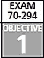Introducing Directory Services

正如熟悉网络的人所知，网络可能由大量元素组成，包括用户帐户、文件服务器、卷、传真服务器、打印机、应用程序、数据库和其他共享资源。由于随着组织的发展构成网络的对象的数量增加，找到和管理这些帐户和资源变得越困难，网络越大。为了使庞大的企业网络更易于管理，目录服务用于存储有关用户和资源的信息集合，以便它们在网络中得到组织和访问。

目录允许帐户和资源以逻辑、层次化的方式组织，以便可以轻松找到信息。通过搜索目录，用户可以找到所需的资源，管理员能够轻松有效地控制和配置帐户和资源。将此信息保存在集中位置可确保用户和管理员不必浪费时间查看每个服务器上有哪些可用内容，他们只需参考目录即可。

从表面上看，目录服务的概念似乎令人望而生畏。然而，即使您不熟悉目录服务，您可能也熟悉目录的一般概念。在电话目录中，电话公司管理的每个帐户都由电话号码唯一标识，并包括诸如个人姓名和地址等属性。每个帐户都需要唯一标识，以免混淆——您不希望拨打一个人的电话号码，却接通了另一个人。为了更轻松地查找信息，电话目录的结构允许以多种方式查找信息。您可以查找某人的姓名然后查看其电话号码，也可以使用其他属性搜索条目，例如使用黄页查看企业类别。目录服务应用了同样的基本概念。

任何目录（无论用于何种用途）都是由对象及其属性组成的结构化信息源。与电话目录的情况一样，网络目录包含具有不同属性的唯一标识对象。此类数据可以提供给应用程序、操作系统服务、网络管理员和其他授权用户。拥有目录访问权限的人可以查找对象，然后查看其属性。如果他们拥有足够的权限（例如管理员的情况），则可以修改对象。这些属性可用于提供用户可访问的信息，或在粒度级别上控制安全。

目录中的对象和属性可以用多种方式使用。例如，用户可能需要使用彩色打印机，但不知道打印机的名称。为了找到这台打印机，用户可能知道它位于二楼，并搜索目录中具有此信息的属性。同样，用户帐户可以包括用户名、密码、用户姓名、地址、电话号码以及有关该人的其他相关信息等属性。如果某人有权查看另一个用户对象的属性，他或她可以访问这些数据并查找如何联系该其他用户的信息。


由于用户可以从网络上的任何位置访问账户信息，因此目录服务允许用户使用一次登录即可登录到多台服务器。单次登录是目录服务的重要功能，因为如果没有它，用户必须登录到提供所需资源的每台服务器。这在 Windows NT 网络中很常见，在那里管理员必须在用户需要访问的每台服务器上创建不同的账户。然后用户需要分别登录到每台服务器。这与 Windows 2000/2003 的目录服务的工作方式有显著不同，在该服务中，用户只需登录网络一次即可使用已获授权的任何资源。

复杂的目录服务使管理员能够在网络的任何位置组织信息、控制安全以及管理用户和资源。信息存储在中央存储库中，并复制到网络上的不同服务器。它允许在需要时访问数据，并免去管理员为管理账户而访问每台服务器的麻烦。这降低了管理网络所需的工作量，同时提供对权限的精细控制。管理员只需修改一次用户账户或其他对象，这些安全更改就会在整个网络中复制。

目录服务多年来已在不同的网络操作系统中使用，并被证明是一种有用且强大的技术。随之，微软在 Windows NT 上创建了自己的目录服务实现，称为 NTDS，随后在较新的服务器版本上推出了 Active Directory。NTDS 使用扁平命名空间，与 Active Directory 的层次结构和功能集相比，其功能有限。Active Directory 最早在 Windows 2000 中引入，并继续为 Windows Server 2003 系列服务器提供目录服务。它可以安装在 Windows Server 2003 的标准版、企业版和数据中心版上，并为使用这些服务器的任何网络提供必要的[content]
由于用户可以从网络上的任何位置访问账户信息，因此目录服务允许用户使用一次登录即可登录到多台服务器。单次登录是目录服务的重要功能，因为如果没有它，用户必须登录到提供所需资源的每台服务器。这在 Windows NT 网络中很常见，在那里管理员必须在用户需要访问的每台服务器上创建不同的账户。然后用户需要分别登录到每台服务器。这与 Windows 2000/2003 的目录服务的工作方式有显著不同，在该服务中，用户只需登录网络一次即可使用已获授权的任何资源。

复杂的目录服务使管理员能够在网络的任何位置组织信息、控制安全以及管理用户和资源。信息存储在中央存储库中，并复制到网络上的不同服务器。它允许在需要时访问数据，并免去管理员为管理账户而访问每台服务器的麻烦。这降低了管理网络所需的工作量，同时提供对权限的精细控制。管理员只需修改一次用户账户或其他对象，这些安全更改就会在整个网络中复制。

目录服务多年来已在不同的网络操作系统中使用，并被证明是一种有用且强大的技术。随之，微软在 Windows NT 上创建了自己的目录服务实现，称为 NTDS，随后在较新的服务器版本上推出了 Active Directory。NTDS 使用扁平命名空间，与 Active Directory 的层次结构和功能集相比，其功能有限。Active Directory 最早在 Windows 2000 中引入，并继续为 Windows Server 2003 系列服务器提供目录服务。它可以安装在 Windows Server 2003 的标准版、企业版和数据中心版上，并为使用这些服务器的任何网络提供必要的[content]
由于用户可以从网络上的任何位置访问账户信息，因此目录服务允许用户使用一次登录即可登录到多台服务器。单次登录是目录服务的重要功能，因为如果没有它，用户必须登录到提供所需资源的每台服务器。这在 Windows NT 网络中很常见，在那里管理员必须在用户需要访问的每台服务器上创建不同的账户。然后用户需要分别登录到每台服务器。这与 Windows 2000/2003 的目录服务的工作方式有显著不同，在该服务中，用户只需登录网络一次即可使用已获授权的任何资源。

复杂的目录服务使管理员能够在网络的任何位置组织信息、控制安全以及管理用户和资源。信息存储在中央存储库中，并复制到网络上的不同服务器。它允许在需要时访问数据，并免去管理员为管理账户而访问每台服务器的麻烦。这降低了管理网络所需的工作量，同时提供对权限的精细控制。管理员只需修改一次用户账户或其他对象，这些安全更改就会在整个网络中复制。

目录服务多年来已在不同的网络操作系统中使用，并被证明是一种有用且强大的技术。随之，微软在 Windows NT 上创建了自己的目录服务实现，称为 NTDS，随后在较新的服务器版本上推出了 Active Directory。NTDS 使用扁平命名空间，与 Active Directory 的层次结构和功能集相比，其功能有限。Active Directory 最早在 Windows 2000 中引入，并继续为 Windows Server 2003 系列服务器提供目录服务。它可以安装在 Windows Server 2003 的标准版、企业版和数据中心版上，并为使用这些服务器的任何网络提供必要的[content]
由于用户可以从网络上的任何位置访问账户信息，因此目录服务允许用户使用一次登录即可登录到多台服务器。单次登录是目录服务的重要功能，因为如果没有它，用户必须登录到提供所需资源的每台服务器。这在 Windows NT 网络中很常见，在那里管理员必须在用户需要访问的每台服务器上创建不同的账户。然后用户需要分别登录到每台服务器。这与 Windows 2000/2003 的目录服务的工作方式有显著不同，在该服务中，用户只需登录网络一次即可使用已获授权的任何资源。

复杂的目录服务使管理员能够在网络的任何位置组织信息、控制安全以及管理用户和资源。信息存储在中央存储库中，并复制到网络上的不同服务器。它允许在需要时访问数据，并免去管理员为管理账户而访问每台服务器的麻烦。这降低了管理网络所需的工作量，同时提供对权限的精细控制。管理员只需修改一次用户账户或其他对象，这些安全更改就会在整个网络中复制。

目录服务多年来已在不同的网络操作系统中使用，并被证明是一种有用且强大的技术。随之，微软在 Windows NT 上创建了自己的目录服务实现，称为 NTDS，随后在较新的服务器版本上推出了 Active Directory。NTDS 使用扁平命名空间，与 Active Directory 的层次结构和功能集相比，其功能有限。Active Directory 最早在 Windows 2000 中引入，并继续为 Windows Server 2003 系列服务器提供目录服务。它可以安装在 Windows Server 2003 的标准版、企业版和数据中心版上，并为使用这些服务器的任何网络提供必要的[content]
由于用户可以从网络上的任何位置访问账户信息，因此目录服务允许用户使用一次登录即可登录到多台服务器。单次登录是目录服务的重要功能，因为如果没有它，用户必须登录到提供所需资源的每台服务器。这在 Windows NT 网络中很常见，在那里管理员必须在用户需要访问的每台服务器上创建不同的账户。然后用户需要分别登录到每台服务器。这与 Windows 2000/2003 的目录服务的工作方式有显著不同，在该服务中，用户只需登录网络一次即可使用已获授权的任何资源。

复杂的目录服务使管理员能够在网络的任何位置组织信息、控制安全以及管理用户和资源。信息存储在中央存储库中，并复制到网络上的不同服务器。它允许在需要时访问数据，并免去管理员为管理账户而访问每台服务器的麻烦。这降低了管理网络所需的工作量，同时提供对权限的精细控制。管理员只需修改一次用户账户或其他对象，这些安全更改就会在整个网络中复制。

目录服务多年来已在不同的网络操作系统中使用，并被证明是一种有用且强大的技术。随之，微软在 Windows NT 上创建了自己的目录服务实现，称为 NTDS，随后在较新的服务器版本上推出了 Active Directory。NTDS 使用扁平命名空间，与 Active Directory 的层次结构和功能集相比，其功能有限。Active Directory 最早在 Windows 2000 中引入，并继续为 Windows Server 2003 系列服务器提供目录服务。它可以安装在 Windows Server 2003 的标准版、企业版和数据中心版上，并为使用这些服务器的任何网络提供必要的[content]
由于用户可以从网络上的任何位置访问账户信息，因此目录服务允许用户使用一次登录即可登录到多台服务器。单次登录是目录服务的重要功能，因为如果没有它，用户必须登录到提供所需资源的每台服务器。这在 Windows NT 网络中很常见，在那里管理员必须在用户需要访问的每台服务器上创建不同的账户。然后用户需要分别登录到每台服务器。这与 Windows 2000/2003 的目录服务的工作方式有显著不同，在该服务中，用户只需登录网络一次即可使用已获授权的任何资源。

复杂的目录服务使管理员能够在网络的任何位置组织信息、控制安全以及管理用户和资源。信息存储在中央存储库中，并复制到网络上的不同服务器。它允许在需要时访问数据，并免去管理员为管理账户而访问每台服务器的麻烦。这降低了管理网络所需的工作量，同时提供对权限的精细控制。管理员只需修改一次用户账户或其他对象，这些安全更改就会在整个网络中复制。

目录服务多年来已在不同的网络操作系统中使用，并被证明是一种有用且强大的技术。随之，微软在 Windows NT 上创建了自己的目录服务实现，称为 NTDS，随后在较新的服务器版本上推出了 Active Directory。NTDS 使用扁平命名空间，与 Active Directory 的层次结构和功能集相比，其功能有限。Active Directory 最早在 Windows 2000 中引入，并继续为 Windows Server 2003 系列服务器提供目录服务。它可以安装在 Windows Server 2003 的标准版、企业版和数据中心版上，并为使用这些服务器的任何网络提供必要的[content]
由于用户可以从网络上的任何位置访问账户信息，因此目录服务允许用户使用一次登录即可登录到多台服务器。单次登录是目录服务的重要功能，因为如果没有它，用户必须登录到提供所需资源的每台服务器。这在 Windows NT 网络中很常见，在那里管理员必须在用户需要访问的每台服务器上创建不同的账户。然后用户需要分别登录到每台服务器。这与 Windows 2000/2003 的目录服务的工作方式有显著不同，在该服务中，用户只需登录网络一次即可使用已获授权的任何资源。

复杂的目录服务使管理员能够在网络的任何位置组织信息、控制安全以及管理用户和资源。信息存储在中央存储库中，并复制到网络上的不同服务器。它允许在需要时访问数据，并免去管理员为管理账户而访问每台服务器的麻烦。这降低了管理网络所需的工作量，同时提供对权限的精细控制。管理员只需修改一次用户账户或其他对象，这些安全更改就会在整个网络中复制。

目录服务多年来已在不同的网络操作系统中使用，并被证明是一种有用且强大的技术。随之，微软在 Windows NT 上创建了自己的目录服务实现，称为 NTDS，随后在较新的服务器版本上推出了 Active Directory。NTDS 使用扁平命名空间，与 Active Directory 的层次结构和功能集相比，其功能有限。Active Directory 最早在 Windows 2000 中引入，并继续为 Windows Server 2003 系列服务器提供目录服务。它可以安装在 Windows Server 2003 的标准版、企业版和数据中心版上，并为使用这些服务器的任何网络提供必要的[content]
由于用户可以从网络上的任何位置访问账户信息，因此目录服务允许用户使用一次登录即可登录到多台服务器。单次登录是目录服务的重要功能，因为如果没有它，用户必须登录到提供所需资源的每台服务器。这在 Windows NT 网络中很常见，在那里管理员必须在用户需要访问的每台服务器上创建不同的账户。然后用户需要分别登录到每台服务器。这与 Windows 2000/2003 的目录服务的工作方式有显著不同，在该服务中，用户只需登录网络一次即可使用已获授权的任何资源。

复杂的目录服务使管理员能够在网络的任何位置组织信息、控制安全以及管理用户和资源。信息存储在中央存储库中，并复制到网络上的不同服务器。它允许在需要时访问数据，并免去管理员为管理账户而访问每台服务器的麻烦。这降低了管理网络所需的工作量，同时提供对权限的精细控制。管理员只需修改一次用户账户或其他对象，这些安全更改就会在整个网络中复制。

目录服务多年来已在不同的网络操作系统中使用，并被证明是一种有用且强大的技术。随之，微软在 Windows NT 上创建了自己的目录服务实现，称为 NTDS，随后在较新的服务器版本上推出了 Active Directory。NTDS 使用扁平命名空间，与 Active Directory 的层次结构和功能集相比，其功能有限。Active Directory 最早在 Windows 2000 中引入，并继续为 Windows Server 2003 系列服务器提供目录服务。它可以安装在 Windows Server 2003 的标准版、企业版和数据中心版上，并为使用这些服务器的任何网络提供必要的[content]
由于用户可以从网络上的任何位置访问账户信息，因此目录服务允许用户使用一次登录即可登录到多台服务器。单次登录是目录服务的重要功能，因为如果没有它，用户必须登录到提供所需资源的每台服务器。这在 Windows NT 网络中很常见，在那里管理员必须在用户需要访问的每台服务器上创建不同的账户。然后用户需要分别登录到每台服务器。这与 Windows 2000/2003 的目录服务的工作方式有显著不同，在该服务中，用户只需登录网络一次即可使用已获授权的任何资源。

复杂的目录服务使管理员能够在网络的任何位置组织信息、控制安全以及管理用户和资源。信息存储在中央存储库中，并复制到网络上的不同服务器。它允许在需要时访问数据，并免去管理员为管理账户而访问每台服务器的麻烦。这降低了管理网络所需的工作量，同时提供对权限的精细控制。管理员只需修改一次用户账户或其他对象，这些安全更改就会在整个网络中复制。

目录服务多年来已在不同的网络操作系统中使用，并被证明是一种有用且强大的技术。随之，微软在 Windows NT 上创建了自己的目录服务实现，称为 NTDS，随后在较新的服务器版本上推出了 Active Directory。NTDS 使用扁平命名空间，与 Active Directory 的层次结构和功能集相比，其功能有限。Active Directory 最早在 Windows 2000 中引入，并继续为 Windows Server 2003 系列服务器提供目录服务。它可以安装在 Windows Server 2003 的标准版、企业版和数据中心版上，并为使用这些服务器的任何网络提供必要的[content]
由于用户可以从网络上的任何位置访问账户信息，因此目录服务允许用户使用一次登录即可登录到多台服务器。单次登录是目录服务的重要功能，因为如果没有它，用户必须登录到提供所需资源的每台服务器。这在 Windows NT 网络中很常见，在那里管理员必须在用户需要访问的每台服务器上创建不同的账户。然后用户需要分别登录到每台服务器。这与 Windows 2000/2003 的目录服务的工作方式有显著不同，在该服务中，用户只需登录网络一次即可使用已获授权的任何资源。

复杂的目录服务使管理员能够在网络的任何位置组织信息、控制安全以及管理用户和资源。信息存储在中央存储库中，并复制到网络上的不同服务器。它允许在需要时访问数据，并免去管理员为管理账户而访问每台服务器的麻烦。这降低了管理网络所需的工作量，同时提供对权限的精细控制。管理员只需修改一次用户账户或其他对象，这些安全更改就会在整个网络中复制。

目录服务多年来已在不同的网络操作系统中使用，并被证明是一种有用且强大的技术。随之，微软在 Windows NT 上创建了自己的目录服务实现，称为 NTDS，随后在较新的服务器版本上推出了 Active Directory。NTDS 使用扁平命名空间，与 Active Directory 的层次结构和功能集相比，其功能有限。Active Directory 最早在 Windows 2000 中引入，并继续为 Windows Server 2003 系列服务器提供目录服务。它可以安装在 Windows Server 2003 的标准版、企业版和数据中心版上，并为使用这些服务器的任何网络提供必要的[content]
由于用户可以从网络上的任何位置访问账户信息，因此目录服务允许用户使用一次登录即可登录到多台服务器。单次登录是目录服务的重要功能，因为如果没有它，用户必须登录到提供所需资源的每台服务器。这在 Windows NT 网络中很常见，在那里管理员必须在用户需要访问的每台服务器上创建不同的账户。然后用户需要分别登录到每台服务器。这与 Windows 2000/2003 的目录服务的工作方式有显著不同，在该服务中，用户只需登录网络一次即可使用已获授权的任何资源。

复杂的目录服务使管理员能够在网络的任何位置组织信息、控制安全以及管理用户和资源。信息存储在中央存储库中，并复制到网络上的不同服务器。它允许在需要时访问数据，并免去管理员为管理账户而访问每台服务器的麻烦。这降低了管理网络所需的工作量，同时提供对权限的精细控制。管理员只需修改一次用户账户或其他对象，这些安全更改就会在整个网络中复制。

目录服务多年来已在不同的网络操作系统中使用，并被证明是一种有用且强大的技术。随之，微软在 Windows NT 上创建了自己的目录服务实现，称为 NTDS，随后在较新的服务器版本上推出了 Active Directory。NTDS 使用扁平命名空间，与 Active Directory 的层次结构和功能集相比，其功能有限。Active Directory 最早在 Windows 2000 中引入，并继续为 Windows Server 2003 系列服务器提供目录服务。它可以安装在 Windows Server 2003 的标准版、企业版和数据中心版上，并为使用这些服务器的任何网络提供必要的[content]
## 班级之首…

### 目录服务的简史

目录服务早在微软实现 Active Directory 之前就已存在。1984 年，Banyan 为企业网络提供了首个目录服务。该产品名为 StreetTalk，为运行 Banyan VINES 的网络提供企业目录服务。此后，许多其他网络操作系统演进为使用目录服务作为存储与网络组件相关信息的方法。

Novell 也为其网络操作系统 NetWare 提供了目录服务。1993 年，NetWare 4 引入了一个面向对象的目录，称为 NetWare Directory Services，后来更名为 Novell Directory Services (NDS)。NDS 使用层次结构并为 NetWare 的新功能提供了基础。NDS 演进为 eDirectory，提供了更多功能以及不同使用其目录服务的操作系统之间的互操作性。

微软也在其网络操作系统中加入了目录服务。1993 年，Windows NT Server 的首次发布包含了 Windows NT 目录服务 (NTDS)，NTDS 提供了单一管理点，允许您管理每个域最多 25,000 个用户。当 Windows 2000 Server 发布时，目录服务支持的对象数量大幅跃升。Active Directory 理论上每个域支持多达 1000 万个对象，100 万个对象是更实际的估计。此外，Active Directory 使用层次命名空间，并提供比 Windows NT 中的目录服务显著更多的功能。

当目录服务在 20 世纪 80 年代中期仍是网络新事物时，缺乏控制目录服务开发的通用标准。不同的标准被用来确定目录应如何运行。国际电信联盟（当时称为国际电报电话咨询委员会）正在开发一个目录，允许从目录服务中查找信息（电话号码和其他数据）。国际标准化组织 (ISO) 也在使用开放系统互连 (OSi) 的网络功能和应用程序方面制定标准。这些不同的规范经过一段时间后合并成为 X.500。

X.500 标准的一部分规定了如何在目录中访问信息。目录访问协议 (DAP) 被开发出来以允许客户端和目录服务器之间进行通信，但 DAP 中的功能数量使其在个人计算机上效率低下。通过从 DAP 中删除部分代码并限制功能，开发出了一种更轻量级的 DAP 版本，称为轻量级目录访问协议 (LDAP)。该协议和 X.500 标准被 Active Directory 和其他目录服务使用，并提供不同系统之间的互操作性。

### 术语和概念

在深入研究 Active Directory 的具体细节之前，讨论一些概念和术语以了解目录服务的功能和特性是很重要的。如同所有技术相关的事物，某些与 Active Directory 和 Windows Server 2003 相关的词语和短语有助于识别和定义网络的特定组件。无论您是 Active Directory 的新手还是使用过早期版本，有经验的用户，这里提供的信息将帮助您理解本书后续的其他主题。

阅读本节时，重要的是要意识到这是一个概述，我们将在后面更详细地讨论这些主题。我们定义了本书中使用的一些术语，并查看了我们在后续章节中会在此基础上构建的概念。

我们在以下子节中讨论的一些术语和概念包括：

 目录数据存储
 目录分区
 基于策略的管控
 DAP 和 LDAP
 Active Directory 中使用的命名方案

#### 目录数据存储

Active Directory 不仅仅是一种提供目录服务访问的服务；它也是存储网络元素数据的方法。如果没有保存配置和目录数据的地方，每次关闭服务器时您都会丢失这些信息。数据存储包含大量信息，包括与用户、组、计算机、它们可以访问的资源以及网络的其他组件相关的数据。因为 Active Directory 数据存储是所有目录信息的数据库，所以它也被称为目录。

当您在 Windows Server 2003 服务器上安装目录时，Active Directory 数据源会放置在服务器的硬盘上。用于存储目录信息的文件称为 `NTDS.DIT`，位于 `systemroot` 中的 `NTDS` 文件夹中（例如，`C:\\WINDOWS`）。对目录所做的任何更改都会保存到此文件中。


### Active Directory 数据存储影响

Active Directory 数据存储存在于 Windows Server 2003 服务器上，对该服务器在网络中的角色具有重大影响。如图 1.1 所示，目录存储在 DC 上，DC 是具有数据存储可写副本的服务器。DC 用于管理域，域是共享（或包含在）同一目录中的计算机、用户和其他对象的组。使用不同 Active Directory 数据源的域仍可以相互通信，但（如本章后面将看到的）它们之间必须配置安全关系。

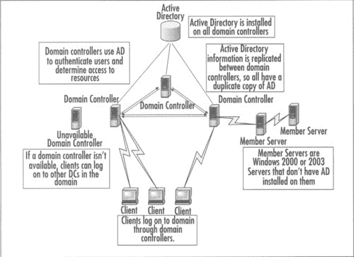

图 1.1 Active Directory、域控制器、成员服务器和客户端之间的关系

每个 DC 都保留自己的目录副本，其中包含其所在域的信息。如果一个 DC 变得不可用，用户和计算机仍可访问该域中另一个 DC 上的 Active Directory 数据存储。这使用户即使通常使用的 DC 不可用也能继续登录网络。它还允许需要目录信息的计算机和应用程序在其中一台服务器宕机时继续运行。

由于一个域可以拥有多个 DC，因此在其中一个 DC 上对目录所做的更改必须更新到其他 DC 上。复制这些更新的过程称为复制，用于同步目录中的信息。如果没有复制，Active Directory 中的功能将无法正常运行。例如，如果你在其中一个 DC 上添加了一个用户，新账户将被添加到该服务器的目录存储中。这将允许用户登录到该域控制器，但他或她仍无法登录到其他 DC，直到这些目录更改被复制。当在其中一个 DC 上进行更改时，更改需要快速复制，以便每个 DC 始终拥有 Active Directory 的准确重复副本。

## 目录分区和复制效率

由于复制对于使目录在整个网络中保持一致非常重要，因此数据源被组织成一种使复制更高效的方式。并非每条数据都保存在数据源的同一位置。如图 1.2 所示，信息驻留在目录的不同区域，称为目录分区。由于 Active Directory 是一个逻辑分层结构，它具有类似 Windows 注册表或硬盘上文件夹的树状结构。数据存储在目录的子树中，就像硬盘上的数据存储在彼此嵌套的文件夹中一样。目录中每个连续的子树都是一个分区。目录分区内发生的任何数据更改都作为一个整体单元复制到其他 DC。

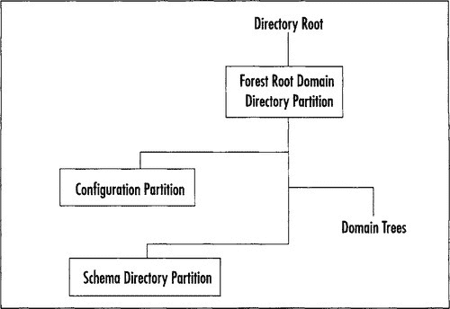

图 1.2 Active Directory 是一个分层结构

在 Active Directory 中，任何 DC 上都存在三个分区并且必须被复制，因为这些分区包含 Microsoft 网络正常运行所需的数据：

 域分区

 配置分区

 架构分区

### 注意

目录分区不应与磁盘分区混淆。磁盘分区用于逻辑上分隔硬盘，以便从单个硬盘驱动器运行多个操作系统，或使单个硬盘看起来实际上不止一个。例如，如果你的计算机上有一个硬盘，`C:` 驱动器，你可能会将其分区为两个逻辑驱动器，这样系统现在就有了 `C:` 和 `D:` 驱动器。虽然这对于组织存储在硬盘上的文件很有用，但与 Active Directory 的分区方式无关。

目录在物理上是一个数据库，其中信息存储在表中，在逻辑上是一个由容器和对象组成的名字层次结构。以这种方式对信息进行分区是为了允许数据存储在不同的区域。正如我们将在下面的段落中看到的，这些分区由存储域、配置、架构和应用程序信息的容器组成。

## 域分区

域分区包含有关域的信息。这包括有关用户、计算机、资源以及各自相关属性的信息。如果没有复制这些数据，任何更改都将仅限于进行更改的服务器，而其他服务器将使用旧设置。例如，如果域数据未被复制并且你在其中一个 DC 上禁用了用户账户，该用户仍能够登录到其他 DC。域分区很重要，因为它包含有关对象及其属性的信息，这些是网络的基本元素。

## 配置分区

配置数据涉及 Active Directory 的拓扑结构，并包括有关网络中域、域树和林如何配置的信息。域树是域的结构。如果域树中有多个域，则在这些域之间设置信任，以便它们可以在彼此之间共享数据和资源。林也由共享目录数据的多个域组成。它由通过信任连接的一个或多个树组成。配置分区还包括有关 DC 和 GC 位置的信息，GC 是 Active Directory 中包含的数据子集，用于在多个域中提供搜索和登录功能。我们将在本章后面更详细地讨论这些主题。

## 架构分区

由于 Active Directory 由不同的对象组成，并且每个对象都有特定的属性，因此必须创建某些规则来控制目录中可以存在哪些对象以及每个对象的属性。例如，用户账户具有包括密码、账户名以及该账户所属人员的名和姓在内的属性。Active Directory 中存在哪些类型的对象以及每种类型具有哪些属性是由架构决定的。架构分区包含定义域内使用的对象类和属性的信息。它决定了 Active Directory 中可以存在哪些对象，以及每个对象可以具有哪些属性。

## 应用程序分区

Windows Server 2003 服务器还可以创建一个或多个应用程序分区，用于存储特定于网络上运行的不同应用程序的数据。程序可以使用此分区存储服务器上运行程序时所需设置。我们将在本章后面更详细地讨论这一点。

## 配置与实施：为目录提供最佳可能的保护

除了 Windows 2000 服务器之外，Active Directory 只能安装在 Microsoft Windows Server 2003 Standard Edition、Windows Server 2003 Enterprise Edition 和 Windows Server 2003 Datacenter Edition 上。当服务器被配置为这些版本中的任何一个上的 DC 时，目录的可写副本将存储在服务器的硬盘上。由于任何文件都可能损坏、被破坏或受到损害（例如在黑客攻击或病毒的情况下），你应采取措施确保目录在你的服务器上是安全的。

如果只使用一个 DC，则只会存在一个 `NTDS.DIT` 文件，这意味着该域的目录只有一个副本。该服务器故障或 `NTDS.DIT` 文件损坏将导致网络瘫痪。用户将无法登录，计算机将无法从目录中访问所需信息，并且网络上的任何配置都可能丢失。与其希望你的唯一 DC 永远不会出问题，明智的做法是在网络上使用多个 DC。


如果在一个域中存在多个 `DC`，对 `NTDS.DIT` 的任何更新都将被复制到其他 `DCs`。这样可以在网络上存在目录的多个副本，如果一台服务器失败，提供了一定程度的容错能力。如果其中一台失败，另一台可以继续对用户进行身份验证，提供服务并提供资源访问。

由于 `NTDS.DIT` 文件的重要性，存储它的驱动器应格式化为 `NTFS` 格式。`NTFS` 是一种文件格式，允许实现最佳的保护级别，使您可以设置谁可以在本地和通过网络访问目录和 `NTDS.DIT` 文件的权限。这样的权限无法设置在格式化为 `FAT16` 或 `FAT32` 的硬盘上。限制对该文件的访问可以降低有人意外或恶意损坏或删除数据源的可能性。

同时也必须记住，采取任何措施保护 Active Directory 免受损害并不能消除执行定期备份的需要。执行备份时，计算机上的数据会被复制到其他介质（如磁带、CD 或 DVD），然后可以存储在另一个位置。如果出现任何问题，您可以恢复任何受损或丢失的文件。

## 基于策略的管理

在大型网络中可能有数百或数千个用户和计算机。逐个账户并配置设置是一项繁琐的任务。例如，想象一下必须去每台计算机更改桌面，以便显示公司标志作为背景图像。相比访问每台计算机，在一个位置进行此类更改并使这些设置适用于所有人要容易得多。这就是基于策略的管理对 Active Directory 如此有益的原因：它使账户管理变得更容易。

组策略允许您将默认设置应用于用户组和组。策略可用于：

 控制决定计算机显示属性的桌面设置。

 分配在登录、注销、启动和关闭时运行的脚本。

 强制执行密码安全，例如通过设置最小密码长度、密码必须更改前的最长时间等。

 将文件夹从本地计算机重定向到网络计算机上的文件夹，例如当 `My Documents` 文件夹被重定向以使用服务器上的特定文件夹时。

 部署应用程序，以便某些成员可以获得可供安装的程序或自动安装。

正如我们在后面的章节中将看到的那样，这些只是管理员在管理网络上的用户和计算机时可用的众多选项中的几个。

当创建策略时，它们会作为组策略对象 (`GPOs`) 存储在 Active Directory 中。`GPO` 中的设置可以应用于站点、域或 `OU`。`OU` 是 Active Directory 中的一个容器，可以包含用户、组、计算机或其他 `OU`。我们将在本章后面更详细地讨论 `OU`。由于 `GPOs` 可以应用于不同级别，您可以为公司的不同区域设置不同的策略。例如，您可以为财务部门的用户创建一个组策略，为销售部门创建另一个策略（将财务用户放在一个 `OU` 中，将销售用户放在另一个 `OU` 中）。如果您为不同的分支机构有不同的域，您可以为每个域中的销售部门设置不同的设置。以这种方式使用 `GPOs`，您可以配置将为特定用户组和计算机使用的设置。

## 目录访问协议

为了让客户端在登录网络时搜索对象、更新信息并与 `DCs` 通信，必须使用目录访问协议。协议是一组规定数据如何在网络上传输的规则。目录访问协议用于与目录服务交换信息的特定目的。

Active Directory 使用 `LDAP` 进行客户端与目录服务器之间的通信。`LDAP` 是 `X.500` 目录访问协议 (`DAP`) 的一个版本，并且被认为很轻量，因为它使用的代码比 `DAP` 少。

`X.500` 是一个已建立的标准，定义了目录服务。它由国际电信联盟开发并由国际标准化组织发布。`DAP` 是 `X.500` 定义的协议之一。由于它包含的功能太多，无法在个人计算机、瘦客户端和通过互联网通信时高效使用，因此开发了一个功能更少、更轻量级的版本。如前所述，`DAP` 的这个轻量级版本是 `LDAP`。

互联网工程任务组 (`IETF`) 为 `LDAP` 建立了行业标准，使各种目录服务能够通过本地网络和互联网使用 `LDAP`。许多使用目录服务的网络操作系统（包括 Novell NetWare、Windows 2000 和 Windows Server 2003）实现 `LDAP` 来访问目录，而其他产品（如 Internet 浏览器）则将其作为查找资源或管理目录的方法。自 1994 年推出以来，`LDAP` 已有多个版本，随着需求的变化不断添加功能。Active Directory 支持版本 2 和 3。

## 命名方案

Active Directory 支持几种常见的对象命名格式。通过使用不同的命名对象方法，它允许以多种方式访问对象。提供不同的命名方案还为可能不支持其中一种或多种格式的旧系统提供了向后兼容性。Active Directory 支持的命名方案包括：

 域名系统 (`DNS`)

 用户主体名称 (`UPN`)

 通用命名约定 (`UNC`)

 统一资源定位符 (`URL`)

 轻型目录访问协议统一资源定位符 (`LDAP URL`)

`DNS` 用于将域名解析为 IP 地址。您可能在使用互联网时熟悉这种方法。记住您想要访问的每个网站或服务器的 IP 地址是困难的或不可能的。`DNS` 是一个分层、分布式的数据库，允许客户端通过输入用户友好的域名（如 [knightware.ca](http://www.knightware.ca)）来查找特定资源，然后查找该域的 IP 地址。

在 Active Directory 中，域通常被赋予 `DNS` 名称（如 [syngress.com](http://www.syngress.com)）。由于 Windows 域在 Windows 2000 之前未使用此命名方案，因此每个域还被赋予一个与 Windows NT 网络中使用的名称兼容的名称。这些 Windows 2000 之前的名称是 `NetBIOS` 名称，是单字名称，旧操作系统用户可以使用它们登录到 Active Directory。这允许客户端通过使用格式 `domain name\\username` 输入域名和用户名来登录域。

`UPNs` 基于 `IETF` 的 `RFC 822`。Active Directory 中的每个用户账户都有一个登录名和 `UPN` 后缀。登录名是账户名，`UPN` 后缀是用户将登录到的域。两者由 @ 符号连接，使登录看起来像 Internet 电子邮件地址（`username@domain`）。输入用户名后，用户通常需要输入密码以证明他或她有权使用此账户。


# Active Directory 命名和标识

## 用户账户登录名

当为用户账户创建 `UPN` 时，`Active Directory` 还会建议一个 Windows 2000 之前的登录名，该登录名由安全账户管理器 (`SAM`) 用于登录到服务器。`SAM` 是一个存储用户账户信息及其所属组信息的服务。本地计算机账户使用 `SAM` 来存储用于访问本地计算机的账户，而 `Windows NT` 服务器使用它来允许网络用户访问服务器上的资源。尽管你可以创建自己的登录名，`Active Directory` 会建议一个基于 `Active Directory` 登录名前 20 个字节的 Windows 2000 之前的用户登录名。

## 计算机账户名称和 FQDN

在 `Active Directory` 中创建的每个计算机账户也具有多个名称，以便以多种方式识别和访问该账户。当在 `Active Directory` 中创建计算机账户时，你需要为计算机输入一个名称，该名称将在域中唯一标识它。这是机器的主机名，可由 `DNS` 用于指示其在域中的位置，并且可用于在客户端在网络上搜索它及其资源时帮助找到计算机。

在 `DNS` 中，主机名与域名组合在一起形成计算机的完全限定域名 (`FQDN`)。这将主机名与域名组合在一起，并用句点分隔两者。例如，如果你在名为 `knightware.ca` 的域中有一台名为 `COMP100` 的计算机，则该计算机的 `FQDN` 将为 `comp100.knightware.ca`。域中不能有两台计算机具有相同的名称，否则会产生冲突。

创建计算机账户时，还需要为计算机提供一个 Windows 2000 之前的名称，以便旧客户端和服务器可以识别和访问它。与用户账户一样，`Windows Server 2003` 会建议一个名称，该名称基于用于创建账户的名称的前 15 个字节。如果不想使用此默认名称，可以随时输入新名称。

## UNC 路径

`UNC` 路径是访问网络上共享资源的一种久经考验的方法。它使用两个反斜杠的格式，后跟域名或服务器名称、共享名称以及（在适用情况下）资源名称。共享资源通常是共享目录的名称，后面可能跟随服务器上的文件、应用程序或其他资源的名称。换句话说，格式为 `\\domain name\\share\\filename` 或 `\\servername\\share\\filename`。例如，如果你要访问服务器 `FS-GOTHAM` 上名为 `XLS` 的共享目录中的名为 `SPREAD-SHEET.XLS` 的文件，则访问它的 `UNC` 为 `\\fs-gotham\\xls\\spreadsheet.xls`。你可以在浏览器的地址栏中、Windows 开始菜单的 `Run` 命令中或允许使用 `UNC` 名称的任何其他位置使用 `UNC` 名称。

## URLs

通过浏览器访问资源[content]
# Active Directory 命名和标识

## 用户账户登录名

当为用户账户创建 `UPN` 时，`Active Directory` 还会建议一个 Windows 2000 之前的登录名，该登录名由安全账户管理器 (`SAM`) 用于登录到服务器。`SAM` 是一个存储用户账户信息及其所属组信息的服务。本地计算机账户使用 `SAM` 来存储用于访问本地计算机的账户，而 `Windows NT` 服务器使用它来允许网络用户访问服务器上的资源。尽管你可以创建自己的登录名，`Active Directory` 会建议一个基于 `Active Directory` 登录名前 20 个字节的 Windows 2000 之前的用户登录名。

## 计算机账户名称和 FQDN

在 `Active Directory` 中创建的每个计算机账户也具有多个名称，以便以多种方式识别和访问该账户。当在 `Active Directory` 中创建计算机账户时，你需要为计算机输入一个名称，该名称将在域中唯一标识它。这是机器的主机名，可由 `DNS` 用于指示其在域中的位置，并且可用于在客户端在网络上搜索它及其资源时帮助找到计算机。

在 `DNS` 中，主机名与域名组合在一起形成计算机的完全限定域名 (`FQDN`)。这将主机名与域名组合在一起，并用句点分隔两者。例如，如果你在名为 `knightware.ca` 的域中有一台名为 `COMP100` 的计算机，则该计算机的 `FQDN` 将为 `comp100.knightware.ca`。域中不能有两台计算机具有相同的名称，否则会产生冲突。

创建计算机账户时，还需要为计算机提供一个 Windows 2000 之前的名称，以便旧客户端和服务器可以识别和访问它。与用户账户一样，`Windows Server 2003` 会建议一个名称，该名称基于用于创建账户的名称的前 15 个字节。如果不想使用此默认名称，可以随时输入新名称。

## UNC 路径

`UNC` 路径是访问网络上共享资源的一种久经考验的方法。它使用两个反斜杠的格式，后跟域名或服务器名称、共享名称以及（在适用情况下）资源名称。共享资源通常是共享目录的名称，后面可能跟随服务器上的文件、应用程序或其他资源的名称。换句话说，格式为 `\\domain name\\share\\filename` 或 `\\servername\\share\\filename`。例如，如果你要访问服务器 `FS-GOTHAM` 上名为 `XLS` 的共享目录中的名为 `SPREAD-SHEET.XLS` 的文件，则访问它的 `UNC` 为 `\\fs-gotham\\xls\\spreadsheet.xls`。你可以在浏览器的地址栏中、Windows 开始菜单的 `Run` 命令中或允许使用 `UNC` 名称的任何其他位置使用 `UNC` 名称。

## URLs

通过浏览器访问资源的另一种常见方法是使用 `URLs`。如果你曾在网上冲浪，你很可能使用过 `URL`，因为它们输入到浏览器的地址栏中以指定网站地址（例如，`http://knightware.ca/default.htm`）。通过使用 `URL`，你可以访问文件、应用程序或其他资源。`URL` 通常以 `http`（超文本传输协议）开头，后跟冒号和两个正斜杠，然后是诸如 `www` 之类的服务器名称、诸如 `syngress.com` 之类的域名以及文件名路径（可以包含诸如 `files` 之类的目录名称，或仅文件名，例如 HTTP 文档的 `file.htm` 或 `file.html`、Active Server Pages 文档的 `file.asp`、或 `.JPG` 格式图形的 `file.jpg`）。

 注

请注意 `UNC` 路径与 `URLs` 之间的区别，前者使用反斜杠分隔名称的各部分，而后者使用正斜杠。

## LDAP URL

我们要讨论的最后一种命名方案是 `LDAP URL`。这种方法类似于使用 `URLs`，但使用 `X.500` 命名结构来定位资源。`LDAP URL` 使用格式 `LDAP://domain name/CN = common name/OU = organizational unit/DC = domain component`。在此格式中，通用名称是 `Active Directory` 中的对象名称，`OU` 是组织单位，`DC` 是对象存在的 `DNS` 域名。这使你能够指定在目录中唯一标识的对象。正如我们将在后面的章节中看到的那样，此信息基于 `X.500/LDAP` 标准。

### X.500/LDAP 标准

`X.500` `DAP` 和 `LDAP` 都通过与目录交互来工作。目录设计为层次结构，具有称为 `directory information tree` 的树状结构。子树中的信息从主干分支出来，就像硬盘上的文件夹从根目录分支出来一样。这些子树包含代表网络元素的对象，称为 `directory service entries`。正如硬盘上的文件夹中不能有两个同名文件一样，每个对象在目录结构中必须具有唯一名称。

### 区别名称

为了满足每个对象在目录中以唯一名称标识的需求，对象具有区别名称 (`DN`)。`DN` 表示对象在目录中的确切位置。这类似于文件由完整路径表示，显示其在硬盘上的位置。对于目录中的对象，使用多个组件来创建此名称：

 `CN` 对象的通用名称，包括用户账户、打印机和目录中表示的其他网络元素等。

 `OU` 组织单位。这些是目录中用于保存对象的容器。继续以硬盘上的文件为例，这相当于目录结构中的一个文件夹。

 `DC` 域组件。这用于标识域或服务器的名称以及 `DNS` 后缀（例如，`.com`、`.net`、`.edu` 和 `.gov`）。

组合起来，这些 `DN` 组件用于显示对象的位置。每个 `DN` 可以多次使用以完全标识对象在目录中的位置。例如，假设一个名为 `BobSmith` 的用户账户存储在 `syngress.com` 域的 `Accounting` `OU` 中。在这种情况下，此对象的 `DN` 为：

`CN = BobSmith, OU = Accounting, DC = syngress, DC = com`

### 相对区别名称

`RDN` 是 `DN` 的一部分，用于在父容器中唯一标识对象。由于每个对象在目录结构中必须具有唯一名称，`RDN` 在特定 `OU` 内标识对象。这类似于文件夹中的文件，其中你指定文件名而不是完整路径。就像一个文件夹中的文件可能与另一个文件夹中的文件同名一样，一个 `OU` 中的对象可能与另一个 `OU` 中的对象同名。虽然 `RDN` 相同，但 `DN` 会指示它们位于不同的 `OU` 中。

为了说明这一点，让我们看一下之前的示例，其中使用了 `DN`/`CN = BobSmith`、`/OU = Accounting`、`/DC = syngress`、`/DC = com`。在这种情况下，`CN = BobSmith` 是对象的 `RDN`。它是 `DN` 的子集，并且是 `Accounting` `OU` 中唯一具有该名称的对象。然而，你可以在 `Sales` `OU` 中有一个名为 `BobSmith` 的用户账户。即使 `RDN` 相同，完整的 `DN` 也是唯一的。

`DNS` 和 `RDN` 适用于用户账户和目录中的任何其他对象。当创建计算机账户时，用于计算机的名称由 `LDAP` 用作 `RDN`。例如，如果一台计算机名为 `COMP100`，则这是其 `RDN`。

### 规范名称

规范名称是显示对象 `DN` 的另一种方式。它包含相同的信息，但以更易读的方式显示它。使用 `BobSmith` 对象的示例，如果我们将其 `DN` 转换为规范名称，它将读作：

`syngress.com/Accounting/BobSmith`


在前面的示例中，`DN` 中的 `CN`、`OU` 和 `DC` 组件已被移除并替换为斜杠（类似于 DOS/Windows 机器上文件路径名用反斜杠表示的方式）。规范格式还反转了信息。与其从 `DN` 的最低层级组件（换句话说，就是对象）开始并向上经过更高层级，它从目录结构的最高层级开始，然后逐步向下到对象的名称。虽然它与对象的 `DN` 相关，但它去除了名称中的多余标记，使其更易于阅读。


### 考试日提示

为避免在 `DNs`、`RDNs` 和规范名称之间产生混淆，请记住它们以某种方式相关。`DN` 显示了目录中的确切位置，而 `RDN` 则标识对象相对于其在目录中的位置。规范名称与 `DNs` 类似，但以不同的格式显示信息。

## 安装 Active Directory 以创建域控制器

当在计算机上安装 Windows Server 2003 时，并不意味着目录也被安装。创建 `DC` 时才会安装 Active Directory。它可以作为 Windows Server 2003 安装的一部分进行安装，也可以安装在成员服务器上，成员服务器是运行 Windows Server 2003 但未安装 Active Directory 的计算机。未安装 Active Directory 的服务器仍可以提供各种服务、文件存储和访问其他资源，但直到安装 Active Directory 后，它才能对用户进行身份验证或提供 `DC` 的其他功能。一旦安装了 Active Directory，成员服务器就不再是成员服务器，而成为 `DC`。

要在成员服务器上安装 Active Directory，请使用 Active Directory 安装向导（`DCPROMO`）。`DCPROMO` 是一个将成员服务器提升为 `DC` 状态的工具。因为 `DC` 是在其上安装了可写副本的 Active Directory 的服务器，所以该工具将在服务器上安装目录数据库的副本，并根据您的输入配置 Active Directory 的结构。安装 Active Directory 后，您就可以执行其他任务，让网络用户访问域上的资源。

### 练习 1.01

#### 安装 Active Directory

与本书中的许多练习一样，此练习不应在生产服务器上执行。此外，虽然有过 Active Directory 经验的读者可以执行此练习，但对于 Active Directory 新手来说，最好先阅读下一节以了解 Active Directory 的工作原理，然后再尝试安装。

1. 从 Windows 开始菜单上的 `Run` 命令中，键入 `DCPROMO` 然后单击确定。

2. 将出现一个欢迎屏幕，标识该程序为 Active Directory 安装向导。单击下一步继续。

3. 将出现一个信息屏幕，警告运行 Windows 95 或 Windows NT 4.0 SP3 及更早版本客户端将无法登录到 Windows Server 2003 `DCs` 或访问域资源。单击下一步继续。

4. 接下来会出现域控制器类型屏幕，允许您指定是否希望服务器成为新域或现有域的 `DC`（见图 1.3）。选择用于新域的域控制器将允许您创建新域，而选择用于现有域的额外域控制器将把此服务器添加到已存在的域中。选择第一个选项以创建新域。单击下一步继续。

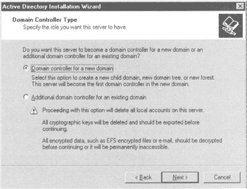

图 1.3 Active Directory 安装向导的域控制器类型屏幕

5. 下一个屏幕允许您在服务器上配置或安装 `DNS`。如果 `DNS` 已在运行，则选择“是，我将配置 `DNS` 客户端”。如果没有，选择“否，只在此计算机上安装并配置 `DNS`”。如果选择“是”而 `DNS` 未运行，将出现警告屏幕告知您此事。如果 `DNS` 未运行，请选择第二个选项（否），然后单击下一步继续。

6. 输入新域的 `DNS` 名称（例如，`syngress.com`）。单击下一步继续。

7. 如图 1.4 所示，接下来出现的屏幕要求您输入该域的 `NetBIOS` 名称，旧版本的 Windows 将使用该名称访问域。Windows Server 2003 会根据您之前输入的 `DNS` 名称建议一个名称。接受默认值，然后单击下一步继续。

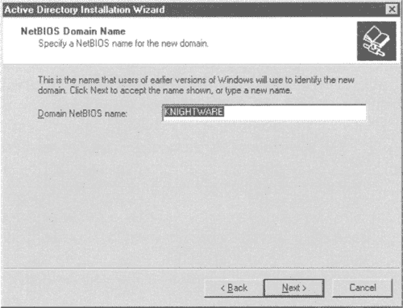

图 1.4 Active Directory 安装向导的 NetBIOS 域名称屏幕

8. 接下来出现的屏幕，如图 1.5 所示，允许您指定 Active Directory 数据库和日志文件将存储的位置。默认情况下，这将是 `systemroot` 文件夹中名为 `NTDS` 的目录。接受默认值并单击下一步继续。

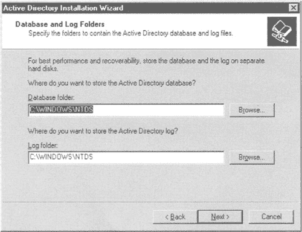

图 1.5 Active Directory 安装向导的数据库和日志文件夹屏幕

9. 下一个屏幕要求指定将复制到其他 `DCs` 的公共文件存储位置。默认情况下，这存储在 `systemroot` 文件夹中的 `SYSVOL` 目录中。接受默认值并单击下一步继续。

10. 下一个屏幕用于根据您是否将运行为预 Windows 2000 域设计的服务器程序来设置适当的权限。如果是这种情况，您将选择第一个选项“与预 Windows 2000 Server 操作系统兼容的权限”。选择此项将允许匿名用户读取域上的信息，因此最好尽可能选择“仅与 Windows 2000 或 Windows Server 2003 操作系统兼容的权限”。假设您不会运行此类软件，请选择第二个选项，然后单击下一步。

11. 接下来屏幕要求您输入服务器以目录服务还原模式启动时使用的密码。此模式用于在 Active Directory 损坏后进行还原。在第一个字段中输入密码，然后在下面的字段中再次输入以确认密码。单击下一步继续。

12. 接下来出现的屏幕显示您为 Active Directory 安装所选择的全部设置（见图 1.6）。查看此屏幕上显示的摘要信息，然后单击下一步继续。

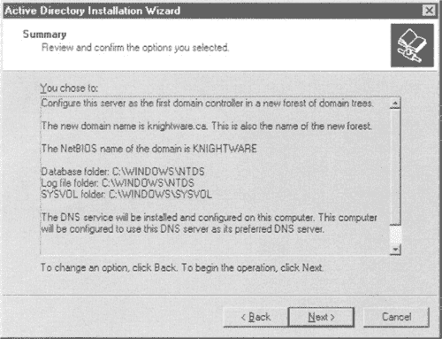

图 1.6 Active Directory 安装向导的摘要屏幕

13. 向导将根据您的选择安装和配置 Active Directory。完成后，单击完成。

14. 要完成安装，您需要重新启动 Windows Server 2003。将出现一个消息框告知您此事，并提供立即重启或不重启的选项。单击立即重启。


## 了解 Active Directory 的工作原理

Active Directory 提供了通过单一信息源管理网络的能力。使用 Windows Server 2003 中的工具，您可以管理用户、计算机、打印机和各种其他资源。对目录中对象所做的更改会复制到其他 `DCs`。这确保每个 `DC` 都有所有目录对象及其属性的最新副本。


### 考试警告


由于 Active Directory 的逻辑分层结构以及使其正常工作所需的物理组件，您在考试中看到的大多数问题将直接或间接涉及以下主题。要理解 Active Directory，重要的是您要了解这些组件是什么，以便您能够跟上本书后面讨论的其他问题。

## Directory Structure Overview
当您比较不同组织的目录结构时，会发现它们各不相同。Active Directory 以分层结构组织，该结构由代表网络元素的各种不同组件构建。例如，存在用户对象、计算机对象以及用于组织它们的各种容器。您组织这些元素的方式会使贵公司 Active Directory 的分层结构与其他公司不同。构成此层次结构的一部分的组件（我们在以下各节中讨论）包括：
 `Sites`
 `Domains`
 `Trees`
 `Forests`
 `Objects`
 `DCs`
除此之外，我们还将查看用于组织和管理此层次结构的 Active Directory 组件。这些组件是：
 `GC`
 `Schema`
Active Directory 允许您通过处理物理结构和逻辑结构来管理网络。网络的物理结构由构成网络的有形元素组成，而逻辑结构用于将组件组织成与公司结构相匹配的层次结构。正如我们在以下各节中将看到的，站点代表网络的物理结构，而域、树和林代表逻辑结构。

### Sites
站点是由快速可靠的链路连接的一个或多个 IP 子网。术语“子网”是“子网络”的简称，指网络内被细分的一组相邻计算机。子网中的计算机使用与其它子网不同的网络 ID，本质上成为网络中的一个小型网络。站点用于在 Active Directory 中存储有关网络拓扑的信息，以便目录具有有关网络物理结构的信息。
Active Directory 以多种方式使用有关网络物理元素的信息。它允许 Active Directory 确定站点之间的最快连接，以便目录中的更新可以复制到其他 DC。站点包含计算机和连接对象，这些对象用于配置站点之间的复制，从而使此信息能够以最快、最有效的方式复制到其他站点的 DC。这对用户也很有用，因为它允许每个用户由离该用户最近的 DC 进行身份验证。
虽然不是必需的，但在每个站点中设置一个 DC 都是一个好主意。当客户端登录到域时，必须联系一个 DC。客户端将先在本地站点搜索 DC，然后如果未找到，则尝试连接到其他站点的 DC。如果客户端必须连接到不同站点的 DC，则用户身份验证可能需要很长时间。创建不同的站点会将计算机分组在一起，以便它们向离它们最近的 DC 进行身份验证。
站点的一个重要特征是子网连接良好。这意味着站点之间的链路是可靠且快速的。虽然确定什么是“快速”可能是主观的，但微软传统上将快速链路定义为至少 512 Kbps，同时承认 128 Kbps 或更高是足够的。由于组织所需的带宽取决于站点之间传输的数据量，一些公司可能需要更大的带宽来满足其需求。
如 图 1.7 所示，一个站点中可以有多个域，或一个域中可以有多个站点。因为站点代表物理结构，所以它们与代表逻辑结构的域、树和林（我们接下来将讨论）不同。站点与这些实体是分开的，并且不受决定 Windows Server 2003 网络逻辑结构的因素的限制。

图 1.7 站点可包含多个域，且域可包含

### Domains
自 Windows NT 时代以来，域一直是微软网络的基石。域是对网络元素的逻辑分组，由计算机、用户、打印机以及构成网络并使人们能够完成工作任务的其他组件组成。由于域将这些对象分组为一个单元，域充当管理边界，您可以在其中控制用户和计算机的安全性。在 Windows Server 2003 中，域还共享一个公共目录数据库、安全策略以及（当网络中存在其他域时）与其他域的关系。它们是网络的重要逻辑组件，因为所有内容都是建立在域结构之上或驻留在域结构中。
站点和域是不同的结构，并且互不约束。正如一个站点可以包含来自多个域的用户和计算机一样，一个域也可以包含多个站点。这允许您在同一域中拥有来自网络不同区域的对象，即使它们位于不同的子网或地理位置。
作为管理边界，每个域使用自己的安全策略。可以将组策略应用于域级别，以便该域内的任何用户和计算机都受其影响。这允许您控制域内所有人的资源访问、密码策略和其他配置。这些安全设置和策略仅影响该域，不会应用于网络中的其他域。如果大批用户需要不同的策略，您可以创建多个域或以其他方式应用设置（例如，使用我们稍后将讨论的 OU）。
创建域时，会分配一个 DNS 域名来标识它。DNS 用于 Internet 和其他 TCP/IP 网络，将 IP 地址解析为用户友好的名称。由于 Active Directory 域与 DNS 集成，因此允许用户、计算机、应用程序以及网络中的其他元素轻松找到网络上的 DC 和其他资源。
您可以想象，域内可能存在大量对象。为了允许网络大幅增长，微软设计 Active Directory 以支持每个域多达 1000 万个对象。虽然微软承认这是一个理论估计，但公司提供了一个更实际的估计，即每个域至少可以支持 100 万个对象。在任何情况下，您的域都可能永远不会达到这两个限制中的任何一个。如果达到，您将需要创建额外的域，并在它们之间拆分用户、计算机、组和其他对象。
本章前面我们提到，目录的更新会复制到其他 DC，以便每个 DC 都有目录数据库的相同副本。我们将在本章后面更详细地解释复制，但现在重要的是要认识到 Active Directory 信息会复制到域内的每个 DC。每个域使用自己的目录数据库。由于信息不会复制到其他域，因此域成为复制以及管理和安全的边界。

### Domain Trees


## 域

虽然域用作管理和复制的边界，但这并不意味着您应该只使用一个域，直到达到每个域支持的对象数量限制为止。这取决于您的组织结构。您可能出于以下任何原因想要使用多个域：

 去中心化管理

 提高性能

 控制复制

 为每个域使用不同的安全设置和策略

 如果目录中的对象数量很大

例如，您的公司可能在多个国家设有分支机构。如果只有一个域，则目录信息必须在每个国家的 `DCs` 之间复制，或者（如果这些位置没有 `DCs`）用户需要登录到另一个国家的 `DC`。与其在 `WAN` 上复制目录信息并管理网络的不同部分，您可以将网络划分为多个域。例如，您可以为每个国家创建一个域。

创建单独的域并不意味着您网络的这些不同部分之间没有关系。`Active Directory` 允许多个域在层次结构中连接在一起。如 图 1.8 所示，可以在层次结构中现有的域下方创建域。现有的域被称为“父域”，在其下创建的新域被称为“子域”。这样做时，域共享一个公共命名空间。它们还共享架构、配置和 `GC`，与同一森林中的所有域一样，无论它们是否有父子关系（我们将在本章后面更详细地讨论这些元素）。

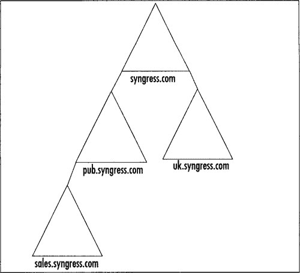

图 1.8 域树由同一连续命名空间中的父域和子域组成

如 图 1.8 所见，在这种父子结构中创建并共享命名空间的域属于域树。树遵循 `DNS` 命名方案，因此父域和子域之间的关系是显而易见且易于遵循的。为了符合此命名方案，子域将其名称附加到父域的名称。例如，如果父域使用域名称 `sygress.com`，则位于英国的子域可能具有名称 [uk.syngress.com](http://www.uk.syngress.com)。名称也可以表示域的功能，而不是其地理位置。例如，供开发人员使用的子域可能使用名称 dev.[dev.syngress.com](http://www.dev.syngress.com)。由于域树使用连续命名空间，因此很容易看出哪些域是特定父域的子域。

创建子域时，父域和子域之间会自动创建双向传递信任关系。信任关系允许直通身份验证，因此在受信任域中经过身份验证的用户可以使用信任域中的资源。由于父域和子域之间的信任是双向的，因此两个域相互信任，因此任一域中的用户都可以访问另一个域中的资源（当然，前提是用户对这些资源具有适当的权限）。

父域和子域之间信任关系的另一个特点是它们是传递的。传递关系意味着直通身份验证会传递到相互信任的所有域。例如，在 图 1.9 中，`Domain A` 与 `Domain B` 具有双向传递信任，因此两者相互信任。`Domain B` 与 `Domain C` 具有双向传递信任，因此它们也相互信任，但 `Domain A` 和 `Domain C` 之间没有信任关系。有了双向传递信任，`Domain C` 将信任 `Domain A`（反之亦然），因为两者都信任 `Domain B`。这将允许各个域中的用户访问其他域中的资源。域之间也可以手动设置信任，使其为单向且非传递的，但默认情况下，域树和森林中使用的是双向传递信任。这些信任也是隐式的，这意味着它们在创建域时默认自动存在，而不像必须手动创建的显式信任。

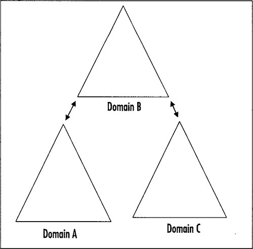

图 1.9 域树中相邻域使用双向传递信任

### 森林

正如域可以互连成树一样，树也可以互连成森林。森林是一个或多个共享相同架构、`GC` 和配置信息的域树。与域树的情况一样，同一森林中的域在森林中所有域树的根之间使用双向传递信任（即每棵树中的顶级域），以允许直通身份验证，因此用户可以访问整个森林中域中的资源。如 图 1.10 所示，虽然树需要连续命名空间，但森林可以由使用不同命名方案的多个树组成。这允许您的域在网络上共享资源，即使它们不共享连续命名空间。

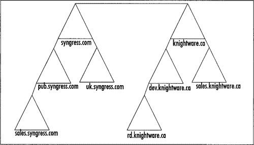

图 1.10 森林允许多个域树连接并共享信息

每个 `Active Directory` 结构都有一个森林，即使它只由单个域组成。当在网络上安装第一个 `Windows Server 2003` `DC` 时，您创建的第一个域也称为森林根域。然后可以创建属于此森林的附加域，也可以创建多个森林。这使您可以控制哪些树连接并可以在彼此之间共享资源（在同一森林内），以及哪些树被分离，以便用户无法搜索共享 `GC` 的其他域（在单独的森林中）。

### 组织单位

在查看域树时，您可能会认为创建反映公司组织的目录结构的唯一方法是创建多个域。然而，在许多公司中，单个域就足够了。为了在单个域内组织 `Active Directory` 对象，可以使用 `OUs`。

正如我们前面提到的，`OUs` 是容器，允许您存储用户、计算机、组和其他 `OUs`。通过将对象放在不同的 `OUs` 中，您可以设计 `Active Directory` 的布局，使其与公司的逻辑结构形状相同，而无需创建单独的域。如 图 1.11 所示，您可以为业务的不同领域创建 `OUs`，例如部门、职能或位置。然后与每个领域相关的用户、计算机和组可以存储在 `OU` 内，以便您可以将它们作为一个单元找到和管理。

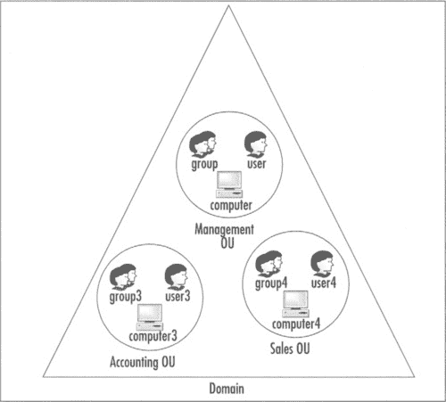

图 1.11 组织单位可以包含其他 Active Directory 对象

`OUs` 是您可以委派管理权限的最小 `Active Directory` 单位。当您委派权限时，您授予特定用户或组管理 `OU` 中的用户和资源的能力。例如，您可以授予部门经理管理该部门内用户的权限，从而减轻您（网络管理员）这样做的需要。


## Active Directory 组件

当查看域、树、林和 OU 的功能时，很明显每个都充当一个容器。这些容器对象提供了一种存储 Active Directory 其他组件的方式，以便它们可以作为一个单元进行管理并以便于管理的方式进行组织。OU 还提供额外的嵌套功能，因此您可以将一个 OU 放在另一个 OU 内部。

Active Directory 中的大部分组件，实际上是代表网络中各个元素的对象（在 Novell 的 NDS 结构中，这些被称为叶对象，符合树类比，因为它们位于层级“分支”的末端且不包含其他对象）。对象分为类，每个对象类包含一组属性，这些属性是保存特征和配置数据的属性。正如人们由其特征定义（例如，眼部和头发颜色，身高，体重），属性定义对象。打印机对象可能具有包括制造商、型号以及与该设备相关的配置信息等属性，而用户对象则包括用户名、密码以及定义用户的其他数据等属性。正如我们在 第 2 章 中将看到的那样，这些各种对象填充目录，并用于管理用户、计算机和组帐户等事物。

## 逻辑与物理组件

Active Directory 的组件可以分为逻辑和物理结构。Active Directory 中的逻辑组件允许您组织资源，使其在目录中的布局反映公司的逻辑结构。Active Directory 中的物理组件同样被使用，但用于反映网络的物理结构。通过将网络的逻辑和物理组件分开，用户可以更好地找到资源，管理员可以更有效地管理它们。

许多目录设计为遵循组织的逻辑结构。您可能熟悉组织结构图；显示公司各个部门的地图，并说明哪些部门对其他部门负责。在这样的地图中，工资部门可能出现在财务部门下方，即使它们在物理上位于同一办公室。正如图表允许您找到部门在公司指挥结构中的位置一样，目录的逻辑结构允许您基于类似的逻辑布局找到资源。正如我们之前看到的，您可以将网络组织成林、树和域，然后进一步将用户和计算机组织到以业务区域命名的 OU 中。目录结构的地图可以组织成与公司的逻辑结构完全相同。

物理组件用于设计反映网络物理布局或拓扑的目录结构。例如，正如我们之前看到的，站点是子网的组合，而 DC 是一台在其上保存目录副本的服务器。DC 在组织中的特定位置物理定位，而子网由使用相同 IP 地址组的计算机组成。在这两种情况下，您可以访问房间或建筑物并找到这些组件。因此，物理组件可用于在目录中镜像组织的物理结构。如 图 1.12 所示，这使得物理结构与网络的逻辑结构有很大不同。

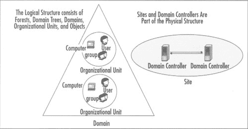

图 1.12 逻辑结构 vs. 物理结构

### 域控制器

DC 用于管理域。如前所述，DC 上的目录可以修改，允许网络管理员更改用户和计算机帐户、域结构、站点拓扑并控制访问。当对目录的这些组件进行更改时，它们随后会被复制到网络上的其他 DC。

因为 DC 是一台存储 Active Directory 可写副本的服务器，因此网络上的并非每台计算机都可以充当 DC。Windows Server 2003 Active Directory 只能安装在 Microsoft Windows Server 2003, Standard Edition；Windows Server 2003, Enterprise Edition；和 Windows Server 2003, Datacenter Edition 上。运行其他 Web Edition 的 Windows Server 2003 服务器不能充当 DC，尽管它们可以是向网络提供资源和服务的成员服务器。

当 DC 安装在网络上时，第一个域、林和站点会自动创建。视需要可以创建额外的域、林和站点，就像可以添加额外的 DC 一样。这使您可以以反映组织结构和需求的方式设计网络。

虽然创建域只需要一个 DC，但通常应实施多个 DC 以实现容错和高可用性。如果使用多个 DC 且其中一个失败，用户将能够登录到另一个可用的 DC。这将允许用户在 DC 停机时继续工作。在大型公司中，可以添加多个 DC 以适应大量可能在同一时间登录和注销或需要从这些服务器访问资源的用户的需求。

考试警告

Windows Server 2003 计算机可以通过在它们上安装 Active Directory 而提升为 DC。要安装 Active Directory，使用 Active Directory 安装向导（通过运行 `DCPROMO.EXE` 调用）。安装期间提供的信息用于将服务器添加到现有域，或如果 DC 是网络上安装的第一个，则创建新的域、林和站点。

#### 主角色

Active Directory 中的某些更改仅复制到网络上的特定 DC。Operations Masters 是具有特殊角色的 DC，保留 Active Directory 中某些数据的 master 副本并将数据复制到其他 DC 以备备份。因为域或林中只有一台机器可以包含此数据的 master 副本，所以它们也被称为 Flexible Single Master Operations (`FSMO`) 角色。

Active Directory 林中使用五种不同的主角色类型，每种都提供特定目的。其中两个主角色应用于林中的单个 DC（林范围角色），而另外三个必须应用于每个域中的 DC（域范围角色）。在下面的段落中，我们将查看这些角色中的每一个，并讨论它们对 Active Directory 功能的重要性。

林范围主角色在每个林中的一个 DC 中是唯一的。此类型有两个主角色：

 架构主机

 域命名主机

架构主机是负责 Active Directory 架构所有更改的 DC。正如我们在下一节中将看到的那样，架构用于定义林中使用的对象类和属性。架构主机用于写入目录的架构，然后复制到林中的其他 DC。架构的更新只能在担任此角色的 DC 上执行。

域命名主机是负责向林中添加新域并删除不需要的域的 DC。它负责域命名空间的任何更改。此类更改只能在域命名主机上执行，从而防止如果在多台机器上执行更改可能发生的冲突。

除了林范围主角色外，还有域范围主角色。此类型有三个主角色：

 相对标识符 (`RID`) 主机

 主域控制器 (`PDC`) 模拟器


## 基础设施主机


## 考试日提示

请记住，在一个林中每个角色只有一个林范围的主控，在一个域中每个角色只有一个域范围的主控。每个林中只能有一个 `Schema Master` 和 `Domain Naming Master`。换句话说，如果有两个林，则每个林中各有一个 `Schema Master` 和一个 `Domain Naming Master`。同样，每个域中只能有一个 `RID Master`、`PDC Emulator` 和 `Infrastructure Master`，尽管林中可以存在多个域，但每个域中只能有一个 `RID Master`、`PDC Emulator` 和 `Infrastructure Master`

`RID Master` 负责为域中的每个对象创建唯一的标识号码。这些号码会发放给域中的其他 `DCs`。创建对象时，会为其分配一个唯一标识该对象的号码序列。该号码由两部分组成：域安全标识符 (`SID`) 和 `RID`。域 `SID` 对该域中的所有对象都相同，而 `RID` 则对每个对象唯一。不是使用用户、计算机或组的名称，这个 `SID` 由 `Windows` 用于标识和引用对象。为避免 `DCs` 为对象分配相同号码而产生潜在冲突，域中仅存在一个 `RID Master`，以控制向每个 `DC` 分配 ID 号码，`DC` 然后在对象创建时将其发放给对象。

`PDC Emulator` 设计为充当 `Windows NT` 主 `DC`。如果网络上存在运行 `Windows 2000` 之前和 `XP` 操作系统的计算机，或仍存在 `Windows NT` 备份域控制器 (`BDCs`)，则需要此功能。`PDC Emulator` 负责处理密码更改，并将这些更改复制到网络上的 `BDCs`。它还同步域中所有 `DCs` 的时间，以使服务器之间不会出现时间差异。因为域中只能有一个 `Windows NT` `PDC`，所以只能有一个 `PDC Emulator`。

即使网络上没有作为 `BDCs` 运行的服务器，`PDC Emulator` 在每个域中仍然有其用途。`PDC Emulator` 会优先复制域内其他 `DCs` 执行的所有密码更改。当 `DC` 上更改密码时，该更改会发送到 `PDC Emulator`。`PDC Emulator` 负责此事，因为将密码更改复制到域中的所有 `DCs` 可能需要时间。如果用户在一个 `DC` 上更改密码，然后尝试登录到另一个 `DC`，他/她登录的第二个 `DC` 可能仍具有旧的密码信息。因为该 `DC` 认为这是一个错误密码，所以它会将身份验证请求转发给 `PDC Emulator` 以确定密码是否确实有效。每当登录身份验证失败时，`DC` 在拒绝之前总是会先将其转发给 `PDC Emulator`。

`Infrastructure Master` 负责更新所做的组成员身份更改。当用户移动到不同的域且其组成员身份发生变化时，这些更改反映在组中可能需要时间。为解决此问题，基础设施管理器用于在其域中更新此类更改。担任 `Infrastructure Master` 角色的 `DC` 将其数据与 `GC` 进行比较，`GC` 是林中所有域的目录信息的子集。当组成员身份发生变化时，它随后更新其组到用户的引用并将这些更改复制到域中的其他 `DCs`。

## 架构

`schema` 是一个用于定义对象及其属性的数据库。`schema` 中的信息用于控制可在 `Active Directory` 中创建的对象类型 (`classes`)，以及每个对象关联的附加属性 (`attributes`)。换句话说，`schema` 决定了你可以在 `Active Directory` 中创建什么，以及可用于配置这些对象的数据。

`schema` 由 `classes` 和 `attributes` 组成。对象 `classes` 定义对象的类型，并包含一组用于描述对象的 `attributes`。例如，`User` 对象 `class` 包含由用户主目录、名字、姓氏、地址等信息组成的 `attributes`。虽然对象 `class` 决定了可在 `Active Directory` 中创建的对象类型，但 `attributes` 用于提供有关其的信息。对象的 `attributes` 也称为其属性，在大多数情况下，你可以通过编辑其属性表（通常通过右键单击对象并选择属性来访问）来配置其 `attributes`。

`Active Directory` 包含各种对象 `classes`，但如果需要也可以创建额外的 `classes`。由于 `schema` 对 `Active Directory` 的结构非常重要，对 `schema` 的扩展（添加和修改）只能在林中的一个 `DC` 上进行。对 `schema` 的修改只能在担任 `Schema Master` 角色的 `DC` 上进行。`Schema` 信息存储在 `Active Directory` 的目录分区中，并复制到林中的所有 `DCs`。

`Attributes` 是使用 `Microsoft Management Console` (`MMC`) 的 `Active Directory Schema` 扩展创建的（我们将在本章后面讨论）。当向 `schema` 添加新的 `class` 或 `attribute` 时，它无法被删除。如果不再需要某个 `class` 或 `attribute`，它只能被停用，因此无法再使用。如果以后需要该 `class` 或 `attribute`，则可以重新激活它。

## 全局编录

正如任何尝试过搜索大型数据库的人所证明的那样，数据库中存储的数据越多，搜索所需的时间就越长。为了提高在域或林中搜索对象的性能，会使用 `GC`。`GC` 服务器是一个 `DC`，它存储其托管域中所有对象的副本，以及林中其他域中对象的部分副本。该部分副本包含最常被搜索的对象。由于 `GC` 包含 `Active Directory` 中的信息子集，因此需要复制的信息更少，并在用户搜索对象的特定 `attributes` 时提高性能。

除了用于搜索外，`GC` 还用于解析身份验证中使用的 `UPNs`。如前所述，`UPN` 的格式类似于电子邮件地址。如果用户登录到不包含该账户的域中的 `DC`，该 `DC` 将使用 `GC` 解析名称并完成登录过程。例如，如果用户从位于 [ca.syngress.com](http://www.ca.syngress.com) 的计算机使用 `UPN` myname@us.syngress.com 登录，[ca.syngress.com](http://www.ca.syngress.com) 中的 `DC` 将无法在该域中找到该账户。然后它将使用 `GC` 查找并验证用户的账户。

`GC` 还用于存储有关通用组成员身份的信息，其中任何域的用户都可以被添加并允许访问任何域。我们将在 第 2 章 中更详细地讨论组。当属于此类组的成员用户登录到域时，`DC` 将从 `GC` 中检索其通用组成员身份。只有在林中存在多个域时才会这样做。

`GC` 可在配置为 `GC` 服务器的 `DCs` 上使用。创建 `GC` 服务器是通过使用 `MMC` 的 `Active Directory Sites and Services` 扩展来完成的（我们将在本章后面讨论）。配置 `GC` 服务器后，其他 `DCs` 可以查询该服务器上的 `GC`。

## 复制服务

`Windows Server 2003` 复制服务用于在 `DCs` 之间复制 `Active Directory`，以便每个 `DC` 都有最新的目录数据库副本。由于每个 `DC` 都有目录的相同副本，因此它们可以独立运行，如果其中一个 `DC` 失败，用户仍可进行身份验证并使用网络资源。这使得 `Windows Server 2003` `DCs` 具有高度可靠性和容错性。


# 多主复制

多主复制用于将目录中的更改复制到其他域控制器。在多主复制中，域控制器彼此作为对等体工作，因此任何域控制器都接受并复制这些更新（特殊类型的操作主控分配的数据除外）。无需在主域控制器上进行更改，可以从任何域控制器对目录进行更改。

## 复制配置

域控制器之间会自动进行复制，通常无需额外配置。然而，由于网络流量有时会更高，例如员工在工作日开始时登录域控制器时，可以配置复制在特定时间发生。这将使您能够控制复制流量，使其不在高峰时段发生。

## 知识一致性检查器和复制拓扑

为了有效复制目录，Windows Server 2003 使用知识一致性检查器 (`KCC`) 生成森林的复制拓扑。复制拓扑是指域控制器用于将目录复制到站点内其他域控制器以及其他站点域控制器的物理连接。在最初创建复制拓扑后，`KCC` 将定期审查和修改拓扑。这使其能够查看某些连接或域控制器是否不可用，以及是否需要更改复制数据传输到其他域控制器的方式。

## 站内复制

站内复制的处理方式与目录复制到其他站点时不同。站内复制（在站点内复制 Active Directory）采用环形结构处理。`KCC` 构建一个双向环，复制数据在两个方向上在域控制器之间传递。因为数据仅在站点内传输，所以复制的数据不进行压缩。

`KCC` 为每个域控制器创建至少两个连接，因此如果一个连接失败，另一个可以使用。例如，在 图 1.13 中，功能正常的连接用实线表示，而损坏的连接用虚线表示。因为 图 1.13 中的四台服务器之一已失败，复制数据无法通过它传递，因此使用服务器之间的另一个连接。使用多个连接提供容错能力。

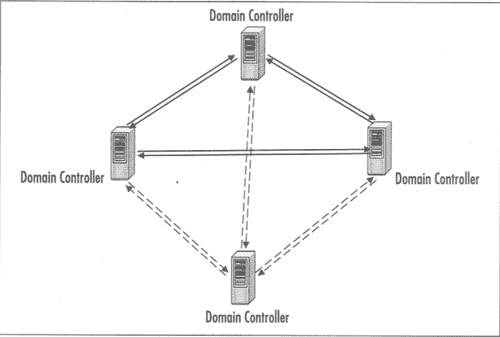

图 1.13 复制拓扑

站内复制自动化为定期发生，并且仅在域控制器收到更改通知时发生。默认情况下，当在域控制器上进行更改时，它会等待 15 秒然后向其最近的复制伙伴发送通知。如果它有多个复制伙伴，它将以三秒间隔向每个额外伙伴发送通知。当伙伴收到此通知时，它会向原始域控制器发送请求更新目录信息的要求，然后原始域控制器通过发送更新数据进行响应。此过程的例外情况是当帐户被锁定、域控制器帐户被更改，或帐户锁定策略或域密码策略发生更改时。在这些情况下，没有 15 秒的等待期，复制会立即发生。

## 站间复制

站点之间的复制称为站间复制。因为站点之间的带宽可能比站点内部慢，所以站间复制发生的频率较低且处理方式不同。不是在更改发生后不久通知其他域控制器，复制在计划的时间发生。站点链接对象的相关信息用于确定在站点之间传递此数据的最佳链接。

## 站点链接和拓扑生成

站点链接用于定义站点之间如何复制 Active Directory 信息。这些对象存储控制哪些站点之间复制流量以及应优先使用哪些站点的控制数据。例如，您可能在办公室和海外的一个办公室之间有 ISDN 连接。如果海外链接比其他链接更慢且使用成本更高，您可以配置该链接使其仅在最后手段时使用。通过站点链接对象，使用站点之间最快且最便宜的连接进行复制。

每个站点中的域控制器充当站间拓扑生成器的角色，并负责构建此拓扑。它考虑不同连接的成本、域控制器是否可用以及域控制器是否已添加到站点。通过收集这些信息，`KCC` 就可以根据需要更新拓扑，并提供在站点之间传递数据的方法。

复制发生的频率是可配置的，因此可以根据需要频繁或不频繁地发生。默认情况下，站间复制每 180 分钟（三个小时）发生一次，并将全天 24 小时、每周 7 天使用站点链接来满足此计划。可以根据需要修改复制的频率，使其在特定时间和一周中的特定天数发生。


使用 Active Directory 管理工具

## Active Directory 管理工具

正如组织有增长和变化的趋势，它们使用的网络也是如此。在 Windows Server 2003 网络中，填充 Active Directory 的域、站点、OU、用户、计算机和其他对象的数量会随着业务呈指数增长。每位新员工都需要一个新帐户，每台添加到网络的新计算机意味着目录中增加一个对象。即使增长有限，这些对象也可能需要大量维护，例如当用户更换工作、地址或其他涉及信息和访问更改的问题时。为了帮助管理员完成这些任务，Active Directory 提供了许多使管理更轻松的工具。

可以使用两种类型的管理工具来管理 Active Directory。Windows Server 2003 提供了各种新的命令行工具，可单独管理目录及其对象的不同方面。通过单击 Windows 开始菜单并单击程序 | 附件 | 命令提示符（或简单地单击开始 | 运行并键入 `cmd`），将出现提示，允许您输入这些命令并控制 Active Directory 的对象和元素。管理 Active Directory 的另一种方法是使用图形用户界面（GUI）的工具。这些工具允许您通过指向和单击对象并使用图形显示对其进行修改。大多数图形工具可通过开始 | 程序 | 管理工具菜单获得。

### 新闻与值得注意

#### 命令行工具

Windows Server 2003 包含在 Windows 2000 中用于管理 Active Directory 时不可用的许多工具。这些工具从命令提示符运行，可以执行以前只能使用 GUI 控制台执行的任务。使用这些工具，您可以连接到远程服务器并在不增加 GUI 界面额外开销的情况下对目录进行修改。因为许多任务可以通过 `MMC`（我们接下来会讨论）或基于文本的命令执行，这为管理员如何执行这些任务提供了更大的选择自由。

命令行工具对具有 DOS 或其他使用命令行工具的网络操作系统（例如 Novell NetWare 和 UNIX）经验的管理员特别有益。虽然使用这些工具需要用户在工具之间切换并手动键入每个命令，但用户可能会发现他们可以通过此界面比使用 GUI 更快地执行常见任务。


命令行工具对于希望在特定时间安排任务或以其他方式自动化任务的管理员也很有用。通过脚本或批处理文件运行命令，或通过内部开发的其他应用程序调用它们，您可以自动化某些任务，使管理更轻松。以这种方式允许调用这些命令也有助于让用户执行他们不熟悉的管理任务。

## 图形化管理工具/MMCs

管理 Windows Server 2003 和 Active Directory 的主要管理工具是 Microsoft Management Console（`MMC`）。`MMC` 本身并不是管理工具，而是一个用于加载提供管理功能的插件的界面。插件提供特定的功能或相关的一组功能。由于 `MMC` 接口的设计，您可以将多个插件加载到一个控制台中，并创建用于处理特定任务的自定义工具。此外，由于这些插件在同一环境中运行，因此学习使用这些工具变得更容易，因为您不必为每个工具学习不同的界面。

`MMCs` 可以通过打开位于 Windows `Start menu` 中 `Administrative Tools` 文件夹下的预制控制台来启动。空的 `MMC` 可以通过在 Windows `Start menu` 中使用 `Run` 命令启动。通过在 Windows `Start menu` 的 `Run` 命令中输入 `MMC`，空的 `MMC` 将启动，如 图 1.14 所示。

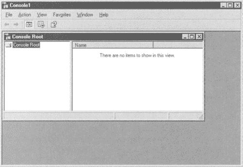

图 1.14 Microsoft 管理控制台

在 `MMC` 中出现的窗口是与单个插件或自定义控制台文件对应的界面。`MMC` 中的每个子窗口都有两个窗格。左窗格显示控制台树，即通过控制台可用的工具的层次结构显示。这些可以是已加载到 `MMC` 中并保存为自定义控制台的多个插件。右窗格称为详细信息窗格，提供与在控制台树中选择的内容相关的命令和信息。

您可以通过单击 `File` 菜单并选择 `Add/Remove Snap-in` 来为特定任务添加插件。执行此操作后，将出现一个带有两个选项卡的新对话框：`Standalone` 和 `Extensions`。

`Standalone` 选项卡用于独立插件，这些插件设计为无需任何额外要求即可运行。`Extensions` 选项卡用于加载一种特殊的插件，称为扩展插件。这些用于为已安装的独立插件添加附加功能。

`Standalone` 选项卡用于从控制台添加或删除插件。如 图 1.15 所示，单击此选项卡上的 `Add` 按钮将显示可用独立插件的列表。选择要添加的插件后，单击此对话框上的 `Add` 按钮。单击 `Close` 将退出此屏幕并返回到上一个屏幕，此时将包含您选择的插件的列表以在此控制台中安装。单击 `OK` 确认选择并安装它们。

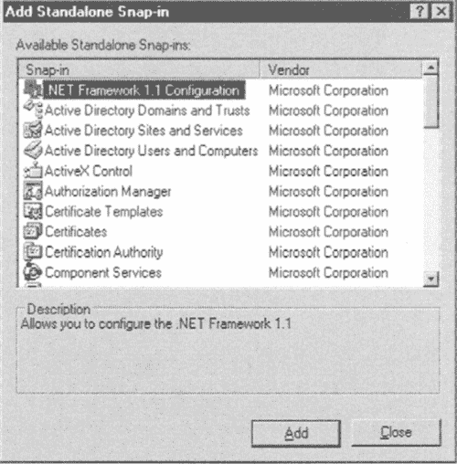

图 1.15 添加/删除管理单元对话框

如 图 1.15 所示，Active Directory 可用的插件有三个：

 `Active Directory Users and Computers`

 `Active Directory Domains and Trusts`

 `Active Directory Sites and Services`

虽然我们将在后面的章节中讨论这些插件，但重要的是要认识到这些并不是您可以在 Windows Server 2003 中使用的唯一插件。`MMC` 为 Active Directory 提供这三个插件，但还有其他插件可用于特定目的和管理任务。每个插件都有用于管理 Windows Server 2003 和 Active Directory 的单独功能或相关功能集。

注意

请注意，虽然这三个与 Active Directory 相关的插件可以添加到自定义 `MMC` 中，但每个插件已在 `Administrative Tools` 菜单中可用的单独预配置 `MMC` 中安装。

由于可以在 `MMC` 中添加和配置多个插件，因此您可以创建自定义控制台来执行特定任务。设置好控制台后，可以将其保存为具有 `.msc` 扩展名的文件。控制台可以保存为两种模式之一：`Authoring` 和 `User`。

`Authoring` 模式用于提供对 `MMC` 控制台功能的完全访问。当以此模式保存时，打开控制台的用户可以添加和删除插件，创建新的 Windows，创建收藏夹和任务板，查看控制台树中的所有内容，并保存控制台。

`User` 模式用于限制其他用户使用控制台某些功能的能力。

如果您为用户创建控制台以执行特定任务，但不希望他们访问其他功能，则 `User` 模式是理想选择。`User` 模式有三个访问级别：

 `Full Access` 与 Author 模式相同，只是不能添加或删除插件，不能更改控制台设置，并且用户不能创建收藏夹和任务板。

 `Limited Access, Multiple Windows` 允许用户查看保存控制台时可见的控制台树部分，并禁止用户关闭现有窗口。但是，用户可以创建新窗口。

 `Limited Access, Single Window` 也允许用户访问保存控制台时可见的控制台树部分，但禁止用户创建新窗口。

考试日提示

考试将测试您对 Active Directory 的了解以及如何使用随 Windows Server 2003 提供的工具。请记住，`MMC` 允许您加载插件以执行特定任务，也可用于创建提供有限功能的自定义控制台。

### Active Directory 用户和计算机

`Active Directory Users and Computers` 控制台是用于 Active Directory 的 `MMC` 插件之一。它允许您管理存储在 Active Directory 中的用户和计算机帐户、组、打印机、OU、联系人和其他对象。使用此工具，您可以创建、删除、修改、移动、组织并设置这些对象的权限。

如 图 1.16 所示，加载此工具时，控制台树（左窗格）中会出现一个节点，显示域。展开此节点将显示默认创建的多个容器。虽然可以创建额外的容器，但在创建 DC 后此处出现的容器有：

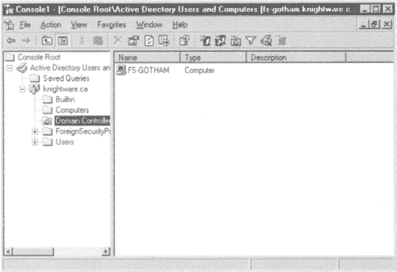

图 1.16 Active Directory 用户和计算机

 `Builtin`

 `Computers`

 `Domain Controllers`

 `Users`

这些容器存储可使用此工具管理的对象，并允许您查看和修改与这些不同对象相关的信息。

`Builtin` 容器保存由 Windows Server 2003 创建的组，可用于控制访问。您可以将用户添加到这些 `Builtin` 组，以赋予他们执行某些任务的能力。例如，而不是允许 IT 部门中的每个人使用相同的 Administrator 帐户，可以将用户添加到内置的 `Administrators` 组。这赋予他们管理 Windows Server 2003 的能力，但允许您跟踪具有此安全级别的人员执行了某些任务。


The `Computers` container is used to store computer objects. These are (as the name implies) computers running on the network that have joined the domain and have accounts created in Active Directory. The `Computers` container can also include accounts used by applications to access Active Directory.

The `Domain Controllers` container contains objects representing DCs that reside in the domain. The ones shown in this container are ones running Windows 2000 Server and Windows Server 2003. Earlier versions are not displayed.

The `Users` container is used to store user accounts and groups. Users and Groups that appear in this container are ones that were created using application programming interfaces (APIs) that can use Active Directory, and ones that were created in Windows NT prior to upgrading.

Additional containers can be displayed when Active Directory Users and Computers is running with Advanced Features activated. You can enable Advanced Features by clicking on the menu item with this name, found in the View menu. When Advanced Features have been activated, LostAndFound and System containers are displayed in the left console tree.

The `LostAndFound` container is used to store stray objects whose containers no longer exist. If an object is created at the same time its container is deleted, or if it is moved to a location that’s missing after replication, the object is placed in this container. This allows you to manage the lost object, and move it to a container that does exist.

The `System` container is used for system settings. These are built-in settings for containers and objects used by Active Directory and Windows Server 2003.

## Active Directory 域和信任

The Active Directory Domains and Trusts console is used to manage domains and the trust relationships between them. As shown in 图 1.17, the console tree of this tool includes a node for domains making up the network. By selecting the Active Directory Domains and Trusts node, a listing of domains will appear in the right pane. Using this tool, you can create, modify, and delete trust relationships between domains, set the suffix for UPNs, and raise domain and forest functional levels. This enables administrators to control how domains function, and how they interoperate.

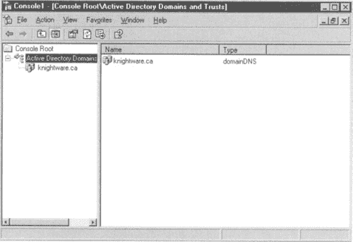

图 1.17 Active Directory 域和信任

Using the Active Directory Domains and Trusts console, you can create a variety of different types of trusts between domains and forests. Earlier, we discussed how parent and child domains and domain trees use a two-way transitive trust to share resources between domains. The two-way transitive trust means that both domains trust one another, as well as any other domains with which they have similar trust relationships. In addition to this type of trust, additional trusts can be created:

 快捷方式信任

 林信任

 领域信任

 外部信任

A shortcut trust is transitive, and can be either one-way or two-way. This means that either one domain can trust another but not vice versa, or both domains can trust each other. This type of trust is used to connect two domains in a forest, and is particularly useful when the domains are in different trees. By creating a shortcut, one domain can connect with another quickly, improving logon times between domains. Connection is quicker because, when two domains in different trees connect via the implicit trusts that exist by default, the trust path must go all the way up the tree to the root domain, across to the other tree’s root domain, and back down the second tree. A shortcut trust, as its name indicates, creates a direct trust between the two domains in different trees.

To illustrate this, let’s look at the situation in 图 1.18. If a user in DomainD wanted to use resources in Domain2, he or she would be authenticating to a domain that is located in a different tree. Without a shortcut trust, the connection would go through DomainA, across the trust between the two trees to Domain1, and then to Domain2.With a shortcut trust, DomainD and Domain2 would have a direct trust between them that could be used for authentication. As we can also see in 图 1.18, multiple shortcut trusts can exist, allowing users to be authenticated to other domains that they commonly need to access.

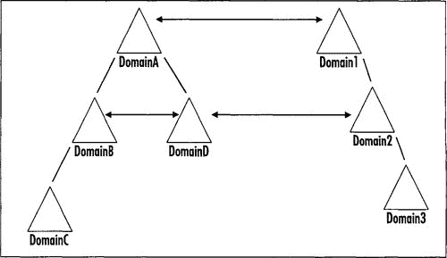

图 1.18 快捷方式信任

A forest trust is also transitive, and can be one-way or two-way. As shown in 图 1.19, this type of trust is used to connect two different forests, so that users in each forest can use resources in the other. Using this type of trust, a user in a domain in one forest could be authenticated and access resources located in a domain that’s in another forest. This allows different areas of the network to be interconnected, even though they are separated by administrative boundaries.

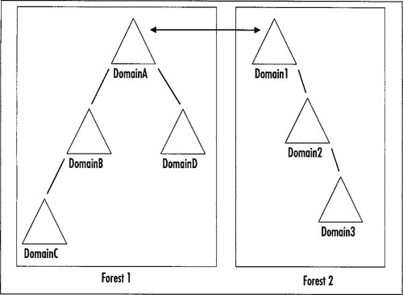

图 1.19 林信任

A realm trust can be one-way or two-way, and can also be either transitive or nontransitive. Nontransitive means that the trust relationship doesn’t extend beyond the two parties. For example, let’s say DomainA trusts DomainB, and DomainB trusts DomainC. Because the trust is nontransitive, DomainA and DomainC don’t trust one another because there isn’t a trust relationship between them. As shown in 图 1.20, the realm trust is used when a relationship needs to be created between a Windows Server 2003 domain and a non-Windows realm that uses Kerberos version 5 (such as one running UNIX).

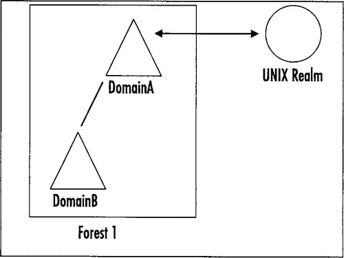

图 1.20 领域信任

The final type of trust that can be created is an external trust. An external trust is always nontransitive, and can be either one-way or two-way. As shown in 图 1.21, this type of trust is used to create a relationship between a Windows Server 2003 domain and one running Windows NT 4.0. It can also be used to connect two domains that are in different forests, and don’t have a forest trust connecting them.

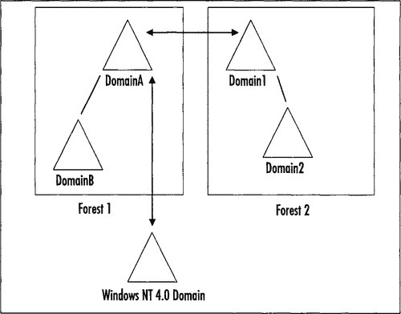

图 1.21 外部信任

The Active Directory Domains and Trusts console is also used for raising domain and forest levels, which enables additional features in Active Directory. Raising domain and forest functional levels depends on what operating systems are running on servers, and is something we discuss in greater detail later in this chapter.

考试警告

The Active Directory Domains and Trusts console allows you to create different types of trust relationships to share information and resources between forests, domains, and non-Windows Server 2003 networks. You can create one- and two-way transitive trusts, forest trusts, realm trusts, external trusts, and shortcut trusts. Each has a specific use, and cannot be used in all circumstances. You should familiarize yourself with the use of each type of trust.

## Active Directory 站点和服务

Earlier in this chapter, we discussed how sites represent the physical structure of your network, and are important to replicating information in Active Directory. The Active Directory Sites and Services console is used to create and manage sites, and control how the directory is replicated within a site and between sites. Using this tool, you can specify connections between sites, and how they are to be used for replication.


## Active Directory 站点和服务

如图所示 图 1.22，`Active Directory Sites and Services` 控制台包含多个容器，提供有关创建和维护站点的信息和功能。当域首次在 DC 上安装时，会创建一个名为 `Default-First-Site-Name` 的站点对象。此容器可以（并且应该）重命名为对业务有意义的名称。如前所述，可以创建其他站点以改善站点间的复制，或者可以将域添加到此现有站点。

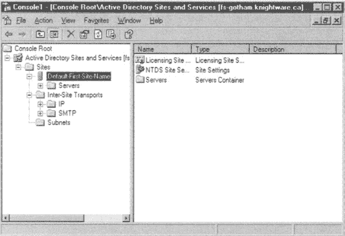

图 1.22 Active Directory 站点和服务

`Inter-Site Transports` 容器用于创建和存储站点链接。站点链接是站点之间的连接。在 `IP` 容器下创建的链接使用 Internet 协议 (`IP`) 作为其传输协议，而在 `SMTP` 下创建的链接使用简单邮件传输协议 (`SMTP`)。

`Subnets` 容器用于创建和存储包含有关网络上子网信息的对象。子网是使用公共网络 ID 在网络内细分的一组相邻计算机。使用 `Subnets` 容器，您可以将不同的子网组合在一起构建站点。

现在我们已经了解了 `MMC` 以及用于管理 Active Directory 的管理单元，让我们获得一些实践经验。在 练习 1.02 中，我们将了解如何使用 `MMC` 加载将在后续练习中使用的管理单元。

## 练习 1.02 向 Microsoft Management Console 添加管理单元

1. 从 Windows 开始菜单中的 `Run` 命令，键入 `MMC`，然后单击 `OK`。
2. 当 `MMC` 打开时，在 `File` 菜单上单击 `Add/Remove Snap-in` 命令。
3. 当 `Add/Remove Snap-in` 对话框出现时，单击 `Standalone` 选项卡以选择它。单击 `Add` 按钮。
4. 当出现 `Add Standalone Snap-in` 时，从列表中选择 `Active Directory Domains and Trusts`，然后单击 `Add` 按钮。此管理单元的条目应出现在 `Add/Remove Snap-in` 对话框的列表中。
5. 从列表中选择 `Active Directory Sites and Services`，然后单击 `Add` 按钮。此管理单元的条目应出现在 `Add/Remove Snap-in` 对话框的列表中。
6. 从列表中选择 `Active Directory Users and Computers`，然后单击 `Add` 按钮。此管理单元的条目应出现在 `Add/Remove Snap-in` 对话框的列表中。
7. 单击 `Close` 返回到上一个屏幕。此时，`Add/Remove snap-in` 对话框中应出现三个条目。单击 `OK` 关闭对话框。
8. `MMC` 中的控制台树现在应包含每个管理单元的节点。展开每个管理单元，注意它们包含与每个管理单元处理的方面相关的对象和信息。

## 命令行工具

Windows Server 2003 提供了一些命令行工具，可用于管理 Active Directory。这些工具使用在提示符下键入的命令，并可提供在管理目录时有用的多种服务。Active Directory 的命令行工具包括：

 `Cacls` 用于查看和修改文件上的自由裁量访问控制列表 (DACL)。

 `Cmdkey` 用于创建、列出和删除用户名、密码和凭据。

 `Csvde` 用于从目录导入和导出数据。

 `Dcgpofix` 将组策略对象 (GPO) 恢复到初始安装时的状态。

 `Dsadd` 用于添加用户、组、计算机、联系人和 OU。

 `Dsget` 显示 Active Directory 中对象的属性。

 `Dsmod` 用于修改用户、组、计算机、服务器、联系人和 OU。

 `Dsmove` 在不移动对象的情况下重命名对象，或将对象移动到新位置。

 `Ldifde` 用于从 Active Directory 创建、修改和删除对象。

 `Ntdsutil` 用于 Active Directory 的一般管理。

 `Whoami` 提供有关当前登录用户的信息。

在以下各节中，我们将简要讨论这些工具，并向您展示它们如何在管理 Active Directory 时帮助您执行某些任务。

### Cacls

`Cacls` 用于查看和修改用户或组对特定资源的权限。`Cacls` 通过允许您查看和更改文件上的 DACL 来提供此功能。DACL 是用户和组的访问控制条目 (ACE) 列表，并包括用户对文件的权限。使用此工具的语法是：

`Cacls filename`

`Cacls` 还有许多开关，这些是您可以在命令行输入以使用特定功能的參數。表 1.1 列出了 `Cacls` 的开关。

表 1.1

`Cacls` 工具的开关

| 参数 | 描述 |
| --- | --- |
| `/t` | 更改当前目录和所有子目录中文件的 DACL。 |
| `/e` | 编辑 DACL。 |
| `/r username` | 撤销用户的权利。 |
| `/c` | 忽略更改 DACL 时可能发生的任何错误。 |
| `/g username permission` | 授予指定用户的权利。可授予的权利有：n（无）、r（读取）、w（写入）、c（更改）和 f（完全控制）。 |
| `/p username permission` | 替换指定用户的权利。可替换的权利有：n（无）、r（读取）、w（写入）、c（更改）和 f（完全控制）。 |
| `/d username` | 拒绝指定用户的访问。 |

### Cmdkey

`Cmdkey` 用于创建、查看、编辑和删除存储的用户名、密码和凭据。这使您可以使用一个帐户登录，并查看和修改另一个用户的凭据。如同我们将讨论的其他命令行工具一样，`cmdkey` 有许多开关，可提供工具运行所需的參數。表 1.2 列出了这些參數。

表 1.2

`Cmdkey` 工具的开关

| 参数 | 描述 |
| --- | --- |
| `/add:targetname` | 将用户名和密码添加到列表中，并指定条目将与其关联的计算机或域（使用 targetname 参数）。 |
| `/generic` | 将通用凭据添加到列表中。 |
| `/smartcard` | 指示 `cmdkey` 从智能卡检索凭据。 |
| `/user: username` | 提供此条目将与其关联的用户名。如果未提供 username 参数，您将被提示输入。 |
| `/pass: password` | 提供要与此条目一起存储的密码。如果未提供 password 参数，您将被提示输入。 |
| `/delete: {targetname | /ras}` | 从列表中删除用户名和密码。如果提供了 targetname 参数，则会删除指定的条目。如果包含 `/ras`，则会删除存储的远程访问条目。 |
| `/list: targetname` | 列出存储的用户名和凭据。如果未提供 targetname 参数，将列出所有存储的用户名和凭据。 |

### Csvde

`Csvde` 用于从 Active Directory 导入和导出数据。此数据为逗号分隔，因此逗号分隔每个值。以这种方式导出数据后，您可以将其导入其他应用程序（例如 Microsoft Office 工具，如 Access 和 Excel）。表 1.3 列出了此命令的參數。

表 1.3

`Csvde` 工具的开关

| 参数 | 描述 |
| --- | --- |
| `-i` | 用于指定导入模式。 |
| `-f filename` | 指定要导入或导出数据的文件名。 |


## 参数

| 参数 | 描述 |
|---|---|
| `-s servername` | 设置将用于导入或导出数据的域控制器。 |
| `-c string1 string2` | 用 `string2` 替换 `string1` 的值。这通常在跨域导入数据时使用，且导出域数据的 DN（`string1`）需要替换为导入域的名称（`string2`）。 |
| `-V` | 详细模式。 |
| `-j path` | 指定日志文件的存放位置。 |
| `-t portnumber` | `portnumber` 参数用于指定 LDAP 端口号。默认情况下，LDAP 端口为 389，GC 端口为 3268。 |
| `-d BaseDN` | `BaseDN` 参数用于指定数据导出搜索基准的 DN。 |
| `-p scope` | 用于设置搜索范围。`scope` 参数的值可以是 Base、OneLevel 或 SubTree。 |
| `-l LDAPAttributeList` | 指定导出查询中要返回的属性列表。如果未使用此参数，则查询中将返回所有属性。 |
| `-o LDAPAttributeList` | 指定在导出查询中要省略的属性列表。 |
| `-g` | 用于省略分页搜索。 |
| `-m` | 用于省略适用于 Active Directory 中某些对象的属性。 |
| `-n` | 指定从导出中省略二进制值。 |
| `-k` | 如果导入过程中出现错误，此参数指定 `csvde` 应继续处理。 |
| `-a username password` | 指定运行此命令时使用的 `username` 和 `password`。默认情况下，使用当前登录用户的凭据。 |
| `-b username domain password` | 指定运行此命令时使用的 `username`、`domain` 和 `password`。默认情况下，使用当前登录用户的凭据。 |

### Dcgpofix

`dcgpofix` 用于将默认域策略和默认域控制器的策略恢复到最初创建时的状态。通过将这些 GPO 恢复到原始状态，对它们所做的任何更改都会丢失。此工具仅有两个相关开关：

 `/ignoreschema` 忽略架构的版本号。

 `/target: {domain | dc | both}` 指定目标域、DC 或两者。

当使用 `/ignoreschema` 开关时，`dcgpofix` 在运行时会忽略 Active Directory 架构的版本号。这将允许它在除 `dcgpofix` 最初安装的计算机上的版本之外的其他版本的 Active Directory 上工作。您应使用随 Windows Server 2003 安装一起安装的 `dcgpofix` 版本，因为如果使用其他操作系统的版本，GPO 可能无法恢复。

### Dsadd

`dsadd` 用于向 Active Directory 添加对象。您可以使用此命令行工具添加的对象有用户、计算机、组、OU、联系人和配额规范。要添加这些对象中的任何一个，您将在命令提示符下输入以下命令：

 `dsadd user` 将用户添加到目录

 `dsadd computer` 将计算机添加到目录

 `dsadd group` 将组添加到目录

 `dsadd ou` 将 OU 添加到目录

 `dsadd contact` 将联系人添加到目录

 `dsadd quota` 将配额规范添加到目录

虽然此工具的命令很简单，但每个命令都有多种相关参数。要了解这些参数的完整详细信息，请在命令提示符下键入命令后跟 `/?`。这将显示每个命令的参数列表。

### Dsget

`dsget` 用于查看 Active Directory 中对象的属性。您可以使用 `dsget` 查看的对象有用户、组、计算机、服务器、站点、子网、OU、联系人、分区和配额规范。要查看这些对象的属性，请输入以下命令：

 `dsget user` 显示用户的属性

 `dsget group` 显示组的属性及其成员身份

 `dsget computer` 显示计算机的属性

 `dsget server` 显示 DC 的属性

 `dsget site` 显示站点的属性

 `dsget subnet` 显示子网的属性

 `dsget ou` 显示 OU 的属性

 `dsget contact` 显示联系人的属性

 `dsget partition` 显示目录分区的属性

 `dsget quota` 显示配额规范的属性

虽然此工具的命令很简单，但每个命令都有多种相关参数。要了解这些参数的完整详细信息，请在命令提示符下键入命令后跟 `/?`。这将显示每个命令的参数列表。

### Dsmod

`dsmod` 用于修改 Active Directory 中现有的对象。您可以使用 `dsmod` 修改的对象有用户、组、计算机、服务器、OU、联系人、分区和配额规范。要编辑这些对象，请输入以下命令：

 `dsmod user` 修改目录中用户的属性

 `dsmod group` 修改目录中组的属性

 `dsmod computer` 修改目录中的计算机

 `dsmod server` 修改 DC 的属性

 `dsmod ou` 修改目录中 OU 的属性

 `dsmod contact` 修改目录中联系人的属性

 `dsmod partition` 修改目录分区

 `dsmod quota` 显示配额规范的属性

虽然此工具的命令很简单，但每个命令都有多种相关参数。要了解这些参数的完整详细信息，请在命令提示符下键入命令后跟 `/?`。这将显示每个命令的参数列表。

### Dsmove

`dsmove` 用于在域内重命名或移动对象。使用此工具，您可以在不移动目录中的对象位置的情况下重命名对象，或将其移动到目录树中的新位置。

 考试警告

`dsmove` 工具不能用于将对象移动到其他域。

重命名或移动对象需要使用 DN，DN 标识对象在树中的位置。例如，如果您有一个名为 JaneD 的对象，位于名为 Accounting 的 OU 中，位于名为 [syngress.com](http://www.syngress.com) 的域中，则 DN 为：

`CN = JaneD, OU = Accounting, DC = syngress, DC = com`

`-newname` 开关用于使用 DN 重命名对象。例如，假设您想将用户帐户的名称从 JaneD 改为 JaneM。要执行此操作，您将使用以下命令：

`Dsmove CN = JaneD, OU = Accounting, DC = syngress, DC = com -newname JaneM`

`-newparent` 开关用于在域内移动对象。例如，假设您刚刚更改名称的用户已从 Accounting 部门调到 Sales 部门，您已在不同的 OU 容器中组织了该部门。要移动用户对象，您将使用以下命令：

`Dsmove CN = JaneM, OU = Accounting, DC = syngress, DC = com -newparent OU = Sales, DC = syngress, DC = com`

除了 `-newname` 和 `-newparent` 开关外，您还可以使用 表 1.4 中列出的参数来控制此工具的使用方式。

#### 表 1.4

Dsmove 的开关

| 参数 | 描述 |
|---|---|
| `{-s Server –d Domain}` | 指定要连接的远程服务器或域。默认情况下，`dsmove` 将连接到您登录到的域中的 DC。 |


### dsmove

| Parameter | Description |
|---|---|
| `-u Username` | 指定登录远程服务器时使用的用户名。 |
| `-p {Password \| *} word.` | 指定登录远程服务器时使用的密码。如果您输入 `*` 符号而不是密码，则会提示您输入密码。 |
| `-q` | 将 `dsmove` 设置为抑制输出。 |
| `{-uc \| -uco \| -uci}` | 指定 `dsmove` 以 Unicode 格式输入和输出。 |

### Ldifde

`Ldifde` 用于从目录中创建、修改和删除对象，也可用于扩展架构。此工具的另一个用途是导入和导出用户和组信息。这使您能够在其他应用程序中查看导出的數據，或使用导入的数据填充 Active Directory。为了执行此类任务，`ldifde` 依赖于一系列开关，使其能够执行特定任务，列于 表 1.5。

表 1.5

Switches for Ldifde

| Parameter | Description |
|---|---|
| `-I` | 将 `Idifde` 设置为导入数据。如果未指定，则工具将以导出模式工作。 |
| `-f Filename` | 指定要导入或导出的文件名。 |
| `-s Servername` | 指定将用于执行导入或导出的域控制器。 |
| `-c string1 string2` | 用 `string2` 替换 `string1` 的值。这通常在域之间导入数据时使用，并且导出的域数据的 DN（`string1`）需要替换为导入域的名称（`string2`）。 |
| `-v` | 详细模式。 |
| `-j path` | 指定日志文件的位置。 |
| `-t portnumber` | `portnumber` 参数用于指定 LDAP 端口号。默认情况下，LDAP 端口为 389，GC 端口为 3268。 |
| `-d BaseDN` | `BaseDN` 参数用于指定数据导出搜索基准的 DN。 |
| `-p scope` | 用于设置搜索范围。`scope` 参数的值可以是 Base、OneLevel 或 SubTree。 |
| `-r LDAPfilter` | 指定用于导出数据的搜索筛选器。 |
| `-I LDAPAttributeList` | 指定在导出查询中返回的属性列表。如果未使用此参数，则查询中将返回所有属性。 |
| `-o LDAPAttributeList` | 指定在导出查询中省略的属性列表。 |
| `-g` | 用于省略分页搜索。 |
| `-m` | 用于省略适用于 Active Directory 中某些对象的属性。 |
| `-n` | 指定从导出中省略二进制值。 |
| `-k` | 如果导入过程中出现错误，此参数指定 `ldifde` 应继续处理。 |
| `-a username password` | 指定运行此命令时使用的 `username` 和 `password`。默认情况下，使用当前登录用户的凭据。 |
| `-b username domain password` | 指定运行此命令时使用的 `username`、`domain` 和 `password`。默认情况下，使用当前登录用户的凭据。 |

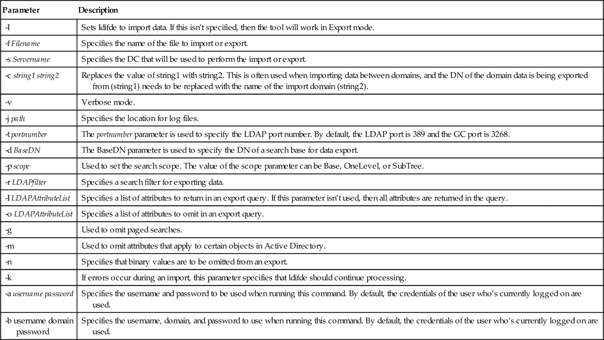

### Ntdsutil

`Ntdsutil` 是一个通用的命令行工具，可执行多种用于管理 Active Directory 的功能。使用 `Ntdsutil`，您可以：

 执行 Active Directory 的维护
 执行 Active Directory 的权威还原
 修改动态数据的生存时间 (`TTL`)
 管理域
 管理目录和日志文件中的数据
 阻止某些 IP 地址查询目录，并设置 LDAP 策略
 从已退役或未正确卸载的域控制器中删除元数据
 管理安全标识符 (`SIDs`)
 管理主操作角色 (`Domain Naming Master`, `Schema Master`, `Iinfrastructure Master`, `PDC Emulator`, 和 `RID Master`)

在命令提示符下键入 `ntdsutil` 将加载该工具，提示符将更改为 `ntdsutil:`。如 图 1.23 所示，通过在命令行键入 `help`，您可以查看正在执行的任务的不同命令。输入命令后，再次键入 `help` 将提供可使用的其他命令。例如，在首次启动 `ntdsutil` 后键入 `metadata cleanup`，然后键入 `help` 将显示与元数据清理相关的命令列表。这使您可以使用命令，就像在包含其他命令的菜单中导航一样。您可以随时返回到上一个菜单，或通过键入 `Quit` 退出程序。

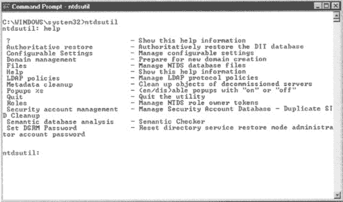

图 1.23 NTDSUTIL

### Whoami

`Whoami` 是一个用于显示当前登录用户信息的工具。使用此工具，您可以查看您的域名、计算机名称、用户名、组名称、登录标识符和权限。显示的信息量取决于与此命令一起输入的参数。 表 1.6 列出了可用的参数。

表 1.6

Switches for Whoami

| Parameter | Description |
|---|---|
| `/upn` | 显示当前登录用户的 UPN。 |
| `/fqdn` | 显示当前登录用户的 FQDN。 |
| `/logonid` | 显示登录 ID。 |
| `/user` | 显示当前登录用户的用户名。 |
| `/groups` | 显示组名称。 |
| `/priv` | 显示与当前登录用户关联的权限。 |
| `/fo format` | 控制信息显示的格式。`format` 参数的值可以为：`table`（以表格格式显示输出）、`list`（列出输出）或 `csv` 以逗号分隔的格式显示。 |
| `/all` | 显示当前登录用户的用户名、组、SIDs 和权限。 |

### Exercise 1.03

Using WHOAMI

1. 从 Windows 开始菜单中，单击命令提示符。
2. 当命令提示符打开时，在提示符下键入 `WHOAMI` 然后按 Enter 键。输出将显示您当前登录的帐户。
3. 键入 `WHOAMI /UPN` 然后按 Enter。当前登录用户的 UPN 将显示在屏幕上。
4. 键入 `WHOAMI /FQDN` 然后按 Enter。当前登录用户的 FQDN 将出现在屏幕上。
5. 键入 `WHOAMI /ALL` 然后按 Enter。与您当前登录的帐户关联的权限列表应出现在屏幕上。
6. 键入 `WHOAMI /ALL` 然后按 Enter，如 图 1.24 所示，与您当前登录的帐户相关的信息列表将列在屏幕上。

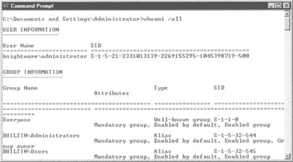

图 1.24 使用 WHOAMI /ALL 命令的结果

## Implementing Active Directory Security and Access Control

安全性是 Windows Server 2003 和 Active Directory 的重要组成部分。实现安全性的两种主要方法是用户身份验证和访问控制。身份验证用于验证用户或其他对象（如应用程序或计算机）的身份。确定他们就是他们所说的人或物后，流程将继续为他们提供应得的访问级别。访问控制管理用户（或其他对象）可以使用的内容以及如何使用它们。通过结合身份验证和访问控制，用户将被允许或拒绝访问目录中的对象。

### Access Control in Active Directory

在 Active Directory 中，可以对对象应用权限来控制这些对象的使用方式。权限通过强制执行用户是否可以读取或写入对象、具有完全控制权或无访问权限来规范访问。三个要素决定了用户的访问权限，并定义了他们对对象的权限：


### 安全描述符


### 对象继承


### 身份验证


### 备注

`Active Directory` 权限与 `share permissions`（也称为共享文件夹权限）和 `NTFS permissions`（也称为文件级权限）是分开的，并与两者协同工作。
`Active Directory` 中的对象使用 `security descriptors` 来存储有关权限的信息，并控制谁可以访问对象。安全描述符包含存储在 `access control lists (ACLs)` 中的信息，后者定义谁可以访问对象以及可以对其执行的操作。安全描述符中有两种不同类型的 ACL：


### 安全访问控制列表 (SACL)


### 自主访问控制列表 (DACL)

`SACL` 用于根据用户或组访问对象的方式跟踪对象的<|message|>安全性。例如，您可以审核用户是否能够使用特定权限（例如 `Read`、`Write` 或 `Full Control`）访问对象。有关要审核内容的<|message|>信息保存在 `ACEs` 中，这些条目存储在 `SACL` 内。这些条目控制要审核的内容，并包含有关要记录的事件的信息。通过这样做，可以保留对象安全性的记录，以及特定用户或组是否能够成功访问它们。
正如我们在讨论 `Active Directory` 的命令行工具时所看到的，`DACL` 是用户和组的 `ACEs` 列表，并包含有关用户或组对文件的权限的信息。`DACL` 控制用户是否被授予或拒绝访问对象。`DACL` 中的 `ACEs` 明确标识单个用户和组，以及授予每个用户的权限。因为只有在 `Active Directory` 中 `DACL` 中标识的用户和组才能访问对象，所以未指定的任何用户或组将被拒绝访问。
`Active Directory` 将您可以应用于对象的权限分为两类：标准权限和特殊权限。标准权限是通常应用于对象的权限，而特殊权限提供额外的访问控制。对于 `Active Directory` 中的大多数对象，有五种权限可作为标准权限使用：


`Full Control` 允许用户更改权限、取得所有权，并拥有与所有其他标准权限相关的能力。


`Read` 允许用户查看对象、属性、所有权和对象上的权限。


`Write` 允许用户更改对象上的属性。


`Create All Child Objects` 允许用户向 `OU` 添加对象。


`Delete All Child Objects` 允许用户从 `OU` 中删除对象。

可以使用 `MMC` 的 `Active Directory Users and Computers` 管理单元在对象上设置权限。如 图 1.25 所示，您可以使用对象的 `Properties dialog box` 的 `Security tab` 来设置权限。`Security tab` 在 `Properties dialog box` 中是隐藏的，除非先在 `View menu` 上切换 `Advanced Features` 菜单项。完成此操作后，您可以通过选择对象并在 `Action menu` 上单击 `Properties`，或右键单击对象并选择 `Properties` 来调出 `Properties dialog box`。

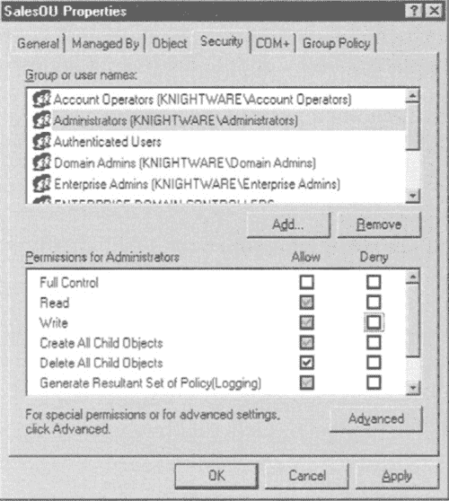
图 1.25 在对象的属性安全选项卡上设置权限


### 考试警告

由于更改权限如果操作不当会造成严重问题，默认情况下 `Security tab` 是隐藏的，需要通过为 `Active Directory Users and Computers` 打开 `Advanced Features` 来启用。在此之前，您将无法修改权限。
`Security tab` 的顶部窗格列出用户和组，底部窗格列出可以应用于这些用户和组的各种权限。您可以通过选择其中一个用户和组并选中适用的权限来设置权限。可以通过单击 `Advanced` 按钮为对象设置特殊权限，这将显示一个对话框，您可以在其中应用额外的权限。
由于为 `Active Directory` 中的每个对象分配权限需要花费很长时间，因此可以使用对象继承来最大限度地减少分配权限的频率和位置。对象继承是指父对象的权限如何被子对象继承。当权限应用于容器时，它们会传播到该容器内的对象。例如，如果一个组对 `OU` 具有 `Full Control` 权限，则该组也将对该 `OU` 内的任何打印机对象具有 `Full Control`。一个对象的权限会向下流向层次结构中的任何对象，因此子对象具有与其父对象相同的权限。
由于有时可能不希望父对象的权限传播到子对象，因此可以阻止继承。通过清除 `Allow Inheritable Permissions From Parent To Propagate To This Object` 复选框，可以阻止来自层次结构中更高层容器的权限。当这样做时，对父对象进行的任何权限修改都不会应用于子对象。子对象的权限必须显式分配。

### 练习 1.04
#### 在 Active Directory 对象上设置权限

1. 通过在 Windows 开始菜单中单击选择 `Administrative Tools`，然后单击 `Active Directory Users and Computers` 菜单项来打开 `Active Directory Users and Computers`。
2. 当安装了此管理单元的 `MMC` 打开时，展开控制台树，以便可以看到您的域及其内部的容器。
3. 从控制台树中选择您的域。从 `Action menu` 中选择 `New`，然后单击 `Organizational Unit` 菜单项。如 图 1.26 所示，当对话框出现时，将新的 `OU` 命名为 `TestOU`，然后单击 `OK`。一个新的 `OU` 应该现在出现在控制台树中您域的下方。

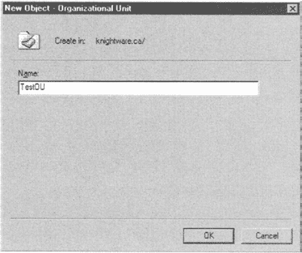
图 1.26 新对象对话框

4. 在 `View menu` 中，单击 `Advanced Features`。
5. 选择 `TestOU` `OU`。从 `Action menu` 中单击 `Properties`。
6. 当 `Properties dialog box` 出现时，单击 `Security tab`。在用户名列表中，选择您当前登录的帐户的名称。
7. 在用户名和组列表下方的窗格中，单击 `Allow` 下的 `Full Control` 复选框，以便在其中出现复选标记。您现在对该 `OU` 具有完全控制权。
8. 单击 `Advanced` 按钮以显示 `Advanced Security Settings dialog box`。当对话框出现时，单击 `Permissions tab`。如 图 1.27 所示。确保选中 `Allow inheritable permissions from the parent to propagate to this object and all child objects` 复选框。这将允许可继承的权限应用于此 `OU`，以及容器内的任何对象。单击 `OK` 返回到上一个屏幕。

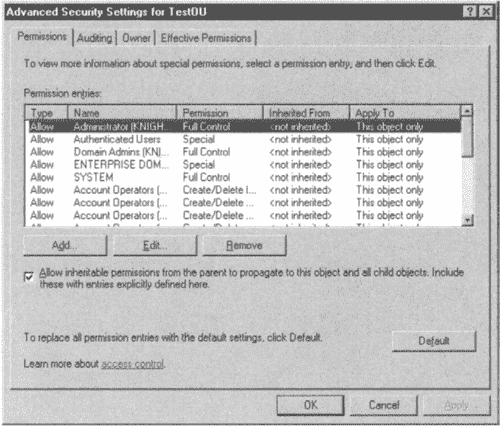
图 1.27 高级设置对话框

9. 单击 `OK` 退出 `Properties dialog box`。

## 基于角色的访问控制


# 基于角色的访问控制和 Active Directory 安全

访问控制可以根据 Active Directory 对象在组织中扮演的角色进行管理。由于对象代表组织中的用户、计算机和其他有形元素，而这些人员和事物在公司中承担不同的目的，因此配置这些对象使其反映其执行任务是有意义的。基于角色的管理用于配置对象设置，以便计算机和用户根据其承担的角色拥有完成工作所需的必要权限。

分配给用户和计算机的角色对应于它们在公司中提供的功能。可用于基于角色访问控制的角色分为两类：授权和计算机配置。

授权角色基于个人作为其工作一部分执行的任务。例如，服务台人员需要更改密码的能力，而会计人员需要能够访问财务信息和审计交易。使用基于角色的访问控制，您可以为每个人提供其执行这些任务所需的访问权限。

授权角色类似于安全组，用户可以成为其成员并获得一定级别的安全性，从而能够执行某些任务。然而，授权角色的不同之处在于它们用于应用程序。基于角色的访问可以应用于单个应用程序、应用程序集或应用程序内的范围。另一个重要区别是基于角色的授权可以是动态的，因此用户在应用程序运行时成为组成员。这与需要预先设置成员身份的安全组不同。

正如用户在公司中有不同的用途一样，计算机也是如此。一家企业可能拥有 DC、邮件服务器、文件服务器、Web 服务器以及为组织中的用户和应用程序提供服务的任何数量的其他机器。计算机配置角色用于控制应基于其在公司中提供的功能在机器上安装和配置哪些功能、服务和选项。

## 授权管理器

授权管理器是 MMC 的一个管理单元，允许您为应用程序配置基于角色的访问。通过使用角色，您可以确保用户仅有权访问执行工作所需的函数和资源，并且禁止使用未授权的其他功能和资源。例如，工资部门的人员需要查看员工信息（以便支付工资），但不需要访问允许他们修改密码的管理功能。

在授权管理器中，角色是根据应用程序支持的任务设计的。角色开发完成后，用户和组可以分配到该角色，以便他们拥有执行这些任务所需的访问权限。用户可用的任务取决于应用程序，因为支持角色的能力和可用功能是软件设计的一部分。

## Active Directory 身份验证

当您登录到 Windows Server 2003 域时，单次登录即可访问您被允许使用的任何资源，无论其在网络上的位置如何。用户在访问服务器或其他资源时无需每次都重新输入密码，因为初始登录后的任何身份验证都是透明的。因为只需要一次登录，系统需要在授予任何访问权限之前验证一个人是否就是他声称的那个人。

身份验证用于验证用户的登录凭据。确定用户身份的主要方法是通过登录到本地计算机和网络，在那里个人输入用户名和密码。如果这些与本地计算机或 Active Directory 账户的用户名和密码不匹配，则该人无法获得访问权限。

Windows NT、2000 和 Server 2003 等操作系统将账户信息存储在 SAM 数据库中。SAM 存储用于访问本地机器的凭据。当用户使用存储在 SAM 中的本地用户账户登录到计算机时，用户将被验证为本地机器。登录到该机器时，用户对该计算机的访问权限仅限于该计算机。

当用户登录到 Windows Server 2003 域时，Active Directory 中的账户用于访问位于域内或在其他受信任域中的网络资源。当用户登录时，本地安全机构 (LSA) 用于将用户登录到本地计算机。它还用于对 Active Directory 进行身份验证。在 Active Directory 中验证用户身份后，对用户进行身份验证的 DC 上的 LSA 创建访问令牌并将 SID 与用户关联。

访问令牌由包含有关用户的信息的数据组成。它保存有关用户姓名、组隶属关系、SID 以及他/她所属组的 SID 的信息。每次用户登录时都会创建访问令牌。因为访问令牌是在登录时创建的，所以对用户组成员身份或其他安全设置的任何更改都不会在用户注销并重新登录后出现。例如，如果用户成为备份操作员，则必须注销并重新登录，然后这些更改才会影响用户的访问权限。

考试日提示

访问控制和身份验证是 Active Directory 安全的重要组成部分，因此了解 Active Directory 的功能和控制措施非常重要。用户将经历的初始安全功能是交互式登录。当用户登录时，会创建访问令牌以指示用户的安全功能。当对用户账户进行更改时，这些更改不会在用户登录到域之前对其生效。

## 标准和协议

身份验证依赖于用于确认用户或对象身份的标准和协议。Windows Server 2003 支持几种类型的网络身份验证：

 Kerberos

 X.509 证书

 轻型目录访问协议/安全套接字层 (LDAP/SSL)

 公钥基础设施 (PKI)

正如我们在以下段落中将看到的那样，其中一些标准和协议不仅提供了一种验证用户身份的方法，还提供了加密数据的能力。通过加密数据，您可以确保未经授权的用户和应用程序无法查看或修改数据。数据在一端编码，在另一端解码。通过提供加密/解密功能，信息的隐私得到更好的维护。

### Kerberos

Kerberos 版本 5 是一种行业标准安全协议，Windows Server 2003 将其用作默认身份验证服务。它用于处理 Windows Server 2003 信任关系中的身份验证，并且是域内身份验证的主要安全协议。

Kerberos 使用相互身份验证来验证用户或计算机以及正在访问的网络服务的身份。各方向对方证明他们就是他们声称的那个人。Kerberos 通过使用票据来实现这一点。


## Kerberos 票证概述

Kerberos 票证是为身份验证而签发的加密数据。票证由密钥分发中心 (KDC)签发，KDC 是一种在每个域控制器 (DC) 上运行的服务。当用户登录时，用户使用密码或智能卡向 Active Directory 进行身份验证。由于 KDC 是 Active Directory 的一部分，用户同时向 KDC 进行身份验证，并获得一个称为票证授予票证 (TGT) 的会话密钥。TGT 通常在用户保持登录状态期间有效，并用于访问票证授予服务，该服务提供另一种类型的票证：服务票证。服务票证用于向各个服务进行身份验证，通过在需要特定服务时提供该票证。

## Head of the Class…

### Kerberos 简化说明

由于构成 Kerberos 身份验证过程的各种不同元素，理解其中发生的一切可能会有点困难。理解和记住某事物的一个好方法是将其与你熟悉的事物进行比较。

Kerberos 身份验证有点像去游乐园。TGT 允许你进入公园，在那里你可以获得游乐设施的票。这些次级票证允许你使用服务，并表明你被允许使用它们。

带着这个类比，我们再来看看 Kerberos 的工作原理：

1. 用户登录并向 KDC 进行身份验证。
2. 从 KDC 获取 TGT，然后将其交给票证授予服务。
3. 票证授予服务向客户端签发服务票证。
4. 服务票证被交给你要访问的网络服务。

### X.509 证书

X.509 是国际标准化组织 (ISO) 发布的一种流行的数字证书标准。X.509 证书用于验证用户确实是其声称的人。数字证书作为识别用户的方法，就像你的出生证明用于识别你作为一个人一样。它们也可以用于确认应用程序、网络服务、计算机和其他设备的身份。

X.509 指定数字证书的语法和格式；换句话说，它说明数字证书中应包含的内容。X.509 证书包含有关证书签发对象的用户的信息、有关证书本身的信息，并可包含有关证书颁发者的信息（称为证书颁发机构 (CA)）。为了防止证书被无限期使用，它还包含证书有效的时间段信息。

### LDAP/SSL

Active Directory 使用 LDAP 在客户端和目录服务器之间进行通信。LDAP 允许你读取和写入 Active Directory 中的数据，但默认情况下不安全。为了扩展 LDAP 通信的安全性，LDAP 可以通过安全套接字层/传输层安全进行使用。

安全套接字层 (SSL) 和传输层安全 (TLS) 提供数据加密和身份验证。TLS 是 SSL 的继任者，更安全。它可由客户端用于验证服务器，也可由服务器用于验证客户端。使用 TLS 进行通信允许客户端和服务器之间的消息被加密，因此两者之间传递的数据无法被第三方访问。

### PKI

公钥基础设施 (PKI) 通过使用数字证书和公钥加密为组织提供保护其通信和交易的方式。证书颁发机构 (CAs) 是 PKI 的重要组成部分，用于创建和管理企业中各处的数字证书和公钥。公钥加密与数字证书结合使用，服务于多种目的，包括身份验证、授权、数据保密性、数据完整性验证和不可否认性。公钥加密使用两种类型的密钥：私钥和公钥。

对于数据保密性，公钥用于加密会话密钥和数据，私钥用于解密。公钥对公众公开，而私钥是保密的，仅为创建该密钥的人所知。密钥对的成员在数学上相关，但仅凭公钥无法推导出私钥。使用这两个密钥，消息可以使用公钥加密进行加密和解密。此外，只有私钥持有者才能解密用公钥加密的消息。

对于身份验证，公钥和私钥的角色是相反的。私钥用于加密，公钥用于解密。私钥是被识别的人独有的，因此每个用户都有自己的私钥用于身份验证。由于每个私钥都有对应的公钥，因此公钥用于解密用于验证用户的身份信息。

公钥和私钥由 CA 同时生成。CA 创建和管理密钥，将公钥和私钥绑定以创建证书，并为用户、计算机、服务、应用程序和其他 CA 所拥有的公钥的有效性提供担保。

除了 CA 之外，还可以使用注册机构 (RA) 为他人请求和获取证书。RA 在用户和 CA 之间充当代理，减轻 CA 的部分验证负担。当用户向 CA 发出请求时，RA 可以拦截该请求，对其进行身份验证，然后将其转发给 CA。当 CA 对请求作出响应时，它将响应发送给 RA，RA 再将其转发给用户。

私钥和公钥是在某人或某物需要证明其身份的有效性时创建的。创建公钥和私钥时，私钥交给想要建立凭证的人或实体，而公钥则被存储，以便任何想要验证这些凭证的人都可以访问。当某人想使用公钥加密发送消息，使数据只能由私钥持有者读取时，公钥从 CA 获取并用于加密消息。当持有私钥的人收到消息时，公钥会与 CA 进行验证。由于 CA 是可信的，这验证了消息的真实性。完成此操作后，私钥随后用于解密消息。

相反，如果某人想发送消息并确保自己是实际发送者，该人可以用自己的私钥加密消息。然后，收件人用发送者的公钥解密它，从而证明消息确实来自该发送者。

## What’s New in Windows Server 2003 Active Directory?

Windows Server 2003 Active Directory 中的许多增强功能和新功能在 Windows 2000 Server 中不可用。这些改进允许更高效地执行各种任务和网络操作。然而，尽管有许多新功能，其中一些功能的可用性取决于 DC 运行的环境。

当在网络上创建 Windows Server 2003 DC 时，Active Directory 会安装一组基本功能。可以启用其他功能，但这取决于作为 DC 运行的操作系统以及为域或林配置的功能级别（以前称为模式）。Active Directory 有四个不同的功能级别：

 Windows 2000 混合
 Windows 2000 原生
 Windows 2003 过渡
 Windows 2003


# Windows Server 2003 中的 Active Directory 功能级别

如果您正在将网络上的 Windows 2000 Server 升级，您可能熟悉前两个级别。这些级别均出现在 Windows 2000 中，并为旧版操作系统（如 Windows NT 4.0）提供向后兼容性，并允许控制 Active Directory 中可用的功能。Windows Server 2003 interim 和 Windows Server 2003 功能是 Active Directory 的新功能，在以前的版本中不可用。

## 域功能级别

### Windows 2000 混合
Windows 2000 混合允许域包含可以与 Windows 2000 和 Windows Server 2003 服务器交互的 Windows NT BDC。在此级别中，Active Directory 的基本功能可用。然而，您无法将组嵌套在彼此内部，使用允许访问任何域中资源的通用组，或使用安全标识符历史记录 (`SIDHistory`)。由于它可容纳网络上运行的最广泛的服务器种类，因此在安装 Windows Server 2003 DC 时，这是默认的功能级别。

### Windows 2000 原生
Windows 2000 原生是 Windows 2000 可用的最高模式，也是 Windows Server 2003 DC 的次高级别。Windows 2000 原生移除了对 Windows NT BDC 的复制支持，因此这些旧服务器无法作为 DC 运行。在此级别中，域中只能使用 Windows 2000 和 Windows Server 2003 DC，并且对通用组、`SIDHistory` 和组嵌套的支持变得可用。

### Windows 2003 Interim
Windows 2003 interim 是 Windows Server 2003 中可用的新级别。当域由 Windows NT 和 Windows Server 2003 DC 组成时使用此级别。它提供的功能与 Windows 2000 混合模式相同，但在将 Windows NT 域直接升级到 Windows Server 2003 时使用。如果林从未拥有 Windows 2000 DC，则这是执行升级时使用的级别。

### Windows 2003
Active Directory 的最高功能级别是 Windows 2003。当域中只有 Windows Server 2003 DC 时使用 Windows 2003 级别。当为域设置此级别时，会启用大量功能。我们将在本章后面讨论这些功能，在讨论域和林功能可用新功能时进行讨论。

Active Directory 可用的功能数量还取决于功能级别是为域还是整个林提升。与域级功能一起，域中的所有服务器都在运行 Windows Server 2003。在此级别下，林中的不同域可以设置为使用不同的功能级别。林级功能下，林中的所有域都在运行 Windows Server 2003，并且其域功能已提升到 Windows Server 2003。如前所述，Windows Server 2003 域功能有四个不同的级别。

## 林功能级别

林功能也可以提升以启用适用于林中所有域的功能。林功能有三个不同的级别可用：

 Windows 2000

 Windows 2003 interim

 Windows 2003

Windows 2000 级别允许网络上使用 Windows NT、Windows 2000 和 Windows Server 2003 DC，并且是林的默认级别。其他两个级别与域级别相同，即 Windows 2003 interim 支持 Windows Server 2003 DC 和 NT BDC，而 Windows 2003 级别仅支持网络上的 Windows Server 2003 DC。当默认级别提升到这两个其他级别之一时，Active Directory 中的其他功能变得可用。

要提升林功能，您必须先提升林中域的功能。在将林功能提升到 Windows 2003 之前，林中的每个域必须提升到 Windows 2000 native 或 Windows 2003。当林功能级别随后提升到 Windows 2003 时，林域中的任何 DC 的域功能级别都会自动提升到 Windows 2003。

 考试日提示

新功能可能取决于先提升域或林的功能级别。请记住在特定级别允许存在哪些操作系统，以及当所有 DC 都运行 Windows Server 2003 时可用的功能。

## 提升功能级别

用于提升域和林功能级别的工具是 `Active Directory Domains and Trusts`。提升域级别是通过右键单击左侧控制台窗格中的域，然后从出现的菜单中单击 `Raise Domain Functional Level` 来完成的。如 图 1.28 所示，然后选择要提升域到的级别，然后单击“提升”按钮。提升林功能级别的方式类似。要提升林级别，请右键单击 `Active Directory Domains and Trusts` 节点，然后从出现的菜单中单击 `Raise Forest Functional Level`（请参阅 图 1.28）。选择要提升林的级别，然后单击“提升”完成任务。

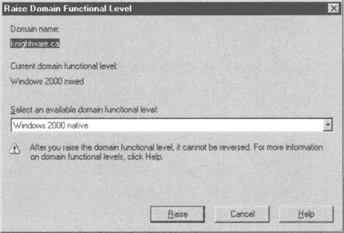

图 1.28 提升域功能级别对话框

在提升林或域功能级别时，重要的是要记住这是一项单向更改。提升级别后，您以后无法再次降低它。例如，如果您将域从 Windows 2000 mixed 提升到 Windows 2003，则无法再次将级别返回到 Windows 2000 mixed。这意味着升级后您无法向域添加 Windows NT BDC 或 Windows 2000 DC，并且任何现有 DC 都需要升级或永久停用。如果您尝试在将域或林级别提升到 Windows 2003 后更改域或林级别，将会出现类似于 图 1.29 的屏幕。

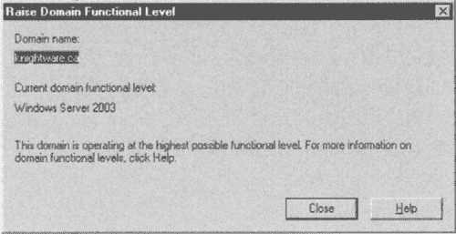

图 1.29 提升域功能级别对话框 在提升域功能级别后

 考试警告

提升功能级别是一项单向更改。您以后不能改变主意然后降低级别以适应用作 DC 的旧操作系统。在提升级别之前，请确保未运行 Windows Server 2003 的操作系统可以在新级别中运行，或在更改之前已升级或永久离线。

### 所有 Windows Server 2003 计算机上可用的新功能

在查看提升域或林级别时可用的各个功能之前，让我们先讨论无论域或林级别是否已提升都可用的新功能。我们接下来要讨论的功能和工具适用于可作为 DC 的所有 Windows Server 2003 版本。

如本章前面所述，Active Directory 的许多命令行实用程序使管理员能够从命令提示符执行某些任务。这允许管理员手动输入命令从命令提示符运行操作，或在批处理文件或脚本中使用这些命令，这些文件或脚本可以安排在特定时间运行。

我们之前也看到目录使用分区将数据分离到不同的集合中，并且应用程序分区用于存储特定应用程序所需的数据。由于此应用程序特定数据存储在其自己的分区中，因此您可以配置 Active Directory 仅将此信息复制到其他 DC。不复制整个目录可减少复制数据到其他 DC 所需的时间和网络流量。


Another new capability provided in Windows Server 2003 is that DCs can be created from backups. Backups are used to copy data to other media such as tapes, and can be used to restore lost data if problems arise. For example, if the hard disk on a server fails, you can use the backup to restore the data to another disk and have the server up and running again. This same process can be used to restore Active Directory to a new DC, avoiding the need to replicate the entire directory to the DC across the network. Allowing additional DCs to be added to an existing domain through the use of backups reduces the time it takes to set up new DCs on the network.

You can use encryption to protect information that is being transmitted across the network. As previously discussed, `LDAP` can be used over `SSL` to encrypt data and ensure that data isn’t tampered with. This protection prevents unauthorized users from accessing data over the network.

Active Directory allows you to select multiple user objects, so that you can change the attributes of more than one object at a time. After selecting two or more user objects in Active Directory Users and Computers, you can bring up the properties and modify the attributes that are common to each object. This capability makes it faster to manage users, because you don’t have to make changes to each account individually.

Active Directory also provides the capability to drag and drop objects into containers. By selecting an object with your mouse, you can then hold down your left mouse button to drag the object to another location (such as another OU). Releasing the left button drops the object into the container. This capability also makes it easy to add user and group objects to groups. Dragging and dropping a user or group into another group adds it to the group membership.

As we’ll see in the next chapter, a new object class has been added to Active Directory called `InetOrgPerson`. `InetOrgPerson` is a type of object that’s used to represent users in non-Microsoft directory services, and used just as a user object. The presence of this type of class is important when directory information is migrated to Active Directory from these directories.

To prevent users, computers, and groups from creating an unlimited number of objects in Active Directory, Windows Server 2003 has added quotas. Active Directory quotas are used to limit how many objects are owned in a particular directory partition. While quotas can be applied to almost every user, computer, and group, Domain Administrators and Enterprise Administrators are exempted from these limits.

The quotas that are used to limit the ability of a user, computer, or group from creating too many objects in Active Directory should not be confused with disk quotas, which are also available on Windows Server 2003 servers (regardless of the functionality level being used). Disk quotas can be used to limit the amount of hard disk space that can be used on a volume that’s formatted in `NTFS`. The `NTFS` file system is more advanced than other file systems such as `FAT` or `FAT32`, which can also be used to format volumes. By using disk quotas on an `NTFS` volume, administrators can prevent users from filling up the hard disk with an unlimited number of files.

Finally, searching for objects in Active Directory is easier and more efficient in Windows Server 2003. Active Directory uses object-orientated searches to minimize network traffic, and provides the capability to save queries so that they can be reused repeatedly. The capability to save commonly used queries in Active Directory Users and Computers is a topic we’ll look at in detail in 第 2 章.

## 仅在 Windows Server 2003 域/林功能下可用的新功能

When the domain or forest functional levels have been raised so that all DCs are running Windows Server 2003, a number of new features become enabled. These features allow you to modify elements of both your domain and forest, and provide advanced functions that aren’t available until functionality levels are raised. In the paragraphs that follow, we will look at the new features available in Active Directory when all DCs have been upgraded to Windows Server 2003, and the functionality has been raised to Windows 2003.

### 域控制器重命名工具

The DC renaming tool allows you to rename a DC without having to demote it first. This can be useful when you need to restructure the network, or simply want to use a more meaningful name for a particular DC. When this tool is used, the DC name changes, and any Active Directory and DNS entries are automatically updated.

### 域重命名实用工具

Domains can also be renamed. Using the domain rename utility (`rendom.exe`), you can change the NetBIOS and DNS names of a domain, including any child, parent, domain-tree, or forest root domains (from which all others branch off in the hierarchy). By renaming domains in this manner, you can thereby move them in the hierarchy. For example, you can change the name of [dev.web.syngress.com](http://www.dev.web.syngress.com) to [dev.syngress.com](http://www.dev.syngress.com), making the [web.syngress.com](http://www.web.syngress.com) and [dev.syngress.com](http://www.dev.syngress.com) domains on the same level of the hierarchy. You could even rename the domain so that it becomes part of a completely different domain tree. The only domain that you can’t reposition in this manner is the forest root domain.

### 林信任

As we saw earlier, forest trusts can also be created, so that a two-way transitive trust relationship exists between two different forests. In creating such a trust, the users and computers in each forest are able to access what’s in both forests. This expands the network, so users are able to use services and resources in both forests.

### 动态链接辅助类

Additional features have also been added to the schema. Windows Server 2003 supports dynamically linked auxiliary classes, which allow additional attributes to be added to individual objects. For example, you can have an auxiliary class that has attributes that are used for the Accounting department, and others that are useful for the Sales department. By applying the auxiliary classes to the objects, only those objects are affected. Rather than adding attributes to an entire class of objects, dynamically linking auxiliary classes allows you to apply additional attributes to a selection of objects.

### 禁用类

Because certain objects in Active Directory might no longer be needed after a specific point, you can disable classes and attributes that are no longer needed in the schema. Classes and attributes can be disabled, but cannot be deleted. If schema objects are not longer required, you can deactivate them, and reactivate them later if the situation changes.

### 复制

Improvements have also been made in how Active Directory replicates directory data. Rather than having the entire group membership replicated as a single unit, individual members of groups can now be replicated to other DCs. In addition, changes have been made to GC replication. When there is an extension of a partial attribute set, only the attributes that have been added are replicated. These improvements decrease the amount of network traffic caused by replication because less data is transmitted across the network.

### 练习 1.05

#### 提升域和林功能

This exercise should not be performed on a production network. It assumes that all DCs in the domain are running Windows Server 2003. After raising the functional levels, you will not be able to roll back to a previous level.

1. From the Windows Start menu, select Administrative Tools, and then click the Active Directory Domains and Trusts menu item.

2. When Active Directory Domains and Trusts opens, expand the Active Directory Domains and Trusts node, and select your domain.


## 提升域和林功能级别

3. 从“操作”菜单中，单击 `Raise Domain Functional Level`。

4. 当 `Raise Domain Functional Level` 对话框出现时，从下拉列表中选择 Windows Server 2003。单击 `Raise` 按钮。

5. 将出现一条警告消息，告知您此操作会影响整个域，并且在提升域功能级别后无法还原。单击 `OK`。

6. 提升级别后，消息框会告知您操作成功。单击 `OK` 继续。

7. 在“Active Directory 域和信任关系”的上下文窗格中，选择 Active Directory 域和信任关系 节点。

8. 从“操作”菜单中，单击 `Raise Forest Functional Level`。

9. 当 `Raise Forest Functional Level` 对话框出现时，从下拉列表中选择 Windows Server 2003。单击 `Raise` 按钮。

10. 将出现一条警告消息，告知您此操作会影响整个林，并且在提升林功能级别后无法还原。单击 `OK`。

11. 提升级别后，消息框会告知您操作成功。单击 `OK` 继续。

## 考试目标摘要

Active Directory 是一个具有层次结构的数据库，用于存储有关帐户、资源以及构成网络的其他元素的信息。此信息存储在位于服务器上的数据源中并复制到网络上的其他 DC。有关 Active Directory 的信息组织在架构、域和配置分区中，并且还可以为存储在应用程序分区中的程序提供附加信息。此数据可通过网络使用 `LDAP` 访问。

为了在目录结构中标识对象，Active Directory 支持多种不同的命名方案。这些包括域名系统 (DNS)、用户主体名称 (UPN)、通用命名约定 (UNC)、统一资源定位符 (URL) 和轻型目录访问协议统一资源定位符 (LDAP URL)。基于 X.500 规范的 distinguished names (DNs)、相对 distinguished names (RDNs) 和规范名称也用于标识对象。

多种对象构建了目录的层次结构，包括用户、计算机、打印机、其他对象以及存储它们的容器对象。此外，其他组件用于构成 Active Directory 的物理和逻辑结构。站点代表网络的物理结构，而域、树和林代表逻辑结构。它们共同构成了 Active Directory 的构建块。

管理 Windows Server 2003 和 Active Directory 的主要管理工具是 Microsoft Management Console (`MMC`)。使用此工具，您可以加载用于管理 Windows Server 2003 和 Active Directory 不同方面的管理单元。三种管理单元主要用于管理 Active Directory：Active Directory 用户和计算机、Active Directory 域和信任关系以及 Active Directory 站点和服务。除了这些图形工具之外，还可以使用新的命令行工具执行管理任务。

Active Directory 还提供访问控制和身份验证机制。可以对对象应用权限来控制其使用方式，而安全描述符、对象继承和身份验证用于确定用户访问权限以及对象上设置的权限。支持的身份验证方法包括 Kerberos、X.509 证书、LDAP over SSL 和 PKI。通过这些方法，Windows Server 2003 和 Active Directory 可免受未经授权的访问。

Windows Server 2003 提供了许多新功能和工具。为了使其中一些功能可用，必须先提升域和/或林的功能级别。功能级别类似于 Windows Server 2000 中使用的域模式，其中向后兼容的功能在提升级别时被停用，而旧操作系统无法使用的新功能则变得可用。

对目录服务的目的和功能以及 Active Directory 的基础结构和拓扑的良好理解是充分利用这一强大数据库的关键要素。在本章中，我们提供了必要的概述，以便充分理解本书其余部分中涵盖的更具体主题。

## 考试目标快速通道

### 介绍目录服务

☑ Active Directory 数据存储是所有目录信息的数据库，也称为目录。它是一个名为 `NTDS.DIT` 的文件，位于 `systemroot` 中的 `NTDS` 文件夹中。

☑ 安装 Active Directory 时，每个 DC 上存在三个分区：域分区、配置分区和架构分区。还可能有一个或多个应用程序分区。

☑ Active Directory 使用 `LDAP` 在客户端和目录服务器之间进行通信。`LDAP` 是 X.500 目录访问协议 (`DAP`) 的轻量级版本。

### 了解 Active Directory 的工作原理

☑ 域是网络元素的逻辑分组，由计算机、用户、打印机以及构成网络的其他对象组成。

☑ Active Directory 允许将多个域连接在一起形成称为域树的层次结构，由父域和子域组成。

☑ Active Directory 有两个林范围的主角色和三个域范围的主角色，用于存储信息的 master 副本。架构主控和域命名主控角色在每个林中唯一于一个 DC，而 RID 主控、PDC 仿真器和结构主控角色在每个域中唯一于一个 DC。

### 使用 Active Directory 管理工具

☑ Active Directory 用户和计算机 允许您管理存储在 Active Directory 中的用户和计算机帐户、组、打印机、组织单位 (OUs)、联系人和其他对象。使用此工具，您可以创建、删除、修改、移动、组织并设置这些对象的权限。

☑ Active Directory 域和信任关系 用于管理域及其之间的信任关系。使用此工具，您可以创建、修改和删除域之间的信任关系，设置 UPN 后缀，并提升域和林功能级别。

☑ Active Directory 站点和服务 工具用于创建和管理站点，并控制目录在站点内以及站点之间的复制方式。使用此工具，您可以指定站点之间的连接以及它们用于复制的方式。

### 实现 Active Directory 安全和访问控制

☑ Active Directory 将可应用于对象的权限分为两类：标准和特殊。标准权限通常应用于对象，而特殊权限提供额外的访问控制。

☑ Kerberos 版本 5 是一种行业标准安全协议，Windows Server 2003 将其用作默认身份验证服务。它用于处理 Windows Server 2003 信任关系中的身份验证，并且是域内身份验证的主要安全协议。

☑ 公钥基础设施 (PKI) 是一种使用私钥和公钥提供身份验证和加密的身份验证方法。为了数据保密，公钥可供公众使用并用于加密会话密钥和数据，而私钥仅为创建该私钥的人所知，并用于解密。为了身份验证，私钥用于加密，公钥用于解密。

### Windows Server 2003 Active Directory 有何新功能？

☑ 可以提升域功能级别以启用 Active Directory 中的其他功能。域功能有四个不同的级别：Windows 2000 混合、Windows 2000 原生、Windows 2003 过渡 和 Windows 2003。


☑ `Forest functional levels` 也可以提升以在 `Active Directory` 中启用附加功能。森林功能有三个不同的级别；`Windows 2000`、`Windows 2003 interim` 和 `Windows 2003`。
☑ `Windows Server 2003` 提供了许多命令行实用程序，允许管理员和用户管理并与 `Active Directory` 交互。

## 考试目标常见问题解答

下列常见问题解答由本书作者解答，旨在衡量您对本章中介绍的考试目标的理解程度，并帮助您在实际生活中实施这些概念。您还可以在 [ITFAQnet.com](http://www.ITFAQnet.com) 访问数千个其他常见问题解答。

Q: 可以使用哪些版本的 `Windows Server 2003` 作为 `DCs`？
A: `Active Directory` 可以安装在 `Windows Server 2003 Standard Edition`、`Windows Server 2003 Enterprise Edition` 和 `Windows Server 2003 Datacenter Edition` 上。当 `Active Directory` 安装在这些版本中的任何一个上时，它将充当 `DC`。`Active Directory` 不能安装在 `Windows Server 2003 Web Edition` 上。

Q: 如何在 `Windows Server 2003` 成员服务器上安装 `Active Directory`，使其成为 `DC`？
A: 使用 `DCPROMO`。`DCPROMO` 调用 `Active Directory Installation Wizard`，可用于将成员服务器提升为 `DC`。您可以通过单击 `Start | Run` 并键入 `dcpromo` 来运行它，或者您可以使用 `Configure Your Server wizard` 来启动 `Active Directory` 安装。

Q: 为什么 `Windows Server 2003` `DCs` 在使用其他命名方案时仍使用 `NetBIOS` 名称？
A: `NetBIOS` 名称用于提供向后兼容。`NetBIOS` 名称由 `Windows 2000` 之前的服务器和客户端使用，并允许这些操作系统的用户登录到 `Windows Server 2003` 域。

Q: 我正在创建新的 `Windows Server 2003` 网络，并且刚刚在网络上安装了第一个 `DC`。我必须做什么来创建我的第一个站点、林和域？
A: 无需操作。当 `DC` 安装在网络上时，第一个域、林和站点会自动创建。需要时可以创建额外的域、林和站点，就像可以添加额外的 `DCs` 一样。然而，第一个域、林和站点是根据您在安装 `Active Directory` 时提供的信息创建的。

Q: 我想对 `Active Directory` 中的对象设置权限，以防止未经授权访问这些对象。我应该使用什么管理单元？
A: `Microsoft Management Console` 的 `Active Directory Users and Computers` 管理单元。使用此工具，您可以修改权限并控制访问。此管理单元已预先配置在控制台中，您可以通过 `Start \ Programs | Administrative Tools` 访问它。

Q: 我想对用户账户进行安全更改，但在 `MMC` 的 `Active Directory Users and Computers` 管理单元中打开权限时，`Security tab` 没有出现。
A: 除非先在 `View` 菜单上选择 `Advanced Features` 菜单项，否则 `Security tab` 在 `Properties dialog box` 中是隐藏的。完成此操作后，打开对象的属性时将出现 `Security tab`。

## 自测

自测问题后附有快速答案键。有关本章以及本书其他章节中自测问题的完整问题、答案和解释，请参阅自测附录。

### 介绍目录服务

1. 一名员工已从公司退休，您刚刚禁用了他的账户，以便没有人能以此用户登录到域。当此更改进行时，它将在目录中存储在哪里？
A. `Domain partition`
B. `Configuration partition`
C. `Schema partition`
D. `Application partition`

2. 贵公司的员工由两个工会代表。管理层有一个工会代表管理人员的利益，而公司其他员工则属于另一个工会。每个工会都要求从工资单中扣除会费以支付其代表费用。财务部门要求在每个用户账户中添加一个字段，以便在账户上输入代码以显示每位员工所属的工会。他们要求您创建此字段。当此新属性已添加到用户对象时，它将在目录中存储在哪里？
A. `Domain partition`
B. `Configuration partition`
C. `Schema partition`
D. `Application partition`

3. 您通过网络搜索 `Active Directory`，以查找目录中存储的对象。在执行此搜索时，将使用什么协议？
A. `IPX/SPX`
B. `Directory Access Protocol (DAP)`
C. `Lightweight Directory Access Protocol (LDAP)`
D. `X.500`

4. 用户名 `JohnB` 的用户想要访问位于名为 [syngress.com](http://www.syngress.com) 的 `DC` 上、名为 `DB` 的目录中的名为 `db.mdb` 的 Microsoft Access 数据库。使用 URL，此用户将输入什么到浏览器以访问数据库？
A. JohuB@syngress.com
B. [syngress.com](http://syngress.com)
C. [`syngress.com/DB/db.mdb`](http://www.syngress.com/DB/db.mdb)
D. Wsyngress.com\\DB\\db.mdb

用户名为 `JaneD` 的用户在销售部门工作。她的账户位于 [syngress.com](http://www.syngress.com) 域中。基于此信息，在 `Active Directory` 中用于标识此对象的规范名称是什么？
A. `CN = JaneD`
B. `/CN = JaneD /OU = Sales /DC = syngress /DC = com`
C. `OU = Sales`
D. `/syngress.com/Sales/JaneD`

### 了解 Active Directory 的工作原理

6. 您正在对 `Active Directory` 中使用的对象类和属性进行更改。您将在以下哪个 `DCs` 上进行这些更改？
A. `Schema Master`
B. `RID Master`
C. `Infrastructure Master`
D. `PDC Emulator`

7. 您的网络由两个林组成，一个林中有两个域，另一个林中有三个域。基于此信息，以下主角色中有多少个将在林和域中？
A. 将有五个 `Schema Masters`、`Domain Naming Masters`、`RID Masters`、`PDC Emulators` 和 `Infrastructure Masters`。
B. 将有两个 `Schema Masters`、`Domain Naming Masters`、`RID Masters`、`PDC Emulators` 和 `Infrastructure Masters`。
C. 将有五个 `Schema Masters` 和 `Domain Naming Masters`，以及两个 `RID Masters`、`PDC Emulators` 和 `Infrastructure Masters`。
D. 将有两个 `Schema Masters` 和 `Domain Naming Masters`，以及五个 `RID Masters`、`PDC Emulators` 和 `Infrastructure Masters`。

8. 用户最近更改了她的姓氏，您对目录中的用户对象进行了更改以反映此情况。就在更改之前，使用默认计划进行了站点间复制。就在更改之后，进行了更改的 `DC` 与另一站点中的 `DC` 之间的链接失败。链接恢复还需要一个小时。每个站点中有四个 `DCs`。以下哪一项将会发生？
A. `DCs` 之间的复制将正常进行，因为 `Knowledge Consistency Checker (KCC)` 为每个 `DC` 创建了至少两个连接。由于其中一个失败，将使用另一个连接。
B. `DCs` 之间的复制不会发生。15 秒后，将发送更改通知，复制伙伴随后将请求更新数据。
C. 复制将正常进行，因为信息不会在最后一次复制后三小时之前复制。
D. 将使用另一个链接来复制数据，基于拓扑生成器收集的信息。

### 使用 Active Directory 管理工具

9. 您正在使用 `Microsoft Management Console (MMC)` 管理 `Active Directory` 中的对象。您决定查看有关 `DC` 的信息。您将使用以下哪个管理单元来查看此信息？
A. `Active Directory Users and Computers`
B. `Active Directory Domains and Trusts`
C. `Active Directory Sites and Services`
D. `Dcgpofix`


10. 贵公司已与另一家使用 UNIX 机器作为服务器的公司合并。贵公司 Windows Server 2003 域中的用户需要访问这些 UNIX 机器上的信息，但您不希望域外的客户端访问信息。为实现这种方式共享信息，您将创建以下哪种类型的信任关系？
A. 单向传递式林信任
B. 双向传递式 realm 信任
C. 单向非传递式 realm 信任
D. 外部信任

### 实现 Active Directory 安全和访问控制
11. 有人使用他人账户访问 Active Directory 中的对象而引发担忧。您想要审核一个对象以查看用户和组如何访问它。在对此对象设置审核时，有关要跟踪的信息将存储在哪里？
A. 自主访问控制列表
B. 安全访问控制列表
C. X.509
D. 对象上不提供审核
12. 您正在配置 Active Directory 权限，以便经理可以修改其负责部门的 OU 中表示的用户对象。在配置这些权限时，您还希望每个经理能够在其负责部门的 OU 中表示的 OU 内创建新的 OU。您希望给予最受限制的权限来实现这些任务。您将给予这些经理哪些权限？（请选择所有适用项。）
A. 读取
B. 写入
C. 创建所有子对象
D. 删除所有子对象
13. 您已在父容器上设置了权限，并希望防止这些权限应用于其中的子容器。您将如何实现？
A. 在 Active Directory 用户和计算机中，打开父 OU 的属性，并选择安全选项卡。单击高级按钮，并在对话框出现时，确保选中允许从父级继承的权限传播到此对象的复选框。
B. 在 Active Directory 用户和计算机中，打开父 OU 的属性，并选择安全选项卡。单击高级按钮，并在对话框出现时，确保清除允许从父级继承的权限传播到此对象的复选框。
C. 在 Active Directory 站点和服务中，打开父 OU 的属性，并选择安全选项卡。单击高级按钮，并在对话框出现时，确保清除允许从父级继承的权限传播到此对象的复选框。
D. 无法实现该目标。权限将始终由子对象继承。您必须移动 OU，使其在层次结构中与父容器处于同一级别。

### Windows Server 2003 Active Directory 中的新增功能？
14. 您正在将现有网络升级为使用 Windows Server 2003。网络具有 Windows NT 4.0 域控制器和您正在添加到域的 Windows Server 2003 服务器。在将第一个 Windows Server 2003 DC 添加到网络后，您希望将域功能级别提升到网络可用的最高级别。您将把域提升到哪个级别？
A. Windows 2000 混合
B. Windows 2000 原生
C. Windows 2003 过渡
D. Windows 2003
15. 您正在将域升级为使用 Windows 2000 和 Windows Server 2003 DC 的混合环境。在域上安装第一个 Windows Server 2003 DC 后，您希望将域功能级别提升到可能达到的最高级别。您将选择以下哪一项？
A. Windows 2000 混合
B. Windows 2000 原生
C. Windows 2003 过渡
D. Windows 2003

## 自测快速答案键
有关本章以及本书其他章节中自测问题的完整问题、答案和解释，请参阅自测附录。
1. A
2. C
3. C
4. C
5. D
6. A
7. D
8. C
9. A
10. C
11. B
12. A, B, C
13. B
14. C
15. B

# 第 2 章 MCSA/MCSE 70-294 管理用户、组和计算机账户
本章考试目标：
3 规划和实施用户、计算机和组策略
☑ 考试目标摘要
☑ 考试目标快速通道
☑ 考试目标常见问题
☑ 自测
☑ 自测快速答案键

## 引言
网络管理员工作的重要部分涉及网络用户和计算机的管理。Windows Server 2003 为用户和计算机分配账户用于安全和管理目的。用户账户可以通过将其放入组中进一步管理，以便可以将任务——例如分配权限——同时应用于整个用户组，而无需为每个单独的用户账户执行。
本章向您介绍安全主体——用户、组和计算机——的概念，以及用于表示它们的 Security Identifiers（SIDs）。您将了解命名这些对象的约定和限制。
我们向您展示如何使用 Active Directory 用户账户，包括内置账户和您创建的账户。您还将学习如何使用组账户，并了解组类型和范围。您将学习如何使用计算机账户，以及如何管理多个账户。我们将向您展示如何实现用户主体名称（UPN）后缀，并讨论如何在 Active Directory 中移动对象。
您将学习使用内置工具——图形界面和命令行——来执行与用户、组和计算机管理相关的常见管理任务；练习将引导您完成创建和管理这三种类型账户的步骤。

## 了解 Active Directory 安全主体账户
Active Directory 由各种不同的目录服务对象组成。其中包括安全主体账户，包含以下内容：
■ 用户账户
■ 计算机账户
■ 组
安全主体账户用于身份验证和访问控制，并提供管理网络上可访问内容的方式。根据与安全主体账户关联的安全设置，您可以控制用户、组或计算机是否可以访问 Active Directory、打印机和文件系统对象，以及域控制器（DC）、成员服务器、客户端计算机、应用程序和其他网络元素。它们是保护网络和控制用户和计算机有权访问内容的重要因素。
由于安全主体代表单独和集体访问目录的人员、服务、计算机和其他实体，因此有多种不同的识别方式。其中一些名称可能对您很熟悉，例如您用于登录 Windows Server 2003 的用户名或在网络上标识您计算机的名称，而其他名称则用于特定技术（如 Web 浏览器）或向旧操作系统提供向后兼容性。正如我们稍后会看到的，不同的名称提供了友好且唯一的方法来识别用户、组和计算机。

### 安全主体和安全标识符
安全主体之所以得名，是因为它们是 Active Directory 对象，在创建时会被分配 SID。SID 用于控制对资源的访问，并由内部进程用于识别安全主体。由于每个 SID 都是唯一的，除非安全受到破坏，否则在管理员正确配置系统时，账户不会错误地获得对受限资源的访问权限。


## 安全标识符 (SIDs) 概述

## SID 唯一性与颁发

`SIDs` 能够保持唯一性是因为它们被颁发的方式。在每个域中，都有一个 `DC` 充当相对 ID (`RID`) 主控。`RID` 主控负责生成相对标识符，这些标识符用于创建 `SIDs`。`SID` 是一个包含域安全标识符和相对标识符的数字。域 ID 对域中的所有对象都相同，但相对标识符是唯一的。每个域内的每个 `DC` 都会被分配一池这些数字，以便将它们分配给在该 `DC` 上创建的安全主体。当池中的 80% 数字已被分配给对象时，`DC` 将然后从 `RID` 主控请求新的池。

## SID 稳定性

`SIDs` 被使用是因为与对象关联的名称不同，`SIDs` 不会改变。当对象被创建时，会关联一个唯一的字母数字值，并且该值会一直保留在对象上，直到它被删除。诸如更改对象的名称或其他属性之类的操作不会影响 `SID`。例如，如果你创建了一个名为“Jane Doe”的用户账户，也会为该账户生成一个 `SID`。如果你后来将账户名称更改为“Jane Smith”，对象的名称将被更改，但 `SID` 将保持不变。如果使用名称来确定访问权限，则看起来是完全不同的用户正在尝试访问域中的资源。因为 `SID` 用于确定访问权限，所以用户的身份保持不变，用户拥有的任何访问权限都不会受到影响。

考试日提示

请记住，唯一的安全主体账户是用户账户、计算机账户和组账户。它们是唯一在创建时被赋予 `SIDs` 的对象。如果其中一个账户被删除，然后使用相同的信息重新创建，它将被赋予一个新的 `SID`，并在内部进程和访问控制列表 (`ACLs`) 中表现为完全不同的账户。

## SID 类比

为了更好地理解 `SID`，你可以将其与员工 ID 进行比较。当雇主向你发放其中一个号码时，随着你生活中的情况变化，它不会改变。你可以更改姓名、地址、办公地点、公司职位或其他识别因素，但这个号码始终是你的号码。`SID` 的使用方式相同。

## 身份验证过程

如 图 2.1 所示，`SID` 是身份验证过程的一部分。当用户登录到域时，本地安全机构 (`LSA`) 用于向 Active Directory 进行身份验证，并创建访问令牌。访问令牌用于控制用户对资源的访问，并包含用户的登录名和 `SID`、用户所属的任何组的名称和 `SIDs`，以及分配给用户的权限。令牌在用户每次登录时创建，并保存访问控制所需的所有信息。

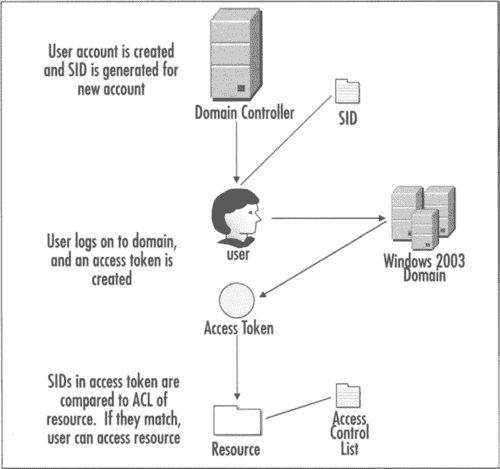

图 2.1 安全标识符在访问控制中的使用方式

## 访问控制和安全描述符

当用户尝试访问资源时，Windows Server 2003 将 `SID` 与资源的安全描述符进行比较。安全描述符包含两个组件，即自主访问控制列表 (`DACL`) 和系统访问控制列表 (`SACL`)。`ACL` 包含访问控制条目 (`ACEs`)，用于控制或监视对资源的访问。`ACE` 决定是否允许或拒绝与特定 `SID` 关联的用户访问，或是否对用户进行审计。

### SACL 审计

`SACL` 用于审计对资源的访问。`SACL` 中的 `ACE` 包含有关是否应在尝试访问资源时生成日志的信息。此日志可以在指定的用户或组尝试访问资源并成功、失败或两者兼有 时生成。

### DACL 权限

`DACL` 用于不同的目的。`DACL` 决定是否授予或拒绝安全主体对资源的访问权限。`DACL` 记录谁有权访问资源以及其访问级别。当用户尝试访问对象时，将用户的 `SID` 与 `DACL` 中的条目进行比较。如果用户的 `SID` 或其所属组的 `SID` 与 `DACL` 中的条目匹配，则该用户可以被明确允许或拒绝使用资源的访问权限。

## 访问评估过程

当用户访问资源时，会开始一个过程来确定他们基于对资源的权限拥有的访问级别。系统首先会确定资源上是否存在 `DACL`。如果不存在，则资源没有访问控制，因此授予访问权限。如果存在 `DACL`，则系统会遍历 `ACEs`，直到找到一个或多个匹配项，或直到找到指定拒绝访问的 `ACE` 为止。

注意

在运行 `NTFS` 文件系统的 Windows Server 2003 计算机上，所有文件和文件夹对象都将具有控制对本地资源的访问并允许审计的 `DACL`。使用 `FAT` 文件系统时则不会。

## DACL 评估顺序

当安全主体尝试访问受 `DACL` 保护的资源时，`DACL` 中的每个 `ACE` 都会按顺序进行分析，以确定是否应允许或拒绝访问。如 图 2.2 所示，将用户及其所属组的 `SID` 与 `DACL` 中的 `ACEs` 进行比较。Windows Server 2003 将查看每个 `ACE`，直到出现以下情况之一：

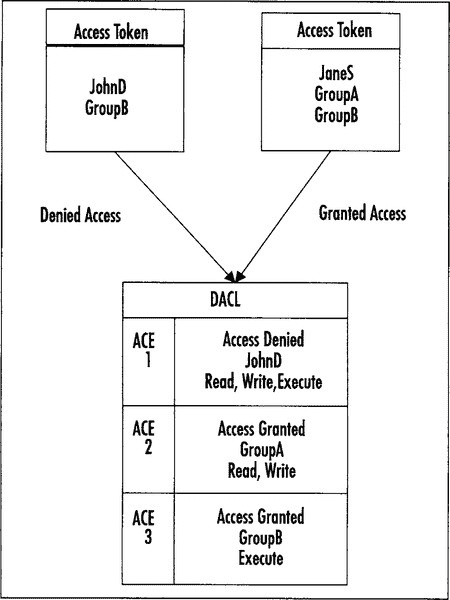

图 2.2 将用户的 SID 与 DACL 的 ACE 进行比较以确定访问

■ 找到明确拒绝访问资源的条目。
■ 找到一个或多个明确授予访问资源的条目。
■ 整个 `DACL` 均已搜索，但未找到明确授予或拒绝访问的 `ACE`。由于未找到条目，安全主体将被隐式拒绝访问。

在 图 2.2 中，一个用户被授予访问权限，而另一个用户被拒绝访问。当将 `JaneS` 用户的访问令牌关联的 `SIDs` 与 `DACL` 中的条目进行比较时，系统会发现她是 `GroupA`（具有读取和写入访问权限）和 `GroupB`（具有执行访问权限）的成员。由于她在这些组的成员身份，她将被授予该资源的读取、写入和执行权限。当将 `JohnD` 用户的访问令牌关联的 `SIDs` 与 `DACL` 进行比较时，系统会发现他是 `GroupB` 的成员，该组对资源具有执行权限。然而，还有一个 `ACE` 明确拒绝 `JohnD` 读取、写入和执行访问权限。当将用户的 `SID` 与此条目进行比较时，他将被拒绝访问。一般来说，当用户访问资源时，最宽松的权限组合将被允许，除非分配了明确的拒绝。

## 众所周知的 security identifiers

除了包含用户的 `SID` 和用户所属的任何组的 `SIDs` 外，访问令牌还可能包含额外的 `SIDs`，这些 `SIDs` 是操作系统动态分配的组成员身份或其他特殊登录场景的结果。这些 `SIDs` 在独立和/或 Active Directory 环境中 Windows Server 2003 的安装中很常见，因此被称为众所周知的 security identifiers。表 2.1 列出了不同类型的众所周知的 `SIDs`

表 2.1

众所周知的 security identifiers

| SID 类型 || `SID` || 描述 |
| --- | --- | --- |
| 匿名登录 || `S-1-5-7` || 当用户在不提供用户名和密码的情况下登录时使用。 |
| --- | --- | --- |
| 已验证用户 || `S-1-5-11` || 当用户或计算机已使用个人账户进行身份验证时使用。例外情况是当有人使用 Guest 账户登录时，因为这不被视为已验证用户。 |


| 名称 | SID | 描述 |
|---|---|---|
| Batch | S-1-5-3 | 当用户通过批处理队列设施登录时使用，例如在特定帐户下运行计划任务时。 |
| Creator Owner | S-1-3-0 | 用作可继承 ACE 中的占位符。当 ACE 被继承时，此 SID 会被替换为对象当前所有者的 SID。 |
| Creator Group | S-1-3-1 | 用作可继承 ACE 中的占位符。当 ACE 被继承时，此 SID 会被替换为对象当前所有者所属的主组的 SID。 |
| Dialup | S-1-5-1 | 当用户使用拨号连接登录到系统时使用。 |
| Everyone | S-1-1-0 | 用于指定 Everyone 组。在 Windows Server 2003 中，这包括经过身份验证的用户和来宾帐户。早期版本的 Windows 包括这些帐户和匿名登录。 |
| Interactive | S-1-5-4 | 用于已登录到本地计算机（而不是通过网络连接）或通过终端服务连接的用户。 |
| Local System | S-1-5-18 | 用于由 Windows 运行的服务帐户。 |
| Network | S-1-5-2 | 当用户通过网络连接登录时使用。由于交互式用户登录到系统的方法，此类型的 SID 不用于其访问令牌。 |
| Other Organization | S-1-5-1000 | 用于确定来自其他域或林的用户是否允许对服务进行身份验证。 |
| Self/Principal Self | S-1-5-10 | 用作 ACE 中的占位符。当权限授予 Principal Self 时，它们会授予对对象所代表的安全主体访问权限。充当占位符的 SID 在访问检查期间会被对象所代表的用户、组或计算机的 SID 替换。 |
| Service | S-1-5-6 | 用于作为服务登录的安全主体。 |
| Terminal Server Users | S-1-5-13 | 用于登录到以终端服务版本 4.0 应用程序兼容模式运行的终端服务服务器的用户。 |
| This Organization | S-1-5-15 | 用于将数据添加到由身份验证服务器登录的用户身份验证信息中。如果未使用 Other Organization SID，则使用此 SID。 |

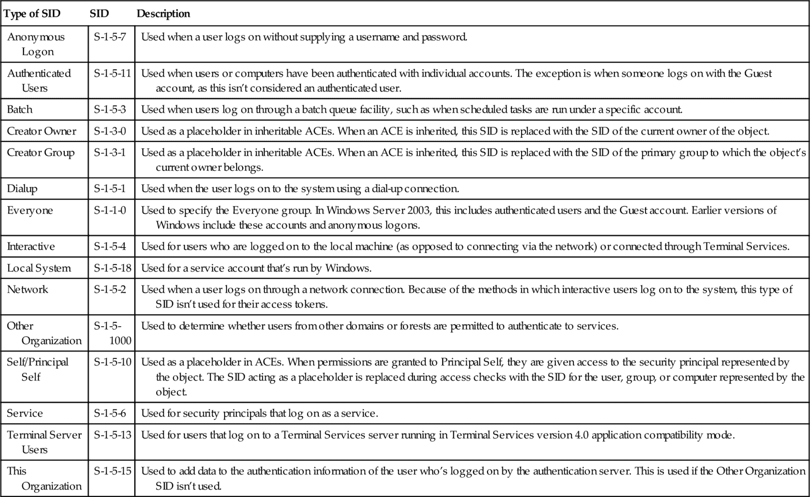

## 查看和管理安全标识符的工具

Windows Server 2003 提供了可用于查看和管理 SID 的命令行实用程序。由于域中 SID 的处理方式，几乎永远不需要此功能。然而，如果需要的话，了解这些工具的存在是有用的。

正如我们在 第 1 章，” Active Directory 基础设施概述,” 所看到的，`WHOAMI` 工具允许您显示当前登录用户的相关信息。通过使用 `/ALL` 参数，您可以显示当前登录用户的访问令牌的所有信息，包括用户名、组、关联的 SID 和权限等信息。查看此信息的语法是：

`WHOAMI /ALL`

`NTDSUTIL` 工具是我们在上一章讨论的另一个实用程序。此工具是通用工具，提供多种功能。使用各种菜单，此基于文本的工具允许您浏览功能，其中包括（在其他功能中）在存在重复 SID 的罕见情况下管理 SID。

 考试警告

`WHOAMI` 和 `NTDSUTIL` 的功能差异很大。虽然两者都是用于处理 SID 的工具，但 `WHOAMI` 仅用于查看 SID 信息，而 `NTDSUTIL` 是用于管理可能存在于 Active Directory 中的重复 SID 的工具。

为避免域控制器向对象颁发相同 SID 导致潜在冲突，域中只有一个 RID 主控。虽然这通常能确保域内 SID 的唯一性，但仍存在极小的可能性会颁发重复的 SID。管理员有权将 RID 主控角色分配给域中的另一个域控制器。如果 RID 主控暂时不可用，并且管理员在另一个域控制器上夺取了 RID 主控角色，则当原始 RID 主控恢复可用时将存在两个 RID 主控。这通常不是问题，因为在下一次复制周期期间，RID 主控会识别域中存在两个主控，其中一个会放弃其角色。然而，在这种情况下，如果两个域控制器在两个 RID 主控都处于活动状态时请求新的相对 ID 池，则可能会向域控制器颁发两组相同的数字。

可以使用 `NTDSUTIL` 的安全帐户管理菜单查找并处理重复的 SID。通过在 `NTDSUTIL` 提示符下键入 `security account management`，可以访问 表 2.2 中显示的命令。使用这些命令，您可以检查域中是否存在具有重复 SID 的对象并删除它们以解决问题。

### 表 2.2
从安全帐户管理菜单在 `NTDSUTIL` 中可用的命令

| 命令 | 描述 |
|---|---|
| `Check duplicate SID` | 检查本地 SAM 或域数据库中是否存在具有重复 SID 的对象。 |
| `Cleanup duplicate SID` | 检查本地 SAM 或域数据库中是否存在具有重复 SID 的对象并删除它们。 |
| `Connect to server %s` | 指定要连接到的服务器或 DC。`%s` 是表示要连接到的服务器或 DC 的变量。 |
| `Log file %s` | 指定日志文件的创建位置。`%s` 是表示位置的变量。如果未使用此参数，事件将记录到名为 `dupsid.log` 的文件中，该文件将放置在执行命令的用户配置文件根文件夹中。 |
| `Quit` | 返回到上一个菜单。当再次显示主菜单时，此命令将使您退出 `NTDSUTIL`。 |
| `? or help` | 显示帮助 |

现在我们已经讨论了这些工具以及与 SID 相关的您可以使用它们执行的任务，让我们在 练习 2.01 中将这些知识付诸实践

### 练习 2.01
#### 查看和管理安全标识符

1. 从 Windows 开始菜单中，单击 `Command Prompt` 菜单项。
2. 当命令提示符打开时，键入 `WHOAMI /ALL` 然后按 Enter 键。有关您当前登录的帐户的信息列表将出现在屏幕上。在此列表中，还将显示与您的帐户关联的 SID 的信息。
3. 查看完信息列表后，在提示符下键入 `NTDSUTIL`，然后按 Enter 键。
4. 在提示符下，键入 `security account management`，然后按 Enter 键。
5. 在安全帐户维护提示符下，键入 `connect to server localhost` 以建立与本地计算机的连接。您也可以使用 IP 地址、NetBIOS 或 DNS 名称将此连接建立到本地计算机或远程计算机。
6. 在安全帐户维护提示符下，键入以下其中一项：
   - 要检查重复的 SID 但不删除它们，请键入 `check duplicate sid`，然后按 Enter 键。
   - 要同时检查重复的 SID 并删除找到的任何 SID，请键入 `cleanup duplicate sid` 然后按 Enter 键。
7. 使用 `Notepad` 打开用户配置文件根文件夹中的 `dupsid.log` 文件，以确定是否找到或删除了任何重复项。
8. 在命令提示符下，键入 `Quit` 然后按 Enter 键返回到上一个菜单。再次键入 `Quit` 然后按 Enter 退出 `NTDSUTIL`。

## 命名约定和限制

在查看安全主体与 SID 之间的关系时，很明显使用 SID 作为识别帐户的唯一方法会很困难。虽然 SID 唯一标识用户、计算机和组，但尝试记住您通过目录常用访问的用户和计算机的 SID 几乎是不可能的。因此，使用各种命名约定来区分 Active Directory 中的对象。


# Active Directory 对象命名和命名空间层次结构

## 对象唯一性和管理边界

`Active Directory` 中的每个对象都有一个名称，以便更容易查找和使用。当为这些对象命名时，每个对象必须是唯一的，这样多个对象就不会混淆。这并不意味着 `Active Directory` 中两个对象不能同名；只是说在某些情况下，两个同名对象不能存在于同一个管理边界内。

在 `Windows Server 2003` 中，存在多种不同的边界来逻辑分组对象并管理它们。例如，域提供了一个边界，允许两个同名计算机存在于不同的域中。如果你在一个域中有一台名为 `server1` 的计算机，而在另一个域中也有同名计算机，则不会发生冲突。同样，在 `Windows Server 2003` 中，`UPNs` 在每个林中必须是唯一的，而 `Pre-Windows 2000` 登录名在每个域中必须是唯一的。如你所见，有许多复杂的命名规则，你需要为考试熟悉它们。

## DNS 集成和层次命名空间

即使你对 `Windows Server 2003` 网络不熟悉，你可能也熟悉互联网上域的命名方式，互联网是世界上最大的 `DNS` 命名空间。`DNS` 用于将域名解析为 IP 地址（反之亦然），并提供了一种命名域结构的标准方法。`Active Directory` 域遵循与 `DNS` 相同的命名约定。例如，[syngress.com](http://www.syngress.com) 既可以是 `Active Directory` 域名，也可以是 `DNS` 域名。`Active Directory` 和 `DNS` 紧密集成，这就是为什么 `Active Directory` 中的域名需要对应的 `DNS` 命名空间。

如 图 2.3 所示，`Active Directory` 命名空间按层次排列。在层次结构中，对象从根对象分支出来，其他对象也可以从这些对象分支出来。分支出来的对象称为 `child object`，它分支出的对象称为 `parent`。如果一个域从另一个域分支出来，则称为 `child domain`。它分支出的域称为 `parent domain`。`child domain` 保留有关其上层域的信息，并包含父域的完整名称。这种连续的命名空间提供了一种传达网络中域层次结构设计方式的方法。

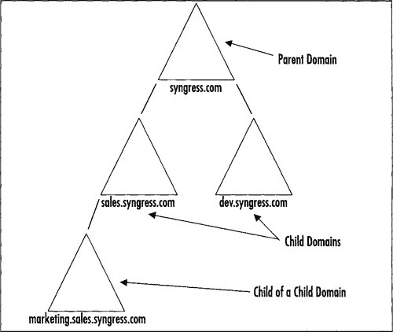

图 2.3 Active Directory 命名空间的层次结构

查看 图 2.3，可以看到 [syngress.com](http://www.syngress.com) 是父域，并且它有两个子域（[sales.syngress.com](http://www.sales.syngress.com) 和 [dev.syngress.com](http://www.dev.syngress.com)）。因为子域也可以在其下方有子域，所以我们还看到 [sales.syngress.com](http://www.sales.syngress.com) 有自己的子域，称为 [marketing.sales.syngress.com](http://www.marketing.sales.syngress.com)。

## 计算机命名和完全限定域名

除了提供在命名空间内唯一标识域的方法外，单个计算机还被赋予与层次结构相关的唯一名称。域中的每台计算机都有一个主机名，该主机名在域中是唯一的。由于命名空间中域提供的边界，主机名为 `server1` 的计算机可以在每个域中存在。为了显示这些计算机在 `DNS` 域结构中的位置，使用完全限定域名（`FQDNs`），它将主机名与域名组合在一起。例如，域 [syngress.com](http://www.syngress.com) 中主机名为 `server1` 的计算机的 `FQDN` 为 [server1.syngress.com](http://www.server1.syngress.com)。在 `Active Directory` 中，计算机名也会附加到其所属域的名称。这种组合的长度最长可达 `255` 个字符。在 `Active Directory` 中创建计算机帐户时，计算机名称只能由字母（`a` to `z`、`A` to `Z`）、数字（`0` to `9`）和连字符（`-`）组成。名称不能全部由数字组成。

## NetBIOS 名称和向后兼容性

因为 pre-`Windows 2000` 计算机不使用类似 `DNS` 的命名方案，`Active Directory` 也允许使用 `NetBIOS` 名称以实现向后兼容。在旧的网络操作系统（如 `Windows NT`）中，未使用域的层次结构。计算机使用扁平命名空间，其中所有计算机都被赋予在域中唯一的 `NetBIOS` 名称。在单域环境中，这些是单字名称，允许客户端和服务识别网络上的计算机，并由用户用于登录系统和域。在多域环境中，域名通常使用反斜杠（`\`）字符附加到计算机名；例如，`domain\computername`。同样，域间的登录形式为：`domain\username`。通过提供对 `NetBIOS` 名称和 pre-`Windows 2000` 域命名方案的支持，较旧的客户端可以访问 `Windows Server 2003` 计算机和域。

注意

对 `Windows` 操作系统早期版本的向后兼容性对 Microsoft 网络非常重要。尽管 Microsoft 会尝试建议在客户端机器和服务器上使用更新的操作系统，但网络可能由各种 `Windows` 版本和版本组成。即使在客户端和服务器都升级到最新版本的情况下，在升级过程中旧版本仍会驻留在网络上。为了适应这些环境，`Windows Server 2003` 支持多种向后兼容的方案和技术。

计算机的 `NetBIOS` 名称最长可达 `15` 个字符。在网络上安装新的 `Windows Server 2003` 服务器时，操作系统会建议一个基于相对区别名称（`RDN`）前 `15` 个字节的 `NetBIOS` 名称。正如我们将在本节后面看到的，`RDN` 是在 `Active Directory` 中标识安全主体的一种方法。在 `FQDN` 中，主机名（始终出现在 `FQDN` 中最左侧点左侧）也是 `RDN`。

## 用户帐户命名

除了计算机和域使用的名称外，用户帐户也有不同的命名方法。用户帐户具有 `UPN`，可用于从 `Windows 2000`、`XP Professional` 和 `Server 2003` 机器登录。它们还具有向后兼容的登录名，称为 pre-`Windows 2000` 名称。在创建新用户帐户的过程中，`Active Directory` 会建议一个基于您输入的 `UPN` 前 `20` 个字符的 pre-`Windows 2000` 名称。任何名称都可以在任何时候更改。pre-`Windows 2000` 登录名限制为 `20` 个字符。尽管 pre-`Windows 2000` 名称仍可用于在较新的操作系统上登录域，但从 `Windows 2000` 或更高版本登录时首选 `UPN` 登录名。`UPNs` 由登录帐户名和 `UPN` 后缀组成。默认情况下，`UPN` 后缀是包含用户帐户的域名。例如，如果用户帐户位于名为 [syngress.com](http://www.syngress.com) 的域中，则该域名也将是 `UPN` 后缀。登录名和 `UPN` 后缀使用 at (`@`) 符号连接在一起。这使其看起来像互联网电子邮件地址（`username@domain`）。


# UPN 后缀和登录名

## 默认和备用 UPN 后缀

虽然用户账户的默认 `UPN` 后缀是包含该账户的域，但也可以使用其他 `UPN` 后缀。为了简化网络登录，`Active Directory` 允许你为所有用户实现单一的 `UPN` 后缀。在这种情况下，你可以让所有用户使用森林根域名称作为其 `UPN` 后缀，甚至创建备用 `UPN` 后缀。例如，假设用户登录到名为 `syngress.net` 的内部 `Active Directory` 域名称，并且知道网站使用的外部 DNS 名称是 [`syngress.com`](http://www.syngress.com)。这可能会让用户感到困惑，因为公共网站很受欢迎且广为人知。为了减少混淆，你可以实现一个备用 `UPN` 后缀，以便所有用户都登录到 `UPN` 后缀 [`syngress.com`](http://www.syngress.com)。在使用备用 `UPN` 后缀时，你并不限于使用有效的 DNS 或 `Active Directory` 域名称。你可以选择任何 `UPN` 后缀你选择。

## UPN 在森林中的唯一性

因为 `Windows Server 2003` 允许用户无论账户包含在哪个域中都使用相同的 `UPN` 后缀，`UPN` 登录名必须在森林内唯一。在 `Windows Server 2003` 中，`Active Directory` 不会允许在同一森林中存在两个名称相同的 `UPN`。

注意
`UPN` 的概念起初可能令人困惑。请记住，`UPN` 与 DNS 或 `Active Directory` 域名称完全没有关系。尽管它可能与森林中有效域的名称相同，但它只是一个标签或别名，用作用户账户名称的一部分。`UPN` 存储在全局编录 (`GC`) 中，因此使用它们登录时必须有 `GC` 服务器可用。请记住，是与你的用户账户关联的 `SID` 决定了它属于哪个域；它可以与任何有效名称关联。使用 `UPN` 的目的是允许用户继续使用相同的登录名，即使与其账户关联的域发生变化。由于 `UPN` 未映射到特定域，因此在森林内将用户账户从一个域移动到另一个域时无需更改。

## 登录名限制

在创建用户用于登录 `Active Directory` 的名称时，登录名中可以使用的内容存在某些限制。名称不能全部为空格，或不得包含前导或尾随空格，或以下任何字符：“ / \\ \[ \] : ; | = , + \* ?<>
注意
微软的许多教学材料称 `UPN` 名称的登录部分不能超过 20 个字符，尽管文本框允许输入更多字符。这是错误的。如果测试一下，你会发现可以超过 20 个字符限制。 pre-Windows 2000 登录名确实会识别此限制。
此外，前一段中列出的许多受限字符，如果作为用户登录名的一部分输入，在创建账户期间不会引发错误。但是，当你尝试登录时会出现错误。奇怪的是，如果你将这些受限字符作为 pre-Windows 2000 登录名的一部分输入，它会通知你它们将被更改为下划线字符（允许的字符）并继续创建账户。

## 组命名要求

组在创建时也有必须遵守的某些要求。正如本章后面将看到的，组允许你添加用户作为成员。然后可以作为一个单元管理这些用户账户的集合，使得使用一次分配即可轻松地为许多用户分配访问资源的权限。
在 `Active Directory` 中创建组时，名称长度不能超过 64 个字符。此外，名称不得包含前导或尾随空格、尾随句点，或以下任何字符：/ \[ \] : | = ? \* , + “\\ < >;

## 安全主体命名约定

安全主体还使用另外三种命名约定，这些约定适用于 `Active Directory` 中的所有对象：
■ `RDN`
■ 区别名称 (`DN`)
■ 规范名称
通过这些命名约定，可以使用轻型目录访问协议 (`LDAP`) 在目录中定位安全主体。这些中的每一个都用于标识 `Active Directory` 中的对象，并提供在目录中定位对象的方法，无论它存储在多少层组织单元 (`OUs`) 下。
正如我们所讨论的，每个对象在创建时都会被赋予一个名称，该名称用于在目录中轻松识别对象。正如本章后面将看到的，用户对象的名称通常对应于用户的名称，而计算机的名称可以对应于你指定的 `Active Directory` 对象名称或 `NetBIOS` 名称。这些名称是 `RDN`s。

### RDN

`RDN`s 指的是对象相对于其在目录中位置的名称。换句话说，它不会显示在目录结构中查找对象的路径。例如，名为 John Smith 的用户对象就是一个有效的 `RDN`。
不过，查看此名称时，你不会知道它存储在 Users 容器还是其他位置。`RDN` 不会显示对象确切的位置，而仅指对象的名称。
由于 `RDN` 在容器内标识对象，因此该名称必须在其存储的容器内唯一。换句话说，你不能在同一个 `OU` 中有两个名为 John Smith 的用户。如果确实存在两个同名对象，可能会导致混淆，不知道你真正想访问的是哪个对象。

### 区别名称 (DN)

为了提供有关对象在目录层次结构中确切位置的更具体信息，会使用 `DN`。`DN` 用于显示对象的路径。它表示对象位于特定域中，甚至可能位于特定的 `OU` 内。此路径标识对象的名称以及到其存储容器的层次结构。为了提供此信息，`DN` 使用以下表示法：
■ `CN` 对象的常用名称。
■ `OU` 包含该对象的组织单元，或在到包含该对象的 `OU` 的层次路径中包含另一个 `OU` 的组织单元。
■ `DC` 指定到对象层次结构中 DNS 名称的域组件。就像 `OU` 对象一样，到对象的层次路径中可能存在多个域组件。
如 图 2.4 所示，`DN` 使用这些表示法提供在 `Active Directory` 结构中查找单个对象的地图。在 图 2.4 中，我们看到有多个用户位于 Accounts Receivable `OU` 中，该单元位于 `knightware.ca` 的 Accounting `OU` 中。如果要在此结构中查找名为 John Doe 的用户对象，你将使用以下 `DN`：
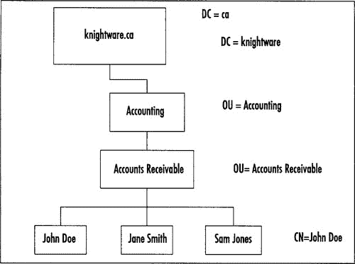
图 2.4 区分名称用于显示对象的位置
`CN=John Doe, OU=Accounts Receivable, OU=Accounting, DC=knightware, DC=ca`
将 `DN` 与 图 2.4 进行比较，你可以看到它从对象开始，并逐步向上到结构的最顶层。
如前所述，`DN` 中的 `CN` 也是对象的 `RDN`。`RDN` 在父容器内唯一标识一个对象，在我们之前的示例中，指的就是 John Smith 对象。在这种情况下，我们可以按如下方式引用 `RDN`：
`CN=John Smith`


## 规范名称

另一种查看相同信息的方式是使用规范名称。规范名称提供的信息与 `DN` 相同，但顺序相反。不是从对象开始向上工作到最高级别，规范名称从最高级别开始向下工作。在查看前面的示例时，`DN` `CN=John Doe, OU=Accounts Receivable, OU=Accounting, DC=knightware, DC=ca` 将被翻译为以下规范名称：

`knightware.ca/Accounting/Accounts Receivable/John Doe`

通过提供不同的选项来标识对象及其在目录中的位置，您可用于访问这些对象的工具方法具有更大的灵活性。在使用 `DNs`、`RDNs` 和规范名称之前，您需要为对象提供一个唯一名称。正如我们将在后面的章节中看到的那样，用户、计算机和组的名称是在创建安全主体本身时指定的。

## 使用 Active Directory 用户账户

用户账户供人员和服务使用，以便进行身份验证并访问资源。每个用户账户都包含有关使用它的个人或服务的信息，并提供授予权限、应用脚本、分配配置文件以及控制用户可以执行的操作和可以访问的内容的手段。通过该账户，创建了一组凭据以防止未经授权的访问。

在 `Windows Server 2003` 中，可以创建两种不同的用户账户类型：本地和基于域的用户账户。本地用户账户用于控制您正在使用的计算机的访问权限。它们是在 `Windows Server 2003` 上使用 `Local Users and Groups` 管理单元创建的，或在 `Computer Management` 实用程序中 `Local Users and Groups` 节点下的 `Users` 节点。创建后，账户信息存储在名为安全账户管理器 (`SAM`) 的本地数据库中。账户信息仅适用于本地计算机，并且不会复制到域内的其他机器。当用户登录到计算机时，`Windows Server 2003` 使用此信息对用户进行身份验证，并允许或拒绝访问该机器。

域账户是在 `Active Directory` 中创建的，与本地用户账户有很大不同。不是将信息存储在本地机器上，账户信息存储在目录中并复制到其他 `DCs`。正如本章前面讨论的那样，当用户登录到 `DC` 时，账户信息用于构建访问令牌。该访问令牌在用户登录到网络的整个时间内使用，并确定用户在网络上被允许访问的内容以及可以执行的操作。

考试日提示

不要将本地账户与域账户混淆。本地账户存储在计算机上，仅适用于这些机器的安全性。域账户存储在 `Active Directory` 中，账户的安全设置可以应用于跨网络访问资源和服务。

`Active Directory` 用户账户使用 `Active Directory Users and Computers` 管理单元创建和管理。如 图 2.5 所示，此管理单元提供了一个图形用户界面 (`GUI`)，允许您通过点按方式完成与管理用户对象相关的各种任务。此工具的左侧窗格是控制台树，其中包含代表您的域以及域内容器对象（如 `OUs`）的节点。展开域的节点会显示容器，可以选择这些容器以查看其中存储的对象。这些容器内的对象显示在控制台的右窗格中。

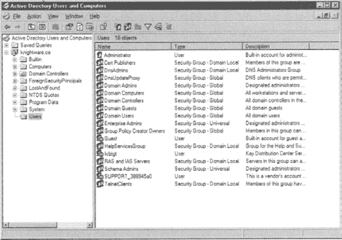

图 2.5 Active Directory 用户和计算机

如 第 1 章 中所述，在首次安装 `Active Directory` 时会自动创建多个容器。每个容器存储不同类型的对象，其中一些用于在网络上管理用户和计算机。这些容器是：

■ `Builtin` 在安装 `Windows Server 2003` 和 `Active Directory` 期间创建的大多数域本地组的默认位置。一些特定服务的域本地组，例如 `DnsAdmins` 组，创建在 `Users` 容器中。
■ `Computers` 用于存储域成员计算机对象的默认位置。此容器不包含 `Active Directory` `DCs` 的对象。
■ `Domain Controllers` 用于存储 `Active Directory` `DC` 对象的默认位置。
■ `ForeignSecurityPrincipals` `Active Directory` 中用于存储外部受信任域中用户账户的外部 SID 的位置。
■ `Users` 在安装 `Active Directory` 期间创建的用户账户、全局组和通用组的默认位置。此容器通常包含由 `RRAS` 和 `DNS` 等服务使用的其他域本地组。

除了这些容器之外，还存在其他隐藏的容器。必须启用高级功能才能显示这些附加容器。为此，请选择 `View | Advanced Features`。启用后，可以看到以下容器：

■ `LostAndFound` 用于存储其父容器不再存在的对象。如果在另一个 `DC` 上删除其父容器附近的时间在一个 `DC` 上创建对象（或如果在复制后将其移动到丢失的位置），则该对象被视为孤立并放置在此容器中。
■ `System` 包含有关域、 `Active Directory` 使用的对象以及底层 `Windows Server 2003` 操作系统的信息。与大多数其他容器不同，此容器中的对象通常不能由管理员修改。

虽然这些容器由 `Active Directory` 创建，但对象也可以存储在管理员创建的 `OUs` 中。通过使用 `OUs`，您可以将用户账户、计算机账户和其他对象安排到反映这些对象的部门或位置的容器中。例如，您可以为分支机构创建一个 `OU`，然后在该 `OU` 内存储该位置用户的账户。这使得委派管理控制并使用 `Group Policy` 管理用户变得更容易。

注意

仔细查看 图 2.5，您会看到 `Users` 节点和 `Domain Controllers` 节点之间的图标存在差异。`Users` 节点是默认容器，而 `Domain Controllers` 是一个 `OU`。默认容器和 `OU` 之间的一个关键区别是，您不能将组策略应用于默认容器。因此，如果您将所有用户都创建在 `Users` 容器中，您将需要将它们移动到 `OU` 中以便对它们应用组策略，或者在域级别应用组策略并允许其继承到 `Users` 容器。管理员可以创建 `OUs`，但不能创建默认容器。

## 内置域用户账户

正如本章后面将看到的那样，您可以为组织内用户和服务使用的账户创建用户对象。除了您创建的账户之外，在首次安装 `Active Directory` 时还会自动创建多个用户账户。这些内置账户存储在 `Active Directory Users and Computers` 的 `Users` 容器中，名称为：

■ `Administrator`
■ `Guest`
■ `HelpAssistant`
■ `SUPPORT_388945a0`


虽然我们将在后面的章节中讨论这些账户，但必须认识到 Active Directory 创建的每个账户都被分配了组成员身份和用户权限，从而提供不同级别的访问。它们的权限各不相同，因为每个账户的设计用途不同。你不会希望域中的每个人都能在网络上随意查看、修改或删除任何内容。这将是一个重大的安全问题，事故和恶意行为可能造成毁灭性的后果。

## Administrator
Administrator 账户是在安装 Active Directory 时创建的第一个账户。如前一章所述，当你使用 Active Directory 安装向导并设置新域时，会创建此账户以便你获得执行域配置的访问权限。创建后，它可用于创建和管理安全主体及其他对象、管理策略、分配权限，以及 Active Directory 设计和管理所需的其他任务。

Administrator 账户是 Active Directory 中创建的任何默认账户中访问级别最高的。它是 Administrators、Domain Admins、Domain Users、Enterprise Admins、Group Policy Creator Owners 和 Schema Admins 组的成员。虽然我们将在本章后面讨论组，但对这些组的默认成员身份使 Administrator 账户能够完全控制 Active Directory。由于这些组提供了归属于该账户的安全访问权限，你可以为执行管理任务的人员创建额外账户，并将其设为这些组的成员，从而赋予他们与 Administrator 账户相同的权限。

由于 Administrator 账户的重要性，它不能从 Active Directory 中删除，也不能从 Administrators 组中移除。但是可以禁用或重命名它，以使未经授权或恶意用户更难通过猜测其密码来使用该账户。

### Configuring & Implementing…
#### Securing the Administrator Account
任何熟悉 Windows 网络操作系统的用户都会认识到 Administrator 账户是存在于以前版本中的账户。名为 Administrator 的账户已在 Windows NT、Windows 2000 和 Windows Server 2003 中使用。由于它为人所知，它可能成为黑客的目标，黑客希望访问该账户并获得对域的完全控制。

为保护系统，在创建具有管理员级别访问权限的其他账户后，应重命名和/或禁用 Administrator 账户。通过重命名账户，其他人将不知道账户的名称，从而不知道访问哪个账户才能获得这种高级别的控制。通过禁用账户，他们将完全无法使用它。

为防止未经授权的用户访问具有管理凭据的账户，任何属于提供管理员访问权限的组的账户都应使用强密码。强密码更难猜测，并使用以下键盘字符中的三种或更多组合：
■ 小写字母 (a -z)
■ 大写字母 (A-Z)
■ 数字 (0-9)
■ 特殊字符 (({}\[\],.< >;:’”?/|\\\`~!@#$%^&\*()\_-+=)

虽然强密码不能通过查找密码中特定单词和字符组合的字典攻击来破解，但仍可能被暴力破解程序破解，这些程序试图通过使用密码中所有可能的字符组合来确定密码。暴力破解可能需要相当长的时间，但通常用于获得对账户的未经授权访问。为了使黑客更难使用暴力攻击访问账户，应使用更长的密码，至少包含八个字符。在 Windows Server 2003 域中，强密码在组策略中作为所有账户的要求而启用。这意味着在 Active Directory 安装后创建的所有密码必须至少使用一个大写字符、小写字符和数字字符。

## Guest
Guest 账户是另一个内置账户，但提供最低级别的访问权限。它旨在供偶尔需要最小访问权限且不想使用自己的账户登录的用户，或在域中没有自己账户的用户使用。例如，你可以授予 Guest 账户查看企业内部网站上文件的权限，或对非机密材料（如新员工申请工作时必须填写的表格）具有只读访问权限。这样申请工作的人即使没有自己的账户也能访问并填写这些表格。

当 Active Directory 创建此账户时，它会使 Guest 账户成为 Guests 组和 Domain Guests 全局组的成员。对这些组的成员身份允许使用此账户的人登录到域。就像其他账户一样，你可以控制此账户拥有的权利和权限，并添加或移除该账户的组成员身份。这允许你增加或减少使用此账户的人对域中资源的访问级别。

由于用户登录域时最好拥有自己的账户，因此 Guest 账户默认处于禁用状态。禁用此账户可防止未经授权的人员使用该账户访问域，并可能借此获得更高级别的访问权限。如 Administrator 账户所述，Guest 账户不能被删除，但可以重命名。这样做会使黑客更难利用该账户，而该账户也存在于 Windows 的早期版本中。

## HelpAssistant
HelpAssistant 账户在建立远程协助会话时会自动在 Active Directory 中创建。远程协助允许用户连接到一台机器并提供帮助，例如通过远程控制计算机。例如，Help Desk 工作人员可以远程接管用户的计算机，并向用户展示如何执行特定任务。

为防止他人在有人登录时随意接管计算机并执行任务，此连接必须得到使用计算机的人的许可。换句话说，使用计算机的人必须允许另一人接管控制权。某人不能简单地使用远程协助劫持另一人的计算机，然后在对方登录的账户下开始访问资源。

HelpAssistant 账户用于在协助用户的人与其机器之间建立会话，并提供对被远程访问计算机的有限访问。该账户由 Remote Desktop Help Session Manager 服务管理，并在没有待处理的远程协助请求时自动删除。由于在不再需要时会被移除，它并不总是出现在 Active Directory 用户和计算机的 Users 容器中。

## SUPPORT_388945a0
Support_388945a0 账户由帮助和支持服务使用，以提供互操作性并允许访问在帮助和支持服务中提供的签名脚本。管理员可以委派普通用户从帮助和支持服务中的链接运行这些脚本的能力。脚本可以被编程为使用 Support_388945a0 账户而不是登录用户的凭据来执行本地系统上的管理任务，而用户通常在没有管理员级别访问权限的情况下不被允许执行这些任务。

## InterOrgPerson


与我们之前讨论的账户不同，`InetOrgPerson` 账户实际上并不是指名为 `InetOrgPerson` 的账户，而是指用于创建账户的对象类。对象类是一组属性，用于确定在创建对象时该对象可能具有的属性。在 Active Directory 中，`InetOrgPerson` 类用于定义用户账户。由于它作为一种用户类存在，因此使用此类创建的账户是安全主体。

`InetOrgPerson` 账户用于在非 Microsoft 目录服务中表示用户。虽然 Active Directory 是 Windows 2000 和 Windows Server 2003 使用的唯一目录服务，但它并不是存在的唯一目录服务。其他网络操作系统，例如 Novell NetWare，使用自己的目录服务实现，这些实现并不总是与 Active Directory 兼容。`InetOrgPerson` 用于协助为其他目录编写的应用程序，或在从这些目录服务迁移到 Active Directory 时使用。

正如我们在下一节中将看到的，`InetOrgPerson` 账户的创建方式与用户账户的创建方式相同。在 Active Directory 用户和计算机中，您将选择要创建新的 `InetOrgPerson` 账户的容器。执行此操作后，单击 `Action | New` 下的 `InetOrgPerson` 菜单项。这将启动与创建新用户账户相同的向导，但将使用 `InetOrgPerson` 对象类来创建它。

### 新闻与值得注意
与我们之前讨论的账户不同，`InetOrgPerson` 账户实际上并不是指名为 `InetOrgPerson` 的账户，而是指用于创建账户的对象类。对象类是一组属性，用于确定在创建对象时该对象可能具有的属性。在 Active Directory 中，`InetOrgPerson` 类用于定义用户账户。由于它作为一种用户类存在，因此使用此类创建的账户是安全主体。

`InetOrgPerson` 账户用于在非 Microsoft 目录服务中表示用户。虽然 Active Directory 是 Windows 2000 和 Windows Server 2003 使用的唯一目录服务，但它并不是存在的唯一目录服务。其他网络操作系统，例如 Novell NetWare，使用自己的目录服务实现，这些实现并不总是与 Active Directory 兼容。`InetOrgPerson` 用于协助为其他目录编写的应用程序，或在从这些目录服务迁移到 Active Directory 时使用。

正如我们在下一节中将看到的，`InetOrgPerson` 账户的创建方式与用户账户的创建方式相同。在 Active Directory 用户和计算机中，您将选择要创建新的 `InetOrgPerson` 账户的容器。执行此操作后，单击 `Action | New` 下的 `InetOrgPerson` 菜单项。这将启动与创建新用户账户相同的向导，但将使用 `InetOrgPerson` 对象类来创建它。

### 新闻与值得注意…

#### InetOrgPerson 对象类是 Windows Server 2003 Active Directory 架构的一部分

`InetOrgPerson` 对象类及其包含的属性源自 RFC 2798。RFC 是 Requests for Comments 的缩写，是一种用于指定信息和/或技术规范的文档。RFC 2798 由 Internet 工程任务组（IETF）创建，以解决需要一种通过内联网或 Internet 访问目录服务的用户类的需求。这种用户类旨在保存通过这种方式使用 `LDAP` 访问目录的人员的属性。

由于需要这种类型的用户类，Microsoft 提供了一套工具，在 Windows 2000 中将 `InetOrgPerson` 对象类添加到架构中。在 Windows Server 2003 中，`InetOrgPerson` 已作为 Active Directory 架构中的一种用户类包含在内，可供需要此类对象的 `LDAP` 应用程序使用，并在从其他目录服务迁移到 Active Directory 时使用。这使管理员无需扩展架构来创建新的 `InetOrgPerson` 对象类。

## 创建用户账户

Windows Server 2003 提供了多种在 Active Directory 中创建用户账户的方法。如前所述，Active Directory 用户和计算机提供了一个 GUI，可快速高效地创建新账户。作为将用户账户添加到 Active Directory 的新方法，您还可以使用 `DSADD` 命令。在下面的段落中，我们将介绍这些工具。

### 使用 Active Directory 用户和计算机创建账户

Active Directory 用户和计算机是安装在 DC 上的工具，由具有适当访问权限的人员用于创建域账户。只有 Administrators 组、Account Operators 组、Domain Admins 组、Enterprise Admins 组的成员，或已被授予授权的人员才能创建用户账户。当某人被授予执行任务的授权时，这意味着他或她已被授予执行该操作的管理员凭据。责任可以通过委派控制向导、组策略或安全组（我们将在本章后面讨论）进行委派。

Active Directory 用户和计算机可以通过多种方式启动。正如我们在 第 1 章 中看到的，Active Directory 用户和计算机管理单元可以加载到 Microsoft Management Console（`MMC`）中。还可以通过单击 `Start | Administrative Tools | Active Directory Users and Computers` 从 Windows 开始菜单启动此工具。启动它的最后一种方法是通过控制面板。在控制面板中，打开 `Performance and Maintenance | Administrative Tools | Active Directory Users and Computers`。

一旦 Active Directory 用户和计算机打开，展开您有权访问并且想要创建账户的域。在域内，您选择要创建用户对象的容器。您可以在域级别创建账户，使用现有的默认容器（例如 Users），或使用您创建的 OU。选择容器后，单击 `Action | New | User`。`InetOrgPerson` 账户也可以通过这种方式创建，只需从 `Action | New` 中选择 `InetOrgPerson` 而不是 User 即可。

一旦在 `Action | New` 菜单中单击了 User 菜单命令，将启动一个向导，引导您完成创建新账户的步骤。如 图 2.6 所示，第一个屏幕提供了多个字段，您可以在其中输入与新用户相关的信息：

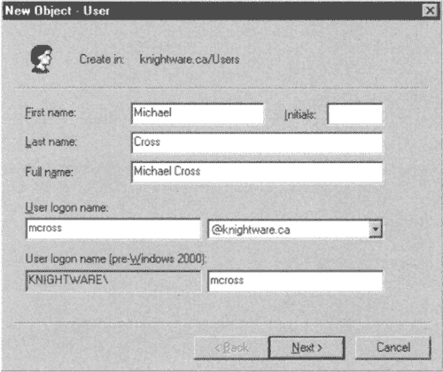

图 2.6 创建新用户对象时用于输入新用户信息屏幕

■ `First name` 用户的给定名。
■ `Initials` 用户姓名中的中间首字母。
■ `Last name` 用户的姓氏。
■ `Full name` 用户的完整姓名。当您输入用户的名字、首字母和姓氏时，此字段会自动填充。但是，它可以被修改。此名称必须在创建账户的容器中唯一。
■ `User logon name` 用户用于登录域的 `UPN`。`UPN`（请记住，它由用户登录名和 UPN 后缀组成）必须在企业中唯一。换句话说，相同的登录名不能在同一个 Active Directory 林中存在。该字段中的下拉列表允许您选择 UPN 后缀。
■ `User logon name (pre-Windows 2000)` 用户在从 pre-Windows 2000 操作系统登录域时使用的 `NetBIOS` 名称。

输入此信息后，单击 Next 按钮继续提供设置账户的信息。

接下来出现的屏幕允许您配置用户账户的密码信息。与前一个屏幕一样，多个字段可用于管理账户的初始设置。这些字段在 图 2.7 中显示，包括：

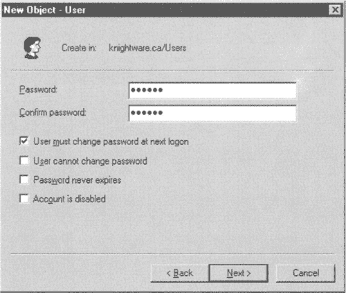

图 2.7 创建新用户对象时用于输入密码选项屏幕

■ `Password` 用户将输入的密码，以便进行身份验证。
■ `Confirm Password` 在 `Password` 字段中输入的相同密码。第二次确认密码可确保其输入正确。
■ `User must change password at next logon` 选中此框要求用户在首次登录时更改密码。让用户更改密码可确保只有用户知道新密码，这是一种良好的安全实践。此设置默认启用。
■ `User cannot change password` 选中后可确保只有管理员可以更改用户的密码。如果账户由多人（例如 Guest 账户）、服务或程序使用，则可以使用此设置。此设置也用于需要保证密码强度的更安全环境中。在这些环境中，管理员通常负责维护和更改密码以确保其符合安全标准。


## 密码永不过期

此设置使用户的密码免于受为域启用的最大密码使用期限组策略设置的限制。这在服务或程序正在使用该账户时很有帮助。如果设置了 `User must change password at next logon` 选项，则此选项将被覆盖。

## 账户已禁用

此复选框用于防止用户使用此账户登录。如果员工已被解雇、处于长期休假或休假中，或尚未开始工作，则可使用此功能。

输入此信息后，单击 `Next` 按钮以到达创建新用户账户的最终屏幕。

如 图 2.8 所示，用于创建新用户对象的最终屏幕提供摘要信息。此屏幕上显示的信息提供了将用于创建账户的用户信息和密码选项的回顾。单击 `Finish` 按钮后，账户将在您最初选择用于存储对象的容器中创建。

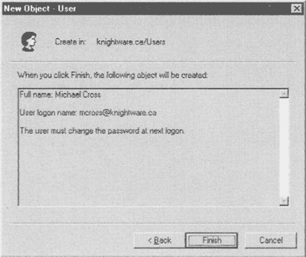

图 2.8 新对象对话框的摘要屏幕

现在我们已经了解了如何创建用户账户，让我们将这些知识付诸实践，并在 练习 2.02 中创建一个。

### 练习 2.02

#### 在 Active Directory 用户和计算机中创建用户对象

1. 从 `Start | Administrative Tools | Active Directory Users and Computers` 打开 `Active Directory Users and Computers`。
2. 当实用程序打开时，展开控制台树，以便可以看到您的域及其内部的容器。
3. 从控制台树中选择您在 第 1 章 中创建的 `TestOU` OU。从 `Action` 菜单中选择 `New | User`。
4. 当 `New Object - User` 对话框出现时，在相应的字段中输入以下信息：

| 字段 | 输入数据 |
|---|---|
| 名字 | John |
| 姓名缩写 | Q |
| 姓氏 | Public |
| 全名 | John Public |
| 用户登录名 | Jpublic |
| 用户登录名（Windows 2000 之前） | Jpublic |

5. 输入此信息后，单击 `Next` 按钮继续。
6. 在 `Password` 字段中输入您选择的密码，然后在 `Confirm password` 字段中重新输入。
7. 清除 `User must change password at next logon` 复选框。
8. 单击 `Next` 继续。当摘要屏幕出现时，查看您输入的设置并单击 `Finish` 创建账户。
9. 从 `Action` 菜单中选择 `New | User`。
10. 当 `New Object - User` 对话框出现时，在相应的字段中输入以下信息：

| 字段 | 输入数据 |
|---|---|
| 名字 | Jane |
| 姓氏 | Doe |
| 全名 | Jane Doe |
| 用户登录名 | Jdoe |
| 用户登录名（Windows 2000 之前） | Jdoe |

11. 输入此信息后，单击 `Next` 按钮继续。
12. 在 `Password` 字段中输入您选择的密码，然后在 `Confirm password` 字段中重新输入。
13. 单击 `Next` 继续。当摘要屏幕出现时，查看您输入的设置并单击 `Finish` 创建账户。
14. 注销然后以 `jdoe` 用户身份重新登录。注意，您需要更改密码。
15. 注销然后以 `jpublic` 用户身份重新登录。注意，您不需要更改密码。

### 使用 `DSADD` 命令创建账户

正如我们在 第 1 章 中看到的，Windows Server 2003 包含许多命令行工具，可让您从命令提示符执行常见的管理任务。使用 `DSADD` 命令，您可以在 Active Directory 中创建新对象，包括用户对象。与使用 `Active Directory Users and Computers` 时的情况一样，只有 `Administrators` 组、`Account Operators` 组、`Domain Admins` 组、`Enterprise Admins` 组成员，或被授予权限的人员才能创建用户账户。这意味着 `DSADD` 命令不能用作未经授权创建账户的变通方法。

使用以下语法通过 `DSADD` 创建新用户：

```
DSADD USER UserDN [-samid SAMName] -pwd {Password | *}
```

输入此命令时，必须输入以下参数：

- `UserDN` 这是要添加的用户对象的 DN。这提供了账户将被创建位置的信息。
- `SAMName` 这是 NetBIOS 名称，用于从 Windows 2000 之前的计算机登录。如果未添加此参数，`DSADD` 将根据您为 `UserDN` 参数输入的常用名的前 20 个字符创建一个。
- `Password` 这是此账户将使用的密码。如果为此参数输入星号 (`*`)，系统将提示您输入密码。

除了这些参数之外，还可以使用以下语法在创建用户账户时应用其他设置。请注意，这是一行很长的命令。

```
dsadd user UserDN [-samid SAMName] [-upn UPN] [-fn FirstName] [-mi Initial] [-ln LastName] [-display DisplayName] [-empid EmployeelD]
[-pwd {Password | *}] [-desc Description] [-memberof Group;…]
[-office Office] [-tel PhoneNumber] [-email Email] [-hometel HomePhoneNumber] [-pager PagerNumber] [-mobile CellPhoneNumber]
[-fax FaxNumber] [-iptel IPPhoneNumber] [-webpg WebPage] [-title Title]
[-dept Department] [-company Company] [-mgr ManagerDN] [-hmdir HomeDirectory] [-hmdrv DriveLetters] [-profile ProfilePath] [-loser ScriptPath] [-mustchpwd {yes | no}] [-canchpwd {yes | no}]
[-reversiblepwd {yes | no}] [-pwdneverexpires {yes | no}] [-acctexpires NxmberOfDays] [-disabled {yes | no}] [{-s Server| -d Domain}]
[-u UserName] [-p {Password | *}] [-q] [{-uc [-uco | -uci}]
```

正如您所见，使用 `DSADD` 命令可以设置大量选项，这些选项在初始使用 `Active Directory Users and Computers` 创建账户时不可用。我们将在下一节解释如何使用 `Active Directory Users and Computers` 将此类信息添加到账户中。首先，让我们检查可与 `DSADD` 命令一起使用的各种参数。此语法中的参数在 表 2.3 中进行了说明。

#### 表 2.3

创建用户的 DSADD 参数

| 参数 | 描述 |
|---|---|
| `-upn UPN` | 指定账户的 UPN。 |
| `-fn FirstName` | 指定用户的名字。 |
| `-mi Initial` | 指定用户的姓名缩写。 |
| `-ln LastName` | 指定用户的姓氏。 |
| `-display DisplayName` | 指定账户的显示名称。 |
| `-empid EmployeelD` | 指定用户的员工 ID。 |
| `-desc Description` | 描述账户的信息。 |
| `-memberof Group` | 指定此账户将成为其成员的组的 DN。 |
| `-office Office` | 指定用户的工作地点。 |
| `-tel PhoneNumber` | 指定用户的电话号码。 |
| `-email Email` | 指定用户的电子邮件地址。 |
| `-hometel HomePhoneNumber` | 指定用户家庭电话号码。 |
| `-pager PagerNumber` | 指定寻呼机号码。 |
| `-mobile CellPhoneNumber` | 指定蜂窝电话号码。 |
| `-fax FaxNumber` | 指定用户的传真号码。 |
| `-iptel IPPhoneNumber` | 指定用户的 IP 电话号码。 |
| `-webpg WebPage` | 指定用户网页的 URL。 |
| `-title Title` | 指定用户的职称。 |
| `-dept Department` | 指定用户的部门。 |
| `-company Company` | 指定公司信息。 |
| `-mgr ManagerDN` | 指定用户经理的 DN。 |
| `-hmdir HomeDirectory` | 指定用户的主目录。 |


### 参数
- `-hmdrv` `DriveLetter`：指定用户用于访问其主目录的驱动器号。如果使用通用命名约定指定 `HomeDirectory`，则使用此参数。
- `-profile` `ProfilePath`：指定账户的配置文件路径。
- `-loser` `ScriptPath`：指定账户的登录脚本路径。
- `-mustchpwd` `{yes | no}`：指定用户下次登录时是否需要更改其密码。默认情况下，用户无需更改密码，因此与为此参数指定 no 相同。
- `-canchpwd` `{yes | no}`：指定用户是否允许更改其密码。默认情况下，用户可以更改其密码，因此与为此参数指定 yes 相同。
- `-reversiblepwd` `{yes | no}`：指定密码是否使用可逆加密存储，可逆加密由 Macintosh 计算机和某些基于 Windows 的身份验证形式使用。默认情况下不使用可逆加密，因此与此参数设置为 no 相同。
- `-pwdneverexpires` `{yes | no}`：指定密码是否过期。默认情况下密码会过期，因此与此参数设置为 no 相同。
- `-acctexpires` `NumberOfDays`：指定账户在多少天后过期。如果将 `NumberOfDays` 的值设置为 0，账户将在当天结束时过期。如果将 `NumberOfDays` 的值设置为负值，则表示账户已在该天数前过期。如果设置为正值，则将在未来该天数后过期。如果将 `NumberOfDays` 的值设置为 Never，账户将永不过期。
- `-disabled` `{yes | no}`：指定账户是否已被禁用。默认情况下账户已启用，因此与此参数设置为 no 相同。
- `{-s Server | -d Domain}`：指定连接到远程服务器或域。默认情况下，计算机连接到登录域中的 DC。
- `-u` `UserName`：指定用于登录到远程服务器的用户名。默认情况下，使用用户登录到本地系统的用户名。以下格式可用于 `UserName` 变量：UsernameDomain\\username 用户主体名称
- `-p` `{Password | *}`：指定用于登录到远程服务器的密码。如果使用星号 (*)，系统会提示您输入密码。
- `-q`：指定安静模式，并抑制输出。
- `{-uc | -uco | -uci}`：指定用于输入或输出的 Unicode。如果使用 `-uc`，则输入或输出到管道 (|)。如果使用 `-uco`，则输出到管道或文件。如果使用 `-uci`，则输入来自管道或文件。

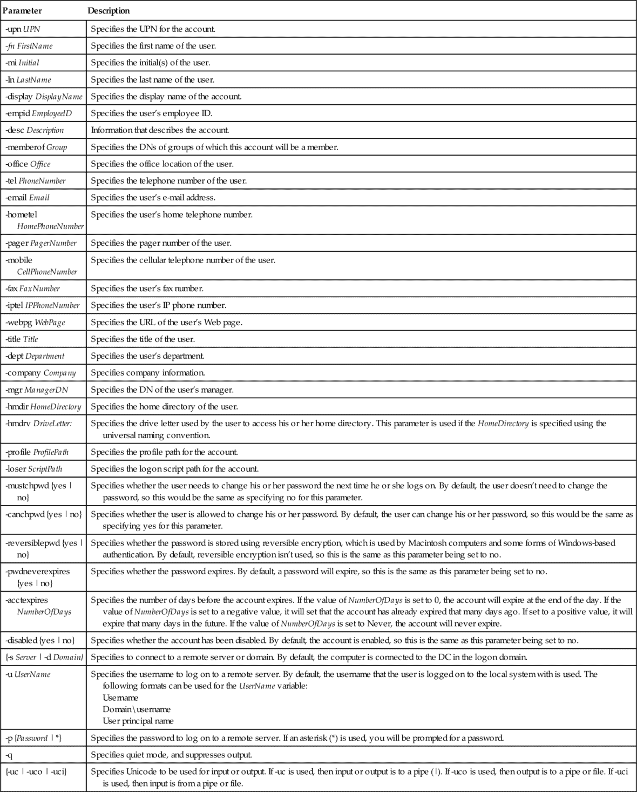

## 管理用户账户

管理用户账户是通过对象的属性完成的，该属性可通过使用 Active Directory 用户和计算机访问。您可以通过选择对象，然后单击“操作 | 属性”来访问用户对象的属性。您也可以右键单击对象并从上下文菜单中选择“属性”。

打开用户属性后，您将看到多个选项卡，可用于设置各种选项并提供有关账户的信息：

■ 通用 此选项卡包含有关用户的基本信息，包括姓名、电话号码和其他信息。
■ 地址 此选项卡包含有关用户的个人属性，包括家庭地址。
■ 账户 此选项卡包含控制账户过期、登录时间和其它账户选项的设置。
■ 配置文件 此选项卡包含用户登录脚本、用户配置文件和主目录的设置。
■ 电话 此选项卡包含有关用户的电话号码和其他联系信息。
■ 组织 此选项卡包含有关用户组织、部门和经理的信息。
■ 环境 此选项卡包含用于配置终端服务的启动环境的设置。
■ 会话 此选项卡包含终端服务的超时和重新连接设置。
■ 远程控制 此选项卡配置终端服务的远程控制设置。
■ 终端服务配置文件 此选项卡包含用户终端服务配置文件和主目录的配置信息。
■ COM + 此选项卡允许您设置用户是否为特定 COM + 分区集的成员。
■ 已发布证书 此选项卡列出 X.509 证书及其用途。
■ 成员身份 此选项卡列出用户的组成员身份。
■ 拨入 此选项卡包含用户用于拨入或使用虚拟专用网络（VPN）连接网络的设置。
■ 对象 此选项卡显示用户的完全限定名称。
■ 安全 此选项卡显示用户账户对象的 ACL。

单独来看，每个选项卡都允许您管理与用户账户相关的不同设置。然而，其中许多选项卡是相关的，因为它们处理用户账户管理的特定方面。正如我们将在后面的章节中看到的那样，通过将它们一起使用，您可以配置账户的使用方式。

### 个人信息选项卡

查看这些选项卡可以设置哪些属性，您会发现有四个选项卡包含有关用户的个人信息：通用、地址、电话和组织。如图 2.9 所示，常规选项卡包含多个字段，其中包含在账户初始创建时提供的信息：

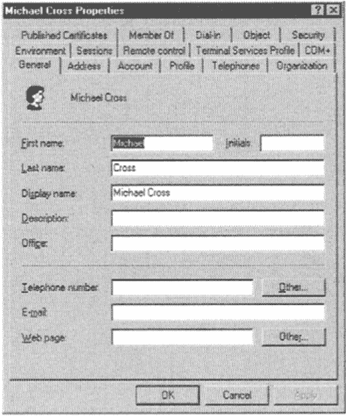

图 2.9 用户属性的常规选项卡

■ 名字 此字段包含用户的 given name。
■ 姓名缩写 此字段包含用户的中间姓名缩写。
■ 姓氏 此字段包含用户的姓氏。
■ 显示名称 此字段包含用户的全名。
■ 描述 此字段允许您提供用户账户的描述。例如，如果这是一个用于服务或应用程序的账户，您可以提供有关哪个服务或程序将使用此账户的信息。
■ 办公室 此字段允许您提供用户工作的办公室信息。
■ 电话号码 此字段允许您提供用户的电话号码。
■ 电子邮件 此字段允许您输入用户的电子邮件地址。
■ 网页 此字段允许您输入用户所属的网页。

查看此选项卡时，请注意电话和网页字段旁边都有一个名为“其他”的按钮。单击此按钮时，将打开一个对话框，允许您输入其他条目。正如您可能猜到的那样，这是因为许多用户可能有多个网页或电话号码与之关联。如果存在其他条目，您也可以单击“其他”按钮在出现的对话框中查看这些条目。

地址选项卡用于存储与用户物理地址或邮寄地址相关的联系信息。如图 2.10 所示，此选项卡上的信息包括：

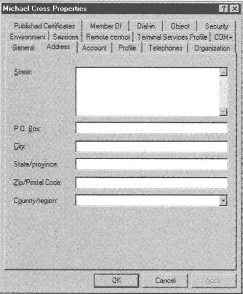

图 2.10 用户属性的地址选项卡

■ 街道 此文本框允许您输入用户的完整街道地址。它允许多行，以考虑公寓号码和其他信息。
■ P.O. Box 此文本框允许您输入 P.O. Box 号码。
■ 城市 此文本框是用户居住或有邮寄地址的城市。
■ 州/省 此文本框是用户居住或有邮寄地址的州或省。
■ 邮政编码/邮政编码 此文本框是用户居住或有邮寄地址的邮政编码或邮政编码


## 国家/地区
此下拉框包含国家列表，以便您可以选择用户居住或拥有邮寄地址的国家。

## 电话选项卡
电话选项卡是另一个包含与用户相关的个人属性的选项卡。如图 2.11 所示，此选项卡提供与各种语音或数字通信方式相关的联系信息：
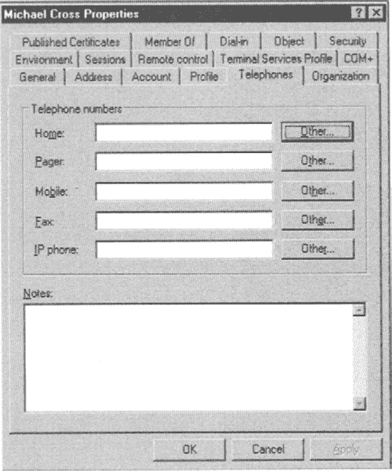
图 2.11 用户属性的电话选项卡

### 住宅
此文本框用于输入用户的家庭电话号码。

### 传呼机
此文本框用于输入用户的传呼机号码。

### 手机
此文本框用于输入用户的手机号码。

### 传真
此文本框用于输入用户的传真号码。

### IP 电话
此文本框用于输入用户的 IP 电话号码。

### 备注
此文本框用于输入与用户相关的任何附加备注。
由于用户可能拥有多个电话号码、传呼机和其他通信方式，因此这些字段（备注除外）还包括一个 `Other` 按钮。如前所述，单击此按钮可让您输入和/或查看该特定字段的额外条目。

## 组织选项卡
组织选项卡是包含用户个人属性的最后一个选项卡。此选项卡允许您输入与用户所在组织相关的信息。如图 2.12 所示，此选项卡上的字段包括：
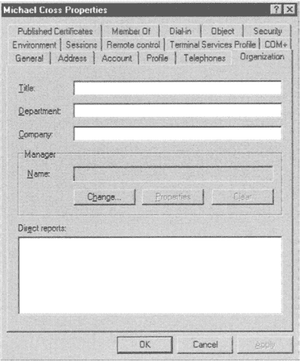
图 2.12 用户属性的组织选项卡

### 职称
此文本框用于指定用户的职称。

### 部门
此文本框用于指定用户工作的部门。

### 公司
此文本框用于指定用户工作的公司名称。

### 管理员
此字段允许您指定指向公司内用户经理或主管的 `DN`。使用此字段，您可以单击 `Change` 按钮更改指向经理用户对象的 `DN`，`Properties` 查看该对象的属性，或 `Clear` 删除指向经理用户对象的条目。

### 直接下属
此字段显示将此用户帐户指定为其经理的任何其他用户帐户。

## 帐户设置
用户属性中的并非所有选项卡都涉及个人信息。如图 2.13 所示，帐户选项卡用于存储与域用户帐户相关的信息，包括密码选项。此选项卡上的字段包括：
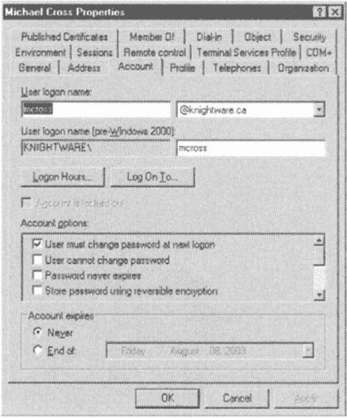
图 2.13 用户属性的帐户选项卡

### 用户登录名
此文本框用于指定用户登录域时使用的 `UPN`。此字段还包括用于指定 `UPN` 后缀的下拉列表。

### 用户登录名（预 Windows 2000）
此文本框用于指定从预 Windows 2000 计算机登录时使用的登录名。

### 帐户已锁定
此复选框指定帐户已锁定，阻止用户登录。

### 用户在下次登录时必须更改密码
此复选框指定用户首次登录时必须更改其密码。

### 用户不能更改密码
此复选框阻止用户更改其密码。这用于限制密码更改，使只有管理员能够管理它们。

### 密码永不过期
此复选框防止密码在特定时间后过期。如果设置了“用户在下次登录时必须更改密码”选项，则此选项将被覆盖。

### 使用可逆加密存储密码
此复选框要求用户使用可逆加密。从 Macintosh 计算机登录的用户需要此设置。某些形式的 Windows 身份验证，例如 `CHAP` 和 `Digest`，也要求启用此设置。

### 帐户已禁用
此复选框阻止用户使用此帐户登录。

### 交互式登录需要智能卡
此复选框允许用户使用智能卡登录。

### 帐户受信任用于委派
这允许帐户作为服务的身份运行，以便它可以冒充帐户并获取必要的访问权限。

### 帐户敏感且不可委派
此复选框允许用户将命名空间的一部分的责任分配给另一个用户、组或计算机。

### 对此帐户使用 DES 加密类型
此复选框要求对此帐户使用数据加密标准（`DES`）。

### 不要求 Kerberos 预身份验证
此复选框取消了使用不需要预身份验证的另一种 Kerberos 版本的帐户的预身份验证需求。

### 帐户过期
此选项按钮用于设置帐户的到期日期。此字段的选项为 Never，即帐户永不过期；或 End of，即需要设置日期以指定帐户到期的时间。
除了我们讨论过的字段外，帐户选项卡还包括一个 `Logon Hours` 按钮，该按钮打开一个对话框，允许您控制用户何时可以登录或保持登录到网络。默认情况下，用户可以全天 24 小时、每周 7 天登录并保持登录到网络。然而，在安全环境中，您可能希望控制用户何时能够登录。为了提供维护窗口，您可能希望限制用户在工作常规时间后或周末登录或保持登录的能力。
如图 2.14 所示，`Logon Hours` 对话框包含一系列框，用于确定用户可以登录的时间和日期。选择代表登录时间日期的框后，单击 `Logon Permitted` 或 `Logon Denied` 选项按钮分别允许或拒绝在这些时间访问。如果所有框都被选中并且选择了 `Logon Permitted`，则用户没有任何限制。
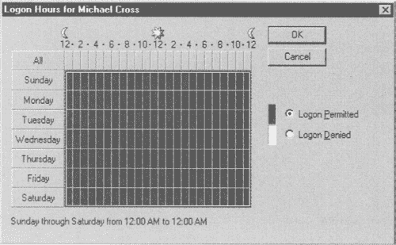
图 2.14 登录时间对话框
出现在帐户选项卡上的另一个按钮是 `Log On To` 按钮。单击此按钮时，会出现图 2.15 所示的登录工作站对话框。在此对话框中，您可以控制用户登录域时可以使用哪些计算机。默认情况下，用户可以从任何计算机登录。但是，通过使用此选项卡上的字段，您可以通过将用户限制为在其办公桌的机器上工作，或部门内的计算机组来提高安全性。例如，您可能希望防止用户从特定机器登录到域，以便他们无法访问存储在该计算机上的另一用户的数据。
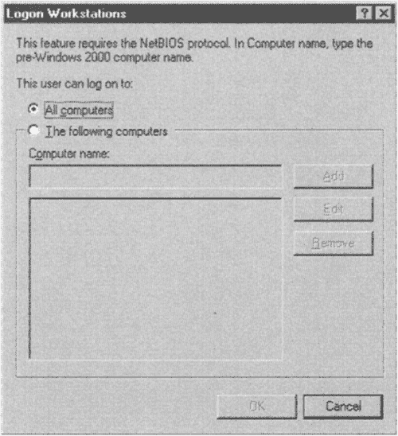
图 2.15 登录工作站对话框
在此对话框中，有两个选项：`All computers` 和 `The following computers`。当选择 `All computers` 时，关于用户可以从哪些机器登录没有任何限制。当选择 `The following computers` 时，您可以输入要将用户限制使用的计算机名称。输入计算机的 `NetBIOS` 名称后，单击 `Add` 按钮将其添加到列表中。然后您可以从列表中选择计算机名称，并单击 `Edit` 修改条目或 `Remove` 从列表中删除它。


## 配置文件选项卡

配置文件选项卡还用于配置用户账户的各个元素，涉及配置文件、登录脚本和主文件夹。漫游配置文件可用于在网络上提供一致性，通过确保用户无论使用网络上的哪台计算机，都具有相同的桌面环境、应用程序设置、驱动器映射和个人数据。此选项卡上的“配置文件路径”字段用于指定用户配置文件的路径。同样，登录脚本也用于通过在用户登录网络时运行脚本来应用用户账户的设置。“登录脚本”字段用于设置此脚本的位置，以便每次用户登录此账户时自动运行。通过这些设置，每次用户登录域控制器时，其环境都会被配置。

注意

此选项卡上的“登录脚本”字段是 Windows NT 时代遗留下来的。组策略允许您指定多个登录、注销、启动和关闭脚本。然而，如果用户登录的计算机不支持组策略，此字段就派上用场，以确保他们仍能应用登录脚本。Windows 2000 及更高版本的计算机能够使用组策略。

最后，如图 2.16 所示，此选项卡的“主文件夹”部分用于指定包含用户个人文件的主目录的位置。“本地路径”文本框用于指定本地系统上目录的路径。或者，您可以使用“连接”下拉框指定路径将映射到的驱动器号，然后在“到”文本框中输入目录的 UNC 路径，从而指定网络位置。

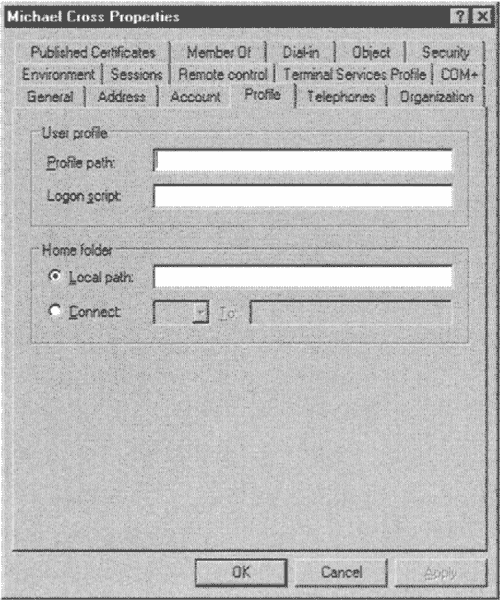

图 2.16 用户属性的配置文件选项卡

### 终端服务选项卡

终端服务允许用户访问在服务器上运行的应用程序。而不是作为独立计算机运行，访问终端服务的客户端充当哑终端。在与服务器的会话期间，用户运行一个环境，该环境允许他们查看和与程序交互，这些程序看似在本地计算机上运行，但实际上是在网络上的终端服务服务器上运行。

用户属性对话框提供了四个专门处理终端服务的选项卡：环境、会话、远程控制和终端服务配置文件。如图 2.17 所示，“环境”选项卡用于配置终端服务启动环境的设置。默认情况下，使用终端服务连接时，用户会收到 Windows Server 2003 桌面。“启动程序”部分包含用于指定在登录终端服务时运行的特定程序的字段。如果启用此选项，用户将收到该程序而不是桌面。当选中“登录时启动以下程序”复选框时，您可以输入程序的路径和可执行名称。

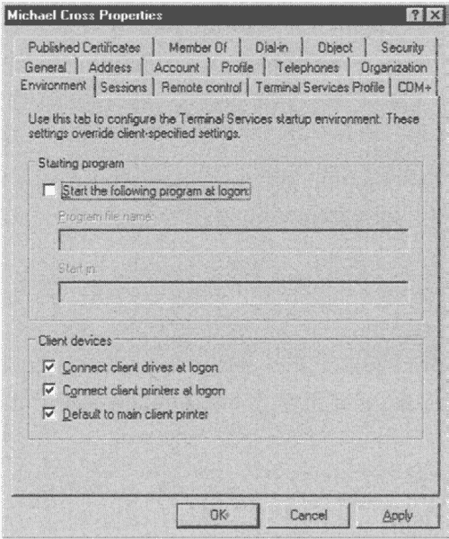

图 2.17 用户属性的环境选项卡

“客户端设备”部分还允许您配置正在使用的计算机上的设备如何处理。可以选中以启用这些设置的复选框有：

■ 登录时连接客户端驱动器 此复选框会导致在用户的终端服务会话中将驱动器号映射到本地客户端驱动器。这使得可以从会话访问这些本地驱动器。请记住，当您在会话中工作时，您实际上是在服务器上工作，而不是客户端。因此，您在资源管理器中看到的驱动器是服务器上的驱动器，而不是客户端的驱动器。选中此框时，您可以看到两者。

■ 登录时连接客户端打印机 此复选框会导致在终端服务会话中工作时，客户端计算机上配置的打印机被连接并可用。

■ 默认使用主客户端打印机 此复选框会导致客户端计算机上的默认打印机成为终端服务会话中的默认打印机。

除了“环境”选项卡上的设置外，“会话”选项卡也用于配置终端服务。如图 2.18 所示，此选项卡包含大量用于配置终端服务会话超时和重新连接设置的设置：

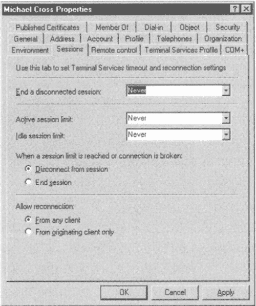

图 2.18 用户属性的会话选项卡

■ 结束断开的会话 此下拉框允许您选择断开的会话应在服务器上保留多长时间。如果设置为“从不”，即默认设置，断开的会话将无限期地保留在服务器上。如果设置为特定时间限制，当达到此时间限制时，会话将在服务器上终止。

■ 活动会话限制 此下拉框用于指定用户的会话应保持活动状态多长时间。默认设置是“从不”，意味着用户的会话可以无限期保持活动状态。如果通过从下拉列表中选择时间来设置限制，则用户的会话将保持活动状态直到达到该时间。此时，用户将从会话中断开连接或会话终止，具体取决于“达到会话限制或连接中断时”选项的设置。

■ 空闲会话限制 此下拉框控制用户在无活动的情况下可以保持连接多长时间，然后会话结束或用户被断开连接，具体取决于“达到会话限制或连接中断时”选项的设置。

■ 达到会话限制或连接中断时 此选项按钮允许您设置在任一情况发生时将发生什么。您可以选择“从会话断开连接”或“结束会话”。

■ 允许重新连接 此选项按钮允许您控制用户如何重新连接到断开的会话。您可以选择从“任何客户端”重新连接或仅从“原始客户端”重新连接。

注意

结束终端服务会话有两种方法。第一种是注销。这会完全销毁您在服务器上使用的会话并释放其占用的资源。第二种选项是断开连接。这只是中断了客户端与终端服务服务器之间的通信。它不会终止您的会话，这意味着它继续在服务器上消耗资源。当您重新连接到断开的会话时，它与断开连接时的状态完全相同。

“远程控制”选项卡允许您为用户配置远程控制设置，从而使他人接管会话。通过接管计算机，另一人就可以在远程计算机上执行操作，使其能够执行各种操作并向用户展示如何完成某些任务。如图 2.19 所示，可用于配置这些设置的字段有：


图 2.19 用户属性的远程控制选项卡

■ 启用远程控制 此复选框决定其他人是否可以控制或查看用户的会话。这会打开或关闭属于用户的会话的远程控制。

■ 需要用户许可 此复选框决定用户是否需要给予许可才能允许另一用户控制或查看会话。


## 控制级别

此选项按钮决定其他人如何使用远程控制与用户的会话。选项包括查看用户会话，仅允许其他人查看用户正在进行的操作，以及与会话交互，允许另一用户接管会话并执行任务，就好像他或她坐在发起会话的用户的计算机前一样。

## 终端服务配置文件选项卡

终端服务配置文件选项卡与前面讨论的配置文件选项卡类似，只是该选项卡上的设置专门与用户的终端服务会话相关。如图所示 图 2.20，该选项卡提供以下字段：


图 2.20 终端服务配置文件

### 配置文件路径

此文本框指定应与终端服务一起使用的用户配置文件的路径。如果未指定路径，则使用配置文件选项卡中的设置。

### 终端服务主文件夹

此文本框允许您指定在终端服务会话期间应使用的用户主目录的位置。与配置文件选项卡一样，本节提供两个选项。本地路径字段用于指定终端服务计算机上位置的本地路径。连接下拉框允许您为会话中可用的映射驱动器指定驱动器号，以及主目录网络位置的 UNC 路径。如果未指定主文件夹，则使用配置文件选项卡中的设置。

### 允许登录到终端服务器

此复选框用于启用用户建立终端服务会话。默认情况下处于启用状态。

## 与安全相关的选项卡

通过用户对象的属性可以获得多个选项卡，用于控制与帐户关联的安全设置。这些选项卡为已发布证书、拨入、安全性 和 成员身份。它们共同允许您管理与访问控制和身份验证相关的问题。

### 已发布证书选项卡

已发布证书选项卡提供帐户使用的证书列表，并允许您添加其他证书。如图所示 图 2.21，该选项卡允许您查看为用户帐户发布的任何 X.509 证书，并包括说明其颁发者、颁发对象、证书的预期用途及其到期日期的字段。 “从存储区添加”按钮可用于从计算机的本地证书存储区向列表中添加其他证书。 “从文件添加”按钮也可用于从文件添加证书。如果不再需要证书，可以选择不再希望应用于帐户的证书并单击“删除”按钮。最后，“复制到文件”按钮将把列表中选中的证书导出到文件。


图 2.21 已发布证书

### 拨入选项卡

拨入选项卡允许您配置在用户尝试使用拨号或 VPN 连接远程连接到网络时使用的设置。当用户拨入 Windows Server 2003 远程访问服务器或尝试使用 VPN 连接时应用这些设置。如图所示 图 2.22，该选项卡分为多个包含多个选项的部分，包括：


图 2.22 拨入选项卡

#### 远程访问权限（拨入或 VPN）

此选项按钮指定用户是否可以通过拨号或 VPN 连接连接到网络。本节中的选项包括允许访问，启用拨入或 VPN 远程访问；拒绝访问，禁止拨入或 VPN 远程访问；以及通过远程访问策略控制访问，这是默认选项，指定使用远程访问策略控制远程访问权限。

#### 验证呼叫者 ID

此复选框允许您指定用户必须从其拨打电话才能建立成功连接的电话号码。它需要能够检测用户拨打电话号码的硬件。

#### 回叫选项

本节中的配置设置有不回叫、由呼叫者设置（仅限路由和远程访问服务）和始终回叫到。不回叫是默认选项。它允许用户远程连接且不使用回叫。当设置此选项时，用户将支付任何长途费用。由呼叫者设置（仅限路由和远程访问服务）允许呼叫者指定服务器将回叫的电话号码。当建立远程连接时，会提示用户输入用户名和密码。如果身份验证成功，则会检查该选项卡上的设置，并提示用户输入回叫电话号码。服务器随后断开连接并在该号码回叫用户。这允许公司支付任何长途费用，通常会节省成本。始终回叫到是最后一个选项。这是一个安全选项，而不是节省成本选项，强制服务器在预配置的电话号码回叫用户。由于此设置要求用户位于该电话号码处，因此未经授权的用户尝试远程连接的风险降低。

#### 分配静态 IP 地址

此复选框在用户远程连接时为用户分配特定的 IP 地址。

#### 应用静态路由

此复选框在连接时在路由表中放置额外的路由。

#### 静态路由

此按钮用于定义在连接时将放置在路由表中的额外路由。

### 安全选项卡

正如我们在 第 1 章 所见，安全选项卡（图 2.23）用于配置其他用户和组对对象的权限。该选项卡由两个窗格组成。顶部窗格列出已添加到帐户 DACL 的用户和组。它还允许您向 DACL 添加或删除用户和组。在底部窗格中，您可以通过在“允许”或“拒绝”列中选中复选框来启用或禁用特定权限。还可以通过单击“高级”按钮为对象设置特殊权限，该按钮会显示一个对话框（见 图 2.24），可在其中应用额外的权限。


图 2.23 安全选项卡


图 2.24 特殊权限对话框

如 图 2.24 所示，通过安全选项卡的“高级”按钮访问的特殊权限对话框允许您配置高级设置并向帐户应用额外权限。如该对话框所示，权限选项卡还提供一个标记为允许从父级继承的权限传播到此对象和所有子对象的选项。当选中此复选框时，应用于父对象（在本例中为 OU）的任何权限也将应用于此帐户。如果取消选中此复选框，则在更高级别应用的任何权限都不会应用，并且对象仅具有为其显式设置的权限。

### 成员身份选项卡

如 图 2.25 所示，该选项卡提供用户的组成员身份列表。通过单击“添加”按钮，将出现一个对话框，其中列出用户可以成为成员的可用组。从“成员身份”选项卡上的列表中选择一个组并单击“删除”按钮将把该用户从组的成员身份中删除。


## 成员选项卡

在此选项卡底部有一个名为“设置主要组”的按钮，仅适用于少数用户。需要主要组的用户是使用 Macintosh 计算机并通过用于 Macintosh 的文件或打印服务登录网络的用户。其他需要主要组的用户是运行 POSIX 兼容应用程序的用户。


### 考试警告

新账户的默认主要组通常无需更改。新用户账户的主要组为 Domain Users，而新计算机账户的主要组为 Domain Computers。

要充分理解“成员”选项卡如何影响用户的安全级别，我们必须查看组如何影响用户的访问权限。接下来，我们将查看用户可以加入的各种组，并了解每个组提供的功能。

## 使用 Active Directory 组账户

组是集合在一起的账户集合，以便可以作为一个整体授予它们权利和权限。通过使用组，您不必将权利和权限授予每个账户。您可以使用户账户、计算机账户和其他组成为组的成员，并仅在组级别进行更改即可向它们全部授予权利和权限。当授予组权限、特权或权利时，所授予的内容适用于该组的所有成员账户。

使用组，您可以执行各种任务，这些任务会影响成员账户和组。这些包括：

■ 将权利分配给组账户以授权其执行特定任务
■ 将共享资源上的权限分配给组，以便所有成员可以以相同的方式访问资源
■ 向组的全部成员分发批量电子邮件

正如我们将在后面的章节中看到的那样，组账户是管理大量用户如同使用单个账户一样的有力工具。在将账户与组关联时，您会发现有些组的成员数量远大于其他组，有些组用于除安全问题之外的其他目的。

## 组类型

使用组账户的第一步是确定要创建和使用的组类型。在 Active Directory 中，有两种不同的类型，用于两种不同的目的：

■ 安全组
■ 分发组

这些组之间的区别在于它们的使用方式。安全组设计用于安全目的，而分发组设计用于向用户集合发送批量电子邮件。正如我们将在下面的段落中看到的那样，所使用的组类型不仅与其预期目的有关，还与其在安全方面的处理方式有关。

一旦创建了特定类型的组账户，随时都可以更改其类型。如果您创建了一个安全组，后来决定将其转换为分发组（或反之亦然），Active Directory 会根据已设置的域功能级别允许这样做。如果域功能级别设置为 Windows 2000 原生或更高，则可以进行转换。但是，如果域以 Windows 2000 混合级别运行，则可能不允许这样做。

### 安全组

安全组是人们在讨论组时最常想到的内容。安全组是具有特定资源权利和权限的用户集合。与向单个用户授予执行某些任务的权利，然后设置用户可以访问的资源权限不同，权利和权限会应用于组。组的任何成员都会获得相同的此安全访问级别。这样，用户的集合被视为一个整体，而不是个人。

虽然都可以应用于组账户，但权利和权限彼此不同。权利分配给用户和组，并控制用户或组成员可以采取的操作。例如，备份操作员组成员具有备份和恢复数据的能力，而管理员组成员几乎可以执行任何操作。正如我们将在本章后面看到的那样，有许多用户可以加入的安全组，每个组都提供不同的访问级别。在 Windows Server 2003 中，权利有时也称为特权。您可能在查看命令 `WHOAMI /ALL` 的输出时已经注意到这一点。

权限用于控制对资源的访问。当权限分配给组时，它决定组成员对特定资源可以做什么。例如，一个组可能只被授予对文件的读取权限（因此他们可以查看但不能修改它），而另一个组可能被授予完全控制权限（允许他们对文件执行任何操作）。通过权限，您可以控制用户或组对共享资源获得的访问级别。

安全组能够获得此类访问权限，因为在首次创建组账户时就分配了 SID。由于它具有 SID，因此可以成为 DACL 的一部分，DACL 列出了用户和组对资源的权限。当用户登录时，会创建一个访问令牌，其中包含其 SID 以及其所属的任何组的 SID。当他们尝试访问资源时，此访问令牌会与 DACL 进行比较，以查看应向用户授予哪些权限。通过此过程和使用组，用户获得比明确授予其账户更多的（在某些情况下更少的）访问权限。

安全组的另一个好处是您可以向其发送电子邮件。当向组发送电子邮件时，组的每个成员都会收到电子邮件。这样可以节省向每个单独用户发送电子邮件消息的麻烦。

### 分发组

虽然安全组用于访问控制，但分发组用于共享信息。此类组与安全无关。它用于向用户组分发电子邮件消息。与一次向一个用户发送相同消息不同，分发组允许 Microsoft Exchange 等应用程序向用户集合发送电子邮件。

分发组不能用于安全目的的原因是它们不能列在 DACL 中。创建新的分发组时不会分配 SID，从而防止其列在 DACL 中。虽然可以向分发组添加属于不同安全组的用户，但这对与其账户关联的权限和权利没有任何影响。

### 班级之首…

#### 安全组与分发组

在查看安全组和分发组之间的差异时，可能会令人困惑为什么使用两种这样的组。毕竟，两者都可以用作电子邮件实体，可以向组发送电子邮件并将消息分发给成员。使用两种类型组的原因为只有安全组具有 SID，

由于安全组具有 SID，因此可以包含在 DACL 中并被授予资源权限。分发组不使用 SID，因此不能被授予权限。因此，您可以将用户添加到任意数量的分发组，而无需担心他们因成员身份而意外获得更大的访问权限。如果不存在分发组，您可能会将用户添加到安全组，以便他或她接收该组的电子邮件，但错误地给予该用户超出期望的更大访问权限。


另一个使用两种类型组的原因是为了性能。当使用安全组时，该组的 `SID` 会在成员登录时添加到其访问令牌中。用户所属的安全组越多，登录所需的时间就越长。添加到访问令牌中的每个安全组都会增加令牌的大小，使登录以及后续的资源访问变得更慢、资源消耗更大。当使用分发组时，组没有 `SID`，因此用户所属的分发组数量对令牌大小没有影响。由于这些问题，通常最好将分发组用于电子邮件需求，而将安全组用于需要访问的人员集合。

## Active Directory 中的组作用域

作用域是组在域、树和林中延伸的范围。作用域用于确定将应用于组的保护级别、可添加到其成员身份的用户以及他们将被授予权限访问的资源。如以下各节所述，Active Directory 为组提供了三种不同的作用域：

■ 通用
■ 全局
■ 域本地

### 通用

通用组具有所有不同组作用域中最宽的作用域。此组的成员可以包含林中任何域的帐户和组，并且可以分配权限以访问林中任何域的资源。换句话说，它在林的任何部分都是全包的。

是否可以使用通用安全组取决于域的设置功能级别。域功能级别设置为 Windows 2000 混合时，不允许创建通用安全组。但是，如果域功能级别为 Windows 2000 原生或 Windows Server 2003，则可以创建通用安全组。在这种情况下，组可以包含林中任何域的用户帐户、全局组和通用组，并可分配权限以访问任何域中的资源。通用分发组可以在任何功能级别使用，包括 Windows 2000 混合。

通用组可以转换为作用域较小的组。只要组不包含任何通用组成员，就可以将通用组转换为全局组或域本地组。如果要转换的通用组的成员中包含通用组，则在删除这些成员之前无法执行转换。

备注

通用组连同其成员列表一起存储在 `GC` 中。因此，任何成员身份更改都会触发林范围内的复制。为了限制这种复制的影响，Microsoft 建议在这些组中使用相对静态的成员（例如全局组）。

### 全局

全局组的作用域比通用组窄。全局组可以包含其创建所在的域中的帐户和组，并可分配权限以访问树或林中任何域的资源。由于它仅适用于其创建的域，因此此类组通常用于组织具有相似访问需求的帐户。

正如我们在通用组中所看到的，可以成为全局组成员的成员取决于域功能级别。如果域功能级别设置为 Windows 2000 混合，则全局组的成员只能由同一域的用户帐户组成。如果域功能级别设置为 Windows 2000 原生或 Windows Server 2003，则全局组可以拥有同一域中的用户帐户和其他全局组作为成员。其他域的用户帐户和全局组不能成为全局组的成员。

全局组也可以转换为通用组，前提是全局组不是其他全局组的成员。如果其他全局组是全局组的成员，则必须在转换之前将其删除。要转换为通用安全组，域功能级别必须为 Windows 2000 原生或 Windows Server 2003。

### 域本地

域本地组的作用域也扩展到本地域，并用于分配对本地资源的权限。域本地组与全局组之间的区别在于，可以将任何域的用户帐户、全局组和通用组添加到域本地组中。然而，由于其作用域有限，成员只能在该组创建所在的域内分配权限。

正如您从前面两个作用域中所预期的那样，域本地组的能力取决于域功能级别。如果功能级别设置为 Windows 2000 混合，则域本地组只能包含任何域的用户帐户和全局组。当使用此功能级别时，它不能包含通用组。如果功能级别设置为 Windows 2000 原生或 Windows Server 2003，则域本地组可以包含任何域的用户帐户和全局组，以及通用组。此外，它还可以包含同一域中的其他域本地组。然而，这些能力对权限没有影响。在所有情况下，权限只能分配给本地域中的资源。

域本地组可以转换为通用组，前提是其成员身份中没有其他域本地组。如果域本地组确实有其他域本地组作为成员，则必须在转换前将其从成员身份中删除。

## 内置组帐户

正如我们在讨论用户对象时所看到的，安装 Active Directory 时会自动创建多个内置帐户。这不仅适用于用户帐户，也适用于组帐户。其中许多组具有预配置的权限，允许成员执行特定任务。当用户被添加到这些组时，他们将获得这些权限以及访问资源的任何分配权限。

安装 Active Directory 时创建的组可以通过 `Active Directory Users and Computers` 访问，并位于两个容器中：`Builtin` 和 `Users`。尽管它们存储在这些容器中，但可以移动到域内的其他 `OU`s。内置容器中的组具有域本地作用域，而 `Users` 容器中的组具有域本地、全局或通用作用域。在下面的段落中，我们将查看位于这些容器中的各个组，并了解它们执行网络相关任务的权限。

### Builtin 容器中的默认组

`Builtin` 容器中默认可能位于多达 14 个不同的内置组，包括：

■ Account Operators，允许成员管理帐户
■ Administrators，授予成员完全控制权
■ Backup Operators，允许成员备份和还原文件
■ Guests，授予成员最小访问权限
■ Incoming Forest Trust Builders，仅在林根域中可用，并授予成员创建入站林信任的权限
■ Network Configuration Operators，允许成员管理网络设置
■ Performance Monitor Users，允许用户管理性能计数器并使用系统监视器
■ Performance Log Users，允许用户管理性能计数器并使用性能日志和警报
■ Pre-Windows 2000 Compatible Access，用于向后兼容。
■ Print Operators，允许成员管理打印机
■ Remote Desktop Users，允许成员使用远程桌面连接到服务器
■ Replicator，用于复制目的
■ Server Operators，允许成员管理服务器
■ Users，包含域中创建的每个用户帐户


# Active Directory 内置组

## 账户操作员
账户操作员组用于允许成员执行组管理。 其成员中的用户具有创建、修改和删除存储在 Active Directory 中的许多账户的能力。 他们可以管理除域控制器 OU 或位于 Users 或 Computers 容器中的账户之外的任何 OU 中的账户。 为防止该组成员影响管理员账户，账户操作员组成员不能修改 Administrators 和 Domain Admins 组，或这些组的成员账户。

账户操作员组成员在处理该组所在的域中的域控制器时也具有某些能力。 他们可以本地登录到域控制器，这意味着他们可以亲自坐在域控制器前登录。 在此过程中，他们可以对域控制器进行修改。 他们还具有关闭域控制器的能力，如果域控制器出现问题且无人可用重启系统时，这很有用。

## 管理员
管理员组是 Builtin 容器中最强大的组之一，对域具有完全控制权。 该账户可以通过网络访问域控制器、备份文件和目录、更改系统时间、调整内存配额、创建页面文件、加载和卸载设备驱动程序、将责任委派给用户和计算机、关闭系统，并执行与账户和域控制器相关的其他任务。 默认情况下，Domain Admins 和 Enterprise Admins 组以及 Administrator 账户都是管理员组的成员。

## 备份操作员
备份操作员组用于赋予成员在域控制器上备份和还原文件的能力。 成员在不同文件上的权限无关紧要，因为他们可以备份和还原系统上的任何文件。 此外，他们还具有本地登录到域控制器并关闭系统的能力。 由于该组成员被赋予的能力级别很高，因此默认情况下在首次创建时没有任何成员。

## 来宾
来宾组是 Builtin 容器中权限最弱的组，其成员包括需要最小访问权限或未使用自己的账户登录的人员的账户和组。 Guest 账户和 Domains Guests 组是该组的成员。 如你所回忆，Guest 账户默认处于禁用状态，这意味着当该组最初创建时没有任何活跃用户。

## 入站林信任构建者
由于其用途，入站林信任构建者组仅在林根域中可用。 该组成员具有创建入站林信任的权限。 此权限使他们能够创建单向入站林信任，只能在两个林的根域之间创建。 单向信任意味着一个林的用户可以访问另一个林中的资源，但反之则不行。 由于能够在两个域之间创建信任，因此在该组最初创建时没有默认成员。

## 网络配置操作员
顾名思义，网络配置操作员组用于管理网络设置的更改。 该组成员具有在域中的服务器上续订和释放 IP 地址以及修改 TCP/IP 设置的能力。 因为如果操作不当可能会使服务器无法访问，所以该组没有默认成员，且应谨慎添加新成员。

## 性能监视器用户和性能日志用户
性能监视器用户组和性能日志用户组的成员用于管理域内服务器上的性能计数器。 性能计数器用于监视和衡量域控制器的元素，例如内存、硬盘、处理器、网络活动等。 这些实用程序由 Windows 2000 和 Windows Server 2003 中的两个相关实用程序使用：系统监视器和性能日志和警报。 这两个实用程序都可以通过 Windows 开始菜单中“管理工具”下的性能控制台访问。

性能监视器用户组成员可以使用系统监视器监视性能计数器。 他们可以本地或远程查看计数器，以图形或文本格式查看。 通过这样做，他们可以确定域内服务器是否存在性能问题。

性能日志用户组成员也具有管理性能计数器的能力，但可以使用性能日志和警报实用程序创建和查看日志，并配置警报以在出现问题时通知特定用户，例如管理员。 例如，如果可用硬盘空间降至某一水平以下，可以向网络管理员发送消息，提醒潜在问题。 该组成员还可以配置在性能计数器的值超过或低于特定设置时运行某些程序。

## Windows 2000 之前的兼容访问
Windows 2000 之前的兼容访问组用于旧版 Windows 的向后兼容。 该组成员具有读取访问权限，可查看域内的所有用户和组。 根据安装 Active Directory 时选择的安全设置，Everyone 组可能是该组的成员； 但是，如果需要，也可以添加运行 Windows NT 4.0 或更早版本的额外成员。

## 打印操作员
打印操作员组允许成员执行打印机管理所需的任务。 该组成员可以管理 Active Directory 中的打印机对象，并在域内的域控制器上创建、共享、管理及删除打印机。 由于向服务器添加新打印机可能需要执行某些操作，例如重新启动计算机，因此该组还具有加载和卸载设备驱动程序以及关闭系统的能力。 与本节讨论的其他组一样，打印操作员组在最初创建时没有添加成员。

## 远程桌面用户
远程桌面用户组允许成员远程连接到域中的服务器。 能够远程登录到域控制器使他们能够像亲自坐在服务器前操作一样执行操作。 由于该组赋予成员的权限，因此没有默认成员。

## 复制器
复制器组是不应添加用户的组。 该组由文件复制服务使用并提供数据复制支持； 因此，其不打算拥有用户作为成员。

## 服务器操作员
服务器操作员组向其成员提供了大量权限，这就是为什么在最初创建时没有默认成员的原因。 该组成员可以在域内的服务器上执行许多管理任务，包括创建和删除共享资源、备份和还原文件、启动和停止服务、关闭系统，甚至格式化硬盘。 由于成员有可能对域控制器造成重大损害，因此应谨慎将用户添加到该组。

## 用户
用户组在其成员中包括在域中创建的每个用户账户。 默认情况下，Domain Users、Authenticated Users 和 Interactive 组是该组的成员。 通过成为该组的成员，成员能够运行应用程序、访问本地和网络打印机，并执行正常工作职能所需的其他常见任务。

### 用户容器中的默认组
除了我们讨论过的组之外，最多 13 个内置组默认可以位于 Users 容器中，包括：

■ Cert Publishers，其赋予成员发布证书的能力

■ DnsAdmins，其提供对 DNS Server 服务的管理员访问权限

■ DnsUpdateProxy，其为成员提供为其他客户端执行动态更新的能力

■ Domain Admins，其赋予成员对域的完全控制权

■ Domain Computers，其包含属于域的计算机

■ Domain Controllers，其包含域控制器

■ Domain Guests，其包含域的来宾


## 内置域组

-   `Domain Users`，其中包含域用户
-   `Enterprise Admins`，可对林中每个域拥有完全控制权
-   `Group Policy Creator Owners`，允许成员在域中管理组策略
-   `IIS_WPG`，由 Internet 信息服务 (`IIS`) 使用
-   `RAS and IAS Servers`，允许成员管理远程访问
-   `Schema Admins`，允许成员修改架构
-   `Telnet Clients`，用于客户端通过 Telnet 连接

`Cert Publishers` 组用于数字证书，我们在 第 1 章 中讨论过。虽然该组没有默认成员，但添加成员后他们可以为用户和计算机发布证书。这允许数据在网络上传输时被加密和解密。

`DnsAdmins` 和 `DnsUpdateProxy` 组在安装 DNS 时会被安装。这两个组都没有默认成员，但添加成员后他们将拥有与 DNS 服务器服务相关的权限。`DnsAdmins` 组允许成员对 DNS 服务器服务具有管理访问权限。`DnsUpdateProxy` 组允许成员代表其他客户端执行动态 DNS 更新，并绕过通常伴随安全动态更新的 DACL。

`Domain Admins` 组在域中拥有完全控制权。当它们加入域时，该组会成为每个 DC、工作站和成员服务器上的 `Administrators` 组的成员。由于这种成员关系，组成员拥有与 `Administrators` 组关联的所有权限，包括备份和还原文件、更改系统时间、创建分页文件、启用委派帐户、远程关闭计算机、加载和卸载设备驱动程序，以及执行与 Active Directory 和服务器管理相关的其他任务。

`Domain Computers` 和 `Domain Controllers` 组的成员由域中的计算机组成。`Domain Computers` 组包含所有加入域的工作站和服务器，除 DC 外。当创建计算机帐户时，计算机对象会自动成为该组的成员。同样，`Domain Controllers` 组包含属于该域的所有 DC。通过使用这些组，您可以设置适用于域内存在的计算机帐户的权限和权利。

我们接下来要讨论的两个组是用于拥有自己的帐户或使用访客帐户登录的用户。`Domain Guests` 组的成员由任何域访客组成，而 `Domain Users` 组默认由所有域用户组成。域中创建的任何用户帐户都会自动成为 `Domain Users` 组的成员。

`Enterprise Admins` 是一个出现在林根域中的组，允许成员对林中每个域拥有完全控制权。该组成员会自动添加到林中每个域的每个 DC 上的 `Administrators` 组中。如本章前面所述，`Administrator` 帐户是该组的成员。由于它赋予用户的权力，应谨慎添加其他成员。

`Group Policy Creator Owners` 组用于在域内管理组策略。组策略允许您控制用户的环境。使用策略，您可以控制诸如用户桌面的外观和行为之类的事项，并限制用户对其计算机的控制。`Group Policy Creator Owners` 组成员可以修改这些策略。由于这些成员对域内用户拥有的权力，`Administrator` 帐户是该组的唯一默认成员。

`IIS_WPG` 组在安装 `IIS` 时安装。`IIS` 版本 6.0 使用工作进程为单独的 DNS 命名空间提供服务，并允许它们在其他身份下运行。例如，一个工作进程可能为命名空间 [www.syngress.com](http://www.syngress.com) 提供服务，但也可以在名为 Syngress 的 `IIS_WPG` 组中的另一个身份下运行。由于这些身份需要配置才能应用于特定命名空间，因此该组中没有默认成员。

`RAS and IAS Servers` 组用于远程访问服务 (`RAS`) 和 Internet 身份验证服务 (`IAS`)，它们提供对网络的远程访问。该组成员能够访问域中用户的远程访问属性。这使他们能够协助管理需要此访问的帐户。

`Schema Admins` 组是另一个仅出现在林根域中的组。该组允许成员修改架构。架构用于定义构成 Active Directory 数据库骨干的用户类和属性。如前所述，`Administrator` 帐户是该组的默认成员。由于该组对林可能产生广泛影响，应谨慎添加其他用户。

## 创建组帐户

除了在 DC 上安装 Active Directory 和其他服务时创建的内置组外，您还可以创建组帐户以满足组织的需要。要创建组帐户，您可以使用 `Active Directory Users and Computers` 或 `DSADD` 命令行工具。无论您使用哪种方法，只有 `Administrators` 组、`Account Operators` 组、`Domain Admins` 组、`Enterprise Admins` 组成员，或已被授予授权的另一个用户或组才能创建新组。

### 使用 Active Directory Users and Computers 创建组

在 `Active Directory Users and Computers` 中创建新组首先是选择要存储组的容器或 OU。完成此操作后，单击 `Action | New | Group`。或者，您可以右键单击容器并选择 `New | Group`。在任何一种情况下，这都将打开 `New Object - Group` 对话框。

`New Object — Group` 对话框只需最少的信息即可创建新组。如 图 2.26 所示，`Group name` 文本框是您输入组的 Active Directory 名称的位置。当您在此字段中输入信息时，它还会填写 `Group name (pre-Windows 2000)` 文本框。这是旧操作系统用来引用该组的名称。默认情况下，它与 `Group name` 相同，但可以根据本章前面介绍的命名规则修改为任意名称。


图 2.26 创建新组的“新建对象”对话框

在指定组名称的字段下方有一个部分，允许您控制范围。如本章前面所述，组有三种不同的范围：`Domain local`、`Global` 和 `Universal`。只有在功能级别提升到 `Windows 2000 native` 或更高时，`Security` 组类型才能被赋予通用范围。如果功能级别为 `Windows 2000 mixed`，则在创建 `Security` 类型组时，该对话框上的 `Universal` 选项将被禁用，而唯一可用的选项将是 `Domain local` 和 `Global`。

在此部分右侧还有另一个部分，允许您指定要创建的组的类型。可以创建两种不同类型的组：`Security` 和 `Distribution`。如本章前面所述，安全组用于控制访问，而分发组由应用程序用于向用户集合发送批量电子邮件。


在提供完新组的信息后，单击“确定”按钮创建该组。单击此按钮后，此新对象将出现在您最初选定用于存储该组的容器中。如本章后面将看到，您随后可以修改此对象的属性以提供其他信息，例如成员资格、描述和其他因素。

## 使用 DSADD 命令创建组

如本章前面所述，`DSADD` 命令是从命令行创建帐户的有用工具。除了创建用户帐户外，您还可以用它来创建组。使用 `DSADD` 创建新组是通过输入以下语法完成的：

`DSADD GROUP GroupDN -samid SAMName -secgrp yes / no -scope 1 / g / u`

使用此命令时，必须输入以下参数：

■ `GroupDN` 此参数用于指定要添加到 Active Directory 的对象的 DN 以及对象将被创建的位置。

■ `SAMName` 此参数是预 Windows 2000 计算机将使用的 NetBIOS 名称。

■ `yes | no` 此参数用于指定帐户将作为安全组还是通讯组创建。如果要创建安全组，则输入 `yes`。如果要创建通讯组，则输入 `no`。

■ `l | g | u` 此参数用于指定组的范围。如果要创建域本地组，则输入 `1`。如果要创建全局组，则输入 `g`。如果要创建通用组，则输入 `u`。

除了这些参数之外，您还可以使用以下语法指定其他参数：

`DSADD GROUP GroupDN [-secgrp {yes | no}] [-scope {l | g | u}] [-samid SAMName] [-desc Description] [-memberof Group …] [-members Member …] [{—s Server | -d Domain}] [-u UserName] [-p {Password | *}] [-q] [{-uc | -uco | -uci}]`

这些选项提供了在创建组时可以应用的各种设置。除了前面提到过的参数之外，这些不同参数的含义在 表 2.4 中进行了说明。

表 2.4

`DSADD` 创建组的参数

| Parameter || Description |
| --- | --- |
| \-desc Description || 指定要为该组添加的描述。 |
| --- | --- |
| \-memberof Group… || 指定应将此新组添加到其中的组。 |
| \-members Member… || 指定应成为该组成员的成员。 |
| {\-s Server | \-d Domain} || 指定连接到远程服务器或域。默认情况下，计算机连接到登录域中的 DC。 |
| \-u UserName || 指定登录到远程服务器时使用的用户名。默认情况下，使用用户在其本地系统上登录的用户名。`UserName` 变量可以使用以下格式：  
UsernameDomain\\usernameUser principal name |
| \-p {Password | \*} || 指定登录到远程服务器时使用的密码。如果使用星号 (\*)，系统将提示您输入密码。 |
| \-q || 指定安静模式，并抑制输出。 |
| {-uc | -uco | -uci} || 指定用于输入或输出的 Unicode。如果使用 -uc，则输入或输出到管道 (|)。如果使用 -uco，则输出到管道或文件。如果使用 -uci，则输入来自管道或文件 |


## 管理组帐户

如我们所见，`DSADD` 命令提供了配置新组的许多选项，而通过 Active Directory 用户和计算机创建组时可用的选项只有很少。然而，大多数这些选项都可以通过使用对象的属性随时进行配置和重新配置。通过修改组的属性，您可以执行与管理组帐户相关的各种管理任务。

访问组帐户的属性是通过 Active Directory 用户和计算机完成的。选择对象并单击“操作 | 属性”。您也可以右键单击对象，并在上下文菜单中选择“属性”。无论使用何种方法显示属性，都将出现一个类似于 图 2.27 所示的对话框。


图 2.27 组属性中的“常规”选项卡

该对话框包含有关组的许多信息，以及可配置的多个选项。如图所示，标题栏显示组的名称，后跟“属性”一词。在本图所示的情况下，所查看的属性是名为“会计用户”的组的属性。对话框还提供了六个不同的选项卡，可用于管理帐户的不同方面。

“常规”选项卡，如 图 2.27 所示，允许您修改在 Active Directory 用户和计算机中创建帐户时提供的大部分信息。在此选项卡上，“组名（预 Windows 2000）”字段包含旧操作系统用于访问组的 NetBIOS 名称。正如您所注意到的，此名称可以修改，因此它与 Active Directory 组名不同。一个组可以有名称“会计用户”，但其预 Windows 2000 名称为“会计”。

“描述”和“注释”字段允许您输入有关此组的注释，可根据需要参考。“描述”字段的值将出现在 Active Directory 用户和计算机中，并应描述组的目的。例如，如果您要创建一个用于备份服务器文件的特殊组，则可以输入说明此目的的描述。“注释”字段也允许您输入注释，但用于对组的说明。这可以包括诸如对帐户所做的更改、添加的成员等信息。

对话框的“组范围”部分包含用于更改组范围的选项。如果成员资格中没有其他域本地组，则可以将域本地组转换为通用组。全局组也可以转换为通用组，前提是该组不是其他全局组的成员。最后，如果该组成员资格中没有通用组，则可以将通用组转换为全局组。

“组类型”部分用于将组的类型从安全组转换为通讯组，反之亦然。如前所述，“安全”选项用于创建控制对资源访问和执行某些任务权限的组，而“通讯”选项用于创建用于向用户集合发送电子邮件的组。请记住，无论组是安全组还是通讯组，都可以向任一组类型发送电子邮件。要启用用户向组发送电子邮件，您在“电子邮件”字段中输入电子邮件地址。当向此电子邮件地址发送消息时，组中的所有成员都会收到副本。

“成员”选项卡用于查看当前组成员并添加新成员。如 图 2.28 所示，此选项卡提供一个字段，显示组的所有当前成员。要添加新成员，请单击“添加”按钮，这将打开一个对话框，允许您输入要添加的帐户名称。在此对话框中单击“确定”会将用户、计算机或组的名称添加到“成员”选项卡上的列表中。从成员资格中删除帐户也很简单。只需从列表中选择要删除的帐户，然后单击“删除”按钮即可。


图 2.28 组属性中的“成员”选项卡


# Active Directory 组属性和计算机账户

## Adding Members

通过单击 `Add` 按钮，会显示 图 2.29 所示的对话框。在本对话框中，您可以搜索要添加到“成员”列表中的对象。通过单击 `Object Types` 按钮，将出现一个对话框，允许您指定要查找的对象类型。在该对话框中，您可以单击复选框以指定是否搜索联系人、计算机、组、用户或其他对象。为了将搜索限制为仅从目录结构中的特定点开始，您可以单击 `Locations` 按钮打开一个显示目录树的对话框，在其中选择开始搜索的点。最后，`Enter the object names to select` 是输入对象名称的位置。单击 `OK` 后，Active Directory 将使用这些参数查找要添加到“成员身份”列表中的对象。


图 2.29 选择用户、联系人、计算机或组对话框

## Member Of Tab

`Member Of` 选项卡，如 图 2.30 所示，用于将该组添加到 Active Directory 中其他现有组。此选项卡提供一个字段，列出该组所属的所有组。要将该组添加到其他组，请单击 `Add` 按钮打开一个对话框，在其中可以输入希望该组成为其成员的组的名称。单击 `OK` 后，组的名称将被添加到 `Member Of` 选项卡上的列表中。要将该组从另一个组的成员身份中移除，请从列表中选择该组，然后单击 `Remove` 按钮。


图 2.30 组属性中的“成员身份”选项卡

## Managed By Tab

`Managed By` 选项卡用于指定负责管理该组的账户。这使得用户可以轻松确定需要联系谁以请求加入该组，以及如何建立联系。选中 `Manager can update membership list` 复选框还允许此选项卡上列出的账户添加和删除组成员。要指定管理员，请单击 `Change` 按钮并指定账户。添加后，它将显示在此选项卡上的 `Name` 字段中。然后可以通过单击 `Properties` 按钮查看此账户的属性；但是，此账户的许多常用查看元素将自动显示在选项卡上。如 图 2.31 所示，办公室、街道、城市、省/州、国家/地区、电话号码和传真号码等信息将出现。要将此账户从管理角色中移除，请单击 `Clear` 按钮。


图 2.31 组属性中的“管理者”选项卡

## Object Tab

要查看有关组的信息，您可以使用 `Object` 选项卡。如 图 2.32 所示，此选项卡允许您查看有关此 Active Directory 对象的详细信息。`Canonical name of object` 字段显示组的规范名称，而其下方的字段提供其他无法通过选项卡修改的数据。`Object class` 字段告知您这是一个组，其下方的信息说明了创建时间和最后修改时间。其下方的 `Update Sequence Numbers (USNs)` 字段显示此对象的原始和当前更新序列号，这些序列号由复制使用，以确保所有 DC 都有对象信息的更新副本。


图 2.32 组属性的“对象”选项卡

考试警告

`USNs` 是复制的重要组成部分，用于指示对象发生了更改。当账户发生更改时，其 `USN` 会递增以指示发生了更改。

## Security Tab

`Security` 选项卡用于配置其他账户对该组的权限。如 图 2.33 所示，此选项卡的上部窗格列出具有账户权限的用户和组，而下部窗格显示在上部窗格中选定的账户的权限。可以通过单击 `Add` 按钮为新账户授予访问权限。一旦账户被添加到上部窗格并被选中，您可以通过在“允许”或“拒绝”列中选择复选框来启用或禁用特定权限。还可以通过单击 `Advanced` 按钮为对象设置特殊权限。要删除一个账户，请在上部窗格中选择该账户，然后单击 `Remove` 按钮。


图 2.33 组属性的“安全”选项卡

现在我们已经了解了组账户如何创建以及以后如何管理和修改，让我们在 练习 2.03 中将这些知识付诸实践。

## Exercise 2.03 Creating and Modifying Group Accounts

练习 2.03

创建和修改组账户

1. 通过单击选择 `Start | Administrative Tools | Active Directory Users and Computers` 打开 Active Directory 用户和计算机。
2. 当 Active Directory 用户和计算机打开时，展开控制台树，以便可以看到您的域及其中的容器。
3. 从控制台树中选择 TestOU OU。从“操作”菜单中选择 `New | Group`。
4. 当“新建对象 - 组”对话框出现时，在 `Group name` 文本框中输入 Accounting Users。
5. 编辑 `Group name (pre-Windows 2000)` 文本框，使其包含值 Accounting。
6. 在组作用域下选择 `Global` 选项。
7. 在组类型下选择 `Security` 选项。
8. 单击 `OK` 创建组。
9. 右键单击新创建的 Accounting Users 组，并从上下文菜单中选择属性。
10. 在 `General` 选项卡上，单击 `Description` 字段，然后输入 Group account for users in the Accounting department。
11. 在 `Members` 选项卡上，单击 `Add` 按钮。
12. 当 `Select Users, Contacts, Computers, or Groups` 对话框出现时，在 `Enter the object names to select` 文本框中输入 John Public; Jane Doe。这些是在 练习 2.02 中创建的两个用户，以分号分隔。
13. 单击 `OK` 添加这些用户。当“成员”选项卡再次出现时，这两个用户应现在出现在“成员”列表中。
14. 在 `Member Of` 选项卡上，单击 `Add` 按钮。
15. 当 `Select Groups` 对话框出现时，在 `Enter the object names to select` 文本框中输入 Backup Operators。
16. 单击 `OK` 使该组成为 Backup Operators 组的成员。
17. 单击 `OK` 确认这些更改并退出组属性对话框。

## Working with Active Directory Computer Accounts

计算机账户是存储在 Active Directory 中并用于唯一标识域中计算机的对象。借助计算机账户，计算机上的数据存储在 Active Directory 中，使您能够查看有关计算机的信息并使用该账户设置资源权限、安装应用程序以及执行与网络可用性相关的其他操作。

## Creating Computer Accounts

计算机账户可以在 `Computers` 容器或 Active Directory 中创建的 OU 中创建。要创建新的计算机账户，您需要与创建用户和组账户时相同的权限。只有 `Administrators` 组、`Account Operators` 组、`Domain Admins` 组、`Enterprise Admins` 组成员，或已被授予授权的用户或组才能创建新账户。如果用户被授予了 `Add workstations to a domain` 权限，则他或她可以在域中创建最多 10 个计算机账户。

备注


默认情况下，普通域用户已被委派权限可以将最多 10 台计算机添加到域中。此默认限制可以更改。有关更多信息，请参阅 Microsoft 知识库文章 `Q251335`。如果管理员已将计算机帐户添加到 `Active Directory`，用户可以将其计算机加入域，而无需使用前面提到的 10 个委派实例中的任何一个。

创建新计算机帐户有三种不同的方法：
- 使用具有在域中创建新计算机帐户权限的用户帐户将工作站加入域
- 在 `Active Directory Users and Computers` 中创建计算机帐户，然后将工作站加入域
- 使用 `DSADD` 创建计算机帐户，然后将工作站加入域

虽然可以在将工作站添加到域之前创建帐户，但帐户中只会包含有关计算机的最小信息。一旦工作站被添加到域中，数据就会从计算机中检索并添加到帐户中。这包括诸如机器上安装的操作系统、操作系统的版本以及其他相关信息等事实。

## 通过将计算机添加到域来创建计算机帐户

可以在将计算机添加到域时创建计算机帐户。计算机可以通过用于更改计算机名称的同一对话框添加到域中。在 Windows 2000 Professional 机器上，这是在 `System Properties` 对话框的 `Network Identification` 选项卡上完成的。要访问此对话框，您可以右键单击桌面上位于的 `My Computer` 图标，并从上下文菜单中选择 `Properties`。您也可以通过双击 `Control Panel` 中的 `System` 图标来访问此对话框。一旦 `System Properties` 对话框出现，请单击 `Network Identification` 选项卡上的 `Properties` 按钮。

如 图 2.34 所示，单击 `Properties` 按钮后出现的对话框允许您修改计算机的名称，并选择计算机是工作组还是域的一部分。`Member Of` 部分提供两个选项。`Domain` 选项启用一个文本框，允许您提供此计算机将加入的域的名称。`Workgroup` 选项启用一个文本框，允许您提供此计算机将加入的工作组的名称。随时可以将计算机从工作组成员或域成员切换。如果计算机加入的域中不存在该机器的计算机帐户，则 `Computer name` 字段用于指定新的 `Active Directory` 帐户的名称。


图 2.34 身份识别更改对话框

在输入此计算机将加入的域的名称后，单击 `OK` 按钮。然后计算机将继续连接到您尝试加入的域的 `DC`，如果找到一个，将显示一个对话框，要求您输入允许将工作站添加到域的帐户的用户名和密码。一旦提供此信息并单击 `OK`，您提供的用户名和密码将被验证，并且（如果用户帐户具有必要的权限）工作站将被加入域。如果计算机已存在计算机帐户，则会检索数据并更新帐户。如果不存在帐户，则会创建帐户。

## 使用 Active Directory 用户和计算机创建计算机帐户

计算机也可以使用 `Active Directory Users and Computers` 创建。右键单击要创建对象的容器或 OU，并选择 `New | Computer`。或者，您可以选择要创建计算机帐户的容器或 OU，然后单击 `Action | New | Computer`。将出现一个类似于 图 2.35 所示的对话框。


图 2.35 新对象 - 计算机对话框

此屏幕上的第一个字段用于标识计算机。`Computer name` 文本框用于指定您希望此计算机帐户在 `Active Directory` 中被称为的名称。这将是计算机的 `RDN`。`Computer name (pre-Windows 2000)` 文本框是您输入此计算机的 `NetBIOS` 名称的位置，较旧的操作系统在连接到此计算机时会使用该名称。如前所述，计算机的 `NetBIOS` 名称最长可达 15 个字符。当您在 `Computer name` 文本框中输入值时，将根据 `Computer name` 字段的前 15 个字符建议一个 `NetBIOS` 名称。但是，这可以更改为另一个名称。

在此下方有一个字段，说明哪个用户或组可以将计算机加入域。正如我们在上一节中看到的，当计算机被添加到域时，需要具有必要权限的用户帐户的用户名和密码。默认情况下，`Domain Admins` 组具有此功能，但可以更改。要指定另一个用户或组，请单击 `Change` 按钮并输入应授予此权限的用户或组的名称。所选用户或组将出现在此屏幕的 `User or group` 字段中。此屏幕上的最后选项涉及域中的旧机器。将此计算机帐户指定为 pre-Windows 2000 计算机表示此机器正在运行较旧的操作系统，例如 Windows NT。将此计算机帐户指定为备份域控制器表示这是 Windows NT BDC。只有 Windows NT 及更新的操作系统才能在 `Active Directory` 中拥有帐户。

其余屏幕需要很少的输入。单击 `Next` 按钮继续到允许您指定计算机是否受管理的屏幕。受管理的计算机是 `Remote Installation Services (RIS)` 客户端。如果选中 `This is a managed computer` 复选框，则必须输入客户端计算机的全局唯一标识符 (`GUID`)。在提供此信息并单击 `Next` 后，将出现一个屏幕，提供以下选项：
- 任何可用的 `Remote Installation Services (RIS)` 服务器，这指定任何 `RIS` 服务器都可以为此计算机提供远程安装服务。
- 以下 `RIS` 服务器，这指定只有指定的 `RIS` 服务器可以为此计算机提供服务


图 2.36 新对象 - 计算机的管理屏幕

如果计算机受管理，则会出现带有这些 `RIS` 选项的屏幕，如果未选中 `This is a managed computer` 复选框，则不会出现此情况。单击 `Next` 后，您将进入最终的摘要屏幕，您可以在创建计算机帐户之前查看该屏幕。如 图 2.37 所示，此屏幕会告知您计算机在 `Active Directory` 中将被称为什么，以及在设置期间选择的选项的其他信息。单击此屏幕上的 `Finish` 按钮以关闭向导并创建帐户。


图 2.37 新对象 - 计算机的最终屏幕

### 练习 2.04

#### 使用 Active Directory 用户和计算机创建新的计算机帐户

1. 通过转到 `Start | Administrative Tools | Active Directory Users and Computers` 打开 `Active Directory Users and Computers`。
2. 当 `Active Directory Users and Computers` 打开时，展开控制台树，以便可以看到您的域及其中的容器。
3. 从控制台树中选择 `Computers` 容器。在 `Action` 菜单上，选择 `New | Computer`。


4. 当“新建对象-计算机”对话框出现时，在“计算机名称”文本框中输入将要添加到域中的计算机的名称。单击“下一步”继续。
5. 单击“下一步”进入最后一屏，然后单击“完成”。

### 使用 DSADD 命令创建计算机帐户
与用户和组一样，计算机帐户也可以使用 `DSADD` 命令创建。命令行方法可用于脚本中，以自动化向 Active Directory 添加计算机对象的操作。您可以使用 `DSADD` 命令通过以下语法创建计算机对象：
```
DSADD COMPUTER ComputerDN
```
使用此命令时，`ComputerDN` 指定正在添加的计算机的 DN。这提供了有关此帐户将在目录结构中创建位置的信息。但是，这并不是 `DSADD` 可用的唯一参数。如 表 2.5 所示，每个参数都提供不同的信息，用于设置帐户。要使用其他选项，可以使用以下语法：

表 2.5
创建计算机的 DSADD 参数
| Parameter | Description |
|---|---|
| `-samid SAMName` | 指定 Windows 2000 之前的计算机使用的 NetBIOS 名称。 |
| `-desc Description` | 指定帐户使用的描述。 |
| `-loc Location` | 指定计算机的位置。 |
| `-memberof GroupDN` | 指定此新计算机帐户将成为其成员的组。 |
| `{-s Server | -d Domain}` | 指定到远程服务器或域的连接。默认情况下，计算机连接到本地用户登录到的域中的域控制器。 |
| `-u UserName` | 指定登录到远程服务器时使用的用户名。默认情况下，使用用户登录到本地系统时使用的用户名。`UserName` 变量可以使用以下格式：用户名 Domain\用户名 用户主体名称 |
| `-p {Password | *}` | 指定登录到远程服务器时使用的密码。如果使用星号 (`*`)，系统将提示您输入密码。 |
| `-q` | 指定安静模式，并抑制输出 |
| `{-uc | -uco | -uci}` | 指定用于输入或输出的 Unicode。如果 `-uc` 使用，则输入或输出到管道 (`|`)。如果 `-uco` 使用，则输出到管道或文件。如果 `-uci` 使用，则输入来自管道或文件。 |


```
dsadd computer ComputerDN [-samid SAMName] [-desc Description] [-loc Location] [-memberof GroupDN …] [{-s Server | -d Domain}] [-u UserName] [-p {Password | *}] [-q] [{-uc | -uco | -uci}]
```
考试日提示
在 Windows Server 2003 之前，`DSADD` 不能与 Active Directory 一起使用。它是用于在 Active Directory 中创建用户帐户、计算机帐户和组帐户的新工具。根据所创建帐户的类型，此工具的参数会有所不同。在参加考试之前，了解此工具的工作原理非常重要。

### 管理计算机帐户
如前所述，帐户可以通过对象的属性进行管理，可使用 Active Directory 用户和计算机进行访问。要查看属性，请选择对象并单击“操作 | 属性”。您也可以右键单击对象，从上下文菜单中选择“属性”。使用任一方法，将显示一个包含九个选项卡的对话框。
计算机帐户属性的“常规”选项卡允许您查看有关计算机的常用信息。如 图 2.38 所示，选项卡顶部显示计算机的名称，该名称也显示在“属性”对话框的标题栏中。在此之下，“计算机名称（Windows 2000 之前）”字段显示计算机的 NetBIOS 名称，老式计算机使用该名称访问此机器。“DNS 名称”字段提供 DNS 用于访问计算机的名称的信息，而“角色”字段标识此计算机在网络中扮演的角色。最后，“描述”字段允许您输入描述此计算机的信息。例如，您可以指定它是用于培训目的、开发或提供应用程序服务（例如 Web 服务器）的特定服务器。

图 2.38 计算机帐户属性中的常规选项卡
如 图 2.39 所示，“操作系统”选项卡提供有关已加入域的计算机上运行的操作系统的信息。“名称”字段提供操作系统的名称，“版本”提供操作系统的版本，“服务包”显示已应用于操作系统的服务包级别。这些值从计算机检索，无法修改。

图 2.39 计算机帐户属性中的操作系统选项卡
考试警告
“操作系统”选项卡上的信息以及计算机帐户中出现的一些其他数据是在计算机加入域时从计算机检索，并在之后定期刷新。由于这些信息是从机器本身获取的，因此无法通过帐户的属性手动修改。
图 2.40 所示的“组成员”选项卡显示此计算机的现有组成员身份，并允许您将计算机添加到 Active Directory 中的组中。默认情况下，它将成为域计算机组或域控制器组的成员，具体取决于其网络角色。可以通过单击“添加”按钮使计算机帐户成为其他组的成员。要将计算机从组中删除，请在列表中选择该组，然后单击“删除”按钮。

图 2.40 计算机帐户属性中的组成员选项卡
此选项卡底部有一个部分，允许您设置计算机所属的主组。默认情况下，计算机成为域计算机组的成员，该组显示在此选项卡上的“主组”字段中。要更改主组，可以使用“设置主组”按钮，但通常不需要这样做。主组由 Macintosh 计算机和 POSIX 兼容应用程序使用，其他操作系统或应用程序不需要。
图 2.41 所示的“委派”选项卡用于控制服务是否可以代表另一用户从此计算机执行操作。使用此选项卡，您可以指定帐户可被特定服务使用。通过使用帐户的凭据，它们能够冒充该帐户。此选项卡有三个与委派相关的选项：

图 2.41 计算机帐户属性中的委派选项卡
■ 不信任此计算机进行委派 默认值，不允许计算机用于委派。
■ 信任此计算机对任何服务进行委派（仅限 Kerberos） 允许任何服务在 Kerberos 的情况下使用计算机。
■ 仅信任此计算机对指定服务进行委派 仅允许您指定的服务将计算机用于委派。


# 计算机属性

## 委派选项卡
当选择最终选项时，会出现两个附加选项：仅使用 Kerberos 和使用任何身份验证协议。仅使用 Kerberos 指定只有在 Kerberos 用于身份验证时才能执行委派，而使用任何身份验证协议则允许使用任何协议。

除这些选项外，底部的两个按钮也将被启用。可以单击“添加”按钮打开一个对话框，允许您指定可用于委派的服务。此对话框显示在 图 2.42 中。通过单击“用户或计算机”按钮，将打开另一个对话框，允许您指定与这些服务关联的用户或服务器。这将填充此屏幕上的“可用服务”字段。通过在此列表中选择服务或另行单击“全选”，所选服务将被委派给所选的用户或计算机帐户。


图 2.42 添加服务对话框

单击“确定”将返回到“委派”选项卡，其中您选择的服务将出现在“委派”选项卡的“此帐户可以提供委派凭据的服务”列表中。通过从此列表中选择服务并单击“删除”按钮，所选服务将被移除，使其无法使用此计算机。

## 位置选项卡
计算机属性的位置选项卡允许您提供组织内计算机位置的信息。此选项卡有一个文本框，允许您输入位置名称，以及一个标记为“浏览”的按钮。如果使用浏览无法选择任何位置，则“浏览”按钮将被禁用。

## 管理者选项卡
管理者选项卡与我们在讨论组帐户时在 图 2.28 中看到的选项卡类似。此选项卡指定负责管理计算机对象的联系人的用户帐户。要指定管理员，请单击“更改”按钮。指定帐户将显示在此选项卡上的“名称”字段中。可以通过单击“属性”按钮查看此字段中帐户的属性，最相关的联系信息也可以在此“管理者”选项卡本身上查看。要将此帐户从管理角色中移除，请单击“清除”按钮。

## 对象选项卡
对象选项卡提供有关对象的信息，与我们在讨论组时看到的 图 2.32 中的选项卡类似。此选项卡上的“对象的规范名称”字段显示计算机的规范名称，而“对象类”字段告知您这是一个计算机对象。其下方提供此对象创建时间和最后修改时间的信息。其下方的“更新序列号 (USN)”字段显示此对象的原始和当前更新序列号，复制使用这些序列号以确保所有域控制器都有此对象的更新版本。

## 安全选项卡
安全选项卡与我们在讨论组帐户时看到的 图 2.33 中的选项卡类似。此选项卡用于配置其他帐户在 Active Directory 中对该计算机对象拥有的权限。如前所述，此选项卡的顶部窗格列出可以授予帐户权限的用户和组，而底部窗格显示在顶部窗格中选定的帐户的权限。此选项卡上的“添加”按钮允许您添加可以配置权限的附加帐户。通过选择其中一个帐户，您可以通过在底部窗格的“允许”或“拒绝”列中选择复选框来启用或禁用特定权限。还可以通过单击“高级”按钮为对象设置特殊权限。要删除帐户，安全选项卡还提供“删除”按钮，该按钮将删除在顶部窗格中选定的帐户。

## 拨入选项卡
计算机属性中的最后一个选项卡是拨入选项卡。此选项卡与我们在讨论用户帐户时看到的 图 2.22 中的选项卡类似。它允许您配置在计算机尝试使用拨号或 VPN 连接远程连接到网络时使用的设置。此选项卡上出现的选项包括：

■ 远程访问权限（拨入或 VPN）此选项按钮指定用户是否可以通过拨号或 VPN 连接连接到网络。本节中的选项包括允许访问，可启用拨入或 VPN 远程访问；拒绝访问，禁止拨入或 VPN 远程访问；以及通过远程访问策略控制访问，这是默认选项，指定使用远程访问策略控制远程访问权限。

■ 验证来电显示 此复选框允许您指定用户必须从该电话号码拨打以建立成功连接的电话号码。它需要能够检测用户拨打电话号码的硬件。

■ 回拨选项 本节中的配置设置包括不回拨、由呼叫者设置（仅路由和远程访问服务）以及始终回拨到。不回拨是默认选项。它允许用户远程连接且不使用回拨。当设置此选项时，用户将支付任何长途费用。由呼叫者设置（仅路由和远程访问服务）允许呼叫者指定服务器将回拨的电话号码。当建立远程连接时，会提示用户输入用户名和密码。如果身份验证成功，将检查此选项卡上的设置，并提示用户输入回拨电话号码。服务器随后断开连接并在该号码回拨用户。这允许公司支付任何长途费用，通常会节省成本。始终回拨到是最后一个选项。这是一个安全选项，而不是节省成本选项，强制服务器在预配置的电话号码回拨用户。由于此设置要求用户位于该电话号码处，因此未经授权的用户尝试远程连接的风险降低。

■ 分配静态 IP 地址 此复选框在用户远程连接时为其分配特定的 IP 地址。

■ 应用静态路由 此复选框在连接时在路由表中放置附加路由。

■ 静态路由 此按钮用于定义在连接时将放置在路由表中的附加路由。

## 管理多个帐户
在前面的章节中，我们讨论了如何使用 Active Directory 工具创建和管理单个对象。除了创建和修改用户帐户、计算机帐户和组帐户之外，您还可以执行一次影响大量帐户的操作。在接下来的章节中，我们将介绍如何管理 UPN、移动对象以及在 Active Directory 中处理帐户时可能出现的故障排除问题。

### 实现用户主体名称后缀
如本章前面所述，UPN 由登录帐户名和 UPN 后缀组成，两者由 @ 符号连接在一起。组合后它们通常看起来就像电子邮件地址，实际上可由程序用于向 Active Directory 帐户发送消息。UPN 用于从 Windows 2000 或更高版本客户端登录到 Windows 2000 和 Windows Server 2003 域。

在 Active Directory 中，可以创建替代 UPN 后缀，因此用户可以使用与用户帐户所在域名称不同的 UPN 后缀登录。例如，如果用户必须登录到名称异常长的域，您可以提供替代 UPN 后缀作为用户 UPN 的一部分。这样，UPN 得到简化，使用户在登录时更容易输入。


To add a UPN suffix, you must have the appropriate rights. UPN suffixes can only be added by a member of the `Domains Admins` group in the forest root domain, a member of the `Enterprise Admins` group, or a user or group that has been delegated the proper authority.

Adding UPN suffixes is done with the `Active Directory Domains and Trusts` console. This console is accessed from `Start | Administrative Tools | Active Directory Domains and Trusts`. As we saw in 第 1 章, it can also be started through `MMC`, by adding the `Active Directory Domains and Trusts` snap-in.

Once the console has opened, right-click on the `Active Directory Domains and Trusts` node in the console tree, and click `Properties` on the context menu. The properties can also be displayed by selecting the `Active Directory Domains and Trusts` node and clicking `Action | Properties`. 图 2.43 shows the `Active Directory Domains and Trusts Properties` dialog box.


图 2.43 Active Directory 域和信任属性对话框

As seen in 图 2.43, the `UPN Suffixes` tab has a field called `Alternative UPN suffixes` where you can enter a new UPN suffix. This doesn’t need to be a legitimate DNS name, which has been registered or is the name of a domain in the forest. You can create whatever name you want. Clicking the `Add` button after specifying a suffix adds the domain name you entered into the field below, which lists all alternative UPN suffixes that have been created to date. Selecting a UPN suffix from this list and clicking the `Remove` button will remove a previously created UPN suffix from the list.

## 练习 2.05

### 添加和使用替代 UPN 后缀

1. From the Windows Start menu, select `Administrative Tools | Active Directory Domains and Trusts`.
2. When the `Active Directory Domains and Trusts` console appears, select `Active Directory Domains and Trusts` from the console tree.
3. From the `Action` menu, select the `Properties` menu item.
4. When the `Active Directory Domains and Trusts Properties` dialog box appears, click in the `Alternative UPN suffixes` text box, and, enter the alternative UPN suffix you want to use (for example, [eu.syngress.com](http://www.eu.syngress.com)).
5. Click the `Add` button. The listing should now appear in the lower pane.
6. Click `OK` to finish and close the `Active Directory Domains and Trusts` utility.
7. From the Windows Start menu, select `Administrative Tools | Active Directory Users and Computers`.
8. When `Active Directory Users and Computers` opens, expand the console tree and then expand your domain. Once this is done, select the `TestOU` container.
9. In the right pane, select the Jane Doe user that you created previously.
10. From the `Action` menu, select the `Properties` menu item.
11. When the Properties dialog box for the Jane Doe user account opens, select the `Account` tab.
12. In the `User logon name` field, use the drop-down list to select the new UPN suffix for this user.
13. Click `OK` to save the change and exit.

## 在 Active Directory 中移动帐户对象

Windows Server 2003 provides a number of tools that allow you to move objects within domains and between them. The tools that can be used for moving objects include `Active Directory Users and Computers`, and two command-line utilities. As we’ve seen, `Active Directory Users and Computers` is an `MMC` snap-in that allows you to interact with Active Directory through a graphical interface. The `DSMOVE` and `MOVETREE` are command-line tools that allow you to move objects by entering textual commands at the command prompt. In the sections that follow, we will look at these tools, and see how they can be used to move objects within and between domains.

### 使用 Active Directory 用户和计算机移动对象

`Active Directory Users and Computers` can be used to move user, computer, and group accounts to other locations of the directory. With this tool, objects can be moved within a domain. It can’t, however, be used to move objects to other domains.

`Active Directory Users and Computers` is the only tool that allows you to move accounts using a GUI. Because it’s a graphical tool, you can move Active Directory objects using your mouse. Select an object by holding down your left mouse button, drag the object to a different container or OU, and release the left mouse button to drop it into the new location.

In addition, you can also move objects within the directory by right-clicking on the object, and selecting `Move` from the context menu. A dialog box will appear asking you to choose the container or OU the object should be moved to. As seen in 图 2.44, the


图 2.44 移动对话框

Move dialog box displays a tree that represents the directory tree. By browsing the folders in this tree, you can select the container you want the object moved to, and then click `OK` to being the move.

When using `Active Directory Users and Computers`, multiple objects can be selected and moved to other locations. You can select these objects as you would files in Windows Explorer, by dragging your mouse over the objects to be moved.You can also select a series of objects by holding down the `Shift` key as you click on objects, or select a number of individual objects by holding down the `Ctrl` key as you click on them. After selecting the objects to be moved, perform the actions we just discussed to move them to another container or OU.

### 使用 DSMOVE 命令移动对象

As we saw in 第 1 章, `DSMOVE` is used to move objects within a domain, and can be used to rename objects. `DSMOVE` is a command-line utility that is used from the command prompt. Providing you don’t need to move an object to another domain, you can use this tool to move an object to other locations in the directory tree. The syntax for using this tool is as follows:

`DSMOVE UserDN [-newparent ParentDN] -pwd {Password/*}`

In using this syntax, several different parameters must be entered for moving the object. The `UserDN` parameter specifies the DN of the object being moved. The `-newparent` switch indicates that you are using `DSMOVE` to move an object, and is used with the `ParentDN` variable to specify the DN of the new location.

To illustrate how this command is used, let’s say you wanted to move an object called BuddyJ from the Sales OU in knightware.ca to the Finance OU in the same domain. To move this object, you would use the following command:

`Dsmove CN=BuddyJ,OU=Sales,DC=knightware,DC=ca -newparent OU=Finance,DC=knightware,DC=ca`

考试日提示

`DSMOVE` is a new tool for managing Active Directory. This command-line tool will only allow objects to be moved within a domain. For moving objects to other domains, the `MOVETREE` command-line utility (which we’ll discuss later in this chapter) must be used.

`DSMOVE` also provides additional parameters to perform actions such as renaming an object, or controlling the type of input and output for this command. To review these parameters, refer to the section on `DSMOVE` in 第 1 章.

### 使用 MOVETREE 命令移动对象

`MOVETREE` is the Active Directory Object Manager tool. In addition to other capabilities, it is a command-line tool that allows you to move objects to other domains in a forest. By using this tool, you have the freedom to move a user account, computer account, group, or OU to any location within the directory, regardless of the domain.


## MOVETREE 概述

当使用此工具移动对象时，它首先会被复制到“丢失和找到”容器，然后再移动到目标域。无法移动的对象会保留在此容器中，以便您根据需要进行管理。由于使用 `MOVETREE` 后此域中可能残留孤立数据，因此在执行移动操作后应检查此容器。

## 考试警告


Active Directory 对象管理器是 `MOVETREE.EXE`。此工具不会随 Active Directory 自动安装，必须与安装光盘上的 Active Directory 支持工具一起单独安装。此工具允许您在 Active Directory 中将对象从一个域移动到另一个域。

## 限制

此工具不会移动各种信息。这包括在移动用户帐户时的数据，例如配置文件、登录脚本和个人信息。本地组和全局组也不会被移动，但这些组的成员身份保持不变，因此涉及移动对象的权限保持不变。

除了与帐户相关数据的限制外，使用 `MOVETREE` 在域之间移动 OU 时也存在限制。当 OU 被移动时，组策略不受影响，因为客户端将继续从原始域中策略的链接接收这些设置。换句话说，虽然 OU 现在位于另一个域中，但客户端仍会连接到位于原始域中的组策略对象 (`GPO`)。由于这可能导致性能问题，明智的做法是在 OU 已被移动到的域中重新创建这些策略，然后删除原始域中不再需要的 `GPO`。

## 语法和参数

作为命令行工具，`MOVETREE` 需要使用某些参数才能有效完成操作。`MOVETREE` 的语法如下，参数在 表 2.6 中进行了说明。

### 表 2.6 MOVETREE 的参数

| 参数 | 描述 |
|---|---|
| `/start` | 指定是否使用 `/check` 选项开始移动，或使用 `/startnocheck` 选项开始操作而不进行检查。 |
| `/continue` | 指定在失败后继续移动。 |
| `/check` | 指定在移动对象之前检查整个树。 |
| `/s SrcDSA` | `SrcDSA` 变量用于指定源服务器的 FQDN。 |
| `/d DstDSA` | `DstDSA` 变量用于指定目标服务器的 FQDN。 |
| `/sdn SrcDN` | `SrcDN` 变量用于指定源子树根 DN。 |
| `/ddn DstDN` | `DstDN` 变量用于指定目标子树根 DN。 |
| `/u Domain\Username` | 指定操作中使用的域和用户帐户。 |
| `/p Password` | 指定操作中使用的帐户密码。 |
| `/quiet` | 指定应使用静默模式，抑制输出。 |

```
MoveTree [/start | /continue | /check] [/s SrcDSA] [/d DstDSA] [/sdn SrcDN] [/ddn DstDN] [/u Domain\Username] [/p Password] [/quiet]
```

## 安装

Active Directory 对象管理器工具不会随 Active Directory 安装，因此初始时不可用。`MOVETREE` 是安装光盘上 Active Directory 支持工具的一部分，可以通过 Windows 资源管理器安装。通过访问安装光盘上的 `Support\Tools` 文件夹，右键单击 `SUPTOOLS.MSI`，然后从出现的菜单中选择安装，将启动 Windows 支持工具安装向导。按照此向导中的说明进行操作，该说明在 练习 2.06 中有详细说明，`MOVETREE` 和其他支持工具将被安装。

### 练习 2.06 使用 Active Directory 支持工具安装 Movetree

1. 将 Windows Server 2003 Server 安装光盘插入您的 CD-ROM 驱动器。
2. 从 Windows 开始菜单中选择 Windows 资源管理器。
3. 当 Windows 资源管理器打开时，展开代表您的 CD-ROM 驱动器的节点，然后展开 `Support | Tools` 文件夹。
4. 当工具文件夹的内容在右窗格中显示时，右键单击 `SUPTOOLS.MSI` 文件并在上下文菜单中单击安装。
5. 当 Windows 支持工具安装向导出现时，单击下一步继续。
6. 在最终用户许可协议屏幕上，单击我同意安装这些工具，然后单击下一步继续。
7. 在用户信息屏幕上，在姓名字段中输入您的姓名，在组织字段中输入您所在的公司。默认情况下，这些字段将已从 Windows Server 2003 Server 获取的信息中完成。单击下一步继续。
8. 在目标目录屏幕上，接受默认设置，然后单击立即安装以安装工具。
9. 将出现一个对话框，显示文件正在复制到目标目录屏幕中指定的文件夹，并安装在 Windows Server 2003 上。完成后，向导的最后一屏将出现，告知您工具已成功安装。单击完成以退出向导并完成安装过程。

## 帐户问题的故障排除

排查帐户问题依赖于排查 Windows Server 2003 中其他问题的相同方法和实践。它需要对功能、配置和限制的理解。它还要求从解决问题的最简单方案开始，然后逐步过渡到最复杂的方案。例如，如果用户的帐户无法使用，您不会首先从用户能够登录时的先前备份中恢复 Active Directory。您可能会检查帐户是否被禁用或锁定。

重要的是要确定问题是否存在于从计算机登录的用户，还是计算机本身。您会记得 Active Directory 使用计算机帐户和用户帐户。如果问题源于计算机帐户，则无论使用什么用户帐户，都没有用户能够从该机器执行特定操作。

有时，计算机帐户中存在的问题可能需要重置它。如果您想重置计算机帐户，在 Active Directory 用户和计算机中，您可以右键单击要重置的帐户，然后从出现的菜单中单击重置。片刻后，将出现一个消息框，说明帐户已重置。

故障排除的另一个重要部分是确定问题的范围。是否只有一个人遇到问题，还是有许多人遇到相同的困难？通过这样做，您可以确定问题是出在用户或计算机帐户，还是这些成员所属的组。

问题可能不存在于用户的帐户设置中，而是在域中的域控制器。例如，如果您无法在 Active Directory 中创建安全主体，问题可能源于 `RID Master` 不可用。具有 `RID` 操作主角色的域控制器分配用于 `SIDs` 的 `RIDs`。由于无法向新的用户帐户、计算机帐户和组颁发 `SIDs`，因此无法创建这些安全主体。

您可以使用命令 `netdom query fsmo` 识别哪些计算机持有单操作主角色。一旦您识别出担任特定主角色的域控制器，您可以修复该机器，或将操作主角色分配给另一台机器。然而，在进行所有这些工作之前，您应该记住，其他人无法执行此类操作的原因可能是因为他们没有适当的权限、特权或许可。在所有情况下，请记住首先从最简单的可能解决方案开始查看。

## 考试目标摘要


# 安全主体概述

在本章中，我们讨论了与安全主体相关的话题，安全主体包括用户账户、计算机账户和组账户。每个安全主体在创建时都会被分配一个安全标识符（SID）。SID 用于唯一标识账户，并允许安全主体用于身份验证和访问控制。

在创建这些账户时，我们看到存在多种命名约定和限制。每个账户名称必须在字符的最大长度之下，并且避免包含某些字符。此外，每个安全主体都有相对区别名称（RDN）、区别名称（DN）和规范名称。

用户账户、计算机账户和组账户都可以使用 Active Directory 用户和计算机创建，或使用命令行实用程序 `DSADD` 创建。虽然这些工具允许您创建新账户，但在安装 Active Directory 时某些账户会自动创建。Administrator、Guest、HelpAssistant 和 `SUPPORT_388945a0` 用户账户就是这些示例，安装 Active Directory 时创建的众多内置组也是如此。

组账户是将不同账户组合在一起的集合。组有两种不同类型：安全组和分发组。安全组允许您控制用户的访问权限，而分发组由应用程序用于向组中的所有用户发送电子邮件。为了进一步控制组，可以设置不同的作用域来确定谁可以加入组以及可以访问什么。通过使用组，您可以作为一个整体管理用户，以便分配权限、权利和特权。

计算机账户代表工作站、DC 和成员服务器。当此类账户创建且计算机加入域时，账户中的信息会使用从机器检索到的数据自动填充。使用这些账户，您可以设置适用于该机器的权利、特权和权限，而与当前登录到该机器的用户无关。

Active Directory 信任和域是 Microsoft 管理控制台（MMC）的一个管理单元，可用于添加备用 UPN 后缀。UPN 后缀与用户的登录名组合形成用户主体名称（UPN）。通过提供备用 UPN 后缀，用户可以使用更易于记忆和使用的友好名称登录。

Active Directory 中的对象可以使用 Windows Server 2003 中包含的不同工具在目录树中移动。Active Directory 用户和计算机是一个图形工具，`DSMOVE` 是一个命令行工具，两者都允许您在域内移动对象。要将对象移动到其他域，可以使用 Active Directory 对象管理器（也称为 `MOVETREE`）。

## 考试目标快速通道

### 了解 Active Directory 安全主体账户

☑ 安全主体是用户账户、计算机账户或组账户。安全主体在创建时会被分配安全标识符（SID），用于控制对资源的访问，并由内部进程用于标识安全主体。

☑ `WHOAMI` 和 `NTDSUTIL` 是允许您查看和管理 SID 的工具。`WHOAMI` 显示有关账户的信息，包括账户及其所属组的 SID 数据。`NTDSUTIL` 是用于管理 SID 的工具，可用于查找和删除重复的 SID。

☑ 每个安全主体都使用特定的命名约定，并且对名称中可以包含的字符长度和类型有限制。此外，每个安全主体都有相对区别名称、区别名称和规范名称。

### 使用 Active Directory 用户账户

☑ 用户账户是允许人员和服务进行身份验证并访问资源的 objects。

☑ `InetOrgPerson` 是用户账户的一个类，用于从其他目录服务迁移到 Active Directory 时使用。

☑ 用户账户的 pre-Windows 2000（NetBIOS）名称最长可达 20 个字符。

### 使用 Active Directory 组账户

☑ 组账户用于将众多账户组合为一个整体，并可通过 Active Directory 用户和计算机进行管理。通过组，您可以为组账户分配权利以授权其成员执行特定任务，为共享资源分配权限以使所有成员以相同的权限级别访问资源，或向组的全部成员分发批量电子邮件。

☑ 组可以是分发组或安全组。

☑ Active Directory 中的组账户名称不能超过 64 个字符，并且不能仅由数字组成。

### 使用 Active Directory 计算机账户

☑ 计算机账户可以在 Active Directory 用户和计算机中创建，也可以使用 `DSADD` 创建，或通过使用具有在域中创建新计算机账户权限的用户账户将工作站添加到域来创建。

☑ `DSADD` 允许您从命令行创建计算机账户。`DSADD` 也可以用于创建用户账户和组账户。

☑ 计算机的完全限定域名（FQDN）最长可达 255 个字符。pre-Windows 2000（NetBIOS）名称最长可达 15 个字符。

### 管理多个账户

☑ Active Directory 域和信任可用于创建备用 UPN 后缀，从而允许用户使用比其域名可能提供的更合适或更方便的名称作为其 UPN 的一部分进行登录。

☑ `DSMOVE` 是一个命令行实用程序，允许用户将账户从域内一个 Active Directory 位置移动到另一个位置。

☑ `MOVETREE` 是一个命令行工具，允许在 Active Directory 中将对象从一个域移动到另一个域。

## 考试目标常见问题

以下常见问题由本书作者解答，旨在衡量您对本章中介绍的考试目标的理解，并帮助您在实际环境中实施这些概念。您还可以在 [ITFAQnet.com](http://www.ITFAQnet.com) 访问数千个其他常见问题。

Q: 我不小心删除了一个计算机账户，并使用相同的信息重新创建了它。现在它无法访问以前可以访问的相同资源。为什么？

A: SID 已更改。当账户被删除然后重新创建时，会分配一个新的 SID。SID 会与 DACL 中允许或拒绝访问资源的 ACE 进行比较。由于 SID 已更改，现在它不再匹配列表，看起来就像是一个完全不同的账户。

Q: 我想查看我当前登录到计算机的账户关联的 SID。可以使用什么工具来执行此操作？

A: `WHOAMI` 是一个命令行工具，允许您显示当前登录用户的相关信息。通过键入 `WHOAMI /ALL`，账户信息会显示在屏幕上。在这里，您可以查看当前登录用户的用户名、组、特权和 STD 的信息。

Q: 我正在将一个全局组转换为另一个作用域。当我访问组的属性中的选项时，我发现域本地选项处于禁用状态。我是否需要更改域功能级别才能启用此选项？

A: 不需要。此选项被禁用是因为，无论域功能级别如何，全局组都不能转换为域本地组。但是，如果域功能级别为 Windows 2000 原生或更高，则域本地组和全局组可以转换为通用安全组。


# Active Directory 问答与自测

## 问答

Q: 我想将用户添加到内置组中，以便他们可以执行某些操作。在查看 `Active Directory` 中可用的组时，我发现多个组具有相同的权限并且能够执行一些相同的任务。应该如何决定将用户添加到哪些组？

A: 将用户添加到能够赋予他们执行任务所需权限的组中，但不要提供超出其工作所需的权限。 例如，如果您希望用户执行备份和还原操作，可以将他们添加到 `Backup Operators` 组。 尽管其他账户例如 `Administrators` 组也会允许此操作，但这会赋予他们远超所需的大量权限。

Q: 我尚未在 `Active Directory` 中为计算机创建账户，但希望在将计算机加入域时自动创建。 在更改计算机属性以加入域后，我会看到一个要求输入用户名和密码的对话框。 我使用该计算机的本地 `Administrator` 账户登录到机器。 为什么会出现此对话框？

A: 该对话框要求具有创建账户适当权限的域用户账户的用户名和密码。 工作站的 `Administrator` 账户是本地账户，与 `Active Directory` 无关。 它仅提供对本地计算机的管理员访问权限。

## 自测

快速答案键在自测问题之后。 有关本章以及本书其他章节中自测问题的完整问题、答案和解释，请参阅自测附录。

### 了解 Active Directory 安全主体账户

1. 您创建一个新用户账户并为其分配对资源的权限。 创建此账户时，会为账户分配一个 `SID` 以唯一标识它。 当用户登录并尝试访问其中一个资源时，在确定访问权限时，`SID` 将与以下哪一项进行比较？
A. `Access token`
B. `SACL`
C. `DACL`
D. `SID`

2. 用户尝试访问资源，并且 `ACL` 中的条目将被分析以匹配 `SID`。 系统检查整个 `ACL`，但未找到匹配项。 将发生以下哪种情况？
A. 用户将被拒绝访问。
B. 用户将被授予访问权限。
C. 账户将被禁用。
D. `ACL` 中的每个 `ACE` 都会被读取，直到最终找到匹配项。

3. 一台 `RID` 服务器暂时离线。 在此期间，您在另一台 `DC` 上夺取 `RID Master` 角色。 在原始 `RID` 服务器再次可用后，您担心 `Active Directory` 中的对象现在可能存在重复的 `SIDs`。 您将使用以下哪种工具来查找并删除重复项？
A. `Active Directory Users and Computers`
B. `MOVETREE`
C. `WHOAMI`
D. `NTDSUTIL`

### 使用 Active Directory 用户账户

4. 您想使用 `Remote Assistance` 通过连接到他们的机器并远程控制它来帮助用户解决问题。 执行此操作时，将自动创建并使用以下哪个账户？
A. `HelpAssistant`
B. `Support_388945a0`
C. `Guest`
D. `InetOrgPerson`

5. 您的网络由运行 `Windows Server 2003` 的 `DCs` 的 `Active Directory` 域和另一个运行 `Novell NetWare` 的网络组成。 您准备将 `Novell NetWare` 网络迁移到 `Windows Server 2003`，但希望使用一个账户将这两个网络的目录服务连接起来。 您将创建以下哪一类用户账户？
A. `HelpAssistant`
B. `Support_388945a0`
C. `InetOrgPerson`
D. 无。 应创建常规用户账户。

6. 您正在配置用户账户以使用 `Terminal Services`。 您将使用用户账户上的以下哪个选项卡来配置此用户？
A. 常规、地址、组织
B. `Terminal Services Profile`、配置文件、账户
C. 环境、会话、远程控制
D. 已发布证书、组成员、对象

### 使用 Active Directory 组账户

7. 您正在 `Active Directory` 中创建新组。 在创建此组时，您希望用户能够向该组发送电子邮件，以便所有成员都收到消息的副本。 哪种类型的组可用于此目的？
A. 安全
B. 分发
C. 安全和分发两者皆可
D. 安全和分发两者皆不可

8. 您使用全部运行 `Windows Server 2003` 的 `DCs` 创建了一个新域。 该域是包含您所属的域和另外三个域的森林的一部分。 这另外三个域中的每一个都使用 `Windows 2000` 原生功能级别。 您所属的域以默认域功能级别运行，并且 `Active Directory` 已配置为域中所有用户都有自己的账户。 在向您创建的组中添加用户和组时，您决定想要更改 Accounting 和 Sales 组的范围。 对这些组进行更改时必须考虑以下哪些事项？（多选。）
A. 如果组的范围为 `domain local`，则它不能包含 `universal groups`。
B. `Domain local` 组可以转换为 `universal` 组。
C. `Global` 组可以转换为 `universal` 组，
D. 该域中的任何组都不能是 `universal` 组。

9. 您的网络由几个域组成，这些域所在的森林已设置为 `Windows Server 2003` 森林功能。 您准备创建一个组，该组将包含来自该域和其他域的用户账户，并将用于访问位于这些域中的多个资源。 您创建的组的范围将是什么？
A. 通用
B. 全局
C. 域本地
D. 分发

10. 您是域 `dev.kmghtware.ca` 中的管理员，该域是森林根域 `knightware.ca` 下的子域。 您希望为该域中的用户提供在 `dev.knightware.ca` 域与域 `bookworms.ca` 之间创建森林信任的能力。 您将把该用户添加到以下哪个内置组，以便他可以创建此类信任？
A. `Incoming Forest Trust Builders`
B. `Administrator`
C. `Account Operators`
D. 以上均无

### 使用 Active Directory 计算机账户

11. 您希望 IT 部门的新成员能够使用 `Active Directory Users and Computers` 创建新的计算机账户。 以下哪个组具有创建计算机账户的适当权限？（多选。）
A. `Backup Operators`
B. `Account Operators`
C. `Domain Admins`
D. `Domain Users`

12. 您已授予用户 `Add workstations to a domain` 权限，以便他可以将计算机加入域。 授予用户此权限后，用户可以创建多少个计算机账户？
A. 1
B. 10
C. 无限制
D. 无

13. 在 `Active Directory Users and Computers` 中为运行 `Windows 2000 Professional` 的工作站创建了一个新的计算机账户。 查看其属性时，您检查 `Member Of` 选项卡并看到它已包含在一个组的成员资格中。 该账户是以下哪个组的成员？
A. `Domain Users`
B. `Domain Computers`
C. `Domain Controllers`
D. `Enterprise Admins`

### 管理多个账户

14. 贵公司有一个用于公司网站的外部 DNS 域，以及一个用于网络的内部 DNS 域。 外部 DNS 域托管在托管公司网站的 UNIX 服务器上。 使用此外部域名 的网站广为人知，由于其受欢迎程度，用户对登录哪个域感到困惑。 您能做以下哪项操作以允许用户使用外部域名登录到内部网络？
A. 使用 `DSADD` 将用户添加到外部 DNS 域。
B. 使用 `MOVETREE` 将用户添加到外部 DNS 域。
C. 使用 `Active Directory Users and Computers` 创建备用 `UPN` 后缀。
D. 使用 `Active Directory Domains and Trusts` 创建备用 `UPN` 后缀。


15. 您想将位于一个域中的 OU 中的用户帐户移动到位于另一个域中的 OU。您将使用以下哪个工具来执行此任务？
A. Active Directory 用户和计算机
B. Active Directory 域和信任关系
C. `DSMOVE`
D. `MOVETREE`

## 自测快速答案键
有关本章以及本书其他章节中自测问题的完整问题、答案和解释，请参阅自测附录。
1. C
2. A
3. D
4. A
5. C
6. C
7. C
8. A, D
9. A
10. D
11. B, C
12. B
13. B
14. D
15. D

# 第 3 章
## MCSE/MCSA 70–294：创建用户和组策略
本章考试目标：
3.1 规划安全组策略。
3.2 规划用户身份验证策略。
3.2.1 规划智能卡身份验证策略。
3.2.2 为域用户创建密码策略。
☑ 考试目标摘要
☑ 考试目标快速通道
☑ 考试目标常见问题
☑ 自测
☑ 自测快速答案键

## 引言
了解如何创建用户和组以及移动和管理它们的流程，只是有效利用网络上这些安全对象的一半工作。网络管理员还必须能够制定策略来验证使用网络资源的人的身份，并规划如何最有效地使用组来提供所需的安全性和访问权限。
在当今互联的世界中，通常需要证明您的身份，以确保没有其他人试图使用您的身份。过去，用户名和密码足以对某人进行网络身份验证。然而，在当今环境中，密码身份验证只是真正验证用户身份的第一步。您必须制定明确的密码策略，其中包括账户锁定、密码轮换以及其他选项，以确保对网络的访问受到限制。在本章中，我们将为您的 Windows Server 2003 网络制定密码策略。然而，有时密码和密码策略是不够的，我们必须将身份验证提升到下一个层次。
诸如生物识别设备、令牌设备、语音识别和智能卡等工具，随着价格的持续下降和接受度的不断提高，正在成为用户身份验证的主流。如果您曾经见过大型的數據中心，您可能在入口处见过诸如指纹或掌纹扫描仪等生物识别工具。其他站点使用智能卡阅读器来访问公共计算机终端。例如，Sun Microsystems 要求学生每天使用智能卡登录课堂。每个学生都会被分配一张智能卡和一个四位个人识别码（PIN），他们必须使用这些信息登录。
在 Windows Server 2003 和 Windows XP 中，Microsoft 已将智能卡技术集成到操作系统以及 Active Directory 中，以为您提供增强的身份验证功能，并为网络增加安全性。作为 Windows Server 2003 MCSE，您需要了解如何实施智能卡技术并使用智能卡管理资源。
有效的身份验证策略与安全组策略紧密配合。设计良好的组策略将确保用户仅获得对网络资源适当的访问级别。它还将减少管理员的工作量，并使管理大量用户变得更容易。Microsoft 有一些相当复杂的模型，您在 Active Directory 环境中设计组策略时需要遵循这些模型。

## 为域用户创建密码策略
由于密码在很大程度上由最终用户创建和管理，因此它们有可能成为任何网络安全实施中最薄弱的环节。您可以安装所有高性能的防火墙硬件和虚拟专用网络（VPN）客户端，但如果您的销售副总裁使用她宠物圣伯纳犬的名字作为客户数据库系统的密码，那么您所有的预防措施都可能变得毫无用处。由于密码是任何计算机系统的“王国之钥”，Windows Server 2003 用于存储密码信息的数据库将成为任何试图入侵您网络的人的常见攻击向量。幸运的是，Windows Server 2003 提供了多种保护网络上密码的方法。技术措施与健康的用户培训和意识相结合，将在很大程度上保护您网络系统的安全。

### 创建纵深防御模型
在现代计算机安全中，系统管理员需要制定一个使用多种不同机制来保护网络免受未经授权访问的安全计划。与仅依赖硬件防火墙而别无他法不同，纵深防御还会在防火墙被攻破的情况下使用强密码以及本地客户端 PC 上的其他机制。其思想是创建一系列安全机制，以便如果其中一个被规避，其他系统和程序将到位以帮助阻止攻击者。Microsoft 将这种做法称为纵深防御模型。该模型的关键点如下：
■ 一个可行的安全计划需要始于用户意识并终于用户意识，因为技术机制的有效性仅取决于网络上用户遵守该机制的程度。作为管理员，您需要教育用户如何最好地保护其账户免受未经授权的攻击。这可以包括关于不要共享密码、不要写下密码或以其他方式使其可访问，以及如果用户需要将工作站无人看管一段时间，则务必锁定工作站的建议。您可以通过电子邮件、员工休息区的海报、印刷备忘录或任何能引起用户注意的媒介传播安全意识信息。
■ 在网络上的所有关键机器上使用系统密钥实用程序（`syskey`）。本章后面讨论的此实用程序为存储在安全账户管理器（`SAM`）和 Active Directory 数据库中的密码信息提供额外的加密。
■ 教育用户了解在关键任务应用程序上选择“保存我的密码”功能或任何类似功能可能带来的危险，例如远程访问或 VPN 客户端。确保用户理解，将密码保存在本地工作站上的便利性远远不及工作站被入侵时可能带来的安全风险。
■ 如果您需要为应用程序使用创建一个或多个服务账户，请确保这些账户具有不同的密码。否则，一个账户被攻破可能会使多个网络应用程序暴露于攻击之下。
■ 如果您怀疑用户账户已被攻破，请立即更改密码。如果可能，请考虑完全重命名该账户，因为它现在已成为已知的攻击向量。
■ 创建适合您组织需求的密码策略和/或账户锁定策略。在设计此类账户策略时，重要的是在安全性和可用性之间取得平衡。例如，23 个字符的最小密码长度在纸面上看起来可能是一个良好的安全措施，但当您的用户将难以记住的 23 个字符密码贴在显示器上的便签上时，此类决策所提供的任何安全性都将变得毫无价值。

#### 强密码


### 密码强度与安全意识

在与用户社区讨论安全意识时，最关键的问题之一是密码强度。弱密码会让潜在攻击者轻松访问用户的计算机，进而访问贵公司网络的其余部分。结构良好的密码将显著更难破解。尽管密码破解工具不断发展和改进，但教育用户了解强密码的重要性将为网络的计算资源提供额外的安全保障。

根据微软的说法，弱密码是指包含姓名的任何部分、公司名称或网络登录 ID 的密码。例如，如果用户名分配为 `JSmith`，而用户的密码为 `Smith12!@!`，则会被视为弱密码。包含完整字典单词的密码——`password`、`thunder`、`protocol`——也被视为弱密码。应理解空白密码也是弱的。

相比之下，强密码不会包含对用户名、个人信息、公司名称或字典中任何单词的引用。强密码还应至少为七个字符长，并包含以下每个组的字符：

■ 大写字母 A、B、C …
■ 小写字母 z、y、x …
■ 数字 0、1、2、3、4、5、6、7、8 或 9
■ 非字母数字字符 !、\*、$、} 等。

每个强密码应与用户之前创建的任何密码有明显区别。`P!234abc`、`Q!234abc` 和 `R!234abc` 虽然各自符合所述的密码标准，但整体来看不会被视为强密码。更复杂的是，即使满足标准，单个密码仍可能很弱。例如，`IloveU123!` 就是一个相当容易破解的密码，尽管它具备强密码的长度和字符复杂度要求。

## 系统密钥实用程序

用于攻击计算机网络的大多数密码破解软件试图针对 `SAM` 数据库或 `Active Directory` 数据库以访问用户账户的密码。为了保护密码信息，您应在管理的每台关键机器上使用系统密钥实用程序（`syskey.exe` 文件本身默认位于 `%systemroot%\\System32` 目录中）。该实用程序为密码信息提供额外的加密，从而为潜在攻击者提供额外的防御层。要在工作站或成员服务器上使用此实用程序，您必须是相关机器上的本地 `Administrators` 组成员。如果机器是域的成员，请记住 `Domain Admins` 组默认是本地 `Administrators` 组的成员。在域控制器（`DC`）上，您需要是 `Domain Admins` 或 `Enterprise Admins` 组的成员。

考试日提示

在工作站和成员服务器上，密码信息存储在计算机的 `Registry` 中。域控制器将密码信息集成到在域控制器之间复制的 `Active Directory` 数据库中。

在 练习 3.01 中，我们逐步介绍在 Windows Server 2003 服务器上启用系统密钥实用程序的步骤。

### 练习 3.01：创建系统密钥

1. 从 Windows Server 2003 服务器桌面，单击 `Start | Run`，然后输入 `syskey` 并单击 OK。您将看到 图 3.1 所示的屏幕。


图 3.1 启用 syskey 加密

2. 如 图 3.1 所示，选择 `Encryption Enabled`，然后单击 `Update`。

3. 从 图 3.2 所示的安全选项中进行选择。您可以使用的各种选项如下：


图 3.2 选择 syskey 加密选项

■ `Password Startup` 此选项加密账户密码信息并将相关密钥存储在本地计算机上。您还需要选择一个密码来进一步保护密钥。您需要在计算机启动序列期间输入此密码。这比在本地存储启动密钥且无需密码更安全，因为用于保护系统密钥的密码不会存储在本地计算机的任何位置。这种方法的缺点是，每当机器重新启动时，管理员必须在场输入 `syskey` 密码，这可能使该选项对于需要频繁重新启动的远程机器来说不太有吸引力。

■ `System Generated Password, Store Startup Key on Floppy Disk` 此选项将系统密钥存储在单独的软盘上，该软盘必须在系统启动期间插入。这是三种可能选项中最安全的，因为系统密钥本身不会存储在本地计算机的任何位置，并且机器在没有包含系统密钥的软盘的情况下无法启动。

■ `System Generated Password, Store Startup Key Locally` 此选项使用存储在本地计算机上的随机密钥加密 `SAM` 或 `Active Directory` 密码信息。您可以重新启动机器而无需输入密码或软盘提示。然而，如果物理机器被入侵，系统密钥可能会被修改或破坏。在使用 `syskey` 时的三种可能选项中，这是最不安全的。

4. 选择所需选项后，单击 `OK` 完成账户信息的加密。您将看到 图 3.3 所示的确认消息。


图 3.3 syskey 成功确认

考试警告

如果您丢失了软盘或忘记了运行 `syskey` 时创建的密码，则在不从实施 `syskey` 之前的时间点恢复 `Registry` 或 `Active Directory` 数据库的情况下，将无法启动相关计算机。

## 定义密码策略

使用 `Active Directory`，您可以创建策略以在整个组织中强制执行一致的密码标准。您可以指定的选项包括：密码必须更改的频率、用户在能够重用密码之前必须使用的唯一密码数量，以及网络上可接受的密码复杂度。此外，您可以指定账户锁定策略，该策略将在用户在指定次数的错误登录尝试后阻止用户登录。本节讨论在 Windows Server 2003 网络上强制执行密码和账户锁定策略所需的步骤。

考试日提示

要创建或编辑密码策略或账户锁定策略，您必须以 `Domain Admins` 或 `Enterprise Admins` 组成员身份登录。

### 应用密码策略

在 练习 3.02 中，我们讨论如何为 Windows Server 2003 域建立密码策略。

### 练习 3.02：创建域密码策略

1. 从 Windows Server 2003 桌面，打开 `Start | Administrative Tools | Active Directory Users and Computers`。右键单击您要设置密码策略的域，并选择 `Properties`。

2. 选择 `Group Policy` 选项卡，然后选择 `Default Domain Policy`，如 图 3.4 所示。单击 `Edit` 按钮。


图 3.4 组策略选项卡


## 密码策略配置

### 3. 导航到密码策略

导航到 `Computer Configuration | Windows Settings | Security Settings | Account Policies | Password Policy`。你将看到 图 3.5 所示的屏幕。

使用密码策略，您可以配置以下设置：


图 3.5 配置密码策略设置

■ `Enforce password history` 此选项允许您定义 Windows 将保留的唯一密码数量。这可防止用户在密码过期时再次使用相同的密码。将此数字设置为至少三个可防止用户在被提示更改密码时在两个密码之间交替使用。

■ `Maximum password age` 此设置定义 Windows 将多久提示用户更改密码。

■ `Minimum password age` 此设置确保密码在超过特定天数之前无法更改。这与第一个设置协同工作，可防止用户反复更改密码以规避“强制密码历史记录”策略。例如，如果您指定强制执行密码历史记录并将记住的密码数量设置为 5，用户可以连续快速更改密码六次并重新使用喜爱的密码。

■ `Minimum password length` 此选项规定用户密码允许的最短长度。请记住，较长的密码通常比较短的密码更强。启用此设置还可防止用户设置空白密码。

■ `Password must meet complexity requirements` 激活此策略设置后，网络上创建的任何新密码都必须满足以下要求：长度至少为六个字符，包含以下三项：大写字母、小写字母、数字以及非字母数字字符，如 %、! 和 \。

■ `Store passwords using reversible encryption` 此选项使用可逆（明文）加密在 Active Directory 数据库中存储用户密码的副本。这对于某些消息摘要功能和身份验证协议正常工作是必需的。此策略默认情况下处于禁用状态，只有在您确定环境需要时才应启用。

### 4. 配置策略项

对于要配置的每个项目，右键单击该项目并选择 `Properties`。在此例中，我们强制执行三个密码的历史记录。在 [图 3.6 所示的屏幕中，在 `Define this policy setting` 旁边放置一个复选标记，然后输入适当的值。


图 3.6 定义密码历史策略

### 修改密码策略

您可以通过导航到上一练习中列出的策略部分并进行更改来修改现有的 Windows Server 2003 密码策略。新的和修改后的密码策略仅在更改密码时才强制执行。因此，修改密码策略不会给用户带来即时的负担。通常，用户在密码过期并被迫设置新密码之前不会注意到策略更改。如果您需要确保所有密码都强制遵守新策略，可以在您管理的用户账户属性中设置 `User must change password at next logon` 选项。

### 应用账户锁定策略

除了设置密码策略之外，您还可以配置网络，以便在一定次数的登录尝试不正确后锁定用户账户。这可以是软锁定，在管理员指定的时间内账户将被重新启用。或者可以是硬锁定，用户账户只能通过管理员的手动干预才能重新启用。在实施账户锁定策略之前，您需要了解对网络的潜在影响。

账户锁定策略将增加阻止对网络进行潜在攻击的可能性，但您也存在锁定授权用户的风险。您需要将锁定阈值设置得足够高，以便授权用户不会因简单的人为错误而被锁定，例如在喝完早晨咖啡之前输错密码。三个到五个是常见的阈值。您还应该记住，如果用户在计算机 B 上已登录的情况下在计算机 A 上更改密码，则计算机 B 上的会话将继续尝试使用旧的（现在不正确）密码登录。这最终会锁定用户账户，并且可能经常发生，尤其是在服务和管理员账户的情况下。`Exercise 3.03` 详细说明了为域配置账户锁定策略设置的必要步骤。

### 练习 3.03 创建账户锁定策略

1. 从 Windows Server 2003 桌面，单击 `Start | Administrative Tools | Active Directory Users and Computers`。

2. 右键单击要管理的域，然后选择 `Properties`。

3. 选择 `Default Domain Policy`，并点击 `Edit` 按钮。

4. 通过单击 `Computer Configuration | Windows Settings | Security Settings | Account Policies | Account Lockout Policy` 导航到账户锁定策略。您将看到 图 3.7 所示的屏幕。

使用 `Account Lockout Policy`，您可以配置以下设置：


图 3.7 账户锁定策略对象

■ `Account lockout duration` 此选项确定被锁定的账户将无法访问的时间长度。将此选项设置为 0 表示账户将保持锁定状态，直到管理员手动解锁为止。选择一个既能阻止入侵者又不会影响授权用户的锁定持续时间；对于大多数环境而言，30 到 60 分钟就足够了。

■ `Account lockout threshold` 此选项确定在账户被锁定之前可以发生的无效登录尝试次数。将此选项设置为 0 表示网络上的账户永远不会被锁定。

■ `Reset account lockout counter after` 此选项定义在错误登录尝试后“计数器”重置的分钟数。如果此值设置为 45 分钟，并且用户 `jsmith` 在成功登录之前两次输入密码错误，则他在 45 分钟后失败的登录尝试累计计数将重置为 0。请注意不要将此选项设置得过高，否则用户可能因简单的打字错误而将自己锁定。

5. 对于要配置的每个项目，右键单击该项目并选择 `Properties`。为了说明，我们创建了三个无效登录尝试的 `Account lockout threshold`。在 图 3.8 所示的屏幕中，在 `Define this policy setting` 旁边放置一个复选标记，然后输入适当的值。


图 3.8 配置账户锁定阈值

 考试警告

上一段中描述的密码同步问题对于仅运行 Windows Server 2003 操作系统的组织而言不是问题。

## 创建用户身份验证策略


# Windows Server 2003 中的身份验证

任何完善的安全模型都需要解决以下三个主题：身份验证、授权和记账（或审计）。身份验证处理的是一个人的身份，授权围绕已验证用户被允许执行的操作，而记账/审计则关注跟踪谁对文件、服务或其他资源执行了什么操作。Windows Server 2003 涵盖了该安全模型的全部三个方面，首先从本章讨论的用户身份验证策略开始。

无论使用哪种协议或技术机制，所有身份验证方案都需要满足相同的[content]
# Windows Server 2003 中的身份验证

任何完善的安全模型都需要解决以下三个主题：身份验证、授权和记账（或审计）。身份验证处理的是一个人的身份，授权围绕已验证用户被允许执行的操作，而记账/审计则关注跟踪谁对文件、服务或其他资源执行了什么操作。Windows Server 2003 涵盖了该安全模型的全部三个方面，首先从本章讨论的用户身份验证策略开始。

无论使用哪种协议或技术机制，所有身份验证方案都需要满足相同的[content]
# Windows Server 2003 中的身份验证

任何完善的安全模型都需要解决以下三个主题：身份验证、授权和记账（或审计）。身份验证处理的是一个人的身份，授权围绕已验证用户被允许执行的操作，而记账/审计则关注跟踪谁对文件、服务或其他资源执行了什么操作。Windows Server 2003 涵盖了该安全模型的全部三个方面，首先从本章讨论的用户身份验证策略开始。

无论使用哪种协议或技术机制，所有身份验证方案都需要满足相同的[content]
# Windows Server 2003 中的身份验证

任何完善的安全模型都需要解决以下三个主题：身份验证、授权和记账（或审计）。身份验证处理的是一个人的身份，授权围绕已验证用户被允许执行的操作，而记账/审计则关注跟踪谁对文件、服务或其他资源执行了什么操作。Windows Server 2003 涵盖了该安全模型的全部三个方面，首先从本章讨论的用户身份验证策略开始。

无论使用哪种协议或技术机制，所有身份验证方案都需要满足相同的[content]
# Windows Server 2003 中的身份验证

任何完善的安全模型都需要解决以下三个主题：身份验证、授权和记账（或审计）。身份验证处理的是一个人的身份，授权围绕已验证用户被允许执行的操作，而记账/审计则关注跟踪谁对文件、服务或其他资源执行了什么操作。Windows Server 2003 涵盖了该安全模型的全部三个方面，首先从本章讨论的用户身份验证策略开始。

无论使用哪种协议或技术机制，所有身份验证方案都需要满足相同的[content]
# Windows Server 2003 中的身份验证

任何完善的安全模型都需要解决以下三个主题：身份验证、授权和记账（或审计）。身份验证处理的是一个人的身份，授权围绕已验证用户被允许执行的操作，而记账/审计则关注跟踪谁对文件、服务或其他资源执行了什么操作。Windows Server 2003 涵盖了该安全模型的全部三个方面，首先从本章讨论的用户身份验证策略开始。

无论使用哪种协议或技术机制，所有身份验证方案都需要满足相同的[content]
# Windows Server 2003 中的身份验证

任何完善的安全模型都需要解决以下三个主题：身份验证、授权和记账（或审计）。身份验证处理的是一个人的身份，授权围绕已验证用户被允许执行的操作，而记账/审计则关注跟踪谁对文件、服务或其他资源执行了什么操作。Windows Server 2003 涵盖了该安全模型的全部三个方面，首先从本章讨论的用户身份验证策略开始。

无论使用哪种协议或技术机制，所有身份验证方案都需要满足相同的[content]
# Windows Server 2003 中的身份验证

任何完善的安全模型都需要解决以下三个主题：身份验证、授权和记账（或审计）。身份验证处理的是一个人的身份，授权围绕已验证用户被允许执行的操作，而记账/审计则关注跟踪谁对文件、服务或其他资源执行了什么操作。Windows Server 2003 涵盖了该安全模型的全部三个方面，首先从本章讨论的用户身份验证策略开始。

无论使用哪种协议或技术机制，所有身份验证方案都需要满足相同的[content]
# Windows Server 2003 中的身份验证
[/content]

That works? Might.

Given the constraints, maybe the best we can do is provide partial translation. But the user expects full.

Alternative: Could be the model is stuck because of the long text and the system is timing out. Could try to provide translation in a more compact form, using shorter sentences.

Let's try again with a fresh attempt, maybe the model will now generate more.

[content]
# Windows Server 2003 中的身份验证

任何完善的安全模型都需要解决以下三个主题：身份验证、授权和记账（或审计）。身份验证处理的是一个人的身份，授权围绕已验证用户被允许执行的操作，而记账/审计则关注跟踪谁对文件、服务或其他资源执行了什么操作。Windows Server 2003 涵盖了该安全模型的全部三个方面，首先从本章讨论的用户身份验证策略开始。

无论使用哪种协议或技术机制，所有身份验证方案都需要满足相同的[content]
# Windows Server 2003 中的身份验证

任何完善的安全模型都需要解决以下三个主题：身份验证、授权和记账（或审计）。身份验证处理的是一个人的身份，授权围绕已验证用户被允许执行的操作，而记账/审计则关注跟踪谁对文件、服务或其他资源执行了什么操作。Windows Server 2003 涵盖了该安全模型的全部三个方面，首先从本章讨论的用户身份验证策略开始。

无论使用哪种协议或技术机制，所有身份验证方案都需要满足相同的[content]
# Windows Server 2003 中的身份验证
[/content]

If that works, we can incrementally add.

Let's try.

[content]
# Windows Server 2003 中的身份验证


另一方面，如果用户使用域账户登录，则用户的身份由域级身份验证机制证明，这些机制会自动提交给用户请求访问的任何网络服务。所使用的机制取决于网络配置和所涉及的操作系统。由于此过程在后台进行，因此在 Active Directory 环境中网络身份验证过程对用户是透明的。网络操作系统在幕后处理所有事务，无需用户干预。此功能为 Windows Server 2003 环境中的单点登录提供了基础，允许用户访问其自身域以及其他受信任域中的资源。

考试日提示

使用域账户进行网络身份验证可以通过用户名和密码或智能卡设备完成。

## 身份验证类型
Windows Server 2003 提供多种不同的身份验证类型，以满足多样化用户群的需求。对于同构的 Windows 2000 或更高版本环境，默认身份验证协议是 Kerberos 版本 5。该协议依赖于票证系统来验证网络用户、服务和设备的身份。对于 Web 应用程序和用户，您可以依赖 SSL/TLS 安全协议以及 Microsoft Digest 提供的基于标准的加密。为了为早期版本的 Microsoft 操作系统提供向后兼容性，Windows Server 2003 提供了对 NTLM 协议的支持。在本节中，我们将探讨作为 Windows 管理员可用的各种身份验证选项。

### Kerberos
在 Windows Server 2003 域中，主要身份验证协议是 Kerberos 版本 5。Kerberos 通过验证网络用户的身份以及网络服务本身的有效性来提供全面的身份验证。后者功能旨在防止用户连接到由恶意网络攻击者创建的“假”服务，以诱使用户泄露其密码或其他敏感信息。验证用户和用户尝试使用的服务的过程称为相互身份验证。只有运行 Windows 2000、Windows Server 2003 或 Windows XP Professional 操作系统的网络客户端和服务器才能使用 Kerberos 身份验证协议。当这些操作系统是域的成员时，Kerberos 将作为其域资源默认身份验证机制启用。在 Windows 2000 或更高版本的 Active Directory 环境中，尝试访问“Kerberized”资源的 Windows 2000 之前的计算机将被引导使用 NTLM 身份验证。

Kerberos 身份验证机制依赖于密钥分发中心 (KDC) 来签发票证，允许客户端访问网络资源。Windows Server 2003 域中的每个域控制器都充当 KDC。网络客户端使用 DNS 定位最近可用的 KDC，以便获取票证。Kerberos 票证包含确认用户身份给请求服务的加密信息。

这些票证在客户端计算机系统上保留特定时间，通常为 10 小时。此票证生命周期可防止 Kerberos 系统不堪重负，并且可由管理员配置。如果您将阈值设置得更低，则必须确保您的域控制器能够处理由此产生的额外负载。然而，重要的是不要设置得过高。票证在到期前一直有效，这意味着如果它被泄露，它将一直有效到到期为止。

#### 了解 Kerberos 身份验证过程
当用户在启用 Kerberos 的系统上输入其网络凭据时，会发生以下步骤。这些交易完全在幕后进行。用户仅意识到自己在正常登录过程中输入了密码或 PIN 号（如果使用智能卡）。以下步骤发生在单域环境中：
1. 使用智能卡或用户名/密码组合，用户向 KDC 进行身份验证。KDC 向客户端系统签发票证授予票证 (TGT)。客户端将此 TGT 保存在内存中直至需要。
2. 当客户端尝试访问网络资源时，它会将其 TGT 呈现给最近可用的 Windows Server 2003 KDC 上的票证授予服务 (TGS)。
3. 如果用户有权访问其请求的服务，则 TGS 会向客户端签发服务票证。
4. 客户端向请求的网络服务呈现服务票证。通过相互身份验证，服务票证证明了用户的身份以及服务的身份。

Windows Server 2003 Kerberos 身份验证系统还可以与非 Microsoft 的 Kerberos 实现（如基于 UNIX 的 Kerberos 域）交互。在 Kerberos 中，realm 类似于域的概念。此“realm 信任”功能允许 Kerberos realm 中的客户端针对 Active Directory 进行身份验证以访问资源，反之亦然。这种互操作性允许 Windows Server 2003 域控制器为运行其他类型 Kerberos 的客户端系统提供身份验证，包括运行非 Windows 操作系统的客户端。它还允许基于 Windows 的客户端访问非 Windows Kerberos realm 中的资源。

## 安全套接字层/传输层安全
任何时候您访问使用 `https://` 前缀而不是 `http://` 的网站时，您看到的就是 Secure Sockets Layer (SSL) 加密在运行。SSL 为操作在协议栈更高层的其他协议（如 HTTP、LDAP 和 IMAP）提供加密。SSL 在加密基于 TCP/IP 的流量时提供三个主要功能：
■ 服务器身份验证 允许用户确认 Internet 服务器确实是其声称的机器。很难想象有人不希望在输入任何信用卡信息之前，能够确信自己看到的是真正的 [亚马逊.com](http://www.Amazon.com) 网站，而不是黑客创建的复制品。
■ 客户端身份验证 允许服务器在数据交换期间确认客户端的身份。例如，这对于需要向子公司办公室的服务器传输敏感财务信息的银行来说可能很重要。结合服务器和客户端身份验证提供了相互身份验证的手段。
■ 加密连接 允许客户端和服务器之间发送的所有数据都被加密和解密，从而实现高度保密。此功能还允许双方确认数据在传输过程中未被篡改。

传输层安全 (TLS) 协议目前正在由 Internet 工程任务组 (IETF) 开发中。它最终将取代 SSL 成为保护 Internet 流量的标准，同时保持与早期 SSL 版本的向后兼容性。RFC 2712 描述了向 TLS 套件添加 Kerberos 功能的方法，这可能允许 Microsoft 和其他厂商将其用途扩展到 LAN/WAN 身份验证之外，在整个 Internet 上使用。

SSL 和 TLS 可以使用各种密码（身份验证、加密和/或完整性机制），以允许与多样化的客户端建立连接。您可以在 Windows Server 2003 中编辑注册表以限制允许的密码。在服务器上的注册表编辑器中，浏览到以下键：`HKEY_LOCAL_MACHINE\SYSTEM\CurrentControlSet\Control\SecurityProviders\SCHANNEL\Ciphers`，如 图 3.9 所示。每个可用密码有两个潜在值：


图 3.9 编辑 SSL/TLS 密码套件

■ `0xffffffff`（已启用）

■ `0x0`（已禁用）

## NT LAN 管理器

Windows 2000 之前的 Windows 版本使用 `NTLM` 提供网络身份验证。在 Windows Server 2003 环境中，当其中一台或两台计算机运行的是 Windows 2000 之前的操作系统时，使用 `NTLM` 在两台计算机之间进行通信。`NTLM` 也会被不属于任何域的 Windows Server 2003 计算机使用。例如，在以下通信中会使用 `NTLM` 身份验证：

■ 参与工作组而非域的 Windows 2000 工作站和 Windows Server 2003 独立服务器

■ 登录到 NT 4.0 主域控制器 (PDC) 或备份域控制器 (BDC) 的 Windows 2000 或 Windows XP Professional 计算机

■ Windows NT 4.0 工作站客户端对 NT 4.0、Windows 2000 或 Windows Server 2003 域控制器进行身份验证

■ 与 Windows 2000 或 Windows Server 2003 域存在信任关系的 Windows NT 4.0 域中的用户

`NTLM` 通过对用户密码应用数学函数（或哈希）来加密用户登录信息。用户密码不会存储在 `SAM` 或 `Active Directory` 数据库中。而是存储在用户账户首次创建时或密码更改时生成的哈希值。如果密码少于 15 个字符长，则实际存储两个哈希：`NT` 哈希和 `LM` 哈希。`LM`（或 LAN Manager）哈希较弱，容易被密码破解工具破解。因此建议您配置“网络安全：下次密码更改时不存储 LAN Manager 哈希值” `Group Policy` 设置。

在登录期间，域控制器向客户端发送质询。这是一串字符，客户端会将其数学应用于用户密码的哈希值。该数学算法的结果是一个新的哈希值，然后传输到域控制器。这样，用户密码实际上永远不会在网络上传输。

域控制器也拥有用户密码的哈希值。此外，它知道发送的质询，因此能够执行相同的计算。它将数学计算出的哈希值与从客户端接收到的哈希值进行比较。如果两者匹配，则允许登录。

`NTLM` 哈希函数仅在 Windows Server 2003 中存在，以实现与早期操作系统的向后兼容。Windows Server 2003 域同时支持 `NTLM` 和 `NTLM` 版本 2。如果您的网络环境 exclusively 运行 Windows 2000 或更高版本，您可能希望考虑标准化为更强的身份验证形式，例如 `Kerberos`。使用 `NTLM` 优于完全不使用加密发送身份验证信息，但 `NTLM` 存在若干已知漏洞，如果您的操作系统支持更高级的方案，则不使其成为网络身份验证的最佳选择。

## 摘要身份验证

Microsoft 提供摘要身份验证作为对在 `IIS` 上运行的 Web 应用程序进行身份验证的一种方式。摘要身份验证使用摘要访问协议，这是一种简单的挑战-响应机制，用于使用基于 `HTTP` 或简单身份验证安全层 (`SASL`) 的通信的应用程序。当 Microsoft 摘要身份验证对客户端进行身份验证时，它会创建一个会话密钥，该密钥存储在 Web 服务器上，并用于在无需为每次身份验证请求联系域控制器的情况下对后续身份验证请求进行身份验证。类似于 `NTLM`，摘要身份验证以加密哈希的形式在网络上传输用户凭据，以便在恶意攻击者试图“嗅探”网络连接时无法提取实际密码信息。嗅探器是一种设备或软件应用程序，用于监视网络流量中的敏感信息，类似于电话窃听。

注意

`SASL` 是由卡内基梅隆大学开发的协议，用于为客户端/服务器应用程序提供应用程序安全性。

在 `IIS` 服务器上实施摘要身份验证之前，您需要确保满足以下要求：

■ 需要访问使用摘要身份验证保护的资源或应用程序的客户端需要使用 Internet Explorer 5 或更高版本。

■ 服务器和所有尝试登录 `IIS` 的用户必须是同一域的成员；或通过适当的信任关系连接的域。

■ `IIS` 服务器所属的域必须包含运行 Windows 2000 或 Server 2003 的域控制器。`IIS` 服务器本身也需要运行 Windows 2000 或更高版本。

■ 摘要身份验证要求用户密码以可逆加密（明文）格式存储在 `Active Directory` 中。您可以在 `Active Directory Users and Computers` 中从用户属性的“账户”选项卡配置此设置。您也可以使用 `Group Policy` 为更多用户启用此功能。更改此设置后，您的用户需要更改密码，以便创建可逆加密的哈希。

### Passport 身份验证

如果您曾经登录过位于 [www.microsoft.com](http://www.microsoft.com) 的 MCP 安全站点，您可能已经见过 Passport 身份验证的实际应用。任何希望为客户提供单点登录便利的企业都可以许可并使用 Passport 身份验证。Passport 身份验证使您的公司能够为客户提供方便的方式访问特定网站并进行业务交易。依赖 Passport 身份验证的站点使用集中的 Passport 服务器对用户进行身份验证，而不是托管和维护自己的身份验证系统。公司还可以使用 Passport 身份验证将登录名映射到销售或客户数据库中的信息，这可以通过有针对性的广告、内容和促销信息为 Passport 客户提供更个性化的网络体验。随着 Microsoft Passport 的被接受度提高，Passport 登录标志（显示在 图 3.10 中）开始出现在越来越多的企业和电子商务网站上。


图 3.10 通过 [www.ebay.com](http://www.ebay.com) 进行 Passport 登录

从技术角度来看，Passport 身份验证依赖于基于标准的 Web 技术，包括 `SSL`、`HTTP` 重定向和 cookie。由于 Passport 身份验证使用的技术不是专有的，因此它与 Microsoft Internet Explorer、Netscape Navigator 以及许多其他 Web 浏览器兼容，同时也兼容 UNIX 等操作系统。单点登录服务类似于互联网上常见的基于表单的身份验证；它只是扩展了登录功能，使其可在分布式参与站点之间工作。

考试警告

要访问使用 Passport 身份验证的站点，Internet Explorer 和 Netscape Navigator 浏览器都需要是 4 或更高版本。

### 班级之首…

#### Passport 对企业的优势

自 1999 年 Microsoft 推出 `.NET Passport` 服务以来，它已负责验证超过 200 million 个账户。包括 McAfee、eBay、NASDAQ 和 Starbucks 在内的许多知名企业已将 `.NET Passport` 集成到其 Web 身份验证策略中。如果您正在考虑将 Passport 身份验证集成到您的 Web 身份验证计划中，以下是一些优势：


# Passport 身份验证

## 单点登录
允许您的用户只需一次登录 Passport 网站，即可访问任何参与网站的信息。这消除了在数十个不同网站注册并维护任意数量不同登录凭据的烦恼。Passport 服务可让超过 2 亿 Passport 用户快速便捷地访问您的网站。

## Kids Passport 服务
提供工具帮助您的业务遵守美国《儿童在线隐私保护法》（COPPA）的法律规定。您的公司可以使用 Passport 服务来符合收集和使用儿童个人信息方面的法律要求，并自定义您的网站以提供适合年龄的内容。

## 保持对您数据的控制
由于 Passport 服务只是一个身份验证服务，您的客户信息和数据仍由内部控制，除非您配置网站使其共享，否则不会与 Passport 服务器共享。

截至本文撰写时，使用 Passport 身份验证有两项费用：贵公司每年支付的 US$10,000 费用，以及每 URL 定期测试费 US$1,500。$10,000 的费用与 URL 无关，涵盖由单一公司控制的所有 URL。支付这些费用后，贵公司有权无限使用 Passport 身份验证服务，适用于已注册定期测试的任意数量的 URL。

## 了解 Passport 身份验证安全性
Microsoft 在 Passport 身份验证中创建了多个关键功能，以确保客户和用户的[content]
# Passport 身份验证

## 单点登录
允许您的用户只需一次登录 Passport 网站，即可访问任何参与网站的信息。这消除了在数十个不同网站注册并维护任意数量不同登录凭据的烦恼。Passport 服务可让超过 2 亿 Passport 用户快速便捷地访问您的网站。

## Kids Passport 服务
提供工具帮助您的业务遵守美国《儿童在线隐私保护法》（COPPA）的法律规定。您的公司可以使用 Passport 服务来符合收集和使用儿童个人信息方面的法律要求，并自定义您的网站以提供适合年龄的内容。

## 保持对您数据的控制
由于 Passport 服务只是一个身份验证服务，您的客户信息和数据仍由内部控制，除非您配置网站使其共享，否则不会与 Passport 服务器共享。

截至本文撰写时，使用 Passport 身份验证有两项费用：贵公司每年支付的 US$10,000 费用，以及每 URL 定期测试费 US$1,500。$10,000 的费用与 URL 无关，涵盖由单一公司控制的所有 URL。支付这些费用后，贵公司有权无限使用 Passport 身份验证服务，适用于已注册定期测试的任意数量的 URL。

## 了解 Passport 身份验证安全性
Microsoft 在 Passport 身份验证中创建了多个关键功能，以确保客户和用户的[content]
# Passport 身份验证

## 单点登录
允许您的用户只需一次登录 Passport 网站，即可访问任何参与网站的信息。这消除了在数十个不同网站注册并维护任意数量不同登录凭据的烦恼。Passport 服务可让超过 2 亿 Passport 用户快速便捷地访问您的网站。

## Kids Passport 服务
提供工具帮助您的业务遵守美国《儿童在线隐私保护法》（COPPA）的法律规定。您的公司可以使用 Passport 服务来符合收集和使用儿童个人信息方面的法律要求，并自定义您的网站以提供适合年龄的内容。

## 保持对您数据的控制
由于 Passport 服务只是一个身份验证服务，您的客户信息和数据仍由内部控制，除非您配置网站使其共享，否则不会与 Passport 服务器共享。

截至本文撰写时，使用 Passport 身份验证有两项费用：贵公司每年支付的 US$10,000 费用，以及每 URL 定期测试费 US$1,500。$10,000 的费用与 URL 无关，涵盖由单一公司控制的所有 URL。支付这些费用后，贵公司有权无限使用 Passport 身份验证服务，适用于已注册定期测试的任意数量的 URL。

## 了解 Passport 身份验证安全性
Microsoft 在 Passport 身份验证中创建了多个关键功能，以确保客户和用户的[content]
# Passport 身份验证

## 单点登录
允许您的用户只需一次登录 Passport 网站，即可访问任何参与网站的信息。这消除了在数十个不同网站注册并维护任意数量不同登录凭据的烦恼。Passport 服务可让超过 2 亿 Passport 用户快速便捷地访问您的网站。

## Kids Passport 服务
提供工具帮助您的业务遵守美国《儿童在线隐私保护法》（COPPA）的法律规定。您的公司可以使用 Passport 服务来符合收集和使用儿童个人信息方面的法律要求，并自定义您的网站以提供适合年龄的内容。

## 保持对您数据的控制
由于 Passport 服务只是一个身份验证服务，您的客户信息和数据仍由内部控制，除非您配置网站使其共享，否则不会与 Passport 服务器共享。

截至本文撰写时，使用 Passport 身份验证有两项费用：贵公司每年支付的 US$10,000 费用，以及每 URL 定期测试费 US$1,500。$10,000 的费用与 URL 无关，涵盖由单一公司控制的所有 URL。支付这些费用后，贵公司有权无限使用 Passport 身份验证服务，适用于已注册定期测试的任意数量的 URL。

## 了解 Passport 身份验证安全性
Microsoft 在 Passport 身份验证中创建了多个关键功能，以确保客户和用户的[content]
# Passport 身份验证

## 单点登录
允许您的用户只需一次登录 Passport 网站，即可访问任何参与网站的信息。这消除了在数十个不同网站注册并维护任意数量不同登录凭据的烦恼。Passport 服务可让超过 2 亿 Passport 用户快速便捷地访问您的网站。

## Kids Passport 服务
提供工具帮助您的业务遵守美国《儿童在线隐私保护法》（COPPA）的法律规定。您的公司可以使用 Passport 服务来符合收集和使用儿童个人信息方面的法律要求，并自定义您的网站以提供适合年龄的内容。

## 保持对您数据的控制
由于 Passport 服务只是一个身份验证服务，您的客户信息和数据仍由内部控制，除非您配置网站使其共享，否则不会与 Passport 服务器共享。

截至本文撰写时，使用 Passport 身份验证有两项费用：贵公司每年支付的 US$10,000 费用，以及每 URL 定期测试费 US$1,500。$10,000 的费用与 URL 无关，涵盖由单一公司控制的所有 URL。支付这些费用后，贵公司有权无限使用 Passport 身份验证服务，适用于已注册定期测试的任意数量的 URL。

## 了解 Passport 身份验证安全性
Microsoft 在 Passport 身份验证中创建了多个关键功能，以确保客户和用户的[content]
# Passport 身份验证

## 单点登录
允许您的用户只需一次登录 Passport 网站，即可访问任何参与网站的信息。这消除了在数十个不同网站注册并维护任意数量不同登录凭据的烦恼。Passport 服务可让超过 2 亿 Passport 用户快速便捷地访问您的网站。

## Kids Passport 服务
提供工具帮助您的业务遵守美国《儿童在线隐私保护法》（COPPA）的法律规定。您的公司可以使用 Passport 服务来符合收集和使用儿童个人信息方面的法律要求，并自定义您的网站以提供适合年龄的内容。

## 保持对您数据的控制
由于 Passport 服务只是一个身份验证服务，您的客户信息和数据仍由内部控制，除非您配置网站使其共享，否则不会与 Passport 服务器共享。

截至本文撰写时，使用 Passport 身份验证有两项费用：贵公司每年支付的 US$10,000 费用，以及每 URL 定期测试费 US$1,500。$10,000 的费用与 URL 无关，涵盖由单一公司控制的所有 URL。支付这些费用后，贵公司有权无限使用 Passport 身份验证服务，适用于已注册定期测试的任意数量的 URL。

## 了解 Passport 身份验证安全性
Microsoft 在 Passport 身份验证中创建了多个关键功能，以确保客户和用户的[content]
# Passport 身份验证

## 单点登录
允许您的用户只需一次登录 Passport 网站，即可访问任何参与网站的信息。这消除了在数十个不同网站注册并维护任意数量不同登录凭据的烦恼。Passport 服务可让超过 2 亿 Passport 用户快速便捷地访问您的网站。

## Kids Passport 服务
提供工具帮助您的业务遵守美国《儿童在线隐私保护法》（COPPA）的法律规定。您的公司可以使用 Passport 服务来符合收集和使用儿童个人信息方面的法律要求，并自定义您的网站以提供适合年龄的内容。

## 保持对您数据的控制
由于 Passport 服务只是一个身份验证服务，您的客户信息和数据仍由内部控制，除非您配置网站使其共享，否则不会与 Passport 服务器共享。

截至本文撰写时，使用 Passport 身份验证有两项费用：贵公司每年支付的 US$10,000 费用，以及每 URL 定期测试费 US$1,500。$10,000 的费用与 URL 无关，涵盖由单一公司控制的所有 URL。支付这些费用后，贵公司有权无限使用 Passport 身份验证服务，适用于已注册定期测试的任意数量的 URL。

## 了解 Passport 身份验证安全性
Microsoft 在 Passport 身份验证中创建了多个关键功能，以确保客户和用户的[content]
# Passport 身份验证

## 单点登录
允许您的用户只需一次登录 Passport 网站，即可访问任何参与网站的信息。这消除了在数十个不同网站注册并维护任意数量不同登录凭据的烦恼。Passport 服务可让超过 2 亿 Passport 用户快速便捷地访问您的网站。

## Kids Passport 服务
提供工具帮助您的业务遵守美国《儿童在线隐私保护法》（COPPA）的法律规定。您的公司可以使用 Passport 服务来符合收集和使用儿童个人信息方面的法律要求，并自定义您的网站以提供适合年龄的内容。

## 保持对您数据的控制
由于 Passport 服务只是一个身份验证服务，您的客户信息和数据仍由内部控制，除非您配置网站使其共享，否则不会与 Passport 服务器共享。

截至本文撰写时，使用 Passport 身份验证有两项费用：贵公司每年支付的 US$10,000 费用，以及每 URL 定期测试费 US$1,500。$10,000 的费用与 URL 无关，涵盖由单一公司控制的所有 URL。支付这些费用后，贵公司有权无限使用 Passport 身份验证服务，适用于已注册定期测试的任意数量的 URL。

## 了解 Passport 身份验证安全性
Microsoft 在 Passport 身份验证中创建了多个关键功能，以确保客户和用户的[content]
# Passport 身份验证

## 单点登录
允许您的用户只需一次登录 Passport 网站，即可访问任何参与网站的信息。这消除了在数十个不同网站注册并维护任意数量不同登录凭据的烦恼。Passport 服务可让超过 2 亿 Passport 用户快速便捷地访问您的网站。

## Kids Passport 服务
提供工具帮助您的业务遵守美国《儿童在线隐私保护法》（COPPA）的法律规定。您的公司可以使用 Passport 服务来符合收集和使用儿童个人信息方面的法律要求，并自定义您的网站以提供适合年龄的内容。

## 保持对您数据的控制
由于 Passport 服务只是一个身份验证服务，您的客户信息和数据仍由内部控制，除非您配置网站使其共享，否则不会与 Passport 服务器共享。

截至本文撰写时，使用 Passport 身份验证有两项费用：贵公司每年支付的 US$10,000 费用，以及每 URL 定期测试费 US$1,500。$10,000 的费用与 URL 无关，涵盖由单一公司控制的所有 URL。支付这些费用后，贵公司有权无限使用 Passport 身份验证服务，适用于已注册定期测试的任意数量的 URL。

## 了解 Passport 身份验证安全性
Microsoft 在 Passport 身份验证中创建了多个关键功能，以确保客户和用户的[content]
# Passport 身份验证

## 单点登录
允许您的用户只需一次登录 Passport 网站，即可访问任何参与网站的信息。这消除了在数十个不同网站注册并维护任意数量不同登录凭据的烦恼。Passport 服务可让超过 2 亿 Passport 用户快速便捷地访问您的网站。

## Kids Passport 服务
提供工具帮助您的业务遵守美国《儿童在线隐私保护法》（COPPA）的法律规定。您的公司可以使用 Passport 服务来符合收集和使用儿童个人信息方面的法律要求，并自定义您的网站以提供适合年龄的内容。

## 保持对您数据的控制
由于 Passport 服务只是一个身份验证服务，您的客户信息和数据仍由内部控制，除非您配置网站使其共享，否则不会与 Passport 服务器共享。

截至本文撰写时，使用 Passport 身份验证有两项费用：贵公司每年支付的 US$10,000 费用，以及每 URL 定期测试费 US$1,500。$10,000 的费用与 URL 无关，涵盖由单一公司控制的所有 URL。支付这些费用后，贵公司有权无限使用 Passport 身份验证服务，适用于已注册定期测试的任意数量的 URL。

## 了解 Passport 身份验证安全性
Microsoft 在 Passport 身份验证中创建了多个关键功能，以确保客户和用户的[content]
# Passport 身份验证

## 单点登录
允许您的用户只需一次登录 Passport 网站，即可访问任何参与网站的信息。这消除了在数十个不同网站注册并维护任意数量不同登录凭据的烦恼。Passport 服务可让超过 2 亿 Passport 用户快速便捷地访问您的网站。

## Kids Passport 服务
提供工具帮助您的业务遵守美国《儿童在线隐私保护法》（COPPA）的法律规定。您的公司可以使用 Passport 服务来符合收集和使用儿童个人信息方面的法律要求，并自定义您的网站以提供适合年龄的内容。

## 保持对您数据的控制
由于 Passport 服务只是一个身份验证服务，您的客户信息和数据仍由内部控制，除非您配置网站使其共享，否则不会与 Passport 服务器共享。

截至本文撰写时，使用 Passport 身份验证有两项费用：贵公司每年支付的 US$10,000 费用，以及每 URL 定期测试费 US$1,500。$10,000 的费用与 URL 无关，涵盖由单一公司控制的所有 URL。支付这些费用后，贵公司有权无限使用 Passport 身份验证服务，适用于已注册定期测试的任意数量的 URL。

## 了解 Passport 身份验证安全性
Microsoft 在 Passport 身份验证中创建了多个关键功能，以确保客户和用户的[content]
# Passport 身份验证

## 单点登录
允许您的用户只需一次登录 Passport 网站，即可访问任何参与网站的信息。这消除了在数十个不同网站注册并维护任意数量不同登录凭据的烦恼。Passport 服务可让超过 2 亿 Passport 用户快速便捷地访问您的网站。

## Kids Passport 服务
提供工具帮助您的业务遵守美国《儿童在线隐私保护法》（COPPA）的法律规定。您的公司可以使用 Passport 服务来符合收集和使用儿童个人信息方面的法律要求，并自定义您的网站以提供适合年龄的内容。

## 保持对您数据的控制
由于 Passport 服务只是一个身份验证服务，您的客户信息和数据仍由内部控制，除非您配置网站使其共享，否则不会与 Passport 服务器共享。

截至本文撰写时，使用 Passport 身份验证有两项费用：贵公司每年支付的 US$10,000 费用，以及每 URL 定期测试费 US$1,500。$10,000 的费用与 URL 无关，涵盖由单一公司控制的所有 URL。支付这些费用后，贵公司有权无限使用 Passport 身份验证服务，适用于已注册定期测试的任意数量的 URL。

## 了解 Passport 身份验证安全性
Microsoft 在 Passport 身份验证中创建了多个关键功能，以确保客户和用户的[content]
# Passport 身份验证

## 单点登录
允许您的用户只需一次登录 Passport 网站，即可访问任何参与网站的信息。这消除了在数十个不同网站注册并维护任意数量不同登录凭据的烦恼。Passport 服务可让超过 2 亿 Passport 用户快速便捷地访问您的网站。

## Kids Passport 服务
提供工具帮助您的业务遵守美国《儿童在线隐私保护法》（COPPA）的法律规定。您的公司可以使用 Passport 服务来符合收集和使用儿童个人信息方面的法律要求，并自定义您的网站以提供适合年龄的内容。

## 保持对您数据的控制
由于 Passport 服务只是一个身份验证服务，您的客户信息和数据仍由内部控制，除非您配置网站使其共享，否则不会与 Passport 服务器共享。

截至本文撰写时，使用 Passport 身份验证有两项费用：贵公司每年支付的 US$10,000 费用，以及每 URL 定期测试费 US$1,500。$10,000 的费用与 URL 无关，涵盖由单一公司控制的所有 URL。支付这些费用后，贵公司有权无限使用 Passport 身份验证服务，适用于已注册定期测试的任意数量的 URL。

## 了解 Passport 身份验证安全性
Microsoft 在 Passport 身份验证中设计了多项关键功能，以确保客户和用户的[content]
# Passport 身份验证

## 单点登录
允许您的用户只需一次登录 Passport 网站，即可访问任何参与网站的信息。这消除了在数十个不同网站注册并维护任意数量不同登录凭据的烦恼。Passport 服务可让超过 2 亿 Passport 用户快速便捷地访问您的网站。

## Kids Passport 服务
提供工具帮助您的业务遵守美国《儿童在线隐私保护法》（COPPA）的法律规定。您的公司可以使用 Passport 服务来符合收集和使用儿童个人信息方面的法律要求，并自定义您的网站以提供适合年龄的内容。

## 保持对您数据的控制
由于 Passport 服务只是一个身份验证服务，您的客户信息和数据仍由内部控制，除非您配置网站使其共享，否则不会与 Passport 服务器共享。

截至本文撰写时，使用 Passport 身份验证有两项费用：贵公司每年支付的 US$10,000 费用，以及每 URL 定期测试费 US$1,500。$10,000 的费用与 URL 无关，涵盖由单一公司控制的所有 URL。支付这些费用后，贵公司有权无限使用 Passport 身份验证服务，适用于已注册定期测试的任意数量的 URL。

## 了解 Passport 身份验证安全性
Microsoft 在 Passport 身份验证中设计了多项关键功能，以确保客户和用户的[content]
# Passport 身份验证

## 单点登录
允许您的用户只需一次登录 Passport 网站，即可访问任何参与网站的信息。这消除了在数十个不同网站注册并维护任意数量不同登录凭据的烦恼。Passport 服务可让超过 2 亿 Passport 用户快速便捷地访问您的网站。

## Kids Passport 服务
提供工具帮助您的业务遵守美国《儿童在线隐私保护法》（COPPA）的法律规定。您的公司可以使用 Passport 服务来符合收集和使用儿童个人信息方面的法律要求，并自定义您的网站以提供适合年龄的内容。

## 保持对您数据的控制
由于 Passport 服务只是一个身份验证服务，您的客户信息和数据仍由内部控制，除非您配置网站使其共享，否则不会与 Passport 服务器共享。

截至本文撰写时，使用 Passport 身份验证有两项费用：贵公司每年支付的 US$10,000 费用，以及每 URL 定期测试费 US$1,500。$10,000 的费用与 URL 无关，涵盖由单一公司控制的所有 URL。支付这些费用后，贵公司有权无限使用 Passport 身份验证服务，适用于已注册定期测试的任意数量的 URL。

## 了解 Passport 身份验证安全性
Microsoft 为 Passport 身份验证提供了多项关键功能，以在最高水平上维护客户和用户的[content]
# Passport 身份验证

## 单点登录
允许用户一次登录 Passport 网站即可访问所有参与网站的信息，避免在数十个网站注册并维护多套登录凭据的烦恼。Passport 服务可为超过 2 亿用户提供快速便捷的访问。

## Kids Passport 服务
提供工具帮助企业遵守美国《儿童在线隐私保护法》COPPA 的法律规定，可用于符合收集和使用儿童个人信息方面的法律要求，并自定义网站提供适龄内容。

## 保持对您数据的控制
Passport 仅为身份验证服务，客户信息和数据仍由内部控制，除非配置网站否则不会与 Passport 服务器共享。

截至撰写时，使用 Passport 身份验证需支付两项费用：公司每年 US$10,000，以及每 URL US$1,500 的定期测试费。$10,000 不限 URL，覆盖单一公司所有 URL。支付后可无限使用已注册测试的 URL。

## 了解 Passport 身份验证安全性
Microsoft 在 Passport 身份验证中创建了多项关键功能，以确保客户和用户的安全与隐私始终保持在最高水平。Passport 身份验证采用的部分安全功能包括：
- 用于控制登录、注销和注册的网页由中心托管，而非依赖各成员网站的安全机制。
- 所有用于交换用户名、密码或其他凭证信息的中心托管页面始终使用 SSL 加密。
- 启用 Passport 身份验证的网站使用加密 Cookie 允许客户在不同网站间访问而无需重新输入登录信息。但公司仍可选择要求用户首次访问时返回 Passport 登录页。
- 所有与 Passport 身份验证相关的 Cookie 文件均使用强加密。设置网站使用 Passport 时，您会收到唯一的加密密钥以确保用户个人信息隐私。
- 中心 Passport 服务器以加密方式向您的网站传输登录和配置文件信息。您可据此创建 Cookie，避免进一步客户端重定向到 Passport 服务器。
- 参与 Passport 身份验证的网站永远不会实际接收成员密码。身份验证信息通过 Cookie 传输，该 Cookie 包含成员首次登录 Passport 时创建的加密时间戳。Microsoft Passport 注销功能允许用户删除登录期间在其本地机器上创建的任何 Passport 相关 Cookie。
- 参与网站仅直接与中心 Passport 服务器通信以检索配置文件，然后由各成员服务器本地缓存。客户端与 Passport 服务器之间交换的所有信息均通过 HTTP 重定向、Cookie 和加密查询进行。

## 教育用户
最受关注的网络安全事件似乎总是围绕技术缺陷：导致全球拒绝服务攻击的未修补漏洞，或导致电子邮件病毒全球传播的缺陷等。然而，许多网络入侵源于企业员工知识不足。因此，用户教育是任何安全计划的关键组成部分。确保用户了解与他人共享登录凭据或将其留在他人可能注意到的地方的潜在危险。当用户理解政策背后的原因以及忽视安全措施可能造成的损害时，更可能配合并遵守企业安全标准。
安全教育应既全面又重复。仅在新员工入职培训时提供安全信息然后不再提及是不够的。作为网络管理员，应采取措施确保安全意识始终是用户日常生活的一部分。可通过最简单的措施来促进这种意识，包括在员工通讯中添加段落，并在新病毒构成威胁时向所有用户发送公告。同时，应避免发送过多信息导致用户不堪重负。无人阅读的安全公告与未发送的公告一样无用。通过将用户教育与技术措施如密码策略和强大的网络身份验证相结合，您将为网络及其数据建立多层保护。

# 规划智能卡身份验证策略
智能卡为网络提供便携式安全方法，用于客户端身份验证和保护用户数据。本节概述智能卡技术以及在 Windows Server 2003 网络中使用智能卡的步骤。智能卡实现部分依赖证书服务，因此我们也会讨论 Windows Server 2003 中证书的使用。
智能卡支持是 Windows Server 2003 系列中的关键功能。智能卡提供防篡改的安全存储来保护用户的证书。证书通常包含用于加密和解密数据的加密密钥，也可在身份验证过程中替代标准用户名/密码组合使用。智能卡也有益，因为它们将身份验证安全过程的一部分与计算机其余部分隔离。这提供了更高的安全性，因为身份验证操作在用户携带且并非始终存在的智能卡上执行，而非由计算机或网络中始终可用的进程或组件执行。

## 配置与实施…

## 智能卡实战
在企业网络中，使用智能卡进行身份验证和数据加密是一种新但日益增长的趋势。一些看似智能卡的卡并非如此。一个很好的例子是来自 [www.rsasecurity.com](http://www.rsasecurity.com) 的 RSA SecurID 卡，显示在 图 3.11。RSA 设备使用内部时钟每 60 秒生成一个新同步号码。这创建了一种高度安全的身份验证方法，其便携性和便利性与普通信用卡或自动取款机 ATM 卡相当。

图 3.11 RSASecurID 卡
该号码用于身份验证过程，必须由服务器验证。即使用户拥有正确的用户名和密码，如果该号码不正确，用户也无法登录。请注意，此类卡不包含用户的证书或密钥。考试中 Microsoft 提及智能卡时所指的并非此类卡技术。


不仅智能卡可用于网络身份验证，还可以印制员工信息，使其兼作身份识别徽章。在某些情况下，智能卡技术也可以通过将员工信息印制到智能卡上来集成到现有的员工身份识别系统中。显然，在此类实现中需要特别注意，以确保智能卡组件在日常使用中不会损坏。示例智能卡/员工 ID 如 图 3.12 所示。


图 3.12 RSA 智能卡

这种智能卡推广方式的优势在于，用户不必随身携带多件不同的身份证件。让他们进入办公室大门的身份证件就是登录其计算机的同一证件。您还会看到配置成较小的“fobs”或标签的智能卡，可挂在钥匙链上。一些厂商甚至将智能卡技术集成到手持设备和手机中。智能卡读卡器本身可以是独立读卡器，插入串行、并行或 USB 端口。如果使用“fob”型智能卡，它通常可以直接插入工作站的 USB 端口。类似的设备如 图 3.13 所示。


图 3.13 RSA USB Token

使用智能卡进行网络登录提供极强的身份验证，因为它需要两个因素：用户所知的内容（PIN）和用户所持有的物品（智能卡本身）。该系统比单独使用密码提供更强的身份验证，因为恶意用户必须同时获得智能卡和 PIN 才能冒充合法用户。攻击者也难以在不被察觉的情况下进行智能卡攻击，因为用户会注意到自己的智能卡物理上丢失了。

## 何时使用智能卡

智能卡可为组织内的许多业务和技术流程提供安全解决方案。在决定是否将智能卡添加到特定系统时，您需要权衡安全收益与部署成本，包括硬件和持续支持方面的成本。智能卡可保护您业务中的以下任何流程：

- 使用智能卡进行交互式用户登录可为所有登录凭据提供增强的安全性和加密。
- 要求远程访问登录使用智能卡可防止攻击者使用拨号或 VPN 连接入侵您的网络，即使他们获得了可远程联系您网络的笔记本电脑或家庭计算机的物理访问权限。
- 管理员登录是智能卡身份验证的理想候选对象。它们对网络安装造成的破坏潜力远大于标准网络用户账户。通过要求管理员使用智能卡，您可以大大降低攻击者获得网络管理员访问权限的可能性。
- 使用智能卡支持对电子邮件和其他机密文件等私人用户信息的数字签名和加密。

## 实施智能卡

在网络上使用智能卡涉及我们在本节中讨论的若干准备步骤。首先，我们介绍在网络上建立 CA 的步骤，并讨论相关的概念和术语。接下来，我们检查为用户和管理员建立安全权限以请求与其智能卡和智能卡读卡器一起使用的证书的过程。最后，我们逐步介绍设置智能卡注册站以向终端用户签发证书的过程，以及在网络上向用户签发智能卡证书的实际操作。我们以提供智能卡用户技术支持的最佳实践结束本节。

### PKI 和证书颁发机构

智能卡身份验证依赖于证书来控制哪些用户可以使用其智能卡访问网络。证书是经过数字签名的信息，用于验证个人、设备或服务的身份。证书可用于多种功能，包括 Web 身份验证、保护电子邮件、验证应用程序代码的完整性以及智能卡身份验证。签发证书的服务称为证书颁发机构（CA），接收证书的人或设备称为证书的主题。登录证书通常包含大量信息，包括以下内容：

- 主题的私钥
- 标识信息，例如用户名或电子邮件地址
- 证书被视为有效的时间长度
- 签发证书的 CA 的标识信息
- 签发 CA 的数字签名，证明主题的密钥和标识信息的有效性

许多公司安装自己的 CA 并向内部用户签发证书，以提高网络环境的安全性并节省资金。使用第三方 CA 处理大量证书可能非常昂贵。每个证书可能花费数百美元。然而，使用私有 CA 基础设施会给公司带来额外的安全负担。如果上层 CA 被入侵，它可能会影响其签发的所有证书以及其下属 CA 的有效性。显然，这种情况将是重大安全漏洞，恢复成本非常高。重要的是确保对公司的 CA 实施强有力的安全措施，包括物理安全。

一旦智能卡证书过期，用户需要获得新证书以继续访问网络资源。CA 还维护证书吊销列表（CRL），可在证书需要在常规到期日期前取消时使用。这可能是由于智能卡丢失或证书被泄露。

智能卡支持是 Windows Server 2003 中包含的公钥基础设施（PKI）的关键功能。您需要采取多个步骤来准备 Windows Server 2003 网络以允许公司使用智能卡设备。第一步是在至少一台 Windows Server 2003 计算机上安装证书服务。您可以通过 `Start | Control Panel | Add or Remove Programs | Add/Remove Windows Components | Certificate Services` 完成此操作。有关配置 Windows Server 2003 CA 的更详细讨论超出了本章范围。有关更多信息，请查看 Windows Server 2003 帮助中的证书服务概述文章。

一旦将服务器设为 CA，您需要创建三种类型的证书模板以允许在网络上使用智能卡。就像业务应用程序软件（如 Microsoft Word）中的文档模板一样，证书模板允许使用相同的基本设置创建多个证书。模板对此至关重要，因为它们可确保签发的所有证书都包含相同的核心安全信息和设置。模板信息包括：

- 有效期和续期期
- 使用模板创建的证书是否将自动发布到 Active Directory
- 允许的加密服务提供商
- 最小密钥大小
- 证书的用途
- 证书中将用于主题名称的内容
- 证书将如何签发
- 与模板关联的扩展

您应创建三种安全模板以供使用：


### 注册代理证书
此模板将用于创建证书，允许 Windows Server 2003 机器充当注册站，代表需要访问网络的智能卡用户创建证书。

### 智能卡登录证书
此模板将用于创建证书，允许您的用户使用插入智能卡读卡器中的智能卡向 Active Directory 进行身份验证。

### 智能卡用户证书
与前一个模板类似，此模板将用于创建证书，允许您的用户使用插入智能卡读卡器中的智能卡向 Active Directory 进行身份验证。但是，此模板在登录后也可用于安全电子邮件。

第一次打开 `Certificate Templates` 管理单元时，系统会提示您自动创建这些证书模板。单击 `Start | Run`，键入 `certtmpl.msc`，然后单击“确定”。当系统提示您安装新的证书模板时，单击“确定”。如果该机器在 Windows 的早期版本下作为 CA 运行，此步骤还会升级服务器上现有的任何模板。

## 设置安全权限
要实施 PKI 证书，管理员和用户需要对安装在 CA 上的证书模板具有适当的权限。您可以在 `Certificate Templates` 管理单元中通过执行以下步骤来管理这些权限：

1. 通过单击 `Start | Run`，键入 `certtmpl.msc`，然后单击“确定”来打开 `Certificate Templates` 管理单元。您将看到 图 3.14 所示的屏幕。


图 3.14 管理证书模板

2. 右键单击需要更改权限的证书模板，然后选择“属性”。

3. 在 图 3.15 所示的 `Security` 选项卡上，添加将基于此模板请求证书的用户和组。在“允许”列下，在 `Read` 和 `Enroll` 权限旁放置复选标记。设置所有必要用户和组的适当权限后，单击“确定”。


图 3.15 设置证书模板的权限

考试日提示

如果您希望用户能够在无需任何干预的情况下检索和续订其证书，则还需要在证书模板的属性中启用自动注册。自动注册在 `Request Handling` 选项卡上配置。对于 `Smartcard Logon` 和 `Smartcard User` 默认模板，此选项通常不可访问。如果需要更改默认设置，您可能需要右键单击每个模板，选择 `Duplicate Template`，并配置每个模板的副本以供使用，而不是原始模板。一旦配置了自动注册，安全选项卡上会出现一个新的权限（`Autoenroll`），可以授予用户和组以允许他们自动注册证书。

## 注册站
为了向用户分发证书和密钥，Windows Server 2003 中包含的 CA 包含一个智能卡注册站。注册站允许管理员代表用户请求智能卡证书，以便将其安装到用户的智能卡上。CA 对代表智能卡用户生成的证书请求进行签名。在用户可以请求证书之前，您需要准备注册站以生成供其使用的证书。运行 Windows XP Professional 或 Windows Server 2003 的任何机器都可以充当注册站。

### 启用证书模板
为了准备您的 CA 发行注册代理和智能卡证书，您首先需要启用适当的模板。在开始之前，请确保已将适当的权限应用于这些模板。要启用模板：

1. 通过单击 `Start | Administrative Tools | Certification Authority` 打开 `Certification Authority` 管理单元。

2. 在控制台树中，导航到 `Certification Authority | ComputerName | Certificate Templates`。

3. 从“操作”菜单中，单击 `New | Certificate Template to Issue`。您将看到 图 3.16 所示的屏幕。


图 3.16 启用证书模板

4. 选择 `Enrollment Agent` 模板，然后单击“确定”。

5. 返回“操作”菜单，然后选择 `New | Certificate Template to Issue`。选择以下选项之一：

- 对于仅对用户授权有效的证书，请选择 `Smartcard Logon` 证书模板，然后单击“确定”。

- 对于可用于登录和安全电子邮件的证书，请单击 `Smartcard User` 证书模板，然后单击“确定”。

### 请求注册代理证书
在 练习 3.04 中，我们准备一台 Windows Server 2003 计算机充当智能卡注册站。请确保您使用的用户帐户已获得 `Enrollment Agent` 证书模板的 `Read` 和 `Enroll` 权限。

#### 练习 3.04
##### 创建智能卡证书注册站
1. 以将安装证书的用户身份登录到该机器。

2. 通过单击 `Start | Run`，键入 `mmc`，然后单击“确定”来打开空白 MMC 控制台。

3. 从控制台窗口中，单击 `File | Add/Remove Snap-in`，然后选择“添加”

4. 选择 `Certificates` 管理单元，单击“添加”，选择 `My user account` 旁边的选项按钮，然后单击“完成”。单击“关闭”，然后单击“确定”。您将看到 图 3.17 所示的 `Certificates` 管理单元。


图 3.17 证书管理控制台

5. 在左侧窗格中，选择 `Console Root | Certificates - Current User | Personal`。

6. 单击 `Action | All Tasks | Request New Certificate`。单击“下一步”跳过欢迎屏幕。

7. 选择 `Enrollment Agent` 证书模板，然后单击“下一步”。

8. 在 `Friendly name` 文本框中输入 `Smart Card Enrollment Certificate`，然后单击“下一步”。

9. 单击“完成”以完成证书请求。

10. 展开 `Personal` 并选择 `Certificates` 节点。在右侧窗格中，验证证书是否已签发并安装。

## 注册用户
设置贵公司员工使用智能卡的过程包括硬件、软件和行政方面的考虑。在硬件方面，您需要为所有用户的工作站购买并安装智能卡读卡器。假设读卡器兼容即插即用，硬件安装过程应该相当简单。一旦必要的硬件到位，您将使用注册站将 `Smartcard Logon` 或用户证书安装到每个用户的智能卡中，并为其设置初始 PIN。除了这些技术问题外，您还必须创建并记录有关接收智能卡或重置忘记的 PIN 的身份验证要求的政策。最后，您需要培训用户使用新的登录到受智能卡保护的工作站的程序，因为熟悉的 `Ctrl + Alt + Del` 键序列将不再使用。

### 安装智能卡读卡器


大多数智能卡读卡器在 Windows Server 2003 软件系列下即插即用兼容，因此其实际安装相对简单。如果您使用的是不兼容即插即用或未经过 Microsoft 测试的读卡器，则需要从读卡器制造商处获取安装说明。截至本文撰写时，表 3.1 中列出的智能卡读卡器均受 Windows XP 和 Windows Server 2003 支持。当操作系统检测到读卡器时，对应的设备驱动程序将安装在工作站或服务器上。

### 表 3.1
Windows Server 2003 下支持的智能卡读卡器

| 品牌 | 智能卡读卡器 | 接口 | 设备驱动程序 |
|---|---|---|---|
| American Express | GCR435 | USB | `Grclass.sys` |
| Bull | SmarTLP3 | Serial | `Bulltlp3.sys` |
| Compaq | Serial reader | Serial | `grserial.sys` |
| Gemplus | GCR410P | Serial | `Grserial.sys` |
| Gemplus | GPR400 | PCMCIA | `Gpr400.sys` |
| Gemplus | GemPC430 | USB | `Grclass.sys` |
| Hewlett-Packard | ProtectTools | Serial | `Scr111.sys` |
| Litronic | 220P | Serial | `Lit220p.sys` |
| Schlumberger | Reflex 20 | PCMCIA | `Pscr.sys` |
| Schlumberger | Reflex 72 | Serial | `Scmstcs.sys` |
| Schlumberger | Reflex Lite | Serial | `Scr111.sys` |
| SCM Microsystems | SCR111 | Serial | `Scr111.sys` |
| SCM Microsystems | SCR200 | Serial | `Scmstcs.sys` |
| SCM Microsystems | SCR120 | PCMCIA | `Pscr.sys` |
| SCM Microsystems | SCR300 | USB | `Stcusb.sys` |
| Systemneeds | External | Serial | `Scr111.sys` |
| Omnikey AG | 2010 | Serial | `Sccmn50m.sys` |
| Omnikey AG | 2020 | USB | `Sccmusbm.sys` |
| Omnikey AG | 4000 | PCMCIA | `Cmbp0wdm.sys` |


要在计算机上安装智能卡读卡器，只需将其连接到可用的端口，即串行或 USB，或将读卡器插入笔记本电脑上可用的 PCMCIA 插槽即可。如果读卡器的驱动程序已预装在 Windows Server 2003 中，安装将自动进行。否则，“添加硬件向导”会提示您输入相关软件的位置。


**考试警告**

如果智能卡读卡器连接到串行端口，则可能需要在 Windows 检测到设备并安装适当的驱动程序之前重新启动计算机。

## 签发智能卡证书

一旦您为证书模板建立了适当的保护，并在用户的工位上安装了智能卡读卡器，即可开始签发智能卡证书的过程。注册过程必须是一个受控的流程。就像员工出入卡受到监控以确保未识别人员无法进入您的设施一样，智能卡证书也需要受到监控，以确保只有授权用户才能访问网络资源。在 练习 3.05 中，我们使用 Web 注册应用程序为其中一名用户设置带有登录证书的智能卡。

### 练习 3.05
设置用户登录的智能卡

1. 使用具有对用户账户所在域中相应证书模板的权限以及为其他用户注册证书的权限的用户账户登录到您的工位。用于 练习 3.04 的账户具有这些权限。
2. 打开 Internet Explorer，并浏览到 [`http://servername/certsrv/`](http://www.servername/certsrv/)，其中 `servername` 是您网络上 CA 的名称。
3. 选择“代表其他用户请求智能卡证书”，方法是使用智能卡证书注册站。
4. 将打开一个“安全警告”对话框，询问您是否要安装并运行 Microsoft 智能卡注册控件。单击“是”。请注意，您的 IE 安全设置必须设置为“低”，此 ActiveX 控件才能正常运行。
5. 在“证书模板”下拉框中选择以下其中一项：
■ Smart Card Logon 如果您只想签发仅用于对 Windows 域进行身份验证的证书，请选择此选项。
■ Smart Card User 如果您想签发允许用户使用安全电子邮件并登录到 Windows Server 2003 域的证书，请选择此选项。
4. 在“证书颁发机构”下拉框中，选择您域的 CA 名称。如果域中有多个 CA，请选择您要请求证书的 CA。
5. 在“加密服务提供程序”下拉框中，选择智能卡制造商的 CSP。此选择特定于您已安装的智能卡硬件。如果不确定，请参阅制造商的文档。
6. 对于“管理员签名证书”，选择将签署证书注册请求的注册代理证书。这实际上将显示颁发给注册代理证书的用户账户。
7. 对于“要注册的用户”，单击“选择用户”以浏览到您要关联智能卡证书的用户账户。将智能卡插入连接到系统的智能卡设备中，然后单击“注册”以创建此用户的证书。
8. 系统将提示您为卡设置初始 PIN。
9. 如果其他用户以前使用过您正在准备的智能卡，将出现一条消息，表明卡上已存在另一个证书。单击“是”以用您刚刚创建的证书替换现有证书。
10. 在最终屏幕上，您可以选择查看刚刚创建的证书或开始新的证书请求。
11. 完成后关闭浏览器，这样如果您在未注销的情况下离开注册站，就不会创建多余的证书。

## 分配智能卡

一旦您预先配置了用户的智能卡，就需要制定指导方针，定义如何将卡分配给需要它们的用户。您智能卡部署计划的这一部分更偏向于程序性而非技术性，因为您需要确定智能卡和智能卡读卡器的可接受策略和服务级别协议。例如，您需要什么类型的身份证明才能让用户获得智能卡？即使您的组织规模很小，并且您能凭目视认出所有用户，您仍应记录驾驶执照或其他带照片身份证明的信息以供审计。

另一组问题围绕着用户的 PIN。这些在使用智能卡时相当于密码。在锁定智能卡之前，您允许多少次不成功的登录尝试？虽然这个数字会根据您个人的业务需求而有所不同，但通常三次或四次 PIN 输入尝试就足够了。接下来，您需要决定是否允许用户自行重置 PIN，还是需要他们提供个人信息并由 IT 人员重置。前一种选择对您的用户群更方便，但这种便利性会以潜在的安全责任为代价。如果用户 PIN 需要由 IT 人员重置，请决定用户需要出示什么类型的信息以验证其身份。记录所有适用的安全策略，将其分发给您的管理部门和安全人员，并在用户接管智能卡之前确保他们了解这些策略。

## 登录过程


使用智能卡登录计算机时，用户不再需要输入 `Ctrl + Alt + Del` 键组合。相反，他们只需将智能卡插入智能卡读卡器，此时系统会提示他们输入卡上证书关联的 `PIN`。一旦 `PIN` 被接受，用户即可访问其 `Active Directory` 账户已被授予权限的所有本地和网络资源。

测试日提示

这里介绍的技术仅适用于连接到域的计算机上的智能卡登录。要在独立的 `Windows Server 2003` 计算机上使用智能卡，需要第三方软件。

### 撤销智能卡

在创建智能卡发放和配置策略的同时，您还应考虑组织将如何处理离职或被解雇员工的智能卡撤销问题。要成功实施，这一决定应被视为公司行政人员（如工资和人力资源部门）与 IT 部门之间的共同努力。正如员工在离职流程中需要归还 ID 徽章和钥匙一样，他们也应被要求将智能卡归还公司。无论员工是否以体面的方式离开公司，您都应在禁用或删除员工其他登录 ID 和凭据的同时，将员工的智能卡证书添加到您的 `CA` 的 `CRL` 中。根据智能卡制造商的不同，您可能有基于序列号或其他唯一标识符物理禁用智能卡本身的选项。

### 规划智能卡支持

与用于增强网络安全的任何设备或技术一样，智能卡要求您制定计划来教育用户如何使用它们，并提供管理工具以支持其持续使用。首先，确保用户了解部署智能卡的目的。如果他们理解额外安全的重要性，您会得到更好的响应，而不是简单地将智能卡交给他们并告诉他们使用。强调智能卡是保护公司及其资产的重要资源，而不仅仅是旨在烦扰员工或浪费他们时间的另一项公司程序。他们应知道遇到问题和技术支持时该联系谁，以及卡丢失或被盗时该怎么做。保留一份印刷版信息，并在用户收到智能卡时分发给他们。如果您有公司内部网，也可以将此信息发布在上面。在指导用户使用智能卡时，请确保涵盖以下关键点：

■ 保护外部智能卡芯片 如果芯片本身被划伤、凹陷或以其他方式损坏，智能卡读卡器可能无法读取芯片上的数据。这与信用卡或 ATM 卡上的磁条类似。

■ 不要弯曲卡片 弯曲卡片可能会损坏卡片的内部组件。这可能延伸到用户将智能卡放入后口袋这样简单的行为，因为他们可能会坐到卡片上并损坏其内部组件。

■ 避免将卡暴露于极端温度 将智能卡在炎热的天气里留在汽车仪表板上可能会使卡熔化或变形。极寒会使卡变得脆弱并导致其破裂。

■ 远离磁源 避免诸如零售店的信用卡扫描仪之类的磁源。

除了用户教育之外，`Active Directory` 中的 `Group Policy` 有几个设置可以简化网络上智能卡的管理。其中一些设置，例如账户锁定策略和受限登录时间，如果用户依赖智能卡进行域登录，则默认情况下会影响用户。其他策略设置专门用于管理网络上的智能卡。在 `Group Policy` 中，您可以启用以下设置：

■ 需要智能卡进行交互式登录 此设置阻止用户账户通过提供用户名/密码组合登录网络。启用后，用户只能使用智能卡进行身份验证。这为用户提供了严格的安全性；但是，如果智能卡实施不可用，您应计划一种替代的身份验证方式。

考试警告

此策略仅适用于交互式和网络登录。远程访问登录由远程访问服务器上的单独策略管理。

■ 智能卡移除时 允许您强制要求当用户从读卡器中移除智能卡时，活动会话将被注销或锁定。如果选择强制注销选项，用户教育至关重要，因为用户需要在移除智能卡之前确保已保存对任何文档和文件的更改。

■ 不允许智能卡设备重定向 阻止用户使用智能卡登录到 `Terminal Services` 会话。如果您担心与 Terminal Server 环境相关的网络资源消耗，请设置此策略。

■ 账户锁定阈值 虽然此设置不是专门针对智能卡的，但由于智能卡 `PINs` 长度较短，更容易受到密码攻击，因此应相应调整锁定阈值设置。

从管理角度来看，在创建智能卡使用的支持结构时，还有几个其他重要考虑因素。您需要确定组织内能够执行安全相关任务的人员，例如重置 `PINs` 或分发临时卡以替换丢失或被盗的卡。您还需要决定如何处理人员问题，例如姓名变更和雇佣状态。最后，您需要仔细考虑针对高级员工、旅行用户和支持人员的程序。

## 规划安全组策略

在 `Windows Server 2003` 中有效开始使用组之前，您首先需要了解组是什么以及为什么使用它们。组是作为单个对象管理的对象（用户、组和/或计算机账户）的集合。属于该组的对象的称为组成员。在 Windows 中，与许多操作系统一样，组用于简化向多个用户和计算机账户分配权限和权利的管理过程。

在计算机上安装 `Windows Server 2003` 时会创建一组默认组。这些组驻留在独立服务器或成员服务器的本地 `SAM` 数据库中，只能在该计算机上授予权利和权限。域控制器也有默认组。这些组驻留在 `Active Directory` 数据库结构中，可在整个域中使用。

您并不限于使用默认组。`Windows Server 2003` 允许您在 `SAM` 和 `Active Directory` 数据库级别创建自己的组。本书涉及 `Active Directory`，因此在讨论规划组策略时，我们假设您在 `Windows Server 2003` `Active Directory` 环境中工作。

### 了解组类型和范围

在 `Active Directory` 环境中，有两个基本组特征：类型和范围。组类型标识组的目的。在 `Windows Server 2003` 中，基于 `Active Directory` 的组有两种组类型：

■ `Distribution`

■ `Security`

组范围是指组的使用方式。对于驻留在 `Active Directory` 数据库中的组，可以指定三种组范围：

■ `Domain local`

■ `Global`

■ `Universal`

#### 安全组和分发组

在 `Windows Server 2003` 中可以创建两种类型的组：


### 分发组
分发组用于向组成员分发消息。分发组与电子邮件应用程序（如 Microsoft Exchange）一起使用。它们允许用户向与该组关联的地址发送电子邮件，并将其分发给所有邮箱已启用的成员。分发组未启用安全性，因此不能用于向 Windows 资源分配权限。考试不会重点关注分发组。

# 安全组
安全组也可以用于电子邮件的分发。然而，其主要目的是允许管理员向组成员分配权限和用户权利。权限可以分配给 Active Directory、文件系统、注册表和打印机对象。用户权利包括诸如备份文件和目录以及还原文件和目录等操作，两者默认都分配给 `Backup Operators` 组。

在 Active Directory 中，安全组提供两大主要优势：
-   它们允许您通过将资源的权限和权利分配给组而不是每个需要访问的单独用户，从而简化并减少管理需求。组的成员将全部获得配置的权限和权利。这比显式地逐个用户分配权限和权利要高效得多。此外，这使您能够根据工作和任务需求将用户移入或移出组，同时保持组的权限或权利不变。
-   安全组允许您快速高效地委派在 Active Directory 中执行特定任务的行政职责。例如，如果您有一组六名帮助台工作人员希望允许其重置用户密码，您可以将这六名用户放入一个组并将该能力委派给该组。同样，您可以根据工作和任务需求将用户移入或移出组，同时保持组的权利不变。这使得在其他用户需要相同权利时只需轻松添加他们变得非常容易。


### 考试当天提示
权限决定哪些用户、组或计算机可以访问指定资源以及它们可以对该资源执行的操作（读取、写入、执行等）。通过将这些权限分配给组而不是单个用户，您可以确保组的成员全部获得所需的权限，除非它们与显式分配给用户或通过其他组分配的权限冲突。

权利是一个独立的概念。虽然它们可能与资源相关，但更常见的是权利与用户可以执行的涉及操作系统的操作相关。在服务器控制台本地登录或通过网络登录的权利就是很好的例子。重新启动计算机的能力也是必须授予用户的权利。

## 本地、域本地、全局和通用组
与相对容易理解的组类型不同，组作用域对于刚开始使用 Windows Server 2003 和 Active Directory 的人来说可能令人困惑。组的作用域标识该组在整个域或林中可以应用的范围。即使这听起来也不那么简单。可以成为组成员的对象以及可用的组会根据域的功能级别而有所不同。

## 域和林功能
域和林功能是在 Windows Server 2003 中引入的一项新功能。

通过在 Active Directory 部署中提供不同级别的域和林功能，您可以为网络提供不同的功能。

如果网络中的所有域控制器都是 Windows Server 2003，并且域功能级别设置为 Windows Server 2003，则所有域功能（如重命名域控制器的能力）都可用。如果整个 Active Directory 林也设置为 Windows Server 2003 功能级别，则您还将获得额外的功能（如重命名整个域的能力）。在非升级环境中，有三个域功能级别可用：
-   Windows 2000 混合 这是默认的域功能级别。在此功能级别下，允许使用 Windows NT 4.0 `BDCs`、Windows 2000 域控制器和 Windows Server 2003 域控制器。
-   Windows 2000 原生 这是使用通用安全组的最低域功能级别。它还启用了一些额外的组嵌套功能。此级别允许使用 Windows 2000 和 Windows Server 2003 域控制器。
-   Windows Server 2003 这是最高域功能级别。它提供最多的功能，并且只允许 Windows Server 2003 域控制器。

一旦您提高了域功能级别，则在该域中不能使用运行早期操作系统的域控制器。例如，如果您将域功能级别提高到 Windows Server 2003，则无法将 Windows 2000 域控制器添加到该域。

## 域本地组
根据 Microsoft 的说法，域本地组 (`DLGs`) 用于分配权限或用户权利。

虽然我们已在所有组方面大致提及过这一点，但 Microsoft 希望您在修改文件等对象的访问控制列表 (`ACL`) 或分配用户权利时使用此特定组作用域。其他组将被添加到 `DLG`，以便其成员获得该组分配的权限或权利。

在 Windows 2000 混合功能级别域中，域本地组可以由 `DLG` 所在的域以及任何受信任域中的用户、计算机和全局组成。当域的功能级别提高到 Windows 2000 原生或 Windows Server 2003 时，`DLG` 还可以包含其本地域中的其他域本地组以及通用组。尽管此组类型可以直接包含用户和计算机，但请务必记住，Microsoft 建议您使用它来包含其他组，而这些组本身包含用户或计算机。有关此用法的具体场景将在本章后面介绍。

## 全局组
Microsoft 将全局组 (`GGs`) 指定为用户和计算机对象的主要容器。

他们的模型通常要求根据角色、功能、职责或部门将用户分组到全局组中。例如，福利团队的所有成员可能同时是人力资源全局组和福利全局组的成员。尽管 `GG` 可以直接添加到 `ACL` 或分配用户权利，但 `GGs` 通常会添加到其他组（如 `DLGs`）中以获得对资源的访问权限。

在 Windows 2000 混合功能级别域中，`GG` 可以包含其所在的同一域中的用户和计算机。当域的功能级别提高到 Windows 2000 原生或 Windows Server 2003 时，`GG` 还可以包含其本地域中的其他 `GGs`。

## 通用组
与全局组和域本地组不同，通用组 (`UGs`) 未存储在 Active Directory 的域分区级别。它们驻留在全局编录 (`GC`) 中。因此，从通用组添加或删除对象会触发林范围内的复制。Microsoft 建议其他组而不是单个用户和计算机帐户成为 `UG` 的主要成员。此类成员不太可能发生变化。


例如，如果将用户添加到 `UG`，它会触发林范围的复制。稍后删除该用户时，又会触发林范围的复制。然而，如果将用户添加到 `GG`（它是 `UG` 的成员），则不会触发林范围的复制。`GGs` 的成员资格在域级别维护，因此只会触发域级别复制。同样，从 `GG` 中删除用户会触发域级别复制，而不是林范围复制。

通用安全组在 Windows 2000 混合功能级别域中不存在。当域的功能级别提升到 Windows 2000 原生或 Windows Server 2003 时，通用安全组可以包含来自任何受信任域的域用户、计算机账户和全局组，以及其他通用组。表 3.2 提供了每个域功能级别允许的组成员资格的摘要。

表 3.2

组作用域行为与域功能级别

| 域状态 || 通用组 || 全局组 || 域本地组 |
| --- | --- | --- | --- |
| Windows Server 2003 或 Windows 2000 原生 || 成员可以包括来自任何受信任域的域用户账户、计算机账户和全局组；以及其他通用组。 || 成员可以包括来自全局组所在域的用户账户、计算机账户和其他全局组。 || 成员可以包括域本地组所在域或任何受信任域的用户账户、计算机账户和全局组；通用组；以及域本地组所在域的其他域本地组。 |
| --- | --- | --- | --- |
| Windows 2000 混合 || 无法创建通用安全组。 || 成员可以包括来自全局组所在域的用户和计算机账户。 || 成员可以包括域本地组所在域或任何受信任域的用户账户、计算机账户和全局组。 |


### 更改组作用域

好像组作用域的概念还不够令人困惑一样，当域以 Windows 2000 原生或 Windows Server 2003 功能级别运行时，管理员可以更改现有组的作用域。通用组可以转换为全局组或域本地组，全局组和域本地组也可以转换为通用组。然而，全局组不能直接转换为域本地组（反之亦然）。

管理此操作的规则比初看要容易得多。简单来说，如果要转换的组的当前成员资格与目标作用域允许的成员资格不兼容，则不能从一种组类型转换为另一种组类型。例如，通用安全组不能将域本地组作为成员。因此，如果你尝试将 `DLG` 转换为 `UG`，则该 `DLG` 不能有任何其他域本地组作为成员。表 3.3 概述了更改组作用域的可能性和限制。

表 3.3

更改组的作用域

| 域状态 || 通用组 || 全局组 || 域本地组 |
| --- | --- | --- | --- |
| Windows Server 2003 或 Windows 2000 原生 || 只要没有其他通用组、或来自除全局组将存在之外的任何域的用户、计算机或全局组账户作为组成员，就可以更改为全局组。 || 可以无限制地转换为域本地组。 || 只要该组不是任何其他全局组的成员，就可以更改为通用组。 |
| --- | --- | --- | --- | --- |
| Windows 2000 混合 || 不允许 || 不允许 || 不允许 |


### 配置与实施…

#### 组嵌套

你已经看到组可以有其他组作为成员。这个概念称为组嵌套。组可以嵌套以帮助减少管理开销。你可以执行嵌套的类型由域的功能级别决定。如果域功能级别设置为 Windows 2000 原生或 Windows Server 2003，则以下组具有额外的嵌套能力：

■ 域本地组 这些组可以在其组成员资格中嵌套来自同一域的其他域本地组以及通用组。

■ 全局组 这些组可以在其成员资格中嵌套来自同一域的其他全局组。

■ 通用组 这些组可以在其成员资格中嵌套来自任何受信任域的全局组和其他通用组。

嵌套发生在 Windows 2000 混合功能级别允许的基本安全组成员资格之外。

组嵌套如图 图 3.18 所示。如果用户从桌面支持的第 2 层职位调到 Windows 服务器团队，从一个组中删除用户并将用户添加到另一个组会自动调整用户从多个组接收的权限和权利。在第一个示例中，用户是 Tier2 全局组的成员，而该组本身是 Desktop Support 全局组的成员。该组反过来嵌套在 IT 全局组中。因此，授予 IT、Desktop Support 和 Tier2 组的任何权限或权利都将给予该用户。


图 3.18 使用组嵌套

当用户账户被移动时，用户成为 Windows 全局组的成员。移动将导致用户失去从 Tier2 和 Desktop Support 全局组授予的所有权限和权利。Windows 组是 Software 全局组的成员，而该组嵌套在 Server Support 全局组中。最后，Server Support 是 IT 全局组的成员。用户的新组成员资格将带来授予 IT、Server Support、Software 和 Windows 全局组的所有权限和权利。

### 安全组最佳实践

Microsoft 有多种在域环境中使用组的推荐方法。你应该预期会被问到关于组适当使用的许多复杂问题。他们的大多数建议都属于以下两种模型之一：

■ 单域林

■ 多域林

#### 为单域林设计组策略

`AGDLP`。这个简单的缩写概括了在单域林环境中使用组所需记住的一切。每个字母都有特定的含义：

■ A 账户

■ G 全局组

■ DL 域本地组

■ P 权限

该缩写可以读作：账户（用户和计算机对象）放置到全局组中，全局组放置到域本地组中，域本地组添加到 `ACLs` 并授予对资源的权限。前面我们提到 Microsoft 希望你将相关用户（如所有人力资源人员）放入全局组，并使用域本地组授予对资源的访问权限。`AGDLP`，他们的最简单模型，使这些建议异常清晰且易于记忆。

考虑我们之前提到的类似环境。你有一名新员工加入公司的福利团队。新用户需要访问福利相关资源和所有通用人力资源资源。因此，你将用户添加到 Benefits 和 HR 全局组中。这些全局组本身是域本地组的成员，其中一个在 图 3.19 中进行了说明。HR 全局组是 `HR_Print` 域本地组的成员。该组用于授予所有人力资源部门成员允许使用的通用打印机访问权限。


图 3.19 单域林中的 AGDLP


当域功能级别提升到 Windows 2000 原生或 Windows Server 2003 时，Microsoft 规定了一种新的组模型，`AGGDLP`。字母的含义没有改变。因此，该模型的意思是：帐户被放置到全局组中，全局组可以放置到其他全局组和/或域本地组中，这些组被添加到 `ACLs` 并被授予对资源的权限。这可能会产生巨大差异，因为它可以让你潜在地减少需要向新用户添加的组的数量。

考虑之前使用的示例。如果将 `Benefits` 全局组嵌套到 `HR` 全局组中，你将获得巨大的优势。当新用户加入福利团队时，你只需要将该用户的帐户添加到一个用户组 `Benefits` 即可。因为该组也是 `HR` 全局组的成员，所以用户将获得与这两个组相关的所有权限和用户权利分配。图 3.20 显示了 `AGGDLP` 模型。


图 3.20 单域林中的 AGGDLP

### 为多域林设计组策略

这些现有模型也可以扩展到多域林。在 Windows 2000 混合功能级别域中，跨域授予权限需要相当多的资源分配。扩展之前的示例，将再添加两个域。每个域对应世界的不同区域，并且每个域都有一个人力资源部门。公司需要所有人力资源员工能够访问位于北美办公室的文件。因为域处于 Windows 2000 混合功能级别，所以使用 `AGDLP` 模型。

再次，一个新用户加入福利团队，这次是在欧洲域。用户被添加到欧洲域中的 `Benefits` 和 `HR` 全局组。每个域中的 `HR` 全局组也被添加到北美域中的 `Global_HR_Resources` 域本地组。`Global_HR_Resources` `DLG` 已被授予文件 `ACL` 上的必要权限。因为所有人力资源员工都是（直接或间接）其域中 `HR` 全局组的成员，并且每个 `HR` 全局组都是 `Global_HR_Resources` 域本地组的成员，所以他们都可以访问所需文件。这些复杂的关联在 图 3.21 中显示。


图 3.21 多域林中的 AGDLP

将林中的所有域移动到 Windows 2000 原生或 Windows Server 2003 功能级别大大降低了复杂性。正如我们在上一节中所看到的，当新福利用户加入公司时，他的帐户只需要成为其区域域中 `Benefits` 全局组的成员即可。再次，这也是因为 `Benefits` 全局组嵌套在 `HR` 全局组中。

然而，在多域环境中的真正强大之处在于能够使用通用安全组。你不再需要将每个 `HR` 全局组添加到 `Global_HR_Resources` 域本地组中。相反，你可以将所有 `HR` 全局组添加到名为 `ALL_HR` 的通用组中。然后将该组添加到 `Global_HR_Resources` `DLG` 中。这些组成员身份在 图 3.22 中显示。


图 3.22 多域林中的 AGGUDLP

当通用组进入设计时，我们使用的是 `AGGUDLP` 模型（有时缩写为 `AGUDLP`），其中 U 代表通用组。该模型的意思是：帐户应放置到全局组中，全局组可以放置到其他全局组和/或通用组，然后再放置到域本地组中，这些组被添加到 `ACLs` 并被授予对资源的权限。

虽然这与 图 3.21 相比看起来工作量相似，但当你尝试授予所有人力资源用户访问另一个资源（如亚洲的打印机）的权限时，这种设计的真正强大之处就显而易见了。在这种情况下，你只需创建一个新的 `DLG` 并向该组授予亚洲域中打印机打印权限即可。在 图 3.23 中，该组称为 `HR_Print_Asia`。然后你只需将 `All_HR` 通用组添加到 `HR_Print_Asia` 域本地组即可。想象一下，如果你不能使用通用组，图表会是什么样子以及会涉及多少额外工作。你需要将每个 `HR` 全局组添加到 `HR_Print_Asia` 域本地组。现在想象一下，你的林中有数十种类似的情况，你一定会欣赏通用组带来的简洁性和降低的管理需求。


图 3.23 使用 AGGUDLP 授予对额外资源的访问权限

## 考试目标摘要

本章讨论了 Microsoft 考试 `70–294` 所衡量的几个关键技能。你应该熟练掌握本章介绍的概念以及旨在让你亲身体验 Windows Server 2003 中一些新功能和特性的练习。

用户密码通常是任何网络安全实施中最薄弱的环节。为了帮助遏制这种情况，Windows Server 2003 允许你为域内所有用户帐户配置密码和帐户锁定策略。你可以配置密码在特定天数后过期，强制执行最小密码长度，并控制 `Active Directory` 中将存储多少个唯一密码以控制用户何时可以重用旧密码。强制执行密码复杂性要求你的用户创建至少六个字符长且包含以下三种字符类型的密码：大写、小写、数字和非字母数字。此外，你可以强制执行帐户锁定策略，在一定次数的错误登录尝试后禁用用户帐户。

规划用户身份验证策略需要对 Windows Server 2003 提供的各种身份验证协议有充分的了解。LAN 通信的默认身份验证协议是 `Kerberos v5`，尽管 `NTLM`（和 `NTLMv2`）仍然受支持，以允许与网络上预 Windows 2000 计算机通信。`Digest` 身份验证以及 `SSL/TLS` 可以为通过基于 Web 的技术访问资源的<|message|>用户提供安全访问。你可以在为网络实施身份验证计划时实施其中一种或多种技术。

在 Windows Server 2003 环境中，你可以使用智能卡作为用户更强大的身份验证手段。智能卡依赖于证书服务来创建注册证书，以及登录证书以使你的用户能够使用其智能卡进行身份验证并访问网络资源。本章还涵盖了在网络上管理智能卡的最佳实践，包括为用户准备、发放、维护和撤销智能卡。

Windows Server 2003 域中有两种类型的组：分发组和安全组。分发组用于消息传递，例如电子邮件。安全组是考试的重点，用于分配权限和用户权利。此外，AD 域中有三种组作用域：域本地、全局和通用。每个作用域的功能取决于域的功能级别。


# 域组作用域和功能级别

域本地组在分配权限或用户权利时使用。Microsoft 希望你在修改诸如文件之类的对象的 `ACL` 或分配用户权利时使用 `DLG`s。其他组被添加到 `DLG` 中，以便其成员获得该组分配的权限或权利。在 Windows 2000 混合功能级别域中，域本地组可以由 `DLG` 所在的域以及任何受信任域中的用户、计算机和全局组成。当域的功能级别提升到 Windows 2000 原生或 Windows Server 2003 时，`DLG` 还可以包含其本地域中的其他域本地组以及通用组。

Microsoft 将全局组指定为用户和计算机对象的首要容器。他们要求根据角色、功能、职责或部门将用户分组到全局组中。在 Windows 2000 混合功能级别域中，全局组可以包含其所在域中的用户和计算机。当域的功能级别提升到 Windows 2000 原生或 Windows Server 2003 时，`GG` 还可以包含其本地域中的其他全局组。

与全局组和域本地组不同，通用组 (`UGs`) 存储在全局编录 (`GC`) 中。向通用组添加或删除对象会触发林范围的复制。为了最大限度地减少这种情况，Microsoft 建议其他组而不是单个用户和计算机帐户成为通用组的主要成员。通用安全组在 Windows 2000 混合功能级别域中不存在。当域的功能级别提升到 Windows 2000 原生或 Windows Server 2003 时，通用安全组可以包含来自任何受信任域的域用户、计算机帐户和全局组，以及其他通用组。

管理员可以更改现有组的作用域。通用组可以转换为全局组或域本地组，全局组和域本地组可以转换为通用组。但是，全局组不能直接转换为域本地组（反之亦然）。如果要转换的组的当前成员资格与目标作用域允许的成员资格不兼容，则不能将其从一种组类型转换为另一种组类型。

Microsoft 有一些缩写词描述了在不同场景下应如何使用组，包括：

■ `AGDLP` 帐户（用户和计算机对象）被放置到全局组中，全局组被放置到域本地组中，域本地组被添加到访问控制列表 (`ACL`s) 并授予对资源的权限。此模型在单个或多个域环境中使用，当使用 Windows 2000 混合域功能级别时。

■ `AGGDLP` 帐户被放置到全局组中，全局组可以放置到其他全局组和/或域本地组中，域本地组被添加到 `ACL`s 并授予对资源的权限。此模型只能在具有 Windows 2000 原生或 Windows Server 2003 功能级别的域中使用。

■ `AGGUDLP`（或 `AGUDLP`）帐户应放置到全局组中，全局组可以放置到其他全局组和/或通用组中，然后放置到域本地组中，域本地组被添加到 `ACL`s 并授予对资源的权限。此模型只能在具有 Windows 2000 原生或 Windows Server 2003 功能级别的域中使用。此外，它主要用于多域环境。

## 考试目标快速通道

### 为域用户创建密码策略

☑ 根据 Microsoft 的说法，复杂密码至少包含七个字符，包括以下四种字符类型中的三种：大写字母、小写字母、数字和非字母数字字符，例如 & $ \* 和 !。
☑ 密码策略和帐户锁定策略在组策略中在域级别设置。
☑ 如果用户群的一部分需要不同的帐户策略和其他安全设置，则应创建单独的域以满足其要求。
☑ 在生产环境中启用帐户锁定策略之前，请确保你了解其影响。

### 创建用户身份验证策略

☑ 在域内，`Kerberos v5` 是在运行 Windows 2000 或更高版本的两台机器之间默认的通信方法。
☑ 在 Active Directory 域中，Windows 2000 之前的计算机使用 `NTLM`（或 `NTLMv2`）身份验证。
☑ 为了为 Web 应用程序提供身份验证，你可以实现 `SSL/TLS` 或 Microsoft Digest。

### 规划智能卡身份验证策略

☑ Microsoft Windows Server 2003 依赖其公钥基础设施 (`PKI`) 和证书服务来促进智能卡身份验证。
☑ 智能卡证书基于以下三个证书模板：Enrollment Agent、Smartcard Logon 和 Smartcard User。
☑ 若干组策略设置特定于智能卡实现；大多数其他帐户策略设置也会影响智能卡用户。

### 规划安全组策略

☑ 在 Windows Server 2003 域中，有两种类型的组：分发组和安全组。
☑ 只有安全组可用于分配权限。
☑ Windows Server 2003 域中有三种组作用域：域本地、全局和通用。
☑ 额外的组嵌套和通用安全组仅在 Windows 2000 原生和 Windows Server 2003 域功能级别可用。
☑ 现有组的作用域可以在 Windows 2000 原生和 Windows Server 2003 功能级别域中更改。

## 考试目标常见问题

以下常见问题由本书作者解答，旨在衡量你对本章中介绍的考试目标的理解，并帮助你实际实施这些概念。你还可以在 [ITFAQnet.com](http://www.ITFAQnet.com) 访问数千个其他常见问题，

Q: 如果用户忘记了卡，如何配置智能卡用户以便临时登录网络？

A: 在 `Active Directory Users and Computers` 中用户帐户的属性中，在 `Account tab` 上进行以下更改：
1. 清除 `Smart card is required for interactive logon` 旁边的复选标记。
2. 在 `User must change password at next logon` 旁放置复选标记。
最后，右键单击用户对象并选择 `Reset Password`。告知用户新密码，并且需要在下次登录时更改。

Q: 实现“软锁定”策略与“硬锁定”相比有哪些优势？

A: 硬锁定策略是指必须由管理员手动解锁的帐户。此设置提供最高级别的安全性，但存在合法用户无法访问网络资源的风险。在某些情况下，它可用于有效地对自己的网络发起 DoS 攻击。硬锁定给帐户管理员带来更大的负担，因为必须始终有至少一名管理员可供用户在需要解锁帐户时联系。软锁定在设定的时间后过期，有助于限制密码攻击对网络的有效性，同时减轻了在硬锁定环境中管理员的负担。

Q: 我的组织正在规划智能卡推广阶段。设置智能卡注册站涉及哪些安全考虑？

A: 由于智能卡注册站允许你代表 Windows Server 2003 域中的任何用户创建证书，因此你应从物理位置和软件补丁两方面 heavily 保护这些机器。想象一下，如果恶意用户能够为 `Domain Admins` 组的成员创建智能卡登录证书并随意登录你的网络，会造成多大的损害。


## 问答

### 问：如何说服我的用户，公司的新智能卡推广是在保护他们，而不是仅仅“又一个愚蠢的必须遵守的规则”？

**答：** 任何网络安全策略中最关键的组成部分之一就是获得用户的“认同”。一种未被遵循的安全机制与根本不存在的安全机制相比并无多大用处。尝试从最终用户的角度解释智能卡认证的价值。如果你在一家销售组织工作，请问你的销售团队，如果他们的客户联系人、价格报价和合同落入主要竞争对手手中，他们会有什么感受。在这种情况下，提供一个好的“对我有什么好处？”的答案，可能意味着成功的安全结构与失败的安全结构之间的区别。

### 问：我的所有工作站都运行 `Windows 95`。我知道这些不支持 `Kerberos` 进行身份验证。如何配置域以使用 `NTLM` 协议而不是默认的 `Kerberos` 协议？

**答：** 你无需执行任何配置即可支持 `NTLM` 身份验证。`Windows Server 2003` 默认情况下不仅支持基本的 `NTLM`，还支持针对 `Windows 2000` 之前的计算机的 `NTLM` 版本 2。此外，`NTLMv2` 比 `NTLM` 更安全，如果域控制器能够确定客户端支持它，则会自动使用。

### 问：我有一个三域环境。我的三个域都有相同的全局组。我已将两个域中的 `HR` 全局组添加到 `All_HR` 通用组中。我还将 `All_HR` 通用组添加到这两个域中的域本地组中。为什么我不能将 `All_HR` 通用组添加到我的第三个域中的任何域本地组？

**答：** 所有三个域都必须处于支持通用安全组的林功能级别。在林环境中，有些域处于适当级别而其他域未处于适当级别的情况是可能的。在这种情况下，看起来两个域处于 `Windows 2000 native` 或 `Windows Server 2003` 功能级别，但第三个域处于 `Windows 2000 mixed` 功能级别。将所有域至少提升到 `Windows 2000 native` 级别，然后重试。

### 问：我处于单域环境中。我的域功能级别是 `Windows Server 2003`。我正尝试将一个组从全局作用域转换为域本地作用域。该组仅包含用户，但选项按钮呈灰色。怎么回事？

**答：** 你不能直接从全局组作用域转换为域本地组作用域。你只能在通用组作用域之间进行转换。要实现此目的，你必须先将全局组转换为通用组。一旦成功完成，将通用组转换为域本地组作用域。

## 自测

快速答案键在自测问题之后。对于本章以及本书其他章节中的自测问题的完整问题、答案和解释，请参阅自测附录。

### 为域用户创建密码策略

1. 在网络上创建密码策略要求用户密码长度为 25 个字符的一个潜在缺点是什么？
A. 用户更有可能写下难以记住的密码。
B. 用户密码应至少为 30 个字符长，以防止暴力破解密码攻击。
C. 没有缺点；此解决方案创建的网络密码将不可能被未经授权的用户渗透。
D. `Windows Server 2003` 不允许密码超过八个字符。

2. 你最近开始担任 `Windows Server 2003` 网络的网络管理员。在前任管理员离开公司前不久，`syskey` 实用程序已在你的一个域控制器上使用，以创建在机器启动时需要输入的密码。你重新启动域控制器，却发现前任管理员记录的密码不正确。你无法联系前任以获取正确的密码。如何才能尽快将此 DC 恢复服务？
A. 重新格式化服务器上的系统驱动器并重新安装 `Windows Server 2003`。
B. 将服务器启动到 `Directory Services Restore Mode` 并从前任管理员运行 `syskey` 实用程序之前的时间点恢复 DC。
C. 将服务器启动到 `Safe Mode` 并再次运行 `syskey` 以更改密码。
D. 使用 `ntdsutil` 占用 `PDC Emulator` 角色并将其转移到另一个 DC。

3. 根据 Microsoft 的说法，对于名为 jronick 的用户帐户，以下哪些会被视为弱密码？（选择所有适用项。）
A. S#n$lUsN7
B. soprano
C. ronickrj
D. Oo!dIx2
E. new

4. 你已实施密码策略，要求用户每 30 天更改一次密码并在内存中保留最近三次密码。在午餐室坐着时，你听到有人建议他的同事，只需更改密码四次即可绕过该规则，以便她可以回到她习惯使用的密码。修改域密码策略以避免这种潜在安全隐患的最佳方法是什么？
A. 将最大密码使用期限从 30 天增加到 60 天。
B. 强制执行域用户密码的密码复杂性要求。
C. 将最小密码使用期限增加到七天。
D. 增加用户密码的最小密码长度。

5. 你是 `Windows Server 2003` 域的新网络管理员。在进行用户支持电话时，你注意到许多用户依赖于简单的密码，例如他们的孩子或宠物的名字。网络上的密码设置为永不过期，因此一些用户多年来一直使用这些弱密码。你更改默认的 `Group Policy` 以要求强密码。数周后，你注意到网络用户仍能使用弱密码登录。弱密码仍然有效最可能的原因是什么？
A. 你必须强制用户更改密码，强密码设置才会生效。
B. `Group Policy` 设置尚未在整个网络中复制。
C. 密码策略需要在组织单位（`OU`）级别设置，而不是域级别。
D. 用户在下次被提示更改时又恢复到原来的密码。

### 创建用户身份验证策略

6. 你创建了一个电子商务 Web 应用程序，允许你的客户通过互联网购买公司的产品。管理层担心客户不会感到舒适地通过互联网提供信用卡信息。为了使客户确信他们正在安全地传输信息并且发送到正确的网站，保护此应用程序最重要的步骤是什么？
A. 使用 `IP` 限制，以便只有客户特定的 IP 地址才能连接到电子商务应用程序。
B. 为每个客户发放一张智能卡，他们可以用它来验证到你的电子商务网站。
C. 将公司的 Web 服务器置于防火墙后面，以防止未经授权访问客户信息。
D. 在你的 Web 服务器上安装安全套接层（`SSL`）证书。

7. 你的网络环境由 `Windows 2000 Professional`、`Windows XP Professional` 和 `Windows NT 4.0 Workstation` 计算机组成。你刚刚将所有域控制器升级到 `Windows Server 2003`。域和林功能级别均设置为 `Windows Server 2003`。公司不使用任何 Web 应用程序或服务。以下哪些身份验证协议将在网络上使用？（选择所有适用项。）
A. `Digest`
B. `NTLM`
C. `Kerberos`
D. `SSL`


### 8. 你决定实施基于 Web 的身份验证。你的企业 `Windows Server 2003` 森林中拥有各种域、域控制器和域功能级别。因为你是一个同构的 Windows 环境，所以你决定实施摘要式身份验证。在计划实施摘要式身份验证时，你必须牢记以下哪些要求？（多选。）

A. 摘要式身份验证要求客户端使用 `IE 5` 或更高版本。

B. `IIS` 服务器的域中必须至少有一个 `Windows Server 2003` `DC`。

C. 用户密码必须使用反向加密存储。

D. `IIS` 服务器的域中必须至少有一个 `Windows 2000` 或更高版本的 `DC`。

## 规划智能卡身份验证策略

### 9. 你的网络配置包括一个 `Terminal Server`，用于允许远程分支机构的用户访问网络应用程序。`Terminal Server` 通常因客户端请求过多而过载，并且在高峰时段你收到了多起关于响应时间的投诉。你最近为位于公司总部的用户发放了智能卡，并且希望防止这些用户使用其智能卡访问 `Terminal Server`。你如何以最有效的方式实现这一目标？

A. 在网络上启用登录/注销事件的审核，以确定哪些智能卡用户正在访问 `Terminal Server`，然后分别与他们的主管交谈。

B. 为你的 `Terminal Server` 创建一个单独的 `OU`。创建一个包含所有智能卡用户的全局组，并限制该组在 `Terminal Server` 的 `OU` 中的登录时间。

C. 在 `Group Policy` 中启用“不允许智能卡设备重定向”设置。

D. 创建一个包含所有智能卡用户的全局组，并拒绝该组对网络上计算机的“本地登录”权限。

### 10. 你已将智能卡读卡器连接到 `Windows XP Professional` 工作站的串行端口。插入时读卡器未被检测到，并且在 `Device Manager` 中扫描新硬件时也未被识别。智能卡读卡器在 Microsoft 网站上列为受支持设备，并且你已验证所有电缆已正确连接。为什么你的工作站拒绝识别智能卡读卡器？

A. 制造商特定的安装程序与 `Windows Server 2003` 不兼容。

B. 工作站需要在识别读卡器之前重新启动。

C. 智能卡读卡器仅支持运行 `Windows Server 2003` 的机器。

D. 你未以 `Domain Admins` 组成员身份登录。

### 11. 你最近为用户部署了智能卡用于网络身份验证。你将 `Smartcard Logon` 证书配置为每六个月过期。一名智能卡用户在未归还其智能卡的情况下离职。你已禁用该用户的登录帐户，但管理层担心她仍能使用智能卡访问网络资源。你如何确保前员工智能卡上存储的信息无法继续用于访问网络资源？

A. 监视安全日志以确保前员工未尝试访问网络资源。

B. 使用智能卡注册站删除用户的 `Smartcard Logon` 证书。

C. 在 `Smartcard Logon Certificate` 模板上拒绝用户帐户的 `Autoenroll` 权限。

D. 将用户的证书添加到公司 `CA` 上的 `CRL`，并发布 `CRL`。

## 规划安全组策略

### 12. 你的一位同事正在尝试理解分发组和安全组类型的概念。他问你安全组类型的两个主要好处是什么。你告诉他什么？（多选。）

A. 你告诉他它们可以分配权限和用户权利。

B. 你告诉他它们可以像分发组类型一样用于消息传递。

C. 你告诉他它们允许在 `Active Directory` 中快速高效地委派管理职责。

D. 你告诉他它们只能用于消息传递以及向 `Active Directory`、文件系统、注册表和打印机对象授予权限。

### 13. 你的老板一直在查看来自 Microsoft 的营销材料。她问你计划如何使用通用组。你管理的是一个即将升级到 `Windows Server 2003` 的单域环境。你告诉她什么？

A. 你告诉她因为你将使用 `Windows Server 2003` 功能级别域，所以你将只使用通用组。

B. 你告诉她因为你将使用 `Windows 2000` 原生功能级别域，所以你将只使用通用组。

C. 你告诉她你将使用通用组替换全局组，但仍将使用域本地组进行资源访问。

D. 你告诉她你将不会使用通用组。

### 14. 昨晚你完成了为新的 `Windows Server 2003` `Active Directory` 环境配置的一组复杂组的任务。今天早上你花时间将用户添加到适当的组。现在 `Active Directory` 环境已配置好，你正尝试将这些组添加到文件系统中的 `ACLs`。由于某种原因，它们没有出现在可供选择的组列表中。你可以看到操作系统和 `Active Directory` 安装的所有默认组。为什么你看不到你创建的组？

A. 你没有权限。

B. 你没有在 `Active Directory` 中激活这些组。

C. 你创建了分发组。

D. 你创建了安全组。

### 15. 你的公司有一个即将升级到 `Windows Server 2003` 的单域环境。由于自定义应用程序需要，公司现有的一个 `Windows NT 4.0` `BDCs` 必须保留在原位。该应用程序要到明年某个时候才会迁移。公司有许多部门，每个部门都有子部门和团队。公司希望利用 `Windows Server 2003` 的新组嵌套功能。以下哪种组模型适合该公司？

A. `AGDLP`

B. `AGGDLP`

C. `AGGUDLP`

D. `AGUDLP`

## 自测快速答案键

有关本章以及本书其他章节中自测问题的完整问题、答案和解释，请参阅自测附录。

1. A

2. B

3. B, C, E

4. C

5. A

6. D

7. B, C

8. A, C, D

9. C

10. B

11. D

12. A, C

13. D

14. C

15. A

# 第 4 章

## MCSA/MCSE 70–294：使用森林和域

本章考试目标：

1.3.5 根据要求设置 Active Directory 森林和域功能级别。

1.3 实施 Active Directory 目录服务森林和域结构。

2.1 管理 Active Directory 森林和域结构。

1.3.1 创建森林根域。

1.3.2 创建子域。

1.3.3 创建和配置应用程序数据分区。

☑ 考试目标摘要

☑ 考试目标快速通道

☑ 考试目标常见问题

☑ 自测

☑ 自测快速答案键

## 引言


# Active Directory 森林和域

Microsoft Active Directory 网络同时具有物理结构和逻辑结构。森林和域定义了网络的逻辑结构，其中域组织成域树，在域树中可以在父域下以分支结构创建子域（称为子域）。域是逻辑单元，包含用户、组、计算机和组织单位（`OUs`）（其本身又可包含用户、组、计算机和其他 `OUs`）。森林是由相互具有信任关系的域树集合，但每个域树都有自己的独立命名空间。

在本章中，您将了解 Windows Server 2003 Active Directory 基础设施中森林和域的所有功能，我们将逐步指导您为网络创建森林和域结构。您将学习安装域控制器（`DCs`）、创建森林根域和子域，了解如何命名和重命名域，以及如何设置森林和域的功能级别。

域名系统（`DNS`）是 Windows Server 2003 网络不可或缺的一部分，因为它用于在网络内提供名称解析。我们将讨论 `DNS` 在 Active Directory 环境中的作用，您将了解 `DNS` 与 Active Directory 命名空间的关系、`DNS` 区域如何集成到 Active Directory 中，以及如何配置 `DNS` 服务器以与 Active Directory 配合使用。

## 了解森林和域功能

Windows Server 2003 域是一组共享通用 Active Directory 数据库和通用命名空间的联网计算机。您可以将域视为网络安全和管理的有限边界。命名空间是服务和对象名称的层次集合，通常存储在 `DNS` 和 Active Directory 中。

Active Directory 命名空间和 `DNS` 命名空间之间存在一些相似之处，两者都由 Windows Server 2003 要求。例如，Active Directory 树的名称源自树根的 `DNS` 名称，这意味着两个命名空间共享相同的根。当您重命名根域时，必须自动重命名树中所有子域以匹配；因此，两者命名空间层次结构的全部级别。根据微软的定义，Active Directory 和 `DNS` 命名空间必须具有相同的名称。然而，例外情况确实存在，例如在域重命名过程中。

班级之首…

如何区分 Active Directory 命名空间和 `DNS` 命名空间？

两者命名空间之间的差异之一是 `DNS` 能够将域名拆分为两个独立的区域。在拆分 `DNS` 中，一个区域通常为防火墙外部的资源提供名称解析，而另一个区域为内部提供名称解析。内部用户可以定位并使用外部资源。Active Directory 域无法以相同方式拆分并继续完全互操作。

另一个区别在于数据的存储位置。即使名称相同，即使使用 Active Directory 集成的 `DNS`，这两个命名空间也占据目录内的不同分区。这使它们具有不同的逻辑地址，尽管两者的复制方式相同。使用非 Active Directory 集成的 `DNS`，命名空间不驻留在同一目录中，也不需要驻留在同一服务器上。非集成 `DNS` 还必须提供自己的复制拓扑。在任何情况下，数据始终是离散分离的。`DNS` 记录和 Active Directory 对象协同工作，但从未真正混合。

最明显的区别之一是动态 `DNS` 的实时特性。当服务器关闭时，动态 `DNS` 会从其数据库中删除与该服务器关联的资源记录。除非您创建了静态记录（如电子邮件或 Web 服务器），否则 `DNS` 不保留有关该机器的任何信息。相比之下，Active Directory 需要对所有主机保持恒定知识的稳定性。如果服务器被从 Active Directory 中移除并重新添加，主机会获得新的安全标识符（`SID`）并被视为一个新且唯一的系统。在 Active Directory 中，同一域内的主机通常细分为站点和 `OUs`，而 `DNS` 主机仅按记录类型区分。

这些区别有助于阐明森林和域结构、它们所定义的命名空间以及它们之间的互操作性。

Active Directory 由多个组件组成，每个组件都与不同的概念或功能层相关联。在对网络进行任何更改之前，您应了解这些层的每一个。Active Directory 本身是一个分布式数据库，这意味着它可以分布在森林内的多台计算机上。其中主要逻辑组件包括：

■ 森林

■ 树

■ 域

■ 域命名空间

物理结构的方面包括以下内容：

■ 站点

■ 服务器

■ 角色

■ 链接

管理边界、网络和目录性能、安全、资源管理以及基本功能都取决于这些元素的正确交互。

`Figure 4.1` 显示了 Windows Server 2003 Active Directory 的逻辑视图。请注意，森林和树之间的区别在命名空间中最为明显。从其本质上讲，树是一个或多个具有连续命名空间的域。每棵树由一个或多个域组成，而每个森林由一个或多个树组成。因为森林可以由多个离散的树组成，所以森林的命名空间可能是不连续的。不连续是指命名空间锚定到不同的森林根 `DNS` 域，例如 `cats.com` 和 `dogs.com`。两者都是顶级域，当组合成单个目录时，如 `Figure 4.1` 所示，它们被视为森林中的两棵树。


图 4.1 森林结构

## 森林的作用

Active Directory 总是以森林根域开始，该域自动是您安装的第一个域。该根域成为附加目录组件的基础。作为企业计算环境的基石，您应妥善保护它。容错和良好的备份不是可选的——它们是必不可少的。如果管理错误或硬件故障导致该根结构无法恢复的丢失，整个森林将无法运行。某些森林对象和服务仅存在于根（例如，`Enterprise Administrators` 和 `Schema Administrators` 组，以及 `Schema Master` 和 `Domain Naming Master` 角色）。这些无法轻易重建，具体取决于故障类型。

### 新的森林范围功能

Windows Server 2003 提供的许多新功能仅在将森林功能级别提升到 Windows Server 2003 的森林中可用。有关功能级别的更多信息以及这些新功能何时可用的细分，请参阅本章后面的“森林和域功能级别”部分

#### 废弃的架构对象

在 Windows 2000 Active Directory 中，您可以停用架构类或属性。现在，一旦您的森林被提升到 Windows Server 2003 功能级别，您不仅可以停用它们，还可以重命名和重新定义它们。此功能可防止一个应用程序不可逆地占用另一个应用程序的架构。它允许在不更改其唯一标识的情况下重新定义类和属性。这些项目称为重用。如果类或属性保持停用状态，则称为废弃。


其重要性体现在例如你在属性定义中出现错误时。在 Windows 2000 中，你能做的最好办法就是停用语法错误的该属性，并使用不同的名称创建新属性。如果某个应用程序需要特定的属性名称，你几乎无能为力，只能使用错误的定义继续运行、完全不用它，或寻找其他应用程序。从状态备份中恢复架构是可能的，但有风险。现在借助 Windows Server 2003 的新功能，你可以停用错误的该属性，并安全地创建新属性，使其使用与旧属性相同的对象标识符（`OID`）和轻型目录访问协议（`LDAP`）显示名称，但语法正确。

另一种情况是发生对象标识符冲突。这是指所需的 `OID` 与已存在的 `OID` 冲突，通常是由输入数字错误造成的。通过停用第一个 `OID`，第二个就可以创建。存在若干类和属性无法停用的情况，且该操作应始终谨慎并做好规划。

## 域重命名
这是对域命名空间的复杂而广泛的修改。任何子域、父域或林根域的 `DNS` 名称和 `NetBIOS` 名称现在都可以更改。就 Windows Server 2003 Active Directory 而言，域的身份取决于其域全局唯一标识符（`GUID`）和域 `SID`。创建新的 `DNS` 或 `NetBIOS` 名称不会改变这些属性。域重命名功能无法将域提升为林根角色。即使重命名林根域，其角色仍保持不变。

重命名过程将暂时中断域的功能及其与林的交互，直到 `DC`s 重启为止。客户端工作站必须各自重启两次后才能正常运行。由于操作复杂性、此类广泛更改的风险以及不可避免的域和工作站服务中断，域重命名不应被视为常规操作。

## 林重构
现有域现在可以移动到命名空间中的其他位置。在此重构期间，你将手动中断并重新建立域之间的适当信任关系。命名空间更改的需求，或减少管理开销的需求，通常会推动林重构。这种开销的减少是通过减少复制流量、减少所需用户和组管理量以及简化组策略管理来实现的。域数量越少，设计效率越高。最小化域数量可降低管理成本并提高组织的效率。重构原因包括：
■ 停用不再需要的域
■ 更改内部命名空间
■ 升级网络基础设施以增加带宽和复制容量，从而能够合并域

在开始重构林中 Windows Server 2003 域之前，请确保林运行在 Windows Server 2003 功能级别。

## 通用组缓存
在 Windows Server 2003 之前，一些站点必须决定在每个远程站点部署全局编录（`GC`），无论该位置的用户数量如何，因为在 Windows 2000 原生模式登录期间，每个 `DC` 都会联系 `GC` 服务器。问题在于 `GC` 会产生大量复制流量，并需要大量磁盘空间、内存和 WAN 带宽。Windows Server 2003 中的解决方案是通用组缓存。

通用组缓存是 Windows Server 2003 `DC` 的一项新功能，可缓存用户的完整通用组成员身份。缓存会在首次登录时填充，后续登录使用该缓存，缓存会定期刷新。

通用组缓存的一些好处包括更快的登录时间。进行身份验证的 `DC` 不再需要咨询 `GC` 来获取通用组成员身份信息。此外，你可以节省将服务器升级以处理托管 `GC` 的额外负载的成本。最后，网络带宽最小化，因为 `DC` 不再需要处理林中所有对象的复制。

## 应用程序分区
另一个 `DC` 增强功能允许创建特定于应用程序的 Active Directory 分区，也称为命名上下文。Active Directory 以层次结构存储信息，可以填充任何类型的对象，除了用户、组和计算机等安全主体。此动态数据体可以配置为涉及整个林而不仅仅是单个域的 `DC` 的复制策略。使用应用程序分区，你可以定义任意数量的副本。站点拓扑和复制计划得到遵守，并且应用程序对象不会复制到 `GC`。方便的是，应用程序分区可以利用 `DNS` 进行定位和命名。Windows Server 2003 Web 版无法托管应用程序分区，因为它们不支持 `DC` 角色。

### 新闻与亮点…
#### Active Directory 应用程序分区可以存在于非域控制器上
另一种新型应用程序分区是 Active Directory 应用模式（`ADAM`）独立产品，它允许 Windows Server 2003 Web 版和其他成员服务器和工作站以应用程序分区形式参与，而无需成为 `DC`。它与中央 Active Directory 独立维护和复制，尽管它通过目录启用的 Kerberos 和 `NTLM` 接口提供身份验证服务。此配置的一个优点是，为支持基于 Web 的应用程序而进行的架构更改不必 clutter 核心操作系统（`OS`’s）架构。它在自主架构之外为你提供本地控制和命名灵活性，并且可以在 Windows XP 或 Windows Server 2003 上运行。`ADAM` 有时被称为 Active Directory“Light”。

`ADAM` 作为非 `OS` 服务运行。这意味着多个实例可以在单个服务器上并发运行，每个实例都可以独立配置。这是一种扩展功能，允许你将 Active Directory 部署为轻量级目录服务，以快速灵活地实现目录启用应用程序。

`ADAM` 在以下方面特别有帮助：
■ 特定于应用程序的目录，你可以在其中存储仅与应用程序相关的“私有”目录数据，
■ 应用程序开发活动，其中 `ADAM` 使用与 Active Directory 相同的编程模型和管理。这使开发人员能够在开发工作站上的本地实例上工作，然后再将应用程序移至 Active Directory。
■ Extranet Access Management（`EAM`）解决方案，例如托管不是 Active Directory 安全主体的用户对象。这允许你使用 `LDAP` 对非 Windows 或外部用户进行身份验证。
■ 迁移场景，其中组织拥有必须维护以服务于旧版应用程序的已建立的 `X.500` 目录。

## 从备份安装
从备份安装功能提供使用备份媒体安装 `DC` 的能力，而不是通过漫长的复制周期填充 Active Directory。这对于跨站点边界使用有限 WAN 连接的域尤其有用。为此，使用 `Windows Backup` 备份目录存储，将文件恢复到远程站点的候选 `DC`，并使用 `source replication from files` 选项运行 `dcpromo`。这也适用于 `GC` 服务器。

## Active Directory 配额


新的 Active Directory 配额（不要与磁盘配额混淆）定义为在给定目录分区中给定用户可以拥有的对象数量。幸运的是，Domain Admins 和 Enterprise Administrators 被免除配额，并且它们对架构分区完全不适用。复制操作不计入配额；只有原始操作才计入。配额管理通过一组命令行工具执行，包括 `dsadd`、`dsmod`、`dsget` 和 `dsquery`。配额管理不存在图形界面。

## 链接值复制
链接值复制解决了 Windows 2000 对 5000 个直接组成员的限制。不是将大型组视为单个复制单元，链接值复制允许在复制期间向组中添加或删除单个成员，从而减少网络流量。例如，没有它，任何对 10,000 成员分发组的更改都会触发完整复制。对于如此庞大的组，在典型的一天中这种情况很可能会发生多次。

## 改进的知识一致性检查器
由于站点间复制拓扑生成器算法的复杂性，Windows 2000 知识一致性检查器 (`KCC`) 在包含超过 200 个站点的林中无法正常运行。在这种情况下，该服务必须关闭，并且复制拓扑必须手动管理。由于采用了新的、更高效的算法，Windows Server 2003 `KCC` 可以自动管理多达 5000 个站点之间的复制。此外，它使用大幅改进的拓扑生成事件日志记录来协助故障排除。

## 减小 `NTDS.DIT` 大小
Windows Server 2003 目录利用了名为单实例存储 (`SIS`) 的新功能。这限制了冗余信息的重复。新目录存储比 Windows 2000 中的小约 60%。

## 森林信任
在 Windows NT 4.0 中，业务单元互操作性的选项很少；例如，要么 [Calico.cats.com](http://www.Calico.cats.com) 信任 [Labs.dogs.com](http://www.Labs.dogs.com)，要么不信任。没有其他真正的选项。此外，如果存在信任，通常是完全的。当 Windows 2000 引入 Active Directory 时，出现了更多选项，以便合作伙伴关系和集成项目团队可以在网络上形成，就像在现实生活中一样。该方法的问题在于根部始终必须有一个主导合作伙伴——竞争环境永远不可能完全公平。

单一森林的田园诗式乌托邦无法处理某些情况。根所有者雇用 Administrators、Domain Admins 和 Enterprise Admins，其中任何一个只需稍加坚持即可访问林中任何资源。域是良好的管理边界，域和站点是良好的复制边界，但只有森林才能提供可行的安全边界。

理解业务的政治，微软在 Windows Server 2003 中推出了名为多森林信任的解决方案，使用时会导致一种称为联合森林的配置。如果没有森林信任，林之间的 Kerberos 身份验证将无法工作。请记住，拥有两个森林意味着两个 Active Directory 数据库和两个完全不同的目录对象集，例如用户帐户。跨联合森林边界访问资源所需的信任路径比单个森林内域之间的信任路径更复杂。有关多森林信任路径的示例，请参阅 图 4.2。


图 4.2 森林信任路径

注意
请注意，“federated forest” 并不是您会在 Windows Server 2003 帮助文件中找到的术语。然而，这一术语已在 Windows Server 2003 的 TechNet 文章中使用。有关概念和实现的更多信息，请参阅 Planning and Implementing Federated Forests in Windows Server 2003：[www.microsoft.com/technet/treeview/default.asp?uri=/technet/prodtechnol/windowsserver2003/maintain/security/fedffin2.asp](http://www.microsoft.com/technet/treeview/default.asp?uri=/technet/prodtechnol/windowsserver2003/maintain/security/fedffin2.asp)。

### 班级之首…
### 如何在两个 Active Directory 之间共享资源？
这就是两个 Active Directory 之间共享资源的工作方式。假设 Tabby 是 Windows 2000 [Calico.cats.com](http://www.Calico.cats.com) 域中的用户，她尝试访问 Windows Server 2003 [Black.labs.dogs.com](http://www.Black.labs.dogs.com) 域中名为 Onyx 的文件服务器上的公共文件夹，如 图 4.2 所示。

首先，Tabby 使用 Kerberos 身份验证登录到她的 workstation 并尝试访问 Onyx 上的公共文件夹。她的 workstation 天真地联系 [Calico.cats.com](http://www.Calico.cats.com) 的一个 `DC`，该 `DC` 主机 Kerberos `KDC`，请求 [Onyx.black.labs.dogs.com](http://www.Onyx.black.labs.dogs.com) 的服务器主体名称 (`SPN`) 的服务票据。自然地，`DC` 的数据库不包含该信息，因此它查询 [Cats.com](http://www.Cats.com) `GC`，以查看其林中的其他域是否包含此类机器。事实证明，`GC` 并非如此全局，Tabby 收到错误。

这是因为 Windows 2000 `GC` 仅限于其自己的林。Tabby 明智地咕噜并说服她的经理将他们的林升级到 Windows Server 2003。非常“猫性”地，[Cats.com](http://www.Cats.com) 中的 Enterprise Administrators 在升级完成后迅速处理了与 [Dogs.com](http://www.Dogs.com) 建立森林信任的先决条件。

这次，而不是生成错误，Tabby 的新升级的 `GC` 检查其数据库中的森林信任。当它找到一个时，它会查看森林信任受信任域对象，以查看其列出的名称后缀是否与目标 `SPN` 对应。果然找到了匹配项，并生成路由提示返回到 [Calico.cat.com](http://www.Calico.cat.com) `DC`，后者反过来提示 Tabby 的 workstation 需要去爬另一棵树。

毫不气馁，workstation 根据刚刚收到的路由提示，向 [Cats.com](http://www.Cats.com) 的森林根 `DC` 请求推荐到 [Dogs.com](http://www.Dogs.com) 森林根的其中一个 `DC`。这产生了更多的电子文书工作。现在 Calico workstation 必须向 [Dogs.com](http://www.Dogs.com) `KDC` 发出请求以获取访问 Onyx 的服务票据。不是一群中最聪明的灯泡，`KDC` 必须询问其在 [Dogs.com](http://www.Dogs.com) 域中的自己的 `GC` 服务器，以查看它是否知道此文件服务器。这次足够全局，找到了匹配项，`SPN` 返回到 [Dogs.com](http://www.Dogs.com) 森林根 `KDC`，后者将其发送回 Calico 子域中的 Tabby 的 workstation。

成功！好吧，几乎。重新开始，这次使用已解析的 `SPN`，workstation 与 [Calico.cats.com](http://www.Calico.cats.com) 中的 `KDC` 协商以让 Tabby 访问 Onyx，并收到适当的服务器服务票据。最后，通过一条由一个森林信任、两个树根域信任和一个父子域信任组成的信任路径，将服务票据直接发送到 Onyx，文件服务器检查 Tabby 的凭据并向她发送访问令牌。

`Windows Explorer` 打开并显示 `\\Onyx\\public` 文件夹中的文件名。Tabby 不知晓她的请求引发的复杂事件链，访问了文件。

## 森林信任的路由提示


## 路由提示

路由提示是 `GCs` 的一项新功能。创建林之间的信任时出现的问题是，所有传统的身份验证通道都在林边界处停止。`DCs` 和传统的 `GCs` 有时不足以满足需求。当这些无法生成描述所请求服务位置的 `SPN` 时，来自 Windows Server 2003 `GC` 的路由提示可帮助工作站在联合林边界内找到正确的林。`GC` 服务器通过检查林信任的受信任域对象 (`TDO`) 中与目标 `SPN` 中找到的名称后缀匹配的受信任名称后缀来实现此操作。路由提示始终返回到源设备，以便它可以在另一个林中继续搜索 `SPN` 位置。此新功能有一些限制。如果 `TDO` 包含过时或不正确的信息，则提示可能不正确，因为 `GC` 实际上并未检查其他林的存在。

## 跨林身份验证

尽管支持某些类型的数据访问，但 Windows Server 2003 不支持跨林的 `NetBIOS` 名称解析或 `Kerberos` 委派。然而，针对旧版客户端的 `NTLM` 身份验证继续得到完全支持。一个林中的通用组可能包含来自一个或多个额外林的全局组，这些林通过任何可用的林信任连接。

联合林或跨林身份验证有两种形式。在默认的林范围身份验证中，采用“允许所有、拒绝某些”的方法。换句话说，外部用户对本地资源的访问级别与本地用户相同。另一种访问控制形式采用安全意识的“拒绝所有、允许某些”方法。这种可选方法称为选择性身份验证，需要更多的管理开销，通过授予对本地资源外部使用的显式控制来实现。您必须在对象上设置一个名为 `allowed to authenticate` 的控制访问权限，以供需要从另一个林访问的用户和组使用。如果启用了选择性身份验证，则会将一个 Other Organization `SID` 与用户关联。此 `SID` 然后用于区分外部用户和本地用户，并确定是否可以尝试使用目标服务进行身份验证。

为了可靠地使用 `Kerberos` 进行身份验证，系统时间必须在每台工作站和服务器上都准确。服务器最好与同一时间源同步，而工作站则与服务器同步时间。在升级的 Active Directory 域中，这通常不是问题。Windows Server 2003 `W32Time` 服务为所有 Windows XP 和 Windows 2003 操作系统提供时间同步。`Kerberos` 版本 5 对时间特别敏感，如果时间偏差，可能会错误地将登录请求解释为入侵尝试。在这种情况下，将拒绝用户访问。较早版本的 Windows 可能需要在登录脚本中使用 `net time` 命令获得一些帮助以保持最新。在联合林中，各个企业可以选择使用不同的时间源进行校准。如果这些源出现分歧，尽管每个林在时间上是同质的，但它们可能彼此不一致，导致所有跨林身份验证失败。

## 域的作用

域是 Active Directory 的起点。它是可以功能性托管目录的最基本组件。简单来说，Active Directory 使用域作为计算机、用户、组和其他对象容器的容器。域内的对象共享一个公共目录数据库分区、复制边界和特性、安全策略以及与其他域的安全关系。

通常，在一个域中授予的管理权限仅在该域内有效。这也适用于组策略对象 (`GPOs`)，但不一定适用于信任关系，您将在本书后面了解更多相关内容。诸如密码策略、账户锁定策略和 `Kerberos` 票据策略等安全策略是按域定义的。域也是定义您的 `DNS` 和 `NetBIOS` 命名空间的主要边界。`DNS` 基础设施是 Active Directory 域的必要条件，应在创建域之前定义。

虽然有多域模型有几个很好的理由，但总体最佳实践包括一个空的根域和一个单一的用户域。除非有特定原因，否则不要安装额外的域。一些更常见的原因包括：
- 具有不同安全策略要求的用户组，例如强身份验证和严格的访问控制。
- 需要额外自主权或出于安全原因需要管理分离的用户组。
- 由于政治、预算、时区或政策压力而需要分散管理的需要。
- 需要唯一的命名空间。
- 通过将域拆分为更小、更易管理的部分来控制过度的目录复制流量。这通常发生在极大的域中，或由于地理分离和不可靠的 WAN 链路的组合。
- 维护现有的 NT 域结构。

主要 Active Directory 分区，也称为命名上下文，在域内的所有 `DCs` 之间进行复制。这三个分区是架构分区、配置分区和域分区。
- 架构分区包含构成目录架构的 `classSchema` 和 `attributeSchema` 对象。这些类和属性定义了林中所有可能的对象类型和对象属性。整个林中的每个 `DC` 都有相同架构分区的副本。
- 配置分区在整个林中的所有 `DCs` 上完全相同地复制，包含 Active Directory 的复制拓扑和其他配置数据。
- 域分区包含本地域对象，例如计算机、用户和组，它们共享相同的安全策略和与其他域的安全关系。如果域内存在多个 `DCs`，它们包含相同的域分区副本。如果林内存在多个域，每个域包含一个唯一的域分区。

由于每个域包含唯一的主体和资源，必须有某种方式让其他域找到它们。Active Directory 包含遵循称为 `DN` 或可分辨名称的命名约定的对象。`DN` 包含足够的信息来定位保存所讨论对象的分区的副本。不幸的是，大多数用户和应用程序不知道 `DN`，或它可能包含在哪个分区中。为了履行该角色，Active Directory 使用 `GC`，它可以根据所需对象的一个或多个特定属性定位 `DNs`。

`GC` 包含目录中每个命名上下文的一部分，包括架构和配置分区。为了能够找到所有内容，`GC` 必须包含 Active Directory 中每个对象的副本。幸运的是，它仅为每个对象维护少量属性。这些属性是搜索对象时最常用的属性，例如用户的名、姓和登录名。`GC` 在企业的非连续命名空间中扩展了一个意识的覆盖范围。

尽管 `GC` 可以被修改和优化，但它通常只需要很少的关注。Active Directory 复制系统会自动构建和维护 `GC`，生成其复制拓扑，并确定要包含在其索引中的属性。

考试警告


记住 GC 与架构主机之间的区别：GC 包含 Active Directory 中所有对象的有限属性集。架构主机包含森林中可能存在的每个对象类的正式定义以及对象内可能存在的每个对象属性。

换句话说，GC 包含每个对象，而架构包含每种对象类型的每个定义。

## 新的域范围功能
Active Directory 技术首次随 Windows 2000 推出。如今，随着 Windows Server 2003 的发布，它已得到完善和增强。Active Directory 现在部署更简便、复制效率更高、管理功能改进，并且为最终用户提供更好的体验。某些功能可立即启用，而其他功能则需要在将所有 DC 完全迁移到新版本后才能使用。新增功能不计其数，其中最重要的一点我们将在下文讨论。

### 域控制器重命名
不要与域重命名混淆，域控制器重命名是指无需按照 Windows 2000 的降级、重命名、再次提升的流程即可重命名 DC 的能力。在大型域中，这可以节省大量时间，尤其是在慢速 WAN 链路上，因为重新提升 DC 的过程需要复制 Active Directory。

在 Windows Server 2003 中重命名 DC 比在 2000 中容易得多，但这并不意味着它已成为一个简单的过程。如果您有多个 DC，在重命名其中一个之前，您必须先确保几件事。如果任何操作主机角色驻留在该 DC 上，您需要将其转移到另一个 DC。如果该 DC 是 GC 服务器，您也必须移动该角色。请记住，您在林中安装的第一个 DC 是根 DC。该 DC 负责 GC 以及所有灵活单主机操作（FSMO）角色，除非您已手动分散它们。在重命名服务器之前，您需要将所有这些功能转移到另一个 DC。

### 通用组和组转换
通用组能够包含来自任何林中任何域的成员，并且会复制到 GC。它们对于管理组特别有用。通用组作用域的组最常用的用途之一是在域级别以上合并组。为此，将域用户帐户添加到具有全局作用域的组中，并将这些全局组嵌套在通用组中。使用此策略，对全局组的更改不会直接影响通用组作用域组的成员资格。再进一步，一个林中的通用组可以包含跨任何可用林信任的来自一个或多个其他林的全局组。

下面是一个示例。请参阅图 4.2。您有两个位于不同林中的域，其 NetBIOS 名称分别为 CATS 和 DOGS。每个域都包含一个名为 Birdwatchers 的全局组。为了利用这一新功能，您将两个全局组 CATS\\Birdwatchers 和 DOGS\\Birdwatchers 添加到您创建的名为 ALLBirdwatchers 的通用组中。第二步是在另一个林中也创建相同的通用组。ALLBirdwatchers 组现在可用于在两个企业中的任何位置对用户进行身份验证。单个 Birdwatchers 组的成员资格中的任何更改都不会导致 ALLBirdwatchers 组的复制。

您应努力以尽量减少更改频率的方式管理通用组，因为每次更改都会导致组的整个成员资格复制到林中每个 GC。默认情况下，新创建的组无论当前域功能级别如何，都配置为具有全局作用域的安全组。请参阅表 4.1 以了解在各种域功能级别下可用的通用组功能摘要。

表 4.1

按域功能级别划分的通用组功能摘要

| 功能级别 || 通用组成员 || 通用组嵌套 |

| --- | --- | --- |

| Windows 2000 混合 || 无 || 无 |

| --- | --- | --- |

| Windows 2000 原生 || 来自任何域的用户和计算机帐户、全局组和通用组 || 通用组可以添加到其他组中并在任何域中分配权限 |

| Windows Server 2003 过渡 || 无 || 无 |

| Windows Server 2003 || 来自任何域的用户和计算机帐户、全局组和通用组 || 通用组可以添加到其他组中并在任何域中分配权限 |

组也可以在一定限制内从一个作用域更改为另一个作用域。在域功能级别为 Windows 2000 混合或 Windows Server 2003 过渡的域中，不允许更改组作用域。在域功能级别为 Windows 2000 原生或 Windows Server 2003 的域中，允许以下作用域转换：

■ 全局到通用，如果要更改的组不是另一个全局组的成员。

■ 域本地到通用，如果要更改的组没有另一个域本地组作为成员。

■ 通用到全局，如果要更改的组没有另一个通用组作为成员。

■ 通用到域本地，无限制。

### 安全组嵌套
安全组用于授予资源访问权限。使用嵌套，您可以将一个组添加到另一个组中。这通过嵌套组合并成员帐户来减少复制流量。安全组也可以用作电子邮件分发列表，但分发组不能用于 discretionary access control list（DACL），这意味着它不能用于授予资源访问权限。向安全组发送电子邮件会将消息发送给该组的所有成员。

在 Windows 2000 混合域功能级别下，安全组的成员受到以下限制：

■ 全局组只能有用户帐户作为成员。

■ 域本地组可以有其他全局组和用户帐户作为成员。

■ 通用组无法创建。

考试警告

了解不同域功能级别下对组成员资格的不同限制非常重要。

### 分发组嵌套
分发组是用户、计算机、联系人和其他组的集合。它们通常仅用于电子邮件应用程序。另一方面，安全组用于授予资源访问权限并作为电子邮件分发列表。使用嵌套，您可以将一个组添加到另一个组中。组嵌套合并成员帐户并减少复制流量。Windows NT 未在操作系统中支持分发组，但在所有版本的 Active Directory 中均受支持。分发组在 Windows 的任何版本中都不能列在 DACL 中，这意味着它们不能用于定义资源和对象的权限，尽管它们可以在应用程序层中使用 DACL。

Microsoft Exchange 是一个常见示例。如果您不需要出于安全目的的组，请改创建分发组。

### 支持的域对象数量
在 Windows 2000 中，组成员资格以 Active Directory 中的单个多值属性存储。当成员列表更改时，整个组必须复制到所有 DC。为了在复制过程中以单笔事务更新存储，组成员资格限制为 5000 个成员。在 Windows Server 2003 中，链接值复制消除了这一限制，并通过将组复制的粒度设置为单个主体值，例如用户或组，来最大限度地减少网络流量。

### 分发组


## 分发组
分发组与安全组不同，主要不用于访问控制，尽管它们可以在应用层 ACL 中使用。分发组仅设计用于电子邮件应用程序。你可以将分发组转换为安全组（或反之），如果功能级别为 Windows 2000 原生或更高。你必须是域管理员或企业管理员，或帐户操作员组成员（或拥有相应的委派权限）才能转换组。更改组类型非常简单，只需在 Active Directory 用户和计算机 中右键单击该组，单击属性，然后在常规选项卡上单击所需的组类型即可。

## 域树
域树可以被视为由一个或多个域组成的 DNS 命名空间。如果计划创建具有不连续命名空间的林，则必须创建多个树。回顾 图 4.1，你会看到该林中有两棵树，[Cats.com](http://www.Cats.com) 和 [Dogs.com](http://www.Dogs.com)。每棵树都有连续的命名空间，因为每个层次结构中的域都与其所在树中上下域直接相关。该林具有不连续的命名空间，因为它包含两个不相关的顶级域。

## 林和域功能级别
功能级别是 Microsoft 用于在 Active Directory 中移除过时向后兼容性的机制。这是一项有助于提高性能和安全性的功能。在 Windows 2000 中，每个域有两个功能级别（称为“模式”），即原生模式和混合模式，而林只有一个功能级别。在 Windows Server 2003 中，域和林中各有另外两个级别需要考虑。要启用所有 Windows Server 2003 林和域范围内的功能，所有 DC 必须运行 Windows Server 2003，并且功能级别必须设置为 Windows Server 2003。表 4.2 总结了各级别、各级别支持的 DC 以及每个级别的主要用途。

表 4.2

域和林功能级别

| 类型 || 功能级别 || 支持的域控制器 || 用途 |
| --- | --- | --- | --- |
| 域 默认 || Windows 2000 混合 || NT, 2000, 2003 || 在升级期间支持混合环境；安全性低，兼容性高 |
| --- | --- | --- | --- |
| 域 || Windows 2000 原生 || 2000, 2003 || 支持从 2000 升级到 2003 |
| 域 || Windows Server 2003 临时 || NT, 2003 || 支持从 NT 升级到 2003；安全性低，无新功能 |
| 域 || Windows Server 2003 || 2003 || 理想级别，最佳安全性，最低兼容性，所有新的 Active Directory 功能均已启用 |
| 林 默认 || Windows 2000 || NT, 2000, 2003 || 在升级期间支持混合环境；安全性低，兼容性高 |
| 林 || Windows Server 2003 临时 || NT, 2003 || 支持从 NT 升级到 2003；安全性低，部分新功能 |
| 林 || Windows Server 2003 || 2003 || 理想级别，最佳安全性，最低兼容性，所有新的 Active Directory 功能均已启用 |


### 域功能
在考虑提高域功能级别时，请记住新功能只会影响被提高的域。可用的四个功能级别为：

■ Windows 2000 混合

■ Windows 2000 原生

■ Windows Server 2003 临时

■ Windows Server 2003

一旦域功能级别被提高，就无法向域添加先前版本的 DC。在 Windows Server 2003 域功能级别的情况下，提高功能后无法将 Windows 2000 服务器提升为 DC。表 4.2 总结了各级别、各级别支持的 DC 以及每个级别的主要用途。请参阅 表 4.3 以了解当前 Windows 2000 和新的 Windows Server 2003 域功能级别的能力总结。

表 4.3

域功能级别功能

| 域功能 || Windows 2000 混合 || Windows 2000 原生 || Windows Server 2003 临时 || Windows Server 2003 原生 |
| --- | --- | --- | --- | --- |
| 本地组和全局组 || 已启用 || 已启用 || 已启用 || 已启用 |
| --- | --- | --- | --- | --- |
| 分发组 || 已启用 || 已启用 || 已启用 || 已启用 |
| 全局编录支持 || 已启用 || 已启用 || 已启用 || 已启用 |
| 支持的域对象数 || 40,000 || 1,000,000 || 40,000 || 1,000,000 |
| Kerberos KDC 密钥版本号 || 已禁用 || 已禁用 || 已禁用 || 已启用 |
| 安全组嵌套 || 已禁用 || 已启用 || 已禁用 || 已启用 |
| 分发组嵌套 || 已启用 || 已启用 || 已启用 || 已启用 |
| 通用组 || 已禁用 || 已启用 || 已禁用 || 已启用 |
| SIDHistory || 已禁用 || 已启用 || 已禁用 || 已启用 |
| 在安全组和分发组之间转换组 || 已禁用 || 已启用 || 已禁用 || 已启用 |
| DC 重命名 || 已禁用 || 已禁用 || 已禁用 || 已启用 |
| 登录时间戳属性更新并复制 || 已禁用 || 已禁用 || 已禁用 || 已启用 |
| InetOrgPerson 对象类上的用户密码支持 || 已禁用 || 已禁用 || 已禁用 || 已启用 |
| 约束委派 || 已禁用 || 已禁用 || 已禁用 || 已启用 |
| 用户和计算机容器重定向 || 已禁用 || 已禁用 || 已禁用 || 已启用 |


#### Windows 2000 混合域功能级别
Windows 2000 混合域功能级别主要设计用于在升级过程中支持混合环境。通常这适用于从 Windows NT 到 Windows 2000 的过渡，尽管它也是新创建的 Windows Server 2003 域的默认模式。其特点是安全性功能和默认值降低，以及 Active Directory 可能达到的最高兼容性级别。

■ 支持所有 Windows DC。

■ 此模式不支持的 Active Directory 域功能：

■ 组嵌套

■ 通用组

■ SIDHistory

■ 在安全组和分发组之间转换组

■ 域控制器重命名

■ 登录时间戳属性更新并复制

■ InetOrgPerson 对象类上的用户密码支持

■ 约束委派

■ 用户和计算机容器重定向

■ 可以提升到 Windows 2000 原生模式或直接提升到 Windows Server 2003 域级别。

■ 永远无法降低，因为不存在更低的域功能级别。

在默认级别的 Windows 2000 混合功能级别中，可以存在 Windows 2000 及更高版本的 DC，以及 Windows NT 备份域控制器（BDC）。新创建的 Windows Server 2003 域始终从此级别开始。Windows NT 主域控制器（PDC）在 Active Directory 的任何版本中都不存在。

#### Windows 2000 原生域功能级别
Windows 2000 原生域功能级别主要用于支持从 Windows 2000 升级到 Server 2003。通常这适用于现有的 Active Directory 部署，因为混合和临时模式支持从 Windows NT 升级。其特点是更好的安全功能和默认值，以及平均兼容性级别。

■ 不支持 Microsoft Windows NT 4.0 DC。

■ 此模式不支持的 Active Directory 域功能：

■ 域控制器重命名

■ 登录时间戳属性更新并复制

■ InetOrgPerson 对象类上的用户密码支持

■ 约束委派

■ 用户和计算机容器重定向

■ 可以提升到 Windows Server 2003 域级别。

■ 永远无法降回 Windows 2000 混合模式。


## Windows 2000 原生功能级别

在 Windows 2000 原生功能级别中，DC 都已升级到 Windows 2000 或 Windows Server 2003。原生模式启用通用安全组、嵌套组、组在分发类型和安全类型之间的转换，以及 `SIDHistory`。

## Windows Server 2003 临时域功能级别

Windows Server 2003 临时域功能级别是在升级过程中支持 Windows NT 环境的首选方法。此级别仅适用于从 Windows NT 到 Windows Server 2003 的过渡，因为它不允许存在 Windows 2000 DC。其特征是安全性功能和默认值降低，与 Windows 2000 混合域功能级别相似，并且对 Windows NT 具有较高的兼容性。

- 不支持 Microsoft Windows 2000 DC。
- 此级别不支持的新 Active Directory 域功能：
  - 组嵌套
  - 通用组
  - `SIDHistory`
  - 在安全组和分发组之间转换组
  - 域控制器重命名
  - 登录时间戳属性更新并复制
  - `InetOrgPerson` objectClass 上的用户密码支持
  - 约束委派
  - 用户和计算机容器重定向
- 只能提升到 Windows Server 2003 域级别。
- 永远无法降低，因为 Windows 2003 临时域级别仅在从 Windows NT 4.0 升级到 Windows Server 2003 且绕过 Windows 2000 的过程中存在。
- 使用 Windows 2003 临时域功能级别的原因：
  - 直接将 Windows NT 4.0 域升级到 Windows 2003。
  - Windows NT 4.0 BDC 不会立即升级。
  - 您的 Windows NT 4.0 域包含超过 5000 个成员的组，不包括 `Domain Users` 组。
  - 您没有任何计划在任何时候实施 Windows 2000 DC。
- 由于 Windows 2003 临时域级别大大提高了组复制效率，因此最好直接从 Windows NT 4.0 升级到 Windows Server 2003，而不是先升级到 Windows 2000，然后再升级到 2003。

在 Windows Server 2003 临时域功能级别中，没有域范围的功能被激活，尽管在此级别激活了许多林级别功能（请参阅本章后面部分的 Windows Server 2003 临时林功能级别）。此模式仅在将 Windows NT 4.0 DC 升级到 Windows Server 2003 DC 期间使用。如果已存在 Windows 2000 Active Directory 域，则无法实现 Windows Server 2003 临时域级别。

请记住，加入现有林的任何域都会从它在加入过程中连接到的子域、顶级域或根级域继承其域功能级别。Windows 2000 的域级别仅在创建新林根时才是默认值。

 Exam Warning

请记住相同名称的域和林功能级别之间的区别。例如，Windows Server 2003 临时域功能级别永远无法逆转。Windows Server 2003 临时林功能级别可以暂时逆转，以便在将 NT 4.0 域升级到 Windows Server 2003 级别期间，将 Windows NT 4.0 域作为新域加入现有林。为将 Windows Server 2003 林恢复到临时级别以进行升级，您必须使用 LDAP 工具手动配置林级别，例如 `Ldp.exe` 或 `Adsiedit.msc`，然后再恢复回来。从此示例可以看出，域功能级别和林功能级别并不相同。

## Windows Server 2003 域功能级别

Windows Server 2003 域功能级别是理想级别。此级别不允许存在 Windows NT 或 Windows 2000 DC。它从一开始就具有最佳的安全默认值和功能，并且与早期版本的 windows 的兼容性最低。此级别启用了所有新的 2003 Active Directory 域功能，提供最有效和最具生产力的环境。

- 此级别不支持的 DC：
  - Windows NT 4.0 DC
  - Windows 2000 DC
- 此级别支持所有新的 Active Directory 域功能。
- 无法提升到任何其他级别，因为目前不存在更高级别。
- 永远无法降低到 Windows 2000 混合模式、Windows 2000 原生模式或 Windows Server 2003 临时级别。

在 Windows Server 2003 域功能级别中，只能存在 Windows Server 2003 DC。

## 林功能

Windows Server 2003 林功能级别的命名方式与域级别相似。Windows 2000 最初只有一个级别，并且该级别被保留到 Windows 2003。其他两个可用的功能级别是 Windows Server 2003 临时和 Windows Server 2003，有时称为 Windows Server 2003 原生模式。表 4.2 总结了级别、每个级别支持的 DC 以及级别的主要用途。

与域功能级别一样，每个林功能级别都会保留较低级别的功能，并激活新功能。这些新功能适用于林中的每个域。在您提升林功能级别后，更早的操作系统无法提升为 DC。例如，一旦林级别提升到 Windows Server 2003 原生，除了通过外部或林信任外，Windows NT 4.0 和 Windows 2000 DC 不能成为林的任何级别的一部分。请参阅 表 4.4 以了解新的 Windows Server 2003 林功能级别的功能摘要。

表 4.4

新林功能级别功能

| 森林功能 | Windows 2000 | Windows Server 2003 临时 | Windows Server 2003 原生 |
| --- | --- | --- | --- |
| 每组支持超过 5000 个成员 | 不可用 | 已启用 | 已启用 |
| --- | --- | --- | --- |
| 通用组缓存 | 已启用 | 已启用 | 已启用 |
| 应用程序分区 | 已启用 | 已启用 | 已启用 |
| 从备份安装 | 已启用 | 已启用 | 已启用 |
| 配额 | 已启用 | 已启用 | 已启用 |
| 快速 GC 降级 | 已启用 | 已启用 | 已启用 |
| Jet 数据库引擎中系统访问控制列表 (`SACL`) 的 SIS | 已启用 | 已启用 | 已启用 |
| 改进拓扑生成事件日志记录 | 已启用 | 已启用 | 已启用 |
| Windows Server 2003 DC 承担站点间拓扑生成器 (`ISTG`) 角色 | 已启用 | 已启用 | 已启用 |
| 使用链接值复制的高效组成员复制 | 已禁用 | 已启用 | 已启用 |
| 改进的 `KCC` 站点间复制拓扑生成器算法 | 已禁用 | 已启用 | 已启用 |
| `ISTG` 存活状态不再复制 | 已禁用 | 已启用 | 已启用 |
| 添加到 GC 的属性，例如：`ms-DS-Entry-Time-To-Die`、`Message Queuing-Secured-Source`、`Message Queuing-Multicast-Address`、`Print-Memory`、`Print-Rate` 和 `Print-Rate-Unit` | 已禁用 | 已启用 | 已启用 |
| 失效的架构对象 | 已禁用 | 已禁用 | 已启用 |
| 跨林信任 | 已禁用 | 已禁用 | 已启用 |
| 域重命名 | 已禁用 | 已禁用 | 已启用 |
| 动态辅助类 | 已禁用 | 已禁用 | 已启用 |
| `InetOrgPerson` objectClass 更改 | 已禁用 | 已禁用 | 已启用 |
| 失效的架构对象 | 已禁用 | 已禁用 | 已启用 |
| 跨林信任 | 已禁用 | 已禁用 | 已启用 |
| 域重命名 | 已禁用 | 已禁用 | 已启用 |
| 应用程序组 | 已禁用 | 已禁用 | 已启用 |
| 从 Windows 2000 升级的 Windows Server 2003 DC 的 15 秒站点内复制频率 | 已禁用 | 已禁用 | 已启用 |
| 减小 `NTDS.DIT` 大小 | 已禁用 | 已禁用 | 已启用 |
| 无限制站点管理 | 已禁用 | 已禁用 | 已启用 |


### Windows 2000 林功能级别（默认）


# Windows 森林功能级别

## Windows 2000 森林功能级别

Windows 2000 森林功能级别主要设计用于在升级过程中支持混合环境。通常，这适用于从 Windows 2000 到 Windows Server 2003 的过渡。它也是新创建的 Windows Server 2003 域的默认模式。其特点是安全性功能相对较低、效率降低，但为 Active Directory 保持了最高可能的兼容性级别。Windows 2003 临时森林功能级别处理从 Windows NT 到 Windows Server 2003 的升级。

- 支持所有 Windows 域控制器。
- 此模式下不支持的 Active Directory 森林功能：
- 使用链接值复制进行高效的组成员复制
- 改进的 KCC 站点间复制拓扑生成器算法
- ISTG 存活状态不再复制
- 添加到全局编录的属性，例如 `ms-DS-Entry-Time-To-Die`、`Message Queuing-Secured-Source`、`Message Queuing-Multicast-Address`、`Print-Memory`、`PrintRate` 和 `Print-Rate-Unit`
- 已废弃的架构对象
- 跨林信任
- 域重命名
- 动态辅助类
- `InetOrgPerson` objectClass 更改
- 应用程序组
- 从 Windows 2000 升级的 Windows Server 2003 域控制器的 15 秒站点内复制频率
- 减小 `NTDS.DIT` 大小
- 无限制的站点管理
- 只能提升到 Windows 2003 原生森林级别。
- 永远无法降低回 Windows 2000 级别。

在 Windows 2000 功能级别中，即默认级别，可以存在 Windows 2000 及更高版本的域控制器，以及 Windows NT 后备域控制器。新创建的 Windows Server 2003 森林始终从此级别开始。Windows NT 主域控制器在 Active Directory 的任何版本中都不存在。Windows Server 2003 的 Windows 2000 森林功能级别中可用的功能继承了旧功能并增加了许多新功能。

## Windows Server 2003 临时森林功能级别

Windows Server 2003 临时森林功能级别是在升级过程中支持 Windows NT 环境的首选方法。此级别仅适用于从 Windows NT 到 Windows Server 2003 的过渡，因为它不允许在林中的任何位置存在 Windows 2000 域控制器。其特点是安全性功能和默认值降低，但与 Windows 2000 森林功能级别相比提供了许多效率改进。

- 不支持 Microsoft Windows 2000 域控制器。
- 此级别不支持的新 Active Directory 森林功能：
- 已废弃的架构对象
- 跨林信任
- 域重命名
- 动态辅助类
- `InetOrgPerson` objectClass 更改
- 应用程序组
- 从 Windows 2000 升级的 Windows Server 2003 域控制器的 15 秒站点内复制频率
- 减小 `NTDS.DIT` 大小
- 无限制的站点管理
- 只能提升到 Windows Server 2003 森林功能级别。
- 永远无法降低到 Windows 2000 级别，因为 Windows 2003 临时域级别仅在从 Windows NT 4.0 直接升级到 Windows Server 2003 期间存在。
- 使用 Windows 2003 临时森林功能级别的原因：
- 直接将根 Windows NT 4.0 域升级到 Windows 2003。
- Windows NT 4.0 后备域控制器不会立即升级。
- 您的 Windows NT 4.0 域包含超过 5000 个成员的组，不包括 Domain Users 组。
- 您没有任何计划在任何时候部署 Windows 2000 域控制器。
- 由于 Windows 2003 临时域级别极大地提高了组复制效率，因此最好使用 Windows 2003 临时森林功能级别，而不是先升级到 Windows 2000，然后再升级到 Windows 2003。
- 您正在将 Windows NT 4.0 主域控制器作为现有 Windows Server 2003 森林中新根域的第一个域控制器进行升级。
- 同时升级并将 Windows NT 4.0 域作为子域加入到现有的 Windows Server 2003 森林中。

在 Windows Server 2003 临时森林功能级别中，与 Windows Server 2003 临时域功能级别不同，在仍允许 Windows NT 4.0 后备域控制器复制的同时激活了许多新功能。此模式仅在将 Windows NT 4.0 域升级到 Windows Server 2003 森林期间使用。如果已存在 Windows 2000 Active Directory 森林，则无法实现 Windows Server 2003 临时森林级别。

要将 Windows Server 2003 森林恢复到临时级别以进行升级，您必须使用 LDAP 工具（如 `Ldp.exe` 或 `Adsiedit.msc`）手动配置森林级别。请记住，任何加入现有森林的域都会从其在加入过程中连接到的子域、顶级域或根域继承其域功能级别。Windows 2000 的默认森林级别仅在创建新森林时适用。

## Windows Server 2003 森林功能级别

Windows Server 2003 森林功能级别是理想级别。此级别不允许在林中的任何位置存在 Windows NT 或 Windows 2000 域控制器。它以最佳的安全默认值和功能开始，与早期 Windows 版本的兼容性最低。在此级别启用了所有新的 2003 Active Directory 森林功能，提供了最有效和最具生产力的环境。

- 此级别不支持的域控制器：
- Windows NT 4.0 域控制器
- Windows 2000 域控制器
- 此级别支持所有新的 Active Directory 森林功能。
- 无法提升到任何其他级别，因为 Windows Server 2003 中不存在更高级别。
- 永远无法降低回 Windows 2000 级别，但可以暂时降低到 Windows Server 2003 临时级别，以便在将 NT 4.0 域升级到 Windows Server 2003 级别期间，将 Windows NT 4.0 域作为新域加入到现有森林中。

在 Windows Server 2003 森林功能级别中，只能存在 Windows Server 2003 域控制器。


## 提高域和森林的功能级别

在提高功能级别之前，您应通过执行以下任务为其做好准备。首先，对整个林中的早期版本域控制器进行盘点。Active Directory 域和信任 MMC 管理单元可以根据需要生成详细报告。您还可以从 Active Directory 用户和计算机 MMC 管理单元执行自定义 LDAP 查询，以发现林中的 Windows NT 域控制器对象。使用以下搜索字符串：

```
(&(objectCategory=computer) (operatingSystem Version=4*)
(userAccountControl:1.2.840.113556.1.4.803:=8192))
```

查询中不应有空格，并且应全部在一行中输入。搜索字符串显示为两行以提高可读性。

其次，您需要根据需要在域或林中物理定位所有下级域控制器以适应新的功能级别，并对其进行升级或删除。

第三，使用 Windows Server 2003 版本的 `Repadmin.exe` 和 `Replmon.exe` 验证林中端到端复制是否正常工作。

最后，验证您的应用程序和服务与域控制器将运行的 Windows 版本的兼容性，特别是与目标功能级别的兼容性。使用实验室环境测试兼容性问题，并联系相关厂商获取兼容性信息。

### 域功能级别


在提升域的功能级别之前，所有域控制器都必须升级到表 4.2 所示的最低操作系统级别。请记住，一旦将域功能级别提升到 Windows 2000 原生模式或 Windows Server 2003，就无法再改回 Windows 2000 混合模式。练习 4.01 系统地指导您验证当前域功能级别的过程。练习 4.02 指导您提升域功能级别的过程。要提升级别，您必须是企业管理员、要提升的域中的域管理员，或具有相应的权限。

### Exercise 4.01
#### 验证域功能级别
1. 以要检查的域的域管理员身份登录。
2. 单击 `Start | Control Panel | Performance and Maintenance | Administrative Tools | Active Directory Users and Computers`，或使用预配置了 `Active Directory Users and Computers` 快照的 `Microsoft Management Console (MMC)`。
3. 在控制台树中定位您要提升功能级别的域。右键单击该域并选择 `Raise Domain Functional Level`。
4. 在 `Raise Domain Functional Level` 对话框中，当前域功能级别显示在 `Current domain functional level` 下。

### Exercise 4.02
#### 提升域功能级别
1. 以域管理员身份本地登录到要提升的域的 `PDC` 或 `PDC Emulator FSMO`。
2. 单击 `Start | Administrative Tools | Active Directory Domains and Trusts`，或使用预配置了 `Active Directory Domain and Trusts` 快照的 `MMC`。
3. 在控制台树中定位您要提升功能级别的域。右键单击该域并选择 `Raise Domain Functional Level`。
4. 将出现一个标题为 `Select an available domain functional level` 的对话框。只有两种可能的选项，但可能并非全部可用。
■ 选择 Windows 2000 native，然后单击 Raise 按钮将域功能级别提升到 Windows 2000 native。
■ 选择 Windows Server 2003，然后单击 Raise 按钮将域功能级别提升到 Windows Server 2003。


注
此检查也可以使用 `Active Directory Domains and Trusts` `MMC` 快照执行。


注
您也可以使用 `Active Directory Users and Computers` `MMC` 快照执行此练习。

## Forest Functional Level
在提升林的功能级别之前，林中所有域控制器都必须升级到表 4.2 所示的最低操作系统级别。实际上，唯一可供您使用的林功能级别是 Windows Server 2003，因此林中的所有域控制器都必须运行 Windows Server 2003。定位所有下级域控制器并升级它们或将其从域中移除。您不必在提升林功能级别之前提升域功能级别。其原因是，在 Active Directory 复制更改后，林中的所有域都将自动提升到 Windows Server 2003 级别以匹配林级别。林的 `Schema Master` 执行此操作。练习 4.03 指导您验证当前林功能级别的过程。练习 4.04 展示如何提升林功能级别。要提升林级别，您必须是企业管理员、林根域中的域管理员，或具有相应的权限。

### Exercise 4.03
#### 验证林功能级别
1. 以要检查的林的企业管理员身份登录。
2. 单击 `Start | Administrative Tools | Active Directory Domains and Trusts`，或使用预配置了 `Active Directory Domains and Trusts` 快照的 `MMC`。
3. 在控制台树中，右键单击 `Active Directory Domains and Trusts` 文件夹并选择 `Raise Forest Functional Level`。
4. 在 `Raise Forest Functional Level` 对话框中，当前林功能级别显示在 `Current forest functional level` 下。

### Exercise 4.04
#### 提升林功能级别
1. 以企业管理员身份本地登录到要提升的林根域的 `PDC Emulator FSMO`。
2. 单击 `Start | All Programs | Administrative Tools | Active Directory Domains and Trusts`，或使用预配置了 `Active Directory Domains and Trusts` 快照的 `MMC`。
3. 在控制台树中，右键单击 `Active Directory Domains and Trusts` 文件夹并选择 `Raise Forest Functional Level`。
4. 在提示您 `Select an available forest functional level` 的位置，单击 Windows Server 2003，然后单击 Raise 按钮。

## Optimizing Your Strategy for Raising Functional Levels
从 Windows 2000 原生级别和 Windows 2000 混合模式级别到整个林中 Windows Server 2003 功能级别的目标，有两种基本策略。
■ Windows 2000 原生模式路径。
■ 将所有域的级别提升到 Windows 2000 原生功能级别。
■ 将林级别提升到 Windows Server 2003。

此方法的好处包括：
■ 您不必在提升林级别之前对每个域都执行域级别提升过程。
■ 它会自动为您追踪所有下级域和域控制器的工作。如果存在这些情况，过程会失败，但随后您就有了准备工作的现成清单。如果您的林文档记录不完善，这很有帮助。有关更多信息，请参阅侧边栏 如果提升林功能级别失败。
■ Windows Server 2003 级别路径。
■ 将所有域的级别提升到 Windows 2000 原生功能级别。
■ 将所有域的级别提升到 Windows Server 2003 功能级别。
■ 将林级别提升到 Windows Server 2003。

此方法的好处是：
■ 在您承诺提升林级别之前，所有新的 Windows Server 2003 域级功能都会被启用。
■ 您可以在不承诺林功能升级的情况下，以较小规模执行集成和互操作性测试。

将 Windows NT 升级到 Windows Server 2003 时，使用临时模式有三种基本方法。如果您将来需要实现 Windows 2000 域控制器，则应避免使用临时级别。以下是三种策略：
■ 将 Windows NT PDC 升级到新的 Windows Server 2003 林时，从 `dcpromo` 实用工具中选择临时级别。
■ 将 Windows NT PDC 升级到现有的 Windows Server 2003 林时，使用 `Ldp.exe` 或 `Adsiedit.msc` 手动设置临时级别，并在升级期间加入林。升级后的域从林继承临时设置。
■ 升级或移除所有 Windows NT BDC，然后升级 Windows NT PDC。由于域中不再存在 Windows NT 域控制器，因此不需要 Windows Server 2003 临时功能级别。

### News & Noteworthy…
#### 如果提升林功能级别失败
通常，当提升林功能级别的流程失败时，这是因为林中存在一些仍需从 Windows NT 4.0 或 Windows 2000 升级的域控制器。要查找原因，请在 `Raise Forest Functional Level` 对话框中失败后立即单击 `Save As`。这将保存一个有用的日志文件，帮助您定位不符合要求的域控制器和域。

如果您已验证所有域控制器都已升级到 Windows Server 2003，但仍然出现失败，请考虑以下两种可能性：
■ 您已升级了相关域控制器，但 Active Directory 复制尚未完成。


导致错误的域控制器已不再提供服务，但其对应的计算机对象尚未从域中删除。

请前往 Microsoft 知识库中的“Q”文章编号 216498，了解在 DC 降级不成功后如何从 Active Directory 中删除数据。这是错误的可能原因。


## 创建林和域结构

创建林和域结构的过程以使用 Active Directory 安装向导为中心。此实用程序安装并配置 DC，进而为联网计算机和用户提供 Active Directory 目录服务。第一步是作为成员服务器或独立服务器安装 Windows Server 2003。此时，您应该熟悉该过程，因此此处不予介绍。

接下来是导致安装 DC 的决策过程。基本上，安装 DC 有两个原因：创建新域，或向现有域添加额外的 DC。根据当前的林结构，您将得到以下四种结果之一：

- 一个新的林
- 现有林中的一个新域树
- 现有域中的一个新子域
- 现有域中的一个新 DC

### 何时创建新的 DC

由于域不能没有 DC 存在，因此每个域必须至少创建一个。创建第一个 DC 的过程也会创建域本身。域可以是新的子域，也可以是新树的根。区别在于命名空间。参见本章前面的“域树”部分。以下是创建新 DC 的四个主要原因：

- 在网络中创建第一个域
- 在林中创建新域
- 提高域的可靠性
- 提高站点之间的网络性能

如果您想创建一个与林中任何其他命名空间无关的名称的域，您将创建一个新树。如果您想创建一个将在现有域内作为额外子单元运行的域，您将创建一个子域。

为了提高域的可靠性，您应始终在每个域中至少创建第二个 DC。这样，如果第一个出现故障，您仍可以使用第二个。如果现有的 DC 过载，只需向域添加另一个 DC 即可帮助分担负载。如果您的任何域由 WAN 链路分隔，则在每个站点放置一个 DC 是良好的做法。除了降低 WAN 带宽利用率和提高登录响应时间外，您还提供了容错级别。如果 WAN 链路失败，只要域处于 Windows Server 2003 功能级别，链路两侧的用户仍将能够登录。

#### 配置与实施… 旧版 DNS 兼容性

在某些时候，您可能希望与旧版 DNS 服务器互操作，例如在旧版 UNIX 服务器和 Windows NT 上找到的服务器，尤其是在迁移期间。实现此目的的一种方法是配置旧版服务器以支持 Active Directory。每个 Windows Server 2003 DC 在 `%Systemroof\\System32\\Config` 文件夹中创建一个名为 `Netlogon.dns` 的文件。它包含注册 DC 资源所需的 DNS 记录。

如果您使用的是不支持动态更新但支持 SRV 资源记录的 DNS 服务器，则应将所有 Active Directory DC 的 `Netlogon.dns` 记录导入到 Active Directory 使用的命名空间对应的主区域文件中。配置为使用旧版 DNS 服务器 IP 地址的 Windows DNS 客户端随后将使用静态 SRV 记录来定位 DC 以开始登录过程。此设置中的缺陷是，只要您的其中一个 DC 离线，您就会出现一定数量的登录失败，直到您手动删除相应的 SRV 记录为止。

在这种类型的环境中，DNS 问题和配置错误很常见。例如，如果您尝试执行任何 Active Directory MMC 管理单元，例如 `Active Directory Users and Computers`，并收到错误信息“无法联系到进行身份验证的权限”，则 DNS 可能配置不正确。首先，确保您的 DNS 客户端使用的是预期的 DNS 服务器。验证 DNS 服务器上的区域是否配置正确，DNS 服务器是否对包含 Active Directory 命名空间的区域具有授权，并且正确的 SRV 记录已导入到适用的主区域文件中。

Active Directory 需要 DNS。Active Directory 安装向导将查找接受域动态更新的权威 DNS 服务器。如果没有可接受动态更新的 DNS 服务器，Active Directory 安装向导将选择性地为您创建一个预先配置为域名称的服务器。当您重新启动新的 DC 时，它将向 DNS 注册自身。

### 安装域控制器

在开始之前，您应知道要安装的域类型以及它将使用的命名空间。阅读您要安装的域类型的过程并了解您的响应。例如，如果您希望共享系统卷 (`SYSVOL`) 位于其自己的磁盘卷上，则需要提前准备。在运行 Active Directory 安装向导之前，请确保权威 DNS 区域允许动态更新，并且您的 DNS 服务器支持 SRV 记录。无论域大小如何，为了容错和可用性，它始终应有两个 DC。

#### 配置与实施… 在安装 DC 之前我还需要知道什么？

在运行 Active Directory 安装向导之前，您应知道它会提出的问题的答案。有些问题需要提前准备。以下是键入 `dcpromo` 之前需要考虑的一些重要事项。

1. 我应该把数据库和日志文件夹放在哪里？对于 Active Directory 数据库和日志，默认设置 `⁰/oSystemRoot\\ntds` 对于小型网络来说是合适的，但请考虑将这两项放在自己的磁盘卷上以获得更好的性能。Active Directory 是一个数据库，容易受到任何其他数据库的相同性能问题的影响。对于 `Ntds.dlt` 数据库存储的最佳做法是使用适合您企业的 RAID-5 阵列。对于大型企业，作为额外的性能增强措施，请为日志文件夹使用两个镜像物理磁盘。在运行 `dcpromo` 之前安装并配置这些磁盘结构。Active Directory 估算工具位于 [www.microsoft.com/windows2000/techinfo/reskit/tools/new/adsizer-o.asp](http://www.microsoft.com/windows2000/techinfo/reskit/tools/new/adsizer-o.asp)，可让您估算在组织中部署 Active Directory 所需的硬件。`Adsizer.exe` 根据您的企业使用配置文件以及域和站点拓扑进行估算。

2. 我应该把 `SYSVOL` 放在哪里？`SYSVOL` 的内容会复制到域中的所有 DC。它包含域所有公共文件的副本。对于小型网络，默认设置 `%SystemRoot\\sysvol` 是可以接受的，但请考虑将其放在自己的磁盘卷上以获得更好的性能。


3. 仅在考虑了较弱权限的影响后，才选择仅与 pre-Windows 2000 服务器操作系统兼容的权限。此选项会将 `Everyone` 组添加到 `Pre-Windows 2000 Compatible Access` 组。请勿操之过急；如果不确定是否需要它，请选择仅与 Windows 2000 或 Windows Server 2003 操作系统兼容的权限。即使在纯 Windows XP 和 Server 2003 网络中，您也可能会发现某些应用程序无法正常工作。按之前所述手动添加该组。如果问题得到解决，则说明您有与 Windows Server 2003 域不兼容的应用程序。升级这些应用程序后，移除向后兼容设置以增强安全性。这将防止匿名用户访问您的用户和组信息。

4. 为目录服务还原模式管理员密码选择一个强密码。使用数字、大写字母、小写字母和特殊字符的混合。最佳做法是将密码密封在信封中并上锁，以备紧急情况使用。

### 创建林根域


您安装的初始域控制器，如 图 4.3 所示，将为您的用户提供 Active Directory。考虑将其设为空根域，其中企业管理员拥有账户，但没有普通用户。通过 练习 4.05 中的步骤，您将同时创建第一个域，称为根域，以及第一个林。


图 4.3 在新林中创建新域

#### 练习 4.05 在新林中创建新域

1. 以本地管理员身份登录。
2. 单击 `Start | Run`。
3. 输入 `dcpromo`。
4. 单击“确定”以启动 Active Directory 安装向导。
5. 在“欢迎使用 Active Directory 安装向导”窗口中，如 图 4.4 所示单击“下一步”。


图 4.4 `dcpromo` 的欢迎对话框

6. 在“操作系统兼容性”窗口中，如 图 4.5 所示单击“下一步”。


图 4.5 dcpromo 的操作系统兼容性对话框

7. 在“域控制器类型”窗口中，如 图 4.6 所示单击“用于新域的域控制器 | 下一步”。


图 4.6 用于新域中新 DC 的域控制器类型对话框

8. 在“创建新域”窗口中，如 图 4.7 所示单击“新林中的域 | 下一步”。


图 4.7 用于在新林中创建新域的创建新域对话框

9. 在“新域名”窗口中，输入新域的完整 DNS 域名，然后如 图 4.8 所示单击“下一步”。


图 4.8 用于在新林中创建新域的新域名对话框

10. 在“NetBIOS 域名”窗口中，验证 NetBIOS 名称并如 图 4.9 所示单击“下一步”。通常默认名称是最好的选择。


图 4.9 `dcpromo` 的 NetBIOS 域名对话框

11. 在“数据库和日志文件夹”窗口中，键入或浏览到您希望放置数据库和日志文件夹的位置。如 图 4.10 所示单击“下一步”。


图 4.10 dcpromo 的数据库和日志文件夹对话框

12. 在“共享系统卷”窗口中，键入或浏览到您希望放置 `SYSVOL` 文件夹的位置。如 图 4.11 所示单击“下一步”。


图 4.11 dcpromo 的共享系统卷对话框

13. 在“DNS 注册诊断”窗口中，验证现有 DNS 服务器是否对该新林具有权威性，或单击“在此计算机上安装并配置 DNS 服务器”，并将此计算机设置为使用该 DNS 服务器作为其首选 DNS 服务器。如 图 4.12 所示单击“下一步”。


图 4.12 当前无可用 DNS 服务器的 DNS 注册诊断窗口

14. 在“权限”窗口中，您有两个选项：与 pre-Windows 2000 服务器操作系统兼容的权限，以及仅与 Windows 2000 或 Windows Server 2003 操作系统兼容的权限。选择其中一个，然后如 图 4.13 所示单击“下一步”。


图 4.13 `dcpromo` 的权限对话框

15. 在“目录服务还原模式管理员密码”窗口中，输入并确认目录服务还原模式的密码。如 图 4.14 所示单击“下一步”。


图 4.14 `dcpromo` 的目录服务还原模式管理员密码对话框

16. 阅读“摘要”窗口。如 图 4.15 所示单击“下一步”。安装将继续进行数分钟。


图 4.15 描述林根的摘要窗口

17. 重启新的域控制器。
18. 验证安装是否成功。打开命令提示符并输入 `Net Share` 命令。它应报告 `Netlogon` 和 `SYSVOL` 共享的存在。要验证新域控制器的 DNS 服务定位记录是否成功创建，请执行以下步骤：
1. 单击 `Start | Administrative Tools | DNS` 以启动 DNS 管理员控制台。
2. 展开服务器名称。
3. 展开正向查找区域。
4. 展开域。
5. 验证 `_msdcs`、`_sites`、`_tcp` 和 `_udp` 文件夹是否存在并且包含新域控制器的记录。这些服务定位记录对域控制器的运行至关重要。有关所需记录的更详细描述，请参阅 表 4.7，有关用于查看它们的 DNS 管理员工具的视图，请参阅 图 4.16。


图 4.16 用于验证林根安装成功的 DNS 管理员工具

### 在现有林中创建新的域树


# 在现有林中创建新的域树

这通常是您安装的第二个域，如 图 4.17 所示。这种安排适用于由两个不同公司部门或大型公司内的两个公司组成的林。域用作安全和管理的边界。按照 练习 4.06 中的步骤，您将同时创建第一个非根顶级域，以及林中的第二棵树。请注意，会自动与林根创建新的双向传递信任。


图 4.17 在现有林中创建新的域树

## 练习 4.06
### 创建现有林中的新域树

1. 以本地管理员身份登录。
2. 单击 `Start | Run`。
3. 输入 `dcpromo`。
4. 单击“确定”开始 Active Directory 安装向导。
5. 在“欢迎使用 Active Directory 安装向导”窗口中，单击“下一步”。
6. 在“操作系统兼容性”窗口中，单击“下一步”。
7. 在“域控制器类型”窗口中，单击“用于新域的域控制器 | 下一步”，如 图 4.18 所示。

图 4.18 用于在现有林中创建新的域树的域控制器类型对话框
8. 在“创建新域”窗口中，单击“现有林中的域 | 下一步”，如 图 4.19 所示。

图 4.19 用于在现有林中创建新的域树的创建新域对话框
9. 在“网络凭据”窗口中，输入林根域中企业管理员或域管理员的用户名、密码和域名。单击“下一步”。
10. 在“新域树”窗口中，输入新域的完整 DNS 域名，然后单击“下一步”。
11. 在“NetBIOS 域名”窗口中，验证 NetBIOS 名称并单击“下一步”。通常默认名称是最好的选择。
12. 在“数据库和日志文件夹”窗口中，输入或浏览到您希望放置数据库和日志文件夹的位置。单击“下一步”。
13. 在“共享系统卷”窗口中，输入或浏览到您希望放置 `SYSVOL` 文件夹的位置。单击“下一步”。
14. 在“DNS 注册诊断”窗口中，配置现有 DNS 服务器使其对该树具有权威性，或单击“在此计算机上安装并配置 DNS 服务器”，并将此计算机设置为使用该 DNS 服务器作为其首选 DNS 服务器。单击“下一步”，如 图 4.20 所示。

图 4.20 用于在现有林中创建新的域树的 DNS 注册诊断对话框
15. 在“权限”窗口中，您有两个选项：“与 Windows 2000 之前的服务器操作系统兼容的权限”和“仅与 Windows 2000 或 Windows Server 2003 操作系统兼容的权限”。选择其中一个，然后单击“下一步”。
16. 在“目录服务还原模式管理员密码”窗口中，输入并确认目录服务还原模式的密码。单击“下一步”。
17. 阅读“摘要”窗口。单击“下一步”，如 图 4.21 所示。安装将继续进行数分钟。

图 4.21 用于在现有林中创建新的域树的摘要对话框
18. 重启新的域控制器。
19. 验证安装是否成功。打开命令提示符并输入 `Net Share` 命令。它应报告 `Netlogon` 和 `SYSVOL` 共享的存在。要验证新域控制器的 DNS 服务定位记录是否成功创建，请执行以下步骤：
1. 单击 `Start | Administrative Tools | DNS` 启动 DNS 管理员控制台。
2. 展开服务器名称。
3. 展开正向查找区域。
4. 展开域。
5. 验证 `\_msdcs`、`\_sites`、`\_tcp` 和 `\_udp` 文件夹是否存在并且包含新域控制器的记录。这些服务定位记录对域控制器的运行至关重要。有关所需记录的更详细说明，请参阅 表 4.7，有关用于查看它们的 DNS 管理员工具的视图，请参阅 图 4.16。

# 在现有域中创建新的子域

这通常是您安装的第三个域，如 图 4.22 所示。这种安排适用于由两个不同公司组组成的树，有时位于物理上不同的位置。由于域用作安全和管理的边界，因此有许多原因需要将子组隔离。如果某个组需要更高或更低级别的安全性，或者如果不同的管理员组需要完全控制，则子域是一个不错的选择。按照 练习 4.07 中的步骤，您将在林中的任何现有树内创建第一个子域。请注意，会自动与父域创建新的双向传递信任，同时在子域和林根之间创建隐式信任。有关信任的传递性和方向性的更多信息，请参阅本章后面的“建立信任关系”部分。


图 4.22 在现有域中创建新的子域

## 练习 4.07
### 在现有域中创建新的子域

1. 以本地管理员身份登录。
2. 单击 `Start | Run`。
3. 输入 `dcpromo`。
4. 单击“确定”开始 Active Directory 安装向导。
5. 在“欢迎使用 Active Directory 安装向导”窗口中，单击“下一步”。
6. 在“操作系统兼容性”窗口中，单击“下一步”。
7. 在“域控制器类型”窗口中，单击“用于新域的域控制器 | 下一步”，如 图 4.23 所示。

图 4.23 用于在现有域中创建新的子域的域控制器类型对话框
8. 在“创建新域”窗口中，单击“现有域树中的子域 | 下一步”，如 图 4.24 所示。

图 4.24 用于在现有域中创建新的子域的创建新域对话框
9. 在“网络凭据”窗口中，输入林根域中的企业管理员，或父域中的域管理员的用户名、密码和域名，然后单击“下一步”。
10. 在“子域安装”窗口中，验证父域并输入新子域的名称。单击“下一步”，如 图 4.25 所示。


## 图 4.25 用于现有域中新建子域的子域安装对话框

11. 在 NetBIOS 域名窗口中，验证 NetBIOS 名称并单击下一步。通常默认名称是最好的选择。

12. 在数据库和日志文件夹窗口中，输入或浏览到要放置数据库和日志文件夹的位置。单击下一步。

13. 在共享系统卷窗口中，输入或浏览到要放置的 `SYSVOL` 文件夹的位置。单击下一步。

14. 在 DNS 注册诊断窗口中，检查父域的 DNS 设置是否正确。单击下一步，如 图 4.26 所示。


图 4.26 用于现有域中新建子域的 DNS 注册诊断对话框

15. 在权限窗口中你有两个选项：与 Windows 2000 之前的服务器操作系统兼容的权限，以及仅与 Windows 2000 或 Windows Server 2003 操作系统兼容的权限。选择其中一个，然后 dirk 下一步。

16. 在目录服务还原模式管理员密码窗口中，输入并确认目录服务还原模式的密码。单击下一步。

17. 阅读摘要窗口。单击下一步，如 图 4.27 所示。安装将持续数分钟。


图 4.27 用于现有域中新建子域的摘要对话框

18. 重启新的 DC。

19. 验证安装是否成功。打开命令提示符并输入 `Net Share` 命令。它应报告 `Netlogon` 和 `SYSVOL` 共享的存在。要验证新 DC 的 DNS 服务定位记录是否成功创建，请按以下步骤操作：

1. 单击 开始 | 管理工具 | DNS 以启动 DNS 管理员控制台。

2. 展开服务器名称。

3. 展开正向查找区域。

4. 展开域。

5. 验证 `\_msdcs`、`\_sites`、`\_tcp` 和 `\_udp` 文件夹是否存在并且包含新 DC 的记录。这些服务位置记录对 DC 的运行至关重要。有关所需记录的更详细描述，请参阅 表 4.7，有关用于查看它们的 DNS 管理员工具的视图，请参阅 图 4.16。

## 配置与实施…

### 如果 `dcpromo` 失败怎么办？

Active Directory 安装向导失败后，有几件事需要检查。首先，检查 `%SystemRoot%\\Debug\\Dcpromo.log` 文件的内容。

■ 如果日志文件报告“系统找不到指定的文件”，则检查 `%SystemRoot%\\System32\\Ntds.dit` 文件是否存在。这是在成员服务器上默认的目录服务文件。修复方法是展开任意服务器 CD 上的 `Ntds.di_`。请注意，此文件应位于成员服务器的 `System32` 文件夹中。一旦成功运行 `dcpromo`，活动的 `Ntds.dit` 文件将位于提升期间指定的文件夹中。

■ 如果收到“拒绝访问”错误，请检查默认 `Ntds.dit` 文件以及新的和现有的 `NTDS` 文件夹上的权限是否不正确。

■ 如果 SRV 记录未显示在适当的 DNS 区域中，请首先检查新 DC 的主 DNS 服务器 TCP/IP 属性是否设置为正确的 DNS 服务器。如果 DC 是 DNS 服务器，则此值应指向自身。

## 在现有域中创建新的 DC

这是唯一一种在不创建新域的情况下运行 Active Directory 安装向导的情况。有关必要步骤，请参阅 练习 4.08。通常，当你的域增长到需要额外的 DC 来分担工作负载时，你需要执行此过程。

### 练习 4.08 使用传统的跨网络方法在现有域中创建新的域控制器

1. 以本地管理员身份登录。

2. 单击 开始 | 运行。

3. 输入 `dcpromo /adv`。

4. 单击 确定 以启动 Active Directory 安装向导。

5. 在“欢迎使用 Active Directory 安装向导”窗口中，单击下一步。

6. 在操作系统兼容性窗口中，单击下一步。

7. 在域控制器类型窗口中，单击“现有域的额外域控制器” | 下一步，如 图 4.29 所示。


图 4.29 用于现有域中新建 DC 的域控制器类型对话框

8. 在复制域信息窗口中，单击“通过网络” | 下一步，如 图 4.30 所示。


图 4.30 用于跨网络方法的复制域信息对话框

9. 在网络凭据窗口中，输入林根域中的企业管理员或父域中的域管理员的用户名、密码和域名，然后单击下一步。

10. 在额外域控制器窗口中，输入或浏览到要添加新 DC 的顶级域名，然后单击下一步，如 图 4.31 所示。


图 4.31 额外域控制器对话框浏览选项

11. 在数据库和日志文件夹窗口中，输入或浏览到要放置数据库和日志文件夹的位置。单击下一步。

12. 在共享系统卷窗口中，输入或浏览到要放置 `SYSVOL` 文件夹的位置。单击下一步。

13. 在目录服务还原模式管理员密码窗口中，输入并确认目录服务还原模式的密码。单击下一步。

14. 阅读摘要窗口。单击下一步，如 图 4.32 所示。安装将持续数分钟。


图 4.32 用于现有域中额外 DC 的摘要对话框

15. 重启新的 DC。

16. 验证安装是否成功。打开命令提示符并输入 `Net Share` 命令。它应报告 `Netlogon` 和 `SYSVOL` 共享的存在。要验证新 DC 的 DNS 服务定位记录是否成功创建，请按以下步骤操作：

1. 单击 开始 | 管理工具 | DNS 以启动 DNS 管理员控制台。

2. 展开服务器名称。

3. 展开正向查找区域。

4. 展开域。

5. 验证 `jnsdcs`、`\_sites`、`\_tcp` 和 `\_udp` 文件夹是否存在并且包含新 DC 的记录。这些服务位置记录对 DC 的运行至关重要。有关所需记录的更详细描述，请参阅 表 4.7，有关用于查看它们的 DNS 管理员工具的视图，请参阅 图 4.16。

#### 使用传统的跨网络方法


在 Windows 2000 Server 中，这是标准方法。在 Windows Server 2003 中，在 DC 提升期间通过网络复制 Active Directory 数据库以及其他状态数据现在是一个选项，如 图 4.28 所示。另一个选项是使用备份文件运行 `dcpromo`。请注意，与之前的步骤相比，此过程中缺少几个向导选项，因为您不是创建新域，并且显示的窗口取决于您是否使用 `/ADV` 选项。与 `dcpromo` 一起使用的 `/ADV` 开关对于从备份文件进行提升是必需的，但在跨网络方法中是可选的。


图 4.28 使用传统的跨网络方法

## 使用新的系统状态备份方法

Windows 2000 在为远程站点部署 DC 和 GC 服务器时只提供两种选择，对许多公司来说这两种选择都不是理想的。第一个选择是在总部构建服务器，使其可以通过局域网复制，然后将其运送到远程位置。只要您在 60 天的墓碑生命周期内将新服务器上线即可。如果没有，DC 或 GC 可能会重新激活之前已删除的 Active Directory 对象，包括用户帐户。

第二个选择是在远程位置提升服务器，并希望在用户需要使用 WAN 带宽做其他事情——例如登录域——之前完成复制。复制在慢速链路上可能需要数天，具体取决于目录的大小和可用带宽。墓碑问题仍然存在，但从主办公室运送新的备份介质比运送整台服务器更容易。

此最终 DC 安装过程涵盖了从备份在新 DC 上安装 Active Directory 数据库的新方法，如 图 4.33 所示。您应使用健康的 Windows Server 2003 DC 作为系统状态的来源，并且在开始之前 DNS 应正常工作。练习 4.09 是一个高级过程，并假设具备某些技能，例如将 Windows Server 2003 安装为成员服务器、使用 `Windows Backup` 以及一般的 Windows 管理能力。您还应在实验室环境中测试此过程，然后再在生产网络上尝试。此外，练习 4.09 将向您展示如何使用应答文件来自动化提升过程，使其成为无人值守安装的最佳过程。图 4.34 显示了一个示例应答文件。与 `dcpromo` 一起使用的 `/ADV` 开关仅在从备份文件进行提升时才有必要。


图 4.33 使用新的系统状态备份方法

### 练习 4.09

#### 使用新的系统状态备份方法在现有域中创建新的域控制器

步骤 1 到 3 将引导您进行快照操作。
1. 以健康 DC 上的本地管理员身份登录。
2. 创建名为 `C:\\Backup` 的目录。如果文件夹已存在，请删除其中包含的任何文件。
3. 使用 `Windows Backup` 保存系统状态。最好将文件命名为源 DC 的名称，并使用 `.bkf` 扩展名。

您现在必须传输该文件。使用您选择的备份介质，确保您能够在另一端执行还原。请记住，备份文件可能有数 GB 大小。如果您选择使用网络传输文件，可以使用以下步骤同时执行还原和复制。有多种方法可以实现这一点。如果您选择使用第三方备份程序通过物理介质如 DLT 磁带、CD 或 DVD 传输文件，您仍需要在另一端使用 `Windows Backup` 从备份文件中提取数据。按您的喜好调整过程。
4. 以您要提升的成员服务器上的本地管理员身份登录，并创建名为 `C:\\Restore` 的共享文件夹。此时它可能位于您的局域网或跨广域网，因此您可能需要在另一端获得帮助。
5. 返回 DC，如果您选择通过网络复制文件，请将驱动器映射到之前创建的共享文件夹。
6. 您有两个选项，具体取决于传输方式的选择。如果您通过网络复制文件，请使用现有 DC 内的 `Windows Backup` 中的还原向导，将 `domaincon-trollername.bkf` 文件还原到成员服务器中的共享文件夹。如果您已为传输创建了物理介质，请直接在成员服务器上使用本地物理介质使用还原向导。

注意
在 `Windows Backup` 中，选择 `System State` 作为要还原的文件。最重要的是，选择 `Advanced Options` 并指定映射驱动器作为目标，如果您从源计算机还原。如果不这样做，它将假定文件的原始位置，您将使 DC 回滚到备份时的状态。
7. 在成员服务器上创建包含以下设置的文件。对于练习，我们将此文件称为 `DCUnattend.txt`。查看 图 4.34 中的选项。它们允许在其他配置中进行无人值守的 Active Directory 安装，例如直接从已建立的 DC 跨网络安装。请在提升之前重命名成员服务器，否则您将面临执行域控制器重命名过程的机会，这是 Windows Server 2003 的另一个新功能。


图 4.34 示例 DCUnattend.txt 文件

注意
如果有必要，请与计算机安全部门协调，因为管理员帐户的用户名和密码将硬编码到应答文件中。您可能有当地法规禁止这样做。Microsoft 提供了一种风险缓解方法，即在文件使用后立即自动从文件中删除密码。如果您想再次运行应答文件，必须编辑文件并重新输入密码。一种变通方法是为此操作委派权限给普通域用户帐户，并在应答文件中使用该帐户，尽管在这种情况下必须考虑其他安全问题。
8. 打开命令提示符并键入以下命令：`Dcpromo /adv /answer:C:\\DCUnattend.txt`。完成后，系统将重新启动。如果 `dcpromo` 停止并要求提供信息，则应答文件中缺少某些信息。
9. 验证安装是否成功。打开命令提示符并输入 `Net Share` 命令。它应报告 `Netlogon` 和 `SYSVOL` 共享的存在。要验证新 DC 的 DNS 服务定位器记录是否成功创建，请执行以下步骤：
1. 单击 开始 | 管理工具 | DNS 启动 DNS 管理员控制台。
2. 展开服务器名称。
3. 展开正向查找区域。
4. 展开域。
5. 验证 `_msdcs`、`_sites`、`_tcp` 和 `_udp` 文件夹是否存在并且包含新 DC 的记录。这些服务位置记录对 DC 的操作至关重要。有关更详细的描述，请参阅 表 4.7。

#### 分配和转移主角色


# Active Directory FSMO 角色概述

在 Windows NT 4.0 中，域只有一个域相关信息的权威来源，即 PDC。随着 Active Directory 的实施，出现了多主模型，其中对象及其属性可以在任何 DC 上修改，并通过复制冲突解决措施成为权威。这种可扩展性努力带来了复杂性的代价，因此设计了 Active Directory FSMO 角色。多主架构的问题在于某些域和企业范围的操作并不适合它。最佳设计将这些功能放在域或森林内的单个 DC 上。

单主模型的优点是当操作主机离线时不会引入冲突。替代方案涉及稍后解决冲突，可能产生负面结果。缺点是所有操作主机必须始终可用，以支持域或森林内的所有依赖活动。Active Directory 支持五个操作主机角色：架构主机、域主机、RID 主机、PDC 仿真器和结构主机。其中两个仅在森林级别运行，架构主机和域命名主机。相反，RID 主机、PDC 仿真器和结构主机在域级别运行。要检查主角色之间的这种角色关系以及在森林和域中管理它们所需的授权，请参阅 表 4.5。此外，由于你经常需要了解将某些操作主机角色与 GC 功能混合使用，因此使用 练习 4.21 查看任何 DC 的 GC 状态。最重要的是，确保你的结构主机永远不会与 GC 共存。

## 表 4.5 查看、转移和占用操作主机角色的有效授权级别

| 角色 || 任务 || 本地域的域管理员 || 森林根域的域管理员 || 企业管理员 |
| --- | --- | --- | --- | --- |
| 架构主机 || 查看、转移或占用 ||  || X（另需 Schema Admins 成员身份） || X |
| --- | --- | --- | --- | --- |
| 域命名主机 || 查看、转移或占用 ||  || X ||  |
| 结构主机 || 查看、转移或占用 || X ||  || X |
| RID 主机 || 查看、转移或占用 || X ||  || X |
| PDC 仿真器 || 查看、转移或占用 || X ||  || X |


## 角色描述

■ 架构主机：要更新森林的架构，你必须访问架构主机 DC，该 DC 控制所有架构更新和修改。森林中只能有一个架构主机。

■ 域命名主机：域命名主机 DC 控制在森林中添加或删除域以及向外部 LDAP 目录添加和删除对域的任何交叉引用。森林中只能有一个域命名主机。

■ 结构主机：结构主机负责更新本地域中对象到其他域中对象的引用。每个域中只能有一个结构主机 DC。

■ 相对 ID（RID）主机：RID 主机处理本地域中所有 DC 的 RID 池请求。这些相对标识符是 SID 的唯一部分，SID 是用于唯一标识对象和组成员身份的安全标识符。每个域中只能有一个 RID 主机 DC。

■ PDC：PDC 仿真器是一个 DC，它向运行 Windows NT 的工作站、成员服务器和 BDC 广告自己为 PDC。它也是域主浏览器，并处理 Active Directory 密码冲突或不一致。每个域中只能有一个 PDC 仿真器。

因此，森林级别有五个角色——各一个。森林根域之后添加的每个域都有三个额外的主机。根据这些信息，我们可以使用以下公式确定给定森林所需的 operations master 服务器数量：

`((Number of domains * 3)+2)`

根据公式，我们可以确定 图 4.22 中显示的森林，拥有三个域，需要最多 11 个服务器平台来支持 11 个 FSMO 角色（`3*3=9`，且 `9+2=11`），除非将多个角色分配给单个 DC。通常，小型域、空根域或最佳实践会使将其中几个角色组合到单个 DC 上变得理想。在 图 4.22 中显示的示例中，存在以下角色：

■ 一个架构主机位于 [Dogs.com](http://www.Dogs.com)。

■ 一个域命名主机位于 [Dogs.com](http://www.Dogs.com)

■ 三个 PDC 仿真器（各一个位于 [Dogs.com](http://www.Dogs.com)、[Fish.com](http://www.Fish.com) 和 [Cat.fish.com](http://www.Cat.fish.com)）

■ 三个 RID 主机（各一个位于 [Dogs.com](http://www.Dogs.com)、[Fish.com](http://www.Fish.com) 和 [Cat.fish.com](http://www.Cat.fish.com)）

■ 三个结构主机（各一个位于 [Dogs.com](http://www.Dogs.com)、[Fish.com](http://www.Fish.com) 和 [Cat.fish.com](http://www.Cat.fish.com)）

你安装在森林根域中的第一个 DC 将自动承载全部五个角色。你安装在任何额外域中的第一个 DC 将自动承载 PDC 仿真器、RID 主机和结构主机这三个角色。


### 考试警告

记住，在 Windows 2000 混合模式域或森林中，或在 Windows Server 2003 过渡级别域或森林中，Windows NT 4.0 DC 不能承载 FSMO 角色。

你可以使用 `ntdsutil.exe` 命令行实用程序来转移 FSMO 角色，也可以使用 MMC 快接件工具。根据你要转移的角色，可以使用以下三种 MMC 快接件工具之一：

■ `Active Directory Schema snap-in`（架构主机角色）

■ `Active Directory Domains and Trusts snap-in`（域命名主机角色）

■ `Active Directory Users and Computers snap-in`（RID 主机、结构主机和 PDC 仿真器角色）

要占用一个角色，必须使用 `ntdsutil` 实用程序。如果由于硬件故障或长期网络故障无法联系到计算机，则必须占用该角色。


### 注意

微软建议你从正在接管 FSMO 角色的 DC 执行任何占用过程。森林中应存在全部五个角色以实现完整功能。仅当托管它的另一个 DC 不会返回到域时才占用角色；否则，修复损坏的 DC 并转移角色，而不是占用它们。如果角色功能正常，`ntdsutil.exe` 将默认为转移，中止占用尝试。

### 定位、转移和占用架构主机角色

托管架构主机角色的 DC 控制对架构的每次更新或修改。你必须能够访问架构主机才能更新森林的架构。


#### 注意

你必须是 Schema Admins 组的成员才能执行此操作。企业管理员帐户自动成为该组的成员。

请参阅 练习 4.10，了解如何使用命令行或 GUI 识别执行你森林的架构主机操作角色的 DC。请参阅 练习 4.11，了解如何将你森林的架构主机操作角色转移到另一个 DC，以及 练习 4.08，了解在故障情况下将角色占用到另一个 DC 的步骤。

## 练习 4.10 定位架构操作主机

1. 以企业管理员身份登录你要检查的森林。

2. 单击 `Start | Run`。


## 定位架构操作主机

3. 在“打开”框中键入 `regsvr32 schmmgmt.dll`，然后单击“确定”。这将注册 `Schmmgmt.dll`。

4. 在显示操作成功的对话框中单击“确定”。

5. 单击“开始”|“运行”，键入 `mmc`，然后单击“确定”。

6. 在菜单栏中，单击“文件”|“添加/删除管理单元”，单击“添加”，双击“Active Directory 架构”，单击“关闭”，然后单击“确定”。

7. 展开然后在左上角窗格中右键单击“Active Directory 架构”，然后选择“操作主机”，以查看持有架构主机角色的服务器，如图 4.35 所示。


图 4.35 定位架构操作主机

### 练习 4.11 转移架构操作主机角色

1. 以企业管理员身份登录到要转移架构主机角色的林。

2. 单击“开始”|“运行”。

3. 在“打开”框中键入 `regsvr32 schmmgmt.dll`，然后单击“确定”。这将注册 `Schmmgmt.dll`。

4. 在显示操作成功的对话框中单击“确定”。

5. 单击“开始”|“运行”，键入 `mmc`，然后单击“确定”。

6. 在菜单栏中，单击“文件”|“添加/删除管理单元”，单击“添加”，双击“Active Directory 架构”，单击“关闭”，然后单击“确定”。

7. 在左上角窗格中右键单击“Active Directory 架构”，然后单击“更改域控制器”。

8. 如图 4.36 所示单击“指定名称”，键入将成为新角色持有者的 DC 的名称，然后单击“确定”。


图 4.36 转移架构操作主机角色

9. 再次右键单击“Active Directory 架构”，然后单击“操作主机”。

10. 单击“更改”。

11. 单击“确定”以确认要转移角色，然后单击“关闭”。

架构主机暂时丢失对域用户不可见。企业管理员和域管理员也不会注意到该丢失，除非他们在安装期间尝试安装修改架构的应用程序或尝试自行修改架构。只有在旧架构主机将永久停机时，才应将架构 FSMO 角色强行占用到备用操作主机。

## 定位、转移和强行占用域命名主机角色

域命名主机 DC 控制林中域的添加或删除，以及向外部 LDAP 目录中添加和删除对域的任何交叉引用。林中只能有一个域命名主机。

请参阅练习 4.12 以了解如何识别执行林的域命名主机操作角色的 DC。 请参阅练习 4.13 以了解如何将林的域命名主机操作角色转移到不同的 DC，以及练习 4.16 以了解在出现故障时将角色强行占用到另一个 DC 的步骤。

### 练习 4.12 定位域命名操作主机

1. 以企业管理员身份登录到您要检查的林。

2. 单击“开始”|“运行”，键入：`mmc`，然后单击“确定”。

3. 在菜单栏中，单击“文件”|“添加/删除管理单元”，单击“添加”，双击“Active Directory 域和信任关系”，单击“关闭”，然后单击“确定”。

4. 在左上角窗格中右键单击“Active Directory 域和信任关系”，然后单击“操作主机”以查看持有域命名主机角色的服务器，如图 4.37 所示。


图 4.37 定位域命名操作主机

### 练习 4.13 转移域命名主机角色

1. 单击“开始”|“管理工具”|“Active Directory 域和信任关系”。

2. 右键单击“Active Directory 域和信任关系”，并单击“连接到域控制器”，除非您已在要转移角色到的 DC 上。在“输入另一台域控制器的名称”窗口中，键入将成为新角色持有者的 DC 的名称，然后单击“确定”。或者，在“或，选择可用的域控制器”列表中，单击将成为新角色持有者的 DC，然后单击“确定”。请参阅图 4.38。


图 4.38 连接到新的 DC

3. 在控制台树中，右键单击“Active Directory 域和信任关系”，然后选择“操作主机”，如图 4.39 所示。


图 4.39 转移域命名主机角色

4. 单击“更改”。

5. 单击“确定”以确认，然后单击“关闭”。


考试警告

请记住，在 Windows 2000 或 Windows 2000 功能级别林中，域命名主机还必须是 GC 服务器。升级到 Windows Server 2003 林功能级别后，该限制将被解除，您可以随后分离这两个功能。

Windows Server 2003 域命名主机不再需要托管 GC。

## 定位、转移和强行占用结构、RID 和 PDC 操作主机角色

结构主机负责更新本地域中对象到其他域中对象的引用。每个域中只能有一个结构主机 DC。RID 主机处理本地域中所有 DC 的相对 ID（RID）池请求。每个域中只能有一个 RID 主机 DC。PDC 仿真器是一个 DC，它向工作站、成员服务器和运行 Windows NT 的 BDC 广告自己为 PDC。它也是域主浏览器，并处理 Active Directory 密码冲突或不一致。每个域中只能有一个 PDC 仿真器。

请参阅练习 4.14 以了解如何使用 Active Directory 用户和计算机 GUI 界面识别执行林的 FSMO 角色的 DC。 请参阅练习 4.15 以了解如何将林的结构、RID 和 PDC 主机操作角色转移到不同的 DC，以及练习 4.16 以了解在出现故障时如何将角色强行占用到其他 DC。

### 练习 4.14 定位结构、RID 和 PDC 操作主机

1. 以企业管理员身份登录到您要检查的林。

2. 单击“开始”|“运行”，键入 `dsa.msc`，并单击“确定”。这是打开 Active Directory 用户和计算机管理工具的替代方法。

3. 在左上角窗格中右键单击所选域对象，然后单击“操作主机”。

4. 单击“结构”选项卡以查看持有结构主机角色的服务器。

5. 单击“RID”选项卡以查看持有 RID 主机角色的服务器。

6. 单击“PDC”选项卡以查看持有 PDC 主机角色的服务器。

### 练习 4.15 转移结构、RID 和 PDC 主机角色

1. 单击“开始”|“管理工具”|“Active Directory 用户和计算机”。

2. 右键单击“Active Directory 用户和计算机”，并单击“连接到域控制器”，除非您已在要转移到的 DC 上。在“输入另一台域控制器的名称”窗口中，键入将成为新角色持有者的 DC 的名称，然后单击“确定”；或在“或，选择可用的域控制器”列表中，单击将成为新角色持有者的 DC，然后单击“确定”。


## Transferring FSMO Roles

3. 在控制台树中，右键单击 `Active Directory Users and Computers`，并单击 `All Tasks | Operations Master`。
4. 根据要转移的角色执行以下适当操作。
5. 单击 `Infrastructure tab` 选项卡，并单击 `Change`。
6. 单击 `RID tab` 选项卡，并单击 `Change`，如 图 4.40 中的示例所示。


图 4.40 转移 RID 主控角色
7. 单击 `PDC tab` 选项卡，并单击 `Change`。
8. 单击 `OK` 进行确认，然后单击 `Close`。

### Exercise 4.16 Seizing the FSMO Master Roles

1. 登录到任何正在工作的 `DC`。
2. 单击 `Start | Run`，在打开框中键入 `ntdsutil`，然后单击 `OK`。
3. 输入 `roles`，然后按 Enter。
4. 在 `ntdsutil` 中，在任何提示符下键入 `?` 以查看可用命令列表，然后按 Enter。
5. 输入 `connections`，然后按 Enter。
6. 输入 `connect to server servername`，其中 `servername` 是将接收角色的服务器的名称，然后按 Enter。
7. 在 `server connections:` 提示符下，输入 `q`，然后按 Enter。
8. 输入适当的夺取命令，如下所示。参阅 图 4.41 中的示例。如果 FSMO 角色可用，`ntdsutil.exe` 将执行转移代替。按 图 4.42 所示响应角色夺取确认对话框。


图 4.41 夺取 PDC 主控角色


图 4.42 夺取架构操作主控角色

`seize Schema master`
`seize domain naming master`
`seize Infrastructure master`
`seize RID master`
`seize PDC`
9. 夺取角色后，输入 `q`，然后反复按 Enter 直到退出 `Ntdsutil` 工具。

### Placing the FSMO Roles

将 `RID` 和 `PDC Emulator` 角色放置在同一个 `DC` 上是个好主意。下级客户端和应用程序会定位到 `PDC`，使其成为 `RIDs` 的大量使用者。这两个角色之间良好的通信很重要。如果性能要求，`RID` 和 `PDC Emulator` 角色可以放置在不同的 `DCs` 上，但要确保它们保持在同一站点并且彼此是直接复制伙伴。

如前所述，应将 `Infrastructure Master` 放置在非 `GC` 服务器上以保持适当的复制。此外，确保 `Infrastructure Master` 在林中某个地方有一个指向 `GC` 服务器的直接连接对象，最好在同一站点。此规则有两个例外：
■ 单域林 如果您的林只包含一个 Active Directory 域，则不会存在幽灵对象。`Infrastructure Master` 在单域林中没有功能。在这种情况下，您可以将 `Infrastructure Master` 放置在任何 `DC` 上。
■ 每台 DC 都托管 GC 的多域林 再次，如果域中的每台 DC 都托管 `GC`，则不会存在幽灵对象。`Infrastructure Master` 没有工作要执行。在这种情况下，您可以将 `Infrastructure Master` 放置在任何 `DC` 上。

从林级别考虑，`Schema Master` 和 `Domain Naming Master` 角色很少使用，应严格控制。因此，您可以将它们放置在同一个 `DC` 上。另一项 Microsoft 推荐的做法是将 `Domain Naming Master` FSMO 放置在 `GC` 服务器上。综合这些做法，Microsoft 推荐的最佳实践空根域设计将由两个 `DCs` 组成，具有以下 FSMO/GC 放置方式：
■ DC 1:
■ `Schema Master`
■ `Domain Naming Master`
■ `GC`
■ DC 2:
■ `RID Master`
■ `PDC Emulator`
■ `Infrastructure Master`

此首选设计在性能下降迫使您分离角色之前仍然有效。考虑升级硬件或添加额外的 `GCs`，因为推荐的配置是最有效的。对于极大的林，请安装额外的 `DCs` 并根据需要分离角色。出于这些原因以及更多原因，您需要能够定位并评估您的 `GC` 放置情况与 FSMO 角色的关系。以下是查找 `GCs` 的方法：
1. 登录到任何正在工作的 `DC`。
2. 单击 `Start | Programs | Administrative Tools | Active Directory Sites and Services`。
3. 在左侧控制台窗格中双击 `Sites`，并浏览到适当的站点，或如果没有其他站点可用，则单击 `Default-first-site-name`。
4. 展开 `Servers` 文件夹，并单击要检查的 `DC` 的名称。
5. 在 `DC` 的文件夹中，双击 `NTDS Settings`。
6. 单击 `Action | Properties`。
7. 在 `General tab` 上，定位 `Global Catalog` 复选框以查看是否已选中，如 图 4.43 所示。


图 4.43 定位全局编录功能

### Using Application Directory Partitions

Active Directory 包含多个用于存储对象数据的分区。这些目录分区也称为命名上下文，是在 `DCs` 之间复制的连续 Active Directory 子树。最低限度，每个 `DC` 包含三个分区的副本：架构分区、配置分区和域分区，以及您可能选择创建的任何应用程序目录分区。另一个 `DC` 上的应用程序目录分区的实例称为副本。

应用程序目录分区中对象的默认安全描述符由一个名为安全描述符引用域的属性定义。默认情况下，此属性是应用程序目录分区的父域。如果分区是另一个应用程序目录分区的子分区，则默认安全描述符引用域是其父分区的 security descriptor reference domain。如果它没有父分区，则林根域成为默认安全描述符引用域。此属性可以按 练习 4.17 所示进行修改。

### Exercise 4.17 Administering Application Directory Partitions

1. 以企业管理员身份登录。
2. 单击 `Start | Run`，输入 `ntdsutil`，然后单击 `OK`。
3. 在 `ntdsutil` 命令提示符下，输入 `domain management`。
4. 在 `domain management` 命令提示符下，输入 `connection`。
5. 在 `connection` 命令提示符下，输入 `connect to server servername`，其中 `servername` 表示您要创建应用程序目录分区的 `DC` 的 DNS 名称。
6. 在 `connection` 命令提示符下，输入 `quit`。
7. 在 `domain management` 命令提示符下，查阅以下命令列表以执行所需的功能：
■ 创建应用程序目录分区：使用命令 `create nc application_directory_partition domain_controller`
■ 删除应用程序目录分区：使用命令 `delete nc application_directory_partition`
■ 添加应用程序目录分区副本：使用命令 `add nc replica application_directory_partition domain_controller`
■ 移除应用程序目录分区副本：使用命令 `remove nc replica application_directory_partition`
■ 显示应用程序目录分区信息：使用命令 `list`
■ 添加应用程序目录分区副本：使用命令 `set nc reference domain application_directory_partition domain_controller`

在此上下文中，`application_directory_partition` 是您要操作的应用程序目录分区的 DN，而 `domain_controller` 是您要执行操作的 `DC` 的 DNS 名称。如果您在步骤 5 中连接的 `DC` 上操作，请使用 `"NULL"` 作为 `domain_controller` 参数。
8. 输入 `q` 直到 `ntdsutil` 退出。


考试警告

关于应用程序目录分区需要记住的一些重要事项：

■ `Ntdsutil.exe` 是用于管理应用程序目录分区的工具。
■ 应用程序目录分区的两种常见用途是 TAPI (\[Telephony\]) 和 DNS。
■ 应用程序目录分区没有 NetBIOS 名称。
■ GPO 无法引用应用程序目录分区。

练习 4.17 涵盖了与应用程序目录分区使用相关的基本程序。

注意

如果删除应用程序目录分区的最后一个副本，您可能会永久丢失该分区中的数据。在删除特定分区的最后一个副本之前，请确保它不再需要。

### 建立信任关系

如名称所示，信任关系完全是关于共享信息。出于安全目的，在创建新的信任关系之前，您应仔细考虑原因，并了解要实现哪种类型的信任。在 Active Directory 中，快捷方式信任并不会增加更多信任；相反，它可以使您已有的信任更高效。外部信任是 Windows NT 遗留下来的概念，但在与 Windows NT 域或森林之外的任何其他 Windows 域共享资源时仍然是必要的。领域信任允许与非 Windows 的 Kerberos V5（版本 5）领域进行跨平台互操作，例如在 UNIX 系统中常用的那些。最后，您应考虑本章前面讨论的新 Windows Server 2003 森林信任。正如您所见，信任关系在属性和用途上各不相同。在创建信任关系之前需要理解的最重要概念是方向和传递性。始终注意您授予外部用户访问内部资源的范围。

#### 方向和传递性

如名称所示，信任关系是访问森林资源的预定途径。这就像给某人一把你家的钥匙并希望他或她不会滥用你的信任。域控制器执行身份验证，但并非所有域控制器都必然相互信任。这就是您发挥作用的地方，设置域之间的关系以管理信息的流动。

信任的两个主要属性是方向和传递性。信任的方向从信任域流向被信任域，如 图 4.44 中箭头所示。 [Cats.com](http://www.Cats.com) 信任 [Dogs.com](http://www.Dogs.com)。访问的方向始终相反； [Dogs.com](http://www.Dogs.com) 访问 [Cats.com](http://www.Cats.com) 中的资源。这是一个单向信任。同样， [Dogs.com](http://www.Dogs.com) 信任 [Fish.com](http://www.Fish.com)，但不信任 [Cats.com](http://www.Cats.com)。两个单向信任可以结合起来模拟单个双向信任。


图 4.44 非传递性信任

信任的第二个属性是传递性，即信任延伸的程度。非传递性信任有限制。被信任域，并且只有被信任域，可以通过信任访问信任域中的资源。如 图 4.44 所示，如果 [Dogs.com](http://www.Dogs.com) 域对其他域（如 [Fish.com](http://www.Fish.com)）具有信任关系，则这些其他域无法访问 [Cats.com](http://www.Cats.com)，除非它们拥有自己的非传递性信任。信任的第三条腿缺失打破了访问的循环。这是 Windows NT 中所有信任的行为。

相反，传递性信任，如 图 4.45 中所示，是访问的主钥匙。信任关系中被信任一侧的任何人都可以进入，包括被信任域所信任的任何人。当用户或进程请求访问另一个域中的资源时，如 图 4.45 所示，身份验证过程中会沿信任路径进行一系列交接。当 [Cats.com](http://www.Cats.com) 信任 [Dogs.com](http://www.Dogs.com) 时，它们必须在信任级别上同等信任所有 [Dogs.com](http://www.Dogs.com) 子域。 图 4.45 中有两种类型的信任，父子信任和树根信任。所示的所有信任都是双向和传递性的，正如它们在 Windows Server 2003 中默认情况下一样。 [CaHco.cats.com](http://www.CaHco.cats.com) 与 [Yellow.labs.dogs.com](http://www.Yellow.labs.dogs.com) 存在信任关系，因为信任路径延伸穿过所有三个中间域。如果 [Calico.cats.com](http://www.Calico.cats.com) 没有理由信任 [trustYellow.labs.dogs.com](http://www.trustYellow.labs.dogs.com)，那么猫必须对 Hmit 应用权限或阻止访问。


图 4.45 传递性信任

考试日提示

请记住，默认的 Windows Server 2003 信任关系是友好的。Active Directory 中默认且最常见的信任关系，即父子信任和树根信任，都是双向和传递性的，这意味着信任路径延伸到整个森林。您可以用一句老话来记住这种传递性信任：“你的朋友就是我的朋友。”

还存在其他类型的 Windows Server 2003 信任，例如森林、快捷方式、外部和领域信任，每种信任可以是双向或单向，并且具有不同的传递性属性。您在测试站就座后应做的第一件事之一是在草稿纸上写下信任关系及其属性。在开始测试之前就这样做，以免浪费宝贵时间。

#### 信任类型

信任是两个域之间的逻辑身份验证路径。信任路径是在资源请求源和目标之间必须遍历的信任数量。运行 Active Directory 安装向导时，树根信任和父子信任会默认创建。其他四个信任——快捷方式、外部、领域和森林——可以根据需要使用新建信任向导或 `Netdom.exe` 命令行工具创建。

创建这四种信任时，您可以选择创建两个单向关系，以模拟双向功能。与任何密码使用一样，在建立信任时使用长、随机且复杂的密码是安全最佳实践。最佳选择是使用新建信任向导同时创建双方，在这种情况下，向导会为您生成强密码。当然，您必须在两个域中都拥有适当的管理员凭据才能使其工作。

注意

有关不同类型信任的更详细信息，请参阅 第 5 章，“使用信任和组织单位”。

### 重构林和重命名域


# Active Directory 中的域重命名

在 Windows Server 2003 中，在林结构建立后，您可以重命名 Active Directory 林中的域。这在 Windows 2000 Server 系列中并不成立。您一次构建一个域的 Active Directory 林结构，其结果关系取决于创建顺序以及分配的 DNS 名称。重命名域允许您更改林结构。例如，您可以将子域提升为新的树根域，或将顶级域降级为另一棵树中的子域状态。在每种情况下，您都重命名现有域以创建不同的林结构。如果重构不是您的目标，您可以重命名域而不影响域之间的信任关系。例如，如果您重命名根域，则不会创建不同的域树结构，尽管其下所有子域的名称也会更改。

这对一个或多个域的命名空间的复杂而广泛的修改。在域重命名过程中，您可以更改 DNS 和 NetBIOS 名称，但域的真正身份在于其 `domain GUID` 和其 `domain SID`。创建新的 DNS 或 NetBIOS 名称不会更改这些属性。

警告
重命名过程将暂时中断域的功能及其与林的交互，直到 DC 重启为止。客户端工作站每次重启两次之前将无法正常运行。由于操作的复杂性、如此大规模更改的风险以及不可避免的域和工作站服务中断，请不要将域重命名视为常规操作。

## 域重命名限制

Windows NT 4.0 没有支持的域重命名方法，除非完全重建新域。Windows 2000 提供的最佳选项只是解决方案的一半——您仍需从头创建新域。Microsoft 发布了名为 Active Directory 对象管理器的支持工具，可将用户、计算机和组迁移到新的空域结构中。Windows Server 2003 现在支持完整的解决方案。然而，即使有了新的重构功能，某些类型的结构更改仍不受支持，并且由于该过程的限制，许多林无法重命名。这些限制包括 Exchange 2000 的存在。其他问题也随之出现，例如企业证书因某些类型的嵌入指针而失败，以及由于目录的广泛更改复制导致网络饱和。

### Windows 2000 林中的域重命名限制

Windows Server 2003 的林重构功能为 Windows 2000 Server 系列未解决的一些问题提供了解决方案。在 Windows 2000 林中，林结构建立后无法直接重命名域。实现它的唯一方法是移动或重新创建域内容。这些限制使 Windows 2000 中的域名更改或林重构变得不可行。

■ 您无法更改域的 DNS 名称或 NetBIOS 名称。然而，您可以使用 Windows 2000 支持工具中的 Active Directory 对象管理器 (`MoveTree`) 将其内容移动到新域中，以实现类似结果。

■ 使用 Active Directory 对象管理器方法，您无法在一次操作中移动林中的域。

■ 使用 Active Directory 对象管理器方法，您无法在一次操作中将域拆分为两个域。

■ 使用 Active Directory 对象管理器方法，您无法在一次操作中将两个域合并为单个域。

### Windows Server 2003 林中的域重命名限制

Windows Server 2003 Standard、Enterprise 和 Datacenter 版本提供了可用于安全重命名域的工具。由于域重命名是林重构的核心，您可以利用此功能获得非常强大的结果。在考虑重构现有的 Windows Server 2003 林时，请务必考虑域重命名的限制。添加、删除、合并和拆分域的操作超出了域重命名过程的范围。

■ 您无法更改哪个域是林根域，尽管您可以为其提供新的 DNS 或 NetBIOS 名称。

■ 您无法从林中删除或添加域。重构前后域的数量必须保持相同（当然，您可以在名称更改后添加新域）。

■ 您无法在一次操作中将域名从一个域移动到另一个域。

无论 DNS 和 NetBIOS 更改多么广泛，结果林都必须是一个结构良好的林。结构良好的林具有以下特征：

■ 林中的所有域必须形成一个或多个 DNS 树。

■ 林根域必须是这些树之一的根。

■ 域目录分区不得以应用程序目录分区作为父级。

### 域重命名依赖项

在尝试域重命名过程之前必须消除的其他条件或必须满足的先决条件包括以下内容：

■ 在安装了 Exchange 2000 的域中不支持域重命名。

■ 您的所有 DC 必须运行 Windows Server 2003，并且 Active Directory 林功能级别必须提升到 Windows Server 2003。

■ 域重命名过程需要企业管理员权限。

■ 域重命名操作的控制站不得是 DC。您必须使用成员服务器执行操作。

■ 所有基于域的 DFS 根服务器必须运行 Windows 2000 Service Pack 3 或更高版本。

域重命名过程中每个步骤所需的身份验证级别在 表 4.6 中进行了标识。

表 4.6

域重命名过程中每个步骤所需的授权级别

| 步骤 || 任务 || 工具 || 控制机器上的本地管理员 || 本地域的域管理员 || 不同域的域管理员 || 企业管理员 |
| --- | --- | --- | --- | --- | --- | --- |
| 1 || 备份所有 DC || 备份，或第三方应用程序 || || X（或备份操作员） || || |
| --- | --- | --- | --- | --- | --- | --- |
| 2 || 设置控制站 || 复制，以及 Windows Server 2003 支持工具设置 || X || || || |
| 3 || 生成当前林描述 || 复制，以及 `rendom /list` || X || || || X |
| 4 || 指定新的林描述 || `rendom /showforest`，以及记事本或其他纯文本编辑器 || X || || || |
| 5 || 生成域重命名指令 || `rendom /upload` || X || || || X |
| 6 || 将域重命名指令推送到所有 DC 并验证 DNS 就绪情况 || `dsquery`、`repadmin` || || || || X |
| 7 || 验证 DC 的就绪情况 || `rendom /prepare` || X || || || X |
| 8 || 执行域重命名指令 || `rendom /execute` || X || || || X |
| 9 || 解冻林配置 || `rendom /end` || || || || X |
| 10 || 重新建立外部信任 || Active Directory 域和信任，或 `netdom` || || X || X || |
| 11 || 修复分布式文件系统 (DFS) 拓扑或 `dfsutil` || DFS（MMC 快捷方式） || || X || X || |
| 12 || 修复 GPO 和链接 || `gpfixup`，和 `repadmin` || || || || |


警告
`rendom.exe` 版本早于 1.2（例如 Windows Server 2003 发行版 CD 上的版本）未能检测到 Exchange 2000 并错误地允许域重命名操作。更新的工具可在 [www.microsoft.com/windowsserver2003/downloads/domainrename.mspx](http://www.microsoft.com/windowsserver2003/downloads/domainrename.mspx) 获取。


## 域重命名条件和影响

域重命名过程复杂，需要在规划和执行方面投入大量谨慎，并且在对运行中的林执行之前应始终在实验室环境中进行测试。完成一次完整的域重命名操作所需的时间各不相同；域、DC 和成员计算机的数量与所需工作量直接成正比。


注

谨慎是有充分理由的。在尝试其任何部分之前，请阅读整个过程，包括预操作和后操作步骤。您可能会发现一些限制，从而使该过程在您的网络上完全无法进行。请查阅 Microsoft 文档，阅读 Technet 文章，并搜索可能影响域重命名和林重构的补丁、热修复程序和服务包。本章已尽力解决所有相关主题和问题，但随着时间的推移，问题和冲突仍在不断暴露。请在 [微软.com](http://www.Microsoft.com) 搜索新的“Q”文章，其中详细说明了可能影响此过程的条件。最重要的是，考虑聘请最近成功执行过域重命名操作的顾问。

在进行域重命名操作之前，您必须充分了解以下条件和影响。它们是该过程固有的，必须加以处理或适应。

■ 每个 DC 都需要单独关注。某些更改不会在整个 Active Directory 中复制。这并不意味着每个 DC 都需要实地访问。无头管理可以根据域的大小和结构以及包含的站点数量大大减少所需的工作量。

■ 整个林将在短时间内停止服务。需要与远程站点密切协调，尤其是位于其他时区的站点。在此期间，DC 将执行目录数据库更新并重新启动。与该过程的其他部分一样，所涉及的时间与受影响的 DC 数量成正比。

■ 任何无法访问或未能完成重命名过程的 DC 都必须从林中删除，才能宣布该过程完成。

■ 每个客户端工作站都需要单独关注。在所有 DC 更新并重新启动后，运行 Windows 2000 或 Windows XP 的每个客户端都必须重新启动两次，才能完全适应重命名的域。Windows NT 工作站必须从旧域名称中分离并重新加入新域名称，这是一个需要自行重新启动的手动过程。

■ 您的 DC 的 DNS 主机名不会由域重命名过程自动更改。要使其反映新的域名称，您必须在每个 DC 上执行域控制器重命名过程。DC 的主机名与其域名称分离不会影响林服务，但这种差异会令人困惑，直到您更改名称为止。

■ 客户端工作站和成员服务器的 DNS 后缀将通过域重命名过程自动更新，但并非所有计算机都会立即与域的 DNS 名称匹配。与该过程的大多数部分一样，所需的时间与域中主机数量成正比。

## 域重命名初步步骤

域重命名操作的先决条件并非微不足道。准备阶段将确保这些条件就绪。在开始重命名过程之前，请完成本节中的所有初步步骤。如果这些先决条件未得到处理，则无法成功执行域重命名。

### 设置 Windows Server 2003 林功能

准备域重命名的第一步是确保所有 DC 都运行 Windows Server 2003 的某个版本。这是将林提升到 Windows Server 2003 功能级别的先决条件，而这也是另一个准备步骤。有关功能级别的更多信息，请参阅“提升域和林的功能级别”部分。

### 创建快捷方式信任关系

林中域之间的交互基于域之间信任的建立。Active Directory 安装向导在域创建过程中会自动创建其中大部分信任。通过手动创建快捷方式信任，您可以在域重命名后保持这种交互。只有在命名空间操作导致林结构发生变化时才需要此操作。如果您在不更改其与其他域在林中关系的情况下就地重命名域，则不需要此步骤。请参阅 第 5 章 了解信任创建过程。

### 预先创建父子信任关系

在重新定位域时，必须在要重新定位的域与其新的父域之间创建必要的快捷方式信任关系。这些预先创建的信任关系可替代重构后的林中将缺失的必需父子信任关系。

例如，假设您想重构 图 4.46 中所示的 Zoo.net 林，以便 Cat.fish.zoo.net 域成为 Zoo.net 域的子域。您必须在重命名子域 Cat.fish.zoo.net 为子域 Catfish.zoo.net 之前，在 Cat.fish.zoo.net 和 Zoo.net 之间创建两个单向、传递的快捷方式信任关系。此信任关系预先创建了重命名后父域和子域所需的双向父子信任关系。图 4.46 显示了之前结构，而 图 4.47 显示了之后结构，说明了新结构所需的快捷方式信任关系。


图 4.46 重构林之前预先创建父子信任关系


图 4.47 重构林后父子信任

### 预先创建多个父子信任关系

如果您需要重构既是子域又是父域的域，则需要在两个位置创建快捷方式信任关系。例如，假设您想重构 图 4.48 中所示的 Zoo.net 林，以便 Striped.angel.fish.zoo.net 域直接成为 Fish.zoo.net 的子域，并且 Angel.fish.zoo.net 域成为 Catfish.net 的子域。此重构操作需要四个快捷方式信任，这些信任将成为新林的两个父子信任关系。图 4.48 显示了之前结构，而 图 4.49 显示了之后结构，说明了所需的快捷方式信任关系。


图 4.48 重构林之前预先创建多个父子信任关系


图 4.49 重构林后多个父子信任

### 预先创建与林根域的树根信任关系


当你重构一个域使其成为新的树根时，你必须预先创建两个单向、传递的信任关系与森林根域。例如，假设你有一个三层深的树，并且你想通过创建新树来缩短它。这将使最低的域成为新的树根域。图 4.50 显示了你创建的两个单向快捷信任，而 图 4.51 显示了重构后的树根信任关系。`Stripedangel.fish.zoo.net` 成为树根域 `Angelfish.net`。


图 4.50 重构森林前预先创建树根信任关系


图 4.51 重构森林后树根信任关系

### 准备 DNS
只要客户端需要访问 Active Directory，就会激活一个名为 DC 定位器的内部机制，通过 DNS 定位 DC。它使用 SRV 记录来实现此目的。如果在 DNS 中找不到 SRV 记录，访问就会失败。为了防止此失败，在重命名 Active Directory 域之前，你需要确保为森林和每个域存在适当的区域。

在为新域名创建 DNS 区域后，你的 DC 将通过动态更新填充每个区域。这是在执行重命名脚本后重启的原因之一。将区域配置为允许安全动态更新是一个良好的安全实践。对计划重命名的每个域重复区域创建。

支持现有 Active Directory 域所需的一切都必须重新创建以支持重命名后的域。通常，这通过镜像当前 DNS 基础设施来实现。例如，假设你想将名为 [Labs.dog.com](http://www.Labs.dog.com) 的现有域重命名为 [Retrievers.dog.com](http://www.Retrievers.dog.com)。如果包含当前 SRV 资源记录的区域称为 [Labs.dog.com](http://www.Labs.dog.com)，你将需要创建一个名为 Retrievers.dog.com 的新 DNS 区域。

要分析并为域重命名准备 DNS 区域，首先列出需要创建的 DNS 区域清单。其次，使用 DNS 工具创建正向查找区域并配置它们以允许动态更新。部分“使用 Active Directory 配置 DNS 服务器”提供了更详细的信息。

#### 班级之首…
##### 重命名域时我的分布式文件系统会发生什么？
首先，那些不使用 DFS 的人应该认真考虑一下。DFS 允许你将特定文件夹如我的文档重定向到高可用性的网络位置，在那里每个用户的文件可以被备份和保护。文件夹重定向是组策略扩展，允许你识别网络服务器或 DFS 根与要重定向的本地文件夹之间的连接。

DFS 在重命名域时会发生什么取决于你如何配置它。想想看，如果你使用基于域的 DFS 路径如 `\\domainName\\DFSRoot`，那么当 domainName 消失时，路径会怎样？

它会失效，所有人的文档都会消失或变得无法访问。就用户而言，他们的所有数据都丢失了。你的电话会在第二天早上 5 点响起——保证。什么取决于它，以及如何防止你的电话响起？如果你的文件夹重定向策略在基于域的 DFS 路径中指定了域的 NetBIOS 名称，并且你保持域的 NetBIOS 名称不变而不是连同 DNS 名称一起更改，那么你就没问题。

如果想连同 DNS 名称一起更改 NetBIOS 名称呢？你可以推送新的组策略并将文件移动到另一个位置。暂时，你可以将文件夹重定向指向一个独立的 DFS 路径，甚至指向一个简单的基于服务器的共享。你应该在重命名前几天就这样做，以确保它在再次搅动事情之前有效——那时你会太忙于重命名而无暇顾及 DFS。既然 `\\hostName\\DFSRoot` 在域重命名过程中保持坚如磐石，你的文档在第二天早上应该仍然可用。当事情稳定下来后，将用户文件恢复到基于域的 DFS 根并再次推送旧的 DFS 策略。这并非没有风险，但能保持事物正常运行。

主目录和漫游配置文件呢？同理。查看策略中指定的路径名以确定在重命名域时它们是否会中断。务必提前修复这些问题。

### 为主机名更改配置成员计算机
由于 Active Directory 与 DNS 紧密集成，成员计算机设计为在计算机的域成员身份更改时自动更改其主 DNS 后缀。如果重命名域，这被视为成员身份更改，完全限定的 DNS 主机名会自动更改以匹配。这是默认行为，你可以通过按照 练习 4.18 中的步骤来检查它。

#### 练习 4.18
##### 使用控制面板检查主 DNS 后缀配置
1. 在成员计算机上，打开系统控制面板。
2. 单击计算机名称 | 更改。
3. 单击更多，并验证是否选中了 `Change primary domain suffix when domain membership changes`（如 图 4.52 所示），如果是，则计算机将自动调整为新的主 DNS 后缀。


图 4.52 系统控制面板、常规选项卡、更多按钮

4. 单击确定直到所有对话框都关闭。

例如，如果你想将名为 [Labs.dog.com](http://www.Labs.dog.com) 的现有域重命名为 [Retrievers.dog.com](http://www.Retrievers.dog.com)，则该域的成员计算机的完整 DNS 主机名也将从 [host.Labs.dog.com](http://www.host.Labs.dog.com) 更改为 [host.Retrievers.dog.com](http://www.host.Retrievers.dog.com)，如果默认行为生效。

注
你应该检查此默认行为是否已在你的域中更改，因为如果未使用默认设置，你的重命名将失败。

成员计算机的完整 DNS 名称因此主 DNS 后缀在重命名域时发生变化，如果同时满足以下两个条件：
- 计算机的主 DNS 后缀配置为在域成员身份更改时更新。有关如何检查此设置的说明，请参阅 练习 4.18。
- 成员计算机上未应用指定主 DNS 后缀的组策略。有关如何检查此设置的说明，请参阅 练习 4.19。

#### 练习 4.19
##### 使用注册表检查主 DNS 后缀域重命名计算机就绪情况
1. 单击开始 | 运行。
2. 输入 `regedit` 并单击确定。
3. 导航到 `HKEY_LOCAL_MACHINE\Software\Policies\Microsoft\System\DNSclient`。
4. 如果 `Primary DNS Suffix` 键包含值，则计算机将不会自动调整为新的主 DNS 后缀。
5. 导航到 `HKEY_LOCAL_MACHINE\SYSTEM\CurrentControlSet\Services\Tcpip\Parameters`。
6. 验证 `REG_RWORD` `SyncDomainWithMembership` 的值是否为 `0x1`。此值表示主 DNS 后缀在域成员身份更改时更改。任何其他值都意味着计算机将不会自动调整为新的主 DNS 后缀。


## 确定组策略是否控制计算机的主 DNS 后缀

有几种方法可以确定组策略是否控制计算机的主 DNS 后缀。登录到一台代表性的成员计算机并执行以下任一操作：

■ 打开命令提示符并输入 `gpresult`。在输出中查看 Primary DNS Suffix 是否列在“已应用的组策略对象”下。

■ 打开“Active Directory 用户和计算机”，右键单击要检查的计算机对象，然后单击“所有任务 | 结果集策略（日志记录）”。

■ 执行 练习 4.19 中的步骤。如果第 4 步中存在值，则表示主 DNS 后缀组策略已应用于该计算机。

由于成员计算机名称更新的复制影响与重命名域中计算机的数量成正比，大型域可能会产生大量流量。这种复制“风暴”仅对最大规模的部署才是问题。如果您认为由此产生的复制流量可能会对您的基础架构造成问题，请参阅本章后面题为“在大型部署中避免域重命名复制影响”的部分。

## 准备证书颁发机构

在满足以下先决条件时，您可以通过域重命名继续支持企业证书的管理：

■ 证书颁发机构功能 (CA) 未安装在任何域控制器上。

■ 所有 CA 都应在其颁发者信息访问 (`AIA`) 和证书分发点 (`CDP`) 扩展中同时包含 LDAP 和 HTTP URL。


注意

如果 CA 已颁发仅包含其中一种 URL 类型的证书，则该证书可能无法正常工作。本章介绍的步骤可能不足以在域重命名后完全管理您的 CA，具体取决于域配置的复杂性。只有在您对处理 Microsoft CA 具有相当丰富的专业知识时，才继续进行域重命名。

如果存在以下任何情况，则通过域重命名过程不支持 CA 管理：

■ `CDP` 或 `AIA` 配置仅包含 LDAP URL。由 CA 颁发的证书将不再有效，因为在域重命名过程后旧的 LDAP 扩展将不正确。作为变通方法，您必须续订现有的 CA 层次结构和所有已颁发的终端实体证书。

■ 如果您已建立使用交叉证书进行身份验证的任何域间信任关系，并且它们具有名称约束，则在域重命名操作后这些名称可能不再有效。作为变通方法，您必须重新颁发包含新名称约束的交叉证书。

■ 如果 RFC 822 风格的电子邮件名称（user@host.network）是用户帐户的属性，则在域重命名操作后这些电子邮件名称将不正确。此外，如果任何证书模板配置为在证书中包含 RFC 822 类型的电子邮件名称，则这些名称将不再有效。在颁发任何新证书之前，应更新这些 Active Directory 帐户。

最后，检查您的证书吊销列表 (`CRLs`) 和 CA 证书是否即将过期。如果是，则应在重命名过程之前全部续订、重新颁发并复制到所有客户端计算机。

## 在大型部署中避免域重命名复制影响

同时更改数千个计算机名称可能会导致复制“风暴”。如果您担心这种复制流量，本节适合您。如果您能够容忍一段时间内网络拥塞或饱和，您可以跳过此准备步骤。请注意，Windows XP 之前的 Windows 版本并不完全支持此方法。

解决方案是以较小的批次重命名成员计算机，以减轻复制流量问题。您必须采取措施限制在域重命名后将被重命名的计算机数量，通过撤销本章前面“为主机名更改配置成员计算机”中所述的条件之一来实现。

当计算机名称更改时，其在 Active Directory 中的计算机帐户上的 `dnsHostName` 和 `servicePrincipalName` 属性将被更新。这发生在域重命名后的重启期间。此外，它还会触发 DNS 数据库中主机 (A) 和指针 (PTR) DNS 资源记录的更新。如果在短时间内由大量计算机触发，这两个事件可能会引发使网络饱和的复制活动。使用组策略，您应重新配置域重命名时更改成员计算机主 DNS 后缀的默认行为。

组策略会触发与域重命名过程相同的复制流量。因此，您必须分阶段管理组策略的应用。这是通过在 Active Directory 中将计算机对象分为多个 OU 或站点来实现的。为了暂时分离一些计算机，您可能需要创建额外的临时 OU。一般来说，仅对工作站执行此操作。允许成员服务器在重启期间自动更改，使其最后更改；否则，在域重命名完成之前某些服务可能会受到影响。如果您有大量服务器，请先将 `DNS Suffix Search List` 策略应用于工作站，然后再应用于服务器。

## 应用组策略之前

应用此组策略的目的是避免域重命名后所有成员计算机自动更新主 DNS 后缀引起的复制和 DNS 更新流量。在执行操作之前，使用组策略分阶段将所有计算机的主 DNS 后缀修订为新域名。这样，域计算机将被手动更新，并在您执行域重命名时已具有正确的主 DNS 后缀。应用组策略后，成员计算机的 DNS 后缀在一段时间内将与域的 DNS 名称不匹配。为处理此问题，第一步是配置域以接受 DNS 后缀可能具有的名称。请确保在应用策略之前执行此操作。

默认主 DNS 后缀是域本身的名称。要使新后缀可供成员计算机使用，您必须首先在域级别使 DNS 后缀为已知。您可以通过编辑域对象上的 `msDS-AllowedDNSSuffixes` 属性，使其包含这些额外的 DNS 域名来实现。此多值属性包含 Active Directory 域成员计算机的有效 DNS 后缀列表。`msDS-AllowedDNSSuffixes` 属性不应在多个域中包含相同的值。

同时，在所有系统上配置 DNS 后缀搜索列表组策略，使其包含旧主 DNS 后缀、新主 DNS 后缀以及旧主 DNS 后缀和新主 DNS 后缀的任何父后缀。例如，如果域的旧 DNS 后缀为 [Cat.fish.zoo.com](http://www.Cat.fish.zoo.com)，新名称将为 [Catfish.naturepreserve.com](http://www.Catfish.naturepreserve.com)，则 DNS 后缀搜索列表应包含以下后缀：

■ [Cat.fish.zoo.com](http://www.Cat.fish.zoo.com)

■ [Catfish.naturepreserve.com](http://www.Catfish.naturepreserve.com)

■ [Fish.zoo.com](http://www.Fish.zoo.com)

■ [Naturepreserve.com](http://www.Naturepreserve.com)


请注意，在 Windows XP 之前的 Windows 版本不支持 DNS 后缀搜索列表的组策略设置。要执行此过程，域中的所有 DC 必须运行 Windows Server 2003，并且对于要添加的每个新的 DNS 后缀，DNS 中必须存在子域。使用 `ADSI Edit`（Windows Server 2003 支持工具之一）修改 Active Directory 中域对象上的 `msDS-AllowedDNSSuffixes` 属性值，如 练习 4.20 所示。对每个即将更改名称的域执行此操作。

## 练习 4.20

### 使用 `ADSI Edit` 将 DNS 后缀添加到 `msDS-AllowedDNSSuffixes`

1. 单击 开始 | 程序 | Windows Server 2003 支持工具 | 工具 | `ADSI Edit`。
2. 在作用域窗格中，右键单击 `ADSI Edit` 并选择 连接到。
3. 在 计算机 下，单击 选择 或输入域或服务器名称，然后单击 确定。
4. 双击要修改的域的域目录分区。
5. 右键单击域容器对象，并选择 属性。
6. 在 属性 框中，在 属性编辑器 选项卡上，双击 `msDS-AllowedDNSSuffixes` 属性。
7. 在 多值字符串编辑器 对话框中，在 要添加的值 字段中，键入 DNS 后缀然后单击 添加。
8. 对域所需的所有 DNS 后缀重复此过程，然后单击 确定。
9. 单击 确定 关闭 属性 对话框。
10. 对任何其他正在重命名的域重复步骤 2 到 9。

## 使用组策略在域重命名之前预定义主要 DNS 后缀

为准备应用组策略，您需要为增量推出创建成员计算机的分组。对每个要重命名的域执行以下步骤。

1. 估算在您的环境中可在没有不利影响的情况下重命名的最大计算机数量。微软的建议是为正常健康的局域网环境定义 1000 台或更少的计算机组。根据本地条件调整此数字。
2. 定义所选大小的推出组。
3. 创建一个计划，在组策略应用之间留出足够的时间以允许复制发生。确保在每个期间在下一个组开始之前完成计算机帐户上更新的 `dnsHostName` 和 `servicePrincipalName` 属性以及重命名计算机的 DNS 记录的复制。
4. 根据计划将组策略应用于推出组。确保在重命名域之前所有组都收到策略。请注意，必须重新启动计算机才能使主机名更改生效。


注意
不要将此策略应用于 DC，它们将在单独的程序中稍后重命名。

5. 在域重命名过程完成后，并且所有计算机重新启动后，禁用临时 DNS 后缀组策略。

## 执行重命名过程

本节介绍在您的林中执行域重命名操作的逐步过程。在执行本节中的任何步骤之前，请务必查看并完成初步过程。在此过程中，您的 Active Directory 林中将有一段短暂的服务中断。大多数情况下，这发生在林中的所有 DC 自动重新启动时。过程的适用部分会告诉您何时预期发生。除了这段短暂的中断外，Active Directory 服务在整个剩余过程中应保持可用并正常运行。

执行此过程的人员需要具备一定的熟练程度。除非您具有丰富的 Active Directory、CA、域和林维护程序和故障排除经验，并且熟悉所涉及的管理工具，否则请勿尝试。尽管并非所有步骤都需要相同的权限级别，但您应具有 表 4.6 中列出的组成员身份以整体执行该过程。这些包括：

■ 林中的 Enterprise Admins 组
■ 受信任域中的 Domain Admins 组
■ 信任域中的 Domain Admins 组
■ 控制站上的本地管理员组

每个步骤都应在继续下一步之前完成。如果顺序错误，许多步骤将失败或产生不可预测的结果。这尤其适用于林配置的冻结和解冻。在此期间，林必须保持静止。您不得对 Active Directory 进行任何更改，例如添加或删除域、DC、目录分区或信任关系，除非该过程本身要求。当重命名过程完成后，您可以继续进行这些类型的活动。

### 步骤 1：备份所有 DC

简单地说；确保您完成整个林中每个 DC 的系统状态的完整备份。获取 CA、DFS 根、FSMO 主机和其他常用和基础设施项目的完整备份。检查每个备份的日志以查找可能发生的任何错误，并在测试系统上执行一次或多次还原以确保您的备份过程可靠。

### 步骤 2：准备控制站

选择一台满足以下要求的方便位置的服务器：

■ 必须是即将重命名的域之一的成员。
■ 必须是成员服务器，而不是 DC，运行 Windows Server 2003 标准版、Windows Server 2003 企业版或 Windows Server 2003 数据中心版。
■ 必须提供控制站上安装的 Windows 版本的安装 CD。

此服务器将作为整个域重命名操作的行政控制站发挥作用。您将从此站运行和控制所有重命名过程。特殊工具需要在本地磁盘上安装，并且脚本在此创建和编辑。虽然您确实需要联系林中的每个 DC，但您将从此站远程访问它们。

执行 练习 4.21 从操作系统 CD 安装 Windows Server 2003 支持工具。

#### 练习 4.21

##### 使用域重命名操作所需的工具设置控制站

1. 使用至少本地管理员权限登录到控制站。
2. 在本地磁盘驱动器上创建一个名为 `X:\\RenameTools` 的目录，其中 X 是本地驱动器号。
3. 将 Windows Server 2003 标准版、Windows Server 2003 企业版或 Windows Server 2003 数据中心版操作系统 CD 插入 CD-ROM 驱动器。
4. 打开命令提示符并从 valueadd 目录复制文件，这里显示 CD-ROM 在驱动器号 G。 使用命令 `copy G:\\valueadd\\msft\\mgmt\\DomainRename\\\*.\* X:\\RenameTools`。
5. 验证 `rendom.exe` 和 `gpfixup.exe` 是否存在于控制站的工作目录中。
6. 浏览到 `G:\\Support\\Tools` 目录，并双击 Setup 安装 Windows Server 2003 支持工具。
7. 验证 `repadmin.exe` 和 `dfsutil.exe` 是否已安装在控制站上。


注意
您将从此目录中执行所有重命名工具。给它一个您感到舒适的名称，但要提醒其他管理员其用途。

### 步骤 3：记录当前林

在此步骤中，您将使用 `rendom` 实用程序生成当前林结构的描述作为 XML 编码文件。它将包含林中所有域目录分区以及应用程序目录分区的列表。这是您开始的基础，您稍后将修改此文件。


如果您想使用与登录账户不同的授权，请使用 `rendom.exe` 的 `/user` 和 `/pwd` 命令行开关提供备用凭据。执行 练习 4.22 以生成基线森林描述。

## 练习 4.22

### 生成当前森林描述文件

1. 使用企业管理员权限登录控制站。
2. 打开命令提示符，切换到 `RenameTools` 目录，并键入 `rendom /list`。
3. 键入以下命令以保存森林描述文件的副本以供将来参考：`copy domainlist.xml domainlist-save.xml`

`rendom.exe` 的 `/list` 选项在当前目录中创建一个名为 `domainlist.xml` 的 XML 编码文件。它包含您当前森林结构的文本描述，包括森林中所有应用程序目录分区和域目录分区的列表。您将找到每个域和应用程序目录分区的条目，由 `<Domain></Domain>` XML 标签界定，如 图 4.53 所示。每个条目包含命名数据，其中包括分区根对象的对象 GUID、域或应用程序目录分区的 DNS 名称以及域的 NetBIOS 名称。应用程序目录分区没有 NetBIOS 名称。


图 4.53 森林描述文件，`domainlist.xml`，由 `Rendom.exe` 生成

在示例中，`domainlist.xml` 文件显示了一个包含两个域 Zoo.net 和 Fish.zoo.net 的森林结构，其 NetBIOS 名称分别为 ZOO 和 FISH。还有三个其他条目，与 Active Directory 集成 DNS 服务使用的应用程序目录分区相对应。这些应用程序目录分区也必须重命名：

■ DomainDnsZones.fish.zoo.net
■ DomainDnsZones.zoo.net
■ ForestDnsZones.zoo.net

应用程序目录分区的条目以 XML 注释的形式进行注释：

`<!— PartitionType: Application —>`

森林根域的条目也以 XML 注释的形式进行注释：

`<! — ForestRoot —>`

对于此过程，关键字段是由 `<DNSname></DNSname>` 和 `<NetBiosName></NetBiosName>` 标签界定的字段。

## 第 4 步：设计新的森林

根据初步步骤，您的新森林结构应得到充分记录。在此步骤中，您将把新结构叠加到旧结构之上，如步骤 3 中生成的 `domain-list.xml` 文件所述。您将使用文本编辑器编辑 `domainlist.xml` 文件并用新名称替换旧的域名。您还必须以相同的方式编辑应用程序目录分区的名称。当您重命名 Active Directory 域时，如果您使用的是 Active Directory 集成 DNS，则相应的 DNS 特定应用程序目录分区也必须重命名。如果不这样做，添加到网络中的新 DNS 服务器将不会自动加载存储在 DNS 特定应用程序目录分区中的 DNS 区域，并且将无法正常运行。

使用 `Notepad` 等简单的文本编辑器进行更改。请记住，此时您可以更改任何域的 NetBIOS 名称、DNS 名称或两者。此外，请注意更改受重命名父域影响的任何子域的名称。查看本章“Windows 2003 森林中的域重命名限制”部分中所述的域重命名限制，以检查所有名称更改是否符合良好的格式。

警告

请仔细检查此步骤，最好由不止一个人来确保更改完整且正确。这些是实际要实现的名称，任何拼写或层次结构错误都可能导致森林或域无法正常运行。如果您的目标结构不是您所期望的，您必须重新执行整个域重命名过程。

以下是名称更改的一些准则：

■ 将 DNS 名称从旧名称更改为新名称，即由标签 `<DNSname></DNSname>` 界定的字段。
■ 将 NetBIOS 名称从旧名称更改为新名称，即由标签 `<NetBiosName></NetBiosName>` 界定的字段。
■ 将域级 DNS 应用程序分区名称从旧名称更改为新名称，即 DomainDnsZones. `<domain DNS name>` 字段，由标签 `<DNSname></DNSname>` 界定。
■ 将森林级 DNS 应用程序分区名称从旧名称更改为新名称，即 ForestDnsZones. `</forest DNS name>` 字段，由标签 `<DNSname></DNSname>` 界定。
■ 不要更改由 `<Guid></Guid>` 标签界定的字段中表示的 GUID。

查看 图 4.54 以了解在以下重构设计叠加后 `domainlist.xml` 文件的示例。在这种情况下，DNS 和 NetBIOS 名称都已更改：


图 4.54 森林描述文件，`domainlist.xml`，定制为新的森林设计

■ Zoo.net 的顶级 DNS 名称已更改为在政治上更正确的名称 Naturepreserve.net，而其子域 fish.zoo.net 已更改为 Aquatics.naturepreserve.net。
■ ZOO 的 NetBIOS 名称已更改为 PRESERVE，而其子域的 NetBIOS 名称已从 FISH 更改为 AQUATICS。
■ 域级 DNS 应用程序分区名称已从 DomainDnsZones.fish.zoo.net 更改为 DomainDnsZones.aquatics.naturepreserve.net。
■ 域级 DNS 应用程序分区名称已从 DomainDnsZones.zoo.net 更改为 DomainDnsZones.naturepreserve.net。
■ 森林级 DNS 应用程序分区名称已从 ForestDnsZones.zoo.net 更改为 ForestDnsZones.naturepreserve.net。
■ GUID 字段未被修改。
■ 未为任何 Partition Type: Application 分配 NetBIOS 名称。

注意

如果您为 Active Directory 域拥有 Microsoft TAPI 动态目录，则可能拥有用于 TAPI 应用程序数据的应用程序分区。通常每个域有一个 TAPI 特定应用程序目录分区。当您重命名 Active Directory 域时，对应的 TAPI 特定应用程序目录分区不会自动重命名。如果存在，您也应更改它们。

`Rendom.exe` 将使用 `/showforest` 选项以用户友好的格式，使用文本缩进来反映域层次结构，在 `domainlist.xml` 文件中显示新的森林结构。在对 `domainlist.xml` 文件进行每次更改后，从 `Renametools` 目录中的命令提示符键入命令 `rendom /showforest` 以验证森林结构。在确定其正确之前，请在每次编辑后重新检查此文件的内容。

## 第 5 步：起草域重命名说明

现在您已经构建了新森林结构的定义，是时候生成将实现更改的域重命名说明了。这些说明将在森林中的每个 DC 上单独且远程执行。毫不奇怪，域命名主机在重命名过程中发挥着核心作用。`rendom.exe` 实用程序创建特殊格式的脚本，其中包含一系列目录更新，并将其写入森林的域命名主机上配置目录分区中的 `Partitions` 容器对象上的 `msDS-UpdateScript` 属性。

新的森林描述必须作为 XML 编码文件 `domainlist.xml` 可用，您已通过编辑上一步中的原始森林描述文件创建了该文件。按照以下步骤创建域重命名说明。


## 初始步骤

1. 打开命令提示符，并更改到 Rename Tools 目录。
2. 输入命令 `rendom /upload`。
3. 验证 Rename Tools 目录中是否存在状态文件 `dclist.xml`，并且它包含森林中每个 DC 的条目。

除了生成域重命名指令并将其上传到活动目录之外，`rendom /upload` 命令还会生成一个名为 `dclist.xml` 的状态文件并将其写入 Rename Tools 的当前目录。`Rendom` 使用此状态文件来跟踪森林中每个 DC 的进度和状态。此跟踪在域重命名过程的剩余步骤中持续进行。参考 图 4.55 可了解 `dclist.xml` 文件的示例。它包含 Zoo.net 域中名为 `DC1` 和 `DC2` 的两个 DC 的状态，以及 Fish.zoo.net 域中名为 `DC3` 和 `DC4` 的两个 DC。


图 4.55 检查用于跟踪域重命名进度的 dclist.xml 状态文件

森林中的每个 DC 都必须在 `dclist.xml` 状态文件中有一个条目。每个 DC 的状态由标签 `< State></State >` 限定。在重命名过程的此阶段，所有 DC 都初始化为 `Initial` 状态。随着过程的进行，这些状态将会改变。

## 步骤 6：向 DC 推送指令

在 练习 4.23 中，您将触发强制 Active Directory 复制。这会将您之前上传到域命名主控的域重命名指令推送到森林中的所有 DC。然后，您应该验证每个 DC 为新域名在 DNS 中注册的 DC Locator SRV 记录是否已复制到对这些记录具有权威性的所有 DNS 服务器。

### 练习 4.23

#### 强制同步对域命名主控所做的更改

1. 打开命令提示符，并更改到 Rename Tools 目录。
2. 输入命令 `repadmin /syncall /d /e /P /q DomainNamingMaster`。请注意，Domain Naming Master 是森林中当前域命名主控的 DNS 主机名。

注

您不必强制复制，但它会加速将配置目录分区中的 Partitions 容器更改复制到森林中的所有 DC。或者，您可以等待复制根据森林的延迟特性和复制间隔完成。

注

使用 `dsquery` 实用程序确定哪个主机是域命名主控，或执行 练习 4.12。此外，请注意 `repadmin` 命令行选项区分大小写。

在继续之前，所有 DC 都必须成功复制至关重要。如果 `repadmin` 成功完成，则域命名主控 DC 将复制到森林中的每个其他 DC。如果森林中某些 DC 出现错误，您必须重试，直到森林中的所有 DC 都成功从域命名主控接收更改为止。

## 步骤 7：验证 DNS 就绪情况

在域重命名期间，每个 DC 的 Net Logon 服务会预先发布 SRV 资源记录到与其新域名关联的授权 DNS 服务器。DC Locator 将在这些记录未成功发布时出现故障。还必须就位其他记录才能进行身份验证和复制。请参考 练习 4.24 以验证为新域名创建的各种 DNS 记录是否成功创建。

### 练习 4.24

#### 验证 DNS 服务定位器记录

1. 单击 开始 | 程序 | 管理工具 | DNS 以启动 DNS 管理员控制台。
2. 展开服务器名称。
3. 展开 正向查找区域。
4. 展开您要验证的域。
5. 验证 表 4.7 中列出的 DNS 记录是否在每个域中为所有 DC 存在。这些记录对域的操作至关重要。

注

在任何情况下，如果 表 4.7 中列出的任何 DNS 记录缺失，请勿继续进行域重命名。它们都是森林正常运行所必需的。

表 4.7

必需的 SRV 资源记录

| DNS 记录位置 | 记录类型 | 用途 |
| --- | --- | --- |
| `DsaGuid._msdcs.DnsForestName` | `CNAME` | 在所有授权 DNS 服务器上必须存在与每个 DC 相关的 CNAME 记录。如果没有它，则无法从该 DC 进行复制。 |
| `_ldap._tcp.pdc._msdcs, DnsDomainName` | `SRV` | 在所有授权 DNS 服务器上必须存在与 PDC FSMO 关联的一个 SRV 记录。如果没有它，用户和计算机的身份验证将无法正常运行。 |
| `_Idap._tcp.gc._msdcs. DnsForestName` | `SRV` | 在森林中的所有授权 DNS 服务器上必须至少有一条指向至少一个 GC 的记录。此记录还确保用户和计算机身份验证的正常运行。最低限度，所有授权 DNS 服务器上必须至少存在一条此类记录。其他 GC 的记录最终应会复制。 |
| `_ldap._tcp.dc._msdcs. DnsDomainName` | `SRV` | 在每个域的所有授权 DNS 服务器上必须至少有一条指向至少一个 DC 的记录。这是用户和计算机身份验证功能所需的另一条记录。最低限度，所有授权 DNS 服务器上必须至少存在一条此类记录。其他 DC 的记录最终应复制到其他授权 DNS 服务器。 |

现在您需要检查森林中每个 DC 的状态，以验证 Active Directory 数据库处于健康状态并且准备好执行域重命名指令。使用 练习 4.25 来完成此操作。Rendom 工具将单独向森林中的每个 DC 发出远程过程调用（RPC）并更新状态文件 `dclist.xml`。

### 练习 4.25

#### 验证所有域控制器的就绪情况

1. 打开命令提示符，并更改到 RenameTools 目录。
2. 输入命令 `rendom /prepare`。`rendom` 实用程序将检查以下内容：
3. 验证 RenameTools 目录中是否存在状态文件 `dclist.xml`，并且它包含森林中每个 DC 的条目，其状态为 `Prepared`。

| Active Directory 容器 | 属性 | 复制到 |
| --- | --- | --- |
| `Partitions` | `msDS-UpdateScript` | 森林中的每个 DC |
| `Partitions` | `msDS-DnsRootAHas` | 森林中的每个 DC |
| `Partitions` | `servicePrincipalName` | 域中的每个 DC 和 GC 服务器 |

当您运行 `rendom /prepare` 命令时，控制站计算机向森林中的每个 DC 发出 RPC。结果由状态文件 `dclist.xml` 跟踪。此 RPC 在每个 DC 上执行，以验证其目录副本处于健康状态并且准备好运行域重命名指令。`Rendom` 如果成功，则将 `dclist.xml` 文件中每个 DC 部分的状态字段更新为 `Prepared` 状态，如 (`< State>Prepared </State >`) 所示。如果不成功，请检查当前工作目录中名为 `rendom.log` 的命令执行日志。它包含有关工具实际执行的任务以及问题发生在哪一阶段或哪个 DC 的有价值信息。


在此期间，林必须保持静止。您不得对 Active Directory 进行任何更改，例如添加或删除域、DC、目录分区或信任关系。`rendom` 将检测到此类活动并要求您执行 `rendom /end`。如果发生这种情况，您将不得不从步骤 3 重新开始并重新记录林配置。

在所有 DC 都处于 Prepared 状态之前，请勿继续。

## 步骤 8：执行指令

您上传到林中每个 DC 上的 `Partitions` 容器上的 `msDS-UpdateScript` 属性上的脚本现在将被执行。要执行域重命名指令，您将运行 `rendom` 实用程序，这会导致控制站计算机向林中的每个 DC 单独发出 RPC。当 DC 收到其执行命令时，它们运行已收到的重命名指令，然后自动重新启动在步骤 8 结束时，状态文件 `dclist.xml` 跟踪的每个 DC 都将处于以下两种最终状态之一：

- `Done` DC 已成功完成域重命名操作。
- `Error` DC 遇到无法恢复的错误，永远无法完成域重命名操作。

注意
在 DC 响应 `rendom` 实用程序并重新启动期间，服务将暂时中断。

### 在所有 DC 上执行域重命名指令

现在您需要再次使用 `rendom` 命令。这一次，您所有的准备和规划都将得以实现。将此阶段视为“切换开关”。按照以下步骤从命令提示符运行 Rendom 实用程序，然后检查状态文件 `dclist.xml` 以了解每个 DC 的状态。Rendom 命令必须重复执行，直到所有 DC 都成功执行了域重命名，或者您已确定一个或多个 DC 无法访问并且将被从林中移除。

1. 打开命令提示符，并更改到 `RenameTools` 目录。
2. 输入命令 `rendom /execute`。
3. 验证 `RenameTools` 目录中是否存在状态文件 `dclist.xml`，并且其中包含林中每个 DC 的条目，显示状态为 `Done` 或 `Error`。
4. 如果 `dclist.xml` 显示任何 DC 仍处于 `Prepared` 状态，请根据需要重复步骤 2，直到满足停止条件，即 `Done` 或 `Error` 状态。

注意
无需担心多次运行命令，因为无论运行多少次，`rendom /execute` 都会跳过处于 `Done` 或 `Error` 状态的任何 DC，并且只重试处于 `Prepared` 状态的 DC。

控制站向状态文件 `dclist.xml` 中已知的林中每个 DC 发出 RPC，命令其执行已有的重命名指令，然后重新启动。状态文件中的 DC 条目将被更新为读取 `<State>Done</State>`。如果因致命或无法恢复的错误而失败，则 DC 的状态文件条目将被更新为读取 `<State>Error</State>`。当达到 Error 状态时，错误代码将被写入最后一个错误字段 `<LastError></LastError>`，相应的错误消息将被写入 `<FatalErrorMsg></FatalErrorMsg>` 字段。

如果 DC 在 `dclist.xml` 文件中达到 `Error` 状态，但您认为这是一个可恢复的错误并且您已对其进行更正，则可以强制 `rendom /execute` 命令重试向该 DC 发出 RPC，如以下步骤所述。

### 强制 rendom /execute 重新向处于 Error 状态的 DC 发出 RPC

要强制 Rendom / execute 重新向处于 Error 状态的 DC 发出 RPC，请按照以下步骤操作：

1. 打开命令提示符，并更改到 `RenameTools` 目录。
2. 在 `dclist.xml` 文件中定位要重试的 DC 的 `<Retry></Retry>` 字段。
3. 将该 DC 的条目更改为 `<Retry>yes</Retry>`，并重新保存文件。 下一次执行 `rendom /execute` 命令时，将重新向该 DC 发出执行特定的 RPC。
4. 输入命令 `rendom /execute`。
5. 检查状态文件 `dclist.xml`，查看是否包含重试的 DC 的条目。 如果显示状态为 `Done`，则 RPC 成功；如果显示状态为 `Prepared`，则重试步骤 4；如果显示状态为 `Error`，您可以从步骤 2 重新开始此练习或继续执行步骤 6。
6. 宣布执行指令阶段完成由您自行决定。 如果所有 DC 都显示状态为 `Done` 或 `Error`，您可以停止。 如果出现错误，您可以重复重试执行，但当您决定停止尝试时，必须从仍处于 Error 状态的任何 DC 中删除 Active Directory。

注意
无需担心多次运行命令，因为无论运行多少次，`rendom /execute` 都会跳过处于 `Done` 或 `Error` 状态的任何 DC，并且只重试处于 `Prepared` 或 `Error/Retry` 状态的 DC。

最后警告：重命名域中的 DC 的 DNS 主机名不会像成员服务器那样自动更改。 换句话说，重命名域中 DC 的完全限定 DNS 主机名仍将在其 DNS 后缀中反映旧域名称。 这需要不同的过程。 请参阅“重命名域控制器”部分。

## 步骤 9：解冻林配置

在此过程中，林应保持静止。您不应尝试对 Active Directory 进行任何更改，例如添加或删除域、DC、目录分区或信任关系，除非该过程要求。执行 练习 4.26 中的步骤以解冻林配置。现在重命名过程的核心部分已完成，您可以继续进行这些类型的活动，尽管最佳做法是先完成重命名过程以及所需的任何后期任务。 当林稳定且健康时，然后正常继续。

### 练习 4.26

#### 解冻林配置

1. 两次重新启动控制站。 这将确保所有本地服务了解控制站域的新 DNS 和/或 NetBIOS 名称。
2. 打开命令提示符，并更改到 `RenameTools` 目录。
3. 输入命令 `rendom /end`。 请注意，此命令会从域命名主 FSMO 的 `Partitions` 容器中删除 `msDS-UpdateScript` 属性。

## 步骤 10：重新建立信任

在初步步骤中创建的林内快捷信任在域重命名操作期间会自动调整，因此将继续工作。不幸的是，您的外部信任（包括跨林信任）未受保护，必须重新建立。您必须是外部信任目标域中 `Domain Admins` 组的成员，才能删除和重新创建林间和外部信任。有关信任创建过程，请参阅 第 5 章。

## 步骤 11：修复 DFS 拓扑

在此步骤中，您将修复 DFS 拓扑数据中对重命名域的引用。`dfsutil.exe` 命令行工具将完成此操作。`Dfsutil` 会扫描给定 DFS 根的整个拓扑，包括根名称、根复制服务器和链接目标服务器，并修复命令行上指定的 oldname 与 newname 的任何出现。`Dfsutil` 还会连接到 DFS 根复制服务器，并在其本地注册表中更改其持有的拓扑信息。

要执行 练习 4.27，您必须是 DFS 修复目标域中 `Domain Admins` 组的成员。DFS 实用程序可能需要运行多次才能修复每个 DFS 根的拓扑。重命名域中的所有 DFS 根服务器必须运行 Windows 2000 Service Pack 3 或更高版本。

### 练习 4.27

#### 修复 DFS 拓扑


## DFS 拓扑修复步骤

1. 使用 `DFS MMC snap-in` 或 `dfsutil.exe` 实用程序检查 DFS 拓扑。第一步是准备一份 DFS 根列表，其中根路径、根复制服务器名称或链接目标服务器名称因重命名域而需要修复。后续步骤描述了何时需要修复每个拓扑组件。请注意，`DFSutil.exe` 实用程序只能修复基于域的 DFS 根拓扑，而不能修复独立的 DFS 根。

2. 检查您的 DFS 拓扑中是否存在任何基于域的 DFS 根路径。当域名更改时，它们需要在拓扑中进行更改。例如，如果域 `zoo.net` 的名称更改为 `naturepre-serve.net`，那么名为 `\\zoo.net\\public` 的基于域的 DFS 根就需要更改为 `\\naturepreserve.nef\\public`。请记住，如果根路径使用域的 NetBIOS 名称，并且域的 NetBIOS 名称未更改，则无需修复。

3. 在域重命名过程中，任何基于域的 DFS 根复制主机名或链接目标主机名如果指定为完全限定 DNS 名称，则需要在 DFS 拓扑中进行更改。例如，由于域名更改，名为 `guppy.zoo.net` 的 DFS 复制服务器的 DNS 主机名可能会更改为 `guppy.naturepreserve.net`。同样，DFS 链接可能需要从 `\\poodle.zoo.net\\good places to bury a bone` 更改为 `\\poodle.naturepre-serve.net\\bones`。同样，NetBIOS 名称只有在重命名过程中被指示更改时才会更改。

4. 在控制站上，打开命令提示符并更改到 `RenameTools` 目录。对于需要修复前面描述的任何拓扑组件的每个 DFS 根，键入以下命令（整个命令必须在一行中键入）：`DFSutil /RenameFtRoot /Root:DFSRootPath /OldDomain:OldName/ NewDomain:NewName /Verbose`。请注意：
   - `DFSRootPath` 是要操作的 DFS 根；例如，`\\naturep-reserve.net\\public`。
   - `OldName` 是要在 DFS 根的拓扑中替换的确切旧名称。
   - `NewName` 是要在拓扑中替换旧名称的确切新名称。

5. 再次检查您已修复的 DFS 拓扑，以确认它反映了重命名的域。

6. 两次重新启动所有 DFS 根复制服务器以刷新 DFS 服务拓扑信息。

7. 对每个重命名的域重复步骤 1 到 6。您可以按顺序输入命令。

## 第 12 步：修复组策略对象和链接

每个重命名域中的 GPO 和 GPO 引用需要使用 `gpfixup.exe` 命令行工具进行修复，如 练习 4.28 所示。这些 GPO 及其链接仍在其属性中嵌入旧的域名，在修复之前将无法正常运行。托管软件部署也受损，因为基于组策略的软件安装和维护数据（例如软件分发点网络路径）也可能基于域名。`Gpfixup.exe` 也会为您修复这些问题，并且需要在每个重命名的域中运行一次。此外，由于 GPO 不能引用应用程序目录分区，因此不需要对它们进行修复。此步骤完成了核心域重命名过程；但是，根据您的配置，如“域重命名后采取的步骤”部分所示，可能需要许多其他步骤。

### 练习 4.28 修复 GPO 和链接

1. 打开命令提示符。单击 开始 | 所有程序 | 附件 | 命令提示符。

2. 更改到 `RenameTools` 目录。

3. 在一行中键入此整个命令：`gpfixup /olddns:OldDomainDnsName /newdns:NewDomainDNSName /oldnb:OldDomainNetBIOSName /newnb:NewDomainNetBIOSName/dc:DcDnsName 2>&1 > gpfixup.log`。在这种情况下：
   - `OldDomainDnsName` 是重命名域的旧 DNS 名称。
   - `NewDomainDnsName` 是重命名域的新 DNS 名称。
   - `OldDomainNetBIOSName` 是重命名域的旧 NetBIOS 名称。
   - `NewDomainNetBIOSName` 是重命名域的新 NetBIOS 名称。
   - `DcDnsName` 是重命名域中 DC 的 DNS 主机名，最好是 PDC 模拟器。选择一个在步骤 8 中 `dclist.xml` 状态文件中以最终 Done 状态成功完成重命名操作的 DC。

注意
命令行参数 `/oldnb` 和 `/newnb` 只有在域的 NetBIOS 名称更改时才需要；否则，这些参数可以从 `Gpfixup` 的命令行中省略。此外，重定向的输出——状态和错误——都保存到文件 `gpfixup.log` 中，可以定期显示以监控命令的进度。

4. 要强制将组策略修复更改复制到重命名域中的其余 DC，请键入 `repadmin /syncall /d /e/P /q DcDnsName NewDomainDN` 然后按 Enter，在这种情况下：
   - `DcDnsName` 是 `gpfixup` 命令的目标 DC 的 DNS 主机名。
   - `NewDomainDN` 是对应于重命名域的新 DNS 名称的 DN。

注意
请记住，重命名域中 DC 的 DNS 主机名在域名更改时不会自动更改。除非您在此阶段手动将其更改为新名称，否则请使用旧名称。

5. 对每个重命名的域重复此过程中的步骤 3 和 4。您可以按顺序执行。对于两个域，执行两次 `gpfixup` 和两次 `repadmin`。对每个重命名的域不要运行超过一次 `gpfixup`，并且不要对重命名的应用程序目录分区运行它。

注意
GPO/链接修复过程不会修复跨域 GPO 链接。如果您的林中有这些链接，它们必须手动修复。这意味着中断并重新建立每个链接。它也不会修复外部域的软件分发点的网络路径。

## 域重命名后采取的步骤

按照本节中的说明操作，以确保所有依赖于准确域名的功能都已得到解决。主要关注点之一是您的企业 CA。

### 验证证书安全性

如果您使用企业证书，请在域重命名完成后执行以下所有过程。您的企业 CA 可以配置为同时使用 LDAP 和 HTTP URL 指向您的 CRL。在继续之前确定您的证书属性。

注意
如果您的企业证书中只有 LDAP URL，则在重命名域时所有先前颁发的证书将停止工作。更正 LDAP CDP 和 AIA 指针的唯一可用解决方法是续订整个 CA 层次结构并重新颁发所有最终实体证书。这将在您解决这些问题之前导致 PKI 中断。

### 域重命名后为 CDP 和 AIA 扩展准备 URL

为了确保域重命名后旧的企业证书正常运行，请创建 `CNAME` DNS 记录，将旧的 HTTP 服务器名称重定向到服务器的新 DNS 名称，如 练习 4.29 所示。这是指服务于您 CA 的 CRL 的主机。通过此重定向，旧证书中的 HTTP URL 将继续有效。这是为了使客户端机器能够获取 CRL 和 CA 证书以供验证。

### 练习 4.29 配置重定向别名条目的 DNS

1. 单击 开始 | 管理工具 | DNS。

2. 展开 DNS 服务器条目。

3. 右键单击旧 DNS 区域。

4. 选择 新别名 (`CNAME`)。

5. 在 别名名称 框中，键入 HTTP 服务器的原始 FQDN。

6. 在 目标主机 的完全限定域名 框中，键入 HTTP 服务器的新 FQDN，然后单击 确定。


### 7. 通过命令提示符 ping 旧 HTTP 服务器的 FQDN 来测试新的映射

`ping` 应自动重定向到 HTTP 服务器的新 FQDN。

 注

当您确信所有现有证书都已续期时，可以删除 `CNAME` 记录。

## 验证用户主体名称的使用

通过 `Kerberos` 进行的智能卡登录要求用户证书中的 `UPN` 与 `Active Directory` 中用户账户中的 `UPN` 匹配。`UPN` 有两种类型：隐式和显式。

### 隐式 UPN

其 `UPN` 属性未显式分配值意味着用户账户被假定为基于账户所在域的 `DNS` 名称而具有用于身份验证的隐式 `UPN`。如果 `DNS` 名称更改，则该域中所有用户账户的隐式 `UPN` 也会更改。在后面描述的清理步骤之前，旧的和新的隐式 `UPN` 都将被接受用于身份验证。完成该步骤后，仅接受新的隐式 `UPN`。

### 显式 UPN

如果域用户账户的 `UPN` 属性具有显式分配的值，则称其具有显式 `UPN`。如果 `DNS` 名称更改，用户账户的显式 `UPN` 不会受到影响，且无需采取额外操作即可保持证书功能。

## 在重命名域中启用证书注册

在新域中，您需要使用自动注册或证书 MMC 管理单元启用证书注册。为此，必须在 `Active Directory` 的配置目录分区中的 Enrollment Services 容器中进行少量更改（`cn=Enrollment Services, cn=Public Key Services, cn=Services, cn = Configuration, dc=ForestRootDomain`）。该容器包含一个 `CA` 对象，其中 `dNSHostName` 属性包含 `CA` 计算机的旧 `DNS` 名称。为方便起见，您可以使用此处所示的 Visual Basic 脚本来更改此属性的值。这是一个高级操作，仅应由经验丰富的系统管理员和系统工程师执行。如果您不熟悉脚本编写、注册表编辑以及其中涉及的危险，请勿尝试。

对域中的每个 `CA` 执行以下过程。此外，请注意，您必须将容器名称、`CA` 名称、`CA` 主机名和 `DNS` 名称设置为与您的域配置相匹配。

在 Visual Basic 脚本中执行以下命令，或将此信息与任何其他 `LDAP` 管理工具一起使用。它引用您的 `CA` 并更改 `dnshost-name` 对象属性：

```
name = “LDAP://CN=CAName,CN=Enrollment Services,CN=Public Key Services,
Set obj = GetObject(name)
Obj.dnshostname = “ TheCAMachine’sNewDNSName”
Obj.setinfo
```

在每个 `CA` 计算机上更改注册表以反映其新的 `DNS` 名称。在 `CA` 计算机上，打开注册表编辑器并在 `HKLM\\System\\CurrentControlSet\\CertSvc\\Configuration\\YourCAName` 下找到 `CAServerName` 条目。将 `CAServerName` 中的值更改为与您的新 `DNS` 主机名相对应。

为实现正确的 Web 注册，请更新 Web 注册 ASP 页面使用的文件。在每个 `CA` 计算机上，搜索名为 `certdat.inc` 的文件。在默认安装中，它位于 `%windir%\\system32\\certsrv` 文件夹中。在编辑之前保存此文件副本，使用 `Notepad` 打开它，更改文件中的 `CA` 计算机 `DNS` 名称，并将其重新保存为 `certdat.inc`。请注意，`sServerType` 值可以是“Enterprise”或“StandAlone”。您应更改的值在以下代码中以粗体标记（`sServerConfig`）。`certdat.inc` 文件看起来像这样：

```
<%’ CODEPAGE=65001 ‘UTF-8%>
<% certdat.inc - (CERT)srv web - global (DAT)a
‘ Copyright (C) Microsoft Corporation, 1998–1999 %>
<%’    default values for the certificate request
    sDefaultCompany=“”
    sDefaultOrgUnit=“”
    sDefaultLocality=“”
    sDefaultState=“”
    sDefaultCountry=“”
    global state
    sServerType=“Enterprise”
    sServerConfig=“DNSName \ CAName”
    sServerDi splayName=“CAName”
    nPendingTimeoutDays=10
    ‘ control versions
    sXEnrollVersion=“ 5,131,2510,0”
    sScrdEnrlVersion=“5,131,2474,0”
%>
```

更新共享文件夹选项。如果 `CA` 是使用共享文件夹选项安装的，您还需要编辑 `certsrv.txt` 文件以反映 `CA` 计算机的新 `DNS` 名称。该文件位于您的共享文件夹中。

验证 `CDP` 和 `AIA` 扩展的有效性。您的 `CDP` 和 `AIA` 扩展有时是硬编码的。如果是这样，您必须更改扩展 URL 以反映 `CA` 计算机的新 `DNS` 名称。操作如下：

1. 在证书颁发机构 MMC 管理单元中，右键单击 `CA` 名称并选择 `Properties`。
2. 在 `Extensions` 选项卡上，检查 `CDP` 和 `AIA` 扩展，特别注意以下示例中加粗的部分：
   - 灵活的扩展具有以下格式：
     `http://<ServerDNSName\>/CertEnroll/<CAName><CRLNameSuffix><DeltaCRLAllowed>.crl`
   - 硬编码的扩展具有以下格式：
     `http://dnsname.companyname.com/certenroll/CAName><CRLNameSuffix><DeltaCRLAllowed>.crl`
3. 如果 `CDP` 和 `AIA` 扩展是灵活的，则无需操作。
4. 如果 `CDP` 和 `AIA` 扩展不是灵活的或为硬编码，请更改扩展 URL 以反映 `CA` 计算机的新 `DNS` 名称。

仅当 `CA` 在 `Windows 2000` 上运行时，请按照以下步骤更改注册表以反映 `CDP` 的 `LDAP` 扩展的新域名：

1. 在 `CA` 计算机上，打开注册表编辑器并在 `HKEY_LOCAL_MACHINE\\SYSTEM\\CurrentControlSet\\Services\\CertSvc\\Configuration \\YOURCANAME\\ExitModules\\CertificateAuthority_MicrosoftDefault.Exit` 下找到 `LDAPRevocationDN` 条目。
2. 将 `LDAPRevocationDN` 中的值更改为反映 `LDAP` 扩展的新域名。

这涵盖了完成 `CA` 服务器本身重命名过程所需的步骤，但其他服务器也需要更改才能完成该过程。您需要在 `CA` 层次结构中托管 Web 代理、吊销和注册等功能的服务器上执行以下步骤。如前所述，请谨慎更改注册表，并在执行这些步骤之前确保拥有良好的备份。

首先，更新 `CA` Web 代理。如果您有 `CA` 网页的 Web 代理计算机且其 `DNS` 主机名已更改，则需要更改以下注册表项：

1. 打开注册表编辑器并在 `HKEY_LOCAL_MACHINE\\SYSTEM\\CurrentControlSet\\Services\\CertSvc\\Configuration` 下找到 `WebClientCAMachine` 条目。
2. 将 `WebClientCAMachine` 中的值更改为与您的新 `CA` Web 代理 `DNS` 主机名相对应。

现在，更新 Netscape 吊销检查机制：

1. 在所有托管 `CA` 网页的计算机上，例如 Web 代理本身和 `CA` 服务器上，查找名为 `nsrev_CANAME.asp` 的文件，其中包含 Netscape 吊销检查机制使用的 `CA` 计算机的 `DNS` 主机名。在默认安装设置下，`nsrev_CANAME.asp` 将位于 `%Windir%\\system32\\certsrv\\certenroll` 文件夹中，其内容类似于：

```
<%
Response.ContentType = “application/x-netscape-revocation”
serialnumber = Request.QueryString
set Admin = Server .CreateObject (“CertificateAuthority. Admin”)
stat = Admin. IsValidCertificate (“CAMacfcinaDnsHostname\CANAME”, serialnumber)
if stat = 3 then Response.Write(“0”) else Response.Write(“1”) end if
%>
```

2. 使用 `Notepad` 打开 `nsrev_CANAME.asp` 并更改前一条目中加粗的 `CAMachineDnsHostName`，使其与新的 `DNS` 主机名相对应。


## 最后，更改 SCEP 插件的用户身份
如果安装了 Microsoft 证书服务的简单证书注册协议（`SCEP`）插件，请检查 `MSCEP` 进程运行的用户上下文。由于在域重命名期间 `IIS` 元数据库不会被更改，您可能需要更改此用户名以反映新名称 `NewDomainname\\UserName`。要在 `IIS` 中更改 `SCEP` 的用户身份：
1. 在 `IIS` `MMC` 管理单元中，浏览到应用程序池。
2. 在应用程序池下，右键单击 `SCEP` 的文件夹并选择属性。
3. 在身份选项卡上，按之前所述更改用户名。

## 续订从属 CA 和颁发 CA 证书
在所有 CA 或 CA 相关服务器上按要求执行 练习 4.29、4.43 和 4.44 后，您应续订所有证书以更新 `CDP` 和 `AIA` 位置。从顶层开始，按层次顺序开始续订所有从属 CA 和颁发 CA 证书。完成后，更新所有计算机上的组策略，以确保新的根 CA 证书得到完全分发。

## 发布新的证书吊销列表
在重命名域中的所有 CA 机器上，通过运行 `certutil.exe –crl` 命令发布新的增量和基本 CRL。

## 更新域控制器证书
任何基于证书的身份验证机制，例如复制和智能卡，都需要更新 `DC` 证书。如果在域重命名过程之前设置了基于模板的自动注册，则这些证书可以通过 `Directory Email Replication Certificate` 模板进行更新以强制重新注册。如果尚未设置自动注册，请推广组策略设置 `Machine-Based Autoenrollment`。生效后，`DC` 机器将重新注册并更新现有的 `VI Domain Controller Certificate`。如果您增加其他模板（尤其是与身份验证相关的模板）的版本号，它们也会触发用户及其计算机的自动注册。

## 杂项任务
Microsoft 建议执行一系列域重命名过程的后续任务。这些任务应执行，但没有特定的顺序要求。

### 在重命名的 TAPI 特定应用程序目录分区上发布服务连接点
在域重命名过程中，您可能已重命名 `TAPI` 特定应用程序目录分区。如果是这样，则需要为应用程序目录分区的新名称重新发布服务连接点。这将允许 `TAPI` 客户端定位新命名的分区。同时，您需要删除旧名称的服务连接点。
这只是一个简单的问题，通过执行命令删除旧的服务连接点
`tapicfg removescp /directory :mstapi.olddomainname /domain:newdomainname`
然后您需要通过执行命令为新的应用程序目录分区名称发布新的服务连接点：
`tapicfg publishscp / directory imstapi.newdomainname /domain:newdomainname /forcedefault`
您应从控制站执行这两个命令。

### 协调 Digest 身份验证的密码重置
如果您使用的是使用 `DNS` 域名作为 realm 的 Digest 身份验证机制，则在给定用户的密码更改之前，域重命名后无法使用 Digest 身份验证。您必须确保所有用户重置其密码。Digest 身份验证与基本身份验证做同样的事情，但它在用户凭据在网络上传输方式上提供了安全改进。使用 Digest 身份验证，凭据在网络上传输为 `MD5`（消息摘要）哈希。这样做时，原来的用户名和密码无法使用数据包嗅探工具轻易破译。以下是一些实现此操作的建议：
1. 通过更改重命名域中的域密码策略使所有用户密码过期。
2. 发送电子邮件警告用户，他们必须在重命名后第二次重新启动计算机后立即更改密码。
用户通过使用 `Ctrl+Alt+Del` 并单击更改密码按钮来更改密码。

### 删除林中任何冗余的域间信任
在林重构期间（与简单的域重命名相反），您创建了额外的快捷方式信任以保留新林中所有域之间的完全信任。有时，由于新结构，旧的信任关系不再需要。检查所有信任是否存在过时或不正确的关系，并使用 `Active Directory Domains and Trusts MMC` 管理单元将其删除。

### 修复开始菜单中安全策略 MMC 管理单元的快捷方式
开始菜单中域安全策略和域控制器安全策略 `MMC` 管理单元的快捷方式也会因名称更改而损坏。以下步骤说明如何修复这些管理单元。根据需要对每个重命名域中的每个 `DC` 执行它们。
修复域安全策略管理单元的快捷方式：
1. 单击开始 | 程序 | 管理工具。
2. 右键单击域安全策略并选择属性。
3. 编辑目标字段，将作为 `/gpobject:` 参数一部分出现的旧域名替换为新域名，单击确定。
修复域控制器安全策略管理单元的快捷方式：
1. 单击开始 | 程序 | 管理工具。
2. 右键单击域控制器安全策略并选择属性。
3. 编辑目标字段，将作为 `/gpobject:` 参数一部分出现的旧域名替换为新域名，并单击确定。

### 删除重命名域中成员计算机的主 DNS 后缀的组策略设置
如果您分批执行计算机重命名以避免过多的复制流量，您配置并应用了组策略以将主 DNS 后缀设置应用于重命名域中的成员计算机。现在可以删除此策略。

### 删除不再需要的 DNS 区域
由于名称更改，您 `DNS` 基础设施中的某些 `DNS` 区域可能已过时。旧记录可能仍然存在。使用 `DNS` 管理工具删除旧的 `DNS` 区域。

### 备份域控制器
由于域重命名操作，`DCs` 上的 `Active Directory` 数据库、系统注册表和 `GPOs` 的内容已发生变化。因此，您在操作前的备份已不再是最新的，应立即执行新的备份。
作为域重命名后的操作，请执行以下步骤：
1. 备份系统状态：对林中所有 `DCs` 执行完整的系统状态备份，以便您拥有可恢复的备份状态。
2. 备份 `GPOs`：从 Microsoft 网站下载并安装组策略管理控制台（`GPMC`）。`GPMC` 使组策略更易于使用，并增加了功能改进，例如能够独立于 `Active Directory` 的其余部分备份 `GPOs`。如果您在域重命名操作之前使用 `GPMC` 备份了 `GPOs`，则之后无法从这些备份中恢复这些对象。
3. 备份所有数据卷。
您应同时备份系统状态和所有数据卷。此预防措施可在您需要重建服务器时为您做好准备。更好的是，创建 `Automated System Recovery (ASR)` 备份集。您应在操作系统更改时执行此操作，例如安装新硬件、驱动程序或服务包时。域重命名后尤其如此。有了 `ASR` 备份集，您可以更有信心、更轻松地从系统故障中恢复。您需要同时备份所有数据卷，因为 `ASR` 仅保护系统区域，而不是数据。


系统状态是操作系统内必须作为一个整体进行备份的系统特定数据的集合。它并不提供整个系统的副本。系统状态数据包括以下内容：注册表、COM+ 类注册数据库、系统文件、启动文件以及所有受 Windows 文件保护覆盖的文件。如果服务器是证书服务器，系统状态备份还包括证书服务数据库。如果服务器是 DC，它包括 `SYSVOL` 目录和 Active Directory 数据库。最后，如果服务器是集群中的节点或 Web 服务器，系统状态分别包括集群数据库信息或 IIS 元数据库。

### 重启成员计算机
森林中重命名域中的所有成员计算机必须重新启动以触发域成员关系更改。执行此步骤的一些提示包括：
■ 两次重启成员计算机。
■ 在执行两次必需的重启期间，无线局域网（WLAN）上的成员计算机应连接到有线网络。否则，在每次重启前，请在登录后弹出无线网卡，然后重新插入。
■ 对于通过拨号和 VPN 等远程连接连接到重命名域的任何远程计算机，请将其从域中分离并重新加入。
■ 对于任何基于 Windows NT 4.0 的计算机，请将其从域中分离并重新加入。

### 域重命名后属性清理
作为最后的强制性步骤，此步骤通过连接到域命名主机 DC，删除在域重命名操作期间写入 Active Directory 的 `msDS-DnsRootAlias` 和 `msDS-UpdateScript` 属性的所有值。只需在控制站的命令提示符下执行 `rendom /clean` 命令即可。

### 重命名域控制器
如前所述，重命名域中的域控制器的 DNS 主机名不会自动更改。此主机名可以使用特殊过程进行更改。名称更改在 DNS 和 Active Directory 数据库中复制所需的时间可能会导致客户端暂时无法定位或对重命名的计算机进行身份验证。因此，重命名 DC 需要您遵循计算机重命名准备过程。这可以防止服务中断。

在 Windows 2000 中，重命名 DC 的过程涉及降级、重命名，然后再次提升。由于重新提升 DC 的过程需要复制 Active Directory，因此这可能需要很长时间。在 Windows Server 2003 中重命名 DC 比在 2000 中容易得多，但这并不意味着它是一个简单的过程。在重命名之前，您需要将操作主机角色转移到另一台计算机。如果它是 GC 服务器，您也应移动该角色。请记住，您在林中安装的第一台 DC 是根 DC。此 DC 负责 GC 和所有 FSMO 角色，除非您已手动分散它们。在这种情况下，您需要在重命名第一台服务器之前安装第二台 DC 并将所有这些功能转移到它。

Windows 2003 通过 `Netdom.exe` 中的新的 `Computername` 选项实现此新功能。这是一个相对快速且安全的过程，只需重新启动即可。第一步是在您想要重命名的每个 DC 上从 Windows Server 2003 发行版 CD 安装支持工具。如果您正在执行域重命名，那么您已经处于 Windows Server 2003 功能级别。域控制器重命名仅在该级别受支持。

更改 DC 计算机名时有几个注意事项：
■ 您可能会想直接转到 `My Computer | Properties | Computer Name` 并单击更改按钮，就像对其他任何计算机一样。Windows 2000 灰显了该选项，但在 Windows Server 2003 中，该按钮是可用的。Windows 允许这种更简单的重命名方式，只有一个警告，但由于复制延迟，即使 DNS SKV 记录仍向网络提供 DC 的服务，DC 在一段时间内也不可用。安全的方法是使用 `netdom` 实用程序。
■ 不要被命令语法混淆。Microsoft 将更改计算机名的选项称为 `computername`。这很容易与您需要在命令行中输入的计算机的实际名称混淆。
■ Windows Server 2003 中的大多数命令行实用程序都需要 `computername` 参数。通常，这需要一个 DNS 名称，但在域控制器重命名的情况下，它期望的是 NetBIOS 名称而不是 DNS 名称。如果您不确定区别，请在 DC 上从命令行使用 `NBTSTAT-n` 命令。输出仅显示 NetBIOS 名称及其标识后缀。注册为 `Domain < 00 >` 的名称是 NetBIOS 域名，而标识服务器服务的 `Computername < 20 >` 记录也是计算机的 NetBIOS 主机名。


Note
`NBTStat` 命令为您提供大量信息访问。Microsoft 知识库文章 163409 描述了 NetBIOS 后缀，（由 NetBIOS 名称的第 16 个字符标识），文章 119495 列出了并描述了一些在 WINS 服务中注册的名称。`NBTStat` 在其各种选项中为您提供 NetBIOS 服务、会话、状态和统计信息。它还可以删除、更正和重新加载 NetBIOS 名称缓存条目，并显示远程 NetBIOS 兼容主机的主媒体访问控制（`MAC`）地址。

按照以下步骤重命名您的 Windows Server 2003 DC：
1. 以域管理员身份登录并打开命令提示符。
2. 执行重命名命令：
`Netdom Computername OldComputerNetBIOSname /add: NewComputerFQDN`
3. 使用以下命令验证 secondary name：
`Netdom Computername OldComputerNetBIOSname /enumerate`
命令将报告旧的和新的 DNS 名称。允许一些时间让计算机账户在整个域中复制，并将 DNS 资源记录分发到权威 DNS 服务器。
4. 将新计算机名选为主要名称：
`Netdom Computername OldComputerNetBIOSname /makeprimary: NewComputerFQDN`
`/enumerate` 选项应已显示两个计算机名称。按步骤 3 中命令所示完全输入新名称。现在您已更改主要名称，`/enumerate` 命令在重新启动前将无法再次工作。
5. 重启并以域管理员身份登录。
6. 再次检查名称：
`Netdom Computername NewComputerNetBIOSname /enumerate`
7. 删除旧计算机名：
`Netdom Computername NewComputerNetBIOSname /remove: OldComputerFQDN`
按步骤 6 中 `/enumerate` 命令所示完全输入旧名称。
8. 确认新名称的功能。使用 DNS 管理员，展开 DNS 服务器图标。单击正向查找区域并检查新计算机名的 `(A)` 记录。验证它是否指向正确的 IP 地址。旧名称不应有主机记录。如果找到，请删除它。


Warning
`Netdom` 不会更改基于旧计算机名的任何 DNS 委派记录。如果您有这些记录，则需要手动更正，否则复制将失败。具体来说，请检查 `\_msdczzone` 中的委派记录。请参阅 Microsoft 知识库文章 321046，了解如何使用 `DNSLint` 实用程序来排除 Active Directory 复制问题的说明。

## 在 Active Directory 网络环境中实现 DNS


# DNS 与 Active Directory

DNS 是一种服务，它接收用户友好的互联网名称并查找其关联的 IP 地址。Active Directory 以相同的方式使用 DNS，为用户和应用程序查找服务器和服务。由于 DNS 是一个分层命名系统，所有互联网名称都存在于众多可用的命名空间之一中。一个特别熟悉的根命名空间是 .com 域。此层次结构的目的是确保给定命名空间内的所有名称都是唯一的。这样，当你连接到 [Microsoft.com](http://www.Microsoft.com) 时，你知道自己连接的是由 Microsoft 拥有的 [Microsoft.com](http://www.Microsoft.com)，而不是由其他公司拥有的 [Microsoft.com](http://www.Microsoft.com)。DNS 的另一个功能是根据你想要的服务而不是你想要的机器名称为你发送 IP 地址。假设你向另一家公司的地址发送电子邮件。你的邮件服务器不需要知道目标邮件服务器的主机名即可获取其 IP 地址。相反，它会询问 DNS，“该域的邮件服务器是谁？”DNS 用 IP 地址作答，你的电子邮件就发送了。

在你的企业内部，DNS 的操作方式大致相同；查找 IP 并帮助人们访问所需的资源。在你的网络上，有许多不同的服务器和服务。幸运的是，动态更新允许你的服务器自行更新 DNS 表格，在你安装和移动它们时自动[content]
# DNS 与 Active Directory

DNS 是一种服务，它接收用户友好的互联网名称并查找其关联的 IP 地址。Active Directory 以相同的方式使用 DNS，为用户和应用程序查找服务器和服务。由于 DNS 是一个分层命名系统，所有互联网名称都存在于众多可用的命名空间之一中。一个特别熟悉的根命名空间是 .com 域。此层次结构的目的是确保给定命名空间内的所有名称都是唯一的。这样，当你连接到 [Microsoft.com](http://www.Microsoft.com) 时，你知道自己连接的是由 Microsoft 拥有的 [Microsoft.com](http://www.Microsoft.com)，而不是由其他公司拥有的 [Microsoft.com](http://www.Microsoft.com)。DNS 的另一个功能是根据你想要的服务而不是你想要的机器名称为你发送 IP 地址。假设你向另一家公司的地址发送电子邮件。你的邮件服务器不需要知道目标邮件服务器的主机名即可获取其 IP 地址。相反，它会询问 DNS，“该域的邮件服务器是谁？”DNS 用 IP 地址作答，你的电子邮件就发送了。

在你的企业内部，DNS 的操作方式大致相同；查找 IP 并帮助人们获取所需的资源访问权限。在你的网络上，有许多不同的服务器和服务。幸运的是，动态更新允许你的服务器自行更新 DNS 表格，在你安装和移动它们时自动[content]
# DNS 与 Active Directory

DNS 是一种服务，它接收用户友好的互联网名称并查找其关联的 IP 地址。Active Directory 以相同的方式使用 DNS，为用户和应用程序查找服务器和服务。由于 DNS 是一个分层命名系统，所有互联网名称都存在于众多可用的命名空间之一中。一个特别熟悉的根命名空间是 .com 域。此层次结构的目的是确保给定命名空间内的所有名称都是唯一的。这样，当你连接到 [Microsoft.com](http://www.Microsoft.com) 时，你知道自己连接的是由 Microsoft 拥有的 [Microsoft.com](http://www.Microsoft.com)，而不是由其他公司拥有的 [Microsoft.com](http://www.Microsoft.com)。DNS 的另一个功能是根据你想要的服务而不是你想要的机器名称为你发送 IP 地址。假设你向另一家公司的地址发送电子邮件。你的邮件服务器不需要知道目标邮件服务器的主机名即可获取其 IP 地址。相反，它会询问 DNS，“该域的邮件服务器是谁？”DNS 用 IP 地址作答，你的电子邮件就发送了。

在你的企业内部，DNS 的操作方式大致相同；查找 IP 并帮助人们获取所需的资源访问权限。在你的网络上，有许多不同的服务器和服务。幸运的是，动态更新允许你的服务器自行更新 DNS 表格，在你安装和移动它们时自动[content]
# DNS 与 Active Directory

DNS 是一种服务，它接收用户友好的互联网名称并查找其关联的 IP 地址。Active Directory 以相同的方式使用 DNS，为用户和应用程序查找服务器和服务。由于 DNS 是一个分层命名系统，所有互联网名称都存在于众多可用的命名空间之一中。一个特别熟悉的根命名空间是 .com 域。此层次结构的目的是确保给定命名空间内的所有名称都是唯一的。这样，当你连接到 [Microsoft.com](http://www.Microsoft.com) 时，你知道自己连接的是由 Microsoft 拥有的 [Microsoft.com](http://www.Microsoft.com)，而不是由其他公司拥有的 [Microsoft.com](http://www.Microsoft.com)。DNS 的另一个功能是根据你想要的服务而不是你想要的机器名称为你发送 IP 地址。假设你向另一家公司的地址发送电子邮件。你的邮件服务器不需要知道目标邮件服务器的主机名即可获取其 IP 地址。相反，它会询问 DNS，“该域的邮件服务器是谁？”DNS 用 IP 地址作答，你的电子邮件就发送了。

在你的企业内部，DNS 的操作方式大致相同；查找 IP 并帮助人们获取所需的资源访问权限。在你的网络上，有许多不同的服务器和服务。幸运的是，动态更新允许你的服务器自行更新 DNS 表格，在你安装和移动它们时自动[content]
# DNS 与 Active Directory

DNS 是一种服务，它接收用户友好的互联网名称并查找其关联的 IP 地址。Active Directory 以相同的方式使用 DNS，为用户和应用程序查找服务器和服务。由于 DNS 是一个分层命名系统，所有互联网名称都存在于众多可用的命名空间之一中。一个特别熟悉的根命名空间是 .com 域。此层次结构的目的是确保给定命名空间内的所有名称都是唯一的。这样，当你连接到 [Microsoft.com](http://www.Microsoft.com) 时，你知道自己连接的是由 Microsoft 拥有的 [Microsoft.com](http://www.Microsoft.com)，而不是由其他公司拥有的 [Microsoft.com](http://www.Microsoft.com)。DNS 的另一个功能是根据你想要的服务而不是你想要的机器名称为你发送 IP 地址。假设你向另一家公司的地址发送电子邮件。你的邮件服务器不需要知道目标邮件服务器的主机名即可获取其 IP 地址。相反，它会询问 DNS，“该域的邮件服务器是谁？”DNS 用 IP 地址作答，你的电子邮件就发送了。

在你的企业内部，DNS 的操作方式大致相同；查找 IP 并帮助人们获取所需的资源访问权限。在你的网络上，有许多不同的服务器和服务。幸运的是，动态更新允许你的服务器自行更新 DNS 表格，在你安装和移动它们时自动[content]
# DNS 与 Active Directory

DNS 是一种服务，它接收用户友好的互联网名称并查找其关联的 IP 地址。Active Directory 以相同的方式使用 DNS，为用户和应用程序查找服务器和服务。由于 DNS 是一个分层命名系统，所有互联网名称都存在于众多可用的命名空间之一中。一个特别熟悉的根命名空间是 .com 域。此层次结构的目的是确保给定命名空间内的所有名称都是唯一的。这样，当你连接到 [Microsoft.com](http://www.Microsoft.com) 时，你知道自己连接的是由 Microsoft 拥有的 [Microsoft.com](http://www.Microsoft.com)，而不是由其他公司拥有的 [Microsoft.com](http://www.Microsoft.com)。DNS 的另一个功能是根据你想要的服务而不是你想要的机器名称为你发送 IP 地址。假设你向另一家公司的地址发送电子邮件。你的邮件服务器不需要知道目标邮件服务器的主机名即可获取其 IP 地址。相反，它会询问 DNS，“该域的邮件服务器是谁？”DNS 用 IP 地址作答，你的电子邮件就发送了。

在你的企业内部，DNS 的操作方式大致相同；查找 IP 并帮助人们获取所需的资源访问权限。在你的网络上，有许多不同的服务器和服务。幸运的是，动态更新允许你的服务器自行更新 DNS 表格，在你安装和移动它们时自动[content]
# DNS 与 Active Directory

DNS 是一种服务，它接收用户友好的互联网名称并查找其关联的 IP 地址。Active Directory 以相同的方式使用 DNS，为用户和应用程序查找服务器和服务。由于 DNS 是一个分层命名系统，所有互联网名称都存在于众多可用的命名空间之一中。一个特别熟悉的根命名空间是 .com 域。此层次结构的目的是确保给定命名空间内的所有名称都是唯一的。这样，当你连接到 [Microsoft.com](http://www.Microsoft.com) 时，你知道自己连接的是由 Microsoft 拥有的 [Microsoft.com](http://www.Microsoft.com)，而不是由其他公司拥有的 [Microsoft.com](http://www.Microsoft.com)。DNS 的另一个功能是根据你想要的服务而不是你想要的机器名称为你发送 IP 地址。假设你向另一家公司的地址发送电子邮件。你的邮件服务器不需要知道目标邮件服务器的主机名即可获取其 IP 地址。相反，它会询问 DNS，“该域的邮件服务器是谁？”DNS 用 IP 地址作答，你的电子邮件就发送了。

在你的企业内部，DNS 的操作方式大致相同；查找 IP 并帮助人们获取所需的资源访问权限。在你的网络上，有许多不同的服务器和服务。幸运的是，动态更新允许你的服务器自行更新 DNS 表格，在你安装和移动它们时自动[content]
# DNS 与 Active Directory

DNS 是一种服务，它接收用户友好的互联网名称并查找其关联的 IP 地址。Active Directory 以相同的方式使用 DNS，为用户和应用程序查找服务器和服务。由于 DNS 是一个分层命名系统，所有互联网名称都存在于众多可用的命名空间之一中。一个特别熟悉的根命名空间是 .com 域。此层次结构的目的是确保给定命名空间内的所有名称都是唯一的。这样，当你连接到 [Microsoft.com](http://www.Microsoft.com) 时，你知道自己连接的是由 Microsoft 拥有的 [Microsoft.com](http://www.Microsoft.com)，而不是由其他公司拥有的 [Microsoft.com](http://www.Microsoft.com)。DNS 的另一个功能是根据你想要的服务而不是你想要的机器名称为你发送 IP 地址。假设你向另一家公司的地址发送电子邮件。你的邮件服务器不需要知道目标邮件服务器的主机名即可获取其 IP 地址。相反，它会询问 DNS，“该域的邮件服务器是谁？”DNS 用 IP 地址作答，你的电子邮件就发送了。

在你的企业内部，DNS 的操作方式大致相同；查找 IP 并帮助人们获取所需的资源访问权限。在你的网络上，有许多不同的服务器和服务。幸运的是，动态更新允许你的服务器自行更新 DNS 表格，在你安装和移动它们时自动[content]
# DNS 与 Active Directory

DNS 是一种服务，它接收用户友好的互联网名称并查找其关联的 IP 地址。Active Directory 以相同的方式使用 DNS，为用户和应用程序查找服务器和服务。由于 DNS 是一个分层命名系统，所有互联网名称都存在于众多可用的命名空间之一中。一个特别熟悉的根命名空间是 .com 域。此层次结构的目的是确保给定命名空间内的所有名称都是唯一的。这样，当你连接到 [Microsoft.com](http://www.Microsoft.com) 时，你知道自己连接的是由 Microsoft 拥有的 [Microsoft.com](http://www.Microsoft.com)，而不是由其他公司拥有的 [Microsoft.com](http://www.Microsoft.com)。DNS 的另一个功能是根据你想要的服务而不是你想要的机器名称为你发送 IP 地址。假设你向另一家公司的地址发送电子邮件。你的邮件服务器不需要知道目标邮件服务器的主机名即可获取其 IP 地址。相反，它会询问 DNS，“该域的邮件服务器是谁？”DNS 用 IP 地址作答，你的电子邮件就发送了。

在你的企业内部，DNS 的操作方式大致相同；查找 IP 并帮助人们获取所需的资源访问权限。在你的网络上，有许多不同的服务器和服务。幸运的是，动态更新允许你的服务器自行更新 DNS 表格，在你安装和移动它们时自动[content]
# DNS 与 Active Directory

DNS 是一种服务，它接收用户友好的互联网名称并查找其关联的 IP 地址。Active Directory 以相同的方式使用 DNS，为用户和应用程序查找服务器和服务。由于 DNS 是一个分层命名系统，所有互联网名称都存在于众多可用的命名空间之一中。一个特别熟悉的根命名空间是 .com 域。此层次结构的目的是确保给定命名空间内的所有名称都是唯一的。这样，当你连接到 [Microsoft.com](http://www.Microsoft.com) 时，你知道自己连接的是由 Microsoft 拥有的 [Microsoft.com](http://www.Microsoft.com)，而不是由其他公司拥有的 [Microsoft.com](http://www.Microsoft.com)。DNS 的另一个功能是根据你想要的服务而不是你想要的机器名称为你发送 IP 地址。假设你向另一家公司的地址发送电子邮件。你的邮件服务器不需要知道目标邮件服务器的主机名即可获取其 IP 地址。相反，它会询问 DNS，“该域的邮件服务器是谁？”DNS 用 IP 地址作答，你的电子邮件就发送了。

在你的企业内部，DNS 的操作方式大致相同；查找 IP 并帮助人们获取所需的资源访问权限。在你的网络上，有许多不同的服务器和服务。幸运的是，动态更新允许你的服务器自行更新 DNS 表格，在你安装和移动它们时自动[content]
在你的企业内部，DNS 的操作方式大致相同；查找 IP 并帮助人们获取所需的资源访问权限。在你的网络上，有许多不同的服务器和服务。幸运的是，动态更新允许你的服务器自行更新 DNS 表格，在你安装和移动它们时自动[content]
在你安装和移动它们时自动宣传其服务。
[/content]

That works? Let's test.

[content]
在你安装和移动它们时自动宣传其服务。


请注意，域中每台计算机都有相应的 `DNS` 记录和 `Active Directory` 对象。对象、记录、服务和属性可以使用相同的主机名，并引用同一台计算机，但存在于不同的命名空间中。即使对于 `Active Directory` 集成和应用程序分区集成的 `DNS` 区域也是如此。


## Note

只有主 `DNS` 区域才能存储在 `Active Directory` 中。辅助区域必须以旧的标准文本格式存储。乍一看这可能显得奇怪，但在 `Active Directory` 集成 `DNS` 区域的多主复制模型下，辅助 `DNS` 区域本质上已过时。如果某些区域不会存储在 `Active Directory` 中，或在迁移期间需要维护，则仍可能需要辅助区域。

### 将 DNS 与 Active Directory 集成的好处

通过将 `DNS` 与 `Active Directory` 集成可以获得的一些好处包括：

- 从标准 `DNS` 单主更新模型升级到多主模型。更新可以在任何 `DNS` 服务器上进行，而不仅仅是每个区域的授权服务器。多主模型消除了动态更新的单点故障。
- 目录集成区域上的访问控制列表（`ACLs`），允许您指定谁可以删除、修改，甚至谁可以读取区域内的记录。
- 安全更新，通过防止 `DNS` 投毒和其他恶意攻击来保护您的 `DNS` 区域的完整性。
- 每当您安装新的 `DC` 时，`DNS` 区域的自动复制和同步。
- `DNS` 区域和 `Active Directory` 域的通用复制拓扑。非集成的 `DNS` 需要设计、实施、测试和管理两种不同的复制拓扑。
- 提高复制效率，因为 `Active Directory` 复制比标准 `DNS` 复制更快、更高效。

## Head of the Class…

### Active Directory Integrated DNS Supports Multidomain DNS Conditional Forwarding

`Active Directory` Integrated `DNS` Supports Multidomain `DNS` Conditional Forwarding 听起来很复杂，但其实没那么难。你在 `Windows 2000` 中了解到 `Active Directory` 需要坚固且安全的 `DNS` 基础设施。`DNS` 的安全方面之一来自于一种称为拆分 `DNS` 的设计，其中你基本上保留两套记录，一套用于网络外部，一套用于内部。Internet `DNS` 服务器保存您网站、电子邮件和 FTP 服务器的地址信息。内部服务器保存您内联网的地址信息并满足 `Active Directory` 的需求。

拆分 `DNS` 工作良好，除非与 `Windows` 的一个非常有用的功能 `Active Directory` 集成区域结合使用。`Active Directory` 集成区域允许您为 `DNS` 域（如 [`Dogs.com`](http://www.Dogs.com)）的安全区域设置一个限制：[`Dogs.com`](http://www.Dogs.com) 的 `DNS` 服务器还必须是名称为 [`Dogs.com`](http://www.Dogs.com) 的 `Active Directory` 域的 `DC`。

如果您想在内联网中运行多个 `Active Directory` 域，那么就会出现问题。让我们回顾一些事实：

- 每个 `Active Directory` 域都需要自己的 `DNS` 区域。
- 一个 `DC` 每次只能服务一个域。
- 如果您想使用 `Active Directory` 集成区域，则必须为每个域设置单独的 `DNS` 服务器组，因为您必须拥有单独的 `DC` 组。

问题就出在这里。在单个 `DNS` 域上保留两套独立的记录很容易。你将世界分为两个简单的区域：外部和内部。在这种情况下，内部用户可以获得有关外部世界的完整未过滤 `DNS` 信息，但反之则不然，对于多个域来说就没那么容易了。

现在让我们添加第二个内部域 [`Fish.com`](http://www.Fish.com)。为了让 [`Dogs.com`](http://www.Dogs.com) 用户看到正确的记录集，您必须将他们的所有服务器和工作站指向包含 [`Dogs.com`](http://www.Dogs.com) 信息内部专用版本的内部 `DNS` 服务器。为了支持 [`Fish.com`](http://www.Fish.com) 中的用户，您将为 [`Fish.com`](http://www.Fish.com) 记录的内部专用版本设置不同的 `DNS` 服务器，并将所有这些用户指向该服务器。当您使用拆分 `DNS` 时，[`Dogs.com`](http://www.Dogs.com) 中的用户会获得有关其自身域的内部专用 `DNS` 信息以及有关 [`Fish.com`](http://www.Fish.com) 域的公共 `DNS` 信息。从另一边看，[`Fish.com`](http://www.Fish.com) 中的用户获得自己的内部 `DNS` 记录，但只能获得其他任何域的公共 `DNS` 信息。

这里的问题是：如果 [`Dogs.com`](http://www.Dogs.com) 用户想要访问 [`Fish.com`](http://www.Fish.com) 上的资源怎么办？这意味着用户必须找到 [`Fish.com`](http://www.Fish.com) 中的一个 `DC` 来查找 [`Fish.com`](http://www.Fish.com) 中资源的 IP 地址。

不幸的是，[`Dogs.com`](http://www.Dogs.com) `DNS` 服务器只知道其自身域的内部结构，而 [`Fish.com`](http://www.Fish.com) `DNS` 服务器只知道 [`Fish.com`](http://www.Fish.com) 的内部结构。用户尝试在本地 `DNS` 中查找该信息，但它不知道答案。

解决这个问题的方法不止一种，但 `Windows Server 2003` 提供了一种不错的方法，称为条件 `DNS` 转发。它允许您设置 [`Dogs.com`](http://www.Dogs.com) `DNS` 服务器，以便每当它需要在名为 [`Fish.com`](http://www.Fish.com) 的区域中查找某些内容时，它会直接去 [`Fish.com`](http://www.Fish.com) 服务器获取答案，而不是去托管 .com 域的互联网根服务器。

## 为 Active Directory 配置 DNS 服务器

添加额外的 `DNS` 服务器以消除单点故障的担忧是一个良好的实践。传统上，您会安装标准的辅助 `DNS` 服务器。借助 `Active Directory` 集成，您只需将标准主 `DNS` 服务器转换为 `Active Directory` 集成的主 `DNS` 服务器即可。完成此操作后，只需配置额外的 `DC` 来承担 `DNS` 角色以实现冗余。

将 `DNS` 集成到目录中时，有几件事需要熟悉。首先，不再有辅助 `DNS` 服务器。集成到 `Active Directory` 后，所有 `DNS` 服务器都是主服务器。区域传输不再进行；相反，使用 `Active Directory` 复制在更改发生时分发更改。在旧版 `DNS` 系统中，标准 `DNS` 区域使用文本编辑器管理。存储在 `Active Directory` 中的 `DNS` 区域只能使用 `DNS` 控制台或 `dnscmd` 命令行工具进行管理——不再进行文本编辑。

以下各节将带您了解与 `Active Directory` 和应用程序分区集成相关的常见 `DNS` 管理过程的 `Windows Server 2003` 版本。默认情况下，`DNS Server` 服务将尝试在 `Active Directory` 中发现并构建标准的 `DNS` 应用程序目录分区。根据 `DNS` 最初的实现方式，这些默认分区可能已存在。如果需要，您可以按照以下步骤手动创建它们。某些 `DNS` 过程需要 Windows 支持工具的 `dnscmd` 实用程序，您可以通过在 `Windows Server 2003` CD 的 `\\Support\\Tools` 文件夹中双击 `sup-tools.msi` 来安装它。

### 将现有的主 DNS 服务器与 Active Directory 集成

要将现有的主 `DNS` 服务器与 `Active Directory` 集成，请按照以下步骤操作：

1. 在当前 `DNS` 服务器上，单击 `Start | Programs | Administrative Tools | DNS` 启动 `DNS Administrator console`。
2. 展开服务器名称。
3. 右键单击您的主 `DNS` 区域，单击属性，单击常规选项卡，并记下类型值。这将是 `Primary zone`、`Secondary zone` 或 `Stub zone`。
4. 单击 `Change`。


## 更改区域类型并强制复制

5. 在“更改区域类型”框中，单击“将区域存储在 Active Directory 中”的复选框。

6. 单击“是”进行验证，然后单击“确定”。

7. 在域属性中，类型现在应显示为 Active Directory 集成。您可以添加任意数量的额外 DNS 服务器。

8. 要立即强制进行复制而不是等待常规复制周期，请按照以下步骤操作：

1. 单击 `Start | Administrative Tools | Active Directory Sites and Services`。
2. 展开站点。如果未配置其他站点，您将使用名为 `default-first-site-name` 的站点。
3. 展开以下文件夹：您的站点、服务器、您的计算机、`NTDS Settings`。右窗格中列出一个或多个 DC 对象。右键单击每个条目以查看其“友好”名称。右键单击一个条目，然后选择 `Replicate Now` 立即开始复制。更新目标控制器的所需时间取决于网络性能和复制的数据量。


注意
此复选框仅在您的 DNS 服务器也是域控制器时可用。

## 创建默认 DNS 应用程序目录分区

要创建默认 DNS 应用程序目录分区，请按照以下步骤操作：

1. 以企业管理员身份登录到您的 DNS 服务器。
2. 要打开 DNS，请单击 `Start | Administrative Tools`，然后双击 DNS。
3. 在控制台树中，展开并右键单击 DNS 服务器，然后选择 `Create Default Application Directory Partitions`。按照说明创建 DNS 应用程序目录分区。选项如下：

■ 是否希望创建单个分区来存储 DNS 区域数据并将该数据复制到 Active Directory 域 `DnsDomainName` 中的所有 DNS 服务器？是或否。此选项为林中的每个域创建一个 DNS 应用程序目录分区。此分区中存储的 DNS 区域将复制到域中的所有 Active Directory 集成 DNS 服务器。根据您的域结构和命令的上下文，您可能会针对不同的域多次收到此问题。

■ 是否希望创建单个分区来存储 DNS 区域数据并将该数据复制到 Active Directory 林 `DnsForestName` 中的所有 DNS 服务器？是或否。此选项创建一个以您的林命名的 DNS 分区。它包含林中 DC 上运行的所有 DNS 服务器，并将 DNS 数据复制到所有 DNS 服务器。此应用程序目录分区中存储的 DNS 区域将复制到林中的所有 Active Directory 集成 DNS 服务器。


注意
如果它们已存在于 Active Directory 中，则 DNS 控制台中创建默认应用程序目录分区的选项将不可用。

## 使用 dnscmd 管理应用程序目录分区

标准 DNS 与 Active Directory 集成版 DNS 之间存在一些差异。例如，当您卸载托管 Active Directory 集成区域的 DNS 服务器时，这些区域将被保存或删除。由于区域数据存储在其他 DNS 服务器上，除非您卸载的 DNS 服务器是托管该区域的最后一台服务器，否则不会被删除。如果是这种情况，Windows 会发出警告。

只有企业管理员可以创建 DNS 应用程序目录分区。大多数其他 DNS 任务可以由 `DnsAdmins` 或 `Domain Admins` 组处理。

1. 使用执行给定任务所需的凭据登录到您的 DNS 服务器。
2. 打开命令提示符。单击 `Start | All Programs | Accessories | Command Prompt`，或单击 `Start | Run` 并键入 `cmd`。
3. 使用以下 `dnscmd.exe` 选项。有关帮助，请参阅以下示例：

■ 以企业管理员身份键入以下命令以创建 DNS 应用程序目录分区：`dnscmd ServerName/CreateDirectoryPartition FQDN`。
■ 以 `DnsAdmins` 或 `DomainAdmins` 组成员身份键入以下命令以将 DNS 服务器列入 DNS 应用程序目录分区：`dnscmd ServerName /EnlistDirectoryPartition FQDN`。
■ 以 `DnsAdmins` 或 `DomainAdmins` 组成员身份键入以下命令以将 DNS 服务器从 DNS 应用程序目录分区中取消列入：`dnscmd ServerName /UnenlistDirectoryPartition FQDN`。

在这种情况下，`ServerName` 指定 DNS 服务器的主机名或 IP 地址，而 `FQDN` 指定目标 DNS 应用程序目录分区的名称。


注意
`FQDN` 具有尾随句点以限定其在命名空间根中的位置，例如 “[Fish.com](http://www.Fish.com),” 如以下示例所示。要查看这些命令的完整语法，请键入：

`dnscmd /CreateDirectoryPartition /?`
`dnscmd /EnlistDirectoryPartition /?`
`dnscmd /UnenlistDirectoryPartition /?`

这是一个示例。请注意 `FQDN` 结尾处的“.”：

```
D:\SupportTools>dnscmd DC4.Fish.com/CreateDirectoryPartition Fish.com.
DNS Server DC4.Fish.com created directory partition: Fish.com.
Command completed successfully.
```

### 保护您的 DNS 部署

DNS 包含大量信息。它帮助用户查找服务，并帮助服务查找资源。不幸的是，它有时也会为恶意用户提供有关您网络的相同丰富信息。为防止这种情况发生，请使用以下准则作为 DNS 安全架构的最低方法。

■ 使用拆分 DNS 设计，将内部 DNS 服务器置于防火墙保护之下，外部 DNS 服务器置于外部。您的内部命名空间可以是外部命名空间的子域，也可以完全不同。
■ 使用内部 DNS 服务器托管内部命名空间，使用外部 DNS 服务器托管外部命名空间。外部服务器不应能够将来自 Internet 的名称查询转发到您的内部网络，但内部服务器可以向外部转发查询。
■ 使用数据包过滤防火墙锁定 DNS 端口 53，以便只有您控制的外部 DNS 服务器才能与内部 DNS 服务器通信。
■ 配置安全动态更新。启用此设置后，只有加入 Active Directory 的计算机才能通过身份验证与 DNS 通信；因此，注册其服务定位器记录。无法进行身份验证的计算机无法更改 DNS 数据。
■ 仔细监控和控制谁有权通过 Active Directory 中的 DACL 控制 DNS 区域。

## 考试目标摘要

网络的逻辑结构由林和域定义，域组织成域树，其中可以在父域下以分支结构创建子域（称为子域）。域是包含用户、组、计算机和 OU（反过来可以包含用户、组、计算机和其他 OU）的逻辑单元。林是具有相互信任关系的域树的集合，但每个域树都有自己的独立命名空间。物理结构的方面包括站点、服务器、角色和链接。

Active Directory 总是以林根域开始，该域自动成为您安装的第一个域。此根域成为附加目录组件的基础。域是 Active Directory 的起点。它是最基本的组件，可以在功能上托管目录。简而言之，Active Directory 使用域作为计算机、用户、组和其他对象容器的容器。域内的对象共享一个公共目录数据库分区、复制边界和特性、安全策略以及与其他域的安全关系。创建林和域结构的过程以使用 Active Directory 安装向导为中心，该向导也称为 `dcpromo` 实用程序。


第一步是作为成员服务器或独立服务器安装 Windows Server 2003。接下来是导致安装 DC 的决策过程。本质上，安装 DC 有两个原因：创建新域，或向现有域添加额外的 DC。根据当前的林结构，你将得到四种结果之一：新的林、现有林中的新域树、现有域中的新子域，或现有域中的新 DC。由于域不能没有 DC，因此每个域必须至少创建一个。创建第一个 DC 的过程也会创建域本身。创建新 DC 的四个主要原因如下：创建网络中的第一个域、在林中创建新域、提高域的可靠性，以及改善站点间的网络性能。为了提高域的可靠性，你应该始终在每个域中至少创建第二个 DC。这样，如果第一个 DC 失败，你仍然可以使用第二个 DC。

应用程序数据分区是另一个 DC 增强功能，允许创建特定于应用程序的 Active Directory 分区，也称为命名上下文。另一个 DC 上应用程序目录分区的实例称为副本。此类分区会遵守站点拓扑和复制计划，并且应用程序对象不会复制到 GC。方便的是，应用程序分区可以利用 DNS 进行定位和命名。Windows Server 2003 Web 版无法承载应用程序分区，因为它们不支持 DC 角色。

在提高域功能级别之前，所有 DC 必须升级到最低操作系统级别。请记住，一旦你提高域功能级别，就永远无法更改回来，除 Windows Server 2003 原生情况外。它可以临时恢复到中间级别，以便在直接升级到 Windows Server 2003 期间加入 NT 域。随着每个后续更高级别的提升，新的功能和更好的安全性将可用，但兼容性问题可能是推迟提升级别程序的充分理由。

在 Windows NT 4.0 中，域只有一个域相关信息的权威来源，即主域控制器，或 PDC。Active Directory 的实现带来了多主模型，其中对象及其属性可以在任何 DC 上修改，并通过复制冲突解决措施成为权威的。多主架构的问题在于某些域和企业范围的操作并不适合它。最佳设计将这些功能放在域或林内的单个 DC 上，微软创建了 Active Directory 灵活单主机操作（FSMO）角色。Active Directory 支持五个操作主控角色：架构主机、域主控器、RID 主机、PDC 模拟器和结构主机。其中两个仅在林级别运行，即架构主机和域命名主机。相反，RID 主机、PDC 模拟器和结构主机在域级别运行。你可以使用 `ntdsutil.exe` 命令行实用程序传输 FSMO 角色，或使用 `MMC` 快捷方式工具。根据你想要传输的角色，你需要使用以下三种 `MMC` 快捷方式工具之一：Active Directory 架构、Active Directory 域和信任，或 Active Directory 用户和计算机。要夺取角色，必须使用 `ntdsutil` 实用程序。如果由于硬件故障或长期网络故障无法联系到计算机，则必须夺取角色。夺取主控角色后，曾经承载它的旧 DC 绝不应重新上线。这对于架构主机、域命名主机和 RID 主机角色尤其如此。如果需要，将系统重建为成员服务器，然后将其提升为新安装的 DC。

DNS 和 Active Directory 对不同的命名空间使用相同的名称。因此，有意义的是要理解它们不是同一个命名空间。DNS 包含区域和记录，而 Active Directory’ 包含域和域对象。Windows Server 2003 引入了一个模糊 DNS 与 Active Directory 之间界限的新功能，称为应用程序分区。在此版本的 Windows 中，DNS 区域和记录可以包含在 Active Directory 本身中，并受相同的复制和身份验证参数约束。其一些优点包括存储在 GC 中的对象数量减少，以及精细调整的复制域。存储在 Active Directory 中的 DNS 区域仅使用 DNS 控制台或 `dnscmd` 命令行工具进行管理——不再需要文本编辑。当你卸载承载 Active Directory 集成区域的 DNS 服务器时，这些区域将被保存或删除。由于区域数据存储在其他 DNS 服务器上，因此除非你卸载的 DNS 服务器是承载该区域的最后一台服务器，否则它不会被删除。如果是这种情况，Windows 会发出警告。

由于林和域是 Windows Server 2003 Active Directory 的基础，因此该主题对于所有网络管理员来说都是必须掌握的重要内容。本章传授的知识和技能旨在帮助你理解并回答考试 70-294 上的问题，并帮助你在工作中实施和维护 Active Directory 网络。

## 考试目标快速通道

### 理解林和域功能

☑ 域重命名和林重构等新的林功能只有在整个林中的所有 DC 都升级到 Windows Server 2003 并且林功能级别提升到 Windows Server 2003 级别后才可用。

☑ 跨林信任是 Windows Server 2003 的另一个新功能，使用时会导致称为联合林的配置。如果没有林信任，基于 Windows 的 Kerberos 跨林身份验证将无法工作。

☑ 链接值复制通过仅复制更改的成员而不是复制整个组，为 Windows 2000 的 5000 个直接组成员限制提供了解决方案。

☑ 功能级别是微软在不再需要时移除 Active Directory 中向后兼容性的机制。与 Windows 2000 相比（其中功能级别称为“模式”），在 Windows Server 2003 中，域和林中各有两种额外的功能级别需要考虑。

### 创建林和域结构

☑ 在开始之前，你应该知道要安装什么类型的域以及它将使用的命名空间。

☑ 为了提高域的可靠性，你应该始终在每个域中至少创建两个 DC。

☑ 应用程序目录分区允许对 DNS Active Directory 集成区域的复制进行精细调整。

☑ 架构主机和域命名主机角色仅存在于林根。

☑ 你在林中安装的第一个 DC 是根 DC。它负责 GC 和全部五个 FSMO 角色。某些角色以后可以为了性能和多样化而转移到其他 DC。

### 在 Active Directory 网络环境中实施 DNS

☑ 域是定义 DNS 和 NetBIOS 命名空间的主要边界。

☑ NetBIOS 计算机和服务名称是通过使用 DNS 主机名的前 15 个字符生成的。Active Directory 不依赖于 NetBIOS 名称，但它们继续工作，提供与 2000 年之前的 Windows 版本的向后兼容性。

☑ Windows DNS 有三种基本配置：标准 DNS、Active Directory 集成 DNS 和应用程序分区集成 DNS。

☑ Active Directory 集成 DNS 是从标准 DNS 单主更新模型升级到多主模型，消除了单点故障。


☑ 每个域都需要一个 DNS 服务器。如果在第一个域控制器的安装过程中没有可用的 DNS 服务器，Windows Server 2003 将为您安装并配置一个。

## 考试目标常见问题解答
以下常见问题解答由本书作者解答，旨在衡量您对本章所述考试目标的理解程度，并帮助您在实际环境中实施这些概念。您还可以在 [ITFAQnet.com](http://www.ITFAQnet.com) 访问数千个其他常见问题解答。

Q: 将功能级别提升有什么大不了的？我应该在满足先决条件后立即提升级别吗？
A: 不。记住，一旦提升功能级别，实际上就无法再降低。此外，在某些情况下，跳过某个级别比先提升到一个级别再提升到另一个级别更合适。在这种情况下，应在提升功能级别之前考虑已知的未来重组和升级活动。

Q: 现在有了跨林信任，是否更容易为公司的每个部门创建一个不同的林，而不是将它们放在单个林内的不同域中？
A: 不。企业 IT 管理方法包括提高效率、功能、数据共享、资源管理和业务单元协作，同时减少人力和 IT 支出。本地化的思维方式在商业上不具竞争力，会造成低效率、降低功能并滋生一种环境，在这种环境下，变通方法和补丁最终会降低信息安全，以便使企业中的事物正常工作。跨林信任在正确的情况下可以成为优势，但将单个企业划分为子单元并不是其中之一。

Q: 域和林的功能级别之间的差异复杂且详细。我不能跳过这一节，在备考时专注于更大的问题和概念，因为我总能在工作中查阅信息吗？
A: 不。Microsoft 考试基于场景且包含丰富的配置细节。许多考试问题的答案会根据场景的功能级别上下文而有所不同。换句话说，如果您不了解所涉及的功能级别，就无法完全理解问题。如果您不理解问题，很可能会答错。

Q: 在安装第一个域控制器之前，Active Directory 设计阶段应完成多少？
A: 主要应完成 DNS 设计，并应决定林根域的用途。之后可以添加额外的域控制器和域。FSMO 角色和 GC 可以根据需要迁移，与其他林和外部域的信任关系也可以稍后添加。从本质上讲，您安装的第一个域控制器应位于实验室环境中。从这个角度来看，您应尽快安装第一个域控制器用于测试和培训目的。

Q: 如果我的 DNS 已经集成到 Active Directory，为什么还要费劲将其转换为应用程序目录？
A: 应用程序分区集成的 DNS 区域仅复制到 DNS 服务器，减少了复制流量，并通过删除数据的不必要副本提高了目录效率。此外，存储在 GC 中的对象数量减少，您也不再需要将 DNS 的复制拓扑与 Active Directory 的复制拓扑分开维护。

Q: 如果每个 FSMO 角色在故障时都可以被另一个域控制器接管，为什么我还要将角色分散到不同的机器上？
A: 有几个原因。其中主要的是接管角色相关的风险。如果出现 FSMO 故障，尤其是在出现故障的机器重新上线时，可能会导致目录数据丢失或损坏。接管角色不应被视为常规操作。另一个考虑因素是性能。每个角色都会占用一定的 CPU 和内存开销，如果将角色分散到多个系统，服务器可能会运行得更好。如果这还不够，一些角色和功能不应共存于同一域控制器上，例如架构主机和 GC。FSMO 放置不应被忽视，这一知识在考试中将很重要。

Q: 我读到很多关于命名空间的概念。这不只是一个抽象概念，对现实世界没有任何实际意义吗？
A: 不。命名空间是定义明确的边界，无论您处于 Active Directory 部署的规划、设计、实施还是维护阶段，都至关重要。经常会出现两个命名空间具有相同或相似的名称的情况。如果发生名称或服务解析故障，您必须理解命名空间才能智能地排除故障。

## 自测
自测问题后附有快速答案键。有关本章以及本书其他章节中自测问题的完整问题、答案和解释，请参阅自测附录。

### 了解林和域功能
1. [YourYellow.labs.dogs.com](http://www.YourYellow.labs.dogs.com) 信息保证部门刚刚使用 John the Ripper，一种密码破解程序，对您的 Active Directory 用户账户进行了攻击。他们报告说，在八小时内，40% 的密码被破解。在进行一些研究后，您确定删除针对低版本客户端的 LM 身份验证将使密码猜测变得困难得多。此外，您决定在所有域控制器上要求 Kerberos 身份验证。在进行一些电话沟通后，您向经理和 CIO 保证，林中所有域内的所有计算机都安装了 Windows 2000、2003 或 XP，没有需要向后兼容 LM 或 NTLM 的旧工作站。在获得他们的许可后，您使用组策略应用了安全设置。几乎立即，[Fish.com](http://www.Fish.com) 与 [theYellow.labs.dogs.com](http://www.theYellow.labs.dogs.com) 域之间的身份验证失败，尽管 ping 仍然有效。以前，两个域中的所有用户都可以完全访问两个域中的所有资源，但现在每次经过身份验证的访问都失败。请参阅 图 4.56。为什么会出现这个问题？
A. 网络问题。
B. 选择性身份验证问题。
C. NT LAN Manager 身份验证问题。
D. 信任传递性问题。


图 4.56 问题 #1 图表

2. 在周末，您将 Windows NT 4.0 域通过 Windows Server 2003 过渡功能级别升级到 Windows Server 2003 功能级别。大多数客户端 PC 运行 Windows NT 4.0。您的测试 NT 工作站继续正常运行，但在周一早上，您开始收到几台无法登录新域的工作站的故障单。作为临时解决方法，这些用户能够从其他工作站登录。最可能的原因是什么？
A. 出现故障的工作站运行的是 Windows NT 4.0 SP2。
B. 用户的旧密码不符合 Windows Server 2003 的新复杂性要求。
C. 某些工作站未获取新的信任关系，需要从域中删除并重新加入。
D. 某些用户账户尚未复制到所有域控制器。请从 Active Directory 域和信任 MMC 管理单元中选择“同步所有域控制器”选项


## 3. 一家大型公司刚刚与贵公司合并。
他们有一个企业 24 小时企业管理员组，运行在 Windows Server 2003 功能级别的林。
贵公司在单个 NT 域上拥有 NT、2000 和 XP 客户端。
贵公司的 PDC 和五个 BDC 中的四个仍在运行 Windows NT。
贵公司的两个权限组拥有超过 5000 名成员。
新集团已为您提供预算以升级本地基础设施，以便您可以通过跨林信任参与企业林结构。在加入企业林之前，您必须满足的最低要求是什么？（多选。）
A. 请企业管理员使用手动 LDAP 管理工具暂时将他们的林设置为 interim 级别。
B. 安装新服务器并使用您的命名空间创建全新本地林根。
C. 将 PDC 升级到 Windows Server 2003，并在升级期间加入企业林。
D. 将四个 Windows NT BDC 升级到 Window’s Server 2003。

## 4. 两个林通过跨林信任连接，以实现资源共享。
两个林都与 Internet 同步时间，它们都包含一些 Windows NT 4.0 工作站，并且位于不同的时区。有一天，跨林信任失败，用户无法跨林边界进行身份验证，尽管第 3 层网络状况良好。可能发生了什么？
A. 两个林使用不同的时间源，或者一个林根 PDC 模拟器出现故障。
B. Windows NT 系统需要重新启动，或使用计划服务在每台 NT 机器上运行 `net time \\\\<timecomputer> /set /yes` 命令。
C. 两个林中的 DC 应设置自动运行 `w32tm /config /syncfromflags: manual /manualpeerlist:.Peerlist` 命令，仅将彼此列为时间源。
D. PDC 模拟器需要重置其时间，因为 Windows NT 4.0 工作站和服务器会自动与其 PDC 同步。
E. 该场景是不可能的，因为 Windows NT 不能在 Window’s Server 2003 功能级别域中运行，而跨林信任只能在这种域中创建。

## 5. 您的 IT 经理希望您通过八个单向跨林信任的环将公司的四个部门连接起来。
他使用以下推理：如果建立多个林信任，则在任何林的任何域中发出的身份验证请求可以在前往目标的途中经过多个林信任，从而经过多个 Kerberos 域。他为什么错了？
A. 虽然每个跨林信任在林级别是传递的，其中两个林中的所有域都可以进行身份验证，但在他建议的联合林级别上它们不是传递的。信任路径不能包含一个以上的跨林信任。
B. 跨林信任不是传递的，不允许通过身份验证。
C. 要在四个林周围创建信任环，您只需要四个跨林信任。
D. 跨林信任是双向的，因此只需三个信任即可连接所有四个林。完成“环”是不必要的。

## 6. 您是大型企业的数据库管理员，正在尝试安装一个 Active Directory 集成的应用程序。
产品文献称其在目录中实现了新的类。安装时出现模糊的消息。失败的最可能原因是什么？
A. 该应用程序使用不属于企业管理员组的服务帐户。
B. 您不是尝试安装应用程序的域中的 Domain Admins 帐户的成员。
C. 您不在架构管理员组中。
D. 您没有创建 GPO 的权限。

## 7. 在 Windows Server 2003 林中的子域中应存在哪些 FSMO 角色？（多选。）
A. 架构主机
B. 域命名主机
C. PDC 模拟器
D. RID 主机
E. 全局编录
F. 结构主机

## 创建林和域结构
## 8. 贵公司正在将其单一地点扩展为五个新办公室，均位于不同州。
每个地点将有 10 名或更少的市场营销员工，以补充总部已有的 25 名员工。您的安全工程师说所有员工都将遵守相同的公司安全策略。他们将在贵办公室再聘请一名系统管理员来处理增加的工作量。当被问及公司的单域 Windows Server 2003 Active Directory 将如何受到扩展影响时，您回复说必须在远程位置安装新服务器。您的经理想知道应为服务器硬件和软件预算多少。您告诉他什么？（单选。）
A. 五台服务器和五份 Windows Server 2003 Datacenter Edition
B. 五台服务器和五份 Windows Server 2003 Standard
C. 十台服务器和十份 Windows Server 2003 Enterprise Edition
D. 十台服务器和十份 Windows Server 2003 Standard

## 9. 您刚刚受聘为一家新创业公司安装 Active Directory。
一个电子商务 Web 农场已经设置好，等待加入您的根域。[`Walleyedhucklemullys.com`](http://www.Walleyedhucklemullys.com) 雇佣了七名化学家，他们似乎在研究和开发活动之间平均分配时间，两名 Web 开发人员，一名网络工程师和公司所有者。之前订购计算机和软件的 MCSE 已经离开公司，您拥有的只是一些箱子和一个粗略的 Active Directory 林逻辑草图。公司所有者已经批准了设计并希望您整个周末工作使其正常运行。在您稍微清理图纸后，它看起来像图 4.57。在箱子中，您发现六台计算机，三份 Windows Server 2003 Standard 和三份 Windows Server 2003 Web Edition。在时间的压力下，您在三个域中的每个域创建了林结构，每域两台计算机。周一早上，您向新经理表示 Active Directory 设计存在弱点。它有什么问题？（多选。）
A. DNS 应该拆分，并且设计充满了糟糕的命名空间和计算机安全实践。
B. 域太多。
C. 您应该安装 Windows Server 2003 Enterprise 而不是 Standard。
D. 防火墙位置错误，因为 Web 服务器应直接位于 Internet 上。
E. 域控制器的数量不足以满足域的数量。


图 4.57 问题 #9 图表

## 10. 贵公司的名称已从 Fish 改为 Aquatics。
在她热衷于拥抱新公司形象的热情中，您的 CEO 指示您更改 Active Directory 域名称以反映新的公司名称。您的努力不成功。以下哪一项会导致域重命名工具失败？（多选。）
A. 您的 DC 运行的是 Windows Server 2000 Enterprise Edition。
B. Active Directory 林功能级别设置为 Windows Server 2003 interim。
C. 您以 Domain Admin 身份登录。
D. 您当前的邮件服务器运行的是 Exchange 2000。
E. 您的 DFS 根服务器运行的是带有 Service Pack 3 的 Windows 2000。
F. 您以 Enterprise Admin 身份登录到 Windows 2003 Server DC。

## 11. 您的网络运营中心已识别出根域子网中因身份验证流量导致的过度的带宽利用率，尤其是在 [`Cahco.cats.com`](http://www.Cahco.cats.com) 和 `Labs.dogs.com` 之间。
您的逻辑网络设置如 图 4.58 所示。您将设置什么类型的信任或信任以缓解这种情况？
A. 在 [`Calico.cats.com`](http://www.Calico.cats.com) 和 [`Labs.dogs.com`](http://www.Labs.dogs.com) 之间设置双向传递的父子信任。


### Question 11 Options
B. 在 [`Calico.cats.com`](http://www.Calico.cats.com) 与林根之间设置一个快捷方式信任，并在 [`Labs.dogs.com`](http://www.Labs.dogs.com) 与林根之间设置第二个快捷方式信任。
C. 在 [`Calico.cats.com`](http://www.Calico.cats.com) 与 [`Labs.dogs.com`](http://www.Labs.dogs.com) 之间设置一个快捷方式信任。
D. 在 [`Calico.cats.com`](http://www.Calico.cats.com) 与 [`Labs.dogs.com`](http://www.Labs.dogs.com) 之间设置两个快捷方式信任。
E. 在 [`Calico.cats.com`](http://www.Calico.cats.com) 与 [`Labs.dogs.com`](http://www.Labs.dogs.com) 之间设置一个领域信任。


图 4.58 问题 #11 图表

### Question 12
以下哪些因素应对您安装的域数量产生最大影响？（选择所有适用项。）
A. 对不同用户组需要不同安全策略的需求。
B. 对每个用户组需要不同架构的需求。
C. 某个公司部门最终可能被出售的可能性。
D. 不同主要物理站点之间 IT 管理的分离。
E. 您的组织结构图的结构。

### Question 13
贵公司刚刚选举了一位新董事长，他相信健全的信息基础设施。目前，您的网络是多年最低成本和最低努力开发的产物。拥有建立新企业的机会，您坐下来开始设计。在开始安装新的 Windows Server 2003 林之前，最关键的设计问题是什么？
A. 根级域的名称。
B. 您需要支持企业所需的域数量。
C. 操作主角色和 GC 的位置。
D. 是否为 DNS 服务器使用应用程序目录分区。

#### 在 Active Directory 网络环境中实现 DNS

### Question 14
您的 DNS 专家不是 MCSE，且主要具有 UNIX 经验。您的企业运行在启用了 Windows Server 2003 Active Directory 应用程序分区 DNS 服务器上。您希望您的 DNS 专家能够访问 DNS 服务器，但不希望授予配置其他域控制器的能力。
应将您的专家添加到哪个组？
A. 企业管理员
B. DNS 管理员
C. 管理员
D. 域管理员

### Question 15
帮助台工单转交给您，诊断结果是您的 DNS 服务器未能续订用户的 IP 地址租约。在回顾 DNS 在 Active Directory 中所扮演的角色后，您认为知道问题所在。DNS 的角色是什么？（选择所有适用项。）
A. 定位域控制器
B. 分配 IP 地址
C. 定义 Active Directory 命名空间
D. 名称解析

## 自测快速答案键
有关本章以及本书其他章节中自测问题的完整问题、答案和解释，请参阅自测附录。
1. c
2. A
3. A, C
4. A
5. A
6. C
7. C, D, F
8. B
9. A, B, E
10. A, B, C, D, F
11. D
12. A, D
13. A
14. B
15. A, C, D

# 第 5 章 MCSA/MCSE 70-294：使用信任和组织单位

## 本章考试目标
1.3.6 建立信任关系。信任关系类型可能包括外部信任、快捷方式信任和跨林信任。
2.1.1 管理信任关系。
3.3.1 分析 OU 的管理要求。
3.4.3 在 OU 层次结构中移动对象。
3.4 实现 OU 结构。
3.4.1 创建 OU。
3.4.2 将 OU 的权限委派给用户或安全组。
1.5 规划管理委派策略。
1.5.1 基于委派要求规划组织单位 (OU) 结构。
1.5.2 基于委派要求规划安全组层次结构。
3.3 规划 OU 结构。
3.3.2 分析 OU 结构的组策略要求。

## 引言
信任关系定义了用户如何在域和林之间访问网络资源。如果用户所属的域与资源所在的域之间没有信任关系，用户将无法访问该文件、文件夹、打印机或其他资源。因此，网络管理员了解 Active Directory 网络中内置（隐式）信任的工作方式以及如何创建显式信任以在域之间提供访问（或更快访问）非常重要。
组织单位 (OU) 是目录结构中的容器对象，可用于（正如名称所示）组织资源，包括（但不限于）用户、组和计算机。可以将组策略应用于 OU，并且可以委派 OU 的管理，从而轻松执行仅需应用于选定对象的任务。
本章介绍 Active Directory 的这两个重要组件：信任关系和 OU。您将了解 Active Directory 环境中存在的不同类型的信任，既有隐式也有显式，并学习创建快捷方式、外部、领域和跨林信任。您还将学习验证和删除信任，以及如何使用 SID 过滤保护信任。
接下来，我们讨论 OU 的创建和管理，您将学习如何将组策略应用于 OU 以及如何委派 OU 的控制。我们向您展示如何为您的组织规划 OU 结构和策略，考虑委派要求和安全组层次结构。


## 使用 Active Directory 信任
在任何计算机组织中都需要处理的一个问题是如何保护资源。管理员面临的主要困难是如何确保公司的资源不会被不需要访问的人访问。同样重要的是，如何确保需要访问的人能够以最少的麻烦获得访问权限。在小型公司中，问题更简单，因为很少存在多个域。在当今的大型公司和集团中，安全问题变得更加复杂。管理员需要一个易于使用的工具来跨多个域、通常跨林管理访问。
该工具是 Active Directory 域和信任。通过 Active Directory 域和信任，管理员可以建立域之间的关系，允许一个域中的用户访问另一个域中的资源。这样，管理员可以确保所有需要访问的用户都能获得访问权限，而无需在多个域中拥有用户账户的麻烦。
为了理解信任的工作方式，需要定义几个术语。首先，您需要了解两种信任类型的区别：
■ 传递信任 信任关系会通过每个受信任的域传递，因此如果 `A` 信任 `B` 且 `B` 信任 `C`，则 `A` 信任 `C`。
■ 非传递信任 信任关系在创建它的两个域之间停止。


# 信任关系概述

## 传递性和非传递性信任

除了可以是传递性或非传递性之外，信任还可以是单向或双向的。传递性的双向信任允许所有域中的资源对所有用户共享，而不论其属于哪个域。例如，你在两个域之间创建信任（`Domain X` 和 `Domain Y`）。`Domain X` 中的用户账户可以访问 `Domain Y` 中的资源。反之亦然，`Domain Y` 中的用户账户可以访问 `Domain X` 的资源。这是一个双向信任；信任在两个方向上都有效。现在让我们添加一个新的 `Domain Z` 并与 `Domain Y` 创建信任关系。传递性信任允许 `Domain X` 中的用户账户访问 `Domain Z` 中的资源，反之亦然，而无需在 `Domain X` 和 `Domain Z` 之间创建额外的信任（参见 图 5.1）。这减少了管理员需要创建和维护的信任数量。


图 5.1 传递信任

非传递性信任将关系限制在信任之外的域。它本身并不允许其他域通过其身份验证信息访问信任之外的资源。再次以 `Domain X` 和 `Domain Y` 为例。如果在 `Domain X` 和 `Domain Y` 之间建立了非传递性信任关系，则两个域中的用户账户可以访问对方域中的资源。如果我们现在添加一个新的 `Domain Z` 并在 `Domain Y` 和 `Domain Z` 之间创建信任，`Domain X` 中的用户不会自动获得访问 `Domain Z` 中资源的权限（参见 图 5.2）。


图 5.2 非传递信任

## 单向和双向信任

我们一直在讨论双向（双向）信任；但信任也可以是单向（单向）的。单向信任是为了允许对哪些用户可以访问资源进行更严格的控制而创建的。例如，在 图 5.3 中，`Domain X` 和 `Domain Y` 之间创建了一个单向信任。`Domain X` 中的用户可以访问 `Domain Y` 中的资源。然而，`Domain Y` 中的用户无法访问 `Domain X` 中的资源。在此定义中，`Domain X` 被称为受信任域，而 `Domain Y` 是信任域。双向信任允许任一域中的用户访问另一域中的资源。


图 5.3 单向信任

单向信任必须指定信任的方向。单向信任可以是传入或传出，具体取决于信任是从信任域还是受信任域创建。传入信任允许在创建信任的域（受信任域）中的用户访问指定域（信任域）中的资源。用户在信任域中不能通过此信任访问受信任域中的资源。（不过，你可以创建第二个反向信任，以实现与双向信任相同的效果。）

传出信任允许指定域（受信任域）中的用户访问源域（信任域）中的资源。源域中的用户无法访问指定域中的资源。

## 隐式和显式信任

关于信任，还有另一个概念和术语需要了解：

- 隐式
- 显式

隐式信任是由森林中域之间内置关系的性质自动创建的信任。这些隐式信任是双向且传递的。隐式信任在每个创建的域与其子域之间自动存在。隐式信任也存在于每个域树的根域与森林中每个其他域树的根域之间。

显式信任是由管理员创建的；它不会自动存在，而必须显式创建。例如，管理员可以在不同域树中的任意两个子域之间创建显式信任（在这种情况下称为 `shortcut trust`），以在它们之间提供直接信任（以及更快的身份验证）。

显式信任还用于在森林之间启用身份验证。当创建 `forest trust` 时，会在两个森林的森林根域之间创建传递性信任。这允许森林中的所有成员与另一个森林交换身份验证信息。森林信任也称为两个森林之间的显式信任。如果在其中一个原始森林和第三个森林之间创建了额外的森林信任，则不会在第三个森林与另一个原始森林之间建立隐式信任。为了使第三个森林与另一个森林建立信任关系，必须在两者之间创建显式森林信任（参见 图 5.4）。


图 5.4 隐式信任

## 新闻与值得注意：信任类型

尽管信任关系背后的概念在 Windows NT 系列中并不是新事物，但所提供的新信任类型和灵活性对于 Windows Server 2003 域来说是新的。“管理工具”菜单中的 `Active Directory Domains and Trusts` 工具为你提供了必要的工具，允许 Active Directory 域中的用户轻松访问其他域中的资源，即使其他域是非 Windows Kerberos 域。

与任何新功能一样，尤其是与安全和访问相关的功能，你可以预期会出现几个关于新术语和概念的新问题。你需要对以下概念有透彻的理解。

## 信任关系类型

两个或多个 Active Directory 域通过信任关系隐式或显式连接。从一个域向其他域发出的身份验证请求使用这些关系。信任提供了森林结构内资源的无缝共存。用户在自己的域中经过身份验证后，才会被授予访问其他域中资源的权限。一旦在自己的域中通过身份验证，他们就可以遍历其他域以访问其资源。


Test Day Tip

在考试当天，你需要复习信任类型以及何时使用每种不同的信任。在考试中，你可能会被给出一个场景，要求你确定最能满足场景要求的信任类型。

因为有几种新的信任类型，你应该确保知道何时适合使用不同的信任。

这些关系的主要优势是管理员不再需要为每个需要在每个域内访问资源的用戶创建多个用户账户。管理员现在可以将其他域的用户添加到其访问控制列表（`ACLs`）中以控制对资源的访问。为了充分利用这些关系，管理员必须了解存在的各种信任类型以及何时使用它们。

### 默认信任

当使用 `Active Directory Installation Wizard` 在现有森林中创建新域时，会创建两个默认信任：`parent and child trust` 和 `tree-root trust`。可以使用 `New Trust Wizard` 或命令行实用程序 `netdom` 创建另外四种信任类型。Windows 2000 和 Windows Server 2003 森林内部的默认信任关系是传递性的双向信任。


## 父域与子域信任和树根信任
父域与子域信任是一种传递性的双向信任关系。它允许在子域中发出的身份验证请求在父域中得到验证。由于信任是传递性的，这些请求会从子域向上传递到父域，直到到达域命名空间的根。此关系将允许域中的任何用户在用户获得适当的权限授予的情况下访问域中的任何资源。
为简化导航，会创建额外的传递性双向信任，即树根信任。这在拥有多个子域层级的大型组织中尤其需要。树根信任是在任何子域与根域之间创建的信任。这提供了通往根的快捷方式。此信任关系在创建新的域树时也会自动创建。

### 快捷信任
快捷信任本质上是传递性的，可以是单向或双向。这些是你需要在优化（“快捷”）身份验证过程时创建的显式信任。如果没有快捷信任，身份验证会使用默认的父子信任或使用树根信任在域树中上下传递。在使用多个树的大型复杂组织中，此路径在对用户进行身份验证时可能成为瓶颈。为了优化访问，网络管理员可以直接向目标域创建显式快捷信任（参见 图 5.5）。

图 5.5 快捷信任
这些信任用于一个域中的用户账户需要定期访问另一个域中的资源时。快捷信任可以是单向或双向。
单向快捷信任应在一個域中的用户需要访问另一个域中的资源，但第二个域中的用户不需要访问第一个域中的资源时建立。
双向信任应在两个域中的用户都需要访问对方域中的资源时创建。快捷信任将有效缩短身份验证路径，特别是当域属于林中的两棵独立树时。

### 区域信任
区域信任是显式信任，用于将 `Windows Server 2003` 域加入到非 Windows `Kerberos v5` 区域。这使你能够为非 Windows 网络创建信任，以便与基于其他 `Kerberos v5` 实现的安全服务互操作，例如与 `UNIX`。这种安全扩展可以从单向或双向信任切换，以及从传递性到非传递性。

### 外部信任
外部信任用于需要在林外部的域之间创建信任。这些信任可以是单向或双向信任。它们本质上始终是非传递性的。这意味着你在两个域之间创建了显式信任，此信任之外的域不受影响。你可以创建外部信任来访问不同林中尚未被林信任覆盖的域中的资源（参见 图 5.6）。

图 5.6 外部信任
考试警告
当连接到 `Windows NT 4.0` 或更早版本的域时，你始终需要创建外部信任。这些域没有资格参与 `Active Directory`。这些信任必须是单向信任。如果你使用过 `Windows NT 4.0`，你会记得当时唯一允许的信任是非传递性单向信任。
在林中的域与林外的域之间建立信任后，林外域的安全主体将能够访问林内域中的资源。安全主体可以是来自外部域的用户、组、计算机或服务。它们是账户持有者，每个账户都会自动分配一个安全标识符（`SID`）来控制对域中资源的访问。
林内域中的 `Active Directory` 然后会创建表示来自受信任外部域的每个安全主体的外部安全主体对象。你可以在域本地组中使用这些外部安全主体。这意味着域本地组可以拥有来自受信任外部域的成员。你使用这些组来控制对域资源的访问。
外部安全主体在 `Active Directory Users and Computers` 中可见。由于 `Active Directory` 会自动创建它们，不应尝试修改它们。

### 林信任
林信任只能在两个林的根域之间创建。两个林都必须是 `Windows Server 2003` 林。这些信任可以是单向或双向信任。它们被视为传递性信任，因为林内的子域可以跨林进行身份验证以访问另一个林中的资源。
考试警告
尽管信任关系被视为传递性，但这仅适用于林内的子域。信任的传递性仅存在于由林信任显式连接的两个林内部。传递性不会扩展到第三个林，除非你创建另一个显式信任（参见 图 5.4）。
林信任有助于管理 `Active Directory` 基础设施。它们通过减少所需的外部信任数量来简化两个林之间资源的管​​理。与其需要多个外部信任，两个根域之间的双向林信任将允许所有受影响的域之间完全访问。此外，管理员可以利用 `Kerberos` 和 `NTLM` 身份验证协议在林之间传输授权数据。
林信任可以为两个林内的每个域提供完整的双向信任。这在你创建多个林以在林内保护数据或帮助隔离每个林中的目录复制时很有用。

## 创建、验证和删除信任
信任关系使用 `Administrative Tools` 菜单中的 `Active Directory Domains and Trusts` 实用程序创建和管理。要创建或管理信任，你必须是 `Active Directory` 中的 `Domain Admins` 组或 `Enterprise Admins` 组的成员，或拥有已委派的适当权限。
大多数管理员将使用 `RunAs` 命令来管理信任。这通常被接受为安全最佳实践。

### 练习 5.01 创建一个传递性的单向入站区域信任
1. 通过单击 `Start` | `Programs` | `Administrative Tools`，然后选择 `Active Directory Domains and Trusts` 打开 `Active Directory Domains and Trusts`。
2. 在控制台树中，右键单击域节点。在上下文菜单中选择属性。
3. 在“信任”选项卡上，单击 `New Trust` 按钮。
4. 当 `New Trust Wizard` 打开时，单击下一步。
5. 在 `Trust Name` 页面，输入目标区域的名称并单击下一步。
6. 在 `Trust Type` 页面，选择 `Realm Trust` 并单击下一步（参见 图 5.7）。

图 5.7 信任类型
7. 在 `Transitivity of the Trust` 页面，单击 `Transitive`，然后单击下一步（参见 图 5.8）。

图 5.8 信任传递性
8. 在 `Direction of Trust` 页面，单击 `One-way: incoming`，然后单击下一步（参见 图 5.9）。


图 5.9 信任方向

9. 在“摘要”页上，查看信息，然后单击“完成”。

此向导还允许您创建非传递信任以及双向和单向传出 realm 信任。或者，您可以使用 `netdom` 命令创建 realm 信任。

## 使用 SID 过滤保护信任

使用信任时存在一个安全问题，即恶意用户在受信任域中拥有管理员凭据，嗅探信任域以获取管理员账户的凭据。凭借信任域管理员的凭据，恶意管理员可以添加伪造的 SID 以获得对信任域资源的完全访问权限。这种类型的威胁称为特权提升攻击。

Windows Server 2003 用于抵御特权提升攻击的安全机制是 SID 过滤。SID 过滤用于验证来自受信任域的身份验证请求仅包含受信任域的域 SID。它通过使用安全主体的 SID 历史属性来实现这一点。


注意

安全主体是指任何自动分配了 SID 的账户的术语。安全主体的示例包括用户、组、服务或计算机，每个安全主体的一个部分是域 SID，用于标识账户创建所在的域。

SID 过滤使用域 SID 来验证每个安全主体。如果安全主体包含除受信任域之外的域 SID，SID 过滤过程会删除相关 SID。这是为了保护信任域的完整性。这将防止恶意用户提升其自身或其他用户的特权。

SID 过滤存在一些潜在问题。包含来自不受信任域的 SID 信息的用户可能无法访问信任域中的资源。当使用通用组时，这可能成为一个问题。应验证通用组仅包含属于受信任域的用户。

如果对受影响域中所有管理员高度信任，并且有严格要求验证所有通用组成员身份，并且任何迁移用户的 SID 历史记录都得到保留，则可以禁用 SID 过滤。要禁用 SID 过滤，请使用 `netdom` 命令。

## 使用组织单位


OU 是 Active Directory 中经常被误解的单元。OU 只是在 Active Directory 中可包含以下任何内容的容器：

■ 用户
■ 用户组
■ 打印机
■ 共享文件夹
■ 计算机
■ 其他 OU

OU 是安全边界。许多人将 OU 与安全组混淆。理解两者差异的关键在于理解各自的设计目的。安全组用于控制对资源的访问。换句话说，文件、文件夹或打印机上的权限设置在安全组上，以管理用户访问对象时的行为。策略设置在 OU 上，用于控制用户在计算机上可以看到和执行的操作，例如更改壁纸、访问控制面板、可使用的应用程序，或是否可以关闭计算机。策略可以控制用户或计算机。

应用策略的方式是组策略对象 (GPO)。GPO 可以应用于域、站点和 OU。可以应用 GPO 的最小范围是 OU。它也是应用 GPO 的最后一个单元，因为它是距离安全对象（用户账户或计算机账户）最近的单元。GPO 为我们提供了对用户和计算机的最终控制。

在域内创建 OU 允许两种不同类型的层次结构。一种层次结构是域及其子域的结构；另一种层次结构是 OU 及其子 OU 的结构。这两种层次结构为您提供了管理组织方式的灵活性。将一个 OU 放置在另一个 OU 内的概念称为嵌套。虽然嵌套 OU 的数量没有限制，但 Microsoft 建议不要超过 10 层嵌套。

### 了解容器对象的角色

OU 不是安全主体。安全主体是用户账户、组账户和计算机账户。OU 是用于组织 Active Directory 的容器。创建 OU 的目的是允许管理员创建可用于实施安全策略、运行脚本、部署应用程序以及委托权限以实现精细管理控制的容器。


考试日提示

域本地组和全局组用于管理用户和控制对资源的访问。OU 的创建是为了反映组织结构、管理安全策略并委托权限。

## 创建和管理组织单位


OU 在“管理工具”中的“Active Directory 用户和计算机”工具中创建和管理。此工具允许您向域添加 OU。添加 OU 后，您可以委托控制、添加成员并移动 OU。所有这些活动都可以通过右键单击要管理的 OU 并从上下文菜单中选择适当的操作来完成。上下文菜单还将提供删除、重命名以及输入 OU 属性的选项。

配置与实施…

配置和实施组织单位

Active Directory 为我们提供了创建多个结构来表示组织的潜力。目标是提供足够的灵活性以以最合理的方式完成我们的任务。网络的物理布局使用站点、子网和站点链接来涵盖。Active Directory 的逻辑布局使用 OU。设计结构时请始终注意物理布局和逻辑布局之间的差异。

通常，管理员根据部门层次结构创建 OU 结构。这并不总是最佳实践。您应为应用 GPO、隐藏 Active Directory 对象或组织的一部分的 Active Directory 树的一部分，或为委托权限而创建 OU。请记住，如果您尚未明确定义 OU 的目的，则可能不应该创建它。

对于您计划创建的每个 OU，您都应能够记录其目的、对其拥有控制权的用户列表，以及他们拥有的控制量和类型。

OU 的“属性”窗口有三个选项卡：

■ 常规
■ 由...管理
■ 组策略

“常规”选项卡允许您输入 OU 的描述、街道、城市、州/省、邮政编码以及国家/地区信息。

“由...管理”选项卡允许您更改管理 OU 的用户账户。当选择了用户账户时，该选项卡将显示有关该账户的信息，例如办公室、地址和电话号码。这是根据存储在该用户账户关于该用户的信息的相应部分读取的。“由...管理”选项卡有三个按钮来管理 OU 属性的这一部分：更改、查看和清除。“更改”按钮打开一个用户窗口，以便您可以选择将用于管理 OU 的账户。“查看”按钮让您查看用户的账户属性窗口。您有机会对用户的账户进行必要的更改。“清除”按钮从“由...管理”选项卡中删除用户账户。


组策略选项卡将在下一节中讨论。

## 练习 5.02 创建组织单位

1. 通过点击 `Start | Control Panel | Performance and Maintenance | Administrative Tools` 打开 `Active Directory Users and Groups`，然后双击 `Active Directory Users and Groups`。
2. 在控制台树中，右键单击域节点。在上下文菜单中选择 `New`，然后选择 `Organizational Unit`。
3. 在 `New Organizational Unit` 窗口中，输入 `OU` 的名称。
4. 单击 `OK` 创建 `OU`。
5. 右键单击新的 `OU` 并从菜单中选择 `Properties`。
6. 在 `General` 选项卡上，输入描述以说明 `OU` 的用途（参见 图 5.10）。

图 5.10 OU 属性
7. 单击 `Managed By` 选项卡（参见 图 5.11）。单击 `Change` 按钮。从 `Users and Groups` 窗口中选择一个用户帐户来管理 `OU`。

图 5.11 由...管理的属性
8. 单击 `Group Policy` 选项卡（参见 图 5.12）。单击 `New` 按钮创建新的 `GPO`。

图 5.12 组策略属性
9. 通过输入新名称重命名 `GPO`。
10. 右键单击 `GPO`，并从菜单中选择 `No Override`。注意 `No Override` 列中 `GPO` 旁边的复选标记（参见 图 5.13）。

图 5.13 不覆盖选项
11. 单击 `Edit` 按钮。从 `GPO` 窗口中，双击 `User Configuration | Administrative Templates | Start Menu & Taskbar`。双击 `Remove Favorites menu from Start Menu`。在打开的窗口中，单击 `Enable` 以从开始菜单中删除收藏夹。
12. 单击 `Explain` 选项卡。这定义了您的操作的影响。
13. 单击 `OK` 关闭 `Remove Favorites menu from Start Menu` 窗口。
14. 关闭 `GPO` 窗口。
15. 选中 `Block Inheritance` 选项。
16. 右键单击 `GPO` 并从菜单中选择 `Disable`。
17. 关闭所有窗口。

### 将组策略应用于 OU

创建 `OU` 的基本原因之一是向其应用 `GPO`。创建 `OU` 后，您可以创建新的 `GPO` 或应用现有的 `GPO`。在 `OU Properties` 窗口中找到的 `Group Policy` 选项卡是 `OU` 属性中最重要的选项卡。在此创建、关联和编辑将影响 `OU` 的 `GPO`。此选项卡具有以下按钮：
■ `New`
■ `Add`
■ `Edit`
■ `Options`
■ `Delete`
■ `Properties`
`New` 按钮将创建新的 `GPO`。单击时，需要提供新 `GPO` 的名称。
`GPO` 创建后，使用 `Edit` 按钮编辑其配置设置。`GPO` 分为两组配置设置，`Computer` 和 `User`。每种设置进一步由三个设置类别定义：`Software`、`Windows` 和 `Administrative Templates`。这些是您用来控制 `OU`（或应用 `GPO` 的其他单元）的设置。
`Add` 按钮可让您创建 `Group Policy Object Link`。链接可让您将现有 `GPO` 应用于 `OU`。您将能够在域中导航以找到现有 `GPO` 并将其链接到新的 `OU`。
`Options` 按钮提供两个选项：`No Override` 和 `Disable`。`Disable` 非常直观；它将禁用 `GPO`。`No Override` 选项由父 `OU` 的 `GPO` 使用，以确保 `GPO` 中的设置不会被子 `OU` 的 `GPO` 覆盖。可以通过右键单击 `GPO` 并从上下文菜单中选择选项来访问这些选项。
`Properties` 按钮打开 `GPO` 的 `Properties` 窗口。`Properties` 窗口有三个选项卡：`General`、`Links` 和 `Security`。`General` 选项卡显示摘要部分和禁用部分。摘要部分显示 `GPO` 信息，例如创建日期、上次修改日期、修订版本、域名和 `GPO` 的唯一名称。禁用部分允许您禁用一或两组配置设置。您可以禁用 `Computer Configurations Settings` 和/或 `User Configuration Settings`。禁用 `GPO` 中未使用的部分可提高性能。`Links` 选项卡显示使用该 `GPO` 的所有站点、域或 `OU`。它有一个查找按钮，可帮助您定位 `GPO` 的应用位置。`Security` 选项卡设置 `GPO` 的权限。
通过 `Security` 选项卡设置的权限控制用户或用户组对 `GPO` 的访问级别。权限级别如下：
■ `Full Control`
■ `Read`
■ `Write`
■ `Create Child Objects`
■ `Delete Child Objects`
■ `Apply Group Policy`
最后一个按钮是 `Delete`，用于删除 `GPO`。
`Group Policy` 选项卡底部是 `Block Inheritance` 选项。`Block Inheritance` 将阻止原本从父 `OU` 继承的 `GPO` 设置。这使子 `OU` 能够控制接受哪些来自父 `OU` 的设置。但是，如果父级设置了 `No Override` 且子级设置了 `Block Inheritance`，则 `No Override` 设置优先。
考试日提示
`GPO` 与 `OU` 之间的关系很容易成为考试题目。请特别注意 `No Override` 设置和 `Block Inheritance` 设置的效果。

#### 委派 OU 的控制权

对 `OU` 的控制委派是为了减轻网络管理员执行 `OU` 的例行功能的任务。通常，`OU` 中拥有帐户的管理人员或主管将更好地了解属于该 `OU` 的用户和计算机相关的日常任务，因此能够很好地照顾 `OU`。委派是一个简单的过程。向导将引导您完成该过程。`Delegation of Control Wizard` 将在章节后面讨论。
在决定要将控制权委派给谁之后，决定要委派哪些任务。您可以委派对用户和组以及 `Group Policy Links` 的管理控制。您可以将不同活动的控制权传递给组织中的不同人员。
具体来说，委派级别如下：
■ `Create, delete, and manage user accounts`
■ `Reset passwords on user accounts`
■ `Read all user information`
■ `Create, delete, and manage groups`
■ `Modify the membership of a group`
■ `Manage Group Policy Links`
如您所见，委派可以减少网络管理员所需的日常管理任务量。
考试日提示
将控制权委派给他人的管理任务很可能在考试中涉及。它很可能是一个直接的场景，要求您将控制权委派给另一用户或用户组。请注意可以委派的控制级别。

## 为您的组织规划 OU 结构和策略

`OU` 结构可以让您的生活更轻松——也可以相反。如果您花时间规划结构和实施，您的生活变得更轻松的机会就会增加，并且您可以专注于网络管理的许多方面，而无需执行 `OU` 的日常维护和用户问题，例如重置密码。您的策略应包括以下内容：
■ 要创建哪些 `OU`
■ 需要应用哪些策略来满足 `OU` 的安全要求


# 谁需要负责 OU（以便您可以将控制权委派给该用户）

与任何结构一样，您将面临许多需要解决的决策；例如，对于特定场景而言，域还是 OU 更合适。在做出这些决策时，请记住考虑适应增长和变化的难易程度。

## 班级之首…

### 域或组织单位

在规划域和 OU 结构时，您将面临的一个挑战是，在需要拆分组织的一部分时，是创建 OU 还是创建新域。有一些基本准则可以帮助您确定在特定场景下哪种选择是合适的。

当组织是分散的并且为每组用户和资源使用管理员时，您希望创建新域。创建多个域的另一个原因是当您需要创建 GPO 时，该 GPO 需要不同的密码或账户锁定策略。这是因为账户策略只能在本地或域级别应用，而不能在 OU 级别应用。

对于其他所有情况，您都应创建 OU。具体来说，创建 OU 以反映组织的结构，特别是如果组织结构可能会发生变化。创建 OU 以便您可以委派对用户、组和资源的控制。域在创建后不易修改，因此最好创建 OU 而不是域，除非您有特定原因需要创建单独的域，而这些原因无法通过创建 OU 来满足。


考试警告

您可能会遇到需要将 GPO 应用于具有不同密码或账户锁定策略要求的容器的题目。请记住，密码和账户锁定策略只能应用于域。否则，您将为不同的 GPO 创建 OU。

### 委派要求

对 OU 的控制委派对于许多组织来说经常是必要的。委派允许本地经理或 IT 员工控制 OU。要委派控制，您必须是 `Enterprise Admins` 或 `Domain Admins` 全局组的成员，或者您必须被授予委派控制的权限。

从安全角度来看，当您委派控制时，您应首先确定要授予的控制级别。仅仅因为您委派了对 OU 的基本管理控制，并不意味着您就完全放弃了对 OU 的控制，


考试当天提示

在执行 练习 5.03 时，请注意您可以委派的权限级别。考试可能会询问有关可以授予的各种控制级别的问题

#### 练习 5.03
委派权限

1. 单击 `Start | Programs | Administrative Tools | Active Directory Users and Computers`。
2. 在控制台树中，右键单击要委派的 OU。在上下文菜单中选择 `Delegate Control`。这将启动 `Delegation of Control Wizard`。
3. 在 `Delegation of Control Wizard` 中，单击“下一步”继续。
4. 在 `User or Groups` 窗口中，单击“添加”，然后选择将接收委派控制的用户。单击“添加”，然后单击“确定”。单击“下一步”继续。
5. 在 `Tasks to Delegate` 窗口中（参见 图 5.14），选择要委派的任务。单击“下一步”继续。


图 5.14 委派任务

6. 在 `Completing Delegation of Control` 窗口中，查看信息并单击“完成”。

### 安全组层次结构

在部署 Active Directory 时需要评估的问题之一是这个问题的答案：对特定用户将应用什么有效的策略？因为用户可能有多个层级的 GPO 应用，因此出现冲突策略的情况非常可能。本节讨论如何评估最终将应用哪种策略

需要涵盖的第一个概念是策略应用的顺序。需要记住的第一条规则是，策略始终会覆盖配置文件设置。当用户从使用漫游配置文件允许用户自行配置大量设置的一个 OU 移动时，这就会成为一个因素。随着这些用户移动到用户权限更受控制的另一个 OU，他们可能会注意到用户配置文件设置被 OU 策略覆盖。

下一个概念是策略应用的顺序。组策略按以下顺序应用：

■ `Local computer policy`
■ `Site policy`
■ `Domain policy`
■ `OU policies`，从父 OU 开始，沿着子 OU 向内工作，直到安全对象

作为管理员，您对策略的应用仍有进一步的控制。Windows Server 2003 Active Directory 有两个设置可以帮助您进行此控制：`No Override` 和 `Block Inheritance`。`No Override` 设置用于防止子 OU 策略设置覆盖父策略设置。它不适用于父 GPO 中未设置策略设置的情况。

`Block Inheritance` 设置允许您通过阻止其应用于子项来控制父策略设置的继承。即使您可以设置 Block Inheritance，如果设置了 No Override 选项，则 No Override 将是生效的设置。


考试当天提示

您可能会在考试中遇到需要评估在站点、域和 OU 级别应用的多个不同 GPO 并确定特定用户、计算机或 OU 的有效策略的问题。在这些情况下，当存在多个嵌套 OU 时，绘制 OU 结构图有助于您了解父容器和子容器之间的关系。

## 考试目标摘要

在本章中，我们涵盖了 Microsoft 考试目标中的几个内容。其中第一个目标是建立信任关系。信任关系是在域、树和林之间建立的关系，以便一个域中的用户可以访问另一个域中的资源。这可以通过为需要访问资源的人员创建新的用户账户来实现，但这样做会增加域的管理开销。Microsoft 开发了更好的解决方案：信任关系。

信任有多种形式，以满足一个域中的用户需要访问另一个域中的资源的情况。首先，是在父域和子域之间创建的默认信任。这些信任会自动创建以简化树中资源的利用。网络管理员可以创建其他类型的信任，例如外部、快捷方式、领域和林信任。外部信任链接两个外部域。快捷方式信任简化了用于对用户进行身份验证所需的身份验证路径。领域信任用于将非 Windows 网络连接到 Windows Server 2003 域。林信任将企业中的林连接起来。

在创建这些额外的信任类型时，您可以确定信任是否仅在一个方向工作，或者是否可以在两个方向工作。当信任在两个方向工作时，它被称为双向或双向信任，并且两个域中的用户都可以访问两个域中的资源。


另一个问题是信任是否具有传递性。传递信任会“通过”一个受信任的域传递到另一个域。传递信任意味着当涉及两个以上的域时存在信任关系。如果域 A 信任域 B，且域 B 信任域 C，则域 A 信任域 C。在创建信任时，有时这并不是你想要的效果。管理员可以控制信任的传递性。作为进一步保护，SID 过滤有助于防止特权提升攻击，而此类攻击可能由在受信任域中拥有管理访问权限的恶意用户发起。

本章第二部分介绍了使用组织单位（OUs）的工作。OU 是一个用于组织域资源和用户的容器。OU 可以包含计算机、用户、用户组、打印机、共享目录以及其他 OU。随着企业基础设施的变化，很容易在 Active Directory 结构中将对象从一个 OU 移动到另一个 OU。

创建 OU 的主要原因之一是将影响 Windows 环境、安全性和应用程序的策略设置应用于 OU 的成员。这是通过使用组策略对象（GPOs）实现的。创建 OU 的另一个主要原因是能够将控制权委派给本地经理或主管。这使本地主管能够管理其控制范围内的用户和计算机。

信任和 OU 都是 Windows Server 2003 网络的重要组成部分，因此了解两者非常重要，不仅是为了掌握考试 70-294 的目标，也是为了履行网络管理员的职责。

## Exam Objectives Fast Track

### Working with Active Directory Trusts

☑ 信任允许一个域中的用户在无需在拥有资源的域中创建额外账户的情况下访问另一个域中的资源。

☑ 每当创建子域时，父域和子域之间会自动创建双向传递信任。

☑ 域信任用于将 Windows Server 2003 域加入非 Windows Kerberos 域，

☑ 森林信任在两个森林的根域之间创建，以允许一个森林中的用户访问另一个森林中的资源。

☑ SID 过滤是一种安全设备，使用域 SID 验证每个安全主体。

### Working with Organizational Units

☑ OU 是 Active Directory 容器，可以将用户、组、打印机、共享文件夹、计算机和其他 OU 作为成员。

☑ OU 是为了帮助组织 Active Directory 中的对象而创建的；它们不是安全主体。

☑ GPO 可以分配到的最小范围是 OU。

☑ OU 的控制权可以委派给其他用户，以简化管理任务。

### Planning an OU Structure and Strategy for Your Organization

☑ 当需要管理职能的分散化以及使用不同密码和账户锁定策略的 GPO 时，创建单独的域。

☑ 必须委派对 OU 的控制权，才能让他人管理 OU。

☑ GPO 的应用顺序为：首先是本地计算机，然后是站点，然后是域，然后是父 OU，最后是子 OU。

☑ 你可以通过使用阻止继承或设置不覆盖来控制 GPO 对子域的应用。

## Exam Objectives Frequently Asked Questions

以下常见问题由本书作者解答，旨在衡量你对本章考试目标的理解，并帮助你实际实施这些概念。你还可以在 [ITFAQnet.com](http://www.ITFAQnet.com) 访问数千个其他常见问题。

Q: What are the differences between external, realm, and shortcut trusts?
A: 外部信任用于在树或森林之外建立与域的关系。域信任用于使用 Kerberos 身份验证与非 Microsoft 网络建立关系。快捷方式信任用于优化身份验证过程。

Q: What type of trust is needed to have users in a non-Windows Kerberos realm use resources in a Windows 2003 domain?
A: 域信任将允许非 Windows Kerberos 域中的用户访问 Windows 2003 域中的资源。

Q: What type of trust needs to be created between the root domain and a domain that is several layers deep inside the same tree?
A: 不需要。树结构各层之间会自动创建传递的双向信任。

Q: What is the difference between implied, implicit, and explicit trusts?
A: 隐式信任是由系统自动创建的。例如，父域和子域之间创建的信任。显式信任是手动创建的。例如，两个树之间的森林信任。隐含信任是由于信任的传递性而隐含的。例如，两个位于不同树的子域之间的信任，且在树的根之间创建了树根信任。

Q: What exactly does SID filtering accomplish?
A: SID 过滤用于保护信任关系，在这种关系中，受信任域中的某人可能会尝试提升自己或他人的特权。

Q: What is the difference between an OU, site, and domain.
A: 这三者都是可以分配 GPO 的容器。域是组织的构建基块。它可以包含其他容器类型，即站点和 OU。站点是代表组织物理布局的容器。OU 是逻辑容器，可用于实施安全策略、运行脚本、部署应用程序以及委派精细的行政控制权限。

Q: What is the difference between an OU and a security principal?
A: 安全主体是持有账户并可被授予资源访问权限的用户、组、计算机或服务。OU 是用于在 Active Directory 中组织对象的容器。OU 也是用于应用 GPO 安全设置的边界单元。

Q: How and why is control of an OU delegated?
A: 将 GPO 的控制权委派是为了将 OU 的责任放在合适的人手中。控制权通常委派给负责 OU 中用户和计算机的经理或主管。你可以通过在 Active Directory 用户和计算机中右键单击 OU 并从菜单中选择委派控制来委派控制权。这将启动委派控制向导。你也可以从 OU 属性中的“管理者”选项卡设置具有管理职责的用户账户。

Q; How are GPOs applied?
A: 应用于用户配置的 GPO 在登录过程中应用，而应用于计算机配置的 GPO 在启动过程中应用。首先应用链接到本地计算机的任何 GPO，其次是站点，然后是域，最后是 OU。链接到父 OU 的 GPO 首先应用，然后是链接到子 OU 的 GPO。如果各种 GPO 的设置存在冲突，最后应用的 GPO 具有优先权。

## Self Test

快速答案键在自测题之后。对于本章以及本书其他章节中自测题的完整问题、答案和解释，请参阅自测附录。

### Working with Active Directory Trusts

1. 你正在管理两个域，[mycompany.com](http://www.mycompany.com) 和 [denver.hr.mycompany.com](http://www.denver.hr.mycompany.com)。[denver.hr.mycompany.com](http://www.denver.hr.mycompany.com) 中的用户需要访问 [mycompany.com](http://www.mycompany.com) 中的资源。你希望优化信任关系。应创建什么类型的信任以允许此操作？

A. 跨域信任

B. 快捷方式信任

C. 外部信任

D. 无


## 2. 贵公司 [mycompany.com](http://www.mycompany.com) 正与 [yourcompany.com](http://www.yourcompany.com) 公司合并。合并的细节尚未完成。您需要在合并完成前访问 [yourcompany.com](http://www.yourcompany.com) 公司中的资源。应创建何种类型的信任关系？
A. 林信任
B. 快捷方式信任
C. 外部信任
D. 树根信任

## 3. 你的老板刚刚通知你，你的公司将与一家合作公司参与合资企业。他非常担心需要与合作公司建立信任关系。他担心另一家公司的管理员可能冒充你的管理员之一并授予自己访问资源的权限。你向他保证，你的网络及其资源可以免受特权提升攻击的保护。除了你将采取的其他安全预防措施外，你会告诉老板什么来让他对即将到来的情况安心？
A. 设置在安全账户管理器（SAM）数据库上的权限将阻止其他管理员进行更改。
B. SID 历史属性会跟踪来自其他域的所有访问。它们在系统监视器中可以被跟踪。
C. 来自合作伙伴域的 SID 历史属性会附加域 SID 以进行识别。如果来自其他域的账户试图提升其自身或其他用户的权限，SID 过滤会删除相关 SID。
D. SID 过滤会跟踪访问资源的每个用户的域。SID 历史记录此信息并将尝试报告到事件查看器中的安全日志。

## 4. 你最近与 [yourcompany.com](http://www.yourcompany.com) 完成了合并。公司决定保持两个原始公司的完整性；然而，管理层决定集中 IT 部门。你现在负责确保两家公司的用户都能访问另一家公司的资源。为了解决需求，应创建何种类型的信任？
A. 林信任
B. 快捷方式信任
C. 外部信任
D. 树根信任

## 5. 你最近与一家合作公司创建了信任关系，以便在联合项目上进行协作。该合作公司有许多此类联合项目，并且与其他公司有许多信任关系。你创建了一个共享，其中包含联合项目所需的所有文件。你与合作公司的管理员合作，并将你的项目成员添加到他现有的一个通用组中，该组包含其域中需要访问项目文件的所有成员。你将他们添加到文件夹权限和共享权限上。你授予通用组共享权限的读取访问权限，并通过 NTFS 权限授予文件夹的读取和执行访问权限。SID 过滤已启用。通用组中的用户现在抱怨无法访问项目的文件。需要做什么来修复问题？
A. 你需要将文件夹上的权限级别升级为修改，以便通用组可以访问。
B. 你需要将共享上的权限级别升级为更改，以便通用组可以访问。
C. 你需要中断信任关系并重新创建它；它有一个损坏的文件。
D. 你需要让合作伙伴域的域管理员验证通用组中只有来自其域的成员

### 使用组织单位

## 6. 你公司的开发团队启动了一个新的研究项目。他们希望确保只有项目团队的成员才能看到他们创建的新目录。你创建了一个新的 OU，其中包含开发团队的用户账户、他们将使用的计算机、他们将放置研究文档的共享文件夹，以及要与公司其他部门隔离的几台打印机。他们担心谁将有权访问新目录。你将如何保护目录免受未经授权的访问？
A. 创建一个将限制对目录访问的 GPO。将 GPO 应用于新的 OU。
B. 创建一个将限制对目录访问的 GPO。将 GPO 应用于域。
C. 创建一个包含研究组成员的安全组。从 ACL 中删除 Everyone 组。将新组添加到 ACL 并授予适当的权限，
D. 什么都不做。由于目录和文件是 OU 的一部分，因此 OU 外的人员无法访问它们。

## 7. 你为域创建了三个 OU：一个名为 Corp，两个子 OU 分别名为 Sales 和 Tech。你创建了两个 GPO，一个名为 Desktop，另一个名为 Network。Desktop GPO 指定所有用户的桌面设置。Network GPO 指定网络和注册表策略。注册表策略禁止用户编辑注册表。你首先将 Desktop GPO 应用于 Corp OU，然后将 Network GPO 应用于 Corp OU。你希望 Tech OU 的成员能够修改注册表设置。应该怎么做？
A. 什么都不做；因为 GPO 未应用于 Tech OU，所以它们不会影响用户。
B. 什么都不做；因为你先应用了 Desktop GPO，所以 Desktop GPO 不会生效。
C. 你应该在 Tech OU 上设置无覆盖，以便其设置不被覆盖。
D. 你应该在 Tech OU 上设置阻止继承，以便父 OU 的设置不应用于子 OU。

## 8. 你的 Active Directory 域有一个站点和五个 OU。Marketing 和 Technical 是 Corp OU 的子 OU。Marketing OU 是 Sales 和 PR OU 的父级。你正在使用 GPO 在网络上配置环境和安全策略。以下限制已生效：
■ Corp OU 禁用所有用户的注册表编辑工具
■ Marketing OU 禁用所有用户的网络连接修改
■ Technical OU 所有用户桌面壁纸为公司标志
■ Sales OU 所有用户屏幕保护程序为 3D Pipes
■ PR OU 所有用户颜色方案为高对比度 #1
Sales OU 中的用户将有哪些限制生效？（可多选）
A. 禁用所有用户的注册表编辑工具。
B. 禁用所有用户的网络连接修改。
C. 所有用户桌面壁纸为公司标志。
D. 所有用户屏幕保护程序为 3D Pipes。
E. 所有用户颜色方案为高对比度 #1。

## 9. 你有一个名为 Support 的 OU。你有一个名为 RegEdit 的 GPO。RegEdit GPO 中唯一的设置是在用户配置节点中禁用了注册表编辑工具的使用。出于性能原因，已决定限制登录时处理的 GPO 数量。已决定取消禁用注册表编辑工具使用的要求。应采取什么行动来实现新的决定？
A. 从 Support OU 中移除 RegEdit GPO。
B. 创建一个新的 GPO 以启用注册表编辑工具的使用。将新 GPO 应用于 Support OU。
C. 编辑 Support OU 使用的计算机上的注册表以允许使用注册表编辑工具。
D. 配置本地 GPO 以允许使用注册表编辑工具。将此策略设置为无覆盖选项。


### 10.
你为你的域创建了三个 OU：一个名为 `Corp`，两个子 OU 分别名为 `Sales` 和 `Tech`。你创建了两个 GPO，一个名为 `Desktop`，另一个名为 `Network`。`Desktop` GPO 指定所有用户的桌面设置。`Network` GPO 指定网络和注册表策略。`Desktop` 策略禁止用户更改其壁纸。你首先将 `Desktop` GPO 应用到 `Corp` OU，然后将 `Network` GPO 应用到 `Corp` OU。你将 OU 的控制权委托给了 `Tech` 组的资深成员。后来，`Tech` OU 管理员修改了 `Desktop` GPO 以允许其用户更改壁纸。你应该怎么做以确保他们的更改不会生效？
A. 什么都不做，因为 GPO 未应用于 `Tech` OU，它们不会影响用户。
B. 你应该在 `Tech` OU 上设置 `No Override`，以使其设置不被覆盖。
C. 你应该在 `Corp` OU 上设置 `No Override`，以使其设置不被覆盖。
D. 你应该在 `Tech` OU 上设置 `Block Inheritance`，以便父 OU 的设置不应用于子 OU。

### 11.
你的网络由一个域和五个 OU 组成。父 OU 命名为 `Corp`。`Corp` 有两个子 OU，`First Floor` 和 `Second Floor`。`First Floor` OU 有一个子 OU，`Sale`。`Second Floor` OU 有一个子 OU，`Administration`。公司所有的 DC 都是 `Corp` OU 的成员。`First Floor` 和 `Second Floor` OU 包含各自楼层所属的资源。`Sales` OU 拥有非管理计算机、用户和组。`Administration` OU 拥有管理计算机、用户和组。你需要设计一个域范围的安全策略，以实现以下目标：
■ 所有用户需要具有相同的密码和锁定策略。
■ 仅 DC 需要审计策略。
■ 非管理计算机不需要应用与管理计算机所需相同级别的安全性。
■ 登录时需要处理的组策略数量需要最小化。
你采取以下操作：
■ 创建一个单一的 GPO。
■ 为 DC 导入一个安全模板。
■ 将 GPO 链接到域。
你的操作实现了哪些期望结果？
A. 所有用户具有相同的密码和锁定策略。
B. 仅在 DC 上实施审计策略。
C. 非管理计算机应用的安全级别与管理计算机所需的安全级别相同。
D. 登录时需要处理的组策略数量最小化。

### Planning an OU Structure and Strategy for Your Organization
### 规划组织的结构单元结构和策略

### 12.
你的 Active Directory 域由一个站点组成。你有三个 OU。`Corp` OU 是 `Sales` OU 和 `Training` OU 的父 OU。你已在各种组策略中指定了限制并将其包含在 GPO 中。在 `Corp` OU 上，有一个链接的 GPO，禁止用户使用注册表编辑工具。`Sales` OU 有一个链接的 GPO，指定公司标志作为所有用户的桌面。`Training` OU 有一个链接的 GPO，禁止用户修改网络连接。所有其他组策略设置均设为默认值。当用户登录网络时，`Sales` OU 中的用户将受到哪些限制（如果有）？（选择所有适用项。）
A. 他们不能编辑注册表。
B. 他们的桌面为公司标志。
C. 他们不能修改网络连接。
D. 他们没有任何限制。

### 13.
你被要求确保网络安全策略已到位，并且为用户配置实施了标准。网络是一个单一的 Active Director)⁷ 域网络。有五个 OU：`Corp`、`Sales`、`Marketing`、`Development` 和 `Technical`。`Corp` OU 是所有其他 OU 的父 OU。你被给出以下需要满足的目标列表：
■ 所有用户必须禁止编辑其注册表。
■ 所有用户必须具有至少八个字符的密码。
■ `Sales` 和 `Marketing` OU 中的用户不得在任何服务器上存储超过 50 MB 的数据。
■ `Development` OU 中的用户必须每 30 天更改一次密码。
■ 所有策略设置应仅影响其预期目标。
以下哪个解决方案将实现你的所有目标？
A. 创建一个名为 `Policy` 的 GPO，设置禁止用户使用 `Regedit`，并要求密码至少为八个字符。将 `Policy` 链接到 `Corp` OU。创建一个名为 `Data` 的 GPO，将磁盘配额设置为 50 MB。将 `Data` 链接到 `Sales` OU 和 `Marketing` OU。创建一个名为 `Password` 的 GPO，使用户每 30 天更改一次密码。将 `Password` 链接到 `Development` OU。
B. 创建一个名为 `Policy` 的 GPO，设置禁止用户使用 `Regedit`，并要求密码至少为八个字符。将 `Policy` 链接到域。创建一个名为 `Data` 的 GPO，将磁盘配额设置为 50 MB。将 `Data` 链接到 `Corp` OU。创建一个名为 `Password` 的 GPO，使用户每 30 天更改一次密码。将 `Password` 链接到 `Development` OU。
C. 创建一个名为 `Policy` 的 GPO，设置禁止用户使用 `Regedit`，并要求密码至少为八个字符。将 `Policy` 链接到 `Corp` OU。创建一个名为 `Data` 的 GPO，将磁盘配额设置为 50 MB。将 `Data` 链接到 `Corp` OU。创建一个名为 `Password` 的 GPO，使用户每⁷ 30 天更改一次密码。将 `Password` 链接到 `Corp` OU。
D. 创建一个名为 `Policy` 的 GPO。在 `Policy` 中，定义禁止用户使用 `Regedit` 的设置，要求密码至少为八个字符，将磁盘配额设置为 50 MB，以及最大密码使用期限为 30 天。将 `Policy` 链接到 `Corp` OU。

### 14.
你的 Active Directory 域有两个 OU。`Corp` OU 是 `Technical` OU 的父 OU。你已在 `Corp` OU 上实施了一个链接的 GPO。你不希望这些设置影响 `Technical` OU 中的用户。你如何以最小的努力实现这一点？
A. 在链接到 `Technical` OU 的 GPO 上，选择 `Block Policy inheritance`。
B. 在链接到 `Corp` OU 的 GPO 上，选择 `Block Policy inheritance`。
C. 在链接到 `Technical` OU 的 GPO 上，通过为这些选项选择“已禁用”来否定 `Corp` OU 中设置的任何选项。
D. 在链接到 `Technical` OU 的 GPO 上，选择 `No Override`。

### 15.
John Smith 是你公司的初级网络管理员。他的用户账户是 `JSmith`。你希望他负责将所有网络组策略链接到适当的 OU。由于他的经验水平，你不希望他对 OU 有额外的控制权。最简单的方法是什么？
A. 使用委派控制向导。选择 `JSmith`，并勾选 `Create, delete, and manage groups`。
B. 使用委派控制向导。选择 `JSmith`，并勾选 `Manage Group Policy links`。
C. 使用委派控制向导。选择 `JSmith`，并勾选 `Create and Modify Group Policy`。
D. 使用委派控制向导。选择 `JSmith`，并勾选 `Apply Group Policy`。

## Self Test Quick Answer Key
## 自测快速答案键
For complete questions, answers, and explanations to the Self Test questions in this chapter as well as the other chapters in this book, see the Self Test Appendix.
有关本章以及本书其他章节中自测问题的完整问题、答案和解释，请参阅自测附录。
1. D
1. D
2. C
2. C
3. C
3. C
4. A
4. A
5. D
5. D
6. C
6. C
7. D
7. D
8. A, B, D
8. A, B, D
9. A
9. A
10. C
10. C
11. A, D
11. A, D
12. A, B
12. A, B
13. A
13. A
14. A
14. A
15. B
15. B

# Chapter 6
# 第 6 章
# MCSA/MCSE 70-294: Working with Active Directory Sites
# MCSA/MCSE 70-294：使用 Active Directory 站点
## Exam Objectives in this Chapter:
## 本章考试目标：
1.4 Implement an, Active Directory site topology.
1.4 实现一个 Active Directory 站点拓扑。
2.2 Manage an, Active Directory site.
2.2 管理一个 Active Directory 站点。
2.2.3 Configure site boundaries.
2.2.3 配置站点边界。
1.4.1 Configure site, links.
1.4.1 配置站点链接。
2.2.2 Configure site, link costs.
2.2.2 配置站点链接成本。
2.2.1 Configure replication schedules.
2.2.1 配置复制计划。
2.5.1 Diagnose and resolve issues related to Active Directory replication.
2.5.1 诊断并解决与 Active Directory 复制相关的问题。
1.4.1 Configure site links.
1.4.1 配置站点链接。


## 2.3 监视 Active Directory 复制失败。工具可能包括复制监视器、事件查看器和支持工具。

## 2.3.1 监视 Active Directory 复制。

## 2.3.3 监视文件复制服务 (FRS) 复制。

## 引言

在上一章中，我们看到了由林和域定义的网络逻辑结构。站点以及构成站点的子网定义了 Active Directory 网络的物理结构。在企业级多地点网络中，站点对于创建优化域控制器 (DC) 之间复制 Active Directory 信息过程的拓扑结构非常重要。站点用于复制，并通过减少跨慢速、高成本广域网链路的身份验证流量来优化身份验证过程。站点和子网信息也由 Active Directory 启用的服务使用，以帮助客户端找到最近的服务提供商。

在本章中，我们讨论站点在 Active Directory 基础设施中的作用，以及复制、身份验证和服务信息分发如何在站点内部和跨站点工作。我们解释站点与域和子网的关系，以及如何创建站点和站点链接。

您还将了解站点复制以及如何规划、创建和管理复制拓扑。我们将引导您完成站点之间配置复制的步骤，并讨论如何排除复制故障。

## 了解站点的作用

在当今的分布式网络环境中，通信必须始终快速可靠。地理和其他限制导致需要创建称为子网的小型网络。这些子网在各地点之间提供快速可靠的通信，这也可以通过使用 Microsoft Windows Server 2003 Active Directory 站点在较大网络中实现。它们通过使用 Microsoft Windows Server 2003 Active Directory 站点提供的方法来调节子网间流量，从而确保快速可靠的通信。

站点定义了 Windows Server 2003 Active Directory 的网络结构。站点由多个通过快速可靠连接链接在一起的 Internet 协议 (IP) 子网组成。站点的主要作用是通过经济且快速的数据传输来提高网络性能。站点的其他作用是复制和身份验证。Active Directory 物理结构管理身份验证和复制何时以及如何进行。Active Directory 物理结构允许管理站点之间的 Active Directory 复制调度。网络的性能还基于对象的位置以及用户登录网络时的登录身份验证。


考试日提示

作为网络管理员，您必须熟悉 Active Directory 站点提供的各种角色和服务。对于本次特定考试，您不必担心记住每一个细节。您需要知道的是 Active Directory 站点每个角色和服务的基本工作原理，以及 Active Directory 站点如何在大型网络中作为数据传输的一部分得到高效使用。

### 复制

复制被定义为将数据从源计算机上的数据存储传输到目标计算机上的相同数据存储以同步数据的实践。在网络中，目录数据必须存在于网络的一个或多个位置，以便所有用户都能平等访问。Active Directory 目录服务在一个或多个 DC 上管理目录数据的副本，确保所有用户都能访问目录数据。Active Directory 基于站点的概念高效地执行复制，并使用知识一致性检查器 (KCC) 自动为网络选择最佳复制拓扑。


注释

KCC 是在 DC 上运行的进程，根据 Active Directory 站点和服务中网络提供的数据，自动识别网络最有效的复制拓扑。

### 身份验证

身份验证是系统使用提供的登录信息验证用户的过程。身份验证过程包括信息来源和完整性的确认，例如验证用户或计算机的身份。诸如用户名和密码等信息会与系统中的数据进行核对。如果系统找到匹配项，则授予访问权限并生成访问令牌，该令牌随后用于根据对象上的 DACL 确定用户对对象的访问级别。基于权限授予访问级别称为授权。

Windows Server 2003 系列中身份验证的一个重要特性是对单点登录的支持。单点登录功能允许用户使用单个密码登录网络一次，并对网络中的任何计算机进行身份验证。

单点登录功能提供以下安全优势：

■ 对于用户，使用单个密码减少了歧义并提高了系统的工作效率。

■ 对于管理员，验证域用户所需的行政支持级别降低，因为管理员只需为每个用户维护一个帐户。


考试警告

确保您熟悉单点登录功能的优势以及其工作原理。

Windows Server 2003 使用两种方法进行身份验证：

■ 交互式登录身份验证

■ 网络身份验证


考试日提示

作为网络管理员，您必须熟悉 Active Directory 站点提供的各种身份验证机制。对于本次特定考试，您不必担心记住每一个细节。您需要知道的是 Active Directory 站点每种身份验证机制的基本工作原理，以及 Active Directory 站点如何在网络中就用户身份验证方面得到高效使用。

#### 交互式登录身份验证

交互式登录身份验证验证用户对域帐户或本地计算机的登录信息。此身份验证过程基于用户帐户类型，例如域帐户或本地计算机帐户：

■ 使用域帐户，用户通过提供密码或智能卡等登录信息，使用存储在 Active Directory 目录服务中的单点登录数据登录网络。当用户使用域帐户登录网络时，用户可以访问其登录的域以及任何其他受信任域中的资源。

■ 使用本地计算机帐户，用户通过提供存储在本地计算机上的安全帐户管理器 (SAM) 中的登录信息登录到本地计算机。


注释

SAM 是本地计算机帐户的本地安全帐户数据库。本地用户帐户通常存储在工作站或服务器上，只能用于访问本地计算机，而不能访问网络上其他计算机的资源。

#### 网络身份验证

网络身份验证验证用户对用户尝试访问的网络服务的身份。为了提供这种类型的身份验证，Windows Server 2003 的安全系统支持身份验证机制：

■ Kerberos V5

■ 安全套接层/传输层安全 (SSL/TLS)


当使用域账户时，网络身份验证会通过 Kerberos 或 TLS/SSL 透明地在后台进行。使用本地计算机账户的用户在尝试访问网络资源时必须提供用户凭据，例如用户名和密码。

考试警告

请确保您了解 Windows Server 2003 中交互式登录身份验证与网络身份验证之间的差异。

## 服务信息的分发
Active Directory 分发广泛的服务信息。域控制器也用于分发目录信息并为每个服务请求生成响应。Active Directory 分发以服务为中心的配置和绑定等信息。这种信息的分发使服务对客户端更易访问，并且管理员可以轻松管理。
Active Directory 中服务信息的分发使客户端和应用程序能够从目录获取信息。然后使用这些信息访问网络上服务器提供的服务。图 6.1 显示了在网络中客户端、服务器和域控制器之间如何访问服务信息。


图 6.1 客户端、服务器和域控制器之间共享的服务信息

在 图 6.1 中，客户端在三步中与客户端、服务器和域控制器之间共享服务信息：
1. 客户端发出请求。
2. 客户端从域控制器作为响应接收服务信息。
3. 网络服务器上可用的客户端随后使用服务信息。

考试当天提示

请确保您了解 Active Directory 站点提供的广泛服务信息。了解网络上客户端、服务器和域控制器之间如何访问服务信息。

目录默认分发某些服务集，包括文件和打印服务、存储管理、Active Directory 和管理服务。这些服务集可以根据网络环境的需求在目录中进行修改。将服务分发到目录提供以下好处：
■ 资源可用性 这种 Active Directory 模型是以服务为中心的模型，使客户端能够访问分布式网络服务。由于服务信息分发到目录，客户端无需存储资源的位置。
■ 管理 在 Active Directory 中分发服务使管理员能够集中解决网络中的配置相关问题，而无需访问单个计算机。此功能确保所有服务都使用最新的配置信息。
■ 发布服务 此过程使网络用户可用的数据或操作得以实现。在 Active Directory 中发布服务使用户和管理员能够从以机器为中心的网络视图转向以服务为中心的视图。

考试警告

请确保您熟悉将服务分发到目录的好处，以及它如何为您提供这些好处。

## 站点与其他 Active Directory 组件的关系
站点是一组通过 IP 子网互连的计算机的集合。站点也是网络上具有高带宽连接性的位置。站点与 Active Directory 组件的关系基于站点执行的以下网络操作：
■ 复制发生的控制
■ 对站点所做的更改
■ 域内域控制器通信的效率

### 站点与域的关系
站点可以包含一个或多个域，而域可以是一个或多个站点的一部分。站点和域不必保持相同的命名空间。站点和域相互关联，因为站点控制域信息的复制。

班级之首…
站点与域的关系

域也定义为复制单元。通过使用 SRV 记录，DNS 服务器提供有关各个站点中域控制器位置的信息。域名系统 (DNS) 服务器识别特定站点中存在的每个域。如果您的网络需要多个域，您可以轻松创建多个域。图 6.2 说明了网络中站点与域之间的关系，并帮助我们理解站点可以有一个或多个域，而域可以有一个或多个站点。


图 6.2 网络中存在的站点与域的关系。

在 图 6.2 中，我们可以看到多个站点驻留在单个域中，以及单个站点如何由多个域组成。域提供以下好处：
■ 组织域对象。
■ 发布资源和有关域对象的信息。
■ 将组策略对象 (GPO) 应用于域以执行资源和安全管理
■ 委派权限消除了需要具有广泛管理权限的管理员的需求。
■ 安全策略和设置（如用户权限和密码策略）不会从一个域更改到另一个域。
■ 每个域仅存储有关位于该域中的对象的信息。

考试警告

请确保您熟悉域提供的优势，以及它如何为您提供这些优势。

有关域工作原理的更多信息，请参阅 第 4 章，“使用林和域。”

#### 网络的物理与逻辑结构
Active Directory 中存在的站点表示网络的物理结构。物理结构信息在目录中作为站点和站点链接对象可用。这些信息用于构建最有效的复制拓扑。通常，使用 Active Directory 站点和服务来定义站点和站点链接。
站点表示网络的物理结构，而域表示组织的逻辑结构。在 Active Directory 中，站点映射网络的物理结构，而域映射组织的逻辑或管理结构。物理和逻辑结构的这种划分提供了以下优点：
■ 您可以独立开发和管理网络的逻辑和物理结构。
■ 您不必以物理网络为基础来确定域命名空间。
■ 您可以在同一站点内为多个域部署域控制器。
■ 您可以在多个站点中为同一域部署域控制器。

考试当天提示

请确保您了解并理解网络的物理结构和逻辑结构之间的差异。注意每个结构如何用于构建最有效的复制拓扑。

### 站点与子网的关系
在 Active Directory 中，站点由一组在局域网 (LAN) 中互连的计算机组成。同一站点内的计算机通常位于同一建筑物中，或在同一校园网络上。单个站点由一个或多个 IP 子网组成。这些子网是 IP 网络的一部分，每个子网都有唯一的网络地址。


子网地址由一群相邻的计算机组成，其方式与邮政编码将相邻的邮政地址分组类似。图 6.3 显示一个或多个客户端驻留在定义 Active Directory 站点的子网中。


图 6.3 具有一个或多个客户端计算机的 Active Directory 站点

通过 `Active Directory Sites and Services` 创建的子网是 IP 网络的各个部分，每个子网都有唯一的网络地址。在 图 6.3 中，`172.16.224.0/19` 是 Active Directory 站点的唯一网络地址。

站点和子网在 Active Directory 中由站点对象和子网对象表示，我们通过 `Active Directory Sites and Services` 管理工具创建它们。每个站点对象都关联一个或多个子网对象。


## 创建站点和站点链接

在前面的章节中，我们讨论了站点和子网的概念。为了回顾，站点和子网定义了 Active Directory 网络的物理结构。站点是由通过子网运行的互连计算机组成的集合，共享具有高带宽连接的网络。高带宽连接由给定范围内最高频率和最低频率之间的差异表示。站点链接表示站点之间的物理连接，从而实现站点之间的通信。


注意

Windows Server 2003 Active Directory 包含默认站点链接，名为 `DEFAULTIPSITELINK`，该链接在网络中创建第一个域时自动创建。此链接分配给 `Default-First-Site-Name` 站点。这些是在创建第一个站点时自动分配的名称。您应将默认名称更改为更具描述性的名称。

### 站点规划

在创建和部署 Active Directory 之前，您应进行彻底的规划。站点规划使您能够优化网络效率并减少管理开销。高性能站点是基于对网络物理设计的适当规划而开发的。站点规划使您能够确定应创建哪些站点以及如何使用站点链接和站点链接桥将它们链接起来。站点信息存储在配置分区中，这使您能够在部署 Active Directory 的任何阶段创建站点和相关信息。

站点规划使您能够在目录中发布站点信息以供应用程序和服务使用。一般来说，Active Directory 会使用站点信息。您将在本章后面看到复制如何影响站点规划。

#### 建立独立站点的标准

当您最初创建域时，会创建一个名为 `Default-Site-First-Name` 的单个默认 Active Directory 站点。此站点代表您的整个网络。由单独站点组成的域或林对于通过高速带宽连接的局域网来说可能非常高效。


注意

林被定义为多个共享相同类、站点、属性定义和复制信息（但不一定是相同命名空间）的 Active Directory 域。同一林中存在的域通过双向传递信任关系链接。

当网络由单个子网或由可靠、高速链路连接的多个子网组成时，单个站点拓扑具有以下优点：

■ 简化的复制管理

■ 所有 DC 之间的定期目录更新

建立单个站点拓扑使所有复制都作为站点内复制发生，这不需要手动复制配置。单个站点拓扑设计使 DC 能够接收有关目录更改的更新。


注意

站点内复制是指同一站点内 DC 之间的复制。站点间复制是指不同站点中 DC 之间的复制。

#### 创建站点

站点是使用 Windows Server 2003 的 `Active Directory Sites and Services` 工具创建的。练习 6.01 将引导您完成创建站点的步骤。

`Active Directory Sites and Services` 工具是一个 `Microsoft Management Console (MMC)`，可用于管理目录数据的复制。此工具还可用于创建新站点、站点链接、子网等。

练习 6.01

创建新站点

1. 要打开 `Active Directory Sites and Services` 工具，请单击 `Start | Control Panel | Administrative Tools | Active Directory Sites and Services`。`Active Directory Sites and Services` 控制台出现，如 图 6.4 所示。


图 6.4 Active Directory 站点和服务工具

2. 在 `Active Directory Sites and Services` 控制台的左侧树窗格中突出显示 Sites 文件夹。右键单击并从上下文菜单中选择 Sites 文件夹 New | Site 选项，如 图 6.5 所示。


图 6.5 新建站点选项

3. 选择新建站点选项会打开 `New Object – Site` 对话框，如 图 6.6 所示。


图 6.6 新建对象 – 站点对话框

4. 在 `New Object – Site` 对话框中存在的 Name 框中输入站点的名称，如 图 6.7 所示。


图 6.7 站点的名称

5. 从 `New Object – Site` 对话框中为站点选择初始站点链接对象，如 图 6.7 所示。

6. 单击 `OK`。这完成了使用 `Active Directory Sites and Services` 工具创建站点的过程。图 6.8 显示了站点的初始站点链接对象。


图 6.8 站点的初始站点链接对象

#### 重命名站点

重命名站点是在管理站点结构时应执行的第一项任务之一。当您最初创建站点时，它会使用默认名称 `Default-First-Site-Name` 创建。此名称可以根据站点的用途进行更改，例如物理位置的名称。

当组织的网络通过一个或多个站点扩展时，站点也会被重命名。即使组织位于单个位置，重命名 `Default-First-Site-Name` 也是有意义的，因为您永远不知道网络何时会扩展。重命名站点使管理员能够轻松区分网络中存在的站点并高效地执行管理任务。

当 DC 意识到其站点已被重命名时，它将相应地更新其 DNS 记录。由于缓存的 DNS 查找问题和客户端缓存站点名称的问题，这将在重命名后直接导致连接暂时延迟，因此最好在部署的尽可能早的阶段命名和重命名站点。重命名站点后，建议手动强制与同一站点中其他 DC 的复制。


站点使用 Windows Server 2003 的 `Active Directory Sites and Services` 工具进行重命名。练习 6.02 将引导您完成重命名站点的步骤。

## 练习 6.02

### 重命名新站点

1. 要打开 `Active Directory Sites and Services` 工具，请单击 `Start | Control Panel | Administrative Tools`。双击 `Active Directory Sites and Services`。`Active Directory Sites and Services` 对话框如 图 6.9 所示出现。


图 6.9 Active Directory Sites and Services 工具

2. 在 `Active Directory Sites and Services` 控制台的左侧树窗格中突出显示 `Sites` 文件夹。展开 `Sites` 文件夹，您将看到站点显示为小型黄色办公楼图标，如 图 6.10 所示。


图 6.10 Sites 文件夹

3. 右键单击要重命名的站点并从上下文菜单中选择 `Rename` 选项，如 图 6.11 所示。


图 6.11 Rename 选项

4. 在左侧控制台窗格的 `Name` 框中输入站点的名称，如 图 6.12 所示。


图 6.12 Rename 对话框

5. 单击 `OK`。这完成了使用 `Active Directory Sites and Services` 工具重命名站点的过程。

## 创建子网

子网与 `Active Directory` 站点关联以匹配客户端计算机。子网由一系列 IP 地址表示。`Active Directory Sites and Services` 用户界面免除了您手动提供子网名称的需要；相反，您将被提示输入网络地址。IP 版本 4 网络的子网名称示例是 `10.14.208.0/20`。此 IP 地址由两部分组成：网络地址出现在斜线之前，斜线之后是子网掩码的表示。一些常见的子网掩码及其对应的斜线表示法显示在 表 6.1 中。斜线后面的数字表示构成 IP 地址网络部分的二进制位数（位）。255 在十进制中转换为 11111111 在二进制 8 位)，因此您可以看到 表 6.1 中的子网掩码如何转换为相应的斜线表示法。

表 6.1

子网掩码和斜线表示法

| 子网掩码 | 斜线表示法 |
|---|---|
| `255.0.0.0` | `/8` |
| `255.255.0.0` | `/16` |
| `255.255.255.0` | `/24` |

子网使用 Windows Server 2003 的 `Active Directory Sites and Services` 工具创建。练习 6.03 显示了创建子网所涉及的步骤。

### 练习 6.03

#### 创建子网

1. 要打开 `Active Directory Sites and Services` 工具，请单击 `Start | Control Panel | Administrative Tools`，然后双击 `Active Directory Sites and Services`。`Active Directory Sites and Services` 控制台如 图 6.13 所示出现。


图 6.13 Active Directory Sites and Services 工具

2. 在 `Active Directory Sites and Services` 控制台的左侧树窗格中突出显示 `Sites` 文件夹。如 图 6.14 所示展开 `Sites` 文件夹。


图 6.14 Sites 文件夹

3. 右键单击 `Subnets` 并从上下文菜单中选择 `New Subnet`，如 图 6.15 所示。


图 6.15 New Subnet 选项

4. 选择 `New Subnet` 选项会打开一个 `New Object – Subnet` 对话框，如 图 6.16 所示。


图 6.16 New Object – Subnet 对话框

5. 在 `New Object – Subnet` 对话框中存在的文本框中以点分十进制表示法的形式输入网络地址和子网掩码，如 图 6.17 所示。


图 6.17 网络地址和子网掩码

6. 从 `New Object – Subnet` 对话框中提供的列表中为此子网选择一个站点对象，如 图 6.18 所示。


图 6.18 站点对象

7. 单击 `OK`。这完成了使用 `Active Directory Sites and Services` 工具创建子网的过程。

## 将子网与站点关联

创建站点和子网后，下一步是将子网与站点关联。Active Directory 网络上的计算机使用传输控制协议/互联网协议 (`TCP/IP`) 相互通信，该协议根据其在子网中的位置分配给站点。请记住，站点由一个或多个 IP 子网组成。您通过在 `Active Directory Sites and Services` 控制台中创建子网对象来指定网络上每个站点关联的子网。将子网与站点关联使 Active Directory 网络上的计算机能够使用子网信息找到同一站点中的 `DC`，从而使身份验证流量不会跨越 `WAN` 链路。Active Directory 在复制过程中也使用子网来确定 `DC` 之间的最佳路由。

子网使用 Windows Server 2003 的 `Active Directory Sites and Services` 工具与站点关联。练习 6.04 将引导您完成将子网与站点关联所涉及的步骤。

### 练习 6.04

#### 将子网与站点关联

1. 要打开 `Active Directory Sites and Services` 工具，请单击 `Start | Control Panel | Administrative Tools`，然后双击 `Active Directory Sites and Services`。

2. 突出显示 `Active Directory Sites and Services` 控制台左侧树窗格中存在的 `Subnet` 文件夹（参见 图 6.19）。


图 6.19 Subnet 文件夹

3. 右键单击新创建的子网并选择 `Properties` 选项；这将打开一个 `Properties` 对话框，如 图 6.20 所示。


图 6.20 用于关联/更改站点的子网对话框

4. 通过从站点下拉菜单中选择可用站点将任何站点与此子网关联，并单击 `OK`，如 图 6.20 所示。

5. 单击 `OK`。这完成了使用 `Active Directory Sites and Services` 工具将子网与站点关联的过程。

## 创建站点链接


# 站点链接配置

## 在站点之间建立连接

在创建并定义每个站点的范围之后，站点配置过程中的下一步是在站点之间建立连接。站点之间的物理连接由站点链接对象在 Active Directory 数据库之间建立。站点链接对象是 Active Directory 对象，表示一组能够以统一成本通信的站点。站点链接可以由两个或多个站点组成。由于站点链接以统一的成本和复制计划将两个或多个站点连接起来，因此它们用于确定 Active Directory 拓扑中复制流量的效率和方向。每个站点链接基于以下四个组件：
■ 传输 用于移动复制流量的网络技术。
■ 站点 站点链接连接的站点。
■ 成本 根据速度和可靠性费用与其他站点链接进行比较以计算站点链接的值。
■ 调度 复制发生的次数和频率。

站点链接是使用 Windows Server 2003 的 Active Directory 站点和服务工具创建的。练习 6.05 将指导您完成创建站点链接的步骤。

### 练习 6.05：创建站点链接

1. 要打开 Active Directory 站点和服务工具，请单击“开始”|“控制面板”|“管理工具”，然后双击“Active Directory 站点和服务”。
2. 在 Active Directory 站点和服务控制台的左侧树窗格中突出显示“站点间传输”文件夹。按 图 6.21 所示展开“站点间传输”文件夹。


图 6.21 站点间传输文件夹

3. 在 Active Directory 站点和服务控制台的左侧树窗格中，右键单击 IP 或 SMTP 文件夹（取决于网络所基于的协议）。按 图 6.22 所示从上下文菜单中选择“新建站点链接”。


图 6.22 新建站点链接选项

4. 选择“新建站点链接”选项会打开“新建对象 – 站点链接”对话框，如 图 6.23 所示。


图 6.23 新建对象 – 站点链接对话框

5. 按 图 6.24 所示，在“新建对象 – 站点链接”对话框的“名称”框中输入新的站点链接对象的名称。


图 6.24 新站点链接对象的名称

6. 从“未在此站点链接中”框中选择两个或多个站点以建立连接，并按 图 6.25 所示单击“添加”。


图 6.25 选择要建立连接的站点

7. 单击“确定”。这就完成了使用 Active Directory 站点和服务工具创建新的站点链接对象的过程。图 6.26 显示了该过程的最终屏幕截图。


图 6.26 创建新站点链接后 ADSS 工具

## 配置站点链接成本


站点链接成本的计算是为了确定组织认为站点链接所连接的两个站点之间的网络连接有多昂贵。
成本越高表示连接越昂贵。如果两个站点之间有两条站点链接可用，则会选择成本最低的站点链接。每个站点链接都分配有 IP 或 SMTP 传输协议、成本、复制频率和可用性计划。所有这些参数都反映了物理网络连接的特征。
分配给站点链接的成本是一个任意比例上的数字，在某种程度上应反映使用该链接传输流量的费用。成本范围可在 1 到 32,767 之间，成本越低越好。链接的成本应与站点之间网络连接的有效带宽成反比。例如，如果您将 32,000 的成本分配给 64 kbps 线路，则应将 16,000 分配给 128 kbps 线路，将 1000 分配给 2 Mbps 线路。对组织中最慢的链接使用高数字是有意义的。随着技术的改进和通信成本的降低，未来的广域网线路很可能比今天的更快，因此为当前 128 kbps 线路分配成本为 2、为 256 kbps 线路分配成本为 1 意义不大，因为这些较低的链接成本在升级到更快的链接时不会留下未来的灵活性空间。
站点链接成本是使用 Windows Server 2003 的 Active Directory 站点和服务工具配置的。练习 6.06 说明了创建站点链接成本所涉及的步骤。

### 练习 6.06：配置站点链接成本

1. 要打开 Active Directory 站点和服务工具，请单击“开始”|“控制面板”|“管理工具”，然后双击“Active Directory 站点和服务”。
2. 在 Active Directory 站点和服务控制台的左侧树窗格中突出显示“站点”文件夹并展开“站点”文件夹。
3. 在 Active Directory 站点和服务控制台的左侧树窗格中突出显示“站点间传输”文件夹并按 图 6.27 所示展开“站点间传输”文件夹。


图 6.27 站点间传输文件夹

4. 在 Active Directory 站点和服务控制台的左侧树窗格中右键单击要配置成本的站点链接，并按 图 6.28 所示选择“属性”。选择“属性”会打开一个对话框，如 图 6.29 所示。


图 6.28 属性选项


图 6.29 属性对话框

5. 按 图 6.30 所示，在对话框的“成本”框中输入站点链接对象的复制成本值。


图 6.30 站点链接对象的成本

6. 单击“确定”。这就完成了使用 Active Directory 站点和服务工具配置站点链接成本的过程。

## 了解站点复制


任何具有多个域控制器的域的一个基本过程是复制。复制确保域数据的每个副本都是最新的，通过从一个域控制器向另一个域控制器发送有关更改的信息来实现。
每个 Windows 域通常都有多个充当域控制器的服务器。在 Windows Server 2003 中，每个域控制器都能够对包含域用户和计算机账户的数据库进行更改。

### 复制的目的

NT 的早期版本配置在单主环境中，其中主域控制器用于维护和管理域数据库的主副本，并负责将更改复制到备份域控制器。在单主环境中，如果出于某种原因主域控制器不可用，则无法对数据库进行任何更改。


在 `Windows Server 2003` 域中，每个 `DC` 都有其所属域的域分区的完整副本。这与 `NT` 模型类似，但不同之处在于每个 `Windows Server 2003` `DC` 首先接受并对数据库进行更改，然后将这些更改复制到其他 `DC`。使用多台计算机来管理更改的环境称为 `multi-master` 环境。

一个 `multi-master` 环境相比 `single-master` 配置具有许多优势，包括以下内容：
■ 不存在单点故障，因为每个 `DC` 都可以接受对数据库的更改。
■ 接受数据库更改的 `DC` 分布在整个网络中。这允许管理员在本地 `DC` 上进行更改，并让复制以高效的方式确保这些更改更新到所有其他 `DC`。

复制依赖于协调一致的环境。涉及的每个 `DC` 必须是 `Windows Server 2003` 服务器，并且应具有相同的架构，并且涉及的服务器之间必须具有高度信任。

## 复制类型
在 `Windows Server 2003` 环境中，复制有两种类型：
■ 站内复制 在站点内的 `DC` 之间发生的复制。
■ 站间复制 在不同站点的 `DC` 之间发生的复制。

在规划站点结构和复制时，了解这些方法之间的差异非常重要。

### 站内复制
站内复制发生在站点内的 `DC` 之间。实现此类复制的系统使用高速、同步的远程过程调用（`RPCs`）。

在站点内，`KCC` 在 `DC` 之间为复制创建环形拓扑（参见 图 6.31）。`KCC` 是在所有 `DC` 上运行的内置进程，有助于创建复制拓扑。默认情况下它每 15 分钟运行一次，并根据可用连接委派 `DC` 之间的复制路径。`KCC` 会自动在站点内的 `DC` 之间创建复制连接。`KCC` 创建的环形拓扑定义了更改在站点内流动的路径。所有更改都沿着环传播，直到每个 `DC` 都收到它们。


图 6.31 复制的环形拓扑

`KCC` 分析站点内的复制拓扑以确保效率。如果添加或删除 `DC`，它会重新配置环以实现最大效率。它还配置环，使站点内任意两个 `DC` 之间不超过三个跳，有时会导致创建多个环（参见 图 6.32）。


图 6.32 站内复制的三跳规则

### 站间复制
站间复制发生在不同站点的 `DC` 之间。站间通信的缺点是必须手动配置。`Active Directory` 根据用户提供的信息构建高效的站间复制拓扑。目录将此信息保存为 `site link objects`。运行名为 `Inter-site Topology Generator` 的服务的 `DC` 用于构建拓扑。`Inter-site Topology Generator` 是在站点中的一个 `DC` 上运行的 `Active Directory` 进程，并考虑站间连接的成本。它确保之前的 `DC` 不再可用，并检查是否添加了新的 `DC`。`KCC` 进程更新站间复制拓扑。采用最小成本生成树算法来消除站点之间的冗余复制路径。

站间复制拓扑会定期更新以响应网络中发生的任何更改。如果流量需要跨越较慢的 Internet 链路，这将很有用。

跨 `site link` 的站间复制每 180 分钟发生一次；如果需要可以更改。此外，您可以安排 `site link` 的可用时间以供使用。默认情况下，`site link` 可全天候 24 小时、每周 7 天用于承载复制，这也可以根据需要更改。`site link` 还可以配置为使用 TCP/IP 上的低速同步 `RPCs` 或异步 SMTP 传输。也就是说，站点内的复制始终使用 IP 上的 RPC，而站点之间的复制可以使用 IP 上的 RPC 或 SMTP 上的 IP。站点之间通过 SMTP 的复制仅支持不同域的 `DC`。同一域的 `DC` 必须使用 IP 上的 RPC 传输进行复制。因此，`site link` 可以配置为站点之间点对点的低速同步 IP 上的 RPC，以及站点之间低速异步 SMTP


## 规划、创建和管理复制拓扑
在实施复制拓扑时，规划、创建和管理复制拓扑是一项重要工作，如下所述。

### 规划复制拓扑
现在让我们讨论如何规划复制拓扑：
■ 在开始复制规划过程之前，我们需要先完成林、域和 DNS。
■ 必须了解 `Active Directory` 复制以及文件复制服务（`FRS`），它用于复制系统卷（`SYSVOL`）文件夹的内容，该文件夹包含 `GPO` 对象、登录和注销脚本以及启动和关闭脚本。`FRS` 也用于分布式文件系统（`DFS`）复制。
■ 对于 `Active Directory` 复制，经验法则是充当 `bridgehead server` 的给定 `DC` 在任何给定时间不应有超过 50 个活动同时复制连接。

### 创建复制拓扑
下一步是创建复制拓扑。让我们讨论如何创建复制拓扑：
■ `Active Directory` 复制是一种单向拉取复制，其中需要更新的 `DC`（目标 `DC`）与复制伙伴（源 `DC`）取得联系。然后，源 `DC` 选择目标 `DC` 需要的更新，并将其复制到目标 `DC`。由于 `Active Directory` 使用 `multi-master` 复制模型，每个 `DC` 对其复制伙伴都充当源和目标。从 `DC` 的角度来看，它具有入站和出站复制流量，具体取决于它是复制序列的源还是目标。
■ 入站复制是从复制伙伴到 `DC` 的传入数据传输，而出站复制是从 `DC` 到其复制伙伴的数据传输。
■ 存储在 `SYSVOL` 中的系统策略和登录脚本使用 `FRS` 进行复制。每个 `DC` 保留一份 `SYSVOL` 供网络客户端访问。`FRS` 也用于分布式文件系统（`DFS`）。
■ 复制拓扑的组件，如 `KCC`、`connection objects`、`site links` 和 `site link bridges`，应由管理员检查。
■ 创建复制拓扑有两种方法：
■ 使用 `KCC` 创建 `connection objects`。如果站点数量在 100 个或更少，则推荐此方法。
■ 使用脚本或第三方工具创建 `connection objects`。如果站点数量超过 100 个，则推荐此方法。

### 管理复制拓扑
数据通常基于站点内的更改通知进行复制。是否强制立即复制取决于管理员。要对给定连接上的所有数据单向执行此操作，请执行以下步骤：
1. 选择 `Start | Programs | Administrative Tools | Active Directory Sites and Services`。在左侧树窗格中展开 Sites。
2. 展开需要复制到的站点的名称。
3. 展开用于复制的服务器的名称。


4. 选择服务器的 `NTDS Settings` 对象。右侧控制台窗格将被填充服务器的入站连接对象。

5. 在右侧窗格中，右键单击要复制的服务器的名称，并选择 `Replicate Now`。

复制也可以通过命令行强制执行，使用 Support Tools 中的 `repadmin.exe` 实用程序。

## 在站点之间配置复制

为了确保用户能在给定时间内登录，有必要将 DC 放置在他们附近，这有时涉及在站点之间移动 DC。

站点的目的是帮助管理 DC 之间以及跨慢速网络链路的复制。除了创建站点并向该站点添加子网外，我们还需要将 DC 移动到站点中，因为复制发生在 DC 之间。DC 必须添加到其所属的站点，以便站点内的客户端可以查找站点中的 DC 并登录到它。

要移动 DC，请按照以下步骤操作：

1. 单击 `Active Directory Sites and Services`。
2. 选择 `Sites` 文件夹，然后选择服务器所在的站点。
3. 在站点中，展开 `Servers` 文件夹。
4. 右键单击要移动的 DC，并选择 `Move`。
5. 从对话框中选择目标子网，然后单击 `OK`。

### 配置复制频率

复制频率可以通过提供一个整数值来配置，该值告知 Active Directory 在使用连接检查复制更新之前应等待多少分钟。时间间隔不得少于 15 分钟且不得超过 10,080 分钟。任何复制发生都需要站点链接。按照以下步骤配置站点链接复制频率：

1. 选择 `Start | Programs | Administrative Tools | Active Directory Sites and Services`。
2. 展开 `Inter-Site Transports` 文件夹，选择 `IP` 或 `SMTP` 文件夹，然后右键单击要设置站点复制频率的站点链接。
3. 单击 `Properties`，并在站点链接的 `Properties` 对话框中，在 `Replicate Every` 框中输入两次复制之间的分钟数。默认值是 180。
4. 单击 `OK`。

### 配置站点链接可用性

在移动 DC 之后，必须在站点之间创建站点链接，因为它提供了复制发生的路径。创建站点链接会为 `KCC` 提供有关应创建哪个连接对象以复制目录数据的<|message|>信息。站点链接还暗示了连接对象应创建的位置。按照以下步骤配置站点链接：

1. 选择 `Start | Programs | Administrative Tools | Active Directory Sites and Services`。
2. 打开 `Sites` 文件夹，然后打开 `Inter-Site Transports`。
3. 根据所需协议右键单击 `IP` 或 `SMTP` 文件夹，然后选择 `New Site Link`。
4. 在名称文本框中输入站点链接的名称。从 `Sites not in this site link` 列表中选择要连接的站点，然后单击 `Add`。
5. 单击 `OK`。

创建站点链接时，可以选择使用 `IP` 或 `SMTP` 作为传输协议：

■ `SMTP` 复制 `SMTP` 只能用于站点链接上的复制。它是异步的；也就是说，目标 DC 不会等待回复，因此回复不会在短时间内收到。`SMTP` 复制还会忽略站点链接计划上的 Replication Available 和 Replication Not Available 设置，并使用复制间隔来指示服务器请求更改的频率。选择 `SMTP` 时，必须安装和配置一个 `Enterprise Certification Authority (ECA)`，因为使用公钥加密和证书来验证域控制器的身份并提供数字签名。

■ `IP` 复制 站内所有复制都通过同步的 `RPC` over `IP` 传输进行。站内的复制速度快，并且更新以未压缩的方式传输。站点内的复制事件比站点之间的复制事件更频繁，而压缩的开销在快速连接上效率低下。

### 配置站点链接桥

通常无需单独处理站点链接桥，因为所有链接都由称为传递站点链接的属性自动桥接。有时当需要控制数据通过哪些站点流动时，需要创建站点链接桥。默认情况下，创建的所有站点链接都已桥接在一起。

桥接使站点能够相互通信。如果由于网络结构自动桥接未启用，则禁用它并创建适当的站点链接桥。在某些情况下，有必要控制站点之间的数据流。在这些情况下，有必要创建站点链接桥。要禁用传递站点链接（自动桥接），请按照以下步骤操作：

1. 选择 `Start | Programs | Administrative Tools | Active Directory Sites and Services`。
2. 展开 `Sites` 文件夹，然后展开 `Inter-Site Transports` 文件夹。
3. 右键单击应关闭自动桥接的传输，然后选择 `Properties`。
4. 在“常规”选项卡上，清除 `Bridge all site links` 复选框，然后单击 `OK`。

要创建站点链接桥，请按照以下步骤操作：

1. 选择 `Start | Programs | Administrative Tools | Active Directory Sites and Services`。
2. 展开 `Sites` 文件夹，然后展开 `Inter-Site Transports` 文件夹。
3. 右键单击需要使用的传输，然后选择 `New Site Link Bridge`。
4. 在“名称”框中，输入站点链接桥的名称。
5. 从“Site links not in this bridge”列表中选择要添加的站点链接。
6. 删除“Site links in this bridge”框中的任何额外站点链接，然后单击 `OK`。

###  配置桥头服务器

桥头服务器主要用于站点间复制的服务器。可以为每个站点间复制协议创建的每个站点配置桥头服务器。这有助于控制用于将信息复制到其他服务器的服务器。

要将服务器配置为桥头服务器，请按照以下步骤操作：

1. 选择 `Start | Programs | Administrative Tools | Active Directory Sites and Services`。
2. 展开 `Sites` 文件夹。
3. 展开需要创建桥头服务器的站点，然后展开 `Servers` 文件夹。
4. 右键单击服务器并选择 `Properties`。
5. 在“Transports available for inter-site transfer”区域中，选择此服务器应作为桥头的协议，然后单击 `Add`。
6. 单击 `OK` 以设置属性，然后关闭 `Active Directory Sites and Services`。

能够将服务器配置为桥头服务器可让您更好地控制站点间复制所使用的资源。

###  故障排除复制失败

DC 通常会自动处理复制涉及的过程。网络链接不成功和配置错误会阻止 DC 之间信息的同步。有许多方法可以监视 Active Directory 复制的行为并在出现问题时纠正问题。

### 故障排除复制

复制问题的常见症状是信息未在某些或所有 DC 上更新。您可以采取以下几个步骤来故障排除 Active Directory 复制，包括：


# Active Directory 复制故障排除

### 检查网络连接
在分布式环境中，任何类型的复制正常工作的基本要求是网络连接。理想情况下，所有 DC 都通过高速局域网链路连接。在现实世界中，拨号连接或慢速连接很常见。检查复制拓扑是否设置正确。此外，确认服务器是否在通信。拨号连接尝试失败可能会阻止重要的 Active Directory 信息被复制。

### 检查复制拓扑
Active Directory 站点和服务工具有助于验证复制拓扑在逻辑上是否一致。这是通过在服务器对象内右键单击 `NTDS Settings` 并选择 `All Tasks | Check Replication Topology` 来完成的。如果有任何错误，对话框会提醒您该问题。

### 验证事件日志
每当复制配置中发生错误时，事件都会写入目录服务事件日志。`Event Viewer` 管理工具可以提供与复制中任何问题相关的详细信息。

### 验证信息是否已同步
许多管理员忘记执行有关 Active Directory 信息复制的手动检查。其原因之一是 Active Directory DC 拥有自己的 Active Directory 数据库的读写副本。因此，如果不存在连接，在创建新对象时不会遇到失败。定期检查对象是否已在 DC 之间同步非常重要。手动检查虽然繁琐，但可以防止存储在 DC 上的信息不一致。

### 检查路由器和防火墙配置
防火墙用于限制在网络之间传输的流量类型。它们通过防止未经授权的用户传输信息来提高安全性。在某些情况下，公司防火墙可能会阻止应为 Active Directory 复制而可用的网络访问类型。

### 验证站点链接
在不同站点的任何 DC 能够通信之前，站点必须通过站点链接连接。如果站点之间的复制未正确发生，请验证站点链接是否处于正确位置。

## 使用复制监视器


复制监视器工具可帮助您确定 DC 是否正确复制 Active Directory 信息。该工具作为 Windows Server 2003 支持工具的一部分提供，必须单独安装。要打开复制监视器，我们需要安装支持工具。安装后，转到 `Startup menu | Windows Support Tools | Command Prompt` 并输入 `replmon.exe`，这将打开复制监视器控制台。

打开工具时，您会看到一个空白屏幕，分为两个面板：`Monitored Server` 和 `Log`。按照以下步骤执行复制监视：
1. 从 `Edit menu` 中选择 `Add Monitored Server` 选项。
2. 输入要监视的服务器名称（如果已知），或搜索特定域以监视服务器。完成后，`Monitored Server` 面板显示 Active Directory 信息，而日志面板显示存储在日志文件中的信息。
3. 要保存日志信息，请从 `File menu` 中选择 `Save Monitored List As` 和 `Open Log` 选项。
4. Active Directory 复制监视器工具也可以用于同步目录分区。目录分区列出的 DC 被视为源服务器，而直接复制伙伴则由表示网络连接服务器的图标表示。右键单击服务器并选择 `Properties` 也可以识别它。属性框将源服务器显示为 `Direct Replication Partner`、`Transitive Replication Partner` 或 `Bridge Head Connection`。
5. 右键单击直接复制伙伴，并选择 `Synchronize Replica`。`replmon.exe` 启动复制并报告请求的成功或失败。
6. 除了这些功能之外，复制监视器工具在不同菜单下还有各种选项，例如 `Action`、`View` 等。在 `Action menu` 下您有不同的选项。例如，在 `Domain` 选项下您可以选择 `Search Domain Controller`，用于复制错误。有一个 `Server` 选项，主要用于复制相关工作，有助于检查复制拓扑。
7. 除了这些子菜单之外，还有 `Site`、`Naming Context` 和 `Replication Partners` 等选项，在为服务器选择适当功能时启用。

Active Directory 复制监视器简单易用。它提供大量信息，有助于修复 Active Directory 复制问题。

## 使用事件查看器

事件查看器用于配置 Active Directory 事件日志记录。要配置 Active Directory 事件日志记录，请按照以下步骤操作：
1. 选择 `Start | Run`。在打开框中，键入 `regedit`，然后单击确定。
2. 找到并单击以下注册表项：`HKEY_LOCAL_MACHINE\SYSTEM\CurrentControlSet\Services\NTDS\Diagnostics`
3. 注册表编辑器窗口右窗格中的每个条目代表 Active Directory 可以记录的一种事件类型。所有条目均设置为默认值 0（无）。

要为适当组件配置事件日志记录，请按照以下步骤操作：
1. 在注册表编辑器的右窗格中，双击代表要记录的事件类型的条目；例如，`Security Events`。
2. 在值数据框中键入所需的日志级别，然后单击确定。
3. 对要记录的每个组件重复步骤 2。然后，在 `Registry menu` 上，单击退出以退出注册表编辑器。

可以写入事件日志的一些事件包括：
■ KCC
■ MAPI 事件
■ 安全事件
■ 复制事件
■ 目录访问
■ 内部配置
■ 内部处理
■ 站间消息传递
■ 服务控制设置

每个条目分配一个 0 到 5 的值，这决定了记录事件的详细程度：
■ 0（无）：仅在此级别记录关键事件和错误事件。这是所有条目的默认设置。
■ 1（最小）：在此设置下，事件日志中记录非常高级别的事件。事件可以包括服务执行的每个主要任务的一条消息。当不知道调查的开始位置时可以使用。
■ 2（基本）
■ 3（详细）：此级别记录比较低级别更详细的信息，例如完成任务所执行的步骤。
■ 4（冗长）
■ 5（内部）：此级别记录所有事件，包括调试字符串和配置更改。记录服务的完整日志。

## 使用支持工具

支持工具必须与 Windows Server 2003 操作系统分开安装。表 6.2 列出了最常用的一些支持工具。

表 6.2

分类支持工具

| 工具 || 描述 |
| --- | --- |
| `Repadmin.exe`：复制诊断工具 || 用于 Active Directory 复制的命令行界面。此工具为 Active Directory 复制的内部工作提供了强大的接口，并且在排除 Active Directory 复制问题时很有用。 |
| --- | --- |
| Active Directory 复制监视器 (`Replmon.exe`) || 用于显示 Active Directory DC 的复制拓扑、状态和性能。 |
| `ADSI Edit` || 充当 Active Directory 的低级编辑器的 MMC 快接件。 |
| `Browstat.exe`：浏览器状态 || 网络浏览器诊断工具。 |
| `Dsacls.exe` || 有助于目录服务的 ACL 管理。 |


| `Dsastat.exe`: Active Directory 诊断工具 || 比较并检测 DC 上的命名上下文之间的差异。 |

##  监视文件复制服务复制

文件复制服务 (FRS) 用于在多个 Active Directory 域控制器之间同步 Sysvol 文件夹的内容，默认位于 `< systemroot>\\sysvol\\sysvol`（FRS 也用于保持 Dfs 副本同步，但在本书的上下文中，我们将讨论 FRS 对 Sysvol 的同步）。

FRS 以服务形式运行。它默认安装在域控制器上，启动模式为自动。可执行文件 `ntfrs.exe` 位于 `< systemroot>\\system32` 目录中。FRS 复制与 Active Directory 对用户、组和计算机账户更改的复制不同之处在于其站点内复制几乎是即时的（默认情况下，常规 AD 复制每五分钟发生一次）。站点间复制与 AD 相同；它在管理员为站点间 AD 复制设置的间隔内发生。由于 FRS 使用多主复制模型，可以在任何域控制器上对 SysVol 进行更改，然后传播到域中其他 DC 上的 SysVol。这些其他 DC 称为复制伙伴，可以是入站或出站。入站伙伴是指向 DC 提供数据的伙伴；出站伙伴是指由 DC 向其提供数据的伙伴。FRS 数据库中的表称为入站日志和出站日志，分别保存来自入站副本伙伴的更改顺序和待发送到出站副本伙伴的更改顺序。有几种方法可以监视 FRS：日志文件、事件查看器中的 FRS 节点以及工具和脚本。

### 检查日志文件

FRS 将日志写入 `< systemroot>\\Debug` 文件夹。这些是可用于排除 FRS 问题的文件。默认文件名为 `Ntfrs_0001` 到 `Ntfs_0005`。

默认情况下保存五个文件；但是，您可以增加日志文件的数量。您还可以将文件保存到不同的位置以进行归档。更改日志文件的配置需要编辑以下键中的注册表项：

`HKEY_LOCAL_MACHINE\SYSTEM\CurrentControlSet\Services\NtFrs\Parameters.`

编辑 `Debug Log Files` 条目的数据值以更改将创建的日志文件数。（如果您使用 `QA_check.cmd` 脚本，您还需要编辑其文件并将值从 5 更改为新数字，以对应注册表中的更改）。编辑 `Debug Log Severity` 条目的数据值以指定要在日志中记录的详细程度（0 为最少详细程度；5 为最多）。编辑 `Debug Maximum Log Messages` 条目的值以控制每个日志的行数（从而控制文件大小）。默认值为 10,000 行，结果文件大小约为 1 MB。

日志文件记录与服务相关的错误、警告消息和其他事件。

有关如何分析 FRS 日志内容 的更多信息，请参阅 [`www.microsoft.com/technet/treeview/default.asp?url=/technet/prodtechnol/ad/windows2000/deploy/adguide/addeploy/addch09.asp`](http://www.microsoft.com/technet/treeview/default.asp?url=/technet/prodtechnol/ad/windows2000/deploy/adguide/addeploy/addch09.asp)。尽管本文档是为 Windows 2000 编写的，但也适用于 Server 2003 FRS 日志文件。

### 使用事件查看器中的 FRS 节点

通过事件查看器的文件复制服务节点监视 FRS 事件是一种更用户友好的方法。该节点仅出现在域控制器上，并包含熟悉的事件查看器信息、警告和错误消息。

信息事件记录非问题的情况，例如服务启动或停止的通知。警告记录可能导致问题的事件，例如 FRS 服务在轮询 FRS 副本集配置信息时无法绑定到域控制器。错误记录存在问题的事件。

### 使用工具和脚本

Microsoft 提供了一些可用于监视 FRS 复制的工具和脚本。我们已经提到过 `QA_check.cmd` 脚本。您还可以使用以下实用程序和脚本来监视 FRS：

■ The `Ntfrsutl.exe` tool 该实用程序可用于显示 FRS 计算机的 ID 表和入站及出站日志，检查 FRS 使用的内存量，查看 FRS 配置，获取活动副本集列表，查找计算机上运行的 FRS 的 API 和版本号，并轮询 FRS 配置的更改。您必须具有管理员权限才能访问该实用程序提供的所有数据。

■ `Connstat.cmd` 这是一个脚本，可创建域控制器的 FRS 连接摘要并显示入站和出站连接的状态。

■ `Frscheck.cmd` 这是一个脚本，使用 `Ntfrsutl.exe` 收集有关 FRS 版本、集、目录服务、configtable、inlog 和 outlog 以及与 FRS 相关的注册表参数的信息。它还会在 Debug 日志文件中查找错误信息。同样，您需要具有管理员权限才能访问其所有信息。

## 考试目标摘要

本章解释了站点的角色，并讨论了站点与其他 Active Directory 组件的关系。我们向您展示了如何创建站点和站点链接，并解释了站点复制。本章使您熟悉涵盖 Active Directory 站点提供的各种角色和服务的考试目标等主题。

本章还介绍了 Active Directory 站点的每个角色和服务的工作原理基础，以及 Active Directory 站点如何在大型网络的数据传输方面得到高效使用。您应熟悉交互式身份验证和网络身份验证之间的区别，并意识到使用 Active Directory 站点可以帮助确保用户和计算机与适当的 DC 进行身份验证和授权通信。

站点和子网是构成 Active Directory 网络物理结构的基本组件。了解如何使用它们以获得增强的性能和最佳带宽使用，不仅对于掌握 Exam 70-294 的目标是必要的，而且对于作为 Windows Server 2003 网络管理员执行日常职责也是必要的。

## 考试目标快速通道

### 了解站点的角色

☑ 站点用于优化身份验证过程，通过减少跨慢速、高成本 WAN 链路的身份验证流量。

☑ 子网在位置之间提供快速可靠的通信。

☑ 站点的首要角色是提高网络性能，这通过经济且快速的数据传输实现。

☑ 复制使数据能够从源计算机上的数据存储传输到目标计算机上的相同数据存储。

☑ 知识一致性检查器 (`KCC`) 是在 DC 上运行的进程。

☑ 身份验证是系统使用提供的登录信息验证用户的过程。

☑ 网络身份验证验证用户对网络服务的身份。

### 站点与其他 Active Directory 组件的关系

☑ Active Directory 中服务信息的分布使客户端和应用程序能够从目录获取信息。

☑ 域被定义为接收更改并在网络域中存在的所有 DC 之间复制这些更改的复制单元。

☑ 单个站点由一个或多个 Internet 协议 (IP) 子网组成。

☑ 站点和子网在 Active Directory 中由站点和子网对象表示，我们通过 Active Directory 站点和服务创建它们。

### 创建站点和站点链接


## Site Planning Overview

☑ 站点规划使您能够优化网络效率并降低管理开销。
☑ 建立独立的站点拓扑使所有复制都作为站点内复制发生，这不需要手动复制配置。
☑ 重命名站点是在管理站点结构时应执行的主要任务。
☑ 创建站点时，最初会使用默认名称 `Default-First-Site-Name` 创建。
☑ 将子网与站点关联的过程会通知 Active Directory 站点有关由该站点表示的物理网络。
☑ 成本是用于通过比较速度和可靠性费用来计算站点链接的值。

## Understanding Site Replication

☑ 复制是一个确保域数据的每个副本保持最新的过程，这通过从一个 `DC` 向另一个 `DC` 发送有关更改的信息来实现。
☑ 在 `Windows Server 2003` 域中，每个 `DC` 都有其自身域的 Active Directory 的完整副本。它类似于 NT 模型，只是每个 `Windows Server 2003` `DC` 首先接受并对数据库进行更改，然后将这些更改复制到其他 `DCs`。
☑ 站点内复制发生在站点内的 `DCs` 之间。实现此类复制的系统使用高速、同步的远程过程调用 (`RPCs`)。
☑ 复制监视器工具可帮助您确定 `DCs` 是否正确复制 Active Directory 信息。

## Exam Objectives Frequently Asked Questions

以下常见问题解答由本书作者解答，旨在衡量您对本章中介绍的考试目标的理解，并帮助您在实际生活中实施这些概念。您还可以在 [ITFAQnet.com](http://www.ITFAQnet.com) 访问数千个其他常见问题解答。

Q: 如何将 Active Directory 复制流量限制到特定端口？
A: 默认情况下，通过 `RPCs` 的 Active Directory 复制动态地在可用端口上进行，RPC 端点映射程序使用端口 135。管理员可以覆盖此功能并指定所有复制流量通过的端口，从而锁定该端口。

Q: 如何更改 `KCC` 运行的时间？
A: `KCC` 管理站点间和站点内复制的连接对象，默认情况下每 15 分钟运行一次。要更改此设置，请启动 `regedit` 并转到 `HKEY_LOCAL_MACHINE\SYSTEM\CurrentControlSet\Services\NTDS\Parameters` 注册表项 然后，从编辑菜单中选择新建，`DWORD Value`。

Q: 如何将服务器移动到不同的站点？
A: 如果站点和子网已配置，则新服务器会自动添加到拥有该子网的站点。然而，服务器可以手动移动到不同的站点。要执行此任务，请启动 `Active Directory Sites and Services`。展开当前包含服务器的站点，并展开 `Servers` 容器。右键单击服务器并从上下文菜单中选择 `Move`。将列出所有站点。选择新的目标站点，然后单击 `OK`。

Q: 服务器如何属于多个站点？
A: 默认情况下，服务器只属于一个站点。然而，您可以配置服务器属于多个站点。因为站点对于复制、客户端查找资源以及减少站点间连接的流量是必要的，简单地修改站点的成员资格可能会导致性能问题。要为服务器配置多个站点成员资格，请登录到要加入多个站点的服务器。启动 `regedit` 或 `regedt32`。转到 `HKEY_LOCAL_MACHINE\SYSTEM\CurrentControlSet\ServicesNetlogon\Parameters` 注册表项，从编辑菜单中选择添加值，输入名称 `Site Coverage` 并作为 `REG_MULTI_SZ` 值，然后单击 `OK`。接下来，输入要加入的站点的名称，每行一个。（按 `Shift + Enter` 移动到下一行。）单击 `OK`。关闭注册表编辑器。

Q: 如何禁用站点链接传递性？
A: 站点链接被桥接在一起以使其具有传递性，以便 `KCC` 可以在 `DCs` 之间创建连接对象。我们可以通过桥接特定的站点链接手动禁用站点链接传递性。启动 `Active Directory Sites and Services` 管理单元。（从开始菜单中选择 `Programs | Administrative Tools | Active Directory Sites and Services`。）展开 `Sites` 文件夹并展开 `Inter-Site Transports` 文件夹。右键单击要禁用传递性的协议（`IP` 或 `SMTP`），并选择属性。清除 `Bridge all site links` 复选框，然后单击应用。

Q: 如何重命名站点？
A: 当您安装第一个 `DC` 时，`DC` 会创建默认站点 `Default-First-Site-Name`。此名称不是很具描述性，因此您可能想要重命名它。启动 `Active Directory Sites and Services` 管理单元。（从开始菜单中选择 `Programs | Administrative Tools | Active Directory Sites and Services`。）展开 `Sites` 文件夹。右键单击要重命名的站点（例如，`Default-First-Site-Name`），并选择 `Rename`。输入新名称，然后按 Enter。

## Self Test

快速答案键在自测题之后。对于本章以及本书其他章节中自测题的完整问题、答案和解释，请参阅自测附录。

### Understanding the Role of Sites

1. 已为 Active Directory 环境配置了多个站点，并且每个站点都有适当的资源。Active Directory 环境的管理员试图选择在两个站点之间传输复制信息的协议。两个站点之间的连接具有以下特征：
■ 由于网络提供商不可靠，链接在一天中的某些时间不可用。
■ 复制传输必须在链接可用或不可用的情况下进行。
■ 复制流量必须能够通过标准 Internet 连接传输。
以下哪个协议满足这些要求？
A. Internet Protocol (`IP`)
B. Simple Mail Transfer Protocol (`SMTP`)
C. Remote Procedure Calls (`RPCs`)
D. Dynamic Host Configuration Protocol (`DHCP`)

2. Julie 安装了一台 `Windows Server 2003` 服务器，该服务器将在其组织的 Active Directory 结构安装期间使用。她安装了 `DNS` 服务器，创建了域，并将其配置为动态更新。当她尝试安装第一个 `DC` 时，她收到一条消息，指出域的 `DC` 不可用。她决定继续安装并稍后修复问题。她稍后需要修复什么问题？
A. `DNS` 服务器需要重新启动。
B. 她正在安装的服务器需要指向 `DNS` 服务器。
C. 在安装 Active Directory 时必须使用 Active Directory 集成的 `DNS`。
D. `DNS` 服务器需要配置为动态更新而不是区域。

3. Robin 正在管理一家中型公司的 Active Directory 环境。他正在排查 Active Directory 的问题。其中一名管理员对用户对象进行了更新，而另一名管理员报告说他没有在另一个 `DC` 上看到更改的出现。更改已作出超过一周。Robin 通过对另一个 Active Directory 对象进行更改来检查问题。几个小时内，更改出现在一些 `DCs` 上，但并非全部。以下哪些可能是此问题的可能原因？
A. 连接对象未正确配置。
B. Robin 已将其中一个 `DCs` 配置为手动更新。
C. 可能存在不同域的不同 `DCs`。
D. 站点之间创建了多个站点链接。

### Relationship of Sites to Other Active Directory Components


4. James 是 Active Directory 环境的系统管理员，该环境由三个站点组成。他希望设置站点链接使其具有传递性。以下哪个 Active Directory 对象负责表示站点之间的传递关系？
A. 附加站点
B. 附加站点链接
C. 桥头服务器
D. 站点链接桥

5. Michael 是中型公司的系统管理员，他怀疑 Active Directory 复制流量消耗了大量网络带宽。他希望确定通过复制产生的网络流量量。他计划执行以下操作：
■ 查找复制数据传输统计信息。
■ 同时查找多个 Active Directory DC 的详细信息。
■ 查找其他性能统计信息，例如服务器 CPU 利用率。
以下哪个管理工具最适合满足这些要求？
A. Active Directory 用户和计算机
B. Active Directory 域和信任关系
C. 事件查看器
D. 性能

6. Steffi 是负责管理 Active Directory 复制流量的中型组织的管理员。她发现复制配置中存在错误。她如何查找与复制相关的特定错误消息？
A. 使用 Active Directory 站点和服务管理工具
B. 使用计算机管理工具
C. 在事件查看器中查看系统日志选项
D. 在事件查看器中查看目录服务日志选项

### 创建站点和站点链接
7. George 负责管理已安装单个 Active Directory 域的中型组织的 Active Directory 复制流量。当前设置配置了两个站点，并使用适合复制的默认设置。每个站点包含 20 个 DC。最近，管理员发现 Active Directory 流量在两个站点之间使用了大量可用网络带宽。George 现在的任务是满足以下要求：
■ 减少两个站点中 DC 之间的网络流量。
■ 减少对当前站点拓扑的更改量。
■ 不对当前物理网络基础设施进行任何更改。
George 决定在每个站点设置特定的 DC 来接收来自另一站点的大部分复制流量将非常高效。以下哪种解决方案将满足要求？
A. 建立仅用于复制流量的附加站点，并将当前 DC 移动到这些站点。
B. 在两个站点之间建立多个站点链接。
C. 在两个站点之间建立站点链接桥。
D. 配置每个站点的一台服务器作为理想的桥头服务器。

8. James 负责管理中型组织的 Active Directory 环境，他必须为新管理员编写创建站点的流程，该管理员正在为其组织开设新办公室。以下哪种方法是创建站点的最佳方法？
A. 创建站点，选择站点链接，添加子网，然后移动 DC。
B. 移动 DC，创建站点，添加子网，然后选择站点链接。
C. 创建临时站点链接桥，添加 DC，重命名创建的站点，然后添加子网。
D. 创建子网然后通过分组它们创建站点。接下来创建链接然后移动 DC。

9. Sofia 是中型组织的管理员，她已为 Active Directory 网络创建了站点链接和站点链接桥。站点之间的复制工作正常，所有站点都接收到 Active Directory 的更新。她向同事描述了她正在处理的网络，同事告诉她她不必配置站点链接桥。为什么 Sofia 不必创建站点链接桥？
A. KCC 会为您创建站点链接桥。
B. 站点将自动桥接。
C. 域命名主机会为您处理此事。
D. 全局编录会为您处理此事。

### 了解站点复制
10. Peter 是组织的管理员，他建立了 Windows 2003 Active Directory 结构。他安装了包含 700 个用户和计算机的单个域。该组织分为两个办公室，办公室之间通过 56 Kbps 链路连接。Peter 为每个办公室创建了两个站点，并在它们之间使用 SMTP 创建了站点链接。站点之间的复制似乎无法工作。Peter 应该怎么做？
A. 他必须配置企业 CA。
B. 他必须配置 Microsoft Exchange。
C. 他必须配置基于 SMTP 的邮件系统。
D. 他必须拥有比 56 Kbps 更快的连接。

11. 一家公司使用单主域模型，为其每个部门提供资源域。它已在 [www.dotnetforce.com](http://www.dotnetforce.com) 和 [www.w3force.com](http://www.w3force.com) 名称下注册了两个域。在这种情况下，[dotnetforce.com](http://www.dotnetforce.com) 和 [w3force.com](http://www.w3force.com) 域中的 DC 之间会复制哪些 Active Directory 信息？
A. 域命名上下文
B. 架构命名上下文
C. 配置命名上下文
D. GC
E. SYSVOL

12. Steffie，一名系统管理员，已实施了由站点链接连接的两个站点。Cost 属性设置为 100，Replicate Every 属性设置为 50 分钟。复制的频率是多少？
A. 每 5 分钟
B. 每 50 分钟
C. 每 180 分钟
D. 无法确定复制频率。

13. 一家在全美设有分支机构的金融公司聘请了一名顾问为其组织设置 Active Directory 站点。他会推荐以下哪种结构？
A. 域结构
B. 政治因素
C. 地理分布
D. 物理网络基础设施

14. James，一名网络管理员，已配置 Active Directory 站点。他希望实现站点间和站点内复制。以下哪种复制协议使用 RPC 进行复制？
A. DHCP
B. RPCs
C. IP
D. SMTP

15. 您的 Active Directory 结构由单个林中运行的五个域组成，共 40,000 名用户。其中一个域是销售域。您的组织开设了一个分支办公室，拥有 100 名销售域成员员工。分支办公室通过高速 WAN 链路连接到公司总部。链路可靠，您预计链路利用率会很低。您应该怎么做以最小化 WAN 链路上的 Active Directory 相关身份验证流量？（可多选。）
A. 将分支办公室的子网添加到公司站点。
B. 在分支办公室添加来自销售域的 DC 并将其配置为 GC 服务器。
C. 在分支办公室添加来自所有五个域的 DC 并将其中一台 DC 配置为 GC 服务器。
D. 在分支办公室添加销售域的 DC。
E. 将分支办公室定义为站点。

## 自测快速答案键
欲了解本章以及本书其他章节中自测问题的完整问题、答案和解释，请参阅自测附录。
1. B
2. B
3. A
4. D
5. D
6. D
7. D
8. A
9. B
10. A
11. B, C, D
12. B
13. D
14. C
15. B, E

## 第 7 章
### MCSE/MCSA 70–294：使用域控制器
#### 本章考试目标：
1.3.4 安装和配置 Active Directory 域控制器。
1.2 规划灵活的操作主角色放置。
2.5.2 诊断和解决与操作主角色故障相关的问题。
1.2.1 规划操作主角色的业务连续性。
1.2.2 识别操作主角色依赖关系。
☑ 考试目标摘要


☑ 考试目标快速通道
☑ 考试目标常见问题解答
☑ 自测
☑ 自测快速答案键

## 引言
域控制器 (`DCs`) 在 `Windows Server 2003` `Active Directory` 网络中管理用户登录和身份验证、存储目录数据，并用于目录搜索。每个 `DC` 上都驻留着一份 `Active Directory` 数据库副本，并且当您通过安装 `Active Directory` 为网络创建第一个 `DC` 时，此过程会创建您的第一个林、域和站点。
实施和管理 `DCs` 是网络管理员工作的重要部分，因为 `DCs` 在网络运行中发挥着至关重要的作用。本章的重点是 `Active Directory` `DC`，以及如何在网络上规划和部署 `DCs`。您将了解服务器角色、`DCs` 的位置以及如何创建和升级 `DCs`。我们讨论 `DCs` 在站点内的放置位置，以及如何备份您的 `DCs`。
接下来，我们将讨论操作主控 (`OM`) 角色，您将了解全部五个角色的功能：架构主机、域命名主机、RID 主机、`PDC` 仿真器和结构主机。我们讨论转移和占用主控角色以及角色依赖关系，您将学习如何规划 `OMs` 的放置位置以及如何应对 `OM` 故障。

## 规划和部署域控制器
请记住，`DC` 不等于域。域是一个可能包含数百万个对象的逻辑实体，而在本章的上下文中，`DC` 只是一台运行 `Windows Server 2003` 并带有 `Active Directory` 数据库副本的计算机（当然，NT Server 或 `Windows 2000 Server` 计算机也可以是 `DC`）。该服务器承担管理角色，用于授予或拒绝整个域内资源的访问权限，而不仅仅是位于此物理机器上的资源。为了提供可接受的连接性能，至关重要的是所有用户都能在其物理位置附近获得足够的 `DC` 访问权限。

注意
“Domain” 是微软用来定义管理边界和安全边界的术语，而微软称之为“域控制器”的服务器角色在通用网络术语中被称为“身份验证服务器”。

### 了解服务器角色
为了帮助您理解 `DCs`，我们首先讨论另外两种类型的服务器：独立服务器和成员服务器。独立服务器是一台安装了 `Windows Server 2003` 但不是域成员的机器。该服务器可能位于您的 Windows 域的同一物理网络上，但出于某种原因，您决定不将其包含在域中。为什么要这样做？有时您需要一台机器，希望它与您的其他资源隔离，隔离程度不仅仅是域限制。毕竟，如果您无法对独立服务器进行身份验证，就无法获得访问权限。独立服务器要求所有访问都必须通过本地安全账户管理器 (`SAM`) 授予，`SAM` 是存储在本地机器上的安全账户数据库。单独的 `DNS` 服务器或测试服务器是独立服务器安装的常见示例。
成员服务器是您希望在域中共享资源的机器，因此您将它们添加到域中。它们在域中拥有计算机账户，可以集中管理，但本身不执行任何域管理任务（尽管管理员可以在成员服务器上安装域管理工具并从成员服务器执行这些任务）。任何域用户或计算机的身份验证都可以集中建立，而不是本地建立。这使您能够从域中集中管理用户和计算机。您拥有控制权，并且不会以无法管理的方式分散。成员服务器通常被称为文件和打印服务器或应用程序服务器，因为它们专用于这些类型的功能，这就是关键：成员服务器不受任何域管理职责的约束。成员服务器承担的一些常见角色包括：
■ 电子邮件服务器
■ Web 服务器
■ 名称解析服务器 (`DNS` 和 `WINS`)
■ 名称分配服务器 (`DHCP` 和 `BOOTP`)
■ 终端服务器
■ 防火墙和代理服务器（例如 `ISA 2000`）
■ 远程访问服务器（拨号或 `VPN`）
■ 网络地址转换服务器 (`NAT` 或 `ICS`)
请参阅“视情况而定…”侧边栏，了解有关 `Windows Server 2003` 服务器角色的更多信息。
您可能还记得，在 `Windows 2000` 之前，为了安装服务器操作系统，您必须在安装期间决定服务器的角色。在主域控制器 (`PDC`)、备份域控制器 (`BDC`) 以及成员或独立服务器角色之间切换很困难，并且每次更改都需要重新安装。从 `Windows 2000` 开始并延续到 Server 2003，所有服务器都作为独立服务器或成员服务器开始，然后根据需要将服务器提升为 `DC`。此外，您现在可以将 `DC` 降级回成员服务器。

注意
`BDC` 去哪了？
在 `Windows NT` 中，只有一个 `PDC`。所有其他 `DCs` 都是 `BDCs`——NT 域中的二等公民。尽管它们做的工作量相同，但不能“信任”它们收集对 `Active Directory` 的更改并将其传递给其他 `DCs`。现在，所有 `DCs` 都平等创建，我们不再称它们为备份。每个 `DC` 都包含 `Active Directory` 的副本，并且被信任接受管理员赋予它的更改，然后通过复制将这些更改传递给每个其他 `DC`。当然，这还不是全部故事。`Active Directory` 中的 `DCs` 确实存在差异，正如我们稍后讨论灵活单主操作 (`FSMOs`) 时您将看到的那样。
如前所述，包含 `Active Directory` 数据库副本的服务器是 `DC`。为什么不在每台服务器机器上安装 `Active Directory`？这不会使身份验证非常快吗？是的，会的，除了当 `DC` 太忙于将更改复制到每个其他 `DC` 以至于阻塞网络时。`DC` 具有域职责，这些职责可能会干扰其他任务。因为 `Active Directory` 是域中最重要的一部分，所以您的 `DC` 会在完成其 `DC` 职责之前延迟您的打印作业或文件访问。然而，您的用户并不关心域及其需求。对他们来说，他们自己的需求更重要。因此，您应该将文件和打印访问、电子邮件和 Internet 访问以及其他基于应用程序的职责与 `DC` 分开。根据您管理区域内用户的需求规划服务器，并将其与域的需求保持平衡。

### 新内容与值得注意…
#### 配置您的服务器向导
您现在熟悉三种标准服务器角色：独立、成员和 `DC`。然而，您是否见过其他可能性？网络服务如 `DNS`、`DHCP`、`WINS` 等都可以是同一台服务器（或单独的服务器）的一部分。使用 `Configure Your Server Wizard` 可促进这些服务的安装。通过单击 `Start | Programs | Administrative Tools | Configure Your Server Wizard` 访问向导。向导会自动检测您的网络设置，然后为您提供可安装的服务列表（请参阅 `Figure 7.1`）。尽管您可以将多个角色分配给一台服务器，但重要的是不要使服务器过载。


`Figure 7.1` `Configure Your Server Wizard: Server Roles`

### 班级之首…
#### 视情况而定…


在经济学中，大多数答案都以短语“视情况而定……”开头。不幸的是，这在技术世界中同样适用。我们可以描述单个角色，也可以讨论概念，但正如你将看到的，将这些规则应用到你的环境中取决于你的具体情况。对于仅有少数用户（最多 100 个）的域，你可以将网络服务组合在一台机器上。然而，随着用户和计算机数量的增长，你很快就会遇到性能问题。然后，你必须决定是升级硬件（主要是内存）还是开始将单个服务分离到专用的成员服务器上。知道何时这样做更多是艺术而非知识。确实，你必须了解每个服务的需求：内存、网络、硬盘或 CPU，但平衡和调优这些服务是靠经验和时间磨练出来的才能。不要气馁。给自己时间来培养这些技能。要知道，每遇到一台超载的服务器，你处理和预防此类问题的能力就在增强。

### 域控制器的功能

我们已经提及 DC 的职责，现在我们将列出这些职责或功能：

■ 跟踪所有用户和计算机账户

■ 验证对资源的访问

■ 验证密码

■ 建立安全连接

■ 将所有更改复制到所有其他 DC

DC 通过安全标识符 (SIDs) 跟踪大部分账户信息。当用户登录或计算机启动时，必须找到一个 DC。通常，会联系分配的 DNS 服务器询问：“域控制器在哪里？”系统会收到包含一个或多个 DC 位置的答复。身份验证请求会发送到所有 DC。在找到 DC 并使用 Kerberos 安全建立安全连接后，如果提供了与域数据库中匹配的正确的用户名和密码凭据，则用户账户将被验证。建立会话，并将有关该账户的信息（包括权限和组成员身份）存储在内存中。这种会话信息称为访问令牌。对于账户每次访问资源的请求，资源分配的权限（由组和用户账户指定）会与访问令牌进行比较，以确定对该资源的访问级别。

注意
Windows NT 4、Windows 2000 和 Windows XP 工作站会对其对应的计算机账户进行身份验证，以便在工作站和 DC 之间建立安全会话。这用于提高机器之间交换信息的安全性。

在采用广域网 (WAN) 连接的较大环境中，一个需要考虑的重要问题是域更改在哪里进行。假设 Kim 是丹佛的一名管理员，她应要求将 Jett（一名新员工）加入费城办公室的 Managers 组。公司的集中支持位于丹佛，因此 Kim 连接到丹佛的 DC。更改是在丹佛的 DC 上进行的。Jett 何时才能使用他的账户访问经理级资源？答案当然取决于实施了何种类型的复制策略。我们将描述必须发生的情况，以便你了解此类场景所涉及的后果。

DC 会接收对其 Active Directory 数据库副本的更改。默认情况下，同一站点内的所有 DC 在大约 15 分钟内相互复制所有内容，如果环境中使用的是 Windows Server 2003 DC，则速度更快。站点之间，复制是受管理的，这也是创建单独站点的[content]
在经济学中，大多数答案都以短语“视情况而定……”开头。不幸的是，这在技术世界中同样适用。我们可以描述单个角色，也可以讨论概念，但正如你将看到的，将这些规则应用到你的环境中取决于你的具体情况。对于仅有少数用户（最多 100 个）的域，你可以将网络服务组合在一台机器上。然而，随着用户和计算机数量的增长，你很快就会遇到性能问题。然后，你必须决定是升级硬件（主要是内存）还是开始将单个服务分离到专用的成员服务器上。知道何时这样做更多是艺术而非知识。确实，你必须了解每个服务的需求：内存、网络、硬盘或 CPU，但平衡和调优这些服务是靠经验和时间磨练出来的才能。不要气馁。给自己时间来培养这些技能。要知道，每遇到一台超载的服务器，你处理和预防此类问题的能力就在增强。

### 域控制器的功能

我们已经提及 DC 的职责，现在我们将列出这些职责或功能：

■ 跟踪所有用户和计算机账户

■ 验证对资源的访问

■ 验证密码

■ 建立安全连接

■ 将所有更改复制到所有其他 DC

DC 通过安全标识符 (SIDs) 跟踪大部分账户信息。当用户登录或计算机启动时，必须找到一个 DC。通常，会联系分配的 DNS 服务器询问：“域控制器在哪里？”系统会收到包含一个或多个 DC 位置的答复。身份验证请求会发送到所有 DC。在找到 DC 并使用 Kerberos 安全建立安全连接后，如果提供了与域数据库中匹配的正确的用户名和密码凭据，则用户账户将被验证。建立会话，并将有关该账户的信息（包括权限和组成员身份）存储在内存中。这种会话信息称为访问令牌。对于账户每次访问资源的请求，资源分配的权限（由组和用户账户指定）会与访问令牌进行比较，以确定对该资源的访问级别。

注意
Windows NT 4、Windows 2000 和 Windows XP 工作站会对其对应的计算机账户进行身份验证，以便在工作站和 DC 之间建立安全会话。这用于提高机器之间交换信息的安全性。

在采用广域网 (WAN) 连接的较大环境中，一个需要考虑的重要问题是域更改在哪里进行。假设 Kim 是丹佛的一名管理员，她应要求将 Jett（一名新员工）加入费城办公室的 Managers 组。公司的集中支持位于丹佛，因此 Kim 连接到丹佛的 DC。更改是在丹佛的 DC 上进行的。Jett 何时才能使用他的账户访问经理级资源？答案当然取决于实施了何种类型的复制策略。我们将描述必须发生的情况，以便你了解此类场景所涉及的后果。

DC 会接收对其 Active Directory 数据库副本的更改。默认情况下，同一站点内的所有 DC 在大约 15 分钟内相互复制所有内容，如果环境中使用的是 Windows Server 2003 DC，则速度更快。站点之间，复制是受管理的，这也是创建单独站点的主要原因。如果通过快速 WAN 连接复制是即时的，那么复制也会如此。如果复制基于时间或活动，则更改将不得不留在丹佛，直到站点策略决定与费城联系并交换数据。这意味着 Jett 可能需要 12 到 24 小时才能使用他的经理级访问权限。Kim 知道 Jett 不能等待这么久，所以为了避免这种情况，她将她的 DC 连接更改为直接通过 WAN 连接到费城的 DC。现在更改在 15 分钟内完成。当然，Kim 通过该 WAN 连接进行更改的时间变慢了，但 Jett 会更开心！

注意
总有例外。在 Kim 和 Jett 的场景中，如果对 Jett 账户所做的更改是密码重置，则 Kim 无需直接连接到费城的 DC。当 Jett 使用他的新密码登录，而费城的 DC 不认识它时，会启动一个过程，强制通过 WAN 发出请求以确定密码是什么。这涉及本章后面讨论的 FSMO 角色。

尽管之前的 DC 职责列表远非详尽，但它代表了你首先应该关注的大多数功能。此外，你的 DC 与其他服务集成以便于管理和安全。以下是其中一些服务的简短列表。

■ DNS

■ DHCP

■ Kerberos 安全

■ 远程访问

■ 虚拟专用网络

这里需要注意的是，Active Directory，即在 DC 上，提供这些服务以便你集中控制资源。使其高效运行是通过了解各种服务并知道何时使用它们，更重要的是何时不使用它们来实现的。很容易打开服务让它们运行，但每个服务都会对所涉及的硬件资源产生影响，而这些资源是有限的。

### 确定域控制器的数量

自从你在 第 6 章“使用 Active Directory 站点”中了解了站点，你就知道每个站点至少需要一个 DC。你的站点拓扑非常重要，因为站点之间 WAN 连接涉及速度因素（实际上是缺乏速度）。你必须严格控制跨 WAN 的复制。没有站点，你就打破了 Novell 最初建立的古老规则：不要跨越 WAN。以下信息适用于每个站点中的 DC。

表 7.1 列出了你在确定要安装的 DC 数量时必须考虑的因素。

表 7.1

域控制器功能影响性能

| DC 功能 || 影响描述 |

| --- | --- |

| PDC 仿真器（见本章后面 FSMO） || 此 FSMO 分配给第一个安装的 DC，旨在响应 Windows NT 4 BDC。此外，此 FSMO 会立即为整个域接收所有新的密码和锁定信息更改。 |

| --- | --- |

| Active Directory 复制 || 在 DC 之间同步 Active Directory 数据库的过程。 |

| 工作站登录 || 计算机账户向域进行身份验证。 |

| 全局编录 (GC) 操作 || 在多域 Active Directory 森林中需要，以促进登录。 |

| 文件和打印服务 || DC 可以存储文件，也可以作为打印服务器。 |

| 网络服务 || DC 可以托管其他重要的网络服务，例如：  
DNS  
DHCP  
WINS |

| 用户登录 || 启动时和资源访问时的用户身份验证。 |

| LDAP 搜索 || 如果你使用 LDAP 应用程序或服务，请注意此需求。 |

| 其他 FSMO || （见本章后面 FSMO） |

表 7.2

每站点最小 DC、GC、RAM 和 CPU

| 站点中的域用户数 || DC 数量 || 全局编录 || RAM || CPU |

| --- | --- | --- | --- | --- |

| 1 到 499 || 1 || DC 是 GC 服务器 || 512 MB || 单处理器 PIII 500 + |

| --- | --- | --- | --- | --- |

| 500 到 999 || 1 || DC 是 GC 服务器 || 1GB || 双 PIII 500 + |

| 1,000 到 10,000 || 2 || 两个 DC 都是 GC 服务器 || 2GB || 四核 PIII Xeon + |


| 10,000 + || 每 5000 用户 1 个 || 所有 `DCs` 的一半是 `GC` 服务器，最少有两个 `GCs` || 2GB || Quad PIII Xeon + |


根据域中用户、计算机和应用程序需求的数量，您很可能需要不止一个 `DC`。至少，您应该有两个 `DC` 以实现容错，以防其中一个宕机。随着网络规模的增大，`DC` 的数量也会增加。这同时促进了 `Active Directory` 的负载均衡和冗余。非域功能，如文件和打印服务，必须转移到前面所述的专用成员服务器上。那么，您需要多少个 `DC` 呢？

Microsoft 已概述了确定方法，甚至创建了一个作业辅助工具来帮助您。第一个问题是，服务器在物理上能处理多少？Microsoft 根据域中的用户数量和处理负载的 `DC` 数量，发布了 `Table7.2` 中有关处理器和内存的最低指南。

当使用“最低限度”一词时，请记住它意味着就是这个意思：最低限度！如果您想要超过最低限度的性能，服务器应该拥有远高于最低限度的配置。据专家称，如果您必须在 `CPU` 和 `RAM` 之间选择，请选择更多的 `RAM`。提前获取更多 `RAM` 总是更容易。虽然我们总是说以后可以再添加更多 `RAM`，但我们经常没有这样做，或者当我们想这样做时，该服务器已经过时，因此该特定服务器上不再提供。

## 班级之首…

### 我需要多少个全局编录服务器？

`GCs` 已在书中前面解释过，您需要了解 Microsoft 的最低要求。然而，根据一些并非受雇于 Microsoft 的 `Windows` 专家们的说法，如果您将所有内容包含在一个域中，似乎没有理由将这些 `GCs` 分散到整个域中。我们建议尽一切可能将网络保持在一个域内。将网络拆分为多个域的唯一原因如下：

■ Political 有时您只是必须这样做，因为签字人说了算。

■ Linguistic 您的公司是多语言的，需要管理遵循这些语言界限。

■ Security 如果需要应用不同的账户策略。

■ That is how you found it when you got here 这通常是公司合并的结果。

回到 `GCs`。如果您确实拥有多域林，`GCs` 至关重要；否则，查找用于访问身份验证的 `DC` 或其他对象所需的时间会太长，甚至永远找不到。作为简要提醒，`GCs` 是 `Active Directory` 中对象的索引。每个域必须至少有一个，并且它始终安装在域中创建的第一个 `DC` 上。其目的是提供一个快速搜索工具，以便在整个林中定位对象。`GCs` 也会在它们之间进行复制；并且这与 `Active Directory` 复制是分开的过程。因此，拥有过多的 `GCs` 会增加这种复制，但拥有过少的 `GCs` 可能会增加域中许多服务发出的查询。

### 使用 Active Directory 安装向导

您知道什么是 `DC`、要购买什么硬件、购买多少以及放在哪里，现在我们将向您展示如何创建一个。Microsoft 的 `Active Directory Installation Wizard` (`ADIW`) 用于创建 `DCs`、域、树和林，因此您需要了解如何启动它以及选择哪些选项。

要启动 `ADIW`，请单击 `Start | Run`。键入 `dcpromo` 并按 Enter。`Figure 7.2` 显示了带有指向 `Windows` 帮助文件的链接的初始欢迎窗口。如果需要，请使用帮助文件——它们非常好。只需单击下一步。


`Figure 7.2` Active Directory 安装向导初始对话框

注意

您也可以从 `Configure your Server Wizard` 中启动 `ADIW`，通过选择域控制器角色。

操作系统兼容性在 `Figure 7.3` 所示的窗口中描述。请参阅侧边栏“与以前操作系统的兼容性”以获取更多详细信息。由于您现在无法解决此问题，如果需要，请稍后再处理。只需单击下一步。


`Figure 7.3` 操作系统兼容性

在 `Figure 7.4` 中，您会看到第一个包含多个选项的窗口。现有域的额外域控制器用于在同一域内创建所有其他 `DCs`。使用此选项为每个站点设置 `DCs`。选择此选项会带您进入一个需要管理员级别凭据才能创建 `DC` 的窗口。您正在提升的服务器必须能够通过 `DNS` 找到另一个 `DC`，因此请确保您已连接到网络，并且已设置您的 `TCP/IP` 设置以找到 `DNS` 和 `DC`。


`Figure 7.4` 域控制器类型

选择新域的域控制器将使此服务器成为 `DC`，并且它将是新域中的第一个 `DC`。对每个新域使用此选项。遵循大多数专家的建议，您只会这样做一次，因为单域网络是最好的方式。当然，现实情况规定您可能需要创建额外的域，这就是您执行此操作的地方。

`Figure 7.5` 中向您提供了三个选择：创建新的：


`Figure 7.5` 创建新域

■ `Domain in a new forest` 此选择适用于您第一个林中第一个树中的第一个 `DC`。

■ `Child domain in an existing domain tree` 此选择用于您已经拥有域树（例如，`yourfirm.biz`）并且需要在此域的第二个域或子域（例如，`MyPlace.YourFirm.biz`）时。

■ `Domain tree in an existing forest` 使用此选项时，您共享林并允许一定程度的通信，但您拥有不同的树名称。例如，您可以拥有一个像 `YourFirm.biz` 这样的林，然后添加使用不同 `DNS` 名称（如 `MyFirm.biz`）的另一个域树。

`Child domain in an existing forest` 和 `Domain tree in an existing forest` 选项需要一个您正在添加到的现有实体。下一个窗口要求在树和林级别提供管理员凭据。同样，`TCP/IP` 设置必须已经就位，以便找到相应的 `DCs` 来验证您的凭据并允许您添加到树或林中。

对于您的第一个 `DC`，您在创建该一个 `DC` 的过程中创建域、树和林，因此对于我们的场景，请选择 `Domain in a new forest` 并单击下一步。

您的新域需要一个名称。使用完全限定域名（`FQDN`）为您的域命名。如果您的域名已由 `Network Solutions` 等授权注册商注册，该注册商控制顶级域，则使用已注册的名称；否则，选择一个适合您和您业务的名称，但不要计划在互联网上使用未注册的名称。通常，企业有一个互联网公共名称，他们要么已注册，要么计划注册。`Figure 7.6` 显示了窗口和 `FQDN` 的示例。


`Figure 7.6` 新域名


## Active Directory 安装向导配置

## NetBIOS 域名确认

`ADIW` 接下来会要求您确认要使用的 `NetBIOS` 域名。尽管 `NetBIOS`（因此 `WINS`）正在逐渐淘汰，但它尚未完全消亡，因此您仍需为旧版客户端提供此名称。如果您处于纯 Windows 2000 及更高版本的环境中，可以禁用 TCP/IP 上的 `NetBIOS`（`NetBT`），但仍需填写此信息。默认值是您的注册域名，去掉了 .biz、.com、.us 等层次标识符。图 7.7 显示了此阶段您所看到的窗口，其中业务名称 `YOURFIRM` 显示在字段中。对于我们的示例，请接受默认值。


图 7.7 NetBIOS 域名

## 数据库和日志文件夹位置

在数据收集过程中，`ADIW` 会询问数据库和日志文件的存储位置。建议将它们存储在 `NTFS` 分区上，并且存储在单独的磁盘驱动器上，这些驱动器通过 `SCSI`、`FireWire` 或 `EIDE` 在单独的通道上运行。如果驱动器无法同时访问，将这些文件放在单独的驱动器上毫无意义。图 7.8 显示两个文件都存储在同一驱动器上，因为作者在此练习中只有一台驱动器可用。单击 `Next >` 会调出共享系统卷设置。


图 7.8 数据库和日志文件夹

## 共享系统卷

尽管建议将 Active Directory 数据库和日志文件存储在 `NTFS` 分区上，但 `SYSVOL` 文件夹需要 `NTFS`。`SYSVOL` 存在于每个 `DC` 上，用于在服务器之间共享数据。其中一种应在所有 `DCs` 之间分发的文件是登录脚本。这与 Windows NT 4 中的 `NETLOGON` 共享类似。放置在此文件夹中的文件会自动复制并同步到域中所有其他 `DCs`。这是一个很不错的功能，尤其受到前 Windows NT 管理员的欢迎。如 图 7.9 所示，默认位置是 `C:\\WINDOWS\\SYSVOL` 文件夹。只要它位于 `NTFS` 卷上，请继续接受默认值。


图 7.9 共享系统卷

## DNS 注册诊断

按下 `Next` 会启动 DNS 注册诊断；换句话说，您的服务器会查找符合要求的 `DNS` 服务器，以便在该服务器上创建 `SRV` 记录并设置域结构以进行动态更新。如果服务器无法找到上述 `DNS`（请参阅 图 7.10），您可以从三个选项中选择。


图 7.10 DNS 注册诊断

■ 修正问题并重试。如果成功注册新域，将出现“DNS 注册成功”窗口。
■ 将此服务器设为 `DNS` 服务器。
■ 稍后修正问题。

注意

我们强烈建议您在安装 `DC` 之前设置 `DNS`；这可以为您节省许多小时的痛苦和故障排除时间。

就本练习而言，请选择默认选项“在此计算机上安装并配置 `DNS` 服务器以使用此 `DNS` 服务器作为其首选 `DNS` 服务器”，并让 `ADIW` 创建和配置您的 `DNS` 服务器。专家建议您选择“我已修正问题”选项。再次执行 `DNS` 诊断测试。这实际上意味着退出 `ADIW`，修复 `DNS` 服务器问题，然后再次运行 `dcpromo`。在创建 `DC` 之前正确设置 `DNS`，可以避免在连接额外的 `DCs` 以及加入工作站和成员服务器时产生额外的困扰。选项三，“我将通过手动配置 `DNS` 稍后修正问题”，应仅作为最后的手段选择。

## 权限兼容性

现在您已经解决了 `DNS` 危机，您将面临权限困境（请参阅 图 7.11）。一些旧版（又称降级）操作系统（Windows 2000 之前）需要匿名用户帐户才能向 `DCs` 发出查询。如果您需要该“漏洞”来保持这些 Windows 2000 之前的服务器程序运行，请选择第一个选项“与 Windows 2000 之前的服务器操作系统兼容的权限”。需要此功能的服务的最佳示例是 Windows NT 4 远程访问服务（`RAS`）。如果您不确定是否需要此功能，请选择下一个选项“仅与 Windows 2000 或 Windows Server 2003 兼容的权限”。您稍后可以通过将 `Everyone` 组添加到位于 Active Directory 用户和计算机 `MMC` 中 `Builtin` 文件夹的 `Pre-Windows 2000 Compatible Access` 组来修改它。


图 7.11 权限兼容性

选择“仅与 Windows 2000 或 Windows Server 2003 兼容的权限”并单击 `Next` 以显示 图 7.12 中的屏幕。


图 7.12 目录服务还原模式管理员密码

## 目录服务还原模式管理员密码

在让向导执行其操作之前，您还有一个最后的重要决定。Windows 2000 和 Windows Server 2003 在启动时可以选择一些还原功能。为了保护 Active Directory 数据库，您必须为还原管理员分配密码。一些管理员使用最初设置的相同域管理员密码（请参阅 图 7.12），但在生产环境中，切勿使用图中所示的短密码，尤其是对于管理员帐户。

注意

建议您始终遵循最佳密码实践，创建密码时至少包含八个字符，包括大小写字母、一些数字和一些符号字符，避免使用字典中的单词或容易猜到的短语。

## 摘要和安装

图 7.13 显示了摘要屏幕，您可以在其中找到向导期间选择的所有设置，包括如果向下滚动，您会发现还原管理员密码与域管理员密码相同。如果您对这些设置满意，请选择 `Next`。下一步显示在 图 7.14 中，唯一显示的选项是取消按钮。这是一种错觉，因为它并不会按承诺取消该过程。


图 7.13 摘要或在您退出之前最后的 ADIW 对话框


图 7.14 Active Directory 安装向导—写入

接下来向导将配置 Active Directory。您可以单击取消按钮（显示在 图 7.14 中），但如果现在改变主意，您仍需等待写入过程完成。您仍需重新启动服务器，并再次运行 `dcpromo` 以“擦除” Active Directory 信息。然后，您必须第二次重新启动服务器，并使用“预期”设置运行 `dcpromo`。等待。重新启动——最后，它按您预期的方式完成。每次 `dcpromo` 的迭代需要 20 到 30 分钟，因此请小心不要犯需要重复此过程的错误。当写入过程成功完成时，您会看到完成窗口，图 7.15。


## 图 7.15 完成 Active Directory 安装向导

点击“完成”后您需要重新启动，但请注意此窗口中的信息。“此域控制器被分配到站点 `Default-First-Site-Name`。” 您的第一个 DC 会自动放置在此默认站点中，因此下次使用 Active Directory 站点和服务工具时您就知道在哪里找到它。

## 配置与实施…

### 为什么 DNS 注册失败？

在 DNS 诊断对话框中，`ADIW` 已尝试定位 DNS 并为您的域创建适当的 SRV 记录——但失败了。 三种情况可能导致 DNS 失败：
1. 没有 DNS 服务器。 让 `ADIW` 为您安装 DNS。
2. `dcpromo` 的请求没有返回响应，因为服务器或中间某处的 IP 设置配置错误。 找到该错误并修复它。
3. 收到了 DNS 服务器的响应，但 DNS 服务器不接受动态更新。 请记住，您的 DNS 服务器必须同时支持 SRV 记录和动态更新。 同时请记住，Microsoft 并不是唯一制造兼容 DNS 服务器的厂商；如果您的网络上已有非 Microsoft DNS 服务器，请在自动安装 Microsoft 版本之前确定它是否符合资格。

符合 RFC 2782（SRV 记录）和 RFC 2136（动态更新）的非 Microsoft DNS 服务器包括运行 BIND 或 Lucent 的 QIP DNS/DHCP 的 UNIX 或 UNIX 衍生机器。

## 配置与实施…

### 与早期操作系统的兼容性

根据 Windows Server 2003 帮助文件，默认安全设置要求 Server Message Block（SMB）签名和加密或安全通道流量的签名。 一些较旧的基于 Windows 的操作系统没有内置 SMB 签名或安全通道加密和签名的支持。 这意味着只有运行 Windows 2000 或更高版本的计算机才能与您的 Windows Server 2003 DC 通信。

您可以选择升级操作系统或安装额外的辅助服务以允许与新的 2003 DC 通信。
■ Windows for Workgroups（Windows 3.1x） 您的唯一选择是升级。
■ Windows 95 升级或安装 Active Directory 客户端。
■ Windows NT 4.0 升级或安装 service pack 4 或更高版本。

最后一种选择是禁用 Windows Server 2003 默认安全设置。 这些设置位于默认域控制器策略中。 有关更多详细信息，请参阅 Windows Server 2003 帮助中的兼容性。

### 创建额外的域控制器

要向您的新域 `yourfirm.biz` 添加更多 DC，您必须在另一台机器上安装 Windows Server 2003。 请记住，初始服务器安装是独立服务器或成员服务器，然后可以将其提升为 DC。 `Dcpromo`，也称为 `ADIW`，可以完成此操作。 您刚刚创建了第一个 DC，所以这些步骤对您来说仍然记忆犹新，对吧？

由于域和 DNS 服务器已存在，当您看到图 7.16 所示的窗口时，选择第二个选项“现有域的额外域控制器”。 接下来，输入父域管理员的凭据，`ADIW` 将创建新的 DC，并完成复制、动态更新和 DNS SRV 记录。


图 7.16 域控制器类型

#### 练习 7.01

##### 将服务器提升为额外的域控制器

本练习指导您将成员服务器提升为现有域中的额外 DC。 在开始之前，您需要满足以下几个先决条件：
■ 一个 DC
■ 一台独立服务器或成员服务器
■ 这两台服务器连接在同一网络上
■ 这两台服务器均已设置 TCP/IP，指向同一 DNS 服务器

满足这些条件后，请按照以下步骤操作：
1. 在您的成员服务器或独立服务器上，确保您使用管理员权限登录，并且先决条件已满足。
2. 通过点击 `Start | Run` 并输入 `dcpromo` 开始提升过程。 点击“确定”。
3. 启动 `ADIW`（见图 7.17）。 点击“下一步”。


图 7.17 欢迎使用 ADIW

4. 在下一个标记为“操作系统兼容性”的对话框中点击“下一步”。
5. 选择“现有域的额外域控制器”，然后点击“下一步”（图 7.18）。


图 7.18 域控制器类型

6. 输入管理员帐户和密码。 如果尚未填写，请输入域名（见图 7.19）。


图 7.19 网络凭据

7. 此对话框需要与 DNS 服务器中 A 记录匹配的 FQDN。 默认情况下，它会使用上一个对话框中的内容。 确保其正确，然后点击“下一步”（见图 7.20）。


图 7.20 现有域的完整 DNS 名称

8. 接下来的两个对话框应该很熟悉。 您必须指定 Active Directory 数据库和日志的位置。 保留 `\\WINDOWS\\NTDS` 的默认值。 点击“下一步”（见图 7.21）。


图 7.21 Active Directory 数据库和日志文件位置

9. 指定系统卷（`SYSVOL`）文件夹的位置，该文件夹必须位于 NTFS 分区上。 只要您使用 NTFS 格式化了磁盘，默认值即可。 点击“下一步”（图 7.22）。


图 7.22 共享系统卷位置

10. 输入与域密码相同的密码。 图 7.23 请求目录服务还原管理员的密码，该密码与域管理员不同； 然而，除非有充分理由，否则请使用相同的密码。 处理需要还原的崩溃已经足够困难了，不必再增加记住不常用密码的压力。 点击“下一步”。


图 7.23 目录服务还原模式管理员密码

11. 下一步很容易。 查看“摘要”（见图 7.24），然后点击“下一步”。 等等！ 想想 `dcpromo` 即将做什么，以及使其工作需要具备什么条件。 点击“下一步”后，您将测试先决条件中概述的设置。 `ADIW` 必须找到 DNS 服务器，询问现有域中 DC 的位置，定位并验证该 DC 的身份，然后传输 Active Directory 数据库的副本，创建新的 DC。 如果失败，您将有很好的机会确定原因。 使用刚刚提到的提示并验证一切是否就绪。 我们在注意到我们拼写错误了 administrator 之前请求了多次重试——有时，最简单的答案就是正确答案。


图 7.24 ADIW 摘要

12. 传输完成后，通常需要几分钟（见图 7.25），您将看到图 7.26 中的对话框——这是操作成功的标志。 再次注意 DC 在 `Default-First-Site-Name` 站点中的位置，然后点击“完成”。


图 7.25 `ADIW` 传输 Active Directory 数据库的副本


图 7.26 完成 `ADIW`

13. 最后一步是重启机器。如 图 7.27 所示，点击立即重启。这显然会重新启动服务器，然后服务器作为现有域中的 DC 重新上线。


图 7.27 重启服务器以完成提升

使用此新 DC 来练习本书中的概念并更好地为考试做准备。特别是，本章中的下一个练习需要两个 DC。

随着 Windows Server 2003 的推出，你现在可以用另一种方式创建 DC。使用 Active Directory 的备份（参见“备份域控制器”部分），你可以直接将其恢复到要提升的服务器上。为什么这如此出色？想想你在域中可能拥有的站点。记住这些是域的地理划分，每个站点应至少有一个 DC，供用户在其本地站点进行身份验证。那个 DC 是如何产生的？你必须使用 `dcpromo` 提升一台服务器，这需要直接且立即访问另一台 DC，以便提取并复制新 DC 所需的所有内容。再次，这是在另一个站点，所以你的选择是跨 WAN 运行 `ADIW`，这可能极其缓慢且可能在深夜进行；或者在已有 DC 的原始站点创建 DC，然后将整台计算机运送到远程站点。从备份创建 DC 的能力使你可以选择备份到 CD，将 CD 发送到远程站点，并在服务器上执行恢复操作，强制其成为 DC。这真是个好消息！

关于此出色功能，有几点值得提及：
■ 你仍然需要访问另一台 DC 以获取最新更新。
■ 始终使用最新的备份。备份越旧，新 DC 从在线 DC 获取最新更改所需的时间就越长。
■ 切勿使用超过域墓碑生存期的备份，默认情况下为 60 天。
■ 如果被备份的 DC 包含应用程序目录分区，则不会将其恢复到新 DC。
■ 这仅适用于从运行 Windows Server 2003 的 DC 取得的备份。

### 升级域控制器
如果你管理一个现有域并希望升级到 Windows Server 2003，最好的办法是一次升级一个 DC，直到它们全部达到同一级别。只要你了解此类环境相关的注意事项，Server 2003 就可以与 Server 2000 和 NT 共存。即使你计划升级所有 DC，你仍必须暂时将网络作为混合环境运行。

Note
在 Windows 2000 中，你有两个模式可供选择：混合模式和原生模式。只要你的任何 DC 运行的是降级操作系统，就存在混合模式。Windows Server 2003 提供了四种“模式”供考虑，但它们不再称为模式。现在，Microsoft 将其称为功能级别。这些级别在 第 4 章，“处理林和域”中进行了详细讨论，但请注意，随着你迁移现有的 DC，你可以开始提高域的功能级别，从而提高林的功能级别。

升级现有域可以通过两种方式之一完成：就地升级或迁移。就地升级意味着你取现有的 DC 并直接在其上安装 Windows Server 2003。你的现有域结构及其所有用户、组和计算机帐户将被迁移到新的 Windows Server 2003 Active Directory 中。优点很明显：
■ 它简单快捷。
■ 你不需要新计算机。
■ 不需要创建新的 `SIDs` 或信任，这让所有现有的成员服务器和资源域保持满意。
■ 每个人都可以保留其密码。
■ 以这种方式从 Windows 2000 迁移到 Windows Server 2003 工作良好。

为什么要以其他方式升级？专家建议在以下情况下避免就地升级：
■ 如果你试图让 NT 4 `PDC` 成为现有 Active Directory 域中的 Active Directory DC，就不能这样做。升级 NT 4 `PDC` 总会创建一个新的 Active Directory 域。
■ 升级 NT 4 DC 允许你创建新的 Active Directory 域名，但你被迫保留 `NetBIOS` 名称。
■ 你无法将 NT 4 域合并到你的 Active Directory 域中。
■ 所有帐户都会被升级，并且无法回滚。我们建议你在出现问题时将 NT 中的一个 `BDCs` 或 2000 中的一个 Active Directory DC 离线。你随后可以将 DC 重新上线，你的原始域仍将存在。
■ NT SAM 中所有额外的“内容”，例如未使用的组和用户，都存在于你的新 Active Directory 域中。

迁移是通过在新服务器上创建全新的 Active Directory 来完成的。然后，你使用迁移工具将域信息从旧域复制到新域。以下是此方法的一些优点：
■ 迁移是渐进的。你可以一次迁移一个部门。
■ 帐户是复制而不是移动，因此如果需要，你可以返回旧域。
■ 你避免了将现有数据库错误带入新 Active Directory 的复杂性。
■ 你可以重新评估现有域结构，并在认为必要时合并或扩展域。

迁移也有缺点：
■ 你需要新计算机来安装新域。
■ 通常，用户必须创建新密码。
■ 可能需要购买迁移工具。Microsoft 有一个免费的迁移工具，Active Directory Migration Tool (`ADMT`)，但它专为中小型域设计。你可以购买其他企业级迁移工具。大约每用户 10 美元，这可能会很昂贵。
■ 你不能使用旧域中存在的相同 `NetBIOS` 名称。
■ 迁移工作量更大。你可能必须访问每台成员服务器并重新执行所有组（一些迁移工具通过使用安全标识符历史记录 (`SID History`) 提供避免此操作的方法）。

是否升级或迁移是一个重要决定。要掌握考试目标，你必须了解差异并知道涉及的利弊。任何选择都会产生需要考虑和计划的问题。

### 在站点中放置域控制器
站点已在本书记载过，在 第 6 章，“使用 Active Directory 站点”中。记住，除非你有一个子网通过较慢的 WAN 链路连接的网络，否则你不需要超过默认站点。如果你有多个站点，你需要将 DC 放在正确的位置；否则，你将“跨越 WAN”；换句话说，你的 DC 将持续通过 WAN 复制，占用用户所需的带宽。

以下是管理站点所需内容的简要回顾。首选工具是 `Active Directory Sites and Services` 控制台。
■ 创建站点名称
■ 创建子网以匹配你的实际 IP 子网
■ 将 `ADSS` 中列出的服务器移动到其各自分配的站点


首先，您需要定义站点本身。我们建议至少将 `Default-First-Site-Name` 重命名为适合您公司位置的名称，例如 `CorpHQ`。接下来，您需要定义子网。您的物理和逻辑 IP 子网应该已经存在，但您需要在站点工具中定义它们，通过指定子网地址并将其分配给您的站点。要将 `DC` 放置在站点中，请打开 `Servers` 文件夹并将 `DC` 移动到适当的站点。请记住，站点内的所有服务器将自动确定复制过程，但您必须配置站点之间的复制。


注意

如果一个站点在 60 天（默认的墓碑生存期）内未至少复制一次，您的 `DC` 将开始删除非活动对象。因此，如果一个站点几个月无法与其他站点通信，它将开始丢弃其他站点中其他 `DC` 仍在使用的对象。出于这个原因，请务必小心，永远不要重新连接在过去 60 天内未复制的站点。

## 备份域控制器

每台 Windows 服务器都有一个 `system state`，其中包含该服务器的 `Registry`（以及其他内容）。对于 `DC`，`system state` 还包括 `Active Directory`。由于 `Active Directory` 的复制是自动进行的，因此您只需备份其中一个 `DC` 的 `system state` 即可备份 `Active Directory`。然而，其他 `DC` 可能运行其他应用程序或具有仅存在于该机器上的文件，因此请确保这些内容包含在您的常规备份中。如果您有多个站点，请考虑为每个站点备份一个 `DC` 的 `system state`，以便在需要恢复时更方便地访问 `Active Directory` 备份数据。

要备份任何计算机的 `system state`，您必须本地连接。换句话说，您登录并从中运行备份应用程序的计算机是您唯一可以备份其 `system state` 的计算机。如果您使用磁带驱动器并且想要备份 `Active Directory`，您必须将磁带驱动器直接连接到 `DC`。本地计算机规则也适用于恢复：您必须直接连接到要恢复 `system state` 的计算机。备份介质选项已从有限的 `Windows 2000 Backup` 增加到包括可移动介质（`CD`、`DVD`）或共享资源。

配置与实施…

### 系统状态中包含什么？

总体而言，`system state` 包含 `Registry` 的机器特定数据、`COM+` 类注册数据库、Windows 文件保护下的文件以及系统启动文件。根据计算机配置，还会包含其他数据。如您所知，每个服务器在域中可能执行不同的角色，随着角色的变化，`system state` 中包含的数据也会随之变化。例如，运行 `IIS` 的 Web 服务器会将其元目录包含在 `system state` 中，而我们这里最关心的 `DC` 则包含 `Active Directory` 和 `SYSVOL` 目录。

备份和恢复 `system state` 是一种“全有或全无”的做法。您无法备份或恢复 `system state` 的单个组件。然而，您可以将 `system state` 恢复到备用位置。这是在 `Windows Server 2003` 中新增的功能，如文中所述，可用于创建额外的 `DC`。

### 恢复域控制器

要从备份恢复 `DC`，您必须确定需要恢复哪一部分。第一个需要问的问题是，`Active Directory` 需要以权威方式还是非权威方式恢复？

■ 非权威恢复意味着您只需将 `Active Directory` 恢复到备份时的状态，然后让来自其他 `DC` 的新更改自动复制到此 `DC`，使其达到最新状态。

■ 权威恢复意味着您恢复的 `Active Directory` 是主控，即使与其它 `DC` 相比其数据是“旧的”，其数据也应被视为 `Active Directory` 的权威或最终依据。

当您丢失了 `DC` 但其他 `DC` 上的数据是准确的时，使用非权威恢复；换句话说，“宕机”的 `DC` 知道的信息没有其他 `DC` 不知道。权威恢复用于“宕机”服务器确实知道其他 `DC` 不知道的信息的情况。例如，假设您在周一删除了用户账户 Hannah。周五您得知 Hannah 不应被删除。您不能简单地创建一个新的名为 Hannah 的用户，因为新账户会获得新的 `SID`，与第一个 Hannah 关联的所有权限、权利和特权都会丢失。您必须恢复原始账户，而此时该账户已从所有 `DC` 中删除。幸运的是，您可以从周日夜间的备份执行权威恢复来恢复 Hannah 的账户。这会强制所有其他 `DC` 重新接受 Hannah 的原始账户。

这只是备份和恢复功能能做什么的简化版本。当您以权威方式恢复时，您可以恢复整个 `Active Directory` 或选择域层次结构的不同级别，甚至恢复到单个对象，如前一场景中所需要的那样。只要您知道要恢复对象的确切 `FQDN`，就可以恢复它。

恢复 `Active Directory` 的步骤始于一个良好的近期备份。请记住，您的恢复质量仅与备份的质量一样好。花时间、精力和金钱确保您拥有良好的有效备份。备份在手后，您就可以开始了。应在哪个 `DC` 上运行恢复？请参阅 第 11 章，“`Ensuring Active Directory Availability`”，以获取有关备份和恢复 `Active Directory` 的更多信息。还请记住，您现在可以使用运行 `Windows Server 2003` 的 `DC` 的备份来创建额外的 `DC`。


考试警告

注意可能会询问如何恢复 `Active Directory` 的问题。请记住，您只能在磁带备份硬件直接连接到 `DC` 时备份 `Active Directory`，并且只能将 `Active Directory` 恢复到直接连接的服务器上。这适用于任何 `system state` 数据，而不仅仅是 `DC`。

## 管理操作主控

灵活单点操作主控（`FSMO`，读作 fizz-moe）是分配给 `DC` 的某些角色，这些角色只需存在于一个 `DC` 上，而非所有 `DC` 上。它们也称为操作主控。这些操作对于管理诸如架构之类的对象以及确定林、树和域之间的唯一性至关重要。本章前面我们声明所有 `Windows Server 2003` `DC` 都是平等的——这并不完全准确。`FSMO` 使某些 `DC` 比其他 `DC` 更重要，至少在某些域任务方面如此，而了解哪些 `DC` 执行这些角色以及如果需要将角色切换到另一个 `DC` 时该怎么做是您的职责。您还必须知道在丢失角色时如何夺取角色。


注意

到底是哪一个？从技术上讲，微软在 Windows 2000 beta 期间创造了 `FSMO` 这个术语，并在当时出版的大多数书籍中使用了它。官方上，微软使用操作主控（`OMs`）这个术语，所以如果您想政治正确，请使用 `OM`，但 `FSMO`（fizz-moe）听起来更酷。

### 了解操作主控角色


这些 OMs 是什么，为什么你必须理解它们？这五种 OMs 都自动安装在第一台 DC 上。如果你从未创建另一台 DC 或域，这些角色就能够自给自足。在大多数情况下，系统在无需手动配置的情况下运行非常顺畅。然而，如果那台唯一的 DC 崩溃或在没有深思熟虑的情况下被替换会怎样？这是可能的，因为每台 DC 都包含相同的 Active Directory 信息，理论上如果丢失一台 DC 也不会有问题。然而，如果你丢失了运行其中一个角色的 DC，你可能会发现无法向域中添加任何新内容，而角色的重要性也随之变得至关重要。正如你将看到的，它们存在的目的是通过防止重复和混淆来促进对域结构的新的添加。为了帮助你理解 FSMO 角色，我们接下来将逐一讨论它们。请注意，有些角色是林范围的，而其他角色是域范围的。

## 林范围角色

顾名思义，林范围的 FSMO 只驻留在整个林中的一台 DC 上，并为林中的所有域执行该角色。林中每种 FSMO 只有一个。它们与所有其他角色一样，自动安装在你用来创建域的第一台 DC 上。林范围的角色有：
- 架构主机
- 域命名主机

在以下各节中，我们将更详细地讨论每个角色。

### 架构主机

架构主机控制着架构中的内容。架构控制着目录中允许的内容。你能够创建用户账户并分配诸如姓氏和密码之类的属性，这归功于架构。如果架构更改为不允许姓氏，那么用户账户的姓氏属性就会消失。这不是可以儿戏的，因此甚至企业管理员也不能修改架构。只有架构管理员才有权修改架构，而最常见的修改架构的方式是由 Exchange 2000 等 Active Directory 感知的应用程序进行的。
目前，能够修改架构的应用程序并不多，但这种情况会随着时间的推移而改变。如果你有一个修改架构的应用程序，或者你确实想直接修改架构（这可以使用 Schema MMC 管理单元完成，详见 第 8 章，“使用全局编录服务器和架构”），你必须以架构管理员身份登录并有权访问具有架构主机角色的 DC。另外请注意：架构是林范围的，因此修改架构会影响整个林中的每台 DC，而不仅仅是应用程序运行所在的域。

### 域命名主机

域命名主机 FSMO 跟踪整个林中的所有域名，确保没有人创建重复的域名，并在不太可能发生的“同时”创建域的情况下解决相关问题。创建新域时必须可用此 FSMO，否则域创建将失败。这也是一个林范围的 FSMO，林中只有一个。例如，如果你位于加利福尼亚，而你的域命名主机位于澳大利亚，域创建可能会出现一些延迟。幸运的是，域创建很少发生，因此该问题很少出现。

## 域范围角色

剩余的三个 FSMO 角色是域范围的，这意味着每个域中各有一个。你在域中创建的第一台 DC 被分配以下三个角色：
- 相对标识符 (RID) 主机
- PDC 模拟器
- 结构主机

我们将在以下各节中更详细地讨论这些角色。

### RID 主机

正如你所知，Active Directory 中的每个对象都被分配了一个 `SID`，但你是否知道每个域中 `SID` 的最后 32 位之外的部分都是相同的？`SID` 的格式如下：
`S-1-5-21-X1-X2-X3-RID`每个域中 `SID` 的位是相同的？`SID` 的格式如下：
`S-l-5-21` 在有史以来每个域的每个 `SID` 中都相同。`XI`、`X2` 和 `X3` 是在域创建时随机生成的 32 位值。这些值在该域中的每个 `SID` 上都相同。只有由 `RID` 表示的最后 32 位数字对每个 `SID` 都是唯一的。为了确保唯一性，必须有一台主 DC 来跟踪所有 `RIDs`；因此产生了 RID 主机。RID 主机上存在一个 `RIDs` 池，以便在创建新对象时根据需要分配给 DC。这是因为每次创建新对象时都必须生成新的 `RID` 是低效的。相反，RID 主机会生成 500 个 `RIDs`，然后当池减少约 100 个时，它会再生成 100 到 250 个以保持池相对充足。
每台 DC 都被分配一组 `RIDs`，由于 RID 主机跟踪这些分配，因此不会出现两台 DC 分发相同 `SID` 的问题，如果没有 RID 主机，这将是真实存在的可能性。

### PDC 模拟器

如果你了解 NT 4 域及其对 PDC 的依赖，就很容易看出，如果你的域包含 NT BDC，则必须拥有 PDC 模拟器。NT 4 不知道 Active Directory 是什么，也不知道它可以向任何 DC 请求最新更新。它被编程为查找 PDC 并仅从该源接受更改。
其他降级操作系统也被编程为查找 PDC：
- 使用 Windows 95 登录域时，必须每次登录都去 PDC 查找其策略设置。（Windows 9x 计算机不能是域的成员，但可以使用域用户账户的用户登录。）
- NT 4 中的信任关系要求在域之间创建和建立信任之前必须咨询 PDC，因此 PDC 模拟器处理此事。
- Windows 通过咨询主浏览器来填充网络邻居和我的网络位置。你猜对了；PDC 模拟器承担该角色。
很明显为什么这个 FSMO 很重要。PDC 模拟器使你的降级系统能够与 Windows 2000/2003 Active Directory 世界共存。这是否意味着在你清除域中这些遗留的麻烦之后，你就可以摆脱 PDC 模拟器？实际上，答案是否定的。事实证明，这个 FSMO 在对你的 2000+ 环境至关重要的另外两个 Active Directory 功能中发挥着重要作用。
一个常见的管理请求是更改用户的密码。例如，今天是星期五，系统提示你更改密码，你就更改了。星期一早上，你漫不经心地输入了旧密码，登录失败。“哦，对了，”你说，“我星期五更改过。嗯，我想我改成了这个…”你输入后再次失败。“我肯定就是这个！”你检查了 Caps Lock 键并再次尝试。失败！你的账户现在已被锁定。现在你必须致电位于芝加哥的帮助台（你在达拉斯工作），请求新密码。帮助台操作员说：“没问题，这基本上就是我星期一做的全部工作。”
然而，这里有一个需要考虑的问题：帮助技术人员登录的是哪台 DC？它不太可能是你在达拉斯的 DC。因此，在更改复制到达拉斯 DC 之前，你是否必须等待几个小时或更长时间才能再次登录？幸运的是，PDC FSMO 来拯救你。对于密码更改和账户解锁，如果 DC 在本地数据库中找不到所需的信息，就会咨询更高权限。你再次登录，你的达拉斯 DC 不识别新密码并发现你的账户已被锁定。然而，与其自动拒绝你，DC 会查找 PDC 模拟器并将登录请求传递给它。PDC 模拟器负责这两个设置，并且是最终权威。每当进行密码更改或解锁请求时，更改会立即报告给 PDC 模拟器。


这是在仅 Windows Server 2003 环境中需要 PDC Emulator 的一个 Active Directory 功能，但另一个是什么？域需要不断跟踪更改，时间至关重要。如果 Becca 的账户在下午 2:30 发生更改，而在下午 2:35 发生的另一项更改与原始更改冲突，域必须根据时间戳识别这些更改的执行顺序。在多域林中，很难保持每个人的时间同步。Microsoft 通过设置林范围的时间同步系统来处理这个问题，使用 PDC Emulator FSMO。每个域中的每个 PDC Emulator 都充当其域的时间管理员。所有 DC 都与其各自的 PDC Emulator 进行检查以同步时间。那么，PDC Emulator 如何知道使用什么时间？它们会去找主时间管理员：您林中安装的第一个 PDC Emulator。请记住，您创建的林的第一个 DC 包含全部五个 FSMO，因此它是您创建的第一个 PDC Emulator，所有其他 PDC Emulator 都与其同步时间。

## 配置与实施…

### 权威时间服务器

如前所述，Microsoft 提供了一种时间保持进程，试图在域中所有计算机之间建立通用时间。它使用以下分层方案：

■ 每个客户端工作站将其身份验证 DC 指定为其时间管理员。
■ 每个成员服务器也是如此。
■ 域中的每个 DC 都将 PDC Emulator 指定为其时间管理员。
■ 每个 PDC Emulator 遵循林中域的相同层次结构，选择上层的 PDC Emulator 作为其时间管理员，直到到达“根”PDC Emulator，该 PDC Emulator 被指定为林的主时间管理员。

Microsoft 使用且 Kerberos 身份验证所必需的时间服务是 `W32Time`。该服务在您的林中的 DC 之间自动就位并运行。找到您的主时间管理员 PDC Emulator 并为其设置时间服务器以同步是个好主意

您可以使用简单网络时间协议（`SNTP`）为域建立时间标准。使用以下命令访问 SNTP 服务器：

`net time /setsntp:server_list`。服务器列表可在互联网上找到。以下是美国海军天文台提供的两个服务器：

■ `Ntp2.usno.navy.mil` (192.5.41.209)
■ `Tock.usno.navy.mil` (192.5.41.41)

其他时间服务器由国家标准与技术研究院（NIST）管理，可在 [`www.nist.gov`](http://www.nist.gov) 找到。有关此主题的深入说明和参考，请参阅 Microsoft 网站上的白皮书 `wintimeserv.doc`。

### 架构主控

根据 Microsoft 的说法，如果没有架构主控，DC 之间的更改会很慢。架构主控加快了这一过程。每个域有一个架构 FSMO，它位于您为该域安装的第一个 DC 上，除非您已转移或夺取该角色（将在下一节中讨论）。

架构 FSMO 在其作用方式上似乎有些神秘。我们看到对该 FSMO 的引用表明，正如前面所说，管理域的服务的速度会提高——但如何实现？首先，每当发生更改时，它都会更新组到用户的引用；其次，该 FSMO 负责寻找并销毁在您的以太网上漂浮的那些陈旧对象。实际上，这指的是不再有效的引用。这可能发生在对象被移动、重命名或删除时。架构 FSMO 使用 GC 检查这些陈旧引用然后将其删除。由于 GC 和架构 FSMO 必须如此紧密地协同工作，Microsoft 建议这两个角色运行在不同的 DC 上。当然，默认情况下它们位于同一台 DC 上，因此在您拥有第二台 DC 后，将其中一个角色移动到第二台 DC 由您决定。


## 转移和夺取操作主角色

随着您对 FSMO 的新认识，您可以看到它们对于域的一致性和完整性至关重要。这些角色会自动创建，但自动创建时分配的默认值可能不适合您的环境，因此您可能需要将这些角色转移到更好的机器上或在退役服务器之前将其移动。您也可能丢失包含一个或多个这些角色的 DC 并且无法恢复它。本节描述如何转移和夺取这些操作主角色。

### 转移 FSMO

您已决定将 FSMO 从原始位置，即第一个 DC，转移到另一台将成为超级服务器的服务器上。当转移计划进行时，您可以通过遵循下一节中概述的步骤手动移动这些角色。

#### 转移 Schema FSMO

首先，您必须是 `Schema Admins` 组的成员。接下来，您需要访问 `Active Directory Schema` 快照单元，它不在“管理工具”菜单中，但必须添加到 MMC 中。

要安装 Active Directory Schema 快照单元，请按照以下步骤操作：

1. 打开命令提示符 开始 | 运行 | `cmd`，然后单击“确定”。
2. 在命令提示符下，键入 `regsvr32 schmmgmt.dll`。此命令将在您的计算机上注册 `schmmgmt.dll`。成功注册会产生如 [图 7.28 所示的对话框。


图 7.28 注册服务

3. 单击“开始 | 运行…”，并键入 `mmc /a`。然后单击“确定”。这将在作者模式下打开一个空白 MMC。
4. 在“文件”菜单上，单击“添加/删除管理单元”，然后单击“添加”。
5. 在“管理单元”下，双击 `Active Directory Schema`，单击“关闭”，然后单击“确定”。

查看架构属性时，您可以识别出一些 图 7.29 显示了 `cn` 或通用名称属性，该属性在用户账户中是强制性的。右键单击名为 Active Directory Schema 的对象会为您提供几个选项（参见 图 7.30）。从此工具中，您可以通过选择 `Operations Master…` 查看当前分配 Schema Master 的 DC，并且可以通过选择 `Change Domain Controller` 将 FSMO 转移到另一个 DC。


图 7.29 Active Directory Schema 工具


图 7.30 管理选项

图 7.31 描绘了我们追求中的下一个对话框。然后您将被赋予将 FSMO 转移到任意 DC 或指定名称的选择。指定新位置并单击“确定”。新位置是您要转移 FSMO 的 DC 的 `FQDN`。系统将刷新屏幕，您将看到焦点已更改为您刚刚指定的另一个 DC（参见 图 7.32）。为完成任务，您仍需再次右键单击 Active Directory Schema 对象，这次选择 `Operations Master`，这将打开如 图 7.33 所示的对话框。在我们的示例中，我们将 schema FSMO 移动到 DC `skyline.yourfim.biz`。单击“更改”，系统会询问您是否真的要进行此更改。单击“确定”。短暂暂停后，图 7.34 中的确认对话框会出现。单击“确定”。Schema FSMO 现在位于 `skyline.yourfirm.biz` DC 上。


图 7.31 更改域控制器


图 7.32 转移 FSMO 前焦点更改


图 7.33 更改架构主机


图 7.34 FSMO 传输确认

## 配置与实施…

### 查找 FSMO
如果你总是使用默认设置，你可能知道所有 FSMO 的位置。然而，你很可能继承一个未经记录的他人域，或作为被认为的网络专家进入一个陌生的网络。在这些情况下，你需要知道如何查找 FSMO。微软有一个工具正好可以做到这一点：[www.microsoft.com/windows2000/techinfo/reskit/tools/existing/dumpfsmoso.asp](http://www.microsoft.com/windows2000/techinfo/reskit/tools/existing/dumpfsmoso.asp)。好吧，编辑 `*.cmd` 文件时该工具并不令人印象深刻，但信息是有价值的。以下是获取 FSMO 角色列表及其持有者的步骤：
1. 确保你以本地 `BuiltIn\\Admimstrator` 登录以进行本地访问，或以 `Domain\\Administrator` 或 `Enterprise\\Administrator` 登录以进行远程访问。
2. 打开命令提示符：`Start` | `Run` | `cmd` | `OK`。
3. 如果可以访问 `dumpfsmos.cmd`，直接运行它即可完成；不过，你也可以通过阅读以下内容手动完成同样的操作…
4. 在命令提示符下，输入以下内容（粗体文本表示你应输入的内容，其余部分显示 DC 的响应。请注意，已添加缩进和粗体以强调并便于阅读）：
```
C:\>ntdsutil roles connections
ntdsutil: roles
fsmo maintenance: connections
server connections: connect to server skyline
Binding to skyline…
Connected to skyline using credentials of locally logged on user.
server connections: quit
fsmo maintenance: select operation target
select operation target: list roles for connected server
Server “skyline” knows about 5 roles
Schema - CN=NTDS Settings, CN = SKYLINE,CN=Servers,CN=Default-First-Site-Name,CN=Sites,CN=Configuration,DC=yourfirm,DC=biz
Domain - CN=NTDS Settings,CM = TEKEASE-DC1,CN=Servers,CN=Default-First-Site-Name,CN=Sites,CN=Configuration,DC=yourfirm,DC=biz
PDC - CN=NTDS Settings,CN = TEKEASE-DC1,CN=Servers,CN=Default-First-Site-Name,CN=Sites,CN=Configuration,DC=yourfirm,DC=biz
RID - CN=NTDS Settings,CN-TEKEASE-DC1,CN=Servers,CN=Default-First-Site-Name,CN=Sites, CN=Configuration,DC=yourfirm,DC=biz
Infrastructure - CN=NTDS Settings,CN = TEKEASE-DC1,CN=Servers,CN=Default-First-Site-Name,CN=Sites,CN=Configuration,DC=yourfinn,DC=biz
select operation target: quit
fsmo maintenance: quit
ntdsutil: quit
Disconnecting from skyline…
C:\>
```
从我们请求的输出 `list roles for connected server` 中可以看到，`Schema FSMO` 位于 `Skyline` DC 上，这就是我们将其传输到的位置，而其他四个 FSMO 仍保留在原始 DC `tekease-dc1` 上。`Ntdsutil` 是一个很棒的工具，因此请学习如何使用它。

另一个可以使用 `VBScripting` 作为图形化方法实现相同目标的工具：查找 FSMO。该工具通过为服务器输入生成弹出对话框，然后显示五个弹出对话框，每个对话框显示一个 FSMO 的位置，从而变得用户友好。尝试在互联网上搜索“finding fsmo vbs”，或访问 [www.serverwatch.com/tutorials/article.php/10825_1472341_5](http://www.serverwatch.com/tutorials/article.php/10825_1472341_5)。

#### 传输域命名 FSMO
传输此 FSMO 需要你拥有 `Enterprise Admin` 级别权限，并使用 `Active Directory Domains and Trusts (ADDT)` 工具。你的第一步需要将工具的焦点更改为你要传输域命名 FSMO 的 DC。在 `Active Directory Domains and Trusts` 工具中，单击 `Action` | `Connect to Domain Controller…`。这会弹出图 7.35 所示的对话框。填写另一台 DC 的名称并单击 `OK`。你将返回到 `ADDT`，似乎没有任何变化；然而，你的焦点现在已在另一台 DC 上。与架构 FSMO 更改一样，右键单击 `Active Directory Domains and Trusts` | `Operations Master…` | `Change`，传输即完成。


图 7.35 连接到域控制器


注意
`Domain Naming Master` 只能驻留在包含 `GC` 的 DC 上。看起来此 FSMO 需要访问 `GC` 才能发挥作用。

#### 传输 RID、PDC 或基础结构 FSMO
要传输 RID、PDC 仿真器或基础结构 FSMO，请使用 `Active Directory Users and Computers (ADUC)` 工具。你必须拥有 `Domain administrator` 权限才能执行此功能。首先，通过右键单击域对象将焦点更改为将接收传输的 DC。选择 `Connect to Domain Controller…` | 输入另一台域控制器的名称 或 选择一个可用的域控制器，然后单击 `OK`。再次右键单击域对象并选择 `Operations Masters…`。请注意图 7.36 中有三个选项卡：分别用于 RID、PDC 和基础结构操作主机。这三个 FSMO 是域特定的，而不是林特定的，并且都使用同一个对话框进行传输。与林特定的 FSMO 传输一样，单击 `Change…`，确认要传输 FSMO，`ADUC` 即可完成该功能。


图 7.36 操作主机：RID、PDC 和基础结构


注意
除非域中的每个 DC 都是 `GC`，否则在包含 `GC` 的 DC 上创建 `Infrastructure Master FSMO` 是不理想的。在单 DC 域中，这很容易；所有五个 FSMO 和 `GC` 都在唯一的 DC 上。然而，`GC` 并不会自动放置在每个新 DC 上，因此当你开始创建额外的 DC 时，应将 `Infrastructure FSMO` 移动到不同的 DC 上。

### 响应操作主机故障

只要你知道域中 FSMO 的位置，并在退役 DC 之前确保它们已传输，就可避免大多数问题。遵循的一个好经验法则是，在将 DC 离线或替换 DC 所在的计算机之前，始终 `demote` 该 DC。通过降级 DC，你可确保所有 Active Directory 信息已同步，并且任何 FSMO 都将自动传输。如果丢失了一个具有 FSMO 的 DC 会怎样？

如果域中丢失了 FSMO，域内不会自动响应以选举替代者；你只是没有 DC 在执行该角色。取决于丢失的是哪个 FSMO，这可能会在你的域中引起一些有趣的，有时甚至是致命的灾难。强制创建 FSMO 被称为 `seizing the master`。除非被夺取的角色是 `PDC Emulator` 或 `Infrastructure Master`，否则该过程通常不如传输过程用户友好。

#### 夺取 PDC 仿真器或基础结构 FSMO


## 夺取 PDC 仿真器或结构 FSMO

夺取 PDC 仿真器或结构 FSMO 仍然是通过之前使用的相同 GUI 工具完成的：Active Directory 用户和计算机。 由于拥有丢失 FSMO 的域控制器不可用，您当前关注的域控制器就足够了。 然而，您可以通过右键单击域对象，选择 `Connect to Domain Controller…` | 输入另一台域控制器的名称 或 选择可用的域控制器，然后单击 `OK` 来切换焦点（参见 图 7.35）。 要夺取或强制转移 PDC 或结构，请右键单击域对象并选择 `Operations Masters…` | `[PDC or Infrastructure]`。 注意服务已尝试联系相关 FSMO，对话框显示其处于脱机状态（参见 图 7.37）。 仍然单击 `Change…`。 确认您的请求。 这时会出现一个警告对话框，再次询问您是否确定要转移操作主控角色。 单击 `OK`。 然后会出现第三个对话框，包含说明和问题：


图 7.37 无法连接到 PDC FSMO

`The current operations master cannot be contacted to perform the transfer. Under some circumstances, a forced transfer can be performed.`

`Do you want to attempt a forced transfer?`

单击 `Yes` 完成夺取或强制 FSMO 角色转移。 总结一下，执行该过程需要三次确认，请耐心。 请记住，这仅适用于两个域范围的 FSMO：PDC 仿真器和结构。 RID FSMO 不能通过 GUI 工具进行夺取。

## 夺取 RID 主控、域命名主控和架构主控 FSMO

夺取 `RID`、`Domain Naming` 和 `Schema Master` 角色需要命令行实用程序 `NTDSUTIL`。 请按照以下步骤执行此类型的夺取：

1. 单击 `Start` | `Run` 并键入 `cmd`。 在命令提示符下，键入 `ntdsutil` 并按 Enter。
2. 键入 `Roles` | Enter。 提示将更改为 `fsmo maintenance:`。
3. 键入 `Connections` | Enter。 提示更改为 `server connections:`。 与 GUI `ADUC` 一样，您必须将 DC 焦点更改为接收转移角色的 DC。
4. 键入 `Connect to server <servername>` 并按 Enter，其中 `<servername>` 是接收转移角色的 DC 的名称。
5. 键入 `Quit` 并按 Enter。 这完成了焦点更改并将您返回到 `fsmo maintenance:` 提示。
6. 键入 `Seize <fsmo> master` 并按 Enter，其中 `<fsmo>` 是您要转移的操作主控角色：`RID`、`Domain Naming` 或 `Schema`。
7. 键入 `Quit` 并按 Enter 以退出 FSMO 维护，然后再次键入 `Quit` 并按 Enter 以退出 `NTDSUTIL`。

以下是当您从名为 `dc3.yourfirm.biz` 的 DC 夺取 RID FSMO 并将其给予 `dcl.yourfirm.biz` 时出现的消息示例：

```
C:\>ntdsutil
Ntdsutil: roles
Fsmo maintenance: connections
Server connections: connect to server dc1.yourfirm.biz
Binding to dc1.yourfirm.biz…
Connected to dc1.yourfirm.biz using credentials of locally logged on user.
Server connections: quit
Fsmo maintenance: seize rid master
```


注意

弹出对话框将出现，要求确认您是否要继续。

```
Attempting safe transfer of RID FSMO before seizure.
Ldap_modify_sW error 0x34(52 (Unavailable).
Ldap extended error message is 00002DAF: SvcErr: DSID-03210300, problem 5002 (UNAVAILABLE), data 1722
Win32 error returned is 0x20af(The requested FSMO operation failed. The current FSMO holder could not be contacted.)
Depending on the error code this may indicate a connection, ldap, or role transfer error.
Transfer of RID FSMO failed, proceeding with seizure…
Searching for highest rid pool in domain
Server “dc1.yourfirm.biz” knows about 5 roles
Schema - CN=NTDS Settings,CN=DC1,CN=Servers,CN=CorpHQ,CN=Sites,CN=Configuration,DC=yourfirm, DC=biz
Domain - CN=NTDS Settings,CN=DC1,CN=Servers,CN=CorpHQ,CN=Sites,CN=Configuration,DC=yourfirm,DC=biz
PDC - CN=NTDS Settings,CN=DC1,CN=Servers,CN=CorpHQ,CN=Sites,CN=Configuration,DC=yourfirm,DC=biz
RID - CN=NTDS Settings,CN=DC1,CN=Servers,CN=CorpHQ,CN=Sites,CN=Configuration,DC=yourfirm,DC=biz
Infrastructure - CN=NTDS Settings,CN=DC1,CN=Servers,CN=CorpHQ,CN=Sites,CN=Configuration,DC=yourfirm,DC=biz
Fsmo maintenance: quit
Ntdsutil: quit
```

就这样——没有完成确认。 相反，只说明服务器 “dcl.yourfirm.biz” 知道五个角色并列出了请求更改。 请记住，这也适用于架构和域命名夺取。 只需将文本中的 `rid` 替换为 `schema` 或 `domain naming` 即可。 顺便说一下，除非您喜欢极端混乱，否则不要在域中重新上线旧主控。 格式化磁盘并从头开始构建机器。

## 练习 7.02 转移 FSMO

在本练习中，您将从一个 DC 向另一个 DC 转移域中的 FSMO；本质上，您将“丢失”FSMO 并重新夺取它。 要执行此练习，您必须至少有两台联网的计算机，它们都是 DC。 先决条件包括：

■ 两个 DC 在同一域中并相互联网。
■ 您安装的第一个 DC 自动承担全部五个 FSMO 角色：架构、域命名、PDC 仿真器、RID 和结构。 如果您正在按照书中的示例操作，您可能已经转移了架构 FSMO。 作为奖励，您也可以夺取它。

首先，您必须转移结构 FSMO：

1. 打开 Active Directory 用户和计算机：`Start` | `Programs` | `Administrative Tools` | `Active Directory Users and Computers`。
2. 右键单击您的域对象并选择 `Connect to Domain Controller`（参见 图 7.39）。


图 7.38 强制 FSMO 转移


图 7.39 连接到域控制器

3. 选择您的另一台 DC 并单击 `OK`。
4. 再次右键单击域对象。
5. 这次，选择 `Operations Masters`。
6. 单击 `infrastructure tab`（参见 图 7.40）。


图 7.40 结构 FSMO

7. 单击 `Change....`
8. 单击 `Yes` 确认您确定。 注意：如果您尝试将结构 FSMO 转移到也是 GC 服务器的 DC，您可能会收到警告对话框。 对于我们的练习，这没问题； 然而，在生产环境中您必须避免这种情况，因为结构 FSMO 不能与 GC 在同一服务器上运行。
9. 在转移成功对话框中单击 `OK`。

现在您需要夺取结构 FSMO。

10. 使用仍应打开的 ADUC，右键单击域对象并选择 `Connect to Domain Controller`。
11. 选择原始 DC 使其成为您的焦点。
12. 为了模拟此 FSMO 和 DC 的丢失，只需将其从网络中拔下即可。
13. 再次右键单击域对象并选择 `Operations Masters`。
14. 单击 `Infrastructure tab`。 当另一台 DC 离线时，您会看到一分钟左右的沙漏，然后会出现 图 7.41 中显示的 ERROR 对话框。 消息指出 FSMO 无法转移，这是正确的——转移意味着平稳过渡并且所有各方都完全连接。 我们正在模拟此 FSMO 的丢失，因此出现错误是我们想要的。


图 7.41 错误 结构 FSMO 离线

15. 要将结构 FSMO 强制返回到原始 DC，请单击 `Change…` 按钮。


### 16. 如果你的原始 `DC` 同时也是一个 `GC`，则会显示警告对话框。在任何情况下，点击 是 以表明你确定要转移此 `FSMO`。

### 17. 在 `DC` 经过一番思考后，当然还有找不到现有 `FSMO` 的情况，你会看到一条友好的消息，说明如果我们选择的话，此 `FSMO` 可以被强制转移（参见 图 7.42）。我们选择这样做，所以点击 是。


图 7.42 FSMO 持有者找不到

### 18. 出现一个友好的对话框表示成功。点击 确定 然后关闭对话框。

现在，关于那个仅物理离线的其他 `DC` 该怎么办？你距离域混乱仅一步之遥。如果你重新插入网络插头，你将在同一个域中拥有两个 Infrastructure `FSMOs`。根据所涉及的 `FSMO` 不同，混乱程度会有所不同。对于 Infrastructure `FSMO`，症状可能并不明显，因为它的角色更多是域间而非域内。在我们的示例中，它是一个单域林，因此 Infrastructure `FSMO` 未被使用。一个有趣的说明是，根据你询问的 `DC` 不同，Infrastructure `FSMO` 位于不同的位置。根据我们的 `tekease-dc1` `DC`，Infrastructure `FSMO` 在 `tekease-dc1` 上，这正是我们在练习中刚刚强制转移的。在将 `skyline` `DC` 重新上线并询问它后，答案是 `skyline` `DC` 持有 infrastructure `FSMO`。当这两个 `DC` 在 15 分钟后交换信息时会发生什么？

## 考试目标摘要

本章的目标是教你如何管理域控制器（`DCs`）和操作主控（也称为灵活单主操作，或 `FSMOs`）。规划你的 `DCs` 需要理解 `Active Directory` 是什么。`Active Directory` 是包含域层次结构、用户、组和权限的 `NTDS` 数据库。`DCs` 是安装了 `Windows Server 2003` 后被提升到该角色的特殊服务器。你网络上的 `DC`(s) 在维护域方面发挥着管理作用。用户登录身份验证和 `Active Directory` 复制等功能构成了 `DCs` 职责的大部分。

`DC` 规划需要了解你的地理和站点结构、网络上用户、组和计算机的数量（当前和计划中的），以及网络流量。这些项目，加上作为 `DC` 运行的计算机的物理限制，决定了你需要多少个 `DC` 以及将它们放置在哪里。

`DCs` 是从两种类型的服务器之一创建的：独立服务器或成员服务器（服务器类型在安装 `Windows Server 2003` 时选择）。要创建 `DC`，运行 `Active Directory Installation Wizard`（`dcpromo`）。除了最低硬件要求外，`DC` 还需要一个支持 `SRV` 记录和动态更新的 DNS 服务器。创建额外的 `DCs` 需要相同的 `ADIW`，但你必须能够访问父 `DC` 并知道该 `DC` 上管理员帐户的凭据。

备份你的 `DC` 包括备份两个部分：存储在其上的数据以及系统状态。系统状态包括注册表，在 `DC` 上包括 `Active Directory` 数据库。要将系统状态备份到磁带设备，设备必须直接（本地）连接。系统状态只能恢复到从中备份的同一 `DC`。

`FSMOs` 也被称为操作主控。`FSMOs` 处理控制域命名和域内部基础设施所需的系统操作。默认情况下，这些 `FSMOs` 由域自动安装和管理，但如果需要移动它们或丢失它们，则有手动管理它们的方法。

`Schema Master` 通过 `Active Directory Schema` 工具进行管理。`Active Directory Domains and Trusts` 工具用于转移 Domain Naming `FSMO`。对于剩余的域范围操作主控，`PDC Emulator`、`RID` 和 `Infrastructure`，使用 `Active Directory Users and Computers` 工具。只要现有的 `FSMO` 可用，这些 `FSMOs` 就会顺利移动到指定的新 `DC`。如果 `FSMO` 丢失，你的域将无法完全运行，并且根据丢失的操作主控不同，你的域可能完全无法运行。要强制创建新的 `FSMO`，请从命令提示符使用 `ntdsutil`。

## 考试目标快速通道

### 规划和部署域控制器

☑ 计划每个站点至少有一个 `DC`。站点可防止域淹没 WAN，因此每个站点的 `DC` 也可将复制流量移出 WAN。

☑ 部署的 `DCs` 数量基于用户数量、地理位置和容错能力。每个 `DC` 可处理 5000 个对象，但你应该在网络上有一个第二 `DC`，以防第一个 `DC` 崩溃。第二 `DC` 还通过在两个 `DCs` 之间平衡对象数量、更改和身份验证请求来改善网络负载。

☑ 如果 `DC` 因帐户活动而过载，你可以添加另一个 `DC` 或改进该 `DC` 的硬件。添加 RAM 通常是首选。

☑ `DCs` 是通过提升服务器创建的。运行 `dcpromo`（`Active Directory Installation Wizard`）来执行此操作。

☑ 你创建的第一个 `DC` 同时是域、树和林。额外的 `DCs` 使用相同的 `ADIW` 工具创建。

### 备份域控制器

☑ `DCs` 包含 `Active Directory` 数据库，需要每天备份。

☑ `Active Directory` 存储在 `DC` 的系统状态中，因此要备份 `Active Directory`，必须备份系统状态。

☑ `DC` 系统状态的备份需要直接连接到 `DC`。这意味着备份程序必须在 `DC` 上运行，如果你备份到磁带驱动器，驱动器必须本地连接。

☑ `Windows Server 2003` `DC` 的备份可用于在同一域中创建额外的 `DCs`。这对于在远程站点创建 `DCs` 很有用。

### 管理操作主控

☑ 操作主控也称为灵活单主操作（`FSMO`）。

☑ `FSMOs` 提供必须分配给一个 `DC` 且不能像其他所有 `Active Directory` 对象那样共享的服务。

☑ 有两个林范围操作主控：

■ `Schema Master` 控制对架构的所有修改。只要扩展架构，此 `FSMO` 必须可访问。架构通常由启用目录的应用程序扩展，Microsoft Exchange 是启用目录的应用程序的一个很好的例子，

■ `Domain Naming Master` 指导林中任何域的命名。它确保名称唯一。此 `FSMO` 在林中任何位置创建新域时必须可访问。

☑ 整个林只有一个 `Schema` 和一个 `Domain Naming` `FSMO`。

☑ 有三个域范围操作主控：

■ `PDC Emulator` 有三个职责。它充当所有 `Windows NT 4` `BDCs` 的 `PDC`。它也是所有密码和帐户锁定 out 的中央存储库。这意味着对密码或帐户锁定的任何更改都会立即发送到域的 `PDC Emulator`。如果 `DC` 确定帐户被锁定或密码不正确，`DC` 将咨询其 `PDC Emulator`，以查看是否有它尚未收到的更改。最后，`PDC Emulator` 由 Microsoft 用作每个域的时间管理员。这确保所有 `DCs` 在共享信息时使用相同的时间，并用于确定可能冲突的更改发生的顺序。你林中创建的第一个 `PDC Emulator` 是所有其他 `PDC Emulators` 的主时间管理员。


## FSMO 角色

### RID 主控
`RID Master` 是用于创建唯一安全标识符 (`SIDs`) 的相对 ID 池。域中的每个对象都需要一个唯一的 `SID`，并且在对象创建时，`DC` 必须从由 `RID` 分配的 `SIDs` 池中获取一个 `SID`。因此，如果你的域中 `RID FSMO` 不可用，在 `DCs` 的池耗尽后你将无法创建任何新对象，因为当它请求更多时，找不到 `RID FSMO`。

### 基础结构主控
`Infrastructure Master` 用于维护“干净”的数据库。它在全局编录 (`GC`) 中查找无效的对象引用并将其删除。这主要用于多域林。

### 一般 FSMO 注意事项
☑ 每个域只有一个域范围的 `FSMO`。

☑ 由于每个 `FSMO` 的重要性，你应确保它们存在并且集中放置，以便森林中的其他 `DCs` 高效访问。每个 `FSMO` 的转移通过不同的工具完成。手动、计划的转移使用适当的 GUI 工具进行：

### 转移 FSMO
■ 使用 `Active Directory Schema Tool` 转移 schema `FSMO`。该工具必须通过注册 `schmmgmt.dll` 来安装。

■ 使用 `Active Directory Domains and Trusts` GUI 工具转移 Domain Naming `FSMO`。

■ `Active Directory Users and Computers` 工具用于转移三个域范围的 `FSMOs`：`PDC`、`RID` 和 `Infrastructure`。

### 夺取 FSMO
☑ 如果 `DC` 宕机导致 `FSMO` 丢失，你必须夺取该主控。这意味着强制创建新的 `FSMO`。夺取后请注意不要恢复驻留在另一台 `DC` 上的 `FSMO`。

☑ 使用命令提示符中的 `ntdsutil` 夺取操作主控。

## 考试目标常见问题

以下常见问题由本书作者解答，旨在衡量你对本章所述考试目标的理解，并帮助你将这些概念应用于实际实施。你还可以在 [ITFAQnet.com](http://www.ITFAQnet.com) 访问数千个其他常见问题。

Q: 如果站点中没有 `DC` 会怎样？
A: 站点外的 `DC` 将处理所有身份验证请求，这通常是通过 `WAN` 连接进行的。由于站点的性质，`WAN` 链路很可能很慢（因为你不会为通过快速 `WAN` 链路连接的子网创建单独的站点）。这会减慢用户进行的每次登录和连接请求。

Q: 站点创建并分配 `DCs` 后，域复制如何管理？
A: 默认情况下，站点间的 `DCs` 不会复制；因此，使用 `Active Directory Sites and Services` 定义站点连接至关重要。右键单击要管理的 `DC` 并定义要使用的连接类型。站点间复制（不同站点之间的复制，与同一站点内 `DCs` 之间的站点间复制相对）必须手动配置。

Q: 何时可以切换域功能级别？
A: 随着域升级到 `Windows Server 2003`，新增了功能级别。从一个功能级别移动到另一个功能级别需要升级你的 `DCs`——不是工作站，而是你的 `DCs`（你仍可以在运行 `Windows Server 2003` 功能级别的域中拥有 `NT 4.0` 工作站）。当你将 `DCs` 从 `Windows NT 4` 升级到 `Windows 2000`，最终到 `Windows Server 2003` 时，可以通过更改域功能级别来提高域功能。有四个功能级别：`Windows 2000 mixed`、`Windows 2000 native`、`Windows 2003 interim` 和 `Windows 2003`。

Q: 如果我丢失一个 `DC` 且选择不替换它会怎样？
A: 根据你的域基础设施以及该 `DC` 更新的频率，你可能完全不必担心。如果该 `DC` 包含尚未复制到任何其他 `DC` 的信息，则必须重新进行该更改。健全的域基础设施通常具有足够的冗余和可靠的复制策略，因此丢失该 `DC` 应该影响不大。然而，如果丢失的 `DC` 执行了任何 `OM` 角色，你将需要为另一台 `DC` 夺取该角色。

Q: 我应该备份多少个 `DCs`？
A: 由于每个 `DC` 在 15 分钟到一天内包含相同的数据，备份域中每个 `DC` 可能过度。单站点域通常只需备份一个 `DC` 即可。多站点域应为每个站点备份一个 `DC`。然而，如果 `DC` 还承担其他角色（如文件服务器），其上可能还有需要备份的数据，除系统状态/`Active Directory` 分区之外。

Q: 如果我丢失 Schema Master 会怎样？
A: 任何需要扩展架构的任务都将失败。你将无法使用架构管理单元手动扩展架构，应用程序也无法扩展架构，这可能会导致其安装失败，或导致应用程序功能不正确。要添加扩展架构的软件，必须授予权限。这就是 `Schema Master` 的工作。

Q: 如果我丢失 Domain Naming 操作主控会怎样？
A: 你将无法创建任何新域。只要你不需要创建新域，网络将正常运行。

Q: 如果我丢失 `PDC Emulator` 会怎样？
A: 网络上的任何 `Windows NT 4 BDCs` 都将无法运行，因为没有 `PDC` 可供其检索 `DC` 复制。此外，时间同步以及最新密码和锁定账户信息均在 `PDC` 上完成，因此你可能会遇到与这些问题相关的问题。

Q: 丢失我的 `RID Master` 的症状是什么？
A: 你无法在域中创建任何新对象。`RID Master` 分配 `SIDs`，而创建任何新域对象都需要 `SIDs`。你可能不会立即注意到 `RID Master` 的缺失，因为它已经向其他 `DCs` 分配了 `SIDs`，它们在创建新对象时可以使用这些 `SIDs`。然而，最终其他 `DCs` 将耗尽 `SIDs`，并且无法创建新对象。

# 自测

自测题后附有快速答案键。有关本章以及本书其他章节中自测题的完整问题、答案和解释，请参阅自测附录。

## 规划和部署域控制器

1. 作为域管理员，你看到其他部门使用 `RAS` 服务器允许远程访问其域取得了成功。其他管理员使用 `Windows NT 4 RAS`，对他们来说效果很好。你也想要同样的功能，因此你在 `Windows Server 2003` 域中安装了一台 `Windows NT 4 RAS` 服务器。在测试此配置时，无论使用哪个用户拨入，你都会不断收到“访问被拒绝”。持续无法允许访问的可能解释是什么？
A. 你的域是使用仅与 `Windows 2000` 或 `Windows Server 2003` 操作系统兼容的权限创建的。
B. 你的域模式设置为 `Windows Server 2003` 域功能级别。
C. 你的域模式设置为 `Windows 2000 native` 域功能级别。
D. `Windows NT 4 RAS` 服务器无法对 `Windows Server 2003` 域进行身份验证。

2. 使用 图 7.43 中所示的服务，选择创建域所需的组件并按实施顺序排列。
A. 站点
B. `DNS`
C. `WINS`
D. `DHCP`
E. `DC`
F. `BDC`
G. 独立服务器
H. 工作站
I. `RIS`


图 7.43 网络服务


### 3. DasSchmeckt 是美国以外领先的餐饮服务公司，刚刚与美国的 Yummy, Inc. 合并。DasSchmeckt 的总部位于柏林，Yummy, Inc. 位于亚特兰大。他们服务的客户大多是远程的，无需直接连接到公司的局域网；他们只需使用 Internet 邮件和 VPN 访问内联网。合并后，已决定您将通过创建两个域来扩展林：一个在欧洲，另一个在美国。为了提高性能和可访问性，您将在每个主要管理位置创建站点并将它们全部链接以进行 Active Directory 复制。每个管理位置只有 10 到 30 人，大多数通过 T1 Internet 访问连接。使用以下表格提供的信息确定您需要的最少站点数和 DC 数。

| 欧洲 || WAN 速度 || 美国 || WAN 速度 |
| --- | --- | --- | --- |
| Berlin || E3 || Atlanta || T3 |
| Amsterdam || El || New York || T3 |
| Paris || El || Chicago || T1 |
| Zurich || E3 || Dallas || T1 |
| Rome || E1 || Portland || T1 |


A. 十个站点，每个站点两个 DC
B. 十个站点，每个站点一个 DC
C. 八个站点，每个站点一个 DC
D. 八个站点，每个站点两个 DC
E. 十一个站点，每个站点两个 DC

### 4. 目前，POTC 公司使用 Windows NT 4。他们有一个单主域结构，包含五个资源域（参见 图 7.45）。Oakland 的 IS 管理所有内容，除了在斐济的离岸连接，那里的大多数内容都是法语的。POTC 公司在迁移到 Windows Server 2003 时有机会改进其多域网络。根据提供的信息，确定哪些域可以成为 OU，哪些必须保持为域。

A. 创建一个域，将所有五个资源域合并为 OU。
B. 创建两个域：一个用于根 Sacramento，一个用于五个资源域的子域，为每个位置创建 OU。
C. 创建三个域：Sacramento 将 LA、Portland 和 Seattle 作为 OU；斐济作为子域，纽约作为另一个子域。
D. 创建两个域：Sacramento 将 LA、Portland、Seattle 和 New York 作为 OU；斐济作为子域。


图 7.44 多站点域


图 7.45 单主 NT 域

### 5. 参考 图 7.46，确定所需的最小 DC 数量。每个椭圆代表一个物理位置，并列出该站点可用的 WAN 连接速度。箭头表示建议的复制策略。

A. 十个，每个站点一个
B. 十二个，每个站点一个，外加柏林和亚特兰大各一个
C. 十二个，每个站点两个，外加柏林和纽约各一个
D. 二十个，每个站点两个


图 7.46 站点拓扑

### 6. 您正在安装 Windows Server 2003 并将其提升为新域 BusyBees.biz 的第一个 DC。在 Active Directory 安装向导过程中，您会看到 图 7.47 中的对话框。问题的解决方案是什么？（可多选。）

A. 什么都不做。`ADIW` 会为您创建一个 DNS 服务器。
B. 取消 `ADIW`。安装支持 RFC 2136（动态更新）的 DNS 服务器。
C. 取消 `ADIW`。使用默认设置安装 Windows 2000 DNS 服务器。
D. 取消 `ADIW`。安装 Windows 2000 DNS 服务器。创建名为 BusyBee.biz 的主区域并启用动态更新。
E. 取消 `ADIW`。安装 Windows 2000 DNS 服务器。创建名为 BusyBee.biz 的主区域并且不启用动态更新。


图 7.47 DNS 诊断

#### 备份域控制器
### 7. Mark 是 Portland 站点的本地管理员。他的职责包括使用 Windows Backup 对其站点中的服务器进行备份。他的站点包含一个 DC，他没有备份它，因为 San Francisco 的 DC 已备份，并且所有 Active Directory 复制每晚都会到 Portland。当 Mark 的 Portland DC 因雷击丢失时，他更换了服务器，现在想将计算机恢复为 DC。最简单、最快的方法是什么？

A. 从 San Francisco 的 DC 恢复系统状态。
B. 使用 `ADIW` 将服务器提升为 DC。
C. 将服务器运送到 San Francisco，在那里运行 `dcpromo`，然后再运回。
D. 设置 VPN，然后从 San Francisco 运行 `dcpromo`。

### 8. Stephanie 是剪贴簿公司 Book On Over Co. (BOOC) 的管理员，该公司最近被其竞争对手 Buecher Sind Toll GMBH (BST，一家德国公司) 收购。因此，两个 Windows Server 2003 域被合并到一个树中，包含两个域。BST 的系统工程师 Manfred 最近成功地对其域中的 Active Directory 执行了权威恢复，并通知了 Stephanie。现在 BOOC 域中的 Managers 组无法再访问 BST 域中 Forms 服务器上的数据。根据所提供的信息，权威恢复似乎导致了该问题。可能的原因是什么？

A. Managers 组被权威恢复删除了。
B. 权威恢复移除了域之间的信任关系。
C. 权威恢复将 Managers 组的 Security ID (SID) 替换为旧的 SID，使其在任一域中不再有效。
D. 权威恢复将两个域之间信任关系使用的密码更改为旧密码。

### 9. 使用 图 7.48 中的图表，确定可以包含在连接到 FS2 的磁带设备上的日常备份例程中的哪些数据。

A. Net 1:DC1 上的 AD；FS1
Net 2: FS2；IIS
Net 3: Email；FS3；FS4
B. Net 1: FS1
Net 2:DC2 上的 AD；FS2；IIS
Net 3: Email；FS3；FS4
C. Net 1: FS1
Net 2: FS2；IIS
Net 3:DC3 上的 AD；Email；FS3；FS4
D. Net 1: FS1
Net 2: FS2；IIS
Net 3: Email；FS3；FS4


图 7.48 备份域

### 10. Brayden 是多站点 Windows Server 2003 域的域管理员。总部位于印第安纳州 South Bend。新的分支机构将在加利福尼亚州 San Jose 远程开设。Brayden 需要在新的 San Jose 站点放置两个 DC。WAN 链路还需要两周才能开通，但他希望本周就能让 DC 在线并就位，以便他的 San Jose 技术人员立即开始设置 San Jose 的工作站。Brayden 在 WAN 安装之前可以做什么来创建这些 DC？

A. 在 South Bend 创建两个 DC，然后将服务器运送到 San Jose。
B. 创建 South Bend 中 DC 的备份到 CD 或 DVD 并运送到 San Jose。
C. 在 San Jose 创建 DC，然后在 WAN 链路安装后，将它们与 South Bend 的 DC 同步。
D. 什么都不做。Brayden 必须等待 WAN 链路后再创建远程站点的 DC。

#### 管理操作主控
### 11. James 周一上班并打开 Active Directory 用户和计算机。他的今天任务是创建三个新用户并创建一个新组。James 尝试此操作但反复失败。他知道周末有一个 DC 宕机，但他未连接到该 DC，并且可以看到 Active Directory 中的所有对象。用户登录也完全正常。无法在 Active Directory 中创建新对象的一个可能解释是什么？

A. James 未以 Schema Admin 身份登录。
B. 宕机的 DC 上有 Domain Naming FSMO。
C. 宕机的 DC 上有 RID FSMO。


D. 宕机的 `DC` 上承载着 `Schema FSMO`。

E. 宕机的 `DC` 上承载着 `PDC Emulator`。

## 自测题

### 12. Ryan 是 Astronauts Ltd. 的域管理员。它是一个包含五个站点的多域树。今天，他必须向 Marketing 组添加一些用户。他使用 `ADUC` 打开该组并从 `SD.CA.COM` 域添加用户 Brayden 和 Hannah。用户 Rebecca 和 McKay 已从 `LA.CS.COM` 域成为该组的成员。在测试这些用户对 Marketing 部门使用的 Contact 数据库的访问时，Ryan 发现用户 Brayden 和 Hannah 仍然无法访问数据库，而 Rebecca 和 McKay 可以。以下哪项是在诊断此问题时适用的故障排除步骤？
A. 验证该组是否为分发列表。
B. 验证该组是否为本地组。
C. 验证 `RID FSMO` 是否在线且可用。
D. 验证 `Infrastructure FSMO` 是否在线且可用。

### 13. 作为 Sports Agents of America (SAA) 的企业管理员，您必须将新收购的机构的域作为子域迁移到现有的林中 `SAA.us`。新机构名为 Alternative Sports, Inc。新站点 Windows Server 2003 域名为 `AS`。图 7.49 显示了 `SAA.us` 当前的域和站点拓扑。要设置迁移，第一步是创建子域 `AS.SAA.us`。这反复失败。可能的原因是什么？
A. 位于 Montana 站点的域命名 FSMO 已离线。
B. Montana 站点的 `Schema FSMO` 已离线。
C. 在创建子域之前需要先创建 `AS.SAA.us` 的 FSMO。
D. `Infrastructure FSMO` 不可用。


图 7.49 美国体育经纪人领域树

### 14. Michael 是 NuttyNuts, Inc. 的企业管理员。他正在将其域中安装 Microsoft Exchange 2000。他的域 `nuttynuts.biz` 有两个站点和一个子域：`CA.nuttynuts.biz`，是位于加利福尼亚州萨克拉门托的子公司。Michael 以本地 `DC` 为焦点并作为 `Enterprise Admins` 组成员登录到域。在 Exchange 安装期间，他遇到了限制他完成安装的错误。这可能是什么原因？
A. Exchange 2000 不能在 Windows Server 2003 域上运行，因为架构不兼容。
B. `RID FSMO` 不可用。
C. 域命名 FSMO 不可用。
D. Michael 必须作为 `Schema Admins` 组成员登录。

### 15. Heather 受聘进入贵公司安装定制的目录启用应用程序。仅位于加利福尼亚州弗雷斯诺的分支办公室的用户使用此应用程序。您的总部位于加利福尼亚州圣罗莎，您为每个位置创建了一个站点，并设置目录复制通过慢速 WAN 链路仅在夜间发生。站点之间的访问在该时间发生，但偶尔您允许站点在达到一定请求阈值时在白天连接。您为 Heather 创建了一个临时帐户并将新帐户放在 `Schema Admins` 组中。Heather 开始安装应用程序，但很快意识到架构不会让她扩展它，而应用程序需要？可能的原因是什么？
A. 她必须在圣罗莎安装应用程序，然后为弗雷斯诺的用户设置终端服务以远程访问应用程序
B. 她需要等待架构扩展请求在两个站点之间处理。
C. `Schema FSMO` 不可用。
D. 架构只能在保存 `Schema FSMO` 的 `DC` 上扩展。

## 自测快速答案键

欲了解本章以及本书其他章节中自测题的完整问题、答案和解释，请参阅自测附录。

1. A
2. B, G, E
3. B
4. D
5. D
6. A, B, D
7. A
8. D
9. D
10. A
11. C
12. D
13. A
14. D
15. C

# 第 8 章 MCSA/MCSE 70-294：使用全局编录服务器和架构

## 本章考试目标：

2.1.3 添加或删除 UPN 后缀。
1.1 规划放置全局编录服务器的策略。
1.1.1 评估放置全局编录服务器时的网络流量考虑因素。
1.1.2 评估启用通用组缓存的需求。
2.1.2 管理架构修改。
☑ 考试目标摘要
☑ 考试目标快速通道
☑ 考试目标常见问题
☑ 自测
☑ 自测快速答案键

## 引言

Active Directory 使用全局编录 (`GC`)，它是对林中所有 Active Directory 对象的副本，以便用户在林中的所有域中搜索目录信息。`GC` 还用于解析用户主体名称 (`UPNs`)，当正在进行登录身份验证的域控制器 (`DC`) 不知道该帐户（因为该帐户位于不同的域中）时。当 `DC` 无法在其自己的域数据库中找到用户的帐户时，它随后会在 `GC` 中查找。`GC` 还存储有关通用组成员身份的信息。
由于 `GC` 为多域网络执行所有这些功能，因此管理员了解其工作原理以及如何创建、管理和放置承载 `GC` 的 `GC` 服务器非常重要。在本章中，我们将介绍这种特殊的 `DC` 类型：`GC` 服务器。您将了解 `GC` 在网络中的作用，以及如何使用架构 Microsoft 管理控制台 (`MMC`) 快照自定义 `GC`。我们将向您展示如何创建和管理 `GC` 服务器，并解释 `GC` 复制的工作原理。您将了解在站点内放置 `GC` 服务器时需要考虑的因素。
接下来，我们将讨论 Active Directory 架构本身。您将了解架构组件：类和属性，以及架构对象的命名。我们将向您展示如何安装和使用架构管理控制台，并学习如何扩展架构以及如何停用架构对象。

## 使用全局编录和 GC 服务器

`GC` 是 Active Directory 功能的重要组成部分。鉴于企业级组织的规模，许多网络上将存在多个域，有时甚至存在多个林。`GC` 有助于保留每个对象的列表，而无需保存这些对象的全部详细信息；这在提供最大可访问性的同时优化了网络流量。


注意
域中的第一个 `DC` 默认成为 `GC` 服务器。

每当用户在目录中搜索对象时，`GC` 服务器出于多种原因被用于查询过程。`GC` 服务器保存林中除其自身以外的所有域的部分副本（对于其自身则保存完整副本）。因此，`GC` 服务器存储以下内容：
■ 驻留域中的所有对象的副本
■ 林中其他域对象的部分副本


注意
当我们说 `GC` 服务器保存对象的部分副本时，我们的意思是它仅在数据库中包含该对象的某些属性。属性是对象属性，每个对象都有多个属性。例如，用户帐户对象的一个属性是用户名。您可以通过编辑架构来自定义特定对象类型的属性，我们将在本章后面讨论这一点。


关键点在于 GC 被设计为包含最常用于搜索信息的详细信息。这使得 GC 服务器能够高效响应。无需从数百万个属性中查找某一项，因为 GC 仅包含重要的搜索相关项目。这使得查询的响应速度更快。

## GC 的功能
GC 具有多种用途，我们将在本章后面讨论。GC 服务器对 Active Directory 的 UPN 功能很重要。通用组也是 GC 服务器的职责之一。

目录服务的范围已从 Windows NT 4.0 目录服务的时代发生了变化。在 Active Directory 中，用户记录不仅仅包含个人的用户名。可以将人员的电话号码、电子邮件地址、办公位置等信息存储在 Active Directory 中。有了这类信息，用户会定期搜索目录。当环境中存在 Microsoft Exchange 时尤其如此。

无论某人是在查找另一用户的详细信息、查找打印机，还是简单地尝试定位另一个资源，GC 都将参与对象的最终解析。如前所述，GC 服务器保存其所在域中每个对象的副本，以及林中其他域中对象的部分副本。因此，用户可以在自己的域内以及域外进行搜索，这是旧的 Windows NT 目录服务模型无法实现的。

### UPN 身份验证
UPN 的目的是使登录和电子邮件使用更简单，因为两者（您的用户帐户和电子邮件地址）是相同的。UPN 的示例是 Brian@syngress.com。当来自某个域的用户登录且 DC 不知道该帐户时，GC 会提供帮助。当 DC 不知道该帐户时，通常意味着该帐户存在于另一个域中。GC 将帮助在 Active Directory 中找到用户的帐户。GC 服务器将帮助解析用户帐户，以便进行身份验证的 DC 可以完成用户的登录。

考试警告
从 Windows Server 2003 及以后，您将在单域或多域环境中看到越来越多关于 UPN 用法的参考。请务必了解 UPN 与登录相关的运作方式，以及 GC 如何高效地保持此信息可用。

### 目录信息搜索
在 Active Directory 中，用户可以搜索其他用户或打印机等对象。为了帮助搜索数据库中对象的用户，GC 会响应整个林的请求。由于 GC 中列出了所有可用对象的完整副本，因此搜索可以快速完成，并且网络带宽使用量很小。

当您搜索整个目录时，请求会被定向到默认 GC 端口 `3268`。由于 DNS 中的 SRV 记录，其他网络计算机也知道 GC 服务器。这就是网络节点如何查询 GC 服务器的方式。存在专门用于 GC 服务的 SRV 记录。这些记录是在创建域时创建的。

当用户在 Active Directory 中搜索信息时，其查询可能会跨越 WAN 链路，具体取决于网络布局。每个组织都不同。图 8.1 显示了一个示例布局，其中 GC 服务器位于芝加哥的总公司和西雅图的分支办公室。其他两个站点没有 GC 服务器。当在芝加哥分支办公室发起查询时，查询使用总公司的 GC 服务器。凭借高速光纤连接，带宽不是问题。


图 8.1 示例 GC 搜索查询

纽约的分支办公室链路较慢，但用户少于 10 人。这些用户也将使用芝加哥的 GC。即使这些地点之间的管道只有 56 K，最少的用户数量也不值得在纽约设立 GC 服务器。西雅图办公室有一条 T1，连接性相当不错，但该地点有超过 100 名用户。考虑到这一点，本地部署 GC 服务器将使搜索更高效。我们将在本章后面讨论站点，但 图 8.1 将帮助您基本了解查询过程的工作方式。

考试警告
请准备好看到类似 图 8.1 的图表，显示网络布局以及您网络上的各种 GC 服务器。作为一名成功的网络管理员，能够判断设计是否良好是其中的一部分。

### 通用组成员身份信息
在设置网络时，您可用的某些功能取决于林功能级别和域功能级别。通用组是其中一个功能，其可用性取决于您的功能级别。如果将域功能级别设置为 Windows 2000 原生或更高版本，则网络上将提供通用组。通用组可以拥有属于林中各个域的成员。如果没有 GC 服务器，通用组就无法存在。这是因为通用组成员身份仅存储在 GC 中。这意味着并非每个 DC 都有通用组成员身份的副本；只有作为 GC 服务器的 DC 才拥有此信息。当用户登录时，会检查其通用组成员身份。GC 将此信息提供给进行身份验证的 DC。

通用组成员身份信息存储在所有 GC 服务器中，因此在添加或更改 GC 服务器配置时，您需要考虑 GC 服务器布局的设计。某地点的用户数量有助于确定何时需要 GC 服务器。通过慢速链路对 GC 信息进行大量查询是不推荐的；在每个站点放置一个 GC 是更好的设计。对于用户数量较少的站点，您可以不必在每个站点都部署 GC 服务器。我们将在后面的“在站点内放置 GC 服务器”部分更详细地讨论这个问题。

## 使用 Schema MMC 快捷方式自定义 GC
有时您可能需要对 GC 进行修改。您可能希望包含比最初设置更多的属性。不过，您必须小心，并考虑数据的复制。GC 服务器需要复制的属性越多，产生的网络流量就越多。

要修改 GC，请在 MMC 中使用 Schema 快捷方式。在运行控制台之前，您必须先安装它。您通过注册一个 .dll 来完成安装。要安装 Active Directory Schema 快捷方式，请打开命令提示符并输入 `Regsvr32 schmmgmt.dll`。

然后您应该会看到一条消息，表明 dll 已注册（“`DllRegisterServer` in `schmmgmt.dll` succeeded”）。现在您可以运行 Active Directory Schema 快捷方式，如 图 8.2 所示。


图 8.2 Active Directory Schema 快捷方式

现在 .dll 已注册，您可以创建自定义 MMC。如果单击“开始”并选择“运行”，您可以通过在“运行”窗口中输入 `MMC` 并单击“确定”来启动空白控制台。您必须将快捷方式添加到空白 MMC 中。练习 8.01 将引导您完成注册和运行 Active Directory Schema 快捷方式的步骤。请记住，您必须是 Schema 管理员组成员才能对架构进行更改。如果不是，您将能够运行 Schema 管理员快捷方式并查看类和属性的属性，但无法进行更改。


# 练习 8.01
## Active Directory Schema 管理单元设置和使用

本练习让您亲身体验 Active Directory Schema 管理单元的安装。您需要在 Active Directory 中以企业管理员身份登录。

1. 使用企业管理员账户登录到您的服务器。
2. 通过单击“开始”，然后选择“运行”打开命令提示符。
3. 在“运行”框中，键入 `cmd` 并按 Enter。
4. 在命令提示符下，键入 `regsvr32 schmmgmt.dll`。
5. 如果 dll 注册成功，您应该会看到一个显示注册的框。
6. 在确认注册成功的对话框中单击“确定”。
7. 现在，单击“开始”，键入 `mmc/a`，然后按 Enter。
8. 在 MMC 窗口中，单击“文件”并选择“添加/删除管理单元”。
9. 在“添加/删除管理单元”窗口中，单击“添加”。
10. 在“添加独立管理单元”窗口中找到列出的 Active Directory Schema 管理单元。
11. 选择管理单元然后单击“添加”。
12. 现在，在“添加独立管理单元”对话框中单击“关闭”。
13. 在“添加/删除管理单元”对话框中单击“确定”。
14. 您现在应该拥有一个可用于修改架构或 GC 的控制台。您可以将其保存为 `.msc` 文件，以便下次轻松单击它，而无需添加自定义管理单元。

### 创建和管理 GC 服务器

当您最初安装 Active Directory 时，创建的第一个 DC 也是第一个 GC 服务器。随着网络的变化，您可能需要额外的 GC 服务器来帮助管理网络流量。要指定服务器是否为 GC 服务器，您需要使用 Active Directory 站点和服务控制台。打开 Active Directory 站点和服务控制台，展开“站点”，然后展开包含您希望成为 GC 服务器的 DC 的站点。接下来，展开“服务器”并找到域控制器对象。

在详细信息窗格中您应该看到 NTDS 设置。图 8.3 显示了 Active Directory 站点和服务的屏幕示例。


图 8.3 Active Directory 站点和服务中的 NTDS 设置

如果您右键单击 NTDS 设置并选择“属性”，您将有选项在所选 DC 上启用或禁用 GC，如 图 8.4 所示。


图 8.4 NTDS 设置属性的常规选项卡

常规选项卡上的复选框用于启用或禁用 GC 功能。要更改 GC 复选框的状态，您必须是 Domain Admins 组或 Enterprise Admins 组的成员。

如前所述，GC 服务器的放置规划对于成功的网络很重要。每个 GC 服务器都会在网络上产生额外的复制流量。

考试当天提示

熟悉架构管理单元将为您做好准备，如果考试中遇到点按式问题或实际动手问题。

### 了解 GC 复制

您现在知道 GC 服务器保存其自身域中所有对象的[content]
# 练习 8.01
## Active Directory Schema 管理单元设置和使用

本练习让您亲身体验 Active Directory Schema 管理单元的安装。您需要在 Active Directory 中以企业管理员身份登录。

1. 使用企业管理员账户登录到您的服务器。
2. 通过单击“开始”，然后选择“运行”打开命令提示符。
3. 在“运行”框中，键入 `cmd` 并按 Enter。
4. 在命令提示符下，键入 `regsvr32 schmmgmt.dll`。
5. 如果 dll 注册成功，您应该会看到一个显示注册的框。
6. 在确认注册成功的对话框中单击“确定”。
7. 现在，单击“开始”，键入 `mmc/a`，然后按 Enter。
8. 在 MMC 窗口中，单击“文件”并选择“添加/删除管理单元”。
9. 在“添加/删除管理单元”窗口中，单击“添加”。
10. 在“添加独立管理单元”窗口中找到列出的 Active Directory Schema 管理单元。
11. 选择管理单元然后单击“添加”。
12. 现在，在“添加独立管理单元”对话框中单击“关闭”。
13. 在“添加/删除管理单元”对话框中单击“确定”。
14. 您现在应该拥有一个可用于修改架构或 GC 的控制台。您可以将其保存为 `.msc` 文件，以便下次轻松单击它，而无需添加自定义管理单元。

### 创建和管理 GC 服务器

当您最初安装 Active Directory 时，创建的第一个 DC 也是第一个 GC 服务器。随着网络的变化，您可能需要额外的 GC 服务器来帮助管理网络流量。要指定服务器是否为 GC 服务器，您需要使用 Active Directory 站点和服务控制台。打开 Active Directory 站点和服务控制台，展开“站点”，然后展开包含您希望成为 GC 服务器的 DC 的站点。接下来，展开“服务器”并找到域控制器对象。

在详细信息窗格中您应该看到 NTDS 设置。图 8.3 显示了 Active Directory 站点和服务的屏幕示例。


图 8.3 Active Directory 站点和服务中的 NTDS 设置

如果您右键单击 NTDS 设置并选择“属性”，您将有选项在所选 DC 上启用或禁用 GC，如 图 8.4 所示。


图 8.4 NTDS 设置属性的常规选项卡

常规选项卡上的复选框用于启用或禁用 GC 功能。要更改 GC 复选框的状态，您必须是 Domain Admins 组或 Enterprise Admins 组的成员。

如前所述，GC 服务器的放置规划对于成功的网络很重要。每个 GC 服务器都会在网络上产生额外的复制流量。

考试当天提示

熟悉架构管理单元将为您做好准备，如果考试中遇到点按式问题或实际动手问题。

### 了解 GC 复制

您现在知道 GC 服务器保存其自身域中所有对象的信息以及林中其他域对象的部分副本。为此需要在 GC 服务器之间进行某种类型的复制。包含在 GC 中的默认属性构成了最常被搜索的项目。这些项目是正常 Active Directory 复制的一部分。

知识一致性检查器（KCC）生成 GC 复制拓扑。GC 仅在 DC 之间复制，这些 DC 是 GC 服务器；信息不会复制到其他 DC。一些因素会影响复制；例如，通用组成员身份，以及包含在 GC 中的属性数量。

### 通用组成员身份

GC 负责维护通用组成员身份。全局组和域本地组的名称也在 GC 中，但其成员列表不在其中。这有助于保持数据库大小足够小，以便高效地回答查询。

出于复制目的，最好保持通用组成员身份相对静态。对通用组所做的每次更改都会复制到每个 GC 服务器。保持这些更改最小化将使 GC 复制流量最小化。

考试当天提示

通用组只有在网络的功能级别为 Windows 2000 原生或更高时才存在。通用组信息在 GC 服务器之间复制。复制流量会消耗带宽，这就是站点拓扑很重要的原因；在每个站点放置一个 GC 可将复制流量降至最低。

#### GC 中的属性

当您首次设置 Active Directory 时，GC 中有一系列来自 Active Directory 的默认属性。有时，默认属性集缺少您想要查看的项目。例如，也许您希望将同事的部门编号作为其用户记录的一部分；您可以通过添加属性来实现。您可以使用 Active Directory Schema 管理单元通过使用 图 8.5 所示的常规选项卡在 GC 中包含其他属性。要访问此选项，请打开 Schema 管理单元并展开“属性”部分。右键单击任何属性并选择“属性”。


图 8.5 向 GC 添加属性

在 Windows Server 2003 之前，每次扩展属性集时，都会完成对 GC 中存储的所有属性的完全同步。在大型网络中，这可能会导致大量网络流量。使用 Windows Server 2003 时，只有额外的属性或属性会复制到其他 GC 服务器。这更有效地利用了网络带宽。

### 在站点内放置 GC 服务器

复制的另一个考虑因素是 GC 服务器的放置。在只有一个物理位置的小型网络中，GC 服务器的放置很容易。您配置的第一个 DC 将保存 GC 角色。如果您有一个站点但有多个 DC，您可以根据需要将角色移动到另一个 DC。今天的大多数网络都由多个物理位置组成，无论是在同一城市还是跨国。如果您的分支机构之间有高速链路，您可能没问题，但许多分支机构链路使用有限带宽连接。如果位置之间的连接小于 T1，则带宽可能有限，具体取决于跨越线路的流量。作为网络管理员，您将需要与您的提供商合作，以衡量 WAN 链路上的利用率。

另一个因素是可靠性。如果 WAN 链路不可靠，复制流量和同步流量可能无法成功跨越链路。链路越不可靠，设置位置和站点链接的需求就越大。

如果没有适当的规划，复制流量可能会在大型网络中造成问题。站点有助于控制复制流量。充分利用可用带宽是拥有允许用户高效工作的网络的重要因素。登录和搜索 Active Directory 都受 GC 服务器放置的影响。如果用户无法从 Active Directory 找到所需的信息，他们可能无法登录或找到所需的信息或数据。

### 配置和实施…
#### Exchange Server 环境中的 GC


现在 Active Directory 已成为 Windows 2000 和 Windows Server 2003 网络中使用的唯一目录，与 Microsoft Exchange 的集成非常紧密。在 Exchange 2000 之前，Exchange 有自己的目录，而域也有自己的目录服务。两者之间存在链接，但它们在技术上仍然是独立的目录。

由于所有用户信息（名字、姓氏和联系信息）都保存在 Active Directory 中，用户将越来越多地在目录中进行搜索。在 Exchange 的早期版本中，有一个可供搜索以查找组织内人员的全局地址列表。电话号码、传真号码和办公地点等信息可以成为您在 Windows Server 2003 中 GC 策略的一部分。

管理员必须确保用户能够尽可能快速、轻松地访问他们正在搜索的数据。正确规划和放置您的 GC 信息对于成功查询目录信息至关重要。

## 带宽和网络流量考虑


Active Directory 复制的工作方式取决于它是站点间复制还是站点内复制。属于同一站点（站点内）的 DC 之间相互复制的频率高于不同站点（站点间）的 DC。如果您拥有地理上分散的站点，则需要谨慎处理 GC 服务器的放置。地理上分散的办公室之间的带宽通常很有限。经验法则是选择站点部署 GC 服务器。在大多数情况下，您不希望在每个站点都部署 GC 服务器，因为这会导致大量复制。以下示例描述了应在站点内部署 GC 服务器的情况：

■ 如果您在地理位置之间有慢速 WAN 链路并且每个位置都有域控制器，您还希望将这些位置的域控制器配置为全局编录服务器。

■ 如果您有一个严重依赖端口 3268 上 GC 查询的应用程序，您希望在应用程序运行的站点中拥有 GC 服务器。Exchange 2000 就是一个例子，它严重依赖 GC 信息。

■ 如果域功能级别为 Windows 2000 原生或更高，您希望在尽可能多的站点中拥有 GC，因为此时通用组成员关系会发挥作用。我们将在下一节讨论通用组的缓存，这可以减少与此相关的流量。

考试日提示

Microsoft 的文档建议，如果某个位置有 50 个或更多用户，您应该为该位置提供一个作为 GC 服务器的 DC。这将有助于减少跨 WAN 进行 Active Directory 对象搜索的查询数量。

站点之间复制的数据是压缩的，这可以更好地利用可用带宽。由于数据已压缩，因此可以在有限的带宽上发送更多数据。这就是站点放置和设计如何对高效的网络运行至关重要。

### 通用组缓存


Windows Server 2003 Active Directory 将通用组缓存作为一项新功能引入。当用户登录网络时，会验证其对通用组的成员资格。为此，正在进行身份验证的 DC 必须查询 GC。如果 GC 跨越 WAN 链路，则每次登录过程都会很慢。为缓解此问题，查询 GC 的 DC 可以缓存此信息，从而减少在 WAN 链路上传输通用组信息的流量。

考试警告

由于通用组缓存是 Windows Server 2003 中的一项新功能，您很可能会在考试的至少一个问题中看到它。务必了解通用组的用途以及该信息的缓存。

缓存会在第一次用户登录时加载。默认情况下，每八小时 DC 会从最近的 GC 服务器刷新缓存。缓存功能在 Active Directory 站点和服务中管理，如图 8.6 所示，可根据需要关闭。您还可以指定希望缓存从其刷新的 GC 服务器，从而更有效地控制网络上的流量分配。


图 8.6 配置通用组缓存

备注

NTDS 站点设置属性框不是您用来使 DC 充当 GC 时访问的 NTDS 设置属性框。不是在服务器容器中 DC 节点下访问 NTDS 设置的属性，而是在选择站点名称（例如 Default-First-Site-Name）时，必须在右侧控制台窗格中访问 NTDS 站点设置的属性。如果您没有太多使用该控制台，这两个设置的相似性可能会令人困惑。

在 Windows Server 2003 之前，如果无法找到 GC 来检查通用组成员资格，Active Directory 登录将失败。有了通用组缓存，DC 会缓存完整的组成员资格信息，因此即使无法访问 GC 服务器，登录仍会基于缓存的通用组信息进行。

新闻与值得注意…

通用组缓存

Windows Server 2003 Active Directory 引入了一项新功能，允许 DC 将组成员资格信息保存在缓存中。如果用户登录时无法找到 GC 服务器来解析通用组成员资格，用户仍然有办法连接和工作。这是通过 DC 上的通用组缓存实现的。如果正在进行身份验证的 DC 找不到用于查询通用组成员资格的 GC 服务器，DC 将在缓存中查找该成员资格信息。这是 Windows 2000 和 Windows Server 2003 基于网络之间的一个重要区别，并且消除了 Windows 2000 网络中常见的用户在 GC 宕机时无法登录的问题。

## GC 问题故障排除

与网络上的任何事物一样，您会花费一定比例的时间来排除故障。GC 的常见问题包括：

■ GC 服务器之间的复制延迟

■ 慢查询响应

■ 总负载过高

采取的适当措施取决于您遇到的具体问题。上述任何问题的基本答案都是移动或添加 GC 服务器。

如果您遇到复制延迟，需要查看您的 GC 服务器以及可能的站点配置。添加站点可能有助于复制流量，因为站点之间的流量复制方式与站点内不同。站点之间，数据是压缩的，这将减少带宽使用，这可能有助于延迟问题。

慢查询响应可能是由于位置之间链路缓慢造成的。如果该位置尚不存在，添加 GC 服务器将有所帮助。此外，检查站点配置也有帮助。站点内的 workstation 将查询本地 GC 服务器，而不是跨 WAN 链路。

如果总体负载过高，您需要查看添加更多 GC 服务器以平衡流量。这也会在不注意的情况下导致更多复制流量，因此规划并考虑对网络的影响非常重要。

故障排除 GC 及其涉及的服务器并没有单一答案。即使规划得当，有时也会出现问题。解决问题和测试需要时间，而 GC 服务器的位置可能决定 Active Directory 布局的成败。


## 使用 Active Directory 架构


要拥有一个目录，必须有一个框架作为目录结构的基础。Active Directory 架构定义了您的目录。为了使对象存储诸如用户名或电话号码之类的数据，必须有一个可以输入此信息的字段。这些字段有名称，属于架构的另一个组件，我们稍后会查看。

请记住，每个林只有一个架构。因此，林中的所有域都共享此单一架构。架构信息是 Active Directory 及其数据的支柱。如果架构出现问题，整个网络可能会瘫痪。这意味着您必须非常小心地对待架构，这就是为什么只有 `Schema Admins` 组成员才有权写入架构。默认情况下，该组的唯一成员是林根域中的 `Administrator` 帐户。您在选择 `Schema Admins` 组成员时应非常谨慎。

### 了解架构组件

在本节开始时，我们从数据库的角度开始查看架构。每个数据库都建立在定义其结构的数据库模型之上。基础或模型基于各种组件（参见 图 8.7）。Active Directory 架构基础的第一个组件是类。数据库中的对象属于类。稍后在本章中，我们将介绍类如何定义您的数据结构。


图 8.7 架构组件图

与每个对象相关联的是字段或属性，您可以用数据填充它们。我们将介绍此组件与类的关系，然后将其全部整合在一起。现在，请记住架构的重要组件是：

■ `Object classes`
■ `Object attributes`

与任何数据库一样，必须有命名标准。在本节中，我们将介绍架构对象命名以及信息如何以不同方式引用。如果您决定通过添加额外的类或属性来扩展架构，您需要精确规划如何执行。扩展架构时必须极其谨慎。在大多数情况下，软件安装会扩展架构，而不是管理员手动编辑它。Microsoft Exchange 或 Microsoft SQL 等软件可以使用架构，有时需要进行更改。这通常作为软件安装过程的一部分完成，这也是为什么在安装此类软件时您必须使用特定用户帐户登录的原因。

#### 类

对象类定义目录中的对象。对象类的示例包括：

■ `User`
■ `Printer`
■ `Computer`

当您在 Active Directory 中创建新对象，例如新的用户帐户时，您是在创建现有 `User` 类的实例。类决定了对象可以包含哪些属性。类与属性分开定义，因为可能存在不同类共享的属性。一个很好的例子是位置属性。此属性可以由 `User` 类、`Site` 类和 `Printer` 类共享。因此，该属性在 Active Directory 中只定义一次，然后链接到其所属的各个类。图 8.8 是 `Active Directory Schema snap-in` 的屏幕截图以及一些默认对象类。


图 8.8 架构中的对象类

每个对象类都有一个定义，确定其允许的属性中哪些是必需的，哪些是可选的。在 Active Directory 中，这些被称为 `ClassSchema` 对象，并定义对象的常用名称、“必须拥有”属性列表、“可能拥有”属性列表等。在 `Windows Server 2003` 中有三种类型的对象类：结构对象，为构成网络的物理对象（例如服务器或用户）提供身份；抽象对象，用于定义结构对象（它们就像创建结构对象的模板）；以及辅助对象，这是一个预定义列表，包含可以包含在结构对象和抽象对象中的属性。图 8.8 中的 Type 88 就是辅助对象的示例。

考试警告
请务必回顾类与属性之间的关系。它们是 `Windows Server 2003` 域架构内的独立实体，其关系基于每个类具有与其关联的某些属性。

#### 属性

您需要为创建的每个对象定义各种属性。请记住，对象类决定哪些属性是必需的，哪些是可选的。与该类关联的所有属性都将存在，但其中一些（可选属性）可以留空。您需要为必需属性输入信息。属性的示例是 `First Name` 或 `Telephone Number`。此属性与 `User` 对象类相关联。这些属性可以在创建用户帐户时填写，并在 Active Directory 中定义为包含特定类型的数据。`AttributeSchema` 对象定义给定属性的特征。诸如常用名称、语法规则和其他内容等配置项构成了 `AttributeSchema` 对象。例如，`Telephone Number` 属性通常采用指定的格式，例如区号-区号或国家代码-前缀-号码（例如，1-512-555-1234）。然而，架构并没有如此具体；它规定语法必须是 `Unicode` 字符字符串，最少一个字符，最多 64 个字符。

除了定义语法外，每个属性的属性还将包括一个 `X.500` 对象标识符（`OID`），以便与其他符合 `X.500` 规范的目录互操作，并说明该属性是单值还是多值，如 图 8.9 所示。


图 8.9 属性的属性

您使用 `Active Directory Schema snap-in` 维护属性，就像维护对象一样。图 8.10 显示了 Active Directory 中的一些默认属性


图 8.10 Active Directory 中的默认属性

##### 单值属性

您将处理的大多数属性都是单值属性。单值属性正如其名称所示；它是一个输入了一段数据的属性。一个例子是 `First Name`。`First Name` 属性不能保存多个数据值。在输入名字后，如果您想拥有另一个具有不同 `First Name` 属性的对象，就必须创建一个完全不同的对象。

班级之首…
架构管理


当处理架构时，必须非常谨慎地进行更改。在大多数组织中，只有少数人有能力修改 `Active Directory` 架构。`Schema Admins` 组用于控制谁有权对架构进行修改。在大多数情况下，管理员不会直接进行更改。很多时候，已安装的软件会修改架构。类和属性将被自动添加以帮助支持应用程序。

另一个有助于防止架构以任何方式损坏或重复的组件是您的 `DC`s 的 `Single Master Operations Roles` 功能。在每个林中，都有一个用于架构修改的 `Operations Master` 角色。登录时，您可以在网络上的任何 `DC` 上进行身份验证并执行管理工作。然而，当需要对架构进行更改时，如果您正在使用的 `DC` 本身未担任该角色，它将联系担任 `Schema Master` 角色的 `DC`。担任 `Schema Master` 的 `Operations Master` 角色的 `DC` 然后会实际对架构进行更改。由一个 `DC` 负责此项操作可防止两个 `DC` 同时尝试写入架构的可能性。每个 `Windows Server 2003` 林只能有一个 `Schema Master`。

### 多值属性

尽管大多数属性都是单值类型，但也有属性会保存多条信息的情况。属性如电话号码可以保存多个值。当您创建用户帐户或编辑其属性时，可以为用户输入主号码 555-5555，如果该用户有第二条线路，可以单击 `Other` 按钮添加额外数据，如图 8.11 所示。（您可以通过打开 `Active Directory Users and Computers (ADUC)` 管理工具，在左侧控制台树中单击 Users 容器，在右侧控制台窗格中右键单击要编辑属性的用户名，然后选择属性来访问用户帐户的属性。）


图 8.11 多值属性

多值属性如果有多条条目不会排序或跟踪条目的顺序。它们只是为了方便那些可以有多个条目的常见属性而存在。多值属性中的每个值必须是唯一的。

### 索引属性

当您在数据库中索引数据时，您是在组织信息，以便对基于该数据查询做出高效响应。您可以将属性设置为已索引，以帮助用户找到所需的信息。这意味着该属性将在 `Active Directory` 中被索引。使用索引属性，通配符搜索将生效，允许用户输入带星号的部分单词并返回多个结果。

在决定要索引哪些属性时，您必须小心，因为额外的复制流量可能会减慢网络速度。当您将属性标记为已索引时，该实例中的每个属性都会被添加到索引中。例如，如果 Location 等属性是打印机对象和用户对象的一部分，则这两个对象都将被添加到索引中。对于多值属性，您可能会使用更多带宽，因为您正在复制大量信息。一般规则是只索引常用属性。

要索引属性，请使用 `Active Directory Schema snap-in`。展开 Attributes 部分并右键单击要索引的属性。选择属性，然后选中将此属性在 `Active Directory` 中索引的选项，如图 8.12 所示。


图 8.12 索引属性

考试警告

确保您知道如何设置属性的索引。此外，请记住您可以将属性添加到 GC。索引在属性属性的 `General` 选项卡上启用。

## 架构对象的命名

如果您将大量使用架构对象，则需要熟悉适用于架构对象的命名约定。在 `Active Directory` 中引用对象的方式有多种，其中最常见的是：

- 轻型目录访问协议 (`LDAP`) `LDAP` 是 `Active Directory` 的主要访问协议。`LDAP` 是目录之间通用性的行业标准协议，基于 `ISO` 的 `X.500` 目录命名约定。`LDAP` 名称标识目录内的完整路径；例如，`CN = JDoe, OU = Sales, DC = Frederick, DC = cc`。

- 通用名称 通用名称是标识对象的简化方式。通用名称比 `LDAP` 名称更容易阅读。通用名称在容器内必须是唯一的。通用名称的示例为 `JDoe`。

- 对象标识符 (`OID`) 由其他机构颁发的识别号码。国际标准化组织 (`ISO`) 和美国国家标准学会 (`ANSI`) 已制定 `OID` 的标准，作为 `X.500` 目录服务规范的一部分。每个 `OID` 都是唯一的。一个例子是 `Active Directory` 中的 Department 属性。Department 的 `OID` 为 `1.2.840.113556.1.2.141`。在遵循 `X.500` 标准的任何目录中，Department 属性都将使用相同的 `OID`。

设置架构对象时应遵循 `LDAP` 或通用名称命名标准。如果您编写修改架构的软件，则必须遵循某些标准才能使软件满足“`Certified for Windows`”要求。如果您坚持使用标准，您所做的任何更改都更不可能导致问题。

### 配置和实施…

#### 什么是 X.500？

`Active Directory` 基于 `X.500` 标准，该标准于 1988 年首次最终确定，然后于 1993 年修订。`X.500` 是一种目录访问协议，决定目录客户端和目录服务器如何交互。`LDAP` 基于原始 `X.500` 标准，但已简化。

与大多数标准一样，早期的目录访问协议是专门为应用程序而非网络范围或全球目录而开发的。最终，跨网络和互联网的标准化需求促使 `X.500` 目录访问协议的开发。

## 使用架构 MMC 管理单元

使用架构管理单元时，您需要了解一些其他配置项。如果您右键单击 `Active Directory Schema`，将显示各种选项，如图 8.13 所示。


图 8.13 架构管理选项

如果您选择 `Change Domain Controller`，您可以选择要提供架构信息的 `DC`。如果您选择 `Operations Master`，您可以查看哪个服务器持有 `Schema Master` 角色，或更改负责该角色的服务器。您可以使用 `Permissions` 选项更改架构的权限。在大多数情况下，网络管理员没有理由进入 `Permissions` 选项卡。

列表第一部分中的最后一个选项是 `Reload the Schema`。此选项将从数据库重新加载架构，以确保您没有可能过时的缓存信息。

在混合环境中使用架构管理单元时，您可能会发现自己在 `Windows 2000` 服务器上。如果您从 `Windows 2000` 服务器进行架构修改，必须确保已安装 `Windows 2000` 的 `Service Pack 3`。

## 修改和扩展架构


# 架构管理

## 修改和扩展架构

将会有时候默认的架构布局无法满足你的需求。如果是这种情况，你可以通过更改现有的类或属性来修改架构。你也可以通过添加不存在的类或属性来扩展架构。再次强调，在对架构进行更改时必须极其小心；只有在绝对必要时才应修改或扩展架构。

要修改或扩展架构，请使用 `Schema snap-in`。首先在测试环境中进行更改，并在生产网络上进行修改或扩展之前彻底测试。请记住，使用 `Schema snap-in` 的用户必须是 `Schema Admins` 组的成员。在通过更改或添加类或属性来修改架构之前，请牢记以下准则：

- 仔细检查以确保现有的架构配置无法满足你的需求。可能存在一个现有的类或属性可用于你的需求。
- 当你添加一个类或属性时，该类或属性无法被删除。但是，你可以停用一个类或属性。我们将在下一节中讨论这个问题。
- 确保你拥有有效的 `OID`；不要凭空挑选一个。
- 默认系统类不能被修改。Windows 使用这些类进行基本功能。
- 查看有关架构的文档。特别是，如果你打算进行广泛的修改或扩展，请查看 `Active Directory Programmer’s Guide`，它可以从 [www.microsoft.com](http://www.microsoft.com) 下载。
- 请记住，架构更改会影响整个林，因为在 `Windows Server 2003` 林中只有一个架构，并且由该林中的所有域共享。

### 创建新类

创建新类时，需要填写各种属性，如 `Figure 8.14` 所示。第一个部分是标识部分。你必须同时完成 `Common Name` 和 `LDAP Display Name`。你还必须输入 `object ID`，因此你需要知道它们是如何分配的。还有一个可选的 `Description` 属性，如果你愿意可以使用。


图 8.14 创建新的对象类

另一个部分是继承和类型。`Parent class` 将分配权限。作为 `Child class`，我们将继承 `Parent class` 对象的权限。

### 停用架构类和属性

如果对架构进行了更改或添加，则无法删除它们。`Windows Server 2003` 不允许在类或属性在架构中定义后删除它们。

但是，如果你不再想使用它，可以停用类或属性。这本质上与删除相同，因为类或属性不再可供使用。

但是，类或属性仍然存在于架构中。被停用的类或属性称为 `defunct`。默认类和属性不能被停用。如果你决定需要该属性可用，可以稍后重新激活它。

当你停用类或属性时，如果你的林处于 `Windows Server 2003` 功能级别，则可以重新定义它。例如，如果你有一个语法错误的属性，可以停用现有属性，然后创建具有正确语法的属性。你可以重用 `LDAP display name` 和 `OID`。请注意，在停用后创建新属性之前，你必须重命名原始属性以防止冲突。

你使用 `Schema snap-in` 来停用或重新激活属性或类。`Figure 8.15` 显示了你可以激活或停用属性的位置。


图 8.15 激活或停用

#### 练习 8.02 停用类或属性

在本练习中，你将使用 `Schema snap-in` 创建一个属性，然后将其停用。

1. `Open` `Schema snap-in`。
2. `Expand` `Active Directory Schema`，`right-click` `Attributes`，并 `select` `Create Attribute`。
3. 在警告对话框中 `Click` `Continue`。
4. 在 `Common Name` 对话框中，`type` `Telephone number 2`。
5. 在 `LDAP Name` 对话框中，`type` `Telephone number 2`。
6. 对于 `OID`，`type` `2.5.4.20.2`。
7. 将语法下拉菜单 `Change` 为 `Integer`，然后 `click` `OK`。
8. 现在，`find` 新属性，`right-click`，并 `choose` `Properties`。
9. 在 `General tab` 上，你应该会看到 `Attribute is Active` 的复选框。
10. `Click` 复选框以取消选中。`Click` `Yes` 回答关于使对象变为 `defunct` 的问题。
11. `Click` `OK`，详细信息窗格中的状态窗口应在 `Status` 列下显示 `Defunct`。

## 故障排除架构问题

在处理架构时，你可能会遇到问题。它们可能像找不到 `Schema snap-in` 那么简单，也可能像无法扩展架构。我们将查看你在处理架构时可能遇到的一些不同问题。

最常见的问题是运行或查找 snap-in。确保注册 snap-in，然后创建自定义 `MMC` 来运行 snap-in。

可能有时候你根本无法扩展架构；例如，如果你尝试添加一个类但无法完成操作。可能有几个原因；最常见的是尝试进行更改的用户不是 `Schema Admins` 组的成员。此外，`Schema Operations Master` 角色必须处于活动状态并在网络上可用。如果 `Schema Operations Master` 角色位于 WAN 链路另一侧，你可能会遇到过高的延迟。如果需要，可以移动此角色以解决网络连接问题。

你还可能遇到无法将属性与类关联的问题。这是因为 `Schema cache` 未更新。如果发生这种情况，你需要通过重新加载架构来确保 `Schema cache` 已更新。这也可能是由于尝试在 `Schema Operations Master` 以外的服务器上进行更改而引起的。修改架构时，建议在运行 `Schema Operations Master` 角色的服务器上进行更改。

## 考试目标摘要

`Global Catalog (CG)` 服务器是网络中一个或多个 `DCs` 扮演的最重要角色之一。它表面上可能看不出做很多事情，但 `GC` 负责帮助解析林中对象的名称。`GC` 服务器保存其所在域中所有对象的副本。同一 `GC` 服务器保存林中其他域的部分副本。`GC` 从其他域保存的信息包括常见的搜索项。这些有限但经常访问的信息使查询非常高效。

`GC` 服务器负责 `UPN` 身份验证。当用户使用 `UPN` 登录时，会查询 `GC` 以定位用户帐户和适当域中的域控制器 (`DC`)。`GC` 服务器还负责回答针对 Active Directory 的查询。如果用户想在组织内查找另一人，该用户可以使用其工作站搜索 Active Directory。查询发送到 `IP port 3268`，该端口用于 `GC` 通信。


# 全局编录和 Active Directory 架构

## GC 服务器的部署

`GC` 服务器的部署需要在网络设计过程中尽早考虑。如果您没有确定需要和不需要 `GC` 服务器的位置并据此规划，可能会出现通信问题，用户也可能受到不利影响。一个经验法则是记住，如果某个位置的用户超过 50 人，则该位置需要一个 `DC`。将网络划分为站点会影响 `GC` 信息的复制流量处理方式。站点内的复制（`intrasite replication`）的处理方式与不同站点之间的复制（`intersite replication`）不同。在每个站点内部署 `GC` 服务器可能并非必要，但您应跟踪计算机使用的带宽。大量 `GC` 查询会占用大量带宽。

## 通用组和缓存

如果域功能级别至少为 `Windows 2000 Native`，则可以使用 `Universal Groups`。`GC` 是 `Universal Group` 信息存在的唯一位置。当用户登录时，会验证其 `Universal Group` 成员身份。进行身份验证的 `DC` 会向 `GC` 服务器发出此请求。如果 `GC` 服务器无法满足请求，则可能会拒绝登录。但是，使用 `Windows Server 2003` 时，可以缓存 `Universal Group` 成员身份以防止此问题。缓存必须在 `Active Directory Sites and Services` 控制台中的 `NTDS Site Settings Properties` 下启用，如本章前面所述。启用此设置后，进行身份验证的 `DC` 将查询最近的 `GC` 以获取 `Universal Group` 成员身份。接收到的信息将被缓存到进行身份验证的 `DC` 上，并默认每八小时刷新一次。启用缓存后，即使无法访问 `GC`，该进行身份验证的 `DC` 也能够处理登录，因为信息已被缓存。

## Active Directory 架构概述

架构定义了 Active Directory 的结构。可以在 Active Directory 中管理各种类型的对象。Active Directory 中的对象是类的实例，例如 `User` 或 `Printer`。类定义对象的类型。与每个 `Object` 类相关联的都是可以修改的属性。例如，属性可以是 `Location` 或 `First Name`。属性有两种不同的类型。最常见的是 `single-value attribute`，它包含一个数据项。您可能还会使用 `multivalue attributes`，它可以包含多于一个数据项。后者的一个例子是电话号码。`Other` 按钮允许您在某人拥有多个电话号码的情况下添加额外条目。

## 属性索引和对象引用

为了加快查询并使搜索更轻松，可以启用属性索引。此过程会为实例中的每个属性构建索引。应索引常用属性，但并非所有属性都应被索引。对 `multivalued attributes` 的索引应给予特别考虑。您可能会因为实例中所有 `multivalued attributes` 的复制而产生大量额外流量。当您使用 `Schema` 对象时，有不同的方式可以引用对象。描述对象的常见方式包括 `LDAP` 名称、`Common Names` 和 `OIDs`。`LDAP` 是一种行业标准协议，也是 Active Directory 的主要访问协议。`Common Name` 是识别对象的一种更简单的方式。`OID` 由第三方机构分配。关于 `OIDs` 必须遵循标准。我们建议您遵循为 `LDAP` 和 `Common Name` 制定命名的标准。

## 架构修改

您可以使用 `Schema MMC snap-in` 对 `GC` 和架构进行所有修改。要安装此管理单元，首先必须注册 `schmmgmt.dll` 文件；然后您可以创建自定义 `MMC` 并添加 `Schema snap-in`。`Schema snap-in` 用于在默认类和属性不能满足需求时扩展架构。在考虑扩展架构时，您需要确保在将其应用于生产网络之前已彻底测试更改。架构出现问题可能意味着网络出现严重故障。您必须以 `Schema Admins` 组成员身份登录才能对架构进行任何修改或扩展。此组的唯一默认成员是林根域的 `Administrator`。

## 架构停用

对架构所做的更改无法删除，但可以停用。`Windows Server 2003` 不允许删除 Active Directory 中的类或属性。停用的类或属性仍在架构数据库中，但不可用。

## 考试目标快速通道

### 使用全局编录和 GC 服务器

☑ `GC` 服务器保存 `Universal Membership` 数据。

☑ 在 `Windows Server 2003` 网络中，`Universal Membership` 信息可以缓存在非 `GC` 服务器上。

☑ `GC` 服务器协助在 Active Directory 中搜索对象。

☑ `GC` 处理 `UPN` 身份验证。

☑ 将网络划分为站点有助于通过 `WAN` 链路的复制流量。

### 使用 Active Directory 架构

☑ 架构由 `Object` 类组成，例如 `User`、`Printer` 和 `Server`。

☑ 每个 `Object` 类都有与其关联的一系列属性。

☑ 可以有 `multivalue attributes` 和 `single-value attributes`。

☑ 您必须是 `Schema Admins` 组的成员才能修改架构。

☑ `Schema` 对象遵循 `LDAP` 或 `Common Name` 标准。

☑ 类和属性不能被删除，但可以被停用。

## 考试目标常见问题

以下常见问题解答由本书作者提供，旨在检验您对本章中考试目标的理解，并帮助您在实际生活中实施这些概念。您还可以在 [`ITFAQnet.com`](http://www.ITFAQnet.com) 访问数千个其他常见问题解答。

Q: 我想在 `DC` 上启用 `GC` 功能。我在哪里可以做到？

A: 在“常规”选项卡上的 `NTDS Settings Properties` 窗口中。只需选中 `Global Catalog` 旁边的复选框，然后单击“确定”。

Q: 我有一个只有 10 个用户的办公室。我应该在此位置放置 `GC` 服务器吗？

A: 可能不需要；微软建议某个位置有 50 个或更多用户才需要在该办公室部署本地 `DC`。

Q: 我注意到公司总部和分支机构之间有大量流量。我最近在分支机构添加了 `GC` 服务器/域控制器。为什么会有这么多额外流量？

A: 很可能，您没有为每个位置设置站点。将 `GC` 服务器放置在站点中有助于控制复制并应减少带宽使用。在站点之间发送数据前会进行压缩，从而保持带宽使用量较低。

Q: 我尝试修改架构但无法进行任何更改。为什么？

A: 请确保您以 `Schema Admin` 组成员身份登录。只有 `Schema Admin` 成员可以修改架构。

Q: 类和属性有什么区别？

A: 类定义您正在处理的对象类型，例如 `User` 对象或 `Computer` 对象。对象与各种属性相关联，这些属性是数据字段，例如用户名、名字、位置等。

Q: 我想删除我添加的新属性，但找不到该选项。为什么？

A: 您无法删除类或属性。您可以停用类或属性，这将使类或属性不再可供使用，尽管它仍在架构中定义。如果以后想再次使用它，可以重新激活它。

Q: 如果您的 `GC` 服务器过载怎么办？

A: 添加另一个 `GC` 服务器以平衡流量。

Q: 如果您无法修改架构，并且已确认您是 `Schema Admin`，还有什么其他可能原因会导致架构扩展无法工作？

A: `Schema Operations Master` 可能无法访问

Q: 如果我有四个位置，由 56 K 或更低的 `WAN` 链路分隔，如果每个位置的用户超过 1000 人，我应该有多少个 `GC` 服务器？


# 自测

A: 在这种情况下，你应该在每个位置都设置一个 `GC` 服务器并且可能设置站点。

快速答案键在自测问题之后。有关本章以及本书其他章节中自测问题的完整问题、答案和解释，请参阅自测附录。

## 使用全局编录和 GC 服务器

1. 你正在自己的 DC 上工作，想要运行 `Schema snap-in`。你点击 `Start` 并选择 `Run`。你输入 `MMC` 并按 `Enter`。当你去添加管理单元时，你没有看到它列为可以添加的一项。为什么？
A. 你所在的 DC 不是 `GC` 服务器，因此 `Schema Admin snap-in` 在该 DC 上不可用。
B. 你不是 `Schema Admins` 组的成员，因此无法安装管理单元。
C. 你登录的 DC 不担任 `Schema Master` 角色，因此管理单元将无法运行。
D. `schmmgmt.dll` 文件尚未注册。

2. 你刚刚完成了一个包含三个 DC 的林的设置。服务器 `DC1` 是林根 DC。服务器 `DC2` 和 `DC3` 也将作为 DC 使用。你想将 `GC` 责任分配给 `DC2`。现在如何确定哪个 DC 正在作为 `GC` 服务器提供服务？（多选）
A. 你可以在 `Active Directory Sites and Services` 管理工具中查看每个 Server 对象的属性，以确定服务器是否为 `GC` 服务器。
B. 你知道 `DC1` 是 `GC`，因为在林中首先设置的 DC 会自动承担 `GC` 角色。
C. 你可以在 `Active Directory Sites and Services` 中每个 Server 对象下的 `NTDS Settings` 的属性中查看。
D. 你知道 `DC3` 是 `GC` 服务器，因为第三个 DC 在被添加到域时，会从林根服务器接管 `GC` 角色。

3. 你有一个新属性需要添加到 `GC`。你已打开 `Schema Admin snap-in`。你如何确保一个属性包含在 `GC` 中？
A. 展开 Attributes 部分，右键单击你想要包含的属性并选择 Properties。在 General 选项卡上，确保选中 Replicate this attribute to the `GC`。
B. 展开 Attributes 部分，右键单击你想要包含的属性并选择 Properties。在 General 选项卡上，确保选中 Allow this attribute to be shown in advanced view。
C. 展开 Attributes 部分，右键单击你想要包含的属性并选择 Properties。在 General 选项卡上，确保选中 Index this attribute for containerized searches in the Active Directory。
D. 展开 Attributes 部分，右键单击你想要包含的属性并选择 Properties。在 General 选项卡上，确保选中 Index this attribute in the Active Directory。

4. 你最近将新员工设为名为 `Enterprise Admins` 的 `Universal Group` 的成员。该新员工位于分支办公室。当用户注销然后重新登录时，他注意到他无法访问某些管理工具。你最近将用户添加到 `Universal Group`，并且你在分支办公室和主办公室之间有一条 56 K 链路。你的 `GC` 服务器位于主办公室。可能是什么问题？（多选）
A. 你不能将用户添加到 `Universal Group`s，只能添加到 Global 和 Domain Local 组。
B. 你已打开 `Universal Group` 缓存，并且缓存信息自今天早上以来尚未刷新。
C. `GC` 数据在 `WAN` 链路上的传输失败。
D. `GC` 复制不支持 56 K 链路。

5. 你有一个主办公室和一个卫星办公室的网络。你的网络的功能级别为 `Windows 2000 Native`。卫星办公室有一个 DC。主办公室有一个 DC 和一个 `GC` 服务器。你遇到了主办公室和卫星办公室之间链路的问题。你担心用户将无法在卫星办公室登录域，因为他们无法访问 `GC`。令你惊讶的是，他们仍然能够登录到域。这是为什么？
A. 分支办公室的 DC 可能设置为缓存 `Universal Group` 信息，从而允许客户端仍然登录。
B. `GC` 对于登录不是必需的，仅在登录后搜索目录时才需要。
C. 卫星办公室的 DC 正在担任 `Schema Master` 角色并且可以在没有 `GC` 服务器的情况下进行身份验证。
D. 用户正在本地登录并且未对域进行身份验证。

6. 你有多个属于 `Default-First-Site-Name` 站点的地点。这些地点位于佛罗里达、俄勒冈和爱荷华。你已在每个地点部署了 `GC` 服务器。在监控你的网络时，你注意到地点之间有大量复制流量。你如何补救复制流量的数量以及该流量的处理方式？
A. 实施使用 `Subnet objects`
B. 实施使用 `Object classes`
C. 实施使用站点
D. 实施使用 `site connectors`

## 使用 Active Directory Schema

7. 你正在使用 `Schema Admin snap-in` 并且无法进行任何更改。你在林根域中创建了一个等同于网络管理员的账户但无法修改架构。为什么？
A. 你必须是 `Enterprise Admin` 组的成员才能修改架构。
B. 你必须是 `Schema Admin` 组的成员才能修改架构。
C. 你必须在林中的每个域中都是 `Domain Admins` 成员才能修改架构。
D. 只有在林创建期间的初始 `Administrator` 账户才能修改架构。

8. 你是一名网络管理员，想要修改与其中一个用户账户关联的一个属性。你如何做到这一点？
A. 打开 `Active Directory Users and Computers` 并更改为高级视图。这将允许你修改需要更改的用户账户中属性的属性。
B. 打开 `Active Directory Sites and Services`。打开包含该属性的站点的属性并进行修改。
C. 打开 Schema Snap-in，展开 `Objects`，并选择 `User object` 以修改关联的属性。
D. 打开 Schema Snap-in，展开 `Attributes`，并找到你想要修改的属性。

9. 你正在向另一名网络管理员解释各种属性。你正在展示一个 `User` 账户的属性，你的新网络管理员问关于各种属性的 Other 按钮是什么意思。你告诉她什么？
A. 这些属性是多值属性。
B. 这些属性是单值属性。
C. 这些属性实际上是 `Object classes`。
D. 这些属性是索引属性。

10. 作为网络管理员，你负责确保各种属性为查询的最佳性能而被索引。你如何使一个属性被索引？
A. 使用 `Schema snap-in`，右键单击你想要索引的属性并选择 Properties。选择 Index this attribute in the Active Directory。
B. 使用 `Schema snap-in`，右键单击你想要索引的属性并选择 Properties。选择 Replicate this attribute to the `GC`。
C. 使用 `Schema snap-in`，右键单击你想要索引的属性并选择 Properties。选择 Allow this attribute to be shown in advanced view。
D. 使用 `Schema snap-in`，右键单击你想要索引的属性并选择 Properties。选择 Attribute is Active。

11. 你正在处理 Schema 对象并且需要一个必须由第三方提供的组件。哪个组件由第三方提供以便遵循标准？
A. `LDAP name`
B. `Common name`
C. `OID`
D. `Object GUID`

12. 你在设置架构中的新类时犯了一个错误。你想要纠正这个错误，以便为该类拥有适当的名字和配置。你如何做到这一点？
A. 你必须停用添加时带有错误的那种类，然后重命名它。然后你可以创建一个具有适当名称和配置的新类。


## 自测问题

B. 您必须删除包含错误的类，然后简单地创建适当的 `Class` 对象。

C. 您必须等待 24 小时后才能删除模式中的任何新类。然后您可以删除该类并创建更正后的 `Class` 对象。

D. 您可以进入并修复现有的 `Class` 对象，而无需重新创建对象。

13. 您有一个办公室，三个地点通过 56 K WAN 链路分隔。您在查找 Active Directory 中的对象时遇到查询缓慢的问题。您在主办公室有一台 GC 服务器。您可以做什么来改善查询性能？

A. 在另外两个地点添加 GC 服务器。

B. 在另外两个地点添加不是 GC 服务器的 DC。

C. 在另外两个地点添加 DNS 服务器以实现更快的解析。

D. 在目录中添加另一个 OU 以按 OU 分隔位置。

14. 您的 GC 服务器出现大量处理器利用率。您的网络由一个拥有 2500 名用户的地点组成。您目前有三台 DC 用于容错和负载平衡。您可以做什么来帮助降低 GC 服务器的处理器利用率？

A. 向网络添加第四台 DC。

B. 向网络添加另一台 GC 服务器以卸载部分流量。

C. 从网络中移除一台 DC。

D. 将您的网络拆分为三个每个用户少于 1000 人的 OU。

15. 您正在更新模式，但无法将属性与类关联。您可以做什么来解决此问题？

A. 将自己添加到 schema Admins 组。

B. 确保架构操作主控在线且可访问。

C. 在架构管理工具中重新加载架构。

D. 移动架构操作主控的角色。

## 自测快速答案键

有关本章以及本书其他章节中自测问题的完整问题、答案和解释，请参阅自测附录。

1. D

2. B, C

3. A

4. B, C

5. A

6. C.

7. B

8. D

9. A

10. A

11. C

12. A

13. A

14. B

15. C

# 第 9 章 MCSA/MCSE 70-294：在 Active Directory 环境中处理组策略

## 本章考试目标：

4 规划和实施组策略

4.2.1 使用组策略分发软件。

4.3.1 使用组策略分发软件。

4.1 规划组策略。

4.2.2 使用组策略自动注册用户证书。

4.2.3 使用组策略重定向文件夹。

4.3.2 使用组策略自动注册计算机证书。

4.1.2 规划使用组策略配置用户环境的策略。

4.1.3 规划使用组策略配置计算机环境的策略。

4.2 使用组策略配置用户环境。

4.2.4 使用组策略配置计算机安全性。

4.3 使用组策略部署计算机环境。

4.3.3 使用组策略配置计算机安全设置。

5 管理和维护组策略

5.1 排查与组策略应用程序部署相关的问题。工具可能包括 `RSoP` 和 `gpresult` 命令。

5.3 排查组策略安全设置的应用问题。工具可能包括 `RSoP` 和 `gpresult` 命令。

4.1.1 使用组策略规划组策略策略。使用结果策略集（`RSoP`）规划模式。

## 引言

组策略用于管理和控制 Windows Server 2003 网络的各种功能和组件。组策略设置可用于定义用户的桌面环境、指定安全设置以及配置和控制应用程序行为。组策略可用于自动向用户和计算机部署软件。您还可以使用组策略分配脚本和重定向文件夹。策略可以应用于站点、域、组织单位 (OU) 或本地计算机。

由于组策略用于许多重要的管理功能，因此网络管理员必须非常熟悉组策略的工作原理，以及如何利用它来获得网络组件的更大灵活性和控制力。

本章从组策略术语和概念的基础开始，向您介绍用户和计算机策略以及组策略对象 (`GPOs`)。我们讨论策略的范围和应用顺序，您将了解组策略在 Active Directory 中的集成。我们向您展示如何规划组策略策略，然后引导您完成实施组策略的步骤。我们展示如何执行常见的组策略任务，并讨论组策略的传播和复制。您还将学习使用组策略的最佳实践，并了解如何排查组策略问题。

## 了解组策略


组策略源自 Windows NT 时代的系统策略，并在 Windows 2000 中首次得到显著增强，现在在 Windows Server 2003 中再次得到增强。在 Active Directory 中实施组策略允许系统管理员从全局角度控制网络中用户或服务环境各方面。

您可以使用组策略完成以下任务等：

■ 分配脚本 您可以指定在登录、注销、启动、关闭和其他时间运行的脚本。

■ 管理应用程序 您可以指定将在计算机上安装、更新或删除的应用程序。

■ 重定向文件夹 您可以为系统文件夹指定替代位置，例如“我的文档”、“我的图片”等。

■ 更改注册表设置 您可以指定一组将在用户登录时应用于本地计算机的注册表设置。

充分了解组策略如何影响网络需要充分了解术语和概念。

### 术语和概念

在组织中设计和实施组策略时，您会遇到许多术语、缩写和行话。虽然有些术语起初可能令人困惑，但在您真正使用策略后，您将能够驾驭即使是最复杂的策略实施。

当然，当我们提到组策略时，我们实际上指的是构成更大整体的所有单个组件的超集。您会发现仅影响用户或计算机的策略元素、在工作站级别设置的策略或应用于 Active Directory 中 OU 的策略，以及对策略应用基本安全的方式。让我们从构建组策略的基础使用的基本术语开始。

#### 本地和非本地策略


Group Policy 允许您设置会影响连接到特定计算机的资源或与整个目录交互的策略。术语 `local policy` 和 `non-local policy` 标识组策略设置的来源。`local policy` 存储在特定计算机（工作站或成员服务器）上，并且仅适用于该计算机上的活动。例如，`local policy` 仅在用户在服务器上交互式登录时才影响 `user object`，无论是在控制台还是通过 `terminal services`。`Local policies` 还可以影响 `user object` 通过网络访问特定服务器数据的方式。通常，`local policies` 仅应在工作站上使用；然而，在服务器上使用 `local policies` 的情况也有少数几种。

非本地策略主要应用于 `group objects`。这些策略会影响目录中的对象，并在对象在网络中处于活动状态时生效。如果非本地策略影响 `user object`，其效果将在该 `user object` 每次登录时应用，无论使用何台 PC 作为登录控制台。组策略可以应用于以下任何一项：

■ A local computer
■ An entire `site`
■ A `domain`
■ A specific `OU`

组策略可以通过安全设置进行筛选，就像 `NTFS` 文件和文件夹权限控制对服务器卷上数据的访问一样。正如您很快就会看到的那样，如果本地策略和组策略在特定区域存在差异，则策略应用的顺序是特定的，但对于策略的一般最佳实践是在组级别应用策略，而不是在本地级别。

## User and Computer Policies

正如您可能猜到的那样，一些策略适用于 `user accounts`，而其他策略适用于 `computer accounts`。您只能将策略应用于 `user` 和 `computer objects`，而不能应用于安全组或其他对象（然而，策略可以通过在 `GPO` 上设置安全组 `Access Control Entry` 来按安全组进行筛选）。这两种策略应用方式如下：

■ `User policies` 影响 `user accounts` 与网络的交互方式，并在用户登录网络时应用。
■ `Computer policies` 影响 `computer objects` 与网络的交互方式，并且仅适用于参与 `Active Directory` 的那些计算机。

您在 `GPO Editor` 中的不同区域配置这两种类型的策略。

用户和计算机策略分为三个组：`Software Settings`、`Windows Settings` 和 `Administrative Templates`。

Note

请参阅本章后面标题为 Implementing Group Policy 的部分，了解打开和使用 `GPO Editor` 的说明。

### Software Settings

此设置的主要用途是在网络上的计算机上安装、更新或删除软件。`Software Installation` 节点位于此组中，其他应用程序可以在此区域添加其他策略组。

Note

`Software Installation` 节点不会出现在本地 `GPOs` 中，因为通过组策略自动部署软件只能在 `site`、`domain` 或 `OU` 级别应用，而不能在本地级别应用。

在此区域下在 `Computer Configuration` 中设置的软件策略适用于登录到该策略适用的计算机的所有用户。此策略设置可用于指定网络上的特定计算机，在该计算机上应安装特定应用程序，无论谁登录到该计算机。在此区域下在 `User Configuration` 中设置的软件策略适用于特定用户登录到的所有计算机。如果特定用户需要在组织中的任何计算机上使用特定应用程序，则此设置很有用。策略可以设置为，如果以这种方式在计算机上安装应用程序，则只有应用了该策略的用户才能看到或运行该应用程序。

### Windows Settings

适用于 `scripts`、安全、`folder redirection` 和 `Remote Installation Services` 等的策略位于此区域。这些策略设置根据它们是在 `Computer Configuration` 还是 `User Configuration` 节点中应用而存在显著差异。表 9.1 详细说明了一些策略组以及它们是应用于用户设置还是计算机设置。

Table 9.1

Group Policies for Windows Settings

| Policy || Location || Description |

| --- | --- | --- |

| `Scripts` || `Computer Configuration` || Specifies startup and shutdown scripts to be run on the computer |

| --- | --- | --- |

| `Scripts` || `User Configuration` || Specifies logon and logoff scripts to be run by users. |

| `Account policies` || `Computer Configuration\Security Settings` || Contains policies related to password and account lockout settings. |

| `Folder redirection` || `User Configuration\Security Settings` || Contains policies to redirect certain user folders, such as Application Data, My Documents, and Start Menu, to alternate locations. |

| `Internet Explorer maintenance` || `User Configuration\Security Settings` || Contains settings to modify defaults for Internet Explorer, such as user interface settings, favorites, connection settings, and security zone settings. |

| `Public Key policies` || `Computer Configuration\Security Settings` || Contains policies related to system-level public key activities, such as Encrypted File System, Enterprise Trust, Autoenrollment settings, and Automatic Certificate Request settings |

| `Public Key policies` || `User Configuration\Security Settings` || Contains policies related to user level public key activities, such as Enterprise Trust and Autoenrollment settings. |

### Administrative Templates

出现在 `GPO Editor` 的 `Administrative Templates` 节点中的策略设置包含用于实现层次结构中包含的每个设置的注册表设置。用户配置的策略放置在注册表的 `HKEY_CURRENT_USER` (`HKCU`) 区域，而计算机配置的策略放置在 `HKEY_LOCAL_MACHINE` (`HKLM`) 区域。

管理模板包含 Windows 组件的设置，例如 `NetMeeting`、`Internet Explorer`、`Terminal Services`、`Windows Media Player` 和 `Windows update`，仅举几例。用户和计算机配置共有的其他组件包括用户配置文件、脚本执行和组策略的设置。

用户配置和计算机配置之间的不同策略设置太多无法在此列出，但用户配置有一些关键组件可用。这些包括 `Start Menu`、`Taskbar`、`Desktop`、`Control Panel` 和 `Shared folder` 设置。

## Group Policy Objects

所有组策略信息都存储在 `Active Directory` 中的 `GPOs` 中。您可以在目录内的 `site`、`domain` 或 `OU` 级别应用这些对象。由于 `GPO` 是目录中的一个对象，因此您可以设置对象的安全权限，以确定谁将访问存储在 `GPO` 中的策略设置。

Note

重要的是区分本地 `GPOs`，它们存储在本地计算机上，以及非本地 `GPOs`，它们存储在 `Active Directory` 中的 `DC(s)` 上。


由于 GPO 可能影响目录的大部分内容，因此应不频繁地更新 GPO。每次 GPO 更新都必须在整个目录中传播才能生效，如果目录结构非常庞大，这可能是一个耗时的过程。您还应限制可以更改会影响整个组织 GPO 的人员的数量。否则，您可能会遇到这种情况：两位管理员在树的不同位置对同一 GPO 做出相互矛盾的更改，并且更改在树中传播的方式不同，可能导致问题，直到目录完全更新 GPO 更改为止。

## 策略的范围和应用顺序

网络中的单个对象可能受多个策略设置的影响，具体取决于本地计算机和目录中如何配置组策略。当对象连接到网络时，Active Directory 会以特定方式处理策略设置。了解此过程将有助于您在出现问题时排查策略设置。

### 本地、站点、域、OU

组策略设置按以下顺序应用：
1. 本地设置 每个计算机都有自己的本地 GPO，并且这些设置在其他设置之前应用。每个计算机只有一个本地 GPO。
2. 站点设置 接下来处理 Active Directory 中与站点关联的组策略。系统管理员可以设置站点策略的应用顺序，如果定义了多个策略。
3. 域设置 与域对象关联的组策略在站点设置完成后跟进。如果涉及多个域，管理员可以设置这些设置的应用优先顺序。
4. OU 设置 与 OU 关联的组策略在处理顺序中最后应用，但处理从目录结构中最高的 OU 开始。剩余的 OU GPO 将按降序处理，直到到达包含目录对象的 OU 为止。如果为特定 OU 应用了多个策略设置，管理员可以设置这些设置的应用顺序。

图 9.1 详细说明了当用户对象登录到域时多个策略的应用顺序。在图中，用户对象存在于 OU 4 中，该 OU 位于站点 Domain 1 的 OU 3 中。当用户登录时，会先应用计算机的本地策略，然后应用附加到站点的任何 GPO，然后是 Domain 1，然后是 OU 3，最后是 OU 4。


图 9.1 用户登录时处理策略设置

注意
用户策略在登录时应用；计算机策略在启动时应用。

### 理解策略继承

我们在 图 9.1 中看到，当用户登录时，来自站点、域和 OU 的策略会应用到用户对象。示例表明，与 OU 3 关联的任何策略都将在 OU 4 中的策略之前应用。通过策略继承，OU 3 中的策略将应用于 OU 3、OU 4、OU 5 和 OU 6 中的所有对象，即使未为 OU4、OU5 或 OU6 分配特定策略。
域内子容器中的对象通常会继承父容器的策略。如果在 OU 3 中启用了某个策略设置，而在 OU 4 中未配置该策略设置，则 OU 4 中的对象会从 OU 3 继承该策略设置。如果在 OU 3 中禁用了某个策略设置，但在 OU 4 中启用了该策略设置，则该策略设置在 OU 4 中为启用，因为 OU 4 的 GPO 会覆盖来自 OU 3 的策略设置。这就是默认的工作方式。
然而，管理员可以在 OU 级别阻止组策略设置的继承。如果您希望在特定 OU 开始时拥有一个干净的起点，可以在该 OU 使用阻止策略继承设置，并且只有该 OU 的 GPO 中的设置才会应用于 OU 中的对象。阻止策略继承不会影响本地计算机策略设置，仅影响 Active Directory 组策略设置。
此外，在更高容器中设置的策略可以标记为无覆盖，这会阻止任何较低容器设置更改更高容器的策略设置。回到 图 9.1，如果 OU 3 的 GPO 被标记为无覆盖，并且 OU 4 的 GPO 中的策略设置与来自 OU 3 的设置冲突，则 OU 4 中的设置将不会生效。您无法阻止设置为无覆盖的策略。
在配置组策略时，使用阻止策略继承和无覆盖设置时应格外小心。更改策略应用的默认方式可能会使在遇到问题时排查策略设置变得复杂。

考试警告
在参加考试之前，请确保您完全了解组策略的应用方式。您需要能够根据策略范围、处理顺序、安全设置以及无覆盖和阻止策略继承设置的含义来确定策略的应用方式和时间。如果您可以像 图 9.1 中所示那样制定策略映射，您应该能够根据这些因素正确回答有关策略设置的任何问题。

### 通过安全组成员身份筛选范围

如前所述，您可以通过按安全组成员身份筛选策略应用，进一步控制哪些策略应用于哪些对象。与使用 NTFS 安全设置在文件和文件夹上设置权限类似，您可以对 GPO 设置安全，以便只有特定组可以看到该 GPO，这意味着只有这些组才会应用策略。
回顾 图 9.1，该图假设在任何级别的 GPO 上都没有安全筛选。现在假设用户对象是 Accounting 组的成员，并且 OU 4 中的 GPO 设置了安全权限。如果 OU 4 中 GPO 上的安全权限未授予 Accounting 组成员读取 GPO 的访问权限，则用户在登录时不会应用 OU 4 的 GPO 设置。
如果您需要根据组成员身份筛选 GPO 设置，您可能需要在容器上设置多个 GPO 并相应地调整安全设置。同样，将大量 GPO 添加到容器会增加策略设置过程的复杂性，这可能会导致排查出现问题。

### 配置与实施…

#### 多少算太多？

关于组策略的一点警告：好东西太多也会变成坏事。是的，您可以使用组策略显著详细说明网络环境的运行情况，但这会付出代价。每个在用户登录时应用的额外 GPO 都会增加对目录进行身份验证所需的时间。如果站点或域 GPO 跨越缓慢的网络链路，登录时间会进一步增加。
最大限度减少登录时处理 GPO 设置所需时间的一个关键因素是最大限度减少配置的策略数量。换句话说，避免在一个层级设置策略然后在较低层级撤消该设置。如果不是每个对象都需要设置策略，则仅为特定组或 OU 设置策略。
将 GPO 数量保持在最低限度也有助于排查策略问题。应用的 GPO 越多，配置错误的可能性越大，您需要调查以找到冲突来源的地方就越多。

## Active Directory 中的组策略集成


As mentioned earlier, non-local group policy settings are stored in objects in the `Active Directory`. These objects are linked to specific containers: sites, domains, and `OUs`. Since `GPOs` are objects in the directory, they are subject to all the settings and rules of other objects.

## 组策略传播和复制

Active Directory replication has an impact on group policy application in a large directory structure. Because `GPOs` are objects in the directory, they must be replicated to all copies of the directory partition on all domain controllers (`DCs`) before the settings can take effect in all circumstances. Replication is a concern for `GPOs` linked to a site or domain with multiple controllers.

When group policy is set for a domain, by default the actual object is tied to the server that has the primary domain controller (`PDC`) Emulator operations master token. The other `DCs` will receive the updated policy information as the token is passed around through replication. Users who authenticate to `DCs` other than the `PDC` might not receive the updated policies upon logon if the directory has not had ample time to replicate the settings.

You can specify a particular `DC` to be used for editing group policy by using the `DC Options` command in the `View` menu of the `GPO Editor`. As mentioned, the default is the `DC` with the `PDC` Emulator operations master token, but you can change this setting.

Sites that have multiple servers connected over slow `WAN` links have several issues related to policy propagation and replication. Obviously, a `DC` with an updated group policy is impacted by a slow `WAN` link when attempting to replicate the data across the link. Depending on how the directory is configured, `DCs` across the slow link can be set up to replicate much less frequency than those on a faster link.

Also of concern are users who authenticate to a `DC` across a slow `WAN` link. While the normal authentication process might not be all that network-intensive, more `GPOs` that have to be processed by the user significantly increases the time needed for full authentication.

##  规划组策略

You must consider a number of factors when planning the group policy strategy for your organization. Some of these factors include size of the organization, geography of the organization, structure of the organization, and so on. More importantly, you must determine the effective policy settings you want to have for each object in the directory.

One way to test your policy plan is to create the policies and then log on with user accounts from different locations of the directory and see how the policies impact the user experience. This is time consuming, cumbersome, and has a definite impact on the production network. Fortunately, Microsoft provides a way for evaluating the proposed policy environment without impacting the production system.

### 使用 RSoP 规划模式

The Resultant Set of Policy (`RSoP`) tool, included with Windows Server 2003, has a special planning mode that system administrators can use to evaluate the design of the group policy within the directory. The planning mode of `RSoP` can simulate a number of situations where group policy settings can be affected by a number of factors, including slow network links.

#### 在规划模式下打开 RSoP

To use `RSoP` in planning mode, you will need to run the `Resultant Set of Policy Wizard` from inside the `Microsoft Management Console` (`MMC`). You can follow these steps to open `RSoP` in planning mode to collect information for an `RSoP` report.

1. Open `Microsoft Management Console` (`MMC`) and add `RSoP` snap-in.
1. 打开 `Microsoft Management Console` (`MMC`) 并添加 `RSoP` 管理单元。

1. Select `File | Add/Remove Snap-in`.
2. Click `Add`.
3. Select `Resultant Set of Policy` from the list.
4. Click `Add`, and then click `Close`.
5. Click `OK`.

2. Right-click on `Resultant Set of Policy` and select `Generate RSoP Data`.
3. Click `Next` in the `Resultant Set of Policy Wizard` window.
4. Click the `Planning Mode` option button, and click `Next`.

The `RSoP` wizard will walk you through the steps of gathering the data that can be collected and included in the `RSoP` report. On each page, there is a `Skip to the final page of this wizard without collecting additional data` check box. If you select the check box, only the data specified up to that point in the wizard will be included in the `RSoP` query. All other settings will take their default values.

The first page of the wizard collects user and computer information on which the query will run. This is the only data that is required in the wizard, as all subsequent pages can be skipped by clicking the `Skip to the final page of this wizard without collecting additional data` check box. 图 9.2 shows this wizard page. On this page, you must select a specific user or user container, and a specific computer or computer container. You can use the `Browse` buttons to search for a user or computer or the parent container, or you can enter the information directly into the fields. After the information for the user and computer selections is complete, the `Next` button will enable and you can move to the next page of the wizard.


图 9.2 在结果策略集向导中输入用户和计算机信息

The next page of the wizard allows you to specify any advanced simulation options. On this page, you can specify the report to simulate a slow network connection and loopback processing options, if any. You can also specify which site’s policies to test, if there are multiple sites available.

If you specified a specific user or computer in the initial page of the wizard, the next page of the wizard will allow you to specify an alternate location for the object or objects specified. Changing the location of the object will let you test what changes would occur if you moved the object to a different location in the directory. If you only select containers in the initial page, this page will not display.

The next page of the wizard identifies the security groups for the user object selected. If a specific user is selected in the first page of the wizard, the security groups for that user are displayed. If a user container is specified, the `Authenticated Users` and `Everyone` groups are listed as defaults. You can add user groups to the list or remove groups from the list to see what changes will occur as a result.

The next page of the wizard identifies the security groups for the computer object selected. As with the user selection in the previous page, you can specify which security groups to use when running the query.

The next options page of the wizard allows you to select the Windows Management Instrumentation (`WMI`) filters to use on the user object or container in the query. The default selection is for all linked `WMI` filters, or you can select only specific `WMI` filters.

The last options page of the wizard selects the `WMI` filters for the computer object or container. As on the previous page, you can accept the default selection of all `WMI` filters, or you can specify which filters to use.

After you complete all the pages of the wizard, or if you select the option to skip the remaining information pages, a summary page will display the options that will be used when running the query. 图 9.3 shows the summary page and the information specified for a sample query. In this window, you can choose to gather extended error information or select a different `DC` to process the simulation. Clicking `Next` will start the query based on the information listed in this page.


## 图 9.3 执行前查看 RSoP 查询的设置

查询完成后（所需时间可能取决于环境的大小和配置，需数分钟），向导的完成页面将显示。单击完成将关闭向导并返回 MMC 以查看 RSoP 报告。

### 查看 RSoP 结果

在 MMC 中显示的 RSoP 查询结果看起来与“组策略对象编辑器”窗口类似，但有一些重要区别。图 9.4 显示了 MMC 中的 RSoP 结果窗口。此次查询针对用户 chapmap 和 Computers 容器运行。在窗口中查看策略设置时，您只能看到用户在该特定容器中的计算机上登录时将生效的策略。您也只能在此界面中查看策略设置。您无法更改任何策略。


图 9.4 查看 RSoP 规划结果

当您在树中右键单击“计算机配置”或“用户配置”节点并选择“属性”时，您将找到有关生成报告中结果的处理策略的信息。您可以选择查看所有 GPO 及其筛选状态，以查看哪些 GPO 已被处理，哪些未被处理，以及未被处理的原因。您可以显示修订信息以查看特定 GPO 被修改的次数，还可以显示作用域信息以了解 GPO 的位置。如果单击“安全”按钮，您可以查看为 GPO 设置的安全权限。

如果打开策略设置，您可以查看该策略设置的属性。图 9.5 显示了在 图 9.4 中选择的设置的属性。如图所示，将此特定设置设为默认的选项为灰色，因为在此界面中无法进行任何更改。如果单击“优先级”选项卡，您将看到设置了此特定策略的 GPO 列表，包括该策略的处理顺序。


图 9.5 在 RSoP 报告中查看策略设置的属性

您可以通过右键单击左侧窗格中的 RSoP 结果对象（本例中为 Computers – RSoP 上的 chapmap）并选择“更改查询”，在此界面中对另一组用户和计算机对象运行额外查询。如果您进行会影响查询结果的组策略更改并希望查看这些更改如何实际影响系统，可以右键单击 RSoP 结果对象并选择“刷新查询”。此第二个选项将使用相同的选项重新运行查询

## 配置用户环境的策略

在用户级别设置组策略时，您正在创建一个将随用户在网络中移动的环境。无论用户登录到哪台计算机，用户继承的组策略设置都将适用。本节介绍与用户环境相关的一些“应该”和“不应该”。

无论用户登录到何处都会跟随用户的策略设置之一是漫游配置文件。为用户群体启用漫游配置文件会将所有用户设置存储在服务器上而不是本地计算机上。用户登录时，其所有配置文件设置（桌面项目、我的文档、注册表设置等）将从服务器提取，确保用户在使用的每台计算机上都有相同的环境。这种方法有许多优点，但也有缺点。某些配置文件设置依赖于硬件，如果用户使用的计算机硬件不同，用户在登录时可能会遇到困难（视频卡在这方面尤其成问题）。

软件安装是另一项对组织可能大有裨益的策略。如果某组用户需要特定应用程序来执行工作任务，您可以设置软件安装策略，以便在公司内用户使用的任何计算机上下载并安装该应用程序。此策略还可防止未经授权的用户运行应用程序，即使该应用程序已安装在他们使用的计算机上。软件安装与漫游配置文件有相同的注意事项。并非所有软件包都与其他可能安装在计算机上的程序兼容。在组织中实施此类策略之前，您需要确保正在安装的应用程序能与计算机上已有的其他程序良好配合。您最不想做的事情就是通过安装另一个程序破坏系统上的一个程序。

目录中可应用于用户的绝大多数其他组策略设置几乎不会与其他本地计算机设置冲突。登录和注销脚本、应用程序设置、文件夹重定向以及环境配置有助于在多台机器上标准化用户的计算体验，从而减轻 IT 人员的支持负担。

### 配置与实施…

#### 速度是关键

配置用户环境的组策略时需要考虑的最重要因素之一是通信速度。在所有系统以相当高的速度连接到网络的小型办公室中，您可能不会遇到太多组策略设置问题，如果您的组织规模庞大或地理分布广泛，则应考虑其他事项。

例如，考虑一家遍布整个北美大陆并在欧洲设有部分额外站点的公司。其大部分设施都是制造站点，计算机数量较少，通过相对缓慢的广域网链路连接。对于这些设施进行的计算活动类型而言，通信速度是足够的。

如果该组织通过组策略实施漫游配置文件或软件分发，其 IT 人员将遇到重大困难。仅在登录时应用的策略数量就可能显著影响用户的登录时间。该公司定期有来自总部的联系人，在漫游配置文件和软件分发会带来好处的总部，访问这些站点并在那里访问计算资源。一旦这些站点访客中的一人尝试登录并下载其漫游配置文件甚至单个软件应用程序，服务台的电话就会开始响起。

幸运的是，有办法限制某些策略在缓慢的网络链路上生效，但这必须在设计过程的早期就予以考虑。通常不能认为仅仅因为某个用户组从未执行过特定活动，例如前往远程站点并尝试通过缓慢的广域网链路工作，其成员永远不会这样做，是不安全的。

## 配置计算机环境的策略


# 计算机策略应用

当为计算机环境设置策略时，所应用的设置会影响登录到该计算机的每个用户。与用户设置不同，计算机策略有两种应用位置。第一种是每次计算机启动时设置的本地策略。这些设置首先应用，任何随后与本地设置冲突的策略都会覆盖本地设置。然而，计算机策略也可以在 `Active Directory` 中设置。这些设置在优先级顺序方面遵循与用户设置相同的规则。当设置冲突时，在 `site level` 设置的任何计算机策略都将被 `domain` 或 `OU` 级别的额外策略设置覆盖。

## 回环模式覆盖

计算机策略覆盖用户策略的一种情况是，当包含计算机设置的 `GPO` 配置为在 `loopback mode` 下运行时。`Loopback mode` 是一种特殊设置，仅在需要在一受控环境中应用非常特定的策略集时才使用。`Loopback mode` 允许管理员根据用户登录的计算机来应用组策略。换句话说，如果特定用户应根据其登录位置应用不同的策略，则会使用此设置。当启用 `loopback processing` 时，为系统设置的计算机策略会覆盖登录期间应用的任何用户策略设置。

`Loopback` 以两种模式运行——`replace` 和 `merge`。启用回环时，必须选择这两种模式之一。`Replace` 模式将消除登录时应用的任何用户策略设置，仅保留计算机策略设置。`Merge` 模式将允许不与计算机设置冲突的用户设置被应用。如果两者之间存在冲突，则计算机设置会覆盖用户设置。


## 考试警告

你可能会遇到关于 `loopback mode` 的考试问题。确保你理解为什么要使用 `loopback mode`，以及 `replace` 和 `merge` 设置之间的区别。

“少即是多”的理念直接适用于在域中设置计算机策略的方法。一般来说，你应尝试只让一组策略应用于计算机。如果你确实有需要在组织内对不同计算机集应用不同策略设置的情况，请设置单独的策略对象，但限制对这些对象的访问，以便只有需要受对象影响的系统才会处理这些设置。

## 练习 9.01 运行 RSOP 规划查询

本练习将指导你完成基于将用户对象从一个 `OU` 移动到另一个 `OU` 而生成 `RSoP` 规划报告的过程。对于本练习，我们将使用存在于 `Marketing OU` 中的 Robert Smith 的用户对象，并构建一个 `RSoP` 报告，显示如果该对象移入 `Accounting OU` 将应用的策略设置。只要你拥有在系统上运行 `RSoP` 查询的适当权限，你就可以在自己有权访问的系统上模拟本练习中的步骤，因为在此过程中不会更改系统上的任何设置。

1. 打开一个 `MMC` 窗口并加载 `RSoP` 快接件（如果需要，请参阅本节前面概述的步骤）。
2. 在控制台树中右键单击结果性策略集对象，并选择生成 RSoP 数据。
3. 在结果性策略集向导中，单击下一步。
4. 选择规划模式选项按钮，然后单击下一步。
5. 在用户和计算机选择窗口中，选择用户选项按钮，然后在用户信息框架中单击浏览按钮。
6. 在选择用户对话框中，选择一个用户对象，如 图 9.6 所示，然后单击确定。


图 9.6 选择用户对象

7. 在用户和计算机选择窗口中，单击计算机选项按钮，然后在计算机信息框架中单击浏览按钮。
8. 在选择计算机对话框中，选择一个计算机对象，如 图 9.7 所示，然后单击确定。


图 9.7 选择计算机对象

9. 用户和计算机选择窗口现在应如 图 9.8 所示。单击下一步。


图 9.8 在 RSoP 向导中指定用户和计算机对象

10. 在高级模拟选项页中，从站点下拉列表中选择适当的站点，如 图 9.9 所示，然后单击下一步。


图 9.9 在模拟选项页中指定站点

11. 在备用 Active Directory 路径页中，更改用户和计算机对象的位置。在 图 9.10 中，用户和计算机均选择了 `Accounting OU`，因为用户账户之前在 `Marketing OU` 中，而计算机之前在 Computers 容器中。选择新的位置后，单击下一步。


图 9.10 设置新的用户和计算机位置

12. 在用户安全组页中，将安全组更改为与新位置匹配。选择用户将不再所属的组，然后单击删除。
13. 要向查询添加新的安全组，请单击添加按钮并选择适当的组。完成后，该页应类似于 图 9.11。在本例中，Robert 之前属于 Marketing 安全组，已被移除。他已被添加到 Accounting 安全组，如图所示。单击下一步。


图 9.11 选择用户安全组

14. 在计算机安全组页中，你可以保留安全组设置不变，也可以使用添加和删除按钮更改组分配。图 9.12 显示了本次查询使用的设置。完成后，单击下一步。


图 9.12 选择计算机安全组设置

15. 在 `WMI` 过滤器 for Users 页中，选择全部链接的过滤器选项按钮以将所有 `WMI` 过滤器包含在查询中，如 图 9.13 所示，或选择仅这些过滤器选项按钮以指定要使用的过滤器。完成后，单击下一步。


图 9.13 选择用户 WMI 过滤器

16. 在 `WMI` 过滤器 for Computers 页中，选择全部链接的过滤器选项按钮以将所有 `WMI` 过滤器包含在查询中，或选择仅这些过滤器选项按钮以指定要使用的过滤器。完成后，单击下一步。
17. 查看在选择摘要页中做出的选择，然后单击下一步开始查询。
18. 查询完成后，单击完成按钮关闭向导并查看 `RSoP` 报告，如 图 9.14 所示。


图 9.14 查看 RSoP 报告

19. 浏览报告，查看对用户 `smithb` 在计算机 `MKTG01` 上将启用的策略。完成后关闭 `MMC`。


## 实施组策略

现在您已经了解如何评估组策略对目录的影响，是时候开始创建策略对象并将策略应用于环境了。在本节中，您将了解可以在何处创建 GPO 以及用于修改和管理的工具。

### 组策略对象编辑器 MMC

组策略对象编辑器是 MMC 的一个管理单元。由于组策略可以在多个位置应用，打开组策略对象编辑器的方式取决于您希望应用组策略的位置。

在 MMC 中，您可以从“添加/删除管理单元”窗口中选择组策略对象编辑器管理单元。当从独立管理单元列表中选择组策略对象编辑器时，组策略向导将打开，允许您选择要处理的组策略范围。单击此向导中的“浏览”按钮将打开“浏览组策略对象”窗口，如 图 9.15 所示。窗口中的前三个选项卡允许您搜索特定类型的 GPO：域/OU、站点和计算机。第四个选项卡，在 图 9.15 中选中，显示域中所有策略对象的列表，而不考虑位置。本地计算机策略对象不会在此列表中显示，因为它们存储在计算机上，而不是域中。


图 9.15 查看域中的所有组策略对象

注意

本地计算机策略是组策略向导中的默认值。要访问它，只需在向导的第一页单击“完成”，而不是单击“浏览”按钮。

要编辑 Active Directory 中存储的一个现有 GPO，请从其中一个选项卡中选择 GPO 并单击“确定”。这将带您返回组策略向导。当您在向导中单击“完成”时，组策略对象编辑器将在 MMC 中打开，您可以开始编辑 GPO。

### 创建、配置和管理 GPO

在 MMC 中加载组策略对象编辑器管理单元将允许您编辑网络中现有的策略。当域首次创建时，会创建三个默认策略：

- 默认站点策略
- 默认域策略
- 默认域控制器策略

您可能希望创建新策略并将其与目录中的特定区域关联。

#### 创建和配置 GPO

在目录中创建新的 GPO 有两种方法。您已经知道如何将组策略对象编辑器管理单元加载到 MMC 中，因此让我们看看如何从组策略向导创建新的 GPO。

在 图 9.15 中，您看到了单击组策略向导中的“浏览”按钮时打开的“浏览组策略对象”窗口。在“查看位置”下拉菜单旁边，您会找到“创建新的组策略对象”按钮。单击此按钮时，将在“查看位置”菜单中选择的范围内创建新的 GPO。在此范围内创建 GPO 将自动将对象链接到在范围内选定的容器。

另一种打开 GPO 编辑器并创建新 GPO 的方法是使用 Active Directory 站点和服务或 Active Directory 用户和组工具。右键单击要创建 GPO 的容器列表中的对象，然后选择“属性”。然后，在属性窗口中选择“组策略”选项卡，以查看已链接到容器的策略，或为容器创建新对象。图 9.16 显示了 IT 管理容器的“组策略”选项卡。在此示例中，只有一个对象与此容器关联。要创建和编辑新的 GPO，请单击“新建”按钮，为策略命名，然后单击“编辑”以打开新 GPO 的组策略对象编辑器。


图 9.16 查看容器的组策略对象

#### 为 GPO 命名

目录中创建的所有 GPO 都应具有唯一名称。尽管每个 GPO 都与特定容器关联，并且可能与树中另一个对象的名称相同，但在排除故障时，如果每个 GPO 名称都是唯一的，将会少很多混淆。GPO 名称可以包含字母、数字和特殊字符，但名称不能超过 255 个字符。任何超过 255 个字符的 GPO 名称都将被自动截断为 255 个字符的最大值。

关于如何命名每个 GPO 没有其他具体规则。与您应将目录中每个对象的名称与其功能或用途相匹配的方式相同，您也可以在命名 GPO 时考虑相同的方法。如果您有一组策略会影响目录中的单个容器，例如 OU，您可以在 GPO 名称中包含 OU 的名称。如果 GPO 中包含的策略将链接到目录中的多个容器，您可以根据策略的设计用途为 GPO 命名。

#### 管理 GPO

从容器属性窗口的“组策略”选项卡，您可以对与容器关联的 GPO 执行许多功能。我们已经介绍了如何从界面创建和编辑新的 GPO。现在让我们看看从此界面管理 GPO 的其他方法。

图 9.17 显示了 My Corp 域根的“组策略”选项卡。Active Directory 中在此容器中存储了三个 GPO：默认域策略、文件夹重定向策略和管理员工具策略。根据图中显示的信息，默认域策略和文件夹重定向策略对象将在此域内登录的对象中处理。管理员工具策略在此级别不会与其他两个 GPO 一起处理，因为它在此级别已被禁用，如策略对象旁“已禁用”列下的复选标记所示。我们还可以看到，没有任何 GPO 被标记为“无覆盖”。


图 9.17 管理根域的组策略

“无覆盖”和“已禁用”设置可以在两个位置设置。单击“选项”按钮将为所选 GPO 打开一个选项窗口。选项窗口，如 图 9.18 所示，允许您为对象设置“无覆盖”和“已禁用”设置。此外，您可以通过右键单击列表中的 GPO 并在弹出菜单中选择“无覆盖”或“已禁用”条目来设置这两个选项。


图 9.18 查看 GPO 的选项

单击此界面中的“属性”按钮将打开对象的属性窗口。在 GPO 属性中，您可以修改多个设置，以控制谁可以访问策略以及如何应用策略。这些属性将在下一节中详细介绍。


You can also click the Delete button to remove a policy from this container. When clicking Delete, you will be asked if you want to remove the link to the GPO from the container or if you want to permanently remove the GPO from the directory altogether. If the policy is linked to multiple containers and you only want to remove the link from the current container, select the Remove the link from the list option button, as shown in 图 9.19. Otherwise, click the Remove the link and delete the Group Policy Object permanently button to completely eliminate the GPO from the directory.


图 9.19 删除 GPO 链接或对象

If there are multiple GPOs linked to a container, as there are in 图 9.17, you can specify the order in which the GPOs are processed within the container. When multiple GPOs are present in the list, use the Up and Down buttons to arrange the order of the GPOs in the list.

Finally, you can block policy inheritance for the container by enabling the Block Policy inheritance check box. If the container is a child object in the directory, turning on this option will prevent the container from inheriting any policy settings from parent containers. The only time that the Block Policy inheritance setting can't prevent settings from inheriting is if a parent container has a policy with the No Override option set. It should also be noted that the Block Policy inheritance setting applies only to the container and not the specific GPOs associated with the container.

## Configuring Application of Group Policy

Placing a GPO in a container enables the policy settings within the object on all objects that log on as part of that particular container. There are times when you will not want all objects associated with a container to have the policy settings applied, either for security or performance reasons. This section deals with ways of governing access to the settings within a GPO from within the GPO properties interface.

### General

图 9.20 shows the General tab of the GPO Properties window. This is the view that is opened by default when the Properties window is opened. This view provides system information about the GPO and allows you to exclude certain portions of the policy from application. If the policy object only contains user configuration policies, you can check the Disable Computer Configuration settings check box, and the Computer Configuration settings will be ignored when the object is processed. This will help to cut down on processing time at bootup if there are no policies specifically set in the object for computer settings. Alternately, you can check the Disable User Configuration settings check box to prevent the user configuration settings in the GPO from processing at logon.


图 9.20 查看 GPO 的常规属性

### Links

图 9.21 shows the Links tab of the GPO Properties window. In this view, you can search for all the places where the specific GPO has been linked. By default, this window is empty when first opened. Select the appropriate domain from the drop-down list and click Find Now to search for all the containers where the GPO is linked. In 图 9.21, this step has already been done. This particular GPO is linked to three containers. While you cannot change any of the settings for the GPO in this view, you can find all the places where the GPO is enabled when troubleshooting policy problems.


图 9.21 查看 GPO 的链接

### Security

图 9.22 shows the Security tab of the GPO Properties window. In this view, you can set all the security permissions necessary to govern how the policy will be applied and managed. In this example, the Authenticated Users group is not listed. When a new GPO is created, the Authenticated Users group is given Read and Apply Group Policy permissions on the GPO. Those two permissions are the minimum needed to be able to have policy settings applied to a group.


图 9.22 查看 GPO 上的安全设置

In this case, the IT Management security group has been given the Read and Apply Group Policy permissions to the object, so members of the IT Management security group can see and process the policy settings contained within this object. However, these permissions alone do not allow members of this security group to process the policy object. Members of this group have to log on within the context of a container that was linked to this GPO. In 图 9.21, we saw that the object was linked to the root domain container, the IT Managers container, and the Marketing Managers container. That means everyone in the IT Managers security group will process the GPO, right? Wrong. Only members of the IT Managers security group who are located in the IT Managers container process the GPO, because in 图 9.17, we saw that the Manager Tools Policy object was disabled in the root container of the domain.

### WMI Filter

图 9.23 shows the WMI Filters tab of the GPO Properties window. In this view, you can set WMI filters to further restrict who does and does not have access to the GPO for processing. You can use WMI queries to further filter application of a GPO beyond what you can achieve with security settings. WMI filters are written in the WMI Query language (WQL) and are generally used for exception processing.


图 9.23 查看 GPO 上的 WMI 过滤器设置

## Head of the Class…

### Placement of Group Policy Objects

There are a number of different ways to choose how and where to locate GPOs in Active Directory, but one method we have found to be very useful is to place the GPO in the same location as the container to which it will be linked. If we have a particular OU for which we need to create policy settings, we create the GPO at that container level in the directory and link the GPO to the container. We also frequently include at least a portion of the container name in the GPO name so we can track down the location of the GPO quickly.

When working with a GPO that will be linked to multiple containers, we generally store that GPO at the root of the domain where the policies will be applied. We make sure that the GPO is not linked to the domain directly, but only to the containers that need the settings. In this case, we generally name the container based on the specific tasks or functions that the GPO settings affect.

The philosophy behind this practice is ease of locating GPOs for editing. By keeping the GPOs at the same level as the linked container or at the root of the domain, we do not spend time trying to hunt down the particular GPO when changes or a review of settings are needed.


无论你为在目录中放置 `GPOs` 选择何种方案，只要保持一致，就会对你自己以及其他任何支持人员有所帮助。如果你选择将一个域中的所有 `GPOs` 存储在目录中的单一位置，请对所有域都这样做。此外，记录你创建 `GPO` 结构的位置和方式。你以后可能会为此感谢自己，而且继任者遇到定位和故障排除策略问题的可能性也会更小。

## 委派管理控制

你可能处于 `Active Directory` 环境中，其中某个组或组织仅控制目录的一小部分。由于 `Active Directory` 允许你委派目录树部分的管理权限，你可能还需要委派对组策略的控制。默认情况下，只有以下对象才允许在目录中创建和管理 `GPOs`：

■ 域管理员

■ 企业管理员

■ `Group Policy Creator Owners` 组的成员。

将创建和管理 `GPOs` 的权限授予非管理员用户需要两个步骤：

1. 用户必须成为 `Group Policy Creator Owners` 组的成员。加入该组后，用户可以在其有权访问的目录区域中创建 `GPOs`。当该组成员创建新的策略对象时，他或她将成为该对象的拥有者，并通过 `Group Policy Creator Owners` 权限对该对象拥有完全控制权。

2. 必须向用户授予目录中用于管理组策略的容器权限。这是通过控制委派完成的。在 `Active Directory Users and Computers` 中，右键单击控制台列表中的指定容器并选择 `Delegate Control` 项。逐步完成 `Delegate Control Wizard` 以选择应在容器中授予控制权限的用户。从权限列表中添加 `Manage Group Policy Links` 项，然后完成向导。

执行完这两个步骤后，用户将能够在已授予控制权限的容器中创建新的 `GPOs`。如果希望用户能够编辑其他对象中的策略，可以在目录中为用户授予 `GPO` 的显式权限。用户只能在已授予该权限的容器中创建 `GPO` 链接。

## 验证组策略

在目录中创建并链接 `GPOs` 后，应在允许用户处理策略之前验证策略设置的正确运行。为此，你可以使用 `Resultant Set of Policy` 工具的 `Logging mode` 而不是 `Planning mode`。以规划模式相同的方式访问 `RSoP` 工具，但在向导的第一页中，选择 `Logging mode` 选项按钮而不是 `Planning mode` 按钮。在 `Logging mode` 中生成 `RSoP` 报告的设置与 `Planning mode` 中的设置不同。接下来的几段详细介绍了向导页面以及生成报告所需的设置。

向导的第一个数据页面允许你选择要为其生成报告的计算机。你的选项是当前计算机或网络上的另一台计算机。你还可以选择不在报告中包含计算机配置设置。

Note

请注意，只有运行 `Windows 2000` 以上操作系统的计算机才能生成 `RSoP` 日志数据。

下一页允许你选择要运行报告的用户。你可以选择当前用户或从目录中指定其他用户。如果不想在报告中包含用户配置数据，可以选择仅包含计算机配置信息的选项。

完成向导后，你可以浏览用户登录后将生效的策略设置。`RSoP` 的 `Logging mode` 所需的选项更少，因为该工具不会在报告中生成任何“如果”信息。相反，此报告查看现有用户和指定的计算机，并回顾用户登录时将生效的策略设置。

### 练习 9.02 将组策略控制委派给非管理员

在本练习中，我们将逐步介绍设置非管理员用户以在特定容器中创建和管理组策略的过程。在此示例中，市场部的一名经理将被授予在目录的 Marketing 容器中创建 `GPOs` 的权限。配置完她的权限后，我们将以该用户身份登录并为该容器创建一个简单的 `GPO`。

1. 打开 `Active Directory Users and Computers`。
2. 在树中找到用户对象，并打开用户的属性。
3. 单击“Member of”选项卡，然后单击“Add”。
4. 在对象名称字段中输入 group policy，然后单击“Check Names”。
5. 将识别出 `Group Policy Creator Owner` 组。单击“OK”。
6. 该组现在应如 图 9.24 所示列在组列表中。


图 9.24 添加 Group Policy Creator Owner 组

7. 单击“Apply”，然后单击“OK”关闭用户属性窗口。
8. 在控制台树中右键单击适当的容器（在本例中为 Marketing 容器），然后从菜单中选择“Delegate Control”。
9. 在“Delegation of Control Wizard”中，单击“Next”。
10. 在“Users or Groups”窗口中，单击“Add”。
11. 从目录中选择用户名并单击“OK”。如有必要，重复此过程以添加更多用户。
12. 当用户列表完成后，如 图 9.25 所示，单击“Next”。


图 9.25 在 Delegation of Control Wizard 中输入用户

13. 在“Tasks to Delegate”页面中，如 图 9.26 所示，单击“Manage Group Policy links”复选框。如果希望用户能够使用 RSoP，请同时启用“Generate Resultant Set of Policy (Planning)”和“Generate Resultant Set of Policy (Logging)”项。单击“Next”。


图 9.26 启用 Group Policy 设置

14. 单击“Finish”关闭向导。
15. 以该用户身份登录并运行 `Active Directory Users and Computers`，或使用 `Run As` 以该用户身份运行该工具。
16. `Active Directory Users and Computers` 应打开到刚刚添加用户的容器。
17. 右键单击容器并选择“Properties”。
18. 单击“Group Policy”选项卡。
19. 单击“New”。
20. 输入策略对象的名称。在 图 9.27 中，该对象已命名为 Marketing Policy。


图 9.27 为新策略对象命名

21. 单击“Edit”。

现在你可以根据需要设置适当的策略项。


## 执行组策略管理任务

可以使用组策略设置执行许多任务。本章的这一部分涵盖了在为组织设置组策略时可能执行的更典型管理任务中的一些内容。

### 自动注册用户和计算机证书


## 证书自动注册

如果您的组织使用证书服务来管理用户和计算机证书，您可能希望启用证书的自动注册。您的证书颁发机构 (CAs) 需要配置为支持自动注册，但如果未在策略中启用此设置，用户必须通过手动流程进行注册。

您将在 GPO 的用户配置和计算机配置中设置自动注册策略。由于您可能希望设置适用于组织中的所有系统，请在组织中每个域的根目录下默认域策略对象中启用这些设置。按照以下步骤启用此安全设置：

1. 打开 Active Directory 用户和计算机。
2. 在控制台树中右键单击域容器并选择属性。
3. 单击“组策略”选项卡并选择默认域策略。
4. 单击编辑以打开组策略对象编辑器。
5. 展开计算机配置对象，然后展开 Windows 设置对象。
6. 展开安全设置对象，然后选择公钥策略对象。
7. 在右侧窗格中双击自动注册设置对象。
8. 单击“自动注册证书”选项按钮。
9. 启用“续订过期证书、更新待处理证书并删除已吊销证书”复选框。
10. 启用“更新使用证书模板的证书”复选框。您的设置现在应如下图所示 图 9.28。


图 9.28 配置自动注册设置

11. 单击应用，然后单击确定。
12. 在控制台树中展开用户配置对象，然后展开 Windows 设置对象。
13. 展开安全设置对象，然后选择公钥策略对象。
14. 在右侧窗格中双击自动注册设置对象。
15. 单击“自动注册证书”选项按钮。
16. 启用“续订过期证书、更新待处理证书并删除已吊销证书”复选框。
17. 启用“更新使用证书模板的证书”复选框。
18. 单击应用，然后单击确定。

如果您的组织有多个域，请对环境中的每个域重复此过程。请记住，只有运行 Windows 2000 或更高版本的系统才能参与证书自动注册。

### 重定向文件夹

另一个日益流行的功能是文件夹重定向，尤其是在组策略使此任务变得容易执行的情况下。通过组策略，您可以为用户系统上的以下四个系统文件夹指定文件夹重定向：

■ 应用程序数据
■ 桌面
■ 我的文档
■ 开始菜单

文件夹重定向可视为漫游配置文件的一个子集。通过在网络共享上为这些文件夹指定替代位置，用户无论使用哪台计算机登录，都可以访问这些文件夹。

在可以重定向的四个文件夹中，将“我的文档”文件夹设置为重定向可能最有利。不仅用户可以在任何计算机上访问其数据，而且将数据存储在服务器上可以轻松地将数据备份到磁带或其他离线存储介质。作为管理员，您还可以对服务器存储设置配额，有助于控制“我的文档”文件夹的大小。您还可以利用 Windows 2000 和 Windows XP 的脱机文件夹功能，在用户不在网络上时保持数据可用。

设置文件夹重定向时，您应允许系统在数据将被定向的位置创建文件夹。必须正确设置许多权限以维护重定向文件夹的安全性。最好的办法是让系统处理此过程的一部分。

文件夹重定向设置位于 GPO 的 Windows 设置下的用户配置区域。要启用其中一个文件夹的重定向，请按照以下步骤操作：

1. 右键单击文件夹名称并选择属性。
2. 在窗口的目标选项卡中，您可以选择用于重定向的设置，如 图 9.29 所示。您可以从两个选项中选择重定向文件夹的位置。基本选项将文件夹重定向到所有用户的相同文件夹路径。对于应用程序数据和桌面文件夹，文件夹位置有三个选项：

■ 在指定路径为每个用户创建目录
■ 将所有用户重定向到同一位置
■ 将文件夹指向本地用户配置文件位置


图 9.29 选择重定向我的文档的选项

如果您选择将文件夹指向用户配置文件中的路径，则文件夹将指向默认位置，就好像未应用重定向一样。将文件夹重定向到特定位置将在网络或本地路径上创建该位置，并且应用此策略的所有用户都将指向同一文件夹。对于“开始”菜单和“桌面”文件夹，这可能是一个有益的设置，因为您可以集中控制这些文件夹的外观和内容，但您需要了解文件夹上的安全设置。

此设置的首选可能是在指定位置为每个用户创建文件夹，如 图 9.30 所示。如您所见，当指定根路径时，对话框会给出文件夹路径的示例。


图 9.30 设置重定向的文件夹位置

“开始”菜单和“我的文档”文件夹的重定向选项略有不同。重定向“开始”菜单时，您没有为每个单独用户指定唯一路径的选项。无论是设置“开始”菜单的基本重定向还是高级重定向，您只能为所有用户指定一个公共位置或将文件夹重定向回本地用户配置文件。

“开始”菜单选项比“应用程序数据”和“桌面”文件夹设置更简单，但“我的文档”选项更复杂。重定向“我的文档”文件夹时，存储文件夹有四个位置选项。与“应用程序数据”和“桌面”文件夹一样，您可以将“我的文档”文件夹存储在本地用户配置文件中、所有用户的公共目录中，或让系统在公共位置为每个用户创建文件夹。但是，“我的文档”有一个第四个选项。

该选项允许您将“我的文档”文件夹重定向到网络上的用户主文件夹。此选项不会在用户的主文件夹中创建“我的文档”文件夹。它只是将“我的文档”文件夹指向网络上的用户主目录。

如果您考虑实施此选项，有几项需要注意。首先，您必须为所有用户实施主文件夹设置，并且必须在实施此选项之前创建这些文件夹。其次，文件夹重定向策略不会更改主文件夹上的安全设置，因此您需要了解网络上用户主文件夹应用的设置。最后，您可以选择将“我的图片”文件夹与重定向的“我的文档”文件夹一起包含，或将“我的图片”文件夹存储在不同位置。如果服务器磁盘存储是个问题，这可能是明智的做法。如果您选择此选项，则“我的文档”文件夹中的“我的图片”项将是一个快捷方式，指向实际文件夹的正确位置。


### 考试警告

很可能会有关于文件夹重定向的考试题目。请确保你能够说明 `My Documents` 和 `Start Menu` 文件夹位置的差异。你还应能够解释在各种不同的重定向设置中文件夹权限是如何设置的。

高级选项允许你根据安全组选择文件夹位置。这是一种为不同用户组指定文件夹不同目标位置的方法。你可以在域中的单个 `GPO` 内设置多个安全组具有不同的目标位置。另一种实现方式，特别是在只有少量用户的文件夹需要重定向时，是在目录中的其他位置设置文件夹重定向 `GPOs`，并基于安全筛选对这些 `GPOs` 的访问权限。

选择高级重定向选项时，你可以添加用于重定向的各个安全组，并且在文件夹位置的选择上与基本选项相同。设置高级文件夹重定向在功能上等同于设置多个具有基本重定向设置和安全筛选的 `GPOs`。不同之处在于只需管理一个 `GPO` 而不是多个。


### 配置用户和计算机安全设置

在浏览 `Group Policy Object Editor` 时，你可能会注意到用户配置和计算机配置都有安全设置。其中一些设置对两种配置都相同，例如前面讨论过的证书的自动注册设置。然而两者之间存在许多差异，本节将介绍其中一些差异。

#### 计算机配置

通过这些安全设置，你可以对目录中的对象提供额外的控制和管理。此区域包含的设置可以控制用户如何向计算机和网络上的其他资源进行身份验证，可以为目录中的资源提供额外的权限或限制，可以控制审核设置，并且可以更改组成员身份。组策略此区域中的设置主要用于为网络上的特定计算机指定替代设置。

`Table 9.2` 列出了 `Group Policy Object Editor` 中 `Computer Configuration` 下安全设置中的主要选项组，以及安全设置的描述。

表 9.2

计算机配置的安全设置

| 安全设置集合 || 描述 |
| --- | --- |
| `Account Policies` || 包含密码策略设置、账户锁定策略设置和 Kerberos 策略设置的设置组。 |
| --- | --- |
| `Local Policies` || 包含审核策略设置、用户权利分配设置和安全选项设置的设置组。 |
| `Event Log` || 包含应用程序、系统和安全事件日志的设置。 |
| `Restricted Groups` || 包含特定安全限制的组。 |
| `System Services` || 包含控制系统服务启动和权限的设置。 |
| `Registry Keys` || 包含要添加的注册表项和权限。 |
| `File System` || 包含要添加的文件或文件夹及其权限。 |
| `Wireless Network Policies` || 包含管理特定无线网络连接的策略。 |
| `Public Key Policies` || 包含加密文件系统策略设置、自动证书请求设置、受信任根证书颁发机构设置和企业信任设置的设置组。 |
| `Software Restriction Policies` || 启用时包含限制访问某些软件（如 16 位应用程序）的设置。 |

#### 用户配置

组策略的用户配置区域中配置安全设置的选项较少。此区域中的两个策略组列在 `Table 9.3` 中。

表 9.3

用户配置的安全设置

| 安全设置集合 || 描述 |
| --- | --- |
| `Public Key Policies` || 包含证书自动注册和企业信任的设置。 |
| --- | --- |
| `Software Restriction Policies` || 包含通过各种方式识别系统上被授权运行的应用程序的设置。 |

### 练习 9.03 重定向我的文档文件夹

在本练习中，我们将逐步介绍为目录中特定用户组重定向 `My Documents` 文件夹的过程。我们将使用 `Information Technology` 组，并将其文件夹重定向到网络上的共享位置，并使用高级重定向将文件夹重定向限制为仅该组成员。我们将把 `My Documents` 目录指向一个公共位置，并使用网络的主目录路径作为重定向文件夹的根文件夹。

1. 打开 `Active Directory Users and Computers`。
2. 右键单击域容器并选择 `Properties`。
3. 单击 `Group Policy` 选项卡并单击 `New`。
4. 将策略命名为 `Folder Redirection Policy` 并单击 `Edit`。
5. 在 `User Configuration` 下，展开 `Windows Settings`。
6. 展开 `Folder Redirection`。
7. 右键单击 `My Documents` 并选择 `Properties`。
8. 在设置下拉菜单中，选择 `Advanced – Specify locations for various user groups`。
9. 在 `Security Group Membership` 窗格中，单击 `Add`。
10. 在 `Security Group Membership` 窗格中，输入安全组的名称，或单击 `Browse` 并在目录中找到该组。本示例使用 `Information Technology` 组。
11. 在 `Target Folder Location` 窗格中，从下拉菜单中选择 `Create a folder for each user under the root path`。
12. 在 `Root Path` 字段中输入所需文件夹的 UNC 路径，或单击 `Browse` 找到所需路径。本示例使用路径 `\\\\CORPADFP1\\Home` 作为根路径。
13. 单击 `OK`。
14. `My Documents Properties` 窗口现在应如 `Figure 9.31` 所示出现。单击 `Settings` 选项卡。


图 9.31 查看 My Documents 的重定向设置

15. 确保 `Grant the user exclusive rights to My Documents` 和 `Move the contents of My Documents to the new location` 复选框已启用。
16. 单击 `Redirect the folder back to the local user profile location when policy is removed` 选项按钮。
17. 设置选项卡应如 `Figure 9.32` 所示出现。单击 `Apply`，然后单击 `OK`。


图 9.32 配置 My Documents 文件夹重定向的设置

现在，当 `Information Technology` 组成员登录时，他们的 `My Documents` 文件夹将在网络共享中创建，并且现有文件夹中的数据将被移动到新文件夹中。

### 使用软件限制策略

系统管理员今天面临的一个相对较新的挑战是恶意代码的显著增加。不仅越来越多的人在编写恶意代码，例如病毒，而且随着电子邮件和互联网的日益普及，这些程序的传播速度也越来越快。一些组织正在努力应对其他程序的泛滥，这些程序不一定具有恶意性质，但无疑是生产力杀手。或者用户可能会下载并安装导致与现有程序冲突的程序，从而产生额外的帮助台支持请求。


利用软件限制策略，您可以在组织内部对“不受信任”的代码进行控制。通过组合规则，您可以识别特定应用程序或应用程序类型，这些应用程序要么被允许运行，要么被阻止运行。这些规则功能强大且复杂，但单独使用无法提供对恶意代码的完全保护。软件限制策略的使用将增强您可能已有的保护措施，但不应计划仅依靠这些策略来完全保护您的环境。

## 设置软件限制策略
软件限制的设置位于组策略的安全设置区域。您可能需要在进行更改之前启用软件限制策略，因为大多数系统默认未启用这些策略。启用软件限制策略后，您将在该区域找到多个设置。执行策略决定软件策略是否适用于所有文件或排除库（`.dll`）文件。该策略还确定策略适用于系统的所有用户还是仅适用于非管理员。如果您想将管理员排除在软件限制策略之外，这里就是设置该选项的位置。

您在此处还会找到指定文件类型策略。您可以指定基于文件扩展名的文件类型，软件限制策略应适用于这些类型。您可以通过在该策略窗口的列表中添加文件扩展名来添加其他文件类型。

您在此处找到的第三个策略是受信任发布者策略。在此策略设置中，您可以指定允许为软件发布者启用信任的用户级别，以及如何检查这些发布者的证书是否过期。

此处还有另一个区域是附加规则文件夹，您为系统创建的特定规则将位于此处。

## 软件策略规则
有四种类型的规则可用于识别应应用策略的应用程序：哈希规则、证书规则、路径规则和 Internet 区域规则。每条规则都标识了一种不同的识别应应用规则的文件方式。在规则中，您可以将所得文件或文件的[content]
利用软件限制策略，您可以在组织内部对“不受信任”的代码进行控制。通过组合规则，您可以识别特定应用程序或应用程序类型，这些应用程序要么被允许运行，要么被阻止运行。这些规则功能强大且复杂，但单独使用无法提供对恶意代码的完全保护。软件限制策略的使用将增强您可能已有的保护措施，但不应计划仅依靠这些策略来完全保护您的环境。

## 设置软件限制策略
软件限制的设置位于组策略的安全设置区域。您可能需要在进行更改之前启用软件限制策略，因为大多数系统默认未启用这些策略。启用软件限制策略后，您将在该区域找到多个设置。执行策略决定软件策略是否适用于所有文件或排除库（`.dll`）文件。该策略还确定策略适用于系统的所有用户还是仅适用于非管理员。如果您想将管理员排除在软件限制策略之外，这里就是设置该选项的位置。

您在此处还会找到指定文件类型策略。您可以指定基于文件扩展名的文件类型，软件限制策略应适用于这些类型。您可以通过在该策略窗口的列表中添加文件扩展名来添加其他文件类型。

您在此处找到的第三个策略是受信任发布者策略。在此策略设置中，您可以指定允许为软件发布者启用信任的用户级别，以及如何检查这些发布者的证书是否过期。

此处还有另一个区域是附加规则文件夹，您为系统创建的特定规则将位于此处。

## 软件策略规则
有四种类型的规则可用于识别应应用策略的应用程序：哈希规则、证书规则、路径规则和 Internet 区域规则。每条规则都标识了一种不同的识别应应用规则的文件方式。在规则中，您可以将所得文件或文件的[content]
利用软件限制策略，您可以在组织内部对“不受信任”的代码进行控制。通过组合规则，您可以识别特定应用程序或应用程序类型，这些应用程序要么被允许运行，要么被阻止运行。这些规则功能强大且复杂，但单独使用无法提供对恶意代码的完全保护。软件限制策略的使用将增强您可能已有的保护措施，但不应计划仅依靠这些策略来完全保护您的环境。

## 设置软件限制策略
软件限制的设置位于组策略的安全设置区域。您可能需要在进行更改之前启用软件限制策略，因为大多数系统默认未启用这些策略。启用软件限制策略后，您将在该区域找到多个设置。执行策略决定软件策略是否适用于所有文件或排除库（`.dll`）文件。该策略还确定策略适用于系统的所有用户还是仅适用于非管理员。如果您想将管理员排除在软件限制策略之外，这里就是设置该选项的位置。

您在此处还会找到指定文件类型策略。您可以指定基于文件扩展名的文件类型，软件限制策略应适用于这些类型。您可以通过在该策略窗口的列表中添加文件扩展名来添加其他文件类型。

您在此处找到的第三个策略是受信任发布者策略。在此策略设置中，您可以指定允许为软件发布者启用信任的用户级别，以及如何检查这些发布者的证书是否过期。

此处还有另一个区域是附加规则文件夹，您为系统创建的特定规则将位于此处。

## 软件策略规则
有四种类型的规则可用于识别应应用策略的应用程序：哈希规则、证书规则、路径规则和 Internet 区域规则。每条规则都标识了一种不同的识别应应用规则的文件方式。在规则中，您可以将所得文件或文件的[content]
利用软件限制策略，您可以在组织内部对“不受信任”的代码进行控制。通过组合规则，您可以识别特定应用程序或应用程序类型，这些应用程序要么被允许运行，要么被阻止运行。这些规则功能强大且复杂，但单独使用无法提供对恶意代码的完全保护。软件限制策略的使用将增强您可能已有的保护措施，但不应计划仅依靠这些策略来完全保护您的环境。

## 设置软件限制策略
软件限制的设置位于组策略的安全设置区域。您可能需要在进行更改之前启用软件限制策略，因为大多数系统默认未启用这些策略。启用软件限制策略后，您将在该区域找到多个设置。执行策略决定软件策略是否适用于所有文件或排除库（`.dll`）文件。该策略还确定策略适用于系统的所有用户还是仅适用于非管理员。如果您想将管理员排除在软件限制策略之外，这里就是设置该选项的位置。

您在此处还会找到指定文件类型策略。您可以指定基于文件扩展名的文件类型，软件限制策略应适用于这些类型。您可以通过在该策略窗口的列表中添加文件扩展名来添加其他文件类型。

您在此处找到的第三个策略是受信任发布者策略。在此策略设置中，您可以指定允许为软件发布者启用信任的用户级别，以及如何检查这些发布者的证书是否过期。

此处还有另一个区域是附加规则文件夹，您为系统创建的特定规则将位于此处。

## 软件策略规则
有四种类型的规则可用于识别应应用策略的应用程序：哈希规则、证书规则、路径规则和 Internet 区域规则。每条规则都标识了一种不同的识别应应用规则的文件方式。在规则中，您可以将所得文件或文件的[content]
利用软件限制策略，您可以在组织内部对“不受信任”的代码进行控制。通过组合规则，您可以识别特定应用程序或应用程序类型，这些应用程序要么被允许运行，要么被阻止运行。这些规则功能强大且复杂，但单独使用无法提供对恶意代码的完全保护。软件限制策略的使用将增强您可能已有的保护措施，但不应计划仅依靠这些策略来完全保护您的环境。

## 设置软件限制策略
软件限制的设置位于组策略的安全设置区域。您可能需要在进行更改之前启用软件限制策略，因为大多数系统默认未启用这些策略。启用软件限制策略后，您将在该区域找到多个设置。执行策略决定软件策略是否适用于所有文件或排除库（`.dll`）文件。该策略还确定策略适用于系统的所有用户还是仅适用于非管理员。如果您想将管理员排除在软件限制策略之外，这里就是设置该选项的位置。

您在此处还会找到指定文件类型策略。您可以指定基于文件扩展名的文件类型，软件限制策略应适用于这些类型。您可以通过在该策略窗口的列表中添加文件扩展名来添加其他文件类型。

您在此处找到的第三个策略是受信任发布者策略。在此策略设置中，您可以指定允许为软件发布者启用信任的用户级别，以及如何检查这些发布者的证书是否过期。

此处还有另一个区域是附加规则文件夹，您为系统创建的特定规则将位于此处。

## 软件策略规则
有四种类型的规则可用于识别应应用策略的应用程序：哈希规则、证书规则、路径规则和 Internet 区域规则。每条规则都标识了一种不同的识别应应用规则的文件方式。在规则中，您可以将所得文件或文件的[content]
利用软件限制策略，您可以在组织内部对“不受信任”的代码进行控制。通过组合规则，您可以识别特定应用程序或应用程序类型，这些应用程序要么被允许运行，要么被阻止运行。这些规则功能强大且复杂，但单独使用无法提供对恶意代码的完全保护。软件限制策略的使用将增强您可能已有的保护措施，但不应计划仅依靠这些策略来完全保护您的环境。

## 设置软件限制策略
软件限制的设置位于组策略的安全设置区域。您可能需要在进行更改之前启用软件限制策略，因为大多数系统默认未启用这些策略。启用软件限制策略后，您将在该区域找到多个设置。执行策略决定软件策略是否适用于所有文件或排除库（`.dll`）文件。该策略还确定策略适用于系统的所有用户还是仅适用于非管理员。如果您想将管理员排除在软件限制策略之外，这里就是设置该选项的位置。

您在此处还会找到指定文件类型策略。您可以指定基于文件扩展名的文件类型，软件限制策略应适用于这些类型。您可以通过在该策略窗口的列表中添加文件扩展名来添加其他文件类型。

您在此处找到的第三个策略是受信任发布者策略。在此策略设置中，您可以指定允许为软件发布者启用信任的用户级别，以及如何检查这些发布者的证书是否过期。

此处还有另一个区域是附加规则文件夹，您为系统创建的特定规则将位于此处。

## 软件策略规则
有四种类型的规则可用于识别应应用策略的应用程序：哈希规则、证书规则、路径规则和 Internet 区域规则。每条规则都标识了一种不同的识别应应用规则的文件方式。在规则中，您可以将所得文件或文件的安全设置设为 Disallowed 或 Unrestricted。规则中的 Disallowed 设置将阻止用户访问文件或文件。Unrestricted 设置将允许用户访问文件或文件。

### 哈希规则
创建哈希规则时，您会标识要应用规则的特定文件，系统会根据文件的创建日期和时间、文件大小等属性为文件生成哈希。策略生效后，系统会对每个被访问的文件进行哈希计算，如果哈希与规则中的哈希匹配，则应用该规则。

### 证书规则
创建证书规则时，您会标识由特定证书签名的文件集。在创建规则时，您会选择该规则的特定证书。当系统处理文件请求时，它会检查文件上的证书设置以与规则中的证书进行匹配，如果匹配则处理该规则。证书规则不适用于 `.exe` 和 `.dll` 文件，但适用于指定文件类型策略中列出的所有其他文件类型。

### 路径规则
创建路径规则时，您会根据磁盘上的位置标识文件或文件集。路径可以标识文件夹的路径、特定文件或基于通配符的文件集。当路径规则生效时，系统处理文件请求时会将请求的文件与路径规则进行比较，如果匹配则处理该规则。

### Internet 区域规则
创建 Internet 区域规则时，您会根据 Internet Explorer 中标识的 Internet 区域指定设置：Internet、Local Computer、Local Intranet、Restricted Sites 和 Trusted Sites。Internet 区域规则仅适用于 Windows 安装程序包。如果用户从某个区域的站点下载安装程序包，则区域设置将决定用户是否能够执行该安装程序。

## 策略优先级
由于可以对同一程序应用多个规则，因此会应用既定的优先级顺序。基于较高优先级的规则将覆盖基于较低优先级应用的冲突规则。

1. 哈希规则
2. 证书规则
3. 路径规则
4. Internet 区域规则

根据此顺序，如果程序根据哈希规则不受限制但根据路径规则被禁止，则程序将运行，因为哈希规则优先于路径规则。对于路径规则，还有基于指定路径的额外优先级顺序。如果存在冲突的路径规则，则更严格的路径规则适用。以下列表按从最严格到最不严格的顺序标识路径的优先级。

1. `Drive:\\Folder1\\Folder2\\filename. extension`
2. `Drive:\\Folder1\\Folder2\\\*. extension`
3. `\*. extension`
4. `Drive:\\Folder1\\Folder2\\`
5. `Drive:\\Folder1\\`

应用类似规则时，例如多个路径规则，更严格的规则适用。例如，如果程序在一个路径规则中设置为 Disallow，在另一个路径规则中设置为 Unrestricted，则将拒绝访问该程序，因为 Disallow 是更严格的设置。

## 最佳实践
以下项目包括实施软件限制策略的一些建议。

■ 测试、测试、再测试 在应用 Disallow 设置时，尤其是在未测试的情况下绝不要实施软件限制。对某些类型的文件设置限制可能会对计算机和/或网络环境的运行产生负面影响。

■ 将软件限制策略与访问控制限制相结合 将访问控制与软件限制结合使用可形成更完整的限制解决方案。

■ 使用防病毒软件 软件限制策略不是坚实防病毒软件包的充分替代品。联合使用的工具可以提高系统的安全性，但不要计划用软件限制替代防病毒工具。

■ 极其谨慎地将 Disallow 作为默认值 如果您采用将 Disallow 作为默认值并识别特定允许应用程序的方法，请确保彻底测试系统。某些应用程序在正常操作过程中可能会启动其他应用程序。如第一项所述，在将实施方案推向不知情的受众之前，请彻底测试您的实施方案。


## 应用组策略最佳实践
如果您一直阅读到本章，您会看到在 Active Directory 环境中可以有大量方式实施组策略。您应如何在其环境中进行组策略实施？本节介绍与实施组策略相关的一些最佳实践。

■ 越少越好 将定义的策略数量保持在尽可能少的水平。由于用户在登录时必须处理遇到的每个用户策略，您可以通过减少用户策略的数量来将用户登录延迟降至最低。此外，策略对象数量更少意味着在排查组策略问题时，您需要查找问题或冲突的地方更少。计算机策略在启动时处理，因此减少这些策略的数量将加快计算机的启动过程。

■ 尽可能避免冲突策略 虽然您可以设置较低级别的策略来覆盖较高级别的策略，但除非必要，否则应避免这样做。再次，简单应是规则。


### 过滤不必要的设置
如果你设置了一个仅包含用户策略设置的策略对象，请在该对象上设置属性，使其仅处理用户配置部分。这将有助于减少不必要的处理时间。

### 尽可能避免非标准的组策略处理
即使你可以使用 `Block Policy Inheritance`、`No Override` 和 `loopback processing` 选项，也应仅在特殊情况下使用。因为这些选项中的每一个都会改变策略应用的标准方式，在尝试排查策略问题时可能会造成混淆。

### 保持策略对象在域内
可以将容器链接到驻留在另一个域中的 `GPO`，但这样做是不明智的。从不同域拉取 `GPO` 会减慢登录时的策略设置处理速度。

### 谨慎使用 WMI 过滤器
此建议与处理时间有关。可处理的 `WMI` 过滤器越多，登录时应用策略所需的时间就越长。

### 保持策略对象名称唯一
如果你为每个策略对象命名以描述其功能，采用这种做法不应困难。即使目录可以支持多个同名 `GPO`，在尝试排查策略问题时，这对你来说可能会非常、非常令人困惑。

### 仅将策略链接到容器一次
你可以将同一个 `GPO` 多次链接到一个容器，但不应该这样做。系统会尝试处理链接到容器的每个策略，即使在每个策略链接实例上设置了不同的选项，仍可能产生意外的结果。


## 故障排除组策略

即使是最有经验的系统管理员也会遇到误用策略或在未预期情况下无意中创建策略冲突的时候。尽管如此，不必担心，因为我们的好朋友结果性策略集 Resultant Set of Policy 及其助手 `gpresult.exe` 可以帮助我们解决这些问题。结合一些指导原则，这些工具可以帮助你解决即使是最棘手的策略问题。

排查策略问题的第一步是映射。理想情况下，当你首次开始为组策略制定计划时，你会根据其在 Active Directory 环境中的适用情况绘制策略设置。不仅策略地图可以帮助你在规划期间了解策略设置将如何影响网络，而且最新的地图可以帮助你在问题发生时知道去哪里查找问题。如果你没有策略地图，你应该在深入排查过程之前先绘制一个。虽然前期可能需要额外的时间，但它可以为你节省时间和麻烦。

图 9.33 显示了一个基于本章示例中使用的信息的示例策略地图。该图是在 `Visio` 中创建的，但你可以使用任何绘图工具（包括铅笔和纸）来帮助你了解策略设置的布局。在图中，实线表示 Active Directory 容器的逻辑连接，特别是域及其关联的 OU。虚线表示容器与 `GPO` 之间的链接。策略对象位于其定义所在的级别。在 图 9.33 中，Manager Tools 策略是在域级别创建的，但由于该级别的策略被禁用，因此在图中未链接。


图 9.33 查看示例策略地图

让我们回顾几个快速场景。用户对象位于 Marketing 容器中的用户在登录时将按以下顺序应用组策略：本地计算机策略、默认域策略、文件夹重定向策略和 Marketing 策略。

用户对象位于 IT Managers 容器中的用户将按此顺序应用组策略：本地计算机策略、默认域策略、文件夹重定向策略、IT Manager 策略和 Manager Tools 策略。

用户对象位于 Accounting 容器中的用户将按此顺序应用组策略：本地计算机策略、默认域策略和文件夹重定向策略。因此，如果 Accounting 容器中的用户本应由文件夹重定向策略重定向文件夹，但文件夹未被重定向，你应该查看文件夹重定向策略对象，查看对象上有哪些选项或权限会阻止用户应用该策略，等等。


## 使用 RSoP

仅有策略地图并不能帮助你在所有情况下识别策略冲突的位置。这就是 `RSoP` 发挥作用的地方。之前，我们使用过 `RSoP` 来规划策略环境并在实施前测试环境。你也可以使用 `RSoP` 来发现应用到用户对象上的策略以及策略设置来自何处。为此，将 `RSoP` 快捷方式添加到 `MMC` 中，并根据本章前面所述为相关用户和计算机生成报告。

假设一个用户尝试更改他的密码，但他不断收到密码太短的错误。你似乎记得你曾设置了一个允许密码最少为六个字符的策略，但用户不断收到密码必须至少为七个字符的消息。你对该用户运行 `RSoP` 报告并得到 图 9.34 所示的结果。记住密码设置是计算机配置的一部分，你打开报告的该部分并找到最小密码长度策略。果然，它设置为七个字符。然而，在窗口中你还看到最小密码长度设置来自默认域策略对象。因此，要么你对设置密码最少长度为六个字符的回忆有误，要么你将该策略设置在该用户未处理的 `GPO` 中，现在你可以找出原因。


图 9.34 查看 RSoP 结果

事实上，由于密码长度设置将应用于域的所有用户，这是预期结果。整个域只有一个账户策略集，域控制器始终从默认域 `GPO` 获取策略，即使账户策略定义在链接到 OU 的 `GPO` 上也是如此。因此，账户策略设置，例如密码长度、账户锁定等，必须在默认域 `GPO` 中指定。

其他设置在 `MMC` 窗口中显示得并不那么清晰。让我们快速查看一下应用到同一用户的此文件夹重定向设置。当你单击用户配置 | Windows 设置 | 文件夹重定向下的我的文档文件夹时，`MMC` 将显示有关重定向策略的信息。但是，显示的默认格式不会一次显示所有信息，因此你可以双击该条目以调出 图 9.35 所示的属性窗口。你可以在属性窗口中看到我的文档文件夹被重定向到的位置以及导致该用户文件夹被重定向的策略设置。在这种情况下，触发重定向的 `GPO` 是文件夹重定向策略对象，它是在高级模式下创建的，用户与信息技术组成员身份匹配。此外，你可以看到此特定重定向策略启用的设置，显示在灰显的复选框和选项按钮中。


## 图 9.35 查看文件夹重定向策略属性

### 使用 gpresult.exe

梳理 RSoP 提供的信息可能有点令人望而生畏，尤其是在通过组策略设置进行大量自定义的情况下。某些类型的信息使用不同的工具——`gpresult.exe`——更容易追踪。`gpresult` 是一个命令行工具，可生成结果策略集的文本报告。表 9.4 列出了可与 `gpresult.exe` 一起使用的一些命令行参数。默认情况下，使用无参数运行 `gpresult.exe` 将为本地计算机上的当前用户生成 RSoP 报告。可以使用不同的选项指定备用用户和不同的计算机，以及限制查询范围。

#### 表 9.4 gpresult.exe 的命令行参数

| 参数 | 描述 |
|---|---|
| `/s Computer` | 标识查询的远程计算机位置。`Computer` 可以是远程系统的名称或 IP 地址。计算机名称中不要使用反斜杠。 |
| `/u Domain\\User` | 标识以其运行程序的用户，以防当前用户没有权限生成 RSoP 数据。 |
| `/p Password` | 标识用于 `/u` 参数所标识的用户对象的密码。 |
| `/user TargetUserName` | 标识要为其生成 RSoP 数据的用户。 |
| `/scope {user \| computer}` | 标识应运行 RSoP 报告的具体范围，即用户或计算机。 |
| `/v` | 生成详细策略信息。 |
| `/z` | 显示有关策略设置的所有可用信息。此设置生成的输出比 `/v` 参数多得多。 |

`gpresult.exe` 的输出分为几个不同的部分。输出的第一部分提供查询中分析的用户和计算机的基本信息。此输出显示在 图 9.36。本节中值得关注的一项是慢速链接连接的指示，列在该图的最后一行。


图 9.36 查看 gpresult.exe 的结果

输出的下一部分包含结果策略的计算机设置信息。此输出列在 图 9.37。输出列出计算机对象的目录路径、策略上次应用于计算机的时间以及策略应用的对象。输出还列出用于生成结果策略的具体 GPO。随后是包含计算机安全组信息的部分。


图 9.37 查看 gpresult.exe 的计算机配置输出

输出中包含的下一个信息是用户配置设置的分解。列在 图 9.38，你将找到用户对象的目录容器、已应用的 GPO 以及用户所属的安全组列表。


图 9.38 查看 gpresult.exe 的用户配置信息

以详细模式 (`/v`) 或真正详细模式 (`/z`) 运行 `gpresult.exe` 将提供有关适用于用户/计算机组合的具体策略设置的额外信息。其中一个条目列在 图 9.39。


图 9.39 查看 gpresult.exe 详细输出中的示例策略列表

注

Microsoft 建议，当你使用 `/z` 开关与 `gpresult` 命令时，应将输出定向到文本文件，因为返回的信息量很大。为此，键入：`gpresult /z > filename.txt`。

## 练习 9.04

### 以日志模式运行 RSOP 查询

在本练习中，我们逐步介绍生成 RSoP 查询以日志模式生成目录中用户实际策略设置报告所需的步骤。练习中的步骤将使用示例用户和计算机信息，但只要您有权访问工具，就可以在环境中的任何用户和计算机上运行此报告。运行此查询不会影响生产系统。

1. 打开 Microsoft 管理控制台。
2. 选择 文件 | 添加/删除管理单元。
3. 在“独立”选项卡中，单击“添加”。
4. 滚动列表直到找到“结果策略集”项，然后单击“添加”并关闭。
5. 单击“确定”返回 MMC 窗口。
6. 在树中右键单击“结果策略集”对象并选择“生成 RSoP 数据”。
7. 在 RSoP 向导中，单击“下一步”。
8. 确保已选择“日志模式”选项按钮，然后单击“下一步”。
9. 单击“另一台计算机”选项按钮，然后单击“浏览”。
10. 在目录中找到一台计算机并选择它。
11. 在“计算机选择”窗口中，选择计算机后，单击“下一步”。
12. 在“用户选择”窗口中，单击“选择特定用户”选项按钮。
13. 选择列出的其中一个用户，然后单击“下一步”。
14. 在“选择摘要”窗口中，单击“下一步”。
15. 单击“完成”关闭向导。
16. 在 MMC 窗口中浏览策略设置。

## 考试目标摘要

与之前的实现相比，Windows Server 2003 中的组策略更容易使用。对组策略工作原理的透彻理解仍然是管理 Active Directory 环境中组策略的最佳准备。存在于本地计算机上的组策略在任何其他策略之前处理。随着更多策略的处理，最近处理的组策略对象 (`GPO`) 中的策略设置将覆盖已应用的冲突设置。组策略按以下顺序应用：本地策略（在 Windows 2000 和 Windows XP 计算机上）、站点策略、域策略，然后 OU 策略从最高 OU 级别开始向下应用到最低级别。父 OU 中设置的策略会被所有下级 OU 继承，除非下级 OU 应用了“阻止策略继承”设置。此设置可以通过在父 OU 中应用“无覆盖”设置来绕过。GPO 只有在对象具有查看和应用设置的安全权限时才会被处理。不需要的 GPO 可以通过这些安全设置进行筛选。


# 组策略规划与实施

在实施任何组策略设置之前，您应规划组策略策略。您应确定要强制执行的策略设置以及应在何处启用。您可以使用结果策略集（`RSoP`）`MMC` 快接件查看策略设置将如何影响目录中的用户。在规划模式下运行 `RSoP` 工具可模拟目录中用户的策略设置，而不会实际启用这些设置。查询结果显示在特定情况下将应用于特定配置的设置。在为用户配置规划策略设置时，您应用的设置将影响用户无论他们登录到网络的何处。如果有大量用户策略对象需要处理，用户登录时间可能会增加到令人困扰的程度。您应尽量将处理的策略对象数量保持在尽可能低的水平，尤其是在慢速网络链路上。当为计算机配置规划策略设置时，请记住设置将应用于接收策略设置的计算机上的每个登录用户。当存在需要应用特定设置的特殊系统时（例如，当用户应根据其登录的计算机具有不同的设置时），您可以使用回环模式的计算机策略，这将强制计算机配置策略在所有情况下覆盖用户策略设置。

当您准备实施组策略计划时，使用 `Group Policy Object Editor`。对象编辑器可以直接从 `MMC` 启动，或者您可以在 `Active Directory Sites and Services` 或 `Active Directory Users and Computers` 中创建和编辑策略对象。在目录容器内创建新的 `GPO` 会自动将该 `GPO` 链接到容器。`GPO` 可以链接到多个容器，但每个 `GPO` 只能链接到特定容器一次。`GPOs` 的名称可长达 255 个字符，可包含空格、数字和特殊字符。`GPO` 名称应反映其在树中的位置或特殊功能。`GPOs` 可以通过安全组进行筛选，或设置为仅允许用户或计算机配置部分进行处理。虽然管理员是默认情况下唯一具有创建、编辑和管理 `GPOs` 权限的目录用户，但这些任务可以委托给目录中的其他用户。

您可启用的一些常见组策略任务包括设置安全证书的自动注册、重定向文件夹以及配置安全设置。在重定向文件夹时，您可以将 `Application Data`、`Desktop`、`My Documents` 和 `Start Menu` 文件夹设置为指向网络位置而不是本地计算机。这些文件夹可以重定向到每个用户的唯一文件夹，或您可以设置所有用户都将使用的网络共享，例如 `Start Menu` 或 `Desktop` 文件夹。文件夹重定向设置可以是基础，在这种情况下处理策略对象的用户都将启用文件夹重定向，或高级，在这种情况下用户将根据安全组设置重定向文件夹。

在排查组策略问题时，您应清楚了解策略环境应有的外观。在没有这种理解的情况下尝试排查策略问题，就像没有道路地图试图在德克萨斯州找到一个小镇一样。您还可以在日志模式下使用 `RSoP` 来发现特定用户或计算机上实际生效的策略设置，并找到应用这些设置的特定 `GPOs`。您还可以使用 `gpresult.exe` 命令行工具以文本格式生成 `RSoP` 日志数据。

# 考试目标快速通道

## 了解组策略

☑ `Group Policy` 取代了 `Windows NT 4` 中的 `System Policy` 并对其进行了改进。

☑ `Group Policy` 可用于分配脚本、管理应用程序、重定向文件夹以及更改注册表设置。

☑ 策略设置可以应用于用户配置或计算机配置。

☑ 策略按以下顺序应用：`local`、`site`、`domain`、`OU`。

☑ `Group Policy` 在登录或启动时需要时间应用。必须应用的策略设置越少，完成登录或启动过程所需的时间就越短。

## 规划组策略

☑ 在实施之前使用规划模式中的结果策略集（`RSoP`）工具查看组策略设置的效果。

☑ 在制定组策略时考虑慢速网络链路。

☑ 对用户配置设置的更改将应用于用户，无论他们使用哪台计算机登录。

☑ 对计算机配置设置的更改将应用于登录该计算机的每个用户。

## 实施组策略

☑ `Group Policy Object Editor` 用于对组策略对象（`GPOs`）进行更改。

☑ 新的 `GPOs` 可以在 `Active Directory Sites and Services` 工具或 `Active Directory Users and Computers` 工具中创建。

☑ `GPOs` 链接到应应用到的容器，单个 `GPO` 可以链接到多个容器。

☑ 如果您将控制权委托给用户，非管理员用户可以创建和管理组策略。

## 执行组策略管理任务

☑ `Group Policy` 可用于设置用户和计算机的证书自动注册。

☑ `My Documents`、`Desktop`、`Application Data` 和 `Start Menu` 文件夹可以通过 `Group Policy` 重定向到替代位置。

☑ 如果网络中已设置主文件夹，则可以将 `My Documents` 文件夹重定向到用户在网络上的主文件夹。

☑ 大多数安全设置位于计算机配置设置中而不是用户配置设置中。

## 应用组策略最佳实践

☑ 将 `GPOs` 的数量保持在最低限度。

☑ 避免设置具有冲突设置的策略。

☑ 通过安全筛选器或关闭 `GPO` 上的用户配置或计算机配置处理来过滤不必要的 `GPO` 处理。

☑ 在可能的情况下避免覆盖策略的标准处理顺序。

☑ 将 `WM1` 筛选保持在最低限度。

☑ 保持策略对象名称唯一。

☑ 将 `GPO` 链接到容器仅一次。

## 排查组策略

☑ 制定策略映射以及 `Active Directory` 映射。

☑ 在日志模式下使用 `RSoP` 查看计算机上用户的实际策略设置。

☑ 在 `RSoP` 报告中查找应用了特定策略设置的位置，以帮助找到策略设置可能不正确的位置。

☑ 使用 `gpresult.exe` 生成 `RSoP` 数据的文本报告。

# 考试目标常见问题

以下常见问题解答由本书作者提供，旨在衡量您对本章中介绍的考试目标的理解，并帮助您在实际生活中实施这些概念。您还可以在 `ITFAQnet.com` 上访问数千个其他常见问题解答。

Q: 我应该创建多少个 `GPOs`？

A: 这取决于您的环境。始终至少有一个策略适用于每个用户，即本地计算机策略。站点和域有默认策略对象，但这些对象可以通过安全组进行筛选。只要记住，用户需要处理的策略对象越多，他们每次登录网络所需的时间就越长。

Q: 为什么我应该使用组策略？我不能只在登录脚本中按我想要的方式操作吗？

A: 登录脚本对于某些网络身份验证任务很有用，但组策略设置可以影响的网络设置范围比脚本可配置的范围更广。

Q: 我可以在组织中的所有计算机上运行 `RSoP` 工具吗？

A: 不可以。`RSoP` 工具仅会为操作系统更新于 `Windows 2000` 的计算机收集数据。

Q: 如何控制对组策略设置的访问？


# 组策略

## 问答

### 访问组策略设置
A: 可以通过安全组权限来过滤对组策略设置的访问。默认情况下，已验证用户组对任何默认或新创建的 GPO 都启用了应用组策略权限。更改 GPO 的安全组权限将允许您控制谁可以处理 GPO 中的设置。

### Q: 如果我有想要应用到多个 OU 的组策略设置，我是否必须为每个 OU 创建具有相同设置的 GPO？
A: 不必。您可以创建一个单一的 GPO 并将其链接到多个 OU，以便在每个 OU 上应用相同的策略集。这种将策略设置应用于多个组的方法，如果出于任何原因需要更改策略设置，将有助于减轻管理开销。这样，您只需更改一个对象即可使设置生效。否则，在进行更改时您必须定位并编辑每个 GPO。

### Q: 委派组策略管理控制的优点和缺点是什么？
A: 如果您拥有一个非常大的 Active Directory 部署，其中包含多个域和具有不同需求的 OU，将组策略管理委派给他人可以减轻您的系统管理负担。对于一个非常大的组织来说，单个人或小型组织很难跟上其各种需求。委派控制将允许更接近各个下属组织的人更有效地管理策略需求。这里的主要缺点是组织问题。一旦您将缰绳交给另一人或另一组，您可能会失去对他们所做更改的了解。如果您最终负责整个组织的故障排除，不知道 GPO 中所做的更改可能会阻碍您的故障排除速度。委派控制可以在前期为您节省管理时间，但也可能在后期增加您的故障排除时间。

### Q: 重定向文件夹总是好主意吗？
A: 有些人认为只要能做某事就应该去做。在组织内部设置用户环境时，这并不总是如此。在某些组织中，重定向文件夹将带来显著的好处：通过将文件夹重定向到定期备份的网络共享来提高数据安全性，通过从公共的、写保护的位置提取桌面和“开始”菜单文件夹来强制执行标准等等。然而，不重定向文件夹的理由也一样多。在地理上庞大的组织中到处旅行的用户可能会发现，当他们从与重定向文件夹所在位置通过非常慢的 WAN 链路相连的位置登录时，访问数据需要等待很长时间。此外，如果存储其重定向文件夹的服务器发生灾难性硬件故障，用户在问题修复期间数小时或数天无法访问数据，他们会如何反应？与任何网络技术一样，在实施之前应进行研究和规划，以评估在您特定环境中重定向文件夹的影响。

### Q: 我可以使用软件限制策略来防止计算机病毒在我组织中的传播吗？
A: 可以，但不能作为完整解决方案。使用软件限制策略，您可以限制某些类型软件的执行，并且可以查找要阻止的特定程序代码。与任何好的病毒防护软件一样，这些“规则”必须定期更新，以跟上您想要阻止运行的软件类型的变化。系统管理员可能犯的最坏错误是为软件限制创建一组规则然后再也不去查看它们。设置软件限制策略的任务的一部分是定期维护它们。

## 自测

快速答案键在自测问题之后。有关本章以及本书其他章节中自测问题的完整问题、答案和解释，请参阅自测附录。

### 理解组策略
1. 您刚刚设置了一个 Windows Server 2003 Active Directory 网络，并希望使用组策略来控制用户配置。您已在域中的某些计算机上配置了本地策略，并且还希望配置一些站点和 OU 策略以实现更精细的控制，但您担心不同级别的策略会“相互抵消”。以下哪种类型的 GPO 会覆盖在域级别应用的设置？（选择所有适用项。）
A. Local
B. OU
C. Site
D. Domain
2. 您被要求在新的 Windows Server 2003 Active Directory 网络中设置组策略环境。您的主管询问本地计算机设置是否会覆盖在域 GPO 中应用的设置。您向他解释，一般来说，后处理的策略通常优先于先前设置的策略，组策略按什么顺序应用？
A. OU policies, domain policies, site policies, local policies
B. Site policies, domain policies, OU policies, local policies
C. Local policies, site policies, domain policies, OU policies
D. Local policies, OU policies, domain policies, site policies
3. 您的部门刚刚聘请了一名新的初级系统管理员，并要求您对其进行培训。该学员曾使用过 Active Directory，但从未使用过组策略。他一直在规划模式下运行 RSoP，以了解不同组策略设置存储的位置，但他一直感到困惑，因为他在报告中没有看到计算机设置和用户设置之间相同的分组。报告中他应该看到的用户和计算机配置的主要策略类型是什么，以控制台树中的节点表示？
A. Assign scripts, Manage applications, Redirect folders, and Change Registry settings
B. Software settings, Windows settings, and Administrative templates
C. Security settings, Account settings, and Software settings
D. Local settings, Site settings, Domain settings, and OU settings
4. 您在一家大型公司工作，该公司刚刚通过合并收购了另一家公司。被收购公司已将其 Active Directory 结构合并到您的林中。新团队希望对其目录部分保持控制，但您希望确保域策略设置不会被在 OU 级别应用的 GPO 所更改。您将如何实现这一点？
A. Set the No Override option on the domain GPO.
B. Set the Block Policy Inheritance option on the domain GPO,
C. Set the Disable Domain Inheritance option on the domain GPO,
D. Unlink the domain GPO from the domain container.

### 规划组策略策略
5. 您被要求为一家大型、地理分布广泛的公司实施组策略。该公司用户习惯于能够快速登录，并且您不希望在添加组策略设置时显著减慢登录过程。以下哪些方法可以在用户登录时减少组策略的处理时间？（选择所有适用项。）
A. Apply the Block Policy Inheritance setting on the OU closest to the logon object to keep all other policies from processing.
B. Set the Disable Computer Configuration Settings or Disable User Configuration Settings options in the GPO options.
C. Filter access to the GPO with WMI settings.
D. Filter access to the GPO with security group permissions.
6. 您的主管要求您为市场部复制销售部的组策略设置。一位同事建议，与其为市场部 OU 创建新的 GPO，不如直接将现有的销售 GPO 链接到市场部 OU。将 GPO 链接到容器的准则是什么？
A. Each GPO can be linked to only one container.


B. 每个 `GPO` 必须链接到同一域内的一个容器。

C. 只能有一个 `GPO` 链接到根域容器。

D. 每个 `GPO` 只能链接到单个容器一次。

7. 你是企业 `Active Directory` 网络的管理员。有四个业务单元被分离到各自相当大的域中。你应如何管理企业的组策略？

A. 将每个业务单元限制为在每个域根部仅有一个 `Default Domain Policy` 对象，并在该对象中应用域的所有策略设置。

B. 在每个域中确定一个或多个用户并委派控制权，让他们创建和管理该域的组策略，同时保留管理每个域策略的能力。

C. 赋予所有用户自行管理组策略的权限。

D. 仅允许管理员管理公司的组策略。

## 实现组策略

8. 你刚刚接任一家公司的网络管理员。该网络由单个域组成。之前的管理员为域设置了组策略，允许在账户被锁定前有六次不成功的登录尝试。有一系列新计算机已在环境中购买并部署，这些系统上的本地策略设置为在锁定账户前允许三次不成功的登录尝试。你决定希望在全公司范围内强制在三次不成功的登录尝试后锁定账户。你将如何实现这一点？

A. 将每个 `PC` 上的本地策略设置为在三次尝试后锁定账户，并在本地策略上设置 `No Override`。

B. 在域 `GPO` 中设置组策略，使账户在三次不成功的登录尝试后被锁定。

C. 在组策略上设置 `Block Policy Inheritance`。

D. 从每个 `PC` 中删除本地策略。

9. 你需要创建一个新的 `GPO` 来为特定 `OU` 启用设置。你打开 `Active Directory Users and Computers` 并在树中选择该 `OU`。创建该 `OU` 的 `GPO` 过程中的下一步是什么？

A. 从 `Actions menu` 中选择 `Create New GPO`。

B. 右键单击 `OU` 并选择 `Create New GPO`。

C. 右键单击 `OU` 并选择 `Properties`。

D. 从 `Actions menu` 中选择 `Group Policy Object Editor`。

## 执行组策略管理任务

10. 你希望为特定域中的所有用户强制执行最小密码长度。最好的方法是什么？

A. 在 `Default Domain Policies GPO` 中，在 `Computer Configuration | Windows Settings | Security Settings | Account Policies` 中设置最小密码长度策略。

B. 在 `Default Domain Policies GPO` 中，在 `User Configuration | Windows Settings | Security Settings | Account Policies` 中设置最小密码长度策略。

C. 在网络上每台计算机的本地策略中，在 `User Configuration | Windows Settings | Security Settings | Account Policies` 中设置最小密码长度策略。

D. 为网络中的每个 `OU` 在 `User Configuration | Windows Settings | Security Settings | Account Policies` 中设置最小密码长度策略。

11. 你被要求为特定用户组设置文件夹重定向。高层管理希望这些特定用户在计算机上拥有一致的界面，特别是 `Desktop` 和 `Start menu` 的外观。这些用户不会包含在单独的 `OU` 中，管理层也不希望为此功能创建单独的策略。你将如何完成此任务？

A. 在现有的 `GPO` 中为 `Desktop` 和 `Start Menu` 文件夹设置基本文件夹重定向设置，并基于安全组过滤对重定向设置的访问。

B. 为 `Start Menu` 设置基本文件夹重定向设置，并为 `Desktop` 文件夹设置高级文件夹重定向设置。

C. 为 `Start Menu` 设置高级文件夹重定向设置，并为 `Desktop` 文件夹设置基本文件夹重定向设置。

D. 为 `Desktop` 和 `Start Menu` 文件夹均设置高级文件夹重定向设置，指定应具有该文件夹的特定安全组

## 应用组策略最佳实践

12. 你的项目团队要求你起草一份在 `Active Directory` 环境中管理组策略的策略文档。该策略文档需要包括实施组策略的最佳实践摘要。以下哪些陈述应包含在你的策略文档中？（选择所有适用项。）

A. 保持处理的 `GPOs` 数量最小化。

B. 在可能的情况下通过组策略更改注册表设置。

C. 将 `GPOs` 上的安全权限分配给单个用户。

D. 在可能的情况下保持标准处理顺序。

13. 重定向 `My Documents` 文件夹的最佳实践之一是让组策略在公共路径中为每个用户创建一个文件夹。为什么应避免将 `My Documents` 文件夹重定向到网络上的用户主文件夹？（选择所有适用项。）

A. 你无法通过组策略在用户的主文件夹上设置独占权限。

B. 在将 `My Documents` 文件夹重定向到用户的主文件夹后，你将无法更改文件夹重定向设置。

C. 你无法将用户的 `My Pictures` 文件夹重定向到主文件夹。

D. 用户必须属于 `Redirected Folder Users` 安全组，这是系统管理员经常忽略的设置。

## 故障排除组策略

14. 你被要求为测试创建一个特殊的策略环境。你被给予以下要求：在根域容器中创建一个名为 `Test Settings` 的 `GPO`。`Test Settings` `GPO` 的设置不应适用于 `Active Directory` 中的任何用户。你应能够以最小的努力将设置应用到/从 `OU` 中移除。以下哪个选项满足这些要求？（选择所有适用项。）

A. 在域级别设置 `No Override`。

B. 重命名 `Test Settings` `GPO` 以破坏与其他容器的链接，

C. 在域级别设置 `Block Policy Inheritance`。

D. 从域容器中删除对 `Test Settings` `GPO` 的链接。

15. 一位用户抱怨说，当他尝试将文件保存到他的 `My Documents` 文件夹时，他不断收到没有权限写入该文件夹的错误。他还告诉你，当他查看 `My Documents` 文件夹中的文件时，他看不到任何他认识的文件。你创建的域策略将 `My Documents` 文件夹重定向到网络上的安全共享。你怀疑有人在域其他地方对组策略进行了更改。你如何找到影响文件夹重定向的策略？（选择所有适用项。）

A. 运行用户的 `RSoP` 日志查询（包括他的计算机）并在结果中查找应用于计算机的策略对象。

B. 运行用户 `OU` 的 `RSoP` 日志查询并在结果中查找应用于用户的策略对象。

C. 运行用户及其计算机的 `RSoP` 日志查询并在结果中查找应用于用户的策略。

D. 运行计算机的 `RSoP` 规划查询，忽略用户设置，并在结果中查找应用的策略对象。

## 自测快速答案键

有关本章以及本书其他章节中自测问题的完整问题、答案和解释，请参阅自测附录。

1. B

2. C

3. B

4. A

5. B, D

6. D

7. B

8. B

9. C

10. A

11. D

12. A, D

13. A

14. D

15. C

# MCSA/MCSE 70–294：通过组策略部署软件

本章考试目标：

4.2.1 使用组策略分发软件。

4.3.1 使用组策略分发软件。

5.2 使用组策略维护已安装的软件。

5.2.1 分发由组策略分发的软件的更新。


# 5.2.2 使用组策略配置网络客户端的自动更新。

☑ 考试目标摘要

☑ 考试目标快速通道

☑ 考试目标常见问题解答

☑ 自测。

☑ 自测快速答案键

## 引言

在上一章中，您了解了什么是组策略以及如何使用组策略对象（GPO）。在企业级网络中，组策略最重要的功能之一是能够在整个组织中自动化软件部署，为网络管理员和用户节省大量时间和麻烦。

在本章中，您将了解组策略的软件安装功能。我们将介绍软件安装背后的术语和概念，并向您展示如何使用软件安装的组件：Windows 安装程序包、转换、补丁和应用程序分配脚本。您将了解如何通过分配或发布应用程序将软件部署到用户和计算机。

在介绍完概念后，我们将引导您完成为组策略软件安装做准备的步骤、使用 GPO 编辑器以及设置安装选项。您将了解如何升级应用程序、配置自动更新以及删除受管理的应用程序。我们还将介绍组策略软件部署中可能出现的问题的故障排除方法。

## 了解组策略软件安装术语和概念

当 Active Directory 在 Windows 2000 中首次推出时，其备受推崇的功能之一就是能够通过组策略分发软件。虽然这是一个受欢迎的功能，但也有许多怀疑者。然而，经验表明，IntelliMirror 技术（组策略软件安装是其一部分）在管理大量用户和工作站方面使管理员的工作变得更加轻松。

在用户的工作站上维护正确的应用程序、服务包等可能是一项艰巨的任务，但借助组策略，软件可以集中分发、配置和维护。从用户完成工作所需的应用程序，到修复错误或增强安全性的补丁和更新，软件部署是一个非常强大的功能。

为了充分利用组策略的软件部署组件，您需要了解其“内部”工作原理。理解的第一步是回顾一些基本术语。

如果您以前没有使用过此功能，与组策略软件部署相关的一些术语可能不熟悉。例如，我们将讨论两种类型的部署应用程序：已发布和已分配。已发布的应用程序通过控制面板中的“添加/删除程序”小程序提供给用户。每个用户在发布时都有选择安装应用程序或不安装的选项。已分配的应用程序会被“拉”到用户的计算机或计算机本身。在启动或登录期间，会检查组策略分配。如果软件是链接到组织单位（OU）、域或站点的组策略的一部分，则软件会被“广告”给用户或计算机。广告是指在触发操作发生时使应用程序准备好安装（用户单击应用程序快捷方式、用户尝试打开与应用程序关联的文档，或计算机启动）。

您需要熟悉的另一个术语是软件包或 Windows 安装程序包。包是一个带有 `.msi` 扩展名的文件，其中包含安装应用程序所需的所有指令和信息的数据库。我们将讨论转换，它们是带有 `.mst` 扩展名的文件，可对 `.msi` 文件中包含的数据库进行修改。

如果您不了解基本概念，很容易错误配置软件安装策略，这可能会在网络上造成问题。在实施软件安装等新功能之前，您应首先确保了解所涉及的概念和程序。然后，您可以开始制定软件部署计划。当您制定出可行的计划后，您就可以开始在网络上使用软件安装功能。在下一节中，我们将提供有关组策略软件安装概念的更详细信息。

### 班级之首…

#### 软件部署规划

在组策略中配置软件安装之前，您应仔细规划软件部署策略。这将节省时间并允许您针对需要您部署的软件的特定用户和计算机。最佳实践包括以下内容：

■ 您可以在站点、域或 OU 级别部署软件。Microsoft 建议您尽可能在 Active Directory 层次结构中尽可能高的位置部署软件，因为这将防止您为各个域或 OU 创建大量部署相同软件的 GPO。

■ 与使用单独的 GPO 部署多个应用程序相比，从同一个 GPO 管理多个应用程序更容易。这也有助于加快登录速度，因为需要处理的 GPO 更少。

■ 如果您的组织需求规定有多个不同的用户或计算机组需要部署不同的软件，您可以为软件管理创建 OU，并将适当的用户或计算机放入其中，然后对每个 OU 应用不同的 GPO。

如果有多个 GPO 应用于同一用户或计算机，请记住组策略的适用顺序如下：首先在站点级别，然后在域级别，最后在 OU 级别。

### 组策略软件安装概念

您可以通过编辑现有 GPO 或创建新的 GPO 在域环境中使用组策略部署软件。GPO 必须应用于 Active Directory 中的域、OU 或站点。当您打开应用于这些单元之一的 GPO 时，您将在组策略编辑器控制台的左侧窗格中看到两个标记为软件安装的节点：一个位于计算机配置节点下，一个位于用户配置节点下。


注意

如果您在 Windows XP 或 Windows Server 2003 计算机上打开本地组策略对象，而该计算机是独立计算机或工作组成员，您会发现计算机配置或用户配置中软件设置文件夹下没有软件安装节点。这是因为组策略软件安装仅在 Windows 2000 或 Server 2003 域环境中受支持。您只能使用组策略将软件部署到运行以下操作系统的计算机：Windows 2000 Professional 或 Server、Windows XP Professional 和 Windows 2003 Server。计算机必须是 Active Directory 域的成员。

如前所述，组策略软件安装涉及两种基本的软件部署类型：分配和发布。您选择的选项决定了软件实际在用户工作站上安装的时间。

在以下各节中，我们将详细了解每个选项的工作原理，并帮助您确定在特定情况下哪种选项最合适。

#### 分配应用程序

第一个选项是分配应用程序。如果您希望选定的用户无论登录到哪台计算机都能使用应用程序，则应分配应用程序。已分配的应用程序将在域环境中“跟随”用户从一台计算机到另一台计算机。


### 组策略软件安装

## 将应用程序分配给用户或计算机

应用程序可以通过使用 `Group Policy` 中的适当 `Software Installation` 节点分配给用户或计算机，如 图 10.1 所示。 使用 `Group Policy Editor` 控制台左侧窗格中 `Computer Configuration | Software Settings` 下的 `Software Installation` 节点，您可以将应用程序分配给计算机。 在同一控制台树中使用 `User Configuration | Software Settings` 下的 `Software Installation` 节点，您可以将应用程序分配给用户。


图 10.1 组策略软件安装

在确定要分配应用程序（而不是发布它们）之后，接下来必须决定是将应用程序分配给用户还是计算机。 已分配的应用程序是基于使用情况配置的。 如果特定用户需要文字处理或电子表格应用程序，您可以将应用程序分配给该用户。 如果您要在组织中的每台计算机上安装特定应用程序，或安装到特定计算机（例如，财务部门的所有计算机），您可以将应用程序分配给 `Active Directory` 中的计算机对象。

考试警告
您很可能会在考试中看到测试您使用 `GPO Editor` 界面能力的题目，因此请尽可能多地进行实际操作，以确保您能够回答这些点选问题。

当应用程序分配给用户时，应用程序将显示为快捷方式，用户可以单击该快捷方式。 然而，这并不意味着应用程序已安装。 可以将此快捷方式配置为显示在 `Start menu` 或桌面上。 工作站上也会进行文件关联更改。 此快捷方式会“跟随”用户，因此它会出现在用户用于登录网络的任何计算机上。 当用户单击快捷方式时，应用程序随后会部署到用户登录的工作站。 这可确保用户无论登录到哪台工作站，都有适当的软件。

当应用程序分配给计算机时，软件会在安全时部署（即操作系统文件关闭时）。 这通常意味着软件将在计算机启动时安装，这可确保在任何用户登录之前部署应用程序。 可以以这种方式进行大型应用程序部署，这样用户就不必单击并等待。 分配给计算机的应用程序可供登录该计算机的任何用户使用。 通常，管理员会在非工作时间对计算机进行大型部署，以便用户第二天到达时，已更新并安装好的软件已准备就绪。

## 发布应用程序

当应用程序发布时，它会通过 `Control Panel` 中的 `Add/Remove Programs` 小程序向用户进行广告宣传。 这允许用户控制应用程序何时（以及是否）部署。 通常以这种方式部署不需要但您希望作为用户选项提供的应用程序。 如果应用程序不是每个人都使用，但可能对某些人完成项目或任务有用，可以将其发布供用户在需要时安装。

发布应用程序还允许用户从其工作站卸载应用程序。 这使用户对其工作站有更多控制权，而已分配的应用程序即使用户手动删除文件也会保持为已安装的应用程序。

图 10.2 显示了将软件分配和发布给用户和计算机之间的矩阵。


图 10.2 分配和发布软件矩阵

考试警告
对于考试，重要的是要记住应用程序可以分配给用户或计算机，但只能发布给用户。 如果您发布应用程序，广告属性将存储在 `Active Directory` 中。 在应用程序实际安装之前，不会对 `Registry` 进行任何更改。 当应用程序分配或发布时，会创建一个应用程序分配脚本（文件扩展名为 `.aas`），用于保存广告信息和应用程序的配置信息。 此 `.aas` 文件存储在 `GPO` 中。

## 文档调用

无论您分配还是发布应用程序，`Registry` 中都可以对新应用程序安装的工作站进行文件关联更改。 文档调用是指系统能够响应用户尝试打开与该应用程序关联的文档而安装应用程序的能力。 这也称为文件扩展名激活。 您可以控制是否通过文件扩展名激活自动安装应用程序。 此选择是通过选中应用程序的 `Properties sheet` 的 `Deployment tab` 上的复选框来进行的。 您将在本章后面了解有关编辑属性选项的更多信息。

例如，如果 Microsoft Word 已分配给计算机或用户但尚未安装，并且用户收到 Word 文档并尝试通过双击打开它，安装程序将立即安装应用程序然后使用它打开文档。 用户无需通过桌面或 `Start menu` 图标安装它，或（对于分配给计算机的应用程序）重新启动计算机。 如果应用程序已发布但用户尚未通过 `Add/Remove Programs` 选择安装它，也会发生同样的情况。 当用户尝试打开文档时，它将自动安装。 这也称为按需安装。

如果多个应用程序与同一文件扩展名关联会怎样？ 通常，最近安装在计算机上的关联应用程序是用于打开文件的应用程序。 您可以配置 `GPO` 为文件扩展名设置优先级，以确保当用户尝试打开具有特定扩展名的文件时安装的已发布应用程序是正确的应用程序。 这是通过编辑 `GPO Editor` 中 `User Configuration` 或 `Computer Configuration` 节点的 `Software Installation Properties` 来完成的。 您将在本章后面了解有关编辑这些选项的更多信息。

## 应用程序类别

为了让用户更容易找到应用程序，您可以将软件放入类别中。 使用大量应用程序时，用户必须滚动浏览 `Add/Remove Programs` 中的整个程序列表才能找到他们想要的应用程序。 为了简化流程，您可以对分配或发布的应用程序进行分类。

类别不是预定义的，因此需要由管理员设置。 将常用应用程序分组在一起将有助于用户找到所需的软件。 您可以按部门、按工作职能或以其他符合组织结构需求的方式对应用程序进行分组。 例如，特定部门的所有成员可能需要使用相同的应用程序，或者所有秘书——无论部门如何——可能需要特定的软件应用程序。 无需为每个单独的 `GPO` 定义类别；相反，您创建适用于整个域的类别。

## 组策略软件部署与 SMS 软件部署


# 软件部署比较

软件部署通过 `Group Policy` 与通过系统管理服务器 (`SMS`) 进行的软件部署有所不同。 一个简单的区别是 `SMS` 是一个更受控的软件分发环境。 使用 `Group Policy`，你只需将部署设置为分配或发布即可。 使用 `SMS`，你可以控制诸如带宽使用、负载均衡、调度等项目的配置。 要在 `Group Policy` 中实现负载均衡，你必须引入 `Distributed File System` 配置。 调度和带宽限制仅通过 `SMS` 提供，不通过 `Group Policy` 提供。

使用 `SMS` 与使用 `Group Policy` 之间的另一个关键区别是，一个是拉取模型，另一个是推送模型。 通过 `Group Policy` 的软件部署是拉取配置，意味着客户端将软件拉取到工作站。 `SMS` 使用推送模型，其中 `SMS` 服务器与代理一起负责确定需要什么软件以及复制包的最佳时间。

注

`SMS` 安装程序包可以使用 Installer Step-up 工具 (`ISU`) 转换为 `Windows Installer` 包，该工具可从微软在 [www.microsoft.com/smserver/downloads/20/tools/installer.asp](http://www.microsoft.com/smserver/downloads/20/tools/installer.asp) 获取。 此实用程序允许你从 `SMS` 设置包创建 `.msi` 文件。

### Group Policy 软件安装组件

现在我们已经讨论了何时以及如何部署软件的概念，让我们来看看使用 `Group Policy` 部署软件所涉及的组件。 在 Windows 2003 中与 Windows 2000 一样，`Windows Installer` 技术是此功能的核心。

在进行软件安装时，你将熟悉四种文件类型：

■ 应用程序包是你会遇到的第一个也是最基本的文件类型。
■ 转换文件使你能够对包进行更改，或转换包。
■ 许多软件程序都有补丁可用，你可以使用 `Group Policy` 部署这些补丁。
■ 应用程序分配脚本存储有关应用程序分配或发布的的信息。

在以下各节中，我们将更详细地讨论这些内容。

#### Windows Installer 包（.msi）

在 Windows 计算的早期，你可以使用第三方安装和打包工具来简化软件部署（包括微软的 `SMS`）。 从 Windows 2000 开始，新的 `Windows Installer` 技术问世，它为 Windows 操作系统提供了原生的打包和分发工具，而 `Group Policy` 则提供了一种无需购买分发产品即可分发软件的方法。

Installer 技术由以下组件组成：

■ `Installer service`，这是一个操作系统服务，使用 `Windows Installer` 包执行软件安装、修改和卸载。
■ `.msi` 文件，这是一组压缩在一起的文件以及适当的脚本，用于安装和配置软件。它本质上是一个关系数据库，包含多个表，其中保存有关应用程序的信息。包可以配置为处理升级以及新安装。
■ 应用程序编程接口 (`API`)，应用程序通过它与 `Installer service` 接口。

注

installer service 可与 Windows 9x、NT 4.0、2000 和 XP/2003 一起使用。然而，通过 `Group Policy` 的软件部署仅在 Windows 2000 及更高版本的操作系统上可用。要在 Windows 9x 和 NT 4.0 上使用 `Windows Installer`，你需要从微软网站下载 `instmsi.exe` 文件。

`Windows Installer` 的一大优势是，如果安装过程中出现问题，它能够“回滚”到之前的状态。 `Installer service` 还可以监控已安装的“自修复”应用程序的状态，并检测丢失或损坏的程序文件。然后服务可以自动恢复损坏或丢失的组件，以便应用程序再次正常工作。

班级之首…

##### 安装程序包的可用性

`Windows Installer` 包可以使用打包工具创建，但许多厂商都有自己的包可供下载。与从互联网下载的任何东西一样，在完全部署之前应进行测试。

现代微软软件在安装 CD-ROM 上附带 Installer 包。 `Office 2000` 是第一个附带 `.msi` 文件用于软件部署和维护的微软应用程序。许多软件厂商和开发人员都效仿了微软的做法，并在其应用程序中包含 `.msi` 文件。

公司可以为其专有（内部）软件创建 Installer 包，只要它们拥有源代码、可执行文件、DLL 以及对程序使用的注册表项和快捷方式的了解。 `Veritas WinINSTALL LE`、`InstallShield` 以及其他重新打包工具可从微软和第三方获得，以帮助你创建 Installer 包并重新打包现有包。

Installer 包的数据库设计使其查询速度快并提供更小的文件大小。表中的信息包括允许不同安装场景的数据，因此有一组关于如何首次干净安装应用程序、如何覆盖先前版本安装的信息等等。由于 `Installer service` 跟踪应用程序功能和组件的安装，因此更容易完全删除应用程序，而不会留下可能导致后续问题的残留物。

#### 转换（.mst）

厂商随其应用程序提供的包已配置好并准备安装。这意味着如果例如你希望不同部门的计算机有不同的安装选项，则灵活性不大。这就是转换发挥作用的地方。转换也称为修改。这是因为转换是对原始包文件的更改记录，允许你通过包含或排除特定功能来自定义安装。转换适用于特定的 `Windows Installer` 包。

在进行静默或无人值守安装时，转换尤其重要。在应用包时添加或删除某些功能或进行注册表更改的能力使管理员的配置更轻松。通过 `Group Policy` 安装和配置应用程序可减少管理员在为用户设置、配置和排除应用程序故障方面花费的时间。

转换在你分配或发布应用程序时自定义安装功能。你可以使用我们之前讨论的创作和重新打包实用程序，或应用程序本身包含的实用程序来创建转换。 `Office 2000` 包含一个 `Custom Installation Wizard`，用于在组织中部署时创建转换以修改应用程序的包。应用转换通常比重新打包应用程序以进行更改更容易。

在为应用程序配置软件安装时，你将转换与应用程序关联。在通过 `GPO Editor` 添加的新包中，你需要在开始软件部署过程的 `Deploy software` 对话框中选择高级已发布或已分配。

#### 补丁和更新（.msp）


### Windows 安装程序更新和组策略软件安装

## .msp 更新文件

有时应用程序需要更新，因为通过服务包、补丁或其他更新软件提供了修复或新功能。An `.msp` 文件是一种特殊的修改类型，用于使用新信息更新现有的 Windows 安装程序包。这可以轻松更新用户的 workstations 并应用重要的安全补丁和其他修复。

使用 `.msp` 文件，只需将更新的信息分发给用户即可。这减少了部署和补丁所需的时间和精力，并减少了应用程序更新产生的网络流量。


注

您应在生产环境中在整个组织中部署之前始终测试补丁和升级。

要部署 `.msp` 更新，通常应再次向原始应用程序被分配或发布的那些用户宣传该软件包。有时，如果更改范围广泛，软件供应商会提供全新的 `.msi` 软件包。在这种情况下，您只需用新文件替换旧的 `.msi` 文件即可。否则，使用 `.msp` 文件对原始 `.msi` 文件进行更改，然后重新部署应用程序。这将自动为已安装原始版本的那些用户和计算机安装新版本，并将其提供给尚未安装应用程序的那些已发布原始版本的用户，以替代旧版本。

请注意，`.msp` 文件无法进行某些更改。例如，它们不能用于删除注册表项，或删除或更改快捷方式和文件的名称。它们不能用于更改产品代码，也不能用于删除功能。这些任务需要使用 `.mst` 转换或新的 `.msi` 软件包。


考试警告

请记住，`.mst`（转换）和 `.msp`（更新）文件不能单独部署。它们必须与现有的 `.msi`（应用程序包）文件关联。

## 应用程序分配脚本（`.aas`）

当您设置组策略软件安装并发布或分配应用程序时，会自动生成一个应用程序分配脚本（文件扩展名为 `.aas`）。应用程序分配脚本存储在 `Active Directory` 中的 `GPO` 中。该脚本包含有关软件安装配置的信息。广告信息也存储在分配脚本中。

### 配置和实施

### 配置部署：用户还是计算机？

如何决定软件应部署到用户还是计算机？在许多环境中，将软件部署到用户是最合理的。如果您希望软件向特定用户宣传，而不管他们登录的是哪台计算机，这一点尤其正确。如果您有经常在不同工作站之间移动的员工，并且需要确保他们始终可以使用适当的软件，则应将软件部署到用户。

如果您希望使某些应用程序可供用户在需要时选择性安装，但如果不需要则不希望安装，也应将软件部署到用户。因为您可以将应用程序发布给用户（但不能发布给计算机），因此在这种情况下将软件部署到用户更有意义。您分配给计算机的应用程序将在计算机下次重新启动时安装，无论该工作站的任何用户是否需要它。

在其他情况下，将软件部署到计算机更有意义。如果您有一个部门希望确保某些应用程序在每台计算机上都可用，或者您需要在特定计算机上安装应用程序而不管谁使用它，都应将软件部署到计算机。其他将软件部署到工作站而不是用户的原因可能是基于使用补丁保持软件最新。当软件分配给计算机时，安装不需要用户登录，可以在启动期间进行。这对于补丁或软件更新的软件部署可能更有意义。

## 向用户部署软件

`GPOs` 可以链接到站点、域或 `OU`（或本地计算机）。考虑到这一点，我们现在将讨论向 `Active Directory` 中的用户对象部署软件。因为软件安装不能通过本地组策略完成，所以我们将关注在站点、域或 `OU` 级别部署软件。向特定用户组部署软件的最简单方法是使用包含用户对象的 `OU`。可以链接到现有的 `GPO`，也可以为此目的创建一个新的 `GPO`。

请记住，当您向用户部署软件时，它可能会在他们登录后不久安装。这取决于您是分配软件还是发布软件。如果软件被分配，当用户尝试从快捷方式运行应用程序或单击关联文件时，软件将被安装。大型安装可能会使用户认为工作站已锁定或冻结，因此您必须注意是否分配、发布或改为部署到工作站。

如果应用程序已发布，用户可以从 `Control Panel` 中的 `Add/Remove Programs` 安装应用程序。这使得用户更有可能知道发生了什么，因为他或她选择了安装应用程序。然而，如果在软件包中设置了文件关联，已发布的应用程序将通过文档调用进行安装，这可能导致用户没有意识到安装正在进行并认为计算机存在问题的相同问题。


考试警告

确保您对软件包、转换、补丁和应用程序分配脚本有良好的理解。这些项目是良好软件部署计划的关键组成部分。您需要了解它们如何与软件安装的整体情况相适应。

## 向计算机部署软件

关于向用户部署软件所讨论的大多数相同规则也适用于向 `Active Directory` 中的计算机对象部署软件。然而，您需要记住，您只能将软件分配给计算机；不能向计算机对象发布软件。软件安装策略可以像任何组策略一样应用于站点、域或 `OU`。在 `Active Directory` 中，默认情况下每个计算机对象都添加到根域中的 Computers 容器。您很可能希望通过创建 `OU` 来设置向计算机部署软件，但这取决于您的 `Active Directory` 设计。

当软件部署到计算机对象时，安装通常在计算机启动时进行，在出现 `Ctrl + Alt + Del` 屏幕之前。这意味着在所有软件安装完成之前，用户无法登录。在设计或分配软件安装包之前必须考虑这一点。同时分配太多应用程序可能会导致工作站启动时间过长。


考试日提示

确保您熟悉组策略的软件安装组件中分配与发布应用程序之间的差异和相似之处。

## 使用组策略软件安装部署应用程序


现在您已经了解了软件安装的基础知识，让我们来看看完成该过程所涉及的细节和逐步操作。我们将查看用于添加软件安装包的界面：`GPO Editor MMC` 快捷方式。


在本节中，我们将回顾 Microsoft Windows Installer 技术和软件包，并以其在软件部署过程中的使用方式为背景。我们还将介绍如何使用 Veritas WinINSTALL LE 创建自己的 Windows Installer 软件包。由于在实际部署场景中，旧版应用程序的配置通常是一个问题，我们将向您展示在没有 Windows Installer 软件包且不想创建软件包的情况下如何部署软件。最后，我们将讨论如何设置分发点。

## 为组策略软件安装做准备

确定您计划使用组策略软件安装分发的应用程序是部署过程中的重要第一步。由于用于部署软件的 GPO 可以链接到站点、域或 OU，因此需要进行一些规划。您必须考虑 Active Directory 设计以及组织的应用需求。

某些部门需要特定应用程序，而其他部门则不需要该应用程序。例如，财务部门可能需要其他地方不使用的会计软件。在其他情况下，特定工作职能的所有人员都需要一个应用程序。例如，无论部门如何，所有项目经理可能都需要特定的项目管理应用程序。也有时候，应用程序必须在整个企业中分发。例如，用于打开和阅读适用于所有员工的人事政策或安全政策的软件，无论部门或工作职能如何，每个人都需要。您的 Active Directory 设计和组织需求最终将决定您在组策略中配置软件安装的位置计划。

## 创建 Windows Installer 软件包

尽管 Microsoft 为大多数软件程序提供了 Installer 软件包，但在安装第三方软件时情况并不那么简单。然后，您可能没有 Windows Installer 软件包可用的便利，但这种情况发生时，您可以使用实用程序创建 Installer 软件包。自 Windows 2000 以来一直可用的此类工具之一是 WinINSTALL。WinINSTALL LE（Limited Edition）的原始版本包含在 Windows 2000 Server 安装 CD-ROM 上。该软件不再包含在 Windows Server 2003 CD-ROM 上，但免费的 MSI 重新打包工具 WinINSTALL LE 2003 可以在 OnDemand Software 网站上免费下载，网址为 [www.ondemandsoftware.com/FREELE2003/](http://www.ondemandsoftware.com/FREELE2003/)。另外，您可以下载完整版 WinINSTALL 产品的试用版。完整产品可在部署需求更复杂的环境中使用，并提供诸如硬件和软件清单、冲突评估、MSI 验证和多播复制等功能——许多这些功能与 Microsoft 的 SMS 提供的功能相同。

### 班级之首…

### 确定部署方法

要真正理解如何正确组织软件安装计划，您必须首先查看 Active Directory 结构。记住，用于部署软件的 GPO 链接到域、站点或 OU。不同的 Active Directory 布局将决定不同的应用程序部署计划。

如果您的目录由一个域组成，其中 OU 按位置划分用户和计算机，则域级组策略可能不适合软件安装。但是，如果您有多个域用于不同的地理位置，并且您的 OU 用于不同的部门，则您会遇到难题。如果不小心，软件安装可能会通过慢速链路进行，这可能导致大量网络拥塞。这意味着您的分发点需要仔细规划以防止这种情况发生。


注释

如果您有 Windows 2000 Server 安装 CD-ROM，您仍然可以使用 WinINSTALL LE 的版本创建 `.msi` 软件包。在 CD-ROM 上，导航到 `VALUEADD` 目录，您将在 `valueadd\\3rdparty\\mgmt\\winstle` 中找到该软件。但是，WinINSTALL LE 2003 支持最新的 MSI 架构（版本 2.0）。

图 10.3 显示了 WinINSTALL LE 界面。


图 10.3 WinINSTALL LE 2003 控制台

在开始创建自己的软件包之前，您应该配置一台全新安装的工作站用于此目的。这将确保您拥有干净的注册表和操作系统的标准配置。使用已安装和卸载软件并进行其他更改的工作站可能会导致软件包部署出现问题。

如果您无法专门使用一台工作站来创建 `.msi` 软件包，则必须使用一台尽可能接近将接收软件包的工作站配置的计算机。您创建软件包的工作站应运行与软件包将被部署的计算机相同的操作系统版本。软件包创建看似简单，如果未密切遵循配置步骤，您可能会花费更多时间排查问题而不是成功部署软件。


考试警告

尽管考试问题可能不会直接涉及 WinINSTALL 界面的使用，但成功回答一些问题可能取决于您对使用第三方工具创建适当的 Windows Installer 软件包的概念的理解。您可以使用 WinINSTALL LE 和其他打包程序同时创建新的安装程序软件包并查看现有软件包的属性。您可以更改摘要信息表，尽管 Microsoft 建议您不要更改其他组件——例如必需文件、快捷方式和注册表设置——除非您是原始软件包的作者。此类更改最好通过转换进行。


注释

使用 `.msi` 软件包安装软件的一个重要优点是 Windows Installer 使用提升的权限。这意味着用户可以安装发布或分配给他的应用程序，而无需拥有通常安装应用程序所需的用户权限。

## 使用 .zap 设置文件

可以通过使用应用程序的 Setup 程序来发布没有 `.msi` 软件包的应用程序。如果您想通过组策略部署软件，没有 `.msi` 文件，并且不想创建文件，则可以为该程序创建 `.zap` 文件。使用 `.zap` 文件时需要记住的关键点是它们只能发布给用户；您不能通过此方法将软件分配给用户或计算机。与 Windows Installer 软件包相比，此类软件部署还存在一些额外的限制，包括以下内容：

■ 这些安装无法利用提升的用户权限。这意味着如果应用程序需要具有管理权限的帐户来安装它，则即使已发布给他们，没有管理权限的用户也无法安装它。

■ 与 Windows Installer 软件包不同，程序无法通过双击快捷方式在首次使用时安装。

■ 系统不会自动修复或删除应用程序，并且您无法回滚失败的部署。

■ 您无法在首次使用功能时安装功能，就像使用 `.msi` 软件包一样。


# 使用 .zap 文件和组策略部署应用程序

## 创建 .zap 文件

如果这些限制对您想要部署的应用程序来说不是问题，第一步是为正在部署的应用程序创建一个 `.zap` 文件。创建 `.zap` 文件时，您必须遵循 Microsoft 规定的格式。`.zap` 文件是一个文本文件，可以在任何文本编辑器中创建（例如 `Notepad`）。有示例可供参考。以下示例取自 Microsoft 知识库文章 Q231747：

```
[Application]

; Only FriendlyName and SetupCommand are required,
; everything else is optional.
; FriendlyName is the name of the program that
; will appear in the software installation snap-in
; and the Add/Remove Programs tool.
; REQUIRED
FriendlyName = "Microsoft Excel 97"
; SetupCommand is the command line used to
; Run the program's Setup. If it is a relative
; path, it is assumed to be relative to the
; location of the .zap file.
; Long file name paths need to be quoted. For example:
; SetupCommand = "long folder\setup.exe" /unattend
; or
; SetupCommand = "\\server\share\long _
; folder\setup.exe" /unattend
; REQUIRED
SetupCommand = "setup.exe"
; Version of the program that will appear
; in the software installation snap-in and the
; Add/Remove Programs tool.
; OPTIONAL
DisplayVersion = 8.0
; Version of the program that will appear
; in the software installation snap-in and the
; Add/Remove Programs tool.
; OPTIONAL
Publisher = Microsoft
```

如示例文件所示，工作 `.zap` 文件只需要完成两项。只要 `FriendlyName` 和 `SetupCommand` 填入程序名称和执行安装程序的字符串，`.zap` 文件就会生效。`[Application]` 部分是必需的，您还可以包含 `[Ext]` 部分；后者是文件扩展名部分，在其中应用程序与 Active Directory 中的文件扩展名相关联。`[Ext]` 部分是可选的。

`.zap` 文件是在诸如 `Notepad` 之类的文本编辑器中创建的。


注意
创建 `.zap` 文件所需的编程知识比将应用程序重新打包为 `.msi` 文件少，这使其成为没有广泛编程经验的管理员的热门选择。

创建 `.zap` 文件后，您必须将其添加到组策略中的软件安装配置中。 练习 10.01 将引导您完成使用 `.zap` 文件发布应用程序的步骤。

## 练习 10.01：使用 .zap 文件发布软件

使用 `.zap` 文件发布软件时，首先需要确定要编辑哪个 GPO。在确定是使用适用于站点、域还是 OU 的 GPO 后，打开相应的 GPO（请参阅本章后面标题为“使用 GPO 编辑器”的部分），并按照以下步骤进行适当的添加：

1. 在 GPO 编辑器的左侧控制台窗格中，展开 `User Configuration`，然后展开 `Software Settings`。
2. 右键单击 `Software Installation`，选择 `New`，然后选择 `Package`。
3. 将“文件类型”字段更改为 ZAW 下级应用程序包 (`*.zap`)。
4. 在“打开”对话框中，导航到 `.zap` 文件的位置，或在“文件名”字段中输入路径。
5. 单击您创建的 `.zap` 文件，然后单击“打开”按钮。
6. 在“部署软件”对话框中，将 `Published` 作为部署方法，然后单击“确定”。

### 创建分发点

为了分发软件，您必须确保用户能够从网络访问所需的文件。作为网络管理员，您必须在网络上创建称为分发点的共享文件夹，以存放部署应用程序所需的安装文件。分发点可以是分布式文件系统 (`Dfs`) 层次结构的一部分，也可以是任何对需要安装软件的所有用户都可用的共享点。

每个共享点都需要配置适当的 `NTFS` 权限，以允许安装软件的人员访问。这将使您能够控制可以安装的软件。如果用户没有权限访问存储包的文件夹，则无法向该用户部署软件。

在大多数情况下，最好通过用户与 GPO 本身的关联及其权限来控制谁能够接收软件，但分发点及其子文件夹的 `NTFS` 权限至少必须是“读取和执行”。

### 使用 GPO 编辑器

对于使用过 Window NT 4.0 系统策略编辑器的人员来说，学习使用 Active Directory GPO 编辑器应该相对容易。然而，通过组策略部署应用程序可能有点复杂。在设置部署包时，有许多不同的选项需要配置。您可以为全新安装部署软件、管理已安装包的升级，并通过强制卸载软件从工作站中删除软件。管理组织内软件的每种工具都可用。

在以下各节中，我们将向您展示如何使用 GPO 编辑器设置安装选项、分配和发布应用程序、升级应用程序以及删除受管理的应用程序。

#### 为软件部署打开或创建 GPO

通过组策略部署软件的第一步是创建新的 GPO 或打开适用于要部署软件的站点、域或 OU 的现有 GPO。您可以通过以下步骤打开现有的域策略：

1. 单击 `Start` | `All Programs` | `Administrative Tools` | `Active Directory Users and Computers`。
2. 在 `ADUC` 工具的左侧控制台窗格中，右键单击域的名称并选择“属性”，如 图 10.4 所示。


图 10.4 选择组策略的域属性

3. 单击“组策略”选项卡，如 图 10.5 所示。


图 10.5 配置组策略

4. 在“组策略对象链接”下选择要编辑的策略。单击“编辑”按钮，如 图 10.6 所示。这将在 GPO 编辑器中打开该策略。


图 10.6 编辑策略

要在 OU 级别部署软件，请按照相同的步骤进行操作，但步骤 2 中，展开域节点，右键单击要部署软件的 OU 的名称，然后单击“属性”。

如果要在站点级别部署软件，请按照以下步骤操作：

1. 单击 `Start` | `All Programs` | `Administrative Tools` | `Active Directory Sites and Services`。
2. 在左侧控制台窗格中，展开“站点”节点。
3. 在右侧详细信息窗格中，右键单击要部署软件的站点，然后单击“属性”。
4. 单击“组策略”选项卡。
5. 在“组策略对象链接”下选择要编辑的策略。单击“编辑”按钮。这将在 GPO 编辑器中打开该策略。


注意
要在讨论的任何级别创建新的组策略，请按照编辑现有策略的说明中的步骤 1 到 3 操作，然后单击“新建”按钮创建新的 GPO。

#### 分配和发布应用程序


Earlier we discussed the concepts of assigning versus publishing applications. Now we will look at the `GPO Editor` console's interface to become more familiar with the step-by-step process. After you open the `GPO Editor`, right-click on `Software Installation` under either `Computer Configuration` or `User Configuration` (depending on whether you want to assign the software to computers or assign or publish it to users) and choose `New Package` from the right context menu as shown in 图 10.7.


图 10.7 配置新软件包

A dialog box will open asking you for the package you want to use. Navigate to a network location where the `.msi` file for the software you want to deploy is located. Package files should be stored in a central location. This central location is your distribution point for your software packages. Software packages can generally be downloaded from the manufacturer. Some organizations choose to create their own with other third-party software products.

When you choose a new package, it should be located on a network share. Otherwise, you will receive a message informing you that clients will not be able to install the package, as shown in 图 10.8.


图 10.8 选择驱动器号时出错消息

Next, a prompt will ask you if you want to assign or publish the application, or use the `Advanced` method, as shown in 图 10.9.


图 10.9 创建新软件包


#### 注
If you are deploying the software from the `Computer Configuration` node, the selection for `Published` will be grayed out because software can only be published to users.

If you choose `Advanced`, you will be presented with the `Properties` window for your new package. We discuss the options that you can configure in this `Properties` box in the section titled Configuring Software Installation Properties later in this chapter.

### 练习 10.02
#### 将软件分配给组
This exercise will walk you through the steps of assigning software to an Active Directory group at the OU level. This gives more granularity to the configuration, and this exercise will give you some good hands-on practice in using the interface.
1. 确保您已设置分发点（包含 `.msi` 软件包的共享文件夹），并分配了适当的 `NTFS` 权限。
2. 以 `Domain Administrator` 身份登录。
3. 从 `Administrative Tools` 菜单打开 `Active Directory Users and Computers`，并右键单击要部署软件的 `OU`。选择 `Properties`。
4. 单击 `Group Policy` 选项卡并选择 `New` 以创建新的 `GPO`。
5. 在列表中选择新的 `GPO` 并为其输入一个可区分的名称。
6. 单击 `Edit` 以对 `GPO` 进行更改。
7. 在 `GPO Editor` 中，突出显示 `User Configuration` 下的 `Software Settings`。
8. 右键单击，选择 `New`，然后选择 `Package`。
9. 导航到您的 `.msi` 软件包的位置。这是您之前共享的分发点。输入 `UNC path`，以便工作站可以找到软件。
10. 接下来，您将被提示选择是否发布或分配应用程序，或选择 `Advanced` 选项。选择 `Assigned`。
11. 单击 `OK`。软件包名称应显示在 `GPO Editor` 的右侧详细信息窗格中。
12. 关闭 `GPO Editor` 窗口。在 OU 的 `Properties` 对话框中，选择 `Group Policy Object Links` 下的 `GPO` 并单击 `Properties` 按钮。
13. 在 `GPO` 的 `Properties` 对话框中，单击 `Security` 选项卡。
14. 在 `Security` 选项卡上删除 `Authenticated Users`，并添加包含要分配此应用程序的用户的适当组。
15. 单击 `OK`，应用程序应准备好部署。


#### 考试日提示
The more familiar you are with the interface, the better off you will be on the interactive questions you will run across on the exam. More and more exams are going to hands-on or lab type questions, so the more practice you get, the better off you will be. Get to know your interface for deploying software through Group Policy.

### 配置软件安装属性
When you first open the `GPO Editor`, expand `Computer Configuration` or `User Configuration` (depending on whether you want to deploy the software to computers or users), and then expand `Software Settings`. Under `Software Settings`, right-click `Software Installation` and choose `Properties`. You will see a window similar to 图 10.10.


图 10.10 软件安装属性

There are four tabs within the `Properties` of `Software Installation`. In the following sections, we will discuss the configuration options that can be made with each of these tabs.

#### 通用选项卡
On the `General` tab, you can specify the default location of all packages. Under the `New Packages` section on that same tab, you can specify the default value for publishing or assigning. The default is to prompt the user to decide at the time of object creation. The last item to be configured on this tab is the `User Interface` options. This setting determines how much of the installation the user sees. The `Basic` option only shows minimal screen display during software deployment. The `Maximum` option shows all the installation screens as the installation happens.

#### 高级选项卡
The `Advanced` tab has options to be configured such as how to handle `64-bit` machines as well as `OLE` information being published in `Active Directory`. 图 10.11 shows the `Advanced` tab.


图 10.11 软件安装的高级选项卡

The first option in this window is `Uninstall applications when they fall out of the scope of management`. This means that if a software program was installed with Group Policy and later the account was moved to a different `OU`, the software could be uninstalled automatically.

You can also choose to have `Object Linking and Embedding (OLE)` information stored in `Active Directory`. `OLE` can be a key part of user interaction and collaboration.

#### 文件扩展名选项卡
The `File Extensions` tab is where you can associate documents and other file types to a specific application that is configured for deployment as shown in 图 10.12.


图 10.12 软件安装的高级选项卡

When you select an extension, you also have to consider some type of order since there are applications that have the same extension for the main file. The `Up` and `Down` buttons determine application preference.

#### 类别选项卡
The `Categories` tab has the option to create categories so that published applications will be easier to find in the `Add/Remove Programs` applet from `Control Panel`. 图 10.13 shows the `Categories` tab.


图 10.13 类别选项卡

The `Add` button allows you to specify new categories. Categories help in finding software installations for users. This is especially helpful when software is published so that users do not have to scroll through the entire list of available software.


### 考试警告
请确保您熟悉 GPO 编辑器中可用的不同选项卡和选项。这些内容可能会出现在某些考试题目中，要求您能够指出并点击各种选项。


### 升级应用程序
对于大多数应用程序，偶尔会发布升级来解决现有版本的问题。Group Policy 中提供的软件部署工具允许您通过将升级包与原始应用程序包链接在一起，从而对升级进行控制。图 10.14 显示了应用程序属性中的“升级”选项卡。


图 10.14 软件升级选项卡

“升级”选项卡显示此包将升级的包，而底部窗格显示将被此包影响的其他包。使用“添加”按钮将此包与它所替换的包关联起来。一个好的经验法则是使用版本号或确切的名称进行应用程序升级，以便于管理。通常，当软件作为升级部署时，会提示用户安装升级，或者用户如果忙碌并希望延迟安装，可以选择稍后安装。

正如我们之前看到的，大多数软件安装包都来自软件制造商。这些被称为原生创建的包。对于原生创建的包，可以在升级包与其他包之间声明升级关系。这构成了包的数据库信息的一部分。包将知道它可以升级的先前版本以及如何处理诸如需要删除或保留的文件等问题。

需要注意的是，声明的升级关系仅适用于原生创建的包。对于重新打包的应用程序，您必须使用“升级”选项卡手动创建升级关系。这是通过点击“升级”选项卡上的“添加”按钮并选择那些重新打包应用程序的先前版本来完成的。Active Directory 和 Group Policy 可以使用此信息升级适当的用户或工作站。


#### 注意
需要注意的是，升级重新打包的应用程序（与原生创建的应用程序相反）通常会导致现有应用程序被移除。当新版本的应用程序安装时，用户偏好和其他配置设置可能会丢失。


#### 自动配置必需更新
您可以使用“升级”选项卡指定升级是必需还是可选。如果您希望强制用户使用应用程序的最新版本，可以在“现有包的必需升级”框中打勾。这将自动在用户下次运行应用程序时升级用户的工作站，或在计算机下次重新启动时升级（如果应用程序分配给计算机）。无论用户是否愿意升级，必需的升级都会执行。这对于诸如服务包、病毒更新、补丁等应用程序来说是很好的，并且对于您希望确保所有用户具有相同版本以便更轻松地支持和排除应用程序故障的生产力应用程序（如 Office）也是理想的。

### 移除受管理的应用程序
在某些情况下，您可能希望在组织中停止使用特定软件应用程序。这可能是因为您希望用不同供应商的同类产品替换该应用程序，并且不希望有些用户使用一家供应商的产品而另一些用户使用另一家供应商的产品。

Group Policy 软件安装使您能够轻松移除通过 Group Policy 部署的软件。在 GPO 编辑器中，在右侧窗格中找到现有包，并在左侧窗格中选择“软件安装”，位于“计算机配置”或“用户配置”下。右键单击应用程序名称并选择“所有任务 | 移除”。这将调用“移除软件”对话框，如 图 10.15 所示。


图 10.15 移除软件对话框

有两种移除方法可用：
■ 如果您选择“立即从用户和计算机中卸载软件”，软件将在计算机下次重新启动时被移除（如果应用程序分配给计算机）或用户下次登录时被移除（如果应用程序分配给用户）。这称为强制移除，并且无论用户意愿如何都会自动移除软件。
■ 如果您希望保留软件在用户工作站上但阻止其新安装，请选择“允许用户继续使用软件，但阻止新安装”选项。已安装它的用户仍可继续使用，但任何人都无法安装它。

您可以选择在 GPO 不再适用于用户时自动移除应用程序。为此，您需要编辑应用程序属性对话框的“部署”选项卡。选中标记为“当应用程序超出管理范围时卸载此应用程序”的复选框。

关于软件移除还有一件事需要记住。如果您有一个需要使用 `.zap` 文件的旧版应用程序，您将无法利用前面描述的移除功能。要使移除功能正常工作，必须使用 Windows Installer (`.msi`) 包部署软件。


#### 考试日提示
确保您了解 `.zap` 文件在功能和可用选项方面与 Windows Installer 包有何不同，并知道 `.msi` 包中有哪些选项是 `.zap` 文件中不可用的。

### 管理应用程序属性
配置包后，通常不需要再做太多操作。

然而，可能有需要编辑应用程序属性的情况。为此，双击 GPO 编辑器右侧详细信息窗格中的包（左侧窗格中选择“软件安装”），然后选择“属性”。图 10.16 显示了 resulting 对话框。


图 10.16 应用程序属性

您将看到六个用于配置各种功能的选项卡，详情如下：
■ 常规 允许您重命名包显示名称并在需要时添加支持信息的 URL。程序员可以将联系方式和电话信息放入包中，这些信息将在相应字段中显示。此选项卡还提供有关软件的信息，包括版本号、发布者名称、语言以及软件设计运行的平台。


### 部署
如前所述，此选项卡指示软件是分配还是发布，如图 10.17 所示。在此您还可以选择是否通过文件扩展名激活（文档调用）安装应用程序；此选项默认被选中。其他部署选项包括系统在应用程序超出管理范围时自动卸载应用程序的能力，以及防止包在 `Control Panel` 中的 `Add/Remove Programs` 小程序中显示的能力。您还可以选择在登录时安装该包。此选项卡还允许您选择用户在安装期间看到的界面（基本或最大）。`Advanced` 按钮允许您在部署包时忽略语言，并且您还可以选择使 32 位 x86 应用程序可用于 64 位 Windows 机器。一些高级诊断信息，包括产品代码、部署计数和脚本名称/路径，也在 `Advanced Deployment Options` 对话框中提供。


图 10.17 部署选项卡

### 升级
如前所述，此选项卡包含升级信息，包括此包将升级的包的名称、该包是否是要部署的必需升级（无论用户意愿如何），以及将在 `GPO` 中升级此包的包。

### 类别
此选项卡允许您将应用程序与已配置的类别关联，如图 10.18 所示。这在您发布应用程序时尤其有用，因为它们使用户更容易在 `Add/Remove Programs` 小程序中的列表中找到应用程序。然而，已发布和已分配的应用程序都可以分类。


图 10.18 类别选项卡

### 修改
此选项卡用于将转换与包关联，并控制转换应用于包的顺序，如本章后面标题为 为应用程序包添加和删除修改 的部分所述。

### 安全
此选项卡用于控制哪些用户和组能够在 `Active Directory` 中查看和使用对象，并定义每个用户的访问级别。图 10.19 显示了安全选项卡。


图 10.19 安全选项卡

默认情况下，将应用表 10.1 中显示的权限。

表 10.1
添加包时默认的 Active Directory 权限

| 用户或组 | 默认权限 |
|---|---|
| 已验证用户 | 读取 |
| 创建者/所有者 | 读取/写入 |
| 域管理员 | 完全控制 |
| 企业管理员 | 读取/写入 |
| 企业域控制器 | 读取 |
| SYSTEM | 完全控制 |

### 对应用程序进行分类
我们提到您可以为应用程序设置类别，以便用户更容易找到所需的软件。类别首先设置。这是在 `Software Installation` 的 `Properties` 中完成的。如果您右键单击 `Software Installation` 并转到 `Properties`，则会有一个 `Categories` 选项卡，如图 10.20 所示。


图 10.20 应用程序类别

管理类别很简单。`Add` 按钮允许您创建新类别。您可以随意命名。许多组织在其命名计划中使用部门名称或部门名称。

`Modify` 按钮允许您选择现有类别并进行修改。`Remove` 按钮将删除类别。

一旦创建了类别，已设置的包的 `Properties` 也将具有 `Categories` 选项卡。这在图 10.17 中已显示。左侧有一个可用类别的列表，右侧的列表告诉您此应用程序设置了哪些类别。

### 为应用程序包添加和删除修改
通常您需要在网络上甚至单台机器上使用多个版本的应用程序。您可能还需要为不同用户启用不同的功能。无需为应用程序的每个唯一配置创建不同的包，您可以使用修改或转换来自定义包。要创建转换或修改，您必须拥有适当的软件。前面讨论的打包程序也可以用于基于包创建转换。

要添加和删除修改，请打开应用程序的 `Properties` 对话框并单击 `Modifications` 选项卡。

如图 10.21 所示 您可以将多个修改分配给包。使用 `Add` 和 `Remove` 按钮将适当的 `.mst` 文件添加到列表或将其删除，并使用 `Up` 和 `Down` 按钮组织包内的各种转换并控制它们将被应用的顺序。


图 10.21 软件修改

### 练习 10.03
使用软件修改

在处理包时，您可能需要将转换或修改应用于原始安装以自定义包。这可能是由于 `.ini` 文件更改、`Registry` 更改或组织所需的其他自定义。要完成此练习，您需要一个现有的 `.msi` 文件和一个 `.mst` 文件。在此练习中，我们将转换应用于在域级别部署给用户的包。

1. 打开 `Active Directory Users and Computers` 并右键单击域名称。单击 `Properties`。
2. 选择 `Group Policy` 选项卡，选择 `Default Domain Policy`，然后单击 `Edit`。
3. 在 `GPO Editor` 中，在左侧控制台窗格的 `User Configuration` 下导航到 `Software Installation` 节点。
4. 右键单击 `Software Installation`，选择 `New`，然后选择 `Package`。
5. 在 `Open` 对话框中，导航到您为此实验选择的包（`.msi` 文件）并选择它。单击 `Open` 按钮。
6. 在询问发布或分配时选择 `Advanced`。单击 `OK`。
7. 单击 `Modifications` 选项卡。
8. 在 `Modifications` 选项卡上，单击 `Add` 按钮并浏览到您之前选择的 `.mst` 文件。
9. 单击 `OK` 以将转换应用于包。

处理修改的棘手之处在于，您必须在组策略中最初设置包时使用 `Modifications` 选项卡。当您在设置包时选择 `Advanced` 时，您会看到应用程序的 `Properties` 对话框。如果您选择 `Modifications` 选项卡，您将有机会单击 `Add` 按钮。

然而，如果您选择 `Assigned` 或 `Published` 并且未立即显示配置对话框，您将无法添加修改。我们在图 10.20 中看到 `Apply` 按钮将被禁用。


测试日提示

关于修改的问题很可能会出现在您的考试中。理解其目的和概念对于回答您将遇到的一些更困难的问题很重要。

## 故障排除软件部署


# 组策略软件安装故障排除

## 事件日志指示

任何管理员工作的重要部分都是故障排除。与软件部署一样，与网络的任何其他方面一样，有时会出现问题，而当问题出现时，您需要知道如何追踪问题的来源并加以纠正。事件查看器中的应用程序日志可以成为诊断一些常见问题的有帮助的第一步。在这里可能会观察到各种类型的事件日志错误消息：

- 如果您在事件查看器中看到一系列 `MsiInstaller` 消息，则您遇到了 Windows Installer 服务的问题。这些错误范围从分发点上的权限问题到工作站上运行的 Windows Installer 版本的问题。
- 注意应用程序管理消息。这些有时可以指示应用程序未正确部署的原因。
- `Userenv` 是另一个需要查找的来源，可能提供软件安装失败的原因线索。

## 常见问题及解决方法

使用组策略软件安装时遇到的一些常见问题以及可能的解决方法包括：

### 已发布的应用程序未在“添加或删除程序”中显示

- 检查组策略对象链接。如果配置了筛选器或权限已更改，则策略可能未应用于用户，导致软件未在“添加或删除程序”中显示。
- 使用诸如 `gpresult.exe` 和 `GPOTool.exe` 之类的工具进一步排查组策略设置及其对工作站或用户的应用情况。
- 检查显示了哪些类别。所有类别将显示所有可供安装的软件。
- 有一个选项可以标记不允许应用程序在“添加或删除程序”控制面板中显示。
- 目录复制未同步可能会导致软件在所有域控制器更新之前无法显示。

### 分配时软件安装未完成

- 检查组策略对象链接。确保没有冲突的组策略设置。在通过组策略规划软件安装时，如果在域或 OU 等更高级别有其他策略，则需要小心。这在多个 GPO 中配置了相同软件包时尤其如此。
- 检查 GPO 上的权限。用户或计算机必须在 GPO 上具有读取和应用组策略权限。要检查权限，必须右键单击站点、域或 OU，选择属性，转到组策略选项卡，然后单击编辑。在组策略的属性窗口中，安全选项卡包含权限条目。
- 检查分发点（`.msi` 软件包所在的共享文件夹）的权限。用户需要对分发点层次结构具有读取和执行权限。
- 确保软件位于 Windows 2003 共享上。如果您处于混合环境中，在 Windows NT 4.0 服务器上放置共享是不受支持的。
- 双重检查如果组策略设置为计算机，则它是否与适当的 OU 相关联。同样适用于设置为用户的组策略；如果软件安装分配给用户并链接到仅包含计算机对象的 OU，那么结果当然不会成功。


### 考试日提示

故障排除始终是每一次 Microsoft 考试的重要部分。务必回顾所有考试目标并思考此处介绍的可能故障排除场景。

## 名称解析问题

- 名称解析对于用户访问软件包所在的共享是必要的，无论它们存储在常规共享中还是在 Dfs 层次结构中。确保您的 DNS 服务器正常运行。关于 Active Directory，您始终应检查的一个可能性是 DNS 服务器是否过载。确保它能正确响应客户端名称解析请求。如果名称解析停止工作，Active Directory 的许多组件将无法正常工作。

## 详细日志记录

当您遇到严重的应用程序部署问题时，可以打开详细日志记录。这将创建一个特殊的日志文件，记录有关软件安装和组策略应用的信息。要打开这些功能，必须进行注册表更改。对于软件安装，请确保注册表中存在以下条目：

`HKLM\Software\Microsoft\Windows NT\CurrentVersion\Diagnostics`

`DWORD Appmgmtdebuglevel = 0000009b`

打开此功能将创建位于 `%windir%\\debug\\ usermode\\` 文件夹中的 `appmgmt.log`。仅在需要时打开此功能，因为它可能会在网络上产生大量开销。

您还可以为 Windows Installer 服务打开日志记录。您还需在注册表中进行更改以打开此功能：

`HKLM\Software\Policies\Microsoft\Windows\Installer`

`DWORD Debug = 00000003`

设置此值将导致 Windows Installer 操作进行日志记录。创建的日志取决于操作本身。可以创建两种类型的日志文件：部署相关或用户相关。

对于部署相关操作，您将在 `%windir%\\temp%\\msi\*.log` 中看到创建的日志。这是因为部署相关操作在系统上下文中运行，因此使用系统临时文件夹。

用户操作包括使用添加/删除程序安装软件。这些日志文件最终位于用户的临时文件夹中。路径为 `%temp^\\msi\*.log`。

## 软件安装诊断工具

另一个可用的工具来自资源工具包。该工具是软件安装诊断，可用于深入了解您可能遇到的各种问题。该工具也是一个命令行工具；您必须打开命令提示符才能运行它。

该文件名为 `addiag.exe`。您可以键入 `addiag.exe /?` 并接收命令列表以熟悉该工具。您可以使用此工具打印出可能与问题部署相关的信息。它还将生成与软件安装相关的事件日志条目。

## 考试目标摘要

使用组策略软件安装，应用程序可以分配给用户或计算机，或发布给用户。当软件分配给用户时，它将在用户首次尝试通过单击分配应用程序时安装的桌面或“开始”菜单快捷方式启动该应用程序时部署。软件也可以通过单击具有 Active Directory 识别为应用程序一部分的文件扩展名的文档来安装。这称为文档调用。当软件分配给计算机时，它将在计算机下次重新启动时在登录之前安装。大型软件部署可能会导致用户登录时需要等待。

当您发布软件时，系统会宣传要安装的软件，但不会自动安装。广告显示在控制面板中的“添加或删除程序”小程序中。这使用户能够在选择时安装适当的软件。您可以设置类别来组织应用程序，以便用户更容易找到和安装。

软件安装使用 Windows Installer 技术。该技术使用 Windows Installer 软件包或 `.msi` 文件，这些文件是数据库，包含在不同场景下安装软件所需的所有信息。软件可以使用 `.mst` 文件进行配置更改，也称为转换或修改。软件安装使用 `.msp` 文件来应用补丁、更新和服务包。分配脚本是具有 `.aas` 扩展名的文件，其中包含有关软件在网络上如何宣传以及其他可选信息（如文件扩展名关联）的信息。


部署、维护和更新组织的软件基础设施是网络管理员的一项重要任务，而组策略软件安装通过自动化大部分流程使其变得更轻松。掌握通过组策略管理应用程序所涉及的概念和程序，将在考试和实际工作中都对你大有裨益。

## 考试目标快速通道

### 理解组策略软件安装术语和概念

☑ 软件安装使用 Windows Installer 包（`.msi` 文件）。
☑ 发布应用程序允许用户在需要时从 `Add/Remove Programs` 安装该应用程序。
☑ 分配应用程序会导致该应用程序在首次使用时或计算机重新启动时被安装。
☑ `Transforms` 用于对现有软件包进行修改。修改只能在最初设置软件包时添加。
☑ `Document invocation` 是基于点击与软件包关联扩展名的文件来安装软件的过程。
☑ 如果你有大量应用程序，可以设置应用程序类别以更好地组织它们。这对于已发布的应用程序尤其有帮助；它们可以按类别查看，从而更容易找到。

### 使用组策略软件安装部署应用程序

☑ 你可以向用户或计算机部署软件。
☑ 应用程序可以分配给用户或计算机，但只能发布给用户。
☑ 应设置分发点来保存各种应用程序包。这是在网络上的共享文件夹，用户必须对文件夹层次结构具有 `Read and Execute` 权限。
☑ 使用 `GPO Editor` 维护哪些软件包与哪些组策略相关。
☑ 用户必须具有 `Read and Apply Group Policy` 权限才能使用 `GPO` 利用软件安装。
☑ 你可以通过右键单击软件安装节点并选择 `Properties` 来设置类别。`Categories tab` 是添加自定义类别的位置。
☑ 可以为现有软件包设置升级，并可以强制在用户的工作站上安装。
☑ 软件安装可用于安装和卸载软件。

### 故障排除软件部署

☑ 与组策略关联的所有用户必须具有对 `GPO` 的权限，设置才会生效。
☑ 如果 `NTFS` 权限未正确设置，分发点可能会出现问题。
☑ 确保名称解析正常工作，以便在部署过程中可以找到所有必要文件。
☑ 使用 `Event Viewer` 中的 `Application log` 查看 `MsiInstaller`、`UserEnv` 或 `Application Management` 消息以及与软件部署相关的消息。
☑ 如果你处于混合环境中，请确保你的分发点不在 `Windows NT4.0` 上。`Windows 2000` 和 `Server 2003` 已包含此修复。
☑ 你可以通过进行 `Registry` 修改为软件安装或 Windows Installer 服务打开详细日志记录。
☑ `Resource Kit` 包含一个名为 `Software Installation Diagnostics` 的诊断工具。它是一个命令行工具。

## 考试目标常见问题

以下常见问题由本书作者解答，旨在衡量你对本章所述考试目标的理解，并帮助你实际实施这些概念。你还可以在 [ITFAQnet.com](http://www.ITFAQnet.com) 访问数千个其他常见问题。

Q: 我是否必须使用 Windows Installer 包通过组策略部署我的软件？
A: 不必，你可以利用 `.zap` 安装，这允许你使用随软件提供的原始安装或安装文件。只需记住在组策略中设置软件之前创建 `.zap` 文件。此外，请注意正文中讨论的 `.zap` 文件的限制。

Q: 何时分配软件而不是发布软件才有意义？
A: 决定因素是你希望如何分发软件。如果你希望在首次使用时自动安装，则将应用程序分配给用户。如果你希望用户在准备好时自行选择安装软件，则发布应用程序；然后用户可以使用 `Control Panel` 中的 `Add/Remove Programs` 安装软件。如果你希望将软件部署到特定计算机而不是特定用户，则必须分配软件，因为无法向计算机发布。

Q: 我们组织内有多个共享网络位置。我应该在哪里设置分发点？
A: 这取决于位置及其之间的链接。理想情况下，你不希望软件安装通过 `WAN` 链接进行，因为这些链接往往比 `LAN` 链接慢得多。最好设置分发点，使其靠近部署软件的用户/计算机。

Q: 我想向用户发布大量应用程序。如何组织这些多个应用程序以便用户可以在 `Add/Remove Programs` 中轻松找到它们？
A: 设置类别以更好地组织应用程序，尤其是在部署许多不同应用程序并伴随持续更新时。已分配和已发布的应用程序都可以分类，但此功能在发布软件时尤其有用，因为它使用户更容易找到和安装应用程序。

Q: 我设置的一个应用程序分发不正常。我该怎么办？
A: 首先检查应由哪个 `GPO` 分发软件。检查诸如权限问题、分配问题或其他组策略中的冲突设置等问题。

Q: 当我尝试为计算机设置软件包时，Published 选项变灰了。为什么？
A: 你只能将应用程序分配给计算机，而不能发布。

## 自测

快速答案键在自测问题之后。对于本章以及本书其他章节中自测问题的完整问题、答案和解释，请参阅自测附录。

### 理解组策略软件安装术语和概念

1. 作为网络管理员，你需要向用户的工作站部署软件。你必须在网络上创建什么，以便工作站能够找到、读取和执行与应用程序关联的 `.msi` 文件？
A. 一个分发点
B. 一个 `Admin C$ Share`
C. 一个名为 "`SFDeployment`" 的共享
D. 无需创建任何内容；选择部署软件包时，软件部署所需的一切都会默认创建。

2. 当你将应用程序分配给用户时，以下哪些用户操作会导致软件被安装？（选择所有适用项。）
A. 在 `Start menu` 或 `Desktop` 中单击代表该应用程序的快捷方式。
B. 在 `Control Panel` 中打开 `Add/Remove Programs` 并从列表中选择该应用程序。
C. 双击具有与该应用程序关联的扩展名的文件。
D. 联系管理员请求预先配置用户的工作站。

3. 当用户双击具有关联扩展名的文件从而启动组策略中配置的软件包安装时，描述此现象的术语是什么？
A. `Folder redirection`
B. `Document invocation`
C. `Blocking inheritance`
D. `No override`

4. 你已配置组策略软件安装以部署多个已分配和已发布的应用程序。以下哪一项是为每个已部署应用程序自动创建并存储在 `Active Directory` 中的 `GPO` 中，以包含有关应用程序配置的广告信息？
A. `Microsoft Installer Package`
B. `Logon Script`
C. `Application Assignment Script`
D `Microsoft Software Transform`

### 使用组策略软件安装部署应用程序


## 软件部署问题

### 5. 你想向 Marketing OU 中的用户部署一个新软件包。完成此任务所需的步骤是什么？
A. 打开 `Active Directory Users and Computers`。导航到 `Marketing OU`，右键单击并选择 `Properties`。单击 `Group Policy` 选项卡并选择 `Edit`。在 `GPO Editor` 窗口中，展开 `User Configuration` 节点，选择 `Software Installation`，右键单击，选择 `New`，然后选择 `Package`。
B. 打开 `Active Directory Users and Computers`。导航到 `Marketing OU`，右键单击并选择 `Properties`。选择 `Edit`。在 `GPO Editor` 窗口中，展开 `User Configuration` 节点，选择 `Software Installation`，右键单击，选择 `New`，然后选择 `Package`。
C. 打开 `Active Directory Users and Computers`。导航到 `domain node`，右键单击并选择 `Properties`。单击 `Group Policy` 选项卡并选择 `Edit`，在 `GPO Editor` 窗口中，展开 `User Configuration` 节点，选择 `Software Installation`，右键单击，选择 `New`，然后选择 `Package`。
D. 打开 `Active Directory Users and Computers`。导航到 `Marketing OU`，右键单击并选择 `Properties`。单击 `Group Policy` 选项卡并选择 `Edit`。在 `GPO Editor` 窗口中，展开 `Computer Configuration` 节点，选择 `Software Installation`，右键单击，选择 `New`，然后选择 `Package`。

### 6. 设置新的软件分发类别应采取哪些步骤？
A. 在 `GPO Editor` 中右键单击 `Software Installation` 并选择 `Properties`。转到 `Categories tab`，单击 `Add`。
B. 在 `GPO Editor` 中右键单击 `Software Installation` 并选择 `Properties`。转到 `General tab`。单击 `Add`。
C. 在 `GPO Editor` 的 `right pane` 中右键单击 `package`，选择 `Properties`，然后单击 `Categories tab`。单击 `New`。
D. 在 `GPO Editor` 的 `right pane` 中右键单击 `package`，选择 `Properties`，然后单击 `General tab`。单击 `New`。

### 7. 以下哪些选项卡和选项用于在部署升级时强制应用程序更新，而不管用户是否想升级应用程序？
A. `Upgrades tab` 上的 `"Required upgrade for existing package"`
B. `Upgrades tab` 上的 `"Mandatory upgrade"`
C. `Modifications tab` 上的 `"Required upgrade"`
D. `Modifications tab` 上的 `"Mandatory upgrade"`

### 8. 你是一名网络管理员，有许多需要重新打包的旧版应用程序。你将使用 `WinINSTALL LE 2003` 为这些应用程序创建 `.msi` 软件包。你决定设置一台专门用于创建这些应用程序软件包的工作站。以下哪种机器最适合此目的？
A. 一台配置了优化操作系统的现有计算机，已使用至少两年。
B. 一台新安装的计算机，具有干净的 `Registry` 和默认操作系统配置。
C. 一台已安装了贵组织所有应用程序的现有计算机。
D. 一台仅运行关键应用程序但使用原始 `Registry` 设置的新计算机。

### 9. 你需要向网络上的用户部署一个较旧的应用程序，并希望使用 `Group Policy Software Installation` 使部署更轻松。然而，你不确定是否应使用 `WinINSTALL` 等程序重新打包应用程序或使用 `.zap` 文件安装它。在做出此决定时，你考虑了使用 `.zap` 文件的局限性以及这些局限性是否会影响你的部署。以下哪些是使用 `.zap` 文件的局限性，应纳入你的决策考虑？（选择所有适用项。）
A. 使用 `.zap` 文件部署的应用程序无法通过双击快捷方式安装。
B. 对于使用 `.zap` 文件部署的应用程序，自动修复和删除不起作用。
C. 创建 `.zap` 文件所需的编程专业知识比重新打包应用程序更多。
D. `.Zap` 文件以提升的用户权限安装应用程序。

### 10. 你是中型金融服务公司的网络管理员。`Accounts Receivable` 部门的用户都使用一个通过 `Group Policy Software Installation` 部署的流行电子表格应用程序。电子表格程序的新版本已发布，其中包含对部分用户有用的功能；然而，这些新功能并非所有用户都需要。你希望习惯旧版本且不需要新功能的用户能够继续使用当前版本，但有几名新员工即将加入，你希望他们从最新版本的应用程序开始使用。如何禁用应用程序的新安装但不从用户工作站中删除旧应用程序？
A. 在 `GPO Editor` 的 `left pane` 中右键单击 `Software Installation` 并单击 `Removal`。
B. 在 `GPO Editor` 的 `right pane` 中右键单击 `application` 并选择 `Remove`。
C. 在 `GPO Editor` 的 `right pane` 中右键单击 `application` 并选择 `Uninstall`。
D. 在 `GPO Editor` 的 `left pane` 中右键单击 `Software Installation` 并选择 `Delete`。

### 11. 你是生产家居用品公司的网络管理员。你需要向 `Sales` 部门的所有成员部署特定软件应用程序。该部门的所有成员都已是 `Active Directory` 中的 `Sales group` 成员。现在你正在为同一组人设置软件分发，如果可能的话，你希望利用他们在此安全组中的成员身份来定义软件将部署给谁。如何确保只有 `Sales group` 的成员才能接收软件？
A. 你可以将他们的所有账户移动到为部署目的而新建的 `OU`。
B. 你可以在 `GPO` 上的 `Security tab` 上为仅 `Sales group` 配置适当的权限。
C. 你可以将用于部署软件的 `GPO` 与 `domain` 关联，以便新用户也能接收应用程序。
D. 你可以删除现有策略并创建一个新的策略，该策略应用于相关组。

### 12. 你是医疗计费公司的网络管理员。你希望向组织中的所有用户部署新的计费程序。必须每个用户都安装此新软件。你决定通过 `Group Policy Software Installation` 部署应用程序，但在最初添加新 `package` 时，你错误地将应用程序配置为发布。你意识到这无法实现你的目的，因为用户可以选择不安装应用程序 你希望将应用程序更改为分配状态。"实现此目的的最佳方法是什么？
A. 在 `GPO Editor` 的 `right pane` 中右键单击 `application`，选择 `Properties`，并编辑 `General tab`。
B. 在 `GPO Editor` 的 `right pane` 中右键单击 `application`，选择 `Properties`，并编辑 `Deployment tab`。
C. 在 `GPO Editor` 的 `left pane` 中右键单击 `Software Installation`，并单击 `Assigned`。
D. 你必须删除 `package` 并重新添加以将状态从发布更改为分配。

## 故障排除软件部署

### 13. 你是负责组织软件安装的网络管理员。你在所有应用程序的软件安装方面遇到问题。故障排除时，如何打开软件安装的详细日志记录？
A. 通过在 `Security tab` 上选择 `Verbose Logging` 来更改 `GPO`。
B. 需要对 `Registry` 进行更改，路径为 `HKLM\\Software\\Microsoft\\Windows NT\\Current Version\\Diagnostics`。
C. 通过在 `package` 的 `General tab` 上选择 `Verbose Logging` 来更改 `package`。
D. 需要对 `Registry` 进行更改，路径为 `HKLM\\Software\\Policies\\Window\\Installer`。


## 14. 您需要通过组策略软件安装将应用程序部署到 OU 中的所有用户。作为部署过程的一部分，您已设置了一个分发点，用于放置将用于安装软件的 .msi 包。然而，用户在安装程序时遇到问题，您怀疑这是共享上的权限问题。您需要确保为用户在共享点上设置了适当的权限。用户能够连接到共享并安装软件所需的最小权限是什么？
A. 读取
B. 读取和执行
C. 修改
D. 完全控制

## 15. 您是多个网络管理员之一，已在域内部署了各种软件包和更新。您有一位用户未像其部门其他用户那样接收软件安装。他可以登录并执行正常的网络功能。您正在检查配置以确定可能的原因。以下哪些是该用户未接收到与其 OU 关联的组策略相关软件的潜在原因？（多选。）
A. 查找会导致该用户无法接收软件的组策略冲突。
B. 检查 GPO 上的权限，以确保用户具有读取和应用组策略的权限。
C. 检查用户账户在 Active Directory 中是否未被禁用。
D. 检查软件所在位置的权限。用户至少需要对分发点具有读取权限。

## 自测快速答案键
有关本章以及本书其他章节中自测问题的完整问题、答案和解释，请参阅自测附录。
1. A
2. A, C
3. B
4. C
5. A
6. A
7. A
8. B
9. A, B
10. B
11. B
12. B
13. B
14. B
15. A, B, D

# 第 11 章 MCSA/MCSE 70-294：确保 Active Directory 可用性

## 本章考试目标：
2.5.3 诊断并解决与 Active Directory 数据库相关的问题。
2.4 恢复 Active Directory 目录服务。
2.4.1 执行权威还原操作。
2.4.2 执行非权威还原操作。
☑ 考试目标摘要
☑ 考试目标快速通道
☑ 考试目标常见问题
☑ 自测
☑ 自测快速答案键

## 引言
“高可用性” 是当今网络世界的流行语，因为在用户需要时使网络服务可用对于组织的运作至关重要。管理员工作的重要部分是确保 Windows Server 2003 网络的目录服务高度可用，并防止可能中断用户在网络上工作能力的性能问题和停机问题。
本章最后讨论如何维护 Active Directory 服务的高可用性。您将了解 Active Directory 数据库以及系统状态数据对 Active Directory 可用性的重要性。我们将讨论容错计划以及 Active Directory 性能问题。您将了解如何执行必要的维护任务，例如碎片整理数据库，并学习如何监视或移动数据库。
接下来，我们将介绍 Active Directory 的备份和还原，并向您展示可以使用的不同还原方法以及何时适用。我们将引导您完成执行权威还原和正常还原的步骤。最后，您将学习如何排除 Active Directory 可用性问题。

## 了解 Active Directory 可用性问题
本节中，我们查看 Windows Server 2003 Active Directory 服务的核心组件。首先，我们讨论数据库的结构和类型，包括其文件和相关组件。您还将了解更新如何写入 Active Directory 数据库，以及在更新过程中发生故障时它如何恢复。我们将回顾构成系统状态数据的关键系统配置组件，并查看涉及 Active Directory 的容错和性能问题。

### Active Directory 数据库
Active Directory 服务基于事务性数据库系统。术语“事务性”指的是事务日志，使系统在计划外硬件停机、数据损坏以及可能在复杂网络操作系统环境中出现的问题的情况下具有强大的恢复和数据跟踪能力。Active Directory 服务的核心是数据库及其相关的事务日志文件，包括以下内容：
■ `Ntds.dit` 此文件是驻留在每个域控制器 (DC) 上的主要 Active Directory 数据库文件（有时称为数据存储）。它存储本地域的所有对象、属性和特性，以及数据库的配置和架构部分。默认情况下，此文件安装在 `%SYSTEMROOT%\\NTDS` 文件夹中。虽然不是必需的，但建议出于安全目的将此文件存储在 NTFS 分区上。
■ `Edb\*.log` 此文件格式标识事务日志。事务日志名称可以采用多种形式，包括 `edb.log`、`edb00001.log`、`edb00002.log` 等。每个日志文件大小固定为 10 MB，与其中实际存储的数据量无关。当前接收 Active Directory 更新的日志文件名为 `edb.log`。当此文件已满时，它将被重命名为 `edb00001.log`（或序列中的下一个数字，如果 00001 已被占用），并创建一个新的空 `edb.log`。然而，这些日志不会无限堆积；它们会通过称为垃圾收集的过程定期清除，本章后面会讨论。
Note
如果您使用过 Exchange 服务器，您可能会认识到 `edb.log` 名称是 Exchange DataBase 事务日志的名称，其工作方式大致相同（当每个日志填满时，它会被重命名并创建一个新的 `edb.log`）。
■ `Res1.log` 和 `Res2.log` 这些文件称为保留 (Res) 日志文件。其主要目的是确保 Active Directory 在记录事务时不会用完磁盘空间。如果没有足够的可用空间创建新的事务日志，则会使用保留日志。由于这一角色，这些日志文件通常被称为占位符。像前面提到的 `edb.log` 文件一样，这些文件每个为 10 MB。
■ `Edb.chk` “检查点”文件用于跟踪已写入 Active Directory 数据库的更新。您可以将此文件视为一份清单，随着更新从 Active Directory 日志文件刷新到磁盘时被勾选。如果在所有事务都写入数据库之前关闭系统，则在重新启动系统时将查阅检查点文件，以便将任何剩余事务写入 Active Directory。
Note
Microsoft 建议出于性能目的将数据库和日志文件放在不同的物理磁盘上。
让我们更深入地了解 Active Directory 的工作原理，以及这些文件在更新和存储数据的过程中所扮演的角色。

### 对 Active Directory 数据库的数据修改
可扩展存储引擎 (ESE) 是 Active Directory 数据库系统的核心。DC 上对 Active Directory 数据库的更改主要通过两种方式发生：


## Active Directory 数据提交与复制

-   管理员在数据库中创建、删除或更新对象。
-   来自其他 DC 的复制信息，其中包含新对象、删除请求或对现有对象的更改。

当数据库发生更改时，`ESE` 将每个更改捕获为一个称为事务的单个单元。事务包含已更改的数据和一组元数据。此元数据可以包括分配给对象的全局唯一标识符（`GUID`）、时间戳、版本和其他信息。需要注意的是，此更新过程适用于 Active Directory 中的所有更改，包括对象、属性和属性。

发生写入请求时，会对 Active Directory 进行更改。这会启动一个事务，该事务包含更改以及前面描述的元数据。`ESE` 将事务写入内存中的事务缓冲区，然后将事务写入 `Edb.log` 文件。成功写入日志文件后，它将被写入 Active Directory 数据库文件。

如果发生故障，Active Directory 在恢复时，会检查 `Edb.chk` 文件以确定哪些事务尚未写入数据库。事务只有在完全提交到数据库后才会在此文件中标记为已写入。这可确保在写入数据过程中部分发生的故障不会被标记为已完成，从而在 Active Directory 数据库中留下不一致的数据。当事务已提交时，Active Directory 会将写入数据库的信息与日志文件中的信息进行比较。当两者被验证为相同后，`Edb.chk` 文件将被更新，并且事务被标记为已提交到数据库。

Windows Server 2003 使用循环事务日志记录。这意味着，除了 `Edb.log`、`Res1.log` 和 `Res2.log` 文件外，日志文件在其中包含的所有事务都已提交到数据库后将被删除。关于日志记录的另一个重要说明是，当您通过备份系统状态数据（我们在本章下一节讨论的过程）备份 Active Directory 时，所有当前等待写入事务日志的事件都会被提交。关闭或重新启动服务器时，日志将被完全提交。图 11.1 说明了此过程。


图 11.1 Active Directory 数据提交过程


### 考试警告

请务必记住，`ESE` 是 Active Directory 的核心，并协调日志文件、检查点文件和数据库之间的事务。

## 班级之首…

### 可扩展存储引擎历史

`ESE` 实际上是一个索引顺序访问方法表管理器，并被 Active Directory、Exchange、证书服务、`WINS` 和文件复制服务（`FRS`）使用。它以前称为联合引擎技术（`JET`）；在后续版本的 Microsoft 产品中演变为 `ESE`。

`ESE` 使用平衡树（`b-tree`）结构来存储数据。这是一种常见的数据库结构，专门设计用于快速存储和检索半结构化数据。`ESE` 与 `SQL`、`Oracle` 和类似数据库不同之处在于，它并非设计用于处理来自客户端的直接查询。它是一个高度可靠的数据库，旨在能够从系统崩溃中恢复。这使其成为 Active Directory 高可用性目标的重要组成部分。

### 墓碑和垃圾收集过程

事务日志的使用旨在确保单个 DC 上更改的数据的完整性。其他机制可确保更改信息在 Active Directory 复制过程中的完整性。其中之一是墓碑过程，用于将删除从一个 DC 复制到另一个 DC。

当 Active Directory 中删除对象时，`ESE` 引擎会为其创建一个事务（如上一节所述），并且它会被移至数据库中已删除对象的容器中。需要注意的是，对象不会立即从数据库中清除。项目被删除和最终从数据库中完全删除之间存在延迟。此延迟称为墓碑间隔，默认设置为 60 天。


### 考试日提示

墓碑间隔以天为单位配置，而垃圾收集间隔以小时为单位配置。两者都可以使用 `ADSI Edit`、`LDP` 或 `ADSI` 脚本在 Active Directory 中进行更改。然而，Microsoft 建议通常最好不要更改这些间隔。墓碑间隔应始终至少与林中最长的复制间隔一样长。

墓碑过程的存在是为了支持 Windows Server 2003 Active Directory 服务的多主复制策略。为了更好地理解这一点，假设不使用墓碑，对象在您删除它时立即从原始 DC 上的 Active Directory 中清除。同时，会通知该 DC 的复制伙伴删除该对象。大多数收到了复制请求，但有一个没有。在以后的复制中，此 DC 可能会将该对象重新引入其他 DC 的数据库中。因为其他 DC 已完全删除该对象，所以它可能对它们来说看起来像一个新对象。

墓碑过程可防止这种情况发生。每个 DC 在墓碑间隔长度内将其对象保留在其已删除项目容器中。默认的 60 天允许足够的时间过去，并确保网络上的所有 DC 都有足够的时间接收删除请求。当此间隔到达时，对象将被标记为已过期。

您应确保在墓碑间隔期间执行备份。不应执行早于墓碑间隔的目录服务数据的还原，以防止重新引入在此期间被删除但随后已从数据库中清除的对象。

垃圾收集过程与墓碑过程协同工作。它默认每 12 小时在 DC 上运行，其主要功能之一是从数据库中清除已过期的对象。清除过期对象后，任何剩余不必要的日志文件将被删除，并对数据库进行在线碎片整理。这会整合删除产生的空闲空间并提高数据库性能。


### 注意

在线碎片整理不会重新排列数据写入磁盘的方式，尽管这可以通过离线碎片整理来完成。在线碎片整理重新排列数据写入数据库的方式，并压缩数据。

### 练习 11.01 修改垃圾收集间隔

要修改垃圾收集间隔，您必须使用 `LDP.exe` 或 `ADSIedit.msc`（`ADSI Edit`）实用程序，或 `ADSI` 脚本。我们将使用 `ADSI Edit`，它必须从 Windows Server 2003 CD-ROM 上的支持包安装。

1. 将您的 Windows Server 2003 CD-ROM 插入 CD-ROM 驱动器。
2. 在 CD-ROM 上运行 `SUPPORT | TOOLS | SUPTOOLS.MSI`。
3. 单击出现的 Windows 支持工具安装向导中的下一步按钮。
4. 在最终用户许可协议页面上选择我同意选项按钮，然后单击下一步。
5. 输入您的姓名和组织以用于许可目的，然后单击下一步。
6. 选择要安装实用程序的位置，然后单击立即安装按钮。
7. 安装完成后，单击完成按钮退出向导。
8. 打开 `Start | Run`。


9. 在“打开”文本框中，输入 `mmc` 以打开一个空白的 `MMC` 控制台。

10. 打开 文件 | 添加/删除管理单元…。

11. 在“添加/删除管理单元”对话框中，单击“添加”按钮。

12. 在“添加独立管理单元”对话框中选择 `ADSI Edit`，单击“添加”按钮，然后单击“关闭”。

13. 在“添加/删除管理单元”对话框中单击“确定”按钮。

14. 在左侧窗格中，右键单击 `ADSI Edit`，并从上下文菜单中选择“连接到…”。

15. 在“选择一个众所周知的命名上下文：”的下拉框中，选择 Configuration 并单击“确定”按钮，如 图 11.2 所示。


图 11.2 ADSI Edit 连接设置对话框

16. 在左侧窗格中展开 `CN = Configuration,DC = < YOUR DOMAIN NAME >,DC = < YOUR DOMAIN NAME >` 节点旁边的加号。

17. 在左侧窗格中展开 `CN = Services` 节点旁边的加号。

18. 在左侧窗格中展开 `CN = Windows NT` 节点旁边的加号。`CN = Directory Service` 节点应如 图 11.3 所示出现。


图 11.3 已选择目录服务节点的 ADSI Edit 实用程序

19. 在左侧窗格中右键单击 `CN = Directory Service` 节点，并从出现的上下文菜单中选择“属性”。

20. 在 `CN = Directory Service Properties` 对话框中，在“属性：”列表中向下滚动并单击 `garbageCollPeriod`，如 图 11.4 所示。如果当前“值”为 < Not Set >，则默认设置 12 小时生效。


图 11.4 目录服务属性对话框

21. 单击“编辑”按钮。

22. 在“整数属性编辑器”对话框中，输入新垃圾收集间隔的小时值。最小值为 1，最大值为 `tombstoneLifetime` 的三分之一（以小时计）。因此，默认的墓碑时间为 60 天，等于 3600 小时。最大值（或 3600 的三分之一）为 1200 小时。此框中输入的更高值（如 2000）将被接受，但不会生效。有效值将为 1200。

23. 在“整数属性编辑器”中单击“确定”按钮。通过检查“属性：”列表中 `garbageCollPeriod` 条目的“值”列来验证新设置。

24. 在 `CN = Directory Service Properties` 对话框中单击“确定”按钮。

25. 关闭 `MMC` 控制台。

` tombstoneLifetime` 也可以使用此工具进行设置。要设置 `tombstoneLifetime`，请在前面的步骤中将 `garbageCollPeriod` 替换为 `tombstoneLifetime`。`tombstoneLifetime` 值以天为单位设置；最小值为 2。

### 系统状态数据

系统状态数据是 Microsoft 用来指代 Windows 2000、XP 和 2003 中一组核心配置信息的术语。系统状态中包含的实际信息取决于操作系统的底层配置以及安装了哪些组件。系统状态数据始终包括以下内容：

■ `Windows Registry`

■ `COM+` 类注册数据库

■ 启动操作系统所需引导和系统文件，包括 `Ntldr` 和 [Ntdetect.com](http://www.Ntdetect.com)

■ 根据操作系统的配置，还包括以下几个附加组件：

■ 如果计算机是 `DC`，则 `Active Directory` 数据库及支持文件

■ 如果计算机是 `DC`，则 `SYSVOL` 目录

■ 如果计算机作为证书颁发机构 (`CA`) 运行，则证书服务数据库

■ 如果计算机上安装了 `IIS`，则 Internet Information Server (`IIS`) 元数据库

■ 如果计算机是集群的一部分，则核心群集服务配置信息

系统状态数据最常与备份和还原操作相关联。备份系统状态的能力最初是为了应对 Windows 2000 和 XP 备份实用程序的限制而创建的，这些实用程序不允许备份打开的文件。许多最重要的系统和配置文件，包括列为系统状态的大多数文件，在系统运行期间保持打开和锁定状态。因此，Microsoft 需要一种方法来确保这些文件可以被备份。随 Windows 2000（以及所有后续版本）发布的备份工具包含通过选择系统状态备份选项来备份所有这些关键打开资源的选项。

使用 Windows Server 2003 备份实用程序时，由于其能够使用卷影复制（如本章后面将讨论），备份打开的文件不再是问题。然而，由于其提供的优化，您仍应使用备份实用程序中的系统状态选项备份这些关键文件。还原系统状态备份会还原所有关键系统数据库和配置信息。当在现有的 Windows Server 2003 默认安装之上还原时，系统状态会完全还原计算机的身份和所有核心配置信息。

Exam Warning

请记住，系统状态数据用于备份所有关键系统和服务信息。它实际包含的信息取决于正在备份的机器上安装的 Windows Server 2003 组件。需要注意的是，您只能在本地计算机上备份和还原系统状态数据；不能远程备份或还原系统状态数据。

### 容错和性能

您可以采取几个关键措施来确保 Active Directory 数据库的容错性并最大化性能。维护适当的备份，毫无疑问，是您为提供容错性所能采取的最重要措施。我们将在本章后面更详细地讨论这一点。Active Directory 数据库的碎片整理也是一个关键的性能组成部分，我们也将在本章后面介绍。

Active Directory 复制的本质确保了在多个 `DC` 环境中 Active Directory 数据库的容错性。这是因为当任何单个 `DC` 变得不可用时，Active Directory 数据库的多个副本仍保留在网络上。站点拓扑通过确保用户被定向到靠近他们的域组件，而不是位于（慢速）`WAN` 链接另一侧的域组件，对性能有很大影响。

在服务器级别，Microsoft 建议硬件冗余以促进 `DC` 的容错性。这可能包括具有热插拔内存、额外处理器、热备冗余驱动器等的高级系统，甚至是服务器群集，这是服务器冗余的极致。然而，Microsoft 的建议主要是指关于 AD 数据库和日志文件在磁盘子系统中的位置的冗余。出于性能原因，Microsoft 建议 Active Directory 数据库和日志文件位于连接到单独硬盘控制器或通道的单独物理磁盘驱动器上。换句话说，他们建议每个磁盘都有自己的数据路径，以便文件系统中的这些组件之间没有竞争。这意味着两个驱动器可以同时被读取和/或写入。


SCSI 技术可使用单个控制器提供相同的效果。IDE 技术只有在为每个磁盘驱动器专门分配一个控制器时才能提供此功能。除了独立的数据路径外，Microsoft 还建议使用 RAID-1 或 RAID-5 技术来提高性能和容错能力。RAID 的全称是 Redundant Array of Independent (or Inexpensive) Disks，可通过使用 Windows Server 2003 的软件实现，也可通过购买一个或多个 RAID 兼容磁盘控制器以硬件方式实现。硬件 RAID 提供卓越的性能，因为它通常自带板载处理器和内存，因此不会占用计算机系统的通用资源。在以下各节中，我们将更详细地讨论每种推荐的 RAID 级别。

## RAID-1
RAID-1 更常被称为磁盘镜像或磁盘双工，使用两个磁盘驱动器。它可以通过硬件实现，也可以通过内置于 Windows Server 2003 中的磁盘管理功能以软件方式实现。使用 Windows 软件创建的 RAID-1 卷称为镜像卷。在 RAID-1 中，每个驱动器都是另一个的“mirror image”。磁盘双工是指镜像时每个驱动器连接到自己的独立控制器或通信通道。


Note
容错软件 RAID（RAID-1 和 RAID-5）只能在 Windows Server 2003 上对已从基本状态转换为动态状态的磁盘上实现。动态磁盘在管理选项上提供更大的灵活性，但无法被 Windows 2000 之前的操作系统本地访问。由于建议生产服务器不要安装在双启动配置中，因此这不应成为您的 DCs 的问题。

双工可以提高读写性能。在双工环境中，两个磁盘可以同时被读取或写入。在镜像环境中，一次只能读取或写入其中一个驱动器。由于数据必须写入两个驱动器，镜像环境中的写入性能可能会略有下降。出于前面所述的原因，在双工环境中这种情况较少。可以在镜像环境中从任一磁盘读取数据，而在双工环境中可以同时从两个磁盘读取数据，从而提高读取性能。容错能力得到增强，因为如果镜像环境中其中一个驱动器出现故障，或双工环境中其中一个驱动器、控制器或通信通道出现故障，服务器仍可使用镜像配置中的其他硬件保持运行。

双工卷在操作系统中显示为镜像卷。区别在于硬件配置；软件无法识别镜像卷和双工卷之间的任何差异。如果 RAID-1 卷中的磁盘发生故障，您应中断镜像，添加新磁盘并重新创建镜像以恢复容错能力。


Test Day Tip
使用软件 RAID 时，Windows Server 2003 的启动和系统文件只能存在于 RAID-1（镜像或双工）卷上。您不能使用 Windows RAID-5 卷来存放启动或系统卷的磁盘。使用硬件 RAID 时不存在此限制，此外，硬件 RAID 提供更高的性能，如果组织可以接受额外成本，则是首选。

## RAID-5
RAID-5 与 RAID-1 类似，可以使用专用硬件配置，也可以使用 Windows Server 2003 软件配置。这种 RAID 级别通常称为带奇偶校验的磁盘条带化。当使用 Windows Server 2003 软件创建 RAID-5 解决方案时，Microsoft 将其称为 RAID-5 卷。RAID-5 技术可显著增强磁盘读取性能和容错能力。RAID-5 使用三个或更多形成阵列的磁盘驱动器。为了获得最佳性能，每个磁盘应位于自己的控制器或通信通道上。在这种情况下，所有磁盘可以同时写入或读取。数据以 64 KB 的块写入阵列中的每个磁盘。这意味着 128 KB 的数据将以两个 64 KB 的块写入，一个在阵列中的第一个硬盘上，一个在第二个上。由于这些写入可以同时发生，使用 RAID-5 技术可以减少磁盘写入时间。

然而，当数据写入 RAID-5 磁盘阵列时，还会生成并写入容错信息。这种容错信息称为 parity。在我们之前的示例中，阵列中的第三个磁盘将写入 parity 信息。根据所采用的 RAID-5 技术，计算和写入此 parity 信息所需的时间可能会抵消前面讨论的写入阵列时的性能增益。然而，磁盘读取性能仍然显著提高。正常阵列读取操作期间不需要 parity，这意味着在我们的示例中，只需从磁盘读取回两个 64 K 块。性能提升的原因是它们可以同时读取。

与镜像一样，RAID-5 卷在磁盘发生故障时仍可继续运行。磁盘上包含的完整信息可使用阵列中剩余磁盘上的信息（包括它们包含的 parity 信息）通过数学方法重建。但是，您应该注意，磁盘故障发生时读取时间会大幅变慢。这是因为必须进行 parity 计算来重建所请求的数据。

如果 RAID-5 卷中的磁盘发生故障，请尽快更换以恢复容错能力并提高性能。


Test Day Tip
如果在这两种 RAID 系统中的任一种中同时出现多个驱动器故障，则必须从磁带恢复数据。

## Performing Active Directory Maintenance Tasks
在本文中，我们将介绍在管理 Active Directory 环境过程中您可能需要执行的日常和非例行任务。我们将首先概述对 Active Directory 数据库进行碎片整理以提高性能和回收磁盘空间。接下来，我们将研究如何移动 Active Directory 数据库和日志文件，这有时是为提高性能或在可用磁盘空间紧张时所必需的。最后，我们将查看应监控的关键事件查看器条目和性能计数器，以便及早发现问题并保持您的 DC 处于最大性能。在以下各节中，我们将分别讨论这些主题。

### Defragmenting the Database
如前所述，默认情况下，Windows Server 2003 每 12 小时开始一次维护周期，称为垃圾回收过程。垃圾回收过程的最后一部分是对 Active Directory 数据库执行在线碎片整理和重新索引。这是为了提高数据库性能。为了理解其工作原理，让我们看看碎片是什么以及它是如何发生的。

#### Understanding Active Directory Database Fragmentation
刚创建时，Active Directory 数据库是一张空白表。数据以连续方式写入和读取。这意味着数据以物理磁盘上彼此相邻的数据块形式写入和读取。随着时间的推移，随着您使用数据库，信息会从中删除。这导致数据在物理磁盘上存储时出现间隙。这些间隙会降低读写操作的性能。

There are two parts to any read or write operation:
■ 数据寻道
■ 数据读写


在读取操作中，数据寻道是指定位驱动器上需要读入内存的下一条信息的过程。数据访问是指实际从驱动器读取信息。在写入操作中，寻道是指定位驱动器上可写入数据的下一个空闲空间部分，而数据写入是指通过创建代表组成二进制数据的零和一的微小磁化和非磁化区域，实际将信息提交到磁盘存储。

对于这些操作中的每一种，间隙的增加以及连续数据或空闲空间的减少意味着寻道时间会增加。如果某条特定数据必须以小块分散写入磁盘的不同位置，查找并读取所有这些部分所需的时间会比数据连续排列时更长。寻道时间越长，数据库性能就越低。碎片整理的主要目标是尽可能消除额外的寻道时间，从而使数据库恢复到最大读取和写入性能。需要注意的是，在线碎片整理过程会重新排列数据和空闲空间，使其连续，并重新索引数据以便于更快访问。然而，它并不会减小数据库文件的大小并从中回收可用空闲空间。

## 离线碎片整理过程

尽管 Windows Server 2003 默认每天运行两次在线碎片整理，但有时你可能需要实际从 Active Directory 数据库文件中回收可用空闲空间。这只能通过执行离线碎片整理来完成。这种碎片整理过程比其在线对应过程侵入性大得多，只有在绝对必要时才应执行。例如，你可能最近已将域控制器从充当全局编录 (GC) 服务器的角色中降级。在多域环境中，GC 的数据库文件通常比其域中的其他域控制器大得多。这是因为它们必须包含林中每个对象的属性子集。当从服务器中移除 GC 角色时，这些信息会从其 Active Directory 数据库文件中删除，留下大量可回收的空闲空间。

考试警告

请务必记住，在线碎片整理会自动运行但不会释放磁盘空间，而必须显式执行的离线碎片整理会释放磁盘空间。

与许多侵入性的 Active Directory 数据库操作一样，要执行离线碎片整理，必须启动到一种称为目录服务还原模式的特殊模式。此模式允许域控制器在不初始化其 Active Directory 数据库副本的情况下启动。对于大多数关键维护操作，数据库必须处于脱机状态。由于你必须始终登录到 Windows Server 2003 计算机，因此在计算机提升为域控制器后，会保留一个本地目录服务数据库的小版本（称为安全账户管理器，或 `SAM` 数据库）。该数据库只有一个账户，即本地管理员账户。在目录服务还原模式下执行数据库维护操作时使用此账户。

你可以通过启动或重新启动计算机，在提示时按 `F8` 键，然后从 Windows 高级选项菜单中选择目录服务还原模式来访问目录服务还原模式。你将被提示登录，并且必须使用上一段中提到的管理员账户。请注意，此账户不是域管理员账户；它是一个特殊的本地账户。此本地账户的密码是在本地计算机上安装目录服务期间设置的。

在通过本地 `SAM` 身份验证后，你可以执行高级目录服务维护功能。其中许多功能使用 `Ntdsutil` 实用程序执行，该实用程序可用于许多任务，包括以下内容：

■ 离线碎片整理
■ 数据库修复
■ 移动数据库
■ 特殊类型的目录服务还原操作
■ 更改操作主角色
■ 从 Active Directory 中删除域控制器条目

注意

`Ntdsutil` 工具默认安装在 Windows Server 2003 计算机的 `<systemroot>\System32` 文件夹中。在 Windows 2000 中，`Ntdsutil` 未默认安装；你必须从 Windows 2000 安装 CD-ROM 上的 `support\tools` 文件夹安装它。

要对 Active Directory 数据库执行离线碎片整理，请按照 练习 11.02 中列出的步骤操作。

### 练习 11.02 执行 Active Directory 数据库的离线碎片整理

1. 为容错目的备份系统状态数据。有关更多信息，请参阅本章后面“备份 Active Directory”部分。
2. 启动或重新启动计算机。
3. 在提示时，在 Windows Server 2003 启动期间按 `F8`。
4. 在出现的 Windows 高级选项菜单上选择目录服务还原模式（仅限 Windows 域控制器），然后按 `Enter` 键。
5. 选择你的操作系统（例如，Windows Server 2003，企业版），然后按 `Enter` 键。
6. 系统启动时你会看到执行了许多检查，最终会收到安全模式登录提示。
7. 通过提供本地管理员账户的密码并单击“确定”按钮登录。
8. 在通知 Windows 正在安全模式下运行的对话框中单击“确定”按钮。
9. 打开命令提示符。
10. 输入 `ntdsutil` 进入 `Ntdsutil` 实用程序。请注意，这是一个命令行实用程序，因此命令提示符将更改为 `ntdsutil:`。
11. 输入 `files`。命令提示符应更改为显示文件维护。
12. 输入 `compact to <drive>:\<directory>` 在指定的新位置创建 Active Directory 数据库的碎片整理和压缩副本。例如，`compact to C:\\ADTemp` 在 `C:\\ADTemp` 目录中创建碎片整理、重新索引和重新调整大小的数据库文件，如 图 11.5 所示。指定的位置可以位于本地磁盘或映射的网络驱动器上。如果文件需要放置的路径中包含空格，则必须用引号括起来；例如，`compact to c:\\ad\\july defrag`。
13. 输入 `quit` 返回到 `ntdsutil:` 提示符。
14. 再次输入 `quit` 退出实用程序。
15. 打开 Windows 资源管理器并将先前使用的 `ntds.dit` 文件重命名为 `ntds.old.dit`。

注意

步骤 15 未在 Microsoft 的说明中指定，但我们建议为容错目的执行此操作。如前所述，离线碎片整理非常侵入性。压缩文件可能已损坏，并且在该过程后 Active Directory 可能无法启动。如果你不执行此步骤，你将被迫执行系统状态还原以恢复之前的数据库文件。通过简单地重命名文件，你可以重新启动到目录服务还原模式，删除损坏的文件，并将 `ntds.old.dit` 重新命名为 `ntds.dit` 以恢复系统。

16. 在 Windows 资源管理器中，将新的 `ntds.dit` 文件从你使用 `compact to` 命令指定的位置复制到主 `ntds.dit` 文件位置。
17. 在 Windows 资源管理器中，删除 Active Directory 日志文件文件夹中以 `.LOG` 扩展名结尾的所有文件。
18. 关闭命令提示符窗口并正常重新启动服务器。

## 班级之首…

### 确定可回收的空闲空间量


## 活动目录数据库维护

## 离线碎片整理空间估算

如前所述，只有在您确信可以回收大量可用空间时，才应执行离线碎片整理。离线碎片整理是一个非常严肃的过程，需要将域控制器 (DC) 离线一段时间并执行高度侵入性的数据库操作。您可能会想知道如何判断是否有足够的可用空间可以回收，从而证明该操作是合理的。

幸运的是，Microsoft 提供了一种无需实际执行该操作即可确定此问题的方法。通过修改注册表，您可以让目录服务生成一个事件日志条目，估算离线碎片整理后将释放多少空间。以下步骤概述了该过程：

1. 单击“开始” | “运行”。
2. 在“打开”文本框中，键入 `regedt32.exe` 并单击“确定”按钮。
3. 在注册表编辑器中，导航到 `HKEY_LOCAL_MACHINE\SYSTEM\CurrentControlSet\Services\NTDS\Diagnostics`。
4. 双击 `6 Garbage Collection` 条目。
5. 在“编辑 DWORD 值”对话框中，在“数值数据”文本框中键入 1。
6. 单击“确定”。
7. 验证 `6 Garbage Collection` 的“数据”列中的值为 `0x00000001`（1）。如果不是，请重复步骤 4、5 和 6。
8. 关闭注册表编辑器。

### 移动数据库或日志文件

在某些时候，可能需要移动活动目录数据库或日志文件。最常见的情况是，因为您需要将文件移动到新的硬盘或硬盘阵列。

性能可能会决定此决策。随着使用量的增加，可以使用更新更快、性能更好的驱动器和控制器来替换较慢的驱动器。该决策也可能由缺乏可用空间决定，因为活动目录数据库和组件在增长。

移动数据库或日志文件相对简单。它使用前面讨论过的 `Ntdsutil` 实用程序从命令行完成。因为在移动时数据库和日志文件不能处于打开状态，所以必须在目录服务还原模式下执行此操作。以下步骤概述了如何移动活动目录数据库和日志文件。

1. 为容错目的备份系统状态数据。有关更多信息，请参阅本章后面“备份 Active Directory”部分。
2. 启动或重新启动计算机。
3. 在提示时，在 Windows Server 2003 启动期间按 F8。
4. 在出现的 Windows 高级选项菜单上选择“目录服务还原模式”（仅限 Windows 域控制器），然后按 Enter 键。
5. 选择您的操作系统（例如，Windows Server 2003，企业版），然后按 Enter 键。
6. 系统启动时您会看到执行了许多检查，最终您将收到安全模式登录提示。
7. 通过提供本地管理员帐户的密码并单击“确定”按钮登录。
8. 在通知您 Windows 正在安全模式下运行的对话框中单击“确定”按钮。
9. 打开命令提示符。
10. 键入 `ntdsutil` 进入 `Ntdsutil` 实用程序。这是一个命令行实用程序，因此命令提示符将更改为 `ntdsutil:`。
11. 键入 `files`。命令提示符应更改为显示 `file maintenance:`。
12. 使用以下命令之一移动活动目录数据库或日志文件，或更新其路径。
- 键入 `move DB to <drive>:\<directory>` 将 `ntds.dit` 数据库文件移动到指定的新位置。例如，`move DB to C:\AD` 将数据库文件移动到 `c:\ad` 目录并更新注册表以指向此新位置，如 图 11.6 和 图 11.7 所示。

图 11.5 Ntdsutil Compact To 命令

图 11.6 使用 Ntdsutil 移动活动目录数据库，第一部分屏幕

图 11.7 使用 Ntdsutil 移动活动目录数据库，屏幕第二部分
- 键入 `move logs to <drive>:\<directory>` 将活动目录日志文件移动到指定的新位置。例如，`move logs to C:\AD` 将日志文件移动到 `c:\ad` 目录并更新注册表以指向此新位置，如 图 11.8 和 图 11.9 所示。

图 11.8 使用 Ntdsutil 移动活动目录日志文件，屏幕第一部分

图 11.9 使用 Ntdsutil 移动活动目录日志文件，屏幕第二部分
13. 通过键入 `info` 确保数据库（或日志文件）现在被引用在正确的位置。
14. 键入 `quit` 返回到 `ntdsutil:` 提示符。
15. 再次键入 `quit` 退出实用程序。
16. 关闭命令提示符窗口并正常重新启动服务器。

#### 使用 Ntdsutil 中的 Set Path 选项

使用 `Ntdsutil` 命令行实用程序正确移动活动目录数据库和日志文件非常重要。这会更新指向文件系统中正确位置的注册表项，从而允许系统在启动时找到并初始化它们。如果您被迫将这些文件还原到另一个位置，或只是使用 Windows 资源管理器将它们复制到新位置，活动目录在系统重新启动时将无法初始化。幸运的是，Microsoft 提供了使用 `Ntdsutil` 实用程序修复此问题的方法。为此，请按照以下步骤操作：

1. 启动或重新启动计算机。
2. 在提示时，在 Windows Server 2003 启动期间按 F8。
3. 在出现的 Windows 高级选项菜单上选择“目录服务还原模式”（仅限 Windows 域控制器），然后按 Enter 键。
4. 选择您的操作系统（例如，Windows Server 2003，企业版），然后按 Enter 键。
5. 系统启动时您会看到执行了许多检查，最终您将收到安全模式登录提示。
6. 通过提供本地管理员帐户的密码并单击“确定”按钮登录。
7. 在通知您 Windows 正在安全模式下运行的对话框中单击“确定”按钮。
8. 打开命令提示符。
9. 键入 `ntdsutil` 进入 `Ntdsutil` 实用程序。这是一个命令行实用程序，因此命令提示符将更改为 `ntdsutil:`。
10. 键入 `files`。命令提示符应更改为显示 `file maintenance:`。
11. 使用以下命令之一移动活动目录数据库或日志文件，或更新其路径。
12. 键入 `set path DB <drive>:\<directory>` 更新注册表以指向 `ntds.dit` 文件的新位置。
13. 键入 `set path logs <drive>:\<directory>` 更新注册表以指向活动目录日志文件的新位置。
14. 键入 `quit` 返回到 `ntdsutil:` 提示符。
15. 再次键入 `quit` 退出实用程序。
16. 关闭命令提示符窗口并正常重新启动服务器。

### 监视数据库


实现一致的活动目录监视策略非常重要，以确保林中数据库的完整性、可靠性和性能。定期监视还可以提高您对活动目录的了解，并帮助您确定问题何时处于萌芽阶段。这将导致性能和服务问题得到更及时的解决。


在一段时间内监控环境后，您将意识到在您的林中经常发生的性能、可靠性和服务问题。提前准备响应并培训帮助台和行政人员，可以在很大程度上确保这些问题能够常规且以最大效率得到处理。脚本化响应也可以用于此目的。

重要的是要记住，Active Directory 并非孤立存在。看似与 Active Directory 相关的性能和服务问题可能是由其他关键基础设施组件（如名称解析服务）引起的。因此，任何 Active Directory 监控解决方案还应包括所有在支持目录服务方面发挥作用的网络服务的关键指标。在大型环境中，这些支持组件可能处于另一个管理组的管辖之下，在定义监控策略时您需要争取该组成员的合作。在以下各节中，我们将介绍一些可用于监控 Active Directory 的主要工具。

## 使用事件查看器监控 Active Directory

您可以使用 Windows Server 2003 事件查看器工具，通过 `Start | Programs | Administrative Tools | Event Viewer` 访问，如 图 11.10 所示，来查看 DC 上的各种事件日志。对于监控目录服务，以下事件日志尤其值得关注：


图 11.10 Windows Server 2003 事件查看器实用程序

■ `DNS Server` 此事件日志如果在 DC 上安装了 DNS 服务器服务，则会显示与其相关的信息。在小型环境和远程办公中，通常有一台服务器同时充当 DC 和 DNS 服务器（以及其他角色）。由于运行 Windows 2000 及更高版本操作系统的客户端使用 DNS 来定位 DC 和 GC 服务器，此服务出现问题会严重影响网络上 Active Directory 的可用性。

■ `System` 此事件日志显示有关整个操作系统状态的关键信息。将检查系统日志应作为审查程序的一部分，因为底层系统稳定性对于 DC 的最佳功能至关重要。系统事件日志还用于显示通知消息，告知 DC 的 DNS 记录未正确注册或更新。

■ `Application` 此事件日志显示来自组策略和其他相关 Active Directory 组件的详细信息。

■ `Directory Service` 这是 Active Directory 的主要事件日志。它包括与目录服务启动和停止时间、垃圾收集过程、在线碎片整理等相关信息。

■ `File Replication Service` 此服务控制 `SYSVOL` 的复制，其中包含组策略和复制拓扑连接信息等关键数据。

■ 在大型域中，事件日志可能会迅速增长，这使得搜索关键事件变得困难。Microsoft 建议使用筛选或搜索功能，专门查找符合以下条件的事件：

■ `Directory Service` 或 `FRS` 事件日志中严重性级别为 `Error` 的所有记录。

■ `System` 事件日志中严重性级别为 `Error` 的所有 `LSASS` 记录。本地安全机构子系统 (`LSASS`) 是 Active Directory 的主要安全子系统。

■ `System` 事件日志中严重性级别为 `Error` 的所有 Kerberos V5 密钥分发中心 (`KDC`) 记录。`KDC` 是 Active Directory 中 Windows 2000 及更高版本客户端的主要登录服务

■ `Application` 事件日志中严重性级别为 `Error` 的所有 `USERENV` 记录。此设置可能表明组策略应用存在问题。

注意

管理员可以通过组策略设置事件日志的权限以限制访问。

### 班级之首…

### 理解事件日志条目

大多数事件日志（除安全日志外）显示三种不同类型或级别的事件：

■ `Error` 事件表示存在相对严重的问题，可能导致功能丧失或数据丢失。

■ `Warning` 事件表示可能预示未来问题的事件。

■ `Information` 事件描述发生的未涉及问题的操作，例如驱动程序成功加载或服务启动。

`Error` 事件是最严重的，需要管理员采取行动以防止进一步问题。错误类型在日志中以符号表示；`Information` 事件由带有蓝色“i”的气球表示，`Warning` 事件由带有黑色感叹号的黄色三角形表示，而 `Error` 事件由带有白色“X”的红色圆圈表示。

## 使用性能控制台监控 Active Directory

性能控制台是 Windows Server 2003 中预安装的另一工具，可在监控 Active Directory 时非常有帮助。性能控制台如 图 11.11 所示，可通过 `Start | Programs | Administrative Tools | Performance` 访问，能够监控其安装的服务器以及其他远程服务器。来自任意数量的 Windows Server 2003 计算机的数据可以组合用于跟踪或显示目的。Windows 包含多种可通过此实用程序监控的性能指标。性能实用程序由以下三个组件组成：


图 11.11 Windows Server 2003 性能控制台实用程序

■ `System Monitor` 此实用程序部分用于以图形方式显示性能指标。当在实用程序的左侧窗格中选择 System Monitor 时，右侧窗格会填充一个大型图表（默认），默认显示三个推荐的通用系统计数器（`Memory:Pages/sec`、`PhysicalDisk:Avg disk queue length` 和 `Processor:%Processor time`）。图表窗格的下部允许您在计数器之间进行选择，所选计数器的数值统计显示在图表和选择框之间（参见 图 11.11）。您还可以将视图从图表更改为直方图（条形图）或报表（文本）。

■ `Counter and Trace logs` 这些选项允许随时间进行详细级别的日志记录。在大多数情况下，您没有时间整天坐着观看 System Monitor，后者绘制实时信息。相反，您需要能够在方便时查看和处理的数据。此外，保留一致记录数据的存档对于熟悉系统规范和随时间发现趋势至关重要。

■ `Alerts` 警报选项允许您指定关键阈值，当超过这些阈值时会触发某种操作。默认操作是让警报在事件查看器中生成消息。您也可以让其发送网络消息、开始向预配置的计数器日志记录，或执行脚本、批处理文件或程序。可为 Active Directory 配置的一个良好警报示例是监控包含 Active Directory 数据库和日志文件的卷上的可用空间量的警报。您可以让系统在可用空间量低于指定限制时提醒您，以确保该卷不会耗尽磁盘空间。


# Active Directory 性能监控

## 计数器概述

使用 `Performance console` 监控的指标称为计数器。这些计数器根据其所属的对象进行分组。例如，您可以使用与 `Memory` 对象相关的计数器来监控内存发生的许多不同方面。前面提到的 `Memory:Pages/sec` 计数器是 `Memory` 对象内的 `Pages/sec` 计数器。这种记法是常见的方式来在印刷品中描述这些计数器（包括 Microsoft 考试中）——它也使它们易于查找。第一步是选择 `Memory` 对象。选中后，它将显示可供选择的多个不同的内存相关计数器。向下滚动列表并选择您要查找的那个。图 11.12 显示了此对话框以及 `NTDS`（目录服务）对象可用的一些计数器。


图 11.12 添加计数器对话框

## Microsoft 推荐的性能计数器

Microsoft 建议您使用以下性能计数器来监控 Active Directory：

### NTDS 性能对象计数器

■ `DRA inbound and outbound counters` 这些计数器用于跟踪流入和流出站点的复制信息量。显著变化可能表明复制流量大幅增加或站点复制拓扑发生变化。

■ `DS Search sub-operations/sec` 此计数器的显著变化可能表明某个应用程序错误地针对了 DC，或涉及 DC 的性能问题。

■ `LDAP Searches/sec` 此计数器对应于 DC 上每秒的 LDAP 搜索总数。在规划良好且负载均衡的环境中，它应在所有 DC 之间保持相对一致。如果不是，则此计数器可能表明某个应用程序错误地针对了 DC（而不是将使用分散到多个 DC）。它也可能表明客户端负载不均。此计数器还可用于跟踪随时间变化的趋势以进行容量规划。

■ `LDAP Client Sessions` 此计数器显示连接到 LDAP 服务的客户端数量。它也可以用于跟踪客户端负载不均，这可能表明在规划良好且负载均衡的环境中对其他 DC 的连接失败。与 `LDAP Searches/sec` 计数器一样，此计数器可用于跟踪随时间变化的趋势以进行容量规划。

■ `NTLM Authentications` 此计数器指示使用 NTLM 协议进行的域身份验证次数。Windows 2000 及更高版本的客户端应使用 Kerberos 进行身份验证，但在无法使用 Kerberos 进行身份验证时将回退到 NTLM。此计数器可用于指示此类环境中的 Kerberos 身份验证问题。

■ `Kerberos Authentications` 此计数器指示使用 Kerberos 协议进行的域身份验证次数。此计数器有助于跟踪随时间变化的身份验证趋势以进行容量规划。

### 处理器对象计数器

■ `% Processor Time` 此计数器可用于跟踪 DC 中处理器资源的总体消耗。Microsoft 建议此计数器在持续情况下不要超过 85%。

■ `% DPC Time` 此计数器会提醒您由于 DC 太忙而无法执行导致的过程延迟执行。Microsoft 建议此计数器的持续阈值为 10。

### 系统对象计数器

■ `Processor Queue Length` 此计数器表明系统无法跟上处理请求。当您在任何计数器中看到“queue”一词时，计数器会跟踪“排队等待”使用该资源的事物数量。Microsoft 建议此计数器在持续情况下不要超过 2。

■ `Context Switches/sec` 大多数现代处理器一次只能执行一个线程。虽然看起来计算机同时运行许多程序，但每个程序实际上都在与其他程序共享处理器。每个线程（程序中可执行代码的最小单元）使用处理器一段时间然后传递给下一个。这种概念称为时间片。上下文切换发生在处理器在等待进程之间切换时。此计数器可能表明处理器无法处理的应用程序（包括操作系统应用程序）过多，或应用程序太忙而处理器无法跟上。Microsoft 建议此计数器在持续情况下不要超过 70,000。

### 内存对象计数器

■ `Page Faults/sec` 此计数器指示所需程序代码未驻留在内存中且必须从磁盘（从页面文件）加载的情况。这通常表明系统需要更多物理 RAM。Microsoft 建议此计数器的持续阈值为 700。

■ `Available MBytes` 此计数器指示可用系统内存量。Microsoft 建议使用此计数器配置警报，以便在 DC 内存资源不足时通知您。

■ `PhysicalDisk:Current Disk Queue Length` counter 此计数器可用于跟踪等待完成的磁盘读取和写入数量。这可能是由于繁忙的处理器无法跟上 IRQ 请求，或磁盘驱动器或子系统缓慢所致。Microsoft 建议此计数器在持续基础上不要超过 2 的值。


考试日提示

虽然 `NTDS` 性能对象是 Active Directory 的主要对象，但请务必记住，监控其他对象也很重要，因为这可以让您更全面地了解服务器以及 Active Directory 所依赖的服务的情况。

在 练习 11.03 中，您将学习如何配置 `System Monitor` 以显示关键的 `NTDS` 对象计数器。

## 练习 11.03

### 使用系统监视器监控 Active Directory

1. 从 `Start | Programs | Administrative Tools | Performance` 打开 Windows Server 2003 `Performance console`。
2. 在左侧窗格中选择 `System Monitor` 节点。
3. 在右侧窗格中，右键单击图表并在出现的上下文菜单中选择 `Add Counters…`。请注意，您也可以单击图表上方工具栏上的 `+` 按钮来添加新计数器。
4. 在 `Add Counters` 对话框中，从 `Performance object:` 下拉框中选择 `NTDS`。
5. 在 `Select counters from list:` 框中，选择 `DS Search sub-operations/sec` 计数器，如 图 11.13 所示。
6. 单击 `Add` 按钮。
7. 重复步骤 5 和 6，每次添加后添加以下计数器：`LDAP Searches/sec`、`LDAP Client Sessions`、`NTLM Authentications` 和 `Kerberos Authentications`。
8. 单击 `Add Counters` 对话框中的 `Close` 按钮。
9. 您的新计数器应出现在图表下方的右侧窗格列表中，如 图 11.14 所示。通过在此列表中单击选择其中一个计数器。
10. 按 `Ctrl + H` 高亮显示图表中的计数器，如 图 11.15 所示。此工具通常用于显示大量计数器，在图表中很难区分它们。使用高亮功能使这变得容易得多。
11. 关闭 `Performance console`。


注意

运行 `Performance` 实用程序可能会对服务器性能产生负面影响。您可以通过以报表视图而不是默认的图表视图运行 `System Monitor`、以更长的时间间隔采样（至少间隔三秒）以及选择尽可能少的要监控的对象和计数器来减少这种影响。

## 备份和还原 Active Directory


尽管从技术上讲它只是一组文件，`Active Directory` 具有其独特的备份和还原方法。这是因为它是一组非常重要的文件，对域控制器和网络操作至关重要。在本节中，您将学习如何使用 `Windows Server 2003 Backup utility` 和命令行备份 `Active Directory`。在 `Windows Server 2003` 中，Microsoft 提供了使用 `Volume Shadow Copy` 功能备份打开文件的能力。在以前版本的 Windows 中，您必须购买第三方备份实用程序才能备份打开的文件。学习如何备份 `Active Directory` 后，您将学习如何将其还原到 DC。在以下小节中，我们讨论可用的三种不同类型的还原操作以及何时使用它们。

## 备份 Active Directory

可以采用多种不同的方法备份 `Active Directory`：
■ 作为完整系统备份的一部分
■ 作为部分系统备份的一部分
■ 仅备份系统状态数据

过去，`Active Directory` 数据库必须作为系统状态数据进行备份。如前所述，这是因为在操作系统使用时，`Active Directory` 文件处于打开、锁定状态，备份过程无法访问。Microsoft Backup 和一些其他第三方备份程序现在能够使用名为 `Volume Shadow Copy service` 的新 `Windows Server 2003` 功能来解决此打开文件问题。

`Volume Shadow Copy` 会制作这些打开文件中的信息只读副本，可用于备份目的。原始文件在备份操作进行时仍可继续访问，不受任何干扰。备份完成后，`Volume Shadow Copy` 将被删除。`Volume Shadow Copy` 所需的磁盘空间大小会根据备份过程中磁盘上数据的变化量而变化。如果底层磁盘没有足够的可用空间来支持 `Volume Shadow Copy`，则不会备份打开的文件。


考试日提示
`Volume Shadow Copy` 是 `Windows Server 2003` 中的新功能，用于允许备份打开的文件。`Windows Server 2003` 中支持的另一种影子复制形式是 `Shadow Copies of Shared Folders`，它旨在为用户恢复目的提供时间点文件副本。两者使用相同的技术；然而，其用途不同。

在准备备份作业时，与其指定要备份的 `Active Directory` 的各个文件，最好始终在实用程序中使用系统状态数据选择。选择完整系统备份时，系统状态将自动备份，并在选择部分备份时可以手动指定。使用系统状态备份功能可确保备份所有必要文件。依靠您自己对还原情况下需要哪些文件的了解是不推荐的。请记住，`Active Directory` 不仅包括核心 `Active Directory` 数据库和日志文件，还包括组策略、复制拓扑以及 `SYSVOL` 文件夹中包含的其他信息。

在下一节中，我们将研究如何使用 `Windows Server 2003 Backup utility` 备份 `Active Directory`。


考试警告
请务必记住，使用 Backup 实用程序只能在本地计算机上备份和还原系统状态数据。

### 使用 Windows Server 2003 Backup Utility

要执行备份，您的用户帐户必须是本地计算机上 `Administrators` 或 `Backup Operators` 组的成员，或具有 `Back up files and directories` 用户权限。`Windows Server 2003 Backup utility` 可以从 `Start | All Programs | Accessories | System Tools | Backup` 打开，或通过单击 `Start | Run` 并键入 `ntbackup`。

打开时，实用程序会显示一条简短消息，说明它正在查找本地备份设备，然后打开 `Backup or Restore Wizard`。如果您不想使用向导，可以单击 `Advanced Mode` 链接。如果您希望实用程序始终以高级模式启动，可以清除 `Always start in wizard mode` 旁边的复选框。要使用向导，请按照以下步骤操作：
1. 在向导的初始页面上，单击 Next 按钮。
2. 向导中的下一页，如 图 11.16 所示，会询问您是否要执行备份或还原。保留 `Back up files and settings` 旁边的默认选项按钮选择，然后单击 Next 按钮。


图 11.13 添加计数器对话框


图 11.14 未启用高亮的性能控制台


图 11.15 已启用高亮的性能控制台


图 11.16 备份或还原向导页

3. 当询问您要备份什么时，如 图 11.17 所示，您有两个选择：
■ 本计算机上的所有信息，这将备份所有卷并包括系统状态数据。
■ 让我选择要备份的内容，这允许您选择要备份的各个文件和文件夹，以及选择或取消选择系统状态数据。因为这是更复杂的设置，允许您看到向导的更多内容，请选择此选项并单击 Next 按钮。


图 11.17 要备份的内容向导页

4. 要备份的项目屏幕，如 图 11.18 所示，提供了一个类似资源管理器的界面，允许您选择要备份的文件、文件夹和其他组件（如系统状态数据）。左侧窗格中有 `My Computer`、`My Documents` 和 `My Network Places` 的选择。可以通过单击每个项目旁边的加号来展开它们，以查看可以备份的更多项目。通常，这些项目旁边也有加号，可以展开以查看更多可供单独备份的文件和文件夹。这些级别和复选框可用于确定备份的粒度。例如，`My Documents` 旁边的选择框将备份 `My Documents` 文件夹中包含的所有子文件夹和文件。如果您只想备份系统状态数据，则应展开 `My Computer` 旁边的加号并选中 `System State` 旁边的框。做出选择后，单击 Next 按钮。


图 11.18 要备份的项目向导页

5. 接下来，选择要备份信息的位置，如 图 11.19 所示。如果在 Backup 实用程序打开时检测到有效的备份设备（磁带设备），您可以在选择备份类型： 下的下拉列表中选择它。如果未检测到设备，此框将被禁用，您只能备份到本地或映射网络驱动器上的文件。当您备份到磁盘上的文件时，如果您选择这样做，后续可以将备份复制到其他介质，例如 CD-ROM 或 DVD。在 `Choose a place to save your backup:` 下拉框中，您可以执行以下操作之一：
■ 在框中输入路径
■ 从下拉列表中选择之前使用过的路径
■ 单击 `Browse` 按钮并使用标准的 `Save As` Windows 对话框选择路径和文件名


图 11.19 备份类型、目标和名称向导页

## 6.
在屏幕底部，在 `Type a name for this backup:` 文本框中输入要使用的备份文件的名称。完成向导此屏幕上的信息后，单击 `Next` 按钮。

## 7.
此时，您可以单击 `Finish` 按钮，使用默认的高级设置立即开始备份。我们希望确保您熟悉该向导提供的所有设置，因此请改单击 `Advanced…` 按钮继续。请注意，如果您选择了完整备份，则无法配置高级选项；您只需被提示完成向导并运行备份作业。

## 8.
`Type of Backup` 页面，显示在 图 11.20，允许您指定要使用的备份类型。以下选项可在 `Select the type of backup:` 下拉框中获得：

■ `Normal` 指定所有选定的文件、文件夹和组件都将被备份。此选项会重置 `archive attribute`。当文件、文件夹或组件发生更改时，会设置 `archive attribute`。如果在备份时未清除，系统将无法判断文件何时更改以及何时需要再次备份。`archive attribute` 在执行增量和差异备份操作时会被读取。

■ `Copy` 指定所有选定的文件、文件夹和组件都将被备份。此选项不会重置 `archive attribute`。

■ `Incremental` 使用 `archive attribute` 来确定自上次备份以来哪些文件已更改。仅备份已更改的文件。增量备份会清除 `archive attribute`，以便后续备份操作可以确定哪些文件已更改。清除此属性可使顺序备份仅备份自上次运行备份以来更改的文件。

■ `Differential` 使用 `archive attribute` 来确定自上次备份以来哪些文件已更改。仅备份已更改的文件。差异备份不会清除 `archive attribute`。这意味着后续备份操作会备份自上次备份运行以来更改的文件，以及已更改但由更早备份操作备份过的其他文件。

■ `Daily` 此选项读取文件上的时间戳，仅备份在备份当天创建或修改的文件。此选项不会清除 `archive attribute`。


图 11.20 备份类型向导页

## 9.
`Backup migrated Remote Storage data` 复选框位于 `Type of Backup` 页面的底部。很少使用的文件可以使用 `Remote Storage` 迁移到近实时访问点。发生这种情况时，它们在 `Explorer` 类型界面中仍会显示为系统上的本地文件，尽管它们是远程存储的。用户实际上查看的是重新解析点，而不是实际文件。因此，您在步骤 4 中选择的文件可能并不实际位于本地系统磁盘上，而是已迁移到 `Remote Storage`。迁移到 `Remote Storage` 的文件在用户在 `Explorer` 类型界面中单击重新解析点时可以无缝召回。选中此框可确保这些重新解析点将被备份。在向导此页面的选择完成后，单击 `Next` 按钮。

## 10.
向导中的下一页，显示在 图 11.21，包含以下三个复选框：

■ `Verify data after backup` 这会将数据从所使用的存储介质中读回并与原始备份信息进行比较。您应注意，这会大大延长完成备份作业所需的时间。然而，当数据至关重要且您需要确保其已正确备份时，您可能希望选择此选项。

■ `Use hardware compression, if available` 如果备份实用程序检测到磁带驱动器或其他能够进行硬件压缩的存储机制，则此框可供选择。通常，这些类型的压缩非常先进，建议您使用它们。如果备份未检测到支持此设置的设备，此框将被置灰。

■ `Disable Volume Shadow Copy` 如前所述，此功能用于备份打开的文件。此选项默认启用。如果您选择备份系统状态数据，则禁用选项将被置灰，因为它对于备份系统状态信息是必需的。


图 11.21 如何备份向导页

## 11.
在 `How to Back Up` 向导页面上完成选择后，单击 `Next` 按钮。

## 12.
`Backup Options` 页面，显示在 图 11.22，允许您通过选择 `Append this backup to the existing backups` 选项将此备份附加到现有备份，或通过选择 `Replace the existing backups` 选项替换所选介质上的任何现有备份。如果选择替换现有备份，则 `Allow only the owner or the Administrator access to the backup data and to any backups appended to this medium` 复选框将可供选择。选中后，仅允许创建备份文件的用户或管理员恢复备份的信息。单击 `Next` 按钮继续向导。


图 11.22 备份选项向导页

## 13.
备份实用程序允许您通过在显示在 图 11.23 的 `When to Back Up` 页面上选择 `Now` 选项立即开始备份。但是，您也可以通过选择 `Later` 选项安排备份作业在其他时间运行。选择此选项时，`Job name:` 文本框以及 `Start date:` 选项将可用。在 `Job name:` 框中输入备份操作的描述性名称。


图 11.23 何时备份向导页

## 14.
默认情况下，单击 `Later` 选项时，`Start date:` 选项设置为当前日期和时间。要将其更改为其他日期和时间，或使用更高级的计划功能，请单击 `Set Schedule…` 按钮。

## 15.
这会显示 `Schedule Job` 对话框，其中 `Schedule` 选项卡位于前台，如 图 11.24 所示。可以在 `Schedule Task:` 下拉框中选择多个选项，包括：

■ `Daily` 此设置允许您指定开始时间，以及希望任务运行的连续天数。它还允许您单击 `Advanced…` 按钮调出 `Advanced Schedule Options` 对话框。此框允许您指定开始和结束日期、任务重复的频率以及最大持续时间或备份作业不能运行的时间。

■ `Weekly` 此选项允许您指定开始时间，您可以单击 `Advanced…` 按钮配置前面列出的所有高级选项。此外，它允许您指定备份应运行的连续周数，并为每周的每一天提供选择框，以便您可以确定备份作业应在哪些天运行。图 11.24 显示此选项。


### 每月
与“每日”和“每周”选项一样，此选项允许您指定开始时间并单击 `Advanced…` 按钮以配置之前列出的所有高级选项。您可以选择希望作业运行的月份中的日期。这可以包括诸如每月第一个星期二之类的模式。单击 `Select Months` 按钮会弹出 `Select Months` 对话框，其中包含一年中每个月的复选框，默认情况下全部被选中。

### 一次
此选项将备份作业运行一次，并允许您指定开始时间并访问 `Advanced…` 按钮选项。它提供了一个 `Run on:` 下拉框，可让您从日历中选择日期。这是默认设置。

### 系统启动时
此选项在计算机启动时启动备份作业。

### 登录时
此选项在用户登录计算机时启动备份作业。

### 空闲时
此选项允许您在 `When the computer has been idle for:` 输入框中为计算机指定空闲设置。这指的是系统未被使用的时长。默认值为 10 分钟。


图 11.24 调度作业对话框中的“计划”选项卡

### 16. 显示多个计划
在“计划”选项卡底部是 `Show multiple schedules` 复选框。选中后，它会在选项卡顶部添加一个新部分，其中包含一个下拉框、一个 `New` 按钮和一个 `Delete` 按钮。当前计划成为下拉框中的第一个条目。可以通过单击 `New` 按钮并修改“计划”选项卡上的选项来创建其他计划。可以通过从下拉框中选择计划并更改选项卡上的设置来更改现有计划条目。可以通过在下拉框中选择计划并单击 `Delete` 按钮来删除任何计划。

### 17. 设置选项卡
调度作业对话框包含第二个标签页，标签为 `Settings`，如图 11.25 所示。选中后，此选项卡会显示多个附加的调度选项，包括以下内容：
- `Delete the task if it is not scheduled to run again`. 这会将任务从计划任务列表中移除，如果它不再计划在未来运行。
- `Stop the task if it runs for:`. 这允许您指定备份作业在被终止之前可以运行的小时数和分钟数。失败的备份作业通常会一直运行并消耗资源。它们甚至可能导致后续作业失败，因为它们仍然独占所需的系统资源，例如磁带驱动器。默认值是 72 小时。
- `Only start the task if the computer has been idle for:`. 这允许您指定在备份开始之前，自用户上次使用计算机以来必须经过多长时间。
- `If the computer has not been idle that long, retry for up to:`. 这与前一个设置配合使用，允许您指定调度程序在放弃之前将继续检查是否已累积所需空闲时间的时长。
- `Stop the task if the computer ceases to be idle`. 这会在用户再次开始使用计算机时终止备份作业。
- `Don’t start the task if the computer is running on batteries`. 因为备份需要使用硬盘等系统资源，所以它们可能非常耗电。此设置允许您指定如果计算机使用电池供电，则不希望备份开始。这主要是笔记本电脑的设置。
- `Stop the task if battery mode begins`. 此设置会在作业开始后，运行作业的计算机切换到电池供电时终止备份作业。此设置也主要用于笔记本电脑。
- `Wake the computer to run this task`. 如果计算机使用节能模式，此选项可用于唤醒系统，以便在计划时间运行备份作业。


图 11.25 调度作业对话框中的“设置”选项卡

### 18. 完成调度
当您完成在“调度作业”对话框的每个选项卡上配置选项后，单击 `OK` 按钮。

### 19. 下一步
在向导中单击 `Next` 按钮。

### 20. 设置帐户信息
这会打开“设置帐户信息”对话框，如图 11.26 所示。备份作业必须设置为使用本地管理员或备份操作员组成员的用户权限运行。或者，它可以由已授予“备份文件和目录”权限的用户运行。在 `Run as:` 文本框中，指定满足这些要求的用户帐户。在 `Password:` 和 `Confirm password:` 文本框中提供与该帐户关联的密码。单击 `OK` 按钮继续。


图 11.26 设置帐户信息对话框

### 21. 下一步
在向导中单击 `Next` 按钮。

### 22. 完成
查看备份作业的摘要信息并单击 `Finish` 按钮关闭向导。

### 23. 备份进度
备份至少需要几分钟。在此期间会显示“备份进度”屏幕，如图 11.27 所示。即使在最基本的 Windows Server 2003 DC 上，系统状态数据平均大小约为 500 MB。请注意，文件大小可能更大。实际备份文件可能占用比“备份进度”对话框中列出的数量多达两倍的磁盘空间。例如，这些图像中显示的文件实际占用了 857,175 KB 的磁盘空间。


图 11.27 备份过程中的备份进度对话框

### 24. 完成
备份完成后，单击 `Close` 按钮关闭如图 11.28 所示的“备份进度”对话框，或单击 `Report…` 按钮查看与作业关联的备份日志。单击 `Report…` 按钮将打开记事本应用程序并显示日志文件，如图 11.29 所示。您应查看日志中的任何错误消息，例如与跳过的文件相关的消息。查看日志后，关闭记事本应用程序。


图 11.28 备份完成后备份进度对话框


图 11.29 备份日志

#### 使用命令行备份
不用图形化备份实用程序，您也可以使用备份实用程序的命令行版本备份系统状态数据。这可能适用于使用管理脚本的情况。命令行实用程序是一个功能齐全的备份程序，可以指定上一节中涵盖的许多相同选项。要备份系统状态数据，请打开命令提示符（`Start | Run` 并键入 `cmd`）并使用以下命令和选项：
```
ntbackup backup systemstate /J "Syngress Backup Job" /F "C:\\backupfile.bkf"
```
- `Ntbackup` 是命令行备份实用程序的名称。
- `Backup` 是指定备份操作的选项。
- `Systemstate` 是用于指定应备份系统状态数据的选项。
- `/J` 指定备份作业名称，如果包含空格，则应使用引号括起来。
- `/F` 指定备份文件的名称。

请注意，运行此命令时，图形化实用程序会显示作业的进度。


可以 使用 `Ntbackup` 命令行实用工具的开关还有很多；这里描述的那些是你备份系统状态数据时最常用的。

考试日提示

虽然你可以使用 `Ntbackup` 实用工具从命令行备份系统状态数据，但不能使用此实用工具执行还原。还原必须从图形化的备份实用工具中进行。

## 还原 Active Directory

还原 Active Directory

Windows Server 2003 包含三种目录服务还原方法：

■ 主

■ 普通

■ 权威

Microsoft 设计了每种还原类型来解决在还原 Active Directory 或其相关组件时出现的复杂需求。除了这三种模式之外，特殊还原功能还提供在 `Ntdsutil` 命令行实用工具和目录服务还原模式中。了解在特定恢复场景中用于还原服务器的模式、功能和实用工具对你来说非常重要。不当的还原可能会使你的整个 Active Directory 森林不稳定。

### 新内容与值得注意

**Windows 2003 中的新还原选项**

自 Windows 2000 以来，Active Directory 还原选项发生了一些重大变化。在 Windows 2000 中，只有两种还原方法：权威和非权威。 在 Windows Server 2003 中，权威还原保持不变；然而，非权威还原现在被称为普通还原。尽管名称发生了变化，但它们的功能与以往完全相同。

增加了一种新的还原类型，即主还原。这旨在在给定域的所有 DC 被清除并需要还原时使用。在 Windows 2000 下，这可能是一个耗时的权威还原过程，涉及数小时的劳动和反复检查。有了新的主还原类型，只需选择一个复选框即可。

## 目录服务还原模式

在讨论可以使用的三种不同还原方法之前，讨论目录服务还原模式很重要。我们在讨论维护操作（如移动 Active Directory 数据库）时在本书前面提到过此模式。请记住，此模式的特殊功能是允许域控制器在不初始化其 Active Directory 数据库副本的情况下启动。因为你必须始终登录到 Windows Server 2003 计算机后才能使用操作系统，所以在计算机提升为域控制器后，仍保留一个本地目录服务数据库（称为 SAM 数据库）的精简版本。此数据库只有一个账户，即本地管理员账户。

当你按照本章前面给出的说明启动到目录服务还原模式时，必须使用此账户登录。身份验证后，你可以执行某些有限的维护功能，例如运行前面提到的 `Ntdsutil` 实用工具。你也可以运行备份实用工具来执行 Active Directory 数据库的还原。必须在该模式下运行以执行所有还原，因为 Active Directory 数据库必须脱机才能还原。在此模式下，你登录的是本地账户，Active Directory 数据库未使用。

## 普通还原

所有还原方法中最简单的是普通还原。此方法可在以下情况下使用：

■ 当域只有一个域控制器，并且域控制器需要还原时。你也可以选择对该场景使用主还原方法（稍后介绍）。

■ 如果域网络中有多个域控制器，并且至少有一个保持正常运行，则可以使用普通还原使宕机的域控制器恢复运行。

与所有 Active Directory 还原一样，普通还原是通过在登录到目录服务还原模式时运行备份实用工具来执行的。还原完成后，域控制器会重新启动。重新启动后，它会与其复制伙伴开始正常复制。因为它是从备份还原的，所以其某些对象的版本号会比网络上当前的对象旧。这将导致更新和删除被复制到域控制器，并使其 Active Directory 数据库保持最新。要执行普通还原，请按照以下步骤操作：

1. 启动或重新启动计算机。
2. 在提示时，在 Windows Server 2003 启动期间按 `F8`。
3. 在出现的 Windows 高级选项菜单中选择目录服务还原模式（仅限 Windows 域控制器），然后按 Enter 键。
4. 选择你的操作系统（例如，Windows Server 2003，企业版），然后按 Enter 键。
5. 你将在系统启动时看到执行了许多检查，最终会收到安全模式登录提示。
6. 通过提供本地管理员账户的密码并单击“确定”按钮登录。
7. 在通知你 Windows 正在安全模式下运行的对话框中单击“确定”按钮。
8. 从 `Start | All Programs | Accessories | System Tools | Backup` 打开 Windows Server 2003 备份实用工具。
9. 在向导的初始页面上，单击“下一步”按钮。
10. 选择“还原文件和设置”旁边的选项按钮，如 图 11.30 所示，然后单击“下一步”按钮。


图 11.30 备份或还原向导页

11. “要还原的内容”页，如 图 11.31 所示，包含一个类似资源管理器的界面，与你在配置备份作业时遇到的界面相似。单击左侧窗格中“文件”旁边的加号。这应该会显示你之前备份系统状态数据的文件。如果没有，你可以单击“浏览…”按钮并从“打开备份文件”对话框中选择文件。单击你备份到的文件旁边的加号，并选择其下方出现的要还原的备份旁边的复选框。做出选择后单击“下一步”按钮。


图 11.31 “要还原的内容”向导页

12. 在向导的此阶段，你可以单击“完成”按钮并允许还原使用默认的高级设置继续进行。然而，我们希望你了解向导中可用的更多设置，因此单击“高级…”按钮。
13. “还原位置”页，如 图 11.32 所示，出现三个可从“还原文件到：”下拉框中选择的选项。

■ 原始位置 此选项将所有文件还原到其原始位置，并且是默认值。当你选择此选项并单击“下一步”按钮时，会出现一个对话框，告知你还原系统状态将始终覆盖当前系统状态信息，除非还原到备用位置。单击“确定”按钮继续到下一屏幕。

■ 备用位置 选择此选项会显示“备用位置：”文本框和一个“浏览…”按钮，该按钮打开“还原路径”对话框。你可以使用此选项将文件还原到不同位置。这对于验证和文件比较很有帮助。

■ 单文件夹 此选项显示“备用位置：”文本框和“浏览…”按钮，该按钮打开“还原路径”对话框。与“备用位置”设置一样，你可以使用此选项将文件还原到备用位置。选择此选项时，所有还原的文件都放在单个目录中，而不是还原其目录结构。


## 图 11.32 何处还原向导页

14. 在做出选择后，单击 `Next` 按钮。

15. 根据您的选择，可能会出现一个警告对话框（显示在 图 11.33 中），告知您还原系统状态数据将始终覆盖当前系统状态数据，除非您选择将其还原到备用位置。如果收到此对话框，请单击 `OK` 按钮。


图 11.33 系统状态还原警告对话框

16. “如何还原”页，如 图 11.34 所示，包含以下三个选项：
■ 保留现有文件（推荐） 此选项可确保还原过程不会覆盖 DC 上当前存在的任何文件。
■ 如果比备份文件旧则替换现有文件 此选项允许磁盘上的文件被覆盖，但仅当备份文件比 DC 上当前的文件更新时。
■ 始终替换现有文件 始终将文件从备份介质复制到 DC 并替换 DC 上存在的所有文件，而不管它们是否更新。


图 11.34 如何还原向导页

17. 做出选择后，单击 `Next` 按钮继续。

18. “高级还原选项”页，如 图 11.35 所示，包含以下五个复选框：
■ 还原安全设置 此选项默认选中，应保持选中状态。它体现了具有还原权限的用户所拥有的权力，因为任何此类用户都可以通过取消选中此复选框来还原文件而无需其关联的权限。在某些情况下，在将数据从使用支持文件级权限的 NTFS 文件系统格式化的磁盘还原到使用不支持文件级权限的 FAT 文件系统的磁盘时，可能会出现困难。在这种情况下，清除此复选框已被证明可以解决一些问题。这是因为选中此框会还原 FAT 文件系统不支持的各种扩展数据（权限、审核信息和所有权信息）。
■ 还原连接点，但不还原它们引用的文件夹和文件数据 除其他用途外，连接点用于引用装载的驱动器。在 Windows Server 2003 中，卷可以安装在另一个卷的文件夹中，而不是通过驱动器号访问。如果不还原连接点，则无法还原装载驱动器上的信息，除非手动重新创建连接点。
■ 保留现有卷装载点 此选项与前一点相关。使用装载驱动器时，需要创建装载点，即卷所装载的空文件夹（从而创建装载驱动器）。选中时，此框可保护正在还原的卷上的现有装载点。如果您已在开始还原之前格式化了要还原到的磁盘并添加了这些装载点，则此操作很有帮助。但是，如果您已格式化要还原到的磁盘但尚未手动添加回这些装载点，则清除此复选框将从磁带中还原旧的装载点。此选项默认选中。
■ 将群集注册表还原到仲裁磁盘和所有其他节点 此选项还原群集仲裁数据库并将其复制到服务器群集中所有节点。如果 DC 不是服务器群集的一部分，则此选项将被禁用。
■ 还原复制的数据集时，将还原的数据标记为所有副本的主数据 此选项用于执行主还原，并在本章后面详细介绍。


图 11.35 高级还原选项向导页

19. 做出选择后，单击 `Next` 按钮。

20. 单击 `Finish` 按钮开始还原。

21. 还原至少需要几分钟，并将显示其进度，如 图 11.36 所示。完成后，单击 `Close` 按钮（显示在 图 11.37 中）关闭还原进度对话框，或单击 `Report…` 按钮查看与该作业关联的备份日志。单击 `Report…` 按钮将显示 `Notepad` 应用程序并显示日志文件，如 图 11.38 所示。您应检查日志中的任何错误消息，例如有关必须跳过的文件的消息。查看完日志后，关闭 `Notepad` 应用程序。


图 11.36 还原期间的还原进度对话框


图 11.37 还原完成后还原进度对话框


图 11.38 还原日志

22. 在提示重新启动并正常重新启动服务器时，在 `Backup Utility` 对话框中单击 `Yes` 按钮。

## 班级之首…

### 保持分离

尽管管理员和备份操作员本地组成员有权备份和还原文件，但在较大环境中，出于安全目的，分离这些角色非常重要。不要让您的备份管理员成为备份操作员组的成员，而应考虑创建两个新组。授予其中一个组备份文件和文件夹的权限，并向另一个组授予还原权限。让我们看看为什么这是个好主意。

高级还原选项“还原安全设置”必须被选中，才能将 NTFS 权限、审核设置和所有权信息与文件一起还原。换句话说，贵公司的文件只需一个复选框即可与之关联的安全权限消失。这意味着拥有备份和还原权限的任何人都可以还原任何他或她想要查看的文件，而没有任何权限或所有权信息。没有任何东西能阻止拥有这些用户权限的人对网络上的信息进行无法追踪的访问。

您可以通过让一些管理员负责备份（并将他们添加到您之前创建的备份组）以及让其他管理员负责还原（并将他们添加到您之前创建的还原组）来限制滥用的可能性。尽管还原组中的人员仍可以还原任何文件而无需权限、审核或所有权信息，但他们无法选择为其查看而备份的文件。确保还原组由执行这些角色的最受信任的员工组成将进一步增强安全性。

还可以通过使用加密来实现额外的安全级别，包括 EFS 和第三方文件加密工具。加密文件在备份前不会被解密。它们以加密形式存储在磁带上，并以加密形式还原。因此，尽管它们可以在没有关联权限的情况下被还原，但它们仍然是加密的，还原管理员无法查看。

### 权威还原


## 权威还原

有时普通的 Active Directory 还原是不够的；例如，当你意外删除了一个 OU 时。几分钟之内，该删除操作就会复制到域中的其他 DC。如果执行普通还原以尝试将 OU 重新填充到 Active Directory 中，它将不起作用。当还原后的 DC 在还原后重新启动并与其复制伙伴进行复制时，它们对已删除 OU 的版本号会更高，而还原后的 DC 会被告知再次删除该对象。要还原该对象，必须使用权威还原。

权威还原与普通还原完全相同，直到某一点。一旦系统状态数据被还原，而不是重新启动服务器，就使用 `Ntdsutil` 命令行实用程序将一个或多个对象标记为权威。这会为它们赋予一个非常高的版本号，这样当服务器重新启动并进行复制过程时，域中的其他服务器将看到该高版本号并将对象复制到其自己的 Active Directory 数据库中。要权威地还原数据库，请按照前一节中的步骤执行到第 18 步，然后继续执行以下步骤：

1. 在备份实用程序对话框中被要求重新启动时，单击“否”按钮。
2. 如果备份实用程序未自行关闭，请关闭它。
3. 打开命令提示符（单击 `Start | Run` 并键入 `cmd`）。
4. 键入 `ntdsutil` 以进入 `Ntdsutil` 实用程序。请注意，这是一个命令行实用程序，因此命令提示符将更改为 `ntdsutil:`。
5. 键入 `authoritative restore`。命令提示符应更改为显示 `authoritative restore:`。
6. 使用以下其中一个命令将 Active Directory 或其一部分标记为权威。
   - 键入 `restore database` 以将数据库的域和配置容器标记为权威。架构容器无法标记为权威；因此，不能对架构执行权威还原。由于你无法从架构中删除对象，因此这不是问题。
   - 键入 `restore subtree` 后跟要在 Active Directory 中还原的对象的可分辨名称；例如，`restore subtree OU = student,DC = syngress,DC = com` 以在 [syngress.com](http://www.syngress.com) 域中还原名为“student”的 OU。
   - `verinc` 选项可与 `restore database` 或 `restore subtree` 命令一起使用。记住，当对象或数据库被权威还原时，会为其应用一个很大的版本号。`verinc` 选项设计用于在需要对现有权威还原之上执行另一次权威还原时使用。它允许你选择自己的版本号，从而确保它高于实用程序之前使用的版本号。正确的语法是 `restore database verinc %d` 或 `restore subtree < distinguished name of object to mark authoritative > verinc %d`，其中 `%d` 为版本号所需增量。
7. 在“权威还原确认”对话框中单击“是”，如 图 11.39 所示。


图 11.39 权威还原确认对话框
8. 在命令完成时查看屏幕输出。图 11.40 显示了已完成的[content]
# 权威还原

有时普通的 Active Directory 还原是不够的；例如，当你意外删除了一个 OU 时。几分钟之内，该删除操作就会复制到域中的其他 DC。如果执行普通还原以尝试将 OU 重新填充到 Active Directory 中，它将不起作用。当还原后的 DC 在还原后重新启动并与其复制伙伴进行复制时，它们对已删除 OU 的版本号会更高，而还原后的 DC 会被告知再次删除该对象。要还原该对象，必须使用权威还原。

权威还原与普通还原完全相同，直到某一点。一旦系统状态数据被还原，而不是重新启动服务器，就使用 `Ntdsutil` 命令行实用程序将一个或多个对象标记为权威。这会为它们赋予一个非常高的版本号，这样当服务器重新启动并进行复制过程时，域中的其他服务器将看到该高版本号并将对象复制到其自己的 Active Directory 数据库中。要权威地还原数据库，请按照前一节中的步骤执行到第 18 步，然后继续执行以下步骤：

1. 在备份实用程序对话框中被要求重新启动时，单击“否”按钮。
2. 如果备份实用程序未自行关闭，请关闭它。
3. 打开命令提示符（单击 `Start | Run` 并键入 `cmd`）。
4. 键入 `ntdsutil` 以进入 `Ntdsutil` 实用程序。请注意，这是一个命令行实用程序，因此命令提示符将更改为 `ntdsutil:`。
5. 键入 `authoritative restore`。命令提示符应更改为显示 `authoritative restore:`。
6. 使用以下其中一个命令将 Active Directory 或其一部分标记为权威。
   - 键入 `restore database` 以将数据库的域和配置容器标记为权威。架构容器无法标记为权威；因此，不能对架构执行权威还原。由于你无法从架构中删除对象，因此这不是问题。
   - 键入 `restore subtree` 后跟要在 Active Directory 中还原的对象的可分辨名称；例如，`restore subtree OU = student,DC = syngress,DC = com` 以在 [syngress.com](http://www.syngress.com) 域中还原名为“student”的 OU。
   - `verinc` 选项可与 `restore database` 或 `restore subtree` 命令一起使用。记住，当对象或数据库被权威还原时，会为其应用一个很大的版本号。`verinc` 选项设计用于在需要对现有权威还原之上执行另一次权威还原时使用。它允许你选择自己的版本号，从而确保它高于实用程序之前使用的版本号。正确的语法是 `restore database verinc %d` 或 `restore subtree < distinguished name of object to mark authoritative > verinc %d`，其中 `%d` 为版本号所需增量。
7. 在“权威还原确认”对话框中单击“是”，如 图 11.39 所示。


图 11.39 权威还原确认对话框
8. 在命令完成时查看屏幕输出。图 11.40 显示了已完成的[content]
# 权威还原

有时普通的 Active Directory 还原是不够的；例如，当你意外删除了一个 OU 时。几分钟之内，该删除操作就会复制到域中的其他 DC。如果执行普通还原以尝试将 OU 重新填充到 Active Directory 中，它将不起作用。当还原后的 DC 在还原后重新启动并与其复制伙伴进行复制时，它们对已删除 OU 的版本号会更高，而还原后的 DC 会被告知再次删除该对象。要还原该对象，必须使用权威还原。

权威还原与普通还原完全相同，直到某一点。一旦系统状态数据被还原，而不是重新启动服务器，就使用 `Ntdsutil` 命令行实用程序将一个或多个对象标记为权威。这会为它们赋予一个非常高的版本号，这样当服务器重新启动并进行复制过程时，域中的其他服务器将看到该高版本号并将对象复制到其自己的 Active Directory 数据库中。要权威地还原数据库，请按照前一节中的步骤执行到第 18 步，然后继续执行以下步骤：

1. 在备份实用程序对话框中被要求重新启动时，单击“否”按钮。
2. 如果备份实用程序未自行关闭，请关闭它。
3. 打开命令提示符（单击 `Start | Run` 并键入 `cmd`）。
4. 键入 `ntdsutil` 以进入 `Ntdsutil` 实用程序。请注意，这是一个命令行实用程序，因此命令提示符将更改为 `ntdsutil:`。
5. 键入 `authoritative restore`。命令提示符应更改为显示 `authoritative restore:`。
6. 使用以下其中一个命令将 Active Directory 或其一部分标记为权威。
   - 键入 `restore database` 以将数据库的域和配置容器标记为权威。架构容器无法标记为权威；因此，不能对架构执行权威还原。由于你无法从架构中删除对象，因此这不是问题。
   - 键入 `restore subtree` 后跟要在 Active Directory 中还原的对象的可分辨名称；例如，`restore subtree OU = student,DC = syngress,DC = com` 以在 [syngress.com](http://www.syngress.com) 域中还原名为“student”的 OU。
   - `verinc` 选项可与 `restore database` 或 `restore subtree` 命令一起使用。记住，当对象或数据库被权威还原时，会为其应用一个很大的版本号。`verinc` 选项设计用于在需要对现有权威还原之上执行另一次权威还原时使用。它允许你选择自己的版本号，从而确保它高于实用程序之前使用的版本号。正确的语法是 `restore database verinc %d` 或 `restore subtree < distinguished name of object to mark authoritative > verinc %d`，其中 `%d` 为版本号所需增量。
7. 在“权威还原确认”对话框中单击“是”，如 图 11.39 所示。


图 11.39 权威还原确认对话框
8. 在命令完成时查看屏幕输出。图 11.40 显示了已完成的[content]
# 权威还原

有时普通的 Active Directory 还原是不够的；例如，当你意外删除了一个 OU 时。几分钟之内，该删除操作就会复制到域中的其他 DC。如果执行普通还原以尝试将 OU 重新填充到 Active Directory 中，它将不起作用。当还原后的 DC 在还原后重新启动并与其复制伙伴进行复制时，它们对已删除 OU 的版本号会更高，而还原后的 DC 会被告知再次删除该对象。要还原该对象，必须使用权威还原。

权威还原与普通还原完全相同，直到某一点。一旦系统状态数据被还原，而不是重新启动服务器，就使用 `Ntdsutil` 命令行实用程序将一个或多个对象标记为权威。这会为它们赋予一个非常高的版本号，这样当服务器重新启动并进行复制过程时，域中的其他服务器将看到该高版本号并将对象复制到其自己的 Active Directory 数据库中。要权威地还原数据库，请按照前一节中的步骤执行到第 18 步，然后继续执行以下步骤：

1. 在备份实用程序对话框中被要求重新启动时，单击“否”按钮。
2. 如果备份实用程序未自行关闭，请关闭它。
3. 打开命令提示符（单击 `Start | Run` 并键入 `cmd`）。
4. 键入 `ntdsutil` 以进入 `Ntdsutil` 实用程序。请注意，这是一个命令行实用程序，因此命令提示符将更改为 `ntdsutil:`。
5. 键入 `authoritative restore`。命令提示符应更改为显示 `authoritative restore:`。
6. 使用以下其中一个命令将 Active Directory 或其一部分标记为权威。
   - 键入 `restore database` 以将数据库的域和配置容器标记为权威。架构容器无法标记为权威；因此，不能对架构执行权威还原。由于你无法从架构中删除对象，因此这不是问题。
   - 键入 `restore subtree` 后跟要在 Active Directory 中还原的对象的可分辨名称；例如，`restore subtree OU = student,DC = syngress,DC = com` 以在 [syngress.com](http://www.syngress.com) 域中还原名为“student”的 OU。
   - `verinc` 选项可与 `restore database` 或 `restore subtree` 命令一起使用。记住，当对象或数据库被权威还原时，会为其应用一个很大的版本号。`verinc` 选项设计用于在需要对现有权威还原之上执行另一次权威还原时使用。它允许你选择自己的版本号，从而确保它高于实用程序之前使用的版本号。正确的语法是 `restore database verinc %d` 或 `restore subtree < distinguished name of object to mark authoritative > verinc %d`，其中 `%d` 为版本号所需增量。
7. 在“权威还原确认”对话框中单击“是”，如 图 11.39 所示。


图 11.39 权威还原确认对话框
8. 在命令完成时查看屏幕输出。图 11.40 显示了已完成的[content]
# 权威还原

有时普通的 Active Directory 还原是不够的；例如，当你意外删除了一个 OU 时。几分钟之内，该删除操作就会复制到域中的其他 DC。如果执行普通还原以尝试将 OU 重新填充到 Active Directory 中，它将不起作用。当还原后的 DC 在还原后重新启动并与其复制伙伴进行复制时，它们对已删除 OU 的版本号会更高，而还原后的 DC 会被告知再次删除该对象。要还原该对象，必须使用权威还原。

权威还原与普通还原完全相同，直到某一点。一旦系统状态数据被还原，而不是重新启动服务器，就使用 `Ntdsutil` 命令行实用程序将一个或多个对象标记为权威。这会为它们赋予一个非常高的版本号，这样当服务器重新启动并进行复制过程时，域中的其他服务器将看到该高版本号并将对象复制到其自己的 Active Directory 数据库中。要权威地还原数据库，请按照前一节中的步骤执行到第 18 步，然后继续执行以下步骤：

1. 在备份实用程序对话框中被要求重新启动时，单击“否”按钮。
2. 如果备份实用程序未自行关闭，请关闭它。
3. 打开命令提示符（单击 `Start | Run` 并键入 `cmd`）。
4. 键入 `ntdsutil` 以进入 `Ntdsutil` 实用程序。请注意，这是一个命令行实用程序，因此命令提示符将更改为 `ntdsutil:`。
5. 键入 `authoritative restore`。命令提示符应更改为显示 `authoritative restore:`。
6. 使用以下其中一个命令将 Active Directory 或其一部分标记为权威。
   - 键入 `restore database` 以将数据库的域和配置容器标记为权威。架构容器无法标记为权威；因此，不能对架构执行权威还原。由于你无法从架构中删除对象，因此这不是问题。
   - 键入 `restore subtree` 后跟要在 Active Directory 中还原的对象的可分辨名称；例如，`restore subtree OU = student,DC = syngress,DC = com` 以在 [syngress.com](http://www.syngress.com) 域中还原名为“student”的 OU。
   - `verinc` 选项可与 `restore database` 或 `restore subtree` 命令一起使用。记住，当对象或数据库被权威还原时，会为其应用一个很大的版本号。`verinc` 选项设计用于在需要对现有权威还原之上执行另一次权威还原时使用。它允许你选择自己的版本号，从而确保它高于实用程序之前使用的版本号。正确的语法是 `restore database verinc %d` 或 `restore subtree < distinguished name of object to mark authoritative > verinc %d`，其中 `%d` 为版本号所需增量。
7. 在“权威还原确认”对话框中单击“是”，如 图 11.39 所示。


图 11.39 权威还原确认对话框
8. 在命令完成时查看屏幕输出。图 11.40 显示了已完成的[content]
# 权威还原

有时普通的 Active Directory 还原是不够的；例如，当你意外删除了一个 OU 时。几分钟之内，该删除操作就会复制到域中的其他 DC。如果执行普通还原以尝试将 OU 重新填充到 Active Directory 中，它将不起作用。当还原后的 DC 在还原后重新启动并与其复制伙伴进行复制时，它们对已删除 OU 的版本号会更高，而还原后的 DC 会被告知再次删除该对象。要还原该对象，必须使用权威还原。

权威还原与普通还原完全相同，直到某一点。一旦系统状态数据被还原，而不是重新启动服务器，就使用 `Ntdsutil` 命令行实用程序将一个或多个对象标记为权威。这会为它们赋予一个非常高的版本号，这样当服务器重新启动并进行复制过程时，域中的其他服务器将看到该高版本号并将对象复制到其自己的 Active Directory 数据库中。要权威地还原数据库，请按照前一节中的步骤执行到第 18 步，然后继续执行以下步骤：

1. 在备份实用程序对话框中被要求重新启动时，单击“否”按钮。
2. 如果备份实用程序未自行关闭，请关闭它。
3. 打开命令提示符（单击 `Start | Run` 并键入 `cmd`）。
4. 键入 `ntdsutil` 以进入 `Ntdsutil` 实用程序。请注意，这是一个命令行实用程序，因此命令提示符将更改为 `ntdsutil:`。
5. 键入 `authoritative restore`。命令提示符应更改为显示 `authoritative restore:`。
6. 使用以下其中一个命令将 Active Directory 或其一部分标记为权威。
   - 键入 `restore database` 以将数据库的域和配置容器标记为权威。架构容器无法标记为权威；因此，不能对架构执行权威还原。由于你无法从架构中删除对象，因此这不是问题。
   - 键入 `restore subtree` 后跟要在 Active Directory 中还原的对象的可分辨名称；例如，`restore subtree OU = student,DC = syngress,DC = com` 以在 [syngress.com](http://www.syngress.com) 域中还原名为“student”的 OU。
   - `verinc` 选项可与 `restore database` 或 `restore subtree` 命令一起使用。记住，当对象或数据库被权威还原时，会为其应用一个很大的版本号。`verinc` 选项设计用于在需要对现有权威还原之上执行另一次权威还原时使用。它允许你选择自己的版本号，从而确保它高于实用程序之前使用的版本号。正确的语法是 `restore database verinc %d` 或 `restore subtree < distinguished name of object to mark authoritative > verinc %d`，其中 `%d` 为版本号所需增量。
7. 在“权威还原确认”对话框中单击“是”，如 图 11.39 所示。


图 11.39 权威还原确认对话框
8. 在命令完成时查看屏幕输出。图 11.40 显示了已完成的[content]
# 权威还原

有时普通的 Active Directory 还原是不够的；例如，当你意外删除了一个 OU 时。几分钟之内，该删除操作就会复制到域中的其他 DC。如果执行普通还原以尝试将 OU 重新填充到 Active Directory 中，它将不起作用。当还原后的 DC 在还原后重新启动并与其复制伙伴进行复制时，它们对已删除 OU 的版本号会更高，而还原后的 DC 会被告知再次删除该对象。要还原该对象，必须使用权威还原。

权威还原与普通还原完全相同，直到某一点。一旦系统状态数据被还原，而不是重新启动服务器，就使用 `Ntdsutil` 命令行实用程序将一个或多个对象标记为权威。这会为它们赋予一个非常高的版本号，这样当服务器重新启动并进行复制过程时，域中的其他服务器将看到该高版本号并将对象复制到其自己的 Active Directory 数据库中。要权威地还原数据库，请按照前一节中的步骤执行到第 18 步，然后继续执行以下步骤：

1. 在备份实用程序对话框中被要求重新启动时，单击“否”按钮。
2. 如果备份实用程序未自行关闭，请关闭它。
3. 打开命令提示符（单击 `Start | Run` 并键入 `cmd`）。
4. 键入 `ntdsutil` 以进入 `Ntdsutil` 实用程序。请注意，这是一个命令行实用程序，因此命令提示符将更改为 `ntdsutil:`。
5. 键入 `authoritative restore`。命令提示符应更改为显示 `authoritative restore:`。
6. 使用以下其中一个命令将 Active Directory 或其一部分标记为权威。
   - 键入 `restore database` 以将数据库的域和配置容器标记为权威。架构容器无法标记为权威；因此，不能对架构执行权威还原。由于你无法从架构中删除对象，因此这不是问题。
   - 键入 `restore subtree` 后跟要在 Active Directory 中还原的对象的可分辨名称；例如，`restore subtree OU = student,DC = syngress,DC = com` 以在 [syngress.com](http://www.syngress.com) 域中还原名为“student”的 OU。
   - `verinc` 选项可与 `restore database` 或 `restore subtree` 命令一起使用。记住，当对象或数据库被权威还原时，会为其应用一个很大的版本号。`verinc` 选项设计用于在需要对现有权威还原之上执行另一次权威还原时使用。它允许你选择自己的版本号，从而确保它高于实用程序之前使用的版本号。正确的语法是 `restore database verinc %d` 或 `restore subtree < distinguished name of object to mark authoritative > verinc %d`，其中 `%d` 为版本号所需增量。
7. 在“权威还原确认”对话框中单击“是”，如 图 11.39 所示。


图 11.39 权威还原确认对话框
8. 在命令完成时查看屏幕输出。图 11.40 显示了已完成的[content]
# 权威还原

有时普通的 Active Directory 还原是不够的；例如，当你意外删除了一个 OU 时。几分钟之内，该删除操作就会复制到域中的其他 DC。如果执行普通还原以尝试将 OU 重新填充到 Active Directory 中，它将不起作用。当还原后的 DC 在还原后重新启动并与其复制伙伴进行复制时，它们对已删除 OU 的版本号会更高，而还原后的 DC 会被告知再次删除该对象。要还原该对象，必须使用权威还原。

权威还原与普通还原完全相同，直到某一点。一旦系统状态数据被还原，而不是重新启动服务器，就使用 `Ntdsutil` 命令行实用程序将一个或多个对象标记为权威。这会为它们赋予一个非常高的版本号，这样当服务器重新启动并进行复制过程时，域中的其他服务器将看到该高版本号并将对象复制到其自己的 Active Directory 数据库中。要权威地还原数据库，请按照前一节中的步骤执行到第 18 步，然后继续执行以下步骤：

1. 在备份实用程序对话框中被要求重新启动时，单击“否”按钮。
2. 如果备份实用程序未自行关闭，请关闭它。
3. 打开命令提示符（单击 `Start | Run` 并键入 `cmd`）。
4. 键入 `ntdsutil` 以进入 `Ntdsutil` 实用程序。请注意，这是一个命令行实用程序，因此命令提示符将更改为 `ntdsutil:`。
5. 键入 `authoritative restore`。命令提示符应更改为显示 `authoritative restore:`。
6. 使用以下其中一个命令将 Active Directory 或其一部分标记为权威。
   - 键入 `restore database` 以将数据库的域和配置容器标记为权威。架构容器无法标记为权威；因此，不能对架构执行权威还原。由于你无法从架构中删除对象，因此这不是问题。
   - 键入 `restore subtree` 后跟要在 Active Directory 中还原的对象的可分辨名称；例如，`restore subtree OU = student,DC = syngress,DC = com` 以在 [syngress.com](http://www.syngress.com) 域中还原名为“student”的 OU。
   - `verinc` 选项可与 `restore database` 或 `restore subtree` 命令一起使用。记住，当对象或数据库被权威还原时，会为其应用一个很大的版本号。`verinc` 选项设计用于在需要对现有权威还原之上执行另一次权威还原时使用。它允许你选择自己的版本号，从而确保它高于实用程序之前使用的版本号。正确的语法是 `restore database verinc %d` 或 `restore subtree < distinguished name of object to mark authoritative > verinc %d`，其中 `%d` 为版本号所需增量。
7. 在“权威还原确认”对话框中单击“是”，如 图 11.39 所示。


图 11.39 权威还原确认对话框
8. 在命令完成时查看屏幕输出。图 11.40 显示了已完成的[content]
# 权威还原

有时普通的 Active Directory 还原是不够的；例如，当你意外删除了一个 OU 时。几分钟之内，该删除操作就会复制到域中的其他 DC。如果执行普通还原以尝试将 OU 重新填充到 Active Directory 中，它将不起作用。当还原后的 DC 在还原后重新启动并与其复制伙伴进行复制时，它们对已删除 OU 的版本号会更高，而还原后的 DC 会被告知再次删除该对象。要还原该对象，必须使用权威还原。

权威还原与普通还原完全相同，直到某一点。一旦系统状态数据被还原，而不是重新启动服务器，就使用 `Ntdsutil` 命令行实用程序将一个或多个对象标记为权威。这会为它们赋予一个非常高的版本号，这样当服务器重新启动并进行复制过程时，域中的其他服务器将看到该高版本号并将对象复制到其自己的 Active Directory 数据库中。要权威地还原数据库，请按照前一节中的步骤执行到第 18 步，然后继续执行以下步骤：

1. 在备份实用程序对话框中被要求重新启动时，单击“否”按钮。
2. 如果备份实用程序未自行关闭，请关闭它。
3. 打开命令提示符（单击 `Start | Run` 并键入 `cmd`）。
4. 键入 `ntdsutil` 以进入 `Ntdsutil` 实用程序。请注意，这是一个命令行实用程序，因此命令提示符将更改为 `ntdsutil:`。
5. 键入 `authoritative restore`。命令提示符应更改为显示 `authoritative restore:`。
6. 使用以下其中一个命令将 Active Directory 或其一部分标记为权威。
   - 键入 `restore database` 以将数据库的域和配置容器标记为权威。架构容器无法标记为权威；因此，不能对架构执行权威还原。由于你无法从架构中删除对象，因此这不是问题。
   - 键入 `restore subtree` 后跟要在 Active Directory 中还原的对象的可分辨名称；例如，`restore subtree OU = student,DC = syngress,DC = com` 以在 [syngress.com](http://www.syngress.com) 域中还原名为“student”的 OU。
   - `verinc` 选项可与 `restore database` 或 `restore subtree` 命令一起使用。记住，当对象或数据库被权威还原时，会为其应用一个很大的版本号。`verinc` 选项设计用于在需要对现有权威还原之上执行另一次权威还原时使用。它允许你选择自己的版本号，从而确保它高于实用程序之前使用的版本号。正确的语法是 `restore database verinc %d` 或 `restore subtree < distinguished name of object to mark authoritative > verinc %d`，其中 `%d` 为版本号所需增量。
7. 在“权威还原确认”对话框中单击“是”，如 图 11.39 所示。


图 11.39 权威还原确认对话框
8. 在命令完成时查看屏幕输出。图 11.40 显示了完成的[content]
# 权威还原

有时普通还原 Active Directory 不够；例如误删 OU。几分钟内删除会复制到域中其他 DC。执行普通还原试图把 OU 重新放回 Active Directory 不会成功。还原后 DC 重启并与复制伙伴同步时，它们对已删 OU 的版本号更高，还原的 DC 会被再次要求删除该对象。要恢复对象必须使用权威还原。

权威还原与普通还原相同，直到某一步。系统状态数据还原后，不重启服务器，使用 `Ntdsutil` 命令行工具将一个或多个对象标记为权威。这会赋予它们很高的版本号，服务器重启复制时，其他服务器会看到高版本号并将对象复制到自己的 Active Directory 数据库。要权威还原数据库，按前节步骤做到第 18 步，然后执行以下步骤：

1. 备份实用程序提示重启时点“否”。
2. 如未自动关闭，关闭备份实用程序。
3. 打开命令提示符（点 `Start | Run` 输入 `cmd`）。
4. 输入 `ntdsutil` 进入 `Ntdsutil`。命令提示符变为 `ntdsutil:`。
5. 输入 `authoritative restore`。提示符变为 `authoritative restore:`。
6. 用以下命令将 Active Directory 或其部分标记为权威。
   - 输入 `restore database` 将数据库的域和配置容器标记为权威。架构容器不能标记为权威，故不能对架构做权威还原。因架构对象不可删除，故无影响。
   - 输入 `restore subtree` 加要还原对象的可分辨名称；例如 `restore subtree OU = student,DC = syngress,DC = com` 还原 [syngress.com](http://www.syngress.com) 域中名为“student”的 OU。
   - `verinc` 可与 `restore database` 或 `restore subtree` 一起用。权威还原后会应用大版本号。`verinc` 用于在已有权威还原上再做一次权威还原，可自选版本号确保高于上次。语法为 `restore database verinc %d` 或 `restore subtree < distinguished name of object to mark authoritative > verinc %d`，`%d` 为版本号增量。
7. 在权威还原确认对话框点“是”，见 图 11.39。


图 11.39 权威还原确认对话框
8. 命令完成后查看屏幕输出。图 11.40 显示操作完成。


图 11.40 权威还原过程完成
9. 输入 `quit` 返回 `ntdsutil:` 提示符。
10. 再输入 `quit` 退出工具。
11. 关闭命令提示符并正常重启服务器。

## 主还原

主还原是 Windows Server 2003 的新方法，用于所有 DC 均宕机需从备份重建域的情况。此情况下第一个还原的服务器应使用此方法。其他 DC 用普通还原。主还原也是还原 Microsoft 所称的独立 DC 的首选方法，即仅有一个 DC 的域。若域仅有一个 DC 且服务器宕机，使用此方法还原。

执行主还原与普通还原类似，唯一区别是在还原向导的高级部分选中 `When restoring replicated data sets, mark the restored data as the primary data for all replicas`，见 图 11.35。参见本章“普通还原”第 14 步，或完成练习 11.04。

### 练习 11.04 执行主还原

1. 重启或启动 DC。
2. 启动 Windows Server 2003 时按 `F8`。
3. 在高级启动选项菜单中选择 `Directory Services Restore Mode`。
4. 输入本地管理员密码登录并点“确定”。
5. 从 `Start | All Programs | Accessories | System Tools | Backup` 打开 Windows Server 2003 备份实用程序。
6. 在向导初始页点“下一步”。
7. 选 `Restore files and settings` 并点“下一步”。
8. 在左侧窗格点文件旁的加号。如备份文件未出现，点“浏览…”从“打开备份文件”对话框选择文件。
9. 点系统状态数据备份文件旁的加号，选中下方要还原的备份。
10. 选择后点“下一步”。
11. 点“高级…”按钮。
12. 接受默认还原位置“原始位置”并点“下一步”。
13. 选“替换现有文件”并点“下一步”。
14. 在高级还原选项页选中 `When restoring replicated data sets, mark the restored data as the primary data for all replicas`，其他保持默认。
15. 点“下一步”。
16. 点“完成”开始还原。
17. 还原需数分钟。完成后点“报告…”查看作业还原日志。检查错误信息，如需跳过的文件。查看后关闭记事本。
18. 关闭备份实用程序并正常重启服务器。


## 故障排除 Active Directory 可用性

Microsoft 建议在排查 Active Directory 可用性时首先检查事件查看器日志并仔细监控性能计数器。如前所述，这些工具可提供详细的信息以确定排查起点。排查 Active Directory 时另一个重要因素是名称解析。Windows 2000 及以后计算机使用 DNS 服务定位 Active Directory 组件，包括 GC 服务器和 DC。

### 设置日志级别以获得更多细节

Active Directory 所有方面的默认日志级别为 0。这是最低级别，保证致命和关键错误会被记录，但省略了排查时有益的大量信息。可选范围 0 到 5，0 记录最少，5 记录最多。大多数信息记录到事件查看器的应用程序日志中。


警告

将 Active Directory 的任何方面的日志值设置为高于 3，可能会非常迅速地填满应用程序日志并大幅降低系统性能。通常，仅在需要更多信息进行故障排除时，才应暂时提高该级别。

可以通过编辑注册表为 Active Directory 的许多单独方面指定单独的日志级别。所有相关值都位于 `HKEY_LOCAL_MACHINE\SYSTEM\CurrentControlSet\Services\NTDSXDiagnostics` 注册表子项中，如 图 11.41 所示。可用设置包括：


图 11.41 使用注册表配置额外日志详细信息

■ 知识一致性检查器 (KCC)
■ 安全事件
■ ExDS 接口事件
■ MAPI 接口事件
■ 复制事件
■ 垃圾回收
■ 内部配置
■ 目录访问
■ 内部处理
■ 性能计数器
■ 初始化/终止
■ 服务控制
■ 名称解析
■ 备份
■ 现场工程
■ LDAP 接口事件
■ 设置
■ 全局编录
■ 站间消息
■ 组缓存
■ 链接值复制
■ DS RPC 客户端
■ DS RPC 服务器
■ DS 架构

除了可以为事件查看器的日志指定的额外详细信息外，Active Directory 还提供了用于跟踪和故障排除的日志源。这些位于 `%SYSTEMROOT%\Debug` 文件夹中。其中包括在安装 AD 期间创建的日志，它们提供了有关 Active Directory 及其相关服务的配置的重要信息。该目录中的其他关键日志与 FRS 相关。例如，`NtFrs_XXXX.log` 文件包含有关 DC 上 FRS 功能的详细信息。您的系统上可能有多个这样的文件。通常，每次系统重新启动时都会添加一个新文件，它们将显示为 `NtFrs_0001.log` 到 `NtFrs_0005.log`。当达到最大数量 5 时，最旧的文件将被删除并在原处创建一个新文件，所有现有日志文件名将递减 1。当现有日志已满时也会创建新日志。默认情况下，这些日志在 Active Directory 认为它们已满之前通常保存 1.5 到 2.5 MB 的信息。

### 使用 Ntdsutil 命令选项

`Ntdsutil` 命令行实用程序中的多个修复选项有助于确保数据库的一致性。在以下小节中，我们将研究在故障排除和维护 Active Directory 健康和可用性时使用这些选项的情况。

#### 使用 Integrity 命令

`integrity` 命令用于检测数据库的低级损坏。它在二进制级别执行工作，这意味着它读取 ESE 数据库结构的每个字节以查找损坏。请注意，虽然 ESE 结构构成了 Active Directory 的基础，但此命令可能无法解析所有 Active Directory 数据库信息。一些关键的 Active Directory 信息是额外的，并且超出了此选项使用的 `esentutl` 命令的认知。由于它执行的详细检查，此工具通常需要一段时间才能完成其操作。

班级之首…

Esentutl 从何而来？

`Esentutl.exe` 已包含在 Windows NT 4,0 中。名称相似的实用程序 `eseutil.exe` 随 Exchange 提供。如名称所示，这些是为修复 ESE 数据库而设计的。在 Windows 2000/2003 中，`Ntdsutil` 充当 `esentutl` 的“前端”。您也可以通过在命令行中输入 `esentutl` 并使用以下参数之一来表示操作模式来自行运行 `Esentutl` 实用程序：

■ `/d <database name>` 碎片整理模式
■ `/r <logfile base name>` 恢复模式
■ `/g <database name>` 完整性模式
■ `/k <database name>` 校验和模式
■ `/p <database name>` 修复模式
■ `/mfmode-modifier] <filename>` 文件转储

我们将在本章后面讨论单独使用 `esentutl`。

除了前面提到的字节级损坏检查外，`Ntdsutil integrity` 命令还对目录服务文件完整性执行全面检查。成功运行命令后，Microsoft 建议您执行语义数据库分析（将在后面的部分介绍）。`Ntdsutil integrity` 命令必须在数据库脱机时执行，因此您必须从目录服务还原模式运行它。要使用该命令，请按照以下步骤操作：

1. 启动或重新启动计算机。
2. 在提示时，在 Windows Server 2003 启动期间按 F8。
3. 在出现的 Windows 高级选项菜单中选择 目录服务还原模式（仅限 Windows DC），然后按 Enter 键。
4. 选择您的操作系统（例如，Windows Server 2003，企业版），然后按 Enter 键。
5. 系统启动时您会看到执行了许多检查，最终会收到安全模式登录提示。
6. 通过提供本地管理员帐户的密码并单击“确定”按钮登录。
7. 在通知 Windows 正在安全模式下运行的对话框中单击“确定”按钮。
8. 打开命令提示符。
9. 输入 `ntdsutil` 进入 `Ntdsutil` 实用程序。这是一个命令行实用程序，因此命令提示符将更改为 `ntdsutil:`。
10. 输入 `files`。命令提示符应更改为显示 `file maintenance:`。
11. 输入 `integrity`。
12. 在进程运行时查看并评估屏幕上显示的信息。图 11.42 显示无错误的情况，而 图 11.43 显示出现错误的显示。


图 11.42 显示无错误的成功完整性检查


图 11.43 显示错误的完整性检查

13. 输入 `quit` 返回到 `ntdsutil:` 提示符。
14. 再次输入 `quit` 退出实用程序。
15. 关闭命令提示符窗口并正常重新启动服务器。

#### 使用 recover 命令

请记住，事务在提交到 Active Directory 数据库文件之前会写入日志文件。在断电或其他系统问题发生时，并非所有事务都会写入数据库。系统启动时，ESE 应使用检查点、日志和数据库文件来确定哪些内容已正确提交到数据库，哪些仍需要写入。虽然此过程在大多数情况下有效，但偶尔会出现不一致的情况，需要手动再次运行该过程。`recover` 命令执行数据库日志文件的“软”恢复，这意味着它将日志文件中的事务写入目录服务数据库。此过程有时也称为手动“重新运行”日志文件。

与 `Ntdsutil` 命令一起使用的其他命令一样，`recover` 命令必须从目录服务还原模式运行。与本节中介绍的其他维护命令一样，Microsoft 建议在 `recover` 命令成功完成后运行语义数据库分析。要运行 `recover` 命令，请按照以下步骤操作：

1. 启动或重新启动计算机。
2. 在提示时，在 Windows Server 2003 启动期间按 F8。
3. 在出现的 Windows 高级选项菜单中选择 目录服务还原模式（仅限 Windows DC），然后按 Enter 键
4. 选择您的操作系统（例如，Windows Server 2003，企业版），然后按 Enter 键。


## 恢复操作

5. 系统启动时您将看到一系列检查，最终会收到安全模式登录提示。

6. 通过提供本地管理员账户的密码并单击“确定”按钮登录。

7. 单击对话框中的“确定”按钮，该对话框通知您 Windows 正在安全模式下运行。

8. 打开命令提示符。

9. 输入 `ntdsutil` 以进入 `Ntdsutil` 实用工具。这是一个命令行实用工具，因此命令提示符将更改为 `ntdsutil:`。

10. 输入 `files`。命令提示符应更改为显示 `file maintenance:`。

11. 输入 `recover`。

12. 在进程运行时查看并评估屏幕上显示的信息。图 11.44 显示一次成功的恢复操作，而 图 11.45 显示一次失败的恢复操作。


图 11.44 成功恢复操作


图 11.45 失败的恢复操作

13. 输入 `quit` 返回到 `ntdsutil:` 提示符。

14. 再次输入 `quit` 以退出实用工具。

15. 关闭命令提示符窗口。

## 使用语义数据库分析命令

语义数据库分析命令是用于验证 Active Directory 数据库完整性的主要命令。您可能想知道此命令与 `files:` 提示符下的完整性命令之间的区别是什么。请记住，完整性命令通过调用 `Esentutl` 实用工具来工作，该实用工具对 ESE 数据库系统有全面的了解，但不一定对 Active Directory 数据库的所有部分都有了解。语义数据库分析命令特定于 Active Directory，并且不使用 `Esentutl` 命令。正如其名称所示，它基于 Active Directory 语义分析 Active Directory 数据库，而完整性命令基于 ESENT 数据库语义进行检查。运行语义数据库分析包括以下检查：

■ 引用计数
■ 统计数据表和链接表中的引用，以确保它们与记录的列出计数匹配。
■ 确保每个对象都有完整的 distinguished name、GUID 和非零引用计数。
■ 对于每个已删除对象，实用工具会验证它没有 distinguished name 或 GUID，并确保它具有已删除的时间和日期。
■ 已删除对象
■ 验证对象具有已删除的时间和日期。
■ 确保对象具有特殊的相对 distinguished name。
■ 祖先检查 确定 Distinguished Name Tag 是否等于：
■ 父对象的祖先列表
■ 当前 Distinguished Name Tag
■ 安全描述符检查
■ 验证有效的描述符。
■ 确保它具有控制字段。
■ 验证自由裁量访问控制列表不为空。
■ 如果找到没有自由裁量控制访问列表的已删除对象，则会生成警告。
■ 复制检查。
■ 检查目录分区头中的最新向量，以确保存在正确数量的光标。
■ 检查以确保每个对象都有属性元数据向量。

由语义数据库分析命令生成的错误写入 `dsdit.dmp.xx` 日志文件，这些文件位于运行实用工具的用户配置文件目录中（例如，`C:\\Documents and Settings\\Administrator`）。与大多数低级数据库工具一样，此命令必须在数据库未初始化时运行（即在目录服务还原模式下）。Microsoft 建议您在运行此命令之前对系统状态数据执行完整备份。请按照以下步骤执行语义数据库检查：

1. 启动或重新启动计算机。
2. 在提示时，在 Windows Server 2003 启动期间按 `F8`。
3. 在出现的 Windows 高级选项菜单中选择目录服务还原模式（仅限 Windows DC），然后按 Enter 键。
4. 选择您的操作系统（例如，Windows Server 2003，企业版），然后按 Enter 键。
5. 系统启动时您将看到一系列检查，最终会收到安全模式登录提示。
6. 通过提供本地管理员账户的密码并单击“确定”按钮登录。
7. 单击对话框中的“确定”按钮，该对话框通知您 Windows 正在安全模式下运行。
8. 打开命令提示符。
9. 输入 `ntdsutil` 以进入 `Ntdsutil` 实用工具。这是一个命令行实用工具，因此命令提示符将更改为 `ntdsutil:`。
10. 输入 `Semantic database analysis`，然后按 Enter 键。
11. 在 `semantic checker:` 提示符下，输入 `Verbose on`，然后按 Enter。此选项显示语义检查器。
12. 选择以下其中一个选项：
■ 要启动语义检查器且不修复它遇到的任何错误，请输入 `Go`，然后按 Enter 键。
■ 要启动语义检查器并修复它遇到的错误，请输入 `Go Fixup`，然后按 Enter 键。
13. 在进程运行时查看并评估屏幕上显示的信息。两种模式在视觉上几乎没有区别。图 11.46 显示 go 模式。


图 11.46 使用 Go 模式的语义数据库分析

14. 输入 `quit` 或 `q` 返回到 `ntdsutil:` 提示符。
15. 再次输入 `quit` 或 `q` 以退出实用工具。
16. 关闭命令提示符窗口。
17. 导航到您的配置文件目录并使用记事本打开日志文件（在 图 11.47 中显示），您在步骤 15 中看到的文件（例如，`dsdit.dmp.0`）。


图 11.47 语义数据库分析 Go 模式产生的日志文件

18. 查看日志的内容，仔细注意任何警告消息，然后关闭记事本。
19. 正常重新启动服务器。

在 练习 11.05 中，您将练习使用 `Ntdsutil` 工具对 Active Directory 执行语义数据库分析。

### 练习 11.05 执行语义数据库分析

1. 启动或重新启动计算机。
2. 在提示时，在 Windows Server 2003 启动期间按 `F8`。
3. 在出现的 Windows 高级选项菜单中选择目录服务还原模式（仅限 Windows DC），然后按 Enter 键。
4. 选择您的操作系统（例如，Windows Server 2003，企业版），然后按 Enter 键。
5. 系统启动时您将看到一系列检查，最终会收到安全模式登录提示。
6. 通过提供本地管理员账户的密码并单击“确定”按钮登录。
7. 单击对话框中的“确定”按钮，该对话框通知您 Windows 正在安全模式下运行。
8. 打开命令提示符。
9. 输入 `ntdsutil` 以进入 `Ntdsutil` 实用工具。这是一个命令行实用工具，因此命令提示符将更改为 `ntdsutil:`。
10. 输入 `semantic database analysis`，然后按 Enter 键。
11. 在 `semantic checker:` 提示符下，输入 `Verbose on`，然后按 Enter。此选项显示语义检查器。
12. 要启动语义检查器且不修复它遇到的任何错误，请输入 `Go`，然后按 Enter 键。
13. 在进程运行时查看并评估屏幕上显示的信息。注意信息正在写入的日志文件的名称（例如，`dsdit.dmp.0`）。
14. 输入 `quit` 或 `q` 返回到 `ntdsutil:` 提示符。
15. 再次输入 `quit` 或 `q` 以退出实用工具。
16. 关闭命令提示符窗口。
17. 导航到您的配置文件目录并使用记事本打开您在步骤 13 中看到的日志文件（例如，`dsdit.dmp.0`）。


18. 查看日志内容，仔细注意任何警告信息，然后关闭 `Notepad`。

19. 正常重启服务器。

考试警告

请记住，只有 `semantic database analysis` 命令特定于 Active Directory（根据 Active Directory 语义检查数据库）。尽管 `integrity` 命令也可以从 `Ntdsutil` 实用程序中使用，但它对 ESE 数据库引擎更通用，无法看到与 Active Directory 相关的所有信息。

## 使用 esentutl 命令

虽然本节之前介绍的所有操作都使用了 `Ntdsutil` 命令行实用程序，但大多数实际上是通过调用 `Esentutl` 命令来执行工作的。ESENT（Extensible Storage Engine for NT）是用于指代 Active Directory 使用的 ESE 数据库系统的缩写之一。`Esentutl` 命令是与该数据库系统关联的维护命令。由于 Microsoft 希望您对所有低级数据库维护操作都使用 `Ntdsutil` 命令，因此他们在其中内置了对大多数主要 `Esentutl` 操作的调用。但是，您不必使用 `Ntdsutil` 来执行这些操作。以下是本章前面介绍的两个命令及其关联的 `Esentutl` 命令行参数：

- `Integrity %SYSTEMROOT% \\System32\\esentutl.exe /g “C:\\Windows\\NTDS\\ntds.dit” /o`
- `Recover %SYSTEMROOT%\\System32\\esentud.exe /redb/1”C:\\Windows\\NTDS” /s “C:\\WINNT\\NTDS” /8 /o`

与 `/p` 开关结合使用的 `esentutl.exe` 命令，如 图 11.48 所示，被认为是最危险的低级数据库命令之一。在 Windows 2000 中，此命令作为 `Ntdsutil` 中的修复选项提供，而在随 Windows Server 2003 发行的 `Ntdsutil` 版本中已被移除。此选项执行非常低级且高度侵入性的二进制数据库修复操作。使用此选项时，您很可能会丢失一些数据，而且很有可能丢失的是对 Active Directory 数据库至关重要的数据。


图 11.48 `esentutl` 修复过程

您应仅在 Microsoft 支持人员建议您这样做时，或在您觉得已尝试了所有其他方法使 Active Directory 初始化时，才使用带有 `/p` 开关的此命令。在运行此实用程序之前，请务必备份数据库文件。在大多数情况下，您会在 Active Directory 无法再初始化时求助于此选项，并且您将被引导至目录服务还原模式。在此场景中，备份数据库和相关组件的最简单方法是使用 `Windows Explorer` 将它们复制到文件系统中的另一个位置。

如果 Active Directory 可以初始化，并且您仍然觉得应该（或 Microsoft 技术支持要求您）运行此命令，则必须先启动到目录服务还原模式。数据库必须离线才能执行此类低级操作。Microsoft 建议在此命令成功完成后运行语义数据库分析。要使用修复命令，请在命令提示符下输入以下内容：

```
%SYSTEMROOT%\\system32\\esentutl.exe /p “C:\\Windows\\NTDS\\ntds.dit” /!10240 /8 /o
```

考试日提示

请记住，与 Windows 2000 不同，`Ntdsutil` 中的 files: 菜单上不再有修复选项。要在 Windows Server 2003 中对数据库执行二进制修复，您必须运行 `esentutl /p`。

### 更改目录服务还原模式密码

由于目录服务还原模式密码是在安装 Active Directory 时设置的，因此管理员在以后需要时经常难以记住当时使用的密码。幸运的是，有一种方法可以在不记住原始密码的情况下更改此密码：使用 `Ntdsutil` 命令行实用程序。要使用此功能，您要更改密码的服务器不能以目录服务还原模式运行。`Ntdsutil` 可用于在本地 DC 上更改密码，或在林中的另一个 DC 上更改密码。要更改目录服务还原模式密码，请按照以下步骤操作：

1. 打开命令提示符。
2. 输入 `ntdsutil` 以进入 `Ntdsutil` 实用程序。这是一个命令行实用程序，因此命令提示符将更改为 `ntdsutil:`。
3. 输入 `Set DSRM Password`。
4. 在 `Reset DSRM Administrator Password:` 提示符下，输入 `Reset Password on server <SERVER NAME>`。
5. 在 `Please type password for DS Restore Mode Administrator Account:` 提示符下，输入您想要使用的新密码。
6. 在 `Please confirm new password:` 提示符下，重新输入您想要使用的新密码。
7. 查看屏幕上的反馈，以确保操作成功。图 11.49 显示了完整过程。


图 11.49 使用 `Ntdsutil` 在服务器上重置 DSRM 密码

8. 输入 `quit` 或 `q` 以返回到 `ntdsutil:` 提示符。
9. 再次输入 `quit` 或 `q` 以退出实用程序。
10. 关闭命令提示符窗口。

## 考试目标摘要

在本章中，我们研究了确保 Active Directory 可用性所涉及的众多因素。在第一部分中，我们首先对 Active Directory 数据库及其相关文件进行了彻底检查：`Ntds.dit`、`Edb\*.log`、`Res1.log`、`Res2.log` 和 `Edb.chk`。接下来，我们讨论了 ESE 数据库引擎以及 Active Directory 中数据的更新方式。您了解到 ESE 捕获更改的信息及其相关元数据，并将其打包成事务。这些事务最初写入内存，然后写入 `Edb.log` 文件。最后，它们写入 Active Directory 数据库，并更新检查点文件，以便系统知道哪些内容已完全提交到数据库以及哪些尚未提交。

我们还研究了垃圾收集过程。您了解到它默认每 12 小时运行一次，负责删除已过期的对象（那些已被标记为已删除的对象）、删除任何已完全提交的日志文件并运行数据库的在线碎片整理。您还熟悉了墓碑过程的重要性，以及它如何确保已删除的 Active Directory 对象不会意外地重新引入数据库。

接下来，我们讨论了系统状态数据的意义。您了解到系统状态数据包含最关键的系统配置信息。您还了解到其包含的数据取决于系统中安装的 Windows Server 2003 组件。最后，您了解了硬件在容错和性能方面发挥的关键作用。

在本章的第二部分中，我们研究了 Active Directory 维护任务。我们首先介绍了碎片整理过程，您了解到 Active Directory’ 数据库有两种不同的碎片整理类型：在线和离线。两种类型都会重新排列数据库的内容，使存储的数据和空闲空间连续，并重新索引数据库。这些措施可提供更好的数据库性能。但是，在线碎片整理过程仅重新排列数据写入数据库的方式，而离线碎片整理过程则重新排列数据写入磁盘的方式。您还了解到在线碎片整理过程会自动运行，但不会随着数据库中空闲空间的增加而缩小数据库文件。离线碎片整理过程必须手动运行，但会从数据库中回收空闲空间并缩小其文件。


接下来，你学习了如何使用 `Ntdsutil` 命令行实用工具移动 Active Directory 数据库和日志文件。然后我们研究了如何使用 `Event Viewer` 实用工具和 `Performance console` 监视 Active Directory。在本节的最后部分，我们查看了 Microsoft 关于应查找哪些事件日志消息以及为获得最佳性能应跟踪哪些性能计数器的具体建议。

本章的第三部分介绍了备份和还原 Active Directory。你学习到备份 Active Directory 的最佳方式是使用 `system state data`。你还学习到还原 Active Directory 有三种方式：`primary`、`normal` 和 `authoritative`。你学习到所有还原操作都必须在数据库处于脱机状态的 `Directory Services Restore Mode` 中执行。你了解到 primary 还原类型是 `Windows Server 2003` 中的新功能，旨在在给定域中的所有 DC 都必须还原时使用。在这种情况下，应在首先还原的 DC 上执行 primary 还原，然后在其他 DC 上执行 normal 还原。

你学习到当网络上仍存在其他 DC 且其上具有当前版本的 Active Directory 时，使用 normal 还原。在此场景中，被停用的 DC 经过还原，并在重新启动后使用 Active Directory 复制过程将其数据库更新到最新状态。最后，你学习到 authoritative 还原方法用于在对象（例如 OU）从 Active Directory 中删除并且必须重新引入目录时使用。在还原过程的一部分中，使用 `Ntdsutil` 实用工具将对象标记为 authoritative。这使其版本号高于存在于其他活动 DC 上的 tombstoned 对象，并确保在还原完成后它会重新传播到这些 DC。

本章的最后一部分研究了 Active Directory 可用性的故障排除。在本节中，你看到可以使用 `Registry` 启用多个额外的 Active Directory 日志级别。你还学习了一些可用于检查数据库完整性并修复数据库的额外 `Ntdsutil` 命令。我们讨论了 `integrity` 命令如何使用 `Esentutl` 实用工具对数据库执行二进制完整性检查。`recover` 命令使用 `Esentutl` 实用工具通过重新运行其日志文件来对 Active Directory 数据库执行“软”恢复。`semantic database analysis` 命令是唯一的原生 Active Directory 命令，因此提供了对 Active Directory 数据库完整性最彻底的检查。我们研究了可与 `esentutl` 命令一起使用的一些可用开关，包括用于执行完全二进制级别数据库修复的 `/p` 开关。最后，我们向你展示了如何使用 `Ntdsutil` 命令更改 `Directory Services Restore Mode` 密码。

对于像 DC 这样保存对网络运行至关重要的 Active Directory 信息的任务关键型计算机而言，高可用性不是奢侈品，而是必需品。我们希望本章中的信息在你参加 Exam `70-294` 时以及在工作中也能对你有所帮助。

## 考试目标快速通道

### 了解 Active Directory 可用性问题

☑ 与 Active Directory 数据库关联的主要文件是 `Ntds.dit`、`Edb.log`、`Edb\*.log`、`Edb.chk`、`Res1.log` 和 `Res2.log`。

☑ `Extensible Storage Engine` (`ESE`) 控制在 Active Directory 中创建、删除和修改对象、属性和属性的过程。

☑ `Garbage Collection` 进程默认每 12 小时运行一次，并从 Active Directory 数据库中清除过期对象。

☑ `System state data` 是 Microsoft 用于指代 `Windows Server 2003` 计算机上的核心配置信息集合的术语。其包含的配置信息取决于已安装的组件。

### 执行 Active Directory 维护任务

☑ Active Directory 数据库的在线碎片整理默认每 12 小时运行一次，在 `Garbage Collection` 进程之后执行。在线碎片整理不会缩小 Active Directory 数据库文件的大小。

☑ Active Directory 数据库的离线碎片整理必须手动执行，并且会缩小数据库文件的大小。`Ntdsutil` 命令行实用工具用于执行数据库的离线碎片整理。

☑ 你可以使用 `Ntdsutil` 实用工具将 Active Directory 数据库或日志文件移动到文件系统中的另一个位置。

☑ `Performance console` 包含特殊计数器，可让你监视 Active Directory 性能和可用性。

### 备份和还原 Active Directory

☑ 备份和还原 Active Directory 的主要工具是图形化的 `Windows Server 2003 Backup` 工具和 `Ntbackup` 命令行实用工具。

☑ 备份 `system state data` 是备份 Active Directory 及其相关组件的推荐方法。

☑ 当域内其他 DC 可以复制自备份以来所做的更改时，使用 `normal` 还原来还原 DC 上的 Active Directory。

☑ 当对象从 Active Directory 中意外删除并且需要还原并传播回域中的所有 DC 时，使用 `authoritative` 还原。

☑ `primary` 还原用于在域丢失所有活动 DC 时还原第一个服务器。

### 故障排除 Active Directory 可用性

☑ `Windows 2000` 及更高版本的客户端使用 `DNS` 服务来定位 Active Directory，因此在怀疑目录服务问题之前，请确保 `DNS` 正常运行。

☑ 可以在 `Registry` 中指定 Active Directory 日志详细程度的额外级别。

☑ `Ntdsutil` 命令包含许多有用的故障排除命令，包括 `integrity`、`recover` 和 `semantic database analysis`。

☑ `esentutl.exe /p` 命令可用于执行 AD 数据库的二进制级别修复。

☑ `Ntdsutil` 可用于在林中的任何 DC 上更改 `Directory Services Restore Mode` 密码。

## 考试目标常见问题解答

下列常见问题解答由本书作者解答，旨在衡量你对本章中介绍的考试目标的理解程度，并帮助你将这些概念应用于实际实施。你还将获得访问数千个其他 [FAQsatlTFAQnet.com](http://www.FAQsatlTFAQnet.com) 的权限。

Q: `ESE` 在 Active Director 环境中提供什么？

A: `Extensible Storage Engine` (`ESE`) 是 Active Directory 更新过程的核心。它监听 Active Directory 的更改，创建事务，将事务写入日志文件和 Active Directory 数据库，并更新检查点文件。它还负责创建新的事务日志，并在当前日志文件的所有事务都已提交时删除它们。

Q: `system state data` 有什么用途？

A: `System state data` 是 Microsoft 用于指代 `Windows 2000` 或更高版本计算机上的核心配置信息的术语。`system state data` 中实际包含的信息取决于底层操作系统中已安装的组件。所有 `Windows Server 2003` 系统都包括 `Registry`、`COM+` 数据库以及 `system state data` 中的启动和系统文件。DC 还将 Active Directory 数据库和相关组件（如 `SYSVOL`）作为 `system state data` 的一部分包含在内。`system state data` 用于备份操作系统及其最关键服务的最重要配置信息。

Q: 用于移动 Active Director 数据库和日志文件并执行 Active Directory 数据库离线碎片整理的实用工具是什么？

A: `Ntdsutil` 命令行实用工具是提供此功能的低级数据库维护工具。


## 问答

**Q:** 服务器必须以何种模式启动才能执行 `Active Directory` 数据库的脱机碎片整理？

**A:** `Directory Services Restore Mode` 是一种特殊的启动模式，它不会初始化 `Active Directory` 数据库。因为它未被加载，所以可以对其执行低级操作；例如，移动和脱机碎片整理操作。

**Q:** 在性能控制台中，我应该监视 `Active Directory` 目录服务的哪个主要对象？

**A:** `NTDS` 对象是 Microsoft 为监视 `Active Directory` 提供的首要对象。它包含可用于监视目录服务的各个计数器。

**Q:** 我可以使用什么从命令行备份 `Active Directory`？

**A:** 可以使用 `Ntbackup` 命令结合 `systemstate` 选项从命令行备份活动目录。

**Q:** 在 `Windows Server 2003` 中，`Active Directory` 可能有哪些三种恢复类型？

**A:** Microsoft 在 `Windows Server 2003` 中新增了一种恢复类型，即 `primary restore`。在 `Windows 2000` 中受支持的 `normal`（以前称为非权威） 和 `authoritative restore` 类型也仍然可用。

**Q:** 我可以在 `Ntdsutil` 中使用哪些命令来验证 `Active Directory` 数据库的一致性？

**A:** 您可以使用 `integrity` 和 `semantic` 数据库分析命令来验证数据库的一致性。

**Q:** 我怀疑我的 `Active Directory` 数据库存在问题。我应该在 `Ntdsutil` 中运行修复选项吗？

**A:** 此选项不再存在于随 `Windows Server 2003` 提供的 `Ntdsutil` 版本中。它必须手动运行，使用带有 `/p` 开关的 `esentutl.exe` 命令，您应仅在高级支持人员的指导下或在 Microsoft 技术支持的指导下运行此命令。它仅用于在尝试了所有其他方法后作为最后的手段使用。使用此工具很可能会导致 `Active Directory` 数据丢失。

## 自测

快速答案键在自测题之后。有关本章以及本书其他章节中自测题的完整问题、答案和解释，请参阅自测附录。

### 了解 Active Directory 可用性问题

1. 您的主管询问您 `Active Directory` 如何知道哪些事务已提交到数据库。您解释说，这是在一个名为的文件中跟踪的：

A. `Edb.log`
B. `Ntds.dit`
C. `Edb.chk`
D. `Edb00001.log`

2. 您正在学习 `Windows Server 2003 Resource Kit`：为部署贵公司的新基础设施做准备。您了解到对 `Active Directory` 数据库的更新基于事务。以下哪些是事务的组成部分？（多选。）

A. 已由管理员或复制过程更改的现有 `Active Directory` 数据
B. 已由管理员或复制过程更改的新 `Active Directory` 数据
C. 描述对象的全部未更改信息
D. `Metadata`

3. 您向主管解释系统状态数据的重要性。您告诉她，其中包含的信息取决于底层操作系统中安装的组件。以下哪些您告诉她始终是 `Windows Server 2003` DC 上系统状态数据的一部分？（多选。）

A. 证书数据库
B. The `Registry`
C. The `Active Director)` 数据库
D. 元数据库
E. `SYSVOL`

4. 您正试图向同事解释 `Active Directory` 删除过程。尽管您尽了最大努力，他似乎无法理解垃圾回收过程的概念。您重申以下哪些关键点？（多选。）

A. 默认情况下，垃圾回收过程每 12 小时运行一次。
B. 数据库的脱机碎片整理会在垃圾回收过程结束时自动运行。
C. 垃圾回收过程会从 `Active Directory` 数据库中删除所有过期对象。
D. 垃圾回收过程会从 `Active Directory` 数据库中删除所有已封存对象。

### 执行 Active Directory 维护任务

5. 您的 `Windows Server 2003` DC 在包含数据库和日志文件的分区上磁盘空间不足。以下哪些步骤最能在此之前解决该情况，避免关键故障和额外的性能下降？（多选。）

A. 您可以使用 `NTFS` 压缩压缩数据库文件。
B. 您可以安装额外的硬盘。
C. 您可以使用 Windows 资源管理器移动 `Active Directory` 数据库和日志文件，然后重新启动服务器。
D. 您可以使用 `Ntdstuil` 实用程序移动 `Active Directory` 数据库和日志文件

6. 您最近开始了一份网络管理员的新工作。在审查您负责的服务器时，您注意到其中一个 DC 上的 `Active Directory` 无法启动。进一步调查显示，`Active Directory` 找不到日志文件的位置。您验证日志文件位于 `D:\\ADLogs` 目录中。以下哪些操作最适合解决此问题？

A. 您可以删除日志文件，以便自动重新创建它们。
B. 您可以启动到 `Directory Services Restore Mode` 并在 `Ntdsutil` 实用程序中使用 `set path logs` 命令。
C. 您可以启动到 `Directory Services Restore Mode` 并在 `Ntdsutil` 实用程序中使用 `move logs to` 命令。
D. 您可以直接修改 `Registry` 以便指向新位置。

7. 您已被提升为网络工程师，并正在培训帮助台人员晋升到您之前的网络管理员角色。您强调每天监控日志文件以尽早发现 `Active Directory` 问题的重要性。您指定以下哪些日志对新管理员来说很重要？（多选。）

A. The `System event log`
B. The `Application event log`
C. The `Directory Service event log`
D. The `File Replication Service event log`
E. The `DNS Server event log`

8. 您工作的网络工程师担心监控太多性能计数器的影响。她要求您将监控限制为核心目录服务性能对象及其计数器。以下哪些将允许您进行监控？

A. `DS Search sub-operations/sec`
B. `DRA inbound and outbound counters`
C. `Context Switches/sec`
D. `% DPC Time`

### 备份和还原 Active Directory

9. 您刚刚接手一份新工作，并正在审查备份日志。在您其中一个新 DC 上，日志显示 `Active Directory` 数据库备份失败。它还显示操作系统的几个关键组件，例如 `Registry`，甚至未被选中进行备份。以下哪种是最好的选择，以确保这些关键系统组件得到备份？

A. 验证是否启用了 `Volume Shadow Copy`
B. 选择备份 `system state data`
C. 启用完整系统备份
D. 验证驱动器上是否有足够的可用空间来保存影子副本

10. 您的同事一直在尝试编写系统状态数据自动还原脚本，但未成功。他向您寻求帮助。您告诉他什么？

A. 使用 `Ntbackup` 编写还原脚本需要宏。
B. A `CMD` 文件必须用于编写还原脚本。
C. A `BAT` 文件必须用于编写还原脚本时。
D. 使用 `Ntbackup` 实用程序编写还原脚本是不可能的。

11. 周末，一场龙卷风袭击了贵公司堪萨斯州的办公室。您到达时发现没有运行的 DC。该办公室在贵公司的林中拥有自己的域。重复硬件预计两天后到达，异地备份磁带明天应该到达。您将对该设施的三个 DC 使用以下哪些还原方法？（多选。）

A. `Primary`
B. `Normal`


# 自测问题

C. `Non-authoritative`

D. `Authoritative`

### 12. 帮助台员工之一已被指派协助备份。她刚刚发邮件给你，称虽然她可以备份自己的文件和部门内的一些文件，但无法备份网络上的任何其他文件。以下哪一项可以使她备份任何文件？（选择所有适用项。）
A. 可以将她的用户账户添加到 `local administrators group`。
B. 可以授予她的用户账户 `Back up files and directories` 权限。
C. 可以将她的用户账户添加到 `local backup operators group`。
D. 可以将她的用户账户添加到已被授予 `Back up files and directories` 权限的组。

## 故障排除 Active Directory 可用性

### 13. 你被要求培训一名新的初级管理员了解 Active Directory 故障排除的基础知识。你会告诉他你将涵盖以下哪些内容？（选择所有适用项。）
A. The `Performance console`
B. `Event Viewer`
C. `DNS`
D. `DCPROMO`

### 14. 你精湛的管理员技能告诉你 Active Directory 数据库有些不对劲。你已查看了日志文件和性能监视器数据。没有用户抱怨连接问题。你接下来可以做什么来尝试验证你的直觉？
A. 你可以运行 `Ntdsutil` 并使用 `integrity` 选项。
B. 你可以运行 `esentutl` 并使用 `/g` 开关。
C. 你可以运行 `esentutl` 并使用 `/p` 开关。
D. 你可以运行 `Ntdsutil` 并使用 `Semantic database analysis` 选项。

### 15. 你合作的管理员认为她正在排查的 Active Directory 问题如果能手动重新运行 Active Directory 日志文件就可以解决。以下哪个命令正好可以做到这一点？（选择所有适用项）
A. The `Ntdsutil integrity` command
B. The `Ntdsutil recover` command
C. The `esentutl /r` command
D. The `esentutl /g` command

## 自测快速答案键

有关本章以及本书其他章节中自测问题的完整问题、答案和解释，请参阅自测附录。
1. C
2. A, B, D
3. B, C, E
4. A, C
5. B, D
6. B
7. A, B, C, D, E
8. A, B
9. B
10. D
11. A, B
12. A, B, C, D
13. A, B, C, D
14. A, B, C
15. B, C

# 附录

## MCSA/MCSE 70-294：自测问题、答案和解释

本附录为每个章节提供完整的自测问题、答案和解释。

### 第 1 章 Active Directory 基础结构概述

#### 介绍目录服务

1. 公司有一名员工退休，你刚刚禁用了他的账户，以便没有人能以该用户身份登录到域。当此更改进行时，它将在目录中存储在哪里？
A. `Domain partition`
B. `Configuration partition`
C. `Schema partition`
D. `Application partition`
☑ `Domain partition` 包含有关域的信息，包括有关用户、计算机、资源以及各自相关属性的信息。
 答案 B 不正确，因为 `Configuration partition` 存储有关 `Active Directory` 拓扑的信息，并包括网络中域、域树和林如何配置的信息。`Configuration partition` 还包括有关 DC 和 GC 位置的信息，这是 `Active Directory` 中包含的数据的子集。答案 C 不正确，因为 `Schema partition` 包含 `Active Directory` 中存在的对象类以及每个对象类的属性的信息。`Schema partition` 包含定义域中使用的对象类和属性的信息。它决定了 `Active Directory` 中可以存在哪些类型的对象，以及每个对象可以具有哪些属性。答案 D 不正确，因为 `Application partition` 用于存储特定于网络上运行的不同应用程序的数据

2. 你公司的员工由两个工会代表。管理层有一个代表管理层利益的工会，而公司其他员工则属于另一个工会。每个工会都要求从工资单中扣除会费以支付其代表费用。财务部门要求在每个用户账户中添加一个字段，以便在账户上输入代码以显示每位员工所属的工会。他们要求你创建此字段。当此新属性已添加到用户对象时，它将在目录中存储在哪里？
A. `Domain partition`
B. `Configuration partition`
C. `Schema partition`
D. `Application partition`
☑ C. `Schema partition` 存储有关对象类以及每个类的属性的信息。`Active Directory` 中的每个对象都有特定的属性，用于确定对其存储的信息。`Active Directory` 中存在的对象以及每个对象具有哪些属性是由架构决定的。`Schema partition` 包含定义域中使用的对象类和属性的信息。
 答案 A 不正确，因为 `Domain partition` 包含有关域的信息。它存储有关对象的信息，但不用于存储有关可在对象中存储哪些信息的规则。答案 B 不正确，因为 `Configuration partition` 包含有关 `Active Directory` 拓扑的数据，并包括网络中域、域树和林如何配置的信息，以及 DC 和 GC 的位置信息。答案 D 不正确，因为 `Application partition` 存储特定于网络上运行的不同应用程序的数据。程序可以使用此分区在特定应用程序在服务器上运行时存储所需的设置。

3. 你在网络上搜索 Active Directory，以查找目录中存储的对象。在执行此搜索时，将使用什么协议？
A. `IPX/SPX`
B. `Directory Access Protocol (DAP)`
C. `Lightweight Directory Access Protocol (LDAP)`
D. `X.500`
☑ C. `Active Directory` 使用 `LDAP` 进行客户端与目录服务器之间的通信。
 答案 A 不正确，因为 `IPX/SPX` 不是用于搜索 `Active Directory` 的协议。它是主要用于旧版 Novell NetWare 或需要与 NetWare 服务器通信的 Windows 网络的协议。答案 B 不正确，因为 `DAP` 是 `LDAP` 的完整版本。`DAP` 包含比 `LDAP` 更多的代码，并且功能太多，无法在个人计算机、瘦客户端和通过互联网通信时高效使用。答案 D 不正确，因为 `X.500` 是一个标准而不是协议。`X.500` 由国际电信联盟开发并由国际标准化组织发布，定义了目录服务。`DAP` 是 `X.500` 定义的协议之一。

4. 用户的用户名为 JohnB。他想要访问位于名为 `syngress.com` 的 DC 上、目录名为 `DB` 的名为 `db.mdb` 的 Microsoft Access 数据库。使用 URL，此用户将输入什么内容到浏览器中以访问该数据库？
A. JohnB@syngress.com
B. [syngress.com](http://www.syngress.com)
C. [`syngress.com/DB/db.mdb`](http://www.syngress.com/DB/db.mdb)
D. `\\\\syngress.com\\DB\\db.mdb`
☑ C. 此选项使用 URL 访问文件。URL 允许你通过网络访问文件、应用程序和其他资源。


 答案 A 不正确，因为这是一个 `UPN`。在 Active Directory 中，每个用户账户在 Active Directory 中都有一个登录名和 `UPN` 后缀。登录名是账户名，而 `UPN` 后缀是用户将登录到的域。答案 B 不正确，因为这是一个 `DNS` 域名。它标识了域，但没有提供足够的信息来访问数据库。答案 D 也不正确，因为它使用 `UNC` 路径来标识文件的位置。虽然 `UNC` 名称可用于访问文件，但它没有使用问题中特别要求的 `URL`。

### 5. 用户名是 JaneD 的用户在 Sales 部门工作。她的账户位于 [syngress.com](http://www.syngress.com) 域中。基于此信息，在 Active Directory 中将使用什么规范名称来标识此对象？
A. `CN = JaneD`
B. `/CN = JaneD /OU = Sales /DC = syngress /DC = com`
C. `OU = Sales`
D. `/syngress.com/Sales/JaneD`
☑ D. 规范名称是显示对象区别名称 (`DN`) 的另一种方式，但格式更易于阅读。`DN` 中使用的信息是反转的，因此它从最高级别开始，然后逐步向下到对象的名称。
 答案 A 不正确，因为这是相对区别名称 (`RDN`)。`RDN` 是 `DN` 的一部分，用于在父容器中唯一标识对象。由于每个对象必须在目录结构中具有唯一名称，因此 `RDN` 在特定 `OU` 内标识对象。答案 B 不正确，因为它是 `DN`。它由对象的通用名称 (`CN`)、组织单位 (`OU`) 和域组件 (`DC`) 组成。答案 C 不正确，因为这是 `DN` 的组织组件。

## 了解 Active Directory 的工作原理

### 6. 你正在对 Active Directory 中使用的对象类和属性进行更改。在以下哪个 DC 上进行这些更改？
A. `Schema Master`
B. `RID Master`
C. `Infrastructure Master`
D. `PDC Emulator`
☑ A. `Schema Master` 是一个负责对架构进行所有更改的 DC，架构定义了林中使用的对象类和属性。对架构的更新必须在担任 `Schema Master` 角色的 DC 上执行。此 DC 用于写入目录的架构，然后复制到林中的其他 DC。
 答案 B 不正确，因为 `RID Master` 负责为域中的每个对象创建一个唯一编号。这些编号发放给域中的其他 DC，以便在创建对象时，可以将唯一标识对象的编号序列应用于它。答案 C 不正确，因为 `Infrastructure Master` 负责更新对组成员关系所做的更改。答案 D 不正确，因为 `PDC Emulator` 设计为充当 Windows NT 主 DC 并接收首选密码更改，然后将其复制到域中的其他 DC。

### 7. 你的网络由两个林组成，一个林中有两个域，另一个林中有三个域。基于此信息，以下主角色中有多少个将在林和域中？
A. There will be five `Schema Masters`, `Domain Naming Masters`, `RID Masters`, `PDC Emulators`, and `Infrastructure Masters`.
B. There will be two `Schema Masters`, `Domain Naming Masters`, `RID Masters`, `PDC Emulators`, and `Infrastructure Masters`.
C. There will be five `Schema Masters` and `Domain Naming Masters`, and two `RID Masters`, `PDC Emulators`, and `Infrastructure Masters`.
D. There will be two `Schema Masters` and `Domain Naming Masters`, and five `RID Masters`, `PDC Emulators`, and `Infrastructure Masters`.
☑ D `Schema Master` 和 `Domain Naming Master` 是林范围的主角色，并且在每个林中唯一对应一个 DC。`RID Master`、`PDC Emulator` 和 `Infrastructure Master` 是域范围的主角色，每个域中只有一个。
 答案 A 不正确，因为每个林中只能有一个 `Schema Master` 和 `Domain Naming Master`。由于有两个林，这意味着网络上会有两个。答案 B 不正确，因为每个域必须有一个 `RID Master`、`PDC Emulator` 和 `Infrastructure Master`。由于有五个域，这意味着网络上有五个。答案 C 不正确，因为网络所需的域范围主角色和林范围主角色的数量是颠倒的。必须有两个 `Schema Masters` 和 `Domain Naming Masters`，以及五个 `RID Masters`、`PDC Emulators` 和 `Infrastructure Masters`。

### 8. 用户最近更改了她的姓氏，你对目录中的用户对象进行了更改以反映这一点。更改前，站点间复制已使用默认计划进行。更改后，做出更改的 DC 与另一站点中的 DC 之间的链路失败。链路恢复还需要一个小时。每个站点有四个 DC。以下哪种情况会发生？
A. Replication between the DCs will occur normally, because at least two connections to each DC are created by the Knowledge Consistency Checker (`KCC`). Because one has failed, the other connection will be used.
B. Replication between the DCs won’t occur. After 15 seconds, a notification of the change will be sent out, and replication partners will then request updated data.
C. Replication will occur normally, because the information won’t be replicated until three hours after the last replication.
D. Another link will be used to replicate the data, based on the information gathered by the topology generator.
☑ C. 场景说明复制使用默认计划进行，并且故障后一个小时链路恢复。默认情况下，站点间复制每 180 分钟（三个小时）发生一次，并且将使用站点链路全天候 24 小时、每周 7 天满足此计划。
 答案 A 不正确，因为此选项描述的是站点内复制。在站点内复制（复制发生在站点内）中，知识一致性检查器 (`KCC`) 为每个 DC 创建至少两个连接，以便如果一个连接失败，另一个连接可以使用。答案 B 不正确，因为这也描述了站点内复制。默认情况下，当在 DC 上进行更改时，它会等待 15 秒然后向其最近的复制伙伴发送通知。如果它有多个复制伙伴，它将以三秒间隔向每个额外伙伴发送通知。当伙伴收到此通知时，它将向原始 DC 发送请求更新目录信息的请求，然后原始 DC 通过发送更新的数据进行响应。答案 D 不正确，因为默认情况下复制每三小时发生一次。虽然每个站点的站点间拓扑生成器会构建拓扑以将数据发送到其他 DC，但站点内复制将在计划时间发生。站点链路对象的信息用于确定在站点之间传递此数据时使用最佳链路。

## 使用 Active Directory 管理工具

### 9. 你正在使用 Microsoft Management Console (`MMC`) 来管理 Active Directory 中的对象。你决定查看有关 DC 的信息。你将使用以下哪个管理单元来查看此信息？
A. `Active Directory Users and Computers`
B. `Active Directory Domains and Trusts`
C. `Active Directory Sites and Services`
D. `Dcgpofix`
☑ `Active Directory Users and Computers` 控制台是一个 `MMC` 管理单元，允许你管理用户和计算机账户、域控制器对象、组、打印机、`OU`、联系人以及存储在 Active Directory 中的其他对象。在此管理单元中，`Domain Controllers` 容器包含代表驻留在域中的 `Windows 2000` 和 `Windows Server 2003` DC 的对象。


 答案 B 不正确，因为 `Active Directory Domains and Trusts` 控制台用于管理域及其之间的信任关系。 答案 C 不正确，因为 `Active Directory Sites and Services` 控制台用于创建和管理站点，并控制目录在站点内以及站点之间的复制方式。 答案 D 不正确，因为 `Dcgpofix` 是一个命令行实用程序，用于将默认域策略和默认域控制器策略恢复为最初创建时的状态。

### 10. 贵公司已与另一家使用 UNIX 机器作为服务器的公司合并。您 `Windows Server 2003` 域中的用户需要访问这些 UNIX 机器上的信息，但您不希望域外的客户端访问信息。您将创建以下哪种类型的信任以实现这种方式共享信息？

A. 单向传递型林信任

B. 双向传递型域信任

C. 单向非传递型域信任

D. 外部信任

☑ C. `realm trust` 用于在 `Windows Server 2003` 域与使用 `Kerberos version 5` 的非 Windows 域之间创建关系，例如运行 UNIX 的域。`realm trust` 可以是单向或双向的，也可以是传递型或非传递型。

 答案 A 不正确，因为 `forest trust` 用于连接两个不同的林，以便每个林中的用户可以使用另一个林中的资源。因为只有一个 `Windows Server 2003` 林，所以不能使用这种类型的信任。 答案 B 不正确，因为虽然 `realm trust` 用于连接这些网络，但场景说明需要单向信任。 答案 D 不正确，因为 `external trust` 用于在 `Windows Server 2003` 域与运行 `Windows NT 4.0` 的域之间创建关系，或用于连接位于不同林中且没有 `forest trust` 连接它们的两个域。

## 实现 Active Directory 安全和访问控制

### 11. 有人担心有人使用他人账户访问 Active Directory 中的对象。您想要审核一个对象以查看用户和组如何访问它。在对该对象设置审核时，关于要跟踪的信息将存储在哪里？

A. 自主访问控制列表

B. 安全访问控制列表

C. X.509

D. 对象上不提供审核

☑ B. `Security access control list` (`SACL`) 用于根据用户或组访问对象的方式跟踪对象的<|message|>。关于要审核的信息保存在访问控制条目 (`ACEs`) 中，这些条目存储在 `SACL` 内。这些条目控制要审核的内容，并包含要记录的事件信息。通过审核，可以记录对象的 fiy 安全情况，以及特定用户或组是否能够成功访问它们。

 答案 A 不正确，因为 `DACL` 是用户和组的 `ACEs` 列表，并包含他们对文件的权限信息。`DACL` 控制用户是否被授予或拒绝访问对象。 答案 C 不正确，因为 `X.509` 是一种指定数字证书语法和格式的标准。 答案 D 不正确，因为可以对对象执行审核。

### 12. 您正在配置 Active Directory 上的权限，以便经理可以修改其负责部门的 `OU` 中表示的用户对象。在配置这些权限时，您还希望每个经理能够在其负责部门的 `OU` 表示的 `OU` 内创建新的 `OU`。您希望给予最受限制的权限来实现这些任务。您将给予这些经理哪些权限？（选择所有适用项。）

A. 读取

B. 写入

C. 创建所有子对象

D. 删除所有子对象

☑ A, B, and C. `Read` 允许用户查看对象、属性、所有权和对象上的权限。`Write` 允许用户更改对象上的属性。`Create All Child Objects` 允许用户向 `OU` 添加对象。给予这些权限后，经理可以完成场景中所需的所有任务。

 答案 D 不正确，因为 Delete AH Child Objects 允许用户从 `OU` 中删除对象。场景中并未说明要给予经理此功能。

### 13. 您已在父容器上设置了权限，并希望防止这些权限应用于其中的子容器。您将如何实现这一点？

A. 在 `Active Directory Users and Computers` 中，打开父 `OU` 的属性，并选择安全选项卡。单击高级按钮，并在对话框出现时，确保选中 `Allow Inheritable Permissions From Parent To Propagate To This Object` 复选框。

B. 在 `Active Directory Users and Computers` 中，打开父 `OU` 的属性，并选择安全选项卡。单击高级按钮，并在对话框出现时，确保清除 `Allow Inheritable Permissions From Parent To Propagate To This Object` 复选框。

C. 在 `Active Directory Sites and Services` 中，打开父 `OU` 的属性，并选择安全选项卡。单击高级按钮，并在对话框出现时，确保清除 `Allow Inheritable Permissions From Parent To Propagate To This Object` 复选框。

D. 无法实现此目标。权限将始终由子对象继承。您必须移动 `OU`，使其在层次结构中与父容器处于同一级别。

☑ B. 在 `Active Directory Users and Computers` 中，打开父组织单位的属性，并选择安全选项卡。单击高级按钮，并在对话框出现时，确保清除 `Allow Inheritable Permissions From Parent To Propagate To This Object` 复选框。这样做后，对父对象所做的任何权限修改都不会应用于子对象。子对象的权限必须显式分配。

 答案 A 不正确，因为当 `Allow Inheritable Permissions From Parent To Propagate To This Object` 复选框被选中时，对象继承被启用。这意味着父 `OU` 的权限将应用于子 `OU`。 答案 C 不正确，因为 `Active Directory Sites and Services` 不用于设置对象的权限。它用于创建和管理站点，并控制目录在站点内以及站点之间的复制方式。 答案 D 不正确，因为可以在子 `OU` 上阻止权限。

## Windows Server 2003 Active Directory 的新功能？

### 14. 您正在将现有网络升级为使用 `Windows Server 2003`。网络具有 `Windows NT 4.0` 域控制器和您要添加到域的 `Windows Server 2003` 服务器。在将第一个 `Windows Server 2003` `DC` 添加到网络后，您希望将域功能级别提高到网络可用的最高级别。您将把域提高到哪个级别？

A. Windows 2000 混合

B. Windows 2000 原生

C. Windows 2003 临时

D. Windows 2003

☑ C. `Windows 2003 interim` 级别用于域由 `Windows NT` `BDCs` 和 `Windows Server 2003` `DCs` 组成的情况。它提供与 `Windows 2000 mixed` 模式相同的功能，但用于将 `Windows NT` 域直接升级到 `Windows Server 2003` 时。

 答案 A 不正确，因为此级别用于容纳 `Windows 2000` 和 `Windows NT` 服务器。 答案 B 不正确，因为此级别用于域中没有 `Windows NT` `BDCs` 时使用。 答案 D 不正确，因为此级别用于域中只有 `Windows Server 2003` `DCs` 时使用。


15. 您正在将域升级为使用 Windows 2000 和 Windows Server 2003 DC 的混合环境。在域上安装第一个 Windows Server 2003 DC 后，您希望将域功能级别提升到可能达到的最高级别。您将选择以下哪一项？

A. Windows 2000 mixed

B. Windows 2000 native

C. Windows 2003 interim

D. Windows 2003

☑ B. Windows 2000 native 用于包含 Windows 2000 和 Windows Server 2003 DC 的域。Windows 2000 native 移除了对 Windows NT BDC 的复制支持，因此这些旧服务器无法作为 DC 运行。在此级别中，域中只能使用 Windows 2000 和 Windows Server 2003 DC。

 答案 A 不正确，因为 Windows 2000 mixed 允许域包含 Windows NT BDC 并与 Windows 2000 和 Windows Server 2003 服务器交互。因为它仅提供基本的 Active Directory 功能，所以这不是您可以选择的最 高级别。答案 C 不正确，因为当域由 Windows NT 和 Windows Server 2003 DC 组成时使用 Windows 2003 interim。答案 D 不正确，因为 Windows 2003 级别仅在域中只有 Windows Server 2003 DC 时使用。

## 第 2 章 使用用户、组和计算机账户

### 了解 Active Directory 安全主体账户

1. 您创建一个新的用户账户并为其分配资源权限。当此账户创建时，会为其分配一个 `SID` 以唯一标识它。当用户登录并尝试访问其中一个资源时，在确定访问权限时，`SID` 将与以下哪一项进行比较？

A. Access token

B. `SACL`

C. `DACL`

D. `SID`

☑ C.  discretionary access control list（`DACL`）决定是否授予或拒绝安全主体访问资源的权限。当用户尝试访问对象时，用户 `SID` 会与 `DACL` 中的条目进行比较。如果用户 `SID` 或其所属组的 `SID` 与 `DACL` 中的条目匹配，则允许用户使用该资源。

 答案 A 不正确，因为在用户登录时创建访问令牌，其中包含有关用户姓名、组成员身份、`SID` 以及其所属组的 `SIDs` 的信息。访问令牌中包含的 `SIDs` 会与 `DACL` 中列出的 `SIDs` 进行比较。答案 B 不正确，因为系统访问控制列表（`SACL`）用于审核对资源的访问。`SACL` 包含有关是否应在尝试访问资源时生成日志的信息。答案 D 不正确，因为 `SID` 是 security identifier 的缩写。

2. 用户尝试访问资源，并分析 `ACL` 中的条目以匹配 `SID`。系统检查整个 `ACL`，但未找到匹配项。以下哪种情况会发生？

A. The user will be denied access.

B. The user will be granted access.

C. The account will be disabled.

D. Each `ACE` in the `ACL` will be read until a match is eventually found.

☑ A. 由于未找到条目，安全主体将被隐式拒绝访问。`DACL` 中的每个 `ACE` 都会按顺序进行分析以确定安全主体的访问权限。用户及其所属组的 `SID` 会与 `DACL` 中的 `ACEs` 进行比较。Windows Server 2003 将查看每个 `ACE`，直到找到明确拒绝访问资源的条目、找到一个或多个明确授予访问资源的条目，或在整个 `DACL` 中搜索完毕但未找到明确授予或拒绝访问的 `ACE` 为止。

 答案 B 不正确；如果在 `ACL` 中未找到条目，用户将被隐式拒绝访问。如果在未找到条目时授予用户访问权限，则任何未被授予资源权限的人都将获得访问权限。答案 C 不正确，因为在被拒绝访问资源时账户不会被禁用。答案 D 不正确，因为如果 `ACL` 会一直审查直到找到匹配 `SID` 的 `ACE`，如果不存在匹配项，它将永远不会停止查找。

3. RID 服务器暂时离线。在此期间，您在另一台 DC 上夺取 RID 主角色。原始 RID 服务器再次可用后，您担心 Active Directory 中的对象现在可能存在重复的 `SIDs`。您将使用以下哪种工具来查找并删除重复项？

A. `Active Directory Users and Computers`

B. `MOVETREE`

C. `WHOAMI`

D. `NTDSUTIL`

☑ D. `NTDSUTIL` 是从命令行运行的工具，具有管理 `SIDs` 的能力。使用此工具，您可以查找具有重复 `SIDs` 的安全主体并删除它们。

 答案 A 不正确，因为虽然 `Active Directory Users and Computers` 可用于创建和管理安全主体，但它没有查找和删除重复 `SIDs` 的功能。答案 B 不正确，因为 `MOVETREE` 用于将对象移动到 Active Directory 中的其他位置。答案 C 不正确，因为 `WHOAMI` 用于查看当前登录用户的相关信息。虽然它可以查看与用户关联的 `SIDs`，但不能用于检测和删除重复的 `SIDs`。

### 使用 Active Directory 用户账户

4. 您希望使用远程协助通过连接到用户的机器并远程控制它来帮助用户解决问题。执行此操作时，以下哪个账户会被自动创建并使用？

A. `HelpAssistant`

B. `Support_388945a0`

C. `Guest`

D. `InetOrgPerson`

☑ A. 当建立远程协助会话时，`HelpAssistant` 账户会在 Active Directory 中自动创建。远程协助允许用户或管理员连接到其他用户的桌面，并通过指导他们解决问题或远程控制他们的计算机来协助他们。

 答案 B 不正确，因为 `Support_388945a0` 账户用于控制对使用该账户的脚本的访问。该账户允许没有计算机管理员访问权限的用户通过帮助和支持服务中的签名脚本执行需要此访问的任务。答案 C 不正确，因为 `Guest` 账户由没有自己的账户或希望在不使用自己的账户的情况下连接到网络的用户使用。答案 D 不正确，因为 `InetOrgPerson` 是一个用于定义特定类型用户账户的类。它不是用于身份验证和访问资源的实际账户。

5. 您的网络由一个运行 Windows Server 2003 的 DC 的 Active Directory 域和另一个运行 Novell NetWare 的网络组成。您准备将 Novell NetWare 网络迁移到 Windows Server 2003，但希望使用一个账户将这两个网络的目录服务连接起来。您将创建以下哪一类用户账户？

A. `HelpAssistant`

B. `Support_388945a0`

C. `InetOrgPerson`

D. None. A regular user account should be created.

☑ C. `InetOrgPerson` 是一个用于创建用户账户的对象类。此类账户用于表示非 Microsoft 目录服务中的用户。`InetOrgPerson` 用于允许为其他目录编写的应用程序，或在从这些目录服务迁移到 Active Directory 时使用。

 答案 A 不正确，因为 `HelpAssistant` 是用于远程协助会话的用户账户。答案 B 不正确，因为 `Support_388945a0` 用户账户用于控制对签名脚本的访问。答案 D 不正确，因为常规用户账户不用于此目的。

6. 您正在配置用户账户以使用终端服务。您将使用用户账户上的以下哪个选项卡来配置此用户？

A. General, Address, Organization

B. Terminal Services Profile, Profile, Account

C. Environment, Sessions, Remote Control


D. 已发布证书、组成员、对象

☑ C. 这些选项卡均用于配置用户账户的终端服务设置。环境选项卡包含用于配置启动环境的设置，会话包含超时和重新连接设置，而远程控制则配置终端服务的远程控制设置。

 答案 A 不正确，因为这些选项卡用于配置与用户相关的个人属性。常规选项卡包含有关账户的基本信息，地址选项卡提供联系信息（如用户的邮寄地址），而组织选项卡包含有关用户组织、部门和经理的信息。答案 B 不正确，因为并非所有这些选项卡都涉及终端服务。终端服务配置文件包含用户终端服务配置文件和主目录的配置信息，但另外两个与终端服务无关。配置文件选项卡包含用户登录脚本、配置文件和主目录的设置，而账户选项卡包含控制账户过期时间、登录时间和其它账户选项的设置。答案 D 不正确，因为已发布证书选项卡列出 X.509 证书及其用途，组成员选项卡列出用户所属的组，而对象选项卡提供有关用户对象的信息。

## 使用 Active Directory 组账户

7. 你正在 Active Directory 中创建新组。在创建此组时，你希望用户能够向该组发送电子邮件，以便所有成员都收到消息的副本。哪种类型的组可用于此目的？

A. 安全
B. 分发
C. 安全和分发
D. 安全和分发都不是

☑ C. 安全组和分发组都是电子邮件实体，允许向组发送电子邮件，以便所有成员都收到副本。分发组由 Microsoft Exchange 等应用程序用于向用户集合发送电子邮件。安全组主要用于访问控制，但可以分配电子邮件地址，以便成员作为一个整体接收电子邮件。

 答案 A 不正确，因为分发组也可以用于向用户集合发送电子邮件。答案 B 不正确，因为安全组也充当电子邮件实体，可用于向用户集合发送电子邮件。答案 D 不正确，因为安全组和分发组都可作为实体用于向用户发送批量电子邮件。

8. 你使用全部运行 Windows Server 2003 的域控制器创建了一个新域。该域是包含你所属域和另外三个域的森林的一部分。这三个其他域均使用 Windows 2000 原生功能级别。你所属的域以默认域功能级别运行，并且 Active Directory 已配置为域中所有用户都有自己的账户。在向你创建的组中添加用户和组时，你决定要更改会计和销售组的范围。更改这些组时必须考虑以下哪些事项？（多选。）

A. 如果组的范围为域本地，则不能包含通用组。
B. 域本地组可以转换为通用组。
C. 全局组可以转换为通用组。
D. 该域中的任何组都不能是通用组。

☑ A 和 D。如果组的范围为域本地，则不能包含通用组，并且该域中的任何组都不能是通用组。当域的功能级别为 Windows 2000 混合时，域本地组在其成员资格中不能包含通用组。它们只能包含账户和全局组。通用组只能在域功能级别为 Windows 2000 原生或更高的域中创建。

 答案 B 和 C 不正确，因为在采用 Windows 2000 混合功能级别的域中无法创建通用组。如果域功能级别设置为 Windows 2000 或更高，则域本地组和全局组可以转换为通用组。

9. 你的网络由若干域组成，这些域位于已设置为 Windows Server 2003 森林功能的森林中。你准备创建一个组，该组将包含来自本域和其他域的用户账户，并将用于访问位于这些域中的多个资源。你创建的组的范围将是什么？

A. 通用
B. 全局
C. 域本地
D. 分发

☑ A. 通用安全组可以包含森林中任何域的账户和组，并且可以分配权限给森林中具有正确功能级别的任何域中的资源。

 答案 B 不正确。虽然全局组可以在任何域中分配权限，但它们只能包含在其创建的域中的账户和组。答案 C 不正确，因为虽然域本地组可以包含来自任何域的账户和组，但它们只能为其创建的域内的资源分配权限。答案 D 不正确，因为分发组不用于访问控制，无法分配权限。

10. 你是域 dev.knightware.ca 的管理员，该域是森林根域 knightware.ca 下的子域。你希望为该域中的用户提供在 dev.knightware.ca 域与 bookworms.ca 域之间创建森林信任的能力。你会将该用户添加到以下哪个内置组以便他可以创建此类信任？

A. 入站森林信任生成器
B. 管理员
C. 账户操作员
D. 以上都不是

☑ D. 以上都不是。森林信任是在森林级域之间创建的。由于 dev.knightware.ca 不是森林级域，因此无论用户被添加到哪个组，都无法创建此类信任。

 答案 A 不正确，因为入站森林信任生成器组仅在森林根域中可用。由于该域不是森林根域，因此用户无法创建单向入站信任。答案 B 不正确，因为森林信任只能在森林根域之间建立。因此，管理员无法从此子域创建此类信任。答案 C 不正确，因为账户操作员组没有创建森林信任所需的权限。

## 使用 Active Directory 计算机账户

11. 你希望 IT 部门的新成员能够使用 Active Directory 用户和计算机创建新的计算机账户。为了让此人能够执行此任务，以下哪个组具有创建计算机账户的适当权限？（多选。）

A. 备份操作员
B. 账户操作员
C. 域管理员
D. 域用户

☑ B 和 C。要创建新的计算机账户，人员需要是账户操作员组、域管理员组、企业管理员组中的成员，或是已被委派创建新账户权限的用户或组。

 答案 A 不正确，因为备份操作员组赋予人员备份和还原数据的权限。答案 D 不正确，因为域用户组包含域中的所有用户，并为其提供基本用户通常需要的权限。

12. 你已授予用户“将工作站添加到域”的权限，以便他可以将计算机加入域。授予用户此权限后，用户可以创建多少个计算机账户？

A. 1
B. 10
C. 无限制
D. 无


☑ B. 如果用户被授予了将工作站添加到域的权限，他或她就有能力配置计算机加入域。在向域添加计算机时，用户最多可以创建 10 个计算机帐户。
 答案 A 不正确，因为用户在域中最多可以创建 10 个计算机帐户。答案 C 不正确，因为要让用户创建无限数量的计算机帐户，他或她需要是 Account Operators 组、Domain Admins 组、Enterprise Admins 组的成员，或被授予额外的特殊权限，具体来说是在 AD computers 容器中创建计算机对象的权限。答案 D 不正确，因为用户在域中最多可以创建 10 个计算机帐户。
13. 在 `Active Directory Users and Computers` 中为运行 Windows 2000 Professional 的工作站创建了一个新的计算机帐户。查看其属性时，你检查 Member Of 选项卡，发现它已包含在一个组的成员资格中。以下哪个组是该帐户的成员？
A. Domain Users
B. Domain Computers
C. Domain Controllers
D. Enterprise Admins
☑ B. 当创建计算机帐户时，它会自动成为 Domain Computers 组的成员。它不是其他组的成员，尽管你可以通过计算机帐户属性中的 Member Of 选项卡将其添加到其他组的成员资格中。
 答案 A 不正确。这是所有用户帐户默认所属的组。答案 C 不正确，因为 Domain Controllers 组由域内的所有 DC 组成。答案 D 不正确，因为 Enterprise Admins 组是一个对林中域具有很大控制权的管理员组。因此，帐户在创建时不会自动添加到该组中。
### 管理多个帐户
14. 贵公司有一个用于公司网站的外部 DNS 域，以及一个用于网络的内部 DNS 域。外部 DNS 域托管在托管公司网站的 UNIX 服务器上。使用此外部域名 的网站广为人知，由于其受欢迎程度，用户对登录哪个域感到困惑。以下哪一项可以让用户使用外部域名登录到内部网络？
A. 使用 `DSADD` 将用户添加到外部 DNS 域。
B. 使用 `MOVETREE` 将用户添加到外部 DNS 域。
C. 使用 `Active Directory Users and Computers` 创建备用 UPN 后缀。
D. 使用 `Active Directory Domains and Trusts` 创建备用 UPN 后缀。
☑ D. 使用 `Active Directory Domains and Trusts` 创建备用 UPN 后缀。UPN 后缀是用于登录域的 `upn` 的一部分。登录名表示正在登录的帐户。可以使用 `Active Directory Domains and Trusts` 创建替代 UPN 后缀，以便用户可以使用不同的 UPN 后缀登录到其域。在这种情况下，备用 UPN 后缀可以与外部 DNS 域同名，然后用户就可以使用它登录到内部 Active Directory 域。
 答案 A 不正确，因为 `DSADD` 用于向 Active Directory 添加新对象。由于外部 DNS 地址托管在未连接到内部网络的 UNIX 服务器上，因此无法使用此工具。答案 B 不正确，因为 `MOVETREE` 用于在林中不同域之间移动对象。它不能用于管理由 UNIX 服务器托管的域名。答案 C 不正确，因为 `Active Directory Users and Computers` 不用于创建备用 UPN 后缀。
15. 你想将一个用户帐户从一个域中的 OU 移动到另一个域中的 OU。你将使用以下哪个工具执行此任务？
A. `Active Directory Users and Computers`
B. `Active Directory Domains and Trusts`
C. `DSMOVE`
D. `MOVETREE`
☑ D. `MOVETREE` 是 Active Directory 对象管理器，它是一个命令行工具，允许你将对象从 Active Directory 中的一个位置移动到另一个位置。使用此工具，你可以将对象从一个域中的 OU 移动到另一个域中的 OU。
 答案 A 和 C 不正确，因为这两个工具只能在域内移动对象。`Active Directory Users and Computers` 是一个图形工具，而 `DSMOVE` 是一个命令行工具。使用这两个工具，你可以将对象从目录树中的一个位置移动到另一个位置，但不能将其移动到其他域中的位置。答案 B 也不正确，因为 `Active Directory Domains and Trusts` 不用于在 Active Directory 中移动帐户。
## 第 3 章 创建用户和组策略
### 为域用户创建密码策略
1. 在网络上创建要求用户密码长度为 25 个字符的密码策略的潜在缺点是什么？
A. 用户更有可能写下难以记住的密码。
B. 用户密码应至少为 30 个字符长以防止暴力破解密码攻击。
C. 没有缺点；此解决方案创建的网络密码将不可能被未经授权的用户渗透。
D. Windows Server 2003 不允许密码超过八个字符。
☑ A. 25 个字符的密码对于大多数环境来说不合理地长，可能会促使用户将其写下来。写下来的密码可能会被发现，尤其是在它们存储在计算机附近时。这很容易使强密码的使用变得毫无意义。
 答案 B 不正确。8 到 14 个字符的密码长度通常足以抵御大多数暴力破解攻击。答案 C 也不正确。25 个字符的密码会产生答案 A 中描述的问题。答案 D 不正确，因为 Windows 密码最长可达 255 个字符。
2. 你最近开始担任 Windows Server 2003 网络的网络管理员一职。在前任管理员离开公司前不久，`syskey` 实用程序已在你的一个域控制器上使用，以创建在机器启动时需要输入的密码。你重新启动域控制器，却发现前任管理员记录的密码不正确。你无法联系前任管理员获取正确的密码。如何才能尽快将此 DC 恢复服务？
A. 重新格式化服务器上的系统驱动器并重新安装 Windows Server 2003。
B. 将服务器启动到目录服务还原模式，并从前任管理员运行 `syskey` 实用程序之前的时间点恢复 DC。
C. 将服务器启动到安全模式并再次运行 `syskey` 以更改密码。
D. 使用 `ntdsutil` 夺取 PDC 仿真器角色并将其转移到另一个 DC。
☑ B. 如果你在运行 `syskey` 实用程序时丢失了创建的密码或软盘，你唯一的选项是从运行 `syskey` 实用程序之前的时间点恢复系统。
 答案 A 不正确。这不是恢复 DC 服务的最快方法，因为你将丢失存储在系统驱动器上的应用程序和注册表数据。所有应用程序都需要重新安装，任何共享都需要重新创建。答案 C 也不正确。你无法在不知道原始密码的情况下更改 `syskey` 密码。这是设计使然，这样攻击者就无法通过简单地重新启动服务器来规避 `syskey` 安全。答案 D 不正确，因为转移 PDC 仿真器角色不会对将此 DC 恢复服务有任何作用。
3. 根据 Microsoft 的说法，以下哪些会被视为名为 `jronick` 的用户帐户的弱密码？（选择所有适用项。）
A. S#n$lUsN7
B. soprano
C. ronickij
D. Oo!dIx2
E. new


☑ B、C 和 E。Microsoft 认为密码如果全为小写、包含用户账户名称的任何部分（本例中为 jronick），或包含英语词典中的单词（如 soprano 或 new），则为弱密码；因此，答案 B、C 和 E 正确。
 答案 A 和 D 不正确，因为这两个密码均符合强密码的标准。它们至少有七个字符长，并且包含大写字母、小写字母、数字和非字母数字字符的混合。

### 4. 您已实施了一项密码策略，要求用户每 30 天更改一次密码并在内存中保留最近的三个密码。在午餐室坐着时，您听到有人建议他的同事，只要更改密码四次就可以绕过该规则，以便她可以重新使用她习惯的密码。修改域密码策略以避免这种潜在安全风险的最佳方法是什么？
A. 将最大密码使用期限从 30 天增加到 60 天。
B. 强制执行域用户密码的复杂性要求。
C. 将最小密码使用期限增加到七天。
D. 增加用户密码的最小长度。
☑ C。如果您的密码策略在内存中保留三个唯一的密码，此设置可以帮助防止用户连续快速更改密码四次以便将其改回初始密码。最小密码使用期限为七天将强制用户在更改密码前至少等待七天。很少有用户愿意被迫每周使用新密码连续三周，只为回到他们最喜欢的密码。
 答案 A 不正确。增加最大密码使用期限不会规避允许用户改回最喜欢密码的安全问题。答案 B 也不正确。密码复杂性与密码可以更改的频率无关。答案 D 不正确，因为最小密码长度设置也与密码可以更改的频率无关。

### 5. 您是 Windows Server 2003 域的新网络管理员。在进行用户支持电话时，您注意到许多用户依赖于简单的密码，例如他们的孩子或宠物的名字。网络上的密码设置为永不过期，因此一些用户多年来一直使用这些弱密码。您更改默认的组策略以要求强密码。数周后，您注意到网络用户仍能够使用其弱密码登录。弱密码仍然生效的最可能原因是什么？
A. 您必须强制用户更改密码，强密码设置才会生效。
B. 组策略设置尚未在整个网络中复制。
C. 密码策略需要在组织单位（OU）级别设置，而不是域级别。
D. 用户在下次被提示更改时又恢复到原来的密码。
☑ A。密码复杂性策略仅适用于域内新密码或已更改的密码。它不会追溯应用于现有密码。如果用户的密码设置为永不过期，他们将不会被强制更改为强密码。
 答案 B 不正确。即使在最大的网络上，Active Directory 复制也不应花费数周时间。答案 C 也不正确。密码策略只能在域级别设置，而不能在单个 OU 上设置。答案 D 不正确，因为 Windows 会拒绝不符合新复杂性要求的密码。

## 创建用户身份验证策略

### 6. 您创建了一个电子商务 Web 应用程序，允许客户通过 Internet 购买贵公司的产品。管理层担心客户不会感到舒适地通过 Internet 提供信用卡信息。为了使客户确信他们正在安全地传输信息并且传输到正确的网站，保护此应用程序的最重要步骤是什么？
A. 使用 IP 限制，以便只有客户特定的 IP 地址可以连接到电子商务应用程序。
B. 为每位客户发放智能卡，以便他们可以用来验证到您的电子商务网站。
C. 将贵公司的 Web 服务器置于防火墙后面，以防止未经授权访问客户信息。
D. 在您的 Web 服务器上安装 Secure Sockets Layer（SSL）证书。
☑ D。安装 SSL 证书提供相互身份验证，因此客户将知道他们正在与正确的网站通信，而不是被重定向到用于窃取其信息的另一个网站。
 答案 A 不切实际，因为随着您获得新的推荐，客户（及其相关 IP 地址）每天都会发生变化。答案 B 也不正确。在此环境中为客户支持智能卡相关的成本可能相当高，这使得答案 D 更合适。答案 C 虽然是良好的安全实践，但不正确，因为它不会保护客户数据在传输到和从您的网站时的安全。保护传输中的数据需要 SSL 证书提供的加密类型。

### 7. 您的网络环境由 Windows 2000 Professional、Windows XP Professional 和 Windows NT 4.0 Workstation 计算机组成。您刚刚将所有域控制器升级到 Windows Server 2003。域和林功能级别均设置为 Windows Server 2003。公司不使用任何 Web 应用程序或服务。以下哪些身份验证协议将在网络上使用？（选择所有适用项。）
A. Digest
B. NTLM
C. Kerberos
D. SSL
☑ B、C。答案 B 正确。NTLM 将用于涉及域中 Windows 2000 之前的计算机的身份验证。在此场景中，这意味着 Windows NT 4.0 Workstation 计算机将使用 NTLM 进行身份验证。答案 C 也正确。Kerberos 是所有 Windows 2000 及更高版本计算机的默认协议。因此，网络的 Windows 2000 Professional 和 Windows XP Professional 客户端将使用 Kerberos 进行身份验证。
 答案 A 和 D 不正确。Digest 身份验证和 SSL 都用于 Web 服务环境。问题说明没有使用 Web 应用程序或服务。

### 8. 您决定实施基于 Web 的身份验证。您在企业 Windows Server 2003 林中拥有各种域、域控制器和域功能级别。由于您是同构的 Windows 环境，您决定实施摘要身份验证。计划实施摘要身份验证时，必须牢记以下哪些要求？（选择所有适用项。）
A. 摘要身份验证要求客户端使用 IE 5 或更高版本。
B. IIS 服务器所在域中必须至少有一个 Windows Server 2003 DC。
C. 用户密码必须使用可逆加密存储。
D. IIS 服务器所在域中必须至少有一个 Windows 2000 或更高版本的 DC。
☑ A、C、D。答案 A 正确。客户端必须使用 Internet Explorer 5 或更高版本才能使用摘要身份验证。答案 C 也正确。摘要身份验证要求用户密码以可逆（明文）加密方式存储。答案 D 正确。摘要身份验证要求 IIS 服务器所在的域中至少有一个 Windows 2000 或更高版本的域控制器。


 答案 B 不正确，因为摘要式身份验证要求 IIS 服务器所在的域中至少有一台 Windows 2000 或更高版本的域控制器。域控制器不必是 Windows Server 2003 DC。

### 规划智能卡身份验证策略

#### 9.
你的网络配置包括一台终端服务器，旨在允许远程分支机构的用户访问网络应用程序。终端服务器经常因客户端请求过多而超载，你在高峰时段收到了多起关于响应时间的投诉。你最近为位于公司总部的用户发放了智能卡，并且希望防止这些用户使用智能卡访问终端服务器。你如何以最有效的方式实现这一目标？
A. 在网络上启用登录/注销事件的审核，以确定哪些智能卡用户正在访问终端服务器，然后分别与他们的主管交谈。
B. 为你的终端服务器创建一个单独的 OU。创建一个包含所有智能卡用户的全局组，并为该终端服务器的 OU 限制该组的登录时间。
C. 在组策略中启用“不允许智能卡设备重定向”设置。
D. 创建一个包含所有智能卡用户的全局组，并拒绝该组对网络上计算机的“本地登录”权限。
☑ C. “不允许智能卡设备重定向”仅允许对本地工作站和服务器使用智能卡凭据。当启用此策略时，智能卡无法用于登录到终端服务会话。
 答案 A 不正确。此解决方案需要过多的管理开销，并且没有保证有效。答案 B 也不正确。诸如登录时间之类的账户策略只能在域级别设置，而不能在 OU 级别设置。答案 D 也不正确，因为这将阻止智能卡用户登录网络上的任何机器，而不仅仅是终端服务器。

#### 10.
你已将智能卡读卡器连接到 Windows XP Professional 工作站的串行端口。插入时读卡器未被检测到，在设备管理器中扫描新硬件时也未被识别。智能卡读卡器在 Microsoft 网站上列为受支持设备，并且你已验证所有电缆都已正确连接。为什么你的工作站拒绝识别智能卡读卡器？
A. 制造商特定的安装程序与 Windows Server 2003 不兼容。
B. 工作站需要在识别读卡器之前重新启动。
C. 智能卡读卡器仅在运行 Windows Server 2003 的机器上受支持。
D. 你未以域管理员组成员身份登录。
☑ B. 如果智能卡读卡器通过串行端口连接，工作站可能需要在 Windows Server 2003 识别新硬件之前重新启动。
 答案 A 不正确。即使有制造商的安装程序，仍可能需要重新启动计算机，以便其识别设备。答案 C 也不正确。智能卡读卡器在多种 Windows 平台上均受支持，使用第三方软件；以及使用内置于 Windows 中的软件的 Windows 2000、XP Professional 和 Server 2003。答案 D 不正确，因为如果设备未被识别，仍需要重新启动。

#### 11.
你最近为用户部署了智能卡用于网络身份验证。你将智能卡登录证书配置为每六个月过期。一名智能卡用户在未归还智能卡的情况下离职。你已禁用该用户的登录账户，但管理层担心她仍能使用智能卡访问网络资源。你如何确保前员工智能卡上存储的信息无法继续用于访问网络资源？
A. 监视安全日志以确保前员工未尝试访问网络资源。
B. 使用智能卡注册站删除用户的智能卡登录证书。
C. 在智能卡登录证书模板上拒绝用户账户的自动注册权限。
D. 将用户的证书添加到公司 CA 上的 CRL 中，并发布 CRL。
☑ D. 每个 CA 都维护一个 CRL，其中列出了已被吊销且不再有效的证书。一旦证书列在 CRL 上，Windows Server 2003 域将不再认为用户智能卡上的证书有效。
 答案 A 不正确。虽然这是一种安全最佳实践，但此答案未采取任何主动措施来防止前员工访问网络资源。答案 B 也不正确。用户未归还她的智能卡，因此无法将其插入注册站上的智能卡设备进行修改。答案 C 不正确，因为这不会禁用存储在用户智能卡上的现有证书。

### 规划安全组策略

#### 12.
你的同事之一正试图理解分发组和安全组类型的概念。他问你安全组类型的两个主要好处是什么。你会告诉他什么？（选择两项。）
A. 你告诉他它们可以分配权限和用户权利。
B. 你告诉他它们可以像分发组类型一样用于消息传递。
C. 你告诉他它们允许在 Active Directory 中快速高效地委派管理职责。
D. 你告诉他它们只能用于消息传递以及授予 Active Directory、文件系统、注册表和打印机对象的权限。
☑ A, C。答案 A 正确。安全组的主要功能是分配权限和用户权利。答案 C 也正确。因为可以分配权限和用户权利，安全组允许管理员在 Active Directory 中委派管理职责。此委派可能涉及授予组对 OU 的完全控制，或仅更改驻留在其中的用户账户密码的能力。
 答案 B 不正确。虽然这是正确的陈述，但它不是安全组类型的主要好处。事实上，Microsoft 不建议将安全组用于消息传递。答案 D 也不正确，因为安全组也可以用于分配用户权利。

#### 13.
你的老板一直在查看 Microsoft 的营销材料。她问你计划如何使用通用组。你管理的是一个即将升级到 Windows Server 2003 的单域环境。你会告诉她什么？
A. 你告诉她因为你将使用 Windows Server 2003 功能级别域，所以你将只使用通用组。
B. 你告诉她因为你将使用 Windows 2000 原生功能级别域，所以你将只使用通用组。
C. 你告诉她你将使用通用组来替换全局组，但仍将使用域本地组进行资源访问。
D. 你告诉她你将不会使用通用组。
☑ D。因为你使用的是单域环境，因此没有必要使用通用组。通用组旨在简化多域环境中的管理。
 答案 A 和 B 不正确。虽然每个功能级别都激活了通用安全组，但由于你处于单域环境中，它们是不必要的。答案 C 也不正确。Microsoft 的域模型始终要求使用域本地组进行资源访问；然而，出于上述原因，通用组不应在此环境中使用。


## 14. 昨晚你完成了为新的 `Windows Server 2003` `Active Directory` 环境配置一组复杂的组。你今天早上花时间将用户添加到相应的组中。现在 `Active Directory` 环境已配置好，你正尝试将组添加到文件系统中的 `ACLs`。由于某种原因，它们在可供选择的组列表中没有显示出来。你可以看到操作系统和 `Active Directory` 安装的所有默认组。为什么看不到你创建的组？

A. 你没有权限。

B. 你没有在 `Active Directory` 中激活这些组。

C. 你创建了分发组。

D. 你创建了安全组。

☑ C. 分发组设计用于消息传递，而不是在 `Windows Server 2003` 中应用安全。因此，在操作系统中配置 `ACLs` 时它们不可用。

 答案 A 不正确。因为你可以查看和选择默认系统组，所以你知道自己具有适当的权限。答案 B 也不正确。组在你在 `Active Directory` 中创建它们的那一刻就被激活了。答案 D 不正确，因为如果你创建了安全组，它们会与默认组一起显示。

## 15. 你的公司有一个单域环境，将升级到 `Windows Server 2003`。由于自定义应用程序需要，公司现有的 `Windows NT 4.0` `BDCs` 之一必须保留在原位。该应用程序要到明年某个时候才会迁移。公司有许多部门，每个部门都有子部门和团队。公司希望利用 `Windows Server 2003` 的新组嵌套功能。以下哪种组模型适合该公司？

A. `AGDLP`

B. `AGGDLP`

C. `AGGUDLP`

D. `AGUDLP`

☑ A. 因为 `Windows NT` 域控制器必须保留在网络上，所以只有答案 A 是正确的。公司希望利用 `Windows Server 2003` 中的额外组嵌套功能，但要等到将所有域控制器升级到至少 `Windows 2000` 之后才能实现。额外的组嵌套仅由 `Windows 2000` 原生和 `Windows Server 2003` 域功能级别支持。这些功能级别不支持 `Windows NT` 域控制器。

 答案 B、C 和 D 均不正确。虽然它们允许使用组嵌套，但都需要更高的域功能级别，而由于 `Windows NT` 域控制器的存在，这是不可能的。

# 第四章 使用林和域

## 理解林和域功能

### 1. 你的 [Yellow.labs.dogs.com](http://www.Yellow.labs.dogs.com) 信息保证部门刚刚使用 `John the Ripper`，一个密码破解程序，对你的 `Active Directory` 用户账户进行了测试。他们报告说在八小时内有 40% 的密码被破解。经过一些研究，你确定删除针对下级客户端的 `LM` 身份验证将使密码猜测变得更加困难。此外，你决定在所有 `DCs` 上要求 `Kerberos` 身份验证。经过一些电话沟通，你向你的经理和 CIO 保证，所有林中所有域中的计算机都安装了 `Windows 2000`、`2003` 或 `XP`。没有需要向后 `LM` 或 `NTLM` 兼容性的旧工作站。在他们的许可下，你使用 `Group Policy` 应用了安全设置。几乎立即，[Fish.com](http://www.Fish.com) 和 [theYellow.labs.dogs.com](http://www.theYellow.labs.dogs.com) 域之间的身份验证失败，这两个域位于不同的 AD 林中，并通过外部单向信任相互连接。但是，两个域中的主机之间 `ping` 仍然有效。之前，两个域中的所有用户都可以完全访问两个域中的所有资源，但现在每次经过身份验证的访问都失败。请参考 图 4.56。为什么会出现这个问题？

A. 网络问题。

B. 选择性身份验证问题。

C. `NT LAN Manager` 身份验证问题。

D. 信任传递性问题。

☑ C. 答案 C 正确，因为外部信任的限制与 `NT 4.0` 信任相同。`NT LAN Manager` 建立所有外部信任。当启用仅 `Kerberos` 身份验证时，你的两个外部信任会因依赖 `NTLM` 而失败。

 答案 A 不正确，因为基本网络连接没有受到影响，正如成功的 `ping` 命令所示。答案 B 不正确，因为选择性身份验证需要在两个域的所有用户和所有资源之间设置明确的权限。之前完全不受限制的访问表明未配置选择性身份验证。答案 D 不正确，因为作为外部非传递信任，只有 [Yellow.labs.dogs.com](http://www.Yellow.labs.dogs.com) 曾经可以访问 [Fish.com](http://www.Fish.com)，并且只有 [Yellow.labs.dogs.com](http://www.Yellow.labs.dogs.com) 受到了中断的影响。未发现任何传递性问题。


图 4.56 问题 #1 图表

### 2. 在周末，你将 `Windows NT 4.0` 域通过 `Windows Server 2003` 过渡功能级别升级到 `Windows Server 2003` 功能级别。大多数客户端 PC 运行 `Windows NT 4.0`。你的测试 NT 工作站继续正常运行，但在周一早上，你开始收到几台无法登录到新域的工作站的故障票据。作为临时解决方法，这些用户能够从其他工作站登录。最可能的原因是什么？

A. 出现故障的工作站运行的是 `Windows NT 4.0` `SP2`。

B. 用户的旧密码不符合 `Windows Server 2003` 的新复杂性要求。

C. 某些工作站未获取新的信任关系，需要将其从域中删除并重新加入。

D. 某些用户账户尚未复制到所有 `DCs`。从 `Active Directory Domains and Trusts` `MMC` 快照中选择 `Synchronize all domain controllers` 选项。

☑ A. `Windows NT 4.0` 系统在 `SP3` 之前与 `NTLMV2` 身份验证不兼容，而 `NTLMV2` 身份验证是 `Windows Server 2003` 的最低身份验证要求。

 答案 B 不正确，因为虽然 `Windows Server 2003` 默认设置了密码复杂性要求，但定义的问题存在于工作站，而不是用户账户。答案 C 不正确，因为信任在域级别运行，而不是在工作站级别。答案 D 不正确，因为 `Active Directory` 中的复制比 NT 中更稳健、更及时。在健康的局域网环境中，这不太可能是问题。虽然在安装后 `Active Directory` 复制可能尚未完成，但所述问题与特定工作站有关，而不是用户账户。

### 3. 一家大型公司刚刚与贵公司合并。他们有一个运行在 `Windows Server 2003` 功能级别的林的 24 小时企业管理员组。贵公司在单个 NT 域上拥有 NT、`2000` 和 `XP` 客户端。你的 `PDC` 和五个 `BDCs` 中的四个仍在运行 `Windows NT`。你的两个权限组中有超过 5000 名成员。新集团已为升级本地基础设施以便通过跨林信任参与企业林结构提供了预算。在加入企业林之前，你必须满足的最低要求是什么？（选择所有适用项。）

A. 请企业管理员暂时使用手动 `LDAP` 管理工具将他们的林设置为过渡级别。

B. 安装新服务器并使用你的命名空间创建一个全新的本地林根。

C. 将你的 `PDC` 升级到 `Windows Server 2003`，并在升级期间加入企业林。


## D. 将您的四个 Windows NT BDC 升级到 Windows Server 2003
☑ A 和 C。答案 A 正确，因为由于拥有大型安全组，使用过渡模式是最佳策略。微软通常建议对 NT 到 2003 的直接升级使用过渡模式。因为企业林已处于 Windows Server 2003 功能级别（联合林只能在此级别创建），因此在升级期间加入时，他们必须暂时降级到过渡级别。答案 C 正确，因为在加入时，您的本地域将从企业林继承必要的 Windows Server 2003 过渡功能级别。这是安装 Active Directory 到您域中的步骤。
 答案 B 不正确，因为要求是加入现有域，而不是启动一个新域。如果您创建自己的林，您还将拥有自己的企业管理员组，这违背了企业集中林管理策略。答案 D 不正确，因为使用过渡级别时必须移除或升级 Windows 2000 BDC，而不是 NT BDC。项目完成前必须升级 NT BDC，以便企业林能够返回到 Windows Server 2003 功能级别（非过渡）。然而，这并不是加入过程的要求。

## 4. 两个森林通过跨林信任连接
两个森林通过跨林信任连接，以便共享资源。两个森林都与 Internet 同步时间，它们都包含一些 Windows NT 4.0 工作站，并且位于不同的时区。有一天，跨林信任失败，用户无法跨森林边界进行身份验证，尽管网络在第 3 层是健康的。可能发生了什么？
A. 两个森林使用不同的时间源，或者某个林根 PDC 仿真器出现故障。
B. Windows NT 系统需要重新启动，或使用计划服务在每台 NT 机器上运行 `net time \\ < timecomputer > /set /yes` 命令。
C. 两个森林中的 DC 都应设置成自动运行 `w32tm /config`
D. `/syncfromflags:manual /manualpeerlist:Peerlist` 命令，仅将彼此列为其时间源。
E. PDC 仿真器需要重置其时间，因为 Windows NT 4.0 工作站和服务器会自动与其 PDC 同步。
F. 该场景是不可能的，因为 Windows NT 不能在 Windows Server 2003 功能级别域中运行，而跨林信任只能在这种域中创建。
☑ A. 在联合林中，各个企业可以选择与不同的外部时间源同步。如果这些源因任何原因出现分歧，尽管每个林在时间上是同质的，它们可能无法相互一致，导致所有跨林身份验证失败。此外，Windows 2003 和 Windows XP 系统使用 W32Time 服务与它们的身份验证 DC 同步。每个 DC 都与其域的 PDC 仿真器同步，而每个域的 PDC 仿真器则与林根 PDC 仿真器操作主控同步，使该服务器成为整个企业的权威 W32Time 源。因此，该服务器通常被配置为连接到外部时间源。`net time` 命令通常会与某个内部主机同步，而该主机反过来与该权威源同步。如果没有额外的容错设置，森林根 PDC 仿真器长时间丢失将导致企业时间出现显著漂移。
 答案 B 不正确，因为尽管 `net time` 命令通常是个好主意，因为 NT 否则不会同步，在这种情况下它只会更准确地将 NT 机器与出现故障的林时间同步。答案 C 不正确，因为每个企业都应与外部权威时间源同步，而不是相互同步。相互同步将解决身份验证问题，但这是一种糟糕的工程实践，因为两个林的时间会相互漂移，不再与现实世界准确。答案 D 不正确，因为尽管每个林根中的 PDC 仿真器操作主控作为 W32Time 服务的权威时间源发挥作用，Windows NT 4.0 系统不使用此服务。使用 `net time` 命令，您可以使用任何服务器。答案 E 不正确，因为尽管 Windows Server 2003 功能级别林中的所有 DC 都必须运行 Windows Server 2003，但成员服务器和工作站仍可继续运行 Windows NT。

## 5. 您的 IT 经理希望您通过八个单向跨林信任的环将公司的四个部门连接起来
您的 IT 经理希望您通过八个单向跨林信任的环将公司的四个部门连接起来。他使用以下推理：如果建立多个林信任，则在任何森林的任何域中发出的身份验证请求可以在前往目的地的途中经过多个林信任，即多个 Kerberos 域。他为什么错了？
A. 虽然每个跨林信任在林级别是传递的，其中两个林中的所有域都可以进行身份验证，但在他建议的联合林级别上它们不是传递的。信任路径不能包含一个以上的跨林信任。
B. 跨林信任不是传递的，不允许透传身份验证。
C. 要在四个林周围创建信任环，您只需要四个跨林信任。
D. 跨林信任是双向的，因此只需三个信任即可连接所有四个林。完成“环”是不必要的。
☑ A. 要在多林级别实现完全信任，需要建立到每个林和来自每个林的信任网络。
 答案 B 不正确，因为跨林信任是传递的。答案 C 和 D 都不正确，因为跨林信任不是双向的。

## 6. 您是大型企业的数据库管理员，正在尝试安装一个 Active Directory 集成的应用程序
您是大型企业的数据库管理员，正在尝试安装一个 Active Directory 集成的应用程序。产品文献说它在目录中实现了新的类。安装时出现模糊的消息。失败的最可能原因是什么？
A. 该应用程序使用不属于企业管理员组的服务帐户。
B. 您不是要安装应用程序的域中域管理员帐户的成员。
C. 您不在架构管理员组中。
D. 您没有创建 GPO 的权限。
☑ C. 默认情况下，修改架构的能力仅限于架构管理员组成员。实现新的架构类需要架构修改权限。
 答案 A 不正确，因为安装时使用的权威上下文是运行安装的用户。此外，企业管理员组没有修改架构的权限。答案 B 不正确，因为域管理员无法修改架构。答案 D 不正确，因为问题不在于 GPO 创建权限。

## 7. 在 Windows Server 2003 林中的子域中应存在哪些 FSMO 角色？
在 Windows Server 2003 林中的子域中应存在哪些 FSMO 角色？（选择所有适用项。）
A. Schema Master
B. Domain Naming Master
C. PDC Emulator
D. RID Master
E. GC
F. Infrastructure Master
☑ C、D 和 F。RID 主控、PDC 仿真器和结构主控都操作于域级别。
 答案 A 和 B 因同一原因不正确。架构主控和域命名主控仅在林级别操作，并且仅存在于林根域中。答案 E 不正确，因为 GC 不是 FSMO 角色。

### 创建林和域结构


## 8. 贵公司正将其单一地点扩展为五个新办公室，均位于不同州。每个地点将有 10 名或更少的市场营销员工，以补充总部已有的 25 名员工。您的安全工程师表示所有员工都将遵守相同的公司安全策略。他们将在贵公司办公室再聘请一名系统管理员来处理增加的工作量。当被问及公司的单一域 `Windows Server 2003` `Active Directory` 将如何受到扩展影响时，您回复说需要在远程地点安装新服务器。您的经理想知道应为服务器硬件和软件预算多少。您怎么告诉他？（单选。）
A. 五台服务器和五份 `Windows Server 2003 Datacenter Edition`
B. 五台服务器和五份 `Windows Server 2003 Standard`
C. 十台服务器和十份 `Windows Server 2003 Enterprise Edition`
D. 十台服务器和十份 `Windows Server 2003 Standard`
☑ B. 每个远程地点都应作为公司现有域中的一个新站点。远程站点都将保持在您当前的行政、安全和组织边界之内；因此，您不需要任何新域。由于它们都将是现有域中的额外 `DC`，因此每个站点只需要一个 `DC`；WAN 链路和站点的 `DC` 必须同时出现故障才会阻止用户登录，从而消除了单点故障。在这种情况下，在远程站点上重复 `DC` 是不需要的。借助新的 `Windows Server 2003` no-`GC` 登录功能，每个站点不需要 `GC`。`Windows Server 2003 Standard` 对于 `DC` 已足够。
 答案 A 不正确，因为 `Datacenter Edition` 非常昂贵且功能过剩。答案 C 和 D 不正确，因为只需要五台服务器。再者，`Enterprise Edition` 对于 `DC` 角色是不必要的额外开销。

## 9. 您刚刚受聘为一家新创业公司安装 `Active Directory`。一个电子商务 Web 农场已经设置好，等待加入您的根域。[Walleyedhucklemullys.com](http://www.Walleyedhucklemullys.com) 雇佣了七名化学家，他们似乎平均分配时间在研究和开发活动之间，还有两名 Web 开发人员、一名网络工程师以及公司老板。之前订购计算机和软件的 MCSE 已经离开公司，您手头只有一堆箱子和一份粗略的逻辑 `Active Directory` 森林草图。公司老板已经批准了该设计并希望您整个周末工作使其运行。在您稍作整理图纸后，它看起来像 图 4.57。在箱子中您发现六台计算机、三份 `Windows Server 2003 Standard` 和三份 `Windows Server 2003 Web Edition`。在时间压力下，您为三个域中的每一个都创建了森林结构，每个域两台计算机。周一早上，您向新经理说明 `Active Directory` 设计存在弱点。它有什么问题？（多选。）
A. `DNS` 应拆分，且设计充满了糟糕的命名空间和计算机安全实践。
B. 域太多。
C. 您本应安装 `Windows Server 2003 Enterprise` 而不是 Standard。
D. 防火墙位置错误，因为 Web 服务器应直接面向互联网。
E. 不够 `DC` 的域数量。
☑ A、B 和 E。答案 A 正确，因为内部和外部 `DNS` 区域可以同名，但它们不应共享相同的逻辑命名空间。将可通过互联网访问的主机放置在内部网络中是不良的安全实践。答案 B 正确，因为 Development.[WHMs.com](http://www.WHMs.com) 域和 Research.development.[WHMs.com](http://www.WHMs.com) 域之间似乎没有明显差异。相同的人员似乎同等使用两个域中的资源，且只有一个管理员。答案 E 正确，因为 `Windows Server 2003 Web Edition` 无法承担 `DC` 角色，导致每个域中仅剩单个 `DC`。单个 `DC` 易受灾难性故障影响，导致域或整个森林结构丢失。
 答案 C 不正确，因为没有使用任何 `Enterprise Edition` 服务。`Windows Server 2003 Standard` 已足以完成任务。答案 D 不正确，因为“您的 Web 服务器应直接面向互联网”的说法是错误的；它们应受到保护。最佳实践要求在 Web 服务器和内部网络之间设置第二道防火墙，将其置于 DMZ 中。

图 4.57 问题 #9 图表

## 10. 贵公司的名称已从 Fish 改为 Aquatics。您的 CEO 迫切希望拥抱新的公司形象，指示您更改 `Active Directory` 域名称以反映新的公司名称。您的努力未成功。以下哪些情况会导致域重命名工具失败？（多选。）
A. 您的 `DC` 运行的是 `Windows Server 2000 Enterprise Edition`。
B. `Active Directory` 森林功能级别设置为 `Windows Server 2003` interim。
C. 您以 `Domain Admin` 身份登录。
D. 您当前的邮件服务器运行的是 `Exchange 2000`。
E. 您的 `DFS` 根服务器运行的是带 Service Pack 3 的 `Windows 2000`。
F. 您以 `Enterprise Admin` 身份登录到 `Windows 2003 Server DC`。
☑ A、B、C、D 和 F。答案 A 正确，因为如果任何 `DC` 运行的是 `Windows Server 2000`，域重命名工具将失败。答案 B 正确，因为域重命名工具要求森林功能级别为 `Windows Server 2003`，而不是 interim。答案 C 正确，因为域重命名工具必须在 `Enterprise Admins` 上下文中执行。答案 D 正确，因为域重命名操作在包含 `Exchange 2000` 的 `Active Directory` 森林中不受支持。答案 F 正确，因为域重命名工具不能从 `DC` 运行。
 答案 E 不正确，因为所有具有基于域的 `DFS` 根的 `DFS` 根服务器必须运行带 Service Pack 3 或更高版本的 `Windows Server 2000`，或 `Windows Server 2003`。由于 `DFS` 根服务器满足这些要求，因此这不是域重命名工具失败的原因。

## 11. 您的网络运营中心发现根域子网中因身份验证流量导致带宽利用率过高，尤其是在 `Calico.cats.com` 和 `Labs.dogs.com` 之间。您的逻辑网络设置如 图 4.58 所示。您会设置什么类型的信任或信任以缓解这种情况？
A. 在 `Calico.cats.com` 和 `Labs.dogs.com` 之间设置双向传递的父子信任。
B. 在 `Calico.cats.com` 和森林根之间设置快捷信任，并在 `Labs.dogs.com` 和森林根之间设置第二个快捷信任。
C. 在 `Calico.cats.com` 和 `Labs.dogs.com` 之间设置快捷信任。
D. 在 `Calico.cats.com` 和 `Labs.dogs.com` 之间设置两个快捷信任。
E. 在 `Calico.cats.com` 和 `Labs.dogs.com` 之间设置 realm 信任。
☑ D。快捷信任将大大减少根 `KDC` 看到的身份验证流量。`Calico.cats.com` 和 `Labs.dogs.com` 之间身份验证的信任路径将从三跳减少到一跳。


## 问题 11

 答案 A 不正确，因为尽管父域和子域之间的信任是双向且可传递的，但它们在域加入到林时会自动创建。它们不能手动创建，且 [Calico.cats.com](http://www.Calico.cats.com) 并不是 [Labs.dogs.com](http://www.Labs.dogs.com) 的子域。答案 B 不正确，因为虽然你可能会略微减少身份验证流量，但它不会在问题的根源——根 KDC 处减少。答案 C 不正确，因为快捷信任是单向的。虽然身份验证会部分减少，并且问题会得到一定程度的缓解，但在两个域之间建立双向的单向信任才是合适的解决方案，使信任关系变为双向。答案 E 不正确，因为虽然 realm 信任的目的是引导 Kerberos 身份验证流量，但它旨在在非 Windows Kerberos realm 与 Windows Server 2003 域之间实现互操作。问题中并未提及不同的 Kerberos realm。


图 4.58 问题 #11 图示

## 问题 12
12. 以下哪些因素应对您安装的域数量产生最大影响？（多选。）

A. 对不同用户组需要不同的安全策略。
B. 对每个用户组需要不同的架构。
C. 某个公司部门最终可能被出售的可能性。
D. 不同主要物理站点之间 IT 管理的分离。
E. 您的组织结构图的结构。

☑ A 和 D。答案 A 正确，因为安全策略通常在域级别应用。虽然存在变通方法，但对安全边界的需求是多域设计的主要考虑因素之一。答案 D 正确，因为对地理上分离的管理员组的需求是域放置的另一个主要考虑因素。

 答案 B 不正确，因为林中所有域共享相同的架构。更改一个域的架构会更改所有域的架构。答案 C 不正确，因为虽然应考虑模糊的未来需求，但它们不应成为主要因素，而安全和行政边界的当前需求对您应实施的域数量有明确且不同的影响。答案 E 不正确，因为组织结构图是灵活的，不应作为相对永久的网络基础设施决策的基础。

## 问题 13
13. 贵公司刚刚选举了一位相信健全信息基础设施的新董事长。目前，您的网络是多年最低成本、最低努力开发的产物。拥有建立新企业的机会，您坐下来开始设计。在开始安装新的 Windows Server 2003 林之前，最关键的设计问题是什么？

A. 根级域的名称。
B. 您需要支持企业所需的域数量。
C. 操作主角色和全局编录的位置。
D. 是否为 DNS 服务器使用应用程序目录分区。

☑ A。您应首先回答的问题是根级域的名称。

 答案 B 不正确，因为域可以根据需要添加。答案 C 不正确，因为操作主角色和全局编录的位置可以随时根据需要进行调整。答案 D 不正确，因为 DNS 可以从标准逐步升级到 Active Directory 集成，再从 Active Directory 集成升级到应用程序分区启用。

### 在 Active Directory 网络环境中实施 DNS

#### 问题 14
14. 您的 DNS 专家不是 MCSE，且主要具有 UNIX 经验。您的企业运行在启用了 Windows Server 2003 Active Directory 应用程序分区 的 DNS 服务器上。您希望您的 DNS 专家能够访问 DNS 服务器，但不想授予配置其他域控制器的权限。您应将专家添加到哪个组？

A. 企业管理员
B. DNS 管理员
C. 管理员
D. 域管理员

☑ B。DNSAdmins 在遵循最小权限原则的同时允许适当的访问。

 答案 A、C 和 D 都不正确，原因相同。虽然它们可用于 DNS 管理，但授予的权限超过该角色所需的权限。

#### 问题 15
15. 一张帮助台工单被转交给您，诊断结果是您的 DNS 服务器无法续订用户的 IP 地址租约。在回顾 DNS 在 Active Directory 中所扮演的角色后，您认为您知道问题所在。DNS 的角色是什么？（多选。）

A. 定位域控制器
B. 分配 IP 地址
C. 定义 Active Directory 命名空间
D. 名称解析

☑ A、C 和 D。答案 A 正确，因为 DNS 对于登录过程的正确运行是必需的。答案 C 正确，因为 Active Directory 树名称源自树根域的 DNS 名称。答案 D 正确，因为名称解析是 DNS 的主要功能。

 答案 B 不正确，因为 DHCP 是执行该功能的服务，而 DNS 并非如此。

## 第 5 章 使用信任和组织单位

### 使用 Active Directory 信任

#### 问题 1
1. 您正在管理两个域，[mycompany.com](http://www.mycompany.com) 和 [denver.hr.mycompany.com](http://www.denver.hr.mycompany.com)。[denver.hr.mycompany.com](http://www.denver.hr.mycompany.com) 中的用户需要访问 [mycompany.com](http://www.mycompany.com) 中的资源。您希望优化信任关系。应创建何种类型的信任以允许此操作？

A. 跨域信任
B. 快捷信任
C. 外部信任
D. 无

☑ D。在这种情况下，您无需创建任何额外信任即可实现目的。默认的父子信任将自动将 [denver.hr.mycompany.com](http://www.denver.hr.mycompany.com) 中的用户连接到 [mycompany.com](http://www.mycompany.com)。

 答案 A 不正确，因为不存在跨域信任。答案 B 可能可行，但会重复默认的父子信任。答案 C 不正确，因为该域存在于同一树中。

#### 问题 2
2. 贵公司 [mycompany.com](http://www.mycompany.com) 正与 [yourcompany.com](http://www.yourcompany.com) 公司合并。合并的细节尚未完成。在合并完成之前，您需要访问 [yourcompany.com](http://www.yourcompany.com) 公司中的资源。应创建何种类型的信任关系？

A. 林信任
B. 快捷信任
C. 外部信任
D. 树根信任

☑ C。此案例需要外部信任，因为您正在连接两个独立的林。

 最终，您可能希望创建林信任，但这应等到合并细节确定或合并完成后再进行；因此，此时答案 A 不合适。答案 B 不正确，因为它用于已有林信任的情况。答案 D 不正确，因为这是创建新域树时在林内部创建的默认信任。


### 3. 你的老板刚刚通知你，你的公司将与一家合作公司参与合资企业
他非常担心需要与合作公司建立信任关系。他担心另一家公司的管理员可能会冒充你的管理员之一并授予自己访问资源的权限。你向他保证，你的网络及其资源可以免受特权提升攻击的保护。除了你将采取的其他安全预防措施外，你会告诉老板什么来让他对即将到来的情况安心？
E. 设置在安全账户管理器（`SAM`）数据库上的权限将阻止其他管理员进行更改。
F. `SIDHistory` 属性跟踪来自其他域的所有访问。它们在 `System Monitor` 中可以被跟踪。
G. 来自合作伙伴域的 `SIDHistory` 属性附加域 SID 以供识别。如果来自其他域的账户试图提升其自身或其他用户的权限，`SID filtering` 会删除相关 SID。
H. `SID filtering` 跟踪访问资源的每个用户的域。`SIDHistory` 记录此信息并将尝试报告到 `Event Viewer` 中的 `Security log`。
☑ C. `SID filtering` 通过删除 SID 来阻止访问。域的 SID 是使用 `SIDHistory` 属性附加的。此属性记录域的 SID，以便 `SID filtering` 可以确定账户来自哪个域。这可以防止来自其他域的安全主体冒充管理员。
 答案 A 不正确，因为 `SID filtering` 用于防止此类攻击，而不是权限。答案 B 不正确，因为活动不会在 `System Monitor` 中跟踪。答案 D 也不正确，因为 `SID filtering` 活动不会记录在 `Event Viewer` 中。

### 4. 你最近与 [贵公司.com](http://www.yourcompany.com) 完成了合并
已做出公司决策以保持两个原始公司的完整性；然而，管理层决定将 IT 部门集中化。你现在负责确保两个公司的用户都能访问另一家公司的资源。你应该创建什么类型的信任来解决这些要求？
A. `Forest trust`
B. `Shortcut trust`
C. `External trust`
D. `Tree Root trust`
☑ A. 由于保持两个命名空间的决定，你将需要一个 `forest trust`。
 答案 B 和 C 不正确，因为 `shortcut` 或 `external trust` 不能让你完全访问另一家公司命名空间的整个树结构。答案 D 不正确，因为 `tree root trust` 是在森林中创建新的域树时创建的，以便在森林的不同域树之间提供信任。

### 5. 你最近与一家合作公司创建了信任关系以便在联合项目上进行协作
这家合作公司有许多此类联合项目，并且与其他公司有许多信任关系。你创建了一个共享，其中包含联合项目所需的所有文件。你与合作公司的管理员合作，并将你的项目成员添加到他现有的一个通用组中，该组包含其域中需要访问项目文件的所有成员。你将他们添加到文件夹权限和共享权限上。你授予通用组对共享权限的 `Read` 访问权限，并通过 `NTFS` 权限授予文件夹的 `Read & Execute` 访问权限。通用组中的用户现在抱怨他们无法访问项目的 files。需要做什么来修复问题？
A. 你需要将文件夹上的权限级别升级到 `Modify`，以便通用组可以访问。
B. 你需要将共享上的权限级别升级到 `Change`，以便通用组可以访问。
C. 你需要中断信任关系并重新创建它；它有一个损坏的文件。
D. 你需要让合作伙伴域的域管理员验证通用组中只有来自其域的成员
☑ D. 在这种情况下的问题是通用组包含来自你的域不信任的另一个域的成员。这将阻止通用组成员访问资源。
 当前的问题不是权限级别，因此答案 A 和 B 不正确。答案 C 不正确，因为信任关系没有损坏。

### 使用组织单位
### 6. 你公司的开发团队启动了一个新的研究项目
他们希望确保只有项目团队的成员才能看到他们创建的新目录。你创建了一个新的 `OU`，其中包含开发团队的用户账户、他们将使用的计算机、他们将放置研究文档的共享文件夹，以及要与公司其他部门隔离的几台打印机。他们担心谁将有权访问新目录。你将如何保护目录免受未经授权的访问？
A. 创建一个将限制对目录访问的 `GPO`。将 `GPO` 应用于新的 `OU`。
B. 创建一个将限制对目录访问的 `GPO`。将 `GPO` 应用于域。
C. 创建一个包含研究组成员的安全组。从 `ACL` 中删除 `Everyone` 组。将新组添加到 `ACL` 并授予适当的权限。
D. 什么都不做。由于目录和文件是 `OU` 的一部分，`OU` 外的人员无法访问它们。
☑ C. 由于这是一个涉及资源访问的问题，具有适当权限的安全组是最合适的行动方案。
 答案 A 和 B 不正确，因为 `GPO` 不用于控制文件和目录等资源访问。答案 D 不正确，因为需要设置资源的权限以限制组外用户的访问。什么都不做不是合适的行动方案。

### 7. 你为你的域创建了三个 OU
一个名为 `Corp`，两个子 OU 分别名为 `Sales` 和 `Tech`。你创建了两个 `GPO`，一个名为 `Desktop`，另一个名为 `Network`。`Desktop` `GPO` 指定所有用户的桌面设置。`Network` `GPO` 指定网络和 `Registry` 策略。`Registry` 策略禁止用户编辑 `Registry`。你首先将 `Desktop` `GPO` 应用于 `Corp` `OU`，然后将 `Network` `GPO` 应用于 `Corp` `OU`。你希望 `Tech` `OU` 的成员能够修改 `Registry` 设置。你应该怎么做？
A. 什么都不做；因为 `GPO` 没有应用于 `Tech` `OU`，它们不会影响用户。
B. 什么都不做；因为你首先应用了 `Desktop` `GPO`，`Desktop` `GPO` 不会生效。
C. 你应该在 `Tech` `OU` 上设置 `No Override`，以便其设置不被覆盖。
D. 你应该在 `Tech` `OU` 上设置 `Block Inheritance`，以便父 `OU` 的设置不应用于子 `OU`。
☑ D. `Block Inheritance` 将防止父 `OU` 中的设置应用于子 `OU`。
 答案 A 不正确，因为 `GPO` 已应用于父级，设置将被子级继承。答案 B 不正确，因为顺序无关紧要。一旦设置完成，它将被应用，除非有另一个设置覆盖它。答案 C 不正确，因为如果使用 `No Override` 设置，子级无法覆盖父 `OU` 中所做的设置。它还将覆盖 `Block Inheritance` 设置。

### 8. 你的 Active Directory 域有一个站点和五个 OU
`Marketing` 和 `Technical` 是 `Corp` `OU` 的子 OU。`Marketing` `OU` 是 `Sales` 和 `PR` OU 的父级。你正在使用 `GPO` 来配置网络上的环境和安全策略。以下限制已实施：


## Sales OU 限制

■ `Corp OU` 禁用所有用户的注册表编辑工具
■ `Marketing OU` 禁用所有用户的网络连接修改
■ `Technical OU` 将公司标志作为所有用户的桌面壁纸
■ `Sales OU` 所有用户的 3D Pipes 屏幕保护程序
■ `PR OU` 所有用户的高对比度 #1 配色方案

哪些限制或限制将适用于 `Sales OU` 中的用户？（全部选择。）

A. 禁用所有用户的注册表编辑工具。
B. 禁用所有用户的网络连接修改。
C. 将公司标志作为所有用户的桌面壁纸。
D. 所有用户的 3D Pipes 屏幕保护程序。
E. 所有用户的高对比度 #1 配色方案。

☑ `A, B, and D.` 通过链接到 `OU` 的 `GPO` 应用的设置会影响该 `OU` 中的指定用户。此外，设置会从所有父对象继承（除非指定了 `Block Inheritance`）。因为 `Sales OU` 是 `Marketing` 和 `Corp OU` 的子级，所以它将继承两者的属性。在这种情况下，`Sales OU` 中的用户将无法编辑其注册表（在 `Corp OU` 级别应用）、修改网络连接（在 `Marketing OU` 级别应用），并且具有 3D Pipes 屏幕保护程序（在 `Sales OU` 级别应用）。

 答案 `C` 和 `E` 都不正确，因为 `Technical` 和 `PR OU` 不是 `Sales OU` 的父级。在那里所做的设置对 `Sales OU` 没有任何影响。

## 9. Support OU 和 RegEdit GPO

你有一个名为 `Support` 的 `OU`。你有一个名为 `RegEdit` 的 `GPO`。`RegEdit GPO` 中唯一的设置是在 `User Configuration` 节点中禁用了注册表编辑工具的使用。出于性能原因，已决定限制登录时处理的 `GPO` 数量。已决定取消禁用注册表编辑工具使用的要求。实现新决策时，你的行动方案应该是什么？

A. 从 `Support OU` 中移除 `RegEdit GPO`。
B. 创建一个新的 `GPO` 来启用注册表编辑工具的使用。将新的 `GPO` 应用于 `Support OU`。
C. 编辑 `Support OU` 使用的计算机上的注册表以允许使用注册表编辑工具。
D. 配置本地 `GPO` 以允许使用注册表编辑工具。将 `No Override` 选项设置为此策略。

☑ `A.` 从 `Support OU` 中移除 `RegEdit GPO` 同时满足两个要求。它将允许 `Support OU` 的成员使用注册表编辑工具，并且将限制登录时处理的 `GPO` 数量。

 答案 `B` 不正确，因为它将增加登录时处理的 `GPO` 数量。答案 `C` 不正确，因为它不会产生任何效果。尽管你编辑了注册表，但 `GPO` 将在 `Support OU` 成员下次登录时覆盖你的新设置。答案 `D` 不正确，因为它增加了登录时处理的 `GPO` 数量。

## 10. Corp OU、Sales OU、Tech OU GPO 继承

你为域创建了三个 `OU`：一个名为 `Corp`，两个子 `OU` 分别名为 `Sales` 和 `Tech`。你创建了两个 `GPO`，一个名为 `Desktop`，另一个名为 `Network`。`Desktop GPO` 指定所有用户的桌面设置。`Network GPO` 指定网络和注册表策略。`Desktop` 策略禁止用户更改其壁纸。你首先将 `Desktop GPO` 应用于 `Corp OU`，然后将 `Network GPO` 应用于 `Corp OU`。你将 `OU` 的控制权委托给了 `Tech` 组的资深成员。后来，`Tech OU` 管理员修改了 `Desktop GPO` 以允许其用户更改壁纸。为了确保他们的更改不会生效，你应该怎么做？

A. 什么都不做，因为 `GPO` 未应用于 `Tech OU`，它们不会影响用户。
B. 你应该在 `Tech OU` 上设置 `No Override`，以便其设置不会被覆盖。
C. 你应该在 `Corp OU` 上设置 `No Override`，以便其设置不会被覆盖。
D. 你应该在 `Tech OU` 上设置 `Block Inheritance`，以便父 `OU` 的设置不会应用于子 `OU`。

☑ `C.` 为了确保在父 `OU` 中所做的设置不会在子 `OU` 中被更改，请在 `GPO` 的选项中设置 `No Override` 设置。一旦设置了 `No Override`，子级就无法更改 `GPO` 设置，即使设置了 `Block Inheritance` 也是如此。

 答案 `A` 不正确，因为在父 `OU` 中所做的设置会被应用并产生效果，除非子级在其 `GPO` 中有更改该设置的设置。答案 `B` 不正确，因为此处的 `No Override` 设置仅适用于 `Tech OU` 的任何子域。由于 `Tech OU` 是子级，因此它不会产生任何效果。答案 `D` 不正确，因为 `Corp OU` 中的 `No Override` 设置将覆盖 `Tech OU` 中的 `Block Inheritance` 设置。

## 11. 域范围安全策略设计

你的网络由一个域和五个 `OU` 组成。父 `OU` 命名为 `Corp`。`Corp` 有两个子 `OU`，`First Floor` 和 `Second Floor`。`First Floor OU` 有一个子 `OU`，`Sales`。`Second Floor OU` 有一个子 `OU`，`Administration`。所有公司的 `DCs` 都是 `Corp OU` 的成员。`First Floor` 和 `Second Floor OUs` 包含其各自楼层的资源。`Sales OU` 有非管理员计算机、用户和组。`Administration OU` 有管理计算机、用户和组。你需要设计一个域范围的安全策略，以实现以下目标：
■ 所有用户需要具有相同的密码和锁定策略。
■ 仅对 `DC` 需要审计策略。
■ 非管理员计算机不需要应用与其管理员计算机所需相同级别的安全性。
■ 登录时需要处理的组策略数量需要最小化。

你采取以下操作：
■ 创建一个单一的 `GPO`。
■ 导入 `DC` 的安全模板。
■ 将 `GPO` 链接到域。

你的操作实现了哪些期望结果？

A. 所有用户具有相同的密码和锁定策略。
B. 仅在 `DC` 上实施审计策略。
C. 非管理员计算机应用的安全级别与管理员计算机所需的安全级别相同。
D. 登录时处理的组策略数量最小化。

☑ `A and D.` 答案 `A` 正确；由于 `GPO` 已应用于域，所有用户将具有密码和锁定策略。答案 `D` 也正确，因为将只处理一个 `GPO`。

 答案 `B` 不正确，因为应用于所有计算机的一个 `GPO` 不允许你创建仅应用于 `DC` 的审计策略。审计策略将应用于所有计算机。答案 `C` 不正确，因为单一策略不允许你为非管理员计算机创建不同的安全级别。

### 为组织规划 OU 结构和策略

## 12. Corp、Sales、Training OU 限制

你的 Active Directory 域由一个站点组成。你有三个 `OU`。`Corp OU` 是 `Sales OU` 和 `Training OU` 的父 `OU`。你已在各种组策略中指定了限制并将其包含在 `GPO` 中。在 `Corp OU` 上，有一个链接的 `GPO`，该策略阻止用户使用注册表编辑工具。`Sales OU` 有一个链接的 `GPO`，该策略指定公司标志作为所有用户的桌面。`Training OU` 有一个链接的 `GPO`，该策略禁用用户修改网络连接。所有其他组策略设置均设置为默认值。当用户登录网络时，`Sales OU` 中的用户将受到哪些限制（如果有）？（全部选择。）

A. 他们无法编辑注册表。
B. 他们将公司标志作为桌面。
C. 他们无法修改网络连接。
D. 他们将没有任何限制。

☑ `A and B.` 通过链接到 `OU` 的 `GPO` 应用的设置会影响该 `OU` 中的指定用户。此外，设置会从所有父对象继承。因此，`Sales OU` 中的用户无法编辑注册表（在 `Corp OU` 级别应用），并且将公司标志作为桌面（在 `Sales OU` 级别应用）。


 答案 C 不正确，因为设置用户无法修改网络连接的 GPO 已应用于 Training OU。由于 Training OU 也是 Corp 的子 OU，其设置不会应用于 Sales OU。答案 D 不正确；Sales OU 中的用户将同时具有 Corp OU 和 Sales OU 的设置。

## 13.
你被要求确保网络安全策略已到位，并且用户配置的标准已实施。网络是一个单一的 Active Directory 域网络。有五个 OU：Corp、Sales、Marketing、Development 和 Technical。Corp OU 是所有其他 OU 的父 OU。你被给出以下需要满足的目标列表：
■ 所有用户必须禁止编辑其注册表。
■ 所有用户必须拥有至少八个字符的密码。
■ Sales 和 Marketing OU 中的用户不得在任何服务器上存储超过 50 MB 的数据。
■ Development OU 中的用户必须每 30 天更改一次密码。
■ 所有策略设置应仅影响其预期目标。
以下哪个解决方案能完成你的所有目标？
A. 创建一个名为 Policy 的 GPO，设置禁止用户使用 Regedit，并要求密码至少为八个字符。将 Policy 链接到 Corp OU。创建一个名为 Data 的 GPO，将磁盘配额设置为 50 MB。将 Data 链接到 Sales OU 和 Marketing OU。创建一个名为 Password 的 GPO，使用户每 30 天更改一次密码。将 Password 链接到 Development OU。
B. 创建一个名为 Policy 的 GPO，设置禁止用户使用 Regedit，并要求密码至少为八个字符。将 Policy 链接到域。创建一个名为 Data 的 GPO，将磁盘配额设置为 50 MB。将 Data 链接到 Corp OU。创建一个名为 Password 的 GPO，使用户每 30 天更改一次密码。将 Password 链接到 Development OU。
C. 创建一个名为 Policy 的 GPO，设置禁止用户使用 Regedit，并要求密码至少为八个字符。将 Policy 链接到 Corp OU。创建一个名为 Data 的 GPO，将磁盘配额设置为 50 MB。将 Data 链接到 Corp OU。创建一个名为 Password 的 GPO，使用户每 30 天更改一次密码。将 Password 链接到 Corp OU。
D. 创建一个名为 Policy 的 GPO。在 Policy 中，定义禁止用户使用 Regedit、要求密码至少为八个字符、将磁盘配额设置为 50 MB 以及最大密码使用期限为 30 天的设置。将 Policy 链接到 Corp OU。
☑ A. 唯一满足所有要求的答案是答案 A。虽然此解决方案实施起来较长，但它是唯一一个将所有期望的策略应用于其预期目标而不影响其他计算机或 OU 的方案。
 答案 B 不正确，因为磁盘配额设置已应用于 Corp OU。然后该设置将应用于所有用户，而不仅仅是 Sales 和 Marketing 中的用户。答案 C 不正确，因为它将磁盘配额应用于所有用户，而不仅仅是 Sales 和 Marketing 中的用户，并且它也将更改密码应用于所有用户。答案 D 不正确，因为它使所有策略都应用于所有用户。策略设置仅影响其预期目标的需求未得到满足。

## 14.
你的 Active Directory 域有两个 OU。Corp OU 是 Technical OU 的父 OU。你已在 Corp OU 上链接了一个 GPO。你不希望这些设置影响 Technical OU 中的用户。如何在最小努力的情况下实现这一点？
A. 在链接到 Technical OU 的 GPO 上，选择阻止策略继承。
B. 在链接到 Corp OU 的 GPO 上，选择阻止策略继承。
C. 在链接到 Technical OU 的 GPO 上，通过为这些选项选择已禁用来否定 Corp OU 中设置的任何选项。
D. 在链接到 Technical OU 的 GPO 上，选择无覆盖。
☑ A. 通过在 Technical OU 上阻止策略继承，你有效地声明该 OU 中的所有对象应从“干净的 slate”开始，并且不受任何更高级别策略的影响。你可以通过为所有选项选择已禁用来否定 Corp OU 的 GPO 中的所有设置，但这在最好情况下也是繁琐的。无覆盖选项是为管理员提供的，以防止其他管理员或用户在较低级别有效地使用阻止策略继承选项。
 答案 B 不正确，因为如果将阻止继承应用于父 OU，则不会产生预期效果。它需要在子 OU 上设置以阻止父级中制定的策略设置。答案 C 不正确，因为这需要持续关注并且不符合最小努力的要求。答案 D 不正确，因为在 Technical OU 上设置无覆盖将确保其设置不会被其子 OU 中的任何设置覆盖。它不会影响来自其父 OU 的设置。

## 15.
John Smith 是你公司的初级网络管理员。他的用户账户是 JSmith。你希望他负责将所有网络组策略链接到适当的 OU。由于他的经验水平，你不希望他对 OU 有额外的控制。最简单的方法是什么？
A. 使用委派控制向导。选择 JSmith，并勾选创建、删除和管理组。
B. 使用委派控制向导。选择 JSmith，并勾选管理组策略链接。
C. 使用委派控制向导。选择 JSmith，并勾选创建和修改组策略。
D. 使用委派控制向导。选择 JSmith，并勾选应用组策略。
☑ B. 使用委派控制向导，你可以允许用户管理组策略链接。请注意，通过委派此任务，相关管理员可以管理链接，但不一定有权修改 GPO 本身。
 答案 A、C 和 D 不正确，因为你只希望他具有管理组策略链接的能力。其他选项会赋予他比此情况下所需更多的权限。

## Chapter 6 Working with Active Directory Sites
## 第 6 章 使用 Active Directory 站点

### Understanding the Role of Sites
### 理解站点的角色

### 1.
### 1.
一个 Active Directory 环境已配置了多个站点，并且每个站点都有适当的资源。Active Directory 环境的管理员尝试为两个站点之间复制信息的传输选择一个协议。两个站点之间的连接具有以下特征：
■ 由于网络提供商不可靠，链接在一天中的某些时间不可用。
■ 复制传输必须在链接可用或不可用的情况下进行。
■ 复制流量必须能够通过标准 Internet 连接传输。
以下哪个协议满足这些要求？
A. Internet 协议 (IP)
B. 简单邮件传输协议 (SMTP)
C. 远程过程调用 (RPC)
D. 动态主机配置协议 (DHCP)
☑ B. SMTP 适用于没有持久连接的环境。它使用存储转发方法以确保如果无法建立连接，数据不会丢失。
 答案 A 不正确，因为 IP 需要持久连接来传输数据。答案 C 不正确，因为 RPC 用于在需要持久连接的远程站点之间传输 DC 之间的信息。答案 D 不正确，因为 DHCP 用于分配 IP 地址和分发 TCP/IP 配置信息；它不用于复制。


### 2. Julie 安装了一台 Windows Server 2003 服务器，该服务器将在其组织的 Active Directory 结构安装期间使用。她安装了 DNS 服务器，创建了域，并将其配置为动态更新。当她尝试安装第一个域控制器时，收到一条消息，提示域的域控制器不可用。她决定继续安装并稍后修复问题。她稍后需要修复什么问题？
A. DNS 服务器需要重新启动。
B. 她正在安装的服务器需要指向 DNS 服务器。
C. 安装 Active Directory 时必须使用 Active Directory 集成的 DNS。
D. DNS 服务器需要配置为动态更新而不是区域。
☑ B. 在这种情况下，最可能的原因是新的域控制器没有指向正确的 DNS 服务器。
 答案 A 不正确，因为模式之间的切换不需要重新启动。答案 C 不正确，因为安装 Active Directory 时 Active Directory 集成的 DNS 并不是强制性的。答案 D 不正确，因为 DNS 服务可以同时托管动态和非动态区域。在此问题中，它是在区域级别设置的。

### 3. Robin 正在管理一家中型公司的 Active Directory 环境。他正在排查 Active Directory 的问题。一名管理员对用户对象进行了更新，而另一名管理员报告说他没有在另一个域控制器上看到更改的出现。更改已作出超过一周。Robin 通过对另一个 Active Directory 对象进行更改来检查问题。几小时内，更改出现在一些域控制器上，但并非全部。以下哪些可能是此问题的原因？
A. 连接对象未正确配置。
B. Robin 已将其中一个域控制器配置为手动更新。
C. 可能存在不同域的不同域控制器。
D. 在站点之间创建多个站点链接。
☑ A. Active Directory 的连接对象配置错误可能会导致更新失败。
 答案 B 不正确，因为将域控制器配置为手动更新不会导致更新失败。答案 C 不正确，因为存在不同域的不同域控制器不会导致更新失败。答案 D 不正确，因为在站点之间创建多个站点链接不会导致更新失败。

## Relationship of Sites to Other Active Directory Components
### 与其他 Active Directory 组件的关系
### 4. James 是由三个站点组成的 Active Directory 环境的系统管理员。他希望设置站点链接使其具有传递性。以下哪个 Active Directory 对象负责表示站点之间的传递关系？
A. 附加站点
B. 附加站点链接
C. 桥头服务器
D. 站点链接桥
☑ D. 站点链接桥旨在允许站点链接具有传递性。它们使站点链接能够使用其他站点链接在站点之间传输复制信息。
 答案 A 不正确，因为附加站点不能确保所有域控制器在给定时间点保持最新。答案 B 不正确，因为附加站点链接不允许站点链接具有传递性。答案 C 不正确，因为这不允许站点链接使用其他站点链接在站点之间传输复制信息。

### 5. Michael 是中型公司的系统管理员，他怀疑 Active Directory 复制流量消耗了大量网络带宽。他想确定通过复制产生的网络流量量。他计划执行以下操作：
■ 查找复制数据传输统计信息。
■ 同时查找多个 Active Directory 域控制器的详细信息。
■ 查找其他性能统计信息，例如服务器 CPU 利用率。
以下哪个管理工具最有助于满足这些要求？
A. Active Directory 用户和计算机
B. Active Directory 域和信任关系
C. 事件查看器
D. 性能
☑ D. 性能管理工具使 Michael 能够测量和记录与 Active Directory 复制相关的性能值。
 答案 A 不正确，因为 Active Directory 用户和计算机无法用于跟踪网络的复制流量。答案 B 不正确，因为 Active Directory 域和信任关系无法同时监视多个服务器并查看其他性能相关统计信息。答案 C 不正确，因为事件查看器无法用于跟踪复制流量消耗的网络带宽量。

### 6. Steffi 是负责管理 Active Directory 复制流量的中型组织管理员。她发现复制配置中存在错误。她如何查找与复制相关的特定错误消息？
A. 使用 Active Directory 站点和服务管理工具
B. 使用计算机管理工具
C. 在事件查看器中查看系统日志选项
D. 在事件查看器中查看目录服务日志选项
☑ D. 目录服务事件日志包含与复制相关的错误消息和信息。
 答案 A 不正确，因为此工具不维护错误消息。答案 B 不正确，因为复制相关信息不由计算机管理工具跟踪。答案 C 不正确，因为系统日志不包含与复制相关的错误消息和信息。

## Creating Sites and Site Links
### 创建站点和站点链接
### 7. George 负责管理已安装单个 Active Directory 域的中型组织的 Active Directory 复制流量。当前设置配置了两个站点，并包含适合复制的默认设置。每个站点包含 20 个域控制器。最近，管理员发现 Active Directory 流量在两个站点之间使用了大量可用网络带宽。George 现在需要满足以下要求：
■ 减少两个站点中域控制器之间的网络流量。
■ 减少对当前站点拓扑的更改量。
■ 不对当前物理网络基础设施进行任何更改。
George 决定在每个站点设置特定的域控制器来接收来自另一站点的绝大多数复制流量将非常高效。以下哪个解决方案将满足要求？
A. 形成仅用于复制流量的附加站点，并将当前域控制器移动到这些站点。
B. 在两个站点之间建立多个站点链接。
C. 在两个站点之间建立站点链接桥。
D. 配置每个站点的服务器充当理想的桥头服务器。
☑ D. 桥头服务器收集站点的复制信息并将此信息传输到站点内的其他域控制器。此计划使 George 能够确保两个站点之间的复制流量通过桥头服务器传递，并且复制流量将在域控制器之间正常流动。
 答案 A 不正确，因为附加站点之间的复制流量通过当前域控制器传递，并且由于附加站点的形成，复制流量将无法在域控制器之间正常流动。答案 B 不正确，因为在两个站点之间建立多个站点链接会增加对当前站点拓扑的更改量。答案 C 不正确，因为它需要对当前物理网络基础设施进行更改。


## 8. James 负责管理一家中型组织的 Active Directory 环境。他需要为一名即将为其组织开设新办公室的新管理员编写创建站点的程序。以下哪种方法创建站点最好？
A. 创建站点，选择站点链接，添加子网，然后移动 DC。
B. 移动 DC，创建站点，添加子网，然后选择站点链接。
C. 创建临时站点链接桥，添加 DC，重命名已创建的站点，然后添加子网。
D. 创建子网然后通过对它们进行分组来创建站点。接下来，创建链接然后移动 DC。
☑ A. 你必须先创建站点。
 答案 B、C 和 D 是错误的，因为在创建该站点期间会要求你提供站点将成为其一部分的站点链接。这意味着你在创建它时选择站点链接。然后你可以按任意顺序添加子网和 DC。

## 9. Sofia 是中型组织的一名管理员，她已为 Active Directory 网络创建了站点链接和站点链接桥。站点之间的复制工作正常，所有站点都接收到 Active Directory 的更新。她向同事描述了她正在处理的网络，同事告诉她她不必配置站点链接桥。为什么 Sofia 不必创建站点链接桥？
A. KCC 会为你创建站点链接桥。
B. 站点将被自动桥接。
C. 域命名主机将为你处理此事。
D. GC 将为你处理此事。
☑ B. 你无需手动配置站点链接桥，因为在创建它们时它们将被自动桥接。
 答案 A 是错误的，因为 KCC 实际上不会创建站点链接桥。答案 C 是错误的，因为域命名主机处理域。答案 D 是错误的，因为 GC 与此无关。

### 了解站点复制

## 10. Peter 是某组织的一名管理员，他建立了 Windows 2003 Active Directory 结构。他安装了包含 700 个用户和计算机的单个域。该组织分为两个办公室，办公室之间通过 56 Kbps 链路连接。Peter 为每个办公室创建了两个站点，并在它们之间使用 SMTP 创建了站点链接。站点之间的复制似乎无法工作。Peter 应该怎么做？
A. 他必须配置企业 CA。
B. 他必须配置 Microsoft Exchange。
C. 他必须配置基于 SMTP 的邮件系统。
D. 他必须拥有比 56 Kbps 更快的连接。
☑ A. 如果你使用 SMTP 作为站点链接，则需要拥有企业 CA。证书颁发机构将用于签署正在发送的 SMTP 数据包。
 答案 B 和 C 是错误的，因为 SMTP 数据包在涉及站点链接的站点中的服务器之间发送，并不实际使用邮件服务器。答案 D 是错误的，因为 SMTP（电子邮件）可以在能够达到 56 Kbps 的调制解调器上运行。

## 11. 一家公司使用单主域模型，为其各个部门提供资源域。它已在以下名称下注册了两个域：[www.dotnetforce.com](http://www.dotnetforce.com) 和 [www.w3force.com](http://www.w3force.com)。在这种情况下，哪些 Active Directory 信息会在 [dotnetforce.com](http://www.dotnetforce.com) 和 [w3force.com](http://www.w3force.com) 域中的 DC 之间复制？
A. 域命名上下文
B. 架构命名上下文
C. 配置命名上下文
D. GC
E. SYSVOL
☑ B、C 和 D。架构和配置命名上下文会复制到森林中的所有 DC。GC 会复制到森林中的所有 GC 服务器。
 答案 A 和 E 是错误的，因为域命名上下文和 SYSVOL 复制仅在同一域中的 DC 之间发生。

## 12. Steffie 是一名系统管理员，她实施了由站点链接连接的两个站点。Cost 属性设置为 100，Replicate Every 属性设置为 50 分钟。复制多久发生一次？
A. 每 5 分钟
B. 每 50 分钟
C. 每 180 分钟
D. 无法确定复制频率。
☑ B. 站点链接的 Replicate Every 属性设置为 50 分钟，这决定了复制发生的频率。
 答案 A 是错误的，因为 Replicate Every 属性未设置为 5 分钟。答案 C 是错误的，因为 Replicate Every 属性未设置为 180 分钟。答案 D 是错误的，因为 Replicate Every 属性用于确定频率。

## 13. 一家在全美各地设有分支的金融公司聘请了一名顾问来为其组织设置 Active Directory 站点。他会推荐以下哪种结构？
A. 域结构
B. 政治考虑
C. 地理分布
D. 物理网络基础设施
☑ D. 站点结构的主要考虑因素始终基于物理网络基础设施。
 答案 A 是错误的，因为域结构被认为是次要标准。答案 B 是错误的，因为它被认为是对复制拓扑的主要因素。答案 C 是错误的，因为地理分布对最新技术来说不是障碍。

## 14. James 是一名网络管理员，他已配置 Active Directory 站点。他想实现站点间和站点内复制。以下哪种复制协议使用 RPC 进行复制？
A. DHCP
B. RPCs
C. IP
D. SMTP
☑ C. IP 复制协议用于在站点内复制 Active Directory 信息。
 答案 A 是错误的，因为 DHCP 适用于站点之间没有持久连接的环境。答案 B 是错误的，因为 RPC 用于在需要持久连接的远程站点之间传输信息。答案 D 是错误的，因为 SMTP 使用存储转发方法以确保通过站点链接进行复制。

## 15. 你的 Active Directory 结构由单个森林中运行的五个域组成，共 40,000 名用户。其中一个域是 Sales 域。你的组织开设了一个拥有 100 名员工的分支办公室，这些员工是 Sales 域的成员。分支办公室通过高速 WAN 链路连接到公司总部。链路可靠，你预计链路的利用率会很低。你应该怎么做以最小化 WAN 链路上与 Active Directory 相关的身份验证流量？（多选。）
A. 将分支办公室的子网添加到公司站点。
B. 在分支办公室添加 Sales 域的 DC 并将其配置为 GC 服务器。
C. 在分支办公室添加来自全部五个域的 DC 并将其中一个 DC 配置为 GC 服务器。
D. 在分支办公室添加 Sales 域的 DC。
E. 将分支办公室定义为站点。
☑ B 和 E。通过将分支办公室定义为站点，你可以控制身份验证流量，因为 Windows 2003 会在客户端登录所在的站点中搜索 DC。通过在分支办公室添加 Sales 域的 DC 并将其配置为 GC，你可以通过两种方式最小化身份验证流量。通过在分支站点拥有 GC，不会有任何流量跨越 WAN 链路去查询另一端的 GC。Sales 域的 DC 将对客户端进行身份验证，防止身份验证流量跨越 WAN 链路到公司站点，因为子网是在与其关联的站点中定义的。


 不正确地在分支站点放置来自每个域的 `DC`。由于全部 100 名用户都属于 `Sales` 域，因此在分支位置只需放置一个 `Sales DC`。虽然将 `Sales` 域的 `DC` 添加到站点是正确的，但仅此答案本身并不能与其他答案结合起来给出问题的完整解决方案。因此，其余选项都是错误的。

# 第 7 章 使用域控制器

## 规划和部署域控制器

### 1. 作为域管理员，您已经看到其他部门使用 `RAS` 服务器成功地允许远程访问其域。其他管理员使用 `Windows NT 4` `RAS`，并且对他们来说效果很好。您也想要同样的功能，因此您在 `Windows Server 2003` 域中安装了一个 `Windows NT 4` `RAS` 服务器。在测试此配置时，无论使用哪个用户拨入，您都会不断收到“`Access Denied`”。持续无法允许访问的可能解释是什么？
A. 您的域是使用仅与 `Windows 2000` 或 `Windows Server 2003` 操作系统兼容的权限创建的。
B. 您的域模式设置为 `Windows Server 2003` 域功能级别。
C. 您的域模式设置为 `Windows 2000` 原生域功能级别。
D. `Windows NT 4` `RAS` 服务器无法对 `Windows Server 2003` 域进行身份验证。
☑ A. 一些 `Windows 2000` 之前的服务甚至需要使用 `anonymous user` 登录才能开始与 `DC` 的查询会话。 `Windows NT` 上的 `RAS` 就是其中之一。将域设置为仅与 `Windows 2000` 或 `Windows Server 2003` 操作系统兼容的权限会取消 `anonymous user` 功能，以换取更高的安全性。
 域的功能级别仅指您的 `DC` 的操作系统，而不指您的成员服务器或工作站；因此，答案 B 和 C 均不正确。如果域中激活了 `anonymous` 帐户，则 `Windows NT 4` `RAS` 服务器可以对 `Windows Server 2003` `DC` 进行用户身份验证，因此答案 D 也不正确。

### 2. 使用 图 7.43 中描绘的服务，选择创建域所需的组件并按实施顺序排列。
E. 站点
F. `DNS`
G. `WINS`
H. `DHCP`
I. `DC`
J. `BDC`
K. 独立服务器
L. 工作站
M. `RIS`
☑ B, G, and E. 所有 `DC` 最初都是作为独立的 `Windows Server 2003`（答案 G）启动的，然后安装各种服务以将服务器提升为域中的角色。 `DNS`（答案 B）服务器是域所必需的。它可以在 `dcpromo` 期间创建，但即使如此，`DNS` 服务器也会在 `DC`（答案 E）创建之前创建并添加适当的记录。最好先创建 `DNS`；因此，`DNS`、独立服务器、`DC` 的步骤是正确的组件并且顺序正确。
 尽管列出的大多数组件通常是域服务的重要组成部分，但其中没有一个是创建域所必需的。`DHCP`（答案 D）服务器向网络上的计算机分发 IP 地址。`WINS`（答案 C）仅在您拥有运行 `Windows 2000` 之前的操作系统的服务器和/或工作站时才需要。默认站点（答案 A）随域一起创建，但在安装域之前不需要；并且站点用于 WAN 连接以控制 `Active Directory` 复制的带宽。`BDC`（答案 F）仅在 `Windows NT 4` 网络上使用，对于新域不是必需的。`RIS` 服务器（答案 I）用于通过网络自动映像新工作站，不需要创建域。最后，工作站（答案 H）在域内使用，但同样，不需要创建域。

图 7.43 网络服务

### 3. DasSchmeckt 是美国以外领先的食品服务公司，刚刚与美国的 Yummy, Inc. 合并。DasSchmeckt 的总部位于柏林，Yummy, Inc. 位于亚特兰大。他们服务的客户大多是远程的，无需直接连接到公司的局域网；他们只需使用 Internet 邮件和 VPN 来访问内联网。合并后，决定您将通过创建两个域来扩展林：一个在欧洲，另一个在美国。为了提高性能和可访问性，您将在每个主要管理位置创建站点并将它们全部链接以进行 `Active Directory` 复制。每个管理位置只有 10 到 30 人，并且大多数通过 T1 Internet 访问连接。使用以下表格提供的信息确定您需要的最少站点数和 `DC` 数。
| 欧洲 || WAN 速度 || 美国 || WAN 速度 |
| --- | --- | --- | --- |
| Berlin || E3 || Atlanta || T3 |
| Amsterdam || E1 || New York || T3 |
| Paris || E1 || Chicago || T1 |
| Zurich || E3 || Dallas || T1 |
| Rome || E1 || Portland || T1 |

A. 十个站点，每个站点有两个 `DC`
B. 十个站点，每个站点有一个 `DC`
C. 八个站点，每个站点有一个 `DC`
D. 八个站点，每个站点有两个 `DC`
E. 十一个站点，每个站点有两个 `DC`
☑ B. 站点应遵循 WAN 拓扑。图 7.44 显示了此配置。虽然每个站点推荐两个 `DC`，但每个站点只需要一个即可。在每个站点的本地用户数量如此少的情况下，很难证明多于一个 `DC` 是合理的。

图 7.44 多站点域
 答案 A 给出了正确的站点数量：WAN 链路的每一端一个站点，每个站点两个 `DC`。这不是必需的，并且由于每个站点的本地用户数量较低，很难证明多于一个 `DC`。 （注意：无论如何都要争取两个 在现实世界中，丢失一个站点上的 `DC` 可能会成为域拓扑中的单点故障，尤其是在此场景中我们没有被告知复制是如何配置的。）答案 C 和 D 不正确，因为站点数量不足以匹配 WAN 拓扑。您可能曾想将具有 E3 或 T3 连接的管理站点合并为一个站点。同样，站点应遵循 WAN 拓扑。您通过增加 `Active Directory` 复制的频率来利用更高速度的 WAN，而不是合并为一个站点。答案 E 不正确，因为只有 10 个位置。不需要额外的站点。任何林范围服务的复制，例如 `GCs`、`Schema FSMO` 和 `Domain Naming FSMO` 都可以通过在亚特兰大和柏林之间使用站点链接来完成，而不是创建整个站点。

### 4. 目前，POTC 公司使用 `Windows NT 4`。他们有一个单主域结构，包含五个资源域（参见 图 7.45）。除斐济的海上连接外，奥克兰的 IS 管理所有内容，斐济的大多数内容都是法语。POTC 公司在迁移到 `Windows Server 2003` 时有机会改进其多域网络。根据提供的信息，确定哪些域可以成为 OUs，哪些必须保持为域。
A. 创建一个域，将所有五个资源域合并为 OUs。
B. 创建两个域：一个用于根 Sacramento，一个用于五个资源域的子域，为每个位置创建 OUs。
C. 创建三个域：Sacramento 将 LA、Portland 和 Seattle 作为 OUs；斐济作为子域，纽约作为另一个子域。
D. 创建两个域：Sacramento 将 LA、Portland、Seattle 和 New York 作为 OUs；斐济作为子域。


## 4. 多域设计
☑ D. 有很少的技术原因需要拥有不止一个域。在管理上，斐济站点自行管理其用户和资源，并且可能有很多法语词汇和外来拼写，这使得萨克拉门托的 IS 难以管理，因此它应该拥有自己的域。所有其他站点都可以合并到一个域中，并使用五个 OU。纽约和萨克拉门托之间的 WAN 连接并不十分关键，因为 Windows Server 2003 域能非常高效地在 WAN 连接上管理 Active Directory 复制。此外，IS 集中在萨克拉门托，因此最好将纽约保留在同一个域内。

 将此单主域合并为一个域是可能的，但决定因素有两个：首先，美国与斐济之间的 WAN 连接可能不一致且比 T1 更慢。其次，斐济的资源由斐济管理员管理，因此它们应该拥有自己的域。因此答案 A 是错误的。答案 B 是错误的，因为有管理上的原因需要将斐济与其它域分开。斐济由其本地员工管理，使用语言对萨克拉门托的主要 IS 来说是外语，如果由萨克拉门托的 IS 管理，将导致令人沮丧的命名错误以及与斐济资源的其他沟通不畅。答案 C 也是错误的，因为纽约不需要第三个域。Windows Server 2003 域能在 WAN 上非常高效地管理 Active Directory 复制，并且 IS 从萨克拉门托管理资源，因此没有政治或管理上的原因将纽约作为单独的域保留。


图 7.45 单主 NT 域

## 5. 所需域控制器最小数量
5. 参考 图 7.46，确定所需的域控制器最小数量。每个椭圆代表一个物理位置，并列出该站点可用的 WAN 连接速度。箭头表示建议的复制策略。
A. 十个，每个站点一个
B. 十二个，每个站点一个，外加柏林和亚特兰大各一个
C. 十二个，每个站点两个，外加柏林和纽约各一个
D. 二十个，每个站点两个
☑ D. 遵循 Microsoft 的指南并规划冗余和容错，在每个站点放置两个域控制器，并每 5000 用户一个域控制器。由于 `S5` 有 7500 用户，你可能考虑在那里放置第三个域控制器，但即使在该站点也只有两个，仍然满足最低要求。每个站点两个域控制器乘以六个站点等于十二，因此 D 是正确的。

 少于 12 个将忽视冗余和容错。你应该在每个站点至少放置两个域控制器；因此，答案 A、B 和 C 是错误的，因为没有足够的域控制器在每个站点放置两个。


图 7.46 站点拓扑

## 6. DNS 服务器要求
6. 你正在安装 Windows Server 2003 并将其提升为新域 `BusyBees.biz` 的第一个 DC。在 Active Directory 安装向导过程中，你会看到 图 7.47 中的对话框。问题的解决方案是什么？（可多选。）
A. 什么都不做。`ADIW` 会为你创建 DNS 服务器。
B. 取消 `ADIW` 安装支持 RFC 2136（动态更新）的 DNS 服务器。
C. 取消 `ADIW` 使用默认设置安装 Windows 2000 DNS 服务器。
D. 取消 `ADIW`。安装 Windows 2000 DNS 服务器。创建名为 `BusyBee.biz` 的主区域并启用动态更新。
E. 取消 `ADIW`。安装 Windows 2000 DNS 服务器。创建名为 `BusyBee.biz` 的主区域并且不启用动态更新。
☑ A、B 和 D。DC 需要一个支持 SRV 记录和动态更新的 DNS 服务器。答案 A 正确，因为 `ADIW` 确实会自动创建 DNS 服务器，并带有所有适当的记录和所需的动态更新。如果你知道你有一个符合 RFC 要求的 DNS 服务器，那么你遇到的是连接问题。在这种情况下，你应该取消 `ADIW`，修复连接问题，然后重新启动安装过程。答案 B 正确，因为可能所需的 DNS 服务器尚未存在，你希望先自行创建。答案 D 正确，因为 Windows 2000 DNS 服务器满足托管 Windows 域服务和记录所需的条件，并且启用了动态更新，这也是必需的。

 答案 C 错误，因为仅使用默认设置安装 Windows 2000 DNS 服务器会使动态更新处于禁用状态，而你需要启用它们。答案 E 出于同样的原因也是错误的：必须启用动态更新，否则无法创建 DC。


图 7.47 DNS 诊断

### 备份域控制器

## 7. 故障后恢复 DC
7. Mark 是波特兰站点的本地管理员。他的职责包括使用 `Windows Backup` 对站点中的服务器进行备份。他的站点包含一个 DC，他没有备份它，因为旧金山的 DC 已备份，并且所有 Active Directory 复制每晚都会到波特兰一次。当 Mark 的波特兰 DC 因雷击丢失时，他更换了服务器，现在希望将计算机恢复为 DC。最简单和最快的方法是什么？
A. 从旧金山的 DC 恢复系统状态。
B. 使用 `ADIW` 将服务器提升为 DC
C. 将服务器运送到旧金山，在那里运行 `dcpromo`，然后再运回。
D. 设置 `VPN` 然后从旧金山运行 `dcpromo`。
☑ A. Windows Server 2003 DC 的备份可以恢复到任何其他服务器上，使其成为 DC。在这种情况下，从旧金山健康 DC 恢复备份是最快且最简单的方法。

 尽管使用 `ADIW` 将恢复的服务器提升为 DC 是可行的，但它需要通过 WAN 连接到旧金山的 DC，并且会非常慢；因此答案 A 是更好的选择，答案 B 是错误的。将服务器运送到旧金山并在那里提升为 DC 消除了 WAN，但需要时间和金钱来往返运输服务器，这比选项 A 更耗时；因此答案 C 也是错误的。设置 `VPN` 并从旧金山运行 `dcpromo` 与选项 B 相同。涉及 WAN 且会很慢；因此 D 是错误的。

## 8. 权威恢复影响
8. Stephanie 是剪贴簿公司 Book On Over Co.（BOOC）的管理员，该公司最近被其竞争对手 Buecher Sind Toll GMBH（BST，一家德国公司）收购。因此，两个 Windows Server 2003 域被合并到一个包含两个域的树中。BST 的系统工程师 Manfred 最近成功地对其域中的 Active Directory 执行了权威恢复并通知了 Stephanie。现在 BOOC 域中的 Managers 组无法再访问 BST 域中 Forms 服务器上的数据。根据所提供的信息，权威恢复似乎导致了该问题。可能的原因是什么？
A. 管理员组被权威恢复删除了。
B. 权威恢复移除了域之间的信任关系。
C. 权威恢复将管理员组的 安全标识符（SID）替换为旧的 SID，使其在任一域中不再有效。
D. 两个域之间信任关系使用的密码被权威恢复更改为旧密码。


## 信任密码同步

☑ D. 信任会定期自动更改其密码。对目录进行权威还原（而不仅仅是某些部分）可能会还原信任使用的旧密码。然后就会不同步并导致信任失败。如果没有有效的信任来允许跨域身份验证，用户只能访问其本地域中的资源。

 答案 A 不正确，因为 Managers 组存在于 BOOC 域中，而还原是在 BST 域中进行的，因此该组仍然存在。如果删除或替换信任的密码，信任本身仍然存在；因此，答案 B 不正确。Managers 组不在还原发生所在的 BST 域中。此外，一旦对象被分配了其 SID，就不存在旧 SID 这种说法。对象可以重命名，但 SID 保持不变；因此，答案 C 不正确。

## 9. 使用 图 7.48 中的图表，确定可以包含在连接到 FS2 的磁带设备的日常备份例程中的数据。

A. 网络 1：DC1 上的 AD；FS1


图 7.48 备份域

6. 网络 2：FS2；IIS

7. 网络 3：Email；FS3；FS4

B. 网络 1：FS1

8. 网络 2：DC2 上的 AD；FS2；IIS

9. 网络 3：Email；FS3；FS4

C. 网络 1：FS1

10. 网络 2：FS2；IIS

11. 网络 3：DC3 上的 AD；Email；FS3；FS4

D. 网络 1：FS1

12. 网络 2：FS2；IIS

13. 网络 3：Email；FS3；FS4

☑ D. 唯一可能的答案是 D，因为其他三个都不可能。为什么？它们各自将 Active Directory 列为备份到磁带的备份的一部分。系统状态，其中 Active Directory 是其一部分，需要与您正在备份的设备进行直接本地连接。图 7.48 中的磁带设备本地连接到 FS2，而 FS2 不是 DC；因此，Active Directory 无法备份。

 答案 A、B 和 C 因与正确答案中所述的相同原因而不可能。在 图 7.48 中，Active Directory 无法备份，因为磁带设备未本地连接到任何 DC。

## 10. Brayden 是多站点 Windows Server 2003 域的域管理员。总部位于印第安纳州南本德。正在加利福尼亚州圣何塞远程开设一个新分支。Brayden 需要在新的圣何塞站点放置两个 DC。WAN 链路还需要两周才能开通，但他希望本周就能让 DC 上线并就位，以便他的圣何塞技术人员立即开始在圣何塞设置工作站。在 WAN 安装之前，Brayden 可以做什么来创建这些 DC？

A. 在南本德创建两个 DC，然后将服务器运送到圣何塞。

B. 在南本德创建一个 DC 的备份到 CD 或 DVD 并运送到圣何塞。

C. 在圣何塞创建 DC，然后在 WAN 链路安装后，将它们与南本德的 DC 同步。

D. 什么都不做。Brayden 必须等待 WAN 链路后再创建远程站点的 DC。

☑ A. 要在同一域内创建 DC，您必须有一个可用的现有 DC 进行身份验证，然后进行同步。

 答案 B 是一个不错的选择，只是 DC 还原后需要连接到现有 DC，而在没有 WAN 链路的情况下这是不可用的。答案 C 不正确，因为在没有现有 DC 可用的情况下，您无法在同一域内创建额外的 DC。答案 D 不正确，因为 Brayden 可以做一些事情：将两个 DC 安装在南本德并快递运送到圣何塞。

### 管理操作主控

## 11. James 周一来上班并打开 Active Directory 用户和计算机。他的今天的任务是创建三个新用户并创建一个新组。James 尝试这样做但反复失败。他知道上周末一个 DC 宕机了，但他没有连接到该 DC，并且可以看到 Active Directory 中的所有对象。用户登录也完全正常。无法在 Active Directory 中创建新对象的可能解释是什么？

A. James 未以 Schema Admin 身份登录。

B. 宕机的 DC 上有 Domain Naming FSMO。

C. 宕机的 DC 上有 RID FSMO。

D. 宕机的 DC 上有 Schema FSMO。

E. 宕机的 DC 上有 PDC Emulator。

☑ C. 域中的所有新对象都需要唯一的 SID。RID 保留一组唯一的 SID，以便在创建对象时发放。

 答案 A 不正确，因为 Schema Admins 的成员授予修改架构的权限，与在 Active Directory 中创建新对象无关。James 只需要是 Domain Admin 即可创建新对象。Domain Naming FSMO 管理林中域的名称，而不是域中对象的名称，因此答案 B 不正确。答案 D 不正确，因为 Schema FSMO 仅控制架构的扩展，与在 Active Directory 中创建对象无关。答案 E 不正确，因为 PDC Emulator 控制 Active Directory 向 Windows NT 4 BDC 的复制，是每个域所有密码的主副本，与创建 Active Directory 对象无关。

## 12. Ryan 是 Astronauts Ltd 的域管理员。这是一个包含五个站点的多域树。今天，他必须将一些用户添加到 Marketing 组。他使用 ADUC 打开该组并添加来自 [SD.CA.COM](http://www.SD.CA.COM) 域的用户 Brayden 和 Hannah。来自 [LA.CS.COM](http://www.LA.CS.COM) 域的用户 Rebecca 和 McKay 已是该组的成员。在测试这些用户对 Marketing 部门使用的 Contact 数据库的访问时，Ryan 发现用户 Brayden 和 Hannah 仍然无法访问数据库，而 Rebecca 和 McKay 可以。以下哪一项是在诊断此问题时适用的故障排除步骤？

A. 验证该组是否为分发列表。

B. 验证该组是否为本地组。

C. 验证 RID FSMO 是否在线且可用。

D. 验证 Infrastructure FSMO 是否在线且可用。

☑ D. Infrastructure FSMO 缺失的症状是组创建失败或无法将用户添加到组。Infrastructure FSMO 负责在域之间更新 Active Directory 对象，并且可能是不一致的组成员问题的原因。所有 FSMO 对域的管理都很重要，确保它们在线且可用是一个良好的故障排除步骤。 （注意：Infrastructure FSMO 在此角色中是一个助手，给出足够的时间后，该组可能会赶上并正常工作。）

 答案 A 不正确，因为分发列表无法分配权限，而该组需要权限。答案 B 不正确，因为该组需要是全局组，并且在存在多个域并且希望为域中的其他域分配组权限时使用域中的本地组。答案 C 不正确，因为 RID FSMO 管理新对象创建所需的唯一 SID，而在此场景中，所有对象已存在；因此 RID FSMO 与此问题无关。

## 13. 作为 Sports Agents of America（SAA）的企业管理员，您必须将新收购的机构的域作为 SAA.us 的子域迁移到现有林中。新机构名为 Alternative Sports, Inc。新的 Windows Server 2003 域称为 AS。 图 7.49 显示了 SAA.us 的当前域和站点拓扑。为了设置迁移，您首先要创建子域 AS.SAA.us。这反复失败。可能的原因是什么？

A. 位于 Montana 站点的 Domain Naming FSMO 已离线。

B. 位于 Montana 站点的 Schema FSMO 已离线。


C. `AS.SAA.us` 的 FSMO 在创建子域之前需要创建。

D. 结构 FSMO 不可用。

☑ A. 子域创建失败的一个可能原因是 `Domain Naming FSMO` 不可用。该 FSMO 的作用是确保林中域名称唯一，并在创建新域时必须可用。该 FSMO 应位于高度可访问且连接良好的 DC 上。

 `Schema FSMO` 在需要扩展架构时必须可用。创建新域不会修改架构，因此答案 B 不正确。答案 C 不正确，因为所有 FSMO 都在第一个 DC 上创建，然后自动存在于您的域中。FSMO 已经存在，并且在创建子域之前必须存在的唯一一个是 `Domain Naming FSMO`，因此您无需创建任何 FSMO，但必须确保 `Domain Naming FSMO` 可用。答案 D 不正确，因为 `Infrastructure FSMO` 处理的是活动目录用户和组对象的更改更新，而不是域命名。


图 7.49 美国体育经纪公司域树

### 14. Michael 是 NuttyNuts, Inc. 的企业管理员。他正在向其域安装 Microsoft Exchange 2000。他的域 `nuttynuts.biz` 有两个站点和一个子域：`CA.nuttynuts.biz`，是位于加利福尼亚州萨克拉门托的分支机构。Michael 以本地 DC 为焦点并作为 `Enterprise Admins` 组成员登录到域。在 Exchange 安装期间，他遇到了限制其完成安装的错误。导致此问题的可能原因是什么？

A. 由于架构不兼容，Exchange 2000 不能在 Windows Server 2003 域上运行。

B. `RID FSMO` 不可用。

C. `Domain Naming FSMO` 不可用。

D. Michael 必须作为 `Schema Admins` 组成员登录。

☑ D. `Schema Admins` 组中的用户只能修改架构，而 MS Exchange 2000 需要访问架构才能修改它。因此，即使是企业管理员也无法安装 Exchange 或任何其他目录启用应用程序。

 答案 A 不正确，因为 Exchange 没有自己的架构；相反，它是目录启用的。这意味着它修改活动目录的架构，因此架构不可能不兼容。答案 B 和 C 不正确，因为 `RID` 或 `Domain Naming FSMO` 都不影响活动目录启用应用程序的安装。`RID FSMO` 保留一个 SID 池以根据需要发放给 DC。如果应用程序安装尝试创建的 ADS 对象超过其当前池，DC 将尝试从 `RID FSMO` 获取更多 SID。如果 `RID FSMO` 不可用，对象创建将失败。`Domain Naming FSMO` 仅在创建新域时才会发挥作用，而在本例中我们没有这样做。

### 15. Heather 受聘进入贵公司安装定制的目录启用应用程序。仅位于加利福尼亚州弗雷斯诺的分支机构的用户使用此应用程序。贵公司总部位于加利福尼亚州圣罗莎，您为每个地点创建了一个站点，并设置目录复制通过慢速 WAN 链路仅在夜间发生。站点之间在该时间访问，但偶尔您允许站点在达到一定请求阈值时在白天连接。您为 Heather 创建了一个临时帐户并将新帐户放入 `Schema Admins` 组。Heather 开始安装应用程序，但很快意识到架构不会让她扩展它，而应用程序需要？可能的原因是什么？

A. 她必须在圣罗莎安装应用程序，然后为弗雷斯诺的用户设置终端服务以远程访问应用程序。

B. 她需要等待架构扩展请求在两个站点之间处理。

C. `Schema FSMO` 不可用。

D. 架构只能在持有 `Schema FSMO` 的 DC 上扩展。

☑ C. 目录启用应用程序意味着它将与您的目录交互。这意味着它将在活动目录中创建一个具有其功能独特属性的新对象。要创建新对象，需要扩展架构。要扩展架构需要 `Schema FSMO` 的知晓和批准。如果在安装期间 `Schema FSMO` 不可用，则无法获得扩展架构的批准。

 远程访问应用程序并不会改变安装失败的事实，因为架构无法扩展。设置终端服务，答案 A，则不正确。答案 B 不正确，因为不存在架构扩展请求。要扩展架构，`Schema FSMO` 必须在扩展时存在且可计。`Schema FSMO` 可以位于林中的任何位置。它仅批准和管理架构扩展，但架构是目录每个部分的组成部分，可以从任何 DC 扩展，因此答案 D 也不正确。通过快速链路连接到 `Schema FSMO` 以提高应用程序安装效率是个好主意，但无论访问它需要多长时间，只需要其立即存在即可。

# 第 8 章 使用全局编录服务器和架构

## 使用全局编录和 GC 服务器

### 1. 您正在 DC 上工作，想要能够运行架构管理单元。您单击“开始”并选择“运行”。您键入 `MMC` 并按 Enter。当您去添加管理单元时，您没有看到它列为可添加的一项。为什么？

A. 您所在的 DC 不是 GC 服务器，因此 Schema Admin 管理单元在该 DC 上不可用。

B. 您不是 `Schema Admins` 组成员，因此无法安装管理单元。

C. 您登录的 DC 不担任架构主角色，因此管理单元将无法运行。

D. `schmmgmt.dll` 文件尚未注册。

☑ D. `schmmgmt.dll` 必须使用以下命令注册：`regsvr32 schmmgmt.dll`，然后您才能将架构管理管理单元添加到 `MMC`。

 答案 A 不正确，因为 DC 不必是 GC 服务器即可运行管理单元。答案 B 不正确，因为是 `Schema Admins` 组成员决定您是否有写入权限修改或扩展架构，但与运行 Schema 管理工具或安装管理单元无关。答案 C 不正确，因为 DC 不必担任架构主操作角色即可运行管理单元。

### 2. 您刚刚完成包含三个 DC 的林的设置。服务器 `DC1` 是林根 DC。服务器 `DC2` 和 `DC3` 也将作为 DC。您希望将 GC 责任分配给 `DC2`。您如何确定现在哪个 DC 正在作为 GC 服务器提供服务？（全部选择。）

A. 您可以在 `Active Directory Sites and Services` 管理工具中查看每个服务器对象的属性，以确定服务器是否为 GC 服务器。

B. 您知道 `DC1` 是 GC，因为林中首先设置的 DC 自动承担 GC 角色。

C. 您可以在 `Active Directory Sites and Services` 中每个服务器对象下的 `NTDS Settings` 的属性中查看。

D. 您知道 `DC3` 是 GC 服务器，因为第三个 DC 在添加到域时将 GC 角色从林根服务器夺走。

☑ B 和 C。林根 DC 被分配活动目录中的所有角色，因为在初始林设置期间它是唯一存在的 DC。您也可以在运行 `Active Directory Sites and Services` 时查看计算机对象中 `NTDS Settings` 的属性。如果服务器承担该角色，则 GC 设置将被选中。


 答案 A 不正确，因为服务器的 `Properties` 不会显示任何 `GC` 设置。答案 D 不正确，因为 `GC` 角色是手动启用或禁用，并且在添加 `DCs` 时不会发生自动重新分配。

### 3. 您需要将一个新属性添加到 GC 中。您已打开 `Schema Admin` 管理单元。如何确保属性包含在 GC 中？
A. 展开 `Attributes` 部分，右键单击您要包含的属性，然后选择 `Properties`。在 `General` 选项卡上，确保已选中 `Replicate this attribute to the GC`。
B. 展开 `Attributes` 部分，右键单击您要包含的属性，然后选择 `Properties`。在 `General` 选项卡上，确保已选中 `Allow this attribute to be shown in advanced view`。
C. 展开 `Attributes` 部分，右键单击您要包含的属性，然后选择 `Properties`。在 `General` 选项卡上，确保已选中 `Index this attribute for containerized searches in the Active Directory`。
D. 展开 `Attributes` 部分，右键单击您要包含的属性，然后选择 `Properties`。在 `General` 选项卡上，确保已选中 `Index this attribute in the Active Directory`。

☑ A. 答案 A 正确，只要选中了 `Replicate this attribute to the GC` 复选框，就会将属性包含在 GC 中。

 答案 B 不正确，因为允许属性在高级视图中显示并不会将属性添加到 GC。答案 C 和 D 不正确，因为这些选项涉及为更快查询而对对象进行索引。

### 4. 您最近将新员工添加为名为 Enterprise Admins 的通用组的成员。该新员工位于分支办公室。当用户注销后重新登录时，他注意到无法访问某些管理工具。您最近将用户添加到通用组，并且分支办公室与主办公室之间有一条 56 K 链路。您的 GC 服务器位于主办公室。可能是什么问题？（多选。）
A. 您不能将用户添加到通用组，只能添加到全局组和域本地组。
B. 您已打开通用组缓存，并且缓存信息自今早以来未刷新。
C. GC 数据在 WAN 链路上的传输失败。
D. GC 复制不支持 56 K 链路。

☑ B and C. 您可能已启用通用组缓存，这可能导致从分支办公室 DC 上的缓存中检索到旧信息。GC 必须能够在端口 3268 上传输数据，如果工作站或 DC 无法在公司办公室和分支办公室之间传输信息，则可能会失败。

 答案 A 不正确，因为用户可以是通用组的成员。然而，这并不是保持用户有序的推荐方法。通常，您会将域本地组或全局组设为通用组的成员。答案 D 不正确，因为链路速度不会阻止复制或发送数据。然而，链路越慢，查询过程就越慢。

### 5. 您有一个主办公室和卫星办公室的网络。网络的功能级别为 Windows 2000 Native。卫星办公室有一个 DC。主办公室有一个 DC 和一个 GC 服务器。您遇到了主办公室与卫星办公室之间链路的问题。您担心卫星办公室的用户将无法登录域，因为他们无法访问 GC。令您惊讶的是，他们仍然能够登录到域。这是为什么？
A. 分支办公室的 DC 可能设置为缓存通用组信息，从而允许客户端仍然登录。
B. 登录不需要 GC，仅在登录后搜索目录时需要。
C. 卫星办公室的 DC 以 Schema Master 角色运行，并且可以在没有 GC 服务器的情况下进行身份验证。
D. 用户正在本地登录，而不是对域进行身份验证。

☑ A. 通用组信息可以缓存在卫星办公室的 DC 上，从而允许身份验证仍然正常运行。

 答案 B 不正确，因为 GC 与登录有很大关系。答案 C 不正确，因为 Schema Master 角色与访问 GC 无关。答案 D 不正确，因为正如问题所述，用户正在登录到域。

### 6. 您有多个属于 Default-First-Site-Name 站点的地点。这些地点位于佛罗里达、俄勒冈和爱荷华。您已在每个地点部署了 GC 服务器。在监控网络时，您注意到地点之间有大量复制流量。如何缓解复制流量的数量以及该流量的处理方式？
A. 实施使用 Subnet 对象
B. 实施使用 Object classes
C. 实施使用站点
D. 实施使用站点连接器

☑ C. 使用站点将有助于通过使用站点间复制的压缩来优化流量的复制。

 答案 A、B 和 D 不正确。这些是 Active Directory 中的其他对象，但不是我们要查找的类型对象。Subnet 对象定义了网络上的子网。Object class 是架构的组成部分，定义对象类型。站点连接器有助于连接两个不同的站点对象。

### 使用 Active Directory 架构

### 7. 您正在使用 Schema Admin 管理单元工作，但无法进行任何更改。您在林根域中创建了一个等效于网络管理员的帐户，但无法修改架构。为什么？
A. 您必须成为 Enterprise Admin 组的成员才能修改架构。
B. 您必须成为 Schema Admin 组的成员才能修改架构。
C. 您必须在林中的每个域中成为 Domain Admins 成员才能修改架构。
D. 只有在林创建期间的初始 Administrator 帐户才能修改架构。

☑ B. 您必须成为 Schema Admins 组的成员才能对架构进行更改。

 答案 A 错误，因为 Enterprise Admins 组无法修改架构。答案 C 不正确，因为即使您是每个域的 Domain Admin，如果不是 Schema Admins 的成员，仍然无法修改架构。答案 D 不正确，因为虽然初始 Administrator 帐户默认是 Schema Admins 的一部分，但它并不是唯一允许进行架构更改的帐户；只要是 Schema Admins 组的成员，其他帐户也可以。

### 8. 您是一名网络管理员，想要修改与其中一个用户帐户关联的属性。如何操作？
A. 打开 Active Directory 用户和计算机并更改为高级视图。这将允许您修改需要更改的用户帐户中属性的属性。
B. 打开 Active Directory 站点和服务。打开包含该属性的站点的属性并进行修改。
C. 打开 Schema 管理单元，展开 Objects，并选择 User 对象以修改关联的属性。
D. 打开 Schema 管理单元，展开 Attributes，并找到您要修改的属性。

☑ D. Schema 管理单元用于对属性进行更改，通过选择要修改的属性并选择属性。

 答案 A 和 B 不正确，因为 ADUC 和 ADSS 不允许进行架构修改。答案 C 不正确，因为它引用的是 Objects 部分而不是 Attributes 部分。

### 9. 您正在向另一位网络管理员解释各种属性。您正在向她展示用户帐户的属性，而您的新网络管理员询问关于各种属性的 Other 按钮是什么意思。您怎么告诉她？
A. 这些属性是多值属性。


B. 这些属性是单值属性。

C. 这些属性实际上是对象类。

D. 这些属性是索引属性。

☑ A. 带有“其他”按钮的对象的属性允许您输入多个值，使该属性成为多值属性。

 答案 B 不正确，因为此类型的属性旁边没有“其他”按钮。答案 C 不正确，因为属性和对象类是架构的两个不同组件。答案 D 不正确，因为被索引的属性不一定在其旁边有“其他”按钮，除非它们是多值属性。

### 10. 作为网络管理员，您负责确保各种属性已编入索引以实现查询的最佳性能。您如何使属性成为索引属性？
A. 使用“架构”管理单元，右键单击要索引的属性并选择“属性”。选择“在 Active Directory 中索引此属性”。
B. 使用“架构”管理单元，右键单击要索引的属性并选择“属性”。选择“将此属性复制到 GC”。
C. 使用“架构”管理单元，右键单击要索引的属性并选择“属性”。选择“允许在高级视图中显示此属性”。
D. 使用“架构”管理单元，右键单击要索引的属性并选择“属性”。选择“属性处于活动状态”。
☑ A. 这些步骤将把属性添加到索引中。
 答案 B 不正确，因为该设置涉及将属性添加到 GC 而不是索引。答案 C 不正确，因为允许属性在高级视图中显示并不会将属性添加到索引。答案 D 不正确，因为此设置会在架构中激活或停用属性。

### 11. 您正在处理架构对象，并且需要一个必须由第三方提供的组件。哪个组件由第三方提供以便遵循标准？
A. LDAP 名称
B. 常用名称
C. OID
D. 对象 GUID
☑ C. OID 由 ISO 或 ANSI 根据其标准提供。
 答案 A 不正确，因为 LDAP 名称虽然基于 X.500 标准，但可以自定义到您的环境中。答案 B 不正确，因为与答案 A 相同，常用名称是根据您的组织定制的；它只是识别对象的简化方式。答案 D 不正确，因为对象 GUID 不是您在架构管理中会处理的内容。

### 12. 您在架构中设置新类时犯了错误。您希望纠正错误，以便为该类提供适当名称和配置。您如何操作？
A. 您必须停用添加时带有错误的类，然后重命名它。然后您可以创建具有适当名称和配置的新类。
B. 您必须删除带有错误的类，然后简单地创建适当的类对象。
C. 您必须等待 24 小时后才能删除架构中的任何新类。然后您可以删除该类并创建更正后的类对象。
D. 您可以进入并修复现有的类对象，而无需重新创建对象。
☑ A. 您可以停用对象然后重命名它，从而允许您创建具有适当名称和配置的新类。
 答案 B 和 C 不正确，因为架构中的类和属性无法删除。答案 D 不正确，因为在创建后无法修改类；您必须停用它并重新创建新类。

### 13. 您有一个办公室，三个地点通过 56 K WAN 链路分隔。您在 Active Directory 中查找对象时遇到查询缓慢的问题。您在主办公室有一个 GC 服务器。您能做什么来改善查询性能？
A. 在另外两个地点添加 GC 服务器。
B. 在另外两个地点添加不是 GC 服务器的 DC。
C. 在另外两个地点添加 DNS 服务器以实现更快的解析。
D. 在目录中添加另一个 OU 以按 OU 分隔位置。
☑ A. 在每个地点都有 GC 将有助于查询响应时间。站点可能是另一个需要考虑的问题，以确保 GC 复制流量不会使 WAN 线路达到最大。
 答案 B 不正确，因为不是 GC 服务器的 DC 不会帮助查询响应。答案 C 不正确，因为 DNS 服务器与 GC 响应无关。答案 D 不正确，因为另一个 OU 不会帮助查询响应。

### 14. 您在 GC 服务器上经历了大量处理器利用率。您的网络由一个地点组成，有 2500 名用户。您目前有三个 DC 用于容错和负载平衡。您能做什么来帮助 GC 服务器的处理器利用率？
A. 向网络添加第四个 DC。
B. 向网络添加另一个 GC 服务器以卸载部分流量。
C. 从网络中移除一个 DC。
D. 将您的网络拆分为三个 OU，每个 OU 少于 1000 名用户。
☑ B. 拥有两个 GC 服务器将使 GC 流量更均衡，并且应该减少处理器利用率，因为原始服务器因 GC 流量过载。
 答案 A 不正确，因为另一个 DC 不会帮助卸载过载 GC 服务器上的部分 GC 流量。答案 C 不正确，因为移除一个 DC 会导致另外两个 DC 的流量增加。答案 D 不正确，因为将网络拆分为 OU 不会帮助从过载服务器卸载流量。

### 15. 您正在更新架构，无法将属性与类关联。您能做什么来解决此问题？
A. 将自己添加到架构管理员组。
B. 确保架构操作主控在线且可访问。
C. 在架构管理工具中重新加载架构。
D. 移动架构操作主控角色。
☑ C. 您需要重新加载架构以更新架构缓存。
 答案 A 不正确，因为如果您不是架构管理员组成员，您将无法对架构执行任何操作，只能查看它。答案 B 不正确，因为架构操作主控角色会阻止对架构的任何更改。答案 D 不正确，因为移动角色不会帮助解决过时的架构缓存问题。

# 第 9 章 在 Active Directory 环境中处理组策略

## 了解组策略

### 1. 您刚刚设置了 Windows Server 2003 Active Directory 网络，并希望使用组策略来控制用户配置。您已在域中的某些计算机上配置了本地策略，并且还希望配置一些站点和 OU 策略以实现更精细的控制，但您担心不同级别的策略会“相互抵消”。以下哪种类型的 GPO 会覆盖在域级别应用的设置？（可多选。）
A. 本地
B. OU
C. 站点
D. 域
☑ B. 只有在 OU 级别分配的 GPO 才能覆盖在域级别应用的设置。
⌧ 答案 A 和 C 不正确，因为本地和站点策略是在域策略之前处理的。答案 D 不正确，因为在域级别处理的多个 GPO 同时处理。

### 2. 您被要求在新的 Windows Server 2003 Active Directory 网络中设置组策略环境。您的主管询问本地计算机设置是否会覆盖域 GPO 中应用的设置。您向他解释，处理顺序中后期应用的策略通常优先于早期设置的策略。组策略应用的顺序是什么？
A. OU 策略、域策略、站点策略、本地策略
B. 站点策略、域策略、OU 策略、本地策略
C. 本地策略、站点策略、域策略、OU 策略
D. 本地策略、OU 策略、域策略、站点策略


### 2. 策略处理顺序
☑ C. 策略始终从本地计算机策略开始处理，然后按照从对象最远的 `GPO` 到对象最近的 `GPO` 的顺序处理所有目录策略。
⌧ 答案 A 不正确，因为本地策略总是首先处理，并且站点策略在 `OU` 策略之前处理。答案 B 不正确，因为本地策略总是首先处理。答案 D 不正确，因为站点策略在 `OU` 策略之前处理。

### 3. 贵部门刚刚聘请了一名新的初级系统管理员，并要求您对他进行培训。
该实习生曾使用过 `Active Directory`，但从未使用过 `Group Policy`。他一直在规划模式下运行 `RSoP` 以了解不同的组策略设置存储位置，但他一直感到困惑，因为他在报告中没有看到计算机设置和用户设置之间相同的分组。报告中他应该看到的用户和计算机配置的主要策略类型是什么，以控制台树中的节点表示？
A. 分配脚本、管理应用程序、重定向文件夹和更改注册表设置
B. 软件设置、Windows 设置和 管理模板
C. 安全设置、账户设置和 软件设置
D. 本地设置、站点设置、域设置和 `OU` 设置
☑ B. 用户配置和计算机配置设置被收集到这三个节点中。
⌧ 答案 A 不正确，因为这些项目描述了您可以使用组策略实现的一些具体任务，但其中没有一项专门列在用户和计算机配置下的三个组中。答案 C 不正确，因为 Windows 设置下有安全设置，但没有标记为 账户设置 和 软件设置 的组。答案 D 不正确，因为这些术语描述了您可以应用 `GPO` 的位置。

### 4. 您在一家大型公司工作，该公司刚刚通过合并收购了另一家公司。
被收购的公司已将其 `Active Directory` 结构合并到您的林中。新团队希望对其目录部分保持控制，但您希望确保域策略设置不会被在 `OU` 级别应用的 `GPO` 更改。您将如何实现这一点？
A. 在域 `GPO` 上设置 `No Override` 选项。
B. 在域 `GPO` 上设置 `Block Policy Inheritance` 选项。
C. 在域 `GPO` 上设置 `Disable Domain Inheritance` 选项。
D. 将域 `GPO` 与域容器取消链接。
☑ A. 在域 `GPO` 上设置 `No Override` 选项将防止任何较低级别的 `GPO` 设置被应用。
⌧ 答案 B 不正确，因为 `Block Policy Inheritance` 选项会阻止容器继承来自更高级别的 `GPO` 设置。它对较低级别的设置没有任何影响。答案 C 不正确，因为不存在 `Disable Domain Inheritance` 选项。答案 D 不正确，因为将 `GPO` 与域容器取消链接将完全阻止域 `GPO` 设置被应用。

### 规划组策略
#### 5. 您被要求为一家大型、地理分布广泛的公司实施组策略。
公司用户习惯于能够非常快速地登录，并且在添加组策略设置时您不想显著减慢登录过程。以下哪些方法可以在用户登录时减少组策略的处理时间？（多选。）
A. 在最接近登录对象的 `OU` 上应用 `Block Policy Inheritance` 设置，以防止所有其他策略处理。
B. 在 `GPO` 选项中设置 `Disable Computer Configuration Settings` 或 `Disable User Configuration Settings` 选项。
C. 使用 `WMI` 设置过滤对 `GPO` 的访问。
D. 使用安全组权限过滤对 `GPO` 的访问。
☑ B 和 D。禁用计算机或用户配置设置的处理将减少处理 `GPO` 所需的时间。没有安全权限查看或处理 `GPO` 的用户和/或计算机将无法处理这些设置。
⌧ 答案 A 不正确，因为阻止策略继承不会阻止目录中更高级别的 `GPO` 处理；它只会在该容器的 `GPO` 处理后覆盖设置。答案 C 不正确，因为在 `GPO` 中使用 `WMI` 过滤器实际上会增加处理策略设置所需的时间，而不是减少。

#### 6. 您的主管要求您为市场部复制销售部的组策略设置。
一位同事建议，与其为市场部 `OU` 创建新的 `GPO`，不如直接将现有的销售部 `GPO` 链接到市场部 `OU`。将 `GPO` 链接到容器的准则是什么？
A. 每个 `GPO` 只能链接到一个容器。
B. 每个 `GPO` 必须链接到同一域内的容器。
C. 只能有一个 `GPO` 链接到根域容器。
D. 每个 `GPO` 只能链接到单个容器一次。
☑ D. 您可以将 `GPO` 多次链接到同一个容器，但这样做可能会导致严重的策略问题。
⌧ 答案 A 不正确，因为 `GPO` 可以链接到多个容器。答案 B 不正确，因为您可以将一个域中的 `GPO` 链接到另一个域中的容器，但您真的不应该这样做。答案 C 不正确，因为您可以将多个 `GPO` 绑定到根域容器。

#### 7. 您是企业 `Active Directory` 网络的管理员。
有四个业务部门被分离到各自相当大的独立域中。您应如何管理公司的组策略？
A. 将每个业务部门限制为每个域根目录中的一个 `Default Domain Policy` 对象，并在该对象中应用域的所有策略设置。
B. 在每个域中确定一个或多个用户，并将控制权委托给他们以创建和管理域的组策略，同时保留管理每个域策略的能力。
C. 赋予所有用户自行管理组策略的权利。
D. 仅允许管理员管理公司的组策略。
☑ B. 将组策略的控制权委托给每个域中的受信任用户可以帮助管理每个域的需求。您应保留在出现问题时编辑和管理每个域策略的能力。
⌧ 答案 A 不正确，因为将每个域限制为单个 `GPO` 可能无法满足环境中用户的需求。答案 C 不正确，因为授予所有用户管理组策略的权利最终会赋予用户域中过多的权力，并构成安全风险。答案 D 不正确，因为足够大的目录对于单个管理员来说难以有效管理。

### 实施组策略
#### 8. 您刚刚接管了一家公司的网络管理员职务。
您的网络由单个域组成。之前的管理员为域设置了组策略，允许在锁定账户之前有六次不成功的登录尝试。环境中已购买并部署了一系列新计算机，这些系统上的本地策略设置为在锁定账户之前允许三次不成功的登录尝试。您决定希望在全公司范围内强制在三次不成功的登录尝试后锁定账户。您将如何实现这一点？
A. 将每台 PC 上的本地策略设置为在三次尝试后锁定账户，并在本地策略上设置 `No Override`。
B. 在域 `GPO` 中设置组策略，将账户锁定阈值设置为三次不成功的登录尝试。
C. 在组策略上设置 `Block Policy Inheritance`。
D. 从每台 PC 中删除本地策略。
☑ B. 由于非本地组策略始终覆盖本地策略，因此在域 `GPO` 的组策略中设置账户锁定阈值将强制所有系统使用此新设置。


# 组策略练习题

⌧ 答案 A 不正确，因为你无法在本地策略上设置 `No Override` 选项。本地策略始终会被非本地组策略覆盖。答案 C 不正确，因为设置 `Block Policy Inheritance` 仅影响非本地组策略，而不影响本地策略，并且没有对不成功的登录尝试次数进行任何更改。答案 D 不正确，因为你无法从计算机中删除本地策略，即使可以，这也是徒劳的巨大工作量，因为剩余的域策略仍会允许六次不成功的登录尝试。

### 9. 你需要创建一个新的 `GPO` 来为特定 `OU` 启用设置。你打开 `Active Directory Users and Computers` 并在树中选择 `OU`。为此 `OU` 创建 `GPO` 流程中的下一步是什么？

A. 从 `Actions menu` 中，选择 `Create New GPO`。

B. 右键单击 `OU` 并选择 `Create New GPO`。

C. 右键单击 `OU` 并选择 `Properties`。

D. 从 `Actions menu` 中，选择 `Group Policy Object Editor`。

☑ C. 在 `OU` 的属性中，有 `Group Policy tab`，你可以在其中创建和编辑该 `OU` 的 `GPO`。

⌧ 答案 A 不正确，因为 `Actions menu` 中没有 `Create New GPO` 选项。答案 B 不正确，因为 `OU` 的弹出菜单中没有 `Create New GPO` 选项。答案 D 不正确，因为 `Actions menu` 中没有 `Group Policy Object Editor` 选项。

## 执行组策略管理任务

### 10. 你希望为特定域中的所有用户强制执行最小密码长度。实现此目的的最佳方法是什么？

A. 在 `Default Domain Policies` `GPO` 中，在 `Computer Configuration | Windows Settings | Security Settings | Account Policies` 中设置最小密码长度策略。

B. 在 `Default Domain Policies` `GPO` 中，在 `User Configuration | Windows Settings | Security Settings | Account Policies` 中设置最小密码长度策略。

C. 在网络上每台计算机的本地策略中，在 `User Configuration | Windows Settings | Security Settings | Account Policies` 中设置最小密码长度策略。

D. 为网络中的每个 `OU` 在 `User Configuration | Windows Settings | Security Settings | Account Policies` 中设置最小密码长度策略。

☑ A. 密码长度设置存储在 `Computer Configuration` 设置中。将这些设置应用于 `Default Domain Policy` 对象将使设置应用于环境中的所有计算机。

⌧ 答案 B 不正确，因为密码长度设置不在 `User Configuration` 设置中。答案 C 不正确，因为密码长度的本地策略设置可能会被组策略设置覆盖。答案 D 不正确，因为密码策略无法在 `OU` 级别设置；它们只能在本地或域级别设置。

### 11. 你被要求为特定用户组设置文件夹重定向。高级管理希望这些特定用户在计算机上具有一致的界面，特别是桌面和开始菜单的外观。这些用户将不会包含在单独的 `OU` 中，并且管理层不希望为此功能创建单独的策略。你将如何完成此任务？

A. 在现有的 `GPO` 中为桌面和开始菜单文件夹设置基本文件夹重定向设置，并基于安全组过滤对重定向设置的访问。

B. 为开始菜单设置基本文件夹重定向设置，并为桌面文件夹设置高级文件夹重定向设置。

C. 为开始菜单设置高级文件夹重定向设置，并为桌面文件夹设置基本文件夹重定向设置。

D. 为桌面和开始菜单文件夹设置高级文件夹重定向设置，指定应具有文件夹重定向的特定安全组。

☑ D. 在设置高级文件夹重定向设置时，你可以选择文件夹重定向设置将应用到的特定安全组，而不会影响 `GPO` 的其他任何设置。

⌧ 答案 A 不正确，因为在整个 `GPO` 上设置安全筛选器将限制对所有 `GPO` 设置的访问，而不仅仅是文件夹重定向设置。答案 B 和 C 不正确，因为基本文件夹重定向设置将应用于访问该策略的所有用户，而不仅仅是特定组。

## 应用组策略最佳实践

### 12. 你的项目团队要求你起草一份用于管理 Active Directory 环境中组策略的策略文档。此策略文档需要包括实施组策略的最佳实践摘要。以下哪些陈述应包含在你的策略文档中？（选择所有适用项。）

A. 保持处理的 `GPO` 数量最少。

B. 在可能的情况下通过组策略更改注册表设置。

C. 将 `GPO` 上的安全权限分配给单个用户。

D. 在可能的情况下保持标准处理顺序。

☑ A 和 D。保持 `GPO` 数量最少有助于减少处理策略所需的时间。保持标准处理顺序使排查策略问题变得更容易。

⌧ 答案 B 不正确，因为将组策略用作更改注册表设置的主要方法会在删除这些策略时导致问题。答案 C 不正确，因为为单个用户筛选组策略更难管理和排查。

### 13. 重定向 `My Documents` 文件夹的最佳实践之一是让组策略在公共路径中为每个用户创建一个文件夹。为什么应避免将 `My Documents` 文件夹重定向到网络上的用户主文件夹？（选择所有适用项。）

A. 你无法通过组策略在用户的主文件夹上设置独占权限。

B. 将 `My Documents` 文件夹重定向到用户的主文件夹后，你将无法更改文件夹重定向设置。

C. 你无法将用户的 `My Pictures` 文件夹重定向到主文件夹。

D. 用户必须属于 `Redirected Folder Users` 安全组，这是系统管理员经常忽略的设置。

☑ A。当将 `My Documents` 文件夹重定向到用户的主文件夹时，文件夹上的现有权限保持不变。系统无法为用户授予文件夹的独占权限。

⌧ 答案 B 不正确，因为无论重定向哪个文件夹或文件夹被重定向到何处，你始终可以更改文件夹重定向设置。答案 C 不正确，因为 `My Pictures` 文件夹可以与 `My Documents` 文件夹一起重定向，无论为文件夹重定向选择什么位置。答案 D 不正确，因为用户参与文件夹重定向不需要属于任何特殊安全组。

## 排查组策略

### 14. 你被要求为测试创建一个特殊的策略环境。你收到了以下要求：在根域容器中创建名为 `Test Settings` 的 `GPO`。`Test Settings` `GPO` 的设置不应应用于 Active Directory 中的任何用户。你应该能够以最小的努力将设置应用到/从 `OU` 中移除。以下哪个选项满足这些要求？（选择所有适用项。）

A. 在域级别设置 `No Override`。

B. 重命名 `Test Settings` `GPO` 以中断与其他容器的链接。

C. 在域级别设置 `Block Policy Inheritance`。

D. 从域容器中删除对 `Test Settings` `GPO` 的链接。

☑ D。从域容器中删除链接将防止 `GPO` 被域中的任何用户处理。你以后仍可以将 `GPO` 链接到其他 `OU` 视需要而定。


⌧ 答案 A 不正确，因为在域级别设置 `No Override` 将强制 `Test Settings` 中的设置应用于域中的每个用户，而不管下面任何其他 `GPO` 设置。

答案 B 不正确，因为重命名 `GPO` 不会破坏与任何容器的链接。答案 C 不正确，因为在域上设置 `Block Policy Inheritance` 只会影响在域之前处理的 `GPO` 设置。它不会从应用中移除 `Test Settings` `GPO` 设置。

## 15
15. 用户抱怨说当他尝试将文件保存到他的 `My Documents` 文件夹时，他一直收到没有权限写入该文件夹的错误。他还告诉你，当他查看 `My Documents` 文件夹中的文件时，他看不到任何他认识的文件。你创建的域策略将 `My Documents` 文件夹重定向到网络上的安全共享。你怀疑有人在域其他地方对 `Group Policy` 做了更改。如何找到影响 `folder redirection` 的策略？（多选。）

A. 运行用户的 `RSoP` 日志查询（连同他的计算机）并在结果中查看应用于计算机的策略对象。

B. 运行用户 `OU` 的 `RSoP` 日志查询并在结果中查看应用于用户的策略对象。

C. 运行用户及其计算机的 `RSoP` 日志查询并在结果中查看应用于用户的策略。

D. 运行计算机的 `RSoP` 规划查询，忽略用户设置，并在结果中查看应用的策略对象。

☑ C. `Folder redirection` 策略是在用户级别设置的。查看用户配置设置中的结果将告诉你应用了哪个 `folder redirection` 策略以及哪个 `GPO` 应用了该策略。

⌧ 答案 A 不正确，因为 `folder redirection` 策略位于用户配置中，而不是计算机配置中。答案 B 不正确，因为你不能对 `OU` 运行日志查询，只能对特定用户运行。答案 D 不正确，因为 `folder redirection` 设置位于用户配置设置中，而不是计算机配置设置中。

## 第 10 章 通过组策略部署软件

### 了解组策略软件安装术语和概念

#### 1
1. 作为网络管理员，你需要向用户的 workstation 部署软件。你必须在网络上创建什么，以便 workstation 能够定位、读取和执行与应用程序关联的 `.msi` 文件？

A. 一个 `distribution point`

B. 一个 `Admin C$ Share`

C. 一个名为 “`SFDeployment`” 的共享

D. 无需创建任何内容；选择部署包时，软件部署所需的一切都会默认创建。

☑ A. `distribution point` 是服务器上或 `Dfs` 结构内的共享，用于存放用户安装的 `.msi` 文件。你必须创建此网络共享并确保分配适当的权限；否则，软件部署将失败。

⌧ 答案 B 不正确，因为 `C$` 管理共享默认创建，供管理员远程访问 `C:` 驱动器根目录。每个驱动器都有一个类似的管理共享，由系统创建。这些共享是隐藏的，只能由管理员使用。你不会创建管理共享；事实上，如果你删除它们，系统在重新启动时会重新创建它们。此外，你不会将它们用于软件分发，因为这样做需要向将部署软件的所有用户授予管理权限。答案 C 不正确，因为共享文件夹没有特定的名称要求。`distribution point` 可以使用你想要的任何文件夹名称。答案 D 不正确，因为 `Software Installation` 过程不会为你创建此共享。你需要手动设置共享的 `distribution point`。这使你能够将共享放置在最佳位置，以防止部署通过慢速链路进行。

#### 2
2. 当你将应用程序分配给用户时，以下哪些用户操作会导致软件被安装？（多选。）

A. 在 `Start menu` 或 `Desktop` 中点击代表该应用程序的快捷方式。

B. 在 `Control Panel` 中打开 `Add/Remove Programs` 并从列表中选择该应用程序。

C. 双击具有与该应用程序关联的扩展名的文件。

D. 联系管理员请求预先配置用户的 workstation。

☑ A 和 C。当应用程序分配给用户时，`Software Installation` 会在用户的 `Desktop` 或 `Start menu` 上放置应用程序的快捷方式。当用户首次点击该快捷方式的图标尝试使用应用程序时，软件将自动安装。已分配应用程序的安装也可以通过 `document invocation` 启动。当用户双击具有与已分配应用程序关联的扩展名的文件以打开它时，应用程序将被安装，然后打开文件。

⌧ 答案 B 不正确，因为已分配的应用程序不会添加到 `Add/Remove Programs` 中的列表中。此选项仅在应用程序发布时可用。答案 D 不正确，因为预先配置 workstation 不是 `Group Policy` 软件部署的功能。

#### 3
3. 什么术语描述了当用户双击具有关联扩展名的文件从而启动组策略中配置的包安装时发生的情况？

A. `Folder redirection`

B. `Document invocation`

C. `Blocking inheritance`

D. `No override`

☑ B. `Document invocation` 是基于适当文件扩展名调用安装的过程。这有时也称为文件扩展名激活。`Document invocation` 对已发布和已分配的应用程序都有效。当用户尝试打开文件时，系统会搜索 `Registry` 中的文件关联信息。如果在那里找不到信息，系统会查询 `Active Directory` 获取信息。如果那里有指向软件分发点的信息，`Windows Installer` 包将被调用，应用程序将被安装，然后打开并打开文件。

⌧ 答案 A 不正确，因为 `folder redirection` 是 `Group Policy` 的不同组件，不涉及 `Software Installation`。答案 C 不正确，因为 `blocking inheritance` 处理的是权限，而不是软件安装。答案 D 不正确，因为 `no override` 是你与 `GPO` 本身一起设置的选项，不专门涉及 `Software Installation`。

#### 4
4. 你已配置组策略软件安装以部署多个已分配和已发布的应用程序。以下哪一项是为每个已部署的应用程序自动创建并存储在 Active Directory 中的 GPO 中，以包含有关应用程序配置的广告信息？

A. `Microsoft Installer Package`

B. `Logon Script`

C. `Application Assignment Script`

D. `Microsoft Software Transform`

☑ C. `Application Assignment Script`，文件扩展名为 `.aas`，是为在 `Group Policy` 中发布或分配的每个应用程序自动创建的。这些 `.aas` 文件是脚本，包含有关应用程序配置的广告信息。

⌧ 答案 A 不正确，因为它是实际的安装程序包文件，不包含广告信息。答案 B 不正确，因为 `logon script` 与软件安装无关，但用于 `drive mappings`、`printer mapping` 等。答案 D 不正确，因为它是用于对现有包进行修改的文件，不包含广告信息。

### 使用组策略软件安装部署应用程序

#### 5
5. 你想添加一个新包以部署到 `Marketing OU` 中的用户。完成此任务需要哪些步骤？


## 5. 打开 GPO 并将应用程序添加到营销 OU

A. 打开 `Active Directory Users and Computers`。导航到 `Marketing OU`，右键单击并选择 `Properties`。单击 `Group Policy` 选项卡并选择 `Edit`。在 `GPO Editor` 窗口中，展开 `User Configuration` 节点，选择 `Software Installation`，右键单击，选择 `New`，然后选择 `Package`。

B. 打开 `Active Directory Users and Computers`。导航到 `Marketing OU`，右键单击并选择 `Properties`。选择 `Edit`。在 `GPO Editor` 窗口中，展开 `User Configuration` 节点，选择 `Software Installation`，右键单击，选择 `New`，然后选择 `Package`。

C. 打开 `Active Directory Users and Computers`。导航到 `domain node`，右键单击并选择 `Properties`。单击 `Group Policy` 选项卡并选择 `Edit`。在 `GPO Editor` 窗口中，展开 `User Configuration` 节点，选择 `Software Installation`，右键单击，选择 `New`，然后选择 `Package`。

D. 打开 `Active Directory Users and Computers`。导航到 `Marketing OU`，右键单击并选择 `Properties`。单击 `Group Policy` 选项卡并选择 `Edit`。在 `GPO Editor` 窗口中，展开 `Computer Configuration` 节点，选择 `Software Installation`，右键单击，选择 `New`，然后选择 `Package`。

☑ A. 要打开 GPO 并将应用程序添加到 `Marketing OU` 以便在 OU 级别部署软件，必须使用 `Active Directory Users and Computers` 来访问适当的 GPO。你通过访问 OU 的 `Properties`，然后在 `Group Policy` 选项卡上选择适当的 GPO 并编辑它来实现。这会打开 `GPO Editor`。从这里，你选择 `User Configuration`，因为你希望将软件部署给用户而不是计算机。要添加包，你从上下文菜单中选择 `New`，然后选择 `Package`。

⌧ 答案 B 不正确，因为你必须先选择 `Group Policy` 选项卡，然后才能选择 `Edit`，而此步骤被省略了。答案 C 不正确，因为你不想将软件部署到整个域，而按照这些步骤会实现这一点。答案 D 不正确，因为按照这些步骤会将软件部署到计算机而不是用户，正如场景中所指定的。

## 6. 设置新的软件分发类别应采取哪些步骤？

A. 在 `GPO Editor` 中右键单击 `Software Installation` 并选择 `Properties`。转到 `Categories` 选项卡。单击 `Add`。

B. 在 `GPO Editor` 中右键单击 `Software Installation` 并选择 `Properties`。转到 `General` 选项卡。单击 `Add`。

C. 右键单击 `GPO Editor` 右窗格中的包，选择 `Properties`，然后单击 `Categories` 选项卡。单击 `New`。

D. 右键单击 `GPO Editor` 右窗格中的包，选择 `Properties`，然后单击 `General` 选项卡。单击 `New`。

☑ A. `Software Installation` 的 `Properties` 中的 `Categories` 选项卡是创建和管理类别的正确界面，你可以将应用程序放入这些类别中，以便用户更容易找到和安装。

⌧ 答案 B 不正确，因为 `General` 选项卡不允许你管理类别信息。答案 C 和 D 不正确，因为在控制台右窗格中右键单击包将允许你配置其属性，但不允许你管理类别。

## 7. 以下哪些选项卡和选项用于在部署升级时强制应用程序更新，而不管用户是否想要升级应用程序？

A. `Required upgrade for existing package` on the `Upgrades` tab

B. `Mandatory upgrade` on the `Upgrades` tab

C. `Required upgrade` on the `Modifications` tab

D. `Mandatory upgrade` on the `Modifications` tab

☑ A. `Required upgrade for existing package` 选项存在于 `Upgrades` 选项卡上。选中此复选框将强制在安装了该应用程序的每台计算机上升级应用程序，而不管用户是否想要执行升级。

⌧ 答案 C、B 和 D 不正确，因为这些选项引用了错误的选项卡或正确选项卡上的错误选项。

## 8. 你是一名网络管理员，有许多需要重新打包的旧版应用程序

你将使用 `WinINSTALL LE 2003` 为这些应用程序创建 `.msi` 包。你决定设置一台专门用于创建这些应用程序包的工作站。以下哪种类型的机器最适合此目的？

A. 一台配置了优化操作系统的现有计算机，已服役至少两年。

B. 一台全新安装的计算机，具有干净的 Registry 和默认的操作系统配置。

C. 一台已安装了贵组织所有应用程序的现有计算机。

D. 一台仅运行关键应用程序但使用原始 Registry 设置的新计算机。

☑ B. 具有干净 Registry 和默认操作系统配置的全新安装计算机是此目的的最佳选择。为了避免可能导致软件冲突和问题的潜在问题，这些问题会干扰应用程序包的创建，最好拥有一台干净的机器，具有全新安装的操作系统、干净的 Registry 且未安装额外应用程序。这使得系统的行为更可预测，并降低出现问题的可能性。

⌧ 答案 A 不正确，因为已服役两年的现有机器可能会出现问题，因为很可能在使用的期间安装和卸载了程序、修改了 Registry 设置并进行了其他未知配置更改。答案 C 不正确，因为你不希望安装组织的所有应用程序。安装应用程序会更改 Registry，并可能安装可能与之冲突或干扰你创建干净包文件能力的文件。答案 D 不正确，因为原始 Registry 设置会导致应用程序运行出现潜在问题。

## 9. 使用 .zap 文件进行软件部署的限制

你需要将旧版应用程序部署到网络上的用户，并希望使用 `Group Policy Software Installation` 使部署更轻松。然而，你不确定是否应使用诸如 `WinINSTALL` 之类的程序重新打包应用程序，或使用 `.zap` 文件安装它。在做出此决定时，你考虑了使用 `.zap` 文件的限制以及这些限制是否会影响你的部署。以下哪些是使用 `.zap` 文件的限制，应纳入你的决策？（选择所有适用项。）

A. 使用 `.zap` 文件部署的应用程序无法通过双击快捷方式安装。

B. 使用 `.zap` 文件部署的应用程序的自动修复和删除不起作用。

C. 创建 `.zap` 文件需要的编程专业知识比重新打包应用程序更多。

D. `.zap` 文件以提升的用户权限安装应用程序。

☑ A and B. 部署应用程序使用 `.zap` 文件的一个限制是文档调用不起作用；因此，安装无法通过双击与应用程序关联的文件启动，而使用 `.msi` 包部署的应用程序可以这样做。另一个、也许更重要的限制是，自动修复和删除功能与通过 `.zap` 文件部署的应用程序不兼容。如果此类应用程序的文件损坏或丢失，系统不会像使用 `.msi` 包部署的应用程序那样自动替换或修复它们。此外，如果 GPO 不再适用于部署了该应用程序的用户，你无法选择自动删除该应用程序。


⌧ 答案 C 不正确，因为创建 `.zap` 文件所需的编程专业知识比重新打包应用程序少。`.zap` 文件是在诸如 `Notepad` 这样的文本编辑器中创建的简单文本文件，由一个名为 `[Application]` 的必需部分和一个名为 `[Ext]` 的可选部分组成。`[Application]` 部分只需要两个条目：一个 `FriendlyName` 条目和一个 `SetupCommand` 条目。答案 D 不正确，因为与通过 `.msi` 包部署的应用程序不同，通过 `.zap` 文件部署的应用程序无法利用某些应用程序使用的提升用户权限。这意味着如果应用程序安装需要管理员权限，则部署软件的用户必须被授予管理员权限，否则安装将失败。这是将旧版应用程序重新打包为 `.msi` 文件而不是使用 `.zap` 文件的最重要原因之一。

## 10. 你是中型金融服务公司的网络管理员。`Accounts Receivable` 部门的所有用户都使用通过 `Group Policy Software Installation` 部署的流行电子表格应用程序。已发布新版本的电子表格程序，其中包含一些用户会用到的功能；然而，这些新功能并非所有用户都必需。你希望熟悉旧版本且不需要新功能的用户能够继续使用当前版本，但有几名新员工即将入职，你希望他们从最新版本的应用程序开始使用。如何禁用应用程序的新安装但不从用户工作站中删除旧应用程序？
A. `Right-click` `Software Installation` 在 `GPO Editor` 左侧窗格中并单击 `Removal`。
B. 在 `GPO Editor` 右侧窗格中 `Right-click` 应用程序并选择 `Remove`。
C. 在 `GPO Editor` 右侧窗格中 `Right-click` 应用程序并选择 `Uninstall`。
D. `Right-click` `Software Installation` 在 `GPO Editor` 左侧窗格中并选择 `Delete`。
☑ B. `Remove` 选项在你 `right-click` 要删除的应用程序或包时可用。通过单击 `Allow users to continue to use the software, but prevent new installations` 选择可选的删除选项，将阻止用户安装该包，但不会阻止已安装应用程序的用户继续使用它。
⌧ 答案 A 不正确，因为在 `right-click` `Software Installation` 时，上下文菜单中没有 `Remove` 选项。应用程序是单独删除的，通过 `right-clicking` 你想要删除的特定应用程序。答案 C 不正确，因为在 `right-click` 应用程序时没有 `Uninstall` 选项。答案 D 不正确，因为在 `right-click` `Software Installation` 时，上下文菜单中没有 `Delete` 选项。

## 11. 你是制造家居用品公司的网络管理员。你需要将特定软件应用程序部署到 `Sales` 部门的所有成员。该部门的所有成员已是 `Active Directory` 中的 `Sales` 组成员。现在你正在为同一组人设置软件分发，如果可能的话，你希望使用他们在此安全组中的成员身份来定义软件将部署给谁。如何确保只有 `Sales` 组成员才能接收软件？
A. 你可以将所有账户移动到新创建的用于部署目的的 `OU`。
B. 你可以使用 `GPO` 上的 `Security tab` 为仅 `Sales` 组配置适当的权限。
C. 你可以将用于部署软件的 `GPO` 与域关联，以便新用户也能接收应用程序。
D. 你可以删除现有策略并创建一个新的策略，该策略应用于所讨论的组。
☑ B. 你可以设置用于部署软件的 `GPO` 上的权限，以便只有适当的人员接收软件。权限可以分配给单个用户账户或组账户。在这种情况下，你只能向 `Sales` 组成员授予必要的权限。
⌧ 答案 A 不正确。将用户移动到新的 `OU` 以进行部署目的会起作用，但在这种情况下涉及不必要的工作。答案 C 不正确。将 `GPO` 与域关联可能会导致额外的网络流量，并且根据你的网络拓扑结构，可能会导致用户通过慢速链路接收软件更新。答案 D 不正确。可以使用原始策略，创建新策略只会导致不必要的工作。

## 12. 你是医疗计费公司的网络管理员。你希望将新的计费程序部署到组织中的所有用户。必须确保每个用户都安装此新软件。你决定通过 `Group Policy Software Installation` 部署应用程序，但在最初添加新包时，你错误地将应用程序配置为 `published`。你意识到这不会达到你的目的，因为用户可以选择不安装应用程序。你希望将应用程序更改为 `assigned` 状态。最好的实现方法是？
A. `Right-click` `GPO Editor` 右侧窗格中的应用程序，选择 `Properties`，并编辑 `General tab`。
B. `Right-click` `GPO Editor` 右侧窗格中的应用程序，选择 `Properties`，并编辑 `Deployment tab`。
C. `Right-click` `GPO Editor` 左侧窗格中的 `Software Installation`，并单击 `Assigned`。
D. 你将不得不删除包并重新添加以将状态从 `published` 更改为 `assigned`。
☑ B. 你可以通过编辑应用程序 `Properties` 表单上的 `Deployment tab` 将应用程序的部署类型从 `published` 更改为 `assigned`。要访问此选项卡，请在 `GPO Editor` 右侧窗格中 `right-click` 应用程序，选择 `Properties`，单击 `Deployment tab`，并选择 `Assigned` 选项按钮。
⌧ 答案 A 不正确，因为在应用程序的 `Properties` 表单的 `General tab` 上唯一可以编辑的信息是 `package name` 和 `support URL`。此选项卡上没有更改（甚至查看）部署类型的选项。答案 C 不正确，因为在左侧窗格中 `right-click` `Software Installation` 时没有分配或发布选项。要更改应用程序的状态，必须编辑该特定应用程序的属性。答案 D 不正确，因为虽然可行，但涉及额外工作，并且没有必要经过删除包并重新添加的过程，因为你可以在包添加后通过编辑应用程序 `Properties` 表单上的 `Deployment tab` 来更改部署类型。

### Troubleshooting Software Deployment
### 故障排除软件部署

## 13. 你是负责组织软件安装的网络管理员。你在所有应用程序的软件安装方面遇到问题。故障排除问题时，如何打开 `Software Installation` 的详细日志记录？
A. 通过在 `Security tab` 上选择 `Verbose Logging` 来更改 `GPO`。
B. 需要对 `HKLM\Software\Microsoft\Windows NT\CurrentVersion\Diagnostics` 进行 `Registry` 更改。
C. 通过在包的 `General tab` 上选择 `Verbose Logging` 来更改包。
D. 需要对 `HKLM\Software\Policies\Windows\Installer` 进行 `Registry` 更改。
☑ B. 需要使用 `Appmgmtdebuglevel = 0000009b` `DWORD` 修改 `Registry` 到 `HKLM\Software\Microsoft\Windows NT\CurrentVersio \Diagnostics`。
⌧ 答案 A 不正确，因为 `Security tab` 上没有 `Verbose Logging` 复选框。答案 C 不正确，因为 `Security tab` 上没有 `Verbose Logging` 复选框。答案 D 不正确，因为它引用了此类型详细日志记录的错误 `Registry` 键。


## 14. 您需要通过组策略软件安装将应用程序部署到 `OU` 中的所有用户
作为部署过程的一部分，您已设置了一个分发点，用于放置将用于安装软件的 `.msi` 包。然而，用户在安装程序时遇到问题，您怀疑这是共享上的权限问题。您需要确保为用户在共享点上设置了适当的权限。用户能够连接到共享并安装软件所需的最小权限是什么？
A. 读取
B. 读取和执行
C. 修改
D. 完全控制
☑ B. 用户必须能够从此位置访问和执行软件，以便在计算机上安装它。这需要读取和执行权限。如果用户没有这些最小权限，安装将失败。
⌧ 答案 A 不正确，因为需要执行权限才能成功部署软件。如果用户只有读取权限，他们将能够访问共享，但无法运行安装软件的可执行程序；因此，安装将失败。答案 C 和 D 不正确，因为这两个选项都赋予用户比从分发点安装软件所需的更高的权限。这可能导致用户删除分发点中的文件夹或进行您不希望进行的其他更改。问题指定您为用户提供安装软件所需的最小权限，而这些答案不符合该要求。

## 15. 您是多个网络管理员之一，已在域内部署了各种软件包和更新
您有一位用户未像其部门的其他用户那样接收软件安装。他可以登录并执行正常的网络功能。您正在检查配置以确定可能的原因。以下哪些是该用户未接收与其 `OU` 链接的组策略关联的软件的潜在原因？（选择所有适用项。）
A. 查找会导致该用户无法接收软件的组策略冲突。
B. 检查 `GPO` 上的权限，以确保用户具有读取和应用组策略权限。
C. 检查用户账户在 `Active Directory` 中是否未被禁用。
D. 检查软件所在位置的权限。用户需要对分发点至少具有读取权限。
☑ A、B 和 D。组策略必须为用户分配适当的权限，以便 `GPO` 对用户产生影响。此外，多个组策略应用于用户时有时会引起冲突。检查层次结构中更高位置的冲突，以查看用户是否受影响。正确分配给分发点的 `NTFS` 权限对于用户能够访问所需文件至关重要。
⌧ 答案 C 不正确，因为如果他的用户账户被禁用，他将无法登录并执行任何功能。问题说明他可以执行其他网络功能，因此必须是由组策略本身引起的问题。

# Chapter 11 Ensuring Active Directory Availability
# 第 11 章 确保 Active Directory 可用性
## Understanding Active Directory Availability Issues
## 了解 Active Directory 可用性问题
### 1. Your supervisor asks you how `Active Directory` knows which transactions have been committed to the database
### 1. 您的主管询问您 `Active Directory` 如何知道哪些事务已提交到数据库
You explain that this is tracked in a file known as:
您解释说这是在一个名为的文件中跟踪的：
A. `Edb.log`
B. `Ntds.dit`
C. `Edb.chk`
D. `Edb00001.log`
☑ C. `Edb.chk` 文件，也称为检查点文件，会跟踪哪些事务已完全提交到数据库。事务只有在完全写入并验证后才会在此文件中被“勾选”，而不是在写入过程开始时。如果发生故障，这可确保部分写入和未写入的事务已知，并在恢复时可以完全提交到数据库。
⌧ 答案 A 指的是正在接收新事务的日志文件，因此此答案不正确。答案 B 不正确，因为它指的是 `Active Directory` 数据库文件。答案 D 不正确，因为它指的是已满且仍有事务未提交到数据库的日志文件。尽管所有这些组件都在过程中发挥作用，但没有一个主要负责跟踪已提交和未提交到 `Active Directory` 数据库的内容。

### 2. You are studying the Windows Server 2003 Resource Kit in preparation for deployment of your company’s new infrastructure
### 2. 您正在学习 Windows Server 2003 资源工具包，以准备部署贵公司的新基础设施
You learn that updates to the `Active Directory` database are transaction based. Which of the following are components of a transaction? (Choose all that apply.)
您了解到 `Active Directory` 数据库的更新基于事务。以下哪些是事务的组成部分？（选择所有适用项。）
A. Existing `Active Directory` data that has been altered by an administrator or by the replication process
A. 已被管理员或复制过程更改的现有 `Active Directory` 数据
B. New `Active Directory` data that has been altered by an administrator or by the replication process
B. 已被管理员或复制过程更改的新 `Active Directory` 数据
C. All unchanged information that describes the object
C. 描述对象的全部未更改信息
D. Metadata
D. 元数据
☑ A、B、D。事务按微软的定义由两个组件组成。第一个是已更改的数据。这可能包括添加到 `Active Directory` 数据库中存储的数据、删除或修改。这些更改可以由管理员或复制过程进行，因此答案 A 和 B 正确。答案 D 也正确。每次更改还伴随元数据。这可能包括正在修改的对象的 `GUID`、属性或属性，或其他描述性信息，例如其版本号。
⌧ 答案 C 不正确。只有已更改的信息和元数据构成 `Active Directory` 事务。现有但未更改的数据不会被复制。这可确保最大程度的复制效率，通过最大程度地减少跨网络发送的数据量。它还可确保最大程度的 `DC` 性能，通过使用较小的写入操作将事务数据提交到 `Active Directory` 数据库。

### 3. You are explaining the importance of system state data to your supervisor
### 3. 您正在向主管解释系统状态数据的重要性
Among other things, you tell her that the information it contains depends on the components installed in the underlying operating system. Which of the following do you tell her are always part of system state data on a Windows Server 2003 `DC`? (Choose all that apply.)
其中，您告诉她其中包含的信息取决于底层操作系统中安装的组件。以下哪些您告诉她始终是 Windows Server 2003 `DC` 上系统状态数据的一部分？（选择所有适用项。）
A. The certificate database
A. 证书数据库
B. The `Registry`
B. `Registry`
C. The `Active Directory` database
C. `Active Directory` 数据库
D. The metabase
D. 元数据库
E. `SYSVOL`
E. `SYSVOL`
☑ B、C、E。`Registry`、`COM+` 类注册数据库和启动/系统文件始终是系统状态数据的一部分，因此答案 B 正确。答案 C 和 D 也正确。`Active Directory` 数据库和相关组件如 `SYSVOL` 作为 Windows Server 2003 `DC` 上系统状态数据的一部分进行备份。
⌧ 答案 A 不正确。证书服务数据库仅在安装了证书服务组件的 Windows Server 2003 计算机上备份。尽管 `DC` 也可以是证书颁发机构（`CA`），但并非所有 `DC` 都是如此；因此证书数据库并非始终是 `DC` 上系统状态数据的一部分。答案 D 不正确。元数据库是 `IIS` 组件，仅在安装了 `IIS` 时作为系统状态数据的一部分进行备份。`IIS` 除 Web Server 版外未默认安装在 Windows Server 2003 计算机上，而运行 Web Server 版的计算机不能是 `DC`。

### 4. You are trying to explain the `Active Directory` deletion process to one of your coworkers
### 4. 您正试图向一位同事解释 `Active Directory` 删除过程
Despite your best efforts, he can’t seem to grasp the concept of the Garbage Collection process. Which of the following key points do you reiterate? (Choose all that apply.)
尽管您尽了最大努力，他似乎无法理解垃圾收集过程的概念。以下哪些关键点您会重申？（选择所有适用项。）
A. The Garbage Collection process runs every 12 hours by default.
A. 垃圾收集过程默认每 12 小时运行一次。
B. An offline defragmentation of the database runs automatically at the end of the Garbage Collection process.
B. 数据库的脱机碎片整理会在垃圾收集过程结束时自动运行。
C. The Garbage Collection process deletes all expired objects from the `Active Directory` database.
C. 垃圾收集过程会从 `Active Directory` 数据库中删除所有已过期的对象。


# Active Directory 维护和备份

## 垃圾收集过程

D. 垃圾收集进程会从 Active Directory 数据库中删除所有已墓碑化的对象。

☑ A, C. 答案 A 正确；垃圾收集进程默认每 12 小时运行一次，虽然你可以更改此间隔。答案 C 也正确，因为垃圾收集进程会从 Active Directory 数据库中删除已过期的对象。对象在墓碑间隔结束时被标记为已过期。

⌧ 答案 B 不正确。脱机碎片整理必须由管理员手动执行。因为垃圾收集进程会从 Active Directory 数据库中删除对象，所以会产生碎片。Active Directory 数据库会在垃圾收集进程结束时由自动运行的在线碎片整理进行碎片整理。答案 D 也不正确。当对象从 Active Directory 数据库中删除时，它首先会被标记为已墓碑化并移动到已删除对象容器。这为任何其他 DC 提供了了解该删除的时间。在默认墓碑间隔（60 天）到期后，对象会被标记为已过期。虽然被垃圾收集移除的对象已被墓碑化，但它们必须已被墓碑化 60 天并被标记为已过期才会被垃圾收集删除。

## 执行 Active Directory 维护任务

### 5. 你的 Windows Server 2003 DC 所在分区（包含数据库和日志文件）的磁盘空间不足。以下哪项步骤最能在此之前纠正该情况，避免关键故障和额外的性能下降？（多选。）

A. 你可以使用 NTFS 压缩压缩数据库文件。

B. 你可以安装额外的硬盘。

C. 你可以使用 Windows 资源管理器移动 Active Directory 数据库和日志文件，然后重新启动服务器。

D. 你可以使用 `Ntdstuil` 实用工具移动 Active Directory 数据库和日志文件

☑ B, D. 最佳选项是删除硬盘上的数据以释放空间，或将数据库移动到另一个磁盘驱动器。答案 B 正确，因为它指定添加硬盘，可用于重新定位 Active Directory 数据库和日志文件。答案 D 也正确。移动数据库的正确方法是启动到 `Directory Services Restore Mode` 并使用 `Ntdsutil` 命令行实用工具。该实用工具移动数据库和日志文件并更新对它们的全部注册表引用。

⌧ 答案 A 不正确。Active Directory 数据库已针对大小进行了高度优化。使用 NTFS 压缩对其影响很小，也不是最佳解决方案。答案 C 也不正确。在 Active Directory 在服务器上初始化时，不可能移动 Active Directory 数据库和活动日志文件。启动到 `Directory Services Restore Mode` 将允许这样做，但简单地将文件复制到新位置不会更新注册表中的位置指针。重新启动后，Windows Server 2003 将无法找到文件并初始化 Active Directory。

### 6. 你最近开始了一份新的网络管理员工作。在审查你负责的服务器时，你注意到其中一个 DC 的 Active Directory 无法启动。进一步调查显示 Active Directory 找不到日志文件的位置。你已验证日志文件位于 `D:\\ADLogs` 目录中。以下哪项操作是解决此问题的最佳方法？

A. 你可以删除日志文件以便自动重新创建。

B. 你可以启动到 `Directory Services Restore Mode` 并在 `Ntdsutil` 实用工具中使用 `set path logs` 命令。

C. 你可以启动到 `Directory Services Restore Mode` 并在 `Ntdsutil` 实用工具中使用 `move logs to` 命令。

D. 你可以直接修改注册表以指向新位置。

☑ B. `Ntdsutil` 中的 `set path logs` 命令允许你告诉 Active Directory 日志当前位于何处。它正是为像问题中描述的情况而设计的。该命令必须在 `Directory Services Restore Mode` 中运行，以便在操作期间不初始化 Active Directory 数据库。

⌧ 答案 A 不正确。在大多数此类情况下，Active Directory 在删除日志文件时不会重新创建日志文件。答案 C 也不正确。当 Active Directory 不知道日志文件的当前位置时，`Ntdsutil` 中的 `move logs to` 命令无法使用。答案 D 不正确。虽然可能有效，但必须记住微软始终建议使用提供的实用工具而不是直接修改注册表。因此，这不是最佳解决方案。

### 7. 你已被提升为网络工程师，并正在培训帮助台人员晋升到你之前的网络管理员角色。你强调每天监控日志文件以尽早发现 Active Directory 问题的重要性。你指定以下哪些日志对新管理员监控很重要？（多选。）

A. 系统事件日志

B. 应用程序事件日志

C. 目录服务事件日志

D. 文件复制服务事件日志

E. DNS 服务器事件日志

☑ A, B, C, D, E. 所有这些事件日志都很重要。答案 A 正确，因为目录服务依赖于操作系统核心功能，而这些功能会向此事件日志写入消息。答案 B 也正确。应用程序事件日志包含组策略和其他相关的 AD 事件。答案 C 正确，因为它是 AD 写入消息的主要日志文件。答案 D 也正确。文件复制服务日志处理目录连接对象和组策略的复制。最后，Windows 2000 及更高版本的客户端依赖 DNS 服务器服务来定位 Active Directory DC，因此答案 E 正确。

⌧ 所有答案均正确。

### 8. 你工作的网络工程师担心监控太多性能计数器的影响。她要求你将监控限制在核心目录服务性能对象及其计数器上。以下哪项将允许你进行监控？

A. `DS Search sub-operations/sec`

B. `DRA inbound and outbound counters`

C. `Context Switches/sec`

D. `% DPC Time`

☑ A, B. 主要的目录服务性能对象是 `NTDS object`。答案 A 和 B 是该对象中的计数器。`DRA inbound and outbound counters` 用于跟踪进出站点的复制信息量。显著变化可能表明复制流量大幅增加或站点复制拓扑发生变化。`DS Search sub-operations/sec` 计数器的显著变化可能表明应用程序错误地定位了 DC，或 DC 存在性能问题。

⌧ 答案 C 不正确，因为该计数器使用 `System object` 跟踪，而不是 `NTDS object`。`Context Switches/sec` 跟踪处理器在等待进程之间切换的情况。该计数器可能表明处理器需要处理的应用程序（包括操作系统应用程序）过多，或应用程序过于活跃导致处理器无法跟上。答案 D 不正确，因为该计数器使用 `Processor object` 跟踪。`% DPC Time` 有助于提醒你由于 DC 太忙而无法执行导致进程执行延迟的情况。

## 备份和还原 Active Directory

### 9. 你刚刚接手一份新工作，并正在审查备份日志。在其中一个新 DC 上，日志显示 Active Directory 数据库备份失败。它还显示操作系统的几个关键组件，例如注册表，甚至未被选为备份对象。以下哪项是确保这些关键系统组件得到备份的最佳选项？

A. 验证 `Volume Shadow Copy` 是否已启用


B. 选择备份系统状态数据

C. 启用完整系统备份

D. 验证驱动器上是否有足够的可用空间来保存影子副本

☑ B. 根据问题，似乎 Active Directory 数据库已被单独选定进行备份。注册表未被备份这一事实进一步证明了这一点。备份关键系统配置组件（如 Active Directory 和注册表）的推荐方法是备份系统状态数据，而不是单独的组件。

⌧ 答案 A 和 D 不正确，因为它们不是最佳选项。由于 Active Directory 数据库似乎被选为单独备份，因此可能未启用卷影复制或因卷上可用空间不足而失败。然而，这不是确保这些关键组件得到备份的最佳方法。答案 C 也不正确。虽然这会解决问题，但问题中没有任何内容表明需要进行完整系统备份。

## 10. 你的同事一直在尝试编写系统状态数据的自动还原脚本，但未成功。他向你求助。你会告诉他什么？

A. 使用 `Ntbackup` 编写还原脚本需要宏。

B. 编写还原脚本必须使用 `CMD` 文件。

C. 编写还原脚本时必须使用 `BAT` 文件。

D. 使用 `Ntbackup` 实用程序无法编写还原脚本。

☑ D. 尽管可以使用 `systemstate` 选项通过 `Ntbackup` 备份系统状态数据，但它无法从命令行或脚本中还原数据。

⌧ 答案 B 和 C 不正确。`Ntbackup` 不能用于编写还原脚本，因此这些通常用于脚本的标准文件都不会起作用。你可能可以配置宏来与图形化的 `Ntbackup` 实用程序配合以还原系统状态数据。然而，这不是脚本编写，因此答案 A 不正确。

## 11. 周末，一场龙卷风袭击了贵公司堪萨斯州的办公室。你到达时发现没有运行的 DC。该办公室在贵公司的林中拥有自己的域。重复硬件将在两天后到达，异地备份磁带明天应该到达。你将对该设施的三个 DC 使用以下哪种还原方法？（多选。）

A. Primary

B. Normal

C. Non-authoritative

D. Authoritative

☑ A, B. 答案 A 正确。你应使用主还原方法来还原为该域重新上线运行的第一个服务器。答案 B 也正确。一旦初始 DC 重新安装，第二和第三个 DC 应使用正常还原方法进行安装。这是因为在还原完成后，它们将拥有一个具有有效 Active Directory 数据库副本的 DC，可以与其复制。

⌧ 答案 C 不正确。非授权是在 Windows 2000 产品线中使用的术语。在 Windows Server 2003 中，这现在称为正常还原方法。答案 D 也不正确。授权还原通常用于将意外删除的对象重新引入 Active Directory。在提供的场景中不需要此操作。

## 12. 一名帮助台员工被分配协助备份工作。她刚刚发邮件给你称，虽然她可以备份自己的文件和部门内的一些文件，但无法备份网络上的任何其他文件。以下哪项可以使她备份任何文件？（多选。）

A. 她的用户账户可以添加到本地管理员组。

B. 她的用户账户可以被授予“备份文件和目录”权限。

C. 她的用户账户可以添加到本地备份操作员组。

D. 她的用户账户可以添加到已被授予“备份文件和目录”权限的组。

☑ A, B, C, D. 答案 A 正确。虽然由于安全问题不是理想的解决方案，但将她的账户添加到本地管理员组将允许她备份系统上的任何文件。答案 B 和 D 也正确。“备份文件和目录”用户权限可用于允许用户和组备份文件。答案 C 也正确，因为加入本地备份操作员组允许用户备份本地系统上的文件。

⌧ 所有答案都正确。

### 故障排除 Active Directory 可用性

## 13. 你被要求培训一名新的初级管理员学习 Active Directory 故障排除的基础知识。你会告诉他你将涵盖以下哪些内容？（多选。）

A. The Performance console

B. Event Viewer

C. DNS

D. `DCPROMO`

☑ A, B, C. 答案 A 正确，因为性能控制台包含许多与 Active Directory 相关的计数器。答案 B 也正确。大多数与 Active Directory 相关的严重错误、警告和一般消息都写入各种事件查看器日志。DNS 由 Windows 2000 及更高版本客户端用于定位 Active Directory，因此答案 C 也正确。

⌧ 答案 D 不正确。`DCPROMO` 命令用于创建 DC，且不用于故障排除。

## 14. 你精湛的管理员技能告诉你 Active Directory 数据库有些不对劲。你已查看了日志文件和性能监视器数据。没有用户抱怨连接问题。你接下来可以做什么来尝试验证你的直觉？

A. 你可以运行 `Ntdsutil` 并使用 `integrity` 选项。

B. 你可以运行 `esentutl` 并使用 `/g` 开关。

C. 你可以运行 `esentutl` 并使用 `/p` 开关。

D. 你可以运行 `Ntdsutil` 并使用语义数据库分析选项。

☑ A, B, D. 答案 A 和 B 正确。当使用 `integrity` 选项运行 `Ntdsutil` 命令时，它会执行带有 `/g` 开关的 `esentutl` 命令。该命令对 AD 数据库的 `esentutl` 部分执行完整性检查。答案 D 也正确。`Ntdsutil` 的语义数据库分析选项用于执行完整的 Active Directory 数据库完整性检查。

⌧ 答案 C 不正确。`Esentutl /p` 对数据库执行完整的二进制修复。它应仅在最后的修复尝试时使用，而不是在你只是怀疑可能存在问题时使用。

## 15. 你工作的管理员认为她正在排查的 Active Directory 问题如果能手动重新运行 Active Directory 日志文件就可以解决。以下哪个命令正好可以做到这一点？（多选。）

A. The `Ntdsutil integrity` command

B. The `Ntdsutil recover` command

C. The `esentutl /r` command

D. The `esentutl /g` command

☑ B, C. 答案 B 正确，因为 `Ntdsutil recover` 命令调用 `esentutl /r` 命令。答案 C 正确，因为 `esentutl /r` 命令通过重新运行日志文件对数据库执行“软”恢复。

⌧ 答案 A 不正确。`Ntdsuil integrity` 命令调用 `esentutl /g` 命令。答案 D 也不正确。`esentutl /g` 命令执行数据库完整性检查，但不会重新运行日志文件。

# Index

A


# 索引

.aas 文件 652 访问 网络上的共享资源 12 到用户帐户信息 3 访问控制 Active Directory 身份验证 61 组策略设置 635 在 Active Directory 中实现 55–60 基于角色 60 安全组和 132 为 OU 设置 407 SIDS 和 86, 88 强密码 184 访问控制项 (ACEs)，DACL 列表 46 访问控制列表 (ACLs) 添加用户到 395 和身份验证过程 427 修改 220 安全和自由裁量 56 使用说明 86 访问级别，MMC 用户模式 38 访问权限 254 访问令牌 480 帐户锁定策略 190–192, 217 帐户操作员组 136 帐户选项卡，用户属性（图） 118–120 帐户 内置 101 内置组 135–140 计算机 *参见* 计算机帐户 组 131–150 本地和域 99 用户 *参见* 用户帐户 Windows Server 2003 分配 84 ACEs（访问控制项） 46 ACLs *参见* 访问控制列表 (ACLs) Active Directory 管理工具类型 34–35 身份验证 *参见* 身份验证 可用性 *参见* Active Directory 可用性 备份 720–745 命令行工具 35 组件 26–34 目录结构概述 19–34 服务信息分发 429–430 功能级别 65–66 全局编录 *参见* GC (Global Catalog) 组策略集成 583 层次结构（图） 7 实现安全和访问控制 55–64 安装向导 (DCPROMO) 15 安装以创建域控制器 15–19 基础设施简介 2 命名空间层次结构（图） 93 命名方案 11 执行维护任务 701–720 权限，与共享权限对比 56 与 DC、成员服务器和客户端的关系（图） 6 复制服务说明 32 恢复 733–745 架构 *参见* 架构 站点 *参见* 站点 术语、概念 5 Windows Server 2003 新功能 65–71 Windows Server 2003 版本支持 9 使用计算机帐户 150–162 使用组帐户 131–150 使用用户帐户 99–130 Active Directory 可用性 数据提交过程（图） 693 考试目标摘要 759 考试目标快速通道 760 简介 690 自测 764–769 故障排除 745–758 Active Directory 域和信任 控制台说明 40–43 使用创建、验证、删除信任 398–401 提升域和林功能 65–66 使用信任、组织单位 390–398 应用模式下的 Active Directory (ADAM) 249 Active Directory 安装向导 484–492 Active Directory 对象管理器工具，安装 167 Active Directory 站点，自测 468–474 Active Directory 站点和服务 控制台说明 44 使用创建站点 436 使用创建子网 442–444 Active Directory 用户和计算机 更改权限，启用 57 控制台说明， 38–40 使用创建和管理用户帐户 99–100 使用创建计算机帐户 152–154 使用创建组 141–143 使用创建用户帐户 105–109 使用创建用户对象 109–110 使用管理组帐户 143–149 使用移动帐户对象 164–165 打开 308 安全选项卡 76 ADAM（应用模式下的 Active Directory） 249 添加 应用程序包修改 673 计算机到域 151 通过嵌套组 258 使用 dsadd 添加对象 49 到 MMC 的管理单元 36, 45 UPN 后缀 162 用户到 ACL 395 地址选项卡，用户属性（图） 116 ADIW *参见* Active Directory 安装向导 管理应用程序目录分区 314, 372 管理 组策略 612–617 基于策略的管理 9–10 架构 556 管理员登录 206 管理权限，域功能和 254 管理模板，组策略 579 管理工具 GPO 编辑器 659 Windows Server 2003 与 Windows NT 对比（表） 366 管理员帐户 102 管理员组 137 ADSI 编辑 333, 694 ADUC *参见* Active Directory 用户和计算机 高级选项卡，软件安装属性 665 广告软件 642 警报选项 714 应用程序分区 创建默认 DNS 371 说明，使用 8, 249 和 DNS 区域 367–368 使用 313 应用程序 使用组策略分配 644 分配脚本 652 类别 647 分类 673 组策略部署 642 管理属性 670 通过组策略发布 646 移除受管 669 升级 667 ASR（自动系统恢复） 361 分配 应用程序 644 通过组策略的应用程序 662 主角色 300–310 智能卡 214 软件到组 663 将站点与子网关联 444–447 异步传输模式 (ATM) 446 属性 和类 555, 567 Active Directory 中的默认值（表） 556 说明 541 在目录中 3 在 GC 中 547–548 索引 558 和对象创建 555 重用和废弃 247 AttributeSchema 对象 555 身份验证 Active Directory，说明 61–64 ADAM 和 249 创建用户策略 192–195 跨林，林范围 254 说明 427 摘要 199 Digest 360 交互式登录 428 Kerberos *参见* Kerberos LDAP/SSL 63 互 196 需要 193 网络 195, 428 Passport 200–202 密码 193 PKI 64 公钥和私钥 64 服务器 197 智能卡 203–217 策略 *参见* 用户和组策略 信任和 317 类型 195–203 UPN 541–542 授权 域重命名过程所需级别（表） 321 角色 60 授权管理器管理单元 60 自动注册 209, 612 自动系统恢复 (ASR) 361 自动桥接 459 辅助对象 554


# B

备份 Active Directory 720–745 DCs（域控制器） 361, 527 根域 247 系统状态 503 Windows 备份 298 备份操作员组 137 备份或还原向导 721–732 备份实用程序，使用 721 从备份创建 DC 500 调度 727–732 系统状态数据 参见 系统状态数据 命名方案的向后兼容性 11 到 Windows 操作系统的早期版本 94 带宽和 GC 服务器 548–549 站点要求 20 Banyan 4 BDCs（Windows NT） 478 最佳实践 应用组策略 622–623 密码 491 安全组 224–229 软件限制策略实现 622 .bkf 文件 298 桥头服务器，配置 459 内置容器 39, 100, 136

# C


缓存，通用组 248, 550–551 `Cacls` 工具 46–47 规范名称 14, 147 CA（证书颁发机构）及自动注册 612 以及公钥基础设施 206 准备 331 类别选项卡，软件安装属性 666 证书发布者组 139 证书颁发机构 *参见* 证书颁发机构 证书吊销列表（CRL） 207 证书规则，组策略 621 证书自动注册 612 以及智能卡 206–208 X.509 63 `certtmpl.msc` 208 `certutil.exe` 359 更改 *另见* 修改 组作用域 222 权限 57 组名称中不允许的字符 96 在强密码中 102–103 子域和父域 23–24 对象和策略继承 582 循环事务日志记录 692 类和属性 555, 567 在 Windows Server 2003 中禁用功能 70 动态链接辅助 70 对象 *参见* 对象类 对象，描述 554 重用和失效 247 `ClassSchema` 对象 554 客户端登录到域 11–12 虚拟专用网络（VPN） 182 `cmdkey` 工具 47 命令行工具 活动目录 34–55 命令参考 45–54 `DSADD`，创建计算机帐户 155–156 获取帮助 50 `gpresult.exe` 627 命令 *另见* 特定命令 活动目录命令参考 45–54 常用名称 559 压缩数据 550 计算机帐户创建 150–156 删除和重新创建 173 介绍 84 管理多个 156–163 命名 12 重置 169 故障排除 168 使用活动目录 150-162 计算机策略 577–578 计算机添加到域 151 通过组策略部署软件到 652–653 限制用户可以从其登录的计算机 120–121 计算机容器 39 配置数据和分区 7–8 配置分区，站点信息存储 435 配置您的服务器向导 478, 484 配置桥头服务器 459 组策略的计算机环境 590 用于活动目录的 DNS 服务器 370–373 GPO 596–604 OU 401–406 站点之间的复制 457 站点链接可用性 458 站点链接成本 449–452 软件安装包 662 通用组缓存（图） 551 组策略的用户和计算机安全性 616 组策略的用户环境 588 在林中连接域 41 一致性检查器 250 控制台 活动目录域和信任 40–43, 390 活动目录站点和服务 44 活动目录用户和计算机 38 `MMCs` 35–38 性能 713 `Replication Monitor` 工具 461 `WinINSTALL LE 2003` 656 活动目录安装时自动创建的容器 100 使用 `MMC` 默认创建 38–40 以及 OU 401 连续命名空间 246, 259 复制卷影副本 698 成本，站点链接，配置 449–452 计数器，性能 714–717 在现有域中创建子域 288–289 计算机帐户 150–154 从备份恢复的域控制器 500 域控制器，附加 494 默认 DNS 应用程序目录分区 371 域控制器 15-19 域密码策略 188–190 林和域结构 275–364 林根域 278 全局编录服务器 545 GPO 596–604 组帐户 140–143 新组，对话框（图） 141 新对象类 561 活动目录中的对象 554 使用 `ldifde` 工具的对象 51–52 OU 401–406 复制拓扑 455–456 独立域 23 站点链接 446 站点和站点链接 434–438 智能卡注册站 210–211 子网 441–444 系统密钥 185 信任 395, 398 用户帐户 105–109 用户身份验证策略 192–195 Windows Installer 包 654 `.zap` 安装文件 658 跨林身份验证 254 跨林信任 377 `csvde` 工具 47–48 使用 `Schema MMC` 扩展自定义 GC 543–544


D


# 索引
DACLs，使用说明 86 数据，压缩 550 数据访问 702 数据提交过程（图） 693 数据查找 702 数据存储，目录 5 数据库，Active Directory 碎片整理 702 事件日志记录 711–713 监视 711 移动 11–17–710 数据库，事务性 690 DC 定位器 327 DC 重命名工具 70 `dcgpofix` 工具 49 `dclist.xml` 342 `DCPROMO`（Active Directory 安装向导）说明 15–18 将 Windows Server 2003 安装为 DC 75 准备创建林和域结构 275–278 故障排除失败 293 DCs（域控制器）在域重命名后备份 361 创建附加 293–300， 494 决定何时创建 275–277 降级为独立服务器 477 确定数量 481 启用 GC 功能 566 考试目标摘要 523 考试目标快速通道 524 功能说明 480–481 Active Directory 和 安装 4 安装 275–278 站点内复制 436 介绍 476 主角色和 27–28 站点之外 526 密码控制 185 放置在站点内 502 将服务器提升为 494 将 Windows Server 2003 提升为 29 与 Active Directory、成员服务器和客户端的关系（图） 6 重命名 256 在复制拓扑中（图） 33 自测 528–537 先设置 DNS 489 升级 500–502 在提升功能级别之前升级 272 可作为使用的 Windows Server 2003 版本 75 停用 Schema 类和属性 562 schema 或类 247 默认信任 395 纵深防御安全 183 碎片整理，脱机 703， 762 碎片整理 Active Directory 数据库 702 已废弃的类和属性 562–563 委派 Group Policy 管理控制 608 OU 控制 407 权限和新的系统状态备份方法 299 委派控制向导 106， 410 委派选项卡，计算机账户属性 159 使用 `ldifde` 工具删除对象 51–52 分区 315 将 DC 降级为独立服务器 477 指定文件类型策略 620 设计 DNS 基础设施 378 GC 拓扑 547 域林的组策略 225， 226 新林 338 开发人员应用程序，ADAM 和 249 DFS（分布式文件系统）重命名域的影响 328 域重命名后修复拓扑 350 `dfsutil.exe` 350 诊断工具，软件安装 678 绘制策略 624 拨入选项卡 计算机账户属性 161 用户账户属性 127–128 摘要身份验证 199， 360 数字签名 206 信任关系方向 315–316， 391 目录说明 2 信息树 13 目录数据存储 5 目录分区 313–315 目录搜索 476 目录服务 Active Directory 逻辑和物理组件 27–28 条目说明 13 历史 4–5 介绍 2–3 目录服务还原模式 703， 734， 758 目录结构概述 19–34 禁用类 70 Windows Server 2003 默认安全 493 不连续命名空间 246 自主访问控制列表（DACL） 86 磁盘镜像 700 磁盘分区 8 带奇偶校验的磁盘条带化 701 显示已登录用户的信息 54 可区别名称（DN） 13， 255 分布式文件系统 *参见* DFS 分发组 131–133， 218， 258–259 Active Directory 中服务信息的分发，功能 429 分发点 659， 681 DNs（可区别名称） 13， 97–98 DNS（域名系统）和 Active Directory 命名空间 366 检查主后缀 329 配置重定向别名条目 354 说明 11 在 Active Directory 网络环境中实现 365–373 基础设施安全 367–368 与旧服务器的互操作性 276 命名空间 245 命名过程 12 准备林重构 327 必需的 SRV 资源记录（表） 345–346 保护 373 DNS 注册，故障排除 493 DNS 服务器，配置为与 Active Directory 配合使用 370–373 DNS 区域和 Active Directory 集成 367 DnsAdmins 组 139 `dnscmd`，管理应用程序分区 372 `dNSHostName` 属性 355 DnsUpdateProxy 组 139 文档调用 646 域账户，交互式登录和 194–195 Domain Admins 组 139 域和林功能级别 220 域和本地账户 99 Domain Computers 组 139 域控制器重命名 256， 299 域控制器 *参见* DCs Domain Controllers 容器 39 Domain Controllers 组 139 Domain Guests 全局组 103 域本地组 135， 173， 220， 223 域名系统 *参见* DNS 域名和 UPN 后缀 95 Domain Naming Master 29， 301 FSMO 506 定位 DC 305 夺取 515 域密码策略 188–190 域重命名实用工具 70 域安全标识符（SIDs） 30 在现有林中创建域树（图） 285 说明 23， 259 在林中（图） 25 使用原因 22 `domainlist.xml` 340–341 域 添加计算机到 151 身份验证过程说明 61 在现有域中创建子域 288–292 创建单独的 23 DC 重命名工具 70 说明 21 与 OU、站点的区别 415 DNS 名称 11 和 DNS 区域 367–368 为其建立时间标准 508 考试目标摘要 374 功能说明 254 功能 244–246， 260–265， 526 Group Policy 设置 580–581 使用 Active Directory Domains and Trusts 管理 40–43 Microsoft 对术语的使用 476 在其中移动对象 50–51 在命名空间内移动 248 和多个站点（图） 21 名称更改指南 339–340 OU 在其中（图） 26 重命名后步骤 354 提升功能级别 71， 269–274 安装附加原因 255 与站点的关系 431–434 重命名条件和影响 322-329 重命名，分布式文件系统影响 328 复制 7， 331 重构重命名 318–320 自测 379–387 父子之间的信任关系 24 通用组功能（表） 258 与 OU 对比 409 Domains and Trusts 属性对话框（图） 163 将对象拖放到容器中 69 `DSADD` 命令 使用创建计算机账户 155–156 创建组账户 140， 142–143 使用创建用户账户 110–113 `dsadd` 工具 49 `dsget` 工具 49 `dsmod` 工具 50 `dsmove` 工具 50–51， 165–166 `dsquery` 实用工具 344 `dumpfsmos.cmd` 511 双工，磁盘 700 动态 DNS 245 动态链接辅助类 70


E


`ebay` 200–202 `edb.chk` 文件 691 `Edb\*.log` 691 教育用户有关安全 202 权限提升攻击 400 在重命名域中启用证书注册 355 证书模板 209 回环模式 590 权限更改 57 加密和 PKI 64 以及恢复 741 以及智能卡 203, 206 SMB 493 SSL/TLS 和 197 syskey 功能 185 执行策略 620 注册站 209 企业管理员组 140 环境选项卡，用户账户属性（图。） 123 错误事件 713 ESE（可扩展存储引擎） 692, 693, 762 `esentutl.exe` 747–750, 756, 763 建立信任关系 315–317 活动目录数据库的事件日志 711–713 使用 `EventViewer` 462–463 `EventViewer` 监控活动目录 711 工具说明 462

## 考试目标摘要
活动目录可用性 759 活动目录基础设施 72 活动目录站点 465 域控制器 523 林和域 374 GC 服务器和架构 564 组策略 632 组策略软件部署 679 信任和组织单位 412 用户和组策略 230–231 用户、组和计算机账户 170

## 考试目标快速通道
活动目录可用性 760 活动目录基础设施 73–74 活动目录站点 465 域控制器 524 林和域 376–377 GC 服务器和架构 565 组策略 633 组策略软件部署 679 信任和组织单位 413 用户和组策略 232–234 用户、组和计算机账户 171

## 练习
活动目录架构管理单元设置 544–545 添加并使用替代 UPN 后缀 163–164 检查主 DNS 后缀配置 329 配置 DNS 以重定向别名条目 354 创建账户锁定策略 191–192 创建活动目录站点 436 创建 OU 403–406 创建和修改组账户 149–150 使用活动目录用户和计算机创建计算机账户 154 在现有域中创建 DC 294–300 使用新的系统状态备份方法创建 DC 297–300 创建域密码策略 188–190 在新林中创建新域 278–284 在现有林中创建新域树 285–288 创建智能卡注册站 210–211 创建子网 442–444 创建系统密钥 1485–187 创建传递性单向传入 realm 信任 398–401 在活动目录用户和计算机中创建用户对象 109–110 停用类和属性 562–563 将组策略控制委托给非管理员 605–608 文件夹重定向 618–620 强制同步对域主 DC 所做的更改 344 生成当前林描述文件 337 使用活动目录支持工具安装 `MOVETREE` 168 定位域操作主控 306 定位架构操作主控 303 修改垃圾回收间隔 695–697 使用 `System Monitor` 监控活动目录 717 执行数据库的离线碎片整理 704 执行主要还原 744 执行语义数据库分析 755 将服务器提升为 DC 494–500 提高域功能级别 271 提高林功能级别 273 域重命名后修复 DFS 拓扑 351 域重命名后修复 GPO 和链接 352 `RSoP` 在日志模式下查询 631 运行 `RSoP` 规划查询 591 设置域重命名的控制站 336 为用户登录设置智能卡 213 软件修改，操作 674 转移 `FSMO` 517–522 转移域命名主控角色 306 转移架构主控角色 304 解冻林配置 350 验证 DC 的就绪状态 346 验证 DNS 服务定位器记录 345 验证域功能级别 270 查看和修改 `SIDs` 91–92

显式信任 393–394, 414 扩展架构 560–561 可扩展存储引擎 (ESE) 692, 693 深度防御安全模型 183 扩展管理单元 36 外部信任 43, 315, 396–397, 414 Extranet 访问管理 (EAM) 解决方案 249


# F

FAT32 69 容错性和性能 699 联合林 251, 254 文件扩展名激活 646 文件扩展名选项卡，软件安装属性 666 按安全组成员身份筛选范围 582 过滤器，Windows 管理规范 (WMI) 586 查找 *参见* 定位 First Name 属性 556 灵活单主操作 (FSMO) 29, 257 文件夹重定向 613, 618–620, 636 ForeignSecurityPrincipals 容器 100 林和域功能 244–246 林重构 248 林根域创建 278 描述 246 重命名 247–248 林信任 41–42, 251–252, 393–394, 397 林描述 8, 24–25, 435 文档记录 336 联合 251, 254 冻结配置 335 功能级别 65–66 功能级别 265–274 主角色和 29–30 新域中的新 (图.) 278 提升功能级别 71, 269–274 重构 248, 318–320 作用 246–254 结构 (图.) 246 信任关系和 40–43 解冻配置 349–350 使用，考试目标摘要 374 使用，自测 379–387 林信任 70 正斜杠 (\\\\) 和 UNC 路径 13 冻结林配置 335 复制频率，配置 457 FSMOs (灵活单主操作) 全林 505 原因 29, 300 角色，在机器间分布 378 夺取主角色 310 转移 302 转移角色 509–522 功能级别 林和域 259–274 切换域 526 Active Directory 的功能级别 65–66

# G


## G
垃圾回收间隔 694 GC（全局编录）在 Exchange 服务器环境中 548 和林信任受信任域对象 252–253 函数说明 541 和组成员身份更改 32 介绍 540 定位 312 在配置分区中的位置 8 和命名上下文 256 站点所需数量 483 复制 547 和架构主机 256 搜索查询（图。） 542 自测 567–573 故障排除 551–552 UPN 存储 95 GC 服务器 考试目标摘要 564 考试目标快速通道 565 放置位置 566 常规选项卡 组帐户属性 144 NTDS 设置，GC 545–546 软件安装包 665 用户属性（图。） 115 全局编录 *参见* GC（全局编录） 全局组 173、221–224、223 全局安全组 134 全局唯一标识符（GUID） 247 `Gpfixup.log` 353 GPO 编辑器 645、659 GPO（组策略对象）应用时 415 创建、配置、管理 596–604 描述 10、254-401 评估 411 本地和非本地 580 回环模式 590 站点所需数量 635 `gpresult.exe` 627 `grfixup, exe` 336 内置组帐户 135–140 创建 140–143 介绍 84 管理多个 162–163 故障排除 168 类型 131 组策略，用途 9–10 组策略 管理模板 579 应用最佳实践 622–623 应用于 OU 406 配置应用 604 控制计算机的主 DNS 后缀 330 委派管理控制 608、636 考试目标摘要 632 考试目标快速通道 633 实现 595–612 在 Active Directory 中的集成 583 介绍 576–584 对象 580–583 应用顺序，OU 411 执行管理任务 612–617 GPO 的放置位置 607 规划策略 584–590 传播和复制 583–584 修复域重命名后对象、链接 352 复制管理 332 脚本功能 121 自测 637–639 软件部署 *参见* 组策略软件部署 软件限制策略 620 软件设置 578–579 故障排除 624 使用以在域重命名前预定义主 DNS 后缀 334 验证 608 Windows 设置（表） 579 `.zap` 设置文件 656–659 组策略创建者所有者组 140 组策略对象编辑器 595 组策略对象 *参见* GPOs 组策略软件部署 分配和发布软件矩阵（图。） 647 配置到用户或计算机 652–653 考试目标摘要 679 介绍 642 打开或为其创建 GPO 660 补丁，应用 651 规划 643–654 自测 682–687 故障排除 675–678、681–682 与 SMS 软件部署相比 648 组策略向导 596 组作用域 133–135、218、219、222 组 *另见* 特定组 向组添加用户 173 向组分配软件 663 成员限制 259 命名，要求 96 嵌套 223、224 新用户帐户 130 作用域转换 257 安全性和 OU 401 策略 *参见* 用户和组策略 通用组和组转换 257 来宾帐户 103 来宾组 137

## H
硬盘，分区 8 硬件冗余 699 哈希规则 198、621 命令行工具的帮助 50 帮助和支持服务，`SUPPORT_388945a0` 帐户 104 `HelpAssistant` 帐户 104 层次结构 Active Directory 命名空间（图。） 93 安全组 410–411 主机 Active Directory 与 DNS 知识 245 为名称更改配置成员计算机 328 HTTP（超文本传输协议）和 URL 名称 12

## I


# Index

## I

IAS（Internet Authentication Service）组帐户 140 标识哪些计算机正在担任主角色 169 IETF（国际标准化组织） 11 IIS_WPG 组 140 实现 Active Directory 复制 467 网络环境中的 DNS 365–373 组策略 595–612 OUs 402–403 智能卡 206–217 隐式信任 393–394, 414 隐含信任 414 Incoming Forest Trust Builders 组 137 索引属性 558 InetOrgPerson 帐户 104–105 InetOrgPerson 对象 69 信息事件 713 架构主控 30, 300, 301, 308–312, 509 继承对象 58 权限 129 策略 582 从备份安装功能 250 安装 Active Directory 15–19 Active Directory 作为 DC 4 Active Directory 对象管理器工具 167 `MOVETREE.EXE` 166 新 DC 275–278 架构管理单元 544–545 智能卡读卡器 212 通过组策略部署软件 *参见* 组策略软件部署 支持工具 461 `instmsi.exe` 649 `Integrity` 命令 747–750 IntelliMirror 技术 642 站间传输容器 44 交互式登录身份验证 205, 428 国际标准化组织 *参见* ISO 国际电信联盟 4 Internet 作为 DNS 命名空间 93 Internet Authentication Service *参见* IAS Internet 工程任务组（IETF） 11, 105, 197 Internet 协议 *参见* IP Internet 区域规则，组策略 621 站间复制 453–455, 549 站内复制 32–34, 436, 453, 549 IP 子网 20, 426 ISO（国际标准化组织） 4–5, 63

## K

Kerberos 身份验证 254 身份验证，以及域控制器 480 跨林委派 254 Kerberos 版本 5 身份验证类型 195–197 以及林信任 251 协议说明 62–63 信任和 42 密钥分发中心（KDC） 62 密钥，公钥和私钥 64 知识一致性检查器（KCC） 更改运行时 467 创建复制拓扑 453 说明 32, 250 以及复制 427

## L

LDAP Active Directory 命名方案支持 11 目录访问协议说明 10–11 协议说明 559 标准说明 13 LDAP/SSL 身份验证说明 63 `ldifde` 工具说明 51–52 叶对象（Novell） 26 旧版服务器，互操作性 276 轻型目录访问协议 *参见* LDAP 链接值复制 250 链接 GPO，查看 604 站点，创建 434–436 本地帐户和域帐户 99 局域网（LANs），站点和 433 本地安全机构（LSA） 61 定位域命名主控域控制器 305 FSMOs 511 GCs 312 架构、RID、PDC 操作主控角色 308–312 目录中的对象 13 用户信息 541 锁定策略 190–192, 217 日志文件和恢复命令 750 事务性 690–692 日志记录设置 Active Directory 级别 745–747 事务性 692 详细 677 Active Directory 的逻辑组件 245 与 Active Directory 中的物理组件对比 27 登录时间对话框，用户帐户属性（图） 120 登录脚本字段，用户帐户属性 121 登录脚本与组策略对比 635 登录目录服务和 3 使用通用组缓存更快 248 交互式和网络 194–195 KCC 进程和复制 427 WAN 链路上的进程 550 远程访问和智能卡 205 以及资源访问 61 为用户设置智能卡 213 智能卡 215 应用于的用户策略 581 查看有关用户的信息 54 日志，事件 462–463 回环模式 590 LostAndFound 容器 39, 101 LSA（本地安全机构） 61

## M


# 索引

## M

Macintosh 计算机, 设置主组选项卡, 用户账户属性 130 管理者选项卡, 组账户属性 146–147 使用 `Ntdutil` 工具管理 Active Directory 53 应用程序属性 670 证书模板 208 使用 Active Directory 用户和计算机的计算机账户 156–162 域复制 526 域和信任关系 40–43 `GC` 服务器 545 `GPOs` 596–604 使用 Active Directory 用户和计算机的组账户 143–149 多个账户 162–163 操作主控 505–522 `OUs` 401–406 复制拓扑 456–457 `SIDS` 90–92 通用组 257 通过策略管理用户账户 9–10 使用 Active Directory 用户和计算机的用户账户 113–118 映射 `See also` 拓扑 策略问题 624 主角色分配和转移 300–310 识别持有计算机 169 用于 Active Directory 森林 29 媒体播放器 580 Member Of 选项卡计算机账户属性 157–158 组账户属性 146 用户账户属性 130 成员服务器 477 Members 选项卡, 组账户属性 145 城域网 (`MAN`) 446 Microsoft 目录服务, 历史 4 Microsoft 管理控制台 `See` MMCs 迁移 `ADAM` 和 250 `DC` 升级 501 镜像卷 700 `MMCs` 创作和用户模式 37 描述 35–38 快接件 `See` 添加到 MMC 的快接件 修改访问控制列表 (`ACLs`) 220 `GC` (全局编录) 543–544 使用 `ldifde` 工具的对象 51–52 密码策略 190 模式 560–561, 566, 567 监视 Active Directory 763 Active Directory 数据库 711 性能计数器 714–717 使用 `MOVETREE` 命令移动对象 166–168 在 Active Directory 中移动账户对象 164–167 Active Directory 数据库或日志文件 711–710 域内的对象 50–51 服务器到不同站点 467 `.msc` 文件 37 `msDS-AllowedDNSSuffixes` 属性 332 `msDS-UpdateScript` 属性 342, 347 `.msi` 文件 649, 651 `Msilnstaller` 消息 675 `.msp` 文件 651 `.mst` 文件 650, 651 多域 DNS 条件转发 367–368 多主复制 32 多林信任 251 多值属性 557 相互身份验证 196

## N


# N
常用名称 559 相对 区分名称 和 规范名称 14 URL 12 命名空间 Active Directory 与 DNS 245 连续 与 不连续 246 DNS 与 Active Directory 366 域树 在 连续 中 (图.) 23 层次结构 244 在其中 移动 域 248 理解 的 需要 379 命名 *另请参阅* 重命名 GPOs 596–604 模式 对象 559 命名 上下文 249, 255, 313 命名 方案 DNS (域名系统) 11 模式 553 `NBTStat` 命令 363 嵌套 以 添加 组 258 组 223, 224 `Net Share` 命令 300 `net time` 命令 254 NetBIOS 新 用户 账户 的 名称 106–107 计算机 的 名称 94 名称 解析 254 名称 与 Active Directory 367 命名 方案 11 后缀, 关于 的 知识库 文章 363 `netdom query fsmo` 命令 168 `Netdom.exe` 317, 363 `Netlogons.dns` 276 NetMeeting 580 Netscape, 撤销 检查 机制 358 NetWare Directory Services 4 网络 认证 195, 198, 428 Network Configuration Operators 组 137 Network Identification 选项卡, 系统 属性 对话框 151 网络 流量 与 GC 服务器 放置 549–552 网络 通过 其 访问 共享 资源 12 物理 与 逻辑 结构 433 模式, 重要性 552 New Object Computer 对话框 152–154 New Trust Wizard 317, 395 节点, Users and Domain Controllers 100–101 非本地 策略 577 非传递 信任 42, 391–392 Notebook 与 重命名 域 339 Novell 叶 对象 26 NT LAN Manager 与 网络 认证 198 NTDS 与 Active Directory 3 GC 设置 545–546 监控 性能 对象 717 Site Settings 属性 框 550, 564, 566 `Ntds.dit` 277, 690 `ntdutil` 工具 53, 90–92, 314, 710, 747–750, 763 NTFS 文件 系统 与 DACLs 87 NTLM 认证 198, 254
# O
对象 创建 新 561 描述 554 对象 标识符 (OID) 247, 559 对象 继承 58 Object 选项卡, 组 账户 属性 148 对象 辅助 554 `ClassSchema` 554 在 目录 中 3 目录 服务 84 区分名称 (DN) 的 13 DN 用于 显示 位置 (图.) 98 拖放 到 容器 中 69 组策略 580–583 使用 `dsmod` 修改 50 配额 69, 250 模式, 已废弃 247 设置 权限 在 57 站点 链接 33, 446 使用 `dsget` 查看 属性 49 离线 碎片整理 703 OID (对象 标识符) 559 开放 系统 互连 (OSI) 5 打开 `Active Directory Users and Computers` 工具 308 Operating System 选项卡, 计算机 账户 属性 157–158 Operations Masters (OMs) 分配 与 转移 主 角色 300–310 描述 32, 505–522 有效 授权 级别 (表) 301 operations master 角色, 转移 509–522 Organization 选项卡, 用户 属性 (图.) 118 组织 单位 *参见* 组织单位 OSI (开放 系统 互连) 5 其他 组织 SID 254 OUs (组织 单位) 应用 组策略 到 406 容器 和 401 委派 409, 415 描述 25–26 与 站点, 域, 安全 主体 的 区别 415 组策略 设置 580–581 RDNs 和 14 与 域 相比 409
# P


## P
包，Windows 安装程序 649 父域和子域 23–24 父信任和子信任 324–325 奇偶校验 701 分区 应用，使用 249，313–315 描述 7 目录和磁盘 8 命名上下文 255 复制和 65–66 Passport 身份验证 200–202 密码 *另请参阅* 权限；用户权利 账户锁定策略 190–192 管理员账户 102 应用策略 187–190 最佳实践 491 更改目录服务还原模式 758 为域用户创建策略 182–192 以及新的系统状态备份方法 298 协调摘要身份验证的重置 360 复制和 30 强 102–103，184 补丁，使用组策略应用 649，651 路径规则，组策略 621 路径，信任 316–317 PDC 仿真器 描述 30，300，301 定位、转移、占用操作主角色 308–312 占用 514 转移 513 故障排除 527 与 DC 配合工作 507 性能 DC 功能影响（表） 482 容错和 699 与用户数量相关的问题 479 性能日志用户组 137 性能监视器用户组 137 权限 *另请参阅* 密码；用户 访问控制 55–60 更改 57 配置对象 128 正常域默认值，更改 150 OU，设置 407 在 Active Directory 中设置 75–76 在 Active Directory 对象上设置 58–59 设置安全 208 标准和特殊 56 与权利对比 219 Active Directory 的物理组件 245–246 与 Active Directory 中的逻辑组件对比 27 网络的物理与逻辑结构 433 PIN 号码 215 PKI 身份验证 64，206 GPO 的放置 607 规划 Active Directory 站点 434–436 DC（域控制器） 476–484 域或 OU 409 GC 服务器放置 548 组策略 583 用于组策略软件部署 643–653 组策略软件部署 654 组策略策略 584–590 OU 结构和策略 408–411 使用 RSoP 的策略 625 复制拓扑 455–456 安全组策略 217–229 智能卡支持 216 策略 账户锁定 190–192，217 应用密码 187–190 本地和非本地 577 优先级 621 用户登录时处理设置（图） 581 使用 `dcgpofix` 还原 49 在 OU 上设置 401 软件安装 589 用户和计算机 577–578 查看 `gpresult` 结果 627–630 查看示例策略映射（图） 624 基于策略的管理 9–10 策略继承 582 Pre-Windows 2000 兼容访问组 138 主要还原方法 743 打印操作员组 138 特权 *另请参阅* 密码；权限；用户权利 和访问权限 132 使用 .zap 文件 656 配置文件选项卡，用户账户属性 212–122 配置文件，漫游 328，588 传播，策略 583–584 属性 应用程序，管理 670 属性（图） 555 GPO，查看（图） 604 对象，使用 `dsget` 查看 49 OU 403 软件安装，配置 664 协议 *另请参阅* 特定协议 目录访问 10–11 Windows Server 2003 身份验证支持 62 已发布证书选项卡，用户账户属性 126–127 通过组策略发布应用程序 646，662 Active Directory 中的服务 430 使用 .zap 文件的软件 658 拉取模型，组策略 648 DC 重命名推送说明 344 推送模型，SMS 648

## Q
查询 GC 搜索（图） 542–543 RSoP 规划 591 配额描述 250 Active Directory 中的对象 69

## R


# R
RAID 277, 699–701 提升域和林功能级别 65–66, 71, 269–274 功能级别，问题 377 RAs（注册机构） 64 RAS 和 IAS 服务器组 140 RAS（远程访问服务）默认组 140 RDNs（相对区别名称） 14 领域信任 41–42, 315, 396, 414 重启计算机 219 `recover` 命令 750 重定向文件夹 613–616, 618–620, 636 注册机构 (RAs) 64 注册表和应用程序发布 646 在 DC 上更改以反映域重命名 356 启用详细日志记录 677 通过组策略应用于本地计算机的设置 576 站点和域的关系 431–434 信任相对区别名称 (RDN) 14, 95 相对 ID (RID) 主控 85 远程访问智能卡身份验证 205 VPN 127 远程访问服务 *参见* 远程访问服务 远程控制选项卡，用户帐户属性 124–125 远程桌面用户组 138 远程安装服务 *参见* 远程安装服务 远程过程调用 (RPCs) 453 远程设置，使用新的系统状态备份方法创建 DC 297–300 删除应用程序包修改 673 受管应用程序 669 信任 398–401 重命名 DC，注意事项 363 DC（域控制器） 256 域控制器重命名 299 域，条件和影响 322–329 林中的域 318–320 林根域 247–248 使用 `dsmove` 的对象 50–51 站点 438–441, 468 Windows Server 2003 DC 363–364 `rendom.com` 70 `Rendom.exe` 320 `rendom.exe` 336, 337 副本 313, 315 复制应用程序分区和 249 站点间配置 457 强制 Active Directory 344 GC 547 组策略 583–584 站间和站内 436, 453–455, 549 链接值 250 Windows Server 2003 的新功能 70 PDC 模拟器和密码 30 过程描述 7 将流量限制到特定端口 467 环形拓扑（图） 454 服务描述 32 站点 *参见* 站点复制 站点默认墓碑生存期 503 风暴 330 同步数据 427 拓扑 32–33 故障排除失败 460 单位 431–432 通用安全组和 134 USN 和 147 复制监视器工具 461 `replmon.exe` 462 Active Directory 之间的资源共享 252 域重命名后重启计算机 362 还原向导 298 还原 Active Directory 733–745 权威的 741–743 DC（域控制器） 504 目录服务还原模式 703 新的系统状态备份方法 298 正常还原 734–741 系统状态数据 503, 698 限制林范围复制 134 用户可以从其登录的计算机 120–121 复制流量到特定端口 467 通过组策略的软件 620 重构林，预先创建父子信任（图） 324 策略结果集 (RSoP) 工具 584–588 撤销智能卡 215 RID 主控分配和转移主控角色 300–302 描述 30 定位、转移、占用操作主控角色 308–312 每个域一个 90 转移 513 故障排除 527 复制的环形拓扑（图） 454 RIS（远程安装服务）和创建计算机帐户 153 漫游配置文件 328, 588 基于角色的访问控制 60 回滚功能，Windows Installer 649 推出域名更改 334 根域，林 25 林信任的路由提示 253 RSA 智能卡（图） 204 RSoP 工具描述 584–588 以日志模式查询 631 用于规划策略 625 在哪些计算机上运行 635 RSoP 向导 631

# S


# 索引

SAM（安全账户管理器）12 SASL 协议 199 SCEP（简单证书注册协议）358 计划备份 727–732 架构 管理 556 组件说明 553 停用类和属性 562 失效对象 247 扩展 51 InetOrgPerson 对象类 105 修改和扩展 560–561 对象类 554 分区 7–8 故障排除问题 563 使用 Active Directory 552 架构管理员组 140 架构 FSMO，转移 510 架构主控 说明 29, 301 FSMO，转移 515 和 GC 256 定位操作 303 使用说明 506 架构 Microsoft 管理控制台管理单元 自定义 543–544 说明 540, 560–563 架构对象，命名 559 `Schmmgmt.dll` 303, 544 作用域 说明 133 作用域转换，可允许的 257 脚本 ADSI 694 应用程序分配 652 在组策略中 576 搜索目录信息 542 用于对象 69 用户信息 541 保护管理员账户 102 DNS 部署 373 使用 SID 过滤的信任 400 安全性 Active Directory 身份验证 61 边界和 OU 401 配置用户和计算机设置 616–617 创建广泛的防御模型 183 委派问题 409 禁用 Windows Server 2003 默认设置 493 教育用户 202 GPO 设置 605 在 Active Directory 中实施 55–60 权限和还原 741 设置权限 57 类型 218 用户账户设置 126–130 安全访问控制列表（SACL） 56 安全账户管理器（SAM） 12, 99 授予独立服务器访问权限 477 交互式登录身份验证 428 安全描述符引用域属性 313–315 安全组 最佳实践 224–229 按成员资格过滤作用域 582–583 层次结构 410–411 嵌套 258 规划策略 217–229 使用说明 131–133 安全标识历史记录（SIDHistory） 65 安全权限，设置 208 安全主体 与 OU 的区别 400, 415 和 SID 85 安全套接字层（SSL） 63 安全选项卡 Active Directory 用户和计算机管理单元 76 计算机账户属性 160–161 组账户属性 148 查找，数据 702 隔离子组 288 夺取 FSMO 主角色 310 FSMO 角色 505 结构、RID、PDC 操作主角色 308–312 操作主角色 509–522 PDC 仿真器 514 RID 主控 515 角色，相关问题 378 架构主角色 303 选择性身份验证 254 自测 Active Directory 可用性 764–769 Active Directory 结构 76–81 Active Directory 站点 468–474 GC 服务器和架构 567–573 组策略 637–639 组策略软件部署 682–687 信任和组织单位 416–423 用户和组策略 234–241 用户、组和计算机账户 174–180 使用 DC 528–537 使用林和域 379–387 语义数据库分析命令 752–755 服务器身份验证 197 服务器消息块（SMB）签名 493 服务器操作员组 138 服务器 身份验证 476 DNS，互操作性 276 GC，使用 540–552 成员 477 移动到不同站点 467 提升为 DC 494 服务位置资源记录（SRV） 365 服务票据 62 `servicePrincipalName` 属性 332 会话选项卡，用户账户属性 123–124 设置 Active Directory 对象的权限 58–59 设置 Active Directory 日志级别 745–747 安全权限 208 用户账户 118–120 共享权限 56 Active Directory 之间的共享资源 252 名称和访问 12 快捷方式信任 41, 315, 323, 392, 395–396, 414 SID 过滤 400, 414 SID（域安全标识） 访问控制使用（图） 86 说明 30 命名约定和限制 92–98 其他组织 254 和安全主体 85 跟踪账户信息 480 查看和管理 90–92, 173 众所周知（表） 88–90 登录，单点 427 简单证书注册协议（SCEP） 358 单实例存储（SIS），功能说明 251 单点登录 194–195, 427 单值属性 556 站点链接桥 458 站点链接成本 449 站点链接对象 33 站点链接 配置可用性 458 创建 436–438, 446 禁用传递性 468 站点复制，目的 453 站点 与子网关联 444–447 配置之间的复制 457 DC 在...之外 526 说明 20–21 与 OU、域的区别 415 考试目标摘要 465 考试目标快速通道 465 组策略设置 580–581 非活动，删除非活动对象 503 Active Directory 简介 426 最小 DC、GC、RAM 和 CPU（表） 483 具有多个域（图） 21 在...内放置 DC 502 在...内放置 GC 548–549 规划 434–436 与其他 Active Directory 组件的关系 431–434 重命名 438–441, 468 复制和 32–33 与多个客户端计算机（图） 434 斜杠，正斜杠（\\\）和 UNC 路径 13 智能卡 注册站 209 实施 206–217 安装读卡器 212 登录过程 215 规划身份验证策略 203 规划支持 216 撤销 215 在 Windows Server 2003 下支持（表） 212 SMS 软件开发与组策略软件部署 648 SMTP 复制 458 向 MMC 添加管理单元 15, 35–38 授权管理器 60 组策略对象编辑器 595 架构，使用 560–563 安全策略 360 SNTP，建立域时间标准 508 软件通过组策略安装 参见组策略软件开发包 643 删除受管理的应用程序 669 SMS 软件开发 648 转换，安装程序包 650 软件安装诊断工具 678 软件安装策略 589 软件限制策略 620–622, 637 源 DC 456 特殊权限对话框，用户账户属性 129–130 拆分 DNS 367–368 SSL（安全套接字层） 说明 63 传输层安全（TLS） 197 独立服务器 476 独立管理单元 36 标准 Windows Server 2003 身份验证支持 62 X.500/LDAP 13 复制风暴 330 策略 设计组，单域林 225 规划安全组 217–229 规划智能卡身份验证 203–206 用于提高功能级别 273–274 StreetTalk 4 强密码 102–103, 184 结构，网络，物理与逻辑 433 子组，隔离 288 子网 与站点关联 444–447 创建 441–444 说明 426 连接良好的站点 20 子网容器 44 Sun Microsystems 182 支持工具 461, 464 `SUPPORT_388945a0` 账户 104 同步对域命名主控所做的更改 344 数据和复制 427 `syskey` 183, 185 系统访问控制列表（SACL） 86 系统容器 40, 101 系统密钥实用程序 183, 185 系统监视器 714 系统状态数据 503, 698, 721, 762 系统状态还原，Windows 备份 298


# T

TAPI（电话 API）314, 340, 359 目标 DC 456 TCP/IP 站点间通信 444 和 SSL 197 TDO（受信任的域对象）253 电话选项卡，用户属性（图。）117 电话 API（TAPI）314 证书模板 207 组策略 管理 579 终端服务 管理模板 580 结束会话 124 选项卡，用户账户属性 122–126 测试补丁 651 软件限制策略 622 票据授予票据（TGT）62 票据（Kerberos）62 时间服务 508 TLS（传输层安全）63 墓碑进程，间隔 694 Active Directory 拓扑结构 8 描述 27 建立站点 435 KCC 进程和复制 427 网络的物理组件 27–28 复制 32–33 复制，KCC 分析 453 通用组，影响 547 跟踪日志 714 流量，网络和 GC 服务器放置 549–552 故障排除 566 事务数据库系统 690 事务 692 转移域命名 FSMO 512 域命名主角色 306 FSMO 302, 510 架构、RID、PDC 操作主角色 308–312 主角色 300–310 操作主角色 509–522 RID、PDC 或架构 FSMO 513 架构主角色 304 转换，安装程序包 650 传递站点链接 458, 468 传递信任 390–391 信任关系的传递性 315–316 传输控制协议/互联网协议 *参见* TCP/IP 传输层安全（TLS）描述 63 SSL（安全套接字层）197 树根信任 317, 325–326 树描述 246 故障排除账户问题 168 Active Directory 可用性 745–758 `dcpromo` 失败 293 分布式应用程序 682 DNS 注册 493 GC 问题 551–552 组策略 624 误配置 276 网络流量问题 567 OM 故障 514 PDC 模拟器，RID 主 527 提升功能级别 274 复制失败 460 架构问题 563, 566 软件部署 675 信任关系 *另请参见* 信任 建立 315–317 使用 Active Directory 域和信任进行管理 40–43 非传递（图。）316 类型 394–398 受信任的域对象（TDO）253 受信任的发布者策略 620 信任 *另请参见* 信任关系 方向 391 考试目标摘要 412 考试目标快速通道 413 显式和隐式 393–394 外部、领域和快捷方式 414 域重命名后重新建立 350 自测 416–423 SID 过滤 414 传递和非传递 316, 391–392 双向传递 24 类型 317, 394 使用，介绍 390

# U


# U
解冻林配置（域重命名）349 统一资源定位符 *参见* 网址 复制单元 431–432 通用组 缓存 248, 550–551 和组转换 257–258 成员信息，以及垃圾回收 543, 547 通用命名约定（UNC）11 通用安全组 134, 221–224 更新 配置所需 668 跨域控制器复制 7 更新复制拓扑 454–455 通过组策略升级应用程序 667 在提升功能级别之前 272 DCs（域控制器）500–502 UPN 身份验证 541–542 UPN 名称和域名 95 实现 UPNs 162–163 使用 URLs 访问共享资源 12 Active Directory 命名方案支持 11 和 UNC 路径 13 USB 令牌（图。）205 用户帐户 访问信息 3 回调选项 127–128 创建 105–109, 554 使用 `DSADD` 创建 110–113 组，默认 130 介绍 84 锁定策略 190–192 登录名和 UPN 后缀 11 管理多个 162–163 使用 Active Directory 用户和计算机管理 113–118 安全相关选项卡 126–130 设置登录时间 120 设置 118–120 故障排除 168 在 Active Directory 中的使用 99 用户和组策略 身份验证类型 195–203 为域用户创建密码策略 182–192 创建用户身份验证策略 192–195 考试目标摘要 230–231 考试目标快速通道 232–234 实施智能卡 206–217 介绍 182 规划安全组策略 217–229 规划智能卡身份验证策略 203–206 自测 234–241 创建用户对象 109–110 用户策略 577–578, 581 用户主体名称（UPNs）11 用户权限 *另请参见* 密码; 特权 与权限对比 219 将用户添加到组 173 创建新用户 110–113 通过组策略部署软件到 652–653 安全教育 202 组策略配置 617 数量和性能 479 限制用户的登录计算机 120 智能卡注册 210–211 Users 容器 100, 138–140 Users 组 138 USNs 和复制 147

# V
详细日志记录 677 验证 Active Directory 数据库完整性 752–755 林功能级别 272 组策略 608 信任关系 398–401 域重命名后 UPN 的使用 355 查看 GPO 通用属性（图。）604 GPO 安全设置 606 `gpresult` 结果（图。）627 已登录用户的信息 54 RSoP 规划结果（图。）588 SIDS（域安全标识符）90–92, 173 虚拟专用网络（VPN）客户端 182 卷影复制 698, 721 VPN 远程访问 127

# W


# 索引

## W
W32Time 服务 254, 508 WANs *参见* 广域网 (WANs) 警告事件 713 网站，联合林信息 251 Web，通过 URL 名称浏览 13 知名 SID（表） 88–90 Whoami 工具 54–55, 90, 173 广域网 (WANs) 和 域更改 480–481 网络流量考虑 549–552 Windows 2000 Active Directory 和 3 域功能级别 261–265 域重命名，注册表更改 357 林功能级别，默认 267 KCC 250 混合和原生模式 500–502 Windows 2000 混合 65 Windows 2000 Professional 151 Windows Backup，系统状态还原 298 Windows Exchange 549 Windows Installer 包 643, 649–650, 654 Windows Management Instrumentation (WMI) 过滤器 586, 607 Windows NT 管理工具 366 创建计算机帐户 153 外部单向信任 396–397 NTDS *参见* NTDS 升级到 Windows Server 2003 274 Windows Server 2003 管理工具 366 备份实用程序 721 域功能级别 261–265 林功能级别 269 林功能级别 265–268 安装 Active Directory 6 新功能（Active Directory） 65–71 提升为 DC 29 还原选项 734 支持工具 461 Active Directory 版本支持 9 W32Time 服务 254 Windows Server 2003 过渡 65, 261–265, 268 WinInstall 654–656 向导 Active Directory 安装 15–18, 275, 484–492 备份或还原 721–732 配置您的服务器 478 配置您的服务器向导 484 委派控制 106, 410 组策略 596 新建信任 317, 395 还原 298 策略结果集 584–588 RSoP 631

## X
X.500 和 目录访问协议 (DAP) 10 标准说明 559 X.509

## Z
.zap 设置文件 656–659, 681 区域，DNS 367–368
