# MDM 基础、安全与现代桌面：Intune、Autopilot 与 Azure 管理、部署及保护 Windows 10 指南

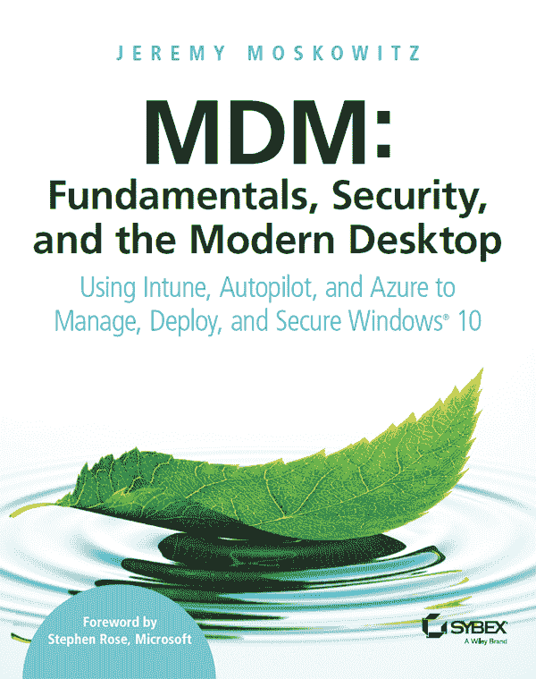

## 献给我生命中所有坚强的女性。

## 致谢

首先，我要感谢来自 Microsoft 的 Cathy Moya，没有她，这本书就不可能完成。非常感谢你伸出援手，帮我找到合适的人来解答棘手的问题，并让我相信这本书是必要且可行的。说真的，没有你的帮助，这本书根本不会存在。

我接下来要特别感谢 Panu Saukko，企业移动性 MVP，他承担了技术编辑这项极不光鲜的工作，确保我没有“编造东西”，指出了我所有薄弱的环节，并贡献了他对该主题的深刻见解。你是一位坚强、睿智的男子汉，很荣幸能有你作为我的技术编辑。还要特别致敬 Yinghua (Sandy) Zeng，企业移动性 MVP，她帮助复核了各种项目，并在不止一个主题上帮我拨云见日。我真不敢相信你们两个脑子里装了多少信息和知识。

感谢 Stephen Rose 慷慨撰写序言并审阅 OneDrive 内容。

感谢来自 Microsoft 的全章审阅者和答疑解惑者：Michael Neihaus、Mahyar Ghadiali、Ken Revels、Christian Refvik、Craig Marl、Aisha Wang、Dilip Radhakrishnan、Riki June、Peter Kaufman、Chris Hopkins、Jan Ketil、Skanke、Joe Kim、Sreekar Mankala 以及 Microsoft 的其他朋友和审阅者。只是……哇。非常非常感谢你们从繁忙的工作中抽出时间帮助我，让这本书达到最好。

感谢 Sybex 的“梦之队”：Elizabeth Campbell、Judy Flynn、Christine O’Connor、Kenyon Brown 和 Pete Gaughan。正是你们让质量最终胜出。

感谢我的妻子和家人包容我错过的一些夜晚和周末。感谢我在 PolicyPak 和 `MDMandGPanswers.com` 的超级团队，每天都拿出最佳状态。我简直太喜欢和你们所有人一起工作了。

最后，如果你手捧此书（或在线阅读），我想感谢你尝试学习新事物、拓展新领域，并信任我。

感谢你购买本书，参加我的现场活动和访问 `MDMandGPanswers.com`，以及使用我的 PolicyPak 软件。

亲自见到你是我工作中最喜欢的部分，我期待听到这本书如何帮助了你。

## 作者简介

自成为世界上最早的 MCSE 之一以来，Jeremy Moskowitz 为国内一些最大的组织执行了 Active Directory、组策略和 MDM 的规划与实施。

他是一位获奖 15 年的 Microsoft MVP，最初在组策略和桌面管理领域，现在专注于企业移动性，重点关注 Intune。

Jeremy 是 `MDMandGPanswers.com` 和 PolicyPak Software 的创始人。《Computerworld》杂志将 `MDMandGPanswers.com` 评为对 IT 专业人员最有用的 20 个 Microsoft 网站之一。`EnterpriseMobilityExchange.com` 将 Jeremy (`@jeremymoskowitz`) 列入 IT 专业人士应在社交媒体上关注的“7 位终端管理领域的 Twitter 大咖”。

他的另一本 Sybex 出版的书是 *Group Policy Fundamentals, Security, and Troubleshooting, Third Edition*（第三版），随处可见于管理员的桌面上。

在 `www.MDMandGPanswers.com` 获取他的签名版书籍，并了解更多关于 Jeremy 的组策略和 MDM 大师班培训。在 `www.policypak.com` 了解如何保护您的桌面和应用程序、管理 Windows 10 的所有领域，并通过 MDM 服务部署所有组策略设置。

**注意**：原始列表中缺失页码 14、74、116、134、232，此处按原文保留缺失状态。


## 前言

2009 年加入 Windows 团队后不久，我在雷德蒙德的一次 MVP 聚会上遇到了 Jeremy。几分钟内，他就把我逼到了角落，向我倾泻了一连串关于我们刚刚发布的 Windows 7 Beta 版组策略设置的问题。

我当时在想：“这家伙是谁？”更令人惊讶的是，“怎么会有人对组策略和桌面管理如此狂热？”最不可思议的是，这些年来，他对帮助 IT 专业人员管理 Windows 桌面的热情，依然如 2009 年那般强烈！

这些年来，我亲眼见证了 Jeremy 产生的惊人影响。首先是 IT 组织如何看待管理基础设施、安全性和组策略故障排除的基本功。但 Jeremy 还影响了我们微软内部工程团队看待问题的方式，这基于他对受众的指导。

如果你不信，问问任何参加过他在 TechEd/Ignite 大会上演讲的人。那些简直是极客界的传说。座无虚席，全是 400 级别的超级管理员，带着大量问题等着问他。

在过去几年里，他不仅不再只是 GPO 大师，更成了 Intune 和 MDM 领域的首选专家。在本书中，Jeremy 提供了行业标准指南，指导如何最好地共存和/或从 GPO 过渡到 MDM 工具，同时继续管理和保护桌面。

正如一位 Amazon 评论者在评价他早期的一本书时所说：“优秀系统工程师和卓越系统工程师的区别在于，卓越的系统工程师会读正确的书。这就是那本正确的书。”

我可以诚实地说，他说得没错。这就是那本正确的书。阅读愉快！

Stephen L. Rose

微软

@stephenlrose

## 简介

如果你正在阅读这本书，原因可能有以下几种：

*   你不断在会议上、网络上或某人的演讲中听到微软谈论“转向现代托管桌面”。
*   你完全不知道什么是 EMM 和/或 MDM，但想：“嗯……封面看起来挺有意思。让我看看里面有什么。”
*   你已经订阅了 MDM 服务，如 Intune、Workspace ONE 或 MobileIron，并将其用于手机管理，现在想开始用它来管理 Windows 10。
*   你知道什么是 EMM 和/或 MDM，看到它即将在公司推行，想对此有个掌握。
*   你买过我那本“颇具知名度”的大部头绿色组策略书，也许甚至是 2001 年的第一版《组策略、配置文件和 IntelliMirror》，又或者是最近的版本，如《组策略：基础、安全性与托管桌面（第三版）》。
*   也许老板走进你的办公室，把这本书扔在你桌上说：“学学这个 EMM/MDM/现代管理*不管是什么*，看看我们该不该‘搞这个’。”
*   也许你的“老板的老板”在高尔夫球场上谈成了一笔交易，现在学习 MDM 成了你的工作。

那么什么是 EMM/MDM 和现代管理？它与本地传统管理有何不同？

让我们先定义一些术语，以便规划路线，踏上征程：

*   **EMM** 是企业移动性管理。它是“通过互联网管理设置、应用程序和各种东西”的花哨说法。
*   **MDM** 代表两个含义。官方上，MDM 是移动设备管理。它或多或少是 EMM 这一概念用来执行工作的内核、协议和活动部件。
*   **现代管理** 是一系列整体功能、概念、操作指南和分步骤的集合，用于以一种新方式部署并管理 Windows 桌面（专指 Windows 10），从而开启新的机遇和能力。通常现代管理也意味着（主要）通过互联网进行管理；即通过云端。

所以，非官方地讲，MDM 代表*现代*设备管理。你可以看到微软真的在大力推广“现代”这个词。因此，尽管 MDM 最初只有一个含义，但现在它实际上同时承载了两个含义。

说实话，这里的界限有点模糊。EMM 和 MDM（官方和非官方定义）对不同的人意味着完全不同的东西。截至写作时，*Wikipedia* 是这样说的：

> “企业移动性管理 (EMM) 是一套专注于在商业环境中管理移动设备、无线网络和其他移动计算服务的人员、流程和技术的集合。”

如果你想阅读微软对 MDM 的定义，可以访问 `https://docs.microsoft.com/en-us/windows/client-management/mdm/`。但这是微软关于 MDM 定义的重要开篇第一句：

> “Windows 10 提供了一种企业管理解决方案，帮助 IT 专业人员管理公司安全策略和业务应用程序，同时避免损害用户在个人设备上的隐私。”

要找到一个统一的现代管理定义并不容易。也许等你读到这本书时，某个统一定义已经无处不在。但微软管理部门企业副总裁在 2018 年 Ignite 大会上的一段话让我深有共鸣：

> “现代桌面是一种范式转变，将事物带到了一个完全不同的层面。在现代桌面中，一切，我是指字面意义上的一切都连接到了云端：Windows、Office、管理、安全，全都连接到了云端。
>
> 这种云连接让你的用户更高效，给 IT 安全团队提供卓越的洞察和控制。因为它将微软智能云的全部力量置于你身后。
>
> 当你将拥有的一切都连接到云端，你可以利用简化的桌面设备管理、合规性更新、增强安全性的更新、高级数据保护，最后这些云能力让你的用户效率大幅提升。”

另一个了解微软现代桌面愿景的地方是：

`https://www.microsoft.com/en-us/microsoft-365/blog/2018/09/06/helping-customers-shift-to-a-modern-desktop/`

因此，现代管理不仅仅是从 Active Directory、组策略和 SCCM 等传统本地工具向云端工具的转变。它更是一种思维模式的转变，旨在使 Windows 管理更加主动和自动化。想想“把一台新系统从箱子里拿出来放在某人家门口，然后……搞定。一切都设置好了，管理得井井有条，最终用户除了按开机键外不用动一根手指。”这就是现代管理的梦想。

除此之外，理论上现代管理的承诺是，它应该比使用 Active Directory、组策略和/或 SCCM 的传统管理更简单。为什么？因为如果你没有本地基础设施需要照看，那是个加分项。而且，所有管理选项都集中在一个地方：你选择的 MDM 系统。因此，你不再有 80 种不同的方式（使用组策略、脚本等）来管理设备，而是在一个管理工具和门户中合理地集中了所有管理。

现在，对我而言，我对这个新的现代托管桌面世界感兴趣，是因为 EMM 和 MDM 并不*取代*组策略；它开辟并增强了组策略无法涉足的新机遇。

因此，我看到几类组织。也许你现在就属于其中一类，或者你的观点可能会随时间改变：

### EMM 和 MDM 重新定义

EMM 代表企业移动性管理。它仅指以现代方式管理移动设备所需的所有工具、人员和资源。简而言之，EMM 是“概念”。

而 MDM 代表移动设备管理。

问一些人，他们会说它代表“现代设备管理”或“现代桌面管理”，这也说得通。

我将始终将其简称为 MDM。MDM 是组策略的“表亲”。一个较新的表亲，有着略微不同的目标、不同的“父母”、不同的“成长环境”，等等。所以，“表亲”确实是此处最好的比喻。简而言之，MDM 是“工蜂”。

你也可以把 MDM 想象成移动的部分，或者是 EMM 理念的传输载体。

与组策略一样，MDM 在 Windows 10 操作系统内部拥有一个移动部分，即策略处理引擎。实际上，关键在于：MDM 不仅存在于 Windows 10 中；类似的移动部分已经嵌入并存在于手机、平板电脑等设备中。

因此，如果 Windows 和移动设备中都有类似的移动部分，就会出现一个有趣的新机会：使用一套管理系统，利用 Windows（以及手机等）中内置的 MDM 引擎作为移动部分来接收“指令”（或策略），从而实现“一套工具管控所有设备”。

退一步说，当你使用组策略管理系统时，微软一次性向你出售所有东西，所有内容都包含在盒子里，且能永久工作。以下是大致步骤：

*   你创建了一个本地 Active Directory 并建立了一个域。
*   你将机器加入该域。
*   你使用一个名为 GPMC 的微软 MMC 管理单元来创建组策略对象。
*   这些 GPO 包含策略。
*   这些策略通过以太网或 VPN 下载。
*   这些策略由组策略引擎处理。

现在，有了 EMM，情况略有不同：

*   预期是你不再需要或放弃本地 Active Directory，但你可能拥有用于 Office 365 等的 Azure Active Directory。
*   机器已加入域（可能），因为历史上它们就是加入域的。但新理念是你不再需要让它们加入域，不过加入了也没关系。
*   如果你愿意，可以通过将本地 Active Directory 和/或 SCCM 基础设施“云附加”到云端，借助云的力量获得额外收益。
*   你购买或以其他方式获取一个 MDM 解决方案。是的，你没看错：你必须购买某些东西才能实现 EMM 的梦想，并购买某些东西来指挥 Windows 和手机上的 MDM 移动部分执行实际工作。而且，如果你选择基于云的 MDM 服务，你需要持续付费以维持 MDM 服务运行。
*   你在 MDM 服务中创建策略以分发软件和/或锁定设置。
*   这些策略通过互联网下载。
*   这些策略由 MDM 引擎处理。

所以，有些事情有点相似，有些则不同。

但 MDM 的要旨与组策略相同：你有用户和设备。你制定“愿望”并将这些愿望集中存储在某处，终端下载并处理这些愿望。主要的区别在于组策略需要加入域才能工作，而 MDM 无需任何本地基础设施即可工作。

组策略和 MDM 有不同的目标和不同的“成长环境”，我们将在第 1 章中深入探讨。

### 术语

在本书中，我将大量使用字母（和术语）`EMM`、`MDM` 和 `Modern Management`（现代管理）。

我可能会说“在你的 EMM 环境中”来谈论你的业务或整个世界。

我可能会提到“一个 MDM 系统”、“一个 MDM 解决方案”或“你的 MDM”。那是那个东西，准确说是一个服务，你购买并维护它来执行现代桌面管理的工作。

现代管理将是在我们搭建好 MDM 解决方案后实施的内容。就像蛋糕上的糖霜，用于推出新机器、部署软件、锁定设置并生成报告。

但当然，还有另一部分，即预先烘焙进 Windows 10（以及手机等）中的 MDM 移动部分。我将其称为 MDM 引擎。

总之：

*   **EMM：** 这关乎你和你的业务，你整个大规模的交付生态系统。
*   **MDM 解决方案或 MDM 系统：** 你按月或按年购买并付费的东西。
*   **MDM 引擎：** 内置于 Windows 10 中的移动部分和核心组件。
*   **现代管理：** 执行类似于本地系统活动的更新的、（主要）基于云的方式。

其他术语，我只在这里说一次，然后假设你在阅读本书的过程中已经记住了：

*   `AD` 或本地 `AD` 是 Active Directory，即“搭建一个带有本地域控制器的本地域”。你知道的，就是你从 2000 年就开始做的事。
*   `AAD` 是 Azure Active Directory。稍后将详细探讨，但这是微软基于云的身份服务。
*   `DJ++` 是机器同时加入本地 `AD` 并使用 `AAD` 时的简略术语。时机成熟时我会再次提及。

### 工作场所加入

工作场所加入是指计算机既不由本地 AD 管理，也不由 Azure Active Directory 管理。这是一种向组织外部人员提供某些资源和应用程序访问权限的方式，但这些设备并非完全受管。

 一篇很好的博客文章解释了所有这些术语条目，并附有不错的（虽然可能有点模糊）屏幕截图，可以在以下网址找到：

`https://blogs.technet.microsoft.com/tip_of_the_day/2016/08/22/cloud-tip-of-the-day-determine-if-a-windows-10-pc-is-dj-azure-ad-joined-or-workplace-joined/`

### 使用本书所需的准备

正如我刚才所说，正如我们将在第 2 章中更详细地介绍，你需要获取一个 EMM 系统，它使用 MDM 作为传输机制。为求简化，我将像其他人通常所做的那样，直接称这些为“MDM 解决方案”。我想有些人可能会称它们为“EMM 系统”或“EMM 解决方案”，但当我们同行交谈时，通常不这么称呼这些系统。

目前主要的 MDM 解决方案巨头如下：

*   Microsoft Windows Intune
*   VMware Workspace ONE（前身为 VMware Airwatch）
*   MobileIron

这些都是基于云的、基于订阅的服务。

为了充分利用本书，你需要其中一项基于订阅的服务。基本上，我将在大多数 MDM 示例中使用 Microsoft Intune。并非因为它是或不是最好的，而是因为它包含在许多 Microsoft 企业客户现有的许可和订阅中。

还有一些不太知名的 MDM 服务，还有一些（具有讽刺意味的是）在本地部署时才能工作。我将不涉及那些。也就是说，如果你有另一种基于云的 MDM 解决方案（SOTI、Citrix Endpoint Management [前身为 XenMobile] 等），我们在这里讨论的内容对你也应该能合理地适用，尽管我不会专门展示任何具体示例。

而且，公平地说，对于管理 Windows 10 设备而言，它们大体相当。一些 MDM 解决方案有不同的“铃铛”，另一些有不同的“哨子”。归根结底，正如我稍后将重申的，MDM 解决方案（付费服务）只是驱动和指挥终端上的移动部件（MDM 引擎）。

无论如何，更多内容请见第 2 章，届时我们将进行一些比较选购，呃……解决方案之间的比较分析。

### 本书不涵盖的内容

我专注于在本书中管理 Windows 10。我确实不打算涵盖手机、Mac 和/或各种风味的其他小工具。我也不会花大量时间回顾 Windows 7，但它可能会偶尔被提及。

截至 2019 年撰写本书时，如果你问 10 位管理员他们目前使用 MDM 服务做什么。大多数会说，“管理手机。”因为 MDM，即它的名字——移动设备管理——在手机管理、远程锁定和擦除等方面做得很好。

但在目前正在使用 MDM 服务的这 10 位管理员中，几乎没人会说，“我们也用它来管理我们整个 Windows 10 设备群。”

但许多管理员都在说，“我想了解一下 MDM 和现代管理，看看对于 Windows 10，是否有一些有趣的功能适合我的公司。”

所以这就是我们共同学习的重点。帮助你了解 EMM/MDM 和现代管理是否能开辟新机遇，并用组策略和传统工具做到昨天做不到的事情。

各种手机、iPad、Android、Mac、Chromebook 等：对我来说——很有趣，非常有趣。而且，是的，它们将由你的 MDM 系统控制，并归属于现代管理的范畴。但它们不在本书范围内。

我的专长在于 Windows 终端管理，这也是我将集中精力的地方。

还请注意，针对 EMM/MDM 服务本身也有专门的书籍；涵盖其内部细节、如何创建公司门户、如何远程擦除财务部 Sally 落在出租车里的手机、如何安全共享文档，以及许多你可能关心或可能不关心的其他项目。

但如果你的主要目标是踏上使用 MDM 管理 Windows 10 设置的道路，并学会增强你的传统管理技能，以现代方式管理 Windows 10，那么这本书就是为你准备的。

以下是一些我不涵盖的其他内容：

#### MAM（移动应用程序管理）

这是一种管理应用程序（如 iOS 和 Android 上的 Office）的方法，可防止“另存为”、剪切/复制/粘贴、执行数据远程擦除等操作。这很实用，值得研究，因为虽然它确实需要 MDM 服务，但不需要将用户设备注册到这些服务中。同样：有趣，但不涵盖。在此了解有关 MAM 的更多信息：`https://docs.microsoft.com/en-us/intune/mam-faq`。

#### Microsoft Identity Manager

假设你有多个目录源，如现有的本地 AD、人力资源数据库和其他一些自定义数据库。现在想象一下，你需要跨所有这些源同步标识，并让它们在 Azure AD 中神奇地工作。那就是 Microsoft Identity Manager，我不涵盖它。在第 2 章中，我将介绍基础的 Azure AD Connect，它是一个本地 AD 到 Azure AD 的同步系统，属于这一范畴。但要了解有关 Microsoft Identity Manager 的更多信息，请从此处开始：`https://docs.microsoft.com/en-us/microsoft-identity-manager/`。

#### Azure 信息保护（和权利管理）


# 人力资源部的 Sally 刚刚将嵌入薪资信息的组织架构图发送给了“太多的人”

坏事做尽，Sally，真坏。现在怎么办？好吧，如果你使用的是 Azure 信息保护（AIP），则可以根据内容自动对文档进行分类和保护。例如，假设文档中包含*机密*一词。当该文档被发送邮件时，数据实际上会保留在发件公司，而非收件公司。于是 Sally 的“大乌龙”变成了 Sally 的“大无事”。在此了解有关 Azure 信息保护（和权利管理）的更多信息，因为我不会在本书中涵盖它：

`https://docs.microsoft.com/en-us/azure/information-protection/`

## 单一登录

目前，人力资源部的 Sally 拥有本地 AD 登录凭据，很快也将拥有 Azure AD 登录凭据，还有一个外部薪资系统的登录，另一个在 `Dropbox.com`，还有一个（又一个）在 `Salesforce.com`。如果她能使用她的 Azure AD 账户对这些外部应用程序实现单一登录 (SSO)，那该有多好？那肯定很酷。但既然我不会在本书中涵盖这一点，这里有一个演练示例，展示如何使用 Azure AD 与像 Salesforce 这样的外部应用程序实现单一登录：

`https://docs.microsoft.com/en-us/azure/active-directory/saas-apps/salesforce-tutorial`

## 用户自助服务

用户喜欢忘记密码。再做一次密码重置是超级无聊的。因此，Office 365 和 Azure AD 都提供了一种让用户执行自助密码重置的方法。既然我不会涵盖它，如果你想设置它和/或查看快速演练，请查看：

`https://docs.microsoft.com/en-us/azure/active-directory/authentication/quickstart-sspr`

## 双因素身份验证

Azure AD 有一种方式让某些资源要求第二重身份验证。要么是生物识别身份验证，如指纹或 YubiKey，要么是接听电话或短信。这是 Azure 多因素身份验证，你可以在此了解更多：

`https://docs.microsoft.com/en-us/azure/active-directory/authentication/concept-mfa-licensing`

对我来说，这些额外的 Azure 服务非常、非常有趣。但它们不是本书针对你的重点。我们的任务：我们将专注于使用 MDM 服务和其他 Azure 服务来管理 Windows 10 PC。

# 如何知道本书买回去后 80 秒内不会过时？

如果有一件事我们可以确定，那就是这个云服务的新世界似乎比我们大多数人能应对的速度还要快。

但别慌。

我同意，要跟上云端程序员每天变出的所有“魔法”确实很难。字面意义上的，每一天。对于本地基础设施，情况并非如此。你下载、安装，然后让它原地运行，直到你进行升级。

不过对于这本书，我的计划是向你展示我认为**不会**发生太大变化的事物。当然，我无法确定。但我的计划是解释那些似乎会扎根一段时间的概念；那些我认为在长期内最可能被使用的概念。

不作担保。我并不为微软工作，也不直接影响其路线图。因此，从我写作本书到你拿到书这段时间里，Azure 或 Intune 门户中的某些步骤可能会略有不同。书出版后，比如过上两三年，情况也可能如此。

但我计划通过示例引导你了解的内容，在基本步骤和示例方面是**相当**可靠的。而且我不打算涉足太多**实验性**领域。我将解释那些已经在一些实际公司中运行了一段时间的东西，以及我相当确信在可预见的未来将继续成为现代管理世界基础的东西。

我可能会犯错，可能会谈论某个**今天**存在的概念，却在**明天**被淘汰或取代。但我对所选章节、概念及示例有相当高的信心。

重点是：是的，任何具体的分步操作或屏幕截图可能会略有变化，但我认为你现在学到的内容相当可靠，且在合理的未来内依然适用。因此，凭借你在这里学到的知识，即使一两年后步骤和事物名称略有不同，你也应该能自己搞定。

我相信你。

毕竟，你是一名 IT 专业人员。

# 关于组策略与 MDM 的最后说明

我意识到这可能是我在书店（更可能是 Amazon、Safari 或你正在用来阅读此介绍的任何平台）抓住你注意力的最后机会。如果你认识我，看过我的演讲，了解我的作品，你现在可能在想：“我想他弃用组策略了，现在 Jeremy 转向 MDM 了？”

为了 100% 的清晰度，让我重申一个我多年来一直倡导的共同信条：组策略没有死。讽刺的是，我（或其他人）越说“组策略没有死”，越多人认为组策略死了。

事实上，它**没有**死。微软并未为本地场景“关闭”组策略用法，产品团队也未停止生产可由组策略控制的新功能。

恰恰相反。组策略持续受到支持，每次 Windows 修订都会随之发布针对操作系统、Edge 等的新设置。

确实，许多场景**始终**需要本地 Active Directory 和组策略，例如非联网机器、超安全场景，以及在可预见的未来，RDS、Citrix 和本地 VDI 场景。

我写过一篇相当著名的“跑题”博客文章，名为“Why Group Policy is Not Dead Manifesto”（为什么组策略没有死宣言）。如果你有空，现在读一下会很好。这是链接（或者去 Bing 搜索“Group Policy Not Dead”）：

`https://www.gpanswers.com/blogs/view-blog/the-why-group-policy-is-not-dead-manifesto`

“你为什么还要写一本关于现代管理、微软云端设置管理解决方案 MDM 和 Intune 的书，Jeremy？”我听到你在问。

答案是我认为，既有基于域加入机器的传统管理模型（配合组策略和 SCCM 等本地管理系统），也有 EMM/MDM 及随之而来的现代管理场景，两者都有其存在的空间。

对我而言，封闭心智、拒绝 MDM 系统带来的新可能性及现代管理将解决的问题是愚蠢的。但同样愚蠢的是，背弃像组策略这样经过近 20 年验证、目前几乎地球上每家公司都在使用的成熟技术。

所以这本书旨在让你自行探索 EMM/MDM/现代管理路线；尝试一些示例，看看是否适合你。

你可以计划彻底放弃旧模式，采用新旧混合的某种混合模式，或完全投入新模式。

我把选择权留给你。

# 关于我、本书、PolicyPak 及更多

我管理 Windows 系统从蹒跚学步时就开始了。好吧，不完全是，但差不多。1994 年我成为世界上首批 MCSE 之一，并花费多年时间担任各种规模组织的顾问。

随后我发现并爱上了组策略，写了畅销的组策略书籍，并连续 15 年获得微软组策略 MVP 称号。最近，我又被授予微软企业移动性 MVP（专注于 Intune）。此外，我一直在帮助公司理解这个新的 MDM 世界及其对原有组策略世界的意义。

我还创立并经营一家名为 PolicyPak Software 的公司，它扩展了组策略和 MDM 的功能，使其能实现开箱即用功能之外的更多神奇操作。例如，使用 PolicyPak 产品可以做以下事情：

*   管理第三方应用程序，如 Java、Flash、Firefox、OpenOffice 以及数百种其他应用。
*   将本地组策略和组策略首选项设置用于你的 MDM 服务。
*   将网站绑定到特定版本的 Java。
*   管理“哪个网站应在哪个浏览器中打开”。
*   从云服务复制文件并保持其最新。
*   移除本地管理员权限，并提升需要 UAC 提示的进程和应用程序。
*   动态管理 Windows 10 开始屏幕和任栏。
*   ……以及更多。

所以我将努力走钢丝。经你允许，我将不时描述 PolicyPak 何时能增强某种情境、或解决开箱即用功能无法解决的问题。我将展示解决实际问题的真实示例。

我这样做不是为了推销产品，但如果因此达成销售也无妨。真正的重点是演示一个可能无其他出路的问题或情境。基本上，如果我不解释针对特定问题存在“PolicyPak 可能性”，你就不会知道，并将永远陷入困境。

如果有替代方案或其他第三方方式实现相同目标，我会尽力解释。

阅读本书时，你自然会对现代管理、MDM（或组策略）产生疑问。为此，我有一个博客，网址为 `MDMandGPanswers.com`。

我通常每周发布一条“每周小贴士”并通过邮件发送。你还能找到可下载的 PowerShell 脚本、技巧窍门等更多内容。

如果你想见我本人、预约现场培训，或参加我的公开 MDM 和组策略课程，我的网站 `MDMandGPanswers.com` 显示了我即将举行的活动日程。我很乐意听到这本书如何满足你的需求、帮你入门 MDM 或提供了帮助。

首先请关注并/或推特联系我，使用标签 `#mdmbook` 告诉我今天什么内容帮到了你。

感谢你参与这段旅程。

# 第 1 章 企业移动性与 MDM 基础

在第一章中，我们将了解什么是 MDM、它的来源，以及它与其表亲组策略有何不同。

我认为最好的起点就在新页面的顶部。就在这一页。

## 微软向 EMM 和 MDM 的转型

这有点像微软在决定将精力投入到 EMM 和 MDM 上，而不再继续沿着现有的核心本地 Active Directory 和组策略技术投入更多功能的道路上前行时所做的事情。

再说一次，正如我在本书《导言》中所述，组策略并未消亡。微软并未针对本地场景“关闭”组策略的使用，你也不必担心心仪的新“Windows 10 小工具”会失去被组策略控制的能力。

但展望未来，你可以预期几乎所有的 Windows 10 设置（以及 Edge 等相关设置）都应当可以通过组策略或 MDM 进行控制。虽然存在一些例外，但微软致力于向 GPO 添加新设置。也就是说，不要指望会有新的主要组策略功能（如增强的组策略报告、新的组策略首选项或额外的故障排除工具）。但请期待每当 Windows 10 发布时，都会诞生更多组策略设置，你将看到这些作为组策略管理模板策略设置（ADMX 设置）出现，这些是你十多年来熟知且喜爱的设置。

 关于新的组策略功能，如管理开始屏幕、任务栏和文件关联，虽然系统自带一些基本功能，但我衷心建议你关注 **PolicyPak Group Policy 版**，它将补充大多数本地 AD 管理员正在寻找的缺失功能。

现实情况是，企业移动性的概念，以及由此使用 MDM 来管理 Windows，是微软新的关注重心，微软不再回头增强核心组策略功能。但同时，对于现有的加入域的机器，微软也并未扼杀组策略。

微软期望你在某些场景下继续使用组策略等传统管理方式，而在其他场景下使用 MDM 进行现代管理。

## 准备使用本书

要完成本书中的某些练习，你需要拥有或获取某些软件的评估版。当然，如果不想动手，也可以只阅读本书、查看图片，大致了解涉及的内容。

你不必马上做这件事，但为了利用本书中的演练，你需要获取以下内容：

*   **Azure AD**（免费版）或 **Azure AD Premium**（本书推荐）。如果你拥有 Office 365，则已拥有 Azure AD。
*   一项 **MDM 服务**，如 **Microsoft Intune**、**VMware Workspace ONE** 或 **MobileIron**。大多数主流服务提供 30 天（或更长）的评估期。

再次提醒：请勿立即执行此步骤；我们将在下一章处理。

如果你想跟随我演示的所有思路进行操作，现在可以花些时间准备一些具有代表性的本地基础设施，以模拟你现有的环境。因此，如果你还没有一个可以随意折腾的测试实验室，以下是我推荐的计算机名称及操作系统：

*   **DC01**（我推荐 Server 2019 或 Server 2016。）
*   `WIN10Computer.fabrikam.com` 加入 **DC01**。如果你有其他机器也加入了 `Fabrikam.com`，那也可以，且可能很有用。
*   **WIN10-NDJ-1** 完全未加入域
*   **WIN10-NDJ-2** 同样完全未加入域

随着进度推进，你可能需要更多机器，但这些是个不错的开始。

我建议在 Windows 10 上使用 **VMware Workstation** 或 **Hyper-V** 来创建模拟实验室环境。话虽如此，公平警告：第 8 章“使用配置设计器和 AutoPilot 进行推出和刷新”中的某些场景，除非你有真实硬件，否则无法运行。到时候我会指出这些场景。

我不会提供搭建你自己的域和域控制器的分步说明。但我的一位 PolicyPak 同事制作了一个相关视频，如果你不熟悉可以在此观看：

`https://www.policypak.com/video/policypak-cloud-how-to-create-a-dc-for-editing-purposes.html`

然后将至少 **Win10Computer** 加入你创建的域；在我的示例中，我将使用域名 `Fabrikam.com`。

你可能想预先在一个名为 **Sales** 的 OU 中创建一小群本地 AD 用户。测试用户名称随意，但你会在书中看到我的命名方式，如 **EastSalesUser1**、**WestSalesUser7** 等。

此外，随着内容深入，你可能会看到我在本地 AD 和 Azure AD 中手动创建其他用户。

 如果你对微软假名（如 [Fabrikam.com](http://Fabrikam.com)）的背景故事感兴趣，请查看这篇旧博客：

`https://blogs.msdn.microsoft.com/oldnewthing/20061013-05/?p=29393`

## 为何需要 MDM

多年来，我一直听到关于组策略即将消亡的丧钟。但自 Windows 2000 发布至今已逾 19 年，组策略依然存在，且似乎依然非常流行。

甚至让我有点“疯狂”，在 2016 和 2017 年写了一篇名为“《组策略为何未死》宣言”的博文。我在本书《导言》中提到过，如果你当时没读，现在花点时间读一读。可通过访问 `MDMandGpanswers.com` 找到：

`https://www.GPanswers.com/blogs/view-blog/the-why-group-policy-is-not-dead-manifesto`

强烈建议你花一点时间（可能需要两点时间，因为挺长）阅读它，然后回来继续。

那么，如果组策略如此出色，为何我们还需要展望 MDM 作为未来的方向？因为正如我在《导言》中所说，如果我们想解决新场景和用例，组策略不能是唯一的传输方式。

因为在某些方面，未来已来。以下是我认为人们关注 MDM 的关键因素：

### 新工作方式：时刻在移动

你有一部手机。它“时刻在移动”。事实上，微软在阐述 MDM 优势时使用的正是这几个字。没错，手机是始终在移动的主要设备，但我们都同意，随身携带笔记本电脑比以往任何时候都容易。

如果你阅读这篇名为“在组织中管理 Windows 10 - 向现代管理过渡”的博文，可以了解微软关于 MDM 的部分立场。地址如下：

`https://docs.microsoft.com/en-us/windows/client-management/manage-windows-10-in-your-organization-modern-management`

### 新世界：互联网无处不在

如果不是无处不在，也非常接近了。第三世界国家、潜艇和信号盲区、损坏的 Wi-Fi 热点始终存在。但 LTE、4G 和（即将到来的）5G 无处不在的前景，非常美好，且正在不断变好。

既然有了“互联网无处不在”，拥有一个始终在线、始终连接的系统来管理我们“时刻在移动”的设备，就更合情合理了。

### 新范式：无需加入域

自 LanManager 和 NT 3.1 时代起，我们就开始将设备加入域。然而，加入域意味着将所有鸡蛋放在同一个篮子里，这在当时很有意义。你只需连接打印机、文件共享和偶尔的 SNA 设备以连接大型主机，这完全合乎逻辑。

今天？不那么合理了。

终端直接连接到它们所需的“网络资源”并继续工作。

“无需加入域”这一理念的另一个微妙之处在于：坏人可能随时已经潜入你的本地网络。在过去，我们假设防火墙足以保护我们免受互联网上坏人的侵害。但现在，假设坏人*此刻*就已经在你的网络内部，这是一个合理的假设。如果这是真的，让机器加入域实际上可能会*加剧*问题。

如果坏人突破防线进入 DC，他们可以大量导出用户的密码哈希，然后进行暴力破解攻击。他们还可以入侵一个终端，通过漏洞利用或像 `Mimikatz` 这样的工具成为管理员，然后在机器间跳转，这就是所谓的“传递哈希”攻击。

在我的组策略书籍（`www.GPanswers.com/book`）中，我展示了如何设置 Microsoft Local Admin Password Solution (LAPS) 来创建唯一的、轮换的密码，以缓解这类攻击。

但拥有未加入域的机器至少能带来以下安全优势，或许还有更多。

### 新现实：每六个月一个新 Windows

只有一个 Windows 10。但这完全是不真实的。我们得到的“宣传”是将只有一个最终的、完整的 Windows……永远不再有新版本。

但正如你现在所知，每六个月都会有一个全新的 Windows 10 版本。（微软试图在每年的三月和十月左右发布新 Windows。）每个版本都会增加新功能。但如果你停下来“闻闻玫瑰” 6 到 12 个月，然后回头看——天哪。这成为了从“旧 Windows 10”到“最新 Windows 10”的巨大演变。

认真地说，自己试试。回退对比 Windows 10 1507 和你阅读本书时的最新版本。你会感到完全迷失，并看到“旧 Windows 10”与今天的 Windows 10 相比有多么巨大的差异。

### 新需求：新版本的 Windows

首先，有我们长期使用的普通桌面和笔记本版本。如 Windows 10 Pro 和 Windows 10 Enterprise。还有 Windows 10 Home，它以前无法使用组策略，现在仍然不是为与任何 MDM 系统集成而设计的。

除此之外，还有无数个新的 Windows 子版本。以下是至少五个有趣的版本：


# Windows 新事物

## Windows on ARM
ARM 是通常在手机中发现的处理器类型。以前它们性能尚可且电池续航尚可。现在，ARM 处理器更强大，续航更好。因此，微软敏锐地捕捉到这一趋势，重新设计了你熟知和喜爱的 Windows，并想出了一种在 ARM 处理器（也称为 Snapdragon 处理器）上转译 x86 指令的方法。结果？没有 Intel/AMD 芯片的新笔记本电脑。这些笔记本电脑可以全天候运行甚至更久。你可以在此了解更多关于该平台的信息：

`https://docs.microsoft.com/en-us/windows/arm/`

以及此处的一些 ARM 笔记本电脑的初步测试：

`https://www.zdnet.com/article/windows-10-on-arm-tests-say-snapdragon-845-could-bring-big-speed-boost`

## Windows 10 in S Mode
一个安全版本的 Windows 10，仅限运行 Windows Store 应用。可以从 Windows 10 in S Mode 单向升级到 Windows Pro 或 Enterprise，这是单程票。如果想再回退，需要格式化硬盘。如果你想了解更多关于 Windows 10 in S Mode 的信息，可以在此找到 Ignite 2017 的演讲：

`https://www.youtube.com/watch?v=BkGURA_ywRI`

## Windows HoloLens (and HoloLens2)
你见过这东西；它看起来像二十二世纪的滑雪护目镜。我在演示场景下用过两三次，谁知道呢。也许它们会流行起来。不管怎样，HoloLens 内置了 MDM。

## Windows 10 IoT (Internet of Things)
MDM 也内置在这个版本中，所以你在“普通” Windows 上做的事，也可以在一张名片大小的运行 Windows 的 PC 上做。这是一个小伙子在 Raspberry Pi3 上安装 Windows 10 IoT 版本的自制视频：

`https://www.youtube.com/watch?v=DxeasYy6kqs`

## Windows (codename) Polaris
这可能是一个完全不包含任何旧版 Windows 组件的版本。所以完全没有 Win32 子系统。在我写作时它还不存在，但也许一两年或三年后会有。或者永远没有。但这是有可能的。

# 不是 Windows 的新事物（如 Mac 和 Chromebook）

看看现在孩子们在学校用什么。可能是真正的 Windows PC，也可能是 Mac 或 Chromebook。所有这些设备都内置了 MDM。与其拥有管理 Windows 世界和非 Windows 世界的分散工具，不如拥有一个统一的工具在一个地方处理所有设备。

# 尚不存在的非 Windows 新事物

谁知道未来会带来什么。因此，将 MDM 引擎放入其中，对于当今存在的以及尚未被梦想出的设备，无论是 Windows 还是非 Windows，似乎都将保持一种标准。

# 组策略与 MDM 对比

想要对比新旧是很自然的。成熟稳健对比新兴成长。在本节中，我将解释组策略在哪些方面表现出色，MDM 在哪些方面表现出色，以及它们各自在哪些方面还需要一点改进和帮助。

在深入实现细节之前，人们最想讨论、也最快了解的是新 MDM 与他们已知且喜爱的组策略相比“如何”。

我们就从这里开始：截至目前（2019 年），没有争议。组策略设置比 MDM 可能实现的设置多得多、多得多、多得多。

MDM 大约有 2000 个“精选设置”，即保证能工作的设置。具有讽刺意味的是，许多 MDM 设置专注于一个遗留软件：Internet Explorer。仅处理 IE 区域设置的策略就有近 200 个。有些被称为“ADMX backed”（更多内容见第 3 章 “MDM Profiles, Policies, and Groups”），有些则是特定的、由 MDM 引擎调用的。

截至目前，组策略在管理模板设置中的官方设置列表有 4256 个，在组策略首选项领域还有大量可配置项。话虽如此，既然组策略首选项不再获得修复，一些主要领域（如开始菜单组策略首选项项）在 Windows 10 中已不再工作，因此其实用性降低了。但简而言之，从严格的设置角度来看，组策略是“赢家”。

但，这里有个秘密：**这不是一场比赛。**

看起来似乎*应该*是一场比赛，但现实中，它根本不应该是一场比赛。换句话说，如果你严格地看组策略“对决” MDM，你可能会想，“哇，MDM 还有很长的路要走。”但 MDM 的理念明确*不是*试图承担组策略的所有功能。此外，既然 MDM 仅面向 Windows 10 设备，将 Windows XP 的组策略设置回溯移植到 MDM 中是讲不通的。因此，按设计，MDM 的设置将永远少于组策略。

MDM 正在重建以处理现代场景。是的，其中一些场景与我们熟知、喜爱且今天需要处理的现有场景重叠（就像昨天一样）。但 MDM 的理念是分析每个场景，*然后*想出应对的方法。同样，目标*不是*复制组策略的所有设置、内部结构和复杂性（无论真实还是感知的）。

另一个思考 MDM 的角度是，它试图仅控制所需的内容，而不是像组策略那样采用“把整本书扔给管理所有内容”的风格。所以，潮流在变，风向可能正吹向比 10 年前更少的受控设置。

所以在我写作时，确实有些管理员看着 MDM 里的设置，举起双手说，“好吧，我无法用 MDM 做 X，所以我无法处理那个。”

这里有一些答案：一个（无耻的自我推销）答案是查看 PolicyPak MDM，其一个关键功能是使您能够导出真正的组策略 ADMX、组策略安全设置和组策略首选项设置，并将它们（几乎全部）与您的 MDM 服务配合使用。这绝对是一个选项。详情请见 `https://www.policypak.com/products/policypak-mdm-edition.html`。

另一个选项是“将就用”。这听起来很疯狂，但请再听我解释一下。假设您要从一座带马厩的大房子搬到一个精心设计的漂亮公寓。这里会有一些利弊。您那座带马厩的大房子很棒，您拥有无限的土地，可以随心所欲地对房子进行任何操作。但当东西坏了，您得自己想办法修。当您搬到公寓时，一方面，您必须缩减规模（即带过去的东西变少了），但这可能值得用来换取更少出错的权衡。如果您的公寓经过精心策划，新福利就会不时出现，比如新的会所、新的健身器材，等等。嘿，也许这个公寓没有您习惯的马厩，但它有免费的内置保龄球馆！而且只需少量额外费用，您就可以上舞蹈课。如果水管坏了，别人会修。您只需每月付账单，然后……嘿，也许您能习惯这种生活。所以，在没有组策略中完全相同的设置或流程的情况下生活可能也没问题。也许您根本不需要那个设置，或者它在非加域世界里讲不通。又或者有一个 PowerShell 脚本变通方案（虽然我个人真的不喜欢这个选项，相比于真正的设置）。但无论如何，“将就用”都应该作为您新“公寓生活现实”的一部分进行分析和处理。

第三个选项是向 Microsoft 游说您的需求，看他们是否会将其构建到未来的 Windows 版本中。目前这样做的主要途径是通过 Uservoice：`https://microsoftintune.uservoice.com/forums/291681-ideas`。您可能可以为某个功能投票，或发起自己的功能请求并引起关注。请记住，民主需要时间。

此外，应该注意的是，“您想要的有趣东西”需要两个部分：

* 您的功能首先必须由 Windows 10 产品团队启用策略。
* 该策略随后需要在 MDM 中实现。

这。将。会。很。慢。

MDM 中的设置覆盖率将随着时间的推移而增加。它会的。但不要指望它能“承担”或“接管”本地组策略所能做的所有事情。那不是交易的一部分；至少 MDM 团队明确向我陈述过这是他们的理念。

既然我已经谈到了最重要的方面——设置，让我们来探讨组策略和 MDM 之间的其他差异。

## 历史与开发时间

组策略自 2000 年 Windows 2000 发布以来就已存在。其引擎曾有一些棘手的领域，直到 Vista 发布左右才被解决。组策略还收购了一家名为 DesktopStandard 的公司，并将其 PolicyMaker 程序作为组策略首选项重新发布，将组策略中可能的设置增加到数千个，并对许多最常配置的桌面区域提供了近乎无限的配置。

在此次主要版本发布后，组策略领域没有发生太多事情。从“获取更多功能”的角度来看，组策略有点停滞不前。而现在，这么长时间过去了，Microsoft 仍致力于“组策略引擎”的错误修复，以及通过管理模板提供管理新功能设置的能力，例如管理 Windows 10 开始菜单和任务栏、Windows Edge 以及其他 Windows 10 新功能。

但他们显然没有修复组策略中其他众所周知的错误，主要是在组策略首选项领域。有许多组策略首选项项目在向 Windows 10 计算机分发设置时根本不起作用，而且这些问题永远不会被修复。简而言之，除了组策略引擎错误修复、安全修复以及通过管理模板添加新设置外，组策略的向上增长和开发状态已停止，但它并未消亡。在 Microsoft，它掌握在 Windows 部门的“持续工程团队”手中，这意味着……不死，但也不会有显著改进。

相比之下，MDM 的核心组件在 Windows 8.0 中出现，但即使按 Microsoft 自己的说法，直到 Windows 10 发布（2015 年 7 月 29 日）才真正完全成熟。从那时起，MDM 增加了对管理员最想要的一些重要设置的覆盖，MDM 引擎也得到了更多的开发投入。

## 策略定向

如果您用过组策略，肯定了解 LSDOU 定向、组筛选、WMI 筛选和组策略首选项项目级定向。这些项目提供了大量方法，可将策略定向到计算机上的特定用户、组和条件。

另一方面，MDM 有一种包含或排除组、最低和最高操作系统版本、Windows 健康证明等方式。我们将在第 3 章中看到这一点。

## 所需基础设施和采购

因此，组策略“开箱即带”本地 AD。您只需搭建本地 AD 即可免费获得组策略。AD 是目录和标识服务，组策略是用户和设备管理引擎。

通常，要充分利用 MDM，您需要某种标识目录服务。最常见的是 Azure AD，为了让事情更复杂，它不只有一个版本，至少有三个版本。您可以在此处查看 AAD Basic、AAD Premium P1 和 AAD Premium P2 之间的区别：

`https://docs.microsoft.com/en-us/azure/active-directory/fundamentals/active-directory-whatis`

稍后，为了开始，我们将注册一个免费的 90 天 Azure AD Premium 账户，以便您可以完成本书中的练习。当我们在下一章注册“云套餐”时，将获得 Azure AD Premium。

# MDM：核心、协议和活动部件

MDM 是我们赋予端点接收设置和执行工作的活动部件的名称。但在所有这些之下，在端点上，有协议和活动部件在执行实际工作。

让我们将其分解以了解 MDM 的各个部分。

## OMA-DM：协议

组策略使用 Kerberos 和 SMB 来协调其认证用户或计算机、然后下载指令的工作。

MDM 基于 XML 使用一个轻得多的系统。

该协议称为 OMA-DM（有时拼写为 OMA DM）。这是一个开放标准协议。OMA 代表开放移动联盟。DM 代表设备管理。

OMA-DM 处理机器加入 MDM 系统的方面，这正确地称为*注册*。OMA-DM 还处理实时发送消息，例如通过推送分发新策略、收集其状态或执行远程擦除。

老实说，深入研究 OMA-DM 细节太他妈无聊了。您真的不想读关于注册设备、获取确认等计算机到计算机的 XML 特定命令。

好消息是，Microsoft 处理了这个问题，它在 Windows 10 MDM 引擎中支持 OMA-DM 协议，每个 MDM 供商也是如此。它们只是“说同一种语言”，奇迹就发生了。

这也是为什么您可以选择任何 MDM 供商的原因。只要他们按照 OMA-DM 标准编写了规范，Windows 10 就会拾起并运行它。同样，您不想读这些无聊的细节。但如果您想读，以下是获取那些棘手 XML 信息的两个地方。OMA 规范本身可以在 `www.openmobilealliance.org/wp/` 找到。

Microsoft 为 Windows 10 支持的规范可以在以下位置找到：

`https://docs.microsoft.com/en-us/windows/client-management/mdm/oma-dm-protocol-support`

### CSP：配置服务提供程序

对我来说，MDM 最有趣的部分是 CSP（配置服务提供程序）。这些是 Windows 10 MDM 实现中内置的微型接收器。它们接受 OMA-DM 指令（XML 格式），进行处理，然后……bingo，客户端上就会发生相应操作。

在组策略领域，我们使用 CSE（客户端扩展）。如果你还记得，组策略有 39 个“开箱即用”的 CSE。比如你熟知的管理模板、文件夹重定向、组策略首选项打印机等。组策略 CSE 仅在真正的 Windows 版本上可用，即便如此，也不是所有 CSE 都在所有真正的 Windows 版本上可用。例如，组策略首选项 CSE（共 21 个）在 Windows 家庭版上不可用。

现在在 MDM 领域，我们使用 CSP。关键在于：CSP 不仅存在于真正的 Windows（如专业版和企业版）中，也存在于这些新型 Windows 类型中，如 Windows Mobile、Windows IoT 以及未来的版本。

它们也存在于非 Windows 设备上。如 iOS、Android、Mac、Chromebook 等。

这意味着你需要随时关注 Microsoft 发布的新 CSP，但实际上，你只需关注桌面版本的即可。请记住，每次 Windows 10 发布，现有 CSP 可能会新增设置，甚至会出现全新的 CSP。

三个 CSP 示例及其适用的 Windows 10 版本矩阵可见 表 1.1。

**表 1.1 示例 CSP 及其适用的 Windows 版本**

| | 家庭版 | 专业版 | 商业版 | 企业版 | 教育版 | 移动版 | 移动企业版 |
| --- | --- | --- | --- | --- | --- | --- | --- |
| AppLocker CSP | ✓ | ✓ | ✓ | ✓ | ✓ | ✓ | ✓ |
| Firewall CSP | ✗ | ✓ | ✓ | ✓ | ✓ | ✗ | ✗ |
| Policy CSP | ✓ | ✓ | ✓ | ✓ | ✓ | ✓ | ✓ |

所有详细信息均在 Microsoft 的配置服务提供程序参考中，地址：

`https://docs.microsoft.com/en-us/windows/client-management/mdm/configuration-service-provider-reference`

在你冲向使用 MDM 服务的道路上，有一个 CSP 你必须非常非常熟悉。

它叫 `PolicyCSP`，有两大能力。一方面，它可以间接驱动设置；另一方面，它可以执行所谓的 ADMX-backed policies（ADMX 支持的策略）。顾名思义，ADMX-backed policies 关联回真正的组策略设置。

我目前还不准备详细讲解 `PolicyCSP`——得等你选定 MDM 服务，并了解如何与其交互后再说。所以请保持关注，这个话题将在 第 3 章 再次详细讨论。

 关于 IT 专业人员的 CSP 详细信息，请阅读：

`https://docs.microsoft.com/en-us/windows/configuration/provisioning-packages/how-it-pros-can-use-configuration-service-providers`

#### WMI-to-CSP Bridge（WMI 到 CSP 桥接器）

Windows 10 有一个小妙招，用于在机器没有 MDM 服务可通信时使用。它叫 `WMI-to-CSP Bridge`。

这是一种通过脚本、C# 和/或 WMI 传递某些 CSP 命令的方式。你可以使用任何你喜欢的方式传递这些命令。你可以编写登录脚本，通过 SCCM 传递命令，或用某个自定义程序来完成。

关键是，如果你查看 CSP 列表，会发现有很多 MDM 设置可以通过脚本或编程方式进行探测和管理……而完全不需要订阅任何 MDM 服务。

好吧，确实，你得自己动手，用脚本或某种编程方式。总之，它就在系统里，想用就用。这里有两个资源值得查看：

MDM Bridge WMI Provider 文档：

`https://docs.microsoft.com/en-us/windows/desktop/DMWmiBridgeProv/mdm-bridge-wmi-provider-portal`

配合 WMI Bridge Provider 使用 PowerShell 脚本：

`https://docs.microsoft.com/en-us/windows/client-management/mdm/using-powershell-scripting-with-the-wmi-bridge-provider`

## MDM 服务

选择作为服务的 MDM 系统将在下一章讨论；但这里有个大秘密。这个秘密太大了，保护得太严实了，我简直不敢相信它居然保密了这么久。

准备好听秘密了吗？

秘密是：**没有任何单一的 MDM 系统能从根本上比其他 MDM 系统更好地管理 Windows。**

我是不是刚炸裂了你的大脑？

“你为什么这么说？”我听到你在哭喊！因为归根结底，所有 MDM 服务都受限于使用 Microsoft 在 MDM 平台上为 Windows 10 提供的 CSP，且截至目前，编写自定义 CSP 是不被允许的。

所以所有 MDM 提供商必须按下相同的按钮，远程使用 `OMA-DM` 协议，拨动 CSP 的比特位来完成相同的工作。仅此而已。


不过这里有个有趣的警告：不同的 MDM 厂商可能会在其 UI 中以不同方式暴露并“美化”可用的 CSP 设置。我们将在**第 3 章**看到更多相关内容。但简短的说法是：有些厂商在将可用的 CSP 设置以漂亮的可点击 MDM UI 形式呈现方面做得比其他厂商好。

我听这被称为“First Class”（一等）设置。所以如果你的 MDM 提供商没有将某个特定设置作为“First Class”可点击设置提供，你总是可以手动探测并设置该设置。我听这被称为“Third Class”（三等）设置。同样，我们将在**第 3 章**看到这一点。

稍微眯眯眼，你可以扩展 MDM 服务，使其超出原本预期的功能。事实上，MDM 服务有一些附加产品。请看下一节了解如何实现。

但从根本上说，“任何 MDM 都行。”

因为它们都在按相同的按钮、拉相同的开关，因为它们最终都在戳 Windows 10 内置 CSP 的设置。

### 使用第三方工具扩展你的 MDM 服务

尽管所有 MDM 服务都受限于使用相同的 CSP，但 MDM 服务（或任何人）仍有可能通过其他方式扩展 Windows 管理，并利用 MDM 作为传输手段。

例如，MobileIron 有一个付费附加产品叫 `MobileIron Bridge`，这是一种部署 PowerShell 脚本的花哨方式。它只是利用 MDM 内置的 CSP 部署 MSI 文件，然后在机器上放置一个 PowerShell 脚本，并用一个小“运行程序”来执行这些脚本。

Intune 本身也是由某种“内置”第三方工具组成的。它叫 `Intune Management Extension`。目前，它增加了客户一直要求的两项功能：运行 PowerShell 脚本和安装 Win32 应用（.EXE 和多文件 .MSI 应用）。它通过在 Windows 10 注册入 Intune 后向 Windows 安装一个服务来实现。也许 `Intune Management Extension` 未来会增长更多功能，但截至目前，它就做这些。你可以在以下链接了解更多关于运行 PowerShell 脚本的信息：

`https://docs.microsoft.com/en-us/intune/intune-management-extension`

你可以在以下链接了解更多关于 Win32 应用管理的信息：

`https://docs.microsoft.com/en-us/intune/apps-win32-app-management`

另一个 MDM 扩展的例子是我们用 `PolicyPak MDM` 的方式。为 200% 明确起见，`PolicyPak MDM` *不是* 像 Microsoft Intune 或 Workspace ONE 那样的独立 MDM 服务。相反，`PolicyPak MDM` 的目标是添加到你现有的 MDM 服务（无论你选了哪个）之上，并用它“做更多”事情。

例如，我们允许您将本地组策略指令（以及用于 Windows 10 管理的其他 PolicyPak 神奇设置）应用到您的 Windows 10 计算机上。我们是如何做到的？我们将指令封装到一个 MSI 中，然后利用 MDM 的 CSP 部署 MSI 文件，将您所需的配置交付到计算机上。这种通过 MSI 进行的交付魔法使您能够交付全范围的组策略设置和 PolicyPak 的额外设置（管理浏览器、移除管理员权限、驯服 Java 等）——这些都是 MDM 或 Windows 原生功能无法自然实现的。

此外，通过 MDM 服务安装 SCCM 代理也可以扩展您的 MDM 服务。这样一来，您就可以像以前一样做所有 SCCM 的事情，例如将 MDM 计算机的详细清单汇总到您的 SCCM 控制台中。

关键在于，任何特定的 MDM 服务本身在 Microsoft CSP 列表所提供的功能范围内都是受限的。但正如本节所示，解决 MDM 短板的变通方法是添加一个助推火箭……作为一个外挂组件，在需要时通过 MSI CSP 方法交付，就像这里展示的这些示例一样。

## 最终思考

在本章中，我探讨了 MDM 的要点。

您现在应该了解为什么 MDM 对于无法用本地解决方案（如组策略和 SCCM）覆盖的场景很有吸引力。此外，我希望您明白我绝非在贬低组策略或 MDM：组策略在其擅长的领域很出色，MDM 在其擅长的领域也很出色。正如我所说，这不是一场“比赛”，看 MDM 何时会接管组策略的所有设置，因为那不在计划之中。

我还希望通过深入了解 MDM 的内部结构和活动部件，能帮助您理解它是如何组装在一起的。好消息是，它并不复杂，这是一个巨大的优势。

此外，由于 MDM 始终在更新并承担新设置，您应该不时查看有什么新内容，尤其是在 Windows 更新时。最佳 URL 为：

`https://docs.microsoft.com/en-us/windows/client-management/mdm/new-in-windows-mdm-enrollment-management`

在 Twitter 上 @jeremymoskowitz 告诉我您在本章（**第 1 章**）学到的一件事。使用标签 #mdmbook。

例如……“@jeremymoskowitz，在您的 #mdmbook **第 1 章**中，我学到了……”。然后只需告诉我一件很酷的事。

我迫不及待想收到您的推文。

我还会在每章结束时提醒您。

最后，翻回本章开头查看我建议的本地测试实验室详情。如果您还没搭建好，现在是个好时机。在下一章中，我们将试驾 Azure AD 并选择一个 MDM 服务。所以，最好在深入新领域之前，先搭建好本地测试实验室并准备就绪。

那里见。

# 第 2 章 设置 Azure AD 和 MDM

在本章中，我们有三个主要目标：

*   考察 MDM 领域的主要参与者和选择
*   开始使用其中一个
*   设置 Azure AD 并让 Windows 10 计算机自动注册到我们的 MDM 服务

可选：

*   使用自定义域名（而不是 Microsoft 的默认域名）。
*   连接我们的本地 AD 并让这些用户同步到 Azure AD。

那么，让我们开始吧。

## 不同 MDM 服务的比较分析

以下服务是最大的 MDM 服务：

*   Office 365 及其自带的“微型”MDM 管理
*   Microsoft Intune
*   VMware Workspace ONE
*   MobileIron

您可能还想考察其他服务；我知道一些组织使用 SOTI 作为替代方案（`www.soti.net/solutions/enterprise-mobility-management/`），一些使用本地部署的 Meraki（`https://meraki.cisco.com/solutions/mobile-device-management`），它根本不是云服务。还有 Citrix Endpoint Management（以前称为 Citrix XenMobile），听说不错，但我没亲自用过。

ManageEngine 还有一个“25 台设备免费”的解决方案，称为 Mobile Device Manager Plus（`www.manageengine.com/mobile-device-management/`）。

换句话说；您可能想找一个适合您、您的公司、您的需求和您的预算的方案……而*不*仅仅因为看到别人在用就跟着选大猩猩。

话虽如此，我将只展示大厂的截图和场景，主要是 Intune。但您学到的概念应该适用于大多数 MDM 解决方案，因为它们的定义都是由 Windows 10 内部的 MDM 核心功能驱动的，每个 MDM 供应商都必须使用这些功能。

### Azure AD Premium、Enterprise Mobility + Security 和 Microsoft 365

请记住，您的 MDM 管理系统可能无法单独完成工作。我的意思是，MDM 服务可能依赖您拥有身份服务来存放用户账户，并围绕公司人员身份创建一些标识。

Microsoft 基于云的身份服务是 Microsoft Azure AD，有四种版本：Free、Basic、Premium P1 和 Premium P2。还有一种第五种，专用于 Office 365（尽管如有需要可升级到 Premium 版本之一）。

直截了当地说，要把 MDM 做“正确”（稍后我们将学习），唯一重要的 Azure AD 版本是 Premium P1 和 Premium P2。因为只有 P1 和 P2 账户类型支持所谓的 MDM“自动注册”。这就是当用户注册其设备到 MDM 时，该请求从 Azure AD 转发到您的 MDM 服务的魔力（您将看到）。此外，动态组——即计算机或用户满足条件并神奇地加入组的能力——也仅在 P1 或 P2 中可用。

所以对我来说，其他 Azure AD 账户类型在使用 MDM 方面简直是非起跑者。您真的必须获得 Azure AD P1 或 P2 账户类型，才能在 MDM 上取得成功。您可以在 `https://azure.microsoft.com/en-us/pricing/details/active-directory/` 查看 Microsoft 的图表。

也许在未来的某个世界，会有更多产品可选。但截至写作时，如果您向下滑动到比较所有功能和版本的最后一行，您应该会看到功能“MDM 自动注册、BitLocker 自助恢复、通过 Azure AD Join 添加 Windows 10 设备的其他本地管理员、企业状态漫游”。

如果 Microsoft 未来更改其 Azure AD 计划，等您读到这本书时那也没关系。这是 Jeremy 的 MDM 规则 #1：

> 要做对 MDM，始终获取提供 MDM 自动注册并启用动态组的 Azure AD 计划。

完。

同时，您可能好奇如何购买 Azure AD Premium 和/或开始免费试用。确实，为了充分利用本书中的示例，您需要开始 Azure AD Premium 试用。现在不要购买或做任何 Azure AD 的事！但如果您想，可以看看试用页面 `https://azure.microsoft.com/en-us/trial/get-started-active-directory/`。同样，现在别做，但如果和当您准备好购买 Azure AD 时，我建议您与您的 Microsoft 许可人员合作，帮助您建立企业协议。或者您可以与经销商或合作伙伴合作。Microsoft 正在推行一个新想法，如果您开始“全面拥抱”云并想用 Microsoft 作为现代管理的一站式商店，这可能讲得通。Microsoft 365 是一个“套餐”，包含以下产品：

*   Azure AD Premium。（同样，Premium 部分是进行自动注册所需的。）
*   Enterprise Mobility + Security，它本身包含大量云服务：
    *   Microsoft Intune（管理 PC 和手机；这是本书中我们将最多使用的产品。）
    *   Azure Information Protection（防止 HR 的 Sally 发送机密信息。）

## Microsoft 365 组件与 Intune 部署指南

### Microsoft 365 核心组件

*   **Microsoft Cloud App Security**（了解正在使用的云服务，如 Dropbox 和 Salesforce，并设置关于谁可以执行什么操作的策略。）
*   **Microsoft Identity Manager**（将本地 AD 同步到 Azure AD，并允许用户重置自己的密码。）
*   **Azure Advanced Threat Analytics**（检测可疑活动，例如某人刚在纽约登录，2 分钟内又神奇地出现在赫尔辛基登录。这有时被称为“不可能的旅行”。）
*   **Azure Advanced Threat Protection**（检测异常行为，如 Pass-the-Hash 攻击和针对本地及云环境的各种暴力破解攻击。）
*   **Office 365**
*   **Windows 10 Enterprise 使用权限**

本书的计划不是深入探讨所有这些内容，而是希望你能开始讨论并做出关于购买什么的正确决策。

如果这个 Microsoft 365“全包/套餐”听起来很诱人，我实际上建议先退一步，仅分析 **Enterprise Mobility + Security** 的功能和定价计划，因为这与我们共同关注的重点最为相关。

截至撰写时，只有两个 Enterprise Mobility + Security 选项：E3 计划和 E5 计划。对我来说，E5 计划功能更强，但价格更高。你可以在此查看计划对比：`www.microsoft.com/en-us/cloud-platform/enterprise-mobility-security-pricing`。

请记住，如果你喜欢“全面拥抱” Microsoft 云服务的想法，你不应该单独购买 Enterprise Mobility + Security（即使它包含 Azure AD）。相反，你应该研究 Enterprise Mobility + Security 计划，以指导你决定购买哪个 Microsoft 365 计划，因为 Microsoft 365 计划包含 Office 365 和 Enterprise Mobility + Security。

主要项目的概览可见 Figure 2.1。

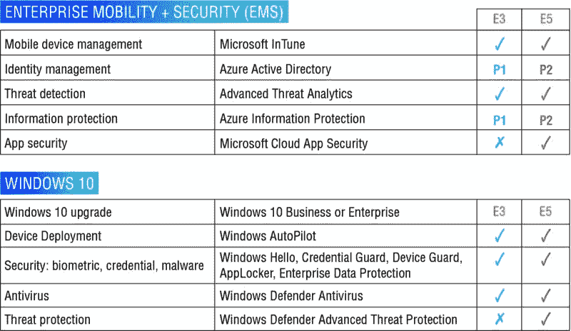

**Figure 2.1** Features and options with E3 vs. E5

做出决定后，你可以与合作伙伴或经销商合作，获得适合你需求的 Microsoft 365 企业协议 (EA)。总体而言，购买 Microsoft 365 订阅比单独购买所有部件更便宜（就像任何好的交易一样）。

不过，对于本书中的“基础练习”，你不需要大费周章，甚至完全不需要购买任何东西。

只需获取 Azure AD Premium 试用版，地址：`https://azure.microsoft.com/en-us/trial/get-started-active-directory/`。

如果你希望跟随练习，请在继续之前完成此步骤。

### Office 365 内置 MDM 管理

如果你的公司已经是 Office 365 客户，那么你已经拥有某种程度的内置 MDM。直截了当地说，Office 365 内置 MDM 管理的唯一目标是：取代 Exchange ActiveSync，并尝试步入 21 世纪。

它做到了。

它是手机、平板电脑等设备的一个完全合格的 MDM。

它并不真正试图成为像 Microsoft Intune 那样“成熟”的 MDM 版本。但它是免费的，且内置于所有商业版和企业版 Office 365 中。

默认情况下，Office 365 的 MDM 功能未激活；你必须手动激活它们。激活后，需要几分钟到几小时才能真正准备好使用。

设置 Office 365 MDM 的分步说明见此处：

`https://support.office.com/en-us/article/set-up-mobile-device-management-mdm-in-office-365-dd892318-bc44-4eb1-af00-9db5430be3cd`

我已将链接缩短为 `https://bit.ly/2ttf3bc`，如需使用可访问该链接。

可用的设备安全策略可见 Figure 2.2。

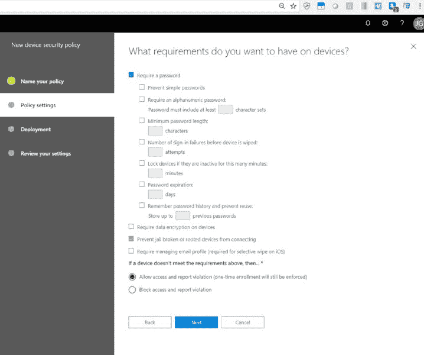

**Figure 2.2** Office 365’s built-in MDM

而且，功能确实不多。适合小型需求，对手机和常规保护来说“基本够用”。

但 Intune 才是 Microsoft 管理 Windows 10 的更强大方式，这也是我将重点关注的地方。

##### Microsoft Intune

Intune 是 Microsoft 管理 Windows 10 和其他支持 MDM 设备的首选云方式。从 Windows 10 的角度来看，你将获得以下功能（这些在 Office 365 MDM 中不存在，其中许多主题我们将在后续章节中介绍）：

*   部署应用程序（如 MSI、MSIX 等）
*   使用 MAM（移动应用程序管理）保护内容
*   运行 PowerShell 命令
*   更多 PC 管理和策略，包括 ADMX 支持的策略
*   连接 SCCM 以实现协同管理（本章后面将解释）。
*   公司自助服务门户，允许用户注册并安装企业应用
*   预配 Wi-Fi 和 VPN 配置文件

以及更多。

同样，对我、你和这本书而言，我的目标是主要专注于 Windows 10 管理，而不多谈手机相关内容。Intune 中有大量手机相关功能。

如前所述，Microsoft 365 捆绑包包含 Intune。如果你“全面拥抱” Microsoft 并希望以一个价格获得所有内容，这个 Microsoft 365 捆绑包非常合理。

但是，也许你不需要 Office 365，因为你已经在使用 Google 的 G Suite，或者不得不使用 Lotus Notes 等。那么你就不想购买 Microsoft 365，因为它捆绑了你明确表示不需要的 Office 365。

 此外，Microsoft 365 还包含 Win10 Enterprise 和 Office 365 ProPlus 的使用权限。即使你不需要 Office 365 或 OneDrive for Business，它也可能具有成本效益。你需要咨询 Microsoft 销售代表了解定价。

因此，你可以单独购买 Intune。


你也可以购买包含 Intune 的 Enterprise Mobility + Security 套件（如前所述）。要查看仅购买 Intune 与购买 Enterprise Mobility + Security 套件的区别，此处有一份不错的对比表：`www.microsoft.com/en-us/cloud-platform/microsoft-intune-pricing`。

总结如下：

*   可单独购买 Intune。撰写时价格为每用户 6 美元。有一种特殊的“按设备”许可证（适用于无用户登录的设备，如数字标牌），价格为每设备 2 美元。
*   可作为 Enterprise Mobility + Security E3 套件的一部分购买。
*   可作为 Enterprise Mobility + Security E5 套件的一部分购买。
*   可作为 Microsoft 365 的一部分购买。

我找到了两种试用 Windows Intune 的方法。

*   **方式 #1：** 找到前面提到的 Microsoft Enterprise Mobility + Security 定价页面，在 E5 模块中点击“立即试用”。
*   **方式 #2：** 访问“注册 Microsoft Intune 免费试用”页面：`https://docs.microsoft.com/en-us/intune/free-trial-sign-up`。

本书将使用方式 #1，注册 E5 试用版并将其连接到上一步创建的 Azure AD 试用版。因此，请再次访问：`www.microsoft.com/en-us/cloud-platform/enterprise-mobility-security-pricing`。

只需寻找“Try Now”。我创建了一个虚假的 `Outlook.com` 地址开始，耗时约 80 秒。之后，我使用的基本入门步骤可见 Figure 2.3。

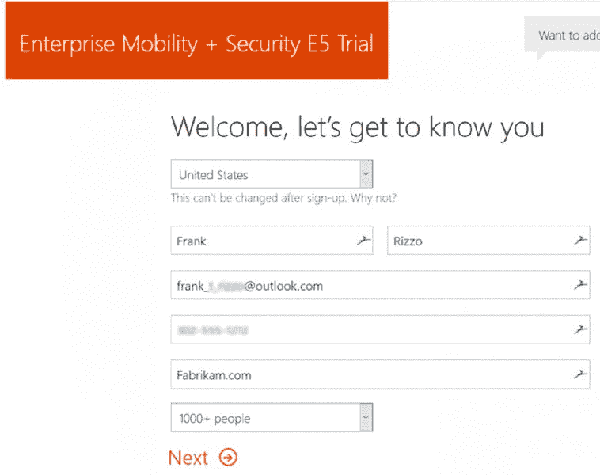

**Figure 2.3** The signup page for EMS E5

接下来是创建第一个用户和公司名称。我使用的信息可见 Figure 2.4。请注意，公司名称必须在全球所有特殊的“`.onmicrosoft.com`”域中唯一。我将 `Fabrikam1000.onmicrosoft.com` 作为我的域名，贯穿本书及 `www.MDMandGPanswers.com` 的持续示例中使用。

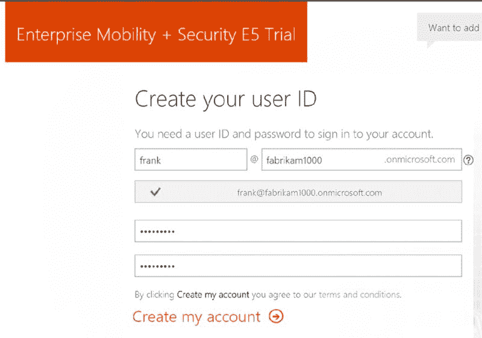

## 图 2.4：创建你的第一个用户和公司名称

然后只需坐等片刻，然后……搞定。你已准备就绪，可以大展身手了，如图 2.5 所示。

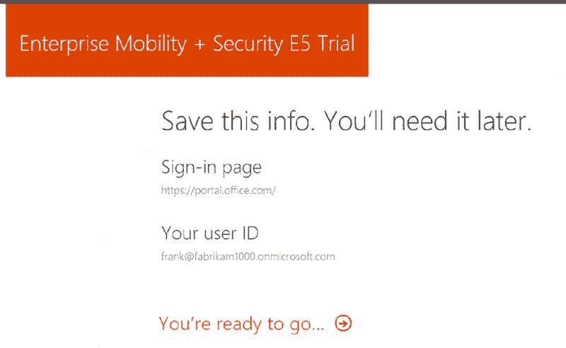

**图 2.5** EMS E5 试用成功消息

### ActiveSync、Office 365 MDM 和 Intune MDM 功能对比

你可能想知道哪个产品提供哪些功能。为此，我找到并重新整理了一份公开的 Microsoft 文档，详细列出了主要差异。

你可以在下面这个表格中看到这些差异，这样如果老板问为什么 Office 365 的 MDM 不够用，而你不得不开始购买 Intune 或其他 MDM 服务时，你就有据可依了。

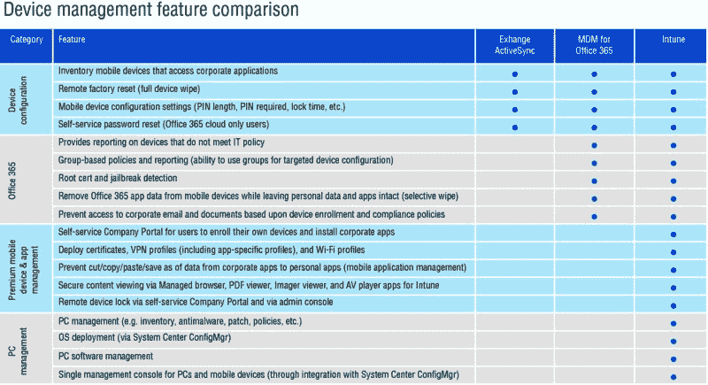

此外，这是我找到的最新页面，其中包含 Office 365 MDM 和 Intune 的并排对比：

`https://support.office.com/en-us/article/choose-between-mdm-for-office-365-and-microsoft-intune-c93d9ab9-efb2-4349-9b93-30c30562ee22`

又是一个丑陋的长链接，所以我制作了一个短链接：`https://bit.ly/2E20PWe`。

### Intune for Education

此处应提及另一个版本的 Windows Intune，以防这正是你的使用场景。有个 Windows Intune for Education，它拥有一项特殊的“超能力”。

也就是说，它可以从 Microsoft School Data Sync（`https://sds.microsoft.com/`）读取数据，并自动创建和保持用户组及计算机组的最新状态。

Windows Intune for Education 另一个有趣的地方在于它有两种许可方式。

*   **方式 #1** 是直接按设备购买，每台设备 30 美元。这包含你授权设备上的无限用户数。
*   **方式 #2** 是按用户付费，每年每用户 8.28 美元。别吓一跳，学生是免费的！你只需为教职员工计数。

这笔交易的“甜蜜”部分是随 Windows Intune for Education 附带的 Azure AD 类型。它有自己的版本，称为 Azure AD EDU，但它命中靶心，包含你所需的最需要的功能，包括自动注册。

你随时可以升级到 Azure AD Premium，获取一些额外的 AD 安全功能，如双因素身份验证，该功能仅在 Premium 版提供。但就我认为大多数学校需要与 Intune 配合使用的功能而言，Azure AD EDU 已经命中靶心。

请从阅读以下内容开始：

`https://www.microsoft.com/en-us/education/intune/default.aspx` 和 `https://blogs.windows.com/windowsexperience/2017/01/24/announcing-intune-education-new-windows-10-pcs-school-starting-189`

最后，我认为值得一提的是，正如有一个面向企业的名为 Microsoft 365 的全套捆绑包一样，也有一个面向教育的全套捆绑包（Office 365、Azure、Intune）以及其他一些东西，如 Minecraft（注：原文为 Mindcraft，此处应为 Minecraft 之误）。

而且，毫不意外，它被称为 Microsoft Education。因此，如果你想结合 Microsoft Education 套件的其他组件试用 Windows Intune for Education，整套产品的试用页面可以在这里找到：

`https://docs.microsoft.com/en-us/education/get-started/get-started-with-microsoft-education`

请注意，一旦你注册 Microsoft Education 试用版，他们会进行一些验证，以确认你确实是一所学校，因此如果没有学术机构背景，你无法直接开始试用。

## VMware Workspace ONE

VMware 也凭借其名为 VMware Workspace ONE 的产品加入了 MDM 管理的行列。它曾经有一个朗朗上口的名字“AirWatch”，现在换了个更无聊的名字 Workspace ONE，而且更难输入了。

话虽如此，它还是同一个产品，且是一个可靠的 MDM 解决方案。你必须选择要使用的 VMware Workspace ONE 版本。在 `www.vmware.com/products/workspace-one.html` 有一个中等长度的对比图表，但如果你深挖一下，点击“查看完整功能对比”时可以下载一个 PDF。

查看该表格时，有一行项目格外引人注目。“高级桌面管理”，标榜“包含自定义脚本、BitLocker 加密、桌面/Win32 应用管理、Windows 10 企业版策略（包括凭据保护/设备防护）”。而这些功能需要高级版、企业版和面向 VDI 的企业版。

由 Workspace ONE 管理的计算机在配置后也可以自动注册到 Azure AD。但如果你想试验 VMware Workspace ONE，Azure AD 并非严格必需。VMware 在 VMware Identity Manager 中也有自己的身份服务，你可以在此了解：`www.vmware.com/products/workspace-one/identity-manager.html`。

如果你想开始使用，截至撰写本文时，AirWatch 品牌正在过渡到 Workspace ONE。因此，当你阅读此书时，开始使用 AirWatch（即 Workspace ONE）的方式可能会有所不同。我设法找到了一个 30 天试用版：`www.air-watch.com/lp/free-trial/`。但随后试图寻找 Workspace ONE 试用版，我只找到了一个动手实验室，这也不错，但不是我真正想要的。无论如何，如果你愿意可以在这里试用：`https://www.vmware.com/go/workspace-hol`。

既然是一个沙箱式的动手实验室，我没有尝试将其连接到真实的 Azure AD，这可能行得通也可能行不通。将 Workspace ONE（该页面上仍称为 AirWatch）与 Azure AD 结合的分步说明可以在以下网址找到：`https://docs.microsoft.com/en-us/azure/active-directory/saas-apps/airwatch-tutorial`。

对我来说，我有一个 Workspace ONE 的完整账户，这将用于书中的任何示例。如果我没记错的话，你可以通过 VMware 经销商或客户经理获得自己的完整账户。

## MobileIron

MobileIron 的网站是这一堆里最令人困惑的。我花了一段时间才找到他们谈论 Windows 10 管理的页面。但我找到了，在这里：`www.mobileiron.com/en/unified-endpoint-management/operating-systems/windows-10`。

然后，如果你想开始 MobileIron 的 30 天试用，可以在这里进行：`https://info.mobileiron.com/30DayTrial`。

要将 MobileIron 连接到 Azure AD，完整的分步说明在 Microsoft 网站上：`https://docs.microsoft.com/en-us/azure/active-directory/saas-apps/mobileiron-tutorial`。

## 设置自动注册并注册你的第一批计算机

好的。让我们回顾一下：

*   你注册了一个免费的 Outlook 账户。
*   你注册了一个免费的 Enterprise Mobile Suite + Security E5 计划。
*   你同时获得了 Azure AD Premium P2。

现在是时候在你的 Azure AD 中开启 Intune 了。

首先完全退出所有内容：Outlook、Azure AD 和/或你可能打开的任何其他 Microsoft 服务。

然后，前往 `portal.office.com`，你可能会看到如图 2.6 所示的提示。选择带有 `.onmicrosoft.com` 地址的那个并登录。

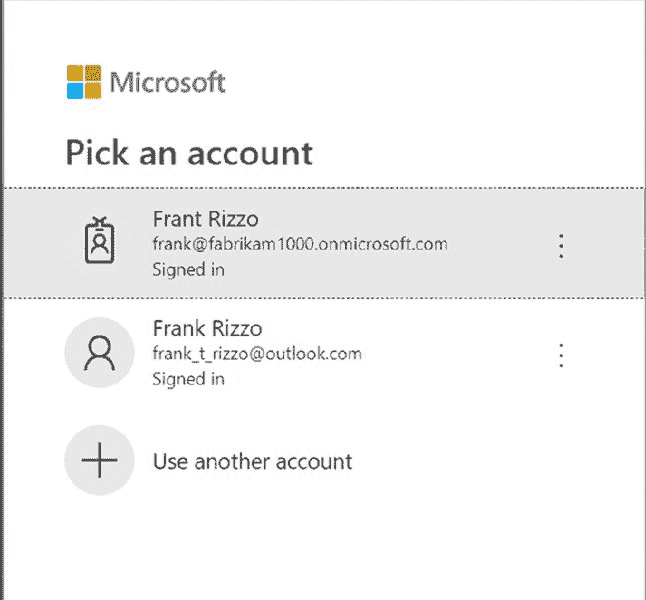

**图 2.6** 使用你的 `onmicrosoft.com` 账户登录。

### 开启 MDM 注册

MDM 注册分两步：

*   用户
*   计算机

我们先做用户端，再做计算机端。

#### 用户的 MDM 注册

单击 Azure Active Directory，如图 2.7 所示。

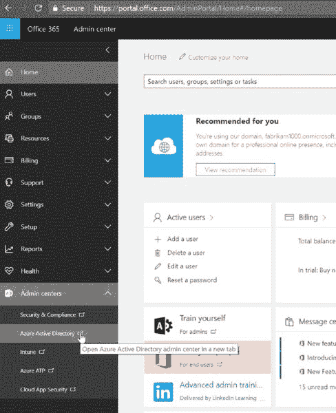

**图 2.7** 单击以打开 Azure Active Directory。

在新标签页中，你将看到 Azure AD，可以单击“移动性 (MDM 和 MAM)”，然后单击“Microsoft Intune”，如图 2.8 所示。接着，在出现的“配置 Microsoft Intune”对话框中，如图 2.9 所示，你特别需要启用 MDM 用户范围。对于我们的示例，我建议选择“所有”（也见图 2.9）。

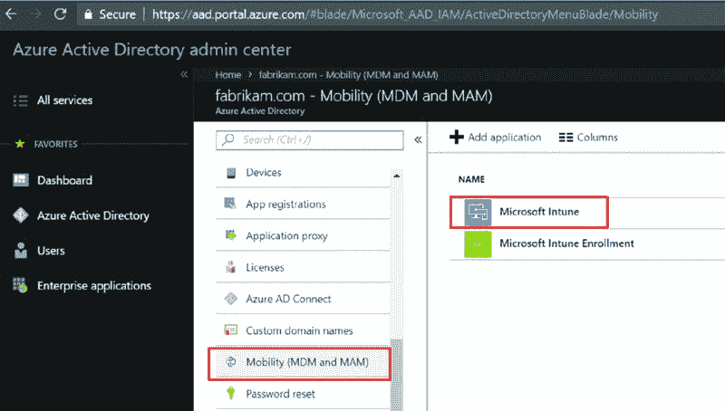

**图 2.8** 这是你单击以启用 Intune 的位置。

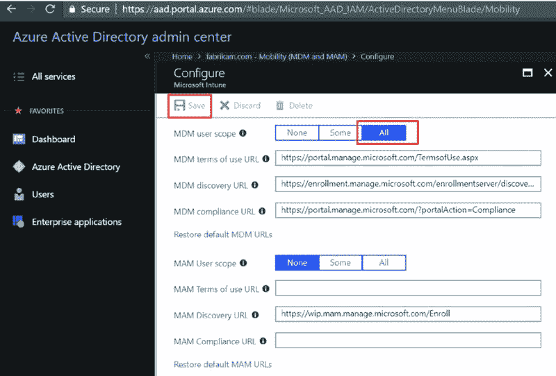

**图 2.9** 启用 MDM，并可选择为所有用户启用 MAM。

然后，回到“移动性 (MDM 和 MAM)”页面（即再次看到 **图 2.8**），你将单击“Microsoft Intune 注册”。这将带你进入 **图 2.10** 所示的“Microsoft Intune 注册”页面。对于 MDM 用户范围，再次单击“全部”，然后单击“保存”。

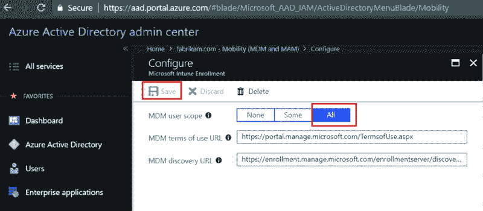

**图 2.10** 为 Intune 注册启用 MDM。

你刚刚配置的是 MDM 方程式的用户端。用户需要被提示确认使用条款等。

但真正的魔力在于设备。你需要配置设备注册颁发机构。

### 计算机的 MDM 注册

就在 10 秒前，你还在 Azure AD 控制台中。现在该进入 Intune 并告诉它你希望它接受请求并执行自动注册。

在撰写本文时，有三种方法可以进入 Intune。方法 1 是从主管理中心进入，如 **图 2.7** 所示。在管理中心内，你可以单击 Intune。

但如果你仍在 Azure 门户中，可能看不到指向 Intune 的链接。

我最喜欢的“转到 Intune”的方式就是如 **图 2.11** 所示进行搜索。只需单击搜索放大镜，输入 **Intune**，当它弹出时单击 Intune 这个词，就像我在 **图 2.11** 中所做的那样。

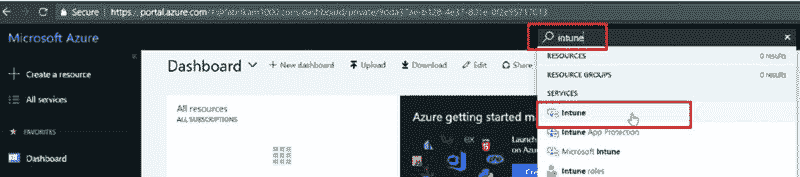

**图 2.11** 如果你在 Azure 门户中迷路了，只需搜索 Intune。

所以，如果你迷路了只想去 Intune（或者你*找不到* Intune），请使用如 **图 2.11** 所示的放大镜。

搞定。

将 Intune 添加到 Azure 资源列表的另一种方法是单击“所有服务”（也可见于 **图 2.11**）。然后找到 Intune 并单击其旁边的星标。这将神奇地将其添加到左侧的长菜单列表中。这随后将其（基本上）放在每个页面上，使其更容易直接单击以跳转到 Intune。

### 关于 Intune UI 的一些注释和提示

我怀疑在未来几个月内，Intune 可能就会成为 Azure 主页上一个漂亮且易于查找的可点击项。在我写完这一章后，微软已经回过头来宣布了一个新页面的预览版，帮助你登录后更快地直达 Intune 和设备管理：`https://devicemanagement.microsoft.com`。

所以，请留意这一点。在本书付印前，我可能无法重新截取屏幕截图。

但同样，此处的方法应该继续与任何新方法一起工作。在本书后续内容中，我可能只会说“转到 Intune 控制台”，并假设你能找到去那里的路：从 Azure 门户、Azure 门户上一个巧妙的新图标（如果他们那样做的话），或 `https://devicemanagement.microsoft.com`。

此外，无关的是，当你在 Azure 或 Intune 中展开以执行某些有趣操作时，每个向右滑出的小窗口都有一个巧妙的名称。

它被称为 *blade*（边栏选项卡/刀片）。

这么说难道不觉得超酷吗？

再说一遍：*blade*。

不是窗口，不是窗格。不，不。那些术语太过时了。

现在它是 *blade*。

咳咳。好吧。当然。我就叫它 *blade*。

一旦进入 Intune，第一站将是“设备注册”，如 **图 2.12** 所示。这是你向 Intune 说明允许和不允许内容的地方。例如，如果你想允许 Apple 手机和 Windows 设备，但禁止 Android 设备，这就是正确的地方。

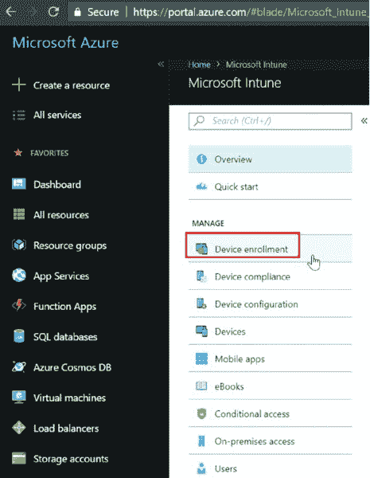

**图 2.12** 在 Intune 中，使用“设备注册”来指定 MDM 颁发机构。

然后，你将看到“选择 MDM 颁发机构”边栏选项卡，如 **图 2.13** 所示。只有当你以前从未执行过此步骤时，才会看到“选择 MDM 颁发机构”。

正确的选择选项是 Intune MDM 颁发机构，正如我在此处选择的那样。Configuration Manager MDM 颁发机构将启用所谓的混合 Intune + SCCM，且即将弃用。（我在 **第 4 章** 中详细讨论混合 Intune 和 SCCM、为何弃用以及什么取代了它。）

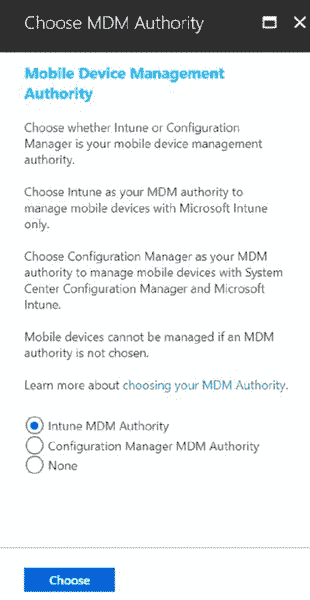

**图 2.13** 选择 Intune MDM 颁发机构以管理设备。

 如果你想了解有关 MDM 颁发机构的更多信息，此处有一篇详细文章：`https://docs.microsoft.com/en-us/intune/mdm-authority-set`。例如，你稍后可能想将其设置为 SCCM 或其他 MDM 服务。

执行后，你将收到一条弹出通知，提示设置正确。

 什么是 *toast*（弹出通知/吐司通知）？它就像一个弹出窗口。如果你从未听说过这个术语，请阅读此内容：`https://ux.stackexchange.com/questions/11998/what-is-a-toast-notification`。

### 将你的第一个用户添加到 Azure AD

手动将第一个用户添加到 Azure AD 只需片刻。


# 回到 Azure 门户

首先单击“用户”或“添加用户”，如**图 2.14**所示。如果你迷路了，找不到 Azure AD，只需输入`aad.portal.azure.com`，你应该就会被传送回 Azure 世界。

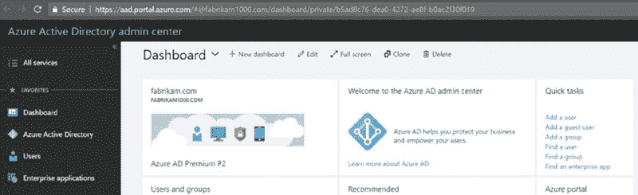

**图 2.14** 手动将用户添加到 Azure Active Directory

然后，输入用户信息。我将添加一个名为 Jack Tors 的人，如**图 2.15**所示。请注意，我必须显式拼写他的用户名，目前该用户名必须以`fabrikam1000.onmicrosoft.com`结尾。稍后，我们将设置可选的自定义域名。

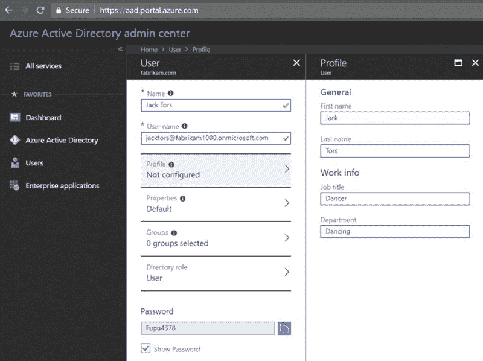

**图 2.15** 在 Azure AD 中创建你的第一个用户。

Jack 现已创建，但没有许可证。要为他分配许可证，请返回“用户”➢“活动许可证”，找到刚创建的用户 Jack Tors。然后指定位置并分配许可证，如**图 2.16**所示。

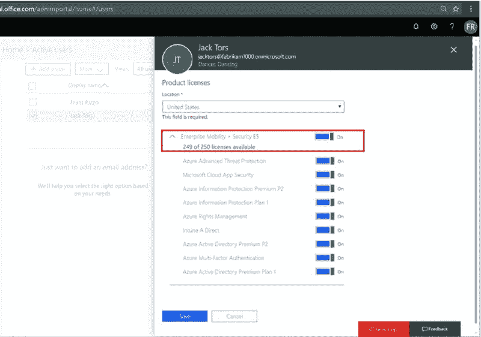

**图 2.16** 每个用户都需要许可证。

## 将你的第一台 Windows 10 计算机注册到 MDM

这里有个有点坏的消息。你可能，是的，可能不得不（惊呼！）真正教用户如何执行所谓的 MDM 注册。从技术上讲，你是加入 Azure AD，而 MDM 注册正在后台为你自动发生。

因此称为`auto-enrollment`（自动注册）。

这可能发生在两种情况下：

*   Windows 计算机全新开箱，也称为开箱即用体验，或`OOBE`
*   Windows 计算机已在运行并使用了一段时间

`OOBE`非常……简单。如**图 2.17**所示，只需提供用户名和密码，几次单击后（未显示），Windows 就完成并准备好大显身手了。

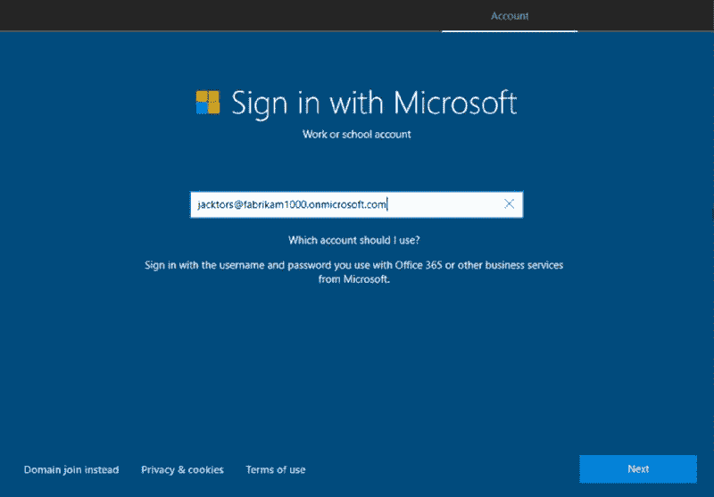

**图 2.17** 你可以给某人用户名和密码，以“开箱即用”即 OOBE 的方式注册计算机。

但这一切结束后（别怪传信人），注册计算机的人会成为本地管理员。等等，别慌。如果你愿意，可以更改此行为；请参阅侧边栏“在 Azure 和 Intune 中限制用户和设备”。

此外，当我们讨论使用 Autopilot 分发新机器时，将会解决这个问题。但那要等到第 8 章！但就目前而言，这是事实：如果有人通过开箱即用体验 (`OOBE`) 以这种方式注册机器，他们就会成为该机器上的本地管理员。

好的。深呼吸，让我们继续前进。

接下来我要展示的方法适用于 Windows 10 机器已启动并正在运行的情况，可能已经使用了一段时间。在这种情况下，我将教你三件事：

*   第一件事是**不**要教你的用户做什么。没错，首先讲“禁止事项”。
*   第二件事是用户为了完成 MDM 注册必须执行的“所有手动点击操作”。
*   第三件事是一种小捷径方法，可将用户必须执行的步骤降至最低。

### 侧边栏：在 Azure 和 Intune 中限制用户和设备

任何仅凭用户名和密码注册机器的人都会自动成为 Windows 10 机器的本地管理员：这是个极其糟糕的主意。

极好的消息是：你可以通过 Azure 的设备设置中的“设备类型限制”部分来解决此问题。

首先，在 Azure 门户（而非 Intune）中，当你点击“设备”然后选择“设备设置”时，会有一些你可能想了解的有趣选项。你可以在此处看到它们。

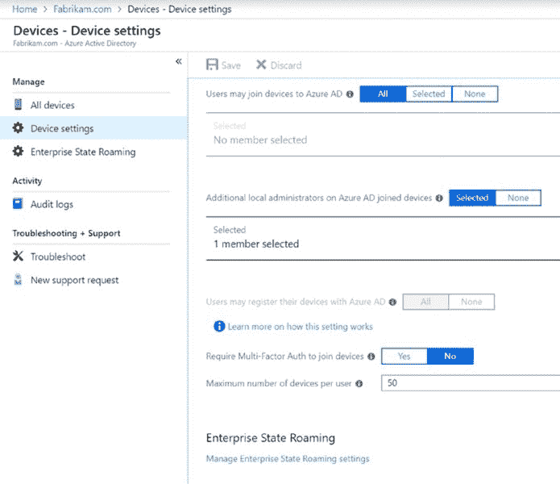

你可以按如下方式使用此页面上的项目：

*   限制哪些用户可以将设备加入 Azure AD
*   添加哪些 Azure 用户也将成为 AAD 加入设备上的本地管理员
*   指定用户可以拥有多少台设备。将其设置为 1 或 2 台，而不是 50 台或无限制，可能会很方便。

第二个相关的想法是如何使用 Intune 控制台阻止个人设备注册到 Intune。当你执行此操作时，可以确保进入 Intune 的都是你已知的设备，而不是在百思买或亚马逊购买的随机机器。

好的，如果你阻止了个人设备，那么什么是个人设备的定义？相对于企业设备而言？

相关网页在此：`https://docs.microsoft.com/en-us/intune/enrollment-restrictions-set#set-device-type-restrictions`，以下是相关特征：

*   注册用户正在使用管理员风格的帐户，也称为设备注册管理器帐户。详细的分步指南见 `https://prajwaldesai.com/adding-microsoft-intune-device-enrollment-manager/`。
*   设备通过 Windows Autopilot 注册（在第 8 章中讨论）。
*   设备通过批量 AAD 令牌配合预配包进行注册（同样在第 8 章中讨论）。
*   设备通过 SCCM 的自动注册进行联合管理。

还有一些其他限制，但这些是主要的。

如果你想调整 Intune 以阻止个人设备，从而防止（本应是）标准用户成为 Windows 10 机器上的本地管理员，请在 Intune 中转到“设备注册”➢“注册限制”。在“设备类型限制”内，你可以点击“属性”并选择“配置平台”，然后在“个人所有”列中，点击你想要限制的设备类型上的“阻止”；在我们的例子中是 Windows 10，如图所示。

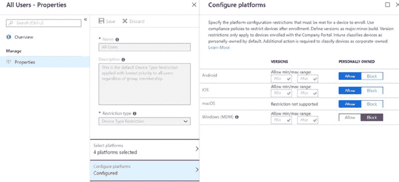

### 禁止事项：Azure AD 加入，但无 MDM 注册

为什么我要先展示*不*该做什么？因为，这看起来似乎是你（或你的用户）会采取的最显而易见的路径。相信我，你会明白我的意思。

这些示例使用的是 Windows 10 1809 版本；在未来的 Windows 版本中，你的体验可能会略有不同。但这是我今天要展示的内容。

假装你是一个标准用户（即没有任何本地管理员权限），转到开始栏并输入`MDM`。对我而言，我发誓我不是在编造，我还得到了一些关于改变意识的药物 MDMA 的不错推荐。但是，擦除 MDMA 中推荐的“A”将会得到你在**图 2.18**中看到的内容。

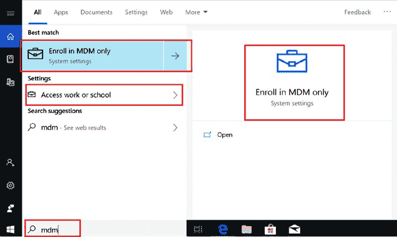

**图 2.18** 使用 Windows 搜索查找 MDM 设置

这使用户可以点击“仅注册到 MDM”（两个选项）或“访问工作或学校”。

再说一次，也许只是我遇到了这个问题，但在 1809 版本中，点击“仅注册到 MDM”（左侧选项或右侧大链接）实际上*什么也没做*，只是把我带到了 Windows 设置页面（真棒）。（我甚至尝试以本地管理员身份操作，但完全没有任何反应。）

现在，作为这个假装的用户，在 Windows 设置中我必须再次输入`MDM`，你将看到**图 2.19**中的内容。

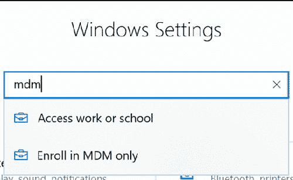

**图 2.19** 使用设置应用

再次尝试从这里点击“仅注册到 MDM”依然给我……完全没有任何反应。字面意义上的毫无反应。它根本无法跳转到任何地方。

好的。（记住，你要尝试像用户那样思考，而且是标准用户。）那么让我们试试“访问工作或学校”。好的！这个管用。该页面上有一个大大的 +（加号）和“连接”字样。太好了，点击它。

然后你将看到**图 2.20**中的大而漂亮的对话框，你会期望用户在其中输入他们的 Azure AD 帐户信息。

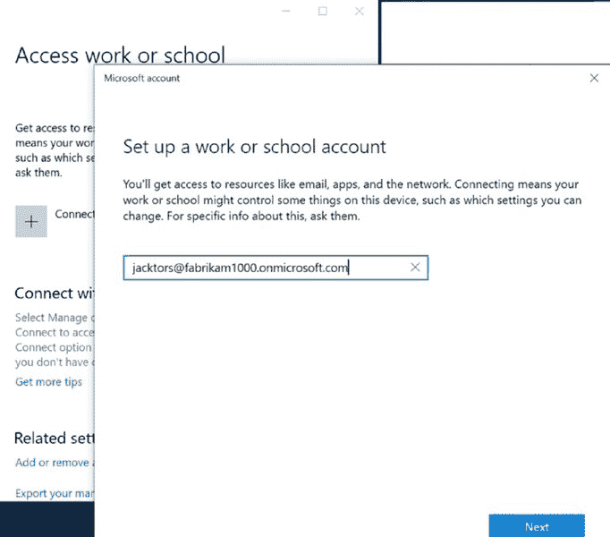

**图 2.20** “设置工作或学校帐户”对话框。正等着“吞噬”你的最终用户呢。

然后，他们使用从邮件中获得的用户名和密码登录。

在处理过程中，它看起来会像**图 2.21**。


**图 2.21** 当连接到 Azure AD 发生时，你会看到类似这样的内容。

你会收到一条“一切就绪”的消息并有机会点击“完成”。当你这样做时，你会像印第安纳·琼斯在《夺宝奇兵》中那样，直接、准确、毫无悬念地掉进蛇坑里。

这是一个错误图标的示例，见图**2.22**。它看起来像 Windows 旗帜图标。如果你希望完成 MDM 注册，这是你不想看到的。

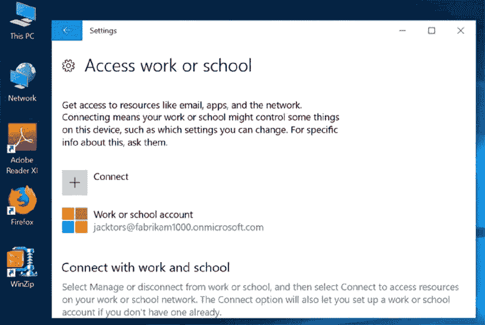

**图 2.22** 注册后出现 Windows 图标意味着你只是“工作区加入”，并未真正完成 MDM 注册。

你怎么知道你*实际上*没有完成 MDM 注册？只因为你正在读这本书。因为对我来说，一个漂亮的 Windows 旗帜看起来像是好事。但实际上它是错误的，不足以完成 MDM 注册。

但你可以自己验证：点击该旗帜，点击“管理你的帐户”，并在浏览器（如 Edge）中打开该页面。你将在**图 2.23**中看到，计算机仅仅是*工作区加入*，而非 MDM 注册。

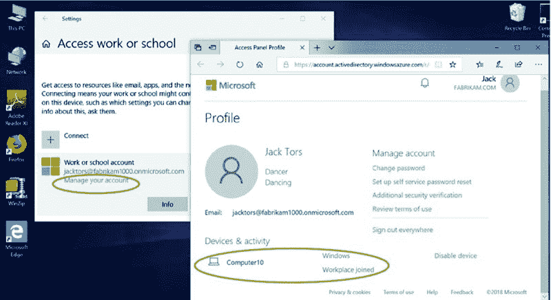

**图 2.23** 你*不*想只是工作区加入。你想要的是 MDM 注册，下文将解释。

要了解你刚才做了什么，这再次被称为“工作区加入”，请参阅边栏“什么是工作区加入？”。

### 侧边栏：什么是工作区加入

如果你在**图 2.22**中没有完成 MDM 注册，那么你*实际上*在那里做了什么？

## 要做的事：MDM 注册

正如你在**图 2.23**中所见，当你点击进入以进行进一步检查时，它被称为“工作区加入”，这实际上是真正进行 MDM 注册的两部分流程中的第 1 部分。换句话说，MDM 注册分为两部分：加入 Azure AD（即工作区加入）和注册到 MDM。

那个巨大、诱人的窗口是你输入用户名的地方，它实际上只负责第 1 部分，即工作区加入部分，而非 MDM 注册部分。

那么，什么是工作区加入，为什么你会想要它？

再次为了清晰起见，它不是 MDM，所以就本书而言，你其实并不想要它。但它的功能是让自带设备的人员加入你的 Azure AD，随后你可以为 Box、Salesforce 等应用提供单一登录。

仅此而已。

使用工作区加入，你无法分发应用程序、管理设置，或执行任何其他 MDM 功能。

它实际上只是用来，嗯，加入你的 Azure AD，然后当你提供资源访问权限时，你可以规定谁能获取什么资源。

工作区加入的另一个优点是任何人都可以执行。我的意思是标准用户（即非管理员）可以执行。所以如果你已经有 300 名承包商为你工作，并且你想让他们现在神奇地获得访问你 Salesforce 数据的权限，你只需创建 Azure AD 账户，将 Azure AD 与 Salesforce 关联，设置权限，然后……搞定。

你不必神奇地想办法让他们获得本地管理员权利以进行 MDM 注册，而且，那 300 名承包商也不想让你用*你的* MDM 服务来管理*他们的* 机器。

所以工作区加入有其用武之地，但它无法让你真正控制、管理或锁定机器，也无法部署 Windows 应用程序。但它确实赋予了你将人员（即他们的身份）与你通过 Azure AD 提供的服务关联起来的能力。

如果你进入 Azure AD 门户查看“设备”➢“所有设备”，你会看到计算机已“注册”到 AD，甚至 MDM 字段可能会亮起显示你的 MDM 服务，如 Microsoft Intune。但是，哦，不。你并没有进行 MDM 注册，你只是“Azure AD 已注册”。

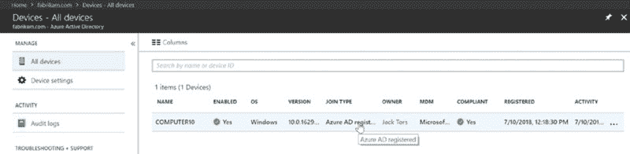

如果你跟着我钻进了蛇洞，让我们来个干净的开端。首先，回到客户端，点击 Windows 徽标图标，就像你在**图 2.22**（和 **2.23**）中看到的那样。然后点击“断开连接”，再点击“是”。然后，在这里的 Azure AD 门户中，点击计算机本身，然后点击“删除”并确认“是”。

砰。跳出了蛇坑。

## 要做的事：MDM 注册（正确方法）

蛇坑：坏。宝藏：好。

要获得 MDM 宝藏，你需要敲响秘密之门。

而且，印第安纳·琼斯不是普通用户，他是英雄……一位本地管理员。（我就叫他管理员吧，但你会知道我的意思是本地管理员。）

所以，以标准用户身份注销机器，再以管理员身份登录。当你这样做时，你将能够敲三下门并找到秘密之门。确实，**图 2.24**就是秘密之门，X 标记了地点。嗯，不是 X，而是一个椭圆。

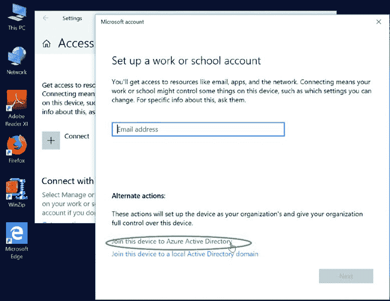

**图 2.24** 只需点击“将此设备加入 Azure Active Directory”即可进行 MDM 注册。

在继续之前，请看看**图 2.24**和**图 2.20**的区别。看到了吗，作为标准用户，你甚至没有机会找到宝藏（标记为“将此设备加入 Azure Active Directory”）。

现在，因为你是管理员，点击宝藏“将此设备加入 Azure Active Directory”。

然后，且仅在此刻，在下一页（未显示）中，你将输入 Jack 的用户名和密码。一旦完成，你将看到即将发生的事情的预确认，如**图 2.25**所示。点击“加入”以注册。

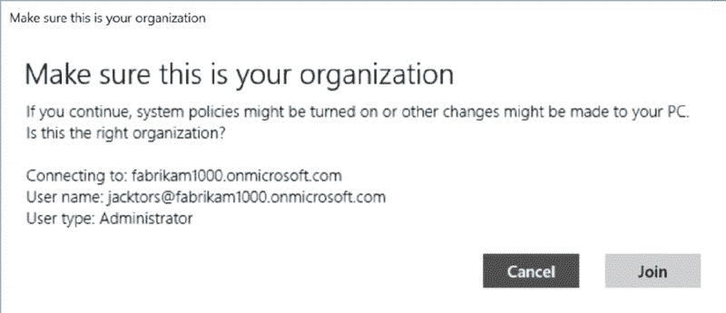

**图 2.25** MDM 注册的预确认

然后可以看到**图 2.26**所示的确认页面。

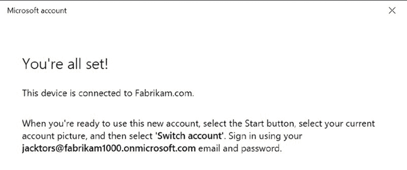

**图 2.26** 说明现在可以使用`onmicrosoft.com`账户直接登录到此计算机

最后，你的 MDM 金子在等着你。你可以看到公文包图标，如**图 2.27**所示，表明已成功进行 MDM 注册。

 如果你看到的是 Windows 图标而不是显示真正 MDM 注册的公文包图标，请尝试等待一天并重试。有时在告诉 Azure AD 谁是 MDM 权威后需要一些时间。比如 24–48 小时。

现在在你的 Windows 10 机器上，注销，并以`JackTors1000@fabrikam1000.onmicrosoft.com`登录，如**图 2.28**所示。

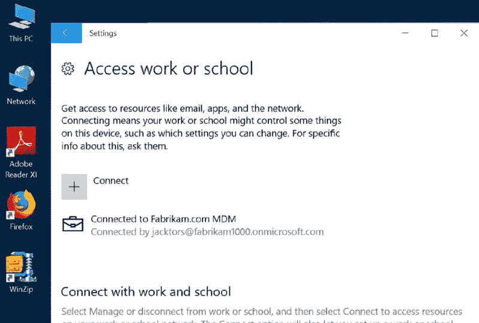

**图 2.27** 公文包图标意味着你已成功注册到 MDM。

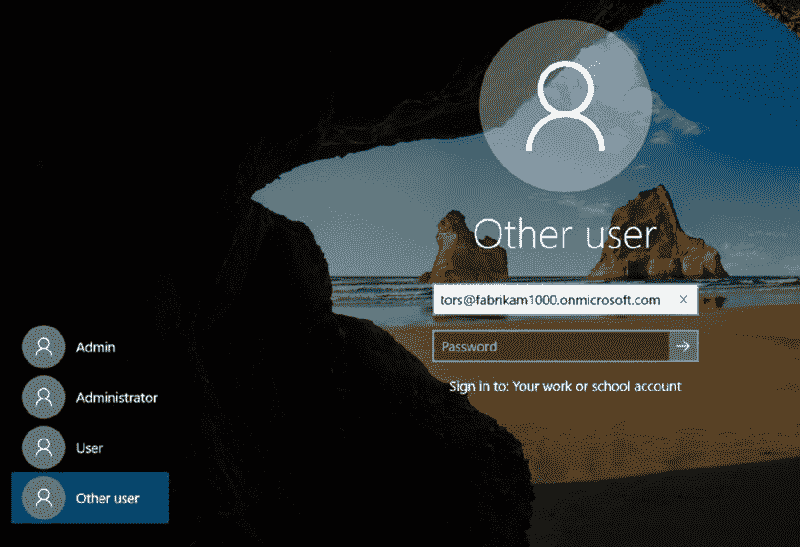

**图 2.28** 现在你可以使用 Azure AD 凭据登录到此计算机。

还记得使用“开箱即用体验”注册会使该人成为本地管理员吗？

砰。这里也有同样的问题：刚刚注册机器的用户会自动成为该机器上的本地管理员。这很糟糕。我明白。但请稍等；当我们在第 4 章中讨论如何使用组策略引导现有机器以系统身份注册到 MDM 时，在标题为“使用组策略自动注册到你的 MDM 服务”的部分，我们将纠正这种情况。

## 终结 Windows Hello 和 PIN（仅限本书）

此外，在注册过程中，你可能会被提示输入设备 PIN（演示和屏幕截图中未显示）。这实际上是 Windows Hello，一种帮助你摆脱密码的机制。我喜欢 Windows Hello，但本书不需要 PIN。而且如果你要注册大量机器进行测试，这可能会拖慢你的测试速度，但会降低测试计算机的安全性。

话虽如此，你可能想终结 Windows Hello……仅限本书。

为了清楚起见：我*不*反对 Windows Hello。

但当你注册一台机器时，有几个额外的步骤要求用户提供 PIN（可替代密码），这通常会让你的测试注册花费更长时间。

反直觉的是，使用 PIN 代替密码更安全，因为 PIN 仅绑定到该设备。另一方面，如果有人有八台设备，他们可能不得不记住八个唯一的 PIN，而不是一个密码。如果你想阅读一篇关于该主题的好文章，请查看：

`http://www.brucebnews.com/2016/08/logging-in-with-a-pin-is-easier-than-a-password-and-safer-too/`

就我们的目的而言，如果你想暂时关闭它，全局方法是：Intune ➢ 设备注册 ➢ Windows 注册 ➢ 适用于企业的 Windows Hello。然后点击其中针对所有用户的那一项，再点击“设置”。

如果你愿意，可以拥有多个适用于企业的 Windows Hello 配置文件。这意味着你可以为测试用户禁用 Windows Hello，但为真实用户启用它。

但既然本书全都是关于测试的，那就大胆地禁用适用于企业的 Windows Hello，如下图所示。

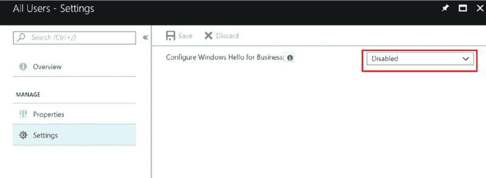

## 通过快捷方式进行 MDM 注册（即深层链接）

在前面的示例中，我们使用 Windows 10“设置”应用来查找 Azure AD/MDM 注册的宇宙区域。

但如果你想：

*   预先创建 Azure AD 账户，并且
*   通过电子邮件向所有人发送分步加入说明，并且

### MDM 注册深度链接

祈祷用户能正确遵循步骤，执行实际的 MDM 注册，而不是 Azure Workplace 加入，这并不可靠。有更好的方法。不过请注意，MDM 注册只能由管理员执行，标准用户无法操作。

话虽如此，你可以使用一个神奇的快捷方式，也称为深度链接。有几种实现方式。你可以发送邮件给用户（即当前拥有 Azure AD 账户的人员），让他们点击链接，例如在邮件中指定如下链接：

`ms-device-enrollment:?mode=mdm`

你可以将该字符串复制粘贴到浏览器中（如**图 2.28**所示），或使用`Windows + R`打开“运行”对话框并直接输入。

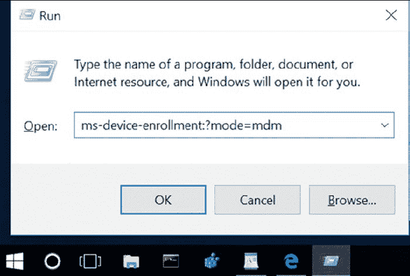


这样做可以绕过查找“设置”应用、知道输入什么来发现 MDM 部分以及避开陷阱的所有步骤。简而言之：让用户直接到达 MDM 注册的“宝藏”处。如图 2.29 所示，只需在 Microsoft Edge 浏览器窗口中输入神奇的语法，即可直接开始注册。

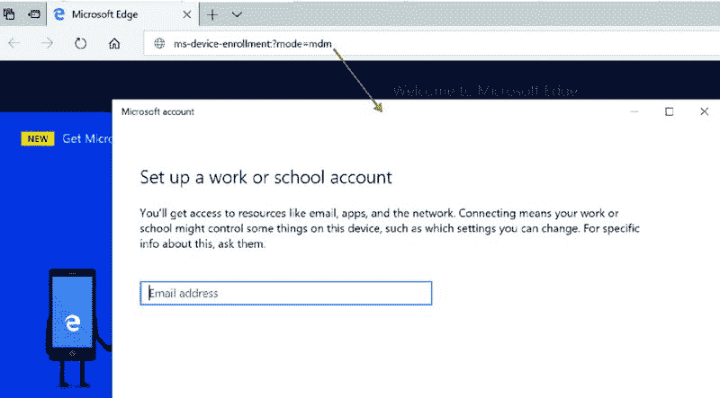

> **警告** 你可能仍在使用 `onmicrosoft.com` 用户名而非自定义名称。如果是这种情况，系统可能会提示输入服务器名称，这并非你想处理的事情。稍后在“自定义域名”部分，我们将通过修复 CNAME 记录并利用自定义域名来绕过此问题。

**图 2.29** 使用特殊语法在浏览器中将打开正确的 MDM 注册对话框。

随后用户必须知道自己的账户信息。

听到有人抱怨“用户甚至不该需要知道这么多”？没问题。你可以将用户名嵌入深度链接中，如下所示：

`ms-device-enrollment:?mode=mdm&username=jacktors@fabrikam1000.onmicrosoft.com`

这样做会自动填充该信息，如图 2.30 所示。

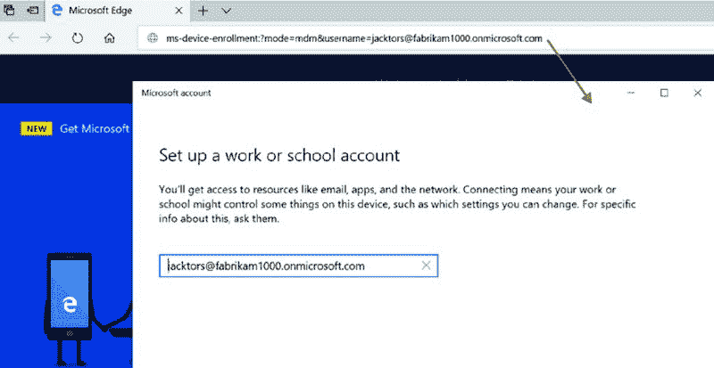

**图 2.30** 使用 MDM 深度链接预填用户信息。

对于某些 MDM 系统（如 Workspace ONE），如果手动执行所有步骤，可能需要输入特定的服务器名称。你也可以通过在深度链接中指定服务器名称来绕过此步骤：

`ms-device-enrollment:?mode=mdm&username=mdmuser1@fabrikam1000.com&servername=https://techp-ds.awmdm.com`

结果如图 2.31 所示，用户名和服务器名称（预置于特殊链接中）均显示在对话框中。

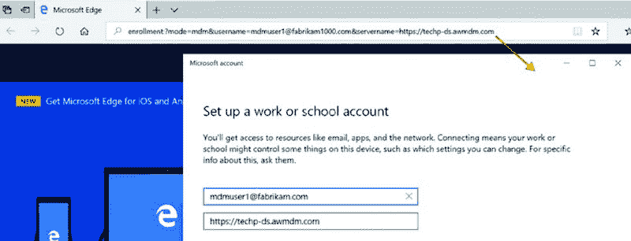

**图 2.31** 在深度链接中同时指定用户名和服务器时，两者均会在注册期间显示给用户。

## 可选步骤：自定义域名与 AD 到 AAD 同步

接下来的两个演练完全可选，非必需。

但强烈建议执行。

第一项是告别自带的古怪 `onmicrosoft.com` 域名，将其转换为自定义域名。如果不想执行此步骤，仍可完成本书大部分操作。但在实际场景中，你通常不希望用户终生记住这个域名，而是希望他们记住你的真实域名。

第二项是连接并同步现有的本地 AD 到 Azure AD。目标是将现有本地 AD 用户账户同步到 Azure AD，因为你很可能已有创建本地 AD 用户账户的流程，并希望这些账户能神奇地同步到 Azure AD，从而避免手动重复添加。

同样，两者均非必需，但我建议执行，且本书后续内容将假设你已完成这些步骤。在实际场景中，如果你没有本地 AD，或计划完全放弃本地 AD，则可能真不需要同步，因为……在你的情况下毫无意义。

接下来我将执行以下操作：

*   将 `fabrikam1000.onmicrosoft.com` 域名更改为 `fabrikam1000.com`。
*   将名为 `Fabrikam.com` 的本地 AD 同步到 Azure AD（即将称为 `fabrikam1000.com`）。

### 自定义域名：告别“onmicrosoft.com”名称

我前往域名注册商（如 GoDaddy）购买了 `Fabrikam1000.com` 的所有权。

购买真实域名后，返回 Azure AD 选择“自定义域名”，然后“添加自定义域名”，如图 2.32 所示。此时你只会看到 `onmicrosoft.com` 域名，直到完成后续步骤。

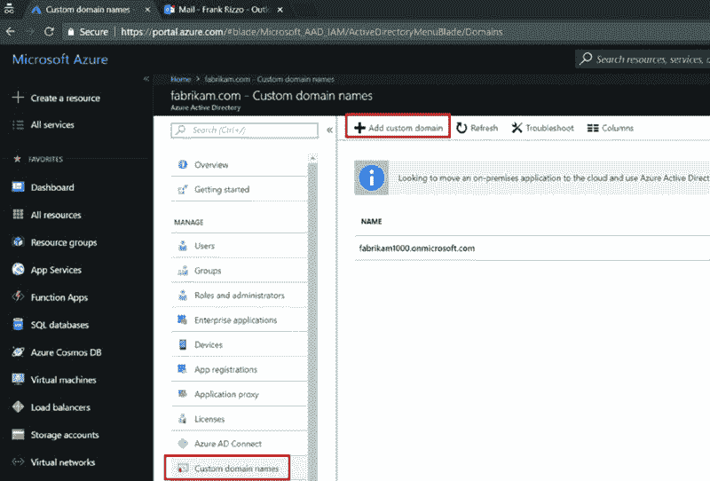

**图 2.32** 使用 Azure AD 查看和添加自定义域名。

点击“添加”后，输入购买的域名，如图 2.33 所示。

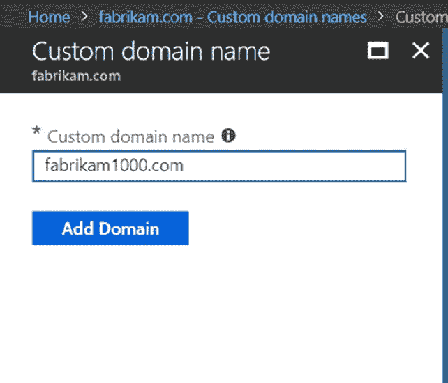

**图 2.33** 在 Azure AD 中添加自定义域名。

接下来，系统会指导你如何配置域名注册以使整个关联生效。你将看到类似图 2.34 所示的来自 Azure AD 的信息。

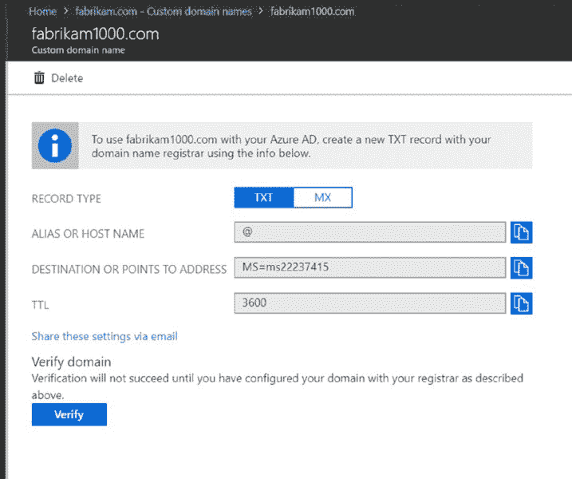

**图 2.34** 需要注入域名注册商的自定义域名参数。

然后，在域名注册商的记录中填入相同信息。如图 2.35 所示，我使用 GoDaddy 完成了此操作。

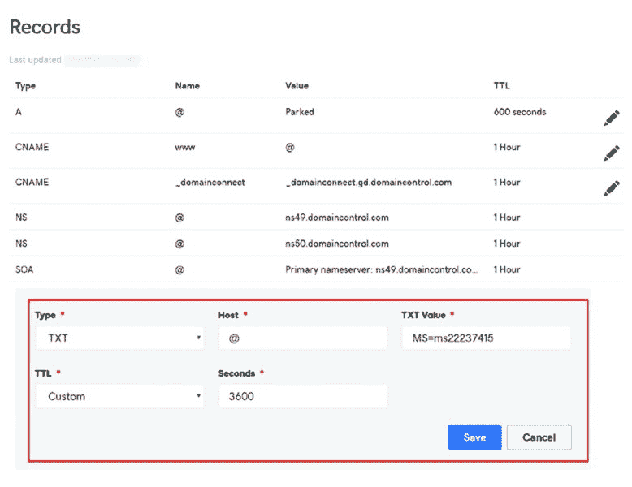

**图 2.35** 使用 GoDaddy 放置 Azure AD 自定义信息。

此外，应存在两条记录以确保自动注册首次、每次都完美顺利。缺少这些记录可能导致不完美。用户注册时可能会被提示输入服务器名称，这并非最优，只是增加了记忆、解释和出错的环节。

基本上需要在两处添加 CNAME 记录。官方文档见此处：

`https://docs.microsoft.com/en-us/intune/windows-enroll#enable-windows-enrollment-without-azure-ad-premium`

相关优秀博客见此处：

`https://blogs.technet.microsoft.com/intunesupport/2017/03/04/which-cnames-to-use-for-auto-discovery-during-mdm-enrollment/`

简而言之，你将在注册商处创建两条记录。详见下表。

| 类型 | 主机名（来自你的域名，如 `Fabrikam1000.com`） | 指向 | TTL |
| --- | --- | --- | --- |
| CNAME | EnterpriseEnrollment | `EnterpriseEnrollment-s.manage.microsoft.com` | 1 小时 |
| CNAME | EnterpriseRegistration | `EnterpriseRegistration.windows.net` | 1 小时 |

最终结果如图 2.36 所示。

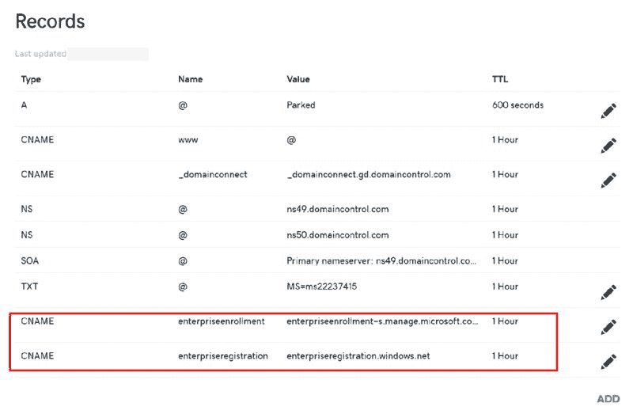

**图 2.36** 添加 CNAME 记录以实现顺畅的自动注册。

现在，这里有一个关于**不该做什么**的重大警告。

 如果你查看 Microsoft 文档，可能会说要将 `EnterpriseEnrollment.company_domain.com` 放入 CNAME 主机字段。这完全是错误的。这比你需要放入字段的内容要多。因为在 GoDaddy（或其他域名服务商）中，你已经在编辑域名本身，比如 `Fabrikam1000.com`。所以你不需要将 `EnterpriseEnrollment.fabirkam1000.com` 的完整 FQDN 输入到 CNAME 主机字段中；只需输入 `EnterpriseEnrollment` 即可。同理，关于要求输入 `EnterpriseRegistration.company_domain.com` 的指导也是错误的。只需将 `EnterpriseRegistration` 放入 CNAME 主机字段。不理解这一点让我在第一次设置时浪费了好几个小时。

你可能需要等待几分钟让其生效，但我发现一旦设置正确，它会立即生效。然后你就可以开始测试了。

按相反的顺序，你首先想运行 CNAME 测试。

这可以在 Intune 门户 ➢ 设备注册 ➢ Windows 注册 ➢ CNAME 验证中找到，如图 2.37 所示。

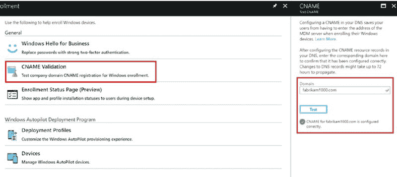

**图 2.37** 继续之前测试 CNAME

回到 Azure AD ➢ “自定义域名”，然后选择你的域名，如 `Fabrikam1000.com`，点击“验证”按钮（未显示）。在图 2.38（左）中，你应该会看到“验证成功”，但“主域”设置为“否”。只需点击“设为主域”，你将得到图 2.38（右）所示的结果。

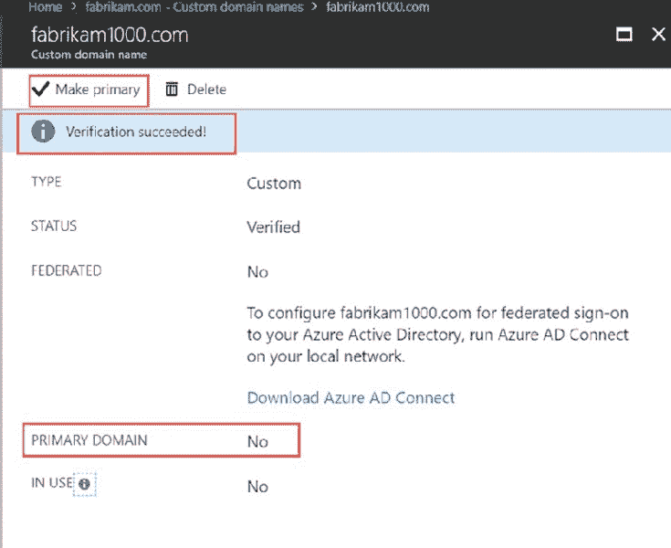

**图 2.38** 目标是先验证域（左）。然后将默认主域更改为自定义域（右）。

现在当你手动将新用户添加到 Azure AD 时，自定义域名（在我的例子中是 `@fabrikam1000.com`）将被接受作为该用户用户名的一部分，如图 2.39 所示。请随意添加一个新用户，如 Anthony Kissel (`kissel@fabrikam1000.com`)，这也可以在图 2.39 中看到。

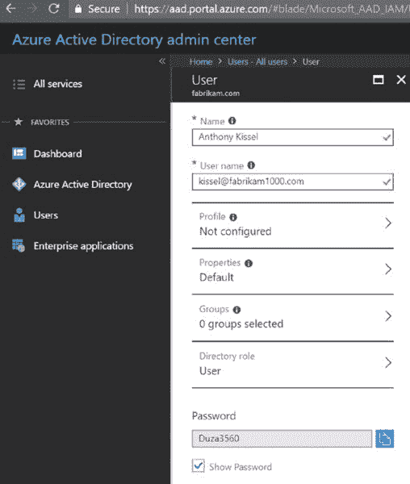

**图 2.39** 如果你不拥有某个域，用户名字段将不允许你添加它。如果你已正确设置自定义域，你会看到复选框亮起绿灯。

保存用户后，你将看到用户列表，如图 2.40 所示。

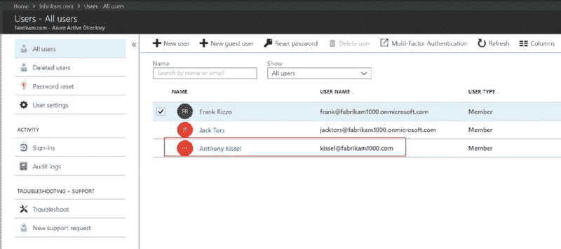

**图 2.40** 你可以看到拥有自定义域名的新用户。

请注意，Frank 和 Jack 仍在使用 `fabrikam1000.onmicrosoft.com` 电子邮件地址。但 Anthony Kissel 现在使用的是一个很酷的新 `fabrikam1000.com` 地址！

此时，如果你想将 frank@fabrikam1000.onmicrosoft.com 更改为 frank@fabrikam1000.com，以及将 Jack 的帐户也更改为使用 `fabrikam1000.com`，你当然可以，这也是我现在要做的。只需点击名称，然后更改他们的用户名。它将接受你选定的新自定义域名。

请记住，即使你将新用户添加到了 Azure AD，他们仍未获得使用任何服务的许可。我发现最简单的方法是直接输入 `https://portal.office.com` 跳转到配置用户许可证的地方。然后点击“用户” ➢ “活动用户”，选择一个用户进行编辑。➢ “编辑用户”，然后点击“许可证和应用”。你将看到类似图 2.41 的内容（虽然你的可能不同）。然后选择一个位置（如美国），并为新用户分配许可证。

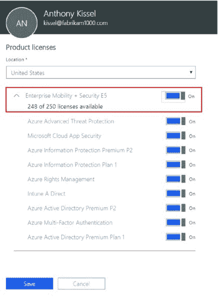

**图 2.41** 为你的新用户分配许可证。

完成此操作后，我建议你等待大约三分钟。出于某种原因，许可证授予可能需要一段时间才能生效。但三分钟后，你就可以正式启航了。

在你短暂的三分钟咖啡休息后，重试将计算机注册到你的 Azure AD 和 MDM 服务。（记住要避开“蛇坑”，争取“金牌”，只有管理员才能争取“金牌”。）

我建议你直接打开 Edge 或按 Windows + R 并输入：

```
ms-device-enrollment:?mode=mdm
```

现在，这次以 Anthony Kissel 的身份注册，他现在使用的是 `fabrikam1000.com` 帐户，如图 2.42 所示。

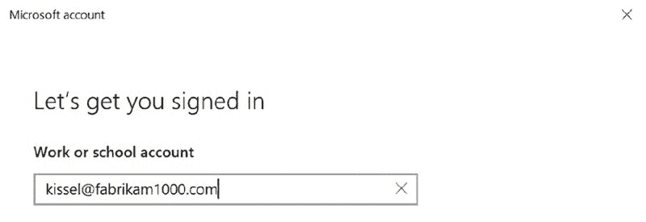

**图 2.42** 现在你可以让本地 Windows 管理员使用你的自定义域名注册用户了！

## 自动将本地 AD 同步到 Azure AD

如果你已经在使用 Office 365 并且也有本地 AD，那么你很可能知道我即将谈论的这个工具。目标很简单：如果你在本地 AD 中有大量本地用户，如何为他们在 Azure AD 中自动生成帐户（以便你可以对他们执行操作，如设置管理或向他们提供 Office 365 等）？

很简单：使用 Azure AD Connect 执行同步。

并且如果出现问题，了解这些同步的运行状况/状态。

### Azure AD Connect

同样，你要找的工具叫做 Azure AD Connect。

该工具经历了许多迭代，有多个版本和名称变更。但这就是现在的工具：Azure AD Connect。换句话说，如果你拥有或曾经拥有旧版 DirSync 或 Azure AD Sync……那些工具已经过时了，现在只有 Azure AD Connect。好消息是，如果你曾使用过这些旧工具，可以从它们升级到 Azure AD Connect。

该工具的基础知识可在 `https://docs.microsoft.com/en-us/azure/active-directory/connect/active-directory-aadconnect` 找到，其中包括针对从旧工具升级用户的建议。

在本示例中，我将假设你有一个单一的本地域，名为 `Fabrikam.com`（正如我在本书开头页面推荐的）。如果你在现实生活中拥有更复杂的环境，那也没关系；你可以使用上述 URL 找到你的场景并尝试操作。

**不要**首先下载 Azure AD Connect 工具。不，不要。不要从那里开始。相反，在你的本地 AD 中，运行“Active Directory 域和信任关系”工具。然后右键点击根节点并选择“属性”。然后在“UPN 后缀”选项卡中，添加你（现已验证）的 Azure AD 域名。在图 2.43 中，我添加了 `fabrikam1000.com` 并点击了“确定”。

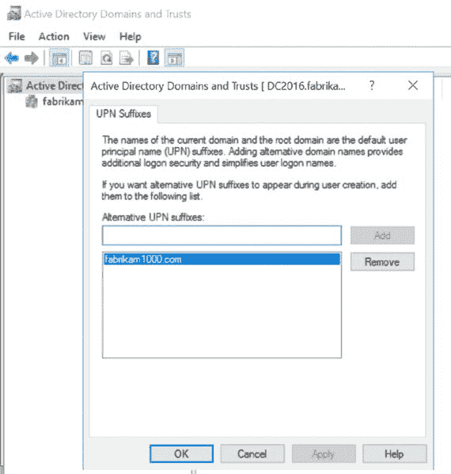

**图 2.43** 你需要在此处的本地 AD 域和信任关系中添加你已验证的 Azure AD 域名。我花了八个小时才弄明白这一点，且找不到任何相关文档。所以，我希望这一步能为你节省那八个小时。

或者，你也可以添加你的 `onmicrosoft.com` 名称，如 `fabrikam1000.onmicrosoft.com`。那也行得通，但既然我费心购买并验证了 `Fabrikam1000.com`，我就使用这个。

## 添加 UPN 后缀后的后续步骤

添加 UPN 后缀后，你现在可以继续下载 Azure AD Connect 并直接将其安装在本地 AD 域的 DC 上。你也可以使用一台备用服务器，但就我和本书而言，我是将其直接安装在域控制器上。下载地址为 `http://go.microsoft.com/fwlink/?LinkId=615771`。

运行后，你将首先看到欢迎屏幕。下一个屏幕如图 2.44 所示，解释了“快速设置”。

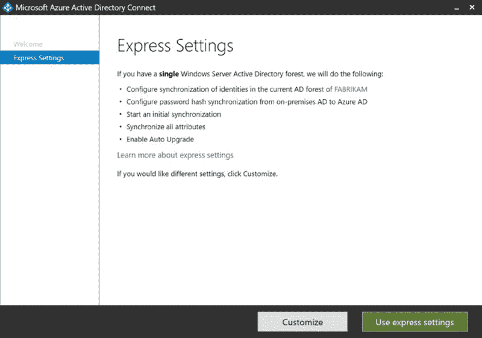

**图 2.44** 使用快速设置将你的（简单的）本地 AD 连接到 Azure AD。

我还要说，快速设置适合本书练习，能让你快速上手运行，但对于“现实环境”可能并非最佳选择。通常你希望将其指向特定的 OU，这样就不会将所有账户同步到 Azure AD，例如你的管理员账户和/或服务账户。

也就是说，为了避免我深入探讨该工具的每一个细节，并能让你通过示例快速上路，快速设置对于我们的用例来说已经足够。

在下一个屏幕上，你将提供 Azure AD 凭据（如图 2.45 所示）；这是你设置 E5 试用版时使用的凭据。然后你将提供本地 AD 凭据，如图 2.46 所示。


**图 2.45** 提供你在设置 E5 账户时使用的凭据。


**图 2.46** 提供本地 AD 域管理员凭据。

现在当你到达 Azure AD 登录配置页面时，你应该看到添加到本地 AD 的 UPN 名称与 Azure AD 域名匹配，如图 2.47 所示。此外在图 2.47 中，Azure AD Connect 程序有一个小 Bug，要求你勾选“继续而不使用任何已验证域”复选框，即使你确实拥有已验证域。等你阅读此书时，它可能已经修复。


**图 2.47** 确保你的 UPN 和 Azure 名称作为“已验证”匹配。


单击“下一步”，然后启动该过程。当过程完成时，你将收到通知，如图 2.48 所示。


**图 2.48** AD Connect 同步向导已完成。

等待几分钟。然后，你可以刷新 Azure AD 管理中心并查看结果。我发现查看结果的最佳方式不是点击图 2.49 中圈出的刷新按钮，而是刷新整个页面（见箭头），然后点击“用户”再点击“所有用户”。搞定。


**图 2.49** 刷新页面以查看新同步的用户。注意新用户来自 Windows Server AD。

你还将在图 2.49 的“来源”列中看到哪些用户是从哪个源创建的：Azure Active Directory 还是 Windows Server AD。

### 更改用户的后缀

但是，等等！同步发生后，来自本地 AD 的同步用户的用户名中将没有漂亮的 `fabrikam1000.com`，而是仍然有难看的 `fabrikam1000.onmicrosoft.com` 作为其用户名的一部分。

为什么会这样？因为你的本地 AD 用户需要已经明确地在使用该后缀，*只有那样*你才会在同步后看到它。

要更改它，对于单个用户，请使用“Active Directory 用户和计算机”，找到一个账户，如 EastSalesUser1，如图 2.50 所示。然后点击“帐户”选项卡，以便执行两个步骤：

*   **步骤 1：** 实际上在“用户登录名”字段中输入一个名称。通常这将是他们已在使用、熟知且喜爱的名称。

*   **步骤 2：** 下拉并选择你之前在“Active Directory 域和信任关系”中指定的自定义域名。在我的例子中，是 `Fabrikam1000.com`。


**图 2.50** 每个用户都需要在本地 AD 中拥有正确的后缀，以便同步到 Azure AD。

你可以等待一段时间，更改将自然发生。

或者你可以实时查看更改发生。要查看它们，请找到 Azure AD Connect 文件夹并启动同步服务，如图 2.51 所示。


**图 2.51** 启动同步服务

然后，该工具本身似乎没有一个大大的“点击此处同步”按钮。但有一种 PowerShell 方法可以做到。

你应该能够仅推送更改，即增量。该命令是：

```
Start-AdSyncSyncCycle -policytype delta
```

如果这不起作用，请等待第一个命令完成，然后尝试再次推送所有内容。该命令是：

```
Start-AdSyncSyncCycle -policytype initial
```

你可以在图 2.52 中看到这两个命令运行的结果。


**图 2.52** 使用 PowerShell 强制执行 AD 到 AAD 同步

完成后，刷新 Azure AD 并再次查看所有用户。仔细注意，你指定的那个用户现在拥有了正确的用户名：EastSalesUser1@fabrikam1000.com，而不再是 `onmicrosoft.com` 那个，如图 2.53 所示。


**图 2.53** 看到你的那个用户已成功从本地 AD 迁移到 Azure AD。

### 批量更新本地 AD 的 UPN（而不是逐个点击用户）

当然，你不想花费整个周末手动逐个更新每个用户的 UPN 名称，只为让它正确同步到 Azure AD。

批量更新所有用户 UPN 名称的秘诀在一篇博客文章中得以快速揭示：

`https://blogs.technet.microsoft.com/heyscriptingguy/2013/08/13/add-user-principal-names-in-active-directory-via-powershell/`

如果你将本地域命名为 `fabrikam.com`，而你的自定义 Azure 名称是 `Fabrikam.com`，那么这一行脚本应该能瞬间填充每个用户的 UPN 属性。在我的例子中，具体是在 Sales OU 中。

```
Get-ADUser -Filter * -SearchBase 'ou=Sales,dc=fabrikam,dc=com'
-Properties userPrincipalName | foreach
{ Set-ADUser $_ -UserPrincipalName
("{0}@{1}" -f $_.name,"fabrikam1000.com")}
```

然后，使用前面的技术重新同步本地 AD 到 Azure AD，搞定。

现在每个人在 Azure AD 中都拥有了从本地 AD 填充的完全正确的用户名，如图 2.54 所示。


**图 2.54** 执行本地 AD PowerShell 命令后，再同步到 Azure AD，所有账户现在都显示你的自定义域名。

### 在 Azure AD 中删除账户

## 尝试删除同步用户

出于兴趣，在 Azure AD 管理中心内，尝试点击一个现有的 Windows Server AD 用户，然后从菜单命令栏中点击 **Delete user**。

**剧透警告：你无法删除。**

同步用户在本地 AD 中诞生、存在并终结，仅同步至此。你可以亲自尝试：在本地 Active Directory 用户和计算机中创建一个新用户。稍等片刻，bingo！你应该能在 Azure AD 中看到它。

同步过程从不出错。绝不。咳咳。所以，如果你真的陷入困境，我学到了一个小 PowerShell 技巧，可以清除 Azure AD 内的记录。命令如下：

```
Install-Module msonline
Connect-MSolService
```

这将提示你输入 Azure 管理员凭据；在本例中为 `Frank@fabrikam1000.onmicrosoft.com`。

```
Remove-MsolUser -userprincipalname yourguy@fabrikam1000.com
```

结果可见图 2.55。


**图 2.55** 如何清除从本地 AD 同步的用户

随后刷新 Azure AD，将显示该用户已被清除，但仍保留在本地 AD 中。

关于删除从本地 AD 同步的对象的优秀文章见此处：

`https://support.microsoft.com/en-us/help/2619062/you-can-t-manage-or-remove-objects-that-were-synchronized-through-the`

没错，这个 URL 就是以单词 *the* 结尾的。

### 让 Windows 10 自动加入 Azure AD（混合 Azure AD 加入设备）

同样，本节所有步骤均为可选，但从长远来看，你可能需要考虑这个有趣的想法：你可以让本地 AD 同步所有现有的 Windows 10 账户，并将它们推送到 Azure AD。

**超级大警告：** 虽然这能让所有 Windows 10 电脑注册到 Azure AD，但它**不会**神奇地让它们同时注册到你的 MDM 服务。别担心：我们在第 4 章 中设置该功能（具有讽刺意味的是，我们使用组策略来实现）。

说到组策略，你可以用它来预先阻止某些 Windows 10 电脑从本地 AD 同步到 Azure AD。该策略设置位于：`Computer` ➢ `Policies` ➢ `Admin Templates` ➢ `Windows Components` ➢ `Device Registration` ➢ **Register domain-joined computers as devices**（如图 2.56 所示）。当你将此策略设置为 **Disabled**（是的，是禁用）时，获取该策略的电脑将忽略我们即将执行的“魔法”。

因此，建议你在执行后续步骤**之前**，将 **Register domain-joined computers as devices** 组策略设置预先分发到你想要排除的机器上。（再做个无耻广告：如果你想知道并验证该设置是否已到达所有目标机器，可以使用 PolicyPak 组策略合规性报告器的付费版，它会告诉你哪些本地机器获得了哪些 GPO 和设置，从而消除猜测……但我跑题了。）


**图 2.56** 使用 **Register domain-joined computers as devices** 策略防止 Windows 10 电脑从本地 AD 同步到 Azure AD

无论如何，当你准备好开始在本地 Azure AD 和 Azure AD 之间进行“瓦肯心灵融合”时，请在运行 Azure AD Connect 程序的机器上逐行输入以下每个 PowerShell 命令。

如果你想复制粘贴而不是手动输入，我会告诉你来源，也就是这个 URL（稍后我会再提一次）：`https://docs.microsoft.com/en-us/azure/active-directory/devices/hybrid-azuread-join-manual-steps`。

以下是 PowerShell 代码行：

```
Import-Module -Name "C:\Program Files\Microsoft Azure Active Directory Connect\AdPrep\AdSyncPrep.psm1"
$aadAdminCred = Get-Credential
Initialize-ADSyncDomainJoinedComputerSync –AdConnectorAccount frank@fabrikam1000.com -AzureADCredentials $aadAdminCred
```

这些 PowerShell 命令的结果可见图 2.57 的第一部分。接着，如果你想验证是否真正生效，可以运行以下验证检查 PowerShell 命令（这些行也在上述微软 URL 中）：

```
$scp = New-Object System.DirectoryServices.DirectoryEntry
$scp.Path = "LDAP://CN=62a0ff2e-97b9-4513-943f-0d221bd30080,CN=Device Registration Configuration,CN=Services,CN=Configuration,DC=fabrikam,DC=com"
$scp.Keywords
```


**图 2.57** 你需要专门设置 Azure AD 以同步 Windows 10 电脑

你可以在图 2.57 的第二个代码块中看到结果，它会输出一些内容，包括我的域名 `fabrikam1000.onmicrosoft.com`！

现在，你网络上的 Windows 10 机器（1607 及更高版本）将自动收到通知并自我注册到 Azure AD……无论是新加入域的，还是现有的 Windows 10 机器，在重启和/或登录时均会如此。

你也可以见证这一过程。在 Windows 10 系统重启后，且 Azure AD Connect 自然发生几次同步后，当你检查所有设备时，应该能看到新的 Windows 10 电脑弹出到 Azure AD 中，如图 2.58 所示的 W10-1703-PRO-64 电脑。如果你查看 Join Type，它会显示“Hybrid Azure AD joined”。


**图 2.58** 如何查看混合 Azure AD 加入的机器

回到 Windows 10 机器上，你需要查看它们是否收到信号以神奇地执行 Azure AD 加入。当你在 Windows 10 机器上运行命令 `dsregcmd /status` 时，可能会看到图 2.59 所示内容，其中清楚地显示 `AzureADJoined` 为 `NO`。


**图 2.59** 机器自动 Azure AD 加入前的状态

随后，过一段时间后，Windows 10 机器上会发生变化。

你可以在图 2.60 中看到该变化，随着你不断运行 `dsregcmd /status`。该命令会显示大量你不关心的信息。但关键是第一行：`AzureADJoined` 设置为 `YES`，如图 2.60 所示。


**图 2.60** 机器自动 Azure AD 加入后的状态

同样，这只有在 Azure AD 同步发生一两次后才会发生。如果你想催促它，请参阅前面关于如何运行增量同步的命令。这对我“加速”进程很有效。

此外，如果你想查看所有已加入 Azure AD 的电脑，可以使用以下几个 PowerShell 命令。

*   `Install-Module msonline`

*   `Connect-msolservice`，随后在提示时输入 Frank 的管理员凭据。

*   `Get-MSoLDevice -all` 将显示已加入 Azure AD 的机器。

*   或使用 `Get-MSOLDevice -all | Select displayname, objectid` 获取更美观的视图，如图 2.61 所示。


**图 2.61** 你可以通过 `get-msoldevice` PowerShell cmdlet 查看加入 Azure AD 的电脑

这些就是基础知识，也是让机器同时实现 AD 加入和 Azure AD 加入的方法。同样，这有一个很酷的术语，我们称之为 `DJ++`。现在你已经是个高手并完成了设置，可以在鸡尾酒会上随意提这个缩写了。

话虽这么说，还有更多信息，包括各种额外的“魔法技巧”，如下所示：

*   处理多个林同步到 Azure AD

*   使用旧版 2008 域控制器，而非 Server 2016 及更高版本

*   将 Windows 7 机器纳入 Azure AD

这些指南（再次）可在以下位置找到：

`https://docs.microsoft.com/en-us/azure/active-directory/devices/hybrid-azuread-join-manual-steps`

### Azure AD Connect Health

如果你愿意，也可以对同步过程进行良好的持续监控。这超出了本书的范围，但如果你想了解一下，它包含在 Azure AD 订阅中。

以下是关于该主题的三个优质链接：

`https://docs.microsoft.com/en-us/azure/active-directory/connect/active-directory-aadconnect`

`https://docs.microsoft.com/en-us/azure/active-directory/connect-health/active-directory-aadconnect-health`

`https://docs.microsoft.com/en-us/azure/active-directory/connect-health/active-directory-aadconnect-health-sync`

## 结束语

好了。你做到了。让我们回顾一下你所做的一切：

*   你获取了 Azure AD 账户，无论是独立账户，还是搭配 Enterprise Mobility + Security，或是搭配 Microsoft 365。

*   你获取了 MDM 服务，并将其与 Azure AD 关联。

*   你设置了所有组件以启用 MDM 自动注册。

*   你深入“Workplace Join”的“蛇坑”，了解到它其实并非真正的 MDM。

*   你实际上使用 MDM 注册了一些机器，无论是漫长的手动方法，还是使用深层链接。

*   此外，你还可以选择……

    *   摆脱“`onmicrosoft.com`”命名模式，改用自定义名称。


*   将本地 AD 同步到 Azure AD。
*   让你的 Windows 10 机器自动执行 `DJ++` 加入。

我认为可以公正地说，你在本章完成了大量工作。而我们才刚刚开始。

在推特上 `@jeremymoskowitz` 艾特我，带上话题标签 `#mdmbook`，告诉我你从本章获得了什么。我非常喜欢收到你的推文！

# 第 3 章：MDM 配置文件、策略和组

上一章你设置了 Azure，选择了 MDM 服务，购买了域名，并连接好所有“线路”，使你的本地 AD 用户账户同步到 Azure AD。

本章稍微轻松一些。在本章中，我们有四个目标：

1.  创建你的第一个 MDM 策略。
2.  了解 MDM 策略内部构造的一些内部运作机制。
3.  利用第三方 ADMX 文件。
4.  学习如何创建和利用 MDM 组来定向策略。

那么，让我们开始吧。

## MDM 策略和 Policy CSP

人们喜欢说 MDM 就像组策略，因为他们以组策略为原型，作为利用组策略对机器进行管理的基础模型。

例如：

*   组策略可以将“外观和行为”策略部署到 Windows 机器。MDM 也可以将“外观和行为”策略部署到 Windows 机器。
*   组策略可以将安全设置部署到 Windows 机器。MDM 也可以将安全设置部署到 Windows 机器。
*   组策略可以将自定义应用程序设置（也称为 ADMX 设置）部署到 Windows 机器。MDM 也可以部署自定义 ADMX 设置到 Windows 机器。
*   组策略可以将软件部署到 Windows 机器。MDM 也可以将软件部署到 Windows 机器。

哇。难怪人们将 MDM 等同于组策略。他们在组策略的世界里学会了所有原始技巧，现在想将这些技巧转换到 MDM 和现代管理的世界中。

让我们使用 MDM 服务（在我的例子中是 Intune）向机器设置一些策略。稍后我们还将部署软件。

### MDM：策略入门

你在上一章将一些机器注册到了 MDM。我不知道你是否注意到了，但在将机器注册到 MDM 后，你会立即收到一条小小的欢呼消息，如图 3.1 所示。


**图 3.1** 注册设备后，你会收到一条成功消息。

如果你仔细阅读该消息，它基本上是在说：“耐心等待，在未来的某个时刻，你设置的任何策略最终都会送达那里。”

但你是一位忙碌的 IT 专业人员。

在 MDM 领域，你可以运行相当于 `GPUpdate` 的操作，称为 MDM 同步。你可以通过先返回到 Windows 10“设置”➢“账户”➢“访问工作或学校”部分来找到这个神奇的同步按钮。然后找到你的小公文包，见图 3.2（左侧）并单击“信息”。请注意，如果你以标准用户身份登录，你将看到 Windows 徽标图标（图 3.2 右侧），而不是公文包图标，这在我看来有点不一致。


**图 3.2** “访问工作或学校”中的“信息”按钮。本地管理员看到左侧内容。标准用户看到右侧内容。

单击“信息”后，你将看到“同步”按钮（图 3.3）。


**图 3.3** “同步”按钮相当于 MDM 的 `GPUpdate`。

“同步”按钮将类似于 `GPUpdate` 命令，但这次是针对 MDM 的。尽管你还没有 MDM 策略，但请随意现在就同步一下。

我现在教你这个，是为了以后每次你想查看更改时，我不必给你分步指引。我只会说“……并与你的 MDM 服务同步。”现在你就会明白我的意思了。

而且，就我所见，“同步”按钮是有效的，但并不总是在第一次，甚至有时第二次就生效。我不知道这是 MDM 服务发送策略与策略应用之间的延迟，还是其他原因。但如果你必须点击“同步”几次同步才真正发生，不要完全感到惊讶。也可能是策略在 MDM 服务中还没完全就绪，正在磨合准备中。又或许只是我不耐烦而已。

### 配置文件和策略

让我们运行一个快速测试，验证一切正常，从而创建你的第一个策略。首先，一些术语说明。

MDM 领域没有 GPO 这回事。那不是一个“东西”。

让我再说一遍：在新世界里没有组策略对象。Azure 没有，Intune 没有，其他任何 MDM 系统也没有。为了彻底澄清，确实有一些项目执行的功能与某些组策略设置相同，但 GPO 的概念在 MDM 中不存在。

 请参阅第 11 章“MDM 附加工具：免费和付费”，了解如何使用 PolicyPak MDM 获取 GPO 及其设置，并利用你现有的 MDM 服务加以利用。但 MDM 服务本身不具备 GPO 的固有概念。

 另外，有点不相关，如果你需要获取现有的 Intune 策略并导出供他人使用，然后导入，这篇博客文章非常有价值：`http://techgenix.com/export-intune-policies/`。

取而代之的是，你创建用于包含策略的东西称为*配置文件*。这不是我会起的名字，但嘿，这就是现实。

所以，为了清晰起见，在 MDM 领域你需要：

*   创建配置文件，然后……
*   将策略塞入配置文件，然后……
*   将这些配置文件定向到特定计算机。

现在就试试吧。

因此，创建 MDM 策略的第一步是创建容器，即用于承载这些策略的配置文件。

## 使用 Intune

使用 Intune，点击 **设备配置**，然后点击 **配置文件**。在 **设备配置 - 配置文件** 窗格中，点击 **创建配置文件**。你可以在 图 3.4 中看到我正在创建一个更改 Edge 主页的配置文件。请注意可供你选择的大量配置文件类型。现在，点击 **设备限制**。


**图 3.4** 点击配置文件类型以查看该配置文件类型中的策略类型。

当你选择 **设备限制** 下拉菜单时，将出现一个名为 **设备限制** 的新窗格，其中包含许多选项。只需关注 图 3.5 中所示的 **Microsoft Edge 浏览器**。然后找到名为 **启动页面** 的策略，输入你的域名（或任何有效的 URL），如 `http://www.fabrikam1000.com`，然后点击 **确定**（也可见于 图 3.5）。


**图 3.5** 创建你的第一个设备限制策略以管理 Microsoft Edge 浏览器

再次点击 **确定** 以保存配置文件，你将收到如下所示的通知，这实际上是两条消息。


这两条消息分别是：嘿，你做到了。你已保存你的第一个策略。但是，它尚未分配到任何位置以实际生效。

就像在组策略领域，你需要将 GPO“链接”到某个位置；在 MDM 领域，你需要将其*分配*给一个组。

在 MDM 领域，有一个方便的 **所有** 组。这就是我们要首先面向的目标：**所有**。具体来说是 **所有设备**。要执行此操作，请点击 **分配**，然后指定 **所有设备**，如 图 3.6 所示。然后点击 **保存** 以保存它。


**图 3.6** 使用分配窗格将你的策略分配给所有设备。

现在是时候与你的 MDM 服务同步了。（记得我说过我会提到这一点吗？）启动 Edge 浏览器，看看你的 URL 是否已成为主页。

而且，这是最棒的部分。你将其设为设备限制。因此，这些设备上的所有用户都将获得相同的设置。试试看！以 MDM 注册的 Windows 10 计算机上的任何其他用户身份登录。每个人都将获得相同的 Edge 主页设置。在 图 3.7 中，你可以看到一次 MDM 同步，然后我打开 Microsoft Edge。它就在那里！


**图 3.7** 你的第一个 MDM 策略将 Windows Edge 主页设置为你选择的值！成功！

并且，在设置窗口中（如 图 3.8 所示），如果你再往下滚动一点，首先会看到一个名为 **由 <你的域> 管理的区域**（未显示）的部分，你会看到其中列出了 **浏览器**。继续向下滚动到一个名为 **高级诊断报告** 的部分（如 图 3.8 所示），你会看到一个大大的 **创建报告** 按钮（也可见于 图 3.8）。现在尝试一下，你将看到创建了一个 `MDMDiagReport.html` 文件。这有点像你从 GPresults 报告中记得的内容，但现在是针对 MDM 的。


**图 3.8** 使用 MDM 高级诊断报告查看你的设置。

打开它，你可以看到你的设置！

我们稍后会回到 MDM 高级诊断报告，但知道它在这里很好，如果你想在本章（和其他章节）的示例过程中不时检查一下的话。

### 什么构成了 MDM 策略？

因此，前面在 图 3.5 中，你看到了一大堆可供选择的策略设置。这些来自哪里？

嗯，同样，微软的 MDM 团队决定哪些策略设置可供使用，并使其可供所有 MDM 提供商（Intune、Workspace ONE、MobileIron 等）使用。

有一个巨大的、不断变化但通常保持最新的列表，可在以下位置获取：

`https://docs.microsoft.com/en-us/windows/client-management/mdm/configuration-service-provider-reference`

在那里，你将看到 MDM 领域的所有可能性。花一分钟将其加入浏览器书签以备将来参考；你很可能会一次又一次地回来这里，获取关于在终结点上配置什么的想法。

#### 调查和发现 CSP

我们在 第 1 章“企业移动性和 MDM 基础知识”的“CSP：配置服务提供程序”部分讨论过这个概念。

我们从 MDM 服务获得的编辑器和视图，只是用来配置实际核心移动部件——终结点上的 CSP——的漂亮窗口装饰（如果你允许我用这个双关语的话）。

你可以查看 MDM 可以配置的事物的巨大列表；内容太详尽，无法逐一介绍所有领域。但你会看到用于配置 CSP 项的 CSP，例如：

*   `BitLocker CSP`
*   `AppLocker CSP`
*   `BrowserFavorite CSP`

根据它们的名称很容易理解其目标。还有一些名称不那么清晰，如下所示：

*   `PXLogical CSP`
*   `DevDetail CSP`
*   `SUPL CSP`

如果不查阅此处的文档，你可能完全不知道这些 CSP 是做什么的。但同样，文档有助于了解 MDM 领域的可能性。

但请记住，仅仅因为你看到列出了某个 CSP，并不意味着其文档和设置是针对 Windows 10 的。例如，你可能会想：“哦，`BrowserFavorite CSP`……那肯定是用于 Windows 10 的 Edge 及其浏览器收藏夹！”你完全错了。请看 图 3.9。


**图 3.9** 别被骗了：并非每个名称熟悉的 CSP 都能按预期在 Windows 10 上工作。

确实，有一种方法可以使用 MDM 告诉 Edge 填充哪些收藏夹，但这些设置位于另一个 CSP 中，即 `PolicyCSP` 下的 `Browser/ProvisionFavorites` 类别。

关键是，不要仅凭 CSP 的显示标题判断其功能：请查阅文档，确保你想要设置的内容确实存在于某个 CSP 中。

因此，优秀 MDM 系统的工作是抽象这些设置，并为你提供一个漂亮的 GUI 来点击这些设置。在业内，这被称为在 MDM 系统中“呈现”设置；即将这种低级 CSP 功能以漂亮的可点击 UI 按钮、复选框或其他形式呈现在表面。我还听过这些被称为“一流”设置。

有时 MDM 系统不会呈现某个可能的 CSP 设置，这真是令人扫兴。当这种情况发生时（或者更准确地说，不发生时），我们作为 MDM 系统的 IT 管理员就必须全副武装，执行所谓的“自定义 URI”，我们稍后会尝试一下。我听过此类设置被称为“三流设置”。也就是说，Windows 10 上的 MDM 系统会执行该操作，但只是没有简单、轻松的点击方式来完成这件简单的事。

还有一个非常重要的点。还记得前面我们设置浏览器主页时吗？而在 图 3.6 中，我们必须决定此设置是应用于用户、设备，还是两者皆应用。了解你的设置是适用于用户、设备（或两者）的唯一方法是查阅文档。

在 图 3.10 中，你可以看到 `Browser/HomePages` 设置的文档，其作用域列为用户和设备均可。


### 策略 CSP

可以说，你的 MDM 服务在 Windows 10 上进行的最大量操作，将是下发存在于策略 CSP 中的策略。确实，你可以在图 3.10 中看到策略 CSP 中部分类别的简略列表，从 Autoplay、Bitlocker、BITS、Bluetooth 等开始。

同样，策略 CSP 只是 MDM 引擎可以从中获取指令的众多 CSP 中的一个。但它是与你在组策略领域可能执行的常见项目最紧密对齐的一个，也是拥有最多 Windows 10 配置项的一个。

某些 MDM 系统提供了一种搜索或筛选设置并找到你想要部署的设置的方法。而其他的则没有。因此，我喜欢从这里的策略 CSP 文档开始调查有趣的设置，并寻找我想要执行的任务：`https://docs.microsoft.com/en-us/windows/client-management/mdm/policy-configuration-service-provider`。

例如，老板可能走进你的办公室说：“Cortana？呸！”然后你就得当个“凶手”把 Cortana “干掉”。

好吧，你同意干掉 Cortana。现在该怎么做？

首先去策略 CSP 文档中查找名称包含 Cortana 的项目。页面上会有一小把这样的项目。截至写作时，有以下这些：

*   `PolicyCSP/AboveLock/AllowCortanaAboveLock`
*   `PolicyCSP/Experience/AllowCortana`
*   `PolicyCSP/Search/AllowCortanaInAAD`

显然，你想要的是 `PolicyCSP/Experience/AllowCortana`。点击它看看是否符合要求。一旦你锁定了一个看似合理的设置，问问自己：

*   它是否适用于我拥有的 Windows 10 版本？专业版、商业版还是企业版？
*   我选中的设置是否适用于我拥有的 Windows 10 版本（1703、1709 或更高版本）？
*   此设置是针对用户还是设备的？
*   一旦我做出此配置更改，我预期会看到什么发生（或不发生）？

你可以在图 3.11 中看到针对 `PolicyCSP/Experience/AllowCortana` 的每个问题的答案：

*   是的，它适用于我公司可能拥有的所有 Windows 10 版本（因此，不支持 Windows 10 家庭版）。
*   该设置仅适用于设备（这对于范围界定很重要）。
*   一旦设置此项，Cortana 被禁用，但搜索功能保持工作。好吧，很好。


**图 3.11** 在部署和测试前了解设置

现在让我们干掉 Cortana。

回到 Intune 中，点击“设备配置”，然后选择“配置文件”并“创建配置文件”。然后提供一个名称，如“Kill Cortana”。在“平台”下拉菜单中，选择“Windows 10 及更高版本”。在“配置文件类型”下拉菜单中，选择“设备限制”。然后在“设备限制”部分，点击“常规”，并找到 Cortana 策略。

你可以看到 Cortana 的策略默认为“未配置”，这意味着它默认必定是启用的。

现在，让我们选择“阻止”。

所有这些都可以在图 3.12 中看到。然后，分配给“所有设备”（未显示）。并且，请记住，如果你将此配置文件分配给用户，这将不起作用，因为“Kill Cortana”设置仅适用于设备。


**图 3.12** 使用 Microsoft Intune 阻止 Cortana

回到终端，在 MDM 部分点击图 3.3 中显示的“同步”上次查看时间。你应该会看到时间跳变到现在，如果一切顺利，Cortana 应该已被禁用。也就是说，同步后，有时需要一段时间，有时甚至需要不止一次同步。

但你可以通过调查 Windows 10 机器上的注册表来确认是否完成。在图 3.13 中，你可以看到在遍历到 `HKEY_LOCAL_MACHINE\Software\Microsoft\PolicyManager\current\device\Experience` 后，`AllowCortana` 被设置为 0。


**图 3.13** 在注册表的 PolicyManager 部分查看 MDM 设置 AllowCortana。


如果你随后移除该配置文件并重新同步，你将得到图 3.14 中所示的结果，其中 `AllowCortana` 随后恢复，并被设回 1。


**图 3.14** 移除 MDM 配置文件后 AllowCortana 返回 1（已启用）。

你可能直到注销并重新登录才会看到 Cortana 重新“复活”。

### ADMX 支持的策略

因此，在上一节中，我们在文档中找到了一个策略设置，然后碰巧也在 MDM 用户界面中找到了可以图形化点击的对应项。砰：它生效了。

但并非每个 MDM 提供商都相同，也不是每个 MDM 提供商都会为每个有趣的策略设置提供 GUI 启用。有时，新设置只有在某个未来版本的 Windows 出现时才可用于测试。（注：未来版本的 Windows 可以通过 Windows 预览体验计划下载。）如果你想看到那些尚未诞生的 MDM 设置生效，你将不得不使用 MDM 提供商绝对还未放入其 GUI 中的设置进行测试。

因此，有一种小小的“后门”方法可以配置一大堆可能尚未启用 GUI 的策略 CSP 设置。我说“尚未”，因为通常只是时间问题，从 MDM 策略随 Windows 10 发布到 MDM 服务收到通知并制作出该策略设置的 GUI 启用版本。正如我之前提到的，这些 GUI 启用的设置有时被称为“第一方”设置。

或者，MDM 提供商可能永远收不到通知，从未为该策略设置启用 GUI，那时你会庆幸自己知道这种投放这些设置的技术。这些设置因此被称为“第三方”设置。

除非你确实需要，否则你可能不想使用这种后门方法。如果可以使用 GUI 设置设置，你应该争取使用 GUI。这不仅更容易操作，而且最终对设置进行报告也更容易。

我们在本节中将要处理的设置称为 ADMX 支持的策略。这些 ADMX 支持的策略设置只有少数（但数量可观）。我称这些为“精选 ADMX”设置。

精选 ADMX 设置的列表可以在这里找到：

`https://docs.microsoft.com/en-us/windows/client-management/mdm/policy-configuration-service-provider#admx-backed-policies`

就在这一秒，在我写这段文字时，文档显示有 386 个特殊的、精选的 ADMX 支持的策略设置。同样，我称它们为精选，是因为它们确实是精选的。它们很特别，由 MDM 团队挑选，作为他们想要支持且有保证结果的项目。因此，完整的 ADMX 支持的策略设置列表在上述 URL 中，但正如你可能从第 1 章记得的那样，Microsoft 随组策略及其 ADMX 文件提供的 ADMX 设置超过 4000 个。

但等等，“这讲不通”，我听到你说。“如果有 4000 多个 ADMX 设置，难道我不能对*任何* ADMX 设置施展同样的魔法吗？”

不能。

如果您想要提供精选列表中不存在的某个内置 ADMX 首选设置，您的 MDM 服务*似乎*允许您这样做。但实际上不行。您无法将操作系统 ADMX 文件导入 MDM 服务，并交付任意在组策略中自然生效的组策略设置（伤心脸）。请记住，只有那些精选设置才是真正被允许的。

允许的是支持第三方 ADMX 设置的应用程序的第三方 ADMX 设置。我们也将探讨这一点。

 把那个伤心脸扔到外太空去。如果您确实有某个钟爱的 ADMX 设置（实际上，任何组策略设置都可以），并希望使用 MDM 服务进行交付，那么（再次无耻推销）PolicyPak MDM 来拯救您了。请访问 `www.policypak.com/products/policypak-mdm-edition.html` 查看 PolicyPak MDM 版本，并观看视频，了解如何部署真正的组策略、组策略首选项和组策略安全设置——这些都是微软不允许您部署的。演示操作方法的视频就在那个页面上。

因此，通过 Intune 推送这些精选 ADMX 设置主要有两种方式（其他 MDM 可能有所不同）：Administrative Templates 节点和 Custom URIs。

现在让我们一起探索这两种方式。

### 通过 Intune 使用 Administrative Templates 节点

在 Microsoft Ignite 2018 大会上，微软宣布了在 Intune 中通过简单的点击操作即可访问某些 Admin Template 设置的技术预览版。在预览版中，Administrative Templates 节点位于配置文件类型内，如图 3.15 所示。


**图 3.15** Intune 中 Administrative Templates 节点的预览版

创建 Administrative Templates 配置文件后，可能的设置会显示在其自己的边栏选项卡中，如图 3.16 所示。精选的 ADMX 设置以扁平但可搜索的列表形式呈现。在图 3.17 中，我搜索关键字 *desktop*，相关的设置随即出现。


**图 3.16** Intune 中以扁平列表形式呈现的精选 ADMX 设置


**图 3.17** 搜索相关的 ADMX 设置

您可能会注意到，该列表并非层级结构，这与我们在组策略领域习惯看到的不同。我不知道微软是会保持现状，还是会通过引入层级结构使其更像组策略。就我而言，我倾向于以层级方式查看分组在一起的相关设置。您可以按 Path 排序，这在一定程度上能实现该效果，但这不是我的首选。无论如何，我猜测这可能会发生变化，因为该功能处于预览阶段，在本书付印前可能会有所更改。

单击任意策略设置会打开另一个边栏选项卡，这对组策略用户来说应该很熟悉。您可以看到“三态”选择：Not configured（默认）、Enabled 或 Disabled。


随后，您可以将该配置文件分配给一组用户或计算机。在我的测试中，这些设置在针对 User 或 Machine 侧进行定位时似乎都能生效，但我并未测试所有设置。

我将以一个小小的坦白/疑问结束本节：如果有 386 个特殊的精选设置，为什么它们不*全*在这里？我粗略统计，预览版中仅列出了 231 个项目，其中一些还是针对 Office 的，按理说不应计入在内。

我知道这项工作正在进行中，请持续关注其进展。我预计此部分会首先针对 Office、IE 和 OneDrive 设置得到改进，然后扩展到其他精选的 ADMX 支持设置。

### 无 GUI 的 PolicyCSP 项目的 Custom URIs

因此，如果您的 MDM 服务没有提供一种巧妙的点击式方法来查找和配置 ADMX 支持的策略设置，那么是时候弄脏手来处理这些“第三类”设置了。

我认为我们即将共同演示的过程相当繁琐，但值得了解如何操作（即使在未来某个时刻，所有可用的 CSP 设置都浮出水面并启用了 GUI）。这就像知道如何转动钥匙启动汽车，或者知道如何使用搭电线给汽车搭电启动。

让我们来搭电启动吧。

同样，我即将展示的过程仅在您的 MDM 没有提供执行相同功能的 GUI 方法时才需要。我们要用作示例的是 `PolicyCSP/InternetExplorer/DisableAdobeFlash`，如图 3.18 所示。


**图 3.18** ADMX 支持设置的示例

我在 Windows Intune 中摸索了约 20 分钟，找不到通过 GUI 点击启用它的方法。这并不意味着 Windows Intune 团队明天不会醒来并说：“嘿，让我们为‘禁用 Adobe Flash’设置启用 GUI 并提供给大家！”只是他们目前还没有……而已。

所以，在我们完全踏上这条路之前，先验证一下 Flash 在我们的 Windows 10 IE 中是否快乐、正常工作且已启用……然后再由我们“扼杀”它。（看来本书里我们做了很多“扼杀”工作。别告诉我妈。）

在 Windows 10 上启动 IE，然后访问 `http://get.adobe.com/flashplayer/about/`。您是否看到了如图 3.19 所示的充满活力的 Adobe 弹跳框？


**图 3.19** IE 中默认启用的 Adobe Flash

很好，现在让我们使用自定义的 ADMX 支持 MDM 策略来“扼杀” Adobe Flash。

现在，如果我要使用组策略来完成这项工作（我知道我不会），该设置在 User 和 Computer 两侧均可找到。我在图 3.20 中展示了 User 侧的示例，打开组策略编辑器，在 User Configuration ➢ Admin Templates ➢ Windows Components ➢ Internet Explorer ➢ Add-on Management ➢ **Turn off Adobe Flash in Internet Explorer and prevent applications from using Internet Explorer technology to instantiate Flash objects** 下找到它。（是的，难以置信，那真的是该策略的全名。）


**图 3.20** 我们将要设置的组策略设置，但使用 MDM 实现

如果您查看图 3.18，会看到文档阐述了该设置在组策略 ADMX 内部的位置。

文档中 ADMX Info 块的内容如下：

*   GP English name: Turn off Adobe Flash in Internet Explorer and prevent applications from using Internet Explorer technology to instantiate Flash objects
*   GP name: `DisableFlashInIE`
*   GP path: Windows Components/Internet Explorer/Security Features/Add-on Management
*   GP ADMX file name: `inetres.admx`

正如组策略设置可以是用户侧或计算机侧一样，MDM 设置也可以。在 MDM 术语中表达这一点的格式和方式如下：

*   `./User/Vendor/MSFT/Policy/Config/*AreaName*/*PolicyName*`
*   `./Device/Vendor/MSFT/Policy/Config/*AreaName*/*PolicyName*`

请注意 `/User` 和 `/Device` 前的前导点 (`.`)。

现在，当我们查看图 3.20 时，这是一个仅包含 Enabled 和 Disabled 的简单策略，没有什么花哨的地方，这也是我们要首先处理的目标。因此，我们的任务是向该策略设置交付“Enabled”，但使用的是 MDM 而非组策略。

我们现在需要将已知的所有信息片段和所需使用的片段收集起来，将它们全部组合在一起。

### 配置自定义 OMA-URI 策略

*   我们知道 PolicyCSP 的位置和策略名称：`InternetExplorer/DisableAdobeFlash`（见图 3.18）。
*   我们知道在 MDM 中表达它的方式（通常情况）。
*   我们知道要在 User 端执行此操作。

将这些组合在一起，得到：

`./User/Vendor/MSFT/Policy/Config/InternetExplorer/DisableAdobeFlash`

且必须完全正确地大写，否则无法工作。请记下来，或在制作 MDM 配置文件和策略时备查。

这种特殊格式的行称为自定义 OMA-URI。请记住，OMA 是开放移动联盟，URI 统一资源标识符。它基本上是你想用 MDM 触达的地址或值。

使用 Intune，你将创建自定义配置文件类型，如图 3.21 所示。


**图 3.21** 为无 GUI 的 ADMX 支持策略创建自定义配置文件类型。

你需要的最后两条信息埋藏在 MDM 文档中，我直接告诉你“数据类型”和“值”需要什么：

*   “数据类型”使用 `String`。
*   “值”使用 `<enabled/>`（无空格）。

你可以在图 3.22 中看到这些。


**图 3.22** 创建自定义 OMA-URI 设置

 我见过一些文档显示 `<enabled />`。即小于号、单词 `enabled`、一个空格、斜杠、大于号。当我使用该语法（添加空格）时，它无法工作，但某些 MDM 服务可能需要。

保存策略后，执行分配给所有用户（未显示）。

回到 Windows 10 机器，如果 IE 仍打开则关闭。然后再次与 MDM 同步，从 MDM 服务获取此设置。接着返回 Flash 播放器测试 URL，在广告弹出前，你应该看到图 3.23 所示内容，不再有弹跳的 Adobe Flash 动画。


**图 3.23** Flash 现在应在 IE 中停止运行。

这里发生了一个非常巧妙的底层过程。请记住，这不涉及组策略。你创建了一个自定义 OMA-URI 来分发 ADMX 支持的设置。既然是 ADMX 支持的设置，意味着它必须写入组策略风格的注册表项，对吧？没错。你可以在 `HKCU\Software\Policies\Microsoft\Internet Explorer` 中看到图 3.24 所示的结果示例。它将 `DisableFlashInIE` 设置为 `1`。


**图 3.24** 未涉及组策略，但 Policies 键被操作了。

当你删除配置文件或终止策略设置时，设置会消失，就像组策略一样，恢复原始行为。

但同样，组策略引擎（也称为 GPsvc）完全不参与分发（或撤销分发）。

很巧妙。

话虽如此，并非每个 ADMX 支持的策略设置都是简单的启用/禁用值。有些 ADMX 项可能非常复杂，同样希望你不必深入 ADMX 内部，辨明其在组策略中的构建方式，并在 MDM 中“重建”它。MDM 服务应将你与这些细节隔离。

但如果你发现某 ADMX 支持的设置有无数基于文本的选项或其他可配置选项，你就得穿上更多装备，深入 ADMX 和 ADML 文件内部，弄清其行为，再将该策略制作成自定义 OMA-URI。

这里举一个复杂 ADMX 支持的例子太繁琐，会消耗太多篇幅，希望你永远不用这么做。

但好消息是，别人已经做了解释这些步骤的艰苦工作，所以我不必做。前两篇文章来自微软，可查看第二篇中的优秀演示视频。后两篇来自同为 MVP 的 Peter van der Woude，他撰写了关于 MDM 和 Intune 的优秀操作指南。这四个资源展示如何拆解 ADMX 和 ADML 文件并创建更复杂的 ADMX 支持策略：

*   `https://docs.microsoft.com/en-us/windows/client-management/mdm/understanding-admx-backed-policies`
*   `https://docs.microsoft.com/en-us/windows/client-management/mdm/enable-admx-backed-policies-in-mdm`
*   `https://www.petervanderwoude.nl/post/allow-users-to-connect-remotely-to-this-computer-via-windows-10-mdm-admx-style/`
*   `https://www.petervanderwoude.nl/post/deep-dive-configuring-windows-10-admx-backed-policies/`

### 引入第三方 ADMX 文件

有时你可能需要分发微软“非内置”的策略。在组策略领域，这些通常以（旧）ADM 或较新的 ADMX 格式提供。

附带组策略 ADMX 文件的桌面应用程序不多。但有一些。这些是热门应用：

*   Office 2007 至今的 Office 版本
*   Acrobat Reader 和 Standard（说实话功能相当有限）
*   Google Chrome
*   Mozilla Firefox 正开始获得一些组策略支持。

还有一些其他的，但这些是你可能已在现有组策略中使用的重量级应用。你的 MDM 服务有方法引入第三方 ADMX 文件并将那些设置分发到 Windows 10 机器。


# 引入第三方 ADMX 文件

在组策略领域，引入 ADMX 文件的概念称为“使用” ADM 或 ADMX 文件。现在在 MDM 中，只是为了与众不同称为“引入”，对我来说听起来有点恶心。但这只是我个人感觉。

无论如何，记住之前的约定：微软维护的所有 ADMX 支持策略，都是来自微软的，正如我说的，（几乎）保证按预期工作。但对于第三方 ADMX 文件，微软态度较随意，不维护，因此不保证它们按预期工作。请记住，微软发布了我之前提到的管理模板技术预览版。截至目前，无法通过引入以点击方式添加 ADMX 模板。我衷心怀疑他们会添加此功能，似乎很容易实现。我无法展示分步操作，因为目前无内容可展示。但请留意这一可能性。

因此，目前步骤相当繁琐（又是）。

系好安全带，操作如下。

引入第三方 ADMX 分两步：

*   将第三方 ADMX 文件复制到自定义 `OMA-URI`
*   设置来自 ADMX 文件的值（与上一节所做几乎完全相同）

开始此示例，我将使用 Foxit Reader 的 ADMX，但同样，大多数第三方 ADMX 文件应适用。

你可能想知道为什么我不选 Adobe Acrobat Reader 或 Chrome 示例，我有充分理由：

*   **Google Chrome 及其 ADMX**：就要付印时，Chrome 获得了通过 MDM 遵循其 ADMX 的能力。官方分步说明见 `https://support.google.com/chrome/a/answer/9102677`。注意，并非每个 Chrome 设置在非域加入机器上实际生效。（PolicyPak 团队一成员花时间弄清哪些项目在非域加入机器上“完全正常”工作。若想查看，见：`https://kb.policypak.com/kb/article/284-which-items-in-chrome-will-and-will-not-work-when-nondomain-joined`。）

Adobe Reader 的策略支持简直糟糕透顶。我无法理解，但它只有极少数策略，我测试的几个完全无法按预期工作，而且许多所谓的策略实际上只是首选项。因此 UI 无法锁定，所以我不会在这里使用它。

Microsoft Office 有一些策略可以锁定，其他的则不行。此外，ADMX 文件到处都是，对于一个简单的示例来说过于复杂。

你可能想知道 MDM 引擎如何知道接受什么、丢弃什么。答案其实非常简单优雅。如果你查看 Microsoft 随操作系统附带的 ADMX 项目，所有策略设置都会写入类似 `HKLM or HKCU / Software / Policies / Microsoft / <something>` 的注册表项。

Adobe、Chrome、Firefox、Office、PolicyPak 等都附带 ADMX 文件来对其产品进行最终调整，但正如你所料，它们不会将值写入 Microsoft 操作系统子键。因此，所有这些设置都会被 MDM 写入并遵守，因为 MDM 系统并不负责策划这些设置。

对于我们的工作示例，我选择了 Foxit Reader 及其 ADMX 文件。如果你想跟着测试，在你的 Windows 10 终端上手动安装最新版 Foxit Reader（撰写本文时为 9.2 版）。只需访问 `www.foxitsoftware.com/pdf-reader/` 下载标准版并安装。同样，在由 MDM 管理的 Windows 10 终端上安装，并采用所有默认设置（未展示）。

安装后在 Windows 10 机器上运行 Foxit Reader，花一点时间查看自动更新状态：依次转到“文件” ➢ “首选项”，然后点击“更新程序”。你应该能看到图 3.25 所示内容，程序设置为下载更新并让用户选择是否安装。


**图 3.25** Foxit Reader 的默认更新行为

我们将使用 MDM 服务将其设置为“不自动下载或安装更新”，并将其锁定，使其用户无法更改。

接下来，在你的管理站上下载并准备好 Foxit ADMX 文件。最后检查时，可在此处找到：`https://help.foxitsoftware.com/kb/available-gpo-templates.php`。

如果我要使用组策略管理 Foxit Reader（我不会），它看起来会像图 3.26 所示。我可能想用的设置是**禁用自动更新**策略设置，也见于图 3.26。


**图 3.26** 如何使用组策略设置 Foxit Reader 停止自动更新

因此，要通过 MDM 实现此目的，请先用记事本打开 Foxit ADMX 文件并准备好。然后使用 Intune 等 MDM 服务创建一个新配置文件，再创建一个自定义 `OMA-URI` 策略，就像我们之前做的那样；只是这次要清楚表明你在为 Foxit Reader 做配置。

在 `OMA-URI` 字段中，你需要指定一个特殊语法，表示你即将提供一个完整的 ADMX 文件。语法如下：

```
./Device/Vendor/MSFT/Policy/ConfigOperations/ADMXInstall/{AppName}/
{SettingType}/{FileUid or AdmxFileName}
```

好吧，这给我们出了个小难题。我们需要找出并填入以下值：

*   `AppName`：可以是任何名称，但最好用能描述我们正在做什么的名称。我将其命名为 `FoxitReader`。
*   `SettingType`：尽管这看起来可能是不同的关键字，但在实践中，引入 ADMX 时，这必须始终是单词 `Policy`。
*   `FileUid` 或 `AdmxFileName`：也可以是任何名称，但建议命名为你正在使用的 ADMX 文件名。所以我将使用值 `FoxitReaderADMX`。

将所有内容组合在一起（并决定在用户端执行）将得到如下 `OMA-URI`：

```
./Device/Vendor/MSFT/Policy/ConfigOperations/ADMXInstall/FoxitReader/
Policy/FoxitReaderAMX
```

太棒了！

 无论稍后你想分发用户还是计算机（设备）策略，ADMX 文件本身必须用 `./Device`（如上所示）描述，而非 `./User`。同样，稍后你将决定分发用户还是计算机设置；但 ADMX 文件本身必须指定为 `./Device`。

现在，回到 MDM 领域，创建一个新配置文件来包含 Foxit 策略，如图 3.27 所示。提醒一下，在 Intune 中，你需点击“设备配置 - 配置文件” ➢ “创建配置文件”。然后选择图 3.27 所示设置。


**图 3.27** 使用自定义类型创建 Foxit 策略配置文件。

然后，在 `OMA-URI` 设置视图中，给它一个名称，粘贴你 10 秒前制作的 `OMA-URI`，提供字符串数据类型，然后是有趣的部分……将*所有* Foxit ADMX 内容粘贴到“值”字段中（见图 3.28），然后点击“确定”（未显示）。这会将整个 ADMX 文件保存到配置文件中。

随后，所有这些可能的 ADMX 定义都会被分发到终端。（这是一个有趣且鲜为人知的点，几页后将变得非常重要。详见侧边栏“替换终端上的现有 ADMX 设置”。）


**图 3.28** 作为自定义 `OMA-URI` 添加 ADMX 文件。整个 ADMX 文件将下载到客户端。

接下来，你需要深入 ADMX 文件内部找到要分发的值。在图 3.29 中，我认为我找到了正确的项，因为其名称包含“Disable”和“Updater”字样。所以我相当确定 `PREF_DisableUpdater` 就是正确的项。


**图 3.29** 在 ADMX 中查找要分发的策略设置。

我们需要将其转换为 MDM 格式。表达所需内容的方式如下：

```
./Device/Vendor/MSFT/Policy/Config/
{AppName}∼{SettingType}∼{CategoryPathFromADMX}/{SettingFromADMX}
```

或

```
./User/Vendor/MSFT/Policy/Config/
{AppName}∼{SettingType}∼{CategoryPathFromADMX}/{SettingFromADMX}
```

很好，又是一个需要拼凑的谜题。各部分如下：

*   `AppName`：应与配置 ADMX 文件引入时使用的应用名称相同。记得我用的是 `FoxitReaderADMX`。
*   `SettingType`：同样，这始终只是单词 `Policy`。
*   `CategoryPathFromADMX`：在图 3.29 中，我高亮了两个区域。一个是策略名称，另一个是 `parentCategory`。这就是这里要填的内容；在我们的例子中称为 `PREFERENCES`。但这还不够，因为任何设置可能有一个或多个 `parentCategory`（或完全没有 `parentCategory`）。我花了一段时间追踪 Foxit ADMX 文件，第一次甚至弄错了。但有两个父类别：一个是图 3.29 中高亮的，还有一个（未显示）在文件顶部称为 `FOXIT`。
*   `SettingFromADMX`：这是我们要配置的设置，也见于图 3.29。在我们的例子中是 `PREF_DisableUpdater`。

将所有内容组合在一起，我们得到：

```
./User/Vendor/MSFT/Policy/Config/
FoxitReader∼Policy∼FOXIT∼PREFERENCES/PREF_DisableUpdater
```

或

```
./Device/Vendor/MSFT/Policy/Config/
FoxitReader∼Policy∼FOXIT∼PREFERENCES/PREF_DisableUpdater
```

## 关于 ADMX 文件设置的说明

请注意，并非每个 ADMX 文件都会在用户端和计算机端都完美地拥有相同的设置，但 Foxit Reader 的这个文件确实如此。

现在，你可以将第二个策略添加到配置文件中。为此，请在 `OMA-URI` 设置边栏选项卡中单击**添加**，然后当出现**添加行**时，你可以添加禁用 Foxit Updater 的策略。

你将填入 10 秒前创建的名称、用户或设备 `OMA-URI`（我的示例中将使用设备），将其数据类型设为 String，然后在 Value 中输入 `<enabled/>`，中间不带空格。如果你想在计算机端分发该设置，可以看到图 3.30（左侧）中的策略；如果你想在用户端分发该设置，可以看到图 3.30（右侧）中的策略。


**图 3.30** 添加值以禁用 Foxit Updater。你可以将该值分发到设备（左侧）或用户（右侧）。

单击**保存**以保存该值，然后再次单击以保存配置文件。接着将其分配给**所有设备**。请注意，即使你希望设置影响用户端，你也必须将配置文件分配给设备。是不是很奇怪？这是因为 ADMX 设置本身的 URI（`./User` 或 `./Device`）会在设置分发到设备端后发挥作用。

回到你的 Windows 10 计算机上，如果 Foxit Reader 仍在打开状态，请将其关闭。然后与 MDM 服务同步。你应该会看到图 3.31 所示的内容，显示你引入的自定义 ADMX 设置。


**图 3.31** 你可以在 MDM 同步中看到引入的自定义 ADMX 策略（关闭并重新打开页面后）。

然后打开 Foxit Reader，转到**文件** ➢ **首选项** ➢ **更新程序**。

你应该会看到 Foxit Reader 的 UI 被锁定，用户无法进行配置，如图 3.32 所示。


**图 3.32** 成功通过引入的 ADMX 文件锁定 Foxit Reader

你可以检查几个位置，查看设置是否已写入注册表（请注意，这些也是很好的故障排除步骤）。

请记住，ADMX 定义本质上是分发到客户端并在本地存储的。位置在哪里？在 `HKLM\Software\Microsoft\PolicyManager\AdmxDefault\{GUID}` 中，正如你在图 3.33 中所见。你应该会看到我们分发下去的完整 Foxit Reader ADMX。


**图 3.33** 完整的 ADMX 已下载到注册表中

接着，我们要验证的实际内容——组策略写入的位置，可以在图 3.34 中看到。你要找的是 `HKLM\Software\Policies\Foxit\Reader 9.0\Preferences`，并查看 `DisableUpdate` 是否设置为 0（这有点不寻常；大多数编写良好的 ADMX 文件通常会将 `DisableUpdate` 设置为 1，但我可以接受）。


**图 3.34** 组策略位置由 ADMX 写入。

 如果这看起来工作量大得惊人，嗯，你说得对，确实如此。同样，Intune 很可能会为第三方 ADMX 设置提供某种 ADMX“引入”例程。但也请注意，PolicyPak MDM 也可以做到这一点，适用于几乎所有应用程序，并锁定这些设置（甚至包括许多没有内置锁定功能的应用程序）。这是通过 PolicyPak MDM 中的 PolicyPak Application Manager 组件实现的。这些应用程序的锁定设置可以使用组策略或你的 MDM 服务进行部署。请查看 `www.policypak.com/products/policypak-application-manager-including-policypak-designstudio.html` 上的演示视频，它们能极大地减轻这一过程中的挫败感。

你可以通过以下 URL 了解更多关于将 ADMX 文件引入 MDM 服务的信息：

*   `https://docs.microsoft.com/en-us/windows/client-management/mdm/understanding-admx-backed-policies`（搜索关键词 Ingest）
*   `https://docs.microsoft.com/en-us/windows/client-management/mdm/win32-and-centennial-app-policy-configuration`
*   `https://www.petervanderwoude.nl/post/deep-dive-ingesting-third-party-admx-files/`

### 替换终结点上的现有 ADMX 设置

好的，让我们稍微展望一下未来。

你已经部署了 Foxit Reader 9.2，并使用了随附的 ADMX 设置。

随后，你使用 MDM 服务推出 Foxit Reader 9.3，其中包含一些可通过 ADMX 控制的功能。也许 Foxit Reader 9.3 有一个新设置（我在这里编造一个），即主题颜色。

“太棒了！”你心想，“我只需更新并覆盖我之前放入配置文件中的 ADMX 定义（回到图 3.28）！当我粘贴更新后的 ADMX 设置时，我就能获得管理 Foxit Reader 9.3 所提供的酷炫新主题颜色策略设置的能力了！”

砰。直接掉进蛇坑里了！

我本来也猜不到会有这种行为，但显然 MDM 引擎无法处理这种情况。

追查此事，我在 `PolicyCSP` 文档中发现了一个非常“细则”式的推理：

`https://docs.microsoft.com/en-us/windows/client-management/mdm/policy-configuration-service-provider`

引述如下：

> Policy/ConfigOperations/ADMXInstall/AppName/Preference/UniqueID 在 Windows 10 版本 1703 中添加。指定包含要导入的首选项的应用程序 ADMX 文件的唯一 ID。支持的操作为 Add 和 Get。不支持 Delete。


你看到问题了吗？**“不支持 Delete。”**

所以你升级了（实际上是替换了）带有较新版本的 ADMX 定义。MDM 引擎检测到更改并说：“爱莫能助，兄弟。”

结果（至少）是在 Microsoft ➢ Windows ➢ DeviceManagement-Enterprise-Diagnostics-Provider 日志中出现错误，如此处事件 454 所示。


因为现有的 ADMX 定义无法删除，所以无法替换。因此引擎陷入一种僵局，你也得不到更新。

请注意，这个故事不仅限于 Foxit Reader；它可能指的是用稍新的版本升级 Office 2016 ADMX、用稍新的版本升级 Firefox ADMX 等。

那么如何摆脱这个困境？以我目前来看，有三个答案：

*   **选择 1：** 为较新的应用程序专门创建一个新配置文件。

*   **选择 2：** 预先运行某种自定义清理 PowerShell 脚本，手动从注册表中清除数据。你的目标是移除存储 ADMX 内容的 `HKLM\Software\Microsoft\PolicyManager\AdmxDefault\{GUID}` 数据。

*   **选择 3：** 使用 PolicyPak MDM，通过 PolicyPak Admin Templates Manager、PolicyPak Preferences Manager 或 PolicyPak Application Manager 来分发设置（视情况而定）。当需要更改值时，**PolicyPak 只需更改它即可**。

也许这在 Windows 的某个后续版本中就会修复。也许等到你读到这本书时已经解决了……也可能没有。但我要确保如果这是“那些不容易快速修复的问题”之一，你也知道了。

### 创建和使用组

到目前为止，在本书中，我们已经创建了一些测试配置文件，然后将它们链接到 All Users 或 All Computers，这两个是 Intune 中存在的默认组。

## MDM 服务中的组管理

MDM 服务还允许你创建特定的 **Assigned（已分配）** 组和 **Dynamic（动态）** 组。

- **Assigned 组**：你直接指定将特定用户或计算机放入其中。

- **Dynamic 组**：你设置条件，当条件适用时，用户或计算机会自动被评估并包含在组内。

在 Intune 中，你可以通过主 Intune 刀片上的 **Groups** 节点来创建组，如图 3.35 所示。


**图 3.35** How to start to create groups in Intune

### 创建 Assigned 组

Assigned 组的含义就是你直接指定哪些用户或计算机在组内。这些类似于本地 AD 安全组，但主要用于定位 Intune 配置文件的应用目标。

要创建 Assigned 组，只需将组类型下拉为 **Security**，提供组名称和可选描述，然后将成员身份类型指定为 **Assigned**，如图 3.36 所示。接着，选择要添加到组的成员即可。

再简单不过了。


**图 3.36** Creating Assigned groups (containing users)

### 创建 Dynamic 组

Dynamic 组则另当别论。

如前图 3.36 所示，你必须指定组类型（为 Security）和组名称，提供可选描述，然后指定 **Dynamic User** 或 **Dynamic Device**，如下图所示。


规则分为两种类型：**Simple（简单）** 和 **Advanced（高级）**。

Simple 规则功能有限，通常很容易理解其逻辑。在图 3.37 中，我正在为设备创建一个 Dynamic 组，条件为 `displayName Contains Computer`。


**图 3.37** Creating a Dynamic computer or user group

如果 Intune 能直接显示哪些计算机（或用户）会被添加就好了；但它做不到。相反，你必须返回 **Groups - All groups**，然后选择刚创建的 Dynamic 组。

接着，你可以一眼看到该组包含的设备（或用户）数量，或通过点击 **Members** 查看实际成员（两者均见图 3.38）。


**图 3.38** See the number of devices or users in a Dynamic group and/or click Members to see all of them.

#### 高级动态规则

我之前提到过 Advanced 规则，设置起来可能比较棘手，但正如你所料，功能强大得多。幸运的是，微软提供了优秀的参考文档，直接在规则创建器内进行了宣传，如图 3.39 所示。


**图 3.39** Advanced rules utilize a query language, and you can learn more about the query language at the link.

##### 一个稍深入的 Dynamic 组示例

以防你需要，这里提供一个常见的动态查询示例。例如，如何查找所有 Windows 10 1809 设备。规则的第一部分是确保仅查询 Windows 设备。第二部分将仅包含版本号以 `10.0.17758` 开头的 Windows 10 设备。实际的 Windows 10 版本类似 `10.0.buildnumber.hotfix-level`。但我们省略了 hotfix-level 部分，仅检查版本是否“Starts With” `10.0.17758`。

目标查询如下：

```
(device.deviceOSType -eq “Windows”) -and
(device.deviceOSVersion -startsWith “10.0.17758”)
```

你可以在图 3.40 中看到该查询。


**图 3.40** Use this query to find only Windows 1809 machines.

##### Dynamic 组字段的限制

Dynamic 组是一个不错的功能，也是个好主意。

话虽如此，可用于查询并创建 Dynamic 组的实际字段略显有限。完整列表可见图 3.41，在执行 Simple 或 Advanced 动态规则时均可看到。


**图 3.41** The full list of fields you can use for Dynamic groups

##### 检查 Dynamic 组成员资格最后更新时间

因为 Dynamic 组嘛，顾名思义是动态的，这意味着成员资格会不断评估新的匹配项。这可能需要一点时间。

在图 3.42 中，你可以看到 **“Membership last updated”** 值。当它更新时，你可以合理地确信你正确编写的查询会找到并纳入新计算机。


**图 3.42** You can see the “Membership last updated” value for your Dynamic group.

##### Dynamic 组故障排除

如果你在 Dynamic 组方面遇到麻烦，可以在以下地址找到很好的故障排除问答：`https://docs.microsoft.com/en-us/azure/active-directory/users-groups-roles/groups-troubleshooting`。

该文档的关键发现包括：目录越小，变更生效越快。大型目录可能需要长达 30 分钟来填充。

因此，随着你添加越来越多的计算机，可能需要一点耐心。

以下是一些关于 Dynamic 组的优质资源和文章：

- `https://blogs.technet.microsoft.com/pauljones/2017/08/28/dynamic-group-membership-in-azure-active-directory-part-1/`

- `https://blogs.technet.microsoft.com/pauljones/2017/08/29/dynamic-group-membership-in-azure-active-directory-part-2/`

### 在 Intune 中利用组

现在你已经掌握了 Assigned 或 Dynamic 组，可以像图 3.43 中那样使用它们。也就是说，我不再针对 **All Devices**，而是使用我那个很酷的组 **“Computers with ‘Computer’ in the Name”**。


**图 3.43** You can select groups which will accept settings.

当新计算机注册到 MDM，且其名称中恰好包含 Computer 时，它们将自动获得此 Dynamic 组分配，然后，bingo！它们将获得我想要的配置文件，如 **Preventing Foxit Reader from Updating**。

## 结语

本章所有示例均使用 Intune 演示。但这些概念应能很好地迁移到任何 MDM 系统。如果我必须为所有这些概念复制或三倍数量地截图以考察其他 MDM 服务，本书篇幅将过于冗长。

正如我在本书导读中所表达的，我有理由相信此处的大多数概念将长期保持有效。但用户界面肯定会在某些地方发生变化，因为微软人员会改变主意，调整按钮、图标、下拉菜单等的位置。

更不用说他们可能会改变主意，以层次结构显示 Administrative Template 设置（也许？），以及通过某种尚未交付的精美界面引入自定义和第三方 ADMX 文件。

话说回来，有个小注记：你始终可以在 `https://docs.microsoft.com/en-us/intune/whats-new` 查看 Intune 的最新动态。

# 第 4 章  

## 共同管理与共同策略管理

Intune 刚推出时，官方立场很明确：一台机器不应同时由 Active Directory（配合组策略）、SCCM 和 Intune 来管理。那将是一场灾难，因为你根本无法知道某个设置究竟源自何处。

那是“故事 1.0 版”。我想先解释这个故事，然后再讲“故事 2.0 版”，后者发生在 2017 年 9 月左右，我会说明它有何不同以及是如何演变的。

这个“故事 1.0 版”被称为混合 MDM。

这个“故事 2.0 版”被称为共同管理，它涉及你的 MDM 服务与 SCCM 和组策略协同工作。

确实，将组策略与 MDM 结合使用有一些有趣的优势和陷阱。首先，你可以使用组策略来“引导”现有机器加入你的 MDM 服务。但是，一旦机器同时接收组策略和 MDM 设置，谁生效呢？

这有很多内容需要解释和探讨，这也是本章的全部主题。

## SCCM 与 Intune 的共同管理

同样，回到 Intune 发布之时，阻止设备同时在 SCCM 和 Intune（或任何 MDM 服务）中注册，在当时是一个完全明智的决定。

你不会希望设置从多个来源下发，而这些来源之间却无法真正通信。更别提，那些已经将 SCCM 作为其“首选大型管理系统”并投入大量精力的管理员，也不想为了做事而跑两个控制台。因此微软创建了 Intune 连接器。

Intune 连接器使管理员能够继续使用其本地 SCCM 控制台，并执行与直接登录 Microsoft Intune 并在另一个控制台中操作完全相同的任务。微软称这种设计为混合设计，如图 4.1 所示。


**图 4.1** 旧版 Microsoft Intune 和 SCCM 带有 Intune 连接器的混合设计

但在 2017 年 Microsoft Ignite 大会上，微软宣布了思路的转变。他们不再主动阻止机器独立地从本地 Active Directory（即组策略）、SCCM 和/或 MDM 服务（如 Microsoft Intune）获取指令，而是展示了一张类似图 4.2 的图片，这是一个称为*共同管理*概念的极简版本。共同管理的术语最初专用于 Microsoft Intune，但正如你稍后将看到的，其他 MDM 服务也纷纷加入，采用了相同的术语。


**图 4.2** 本地与云共同管理的简化版本

 确实，微软已在以下博客文章中解释他们正在停止混合模式：

`https://blogs.technet.microsoft.com/intunesupport/2018/08/14/move-from-hybrid-mobile-device-management-to-intune-on-azure/`

共同管理彻底颠覆了最初的规则。不再主动阻止设备同时在 SCCM 和 Intune 中注册（以及 Active Directory 配合组策略），现在他们彻底允许并鼓励这样做。

启用共同管理的想法和基本原理，源于微软意识到组织根本不会从其根深蒂固的本地解决方案（主要是 SCCM）“一跃而下”直接跳到 Intune（或任何 MDM）。其思路是：共同管理是一种方式，首先将“所有线路”从 Windows 10 连接到你的本地系统，同时也连接到你的 MDM 系统。然后，随着时间的推移，决定由什么技术（SCCM 或 Intune）来处理哪些*工作负载*（微软的称呼）。

如果你拥有现有的本地 SCCM 基础设施，启用共同管理需要经历不少步骤。但 SCCM 中的关键屏幕可见于图 4.3，SCCM 管理员可在其中决定“哪个工具管理哪些策略”。


**图 4.3** Microsoft SCCM 共同管理屏幕，用于决定由哪种技术处理哪种工作负载

图 4.3 所示的工作负载屏幕，使 SCCM 管理员（在预先配置好共同管理的前提下）只需拖动一个或多个滑块，即可决定一种或多种工作负载策略类型现在将由 Configuration Manager (SCCM) 或 Intune 处理。

终结点随后将从 MDM 通道和传统的 SCCM 客户端同时获取指令。两全其美，直到你决定切断 SCCM 的连接。这就是其核心理念。也就是说，微软最新的立场是 SCCM 共同管理可能会维持相对较长一段时间。所以你甚至可能根本不会切断 SCCM 的连接。

而且，正如你在图 4.3 中所见，Intune 实际上有两个位置：试点 Intune 和 Intune。思路是你可以先有一个试点组，确保一切按预期运行。然后，彻底拨动开关，砰！你已为该工作负载切断了与本地 SCCM 的连接，现在仅使用 Intune 来处理该工作负载。在未来的某个时刻，你已移动所有滑块，所有工作负载均由 Intune 处理，嘿，看那样！你也许可以彻底告别 SCCM（或不再过多依赖它）。

我认为值得一提的是，真实的共同管理图景比我在图 4.2 中展示的用于引入主题的简化图表包含更多活动部件。换句话说，通过展开其所有部件，可以更好地用图形描述共同管理，如图 4.4 所示。


**图 4.4** 包含所有活动部件的共同管理

因此，充实 Microsoft 共同管理的所有细节超出了本书范围和我要涵盖的内容。但你可能确实拥有本地 SCCM，并希望启用 SCCM 和 Intune 共同管理，需要弄清 Microsoft 在谈论什么，并能理解他们的目标以及为什么希望你踏上 SCCM 和 Intune 共同管理之路。


在本书中，我不假设你拥有 SCCM。我是说，也许你有，那对你来说很棒。但我认为要求你搭建一个 SCCM 环境仅为尝试共同管理，未免负担过重。但如果你已有 SCCM 且对共同管理感兴趣，一个很棒的（虽然漫长且艰巨）六部分演练可从此处开始：`www.scconfigmgr.com/2017/11/23/how-to-setup-co-management-part-1/`。

 微软对此的营销活动称为“只需 4 次点击”，这有点……嗯，肯定不止四次点击，这是肯定的。但你可以通过官方文档链接查看他们的观点：

`https://cloudblogs.microsoft.com/enterprisemobility/2018/04/10/co-management-is-instant-and-easy-with-just4clicks/`

## 共同管理与第三方集成

请原谅我用个双关语，值得一提的是，至少 VMware 也在试图借用 *co-management*（共同管理）这一术语。他们试图在传统的本地 SCCM 和组策略管理与他们的 Workspace ONE 产品之间建立联系。你可以在此查看更多详情：`https://blogs.vmware.com/euc/2018/04/sccm-workspace-one-co-management.html`。

他们有一个名为“Airlift for Windows 10”的 Workspace ONE 附加组件，这是一个 SCCM 连接器。然后，你熟知并喜爱的 SCCM 数据就可以在 Workspace ONE 内部看到。至少，构想是这样的。

所以，在我看来，VMware 的目标似乎更倾向于“推倒重来”，用 MDM 取代本地 SCCM；而微软的目标似乎更倾向于让 IT 和业务部门决定由哪种技术管理哪种工作负载。

在寻找 MobileIron 的共同管理故事时，我收获甚微。这里有一个营销页面：`https://www.mobileiron.com/en/blog/new-sccm-and-emm-co-management-capabilities-windows-10`，除此之外就没多少内容了。我知道也有一个 MobileIron SCCM“连接器”，但其方法似乎截然相反。也就是说，MobileIron SCCM 连接器获取 MobileIron 数据并将其放入 SCCM。这样，你就可以在一个数据库中拥有所有移动信息数据，并对它们采取行动。

一如既往，技术不会停滞不前，所以请留意非微软厂商在这方面的新进展。

## 协同策略管理：组策略与你的 MDM 服务

微软方面无人出面就你现有的本地 AD 和组策略与 MDM 服务并存一事使用过任何特定措辞，但这是我的书，我就要这么做。

我要给它起个名字：协同策略管理。

组策略与 MDM 服务的协同策略管理包含两部分：

* 使用组策略为你“干重活”，让机器注册到 MDM 服务
* 处理 MDM 与组策略之间的设置冲突

现在让我们探讨这两个主题。

### 使用组策略自动注册到你的 MDM 服务

因此，组策略与 MDM 服务的协同策略管理也是可行的。这涉及到所谓的 AAD+，即同时加入本地 AD 和 Azure Active Directory，然后注册到 MDM 服务。

回到第 2 章“设置 Azure AD 和 MDM”，在“让 Windows 10 自动加入 Azure AD（混合 Azure AD 加入设备）”一节中，你刚做完这件事。你让现有的（和新加入域的）Windows 10 机器自动加入 Azure AD。但是，加入 Azure AD 只是这里流程的一半。另一件同等重要的事情是将设备注册到你的 MDM 服务。

但为什么你要同时加入 AD 和 AAD 呢？因为这样你可以同时获得一些组策略设置和一些 MDM 设置。而且，也许在未来的某个世界里，如果 MDM 发展到不再需要组策略的地步，你已经同时连接了两者，届时可以（也许在遥远的未来某个时间点）如果你愿意，切断与组策略的联系。

你可以利用组策略作为引导程序，让现有机器自动注册到你的 MDM 服务。但前提是你的 Windows 10 机器已预注册到 Azure AD（同样，我们在第 2 章中已设置）。最后一个前提是，以下这个小魔法仅适用于 Windows 10 1709 及更高版本。

正如我们在第 2 章中所见，通过 Azure AD 同步预加入 Azure AD 的机器，可以使用 `dsregcmd /status` 命令进行验证，如图 4.5 所示。


**图 4.5** `dsregcmd /status` 命令可以告诉你 Windows 10 机器是否已 AzureAdJoined。

所以问题又来了，如果你有 500、5000 或 50,000 台机器，并且想强制将它们注册到 MDM 服务，你打算怎么办？跑到每台机器前操作？还是给每个所有者发邮件发送本地管理员账号和密码，让他们自己加入 MDM 服务？没门，兄弟！

如果机器已预加入 Azure AD，你可以利用现有的组策略基础设施，让这些机器注册到你的 MDM 服务。利用组策略让大量现有的本地 AD 加入机器自动加入 AAD 并执行 MDM 注册的基本步骤如下：

1. 创建一个 GPO 并将其链接到包含已 AAD 加入且你也想进行 MDM 注册的计算机的 OU。同样，这些计算机必须是 Windows 10 1709 或更高版本。
2. 在组策略管理编辑器中，找到设置“管理模板 ➢ Windows 组件 ➢ MDM ➢ **使用 AAD 令牌自动 MDM 注册**”，如图 4.6 所示，并将其设置为“已启用”。


**图 4.6** 使用“使用 AAD 令牌自动 MDM 注册”策略引导大规模 MDM 注册。

组策略刷新后，会在 Windows 10 机器上创建一个计划任务，在一天内每五分钟运行一次。任务成功后将自行销毁。

要查看该任务，你需要是管理员或使用提升的命令提示符。然后打开任务计划程序，展开 Microsoft ➢ Windows，点击 EnterpriseMgmt（在组策略生效前该节点不存在）。该任务名为“由注册客户端创建的计划，用于从 AAD 自动注册到 MDM”，可在图 4.7 中看到。你可能需要多次刷新 EnterpriseMgmt 节点才会出现。


**图 4.7** 由“使用 AAD 令牌自动 MDM 注册”策略创建的计划任务

在底层，发生的情况是：Windows 10 任务计划程序尝试调用一个名为 `deviceenroller.exe` 的程序。你可以在图 4.8 中看到这一点。


**图 4.8** 计划任务显示 `deviceenroller.exe` 才是向 Azure AD 和你的 MDM 服务“干重活”的程序

一切完成、尘埃落定后，你应该会看到一台机器自动加入了 Azure AD 并自动注册到了你的 MDM 服务。你会知道它发生了，因为在“设置”窗口的域信息页面上会多出一个标记为“信息”的按钮。你可以在图 4.9 中看到这一点。


**图 4.9** 本地 AD 现在有了一个“信息”按钮。

然后，点击“信息”按钮，你可以看到你已注册到 MDM，且你的 MDM 策略应该已经下发下来。

### 排查混合 MDM 注册故障

坦白说，我第一次尝试让混合 MDM 注册工作时遇到了很多麻烦。新机器对我来说似乎工作得很完美。我的意思是，我会先拿一台全新的机器，既未注册到 MDM，也未加入本地 AD。然后我只需执行本地域加入。这些效果很好：它们拾取了 GPO，获取了计划任务，并执行了注册。

但一些现有的、已加入 AD 的机器却让我头疼不已。对于其中一些已加入 AD 的机器，退出本地 AD 并重新加入有所帮助，执行 Azure AD 增量同步也有帮助。

如果你遇到错误或自动注册未发生，可以尝试以下几点：

* 首先要记住，AD 用户——准确说是他们在 Azure AD 中的“镜像”账户——需要获得 Azure AD Premium 和 Intune 的许可。因此，如果你想让本地 `Fabrikam.com` 的标准用户 EastSalesUser2 执行自动注册，则 `EastSalesUser2@fabrikam1000.com` 需要激活其 Azure 许可证。你可以在 `office.portal.com` 内完成此操作，将 EM+S、E3 或 E5 许可证分配给登录的等效 AD 用户。
* 标准用户无法在任务计划程序中看到任务，这很遗憾，因为那里包含了关于任务上次运行的所有有趣信息。作为变通方法，以标准用户身份登录后，运行管理员命令提示符，然后使用 MMC 添加任务计划程序。现在你应该能看到“上次运行结果”字段，它能让你深入了解各种错误代码的发生情况，如下图所示。

    

* 仔细检查通过 `dsregcmd /status` 查看时，`MdmUrl` 和 `MdmtoURL` 字段是否已填充。如果没有，请返回第 2 章，查看如何使用 Azure AD 同步进行增量同步，然后再等待一两个小时。一旦这些字段填充完毕，应该就能开始工作。如果它们始终不填充，你可能需要向 Microsoft 开具支持工单。

    

以下是我在排查混合 Azure 域加入与自动 MDM 注册时使用的其他一些链接：

* `https://social.technet.microsoft.com/Forums/en-US/d2bda796-eef4-452a-b622-7c7463218555/mdm-enrollment-error-0x8018002b-on-windows-10-1709?forum=microsoftintuneprod`
* `https://docs.microsoft.com/en-us/windows/desktop/mdmreg/mdm-registration-constants`
* `https://docs.microsoft.com/en-us/intune-user-help/troubleshoot-your-windows-10-device-windows`
* `https://t3chn1ck.wordpress.com/2018/07/09/auto-mdm-enroll-failed-the-system-tried-to-delete-the-join-of-a-drive-that-is-not-joined/`

我刚才提供的框架应该足以让你自行尝试。也就是说，Microsoft 关于此内容的官方演练（包含一些额外信息和基本故障排除步骤）可在以下位置找到：

* `https://docs.microsoft.com/en-us/windows/client-management/mdm/enroll-a-windows-10-device-automatically-using-group-policy`

## 协同管理策略……谁胜出：MDM 还是组策略？

那么，假设你使用 MDM 或组策略设置了完全相同的设置。比如，你用 MDM 禁用 Cortana，却尝试用组策略让它（她？）“复活”。

发生冲突时，哪种技术会胜出？

谁*应该*胜出？

嗯，“谁应该胜出”似乎还没有定论。我个人认为组策略应该胜出。

而“谁将会胜出”的答案非常、非常复杂（截至目前）。在深入探讨细节之前，我想说我认为这种难以理解的行为可能会随时间改变，并有朝一日在某个未来版本的 Windows 中得到修正。因此，我将先解释目前的情况，再解释我希望（且有理由预期）的最终结果。

### 关于 MdmWinsOverGp

在图 4.10 中，你可以看到 DeviceManagement-Enterprise-Diagnostics-Provider 日志，具体是操作日志，其中显示了事件 ID 2220，提示“MdmWinsOverGp Policy value is (0x0)”，这意味着“你无法知道谁将会胜出”。


**图 4.10** 事件 ID 2220 显示谁胜出，组策略 vs. MDM。

真的。

让我现在就说清楚（稍后再详细解释）：Windows 的默认行为是，如果你同时拥有针对同一值的组策略设置和 MDM 设置，你实际上无法知道最终值会是什么。

话虽如此，有一种方法可以让 MDM 在组策略之上“胜出”。

该设置位于 PolicyCSP 中，称为 `ControlPolicyConflict/MdmWinsOverGP`。当设置为 1 时，任何在 Policy CSP 中具有等效设置的组策略设置（仅限 Policy CSP）将在处理时被忽略。

如果你想查看此设置，请按以下步骤操作，但拜托请读完本节末尾后再尝试。

你首先需要创建一个新配置文件，或使用现有的。我将创建一个新的，如图 4.11 所示。


**图 4.11** 创建新配置文件以容纳新的 MDM 策略。

然后，添加以下自定义值（如图 4.12 所示）：

* 名称：ControlPolicyConflict
* 说明：（此项可选。）
* OMA-URI：`./Vendor/MSFT/Policy/Config/ControlPolicyConflict/MdmWinsOverGp`
* 数据类型：Integer
* 值：1


**图 4.12** 设置 MDM 胜过组策略的自定义值

然后保存并分配给设备。

我目前不建议你这样做；我只是向你展示*如何*操作。

当你选择启用此设置时，你会知道自己操作正确，因为在查看 MDM 报告时，你会看到图 4.13 所示的结果。


**图 4.13** 如何知道你已开启 MDM 胜过组策略

 此处有一个特大的警告：在 Windows 1803 中，当你将此值写入终结点时，永远无法回退。此设置不支持“删除”。这是一条单向桥。也就是说，在 1809 及更高版本中，你可以改变主意并更改设置，这将恢复原始行为。

### MdmWinsOverGp：基于 Windows 1809 的真实测试

在测试过程中，我遇到了一些异常发现。有时组策略会胜出，有时 MDM 会胜出，有时我无法判断谁在胜出或为什么。

所以我寻求了帮助。特别感谢另一位 MVP、Sandy (Yinghua Zeng)，她抽出时间测试了这个问题。她的发现与我的一致。以下是我们的一些测试结果（同样基于当前的 Windows 1809，同样我认为这未来可能会发生变化）。

#### 测试 1：未配置 MDMWinsOverGP 时，将 MDM 项设为“已禁用”，将相应的组策略设置设为“已启用”。

1. 分配 MDM 策略，使 Cortana **已禁用**。
2. 刷新 MDM，确认 Cortana 确实已禁用。
3. 创建组策略设置，使 Cortana **已启用**。
4. 将组策略设置分配给同一台 Win10 1809 设备。刷新组策略。

* **测试 1 结果：** Cortana 显示为已禁用。感觉像是 MDM 胜出了。

对我来说，这完全出乎意料。既然未配置 MdmWinsOverGp，我原本预期组策略会默认胜出。

但事实并非如此。

因为 Cortana 的 MDM 策略先被写入，组策略后被写入，MDM 机制中的某些东西将设置锁定在原位，导致 MDM 胜出，这目前对我来说讲不通。

#### 测试 2：未配置 MDMWinsOverGP 时，将组策略设置为“已启用”，然后将相应的 MDM 设置设置为“已禁用”。

在此测试中，组策略值将首先被设置并设为“已启用”。然后 MDM 将同一值设置为“已禁用”。

1. 创建并链接一个可**启用** Cortana 的 GPO。
2. 刷新组策略并验证 Cortana 确实已启用。
3. 创建 MDM 策略以**禁用** Cortana。
4. 将 MDM 策略分配给 Win10 1809 设备。刷新 MDM。

* **测试 2 结果：** `Cortana` 保持启用状态。感觉像是 MDM 失败了。

这感觉像是正确的结果。

组策略先到达，`MDMWinsOverGP` 未配置（或专门设置为“已禁用”以使其失败）。会发生什么？你预期的组策略设置生效了。

#### 测试 3：启用 MDMWinsOverGP 时，将组策略设置为“已启用”，然后将相应的 MDM 设置设置为“已禁用”。

1. 创建并链接一个可**启用** Cortana 的 GPO。
2. 刷新组策略并验证 Cortana 确实已启用。
3. 创建 MDM 策略以**禁用** Cortana。
4. 将 MDM 策略分配给 Win10 1809 设备。刷新 MDM。


* **测试 3 结果：** `Cortana` 变为禁用状态。MDM 胜出。

这也感觉像是正确的结果。

组策略先到达；`MDMWinsOverGP` 设置为“已启用”（以获胜）。会发生什么？后写入的 MDM 设置覆盖了组策略设置，你预期的 MDM 设置生效了。

如果你有点晕头转向，这里有一个表格，以网格形式列举了关键情况，采用易于消化的格式。

| 情况 | MDMWinsOverGP | MDM 值 | 组策略值 | 项目状态 | 结果 / 感觉 |
| --- | --- | --- | --- | --- | --- |
| 1 | 未设置或 0 (已禁用) | 已禁用 | 已启用 | 无法知晓。 | 无法知晓。 |
| 2 | 未设置或 0 (已禁用) | 已启用 | 已禁用 | 无法知晓。 | 无法知晓。 |
| 3 | 未设置或 0 (已禁用) | 已禁用 | 已启用 | 无法知晓。 | 无法知晓。 |
| 4 | 未设置或 0 (已禁用) | 已启用 | 已禁用 | 无法知晓。 | 无法知晓。 |
| 5 | 设置为 1 (MDM 胜出) | 已禁用 | 已启用 | 已禁用 | MDM 胜出。 |
| 6 | 设置为 1 (MDM 胜出) | 已启用 | 已禁用 | 已启用 | MDM 胜出。 |
| 7 | 设置为 1 (MDM 胜出) | 已禁用 | 已启用 | 已禁用 | MDM 胜出。 |
| 8 | 设置为 1 (MDM 胜出) | 已启用 | 已禁用 | 已启用 | MDM 胜出。 |

那么我们如何解读这些看似矛盾的结果？

* `MDMWinsOverGP` *不是*双向通道。它仅用于控制 MDM 何时胜过 GPO。它不用于控制 GPO 何时胜过 MDM。
* 如果 `MDMWinsOverGP` 未配置（或已禁用），组策略与 MDM 的世界就是非确定性的。

非确定性只是一种花哨的说法，意思是从长远来看，你可能无法预测会发生什么。

为什么会这样？

好吧，在现实世界中，有时组策略设置会先应用；然后 MDM 设置第二应用。有时 MDM 设置会先应用，组策略设置第二应用。

截至目前，如果你想让你的 MDM 和组策略共管世界尽可能具有确定性，以下是最终的游戏规则：

* 开启该值以强制 MDM 胜过组策略（将 `./Vendor/MSFT/Policy/Config/ControlPolicyConflict/MdmWinsOverGp` 设为 1）。
* 尽可能使用 MDM 来定义策略。
* 为了保险起见，积极避免组策略与 MDM 的冲突，尽管设置了 `MdmWinsOverGP` 为 1，当相同的 MDM 值针对相同的组策略设置时，引擎会让 MDM 在冲突中胜出。
* 对于无法通过 MDM “第一方”设置配置的设置，使用组策略。如果该值后来成为 MDM 中的第一方设置，你随时可以轻松撤销组策略 ADMX 设置。

#### MdmWinsOverGp：最终想法和说明

正如我所说，我认为这种复杂的“非确定性”行为最终必须得到纠正。我没有内部消息，写这篇文章时没人告诉我任何事；这只是个直觉。但我认为可能发生以下情况：

* Microsoft 可能会将默认值更改为 `MDMWinsOverGP` 设为“开启”，因此 MDM 将直接胜过组策略冲突。（同样，这仅在组策略值也部署到同一目标值时生效。）
* Microsoft 可能会在 `MDMWinsOverGP` 未设置时使其更具确定性。他们可能直接决定“谁先到谁生效”是预期行为，直到设置了 `MDMWinsOverGP`。

同样，目前没有时间表，因为没人告诉我任何事。但在未来的某个世界里，这有两种可能性。引擎可能还有其他举措来帮助解决和报告冲突。

既然我无法预测未来，我承诺会在 `MDMandGPanswers.com` 上撰文介绍。除此之外，你可以在此阅读更多相关内容：

`https://docs.microsoft.com/en-us/windows/client-management/mdm/policy-csp-controlpolicyconflict`

每当 Windows 发布更新时，你可能都想查看这个网站，因为如果 Microsoft 直接“继续”让 MDM 永远胜过组策略……这页面可能就过时了。我猜这个页面会告诉你在哪个 Windows 版本中发生了这种情况。

关于此主题的另外两篇优秀文章见此：

`https://osddeployment.dk/2018/02/12/how-to-control-both-mdm-and-gpo-settings-on-windows-10/`

`https://blogs.technet.microsoft.com/cbernier/2018/04/02/windows-10-group-policy-vs-intune-mdm-policy-who-wins/`

### 什么是 Microsoft Azure AD 域服务（它与组策略有何关系？）

不要混淆真正的本地组策略、你的 MDM 服务，以及另一个完全无关的概念——Microsoft Azure AD 域服务（简称 AADDC）。

AADDC 是一种在云中创建“伪”域的方式，供你现有的本地服务器在决定将部分服务器“迁移并转移”到 Azure 时利用。而在 Azure 内部，它们仍然需要与某个假装成域的东西通信。因此 AADDC 帮助这些机器加入某个东西……它就像云中的一个迷你真实本地 AD 域。

但为了 10000% 的清晰度：云中的这个迷你本地 AD 域不是供 Windows 10 机器加入的，而是**仅供服务器加入**。

我在此解释这个概念，只是为了让你在搜索“加入 Azure AD 和组策略”时，遇到 AADDC 不会纳闷，“这到底是什么鬼东西？”

当你看到 AADDC 时，会看到关于使用 AADDC 内置的组策略编辑器管理这些服务器的信息——再次强调，是为了管理那些通常在本地由 AD 和组策略管理的服务器。

简而言之：AADDC 这东西**仅用于服务器，不用于终端**。

现在你知道了。

所以 AADDC 的了解更多 URL 是：

`https://docs.microsoft.com/en-us/azure/active-directory-domain-services/active-directory-ds-admin-guide-administer-group-policy`

## 最终想法

即使你没有 SCCM，你也会从 Microsoft 那里听到很多关于共管的内容。有时，我还听到他们说“云附着”，意思是“你可以让你的本地基础设施‘云附着’，然后用 SCCM 和 Intune 共管你的环境”。我不知道 Microsoft 是否会坚持这种措辞，但我以为我应该提一下，以防你听到。

而且，既然你很可能拥有本地 AD 和组策略，了解共策略管理（我的说法，不是 Microsoft 的）以及如何协同工作是很好的。

记住，为确保值是确定性的，你必须翻转开关让 MDM 专门胜过组策略，否则你实际上无法知晓机器的最终状态。

向我发推 `@jeremymoskowitz` 并提及 第 4 章，加上标签 `#mdmbook`。告诉我你从本章获得了什么收获。我非常喜欢收到你的推文！

下一章见，我们将讨论有助于将组策略实际迁移到 MDM 的工具，以及一些排查 MDM 故障的技巧和窍门。

# 第 5 章

## MDM 迁移与 MDM 故障排查

在前几章中，你了解了 Policy CSP 及其与组策略的关系：一些策略内置于 Policy CSP 中，而另一些则由 ADMX 提供支持。

但是，如果你已经拥有本地组策略基础设施，该如何确定哪些组策略设置可以转换过来呢？

而且，一旦你的 MDM 服务启动并运行（如 Intune、Workspace ONE 等），如何弄清楚发生了什么？如何最好地找出问题的根源？

## MMAT：Microsoft MDM 迁移和分析工具

为了帮助你评估组策略领域现有的配置，并确定是否可以将其中一些设置迁移到 MDM 领域，Microsoft 提供了一个免费的可下载工具，称为 MMAT，即 Microsoft MDM 迁移和分析工具。

该工具的关键词是*分析*而非*迁移*。该工具不会编写任何可在 MDM 领域使用的内容，而是分析组策略领域的现有配置，以查看其是否有可能转换为 MDM 配置。

你可以在此处找到该工具：`https://github.com/WindowsDeviceManagement/MMAT.`

你可以在图 5.1 中看到网页及下载方法。


**图 5.1** 从 GitHub 下载 MMAT。

思路如下：每当 Windows 10 升级到新版本（1703、1709、1803、1809、19H1 等），不可避免地会比上一次有更多的 MDM 设置可用。请记住，尽管 MDM 并不试图涵盖组策略的广度，但 MDM 设置的增长仍会定期发生。

新版 Windows 10 发布后不久，MMAT 就会更新最新的已知组策略和 MDM 信息。随后，你可以使用此工具分析单台计算机上已应用的 GPO，并生成一份报告，列出哪些设置可以完美迁移到 MDM、哪些绝对无法迁移，以及哪些尚存疑问。

这意味着该工具需要在你想要测试的示例计算机上运行，以查看这些设置是否可能迁移过来。这也意味着你需要跑遍各个“代表性计算机”——比如市场部的 Sally 的电脑、工程部的 Bob 的电脑——以了解哪些策略可能或不可能从组策略领域迁移到 MDM 领域。

要开始使用，你需要在一台同时安装了 RSAT 和 GPMC 的计算机上运行 MMAT。这带来了一点小挑战，因为市场部的 Sally 或工程部的 Bob 很可能都没有在他们的电脑上安装 RSAT 工具。但好消息是，你只需在*你的*电脑上安装 RSAT 即可，因为你可以远程针对 Sally 或 Bob 的电脑运行 MMAT，此时他们不需要安装 RSAT。

你也可以让 MMAT 读取你拥有的每一个 GPO（整个域中的所有 GPO），看它对*所有* GPO 的评估。这也很有意思，因为这样你可以一次性浏览所有 GPO，一口气学到很多东西。但当然，MMAT 并不试图查看这些 GPO 是否正在使用、部署在何处或如何筛选等。它只是一种“大规模巡视”，查看 GPO 领域中的值能否到达 MDM 领域。

公平地说，到目前为止，本书中我还没有要求你创建太多 GPO，因此在你的测试实验室中，该工具不会有太多内容可报告。但这是一个在真实环境中运行非常安全的工具；它只是读取设置，不会向组策略领域写回任何内容。因此，你可能想在真实环境的机器上，或另一个可能已经应用了大量 GPO 的测试实验室中尝试一下。

因此，在一台安装了 RSAT 的 Windows 10 计算机上，下载 MMAT 并将其解压到你选择的位置，例如 `c:\MMAT`。然后运行它，看看结果如何。以管理员身份运行 PowerShell。然后运行以下 PowerShell 命令，如图 5.2 所示：

```
Set-ExecutionPolicy Unrestricted -Scope Process
$VerbosePreference="Continue"
./Invoke-MdmMigrationAnalysisTool.ps1 -collectGPOreports -RunAnalysistool
```


**图 5.2** 使用这些 PowerShell 命令运行 MMAT。

除了上述标志：

`-collectGPOreports -RunAnalysistool`

还有一些其他可选标志：

* 如果你想检查整个域中的所有 GPO，请在最后一条命令末尾添加 `-targetdomain fabrikam.com`。
* 如果你想检查 Bob 的电脑，请在最后一条命令末尾添加 `-targetComputer BobsPC`。
* 如果你想检查 Sally 上次使用 Bob 电脑时的情况，请在最后一条命令末尾添加 `-targetUser Sally -targetComputer BobsPC`。

MMAT 会分析 Bob 电脑的组策略内部配置一段时间，然后完成，如图 5.3 所示。


**图 5.3** MMAT 的 PowerShell 执行完成。

MMAT 的输出结果在名为 `MDMMigrationAnalysis.html` 的文件中，你可以在任何浏览器中查看。

输出分为计算机端和用户端。接着，你会看到支持的设置显示为绿色（如图 5.4 所示），不支持的设置显示为红色（未显示）。在报告的后面部分，浅绿色部分会显示“需要自定义 ADMX 的策略”，所以我们之前已经讲过这个话题，这很好。最后，列出了 MMAT 读取的 GPO 列表，因为这取决于你如何运行 MMAT（例如针对单台机器运行，还是针对域中所有 GPO 运行）。


**图 5.4** MMAT 输出示例

此外，我之前说过，但值得重申：

* 并非组策略中的每个设置都能转换为 MDM，也不一定都应该转换。例如，仅适用于 XP 而不适用于 Windows 10 的设置，迁移到 MDM 领域毫无意义。
* 仅仅因为你看到某个已部署的组策略设置*可以*转换，并不意味着你应该将其转换到 MDM。你需要分析具体情况，判断迁移到 MDM 是否合理，或者如果迁移到 MDM，是否应将其保留在原地。
* 某些设置看起来合理且值得迁移到 MDM，但这些设置可能尚未作为精选设置在 MDM 中提供。
* MMAT 不会读取 GPO 并神奇地为你生成漂亮的 MDM 设置。如果你想这么做，那部分艰苦的工作还是得你自己来完成。
* 每当 Windows 发布新版并重新更新 MMAT 时，请务必重新下载 MMAT。当 Windows 和 MMAT 都更新后，你会看到昨天无法转换的设置如今已可在 MDM 领域中使用。请注意，这并不意味着该设置在 MDM 服务的 UI 中是一等的可点击设置；它可能是三等设置，需要你手动构建 OMA-URI。

MMAT 是一个有用的工具，我建议你查看以下 MMAT 资源以获取更多信息：

* MMAT 的 PDF 指南只有七页，但包含大量有用的信息和技巧。
* Ignite 2017 视频：`www.youtube.com/watch?v=QtqLW2Rp2lU`
* `https://www.petervanderwoude.nl/post/mdm-migration-analysis-tool/`

## MDM 故障排查

### MDM 问题不会自动跳出来让你发现

MDM 故障排查的关键在于知道去哪里查找正确的信息。我们将按顺序探索这些位置：

* 分析 MDM 服务报告
* 查看 MDM 引擎中的“MDM 高级诊断报告”
* 调查事件日志以获取有价值的信息
* 利用 Microsoft 和第三方 Web 资源来协助我们

现在让我们来逐一检查这些角度。

### MDM 服务报告、诊断日志和事件日志

在本节中，我们将按照我通常建议你开始故障排查的顺序，介绍三个主要的排查位置。你可以跳跃式地按不同于我呈现的顺序调查这些领域。但我认为我有一份不错的路线图，能让你踏上成功排查故障的正轨。

### 来自 MDM 服务的交付报告

MDM 与始终开机的机器配合良好，与非始终开机的机器配合得也相当不错。换句话说，MDM 服务器和 Windows 10 设备始终在通信（前提是它们处于开机状态），因此你应该始终能洞察正在发生的事情。

要检查进展情况，首先要做的是点击任意配置文件，然后查看内置报告。有两个窗格可供查看：图表和表格。

在这里，你可以发现 MDM 是否认为设置已成功下发到用户或设备，哪些失败或报错，等等。有一个“所有配置文件”的图表（未显示，也不太有用）。还有每个配置文件的图表。

你始终可以获得设备和用户状态信息。设备状态会告诉你所有已接收该配置文件的设备和用户组合。用户状态会告诉你用户在多少台设备上接收了该配置文件。


你也可以点击“设备状态”或“用户状态”，查看该配置文件是否已送达以及送达时间，如图 5.5 所示。


**图 5.5** 查看报告中的“上次状态更新”

如果你将用户设置部署到设备，则这些设备上的所有用户都将获得该设置。如果你将设备设置部署到用户，则该设置将应用于用户登录的所有计算机。

### 高级诊断报告和解决冲突

我们现在已经两次查看了出现在 Windows 10 端点上的 MDM 高级诊断报告。同样，这类似于 `GPResult`，但面向 MDM。

提醒一下，要创建 MDM 高级诊断报告，请从 Windows 设置开始。然后点击“访问工作或学校”，点击 MDM 连接，再点击“信息”。进入后，向下滚动到“创建报告”。

此报告中有许多类别，但你需要重点关注以下三个：

* **托管策略：** 如前所示，这将显示设备上与默认值不同的已配置项目列表。
* **被组策略阻止：** 这将显示在组策略中配置、在 MDM 中也配置的项目列表，以及谁胜出。
* **非托管策略：** 所有其他项目。这实际上很有意思，因为如果有任何（非自定义的）内容是你想要更改的，此列表始终是最新的！

现在让我们逐一查看这三个部分。

#### 高级 MDM 报告的“托管策略”部分

在图 5.6 中，你可以看到我聚焦于报告的“托管策略”部分。我有两种使用此部分的方法。第一种方法，我可以看到我想通过 MDM 专门设置的值。例如，在图 5.6 中，你可以看到我设置了浏览器主页，还禁用了 Cortana。


**图 5.6** 使用高级 MDM 报告查看已设置的值

#### 高级 MDM 报告的“被阻止组策略”部分

回在第 4 章中，我们讨论了如何专门强制 MDM 胜过组策略。当你选择启用此功能并下发 `MdmWinsOverGP` 设置时，“被阻止的组策略”报告就会亮起。


不想吹毛求疵，但不存在“组策略”这种复数说法。准确说应该是“被阻止的组策略设置”，但我只能深呼吸，放下这个执念。

不管怎样，正如你在图 5.7 中所见，当你拨动开关让 MDM 胜过组策略时，报告部分会亮起并显示冲突。请记住，默认情况下，同一台机器上的组策略和 MDM 结果是非确定性的。只有当你拨动开关让 MDM 胜出时，你才能知道实际结果。


**图 5.7** 你可以看到哪些组策略设置被 MDM 覆盖了。

这正是该报告的全部意义。它专门告诉你，现在哪些设置由 MDM 胜出，而以前它们是非确定性的。

同样，对我来说，很遗憾无法通过 GPO（即组策略对象本身）看到哪个对象参与了“失败”，也无法看到哪个 MDM 配置文件参与了“胜利”。也许在未来的某个版本中，这份报告会更加完善。

### 高级 MDM 报告的“非托管策略”部分

使用此报告的另一种方法是在高级 MDM 设置报告的“非托管策略”部分寻找*有趣的*值，如图 5.8 所示。


**图 5.8** “非托管策略”部分

例如，你可以浏览非托管策略并想：“嗯，*有趣……*我没想到我可以自定义远程协助的警告消息。”但它就在那里，所以你知道这应该相当简单。


### 关于高级 MDM 设置报告的最后思考

MDM 高级诊断报告还需要一点额外的工作，才能赶上组策略的报告水平。对我来说，在组策略领域，冲突报告相对容易。当你运行 `GPresult /h` 并查看设置报告时，它会告诉你哪个 GPO “胜出”以及其中的设置。

在 MDM 领域，目前通过走到受影响的机器前仅在客户端检查，这（今天）实际上是不可能的。

是的，高级 MDM 报告会告诉你最终设置，这很好。但似乎没有任何方法可以说：“哦，你是从 MDM 配置文件‘我的测试设置’获得 Edge 主页设置的。”奇怪的是，图 5.6 中“配置来源”字段的 GUID 值看起来似乎应该与某些东西相关联（一个 MDM 配置文件或内部策略设置）。但我询问过，它似乎根本不与任何东西相关联，至少目前还没有。

这是个遗憾，因为当你有大量配置文件，且其中可能包含大量设置，随之而来的是冲突，如果你*只能*访问发生冲突的那台机器，排查故障就会变得更难。

但有一种方法可以尝试解决冲突，那就是接下来的内容。

## 解决冲突

正如我们刚才所见，仅拥有发生冲突的机器的访问权限，无法揭示设置的来源。确实，设置可能来自许多来源，包括任何给定的组策略对象 MDM（任何给定的配置文件）。

但如果设置来自 MDM，你可以使用 Intune 等 MDM 服务来尝试揭示配置文件之间的冲突。例如，在这个例子中，我有两个配置文件，如图 5.9 所示：

*   “开始菜单：隐藏‘视频’”
*   “开始菜单：显示‘视频’”

## 图 5.9 两个配置文件可以具有不同的设置并以同一用户或设备为目标


**图 5.9** 两个配置文件可以具有不同的设置并以同一用户或设备为目标。

冲突报告在 Intune UI 中定义了冲突设置时工作良好。如果您遍历到“设备配置 - 配置文件”并单击“设备状态”，您可以看到报告冲突设置的设备，如**图 5.10**所示。

## 图 5.10 任何给定设备都可能存在配置文件冲突


**图 5.10** 任何给定设备都可能存在配置文件冲突。

然后，单击进入计算机本身，您可以看到“监视”部分，其中包含硬件、发现的应用等项目。您要找的项目是“设备配置”，见**图 5.11**。

## 图 5.11 首先单击“设备配置”（然后才能看到放置在计算机上的各种配置文件）


**图 5.11** 首先单击“设备配置”（然后才能看到放置在计算机上的各种配置文件）。

然后，您将看到任何具有冲突的配置文件，如**图 5.12**所示。

## 图 5.12 所有配置文件和任何冲突都可以在设备上看到


**图 5.12** 所有配置文件和任何冲突都可以在设备上看到。

接下来，如果您单击进入一个有冲突的配置文件，您可以看到**图 5.13**中的内容，其中显示了哪些源配置文件正在竞争。

## 图 5.13 竞争的源配置文件被点亮


**图 5.13** 竞争的源配置文件被点亮。

请记住，如果同一设置是通过 GUI 设置完成的，*并且*该同一设置在另一个配置文件中设置为与自定义 `OMA-URI` 冲突，则**图 5.13**中所示的这种漂亮、直观的冲突演示将不会显示。

您可以在 `https://docs.microsoft.com/en-us/intune/device-profile-monitor` 获取有关 Intune 配置文件冲突的更多信息。

## 如何*不*排查 MDM 故障

当您陷入困境时，您可能会想直接启动 Google 或 Bing 并开始搜索“MDM Troubleshooting”。

但这样做可能会让您迅速陷入麻烦。为什么？如果您想开心一下，请查看此页面：`https://technet.microsoft.com/en-us/library/dd252836.aspx`。如果您不想输入该网址，只需尝试在 Google 中搜索“MDM Troubleshooting”短语，对我来说，这是第一个链接（非广告）。请在此查看。


“您问这是什么奇怪而有趣的网页？这似乎是开始排查 MDM 故障的合理场所，对吧？”

错。

一百年前，或者实际上是 2009 年左右，有一个名为 System Center Mobile Device Manager 的 Group Policy 和 SCCM 附加组件。

这是一个死产品。超级、彻底的死。但它的骨架（以网页的形式）依然存在。

该产品非常创新且超前：使用 GPO 存储 MDM 设置，并使用本地服务器将数据发送到移动电话，并使用电话内部的 MDM 接收器对其进行配置。这比 Intune 或任何其他 MDM 服务存在早得多。甚至比 Windows 本身拥有 MDM 接收器还要早！

无论如何，只是想立即引导您避开那个巨大的坑。

## 调查事件日志

下一个要检查的地方是目标 Windows 10 计算机上的事件查看器。

某些事件可能出现在“系统”或“应用程序”日志中。作为一般规则，我喜欢从那里开始。但 MDM 有自己的日志，位于事件查看器 ➢ 应用程序和服务日志 ➢ Microsoft ➢ `DeviceManagement-Enterprise-Diagnostics-Provider`。

在里面您会找到两个分支：

*   **Admin：** 这描述了计算机与 MDM 服务之间的通信对话：它们何时开始对话、说了什么，以及是否有任何错误。
*   **Operational：** 这是由于该对话而发生的事情。我希望将来这能更详细，但这里的错误可以让您走上正确的道路。

此日志中找到的项目示例可见于**第 4 章**“共同管理和共同策略管理”中的**图 4.10**。

特斯拉汽车有“疯狂”模式。Windows 事件日志记录也是如此。如果您想将其推向极致，可以启用所谓的调试日志。您可以通过单击“查看”菜单，然后选择“显示分析和调试日志”来执行此操作，如下所示。


接下来，右键单击“调试”节点，然后单击“启用日志”，如下所示。


然后当事件进来时观看“烟火”表演。

您可以在此处看到一篇关于调试日志的精彩博客文章：

`https://blogs.technet.microsoft.com/configmgrdogs/2018/08/09/troubleshooting-windows-10-intune-policy-failures/`

## 从 Windows 10 远程收集日志

这是 MDM 平台的内置功能，但截至撰写本文时，它没有“一流的”点击式方式来开启它。相反，您需要一个“三流的” `OMA-URI` 设置来手动实现这一神奇功能（目前）。

此功能是在本书即将付印时宣布的。它仅适用于 Windows 1903 (19H1) 或更新的版本。一个好的演练可以在这里找到：

`https://oliverkieselbach.com/2019/04/23/on-demand-windows-diagnostic-logs-via-intune/`

您可以在 MDM 规范文档中看到它：

`https://docs.microsoft.com/en-us/windows/client-management/mdm/diagnose-mdm-failures-in-windows-10`

有一些使其工作的注意事项，我还没有机会亲自尝试。

## 记住 MdmWinsOverGP 设置和陷阱

请记住上一章关于 `MdmWinsOverGP` 的讨论，以及最终结果如何可能是非确定性的。

每当 MDM 设置已应用（在同一设置通过 GPO 设置之前），MDM 总是胜出，无论 `MdmWinsOverGP` 如何配置或未配置。但是，如果 MDM 设置和 GPO 设置同时应用于同一设置，则适用以下规则：

*   如果启用了 `MDMWinsOverGP`，MDM 胜出。
*   如果未配置或禁用了 `MDMWinsOverGP`，您不知道什么会胜出。

## 其他杂项说明、陷阱和注意事项

在本节中，我想提供一些我发现的有趣网站和项目，它们可以帮助排查 MDM 故障。然后对于每个 URL，我想给您我发现的最有趣的见解和引语。

我们开始吧，没有特定顺序。

### 设备注册到 MDM 的无数种方式

`https://micro-scott.azurewebsites.net/2018/08/31/managing-windows-10-with-intune-the-many-ways-to-enrol/`

`https://micro-scott.azurewebsites.net/2018/12/27/troubleshooting-intune-device-enrollment-types/`

第一个 URL 显示了我们已经涵盖的一些项目的快速参考（如利用用户帐户注册到 MDM）以及使用 Autopilot 注册计算机的大量方法（我们将在**第 8 章**中介绍）。

第二个 URL 显示了一种使用可下载的 Intune PowerShell 模块来查询哪些计算机已注册并输出是什么注册类型将它们带在那里的方法。

我自己运行了这些步骤，因为我想看看它是什么样子的。您可以在此处看到输出示例。


### Microsoft Intune 设备配置文件故障排除

`https://docs.microsoft.com/en-us/intune/device-profile-troubleshoot`

**有趣的见解：** 这是我唯一能找到的解释了配置文件何时由 Intune 部署，以及 MDM 设备何时会“回传”以拾取它的地方（iPhone、Android、Windows 10 等）。

对于 Windows 10 的时间安排，这是来自该网站的引语：

> 作为设备注册的 Windows PC：前 30 分钟每 3 分钟一次，之后每 8 小时一次。对于没有用户关联的设备，注册后立即进行的同步频率可能从数小时到一天或更久不等。Intune 会以不同间隔发送请求，要求设备与服务签入。不过，最终还是取决于设备是否签入。初始注册后，根据设备注册类型以及分配给设备的策略和配置文件，设备完成签入所需的时间是不可预测的。但是，一旦设备完成注册并应用了所有初始策略，设备通常大约每 6 小时检查一次新策略。

## Microsoft Intune 策略疑难解答

`https://docs.microsoft.com/en-us/intune/troubleshoot-policies-in-microsoft-intune`

**有趣的见解：** 解释了设备配置可能的状态。引用自该网站：

*   **符合：** 设备已接收策略，并向服务报告其符合该设置。
*   **不适用：** 该策略设置不适用。例如，iOS 设备的电子邮件设置不适用于 Android 设备。
*   **挂起：** 策略已发送到设备，但设备尚未向服务报告状态。例如，Android 上的加密需要用户启用加密，因此可能显示为挂起状态。

## Microsoft 关于 MDM 通用疑难解答的指导

`https://docs.microsoft.com/en-us/windows/client-management/mdm/diagnose-mdm-failures-in-windows-10`

**有趣的见解：** 我之前已经把这些告诉你们了。但这是一个值得加入书签的 URL，以防出现新情况，比如新工具或更新。

## Ignite 2016 大会上关于 MDM 疑难解答的演讲

`https://channel9.msdn.com/Events/Ignite/2016/BRK3331`

**有趣的见解：** 实际上，我建议你们远离这个。该信息来自 MDM 日志还是 XML 而非 HTML 的时代，而且他们似乎想使用另一个名为 Microsoft Message Analyzer 的工具来进行 MDM 疑难解答，但现在似乎不再是这样了。

## 与管理基础设施断开连接（取消注册）

`https://docs.microsoft.com/en-us/windows/client-management/mdm/disconnecting-from-mdm-unenrollment`

**有趣的见解：** 这很棒，因为它解释了如果你想放弃 MDM 服务会发生什么。或者你可能想从一个 MDM 服务切换到另一个，并想知道在此期间会发生什么。

对我来说，该页面最大的见解是这句引述：

> 当设备通过 Azure Active Directory 加入注册到 MDM，然后被远程取消注册时，设备可能会进入一种必须重新映像的状态。当设备从 MDM 远程取消注册时，AAD 关联也会被移除。此保护措施旨在避免将公司设备留在非托管状态。

天哪。这听起来非常可怕，但至少现在你知道了。

## Steven Owen 的 MDM 错误代码列表

`URL: https://foxdeploy.com/2017/08/04/mdm-errors-failures-and-how-to-fix-them/`

我的 MVP 好友 Stephen Owen 运营着这个博客，在这篇特定的文章中，他注意到关于 MDM 疑难解答的某些事情……

> MDM 疑难解答带来了一套全新的困难，因为 SCCM 提供了内容详尽且社区活跃的日志文件，而 MDM 给你的却是难以定位的 Windows 事件日志。每个 SCCM 错误代码都在网上有详尽的文档记录，而[在互联网上搜索] MDM 错误[代码]往往[返回零结果]。

基本上，Steve 的观点是，几乎每个 SCCM 错误代码都有详细文档，并能指引你走上修复之路。我对组策略也有同感：自然界中发生的几乎每个问题都已被记录在案，且某人很可能已经在某处解释了修复方法。

但 MDM 就没那么幸运了。它仍然太新，成千上万种可能的状况和问题尚未被追踪、修复，并由某人提笔成文、敲击键盘记录下所有结果。

但 Steve 在这里做得很好，帮助追踪 MDM 错误代码，并提供了很好的技巧，利用那些黑暗、潮湿的线索，指引你走向阳光，找到解决之道。

## 结束语

我们已经完成了第 5 章的学习。

现在你知道如何使用 `MMAT` 工具来发现你在组策略领域已经在使用的内容，并判断现有 GPO 是否可以转换为 MDM。

我们了解了如何对 MDM 进行疑难解答，重温了客户端疑难解答，并查看了 MDM 服务器上的冲突。

最后，如果你需要更多帮助，我还给了你一堆有趣的去处。

我希望你不需要用到这一章，但它在这里，以防万一你的 MDM 领域出了什么问题。

在 Twitter 上 `@jeremymoskowitz` 并加上话题标签 `#mdmbook`，提及第 5 章，让我知道你从这一章获得了什么。

# 第 6 章：部署软件和脚本

在本章中，一切皆围绕应用程序。

我们有许多不同的应用程序类型。以下是我们将在本章中使用 MDM（具体为 Intune）安装的应用程序类型一览。请注意，此清单的顺序与我们进行示例的顺序不同：

**MSIs** 你们了解它们，喜欢它们。MSI 文件。你们今天拥有的大多数应用程序很可能都打包为 MSI，你们甚至可能拥有创建或重新打包应用程序为 MSI 的专业知识。

**Win32 应用（EXE）** 有些应用程序不以 MSI 文件形式发布。它们作为 EXE 完全没问题。Acrobat Reader 和 Firefox 直接作为 EXE 发布。这些被称为 Win32 应用程序，我们将看到如何使用 MDM 服务部署它们。


# AppX、Windows 应用商店和 Microsoft Store for Business 应用程序

也称为 *Metro* 或 *通用 Windows 平台 (UWP) 应用程序*。AppX 包是你通常在 Windows 应用商店中找到的那种应用程序。我们将探讨部署业务线 (LOB) 应用以及已打包就绪、可在 Windows 应用商店或 Microsoft Store for Business 中直接使用的项目的思路。

# MSIX

这是新来的小伙伴。MSIX 是 Microsoft 新一代应用程序打包技术。其理念是结合 MSI 和 AppX 的优势，并增加额外的酷炫功能。MSIX 支持首次在 Windows 10 1809 中引入。也就是说，它随后被向后移植到了 1803 和 1709，供仍在使用这些版本的客户使用。

# Microsoft Office

如果不谈 Microsoft Office，软件部署的讨论就不完整。Office 在人类历史上一直是最难部署的东西之一。借助 MDM，如果你使用 Office 365 ProPlus，这变得非常简单，几乎是点点鼠标即可完成。但如果你想安装基于 MSI 的 Office，那又是另一番光景了。

我还将向你展示如何部署 PowerShell 脚本来处理一次性项目并下载常青包（稍后详述）。我还将展示 `PolicyPak Scripts Manager` 和 `PolicyPak File Delivery Manager` 如何为你的 MDM 系统增添砖加瓦，填补文件交付和安装的空白。

让我们开始吧！

## 别用它：旧版 Intune 客户端软件

关于本章我们将讨论的所有内容，有个快速的旁注：我们所有的软件部署任务都将由 MDM 通道处理。

我之所以这么说，是因为 Intune 过去曾有（且一些人仍依赖）Intune“软件客户端”，它也有（准确说是曾有）自己的一套软件安装方法。

一些人称之为“Silverlight”方法，但这并不准确。他们的意思是，这种方法源自基于 Silverlight 的原始 Intune 门户。但 Intune 客户端软件本身并没有任何 Silverlight 成分。

## 遗憾的是，关于此项目仍有大量微软内容

（同样，我们不会讨论它）。但如果你想看看这个旧版 Intune 客户端软件，这里有三个关于它的链接：

*   `https://docs.microsoft.com/en-us/intune/intune-legacy-pc-client`
*   `https://docs.microsoft.com/en-us/intune/manage-windows-pcs-with-microsoft-intune`
*   `https://docs.microsoft.com/en-us/intune/install-the-windows-pc-client-with-microsoft-intune`

简而言之：你**不会**安装或使用 Intune 客户端软件来协助你完成本章中的任何部署类型。将全程使用 MDM。

我现在就说清楚，以防你在 MDM 软件部署中遇到问题，心想：“我就搜一下答案……”但随后你却搜到了一些关于使用 Intune 和旧版软件客户端部署应用程序的陈旧过时的信息。

而且，那些信息对你完全不适用。

所以，别掉进那个陷阱。

## 为本章剩余部分做准备

同样，上一节中的顺序并不是我打算在本章中处理问题的顺序。也就是说，我们将按以下顺序在本章中处理问题：

1.  MSIs
2.  MSIX
3.  AppX
4.  Office 365 ProPlus
5.  EXEs（即 Win32）应用

为了准备，让我们现在就看看需要预先下载什么。

### 下载什么以便开始本章学习

为了准备本章中的示例，以下是你应为每个部分预先下载的内容。

我们需要两个 EXE 应用程序：一个我们将在本章开头重新打包为 MSIX，另一个 EXE 应用程序，我们将在本章末尾使用 Win32 部署技术进行部署。

从 `https://notepad-plus-plus.org/` 下载 Notepad++，并将安装程序文件（名称应类似于 `npp.7.5.8.Installer.exe`）放在管理机器上方便获取的位置。


我希望你下载的第二个 EXE 应用程序是 Firefox ESR。ESR 是“Extended Service Release”（延长支持版），专为 IT 部门设计。从 `https://www.mozilla.org/en-US/firefox/organizations/all/` 开始，然后找到你选择的语言。我将使用此处所示的英语（美国）64 位下载版本。请注意，当你阅读本书时，Firefox ESR 可能已有 .MSI 版本。但不要使用那个。请使用 .EXE 下载版本来完成本章的练习。


我下载的文件名为 `Firefox Setup 60.3.0esr.exe`；你的可能类似但名称略有不同。同样，请再次确认你下载的是 Firefox 的 .EXE 而不是 .MSI。

对于我们的 MSI 应用程序，我希望你从 `https://www.7-zip.org/download.html` 下载 7-Zip 的最新版和次新版。你将下载 32 位或 64 位安装程序，如图所示。我将在示例中在我的 64 位机器上使用 64 位版本。

截至写作时，以下是查找最新版本（18.05）的方法。


然后，也下载一个旧版本，如 16.04，可以在此处看到。


对于我们的 AppX 应用程序，我们将使用一个已重新打包的 7-Zip 包，地址如下：`https://github.com/UWP-Open-Source-Community/7zip`。点击 Clone Or Download（克隆或下载），然后点击 Download ZIP（下载 ZIP）并妥善保存。


此外，在你的管理工作站上，你需要一个实用工具来获取现有的 MSI 和 EXE 包并将它们转换为 MSIX 格式。稍后详述，但要为此准备你的机器，你需要使用 Windows Store 下载 `MSIX Packaging Tool`，如下图所示。请注意，该工具仅能安装在 Windows 1809 及更高版本上。


### 如何（通常）使用 Intune 部署应用程序

因此，我们将在本章剩余部分部署不同类型的应用程序。也就是说，使用 Intune 部署任何类型应用程序的通用初始步骤可以概括为几个步骤和几张屏幕截图。

在 Intune 中，你会点击“客户端应用”，然后点击“应用”，如图 6.1 所示。


**图 6.1** Windows Intune 客户端应用和应用窗格

接下来你将看到“添加应用”窗格，如图 6.2 所示（等你阅读时可能看起来略有不同）。


**图 6.2** 添加用于部署的应用程序类型

我不会一遍遍地向你展示这些相同的步骤。当需要尝试另一个软件部署类别时，只需参考图 6.1 和图 6.2。

#### 如何（通常）使用 Workspace ONE 部署应用程序

在本章剩余部分，我将展示 Microsoft Intune 进行软件部署。但我至少想向你展示另一个服务以及在那里是如何操作的。

使用 VMware Workspace ONE 部署应用程序非常简单。事实上，部署 MSI 和 EXE 同样容易，这是一个小惊喜（相比之下，在 Windows Intune 中，你将看到我们必须先重新包装 EXE 然后再上传。）

通用步骤是点击“应用程序和书籍” ➢ “原生” ➢ “添加应用程序”，如下图所示。


然后点击“上传”以添加文件，如下图所示。


有一小堆问题需要回答，比如安装和卸载命令（安装命令选项可见于下图）。


添加应用程序的结果（在我的例子中是多个应用程序）可见于下图。

然后你将分配给用户或计算机，一切就绪。


同样，我无法在书中详细介绍 VMware Workspace ONE 和 Microsoft Intune 的分步说明。但我们在本章剩余部分使用的一般概念应该能合理地适用于任何 MDM 服务，包括 VMware Workspace ONE。

# 使用 MDM 部署 MSI 应用程序

让我们开始使用 Intune 或 Workspace ONE 等 MDM 服务部署 MSI 应用程序的旅程。

关于部署 MSI，它们必须是所谓的简单 MSI。什么是简单 MSI？你见过很多：单个、孤立的 MSI 文件，只是基本安装。好吧，什么是复杂 MSI？Office 2003 就是复杂 MSI。它包含多个 MSI、一种称为 MSI 链接的疯狂东西，以及一大堆 CAB 文件。所以，你知道，很复杂。

我们在以下章节中将使用的方法仅适用于简单 MSI 应用程序。如果你想处理中等复杂度的 .MSI，则应使用 MSIX 方法或 Win32 应用部署方法；这两种方法稍后都会介绍。

考虑到这一点，让我们开始部署一个简单的 .MSI。之前我让你下载 7-Zip 的旧版和新版 MSI 并妥善保存。现在是时候先使用旧版本了。

## 部署你的第一个 MSI 应用程序

在 Intune 中，首先点击“客户端应用”，然后点击“应用”，如图 6.1 所示。然后，在新窗格中，点击“添加”，再选择“其他” ➢ “业务线应用”（见图 6.2）。

 **不要被*业务线应用*这个术语误导。** 在这种情况下，它并不意味着仅指你可能在内部开发的应用。它只是指你可能想要安装在 PC 上的任何东西。

对于 MSI 应用程序，你需要选择一个文件并将其上传到 Intune。你将选择之前下载并放在管理工作站上的 7-Zip MSI。

选择文件后，但在上传之前，系统会要求您指定应用信息，如图 6.3 所示。唯一必填的字段是“说明”和“发布者”。对于此测试，还请将“设备上下文”指定为应用安装上下文，这会将其安装到系统上的“所有用户”配置文件中，以便系统上的每个用户都能使用它。


**图 6.3** 对于 MSI 应用程序，仅“说明”和“发布者”是必填字段。

### 面向用户或计算机以及安装上下文

在图 6.4 以及本章后面的其他一些对话框中，您可以看到将业务线应用程序分配给“使此应用成为所有用户的必需应用”或“使此应用成为所有设备的必需应用”的位置。此外，您还可以指定特定组（用户组或设备组）作为目标。

此外，在这些选项下方还有一个下拉菜单，用于启用安装*上下文*。也就是说，应用程序是为用户安装还是为设备安装。以下是这些设置的快速指南：

*   将其设置为“使此应用成为所有用户的必需应用”，将在拥有 Azure AD 帐户和 Intune 许可证的用户登录时，将包分发到设备上。
*   将其设置为“使此应用成为所有设备的必需应用”，将在任何用户登录时（有效的 Azure AD 帐户甚至本地用户），将包分发到设备上。

至于用户与设备*上下文*；这决定了应用程序实际如何安装。

*   设备上下文将使应用程序安装为任何登录的用户都能看到该应用。设备上下文为整个设备安装应用程序（包括所有当前和未来的用户）。
*   用户上下文将使应用程序仅按用户安装，前提是该用户属于该组。但使用用户上下文时，一次只会为一个用户安装一个应用程序。

以下是实际含义。

对于用户上下文，如果有两个 Intune 用户和一个非 Intune 用户（例如，仅有本地帐户），将会有两次安装，且非 Intune 用户将*无法*访问该应用。此外，每个新登录设备的 Intune 用户都需要互联网访问权限来安装该应用。

对于设备上下文，如果有两个 Intune 用户和一个非 Intune 用户，将*仅*有一次安装，且*所有三个*用户都将有权访问该应用。此外，即使没有互联网访问权限，新用户仍将有权访问该应用。

设备上下文对所有 MSIX 应用程序均有效；详见“使用 MDM 部署 MSIX”部分。

MSI 应用程序（与 MSIX 应用程序不同）可能有也可能没有用户上下文与设备上下文的选择。这些决定预先内置在 MSI 本身中，MSI 文件可以注定为用户安装、计算机安装或两者兼有。

此外，同样重要的是，不要尝试以设备上下文将应用程序部署到用户组；这不会生效。

您可以在 `https://docs.microsoft.com/en-us/intune/apps-windows-10-app-deploy` 了解有关用户与设备定位以及用户与计算机上下文的更多信息。

如果您有多余的时间，我建议为您的软件添加一个徽标，这样它在公司门户中看起来会很漂亮（您稍后将看到）。它接受任何标准的 PNG 文件。

将剩余字段留空，然后单击“确定”（未显示）。单击“添加以完成”（同样未显示）。然后单击“分配” ➢ “添加组”以指定哪些用户或计算机应接受此包。

让我们将其部署到所有设备（这将意味着这些设备上的所有用户）。请注意，在现实生活中，您通常不希望将大多数软件部署到所有设备，除非您真的非常想这样做。对于我们的测试，部署到所有设备完全没问题。为此，请在“添加组”窗格中的“分配类型”下选择“必需”，如图 6.4 所示。然后，在“分配”窗格中，在“使此应用成为所有设备的必需应用”旁边单击“是”，如分配窗格所示。您可以忽略“选定组”和“选择要包含的组”选项，因为既然您已将此包定向到所有设备，这些选项就不需要了。单击“分配”窗格中的“确定”以继续（未显示），然后在“添加组”窗格中单击“确定”以保存（同样未显示）。


**图 6.4** 为“使此应用成为所有设备的必需应用”选项选择“是”。

完成后，您应该会看到分配显示为“所有设备”必需，如图 6.5 所示。


**图 6.5** 请注意，您的应用程序是所有设备必需的，且正在设备上下文中安装。

回到您的终端设备，如果您没有以任何特定用户身份登录，请以您在第 1 章：企业移动性和 MDM 基础知识中在 Azure AD 中创建的用户身份登录，例如 Anthony Kissel（在我的环境中为 kissel@fabrikam1000.com）。

然后，如果需要，请转到“设置” ➢ “访问工作或学校”，单击公文包或 Windows 旗帜图标并选择“信息”。然后与您的 MDM 服务同步。如果一切顺利，稍后您应该会看到图 6.6 中的内容，其中已安装 7-Zip（由于其名称中带有 #，它会冒泡到顶部），并且应用程序现在出现在基本 MDM 报告中。


**图 6.6** 请看 7-Zip 安装到“开始”菜单并出现在基本 MDM 报告中。

请注意，在“应用程序”类别中，您可能会看到 GUID 而不是漂亮的应用程序名称；我不确定原因。

运行 7-Zip 并选择“帮助” ➢ “关于”，验证您获得的是 16.04 版本。

## MSI 应用程序部署技巧和窍门

以下是关于 MSI 安装的一些小旁注：

MDM 目前只能部署所谓的基本或简单 MSI。有些 MSI 非常复杂，会调用其他 MSI（称为嵌套 MSI）并执行其他非常规操作。MDM 无法处理这些——目前不行，也许永远也不行。因此，如果您在某个特定 MSI 上遇到麻烦，那可能不是您的问题；可能只是 MDM 的限制。

同样，带有 MSP（补丁）或 MST（转换）的 MSI 无法使用此方法部署。您或许可以（通常）使用稍后在“使用 MDM 部署 Win32 应用”部分中介绍的步骤来实现。或者您也可以使用我将在本章末尾展示的最终方法，通过 PowerShell 来“拉取”应用程序，但原生 MSI 部署方法不支持此功能。

您有时可能需要添加开关，以使 MSI 包静默运行或以不同方式执行安装。请注意，所有应用程序都会自动静默运行，因为平台会自动在末尾添加 `/Q` 以实现静默安装。

这是受支持的，位置应在编辑包的配置项时看到的“命令行参数”块中（请参阅图 6.3），但由于空间限制未在那里显示。在我的测试中，我发现“命令行参数”块并不总是有效。我与产品团队进行了沟通，等您读到这本书时，该问题应该已修复。

 **注意：** 如果使用命令行参数不起作用，请检查名为 `EnableUserControl` 的设置，该设置可以通过组策略自定义 OMA-URI 交付，或通过注册表项交付。对于某些被视为安全的 MSI 属性，你需要设置计算机以允许在 `MSIEXEC` 运行时在命令行上覆盖这些值。某些应用程序可能存在这种情况。

这通常仅适用于按用户安装或双模式（按用户和按计算机）的应用。按计算机安装的应用在系统上下文中安装，不应受此策略约束（也不需要此策略）。对于确实需要此策略的应用，如果你没有预先设置此策略，MSI 安装日志将显示类似如下的行：“忽略不允许的属性 INSTALLDIR。” 关于 `EnableUserControl` 的详细信息，请参阅 `https://docs.microsoft.com/en-us/windows/desktop/Msi/enableusercontrol`。

可在此处查看一个示例，演示如何使用此设置将 7-Zip 安装到特定的安装目录。


### MSI 更新

假设你已部署了 7-Zip 16.04 版本，现在尝试升级到 18.05 版本。

为此，返回 7-Zip 包的属性并选择“应用包文件”。然后只需选择较新版本，如图 6.7 所示。


**图 6.7** 使用升级包替换现有 MSI。

然后，如图 6.8 所示，转到“应用信息”并进行配置，你还应相应地更新其他信息。否则，在 MDM 报告中，你仍将看到旧信息。


**图 6.8** 更新应用信息，否则你将在 MDM 报告中看到不正确的信息。

你可以通过与 Intune 重新同步，然后重新运行 7-Zip 并检查“帮助”➢“关于”来验证升级过程。你现在应该正在运行 18.05 版本。

### MSI 撤销

我本以为，仅从包含计算机（或用户）的组中移除 MSI 的分配，就足以让包被撤销。

但实际并非如此。

要撤销通过 MSI 部署的应用程序，你需要返回“分配”窗格，并指定你想要专门执行 `uninstall`（卸载）操作的组，如图 6.9 所示。当然，同时对“所有设备”安装，又对“销售部桌面”卸载是讲不通的。


**图 6.9** 你需要指定哪些用户或设备将卸载该应用程序。

### MSI 部署故障排除

MSI 安装故障排除可以有多种形式。说实话，关于此主题的权威指南可以在此处找到：

`https://blogs.technet.microsoft.com/configmgrdogs/2016/08/03/troubleshooting-msi-deployments-over-the-mdm-channel/`

但为了快速参考和提供一些额外想法，这里也有我对 MSI 部署故障排除的看法。

#### 日志位置

当遇到棘手问题时，以下是需要深入挖掘的关键日志：

*   对于面向设备的 MSI 部署，日志（如果有）将写入：`Windows\temp\<MSIProductID>.msi.log`
*   对于面向用户的 MSI 部署，日志（如果有）将写入：`%temp%\MSIProductID.msi.log`

有个有趣的现象：如果安装完美进行，你将找不到日志。如果安装完美进行，日志文件会自动清理，没有任何内容可供查看或检查。

当发生错误时，MSI 日志记录几乎肯定能提供最快的信息。

诀窍在于找到一个错误代码，然后在 Google/Bing 上搜索它，以找到失败的根本原因。

#### 部署状态的注册表快照

对于面向设备的 MSI 部署，请查看以下位置的注册表项：

`HKLM\SOFTWARE\Microsoft\EnterpriseDesktopManagement\ S-0-0-00-0000000000-00000000000-00000000000-00\MSI\<MSIProductID>`

对于面向用户的 MSI 部署，请查看以下位置的注册表项：

`HKLM\SOFTWARE\Microsoft\EnterpriseDesktopManagement\<UserSID>\MSI\<MSIProductID>`

示例可见图 6.10。


**图 6.10** 深入了解 MSI 部署中使用的键

#### Windows 状态代码

使用前面所述的注册表信息，`Status` 和 `LastError` 注册表值可以给你一些线索，了解正在发生什么。同样，来自该博客文章（且似乎地球上别无他处），以下是帮助你了解情况的代码。

请记住：是括号中的数字，例如 `Status` 的 (70)，而不是 `0x0000046`（这是 70 的十六进制值）。

代码列表如下：

*   70 = 成功安装/卸载
*   10 = 已初始化
*   20 = 下载中
*   25 = 等待重试下载
*   30 = 下载失败
*   40 = 下载完成
*   48 = 等待用户会话
*   50 = 强制执行中
*   55 = 等待重试强制执行
*   60 = 强制执行失败
*   70 = 强制执行完成

这些代码可以在控制 MSI 部署的 CSP（EnterpriseDesktopManagement CSP）的文档中找到。该 CSP 的文档位于 `https://docs.microsoft.com/en-us/windows/client-management/mdm/enterprisedesktopappmanagement-csp`。

#### 使用事件查看器排查 MSI 应用程序故障

还有 Windows 事件日志记录有助于排查部署问题。导航到事件查看器 ➢ 应用程序和服务日志 ➢ Microsoft ➢ Windows ➢ DeviceManagement-Enterprise-Diagnostics-Provider。

你要关注的事件 ID 是 1900–1930。

## 通过 Microsoft Store for Business 部署 AppX 应用

也许到目前为止，你已经尝试在 Windows 10 上从 Microsoft Store 下载某些内容。我知道我尝试过。大多数项目都如其所述般工作，且易于使用。

这些 Microsoft Store 应用程序也称为 UWP（通用 Windows 平台）应用程序。它们曾被称为 Metro 应用程序。

与其让用户各自直接访问 Microsoft Store 以下载（和/或可能为应用程序付费），有一种更好的方法。

思路是：你在公司内部从“弱肉强食”的 Microsoft Store（免费或付费）中策划特定项目。然后将策划好的项目展示给最终用户。

这称为 Microsoft Store for Business（商业版 Microsoft Store）。你可以将 Microsoft Store for Business 视为一个大型筛选器，你的员工只能看到你为他们提供的内容。

### Microsoft Store for Business 入门与激活

开始使用 Microsoft Store for Business 并不难。

访问 `https://businessstore.microsoft.com` 并使用 AAD 全局管理员帐户登录（在我的例子中是 Frank Rizzo）。然后，接受许可条款。

 此外，你可能想要点击“管理”➢“设置”➢“购物”，在“购物体验”中，将“显示离线应用”设置为“开”（默认为“关”）。这将启用具有特殊许可方式（称为离线许可应用）的应用程序在用户选择这些应用程序之一时显示。离线许可应用具有神奇的能力，可以在离线状态下部署商业版应用商店应用，例如在映像过程中，通过 `DISM` 或 Windows 映像和配置设计器 (`WICD`)。`WICD` 显示在第 8 章：使用配置设计器和 Autopilot 进行推出和刷新。在 `https://docs.microsoft.com/en-us/microsoft-store/distribute-offline-apps#download-an-offline-licensed-app` 了解有关离线许可应用的更多信息。

随后，你需要将商业版 Microsoft Store 连接到 Intune。首先转到 **Client Apps** | **Microsoft Store for Business**。然后单击 **Enable**、**Save**，接着单击 **Open the business store**，如图 6.11 所示。


**图 6.11** 如何在 Intune 中启用商业版 Microsoft Store

进入商业版 Microsoft Store 后，你需要对其进行“设置”，表明你想将其与 Intune 或 Workspace ONE（或你使用的任何 MDM）关联。单击 **Manage** ➢ **Settings** ➢ **Distribute**（请参阅图 6.12）。如有需要可更改专用存储名称，但“必须执行”的操作是激活 **Microsoft Intune** 和 **Microsoft Intune Enrollment**。


**图 6.12** 你必须激活（至少）Microsoft Intune Enrollment，最好两者都激活。

这实际上是两个不同的项目，因为单纯的“Microsoft Intune”意味着工作区加入，而“Microsoft Intune Enrollment”则意味着计算机已实际注册。

### 获取 AppX 包以通过商业版 Microsoft Store 进行分发

此时，你已准备好搜索并获取付费或免费应用。在本示例中，我搜索的是 VLC。


然后，在图 6.13 中，我通过单击 **Get the app** 添加了 VLC Media Player。


**图 6.13** Microsoft Store 中的 VLC 应用（并使其为商业版 Microsoft Store 做好准备）

此外，趁此机会，请获取名为 **Company Portal** 的应用程序（请参阅图 6.14）。


**图 6.14** Microsoft Store 中的 Company Portal 应用（并使其为商业版 Microsoft Store 做好准备）

 选择应用程序后，可能会出现商业版 Microsoft Store 协议。

转眼间，你就“拥有”了一个应用，如图 6.15 所示。


**图 6.15** 你现在可以在公司存储中使用该应用程序了。

继续“逛逛”挑选几个项目。既然你只是试用，目前建议只获取免费应用，而非付费应用。

也许有更好的方法来执行后续步骤，但我未能找到高效的途径。简而言之，在你逛完店并收集了一堆应用后，仍然必须逐个“批准”它们以便在你的存储中工作。我发现在商业版 Microsoft Store 的 **Manage** ➢ **Products & services** ➢ **Apps & software** 中可以执行此操作，如图 6.16 所示，然后单击我新购买的应用，如 VLC。


**图 6.16** 查看存储中的所有应用，即使它们尚未在你的专用存储集合中就绪

随后，在应用程序内部，单击 **Private store availability** 并选择 **Everyone**，以指定任何人都可以获取它，如图 6.17 所示。


**图 6.17** 每个应用程序都需要被接受加入你的公司集合。

回到 Intune 的商业版 Microsoft Store 页面，单击 **Sync** 按钮，就像在图 6.11 中那样（位于该窗口标题 3 下方）。

它会提示同步需要一段时间，对我而言确实总是如此。进度条年份从（不开玩笑）1969 年开始，等到最终完成同步时才跳转到现代年份。

同步完成后，返回 **Client apps - Apps**，你将看到放入专用存储中的任何应用，如图 6.18 所示（是的，我知道我的屏幕截图比你的可能包含更多项目）。


**图 6.18** 查看可用于交付的商业版 Microsoft Store 应用。

此时，一切就绪。你可以像之前的讨论中那样，将应用分配给用户、设备或组。现在对 VLC 和 Company Store 执行此操作，并将其分配给 **All devices**。

应用程序到达设备的结果正如你所料，在 MDM 客户端与服务器同步后发生。请查看图 6.19，了解 VLC 如何悄无声息地添加到计算机上。


**图 6.19** 从商业版 Windows Store 交付的应用程序

官方指南请访问 `https://docs.microsoft.com/en-us/intune/windows-store-for-business`。

你可以尝试运行它，但我们稍后会查看我们也部署了的 Company Portal 应用。你可以先随意探索一下，但请耐心等待，我们稍后会讲到它。

#### 完全阻止消费者版 Windows Store 和/或允许部分消费者版商店应用

另请注意，通过商业版 Microsoft Store 部署应用程序并不会神奇地禁用内置的“消费者版” Windows Store。

你可能会认为这会自动发生，但事实并非如此。

因此，如果你通过商业版 Microsoft Store 部署应用程序，并希望禁用消费者版 Windows Store，操作方法如下。

使用组策略，有一个设置位于 **Computer Configuration** ➢ **Administrative Templates** ➢ **Windows Components** ➢ **Store** ➢ **Turn off the Store application**。

使用 MDM，你需要一个自定义 OMA-URI。

*   **OMA-URI**: `./User/Vendor/MSFT/Policy/Config/ApplicationManagement/RequirePrivateStoreOnly`
*   **Value**: `1`

有一个使用 MDM 的简短演练，网址为：

`https://blogs.msdn.microsoft.com/beanexpert/2016/03/29/block-windows-10-public-store-using-microsoft-intune-but-still-allow-the-business-store/`

组策略和 MDM 这两种“魔法”*仅*适用于 Enterprise 或 Education 版本，不适用于 Pro 版。

但别担心！Windows Pro 有两种变通方法，我制作了两个视频进行演示。

视频 #1 网址为 `https://www.youtube.com/watch?v=W3KJCIzhQ3U`（或搜索“Block Windows Store using Group Policy for Windows Pro”）。这将彻底禁用商业版 Windows Store。视频 #2 需要 PolicyPak Least Privilege Manager，它允许你完全阻止消费者版商店；或者，保留消费者版商店可用，但规定允许来自消费者版商店的特定供应商或特定程序。它非常强大（但不免费）。请查看 `https://kb.policypak.com/kb/article/624-policypak-manage-block-and-allow-windows-universal-uwp-applications`。

## 使用 MDM 部署 MSIX

那么，MSIX 到底是什么？

我要做个预测：如果你在 2019 年阅读本书，你可能从未听说过它，或者只是偶然听闻。但我认为当你在 2020 年及以后阅读本书时，你将完全了解 MSIX，因为你届时可能已经在使用它了。

话虽如此，解释 MSIX 最快的方法可以用图 6.20 来总结。


**Figure 6.20** MSIX 格式使你能够获取多种包类型，将它们打包，然后以类似 MSI 的方式交付它们。

因此，我相信 MSIX 格式将成为新的黄金标准包部署类型，就像 MSI 从 2000 年至今一直是黄金标准一样。也许不会一蹴而就，但我认为很快就会实现。

实际上，MSIX 格式有三种主要方式会变得流行：


* **方式 #1：** 应用程序供应商加入行列并开始使用它。主要的 MSI 重打包工具（如 `Advanced Installer`）已经支持制作 MSIX 包。

* **方式 #2：** 人们用它来包装现有的 Win32 `.EXE` 应用程序，并将它们重新打包为 MSIX 格式。然后通过 MDM 部署这些 MSIX 包。然而，Intune 现在内置了交付 Win32 `.EXE` 文件的方法，但并非每个 MDM 厂商都有此方法。因此，MSIX 可以成为那些非 Intune 客户的桥梁。

* **方式 #3：** MSIX 格式将成为在 Windows 应用商店上传应用程序的新标准方式。现有的 `.APPX` 应用商店包可以更新为应用的新 MSIX 版本。很棒！

MSIX 格式的优点在于它一次性兑现了多项承诺：

* MSI 通常无法做到每次都完美安装并完美移除。MSIX 应用程序在安装时真正应当被沙箱化，在退役时被完美移除。

* 你可以获取许多现有的 MSI 并将它们转换为 MSIX 格式。

* Win32 `.EXE` 同理；你可以快速转换并得到 MSIX 格式。同样，正如我们稍后将看到的，Intune 中有一种 Win32 EXE 部署方法，我们也将花时间介绍它。

* 你还可以将 UWP（AppX 包）打包为 MSIX。

* 已熟悉 App-V 及同类包（如 `ThinApp`）的客户，对 MSIX 包的工作原理已有一定了解。MSIX 应用程序对文件和注册表具有轻量级虚拟化。并且，在未来的某个世界里，现有的 App-V 包很可能可以转换为 MSIX。

* MSIX 对共享相同文件的包很智能，磁盘上只会写入一个文件。并且，通过网络，MSIX 包之间的任何重复文件甚至不会被下载，从而节省带宽。

* MSIX 包按块下载，具体来说是变更的块，而不是作为一个庞大的整块文件。因此，如果你的 MSIX 包发生变化，且你需要快速推送出去，客户端只会下载变更部分，而不是再次下载整个包。

* MSIX 应用程序具有更好的整体安全性：它们具有防篡改保护，并依赖于由你进行数字签名（稍后你将看到），因此很明显这是你的应用。

* MSIX（作为一种打包技术）不仅适用于 Windows，还可跨平台用于 iOS、Android、MacOS 和 Linux。（这是不是让你大开眼界？）

总之，MSIX 成为几乎所有你可能已拥有的事物的通用包类型——无论是你今天在 Windows 上拥有的、明天在 Windows 上将拥有的，还是在其他平台上的内容。

MSIX 格式最初仅适用于 Windows 1809 及更高版本。但正如我在简介中所说，它后来被向后移植到了两个早期版本的 Windows：1803 和 1709。

 以下文章和博客文章中有两份很好的优势总结：

* `https://redmondmag.com/articles/2018/08/07/microsoft-previews-msix-packaging-tool.aspx`

* `https://blogs.flexera.com/application-readiness/2018/08/msix-the-new-super-package/`

此外，如果你想看专家关于 MSIX 及其与 App-V 关系的观点，请参阅 `http://www.tmurgent.com/TmBlog/?p=2778`。

你可能也会想：既然我们之前探讨的 MSI 方法行之有效，为什么还要选择 MSIX 方法？为什么要使用 `.EXE`（即 Win32 应用）的交付方法，我们稍后将探讨？

以下是答案：

* 检测和更新传统的 MSI 和 Win32 应用安装可能具有挑战性。将 MSI 或 Win32 应用重新打包为 MSIX 应用，通过利用所有 UWP 应用所用的原生应用标识和版本控制方案，解决了此检测和版本控制问题。

* 有时并非每个应用程序都是打包为 MSIX 的完美候选者。MSIX 格式是新的且“正在兴起”。因此，我建议你至少尝试将你的 `.EXE` 和 `.MSI` 重新打包为 MSIX 格式，以获得所有很酷的 MSIX 格式优势。并请记住，MSI 包（通过 MSI 方法部署）必须是简单的应用程序。如果你的应用程序很复杂，那么重新打包为 MSIX 后可能更容易部署……或者，也许不行。

* 正如你将看到的，每个 MSIX 包都必须经过签名。因此，获取一个现有的、准备好部署的应用程序，并将其重新打包为 MSIX 可能会稍微困难一些。换句话说，对于某些应用程序，只是“保持原样”然后通过 Win32 方法部署（同样，稍后探讨）是一条更快的路径。

也就是说，有一些关键指标表明应用程序*不是* MSIX 的良好候选者。其中一些问题将是具有以下特征的应用：

* 运行后需要管理员权限。

* 创建服务或必须作为服务运行。

* 写入安装目录/目录。

因此，总之，如果你有时间，尝试进入 MSIX 领域将是最佳实践。尝试先将你的应用程序转换为 MSIX 格式，看看是否运行良好。如果不行，嘿……你可以根据需要回退到 `.MSI` 部署方法或 Win32 部署方法。

### 使用 MSIX 打包工具重新打包应用

因此，要开始制作 MSIX 包，你需要一些东西。

首先你需要 MSIX 打包工具。

你还需要一个代码签名 PFX 证书。别慌。三行 PowerShell 代码之后，你就可以拥有一个用于测试的证书。

让我们先搞定这两件事。

我建议你先从 Windows 10 机器注销，然后以管理员用户身份重新登录，在我的例子中是 Frank Rizzo。

MSIX 打包工具希望以管理员权限运行，但即使在提示时提供本地管理员权限对我也不起作用。我实际上必须在 Windows 10 计算机上以管理员身份运行才能继续。

#### 从 Windows 应用商店下载 MSI 打包工具

MSI 打包工具位于 Windows 应用商店中。你可以在 **Figure 6.21** 中看到我查找并下载它的过程（并且，例如，你也可以使用 Microsoft Store for Business 将此应用推送给关键管理员和重新打包人员）。


**Figure 6.21** 下载 MSIX 打包工具

此应用会不时更新新功能和兼容性修复。你可以在 `https://docs.microsoft.com/en-us/windows/msix/packaging-tool/release-notes/history` 查看 MSIX 打包工具发布历史记录，以了解最新更新。

#### 创建用于签名 MSIX 的 PFX 代码签名证书

你需要的第二样东西是用于签名 MSIX 的证书。MSIX 打包工具似乎暗示你*不需要*证书，但在我的测试中似乎是必需的。

证书类型是用于代码签名的 `.PFX` 文件。你和/或你的内部开发人员可能已经有了，但如果你没有，只是想为练习快速创建一个，以下是操作方法。

此示例假设你有一个 `c:\Temp\` 目录用于存放证书。作为管理员，运行以下三行 PowerShell 代码，从 `Fabrikam1000.com` 创建你自己的自签名 PFX 证书，密码为 `p@ssw0rd`。

```powershell
$cert = New-SelfSignedCertificate -DnsName fabrikam1000.com -Type CodeSigning
-CertStoreLocation Cert:\CurrentUser\My\
$CertPassword = ConvertTo-SecureString -String "p@ssw0rd" -Force -AsPlain
Export-PfxCertificate -Cert "cert:\CurrentUser\My\$($cert.Thumbprint)" -FilePath "c:\temp\test.pfx" -Password $CertPassword
```

PowerShell 命令的结果如图 6.22 所示，其中 `test.pfx` 文件已生成。


**图 6.22** 创建用于测试的自签名 PFX 证书

`test.pfx` 生成后，请妥善保管。你马上就需要用它来签名即将创建的 MSIX。而且，同一个证书还必须分发到终端设备，这能验证你正在创建和签名的 MSIX 是受信任的，因为它们共享同一个证书。

既然你已经有了工具和证书，就可以以管理员身份运行 MSIX 打包工具了。选择“应用程序包：创建你的应用程序包”，如图 6.23 所示。

然后在下一个屏幕上，输入你拥有的所有内容：

* Notepad++ .EXE 安装程序的路径

* `test.pfx` 代码签名证书的路径

* 代码签名证书的密码


**图 6.23** 单击“应用程序包”创建 MSIX 包

你可以在图 6.24 中看到此内容。


**图 6.24** 通过提供现有应用程序和证书来创建新包

下一个屏幕标题为“选择环境”，此处不显示。它允许你在虚拟机或本台计算机上创建包。就目前撰写本书时而言，虚拟机的想法尚未成真。我认为其构想是让你下载一个预配置的 VM，然后将其用作设置复杂应用程序的“倾倒场所”。对于 Notepad++，使用“本台计算机”即可。单击“下一步”。

下一个屏幕是“包信息”，如图 6.25 所示。在此页面上，你将输入包名称和显示名称（可以相同也可以不同）、发布者名称（应自动从证书填入）、发布者显示名称、版本号，以及你打算安装应用程序的目标文件夹。

我选择了 `c:\NotePadPlusPlusMSIX\`。

Notepad++ 通常不安装在 `c:\NotePadPlusPlusMSIX`，但我打算把它安装在那里。当我这样做时，MSIX 打包工具将会检测到并从那里获取核心内容。


**图 6.25** 输入包的详细信息

下一个屏幕是“准备计算机”，如图 6.26 所示。此时，首次运行时，MSIX 打包工具将安装一个驱动程序，并建议禁用计算机上启用的某些项目。对于像 Notepad++ 这样的小程序，这实际上不是必需的，但对于大型应用程序可能需要。

单击“下一步”继续。


**图 6.26** MSIX 打包工具安装驱动程序并为最安全的捕获提供建议

下一个屏幕是安装屏幕，如图 6.27 所示。MSI 打包工具将自动启动 Notepad++ 安装程序。启动时，请务必将 Notepad++ 指向安装位置，以确保最佳捕获效果。

完成 Notepad++ 的所有安装步骤，最后在提示时运行一次并将其关闭。完成后，在 MSIX 打包工具中单击“下一步”。

下一页是“首次启动任务”（请参阅图 6.28）。此页面可帮助你验证捕获工具是否真正捕获了你想要的内容。你可以看到 `Notepad++.exe` 被发现为一个*入口点*。其他应用程序可能有更多入口点，如辅助应用程序等。目前这没问题，所以单击“下一步”。


**图 6.27** 运行应用程序并将其部署到目标位置


**图 6.28** 查看应用程序的入口点

此时可能会提示“完成了吗”。我们完成了，所以单击“完成，继续”。包已准备就绪，你可以指定保存位置。

最后一个屏幕是“创建包”。指定 MSIX 包的输出位置并单击“创建”，将出现最终确认（如图 6.29 所示）并显示成功消息。


**图 6.29** 创建 MSIX 包成功

现在你几乎准备好测试了。

### MSIX 预测试

事实上，在继续之前，请转到“添加/删除程序”并卸载 Notepad++，因为在此过程中，你实际上刚刚那样做了。

所以，这行不通，但我还是希望你试一下。

既然 Notepad++ 已从系统中移除，请尝试再次安装它，但这次使用你创建的 MSIX 包。只需双击安装（顺便说一句，这仅适用于 Windows 10 1809 及更高版本的计算机）。

你应该会看到安装失败，如图 6.30 所示。


**图 6.30** MSIX 安装失败，因为计算机不信任给 MSIX 签名的证书

因此，对于这个快速测试，仍以管理员身份登录到 Windows 10 计算机，双击之前创建的 `test.pfx` 文件。目标是将证书导入到计算机的“受信任的根证书颁发机构”存储中。

基本（手动）步骤是选择“本地计算机”作为存储位置，如图 6.31 所示。

在下一步（未显示）中，确认 PFX 证书的文件名。

再下一步（未显示）中，你需要提供证书的密码。在 PowerShell 创建示例中，我们使用了 `p@ssw0rd`。

然后在“证书存储”页面，不要自动安装证书，而是指定使用用户的“受信任的根证书颁发机构”，如图 6.32 所示。


**图 6.31** 启动证书导入向导


**图 6.32** 将证书导入到受信任的根证书颁发机构

然后单击“完成”以完成向导并安装证书。

现在再次单击之前创建的 MSIX 包。它现在应该能安装到计算机上了（请参阅图 6.33）。


**图 6.33** 查看 MSIX 包安装

 这些 MSIX 包安装程序也可以通过 PowerShell 命令 `Add-AppXPackage` 进行脚本化安装。

现在有趣的是，你会在设置的“应用和功能”中看到该应用程序（如图 6.34 左侧所示），但在控制面板的“程序和功能”（即“卸载或更改程序”）中却找不到它（如图 6.34 右侧所示）。


**图 6.34** Notepad++ MSIX 包可以在“应用和功能”中看到，但在控制面板“程序和功能”中会显示为缺失。

此时，请卸载 Notepad++ MSIX 包，以便随后使用 Intune 进行部署。

### 使用 Microsoft Intune 部署 MSIX

让我们回顾一下：

* 你创建了一个证书来为 MSIX 签名。

* 你创建了 MSIX 包。

* 你安装了它，然后又将其移除。

那么机器上还剩下什么？其实只有一样东西：本地计算机存储中的 PFX 证书。

这很好。因为我不想教你如何使用 Intune 来分发证书，仅仅是为了让你在安装后看到 MSIX 包运行。那现在的步骤就……太多了。请参阅侧边栏“使用 Intune 或组策略部署证书”，以简要了解如何为应用程序部署证书。

### 使用 Intune 或组策略部署证书

在本章中，机器上有一个 .PFX 证书，我们假装它神奇地传到了终端设备，但实际上是我们手动安装的。在现实世界中，你不会有这种便利。在现实世界中，你需要将证书分发到机器上，以完成证书链并使机器能够运行 MSIX 安装程序。

如果你想使用 Intune 部署证书，有各种各样的证书类型和位置可供选择。但在这里，我将简要探讨其中两种。

请注意，在这两种情况下，证书类型必须是 `.CER`，而在我们的示例中是 `.PFX`。你需要打开证书管理器（通过运行 `certmgr.msc`），找到 PFX 证书并将其导出为 `.CER`。

第一种类型是 Windows 企业证书。就像《高地人》里说的，“只能有一个”。这是一种 `.CER` 证书类型。上传后，它将覆盖已有的任何内容，因此如果你选择这样做，请务必小心。你可以在 Intune ➢ “客户端应用” ➢ “Windows 企业证书”中执行此操作。结果如下所示。


## 第二种证书类型是代码签名证书

第二种证书类型是代码签名证书，它更适合确保应用程序能够完成其代码签名链。此证书类型位于设备配置中的配置文件选项内。正如你所见，配置文件类型为“受信任的证书”。然后你可以选择将文件放置在哪个存储区中；通常“计算机证书存储 - 受信任的根证书颁发机构”是正确的选择，但你可能有其他需求。


如果你想了解更多关于如何使用 Intune 部署这些及其他类型证书的详细信息，请访问 `https://docs.microsoft.com/en-us/intune/certficates-pfx-configure`。

或者，你可以使用组策略将证书分发到加入域的机器。YouTube 上有一个视频（非我制作）演示了如何操作：`https://www.youtube.com/watch?v=5W96z46mKr0`。（在 YouTube 中搜索“Windows Adding Certificates With Group Policy”。）

重点是，我需要你假装 PFX 证书以某种方式自动到了目标机器上，因为我们*不*打算设置现实生活中会用到的自动化方式。

然而，我们将使用 Windows Intune 部署 MSIX，但假设 PFX 证书已在机器上（在我们的例子中确实如此）。

回到 Intune，步骤与我们之前在图 6.2 中看到的类似。在“客户端应用”中，你将添加一个应用，将类型指定为“业务线应用”，然后指定你在前面步骤中创建的 Notepad++ MSIX。所有这些均可在图 6.35 中看到。


**图 6.35** 将 MSIX 导入 Intune

然后你将进行分配。在我的示例中，如图 6.36 所示，我将 MSIX 包分配给所有设备，但在用户上下文中运行安装；这实质上使该包安装给所有登录到该机器的用户。（有关更多详细信息，请参阅前面的侧边栏“面向用户或计算机及安装上下文”。）


**图 6.36** 使应用程序成为所有设备的必需应用

该应用程序将出现在列表中，类型为“Windows 通用业务线应用”，如图 6.37 所示。


**图 6.37** Intune 应用程序列表中的 AppX 包

然后，在同步一两次后，你应该会在目标机器“开始”菜单的“最近添加”列表中看到该应用程序（如图 6.38 所示），也会在基本 MDM 报表中看到（如图 6.39 所示）。


**图 6.38** 在 Windows 10 上部署 MSIX 应用的结果


**图 6.39** 你的 MSIX 应用程序出现在基本 MDM 报表中。

## 更多 MSIX 详情（为追求卓越者准备）

在 2018 年 Ignite 大会上，有大量关于 MSIX 的会话。观看这些会话的最快方法是打开 YouTube，然后搜索会话 ID。

搞定。更多 MSIX 干货。以下是值得查看的会话：

*   **BRK2467**: MSIX inside and out
*   **演讲者**: John Vintzel 和 Nona Sirakova
*   **BRK3220**: MSIX – Accelerating Windows 10 and app deployment
*   **演讲者**: Andrew Clinick 和 Dian Hartono
*   **BRK2318**: Updating your existing Configuration Manager apps to MSIX
*   **演讲者**: Sharla Akers 和 Avi Prasad
*   **THR3097**: Getting started with the MSIX Packaging Tool
*   **演讲者**: Sharla Akers 和 Peyman Zanjani

此外，官方 MSIX 文档可在 `http://aka.ms/MSIX` 找到，MSI 技术社区可在 `http://aka.ms/MSIXCommunity` 找到。

## 使用 MDM 部署 Office 365 专业增强版

Office 可能是你部署到 Windows 机器上的最大软件之一。通过你在第 1 章中开始使用的 Microsoft 365 捆绑包，你可以一并获得 Office 365。

但为了增加困惑，还有 Office 2016 和 2019，它们与 Office 365 不同。那些是独立的永久产品，可以单独购买和部署。你可能有一些特殊情况，需要按设备授权或离线安装。这就是你需要购买并使用 Office 2019 许可证的地方。

也就是说，Office 2016 和 2019（以及未来版本）中的功能等将始终内置于 Office 365 专业增强版中。所以一旦这列火车开出了车站，它就会不断获得燃料和补给，持续交付价值。你无需做任何事情，计算机就会持续获得更新。

Office 2019 独立产品与 Microsoft 365 附带的 Office 365 专业增强版的快速对比可见表 6.1。

**表 6.1** **Office 2019 与 Office 365 专业增强版对比**

| Office 2019 | Office 365 专业增强版 |
| --- | --- |
| 客户端内协作受限 | 实时共同创作、@提及等 |
| 有限的云集成 | 云和 AI 驱动的功能 |
| 静态功能；ProPlus 的子集 | 功能更丰富，每月都在变得更好 |
| 仅安全和质量更新 | 安全性随威胁演进而进化 |
| 每个许可证一台 PC | 五台 PC/Mac + 五台平板/移动设备 + Web 版 |

### 部署 Office 365

#### 功能对比

（已合并至上表）

#### 背景

在 2017 年 Ignite 大会上（并在博客文章 `https://techcommunity.microsoft.com/t5/Windows-IT-Pro-Blog/Changes-to-Office-and-Windows-servicing-and-support/ba-p/151509` 中重申），Microsoft 解释说，今后所有 Office 产品将不再以 MSI 形式发布。

这真是大快人心。请参阅我的组策略书籍（`www.GPanswers.com/book`），其中有一整章专门讲解如何处理 MSI 版 Office 的各种问题。话虽如此，如果我修订这本书，那一章将不复存在。

无论如何，Office 365 现在只有“即点即用”版本，它将直接从 Microsoft 按需下载所需内容，并自行保持功能更新。请记住，独立版 Office 2019 基本上是“定型且烘焙完成”的，不会更新功能，只会修复问题。一旦激活（联网或离线），它就不必再与 Microsoft 核对。

但是，Office 2019 和 Office 365 关系非常紧密，如果你已经拥有 Office 2019，迁移到 Office 365 应该相对快速。你可以在 Ignite 2018 会议 **BRK3260**: What's new in Microsoft Office 2019 for IT deployment 中了解更多相关信息（记得在 YouTube 上搜索“BRK3260”）。

此外，在同一个会议中，他们抛出了一个“微型重磅炸弹”（至少对我来说）。多年来，Microsoft 一直建议在 32 位或 64 位机器上安装 32 位版 Office。在该演讲的 26:00 处，他们正式将建议更改为大多数情况下部署 64 位版。全新机器将获得你指定的任何版本，但现有机器将升级到相同的位数（我就喜欢这个词）。正如你所料，如果你想添加 Visio 或 Project，请务必添加与你要部署在机器上的底层 Office 软件相同位级的版本。你可能会想到两个问题：

*   我应该切换吗？
*   如何切换？

对于“应该切换吗？”这个问题，答案是视情况而定。除非你有某些已知的仅限 32 位的插件（且在 64 位下实际会损坏），否则你至少应该测试运行 64 位版，然后逐步推广。至于“如何切换？”这个问题，稍后你将看到用于移除`任何`先前 Office 分发版的标记。勾选该标记后，机器将变为“Office 裸机”状态，此时你可以随意指定想要的版本：32 位或 64 位 Office 365。

具有讽刺意味的是，曾经最难部署的应用程序之一，正逐渐变得最容易部署。过去可能需要 800 亿次点击才能以恰当方式打包 Office，现在只需片刻就能通过 Intune 推出 Office 的基础功能，这应该能满足几乎所有需求。我无法保证你公司需要的某些晦涩 Office 组件不会在 Intune 部署 UI 中缺失。

以下是将 Office 部署到计算机或用户集合的基本步骤。

#### 部署步骤

在 Intune 中，选择“客户端应用”（见图 6.1），然后选择“添加应用”（见图 6.2），并选择“Office 365 套件 - Windows 10”（见图 6.40）。


**图 6.40** 选择适用于 Windows 10 的 Office 365 套件

执行此操作后，你将看到如图 6.41 所示的三类待配置项目：

*   配置应用套件（“选择要分配的 Office 应用”）
*   应用套件信息（“配置应用套件信息”）
*   应用套件设置（“配置应用套件的安装选项”）


**图 6.41** 准备配置 Office 部署

让我们逐一查看。

 Microsoft 对所有这些设置的说明页面位于 `https://docs.microsoft.com/en-us/intune/apps-add-office365`。

对于“选择要分配的 Office 应用”，我将仅选择 Excel、Word 和 OneDrive 桌面版（稍后我们将使用 OneDrive 桌面版）。你可以在图 6.42 中看到此内容。


**图 6.42** 选择要部署的 Office 应用

“应用套件信息”边栏选项卡上的大多数信息均为可选或不言自明。你可以在图 6.43 中看到我的条目。


**图 6.43** 应用套件信息

然后，在“应用套件设置”边栏选项卡上，你需要做最多的决定。让我们简要查看此边栏选项卡上的每一项。

 如果此部分未启用，且你无法填写，则可能需要先在 Azure 门户中指定 Office 365 许可证。

##### Office 版本：32 位或 64 位

请参阅我之前关于推荐趋势已转向在大多数情况下使用 64 位 Office 而非 32 位 Office 的说明。选择你需要的版本。

##### 更新通道

此下拉菜单显示以下（未显示）选项：Monthly、Monthly (Targeted)、Semi-Annual、Semi-Annual (Targeted)。

这决定了下载和升级的节奏。风险最小的是 Semi-Annual（半年通道），即在所有月度功能汇总后，每年 1 月和 7 月更新两次。

你可以在此处了解每种选择的更多信息：`https://docs.microsoft.com/en-us/deployoffice/overview-of-update-channels-for-office-365-proplus`。

你也可以在此处查看每月和半年通道更新的发行说明：`https://docs.microsoft.com/en-us/officeupdates/release-notes-office365-proplus`。

##### 安装版本：最新或特定

我推荐选择“最新”。这样你就不必担心保持计算机最新；一切都是自动的。

##### 从最终用户设备中删除其他版本的 Office (MSI)

这是内置于 Office 365 中的一项惊人功能，在 Intune 中只需一个切换开关即可启用。该底层功能的文档位于 `https://docs.microsoft.com/en-us/deployoffice/upgrade-from-msi-version`。

这也称为 `RemoveMSI`（稍后你将看到）。

关于此功能的要点是，它确实如其名，会查找并销毁许多/大多数先前安装的 MSI 版 Office……追溯到 Office 发布之初。

这是 Microsoft 一个非常明智的举措，也是一项极其强大的功能。

想想看：只需一次点击，你就可以在整个运行旧版 Office 的机器群中推出最新版 Office。但另一方面，如果他们正在使用某个运行整个会计部门的 Microsoft Access 97 数据库怎么办？（别笑。我*经常*看到这种情况。）

因此，你应该查看上述 URL，因为它详细解释了将删除和不删除的内容（例如，它将删除 Lync 2013 和 Access 97，但不会删除非 MSI 版即点即用 Office 2016）。

##### 自动接受应用最终用户许可协议

此功能如其名，消除了最终用户的这一小负担。一些公司要求启用此功能，以免员工接受 EULA，而是将法律责任转移给部署软件的公司。

### 使用共享计算机激活

如果你有在不同计算机间漫游的用户，此选项适合你。包含 Microsoft 对所有这些设置描述的页面位于 `https://docs.microsoft.com/en-us/DeployOffice/overview-of-shared-computer-activation-for-office-365-proplus`。

此处有许多关于共享许可令牌的详细信息、30 天无人登录会发生什么情况，以及你想了解的其他详细信息。

### 语言

Office 将升级为计算机上已安装的语言（如果有）或操作系统语言。如果需要，你可以在此处添加其他语言。

你可以在图 6.44 中查看我的设置。


**图 6.44** Office 应用套件设置边栏选项卡

除此之外没什么更多内容了，这是一个不错的节奏变化。

正如你所见，缺少的是使其更加定制化的能力。例如，你可能想要卸载终结点上的每一个旧版 Office 应用程序，但保留 Access 97，以免会计部门抓狂。

就写作时而言，你无法做到这一点。没有方法让 Intune 了解这是你想要的。但我有理由相信，等到你阅读此文时，你将具备向 Intune 提供 Office 配置 XML 以执行特殊操作的能力。请参阅标题为“Office 部署工具和 Office 策略配置工具”的边栏。

获得配置文件后，将其分配给用户或计算机，然后……等待奇迹发生。在我的示例中，我可以看到 Word 和 Excel 已添加到 Windows 10“开始”菜单（如图 6.45 所示），以及“设置”➢“应用和功能”（或“控制面板”中较旧的“添加/删除程序”）中。


**图 6.45** 同步后，稍等片刻，Office 将根据你的规范进行安装。

然而，我在设置报告（基本或高级）中未注意到任何通过 MDM 安装 Office 的迹象。也许这将在未来的 Windows MDM 报告更新中出现，但我真的不清楚。

但是，你可以看到安装留下的一些线索。一处去向是终结点的注册表（以管理员身份），查看 `HKLM\Software\Microsoft\OfficeCSP\` 并检查其中的任何内容。这是我的样子：


在我的示例中，我有两个带有 GUID 的项，在这些项中有一些值。

我在此高亮显示的项显示了三件事：

#### Default（默认）

如果你查看内部，将看到安装软件时使用的所有参数，如发布渠道、版本、用于 `RemoveMSI` 的标志等。复制粘贴在此以便你了解我的意思，如下所示：


```
<Configuration><Add Channel="FirstReleaseDeferred" ForceUpgrade="TRUE"
 OfficeClientEdition="64"><Product ID="O365ProPlusRetail">
<ExcludeApp ID="Access" /><ExcludeApp ID="Groove" />
<ExcludeApp ID="InfoPath" /><ExcludeApp ID="Lync" />
<ExcludeApp ID="OneNote" /><ExcludeApp ID="Outlook" />
<ExcludeApp ID="PowerPoint" /><ExcludeApp ID="Publisher" />
<ExcludeApp ID="SharePointDesigner" /><Language ID="MatchOS" />
</Product></Add><Display Level="None" AcceptEULA="TRUE" />
<RemoveMSI All="TRUE" /><Property Name="SharedComputerLicensing" Value="1" />
<LastExecuteTime>1/1/2019 3:50:15 AM</LastExecuteTime></Configuration>
```

#### Status（状态）

我的状态是 `0`。这通常意味着“良好”或无错误。

#### FinalStatus（最终状态）

我的最终状态是 `70`，大家都知道这意味着“成功”。

等等。你是说你不知道错误代码 `70` 意味着成功？

好吧。我也不知道。但我查看了 Office CSP，代码就在那里！其他错误和状态代码也可以在该页面找到，如果你想知道为什么事情失败或未按预期安装，这非常有用。

该参考页面位于 `https://docs.microsoft.com/en-us/windows/client-management/mdm/office-csp`。

### Office 部署工具和 Office 策略配置工具

Office 配置正走向云端。

分两部分：

*   创建 XML 以操作 Office 配置的方式
*   可能设置策略设置的方式

首先我们来谈谈创建 Office XML 配置文件。现在工具在线上，位于 `https://config.office.com/`，你无需下载部署工具，然后把 XML 文件折腾半天。你可以从头开始进行自定义，或导入现有文件，完成后导出这些自定义项。你可以在此处查看 Office 自定义工具。


截至目前，此工具仅能配置 Office 2019，因为只有 Office 2019 支持传递 XML 文件。对于搭配 Intune 的 Office 365，目前无法做到这一点——“目前”是关键词。

你所需的配置 Office 的大多数 UI 已经在 Microsoft Intune 中。它不是*所有*花哨功能，但包含相当多。对于剩余的怪癖，你应该（很快）能够使用此工具制作 Office XML，然后将 XML 文件传递给 Intune。

第二个云端 Office 工具是 Office 客户端策略服务，简称 OCPS。OCPS 适用于加入域和未加入域的计算机，无论是否有 MDM。基本上，这是一种为你控制的任何 Office 集中创建和管理 Office 策略的方式。要访问 OCPS，你的 Azure 租户需要 Office 365 专业增强版，并且必须使用全局管理员、安全管理员或桌面分析管理员凭据登录。（如果你在没有 Office 365 专业增强版订阅的情况下尝试此操作，将收到一个无差别错误消息。）

OCPS 位于 `https://config.office.com/officesettings`。当你到达那里时，你可以选择一个 Azure AD 组（如图所示），然后选择一些要配置的策略。


现在，你控制范围内任何地方运行 Office 365 的计算机只需“回访”并检查策略（使用 Office 本身检查更新的相同机制）。它将每 90 分钟检查一次。端口和 URL 记录在 `https://docs.microsoft.com/en-us/office365/enterprise/urls-and-ip-address-ranges`（只需查找“Office 策略管理”）。

另请注意，如果 OCPS 与组策略发生冲突，则 OCPS 胜出。

请注意，目前 OCPS 中并非包含所有设置，仅包含用户端项目，且仅限具有基本值的用户端项目。

OCPS 仅适用于 Office 365，不适用于 Office 2019 等批量许可版本的 Office。对于这些版本的 Office，你仍需使用 Office 自定义工具和 XML 文件。

最后，如果你想了解更多关于以传统方式部署 Office 2019（相对于通过 Windows Intune 部署 Office 365）的信息，以下是资源：

*   **YouTube：** What's new in Microsoft Office 2019 for IT deployment - BRK3260
*   `https://docs.microsoft.com/en-us/deployoffice/office2019/deploy`
*   `https://config.office.com/`

如果你想了解更多关于 Office 客户端策略服务的信息（附带一个不错的视频），请查看：

`https://techcommunity.microsoft.com/t5/Office-365-Blog/Announcing-the-new-cloud-based-policy-management-service-for/ba-p/310405`

官方文档位于：

`https://docs.microsoft.com/en-us/deployoffice/overview-office-client-policy-service`

## 使用 MDM 部署 Win32 应用

每年 Microsoft 都会针对 Intune 发布重大公告。在 2018 年 Ignite 大会上，Microsoft 的重大公告是能够使用 Intune 部署 `.EXE` 和复杂的 `.MSI`，Microsoft 统称之为 Win32 应用程序。

### 这在哪些场景下有用？

很多应用程序并没有预先打包为 `.MSI` 或 `.MSIX` 格式。其中一些关键应用包括 Adobe Reader（以及直到最近的 Mozilla Firefox）。为什么某些供应商不提供 `.MSI` 格式的安装包有点令人费解，因为几乎整个软件界的其他厂商都以 `.MSI` 形式发布软件，但……好吧，就这样吧。

### 回到 2018 年 Ignite 大会的公告

当我听到这项关于通过 Intune 部署 Win32 应用程序的重大公告时，我有点困惑，因为实际上没有什么能阻止我们在此之前就（几乎）做到这一点——只需将我们的 `.EXE` 封装进 `.MSIX` 中即可，而且这在公告发布前就已经受支持了。

总体思路（重申我之前表达过的观点）是，我仍然建议首先尝试使用 `.MSIX` 进行部署，而不是使用我们将在下一节讨论的方法。虽然将 `.EXE` 或复杂的 `.MSI` 应用程序封装进 `.MSIX` 需要花费一些时间，但其巨大的优势在于（近乎有保证的）`.MSIX` 包的正确卸载，更不用说增量下载和我之前提到的其他 `.MSIX` 优势了。

但同样，正如我之前所言，并非每个包都适合进行 `.MSIX` 封装。

Win32 部署功能有趣的是，它并非 MDM 原生支持（像 `.MSI` 或 `.MSIX` 那样），而是 Intune *在 MDM 之上*添加的功能。

我知道这很奇怪，因为这两样东西（MDM 引擎和 Intune）都是来自微软的，对吧？但在内部运作上并非如此。内部有 MDM 引擎团队（他们的技术通常可供任何 MDM 厂商使用）。然后是 Intune 团队，他们使用 MDM 引擎团队提供的功能，并不时需要绕过限制和/或添加自己的功能。

回到第 1 章“使用第三方工具扩展 MDM 服务”部分，我谈到了这一点。即任何人都可以通过 MDM 平台向 Windows 本身添加一点“魔法”。我提到 Intune 已在通过 Intune 管理扩展这样做。我还提到（目前）Intune 管理扩展有两项功能：一项是运行 PowerShell 脚本，另一项就是我们要讨论的部署 Win32 应用程序。未来他们可能会添加更多功能，但目前随产品发布的就是这两项。

以下是使其工作的基本步骤：

*   下载一个 `.EXE` 应用程序。在本章开头，我推荐用 Firefox ESR 来演示，但你应该能下载任何 `.EXE` 安装程序并将其备好。
*   下载 Win32 内容准备工具以封装 `.EXE`（稍后详述）。
*   重新打包应用程序。
*   配置 Intune 以使用该应用程序。
*   将应用程序部署到目标组。

大致就是这些。让我们开始吧。

请注意，在后续章节中，我将交替使用 *EXE* 和 *Win32* 这两个术语。

#### Microsoft Intune Win32 内容准备工具

由于 MDM 引擎本身没有原生方式来使用 Win32 应用程序，Windows Intune 需要让 Win32 应用程序部署成为现实。

也就是说，Intune 团队赋能 Intune 接受一种名为 `.intunewin` 的新包格式。

如何将 `.EXE` 转换为 `.intunewin` 格式？当然是使用 Microsoft Intune Win32 内容准备工具！（注意，该工具最初被称为 Win32 应用打包工具。）

首先前往以下地址下载它：

`https://github.com/Microsoft/Intune-Win32-App-Packaging-Tool`

你可以参考图 6.46 了解如何操作。


**图 6.46** 下载 Microsoft Intune Win32 内容准备工具

将内容解压到你的管理机器上。我将把我的放在 `c:\IntuneWin32PackagingApp` 中。

#### 将所有所需项目集中在一处

前面，你下载了 Firefox ESR 的 `.EXE`（不是 Firefox 的 `.MSI`）。

我假设在你的管理机器上，它位于 `c:\FirefoxSetup` 中。

但你可能也想确保该 `.EXE` 的所有配置完全符合你的心意。如果你需要反复手动安装 Firefox ESR，你可能会制作一个 `.CMD` 文件来自动完成。那么，我们就在这里这么做。

在 `c:\FirefoxSetup` 中，使用记事本创建一个名为 `Install.cmd` 的文件。（小心不要将文件保存为 `.TXT` 格式。）

然后，查阅 Firefox ESR 文档（`https://firefox-source-docs.mozilla.org/browser/installer/windows/installer/FullConfig.html`）后，我个人想更改的内容其实不多，也许只有一两项。也许我不想安装 Firefox 维护服务（也称为升级服务）。默认情况下会安装该服务。也许我也不想创建桌面快捷方式；同样，默认情况下会创建桌面快捷方式。

未来，Mozilla 表示这些将被制作为命令行选项，但目前，我们需要创建一个包含所需开关的 `.INI` 文件。（即使未来它们真的变成了命令行开关，此过程大概率仍然有效。）

因此，我将运行的命令是：

`Firefox Setup 60.3.0esr.exe /S /INI=c:\FirefoxSetup\install.ini`

但这行不通。因为通过 MDM 部署后，`c:\FirefoxSetup` 在终端设备上将不复存在。

但有一个“秘密方法”可以指向“无论解包到哪里，都指向我的 INI 文件”。这就是那个秘密方法（请耐心看完，因为它看起来很怪）：

`Firefox Setup 60.3.0esr.exe /S /INI="%~dp0install.ini"`

你没看错：`%~dp0` 后面直接紧跟 `install.ini` 文件名（中间无空格）并放在引号中。`%~dp0` 是批处理文件中可用的特殊变量，会扩展为该批处理文件所在的驱动器号和路径。

妙哉，简直是妙哉。

好的，接下来，我需要创建 `install.ini` 来描述我的需求，内容大致如下：

```
[Install]
DesktopShortcut=False
MaintenanceService=False
```

并将其保存为 `c:\FirefoxSetup\install.ini`。

最终结果将是在文件夹中包含这三个元素，如图 6.47 所示。


**图 6.47** 将安装程序和安装命令放在同一文件夹中

在继续之前，你可能想要预先测试一下 `install.cmd` 和 `install.ini` 是否完全正确无误。这样，如果有任何错误或拼写错误，你现在就能发现并解决，而不必等到后续步骤。当你预检运行时，你应该能看到 Firefox 已安装，在“添加/删除程序”中 *找不到* Mozilla Maintenance Service，且 Firefox 不应在桌面上创建快捷方式。

你还需要知道并准备好应用程序的产品版本。稍后当我们尝试“检测” Firefox 是否已安装在机器上时，你会明白为什么需要这个值。通过右键点击 `Firefox.exe` 本身（而非任何快捷方式），查看产品版本即可获取该值，如图 6.48 所示。


**图 6.48** 查看已安装的 Firefox 并获取其文件版本

你还需要知道应用程序的卸载命令（无论是什么）。对于 Firefox，我花了一段时间才弄清楚，但命令是：

`"%programfiles%\mozilla firefox\uninstall\helper.exe" -ms`

你可以在图 6.49 中看到我对其进行的测试，……没错。果不其然，执行此命令后 Firefox 被彻底卸载了。


### 准备 Win32 应用程序内容

现在该运行 Win32 内容准备工具的文件了，该文件名为 `IntuneWinAppUtil.exe`。你需要打开命令提示符，并将目录更改为解压 Win32 工具的位置。然后运行它。

运行时，你将指定以下内容：

*   源文件夹，如 `c:\firefoxsetup`
*   安装文件，如 `"Firefox Setup 60.3.0esr.exe"`
*   输出文件夹，如 `c:\firefoxout`

你可以在图 6.50 中看到此过程。


**图 6.50** 运行 Win32 内容准备工具

一切结束后，你应该会看到大量输出信息飞快滚过，并出现一条漂亮的“Done!!!”消息，如图 6.51 所示。


**图 6.51** Win32 内容准备工具完成

你可以在 `c:\firefoxout` 文件夹中看到打包结果，这是一个名为 `install.intunewin` 的单个文件，如图 6.52 所示。


**图 6.52** Win32 内容准备工具的最终结果

请保留此文件；稍后你将用到它。

### 将 .intunewin 文件添加到 Intune

回到 Intune 和“客户端应用”，再次单击“添加”。然后在“添加应用”中，你将选择“Windows 应用 (Win32)”，如图 6.53 所示。虽然等到你阅读此内容时，它很可能已不再处于预览状态。


**图 6.53** 选择 Windows 应用 (Win32) 以部署 Win32 应用

这样做后，你将看到一系列需要配置的项目，我们将在本节中逐一介绍（请参阅图 6.54）。


**图 6.54** 需要为 Win32 应用配置的项目类别

这些项目如下：

*   应用包文件
*   应用信息
*   程序
*   要求
*   检测规则
*   返回代码

#### 应用包文件

首先：将你的 `.intunewin` 文件提供给 Intune。单击“确定”，文件随即上传。上传文件的大小限制为 8 GB，这似乎足够合理。传闻该限制很快将提高到 20 GB。

#### 应用信息（未显示）

在这里，你主要只需设置名称、描述和发布者。其他一些信息是可选的。

#### 程序

你可以在图 6.55 中看到这些条目。这是你输入安装和卸载命令的地方。我喜欢将所有内容放在引号中，因为这样几乎总能更好地工作。在本示例中，我将使用我为安装创建的 `"install.cmd"` 命令，以及我为卸载摸索出的 `"%programfiles%\mozilla firefox\uninstall\helper.exe" -ms`。


**图 6.55** 指定之前创建的用于安装的 CMD 文件，以及发现的可卸载 Firefox 的字符串

#### 要求

如图 6.56 所示，大多数项目不言自明，且许多是可选的。但你可以指定，例如，64 位包可能不应在 32 位系统上运行。你还可以指定最低 Windows 10 版本，如 1607。


**图 6.56** 最低要求为“操作系统架构”和“最低操作系统”

#### 检测规则

有多种方法可以检测应用程序，例如检测注册表项是否存在，或文件/文件夹是否存在。

选择正确的检测方法很重要，你应该了解版本属性将如何在应用的不同版本之间变化。你选择的检测方法必须考虑到这种版本控制，否则用户的应用可能无法按预期更新到较新版本。

对我来说，最简单的方法是手动在机器上安装应用程序，然后四处查看什么可以作为一个好的检测规则。

还记得在图 6.48 中，我们验证了 Firefox 属性的内部版本号吗？我们看到我的内部版本号是 60.3.0。太好了！我们现在就需要这条信息。你将按图 6.57 所示输入此信息。警告：不要像我第一次那样犯错（哎呀！），使用 Firefox 的“文件版本”。你要找的是“产品版本”，而不是“文件版本”！


**图 6.57** 输入确保能检测到应用程序的信息

此外，由于我们使用的是纯 64 位版本的 Firefox，你将保持“在 64 位客户端上与 32 位应用关联”为“否”，这也如图 6.57 所示。简而言之，仅当你在 64 位计算机上部署 32 位应用时，才需要将此开关切换为“是”，其他任何组合都不需要。（我第一次尝试时犯了这个错，所以别学我。）

另一种有用的检测方法是 MSI 产品代码，并确认特定的 MSI 包确实已安装在机器上。这在这里不适用，因为我们部署的是 EXE。但如果你好奇，这里有两种获取包的 MSI 产品代码的方法：

*   安装后，你可以运行一个单行 PowerShell 脚本来获取所有产品和所有代码。这是我测试过的一个有效脚本：

```
get-wmiobject Win32_Product |
Format-Table IdentifyingNumber, Name, LocalPackage -AutoSize
```

*   在产品安装前，使用我们在 `PolicyPak.com/freetools` 上提供的免费工具。

请注意，你也可以大显身手，编写自己的自制检测脚本。这可能用于运行 PowerShell 脚本来告知你，确实存在 `DogFood.ini` 且第 23 行内容为“Ruff”。但你很可能不需要编写此类检测脚本。

#### 返回代码

返回代码可见于图 6.58。此配置项预置了最常见的返回代码；但如果你碰巧知道你的应用程序可能会抛出特定值，可以在此处进行设置。


**图 6.58** 返回代码

### 分配应用并查看结果

我第一次尝试时犯了几个错误。

错误 #1 是我使用了文件版本，而不是（正确的）产品版本。

错误 #2 是我将“在 64 位客户端上与 32 位应用关联”切换为“是”，而这其实是不需要的。

因此，我的首次尝试以失败告终。

但你不会。如果你仔细遵循了上述步骤。

在我们之前配置的应用程序的“分配”边栏选项卡中，将其设为分配给所有设备的“必需”应用程序（类似于图 6.36 所示）。

现在该同步回 Intune 并等待奇迹发生了。首先会安装 Intune 管理扩展。然后，Firefox 应该会通过 Intune 管理扩展作为管道合理快速地安装。结果可见于图 6.59。


**Figure 6.59** Microsoft Intune Management Extension 和 Firefox 已安装。

现在，Intune Management Extension 服务安装完成后（如图 6.60 所示），它会自动配置为每小时检查一次。或者，如果你在某台计算机上手动重启该服务，就会强制它再次检查。据我所知，目前没有计划更改轮询周期或使其可配置。


**Figure 6.60** （现已安装的）Microsoft Intune Management Extension，负责管理 Win32 应用和 PowerShell 脚本

#### 其他 Win32 部署示例、故障排除和结束语

让它首次开箱即用实际上比我这里用 Firefox 和 .INI 文件示例演示的要容易。说实话，我用了一个稍微难一点的例子，给你提供一些有趣的尝试内容。

如果你想要，可以使用封装工具部署单个简单的 `.EXE` 或单个 `.MSI`。

对于单个 `.EXE`（如 Acrobat Reader），安装命令可能类似于 `"AcroRdrDC.exe" /sAll /rs /l /msi /norestart`。而卸载命令则如图 6.61 所示为 `"AcroRdrDC.exe" /Sall /uninstall`。


**Figure 6.61** 如何安装和卸载 AcroReader .EXE

或者，如果你想使用单个简单的 `.MSI`，同样需要使用封装工具。但对于 MSI，请记住安装命令将类似于此处所示的内容：你将使用 `MSIEXEC /I "yourapp.msi" /q` 作为安装命令，使用 `MSIEXEC /x {GUID} /q` 作为卸载命令。


Win32 部署故障排除始于一个问题：你的计算机是否如图 6.59 和 6.60 所示安装了 Intune Management Extension 服务？如果该服务缺失，意味着你的任何 Win32 应用程序部署都将无法工作。这是 Win32 部署方法进入系统的唯一桥梁。

然后，如果你看到了 Intune Management Extension，可以认为 Intune 至少正在尝试下载文件。之后，在 `c:\ProgramData\Microsoft\IntuneManagementExtension\Logs` 中有一个名为 `IntuneManagementExtension.log` 的不错的日志（可能还有其他日志）。

然而，除非你使用 CMTrace 工具（属于 SCCM 客户端工具的一部分，可在任何 SCCM 部署中找到），否则该日志有点难以阅读。什么？你没有 SCCM，也不想为了这个小工具专门搭建 SCCM？好吧，CMTrace 仍然是 System Center 2012 R2 Configuration Manager Toolkit 的一部分，可从 `https://www.microsoft.com/en-us/download/details.aspx?id=50012` 下载。详细信息请访问 `https://docs.microsoft.com/sccm/core/support/tools`。

在图 6.62 中，你可以看到我在 CMTrace 和记事本中查看 `IntuneManagementExtension.log` 的情况。


**Figure 6.62** CMTrace 和记事本中的 `IntuneManagementExtension.log`

以下是我推荐的 Win32 部署资源：

*   从 Win32 应用管理文档开始：`https://docs.microsoft.com/en-us/intune/apps-win32-app-management`。

*   继续阅读 Intune Management Extension 文档：`https://docs.microsoft.com/en-us/intune/intune-management-extension`。

*   如果你在 Win32 和/或 Intune Management Extension 方面遇到困难，MVP Oliver Kieselbach 的三部分系列文章有一些极好的信息可能帮你化险为夷：`https://oliverkieselbach.com/2017/11/29/deep-dive-microsoft-intune-management-extension-powershell-scripts/`（以及他的第 2 部分和第 3 部分）。

*   另一篇关于 Win32 应用程序和 Intune 的文章可在以下网址找到：`http://www.scconfigmgr.com/2018/09/24/deploy-win32-applications-with-microsoft-intune/`。

*   2018 年 Ignite 大会关于此主题的演讲可在 YouTube 上搜索关键字“BRK3285”找到。

*   此外，还有一种方法可以将 Win32 应用程序部署日志拉回 Intune，以便你可以从“现场”的各种计算机上查看出了什么问题。有关这些详细信息（和其他应用程序安装故障排除步骤），请查看 `https://docs.microsoft.com/en-us/intune/troubleshoot-app-install`。

## 使用 MDM 服务部署脚本

在 2017 年 Ignite 大会上，曾宣布 Intune 现在可以部署 PowerShell 脚本。他们宣称此功能将使你能够执行与组策略相同类型的工作，并可用于推送原本可能通过组策略原生推送的相同值。

我理解微软的意图，但我无法推荐这种做法。

就我而言，我**不**建议你使用 Intune Management Extension 手写脚本来模拟组策略的功能，并推送组策略（或组策略首选项的按钮）。我的建议是：如果 MDM 领域存在对应的设置，请找到它；如果不存在，则使用 ADMX 支持的策略；如果确实不存在，则使用 PolicyPak MDM 部署所有其他所需的组策略和组策略首选项设置。

但我同意偶尔运行 PowerShell 脚本来清理计算机、修复一次性问题，或（我即将向你展示的）部署软件；这对我来说是讲得通的。

所有主要的 MDM 厂商都具备运行 PowerShell 脚本的能力。这内置于 Intune 和 Workspace ONE 中。但 MobileIron MDM 服务有一个名为 MobileIron Bridge 的附加组件来部署 PowerShell 脚本。

如果你的 MDM 服务（无论是什么）没有任何脚本功能，或者你发现 MDM 的能力有局限，请查看稍后关于 PolicyPak 脚本的部分，那可能会对你有很大帮助。

利用 MDM 服务部署脚本能力的一个有趣方式是运行一个脚本，该脚本从互联网上的源下载并安装软件。

我发现了一些示例脚本（来自其他 MVP 聪明人，如 Aaron Parker 和 Eric Haavarstein），它们可以做到这一点：

*   安装最新 Notepad++：`https://xenappblog.com/2018/download-and-install-latest-notepad/`

*   安装最新 Citrix Receiver：`https://stealthpuppy.com/deploy-citrix-receiver-intune/#.W3I6AOhJFbc`

*   安装最新 Google Chrome Enterprise：`https://xenappblog.com/2018/download-and-install-latest-google-chrome-enterprise/`

*   安装最新 Mozilla Firefox ESR：`https://xenappblog.com/2018/download-and-install-latest-mozilla-firefox/`

*   一堆有趣的脚本：`https://github.com/haavarstein/Applications/tree/master/Misc`

这些脚本有时被称为*常青*脚本，因为它们运行时总是下载最新的更新源。

### 使用 Intune 部署脚本（部署软件的脚本）

从好的方面来看，这是一种独特的方式，只需将计算机指向某个应用程序的源，当计算机“诞生”或从未运行过该脚本时，bingo！这些计算机将神奇地自动获得应用程序的最新版本！从坏的方面来看，你某种程度上失去了测试应用程序最新版本**然后**再推出的能力。

## PowerShell 脚本部署的挑战与局限

此外，你只能依赖脚本制作者确保脚本保持最新，或者你可能是一位 PowerShell 大神，能够自己维护并更新这些脚本。但对我来说，这将是一个挑战，因为我只是“二级 PowerShell 选手”，不像那些“大神”那样是“九级选手”。换句话说，如果 Eric 或 Aaron 出了车祸，无法（或不愿）再升级那些脚本，我就只能干瞪眼了。

最后，这种 PowerShell 脚本部署方法仅在脚本首次部署或更新时运行一次。所以……好吧。在你使用这种脚本方法部署了 Firefox、Chrome 和 Citrix Receiver 之后，就结束了。你只做了一次，它不会神奇地永远保持最新状态。

执行实际的 PowerShell 脚本部署并不难。同样，尽管此示例使用 Intune，但还有其他 MDM 系统也会运行 PowerShell 脚本。

### 在 Intune 中部署脚本

在 Intune 中，点击 `Device Configuration` ➢ `PowerShell scripts`。然后选择 `Add PowerShell Script`。脚本需要采用 `.PS1` 格式。上传并按图 6.63 所示进行配置。你唯一需要做的选择是：是否以 System 或 User 身份运行脚本，以及如果你的脚本已签名，是否希望 Intune 仅在签名有效时运行脚本。图 6.63 中显示的默认值 `No` 和 `No`，对于使用我之前推荐的脚本进行测试来说已经足够了。


**Figure 6.63** Uploading and configuring the Chrome evergreen download script

你可以在图 6.64 中看到我通过 Intune 运行“Install Google Chrome”和“Install Citrix Receiver”PowerShell 脚本的结果。


**Figure 6.64** See the applications installed after Intune deploys the PowerShell scripts.

### Intune Management Extension 故障排除

关于 Microsoft Intune Management Extension 执行 PowerShell 脚本的一些精彩深度解析信息，可以在以下页面找到：

*   `https://oliverkieselbach.com/2017/11/29/deep-dive-microsoft-intune-management-extension-powershell-scripts/`

*   `https://oliverkieselbach.com/2018/02/12/part-2-deep-dive-microsoft-intune-management-extension-powershell-scripts/`

*   这篇文章还有第三部分，我在讨论 Win32 部署方法的资源时已经提到过。第三部分位于 `https://oliverkieselbach.com/2018/10/02/part-3-deep-dive-microsoft-intune-management-extension-win32-apps/`。

从 Oliver 的调查中有几个有趣的收获。

首先，PowerShell 脚本只是按随机顺序触发，如果你想保证某种“堆叠顺序”，这并不理想。也没有办法指定脚本何时触发。Oliver 在文章中也提供了一个有趣的脚本变通方法。

PowerShell 脚本在放弃并失败之前有三次尝试机会，之后不会再重试。如果你的 PowerShell 脚本失败、挂起等，我认为有两种变通方法：

*   **选项 1**：修复脚本，然后删除分发原始脚本的配置文件并重新部署。这行得通，因为 Intune 会将其视为新脚本。

*   **选项 2**：修改注册表项 `HKLM\SOFTWARE\Microsoft\IntuneManagementExtension\Policies\{UserGUID}\{ScriptGUID}\DownloadCount` 和 `Result`。你可以将 `DownloadCount` 设回 `0`，并删除 `Result` 中的值（留空字符串）。然后重启 Intune 管理服务，它应该会尝试重试。建议在测试期间使用此第二种选项。例如，假设你有一个清理硬盘的脚本，但它反复失败。好吧，在你将其大规模推送到 10,000 台机器之前，务必确保它在一两台机器上正常工作，如果测试期间遇到麻烦，你现在知道如何重置重试计数了。

之后你就可以放心地推送到 10,000 台机器了。

### Intune Management Extension 的局限性


# PowerShell 功能存在一些真正的局限性

PowerShell 功能存在一些真正的局限性（不仅在于部署软件，而是各方面）。以下是 Intune PowerShell 功能当前的局限性列表（可能会随时间变化）。

*   首先，唯一支持的脚本类型是 PowerShell。我**不**指望这会随时间改变。
*   脚本大小限制为 200 KB。如果你有长脚本，这点空间远远不够。
*   脚本通常仅应用并运行一次。
    *   在 Intune 中，脚本尝试运行三次，如果从未成功，那就结束了。
    *   如果脚本成功，它只运行一次，就这样结束了。
    *   仅当脚本本身更新时，脚本才会再次应用。
*   脚本没有顺序；它们按随机顺序触发。
*   所有逻辑必须包含在脚本内部。如果你希望脚本仅在笔记本电脑上运行，但处于特定 IP 范围内，你必须在脚本**内部**解决这个问题。
*   脚本只能调用 32 位版本的 PowerShell，因此无法使用 64 位 cmdlet。
*   当脚本被移除时，该脚本所做的任何事情都会“保留下来”。这可能是好事，也可能你想运行一些东西来“撤销”或卸载。

Microsoft 会克服这些局限性吗？也许吧。

但如果你**现在**就需要克服这些局限性，可以看看 PolicyPak Scripts，它可以与 Intune 或任何 MDM 服务配合，解决无数问题。

## PolicyPak Scripts 与你的 MDM 服务

正如你所见，Intune（和其他 MDM 服务）都有部署 PowerShell 脚本的方法。但这些局限性可能会阻碍其在日常使用中的实用性。

为了克服 MDM 自带的限制，你可能需要了解 PolicyPak Scripts，它是 PolicyPak MDM、PolicyPak Group Policy 和 PolicyPak Cloud 的一部分。

结合 Intune 等 MDM 服务使用时，PolicyPak Scripts 扩展了原生 PowerShell 的能力：

*   脚本可按用户或计算机端部署。
*   脚本可以是 `.VBS` (VisualBasic)、JavaScript (`.JS`)、Shell (`.BAT` 或 `.CMD`) 或 PowerShell。
*   脚本可应用一次、始终（每小时）、或再次应用（重新触发时）。
*   脚本没有大小限制。
*   你可以对脚本进行排序。
*   它利用项目级定位 (ILT) 来检测条件何时为真（而不是让你尝试将其烘焙进脚本中）。

PolicyPak Scripts 最大的超能力是部署“On Apply”（应用时）和“On Revert”（还原时）脚本的能力。例如，在图 6.65 中，我在脚本应用时将快捷方式放置在桌面上。


**Figure 6.65** PolicyPak Scripts lets you deploy batch, PowerShell, VB Script, or JavaScript type scripts.

在图 6.66 中，我配置同一策略在策略**不再适用**时运行脚本以删除快捷方式。


**Figure 6.66** You can decide what script to run when a policy no longer applies.

并且，“On Apply”脚本可以设置为 Always（始终）、Once（一次）或 Once when forced（强制时一次），如图 6.67 所示。这些设置很实用，具体取决于你的情况，比如用户不断删除你的快捷方式，或进行你希望始终重新应用的更改。


**Figure 6.67** 何时使用 PolicyPak Scripts Manager 应用或重新应用脚本

PolicyPak Scripts Manager 还有更多功能。事实上，我最喜欢的功能是能够利用项目级定位，在条件（或多个条件）为真时触发脚本。这是内置在 PolicyPak Scripts 中的项目级定位编辑器（顺便说一句，PolicyPak 的其他各个方面也都内置了此编辑器）。


决定何时运行脚本的有用检查包括：“应用时”脚本可以设置为仅在特定条件为真时运行（“该机器是笔记本电脑吗？”“某文件是否存在于机器上？”“我是否处于内部网络的 IP 范围内？”或“某 MSI 应用程序是否已实际安装在机器上？”）。只有满足这些条件时，“应用时”脚本才会触发。如果条件不再满足，则会触发“还原时”脚本。您可以在 `https://www.policypak.com/products/scripts-manager.html` 的 PolicyPak Script Manager 页面上看到 PolicyPak Scripts 与 MDM 系统协同工作的具体演示。

## 使用 MDM 交付其他软件和文件（使用 PolicyPak File Delivery Manager）

很难不“过度展示”，但我会尽力不吹嘘。如果您想跳过这部分讨论，因为它涉及 PolicyPak/付费软件，那也没关系。但错过它可就不酷了！

PolicyPak 的组件之一是 PolicyPak 文件交付管理器，简称 FDM。

FDM 既可通过组策略与您的本地系统配合使用，也可与您的 MDM 系统配合使用。在本地使用时，您可以将其视为“Robocopy 遇上组策略”。但我在这里不谈论那个。如果您想看其运行情况，请访问 `PolicyPak.com` 查看 PolicyPak File Delivery Manager。

但 FDM 还可以以一些 MDM 内部交付方法无法做到的独特方式与 MDM 服务配合使用。让我们探讨三个 PolicyPak File Delivery Manager 能够实现的有趣场景，这些是单靠 MDM 无法做到的。

### 下载非典型文件类型

确实，在本章中我们花时间安装软件，但那并不是您需要下载并分发到终端计算机的唯一内容。有时您可能需要将一个文件（可能是大文件）分发给您的计算机群体。

这可能是一个大型电影文件、CAD 文件、更新后的联系人数据库，或其他一些结构化或非结构化数据。

使用 PolicyPak File Delivery Manager，将这些非典型文件分发到您的终端设备易如反掌。

您只需在 HTTP 服务器上暂存该文件。最好的是那些支持 Content-Range 和 Content-Length 标头的服务器。例如，Amazon S3 就很好地支持这些标头。

您可以在 **Figure 6.68** 中看到一个示例。


**Figure 6.68** PolicyPak File Delivery Manager

当您将 PolicyPak File Delivery Manager 与 Amazon S3 等配合使用时，它将使用 BITS 协议获取并下载文件，该协议会将内容从源“滴滴答答”地传输到目标。即使有人中断了传输，比如合上笔记本电脑盖子，然后进入潜艇，10 天后返回海岸……BITS 只会说：“演出必须继续！”并在下次恢复互联网连接时继续下载文件。

 详细了解 BITS，请访问 `https://msdn.microsoft.com/en-us/library/windows/desktop/bb968799(v=vs.85).aspx`。

#### 下载 .EXE、.MSI 或非典型软件，然后运行脚本（完成后清理）

PolicyPak File Delivery Manager 下载完文件后，比如像前面的例子中的电影文件，或像 Notepad++ 这样的应用程序安装程序，传输完成后，您可以运行一个进程或脚本。这称为复制后操作，如 **Figure 6.69** 所示。


**Figure 6.69** 执行 PolicyPak File Delivery Manager 复制后操作

此外，当策略不再适用时，比如您从 MDM 服务器删除了策略，您可以运行另一个进程或 PowerShell 脚本，并可选择删除已下载的文件或文件夹，如 **Figure 6.70** 所示。


**Figure 6.70** PolicyPak File Delivery Manager 的还原操作

#### 下载 ZIP 并自动解压其内容

最后这个场景需要一点想象力。

假设销售部门的 Sally 需要为整个巡回销售团队保持所有销售文档都是最新且完美组织的。问题是，销售素材一直在变。她做得很好，保持着更新，但销售人员就是没有时间反复回去获取更新的销售文档。

好吧，使用 PolicyPak File Delivery Manager，您可以让 Sally 将她的销售文档作为 ZIP 文件暂存在云服务上（如 Amazon S3 或 Azure Blob 存储）。此 ZIP 将包含所有销售文档，Sally 只需保持其更新即可。

然后，ZIP 文件会被 PolicyPak File Delivery Manager 自动下载并自动解压——例如，解压到所有销售团队成员桌面上的一个文件夹中。您可以在 **Figure 6.71** 中看到 PolicyPak File Delivery Manager 使用 Amazon 作为源的情况。


**Figure 6.71** 在 Amazon S3 上暂存 ZIP 文件以供稍后下载和解压

而且，因为 PolicyPak File Delivery Manager 一直在持续检查，每当 Sally 更新 ZIP 时，ZIP 内部文件的任何更改都会自动更新给所有销售团队成员。这简直太神奇了！

在 **Figure 6.72** 中，您可以看到如何指定文件已存在时该怎么做。


**Figure 6.72** 选择如何覆盖或替换现有文件

就这样。Sally 了不起的销售 ZIP 被解压并分发给整个销售团队，旧文件被较新的文件更新和覆盖，每个人在销售团队都度过了美好的一天。

## 结束语

在本章中，您使用 MDM 部署、下载并安装了以下类型的内容：

*   MSI
*   MSIX
*   AppX
*   Office 365 ProPlus
*   Win32 应用
*   PowerShell 脚本（用于下载应用程序）
*   其他脚本类型（使用 PolicyPak Scripts）
*   非典型文件类型、压缩包和应用程序（使用 PolicyPak File Delivery Manager）

推特告诉我您从本章获得的第 1 条收获 `@jeremymoskowitz`。使用标签 `#mdmbook` 并说说您喜欢本章 **Chapter 6** “部署软件和脚本” 的哪一点。

# Chapter 7

## 企业状态漫游和 OneDrive for Business

如果你爱一样东西，就把它放自由。

得漫游，宝贝，漫游。

这就是本章的重点。

等我们完成本章时，我们将实现两个主要目标：

*   我们将启用用户的状态随我们在设备间漫游。
*   我们将获取用户现有的文件并将它们放在某个地方。如果您只有一个……驱动器……可以放置东西，那该多好啊。

然后，我们可以把机器丢在出租车里，摔在人行道上，让那些烦人的 Bird 电动滑板车碾过它。或者让它在游轮上落水。

都无所谓。

 如果你想了解有趣的硬盘灾难案例，请查看此链接：

`https://www.itnews.com.au/news/kroll-ontrack-dishes-out-top-ten-data-disasters-161908`

想一想：如果你的应用程序状态和用户文件都在云端，当你更换设备时，那些体验（状态和文件）就会自动恢复。

而且，如果你仍在使用 Windows 7（你自己清楚），你可以利用这里学到的相同方法，将用户本地机器上现有的文档迁移到 OneDrive。然后，当命运之日来临，擦除 Windows 7 并在他们的机器上安装 Windows 10 时（手动安装，或者正如你将在下一章学到的，可能通过 Autopilot），用户的文件已经预先暂存好，可在其全新的 Windows 10 环境中立即使用。

OneDrive 本身拥有一些非常引人注目的功能和优势。我最喜欢的有：

*   **OneDrive 按需文件**：用户无需在设备上存储 100% 的项目，而是可以在本地拥有完全可搜索的占位符文件，这些文件不占用磁盘空间。文件一旦被打开，就会同步到本地设备，从而确保始终拥有同步的本地版和云端版。如果你愿意，甚至可以选择让某个文件始终在本地设备上可用，以应对没有网络连接的情况。这对于 Surface Go 等存储空间仅 64GB 的移动及准移动设备来说非常棒。本章稍后我将演示此功能。
*   **文件还原**：恶意软件令人头疼。当用户点击受感染的文件时，它会开始级联加密硬盘上的所有文件、每个驱动器号，以及它能触及的“所有东西”。OneDrive 的文件还原功能允许用户（或管理员）点击发起“时间点还原”，将文件从灾难发生前的时间点“起死回生”。本章稍后我将演示此功能。
*   **文件预览器**：如果文件在 OneDrive 中，市场部的 Jane 如何知道文件长什么样？例如，如果 Jane 看到 `.XD` 文件类型，她能知道里面是什么吗？借助 OneDrive，内置了预览器。这样 Jane 只需点击 `.XD` 文件……bingo……它就是 Adobe XD 文件的线框预览（来自 Adobe XD，一个她从未听说过的真实程序，`https://helpx.adobe.com/xd/help/faq.html`）。但至少她无需预装 Adobe XD 就能大致了解文件内容。不错。OneDrive 目前支持超过 400 种不同的文件预览器，未来还会增加更多。
*   **告别驱动器映射**：OneDrive 构建于 SharePoint 之上（稍后我会详细解释）。因此，Microsoft 提供了一个工具，让你能够吸纳现有的文件共享并将其转存到 SharePoint 文档库中。目标？不再需要驱动器号，只需使用 OneDrive 访问文件（以前这些文件通过驱动器号访问）。
*   OneDrive 还拥有令人难以置信、震撼人心的人工智能功能。用户可以进行通用搜索，例如搜索单词 `school`，任何包含单词 `school` 的图片（只要清晰到足以识别）以及任何包含单词 `school` 的视频都会被找出来。简直太震撼了。

当然，我们首先得把数据迁移过去，这正是本章的重点。在下一章，我们将讨论获取新设备，届时云端的所有文件和状态将再次出现，仿佛什么都没发生过。

拜托：在时机成熟前，不要急着跳到前面去下载、安装或管理 OneDrive 客户端。我想先为你摆好筵席，再请你入座享用。

 如果你想全面了解 OneDrive 的功能，请前往 YouTube 搜索代码为 BRK2133 的 Ignite 2018 演讲视频。

当然，会有人说道：“我已经在用 Google Drive、Dropbox、Box……或其他网盘了。”我建议你至少调研一下 OneDrive，看看它提供的功能是否适合你的场景。事实上，你可能免费获得无限存储空间。许多版本的 Office 365（E3/E5 SKU）都附带无限 OneDrive 存储空间，绝对值得一试。话虽如此，如果你铁了心永不使用 OneDrive，可以使用位于 `计算机配置` ➢ `管理模板` ➢ `Windows 组件` ➢ `OneDrive` ➢ **防止将 OneDrive 用于文件存储** 的组策略，这将禁止使用 OneDrive。

## 本章赛前准备

本章节奏会很快。但为了跟上节奏，我们需要做一些赛前准备。

在真正开始前，我需要你现在完成以下三件事：

*   获取你的 Azure 租户 ID。
*   在组策略中正确暂存 OneDrive ADMX 文件。
*   为两个用户分配 EM+S E3 或 E5 许可证（如果尚未分配）。
*   为两个用户分配 Office 365 许可证（从而获得 OneDrive 权利）。

现在让我们逐一完成这些任务。

### 获取你的 Azure 租户 ID

通常不需要 Azure 租户 ID，但配置 OneDrive 时需要用到它。

回到 Azure 门户，点击“Azure Active Directory”。然后在“管理”下点击“属性”。你可以在图 7.1 中看到包含租户 ID 的“目录 ID”框。在阅读本章时请保留此信息以备查阅。


**图 7.1** 获取 Azure 租户/目录 ID

### 在组策略中暂存 OneDrive ADMX 文件

稍后我们会介绍，OneDrive 可以通过多种方式部署。


目前，我不希望你盲目冲动地部署 OneDrive 客户端。

但我确实需要你准备一台安装了最新版 OneDrive 客户端的机器，以便提取一些关键文件。

OneDrive 客户端的大部分管理都是通过组策略完成的。

为此，你需要获取最新的 OneDrive ADMX 文件并将其放入组策略存储中：中央存储或本地存储（推荐使用中央存储）。

最新的 OneDrive ADMX 文件总是随 OneDrive 客户端一起安装（贴心设计）。所以，正如我所说，在一台独立的机器上，访问 `https://onedrive.live.com/about/download/` 找到 Windows 10 版本的下载（或重新安装）链接。再说一遍，即使你认为已安装，也请重新下载并重装，以确保你使用的是最新版 OneDrive 客户端。

完成后，在 Windows 10 机器上，你会在 `%localappdata%\Microsoft\OneDrive\BuildNumber\adm` 找到这些文件（是的，出于某些原因文件夹名为 `adm` 而非 `ADMX`）。

然后复制 `OneDrive.admx` 和 `OneDrive.adml` 并将它们放入你的组策略存储（中央存储或本地存储）中。

如果你*不知道*我在说什么，那么我有一本详尽的组策略书籍可以帮助你，网址是 `www.MDMandGPanswers.com/book`。立即获取你的签名版！（再给朋友买一本！）

但如果你只想快速了解，这里有我制作的两个视频：

*   如何创建组策略中央存储：`www.youtube.com/watch?v=Q4DBdQo4XZs`
*   如何更新中央存储（获取新 ADMX 文件时）：`www.youtube.com/watch?v=Op7hAvc5a0M`

所以如果你已有中央存储，只需按第二个视频中的演示操作即可。视频结束时，你的文件应已位于中央存储中，如图 7.2 所示。


**图 7.2** 将 `OneDrive.admx` 和 `OneDrive.adml`（未显示）放入中央存储

我假设你已按要求将 OneDrive ADMX 和 ADML 文件放入了中央存储。

### 获取 OneDrive 许可（随 Office 365）

由于 OneDrive for Business 随 Office 365 提供，具体取决于你在本书开篇是如何起步的，你可能拥有 Office 365，也可能没有。如果没有，且你只想学学门道，那得花点钱。

每位用户每月一杯星巴克拿铁的钱。

因此，每位用户每月 5.00 美元（按年支付）或每月 6.00 美元（无承诺），你就可以在现有计划中追加 Office 365 Business Essentials。同样，如果你已拥有 Office 365 E3 或 E5，则已支付费用并拥有无限存储空间。

如果你正在跟随本书学习，只是想体验 OneDrive 的运作方式，那就为两个用户购买以便跟随本章示例操作。以下是购买对象：

*   任意你喜欢的本地 AD 用户，如 `EastSalesUser1`。请记住，回在第 2 章“设置 Azure AD 和 MDM”中，你使用了 `Azure AD Connect` 将本地 AD 账户同步到 Azure AD。
*   任意纯 Azure AD 用户，如 `Jack Tors`。请记住，Jack 是“完全诞生于云端”。他完全没有任何本地用户账户。而像他这样纯在 Azure AD 中创建的账户不会向后同步到本地 AD。Jack 彻头彻尾是云端用户！

如果你不确定哪些账户可能是合适的候选者，请查看第 2 章中的 `图 2.49`。计划是：你将把 Office 365 Business Essentials 分配给一位来源为 Windows Server AD 的用户，把另一个许可证分配给一位来源为 Azure Active Directory 的用户。同样，请参阅 `图 2.49` 以回顾我的意思。

在此过程结束时，我们希望 `EastSalesUser1` 和 `Jack Tors` 都拥有 Azure 和 Office 365 Business Essentials 许可证。

为这两类账户各分配一个 Azure 账户和一个 Office 365 Business Essentials 许可证，将使我们能够探索以下场景：

*   对于 `EastSalesUser1`，你可以模拟拥有一台旧机器（Windows 7 或 Windows 10），并为他提供一台新（或较新）的 Windows 10 机器，让所有文件神奇地出现在你的本地用户群面前。
*   对于 `Jack Tors`，你可以模拟完全没有本地 AD 的环境。让 Jack 登录任何纯 MDM 注册的机器，并从任何地方获取文件。
*   第三个场景是 `EastSalesUser1` 完全脱离其本地 Active Directory，但仍能从任何地方获取其文件。
*   对于 `Jack Tors` 或 `EastSalesUser1`，关键的 Windows 10 操作系统设置和保存在 Windows 通用应用程序 (UWP) 中的数据将随他们漫游，每当他们登录到一台新电脑时。

提醒一下，起初 `EastSalesUser1` 必须登录到 `DJ++` 机器。同样，你在第 2 章中设置了 `DJ++` 机器，当时你现有的本地域加入机器使用组策略将自身引导加入 Azure 并注册到 MDM。

再次提醒，Jack 只能登录已 MDM 注册但非 `DJ++` 的机器。请记住，像 `Jack Tors` 这样“纯云端”的用户无法使用 `DJ++` 机器，因为他们的账户仅存在于云端，没有本地账户可供登录。

正如我所说，Office 365 Business Essentials 相当便宜。为 `Jack Tors` 和 `EastSalesUser1` 购买后，没有可下载的 Office 软件（如 Word 或 Excel），这没关系。我们反正也不需要。

要为这些用户购买单个许可证，请访问 `portal.office.com`。然后在“账单”中选择“购买服务”。选择 Office 365 Business Essentials 并一次购买一个许可证。一个给 Jack，一个给 `EastSalesUser1`。请注意，在结账过程中有一个小复选框（未显示），名为“自动分配给所有无许可证的用户”。结账时请**不要**勾选它。

接下来，回到 `portal.office.com`，转到“用户”➢“活动用户”并选择 `Jack Tors`。然后选择“产品许可证”➢“编辑”（未显示）以添加 Office 365 许可证，如图 7.3 所示。

对 `EastSalesUser1` 重复该过程，但这一次还要确保你同时分配了 E5 许可证和 Office 365 Business Essentials 许可证。

现在，开始配置企业状态漫游和 OneDrive for Business。


**图 7.3** Jack 现已获得 Office 365 和 SharePoint（未显示）许可，这意味着他拥有 OneDrive 访问权限。确保本地（但已同步）用户如 `EastSalesUser1`（未显示）也获得 E5 和 Office 365 Business 许可证。

## 企业状态漫游

它自 Windows 8.1 起就已存在。你可以在图 7.4 中看到。也就是说，任何拥有 Microsoft 账户的人都可以自动将设置存储“在云端”，并在他们登录的另一台设备上自动恢复。普通消费者用户只需转到“设置”➢“同步你的设置”，即可看到它，如图 7.4 所示。

但对于我们 IT 管理员来说，这项功能曾经一度不存在。但现在有了，它称为企业状态漫游，简称 ESR。ESR 与消费者服务非常相似，但正如你所料，它具备一些企业功能。基本上，该服务遵循智能业务规则，例如将数据保留在最近的 Azure 数据中心，对于德国等数据法规更严格的国家，则将数据完全保留在德国境内。此外还有日志记录功能，如果你需要排查同步过程，可以访问这些日志。


**图 7.4** Windows 消费者同步设置

那么，启用 ESR 后，究竟有哪些内容会在计算机间漫游？列表如下：

*   UWP 应用程序数据（前提是应用程序支持；有些支持，有些不支持）
*   操作系统设置和个性化（如桌面、图标等）
*   辅助功能
*   语言设置
*   Edge 浏览器设置
*   凭据

然而，某些用户可能同时拥有消费者 Microsoft 账户和企业 Azure 账户，并在**同一台机器**上使用这两个账户。什么？普通用户使用你 IT 部门的电脑访问 Windows 消费者商店下载游戏或绘图应用？请看图 7.5 了解用户如何做到这一点的示例。

好吧，别慌。

正如你所料，首先，他们家里带有“宝贝，坚持住！”字样的猫咪壁纸不会神奇地漫游到你的商用电脑上。

而且，任何非来自“商业版 Windows 应用商店”的应用程序也不会漫游到 Azure 存储的数据中，进而下载到另一台电脑上。

ESR 仅面向企业。


**图 7.5** 使用消费者 Microsoft Store 添加个人账户

### 设置企业状态漫游

这将是本书中**毫无疑问最容易**设置的内容。

在 Azure 中，点击“设备”➢“企业状态漫游”，并在“用户可跨设备同步设置和应用数据”中选择“所有”。你可以在图 7.6 中看到此项。


**图 7.6** 开启企业状态漫游

你也可以选择“选定”并指定哪些用户拥有此权限。但我建议直接保留“所有”设置即可。

点击“保存”，搞定。你已将其开启。

快速提示：Windows 10 电脑需要重启，每位用户需再次登录，魔法才会生效。此外，如果这不立即生效，请等待过夜后再试。

首先尝试做什么？我建议以 `EastSalesUser1` 身份登录到你的 DJ++ 机器，并将桌面背景更改为另一张内置图片，如 图 7.7 所示。


**图 7.7** 更改背景图片

保持登录状态，并随意登录到另一台 Windows 10 机器。

然后，以 `EastSalesUser1` 身份登录到另一台 DJ++ 或仅加入 AAD 的机器。甚至如果你*已经以* `EastSalesUser1` 身份登录了……等一下……再等一下……宾果！

桌面背景一样！

下一站：Edge 收藏夹。在第一台机器上，使用 Edge 访问 [MDMandGPanswers.com](http://MDMandGPanswers.com) 并将其添加为收藏夹。很好。现在关闭 Edge。现在在第二台机器上，打开 Edge 并直接转到“收藏夹”选项卡。等一下……再等一下……（这对我来说比桌面背景同步花的时间更长）……然后再次宾果！当 Edge 正在运行时，你可以看到收藏夹设置同步过来了。太神奇了！

在两台仅加入 Azure 的机器上，使用 Jack Tors 重复相同的体验。因为企业状态漫游默认影响所有 Azure AD 用户，所以这直接就能工作。

但请记住，如果你尝试对 UWP 应用程序执行此操作，它可能会也可能不会神奇地漫游设置。这取决于 UWP 开发人员决定是否要以这种方式存储和漫游设置数据。

关于企业状态漫游的 Microsoft 文档在此（以及故障排除指南）：

`https://docs.microsoft.com/en-us/azure/active-directory/devices/enterprise-state-roaming-enable`

如果你遇到麻烦，ESR 也有一个不错的故障排除指南，其中还解释了如何开启日志记录，地址如下：

`https://docs.microsoft.com/en-us/azure/active-directory/devices/enterprise-state-roaming-troubleshooting`

最后，关于企业状态漫游和另一种漫游技术 Microsoft UE-V（在侧边栏“其他 Microsoft 漫游技术：Windows UE-V、漫游配置文件和 fsLogix [最近被 Microsoft 收购]”中解释）的一个不错的视频（虽然有点旧），可以在 `www.youtube.com/watch?v=OG58JBMliH8` 找到，或搜索“Understand settings roaming solutions in Windows”。

### 其他 Microsoft 漫游技术：Microsoft UE-V、漫游配置文件和 fsLogix（最近被 Microsoft 收购）

那么下一个显而易见的问题是，如果企业状态漫游旨在漫游桌面和 WUP 应用程序，我该如何漫游 Win32 应用的设置？

在撰写本文时，有两个官方答案，还有一个即将推出。

官方答案是使用 Microsoft UE-V，即用户体验虚拟化。这是一个可供企业付费客户使用的产品，允许将 Win32 应用程序的状态存储在共享或主文件夹中，并在用户漫游到另一台机器时根据需要将这些设置下载回来。

UE-V 设置起来不是超级难，但要让它完全按预期完美工作有点繁琐。它曾经是一个单独的附加产品。现在，客户端组件内置于 Windows Enterprise 和 Education 版中，并通过组策略进行管理。文档在此：

`https://docs.microsoft.com/en-us/windows/configuration/ue-v/uev-for-windows`

UE-V 已有一段时间未更新，因此其进展似乎已停滞，正如这篇帖子所证明的那样，其前景似乎不妙：

`https://www.reddit.com/r/sysadmin/comments/8qu07u/ms_may_kill_uev/`

另一个“岌岌可危”的 Microsoft 技术是漫游配置文件，我在拙作《组策略：基础、安全与托管桌面》的第 9 章中详细介绍了它。也许你已经在使用漫游配置文件，且效果相当不错。但多年来一直有传言说它们最终可能会被淘汰。

如果漫游配置文件和 UE-V 都在潜在的砍掉名单上，那什么能取代它们呢？

嗯，在 2018 年 12 月，Microsoft 宣布收购 fsLogix，这是一家试图彻底解决漫游配置文件问题的公司。fsLogix 的关键作用是将整个配置文件存储为可重新附加的 VHD（虚拟磁盘）文件。这与过去人们尝试解决此问题的方式完全不同。当有人在机器间漫游时，只要 VHD 可用（或已缓存），然后……宾果。即时漫游桌面。

在撰写本文时，Microsoft 已宣布支持 RDSH（即终端服务）场景、VDI 场景以及其 Windows 虚拟桌面 (WVD) 服务。

如果客户拥有任何 RDSH 许可证、VDA 或 WVD 权利，也可以使用 fsLogix。目前不清楚的是，如果客户没有 RDSH 许可证，他们是否仍可以将 fsLogix 技术用于其本地系统……比如普通、枯燥的桌面？仍在静待事态发展。

fsLogix 技术修复了 VDI 固有的一些关键问题，可能是漫游配置文件的继任者，也许也是 UE-V 的继任者。事实上，他们已经表示肯定会使用 fsLogix 来替代 RDSH 的用户配置文件磁盘 (UPD)（后者将在未来某个时间点停止使用）。

在 fsLogix 被收购时，我写了一篇博客文章，总结了我当时对收购的看法：

`https://www.policypak.com/pp-blog/microsofts-acquisition-of-fslogix-is-good-for-cloud-vdi-and-policypak-customers`

请注意，当你阅读此文时，该文章可能已过时，具体取决于 Microsoft 保留或砍掉了 fsLogix 产品线中的哪些内容。

## OneDrive for Business

让我们把一件事弄得完全清楚：OneDrive for Business 不是 OneDrive。是的，这也可能有点令人困惑。所以让我们理清一下：

*   **OneDrive 个人版**：消费者文件共享系统。这是供个人管理个人文件使用的，就像你表弟 Jimmy 刚从 Best Buy 买了一台电脑，文件挂在 Microsoft 的公有云里。
*   **OneDrive for Business (ODB)**：这是用于员工存储业务文件的，由 IT 部门中的你进行管理。它不仅处理文件，还处理 SharePoint 库。这随 Office 365 订阅提供，或在你使用 SharePoint 时提供。

我们将**只**、**只**、我是指**只**处理 OneDrive for Business，通常缩写为 ODB。

但伙计，每次都要打这么多字和说这么多话。

所以，别怪我，但在本章中，我就叫它 OneDrive 了。实际上，这也是 Microsoft 的叫法，除非他们在指出特定的商业或消费者功能。

不管怎样，让我们继续学习 OneDrive。（看懂我的双关了吗？）

如果你还在犹豫，或者可能不确定 OneDrive，我可以推荐一个单一资源，它很好地为企业中的 OneDrive 奠定了基础。如果你多出一两分钟（好吧，文档页面说是 40 分钟，但我觉得你可以快得多），在继续之前快速阅读一下。我们将会涉及其中的一些，但不是所有概念。

`https://docs.microsoft.com/en-us/onedrive/plan-onedrive-enterprise`

话虽如此，如果你不读也完全没关系。我不会依赖你已经读过它；它只是对我们的谈话有点有用的预先铺垫。


所以，只是为了设定你的期望，本章不会详尽涵盖 OneDrive 的所有内容，而是讨论我认为你需要以最快速度入门的项目。例如，我不会涉及以下任何内容：

*   如何在手机等设备上推出或使用任何 OneDrive 应用程序
*   如何在 Mac 上推出或使用 OneDrive
*   如何在推出后让你的用户接受培训和/或采用 OneDrive。作为一个快速提示，最终用户应前往 `https://aka.ms/learnonedrive`、`https://Aka.ms/productivitylibrary` 和 `https://docs.microsoft.com/en-us/onedrive/`（在“最终用户”部分）获取一些 OneDrive 教程，一旦你一切就绪并开始运行。

我也不会介绍旧版的 `Groove.exe` 同步客户端，虽然可能存在一些特殊情况，你仍需使用它。如果你使用的是 SharePoint 2016 或更早版本的本地部署，则仍需维护 `Groove.exe` 客户端。

早些时候，当我让你预先授予 Office 365 Business Essentials 许可证时（回顾图 7.3），*未显示*的是，OneDrive 甚至未列在构成 Office 365 的迷你许可证子许可证中。（为了好玩，去看看构成 Office 365 的子许可证。`Kaizala for Office 365` 是什么鬼？我以前不知道！我不得不去查了一下！）

然而，当该列表展开时，SharePoint 位于子列表中；只是在底部。而 OneDrive 实际上是 SharePoint 的一部分。换句话说，当用户获得 SharePoint 许可证时，*这*才开启了他们使用 OneDrive 的能力，这就是为什么你没看到它作为子许可证列出的原因。

要应对 OneDrive，我们将采用以下作战计划：

1.  我们将首先设置 OneDrive 的后端、租户服务端。
2.  然后我们将尝试摆脱驱动器映射。我们将通过迁移服务器文件（即旧的、枯燥的基于文件的共享）来实现这一点。我们将它们迁移到 SharePoint Online。我是说 OneDrive。我是说 SharePoint Online。随便了，这是一回事。
3.  然后我们将为旧版 Windows 7 机器（如果你还有的话）和 Windows 10 机器设置和管理 OneDrive 客户端。接着我们将看到第 2 步中迁移的文件。
4.  我们将通过*已知文件夹移动*的魔力，神奇地将 Windows 上的任何用户文件移动到 OneDrive。
5.  我们将通过使用 Intune 配置 OneDrive 客户端来结束，以防某台机器未加入本地域，且没有组策略来管理它。

这就是计划。让我们开始吧。

## 管理 OneDrive 租户

第一件事是在 Azure 租户中配置 OneDrive。有两个区域可用于执行 OneDrive 管理：

*   OneDrive 管理中心
*   管理特定用户

让我们探索一下这两个。

### 通过管理中心管理 OneDrive 和 SharePoint

对于 OneDrive 的云端管理，你需要找到它的管理中心。如图 7.8 所示，在“管理中心” ➢ OneDrive 下找到它。


**图 7.8** 定位 OneDrive 管理中心

你也可以直接跳转到 OneDrive 的管理控制台 `admin.onedrive.com`。

稍后我们还将使用 SharePoint 管理中心，所以我在这里也在图 7.8 中指出了它的位置。请记住，除非你像我之前那样至少分配了一个 Office 365 许可证，否则你不会在“管理中心”看到 SharePoint 或 OneDrive。

暂时这里没什么可做的；只是为将来参考指出来。

### 按用户管理设置

管理 OneDrive 设置的另一个重要位置是按用户管理，如图 7.9 所示。你可以在 Office 管理中心内找到它们。例如，你可以更改“外部共享”，比如仅针对某一个人移除匿名共享。


**图 7.9** 按用户的 OneDrive 设置

请注意，如果你刚购买 Office 365 Essentials 账户或为某人分配新许可证，可能不会立即看到 OneDrive 设置。对我来说，这些设置是过夜后出现的。

## SharePoint 和 SharePoint 迁移工具

我知道你在想什么：“Moskowitz，我们什么时候才能在 Windows 10 上使用 OneDrive？”马上就到。再等一会儿。

接下来我想谈谈如何摆脱映射驱动器的业务。确实，某些场景仍然需要驱动器号。也就是说，你有一个建于 2001 年左右的应用程序，“如果它看不到 Z: 驱动器，就会直接崩溃。”好吧，我懂，这种情况确实存在于世。

但对于大多数事情，你并不严格需要驱动器号。相反，你只需指指点点就能找到文件。而 SharePoint 和 OneDrive 有一种很好的方式，让你能够获取现有的文件共享（来自任何版本的服务器）并通过 OneDrive 使其可访问。

它叫做 SharePoint 迁移工具，而且非常易用。它能让你将内容从本地 SharePoint 2013 或本地文件共享迁移到 SharePoint Online。一旦它们在 SharePoint 中，也就相当于在 OneDrive 中了。

不过首先，我们需要为想要迁移的每个现有共享创建一个倾倒场所，我是说，一个 *SharePoint 库*。

然后，之后，我们还将告诉你的 OneDrive 机器如何找到这些崭新的 SharePoint 库。我们将使用组策略和 MDM 来实现。

### 为现有内容创建 SharePoint 库

我并不自称是 SharePoint 专家。但我弄清楚了如何创建一个新库。简而言之，首先以 Frank 的身份登录 Azure，然后前往你的默认 SharePoint 站点，地址通常类似：

`<yourdomain.SharePoint.com>/SitePages/Home.aspx`

我的地址是：

`https://fabrikam1000.SharePoint.com/SitePages/Home.aspx`

到达那里后，如图 7.10 所示，点击“网站内容” ➢ 新建 ➢ “文档库”。

给它起个名字，比如 ZDrive、YDrive，或任何你喜欢的名字。记住，我的目标是替换现有的驱动器号，所以我会想用一个让我的用户熟悉的名字。你可以使用任何合理的名字。

就这样。你有了一个新家，用来存放你即将复制进来的 ZDrive 共享。

### 将本地文件共享迁移到 SharePoint

所以，我要你迁移单个文件共享并将其迁移到 SharePoint。

在我的示例中，我将迁移 `\\dc2016\share`，其中包含一大堆随机东西，包括应用程序、文档、电影等，并将其直接放入 OneDrive。我是说 SharePoint。哎呀，你懂我的意思。


**图 7.10** 继续之前添加一个新库。

首先前往此 URL 查看概述：

`https://docs.microsoft.com/en-us/SharePointmigration/migrate-to-SharePoint-online`

在那里你会看到两个可用于程序本身的 URL：

*   图形界面版：
    `http://spmtreleasescus.blob.core.windows.net/install/default.htm`
*   PowerShell 版：
    `https://docs.microsoft.com/en-us/SharePointmigration/overview-spmt-ps-cmdlets`

我将使用图形界面版。

我发现从我的 Windows 10 管理工作站运行效果很好。下载是一个小安装程序，随后会下载一个较大的安装程序。你可以在图 7.11 中看到小安装程序，完成并运行后，你可以在图 7.12 中看到我提供 Frank Rizzo 的凭据给程序以启动整个过程。


**图 7.11** SharePoint 迁移工具的下载


**图 7.12** 使用 Frank 的凭据运行 SharePoint 迁移工具

该过程非常简单。选择文件共享的内容（如图 7.13 所示），


**图 7.13** 使用 SharePoint 迁移工具迁移整个文件共享

然后，如图 7.14 所示，给它你的本地共享名称，如 `\\dc2016\share`。

## 使用 SharePoint 迁移工具迁移本地文件共享


**图 7.14** 选择您的本地共享

接下来，如图 7.15 所示，您将选择要迁移内容的 SharePoint Online 站点（会自动填充）并选择一个文档库（大多数情况下只需选择 Documents）。


**图 7.15** 选择 SharePoint Online 站点和文档库

如果需要，还有一些基本和高级设置（未显示）。例如，您可以仅执行扫描（这是一种验证，而不是实际执行工作），以及限制上传的文件类型（例如，不上传 `.MP3` 文件）。

按下 Start 后，您将看到图 7.16 所示内容。


**图 7.16** SharePoint 迁移工具扫描，然后将文件从源复制到目标。

全部完成后，您将看到图 7.17 所示内容。


**图 7.17** 本地文件共享到 SharePoint 的迁移已完成

现在您在 SharePoint 上有了内容，可以通过 OneDrive 查看。

如果您返回 `fabrikam1000.SharePoint.com` 并点击 ZDrive 站点，应该能看到文档已成功迁移上去。还要注意图 7.18 中显示的 Sync 按钮，我们稍后会用到。暂时不要点击它；只需知道它在那里。


**图 7.18** 您的文件已使用 SharePoint 迁移工具迁移上去。Sync 按钮稍后将显示库 ID。

您可能不需要立即更改任何内容，但如果您想查看 ZDrive 库的权限，请选择“Site contents”，右键单击并选择 Settings（如图 7.19 所示），然后选择 Permissions for this document library（未显示）。


**图 7.19** 右键单击您的库并选择 Settings 以设置权限。

您可能会想：“这很棒，Jeremy，但我不想让 123GB 的数据自动下载并落在我的机器上。”稍后我们将设置 Files On-Demand 来防止这种情况发生。（这也是我们暂缓安装 OneDrive 客户端的原因。）

## 使用 Team Site Automount

好的。您已将一个或多个本地文件共享连同其中的大量数据迁移到了云端。这有点像……Sky……Drive。一个非常 Groove(y) 的 Sky……Drive。等等，我们不能叫这个名字。

无论如何，现在文件已经在云端，您如何告诉本地机器如何使用它们？您将同时使用 Group Policy 和 MDM，向 OneDrive 客户端提供您的租户 ID 和库 ID。

之前我们为了这一刻就已经暂存了 OneDrive ADMX 文件。

而 Intune 在 Intune Administrative Templates 节点中预置了 OneDrive ADMX。

让我们同时设置 Group Policy 和 MDM，强制向 OneDrive 推送我们的新库，使其非常像、有点像、几乎像一个映射驱动器。这称为 Team Site Automount。

### 使用 Group Policy 设置 Team Site Automount

您要查找的策略设置同时存在于用户端和计算机端。这意味着，您可以指定此设置影响计算机（从而影响该计算机上的所有用户）或特定用户（无论他们漫游到何处）。

我将在计算机端进行演示：`Computer Configuration` ➢ `Administrative Templates` ➢ `OneDrive` ➢ **Configure team site libraries to sync automatically**。示例请参见图 7.20。


**图 7.20** 使用“Configure team site libraries to sync automatically”策略设置在 Value 部分指定库 ID。

您可以看到我输入了一个值名称（顺便说一句，用户并不真正使用或看到它，但最好还是与库名称匹配）。我还输入了一个值。一个代表我的租户和库 ID 的超长字符串。我是怎么得到的呢？

在 Sync 按钮下方（我们之前在 SharePoint 的库信息中见过），您可以点击“Copy library ID”，如图 7.21 所示。仅此而已。这就是您需要的*此库*的秘密握手。


**图 7.21** 获取库 ID

该字符串看起来如下所示：

```
tenantId=2d8180fa%abcde%2D42f5%2Db95c%2abcdeabcdbfd0&siteId=%7B55760d6e%
2D5821%2D41cf%2Dbae1%2D73f1936e5fcf%7D&webId=%7Bba7799e2%2D17dc%2D4247%
2Da10f%2D39b8e2650059%7D&listId=%7B1abcdD%2DCB85%2D433D%2DBD31%
2DABCDF001F7%7D&webUrl=https%3A%2F%2Ffabrikam1000%2ESharePoint%2Ecom&version=1
```

在 Group Policy 中，只需为您想通过 OneDrive 公开的每个库放置一行，如图 7.22 所示。


**图 7.22** 为每个 Team Site Automount 库创建的注册表项

结果如图 7.22 所示。即，在 `HKLM\Software\Policies\Microsoft\OneDrive\TennantAutoMount` 处创建了一个注册表项。

### 在 MDM 中设置 Team Site Automount

请记住，您环境中的某些系统可能*永远*不会加入域。因此，它们永远不会获得 OneDrive Group Policy 设置。

于是 MDM 登场了。但有个障碍。

您需要的设置在计算机端只是一个单纯的注册表设置。

目前尚无（且到您阅读本书时肯定会有、且最简单的）Intune 中的 Administrative Template 项来配置 Team Site Automount。OneDrive 的 Administrative Templates 可见于图 7.23。确实，我们稍后会用到其中一些。但正如您所见，目前没有任何设置与我们在 Group Policy 中看到的 **Configure team site libraries to sync automatically** 设置相对应。


**Figure 7.23** Intune 中 OneDrive 的 Administrative Template 设置

如果我判断有误，等您读到这儿时 Intune 中仍没有 `Configure team site libraries to sync automatically` 设置，请记住，有无数种方法可以将任何“普通注册表设置”推送到 Intune（或任何其他 MDM 服务）。以下是几种选择：

*   以下是一个脚本，可用于通过任何 MDM 服务执行 Team Site Automount：
    `https://www.cyberdrain.com/automatically-mapping-SharePoint-sites-in-the-onedrive-for-business-client/`
*   您可以引入 OneDrive ADMX，并应用您在 **Chapter 3** “MDM Profiles, Policies, and Groups” 中学到的知识，引入 OneDrive ADMX 并创建自定义 OMA-URI。此博客提供了所有详细信息：
    `https://deploywindows.com/2018/11/05/ingest-onedrive-group-policies-manage-settings-in-an-awesome-intune-way/`
*   您可以使用 PolicyPak 管理模板或 PolicyPak 首选项来配置该设置，并通过 MDM 进行交付（更多内容请参见第 11 章，“MDM 附加工具：免费与付费”）。

但正如我所说，我打赌所有基于组策略的 OneDrive 设置最终都会进入 Intune 的管理模板功能中，希望等您读到这本书时已经实现了。

### 关于团队站点自动装载的最终想法

重点在于，OneDrive 团队站点自动装载在本地配合组策略运行完美，在非加域计算机上也运行完美。当您向 Windows 计算机提供库列表时，任何类型的计算机都可以将这些库作为驱动器映射的替代品使用。

干得漂亮，微软。

最后再补充一点：如果您迁移了内容，但仍然需要该内容伪装成一个驱动器号怎么办？正如我所说，某些应用程序坚持要求使用驱动器号。您可以查看以下工具（在您掌握了本章基础知识之后）：OneMapper。我在 `www.lieben.nu/liebensraum/onedrivemapper/` 发现了 OneMapper。我自己没试过，但其目标是帮助您在使用团队站点自动装载移动内容后，仍然保留驱动器号。

## OneDrive 同步客户端

OneDrive 存储（及后端服务）只是这桩“婚姻”的一方。

另一方是 OneDrive 同步客户端，它适用于 Windows、Mac、Android 和 iOS（还有适用于 Xbox 的 OneDrive，但那是消费者版 OneDrive，而非商业版 OneDrive）。我这里只深入讲解 Windows 版，但其他平台也可以安装。

在您的 Windows 机器上做个更改，然后立刻在 iPad 上看到该更改。非常棒。

各平台的下载链接可在 `https://onedrive.live.com/about/download/` 找到。

还有其他方式让 OneDrive 安装在 Windows 上：

*   **Windows 10 上：** OneDrive 随 Windows 10 预装。但它可能不是完全最新的。如果您等待一段时间，OneDrive 会根据自己的计划和发布环（稍后我们会讨论）自动更新。但我建议您现在就在少数测试机器上获取最新版本。
*   **即点即用版 Office 2016 及更高版本、专业增强版和/或通过 MDM 部署：** 这些方法中的任意一种都会安装最新的 OneDrive 客户端。
*   **Windows 7 上（如果您还有剩余的 Windows 7）：** 您必须部署 OneDrive 同步客户端。您可以使用我之前提到的链接处的可下载版本。
*   **SCCM 专用版本可用（如果您联系 Microsoft 代表）：** 此版本不会自动更新，必须每 60 天手动更新一次，否则将停止工作。仅建议那些必须完全亲自掌控所部署版本的客户使用。

然后，针对这两个平台，您都可以对其进行配置。现在让我们处理这两者。还要注意，还有旧版 `Groove.exe` 客户端。如果您使用 SharePoint 2016 或 2013，仍然需要它。现代 OneDrive 客户端仅支持本地部署的 SharePoint 2019。因此，您可能需要一个客户端，或者可能需要两个客户端，才能同时处理 OneDrive 和 SharePoint。

### OneDrive 客户端版本与发布环

正如您可能知道的，Windows、Office 和 OneDrive 都有“发布环”。也就是说，功能创建后会立即部署到预览体验环。然后随着功能成熟，它们会进入生产环。最后，功能会逐步推送到企业环（最保守的环境）。通常企业环比生产环滞后 60 天。

您始终可以在以下 URL 查看哪些版本位于哪个环（缩短为 `https://bit.ly/2glxd8Q`）：

`https://support.office.com/en-us/article/New-OneDrive-sync-client-release-notes-845dcf18-f921-435e-bf28-4e24b95e5fc0`

您可能在该页面上看到的示例可见图 7.24。

您可以看到下一个企业环可能的发布日期，这给您一些时间来下载、测试，并确保在 OneDrive 更新到最新版本之前，您的环境一切正常。


**图 7.24** 显示发布环的 OneDrive 同步客户端页面

默认情况下，任何 OneDrive 同步客户端都会尝试将自身更新到最新的生产环。OneDrive 同步客户端始终在检查可用更新。当 OneDrive 同步客户端运行时，它每 24 小时执行一次此操作。但它还有一个备选方案：有一个 Windows 10 计划任务也会更新 OneDrive 同步客户端（即使 OneDrive 已关闭且未启动）。您可以在此处阅读有关 OneDrive 同步客户端更新流程（关于发布环）的更多信息：`https://docs.microsoft.com/en-us/onedrive/sync-client-update-process`。

话虽如此，您可能想要使用最保守的企业环，而不是功能更多、经过更多消费者测试但不一定经过充分实战检验的生产环。

对于本地系统，您将使用我们之前部署好的 OneDrive ADMX 设置来实现这一点。在图 7.25 中，您可以看到用户侧的 OneDrive 设置，位于“用户配置”➢“策略”➢“管理模板”➢“OneDrive”。您要找的策略设置是 `Delay updating Onedrive.exe until the second release wave`。

同一设置也可通过 Intune 中的管理模板进行配置，请回顾图 7.23。在该屏幕截图中，它也称为 `Delay updating OneDrive.exe until the second release wave`，位于列表中的第四项。

它们的作用相同：同样非常适合您同时拥有使用组策略的本地客户端和使用 MDM 的全云客户端的情况。


**图 7.25** 用户侧组策略 OneDrive 设置

### 在 Windows 10 上安装 OneDrive 客户端

正如我所说，OneDrive 随 Windows 10 预装，但如果不更新，它总会稍微有点旧。请记住，OneDrive 客户端会自动更新，但当您安装即点即用版 Office 或通过 MDM 部署时，也会更新。

但我想花一点时间让您看看*如何*安装它，并谈谈一个我知道即将推出、且等您读到这本书时肯定已经发布的选项。

OneDrive for Windows 10 默认始终按用户安装；这有点不寻常。按用户安装意味着整个应用程序完全位于用户控制的空间内，具体为 `%appdata%\local\Microsoft\OneDrive`。这有优点也有缺点。优点是应用程序只需检测到有可用升级，下载它，执行升级，用户就能继续工作。不需要 IT 部门通过 Intune 或 SCCM 等执行某种升级。另一个优点是不需要管理员权限；软件以用户身份下载和安装，而不是以系统身份。

这种按用户模式的缺点是：当多人使用同一台机器，或机器为 RDS 或 VDI 时。问题在于现在您有了大量 OneDrive 实例，不同用户可能安装了不同版本，以及一堆其他问题……所有这些都使用同一台核心机器。

因此，OneDrive 团队宣布了即将推出的“按计算机”安装 OneDrive，专门针对这些情况。它刚在本书付印时发布，所以我无法提前测试。也就是说，关于它的文档可以在 `https://docs.microsoft.com/en-us/onedrive/per-machine-installation` 找到。

看起来很简单。只需运行 `OneDriveSetup.exe /allusers`，一切就绪。OneDrive 不再由每个用户单独保持更新，而是由一个作为系统运行的计划任务负责更新，该任务会持续检查更新。

### 通过其他方法在 Windows 7（或更高版本）上安装 OneDrive 客户端

等到这本书上架（实体或虚拟）时，Windows 7 的支持期将剩余不足一年。但我想仍会有许多公司继续使用 Windows 7，只是“寄希望于好运”。所以我编写这一节是为了帮助你将 Windows 7 的文件引导至 OneDrive，以便当你迁移到 Windows 10 时能将其拉取下来。（提示：那是下一章的内容。）

关于如何将 OneDrive 推送到 Windows 7 计算机上的一组极其详细的说明可以在此处找到：

`https://social.technet.microsoft.com/wiki/contents/articles/33549.onedrive-next-generation-sync-client-deployment-guide.aspx`

它可能有点过时，但应该能帮你完成任务。

但如果你想要精简版，实际上只需在新机器上运行 `OneDriveSetup.exe /silent`（按用户安装）或 `OneDriveSetup.exe /allusers`（按计算机安装），搞定。它应该就在那里了。

此外，如果你想采用轻量级部署机制，我总是推荐我的朋友们在 [PDQ.com](http://PDQ.com) 开发的很棒的 PDQ Deploy 软件，它能让此类软件的安装变得极其简单。

而且，如果你没有任何基础设施，你可以使用 PolicyPak Cloud 及其内置的 PolicyPak 文件交付管理器，将 OneDrive for Business 部署到你的 Windows 7 或 10 机器上。

你有一些选择。

### 通过 MDM（如 Intune）部署 OneDrive 客户端

我们已经在 第 6 章“部署软件和脚本”中看到了如何通过 Intune 部署 Office。那时，我让你预先勾选 OneDrive 桌面客户端。这如图 6.42 所示。

这为全新机器“诞生”并需要确保其获得最新 OneDrive 客户端的场景奠定了基础。

新机器如何“诞生”？方式有很多，但你将在下一章中看到最新的方式，即 Autopilot。因为你已经预先选择通过 MDM 部署 OneDrive 桌面客户端，所以当新机器“诞生”时，它们会立即开始尝试获取最新的 OneDrive 客户端。

干得好，这种未雨绸缪的想法很棒。

如前所述，OneDrive 客户端当然也适用于 iOS、Android、Mac 等平台。你可以通过 MDM 部署任意客户端。有关通过 Intune 为 Windows 或其他平台部署 OneDrive 客户端的更多详细信息，请查看 `https://docs.microsoft.com/en-us/onedrive/deploy-intune`。

### 通过组策略和 MDM 设置关键 OneDrive 管理设置

OneDrive 通过组策略和 MDM 进行管理的功能非常强大。强大到我无法逐一介绍每一个可用的设置。

如果你想看看有多少设置以及它们的作用，你可以（也应该）花些时间预先阅读 `https://Aka.ms/odGPO`。然后，在继续之前，这里是我的初始设置建议。

使用组策略时，请注意某些设置位于计算机端，而其他设置位于用户端。最佳实践是使用两个 GPO（一个用于用户端设置，另一个用于计算机端设置）。在跟随操作时，请务必创建并链接 GPO，以便这些项目作用于你的测试用户和计算机的正确一侧。

考虑到这一点，以下是我建议立即设置的 GPO 和 MDM 设置。

#### OneDrive 静默账户配置

因此，当用户使用 Windows OneDrive 客户端时，他们必须提供凭据以登录。但这很快就会让人厌烦。

用户必须反复输入他们的电子邮件（登录名）和密码，如图 7.26 所示。


**图 7.26** 手动登录 OneDrive

真无聊。

相反，我建议使用 OneDrive *静默账户配置*。

对于本地系统，这是计算机端的一个组策略设置。你可以在图 7.27 中看到 OneDrive 计算机端组策略设置。


**图 7.27** OneDrive 计算机端组策略设置

你要找的项目称为 **使用主 Windows 账户静默配置 OneDrive**。

启用该设置后，OneDrive 客户端只会读取当前登录用户，并将该信息传递下去，从而静默地将用户登录到 OneDrive。

在 MDM 端，同样，你将使用同名的管理模板设置。在图 7.23 中，你可以看到它位于倒数第三个位置，**使用主 Windows 账户静默配置 OneDrive**。

此功能的文档位于：

`https://docs.microsoft.com/en-us/onedrive/use-silent-account-configuration`

请注意，文档中还演示了一个可用于此目的的 PowerShell 脚本，但我仅建议在你不使用 Intune 时使用它，因为它提供的管理模板是一种更好、更直接的方法。

#### 启用按需文件

与其将 OneDrive 中的每个文件都同步到客户端，不如节省磁盘空间并使用*按需文件*。该策略设置称为 **启用 OneDrive 按需文件**，可以在图 7.27 中看到组策略设置，在图 7.23 中看到 Intune 设置。

这很棒，因为用户随后只需右键单击并下载，即可在外出时保留他们想要的文件，而无需为他们并非随时需要的 96% 的文件消耗带宽。

这相当于 OneDrive 客户端中的项目，如图 7.28 所示，当策略生效时，该功能会被强制开启。


**图 7.28** 使用策略强制执行按需文件

再说一遍：我建议直接通过组策略和/或 Intune 开启此功能。

对于其他 MDM 服务，你将不得不编写脚本来实现。我找到了（但未测试）用于此目的的用户端和计算机端脚本，位于此处：

`https://osddeployment.dk/2017/12/18/how-to-silently-configure-onedrive-for-business-with-intune/`

### 使用适用于 Windows 10 的 OneDrive 客户端

为了加快本章进度，我已经向你展示了 OneDrive for Business 的手动下载位置（`https://onedrive.live.com/about/en-us/download/`），并且你已经安装它以获取上传的 ADMX 文件。

以 EastSalesUser1 身份登录到你的某台 DJ++ 机器，然后手动安装最新的 OneDrive 客户端。并以 Jack Tors 身份登录到你的某台 Azure AD 机器，手动安装最新的 OneDrive 客户端。

以 EastSalesUser1 身份运行 `GPUpdate` 以获取最新的计算机端 GPO。然后注销并重新以 EastSalesUser1 身份登录，这将获取最新的用户端 GPO。

如果一切顺利，一些神奇的事情发生了：

*   OneDrive 客户端自动以 EastSalesUser1@fabrikam1000.com 登录（因为他的账户正在同步到 Azure AD）。
*   OneDrive 自动将你迁移的 Z 盘作为 SharePoint 库挂载。
*   OneDrive 开启了按需文件。

或者，你也可以让用户专门同步他们选择的库。该用户将前往 SharePoint 站点（通常是 `Fabrikam1000.SharePoint.com`），然后找到该库并单击“同步”按钮，如图 7.29 所示。


**图 7.29** 如何手动开始同步 SharePoint 站点

## 如何手动开始同步 SharePoint 站点

**图 7.29** 如何手动开始同步 SharePoint 站点

然后，Windows 将显示如下所示的提示。


在你点击“是”之后，OneDrive 即刻启动并开始同步该库。

因为我们指定了使用“按需文件”，我们可以看到始终保留在设备上的文件（实心绿色和对勾）与云中可用的文件（云图标）之间的区别。你可以在图 7.30 中看到这一点。

简单地右键单击“始终保留在此设备上”，即可下载所需文件以便携带出行。

很简单。

查看云中文件的属性便知晓详情，如图 7.31 所示。


**图 7.30** OneDrive 客户端同步显示设备上的文件和按需文件。


**图 7.31** 按需文件在磁盘上占用零字节。

未下载的文件不占用磁盘空间。

 你可以在此了解有关其他 OneDrive 客户端设置的更多信息（许多设置具有相应的组策略和 MDM 控制项）：

`https://support.office.com/en-us/article/sync-files-with-the-onedrive-sync-client-in-windows-615391c4-2bd3-4aae-a42a-858262e42a49`

### 通过存储感知随时间节省空间

Windows 10 1809 及更高版本拥有一项很酷的功能：如果在一定天数内未使用，将未使用的同步文件移回仅云端。

要在 Windows 中找到该设置，请转到 Windows“设置”应用程序，然后进入“存储”部分。在里面，你会找到一个名为“存储感知”的部分，如图所示。


当你单击“更改我们自动释放空间的方式”时，你可以看到 SharePoint 和 OneDrive 如何在内容一段时间未使用时将其移除。


这是一个相当巧妙的技巧。

既有组策略设置，也有 MDM 设置可以配置此功能。

组策略设置位于 `计算机配置 ➢ 管理模板 ➢ 系统 ➢ 存储感知`。

控制此功能的 MDM CSP 是 Policy CSP。具体策略位于 Storage 中。你可以在此处一站式查看所有设置：

`https://docs.microsoft.com/en-us/windows/client-management/mdm/policy-csp-storage#storage-policies`

这些是基于 ADMX 的策略，我预计当你阅读本书时，Intune 中将会有可点击的管理模板文件供你配置这些设置。如果没有，则需转向自定义 OMA-URI 领域（请参阅第 3 章）。

### OneDrive 的神奇技巧：已知文件夹移动

之前，我们移动了现有的文件共享并将其转变为 SharePoint 库。这实际上相当简单，因为所有这些文件都整齐地堆放在一起，随时准备移动。

但用户终端计算机上的文件……那是另一回事。

用户的文件可能位于计算机上的任何位置。这是事实。而且，抱歉了，各位用户，我们无法搜刮硬盘驱动器来查找你可能藏在硬盘驱动器任何位置的所有文件。

但 OneDrive 的神奇技巧是一项称为“已知文件夹移动”（Known Folder Move，简称 KFM）的功能。KFM 允许用户（如果你愿意）或你（以受控或大规模部署的方式）将其 `Documents`（文档）、`Desktop`（桌面）和 `Pictures`（图片）文件夹迁移到 OneDrive。

为什么要这样做？

安全。

还记得本章开头的假设吗：当有人丢失设备或将其摔坏导致无法使用时会发生什么？如果最重要的位置（如 `Documents`、`Desktop` 和 `Pictures`）存储在 OneDrive 上，你就堵住了这个漏洞。

此外，如果你有任何打算抹除并稍后安装 Windows 10 的 Windows 7 设备，这应该会让你非常兴奋。在安装了 OneDrive 同步客户端的 Windows 7 设备上，使用 KFM，你将能够在擦除并重装 Windows 10 之前收集用户最宝贵的文件。

#### OneDrive 已知文件夹移动与文件夹重定向

因此，在我的上一本书（*Group Policy: Fundamentals, Security and the Managed Desktop*）中，我展示了如何获取各种关键的 Windows 客户端文件夹，并使用文件夹重定向将这些文件“传送”到本地服务器上的另一个位置。

有些人尝试使用老派的组策略文件夹重定向将这些文件“传送”到 OneDrive。我听说过一些成功的案例，也听说过一些痛苦的教训。通过引入已知文件夹移动，微软在说：“真的，不要使用文件夹重定向将文件传送到 OneDrive，即使你让它跑通了。”

此外，如果你已经使用组策略文件夹重定向将 `Desktop`、`Documents` 或 `Pictures` 文件夹移动到了其他位置（如 `\\server123\Documents\%username%`），则已知文件夹移动将无法工作。KFM 无法从该位置获取文件；文件需要位于客户端计算机上。

如果你正在使用文件夹重定向，文档指出你需要“在启用 OneDrive 组策略对象之前，先删除这些文件夹的 Windows 组策略对象。”

实际上，该过程比这稍微复杂一点（但没复杂太多）。首先请注意，重定向的文件夹（`Documents` 和 `Pictures` 是一起的）和 `Desktop` 是单独重定向的文件夹。

如果你正在使用文件夹重定向，你可能拥有类似于此处所示的内容。


仅仅断开 GPO 的连接然后继续进行已知文件夹移动是远远不够的。相反，你应该首先将其更改为重定向回用户配置文件位置，如图所示。


然后，让它运行一段时间，直到你合理地确信你的用户群体已获取该 GPO 且工作已完成。

通过这种方式，你正在退出基于组策略的文件夹重定向。

然后，且仅在那时，你才准备好开始 OneDrive 已知文件夹移动。

#### 手动执行已知文件夹移动（作为用户）

默认情况下，最终用户可以手动执行已知文件夹移动。

如果你想跟随本章操作，可以看看这里的内容，但我不建议你真正启动移动。

在 OneDrive 同步客户端的设置中的“自动保存”里，用户可以单击“更新文件夹”来启动该过程，如图 7.32 所示。


**图 7.32** 这是最终用户如何手动启动已知文件夹移动。

之后，用户只需单击“开始保护”，如图 7.33 所示。


**图 7.33** 手动启动已知文件夹移动

再说一遍，我现在不建议你这样做，因为我想让你体会一下如何通过组策略来实现。

也就是说，这对于少数用户来说效果很好，但当你有大量用户时，它就有点崩溃了。随着大量用户和计算机的出现，至少需要一点规划。

#### 通过控制带宽为 KFM 做准备

想象一下，你刚刚开启了已知文件夹移动（而没有购买这本充满技巧和建议的实用书）。那将是糟糕的，因为随后你所有的计算机会一次性向 OneDrive 发送数十亿 GB 的文件。

别担心 OneDrive；那个系统坚如磐石。

我担心的是*你的*网络过载，以及你接到 10,000 个愤怒的电话。

因此，你需要为即将消耗的带宽做计划。首先阅读并实施此处的一些技巧和方法：`aka.ms/bandwidthplanning`。

如果你这样做，就能使用组策略中最不常用的功能之一——服务质量 (QoS) 策略，它可以对数据包进行优先级排序。除此之外，你还可以使用 OneDrive 来指定最大上传带宽。关键的策略设置名为 **Set the maximum upload bandwidth that OneDrive.exe uses**。在用户端的组策略中，可参见 Figure 7.25；在计算机端，可参见 Figure 7.27。对于 Intune，可参见 Figure 7.23。

由于在组策略中，此设置既可配置在用户端也可配置在计算机端，我建议使用计算机端。这将影响计算机上的每个 OneDrive 实例，从而保持配置更加一致。

启用后，默认值为 70%，意味着 70% 的带宽将用于将 `Desktop`、`Documents` 和 `Pictures` 文件夹中的 OneDrive 文件上传至云端。

请记住，你不必立即全盘部署 KFM（已知文件夹移动）。你可以使用组策略并将作用域限定在某些计算机上，待你准备就绪且确信其按预期工作后，再逐步推广到更多计算机。

#### 设置 KFM 策略（组策略和 MDM）

在你为带宽使用设定好基础并分发了那些策略（通过组策略或 MDM）后，你就可以指定 KFM 模式了。共有两种模式：Prompted（提示式）或 Silent（静默式）。

Prompted 意味着用户会看到你之前在 Figure 7.33 中看到的内容。每次 OneDrive 启动时，他们都会收到提议，并可以选择开始或忽略。

Silent 顾名思义，无提示，直接执行。

这里我们将了解如何对本地机器使用组策略执行此操作，以及如何对纯云机器使用 MDM 执行此操作。

##### 使用组策略执行已知文件夹移动

提示式 KFM 的组策略设置名为 **Prompt users to move Windows known folders to OneDrive**。该设置本身可见于 Figure 7.34。要使其生效，你需要填入我们在本章开头获取的租户 ID。


**Figure 7.34** To perform a prompted Known Folder Move, drop your tenant ID into this policy setting.

或者，要执行静默移动，可以使用名为 **Silently move Windows known folders to OneDrive** 的策略设置，如 Figure 7.35 所示。

与前一个设置一样，你需要在该策略设置中填入租户 ID 才能生效。

##### 使用 MDM 执行已知文件夹移动

截至目前，Intune 中尚无通过管理模板进行简单点击式配置的方法。不过，使用 MDM 配置已知文件夹移动的大致思路是使用 MDM 服务配置注册表项。


**Figure 7.35** To perform a silent Known Folder Move, drop your tenant ID into this policy setting.

同样，有多种方法可以实现：

*   Intune 中的可点击方式（推出时）。无论是旋钮还是管理模板设置

*   引入 ADMX 模板（我们在 Chapter 2 中讨论过）并使用它来配置设置。基本说明见：

`https://tech.nicolonsky.ch/onedrive-known-folder-move-ms-intune/`

*   使用 PowerShell 脚本通过 MDM 服务执行注册表设置。我找到的两个脚本位于：

`https://gallery.technet.microsoft.com/scriptcenter/Onedrive-Known-Folder-Move-dfcea689`

`https://osddeployment.dk/2018/07/06/how-to-deploy-onedrive-known-folder-move-with-intune/`

*   使用 PolicyPak MDM 导出管理模板或创建组策略首选项注册表项，并通过 MDM 进行分发。（详见 Chapter 11。）

我预计等你阅读本书时，Intune 中将会有管理模板设置。所以请留意这一点。

#### 查看已知文件夹移动效果

同样，查看效果的最简单方法是在客户端机器上运行 `GPUpdate` 以获取最新的计算机端设置。然后注销并重新登录以获取最新的用户端设置。这还有一个额外的好处：自动重启 OneDrive 同步客户端，它将自动拾取新的组策略设置。

结果将如 Figure 7.36 所示。


**Figure 7.36** Silent Known Folder Move working

KFM 完成后，你可以看到图标发生变化，如 Figure 7.37 所示。因为我们使用了 Files On-Demand（随选文件），除非右键点击选择“Always keep on this device”（始终在此设备上保留），否则项目不一定会在本地存在。正如我在 Figure 7.37 中对桌面上那个 PDF 所做的那样。那里有个小绿圈，虽然难以看清，但它确实存在。

Documents 和 Pictures 文件夹的表现类似。


**Figure 7.37** Items on the Desktop are silently moved to OneDrive.

现在，无论何时需要替换这台机器，你都已做好准备。

用户的文件妥善存储在 OneDrive 上，机器发生的任何情况都不再重要，包括恶意软件攻击（稍后探讨）。

还有一个我认为不错的收尾建议。完成上述操作后，用户本可以撤销你的操作。在 Figure 7.38 中，你可以看到用户默认可以执行的操作。即，他们可以点击三个 KFM 位置中的任意一个上的“Stop protecting”（停止保护）。你可以使用策略 **Prevent users from redirecting their Windows known folders to their PC**（在组策略中）来防止此操作。


**Figure 7.38** Use the Prevent users from redirecting their Windows known folders to their PC policy setting (not shown) to gray out the “Stop protecting” links.

### 文件还原（针对恶意软件或用户错误）

恶意软件很烦人。加密勒索软件更甚。

一旦发作，它就会疯狂地尝试读取并加密用户有权访问的每一个文件（以及驱动器盘符等）。但是，通过将用户文件保护在 OneDrive 中，你获得了使用 OneDrive 执行时间点还原的优势。

用户需前往其 OneDrive 位置，这与我们之前探讨的 SharePoint URL 略有不同。用户的个人 OneDrive 位置类似于 `https://fabrikam1000-my.SharePoint.com/`。登录后，他们只需点击齿轮图标，点击“Restore your OneDrive”（还原你的 OneDrive），如 Figure 7.39 所示，然后按提示操作。


**Figure 7.39** How a user can manually restore their own OneDrive

然后用户可以选择一天，比如 Yesterday（昨天）（如 Figure 7.40 所示）或具体的几天前。然后……搞定。即时还原。


**Figure 7.40** Pick a day ago or a custom date to restore to.

加密勒索软件，拿这个吧！！

 最好一开始就拦截所有能拦截的恶意软件。因此，请考虑结合 `SecureRun(TM)` 使用 `PolicyPak Least Privilege Manager`，它在这方面效果极好。

#### 在路上工作，以及获取分叉文件

以下是一个常见场景：

*   Sally 在路上，正在处理她的 OneDrive 文档。假设文件名为 `myFile.txt`。

*   Sally 随后离线。

*   Sally 在离线状态下继续编辑。进行了一堆更改并关闭了文件。

*   留在总部的 Fred 修改了 Sally 正在打开的同一文档 (`myFile.txt`)。Fred 进行并保存了他的更改，并将设置存储在 OneDrive 中。

*   Sally 重新上线……文件分叉了！

那么，什么是文件*分叉*？

当 Sally 的 OneDrive 同步客户端检测到 OneDrive 中的版本与她机器上的版本存在差异时，就会发生文件分叉。OneDrive 同步客户端不应覆盖云版本，也不应被 OneDrive 上的不同副本所覆盖。

在这种情况下，会发生以下情况：

*   Fred 的副本“获胜”。在此场景下，OneDrive 文件是“事实来源”。

*   Sally 的文件“失败”。Sally 的文件被重命名为 `myFile-COMPUTER1.txt`。

*   因为该文件是由 OneDrive 同步客户端新创建的，所以它会被上传到 OneDrive 服务。

结果？Sally 的 OneDrive 中会有 `myFile.txt`（实际上来自 Fred），而在 Sally 的电脑本地以及 OneDrive 中，都会看到一个新文件 `myFile-Computer1.txt`。


现在，如果你看到这种情况发生，那很可能就是上述原因。

请注意，Office 2016 及更高版本比较特殊，它具有合并更改或保留两个副本（分叉）的能力，如下所示。


你可以通过策略设置`用户可以选择如何处理冲突中的 Office 文件`，来更改 Office 2016 及更高版本的此行为。

## 结束语

当你的电脑挂了，你带不走它。

但你可以把东西妥善地存放在云端：你的设置和你的文件。

这正是我们利用 `Enterprise State Roaming` 和 OneDrive 所做的事情。

在本章中，我们利用 OneDrive 完成了大量工作，但遗憾的是，还有许多内容我*无法*在 OneDrive 部分涵盖。我未涵盖的大部分内容都在 OneDrive 管理中心 (`admin.onedrive.com`) 中。在那里，你会发现更多可探索的内容，如设置审核、数据丢失防护 (DLP)、保留策略、警报等。

如果你想了解更多关于 OneDrive 的信息，此处列出了一些额外资源（其 URL 自我描述）：

*   `docs.com/OneDrive`
*   `https://docs.microsoft.com/en-us/onedrive/plan-onedrive-enterprise`
*   `aka.ms/ODAdminDocs` 供管理员指导参考。
*   `aka.ms/onedriveblog`
*   `aka.ms/OnPremSync`
*   `aka.ms/UninstallGroove`
*   `aka.ms/KFMFaq`
*   `aka.ms/FilesOnDemandMac`
*   `aka.ms/productivitylibrary`（面向最终用户）

以下是两个特别资源：

*   [OneDrive.uservoice.com](http://OneDrive.uservoice.com) 用于功能投票
*   OneDrive 博客，提供有趣且最新的资料。`https://techcommunity.microsoft.com/t5/Microsoft-OneDrive-Blog/bg-p/OneDriveBlog`。

如果你想观看 Ignite 2018 大会上最好的 OneDrive 视频，我建议在 YouTube 中输入以下会话代码：

*   THR2142: 关于管理 OneDrive for Business 你需要知道的事
*   BRK3099: Microsoft OneDrive 部署深度解析
*   THR4009: Microsoft OneDrive 同步基础与深度解析
*   BRK2131: 利用 OneDrive 推动采用与使用
*   BRK2126: 如何养成 OneDrive 习惯，让用户更快乐、更高效

现在，你（相当安全地）可以把那台机器扔进（虚拟的）湖里，并在下一章……通过 Autopilot 给用户配发一台全新的电脑了……

在你这么做之前，请在 Twitter 上 @jeremymoskowitz 并带上标签 #mdmbook，告诉我你在第 7 章学到了什么！

# 第 8 章 使用 Configuration Designer 和 Autopilot 进行推出与刷新

此时在本书中，你已经拥有了一个相当不错的“分层蛋糕”：

*   你已注册 MDM，从而获得远程管理机器的能力。
*   你的电脑能自动将自己放入动态组。
*   你拥有各种应用程序自动下载。
*   你有脚本在需要时运行。
*   你正在使用 MDM 分发 Windows 内置策略和某些应用程序的策略。
*   你的用户数据妥善地存储在 OneDrive 中。

一切进展顺利。

直到……Jack 在去机场的路上把电脑落在了出租车后座上。

糟糕。

现在怎么办？

依我之见，有四种场景：

**场景 1** Jack 落地后，让 Jack 自己跑去电子产品商店买台自己的机器。

**场景 2** Jack 落地后，可以去附近的公司分支机构，那里有人直接给他一台机器（方便的是，上面已经装好 Windows 10）。

**场景 3** 你可以直接向 Jack 发货一台新的、未配置的电脑（正好你办公室里有库存）。他第二天就能收到。

**场景 4** 你可以与戴尔、联想等 OEM 合作伙伴合作，直接向 Jack 发货一台新机器。

在所有情况下，Jack 的新机器都必须配置为符合你们的企业标准。当然，我们希望尽可能自动化配置过程。

一路上还有几个场景值得 contemplation（考量）；例如，如果 Jack 离职，你想把 Jack 那台完好无损的电脑给别人用。如何快速清理 Jack 的专属数据并为 Tom 做好准备？还有一点要考虑：Jack 那台完好的机器突然挂了。确切地说是硬盘挂了。

针对上述所有场景，我们将在本章使用两种方法尽可能实现自动化：Windows Configuration Designer (WCD) 和 Autopilot。

这两种技术的目标表面上是相同的：与其擦除并重装一个已经预装完美操作系统的机器，不如利用 OEM 盒子里自带的系统。然后更快地接近你期望的配置目标。

这比擦除重装要快得多，还能避免准备“完美黄金映像”所需的所有赛前时间。

## Windows Configuration Designer

所以，让我们先假设场景 1。即，Jack 丢了笔记本，他只能去 Best Buy 或从 Amazon 买台新笔记本，或以其他方式弄台新机器。

这台机器很可能已经预装了 Windows 10，但可能不是正确的 Windows 10 *版本*。例如，是 Professional 版而非 Enterprise 版。

而且，我们绝对希望 Jack 能立即投入工作。让人把厂家预装的映像撕掉重装非常耗时，那是肯定的。是的，你可以争辩说撕掉重装能清除“预装垃圾软件”和不必要的项目，但你购买“签名版”电脑时就已经能做到这一点了。签名版电脑出厂时就不带陈旧的垃圾软件和垃圾文件。但通过我们即将一起做的事情，你也可以把机器上不需要的垃圾清理掉。

 你可以在此了解更多关于这些签名版机器的信息：

`https://www.microsoft.com/en-us/store/b/pcsignatureedition`

`https://www.laptopmag.com/articles/microsoft-signature-edition-windows-10-analysis`

但即便如此，也可以说工厂出厂时的电脑状态通常从性能角度来看是最好的：如果你不怎么动出厂预装的东西，你会获得最快的速度和最好的电池续航。

### 从 Windows Store 获取 WCD

我们如何接管一台已预装 Windows 10 的现有电脑并将其按我们的意愿进行转换？获取 Wicked！好吧，它真正叫 Windows Configuration Designer，简称 WCD，但我有时听到它被发音为 *wicked*。

WCD 有两种形式：

*   作为 Windows ADK (Assessment and Deployment Kit，评估和部署工具包) 的一部分
*   可在 Windows 应用商店作为应用下载

本书将使用 Windows 应用商店应用。原因？它始终保持最新，且安装更加容易。

那为什么还需要 ADK 版本？仅当你需要回退并教导旧版机器（如 Windows 1803、1709、1703 或类似版本）如何重新配置时。

如果使用 Windows 应用商店版 WCD，它始终是最新的，与最新版 Windows 保持同步。你可以在管理工作站上获取 WCD。只需前往 Windows 应用商店搜索并获取，如图 8.1 所示。


**图 8.1** 获取 Windows 应用商店版 WCD

### WCD 能做什么？（以及不该做什么？）

在此场景中，Jack 获得一台新 Windows 机器，必须是最新版 Windows 才能配合 Windows 应用商店版 WCD 进行后续操作。如果 Jack 拿到的是旧版 Windows 机器，必须先通过 Windows 自动更新升级到最新版，然后 Windows 应用商店版 WCD 才能按你的意愿重新配置它。

那么之后 WCD 能做什么？以下是主要优势：

*   安装 Win32 应用程序
*   将设备注册到 Active Directory
*   加入 Azure AD
*   添加证书
*   更改产品版本
*   指定 Wi-Fi 参数
*   配置邮件配置文件
*   运行 PowerShell 脚本
*   配置`始终开启 VPN`客户端
*   移除 OEM 预装软件

你能做镜像部署过程中的*所有*事情吗？不，不能做所有事，但能做很多——通常是最重要的那些事。

我不建议尝试配置任何你*同时*打算通过 MDM 管理的内容，如策略或证书。但我可以预见这样一个场景：也许你需要立即预配某些项目以确保它们即刻就绪，或者这些项目专属于这些机器，不会通过 MDM 下发。

这正是 WCD 的意义所在。

### WCD 示例

本示例将使用 WCD 安装 Jack 急需的应用程序，并移除预装软件（也被称为更“政治正确”的名称：*预装软件*）。

首先运行 WCD 并选择“预配桌面设备”，即左上角的第一个磁贴，如图 8.2 所示。正如你所见，WCD 还能做很多其他事，如预配 HoloLens 和 Surface Hub，但我们暂且跳过那些。


**图 8.2** WCD 主界面，支持执行预配任务

在图 8.3 中，你将看到在最终生成预配文件（即 `.PPKG` 文件）前需执行的步骤。我将演示其中部分步骤。另请注意页面底部（未显示）有“切换到高级编辑器”选项，稍后我们会讨论。


**图 8.3** “预配桌面设备”的 WCD 导航

让我们简要逐一浏览各主要页面。

#### 设置设备页面

在“设置设备”页面，你将看到图 8.4 所示内容。可指定机器接受包后的设备名称。格式可能类似 `Fabrikam%RAND:4%`，生成的机器名如 `Fabrikam0001`。


**图 8.4** WCD 的“设置设备”页面

此外，我最喜欢的功能就在这页：“移除预装软件”开关，它几乎能清除盒子里的所有内容并执行 Windows 重置。换言之，它会自动清除预装软件和垃圾，让系统焕然一新！虽增加些时间，但谁不想从最干净的机器开始呢？

本页还有个功能（示例未用）：可直接输入企业产品密钥。若机器初始为 Windows 10 Pro，而你输入 Enterprise 或 Business 密钥，则……搞定。完成后机器将重生为该类型。这太神奇了。

#### 设置网络页面

若目标机有 Wi-Fi，可预填网络 SSID 以便连接。我未端到端测试，但看来仅支持开放网络和 WPA2 个人版密码类型。

也可将其关闭，确保必须使用有线以太网继续。

#### 账户管理页面

账户管理页面见图 8.5。在此选择机器是加入本地 Active Directory（需 VPN 连接）、注册到 Azure AD（我们将设置此项），还是仅设本地管理员。我选择“注册到 Azure AD”。还需设置批量令牌过期日期，即允许该包注册机器的时长。可设 30 或 90 天，甚至未来 10 年，随你定。据我所知，一旦注册令牌烘焙进 `.PPKG` 文件，即无法撤销。但每次创建令牌都会在 AAD 中创建对应账户。若能识别出创建该令牌的账户，删除该账户即可有效停用令牌。

图 8.5 展示了提供 Frank Rizzo 的 Azure 管理员凭据并设置未来日期后的成功结果。


**图 8.5** 提供凭据并创建批量令牌的结果

#### 添加应用程序页面

“添加应用程序”页面见图 8.6。若某包不会通过 MDM 自动部署，此页很有用。本例中我添加 PuTTY（`www.putty.org`），一种常见网络应用。选中后，命令行参数已自动填好，贴心设计。


**图 8.6** 通过 WCD 添加应用程序

注意实际应用程序本身嵌入在 `.PPKG` 文件中。添加的应用越多，文件越大。有个限制：每个应用只能有一个文件，外加安装该文件的命令行。若安装程序包含多文件，必须用自解压安装程序打包，虽不难但挺麻烦。

记住，最终得把 `.PPKG` 文件传给用户，通常用 U 盘或 DVD。请留意这点。此外，如前所述，无需通过 `.PPKG` 传递那些反正会通过 MDM 经互联网部署的内容，也请记在心上。

#### 添加证书页面

“添加证书”页面也很实用。很多时候需预置证书到机器中，使其即刻信任资源。在图 8.7 中，我导入 `.CER` 格式证书。


**图 8.7** PPKG 文件可包含证书

### 你可以单击“完成”，并在保存前查看 .PPKG 文件的摘要

你可以选择使用密码保护该包，这并非坏主意，但为了演示方便，本例中我不打算这么做。

## 高级编辑器

此外，我之前提到过 WCD 中有一个高级编辑器（我不会使用它，但想给大家演示一下）。你可以在 图 8.8 中看到它。


**图 8.8** WCD 高级配置选项

WCD 高级面板开启了更多设置选项和功能。其中一些非常棒且重要，例如开启 `BitLocker`、`DeviceGuard` 和 `Defender`。还有一些只是锦上添花，比如桌面背景和其他外观个性化项目（这些可以在 MDM 领域涵盖）。

不过，我有两点关于高级编辑器的警告：

1.  我们一直在使用的简单编辑器将对同一个 `.PPKG` 文件变得不可用。也就是说，如果你使用高级编辑器进行高级配置，将无法再次对该文件使用简单编辑器。
2.  使用高级编辑器保存包时，你需要明确指定你是 IT 管理员，而不是 OEM 或其他供应商类型。你可以在 图 8.9 中看到这一点。如果你稍后进行任何更新，还需要更新版本号，否则现有设备将忽略任何它们以前见过的（版本号相同的）文件。


**图 8.9** 在高级视图中导出包要求你指定你是 IT 管理员并指定版本。

## 实施 .PPKG 文件

有三种方法将 `.PPKG` 文件应用到设备上。

方法 1：Windows 刚开始进行开箱即用体验，即 `OOBE` 时（自动）

方法 2：Windows 正处于 `OOBE` 进行中时（手动）

方法 3：Windows 已在机器上运行，你需要将 `.PPKG` 文件“喂”给它

让我们简要探讨一下这三种方法。

### 在 OOBE 期间自动实施 .PPKG 文件

回到 Jack 身上。还记得 Jack 吗？他刚去 Best Buy 买了一台新笔记本电脑。而你给了他一个装有 `.PPKG` 文件的 U 盘。

Jack 只需在机器首次启动时，插入装有 `.PPKG` 文件的 U 盘并开机。

就这么简单。

当他使用 U 盘时，Windows `OOBE` 会打开 `.PPKG` 文件，并询问他是否要设置设备（未在任何屏幕截图中显示）。Jack 只需回答“是”，然后……Jack 可以去喝杯咖啡，其余的交给 Windows 完成。

### 在 OOBE 期间手动实施 .PPKG 文件

如果 Jack 已经开机了，因为他等不及了？但他不知道所有答案，现在 Windows 还没完全就绪，仍处于 `OOBE` 阶段。在这种情况下，Windows 开始处理一些初始清理项目，Jack 错过了让 `OOBE` 自动识别 U 盘并开始使用它的时间窗口。

没问题。让 Jack 按五次 Windows 键。然后它会唤醒并识别出带有 `.PPKG` 文件的 U 盘。Jack 接着回答“是”以使用该文件，Jack 将看到 图 8.10 所示内容。


**图 8.10** `.PPKG` 文件在 `OOBE` 期间被使用。

### 在 Windows 已在机器上运行后实施 .PPKG 文件

如果 Jack 不知道你会寄给他一个装有 `.PPKG` 文件的 U 盘，并且已经完成了 `OOBE`，现在 Windows 正在运行？或者，类似地，如果 Jack 从储藏室拿到一台已经在运行 Windows 的机器？

在这种情况下，Jack 需要将 U 盘上的 `.PPKG` 文件“喂”给 Windows。操作简单到只需双击 `.PPKG` 文件。执行该操作的人需要本地管理员权限，但仅此而已。双击文件后，他们将看到 图 8.11 所示内容。


**图 8.11** Windows 运行后选择 `.PPKG` 文件

## 使用 .PPKG 文件的结果

当 `.PPKG` 文件运行时（通过上述任何一种技术），最终结果是相同的。在我的 WCD 示例中，我创建了一个 `.PPKG` 文件，旨在实现以下目标：

*   我想重置机器，以移除任何预装软件。这在机器重置时完成，如下所示。

    

*   我想加入 Azure AD 并自动注册到 MDM 并下载所有策略。这已完成，但未展示。
*   我想让机器获得名为 `Fabrikam*Number` 的名称。这已完成，但未展示。
*   我想立即安装一个特殊应用程序 `PuTTY`。这已完成，并显示在 图 8.12 中。
*   我想立即在机器上放置一个特殊证书。这已完成，但未展示。


## 关于 WCD 的最终想法

我喜欢 WCD。我认为它在设备预配方面迈出了巨大的一步，无需擦除并替换机器上已有的内容，即可使其立即对“下一位用户”变得有用。

WCD 的简单编辑器足以完成基础工作，而高级编辑器也包含许多很棒的配置选项。

正如我之前多次所说，我不建议在 WCD 中做那些你*也*打算用 MDM 做的事情。只需选择一种方法。如果你能选择 MDM 方法，我建议就用 MDM，因为它比 WCD 更基于策略。换句话说，请记住 WCD 是一次性操作，而 MDM 关注的是你*现在*想要获得的设置，以及你希望人们*明天*获得的持续设置和策略。


**图 8.12** `PuTTY` 通过 `.PPKG` 文件安装，在其余项目从 MDM 下载之前。

WCD 的官方文档可在此处找到：

`https://docs.microsoft.com/en-us/windows/configuration/provisioning-packages/provisioning-install-icd`

在 YouTube 上搜索“BRK3393”可以找到相关的优质视频。

## Autopilot

Autopilot 备受关注。比如如果你问 100 位管理员为什么 MDM 是“酷炫的东西”，几乎所有人都会回答：“Autopilot！”但如果你再问 IT 管理员 Autopilot 如何改变游戏规则，你可能会听到各种不同的说法。

Autopilot 的核心在于：你不再需要从工厂拿到一台崭新的机器，然后对其进行 Ghost 操作、使用 MDT 部署，或以其他方式“核平”它，用你的“独一无二的雪花”镜像覆盖它，你可以终结所有这些疯狂做法。

你可以直接从制造商那里拿到设备，并立即将其转变为可投入生产使用的状态。告别擦除重装，拥抱即刻可用。

作为额外福利，Autopilot 允许你预先回答机器首次启动并运行 `OOBE` 时会出现的问题。用户只需指定语言和键盘、连接以太网或 Wi-Fi，并提供其凭据。

随后，机器将注册到你的 MDM 服务（如 Intune），然后……一台拥有操作系统、你的自定义设置、策略和已安装应用程序的机器就准备就绪，可以大显身手了。

直接直发设备，开机，稍等片刻。搞定。新机器，让我们开始工作吧！

### Autopilot 概述

Autopilot 是一项由 Microsoft 运行的基于云的服务，用于存储硬件 ID。当一台机器首次开机并在你的 Autopilot 中注册时，神奇的事情就会发生。Autopilot 将指定一些最终的设置说明，将最终用户的交互减少到几次甚至零次点击，机器即可准备好供使用。

那么，让我用简单的术语来拆解一下什么是 Autopilot，如图 8.13 所示。

1.  Windows 10 设备拥有唯一的硬件标识符（也称为硬件哈希）。我将其简称为硬件 ID。如果你拥有并想要管理该设备，你（或 OEM 硬件供应商或 IT 服务提供商）会将该硬件 ID 预先填入 Autopilot 服务中。（稍后我将解释如何操作。）Windows 机器被发货给最终用户。Windows 10 机器可以直接从 Lenovo、HP 或 Dell 等 OEM 处交付，或者你可以在现有机器上自行操作（需稍作准备）。

2.  管理员为机器配置 Autopilot 配置文件。这会告诉计算机首次启动时如何表现。

3.  机器从 OEM（或可能由你）发货给最终用户。

4.  用户收到新机器，打开包装，开机，并将其连接到网络。机器联系 Windows Autopilot 服务。当 Windows 10 进入我们之前讨论过的 OOBE 阶段时，它会询问 Microsoft 总部的服务器，该机器的硬件 ID 是否已在你的 Azure AD 租户中预先注册（已注册）。具体来说，是*你的* Azure AD 租户，而不是别人的 Azure AD 租户。

5.  如果在 Autopilot 中检测到机器的硬件 ID，该机器将注册到你的 Azure Active Directory (AAD)。

6.  如果你在 AAD 注册后启用了自动注册到 MDM 服务（例如 Intune），你的设备将注册到 Intune。


**图 8.13** Autopilot 基础设施

过一会，用户先生/女士所需的一切都会准备就绪，以便高效工作：来自 MDM 服务的应用、策略、脚本、Windows 更新、Windows 功能等。

Autopilot 的妙处在于，当机器完成 MDM 注册后，最终用户可以只是一个标准的最终用户，而*不是*管理员（如果你愿意，也可以配置为本地管理员）。如果你还记得在**第 2 章 "设置 Azure AD 和 MDM"**中，当我们通过开箱即用体验手动将机器注册到 MDM 时，执行注册的人变成了本地管理员。同样，在**第 2 章**中，当我们通过"设置工作或学校账户"选项手动将机器注册到 MDM 时，那个人也变成了本地管理员。

这不好。你不想要那样。

当用户获得新电脑时，Autopilot 很好地为我们解决了这个"本地管理员"问题。或者，如果由于某种奇怪的原因，你希望在把机器交到用户手中后让他们拥有管理员权限，你也可以通过 Autopilot 实现。

这就是用于新设备部署的 Autopilot 基本总结。

但 Autopilot 在设备部署*后*也很有用。

Autopilot 还具有远程重置设备的挂钩，我们稍后也将探讨。这在将机器基本上擦除到只剩"骨架"时非常方便。然后，下次它在（现在的）"重生"开箱即用体验期间连接时，它会再次连接回 Autopilot，在 MDM 中重新注册，计算机再次获得用户先生/女士高效工作所需的一切：来自 MDM 服务的应用、策略、脚本、Windows 更新、Windows 功能等。所有这些配置都会直接下发到设备上，而且，哦对了，因为你已经设置好了，他们所有的文档都快乐且安全地保存在 OneDrive 中。

#### 先决条件

Autopilot 确实有一些先决条件。如果你一直在跟随书中的示例操作，你已经具备了这些条件。但要明确指出，Autopilot 适用于以下订阅。你只需要其中一个：

*   Microsoft 365 Business
*   Microsoft 365 F1
*   Microsoft 365 E3
*   Microsoft 365 E5
*   Enterprise Mobility + Security E3
*   Enterprise Mobility + Security E5
*   Azure Active Directory Premium P1 或 P2 以及 Intune 或其他 MDM 服务
*   Intune for Education 订阅
*   Microsoft 365 Academic A1、A3 或 A5 订阅

等你读到这本书时，可能会有更多可用的订阅。你可以在此处查看列表：

`https://docs.microsoft.com/en-us/windows/deployment/windows-Autopilot/windows-Autopilot-requirements-licensing`

为什么需要这些订阅？首先，你需要在 AAD 注册后进行 MDM 自动注册，这是一项 AAD Premium 功能。正如我在**第 2 章**中所说，在你决定购买什么（甚至调查什么）之前，自动注册是"必备项"。第二个原因是你可以获得自定义品牌；即使用你自己的公司名称、公司徽标、自定义帮助文本等；我们稍后将探讨这一点。

此外，通常单独购买 AAD Premium 和 Intune 没有任何意义，因为 Enterprise Mobility + Security E3 比 AAD Premium 和 Intune 更便宜。

#### 将设备注册到 Autopilot

Autopilot 的第一步也是最重要的一步，是将设备的硬件 ID 妥善存放在你的 Autopilot 中。不是别人的 Autopilot 实例。是你的。

这样当你的机器开机时，它们会唤醒，在你的 Autopilot 中看到它们的硬件 ID，并获取你的指令。

将设备注册到你的 Autopilot 的最简单方法是让 OEM 为你完成，或者让 OEM 以 CSV 文件的形式提供你即将购买的设备列表。参与的 OEM 包括 Dell、HP、Lenovo、Microsoft (Surface 设备)、Toshiba、Panasonic 和 Acer。请在 `http://aka.ms/WindowsAutopilot` 查看参与制造商的列表。

基本上，当你购买一批新机器，并告诉他们你的 Azure AD 租户名称（例如 `fabrikam1000.onmicrosoft.com`）和租户 ID（你的 Azure GUID）时，引擎盖下会发生一些神奇的事情。你必须为每个 OEM 经历一个审批流程，这使他们能够代表你添加设备。之后，他们会将你即将购买的机器的硬件 ID 自动塞入你的 Autopilot 服务中。或者，你可以选择让他们给你一份 CSV 格式的设备列表，由你自己上传。

此外，你可以与 OEM 合作，从尽可能精简、无预装软件的 Windows 开始，以确保一切顺利。

我自己没做过这个，所以无法谈论该流程。我怀疑每个供应商的流程略有不同。如果你从 OEM 供应商处购买一大堆机器，我相信你会获得将这些硬件 ID 导入你的 Autopilot 的优质"白手套服务"。

除了 OEM 自动将硬件 ID 放入你的 Autopilot 服务这一想法之外，还有其他方法可以将它们放入你的 Autopilot 服务。事实上，有多个门户用于定义 Autopilot 硬件 ID 的存储位置。实际上有四个门户可以存储硬件 ID。为什么是四个？让我们逐一查看。

##### Microsoft Store for Business（商业版 Microsoft Store）

这是最初存储 Autopilot 硬件 ID 的地方。这仍然有效，但仅当你使用 Intune 以外的 MDM 提供商时才需要。

##### Microsoft Intune

Intune 有一个 Autopilot 边栏选项卡，你可以直接在其中放入 ID。我们将在本章中在这里进行注册。

##### 合作伙伴中心

你可能会与向你销售硬件并需要代表你添加设备的经销商或集成商合作。我在本章中不会过多关注这个门户，但你应该知道它的存在。如果这是你的场景，这里有一篇很好的文章：

`https://osddeployment.dk/2017/07/07/how-to-use-windows-Autopilot-from-microsoft-partner-center-csp/`

##### Microsoft 365 Business

这适用于中小型企业，通常少于 300 个席位。拥有此订阅的组织也可以参与其中。

正如我所说，Autopilot 实际上是其自己的服务，但在 Intune 中有一个管理它的位置。在 Intune 中最快到达那里的方法是**设备注册** ➢ **Windows 注册**，您可以在那里看到一个名为 **Windows Autopilot 部署计划** 的部分，如图 8.14 所示。


**图 8.14** Windows Intune 中的 Autopilot 部分

在接下来的几节中，我们将按以下顺序花时间在这些区域中：

*   设备
*   部署配置文件
*   注册状态页面（通常缩写为 ESP）
*   用于 Active Directory 的 Intune 连接器

您可以先随意探索一下，但我建议暂缓配置任何内容，直到我们准备好这样做为止。

#### 将硬件 ID 手动导入 Autopilot

我们在本节中将要做的是 Autopilot 的一个绝佳“循序渐进”实践。我们将获取一台计算机的硬件 ID 并将其放入 Autopilot。

我们将在一台现有的、正常“运行中”的 Windows 10 计算机（1703 或更高版本）上使用 PowerShell 脚本。该脚本输出一个 CSV 文件，然后由 Autopilot 使用。

为什么要在一台正常“运行中”的 Windows 10 计算机上执行此操作？通常情况下您不会这样做。请记住，Autopilot 的核心场景是“您从戴尔或联想购买一批计算机，然后将它们发货给最终用户。”

但您需要预先试飞测试 Autopilot，以便知道它工作完美。因此，当您获取一两三台测试系统的 ID 时，您可以不断尝试和重试。擦除系统，并重新开始开箱即用体验 (OOBE)。反复尝试，直到您知道一切设置正确。

然后您将对测试机器了如指掌，以便您真正的“批量采购”机器能正确签入 Autopilot 并进行引导，开始我之前概述的体验。

所以这将是 Autopilot 的最佳第一步和初体验。但您必须接触每台机器才能使用此方法，这非常不方便……完全不方便。但别慌。在接下来的章节中，您将学习如何批量收集设备硬件 ID。

在本示例中，我使用的是一台运行 Windows 1809 的计算机，它未加入域，未注册到 MDM。它只是存在而已。而且我打算反复擦除它，所以上面没有特别有用的东西。如果您在跟着操作，对于本章，我强烈建议启动一个全新的、从未注册到 Intune 的虚拟机。这样您就不会遇到硬件 ID 已预先分配给 Azure 和/或 Intune 中某个计算机名称的问题。

一旦您新创建的测试 Windows 1809 计算机开始运行，我们就可以利用来自 PowerShell 库的一个脚本。您可以直接从 PowerShell 库以“困难方式”获取它，地址为 `www.powershellgallery.com/packages/Get-WindowsAutopilotInfo/`。或者，您可以用“简单方式”获取。让我们采用简单方式。

要使用它，首先以管理员身份运行 PowerShell 提示符。然后运行：

```
Install-Script -name Get-WindowsAutopilotInfo
```

对任何提示回答“是”（请参阅图 8.15）。


**图 8.15** 运行 `Get-WindowsAutopilotInfo` PowerShell 脚本

完成后，您几乎准备好使用该脚本了。您需要告诉 Windows 运行脚本是没问题的。然后运行脚本并将硬件 ID 另存为 CSV 文件放在方便的地方。

```
Set-ExecutionPolicy Unrestricted
Get-WindowsAutopilotInfo -outputfile c:\out1.csv
```

然后用记事本打开该文件，如图 8.16 所示，以检查它。


**图 8.16** 检查 Autopilot 硬件 ID

将此文件传输到您的管理工作站并妥善保管。在下一步中，您将把 CSV 文件上传到 Autopilot（通过 Intune 控制台）。

#### 将设备 CSV 文件上传到 Autopilot

回到图 8.14 所示的屏幕，寻找并单击 **设备** 类别。

接下来您将能够单击 **导入**，然后提供您的 CSV 文件。您可以在图 8.17 中看到这一点。


**图 8.17** 向 Autopilot 提供您的 CSV 文件。

在本示例中，我导入了一个硬件 ID，但您一次最多可以导入 175 个 ID。然后耐心等待。此过程需要一段时间才能完成。

完成后，它将看起来类似于图 8.18 所示。


**图 8.18** 您的设备显示为在 Autopilot 中已注册。

您可以稍后回来这里验证硬件 ID 是否正常。

同时，您可以继续前进并创建您的 Intune Autopilot 配置文件。在我忘记之前，这里有一些关于手动获取硬件 ID 的更多资源：

*   `https://blogs.technet.microsoft.com/mniehaus/2017/12/12/gathering-windows-Autopilot-hardware-details-from-existing-machines/`
*   `https://docs.microsoft.com/en-us/windows/deployment/windows-Autopilot/add-devices#collecting-the-hardware-id-from-existing-devices-using-powershell`

#### Windows 订阅激活

当您从戴尔、联想或其他厂商购买一托盘计算机时，它们可能不会预装 Windows 10 Enterprise。相反，它们可能会销售 Windows 10 Pro，然后您将其直接发货给最终用户。

但是，等等！您不想使用 Windows 10 Pro；您想使用 Windows 10 Enterprise。该怎么办？

Windows 订阅激活来拯救您！

您在 Azure AD 中为用户或用户组分配 Windows 10 E3 或 E5 许可证。然后，当用户登录时，它会立即将计算机从 Windows Pro 转换为 Windows Enterprise……搞定……就是这样。而且，是的，每当用户接触另一台计算机时，再次搞定。他接触的每一台 Pro 计算机都会不断转换为 Enterprise。

在 `https://docs.microsoft.com/en-us/windows/deployment/windows-10-enterprise-subscription-activation` 了解有关 Windows 订阅激活的更多信息。

#### 版本升级和 S 模式切换


您可能熟悉 Windows 10 S 模式。我们在**第 1 章**中曾极简略地讨论过这一点。Windows 10 S 模式是一种购买计算机的方式，该计算机将非常安全（因此得名 *S*），并且仅信任通过 Windows 应用商店下载和购买的应用程序，而不信任尝试在计算机上安装的如 Win32 应用程序之类的程序。

这很棒，直到您遇到某个阻碍，发现在某些计算机上，您确实需要 Windows 10 Pro 或 Enterprise。如果您的应用程序不在 Windows 应用商店中，或者需要驱动程序来驱动某种不寻常的硬件，就会发生这种情况。正如我在**第 1 章**中所述，从 Windows S 到 Windows Pro 或 Enterprise 存在单向升级路径。

而且，您可以使用 Intune 对一台或多台计算机执行此操作。

您可以通过**版本升级配置文件**来执行此操作，如下所示。


然后，您选择版本（如下所示）并提供一个密钥（未显示）。


最后，您可以指定**无配置**、**保持 S 模式**或**切换**。


请注意，Windows S 模式切换仅适用于 Windows 10 1809 及更高版本。

请记住，这真的是一条单程路。如果您希望再次回退到 Windows 10 S 模式，则需要格式化硬盘并重新安装 Windows 10 S 模式。

有关版本升级和退出 Windows 10 S 模式的详细信息，请参阅 `https://docs.microsoft.com/en-us/intune/edition-upgrade-configure-windows-10`。

#### 为 Autopilot 计算机创建组

还记得**第 3 章**“MDM 配置文件、策略和组”中提到的创建组的想法吗？

它们现在派上大用场了。（如果您不记得相关内容，或者跳过了该章节也没关系。我们将在此一起完成。）

简而言之，您需要将计算机放入组中（手动或动态）。这样，在我们共同进行的下一项大任务（设置 Autopilot 部署配置文件）中，您可以让不同的配置文件（潜在地）应用到不同的组。

但问题是：您没有可放入组的计算机。

您似乎拥有一堆模糊的已上传硬件 ID，归根结底，这些只是在 Autopilot 中注册的一堆序列号。从技术上讲，实际发生的情况是：这些计算机中的每一台确实都有一个 Azure AD 对象，对应每个导入的设备。但那些 Azure AD 对象是使用设备序列号命名的（因为当时没有更好的命名依据）。

接下来怎么办？您需要将这些序列号放入组中！您需要一个序列号到组的转换器！别灰心。

作为复习，您可以创建两种组：

*   **分配的组**（您可以在其中挑选特定的序列号）
*   **动态组**（您可以在其中自动包含 Autopilot 序列号）

##### 为 Autopilot 创建分配的组

创建分配的组是最快的入门方式。

但我建议您阅读完本节和下一节，因为最终您可能只想创建并使用动态组。

如果您想创建分配的组，请返回 Azure Active Directory 控制台，创建一个分配的组并选取一个或多个序列号，如**图 8.19**所示。我将我的组命名为“Autopilot Assigned”。


**图 8.19** 您可以直接分配给 Autopilot 序列号。

正如您在**图 8.19**中所见，您可以分配并点击非常具体的序列号，将它们添加到组中。然后（稍后）您将把此组关联到一个配置文件。

请注意，计算机用于 Autopilot 后，神奇的是，机器的显示将从序列号变为分配的计算机名。

这在第一次时难住了我。

因此，如果您在将硬件 ID 上传到 Autopilot 后，**没有**在此处看到序列号，很可能您已经将系统注册到 Intune，并且 Autopilot 中的模糊块（其中嵌入了计算机的序列号）已经转换为真实的计算机名。作为旁注，老实说，发现哪些计算机名来自**哪些**序列号非常、非常困难。我预计这在未来会有所改变。

##### 为 Autopilot 创建动态组

或者，您可能只想将 100% 的 Autopilot 设备扫入一个大组中，以便批量管理。在现实世界中您可能不想这样做，但这是一个让您快速上手的好练习。

为此，您将使用 Azure AD 组并创建一个动态设备组，如**图 8.20**所示。


**图 8.20** 为所有 Autopilot 设备创建动态组

将所有 Autopilot 设备扫入的“秘方”是：

```
(device.devicePhysicalIDs -any _ -contains "[ZTDId]")
```

如果您阅读时有点困难，在 `-any` 后面有一个空格、一个下划线、另一个空格，然后是 `-contains`。

您可以在**图 8.20**中看到我使用此动态查询。

您也可以针对 PurchaseOrder 进行特定查询：

```
(device.devicePhysicalIds -any _ -eq "[PurchaseOrderID]:24601")
```

语法思路相同。在 `-any` 后，添加一个空格、一个下划线、再一个空格，然后是 `-eq`。

您也可以创建一个按 OrderID 发现计算机的查询。OrderID 是一个通用字段，可用于表示销售机器、市场营销机器与人力资源机器的区别。如果您决定使用 OrderID 字段，您的查询可能如下所示：

```
(device.devicePhysicalIDs -any _ -eq "[OrderID]:Marketing")
```

稍后，如果您遵循本章中的所有示例，您将以另一种方式使用这个确切的查询：自动扫入将无需人工交互的机器（也称为自部署机器）。所以，请保持关注。

我提到了前面示例中 `-any`、空格、下划线、空格、再 `-eq` 的奇怪语法。这种不寻常的语法意味着枚举该属性的所有值。`devicePhysicalIDs` 属性是多值属性，因此有这种不寻常的语法。

关于将动态组与 Autopilot 结合使用的优秀博客文章，请参阅：

`https://blogs.technet.microsoft.com/mniehaus/2018/06/13/Autopilot-profile-assignment-using-intune/`

此外，我也得到了 Michael Niehaus 本人的一点帮助来获取此信息。谢谢 Michael！

#### 设置您的 Autopilot 部署配置文件

接下来是设置您的 Autopilot 部署配置文件。您可以在**图 8.14**中看到“部署配置文件”的链接。单击那里，然后单击“创建配置文件”。这样做会显示“创建配置文件”边栏选项卡，如**图 8.21**所示。


**图 8.21** “创建配置文件”和“开箱即用体验 (OOBE)”边栏选项卡

以下是您将在“创建配置文件”边栏选项卡中看到的项目：

*   **名称**：任意您喜欢的名称
*   **说明**：可选
*   **“将所有目标设备转换为 Autopilot”**：这是一个一次性的单向开关，它将获取现有 Windows 10（1709 及更高版本）设备，并代表您将其 ID 发送到 Autopilot。目前，请将此设置保留为“否”。您已手动上传包含硬件 ID 的 CSV 文件，所以应该没问题。
*   **“部署模式”**：可以是“用户驱动”或“自部署”。我们将在第一次尝试中使用“用户驱动”。本章稍后我们将进行“自部署”。
*   **“加入 Azure AD 方式”**：可以是“Azure AD 加入”或“混合 Azure AD 加入”。我们将在第一次尝试中使用“Azure AD 加入”。

在 OOBE 边栏选项卡中（同样可见于**图 8.21**），您将能够执行以下操作：

*   **“最终用户许可协议 (EULA)”**：显示或隐藏
*   **隐私设置**：显示或隐藏
*   **“隐藏更改帐户选项”**：显示或隐藏
*   **“用户帐户类型”**：管理员或标准用户
*   **“应用计算机名模板”**：否或是

正如您在**图 8.21**中所见，我决定隐藏所有内容，将用户设为标准用户，并按生成类似 `Fabrikam2898` 的格式命名。单击“保存”（未显示）以继续。

在尝试之前的最后一步是将您的 Autopilot 配置文件与您想要作为目标的组关联起来。单击“分配”，然后选择您之前创建的设备组之一。我将选择我的“Autopilot (All)”组，它将始终包含每个 Autopilot 设备（请参阅**图 8.22**）。


#### 将 Autopilot 配置文件分配给 Azure AD 组

**图 8.22** 将 Autopilot 配置文件分配给 Azure AD 组。

为保险起见，你可以点击“已分配的设备”，查看哪些设备应获取此配置文件，如**图 8.23**所示。


**图 8.23** 查看哪些设备将获取你创建的 Autopilot 配置文件。

我确信你已经准备好“核平” 一台机器，并开始测试我们的 Autopilot 了。

别。

别现在就做。

就……别。

我建议你继续往下看，我会告诉你何时按下“核平按钮”。

#### 设置注册选项和设置品牌

此时，你可以通过注册选项和（可选的）Azure AD 品牌，进一步规定 Autopilot 的用户体验。

这两者都能打磨和定制用户启动 OOBE（开箱即用体验）时的外观、感觉和用户体验。所以，在我们甚至尝试第一次 Autopilot 试运行之前，让我们先把这些设置好。

##### 设置注册选项

在 Intune 中，你需要定义机器从 Autopilot 下载所有“核心内容”时的用户体验外观和感觉。

为此，请点击 `设备注册 ➢ Windows 注册 ➢ 注册状态页面`。

然后点击默认配置文件，它会影响所有用户和设备。请注意，你可以创建一个新配置文件并进行选择性设置，但我在这里不打算这么做。

在默认配置文件中，选择“设置”，如**图 8.24**所示。

如果你愿意，可以在这里探索一下，但就目前而言，我建议你在初始测试飞行中保留默认值。你可以设置为：在将控制权交给最终用户开始工作之前，让机器等待某些条件变为真。这些选项见图 8.25，但同样，我建议你暂时不要开启它们。


**图 8.24** 默认的“所有用户和所有设备”设置，建议在本章中使用


**图 8.25** 其他注册选项（本章不建议使用，但在实际部署中很有用）

让我们看看**图 8.25**中显示的一些策略。

**在安装完所有应用和配置文件之前阻止设备使用** 选中此项后，将显示其余选项。正如预期的那样，必须下载完所有应用程序和配置文件，机器才算准备好供最终用户使用。

请注意，下载任何应用程序时出现的任何问题也可能导致安装挂起。

**如果安装出错，允许用户重置设备** 将此设置为“是”可能是个好主意。这样，用户可以在失败的 OOBE 结束时点击“重置”按钮，至少可以再试一次，并可能联系 Autopilot，然后联系 MDM 服务，从而在第二次尝试中成功。

**如果安装出错，允许用户使用设备** 如果将此选项设置为“否”，你可以采取强硬手段，在发生任何安装问题时阻止 Windows PC 的使用。

**在安装完这些必需应用（如果已分配给用户/设备）之前阻止设备使用** 这是一个很实用的功能，可用于确保一两个关键应用程序首先安装在机器上，然后将控制权交给用户。之后，其他非必需应用程序将在后台安装。这能让用户更快投入工作，并将不常用应用程序的安装推迟到稍后。你可以在此处详细了解这一细微功能：

`https://blogs.technet.microsoft.com/mniehaus/2018/12/06/blocking-for-app-installation-using-enrollment-status-page/`

这里还有一些其他设置，但同样，我建议你使用**图 8.24**中所示的默认值。

##### Autopilot 的 Azure AD 品牌

这是一个完全可选的步骤，既不涉及 Autopilot 也不涉及 Intune，即更新 Azure AD 的品牌。但完成此区域的设置后，使用 Autopilot 的用户将看到与默认值不同的视觉效果。

在 IT 行业，我们称之为“暖心的模糊感”。用户非常喜欢这些东西。拿到机器开箱后，他们就知道自己走在正轨上；这是一个温和的提醒，告诉他们一切都会好起来的。

要访问 Azure AD 品牌设置，请点击 `Azure ➢ Azure Active Directory ➢ 公司品牌`。实际上有两个字段你可能想要填充：方形徽标字段和矩形徽标字段。方形徽标可见于各个区域，但矩形徽标字段是你几乎必须填充的。自部署模式实际上需要矩形徽标！方形徽标应为 240×240。矩形徽标应为 280×60。此外，你可能需要调整和微调徽标以减小尺寸。使用 Paint.NET、GIMP 或 Snagit 等工具减小物理尺寸和磁盘占用大小，使其足够小以被接受。

在**图 8.26**中，你可以看到我添加了一堆徽标，包括方形和矩形。如果我多花点时间，可以做得完美，但对于我的目的来说，这些已经足够好，稍后我们会看到它们。


**图 8.26** 配置 Azure AD 品牌，你将在 Autopilot 中看到它

此外，除了用于 Autopilot 的品牌外，品牌还有一些其他功能。例如，从现在起，当人们去登录（比如 Frank Rizzo）Azure 门户等时，他们也会看到这些图形，让他们知道自己走在正轨上。

一篇很棒且详细的博客文章介绍了哪些品牌元素会出现在 Autopilot 以及 Azure 的其他区域中，地址如下：

`https://blogs.technet.microsoft.com/mniehaus/2017/12/22/windows-Autopilot-azure-ad-branding/`

#### Autopilot 最终准备：重置、Sysprep 或重装

此时，你已在 Autopilot 中拥有一个硬件 ID。你已设置好分配的或动态组以及 Autopilot 部署配置文件。你已设置好注册选项和可选的 Azure AD 品牌。

现在，你需要将一台机器“剥离”到（几乎）裸金属状态，并启动开箱即用体验 (OOBE)。主要有三种方法可以实现该目标：

*   对机器运行 Sysprep（不推荐；但我们还是会过一遍）。
*   重置机器。
*   重装机器。

让我们在这里探讨所有这些选项。

##### 对现有机器运行 Sysprep

现在，你之前可能用过 Sysprep，但这里有几个快速提示：

*   Sysprep 现在可以运行 99 次，之后才需要替换整个 Windows 映像。因此，如果你使用的是虚拟机（例如 `VMware Workstation` 或 `Hyper-V`），我建议你在运行 Sysprep 前先创建快照。然后让 Sysprep 执行“关机”选项。然后在机器关机后再创建一个快照。（这样你就可以随时测试和重复测试 Autopilot 了。）
*   **图 8.27**中显示的“一般化”标志可能会有问题。如果你安装了任何 Windows 应用商店应用，必须先卸载它们，此操作才能生效。
*   如果 Sysprep 就是不配合，别在上面花一个小时。直接换下一种方法。正如我所说，还有其他方法可以将机器“拍平”。


**图 8.27** 使用 Sysprep 返回 OOBE

如果 Sysprep 就是不想为你工作，这里有几个快速旁注：

#### 重置电脑

您可以使用“设置”应用程序中的“重置此电脑”功能来启动完整的电脑重置。这比 Sysprep 耗时更长，但您可以无限次地执行此操作。您可以在**图 8.28**中看到启动此操作的按钮。


**图 8.28** 单击“开始”以重置此电脑并提供管理员凭据；然后按照提示操作。

#### 在电脑上重新安装 Windows

如果您既不喜欢 Sysprep 也不喜欢“重置此电脑”，您始终可以在同一台物理机或虚拟机上重新安装 Windows 10 1809 或更高版本（擦除现有内容，字面意义上地重新安装 Windows 10）。

请记住，无论 Windows OOBE 如何启动，硬件 ID 都是相同的。Windows 重置、Sysprep 或全新安装 Windows 10 均可达到目的。

一旦您确定了方法，可以在电脑重置后、OOBE 即将开始之前制作一个策略性快照（如果您使用的是 `VMware Workstation` 或 `Hyper-V`）。当您尝试和重试 Autopilot 设置时，这将派上用场。

#### 确保您的用户拥有加入 Azure AD 的权限

在开始之前，您想要让其执行此体验的用户（以及任何用户）必须拥有将设备加入 Azure AD 的权限。在我的示例中，我将使用 Jack Tors，一位普通用户（而不是像 Frank Rizzo 那样的管理员）。


因此，如果您在提供凭据加入 Azure AD 时 Autopilot 不工作，请查看第 2 章中的边栏“在 Azure 和 Intune 中限制用户和设备”，在屏幕截图中，您可以查看并验证特定用户（或所有用户）是否有能力将设备加入 Azure AD。此外，在同一个边栏中，您可以看到用户可注册的最大设备数量。同样的道理适用：请确保他们没有达到该限制。

### 关于 Autopilot 的注意事项（1809 及更高版本与 1803 及更早版本）

Windows 1809 及更高版本与 Windows 1803 及更早版本之间存在细微差别。

如果在设备向 Autopilot 注册之前将其连接到 Internet，它将下载一个“非 Autopilot 设备”配置文件。在 Windows 10 1809 及更高版本中，重新启动计算机将导致其尝试再次下载 Autopilot 配置文件设置以取得成功。

但在 Windows 10 1803 及更早版本中，您将需要再次重置、运行 `Sysprep` 通用化或重新映像。

### 演示示例 Autopilot 体验

OOBE 启动后的前三个屏幕并不那么有趣，并且截至撰写本文时，在用户部署模式下，您无法将其关闭。这些初始屏幕如下：

*   选择您的区域。
*   选择您的键盘布局。
*   选择您的第二个键盘布局。

真无聊。所以我不会展示它们。

有趣的事情紧接着发生在之后，如果您密切关注并能捕捉到，您将看到一个非常、非常短暂的“正在连接到 Microsoft”。这是 Autopilot 握手。之后，会发生一次重启，以便为计算机提供其新名称。

当您看到类似于图 8.29 的屏幕时，您就会知道一切都设置正确了。您将看到您的公司名称和公司徽标（我的超级小——抱歉）。


**图 8.29** 当您看到公司的自定义欢迎界面时，即可知 Autopilot 正在工作。

然后，输入 Jack Tors 的凭据。您会记得，他不是管理员，只是一个标准用户。您将看到 Autopilot 大显身手（图 8.30）。如果您愿意，也可以通过单击“显示详细信息”来展开类别并查看更多详细信息（图 8.31）。

Autopilot 的最终结果是……一个崭新漂亮的桌面：

*   您应该看到您的 OneDrive 数据已就位。
*   您应该看到来自第 6 章“部署软件和脚本”的已部署应用程序已就位（如 VLC Media Player）。
*   您应该拥有已就位的策略。例如，当您打开 Edge 时，您应该始终看到您想要的标签页处于打开状态。


**图 8.30** 等待 Autopilot 完成配置计算机


**图 8.31** Autopilot 详细信息已展开

并且，请记住如果这台机器需要重置会发生什么？

它只会被重置，然后恢复正常运行。

有趣的是，您可能想返回 Azure AD 组查看，您创建的组最初只显示序列号而不是计算机名称，现在将显示实际的计算机名称，如 `Fabrikam7542`。

### 自动将硬件 ID 收集到 Autopilot 中

好的：Autopilot 正常工作了；生活很美好。

但请记住，您已经有现场的机器注册到了 Intune。而那些机器的硬件 ID 不在 Autopilot 中。

我要告诉您**不要**做什么：不要跑到每台机器前，用我们之前创建的 PowerShell 脚本收集那些 ID。那太疯狂了。

相反，您将*收集*那些 ID。我希望这个术语是我想出来的，但不是。我听微软用过几次*收集*这个词，我喜欢它。

要点如下：您将把 Autopilot 配置文件链接到一个包含计算机的现有 Azure AD 组。或者您将把 Autopilot 配置文件链接到一个满足特定条件的动态 Azure AD 组（您稍后就会明白我的意思）。但在进行此链接之前，您将在 Autopilot 配置文件中打开一个特殊开关，意思是“如果 Azure AD 组中的机器尚未在 Autopilot 中（当然，前提是运行 Windows 1703 及更高版本），则收集它们的 ID。”

让我们首先看看我们在第 2 章中创建的一个组，即名称中包含 *Computer* 一词的动态组。您可以在图 8.32 中看到它。


**图 8.32** 查看您现有的动态组

对我而言：

*   `Computer10` 是我加入本地 AD 并使用组策略自动注册到 MDM 的一台。
*   `W10-Computer2` 是我直接注册到 Azure AD 和 Intune 的一台。
*   `Computer7542` 是在我仅上传硬件 ID 并让 Autopilot 完成安装后，从 Autopilot “诞生”的那台。

接下来，让我们回到 Autopilot 配置文件。那将是 `Intune` ➢ `设备注册` ➢ `Windows 注册` ➢ `Windows Autopilot 部署配置文件`，然后选择您之前创建的设备配置文件。

在“分配”内，除了您之前作为目标的 Autopilot（所有）组之外，还添加“名称中包含‘Computer’的计算机”组，如图 8.33 所示，然后单击保存。


**图 8.33** 将 Autopilot 分配给“名称中包含‘Computer’的计算机”组

“您会想：‘这绝不可能行得通！那个其他组中的设备没有在 Autopilot 中预先注册。’”

“且慢！”我插话道！

单击“属性”，然后在“将所有目标设备转换为 Autopilot”旁边选择“是”，如图 8.34 所示。然后单击保存。

Autopilot 和 Intune 随后将相互通信，但仅针对这个特定组。在它们完成“讨论”（无论两个云服务聊些什么）后，目标是获取动态组中的计算机，读取其硬件 ID，并将它们传送到 Autopilot。

然后，如果这些计算机将来确实需要被**彻底清除**，那你就手握王牌，因为计算机的硬件 ID 已经在 Autopilot 中了！

在未来的某个时刻，组中的机器被**彻底清除**，经历 OOBE（开箱即用体验），然后 Autopilot 接管并回答所有 OOBE 问题。

正如预期的那样，这个握手过程可能需要一些时间。我等了一整晚，但可能会更快。一段时间后，你应该会在 Autopilot 中看到符合条件的新设备出现。在我的例子中，名称中包含 `Computer` 的计算机是那些已注册到我的 Intune MDM 的设备。

在“Windows Autopilot 设备”边栏选项卡中进行同步和刷新后，你可以在图 8.35 中看到结果。


**图 8.34** 将目标设备转换为 Autopilot 设备。


**图 8.35** 在 Autopilot 中查看新导入的设备

### Autopilot：重置、退役、擦除和全新开始

机器。变慢。随时间。结束。

我最喜欢的术语是 `Winrot`。嘿，它都收录进《都市词典》了（`www.urbandictionary.com/define.php?term=Winrot`），所以它肯定是个真存在的东西，对吧？

你可以实施各种类型的重置，将机器恢复到基准状态，然后让它从 MDM 服务重新获取所有内容。你可能想要重置计算机的其他原因。最常见的是在学期末重置教室电脑，或者当你借给学生备用电脑而完全不知道他们对电脑做了什么时。然后当学期或暑假结束时，你只需对机器发起大规模重置，搞定：全新安装。

此外，机器可能会丢失。Sally 又把笔记本电脑落在 Uber 后座上了！？？是时候直接“从天而降地核平它了！！”

所以在接下来的章节中，我们将了解“重置、退役、擦除和全新开始”。

#### Autopilot 重置：本地重置和远程重置

Autopilot 重置有两种类型：本地重置和远程重置。

这两种重置类型的要旨相同，提供的优势也相同。以下是发生情况的基础知识：

*   所有应用、设置和个人文件均被**彻底清除**。如果不在网络或外部磁盘上，就被**彻底清除**。
*   Azure AD 加入和 MDM 注册得以保留并重用。换句话说，当此过程结束时，你不会在 AD 或 MDM 中看到另一条幽灵记录。
*   如果你碰巧使用配置设计器应用了预配包，那些设置将被保留。
*   语言和键盘设置得以保留。
*   Wi-Fi 设置及任何预先已知和存储的密码得以保留。

**本地 Autopilot 重置** 这不会执行完整的 OOBE 重置。它会丢弃所有应用和数据。它还将保留 MDM 注册、Azure AD 加入和语言。

这在学校场景中非常棒，你只想**彻底清除**那些顽皮孩子弄脏的机器，并将机器恢复到基线。

然后它将重新连接到 MDM，获取任何新内容以重新加载或下载。

但你可能也想走到机器前执行此本地重置。这通过在登录屏幕按下 `Windows+Ctrl+R` 组合键启动，除非它首先被 MDM 启用，否则不会生效。

在 Intune 中，你会在“设备限制”>“常规”下找到名为“自动重新部署”的设置，如图所示。（别忘了将配置文件关联到计算机组。）


 这实际上是设置 PolicyCsp，即 `PolicyCSP/CredentialProviders/DisableAutomaticReDeploymentCredentials`，并将其设置为 1。你可能需要此信息进行故障排除，或者如果你的 MDM 服务不是 Intune，需要手动设置此项。

然后尝试一下：在登录屏幕，按下 `Windows+Ctrl+R`。然后当你提供管理员凭据（本地或 Azure）时，如图 8.36 所示，机器将立即开始重置。

**远程 Autopilot 重置** 另一种选择是从舒适的控制台，通过互联网远程**彻底清除**一台或多台机器。

片刻间，你会感觉自己像“邪恶博士”一样。

那么，怎么做？使用 Intune 的“设备”>“所有设备”并点击该设备。选择“更多”，然后找到 Autopilot 重置，如图 8.37 中标记 (1) 所示。


**图 8.36** 在登录屏幕使用 Windows+Ctrl+R 开始重置。


**图 8.37** Intune 中不同种类的擦除和重置

请注意，Autopilot 重置需要 Windows 1809 或更高版本；如果你看到此选项灰显，意味着该机器不太可能是 Windows 1809 或更高版本。

当你远程重置 PC 时，你会收到一条已启动的通知，如下所示：


然后，在终端上，最终用户将收到如下消息：


机器将在 45 分钟内重启并完全重置，然后重新加入 Autopilot。

最终用户不会获得开箱即用体验 (OOBE)；它直接就绪，因为它保留了 MDM 注册。

然后当机器完成时，最终用户看到正常的登录页面。但在你按下 `Ctrl+Alt+Del` 之前，用非常非常小的字母，你会看到“成功！Windows 已设置并准备就绪。”如果你眯着眼看，会看到此处显示的内容。


#### 退役 PC

退役按钮可见于图 8.37，标记为 (2)。

退役 PC 基本上将其从 Intune 中移除。这**不会**擦除 PC。你只是在 Intune 中看不到它了，因为你不再管理它。机器上的任何 MDM 策略被移除；一些设置会回退，其他可能会保留。机器上的软件通常会保留。存储在设备上的用户个人数据将保留。

#### 擦除 PC（以前称为 `Factory Reset`）

擦除按钮可见于图 8.37，标记为 (3)。

MDM 擦除功能有两种方法：保留注册状态和用户帐户……或不保留。为简单起见，我称之为“擦除+保留”和“擦除-不保留”。

在这两种情况下，擦除都将移除用户帐户、用户数据、用户安装的应用、OEM 预装应用，并将操作系统重置为默认值。

擦除+保留将保留 Intune 注册。

擦除-不保留将移除 Intune 注册（但如果设备的硬件 ID 在 Autopilot 中，它可能会被重新注册）。

关于此功能的文档位于 `https://docs.microsoft.com/en-us/intune/devices-wipe`。

#### MDM 全新开始（又称 Clean PC）

全新开始按钮可见于图 8.37，标记为 (4)。

这是一种**小范围清除**机器的方式，但不彻底。你可以在 Intune 的“设备”>“所有设备”中看到全新开始。

全新开始（也称为 Clean PC）将移除机器上的任何 Win32 或 UWP 应用程序，并将其升级到最新版本的 Windows。可以指示设备保留（或**清除**）用户数据。

而且，如果你选择*不*保留用户数据，实际上也会将其从 Azure AD 和 MDM 服务中取消注册，所以使用此功能时要小心。

只有设备在 Autopilot 中已建立，它才会神奇地重新连接并仍由 MDM 管理。

当你重新登录时，可以在桌面上看到一个名为“已删除应用”的 HTML 文档，其中列出了实际被清理掉的应用程序。

一篇包含大量精美截图、介绍 Clean PC 的优秀博客文章可在 `https://osddeployment.dk/2017/05/13/windows-10-1703-cleanpc-csp-with-intune-1704/` 找到。

如果你对众多选项感到眼花缭乱，请参阅 表 8.1。话虽如此，在真正的紧急情况迫在眉睫之前，最好先在测试实验室中预先尝试你的“擦除”、“重置”或“全新开始”选项，确保获得预期的结果。

**表 8.1** Windows 擦除、重置和全新开始选项

| 选项 | 说明 | Intune 操作 |
| --- | --- | --- |
| 擦除 | 原始操作，擦除并重新应用 OEM 预配包 | 擦除 |
| 擦除但保留预配数据 | 原始操作，擦除并重新应用用户/IT 和 OEM 预配包 | 擦除 |
| 受保护擦除 | 与擦除相同，但具有防止其被停止的保护机制 | 擦除 |
| 保留用户数据的擦除 | 与擦除相同，但保留用户数据 | 擦除（保留） |
| Autopilot 重置 | 擦除，保留预配包、AAD 加入、MDM 注册、OOBE 设置、部分 Wi-Fi 连接 | Autopilot 重置 |
| 不保留数据的 Clean PC | 擦除，丢弃预配包 | 全新开始 |
| 保留用户数据的 Clean PC | 擦除，丢弃预配包，保留用户数据 | 全新开始 |

### 将特定用户关联到特定硬件 ID

Autopilot 的一个小魔法技巧是将特定用户与特定硬件 ID（或多个硬件 ID）“联姻”，如 图 8.38 所示。


**图 8.38** 如何将用户关联到特定硬件 ID

此操作不会减少那些初始的枯燥屏幕，如区域、键盘等。也许将来会有办法做到这一点，但目前尚不可用。

但看看会发生什么。在 图 8.39 中，你可以看到，一旦将用户与硬件 ID 关联，最初只有该用户（在本例中为 Jack Tors）可以登录这台计算机。


**图 8.39** 计算机启动 Autopilot 且用户与硬件 ID 关联时的结果

### Autopilot 自部署模式

另一个非常有趣且实用的 Autopilot 场景称为*自部署模式*。自部署模式主要用于设备上没有特定用户的情况。可能存在多个匿名用户。或者根本没有用户的场景。以下类型的设备通常属于此类：

*   数字标牌，如机场显示器和会议室外的标牌
*   单应用自助终端，如学校的考试应用程序
*   多应用自助终端，如商店中的应用程序。一个用于销售，一个用于库存，等等。仅包含某人完成工作所需的内容，别无其他。

可能还有其他适用于 Autopilot 自部署模式的场景，但我只想专注于其中一个，以便我们集中精力。想象一下数字标牌的完美设置场景：

*   它从制造商处发货。
*   设施工作人员拆箱并将其安装到墙上。
*   工作人员插上网线。
*   工作人员打开电源，然后**什么都不用做**。
*   计算机随即显示单个应用程序，如机场航班显示屏、会议室信息或交互式应用程序。

换句话说：你不必飞到爱荷华州的偏僻小镇，在 Windows 上一路“下一步-下一步-下一步”地点击，仅为了配置一个该死的应用程序来部署一个烂数字标牌。所以这很棒。但在这些情况下，微软必须克服两个问题：

1.  这些机器可能没有任何键盘或鼠标，因此所有 OOBE 问题的答案都必须在 Autopilot 配置文件中预先填充。
    *   这个问题（无键盘）相对容易克服。Autopilot 自部署模式的配置文件可以方便地处理所有 OOBE 问题。
2.  请记住，机器上没有用户（同样，即使你想指定用户，可能也没有键盘来执行此操作）。因此，需要一种替代机制来进行身份验证。


*   这个问题（无用户）稍微棘手一些。因此，既然你不使用用户向 Azure 验证设备，设备就必须自我验证。它使用一种非常安全的机制来实现这一点。但怎么做呢？通常，作为用户，你会使用用户名和密码（或类似的密码替代凭据）。
*   计算机并没有真正的密码。那么你能用什么？
*   当然是使用计算机的 `TPM 2.0 芯片`！

当 Autopilot 需要证明设备不是冒充者时，会使用 `TPM 2.0 芯片`（它使用 TPM 证明）。一旦 TPM 与 Autopilot 完成握手，设备才被允许在不提供任何凭据的情况下加入组织的 AAD 租户。还记得硬件 ID 吗？TPM 标识信息嵌入其中，然后用于设备匹配。

此处有个快速提示：如果你想完整尝试这些步骤，尽管请便。但请注意，如果你使用任何类型的虚拟机（如 Hyper-V 或 VMware Workstation），即使这些虚拟机使用（虚拟）`TPM 2.0 芯片`，也会（按设计）失败。这是 Autopilot 自部署中的一项“按设计”的限制。

换句话说，你必须打开一台笔记本电脑或 PC——是的，一台**真正的**带有 `TPM 2.0 芯片`的笔记本电脑或 PC——才能完整测试此过程。对于此测试，你需要预装 Windows 10 1809 或更高版本，并验证 `TPM 2.0 芯片`已就绪。

 请注意，并非所有带有 TPM 芯片的机器都配备 `TPM 2.0 芯片`，甚至没有妥善就绪的 `TPM 2.0 芯片`。首先，许多机器配备 TPM 1.2。有些可以通过大量工作升级到 `TPM 2.0`。相信我，我试过，无法让联想 T430 的 TPM 1.2 芯片升级到 `TPM 2.0`。此外，作为旁注，有些 `TPM 2.0 芯片`**完全不支持** TPM 证明。有些默认禁用证明。还有一些必须通过刷新固件来支持它。我通过一台配备 `TPM 2.0 芯片`的联想 V330 吃过这个亏，它一直不配合，直到我刷新升级了固件。然后，bingo……`TPM 2.0` 正确显示已准备好进行证明。

你可以在 Windows 安全中心的设置应用中，在“安全处理器详细信息”部分看到这一点，如图 8.40 所示。


**图 8.40** Autopilot 自部署模式需要支持证明功能的 `TPM 2.0 芯片`。

此外，如果你真的希望完全没有任何疑问屏幕，那么最好配合有线以太网连接使用。当你使用以太网时，这种来自 Autopilot 的部署确实是*零接触*的。另一方面，如果在设置时没有有线以太网，因此必须选择 Wi-Fi 网络，则会提示你进行选择，从而需要键盘和鼠标。

### 关闭自部署设备的警告

IT 领域的每个人都见过这种情况：机场、火车站或其他公共场所的某台可怜的机器提示进行更新，或者在收到某个 Windows 更新后，乞求重启以解脱痛苦。这是我朋友 Matt 发给我的一个例子，显示了一台无助的 Windows 7 机器停留在特拉华州的车辆管理局。（你的朋友也会给你发送搞砸了的 Windows 电脑照片吗？）


从 Windows 1809 开始，有一个组策略设置和一个 MDM 设置可用于抑制这些消息。在组策略中，该设置位于“计算机配置” ➢ “策略” ➢ “管理模板” ➢ “Windows 组件” ➢ “Windows 更新” ➢ **“显示更新通知的选项”**。启用后，你可以进一步指定禁用所有通知，包括或不包括重启警告。

相同的设置可通过 ADMX 支持的 MDM 策略获得。它位于 Policy CSP 中，称为 `Update/UpdateNotificationLevel`。你可能需要为其创建一个自定义 OMA-URI（如第 3 章“为没有 GUI 的任何 PolicyCSP 项目创建自定义 URI”部分所述）。

关于使用此设置的一点说明：设置后，你确实不会收到关于更新或需要重启的通知。你将需要使用其他组策略或 MDM 设置来指定 Windows 更新设置，指定“活动时间”，以便在无人使用时计算机可以自行重启。

如果你好奇，该组策略设置位于“计算机配置” ➢ “策略” ➢ “管理模板” ➢ “Windows 组件” ➢ “Windows 更新” ➢ **“在活动时间内关闭更新的自动重启”**。而 ADMX 支持的 MDM 设置称为 `Update/ActiveHoursEnd`。

### 为 Autopilot 自部署设备做准备

在现实世界中，你可能会购买一批机器，然后将它们运送到需要的地方。正如我在“为 Autopilot 创建动态组”部分所述，硬件 ID 可以与订单 ID 关联，而订单 ID 反过来可用作相似设备的通用标记（销售部门机器、市场部门机器等）。

此外，当你从 Dell 或 Lenovo 等厂商购买机器时，`OrderID`（或 `PurchaseOrderID`）字段可能会预先填充。

对于此测试，你不会订购任何东西，但你将假装购买并部署一台 `OrderID` 字段预填充的机器。`OrderID` 将像一个标签，用于识别“好的，这些机器都是我们的自部署机器”。

为此，你需要获取硬件 ID 并将其转为 CSV 格式，正如我们在“手动将硬件 ID 导入 Autopilot”部分所做的那样。然后，在上传到 Autopilot 之前，我将向你展示如何添加 `OrderID`，就像你购买了 100 台预填充 `OrderID` 的系统一样。

如果你查看该机器的 CSV 文件，将看到以下项目（代表列）：

`Device Serial Number,Windows Product ID,Hardware Hash`

我希望你添加一列，使其变为如下所示：

`Device Serial Number,Windows Product ID,Hardware Hash,OrderID`

然后，在 CSV 文件的最末尾，添加一个逗号并输入一个虚假的 `OrderID`。在我的示例中，我只输入了 `ORDER1`。

然后我将文件上传到 Autopilot。结果可见于图 8.41。请注意，此屏幕截图显示的是虚拟机的 ID 上传，这在现实生活中不起作用。所以请记住，Autopilot 自部署模式仅适用于真实机器。


**图 8.41** OrderID 显示在 Autopilot 的部署组字段中。

下一步是创建一个动态成员资格规则，将所有带有 `ORDER1` 标记的机器汇总到一处。高级动态成员资格规则如下，可见于图 8.42。我将我的组命名为“Self Deploy Dynamic Group”。

`(device.devicePhysicalIds -any _ -eq "[OrderID]:Order1")`


**图 8.42** 创建动态组以捕获特定 OrderID（本例中为 ORDER1）

 你可能不想继续，直到看到你的设备自动显示在动态组的“成员”部分中。当组成员数从 0 变为 1 时，你就可以继续了。

下一步是创建一个配置文件，类似于我们之前所做的。但这一次，我们将部署模式指定为“自部署”，如图 8.43 所示。


**图 8.43** 在配置文件中选择“自部署”作为部署模式。

配置文件的设置相当不言自明，可见于图 8.44。当然，你希望这尽可能优化，预先回答所有能回答的问题，如图 8.44 所示。

接下来，你将把配置文件分配给刚才创建的组，如图 8.45 所示。这会将 Autopilot 配置文件与“Self Deploy Dynamic Group”关联起来。


**图 8.44** 为自部署设备预先回答 OOBE 问题


**图 8.45** 指定 Autopilot 配置文件将应用于的动态组

还有一件事：你不希望在本章第一部分创建的通用“兜底” Autopilot 配置文件与这些专用机器的自部署配置文件发生冲突。因此，你可以（也应该）回到原来的 Autopilot 配置文件（名为“All Devices - Assignments”）并*排除*你新创建的动态组。

在图 8.46 中，你可以看到第一个 Autopilot 配置文件，以及我点击“排除”选项卡并选择“Self Deploy Dynamic Group”，从而将用户驱动和自部署世界分开。


**图 8.46** 专门将自部署设备从用户驱动设备中排除

### 测试自部署 Autopilot 设备

测试此类设备类似于我们之前所做的测试。你需要通过重置、Sysprep、重新安装，或者可能在 OOBE 开始前拍摄了快照来清除机器。

当 OOBE 开始时，你将看到类似图 8.47 中的屏幕。

至此，你已达成目标：一台设备自行注册到 Autopilot。

请记住，如果你完成了 95% 的过程却出了岔子，很有可能是 `TPM 2.0 芯片`存在问题（未就绪、未初始化等）。

请记住，你正在测试的机器可能根本没有“正确的”TPM 芯片。许多设备仍在使用 TPM 1.2 芯片，这类芯片根本不兼容。此外，即使芯片标记为 `TPM 2.0`，也不意味着它能执行证明部分，而这对于握手过程是必需的。我在几台配备 `TPM 2.0 芯片`的笔记本电脑上测试时，流程进行了 95%才发现这些笔记本没有“正确类型”的 `TPM 2.0 芯片`，证明功能无法按预期工作，令人沮丧！如果你走到这一步仍无法工作，请尝试刷新升级 TPM 固件以支持证明功能。在这种情况下，请返回图 8.40 所示的示例机器界面重新检查：是否有 `TPM 2.0`？是否支持证明？是否使用的是物理机而非虚拟机？


**图 8.47** 使用以太网时，Autopilot 对自部署机器不提问。

自部署设备的 Autopilot 官方文档位于：

`https://docs.microsoft.com/en-us/windows/deployment/windows-Autopilot/self-deploying`

一篇优秀的博客位于：

`https://www.petervanderwoude.nl/post/windows-Autopilot-self-deploying-mode/`

### 额外积分：制作自部署的 Kiosk 机器

自部署机器很酷，但关键在于你如何利用它。

自部署 Kiosk 机器的两个好选择是：

*   使用网页的场景（如机场航班显示屏、股票行情显示器等）
*   将用户锁定在特定应用程序中

如果要使用网页，应使用所谓的 `Edge Kiosk 模式`。这是一个涉及大量细节和选项的复杂主题，篇幅过长，请自行查阅：

`https://docs.microsoft.com/en-us/microsoft-edge/deploy/microsoft-edge-kiosk-mode-deploy#use-microsoft-intune-or-other-mdm-service`

我提到的第二个选项是使用 Windows 应用商店中的应用程序。注意，不是 Windows 消费者商店。你必须像第 6 章中那样，将该应用预先暂存到你的 Windows 商业应用商店中。

稍后我将提供相关配置的 URL。但请注意，该博客条目已过时。它推荐使用 `Kiosk 浏览器应用程序`，该应用可从消费者 Windows 商店下载（当然，你随后可以将其暂存到 Windows 商业应用商店）。

但还有另一种选择。

正如两段前所述，`Edge`（现在）自带 Kiosk 模式，支持多标签页、打印等增强场景。其设置比 Windows 商店中的 `Kiosk 浏览器应用程序`更复杂。

但如果你只想在 Kiosk 上显示简单的网页，`Kiosk 浏览器应用程序`依然有效且是完美的选择。

因此，如果你愿意，可以遵循以下说明，从 Windows 消费者商店挑选任意应用程序，将其导入 Windows 商业应用商店，然后让自部署机器运行该 Windows 应用。以下是一些实用的 URL：

`https://blogs.technet.microsoft.com/mniehaus/2018/06/07/deploying-a-kiosk-using-windows-Autopilot/`

`https://docs.microsoft.com/en-us/microsoft-edge/deploy/microsoft-edge-kiosk-mode-deploy`

`https://www.petervanderwoude.nl/post/single-full-screen-kiosk-browser-app-in-kiosk-mode/`

此外，在 YouTube 上搜索 `BRK3016`（标题为“Shared Devices for Kiosk and Firstline workers (with Windows 10 and Intune)”）和 `THR3003`（标题为“Specialized device deployments for Windows 10 with Microsoft Intune”）可以找到相关的优秀演讲。

### Autopilot 混合 Azure AD 加入

还有一个最终的 Autopilot 场景我想与你一起设置。

对我来说，这凸显了 Microsoft 理解许多组织希望在云端做很多事情，同时（至少在一段时间内）保持一只脚在本地环境中。

在第 4 章中，我们使用组策略引导已加入本地 Active Directory 的本地机器自动注册到 MDM。

现在，在本节中，你将执行反向操作。

即，你将指示一台全新的机器（新开箱或已重置）通过 Autopilot 注册到 MDM，然后神奇地加入你的本地 Active Directory。

如何实现？当然需要一些“朋友”的帮助。

让我们从理解工作流程开始。请参考图 8.48 随我讲解所有步骤。

1.  一台新机器送达用户手中。
2.  机器启动 OOBE 时，将联系 Autopilot 服务（你已经做了 18 次类似的事了）。
3.  配置文件类型是一种新的特殊 Autopilot 类型，称为“混合 Azure AD 加入”，我们将在本节中探讨。
4.  设备注册到 MDM（本例中为 Intune）。
5.  Intune 通过一个新组件——脱机域加入连接器（`ODJ 连接器`）联系你的本地 AD，我们也将在本节中探讨。
6.  Intune 下发一个称为脱机域加入 Blob（`ODJ Blob`）的对象；这也是我们将要探讨的内容。
7.  计算机使用 `ODJ Blob` 完成加入。
8.  现在已加入域，可以获取组策略或其他本地/AD 特定的内容。


**图 8.48** 混合 Azure AD 加入流程图

让我们进行设置，你可以亲眼看到它的工作原理。

#### 什么是 ODJ Blob？

如果机器当前未连接到 LAN，技术人员无法通过网络将其加入域，该如何加入机器？

事实是，你不能。但你可以做次优的事。

这个概念在本地 AD 领域已存在很久（自 Windows 7 以来），称为脱机域加入（`ODJ`）。

使用 `ODJ`，你可以在 Active Directory 中为计算机创建预留。然后让计算机使用该预留。

很容易亲自尝试，以便在几分钟后我们加入 Intune 时理解自动发生的过程。在任意已加入 AD 的机器上，运行以下命令为名为 `testjoin01` 的“尚未加入域”的计算机预留空间：

```
djoin /provision /domain fabrikam.com /machine testjoin01 /savefile provision.txt
```

该输出文件 `provision.txt` 在技术上称为 `ODJ Blob`，你可以用记事本查看。命令和文件如图 8.49 所示。


**图 8.49** 创建和检查脱机域加入（`ODJ`）Blob

然后转到一台未加入域但与你的 Active Directory 在同一网络上的机器。当然，先将 `ODJ Blob` 文件复制过去。然后，使用提升的命令提示符，认领该预留。使用以下命令：

```
djoin /requestodj /loadfile provision.txt /windowspath c:\windows /localos
```

你可以在图 8.50 中看到命令运行情况。


**图 8.50** 使用 `ODJ Blob` 手动执行域加入

客户端重启后，当客户端首次能够联系本地 Active Directory 时，它们会同步，奇迹发生：机器现在真正加入了域。

有关脱机域加入的完整文档可在此处找到（但对于我们要做的事情，你实际上并不需要它们）：

`https://docs.microsoft.com/en-us/previous-versions/windows/it-pro/windows-server-2008-R2-and-2008/dd392267(v=ws.10)`

这里的要点是，Intune 将为你完成所有繁重的工作来创建预留和 `ODJ Blob`，然后将其下载并应用到目标计算机上，从而自动将计算机加入 Active Directory。

但 Intune 有一个陷阱。请稍等片刻，马上揭晓。

#### 为混合 Azure AD 加入准备 Active Directory


# 混合 Azure AD 加入

混合 Azure AD 加入涉及一些赛前准备工作。

## 准备工作

第 2 章中的可选步骤之一是使用 Azure AD Connect 工具设置 AAD 同步。如果你没有执行此操作，但想让本地 AD 与 Azure AD“联姻”，那么你可以翻回第 2 章查看标题为“自动将本地 AD 同步到 Azure AD”的部分。

然后，在此之后，你首先需要告诉本地 Active Directory，允许网络上的`某台计算机`将`其他``计算机`加入你的域。

本地 Active Directory 通常不是这样工作的；通常是`人`将计算机加入 Active Directory。但你可以委婉地向 Active Directory 解释，是的，允许另一台`计算机`创建计算机记录并执行其他计算机的加入操作确实没问题。

真的没问题，Active Directory。

要让 Active Directory 了解这一点，你将委派创建计算机对象以及管理其属性和权限的能力。在大多数 Active Directory 中，计算机加入域后神奇出现的位置是 Computers 容器（是的，我是指容器……它不是 OU）。

这通常是你开始委派的地方。也有可能这不是你的默认位置（可以通过古老但依然好用的命令 `redircmp` 来更改）。如果你不确定 Computers 文件夹是否是将计算机加入 Active Directory 时的出现位置，那就加入一台试试。然后找到它。一旦你知道了默认位置，右键单击它并选择“委派控制”，如图 8.51 所示。


**图 8.51** 对已知默认位置委派控制。如果不是 Computers 文件夹，请务必在重定向的位置上执行此操作。

然后，在“委派控制向导”内部，你需要更改视图，以便它允许你查找计算机。（同样，这对 Active Directory 来说很不寻常，所以默认情况下它不显示计算机。）在图 8.52 所示的屏幕中，你将单击“对象类型”，然后勾选“计算机”。


**图 8.52** 启用计算机作为对象类型。

然后，如图 8.53 所示，搜索你计划安装 Intune Connector for Active Directory 的那台计算机的名称。这可以是 Active Directory 中的域控制器或成员服务器。我选的是我的 DC。


**图 8.53** 指定计划安装 Intune Connector for Active Directory 的计算机。

然后，在“委派控制向导”中，选择“计算机对象”，如图 8.54 所示，同时勾选“在该文件夹中创建选定的对象”和“在该文件夹中删除选定的对象”，然后单击“下一步”。


**图 8.54** 指定该计算机可以执行选定的委派项目。

最后，你将指定该计算机可以操作权限。在向导的下一页中，选择“完全控制”，如图 8.55 所示。这将自动勾选所有其他复选框。


**图 8.55** 在权限页面选择“完全控制”。

最后一页是向导的复查。单击“完成”，一切就绪。

## 安装 Intune Connector for Active Directory

现在，让我们回到 Intune。在这里你将找到并下载 Intune Connector for Active Directory。转到 `Intune` ➢ `设备注册` ➢ `Windows 注册` ➢ `Intune Connector for Active Directory`。然后单击步骤 2 中的链接，如图 8.56 所示。


**图 8.56** 下载 Intune Connector for Active Directory

回到本地服务器上，是时候安装它了。你可以在 DC 或成员服务器上执行此操作。这是一个简单的 MSI，不需要太长时间。你可以在图 8.57 中看到 MSI 和打开屏幕。


**图 8.57** 安装 Intune Connector for Active Directory

单击完成安装后，你应该会看到一条“安装成功完成”消息（未显示）和一个“立即配置”按钮（也未显示）。此外，如果需要，开始菜单中也有一个项目供你重新访问。

只需单击登录按钮（见图 8.58），然后提供主全局 Azure 管理员 Frank Rizzo 的凭据（他还需要一个 Intune 许可证才能使其工作）。完成后，你应该会看到图 8.58 所示的内容。


**图 8.58** 提供全局管理员的凭据后，你将从连接器收到成功消息。

此时，我们几乎准备好尝试了。

## 验证 Intune Connector for Active Directory 的安装

安装 Intune Connector 后，正如我们刚才所做的，你可以花点时间查看 Windows 的服务，确认它存在且正在运行。它称为 Intune ODJConnector Service，可在图 8.59 中看到。


**图 8.59** 检查 Intune ODJConnector Service

你也可以在同一台计算机上查看 ODJConnector Service 的日志。你需要查看 Windows 的事件查看器 ➢ 应用程序和服务日志，然后是 ODJ Connector Service，如图 8.60 所示。

你可以看到来自 ODJ Connector Service 的有趣事件日志，如图 8.61 所示，以防你需要进行故障排除。

最后，回到 Intune 中，你最终应该会看到你正在使用的计算机被标记为正在执行同步，如图 8.62 所示。这花了我大约 10 分钟，而且“刷新”按钮实际上并没有为我刷新。我不得不按 F5 刷新实际页面。


**图 8.60** 查找 ODJ 服务事件日志


**图 8.61** 来自 ODJ Connector Service 的事件日志项


**图 8.62** Intune 连接器应显示连接状态（如果处于活动状态）和上次同步时间。

请注意，如果你预计会有大量计算机尝试执行此操作，则可以配置多个连接器。例如，如果你正在进行全公司范围的设备刷新，并预计所有人将在同几天内收到新计算机，则可能需要多个连接器来分担负载。请注意，目前无法删除连接器。你只需卸载稍早安装的本地组件，Intune 连接器窗格将检测到同步时间未更新，并停止尝试使用该连接器。

## 创建并使用 Autopilot 混合 AD 加入配置文件

接下来，你将创建一个 Windows Autopilot 配置文件，专门用于你希望执行 MDM 注册*并*加入本地 Active Directory 的计算机。在 `Intune` ➢ `设备注册` ➢ `Windows 注册` ➢ `Windows Autopilot 部署配置文件` 中，你将创建一个新配置文件。然后，如图 8.63 所示，你将选择“用户驱动”和“混合 Azure AD 加入”。


**图 8.63** 你可以选择“用户驱动”和“混合 Azure AD 加入”，以同时注册到 MDM 和本地 Active Directory。

 在此场景中，我们将 ODJ 场景应用于所有计算机。如果你想更进一步，可以使用“包含”和“排除”组按例外情况分配 Autopilot 配置文件。基本要点可在此处找到：

`https://blogs.technet.microsoft.com/mniehaus/2018/12/30/assigning-Autopilot-profiles-by-exception/`

关于图 8.63 中显示为灰色的“应用计算机名称模板”字段，有个小小的警告。你可以先保存，然后返回到此字段并尝试使用它来自动命名计算机。请勿尝试使用它。还有另一个地方可以做这件事，就在域加入配置文件中。

## 创建并使用域加入设备配置文件

创建 Autopilot 配置文件只是其中的一部分。

还有第二部分。它称为域加入配置文件。这回到了 Intune 的设备配置，你现在已经做过几次了。转到 `Intune` ➢ `设备配置` ➢ `配置文件`，然后选择“创建配置文件”。

输入你选择的名称，如“脱机域加入策略”，对于“平台”，选择“Windows 10 及更高版本”，最后，在“配置文件类型”中选择“域加入”，如图 8.64 所示。


**图 8.64** 创建域加入配置文件，以告知计算机如何连接到你的 Active Directory。

接下来，你必须单击“设置”类别（请参阅图 8.64），生成的窗口如图 8.65 所示。这些设置表示计算机名称前缀（我选择了 `DJPP-`，意为“域加入++”）和本地 AD 域名 `Fabrikam.com`。


**图 8.65** 设备配置配置文件的域加入设置

我将“组织单位”留空，因为我使用“Computers”文件夹作为它们加入本地 AD 后的放置点。

至此，你已准备好进行测试！

## 执行混合 AD 加入

因此，前面我说过，将 ODJ Blob 与 Intune 配合使用有一个限制。

限制在于，计算机实际上必须具有到域控制器的“视线”连接，才能完成 ODJ Blob 到 Active Directory 的握手。如果该 Windows 10 计算机无法看到 DC，则握手不会发生，Autopilot 进程也不会完成。

因此，实际上这不能仅通过“空中接力”方式完成，比如在星巴克或通过 VPN 连接（因为此时尚无 VPN）。如果我必须猜测，这可能是我预见未来会发生变化的事情，但在我撰写本文时，情况并非如此。

因此，在开始测试之前，请确保你的计算机既可以访问 Internet（用于 Intune 注册），也可以访问 DC（用于 Active Directory 加入）。在你还原快照、重置计算机或重装 Windows 之前，可以做两个小小的测试，以最大程度地提高成功几率。

*   **测试 1：** 通过 NETBIOS 名称和完全限定的 DNS 名称 Ping DC。
*   **测试 2：** 从 Windows 客户端映射共享（`net use`）到域控制器（以及运行 Intune 连接器的计算机）。

通过测试测试系统上的连接性，你可以确保确实拥有从终结点到 DC 的视线连接。

好的。现在，如果你在 Autopilot 计算机开始 OOBE 之前创建了快照，则还原到该快照，或以其他方式清除计算机，以便重新启动 OOBE。

OOBE 将启动，你将提供凭据，如 `EastSalesUser1@fabrikam1000.com`，这是你自动同步到 Azure AD 的本地帐户之一。

当你这样做时，外观不会与往常有太大不同，但如果你与设置页面交互，可以看到图 8.66 中的内容。


**图 8.66** 你可以看到此处已加入 Active Directory。

下次启动计算机时，你应该能够以任何 Active Directory 用户（如 EastSalesUser1）的身份登录，但不能以任何“仅诞生于云端”的 Azure Active Directory 用户（如 Jack Tors）的身份登录。常见屏幕如图 8.67 所示。

此时，你的计算机将经历一些反复过程进行设置，并尝试连接到你的 MDM 服务以进行注册。

然后，计算机将从 MDM 下载任何新策略和软件，正如你之前所见。接着，你将获得一个如预期那样为 EastSalesUser1 准备好的完整桌面。

回到本地 AD 中，你应该能在“Computers”文件夹中看到你的计算机，如图 8.68 所示。


**图 8.67** 对于混合加入的 Windows 10 计算机，你必须使用本地 Active Directory 帐户登录；Azure AD 帐户将无法工作。


**图 8.68** 计算机加入 Active Directory 后会出现在“Computers”文件夹中。

## 排查混合 AD 加入问题

执行混合 AD 加入时，你可能会遇到一些问题。你最有可能遇到的首要问题是终结点无法访问域控制器以执行最终握手。

再次强调：终结点计算机需要“视线”连接到域控制器——就是现在，就在 OOBE 期间。这不能稍后再发生。

发生这种情况时，计算机会持续尝试约 30 分钟，然后你将看到如图 8.69 所示的 80070774 消息。

当我未能意识到需要设备配置配置文件时，我也遇到了 80070774 错误；我以为仅拥有 Autopilot 配置文件就足够了。其实不然。因此，请确保你两者都有。


**图 8.69** 80070774 消息意味着计算机无法与 DC 完成 ODJ 握手。

另一种常见情况是计算机已进行 MDM 注册。发生这种情况时，你会看到一个类似但不同的错误消息，如图 8.70 所示。


**图 8.70** 计算机已进行 MDM 注册时的错误消息

如果你想查看关于 Windows Autopilot 混合 AD 加入的文档，官方文档位于：

`https://docs.microsoft.com/en-us/intune/windows-Autopilot-hybrid`

而该领域专家本人的博客位于：

`https://blogs.technet.microsoft.com/mniehaus/2018/11/22/trying-out-windows-Autopilot-user-driven-hybrid-azure-ad-join/`

一篇优秀的第三方 MVP 相关文章位于：

`https://www.petervanderwoude.nl/post/hybrid-azure-ad-join-with-windows-Autopilot/`


#### 关于混合 AD 加入的最终思考

你可能会认为像 Jack Tors 这样“天生纯云端”的人，可以神奇地使用我们刚才用混合 AD 加入的那台机器。

但事实并非如此。

设备只能加入其中之一：要么加入 `Active Directory`，要么加入 `Azure Active Directory`。

如果计算机加入了 `Active Directory`，该设备*也可以*向 `Azure AD` 注册以获得混合 Azure AD 加入状态。同样，这是通过你在 **第 2 章** 中设置的 `Azure AD Connect` 实现的。使用混合 AD 加入的计算机时，用户仍始终使用其本地 AD 凭据登录。当他们这样做时，将简单地同时获得其本地 `Kerberos` 令牌和一个 `Azure AD` 令牌。`Azure AD` 令牌可实现对受 AAD 保护资源的单一登录及其他优势。

反之，如果计算机严格加入 `Azure Active Directory`（而非本地 `Active Directory`），用户必须使用仅限云端的 `Azure AD` 凭据登录，从而访问基于云的资源。但如果 Windows 检测到有可用的 AD 域控制器，据我所知，它也会获取一张 `Kerberos` 票据，可用于访问本地资源。

因此，总结如下：

*   加入 AD 的计算机可以访问本地资源，但仍可访问云资源。
*   加入 AAD 的计算机自然可以访问云服务，但仍可访问本地资源。

这种运作方式真令人惊叹。

如果你想详细了解这一“魔术”，请参阅以下文章：

*   `https://docs.microsoft.com/en-us/azure/active-directory/devices/azuread-join-sso`
*   `https://blogs.technet.microsoft.com/mniehaus/2018/01/19/afraid-of-windows-10-with-azure-ad-join-try-it-out-part-1/`
*   `https://blogs.technet.microsoft.com/mniehaus/2018/02/21/afraid-of-windows-10-with-azure-ad-join-try-it-out-part-2/`

#### Autopilot 白手套服务

到目前为止，我们在所有场景中看到的要点都是相同的：新 PC 从工厂诞生。机器自带 Windows 运行所需的一切。但它没有应用程序、设置或策略。所有这些东西都在 Autopilot 完成工作且 `Intune` 介入并从 Internet 下载这些组件后才到来。

好的，很好。但如果你有 900MB 的应用程序要安装呢？

那可能需要……很长时间。特别是当你将笔记本电脑发送到现场办公室或网络连接缓慢的异常偏远地区时。

正如我们之前看到的，其中一个选项是阻止用户高效工作，直到所有（或部分）应用程序从云端下载完成。或者，你可以让他们继续摸索前行，纳闷应用程序在哪里。

也许还有第三种选择。

有的，它叫做 Autopilot 白手套服务。

白手套服务的理念是：机器诞生后，在到达最终用户之前被物理拦截。这种拦截可以由 IT 部门、合作伙伴或 OEM 厂商自己（在离开厂房进入装卸区之前）完成。

现在，用户无需拆箱、连接 Autopilot 并等待两百年让应用安装完成，那部分工作已预先执行完毕。最终，用户获得的体验与我们之前讨论的相同，只是更快，因为漫长枯燥的部分已经（主要）由他人预先完成了。

现在流程如下所示：


使用白手套服务的另一个额外好处与我们在上一节探讨的混合 Azure AD 加入功能有关。它消除了该场景中的一个大问题：如果用户从制造商处直接收到一台新 PC，然后，比如说，试图在星巴克进行 Autopilot，他如何加入其本地 AD 域？答案：他无法做到。但有了白手套服务，因为机器已预配并被拦截，这是在将其发回给用户之前将其加入本地 AD 的绝佳时机。当然，这意味着在所有可能性中，你必须是拦截机器的一方（而非你的 OEM），然后确保它具有加入本地 AD 所需的视线连接能力。并且，当用户收到机器时，他们也需要与本地 DC 的视线连接，以便登录本地 AD。

白手套服务在 `Windows 10 1903` 及更高版本中可用。

要使用白手套服务，你已经需要理解并使用我们之前设置的用户驱动模式和混合 Azure AD 场景。它与那些场景协同工作，只是启用该场景的另一个复选框而已。

白手套服务有一些要求：

*   与 Autopilot“自部署”场景一样，它使用相同的证明握手。这意味着它需要 `TPM 2.0` 芯片，且该芯片必须支持证明。
*   白手套服务需要物理硬件，无法在虚拟机上运行。
*   机器在白手套服务过程中必须具有物理以太网连接。无法使用 Wi-Fi，因为否则它将不得不提示用户选择语言、区域和键盘，而这些只能由最终用户选择。

要设置白手套服务，你需要在部署配置文件中设置一项名为“允许白手套 OOBE”的项目（未显示）。

当机器在预配并开机后被拦截时，它开始执行正常的 `Windows Autopilot` 例程，并检查其硬件哈希是否已在租户中注册……你的租户。如果由于某种原因机器未被拦截，那也没关系。一切照常工作。但在期望的拦截发生时，操作员（同样，是你、你的 OEM 或合作伙伴）会按五次 `Windows` 键，然后选择 `Windows Autopilot` 预配，如图 8.71 所示。


**图 8.71** OOBE 开始且按下五次 Windows 键后的 Autopilot 预配

此时，可以通过屏幕上显示的二维码查找机器（抱歉，无截图展示给你）。然后操作员点击“预配”，漫长枯燥的下载开始。

成功？你会看到一个很酷的绿色屏幕，并看到一个标记为“重新封装”的按钮，点击它将关闭设备。是时候通过 FedEx、DHL 或“内部邮寄”将其送达给最终用户了。

失败？会出现带有问题详情的红色状态屏幕。你可以获取日志和/或重启流程，期待下一次尝试更顺利。

同样请记住，这个拦截点是机器执行混合域加入的绝佳机会，这绝对要求与域控制器有直接连接。当然，你需要某种方式将那些本地 AD 凭据提供给用户，或者他们可能已经拥有了。

白手套服务的官方文档位于 `https://docs.microsoft.com/en-us/windows/deployment/windows-autopilot/white-glove`。

#### 最终 Autopilot 资源

显然，微软正在大力投资 Autopilot。这是一件大事，一个极佳的游戏规则改变者，并阐述了一系列无法仅靠本地基础设施实现的场景。

如果你想看到其中一些的实际运作，让我推荐一些视频。Ignite 2018 大会上有一场关于 Autopilot 很棒的两部分演讲。去 YouTube 观看 `BRK3014` 和 `BRK3015`。

在未来几年里，Autopilot 可能是一个移动的目标。话虽如此，以下是我计划采取的措施以跟上 Autopilot 的最新动态。

文档位于此处：

`https://docs.microsoft.com/en-us/intune/enrollment-Autopilot`

但对于总体了解 Autopilot 的最新动态，我建议订阅 Mike Niehaus 的博客，该博客提供 RSS 订阅源（如果你喜欢那类东西的话）。

`https://blogs.technet.microsoft.com/mniehaus/`

当然，我也会在 `MDMandGPanswers.com` 尽我所能、尽快让你保持最新状态。

既然你已经读完了这一章，请在推特上 `@jeremymoskowitz` 艾特我，并告诉我你在第 8 章学到了什么，带上标签 `#mdmbook`。谢谢！

# 第 9 章

Windows 10 健康与稳定：服务、就绪、分析与合规

归根结底，保持 Windows 的健康与稳定取决于你自己。

保持 Windows 健康的一部分是让 Windows（以及 Office 和 OneDrive）保持最新。我们将从这里开始。这被称为*服务*。

然后，我们将使用一些工具来调查我们的本地环境，并评估我们升级到下一版 Office 的就绪情况。我们将使用诸如 `Office 365 Readiness Toolkit` 之类的工具，并使用 `App Health Analyzer` 评估我们桌面应用程序的状况。

我们将了解名为 `Desktop Analytics` 的云服务，以帮助我们在整个领域获取知识，从而推出 Windows 和 Office 升级。

## Windows、Office 和 OneDrive 即服务

当我第一次听到 *Windows as a Service*（Windows 即服务）这个术语时，我心想：“嗯，这肯定意味着我们每人每月支付 6.25 美元之类的，然后 Windows 就会月复一月地持续工作。”

我错了；但基本想法算是对的。

Windows 将持续*升级*。

如果你不知道我在说什么，微软已经改变了其相较于以往 Windows 版本的升级节奏。还记得你安装了 XP，然后除了补丁 10 年都不碰它吗？那些日子基本结束了。

现在有了 `Windows 10`，在大多数情况下，你需要确保 Windows 能够获取更新，否则它就会失去支持。明确地说，那台运行“旧版 Windows 10”的机器不会像我想的那样（如果我停止支付每月 6.25 美元）直接停止工作。它只是失去支持而已。

那么，到底哪些版本的 Windows 支持多长时间？

这是一个超级棘手的答案。所以在揭晓这个核心信息之前，让我先解释一下微软的作战计划。在进入那些作战计划之前，让我先说明一下，在现代世界里，没有 `WSUS` 服务器来管理你的补丁或更新。相反，正如你将在以下章节看到的，你只需通过 `MDM` 或组策略告诉每个组件它们将处于哪个“环”，客户端就会自行下载并完成工作。别慌。你仍然可以获得一些流程洞察，我们也将在本章中介绍。

我将从 Windows 服务开始，并穿插一些 Office 365 服务的内容。

### Windows 服务

使用新版本保持 Windows 最新，以及为总体健康保持 Windows 最新，这一整个主题被称为 Windows 服务。

以下是我们将一起学习的内容：

*   **Windows 功能更新：** 它们是什么，发布频率如何（以及你应该选择哪一个）。
*   **Windows 修补：** 这些发布的频率如何，如果错过一个该怎么办
*   如何保持领先以了解即将推出的内容

现在让我们来探索这些内容。

#### 理解功能更新、发布节奏和名称

总体目标是每年发布两个 `Windows 10` 大版本。这些版本的目标发布月份为 3 月和 9 月。也许它们能赶上这些确切的月份，也许不能。而且，有时会遇到一些小插曲，比如 `Windows 1809` 的推出（指 2018 年第 9 个月，即 10 月）。所以这个版本于 10 月开始推出，但因升级过程中导致机器损坏而被叫停。直到 2019 年 1 月才最终推出。但它仍被称为 `Windows 1809` 版本！

这就是为什么会有这么多 `Windows 10` 版本的原因。年份和月份被拼凑在一起。所以你会看到诸如以下名称的版本：

*   `1607`
*   `1703`
*   `1709`
*   `1803`
*   `1809`
*   `1903`

以此类推。

也就是说，微软似乎也在稍微转换方向，使用不同的代号来引用构建名称。像 `19H1`、`19H2` 和 `20H1` 这样的名称是不同的，它们更多地代表发布*时间框架*。我认为这是由于 `1809` 版本发生的事情造成的，它发布了，然后被撤回，又重新发布。如果他们维持 `1809` 这个名称，它将指代原始发布*日期*，而不是发布的*时间框架%。话虽如此，在我写作时，`Windows 1903` 的最终名称似乎是……`Windows 1903`，而不是 `Windows 19H1`。

Windows 还有其他名称。

你可能见过这些名称。这些名称像 `RS3`、`RS4`、`RS5` 等。

`RS`？那是代表 ReleaSe 之类的吗？不，它代表 *Red Stone*（红石）。

红石？那是什么鬼？实际上是游戏 *Minecraft* 里的东西，我不太了解。发布名称用 Red Stone 这有点像发布版本的“昵称”，并非官方名称，但你可能会在一些表达发布前版本功能的文档中看到它。

太棒了！一颗新星诞生了！随这颗新星而来的是新功能。安全功能、外观功能，等等。微软过去称这些为*升级*。但他们现在确定的术语是*功能更新*。

现在功能更新能存活多久？

又是：这是棘手的部分。答案请见表 9.1。

**表 9.1** **Windows 10 企业版和教育版的更长服务期**

| 产品 | | 3 月目标版本 | | 9 月目标版本 |
| --- | --- | --- | --- | --- |
| Windows 10 企业版 | | 18 个月 | | 30 个月 |
| Windows 10 教育版 | | 18 个月 | | 30 个月 |
| Windows 10 专业版 | | 18 个月 | | 18 个月 |
| Windows 10 家庭版 | | 18 个月 | | 18 个月 |
| Office 365 专业增强版 | | 18 个月 | | 18 个月 |

所有当前受支持的 `Windows 10` 企业版和教育版功能更新 `1607`、`1703`、`1709` 和 `1803` 将在发布日期后获得 30 个月的支持。

3 月（H1）版本的生命周期注定比 9 月（H2）版本短。

为什么会有看似不同的支持周期？

这有点违反直觉，但想法是有些客户确实想每年进行两次功能更新，而其他客户不想每年进行两次功能更新。如果你部署 9 月版本，你只需每两年半（30 个月）被迫进行一次功能更新。但如果你雄心勃勃，想把所有功能（安全、外观等）都用上，那你反正已经每年升级两次了，所以 3 月版本在 18 个月就结束了也没关系，因为你反正已经在做每年两次的功能更新了！

换种说法，它让想要保持最新（并利用这些功能）的客户能够做到，同时也让想要推迟功能更新一段时间的客户能够做到。如果你还在摸索 `Windows 10` 的门道，明智的做法是使用 9 月时间框架发布的版本，这能给你最长的跑道来应对强制升级。一旦你找到了窍门，就可以用 3 月和 9 月版本进行每年两次的升级了。

如果你仔细查看表 9.1，会发现一条细则。即，Windows 的 30 个月生命周期仅提供给企业版和教育版，不提供给专业版。而且，该 30 个月的生命周期仅针对这些客户的 H2 版本提供。

换句话说：

*   企业版和教育版可选择 18 个月或 30 个月的周期。
*   企业版和教育版可选择 H1 或 H2 版本。如果选择 H2 版本，即表示选择加入 30 个月的周期。
*   如果客户使用的是 `Windows 10` 专业版，则必须每 18 个月升级一次才能保持在支持范围内。

 此处可从时间与金钱的角度进行考量。你可以说：“对于使用 `Windows 10` 专业版的公司而言，每 18 个月升级一次的成本（人力成本）更高。”因此，鼓励组织购买企业版或教育版的一个理由是：虽然购买企业版需要花钱，但能节省持续的 `Windows 10` 升级人力成本（专业版 18 个月对比企业版 30 个月）。

如果想阅读关于此节奏变更的官方公告，可查看此处：

`https://www.microsoft.com/en-us/microsoft-365/blog/2018/09/06/helping-customers-shift-to-a-modern-desktop/`

如果想查看 `Windows 10` 发布以来微软推出的所有内容，可查看每个版本的“更改日志”：

`https://docs.microsoft.com/en-us/windows/whats-new/`

发布信息页面中的服务详情在此处：

`https://docs.microsoft.com/en-us/windows/windows-10/release-information`

我在一份幻灯片中看到一个有趣的演示图表，并在网上找到了一个副本，展示了每个版本都新增了*大量*功能。希望当你看到此处时该链接仍然有效，但请注意它始终会过时。无论如何，这是一个直观展示新增和改进功能的图表，你或许可以在此看到：`https://imgur.com/nhftbo9`。

但事实也是，在某个时间点，你必须进行升级。你不能像对待 Windows XP 那样拖延。这就是规则。除非你部署 `Windows 10 LTSC`。详见侧边栏。

另一个值得了解的实用链接是“Windows 生命周期事实表”，它解释了所有当前受支持的版本、其发布日期（即可用性日期）和终止服务日期，这些日期对于家庭版和专业版 SKU 与企业版和教育版 SKU 是不同的。

该实用链接（对服务器信息也很有用）位于：

`https://support.microsoft.com/en-us/help/13853/windows-lifecycle-fact-sheet`

### Windows 10 LTSC

Windows 诞生后，生命周期为 18 或 30 个月。

除非是 `Windows 10 LTSC`。LTSC 代表 `Long-Term Servicing Channel`（长期服务通道）。LTSC 与常规 `Windows 10` 大同小异，但又不完全相同。

首先，`Windows 10 LTSC` 旨在用于 MRI 机器、取款机、销售终端 (POS) 机器、安防摄像头机器及其他“专用设备”类型的计算场景。换句话说，你设置好 `Windows 10`，安装上你的单一用途软件，然后就不用再操心了。

长达 10 年。字面意义上的 10 年。

`Windows 10 LTSC` 的新版本大约每三年发布一次。

哇！如果这么好，为什么不是人人都用它？


有些人确实在用，但他们可能用得不对，也可能用得对。Windows 10 LTSC 不适合所有人的原因在于：持续更新的 `Office 365 ProPlus` 不支持在 Windows 10 LTSC 上运行，尽管 `Office 2019` 受支持。且 LTSC 不包含新版 `Microsoft Edge` 浏览器。

此外，还有一点真的会让人措手不及：LTSC 实际上与硬件的“硅级别”绑定。其含义是，如果你使用特定版本的 LTSC，该版本可能无法在尚未面世的新型现代 Intel 芯片上运行！这意味着如果你使用 LTSC 构建了“完美的黄金映像机器”，然后购买了一些新款台式机或笔记本电脑，Windows 可能根本无法工作！太疯狂了！

所以 LTSC 确实有其优势——再次强调，主要针对那些没有特定用户的单一用途机器。MRI 机器、取款机等是此用途最明显的机器类型。但也有一些更微妙的理由使用 LTSC。如需更多信息并查看 LTSC 是否为合适选择，可参考以下两个资源：

*   博客：`https://techcommunity.microsoft.com/t5/Windows-IT-Pro-Blog/LTSC-What-is-it-and-when-should-it-be-used/ba-p/293181`
*   视频：企业中 LTSC 的优缺点。在 YouTube 上搜索代码 `THR3006` 即可找到。

## 理解 Windows 修补节奏（质量更新）

这比功能更新节奏更容易理解。

每个受支持的 Windows 10 版本每月都会获得一次大型质量更新（即错误修复等）。这被称为“质量周二”，有时也称为“补丁周二”。

质量更新很简单：每月获得一次修复补丁（不包含新功能）。

如果你的 Windows 10 笔记本电脑离线放在抽屉里六个月怎么办？没问题。当它连接网络并检查更新时，Windows 10 只会下载最新的质量更新，该更新是累积的。这意味着你过去六个月错过的所有错误修复都会一并下载并应用。很棒。

在微软内部的“母舰”底层还有一些细节。具体来说，在常规月度质量周二更新发布两周后，会提供第二个质量更新作为预览版。Windows 不会自动安装这些预览版，但最终用户可以通过检查更新并同意安装来请求获取。

还有带外更新，你可以将其视为“紧急修复”，仅在需要时才会推送。当然，微软希望尽量减少此类更新，因为它们并非真正按计划进行。

此外，通常任何类型的质量更新完成后都会重启计算机（在活动时段之外；稍后详述）。没有人希望有不必要的重启。

如果想了解更多，请查看这两篇精彩的博客文章：

*   `https://blogs.windows.com/windowsexperience/2018/12/10/windows-monthly-security-and-quality-updates-overview`
*   `https://techcommunity.microsoft.com/t5/Windows-IT-Pro-Blog/Windows-10-update-servicing-cadence/ba-p/222376`

## 面向企业的 Windows 预览体验计划

作为对刚才讨论内容的一个补充，还有面向企业的 Windows 预览体验计划。面向企业的 Windows 预览体验计划旨在让你预览可能需要规划和推出的功能。

例如，在我最初撰写本章时，Windows 预览体验版刚刚发布了 `Windows Sandbox`（Windows 沙盒）功能，它就像一个迷你虚拟机，如果你进行小规模测试，用完即弃。随后，该功能随 Windows 10 1903 正式发布。

关键在于，你可以在功能被汇总并最终发布到半年频道之前，提前预览这些即将推出的建议功能。你可以据此做出明智的决策，决定是否推出，以及/或者如果认为其中有实用功能，为最终用户制定培训计划。

 要查看配置计算机使用预览体验版的组策略、MDM 和 SCCM 设置，请访问 `https://Aka.ms/manage-builds`。

## Office 服务

Windows 和 Office 如同表亲。它们相似，但各有风格。当然它们配合良好。因此，`Office 365 ProPlus` 拥有自己的部署节奏。以下是大致情况。

### 月度频道

前沿版本，包含所有最新功能。

### 半年频道

每年更新两次，通常在 1 月和 7 月。这是主流频道，大多数客户应以此为目标。半年频道的功能更新将在其支持到期前存活 18 个月。

### 半年频道（目标版）

同样每年更新两次，但包含从月度频道汇总的功能。这些更新在 3 月和 9 月发布。其理念是你可以将此版本交给测试人员验证宏，确保不寻常的 Office 集成在最终升级到下一个半年频道（1 月和 7 月发布）时不会出问题。半年频道（目标版）更新仅存活四个月，因为它们不面向所有人，仅面向你的测试人员。因此，实际上仅支持半年频道（目标版）的最新版本。

如果你想从微软获取更新频道的概览，请参阅他们的说明：

`https://docs.microsoft.com/en-us/deployoffice/overview-of-update-channels-for-office-365-proplus`

此外，如果你想查看 Office 365 每个连续版本获得了多少改进，可以查看此链接：

`https://docs.microsoft.com/en-us/officeupdates/update-history-office365-proplus-by-date`

 顺便提一下，`Office 2019` 独立版本及其支持。其支持日期截止到 2025 年 10 月 14 日。

## 减少功能更新和质量更新的网络影响

你肯定不希望 10,000 台本地机器同时向微软请求质量更新。你更不希望 10,000 台本地机器同时向微软请求功能更新。

那会让你的本地网络“炸裂”。

好消息是微软考虑到了这一点。

对于功能更新和质量更新，Windows 机器可能会下载完整更新。但也可能下载 `express`（快速）更新。`express` 更新类似于完整更新，但仅包含实际需要更新的文件的更改，而非完整文件。

结果是一样的。只要有可能使用 `express` 更新，Windows 就会使用，从而节省大量带宽。

此外，如果正在更新的 Windows 机器在同一网络上发现其他 Windows，它将使用点对点缓存。思路是：财务部的 Sally 已经在 2.5GB 下载了最新的 Windows 更新。但财务部的其他九个人还没有。那九台电脑会询问：“嘿，这网络上有其他电脑已经下载那个大更新了吗？” Sally 的电脑会回答：“有，我这有！” 然后这九台电脑从 Sally 的机器通过局域网拉取更新，而不是消耗所有带宽向微软请求源文件。

这被称为 **Windows 10 交付优化**。

它适用于 Windows 10、`Office ProPlus 365`、驱动程序下载和 Windows 应用商店内容。并可通过组策略或 MDM 进行管理。

说实话，如果你完全不做任何配置，交付优化也能很好地工作。正如我所说，其默认行为是从本地局域网上的其他电脑拉取。如果你想折腾，可以做各种高级配置，比如手动挑选一个专用组让电脑从中拉取（即使它们在不同的局域网）。还有一些配置可用于优化带宽利用率等。

如果你想使用 Intune 手动配置交付优化，有一个设备配置文件可用，如图所示。


如果你想了解如何管理交付优化，以下是我最推荐的资源：

*   `https://docs.microsoft.com/en-us/windows/deployment/update/waas-delivery-optimization`
*   `https://docs.microsoft.com/en-us/intune/delivery-optimization-windows`
*   `https://docs.microsoft.com/en-us/windows/deployment/update/waas-optimize-windows-10-updates`

另一个好资源是在 YouTube 上搜索 `BRK3019`，这是一个交付优化的深度探讨视频。

还有一个额外的精巧插件可以帮助消耗*更多*带宽。等等，为什么我想消耗更多带宽？实际上，你想消耗的是*闲置*带宽。思路是你可以智能地下载更新（及其他内容），利用原本闲置的带宽（并在需要带宽时停止下载）。你可以通过以下链接了解更多关于这个名字奇特的协议 **LEDBAT**（低额外延迟后台传输）及其演示：

`https://blogs.technet.microsoft.com/networking/2018/07/25/ledbat/`

你也可以关注 LEDBAT 网络博客以获取最新动态：

`https://blogs.technet.microsoft.com/networking/category/windows-transports/ledbat/`

## OneDrive 服务（重访）

提醒一下，OneDrive 也会像 第 7 章 “企业状态漫游和 OneDrive for Business” 中所述那样频繁更新。

同样，当 OneDrive 客户端的新功能创建完成后，会立即部署到预览体验环。随后，随着功能成熟，它们会进入生产环。最后，功能会逐步下放到企业环（最保守的环境）。通常企业环比生产环滞后 60 天。

你可以通过以下链接查看当前状态，即预览体验环、生产环和企业环的 OneDrive 版本：`https://bit.ly/2glxd8Q`。

## 为 Windows、Office 和 OneDrive 创建你自己的环

航班、环、频道、发布、节奏。

天哪，要理清这些概念可真不容易。

所以请使用 表 9.2 中的信息。

首行和末行将指导你何时使用特定版本。而 Windows、Office 和 OneDrive 行解释了项目名称，帮助你达成目标。

**表 9.2 何时使用特定版本的指导**

| | 规划与开发 | 验证 | 大规模部署 |
|---|---|---|---|
| **目的** | 新功能的早期评估 | 大规模部署前验证。 | 生产部署 |
| **发布节奏** | – | 目标为 3 月和 9 月 | 尽快且安全 |
| **Windows** | 面向企业的 Windows 预览体验计划 | 半年频道 | 半年频道 |
| **Office** | 月度频道 | 半年频道（目标版） | 半年频道 |
| **OneDrive** | OneDrive 预览体验环 | 生产环 | 企业环 |
| **受众** | 需要评估新功能的 IT 专业人员和开发人员 | 从 M365 分析衍生的生产设备代表性样本 | 所有剩余生产设备 |

那么，让我们明确两点。

**要点 #1：** 每项微软技术（Windows、Office 和 OneDrive）似乎都有自己的一套词汇来描述同一件事。Windows 有 `channels`（频道），Office 也有 `channels`。但 Office 有 `targeted channels`（目标频道），Windows 没有。而 OneDrive 有 `rings`（环）。说实话，这些本质上都是同一回事。

**要点 #2：** 你的目标是创建我所谓的“业务环”。业务环是只有你能为你的公司定制的东西。业务环的目标是创建一个个小环，让你可以测试最新下载内容，并以受控方式引导每项技术登陆所有终端。例如，这里有一个不错的场景和经验法则（不一定完全适合所有人，但对大多数公司应当合理）。

*   公司 1% 的设备（或更少），如开发人员的测试机、模拟生产机器的 IT 员工测试机，应获取以下内容：
    *   面向企业的 Windows 预览体验计划版本
    *   `Office 365 ProPlus` 月度频道版本
    *   OneDrive 预览体验环版本

*   5% 的真实用户（IT 员工和“亲友团”，即“出问题时能通情达理的人”）应获取以下内容：

### Windows 更新策略与部署环境

*   **5% 的公司人员**（开发人员和 IT 测试人员）应立即获取：
    *   Windows 10 H1 或 H2 版本发布后立即获取（发布后前 30 天内）
    *   `Office 365 ProPlus` 月度构建版
    *   `OneDrive` 生产环境预览版构建版

*   **15% 的公司人员**（可能也会遇到问题，但不应因此责怪你）应获取：
    *   `OneDrive` 生产环境预览版构建版
    *   Windows 半年频道构建版。即该群体同时获取三月（H1）和九月（H2）版本。
    *   `Office 365 ProPlus` 半年定向频道构建版

*   **80% 的公司人员**应获取：
    *   `OneDrive` 企业环境预览版构建版
    *   仅限九月的 Windows 半年频道构建版（H2）
    *   `Office 365 ProPlus` 半年频道构建版

我意识到数学加起来是 101%，但希望你能理解我的意图。你将以一种易于管理的方式将升级风险分散到整个公司。而且，你将提前学到一些重要的东西。

以下是两个例子。

例如，假设现在是一月，公司 5% 的人员正在使用月度 `Office 365 ProPlus` 构建版。然后，糟糕！你古怪的 Outlook 插件停止工作了！别慌。至少现在你知道了，并且在三月 `Office 365 ProPlus` 半年定向频道版本被接下来 15% 的公司人员使用前，你有几个月的时间来处理它。

再举个例子。假设现在是四月，公司那 15% 的群体（如上所述）在三月使用了 Windows 半年频道构建版。现在，奇怪的是，某些品牌 X 的笔记本电脑显示文字倒立。在你的测试中，你发现如果回滚到之前的 Windows 版本，问题就会消失。（同样，这是一个完全虚构的例子。）好的！你有到今年九月，或者可能是明年九月的时间来解决这个问题。记住，九月版本对企业和教育客户拥有 30 个月的生命周期。

我刚才展示的图景和数学计算有一个轻微的缺点。如果你的环境中同时存在三月和九月版本的 Windows，可能会意味着一些额外成本。例如，如果你的防病毒软件供应商无法跟上节奏，那将会成为我建议你每次 Windows 升级都让那 15% 群体升级的一个潜在问题。

你也可以争辩说 `Windows Insider` 构建版根本不适合任何人用于生产环境。我认为有时确实如此，但并非总是如此。这就是为什么我建议将其保留在开发人员进行测试的机器上，以及 IT 团队模拟未来生产环境的机器上。

关键是要能够预测未来，而未来总是比你意识到的来得更快。

关于如何配置“谁应该获取哪个版本的 OneDrive”，我已经在 OneDrive 章节（第 7 章：“企业状态漫游和 OneDrive for Business”）中介绍其组策略和 ADMX 设置时讲过，所以这里不再重复。详见 第 7 章 中的“OneDrive 客户端版本和预览版”部分。但既然我还没讲 Windows 或 Office 升级设置，现在我们就来讲讲。

## Windows Update for Business

同样，在崭新的世界里，不再有 `WSUS` 服务器。取而代之的是，你只是在控制延迟——即这些机器**最终**将安装更新和升级的“时间”。

我有时喜欢这样向人们解释：想想你的智能手机。智能手机有更新。但它不让你挑选要安装哪个小更新或微更新。你必须接受智能手机上的整个更新包。而且你**最终**会接受它。你可以稍后再说“稍后提醒我”或“今晚睡觉时更新我的手机”。如果由于某种原因更新没有按预期开始，你最终仍将不得不接受该更新。哦是的，**你将在智能手机上接受该更新**。所有内容。

这正是 Windows 10 为你准备的理念。目标不是控制你在 Windows 10 上消费哪个小更新或微更新。你拥有的唯一旋钮和拨盘，只是用于调整你**最终**将消费这些更新的“时间”。

用于管理 Windows 10“何时”消费更新的这些设置称为 `Windows Update for Business`，简称 `WUfB`。（发音为 *WOOF-bee*，这不是开玩笑。这真的是你大声读出该缩写的方式。）

因此，`WUfB` 设置同时存在于组策略和 MDM 领域。其要点相同，且两套设置都配置终结点上注册表中完全相同的位置。最终，使用组策略或 `SCCM` 传统管理的机器和由 MDM 管理的机器，都是从同一个地方下载更新：`Windows Update Service`。

请参见 图 9.1 了解我的意思。


**图 9.1** 传统设备和现代设备如何使用同一个 Windows Update Service。

简而言之，你需要告诉计算机它们属于哪个预览版，每个预览版包含一些属性。基本属性如下：

*   **服务频道**：
    *   半年频道：即三月（H1）或九月（H2）
    *   `Windows Insider - Fast`
    *   `Windows Insider - Slow`
    *   `Release Windows Insider`
*   推迟获取质量更新的天数（稍后详述）
*   推迟获取功能更新的天数（稍后详述）
*   活动时间：即 Windows 在更新后不应重启的时间段
*   功能更新卸载期：在机器上保留旧版 Windows 并可用于回滚的天数

还有其他一些旋钮和设置，但以上是最重要的。

在组策略中，你需要转到 `计算机配置` ➢ `策略` ➢ `管理模板` ➢ `Windows 组件` ➢ `Windows Update` ➢ `Windows Update for Business`。所有设置都在里面。有关组策略 `WUfB` 设置的“演练”，请参阅：


`https://docs.microsoft.com/en-us/windows/deployment/update/waas-wufb-group-policy#configure-windows-update-for-business-in-windows-10-version-1607`

在 MDM 领域，你需要使用一个特殊的配置文件。在 `Intune` ➢ `软件更新` ➢ `Windows 10 更新预览版` 中找到它。然后创建一个配置文件，如图 9.2 所示。


**图 9.2** 在 Intune 中设置 WUfB 策略

完成后保存（未显示）。然后选择“分配”并分配给一组计算机，例如你之前创建的名称中包含“Computer”的计算机组，如图 9.3 所示。


**图 9.3** 将 Windows 10 更新预览版分配给一组计算机

这些是基础知识，但你可能有一些我未涵盖的特殊场景或需求。有关保持 Windows 10 最新的所有事项的起点是 `https://docs.microsoft.com/en-us/windows/deployment/update/`。

有关 Windows 10 更新的更多信息，以下是我的首选推荐：

*   Windows 即服务快速指南：
    `https://docs.microsoft.com/en-us/windows/deployment/update/waas-quick-start`

*   “使用 Microsoft Intune 和 Windows Update for Business 保持 Windows 10 设备最新”是我发现的一篇小佳作。此材料对组策略和 MDM 都很棒。可在以下位置找到：
    `https://www.microsoft.com/en-us/itshowcase/keeping-windows-10-devices-up-to-date-with-microsoft-intune-and-windows-update-for-business`

*   `WUfB` 和 `Intune` 的简单文档可在此处找到：

#### 参考资源

*   `https://docs.microsoft.com/en-us/intune/windows-update-for-business-configure`
*   关于 WUfB 和 MDM 的优秀博客文章：`https://www.petervanderwoude.nl/post/easily-configuring-windows-update-for-business-via-windows-10-mdm/`
*   Windows 10 服务通道名称变更说明（SAC 与 SAC-T 术语已废弃）：`https://techcommunity.microsoft.com/t5/Windows-IT-Pro-Blog/Windows-Update-for-Business-and-the-retirement-of-SAC-T/ba-p/339523`
*   详细推出指南和官方文档：`https://docs.microsoft.com/en-us/windows/deployment/update/index`

总而言之，你的目标是使用组策略或 MDM（二选一，切勿同时使用）向大量计算机指明：在执行自动升级时应使用哪个服务通道、延迟接收更新多少天以及活动时段。

## 使用管理模板控制 Office 365 通道

类似于使用 WUfB 设置控制计算机获取哪个 Windows 通道，你也将为 Office 365 ProPlus 执行类似操作。

这些设置同时存在于组策略和 MDM 中。

### 组策略中的设置

在组策略中，当你将组策略存储（本地或中央存储）更新为最新的 Office ADMX 文件时即可找到这些设置。（上次检查 URL 为 `www.microsoft.com/en-us/download/details.aspx?id=49030`，但建议在页面中搜索“Administrative Template files (ADMX/ADML) and Office Customization Tool for Office 365 ProPlus, Office 2019, and Office 2016”。）更新存储后，所需的 Office 策略位于：`计算机配置` ➢ `策略` ➢ `管理模板` ➢ `Microsoft Office 2016 (Machine)` ➢ `更新`。关键的组策略设置是 **Update Channel**（更新通道），如图 9.4 所示。


**图 9.4** Office **Update Channel** 组策略设置

其他设置记录于此：`https://docs.microsoft.com/en-us/deployoffice/configure-update-settings-for-office-365-proplus`

### MDM 中的设置

在 MDM 中，这些设置配置为 ADMX 支持的策略设置。在 Intune 中，这些相同设置位于管理模板部分，非常方便，无需自行摸索自定义 URI。起始步骤：转到 `Intune` ➢ `设备配置配置文件` ➢ `创建配置文件`。命名，选择平台为 `Windows 10 and later`，配置文件类型选择 `Administrative Templates`。

然后在设置中，查找并选择名为 **Update Channel** 的策略。可看到如图 9.5 所示的 MDM 管理模板设置。


**图 9.5** Intune 管理模板设置

随后，将配置文件分配给目标计算机。

搞定，很简单。

包含故障排除步骤的优秀博客文章（关于通过 Intune 管理模板设置管理 Office 设置）：`https://www.petervanderwoude.nl/post/easily-controlling-the-office-update-channel-by-using-administrative-templates/`

## Office 和应用程序就绪

Windows 10 与旧版 Windows 的整体兼容性无与伦比。很少有人会说：“我有个旧的 Windows XP 应用程序，该死的东西拒绝在 Windows 10 上启动。” 虽然会发生，但很少见。以下是该领域最常见的两种情况：

*   “我的系统级软件（防病毒、安全软件或 VPN 软件）不想在 Windows 10 上工作。”
*   “我尝试以标准用户身份启动这个旧的 BrainScan 12.0 应用（供应商已倒闭），它却提示我输入 UAC 凭据。”

是的，这些情况确实经常发生。

 为克服棘手应用程序的 UAC 提示，请查看 PolicyPak Least Privilege Manager：`www.policypak.com/products/least-privilege-manager.html`。它适用于组策略或 MDM。（我们将在接下来的两章中略微探讨 PolicyPak Least Privilege Manager，但不会深入。）

但总体而言，应用程序一旦启动，Windows 10 兼容性相当不错。微软也言出必行。如果你有超过 500 台计算机，可以利用微软的资源通过 Desktop App Assure 计划解决桌面兼容性问题。详情请阅读 AppCompat 专家 Chris Jackson 的文章：`https://techcommunity.microsoft.com/t5/Windows-IT-Pro-Blog/What-is-Desktop-App-Assure/ba-p/270232`

另一个有趣的资源是 [readyforwindows.com](http://readyforwindows.com)，你可以输入产品名称，查看你的应用程序是否被列为“Supported on Windows 10”。

话虽如此，我想介绍两个工具帮助你为 Office 365 和 Windows 10 做好准备。嘿，也许你已经在使用 Office 365 和 Windows 10 了。

那很酷。还是运行这些工具以获取见解吧。

让我们从 Office 开始，然后回溯到应用程序。

### Office 365 就绪工具包

Office 365 就绪工具包的任务是：在单台计算机上手动运行，或通过脚本在多台计算机上运行，返回一份漂亮的电子表格，列出包含 VBA 宏和需要关注的 Office 外接程序的文档。

为什么需要知道这些？因为你可能已有一大批运行旧版 MSI 版 Office 的计算机，想切换到具有（不同的）即点即运安装程序的 Office 365 ProPlus。你需要知道今天使用的内容明天能否在新版 Office 中正常工作。

Office 365 就绪工具包完整文档：`https://docs.microsoft.com/en-us/DeployOffice/use-the-readiness-toolkit-to-assess-application-compatibility-for-office-365-pro`

工具包实际下载地址：`https://www.microsoft.com/en-us/download/details.aspx?id=55983`

我仅快速演示一下该工具。如前所述，你可以在单台计算机上手动运行以快速获取见解。这是我在自己的计算机上运行的结果。在现实世界中，你会运行脚本版本以跨多台计算机收集详细信息。

图 9.6 展示了运行就绪工具包时的情况。


**图 9.6** 运行 Office 就绪工具包

随后，你将选择报告位置，如图 9.7 所示。


**图 9.7** 选择报告位置和其他选项

下一屏幕如图 9.8 所示。为了获得最有用的数据，你需要询问 Microsoft 你拥有的外接程序或宏是否会有问题。只有选择加入与 Microsoft 共享发现数据，工具才能告诉你结果。


**图 9.8** 高级报告将数据发送给 Microsoft 以评估计算机数据

随后工具开始工作，如图 9.9 所示。


#### 就绪工具包报告

**图 9.9** 就绪工具包开始创建报告。

完成后，报告会在 Excel 中显示，具有讽刺意味的是，它本身使用了一堆宏，必须启用这些宏才能查看完整结果。经典操作。请单击“启用内容”，如图 9.10 所示。


**图 9.10** 单击“启用内容”以显示报告。

最后，Excel 电子表格将显示大量关于 VBA 和加载项详细信息。这些都位于 Excel 底部的选项卡中（未显示）。一个很实用的报告——加载项就绪报告，可以在图 9.11 中看到。


**图 9.11** 加载项就绪报告

在这里，你可以看到你正在使用的插件（本例中是我正在使用的）是“已采用”还是“高度采用”。“已采用”意味着这些插件正在其他组织中使用，大多没有问题。“高度采用”意味着成千上万台或更多计算机正在使用这些插件，大多没有问题。

无论是“已采用”还是“高度采用”，都不意味着该加载项受支持可用于 Office 365 专业增强版，但似乎无论如何都在正常工作。还有一些其他状态，如“提供受支持版本”和“联系软件提供商”。这些都在我之前提到的文档中。

因此，图 9.11 中的此报告旨在指示你是否需要寻找更新或开始物色替代品。

### 应用运行状况分析器

如果能有一份快速的应用程序就绪报告，了解某个应用程序在从 Windows 7 迁移到 Windows 10，或从旧版 Windows 10 迁移到新版 Windows 10 时（现在你需要经常这样做）是否会出现异常，那该多好啊？

好吧，你确实可以运行一个名为应用运行状况分析器的工具（其可爱的首字母缩写为 Aha!），它可以在单个系统上交互式运行，也可以通过脚本在一大群系统上运行。然后它可以扫描机器上的所有应用程序，并发现可能阻止 Windows 和 Office 平滑更新的异常项目。它可以发现以下异常项目：

*   Java 依赖
*   VB6 依赖
*   UAC 违规
*   非 DPI 感知
*   16 位二进制文件
*   UI 访问
*   驱动程序依赖
*   操作系统版本违规
*   框架依赖（.NET、VC++、Silverlight）

应用运行状况分析器的示例输出可见于图 9.12。


**图 9.12** 在单台计算机上以交互模式使用应用运行状况分析器

此外，应用运行状况分析器可以在所有计算机上大规模运行。然后，你将把这些详细信息向上传递给桌面分析，我们将在下一节探讨它。到你阅读本书时，这应该已经准备就绪，包括从大量计算机一次性获取数据的大规模部署设置说明。

有关应用运行状况分析器的更多信息，请在 YouTube 上搜索 THR3092，观看 Deepam Dubey 和 Aniket Sapre 在 Ignite 2018 上的演讲。

## 桌面分析

如果你决定这“云东西”不适合你（或暂时还不适合），并决定在可预见的未来继续使用本地部署，我仍建议你调查桌面分析，简称 DA。

DA 的工作是帮助你着眼过去、现在和未来，了解 Windows 和 Office 的情况。它就像一个大水晶球，帮助你洞察当前正在发生的事情，以及如果你决定进行可能的迁移或 Windows 或 Office 升级，该升级的可能结果会是什么。

所以它告诉你当前的状况，并帮助你“三思而后行”。

在撰写本书时，桌面分析尚未完全就绪，但我获得了内部抢先预览，了解即将推出的内容，我想与你分享当它可用时你应该调查它的理由。

桌面分析是 Windows Analytics 的下一代产品。但它已重命名，因为它的功能不止于 Windows，还包括 Office。

### 桌面分析简介

DA 的工作是了解你的世界：你的 Windows、你的应用和你的 Office。一旦它了解了你的世界，它就可以就你*应该*做什么提出建议。这非常强大。

DA 并不实际执行工作。DA 告知你*将如何*开展工作。通过 DA，你可以获得洞察。

那么，*什么*在执行工作？最初是 SCCM，未来计划是 Intune 实际执行工作。

秘诀在于*部署计划*。部署计划是水晶球的“未来”部分。正如你所见，当你创建部署计划时，你选择想要迁移到的产品。支持 Office 和 Windows，未来可能支持其他产品。然后，以 Office 为例，你选择建议的版本。同样，在下图中，你可以看到“Office 365 客户端，版本 1808”。


### 准备、试点和部署阶段

部署计划有三个阶段：

*   准备
*   试点
*   部署

准备阶段使你能够查看特定资产（如 Office 加载项），并确定这些资产是关键、重要还是不重要。你还需指定一组潜在的试点设备，将在下一步中使用它们。

试点阶段是你实际进行推广的阶段，但仅面向你的试点组，而非所有人。目标是发现升级过程中出现故障的项目，以便你知道如何在下一步全面部署时修复它们。

部署阶段是你处理其余计算机的时候。正如你所料，目标是在部署发生前，在试点组中预先发现所有问题。但即使在部署阶段，也可能会出现一些问题。

### 桌面分析的最终思考

请记住，桌面分析是 Windows Analytics 的下一代产品。如果你已经设置了 Windows Analytics，那你处于有利位置，等你读到这本书时，应该（也许）会有可用的迁移路径。如果没有，我建议暂缓部署 Windows Analytics，等桌面分析完全准备就绪后再妥善部署。

DA 最初应连接到 SCCM，以及 Intune 和 Azure（不久后）。我不清楚关于其他 MDM 服务的计划。基本思路是你将把 DA 与你的 Azure 租户关联，以便它了解你的 Azure 组，它还将安装一个 Azure“微服务”。

在撰写本书时，DA 的最终文档尚不可用，但同样，其前身 Windows Analytics 可在此处找到：

`https://docs.microsoft.com/en-us/windows/deployment/update/windows-analytics-get-started`

此外，你可能想看看微软关于桌面分析的愿景，可在 YouTube 上搜索 Ignite 2018 会话代码 BRK2417 或 BRK2417R。另一个有用的演讲是“Windows 10 和 Microsoft Office 365 专业增强版生命周期和服务更新”，Ignite 会话代码 BRK3039。

## 设备合规性和运行状况证明

你应该欢迎尖叫用户打来的服务台电话。

为什么？

因为当你开启设备合规性后，如果你愿意，可以在设备不满足某些最低合规标准时，自动限制其对 Azure AD 的访问。

例如，BitLocker 可能会以某种方式被移除并禁用，或者 Windows Defender 或其他防病毒软件可能被关闭，等等。你不希望这些系统在未修复的情况下四处游荡。此外，你可以建立一个“可接受的 Windows 10”最低标准。因此，如果有人发现一台 8 年前的旧笔记本电脑塞在抽屉里，上面运行着 Windows 10，则不允许它接入你的网络。

在所有这些情况下，修正措施都相对简单：纠正违规状况，一切恢复正常。


# 建立 Windows 10 合规性策略

建立 Windows 10 合规性策略非常容易，这也是本节的内容。

讨论中的所有项目都在 Intune 的“设备合规性”部分中，如图 9.13 所示。


**图 9.13** “设备合规性”部分在左侧，但 Intune 的默认状态值在右侧显示合规设备的状态。

现在本节是关于**合规性**和**证明**。

合规性通常意味着对这些值进行报告。你将看到这些值被很好地汇总到报告中，并且可以点击深入查看。

证明通常意味着一种技术互锁，用于确定某个值是否真实。Windows 10 设备上是否有 BitLocker？iOS 设备是否已越狱？这些问题由证明来回答，证明会询问机器并对其状态做出判断，返回 `True` 或 `False` 值。

话不多说，让我们看看合规性策略。

## 开始使用合规性策略

要设置合规性策略，需要几个步骤。

首先，你需要决定设备的默认状态。

然后你需要设置一些关于合规性外观的定义和/或采取一些行动。

最后，你可以向不合规用户发送一些警报。

### 默认合规或不合规

你必须做出的第一个决定是：“如果我有零合规性策略，设备仍然合规吗？”这有点棘手，因为你可以争辩说零合规性策略可能意味着发生了一些可疑的事情（比如恶意管理员删除了所有合规性策略）。

因此，我建议你首先将“将未分配合规性策略的设备标记为”设置为“不合规”，这与默认值不同。要到达那里，请使用 `Intune ➢ 设备合规性 ➢ 合规性策略设置`，选择第一项，并将其更改为“不合规”，如图所示。

### 创建合规性策略

在本例中，我将说明：“如果计算机未启用 BitLocker，则它不合规。”现在，我们在本书中尚未设置 BitLocker（尚未），因此，所有加入的计算机（如果你一直在跟随操作）应该还没有启用 BitLocker。因此，一旦策略设置并启用，所有 Windows 10 计算机都应该是不合规的。

然后，在第 10 章中，我们将自动设置 BitLocker，到那时，你可以观察这些机器是否从“不合规”转回“合规”。但你也可以手动在设备上启用 BitLocker，并查看设备从“不合规”转回“合规”。


如果你不想做这个特定的练习，你也可以创建一个合规性策略，例如，在 Windows 防火墙被禁用时提醒你。我将在这里逐一展示如何做这两件事。

对于“计算机没有 BitLocker”策略，点击 `设备 ➢ 策略`，然后点击 `创建策略`。给策略命名，如图 9.14 所示。


**图 9.14** 创建设备合规性策略

然后，在 `设置` 中，你可以看到类别，如图 9.15 左侧所示。你可以浏览各个类别，但我只设置一个设置，如图 9.15 所示，将 `要求 BitLocker` 设为 `要求`。


**图 9.15** 将“要求 BitLocker”设置为“要求”作为合规性设置

保存策略，回到图 9.14 的屏幕，选择 `分配`，并将策略分配给计算机组，如“名称中包含‘Computer’的计算机”。

或者，如果你想创建一个在防火墙未启用时的设备合规性策略，创建另一个策略并命名为“计算机未启用防火墙”。然后在属性的 `系统安全` 中，将 `防火墙` 指定为 `要求`，如图 9.16 所示。


**图 9.16** 创建设备合规性策略以检查 Windows 防火墙是否开启。

也保存此策略。

此时，仅将这两个配置文件中的一个（而不是两个）分配给你的“名称中包含‘Computer’的计算机”组。

现在你有两个不相关的合规性策略供将来使用：一个检查 BitLocker，另一个检查防火墙启用，如图 9.17 所示。并且只有一个策略处于激活状态。在图 9.17 中，你可以看到这两个策略，只有我的“计算机没有 BitLocker”合规性策略被分配了。


**图 9.17** 查看你的两个策略（且仅启用了一个）。

如果你愿意，可以回到一个或两个合规性策略中，尝试图 9.14 中看到的“针对不合规的操作”部分。然后你可以添加操作，如图 9.18 所示。


**图 9.18** 选择一个或多个针对不合规的操作

简而言之，你可以“将设备标记为不合规”，这只是在 Intune 报告中显示设备不合规。你可以“向最终用户发送电子邮件”，它使用模板表达哪里出错（稍后详述）。另请注意，“远程锁定不合规设备”不支持 Windows 10 桌面版，在这里有点误导。

在图 9.19 中，你可以看到我在设备被检测为不合规后约 10 到 15 分钟收到的一封测试电子邮件。请注意，它并未表达哪项要求不合规；它只是表达机器不合规。


**图 9.19** 如果你选择发送电子邮件模板，用户收到的示例电子邮件

### 合规性策略的结果

回到设备合规性的 `概述` 窗格，一些神奇的事情应该开始发生。如果没有，你可以点击概述窗格上的 `同步报告`（未显示）来刷新数据；请注意，对我来说花了一段时间才真正更新并返回结果。

当它发生时，这是你应该看到的示例结果。

首先，你将看到一个总体合规性状态概览。


向下滚动，你将看到分配的合规性策略以及合规与不合规设备的数量。


然后，你还可以看到哪些单独的设置未命中设备；即，哪些设置记录为不合规设备。


客户端还可以在公司门户应用中查看其状态（我们在第 6 章中部署了该应用）。点击运行应用程序后，用户可以查看自己计算机的状态，看到类似于图 9.20 的内容。


**图 9.20** 最终用户在使用公司门户应用时看到的问题视图

### 设备证明何时生效？

我是通过惨痛教训才发现这一点的，但即使你开启了 BitLocker，然后与 MDM 同步 200 次，你也不会看到设备提示从不合规变为合规。

答案，我的朋友们，就在这篇文章中：

`https://techcommunity.microsoft.com/t5/Intune-Customer-Success/Support-Tip-Using-Device-Health-Attestation-Settings-as-Part-of/bc-p/287335`

好消息：你不必阅读它。长话短说：你必须重启！

BitLocker 的设备证明仅在设备重启后，然后再次与 Intune 同步时发生。只有那时，你才会开始看到机器从不合规变为合规。在图 9.21 中，你将看到两台计算机：COMPUTER2867 和 COMPUTER10。COMPUTER2867 拥有 TPM 且已启用 BitLocker……但尚未重启。COMPUTER10 没有 TPM 芯片，不适合使用 BitLocker。


**图 9.21** 两台计算机的故事：COMPUTER2867 和 COMPUTER10

只有在重启 Computer2867 后（然后等待详细信息更改），这台计算机才如图 9.22 所示翻转为合规。


**图 9.22** 检查设备合规状态

但 Computer10 仅仅是“不适用”，因此被视为合规。这似乎很奇怪：无法设置该值的缺失将意味着设备将始终显示为合规。为什么会这样？

好吧，这里有一个与 Windows 10 无关的例子。假设某些设置仅适用于 iOS99（不存在；我只是编造的）。但该设置在 iOS98 中根本不存在。如果无法让它们永远合规，将每个 iOS98 及更早版本的设备标记为不合规是不合理的。

因此，对于 Windows 10 磁盘加密，通常还有另一个测试可以尝试。你可以要求设置“设备上数据存储的加密”。该设置要求 BitLocker 或其他第三方加密软件。

与 BitLocker 无关，继续其他设置，一旦你在 Intune 中设置它们，你将看到交付设置与设备报告为合规或不合规之间存在一些延迟。确实，如果你不在客户端手动实例化 MDM 刷新，你可能要长达 10 个小时才能看到该设置显示出来。

这在 Intune 的设备合规文档中有说明：

`https://docs.microsoft.com/en-us/intune/device-compliance-get-started`

### Intune 中的自动设备清理

随着时间的推移，计算机会诞生。计算机也会消亡。而它们的僵尸尸体将继续存在，萦绕在每份报告和 Intune 中你点击的每个地方。

埋葬那些僵尸。或者给那些僵尸钉上木桩。或者用现在的孩子们消灭僵尸的任何方法。

总之，这很简单！

使用“设备” ➢ “设备清理规则”，如图所示。只需开启它并将日期设置在 90 到 270 之间……搞定。僵尸计算机对象就会定期被埋葬……我是说，自动删除。


一篇关于此的优秀博客文章可以在以下位置找到：

`https://osddeployment.dk/2018/07/08/automatic-device-cleanup-in-intune/`

## 关于 Windows 健康与幸福的最终思考

你的幸福掌握在你自己手中。

Microsoft 为你提供了工具来保持 Windows 的健康和快乐。这正是本章的全部内容。

保持 Windows 和 Office 更新；不要落后。桌面分析可以帮助你制定计划，了解每次推出期间该以什么为目标。

通过设备合规和健康证明了解你的态势。

在 Twitter 上 `@jeremymoskowitz` 我，并使用标签 `#mdmbook` 告诉世界你在本章学到的东西。

在下一章中，当我们结合现代管理解决一堆 Windows 10 安全主题时，我们还将把设备合规与条件访问等安全功能结合起来。

所以，敬请期待，下一章见。

# 第 10 章 安全基线、BitLocker、AppLocker 和条件访问

在 MDM 和 Azure 的现代托管世界中，Windows 10 安全主题本身可以写成一整本书。我不能承诺我会坐下来写一整本关于该主题的书，但如果我或我信任的人出了一本，我会通过 `MDMandGPanswers.com` 告诉你。

但在此之前，你至少应该实施一些初始的“基本命中”。

记住，你的 Windows 10 机器在外面，一直在移动，和/或它是混合加入并使用本地 AD 和 Azure AD。现在确保你的 Windows 10 不会遭受攻击。或者如果它确实遭受攻击，至少给那台机器你能提供的最佳防御机会！如果防线失守，你应该能够检测到违规并禁用对公司资源的访问，直到问题得到修复。

在本章中，我们将通过你的 MDM 服务交付一些经过验证的“层层防御”安全技术。

我不会向你展示任何像魔法仙女粉或不寻常的“11 级”安全技术，那种会让外星人困惑的东西。我 simply cannot make this book weigh 17 pounds and go into every Azure, Windows 10, and EM+S security feature.

我只是做不到。

但我们可以做的是，作为一个合理的目标，仅实施一小把关键的安全项目，它们将相当有效地抵御最常见的攻击类型。

在本章中，我们将学习如何使用以下“老派”项目，但带有我们的 MDM “新派”风格：

*   **安全基线**：来自 Microsoft 的预定义建议，用于更改操作系统行为以提高安全性。
*   **BitLocker**：全盘加密，所以当 Jack 把笔记本电脑落在出租车后座上时（见第 7 章，“企业状态漫游和 OneDrive for Business”），几乎不可能获取该硬盘上的数据。
*   **AppLocker**（和/或 PolicyPak Least Privilege Manager）：防止用户运行他们不该运行的应用程序
*   **条件访问**：基于合规性和证明（我们在上一章解决了这些）来实际阻止对资源的访问

我们可以增加这里所做的内容吗？肯定可以。只需在 Bing 或 Google 上搜索“Windows security tools”，感受一下能得到多少命中数。（我搜索时，不开玩笑，得到了 7.2 亿次命中。）

但通过实施这些合理的安全项目，你将在大多数常见攻击中领先一步，并防止一大堆笼统的“坏事”发生。

让我们开始吧。

## 安全基线

你可能从传统管理的角度熟悉*安全基线*这个术语。安全基线简单来说就是来自 Microsoft 的“良策”，以确保 Windows 10 的设置能够抵御最常见的攻击。

安全基线是一大堆设置，一次性端上桌。建议一次性全部采用，但如果你那样做，就像真正的自助餐一样，你会肚子疼，我是说，电脑会出问题。

安全基线有两种形式：以组策略对象形式提供的预定义建议，你可以在本地使用；以及现在，你可以在 Intune 等 MDM 服务中使用的预定义建议，如图 10.1 所示。

在以下章节中，我们将简要了解基线的核心概念。基线内部包含数十项设置，我并不打算逐一深入探讨。确实，我不会建议你直接说“就这样部署吧！”，因为这在现实环境中可能会引入破坏性变更。不过，对于本书及你的测试实验室示例来说，部署测试基线以了解其运作方式是相对安全的。但在现实世界中，你需要逐项检查每个条目，并自问：“这适用于我吗？这能让我更安全（且不破坏任何东西）吗？”

此外，与安全基线相关的是安全配置框架。安全配置框架是基线中建议的一个子集，可用于特定机器。其基本思路是将最重要的安全设置应用到合适的机器类型上。有“普通用户机器”？部署 Level 5 框架。有可能被用于网络恶意行为的管理员工作站？部署 Level 1 框架。介于两者之间？那就是 Level 2-4。


**Figure 10.1** 在 Microsoft Intune 导航菜单中查找“安全基线”

我同事 Chris Jackson 正在微软主导这项工作。你可以在此阅读更多相关信息。这是一个进行中的项目，因此目前 Intune（或其他 MDM 系统）中尚无安全配置框架条目。但了解该项目并掌握其发展方向很有价值：

`https://www.microsoft.com/security/blog/2019/04/11/introducing-the-security-configuration-framework-a- prioritized-guide-to-hardening-windows-10/`

### 在 Intune 中创建安全基线

进入“安全基线”部分后，点击右侧你感兴趣的基线。在 **Figure 10.2** 中，对应的是“预览版：2018 年 10 月 MDM 安全基线”。等你阅读本书时，肯定会有其他基线可用，因为每当新版 Windows 发布（通常延迟很短），就会升级并提供新基线。


**Figure 10.2** 每个新版 Windows 10 发布都会诞生新的 MDM 安全基线。

点击所需基线后，即可创建配置文件，如 **Figure 10.3** 所示。首先只需为其命名并添加可选描述。“平台”和“基线”字段呈灰显状态，会自动填充。


**Figure 10.3** 创建基线并为其指定名称和可选描述

此时，你可以逐一查看每个设置，数量可能很多。同样，保留启用的设置越多，安全性越高。将设置从“是”改为“未配置”的越多，安全性越低，但用户抱怨也越少。为了明确，我并非建议你为了减少麻烦而降低安全性。

在 **Figure 10.4** 中，我保留了大多数设置，仅为了演示更改了“阻止密码管理器”设置。

你可以点击每个设置旁的小 (i) 图标了解其含义。或前往文档查看实际设置及其默认值，并了解配置某项设置的理由：`https://docs.microsoft.com/en-us/intune/security-baseline-settings-windows`。

完成后，点击“创建”（如 **Figure 10.4** 所示）以保存基线。


**Figure 10.4** 你可以保留所有设置或更改任意基线设置，如图所示。

### 将安全基线分配给组

接下来是分配基线以使其生效。

点击新创建的包含基线的配置文件。然后点击“分配”。你无法指定单个用户或计算机，必须指定一个组。在实际场景中，我建议先创建一个测试计算机组。这样推出时，你能从团队获得反馈：“没错，你没搞坏任何东西！”

但在示例中，我将使用之前创建的名为“名称中包含‘Computer’的计算机”的组。在 **Figure 10.5** 中，我选择了该组。


## 将安全基线分配给组

执行此操作后，你会看到组内所有计算机出现，其“分配状态”变为“挂起”，如图 10.6 所示。


**图 10.6** 查看排队等待获取基线的计算机。

此时你可以等待，或强制刷新。

### 同步客户端以获取基线

强制刷新的最快方法是前往客户端进行同步，如你之前所见，如图 10.7 所示（同样位于“设置”应用 ➢ “访问工作或学校”）。

同步后，你应该会看到大量 CSP 设置生效，如图 10.7 所示。每个类别都在探测 CSP，基本 MDM 客户端报告会显示你探测了什么。


**图 10.7** 与 MDM 同步后，后者分发基线

现在你可以快速测试，亲自验证是否生效。

### 测试基线

许多安全基线设置难以直观查看或立即测试。但有少数可以。最简单的或许是查看是否真正为 Edge 启用了 SmartScreen，这在图 10.4 中已展示。仔细观察，图 10.4 中有一项已启用的设置名为“要求 Microsoft Edge 使用 SmartScreen”。

SmartScreen 的职责是，嗯……在用户尝试下载和/或运行内容时，智能拦截恶意内容。好，让我们看看实际效果。

使用 Edge 尝试浏览并下载以下（安全但伪装成恶意的）文件：`https://secure.eicar.org/eicar.com.txt`。

 如果你没听说过 EICAR 标准，其大意是：这些是已知安全但伪装成恶意的文件，安全和防病毒程序会识别它们。这样你就能用测试文件触发测试，而无需使用真实病毒或恶意软件。在 `https://en.wikipedia.org/wiki/EICAR_test_file` 了解更多关于 EICAR 的信息。

在图 10.8 中，可以看到 Edge 遵循 SmartScreen 设置，阻止了伪装成恶意的文件下载。


**图 10.8** 可见 Edge 已通过安全基线配置为遵循 SmartScreen。

### 基线的报告与监控

目前，“安全基线”部分的报告功能仍在完善中。截至写作时，你可以在基线内查看“监视”部分，如图 10.9 所示。


**图 10.9** 基线内的“监视”部分

我预计此监视和报告部分很快会得到改进。

但现在，你可以看到“设备状态”、“用户状态”和“按设置状态”。前两者只是告诉你基线是否已完全交付给用户组或计算机组。最后一份报告“按设置状态”会告诉你你想要应用的设置是否真的已应用。还有一列名为“冲突”。冲突列旨在告诉你设备配置文件与基线配置文件之间何时发生冲突。然后你可以调整或从其中一个配置文件中删除该设置。

接下来合乎逻辑的问题当然是：应该调整哪个配置文件？哪个配置文件应该生效？答案是你应该回去解除设备配置文件中的冲突设置，并使用基线配置文件中的设置。这是该功能发布时产品经理 Joey Glocke 直接给出的建议。但这对我来说讲得通，我基本同意。

你可以在此处的博客文章中看到该功能的公告以及 Joey Glocke 的评论：

`https://techcommunity.microsoft.com/t5/Enterprise-Mobility-Security/Microsoft-Intune-introduces-MDM-Security-Baselines-to-secure-the/ba-p/313442`

#### 其他资源

*   关于 Intune 配合 Windows 10 安全基线的官方文档可在此处找到：
    `https://docs.microsoft.com/en-us/intune/security-baselines`

*   关于监视、报告和故障排除的更多详细信息可在此处找到：
    `https://docs.microsoft.com/en-us/intune/security-baselines-monitor`

*   基于组策略的安全基线版本可在此处找到：
    `https://docs.microsoft.com/en-us/windows/security/threat-protection/security-compliance-toolkit-10`

*   一个包含演练并展示冲突（及如何解决）的优秀博客文章可在此处找到：
    `https://osddeployment.dk/2019/01/27/start-using-intune-security-baseline/`

#### VMware Workspace ONE 与安全基线

Microsoft Intune 并不是唯一拥有基线的 MDM 解决方案。

VMware Workspace ONE 也有基线。作为 Workspace ONE 客户，若要查看它们，请转到 `设备 ➢ 配置文件和资源 ➢ 基线`，如图所示。


然后你可以使用 CIS 基准或自定义基线。

CIS 基准与此类似，但并不完全等同于 Microsoft 通过其基线所做的事情。有人甚至可能会说 CIS 基准更加硬核。

你也可以上传自己的自定义基线，但这样做有点繁琐。基本过程是使用 Microsoft `LGPO` 工具（来自安全合规工具包）从现有计算机的本地组策略存储中提取策略并将其存储为 ZIP 文件。

然后，为了应用该策略，VMware Workspace ONE 会将 ZIP 文件放到计算机上，并再次使用 `LGPO` 来“回放”策略。`LGPO` 必须位于 `%ProgramData%\Airwatch\LGPO`（如何将其放在那里由你决定）。

请注意，此 VMware Workspace ONE 功能没有任何方法来处理组策略首选项，也没有简单的方法来更新你的 ZIP 文件，除非先回到源计算机，重新提取其“大脑”，重新制作 ZIP 文件，并将其重新推送回计算机。

话虽如此，关于该过程的视频可在 `https://youtu.be/B5VzzhH0r20` 找到，从一分钟处到约六分钟处。

## BitLocker：全盘加密

BitLocker：直接启用吧。

当然，BitLocker 是全盘加密，这样如果坏人拿到了你的笔记本电脑，他们就无法看到里面的内容。笔记本电脑价值几百到几千美元；而那台笔记本电脑上的数据无价。

关于 BitLocker 有趣的是，它是通过 Intune 配置的，但真正干活的是 Azure，最终的密钥也存储在 Azure 中。

有几种方法可以强制启用 BitLocker。

### 使用 Intune 启用 BitLocker

在使用 Intune 时，有多种方法可以启用 BitLocker。实际上，是 Intune 执行“启用”操作，但真正的强制执行是通过 Azure 进行的（BitLocker 密钥也是如此）。稍后详述。

你可以通过以下多种方式启用 BitLocker：

*   Intune 的设备配置文件
*   配合 Autopilot
*   PowerShell 和部署脚本

让我们逐一探讨这些选项。

但在此之前，我们需要谈谈设备所有者的概念。设备所有者是将设备首次注册到 Azure（随后自动注册到 MDM）的人。也许在机器已运行 Windows 后（稍后注册），注册设备的人是你的全局管理员 Frank Rizzo。也许那个人是 Jack Tors，他在使用 Autopilot 的 OOBE 页面时注册了机器。

在 `Azure ➢ 设备` 中，你可以看到每台机器的所有者，如图 10.10 所示。


**图 10.10** 使用 Azure AD 查看设备所有者

设备所有者的概念——即在 Azure 和 MDM 中首次注册设备的人——将是一个关键点。所以请在继续阅读时将其记在脑后。

#### 通过 Intune 设备配置配置文件启用 BitLocker

这是启用 BitLocker 的一种方法。请注意，这些步骤需要 Windows 1809 或更高版本才能按预期工作。

首先转到 `Intune ➢ “设备配置” ➢ 配置文件`。然后创建一个类型为“终结点保护”的新配置文件，如图 10.11 所示。然后点击进入 Windows 加密策略。


**图 10.11** 如何为设备启用 BitLocker

然后，里面有大量设置。唯一严格要求使其工作的设置见图 10.12——即将“加密设备”设置为“必需”。但如果这是你选择的唯一设置，则 BitLocker 只有在本地管理员登录时才会激活并开始加密，而标准用户则不行。为了调整这一点，请将“其他磁盘加密的警告”设为“阻止”，这将使你能够将“允许标准用户在 Azure AD 加入期间启用加密”设为“允许”。该策略名称本身有点误导性，因为（我测试过）它在机器已加入 Azure AD 后生效，并不一定是在 Azure AD 加入“期间”或“加入那一刻”，正如名称暗示的那样。也许更好的名称应该是“允许标准用户在机器已加入 Azure AD 时启用加密”。

我也是以下两个设置的粉丝：“将 BitLocker 恢复信息保存到 Azure Active Directory”和“在启用 BitLocker 前将恢复信息存储在 Azure Active Directory 中”（均见图 10.13）。就我而言，我喜欢密钥被托管（或代表计算机保存）的想法。我也喜欢加密甚至不会开始，直到我知道密钥已在云端某处的想法。（稍后详述。）但我也能理解不强制执行此操作的逻辑，代价只是确保“野外”所有机器都已加密，即使将恢复密钥存储在 Azure AD 中存在一些问题。

另一个非常好的主意是阻止“未受 BitLocker 保护的固定数据驱动器的写入访问权限”（未显示）。

完成所有设置并保存后，你可以将其分配给一个组。在我的示例中，我创建了一个包含单台测试机器的组，但如果你的实验室足够小，你也可以尝试将配置文件分配给“所有设备”（实际生产环境中不推荐，但这里应该没问题）。


**图 10.12** 为主驱动器启用 BitLocker 加密并允许标准用户加密驱动器


**图 10.13** 强制对可移动驱动器进行 BitLocker 加密并将恢复信息存储到 Azure AD

然后，正如你所料，与 Intune 同步。

接下来会发生什么？

嗯，这取决于你*是谁*。更具体地说，当你收到策略时，你是以何种身份登录的——标准用户还是本地管理员。

如果你在收到策略时是标准用户，*似乎完全没有任何反应*。但实际上，在底层，BitLocker 加密已启动并正在执行其任务，如图 10.14 所示。


**图 10.14** 标准用户无任何 BitLocker 已启动的迹象，但驱动器开始加密

如果你在收到策略时是管理员，你会收到一个简单的弹出通知，提示 BitLocker 加密已开始（此处不展示）。

此时便进入全速运行阶段。

### 在 Autopilot 过程中启用 BitLocker

设备所有权问题是个真正的棘手难题。虽然有办法绕过它，但你必须深思熟虑，并使用 Autopilot 向最终用户部署全新机器。

如果你还记得第 2 章“Set Up Azure AD and MDM”中的内容，当我们通过开箱即用体验 (OOBE) 手动将机器注册到 MDM 时，执行注册的人会成为本地管理员，这也意味着他们成为了设备所有者。同样，也在第 2 章中，当我们通过“设置工作或学校账户”手动将机器注册到 MDM 时，该人员也会成为本地管理员，并且当时他们也成为了设备所有者。

只有当我们使用 Autopilot 时，奇迹才会发生：当机器通过 Autopilot 完成 MDM 注册后，最终用户在设备上只是一个标准用户，而……*他们*成为了设备所有者。

因此，如果可能，使用 Autopilot 进行部署在同时推出 BitLocker 时具有巨大优势。设备上的最终用户成为所有者，他们可以在自己的门户信息页面中查看自己的 BitLocker 恢复密钥（稍后将在“BitLocker 密钥恢复与管理”部分详述）。

现在，世界上有两种支持 BitLocker 的设备：

*   硬件安全测试接口 (HSTI) 和/或支持 InstantGo
*   不支持 HSTI/不支持 InstantGo

较新的硬件支持 HTSI/InstantGo；较旧的硬件和虚拟机为非 HSTI/InstantGo。

根据你的目标机器，你需要稍微不同地设置 BitLocker 设置。

请注意，如果你跟随 Autopilot 章节（第 8 章“Rollouts and Refreshes with Configuration Designer and Autopilot”）进行了操作，那么你可能拥有各种 Autopilot 部署配置文件。我建议暂时取消分配除“所有设备”配置文件以外的所有配置文件，然后再继续，这将执行基本的用户驱动体验。这样你就不会因冲突的 Autopilot 配置文件或异常、复杂的 Autopilot 场景而陷入麻烦。还请记住，如果虚拟机拥有虚拟 TPM 2.0 芯片，此方法也适用于虚拟机。


#### 面向非 HTSI/非 InstantGo 设备的 BitLocker

此场景非常简单。

只需将你之前创建的 BitLocker 测试配置文件分配给 Autopilot（所有设备）组。

BitLocker 测试配置文件设置为尽快开启磁盘加密并托管密钥。

因为首次在 Autopilot 中注册机器的人将是像 Jack Tors 这样的标准用户……宾果。Jack 通过 Autopilot 登录，将机器注册到 Azure AD 和 Intune MDM，BitLocker 对机器进行加密。

Jack 成为设备所有者，一切皆大欢喜。

如果你正在使用 VMware Workstation 进行测试，并使用 vTPM 2.0 芯片而非真实硬件，这里有个小提示。对我而言，除非移除 vTPM 芯片然后重新添加，否则 Autopilot 不会启动。具体来说，我是在 Autopilot 发现机器并在重命名后重启机器的那个时间点，能够添加 vTPM 芯片。此时我关闭虚拟机并添加 vTPM 芯片。只有那时 Autopilot 才会被引导启动，识别机器，识别 vTPM，并毫无事故地继续后续过程。

同样，在拥有真实 TPM 硬件的真实环境中，你不需要做那些繁琐的操作。也许在 VMware Workstation 中对你来说也是“开箱即用”，只是我当时碰巧遇到了一些怪事。

#### 面向 HTSI/InstantGo 设备的 BitLocker

这类机器在加入 Azure AD 后会自动开始执行 BitLocker 加密。哇。

如果你想了解有关 InstantGo 以及加入 Azure AD 时自动进行 BitLocker 加密的详细信息，请查看：

`https://blogs.technet.microsoft.com/home_is_where_i_lay_my_head/2016/03/14/automatic-BitLocker-on-windows-10-during-azure-ad-join/`

但关键点如下；这很奇怪，请耐心往下看。具有讽刺意味的是，Intune 配置文件中的 Windows 加密设置需要将“加密设备”设置为“未配置”，如图 10.15 所示。

有两篇博客文章给了我这个配方：

`https://osddeployment.dk/2018/11/18/how-to-delivering-BitLocker-policy-to- Autopilot-devices-to-set-256-bit-encryption/`

`https://techcommunity.microsoft.com/t5/Microsoft-Intune/BitLocker-Encryption-Policy-for-Autopilot-Devices-Windows-10/td-p/291187`

让我基于你在本书中已完成的设置，通过一个视角来为你拆解：

*   *不要* 重复使用你之前创建的包含 BitLocker 设置的设备配置文件。相反，创建一个全新的 Windows 10 设备配置文件，并配置“终结点保护”策略设置。（博客中的 MVP 报告称，如果在使用现有配置文件时应用这些设置，将不会生效！但我没有尝试过。）

*   在“Windows 加密”设置窗格中，这很奇怪：将“加密设备”设置保留为“未配置”。这是关键步骤！请参阅图 10.15。


*   请选择将“其他磁盘加密警告”设置为“阻止”，将“允许标准用户在 Azure AD 加入期间启用加密”设置为“允许”。
*   配置该页面上你希望的其他设置。
*   为 Autopilot 创建一个新的 Azure AD 组或使用现有组。我将把我的新 BitLocker 与 Autopilot 配置文件分配给 **Chapter 8** “Rollouts and Refreshes with Configuration Designer and Autopilot” 中的 Autopilot（所有设备）组，这将作用于每台 Autopilot 设备。
*   确保为所有 Autopilot 设备启用了 Windows 10 ESP（注册状态页）。这是我们设置时的默认值（如果你想复查我的意思，可以参考远在 Figure 8.31 中的 Windows 10 ESP 示例）。


**Figure 10.15** 对于具有 HTSI/InstantGo 的硬件，请勿选择执行加密；加密会自动发生。

现在，重置或以其他方式让“已在 Autopilot 中注册的机器”启动并开始 OOBE 过程。

### 通过 PowerShell 脚本启用 BitLocker

还有一种启用 BitLocker 的替代方法，我未尝试但看起来很有前景。而且，如果由于某种原因你使用的是早于 1809 版本的 Windows 10，此方法也适用。当只有标准用户可用时，有一种更笨拙的方法来启动 BitLocker。

基本上，你可以使用 PowerShell 脚本方法以 SYSTEM 身份操控 BitLocker，用户对此毫不知情。

除非绝对必要，我不会建议以这种方式操作，但具体细节和脚本请见此处。

但你似乎会获得额外的好处：标准用户会在其配置文件中看到自己的密钥，而不是设备所有者的密钥。以下是两篇表达此方法的博客文章：

`https://blogs.technet.microsoft.com/showmewindows/2018/01/18/how-to-enable-BitLocker-and-escrow-the-keys-to-azure-ad-when-using-Autopilot-for-standard-users/`

`https://blogs.technet.microsoft.com/home_is_where_i_lay_my_head/2017/06/07/hardware-independent-automatic-BitLocker-encryption-using-aadmdm/`

再次强调：我没有尝试过这些方法，因此请自担风险使用。

### BitLocker 密钥恢复与管理

BitLocker 非常敏感。事实上，仅仅在启动时插入媒体（如可启动的 USB 闪存盘）就经常会让 BitLocker 说：“哇哦……你想干什么？”并向用户显示令人生畏的 BitLocker 恢复密钥屏幕。（当然，只需移除可启动媒体（如 DVD 或 USB 闪存盘），然后重启计算机，通常就能解决问题。）但其他因素也可能让 BitLocker 认为有人在篡改它。

因此，你的用户（在这种情况下是设备所有者）可能需要检索他们的 BitLocker 密钥。他们可以通过访问 `https://myapps.microsoft.com` 并使用其 AAD 凭据登录，然后选择其配置文件来实现。当他们这样做时，可以看到所有计算机以及启用了 BitLocker 的计算机，并可以按图 10.16 所示检索密钥。

但请注意，只有最初注册计算机的人（也称为设备所有者）才能读取密钥。因此，如果 Frank 注册了一台计算机但 Jack 每天都在使用，那么，这对 Jack 来说并不是一个理想的情况。但另一方面，如果 Jack 的计算机是通过 Autopilot 部署的，且 Jack 既是该计算机上的标准用户又是设备所有者，那么……太棒了！

使用其他计算机（任何带有 Web 浏览器的计算机），Jack 可以通过 `myapps.microsoft.com` 页面查看自己的 BitLocker 密钥，点击“配置文件”并找到带有 BitLocker 屏幕的计算机。这样他就没事了！


**图 10.16** 用户如何恢复其 BitLocker 密钥

正如我所说，如果日常用户不是设备所有者，这就会成问题。稍后我有一些想法可以帮你摆脱这个困境。让我们在接下来的几节中探讨用户如何在不是设备所有者的情况下恢复其密钥。

#### 管理员如何通过电话读取 BitLocker 密钥

Jack Tors 因为在开会前遇到了 BitLocker 蓝屏而惊慌失措。他手头没有恢复密钥，也离不了另一台计算机来恢复自己的密钥。

所以他给你打电话。你该怎么办？

你将在 Azure Active Directory ➢ 设备中查找他的计算机，在本例中为 `COMPUTER15`，然后点击它。在页面底部，如图 10.17 所示，你将找到驱动器标识符（BitLocker 密钥 ID）和 BitLocker 恢复密钥。微软还宣布 BitLocker 恢复密钥将成为 Intune 门户的一部分，因此请留意即将推出的这些更改。

只需将那些（感觉像）823 位数字读给 Jack 听，他的计算机就应该能启动。


**图 10.17** 使用 Azure AD 发现 BitLocker 恢复密钥

当然，你公司里的 IT 管理员可能不止*你*一个，你可能希望将获取 BitLocker 密钥的权限委派给公司其他受信任的管理员。为此，你将使用 Azure 的管理员角色功能。我意识到这本身可能是一个话题，但我们在这里必须长话短说。你可以通过以下三个链接了解如何将 IT 管理员角色委派给其他管理员：

`https://docs.microsoft.com/en-us/azure/active-directory/users-groups-roles/directory-assign-admin-roles` 并使用 `portal.microsoft.com`

`https://docs.microsoft.com/en-us/azure/active-directory/users-groups-roles/directory-manage-roles-portal`

`https://docs.microsoft.com/en-us/azure/billing/billing-add-change-azure-subscription-administrator`

通过这种方式，全局管理人员、帮助台管理人员、安全管理人员、安全读取者、Intune 服务管理员和云设备管理员角色可以从 `portal.microsoft.com` 查看设备的 BitLocker 密钥。

#### 使用自动化和 PowerShell 获取 BitLocker 密钥

此外，还可以使用带有 Azure API 的 PowerShell 获取 BitLocker 密钥并将其导出到其他地方，如本地或 Azure SQL 数据库或 SharePoint。你可以批量执行此操作，因此不必逐个点击计算机来查找每个密钥。

也许你只是想在别处有一个备份，这样宇宙中就不只存在 Azure 这一条密钥记录。

以下是一个示例 PowerShell 脚本，可帮助你收集现有的 BitLocker 密钥并将其转换为你选择的格式：

`https://pwsh.nl/2018/10/26/retrieving-BitLocker-keys-from-azure-ad-with-powershell/`

#### 启用标准用户在本地管理其自己的 BitLocker 密钥和设置

我听到的关于 BitLocker 的问题之一是，其所有功能都仅限于本地管理员。因此，如果用户想要使用图 10.14 中所示的“备份恢复密钥”设置，但他不是本地管理员，则会被 UAC 提示阻止。这对我来说似乎总有点不公平，因为我能理解某些用户应该能够维护自己的备份密钥副本。

然而，有一种方法可以克服这一挑战，例如，如果你想让标准最终用户能够将恢复密钥保存到 USB 闪存盘、打印出来等。为此，你需要一种方法来提升相关应用程序的权限。在本例中，它是 BitLocker 备份恢复密钥向导，其实际可执行文件名也称为 `BitLockerWizardElev.exe`。

你需要一个（付费）工具，如 PolicyPak MDM（更多内容见最后一章）。但大体思路是，使用像 PolicyPak Least Privilege Manager（PolicyPak MDM 的一部分）这样的工具，你可以指定需要以提升权限运行的应用程序，如图 10.18 所示。然后导出你的设置并使用 MDM 进行部署。（同样，更多内容见下一章。）

结果就是你在图 10.18 中看到的内容：一条克服 UAC 挑战的规则，成功的结果可见于图 10.19，用户可以备份自己的恢复密钥，例如保存到 USB 闪存盘上的文件中（如果他们愿意）。


**图 10.18** 使用 PolicyPak Least Privilege Manager 创建规则，使标准用户能够运行 BitLocker 备份恢复密钥向导


**图 10.19** 标准用户无法备份自己的 BitLocker 密钥。但使用带有 PolicyPak Least Privilege Manager 的 PolicyPak MDM，你可以克服标准用户的 UAC 提示，启用此类场景。

### BitLocker 最终思考与其他资源

如果在测试期间，你发现 BitLocker 没有按预期自动启动，也许你正在做我曾经做过的事：我（哎呀）在电脑里留了一张 DVD；确切地说，是虚拟机的“虚拟 DVD”驱动器加载了一个 ISO 文件。当你这样做时，BitLocker 不会启动，直到移除 DVD 并重新启动计算机，正如事件日志中所述，具体是在 BitLocker - API 的事件日志中，如图 10.20 所示。

请记住，当你以标准用户身份登录时，BitLocker 完全没有任何指示；它是完全静默的。静默成功，静默失败。


**图 10.20** 不要在驱动器中留下 DVD，否则 BitLocker 将无法启动。

此外，Windows 10 Pro 计算机的加密自动启动应仅发生在 Windows 10 1809 及更高版本中；否则，旧版 Windows 10 Pro 计算机将不会自动执行加密。

你可以查看 Intune 终端保护文档：

`https://docs.microsoft.com/en-us/intune/endpoint-protection-windows-10#windows-encryption`

底层的 BitLocker CSP 提示和详细信息请见此处：

`https://docs.microsoft.com/en-us/windows/client-management/mdm/BitLocker-csp`

BitLocker 的未来目前一片光明。这篇文章展示了一个针对希望迁移到现代管理（甚至保持本地部署）的本地客户的建议路线图。值得一读，也值得持续关注：

`https://techcommunity.microsoft.com/t5/Enterprise-Mobility-Security/Microsoft-expands-BitLocker-management-capabilities-for-the/ba-p/544329`

## 使用 AppLocker 或 PolicyPak Least Privilege Manager 进行应用程序白名单管理

白名单的理念是：只有经过批准的应用程序才能运行。只有我们了解并信任的东西才能运行。其他所有东西，砰！拒绝！

AppLocker 作为一种白名单解决方案已经存在很长时间了，自 Windows 7 以来就有。但 AppLocker 结合组策略仅适用于 Windows 10 Enterprise 和 Education 版本。而结合 MDM，AppLocker 也适用于 Windows 10 Pro，这是一个不错的小惊喜。AppLocker 功能相当强大，在 Intune 或其他 MDM 服务中设置它并不算太难，但也不是你想象中的“点点鼠标”那么简单。它需要一个自定义 OMA-URI，我们稍后将探讨。

而且，既然 AppLocker 并非适合所有人的工具，我想介绍一个替代方案：PolicyPak Least Privilege Manager，它可以执行类似 AppLocker 的职责，还有更多功能。事实上，在上一节讨论进程提权和克服 UAC 提示时，我们已经看到了 PolicyPak Least Privilege Manager，而这是 AppLocker 做不到的，也不是它试图做的。

但现在，我们将从获取一些本地 AppLocker 规则并将其转换为 Intune 可用的规则开始。

然后，我们将探索 PolicyPak Least Privilege Manager 以执行类似 AppLocker 的白名单管理。

### 使用 AppLocker 进行白名单管理

使用 AppLocker 的第一部分涉及打开组策略编辑器并进行一些小规模测试。是时候获取一本绿色的组策略书（`www.MDMandGPanswers.com/book`），并遵循“使用组策略实施安全性”章节中的说明来创建一些初始 AppLocker 规则。

怎么说？没时间？没有这本书？（或者，老天保佑，你不*想要*这本书？）好吧，我将长话短说，给你一个速成示例让你快速上手。但说实话，我在组策略书中以 500 级别的深度详细介绍了 AppLocker，所以我不会在这里重复所有那些细节。

#### 创建本地组策略 AppLocker 规则

作为 Windows 10 计算机的本地管理员，运行 `GPedit.msc`。然后导航到“计算机配置” ➢ “Windows 设置” ➢ “安全设置” ➢ “应用程序控制策略” ➢ “AppLocker”。

右键单击 AppLocker 节点并选择“属性”。对于此示例，仅选择“可执行规则”，并验证是否选中了“强制执行规则”（如图 10.21 所示），然后单击“确定”。

然后在空白处右键单击并选择“创建默认规则”，如图 10.22 所示。默认规则有助于防止你在使用 AppLocker 时“自废武功”，因此建议在首次测试时使用。


**图 10.21** 使用 AppLocker 指定要阻止的项目类型


**图 10.22** 创建 AppLocker 默认规则

让我们保持简单，制作规则暂时到此为止。对于其他所有内容，你都必须创建一条“允许规则”，以便开放 AppLocker 允许项目运行。因此，这是一个相当强力的配置，也是一个完美的首次测试。

要导出这些规则，请右键单击 AppLocker 节点并选择“导出策略”，如图 10.23 所示。


**图 10.23** 导出 AppLocker 策略

妥善保管新生成的导出 XML 文件；稍后在 Intune 中你将需要它。

#### 执行小规模/本地 AppLocker 测试

现在，我建议你可以通过下载一个应被 AppLocker 阻止的可执行文件来进行小规模本地测试。我建议你下载 Chrome Portable，这是一个无需安装的 Chrome 版本，来源为 `https://portableapps.com/apps/internet/google_chrome_portable`。你需要先解压它。在我们在本地开启 AppLocker 之前，先快速试运行一下。

接下来，你应该启用 Application Identity 服务（你需要以管理员身份执行，就像 Frank Rizzo 一样），然后等待几分钟让它生效。（开启服务后大约需要两三分钟。）

请注意，有一个奇怪的现象：你可能无法使用 MMC 管理单元将 AppLocker 的 AppID 服务设置为自动启动。但是，你可以使用提升权限的命令行：

```
sc.exe config appidsvc start=auto
```

这工作正常。

然后，以标准用户身份尝试再次运行 Chrome Portable。你应该会看到图 10.24 所示的结果。在尝试将其引入 Intune 之前，请务必先在小规模本地测试中让 AppLocker 正常工作。


**图 10.24** 通过 AppLocker 阻止未经批准的应用程序。请注意，Application Identity 服务必须运行几分钟，AppLocker 首次才会生效。

### 在 Intune 中使用你的 AppLocker 规则

下一站：Intune。


好吧，不完全是。首先我们必须检查导出的文件并进行裁剪。然后我们将进入 Intune 并提供裁剪好的 AppLocker XML 文件。

### 裁剪 AppLocker XML

让我们检查 AppLocker 导出的输出。你将看到我在 Notepad++ 中查看 XML 的屏幕截图（因此左侧会显示行号）。AppLocker 奇怪的地方在于，你不能直接拿导出的 XML 原样“硬塞”进 Intune。那行不通！你需要仔细找到类别类型的开头和结尾；在我们的示例中，是“可执行规则”。所以在图 10.25 中，你可以看到一行左右确切要复制并粘贴到 Intune 中的内容（稍后）。


**图 10.25** 分离出用于 Intune 的 AppLocker 部分

### 将 AppLocker XML 片段添加到 Intune

现在是时候创建自定义 OMA-URI 来配置 AppLocker CSP 了。创建一个新配置文件，如图 10.26 所示，并为“配置文件类型”选择“自定义”。


**图 10.26** 创建自定义配置文件类型

然后，对于 AppLocker 设置，你需要提供以下内容：

*   **名称**：可以是任意内容
*   **OMA-URI**：必须为 `./Vendor/MSFT/AppLocker/ApplicationLaunchRestrictions/{anything unique at all}/EXE/Policy`（稍后详述）
*   **数据类型**：字符串
*   **值**：来自图 10.25 的高亮片段

OMA-URI 需要一点解释。首先，它必须完全按照我展示的拼写，且严格区分大小写。然后，在我写的“anything unique at all”位置，你需要填入一个对你有意义的值。你可以使用自行生成的 GUID、名称或其他任何内容。在图 10.27 中，你可以看到我的唯一值是 `Basics01`，以匹配我的名称。


**图 10.27** 将修剪后的 AppLocker 片段粘贴到“值”字段中。高亮部分必须是未再次使用的唯一值，这是正确删除 AppLocker 策略所必需的。

单击每个窗格上的“保存”以保存更改，最后创建配置文件。最后，将其分配给你喜欢的组，例如“名称中包含‘Computer’的计算机”。

在同步设置之前，在目标计算机上预先部署 Chrome Portable，以便你知道有一个被阻止的项目。完成后，将一台计算机同步到 Intune，让我们看看当你尝试运行 Chrome 时会发生什么。

你应该会看到图 10.28 中的内容，AppLocker 已阻止 Chrome Portable。如果你想以本地管理员身份查看应用程序标识服务，你会发现当我们通过 AppLocker CSP 和 Intune 向 AppLocker 发送指令时，该服务会自动启用。


**图 10.28** AppLocker 通过 Intune 获取指令后的结果。注意当数据传递给 AppLocker CSP 时，应用程序标识服务会自动启用。

一篇关于 AppLocker 和 Intune 的优秀博客文章可在以下网址找到：

`https://blogs.technet.microsoft.com/matt_hinsons_manageability_blog/2018/08/21/blocking-apps-with-intune-and-AppLocker-csp/`

此外，虽然不完全相关，但我微软好友 Aaron Margosis 经微软认可的 AppLocker 附加组件，可以帮助你自动生成更多控制更严格的规则并获得更好的 AppLocker 报告。它有一个可爱的名字叫 AaronLocker；这个名字是由我的另一位微软好友、AppCompat 专家 Chris Jackson 起的。无论如何，如果你已经投入使用 AppLocker 并希望让其功能比平时更强大一些，值得一看。详情请访问 `https://blogs.msdn.microsoft.com/aaron_margosis/tag/aaronlocker/`。

### 用于白名单管理的 PolicyPak Least Privilege Manager

正如我在本节介绍中所说，AppLocker 很棒，如果你已经投入使用且运行良好，那太棒了！

但 AppLocker 并不适合所有人。

AppLocker 无法实现一些人希望它实现的“魔法”。

以下是人们“希望” AppLocker 能做到的一些事情：

*   **指定用户端和计算机端策略**。AppLocker 仅在计算机端生效，你只能按用户或组进行筛选，这并不完全是一回事。
*   **你想指定 AppLocker 策略“何时”开启和关闭**；例如，当设备是笔记本电脑时运行应用程序 XYZ，或当我在此 IP 范围内时运行应用程序 ABC，等等。
*   **你希望 AppLocker 减少“照看”工作和规则数量**。换句话说，你希望白名单管理是“单击即用”并投入运行以阻止坏人，并限制重新创建规则的频率。使用 AppLocker，你需要不断设置规则。AaronLocker（前面已解释）在这方面有所帮助，但这仍然意味着你必须生成黄金映像，然后重新运行 AppLocker 工具，或为新配置重新运行 AaronLocker 脚本。

此外，正如我之前所说并演示的，AppLocker 无法尝试绕过 UAC 提示并提升无法以标准用户身份运行的应用程序。它也不会提升用户权限以访问操作系统的某些部分，如更新驱动程序或管理网卡，或允许标准用户卸载已批准的软件。

所有这些问题都可以通过 PolicyPak Least Privilege Manager（PolicyPak MDM 的一部分）完美解决。我们将在下一章深入探讨 PolicyPak MDM 的细节。但我希望你允许我简要谈谈 PolicyPak Least Privilege Manager，在像 AppLocker 那样打击应用程序的背景下，并对两者进行一些对比。

#### 创建本地组策略 PolicyPak Least Privilege Manager 规则

PolicyPak Least Privilege Manager 的白名单功能始于一个称为 PolicyPak SecureRun™ 的概念。SecureRun™ 从一个前提开始：只有经过批准的人员才能运行软件。

因此，PolicyPak SecureRun™ 不像 AppLocker 那样处理“好位置”与“坏位置”的混乱业务，而是完全关注“谁”。在图 10.29 中，你只需开启 PolicyPak SecureRun™，默认的“好人”就可以运行他们想要的任何内容。这包括本地管理员、SYSTEM 和安装程序。


**图 10.29** 使用 PolicyPak Least Privilege Manager SecureRun™ 执行白名单管理

最终结果确保只有好人（如你）可以在 Windows 10 计算机上安装软件。一旦好人安装了该软件，则允许任何人运行它。如果你不在“好人”名单上，那你一定是坏人，因此你将被阻止运行软件。

这里的秘诀在于每个 NTFS 文件在创建时都会设置一个所有者。以下两个易于理解的示例向你展示其工作原理：

**示例一：使用 Intune 部署软件**

*   使用 Intune 通过 MSI 或 MSIX 或你在第 6 章“部署软件和脚本”中学到的任何其他方法安装 DogFoodMaker 12。通常 SYSTEM 执行工作，因此拥有其安装文件的所有权。
*   当像 Jack 这样的标准用户运行 DogFoodMaker 12 时，一切按预期运行，SYSTEM 是安装文件的所有者，Jack 完全可以运行这些文件。
*   当 Jack 上网下载游戏、浏览器或其他应用程序时，Jack 作为下载者成为该下载文件的所有者。
*   Jack 尝试运行最近下载的应用程序，但……他不在“好人”名单上，并且……被当场阻止。
*   但 Jack 仍然可以运行通过 Intune（或 SCCM 等）正确安装的任何内容。

**示例二：有时需要本地安装软件**

*   想象计算机有两个定期登录的人员：教师和学生。
*   教师作为“好人”在 SecureRun™ 列表上。学生不在。

教师随后可以连接 Internet，根据需要下载并运行软件。如果该软件需要本地管理员权限才能完全安装，您可以使用 `PolicyPak Least Privilege Manager` 创建规则来绕过 UAC 提示。

软件由教师安装，因此教师成为文件的所有者。

软件安装完成后，教师注销。

当学生登录时，软件即可运行，因为教师已妥善安装了软件，并在安装过程中写入了文件，成为这些文件的所有者。此外，教师在“可信列表”中。

因此，许多人喜爱 `PolicyPak SecureRun™`，因为它会自动阻止以下类型的文件：

*   `.MSIs`
*   `.EXEs`
*   `.JAR` (Java 文件)
*   `.PS1` (PowerShell 脚本)
*   `.BAT`
*   `.CMD`
*   `.JS`
*   `.JSE`
*   `.VBS`
*   `.VBE`
*   `.PS1`

要全面了解 `PolicyPak SecureRun™`，您需要观看相关视频。如果您有时间，以下是三个最佳链接：

*   [`www.policypak.com/video/stop-cryptolocker-and-other-unknown-zero-day-attacks-with-policypak-secureruntm.html`](https://www.policypak.com/video/stop-cryptolocker-and-other-unknown-zero-day-attacks-with-policypak-secureruntm.html)
*   [`www.policypak.com/video/policypak-application-control-with-pp-least-privilege-manager.html`](https://www.policypak.com/video/policypak-application-control-with-pp-least-privilege-manager.html)
*   [`www.policypak.com/video/policypak-mdm-using-least-privilege-managers-securerun-feature.html`](https://www.policypak.com/video/policypak-mdm-using-least-privilege-managers-securerun-feature.html)

关于 `PolicyPak MDM` 的更多通用信息（如如何安装、创建规则并将其上传到 MDM）将在下一章介绍。

## 条件访问

在上一章中，我们使用 Intune 的合规性策略来定义合规性的标准。机器是否需要启用 BitLocker？是否需要启用防火墙？是否需要运行特定版本或更高版本的 Windows？

这些只是问题。如果您想在答案不符合预期时采取行动，这就是条件访问，它是 Azure 的一部分。

条件访问包含多个活动部件，如图 10.30 所示。

1.  **Windows 10 本身**将与 `System Guard Runtime Attestation (SGRA)` 核对，查看是否有任何项目不符合您期望的标准。
2.  **SGRA（可选）**挂钩 `Windows Defender ATP`（本章后面将解释），这是一个附加安全产品。该产品可以增加健康和/或风险行为信号。部分风险等级在此处评估。
3.  如果未发现机器有风险，则由您的 **Intune 合规性策略** 进行评估（我们在上一章中探讨过）。
4.  根据您设置的所有策略，合规性状态为“合规”或“不合规”。
5.  如果状态为“合规”，机器能够访问 Azure AD 资源（如 Office 365）和/或任何其他 Azure AD 连接的资源。如果状态为“不合规”，您指定的资源将被阻止。

现在让我们看看如何设置 Azure 条件访问。


**图 10.30** Windows 10 与内部和外部安全组件

### 设置 Azure 条件访问

Azure 条件访问的第一部分根本不在 Azure 中。

它在 Intune 中。我假设您已在上一章中创建了一个或两个 Intune 合规性策略。在上一章中，您应具有如下 Intune 合规性策略：

*   计算机未启用 BitLocker。
*   计算机未启用防火墙。

完成所有设置后，是时候收紧控制，将 Intune 的合规性策略连接到 Azure 的条件访问了。

在 Azure 中，单击“条件访问”，如图 10.31 所示。


**图 10.31** 启动 Azure 条件访问

在“条件访问”页面上，单击“新建策略”以开始。然后，如图 10.32 所示，添加您的第一个条件访问策略，名称如“Azure Cond Access Policy 1”。


**图 10.32** 创建条件访问策略

在条件访问策略中，您将看到以下部分：

*   用户和组
*   云应用
*   条件
*   授予
*   会话

我们将在此处探讨这些部分。

请记住条件访问的要点：如果不遵守您在 Intune 中设置的标准，Azure 将执行阻碍用户操作的“脏活”。

#### 分配：用户和组、云应用和条件

在“用户和组”中，您需要准确指定谁必须遵守您创建的第一个策略。

建议您为首次尝试指定一个非常具体的单个用户，如 `Jack Tors`。您可以看到我在图 10.33 中添加 `Jack Tors` 作为单个用户。很容易创建一个阻止“所有用户”的访问策略，然后……哦 <faceplant>！您刚刚把自己（管理员）锁在了 Azure 和 Intune 之外。

 关于被这样锁定的亲身经历（以及恢复之路），请查看 [`www.itpromentor.com/conditional-access-misadventures/`](https://www.itpromentor.com/conditional-access-misadventures/)。


**图 10.33** 使用 Jack Tors 作为策略应用对象的单个用户

请注意，条件访问策略还允许您尝试定位一些特殊组，如“所有来宾用户”（包括来自其他 Azure 租户的人员）和“目录角色”，您可以在其中要求（例如）所有服务台人员和管理员登录时进行双因素身份验证。

接下来，您将单击“云应用”部分。这是您指定要阻止的应用程序的地方。这很奇怪，因为正如您在图 10.34 中所见，您位于“包含”选项卡中。因此，您是*包含*您想要*阻止*的项目。

选择 `Office 365 Exchange Online`，这将阻止访问 Office 等 Web 服务项目。您也可以选择 `Office 365 SharePoint Online`，这将阻止访问 SharePoint 和 OneDrive 等 Web 服务项目。在图 10.34 中，我选择了这两项，但您也可以只用一项进行测试。


**图 10.34** 检测到不合规时选择要阻止的云应用

然后在“条件”中，您将选择何时应用此策略。为保持简单，单击“客户端应用”，选择“配置”，然后保留所有默认值，如图 10.35 所示。在我们的测试示例中，我们将对浏览器实施限制，但为稳妥起见保留所有默认值。


**图 10.35** 表示哪些客户端应用将遵守此策略

#### 访问控制：授予和会话

下一个主要部分是“访问控制”，包含“授予”和“会话”（见图 10.36）。

“授予”设置见图 10.36，同样违反直觉。

在此上下文中，“阻止访问”设置基本上意味着“不执行任何操作”。

而是“授予访问权限”连接到您想要强制用户遵守的内容。我们要表达的是：当机器不合规时，我们要阻止访问。因此，正确的复选框是“要求设备标记为合规”。

## 测试 Azure 条件访问策略

你需要打破常规。也就是说，你需要让设备处于不合规状态，从而触发 Intune 的合规性策略，进而触发 Azure 条件访问策略。依我看，有以下几种方法可以做到这一点。


### 方法一：如果你的机器因启用了 BitLocker 而处于合规状态

还记得那个开启 BitLocker 的 Intune 配置文件吗？你曾将其设置为应用于“名称中包含‘Computer’的计算机”。首先，修改该设置使其不再应用到任何机器。然后，在一台已启用 BitLocker 的机器上，彻底关闭 BitLocker。请注意，对我而言，仅仅“暂停 BitLocker”并不会导致不合规状态。在完全禁用 BitLocker 后，重启机器以便重新评估并重新运行证明。随后数据会回传到 Azure，此时你应该处于不合规状态。

### 方法二：如果你的机器因启用了防火墙而处于合规状态

我建议你设置并准备好的另一个 Intune 合规性策略，是用于测试防火墙是否已启用。

确保这两个 Intune 合规性策略**只有一个**仍处于分配状态（不能两个都分配）。然后，以 Jack Tors 的身份登录到一台机器并使其处于不合规状态（关闭 BitLocker 或完全禁用防火墙，请记住 Windows 防火墙有三个配置文件）。这两种操作都需要本地管理员权限（使用 `Frank@fabrikam1000.com`）来执行。然后重启以重新评估任一合规性立场的证明。

此时，以 Jack Tors 的身份登录到该机器。

不过，在继续之前，请在 Intune 中预先验证一下，确实，你的机器现在正式处于不合规状态，如图 10.38 所示。


**图 10.38** 验证机器处于不合规状态

现在，作为 Jack，使用 Edge 浏览 `office.microsoft.com`（登录后以访问 Outlook）或 `onedrive.microsoft.com` 以访问 OneDrive。如果你成功登录，且所有凭据均正确传递，因为你阻止了（一个或两个）服务，你将看到图 10.39 所示的内容。


**图 10.39** 条件访问阻止资源时用户看到的内容

现在，我意识到用户看到图 10.39 中的内容，肯定会引来一通愤怒的服务台电话。

但这总比因大规模成功攻击导致整个网络瘫痪，而引来 10,000 通愤怒的服务台电话要好。

条件访问很实用，以上就是你可以用它做的基本操作。在高级场景中，你还可以接入 Microsoft 附加产品 Windows Defender ATP 的信号。因此，如果机器最近下载了可疑内容（如恶意软件），将提供一个安全评级。然后你可以允许只有具有满意安全评级的机器通过并访问你的网络。稍后将更多地介绍 Windows Defender ATP。

有关条件访问的更多信息，请查看以下链接：

*   `https://docs.microsoft.com/en-us/intune/conditional-access`
*   `https://docs.microsoft.com/en-us/intune/conditional-access-intune-common-ways-use`
*   疑难解答：为何用户可能会收到阻止通知（而你本不打算如此）：`https://docs.microsoft.com/en-us/azure/active-directory/user-help/user-help-device-remediation`
*   `https://techcommunity.microsoft.com/t5/Azure-Active-Directory-Identity/New-enhanced-access-controls-in-Azure-AD-Tenant-Restrictions-is/ba-p/245194`
*   在 YouTube 搜索“Azure AD Conditional Access”观看 Microsoft Mechanics Live! 讲座；搜索 BRK3241 观看“启用 Azure Active Directory 条件访问，在保护用户访问安全的同时释放 Microsoft 365 生产力。”

## 安全性最终思考

安全性是一只多头的九头蛇怪兽，我的意思是，需要应对的方面太多了，没有哪一章能涵盖所有内容。

本章的目的，是在利用现代管理时，为你提供起步所需的基本“安打”（扎实的基础动作）。

Intune、Azure 和 Windows 10 客户端相关的安全功能还有更多吗？

是的。非常多。

虽然我们在本书中回顾了这些与安全相关的 Azure 和 Intune 部分，但你应该花些时间重新研究 Intune 配置文件中“设备限制”（第 3 章中的图 3.5）、“终结点保护”（图 10.11）和“管理模板”（再次参阅第 3 章，这次看图 3.16）中可用的设置。你需要仔细检查每个设置，自问：“这是否是我应该用来让我的环境更安全的设置？”

但你必须从这个起点出发，深入研究更全面的安全功能，以描绘出完整的图景。以下是一些启动你旅程的资源。但请注意，你保护与再保护的旅程基本上是无止境的。

### 各版本 Windows 10 中的安全功能

如果你不确定哪些功能包含在哪个 Windows 10 产品版本（家庭版、专业版、企业版）中，可以查看下面的链接。每当新版 Windows 10 随新安全功能发布时，你都能在该列表中看到它们，并确认你的 Windows 版本是否包含该功能：`https://www.microsoft.com/en-us/windowsforbusiness/compare.`

### Windows 10 安全功能入门

这是一个关于 Microsoft Windows 10 安全功能文档的良好起始页面：`https://docs.microsoft.com/en-us/windows/security/index.`

## 综述

在 YouTube 上，找到名为“Microsoft 365 security – Everything you need to know in 8-minutes”的视频。获得对一些额外功能的宏观了解，例如基于身份和基于位置的检测。（也就是说，如果有人同时从美国和瑞典登录，那很可能是黑客在搞破坏。）了解 Office 消息加密、Office 数据治理等等。仅需八分钟！

此外，如果你只想在冬日窝在家里看上百个安全视频、把自己吓个半死，也可以在 Microsoft Mechanics YouTube 播放列表 `aka.ms/MechanicsM365Security` 找到许多优秀的安全综述。

## IT 路线图与评估

如果你想尝试“从现状出发”来提升安全性，请查看 `https://transform.microsoft.com/itroadmap#!/itroadmap/welcome`。大致思路是：你表达你的目标，该工具会吐出达到目标所需的（非常高层级的）步骤。请参见 图 10.40 中的示例。


**图 10.40** 使用 IT 路线图帮助你规划未来增强安全性的方法。

## `Protection.office.com`

这是 Azure 和 Office 的一部分。此部分围绕数据丢失防护、数据治理、威胁管理和数据隐私构建了一个完整的体系。此外，这也是你设置反网络钓鱼、反垃圾邮件、DMARC（电子邮件保护）和反恶意软件详细设置的地方。这些保护内置在你的订阅中。

## Windows Defender Exploit Guard（Windows Defender 漏洞利用防护）

Windows Defender Exploit Guard 源自增强缓解体验工具包 (EMET)，现已内置于 Windows 10 中。如果你想打击各种邪恶应用程序，可以查看原始详细信息：

`https://www.microsoft.com/security/blog/2017/10/23/windows-defender-exploit-guard-reduce-the-attack-surface- against-next-generation-malware/`

## Windows Defender ATP

Windows Defender ATP 是一整套附加安全工具，可挂钩 Intune 和 Azure，需额外付费。你必须首先获得 Microsoft 365 E5 许可证。Windows Defender ATP 不仅适用于 Windows；Mac 和 Linux 也可以参与。

Windows Defender ATP 的目标是为你提供攻击的完整剖析。此外，当你使用它时，你（连同其他 Windows Defender ATP 客户）正在共享关于坏人在探测什么的信号。如果你的 Windows 10 电脑进入“风险”状态，你可以触发其变为不合规状态，直到你追查出问题为止。

此外，Windows Defender ATP 在 `Protection.office.com` 页面已提供的基础上，增加了另一整套反网络钓鱼、反垃圾邮件和反恶意软件功能。

官方起始页面为 `www.microsoft.com/en-us/WindowsForBusiness/windows-atp`。

想了解更多，请在 YouTube 上搜索 Ignite 2018 THR2065。在 YouTube 上搜索“Introduction to Office 365 Advanced Threat Protection (ATP)”，也能找到一个不错的简短演示视频。

## 利用 Intune 增强 Windows 10 安全性的随机好主意

以下是一些无处安放但我想分享给你的链接。

我们之前在书中提到过 E3 与 E5 的对比。但微软似乎正将更多基于安全的功能推向 E5。请务必查看最新的对比表 `www.microsoft.com/en-us/windowsforbusiness/compare`。但随后你需要找到名为“Download Full Comparison Table”（下载完整对比表）的隐藏按钮，点击即可下载 PDF。

如何阻止大多数 USB 设备和/或启用某些 USB 设备：

`https://docs.microsoft.com/en-us/windows/security/threat-protection/device-control/control-usb-devices-using-intune#block-installation-and-usage-of-removable-storage`

如何开启 Windows Defender Application Guard (WDAG)。WDAG 提供了一种方式，配合 Edge，拥有一个小型的“一次性 Hyper-V 池”，用于用户下载并运行恶意软件的场景。它不会危害你的系统，更改只会被丢弃。详细的分步指南请见：

`https://albertneef.wordpress.com/2018/05/03/part-5-configure-microsoft-intune-windows-defender-application-guard/`

Windows Defender 现在是非常优秀的防病毒软件。如果你多年前停用过它，不妨再试一次。近年来其评分大幅提升。请见：

`https://www.av-test.org/en/antivirus/business-windows-client/manufacturer/microsoft/`

由 MVP Amy Babinchak 编写的通过 Intune 配置 Windows 10 安全性的分步指南，她提供了一份易于遵循的清单，简直太棒了：`http://techgenix.com/intune-windows-10-security/`。

我还能再给你列出 80 个项目供查阅，但我想长话短说，到此收尾。当你在 `MDMandGPanswers.com` 注册我的每周通讯时，我会给你更多建议。

你在本章学会了如何做什么？使用标签 `#mdmbook` 大声喊出来，告诉 `@jeremymoskowitz` 你在 第 10 章 学到了什么。我喜欢听到你的“恍然大悟”时刻！

下一章见，我们将讨论用于增强和扩充你的 MDM 环境的第三方工具。

# 第 11 章

MDM 附加工具：免费与付费

在你的旅途中，无论是完全上云，还是在可预见的未来采用混合模式，你都需要一个装满工具的背包来助你一臂之力。

在本章中，我将介绍一些免费和付费工具（实际上没有特定顺序）。以下是一些可伴随你的 MDM 部署一起使用的工具：

*   Intune 公司门户应用
*   Microsoft Graph 和 Graph Explorer
*   PolicyPak On-Prem Edition 和 PolicyPak MDM Edition
*   杂项脚本和有趣的“互联网捡漏”

让我们一起全部看一遍！

## 公司门户应用

本次讨论中的几乎所有内容，我都要归功于微软 Scott Duff 关于公司门户应用的精彩文章。

我们在 第 6 章 “部署软件和脚本”中推出了公司门户应用，并多次使用它。如果你还记得，我们首先使用公司门户应用查看有哪些可用应用程序（再次见 第 6 章）。这使用户能直接从你设置的、由 Intune 提供的 Microsoft Store for Business 获取应用程序。稍后我们将看到如何使应用程序“可供已注册设备使用”，这使得获取这些应用程序成为可选操作。

也就是说，公司门户还有许多其他功能。而且，在尝试这些功能之前，你可能想先设置公司门户的品牌化（即外观）。

### 设置公司门户品牌化

要设置公司门户品牌化，请在 Intune 中点击“客户端应用” ➢ “品牌化和自定义”。随后你可以指定公司徽标图形，以及用户寻求帮助时应看到的内容。在 图 11.1 中，我使用我的 `MDMandGPanswers.com` 徽标填写了一些项目。


**图 11.1** 设置公司门户品牌化

你可以在此了解有关公司门户应用配置的更多信息：`https://docs.microsoft.com/en-us/intune/company-portal-app`。

### 用户与公司门户应用的交互

用户可以在公司门户应用内完成许多有用的操作。除了让用户下载自己的应用程序外，我们还将漫步介绍以下功能：

*   获取帮助和支持
*   检查条件访问问题
*   为企业用途设置/重新设置设备
*   允许用户更改密码
*   允许用户管理自己的应用程序
*   同步、远程锁定或重置设备

#### 用户获取帮助和支持

设置完成后，当用户运行“公司门户”应用时，他们可以看到您的品牌标识，如图 11.2 所示。


**图 11.2** 查看您的公司品牌、一些警告以及用户如何绕过

当用户需要帮助时，他们会点击小问号图标（未显示）。点击后，他们可以看到您的“帮助和支持”信息（如图 11.3 所示）。


**图 11.3** 查看您的帮助和支持品牌

请注意，“帮助和支持”区域可配置为通过与 TeamViewer 的第三方（付费）集成来允许远程控制。您可以在 TeamViewer 网站上了解有关此远程控制集成的更多信息：`www.teamviewer.com/en-us/integrations/microsoft-intune/`。

#### 检查条件访问

然后，我们使用“公司门户”应用查看触发条件访问的原因，以及用户可能因此失去对公司资源的访问权限（第 9 章，“Windows 10 健康与快乐：服务、就绪、分析和合规性”）。为了帮助您回忆，这里再次展示来自第 9 章的同一屏幕截图，现在见图 11.4。

您可以看到，“如何解决此问题”链接将把用户带到正确的地方，至少可以开始让他们重回正轨。

但还有许多其他原因，您可以也应该使用“公司门户”应用。


**图 11.4** 最终用户可以通过公司门户应用查看触发条件访问的问题。

#### 为企业用途设置设备

正如您在图 11.2 中所见，设备也可能存在一些问题，需要注册或重新注册以供企业使用。当他们点击此通知时，将被引导完成注册过程。

您可以在图 11.5 中看到“设置你的设备”页面，在图 11.6 中看到“将工作帐户添加到此设备”页面。


**图 11.5** 开始设备注册/重新注册


**图 11.6** 将用户的帐户添加到设备

#### 用户更改密码

“公司门户”应用可使用户更改自己的密码。

您可以在图 11.7 中看到这一点，用户点击小人图标，然后点击“更改密码”。生成的页面是一个网站，他们可以在其中更改自己的密码。


**图 11.7** 使用公司门户应用使用户能够更改自己的密码

#### 用户查看所有应用、可用应用和已安装应用

“公司门户”可以为您想要使用 Intune 部署的任何和所有内容提供一站式商店。因此，诸如以下项目将集中在一个地方：

*   MSI 应用程序
*   APPX/MSIX 应用程序
*   Win32 应用程序
*   企业版 Windows 应用商店应用程序
*   指向有趣位置的 Web 链接

示例见图 11.8。


**图 11.8** 用户可以查看可用应用程序（非强制要求的应用）。


也就是说，如果您在公司门户中没有看到预期的完整应用列表，很可能有充分的理由。首先，请记住应用程序可以是`已分配`或`未分配`。`已分配`意味着将尝试安装它。但您也可以不分配应用程序，仅使其`可供注册设备使用`。

关于如何使应用程序可供注册设备使用的提醒，请参阅图 11.9，其中显示了如何在 Intune 中将应用程序设置为“可供注册设备使用”。

#### 同步、远程锁定或重置设备

本书没有过多涉及手机，但如果您使用 Intune 管理手机，用户可以进入“公司门户”锁定或重置移动设备。您可以在图 11.9 中看到这一点。


**图 11.9** 使应用程序可供注册设备使用（无需强制要求）


**图 11.10** 如何使用公司门户锁定或重置手机

此外，用户可以使用“公司门户”应用触发 MDM 同步，而不必使用 Windows 设置应用。此应用程序还可以指示 Intune 对其他设备执行同步。

为此，用户可以右键单击此设备或他们拥有的另一台设备，然后点击“检查访问权限”。这是“立即与 Intune 同步”的暗号。您可以在图 11.11 中看到这一点。


**图 11.11** 右键单击用户有权访问的另一台设备，使他们能够检查访问权限，这等同于 MDM 同步。

然而，如果用户点击进入某台设备，他们可以重置它，例如，如果他们把机器落在出租车后座上。下次计算机连接时……再见了。您可以在图 11.12 中看到如何执行此操作，另请注意，“检查访问权限”按钮（执行与图 11.11 中按钮相同的操作）也在那里。


**图 11.12** 发送重置设备的命令

我在本节开头提到的博客文章，以及您可能感兴趣的额外详细信息，可以在以下网址找到：

`https://microscott.azurewebsites.net/2018/11/09/microsoft-intune-windows-company-portal-app-yes-you-should-be-deploying-it/`

## Microsoft Graph 和 Graph 资源管理器

如果您在 Azure 和 MDM 领域摸索了一段时间，可能听说过 `graph` 这个词。Graph 只是一个大型数据库，您可以通过编程方式查询它，以了解有趣的事物或让它做有趣的事情。

什么样的有趣事情？那取决于您。

但很大程度上，您在 Azure 和 Intune 中看到的点点击击项目，实际上只是底层数据库中的条目。您也可以查询它们。您的程序员也可以。

所以，每当您想，“哎呀，在 Azure 和 Intune 中做这项工作（添加用户、报告状态、部署应用程序等）要点 802 次鼠标”时，您可以重新构想为：“嘿，Alice，你能不能用 Graph API 把这 802 次点击编程成三次……或者如果我用命令行，变成零次？”

官方 Graph API 文档可以在这里找到：

`https://docs.microsoft.com/en-us/azure/active-directory/develop/active-directory-graph-api`

### Microsoft Graph Explorer

但你可以通过一种方式亲自查看图形并试用它，而完全不需要编写任何代码。它被称为 Graph Explorer（图资源管理器）。首先访问 `https://developer.microsoft.com/en-us/graph/graph-explorer` 并点击“使用 Microsoft 账户登录”按钮，如 图 11.13 所示，然后提供你的全局管理员账户凭据，例如 Frank Rizzo (`frank@fabrikam1000.com`)。


**图 11.13** 开始使用 Microsoft Graph Explorer

虽然此工具通常面向开发人员，但普通用户也可以使用。事实上，Microsoft 提供了多个示例查询，也可见于 图 11.13，可供立即点击试用。

登录后，你可以立即点击“获取入门”示例查询中的“我的个人资料”。执行此操作后，顶部的栏将变为预填充的 GET 查询：`https://graph.microsoft.com/v1.0/me/`。示例代码将显示在底部，如 图 11.14 所示。


**图 11.14** 点击“我的个人资料”示例查询的结果

你可以看到个人资料中包含并填充的项目，如 `userPrincipalName`、`Display name`、`ID` 等。

另一个有趣的查询是 `https://graph.microsoft.com/v1.0/devicemanagement/manageddevices`，它会给出所有 Intune 设备及其属性的列表。只需将该行文本放在“运行查询”按钮旁边，然后点击它！（指“运行查询”按钮。）

你可以点击其他一些预填充的示例查询，但有些可能有效，有些可能无效。原因可能有二。你可能遇到的第一个问题是，当你点击“我的照片”时，会得到如下结果。


由于没有照片，因此无内容可共享。

另一个问题可能是权限不足。为此示例，首先点击“显示更多示例”，它位于 图 11.13 的左下角附近，然后选择“组”类别（未显示）。

之后，尝试“我所属的组”示例查询。你将看到它因权限问题而失败。需要什么权限？当然，你必须查阅文档。Graph API 会给出答案。要让用户（如你）执行 `getMemberGroups` 操作，他们需要拥有额外权限，可在此了解详情：

`https://docs.microsoft.com/en-us/graph/api/user-getmembergroups?view=graph-rest-1.0`

经查阅，答案是：对于应用程序，你需要 `Group.Read.All`（所需最低权限），或者如果你添加 `Directory.Read.All` 或 `Directory.ReadWrite.All` 权限，这些也同样有效。

这是完整的权限参考：

`https://docs.microsoft.com/en-us/graph/permissions-reference`

在我的案例中，我给 Frank（作为全局管理员，我本以为他拥有超级权限，但似乎仍需委派）分配了 `Group.Read.All` 和 `Directory.Read.All` 权限。

当我这样做后……啪的一下。组信息就出现在图形响应预览中，如下所示。


设置权限并不难。只需点击“修改权限”，随即会弹出一个包含所有权限的弹出窗口。然后选择你需要的权限，如 图 11.15 所示。


**图 11.15** 选择执行工作所需的权限

某些项目需要管理员同意，即使你是管理员，如下所示：


如果你点击“接受”，即表示你同意自己可以执行此操作。如果你点击“代表组织同意”，然后点击“接受”，即表示你同意租户中的任何人都可以执行此操作。

#### 关于同意与撤销同意

要详细了解同意的工作原理，请参阅以下文章：

`https://docs.microsoft.com/en-us/azure/active-directory/develop/consent-framework`

简而言之，首先你授予应用程序必要的权限。如果你不授予同意，应用程序的用户将总是被询问是否允许应用使用这些已授予的权限。这在使用应用时会非常烦人。因此，你通常希望向所有用户授予同意。

此外，还可以撤销同意。请查看这篇文章：

`https://shawntabrizi.com/aad/revoking-consent-azure-active-directory-applications/`

在测试中，我发现：

1.  任何特定用户可以访问 `myapps.microsoft.com`。然后找到“安全性和合规性”。接着选择“删除”，如下所示：

    

2.  管理员可以根据需要取消其他用户的同意。在 Azure 中，如果你想尝试此操作，请找到名为“企业应用程序”的部分。如果它不在左侧导航栏中，请使用顶部导航搜索栏进行搜索，如下所示：

    

然后在应用程序列表中找到“Graph Explorer”，如下所示：


点击进入 Graph Explorer 并移除该人员的访问权限，如下所示：


完成这两个步骤后，Graph Explorer 再次要求我授予权限。

Graph API 不仅用于读取内容（称为 GET），还用于执行操作（称为 POST）。使用 POST，你可以进行各种程序化操作，如将用户添加到组、更改角色、创建用户等。

Graph API 不仅适用于 Intune；它还适用于 Azure AD、Office 365、企业安全性和移动性以及其他云连接服务。

一些“不算太过于技术性”的 Graph 概览可在 YouTube 视频中找到：

*   Microsoft Graph 中的 Intune API，网址：`https://www.youtube.com/watch?v=1vAhRDq2lE0`
*   Microsoft Graph 的新功能，网址：`https://www.youtube.com/watch?v=3X10r2VVLCg`

至于博客文章：

*   一个深入介绍 GET、POST、PUT、PATCH 和 DELETE 等动词的优秀入门文章可在此找到：

    `https://techcommunity.microsoft.com/t5/Intune-Customer-Success/Support-Tip-Getting-Started-with-Microsoft-Graph-API/ba-p/364257?`

*   一个多达 30 部分的博客系列“Microsoft Graph 30 天”可从第 0 天开始在此找到，并连续更新 30 篇文章：

    `https://developer.microsoft.com/en-us/graph/blogs/announcing-30-days-of-microsoft-graph-blog-series/`。

    在此博客中，你将了解如何：

    *   更新 Exchange Online 邮箱。
    *   创建 OneNote 笔记本。
    *   在 Azure AD 中创建用户。

    以及其他 27 件有趣的事情。哇。

## PolicyPak On-Prem & MDM Edition

很难不把这一部分读作赤裸裸的商业广告。但我要先说，我是 PolicyPak 的自豪创始人。自上一本书以来，PolicyPak 的客户增加了数百家，在全球管理近 200 万个终端。我们扩充了团队，包括大量开发人员、QA 工程师、支持专家和客户成功经理。也许本节中的某些内容能帮到你，让你尝试一下。

在本节中，我们无法涵盖 PolicyPak 的所有功能，但我将介绍一些我们的“王牌功能”。我将特别关注 MDM 场景。也就是说，PolicyPak 有三个版本：

*   **PolicyPak Group Policy Edition（组策略版）：** 计算机必须加入域才能获取这些指令。
*   **PolicyPak MDM Edition（MDM 版）：** 计算机必须注册 MDM 才能获取这些指令。
*   **PolicyPak Cloud Edition（云版）：** 计算机可以是加入域、注册 MDM 或未加入域，均可获取这些指令。

既然我们要专注于 MDM，为什么要提到所有三个版本？

嗯，因为如果你喜欢 PolicyPak 的功能，可能想要利用不止一个版本来全面覆盖需求。PolicyPak 配合 MDM 托管设备的主要用例如下：

### 将几乎所有组策略、组策略首选项和组策略安全设置迁移到 MDM

并非所有组策略设置都在 MDM 中。我们在本书中已对此进行了大量详细介绍。Intune 中的管理模板部分是一个不错的进步，但目前它仅包含组策略中可用设置的一小部分。

### 克服 UAC 提示（PolicyPak Least Privilege Manager）

当你使用 Autopilot 部署新电脑时，你希望用户作为标准用户运行。太棒了！现在他们无法做很多重要的事情。

糟糕。使用 `PolicyPak Least Privilege Manager` 克服 UAC 提示并执行类似管理员的操作。太棒了！

### 为应用程序指定正确的设置（PolicyPak Application Manager）

应用程序通过 Intune 部署。太棒了！现在这些应用程序实际上并未正确配置。

糟糕。使用 `PolicyPak Application Manager` 在这些应用程序旁提供“当下的正确设置”。太棒了！

### 为 Windows 10 功能和可选功能指定正确的设置（PolicyPak Feature Manager for Windows）

你已通过 Autopilot 完成部署。太棒了！

现在功能和可选功能的状态并非你所需。

糟糕。使用 `PolicyPak Feature Manager for Windows` 实施你为支持用户需求所需的“当下的正确功能”。太棒了！

### “有大脑的开始菜单。”

你已从 Intune 下发新的 MSI 或 MSIX。太棒了！

现在你的应用程序在开始菜单右侧毫无踪迹。

糟糕。使用 `PolicyPak Start Screen & Taskbar Manager` 将应用程序图标放入组和/或放到任务栏。太棒了！

### MDM 的脚本功能可能还不够

我在第 6 章中已介绍 PolicyPak 的这一方面。Intune 内置脚本引擎的问题在于它只能运行 PowerShell，且存在大小限制。此外，脚本仅应用一次。

借助 `PolicyPak Scripts Manager` 组件，你的脚本可以是 `.VBS` (Visual Basic)、JavaScript (`.JS`)、Shell (`.BAT` 或 `.CMD`) 或 PowerShell。脚本可应用一次、始终（每小时）、或再次应用（重新触发时）。脚本没有大小限制。你可以对脚本进行排序。而且，脚本可以利用项级定向 (ILT) 来检测条件何为真、何为假（而不是让你尝试将其烘焙进脚本中）。

既然已在第 6 章中介绍，我在此不再赘述。但 PolicyPak Scripts 的视频可在以下网址找到：`www.policypak.com/products/scripts-manager.html`。

### Windows 10 的 AppLocker 功能可能还不够

在第 10 章“使用基线、BitLocker、AppLocker 和条件访问实现安全”中，我解释了 AppLocker 很棒，但你可能需要不断监管它以反复添加规则。因此，在第 10 章中我展示了 `PolicyPak Least Privilege Manager` 及其 SecureRun™ 功能，该功能可让你实现一键白名单。你可以在此查看该功能：

`https://www.policypak.com/video/stop-cryptolocker-and-other-unknown-zero-day-attacks-with-policypak-secureruntm.html`

### MDM 的文件部署功能可能需要增强

这是另一个我在第 6 章中已详细介绍的主题，具体涉及 `PolicyPak File Delivery Manager`。`PolicyPak File Delivery Manager` 使你能够从 Amazon S3 等源下载文件（包括超大文件）。如果文件是 ZIP，它可自动解压，从而确保一组文件始终保持最新。同样，详情和屏幕截图请参见第 6 章。

### PolicyPak 入门

要开始使用 PolicyPak（任何版本），我们要求你首先参加“为成功试用做准备”网络研讨会。这将为你提供最新知识，并解释 PolicyPak 可解决的最新问题。之后我们会提供安装包，你可以自行试用。PolicyPak 下载内容如图 11.16 所示。


**图 11.16** 将 `PolicyPak 客户端扩展 MSI` 安装到终结点，在你的电脑上安装 `管理控制台 MSI`，仅此而已。

安装简单，如下所示：

*   **你的电脑：** 拥有组策略管理控制台以创建和编辑组策略及 PolicyPak 项目。在那里安装 `PolicyPak 管理控制台 MSI`。你可以看到图 11.17 所示的结果。
*   **终结点电脑：** 使用 Intune 或其他 MDM 部署 `PolicyPak 客户端扩展 (CSE)`。
*   **PolicyPak 许可证文件：** 它是一个 MSI。上传到 Intune 并部署到客户端电脑。

想要一份可爱的概览动画，请查看：

`https://www.policypak.com/video/policypak-and-mdm-deploying-real-group-policy-and-extra-policypak-settings-overview.html`


获得所需设置后，只需将它们导出为 XML。（稍后我们会做更多此类操作。）拥有“XML 篮子”后，你需要将它们打包成一个 `.MSI` 文件。PolicyPak 有一个名为 `Group Policy Exporter utility` 的工具正好能做这件事。

所以，计划如下：

*   使用 PolicyPak 创建无法通过其他方式创建的策略设置。
*   将这些设置导出为 XML 文件。
*   将 XML 文件打包进 `.MSI` 文件。
*   将 MSI 上传到 Intune 或其他 MDM 服务。
*   将 MSI 分配给组（用户或计算机）。
*   MSI 被下载，魔法生效。

想要了解 PolicyPak 和 Intune 的总体概览，请查看此视频：

`https://www.policypak.com/video/policypak-and-microsoft-intune.html`


**图 11.17** PolicyPak 直接挂钩到你已熟知的组策略编辑器。

### 使用 PolicyPak 将现有组策略导出到 MDM

拥有 4,000 多个组策略设置、10,000 种组策略首选项变体和无数安全设置，MDM 根本无法全部覆盖。因此 PolicyPak 使你能够获取现有的组策略、组策略首选项和组策略安全设置，并将其导出以供使用。

这将是导出真实组策略设置的三个组件：

*   `PolicyPak Admin Templates Manager`
*   `PolicyPak Preferences Manager`
*   `PolicyPak Security Settings Manager`

正如你在图 11.18 中所见，你可以创建源自 ADMX/管理模板的新策略。这只需使用你现有的 ADMX 存储、本地存储或域的中央存储。因此，你当前用于创建组策略 ADMX 设置的任何模板，都是你现在可以使用和导出的模板。在图 11.18 中，我正在创建一项将**禁止访问控制面板和电脑设置**的策略。


**图 11.18** 使用 `PolicyPak Admin Templates Manager` 创建并导出组策略 ADMX 设置

设置可以是用户端或计算机端，并可轻松导出为 XML。而且，如果您有任何第三方 ADMX 模板，可以立即使用它们（也可见于图 11.18）并导出这些设置。这样，每个组策略 ADMX 设置都涵盖在内、可用，且可导出到 MDM。请记住：Microsoft 的 Policy CSP 仅适用于精选设置；而使用 `PolicyPak Admin Templates Manager`，其超能力在于您可以真正利用您需要的 `any` ADMX 设置。

如果您有组策略首选项设置，如快捷方式、服务、电源设置、注册表设置、环境变量、设备限制、计划任务等，您可以使用 PolicyPak 内置向导导出这些设置，如图 11.19 所示。

对于组策略安全设置，过程类似。在包含安全设置的 GPO 中，只需使用 `PolicyPak Security Settings Manager` 导出现有的组策略安全设置，如图 11.20 所示。大多数安全设置将被导出。有些不会。您可以在图 11.20 中看到这一点。


**图 11.19** 将组策略首选项设置导出为 XML 文件


**图 11.20** 将组策略安全设置导出为 XML

此时，您可以使用 `PolicyPak Exporter` 工具将 XML 打包生成 MSI。然后通过 Intune 部署该 MSI。

说真的，就这么简单。

要查看 PolicyPak 和 Intune 的端到端视频，您可以在其中看到真实组策略设置的导出以及在 Intune 中使用它们，请访问：

`https://kb.policypak.com/kb/article/482-policypak-and-microsoft-intune/`

### 使用 PolicyPak 克服 UAC 提示

我们在第 10 章中看到过 PolicyPak，当时我们讨论了在需要管理 BitLocker 时如何克服 UAC 提示。标准用户无法备份自己的 BitLocker 恢复密钥，在该章中我展示了如何使用 `PolicyPak Least Privilege Manager` 来克服这一问题。

然而，几乎肯定会有这样一些情况：您部署的应用程序，怎么说呢，又旧又难搞。或者可能是新但也难搞。当用户运行它时，应用程序会显示一个 UAC 提示，这会阻止用户按设计运行它，或者完全阻止用户运行它。

要克服此问题，您可以使用 `PolicyPak Least Privilege Manager` 提升顽固应用程序的权限以绕过 UAC 提示（图 11.21）。


**图 11.21** 运行需要 UAC 提示的应用程序

使用 `PolicyPak Least Privilege Manager`，您只需设置规则。在图 11.22 中，我创建了一条规则，意思是：“每当我看到 TreeSizeFree 版本高于 4.0.3 左右，且由 JAM Software GmbH 签名时，则以提升的权限运行。”


**图 11.22** 使用 `PolicyPak Least Privilege Manager` 克服 UAC 提示

当我想将其与 Intune 配合使用时，只需导出为 XML，并使用 `PolicyPak Exporter` 将其打包成 MSI。

您还可以使用 `PolicyPak Least Privilege Manager` 提升可能执行需要管理员权限操作的脚本、提升需要管理员权限的控制面板小程序（如设备管理器），以及提升需要管理员权限的 MSI 应用程序安装。

此外，如果您的用户在外场工作并下载了一些您 `想` 允许他们安装的内容，他们会收到质询代码提示，如图 11.23 所示。


**图 11.23** `PolicyPak Least Privilege Manager` 请求/响应代码对话框

然后，他们将质询代码读给服务台或其他授权人员听，愿望即可实现。无需本地管理员权限，使您的计算机尽可能安全。

您可以查看 `PolicyPak Least Privilege Manager` 基础视频和 `PolicyPak Least Privilege Manager` 管理员审批（质询代码）视频，请访问：`https://kb.policypak.com/kb/article/172-kill-local-admin-rights-run-applications-with-least-privilege` 和 `https://kb.policypak.com/kb/article/191-01-admin-approval-demo/`。

### 使用 PolicyPak 阻止和允许 UWP 应用程序

如果您设置了商业版 Windows 应用商店，您将拥有一个精选的应用程序库，可按需下载和安装。但面向消费者的 Microsoft Store 怎么办？

也许您想允许消费者版 Microsoft Store，但允许用户安装和运行来自特定供应商的应用程序——例如，放行所有 Adobe 产品但阻止其他所有内容。

借助 `PolicyPak Least Privilege Manager` 以及阻止和允许 UWP 应用程序、但允许特定供应商或应用程序通过的能力，这简直易如反掌。

此功能的端到端视频可在此处找到：

`https://www.policypak.com/video/policypak-manage-block-and-allow-windows-universal-uwp-applications.html`

此外，特别提醒使用 Windows 10 专业版的用户：`PolicyPak Least Privilege Manager` 可以阻止消费者版 Microsoft Store（通常无法通过其他方式实现）。此外，如果您想这么做，也可以阻止 Microsoft Edge 的运行。

我经常被问到这两个问题。

### 使用 PolicyPak 管理应用程序、浏览器和 Java 设置

应用程序通过 Intune 部署后，将带有赋予它们的任何默认设置“诞生”。这很可能不是您想要的。即使是低 ly 的 Internet Explorer 也需要为您的安全设置进行最佳配置。

以下是三个可以协同工作以管理应用程序、浏览器和 Java 的组件的超快速概述。

*   **PolicyPak Application Settings Manager：** 拥有 500 个预配置的 Pak，可管理您可能部署到 Windows 10 桌面的几乎每个应用程序中的几乎每个设置。请参阅图 11.24，了解 `PolicyPak Application Settings Manager` 如何管理 Firefox、Internet Explorer、Chrome 和 Java 以及大量其他应用程序的几乎所有设置。
*   **PolicyPak Browser Router：** 现在您有两个浏览器，Internet Explorer 和 Edge。很可能还有 Chrome 和 Firefox。某些网站仅根据打开它们的浏览器不同，工作效果就会更好。在图 11.25 中，您可以看到如何创建 `PolicyPak Browser Router`“路由”来指定特定网站（或模式）将使用正确的浏览器打开。
*   **PolicyPak Java Rules Manager：** 旧应用程序很糟糕。但许多需要 Java。且需要特定版本的 Java。借助 `PolicyPak Java Rules Manager`，您可以强制特定 Web 应用程序与特定版本的 Java 匹配。请参阅图 11.26。

要点很简单：尽可能简单地部署您的应用程序和浏览器。然后在顶层叠加您需要的策略设置，以确保正确的外观和设置，随后在正确的时间将它们交付给正确的人员。


**图 11.24** 使用 `PolicyPak Application Settings Manager` 管理您的浏览器和桌面应用程序设置


**Figure 11.25** 使用 `PolicyPak Browser Router` 定义哪种浏览器最适合哪个网站或网站模式。此外，根据需要定义 IE 使用哪种 IE 文档模式。


**Figure 11.26** 使用 `PolicyPak Java Rules Manager` 将特定网站映射到特定版本的 Java。

### 使用 PolicyPak 管理 Windows 功能（和可选功能）

在使用 Autopilot 部署 Windows 10 计算机后，你可能想要稍微“精简”一下。你可能想要安装关键的 Windows 功能或可选功能（这实际上是两类东西！）。

例如，你可能想要移除 XPS 打印服务功能（真的有人用那些吗？！），并确保安装了图形工具和 RSAT 工具。只需点击几下即可完成，如 **Figure 11.27** 所示。


**Figure 11.27** 安装或卸载功能和可选功能

同样，完成后，只需导出为 XML 文件，一切就绪。

### 通过 Intune（或任何 MDM）部署 PolicyPak

获得所需的策略后，你可以使用附带的 `PolicyPak Exporter` 实用程序将它们打包成 MSI。

然后，回到 Intune（或任何 MDM）中，你只需应用 **Chapter 6** 所学的知识。上传 `PolicyPak Client-Side Extension` MSI 并面向所有计算机。上传 `PolicyPak` 许可证文件并面向所有计算机。最后，上传一个或多个导出的 XML 捆绑包（现在是 MSI 文件）。你可以在 **Figure 11.28** 中看到此过程。

当然，你可以有多个设置捆绑包。为内部销售部门指定一个，为外勤销售部门指定一个，为 IT 部门指定一个，为 HR 部门指定一个，依此类推。

因此，PolicyPak 结合 MDM 的总结如下：

* 立即部署几乎任何 Microsoft 组策略设置……无需等待 Microsoft。
* 摆脱自定义 OMA-URI 的业务，以及应用策略设置然后再取消应用时的问题。
* 超越组策略和 MDM 设置，使用 PolicyPak 自己的特殊设置。
* PolicyPak 对所有设置（PolicyPak 的和 Microsoft 的组策略设置）都使用项级定位，这使得定位变得超级简单。


**Figure 11.28** 上传并面向 `PolicyPak Client-Side Extension`、`PolicyPak` 许可证文件和 `PolicyPak` 设置。

简而言之，我们有很多人在使用 PolicyPak。有些人使用 `PolicyPak Group Policy` 版本来管控他们的本地机器。然后他们获取 `PolicyPak MDM Edition`，将导出的策略分发给 Intune 或任何 MDM 服务使用。

请访问 `www.PolicyPak.com` 了解所有详情，真正填补你管理 Windows 10 所需的空白。

## 我在互联网上发现的有趣事物

我钦佩任何在 GitHub 或互联网上免费分享有趣东西供他人使用的人。这些人付出了额外的努力，只为帮助他人的荣耀。真的太棒了。

在以下部分中，有一些我认为你在旅途中可能会发现有用的项目。

### 未经测试，但看似有用的脚本

我用过其中一些，但肯定不是全部。这些来自投入了大量时间和资源的 MVP 朋友和同事：

* **Aaron Parker:** `https://github.com/aaronparker/Intune`
* **Per Larsen:** `https://github.com/PerLarsen1975`
* **Eric Haavarstein:** `https://github.com/haavarstein/Applications`

这三个仓库都包含可以在 Intune 中实现有趣功能的有趣脚本。通常这些脚本使用 PowerShell 方法，利用了你在 **Chapter 6** 中了解到的 `Intune Management Extension`。

这些脚本值得一看且很有用。我想说的是，因为 Azure 和 Intune 在不断变化，有时脚本可能会被 Azure 和 Intune 中某种“点点点击点击”的功能取代，从而使脚本变得不再必要。例如，有一大堆启用 BitLocker 的脚本，自从 Intune 现在为大多数情况提供了相当不错的 BitLocker 启用支持以来，这些脚本其实已无用武之地，而在“过去”它并不支持。还有更多例子，但这个最先浮现在脑海中。

此外，请查看 `https://github.com/microsoftgraph/powershell-intune-samples`。这是一个庞大的 Intune PowerShell 示例集合。在这里你可以看到如何使用 PowerShell 自动化许多 Intune 操作。

我发现的另一个有趣但未经测试的脚本叫做 iLAPS。该脚本试图模拟 LAPS，它会轮换本地管理员密码并将其保存在某处。

`http://blog.tofte-it.dk/powershell-intune-local-administrator-password-solution-ilaps/`

尽管作者自己也承认，传输似乎不安全，但也许在未来的某个版本中会变得安全。

无论如何，在不得已时使用脚本，但如果有其他方法可以做到，我通常会推荐那些方法，因为……你没写那个脚本，维护它可能会带来一定难度。

### Yodamiitti Intune Management GUI

MVP Petri Paavola 创建了一个名为 `Yodamiitti Intune Management GUI` 的工具。我认为它的发音是 *Yoda-meet-ee*，但既然是芬兰语，谁也说不准。

你可以在此下载并试用：


`https://github.com/petripaavola/yodamiitti_intunemanagementgui_communityedition`

该工具使用我们之前探索的 Graph API 查询，但以普通人类可读的方式显示数据。而且，听好了：列是可排序的！！可排序？难道今天是我的生日！？

要开始使用，你需要预先安装另一个名为 `Microsoft.Graph.Intune.psd` 的脚本。你可以先运行 `install-script Microsoft.Graph.Intune` 来执行此操作，如 **Figure 11.29** 所示，并同意安装提示。

然后运行工具 `.\yodamiitti_intunemanagementgui_communityedition.ps1`，也见 **Figure 11.29**。


**Figure 11.29** 预安装 `Microsoft.Graph.Intune` 然后运行 Yodamiitti

随后它将打开一个漂亮的 GUI，你必须首先连接到你的 Intune。你可以通过 Connect-MSGraph 按钮并传递凭据来执行此操作，如 **Figure 11.30** 所示的 Frank Rizzo。


**Figure 11.30** 连接到你的 Intune

在 **Figure 11.31** 所示的“概览”窗格中，你可以看到所有类型机器的设备数量和租户 ID。顶部有实用的选项卡。


**Figure 11.31** Yodamiitti 导航和内容

仅查看 **Figure 11.32** 所示的“设备”选项卡，你就可以看到所有设备、上次同步时间、所有者（即 userPrincipalName）等。你还可以按住 Ctrl 键多选设备，然后单击“设备操作”>“RebootNow”（未显示）。


**图 11.32** 你可以在 `Yodamiitti` 中多选设备并对它们执行操作。

`Yodamiitti` 还有更多功能，而且很好用。所以，去看看并从今天开始使用它吧。

## 结束语（关于本章，以及关于本书！）

如果你读到了这里，我向你致敬。

本书涵盖了大量内容，而发现免费和付费的 MDM 工具则是这超大圣代上的樱桃。

希望你从本书中收获颇丰。如果是这样，发推庆祝吧！艾特我 `@jeremymoskowitz` 并使用话题标签 `#mdmbook`，同时提及 **第 11 章** 以针对本章内容。或者艾特我 `@jeremymoskowitz` 并使用话题标签 `#mdmbook` 分享你想说的任何其他内容。

作为最后的想法，也是我之前呼应过的：“云之旅” 是一段旅程。你从“一丁点”云开始，然后变成云附属，最终，如果需要或想要，你会完全拥抱云端。不要看着邻居想，“我应该像他一样。”相反，要找到适合你的路径，慢慢来，仔细走，点亮那些对你的世界来说合理、且能让你拥有所需云功能的场景。

最后，如果你还没有在 `MDMandGPanswers.com` 注册，请务必注册，因为那是我发布 MDM 和组策略领域有趣事项的地方，也是我们保持联系的最佳方式。

再次感谢你阅读本书，并让我陪伴你走过这段旅程。


# 索引

## 数字和符号

*   `7-Zip`, 156–157, 165

## A

*   `AAD sync`, 65

*   访问, 条件性, 426–427

    *   Azure

        *   分配, 428–430

        *   客户端应用, 430

        *   云应用, 428–430

        *   条件, 428–430

        *   授予, 431–432

        *   会话, 431–432

        *   设置, 427–428

        *   测试策略, 432–434

*   `Acrobat Reader`, 96

*   `AcroReader.EXE`, 217–218

*   `Active Directory Domains and Trusts tool` (Active Directory 域和信任工具), 59

*   `Administrative Templates` (管理模板), 88–90

    *   Intune, 374

    *   Office 365 通道, 373–375

*   `ADMX`

    *   应用程序, 96

    *   下载到注册表, 104–105

    *   终结点, 106

    *   `Foxit Reader`, 97–107

    *   `Google Chrome`, 108

    *   `Group Policy` (组策略), 92–93

        *   OneDrive, 237

    *   `Group Policy Admin Template policy` (组策略管理模板策略), 1

    *   Intune, 管理模板节点, 88–90

    *   OneDrive, 236–237

    *   OneDrive 文件, 236–237

    *   策略, 配置文件, 93–94

    *   设置, 精选, 87–89

    *   第三类设置, 87

    *   第三方文件, 引入, 96–107

*   `Adobe Flash`

    *   在 IE 中禁用, 95

    *   默认在 IE 中启用, 92

*   `Adobe Reader`, 108

*   `Advanced Diagnostic Report` (高级诊断报告), 81, 141

*   `Advanced Dynamic rules` (高级动态规则), 组, 111–112

*   `Advanced MDM report` (高级 MDM 报告)

    *   已阻止组, 142–143

    *   托管策略, 141–142

    *   非托管策略, 143

*   `AirWatch`, `Workspace ONE`, 25

*   Android, `MSIX` 和, 179

*   `App Health Analyzer` (应用运行状况分析器), 380–381

*   `App Suite Settings blade` (应用套件设置边栏选项卡)

    *   自动接受应用最终用户许可协议, 200

    *   语言, 201

    *   Office 版本, 200

    *   删除其他版本的 Office, 200

    *   更新通道, 200

    *   用户共享计算机激活, 201

    *   要安装的版本, 200

*   `AppCombat`, 375

*   应用程序部署

    *   `AppX`, Microsoft Store for Business (商业版 Microsoft Store), 170–178

    *   设备上下文, 162–163

    *   安装上下文, 162–163

    *   Intune, 157

        *   应用程序类型, 158

    *   徽标, 163

    *   Microsoft Store for Business Applications (商业版 Microsoft Store 应用程序), 170–171

        *   交付的应用程序, 177

        *   `Company Portal app` (公司门户应用), 173

        *   交付可用性, 176

        *   包下载, 172–178

        *   专用商店可用性, 175

        *   查看应用, 174

        *   `VLC Media player`, 172–173

    *   `MSIs`

        *   基本 MSI, 165

        *   说明字段, 162

        *   设备上下文, 162–163

        *   `Event Viewer` (事件查看器), 170

        *   安装上下文, 162–163

        *   发布者字段, 162

        *   所有设备必需, 164, 165

        *   简单 MSI, 165

        *   故障排除, 168–170

        *   注册表状态, 169

        *   Windows 状态代码, 169–170

    *   `MSIX`, 178

        *   `App-V`, 179

        *   优势, 180

        *   阻碍/模块, 179

        *   `Certificate Import Wizard` (证书导入向导), 189–190

        *   代码签名证书, 182–183, 189, 191–192

        *   未来, 179

        *   Ignite 2018 会议, 195

        *   Intune 和, 191–195

        *   `PFX certificate` (PFX 证书), 181–182

        *   `UWP` 和, 179

    *   `MSIX Packaging Tool` (MSIX 打包工具), 157

        *   下载, 181

        *   驱动程序, 184–185

        *   首次启动任务, 185

        *   安装失败, 187–188

        *   安装屏幕, 185

        *   `Notepad++ .EXE installer` (Notepad++ .EXE 安装程序), 182–183, 185

        *   包创建, 181–187

        *   预测试, 187–190

        *   `test.pfx code-signing certificate` (test.pfx 代码签名证书), 182–183

    *   `Office 365 ProPlus`, 196–197

        *   应用套件设置, 199–202

        *   应用程序选择, 199

        *   配置, 198–199

        *   安装, 202–203

        *   `OCPS`, 205

        *   `Office Deployment tool` (Office 部署工具), 204–205

        *   `Office Policy Configuration tool` (Office 策略配置工具), 204–205

# 索引

## A

*   XML 配置文件，204–205

*   Win32 应用，206–207

    *   分配应用，216–217

    *   内容准备，210–211

    *   Win32 内容准备工具，207–208，210–211

*   Win32 应用 (EXE)

    *   Intune 管理扩展，216–217

    *   .intunewin 文件，211–215

    *   故障排除，217–219

*   应用程序部署，Win32 应用 (EXE)，208–210

*   Workspace ONE，159–160

*   AppLocker，396

    *   CSP，82

    *   规则，Intune 和，420–421

    *   白名单和

        *   应用程序标识服务，419

        *   组策略规则，417–419

        *   规则，默认，418

        *   测试，419–420

    *   XML 片段

        *   Intune 和，421–423

        *   裁剪，420–421

*   App-V，179

*   AppX，153

    *   应用程序部署，Microsoft Store for Business，170–178

*   ARM

    *   笔记本电脑，5

    *   Windows 和，5

*   分配的组，Autopilot，304

*   “分配”边栏选项卡，80

*   攻击，传递哈希，4

*   自动注册

    *   AAD 令牌策略和，123

    *   组策略和，122–127

    *   混合注册，123–125

    *   设置，25–49

    *   Windows 10 计算机，34–38

*   Autopilot，293

    *   Azure AD 品牌化，310–311

    *   BitLocker，通过 Intune 启用，408–411

    *   CSV 文件，300–303

    *   部署，文件设置，306–308

    *   设备

        *   CSV 文件更新，300–303

        *   硬件 ID，296–297

        *   注册，296–299

        *   目标定位，318–319

    *   注册，选项，308–310

    *   组，303

        *   分配的组，304

        *   动态组，304–306

    *   硬件 ID

        *   自动收集，317–323

        *   关联用户，329

        *   手动获取，298–299

    *   混合 Azure AD 加入，339–340

        *   设备配置文件，351–353

        *   执行加入，351–353

        *   配置文件，349–350

        *   故障排除加入，354–355

    *   基础设施，294–295

    *   Intune，297

    *   本地管理员，295

    *   PC，退役，327

    *   PC 重置，313

    *   PC 清除，327

    *   重置

        *   本地 Autopilot 重置，324–325

        *   远程 Autopilot 重置，325–327

    *   场景，高级，SCCM 和，320–323

    *   自部署模式，330–333

        *   设备测试，337–338

        *   准备设备以进行，333–337

        *   自助服务终端机器，338–339

        *   警告，332

    *   逐步演练，314–317

    *   Sysprep，312–313

    *   White Glove，356–358

    *   Windows 重装，313–314

    *   清除，325–326

*   Azure AD，2

    *   帐户，删除，66–67

    *   Active Directory 域和信任工具，59

    *   Autopilot 配置文件分配，307–308

    *   BitLocker 密钥恢复，413–414

    *   品牌化，Autopilot，310–311

    *   条件访问，426–427

        *   分配，428–430

        *   客户端应用，430

        *   云应用，428–430

        *   条件，428–430

        *   授予，431–432

        *   会话，431–432

        *   设置，427–428

        *   测试策略，432–434

    *   Connect 同步向导，62

    *   Connect 运行状况，72

    *   设备所有者，405

    *   设备设置，36–37

    *   域名，自定义，50–58

    *   动态组，16

    *   注册，用户，26–29

    *   ESR (Enterprise State Roaming，企业状态漫游)，241–243

    *   快速设置，60

    *   混合 Azure AD 加入计算机，70–72

    *   加入此设备，43–44

    *   MobileIron，25

    *   移动性 (MDM 和 MAM) 页面，29

    *   设置，38–42

    *   登录，45–46

        *   配置页面，61–64

    *   同步服务，64–65

    *   用户

        *   添加，33–34

        *   许可，34

        *   限制，36–37


# 索引

## A

*   工作区加入，41–42
*   Workspace ONE，25
*   Azure AD Basic，9
*   Azure AD Connect，58–63，59
*   Azure AD Premium，2，16–17
*   Azure AD Premium P1，9，16
*   Azure AD Premium P2，9，16
*   Azure 租户/目录 ID，下载，235–236
*   AzureAdJoined 计算机，122

## B

*   BitLocker，396
    *   自动开始加密，416
    *   合规性策略，385–388
    *   CSP，82
    *   设备证明，390–392
    *   设备
        *   HSTI (Hardware Security Test Interface，硬件安全测试接口)，409
        *   HTSI/InstantGo，410–411
        *   InstantGo，409
        *   非 HTSI/非 InstantGo，409–410
    *   DVD 驱动器，416
    *   通过 Intune 启用，404–405
        *   Autopilot 和，408–411
        *   设备配置文件，405–408
        *   PowerShell 脚本和，411–412
    *   密钥管理，414–415
    *   密钥恢复，412–413
        *   自动化，414
        *   Azure AD，413–414

## P

*   `PowerShell` 及，414
*   电话宣读，413–414

## B

*   `边栏`，30
*   `预装软件`，282，284–285
    *   删除，286
*   `被阻止的组策略报告`，141–143
*   `BrowserFavorite CSP`，82

## C

*   `证书部署`，191–192
*   `CertManager`，191
*   `Chromebook`，5–6
*   `CIS 基准`，安全基线，404
*   `Citrix Endpoint Management`，15
*   `Citrix Receiver`，220
*   `Clean PC`，328
*   `CMTrace`，218
*   `CNAME`，域名，自定义，53–55
*   `共同管理`，117–121
    *   `MobileIron`，121
    *   `VMware` 及，121
    *   `工作负载`，119–120
*   `命令行参数`，MSI，166
*   `公司门户应用`，173
*   `合规性策略`，384–385
    *   创建策略，385–388
    *   结果，389–390
*   `条件访问`，396
*   `冲突报告`，144–147
*   `共同策略管理`，122
    *   自动注册，组策略及，122–127
    *   `MdmWinsOverGp`，127–133
*   `Cortana`，阻止，85–87
*   `创建配置文件对话框`，78
*   `CSE`（客户端扩展），10
*   `CSP`（配置服务提供程序），9–10，82
    *   `AppLocker`，10，82
    *   `BitLocker`，82
    *   `BrowserFavorite`，82
    *   `DevDetail`，82
    *   `Firewall CSP`，10
    *   `Policy CSP`，10，84–87
    *   `PXLogical`，82
    *   `SUPL`，82
    *   `Windows 版本`，10
    *   `WMI 到 CSP 桥接`，11
*   `CSV 文件`，设备，Autopilot 及，300–303
*   `精选设置`，6

## D

*   `DA`（桌面分析），381–382
    *   `部署计划`，382–383
        *   `阶段`，383
*   `DC01`，2
*   `调试日志`，148–149
*   `Delivery Optimization`，Office，366
*   `交付报告`，MDM 服务，140–141
*   `部署计划`，382–383
    *   `阶段`，383
*   `DesktopStandard`，8
*   `DevDetail CSP`，82
*   `设备合规性`，384–385
*   `设备配置`，冲突，145–146
*   `设备限制`，78–79
    *   `所有设备`，80
*   `设备`
    *   `证明`，390–392
    *   `Autopilot`，CSV 文件更新，300–303
    *   `BitLocker`
        *   启用，405–408
        *   `HSTI`（硬件安全测试接口），409
        *   `HTSI/InstantGo`，410–411
        *   `InstantGo`，409
        *   `非 HSTI/非 InstantGo`，409–410
    *   `清理`，392
    *   `上下文`，部署及，162–163
    *   `注册`，149–150
    *   `硬件 ID`，296–297
    *   `Intune`，疑难解答，150
    *   `所有者`，405
    *   `注册到 Autopilot`，296–299
    *   `自部署模式`（Autopilot），333–337
    *   `状态报告`，140–141
*   `诊断报告`
    *   `被阻止的组策略`，142–143
    *   `托管策略`，141–142
    *   `非托管策略`，143
*   `DM`（设备管理），9
*   `域控制器`，2
*   `域名`
    *   `自定义`，50–58
    *   `GoDaddy`，自定义，52–54
*   `域`，2
    *   `加入`，4
    *   `Win10Computer`，加入，2–3
*   `驱动程序`，MSIX Packaging Tool，184–185
*   `dsregcmd /status` 命令，122
*   `动态组`，16，109–111
    *   `高级动态规则`，111–112
    *   `Autopilot`，304–306
    *   `收集硬件 ID`，317–318
    *   `成员身份`，113
    *   `疑难解答`，113

## E

*   `EMM`（企业移动性），1
*   `EMS`（企业移动性 + 安全性），17，21
    *   `Azure 高级威胁分析`，17
    *   `Azure 高级威胁防护`，17
    *   `Azure 信息保护`，17
    *   `E3`，18
    *   `E5`，18
        *   `注册`，21–22
        *   `试用成功`，22
        *   `用户 ID`，22
    *   `Intune`，17，20
    *   `Microsoft Cloud App Security`，17
    *   `Microsoft Identity Manager`，17
*   `<enabled />`，94
*   `加密`
    *   `BitLocker`，通过 Intune 启用，404–412
    *   `设备所有者`，405
*   `终结点`，4
    *   `ADMX 设置`，106
*   `注册`，9
    *   `AAD 令牌策略`，123
    *   `自动注册`，设置，25–49
    *   `Autopilot`，308–309
    *   `计算机`，29–32
    *   `深层链接`，47–49
    *   `设备`，149–150
    *   `混合`，123–125
    *   `Intune`
        *   `Intune Connector for Active Directory`，345–346
        *   `Microsoft Store for Business Applications`，171–172
    *   `预确认`，44
    *   `快捷方式`，47–49
    *   `用户`，26–29
*   `错误代码`，列表，151–152
*   `ESR`（企业状态漫游），239–240
    *   `背景图片`，242
    *   `Edge 收藏夹`，242
    *   `Microsoft UE-V`（用户体验虚拟化），243–244
    *   `设置`，241–244
    *   `同步设置`，Windows，240
    *   `启用`，241–242
*   `事件日志`，148–149
*   `常青脚本`，220
*   `.EXE`（Win32 应用），153
    *   `7-Zip`，156–157
    *   `下载`，155–156
    *   `Firefox ESE`（延长服务版本），155–156

## F

*   `文件分叉`，OneDrive，278–279
*   `文件`
    *   文件共享迁移到 SharePoint，248–249
        *   SharePoint 迁移工具，250–253
    *   PolicyPak File Delivery Manager，153
    *   还原，OneDrive，276–279
*   `Firefox`
    *   ESR（Extended Service Release，延长支持版本），155–156
    *   Firefox ESR `.EXE`，208–210
    *   Mozilla Maintenance Service，209
*   `防火墙 CSP`，10
*   `航班`，367–370
*   `Foxit Reader`
    *   ADMX 文件，97–107
    *   `AppName`，102
    *   `CategoryPathFromADMX`，102
    *   锁定，104
    *   策略，100–101
    *   `SettingFromADMX`，102
    *   `SettingType`，102
    *   更新，自动，98–99
*   `Foxit Updater`，禁用，103
*   `全新开始`，328
*   `fsLogix`，244
*   `全盘加密`，BitLocker，在 Intune 中启用，404–412

## G

*   `GitHub`，MMAT 下载，136
*   `GoDaddy`，域名，自定义，52–54
*   `Google Chrome`，96
    *   ADMX，108
    *   企业版，220
*   `GPMC`，MMAT 和，136
*   `GPO`（组策略对象），77
    *   MDM 报告，143
    *   MMAT 和，136–138
*   `GPsvc`，96
*   `GPupdate`，76–77
*   `Graph API`，448–454
*   `组策略`，1，75–76
    *   管理模板设置，6
    *   ADMX，92–93
    *   AppLocker，白名单和，417–419
    *   自动注册和，122–127
    *   CSE（客户端扩展），10
    *   开发，8
    *   Foxit Reader，98–99
    *   历史，8
    *   基础设施，要求，8–9
    *   MDM 对比，6–9
    *   OneDrive，ADMX 文件，237
    *   OneDrive 管理，262–264
    *   重写，142
    *   PolicyPak 组策略版，1
    *   首选项
        *   导出，7
        *   PolicyMaker 和（DesktopStandard），8
    *   安全设置，导出，7
    *   定向，8
*   `组策略管理模板`，策略设置，1
*   `组策略 ADMX`，导出，7
*   `组`
    *   Autopilot，303
        *   分配的组，304
        *   动态组，304–306
    *   动态，109–111
        *   高级动态规则，111–112
        *   成员身份，113
        *   故障排除，113

## H

*   `Haavarstein, Eric`，467
*   `硬件`，ID
    *   Autopilot，296–297
    *   关联用户，329
*   `收集 ID`，Autopilot，317–323
*   `HSTI`（硬件安全测试接口），BitLocker 设备，409
*   `HTSI/InstantGo`，BitLocker 设备，410–411
*   `混合 Azure AD 加入设备`，67–72
    *   AD 准备，342–345
    *   Autopilot 和，339–340
*   `混合注册`，123–125
    *   故障排除，126

## I

*   `ILT`（项级定位），223
*   `安装`
    *   上下文，部署和，162–163
    *   Intune Connector for Active Directory，347–349
*   `InstantGo`，BitLocker 设备，409
*   `Intune`，11，15，20
    *   管理模板节点，88–90
    *   应用程序部署，20，157
        *   应用程序类型，158
        *   Win32 应用，207–217
    *   应用选项，158
    *   自动重新部署，324–325
    *   Autopilot 部分，297
    *   Azure AD，28
    *   BitLocker，启用，404–408
        *   Autopilot 和，408–411
        *   PowerShell 脚本和，411–412
    *   客户端应用窗格，158
    *   公司门户应用，430–440
        *   所有应用，445
        *   可用应用，445
        *   品牌设置，440
        *   条件访问，442–443
        *   设备设置，443–444
        *   帮助，441–442
        *   已安装应用，445
        *   密码更改，444
        *   远程锁定设备，445–448
        *   重置设备，445–448
        *   支持，441–442
        *   同步设备，445–448
        *   用户交互，441
    *   设备清理，392
    *   设备合规性，384–385
    *   设备注册，31
    *   设备配置文件故障排除，150
    *   设备，故障排除配置文件，150
    *   EMS（企业移动性 + 安全性）
        *   E5，22
        *   E5 注册，21
    *   注册，29–32
    *   组
        *   分配的，109
        *   创建，108
        *   动态，109–113
        *   使用，114
    *   Intune 管理扩展，216–217
    *   MAM（移动应用程序管理），20
    *   MDM 机构边栏选项卡，31–32
    *   Microsoft Store for Business 应用程序，注册，171–172
    *   MSIX 部署，191–195，192–194
    *   ODJConnector 服务，347–348


# 索引

## P

*   **传递哈希攻击**，4
*   **密码**，**LAPS（本地管理员密码解决方案）**，4
*   **PC**
    *   **纯净 PC**，328
    *   **退役**，327
    *   **擦除**，327
*   **权限**，**SharePoint 库**，253–254
*   **策略**
    *   **ADMX 支持的**，87–88
        *   **管理模板节点**，88–90
        *   **配置文件**，自定义，93–94
        *   **URI**，自定义，90–96
    *   **CSP（配置服务提供程序）**，82
    *   **Foxit Reader**，100–101
    *   **GPupdate**，76–77
    *   **Intune**，疑难解答，150–151
    *   **Office 策略配置工具**，204–205
    *   **Office 更新通道**，373
    *   **配置文件**，77–78
    *   **同步按钮**，77
*   **策略键**，95
*   **Policy CSP**，10，84–87
    *   **文档**，84
    *   **URI**，自定义，90–96
*   **PolicyCSP/Experience/AllowCortana 文档**，84–85
*   **PolicyCSP/InternetExplorer/DisableAdobeFlash**，90–91
*   **PolicyMaker**，8
*   **PolicyPak**
    *   **应用程序设置管理器**，463
    *   **BitLocker**，密钥管理，414–415
    *   **浏览器路由器**，464，465
    *   **下载**，457


# 索引

## P

*   **导出工具**，466–467
*   **Windows 功能管理器**，466
*   **组云版**，455
*   **组 MDM 版**，455
*   **组策略版**，1，455
    *   **域**，2
*   **组策略导出到 MDM**，458–461
*   **安装**，457–458
*   **Intune**，部署和，466–467
*   **Java 规则管理器**，464，465
*   **脚本**，部署，223–226
*   **脚本管理器**，153
    *   **ILT（项目级定位）**，225–226
*   **SecureRun**，425–426
*   **UAC 提示和**，461–463
*   **用例**，455–456
*   **UWP 应用程序和**，463
*   **白名单**，**最小权限管理器**和，423–426
*   **Windows 功能**，466

*   **PolicyPak 文件传递管理器**，153，226–227
    *   **下载**
        *   **.EXE**，228–229
        *   **.MSI**，228–229
        *   **非常用文件类型**，227–228
        *   **ZIP**，229–231

*   **PolicyPak MDM**，7，12
*   **PowerShell**，219
    *   **AAD 同步**，65
    *   **BitLocker**
        *   **启用**，411–412
        *   **密钥恢复**，414
    *   **MMAT** 和，137–138
        *   **完成**，138
    *   **MobileIron Bridge**，219
    *   **脚本部署**，220–223
        *   **PolicyPak 脚本**和，224
    *   **脚本**，153，219

*   **PPKG 文件**
    *   **实施**，290
        *   **自动**，**OOBE**，290
        *   **手动**，**OOBE**，290–291
    *   **结果**，292
    *   **WCD（Windows 配置设计器）**，288
    *   **机器上的 Windows**，291

*   **预确认注册**，44
*   **预装软件**，284–285
*   **配置文件**，77–78
    *   **冲突**，144–147
    *   **设备限制**，78–79
    *   **保存**，79–80

*   **[Protection.office.com](http://Protection.office.com)**，436
*   **协议**，**OMA-DM**，9
*   **PuTTY**，287–288
*   **PXLogical CSP**，82

## R

*   **RDSH**，244
    *   **UPD（用户配置文件磁盘）**，244
*   **远程 Autopilot 重置**，325–327
*   **报告**
    *   **高级**，**MDM 服务**
        *   **已阻止的组**，142–143
        *   **托管策略**，141–142
        *   **非托管策略**，143
    *   **冲突**，144–147
    *   **MDM 服务**，139–140
        *   **传递报告**，140–141
        *   **设备状态**，140–141
        *   **诊断报告**，高级，141
        *   **用户**，140–141
    *   **Office 365 就绪工具包**，377–380
*   **撤销包**，**MSI**，167–168
*   **环**，367–370
*   **RSAT**，**MMAT** 和，136

## S

*   **SCCM（System Center Configuration Manager）**，13
    *   **代理**，13
    *   **Autopilot**，高级场景，320–323
    *   **CSP 命令**，11
    *   **Intune 共同管理**，117–121
    *   **Intune 设备注册**，37
    *   **工作负载**，共同管理和，119–120

*   **脚本**
    *   **Citrix Receiver**，220
    *   **部署**，219–220
        *   **Intune**，220–223
        *   **PolicyPak**，223–226
    *   **长青**，220
    *   **Google Chrome Enterprise**，220
    *   **Mozilla Firefox ESR**，220
    *   **Notepad++**，220
    *   **PolicyPak 脚本管理器**，153
    *   **PowerShell**，153，219

*   **安全基线**，395
    *   **CIS 基准**，404
    *   **客户端同步**，400–401
    *   **Intune**，397
        *   **创建**，397–399
        *   **组**，分配，399–400
    *   **监视**，402–403
    *   **报告**，402–404
    *   **安全配置框架**，396
    *   **测试**，401–402
    *   **VMware Workspace ONE**，403–404

*   **安全配置框架**，396
*   **自部署模式**，330–333
    *   **设备测试**，337–338
    *   **设备**，准备，333–337
    *   **自助服务机**，338–339
    *   **警告**，332

*   **服务**，359
*   **设置**，精选，6
*   **SharePoint**
    *   **文件共享迁移**，248–253
    *   **库**，248
        *   **创建**，248

## S（续）

*   **权限**，253–254
*   **ODB (OneDrive for Business)**，245
    *   **手动同步**，265–267
*   **SharePoint 迁移工具**，248，250–253
*   **SharePoint Online**，OneDrive 和，248
*   **快捷方式**，注册，47
*   **Signature Edition PC**，282–283
*   **Silverlight**，154
*   **简单编辑器**，289
*   **存储感知**，267–268
*   **SUPL CSP**，82
*   **同步按钮**，77
*   **Sysprep**，Autopilot，312–313

## T

*   **目标定位**，8
*   **任务计划程序**，自动注册和，123–124
*   **模板**，管理模板节点，Intune，88–90
*   **第三类设置**，87
*   **第三方 ADMX 文件**，引入，96–107
*   **Toast 通知**，32
*   **TPM 2.0 芯片**，330–331
    *   **测试自部署 Autopilot 设备**，337–338
*   **故障排除**
    *   **冲突**，143–146
    *   **调试日志**，148–149
    *   **交付报告**，140–141
    *   **诊断报告**
        *   **已阻止的组策略**，142–143
        *   **托管策略**，141–142
        *   **非托管策略**，143
    *   **断开连接**，151
    *   **错误代码列表**，151–152
    *   **事件日志**，148–149
    *   **Ignite 2016 演讲**，151
    *   **Intune**
        *   **设备配置文件**，150
        *   **策略**，150–151
    *   **Intune 管理扩展**，222
    *   **日志**，收集，远程，149
    *   **MSI 应用程序部署**
        *   **事件查看器**，170
        *   **日志位置**，168–169
        *   **注册表状态**，169
        *   **Windows 状态代码**，169–170
    *   **注销**，151
    *   **Win32 应用部署**，217–219

## U

*   **UAC 提示**，375
*   **卸载**，**MSI**，168
*   **非托管策略报告**，143
*   **UPD (用户配置文件磁盘)**，244
*   **升级**，**MSI**，167
*   **UPN 名称**，更新，66
*   **URI (统一资源标识符)**，93
*   **URI**，自定义，90–96
    *   **PolicyCSP 项**，无 GUI，90–96
*   **用户**
    *   **Azure AD**，添加，33–34
    *   **域名**
        *   **自定义**，56–57
        *   **后缀更改**，63–65
    *   **许可**，34
    *   **OneDrive 设置**，247
    *   **状态报告**，140–141
*   **Uservoice**，7
*   **UWP (通用 Windows 平台) 应用程序**，153
    *   **MSIX** 和，179

## V

*   **VB 脚本**，脚本部署，**PolicyPak 脚本**和，224
*   **供应商**，9
*   **VHD (虚拟磁盘文件)**，244
*   **VLC Media Player**，172–173
*   **VMware**
    *   **协同管理**，121
    *   **Hyper-V**，2
    *   **Workstation**，2
*   **VMware Workspace ONE**，15，24–25
    *   **应用程序部署**，159–160
    *   **Azure AD**，25
    *   **安全基线**，403–404

## W

*   **WCD (Windows 配置设计器)**，282–283
    *   **账户管理页面**，287
    *   **添加应用程序页面**，287–288
    *   **添加证书页面**，288–289
    *   **管理员凭据**，287
    *   **高级编辑器**，289–290
    *   **应用程序**，添加，287–288
    *   **批量令牌**，287
    *   **下载**，Windows 应用商店，283
    *   **包**，导出，290
    *   **PPKG 文件**，288
        *   **实施**，290–291
        *   **结果**，292
    *   **预配桌面服务**，284–286
    *   **预配任务**，284–285
    *   **设置网络页面**，286–287
    *   **用途**，284

*   **WDAG (Windows Defender Application Guard)**，437
*   **白名单**
    *   **AppLocker** 和
        *   **应用程序标识服务**，419
        *   **组策略规则**，417–419
        *   **规则**，418
        *   **测试**，419–420
    *   **PolicyPak**，**最低权限管理器**，423–426

*   **WICD (Windows 映像和配置设计器)**，171
*   `WIN10Computer.fabrikam.com`，2
*   `WIN10-NDJ-1`，2
*   `WIN10-NDJ-2`，2

*   **Win32 应用 (EXE)**，153
    *   **应用程序部署**，206–207
        *   **分配应用**，216–217
        *   **内容准备**，210–211
        *   **Firefox ESR .EXE**，208–210
        *   **Intune 管理扩展**，216–217
        *   `.intunewin` 文件，211–215
        *   **故障排除**，217–219
        *   **Win32 内容准备工具**，210–211
    *   **传统安装**，180
    *   **MSIX**，206–207

*   **Win32 内容准备工具**，207–208，210–211

*   **Windows**
    *   **节奏变更**，360–363
        *   **修补节奏**，364
    *   **通道**，368
    *   **CSP**，10
    *   **版本升级**，301–303
    *   **功能更新**，360–362
        *   **网络影响降低**，365–367
    *   **修补节奏**，364
    *   **重装**，Autopilot，313–314
    *   **发布时间范围**，361
    *   **版本**，360–363
    *   **RS (Red Stone)**，361
    *   **升级**，361
    *   **Uservoice**，7
    *   **版本**，4–5

*   **Windows 10**
    *   **ARM** 和，5
    *   **Azure AD**，自动加入，67–72
    *   **注册**，34–38
    *   **HoloLens**，5
    *   **IoT (物联网)**，5
    *   **OneDrive**，260–261，264–268
    *   **密码**，35
    *   **预阻止**，68
    *   **质量更新**，364
    *   **安全性**，435
    *   **升级**，MDM 设置，136

# 索引

## U

*   `usernames`，35

## W

*   `Windows 10 LTSC`（长期服务渠道），363
*   `Windows 1809`、`MdmWinsOverGp` 与，129–131
*   `Windows Analytics`，383
*   `Windows as a Service`，359
*   `Windows Defender ATP`，436
*   `Windows Defender Exploit Guard`，436
*   `Windows Hello`，46
*   `Windows Insider Program for Business`，364
*   `Windows lifecycle fact sheet`，363
*   `Windows Polaris`，5
*   `Windows Servicing`
    *   节奏变更，360–363
    *   功能更新，360–362
    *   `Office`，365–367
    *   版本，360–363
    *   环，367–370
*   `Windows Store`、`WCD`（Window Configuration Designer），下载，283
*   `Windows Subscription Activation`，301
*   `Windows Update`、`WUfB`（Windows Update for Business），370–373
*   `Winrot`，324
*   `WMI-to-CSP bridge`，11
*   `workloads`，协同管理与，119
*   `Workplace Join`，41–42
*   `Workspace ONE`，24–25
    *   应用程序部署，159–160
    *   `Azure AD`，25
    *   协同管理，121
*   `WUfB`（Windows Update for Business），370–373

## X-Y-Z

*   `XML`、`AppLocker`，420–421
*   `Yodamiitti Intune Management GUI`，468–470
*   `zero touch deployment`，332
*   `ZIPs`、`PolicyPak File Delivery Manager`，229–231

# WILEY 最终用户许可协议

请访问 [www.wiley.com/go/eula](http://www.wiley.com/go/eula) 以获取 Wiley 的电子书最终用户许可协议。
