# 医学图像重建：从解析和迭代方法到机器学习


**作者**
Prof. Dr. Gengsheng Lawrence Zeng
计算机科学系
犹他谷大学
奥勒姆, 犹他州 84058
美国
larry.zeng@uvu.edu

放射学与成像科学系
犹他大学
盐湖城, 犹他州 84108
美国
larry.zeng@hsc.utah.edu


## 怀念我的父母

Yuqing Lu and Yiduo Zeng

## 献给我的家人

- Ya Li
- Andrew Fang
- Kathy Fang
- Megan Zeng

## 前言

本教程文本向一般读者介绍了经典和现代图像重建技术。它涵盖了二维平行束和扇束成像，以及三维平行射线、平行平面和锥束成像的主题。介绍了解析方法和迭代方法。还讨论了X射线CT（计算机断层扫描）、单光子发射计算机断层扫描、正电子发射断层扫描和磁共振成像的应用。本书还收录了有关带截断投影的精确感兴趣区域重建、Katsevich锥束滤波后投影(FBP)算法以及高度欠采样数据重建的当代研究成果。

书中第8章专门介绍了使用快速解析FBP算法来模拟具有边缘保留去噪约束的迭代重建的技术。这些技术是作者最新的研究成果，作者还为一些患者制作了CT图像，从而获得2016年低剂量CT大赛第三名。

本书采用易读的风格编写。有意进入医学图像重建领域的读者将以轻松的方式掌握该领域的一般知识。希望您阅读本书的乐趣，正如我撰写（并绘制）本书一样。

Larry Zeng, 博士 (larry.zeng@uvu.edu, larry.zeng@hsc.utah.edu)
犹他谷大学计算机科学教授，犹他州奥勒姆市，美国
犹他大学放射学与成像科学兼职教授，盐湖城，犹他州，美国

2016年8月8日，于盐湖城


# 1 断层扫描的基本原理

这是一个入门章节，介绍了断层扫描的基本概念。它首先定义了什么是断层扫描，并展示了如何使用两个简单的示例从其测量中获得断层图像。接着解释了投影的概念。接下来，使用点源示例介绍了滤波后投影 (FBP) 图像重建方法。最后，讨论了后投影的概念。

## 1.1 断层扫描

希腊语单词 tomos 的意思是截面、切片或切割。断层扫描是成像横断面的过程。例如，如果给你一个西瓜，你想看里面，最简单的方法就是把它切开（图 1.1）。显然，在医学中，这种获取横断面图像的方法不是个好主意。没有人愿意为了看里面是什么而被切开。

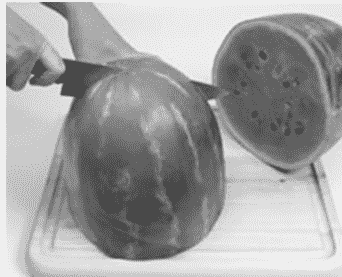

图 1.1：切开以查看内部。

让我们看另一个例子。你正在参观一个因维护而关闭的小公园。你在公园里走了一圈，拍了几张照片。回家后，你可以利用这些照片制作公园地图。为了简化问题，假设公园里有两棵大树，你从东边和南边各拍了一张照片（图 1.2，左侧）。利用这两张照片，你可以标出这两棵树的位置（图 1.2，右侧）。这可以通过将照片放置在拍摄时的原始方向、从每棵树画一条线并找到交叉点来完成。如果你有足够多的照片，找出树的位置并不难。

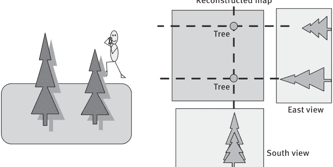

图 1.2：从两张照片重建地图。

断层扫描是一个数学问题。在这里，我们来做一个有趣的数学练习。我们有一个 2 × 2 矩阵。我们暂时不告诉你它是什么。提示如下：第一行之和为 5，第二行之和为 4，第一列之和为 7，第二列之和为 2（见图 1.3）。现在，你来找出这个 2 × 2 矩阵是什么。

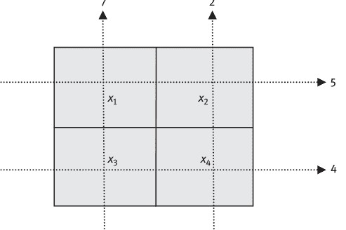

图 1.3：一个 2 × 2 矩阵谜题。

你可以通过以矩阵元素为未知数建立线性方程组来解决这个谜题：

x₁ + x₂ = 5,   x₃ + x₄ = 4,   x₁ + x₃ = 7,   and   x₂ + x₄ = 2.   (1.1)

解这些方程，你将得到

x₁ = 3, x₂ = 2, x₃ = 4, and x₄ = 0. (1.2)

恭喜！你刚刚在数学上解决了一个断层扫描问题。通常，断层扫描问题是在数学上求解的；因此有了“计算机断层扫描”（CT）这一术语。本例中的行和或列和可以推广为射线和、线积分或投影。从投影生成断层图像的过程称为图像重建。

如果断层扫描问题变得更复杂怎么办？如果公园里有更多的树，仅拍摄两张照片可能无法为我们提供足够的信息来绘制公园地图。如果矩阵大小大于 2 × 2，仅行和和列和不足以形成求解矩阵元素的方程组。

我们需要更多的视角！对于矩阵识别情况，我们需要在不同角度沿对角线对矩阵求和。反过来，求解断层扫描问题需要更高级的数学。

## 1.2 投影

为了理解投影（射线和、线积分或 Radon 变换）的概念，我们将在此提供更多示例。

在第一个示例中，物体是 x–y 平面上的均匀圆盘，圆盘中心位于原点，圆盘的（线性）密度为 ρ（见图 1.4）。该物体的投影（即线积分）可以计算为弦长 t 乘以线性密度 ρ，即，

p(s) = ρt = 2ρ√(R²−s²) if |s| < R; p(s) = 0 otherwise.   (1.3)

在这个特定示例中，投影 p(s) 对于任何视角 θ 都相同，θ 是探测器的方向。

如果物体更复杂，投影 p(s, θ) 依赖于角度 θ（见图 1.5）。

在下一个示例中，我们使用 y 轴上的点源来进一步说明投影 p(s, θ) 对角度 θ 的依赖性（见图 1.6）。这里我们关注一维探测器上尖峰的位置 s，它可以计算为

s = r sin θ.   (1.4)

这是关于 θ 的正弦函数。如果你在 s–θ 坐标系中显示这个点源投影数据集 p(s, θ)（见图 1.6，右侧），你将看到正弦波的轨迹。基于这一观察，人们将投影数据集称为正弦图。

第四个示例是一个 2 × 2 矩阵的离散物体，类似于图 1.3 中的物体。探测器也是离散的，带有四个探测器 bins（见图 1.7）。每个矩阵元素


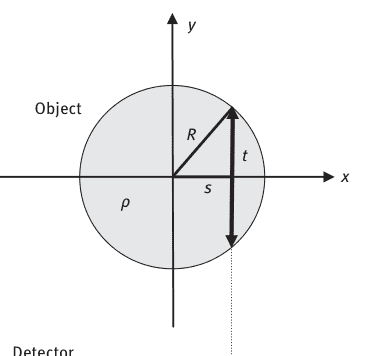

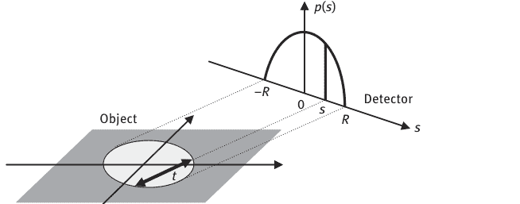

图 1.4: 穿过圆盘的线积分为弦长乘以密度。

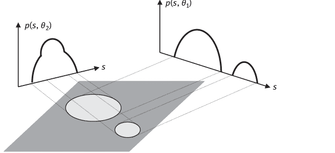

图 1.5: 不同视角下的投影通常不同。

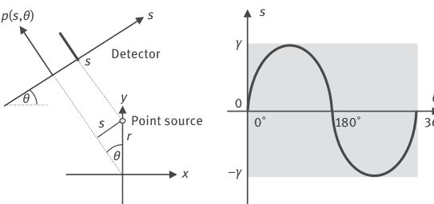

图 1.6: 正弦图是投影在 s–\(\theta\) 平面上的表示。

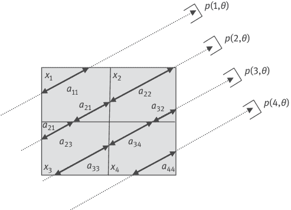

图 1.7: 投影由每个像素内的线长度加权。

表示一个均匀像素，而 \(x_i (i = 1, 2, 3, 4)\) 是第 \(i\) 个像素中的线性密度。我们希望求出视角 \(\theta\) 下矩阵的线积分 \(p(s, \theta)\)。量 \(a_{ij} (i = 1, 2, 3, 4 \text{ 和 } j = 1, 2, 3, 4)\) 是像素 \(j\) 内指向探测器箱 \(i\) 的路径段长度，若第 \(j\) 个像素不在第 \(i\) 个探测器箱的路径上，则 \(a_{ij} = 0\)。投影 \(p(i, \theta)\) 的计算公式为

\(p(i, \theta) = a_{i1}x_1 + a_{i2}x_2 + a_{i3}x_3 + a_{i4}x_4 \quad \text{for } i=1, 2, 3, 4. \quad (1.5)\)

## 1.3 图像重建

本节通过考虑点源来说明常见的图像重建策略。让我们考虑一个带有 x–y 坐标系的空二维（2D）平面，并在平面上的某处（不一定在原点）放置一个值为 1 的小点（参见图 1.8）。我们现在想象有一个探测器（例如相机）围绕原点旋转，获取投影图像。在特定角度 θ 下，我们将投影记为 p(s, θ)，其中 s 是探测器上的坐标。

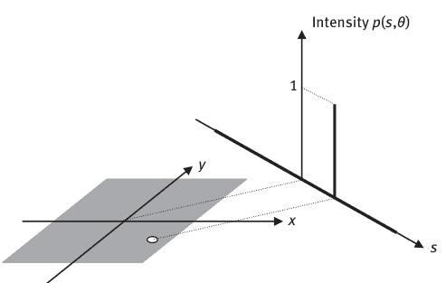

图 1.8: 点源物体的投影。

投影 p(s, θ) 通过在 x–y 平面上绘制一条与探测器正交并在探测器位置 s 处相交的直线形成。然后我们沿这条直线计算线积分，积分值即为 p(s, θ)。在本例中，若直线不接触点源，则 p(s, θ) 为零。若直线穿过点源，则 p(s, θ) 为 1。

现在我们将使用投影 p(s, θ) 重建图像。我们的策略与第 1.1 节中的树状图示例类似，在该示例中，我们从探测器上的每棵树绘制一条直线并找到交点的位置。在图像重建中，我们不仅需要找到位置，还需要找到感兴趣物体的强度值。

如图 1.9(a) 所示，从不同视角对点源进行多次投影。我们尝试以以下方式重建点源图像。

当你观察某一视角 θ 下的投影 p(s, θ) 时，会看到强度为 1 的尖峰。这个尖峰是沿投影路径的所有活动之和。要重建图像，必须将尖峰中的活动重新分配回其原始路径。问题是，你不知道沿路径哪里需要放置更多活动、哪里放置较少。在放弃之前，你决定沿路径到处放置相等量的活动，其量为投影尖峰的幅度（见图 1.9b）。如果对更多角度也这样做，你将得到如图 1.9(c) 所示的情况。由于叠加效应，x–y 平面上点源位置处将出现一个高尖峰。

你刚才所做的是一种称为反投影的标准数学程序。如果从 0° 到 360° 的所有角度进行反投影，将生成类似于图 1.9(d) 所示的图像。

反投影后，图像仍不完全与原始图像相同，而是其模糊版本。为了消除模糊，我们在反投影前在投影的尖峰周围引入负“翼”（见图 1.9e）。在尖峰周围添加负翼的过程称为滤波。使用负翼可得到清晰图像（见图 1.9f）。这种图像重建算法非常常见，称为 FBP 算法。

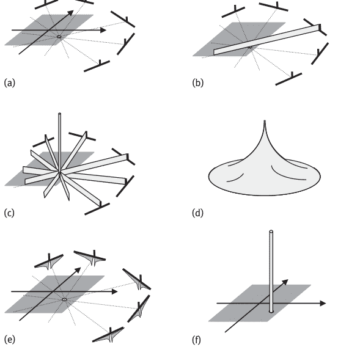

图 1.9: 通过反投影未滤波和滤波数据来重建点源图像。(a) 投影点源；(b) 从一个视角反投影；(c) 从几个视角反投影；(d) 从所有视角反投影；(e) 添加负翼；以及 (f) 反投影修改后的数据。

本节利用点源来说明在图像重建中，利用多视角的滤波和反投影的有用性。我们必须指出，如果物体是点源，只需两个视角即可重建图像，这与第 1.1 节中的制图示例类似。

## 1.4 反投影

在定义反投影之前，必须先定义投影。我们必须明确，反投影不是投影的逆运算。仅靠反投影不足以重建图像。反投影数据后，你无法得到原始图像。我们将通过下面一个简单的离散 2 × 2 问题来说明这一点（参见图 1.10）。

原始图像定义为 x₁ = 3、x₂ = 2、x₃ = 4 和 x₄ = 0。相关投影为 p(1, 0°) = 7、p(2, 0°) = 2、p(1, 270°) = 5 和 p(2, 270°) = 4。投影是一次一个视角形成的（见图 1.10）。反投影图像也是一次一个视角形成的。最终反投影图像是所有视角反投影的总和，如图 1.11 所示。请注意，反投影图像与原始图像不同。

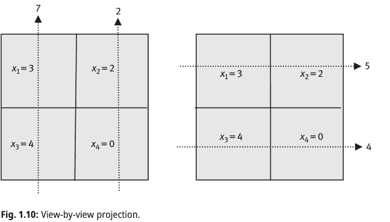

尽管反投影图像不是原始图像，但两者密切相关。它们的关系将在第 2 章中进一步讨论。

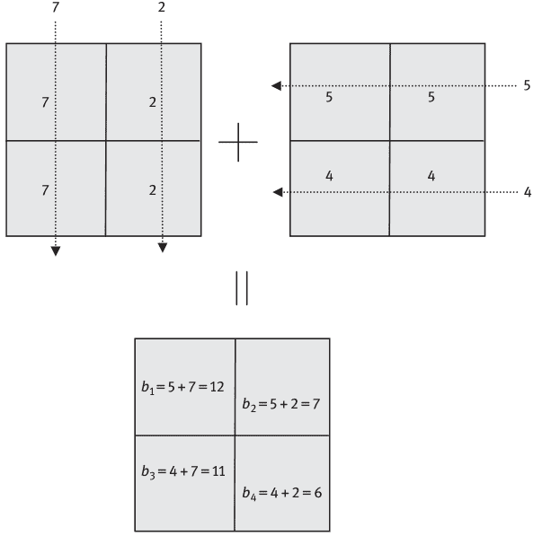

图 1.11: 逐个视角反投影，然后对所有反投影图像求和。

## 1.5 数学表达式

每一章我们都专门设置一个章节来介绍数学表达式。这些数学表达式有助于高级读者更好地掌握本章讨论的主要概念。本节介绍了 2D 平行束成像中投影和反投影的数学表达式。Dirac δ 函数在解析算法开发中起着重要作用，本节还涵盖了其定义和一些性质。

### 1.5.1 投影

设 f(x, y) 为 x–y 平面上的密度函数。投影（射线和、线积分或 Radon 变换）p(s, θ) 有许多等价表达式，例如

$p(s, \theta) = \int_{-\infty}^{\infty} \int_{-\infty}^{\infty} f(x, y) \delta(x \cos \theta + y \sin \theta - s) dx dy, \quad (1.6)$
$p(s, \theta) = \int_{-\infty}^{\infty} \int_{-\infty}^{\infty} f(x, y) \delta(\vec{x} \cdot \vec{\theta} - s) dx dy, \quad (1.7)$
$p(s, \theta) = \int_{-\infty}^{\infty} f(s \cos \theta - t \sin \theta, s \sin \theta + t \cos \theta) dt, \quad (1.8)$
$p(s, \theta) = \int_{-\infty}^{\infty} f(\vec{s}^\theta + t \vec{\theta}^\perp) dt, \quad (1.9)$
$p(s, \theta) = \int_{-\infty}^{\infty} f_\theta(s+t) dt, \quad (1.10)$

其中 \(\vec{x} = (x, y)\)，\(\vec{\theta} = (\cos \theta, \sin \theta)\)，\(\vec{\theta}^\perp = (-\sin \theta, \cos \theta)\)，\(\delta\) 为 Dirac delta 函数，而 \(f_\theta\) 为函数 \(f\) 顺时针旋转 \(\theta\) 后得到的函数。我们假设探测器围绕物体逆时针旋转，或者物体顺时针旋转而探测器保持静止。坐标系如图 1.12 所示。

### 1.5.2 反投影

反投影是投影的伴随。这里的“伴随”是一个数学术语。它指的是线性 algebra 中的共轭转置。对于实矩阵 \(A\)，其伴随即转置矩阵 \(A^T\)。在离散情况下（如第 1.4 节），投影为

$P = AX, \quad (1.11)$

其中 \(X\) 表示图像，但以列向量形式表示。例如，\(2 \times 2\) 图像表示为（参见图 1.3 或 1.10）

$X = [x_1, x_2, x_3, x_4]^T. \quad (1.12)$

列矩阵 \(P\) 表示投影。如果我们使用图 1.10 中的示例，

$P = [p(1, 0^\circ), p(2, 0^\circ), p(1, 270^\circ), p(2, 270^\circ)]^T = [7, 2, 5, 4]^T. \quad (1.13)$

矩阵 \(A\) 是投影算子。其元素 \(a_{ij}\) 在图 1.7 中定义。使用图 1.10 中的示例，\(P\) 的反投影可通过矩阵乘法计算，如


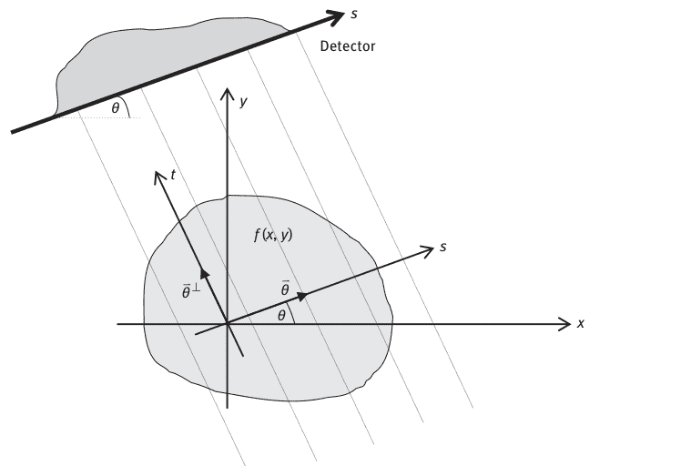

图 1.12: 二维平行束成像的坐标系。

\[ B = A^T P = \begin{bmatrix} 1 & 0 & 1 & 0 \\ 0 & 1 & 0 & 1 \\ 1 & 1 & 0 & 0 \\ 0 & 0 & 1 & 1 \end{bmatrix}^T \begin{bmatrix} 7 \\ 2 \\ 5 \\ 4 \end{bmatrix} = \begin{bmatrix} 1 & 0 & 1 & 0 \\ 0 & 1 & 1 & 0 \\ 1 & 0 & 0 & 1 \\ 0 & 1 & 0 & 1 \end{bmatrix} \begin{bmatrix} 7 \\ 2 \\ 5 \\ 4 \end{bmatrix} = \begin{bmatrix} 12 \\ 7 \\ 11 \\ 6 \end{bmatrix} \, , \]
(1.14)

这与图 1.11 中以“图形方式”获得的结果相同。

对于连续情况，后投影图像 \( b(x, y) \) 可以用以下等价方式表示：

\( b(x, y) = \int_0^\pi p(s, \theta)|_{s = x \cos \theta + y \sin \theta} \, d \theta, \) \qquad (1.15)
\( b(x, y) = \int_0^\pi p(s, \theta)|_{s = \overline{x}, \overline{\theta}} \, d \theta, \) \qquad (1.16)
\( b(x, y) = \int_0^\pi p\left( \overline{x}, \overline{\theta}, \theta \right) \, d \theta, \) \qquad (1.17)

$b(x, y) = \frac{1}{2} \int_{0}^{2\pi} p(x \cos \theta + y \sin \theta, \theta) d\theta. \quad (1.18)$

### 1.5.3 Dirac $\delta$-函数

Dirac $\delta$-函数不是将定义域中的值映射到值域中的普通函数。Dirac $\delta$-函数是广义函数或分布函数。$\delta$-函数有多种定义方式。这里，我们使用一系列高斯函数来定义 $\delta$-函数。每个高斯函数（参见图 1.13）在其曲线下方都有单位面积，随着参数 \(n\) 变大，曲线变得更窄更高（参见图 1.13）：

$$\left(\frac{n}{\pi}\right)^{1/2} e^{-nx^2}. \quad (1.19)$$

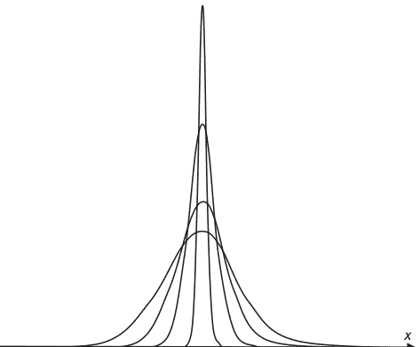

图 1.13: 使用高斯函数序列定义 $\delta$-函数。

设 \(f(x)\) 为处处可导且任意阶可微的光滑函数，且对所有 \(N\) 都有 \(\lim_{x \to \infty} x^N f(x) = 0\)。那么，$\delta$-函数被隐式定义为

$$\lim_{n \to \infty} \int_{-\infty}^{\infty} \left(\frac{n}{\pi}\right)^{1/2} e^{-nx^2} f(x) dx = \int_{-\infty}^{\infty} \delta(x) f(x) dx = f(0). \quad (1.20)$$

$\delta$-函数具有以下性质：

\(\int_{-\infty}^{\infty} \delta(x-a)f(x)dx = \int_{-\infty}^{\infty} \delta(x)f(x+a)dx = f(a), \quad (1.21)\)

\(\int_{-\infty}^{\infty} \delta(ax)f(x)dx = \frac{1}{|a|}f(0), \quad (1.22)\)

\(\int_{-\infty}^{\infty} \delta^{(n)}(x)f(x)dx = (-1)^n f^{(n)}(0) \text{[第 n 阶导数]}, \quad (1.23)\)

\(\delta(g(x))f(x) = f(x) \sum_n \frac{1}{|g'(\lambda_n)|} \delta(x-\lambda_n), \quad (1.24)\)

其中 \(\lambda_n\) 为 \(g(x)\) 的零点。

在二维和三维情况下，分别有 \(\delta(\vec{x}) = \delta(x)\delta(y)\) 和 \(\delta(\vec{x}) = \delta(x)\delta(y)\delta(z)\)。在最后一个性质中，在二维和三维情况下，\(|g'|\) 将分别被 \(|\text{grad}(g)| = \sqrt{(\partial g/\partial x)^2 + (\partial g/\partial y)^2}\) 和 \(|\text{grad}(g)| = \sqrt{(\partial g/\partial x)^2 + (\partial g/\partial y)^2 + (\partial g/\partial z)^2}\) 取代。

在二维成像中，我们使用二维 \(\delta\)-函数 \(\delta(\vec{x} - \bar{x}_0)\) 来表示位置 \(\vec{x} = \bar{x}_0\) 处的点源。\(f(\vec{x}) = \delta(\vec{x} - \bar{x}_0) = \delta(x - x_0)\delta(y - y_0)\) 的 Radon 变换由以下给出：

\(p(s, \theta) = \int_{-\infty}^{\infty} \int_{-\infty}^{\infty} f(\vec{x}) \delta\left(\vec{x} \cdot \vec{\theta} - s\right) d\vec{x}, \quad (1.25)\)

\(p(s, \theta) = \int_{-\infty}^{\infty} \int_{-\infty}^{\infty} \delta(x, x_0)\delta(y - y_0)\delta(x \cos \theta + y \sin \theta - s) dx dy, \quad (1.26)\)

\(p(s, \theta) = \int_{-\infty}^{\infty} \delta(y - y_0) \left[ \int_{-\infty}^{\infty} \delta(x, x_0) \delta(x \cos \theta + y \sin \theta - s) dx \right] dy, \quad (1.27)\)

\(p(s, \theta) = \int_{-\infty}^{\infty} \delta(y - y_0)\delta(x_0 \cos \theta + y \sin \theta - s) dy, \quad (1.28)\)

\(p(s, \theta) = \delta(x_0 \cos \theta + y_0 \sin \theta - s), \quad (1.29)\)

这是一个与图 1.6 中所示类似的正弦图。

## 1.6 例题

例 1：如果你在两个视图中都看到两棵分开的树，你能否唯一地重建树的分布图（见图 1.14）？如果不能，你可能需要拍摄更多照片。如果只允许再拍一张照片，应该朝哪个方向拍摄？

*解答*

图 1.15 所示的两种情况都可以满足这两个视图。如果在 45° 处再拍一张照片，我们就能消除歧义。

例 2：求均匀圆盘的投影。圆盘的中心不在探测器旋转中心处。

*解答*

我们已经知道，如果圆盘的中心在探测器旋转中心处，投影可以计算为

```
p(s, θ) = 2ρ√R²−s² if |s| < R; p(s, θ) = 0 otherwise. (1.30)
```

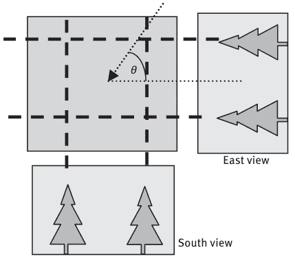

图 1.14: 两个视图中都可以看到两棵树。

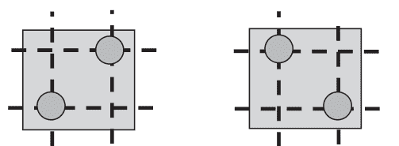

图 1.15: 映射问题的两个潜在解。

不失一般性，我们现在假设圆盘的中心在正 x 轴上，坐标为 (r, 0)（图 1.16）。

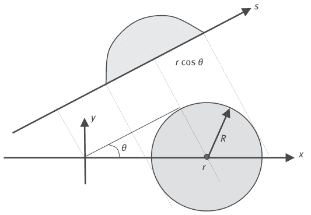

图 1.16: 离心圆盘的成像。

对于这种新设置，我们需要将 s 轴上的投影数据进行偏移。偏移距离为 \(r \cos \theta\)。即，

```
$p(s, \theta) = 2\rho \sqrt{R^2 - (s - r \cos \theta)^2} \quad \text{if } |s - r \cos \theta| < R; \ p(s, \theta) = 0 \text{ otherwise.} \quad (1.31)$
```

例 3：证明平行束数据冗余条件为 p(s, θ) = p(-s, θ + π)。

证明。使用第 1.5 节中的投影定义，我们有

$$p(-s, \theta + \pi) = \int_{-\infty}^{\infty} \int_{-\infty}^{\infty} f(x,y)\delta(x \cos(\theta + \pi) + y \sin(\theta + \pi) - (-s))dxdy$$
$$= \int_{-\infty}^{\infty} \int_{-\infty}^{\infty} f(x,y)\delta(-x \cos\theta - y \sin\theta + s)dxdy$$
$$= \int_{-\infty}^{\infty} \int_{-\infty}^{\infty} f(x,y)\delta(-(x \cos\theta + y \sin\theta - s))dxdy$$
$$= \int_{-\infty}^{\infty} \int_{-\infty}^{\infty} f(x,y)\delta(x \cos\theta + y \sin\theta - s)dxdy$$
$$= p(s, \theta).$$ (1.32)

[$\delta$-函数是偶函数。]

**例 4：** 证明投影/后投影算子的点扩散函数为 1/r，其中 \(r = \|\vec{x} - \vec{x}_0\|\) 且点源对象为 \(f(\vec{x}) = \delta(\vec{x} - \vec{x}_0)\)。

证明。使用后投影的定义，我们有

\(b(\vec{x}) = \int_{0}^{\pi} p(\vec{x} \cdot \vec{\theta}, \theta) d\theta = \int_{0}^{\pi} \int_{-\infty}^{\infty} f\left( (\vec{x} \cdot \vec{\theta}) \vec{\theta} + t \vec{\theta}^{\perp} \right) dt d\theta.\) (1.33)

我们意识到线积分 \(\int_{-\infty}^{\infty} f\left( (\vec{x} \cdot \vec{\theta}) \vec{\theta} + t \vec{\theta}^{\perp} \right) dt\) 沿着通过点 \(\vec{x}\) 且方向为 \(\vec{\theta}^{\perp}\) 的直线（见图 1.17），因此

\(\int_{-\infty}^{\infty} f\left( (\vec{x} \cdot \vec{\theta}) \vec{\theta} + t \vec{\theta}^{\perp} \right) dt = \int_{-\infty}^{\infty} f\left( \vec{x} - \hat{t} \vec{\theta}^{\perp} \right) d\hat{t}.\) (1.34)

因此，投影/后投影图像可以表示为

\(b(\vec{x}) = \int_{0}^{\pi} \int_{-\infty}^{\infty} f\left( \vec{x} - \hat{t} \vec{\theta}^{\perp} \right) d\hat{t} d\theta.\) (1.35)

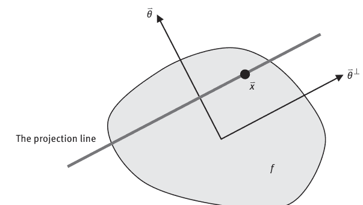

图 1.17: 线积分在通过后投影点的直线上进行。

设 \(\widehat{x} = \hat{t}\widehat{\theta}^{\perp}\) 且 \(\|\widehat{x}\| = |\hat{t}|\)，\(d\widehat{x} = |\hat{t}| d\hat{t} d\theta\)。上述表达式变为

\(b(\vec{x}) = \int_{-\infty}^{\infty} \int_{-\infty}^{\infty} \frac{f\left( \vec{x} - \widehat{x} \right)}{\|\widehat{x}\|} d\widehat{x}.\) (1.36)

设 \( f(\vec{x}) = \delta(\vec{x} - \vec{x}_0) \)。投影/后投影算子的点扩散函数为

\( b(\vec{x}) = \int_{-\infty}^{\infty} \int_{-\infty}^{\infty} \frac{\delta\left(\vec{x} - \vec{x}_0 - \widehat{\vec{x}}\right)}{\|\widehat{\vec{x}}\|} d\widehat{\vec{x}} = \frac{1}{\|\vec{x} - \vec{x}_0\|} = \frac{1}{r}. \tag{1.37} \)

**例 5：** 计算 \( \int_{-\infty}^{\infty} \delta\left(e^{2(x-3)(x+4)} - 1\right) f(x) dx \)。

_解答_ 设

\( g(x) = e^{2(x-3)(x+4)} - 1. \tag{1.38} \)

求解 \( g(x) = e^{2(x-3)(x+4)} - 1 = 0 \)，我们得到 \( g(x) \) 的零点为

\( \lambda_1 = 3 \text{ 和 } \lambda_2 = -4. \tag{1.39} \)

\( g(x) \) 的导数为

\( g'(x) = 2[(x-3) + (x+4)]e^{2(x-3)(x+4)} = 2(2x+1)e^{2(x-3)(x+4)}. \tag{1.40} \)

因此，在 \( g(x) \) 的两个零点处，我们有

\( g'(3) = 14 \text{ 和 } g'(-4) = -14. \tag{1.41} \)


因此，

\(\int_{-\infty}^{\infty} \delta(e^{2(x-3)(x+4)} - 1)f(x)dx = \int_{-\infty}^{\infty} \frac{\delta(x-3)}{|14|}f(x)dx + \int_{-\infty}^{\infty} \frac{\delta(x+4)}{|14|}f(x)dx\)

\(= \frac{f(3) + f(-4)}{14}\) (1.42)

## 1.7 摘要

- 层析成像是获取投影数据并将数据转换为横断面图像的过程。需要来自多个视角的投影数据。
- 投影是物体的线积分（或射线和、Radon 变换）。投影数据通过探测器获取。物体在探测器上重叠。
- 反投影是一种叠加过程，它对所有投影视角的数据求和。反投影将投影域数据均匀地沿线积分形成的相同直线分布回去。
- 图像重建是一种消除投影数据中重叠效应并重新创建无重叠物体原始图像的数学过程。数学过程称为算法。
- Dirac 的 \(\delta\)-函数在算法开发中通常充当点源。
- 读者预计要理解本章的两个主要概念：投影和反投影。

## 习题

- **问题 1.1** 如果一个 2D 物体是点源，则使用来自两个不同探测器视角的投影数据足以获得精确重建。让我们考虑一个由三个不在同一直线上的点源（即，它们不共线）组成的 2D 物体。确定所需的最小探测器视角数量，以便有足够的投影数据来获得精确重建。

- **问题 1.2** 已知，移位点源 \(\delta(x-x_0, y-y_0)\) 的 Radon 变换为 \(\delta(x_0 \cos \theta + y_0 \sin \theta - s)\)。此结果可推广到一般物体 \(f(x, y)\)。如果 \(p(s, \theta)\) 是未移位物体 \(f(x, y)\) 的 Radon 变换，确定移位物体 \(f(x-x_0, y-y_0)\) 的 Radon 变换。

- **问题 1.3** 使用 \(\delta\)-函数的定义，证明 Radon 变换的以下两个定义是等价的：

\(p(s, \theta) = \int_{-\infty}^{\infty} \int_{-\infty}^{\infty} f(x,y) \delta(x \cos \theta + y \sin \theta - s) dx dy\),
\(p(s, \theta) = \int_{-\infty}^{\infty} f(s \cos \theta - t \sin \theta, s \sin \theta + t \cos \theta) dt\).

- **问题 1.4** 笛卡尔坐标系中的反投影定义为

\(b(x, y) = \int_{0}^{\pi} p(x \cos \theta + y \sin \theta, \theta) d\theta\).

给出极坐标系中反投影的等价表达式 \(b_{polar} (r, \varphi)\)。

## 参考文献

- [1] Barrett H, Swindell W (1988) 放射学成像，Academic, New York.
- [2] Bracewell RN (1955) 二维成像，Prentice Hall, Englewood Cliffs, NJ.
- [3] Bushberg JT, Seibert JA, Leidhold EM, Boone JM (2002) 医学成像必备物理学，第 2 版，Lippincott Williams and Wilkins, Philadelphia.
- [4] Carlton RR, Adler AM (2001) 放射摄影成像原理：一门艺术与科学，第 3 版，Delmar, Albany, NY.
- [5] Cho ZH, Jones JP, Singh M (1993) 医学成像基础，Wiley, New York.
- [6] Cormack AM (1963) 用其线积分表示函数，并附一些放射学应用。J Appl Phys 34:2722–2727.
- [7] Herman G (1981) 从投影重建图像：计算机断层扫描的基础，Academic Press, New York.
- [8] Kak AC, Slaney M (1987) 计算机断层扫描原理，IEEE Press, Piscataway, NJ.
- [9] Macovski A (1983) 医学成像系统，Prentice Hall, Englewood Cliffs, NJ.
- [10] Natterer F (1986) 计算机断层扫描的数学，Wiley-Teubner, New York.
- [11] Prince JL, Links JM (2006) 医学成像信号与系统，Pearson Prentice Hall, Upper Saddle River, NJ.
- [12] Shung KK, Smith MB, Tsui BMW (1992) 医学成像原理，Academic Press, San Diego, CA.
- [13] Zeng GL (2001) 图像重建——一篇教程。Comput Med Imaging Graph 25:97–103.

# 2 平行束图像重建

本章介绍了中央切片定理，它是层析成像的核心原理。该定理将二维（2D）图像与其在傅里叶域中的一维（1D）投影联系起来。从此定理推导出了许多图像重建算法。在这些算法中，滤波反投影（FBP）算法最为流行，它由斜坡滤波步骤和反投影步骤组成。滤波可以作为傅里叶域中的乘法实现，也可以作为空间域中的卷积实现。本章还包含了关于截断投影的感兴趣区域（ROI）重建的专题。

## 2.1 傅里叶变换

傅里叶变换的概念基于这样一个事实：可以将一个函数 p(s) 表示为各种频率 ω 的正弦和余弦项的加权求和，其中权函数为 P(ω)。您可以使用棱镜将阳光分解成不同颜色的光谱；您也可以通过重新组合不同颜色的光谱来重现原始光（参见图 2.1）。

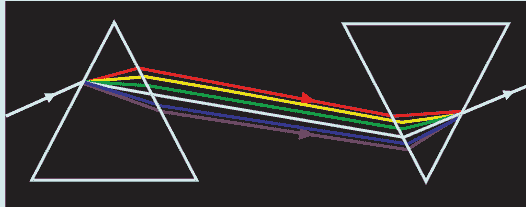

图 2.1：白光可以分解成彩色光，这些彩色光可以重新转换回原始白光。

每个频率 ω 的权函数 P(ω) 称为 p(s) 的傅里叶变换。可以轻松使用数学公式从 p(s) 求出 P(ω)，并从 P(ω) 恢复 p(s)。如果你知道其中一个函数（p(s) 或 P(ω)），你就知道另一个。在这对函数中，一个函数用带有变量 s 的小写字母表示，另一个函数用带有变量 ω 的大写字母表示。

图 2.2 显示了一个傅里叶变换对 p(s) 和 P(ω)，其中 P(ω) 是 p(s) 的傅里叶变换。函数 P(ω) 告诉我们，三角函数 p(s) 具有丰富的低频分量，因为中心主瓣具有较大的幅度。随着频率升高（即，|ω| 变大），瓣的幅度变小。我们也看到 P(ω) 中有一些凹槽；那些带凹槽的频率不在三角函数 p(s) 中。使用傅里叶变换可以帮助我们理解一些隐藏的数学关系，如果没有傅里叶变换，这些关系不容易看到。

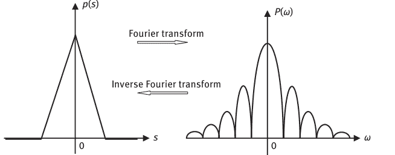

图 2.2：一个傅里叶变换对。

也可以求出具有两个或多个变量的函数的傅里叶变换。我们将函数 f(x, y) 的傅里叶变换表示为 F(ωx, ωy)，其中 ωx 是 x 方向的频率，ωy 是 y 方向的频率。

## 2.2 中央切片定理

中央切片定理是层析成像的基础。它还有其他名称：投影切片定理和傅里叶切片定理。2D 中的中央切片定理指出，二维函数 f(x, y) 的投影 p(s) 的一维傅里叶变换 P(ω) 等于该函数二维傅里叶变换 F(ωx, ωy) 经过原点且与探测器平行的一个切片（即一维剖面）（参见图 2.3）。

如果将探测器围绕物体旋转至少 180°，则二维傅里叶变换 F(ωx, ωy) 中对应的“中央切片”将同步旋转并覆盖整个二维傅里叶空间，即 ωx-ωy 平面（参见图 2.4）。换句话说，通过将探测器旋转 180°，整个二维傅里叶变换 F(ωx, ωy) 将被“测量”。一旦 F(ωx, ωy) 可用，原始二维函数 f(x, y) 就可以通过一种称为二维逆傅里叶变换的数学过程轻松获得。

在一个视角上反投影投影数据等同于在 ωx-ωy 平面（即傅里叶空间）中添加 F(ωx, ωy) 的一个“中央切片”。在 180° 范围内进行反投影可以完全重建二维傅里叶变换 F(ωx, ωy)。由于傅里叶变换对的性质，可以轻松从 F(ωx, ωy) 中找到原始函数 f(x, y)。

在第 1 章中，我们了解到仅靠反投影无法恢复原始图像；相反，会得到一张模糊的图像。这里有矛盾吗？没有。让我们再看一眼图 2.4 中的 ωx-ωy 平面。在将“中央切片”添加到 ωx-ωy 平面后，我们看到在 ωx-ωy


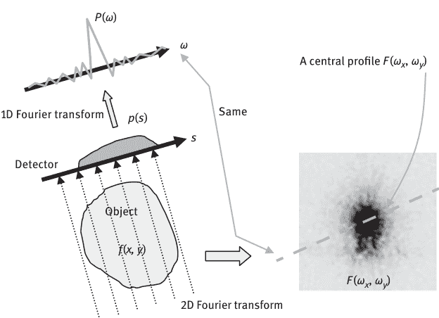

图 2.3: 二维中心切片定理示意图。

平面以及远离原点区域的较低密度。傅里叶空间的中心区域代表低频。低频分量的过度权重会导致图像模糊。

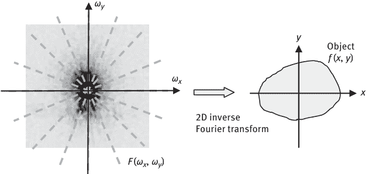

图 2.4: 每个视角在傅里叶空间中添加一条线。二维逆傅里叶变换重建原始图像。

为抵消这种模糊效应，我们必须补偿傅里叶空间中的非均匀性。傅里叶空间中的非均匀密度与 \(1/\sqrt{\omega_x^2 + \omega_y^2}\) 成正比。有两种方法可以进行补偿。

一种方法是将 \(\omega_x-\omega_y\) 空间傅里叶“图像”乘以 \(\sqrt{\omega_x^2 + \omega_y^2}\)，得到的傅里叶空间“图像”为 \(F(\omega_x, \omega_y)\)。\(F(\omega_x, \omega_y)\) 的二维逆傅里叶变换可得精确的原始图像 \(f(x, y)\)。

另一种方法是将投影数据 \(p(s, \theta)\) 的一维傅里叶变换 \(P(\omega, \theta)\) 乘以 \(|\omega|\)。然后对 \(|\omega|P(\omega, \theta)\) 进行一维逆傅里叶变换。经过这种特殊处理（即滤波）的投影数据之后，处理后的（即滤波后的）投影数据进行反投影，从而得到精确的原始图像 \(f(x, y)\)。请注意，在之前的讨论中（参见图 2.3），我们故意忽略了 \(P(\omega, \theta)\) 和 \(p(s, \theta)\) 中的第二个变量，以便让读者关注第一个变量。

这两种方法（即，将经过傅里叶变换的反投影图像乘以 \(\sqrt{\omega_x^2 + \omega_y^2}\)，以及将经过傅里叶变换的投影乘以 \(|\omega|\)）将在本书后面进一步讨论。第二种方法，即 FBP 算法，比第一种方法更流行。函数 \(|\omega|\) 在断层扫描中被称为 *斜坡滤波器*，以其外观命名（参见图 2.5）。正是第二种方法在第一章的投影峰值周围添加了负“翼”。

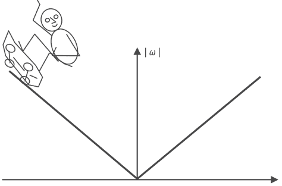

图 2.5: 一维斜坡滤波器传递函数。

## 2.3 重建算法

反投影完成了图像重建中的大部分工作；它将各个视角的投影数据转换为图像，除了模糊效应之外，这几乎就是我们想要的结果。模糊效应是由二维傅里叶空间（即 \(\omega_x\omega_y\) 平面）中的 \(1/|\omega|\) 非均匀权重引起的，其中 \(|\omega| = \sqrt{\omega_x^2 + \omega_y^2}\)。可以通过对投影数据 \(p(s, \theta)\) 或其等价的一维傅里叶变换 \(P(\omega, \theta)\) 使用斜坡滤波器 \(|\omega|\) 来实现对 \(1/|\omega|\) 函数的补偿。如果将滤波后的投影数据进行反投影，就可以得到精确的图像。

### 2.3.1 方法 1

精确地说，该 FBP 算法可以按照图 2.6 所示的步骤实现，其中斜坡滤波的实现方式如下：

- (i) 求 \(p(s, \theta)\) 关于第一个变量 \(s\) 的一维傅里叶变换，得到 \(P(\omega, \theta)\)。
- (ii) 将 \(P(\omega, \theta)\) 与斜坡滤波器 \(|\omega|\) 相乘，得到 \(Q(\omega, \theta)\)。
- (iii) 求 \(Q(\omega, \theta)\) 关于第一个变量 \(\omega\) 的一维逆傅里叶变换，得到 \(q(s, \theta)\)。

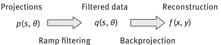

图 2.6: 滤波反投影（FBP）算法的流程。

### 2.3.2 方法 2

执行斜坡滤波的方式不止一种。事实上，我们可以不使用傅里叶变换来进行斜坡滤波。根据傅里叶变换理论，在一个域（例如 \(\omega\) 域）中的乘法对应于在另一个域（例如 \(s\) 域）中的卷积（参见图 2.7）。

因此，方法 1 中的步骤 (i)、(ii) 和 (iii) 等价于一种称为 _卷积_ 的数学过程。斜坡滤波后的数据 \(q(s, \theta)\) 可以通过卷积如下获得：

\(q(s, \theta) = p(s, \theta) * h(s),\) (2.1)

其中“*”表示卷积操作，即对变量 \(s\) 进行积分。这里 \(h(s)\) 是卷积核，是 \(H(\omega) = |\omega|\) 的一维逆傅里叶变换。

这里我们给出一个卷积示例，以便你了解卷积能为你做什么。如果卷积核 \(h(s)\) 不是对称的，你首先将其左右翻转，使其变为 \(h(-s)\)。第二，你想象你的函数 \(p(s)\) 可以分解为垂直尖峰（或狄拉克 delta 函数）。第三，用 \(h(-s)\) 替换每个尖峰，即 \(h(-s)\) 的 \(s = 0\) 位置位于尖峰的位置，并按尖峰的幅度（可以是负值）缩放 \(h(-s)\)。最后，将所有平移和缩放后的 \(h(-s)\) 版本相加，得到 \(q(s)\)（参见图 2.8）。

乘法：\(Q(\omega) = P(\omega) \times H(\omega)\)

卷积：\(q(s) = p(s) * h(s)\)

图 2.7: 傅里叶变换的一个重要性质：一个域中的乘法等价于另一个域中的卷积。

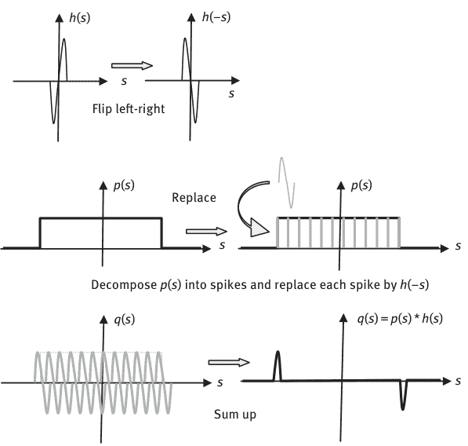

图 2.8: 卷积过程的示意图。

### 2.3.3 方法 3

实现斜坡滤波还有第三种方法。让我们将斜坡滤波器分解为两部分：

\( H(\omega) = |\omega| = i2\pi\omega \times \frac{1}{i2\pi} \text{sgn}(\omega), \quad (2.2) \)

其中 \( i = \sqrt{-1} \)，当 \(\omega > 0\) 时 \(\text{sgn}(\omega) = 1\)，当 \(\omega < 0\) 时 \(\text{sgn}(\omega) = -1\)，当 \(\omega = 0\) 时 \(\text{sgn}(\omega) = 0\)。这里我们将使用傅里叶变换的两个性质。

事实 1：在傅里叶域（即 \(\omega\) 域）中乘以 \(i2\pi\omega\) 对应于空间域（即 s 域）中对 \(s\) 求导。

事实 2：\(-i \text{sgn}(\omega)\) 的逆傅里叶变换是 \(1/(\pi s)\)。与 \(1/(\pi s)\) 卷积称为希尔伯特变换。

利用图 2.7 所示的关系，斜坡滤波可以实现为

\( q(s, \theta) = \frac{dp(s, \theta)}{ds} * \frac{-1}{2\pi^2 s}, \quad (2.3) \)

这结合了求导和希尔伯特变换。

### 2.3.4 方法 4

如果我们交换斜坡滤波和反投影的顺序，就可以得到另一种重建图像的方法——先反投影后滤波。反投影后，我们得到一个模糊的二维图像 _b_(_x_, _y_)。我们需要对其应用二维斜坡滤波器。一种方法如下：

- (i) 求 \(b(x, y)\) 的二维傅里叶变换，得到 \(B(\omega_x, \omega_y)\)。
- (ii) 将 \(B(\omega_x, \omega_y)\) 与斜坡滤波器 \(|\omega| = \sqrt{\omega_x^2 + \omega_y^2}\) 相乘，得到 \(F(\omega_x, \omega_y)\)。
- (iii) 求 \(F(\omega_x, \omega_y)\) 的二维逆傅里叶变换，得到 \(f(x, y)\)。

### 2.3.5 方法 5

方法 3 包含三个部分：求导、希尔伯特变换和反投影。如果我们交换顺序，就能得到另一种重建算法：

- (i) 求投影数据 \(p(s, \theta)\) 对 _s_ 的导数，得到 \(dp(s, \theta)/ds\)。
- (ii) 对 \(dp(s, \theta)/ds\) 在 \(180^\circ\) 范围内进行反投影。
- (iii) 沿探测器 \(90^\circ\) 位置平行的方向，逐行进行希尔伯特变换。

### 2.3.6 方法 6

通过交换方法 5 中前两个步骤的顺序，我们可以得到另一种重建图像的方法——反投影导数的有限希尔伯特变换：

- (i) 将 \(p(s, \theta)\) 反投影以获得两个模糊图像 \(b_x(x, y)\) 和 \(b_y(x, y)\)，其中在创建 \(b_x(x, y)\) 时使用 \(-\sin \theta\) 作为权重函数，在创建 \(b_y(x, y)\) 时使用 \(\cos \theta\) 作为权重函数。
- (ii) 求偏导数，得到 \(b(x, y) = \partial b_x(x, y)/\partial x + \partial b_y(x, y)/\partial y\)。
- (iii) 沿探测器 \(90^\circ\) 位置平行的方向，逐行进行希尔伯特变换。

方法 6 的一个显著特点是，不对原始投影数据应用滤波。这一特性在获得列表模式投影数据时非常重要，例如在核医学中。在列表模式数据中，每个事件都独立存储，通常无法轻易找到相邻事件来进行求导。该算法可以轻松应用于其他几何成像以及投影数据被截断（即未完全测量）的一些情况。

你一定已经注意到，我们正在玩顺序交换游戏来创建越来越多的重建算法。我们只是改变斜坡滤波和反投影的顺序，或者改变求导、希尔伯特变换和反投影的顺序。如果我们继续玩这个游戏，就可以列出一些可能的图像重建算法（参见图 2.9）。每种算法都有其优缺点。

图 2.9 中的表格并未穷尽所有可能性。例如，希尔伯特变换可以实现为空间域中的卷积，或作为傅里叶域中的乘法。希尔伯特变换还有另一种形式，它不是卷积，而是对有限区间进行积分。有限希尔伯特变换在处理截断投影数据方面有重要应用。

你可能会发现，所有算法都使用了反投影。但情况不一定如此。你不必在重建算法中使用空间域反投影仪。你可以通过将傅里叶域投影数据 \(P(\omega, \theta)\) 分配到适当的 \(\omega_x\)-\(\omega_y\) 位置来使用中心切片定理。这是反投影的傅里叶域实现。然而，这种傅里叶域反投影的应用有限，因为在极坐标 \((\omega, \theta)\) 系统到笛卡尔 \((\omega_x\)-\(\omega_y)\) 系统的变换中可能会引入较大的插值误差。


| 方法 | 步骤 1 | 步骤 2 | 步骤 3 |
| :--- | :--- | :--- | :--- |
| 1 | 带傅里叶变换的一维斜坡滤波器 | 反投影 | 圣诞老人图像 |
| 2 | 带卷积的一维斜坡滤波器 | 反投影 | |
| 4 | 反投影 | 带傅里叶变换的二维斜坡滤波器 | |
| | 反投影 | 带二维卷积的二维斜坡滤波器 | |
| 3 | 求导 | 希尔伯特变换 | 反投影 |
| 5 | 求导 | 反投影 | 希尔伯特变换 |
| 6 | 反投影 | 求导 | 希尔伯特变换 |
| | 希尔伯特变换 | 求导 | 反投影 |
| | 希尔伯特变换 | 反投影 | 求导 |
| | 反投影 | 希尔伯特变换 | 求导 |

图 2.9：平行束解析图像重建算法列表。

## 2.4 计算机仿真

在图 2.10 中，我们展示了 FBP 算法运行的示例。原始图像 f(x, y) 显示在右下角；它由一个大圆盘和四个小圆盘组成。投影数据 p(s, θ) 使用计算机软件进行解析生成。两个外侧小圆盘的投影在正弦图中描出两条正弦曲线，正弦图是投影数据的 s–θ 坐标显示。

将斜坡滤波器应用于 p(s, θ) 后，滤波后的数据 q(s, θ) 看起来更清晰，因为斜坡滤波器是一种高通滤波器，它抑制低频分量并增强高频分量。可以看到圆盘投影周围的边缘更暗。这些更暗的边缘就是第 1 章中讨论过的负“翼”。

标记为 (A) 的图像是 q(s, θ) 在第一个角度处的反投影。第一个角度处的滤波数据 q(s, θ) 只是简单地复制到整个图像中。这种操作有时被描述为沿投影路径均匀分布一个值。随着图像 (A)–(G) 的推进，越来越多角度的数据被反投影，图像逐渐成形，并越来越接近原始图像。请记住，反投影由两个操作组成：向后涂抹和叠加。当反投影在 180° 范围内执行时，图像即被重建。反投影也可以在 360° 范围内执行（然后将图像值除以 2），因为根据 p(s, θ) = p(−s, θ + π) 和 q(s, θ) = q(−s, θ + π) 这一事实可知数据是冗余的。

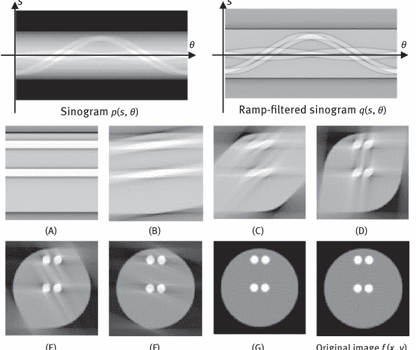

(A)-(G) q(s, θ) 的反投影

图 2.10：FBP 算法运行示例：滤波和逐视角反投影。

## 2.5 带截断投影的 ROI 重建

带截断投影的 ROI 重建情况在图 2.11 中得到说明，其中探测器不足以覆盖整个物体，但足以覆盖 ROI。在断层扫描理论中，这一 ROI 重建问题称为内部问题。只有圆形 FOV（视野）被完全测量。对于一般的内部问题，只能获得近似解。精确重建仅存在于某些特殊情况中。

图 2.12 显示了一个可求解的 ROI 重建问题，重建由“导数–反投影–希尔伯特变换”算法提供。ROI 是圆形 FOV 内深色阴影的较小区域。求导操作和反投影操作都是局部的。也就是说，它们只使用局部可用数据来得出结果。在求导和反投影之后，FOV 内的数据是精确的。

重建算法的下一步是沿图 2.12 中指示为垂直方向的方向，逐行执行一维希尔伯特变换。通常的希尔伯特变换是与不消失的卷积核 1/s 进行卷积的形式。因此，希尔伯特变换需要沿整个滤波线的数据。

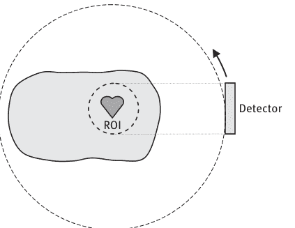

图 2.11：探测器仅足以覆盖 ROI，但不足以覆盖整个物体。

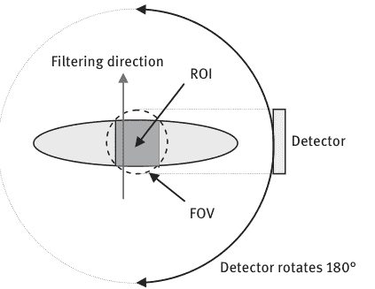

图 2.12：导数–反投影–希尔伯特变换算法能够精确重建 ROI。

得益于有限逆希尔伯特变换公式，我们能够使用有限数据执行逆希尔伯特变换。如果函数 f(s) 在区间 [a, b] 上非零，且 f(s) 的希尔伯特变换为 g(s)，则有限逆希尔伯特变换公式只需在 [a, b] 上使用 g(s) 即可恢复 f(s)。

利用这个有限逆希尔伯特变换公式，我们现在能够沿滤波线计算一维逆希尔伯特变换以重建图像，因为所需的精确数据在 FOV 中可用。该有限逆希尔伯特变换公式不是卷积形式；因此，使用傅里叶变换方法执行此步骤效率不高。

已表明，对于图 2.13 所示的受限程度较低的情况，可以获得精确的 ROI 重建。对于这种情况，ROI 的大小与 FOV 相同。这里只要求滤波线的一端位于物体外部。此情况下精确重建的证明基于解析延拓。该方法的缺点是我们尚未找到重建 ROI 图像的闭式公式。

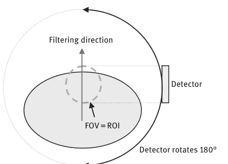

**图 2.13：** 测量数据足以精确重建 FOV。FOV 的一部分位于物体外部。

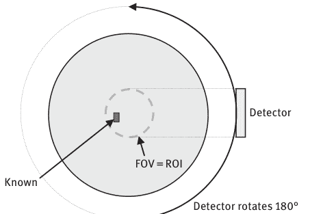

**图 2.14：** 如果已知 FOV 中的一个小区域，则可以精确重建 FOV。

这种解析延拓方法的直接扩展可以应用于一般内部问题，其中 FOV 内图像的一个小区域预先已精确知道（见图 2.14）。图像中的已知区域可以非常小。

我们现在来解释什么是解析延拓。解析延拓是数学分支——复分析中的一个主题，它研究带有复变量的函数。

如果 x 是实变量，则 h(x) = 2x + i(3 + 5x)（其中 i = √−1）不是带有复变量的函数。但是，h(z) = 2z（其中 z = x + iy，x 和 y 均为实数）是带有复变量的函数，并在复平面的一个区域（称为定义域）内定义。

如果复函数 h(z) 在复区域 R 的每一点都可微，则称该函数在 R 解析。如果复函数在区域 R 上解析，则它在 R 内无限可微。因此，你可以在 R 中的任何地方对解析函数 h(z) 进行幂级数展开。你可以想象解析函数非常平滑。

设 h1(z) 和 h2(z) 分别为区域 R1 和 R2 中的解析函数，并假设交集 R1 ∩ R2 非空，且 h1(z) = h2(z) 在 R1 ∩ R2 上成立。则 h2(z) 称为 h1(z) 到 R2 的解析延拓，反之亦然。此外，h1(z) 到 R2 的解析延拓是唯一的。解析延拓的这一唯一性是一个非常惊人且极其强大的陈述。如果复函数 h(z) 在区域 R 上解析，则知道 h(z) 在 R 中非常小的子区域上的值，就能唯一确定函数 h(z) 在 R 中其他每一点上的值。

如果我们的二维图像 f(x, y) 在小区域 Ωknown 已知，我们可以以某种方式确定图像 f(x, y) 在较大区域 Ω 上的值。请注意，f(x, y) 不是解析函数。我们不对 f(x, y) 执行解析延拓。

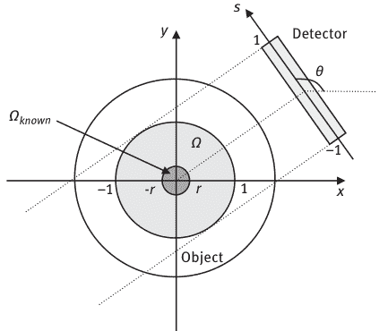

图 2.15：[-r, r] 上的已知图像值连同截断投影可用于确定 (-1, 1) 中的图像值。

首先，我们绘制一条穿过小区域 \(\Omega_{known}\) 的直线，例如 x 轴，如图 2.15 所示。不失一般性，我们只考虑一条直线上的图像值：\(y=0\)。我们可以对穿过已知区域 \(\Omega_{known}\) 的其他直线做同样的处理。

已知当 \(-r \le x \le r\) 时，图像 \(f(x, 0)\) 已知。在以下内容中，我们将定义一个函数 \(h(x)\)，将其转换为复函数 \(h(z)\)，并对 \(h(z)\) 应用解析延拓，以便在更大的区间 (-1, 1) 中估计图像 \(f(x, 0)\)。在这个特定的成像问题中，探测器比物体小。投影数据仅在 \(-1 \le s \le 1\) 时可用。我们可以使用 FBP 算法以如下方式重建图像：

\(f(x, 0) = \frac{1}{4\pi} \int_0^{2\pi} d\theta \int_{-\infty}^{\infty} \frac{1}{s - x \cos \theta} \frac{\partial p(s, \theta)}{\partial s} ds.\) (2.4)

该表达式可以写成两项：第一项含有测量数据，第二项含有未测量数据：

\(f(x, 0) = \frac{1}{4\pi} \int_0^{2\pi} d\theta \int_{-1}^1 \frac{1}{s - x \cos \theta} \frac{\partial p(s, \theta)}{\partial s} ds + \frac{1}{4\pi} \int_0^{2\pi} d\theta \int_{|s|>1} \frac{1}{s - x \cos \theta} \frac{\partial p(s, \theta)}{\partial s} ds.\) (2.5)

第一项可以使用 [-1, 1] 上的测量数据来计算，它包含图像 \(f\) 的锐利边缘。然而，第二项非常平滑（几乎是常数），但由于数据不可用而无法计算。让我们将第二项表示为 \(h(x)\)。我们有

\(h(x) = \frac{1}{4\pi} \int_0^{2\pi} d\theta \int_{|s|>1} \frac{1}{s - x \cos \theta} \frac{\partial p(s, \theta)}{\partial s} ds, \quad |x| < 1.\) (2.6)

在上述表达式中，\(|x|<1\) 和 \(|s|>1\) 使得 \(1/(s - x \cos \theta)\) 可以任意阶可微。我们进一步假设 \(\partial p/\partial s\) 是连续的，这在实践中通常满足。我们声称，如果将实变量 \(x\) 替换为复变量 \(z\)，则 \(h(z)\) 在 \(|z| < 1\) 范围内是一个解析函数。

解析函数 \(h(z)\) 在 \([-r, r]\) 上已知，因为 \(h(x)\) 也可以表示为

\(h(x) = f(x, 0) - \frac{1}{4\pi} \int_0^{2\pi} d\theta \int_{-1}^1 \frac{1}{s - x \cos \theta} \frac{\partial p(s, \theta)}{\partial s} ds,\) (2.7)

其中 \(f(x, 0)\) 在 \([-r, r]\) 上已知，上述表达式中的第二项可以使用测量数据来计算。通过使用解析延拓，\(h(z)\) 在 \(|z| < 1\) 范围内被唯一确定。因此，\(h(x)\) 在 (-1, 1) 中被确定。一旦找到 \(h(x)\)，(-1, 1) 中的图像值可以按如下方式获得：


\(f(x, 0) = \frac{1}{4\pi} \int_{0}^{2\pi} d\theta \int_{-1}^{1} \frac{1}{s - x \cos \theta} \frac{\partial p(s, \theta)}{\partial s} ds + h(x), |x| < 1.\)

在上述讨论中，我们知道我们应该有足够的数据来确定区域 \(\Omega\) 中的图像。但是，解析延续易曰难行。从数学上讲，进行解析延续的正确方法是进行泰勒展开，但这种方法不切实际。目前使用迭代方法来实现此目的。

另一个实际问题是稳定性问题。在某些情况下，我们可以从数学上证明有限数据可以唯一确定一个图像，但图像重建方法可能极其病态且不稳定。有限角成像问题可能就是这样一个病态问题。在有限角成像问题中，ROI 不具有完整的 \(180^\circ\) 角度测量。它可能只有，例如，\(10^\circ\) 角度测量。

## 2.6 数学表达式

本节介绍了一维傅里叶变换对、希尔伯特变换对以及两种逆有限希尔伯特变换的数学表达式。给出了中央切片定理的证明。本节还推导了 FBP 和反投影-滤波算法。还包括空间域滤波方法，例如卷积反投影算法和 Radon 反演公式。

### 2.6.1 傅里叶变换与卷积

一维傅里叶变换定义为

\(P(\omega) = \int_{-\infty}^{\infty} p(s)e^{-2\pi i s \omega} ds,\)

和一维逆傅里叶变换为

\(p(s) = \int_{-\infty}^{\infty} P(\omega)e^{2\pi i s \omega} d\omega.\)

两个函数 \(f\) 和 \(g\) 的卷积定义为

\((f * g)(t) = \int_{-\infty}^{\infty} f(\tau)g(t - \tau)d\tau = \int_{-\infty}^{\infty} f(t - \tau)g(\tau)d\tau.\)

如果我们将傅里叶变换算子表示为 \(\mathbf{F}\)，则卷积定理可以表述为

\(\mathbf{F}(f * g) = \mathbf{F}(f) \times \mathbf{F}(g).\) (2.12)

### 2.6.2 希尔伯特变换与有限希尔伯特变换

与傅里叶变换相比，希尔伯特变换不太为人所知。与将实函数转换为复函数的傅里叶变换不同，希尔伯特变换将实函数转换为另一个实函数。

在本节中，我们用 \(\mathbf{H}\) 表示希尔伯特变换算子。如果应用两次希尔伯特变换，则会得到原始函数，只是符号发生变化，即

\(\mathbf{H}(\mathbf{H} f) = \mathbf{H}^2 f = -f.\) (2.13)

换句话说，逆希尔伯特变换是希尔伯特变换的负值。

实函数及其希尔伯特变换正交。如果 \(g = \mathbf{H} f\)，则

\(\int_{-\infty}^{\infty} f(t)g(t)dt = 0.\) (2.14)

例如，\(\cos(t)\) 的希尔伯特变换是 \(\sin(t)\)。\(\sin(t)\) 的希尔伯特变换是 \(-\cos(t)\)。

希尔伯特变换可以在傅里叶域中定义。设实函数 \(f(t)\) 的傅里叶变换为 \(F(\omega)\)，\(f(t)\) 的希尔伯特变换为 \(g(t)\)，\(g(t)\) 的傅里叶变换为 \(G(\omega)\)，则

\(G(\omega) = -i\operatorname{sgn}(\omega)F(\omega),\) (2.15)

其中 \(i = \sqrt{-1}\)，\(\operatorname{sgn}(\omega)\) 为符号函数：

\(\operatorname{sgn}(\omega) = \begin{cases} 1, & \omega > 0 \\ 0, & \omega = 0 \\ -1, & \omega < 0. \end{cases}\) (2.16)

由于 \(-i\operatorname{sgn}(\omega)\) 的幅度为 1，希尔伯特变换是一种带有 \(\pm 90^\circ\) 相位移的全通滤波器的应用。

等价地，希尔伯特变换也可以表示为与卷积核进行卷积

\(h(t) = \frac{1}{\pi t}\)

如

\(g(t) = h(t) \star f(t) = \text{p.v.} \int_{-\infty}^{\infty} f(\tau) \frac{1}{\pi(t - \tau)} d\tau\)

其中“p.v.”表示主值。

我们已经看到，斜坡滤波器可以分解为希尔伯特变换和导数。无论是先执行导数再执行希尔伯特变换，还是先执行希尔伯特变换再执行导数，都无关紧要。事实上，我们有

\(\mathbf{H}(f'(t)) = \frac{d(\mathbf{H}(f(t)))}{dt}.\)

也可以改变希尔伯特变换和 \(180^\circ\) 反投影的顺序。为了更好地理解这一特性，我们将使用中央切片定理并在傅里叶域中思考。让我们考虑反投影问题

\(b(x,y) = \int_{-\pi/2}^{\pi/2} \mathbf{H}p(s, \theta)|_{s=x \cos \theta + y \sin \theta} d\theta\)

其中希尔伯特变换对变量 \(s\) 进行。设 \(p(s, \theta)\) 的傅里叶变换为 \(P(\omega, \theta)\)。将中央切片定理应用于此特定问题如图 2.16 所示，其中 \(P(\omega, \theta)\) 在放入二维傅里叶域之前乘以 \(i\) 或 \(-i\)。

执行此反投影的等效方法是先对 \(p(s, \theta)\) 进行反投影，然后将左半平面 \((\omega_x, \omega_y)\) 整体乘以 \(i\)，将右半平面 \((\omega_x, \omega_y)\) 整体乘以 \(-i\)。这种乘法操作可以通过在 \(x\) 方向上执行逐行的一维希尔伯特变换来实现。因此，我们有

\(\mathbf{H}_x \int_{-\pi/2}^{\pi/2} p(s, \theta)|_{s=x \cos \theta + y \sin \theta} d\theta = \int_{-\pi/2}^{\pi/2} \mathbf{H}_s p(s, \theta)|_{s=x \cos \theta + y \sin \theta} d\theta\)

接下来，我们将简要介绍有限希尔伯特变换的概念，它在使用截断投影数据进行 ROI 重建中起着重要作用。

不失一般性，我们假设实函数 \(f(t)\) 的支撑集在 \((-1, 1)\) 内，即如果 \(|t| \ge 1\)，则 \(f(t) = 0\)。那么 \(f(t)\) 的希尔伯特变换由以下给出

\(g(t) = \text{p.v.} \int_{-1}^{1} f(\tau) \frac{1}{\pi(t - \tau)} d\tau\)

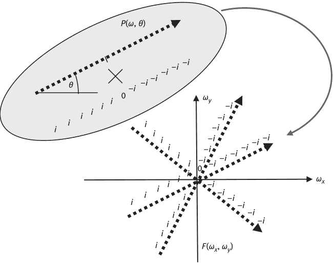

图 2.16: 在 \((-\pi/2, \pi/2)\) 上对 \(Hp(s, \theta)\) 进行反投影等价于在 \((-\pi/2, \pi/2)\) 上对 \(p(s, \theta)\) 进行反投影，然后在左半平面 \((\omega_x, \omega_y)\) 中乘以 \(i\)，在右半平面 \((\omega_x, \omega_y)\) 中乘以 \(-i\)。

尽管 \(f(t)\) 在有限区间内有支撑，但 \(g(t)\) 可能没有有限支撑。有些公式能够仅使用 \([-1,1]\) 上的 \(g(t)\) 来恢复 \(f(t)\)。例如

\( f(t) = \frac{1}{\pi} \sqrt{\frac{t-1}{t+1}} \text{p.v.} \int_{-1}^1 \sqrt{\frac{\tau+1}{\tau-1}} \frac{g(\tau)}{t-\tau} d\tau, \quad (2.23) \)

或

\( f(t) = \frac{1}{\pi \sqrt{1-t^2}} \left[ \int_{-1}^1 f(\tau) d\tau + \text{p.v.} \int_{-1}^1 \frac{\sqrt{1-\tau^2}}{\tau-t} g(\tau) d\tau \right]. \quad (2.24) \)

### 2.6.3 中央切片定理的证明

中央切片定理给出为

\( P(\omega, \theta) = F(\omega \cos \theta, \omega \sin \theta). \quad (2.25) \)

证明。我们从一维傅里叶变换的定义开始：

$$P(\omega) = \int_{-\infty}^{\infty} p(s) e^{-2\pi i s \omega} ds,$$ (2.26)

然后使用 \(p(s, \theta)\) 的定义（参见第 1.5 节），得到

$$P(\omega, \theta) = \int_{-\infty}^{\infty} \left[ \int_{-\infty}^{\infty} \left[ \int_{-\infty}^{\infty} f(x,y) \delta(x \cos \theta + y \sin \theta - s) \, dx \, dy \right] e^{-2\pi i s \omega} \, ds \right].$$ (2.27)

改变积分顺序得到

$$P(\omega, \theta) = \int_{-\infty}^{\infty} \int_{-\infty}^{\infty} f(x,y) \left[ \int_{-\infty}^{\infty} \delta(x \cos \theta + y \sin \theta - s) e^{-2\pi i s \omega} ds \right] dx dy.$$ (2.28)

利用 \(\delta\) 函数的性质，关于 \(s\) 的内积分可以很容易地得到，我们有

$$P(\omega, \theta) = \int_{-\infty}^{\infty} \int_{-\infty}^{\infty} f(x,y) e^{-2\pi i (x \cos \theta + y \sin \theta) \omega} dx dy,$$ (2.29)

即，

$$P(\omega, \theta) = \int_{-\infty}^{\infty} \int_{-\infty}^{\infty} f(x,y) e^{-2\pi i (x u + y v)}|_{u=\omega \cos \theta, v=\omega \sin \theta} dx dy.$$ (2.30)

最后，使用二维傅里叶变换的定义得到

$$P(\omega, \theta) = F(\omega_x, \omega_y)|_{\omega_x=\omega \cos \theta, \omega_y=\omega \sin \theta}.$$ (2.31)

在极坐标系中，中央切片定理可以表示为

$$P(\omega, \theta) = F_{\text{polar}}(\omega, \theta).$$ (2.32)

### 2.6.4 FBP 算法推导

我们从极坐标中的二维逆傅里叶变换开始

$$f(x, y) = \int_{0}^{2\pi} \int_{0}^{\infty} F_{\text{polar}}(\omega, \theta) e^{2\pi i (\omega x \cos \theta + y \sin \theta)} \omega d\omega d\theta.$$ (2.33)

因为 \(F_{\text{polar}}(\omega, \theta) = F_{\text{polar}}(-\omega, \theta + \pi)\)，我们有


\(f(x,y) = \int_{0}^{\pi} \int_{-\infty}^{\infty} F_{polar}(\omega, \theta)|\omega| e^{2\pi i \omega (x \cos \theta + y \sin \theta)} d\omega d\theta.\) (2.34)

使用中央切片定理，我们可以用 P 替换 F：

\(f(x,y) = \int_{0}^{\pi} \int_{-\infty}^{\infty} P(\omega, \theta)|\omega| e^{2\pi i \omega (x \cos \theta + y \sin \theta)} d\omega d\theta.\) (2.35)

我们认识到 \(|\omega|\) 是斜坡滤波器。设 \(Q(\omega, \theta) = |\omega| P(\omega, \theta)\)，则

\(f(x,y) = \int_{0}^{\pi} \int_{-\infty}^{\infty} Q(\omega, \theta) e^{2\pi i \omega (x \cos \theta + y \sin \theta)} d\omega d\theta.\) (2.36)

使用一维逆傅里叶变换的定义，并将 Q 的逆傅里叶变换记为 q，我们有

\(f(x,y) = \int_{0}^{\pi} q(x \cos \theta + y \sin \theta, \theta) d\theta,\) (2.37)

或

\(f(x,y) = \int_{0}^{\pi} q(s, \theta)|_{s=x \cos \theta + y \sin \theta} d\theta.\) (2.38)

这是 \(q(s, \theta)\) 的后投影（参见第 1.5 节）。

### 2.6.5 卷积后投影算法的表达式

设卷积核 h(s) 为斜坡滤波器 \(|\omega|\) 的逆傅里叶变换；即，\(h(s) = \int_{-\infty}^{\infty} |\omega| e^{2\pi i \omega s} d\omega\)。从第 2.6.4 节可以很容易地得到

\(f(x,y) = \int_{0}^{\pi} [h(s) * p(s, \theta)]|_{s=x \cos \theta + y \sin \theta} d\theta\)
\(= \int_{0}^{\pi} \int_{-\infty}^{\infty} h(x \cos \theta + y \sin \theta - s) p(s, \theta) ds d\theta.\) (2.39)

### 2.6.6 Radon 反演公式的表达式

导数、希尔伯特变换和后投影算法也被称为 Radon 反演公式，该公式可以通过将斜坡滤波器 \(|\omega|\) 分解为导数部分和希尔伯特变换部分来得到：

\[
|\omega| = (2\pi i\omega) \times \left[ \frac{1}{2\pi} (-\text{sgn}(\omega)) \right].
\]

\(-i \text{sgn}(\omega)\) 的逆傅里叶变换是 \(1/(\pi s)\)，而 \(2\pi i\omega\) 的逆傅里叶变换是微分算子。因此，

\[
q(s, \theta) = \frac{\partial p(s, \theta)}{\partial s} * \frac{1}{2\pi^2 s},
\]

且

\[
f(x, y) = \int_0^\pi \int_{-\infty}^\infty \frac{\partial p(s, \theta)}{\partial s} \frac{1}{2\pi^2 (x \cos \theta + y \sin \theta - s)} ds d\theta.
\]

### 2.6.7 先后投影后滤波算法的推导

让我们先看一下原始数据 \(p(s, \theta)\)（未经过滤）的后投影 \(b(x, y)\)。后投影的定义是

\[
b(x, y) = \int_0^\pi p(s, \theta)|_{s=x \cos \theta + y \sin \theta} d\theta.
\]

使用逆傅里叶变换的定义，\(p(s, \theta)\) 可以用其傅里叶变换表示

\[
b(x, y) = \int_0^\pi \left[ \int_{-\infty}^\infty P(\omega, \theta) e^{2\pi i\omega (x \cos \theta + y \sin \theta)} d\omega \right] d\theta.
\]

使用中央切片定理，我们可以用 F 替换 P：

\[
b(x, y) = \int_0^\pi \left[ \int_{-\infty}^\infty F_{\text{polar}}(\omega, \theta) e^{2\pi i\omega (x \cos \theta + y \sin \theta)} d\omega \right] d\theta,
\]

或

\[
b(x,y) = \int_{0}^{\pi} \int_{-\infty}^{\infty} \frac{F_{\text{polar}}(\omega, \theta)}{|\omega|} e^{2\pi i \omega (x \cos \theta + y \sin \theta)} |\omega| d\omega d\theta. \tag{2.46}
\]

这是极坐标下的二维逆傅里叶变换。如果在上述等式两边取二维傅里叶变换（在极坐标系中），我们有

\[
B_{\text{polar}}(\omega, \theta) = \frac{F_{\text{polar}}(\omega, \theta)}{|\omega|}, \tag{2.47}
\]

或在笛卡尔坐标系中，

\[
B(\omega_x, \omega_y) = \frac{F(\omega_x, \omega_y)}{\sqrt{\omega_x^2 + \omega_y^2}}; \tag{2.48}
\]

即，

\[
F(\omega_x, \omega_y) = \sqrt{\omega_x^2 + \omega_y^2} B(\omega_x, \omega_y). \tag{2.49}
\]

先后投影后滤波算法立即得出。

### 2.6.8 导数-后投影-希尔伯特变换算法的表达式

该算法是第 2.3.5 节中讨论的方法 5，可以表示为

\[
f(x,y) = \mathbf{H}_x \int_{0}^{\pi} \frac{\partial p(s, \theta)}{\partial s} \Big|_{s=x \cos \theta + y \sin \theta} d\theta. \tag{2.50}
\]

x 方向上的逐行一维希尔伯特变换记为 \(\mathbf{H}_x\)，它可以实现为与核 \(1/(\pi x)\) 的卷积，或在傅里叶域中作为与传递函数 \(i \text{sgn}(\omega_x)\) 的乘法。

导数和后投影都是局部算符。x 方向希尔伯特变换 \(\mathbf{H}_x\) 不是局部算符；然而，它只依赖于第 2.6.2 节讨论的有限范围内的数据。如果投影在 y 方向被截断，该算法可用于重建有限 ROI（参见第 2.5 节）。

### 2.6.9 后投影-导数-希尔伯特变换算法的推导

该算法是第 2.3.6 节中讨论的方法 6，可以从方法 5 很容易地推导出来，通过观察 \(\partial/\partial s\) 是一个方向导数，它等价于 \(-\sin \theta(\partial/\partial x)+\cos \theta(\partial/\partial y)\)。因此，我们有

\[
\int_{0}^{\pi} \left. \frac{\partial p(s, \theta)}{\partial s} \right|_{s=x \cos \theta+y \sin \theta} d\theta
= - \frac{\partial}{\partial x} \int_{0}^{\pi} \left. p(s, \theta) \sin \theta \right|_{s=x \cos \theta+y \sin \theta} d\theta + \frac{\partial}{\partial y} \int_{0}^{\pi} \left. p(s, \theta) \cos \theta \right|_{s=x \cos \theta+y \sin \theta} d\theta
= \frac{\partial b_x(x, y)}{\partial x} + \frac{\partial b_y(x, y)}{\partial y}, \tag{2.51}
\]

其中

\[
b_x(x, y) = - \int_{0}^{\pi} \left. p(s, \theta) \sin \theta \right|_{s=x \cos \theta + y \sin \theta} d\theta,
\]
\[
b_y(x, y) = \int_{0}^{\pi} \left. p(s, \theta) \cos \theta \right|_{s=x \cos \theta+y \sin \theta} d\theta. \tag{2.52}
\]

方程 (2.51) 给出了方法 6 中的前两个步骤。第三个步骤，即 x 方向逐行希尔伯特变换，在方法 5 和方法 6 中是相同的。

## 2.7 实例

示例 1：编写一个简短的 Matlab 程序，以说明在断层扫描问题中使用足够视角的重要性。Matlab 函数“phantom”生成数学 Shepp–Logan 头模。函数“radon”生成投影数据，即头模的 Radon 变换。函数“iradon”执行 FBP 重建。

### 解答

```matlab
P = phantom(128); %Generate the Shepp-Logan phantom
%in a 128x128 array
angle = linspace(0,179,180); %Sampling angles
R = radon(P, angle); %Generate the Radon transform over 180°, 
I1 = iradon(R, angle); %Inverse Radon transform, i.e., FBP
%reconstruction
I2 = iradon(R, angle,'linear','none'); %Backprojection
%without ramp-filtering
subplot (1,3,1), imshow(P), title('Original')
subplot (1,3,2), imshow(I1), title('Filtered backprojection')
subplot (1,3,3), imshow(I2, [])
title('Unfiltered backprojection')
```

我们得到以下结果（见图 2.17）。

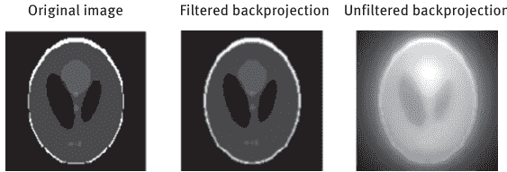

**图 2.17:** 使用 Matlab 函数“iradon”的真实图像和重建图像。

如果将行 angle = linspace(0,179,180) 更改为

```
angle = linspace(0,179,10)
angle = linspace(0,179,20)
angle = linspace(0,179,40)
angle = linspace(0,179,80)
```

分别，我们得到以下结果（见图 2.18）。

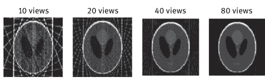

图 2.18: 视角不足会导致伪影。

**示例 2：** 运行一段简单的 Matlab 代码以展示噪声效应。向斜坡滤波器应用三种不同的窗函数以控制噪声。

### 解答

```matlab
P = phantom(128);
angle = linspace(0,179,180);
R = radon(P,angle);
R = 1e12*imnoise(1e-12*R,'Poisson'); %Add Poisson Noise
I1 = iradon(R,angle,'Ram-Lak');
subplot(1,3,1), imshow(I1, []), title('w/ Ram-Lak filter')
I1 = iradon(R,angle,'Cosine');
subplot(1,3,2), imshow(I1, []), title('w/ Cosine filter')
I1 = iradon (R,angle,'Hann');
subplot(1,3,3), imshow(I1, []), title('w/ Hann filter')
```

不同窗函数的 FBP 重建结果如图 2.19 所示。

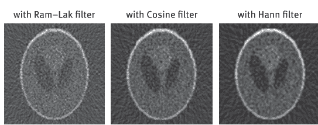

图 2.19: 使用不同窗函数控制噪声。


### 示例 3：寻找离散“Ramachandran–Lakshminarayanan”卷积核，它是斜坡滤波器的逆傅里叶变换。斜坡滤波器的截止频率为 ω = 1/2.

### 解答

当投影需要由斜坡滤波器滤波时，只需要一个带限斜坡滤波器，因为投影已由 0.5 带限。带限斜坡滤波器在傅里叶域定义为

RAMP(ω) = { |ω| if |ω| ≤ 0.5 0 if |ω| > 0.5 . (2.53)

首先，我们使用逆傅里叶变换来求卷积核 h(s) 的连续版本：

h(s) = ∫_{-1/2}^{1/2} |ω|e^{2πiωs} dω = 1/2 sin(πs)/πs - 1/4 [ sin(πs/2)/(πs/2) ]^2 . (2.54)

卷积核 h(s) 是带限的。根据奈奎斯特采样原理，适当的采样率是最高频率的两倍，在我们的例子中为 1。要将 h(s) 转换为离散形式，令 s = n（整数），则有

h(n) = { 1/4, n = 0 0, n even -1/(π^2n^2) n odd . (2.55)

连续和离散卷积核如图 2.20 所示。

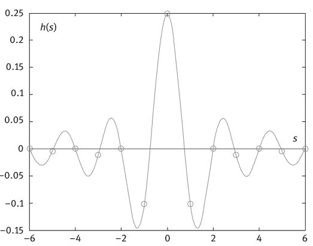

图 2.20：连续和采样的“Ramachandran–Lakshminarayanan”卷积核。

### 示例 4：如何在 FBP 算法中获得斜坡滤波器的离散传递函数？换句话说，获得 eq. (2.52) 离散版本的正确方法是什么？

### 解答

直接采样 eq. (2.52) 违反了奈奎斯特采样原理，因为其“频谱” h(s) 在 s 的有限区域内不受支持。另一方面，离散 h(n) 可用于执行精确的斜坡滤波。

求 h(n) 的离散傅里叶变换（DFT）以获取 eq. (2.52) 的离散版本是不切实际的，因为 h(n) 的样本数量不是有限的。好消息是，医学成像系统的探测器具有有限尺寸，且只需离散核 h(n) 的有限中心部分即可获得精确卷积。

如果投影的支撑长度为 N，则在反投影中只需要滤波后投影的中心 N 个样本。这要求卷积核的最小长度为 2N − 1。为了使两个函数长度相同，必须用 $N - 1$ 个零对投影进行填充。通常，必须选择一个长度 $M$，其至少为 $2N - 1$ 且为 2 的幂。然后用 $M - N$ 个零对投影进行填充。现在可以将两个函数视为周期相同的周期函数，周期均为 $M$。我们将离散信号视为周期信号，因为我们使用快速傅里叶变换（FFT）方法来间接计算卷积，而 FFT 方法只能计算循环卷积。

设 eq. (2.52) 的离散版本为 $H(k)$，$k = 0, 1, 2, \dots, M - 1$，并将 eq. (2.52) 中的 $\text{RAMP}(\omega)$ 设为 $H_c(\omega)$，其对应的离散卷积核为 $h(n)$。则 $H(k)$ 可计算为

```
H(k) = \sum_{n=0}^{M-1} h_c(n) e^{-j 2 \pi n k / M}
= \sum_{n=0}^{M-1} \int_{-0.5}^{0.5} H_c(\omega) e^{j 2 \pi \omega n} d\omega e^{-j 2 \pi n k / M}
= \int_{-0.5}^{0.5} H_c(\omega) \sum_{n=0}^{M-1} e^{j 2 \pi n (\omega - k / M)} d\omega
= \int_{-0.5}^{0.5} H_c(\omega) \frac{1 - e^{j 2 \pi M (\omega - k / M)}}{1 - e^{j 2 \pi (\omega - k / M)}} d\omega
= \int_{-0.5}^{0.5} H_c(\omega) \frac{\sin(\pi M (\omega - k / M))}{\sin(\pi (\omega - k / M))} e^{j \pi (M - 1) (\omega - k / M)} d\omega.
```

这里，\(\frac{\sin(\pi M(\omega - k/M))}{\sin(\pi(\omega - k/M))}\) 类似于 sinc 函数，在 \(\omega = k/M\) 处具有可去奇点，如果在 \(\omega = k/M\) 处定义 \(\frac{\sin(\pi M(\omega - k/M))}{\sin(\pi(\omega - k/M))} = M\)，则它是一个连续函数。如果 \(H_c(\omega)\) 是偶函数，则 eq. (2.56) 简化为

\(H(k) = \int_{-0.5}^{0.5} H_c(\omega) \frac{\sin\left(\pi M\left(\omega - \frac{k}{M}\right)\right)}{\sin\left(\pi\left(\omega - \frac{k}{M}\right)\right)} \cos\left(\pi(M-1)\left(\omega - \frac{k}{M}\right)\right) d\omega.\quad (2.57)\)

从 eq. (2.57) 可知，通常

\(H(k) \neq H_c(k/M).\quad (2.58)\)

当 \(M\) 选为至少为 2N−1 的整数时，eq. (2.57) 可进一步写为

\(H(k) = \frac{1}{4} - \frac{2}{\pi^2} \sum_{n=1, n \text{ odd}}^{(M/2)-1} \frac{\cos(2\pi n k / M)}{n^2}.\quad (2.59)\)

当使用 DFT 或 FFT 实现斜坡滤波器时，eq. (2.59) 是表示斜坡滤波器的正确公式。

如果使用采样的连续斜坡滤波器，可能会出现错误。错误表示为

\(\text{Error}\left(\omega = \frac{k}{M}\right) = H(k) - \frac{|k|}{M} \quad \text{for} \quad \frac{|k|}{M} \le 0.5.\quad (2.60)\)

根据 eq. (2.60)，一些数值如表 2.1 和 2.2 所列（其中 \(M = 2N\)）。可以从表 2.1 和 2.2 中观察到，如果在 DFT 或 FFT 实现中使用直接采样的斜坡滤波器，则需要修正直流增益，而其他频率增益的误差足够小，当尺寸 \(M\) 较大时可以忽略。

### 表 2.1：\(\omega = 0\) 时的误差，\(M = 2N\)。

| N | k | H(k) | 采样斜坡滤波器值 | 误差 |
|---|---|---|---|---|
| 8 | 0 | \(1.26 \times 10^{-2}\) | 0 | \(1.26 \times 10^{-2}\) |
| 16 | 0 | \(6.32 \times 10^{-3}\) | | \(6.32 \times 10^{-3}\) |
| 32 | 0 | \(3.17 \times 10^{-3}\) | | \(3.17 \times 10^{-3}\) |
| 64 | 0 | \(1.58 \times 10^{-3}\) | | \(1.58 \times 10^{-3}\) |
| 128 | 0 | \(7.92 \times 10^{-4}\) | | \(7.92 \times 10^{-4}\) |
| 256 | 0 | \(3.96 \times 10^{-4}\) | | \(3.96 \times 10^{-4}\) |
| 512 | 0 | \(1.99 \times 10^{-4}\) | | \(1.99 \times 10^{-4}\) |
| 1,024 | 0 | \(9.89 \times 10^{-5}\) | | \(9.89 \times 10^{-5}\) |
| 2,048 | 0 | \(4.95 \times 10^{-5}\) | | \(4.95 \times 10^{-5}\) |

### 表 2.2：$\omega = 1/16 = 0.0625, M = 2 N$ 时的误差。

| N | k | H(k) | 采样斜坡滤波器值 | 误差 |
|---|---|---|---|---|
| 8 | 1 | 6.11 x 10^-2 | 6.25 x 10^-2 | -1.41 x 10^-3 |
| 16 | 2 | 6.28 x 10^-3 | | 2.50 x 10^-4 |
| 32 | 4 | 6.25 x 10^-3 | | 3.64 x 10^-5 |
| 64 | 8 | 6.25 x 10^-3 | | 4.79 x 10^-6 |
| 128 | 16 | 6.25 x 10^-3 | | 6.07 x 10^-7 |
| 256 | 32 | 6.25 x 10^-3 | | 7.61 x 10^-8 |
| 512 | 64 | 6.25 x 10^-3 | | 9.52 x 10^-9 |
| 1,024 | 128 | 6.25 x 10^-3 | | 1.19 x 10^-9 |
| 2,048 | 256 | 6.25 x 10^-3 | | 1.49 x 10^-10 |

### 示例 5：使用 MATLAB 数值计算由 eq. (2.55) 定义的核 h 诱导的 1,024 点斜坡滤波器 H。该诱导斜坡滤波器的直流增益是多少？

### 解答

MATLAB 代码如下：

```
h1=zeros (1,1024) ;
for n=1:2:1023
    h1 (n) =(-1/pi^2) /n^2;
end
h=[fliplr (h1) 1/4 h1];
h (end)=[] ;
H=fft (fftshift (h)) ;
figure (1)
subplot (1,2,1),plot (-1024:1023,h),axis ([-16 16 -0.12 0.25])
subplot (1,2,2),plot (-1024:1023,fftshift (real (H)) ),...
    axis ([-1024 1023 0 0.5])
H (1)
```

下图所示为计算结果，直流增益值为 9.8946 x 10^-5。

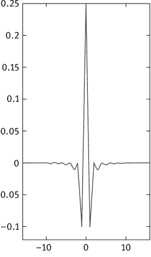

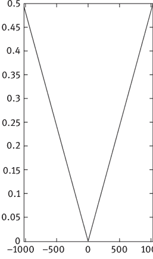

## 2.8 总结

- 傅里叶变换是表示频域函数的有用工具。逆傅里叶变换将频域表示带回原始空间域表达式。

- 在傅里叶域中，投影数据和原始图像有明显的关系。这种关系在流行的中央切片定理中有所阐述。某一视角的投影数据的一维傅里叶变换是原始图像二维傅里叶变换中的一条直线。一旦我们拥有足够数量的投影视角，它们对应的直线将覆盖二维傅里叶平面。

- 二维傅里叶域中的反投影模式表明采样密度与 $1/|\omega|$ 成正比。因此，反投影本身只能提供模糊的重建。精确重建需要斜坡滤波和反投影相结合。

- 最流行的图像重建算法是 FBP 算法。斜坡滤波可以作为频域中的乘法或空间域中的卷积来实现。

- 可以自由交换斜坡滤波和反投影的顺序。

- 斜坡滤波还可分解为希尔伯特变换和求导运算。因此，我们有更多图像重建的方法。

- 在某些条件下，感兴趣区域（ROI）可以使用截断投影数据精确重建。

- 预期读者理解本章的两个主要概念：中央切片定理和 FBP 算法。


## 问题

问题 2.1 设二维物体定义为

f(x, y) = cos(2πx) + cos(2πy).

求其二维傅里叶变换 $F(\omega_x, \omega_y)$。利用中央切片定理确定该物体 f(x, y) 的 Radon 变换。

问题 2.2 设 $f_1(x, y)$ 和 $f_2(x, y)$ 为两个二维函数，它们的 Radon 变换分别为 $p_1(s, \theta)$ 和 $p_2(s, \theta)$。如果 $f(x, y)$ 是 $f_1(x, y)$ 和 $f_2(x, y)$ 的二维卷积，利用中央切片定理证明 $f(x, y)$ 的 Radon 变换是 $p_1(s, \theta)$ 和 $p_2(s, \theta)$ 关于变量 $s$ 的卷积。

问题 2.3 设二维物体 f(x, y) 的 Radon 变换为 $p(s, \theta)$，f(x, y) 的二维傅里叶变换为 $F(\omega_x, \omega_y)$，$p(s, \theta)$ 关于第一个变量 s 的一维傅里叶变换为 $P(\omega, \theta)$。值 $F(0, 0)$ 的物理意义是什么？值 $P(0, \theta)$ 的物理意义是什么？是否可能 $\int_{-\infty}^{\infty} \int_{0}^{\infty} g(s, 0^{\circ}) ds \neq \int_{-\infty}^{\infty} \int_{0}^{\infty} g(s, 90^{\circ}) ds$？

问题 2.4 证明函数

$$f(t) = \begin{cases} \sqrt{1-t^2}, & |t| < 1 \\ 0, & |t| \ge 1 \end{cases}$$

的 Hilbert 变换为

$$g(t) = \begin{cases} t, & |t| < 1 \\ t - \sqrt{t^2 - 1} \text{sgn}(t), & |t| \ge 1. \end{cases}$$

## 参考文献

- [1] Bracewell RN (1956) 射电天文学中的条带积分. Aust J Phys 9:198–217.
- [2] Bracewell RN (1986) 傅里叶变换及其应用，第 2 版. McGraw-Hill, New York.
- [3] Carrier GF, Krook M, Pearson CE (1983) 复变函数理论与技术. Hod, Ithaca.
- [4] Clackdoyle R, Noo F, Guo J, Roberts J (2004) 来自紧支撑截断投影的定量重建. Inverse Probl 20:1281–1291.
- [5] Deans SR (1983) Radon 变换及其一些应用. John Wiley & Sons, New York.
- [6] Defrise M, Noo F, Clackdoyle KH (2006) 截断 Hilbert 变换及来自有限断层数据的图像重建. Inverse Probl 22:1037–1053.
- [7] Hahn SL (1996) 信号处理中的 Hilbert 变换. Artech House, Boston.
- [8] Huang Q, Zeng GL, Gullberg GT (2007) 带数值生成核的 180° 指数 Radon 变换的解析反演. Int J Image Graphics 7:71–85.
- [9] Kak AC, Slaney M (1998) 计算机断层成像原理. IEEE Press, New York.
- [10] Kanwal RP (1971) 线性积分方程理论与技术. Academic Press, New York.
- [11] Natterer F (1986) 计算机断层扫描的数学. Wiley, New York.
- [12] Noo F, Clackdoyle R, Pack JD (2004) 二维图像重建的两步 Hilbert 变换方法. Phys Med Biol 49:3903–3923.
- [13] Sidky EY, Pan X (2005) 从有限区间上的 Hilbert 变换知识中恢复紧支撑函数. IEEE Trans Signal Process Lett 12:97–100.
- [14] Shepp L, Logan B (1974) 头部切面的傅里叶重建. IEEE Trans Nucl Sci 21:21–43.
- [15] Tricomi FG (1957) 积分方程. Interscience, New York.
- [16] Ye Y, Yu H, Wei Y, Wang G (2007) 基于截断 Hilbert 变换的通用局部重建方法. Int J Biom Imag 2007: 63634.
- [17] Ye Y, Yu H, Wang G (2007) 锥束 CT 的精确内部重建. Int J Biom Imag 2007: 10693.
- [18] You J, Zeng GL (2006) 精确有限逆 Hilbert 变换. Inverse Probl 22:L7–L10.
- [19] Yu H, Yang J, Jiang M, Wang G (2009) 内部 SPECT – 来自均匀衰减局部投影的精确稳定 ROI 重建. Commun Numer Methods Eng 25:693–710.
- [20] Yu H, Ye Y, Wang G (2008) 通过奇异值分解利用截断 Hilbert 变换进行内部重建. J X-Ray Sci Tech 16:243–251.
- [21] Zeng GL (2007) 通过反投影导数的有限 Hilbert 变换进行图像重建. Med Phys 34:2837–2843.
- [22] Zeng GL (2015) 斜坡滤波器再探. IEEE Trans Nucl Sci 62:131–136.
- [23] Zeng GL, You J, Huang Q, Gullberg GT (2007) 局部断层扫描的两个有限逆 Hilbert 变换公式. Int J Imag Syst Tech 17:219–223.

# 3 扇束图像重建

第 2 章中讨论的图像重建算法是用于平行束成像的。如果数据采集系统产生的投影不是沿平行线的，则第 2 章中提出的图像重建算法不能直接应用。本章使用平面探测器和曲面探测器扇束成像几何来说明如何将平行束重建算法转换为用户的成像几何以进行图像重建。

## 3.1 扇束几何和点扩散函数

扇束成像几何在 X 射线计算机断层扫描（CT）中很常见，其中扇束焦点是 X 射线源。图 3.1 比较了扇束成像几何和平行束成像几何。

对于平行束几何，我们有一个中央切片定理来推导重建算法。我们没有扇束几何的等效定理。我们将采用不同的策略——将扇束成像情况转换为平行束成像情况，并修改平行束算法以供扇束使用。

在第 2 章中，当我们讨论平行束成像问题时，未曾提及，但我们始终假设探测器以恒定速度旋转，并且在采集数据时具有均匀角间隔。这里对扇束也做出相同假设。

对于平行束成像几何，这一假设导致投影/反投影的点扩散函数（PSF）是平移不变的。换句话说，如果你将点源放在 x-y 平面中（无论放在哪里），计算投影，并执行反投影，那么你总会得到相同的星状图案（见图 3.2）。这个图案称为投影/反投影操作的*点扩散函数*。

在平行束情况下，当你在点 (x, y) 处寻找反投影时，你过该点并垂直于每个探测器画一条线。这条线在探测器上交于一点，记为 s*。然后将值 p(s*, θ) 加到位置 (x, y)。

在扇束情况下，当你在点 (x, y) 处寻找反投影时，你过该点和每个焦点位置画一条线。这条线相对于探测器的中心射线有一个角度，记为 γ*。然后将值 g(γ*, β) 加到位置 (x, y)。

可以证明，如果扇束焦点轨迹是一个完整圆周，则 PSF 是平移不变的（即点源位置改变时图案不变），并且与平行束情况具有相同的 PSF 图案（见图 3.3）。

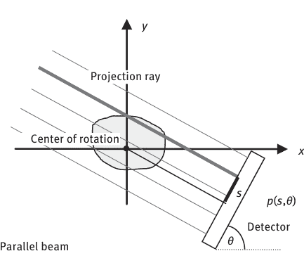

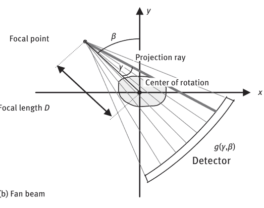

图 3.1: 平行束和扇束成像几何的比较。

这一观察很重要。这意味着，如果你对一幅图像进行投影和反投影，无论使用平行束还是扇束几何，你都会得到该图像的相同模糊版本。

如果原始图像是 $f(x, y)$，且投影数据的反投影为 $b(x, y)$，则可证明 PSF 为 $1/r$，其中 $r = \sqrt{x^2 + y^2}$。则 $f(x, y)$ 和 $b(x, y)$ 的关系为

$b(x, y) = f(x, y) ** \frac{1}{r}$, (3.1)

其中“**”表示二维卷积。$b$ 的傅里叶变换为 $B$，$f$ 的傅里叶变换为 $F$。因此上述关系在傅里叶域变为

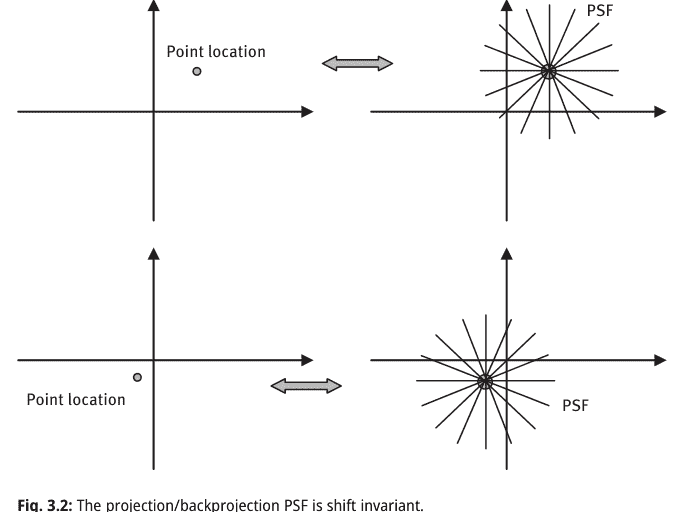

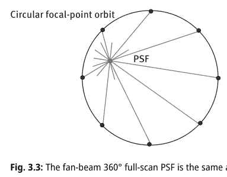

$B(\omega_x, \omega_y) = F(\omega_x, \omega_y) \times \frac{1}{\sqrt{\omega_x^2 + \omega_y^2}}$，

因为 $1/\sqrt{x^2+y^2}$ 的二维傅里叶变换是 $1/\sqrt{\omega_x^2 + \omega_y^2}$。

已知，如果对反投影图像 b(x, y) 应用二维斜坡滤波器，可以得到原始图像 f(x, y)。同样的技术可用于扇束反投影图像 b(x, y)。反投影-然后-滤波算法对平行束和扇束成像几何是相同的。如果我们应用二维


将斜率滤波器 \(\sqrt{\omega_x^2 + \omega_y^2}\) 应用于上述频域关系两边，即可轻易得到原始图像 \(f(x, y)\) 的傅里叶变换 \(F(\omega_x, \omega_y)\)：

```
\( F(\omega_x, \omega_y) = B(\omega_x, \omega_y) \times \sqrt{\omega_x^2 + \omega_y^2}. \) (3.3)
```

最后，通过进行二维逆傅里叶变换得到原始图像 \(f(x, y)\)。

## 3.2 平行束到扇束算法转换

如果要使用滤波-后投影（即滤波后投影 [FBP]）算法来重建图像，则必须采用不同的策略。

一种简单的方法是将每条扇束射线重箱化为平行束射线。对于每条扇束射线和 \(g(\gamma, \beta)\)，我们可以找到与扇束射线方向相同的平行束射线和 \(p(s, \theta)\)，关系式如下（参见图 3.4）

```
\(\theta = \gamma + \beta\) (3.4)
```

和

```
\(s = D \sin \gamma,\) (3.5)
```

其中 \(D\) 是焦距。我们然后赋值

```
\(p(s, \theta) = g(\gamma, \beta).\) (3.6)
```

将扇束数据重箱化为平行束格式后，我们再使用平行束图像重建算法来重建图像。然而，这种重箱化方法并不首选，因为改变坐标时重箱化需要数据插值。数据插值会引入误差。重箱化的想法是可行的，但结果可能不够准确。

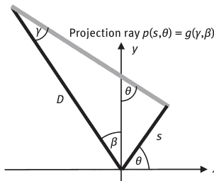

**Fig. 3.4:** 扇束射线可以使用平行束几何参数来表示。

然而，上述想法并非完全无用。让我们以稍有不同的方式来做。我们从平行束图像重建算法出发，这是一个数学表达式。表达式左侧是重建的图像 f(x, y)。右侧是一个包含投影 p(s, θ) 以及与 s 和 θ 相关的一些其他因子的积分表达式（参见图 3.5）。

接下来，我们在右侧将平行束投影 p(s, θ) 替换为其等效的扇束对应项 g(γ, β)。当然，这种替换只有在满足条件 θ = γ + β 和 s = D sin γ 时才可行。这两个关系在图 3.4 中更容易看出，图 3.4 源自图 3.1。

为了满足这两个条件，我们将它们代入表达式的右侧。这个过程只不过是改变积分中的变量，其中变量 s 和 θ 被变为 γ 和 β。

提醒一下，在微积分中，当你改变积分中的变量时，需要一个雅可比因子，它是用一些偏导数计算出的行列式。这个雅可比是 γ 和 β 的函数。

平行束算法

f (x,y) = ∬ {p(s,θ) 和与 s 和 θ 相关的其他内容}dsdθ

p(s,θ) = g(γ,β)
θ = γ + β 和 s = D sin γ
雅可比 J(γ,β)

用扇束数据替换平行束数据
改变变量

f (x,y) = ∬ {g(γ,β) 和与 γ 和 β 相关的其他内容} J(γ,β)dγdβ

扇束算法

**Fig. 3.5:** 将平行束算法转换为扇束算法的过程。

在用扇束数据 g(γ, β) 替换平行束数据 p(s, θ)、将变量 s 和 θ 改为 γ 和 β，并插入雅可比 J(γ, β) 后，一个新的扇束图像重建算法诞生了（参见图 3.5）！

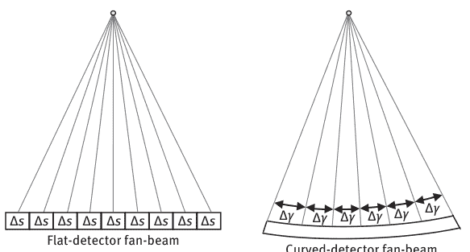

图 3.6: 平面和曲面探测器扇束几何。

图 3.5 概述的方法是通用的。我们有一长串平行束图像重建算法。它们都可以通过这种方式转换为扇束算法，相应地，我们也有一长串扇束算法。我们必须指出，改变变量后，一个卷积操作（关于变量 s）可能不会自动变成一个卷积（关于变量 γ），需要一些数学处理才能将其转换为卷积形式。与平行束算法一样，扇束算法包括斜率滤波与后投影的组合，或导数、希尔伯特变换与后投影（DHB）的组合。

研究人员在重建算法开发中对平面探测器扇束和曲面探测器扇束采取不同的处理方式。在平面探测器中，数据点以等距离 Δs 间隔采样，而在曲面探测器中，数据点以等角度 Δγ 间隔采样（参见图 3.6）。通过适当的权重调整，扇束算法可以从一种几何转换为另一种几何。

## 3.3 短扫描

在平行束成像中，当探测器旋转 2π（即 360°）时，每条投影射线被测量两次，冗余数据由以下关系关联

```
p(s, θ) = p(−s, θ + π);
```

冗余数据由两个面对面的探测器获取（参见图 3.7）。因此，在 π 的角度范围内获取数据就足够了。

同样地，当扇束探测器旋转 2π 时，每条投影射线也被测量两次，冗余数据由以下关系关联（参见图 3.8）

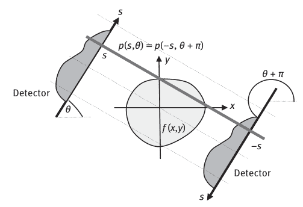

图 3.7: 面对面的平行束探测器测量相同的线积分。

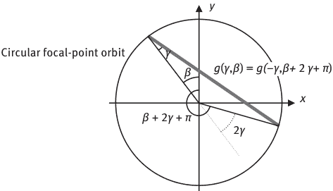

图 3.8: 扇束 360° 全扫描中每条射线被测量两次。

\( g(\gamma, \beta) = g(-\gamma, \beta + 2\gamma + \pi). \quad (3.8) \)

由于数据冗余，在扇束数据采集中，我们可以使用小于 2π 的更小角度（β）范围，因此有了*短扫描*一词。β 的最小范围由数据采集方式决定。所需范围可以小于 π（参见图 3.9，左侧），等于 π（参见图 3.9，中间），或大于 π（参见图 3.9，右侧）。标准是，我们感兴趣的物体中每个点都需要至少 180° 的角度覆盖。

需要注意的是，在扇束短扫描中，一些射线被测量一次，而其他射线被测量两次。即使在 β 的角度范围小于 π 的情况下，仍然有射线被测量两次。事实上，任何与测量焦点轨迹相交两次的射线都会被测量两次（参见图 3.10）。我们要求任何穿过物体的射线至少被测量一次。如果数据冗余，图像重建中应使用适当的权重。

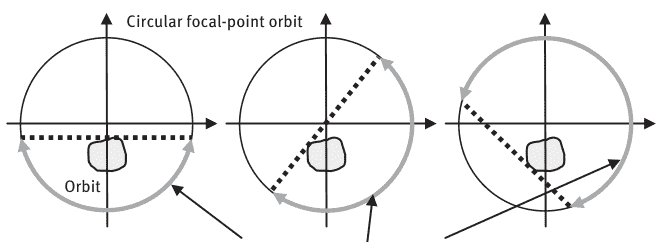

图 3.9: 扇束最小扫描角度取决于物体的位置。

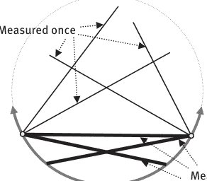

图 3.10: 对于扇束短扫描，一些射线被测量一次，一些射线被测量两次。

例如，如果一条射线被测量两次，这两次测量的权重因子之和应为单位。对于扇束短扫描，投影/后投影 PSF 不再是位移不变的。

## 3.4 数学表达式

本节介绍了曲面扇束探测器 FBP 算法的推导步骤。滤波步骤中使用的斜率滤波器表述为一个卷积。在该算法中，扇束后投影包含一个距离相关的权重因子，当在实践中对斜率滤波器应用窗函数时，这会导致重建图像中分辨率不均匀。为了克服这个问题，可以用导数运算和希尔伯特变换替换斜率滤波器。本节给出了使用导数和希尔伯特变换的扇束算法推导。

### 3.4.1 滤波后投影扇束算法的推导

我们从平行束 FBP 算法（参见第 2.6.5 节）出发，使用极坐标 \( (r, \varphi) \) 而不是笛卡尔坐标 \( (x, y) \)。那么 \( x = r \cos \varphi, y = r \sin \varphi \)，且 \( x \cos \theta + y \sin \theta = r \cos(\theta - \varphi) \)。我们有

```
\( f(r, \varphi) = \frac{1}{2} \int_{0}^{2\pi} \int_{-\infty}^{\infty} p(s, \theta) h(r \cos(\theta - \varphi) - s) ds d\theta. \quad (3.9) \)
```

改变变量 \( \theta = \gamma + \beta \) 和 \( s = D \sin \gamma \)，伴随雅可比 \( D \cos \gamma \)，得到

```
\( f(r, \varphi) = \frac{1}{2} \int_{0}^{2\pi} \int_{-\pi/2}^{\pi/2} g(\gamma, \beta) h(r \cos(\beta + \gamma - \varphi) - D \sin \gamma) D \cos \gamma \, d\gamma d\beta. \quad (3.10) \)
```

这是一个扇束重建算法，但关于 \( \gamma \) 的内积分尚未采用卷积形式。在实现中，卷积远比一般积分高效。接下来，我们将把关于 \( \gamma \) 的积分转换为关于 \( \gamma \) 的卷积。

对于给定的重建点 \( (r, \varphi) \)，我们定义 \( D' \) 和 \( \gamma' \)，如图 3.11 所示，则 \( r \cos(\beta + \gamma - \varphi) - D \sin \gamma = D' \sin(\gamma' - \gamma) ，且

```
\( f(r, \varphi) = \frac{1}{2} \int_{0}^{2\pi} \int_{-\pi/2}^{\pi/2} g(\gamma, \beta) h(D' \sin(\gamma' - \gamma)) D \cos \gamma \, d\gamma d\beta. \quad (3.11) \)
```

现在，我们证明斜率滤波器的一个特殊性质

```
\( h(D' \sin \gamma) = \left( \frac{\gamma}{D' \sin \gamma} \right)^2 h(\gamma), \quad (3.12) \)
```

这将在扇束公式推导的最后一步中使用。

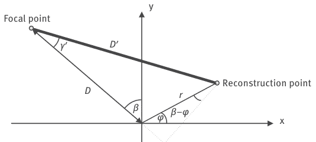

图 3.11: 重建点 \( (r, \varphi) \) 定义了角度 \( \gamma' \) 和距离 \( D' \)。


Using the definition of the ramp filter kernel $h(t) = \int_{-\infty}^{\infty} |\omega| e^{j2\pi\omega t} d\omega$, we have

```
h(D' \sin y) = \int_{-\infty}^{\infty} |\omega| e^{j2\pi \omega D' \sin y} d\omega
= \left(\frac{y}{D' \sin y}\right)^2 \int_{-\infty}^{\infty} \left| \omega \frac{\sin y}{y} \right| e^{j2\pi \omega \frac{D' \sin y}{y}} d\left( \omega \frac{\sin y}{y} \right)
= \left(\frac{y}{D' \sin y}\right)^2 \int_{-\infty}^{\infty} |\hat{\omega}| e^{j2\pi \hat{\omega} y} d\hat{\omega}
= \left(\frac{y}{D' \sin y}\right)^2 h(y).
```

If we denote h_{fan}(y) = (D/2) (y/\sin y)^2 h(y), then the fan-beam convolution backprojection algorithm is obtained as

```
f(r, \varphi) = \int_{0}^{2\pi} \frac{1}{(D')^2} \int_{-\pi/2}^{\pi/2} (\cos \gamma) g(y, \beta) h_{fan}(y' - y) dy d\beta.
```

### 3.4.2 使用导数和希尔伯特变换的扇束算法

将斜坡滤波器分解为导数和希尔伯特变换的一般思想可以应用于扇束图像重建。通过对Radon反演公式（参见第2.6.6节）进行坐标变换，可以得到导数-希尔伯特变换-反投影算法，如下所示。Noo、Defrise、Kudo、Clackdoyle、Pan、Chen、Wang、You等人在开发使用导数和希尔伯特变换的算法方面做出了重大贡献。我们首先在极坐标系统中重写Radon反演公式（参见第2.6.6节），即，f(r, \varphi)可以重构为

```
f(r, \varphi) = \frac{1}{2} \int_{0}^{2\pi} \int_{-\infty}^{\infty} \frac{\partial p(s, \theta)}{\partial s} \frac{1}{2\pi^2 (r \cos(\theta - \varphi) - s)} ds d\theta.
```

将变量从(s, \theta)变更为(y, \beta)并使用\frac{\partial p}{\partial s} = \frac{1}{D \cos y} \frac{\partial g}{\partial y}，我们有

\( f(r, \varphi) = \frac{1}{2} \int_{0}^{2\pi} \int_{-\pi/2}^{\pi/2} \frac{1}{D \cos \gamma} \frac{\partial g(y, \beta)}{\partial y} \frac{1}{2\pi^2 D' \sin(y' - y)} D \cos y \, dy \, d\beta \\
= \int_{0}^{2\pi} \frac{1}{4\pi^2 D'} \int_{-\pi/2}^{\pi/2} \frac{\partial g(y, \beta)}{\partial y} \frac{1}{\sin(y' - y)} dy \, d\beta \quad (3.16) \)

其中，\( D' \) 是重建点到角度 \( \beta \) 处焦点的距离。在重建算法中，这个 \( D' \) 因子并非理想。较小的 \( D' \) 会使算法不稳定；这个与空间相关的因子也会消耗一定的计算时间。在 \( 2\pi \) 扫描中，每条射线被测量两次。如果对冗余测量选择适当的权重，可以消除这个 \( D' \) 因子。

让我们在上述DHB算法中引入一个权重函数 \( w \)：

\( f(r, \varphi) = \frac{1}{4\pi^2} \int_{0}^{2\pi} \frac{w(y', \beta, r, \varphi)}{D'} \int_{-\pi/2}^{\pi/2} \left( \frac{\partial}{\partial y} + \frac{\partial}{\partial \beta} \right) g(y, \beta) \frac{1}{\sin(y' - y)} dy \, d\beta. \quad (3.17) \)

如果我们用 \( \hat{g} \) 表示扇束数据的导数和希尔伯特变换的结果：

\( \hat{g}(y', \beta) = \int_{-\pi/2}^{\pi/2} \left( \frac{\partial}{\partial y} + \frac{\partial}{\partial \beta} \right) g(y, \beta) \frac{1}{\sin(y' - y)} dy, \quad (3.18) \)

那么

\( f(r, \varphi) = \frac{1}{4\pi^2} \int_{0}^{2\pi} \frac{w(y', \beta, r, \varphi)}{D'} \hat{g}(y', \beta) \, d\beta. \quad (3.19) \)

可以证明，\( \hat{g}/D' \) 与原始扇束数据 \( g \) 具有相同的冗余属性（参见图3.8）。因此，要求权重函数满足条件

\( w(y', \beta, r, \varphi) + w(y'_c, \beta_c, r, \varphi) = 2, \quad (3.20) \)

其中 \( y'_c = -y' \) 和 \( \beta_c = \beta + 2\gamma + \pi \)。如果我们定义 \( w(y', \beta, r, \varphi) = D'/(D \cos y') \)，则满足上述条件，因为 \( D' + D'_c = 2D \cos y' \)（参见图3.12）。最后，

\( f(r, \varphi) = \frac{1}{2} \left\{ \frac{1}{4\pi^2} \int_{0}^{2\pi} \left[ \frac{w(y', \beta, r, \varphi)}{D'} + \frac{w(y''_c, \beta_c, r, \varphi)}{D''_c} \right] \hat{g}(y', \beta) \, d\beta \right\} \\
= \frac{1}{4\pi^2 D} \int_{0}^{2\pi} \frac{1}{\cos y} \hat{g}(y', \beta) \, d\beta. \quad (3.21) \)

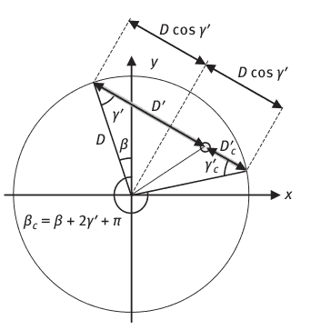

**图 3.12:** 适当的权重可以使距离相关因子在 360° 全扫描中从反投影仪中消失。

该结果可以在不引入权重函数 _w_ 的情况下推导（参见本章末尾由You and Zeng列出的论文 [14]）。

### 3.4.3 Parker权重的表达式

扇束断层扫描中的短扫描在工业和医疗保健领域有广泛应用；它可以通过扫描物体 180° 加上完整的扇角来获取足够的线积分测量值。

在短扫描扇束成像中，当扇束旋转角 \(\beta\) 在 [0°, 180° + 2\(\delta\)] 范围内或更大范围内时，获取投影 \(g(\gamma, \beta)\)，其中 \(\delta\) 是扇角的一半。在 [0°, 180° + 2\(\delta\)] 范围内的冗余测量值由Parker权重加权：

```
\(\begin{aligned} w(\gamma, \beta) = \left\{ \begin{aligned} \sin^2\left( \frac{\pi}{4} \frac{\pi+2\delta-\beta}{\delta+\gamma} \right), \quad \text{if} \quad \pi - 2\delta \le \beta \le \pi + 2\delta \quad \text{and} \quad 0 \le \frac{\pi+2\delta-\beta}{\delta+\gamma} \le 2, \\ \sin^2\left( \frac{\pi}{4} \frac{\beta}{\delta+\gamma} \right), \quad \text{if} \quad 0 \le \beta \le 4\delta \quad \text{and} \quad 0 \le \frac{\beta}{\delta-\gamma} \le 2, \\ 1, \quad \text{otherwise} \end{aligned} \right. 
\end{aligned}\)
```

然后，在扇束FBP图像重建算法中，使用缩放后的扇束投影 \(w(\gamma, \beta)g(\gamma, \beta)\) 代替 \(g(\gamma, \beta)\)。

短扫描加权不是唯一的。只要函数 \(w(\gamma, \beta)\) 满足以下条件，它就是一个有效的短扫描加权函数：

```
\(w(\gamma, \beta) + w(-\gamma, \beta + 2\gamma + \pi) = 1.\)
```

对于离散数据，权重函数 \(w(\gamma, \beta)\) 必须非常平滑，否则会出现伪影。如果权重函数不够平滑，投影中的突变会导致斜坡滤波后的投影出现尖峰。在理想情况下，也会产生一个相反的尖峰，这个相反的尖峰应该能够抵消另一个尖峰。当数据离散采样时，正尖峰和负尖峰匹配不佳。未抵消的残留会导致图像伪影。Parker方法的主要策略是使权重函数尽可能平滑，从而使权重函数不引入任何不需要的分量。

### 3.4.4 有限带宽实现造成的误差

在第3.4.1节推导扇束FBP算法时，假设斜坡滤波器的带宽为无穷大：

$$h(\gamma) = \int_{-\infty}^{\infty} |\omega| e^{i2\pi\omega\gamma} d\omega.\tag{3.24}$$

它具有如下性质：

$$h(a\gamma) = \int_{-\infty}^{\infty} |\omega| e^{i2\pi\omega\gamma} d\omega = \frac{1}{a^2} h(\gamma).\tag{3.25}$$

在实践中，数据是离散采样的，带宽是有限的。带限斜坡滤波器表示为

$$h_{\Omega}(\gamma) = \int_{-\Omega}^{\Omega} |\omega| e^{i2\pi\omega\gamma} d\omega.\tag{3.26}$$

令 $x = a\omega$，我们有

$$h_{\Omega}(a\gamma) = \frac{1}{a^2} \int_{-a\Omega}^{\Omega} |x| e^{i2\pi x\gamma} dx = \frac{1}{a^2} h_{\Omega \doteq a}(\gamma) \neq \frac{1}{a^2} h_{\Omega}(\gamma).\tag{3.27}$$

因此，对于带限扇束数据，第3.4.1节中扇束FBP算法的推导不成立。幸运的是，对于全扫描扇束投影，FBP重建中的误差不显著，通常可以忽略不计。然而，当扇束焦距较短且使用Parker权重时，短扫描扇束数据的误差可能显著。图3.13说明了在使用270个单位的短焦距时的短扫描扇束FBP重建。该物体是一个半径为230个单位的均匀圆盘。圆盘内的真实图像值为1。图像显示窗口为 [0.76, 1.57]。


图 3.13: 当扇束焦距很短时，均匀圆盘的短扫描扇束 FBP 重建。


图 3.14: 由三段组成的扇束焦点轨迹。

## 3.5 算例

### 示例 1：以下扇束几何是否获取了足够的投影数据用于图像重建？扇束焦点轨迹由图 3.14 所示的三段不相交弧组成。

### 解答

是的。若在圆形物体上任意作一条直线，该直线至少与焦点轨迹相交一次。


图 3.15: 扇束扫描中的冗余测量。

### 示例 2：在 $\gamma$-$\beta$ 平面上（类似于平行束投影的正弦图），识别扇束 $2\pi$ 扫描中的双重测量。

### 解答

从图 3.15 中，我们可以轻易找到扇束数据冗余条件，即

$$g(\gamma_1, \beta_1) = g(\gamma_2, \beta_2) \quad (3.28)$$

为

$$\gamma_2 = -\gamma_1 \quad (3.29)$$

以及

$$\beta_2 = \beta_1 + 2\gamma_1 + \pi. \quad (3.30)$$

利用这些条件，图 3.16 在 $\gamma$-$\beta$ 平面上描绘了扇束数据冗余，其中每条垂直线对应一条冗余的斜线。


图 3.16: 在扇束数据的 $\gamma$-$\beta$ 平面表示中，每条垂直测量线与同色的斜线测量线相同。

### 示例 3：推导平面探测器扇束几何的 FBP 算法。

### 解答

我们从平行束 FBP 算法入手，使用极坐标 ($r, \varphi$) 而非笛卡尔坐标 $(x, y)$。则 $x = r \cos \varphi, y = r \sin \varphi$，且 $x \cos \theta + y \sin \theta = r \cos (\theta - \varphi)$。有

$f(r, \varphi) = \frac{1}{2} \int_0^{2\pi} \int_{-\infty}^\infty p(s, \theta) h(r \cos (\theta - \varphi) - s) ds d\theta. \quad (3.31)$

对于平面探测器扇束投影 $g(t, \beta) = p(s, \theta)$，扇束变量与平行束变量的关系由 $\theta = \beta + \tan^{-1} (t/D)$ 和 $s = D(t / \sqrt{D^2 + t^2})$ 给出。将平行束变量变换为扇束变量，雅可比行列式为 $D^3 / (D^2 + t^2)^{3/2}$，可得

$f(r, \varphi) = \frac{1}{2} \int_0^{2\pi} \int_{-\infty}^\infty g(t, \beta) h\left((\hat{t} - t) \frac{UD}{\sqrt{D^2 + t^2}}\right) \frac{D^3}{(D^2 + t^2)^{3/2}} dt d\beta, \quad (3.32)$

其中我们使用了 $r \cos(\theta - \varphi) - s = (\hat{t} - t)(UD / \sqrt{D^2 + t^2})$，并有

$U = \frac{D + r \sin(\beta - \varphi)}{D} \quad (3.33)$

以及

$\hat{t} = \frac{Dr \cos(\beta - \varphi)}{D + r \sin(\beta - \varphi)} \quad (3.34)$

（参见图 3.17）。


图 3.17: 平面探测器扇束成像几何的符号说明。

这是一个扇束重建算法，但关于 $t$ 的内积分尚未采用卷积形式。利用斜坡滤波器 $h(at) = (1 / a^2) \ h(t)$ 的特殊性质可得

$$f(r, \varphi) = \frac{1}{2} \frac{1}{U^2} \int_0^{2\pi} \int_{-\infty}^{\infty} \frac{D}{\sqrt{D^2+t^2}} g(t, \beta) h(\hat{t}-t) dtd\beta.$$

这是一种扇束卷积后投影算法，其中 \( D / \sqrt{D^2+t^2} \) 为余弦预加权因子，关于 \( t \) 的积分为斜坡滤波卷积，而 \( 1/U^2 \) 为后投影中的距离相关加权因子。

注意：关系式 \( h(at) = (1/a^2) \ h(t) \) 对于*带窗*斜坡滤波器不成立。因此，当在斜坡滤波器上应用窗函数时，上述推导的扇束算法在实际重建图像中不具有均匀分辨率。

## 3.6 小结

- 扇束几何在 X-ray CT 成像中广泛应用。

- 扇束图像重建算法可通过变量变换从其平行束对应算法推导得到。

- 扇束探测器有两种类型：平面探测器和曲面探测器。每种探测器类型都有其自身的图像重建算法。

- 如果扇束焦点轨迹是整圆，则称为全扫描；如果轨迹是部分圆，则称为短扫描。即使对于短扫描，部分扇束射线也会被测量两次。图像重建过程中冗余测量需要进行适当加权。

- 对于某些扇束图像重建算法，后投影器包含距离相关加权因子。当对斜坡滤波器应用窗函数时，该因子未被窗函数妥善处理，因此得到的扇束 FBP 不再严格（即重建图像具有非均匀分辨率和强度）。若焦距很短，短扫描扇束 FBP 算法可能导致明显误差。

- 基于导数和希尔伯特变换的现代算法能够以正确方式对短扫描冗余数据进行加权。

- 本章中，读者应理解如何从平行束算法得到扇束算法。

## 习题

### 问题 3.1

曲面探测器扇束成像几何的数据冗余条件为

$$g(\gamma, \beta) = g(-\gamma, \beta + 2\gamma + \pi).$$

平面探测器扇束几何的数据冗余条件是什么？

### 问题 3.2

本章中，我们假设 X 射线源（即扇束焦点）沿圆形轨道绕物体旋转。如果焦点轨道不是圆形，则焦距 $D$ 是旋转角 $\beta$ 的函数。将本章中开发的扇束图像重建算法扩展到焦点轨道为非圆形的情况。

### 问题 3.3

本章讨论的开发图像重建算法的方法并不局限于扇束成像几何。例如，我们可以考虑变焦距扇束成像几何，其中焦距 $D$ 可以是 $t$ 的函数，$t$ 是如下图所示的检测单元坐标。将本章中的扇束图像重建算法扩展到这种变焦距扇束成像几何。


## 参考文献

- [1] Besson G (1996) 导致不变滤波的 CT 扇束参数化。Inverse Probl 12:815–833.
- [2] Chen GH (2003) 从扇束投影进行图像重建的新框架。Med Phys 30:1151–1161.
- [3] Chen GH, Tokalkanajalli R, Hsieh J (2006) 基于局部补偿滤波后投影 (LCFBP) 等权重方案的精确扇束重建算法的开发与评价。Med Phys 33:475–481.
- [4] Dennerlein F, Noo F, Hornegger J, Lauritsch G (2007) 无后投影权重的扇束滤波后投影重建。Phys Med Biol 52:3227–3240.
- [5] Gullberg GT (1979) 通过滤波后投影重建扇束数据。Comput Graph Image Process 10:30–47.
- [6] Hanajer C, Smith KT, Solomon DC, Wagner SL (1980) 发散束 X 射线变换。Rocky Mt J Math 10:253–283.
- [7] Natterer N (1993) 扇束断层扫描中的采样。SIAM J Appl Math 53:358–380.
- [8] Horn BKP (1979) 扇束重建方法。Proc IEEE 67:1616–1623.
- [9] Noo F, Defrise M, Clackdoyle R, Kudo H (2002) 少于短扫描的扇束投影图像重建。Phys Med Biol 47:2525–2546.
- [10] Pan X (1999) 扇束计算机断层扫描图像中的最优噪声控制与快速重建。Med Phys 26:689–697.
- [11] Pan X, Yu L (2003) 具有随位变滤波的图像重建及其对扇束断层扫描中噪声和分辨率特性的影响。Med Phys 30:590–600.
- [12] Parker DL (1982) 扇束 CT 最优短扫描卷积重建。Med Phys 9:254–257.
- [13] Silver MD (2000) 计算机断层扫描中包含冗余数据的一种方法。Med Phys 27:773–774.
- [14] You J, Liang Z, Zeng GL (1999) 基于指数 Radon 变换 Cormack 类型反演的平行束和变焦距扇束准直器的统一重建框架。IEEE Trans Med Imaging 18:59–65.
- [15] You J, Zeng GL (2007) 基于希尔伯特变换的扇束 CT 全扫描和部分扫描 FBP 算法。IEEE Trans Med Imaging 26:190–199.
- [16] Yu L, Pan X (2003) 具有改进噪声和分辨率特性的半扫描扇束计算机断层扫描。Med Phys 30:2629–2637.
- [17] Wang J, Lu H, Li T, Liang Z (2005) 扇束 FBP 图像重建中非均匀噪声传播问题的替代解法。Med Phys 32:3389–3394.
- [18] Wei Y, Hsieh J, Wang G (2005) 扇束断层扫描的通用公式。Phys Rev Lett 95:258102.
- [19] Wei Y, Wang G, Hsieh (2005) CT 中滤波后投影算法与后投影算法的关系。IEEE Signal Process Lett 12:633–636.
- [20] Wesarg S, Ebert M, Borffeld T (2002) 重访 Parker 权重。Med Phys 29:372–378.
- [21] Zeng GL (2015) 扇束短扫描 FBP 算法不精确。Phys Med Biol 60:N131–N139.
- [22] Zeng GL, Gullberg (1991) 非圆形探测器轨道的短扫描扇束算法。SPIE Med Imaging V Conf, San Jose, CA, 332–340.
- [23] Zou Y, Pan X, Sidky EY (2005) 基于缩减扇束扫描中截断投影的感兴趣区域图像重建。Phys Med Biol 50:13–28.
- [24] Zeng GL (2004) 在扇束计算机断层扫描中使用斜坡滤波器的非均匀噪声传播。IEEE Trans Med Imaging 23:690–695.


# 4 透射与发射断层扫描

本章讨论实际成像系统。如果辐射源位于患者体外，则成像系统采集透射数据。如果辐射源位于患者体内，则成像系统采集发射数据。对于透射扫描，要获得的图像是患者体内衰减系数的分布图（或分布）。对于发射扫描，要获得的图像是患者体内注射同位素的分布。即使是发射扫描，有时也需要额外的透射扫描来补偿发射光子的衰减效应。本章讨论了发射成像的一些衰减补偿方法。

## 4.1 X射线计算机断层扫描

本章将透射和发射断层扫描测量与线积分数据相关联，以便可以使用前几章中提到的重建算法来重建医学成像中的实际数据。

X射线计算机断层扫描（CT）利用透射测量来估计患者体内的断面图像。X射线具有非常高的能量，能够穿透患者身体。然而，并非每一束X射线都能穿透患者的身体。一些X射线在体内发生散射，其能量减弱。在X射线散射过程中，X射线光子与患者体内的电子相互作用，将部分能量传递给该电子，并将电子击离（见图 4.1）。X射线随后以较低能量反射到新的方向。

其他一些X射线在体内完全消失，将其能量转换为人体组织，例如通过光电转换。光电效应是指X射线光子能量被患者体内的一个原子完全吸收的过程。吸收的能量将一个电子从原子中击出（见图 4.2）。

如果X射线剂量过大，体内的能量沉积可能损伤DNA。设进入患者体前的X射线强度为 \(I_0\)，离开患者体时的强度为 \(I_d\)；\(I_0\) 和 \(I_d\) 遵循比尔定律（见图 4.3）：

\[
\frac{I_d}{I_0} = \exp(-p), \quad (4.1)
\]

其中 \(p\) 是沿X射线路径的线性衰减系数的线积分。衰减系数的线积分由以下公式得到：

\[
p = \ln\left(\frac{I_0}{I_d}\right),
\]

该值将提供给图像重建算法用于图像重建。


X射线CT的目标是获取体内各种衰减系数的断面图像。图 4.4 显示了一张典型的X射线CT图像。衰减系数（通常用符号 μ 表示）是材料的一种属性；它是每单位长度的输入/输出强度比的对数。骨骼具有较高的 μ 值，软组织具有较低的 μ 值。材料的衰减系数随入射X射线能量而变化；当X射线能量升高时，其值会变小。


**图 4.5：** 第一代CT中，X射线管和探测器进行平移和旋转。

第一代CT已不再使用，只有一个小型探测器（见图 4.5）。X射线源和探测器有两种运动：直线平移和旋转。X射线源发出一束窄铅笔束以获取平行束投影。扫描时间相当长（约 25 分钟）。

第二代CT采用窄扇束几何结构，包含 12 个探测器（见图 4.6）。与第一代CT一样，它具有两种运动：直线平移和旋转。由于采用扇束几何结构，扫描时间缩短至约 1 分钟。

第三代CT采用宽扇束几何结构，包含约 1,000 个探测器（见图 4.7）。无需直线平移运动，扫描时间进一步缩短至约 0.5 秒。第三代CT目前在医学成像中应用非常广泛。

第四代CT具有一个固定的环形探测器。X射线源围绕被检者旋转（见图 4.8）。这种扫描方法形成了一个非常快速的扇束成像几何结构；然而，无法对探测器上的X射线进行限束，这导致该几何结构遭受高散射率。

现代CT可以执行螺旋扫描，其实现方式是当X射线源和探测器旋转时，沿轴向平移患者床。现代CT具有一个二维多排探测器，并采集锥束数据（见图 4.9）。锥束几何结构的图像重建方法将在下一章介绍。


图 4.6：第二代CT使用窄扇束X射线。X射线管和探测器在视野内平移，并围绕物体旋转。


图 4.7：第三代CT使用宽扇束X射线。X射线管和探测器围绕物体旋转；它们不再平移。


图 4.8：在第四代CT中，环形探测器不旋转。X射线源围绕物体旋转。


图 4.9：现代CT可以使用二维探测器执行锥束螺旋扫描。有些系统有多个X射线源和二维探测器。螺旋轨迹是通过在源和探测器旋转时平移患者床来实现的。

## 4.2 正电子发射断层扫描和单光子发射计算机断层扫描

上一节讨论了透射成像。在透射成像中，辐射源放置在患者体外。辐射射线（X射线或伽马射线）从外部进入患者体内，穿过患者身体，离开患者体外，最后被体外的探测器探测到。

本节将转向发射成像，其中辐射源位于患者体内。辐射在患者体内产生，从内部发出，并在逃离患者体外后被探测器探测到。

具有短半衰期的放射性原子在回旋加速器或核反应堆中产生。随后制备放射性药物并注射到患者体内（外周静脉）以追踪疾病过程。患者也可以吸入或摄入示踪剂。放射性药物是具有对特定组织或疾病过程亲和力的载体分子。注射后，放射性物质在体内重新分布。发射断层扫描的目标是获取放射性物质的分布图。

不稳定的原子在衰变过程中发射伽马射线。伽马相机用于探测发射的伽马光子（见图 4.10）。相机一次检测一个光子。这些测量值近似于射线和或线积分。与透射数据不同，我们不需要取对数。SPECT（单光子发射计算机断层扫描）基于这种成像原理。

某些同位素，例如 O-15、C-11、N-13 和 F-18，在放射性衰变过程中发射正电子。正电子在自然界中存在的时间非常短，直到与电子碰撞。当正电子与电子相互作用时，它们的质量相互湮灭，产生两个各为 511 keV 的伽马光子。这些光子以 180° 角发射。使用特殊的伽马相机利用巧合检测技术探测这一对光子。与 SPECT 类似，这些测量值近似于射线和或线积分；不需要取对数来转换数据。这就是 PET（正电子发射断层扫描）成像的原理（见图 4.11）。


图 4.10：核医学发射扫描的准备工作。


图 4.11：PET 成像原理。

SPECT的成像几何由其限束器决定，限束器由铅隔板制成，允许特定方向的伽马射线通过并阻挡其他方向的伽马射线。如果使用平行束或扇束限束器，则数据以相应的相同形式采集（见图 4.12）。同样，如果使用锥束或针孔限束器，则成像几何为锥束（见图 4.13）。汇聚束几何会放大物体，以便在探测器上获得大于物体的图像。


在 PET 中，每个测得的事件确定一条直线。成像几何是通过根据某些所需规则对事件进行排序或分组来构建的。例如，我们可以将它们分组为平行集合（参见图 4.14 中的三个不同集合）。我们还可以将每个事件单独存储为列表模式。


图 4.12: SPECT 使用准直器来选择入射投影射线几何。


图 4.13: SPECT 准直器可以是平行的、汇聚的或发散的。它们产生不同尺寸的图像。


图 4.14: PET 数据可以分组为平行集合。

图 4.15 显示了一幅典型的 SPECT 图像和一幅 PET 图像。在对比 X-ray CT、PET 和 SPECT 时，我们观察到 X-ray CT 的分辨率最好且噪声最小，而 SPECT 的分辨率最差且噪声最大。图像质量与光子计数成正比。


**图 4.15:** SPECT 心脏图像和一幅 PET 躯干图像。PET 图像以反相灰度显示。

## 4.3 重建中的噪声传播

在本节中，我们将看到噪声数据如何使图像产生噪声。滤波后投影（FBP）算法可被视为一个线性系统。输入是投影数据，输出是重建图像。输出中的噪声与输入中的噪声相关。

### 4.3.1 发射数据的噪声方差

测得的投影带有噪声。由于光子计数的特性，测量噪声近似遵循泊松统计。泊松随机变量 _p_ 的一个独特特征是均值 \(\lambda = E(p)\) 与方差 \(\sigma^2 = \text{Var}(p)\) 相等。在实践中，对于测量值 \(p\)，均值 \(E(p)\) 未知，我们通常用当前测量值 \(p\) 来近似均值 \(E(p)\) 和噪声方差 \(\text{Var}(p)\)：

\(\text{Emission: } \text{Var}(p) \approx p.\)

### 4.3.2 透射数据的噪声方差

对于透射成像，衰减系数的线积分计算为 \(p = \ln(I_0/I_d)\)，其中 \(I_d\) 被假设服从泊松分布，\(I_0\) 可近似为常数。对数后数据 \(p\) 的噪声分布较为复杂。常见做法是假设 \(p\) 中的噪声服从高斯分布。我们感兴趣的是求出 \(p\) 的噪声方差。使用泰勒展开的线性近似，

\(p = f(I_d) \approx f(E(I_d)) + \frac{f'(E(I_d))}{1!} I_d,\)

与 \(f(x) = \ln I_0 - \ln x\)。

因此，\(p\) 的方差可近似为

\(\text{Var}(p) \approx \left( \frac{f'(E(I_d))}{1!} \right)^2 \text{Var}(I_d) = \frac{1}{(E(I_d))^2} E(I_d) = \frac{1}{E(I_d)} \approx \frac{1}{I_d} = \frac{1}{I_0 e^{-p}},\)

\(\text{Transmission: } \text{Var}(p) \approx \frac{1}{I_0 e^{-p}}.\)

### 4.3.3 FBP 算法中的噪声传播

我们假设投影测量值是独立的随机变量。一般的 FBP 算法可由以下卷积后投影算法符号化表示：

\(f(x,y) = \sum_s \sum_\theta b(x,y,s,\theta)h(s-\hat{s})p(\hat{s},\theta),\)

其中 \(p\) 是投影，\(h\) 是卷积核，\(b\) 是各种插值系数和加权因子的组合因子。然后，重建图像 \(f(x, y)\) 的噪声方差可近似估计为

\(\text{Var}(f(x,y)) \approx \sum_s \sum_\theta b^2(x,y,s,\theta)h^2(s-\hat{s})\text{Var}(p(\hat{s},\theta)),\)

其中 \(\text{Var}(p(\hat{s},\theta))\) 可根据投影是发射数据还是透射数据，用第 4.3.1 节或 4.3.2 节的结果代替。

## 4.4 发射断层扫描中的衰减校正

在发射断层扫描中，伽马射线光子从患者体内发射。并非所有光子都能逃离患者身体；因此，它们在传播过程中会发生衰减。衰减遵循伯尔定律，我们在第 4.1 节中已看到。

### 4.4.1 PET

在 PET 中，需要两个探测器通过巧合检测来测量一个事件。若两个探测器同时检测到一个 511 keV 光子，则该事件有效。让我们考虑图 4.16 所示的情况，其中光子在非均匀介质中的任意位置发射。到达探测器 1 的光子沿路径 L1 发生衰减，衰减因子由伯尔定律确定。我们用符号表示该衰减因子为 exp ( -∫L1 μ )。同样，路径 L2 的衰减因子为 exp ( -∫L2 μ )。衰减因子是 0 到 1 之间的数值，可视为概率。一对光子同时被两个探测器检测到的概率等于每个光子被检测到的概率之积，即，

exp ( - ∫L1 μ ) × exp ( - ∫L2 μ ) = exp ( - ∫L1+L2 μ ) = exp ( - ∫L μ ).   (4.9)

因此，总的衰减因子由整个路径 L 决定，与伽马源在该路径上的位置无关。

要对 PET 数据进行衰减校正，需要使用外部透射源（X 射线或伽马射线）进行透射测量。该透射测量给出衰减因子 exp ( -∫L μ )。

PET 数据的衰减校正线积分或射线和计算如下

p(s, θ) = exp ( ∫L(s,θ) μ ) × [路径 L(s, θ) 的发射测量],   (4.10)

其中使用衰减因子的倒数来补偿衰减效应。请注意，PET 数据衰减校正不需要重建衰减图。


图 4.16: PET 投影的衰减是总长度 \( L = L_1 + L_2 \) 的效应。

### 4.4.2 SPECT：用于均匀衰减的 Tretiak–Metz FBP 算法

SPECT 数据的衰减校正比 PET 数据复杂得多，因为 SPECT 中的事件是单光子检测（参见图 4.17）。在同一条成像路径上，不同位置的发射源具有不同的衰减因子。这使得 SPECT 衰减校正非常困难。我们仍然不知道如何像 PET 那样通过处理投影来轻松补偿衰减。一些人尝试在索诺图的二维傅里叶域中使用“频率–距离原理”进行衰减补偿，这是一种近似关系：傅里叶域中的角度与空间域中到探测器的距离相关。然而，衰减效应可以在图像重建过程中进行校正。

在 SPECT 中，如果衰减器是均匀的（即体边界内 \(\mu = \text{常数}\)），则 FBP 图像重建算法类似于常规未衰减数据的算法。由 Tretiak 和 Metz 开发的衰减校正 FBP 算法包含三个步骤：

- (i) 用 \( e^{\mu d(s, \theta)} \) 对测得的投影 \( p(s, \theta) \) 进行预缩放，距离 \( d(s, \theta) \) 的定义见图 4.18。我们将此缩放后的投影表示为 \( \hat{p} (s, \theta) \)。
- (ii) 使用带陷坡度滤波器对预缩放数据进行滤波（参见图 4.19）。
- (iii) 使用指数加权因子 \( e^{-\mu t} \) 对数据进行后投影，其中 \( t \) 在图 4.20 中定义，并取决于重建点的位置以及后投影角 \( \theta \)。


图 4.17: 在 SPECT 中，衰减是所有长度的综合效应。


**图 4.18:** 距离 \( d(s, \theta) \) 是从均匀衰减器的边界到与探测器平行的中心线的距离。中心线是经过旋转中心的直线。


**图 4.19:** 均匀衰减 Radon 变换情况下图像重建的带陷坡度滤波器传递函数。传递函数是在傅里叶域中给出的滤波表达式，其反傅里叶变换是卷积核。


**图 4.20:** 距离 \( t \) 是从重建点到与探测器平行的中心线的距离。


与 \(\mu = 0\) 情况类似，带状斜坡滤波可以分解为一个导数和一个带状希尔伯特变换。在空间域中，希尔伯特变换是与卷积核 \(1/s\) 的卷积。另一方面，带状希尔伯特变换是与卷积核 \((\cos \mu s)/s\) 的卷积。

在傅里叶域中，带状希尔伯特滤波函数如图 4.21 的图形方程左侧所示。余弦函数可以分解为 \(\cos(\mu s) = (e^{\mu s} + e^{-\mu s})/2\)。傅里叶变换有一个性质：在 \(s\) 域中乘以 \(e^{\mu s}\) 对应于在 \(\omega\) 域（即傅里叶域）中平移 \(\mu/(2\pi)\)。因此，\((\cos \mu s)/s\) 的傅里叶变换是 \(1/s\) 的傅里叶变换的两个移位版本的组合（一个向左平移 \(\mu/(2\pi)\)，另一个向右平移 \(\mu/(2\pi)\)）（参见图 4.21）。

如果 \(\mu\) 不是均匀的，则存在一种 FBP 类型算法，但该算法相当复杂，将在 4.5.4 节中简要讨论。


图 4.21：带状希尔伯特变换传递函数可以分解为两个移位的希尔伯特变换传递函数。

### 4.4.3 SPECT：伊诺耶用于均匀衰减的算法

特列亚克–梅茨算法采用优美的 FBP 形式。然而，该算法生成的图像噪声很大。从投影到重建图像的显著噪声传播主要由后投影仪造成。在特列亚克–梅茨 FBP 算法中，后投影仪具有一个指数因子 \(e^{-\mu t}\)，其中 \(t\) 可以是正或负。该指数因子给出一个噪声方差放大因子 \(e^{-2\mu t}\)。换句话说，如果滤波正弦图中的噪声方差为 \(\sigma^2\)，则噪声将以大约 \(e^{-2\mu t}\sigma^2\) 的方差传播到重建图像中。例如，令 \(\mu = 0.15/cm\) 且 \(t = -10\) cm，则得到 \(e^{-2\mu t} = 20\)。20 倍的噪声放大非常巨大！在远离中心的区域（即 \(|t|\) 较大），图像噪声会显著增大。

伊诺耶算法的主要思想是将衰减投影转换为未衰减投影，然后使用常规 FBP 算法重建图像。常规 FBP 算法的后投影仪中没有指数因子。伊诺耶算法总结如下：

- (1) 用 \(e^{d(s, \theta)}\) 对测得的投影 \(p(s, \theta)\) 进行预缩放，其中距离 \(d(s, \theta)\) 的定义见 4.18 图。我们将这个缩放后的投影表示为 \(\hat{p}(s, \theta)\)。[此步骤与特列亚克–梅茨算法相同。]
- (2) 对 \(\hat{p}(s, \theta)\) 进行 2D 傅里叶变换，得到 \(\hat{P}(\omega, k)\)。[注意，\(\hat{p}(s, \theta)\) 关于 \(\theta\) 是周期的，\(\theta\) 维度上的傅里叶变换实际上是傅里叶级数展开。]


图 4.22：使用均匀衰减 SPECT 投影的 FBP 图像重建。左：特列亚克–梅茨算法的重建。右：伊诺耶算法的重建。

- (3) 根据以下公式将 \(\hat{P}(\omega, k)\) 转换为 \(P(\omega, k)\)：

\(P(\omega, k) = \gamma^k \hat{p} \left( \sqrt{\omega^2 + \left(\frac{\mu}{2\pi}\right)^2}, k \right)\) (4.11)

其中

\(\gamma = \frac{|\omega|}{\sqrt{\omega^2 + \left(\frac{\mu}{2\pi}\right)^2} + \frac{\mu}{2\pi}}.\) (4.12)

- (4) 求逆 2D 傅里叶变换并得到 \(p_{new}(s, \theta)\)。
- (5) 使用常规 FBP 基于新估计的投影 \(p_{new}(s, \theta)\) 重建图像。

图 4.22 展示了使用带有噪声的计算机模拟均匀衰减发射投影，由特列亚克–梅茨算法和伊诺耶算法重建的图像比较。特列亚克–梅茨算法给出的图像噪声大得多，且位置越远离中心，噪声越严重。

## 4.5 数学表达式

### 4.5.1 特列亚克–梅茨 FBP 算法的表达式

现在我们给出了具有均匀衰减校正的 SPECT 的 FBP 算法的数学表达式。该算法已在 4.4.2 节中概述。在预缩放步骤之后，缩放后的投影 p(s, θ) 与原始图像 f(x, y) 的关系为

\(\hat{p}(s, \theta) = \int_{-\infty}^{\infty} e^{\mu t} f(\vec{s}\theta + t\vec{\theta}^\perp) dt.\)

符号定义请参见 1.5 节。以下给出了使用导数和带状希尔伯特变换的 FBP 算法：

\(f(x, y) = \frac{1}{4\pi^2} \int_{0}^{2\pi} e^{-\mu(-x\sin\theta + y\cos\theta)} \int_{-\infty}^{\infty} \frac{\cos(\mu(s - x\cos\theta - y\sin\theta))}{s - x\cos\theta - y\sin\theta} \frac{\partial \hat{p}(s, \theta)}{\partial s} ds d\theta.\)

### 4.5.2 伊诺耶算法的推导

设 f(x, y) 为 x–y 平面上的密度函数，fθ 为 f 顺时针旋转 θ 后的函数。在预缩放步骤之后，缩放后的投影 p̂(s, θ) 与原始图像 f(x, y) 的关系为

\(\hat{p}(s, \theta) = \int_{-\infty}^{\infty} e^{\mu t} f_\theta(s, t) dt.\)

对 s 进行 1D 傅里叶变换得到

\(\hat{p}_{s \to \omega}(\omega, \theta) = \int_{-\infty}^{\infty} \int_{-\infty}^{\infty} e^{\mu t} f_\theta(s, t) e^{-2\pi i s \omega} dt ds\)
\(= \int_{-\infty}^{\infty} \int_{-\infty}^{\infty} f_\theta(s, t) e^{-2\pi i (\omega s + t - \frac{\mu}{2\pi})} ds dt.\)

设

$$\omega = \hat{\omega} \cos \alpha, \quad -\frac{\mu}{2\pi i} = \hat{\omega} \sin \alpha, \tag{4.17}$$

由此得

$$\hat{\omega} = \sqrt{\omega^2 - (\frac{\mu}{2\pi})^2}, \quad \alpha = \frac{i}{2} \ln \frac{\omega + \frac{\mu}{2\pi}}{\omega - \frac{\mu}{2\pi}}. \tag{4.18}$$

将 $s$-$t$ 坐标系变换为 $x$-$y$ 坐标系，其中 $s = x \cos \theta + y \sin \theta$ 且 $t = -x \sin \theta + y \cos \theta$，则有

$$\hat{p}_{s \to \omega}(\omega, \theta) = \int_{-\infty}^{\infty} \int_{-\infty}^{\infty} f(x,y) e^{-2\pi i \hat{\omega} [x \cos(\theta + \alpha) + y \sin(\theta + \alpha)]} \, dx \, dy \tag{4.19}$$
$$= F(\hat{\omega} \cos(\theta + \alpha), \hat{\omega} \sin(\theta + \alpha)).$$

这里 $F$ 是图像 $f$ 的 2D 傅里叶变换。由于 $F(\hat{\omega} \cos(\theta + \alpha), \hat{\omega} \sin(\theta + \alpha))$ 是关于 \(\theta\) 且周期为 \(2\pi\) 的周期函数，\(F\) 具有傅里叶级数展开。因此，我们可以对 eq. (4.19) 右侧使用傅里叶级数展开：

$$\hat{p}_{s \to \omega}(\omega, \theta) = \sum_n F_n(\hat{\omega}) e^{in(\theta + \alpha)}, \tag{4.20}$$

其中傅里叶系数定义为

$$F_n(\hat{\omega}) = \frac{1}{2\pi} \int_0^{2\pi} F(\hat{\omega} \cos \theta, \hat{\omega} \sin \theta) e^{-in\theta} \, d\theta. \tag{4.21}$$

然后，

$$\hat{p}_{s \to \omega}(\omega, \theta) = \sum_n F_n(\hat{\omega}) e^{in(\theta + \alpha)} \tag{4.22}$$
$$= \sum_n F_n \left( \sqrt{\omega^2 - (\frac{\mu}{2\pi})^2} \right) e^{in\theta} e^{\frac{in i}{2} \ln \frac{\omega + \frac{\mu}{2\pi}}{\omega - \frac{\mu}{2\pi}}}$$
$$= \sum_n \left( \frac{\omega - \frac{\mu}{2\pi}}{\omega + \frac{\mu}{2\pi}} \right)^{\frac{n}{2}} F_n \left( \sqrt{\omega^2 - (\frac{\mu}{2\pi})^2} \right) e^{in\theta}.$$

另一方面，\(\hat{p}_{s \to \omega}(\omega, \theta)\) 也是一个周期为 \(2\pi\) 的周期函数。它具有傅里叶级数展开：

\(\hat{p}_{s \to \omega}(\omega, \theta) = \sum_n \hat{p}(\omega, n)e^{in\theta}.\)

通过比较两边的展开系数，得到

\(\hat{P}(\omega, n) = \left( \frac{\omega - \frac{\mu}{2\pi}}{\omega + \frac{\mu}{2\pi}} \right)^{\frac{n}{2}} F_n \left( \sqrt{\omega^2 - \left( \frac{\mu}{2\pi} \right)^2} \right).\)

如果我们用 \(P(\omega, n)\) 表示未衰减投影 \(p(s, \theta)\) 的 2D 傅里叶变换，则上述关系为

\(\hat{P}(\omega, n) = \left( \frac{\omega - \frac{\mu}{2\pi}}{\omega + \frac{\mu}{2\pi}} \right)^{\frac{n}{2}} P \left( \sqrt{\omega^2 - \left( \frac{\mu}{2\pi} \right)^2}, n \right)\)

或

\(\begin{aligned} P(\omega, n) &= \left( \frac{\sqrt{\omega^2 + \left(\frac{\mu}{2\pi}\right)^2} + \frac{\mu}{2\pi}}{\sqrt{\omega^2 + \left(\frac{\mu}{2\pi}\right)^2} - \frac{\mu}{2\pi}} \right)^{\frac{n}{2}} \hat{P} \left( \sqrt{\omega^2 + \left(\frac{\mu}{2\pi}\right)^2}, n \right) \\ &= \left( \frac{\omega}{\sqrt{\omega^2 + \left(\frac{\mu}{2\pi}\right)^2} - \frac{\mu}{2\pi}} \right)^n \hat{P} \left( \sqrt{\omega^2 + \left(\frac{\mu}{2\pi}\right)^2}, n \right). \end{aligned}\)

测得的衰减数据用于计算 \(\hat{P}(\omega, n)\)。上述伊诺耶关系用于估计 \(P(\omega, n)\)，从而得到估计的未衰减投影 \(p(s, \theta)\)。最终重建是通过常规 FBP 算法从 \(p(s, \theta)\) 得到的。我们想澄清的是，当我们说 \(p(s, \theta)\) 的 2D 傅里叶变换时，它实际上是关于 \(s\) 的 1D 傅里叶变换与关于 \(\theta\) 的傅里叶级数展开的组合。

### 4.5.3 拉尔加德用于均匀衰减的导数后投影算法

有许多其他方法可以重建具有均匀衰减校正的 SPECT 数据。我们仍然可以玩交换滤波和后投影顺序的游戏。例如，我们可以先求导数，然后进行后投影。这会产生一个中间图像 \(\hat{f}(x, y)\)，它与原始图像 \(f(x, y)\) 密切相关：

\(\hat{f}(x, y) = f(x, y) \times \frac{\cosh(\mu x)}{x},\)

这是一个 1D 卷积（即在 \(x\) 方向上逐行卷积）。对该表达式进行反卷积以求解 \(f(x, y)\) 并非易事，因为该函数


(cosh(\(\mu x\)))/x 随 x 趋于无穷大而趋于无穷大。不可能找到一个函数 u(x) 使得

\[
\delta(x) = u(x) \times \frac{\cosh(\mu x)}{x} \tag{4.28}
\]

对 \(-\infty < x < \infty\) 成立。但是，可以找到这样的一个函数 u(x)，使上述表达式在小区间（例如 (-1, 1)）内成立。在这个小区间之外，\(u(x) \times ((\cosh(\mu x))/x)\) 是未定义的。这种“次优”解在图像重建中很有用，因为我们的对象始终位于小的有限区域内。不幸的是，我们尚未得到这样的函数 u(x) 的闭式表达式，\(\hat{f}(x, y) = f(x, y) \times ((\cosh(\mu x))/x)\) 只能数值反卷积。

这种“求导-后投影”算法的优势在于其能够利用截断数据精确重建感兴趣区域。

### 4.5.4 针对非均匀衰减 SPECT 的 Novikov-Natterer FBP 算法

在使用非均匀衰减系数 \(\mu(x, y)\) 的 SPECT 成像中，如果需要进行衰减校正，除了发射扫描外，还应进行透射扫描。透射投影用于重建衰减图 \(\mu(x, y)\)。以下是一种可以校正非均匀衰减的重建算法。尽管其外观令人生畏，但它仅仅是一个 FBP 算法：

\[
f(x, y) = \frac{1}{4\pi^2} \operatorname{Re} \left\{ \int_0^{2\pi} \frac{\partial}{\partial q} \left[ e^{a_d(q(t) - \theta, \theta)} \int_{-\infty}^\infty \frac{(e^\theta p)(l, \theta)}{q - l} dl \right] \bigg|_{q=s} d\theta \right\} \tag{4.29}
\]

其中 Re 表示取实部，p(s, \(\theta\)) 是测量的衰减投影，s = x cos \(\theta\) + y sin \(\theta\)，t = -x sin \(\theta\) + y cos \(\theta\)，\(a_d(s, t) = \int_t^\infty \mu \left( s\overline{\theta} + t\overline{\theta^\perp} \right) d\tau\)，\(g(s, \theta) = \frac{1}{2}[(\mathbf{R} + i\mathbf{HR})\mu](l, \theta)\)，\(i = \sqrt{-1}\)，**R** 是 Radon 变换算子，**H** 是关于变量 l 的 Hilbert 变换算子。该算法由 Novikov 和 Natterer 独立开发。

不幸的是，该算法在后投影器中包含一个指数因子，该因子会放大噪声并使重建结果非常噪声。Tretiak–Metz 算法是该算法的一个特例。

## 4.6 例题

### Example 1: In radiology, did the X-ray CT scanners provide images of the distribution of the linear attenuation coefficients within the patient body?

### Answer

Not quite. The reconstructed linear attenuation coefficients \(\mu\) are converted to the so-called CT numbers, defined as

CT number \(h = 1,000 \times \frac{\mu - \mu_{\text{water}}}{\mu_{\text{water}}}\). (4.30)

The CT numbers are in Hounsfield units (HU). For water, \(h = 0\) HU; for air, \(h = -1,000\) HU; and for bone, \(h = 1,000\) HU.

### Example 2: Is there a central slice theorem for the exponential Radon transform?

### Answer

In 1988, Inouye derived a complex central slice theorem to relate the uniformly attenuated projections to the object in the Fourier domain. He used a concept of “imaginary” frequency, which was attenuation coefficient. Let the exponential Radon transform be

\(\hat{p}(s, \theta) = \int_{-\infty}^{\infty} e^{\mu t} f(s\vec{\theta} + t\vec{\theta}^\perp) \, dt.\) (4.31)

Let the 1D Fourier transform of \(\hat{p}(s, \theta)\) with respect to \(s\) be \(P_\mu(\omega, \theta)\) and the 2D Fourier transform of the original object be \(F(\omega_x, \omega_y)\). Inouye’s complex central slice theorem is expressed as follows:

\(P_\mu(\omega, \theta) = F(\omega \cos(\theta + v), \omega \cos(\theta + v)),\) (4.32)

where \(v = \frac{i}{2} \ln \frac{\omega - \mu/(2\pi)}{\omega + \mu/(2\pi)}\) is an imaginary frequency.

### Example 3: In Figure 4.19, the frequency components below \(\mu/(2\pi)\) are discarded during image reconstruction. How do the low-frequency components of the image get reconstructed?

### Answer

We will use Inouye’s result to answer this question. Let the attenuation-free Radon transform be

\(p(s, \theta) = \int_{-\infty}^{\infty} f(s\vec{\theta} + t\vec{\theta}^{\perp}) dt,\)

and the exponential Radon transform be

\(\hat{p}(s, \theta) = \int_{-\infty}^{\infty} e^{\mu t} f(s\vec{\theta} + t\vec{\theta}^{\perp}) dt.\)

The exponential Radon transform is the attenuated projection scaled by the factor \(e^{\mu a_d(s, \theta)}\).

Then we take the 2D Fourier transform of \(p(s, \theta)\) and \(\hat{p}(s, \theta)\), and obtain \(P(\omega, k)\) and \(\hat{P}(\omega, k)\), respectively. Inouye's relationship is given as


Fig. 4.23: Concentrations are different in the two compartments.

\(P(\omega, k) = \frac{\left( \sqrt{\omega^2 + (\frac{\mu}{2\pi})^2} + \frac{\mu}{2\pi} \right)^k}{\sqrt{\omega^2 + (\frac{\mu}{2\pi})^2} - \frac{\mu}{2\pi}} \hat{P}\left( \sqrt{\omega^2 + (\frac{\mu}{2\pi})^2}, k \right)\)

for \(\omega \ge 0\) and \(k \ge 0\).

This relationship implies that the frequency \(\omega\) has been shifted to \(\sqrt{\omega^2 + (\mu/(2\pi))^2}\). The attenuation procedure during data generation actually shifts the “frequency.” The lowest frequency in the image corresponds to the frequency at \(\mu/(2\pi)\) in the projections. Therefore, all frequency components are preserved.

### Example 4: Consider a 2D PET imaging problem shown in Figure 4.23, where the object consists of two compartments \(R_1\) and \(R_2\). The radionuclide concentration is \(\rho_1\) in \(R_1\) and \(\rho_2\) in \(R_2\). The attenuation coefficient \(\mu\) is the same for both compartments. Calculate the PET coincident measurement \(p\) and the attenuation-corrected measurement \(p_c\).

### Solution

The coincidence measurement is

\(p = (L_1 \rho_1 + L_2 \rho_2) e^{-\mu(L_1 + L_2)}.\)

The attenuation-corrected measurement is

\(p_c = L_1\rho_1 + L_2\rho_2.\)

## 4.7 Summary

- The working principle for X-ray CT measurement is Beer's law. One needs to take the logarithm to convert the CT measurements into line integrals.
- PET and SPECT measure line integrals directly. However, these measurements suffer from photon attenuation within the patient.
- Attenuation correction for PET can be achieved by the pre-scaling method. The scaling factor is obtained by transmission measurements.
- Attenuation correction for SPECT is difficult and cannot be done by pre-scaling. Attenuation correction is a built-in feature in SPECT reconstruction algorithms. FBP algorithms exist for uniform attenuator and for nonuniform attenuator as well. However, the FBP algorithm for the nonuniform attenuator is very complicated to implement.
- The readers are expected to understand the differences between transmission and emission tomography, and also the different attenuation effects in PET and SPECT.

## Problems

- Problem 4.1 The line-integral data \( p \) from transmission tomography can be obtained by \( p = \ln(I_0/I_d) \), where \( I_0 \) and \( I_d \) are the numbers of the photons entering and leaving the patient body, respectively. The noise characteristics of the photon numbers are Poisson distributed. In practice, the entering number \( I_0 \) is very large and can be treated as a constant. Prove that the mean value (i.e., the expected value) and the variance of the line integral \( p \) can be approximated as \( p \) and \( 1/I_d \), respectively.

- Problem 4.2 The object to be imaged is a 2D uniform disk with a radius \( R \). The linear attenuation coefficient of the disk is a constant \( \mu \) and its radioactivity line density is a constant \( \rho \). The center of the disk is at the center of the detector rotation. Find the expressions of the attenuated projection data \( p(s, \theta) \) for SPECT and PET cases, respectively.

- Problem 4.3 Prove that the inverse Fourier transform of the transfer function \( H_\mu(\omega) \) of the filter shown in Figure 4.19 is the convolution kernel \(\frac{\cos(\mu s)}{s} * \delta'(s) = - \frac{(\mu s)\sin(\mu s) + \cos(\mu s)}{s^2} \).


## Bibliography

[1] Bellini S, Piacenti M, Caffario C, Rocca F (1979) 发射断层扫描中组织吸收的补偿. IEEE Trans Acoustics Speech, Signal Process ASSP 27:213–218.

[2] Bukhgeim AA, Kazantsev SG (2002) 单位圆盘内扇束衰减Radon变换的反演公式, 俄罗斯科学院西伯利亚分院索博列夫数学研究所.

[3] Guillement JP, Novikov R (2004) 单光子发射计算机断层扫描数据的噪声特性分析. Inverse Probl 20:175–198.

[4] Gullberg GT (1979) 衰减Radon变换：医学和生物学中的理论与应用，博士论文，加州大学伯克利分校劳伦斯伯克利实验室，伯克利，加利福尼亚州.

[5] Gullberg GT, Budinger TF (1981) 在单光子发射计算机断层扫描中使用滤波方法补偿恒定衰减. IEEE Trans Biomed Eng 28:142–157.

[6] Hawkins WG, Leichner PK, Yang NC (1988) 用于SPECT重建的圆谐波变换及正弦图傅里叶变换的边界条件. IEEE Trans Med Imaging 7:135–148.

[7] Hsieh J (2003) 计算机断层扫描：原理、设计、伪影与最新进展，SPIE，华盛顿州贝灵厄姆.

[8] Huang Q, Zeng GL, Wu J (2006) 衰减扇束投影Bukhgeim和Kazantsev反演公式的另一种证明. Med Phys 33:3983–3987.

[9] Huang Q, You J, Zeng GL, Gullberg GT (2009) 使用DBH方法从均匀衰减的SPECT投影数据中进行重建. IEEE Trans Med Imaging 28:17–29.

[10] Inouye T, Kose K, Hasegawa A (1988) 均匀衰减单光子发射计算机断层扫描的图像重建算法. Phys Med Biol 34:299–304.

[11] Kunyansky LA (2001) 基于Novikov显式反演公式的新型SPECT重建算法. Inverse Probl 17:293–306.

[12] Markoe A (1984) 衰减X射线变换的傅里叶反演. SIAM J Math Anal 15:718–722.

[13] Metz CE, Pan X (1995) 二维指数Radon变换反演精确方法的统一分析及其对SPECT噪声控制的影响. IEEE Trans Med Imaging 17:643–658.

[14] Natterer F (2001) 衰减Radon变换的反演. Inverse Probl 17:113–119.

[15] Noo F, Wagner JM (2001) 180°采集下的二维SPECT图像重建. Inverse Probl 17:1357–1371.

[16] Novikov RG (2002) 衰减X射线变换的反演公式. Ark Math 40:145–167.

[17] Pan X, Kao C, Metz CE (2002) π方案指数Radon变换族及其反演的唯一性. Inverse Probl 18:825–836.

[18] Puro A (2001) 指数Radon变换的Cormack型反演. Inverse Probl 17:179–188.

[19] Rullgård H (2002) 基于180°数据的指数Radon变换显式反演公式. Ark Math 42:145–167.

[20] Rullgård H (2004) 带180°数据的衰减Radon变换反问题的稳定性. Inverse Probl 20:781–797.

[21] Tang Q, Zeng GL, Gullberg GT (2007) 基于180°采集数据的带恒定衰减补偿的SPECT傅里叶重建算法. Phys Med Biol 52:6165–6179.

[22] Tretiak O, Metz CE (1980) 指数Radon变换. SIAM J Appl Math 39:341–354.

[23] You J, Zeng GL, Liang Z (2005) 衰减扇束投影的FBP算法. Inverse Probl 21:1179–1192.

[24] Wang G, Lin T, Cheng P, Shinozake DM, Kim HG (1991) X射线微断层扫描的扫描锥束重建算法. Proc SPIE 1556:99–112.

[25] Wang G, Yu H, DeMan B (2008) X射线CT研究与发展的展望. Med Phys 35:1051–1064.

[26] Webster JG (1998) 医学仪器：应用与设计，第3版，Wiley，纽约.

[27] Wolbarst AB (1993) 放射物理学，Appleton and Lange，康涅狄格州诺沃克.

[28] Zeng GL, Gullberg GT (2009) 带截断透射数据的精确发射SPECT重建. Phys Med Biol 54:3329–3340.

# 5 三维图像重建

本章主要研究三维断层成像。在三维中，我们将分别考虑平行线积分投影、平行平面积分投影和锥束线积分投影。对于三维平行线积分投影和平行平面积分投影，存在中心切片定理，图像重建算法可由此推导。然而，对于锥束投影，情况则不同；锥束不存在中心切片定理。我们必须以某种方式建立锥束投影与三维图像本身之间的关系。由于锥束图像重建是一个活跃的研究领域，本章在讨论锥束重建算法上投入了大量精力，其中Katsevich算法是最新且最好的一种。

## 5.1 平行线积分数据

在许多情况下，如果投影射线可以分为若干组，且每组仅包含局限于某个横断切片内的射线，则三维图像重建可分解为一系列逐层切片的二维图像重建（参见图5.1，左侧）。

在其他情况下，投影射线穿过横断切片，此时逐层切片的二维重建方法不再适用（参见图5.1，中间和右侧）。

二维平行束图像重建的基础（第2.2节）。三维中的中心切片定理指出，三维函数 \(f(x, y, z)\) 的投影 \(P(u, v, \vec{\theta})\) 的二维傅里叶变换 \(P(\omega_u, \omega_v, \vec{\theta})\) 等于该函数三维傅里叶变换 \(F(\omega_x, \omega_y, \omega_z)\) 过原点且与探测器平行的一个切片（参见图5.2）。这里，\(\vec{\theta}\) 是 \(u\)-\(v\) 平面和 \(\omega_u\)-\(\omega_v\) 平面的法向方向。方向 \(\vec{\theta}\) 表示一组与 \(\vec{\theta}\) 平行的射线。

基于这一中心切片定理，我们可以确定 \(\vec{\theta}\) 的一些特定轨迹，从而填满 \((\omega_x, \omega_y, \omega_z)\) 傅里叶空间。图5.3给出了其中一种选择，其中 \(\vec{\theta}\) 的轨迹是一个大圆。大圆是位于单位球表面的半径为单位长度的圆（参见图5.4）。大圆上的每个单位向量 \(\vec{\theta}\) 对应于 \((\omega_x, \omega_y, \omega_z)\) 傅里叶空间中的一个已测量 \(P(\omega_u, \omega_v, \vec{\theta})\) 平面。当单位向量 \(\vec{\theta}\) 绕完整个大圆后，已测量的 \(P(\omega_u, \omega_v, \vec{\theta})\) 平面即填满整个 \((\omega_x, \omega_y, \omega_z)\) 傅里叶空间。事实上，由于对称性，如果单位向量 \(\vec{\theta}\) 仅完成大圆的 *一半*，即可获得完整的数据集。

上述示例可推广，如Orlov条件所述：如果每个大圆都与平行射线方向的单位向量 \(\vec{\theta}\) 的轨迹相交，则可获得完整的数据集。该轨迹可以是球面上的曲线，也可以是球面上的区域。图5.5展示了 \(\vec{\theta}\) 轨迹的一些示例（以红色阴影表示），其中前三个满足Orlov条件，而后两个不满足。

图像重建算法取决于方向向量 \(\vec{\theta}\) 轨迹的几何特征。基础算法开发可遵循以下准则。


图5.1：测量射线可以位于垂直于轴向方向的平面内，也可以位于倾斜平面内。

图5.2：三维线积分投影的中心切片定理。


图5.3：一个测量方向在傅里叶空间中给出一个已测量平面。大圆轨迹提供了完整的傅里叶空间测量。


图5.4：大圆是单位球上的单位圆。

### 5.1.1 后投影-然后滤波

如果数据测量充分，三维图像可以被精确重建。如同二维图像重建，图像重建可以先执行后投影，也可以最后执行后投影。如果先执行后投影，则该算法为后投影-然后滤波算法，其步骤如下所述：


Fig. 5.5: 方向向量轨迹在单位球上表现为曲线或阴影区域。第一行上的轨迹满足奥尔洛夫条件；第二行上的轨迹不满足该条件。

- (i) 使用任意点源，并求出 3D 投影/反投影点扩散函数（PSF）h（如图 3.2 所示）。若原始图像为 f(x, y, z)，反投影图像为 b(x, y, z)，则

```
b = f * * * h,
```

其中“* * *”表示 3D 卷积。例如，若方向向量 \(\vec{\theta}\) 的轨迹如图 5.5 第一行最左侧所示为完整单位球面，则 PSF 为

```
h(x, y, z) = \frac{1}{x^2+y^2+z^2} = \frac{1}{r^2},
```

其中 r 为到点源的距离。在 2D 中，该投影/反投影 PSF 为 1/r。这意味着在 3D 中，PSF 比 2D 中的更锐利，因为随着 r 增大，PSF 衰减得更快。

- (ii) 对关系式 b = f * * * h 进行 3D 傅里叶变换，得到

```
B(\omega_x, \omega_y, \omega_z) = F(\omega_x, \omega_y, \omega_z)H(\omega_x, \omega_y, \omega_z).
```

傅里叶变换后，b、f 和 h 分别变为 B、F 和 H，且卷积变为乘法。若再次采用图 5.5 上行最左侧情况的示例，传递函数 H 为

```
H(\omega_x, \omega_y, \omega_z) = \frac{\pi}{\sqrt{\omega_x^2 + \omega_y^2 + \omega_z^2}}.
```

因此，在 3D 中，斜坡滤波器

$$\frac{1}{H(\omega_x, \omega_y, \omega_z)} = \frac{\sqrt{\omega_x^2 + \omega_y^2 + \omega_z^2}}{\pi}$$ (5.5)

可用于此情况下的图像重建。

求解 $F$ 得

$$F(\omega_x, \omega_y, \omega_z) = B(\omega_x, \omega_y, \omega_z) \frac{\sqrt{\omega_x^2 + \omega_y^2 + \omega_z^2}}{\pi}.$$ (5.6)

最后，通过对 $F$ 进行 3D 逆傅里叶变换得到图像 $f(x, y, z)$。

通常情况下，3D 线积分数据具有高度冗余。因此，图像重建算法并非唯一，因为你可以始终对冗余数据赋予不同的权重。

### 5.1.2 过滤反投影

在过滤反投影（FBP）算法中，投影 $p(u, v, \vec{\theta})$ 首先由 2D 滤波器（或 2D 卷积）过滤，得到 $q(u, v, \vec{\theta})$。对过滤后的数据 $q(u, v, \vec{\theta})$ 进行反投影，即可得到图像 $f(x, y, z)$ 的重建。

由于数据冗余，2D 滤波器并非唯一。滤波器通常取决于不同的数据方向 $\vec{\theta}$。获得傅里叶域滤波器的一种方法是通过中心切片定理。

在 5.1.1 节中，我们得到了投影/反投影 PSF $h(x, y, z)$ 及其傅里叶变换 $H(\omega_x, \omega_y, \omega_z)$。若令 $G(\omega_x, \omega_y, \omega_z) = 1/H(\omega_x, \omega_y, \omega_z)$，则 $G$ 是先反投影后滤波算法中的傅里叶域滤波器。投影 $p(u, v, \vec{\theta})$ 的傅里叶域 2D 滤波器可选取为法向量为 $\vec{\theta}$ 的 $G(\omega_x, \omega_y, \omega_z)$ 中心切片（见图 5.2）。需注意，滤波器通常取决于方向 $\vec{\theta}$。

## 5.2 平行平面积分数据

在 3D 中，物体 $f(x, y, z)$ 的平行平面积分 $p(s, \vec{\theta})$ 称为 Radon 变换（见图 5.6）。在 2D 中，Radon 变换是 $f(x, y)$ 的平行线积分 $p(s, \theta)$。在一般 $n$-D 空间中，$n$-D 函数 $f$ 的 $(n-1)$-D 超平面积分称为 Radon 变换。另一方面，物体的 1D 积分称为线积分、射线和、X 射线变换或射线变换。在 2D 中，Radon 变换和 X 射线变换是同一回事。


Fig. 5.6: 在 3D 中，物体的平面积分为 Radon 变换。

与线积分数据不同，平面积分数据在医学成像中不常用。尽管如此，3D 中的 Radon 变换仍然值得研究，因为它具有简单且优美的逆变换，并可用于求解其他相关成像问题。

为研究 3D 中的 Radon 变换，我们设想一个 1D 探测器，能够测量与探测器正交的平面上的平面积分 $p(s, \bar{\theta})$。探测器沿方向 $\bar{\theta}$ 布置。3D Radon 变换的中心切片定理指出，3D 函数 $f(x, y, z)$ 的投影 $p(s, \bar{\theta})$ 的 1D 傅里叶变换 $P(\omega, \bar{\theta})$ 等于该函数 3D 傅里叶变换 $F(\omega_x, \omega_y, \omega_z)$ 经过原点且与探测器平行的一条 1D 剖面（见图 5.7）。这里，$\bar{\theta}$ 是 1D 探测器的方向，也是 $(\omega_x, \omega_y, \omega_z)$ 空间中的 1D 剖面方向。

从图 5.7 可见，每个探测器位置仅测量 $(\omega_x, \omega_y, \omega_z)$ 空间中沿一条直线的频率分量。方向 $\bar{\theta}$ 必须经过半个单位球面，才能获取足够的重建测量数据。数据采集后，图像重建算法很简单，形式为 FBP。该形式也称为 Radon 反演公式。

为重建图像，首先对 $p(s, \bar{\theta})$ 关于变量 s 求二阶导数。此步称为滤波。随后将滤波后的数据反投影到 3D 图像数组中。你找不到比这更简单的图像重建算法了。

3D Radon 反演公式中的 3D 反投影仪将一个点反投影到 2D 平面。利用 Radon 数据进行 3D 反投影有一个技巧：将 3D 反投影分为两步，每步均为 2D 反投影。第一步，将一个点反投影成一条直线（见图 5.8(i)）。沿一条直线的所有数据点反投影成一组平行直线，这些直线位于同一 2D 平面内。第二步，将每条直线反投影成一个 2D 平面（见图 5.8(ii)）。这两步中的反投影方向相互正交。


Fig. 5.7: 3D Radon 变换的中心切片定理。


(i) 将点反投影为直线。（ii）将直线反投影为平面。

Fig. 5.8: 三维 Radon 反投影实现为两步：先将点映射为直线，再将直线映射为平面。

## 5.3 锥束数据

锥束图像重建比平行线积分和平行平面积分数据要复杂得多。目前未知有等效的中心切片定理。锥束成像几何（见图 4.13 中的两个下方图形）极为常见，例如在 X 射线计算机断层扫描（CT）和针孔 SPECT（单光子发射计算机断层扫描）中；我们将花些精力讨论其重建方法。

首先，存在一个锥束数据充分条件（称为 Tuy 条件）：每个与感兴趣物体相交的平面必须包含一个锥束焦点。

该条件与扇束数据充分条件非常相似：每个与感兴趣物体相交的直线必须包含一个扇束焦点。


Fig. 5.9: 圆形轨道不满足 Tuy 条件。圆-线轨道和螺旋轨道满足该条件。

在图 5.9 中，圆形锥束焦点轨道不满足 Tuy 条件。若在轨道平面上方（或下方）画出与轨道平面平行并穿过物体的平面，该平面永远不会与圆形轨道相交。图 5.9 所示的螺旋和圆-线轨道满足 Tuy 条件，可用于采集锥束投影以实现精确图像重建。现代 CT 使用螺旋轨道采集投影数据（见图 4.8）。

### 5.3.1 Feldkamp 算法

Feldkamp 的锥束算法专用于圆形焦点轨迹。它是一种 FBP 算法，且易于使用。由于圆形轨迹不满足 Tuy 条件，Feldkamp 算法只能提供近似重建。伪影可能出现在远离轨道平面的位置，尤其是包括远离轨道平面区域的活动降低、相邻切片之间的串扰以及欠冲。

Feldkamp 算法实用且鲁棒。如图 5.10 所定义，锥角是锥束成像中的一个重要参数。若锥角较小（例如小于 10°），该算法可得到相当好的图像。在轨道平面上，该算法是精确的。若物体在轴向方向上不变（例如高圆柱），该算法也可给出精确重建。


图 5.10: Feldkamp 锥束算法的坐标系。

Feldkamp 锥束算法（第 5.4 节）只不过是一种修正的扇束 FBP 算法（第 3.4.1 节）。它包含以下步骤：(i) 使用余弦函数 cos α 对投影进行预缩放（角度 α 请参见图 5.10）。(ii) 逐行对预缩放后的数据进行斜坡滤波。(iii) 对滤波后的数据进行锥束反投影，使用从重建点到焦点的距离作为加权函数。

### 5.3.2 Grangeat 算法

Feldkamp 算法将锥束图像重建问题转换为扇束图像重建问题；而 Grangeat 算法则将其转换为 3D Radon 反演问题（第 5.2 节）。Feldkamp 算法是针对圆形轨道推导的；Grangeat 算法可应用于任何轨道。如果轨道满足 Tuy 条件，Grangeat 算法可以提供精确的重建。

Grangeat 方法首先尝试通过计算锥束探测器上的线积分，将锥束射线和转换为平面积分（见图 5.11）。

我们观察到，探测器平面上的线积分给出了物体的加权平面积分，使用一种特殊的非均匀加权函数 1/r。这里 r 是到锥束焦点的距离。在获得常规无权平面积分之前，我们必须去除这种 1/r 加权。

从图 5.12 我们观察到，角度微分 dα 乘以距离 r 等于切向微分 dt，即 r dα = dt。如果对 1/r 加权平面积分进行角度导数，我们将消除这种 1/r 加权


图 5.11: 沿锥束探测器上一条线的积分给出了物体的加权平面积分。


图 5.12: 切向方向的微分 $dt$ 等于角度微分 $d\alpha$ 乘以距离 $r$。

乘以因子 $r$，得到关于变量 $t$（平面的法向方向）的无权平面积分导数，即，

$$
\frac{\partial \left( \frac{1}{r} \text{ weighted plane integral} \right)}{\partial \alpha} = \frac{\partial (\text{Radon transform})}{\partial t}. (5.7)
$$

回顾一下，Radon 反演公式是关于 $t$ 的平面积分的二阶导数，随后进行 3D Radon 反投影。因此，锥束图像重建算法可以按以下方式实现：

- (i) 在每个探测器平面上形成所有可能（所有方向和所有位置）的线积分（见图 5.11），得到 (1/r) 加权平面积分。
- (ii) 对 (i) 的结果进行角度导数运算。
- (iii) 将 (ii) 的结果重采样到 $(s, \overline{\theta})$ Radon 空间（见图 5.6）。
- (iv) 对 (iii) 的结果关于 t 求导，方向为平面的法向方向。
- (v) 执行 3D Radon 反投影（见图 5.8）。

我们现在详细说明步骤 (iii)。对于实际的焦点轨道，(s, \(\bar{\theta}\)) Radon 空间不是均匀采样的。数据冗余必须得到适当加权。例如，如果 Radon 空间中某个位置 (s, \(\bar{\theta}$) 的值被测量了三次，那么在重采样后，该值需要除以 3。

Grangeat 算法不是一种 FBP 算法，并且它需要数据重采样，这可能会引入较大的插值误差。

### 5.3.3 Katsevich 算法

Katsevich 锥束算法最初是为螺旋轨道锥束几何开发的，后来扩展到更通用的轨道。Katsevich 算法采用 FBP 形式，滤波可以实现位移不变。所谓位移不变，是指滤波器与重建位置无关。

使用螺旋轨道（图 5.9），Tuy 的数据充分性条件得到满足。开发高效锥束 FBP 算法的主要问题是正确地对冗余数据进行归一化。Katsevich 使用两种限制来处理这个问题。

可以证明，对于螺旋包围体积内的任何点 (x, y, z)，存在一条唯一的线段通过该点 (x, y, z)，两个端点分别接触螺旋上的两个不同点，且相距小于一节距，例如图 5.13 中的 $s_b$ 和 $s_t$。这种特定的线段称为 \(\pi\)-段（或 \(\pi\)-线）。第一种限制是仅使用在螺旋轨道 $s_b$ 和 $s_t$ 之间进行的锥束测量。


图 5.13: 对于螺旋内的任何点 $(x, y, z)$，存在且仅存在一条 \(\pi\)-段。


图 5.14: 顶部：在一个焦点位置，方向向量描出一个单位圆。方向向量表示一个测量的平面积分。包含该单位圆的平面垂直于连接重建点和焦点的直线。底部：当焦点经过整个弧时，方向向量描出一个完整的单位球面。

单位向量 $\bar{\theta}$ 在与轨道平面垂直的平面上描出一个圆（我们称之为 \(\bar{\theta}$-圆），连接焦点和重建点的直线是该平面的法线。因此，圆弧轨道上的每个焦点都对应一个 \(\bar{\theta}$-圆。让焦点经过整个弧，那么对应的 \(\bar{\theta}$-圆将形成一个完整的单位球面，我们可以称之为 \(\bar{\theta}$ 球面（见图 5.14，底部）。

第二种限制是滤波方向，用于处理冗余数据的归一化。为了可视化数据冗余问题，让我们来看三个锥束图像重建问题：(a) 数据充分且不冗余；(b) 数据不足；(c) 数据充分但冗余。

- (a) 扫描锥束焦点轨道是一段弧（即不完整的圆）。待重建点位于轨道平面上，并在连接弧两端点的直线上。连接弧两端点的直线是重建点的 \(\pi$-段。对于物体仅为一个点的特殊情况，该点在一个焦点位置的锥束测量可以提供物体的一组平面积分。这些平面都包含连接焦点和重建点的直线。焦点经过整个弧后，所有平面积分都已获得。回顾 3D Radon 变换的中心切片定理；精确重建要求物体在所有方向 \(\bar{\theta}$ 上都有可用的平面积分，如图 5.14（顶部）所示。

- (b) 如果使用与 (a) 相同的弧轨道，且待重建物体是轨道平面上方的一个点，则数据不足。当我们为每个焦点位置绘制 \(\bar{\theta}$-圆时，\(\bar{\theta}$-圆不在垂直平面内，而是在一个具有倾斜角的平面内。如果让焦点经过整个弧，对应的 \(\bar{\theta}$-圆不再形成一个完整的单位球面——北极圈和南极圈都缺失（见图 5.15）。


图 5.15: 如果重建点在轨道平面上方，单位球面并未被所有方向向量完全覆盖。


图 5.16: 对于螺旋轨道，单位球面被完全测量。在南北极地区，一个小区域被覆盖（即测量）了三次。

- (c) 现在我们考虑重建点在螺旋轨道内部的情况。我们确定重建点的 \(\pi$-段并找到 \(\pi$-段端点。\(\pi$-段端点之间的螺旋轨道段如图 5.16 所示。

在图 5.16 中，\(\bar{\theta}$ 球面被完全测量。实际上，它被过度测量。南北极附近的小三角形区域被测量了三次。让我们从另一种方式来看这种情况。绘制一条通过重建点的平面。在大多数情况下，该平面会在螺旋轨道片段上相交于一点。但是，该平面有可能在螺旋片段上相交于三点（见图 5.17 中的螺旋侧视图）。

如果平面与轨道相交三次，我们必须通过给每个测量分配适当权重来对数据进行归一化。权重之和必须为 1。常识告诉我们，应该使用所有可用数据，并用噪声方差的倒数对冗余测量进行加权。然而，为了推导一个 shift-


在不变 FBP 算法中，我们需要违背常识做一些事情。在 Katsevich 算法中，一次测量的权重为 +1 或 -1。如果一个平面被测量一次，我们必须确保它的权重为 +1。如果一个平面被测量三次，我们需要确保其中两次的权重为 +1，第三次的权重为 -1。换句话说，我们保留其中一次，丢弃另外两次。哎呀！关于加权和滤波的进一步讨论将在下一节中给出。


切割平面与轨道相交一次。

切割平面与轨道相交 3 次。

图 5.17：\(\pi\) 段定义了一段螺旋线。切割平面是指经过重建点的平面。切割平面要么与该螺旋线段相交一次，要么相交三次。

在 Katsevich 算法中，通过选择合适的滤波方向来处理归一化问题。这里，滤波是指执行希尔伯特变换。在处理好滤波方向和归一化问题后，Katsevich 算法按以下步骤实现：

- (i) 沿螺旋轨道对锥束数据求关于轨道参数的导数。
- (ii) 沿着精心选择的方向执行希尔伯特变换。
- (iii) 使用加权函数执行锥束后投影，类似于 Feldkamp 算法中的后投影。

该算法的一些后续版本已将对轨道参数的导数替换为对探测器坐标的偏导数。

## 5.4 数学表达式

这里介绍了一些 3D 图像重建算法，不附带证明。对于 3D 平行线积分投影，我们有后投影-然后滤波算法和 FBP 算法，这些算法并非唯一。对于平行平面积分投影（即 Radon 变换），我们也有后投影-然后滤波算法和一个 FBP 算法，即 Radon 反演公式。

对于锥束投影，Feldkamp 的圆轨道算法和 Katsevich 的螺旋轨道算法被重点介绍，因为它们采用卷积和锥束后投影的形式。Tuy 关系和 Grangeat 关系也在本节中讨论。

### 5.4.1 平行线积分数据的后投影-然后滤波

对于此类算法，投影首先被后投影到图像域，得到 b(x, y, z)。然后对 b(x, y, z) 应用 3D 傅里叶变换，得到 B(ωx, ωy, ωz)。接下来，使用傅里叶域滤波器 G(ωx, ωy, ωz) 乘以 B(ωx, ωy, ωz)，得到 F(ωx, ωy, ωz) = B(ωx, ωy, ωz) G(ωx, ωy, ωz)。最后，对 F(ωx, ωy, ωz) 应用 3D 逆傅里叶变换以获得重建图像 f(x, y, z)。这里，滤波传递函数 G(ωx, ωy, ωz) 取决于成像几何。图 5.5 显示了一些成像几何，其中 θ→ 轨迹显示为阴影区域。设 Ω 表示单位球面上被 θ→ 轨迹占据的区域。

当 Ω = Ω4π 为 4π 时，即 Ω4π 是整个单位球面，G 为斜坡滤波器：

```
G(ωx, ωy, ωz) = √(ωx² + ωy² + ωz²)/π. (5.8)
```

如果 Ω 不是完整的球面，此斜坡滤波器将由 Ω 的几何进行修改。然后 G 的一般形式为

```
G(ωx, ωy, ωz) = √(ωx² + ωy² + ωz²)/D(θ→), (5.9)
```

其中 D(θ→) 是 Ω 与一个大圆相交的弧长的一半。傅里叶域中大圆的法向方向是 θ→，其中 θ→ 是从原点指向点 (ωx, ωy, ωz) 的方向。

当 Ω = Ωψ 为图 5.18 所示的区域时，D(θ→) 是弧长 γ，其取决于方向 θ→。利用几何关系，若 θ ≤ ψ，则有 γ = π；若 θ > ψ，则有 sin γ/2 = sin ψ / sin θ。

### 5.4.2 平行线积分数据的 FBP 算法

在 FBP 算法中，我们需要为每个方向 \(\bar{\theta} \in \Omega\) 找到一个 2D 滤波传递函数。如果 \(\Omega = \Omega_{4\pi}\)，此滤波器是斜坡滤波器


图 5.18：\(\Omega_\psi\) 和弧长 \(\gamma\) 的定义，\(\gamma\) 是大圆的一部分。

\(Q(\omega_u, \omega_v) = \sqrt{\omega_u^2 + \omega_v^2}/\pi,\) (5.10)

对于所有方向 \(\bar{\theta} \in \Omega\)，该函数均相同。

如果 \(\Omega\) 不是完整的球面 \(\Omega_{4\pi}\)，此斜坡滤波器 \(Q(\omega_u, \omega_v)\) 将变为取决于方向 \(\bar{\theta}\) 的 \(Q_{\bar{\theta}}(\omega_u, \omega_v)\)（注：添加了下标），并可通过选择法向方向为 \(\bar{\theta}\) 的 \(G(\omega_x, \omega_y, \omega_z)\) 的“中心切片”来获得。这里，\(u\) 轴和 \(v\) 轴分别由单位向量 \(\bar{\theta}_u\) 和 \(\bar{\theta}_v\) 定义。三个向量 \(\bar{\theta}\)、\(\bar{\theta}_u\) 和 \(\bar{\theta}_v\) 在 3D 中构成正交系，其中 \(\bar{\theta}\) 表示垂直于探测器的一组平行线的方向，\(\bar{\theta}_u\) 和 \(\bar{\theta}_v\) 在探测器平面上，且 \(\bar{\theta}_u\) 也位于 3D 全局 \((x, y, z)\) 系统的 \(x\)-\(y\) 平面上。

如果考虑图 5.18 所示的 \(\Omega = \Omega_\psi\) 情况，\(Q_{\bar{\theta}}(\omega_u, \omega_v)\) 在两个分离的区域中有两种表达式（见图 5.19）：

\(Q_{\bar{\theta}}^-(\omega_u, \omega_v) = \frac{\sqrt{\omega_u^2 + \omega_v^2}}{\pi}\) (5.11)

若

\(0 \le \sqrt{\omega_u^2 + \omega_v^2 \cos^2 \theta} \le \sqrt{\omega_u^2 + \omega_v^2} \sin \psi;\) (5.12)

\(Q_{\bar{\theta}}^-(\omega_u, \omega_v) = \frac{\sqrt{\omega_u^2 + \omega_v^2}}{2 \sin^{-1} \left( \frac{\sqrt{\omega_u^2 + \omega_v^2 \sin \psi}}{\sqrt{\omega_u^2 + \omega_v^2 \cos^2 \theta}} \right)}\) (5.13)

若

\(\sqrt{\omega_u^2 + \omega_v^2} \sin \psi < \sqrt{\omega_u^2 + \omega_v^2 \cos^2 \theta} \le \sqrt{\omega_u^2 + \omega_v^2}.\) (5.14)


图 5.19：成像几何 $\Omega_\psi$ 的 2D 滤波传递函数 $Q$。

下面对表达式 (5.13) 进行解释。我们需要建立一些 3D 坐标系：常规 $(x, y, z)$ 系统和旋转 $(u, v, t)$ 系统。$(u, v, t)$ 系统的单位向量定义为

```
\bar{\theta}_u = (-\sin \phi, \cos \phi, 0) , \quad (5.15)

\bar{\theta}_v = (-\cos \theta \cos \phi, -\cos \theta \sin \phi, \sin \theta) , \quad (5.16)

\bar{\theta}_t = (\sin \theta \cos \phi, \sin \theta \sin \phi, \cos \theta) , \quad (5.17)
```

其中 $u$ 轴位于 $x$-$y$ 平面上。$t$ 轴与投影射线平行。$u$-$v$ 平面是虚拟的 2D 探测器。空间域系统如图 5.20 所示。对应的傅里叶域坐标系如图 5.21 所示。


图 5.20：两个 3D 坐标系：常规 $(x, y, z)$ 系统和旋转 $(u, v, t)$ 系统。

让我们考虑一个法向量指向方向 \(\bar{\theta}\) 的大圆。如图 5.18 所示的弧长 \(\gamma\) 由下式给出

```
\sin \frac{\gamma}{2} = \frac{\sin \psi}{\sin \theta} , \quad (5.18)
```


图 5.21：与图 5.20 所示的两个 3D 坐标系对应的傅里叶域坐标系。

即，

```
\(\gamma = 2\sin^{-1}\left(\frac{\sin\psi}{\sin\theta}\right).\) (5.19)
```

让我们考虑另一个法向量指向不同方向 \(\vec{\theta}_w$ 的大圆，其对应的弧长为 \(\gamma = 2\sin^{-1}(\sin\psi / \sin \theta)\)。

接下来，我们考虑 3D 傅里叶域中 \(\omega_u - \omega_v\) 平面上的一个特殊点 \(\vec{\omega}$，如图 5.22 所示。\(\vec{\omega}$ 的 \(\omega_t$ 分量为零。我们有

```
\(\vec{\omega} = \omega_u\vec{\theta}_u + \omega_v\vec{\theta}_v,\) (5.20)
```

```
\(\|\vec{\omega}\| = \sqrt{\omega_u^2 + \omega_v^2}.\) (5.21)
```

对于这个特殊点 \(\vec{\omega}$，公式 (5.19) 给出的弧长 \(\gamma$ 变为

```
\(\gamma = 2\sin^{-1}\left(\frac{\sin\psi}{\sin\theta_{\vec{\omega}}}\right) = 2\sin^{-1}\left(\frac{\sin\psi}{\sqrt{1-\cos^2\theta_{\vec{\omega}}}}\right) = 2\sin^{-1}\left(\frac{\sin\psi}{\sqrt{1-\left(\frac{\omega_z}{\|\vec{\omega}\|}\right)^2}}\right),\) (5.22)
```

其中 \(\omega_z$ 是 \(\vec{\omega} = \omega_u\vec{\theta}_u + \omega_v\vec{\theta}_v$ 的 z-分量，因此

```
\(\omega_z = \omega_u 0 + \omega_v \sin\theta = \omega_v \sin\theta.\) (5.23)


因此，

\(\gamma = 2 \sin^{-1} \left( \frac{\sin \psi}{\sqrt{1 - \left( \frac{\omega_v \sin \theta}{\sqrt{\omega_u^2 + \omega_v^2}} \right)^2}} \right) = 2 \sin^{-1} \left( \frac{\sqrt{\omega_u^2 + \omega_v^2} \sin \psi}{\sqrt{\omega_u^2 + \omega_v^2 - \omega_v^2 \sin^2 \theta}} \right) = 2 \sin^{-1} \left( \frac{\sqrt{\omega_u^2 + \omega_v^2} \sin \psi}{\sqrt{\omega_u^2 + \omega_v^2 \cos^2 \theta}} \right), \quad (5.24)\)

这直接导出了 (5.13)。


**Fig. 5.22:** 傅里叶域坐标系对应于图 5.20 所示的两个三维坐标系。一个特殊点标记为 \(\vec{w}\)。

### 5.4.3 三维 Radon 反演公式 (FBP 算法)

三维 Radon 反演公式仅适用于三维平面积分数据：

\(f(x,y,z) = \frac{-1}{8\pi^2} \int\int_{4\pi} \frac{\partial^2 p(s, \vec{\theta})}{\partial s^2} \Big|_{s=\vec{x}\cdot\vec{\theta}} \sin \theta \, d\theta \, d\phi, \quad (5.25)\)

其中 \(\vec{\theta} = (\sin \theta \cos \phi, \sin \theta \sin \phi, \cos \theta)\)，\(\vec{x} = (x, y, z)\)。坐标系如图 5.23 所示。如果对 \(2\pi\) 立体角进行反投影，则应将 \(-1/(8\pi^2)\) 替换为 \(-1/(4\pi^2)\)。

### 5.4.4 针对 Radon 数据的三维反投影-滤波算法

令反投影图像为

b(x,y,z) = \iint_{2\pi} p(s, \overline{\theta}) \bigg|_{s=x \cdot \overline{\theta}} \sin\theta d\theta d\phi.

对于三维 Radon 情况，投影/反投影 PSF 的傅里叶变换为 \(1/(\omega_x^2 + \omega_y^2 + \omega_z^2)\)。因此，图像 \(f(x, y, z)\) 的傅里叶变换可表示为

F(\omega_x, \omega_y, \omega_z) = B(\omega_x, \omega_y, \omega_z) \times (\omega_x^2 + \omega_y^2 + \omega_z^2).

在空间域中，针对 Radon 数据的反投影-滤波算法可表示为

f(x,y,z) = \Delta b(x,y,z) = \frac{\partial^2 b(x,y,z)}{\partial x^2} + \frac{\partial^2 b(x,y,z)}{\partial y^2} + \frac{\partial^2 b(x,y,z)}{\partial z^2},

其中 \(\Delta\) 是拉普拉斯算子。


Fig. 5.23: 三维 Radon 反演公式的坐标系。

### 5.4.5 Feldkamp 算法

首先，让我们写下平面探测器扇束 FBP 重建算法，并用极坐标表示图像（参见图 5.24）：

f(r, \varphi) = \frac{1}{2} \int_0^{2\pi} \left(\frac{D}{D-s}\right)^2 \int_{-\infty}^{\infty} \frac{D}{\sqrt{D^2+l^2}} g(l, \beta) h(l'-l) dl d\beta,

其中 \(h(l)\) 是斜坡滤波的卷积核，\(D\) 是焦距，\(g(l, \beta)\) 是扇束投影，\(l\) 是探测器上的线性坐标，\(s = r \sin(\varphi - \beta)\)，且 \(l' = \frac{D r \cos(\varphi - \beta)}{D - r \sin(\varphi - \beta)}\)。在此公式中，\(D/\sqrt{D^2+l^2}\) 是入射角的余弦。实现该算法时，我们先将投影乘以此余弦函数。然后对预缩放数据应用斜坡滤波。最后，执行带有距离相关加权 [D/(D-s)]\(^2\) 的扇束反投影，其中 s 是重建点到虚拟探测器的距离，该虚拟探测器为方便起见被放置在旋转中心。

Feldkamp 算法与此扇束算法几乎相同，区别在于反投影为锥束反投影。斜坡滤波按逐行方式进行。轴向不进行滤波。令轴向为 z 方向（参见图 5.25），则

\( f(r, \phi, z) = \frac{1}{2} \int_{0}^{2\pi} \left( \frac{D}{D-s} \right)^2 \int_{-\infty}^{\infty} \frac{D}{\sqrt{D^2 + l^2 + \tilde{z}^2}} g(l, \tilde{z}, \beta) h(l' - l) dl d\beta. \) (5.30)

在此公式中，\(g(l, \tilde{z}, \beta)\) 是锥束投影，\(D/\sqrt{D^2 + l^2 + \tilde{z}^2}\) 是入射角的余弦，且 \(\tilde{z}\) 和 \(l'\) 在图 5.25 中定义。


**Fig. 5.24:** 平面探测器扇束成像几何的坐标系。

### 5.4.6 Tuy 关系

Tuy 于 1983 年发表了一篇论文。在该论文中，他建立了锥束数据与原始图像之间的关系，该关系在作用上类似于中央切片定理。让我们在本节推导此关系。

待成像物体为 f：设锥束焦点轨迹由向量 \(\vec{\Phi}\) 表示，并设 \(\vec{a}\) 为单位向量，表示投影射线的方向。因此，锥束数据可由以下表达式给出：


Fig. 5.25: Feldkamp 锥束算法的坐标系。

$g(\bar{\Phi}, \bar{\alpha}) = \int_0^\infty f(\bar{\Phi} + t\bar{\alpha}) dt, ||\bar{\alpha}|| = 1.$

我们现在将单位向量 \(\bar{a}\) 替换为一般三维向量 \(\bar{x}\)，上述二维投影变为扩展的三维函数：

$g(\bar{\Phi}, \bar{x}) = \int_0^\infty f(\bar{\Phi} + t\bar{x}) dt.$

对该函数对 \(\bar{x}\) 进行三维傅里叶变换，并用 \(\bar{\beta}\) 表示频域变量，可得

$G(\bar{\Phi}, \bar{\beta}) = \int_{-\infty}^{\infty} \int_{-\infty}^{\infty} \int_{-\infty}^{\infty} g(\bar{\Phi}, \bar{x}) e^{-2\pi i x \cdot \bar{\beta}} d\bar{x} = \int_{-\infty}^{\infty} \int_{-\infty}^{\infty} \int_{-\infty}^{\infty} \int_{0}^{\infty} f(\bar{\Phi}, t\bar{x}) e^{-2\pi i x \cdot \bar{\beta}} dt d\bar{x}.$

令 \(\bar{y} = \bar{\Phi} + tx\)，\(dy = |t|^3 d\bar{x}\)。上述表达式变为

$G(\bar{\Phi}, \bar{\beta}) = \int_{-\infty}^{\infty} \int_{-\infty}^{\infty} \int_{-\infty}^{\infty} \int_{0}^{\infty} f(\bar{y}) e^{\frac{-2\pi i}{t^3} (\bar{y} - \bar{\Phi}) \cdot \bar{\beta}} \frac{1}{|t|^3} dt d\bar{y}.$

令 \(s = 1/t\)，\(ds = (1/t^2) dt\)。则有

G\left(\overline{\Phi}, \overline{\beta}\right) = \int_{-\infty}^{\infty} \int_{-\infty}^{\infty} \int_{-\infty}^{\infty} f(\overline{y}) e^{-2\pi i s(\overline{y}-\overline{\Phi})\cdot\overline{\beta}} |s|^3 \frac{1}{s^2} d\overline{y} ds, \tag{5.35}

G\left(\overline{\Phi}, \overline{\beta}\right) = \int_{-\infty}^{\infty} \left( \int_{-\infty}^{\infty} \int_{-\infty}^{\infty} \int_{-\infty}^{\infty} f(\overline{y}) e^{-2\pi i \overline{y}\cdot(\overline{s}\beta)} d\overline{y} \right) |s| e^{2\pi i s(\overline{\Phi}\cdot\overline{\beta})} ds. \tag{5.36}

认识到内层三重积分是 f 的三维傅里叶变换，即，

F(s) = \int_{-\infty}^{\infty} \int_{-\infty}^{\infty} \int_{-\infty}^{\infty} f(\overline{y}) e^{-2\pi i \overline{y}\cdot(\overline{s}\beta)} d\overline{y}, \tag{5.37}

则有

G\left(\overline{\Phi}, \overline{\beta}\right) = \int_{-\infty}^{\infty} F\left(\overline{s}\beta\right) |s| e^{2\pi i s(\overline{\Phi}\cdot\overline{\beta})} ds. \tag{5.38}

接下来，将积分限从 \([0, \infty)\) 改为 \((-\infty, \infty)\)，得到

G\left(\overline{\Phi}, \overline{\beta}\right) = \int_{-\infty}^{\infty} F\left(s\overline{\beta}\right) |s| e^{2\pi i s(\overline{\Phi}\cdot\overline{\beta})} ds + \int_{-\infty}^{\infty} F\left(s\overline{\beta}\right) \frac{is}{i} e^{2\pi i s(\overline{\Phi}\cdot\overline{\beta})} ds. \tag{5.39}

利用三维 Radon 变换的中央切片定理，\(F(s\overline{\beta})\) 是原始图像 f 沿 \(\overline{\beta}\) 方向的平面积分的傅里叶变换。因子 \(|s|\) 是傅里叶域中的斜坡滤波器，因子 \((is)\) 对应于空间域中的导数。上述表达式右侧的两项均为逆傅里叶变换的形式，实际上是卷积。

因此，

G\left(\overline{\Phi}, \overline{\beta}\right) = p_{\overline{\beta}}^{-}(t) * h(t) - ip_{\overline{\beta}}^{-}(t) * \delta'(t), \tag{5.40}

其中 \(i = \sqrt{-1}\)，\(t = \overline{\Phi} \cdot \overline{\beta}\)，\(h(t)\) 是斜坡滤波卷积核

h(t) = \int_{-\infty}^{\infty} |s| e^{2\pi i st} ds \tag{5.41}

且原始图像 f 的 Radon 变换定义为

p_{\overline{\beta}}(t) = \int_{-\infty}^{\infty} \int_{-\infty}^{\infty} \int_{-\infty}^{\infty} f(\overline{x}) \delta\left(\overline{x} \cdot \overline{\beta} - t\right) d\overline{x}. \tag{5.42}

式 (5.40) 的左侧与锥束投影相关，右侧与原始图像的平面积分相关。


Tuy 算法表述为

\( f(\vec{x}) = \frac{1}{2\pi} \iint_{4\pi} \frac{1}{\left| \vec{\Phi}'(\lambda) \cdot \vec{\beta} \right|} \frac{\partial G\left( \vec{\Phi}(\lambda), \vec{\beta} \right)}{\partial \lambda} d\vec{\beta}, \quad \text{(5.43)}\)

其中 \(\vec{\Phi}(\lambda) \cdot \vec{\beta} = \vec{x} \cdot \vec{\beta}\)。事实上，Tuy 算法中的因子 \((2\pi)\) 不会使重建 \(f(\vec{x})\) 变成虚数。因为公式 (5.40) 中的第一项与因子 \(\left| \vec{\Phi}'(\lambda) \cdot \vec{\beta} \right|\) 的组合在 \(\vec{\beta}\) 处是奇函数，所以 \(\iint_{4\pi} \frac{1}{\left| \vec{\Phi}'(\lambda) \cdot \vec{\beta} \right|} \frac{\partial G\left( \vec{\Phi}(\lambda), \vec{\beta} \right)}{\partial \lambda} d\vec{\beta}\) 中的实部将消失。因此，Tuy 算法将重建出一幅实数图像。

### 5.4.7 Grangeat 的关系

Grangeat 建立了 Radon 数据导数与平锥束探测平面上数据线积分导数之间的关系。

在以下内容中，我们仅考虑固定焦点位置 \(\vec{\Phi}\)。我们在探测器上任意选取一条直线，并沿该直线对锥束投影求和。在探测平面上建立一个坐标系（参见图 5.26）。_u_-轴沿探测器上的积分直线，_v_-轴与 _u_-轴正交。我们将 _u_-_v_ 坐标系上的锥束投影数据表示为 _g_(_u_, _v_)。如果采用球坐标系中的对象 _f_，则投影 _g_(_u_, _v_) 可表示为（参见图 5.27）

\( g(u, v) = \int_{-\infty}^{\infty} f\left( \vec{\beta}, \theta, r \right) dr, \quad \text{(5.44)}\)

其中 _u_ 与 \(\theta\) 的关系为

\( u = \sqrt{D^2 + v^2} \tan \theta \quad \text{(5.45)}\)

与 Feldkamp 算法类似，锥束数据先由余弦函数 \(D/\sqrt{D^2 + u^2 + v^2}\) 预先缩放。因此，沿 _u_-轴的数据求和实际上为

\( s(v) = \int_{-\infty}^{\infty} g(u, v) \frac{D}{\sqrt{D^2 + u^2 + v^2}} du = \int_{-\infty}^{\infty} \int_{-\infty}^{\infty} f\left( \vec{\beta}, \theta, r \right) \frac{D}{\sqrt{D^2 + u^2 + v^2}} drdu. \quad \text{(5.46)}\)

我们现在将变量 _u_ 改为变量 \(\theta\)，使用 \(u = \sqrt{D^2 + v^2} \tan \theta\)，\(\cos \theta = \left( \sqrt{D^2 + v^2} / \sqrt{D^2 + u^2 + v^2} \right)\)，和 \(du/d\theta = \left( (D^2 + v^2) / \cos^2 \theta \right)\)，并得到


图 5.26: 探测器上绘制了一条直线。沿此直线对锥束数据求和得到 s(v)。


图 5.27: 锥束投影的形成。

\( s(v) = \int_{-\infty}^{\infty} \int_{-\pi/2}^{\pi/2} f(\vec{\beta}, \theta, r) \frac{D}{\sqrt{D^2+u^2+v^2}} \frac{\sqrt{D^2+v^2}}{\cos^2\theta} dr d\theta = \int_{-\infty}^{\infty} \int_{-\pi/2}^{\pi/2} f(\vec{\beta}, \theta, r) \frac{D}{\cos\theta} dr d\theta. \quad \text{(5.47)}\)

我们希望将此 s(v) 与 f 的 Radon 变换联系起来：

\( p_{\vec{\beta}}(t) = \int_{-\infty}^{\infty} \int_{-\pi/2}^{\pi/2} f(\vec{\beta}, \theta, r) r dr d\theta, \quad \text{(5.48)}\)

其中参数 t 在图 5.26 中定义。我们将采用第 5.3.2 节提出的想法建立此联系，由此可知（参见图 5.28）

\(\frac{\partial f}{\partial \beta} = R \frac{\partial f}{\partial t} = r \cos \theta \frac{\partial f}{\partial t}. \quad \text{(5.49)}\)

利用此关系，我们有

\(\frac{\partial p^-_\beta(t)}{\partial t} = \int_{-\infty}^{\infty} \int_{-\pi/2}^{\pi/2} \frac{\partial}{\partial t} f\left(\vec{\beta}, \theta, r\right) r dr d \theta\)
\(= \int_{-\infty}^{\infty} \int_{-\pi/2}^{\pi/2} \frac{1}{r \cos \theta} \frac{\partial}{\partial \beta} f\left(\vec{\beta}, \theta, r\right) r dr d \theta = \frac{1}{D} \int_{-\infty}^{\infty} \int_{-\pi/2}^{\pi/2} \frac{D}{\cos \theta} \frac{\partial f\left(\vec{\beta}, \theta, r\right)}{\partial \beta} dr d \theta\)
\(= \frac{1}{D} \frac{\partial s(v)}{\partial \beta}. \quad \text{(5.50)}\)


最后，我们将对 \(\beta\) 的偏导数替换为对 \(v\) 的偏导数。从图 5.28 可见

\(v = D \tan \beta \text{ and } \frac{dv}{d \beta} = \frac{D}{\cos^2 \beta}. \quad \text{(5.51)}\)

得到 Grangeat 关系式为

\(\frac{\partial p^-_\beta(t)}{\partial t} = \frac{1}{D} \frac{\partial s(v)}{\partial \beta} = \frac{1}{D} \frac{\partial s(v)}{\partial v} \frac{\partial v}{\partial \beta} = \frac{1}{D} \frac{\partial s(v)}{\partial v} \frac{D}{\cos^2 \beta} = \frac{s'(v)}{\cos^2 \beta}. \quad \text{(5.52)}\)

### 5.4.8 Katsevich 算法

我们用向量表示螺旋焦点

\(\vec{a}(s) = \left( R \cos s, R \sin s, \frac{h}{2\pi} s \right), s \in I_\pi(\vec{x}),\) (5.53)

其中 \( R \) 为半径，\( h \) 为螺距，\( \vec{x} = (x, y, z) \) 为重建点，\( s \) 为轨道参数，且 \( I_{\pi}(\vec{x}) = [s_b, s_t] \) 由点 \( \vec{x} \) 的 \(\pi\)-段确定。

锥束投影在局部坐标系中表示为 \( g(\vec{\theta}, \vec{a}) \)，其中 \( \vec{\theta} \) 是带有参数 \( \gamma \) 的局部坐标系 \( (\vec{a}, \vec{\beta}) \) 的函数（参见图 5.29），定义为

\( \vec{\theta}(\gamma) = (\cos \gamma)\vec{a} + (\sin \gamma)\vec{\beta}, \quad - \frac{\pi}{2} < \gamma < \frac{\pi}{2}. \quad \text{(5.54)}\)

单位向量 \( \vec{a} \) 定义为从焦点指向重建点的方向。单位向量 \( \vec{\beta} \) 是探测平面上的滤波方向（参见图 5.30）。


图 5.29: Katsevich 螺旋轨道锥束算法的坐标系。


图 5.30: \(\kappa\)-平面包含重建点以及由 \(\pi\)-段所控制区域内螺旋上的三个等距点。

一般而言，滤波可以是数据上的任何一种处理。在 Katsevich 公式中，当我们说“滤波”时，特指希尔伯特变换。向量 \(\vec{a}\) 和 \(\vec{\beta}\) 互相正交。Katsevich 公式如下：

\(f(\vec{x})=\frac{-1}{2\pi^2}\int_{I_\pi(\vec{x})}\frac{1}{\|\vec{x}-\vec{a}(s)\|}\left|\int_{-\pi/2}^{\pi/2}\frac{\partial g\left(\vec{\theta}(\gamma),\vec{\beta}(q)\right)}{\partial q}dq\right|_{q=s}\frac{1}{\sin \gamma}d\gamma ds,\) (5.55)

其中对 \(\gamma\) 的积分是希尔伯特变换，对 \(s\) 的积分是锥束反投影。Katsevich 通过选择一种特殊的滤波方向 \(\vec{\beta}\) 来为冗余平面积分分配权重的技巧，推导出了这个简洁优美的公式。可以证明，他对 \(\vec{\beta}\) 的赋值使得被测量一次的平面权重为 +1，而被测量三次的平面权重为 +1 或 -1（其中两个得 +1，一个得 -1）。\(\vec{\beta}\) 的解不是唯一的。不同的滤波方向选择会给出不同的算法。

寻找特殊滤波方向 \(\vec{\beta}\) 的一种方法如下。我们定义 \(\kappa\)-平面如下。焦点位置为 \(\vec{a}(s)\)。视场内一点 \(\vec{x}\) 待重建。随后，我们在 \((-\pi, \pi)\) 中寻找一个角度 \(\psi\)，使得四点 \(\vec{x}\)、\(\vec{a}(s)\)、\(\vec{a}(s+\psi)\) 和 \(\vec{a}(s+2\psi)\) 共面（参见图 5.30）。此平面存在但不唯一。将选择能够构造该平面且模长 \(|\psi|\) 最小的角度 \(\psi\)，包含这四点的相应平面称为 \(\kappa\)-平面 \(\kappa(s, \psi)\)。


图 5.31: 平锥束探测器上的 \(\kappa\)-线。每条线对应一个固定角度 \(\psi\)。每个重建点对应且仅对应一条 \(\kappa\)-线。


探测器与 $\kappa$平面 $\kappa(s, \psi)$ 的交线称为 $\kappa$线。滤波方向 $\vec{\beta}$ 沿 $\kappa$线。若令点 $\vec{x}$ 变化，将得到一组这样的 $\kappa$平面 $\kappa(s, \psi)，并在某一探测器上得到一组 $\kappa$线（参见图 5.31）。

在平面探测器上，$\kappa$线是直线。如图 5.31 所示，为探测器平面指定一个 $u$-$w$ 坐标系，其中 $w$ 轴为螺旋轴（即 $z$ 轴）。对于固定的 $\psi$，$\kappa$线可由 $u$-$w$ 关系描述：

$$
w = \frac{Dh}{2\pi R} \left( \psi + \frac{\psi}{\tan \psi D} u \right), \quad (5.56)
$$

其中 $R$ 为螺旋半径，$h$ 为螺旋距，$D$ 为探测器平面与焦点之间的距离。图 5.31 中描绘了许多直线，每条直线对应一个固定的 $\psi$ 值。

若使用曲面探测器，$\kappa$线在探测器上不再是直线，而是曲线。对于固定的 $\psi$，$\alpha$-$w$ 关系式为

$$
w = \frac{Dh}{2\pi R} \left( \psi \cos \alpha + \frac{\psi}{\tan \psi} \sin \alpha \right), \quad (5.57)
$$

其中角度 $\alpha$ 定义于图 5.32。利用此关系，对一组 $\psi$ 值绘制曲面 $\kappa$线，即可得到曲面探测器对应图 5.31 的对照图（参见图 5.33）。

最后，我们将进一步说明卡采维奇（Katsevich）算法在曲面探测器上的实现，其公式再次如下所示：

$$
f(\vec{x}) = \frac{-1}{2\pi^2} \int_{I_n(\vec{x})} \frac{1}{\|\vec{x} - \vec{a}(s)\|} \int_{-\pi/2}^{\pi/2} \left. \frac{\partial \tilde{g}(\vec{\theta}(y), \vec{a}(q))}{\partial q} \right|_{q=s} \frac{1}{\sin y} dy ds. \quad (5.58)
$$


图 5.32：曲面探测器锥束几何的坐标系。


图 5.33：曲面锥束探测器上的 $\kappa$曲线。每条曲线对应一个固定角度 $\psi$。每个重建点与唯一的一个 $\kappa$曲线关联。

- 步骤 1：我们沿恒定方向 $\vec{\theta}$ 对轨道参数 $s$ 求导数，即计算 $\frac{\partial g(\vec{\theta}, \vec{a}(s))}{\partial s}$。

在实际中，投影数据在离散焦点位置处由离散探测器采样。导数将通过焦点位置 $\vec{a}(s_k)$ 和 $\vec{a}(s_{k+1})$ 处的一对连续投影实现为有限差。在计算差值时，投影射线对 $g(\vec{\theta}, \vec{a}(s_k))$ 和 $g(\vec{\theta}, \vec{a}(s_{k+1}))$ 必须具有相同的（全局）方向 $\vec{\theta}$ 以及探测器上相同的 $w$ 坐标，如图 5.34 所示。


图 5.34：实现对轨道参数 $s$ 的导数作为差分需要两个相邻探测器视图。在进行有限差分时，两条射线必须平行并具有相同的 $w$ 坐标。

在探测器 $\alpha$-$w$ 坐标中，$g(\vec{\theta}, \vec{a}(s_k))$ 和 $g(\vec{\theta}, \vec{a}(s_{k+1}))$ 将具有不同的 $\alpha$ 值。若允许我们稍微滥用记号并使用探测器坐标系，则令

$$
g \left( \alpha - \frac{\Delta s}{2} s, w, \vec{a}(s_k) \right) = g \left( \vec{\theta}, \vec{a}(s_k) \right) \quad (5.59)
$$

和

$$
g \left( \alpha - \frac{\Delta s}{2} s, w, \vec{a}(s_{k+1}) \right) = g \left( \vec{\theta}, \vec{a}(s_{k+1}) \right) \quad (5.60)
$$

则近似导数为

$$
\frac{\partial g \left( \alpha, w, \vec{a} \left( s_{k+\frac{1}{2}} \right) \right)}{\partial s} \approx \frac{g \left( \alpha + \frac{\Delta s}{2} s, w, \vec{a}(s_{k+1}) \right) - g \left( \alpha - \frac{\Delta s}{2} s, w, \vec{a}(s_k) \right)}{\Delta s} \quad (5.61)
$$

其中 $\Delta s = s_{k+1} - s_k$。

- 步骤 2：步骤 1 的结果由余弦函数 $D/\sqrt{D^2 + w^2}$ 加权，得到

$$
\frac{D}{\sqrt{D^2 + w^2}} \frac{\partial g \left( \alpha, w, \vec{a} \left( s_{k+\frac{1}{2}} \right) \right)}{\partial s}. \quad (5.62)
$$

这种缩放也称为长度校正加权。这是探测器上的逐点缩放。

- 步骤 3：为进行希尔伯特变换操作做准备，我们将 $\kappa$曲线重新分箱为水平线，将探测器的 $\alpha$-$w$ 表示映射为 $\alpha$-$\psi$ 表示（参见图 5.35）。换句话说，我们根据 $w = \frac{Dh}{2\pi R} \left( \psi \cos \alpha + \frac{\psi}{\tan \psi} \sin \alpha \right)$ 将 $\alpha$-$w$ 探测器上的每个数据点上移或下移，使 $\kappa$曲线成为水平线。


图 5.35：将 $\kappa$曲线重新分箱为水平平行线。


图 5.36：将平行线重新分箱回 $\kappa$曲线。

- 步骤 4：重新分箱后，执行常规的逐行一维希尔伯特变换。

- 步骤 5：此步骤是步骤 3 的逆运算。它将滤波后的（即希尔伯特变换后的）数据重新分箱回具有曲面 $\kappa$线的原始探测器 $\alpha$-$w$ 坐标（参见图 5.36）。

- 步骤 6：我们对曲面探测器平面上所有不同 $\alpha$ 位置的数据使用余弦函数 $\cos \alpha$ 进行加权。角度 $\alpha$ 定义于图 5.32。

- 步骤 7：这是最后一步，它使用螺旋轨道并以加权因子 $1/\|\vec{x} - \vec{a}(s)\|$ 执行逐射线三维锥束后投影。此步骤与费尔德坎普（Feldkamp）算法中的后投影类似，后者使用圆形轨道。

## 5.5 $n$ 维空间中的 Radon 变换与射线变换

尽管本章的重点是三维实空间，但 Radon 变换和射线变换的概念可以轻易扩展到 $n$ 维实空间。在 2D 中，Radon 变换和射线变换相同。它们都是平行线积分。

在 3D 中，它们不同。3D Radon 变换是平行平面积分，而 3D 射线变换是平行线积分。在 $n$ 维中，Radon 变换是 $n$ 维函数 $f$ 的平行 $(n-1)$ 维超平面积分。无论 $n$ 取何值，Radon 变换 $p(s, \bar{\theta})$ 始终是 $s$ 上的一维函数，$s$ 沿一维探测器的方向。这里，$\bar{\theta}$ 是 $n$ 维空间中的单位方向向量，指示一维探测器的方向。另一方面，射线变换 $p(\vec{s}, \bar{\theta})$ 是 $\vec{s}$ 上的 $(n-1)$ 维函数，$\vec{s}$ 是 $(n-1)$ 维超平面探测器上的位置。这里，$\bar{\theta}$ 是 $n$ 维空间中的单位向量，指示 $(n-1)$ 维超平面探测器的法线方向。

$n$ 维 Radon 变换的反演公式采用 FBP 形式。若 $n$ 为奇数，滤波器是对变量 $s$ 的 $(n-1)$ 阶一维微分算子。对于 3D Radon 变换，断层扫描滤波器是对 $s$ 的二阶导数，如第 5.4.3 节所示。

若 $n$ 为偶数，滤波器是一维斜坡滤波器与对变量 $s$ 的 $(n-2)$ 阶一维微分算子的组合。对于 2D Radon 变换，断层扫描滤波器仅为斜坡滤波器。斜坡滤波器是一阶导数与希尔伯特变换的组合。

至于 $n$ 维射线变换，其反演公式将取决于成像几何，类似于第 5.4.2 节的情况。

## 5.6 示例

示例 1：如图 5.37 所示，一台 SPECT 相机安装了带有 30° 倾斜角的平行束准直器。相机围绕患者旋转以采集投影。这种成像几何是否满足 Orlov 条件？


图 5.37：SPECT 探测器倾斜。


单位球

这个大圆不与射线方向的轨迹相交。

这个轨迹不是大圆。

图 5.38：未满足 Orlov 条件。


### Solution

否。如果我们在单位球上绘制投影方向 \(\vec{\theta}\) 的轨迹，可以看到该轨迹是一个小圆（参见图 5.38）。这不满足 Orlov 条件。

### 示例 2：用数学表达式说明 3D 线积分投影和 3D 平面积分投影的中心切片定理。

### 解答

### (i) 三维平面积分数据

设 \(\vec{\theta} = (\sin \theta \cos \phi, \sin \theta, \cos \theta)\)，则 3D Radon 变换（即平面积分投影）的中心切片定理为

\(P\left(\omega, \vec{\theta}\right) = F(\omega \sin \theta \cos \phi, \omega \sin \theta \sin \phi, \omega \cos \theta),\) \\
(5.63)

其中 \(P(\omega, \vec{\theta})\) 是关于 s 的平面积分 \(p(s, \vec{\theta})\) 的 1D 傅里叶变换，\(F(\omega_x, \omega_y, \omega_z)\) 是物体 \(f(x, y, z)\) 的 3D 傅里叶变换。

### (ii) 三维线积分数据

对于 3D 线积分投影，我们需要在探测器平面上建立一个垂直于 \(\vec{\theta}\) 的坐标系。设

\(\vec{\theta}_u = (-\sin \phi, \cos \phi, 0) \text{ 且} \\
\vec{\theta}_v = (-\cos \theta \cos \phi, -\cos \theta \sin \phi, \sin \theta),\) \\
(5.64)

则 \(\vec{\theta}\)、\(\vec{\theta}_u\) 和 \(\vec{\theta}_v\) 构成一个正交系，\(\vec{\theta}_u\) 沿 u 轴方向，\(\vec{\theta}_v\) 沿 v 轴方向。因此，中心切片定理可以表示为

\(P\left(\omega_u, \omega_v, \vec{\theta}\right) = F(-\omega_u \sin \phi - \omega_v \cos \theta \cos \phi, \omega_u \cos \phi \\
- \omega_v \cos \theta \sin \phi, \omega_v \sin \theta) \\
= F\left(\omega_v \vec{\theta}_u + \omega_v \vec{\theta}_v\right),\) \\
(5.65)

其中 \(P(\omega_u, \omega_v, \vec{\theta})\) 是关于 u 和 v 的线积分 \(p(u, v, \vec{\theta})\) 的 2D 傅里叶变换。

### 示例 3：运行 Feldkamp 算法并通过改变锥角观察重建伪影。

### 解答

我们编程实现了 Feldkamp 算法，并使用圆形焦点轨迹和 Defrise 虚体进行了一组计算机模拟，该虚体由五个扁平均匀椭球体组成（参见图 5.59）。模拟中使用了六种不同的锥角（2°、4°、8°、16°、32° 和 64°）。每次模拟的中央矢状面视图如图 5.40 所示。观察发现，对于较大的锥角，Feldkamp 算法会引入严重的伪影，尤其是在远离中央平面（即轨道平面）的区域。对于较小的锥角，图像效果相当好。


图 5.59：计算机模拟中使用了 Defrise 虚体。


图 5.40：使用不同锥角的 Feldkamp 算法的计算机模拟结果。

## 5.7 小结

- 在 3D 中，平行线积分称为射线变换，平行平面积分称为 Radon 变换。
- 对于 Radon 投影数据，我们要求 2π 立体角内的所有方向都应进行测量。
- 对于 Radon 投影数据，图像重建算法（即 Radon 反演公式）非常简单——二阶导数后跟 Radon 反投影。当然，可以交换求导和反投影的顺序。如果先执行反投影，则应随后应用拉普拉斯算子，即对 x、y、z 分别求二阶偏导数的和。
- 执行 Radon 反投影的一种高效方法是分两步进行，每一步都是一系列 2D 反投影。
- 对于射线变换数据，我们要求满足 Orlov 的数据充分性条件。射线方向在单位球上描出一条轨迹。如果每个大圆都与这条轨迹相交，则满足 Orlov 条件。
- 射线变换的图像重建算法取决于射线方向轨迹。由于存在数据冗余，重建算法不唯一。可以先进行滤波，也可以先进行反投影。
- Feldkamp 等人开发了一种用于锥束圆轨道成像的简单且稳健的 FBP 算法。尽管该算法是扇束 FBP 算法的修改版且不精确，但它在许多领域有广泛应用。如果锥角足够小，重建误差不显著。
- 可以使用 Tuy 条件来验证锥束成像几何是否能提供足够的投影。非平面轨道，如螺旋轨道或圆-直线轨道，需要满足 Tuy 条件。Tuy 发展了锥束数据与原始图像之间的关系；他还开发了一个锥束反演公式，但难以使用。
- Grangeat 的关系是：锥束加权平面积分的角度导数等于 Radon 平面积分的导数。在 Grangeat 的锥束图像重建算法中，图像使用 Radon 反演公式进行重建。Grangeat 锥束重建方法的一个缺点是从锥束数据到 Radon 数据的重分箱。重分箱步骤可能会导致较大误差。
- Katsevich 的锥束图像重建算法确实是一种具有移位不变滤波和锥束反投影的 FBP 算法。Katsevich 算法的一个缺点是滤波方向选择困难。另一个缺点是锥束投影数据未被充分利用。
- 读者预计应理解本章中的 Radon 反演公式和 Feldkamp 的锥束图像重建算法。

## 习题

### 问题 5.1 计算均匀球的 3D 平行线积分 \( p(u, v, \theta) \) 和平行平面积分 \( p(s, \vec{\theta}) \)，其中线密度和面密度均为 1。球心位于坐标系原点，均匀球的半径为 \( R \)。

### 问题 5.2 锥束焦点轨迹如图所示为一个圆和两条直线。圆形轨道的半径为 \( R \)。待成像物体为半径为 \( r \) 的球。确定线性轨道的长度，使得满足 Tuy 条件。


### 问题 5.3 证明 Feldkamp 算法可以对在轴向方向（即 z 方向）上恒定的物体 \( f(x, y, z) \) 给出精确重建。换句话说，对于任意给定点 \( (x_0, y_0) \)，函数 \( f(x_0, y_0, z) \) 随变量 z 不变化。

## 参考文献

- [1] Axelsson C, Danielsson PE (1994) Three-dimensional reconstruction from cone-beam data in \( O(N^3 \log N) \) time. Phys Med Biol 39:477-491.
- [2] Barrett HH, Swindell W (1981) Radiological Imaging, Academic Press, New York.
- [3] Chen GH (2003) An alternative derivation of Katsevich's cone-beam reconstruction formula. Med Phys 30:3217-3226.
- [4] Clack R (1992) Towards a complete description of three-dimensional filtered backprojection. Phys Med Biol 37:645-660.
- [5] Clack R, Defrise M (1994) Overview of reconstruction algorithms for exact cone-beam tomography. Proc SPIE 2299:230-241.
- [6] Colsher JG (1980) Fully three-dimensional positron emission tomography. Phys Med Biol 25:103-115.
- [7] Crawford CR (1991) CT filtration aliasing artifacts. IEEE Trans Med Imaging 10:99-102.
- [8] Deans SR (1983) The Radon Transform and Some of Its Applications, John Wiley, New York.
- [9] Defrise M (1995) A factorization method for the 3D X-ray transform. Inverse Probl 11:983-994.
- [10] Defrise M, Clack R (1994) A cone-beam reconstruction algorithm using shift-variant filtering and cone-beam backprojection. IEEE Trans Med Imaging 13:186-195.
- [11] Defrise M, Clack R, Townsend D (1993) Solution to the three-dimensional image reconstruction problem from two-dimensional projections. J Opt Soc A 10:869-877.


[12] Defrise M, Clack R, Townsend D (1995) 来自截断二维平行投影的图像重建. Inverse Probl 11:287–313.

[13] Defrise M, Kinahan PE, Townsend DW, Michel C, Sibomana M, Newport DF (1997) 用于3-D PET数据的精确与近似重排算法. IEEE Trans Med Imaging 16:145–158.

[14] Feldkamp LA, Davis LC, Kress JW (1984) 实用锥束算法. J Opt Soc Am A 1:612–619.

[15] Grangeat P (1991) 基于Radon变换一阶导数的锥束3D重建数学框架. In: Herman G, Louis AK, Natterer F (eds) 断层扫描数学方法. Lecture Notes Math, Springer, Berlin, Heidelberg, 1497:66–97.

[16] Katsevich A (2002a) 螺旋CT的理论精确滤波回投影型反演算法. SIAM J Appl Math 62:2012–2026.

[17] Katsevich A (2002b) 螺旋锥束CT精确反演算法分析. Phys Med Biol 47:2583–2597.

[18] Katsevich A (2003) 螺旋计算机断层扫描改进型精确滤波回投影算法. Adv Appl Math 32:681–697.

[19] Kinahan PE, Rogers JG, Harrop R, Johnson RR (1988) 物体空间中的三维图像重建. IEEE Trans Nucl Sci 35:635–640.

[20] Kudo H, Saito T (1994) 非平面轨道锥束重建算法的推导与实现. IEEE Trans Med Imaging 13:196–211.

[21] Natterer F (1986) 计算机断层扫描数学. John Wiley, New York.

[22] Noo F, Pack J, Heuscher D (2003) 使用原生锥束几何的精确螺旋重建. Phys Med Biol 48:3787–3818.

[23] Orlov SS (1976a) 三维图像重建理论I. 完整投影集的条件. Sov Phys Crystallogr 20:429–433.

[24] Orlov SS (1976b) 三维图像重建理论II. 恢复算子. Sov Phys Crystallogr 20:429–433.

[25] Pack J, Noo F, Clackdoyle (2005) 使用局部滤波投影回投影的锥束重建. IEEE Trans Med Imaging 24:70–85.

[26] Proksa R, Kohler T, Grass M, Timmer J (2000) 螺旋锥束CT的n-PI方法. IEEE Trans Med Imaging 19:848–863.

[27] Ra JB, Jim CB, Cho ZH, Hilal SK, Correll J (1992) 球形正电子断层扫描的真正3D重建算法. Phys Med Biol 27:37–50.

[28] Schaller S, Noo F, Sauer F, Tam KC, Lauritsch G, Flohr T (2000) 螺旋锥束CT中长物体问题的精确Radon重排算法. IEEE Trans Med Imaging 19:822–834.

[29] Smith BD (1985) 锥束投影图像重建：必要且充分条件与重建方法. IEEE Trans Med Imaging 4:14–25.

[30] Staszynk M, Rogers J, Harrop R (1992) 使用3D Radon变换的PVI解析图像重建. Phys Med Biol 37:689–704.

[31] Stearns CW, Chesler DA, Brownell GL (1990) 使用傅里叶域方法的圆柱体正电子断层扫描加速图像重建. IEEE Trans Nucl Sci 37:773–777.

[32] Stearns CW, Crawford CR, Hu H (1994) 定量体积PET重建的过采样滤波器. Phys Med Biol 39:381–388.

[33] Taguchi K, Aradate H (1998) 多层螺旋CT图像重建算法. Med Phys 25:550–561.

[34] Tam KC, Samarasekera S, Sauer F (1998) 带螺旋扫描的精确锥束CT. Phys Med Biol 43:1015–1024.

[35] Turbell H, Danielsson PE (2000) 螺旋锥束断层扫描. Int J Imaging Syst Technol 11:91–100.

[36] Tuy HK (1983) 锥束重建反演公式. SIAM J Appl Math 43:546–552.

[37] Wang G, Vannier MW (1993) 螺旋CT图像噪声—解析结果. Med Phys 20:1653–1640.

[38] Wang G, Lin TH, Cheng P, Shinozaki DM (1993) 通用锥束重建算法. IEEE Trans Med Imaging 12:486–496.

[39] Wang G, Ye Y, Yu H (2007) 标准与非标准螺旋扫描下的近似与精确锥束重建. Phys Med Biol 52:R1–R13.

[40] Ye Y, Zhao S, Yu H, Wang G (2005) 基于回投影-滤波的锥束CT通用精确重建. IEEE Trans Med Imaging 24:1190–1198.

[41] Zeng GL, Gullberg GT (1992) 正交圆-线轨道的锥束断层扫描算法. Phys Med Biol 37:563–577.

[42] Zeng GL, Clack R, Gullberg GT (1994) Tuy反演公式的实现. Phys Med Biol 39:493–507.

[43] Zhuang TL, Leng S, Nett BE, Chen GH (2004) 通过滤波微分数据的回投影图像实现扇束和锥束图像重建. Phys Med Biol 49:5489–5503.

[44] Zou Y, Pan X (2004) 螺旋锥束CT图像重建的扩展数据函数及其广义回投影. Phys Med Biol 49:N383–N387.

[45] Zou Y, Pan X, Xia D, Wang G (2005) 变步距螺旋锥束计算机断层扫描中基于PI线的图像重建. Med Phys 32:2639–2648.

# 6 迭代重建

前几章讨论了解析图像重建算法。与此相对，本章介绍迭代图像重建算法。由于高速计算机的普及，迭代算法在医学图像重建中正受到越来越多的关注。本章将成像问题描述为一组线性方程组，并通过最小化目标函数来重建图像。有许多算法可用于求解线性方程组或最小化目标函数。目标函数可以通过使用似然函数来构建，并且还可以包含关于图像的先验知识。似然函数对投影测量中的噪声分布进行建模。最大似然期望最大化（ML-EM）算法或有序子集期望最大化（OS-EM）算法是发射断层扫描中最流行的迭代图像重建算法，本章为此投入了大量篇幅。讨论了许多噪声控制策略。本章还介绍了一个研究热点——基于高度欠采样数据的图像重建，通常称为压缩感知，实际上只不过是贝叶斯图像重建的另一种应用。

## 6.1 求解线性方程组

与使用解析算法重建图像不同，图像重建也可以通过求解线性方程组来实现。在此过程中，图像首先被离散化为像素或体素（体积像素），如图6.1所示。

在此，图像像素 xj (j = 1, 2, ...) 按一维顺序编号，所有投影 pi (i = 1, 2, ...) 亦然。对于图6.1中的简单示例，我们可以使用线性方程组来关联图像像素和投影：

```
x1 + x2 + x3 = p1,
x4 + x5 + x6 = p2,
x7 + x8 + x9 = p3,
x3 + x6 + x9 = p4,
x2 + x5 + x8 = p5,
x1 + x4 + x7 = p6,
2(√2 − 1)x4 + (√2 − 1)x7 + 2(√2 − 1)x8 = p7,
√2x1 + √2x5 + √2x9 = p8,
2(√2 − 1)x2 + (√2 − 1)x3 + 2(√2 − 1)x6 = p9.
(6.1)
```

该系统可以改写为矩阵形式为


图6.1：包含九个未知数和九个测量值的示例。

```
AX = P,
(6.2)
```

其中 \(X = [x_1, x_2, ... , x_9]^T, P = [p_1, p_2, ... , p_9]^T\)，且 \(A\) 为系数矩阵。\(A\) 中的元素 \(a_{ij}\) 表示第 \(j\) 个像素 \(x_j\) 对第 \(i\) 个投影 \(p_i\) 的贡献权重。在此示例中，贡献是投影射线在像素内的线段长度。若 \(A\) 的逆矩阵 \(A^{-1}\) 存在，则重建图像由以下公式给出

```
X = A^{-1}P.
(6.3)
```

线长并非对“贡献”建模的唯一方式。一些成像物理（例如，衰减和点扩展函数）也可以包含在内。

对于实际成像问题，矩阵 \(A\) 并非方阵。在这种情况下，可以使用矩阵的广义逆。例如，可以求得最小二乘解：

```
X = (A^T A)^{-1} A^T P, \text{ if the system is overdetermined;} (6.4)

X = A^T (A A^T)^{-1} P, \text{ if the system is under-determined.} (6.5)
```

广义逆可以通过最小二乘最小化得到。当系统为超定（即投影射线数量多于图像像素数量）时，我们令


$x^2 = \|AX - P\|^2 = (AX - P)^T (AX - P)
= X^T A^T AX - 2X^T A^T P + P^T P$ (6.6)

并令偏导数（即梯度）为零：
\(\vec{0} = \nabla_X \chi^2 = 2A^T AX - 2A^T P.\) (6.7)

重排各项，得
\(A^T AX = A^T P,\) (6.8)

这是一组正规方程，因为 \((AX - P)\) 与 \(A\) 的行正交（即法向），也就是说，$A^T(AX - P) = \vec{0}$。求解正规方程立即可得广义解

\(X = (A^T A)^{-1} A^T P.\) (6.9)

另一方面，在系统欠定的情况下（即图像像素数大于投影射线数），假设系统是相容的，则 $AX = P$ 将有无穷多解。在此情况下，我们希望选择最小范数解。因此，我们使用拉格朗日乘数法在 $AX = P$ 约束下最小化 $\|X\|^2$。我们因此建立拉格朗日函数

\(L = \|X\|^2 + \Lambda^T(AX - P),\) (6.10)

其中 $\Lambda^T = [\lambda_1, \lambda_2, \dots, \lambda_m]$ 是一个行矩阵，包含拉格朗日乘数 $\lambda_1, \lambda_2, \dots, \lambda_m$，而 $m$ 为投影射线的数量。

令拉格朗日函数的偏导数（即梯度）为零，得
\(\vec{0} = 2X + A^T \Lambda \text{ and } AX = P.\) (6.11)

左乘矩阵 $A$，$\vec{0} = 2X + A^T \Lambda$ 变为
\(\vec{0} = 2AX + AA^T \Lambda.\) (6.12)

求解 $\Lambda$ 并使用 $AX = P$，得
\(\Lambda = -2(AA^T)^{-1}AX = -2(AA^T)^{-1}P.\) (6.13)

最后，从 $\vec{0} = 2X + A^T \Lambda$ 求解 $X$ 得
\(X = -\frac{1}{2} A^T \Lambda = A^T (AA^T)^{-1} P.\) (6.14)

即使矩阵 $A$ 是方阵，其逆 $A^{-1}$ 也可能不存在。当 $A$ 不是满秩时，$A^{-1}$ 不存在。事实上，图 6.1 中示例的矩阵 $A$ 不是满秩。可以轻松验证第 1、2、3 行之和与第 4、5、6 行之和相同。如果矩阵 $A$ 不是满秩，我们甚至无法计算 $(AA^T)^{-1}$ 或 $(A^T A)^{-1}$。在所有应用中，矩阵 $A$ 既不是满秩也不是方阵，且由于噪声，投影不相容。如果矩阵 $A$ 秩亏，可以使用奇异值分解（SVD）来求伪逆。

SVD 技术是一种强大且稳定的方法，用于求广义逆并诊断系统条件。现在我们使用 SVD 来求 $AX = P$ 的最小二乘解，如下所示。

假设矩阵 $A$ 有 $m$ 行 $n$ 列，记为 $A_{m \times n}$。使用 SVD，矩阵 $A_{m \times n}$ 可分解为

\( A_{m \times n} = U_{m \times m} \Sigma V^T_{n \times n}, \quad \text{(6.15)} \)

其中

\( V^T V = I_{n \times n}, \quad \text{(6.16)} \)

\( U^T U = I_{m \times m}, \quad \text{(6.17)} \)

且

\( \sum_{m \times n} = \begin{bmatrix} \text{diag}\{ \sigma_i \} & \mathbf{0} \\ \mathbf{0} & \mathbf{0} \end{bmatrix} \quad \text{(6.18)} \)

奇异值按降序排列：

\( \sigma_1 \ge \sigma_2 \ge \cdots \ge \sigma_i \ge \cdots \ge 0. \quad \text{(6.19)} \)

广义逆（或伪逆）定义为

\( A^+ = V \Sigma^+ U^T, \quad \text{(6.20)} \)

其中

\( \Sigma^+_{n \times m} = \begin{bmatrix} D_r & \mathbf{0} \\ \mathbf{0} & \mathbf{0} \end{bmatrix}, \quad \text{(6.21)} \)

且带截断索引 $r$ 的对角矩阵 $D_r$ 定义为

\( D_r = \text{diag}\left\{ \frac{1}{\sigma_1}, \frac{1}{\sigma_2}, \dots, \frac{1}{\sigma_r}, 0, \dots, 0 \right\}. \quad \text{(6.22)} \)

重建图像由以下公式给出

\( X = A^+ P = V \Sigma^+ U^T P. \quad \text{(6.23)} \)

在 SVD 方法中，用户选择截断索引 $r$。如果选择一个非常小的 $r$，则得到的重建图像仅包含低频分量。如果选择一个非常大的 $r$，则得到的重建图像将包含高频分量，且图像也会含有噪声。

通常情况下，矩阵 $A$ 太大，无法在计算机中存储；它只能在求解线性方程组时逐行生成。并非每一种能够求解线性方程组的方法都适用于此。例如，基于对角化矩阵 $A$ 或将矩阵 $A$ 转换为上三角矩阵的方法不适用。任何修改矩阵 $A$ 的方法都不可用。我们只能使用涉及矩阵 $A$ 及其转置矩阵 $A^T$ 的方法。因此，仅使用 $A$ 和 $A^T$（但不修改它们）的迭代方法在求解我们成像问题的近似解方面是有意义的。

解析重建可看作“开环”系统，而迭代算法可看作“闭环”系统。每个循环（即一次迭代）通常包括投影操作、将投影数据与测量数据进行比较，以及反投影操作。反投影将投影空间中的数据差异映射到图像空间。反投影后的差异将用于在每次迭代中修改当前估计的图像（参见图 6.2）。


图 6.2：迭代图像重建算法的一般流程。

## 6.2 代数重建技术

代数重建技术（ART）算法（也称为 Kaczmarz 方法）的主要思想是，如图 6.3 所示，使估计图像一次满足一个方程，其中三条直线（L1、L2 和 L3）表示三个方程，它们的交点为解。在此示例中，图像仅由两个像素组成。

在图 6.3 中，$\bar{x}^0$ 是解的初始猜测。第一步是将该点 $\bar{x}^0$ 垂直投影到 $L_1$ 上，得到 $\bar{x}^1$。接下来，将 $\bar{x}^1$ 垂直投影到 $L_2$ 上以获得 $\bar{x}^2$，依此类推，一次将每个点投影到一条直线（即一个方程）上。最终，算法将收敛到方程组的解（参见图 6.3，顶部）。如果方程不相容，算法将来回跳跃且永远不会收敛（参见图 6.3，底部）。一次迭代定义为遍历所有方程一次的过程。


图 6.3：ART 算法在每次更新时尝试满足每个方程。

ART 算法一次处理一条投影射线，并在考虑每条射线后更新图像。符号地，算法可以写为

\(\vec{x}^{\text{next}} = \vec{x}^{\text{current}} - \text{Backproject}_{\text{ray}} \left\{ \frac{\text{Project}_{\text{ray}} \left( \vec{x}^{\text{current}} \right) - \text{Measurement}_{\text{ray}}}{\text{Normalization factor}} \right\}.\) (6.24)

## 6.3 梯度下降算法

首先，基于成像方程组构建目标函数 $\chi^2$：

\(\chi^2 = ||AX - P||^2,\) (6.25)

这是一个二次函数（参见图 6.4）。由于噪声，方程不相容。因此，目标函数 $\chi^2$ 的最小值通常具有非零的正值。

### 6.3.1 梯度下降算法

梯度下降算法的策略是计算目标函数 $\chi^2$ 的梯度，并利用梯度信息找到目标函数的最小值。一维中的梯度是函数的导数。正梯度表示向上方向，负梯度表示向下方向。梯度下降算法沿梯度所指示方向的相反方向移动，并使用足够小的步长，以便算法能够找到最小值（参见图 6.5）。梯度下降算法的一般形式如下

\(\vec{x}^{\text{next}} = \vec{x}^{\text{current}} - a_{\text{current}} \vec{\Delta} \left( \vec{x}^{\text{current}} \right),\) (6.26)


图 6.4：二次目标函数。


图 6.5：梯度的反方向即为下山方向。

其中 \(\vec{\Delta}\) 是目标函数 \(\chi^2\) 在 \(\vec{x}^{current}\) 处的梯度，包含所有射线上的前投影和后投影。事实上，

\(\vec{\Delta} = \nabla \|AX - P\|^2 = 2A^T(AX - P),\) (6.27)

其中 \(\nabla\) 是梯度算子的符号，前投影 \(AX\) 是矩阵 \(A\) 与 \(X\) 的乘积，后投影则是与矩阵 \(A^T\) 相乘。数据差异为 \((AX - P)\)。当 \(AX = P\) 且 \(X\) 不再变化时，算法收敛。如果系统不一致，当 \(A^T(AX - P) = \vec{0}\) 时算法收敛。在我们的记法中，\(X\) 和 \(\vec{x}\) 是同一个东西。

在梯度下降算法中，每一步下降方向都会计算步长 \(\alpha_{current}\)，使得二次目标函数沿所选路径达到最小值。很可能这个最小值并非目标函数的全局最小值。此时，算法会找到当前的负梯度方向，沿新路径下山，直到到达下一个最小值。此过程反复进行，直到算法终止。

如果系统是欠定的，这个最小二乘问题没有唯一解，目标函数 \(\chi^2\) 有一个长谷（参见图 6.6）。解将取决于初始解。如果初始解为零（即，\(\vec{x}^0 = \vec{0}\)），则算法将收敛到最小范数解。

由于噪声，收敛时我们很少有 \(AX = P\)。相反，当迭代次数较大时，我们会得到一张非常含噪声的图像。我们对图 2.10 中幻影生成的含噪声数据应用迭代重建算法。如图 6.7 所示，


图 6.6：对于退化系统，迭代算法解取决于初始值。

在早期迭代中，图像仅包含低频分量；在较高迭代次数时，高频分量被恢复，噪声也开始起作用。

### 6.3.2 Landweber 算法

Landweber 算法是一种简化的梯度下降算法，其中步长是用户确定的固定值。与梯度下降算法不同，Landweber 算法在每次迭代时不一定沿下降方向达到最小值。但是，如果步长足够小，算法可以收敛。多小才算足够小？步长 \(\alpha\) 应满足

\(0 < \alpha < \frac{2}{\sigma_1^2},\) (6.28)

其中 \(\sigma_1\) 是矩阵 \(A\) 的最大奇异值。有时，将步长 \(\alpha\) 设为变量（例如作为迭代次数、噪声加权和/或感兴趣区域的函数）是有利的。

### 6.3.3 共轭梯度算法

在实际成像问题中，使用 \(\tilde{\Delta} = \nabla \|AX - P\|^2 = 2A^T(AX - P)\) 很容易计算梯度方向，但负梯度方向可能不是寻找最优图像时使用的最佳方向。让我们看看图 6.8 中典型目标函数 \(\chi^2\) 的等高线，其中等高线为椭圆。任意点处的梯度方向垂直于椭圆的切线。两个连续步长的搜索方向 \(\underline{u}^{current}\) 和 \(\underline{u}^{next}\) 相互正交（即，\(\underline{u}^{current} \cdot \underline{u}^{next} = 0\)）。搜索路径呈锯齿状，并非最优。


图 6.7：随着迭代次数增大，图像变得越来越含噪声。

更好的搜索方向是使用 _共轭方向_ 的概念。共轭方向定义为 \(\underline{u}^{current} (A^T A) \underline{u}^{next} = 0\)（参见图 6.9）。目标函数 \(\chi^2\) 的形状由 \((A^T A)\) 表征。当使用共轭方向时，我们实际上首先将等高线变形为圆形，然后找到正交方向。共轭方向使算法收敛得更快。


图 6.8：负梯度方向可能不是寻找函数最小值的最有效方法。


图 6.9：共轭梯度方向比梯度方向更有效。

## 6.4 ML-EM 算法

我们不必使用最小二乘目标函数。有许多不同的方法来设置目标函数。如果我们使用泊松噪声模型或简单地使用非负性约束，我们将得到一个特殊的目标函数。通过最小化该特殊目标函数，推导出一种称为 ML-EM 算法的乘法更新算法，可以用符号表示为

\(\bar{x}^{\text{next}} = \bar{x}^{\text{current}} \frac{\text{Backproject}\left\{ \text{Measurement} / \text{Project}\left(\bar{x}^{\text{current}}\right) \right\}}{\text{Backproject}\left\{ \bar{1} \right\}}, \quad (6.29)\)

其中 \(\{\bar{1}\}\) 是元素全为 1 的向量。该向量的大小与投影数据向量的大小相同。在这个算法中，数据差异以比率而不是差值来计算。该算法的显著特征是其非负性。如果初始图像 \(\bar{x}^0\) 不包含任何负像素或体素，则图像值永远不会变为负。

现在让我们解释这个算法的名称：ML-EM。该算法的目标函数可以是似然函数，即泊松随机变量的联合概率密度函数。我们要寻找一个解（即重建图像），使其最大化这个似然函数。因此，这是一个最大似然算法。

当我们试图最大化或最小化一个函数（例如目标函数或似然函数）时，通常会对所有未知数（即像素或体素值）求偏导数，将这些导数设为零，并求解未知数。结果发现，我们的泊松似然函数过于复杂，无法优化。我们对似然函数取期望值（或统计平均值）。这是“E”步，它大大简化了问题。然后，我们找到期望似然函数的最大值。这是“M”步。因此，我们有了“EM”这一名称，即期望-最大化。

这个 ML-EM 算法也被称为 Richardson–Lucy 算法或 Lucy–Richardson 算法，因为 Richardson 和 Lucy 分别在 1972 年和 1974 年为图像去模糊应用开发了该算法。不同研究领域有许多 EM 算法。通常的 ML-EM 算法是专门为发射数据重建推导和使用的。我们也有传输数据 ML-EM 算法，但它们不那么流行。

## 6.5 OS-EM 算法

在 ART 中，每个投影射线被考虑后就更新图像。另一方面，在梯度下降方法和 ML-EM 算法中，只有在考虑所有投影射线后才更新图像。加速迭代算法收敛速度的一种方法是进行更频繁的图像更新。

在 OS-EM 算法中，投影视图被分组为不同的集合（称为子集），算法按指定顺序遍历子集，并在考虑每个子集后更新图像。图 6.10 展示了投影视图如何划分为子集的示例。将视图划分为子集有多种策略。

增加子集数量会加快收敛速度，但也可能增加噪声。粗略地说，如果你有 N 个子集，ML-EM 算法可能会加快约 N 倍。以非常小的噪声增加，大约 10 倍的适度加速是可能的。

## 6.6 噪声处理

如今，许多人选择迭代图像重建算法而不是解析算法，仅仅是因为迭代算法通常可以在相同或更好的分辨率下提供包含更少噪声的图像。我们将在本节中研究解析算法和迭代算法如何处理噪声。


### 6.6.1 分析方法：窗函数

在分析算法中，通过在投影数据滤波时应用窗函数来实现噪声调节。图像重建算法中的滤波器始终是高通滤波器（例如，斜坡滤波器），其中高频分量的增强程度高于低频分量。为了抑制高频噪声，通常会将窗函数应用于斜坡滤波器（参见图 6.11）。基本上，分析算法中的噪声调节策略是控制带宽。因此，高频噪声和高频信号都会被舍弃。

### 6.6.2 迭代方法：提前停止

在迭代算法中控制噪声有很多方法。我们可以首先考虑线性迭代算法的一个粗略噪声传播模型：

```
Error_{image} \sim \lambda_n(\omega) \times Error_{projections},
(6.30)
```

其中 Error_{image} 是重建图像中的误差幅值，Error_{projections} 是投影中的误差幅值，而 \lambda_n(\omega) 是算法传递函数，它取决于频率 \omega 和迭代次数 n。

我们可以将迭代重建算法与 SVD 矩阵伪逆解进行比较。你可以想象 \lambda_n(\omega) 包含了成像矩阵 A 的奇异值和奇异向量的信息。频率分量位于奇异向量中。随着迭代次数 n 的增加，更多的奇异向量会加入 \lambda_n(\omega)。迭代次数在某种程度上与 SVD 伪逆表达式中的截断索引相关。随着迭代次数 n 的增大，\lambda_n(\omega) 包含更高频率的分量。在某些线性算法中，此关系可以简化为

```
Error_{image} \sim \kappa \times Error_{projections},
(6.31)
```

其中 \(\kappa\) 类似于矩阵 \(A\) 的条件数，\(\kappa\) 定义为最大奇异值 \(\sigma_1\) 与截断奇异值 \(\sigma_n\) 的比值。这种简化是合理的，因为“最糟糕”的噪声影响来自与当前最小奇异值 \(\sigma_n\) 对应的频率分量（即奇异向量）。在 SVD 伪逆方法中，重建图像是许多项的和。每一项都是一个分量（即奇异向量）及其对应奇异值倒数 \(1/\sigma\) 的乘积。最大增益来自 \(1/\sigma_n\)，它对应于具有非常高频率的奇异向量。


图 6.11：将窗函数应用于斜坡滤波器。

在你脑海中，你可以想象 \(\lambda_n(\omega)\) 是一个带窗的斜坡滤波器（参见图 6.11）。随着迭代次数的增加，窗口宽度会增大。我们立即可以看到，控制噪声的一种方法是控制迭代次数。

迭代重建与 SVD 伪逆之间的类比在数学上并不严格正确，但它是展示这两种方法相似性的一种方式。这个类比可以让我们对迭代算法有一些了解。

提前停止是调节噪声的最简单方法。然而，迭代算法在整个图像中并不具有统一的收敛速度。迭代算法停止后，得到的图像将具有非均匀分辨率。如果你希望重建图像具有均匀分辨率，一种补救方法是过度迭代（即不提前停止），然后应用后滤波器来抑制噪声。

### 6.6.3 迭代方法：选择像素

减少图像噪声的第二种方法是减少数据中的误差。这种正则化方法是迭代算法的一个独特特征。投影 \(P\) 与模型 \(AX\) 之间的误差 Error\(_{data}\) 由两部分组成：确定性误差和随机误差。确定性误差是由非理想系统模型 \(AX\) 产生的。首先，将连续对象离散化为像素（或体素）可能会引起误差。在决定像素大小时，必须考虑权衡。较小的像素能提供更准确的模型，但会增加待求解的未知数数量。较大的像素使图像模型不够准确，但较少的未知数可以使逆问题更稳定。

使用不重叠的均匀像素或体素来建模图像并非理想方法，因为该图像模型包含大量图像中的不连续性，并向图像中引入了过多的人工高频分量。一些人尝试使用重叠的非均匀像素（或体素），例如 blob（参见图 6.12），这改善了图像质量。这提供了一个更现实的带限图像模型。


图 6.12：使用重叠 blob 替代传统体素可以更好地建模图像。

使用 blob 作为图像体素的一个缺点是计算复杂度增加。研究人员已探索一种替代方法，以达到相同效果但具有更好的计算效率。该策略在图像中使用传统的不重叠体素，但在后投影图像上应用低通滤波器。低通滤波器的核函数被选为 blob 的 3D“轮廓”。换句话说，后投影图像与 blob 进行 3D 卷积（参见图 6.13）。

为了使逆问题更稳定，经验法则是选择的像素大小大于探测器 bin 大小；这使得图像像素数量小于探测器 bin 数量（参见图 6.14）。在实际操作中，在数据采集过程中在探测器上选择较大的阵列大小（具有较小的 bin 维度）是有利的。这对迭代算法中的噪声控制有很大影响，特别是当系统分辨率在投影机/后投影机中建模时。探测器 bin 大小的平衡选择是图像像素大小的一半。如果


图 6.13：获得 blob 效果的替代方法。


图 6.14：使用小于图像像素大小的探测器 bin 大小是有利的。

图像大小为 256 × 256 × 256，且扫描仪没有采集 512 × 512 投影的选项，你可以使用 256 × 256 模式采集数据，并在迭代图像重建期间将数据插值为 512 × 512 阵列。

### 6.6.4 迭代方法：准确建模

在矩阵 A 中建模系统点扩散函数（参见图 6.15）以及由患者引起的衰减和散射，将显著减少投影 P 与模型 AX 之间的确定性误差。如果你尚未准备好在矩阵 A 中建模成像物理，你仍然有选择使用线长加权或像素内图像路径面积加权来计算矩阵 A 中的元素（参见图 6.16）。能够用各种几何和物理效果建模成像系统是使用迭代重建算法的主要优势。我们在一定程度上能够控制投影数据与模型之间的误差；我们可以通过良好的系统建模至少控制其中的确定性部分。较小的数据建模误差会导致图像中更小的误差。在减少数据建模误差后，我们可以增加迭代次数，以在相同或更低图像噪声下获得更好的图像分辨率。


图 6.15：在投影机中建模系统距离相关的分辨率和灵敏度。


图 6.16：面积加权比线长加权是更好的模型，但计算成本更高。

控制迭代算法中噪声的第四种方法是处理随机部分。我们可以在目标函数中建模噪声分布。第 6.7 节将专门讨论此主题。

第五种方法是，除了仅使用投影数据外，还使用我们所寻找图像的先验知识。此主题将在第 6.8 节中介绍。

## 6.7 将噪声建模为似然函数

为了使噪声模型发挥作用，我们必须拥有冗余测量；否则，噪声模型对解无影响。在图 6.17 中，有两条直线 L1 和 L2，分别表示由两个独立线性方程描述的两个独立测量。这些测量可能含噪声或无噪声。无论是否存在噪声，或者你是否更信任 L1，解都是这两条直线的交点。


或 \( L_2 \) 更多。由于噪声，这个交点可能根本不是真实解。如果只有两个测量值，我们无法改进该解。

如果有三个测量值 \( L_1 \)、\( L_2 \) 和 \( L_3 \)（参见图 6.18）呢？由于噪声影响，三条直线不再相交于同一点。我们应如何选择一个合理的解？明智的决定取决于每个测量值的噪声水平。我们应更信任噪声较小的测量值，而较少信任噪声较大的测量值。

如果使用方差 \( \sigma^2 \) 来表征测量值的噪声水平，我们可以为该测量值分配加权因子 \( 1/\sigma^2 \)。因此，我们可以使用基于方差的加权方案来选择解。我们原先的最小二乘目标函数

\[
\chi^2 = \|AX - P\|^2 = (AX - P)^T(AX - P) \tag{6.32}
\]


图 6.17：两条直线交于一点，即对应两个方程的解。


图 6.18：如果系统具有冗余测量且不一致，则可以利用噪声水平对每个测量进行加权，并找到近似解。在本例中，我们假设 \( L_3 \) 比 \( L_1 \) 更嘈杂，而 \( L_2 \) 比 \( L_1 \) 噪声更小。

变为加权最小二乘目标函数

\[
\chi_W^2 = (AX - P)^T W(AX - P) \tag{6.33}
\]

其中 W 是对角矩阵，W = diag {1/\sigma_1^2, 1/\sigma_2^2, ..., 1/\sigma_N^2}，N 是投影的数量。在许多情况下，将加权矩阵 W 的定义做得更一般是有益的。例如，我们可以令 W = diag {1/\sigma'_1, 1/\sigma'_2, ..., 1/\sigma'_N}，其中 \gamma 的值可以不同于 2。加权 W 有时会在重建中引起低频阴影伪影。谨慎选择该参数 \gamma 可以减少伪影。

通过假设投影中存在高斯噪声，该加权最小二乘目标函数也可以通过似然函数得到。第 i 个投影测量值 p_i 是一个高斯随机变量，其均值为 \mu_i = \sum_j a_{ij} x_j = A_i X，方差为 \sigma_i^2。这里，A_i 是矩阵 A 的第 i 行。高斯分布密度函数给出

\[
\mathrm{Prob}(p_i) = \frac{1}{\sqrt{2\pi}\sigma_i} \exp \left( - \frac{(A_i X - p_i)^2}{2\sigma_i^2} \right) \tag{6.34}
\]

我们假设所有投影在统计上独立。似然函数是联合概率密度函数，综合考虑所有投影：

\[
\mathrm{Prob}(P) = \prod_i \frac{1}{\sqrt{2\pi}\sigma_i} \exp \left( - \frac{(A_i X - p_i)^2}{2\sigma_i^2} \right) \tag{6.35}
\]

我们的目标是找到最大化上述似然函数的图像 X，因此称为“最大似然解”。对似然函数取对数，我们得到

\[
\ln(\mathrm{Prob}(P)) = \frac{1}{2} \sum_i \frac{(A_i X - p_i)^2}{\sigma_i^2} + \sum_i \ln \left( \frac{1}{\sqrt{2\pi}\sigma_i} \right) \tag{6.36}
\]

上述方程中的第二项是常数。因此，最大化似然函数等价于最小化下列加权最小二乘目标函数：

\[
\chi_W^2 = \sum_i \frac{(A_i X - p_i)^2}{\sigma_i^2} = (AX - P)^T W(AX - P) \tag{6.37}
\]

如果数据噪声不是高斯的，上述构建似然函数和目标函数的方法仍然适用。然而，得到的目标函数不同。

## 6.8 包含先验知识（Bayesian）

除了测量值之外，我们有时对所寻找的图像了解更多。我们可以通过向目标函数添加额外项来将此先验知识强制纳入图像。

例如，如果事先知道图像 X 非常平滑，我们可以添加一个惩罚项 \( || \nabla X ||^2 \) 来抑制剧烈跳变并鼓励平滑：

\[
\text{New objective function (X)} = \text{Old objective function (X)} + \beta || \nabla X ||^2, \tag{6.38}
\]

其中 \( \beta \) 是用户指定的控制参数。将梯度的平方范数 \( || \nabla X ||^2 \) 用作惩罚项可以推广为使用“能量”函数 U(X) 作为惩罚项。能量函数 U(X) 定义为

\[
U(X) = \sum_{ij} w_{ij} V(x_j - x_i), \tag{6.39}
\]

其中求和是关于一个邻域（团），V 是一个凸函数，可能是也可能不是二次函数（参见图 6.19）。如果 V 是二次函数，则此能量函数鼓励平滑并惩罚跳变。如果函数 V 的增长比二次函数慢（例如，V 线性增长），则它可以保留边缘并平滑噪声。算法如何知道哪些是你想保留的边缘，哪些是你想平滑的噪声？让我们通过比较线性函数 |x| 和二次函数 x^2 来回答这个问题。我们假设噪声由小跳变组成，而边缘分隔大跳变。当 |x| 很小时，有 |x| > x^2，线性函数给出相对较重的惩罚。因此噪声被抑制。当 |x| 很大时，有 |x| < x^2，线性函数给出相对轻得多的惩罚。因此边缘被保留。

包含先验信息的算法有很多名称，例如 Bayesian 方法或 MAP（最大后验）算法。

新的目标函数实际上是条件概率 Prob(X|P)。贝叶斯定理指出

\[
\mathrm{Prob}(X|P) = \mathrm{Prob}(P|X)\mathrm{Prob}(X) / \mathrm{Prob}(P). \tag{6.40}
\]

取对数得到

\[
\ln(\mathrm{Prob}(X|P)) = \ln(\mathrm{Prob}(P|X)) + \ln(\mathrm{Prob}(X)) - \ln(\mathrm{Prob}(P)), \tag{6.41}
\]

其中第三项与我们的未知数 X 无关，可以从目标函数中消去。贝叶斯目标函数变为

\[
L(X) = \ln(\mathrm{Prob}(P|X)) + \ln(\mathrm{Prob}(X)), \tag{6.42}
\]


或者用符号表示，

\[
\text{(Posterior function)} = \text{(Likelihood function)} + \beta \text{(Prior function)}. \tag{6.43}
\]

等式右边的第一项是 ML 算法的旧目标函数，第二项包含关于图像 X 的先验信息项。这证明了我们在本节开头对新目标函数的表达。

## 6.9 数学表达式

本节给出了 ART 算法、MLEM 算法、OS-EM 算法、Green's one-step late 算法和 ML-TV（总变分）算法的数学表达式。给出了共轭梯度（CG）算法的计算机实现步骤。还给出了 ML-EM 算法的推导。

### 6.9.1 ART

ART 算法是一种行动作算法。它一次考虑一条射线和，可以表示为

\[
X^{\text{next}} = X^{\text{current}} - \frac{A_i X^{\text{current}} - p_i}{||A_i||^2} A_i^T, \quad (6.44)
\]

其中 \( A_i X \) 沿第 \( i \) 条投影射线执行前向投影，\( p_i \) 是来自第 \( i \) 个投影箱的测量投影，\( ||A_i||^2 = \sum_j a_{ij}^2 \) 是沿第 \( i \) 条射线的平方“贡献因子”之和，\( c A_i^T \) 沿第 \( i \) 条射线反投影值 \( c \)。

如果我们将上述算法重写为以下形式：

\[
X^{\text{next}} = X^{\text{current}} - \left( \frac{A_i X^{\text{current}}}{||A_i||} - \frac{p_i}{||A_i||} \right) \frac{A_i^T}{||A_i||}, \quad (6.45)
\]

该算法的几何含义可以如图 6.20 所示轻松解释。


图 6.20：ART 算法示意图。

ART 算法有许多版本。同步迭代重建技术不按射线逐个更新图像，而是每次迭代更新一次图像。另一个版本是按角度逐个更新图像。另一个版本使用松弛（或阻尼）因子来减小步长并稳定算法。另一个版本称为 MART（乘法 ART）算法，其中更新是乘法而非加法。MART 算法的一个优点是，只要图像的初始猜测是非负的，得到的图像始终是非负的。

### 6.9.2 Landweber 算法

Landweber 算法的每次迭代可以表示为

\[
X^{\text{next}} = X^{\text{current}} - \alpha A^T (AX^{\text{current}} - P)
\]

这涉及一次投影操作（即乘以矩阵 A）和一次反投影（即乘以矩阵 A^T）。如果目标函数考虑噪声加权，即，

\[
\chi_W^2 = (AX - P)^T W (AX - P)
\]


其中 \( W = \text{diag}\{w_i\} \)，Landweber 算法变为

```
X^{\text{next}} = X^{\text{current}} - \alpha A^T W (AX^{\text{current}} - P).
```

步长 \(\alpha\) 的上界由矩阵 \( A^T W A \) 的最大特征值的平方根确定。实际上，这个特征值是未知的。下面的方法可以将 \(\alpha\) 的范围缩小到 \(0 < \alpha < 1\)：

```
x_i^{\text{next}} = x_i^{\text{current}} - \alpha \frac{\sum_j a_{ji} w_j (\sum_n a_{jn} x_n^{\text{current}} - p_j)}{\sum_j a_{ji} w_j \sum_n a_{jn}}.
```

在上述表达式中，\(\sum_j a_{ji} w_j \sum_n a_{jn}\) 是每个像素 \( i \) 的一个标量。它可以这样理解。让我们构建一个常数图像体，每个体素的值为 1。然后沿第 \( j \) 条路径对这个常数图像进行前向投影，这就是 \(\sum_n a_{jn}\) 的作用。接下来，我们将这个投影值乘以一个标量 \( w_j \)，这就是 \( w_j \sum_n a_{jn} \) 的含义。最后，我们沿第 \( j \) 条路径（与前向投影相同的路径）将标量值 \( w_j \sum_n a_{jn} \) 反向投影到图像域的第 \( i \) 个图像体素上。表达式 \(\sum_j a_{ji} w_j \sum_n a_{jn}\) 生成一个图像，用于在 Landweber 算法中归一化步长；这个 \(\sum_j a_{ji} w_j \sum_n a_{jn}\) 归一化图像可以预先计算。

### 6.9.3 CG 算法

该 CG 算法求解正规方程

```
A^T A X = A^T P.
```

设 \( M = A^T A \) 且 \( B = A^T P \)。正规方程变为

```
M Y = B.
```

矩阵 \( M \) 是实对称正定（或半正定）矩阵。CG 算法的实现步骤如下。

设置初始条件：

```
X^{(0)} = \vec{0}, R_0 = B, \text{and } \Delta_0 = R_0.
```

这三个图像域数组表示为三个一维列向量。

迭代（对于 \( n = 1, 2, 3, \dots \) 执行以下操作）：

将步长（标量）\(\alpha_n\) 更新为两个标量的比值：

```
\alpha_n = (R_{n-1}^T R_{n-1}) / (\Delta_{n-1}^T M \Delta_{n-1}).
```

利用以下公式更新图像

$$X^{(n)} = X^{(n-1)} + \alpha_n \Delta_{n-1}.$$
(6.54)

计算残差图像

$$R_n = R_{n-1} - \alpha_n M \Delta_{n-1}.$$
(6.55)

计算用于寻找搜索方向的因子（标量）\(\beta_n\)

$$\beta_n = (R_n^T R_n) / (R_{n-1}^T R_{n-1}).$$
(6.56)

计算下一次迭代的新搜索方向

$$\Delta_n = R_n + \beta_n \Delta_{n-1}.$$
(6.57)

结束循环

该 CG 算法具有一些特性：

- (1) 随迭代次数增加，Krylov 子空间 \(\kappa_n\) 会扩展

```
$$\kappa_n = \langle B, MB, M^2B, ..., M^{n-1}B \rangle$$ $$= \langle X^{(1)}, X^{(2)}, X^{(3)}, ..., X^{(n)} \rangle$$ $$= \langle R_0, R_1, R_2, ..., R_{n-1} \rangle$$ $$= \langle \Delta_0, \Delta_1, \Delta_2, ..., \Delta_{n-1} \rangle$$ (6.58)
```

其中 \(\langle R_0, R_1, R_2, ..., R_{n-1} \rangle\) 表示由 \(R_0, R_1, R_2, ..., R_{n-1}\) 张成的空间。

- (2) 残差彼此正交，即，

```
$$R_n^T R_j = 0, \quad j < n.$$
(6.59)
```

- (3) 搜索方向彼此 M-共轭，即，

```
$$\Delta_n^T M \Delta_j = 0, \quad j < n.$$
(6.60)
```

- (4) 在每次迭代中，\(X^{(n)}\) 在 Krylov 子空间 \(\kappa_n\) 上最小化目标函数。因此，如果 M 是 \(m \times m\)，算法最多在 m 次迭代内收敛。

迭代 CG 算法之所以显著，在于搜索方向 \(\Delta_{n-1}\) 的选择具有特殊性质：在 \(X^{(n)} + \langle \Delta_{n-1} \rangle\) 上最小化目标函数实际上等同于在整个 \(\kappa_n\) 上最小化它。

### 6.9.4 ML-EM

发射数据 ML-EM 算法是发射断层扫描中最流行的迭代算法，表示为


其中对 \(\hat{j}\) 求和是与第 6.9.1 节中 \(Ax\) 相同的投影器，而对 \(i\) 求和是反向投影器。该算法将测量投影 \(p_i\) 与当前估计 \(Ax\) 的前向投影作为比值进行比较。该比值被反向投影到图像域。求和 \(\sum_i a_{ij}\) 是将常数 1 反向投影到图像域。这两个反向投影图像的比值确定了一个修正因子，用于更新图像的当前估计。

以下是发射投影 ML-EM 算法的推导。如果 \(p\) 是服从泊松分布的随机变量，则其概率质量函数为


其中 \(\lambda\) 是该随机变量的期望值。对于成像问题 \(AX = P\)，从每个图像像素发射的光子数是泊松随机变量，每个测量 \(p_i\) 可以看作是这些泊松变量的求和。我们写出


其中 \(c_{ij}\) 是泊松随机变量，且


注意，\(X\) 不是随机变量。

我们可以将似然函数设置为所有泊松分布随机变量 \(c_{ij}\) 的联合概率质量函数：


对该似然函数取对数得到


第二个求和项 \(\sum_{ij} \ln(c_{ij}!)\) 不包含需要估计的参数 \(x_j\)；因此，可以丢弃它而不会改变 ML 问题。为了找到 \(x_j\) 的 ML 解，我们将最大化以下目标函数：

\(L = \sum_{ij} (c_{ij} \ln(a_{ij}x_j) - a_{ij}x_j).\) (6.67)

#### "E" 步骤：

上述目标函数包含随机变量 \(c_{ij}\)。"E"（期望）步骤是利用测量值 \(p_i\) 和参数 \(x_j\) 的当前估计值，将其替换为期望值。即，\(c_{ij}\) 被替换为

\(E(c_{ij}|p_i, X^{current}) = \frac{a_{ij}x_j^{current}}{\sum_k a_{ik}x_k^{current}} p_i.\) (6.68)

因此，在 "E" 步骤之后，目标函数变为

\(E(L|P, X^{current}) = \sum_{ij} \left( \frac{a_{ij}x_j^{current}}{\sum_k a_{ik}x_k^{current}} p_i \ln(a_{ij}x_j) - a_{ij}x_j \right).\) (6.69)

#### "M" 步骤：

为了最大化新的目标函数 \(E(L|P, X^{current})\)，我们将对其关于估计参数 \(x_j\) 求导并令导数为零，即，

\(\frac{\partial E(L|P, X^{current})}{\partial x_j} = \sum_i \left( \frac{a_{ij}x_j^{current}}{\sum_k a_{ik}x_k^{current}} p_i \frac{a_{ij}}{a_{ij}x_j} - a_{ij} \right)\)
\(= \frac{1}{x_j} \sum_i \frac{a_{ij}x_j^{current}}{\sum_k a_{ik}x_k^{current}} p_i - \sum_i a_{ij}\)
\(= 0.\) (6.70)

求解 \(x_j\)，我们最终得到 ML-EM 算法：

\(x_j = \frac{x_j^{current}}{\sum_i a_{ij}} \sum_i a_{ij} \frac{p_i}{\sum_j a_{ij}x_j^{current}}.\) (6.71)

事实上，这种乘法形式的 ML-EM 算法也可以写成加法形式，使其看起来像梯度下降算法：

\(X^{next} = X^{current} + S^{current} A^T \Lambda^{current} (P - AX^{current}),\) (6.72)

其中步长为

\(S^{current} = \text{diag} \left\{ x_j^{current} / \sum_i a_{ij} \right\},\) (6.73)

噪声方差加权为

```
\Lambda^{\text{current}} = \text{diag}\{1/\sum_k a_{ik}x_k^{\text{current}}\} \approx \text{diag}\{1/p_i\}.
```

实际上，测量噪声可能不完全服从高斯分布或泊松分布。作者本人认为噪声分布是什么并不十分关键，而了解测量噪声的方差非常重要，因为测量加权中使用的是方差。例如，在成像系统中，测量 \(p_i\) 存在噪声，噪声方差与 \(p_i\) 的关系为

```
(\text{Variance of } p_i) = s_i \bar{p}_i,
```

其中 \(s_i\) 可以是系统缩放因子，\(p_i\) 可能不服从泊松分布，\(\bar{p}_i\) 是 \(p_i\) 的期望值。意识到成像模型为

```
\sum_k a_{ik}x_k = p_i,
```

我们可以修改 ML-EM 算法，得到一个通用图像重建算法：

```
x_j^{\text{next}} = \frac{x_j^{\text{current}}}{\sum_i a_{ij} \frac{1}{s_i}} \sum_i a_{ij} \frac{p_i}{s_i \sum_j a_{ij}x_j^{\text{current}}}.
```

如果用加法形式重写这个修改后的算法，噪声方差加权为

```
\Lambda^{\text{current}} = \text{diag}\left\{1/\left(s_i \sum_k a_{ik}x_k^{\text{current}}\right)\right\} \approx \text{diag}\{1/(s_ip_i)\}.
```

### 6.9.5 OS-EM

对 ML-EM 算法进行微小修改，即可轻松得到其有序子集版本，即 OS-EM 算法：

```
x_j^{\text{next}} = \frac{x_j^{\text{current}}}{\sum_{i \in S_k} a_{ij}} \sum_{i \in S_k} a_{ij} \frac{p_i}{\sum_j a_{ij}x_j^{\text{current}}},
```

其中 \(S_k\) 表示投影的第 \( k \) 个子集。


### 6.9.6 MAP (Green's one-step-late algorithm)

MAP 代表最大后验概率。ML-EM 算法可以通过在分母中加入惩罚项，改写为 MAP（即贝叶斯）算法：

$$x_j^{\text{next}} = \frac{x_j^{\text{current}}}{\sum_i a_{ij} + \beta \frac{\partial U(x^{\text{current}})}{\partial x_j^{\text{current}}}} \sum_i a_{ij} \frac{p_i}{\sum_j a_{ij} x_j^{\text{current}}},$$ (6.80)

其中，$U(X)$ 是在第 6.8 节中定义的能量函数，$\beta$ 是控制参数。这不是一个真正的 MAP 算法，因为能量函数 $U$ 应该使用下一步估计 $X^{\text{next}}$ 来计算，而该估计尚不可得，因此称为“一步滞后”。

这个一步滞后 MAP 算法（6.80）可以修改以适用于多种应用。在发射断层扫描中，如果投影矩阵模拟衰减效应，则 eq. (6.80) 中的正则化会随衰减效应变化，并在重建图像中不呈均匀分布。在一个区域会出现更强的正则化，而在另一个区域则会出现更弱的正则化。为克服这一缺点，我们可以用 $(1 + V) \sum_i a_{ij}$ 替换 $\sum_i a_{ij} + V$，其中

$$V = \beta \frac{\partial U(x^{\text{current}})}{\partial x_j^{\text{current}}}.$$ (6.81)

eq. (6.80) 的修改版本如下

$$x_j^{\text{next}} = \frac{1}{1 + V} \frac{x_j^{\text{current}}}{\sum_i a_{ij}} \sum_i \frac{\sum_i a_{ij} p_i}{\sum_j a_{ij} x_j^{\text{current}}},$$ (6.82)

这只不过是 ML-EM 算法（6.61）除以 $(1 + V)$。当 $V \to 0$ 时，修改后的 Green's 一步滞后算法将退化为 ML-EM 算法。

eq. (6.82) 存在一个替代版本，通过使用近似

$$\frac{1}{1 + V} \approx 1 - V, \text{ when } |V| \ll 1.$$ (6.83)

那么 (6.82) 的一个替代版本是

$$x_j^{\text{next}} = (1 - V) \frac{x_j^{\text{current}}}{\sum_i a_{ij}} \sum_i \frac{\sum_i a_{ij} p_i}{\sum_j a_{ij} x_j^{\text{current}}},$$ (6.84)

如果我们富有创造力，可以开发 eq. (6.82) 的许多替代版本。例如，为了强制 $|V| < 1$，如果需要，我们可以在 (6.82) 和 (6.84) 中将 $V$ 替换为 $\frac{V}{\sqrt{1 + v^2}}$，分别得到 eqs. (6.85) 和 (6.86)。

x_j^{\text{next}} = \frac{1}{1 + \frac{V}{\sqrt{1+V^2}}} \frac{x_j^{\text{current}}}{\sum_i a_{ij}} \sum_i \frac{\sum_i a_{ij} p_i}{\sum_j a_{ij} x_j^{\text{current}}}, \quad (6.85)

x_j^{\text{next}} = \left( 1 - \frac{V}{\sqrt{1+V^2}} \right) \frac{x_j^{\text{current}}}{\sum_i a_{ij}} \sum_i \frac{\sum_i a_{ij} p_i}{\sum_j a_{ij} x_j^{\text{current}}}, \quad (6.86)

可以看出，在开发迭代算法时有许多灵活性。我们可以自由选择该算法中的测量噪声模型。噪声模型是测量噪声方差的简单模型，如 eq. (6.75) 所示。第 6.9.4 节介绍了噪声方差服从泊松分布的情况。

如果去除泊松噪声模型并假设噪声方差为 1，我们令

s_i = \frac{1}{\tilde{p}_i} \approx \frac{1}{\sum_j a_{ij} x_j^{\text{current}}}, \quad (6.87)

然后，eq. (6.77) 变成了带有均匀噪声方差模型的修改版 ML-EM 算法。除以 (1 + V) 后，得到一个新的 MAP 算法：

x_j^{\text{next}} = \frac{1}{1+V} \frac{x_j^{\text{current}} \sum_i a_{ij} p_i}{\sum_i \left( a_{ij} \sum_j a_{ij} x_j^{\text{current}} \right)}, \quad (6.88)

如果我们想针对透射数据修改 MAP 算法 (6.82)，我们需要透射正弦图（即取对数后）的噪声模型。透射断层扫描正弦图的方差与正弦图均值的指数函数成正比：

(\text{Variance of } p_i) \propto \exp(\bar{p}_i) \approx \exp\left( \sum_j a_{ij} x_j^{\text{current}} \right), \quad (6.89)

根据 eq. (6.75)，我们有

s_i = \frac{\exp\left( \sum_j a_{ij} x_j^{\text{current}} \right)}{\bar{p}_i} \approx \frac{\exp\left( \sum_j a_{ij} x_j^{\text{current}} \right)}{\sum_j a_{ij} x_j^{\text{current}}}, \quad (6.90)

然后，eq. (6.77) 变成了带有透射噪声模型的修改版 ML-EM 算法。除以 (1 + V) 后，得到一个新的透射数据 MAP 算法：

x_j^{\text{next}} = \frac{1}{1+V} \frac{x_j^{\text{current}} \sum_i \left[ a_{ij} p_i \exp\left( - \sum_j a_{ij} x_j^{\text{current}} \right) \right]}{\sum_i \left[ a_{ij} \sum_j a_{ij} x_j^{\text{current}} \exp\left( - \sum_j a_{ij} x_j^{\text{current}} \right) \right]}, \quad (6.91)

当然，在 eqs. (6.88) 和 (6.91) 中，你可以用其他版本替换 1/(1 + V)，例如 (1 – V)、1/(1 + (V / √1 + V²)) 和 (1 – (V / √1 + V²))。

### 6.9.7 匹配和不匹配的投影器/后投影器对

这个话题颇具争议。它几乎就像一种宗教，人人都有自己的观点并据此实践。提到投影器/后投影器对，我们通常指的是本章前面描述的矩阵 A 和 A^T。如果后投影矩阵是投影矩阵的转置，则这对被称为匹配。否则，这对被称为不匹配。

在解析重建算法中，图像像素是一个点。图像未离散化。投影器即使不用于重建算法，也是连续图像的积分。其匹配的后投影器也将图像像素视为一个点。有时该后投影器被称为像素驱动后投影器。在实现像素驱动后投影器时，我们从图像像素位置开始，找到探测器上的位置以获取后投影值。

在迭代重建算法中，图像像素不再是一个点，而是一个区域。投影器从每个探测器 bin 发出一条射线，并根据该射线与感兴趣像素的重叠程度确定每个像素的贡献。这种投影器有时被称为射线驱动投影器。其匹配的后投影器是射线驱动后投影器。

我们都同意，应尽可能准确地使投影器（即矩阵 A）对成像几何和成像物理进行建模，从而显著减少确定性建模误差。问题是，是否允许使用不匹配的投影器/后投影器对。我们在实际实现中见过许多情况。在某些情况下，不匹配对在伪影去除和计算时间加速方面的效果优于匹配对；在其他情况下，不匹配对产生的伪影比匹配对更多。使用 A^T 以外的后投影器的一个常见原因是节省计算时间。我们需要注意，如果在迭代重建算法中用不匹配对替换匹配对，解可能会不同。

首先，不能只是随意选取一个后投影器并在迭代算法中使用。例如，不能使用扇束后投影器来重建平行束图像。选择后投影器的最低要求是，投影再后投影算子只能模糊图像，而不能导致图像形状以及旋转和平移等其他运动的畸变。如果将投影器/后投影器对应用于点源，结果只能是同一位置上的模糊点源。

其次，我们将研究如果使用不同的后投影器来求解方程组 AX = P，解会如何改变。让我们考虑一个带有后投影器 B^T 的修改版 Landweber 迭代算法，其中 B^T 可能不同于 A^T，如下

X^{next} = X^{current} + SB^T(P - AX^{current}), (6.92)

其中 \( S = \text{diag}\{s_1, s_2, \dots, s_n\} \) 是带有正对角元素的对角矩阵，用于控制每个未知像素 \( x_j \) 每次迭代的步长。令矩阵 \( T \) 为

\( T = I - SB^T A, \) (6.93)

这里 \( I \) 是单位矩阵。那么这个修改版 Landweber 算法每次迭代的通用表达式为

\( X^{(k+1)} = T^{k+1} X^{(0)} + (T^k + \dots + T + I) S B^T P. \) (6.94)

其中 \( k \) 是迭代索引，\( X^{(k+1)} \) 表示 \( X^{\text{next}} \)，\( X^{(k)} \) 表示 \( X^{\text{current}} \)，\( X^{(0)} \) 表示初始条件，以此类推。该算法收敛的充要条件是 \( \max_i \{ |\lambda_i| \} < 1, i = 1, 2, \dots, n \)，其中 \( \lambda_i \) 是方阵 \( T \) 的特征值。如果矩阵 \( B^T A \) 的所有特征值都为正，则通过选择足够小的步长可以满足这些收敛条件。算法收敛后，最终解由以下给出

\( X^{(\infty)} = (B^T A)^{-1} B^T P, \) (6.95)

这对后投影器 \( B^T \) 的选择具有强依赖性。仅在 \( A^{-1} \) 和 \( B^{-1} \) 都存在的特殊情况下，解

\( X^{(\infty)} = A^{-1} P \) (6.96)

与后投影器 \( B^T \) 无关。如果矩阵 \( B^T A \) 的任一特征值为负，则矩阵 \( T \) 的对应特征值将大于 1，算法将发散。

一般而言，当在迭代算法中使用不匹配的投影器/后投影器对时，最终解和中间解都依赖于后投影器。匹配对求解方程组

\( A^T A X = A^T P, \) (6.97)

而不匹配对求解一个不同的方程组

\( B^T A X = B^T P. \) (6.98)

为了加快算法的收敛速度，有些人将斜坡滤波器包含在后投影器中。他们将组合的斜坡滤波器和后投影器视为一个新的后投影器。新的后投影器先执行斜坡滤波，然后执行后投影。

不匹配对强制执行不同的权重方案，并与原问题具有不同的噪声效应。不匹配对还与原问题具有不同的采样和数据插值特性。这些差异对重建图像的影响程度取决于具体问题，用户应根据自身问题行使判断力来选择后投影器。


## 6.10 使用高度欠采样数据的重建

有报道称，仅用 10 个视图就可以精确重建一个 256 × 256 的图像。对我们来说，这似乎是魔术，因为此类成像问题通常需要超过 100 个视图。让我们探讨一下他们是如何做到的。设置非常简单，目标是最小化以下贝叶斯目标函数：

$F = \|AX - P\|_2^2 + \beta \|\psi X\|_0, \quad (6.99)$

其中，$\|\bullet\|_2$ 是 $l_2$ 范数，$\|\bullet\|_0$ 是 $l_0$ 准范数，$\psi$ 是稀疏化变换。零准范数 $\|\bullet\|_0$ 很容易理解；它仅仅是计算向量中非零元素的个数。例如，$\bar{v} = [3, 0, 0, 1, 7]$，其中有三个非零元素；因此，$\|\bar{v}\|_0 = 3$。

此方法的诀窍在于设计稀疏化变换 $\psi$。只要该变换能将你的常规图像转换为稀疏图像（其中大部分，例如 97%，像素为零），该变换可以是任何形式。

如果你的常规图像是分段常数图像，可以使用 $\|\nabla\|$（即梯度的模）作为稀疏化变换 $\psi$（参见图 6.21）。

实际医学图像不是分段常数图像。如果你求梯度，得到的图像并不十分稀疏。因此，为你的应用找到稀疏化变换 $\psi$ 是一件棘手的事。

另一个问题是，$l_0$-最小化难以实现。坦白说，我们没有有效且高效的方法来找到其最小值。我们通常使用 $l_2$ 范数建立目标函数，这基本上会给你一个用户友好的最小二乘函数，例如 $\sum_i v_i^2$，并且我们可以用它做很多有趣的事情（例如，求导）。但是，当数据高度欠采样时，$l_2$ 范数效果不佳。


**图 6.21：** 稀疏化变换从原始图像中提取一些关键信息，以生成稀疏图像。

$l_1$ 范数 $\{\sum_i |v_i|\}$ 是一个流行的替代方案。在选择最优图像方面，它不如 $l_0$ 准范数表现好，但优于 $l_2$ 范数。另一方面，它不如 $l_2$ 范数用户友好，但远好于 $l_0$ 准范数。

让我们说明 $l_2$ 范数、$l_1$ 范数和 $l_0$ 准范数之间的区别。范数是一种衡量距离或长度的方式。让我们考虑二维 x–y 坐标系中的一个点，其坐标为 (3, 4)。我们想找到它到原点 (0, 0) 的“距离”。如果使用 $l_2$ 范数，$l_2$ 距离为 $\sqrt{3^2 + 4^2} = 5$。如果使用 $l_1$ 范数，$l_1$ 距离为 $|3| + |4| = 7$。如果使用 $l_0$ 准范数，$l_0$ 距离为 $1 + 1 = 2$。

让我们考虑二维 x–y 坐标系中的另一个点，其坐标为 (0, 4)。我们想找到它到原点 (0, 0) 的“距离”。如果使用 $l_2$ 范数，$l_2$ 距离为 $\sqrt{0^2 + 4^2} = 4$。如果使用 $l_1$ 范数，$l_1$ 距离为 $|0| + |4| = 4$。如果使用 $l_0$ 准范数，$l_0$ 距离为 $0 + 1 = 1$。

图 6.22 展示了使用 $l_2$ 范数、$l_1$ 范数和 $l_0$ 准范数的单位圆。除了 $l_2$ 范数的单位圆外，另外两个单位圆看起来一点也不像圆。要使一个“度量”符合范数的定义，它需要满足一组公理。准范数几乎就是范数，除了它不满足称为三角不等式的公理。


**图 6.22：** 单位圆是距离原点距离为 1 的点的轨迹。左侧：$l_2$ 范数的单位圆。中间：$l_1$ 范数的单位圆。右侧：$l_0$ 准范数的单位圆。

理论上，$l_0$ 准范数是促进 $\psi X$ 稀疏性的最佳度量，应予以使用。然而，对于任何 $0 \le p < 1$ 的 $l_p$ 范数，优化过程都不可处理，因为其相关的目标函数不再是凸的。产生凸目标函数的最接近的范数是 $l_1$ 范数。$l_1$ 范数最小化几乎是最优的，因为它的解与使用更复杂的 $l_0$ 准范数最小化的解相差不远。

如果贝叶斯项的导数存在，我们可以使用第 6.9.6 节介绍的“一步滞后”算法来重建图像。不幸的是，目标函数 (6.99) 中贝叶斯项的导数不存在。即使将 $l_0$ 准范数替换为 $l_1$ 范数，最小化目标函数 (6.99) 仍然需要相当复杂的数值方法。

还有希望。除了使用 $l_0$ 准范数和 $l_1$ 范数，你可能还听说过 TV 最小化。图像 $v(x, y)$ 的 TV 范数定义为

$TV(v) = \iint \|\nabla v(x,y)\|_2 \, dxdy = \iint \sqrt{\left(\frac{\partial v}{\partial x}\right)^2 + \left(\frac{\partial v}{\partial y}\right)^2} \, dxdy.$

TV 范数最小化强制图像大部分地方梯度为零，从而得到平坦图像。得到的图像倾向于分段常数。在实践中，引入一个很小的数 $\varepsilon$ 来计算 TV 范数，如下所示

$TV(v) \approx \iint \sqrt{\left(\frac{\partial v}{\partial x}\right)^2 + \left(\frac{\partial v}{\partial y}\right)^2 + \varepsilon^2} \, dxdy$

这样 TV 范数 (6.101) 就是可微的。为了对修改后的 TV 范数 (6.101) 有一些直观认识，让我们假设 $\varepsilon^2 = 1$。那么上述表达式其实就是表面积公式！

我们看到，最小化修改后的 TV 范数几乎等同于最小化表面积。如果一个解具有最小表面积，它就具有最小的振荡。TV 范数最小化避开了 $l_0$ 准范数和 $l_1$ 范数最小化。

使用第 6.9.6 节介绍的 Green 一步滞后方法，可以得到一个 TV 正则 EM（TV-EM）算法，如下所示

$x_i^{next} = \frac{x_j^{current}}{\sum_i a_{ij} + \beta \frac{\partial TV(x^{current})}{\partial x_i^{current}}} \sum_i a_{ij} \frac{p_i}{\sum_j a_{ij} x_j^{current}}.$

对于二维图像 X，如果我们用双索引表示每个像素为 $x_{k,l}$，则上述 TV-EM 算法中的偏导数可以表示为

$\frac{\partial TV(X)}{\partial x_{k,l}} = \frac{x_{k,l} - x_{k-1,l}}{\sqrt{(x_{k,l} - x_{k-1,l})^2 + (x_{k-1,l+1} - x_{k-1,l})^2 + \varepsilon^2}} + \frac{x_{k,l} - x_{k,l-1}}{\sqrt{(x_{k+1,l-1} - x_{k,l-1})^2 + (x_{k,l} - x_{k,l-1})^2 + \varepsilon^2}} - \frac{x_{k+1,l} + x_{k,l+1} - 2x_{k,l}}{\sqrt{(x_{k+1,l} - x_{k,l})^2 + (x_{k,l+1} - x_{k,l})^2 + \varepsilon^2}}.$

使用高度欠采样数据的重建是一个贝叶斯重建问题。执行稀疏化变换 $\psi X$ 是从图像 X 中提取先验知识的一种方法。如果关于图像 X 的其他先验信息可用，也应将其包含在目标函数中。

## 6.11 已解示例

**示例 1：** 对于任意矩阵 A，其广义逆矩阵 $A^+$ 必须满足以下四个性质：

- $AA^+A = A, \quad (6.104)$
- $A^+AA^+ = A^+, \quad (6.105)$
- $(A^+A)^* = A^+A, \quad (6.106)$
- $(AA^+)^* = AA^+. \quad (6.107)$

这里，$M^*$ 是矩阵 M 的共轭转置（也称为 Hermitian 转置）。对于实矩阵，它只是转置。在以下内容中，我们假设矩阵 A 是实矩阵。

请验证，如果 $(A^T A)^{-1}$ 存在，则 $A^+ = (A^T A)^{-1} A^T$ 是 A 的一个广义逆矩阵。请也验证，如果 $(AA^T)^{-1}$ 存在，则 $A^+ = A^T(AA^T)^{-1}$ 是 A 的一个广义逆矩阵。

*证明.*

情况 1：如果 $(A^T A)^{-1}$ 存在，$A^+ = (A^T A)^{-1} A^T$.

性质 1：
左边 $= AA^+A = A(A^T A)^{-1} A^T A = A(A^T A)^{-1} (A^T A) = A =$ 右边 (6.108)

性质 2：
左边 $= A^+AA^+ = (A^T A)^{-1} A^T A (A^T A)^{-1} A^T = (A^T A)^{-1} (A^T A) (A^T A)^{-1} A^T = (A^T A)^{-1} A^T = A^+ =$ 右边 (6.109)

性质 3：
左边 $= (A^+ A)^T = ((A^T A)^{-1} A^T A)^T = ((A^T A)^{-1} (A^T A))^T = I \quad (6.110)$
右边 $= A^+ A = (A^T A)^{-1} A^T A = (A^T A)^{-1} (A^T A) = I \quad (6.111)$

性质 4：
左边 $= (AA^+)^T = (A (A^T A)^{-1} A^T)^T = A ((A^T A)^{-1})^T A^T = A ((A^T A)^T)^{-1} A^T = A (A^T A)^{-1} A^T = AA^+ =$ 右边 (6.112)

情况 2：如果 $(AA^T)^{-1}$ 存在，$A^+ = A^T (AA^T)^{-1}$.


### 属性 1

左边 = \(AA^+ A = AA^T (AA^T)^{-1} A = (AA^T) (AA^T)^{-1} A = A =\) 右边

### 属性 2

左边 = \(A^+ A A = A^T (AA^T)^{-1} AA^T (AA^T) = A^T (AA^T)^{-1} (AA^T) (AA^T)^{-1}\)

\(= A^T (AA^T)^{-1} = A^+ =\) 右边

### 属性 3

左边 = \((A^+ A)^T = \left( A^T (AA^T)^{-1} A \right)^T = A^T \left( (AA^T)^{-1} \right)^T A\)

\(= A^T \left( (AA^T)^T \right)^{-1} A = A^T (AA^T)^{-1} A = A^+ A =\) 右边

### 属性 4

左边 = \((AA^+)^T = \left( AA^T (AA^T)^{-1} \right)^T = \left( (AA^T) (AA^T)^{-1} \right)^T = I\)

右边 = \(AA^+ = AA^T (AA^T)^{-1} = (AA^T) (AA^T)^{-1} = I\)

### 示例 2

在 6.1 节中，我们使用 SVD 将矩阵 \(A_{m \times n}\) 分解为 \(A_{m \times n} = U_{m \times m} \Sigma V^T_{n \times n}\)，并定义 \(A^+ = V \Sigma^+ U^T\)（假设 \(\sigma_r > 0\)），其中 \(\Sigma^+_{n \times m} = \begin{bmatrix} D_r & 0 \\ 0 & 0 \end{bmatrix}\) 且 \(D_r = \text{diag} \{ 1/\sigma_1, 1/\sigma_2, ..., 1/\sigma_r, 0, ..., 0 \}\)。根据示例 1 中所述的四个属性，\(A^+ = V \Sigma^+ U^T\) 是矩阵 \(A\) 的广义逆吗？找出 \(A^+ = V \Sigma^+ U^T\) 成为矩阵 \(A\) 的广义逆的条件。

### 解答

让我们将第一个属性应用于 \(A^+ = V \Sigma^+ U^T\) 和 \(A_{m \times n} = U_{m \times m} \Sigma V^T_{n \times n}\)：

\(AA^+ = U \Sigma V^T V \Sigma^+ U^T U \Sigma V^T = U \Sigma (V^T V) \Sigma^+ (U^T U) \Sigma V^T = U \Sigma \Sigma^+ \Sigma V^T\)

为了使 \(AA^+ A = A\)，我们必须有

\(\Sigma^+ \Sigma = \Sigma,\)

这相当于

\(\text{diag}\{ \sigma_1, \sigma_2, ..., \sigma_r, ..., \sigma_m \} \text{diag}\left\{ \frac{1}{\sigma_1}, \frac{1}{\sigma_2}, ..., \frac{1}{\sigma_r}, 0, ..., 0 \right\} \text{diag}\{ \sigma_1, \sigma_2, ..., \sigma_r, ..., \sigma_m \}\)

\(= \text{diag}\{ \sigma_1, \sigma_2, ..., \sigma_r, ..., \sigma_m \},\)

或

\(\sigma_{r+1} = \cdots = \sigma_m = 0.\) (6.121)

由于

\(\sigma_1 \ge \sigma_2 \ge \cdots \ge \sigma_r \ge \cdots \ge 0,\) (6.122)

属性 1 相当于

\(\sigma_{r+1} = 0 \text{ 且 } \sigma_r > 0.\) (6.123)

现在让我们看看属性 2：

\(A^+AA^+ = A^+,\) (6.124)

这相当于

\(\text{diag} \left\{ \frac{1}{\sigma_1}, \frac{1}{\sigma_2}, \dots, \frac{1}{\sigma_r}, 0, \dots, 0 \right\} = \text{diag} \left\{ \frac{1}{\sigma_1}, \frac{1}{\sigma_2}, \dots, \frac{1}{\sigma_r}, 0, \dots, 0 \right\}.\) (6.125)

该属性始终满足。

属性 3 \(A^+A^*A = A^*A\) 和属性 4 \((AA^+)^* = AA^+\) 都蕴含

\(\text{diag} \{ 1, 1, \dots, 1, 0, \dots, 0 \} = \text{diag} \{ 1, 1, \dots, 1, 0, \dots, 0 \},\) (6.126)

这始终满足。

总结上述讨论，\(A^+ = V\Sigma^*U^T\) 成为矩阵 \(A\) 的广义逆的条件是

\(\sigma_{r+1} = 0 \text{ 且 } \sigma_r > 0.\) (6.127)

然而，在实践中，通常使用远小于此 \(r\) 的截止索引以获得稳定解。

### 示例 3

以下图像均不匹配测量的投影。在图 6.23 的三个解中，哪一个是最佳解？（比较 \(\chi^2\)）

### 解答

- i) \(\chi^2 = 0^2 + 0^2 + 1^2 + 1^2 = 2, (\leftarrow \text{最佳})\)

- ii) \(\chi^2 = 0^2 + 0^2 + 2^2 + 0^2 = 4,\)

- iii) \(\chi^2 = 1^2 + 0^2 + 1^2 + 2^2 = 6.\)

### 示例 4

求图 6.24 所示成像问题的最小二乘重建。

### 解答

此问题 \(AX = P\) 的成像矩阵 \(A\) 如下

| 1 | 0 | 1 | 0 |
|---|---|---|---|
| 0 | 1 | 0 | 1 |
| 1 | 1 | 0 | 0 |
| 0 | 0 | 1 | 1 |

(6.128)

\(A\) 的秩为 3。系统 \(AX = P\) 也不相容。因此，此问题无解。我们可以使用基于 SVD 的方法来找到伪解。使用 Matlab，令 \(X = \text{pinv}(A) * P\)，得到 \(x_1 = 2.25\)、\(x_2 = 1.75\)、\(x_3 = 1.75\) 和 \(x_4 = 1.25\)。

### 示例 5

设 \(A = \begin{bmatrix} 2 & 0 \\ 0 & 1 \end{bmatrix}\)。求 \(\bar{u}_0 = \begin{bmatrix} 1 \\ 1 \end{bmatrix}\) 的共轭方向 \(\bar{u}_1\)。

### 解答

共轭方向由以下关系定义：\(\bar{u}_0(A^T A)\bar{u}_1 = 0\)，其中

\(A^T A = \begin{bmatrix} 2 & 0 \\ 0 & 1 \end{bmatrix} \begin{bmatrix} 2 & 0 \\ 0 & 1 \end{bmatrix} = \begin{bmatrix} 4 & 0 \\ 0 & 1 \end{bmatrix} .\) (6.129)


图 6.23: 三幅图像试图匹配投影。


图 6.24: 2 x 2 图像重建问题。

我们还知道

\(\begin{bmatrix} 1 \\ 1 \end{bmatrix} \cdot \begin{bmatrix} 1 \\ -1 \end{bmatrix} = 0 .\) (6.130)

因此 \(\begin{bmatrix} 4 & 0 \\ 0 & 1 \end{bmatrix} \bar{u}_1 = \begin{bmatrix} 1 \\ -1 \end{bmatrix}\)，这导致

\(\bar{u}_1 = \begin{bmatrix} 1/4 & 0 \\ 0 & 1 \end{bmatrix} \begin{bmatrix} 1 \\ -1 \end{bmatrix} = \begin{bmatrix} 1/4 \\ -1 \end{bmatrix} .\) (6.131)


图 6.25: 共轭方向。

（如果愿意，可以将 $\vec{u}_1$ 归一化并使其成为单位向量。）

矩阵 $A^T A$ 定义了一个二次型，在本例中为一个椭圆。本例的要点如下：对于任意初始方向 $\vec{u}_0$，绘制由二次型 $A^T A$ 指定的椭圆，使 $\vec{u}_0$ 为切向方向。如果沿共轭方向 $\vec{u}_1$ 移动，将到达椭圆的中心（见图 6.25）。

### 示例 6

使用图 6.26 给出的初始图像和投影，计算 ML-EM 算法的一次迭代。


图 6.26: 示例 6 的初始图像和投影数据。

### 解答

步骤 1：求前向投影：


步骤 2：求给定（即测量）投影与当前图像的前向投影之比：


步骤 3：反投影比值：


步骤 4：从所有射线反投影常数 1：


步骤 5：求步骤 3 得到的反投影图像与步骤 4 的反投影图像的逐像素比值：


步骤 6：逐像素更新当前图像（使用逐点乘法，而非矩阵乘法）：


### 示例 7

使用贝叶斯方法求方程组的稳定解

$$
\begin{cases} x_1 + 0.01x_2 = 1.2 \\ x_1 + 0.001x_2 = 1. \end{cases}\tag{6.132}
$$

### 解答

如果考虑潜在的测量误差，方程组可写为

$$
\begin{cases} x_1 + 0.01x_2 = 1.2 + \delta_1 \\ x_1 + 0.001x_2 = 1 + \delta_2. \end{cases}\tag{6.133}
$$

此修正系统的解如下

$$
\begin{cases} x_1 = 0.978 - 0.111\delta_1 + 1.11\delta_2 \\ x_2 = 22.22 + 111.1\delta_1 - 111.1\delta_2. \end{cases}\tag{6.134}
$$

可以看出 \(x_2\) 对测量噪声敏感。假设先验“\(x_1\) 和 \(x_2\) 接近”，并使用贝叶斯方法求解此问题。这里，先验是表示对未知量在任何数据被观测之前的知识或信念的概率分布。首先，我们建立一个目标函数，并将先验知识作为惩罚项：

$$
F(x_1, x_2) = (x_1 + 0.01x_2 - 1.2 - \delta_1)^2 + (x_1 + 0.001x_2 - 1 - \delta_2)^2 + \beta(x_1 + x_2)^2.\tag{6.135}
$$

注意，此表达式中的 \(\beta\) 不是拉格朗日乘数，而是一个预设常数。为了最小化 \(F(x_1, x_2)\)，令 \(\partial F/\partial x_1 = 0\) 和 \(\partial F/\partial x_2 = 0\)。这导致一个 *不同* 的问题：

$$
\begin{bmatrix} 2+\beta & 0.011-\beta \\ 0.011-\beta & 0.01^2 + 0.001^2 + \beta \end{bmatrix} \begin{bmatrix} x_1 \\ x_2 \end{bmatrix} = \begin{bmatrix} (1.2+\delta_1) + (1+\delta_2) \\ (0.01)(1.2+\delta_1) + (0.001)(1+\delta_2) \end{bmatrix}.\tag{6.136}
$$

此系统的解取决于 \(\beta\) 的值，以及 \(\delta_1\) 和 \(\delta_2\) 的值。下表列出了一些 MAP 解：


### 情况 1：无噪声 ($\delta_1 = \delta_2 = 0$).

| $\beta$ | 0 | 0.01 | 0.1 | 1 | 10 | 100 |
|---|---|---|---|---|---|---|
| 条件数 | 50,000 | 200 | 22 | 5.7 | 22 | 200 |
| $x_1$ | 0.978 | 1.094 | 1.094 | 1.094 | 1.094 | 1.094 |
| $x_2$ | 22.222 | 1.178 | 1.103 | 1.095 | 1.094 | 1.094 |

### 情况 2：有噪声 ($\delta_1 = -\delta_2 = 0.2$).

| $\beta$ | 0 | 0.01 | 0.1 | 1 | 10 | 100 |
|---|---|---|---|---|---|---|
| 条件数 | 50,000 | 200 | 22 | 5.7 | 22 | 200 |
| $x_1$ | 0.733 | 1.094 | 1.095 | 1.095 | 1.095 | 1.095 |
| $x_2$ | 66.667 | 1.357 | 1.122 | 1.098 | 1.096 | 1.095 |

在目标函数中加入先验项后，系统变得更加稳定。稳定性体现在条件数远小。本例还告诉我们，使用先验会改变原始问题。即使对于无噪声数据，MAP 解也可能与真实解不同。公式 (6.135) 中的贝叶斯约束 $\beta(x_1 - x_2)^2$ 并不好，本应使用更好的约束。当你计划使用贝叶斯方法时，要小心，并确保你的先验知识是合理的。

### 示例 8：证明在 ML-EM 算法的每次迭代中，前向投影的总计数与原始投影数据的总计数相同：

$$
\sum_i \left( \sum_j a_{ij} x_j \right) = \sum_i p_i. \quad (6.137)
$$

### 证明。

$$
\begin{aligned}
\sum_i \sum_j a_{ij} x_j &= \sum_i \sum_j a_{ij} \left( \frac{x_j^{\text{old}}}{\sum_n a_{nj}} \sum_n a_{nj} \frac{p_n}{\sum_k a_{nk} x_k^{\text{old}}} \right) \\
&= \sum_j x_j^{\text{old}} \frac{\sum_i a_{ij}}{\sum_n a_{nj}} \sum_n a_{nj} \frac{p_n}{\sum_k a_{nk} x_k^{\text{old}}} [\text{Change the order of summations.}] \\
&= \sum_j x_j^{\text{old}} \sum_n a_{nj} \frac{p_n}{\sum_k a_{nk} x_k^{\text{old}}} \left[ \vdots \sum_i a_{ij} = \sum_n a_{nj} \right] \\
&= \sum_n p_n \frac{\sum_j a_{nj} x_j^{\text{old}}}{\sum_k a_{nk} x_k^{\text{old}}} [\text{Change the order of summations.}] \\
&= \sum_n p_n. (6.138)
\end{aligned}
$$

### 示例 9：使用计算机仿真演示 ML-EM 算法中的分辨率恢复率取决于位置。

### 解答

如图 6.27 所示的二维计算机生成头模用于生成带有和不带泊松噪声的投影数据。在数据生成过程中，未包括衰减、系统模糊和光子散射。也就是说，投影是物体的理想线积分。图像大小为 256 × 256，用于投影数据生成的 256 个视角均匀分布在 360° 上。


图 6.27：真实图像（一个数学头模）。

迭代 ML-EM 算法用于图像重建。图 6.28 显示了两个重建图像：一个在 25 次迭代后获得，另一个在 250 次迭代后获得。

250 次迭代后，算法几乎收敛，整个图像的分辨率均匀。当算法在第 25 次迭代时提前停止时，分辨率未得到均匀恢复。可以在物体边缘观察到更高的分辨率。中心处的分辨率恢复率较慢。提前停止的动机是调节噪声。如图 6.29 所示，通过带噪声数据的重建演示了这一点，其中显示了两幅图像。一幅图像在 25 次迭代后获得，另一幅在 250 次迭代后获得。


图 6.28：迭代 ML-EM 重建。

250 次迭代的图像比 25 次迭代的图像噪声更大。如果对使用 250 次迭代获得的带噪声图像应用低通滤波器，图像噪声会减少，同时仍保持整个图像的均匀分辨率（见图 6.30）。因此，过度迭代然后应用低通滤波器来控制噪声是一种良好的策略。

另一方面，如果投影是理想线积分，二维平行束 FBP 算法可以提供分辨率均匀的图像（见图 6.31）。然而，如果成像系统具有空间变异的分辨率和灵敏度，常规 FBP 算法无法准确建模系统，也无法在其重建中提供均匀分辨率。


图 6.29：使用相同带噪声投影数据的迭代 ML-EM 重建。

### 示例 10：当成像方程组是欠定的时，使用 2 像素 ($x_1, x_2$) 或 3 像素 ($x_1, x_2, x_3$) 示例分别说明具有最小 $l_2$ 范数、$l_1$ 范数和 $l_0$ 准范数的解。

未应用低通滤波
应用低通滤波
250 次迭代

图 6.30：对使用 250 次 ML-EM 迭代重建的图像应用低通滤波器可得到均匀分辨率和降低的噪声。

无噪声数据的 FBP 图像
带噪声数据的 FBP 图像

图 6.31：无噪声和带噪声数据的滤波反投影重建。

一个 $l_2$ 解
一个 $l_1$ 解
两个 $l_0$ 解

图 6.32：具有最小 $l_2$ 范数、$l_1$ 范数和 $l_0$ 准范数的 2 像素解示意图。


图 6.33：具有最小 $l_2$ 范数、$l_1$ 范数和 $l_0$ 准范数的 3 像素 1 测量解示意图。

### 解答

让我们考虑一个 2 像素 ($x_1, x_2$) 案例，且有一个测量。此测量可以在 ($x_1, x_2$) 坐标系中表示为一条直线。直线上的任何点都是有效解。具有最小 $l_2$ 范数、$l_1$ 范数和 $l_0$ 准范数的解如图 6.32 所示。

在 3 像素 ($x_1, x_2, x_3$) 案例中，可以有一个测量或两个测量。如果有一个测量，此测量可以在 ($x_1, x_2, x_3$) 坐标系中表示为一个平面。平面上的任何点都是有效解。具有最小 $l_2$ 范数、$l_1$ 范数和 $l_0$ 准范数的解如图 6.33 所示。


图 6.34：具有最小 $l_2$ 范数、$l_1$ 范数和 $l_0$ 准范数的 3 像素 2 测量解示意图。

在 3 像素 ($x_1, x_2, x_3$) 案例中，让我们考虑两个测量的情况。每个测量可以在 ($x_1, x_2, x_3$) 坐标系中表示为一个平面。两个测量对应两个平面。这两个平面相交并形成一条直线。直线上的任何点都是有效解。具有最小 $l_2$ 范数、$l_1$ 范数和 $l_0$ 准范数的解如图 6.34 所示。

## 6.12 总结

- 分析图像重建算法与迭代图像重建算法的主要区别在于图像建模。在分析算法中，假设图像是连续的，每个图像像素是一个点。离散像素集用于显示目的。我们可以随意设置这些显示点。然而，在迭代算法中，像素是一个区域，用于形成当前图像估计的投影。像素模型可以显著影响重建图像的质量。

- 分析图像重建算法与迭代图像重建算法的另一个区别在于，分析算法试图求解积分方程，而迭代算法试图求解线性方程组。

- 线性方程组比积分方程更容易求解。这使得线性方程能够建模更现实、更复杂的成像几何和成像物理。换句话说，迭代算法可以比分析算法求解更现实的成像问题。因此，迭代算法通常提供更准确的重建。

- 迭代算法用于最小化目标函数。该目标函数可以有效地将测量中的噪声纳入考虑。目前，分析算法通过频率窗口控制噪声。

- 迭代 ML-EM 和 OS-EM 算法在发射断层扫描图像重建中最常用。它们假设泊松噪声统计特性。透射数据对应物也存在。

- 尽管目标函数中建模了噪声，重建图像仍然带有噪声。有五种方法来控制噪声。

- 第一种方法是在算法收敛前提前停止迭代算法。这种简单方法的缺点是可能导致分辨率不均匀的图像。一种补救方法是迭代至收敛，并应用后低通滤波器来抑制噪声。

- 第二种方法是用平滑的重叠像素替代平坦的非重叠像素来表示图像。该方法可以去除平坦非重叠像素在图像中人为引入的高频分量。使用平滑重叠像素的缺点是计算复杂度增加。一种补救方法是使用传统的平坦非重叠像素，并对反投影图像应用低通滤波器。


- 第三种方法是在投影器/后投影器对中建模更准确的成像几何和物理。该方法的目的是减少投影模型与测量数据之间的确定性差异。

- 第四种方法是使用正确的噪声模型来构建目标函数。作者个人认为，基于联合概率密度函数的噪声模型并不十分关键。你可以有一个不太准确的噪声模型（即，不太准确的联合概率密度函数），但必须拥有准确的方差。重要的是要加入正确的测量噪声方差来对数据进行加权。至于噪声是否严格符合高斯分布、严格符合泊松分布等，则不那么重要。

- 第五种方法是使用先验知识。如果投影数据由于测量不足和噪声等原因未能携带关于对象的足够信息，那么关于对象的先验知识可以补充更多关于对象的信息，并使迭代算法更加稳定。请注意，如果先验知识并不真实，它可能会误导算法收敛到一张错误的图像。

- 读者应当理解本章中成像方程组是如何建立的，以及迭代 ML-EM 算法是如何工作的。

## 问题

**问题 6.1** 某些迭代算法，例如 ART 和 OS-EM 算法，会非常频繁地更新图像。对于这些算法，数据子集的处理顺序很重要。在本题中，我们使用 ART 算法以图形方式求解下图所示的包含两个变量的线性方程组 {L1, L2, L3, L4}。初始估计解为 X0。分别使用两种不同的顺序求解该方程组：(a) L1 → L2 → L3 → L4 和 (b) L1 → L3 → L2 → L4，并比较它们在收敛速度方面的性能。


**问题 6.2** 迭代 ML-EM 算法 \(x_j^{(k+1)} = x_j^{(k)} \frac{\sum_i a_{ij} \frac{p_i}{\sum_j a_{ij} x_j^{(k)}}}{\sum_i a_{ij}}\)，或迭代 OS-EM 算法，有许多修改版本。其中一个版本引入了新参数 \(h\)：

\(\begin{aligned} x_j^{(k+1)} = x_j^{(k)} \left( \frac{\sum_i a_{ij} \frac{p_i}{\sum_j a_{ij} x_j^{(k)}}}{\sum_i a_{ij}} \right)^h. \end{aligned}\)

该参数 \(h\) 通常取 1 到 5 之间的实数。使用该参数 \(h\) 的目的是增加迭代步长，使算法收敛得更快。如果参数 \(h\) 选在 0 到 1 之间，则会减小迭代步长。这个新算法是否满足本章例题 8 中研究过的总计数守恒性质？如果不再满足该性质，你可以始终用一个因子对新更新的图像进行缩放。找出这个缩放因子，使得每次迭代都守恒总计数。

**问题 6.3** 问题 6.2 中讨论的修改算法只能用于发射成像应用，因为线性方程是由发射测量的泊松方差加权的。可以针对透射测量开发一个类似的算法，以求出对象的衰减图，如下所示：

\(\begin{aligned} \mu_j^{(k+1)} = \mu_j^{(k)} \left( \frac{\sum_i a_{ij} N_0 e^{-\sum_j a_{ij} \mu_j^{(k)}} \frac{N_i}{N_i}}{\sum_i a_{ij}} \right)^h. \end{aligned}\)

其中，测量建模为 \(N_i = N_0 e^{-\sum} a_{ij} \mu_j\)。这里，我们不取对数并将这些非线性方程转换为线性方程，而是直接求解这个非线性方程组 \(N_i = N_0 e^{-\sum} a_{ij} \mu_j\)。使用泰勒展开将此算法转换为相应的加性更新形式。讨论参数 \(h\) 如何控制迭代步长，非线性方程如何加权，以及加权量是什么。

**问题 6.4** 我们已经知道，在迭代图像重建算法中，投影器应尽可能准确地建模成像系统。对于从实际成像系统获取的一组实测数据，有一种简单的方法可以验证投影器中的建模是否足够准确。该方法描述如下。运行迭代算法来重建图像。在算法收敛后，计算并显示每个视角的数据差异图像。差异图像是重建图像的投影与测量投影数据之间的差，或者是重建图像的投影与测量投影数据之间的比值。如果投影器准确地建模了成像系统，那么你在差异图像中看不到物体的阴影，只能看到随机噪声。使用计算机仿真验证此方法。

**问题 6.5** 在例题 7 中，eq. (6.135) 中选择了一个不良的贝叶斯约束 β(x<sub>1</sub> − x<sub>2</sub>)<sup>2</sup>。使用你选择的不同贝叶斯约束重做例题 7。例如，你可以选择最小范数约束。

## 参考文献

- [1] Bai C, Zeng GL, Gullberg GT, DiFilippo F, Miller S (1998) 基于迭代重建算法的几何点响应和衰减校正的逐层模糊模型. IEEE Trans Nucl Sci 45:2168–2173.

- [2] Barrett HH, Wilson DW, Tsui BMW (1994) EM 算法的噪声特性，I. 理论. Phys Med Biol 39:833–846.

- [3] Beekman F, Kamphuis C, Viergever M (1996) 使用完全三维迭代空间变散射响应补偿改进 SPECT 定量. IEEE Trans Med Imaging 15:491–499.

- [4] Byrne CL (1996) 用于从投影进行图像重建的块迭代方法. IEEE Trans Imaging Process 5:792–794.

- [5] Candès E, Romberg J, Tao T (2006) 鲁棒不确定性原理：从高度不完整的频率信息中精确重建信号. IEEE Trans Inf Theory 52:489–509.

- [6] Censor Y, Eggermont PPB, Forton D (1983) 不齐次系统中 Kaczmarz 方法的强松弛. Numer Math 41:83–92.

- [7] Chang L (1979) SPECT 中的衰减和不完全投影. IEEE Trans Nucl Sci 26:2780–2789.

- [8] Chen GH, Tang J, Hsieh YL (2009) MDCT 心脏成像中使用 PICCS 改善时间分辨率. Med Phys 36:2130–2135.

- [9] Chiao PC, Rogers WL, Fessler JA, Clinthorne NH, Hero AO (1994) 基于模型的带有边界侧信息或边界正则化的估计. IEEE Trans Med Imaging 13:227–234.

- [10] Dempster AP, Laird NM, Rubin DB (1977) 通过 EM 算法从不完全数据中进行最大似然估计. J Royal Stat Soc B 39:1–38.

- [11] DiBella E, Barclay A, Eisner R, Schafer R (1996) 迭代重建算法中基于旋转的方法比较. IEEE Trans Nucl Sci 43:3370–3376.

- [12] Donoho D (2006) 压缩感知. IEEE Trans Inf Theory 52:1289–1306.

- [13] Elbakri A, Fessler JA (2002) 多能 X 射线计算机断层扫描的统计图像重建. IEEE Trans Med Imaging 21:89–99.

- [14] Fessler J (1996) 隐式定义有偏估计量的均值和方差（如惩罚最大似然）：在断层扫描中的应用. IEEE Trans Image Process 5:493–506.

- [15] Fessler J, Hero A (1994) 空间交替广义期望最大化算法. IEEE Trans Signal Process 42:2664–2677.

- [16] Fessler JA, Rogers WL (1996) 惩罚似然图像重建的空间分辨率特性：空间不变断层扫描. IEEE Trans Imaging Process 5:1346–1358.

- [17] Frey EC, Ju ZW, Tsui BMW (1993) 用于 SPECT 成像中建模非对称空间变散射响应的快速投影器-后投影器对. IEEE Trans Nucl Sci 40:1192–1197.

- [18] Geman S, Geman D (1984) 随机松弛、吉布斯分布和图像的贝叶斯恢复. IEEE Trans Pattern Anal Mach Intell 6:721–741.

- [19] Gilbert P (1972) 从投影重建三维物体的迭代方法. J Theor Biol 36:105–117.

- [20] Gindi G, Lee M, Rangarajan A, Zubal IG (1991) 使用注册解剖图像作为先验进行功能图像的贝叶斯重建. In: Colchester ACF, Hawkes DJ (eds) Information Processing in Medical Imaging, Springer-Verlag, New York, 121–131.

- [21] Gordon R, Bender R, Herman GT (1970) 三维电子显微镜和 X 射线摄影的代数重建技术 (ART). J Theor Biol 29:471–481.

- [22] Hebert T, Leahy R (1992) 使用吉布斯先验从泊松数据进行基于统计的 MAP 图像重建. IEEE Trans Signal Process 40:2290–2303.

- [23] Herman GT (1980) 从投影进行图像重建：计算机断层扫描的基础. Academic Press, New York.

- [24] Hsieh YL, Zeng GL, Gullberg GT (1998) 使用带状函数计算更“自然”的像素以建模 SPECT 孔道器几何响应的投影空间图像重建. IEEE Trans Med Imaging 17:24–44.

- [25] Hudson HM, Larkin RS (1994) 使用有序投影数据子集加速图像重建. IEEE Trans Med Imaging 13:601–609.

- [26] Hwang DS, Zeng GL (2005) SPECT 透射测量的一种新的简单迭代重建算法. Med Phys 32:2312–2319.

- [27] Hwang DS, Zeng GL (2005) 使用更小的探测器箱大小减少 SPECT 中的噪声放大. IEEE Trans Nucl Sci 52:1417–1427.

- [28] Hwang DS, Zeng GL (2006) 使用更大步长的加速 ML-EM 算法的收敛性研究. Phys Med Biol 51:237–252.

- [29] Qi J (2003) 迭代图像估计的统一噪声分析. Phys Med Biol 48:3505–3519.

- [30] Kacmarz S (1937) 线性方程组的近似解. Bull Acad Polon Sci A 35:355–357.

- [31] King MA, Miller TR (1985) 核医学中非平稳时间维纳滤波器的应用. Eur J Nucl Med 10:458–461.

- [32] Lalush DS, Tsui BMW (1993) SPECT 中最大后验重建的广义吉布斯先验. Phys Med Biol 38:729–741.

- [33] Lalush DS, Tsui BMW (1994) 改进迭代滤波后投影算法的收敛性. Med Phys 21:1283–1286.

- [34] Lange K (1990) 带有吉布斯平滑的 EM 图像重建算法的收敛性. IEEE Trans Med Imaging 9:439–446.

- [35] Lange K, Carson R (1984) 发射和透射断层扫描的 EM 重建算法. J Comput Assist Tomogr 8:306–316.

- [36] Leng S, Tang J, Zambelli J, Nett B, Tolakanahalli R, Chen GH (2008) 高时间分辨率和无条纹的四维锥束计算机断层扫描. Phys Med Biol 53:5653–5673.

- [37] Lewitt R (1992) 迭代重建算法中图像表示的体素替代方案. Phys Med Biol 37:705–716.

- [38] Lewitt RM, Muehllehner G (1986) 基于最大似然估计 EM 算法的正电子发射断层扫描加速迭代重建. IEEE Trans Med Imaging 5:16–22.

- [39] Liang Z (1993) 通过迭代 FBP 方法在 SPECT 重建中补偿衰减、散射和探测器响应. Med Phys 20:1097–1106.


- [40] Liang Z, Jaszczak R, Greer K (1989) 基于投影的贝叶斯图像重建：均匀和非均匀先验源信息. IEEE Trans Med Imaging 8:227–235.

- [41] Liow J, Storhor SC (1993) 基于最大似然的断层图像重建中对象相关分辨率的收敛性. Phys Med Biol 38:55–70.

- [42] Lucy LB (1974) 观测分布校正的迭代技术. Astrophys J 79:745–754.

- [43] Narayanan VM, King MA, Soare E, Byrne C, Pretorius H, Wernick MN (1999) 卡伦-洛夫变换在心脏门控SPECT图像4D重建中的应用. IEEE Trans Nucl Sci 46:1001–1008.

- [44] Nuyts J, Michel C, Dupont P (2001) 使用NEC变换进行具有任意噪声分布的正弦图最大似然期望-最大化重建. IEEE Trans Med Imaging 20:365–375.

- [45] Pan TS, Yagle AE (1991) 一些迭代图像重建算法多网格实现的数值研究. IEEE Trans Med Imaging 10:572–588.

- [46] Pan X, Wong WH, Chen CT, Jun L (1993) SPECT中光子衰减校正：分析框架、平均衰减因子和一种新的混合方法. Phys Med Biol 38:1219–1234.

- [47] Panin VY, Zeng GL, Gullberg GT (1999) 总变分调节的EM算法. IEEE Trans Nucl Sci 46:2202–2210.

- [48] Qi J, Leahy RM (1999) PET图像MAP重建的协方差快速计算. Proc SPIE 3661:344–355.

- [49] Rucklidge WH (1972) 基于贝叶斯的图像恢复迭代方法. J Opt Soc Am A 62:55–59.

- [50] Shepp LA, Vardi Y (1982) 发射断层扫描的最大似然估计. IEEE Trans Med Imaging 1:113–121.

- [51] Snyder DL, Miller MI (1985) 使用筛法稳定由发射断层扫描EM算法生成的图像. IEEE Trans Nucl Sci 32:3864–3872.

- [52] Tanaka E (1987) 基于修正EM算法的稳态正电子发射断层扫描快速重建算法. IEEE Trans Med Imaging 6:98–105.

- [53] Trzasko J, Manduca A (2009) 通过同拓扑l0-最小化实现高度欠采样磁共振图像重建. IEEE Trans Med Imaging 28:106–121.

- [54] Wallis JW, Miller TR (1993) 单光子发射计算机断层扫描中快速收敛的迭代重建算法. J Nucl Med 34:1793–1800.

- [55] Wilson DW, Tsui BMW, Barrett HH (1994) EM算法的噪声特性，II. Monte Carlo模拟. Phys Med Biol 39:847–871.

- [56] Yu H, Wang G (2009) 基于压缩感知的内部断层扫描. Phys Med Biol 54:2791–2806.

- [57] Zeng GL, Gullberg GT (2000) 迭代重建算法中不匹配的投影器/反投影器对. IEEE Trans Med Imaging 19:548–555.

- [58] Zeng GL, Hsieh YL, Gullberg GT (1994) 扇束和锥束迭代算法的旋转和变形投影器-反投影器. IEEE Trans Nucl Sci 41:2807–2811.

- [59] Zeng GL, Gullberg GT, Tsui BMW, Terry JA (1991) 具有衰减和几何点响应校正的三维迭代重建算法. IEEE Trans Nucl Sci 38:693–702.

- [60] Zhang B, Zeng GL (2006) 基于体素迭代重建的带状窗口函数即时后反投影滤波方法. Phys Med Biol 51:5825–5842.

- [61] Zeng GL (2018) 用于X射线CT和其他应用的发射期望-最大化类似算法. Med Phys 45:3721–3727.

- [62] Zeng GL (2019) 衰减发射数据格林一步滞后算法的修正. Biomed Phys Eng Exp 5:037001.

- [63] Zeng GL, Li Y (2019) 发射期望最大化类似算法扩展到贝叶斯算法. Vis Comput Ind Biomed Art 2:14.

# 7 MRI重建

磁共振成像（MRI）的物理原理与前几章讨论的透射成像或发射成像截然不同。本章首先介绍MRI的成像物理，展示MRI信号是如何形成的。我们将看到，MRI信号位于傅里叶域，图像重建通过逆傅里叶变换实现。

## 7.1 “M”

MRI的工作原理与发射断层扫描和透射断层扫描截然不同。MRI是患者横截面上“质子密度”的图像。MRI数据可以简化为该平面上质子密度函数的加权平面积分，其权重函数随“频率”变化。

在本章中，我们将介绍MRI原理的简化版本。常规MRI的目标是获取患者体内氢原子（H<sup>+</sup>）分布的图像。

氢原子本质上是一个带正电荷且不断旋转的质子。旋转的电荷在其周围产生磁场，仿佛它是一个微型磁体（参见图7.1）。我们称这个微型磁体为“磁矩”，\(\vec{\mu}\)，它是一个矢量。方向对于矢量很重要。

在没有强外部磁场的情况下，体内质子磁矩 \(\vec{\mu}\) 的方向是随机的。因此，*净*磁矩为零 \(\vec{0}\)（参见图7.2）。

当施加强外部磁场时，净磁矩不再为零。我们将这个净磁矩表示为矢量 \(\mathbf{\overline{M}}\)（参见图7.3）。我们必须指出，即使在这种情况下，并非所有 \(\vec{\mu}\) 都指向同一方向。大约一半指向磁场方向，另一半指向相反方向。因此，\(\overline{\mathbf{M}}\) 的幅值非常小，与以下成正比：

$$
\frac{\gamma \hbar B_0}{2KT}, \quad (7.1)
$$

其中，*T* 是患者的绝对温度（单位：K），*K* 是玻尔兹曼常数（\(8.62 \times 10^{-11}\) MeV/K），\(\hbar\) 是普朗克常数（\(6.6252 \times 10^{-27}\) ergs），*B*<sub>0</sub> 是磁场强度（单位：特斯拉），\(\gamma\) 是与原子相关的常数（对于 H<sup>+</sup> 为 42.58 MHz/T），称为回旋比磁比。我们可以看到，更强的磁场有助于产生更强的信号。

解释MRI物理需要解释的另一个概念是*进动*。让我们看看一个旋转的玩具陀螺（或陀螺仪）。除了旋转，还有另一种运动：


旋转轴绕重力方向（外力）旋转。旋转轴绕重力方向旋转的这种运动称为进动（参见图7.4）。如果陀螺不旋转，进动就不会发生；它就会倒下。

我们必须指出，用经典物理学解释MRI物理是不准确的。更准确的解释应使用量子力学。一个没有净电荷的中子也可以像微型磁体一样并具有磁矩。因此，除了氢原子外，MRI原则上还可以成像具有奇原子序数或奇质量数的原子核，例如 ¹³C、¹⁴N、¹⁹F、²³Na 和 ³¹P。另一方面，MRI无法成像由


图 7.4：一个旋转的玩具陀螺因重力而绕垂直轴进动。

偶数个质子和偶数个中子组成的原子核，因为它们没有未成对的质子或中子。成对的质子或中子磁矩为零。

## 7.2 "R"

我们有一个矢量 \(\bar{\mathbf{M}}\)，称为净磁矩，它自转。通常，矢量 \(\bar{\mathbf{M}}\) 指向外部磁场 \(\bar{B}_0\) 的相同方向。如果我们以某种方式使矢量 \(\bar{\mathbf{M}}\) 失去平衡，且 \(\bar{\mathbf{M}}\) 不再沿 \(\bar{B}_0\) 方向，那么矢量 \(\bar{\mathbf{M}}\) 将绕 \(\bar{B}_0\) 方向进动，就像玩具陀螺绕重力方向进动一样（参见图7.5）。进动频率称为拉莫频率，公式为

\(\omega_0 = \gamma B_0, \quad (7.2)\)

其中 \(B_0\) 是外部磁场强度，\(\gamma\) 是回旋比磁比。对于质子，\(\gamma = 42.58\) MHz/T。如果MRI机器的磁场为 1.5 T，则拉莫频率约为 64 MHz，接近FM广播的频率范围。

MRI信号无非是净磁矩 \(\bar{\mathbf{M}}\) 以某种方式失去平衡后，从患者体内发出的这种64 MHz无线电频率（RF）电磁波。因此，MRI信号也称为RF信号。信号强度与患者体内的质子密度成正比。

使净磁矩 \(\bar{\mathbf{M}}\) 失去平衡并非易事。为了移动矢量 \(\bar{\mathbf{M}}\)，我们需要创建一个虚拟情境，使矢量 \(\bar{\mathbf{M}}\) 不感知外部 \(\bar{B}_0\) 场的存在。

我们首先将矢量 \(\bar{\mathbf{M}}\) 放置在一个虚拟旋转的旋转木马或旋转平台上（参见图7.6），该平台以拉莫频率旋转。我们将稍后


图 7.5: 质子以拉莫频率 $\omega_0$ 进动。

寻找一种方法，使矢量 $\vec{M}$ 位于该旋转平台上时产生进动。矢量 $\vec{M}$ 目前正立于旋转平台上并绕自身轴旋转；相对于平台没有运动。即使矢量 $\vec{M}$ 不是垂直站立且与垂线有非零夹角，矢量 $\vec{M}$ 也将保持该角度，相对于平台没有任何运动。

接下来，我们踏上旋转平台并施加一个与主磁场 $\vec{B}_0$ 正交的新磁场 $\vec{B}_1$。在旋转平台上，矢量 $\vec{M}$ 不感觉主场 $\vec{B}_0$ 的存在；它只感觉到来自新场 $\vec{B}_1$ 的推力。由于 $\vec{M}$ 与 $\vec{B}_1$ 不对齐，它将以进动频率 $\omega_1 = \gamma B_1$ 围绕 $\vec{B}_1$ 的方向进动（参见图 7.7）。一旦 $\vec{M}$ 到达平台底面，我们就关闭新场 $\vec{B}_1$。因此，打翻 $\vec{M}$ 的任务就完成了。$\vec{B}_1$ 字段仅短暂开启；如果在 $\vec{M}$ 接触平台底面时立即关闭，它被称为 90° RF 脉冲。

这个 $\vec{B}_1$ 字段到底是什么？磁场 $\vec{B}_1$ 作用于一个虚拟旋转平台，该平台以拉莫频率旋转，例如，1.5 T MRI 机中质子的频率为 64 MHz。因此，$\vec{B}_1$ 是一个与拉莫频率相同的交变电磁射频场。相同频率的另一个术语是共振频率。$\vec{B}_1$ 射频信号通过一个本质上是天线的射频线圈发送到患者体内。打开 $\vec{B}_1$ 射频场并使 $\vec{M}$ 失去平衡的过程称为射频激发。

射频激发后，我们关闭 $\vec{B}_1$。现在净磁矩 $\vec{M}$ 不处于平衡状态，而是处于激发状态。矢量 $\vec{M}$ 围绕主场方向 $\vec{B}_0$ 进动，并发出包含患者质子密度信息的射频信号。激发状态是不稳定的。激发后，矢量 $\vec{M}$ 经历弛豫期并最终返回原始平衡状态，此时矢量 $\vec{M}$ 指向 $\vec{B}_0$ 方向（参见图 7.8）。在笛卡尔坐标系中，$\vec{B}_0$ 方向是 z-方向，“平台底面”是 x–y 平面。

矢量 $\vec{M}$ 的 x- 和 y- 分量构成了 MRI 信号。在 $\vec{M}$ 弛豫回其平衡位置后，其 x- 和 y- 分量均为零；因此，无法再检测到信号。还需要另一次射频脉冲激发以进行进一步数据采集。该过程重复多次，直到采集到足够用于成像的数据。


图 7.6: 磁化矢量相对于旋转平台不进动。


图 7.7: 在旋转平台上，可以忽略主场的影响。只有新的 B1 场是有效的。


图 7.8: 磁化矢量的弛豫。

## 7.3 空间编码

如第 7.2 节所述，患者发出的射频信号无法用于成像，因为它是来自各处的合成信号。我们需要一种方法来对位置信息进行编码。这是通过梯度线圈实现的。

在 MRI 机中，有许多线圈。浸没在液氦中的主要大型超导线圈用于产生强静态 $B_0$ 场。还有射频线圈，用于发射激发用的射频脉冲并接收射频成像信号。机器中用于创建梯度的其他线圈是 x-梯度线圈、y-梯度线圈和 z-梯度线圈。

### 7.3.1 获取 z-信息：层选择

z-梯度线圈如图 7.9 所示。两个线圈中的电流方向相反，分别产生局部磁场以增强和减弱主场 $B_0$。合成磁场仍指向 z-方向；然而，在 z-值较大的位置场强更强，在 z-值较小的位置场强更弱。这些线圈在 z-方向上创建了磁场强度梯度。

这种 z-梯度产生非均匀磁场，导致不同 z-位置具有不同的拉莫频率 $\omega$。只有在一个 z-切片处，拉莫频率才是 $\omega_0$。我们同时打开和关闭 z-梯度和 $B_1$ 射频脉冲。$B_1$ 射频脉冲的频率为 $\omega_0$。根据共振频率原理，只有


患者身体的一个 z-切片受到射频脉冲的影响。也就是说，只有该特定 z-切片中的质子被激发并发出射频信号（参见图 7.10）。

### 7.3.2 获取 x-信息：频率编码

我们使用 x-梯度来提供 x-位置信息。当准备好接收来自患者的射频信号时，我们打开 x-梯度。x-梯度由 x-梯度线圈产生，它使主磁场的强度在 x-方向上变化。使用 x-梯度对 x-位置进行编码的原理如图 7.11 所示。利用关系式 $\omega = \gamma B$，更强的磁场 $B$ 对应更高的频率。因此，可以通过接收到的频率确定 x-位置。

x-梯度线圈如图 7.12 所示。我们假设 x-方向是从患者右耳到左耳的方向。仅在接收射频信号时打开 x-梯度，该梯度也称为读出梯度。层选择期间不要打开它。当同时打开两个梯度时，它们会结合并形成第三个方向上的梯度。

### 7.3.3 获取 y-信息：相位编码

层选择后、射频信号读出前，我们短暂打开 y-梯度。在梯度打开之前，所有位置的 $\vec{M}$ 以相同频率（即相同速度）进动。然而，当打开 y-梯度时，不同 y-位置的场强不同。结果，不同 y-位置的 $\vec{M}$ 以不同的拉莫频率进动（例如，y 值较大的位置进动更快，图 7.13）。y-梯度开启一小段时间后关闭。此时，不同 y-位置的 $\vec{M}$ 将达到不同的相位（即角度）。该相位携带 y-位置信息。

y-梯度线圈与 x-梯度线圈完全相同，只是旋转了 90°。有效梯度局限于两组线圈之间的间隙（参见图 7.14）。


图 7.12: x-梯度线圈在读出方向上产生非均匀磁场。


图 7.13: y-梯度导致作为 y-位置函数的相位位移。

图 7.15 所示的时序图总结了这基本的 MRI 数据采集过程。该过程重复多次。每次使用不同的 y-梯度值。下一节将显示，采集的数据只不过是图像 f(x, y) 的 2D 傅里叶变换，它与患者体内质子密度分布密切相关。使用 2D 逆傅里叶变换来重建图像。图 7.16 显示了一张典型的 MRI 图像。在 x-梯度读出脉冲前有一个小负脉冲。其目的是创建一个“回波”，以使中心处的信号最强。


图 7.14：y-方向梯度线圈使 y-方向上的磁场非均匀。


图 7.15：MRI 脉冲序列的时序图。


图 7.16：头部 MRI 扫描图。

## 7.4 数学表达式

在本节中，我们假设已完成层选择，**M̲**(x, y) 是 x 和 y 的函数。向量 **M̲**(x, y) 可分解为 x 分量 Mx(x, y)、y 分量 My(x, y) 和 z 分量 Mz(x, y)。我们定义复函数 f(x, y) 如下：

```
f(x,y) = Mx(x,y) + iMy(x,y). (7.3)
```

MRI 的目标是获取该函数 f(x, y)，并将其幅度 |f(x, y)| 显示为放射科医生读取的最终输出。

首先考虑读出（x）梯度的影响。当 x-梯度打开时，磁场强度是 x 的函数，如下：

```
B(x) = B0 + xGx, (7.4)
```

相关的 Larmor 频率计算如下：

```
ω(x) = γ(B0 + xGx). (7.5)
```

在读出时，函数 f(x, y) 将被编码为

```
f(x,y)cos(2πω(x)t) = f(x,y)cos(2πγ(B0 + xGx)t), (7.6)
```

其中 γB0 是载频，对图像重建无贡献。在 MRI 接收机中，有一个解调器可以去除该载频。去除载频后，剩余的基带信号为

```
f(x,y)cos(2πγxGx t). (7.7)
```

由于信号来自整个 x–y 平面，接收到的基带信号是每个位置 (x, y) 信号的总和：

```
∫_{-∞}^{∞} ∫_{-∞}^{∞} f(x,y)cos(2πγxGx t)dxdy. (7.8)
```

其次，让我们考虑相位编码（y）梯度的影响。当 y-梯度打开一段时间 T 时，磁场强度是 y 的函数，如下：

```
B(y) = B0 + yGy, (7.9)
```

相关的 Larmor 频率计算如下：

```
ω(y) = γ(B0 + yGy). (7.10)
```

T 之后，相位变化是 y 的函数，如下：

```
\(\phi(y) = T\omega(y) = yB_0T + y\gamma G_y T.\)
```

回顾一下，函数 f(x, y) 是具有幅度和相位的复数，可以表示为

```
\(f(x, y) = |f(x, y)|e^{i\varphi(x,y)}.\)
```

经过 \(\phi(y)\) 的相位变化后，f(x, y) 变为

```
\(|f(x, y)|e^{i\varphi(x,y)}e^{-i\phi(y)} = f(x, y)e^{-i(yB_0T + y\gamma G_yT)}.\)
```

我们可以忽略指数中的第一项 \(yB_0T\)，因为它对所有 y-位置引入相同的相位变化，且不携带图像信息。

函数 f(x, y) 现在由相位变换因子编码为

```
\(f(x, y)e^{-i2\pi y\gamma G_yT},\)
```

即我们试图读出的信号。因此，读出信号为

```
\(\int_{-\infty}^{\infty} \int_{-\infty}^{\infty} [f(x, y)e^{-i2\pi y\gamma G_yT}] \cos(2\pi x \gamma G_x t) \, dx dy.\)
```

MRI 机器使用正交数据采集，具有相位相差 90° 的两个输出。一个输出给出

```
\(\int_{-\infty}^{\infty} \int_{-\infty}^{\infty} [f(x, y)e^{-i2\pi y\gamma G_yT}] \cos(2\pi x \gamma G_x t) \, dx dy,\)
```

另一个输出给出

```
\(\int_{-\infty}^{\infty} \int_{-\infty}^{\infty} [f(x, y)e^{-i2\pi y\gamma G_yT}] \sin(2\pi x \gamma G_x t) \, dx dy.\)
```

我们可以将它们组合成一个复信号，一个输出作为实部，另一个输出作为虚部，

```
\(\text{signal}(t) = \int_{-\infty}^{\infty} \int_{-\infty}^{\infty} f(x, y)e^{-i2\pi y\gamma G_yT} e^{-i2\pi x\gamma G_x t} \, dx dy.\)
```

如果将其重写为

```
\(\text{signal}_{G_y} (t) = \int_{-\infty}^{\infty} \int_{-\infty}^{\infty} f(x, y)e^{-i2\pi [x(\gamma G_x t) + y(\gamma G_y T)]} \, dx dy,\)
```

我们立即将其识别为 f(x,y) 的二维傅里叶变换：

\( F(k_x, k_y) = \int_{-\infty}^{\infty} \int_{-\infty}^{\infty} f(x,y)e^{-i2\pi[x(\gamma G_x t)+y(\gamma G_y T)]}dxdy, \quad (7.20) \)

其中 \( k_x = \gamma G_x t \) 且 \( k_y = \gamma G_y T \)。当我们随时间 \( t \) 采样时域信号时，得到 x 方向频率 \( k_x \) 的采样值。当我们用不同的 \( G_y \) 值重复扫描时，得到 y 方向频率 \( k_y \) 的采样值。因此，人们常将 MRI 信号空间称为 k-空间（参见图 7.17），即傅里叶空间。在数据采集过程中，k-空间按 \( k_x = \gamma G_x t \) 和 \( k_y = \gamma G_y T \) 一次填充一行。

最后，我们将考虑一种极性 k-空间扫描策略，其中 x-梯度和 y-梯度同时打开和关闭（参见图 7.18）。在这种情况下，没有相位编码步骤；我们只有读出梯度，该梯度由 x-和 y-梯度共同决定。

信号读出给出为

\(\text{signal}_{G_x, G_y}(t) = F(k_x, k_y) = \int_{-\infty}^{\infty} \int_{-\infty}^{\infty} f(x,y)e^{-i2\pi[x(\gamma G_x t)+y(\gamma G_y t)]}dxdy, \quad (7.21)\)


其中 \( k_x = \gamma G_x t \) 且 \( k_y = \gamma G_y t \)。比率 \( k_y/k_x = G_y/G_x \) 告诉我们，每个 RF 激励周期测量 k-空间中一条斜率为 \( G_y/G_x \) 的直线（参见图 7.19）。对于不同的 RF 激励，使用一组新的 \( G_x \) 和 \( G_y \)，在 k-空间中得到一条新的直线


图 7.19：极性扫描的 k-空间采样。

获得。图 7.19 使我们想起中央切片定理。因此，我们可以使用滤波回投影算法（第 2.3 节）来重建此 MRI。

## 7.5 MRI 图像重建

### 7.5.1 傅里叶重建

如果在笛卡尔网格中对 k-空间进行了足够采样，则在傅里叶域的一个方形区域中已知 F(k_x, k_y)。可以使用二维逆快速傅里叶变换（2D IFFT）轻松获得图像 f(x, y)。

实际上，此 2D IFFT 的结果并非真正的原始图像（但非常接近）。结果是真实图像与点散函数（PSF）h 的卷积。在每个维度上，h 是一个正弦函数与另一个正弦函数的比值，且 h 是周期性的。PSF h 由 k-空间中的采样点数和采样间隔表征。h 的每个周期看起来类似于具有主瓣和振铃旁瓣的 sinc 函数。k-空间采样间隔决定 h 的周期。如果周期小于物体尺寸，我们将在重建中看到混叠伪影，如图 7.20 所示，鼻子出现在头部后部。有时在锐利边缘周围可以看到一些吉布斯振铃伪影。

对于许多应用，MRI 数据使用径直和螺旋等非笛卡尔轨迹采集。重格栅化是将非笛卡尔数据集转换为笛卡尔数据集的常用技术。然后使用 2D IFFT 方法重建图像。重格栅化本质上是数据插值，它以适当的权重将采样数据值移动到其邻近的网格点。适当的权重考虑局部采样密度。非均匀 FFT 基本上是一种重格栅化方法；它速度快，可用于 MRI 重建。


图 7.20：MRI 中的混叠伪影。

如果 k-空间以径向格式采样，则常规滤波回投影算法可直接用于图像重建。

### 7.5.2 迭代重建

与发射和透射计算机断层扫描类似，如果将更多成像物理方面建模并纳入图像重建算法，则可以获得更好的图像。本章前面讨论的简单傅里叶变换模型不足以用于这种基于模型的图像重建。

在许多情况下，k-空间未被完全采样。需要约束来提供一些先验信息。一种常用方法是建立包含成像物理模型和约束的客观函数。使用迭代算法通过最小化客观函数来重建图像，如第 6 章所讨论。

迭代 MRI 图像重建的典型客观函数如下所示：

```
$F = ||AX - P||^2 +$ Bayesian terms, (7.22)
```

其中 $AX$ 符号性地表示两个操作：对图像 $X$ 进行二维傅里叶变换，以及用于识别已测量 k-空间采样位置的二进制选择函数。k-空间测量值用 $P$ 表示。用于最小化客观函数 (7.22) 的优化算法生成一个复值图像，该图像应在最后转换为实值非负图像。


## 7.6 示例解析

**示例 1：** 向量 M 有三个分量：M_x、M_y 和 M_z。\(\sqrt{M_x^2 + M_y^2 + M_z^2}\) 的大小是否始终保持不变？

**答案：** 否。在弛豫过程中，M_x 和 M_y 比 M_z 恢复到其平衡最大值更快地衰减到零。这使得 \(\sqrt{M_x^2 + M_y^2 + M_z^2}\) 的大小随时间变化。

**示例 2：** 接收到的 MRI 信号通过模数转换器（ADC）转换为离散信号。ADC 的采样率是否决定图像分辨率？

**答案：** 否。MRI 中的图像分辨率由 k 空间采样范围决定。k 空间中最远采样点到原点（即直流点）的距离决定了图像的最高分辨率。ADC 中的采样时间间隔决定了图像的视野。如果 ADC 的采样率不够高，将会出现图像混叠伪影（例如，鼻子出现在头部后方）。

**示例 3：** 设计一个产生螺旋 k 空间轨迹的脉冲序列。

**解答：** 在这种情况下，x- 和 y- 梯度必须同时打开。k_x 和 k_y 的通用表达式为

```
k_x(t) = \gamma \int_0^t G_x(\tau)d\tau \quad \text{and} \quad k_y(t) = \gamma \int_0^t G_y(\tau) d \tau, \quad (7.23)
```

分别表示。另一方面，k 空间螺旋可以表示为

```
\begin{cases} k_x(t) = a(t)cos(\beta(t)), \\ k_y(t) = a(t)sin(\beta(t)), \end{cases} \quad (7.24)
```

分别表示，其中 a(t) 和 \beta(t) 为某些参数。因此，我们可以选择

```
\begin{cases} G_x(t) = \frac{1}{\gamma} \frac{d(a(t)cos(\beta(t)))}{dt}, \\ G_y(t) = \frac{1}{\gamma} \frac{d(a(t)sin(\beta(t)))}{dt}. \end{cases} \quad (7.25)
```

相应的时序图和 _k_-空间轨迹如图 7.21 所示。其图像重建通常首先通过将螺旋轨迹上的 _k_-空间采样点重采样到规则排列的笛卡尔坐标中，然后执行 2D 逆傅里叶变换以得到最终图像。


图 7.21：螺旋扫描的时序图和 _k_-空间表示。

## 7.7 总结

- MRI 的工作原理与透射和发射断层扫描的工作原理有显著不同。MRI 信号以无线电波形式存在，并由天线（称为线圈）接收。
- “M” 部分：患者必须被置于强磁场中，使质子自旋产生的磁矩有机会排列整齐。
- “R” 部分：需要向患者发射共振射频信号，使净磁矩被翻转且不与主磁场对齐。当净磁矩绕主磁场方向进动时，患者体内会发出射频信号。
- “I” 部分：梯度线圈被打开和关闭，以对外发射的射频信号进行编码，从而使信号能够携带位置信息。
- 由射频线圈接收的 MRI 信号位于傅里叶域（或空间频率域，或 k 空间）。图像通过执行 2D 逆傅里叶变换来重建。
- 读者应当理解 MRI 信号是如何被编码以携带位置信息，以及为什么 k 空间中的 MRI 信号是物体的 2D 傅里叶变换。

## 习题

**题目 7.1** 在 z 方向切片选择过程中，切片厚度不为零，而是一个正值 \(\Delta z\)。因此，产生交变磁场 \(B_1\) 的射频脉冲应具有适当的带宽。该带宽如何由切片厚度 \(\Delta z\) 决定？

**题目 7.2** 如果你打算使用迭代算法重建 MRI，如何处理复数数据？你可能需要分别处理数据的实部和虚部。如何设置目标函数？

**题目 7.3** 根据 \(k_x(t) = \gamma \int_0^t G_x(\tau)d\tau, k_y(t) = \gamma \int_0^t G_y(\tau)d\tau\)，以及下图给出的梯度波形，请绘制相应的 _k_-空间轨迹。


## 参考文献

- [1] Abragam A (1961) 《核磁共振原理》, Oxford University Press, Oxford.
- [2] Aiver MN (1997) 《你真正需要知道的关于 MRI 物理的一切》, Simply Physics, Baltimore, MD.
- [3] Brown MA, Semelka RC (2003) 《MRI 基本原理与应用》, Wiley, Hoboken, NJ.
- [4] Fessler JA, Sutton BP (2003) 基于最小-最大插值的非均匀快速傅里叶变换. IEEE Trans Signal Process 51:560–574.
- [5] Fukushima E, Raeder SBW (1981) 《实验脉冲 NMR：一种螺母和螺栓的方法》, Addison-Wesley, Reading, MA.
- [6] Gerald LW, Carol P (1984) 《MRI 医学成像入门》, Slack, Thorofare, NJ.
- [7] Haacke EM, Brown RW, Thompson MR, Venkatesan R (1999) 《磁共振成像：物理原理与序列设计》, Wiley, New York.
- [8] Liang ZP, Lauterbur PC (2000) 《磁共振成像原理：一种信号处理视角》, IEEE Press, Piscataway, NJ.
- [9] Macovski A (1996) MRI 中的噪声. Magn Reson Med 36:494–497.
- [10] Stark D, Bradley W (1992) 《磁共振成像》, Mosby, St. Louis, MO.
- [11] Adluru G, McGann C, Speier P, Kholmovski EG, Shaaban A, DiBella EVR (2009) 心肌灌注磁共振成像中欠采样径向数据的采集与重建. J Magn Reson Imaging 29(2):466–473.

# 8 使用 FBP 执行迭代重建

读者应当注意，本章仅基于作者的近期研究。许多结果尚未得到成像界的仔细交叉验证。有一句中国成语：抛砖引玉。这意味着作者的尝试仅是初步的，可能会引发进一步的进展。

本章的动机源于这样一个事实：迭代算法比反投影滤波（FBP）算法更鲁棒，并且对于相同的投影数据集能提供更好的图像。另一方面，FBP 算法比迭代算法快得多。开发能够提供与迭代算法几乎相同图像的 FBP 算法将是非常好的。事实上，在相当常见的情况下，这是可能的。

## 8.1 Landweber 算法：从递归形式到非递归形式

如第 6.3.2 节和第 6.9.2 节所讨论，Landweber 算法的第 k 次迭代可以表示为

```
X^{(k)} = X^{(k-1)} + \alpha A^T(P - AX^{(k-1)})
= \alpha A^T P + (I - \alpha A^T A)X^{(k-1)}
= \alpha A^T P + (I - \alpha A^T A) \left[ \alpha A^T P + (I - \alpha A^T A)X^{(k-2)} \right]
= \alpha A^T P + (I - \alpha A^T A)\alpha A^T P + (I - \alpha A^T A)^2 X^{(k-2)}
= \alpha A^T P + (I - \alpha A^T A)\alpha A^T P + (I - \alpha A^T A)^2 \left[ \alpha A^T P + (I - \alpha A^T A)X^{(k-3)} \right]
= \alpha A^T P + (I - \alpha A^T A)\alpha A^T P + (I - \alpha A^T A)^2 \alpha A^T P + (I - \alpha A^T A)^3 X^{(k-3)}
= \cdots
= \left[ I + (I - \alpha A^T A) + \cdots + (I - \alpha A^T A)^{k-1} \right] \alpha A^T P + (I - \alpha A^T A)^k X^{(0)}
= \left[ \sum_{n=0}^{k-1} (I - \alpha A^T A)^n \right] \alpha A^T P + (I - \alpha A^T A)^k X^{(0)}.
```

eq. (8.1) 的第一行是递归表达式，其中 X^{(k)} 依赖于 X^{(k-1)}。eq. (8.1) 的最后一行是非递归的，X^{(n)}（n = 1, 2, ..., k - 1）不出现在右侧。

Landweber 迭代算法用于求解方程组 AX = P。如果也考虑噪声加权，eq. (8.1) 的最后一行变为

```
X^{(k)} = \left[ \sum_{n=0}^{k-1} \left( I - \alpha A^T W A \right)^n \right] \alpha A^T W P + \left( I - \alpha A^T W A \right)^k X^{(0)}.
```

我们的 FBP 算法将基于 eq. (8.2) 推导。eq. (8.2) 中有两项。我们将逐一研究它们。让我们在 eq. (8.2) 中定义两个矩阵：

```
F^{(k)} \equiv \left[ \sum_{n=0}^{k-1} \left( I - \alpha A^T W A \right)^n \right] \alpha A^T W
```

和

```
H^{(k)} \equiv \left( I - \alpha A^T W A \right)^k .
```

因此，eq. (8.2) 可以重写为

```
X^{(k)} \equiv F^{(k)} P + H^{(k)} X^{(0)} .
```

eq. (8.5) 的第一项仅取决于投影 \( P \)，而第二项仅取决于初始条件 \( X^{(0)} \)。eq. (8.2) 不是封闭形式，因为右侧有一个 \( \sum_{n=0}^{k-1} \)。我们的下一步是去掉这个 \( \sum_{n=0}^{k-1} \) 符号。

## 8.2 Landweber 算法：从非递归形式到封闭形式

为了将 \( \sum_{n=0}^{k-1} \left( I - \alpha A^T W A \right)^n \) 转换为封闭形式，让我们回顾等比数列求和公式：

```
\sum_{n=0}^{k-1} r^n = \frac{1-r^k}{1-r} .
```

矩阵存在类似的求和公式：

```
\sum_{n=0}^{k-1} B^n = \left( I - B \right)^{-1} \left( I - B^k \right)
```

如果 \( \left( I - B \right)^{-1} \) 存在。通过在等式两边左乘 \( \left( I - B \right) \)，可以轻松验证 eq. (8.7)。因此，我们有

```
F^{(k)} = \alpha \sum_{n=0}^{k-1} \left( I - \alpha A^T W A \right)^n \alpha A^T W = \left( A^T W A \right)^{-1} \left[ I - \left( I - \alpha A^T W A \right)^k \right] A^T W .
```

如果初始条件为零，即 \( X^{(0)} = \vec{0} \)，Landweber 算法的第 k 次迭代具有以下封闭形式


$$X^{(k)} = F^{(k)}P$$ (8.9)

在某种意义上，（8.8）右侧的\(F^{(k)}\)不包含求和符号\(\sum_{n=0}^{k-1}\)。我们的下一步是将闭式兰德韦伯算法转换为解析的后投影-再滤波算法。

## 8.3 兰德韦伯算法：从闭式到后投影-再滤波算法

为了简单起见，本节舍弃噪声加权\(W\)。在推导FBP算法的下一节中，我们将把它加回来。让我们将等式（8.9）改写如下：

$$X^{(k)} = (A^T A)^{-1}[I - (I - \alpha A^T A)^k]A^T P$$ (8.10)

并作一些观察。这里\(A\)是投影矩阵，\(A^T\)是后投影矩阵。因此，\(A^T A\)是投影-再后投影运算的矩阵。等式（8.10）表明，投影\(P\)首先通过\(A^TP\)被后投影到图像域，然后由图像域滤波器\((A^T A)^{-1}[I - (I - \alpha A^T A)^k]\)进行滤波。

### 8.3.1 在傅里叶域中实现\((A^T A)^{-1}\)

在2.6.7节中，我们有以下两个表达式：

$$B_{\text{polar}}(\omega, \theta) = \frac{F_{\text{polar}}(\omega, \theta)}{|\omega|},$$ (2.37)

$$B(\omega_x, \omega_y) = \frac{F(\omega_x, \omega_y)}{\sqrt{\omega_x^2 + \omega_y^2}}.$$ (2.38)

等式（2.37）位于极坐标系中，而等式（2.38）是其在笛卡尔坐标系中的对应形式。两者均位于傅里叶域。这里\(F\)是原始物体\(f\)的二维傅里叶变换，\(B\)是\(f\)的投影-再后投影的二维傅里叶变换。因此，将图像乘以\(A^T A\)等同于使用传递函数\(1/|\omega|\)对图像进行滤波，其中\(\omega\)是极傅里叶空间中的径向变量。

将图像乘以\((A^T A)^{-1}\)等同于使用传递函数\(|\omega|\)对图像进行滤波。接下来我们将证明，\([I - (I - \alpha A^T A)^k]\)在傅里叶域中等同于一个窗函数。

### 8.3.2 在傅里叶域中实现\(I - (I - \alpha A^T A)^k\)

将图像与单位矩阵\(I\)相乘不会改变图像。在傅里叶域中，这等同于使用传递函数1对图像进行滤波。

如8.3.1节所述，将图像乘以\(A^T A\)等同于使用传递函数\(1/|\omega|\)对图像进行滤波。因此，将图像乘以\((I - \alpha A^T A)\)等同于使用传递函数\((1 - \alpha/|\omega|)\)对图像进行滤波。将图像乘以\((I - \alpha A^T A)^k\)等同于使用传递函数\((1 - \alpha/|\omega|)\)对图像进行\(k\)次滤波，这与使用传递函数\((1 - \alpha/|\omega|)^k\)对图像进行滤波相同。因此，将图像乘以\(I - (I - \alpha A^T A)^k\)等同于使用传递函数\(1 - (1 - \alpha/|\omega|)^k\)对图像进行滤波。

### 8.3.3 兰德韦伯算法：后投影-再滤波算法

利用8.3.1节和8.3.2节的结果，我们可以使用解析的后投影-再滤波算法来实现兰德韦伯算法。让我们在此再次改写等式（8.9）：

\( X^{(k)} = (A^T A)^{-1} \left[ I - (I - \alpha A^T A)^k \right] A^T P. \)

我们可以将矩阵表示逐部分转换为傅里叶域传递函数，从而得到以下实现步骤：

- 1. 令\( B = A^T P \)。这是将正弦图\(P\)后投影到图像域。
- 2. 对后投影图像\( B \)进行二维傅里叶变换。
- 3. 在傅里叶域中，使用传递函数\( |\omega| [1 - (1 - \alpha/|\omega|)^k] \)对后投影图像的二维傅里叶变换进行滤波，其中\( |\omega| = \sqrt{\omega_x^2 + \omega_y^2} \)。
- 4. 进行二维傅里叶逆变换以得到最终图像。

如果将此算法与2.3.4节中的标准后投影-再滤波算法进行比较，两者完全相同，区别仅在于此处我们将二维斜坡滤波器\( |\omega| \)替换为带窗的二维斜坡滤波器\( |\omega| [1 - (1 - \alpha/|\omega|)^k] \)。唯一新增的是带参数\( \alpha \)和\( k \)的窗函数\( [1 - (1 - \alpha/|\omega|)^k] \)，其中\( \alpha \)对应兰德韦伯算法中的步长，\( k \)对应兰德韦伯算法中的迭代次数。

### 8.3.4 窗函数的数值示例

为了了解窗函数\( W(\omega) = 1 - (1 - \alpha/|\omega|)^k \)的形态，让我们在图8.1中绘制几个窗函数示例。绘图前需要进行离散化。频率\( \omega \)定义在范围[-0.5, 0.5]内。该窗函数在$\omega = 0$处未定义。我们定义$W(0) = 1$，这是窗函数的常见做法。令$[-0.5, 0.5]$上的采样间隔为1/1,024。


图8.1：k分别为10、100和1,000时的窗函数。

参数$\alpha$的选择可能比较棘手。如果$\alpha$选取不当，$(1 - \alpha / |\omega|)^k$在$k \rightarrow \infty$时可能无界。我们将采用最坏情况来选取合适的$\alpha$。最小的正（离散）频率是采样间隔1/1,024。我们要求$|1 - 1,024\alpha| < 1, \quad (8.12)$

由此可得
\[ 0 < \alpha < \frac{2}{1,024} = \frac{1}{\text{区间}[0, 0.5]\text{上的频率采样数}}。\quad (8.13) \]

我们选取$\alpha$的中位值为
\[ \alpha = \frac{1}{1,024} = \frac{1}{\text{区间}[-0.5, 0.5]\text{上的频率采样数}}。\quad (8.14) \]

该窗函数是偶函数，图8.1中仅显示正频率半部分。我们观察到，窗函数$W(\omega) = 1 - (1 - \alpha / |\omega|)^k$类似于低通滤波器。对于较小的$k$，带宽更窄。随着$k$增大，带宽变宽。

## 8.4 兰德韦伯算法：加权FBP算法

### 8.4.1 兰德韦伯算法：不带噪声加权的FBP

在8.3节中，推导了一种后投影-再滤波算法来模拟迭代兰德韦伯算法。该算法与常规后投影-再滤波算法几乎相同，区别在于斜坡滤波器由窗函数修改，该窗函数由迭代次数k和参数$\alpha$控制。

如第2章所示，许多算法是等价的，它们属于一个庞大的FBP系列。图2.9列出了该系列中的10个算法，它们可以相互转换。

要将后投影-再滤波算法转换为FBP算法，只需将二维斜坡滤波器的中央切片作为一维滤波器。在本例中，二维斜坡滤波器和二维窗函数是各向同性的（即径向对称）。如果在极坐标系中表示，它们是半径的函数，与角度无关。它们的一维中央切片与二维径向表达式具有相同的表达式（见图8.2）。因此，模拟兰德韦伯算法的FBP算法包括以下步骤：

- 1. 对投影p(s, theta)关于第一个变量s进行一维傅里叶变换，得到P(omega, theta)。
- 2. 将P(omega, theta)与带窗斜坡滤波器\( |\omega|[1 - (1 - \alpha/|\omega|)^k] \)相乘，得到Q(omega, theta)。
- 3. 对Q(omega, theta)关于第一个变量omega进行一维傅里叶逆变换，得到q(s, theta)。
- 4. 对q(s, theta)进行后投影以得到最终重建图像。

该FBP算法与常规FBP算法几乎相同，区别在于常规斜坡滤波器被带窗斜坡滤波器替换，且窗函数由迭代次数k和参数$\alpha$控制。从迭代算法到FBP算法的过渡并不糟糕，对吧？

鼓励您实现此兰德韦伯-FBP算法和迭代兰德韦伯算法。当比较它们的重建图像时，图像并不完全相同。这两个算法不真正等价。FBP算法假设连续函数并具有平移不变性。另一方面，迭代算法取决于图像数组像素的定义方式。迭代算法中的联合投影和后投影A^T A并不能给出完美的1/r点扩散函数。这两个算法结果之间的差异是由A^T A与1/r点扩散函数之间的差异引起的。然而，这些差异并不大。图8.3展示了这两个算法在k=20时的一对重建图像，其中两个算法的参数$\alpha$值不同。


图 8.2：1D 斜坡滤波器是 2D 斜坡滤波器的中心切片。

### 8.4.2 Landweber 算法：基于视角的噪声加权 FBP

使用迭代算法的最重要原因之一是在图像重建过程中引入噪声模型。本节考虑一种简化情况：噪声加权是基于视角的。换句话说，特定视角下所有射线的加权因子相同。

如果初始图像为零，闭式 Landweber 算法为

$$X^{(k)} = (A^T W A)^{-1}[I - (I - \alpha A^T W A)^k]A^T W P.$$ (8.15)

如果噪声加权是基于视角的，矩阵 W 是块对角矩阵。每个块对应一个视角中的所有射线。在每个块内，对角元素相同。

不容易看出矩阵 W 在 $A^T W A$ 中起什么作用。然而，$A^T W A$ 在特定角度的中心切片仅是 $|\omega|$ 乘以一个标量 $w_m$，其中 m 是视角索引。因此，第 m 个视角的窗口斜坡滤波器由下式给出

$$\frac{|\omega|}{w_m} \left[ 1 - \left( 1 - \frac{\alpha w_m}{|\omega|} \right)^k \right].$$ (8.16)

在等式 (8.15) 中，$A^T W P$ 是投影 P 的加权后投影。在第 m 个视角，所有投影首先乘以标量 $w_m$，然后后投影到图像域。事实上，在第 m 个视角，投影数据乘数 $w_m$ 抵消了等式 (8.16) 第一部分 $|\omega|/w_m$ 中的 $w_m$。净结果是，对于基于视角的噪声加权，等式 (8.15) 等价于


图 8.3：迭代 Landweber 算法重建的图像（左侧及折线剖面）和 Landweber-FBP 算法重建的图像（右侧及实线剖面）。剖面沿中心水平线绘制。

\( X^{(k)} = (A^T A)^{-1} \left[ I - \left( I - \alpha A^T W A \right)^k \right] A^T P. \) (8.17)

等式 (8.17) 对应的 FBP 算法如下：

- 1. 对投影 \( p(s, \theta) \) 关于第一个变量 s 作 1D 傅里叶变换，得到 \( P(\omega, \theta) \)。
- 2. 将 \( P(\omega, \theta) \) 与窗口斜坡滤波器 \( |\omega| [1 - (1 - \alpha w_\theta / |\omega|)^k] \) 相乘，得到 \( Q(\omega, \theta) \)。
- 3. 对 \( Q(\omega, \theta) \) 关于第一个变量 \( \omega \) 作 1D 逆傅里叶变换，得到 \( q(s, \theta) \)。
- 4. 对 \( q(s, \theta) \) 进行后投影以得到最终重建结果。

基于视角的噪声加权仅改变斜坡滤波器的窗函数。窗函数取决于迭代次数 k、参数 \( \alpha \) 以及基于视角的加权 \( w_\theta \)。

### 8.4.3 Landweber 算法：基于射线的噪声加权 FBP

无噪声加权和基于视角的噪声加权的 FBP 算法在重建图像中给出位移不变点扩散函数。使用基于射线的噪声加权将使 FBP 算法具有位移变点扩散函数。基于射线的噪声加权的重建时间可能会显著延长。使用 FBP 算法的优势将被削弱。

为了使算法快速，让我们发挥创造力。加权函数的微小偏差对重建几乎没有影响。在每个视角，我们将基于射线的加权函数量化为 \( N + 1 \) 个值：\( w_0, w_1, \dots, w_N \)，进而得到 \( N + 1 \) 个不同的滤波器。它们为

\( W_{k, \alpha, w_n}(\omega) = 1 - \left( 1 - \frac{\alpha w_n}{|\omega|} \right)^k \, , \text{ when } \omega \neq 0, \\
W_{k, \alpha, w_n}(0) = 1, \\
(8.18) \)

其中 \( n = 0, 1, 2, .., N \)。使用这些 \( N+1 \) 个滤波器，得到 \( N+1 \) 组滤波后的投影。在后投影之前，根据每条射线的适当加权函数，从这 \( N+1 \) 个投影中选择一个。仅使用所选的滤波投影执行一次后投影。

以此为例，假设 \( N \) 为 10，且测量值为透射数据。在投影数据准备好进行处理之前，我们根据等式 (8.18) 构建 11 个傅里叶域滤波器传递函数 \( W_{k, \alpha, w_n}(\omega) \)，例如令 \( w_n = \exp(-0.1 \times n \times p_{\max}) \)，其中 \( n = 0, 1, 2, .., 10 \)，分别对应。这里 \( p_{\max} \) 是测量线积分的最大值。在实现中，\( \omega \) 是一个离散频率索引，取值介于 \( -0.5 \) 和 \( 0.5 \) 之间的离散值（“0.5”对应最高频率）。请注意，\( w_n = \exp(-0.1 \times n \times p_{\max}) \) 仅用于一个示例噪声模型。可以对其他噪声模型使用其他加权函数。基于射线的 FBP 算法可按如下方式实现

- 1. 在每个视角 \( \theta \)，对 \( p(s, \theta) \) 关于 \( s \) 作 1D 傅里叶变换，得到 \( P(\omega, \theta) \)。
- 2. 构建 \( N+1 \) 个版本的 \( Q_n(\omega, \theta) = P(\omega, \theta) \times W_{k, \alpha, w_n}(\omega) \)，其中 \( n = 0, 1, .., N \)。
- 3. 对 \( Q_n(\omega, \theta) \) 关于 \( \omega \) 作 1D 逆傅里叶变换，得到 \( q_n(s, \theta) \)，其中 \( n = 0, 1, .., N \)。
- 4. 构建 \( q(s, \theta) \)，令若 \( p(s, \theta) \simeq n \times p_{\max}/N \) 则 \( q(s, \theta) = q_n(s, \theta) \)。
- 5. 对 \( q(s, \theta) \) 进行后投影以得到最终图像。

这种基于射线的 FBP 算法很快，因为它只执行一次后投影。后投影是 FBP 算法中最耗时的部分。我们现在使用低剂量 X 线 CT 患者数据集（参见图 8.4）来展示这种基于射线的噪声加权 FBP 算法的有效性。身体各处严重的水平条纹伪影显著减少。

噪声模型为 \( w = \frac{1}{\sqrt{\text{variance}}} \)，其中“variance”指正弦图（即线积分数据）的方差。可以有一个更一般的表达式 \( w = \frac{1}{\sqrt[\gamma]{\text{variance}}} \)，其中 \( \gamma \) 是一个参数。当 \( \gamma = 0 \) 时，加权函数是一个没有任何变化的常数。在这种情况下，噪声加权无效。\( \gamma \) 越大，加权函数的变化越大。当 \( \gamma = 1 \) 时，加权函数是所谓的“正确”加权，在研究人员中广泛使用。由于加权函数受“迭代次数”影响，“正确”加权可能无法得到最佳结果。在实践中，建议读者使用不等于 1 的 \( \gamma \) 值。在许多情况下，0 到 1 之间的 \( \gamma \) 值比使用 \( \gamma = 1 \) 给出更好的结果。


图 8.4：临床数据的重建结果：（顶部）常规 FBP 重建；（底部）基于射线的噪声加权 FBP 重建。显示窗口为 –400 到 400 HU。[感谢莱顿大学医学中心的 Raoul M. S. Joemai 提供 CT 扫描]。

## 8.5 带二次约束的 FBP 算法

除了能够建模数据噪声之外，迭代算法还可以作为贝叶斯优化来引入约束。如果约束是图像的二次函数，可以开发一个 FBP 算法来引入这些约束。

贝叶斯约束调节解并有效控制噪声传播。因此，常见的迭代贝叶斯算法不会发散，理论上可以无限迭代。无需提前停止算法。

许多研究人员在迭代图像重建中同时使用噪声加权和贝叶斯约束。

可以建立一个贝叶斯目标函数

\( X^2 = \|AX - PI\|_{W}^2 + \beta \|FX - GY\|^2 \)
\( = X^T A^T W A X - 2 X^T A^T W P + P^T W P \)
\( + \beta (X^T F^T F X - 2 X^T F^T G Y + Y^T G^T G Y), \)
(8.19)

其中 Y 是参考图像，F 和 G 是特征提取矩阵。该目标函数迫使 X 的选定特征看起来像 Y 的选定特征。例如，如果 Y 为零且 F 是单位矩阵，该目标函数寻求最小范数解。如果 F 和 G 是边缘提取矩阵，该目标函数寻找一个具有与 Y 的边缘相似边缘的 X。

目标函数 (8.19) 的梯度为

\( \nabla X^2 = 2 [A^T W A X - 2 A^T W P + \beta (F^T F X - F^T G Y)], \)
(8.20)

其对应的迭代 Landweber 算法可以很容易地得到为

\( X^{(k)} = X^{(k-1)} - \alpha \left[ A^T W \left( A X^{(k-1)} - P \right) + \beta F^T \left( F X^{(k-1)} - G Y \right) \right] \)
\( = \left( I - \alpha A^T W A - \alpha \beta F^T F \right) X^{(k-1)} + \alpha A^T W P + \alpha \beta F^T G Y \)
\( = \left( \alpha A^T W A + \alpha \beta F^T F \right)^{-1} \left[ I - \left( I - \alpha A^T W A - \alpha \beta F^T F \right)^k \right] \left( \alpha A^T W P + \alpha \beta F^T G Y \right) \)
\( + \left( I - \alpha A^T W A - \alpha \beta F^T F \right)^k X^{(0)} \)
\( = \left( A^T W A + \beta F^T F \right)^{-1} \left[ I - \left( I - \alpha A^T W A - \alpha \beta F^T F \right)^k \right] \left( A^T W P + \beta F^T G Y \right) \)
\( + \left( I - \alpha A^T W A - \alpha \beta F^T F \right)^k X^{(0)} . \)
(8.21)

如果初始图像为零，Landweber 贝叶斯算法变为

\( X^{(k)} = \left( A^T W A + \beta F^T F \right)^{-1} \left[ I - \left( I - \alpha A^T W A - \alpha \beta F^T F \right)^k \right] \left( A^T W P + \beta F^T G Y \right). \)
(8.22)

线性迭代算法 (8.22) 可以很容易地转换为 FBP 算法。

### 8.5.1 最小范数约束 FBP 示例

为了将这个迭代贝叶斯 Landweber 算法 (8.22) 转换为 FBP 算法，我们需要知道 F、G 和 Y。以此为例，令 Y 为零，F 为单位矩阵。在这种情况下，寻求最小范数解。我们还假设 W 是基于视角的噪声加权。然后等式 (8.22) 变为


X^{(k)} = (A^T W A + \beta I)^{-1} \left[ I - (I - \alpha A^T W A - \alpha \beta I)^k \right] A^T W P, \quad (8.23)

对于加权贝叶斯FBP算法，相应的修正斜坡函数给定为

RAMP_m(\omega) = \frac{w_m}{w_m/|\omega| + \beta} \left[ 1 - \left( 1 - \frac{\alpha w_m}{|\omega|} - \alpha \beta \right)^k \right] = |\omega| \frac{1}{1 + \beta |\omega| / w_m} \left[ 1 - \left( 1 - \frac{\alpha w_m}{|\omega|} - \alpha \beta \right)^k \right], \quad (8.24)

其中 m 为角度索引，w_m 为第 m 个角度的噪声加权。在贝叶斯算法中，迭代次数可以任意大。令 \( k \to \infty \)，则与等式 (8.24) 关联的窗函数变为

W_m(\omega) = \frac{1}{1 + \beta |\omega| / w_m}. \quad (8.25)

为了查看等式 (8.25) 中窗函数 W_m(\omega) 的形状，让我们在图 8.5 中绘制一些窗函数的情况。令 [0, 0.5] 上的采样间隔为 0.5/512 = 1/1,024。令 \( \beta/\alpha \) 为 1。从图 8.5 可以观察到，较小的权重 w_m 会导致更窄的带宽和更强的低通滤波。

加权贝叶斯-FBP算法的实现与加权Landweber FBP算法几乎相同，唯一的区别在于窗函数表达式。


图 8.5: 贝叶斯-FBP算法的窗函数，w_m 分别为 0.1、0.4 和 0.7。

### 8.5.2 参考图像约束FBP示例

让我们举另一个例子，其中没有噪声加权，但有一个参考图像 \( Y \)，它也可以表示为某个正弦图 \( Q \) 的纯背投影（不带斜坡滤波），即 \( Y = A^T Q \)。令 \( F = G = I \)。我们希望 \( X \) 看起来像 \( Y \)。在此示例中，等式 (8.22) 变为

\[
X^{(k)} = (A^T A + \beta I)^{-1}[I - (I - \alpha A^T A - \alpha \beta I)^k](A^T P + \beta Y)
= (A^T A + \beta I)^{-1}[I - (I - \alpha A^T A - \alpha \beta I)^k](A^T P + \beta A^T Q). \tag{8.26}
\]

对于贝叶斯算法，我们可以令 \( k \to \infty \)。因此等式 (8.26) 简化为

\[
X^{(k)} = (A^T A + \beta I)^{-1}(A^T P + \beta A^T Q). \tag{8.27}
\]

\( (A^T A + \beta I)^{-1} \) 在频域中的对应物为

\[
\frac{1}{\frac{1}{|\omega|} + \beta} = \frac{|\omega|}{1 + \beta |\omega|}, \tag{8.28}
\]

由此得到斜坡滤波器对应的窗函数为

\[
W(\omega) = \frac{1}{1 + \beta |\omega|}. \tag{8.29}
\]

这个窗函数对我们来说并不陌生，它与等式 (8.25) 非常相似。如果我们将其作为频率 \( \omega \) 的函数进行绘制，它看起来像一个低通滤波器，类似于图 8.5 中的曲线。

对我们来说新的东西在于 \( A^T P + \beta Y \) 和 \( A^T P + \beta A^T Q \)，其中 \( P \) 是投影数组，\( A^T P \) 将 \( P \) 背投影到图像域。参考 \( Y \) 在图像域给定，且 \( Y = A^T Q \)。这个 \( Q \) 是什么？嗯，如果我们背投影 \( Q \) 以得到 \( Y \)，那么 \( Q \) 就是 \( AY \) 的斜坡滤波版本。

等式 (8.27) 的贝叶斯-FBP版本可按如下实现：

- 1. 已知投影 \( p(s, \theta) \) 和参考图像 \( f_{ref}(x, y) \)。在每个视角 \( \theta \) 下，我们对 \( f_{ref}(x, y) \) 进行前向投影，得到 \( p_{ref}(s, \theta) \)。然后对 \( p_{ref}(s, \theta) \) 应用斜坡滤波器，得到 \( q_{ref}(s, \theta) \)。形成新投影 \( p_{new}(s, \theta) = p(s, \theta) + \beta q_{ref}(s, \theta) \)。
- 2. 对 \( P_{new}(s, \theta) \) 关于 \( s \) 求一维傅里叶变换，得到 \( P_{new}(\omega, \theta) \)。
- 3. 使用窗函数 (8.29) 并计算 \( Q_{new}(\omega, \theta) = P_{new}(\omega, \theta) \times |\omega| \times W(\omega) \)。
- 4. 对 \( Q_{new}(\omega, \theta) \) 关于 \( \omega \) 求一维逆傅里叶变换，得到 \( q_{new}(s, \theta) \)。
- 5. 背投影 \( q_{new}(s, \theta) \) 以获得最终图像。

您可能会问：“参考图像 Y 是什么？”我们使用 MRI 示例来回答这个问题。我们希望使用径向 k 空间数据采集方法生成人心跳动的电影。我们在每个时间帧中没有时间采集完整的 k 空间数据集。在每个时间帧中，我们几乎没有时间测量 24 个视角的数据。在不同时间帧中，我们测量不同的 24 个视角。如果将四个连续时间帧的测量值相加，我们将得到 96 个不同的视角，它们可以被视为一个完整的数据集。对于每个时间帧，我们希望重建图像 X。在重建 X 之前，我们使用最近五个时间帧（当前 + 前 2 个 + 后 2 个）的数据重建参考图像 Y。当我们实际重建图像 X 时，参考图像 Y 会派上用场。图 8.6 显示了一些重建结果。

## 8.6 卷积背投影

一旦我们拥有 FBP 算法，就完全不成问题地获得卷积背投影算法。我们所要做的就是对加权斜坡滤波器进行逆傅里叶变换，以得到卷积核。

说起来容易做起来难。问题是，我们对窗口斜坡滤波器的频域传递函数有封闭形式表达式；然而，我们对空间域卷积核没有封闭形式表达式。对卷积核进行数值评估需要时间。


图 8.6: 使用动态 MRI 数据的 FBP 重建结果。顶部：未使用参考图像 Y 的重建。底部：在参考图像 Y 的辅助下进行的重建。[感谢犹他大学的 Adluru 博士和 DiBella 博士提供 MRI 扫描。]

如果没有封闭形式卷积核，次佳方案是获得近似卷积核的显式表达式。这里我们使用第 8.5.1 节中的示例来说明我们的策略。加权斜坡滤波器传递函数给定为

\[
H(\omega) = \frac{|\omega|}{1 + \gamma_0|\omega|}, \quad (8.30)
\]

其中

\[
\gamma_0 = \frac{\beta}{w_m}. \quad (8.31)
\]

我们没有 (8.30) 的显式逆傅里叶变换表达式。我们需要找到 \( H(\omega) = \frac{|\omega|}{1 + \gamma_0|\omega|} \) 的展开，且展开中的每一项都应具有封闭形式逆傅里叶变换表达式。

现在问题是：我们应该选择什么基函数？傅里叶级数展开不行，因为 \( H(\omega) \) 不是周期性的。泰勒展开效果不好，因为多项式看起来不像函数 \( H(\omega) = \frac{|\omega|}{1 + \gamma_0|\omega|} \)，该函数在 \( \omega \) 的正轴上从 0 单调增加到 1。

如果提取斜坡滤波器 \( |\omega| \)，则 \( 1/(1 + \gamma_0|\omega|) \) 是单调递减的，对于 \( \omega > 0 \) 看起来像指数函数 \( e^{-\gamma_0 \omega} \)。基于此策略，我们提出对 \( \omega > 0 \) 的以下展开：

\[
\frac{1}{1 + \gamma_0 \cdot \omega} \approx \frac{1}{3}(e^{-\gamma_0 \omega} + e^{-\gamma_1 \omega} + e^{-\gamma_2 \omega}), \quad (8.32)
\]

其中参数 \( \gamma_1 \) 和 \( \gamma_2 \) 需要确定。\( \omega \) 的范围是 [0, 1/2]。近似 (8.32) 在 \( \omega = 0 \) 时已经是精确的。我们还要求等式 (8.32) 在 \( \omega = 1/4 \) 和 \( \omega = 1/2 \) 时精确。因此，我们有两个未知数（\( \gamma_1 \) 和 \( \gamma_2 \)）和两个方程：

\[
\frac{1}{1 + \gamma_0 / 2} = \frac{1}{3}(e^{-\gamma_0/2} + e^{-\gamma_1/2} + e^{-\gamma_2/2}), \quad (8.33)
\]

\[
\frac{1}{1 + \gamma_0 / 4} = \frac{1}{3}(e^{-\gamma_0/4} + e^{-\gamma_1/4} + e^{-\gamma_2/4}). \quad (8.34)
\]

求解这两个方程 (8.33) 和 (8.34) 得到

\[
\gamma_1 = -4 \cdot \ln \left( \frac{A + \sqrt{2B - A^2}}{2} \right) \quad (8.35)
\]

和

\[
\gamma_2 = -4 \cdot \ln \left( \frac{A - \sqrt{2B - A^2}}{2} \right), \quad (8.36)
\]

其中

\[
A = \frac{3}{1 + \gamma_0 / 4} - e^{-\gamma_0 / 4} \quad (8.37)


和

\( B = \frac{3}{1 + \gamma_0/2} - e^{-\gamma_0/2} \) (8.38)

利用上述结果和积分表，通过执行 1D 傅里叶变换并在整数点进行采样，可以得到闭式滤波核 h(n)：

\[
\begin{aligned}
h(n) &= \int_{-1/2}^{1/2} H(\omega) e^{2\pi i n \omega} d\omega \\
&= \frac{2}{3} \int_{0}^{1/2} \omega (e^{-\gamma_0 \omega} + e^{-\gamma_1 \omega} + e^{-\gamma_2 \omega}) \cos(2\pi n \omega) d\omega \\
&= \frac{-2}{3} \sum_{k=0}^{2} \frac{(-1)^n e^{-\frac{\gamma_k}{2}} (\gamma_k^3 + 4\gamma_k \pi^2 n^2 + 2\gamma_k^2 - 8\pi^2 n^2)}{(\gamma_k^2 + 4\pi^2 n^2)^2}
\] (8.39)

图 8.7 说明近似关系 (8.32) 相当准确。图 8.7 中有六条曲线：三种真实曲线及相应的三种近似曲线。我们在图 8.7 中只能看到三条曲线。这是因为真实曲线和近似曲线匹配得非常好，且完全重合。


**图 8.7:** 不同 \(\gamma_0\) 值下近似表达式 (8.32) 的验证。

如果没有噪声加权，即 eq. (8.32) 中 \( w_m \equiv 1 \)，表达式 (8.39) 给出了用于贝叶斯卷积后投影算法的卷积核，可按以下两个简单步骤实现：

- 1. 将投影 \( p(n, \theta) \) 与按 eq. (8.39) 定义的卷积核 \( h(n) \) 进行卷积，得到 \( q(n, \theta) \)。
- 2. 对 \( q(n, \theta) \) 进行后投影，得到最终重建。

当需要逐射线噪声加权时，\( w_m \) 是射线的函数，且 \( \gamma_0 \) 不再是常数。在这种情况下，表达式 (8.39) 仍然有效，但 \( h(n) \) 是位移变分且与射线相关的。因此，现在不宜将 \( h(n) \) 称为卷积核，因为“卷积”假设位移不变性。除了不使用“卷积”这一术语外，实现步骤仍与上述两个简单步骤相同：

- 1. 对每个投影 \( p(n, \theta) \)，确定按 eq. (8.39) 定义的核 \( h_{n, \theta}(k) \)，得到一个值 \( q(n, \theta) \)，即

\( q(n, \theta) = \sum_k p(k, \theta) h_{n, \theta}(n - k). \quad (8.40) \)

- 2. 对 \( q(n, \theta) \) 进行后投影，得到最终重建。

等式 (8.40) 仍然看起来像卷积公式。区别是什么？在固定视角 \( \theta \) 下，真正的卷积使用相同的核 \( h(n) \) 来计算探测器上每个索引 \( n \) 的 \( q(n, \theta) \)。另一方面，如 eq. (8.40) 所示，在为不同的 \( n \) 计算 \( q(n, \theta) \) 时，核 \( h_{n, \theta}(k) \) 会发生变化。等式 (8.40) 的计算复杂度与真实卷积相同。

## 8.7 非二次约束

许多人选择使用迭代图像重建算法，因为它们非常通用。例如，只要目标函数的约束是非二次且凸的，它们就能很好地工作。大多数边缘保存约束是非二次的，但是是凸的。FBP 算法是线性算法；它们只能求解线性方程。如果目标函数是二次的，则目标函数的梯度是线性的。通过将梯度设为零，我们得到一组线性方程。据我们所知，FBP 算法无法求解非线性方程。

当然，可以将非线性滤波器用作预处理或后处理步骤。例如，可以对投影应用非线性中值滤波器进行去噪，并对 FBP 重建图像应用非线性边缘保存滤波器进行去噪。

在许多情况下，迭代重建优于前后滤波。在本节中，我们提出了一种在重建过程中应用非线性滤波的快速方法。

迭代算法的一个独特特征是结果取决于初始图像。常规 FBP 算法不接受初始图像。我们希望改变这一点！

让我们回顾第 8.1 节的开头，那里 Landweber 算法包含两部分：

```
$X^{(k)} = F^{(k)}P + H^{(k)}X^{(0)}$.
(8.41)
```

第一部分 \( X^{(k)} = F^{(k)}P \) 仅取决于投影 \( P \)，可以作为 FBP 算法实现。第二部分仅取决于初始图像 \( X^{(0)} \)，在本章前半部分的讨论中已假设其为零。从现在起，初始图像 \( X^{(0)} \) 不必为零。

根据 eq. (8.4)，\( H^{(k)} \) 定义为

```
$H^{(k)} = (I - \alpha A^T W A)^k$,
(8.42)
```

它可以在傅里叶域中用极坐标系统中的 2D 传递函数来实现：

```
$H(\omega) = \left( 1 - \frac{\alpha w}{|\omega|} \right)^k$ when $\omega \neq 0$,
(8.43)
```

并且我们定义 \( H(0) = 0 \)。当 \( |\omega| \to \infty \) 时，\( H(\omega) \to 1 \)。随着 \( k \) 的增加，高通滤波器的带宽变窄。eq. (8.41) 中第二项的快速实现可以是

- 1. 对 \( X^{(0)} \) 进行 2D 快速傅里叶变换 (FFT)。
- 2. 将傅里叶变换后的图像乘以 \( H(\omega) \)。
- 3. 进行 2D 逆 FFT。

因此，eq. (8.41) 可以分为两部分实现：用于投影 \( P \) 的带窗 FBP 算法和用于初始图像 \( X^{(0)} \) 的高通滤波器。让我们用一个示例来介绍我们的策略。

假设我们有一个图像重建任务。该任务可以通过使用 2,000 次迭代的 Landweber 算法来完成，也可以通过使用 \( k = 2,000 \) 的带窗 FBP 算法来完成。我们对此已是专家。

让我们为算法 (8.41) 命名：_2-输入 FBP_，一个输入是 \( P \)，另一个输入是初始图像 \( X^{(0)} \)。对于第一个输入 \( P \)，我们应用 FBP；对于第二个输入 \( X^{(0)} \)，我们应用高通滤波器。与其使用 \( k = 2,000 \) 的带窗 FBP，不如四次应用 2-输入 FBP（\( k = 500 \)）来实现相同目标。一次 2-输入 FBP 算法的应用结果是下一次应用的初始图像。

值得注意的是，算法的第一部分 “\( F^{(500)}P \)” 只需计算一次，尽管整个算法需要应用四次。

然而，第二部分 “\( H^{(500)}X^{(0)} \)” 需要计算四次，因为每次初始图像 \( X^{(0)} \) 都不同。

你可能会觉得将一次 “k = 2,000” 算法应用分解为四次 “k = 500” 算法应用很愚蠢。是的，这很愚蠢。如果我们在每次 2-输入 FBP 算法应用结束时应用一个边缘保存滤波器，那就不愚蠢了。有许多边缘保存去噪滤波器，例如双边滤波器和引导滤波器。你可以随意选择。我们建议的算法流程图如图 8.8 所示（仍使用我们的示例）。

让我们用符号 G 表示所选的非线性滤波器。因此，图 8.8 所示的算法可以表示为

```
Y^(1) = G[F^(500)P + 0],

Y^(2) = G[F^(500)P + H^(500)Y^(1)],

Y^(3) = G[F^(500)P + H^(500)Y^(2)],

Y^(4) = G[F^(500)P + H^(500)Y^(3)].

(8.44)
```

这里 \( Y^{(4)} \) 是最终重建。我们使用记号 \( Y^{(n)} \)（而不是 \( X^{(n)} \)）以避免与不使用任何非线性滤波器的算法 (8.41) 的结果混淆。换句话说，记号 \( X^{(k)} \) 用于不涉及任何非线性的迭代算法 (8.41) 的结果；记号 \( Y^{(n)} \) 用于带有非线性滤波器 G 的算法 (8.45) 的结果：


```
Y^{(n)}=G\left[F^{(k)}P+H^{(k)}Y^{(n-1)}\right].
```

非线性滤波器 G 可以是 Huber 滤波器、引导滤波器、双边滤波器、BM3D 滤波器等等。本节讨论的方法有时被称为迭代 POCS 方法。这里，POCS 是 projections onto convex sets 的缩写。通俗地说，这种方法交替地使用不同的方法，每种方法都有自己的目标。这种 POCS 方法的有效性在图 8.9 中得到说明，其中将低剂量 CT 患者研究的 FBP 重建与 POCS 重建进行了比较。


**图 8.9:** (左) 低剂量 CT 图像的 FBP 重建。(右) 同一图像的 POCS 重建。

## 8.8 变分法视角

前几节的讨论给人一种印象，即新的 FBP 算法只能从迭代 Landweber 算法推导出来。实际上，这些新的 FBP 算法可以在不使用迭代 Landweber 算法的情况下推导出来。在本节中，我们给出了一个使用变分法推导新 FBP 算法的示例。

设待重建图像为 f(x, y)，其 Radon 变换为 [Rf](s, θ)，定义为

```
[Rf](s, θ) = ∫_{-∞}^{∞} ∫_{-∞}^{∞} f(x,y)δ(x cos θ + y sin θ - s)dxdy,
```

其中 δ 是 Dirac delta 函数，θ 是探测器旋转角，s 是探测器上的线积分位置。Radon 变换 [Rf](s, θ) 是对象 f(x, y) 的线积分。图像重建是从其 Radon

变换 $[Rf](s, \theta)$。设带噪声的线积分测量值为 $p(s, \theta)$。目标函数 $v$ 依赖于函数 $f(x, y)$，具体如下：

```
v(f) = ||[Rf](s, \theta) - p(s, \theta)||^2 + \beta||f - g||^2,
```

其中第一项强制数据保真，第二项对图像 $f$ 施加先验信息，参数 $\beta > 0$ 控制先验信息对图像 $f$ 的影响程度，$g$ 为参考图像。利用积分表达式，式 (8.47) 中的 $v$ 可写为

```
v(f) = \int_{\theta=0}^{\pi} \int_{s=-\infty}^{\infty} \left[ \int_{x=-\infty}^{\infty} \int_{y=-\infty}^{\infty} f(x,y) \delta(x \cos\theta + y \sin\theta - s) dy dx - p(s, \theta) \right]^2 ds d\theta + \beta \int_{x=-\infty}^{\infty} \int_{y=-\infty}^{\infty} [f(x,y) - g(x,y)]^2 dy dx.
```

现在我们可以使用变分法来找到使式 (8.48) 中目标函数 $v(f)$ 最小化的最优函数 $f(x, y)$。第一步是将式 (8.48) 中的函数 $f(x, y)$ 替换为两个函数之和：$f(x, y) + \epsilon\eta(x, y)$，其中 $\eta(x, y)$ 可以是任意函数。下一步是计算 $\frac{dv}{d\epsilon}|_{\epsilon=0}$ 并将其设为零。即，

```
0 = 2 \int_{\theta=0}^{\pi} \int_{s=-\infty}^{\infty} \left[ \left[ \int_{x=-\infty}^{\infty} \int_{y=-\infty}^{\infty} f(x,y) \delta(x \cos\theta + y \sin\theta - s) dy dx - p(s, \theta) \right] \right. \times \left. \left[ \int_{x=-\infty}^{\infty} \int_{y=-\infty}^{\infty} \eta(x,y) \delta(x \cos\theta + y \sin\theta - s) dy dx \right] ds d\theta \right\} + 2\beta \int_{x=-\infty}^{\infty} \int_{y=-\infty}^{\infty} [f(x,y) - g(x,y)] \eta(x,y) dy dx.
```

实际上，函数 $f(x, y)$ 是紧支集、有限且几乎处处连续的。在改变积分顺序后，我们得到

```
0 = \int_{x=-\infty}^{\infty} \int_{y=-\infty}^{\infty} \eta(x,y) \times \left\{ \int_{\theta=0}^{\pi} \int_{s=-\infty}^{\infty} \left[ \int_{\hat{x}=-\infty}^{\infty} \int_{\hat{y}=-\infty}^{\infty} f(\hat{x}, \hat{y}) \delta(\hat{x} \cos\theta + \hat{y} \sin\theta - s) d\hat{y} d\hat{x} - p(s, \theta) \right] \right. \left. \delta(x \cos\theta + y \sin\theta - s) ds d\theta + \beta [f(x,y) - g(x,y)] \right\} dy dx.
```

式 (8.50) 为 \(\int \int \eta(x, y)c(x, y)dydx = 0\) 的形式。由于 \(\eta(x, y)\) 可以是任意函数，根据变分法，必须有 \(c(x, y) = 0$，即欧拉–拉格朗日方程。本例中的欧拉–拉格朗日方程为

\(\int_{\theta=0}^{\pi} \int_{s=-\infty}^{\infty} \left[ \int_{\hat{x}=-\infty}^{\infty} \int_{\hat{y}=-\infty}^{\infty} f(\hat{x}, \hat{y})\delta(\hat{x} \cos \theta + \hat{y} \sin \theta - s)d\hat{y}d\hat{x} - p(s, \theta) \right] \delta(x \cos \theta + y \sin \theta - s)dsd\theta + \beta[f(x, y) - g(x, y)] = 0.\) (8.51)

式 (8.51) 还可进一步改写为

\(\int_{\hat{x}=-\infty}^{\infty} \int_{\hat{y}=-\infty}^{\infty} f(\hat{x}, \hat{y}) \left[ \int_{\theta=0}^{\pi} \int_{s=-\infty}^{\infty} \delta(\hat{x} \cos \theta + \hat{y} \sin \theta - s)\delta(x \cos \theta + y \sin \theta - s)dsd\theta \right] d\hat{y}d\hat{x} + \beta f(x, y) = \int_{\theta=0}^{\pi} \int_{s=-\infty}^{\infty} p(s, \theta)\delta(x \cos \theta + y \sin \theta - s)dsd\theta + \beta g(x, y).\) (8.52)

注意

\(\int_{\theta=0}^{\pi} \int_{s=-\infty}^{\infty} p(s, \theta)\delta(x \cos \theta + y \sin \theta - s)dsd\theta = \int_{\theta=0}^{\pi} p(s)|_{s=x \cos \theta + y \sin \theta} d\theta = b(x, y)\) (8.53)

是投影数据 \(p(s, \theta)$ 的反投影，反投影记为 \(b(x, y)\)。必须指出的是，即使 \(p(s, \theta)$ 无噪声，\(b(x, y)$ 也不等于 \(f(x, y)$，因为未对 \(p(s, \theta)$ 应用斜坡滤波器。还要注意

\(\int_{\theta=0}^{\pi} \int_{s=-\infty}^{\infty} \delta(\hat{x} \cos \theta + \hat{y} \sin \theta - s)\delta(x \cos \theta + y \sin \theta - s)dsd\theta = \int_{\theta=0}^{\pi} \delta((x - \hat{x}) \cos \theta + (y - \hat{y}) \sin \theta) d\theta = \frac{1}{\sqrt{(x - \hat{x})^2 + (y - \hat{y})^2}}\) (8.54)

当点源位于 \((\hat{x}, \hat{y})\) 时，这是投影/反投影算子在点 \((x, y)$ 处的点扩散函数。利用式 (8.53) 和 (8.54)，式 (8.52) 变为

\(\int_{-\infty}^{\infty} \int_{-\infty}^{\infty} f(\hat{x},\hat{y}) \left[ \frac{1}{\sqrt{(x-\hat{x})^2 + (y-\hat{y})^2}} + \beta \cdot \delta(x-\hat{x}, y-\hat{y}) \right] d\hat{y}d\hat{x} = b(x,y) + \beta g(x,y).\) (8.55)

式 (8.55) 的左边是一个二维卷积。对式 (8.55) 进行二维傅里叶变换可得

\(F(\omega_x, \omega_y) \times \left[ \frac{1}{\sqrt{\omega_x^2 + \omega_y^2}} + \beta \right] = B(\omega_x, \omega_y) + \beta G(\omega_x, \omega_y), \quad (8.56)\)

或

\(F(\omega_x, \omega_y) = [B(\omega_x, \omega_y) + \beta G(\omega_x, \omega_y)] / \left[ \frac{1}{\sqrt{\omega_x^2 + \omega_y^2}} + \beta \right]. \quad (8.57)\)

这里大写字母用于表示其空间域对应对象（用小写字母表示）的傅里叶变换；\(\omega_x\) 和 \(\omega_y\) 分别是 x 和 y 的频率变量。

式 (8.57) 属于“先反投影后二维滤波”重建方法，其傅里叶域二维滤波器为 \(\sqrt{\omega_x^2 + \omega_y^2} / (1 + \beta \cdot \sqrt{\omega_x^2 + \omega_y^2})\)。利用中心切片定理，可得到一种先进行一维滤波再反投影的 FBP 算法。这种新 FBP 算法的傅里叶域一维滤波器是二维滤波器 \(\sqrt{\omega_x^2 + \omega_y^2} / (1 + \beta \cdot \sqrt{\omega_x^2 + \omega_y^2})$ 的中心切片，即

\(\text{RAMP}(\omega) = |\omega| / [1 + \beta \cdot |\omega|]. \quad (8.58)\)

当 \(\beta = 0$ 时，式 (8.58) 退化为常规 FBP 算法的斜坡滤波器 \(\omega$。

## 8.9 均匀衰减 SPECT 投影的噪声加权 FBP 算法

如果 SPECT 成像中的衰减器是均匀的，本书第 4.5.1 节和第 4.5.2 节介绍了两种解析图像重建算法：Tretiak–Metz 算法和 Inouye 算法。这两种算法的主要区别在于，Tretiak–Metz 算法在反投影器中使用指数加权函数，而 Inouye 算法使用的反投影器作为常规 FBP 算法，不使用指数加权函数。反投影器在噪声放大中起着重要作用。反投影器中的指数加权函数会恶化图像噪声。因此，在这两种算法中，Inouye 算法是首选算法。

如第 4.5.2 节所示，Inouye 算法将均匀衰减的 Radon 变换转换为无衰减 Radon 变换，如式 (4.26) 所示。因此，可使用常规 FBP 算法进行图像重建。

为了进一步控制噪声，第 8.4.3 节介绍的 Landweber-FBP 算法以及第 8.5、8.6 和 8.7 节介绍的算法可以直接应用于由式 (4.26) 提供的校正后、无衰减的投影。

## 8.10 Landweber-FBP 算法的其他应用

### 8.10.1 迭代 FBP 算法的 Landweber-FBP 版本

在常规迭代图像重建算法中，投影域数据直接反投影到图像域。反投影前，会将噪声加权函数 w 分配给投影域数据，即迭代 Landweber 算法中的投影域残差。

在迭代 FBP 算法中，投影域数据经过预设滤波器滤波。该滤波器可选择为斜坡滤波器、拉普拉斯滤波器或低通滤波器。在贝叶斯算法中，目标函数中的贝叶斯项也可包含滤波器。例如，目标函数可表示为

```
\(\chi^2 = (AX - P)^T M (AX - P) + \beta(FX)^T \hat{M} (FX),\quad (8.59)\)
```

其中 \(M\) 和 \(\hat{M}\) 是两个 Toeplitz 方阵。必须指出的是，如果矩阵 \(M$ 是对角矩阵，则它起噪声加权作用而非滤波作用。噪声加权仅对数值进行放大或缩小。另一方面，滤波器会使用相邻数值。

线性卷积总可以表示为 Toeplitz 矩阵乘法。可使用 Landweber 算法来最小化此目标函数。利用第 8.5 节的类似方法，可得到 Landweber 贝叶斯算法如下

```
\(X^{(k)} = (A^TMA + \beta F^T\hat{M}F)^{-1} \left[ I - \left( I - \alpha A^TMA - \alpha \beta F^T\hat{M}F \right)^k \right] A^TMP\)
\(+ \left( I - \alpha A^TMA - \alpha \beta F^T\hat{M}F \right)^k X^{(0)},\quad (8.60)\)
```

为了说明如何将其转换到傅里叶域，让我们考虑 \(\beta = 0$，\(X^{(0)} = 0$，且 \(M$ 为拉普拉斯滤波器（即二阶导数滤波器）的示例。一维拉普拉斯滤波器的传递函数为 \(\omega^2$，二维拉普拉斯滤波器的传递函数为 \(\|\vec{\omega}\|^2$。因此，式 (8.60) 具有一个二维传递函数，为


\(\frac{1 - (1 - a\|\bar{\omega}\|)^k}{\|\bar{\omega}\|} \|\bar{\omega}\| = 1 - (1 - a\|\bar{\omega}\|)^k.\) (8.61)

滤波器在等式 (8.61) 中表达，应用于正弦图 \(P\) 的纯后投影。滤波后的图像是 Landweber 算法第 \(k\) 次迭代的输出。将等式 (8.61) 映射为其 1D 版本，如等式 (8.62) 所示，即可得到一个 FBP 算法：

\(1 - (1 - a(\omega))^k.\) (8.62)

请注意，等式 (8.60) 中的 \(MP\) 是一维滤波，而 \(A^TMP\) 将该滤波结果后投影到图像域。根据中央切片定理，这相当于用二维拉普拉斯滤波器 \(\|\bar{\omega}\|^2\) 对纯后投影图像进行滤波。

这是一个有趣的图像重建算法，其特点是高频分量先收敛，低频分量后收敛。这种行为与我们迄今在迭代图像重建中所见的相反。在等式 (8.62) 中，\(\|\omega\|\) 是高通滤波器，\((1 - a(\omega))^k\) 是低通滤波器，而 \(1 - (1 - a(\omega))^k\) 是高通滤波器。初始时，当 \(k=1\) 时，滤波器 \(1 - (1 - a(\omega))^k = a(\omega)\) 是斜坡滤波器。当 \(k \rightarrow \infty\) 时，滤波器趋近于全通滤波器，但在直流分量（DC）处有一个凹槽。在迭代 FBP 算法中，选择滤波器时需要非常小心。并非每个滤波器都能得到有用的重建。

### 8.10.2 估计初始图像对迭代 Landweber 重建的贡献

本节介绍了 Landweber-FBP 算法的另一种应用，这是一种表现得像迭代 Landweber 算法的 FBP 算法。所有这三种算法都是线性的，遵循叠加原理。常规 FBP 算法只有一个输入：正弦图。另外两种算法有两个输入：正弦图和初始图像。可以使用初始图像来影响最终图像。

由于算法的线性特性，我们可以使用 Landweber-FBP 算法，在不使用任何正弦图 \(P\) 的情况下，高效地研究初始图像对迭代算法的影响。等式 (8.5) 展示了正弦图 \(P\) 和初始图像 \(X^{(0)}\) 如何影响输出 \(X^{(k)}\)。如果我们只想查看来自初始图像 \(X^{(0)}\) 的影响，只需将正弦图 \(P\) 设为零。为方便读者，此处给出等式 (8.4) 和 (8.5)：

\(H^{(k)} = (I - \alpha A^T W A)^{(k)},\) (8.4)

\(X^{(k)} = F^{(k)}P + H^{(k)}X^{(0)}.\) (8.5)

遵循第 8.4.2 节的类似讨论，等式 (8.4) 在频域中的等效传递函数表达式为

\( (1 - \alpha w_m / \|\omega\|)^{(k)}, \) (8.63)

这是一个高通滤波器，直接应用于频域中的初始图像。随着 \(k\) 增加，初始图像的高通滤波版本将保留在迭代重建中。

### 8.10.3 紧随后投影滤波的 FBP 实现

首先，什么是紧随后投影滤波？嗯，在迭代图像重建算法中，存在一个后投影步骤，后投影图像以某种方式用于修改和改进当前图像。在更新重建图像之前，无需对后投影图像进行二维滤波处理。在迭代 FBP 中，后投影前使用 1D 滤波器，如第 8.10.1 节所述。

已经证明，如果在投影域误差的后投影上应用低通滤波器，然后使用该后投影来更新前一迭代的重建图像，则最终重建的对比噪声比可以得到改善。

常规迭代 Landweber 算法如下所示：

\( X^{(k)} = X^{(k-1)} + \alpha A^T (P - A X^{(k-1)}). \) (8.64)

设紧随后投影滤波器由 Toeplitz 方阵 \(V\) 表示。带有紧随后投影滤波器 \(V\) 的修订迭代 Landweber 算法如下所示：

\( X^{(k)} = X^{(k-1)} + \alpha V A^T (P - A X^{(k-1)}). \) (8.65)

如果 \( X^{(0)} \) 是零图像，则等式 (8.65) 可写为

\( X^{(k)} = (V A^T A)^{-1} \left[ I - \left( I - \alpha V A^T A \right)^k \right] V A^T P. \) (8.66)

该算法可以实现为 Landweber-FBP 算法，即在频域中带有二维窗函数的 FBP 算法：

\( 1 - \left( 1 - \alpha \frac{v(\|\omega\|)}{\|\omega\|} \right)^{(k)}, \) (8.67)

其中，低通滤波器 \(v(\|\bar{\omega}\|)\) 是滤波器 \(V\) 的频域表示，由用户自由选择。例如，可以选择该滤波器为

\(V(\omega) = \left[ \frac{1 + \cos(\omega)}{2} \right]^{10} \text{ with } -\frac{\pi}{2} < \omega \le \frac{\pi}{2}.\)

(8.68)

### 8.10.4 迭代次数的实时选择

确定迭代图像重建算法的最佳停止点长期以来一直是一个开放问题。停止点在很大程度上取决于放射科医生正在执行的任务。对于病灶检测任务，停止点取决于病灶大小。没有单一的迭代次数可以为所有病灶大小提供最佳图像。某张图像对于检测一个病灶可能更好，但对于检测另一个病灶可能更差。

如今，放射科医生会得到患者图像体积的切片以进行临床诊断。放射科医生只能通过使用屏幕上的滑块更改计算机屏幕上的显示灰度窗口。我们可以为放射科医生提供另一个选项：迭代次数的实时调整，这能够提高针对特定病灶大小的病灶可检测性。我们观察到，对于任何给定的病灶大小，其对比曲线在某个迭代次数处达到峰值。所提方法的一个显著优势是不需要特殊的附加计算硬件。因此，它适用于现代世界的远程或移动放射学。

作为实时调整模拟迭代次数的另一种方式，放射科医生可以点击可疑病灶和背景区域。然后，梯度上升算法将搜索最佳模拟迭代次数，以获得该病灶的最大对比度或最大对比噪声比。

## 8.11 总结

- 线性迭代算法可以实现为 FBP 算法或后投影-然后滤波算法。其诀窍在于与 \(A^T A\) 的矩阵乘法与传递函数 \(1/|\omega|\) 的滤波是等价的。

- 当你实际实现迭代 Landweber 算法和窗口 FBP 算法时，你会注意到迭代 Landweber 算法中的步长 \(\alpha\) 与 FBP 算法中的 \(\alpha\) 不同。这是因为 \(A^T A\) 与 \(1/|\omega|\) 并不完全相同。\(A^T A\) 的 \(\alpha\) 由矩阵 \(A\) 的最大奇异值确定，而 \(1/|\omega|\) 的 \(\alpha\) 由频率 \(\omega\) 的采样间隔确定。

- 对于贝叶斯算法，应使用大的迭代次数。这对迭代算法来说是一项困难且耗时的任务。另一方面，对于 FBP 算法来说则很容易，我们只需令 \( k \to \infty \)。

- 推导窗口 FBP 算法有很多方法。本章介绍了两种方法：迭代 Landweber 方法和变分法方法。

- 实现新的 FBP 算法需要窗口斜坡滤波器的离散形式。我们只有这些滤波器的连续形式。请记住，如果直接采样连续形式，得到的离散形式可能会在重建中引起直流偏差。这种情况与第 2 章的示例 4 类似。

## 练习

- **问题 8.1** 实现迭代 Landweber 算法。对一对 \( (a, k) \) 运行一个示例。然后再次使用 \( (a/2, 2k) \) 运行你的代码。然后再次使用 \( (a/3, 3k) \) 运行你的代码。你是否得到几乎相同的结果？

- **问题 8.2** 实现窗口 FBP 算法。对一对 \( (a, k) \) 运行一个示例。然后再次使用 \( (a/3, 2k) \) 运行你的代码。然后再次使用 \( (a/3, 3k) \) 运行你的代码。你是否得到几乎相同的结果？

- **问题 8.3** 实现具有基于视角的噪声加权 \( \{w_m\} \) 的迭代 Landweber 算法。对 \( (\{w_m\}, k) \) 运行一个示例。然后再次使用 \( (\{w_m/2\}, 2k) \) 运行你的代码。然后再次使用 \( (\{w_m/3\}, 3k) \) 运行你的代码。你是否得到几乎相同的结果？

- **问题 8.4** 实现具有基于视角的噪声加权 \( \{w_m\} \) 的 FBP 算法。对 \( (\{w_m\}, k) \) 运行一个示例。然后再次使用 \( (\{w_m/2\}, 2k) \) 运行你的代码。然后再次使用 \( (\{w_m/3\}, 3k) \) 运行你的代码。你是否得到几乎相同的结果？

## 参考文献

- [1] Zeng GL (2012a) 具有迭代 Landweber 算法特征的滤波后投影算法. Med Phys 39:603–607.
- [2] Zeng GL (2012b) 具有非均匀采样和噪声建模的滤波后投影 MAP 算法. Med Phys 39:2170–2178.
- [3] Zeng GL (2012c) 滤波后投影算法可优于最大似然 EM 算法. Int J Imaging Syst Technol 22:114–120.
- [4] Zeng GL (2013) 针对泊松噪声的噪声加权滤波后投影算法与 MLEM 算法的比较. J Nucl Med Tech 41:283–288.
- [5] Zeng GL, Zamyatin A (2013) 具有逐射线噪声加权的滤波后投影算法. Med Phys 40:031113, http://dx.doi.org/10.1118/1.


[6] Zeng GL, Li Y, DiBella ERV (2013a) 用于欠采样径向 MRI 数据的带先验非迭代重建. Int J Imaging Syst Technol 23:53–58.

[7] Zeng GL, Li Y, Zamyanin A (2013b) 迭代全变分重建与带边缘保护滤波的加权反投影滤波重建的对比. Phys Med Biol 58:3413–3431.

[8] Zeng GL (2014a) 基于模型的反投影滤波算法：教程. Biomed Eng Lett 4:3–18.

[9] Zeng GL (2014b) 噪声加权空间域反投影滤波算法. Med Phys 41:051906, http://scitation.aip.org/content/aapm/journal/medphys/41/5/10.1118/1.4870989.

[10] Zeng GL (2015a) 非均匀角度采样下 FBP 与迭代算法的比较. IEEE Trans Nucl Sci 62:120–130.

[11] Zeng GL (2015b) 关于少视角断层扫描与台阶伪影. IEEE Trans Nucl Sci 62:851–858.

[12] Zeng GL, Divkovic Z (2016) 扩展的贝叶斯-反投影滤波算法. IEEE Trans Nucl Sci 63:151–156.

[13] Zeng GL (2016) 均匀衰减 SPECT 投影的噪声加权反投影滤波算法. IEEE Trans Nucl Sci 63:1435–1439.

[14] Zeng GL, Wang W (2016) 透射 CT 的带指数噪声加权. Biomed Phys Eng Exp 2:045004.

[15] Zeng GL (2017) 模拟迭代 POCS 图像重建算法的快速方法. Med Phys 44:e353–e359.

[16] Zeng GL, Li Y (2017) 迭代 Landweber 算法的傅里叶域分析. IEEE Trans Radiat Plasma Med Sci 1:511–516.

[17] Zeng GL (2018) 迭代 Landweber 重建中初始图像贡献的估计. IEEE Trans Radiat Plasma Med Sci 2:27–32.

[18] Zeng GL (2018) 反投影后立即滤波的反投影滤波实现. Biomed Phys Eng Express 4:047005.

[19] Zeng GL (2019) 最小图像差异的最优迭代次数估计. IEEE Trans Radiat Plasma Med Sci 3:572–578.

[20] Zeng GL (2019) 图像噪声协方差可通过噪声加权反投影滤波算法进行调整. IEEE Trans Radiat Plasma Med Sci 3:668–674.

[21] Zeng GL (2019) 实时迭代次数选择. Biomed Phys Eng Express 5:047007.

# 9 机器学习

机器学习目前是研究和应用中最活跃的领域。它是数据驱动的，并依赖于足够的模型或架构。它可以生成比解析算法和迭代算法生成的图像更好的图像。本章介绍机器学习的基本原理，并展示其在医学图像重建中的应用。

## 9.1 解析算法与迭代算法与机器学习算法

解析图像重建算法在数学上最为严谨，开发难度也最大。它们依赖于反问题的解析解。由于求解反问题存在困难，研究人员常做出一些强假设，例如投影为无噪声线积分。一旦解析重建算法被开发出来，就可以应用于任何对象。这类算法是数学驱动的。

迭代图像重建算法比解析算法更容易开发，因为不需要反问题的解析解。在迭代算法的开发中，只需要正向数据采集模型。正向模型输出与测量值之间的差异用于构建目标函数。然后使用优化算法来最小化目标函数。与解析算法开发相比，对正向模型的限制更为宽松。例如，可以将测量中的噪声模型纳入。一些物理效应也可以纳入。从这个意义上说，迭代算法是物理驱动的。

机器学习方法既不需要反问题的解析解，也不需要数据采集的正向模型。它们只需要数据，而且需要大量数据！机器学习方法是数据驱动的。一个人即使不深入理解数学或物理，也可以通过机器学习生成出色的图像。机器学习方法获得的图像质量通常优于解析或迭代重建算法。图 9.1 展示了人们对这三类算法的普遍看法。机器学习的基本原理将在下一节介绍。


Fig. 9.1: 关于图像重建三类算法的看法。

## 9.2 机器学习的基本原理

图 9.2 说明了机器学习的基本原理，其中黑盒是一个通用映射，将输入数值串转换为输出数值串。这里，数值串是图片、时间序列、文本段落等的统称。无论输入类型如何，它们首先都会被转换为数字，然后再馈入黑盒。输出数值串有时被称为预测。因此，黑盒的目的是对给定输入进行预测。这个黑盒颇为神奇。


Fig. 9.2: 一个神奇的黑盒可以将输入数值串转换为期望的输出数值串。这个黑盒就是神经网络。

机器学习有两大类：分类和回归。从本质上讲，分类是预测离散值，回归是预测连续值。对于分类应用，标签始终由数字表示，最常见的是整数。分类器的一个例子是使用黑盒来预测输入图片中是否包含狗或猫。我们可以用 1 标记狗，用 2 标记猫。作为另一重要应用，得益于这个黑盒，车牌识别相机拍摄的照片可以被转换为数字和字母。

对于图像重建，我们更关注回归，这是机器学习中比分类更难的任务。输入是一组测量值，输出是重建图像。

一些密切相关的机器学习回归应用包括图像去噪和图像去模糊。在图像去噪中，输入是含噪图像，输出是其去噪版本。在图像去模糊中，输入是低分辨率图像，输出是其高分辨率版本。在图像重建任务中，图像去噪和分辨率恢复通常包含在机器学习中。

机器学习的关键组件是黑盒，通常称为 *神经网络*。需要确定神经网络的架构。神经网络有许多参数，即 *权重* 和 *偏置*。这些参数通过大量数据对的训练计算得出。每个数据对包含一个输入及其期望输出（称为 *标签*）。神经网络训练完成后，即可在实际场景中用于图像重建，此时期望输出未知，我们需要对其进行预测。

神经网络在图像重建中的性能取决于神经网络的架构。如何为手头的应用选择特定的神经网络架构？这更像是一门艺术而非科学。有理论告诉我们，针对该任务存在一个神经网络，但该理论并未告诉我们如何构建它。

### 9.2.1 自适应线性神经元（ADALINE）

早在 1960 年，斯坦福大学 Bernard Widrow 教授及其学生 Marcian Hoff 提出了一种简单的神经网络，我们现在称之为自适应线性神经元（ADALINE）网络。它仅由权重、偏置和求和函数组成，可表示为

$y = \sum_{j=0}^n x_j w_j,$

其中 $x_0 = 1$。因此，$w_0$ 是偏置，$w_1, w_2, ..., w_n$ 是权重。ADALINE 的示意图如图 9.3 所示。误差信号 $e$ 是模型输出 $y$ 与期望输出 $\hat{y}$ 的差，即

$e = \hat{y} - y.$

使用最小均方（LMS）算法来确定权重，以使 $e^2$ 最小化。该 LMS 算法本质上是梯度下降算法。该 ADALINE 神经网络背后的理论是有限脉冲响应（FIR）滤波器，


在线性系统和信号处理领域广为人知。此 FIR 滤波器本质上是一个卷积算子。因此，当输入/输出关系是针对合适滤波长度 n 的卷积时，ADALINE 网络工作良好。对于其他输入/输出关系，此网络可能工作不佳，因为此卷积模型不够通用。


图 9.3：一个简单的 ADALINE 神经网络。

### 9.2.2 通用逼近

需要数学基础来证明使用神经网络的合理性。多年来，许多通用逼近定理被提出以支持神经网络的使用。这里我们使用一个 1D 玩具示例来说明通用逼近定理的含义。让我们考虑一个定义在 [0, 1] 上的连续函数 f(x)（不失一般性）。对于预设的精度，我们可以确定一个整数 n 并将 [0, 1] 划分为 n 个子区间，使得 f(x) 可以由分段常数函数 \(\bar{f}(x)\) 逼近。函数 \(\bar{f}(x)\) 在 \(\left( \frac{k}{n}, \frac{k+1}{n} \right)\) 上是一个常数，其中 k = 0, 1, 2, ..., n-1，如图 9.4 所示。当 n 足够大时，逼近足够精确。这个逼近函数 \(\bar{f}(x)\) 由 n 个参数唯一确定，即 f(x) 在 n 个均匀分布点处的 n 个值：

\(\frac{0.5}{n}, \frac{1.5}{n}, \frac{2.5}{n}, \cdots, \frac{n-0.5}{n}\) (9.3)

在 (0, 1) 中。

如图 9.4 所示的分段常数函数 \(\bar{f}(x)\) 可以由加权单位阶跃函数的求和来表示：

\(\bar{f}(x) = \sum_{k=0}^{n-1} w_k u \left( x - \frac{k}{n} \right),\) (9.4)

其中单位阶跃函数定义为


图 9.4：连续 1D 函数 f(x) 及其分段常数逼近函数 \(\bar{f}(x)\)。

$$
u(x) = \begin{cases} 1 \text{ if } x > 0, \\ 0 \text{ if } x < 0. \end{cases} \tag{9.5}
$$

公式 (9.4) 中的权重 \(w_k\) 计算如下：

$$
w_0 = f(x_0), \tag{9.6}
$$

$$
w_k = f(x_k) - f(x_{k-1}) \text{ with } k=1, 2, \dots, n. \tag{9.7}
$$

表达式 (9.4) 可以很容易地导出如图 9.5 所示的神经网络架构。此网络只有一个隐藏层。隐藏层是输入层和输出层之间的网络层。此隐藏层有 n 个神经元。神经元是计算单元。在典型的神经网络中，神经元执行三个操作：内积、偏置和激活，如公式 (9.8) 所示：

$$
y = u \left( \left( \sum_k w_k x_k \right) - b \right). \tag{9.8}
$$

在公式 (9.8) 中，\(\sum_k w_k x_k\) 计算权重 {\(w_k\)} 与输入 {\(x_k\)} 之间的内积；\(b\) 是偏置；\(u\) 是一个非线性函数。在机器学习领域，这个非线性函数通常被称为激活函数。在我们图 9.5 的玩具示例中，这个激活函数是公式 (9.7) 中定义的单位阶跃函数。我们必须指出，这种激活函数几乎不被使用，因为它的导数在几乎所有地方都为零，不利于网络训练中的反向传播。

为了克服单位阶跃函数的这一缺点，公式 (9.9) 和图 9.6 中所示的 sigmoid 函数是一个更好的替代方案，其导数如公式 (9.10) 所示：

$$
s(x) = \frac{1}{1 + e^{-x}}, \tag{9.9}
$$

$$
s'(x) = \frac{e^{-x}}{(1+e^{-x})^2} = s(x)[1-s(x)], \quad (9.10)
$$

这意味着 sigmoid 函数的导数是 sigmoid 函数本身乘以 1 减去 sigmoid 函数。公式 (9.10) 在涉及 sigmoid 函数的反向传播算法实现中很有用。可以清楚地看到，当 a -> 无穷大时，sigmoid 函数 s(ax) 趋向于单位阶跃函数 u(x)。图 9.6 显示了三个参数 a 取不同值的 sigmoid 函数。


图 9.5：这个玩具神经网络具有一个由 n 个神经元组成的隐藏层。输入是标量；输出是标量。此神经网络表示一个分段常数函数。

在图 9.5 的玩具示例中，隐藏层中神经元 k 的权重为 1，偏置为 -k/n。每个神经元的激活函数是单位阶跃函数。输出层没有激活函数，也没有偏置。输出层的权重由公式 (9.6) 和 (9.7) 计算。ReLU（整流线性单元）激活 \(\sigma(x)\) 由公式 (9.11) 定义

\(\sigma(x) = \max(0, x) = \begin{cases} x \text{ if } x > 0, \\ 0 \text{ if } x \le 0, \end{cases} \quad (9.11)\)

这在机器学习中非常流行。与单位阶跃函数不同，ReLU 函数的导数在 x > 0 时不为零。我们假设在 [0, 1] 上 n + 1 个均匀分布点处拥有真实连续函数 f(x) 的值：

0 \quad \frac{1}{n} \quad \frac{2}{n} \quad \dots \quad \frac{n}{n} \quad (9.12)

如图 9.7 所示，可以形成一个分段线性函数 \(\bar{f}(x)\) 来逼近 f(x)，如下所示：


图 9.6：\(\alpha = 1, 2, \text{ 和 } 10\) 时的 Sigmoid 函数 \( s(\alpha x) \)。当 \(\alpha \to \infty\) 时，sigmoid 函数趋向于单位阶跃函数。

$$
\bar{f}(x) = f(0) + \sum_{k=0}^{n-1} n[\sigma(x - \frac{k}{n}) - \sigma(x - \frac{k+1}{n})][f(\frac{k+1}{n}) - f(\frac{k}{n})]
= f(0) + n\sigma(x)[f(\frac{1}{n}) - f(0)] + \sum_{k=1}^{n-1} n[f(\frac{k+1}{n}) - 2f(\frac{k}{n}) + f(\frac{k-1}{n})]\sigma(x - \frac{k}{n})
= b + \sum_{k=0}^{n-1} w_k \sigma(x - \frac{k}{n}),
$$

where

$$
b = f(0),
$$

$$
w_0 = n[f(\frac{1}{n}) - f(0)],
$$

$$
w_k = n[f(\frac{k+1}{n}) - 2f(\frac{k}{n}) + f(\frac{k-1}{n})],
$$

其中 \( k = 1, 2, \dots, n - 1 \)。

与图 9.5 类似，图 9.8 中所示具有一个隐藏层的简单神经网络可用于实现公式 (9.13)。在图 9.8 的示例中，隐藏层中神经元 k 的权重为 1，偏置为 -k/n。每个神经元的激活函数是 ReLU 函数。输出层没有激活函数。


图 9.7：连续 1D 函数 f(x)（由较粗曲线表示）及其分段线性逼近函数 \(\bar{f}(x)\)（由较细线段表示）。


图 9.8：此神经网络具有一个由 n 个神经元组成的隐藏层。输入是标量；输出是标量。非线性激活函数是 ReLU 函数。此神经网络表示一个分段线性函数。

输出层神经元的偏置由公式 (9.14) 给出。输出层的权重由公式 (9.15) 和 (9.16) 计算。

我们可以看到，机器学习中的常见做法是使用分段多项式逼近，这也被称为样条插值。分段常数函数逼近是零阶样条插值。分段线性函数逼近是一阶样条插值。当然，如果我们愿意，可以尝试二次或三次样条。

分段常数函数逼近使用单位阶跃函数作为构建块。如图 9.9 所示，从左到右，每个连续阶跃函数的幅度是函数幅度的差异。采样点不需要均匀分布。事实上，如果在函数变化快的区域使用更精细的采样，可以获得更好的逼近。这是机器学习的一个优势，它在训练过程中使用大量样本（这些样本最可能不是均匀分布的）来同时学习权重和延迟。

同样，分段线性函数逼近使用 ReLU 函数作为构建块。如图 9.10 所示，从左到右，每个连续 ReLU 函数的斜率由函数斜率的差异确定。另外，如果函数采样点位置合理，可以获得更好的逼近。机器学习方法能够自动找到最优的函数采样点。


图 9.9：连续 1D 函数 f(x) 及其分段常数逼近函数 \(\bar{f}(x)\)。红色箭头指示采样点之间的函数值变化。


图 9.10：连续 1D 函数 f(x) 及其分段线性逼近函数 \(\bar{f}(x)\)。红色折线指示采样点之间的函数斜率变化。


除了单位阶跃函数 \(u(x)\)、Sigmoid 函数 \(s(x)\) 和 ReLU 函数 \(\sigma(x)\)，近似一维连续函数 \(f(x)\) 的基本构建块还可以使用其他构建块，例如图 9.11 所示的斜坡阶跃函数（由两个 ReLU 函数组成）或图 9.12 所示的帽状函数（由三个 ReLU 函数组成）。事实上，等式 (9.13) 的第一行通过斜坡阶跃函数 \(\sigma\left(x - \frac{k}{n}\right) - \sigma\left(x - \frac{k+1}{n}\right)\) 表示分段线性函数 \(\bar{f}(x)\)；等式 (9.13) 的第二行通过帽状函数 \(\sigma\left(x - \frac{k-1}{n}\right) - 2\sigma\left(x - \frac{k}{n}\right) + \sigma\left(x - \frac{k+1}{n}\right)\) 表示分段线性函数 \(\bar{f}(x)\)。


Fig. 9.11: 斜坡阶跃函数可用作近似连续函数的构建块。


Fig. 9.12: 帽状函数也可用作近似连续函数的构建块。

### 9.2.3 连续单变量函数的深度模型

第 9.2.2 节表明，浅而宽的网络能够近似连续单变量函数。增加网络宽度可减少近似误差。存在闭式公式来计算网络权重。事实上，深度网络也可以完成此任务并具有闭式公式。图 9.13 所示了一种近似连续单变量函数的深度网络模型。

在图 9.13 中，函数 \(v_0(x)\) 和 \(v_1(x)\) 是非线性激活函数，定义如下

\[
v_0(x) = \begin{cases} 2x & \text{if } 0 \le x < 0.5 \\ 0 & \text{otherwise} \end{cases} \quad (9.17)
\]

和

\[
v_1(x) = \begin{cases} -2(x-1) & \text{if } 0.5 \le x < 1 \\ 0 & \text{otherwise} \end{cases} \quad , \quad (9.18)
\]

分别。这两个函数在图 9.14 中描绘。和 \(v_0(x) + v_1(x)\) 形成著名的 *帽状* 函数或 *三角* 函数，通常用作线性插值的核函数，如图 9.15 所示。


Fig. 9.13: 深度网络使用分段线性函数来近似一般目标函数 \(f(x)\)。这个玩具示例使用了三个隐藏层。


Fig. 9.14: 左侧神经元 \(v_0(x)\) 和右侧神经元 \(v_1(x)\) 是两个非线性激活函数。


Fig. 9.15: 帽状函数 \(g_{11}(x) = v_0(x) + v_1(x)\)。


Fig. 9.16: 第三个隐藏层中的四个帽状函数：\(y_{31}\) (x) 为黑色，\(y_{32}(x)\) 为红色，\(y_{33}(x)\) 为蓝色，\(y_{34}(x)\) 为橙色。

与图 9.15 所示的三角函数类似，所有其他函数 \(g_{ij}(x)\) 都是具有不同基宽和位置的三角函数（另见等式 (9.21)）。例如，第三个隐藏层中的四个三角函数在图 9.16 中描绘。第 \(i\) 个隐藏层的权重的一般公式如下

\[
w_{ij} = f\left(\frac{2j-1}{2^i}\right) - \frac{f\left(\frac{2j-2}{2^i}\right) + f\left(\frac{2j}{2^i}\right)}{2} \quad (9.19)
\]

其中 \(j=1, 2, 3, \dots, 2^{i-1}\)，且 \(i=1, 2, 3, \dots, N\)。近似函数 \(\bar{f}(x)\) 的表达式由

\[
\bar{f}(x) = mx + b + \sum_{i=1}^N \sum_{j=1}^{2^l} w_{ij} g_{ij}(x) \\
= [f(1) - f(0)]x + f(0) + \sum_{i=1}^N \sum_{j=1}^{2^l} a_{ij} g_{ij}(x)
\]

其中 \( g_{ij}(x) \) 是由以下定义的帽状函数

\[
g_{ij}(x) = 2^l \left[ \sigma \left( x - \frac{2j - 2}{2^l} \right) - 2 \sigma \left( x - \frac{2j - 1}{2^l} \right) + \sigma \left( x - \frac{2j}{2^l} \right) \right]
\]

其中 ReLU 函数 \( \sigma(x) = \max(0, x) \)，对 \( j = 1, 2, 3, \dots, 2^{l-1} \) 和 \( i = 1, 2, 3, \dots, N \)。当然，还有许多其他深度神经网络模型可以近似连续函数。

### 9.2.4 当输入是 n 元组时

我们现在考虑输入是二元组的情况。换言之，输入是由两个分量 \( x \) 和 \( y \) 组成的向量，其中每个分量都限制在 \( [0, 1] \) 上。\((x, y)\) 的函数可以视为实值图像 \( f(x, y) \)，可以有正负值。我们将拥有一个神经网络模型来近似 \( f(x, y) \)。这样做的难点在于将二维函数转换为一些一维函数，因为神经网络中的激活函数是单变量的（即单变量函数）。这一难点可以通过利用我们的断层扫描知识来克服。

由于 \( f(x, y) \) 具有有限支持，它可以通过其 Radon 变换使用滤波反投影算法进行重建，如本书第 2 章所讨论。让我们假设对象 \( f(x, y) \) 的平行线积分投影在 \( 180^\circ \) 上均匀测量 \( M \) 个视角。应用斜坡滤波器后，滤波后的正弦图是 \( q_m(t) \)，其中 \( m = 1, 2, \dots, M \)。变量 \( t \) 沿一维探测器方向。近似函数是 \( q_m(t) \) 的反投影，如下所示

\[
\bar{f}(x, y) = \sum_{m=1}^M q_m \left( x \cos \frac{m\pi}{M} + y \sin \frac{m\pi}{M} \right).
\]

在等式 (9.22) 中，二维函数表示为一元函数的求和。这可以在图 9.17 中作为神经网络结构进行说明。图 9.17 中的每个框包含一个一元函数 \( q_m(t) \)，其值由图像中一点 \( \vec{x} = [x, y]^T \) 与单位方向向量 \( \vec{\theta}_m = [\cos \frac{m\pi}{M}, \sin \frac{m\pi}{M}]^T \) 之间的内积确定。对于二维连续函数 \( f(x, y) \) 和成像几何，一元函数 \( q_m(t) \) 是明确定义的。函数 \( q_m(t) \) 可以通过在探测器方向对正弦图应用斜坡滤波器轻易获得。利用第 9.2.2 节的结果，每个一元函数可以由带有非线性激活函数（例如 ReLU 函数）的浅层神经网络近似。因此，二维连续函数 \( f(x,y) \) 可以由图 9.17 所示的神经网络近似。


**Fig. 9.17:** 反投影机被说明为一个神经网络结构，用于求和滤波后的正弦图函数。滤波后的正弦图函数是一元函数，而这些函数又可以由第 9.2.2 节讨论的神经网络近似。

同样，当输入是三元组 \((x, y, z)\)，其中每个分量限制在 \([0, 1]\) 上时，我们考虑函数 \( f(x,y,z) \) 的三维 Radon 变换。本书第 5.2 节讨论了三维 Radon 变换，即三维对象的平行平面积分。Radon 反演公式是一维二阶导数，随后是 Radon 反投影机。如果我们将二阶微分的 Radon 数据表示为 \( q_{ij}(t) \)，则三维函数 \( f(x, y, z) \) 可以由图 9.18 所示的神经网络重建。


**Fig. 9.18:** 反投影机被说明为一个神经网络结构，其中滤波后的正弦图函数是一元函数，而这些函数又可以由第 9.2.2 节讨论的神经网络近似。

### 9.2.5 n 元组到 m 元组的映射

在第 9.2.4 节中，我们解释了如何使用带有单变量激活函数的神经网络来近似 n 维连续函数 \( f(x) \)。该网络是从 n 元组到标量的映射。对于指定范围内的任何 n 元组 \( x \)，使用两种计算来计算实数 \( f(x) \)。第一种类型是两个向量之间的内积；其中一个向量取决于输入 \( x \)；另一个


向量取决于底层函数 f。第二种类型是非线性一元激活函数的求值。一元激活函数通常包含偏置项。这样的神经网络单元通常称为感知器。感知器的一般表达式为

```
y = \sigma(\vec{x} \cdot \vec{w} + b),
(9.23)
```

其中 \(\vec{x}\) 是输入向量，\(\vec{w}\) 是权重向量，b 是偏置，\(\sigma\) 是一元激活函数，y 是输出标量。感知器是神经网络的基本构建单元。

感知器可用于函数回归。当给出许多 \((\vec{x}, y)\) 对时，函数回归过程是寻找一个具有特定模型的函数 \(\bar{f}(\vec{x})\)（例如，线性函数、三次函数、指数函数等），使得对给定的对有 \(\bar{f}(\vec{x}) \approx y\)。该函数 \(\bar{f}(\vec{x})\) 是对训练对 \((\vec{x}, y)\) 的最佳拟合。如果训练对具有底层函数 \(f(\vec{x})\)，则该模型 \(\bar{f}(\vec{x})\) 是底层函数 \(f(\vec{x})\) 的近似，对于指定范围内的任何未见 \(\vec{x}\)，\(\bar{f}(\vec{x})\) 可用于近似 \(f(\vec{x})\)。显然，感知器神经网络是函数回归任务的一个好候选。

感知器神经网络的另一个清晰应用在于分类。如果不同区域中的 n 元组 \(\vec{x}\) 属于不同的类，可以形成一个连续函数 \(f(\vec{x})\)，使得一个专用整数值与一个类关联。由于函数 \(f(\vec{x})\) 是连续的，类的边界可能没有明确定义。可以实现一个与图 9.18 所示类似的神经网络来近似函数 \(f(\vec{x})\)。我们需要做的就是添加一个包含不同阈值的输出层。量化后的整数值指出未见点 \(\vec{x}\) 应该属于的类。

图 9.19 展示了一个 2D 分类问题，其中第一和第三象限的点属于一个类（例如，类 1），第二和第四象限的点属于另一个类（例如，类 -1）。这是著名的异或问题。可以创建一个连续函数 f 用于此分类目的，如图 9.20 所示。该函数 f 可以由生成函数 \(\bar{f}\) 的神经网络近似。该网络追加了一个最终输出层。最终输出层包含阈值 0。如果 \(\bar{f} > 0\)，则输入 \(\vec{x}\) 被分类为类 1；否则被分类为类 -1。

现在我们考虑一种神经网络配置，其输入为 n 元组，输出为 m 元组。如果 m < n，则这是降维情况。降维是指减少数据集中特征数量的技术。降维在数据压缩、数据可视化和特征提取方面很有用。

n 元组输入/m 元组输出神经网络相对容易构建。我们需要做的就是构建 m 个子网络，每个子网络都有一个 n 元组输入和一个标量输出。粗略地说，n 输入/m 输出神经网络的大小是 n 输入/单一输出网络的 m 倍。图 9.21 说明了一个 4 输入/3-


图 9.19：异或（XOR）分类问题的示例。蓝点属于一个类，红点属于另一个类。


图 9.20：为 XOR 分类问题创建了一个连续 2D 函数。该函数可以使用感知器的神经网络近似。分类决策是通过使用阈值零来做出的。

输出神经网络是通过组合三个 4 输入/1 输出网络构建的。实际上，n 输入/m 输出神经网络可能没有这种结构。它可能像深度网络一样具有多层；它可能具有卷积层；它可能具有全连接输出层，等等。全连接层也称为密集层。有那么多可能的架构。

降维网络容易构建但可能不易训练。训练的困难在于目标数据的缺乏。训练降维网络的一个巧妙方法是使用自动编码器，它使用


图 9.21：可以通过组合三个 4 输入/1 输出网络构建一个 4 输入/3 输出神经网络。


图 9.22：自动编码器使用相同的输入和输出来训练这个网络。x̄ 的维度大于 ȳ 的维度。这里 ȳ 是从原始向量 x̄ 中提取的主要特征向量。

相同的数据作为输入和输出，如图 9.22 所示。那么训练数据的可用性就变得相对不那么具有挑战性了。

## 9.3 作为 n 元组到 m 元组映射的图像重建

在第 9.2 节中，我们学到（浅层或深层）神经网络可以准确近似 n 元组到 m 元组的映射。如果将测量值视为输入 n 元组，将重建图像视为输出 m 元组，则存在可以执行此映射的神经网络。这里，输入 n 元组是以向量格式表示的测量值，输出 m 元组是以向量格式表示的重建图像。这些神经网络可以通过使用许多测量值/重建对进行训练来获得。这种朴素方法的缺点是，需要一个全连接层（即密集层）来将测量域图像映射到重建域图像（参见图 9.23）。由于测量值和图像的大小很大，全连接层中的参数数量可能太大，特别是对于 3D 成像和普通计算机而言。这种方法目前可能不是最实际的选择。

更实际的神经网络图像重建方法是使用 FBP 算法或迭代 ML-EM 算法来执行 sinogram 域和图像域之间的映射，并使用神经网络处理 sinogram 域或图像域中的图像。图像处理任务包括去噪、去模糊和超分辨率。图像处理神经网络通常包含比全连接层所需的参数少得多的参数。例如，图像处理可以使用卷积神经网络（CNN），我们将在下一节讨论。


图 9.23：带有全连接层的神经网络能够将测量值映射到重建。

## 9.4 作为识别匹配滤波器的卷积神经网络（CNN）

根据第 9.2 节，神经网络的主要目的是构建一个将 n 元组映射到 m 元组的通用模型。m 个输出中的每个元素都是 n 个输入变量的函数。这种映射关于 n 个输入变量是连续的。CNN 不试图实现相同的目的。CNN 擅长模式识别。

在机器学习社区中，“卷积”实际上是作为互相关实现的。1D 卷积和互相关分别由等式 (9.24) 和 (9.25) 表示。

```
Convolution: \(y(t) = \int x(\tau)h(t-\tau)d\tau, \quad (9.24)\)
Cross – correlation: \(y(t) = \int x(\tau)h(t+\tau)d\tau. \quad (9.25)\)
```

让我们考虑一个任务，给定一个长字符串（一个 n 元组 \(\overline{x}\)）和一个短模式（一个 k 元组 \(\overline{h}\)）。输入数据 \(\overline{x}\) 的大小 n 远大于模式 \(\overline{h}\) 的大小 k。互相关操作是将 \(\overline{h}\) 移动到 \(\overline{x}\) 上并计算内积以找到匹配的过程。当找到匹配时，互相关会产生一个尖峰，其值大于其他值。以下 1D 玩具示例说明了互相关在模式识别中的有效性。

这里有一个长二进制字符串（使用 1 和 -1）：

```
[1, -1, 1, 1, -1, -1, 1, 1, 1, 1, -1, 1, -1, 1, -1, 1, -1, 1, 1, 1, -1, 1, -1].
```

我们想知道这个长字符串是否包含一个短字符串

```
[-1, 1, 1, -1].
```


这两个字符串的互相关计算如下

```
[-2, 4, 0, -4, 0, 2, 0, 0, 2, -2, 0, 0, 0, 0, 0, -2, 2, 2, -2, 0].
```

互相关结果中值为 4 的峰值表明，在长字符串中找到了字符串 [-1, 1, 1, -1]，且位于第二个位置（参见图 9.24）。如果二进制字符串使用 1 和 0，则互相关结果会存在偏差。互相关操作的目的是分段查找两个字符串或两个函数之间的相似性。


图 9.24：互相关图在第二个位置有一个值为 4 的峰值。

我们现在遇到了另一个问题。目标模式字符串和输入字符串可能具有相似的模式，但大小不同。例如，我们将 [-1, 1, -1] 和 [-1, -1, 1, 1, -1, -1] 视为匹配。一种解决方案是改变输入的分辨率，如 U-net 中所做。简化的 U-net 如图 9.25 所示。标记为“下采样”和“上采样”的步骤会更改图像分辨率。

顺便提一下，U-net 中存在一些跳跃连接。没有跳跃连接时，CNN 尝试建模训练期间提供的标签。带有跳跃连接时，CNN 尝试建模输入及其标签之间的“差异”。在这里，标签是期望的输出。

让我们解释一下这个“差异”是什么。在去噪任务中，网络的输入是一张噪声图像。常规网络会使用无噪图像进行训练。如果使用输入和输出的差异来训练网络，则该网络是残差网络。如果假设噪声是叠加的，则网络的标签是噪声（参见图 9.26 和 9.27）。网络输出是估计的噪声，可能为正也可能为负。


图 9.25：简化的 U-net。


图 9.26：残差网络的训练。残差是噪声图像与真实无噪图像之间的差异。


图 9.27：残差网络的运行。去噪图像是噪声图像与估计噪声之间的差异。

使用互相关来识别模式的思想可以扩展到 2D 和 3D 图像。例如，如果我们想知道一张大的 2D 图片是否包含一辆自行车，可以在大图片和一个自行车模板之间执行 2D 互相关。我们也可以按照下面的说明分解自行车模板。

现代机器学习使用带有多层的 CNN（或 ConvNet）方法。事实上，我们之前见过的 U-net 是一种 CNN。CNN 的策略是将模式模板分解为多个较小的模板。让我们先将自行车分为车轮和车架。在下一级，车轮被细分为弧段，车架进一步分解为更小的片段（参见图 9.28）。我们逐步分解自行车模板。最终，最小的模板可以小到 3 × 3。

当我们将模式模板分解为更小的模板时，不会丢失任何精细细节。CNN 的早期层用于捕捉构建组件，而后期层用于将较低级别的组件拼接起来构建自行车。


图 9.28：一个小的自行车模板进一步分解为更小的片段模板。

在此，我们假设 CNN 已经为自行车检测训练完毕并可以使用。在 CNN 中，识别自行车的过程如下。首先，我们在给定的大图片与所有最低级别（具有最精细细节）的模板之间查找互相关图像。对于任何最低级别模板，当找到匹配项时，亮点将出现在其关联的层输出图像中。如果没有匹配项，较小的互相关值会显示为值为 0 的黑点，这要归功于每个互相关单元中的非线性 ReLU 函数和偏置（参见图 9.29）。

图 9.29–9.31 显示了一些示例性部分结果。这些图中的灰色物体不是图像或模板的一部分，仅用于位置参考。

第一层之后（参见图 9.29），我们就知道给定的图片是否包含弧段元素。

第二层之后，输入（即第一层单元的输出）的一种组合与第二层的小模板匹配。因此，识别出一个圆圈，亮点会出现在第二层关联输出图像的圆圈位置。如果有两个圆圈，第二层的输出图像中会出现两个亮点。因此，识别出一对并排的圆圈（即车轮）。如果没有识别出圆圈，由于偏置项以及连接在互相关单元末尾的非线性 ReLU 函数，该互相关将在位置处生成一个黑点。

当然，每一层还包含用于自行车车架的小模板。自行车车架的识别方式类似。层层递进，注意范围正在向外扩大，并考虑更大的区域。最后，最终的模板检查所有组件是否相互位于正确的位置。如果所有组件都存在且相互位于正确的位置，则识别出一辆自行车（参见图 9.31）。

| 输入：给定图像 | 小模板 | 输出：相关结果 | 组合相关结果 |
|---|---|---|---|
| | | | |

图 9.29：第一层发生的情况。

| 输入：从区域的第 1 层获得 | 典型的组合输入 | 第 2 层中的模板 | 输出：区域的相关结果 | 输出：整个图像的相关结果 |
|---|---|---|---|---|
| | | | 这表明给定的图片有一个圆圈。 | 这表明给定的图片有一对圆圈。 |

图 9.30：第二层发生的情况。

我们可以在每个层中使用小的（例如，3 × 3）卷积核。但是，每个层的注意区域大小不同。例如，在第一层，卷积核只能关注圆的一小部分（即车轮）。在第二层，相同大小的卷积核关注整个圆（即


图 9.31：最后一层发生的情况。

整个车轮）。在第三层，相同的小型卷积核可以关注整个自行车。这种注意范围的变化是通过从一层到下一层更改图像分辨率来实现的。因此，不同层的图像具有不同的空间分辨率。

更改图像分辨率有多种方法。最常见的下采样方法是最大池化方法。例如，在 2 × 2 邻域中，选择最大值，并丢弃其他三个值，因为最大值代表匹配特征。这种最大池化方法假设没有特征可以彼此过近。

并非所有 CNN 都使用此策略。有些 CNN 根本不改变图像分辨率。事实上，我们不必对图像和模板进行下采样；我们也不必使所有模板都具有相同的小尺寸。

## 9.5 作为非线性去噪滤波器的卷积神经网络（CNN）

在许多神经网络图像重建算法中，神经网络的职责是去噪。从测量域到图像域的映射由常规反投影仪执行。整体图像重建算法是一种混合算法，可能涉及 FBP 或迭代重建算法。基于机器学习的去噪滤波器还可以包括断层扫描斜坡滤波器。

使用 CNN 进行去噪的一个优点是，它使用的参数比全连接网络少得多。在 CNN 中，小型卷积核被应用到整个图像，假设图像具有平移不变性。小型卷积核是上面讨论过的模式特征模板。卷积输出是特征图。例如，高通卷积核将生成一个强调边缘和高频噪声的特征图。


使用多个带有较小模板的卷积层，可以实现一个几乎等效的更大模板。更大的模板可以捕捉更复杂的图像模式。在 CNN 中，我们不将 2D 图像输入视为向量（或 n 元组），因为 2D 互相关运算对邻近图像像素敏感。CNN 关注一个像素及其邻近像素。另一方面，全连接层将每个输入视为向量（即 n 元组）。

CNN 层有多个通道。每个通道关联其自身的卷积核并产生其自身的特征图。我们现在考虑一个具有三个卷积层的 CNN。第一个 CNN 层有三个通道；该层将产生三个图像，每个对应其自身的卷积核。第二个 CNN 层有两个通道；该第二层将生成两个图像，关联两个卷积核。第三个 CNN 层有一个通道；该第三层将产生一个输出图像，如图 9.32 所示。另一方面，全连接层只产生一个图像作为输出。


图 9.32：具有三个卷积层的 CNN。第一个卷积层有三个通道，第二个卷积层有两个通道，第三个卷积层有一个通道。

在图 9.32 中，x1、u1、u2、u3、v1、v2 和 y1 是 2D 图像；\( w_{ij}^{(k)} \) 是第 k 个卷积层的 2D 卷积核，关联第 i 个输入图像和第 j 个输出图像；\( b_j^{(k)} \) 是第 k 个卷积层的偏置标量，关联第 j 个输出图像；\( \sigma \) 是非线性逐元素激活函数，例如 ReLU 函数；**表示二维互相关算符（在机器学习社区中也称为卷积算符）。通过将图 9.32 与图 9.8 进行比较，我们可以看到 CNN 与全连接网络之间的明显差异。在全连接网络中，一个神经元是标量输出，计算为

\(\sigma \left( \sum_{i=1}^n X_i W_i + b \right),\)
(9.26)

其中 \(x_i\) 是输入 n 元组的第 i 个标量元素，\(w_i\) 是 n 元组权重的第 i 个标量元素，\(b\) 是偏置标量。这里，\(n\) 是前一层的神经元数量。在 CNN 网络中，一个广义神经元是图像输出，计算为

\(\sigma \left( \sum_{i=1}^n X_i ** W_i + b \right),\)
(9.27)

其中 \(x_i\) 是输入图像的第 i 个图像，\(w_i\) 是该层 n 个卷积核中的第 i 个 2D 卷积核，\(b\) 是偏置标量。这里，\(n\) 是通道数量。在 CNN 中，一个常见的可选技巧是改变图像从一层到下一层的大小。

9.2.2 节讨论的通用近似理论仅适用于全连接网络；它不适用于 CNN。为什么我们相信 CNN 可以比一些常规方法（例如在去噪中）给出更好的结果？至少，我们知道机器学习去噪滤波器应该优于常规滤波器。这仅仅是因为常规滤波器基于卷积，是机器学习模型的特例。常规滤波器可以被视为没有非线性激活函数的一层、一通道滤波器。

让我们看看一个简单的两层去噪 CNN 在实际中的运作。网络的输入是一个正弦图。第一个卷积层有两个通道，第二个卷积层是输出层，只有一个通道。每个卷积核都是 3 × 3，激活函数是 ReLU。通道的输出如图 9.33 所示。第一层产生两个滤波后的正弦图图像。一张图像包含许多亮点，看起来像高通滤波器的结果，另一张图像看起来像低通滤波器的结果。第二层进一步滤波第一层的两个图像，并以非线性方式组合它们，以产生最终的去噪结果。点状模式被 ReLU 函数移除。另一方面，常规滤波器是线性的。两个线性滤波器的线性组合是第三个线性滤波器，这不等同于非线性滤波器。非线性滤波器在降噪并保持清晰边缘方面的性能优于线性滤波器。

机器学习滤波器可能是平移不变的，也可能不是。平移不变滤波器在输入图像的每个区域应用相同的操作，无论该区域的位置如何。卷积（或互相关）操作是平移不变的。最大池化操作使滤波器变为平移变换。如果你想要一个平移不变的去噪滤波器，你需要选择一个平移不变的操作来更改图像维度，例如平均池化。


图 9.33：通道输出。顶部：来自第一层的通道 1。中间：来自第一层的通道 2。底部：来自第二层。

## 9.6 超分辨率

在医学影像中，有时测量数据会被欠采样。估计未测量的数据与超分辨率图像估计密切相关。我们始终怀疑是否有可能从低分辨率图像中获得高分辨率图像。我们相信图像处理无法创造未测量的信息。成功的证据表明，在某些情况下超分辨率是可能的。超分辨率图像可能在视觉上很有吸引力，但它们可能与真实的原始高分辨率图像不完全相同。

传统的线性空间扩展理论可能无法解释机器学习模型，因为模型中存在非线性。传统方法是设计一个程序来增强高频分量，从而使模糊的低分辨率图像变成清晰的高分辨率图像。这种传统方法效果不佳，因为噪声和吉布斯振荡伪影会被放大。

一种解释表明，神经网络以某种方式记住了训练标签的清晰边缘，并为新的输入低分辨率图像找到最接近的清晰边缘。这种解释可能不是现实中实际发生的情况。

实现超分辨率的魔力的另一种假设解释是通过图像映射。映射本质上是一种表查找方法，如图 9.34 所示。图 9.34 左侧的模糊曲线是机器学习模型的输入 n 元组。图 9.34 右侧的清晰曲线是模型的输出 n 元组。在使用足够的训练对来训练模型参数后，模型预期会为未见的模糊曲线输入输出一条清晰曲线。输出的满意程度将取决于未见输入与训练输入的相似程度。

还有一种解释是，神经网络是边缘检测滤波器的非线性组合。因此，高频边缘得到增强。为了减少低分辨率图像中的像素化效应，图 9.35 说明了一种深度到空间变换，通过将来自不同通道输出的图像移位来形成更高分辨率的图像，其中短语“特征提取”是说“滤波”的另一种方式。滤波后的图像有时被称为特征图。在图 9.35 中，输入是一个 4 × 4 低分辨率图像，卷积层的输出包含四个通道，每个通道有一个 4 × 4。深度到空间变换将这四个通道合并为一个 8 × 8 高分辨率图像。


## 9.7 训练

模型训练类似于迭代图像重建，因为它是一种优化过程。模型训练中的目标函数（也称为代价函数或损失函数）是模型输出与标签之间的距离。在机器学习术语中，标签是期望的输出。在去噪中，标签是无噪声图像，输入是带噪声图像。在超分辨率中，标签是高分辨率图像，输入是低分辨率图像。在直接（端到端）图像重建中，标签是真实图像，输入是正弦图。图 9.36 显示了一个通用的训练设置。训练是通过大量输入/标签对最小化目标函数来找到模型参数 W 的过程。训练是一个多次遍历所有输入/标签对的迭代过程。每次迭代在机器学习社区中被称为一个时代。训练后，训练好的模型准备好接受任何未见输入，并以快速且一次性的方式生成输出，无需任何迭代。


图 9.36：参数训练的通用设置。

在机器学习中，训练算法大多基于梯度下降。目标函数对参数的梯度根据链式法则进行评估，这在机器学习中被称为反向传播。作为一个玩具示例，让我们考虑图 9.37 所示的神经网络并求梯度 \(\partial J / \partial w_1\)，其中 \(J\) 是目标函数

```
J = \frac{1}{2} \sum_{i=1}^N (y_i - \hat{y}_i)^2, \quad (9.28)
```

其中 \(\{x_i, \hat{y}_i\}\) 是一个输入/标签对，共有 \(N\) 个输入/标签对，\(y_i\) 是模型输出。梯度 \(\partial J / \partial w_1\) 使用链式法则按如下方式计算：

```
\frac{\partial J}{\partial w_1} = \sum_{i=1}^N (y_i - \hat{y}_i) \frac{\partial y_i}{\partial \sigma} \left( \frac{\partial v_1}{\partial \sigma} x_i w_3 + \frac{\partial v_2}{\partial \sigma} (0) w_4 \right) \\ = \sum_{i=1}^N (y_i - \hat{y}_i) u(y_i) u(v_1) x_i w_3, \quad (9.29)
```

其中 \(u(\cdot)\) 是在等式 (9.5) 中定义的单位阶跃函数。一旦知道目标函数对每个参数的梯度，基于梯度的迭代算法即可准备实现以训练网络。


## 9.8 注意力

机器学习中有一种称为 *注意力* 的策略。在网络层中，输出像素强烈受输入图像中某些特定像素的影响。网络会更关注这些输入像素。在图像去噪和超分辨率应用中，相邻像素影响最大。CNN 架构内置了一种注意力方案，只关注卷积核覆盖的附近输入图像像素。未覆盖的像素被忽略，如图 9.38 所示。

对于直接端到端重建网络，重建图像中的像素强烈受沿特定正弦波的正弦图数据的影响，如图 9.39 所示。重建网络应更关注沿此特定正弦波的正弦图像素。输入中的正弦波注意力区域随输出图像像素位置而变化。

一般注意力架构如图 9.40 所示，其外观类似于图 9.27 所示的残差网络，只不过加法运算符 $\oplus$ 被逐元素乘法运算符 $\otimes$ 取代。注意力可以帮助网络更关注高频特征。高频分量通常是边缘、纹理和其他细节。辅助网络的输出称为 *注意力图*（也称为 *注意力掩码*）。注意力图中的值范围从 0 到 1。注意力图中接近 1 的值表示


图 9.39：左侧输入正弦图中标记为正弦波的注意力区域强烈影响右侧输出重建图像中的标记像素。


图 9.40：生成注意力图的注意力分支架构。

同一位置特征图（即主网络的输出）中关联像素值对主要任务的贡献更大。

## 9.9 展望

神经网络的原始理论基础是将一切视为从 n 元组到 m 元组的映射。通用逼近理论是支持神经网络研究领域的支柱。具有足够参数的神经网络能够逼近此映射。机器学习是通过大量数据来逼近此底层函数（映射）。

然而在实践中，可能不需要通用逼近理论。要使用每个维度 10 个采样点的粗略（稀疏）采样来逼近 [0,1]^n 上的 n-D 函数，模型可能需要多达 10^n 个参数。对于大小为 32 × 32 的小图像，需要多达 10^1024 个参数。这个 10^1024 的数字是天文数字！

神经网络在分类任务中的成功可归功于内积运算。在第 9.4 节中，我们使用了匹配滤波视角来解释 CNN 如何用于识别模式（例如自行车）。匹配滤波的应用与内积运算相同，其中一个操作数是输入图像，另一个操作数是所需的图像模式。完全连接（也称为稠密）神经网络层与 CNN 层的主要区别在于，CNN 核（即所需模式）遍历整个输入图像并寻找匹配。在稠密层中，没有东西移动。我们现在使用 MNIST 手写数字数据集来说明这一点。这个数据集对初学者来说，就像作为测试消息的“你好，世界！”短语一样基础和著名。

例如，数字“4”可以以不同的方式书写，一些示例如图 9.41 所示。很难找到一个通用模式 W，使得如果输入图像 X 是“4”，则内积 W · X 大于阈值 b，如果输入图像 X 不是“4”，则内积 W · X 小于阈值 b。


图 9.41：数字“4”的手写样本。


图 9.42：第一个稠密层为每个数字包含多个模式；每个数字的每个子类别属于一个神经元。在第二个稠密层中，每个神经元对应一个唯一的数字，并收集第一层中的所有子类别。

解决这一难题的一个方案是为数字“4”设置多个子类别。每个子类别代表相似风格的“4”，并使用模式 $W_i$ 和阈值 $b_i$。我们可以为“4”的第 i 个子类别构建一个稠密层神经元，$\text{ReLU}(W_i \cdot X - b_i)$。下一个稠密层将所有“4”的子类别收集到一个神经元中；其他数字的所有子类别也以类似方式分组，如图 9.42 所示。

图 9.42 所示的稠密神经网络玩具示例试图对三个手写数字进行分类：“4”、“5”和“6”。每个数字根据不同的书写风格细分为四个子类别。第一层中每个神经元的输出是一个标量，由 ReLU(⟨Wi · X − bi⟩) 计算，其中 Wi 是子类别的模式，bi 是阈值。如果输入 X 是手写的“4”，则一些粉色神经元将以正值激活。

每一层都是完全连接的。图像 X 或其对应的模式图像 Wi 可以表示为向量格式（任何顺序，不影响训练），从而使内积 ⟨Wi · X⟩ 有意义。

第二层实际上是一个稠密层。零权重的链接未在图 9.42 中显示。第二层中的每个神经元本质上对第一层中所有其对应子类别的输出求和。这给出了第二层中的 one-hot 结果。这里 one-hot 的意思是，输出值最大的神经元被称为 hot，其二进制值为 1，其他神经元分配二进制值 0。可选地，第二层使用“softmax”激活函数。softmax 函数将神经元输出值归一化为类似概率的分布。

实际 MNIST 手写数字数据集包含 60,000 对训练图像/标签。它包含从“0”到“9”的手写数字。如果使用完全连接神经网络（类似于图 9.42 所示）进行分类任务，第一个隐藏层可能包含多达 2,000 个神经元，第二个包含 10 个神经元。

对于端到端图像重建，输入是原始测量域正弦图，输出是断层扫描图像。图像重建是回归（而非分类）任务。图像可以通过使用稠密层执行后投影，然后使用一系列卷积层执行图像处理（包括斜坡滤波）来实现。这个稠密层可以被视为在逐像素基础上的“硬接线”后投影。一个图像像素的后投影器可以很容易地表示为输入正弦图与正弦波模式之间的内积。对于这个稠密后投影层，不需要阈值或非线性激活函数。事实上，这个稠密层根本不稠密。除了正弦波模式外，几乎所有权重都是零。

对于采用一般 k 空间采样方案的 MRI 端到端图像重建任务，可以使用与上述相同的神经网络架构。稠密层执行 k 空间重网格化和 2D 逆傅里叶变换。可以很容易地为重网格化和逆傅里叶变换获得内积表达式。请注意，k 空间测量值是带有实部和虚部的复数。我们的神经网络通常执行实数运算。我们可以简单地将复数存储为两个实数，一个用于实部，另一个用于虚部，顺序任意，从而充分利用完全连接性。


密集层能够在传统卷积的意义上执行图像处理，这在去噪和超分辨率任务中至关重要，因为卷积是内积的一种特例，而每个普通神经元都包含内积操作。

卷积层和密集层都需要对单个输入图像使用多个核。全连接架构通过在每个层中使用多个神经元来实现这些多个核。CNN架构通过在每个层中使用多个通道来实现这些多个卷积核。CNN架构进一步假设卷积核具有平移不变性，而全连接网络中的核通常不具有平移不变性特性。因此，将全连接网络中的内积称为卷积是不恰当的。

## 9.10 摘要

- 机器学习的强大之处在于其能够在两个数值串或两个图像之间创建一个通用映射。该映射的关键特征是非线性，这比线性映射更通用、更强大。当给定一组n元组/m元组对时，如果网络足够大，网络会尽力拟合这些对。由此创建了一个非线性的m维“标签”空间。
- 网络训练完成后，当将未见过的n元组输入网络时，会从“标签”空间中选择一个m元组作为输出。所选的m元组具有那些训练标签的共同特征。
- 从我们自己的角度来看，机器学习在成像中的真正强大之处在于内积操作的多功能性。它可用于匹配滤波、图像后投影、重栅格化、逆傅里叶变换等等。
- 网络的训练是通过优化目标函数来确定模型参数，该目标函数由训练对和模型输出与标签之间的距离构成。训练算法大多基于梯度。梯度通过链式法则计算，这被称为反向传播。
- 机器学习技术可以以多种方式应用于图像重建：
  - 端到端直接重建：网络输入是正弦图（或MRI中的k空间数据）。网络输出是重建图像。
  - 解析重建：网络用作非线性去噪滤波器，可应用于测量域或图像域。非线性网络滤波器还可替代斜坡滤波器。
  - 迭代重建：网络可用作去噪滤波器，可应用于每次迭代中的图像。网络输出也可用于图像重建算法的目标函数中。
  - 网络模型还可用于其他领域，例如欠采样测量的扩展、运动校正、伪影减少等等。
- 机器学习模型包含非线性。即使训练使用二次最小二乘代价函数，尽管该代价函数有许多局部最小值。我们的训练神经网络很可能是次优的，无论使用何种优化算法。有些代价函数和某些优化算法比其他算法表现更好。
- 没有任何东西可以替代高质量数据的测量。图像去噪和超分辨率尤其在医学领域无法产生可靠的结果，因为图像去噪或超分辨率神经网络可能会移除重要细节。
- 最后，我们应该始终保持警惕，机器学习生成的模型在某些情况下可能无法给出正确结果。例如，如果正弦图欠采样且物体包含训练对中从未出现过的东西，那么机器学习模型不太可能恢复这个东西。如果图像太嘈杂，去噪模型的输出仍然是嘈杂的。因此，期望网络模型产生完美结果是不现实的。

## 问题

问题 9.1 考虑一个密集层，其输入是一个由512^2像素组成的图像，输出是同样大小的图像。计算该密集层中的参数总数。然后考虑只有一个通道且卷积核为3 × 3的CNN层。计算该卷积层中的参数总数。

问题 9.2 考虑一个U-net。计算每个层中所有通道的像素总数。

问题 9.3 对于图9.34所示的小型密集网络，求梯度∂J/∂b1。

问题 9.4 为以下情况编写迭代贝叶斯图像重建的目标函数。图像可能存在一些伪影，这些伪影可以通过神经网络模型m有效检测。当将图像x输入m时，模型产生一个符号表示为m(x)的正值。较大的m(x)值表示图像x中存在严重的伪影。如果m(x)为零，则未发现伪影。

## 参考文献

- [1] Widrow B, Samuel D (1985) Stearns：自适应信号处理, Prentice Hall, ISBN 0-13-004029-0.
- [2] Hornik K, Stinchcombe M, White H (1989) 多层前馈网络是通用近似器 (PDF)。神经网络 2:359–366, Pergamon Press.
- [3] Lu Z, Pu H, Wang F, Hu Z, Wang L (2017) 神经网络的表达能力：从宽度视角来看。Adv Neural Inf Process Syst 30:6231–6239, Curran Associates, arXiv:1709.02540.
- [4] Zhu B, Liu Z, Cauley SF, Rosen BR, Rosen MS (Mar 2018) 基于域变换流形学习的图像重建。Nature 555(7697):487–492.
- [5] Reader AJ, Corda G, Mehranian A, D. Costa-luis C, Ellis S, Schnabel JA (Jan 2021) PET图像重建的深度学习。IEEE Trans Radiat Plasma Med Sci 5(1):1–25, doi: 10.1109/TRPMS.2020.3014786.
- [6] Wang G (2016) 深度成像视角。IEEE Access 4:8914–8924, doi: 10.1109/ACCESS.2016.2624938.
- [7] Zeng GL (2021) 深度网络分段线性近似公式。IEEE Access 9:120665–120674, doi: 10.1109/ACCESS.2021.3109173, PMCID: PMC8442618, NIHMSID: NIHMS1738616, PMID: 34532202, https://ieeexplore.ieee.org/document/9526604?source=authoralert.
- [8] Lv L, Zeng GL, Zan Y, Hong X, Guo M, Chen G, Tao W, Ding W, Huang Q (2022) 一种基于列表模式数据在TOF-PET中具有深度学习滤波的后投影-滤波类似（BPF-like）重建方法。Med Phys 49(4):2531–2544, https://doi.org/10.1002/mp.15520.
- [9] Zeng GL (2022) 从经典到现代的机器学习模型示例。2022 Intermountain Engineering, Technology and Computing (IETC), 1–6, doi: 10.1109/IETC54973.2022.9796796. https://ieeexplore.ieee.org/stamp/stamp.jsp?tp=&arnumber=9796796.

## 索引

- AᵀA 傅里叶等价 190
- κ曲线 123
- κ线 121
- κ平面 122
- π段 104, 106
- l₁范数 164
- l₂范数 164
- 主值 36
- x梯度 191
- y梯度 192
- z梯度 190
- 伪逆 170
- 1/r加权 102
- 2D卷积 53
- 2D傅里叶变换 196
- 针对Radon数据的3D后投影-滤波算法 113
- 3D卷积 97
- 3D Radon反演公式 112–113
- 3D斜坡滤波器 98
- 先验 173
- 绝对温度 185
- 激活函数 237
- ADC 200
- 伴随 10
- 代数重建技术 138
- 全通滤波器 35
- 模数转换器 200
- 解析 32
- 解析延拓 31
- 角导数 103
- 天线 188
- 弧长 108–109
- 弧轨道 105
- ART 153–154
- 注意力机制 237, 238, 254, 261
- 衰减 148
- 修正衰减的FBP算法 81
- 衰减校正 80
- 衰减因子 80
- 衰减图 80, 88
- 自编码器 248–249
- 后投影 7–8, 9, 10, 28–29, 52
- 后投影角 81
- 后投影-滤波 26, 96
- 后投影-滤波算法 54
- 针对平行线积分数据的后投影-滤波 108
- 后投影–导数–希尔伯特变换 42
- 反向传播 260, 265
- 带宽 145
- 基带信号 195
- 贝叶斯 152, 160, 173
- 贝叶斯目标函数 152
- 贝叶斯定律 152
- 比尔定律 71
- 偏差 235
- 区块 147
- 区块效应 148
- 模糊重建 49
- 模糊 7
- 玻尔兹曼常数 185
- 变分法 207
- 旋转中心 82
- 中心射线 52
- 中央切片定理 20–21, 37, 127
- 3D中Radon变换的中央切片定理 99
- 3D中央切片定理 94
- CG 155
- 弦长 3
- 圆形锥束焦点轨道 101
- 分类 234
- 团 152
- 闭环 137
- 闭式Landweber 189
- 线圈 188
- 巧合检测 76
- 卷积神经网络（CNN） 250–255
- 准直器 76
- 完整数据集 94
- 复变函数 32
- 复中央切片定理 89
- 复信号 196
- 复变量 32
- 压缩感知 133
- 康普顿散射 72
- 计算机断层扫描 3
- 条件数 146
- 条件概率 152
- 锥角 101, 128


- 锥形束反投影 102
- 锥形束反投影 114
- 锥形束数据 73
- 锥形束数据充分性条件 100
- 共轭方向 142, 170
- 共轭转置 10
- 轮廓线 142
- 控制参数 160
- 聚敛束 76
- 凸函数 152
- 卷积 24, 34–35
- 卷积反投影 39
- 卷积核 30, 82–83
- 卷积器 45
- 余弦函数 83
- 互相关 250
- CT数 89
- 曲面探测器扇束 57
- 截止频率 45
- 截止索引 136, 169
- 回旋加速器 75

- 数据差异 143
- 直流增益 47
- 反卷积 87
- Defrise幻体 127–128
- 稠密 256–266
- 导数 26–27
- 导数算子 40
- 导数–反投影–希尔伯特变换 29, 41
- 导数–希尔伯特变换–反投影算法 61
- 确定性误差 146
- 可微的 32
- 降维 247
- Dirac三角函数 10
- Dirac δ-函数 12
- 离散斜坡滤波器 45

- 回声 193
- 发射成像 75
- 能量函数 152
- 等角 57
- 等距 57
- 平衡态 188–189
- 激发 188–189
- 激发态 188–189
- 异或（XOR）分类 248

- 期望值 144
- 指数函数展开 202
- 指数Radon变换 89
- 指数加权因子 81
- 外磁场 185
- 扇束误差 63
- 扇束 52
- 扇束卷积反投影算法 61
- 扇束数据冗余条件 66
- 扇束数据充分性条件 100
- FBP 7, 23–24
- Feldkamp算法 101, 114
- 滤波反投影 24, 98
- 平行线积数据滤波反投影算法 109
- 滤波 7, 107–108
- 滤波方向 104, 120–121
- 有限希尔伯特变换 27, 36
- 有限冲激响应（FIR）滤波器 235
- 有限逆希尔伯特变换 30
- 第一代CT 73
- 平面探测器 57
- 平面探测器扇束 67
- 焦距 55
- 焦点轨迹 52
- Fourier切片定理 21
- 傅里叶变换 20–21, 34–35
- 傅里叶变换对 20
- 第四代CT 73
- FOV 29
- 频域 49
- 频率编码 191
- 满秩 135–136
- 全扫描 54, 68

- 伽玛相机 75
- 伽玛射线 75
- 高斯分布密度函数 151
- 广义逆 134
- 梯度 152
- 梯度线圈 190
- 梯度下降 139, 158
- Grangeat算法 102
- Grangeat关系 117
- 大圆 94
- Green一步落后算法 160
- 磁旋比率 185

- 帽函数 243
- 螺旋轨道 106
- 螺旋扫描 73
- 螺距 120
- 严重欠采样数据 164
- 希尔伯特变换 26, 35
- Hounsfield单位 89
- 氢原子 185

- 图像重建 3
- MRI图像重建 198
- 虚频 89
- 初始解 140
- Inoue 89–90
- Inouye FBP 83, 85
- 积分方程 179
- 内部问题 29
- 插值误差 104
- 逆傅里叶变换 23
- iradon 42
- 迭代 138

- 雅可比因子 56
- 联合概率密度函数 143

- Kaczmarz方法 138
- Katscevich算法 104, 122
- Katscevich公式 121
- Krylov子空间 156
- k空间 197

- 标签 235, 251, 260
- 拉格朗日函数 135
- 拉格朗日乘数 135, 173
- Landweber算法 141, 154–155, 163
- Landweber先反投影后滤波 191
- Landweber-FBP算法 193
- 拉普拉斯算子 113, 129
- Larmor频率 187–188
- 最小均方误差（LMS） 235
- 最小二乘最小化 134
- 最小二乘目标函数 150
- 似然函数 143–144
- 有限角成像问题 34
- 线积分 3, 9
- 线长 134
- 线性衰减系数 71
- 线密度 3, 5
- 线性方程 133

- 逐行一维希尔伯特变换 30
- 线积分 98
- 列表模式 77
- Lucy–Richardson算法 144

- 磁体 185
- 磁的 185
- 磁矩 185
- MAP 152, 160
- MART 154
- 匹配 162
- Matlab 42, 170
- 最大池化 255
- 最大后验概率 152
- 最大似然解 151
- 最大似然期望最大化 144
- 旋转平台 187
- 最小范数 135
- 最小范数解 140
- 最小范数约束FBP 198
- ML-EM 143, 157, 171, 174–175
- 建模误差 149
- MRI 185
- 乘法更新算法 143

- 窄扇束 73
- Natterer 88
- 净磁矩 185
- 神经元 237
- 噪声 78–79, 144
- 噪声传播 79, 145
- 非重叠均匀像元 147
- 非平面轨道 129
- 非二次函数约束FBP 204
- 非递归Landweber 188
- 非均匀衰减 88
- 非均匀衰减体 88
- 正规方程 135, 155
- 槽带希尔伯特变换 83, 85
- 槽带斜坡滤波器 82
- Novikov 88
- Novikov–Natterer FBP 88
- 核反应堆 75

- 目标函数 139
- 开环 137
- 轨道参数 120
- 轨道平面 106

- 有序子集期望最大化 144
- Orlov条件 94
- 正交 35
- OS-EM 144, 159
- 超定 134
- 重叠非均匀像元 147

- 平行平面积分 98
- 平行束 20
- Parker权重 63
- 惩罚项 152, 160
- 铅笔束 73
- PET 76–77
- 幻体 42
- 相位 192–193
- 相位编码 192
- 光电效应 71
- 光子计数 78
- 分段常数图像 164
- 像素 133
- 像素尺寸 146
- 像素驱动 162
- 普朗克常数 185
- 点源 3
- 点扩散函数 16, 52, 97, 148
- 泊森噪声 143
- 极坐标 41
- 极坐标 38
- 极扫描 197–198
- 正电子 75
- 正电子发射断层扫描 76
- 进动 185, 186
- 进动频率 187–188
- 保留边缘 152
- 主值 36
- 先验知识 152
- 概率质量函数 157
- 投影 3, 9–10
- 投影切片定理 21
- 质子密度 185
- 伪逆 136
- PSF 52, 97

- 二次 152
- 二次约束 197
- 正交数据采集 196
- 准范数 164

- 射频 187
- 放射性衰变 75
- 放射性药物 75
- 拉登 42
- Radon反演公式 40, 99
- Radon空间 104
- Radon变换 3, 9, 98, 129
- Ramachandran-Lakshminarayanan 45
- 斜坡滤波器 23–24, 39
- 斜坡滤波器核 61
- 随机误差 146
- 射线和 3, 9
- 射线变换 98, 129
- 基于射线的加权 195
- 射线驱动 162
- 射线和 98
- 读出方向 193
- 重分箱 55, 104
- 重建 6
- 重建伪影 127
- 修正线性单元（ReLU） 238
- 冗余条件 15
- 冗余数据 57
- 参考图像约束FBP 200
- 松弛 189
- 分辨率 175–176
- 共振频率 188
- RF 187–188
- RF脉冲 189–190
- Richardson-Lucy算法 144
- ROI 29
- 旋转平台 187
- 行动作 153
- 逐行斜坡滤波器 102
- Rullgård先导数后反投影 87

- 散射 71
- 散射 148
- 搜索方向 156
- 第二代CT 73
- 分段长度 5
- 隔膜 76
- 平移不变 52, 104
- 短扫描 58, 68
- Sigmoid函数 237
- signum 35

- 同时迭代重建技术 154

- 单光子发射计算机断层扫描 75

- 奇异值 136
- 奇异值分解 136
- 正弦图 3
- SIRT 153
- 跳过 251
- 切片选择 190
- 逐层二维重建 94
- 光滑性 152
- softmax 264
- 稀疏图像 164
- 稀疏化变换 164
- 空间域 49
- SPECT 75–76
- 螺旋k空间轨迹 200
- 统计均值 144
- 统计独立 151
- 提前停止 146
- 子集 144–145
- 叠加效应 7
- SVD 136, 168, 170
- 系统建模 149
- 泰勒展开 34
- 回归 234
- 第三代CT 73
- 断层扫描 1–3
- 横断面切片 94
- 透射成像 75
- 透射测量 71
- Tretiak-Metz FBP 81, 85
- 三角函数 243
- 三角不等式 165
- 截断投影数据 49
- Tuy算法 117
- Tuy条件 100
- Tuy关系 114
- TV（总变分）范数 165
- TV-EM 166
- 欠定 140
- 均匀角间隔 52
- 均匀衰减校正 87
- 均匀圆盘 14
- 均匀衰减Radon变换 82
- 单位球面 94
- 阶跃函数 236
- 普适逼近 236
- 不匹配 162
- 方差 150
- 方差加权 159
- 视角 6
- 基于视角的加权 195
- 虚拟旋转平台 188
- 体素 133
- 加权FBP 193
- 加权最小二乘目标函数 151
- 加权函数 62
- 权重 235
- 窗函数 44
- 窗函数斜坡滤波器 68
- X射线CT 71
- X射线变换 98
- 零填充 46
- 零准范数 164


<!-- 无内容 -->
