# 机器学习的元启发式算法：算法与应用（工业转型的人工智能与软计算）


6. 前言
7. 序言
    5. 12.5 结论


2. 表 3.2 优缺点。


9. 索引
10. 相关内容
11. WILEY 终端用户许可协议


在当今技术革命的动态版图中，机器学习及其应用跨越了多个领域，带来了机遇与挑战。当我们在这一领域中穿行时，数据的意义已经发生了变化；它已从仅仅是被动的实体转变为影响决策、塑造感知并决定集体轨迹的活跃驱动力。本书作为一份关键参考，阐明了复杂的计算领域，并为导航这一领域的人士提供了指引。

这本书不仅仅是知识的汇编。它体现了当前计算研究人员的专业知识和适应能力，并突出了元启发式算法的潜力。对于不熟悉这一术语的人，可以将元启发式算法想象成高层战略家，引导许多启发式方法向其巅峰迈进。在传统算法可能无法胜任复杂挑战时，它们提供了解决所需的工具。

在全书中，你将发现元启发式算法广泛的应用和潜在用途，涵盖了从机器学习到可持续性、通信和网络等前沿领域。令人关注的是，这些算法不仅仅是理论实体；它们与紧迫的现实挑战产生了共鸣。例如，考虑元启发式算法在乳腺癌检测等救命应用中的关键作用，或者通过监控系统中的异常识别和僵尸网络攻击检测来确保安全。

此外，随着深入探讨，我们见证了元启发式算法与当代技术创新之间微妙而深刻的协同作用。专门介绍 5G 和和 6G 通信进展以及自动驾驶汽车未来的章节就是很好的例子。这些章节强调了我们今天面临的挑战之间复杂的平衡与相互依赖关系，以及元启发式算法可以提供的创新解决方案。

对于致力于探索的研究人员、处于技术创新前线的实践者，以及怀着希望目光展望未来的学生，这本书将成为一个关键工具。让它引导你，正如它曾引导我一样，穿过算法及其现实应用的迷人世界。

**Diego Alberto Oliva**

*墨西哥瓜达拉哈大学 (Universidad de Guadalajara)*

# 前言

在编写这本书时，我们受到一个单一愿景的指导：塑造一种资源，将元启发式算法的理论复杂性与其无数实际应用无缝融合。我们的愿望是产生一本不仅深入探讨主题，而且让不同背景的读者都能理解的参考书，提供一种既深刻又实用的整体理解。

在每一章中，我们力求编织一个叙事，在主题的广阔领域与定义它的复杂细微之处之间震荡。本书从基础介绍开始，引导读者进入元启发式算法的迷宫般的世界。随后，叙事发生过渡，深入探讨其多方面的应用——涵盖从机器学习的动态领域到不断演变的技术、可持续性领域以及复杂的通信网络网。

元启发式算法为许多棘手的优化难题提供了极具前景的解决方案。然而，它们的真正魅力不仅在于其理论承诺，更在于其实际威力。这本书试图揭示这种魅力，将模糊的算法转化为具有现实世界共鸣的实体实体——无论是在医疗保健的救生领域，还是在车辆通信的前沿世界。

我们对卓越的作者、审稿人以及无数其他人表示无限的感谢，他们不懈的奉献、洞察和专业知识在这些页面中显而易见。编辑历程对所有参与者来说都是一次深刻的学习和成长。通过每一章，我们都汲取了新的视角，并希望这本书能成为学者和专业人士知识、灵感和反思的源泉。

最后，我们对 Scrivener 和 Wiley 出版团队的帮助表示诚挚感谢。我们恳请将智力和好奇心沉浸在元启发式算法的迷人世界中。祝愿这段阅读之旅充满启示！

**Kanak Kalita**

**Narayanan Ganesh**

**S. Balamurugan**

# 1 元启发式算法及其在不同领域的应用：全面综述

### 摘要
元启发式算法是一种启发式优化方法，提供了一种解决挑战性优化问题的有效方法。它们提供了一种有效技术来探索巨大的解空间并识别接近理想或最优的解。它们是迭代的，通常受到自然或社会过程的启发。本研究提供了关于元启发式算法及其应用许多领域的全面信息。启发式优化算法因在处理挑战性优化问题方面的成功而闻名。它们是解决问题的有力工具。文章包含了二十种著名的元启发式算法，如禁忌搜索、粒子群优化、蚁群算法、遗传算法、模拟退火和和谐搜索。文章广泛探讨了这些算法在工程、金融、物流和计算机科学等不同领域的应用。强调了元启发式算法发挥作用的特定实例，例如优化结构设计、控制动态系统、增强制造工艺、管理供应链以及解决人工智能、数据挖掘和软件工程中的问题。论文深入探讨了元启发式算法在不同部门的多样化部署，强调了它们处理广泛现实世界场景中复杂优化问题的能力。

**关键词：** 优化、元启发式算法、机器学习、群体智能

## 1.1 引言


元启发算法（Metaheuristics）是一类广泛应用于工程、经济、计算机科学和运筹学等不同领域复杂挑战的优化方法。这些适应性强的技术旨在通过探索广泛的可能性来寻找优解，并避免陷入次优结果中 [1]。

元启发算法的起源和发展可以追溯到 20 世纪 50 年代初，当时乔治·丹齐格（George Dantzig）了线性规划的单纯形法 [2]]。这一创新技术标记了优化的关键折点，为后续优化算法的出现铺平了道路。然而，单纯形法的适用范围局限于线性规划问题，无法扩展到非线性问题。20 世纪 50 年代后期，约翰·霍兰德（John Holland）从自然选择和进化的概念中获得灵感，设计了遗传算法 [3]]。遗传算法汇了一组潜在解，并通过变异、交叉和选择等遗传操作迭代地增强这一集合 [4]]。遗传算法是元启发算法发展的一个重要里程碑，为解决困难优化问题开启了新的可能性。在 20 世纪 80 年代和 90 年代，元启发算法领域经历了显著扩张，并出现了许多新算法。这些技术包括模拟退火（SA）、禁忌搜索（TS）、蚁群算法（ACO）、粒子群优化（PSO）和差分进化（DE），专门为了处理各种优化问题而创建的。它们的灵感源自模拟退火、禁忌搜索、群体智能和进化算法等概念 [5]]。

元启发算法中的“meta-（元）”词表示超出简单启发式的更高级别的操作，从而增强了性能。这些算法通过使用随机性提供一系列解决方案，平衡了局部搜索和全局探索。尽管元启发算法被频繁使用，但在学术文献中并没有对启发式和元启发式给出单一的定义，某些一些学者甚至会将这两个词同义使用。然而，目前的趋势是将所有利用随机性和对整个系统进行全面探索的随机算法归类为元启发算法。元启发算法非常适合全局优化和非线性建模，因为随机化是从局部搜索切换到全局搜索的有效方法。因此，几乎所有的元启发算法都可以用于解决全局层面的非线性优化问题 [6]]。近年来，元启发算法的研究随时间不断发展，并开发出了结合机器学习、深度学习和数据科学等不同领域概念和技术的的新算法。元启发算法的发展和演变对解决复杂优化问题做出了巨大贡献，并导致了各个领域强大决策工具的发展 [7]]。为了在巨大的搜索区域内找到解决方案，元启发算法基于模拟自然或人工系统行为的思想。这些算法对于解决使用传统优化方法挑战或无法解决的问题特别有价值。通常，元启发算法涉及迭代和一系列修改潜在解的步骤，直到发现可接受的解。与可能会陷入局部最优解的其他优化技术不同，元启发算法设计用于探索整个搜索空间。它们对优化问题中的噪声或不确定性也表现出韧性。元启发算法的适应性和可塑性是其两个主要特征。它们可以被修改以考虑当前任务的某些限制或目标，并适用于各种优化情况。然而，对于具有巨大搜索空间的复杂问题，这些算法收敛到最优解的速度可能缓慢，且不能保证能找到全局最优。元启发算法在工程、金融、物流和计算机科学等多个领域广泛应用。它们已成功用于解决优化设计、控制和制造工艺、投资组合选择以及风险管理策略等多种问题 [8]]。

## 1.2 元启发算法的类型

在本节中概述一些流行的元启发方法。

### 1.2.1 遗传算法

遗传算法（GAs）属于从自然选择和进化中获取灵感的元启发优化技术群 [9]][11]]。为了找到特定问题的最优解，遗传算法的核心思想是模拟进化过程，涵盖生物、工程和金融等多个领域 [12]][14]]。在遗传算法的方法论中，潜在解表示为染色体，即基因的集合。问题中的每个基因代表一个个体，其值与其可能取值的潜在范围相对应 [15]][16]]。随后，这些染色体会变异和交叉等遗传操作。这一过程可以产生新的潜在解群，从而产生一组全新的结果 [17]][19]]。

遗传算法的主要步骤如下：

- **初始化**：算法首先初始化一组潜在响应。用染色体表示每个解，它是根据问题领域随机生成的基因字符串 [20]]。
- **评估**：根据问题的目标函数评估每个染色体的适用性。解的质量通过适应度函数进行评估，目标是根据特定问题通过最大化或最小化来优化适应度函数 [21]]。
- **选择**：选择适应度值较高的染色体以形成新的潜在解群。选择过程使用了轮盘赌选择、锦标选择和基于排序的选择等技术 [22]]。
- **交叉**：通过交叉结合选定的染色体产生新的后代染色体。交叉操作交换父染色体的遗传信息并用于生成新的解决方案 [23]]。
- **变异**：对后代染色体进行变异，引入遗传信息的随机变化。变异有助于保持种多样性并防止局部最优的出现 [24]]。
- **替换**：随着后代染色体的增殖，形成一个新的潜在解群并替换先先群体中适应度较低的成员。


> **终止：** 该技术将迭代选择、交叉、变异和替换阶段，直到满足特定的终止条件。达到预设的最大迭代次数是终止的一种场景，或者是达到期望的适应度值，或超过预设的计算时间限制。

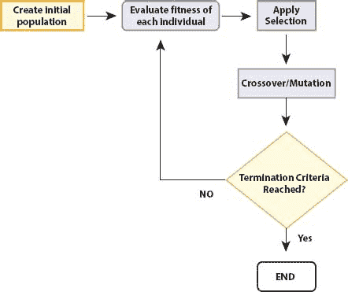

**图 1.1** 遗传算法流程图。

遗传算法（GA）具有许多优点，例如能够解决复杂问题、定位全局最优以及适用于各种领域。然而，GA 也有一些局限性，例如需要合适的适应度函数、可能会过早收敛，以及对于复杂问题计算成本较高。图 1.1 显示了遗传算法的流程图。

### 1.2.2 模拟退火

模拟退火是一种通过寻找全局最优解来优化复杂多维问题的概率方法。它的灵感源于冶金中的退火技术，该包括加热并逐渐冷却金属以增强其强度和韧性 [25]。同样，模拟退火从高温度开始，使算法能够广泛探索大量的可能解，然后缓慢降低温度将搜索缩小到最有前景的区域。SA 的工作原理是维护当前解并不断对其进行微小更改以寻找更好的解。在每次迭代中，算法计算一个成本函数，用于衡量当前解的优劣。成本函数可以是任何为潜在解分配分数的函数，例如距离度量或似然函数。随后，算法利用依赖于现有温度以及当前解与新解之间成本差异的概率分布，来决定是接受还是忽略新解 [26]。高温度会增加 SA 采纳新解的倾向，即使它们的成本比当前解高。这是因为算法仍在探索潜在解的空间，并且需要对新的可能性保持开放态度。随着温度的降低，SA 变得越来越具有判别性，只有当新解超过现有解时才会接纳它们。通过采用这种方法，SA 防止了自己陷入局部峰值，并最终实现向全局峰值的收敛 [27]。SA 在有效处理具有许多局部最优的非凸优化问题方面具有显著优势。通过允许接受成本更高的解，SA 可以在解空间内的不同区域导航并防止陷入局部最优。此外，SA 具有易于实现且独立于成本函数梯度的特点，适用于成本函数缺乏可微性的场景。然而，SA 确实存在一些局限性。它的收敛可能缓慢，特别是对于大型或复杂问题，可能需要多次迭代才能找到全局最优。SA 的有效性受到冷却调度决策的影响，这决定了温度下降的速度快慢。如果冷却策略太慢，算法可能花费过长时间收敛；而如果太快，算法可能会过快收敛到次优解 [28, 29]。

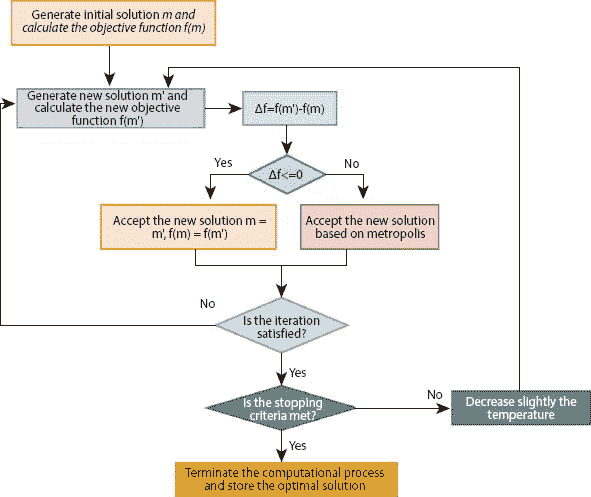

**图 1.2** 模拟退火流程图。

简而言，模拟退火是一种非常高效的优化方法，能够处理复杂问题和具有多个局部最优的多维问题。它通过探索解空间并逐渐缩小对最有前景区域的搜索来工作。尽管它具有一些局限性，但 SA 是现实世界各种优化问题的有用工具。图 1.2 显示了模拟退火的流程图。

### 1.2.3 粒子群优化

粒子群优化是一种利用种群策略解决广泛优化问题的优化技术。该概念由 Kennedy 和 Eberhart 于 1995 年提出，其灵感源于鸟类群落和鱼类集群中观察到的协调运动 [30–32]。这种算法模拟了这些生物的社会动态，每个成员从自己的经历和同类的经验中学习，目标是找到最可能的解 [33]。PSO 方法通过生成一组粒子，每个粒子代表一个潜在解。这些粒子具有位置和速度向量，随机分布在搜索空间中 [34]。在 PSO 算法中，每个粒子的位置和速度在自身最优解以及邻粒子解的引导下不断修改和调整 [35]。协作学习持续到满足预定义的停止条件，例如达到预期结果或达到最大迭代次数。与其他优化算法相比，PSO 具有多种优点，包括简单、收敛快和鲁棒性强 [36, 37]。PSO 应用广泛，涵盖了函数优化、神经网络训练、图像处理和特征选择。然而，该算法也存在某些局限性，包括过早收敛的风险（算法可能会过早收敛到次优解）以及在有效处理高维空间问题方面的挑战 [38]。

总的来说，粒子群优化算法是一种稳健且高效的优化方法，能够解决许多实际优化问题。其简单性和直观的方法使其在与更复杂的优化方法相比时成为一种吸引力的选择。图 1.3 显示了粒子群优化的流程图。


蚁群算法（ACO）是一种受自然启发的方法，通过模拟蚁群的行为来解决复杂的优化问题。该程序的灵感源于蚁群的行为，特别是蚂蚁通过通信发现通往食物源最短路径的方式。ACO 的核心思想是模拟蚂蚁的觅食行为以有效地解决优化问题。在 ACO 中，将一组模拟的蚂蚁放置在一个代表问题空间的图上。这些蚂蚁根据其他蚂留下的信息素迹来选择下一个访问的节点，从而在图中进行导航。信息素迹的强度代表了通过该边的解的质量。越多的蚂蚁跨越同一条边，信息素迹就会变得越强。这与现实生活中蚂蚁通过留存信息素迹来标记食物源位置的方式相似 [39, 40]。ACO 算法有几个关键参数，例如每只蚂留下的信息素量、信息素的挥发速率，以及利用最佳解与探索新解之间的平衡。算法中参数的最值通过实验和改进的过程来确定，以获得特定问题的最优 [41]。

ACO 在解决各种优化挑战方面展现了瞩目的成就，包括但不限于旅行商问题、车辆路径规划和作业调度。该算法的一个显著优势是能够快速发现有利解，即使在面对巨大的搜索空间也是如此。此外，由于 ACO 属于元启发式算法范畴，它可以应用于各种情况，而不需要深入理解这些问题的底层结构 [42]。图 1.4 显示了蚁群算法的流程图。

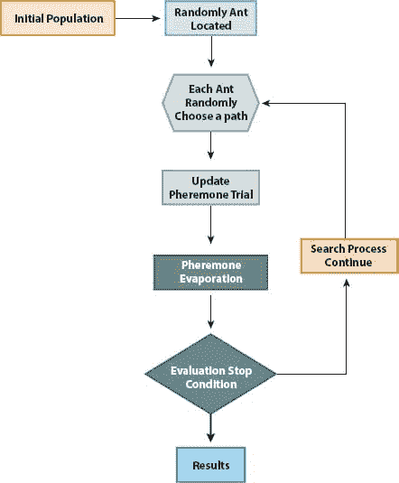

图 1.4 蚁群算法流程图。

### 1.2.5 禁忌搜索

禁忌搜索（Tabu search）是一种用于优化问题的元启发式技术，最初由 Fred Glover 于 1986 年提出。它在运筹学、工程和计算机科学等多个领域获得了极大的关注。禁忌搜索的核心概念涉及通过在不同的解之间切换来系统地遍历搜索空间，以识别最优解。然而，与其他局部搜索算法不同，禁忌搜索引入了一个记忆结构，记录搜索过程中执行过的之前的移动。这些数据随后被用于引导搜索向搜索空间内的潜在区域 [43]。禁忌列表（Tabu list）是算法中起重要作用的记忆结构，也是禁忌搜索的核心。该列表用于存储和记忆搜索过程中产生的之前的移动，确保算法避免访问已经探索过的解。通过利用禁忌列表，禁忌搜索有效地将搜索限制在解空间的新且未探索区域，促进了高效探索并防止了重复或冗余搜索。该列表用于强制执行一组被称为“禁忌期”（tabu tenure）的约束，它决定了某个移动被视为禁忌的时间。通过实施这一约束，算法被迫去调查搜索空间内的不同区域，并避免陷入局部最优。这确保了算法保持动态性并不断探索新的可能性，防止其过度关注次优解 [43]。禁忌搜索是一种适用于连续和离散优化问题的通用型优化算法。在处理连续优化问题时，算法通常使用邻域函数通过扰动当前解来生成新解。在离散优化问题的情况下，邻域函数通常定义为可以对解执行的特定移动，例如交换排列中的两个元素。禁忌搜索的有效性取决于多个变量，例如邻域函数的选择、禁忌期和停止准则。可以通过各种策略（如多样化和强化）来增强算法，这些策略平衡了搜索空间的利用与探索 [44]。

禁忌搜索是一种用于优化问题的元启发式技术，最初由 Fred Glover 于 1986 年提出。它在运筹学、工程和计算机科学等多个领域获得了极大的关注。禁忌搜索的核心概念涉及通过在不同的解之间切换来系统地遍历搜索空间，以识别最优解。然而，与其他局部搜索算法不同，禁忌搜索引入了一个记忆结构，记录搜索过程中执行过的之前的移动。这些数据随后被用于引导搜索向搜索空间内的潜在区域 [43]。禁忌列表（Tabu list）是算法中起重要作用的记忆结构，也是禁忌搜索的核心。该列表用于存储和记忆搜索过程中产生的之前的移动，确保算法避免访问已经探索过的解。通过利用禁忌列表，禁忌搜索有效地将搜索限制在解空间的新且未探索区域，促进了高效探索并防止了重复或冗余搜索。该列表用于强制执行一组被称为“禁忌期”（tabu tenure）的约束，它决定了某个移动被视为禁忌的时间。通过实施这一约束，算法被迫去调查搜索空间内的不同区域，并避免陷入局部最优。这确保了算法保持动态性并不断探索新的可能性，防止其过度关注次优解 [43]。禁忌搜索是一种适用于连续和离散优化问题的通用型优化算法。在处理连续优化问题时，算法通常使用邻域函数通过扰动当前解来生成新解。在离散优化问题的情况下，邻域函数通常定义为可以对解执行的特定移动，例如交换排列中的两个元素。禁忌搜索的有效性取决于多个变量，例如邻域函数的选择、禁忌期和停止准则。可以通过各种策略（如多样化和强化）来增强算法，这些策略平衡了搜索空间的利用与探索。

总的来说，禁忌搜索是一种稳健且适应性强的优化技术，在解决各种问题集方面证明了其有效性。它可以独立使用，也可以集成到更复杂的优化算法中。它的流行源于多功能性和简单性，使其成为各个领域现实挑战的热选方案。

### 1.2.6 差分进化

差分进化（DE）是一种基于种群的优化算法，由 Storn 和 Price 于 1997 年创建 [47]。它属于进化算法的范畴，通过迭代增长潜在解的种群来寻找最优解。算法遵循变异、交叉和选择的基本步骤，这些是许多进化算法共同具备的关键元素 [48]。


在差分演化过程中，潜在解的种群通过执行以下顺序步骤进行迭代演化：

1. **初始化**：随机产生一个包含 `N` 个可能解的种群。
2. **变异**：涉及随机选择三个候选解并对其进行修改以创建一个试验向量。
3. **交叉**：这是一种用于优化算法的技术，通过将试验向量与目标向量结合来创建新的候选解。
4. **选择**：如果新候选解的适应度更高，则它将取代目标向量的位置。

差分演化的成功取决于优化技术可调设置的选择，例如变异率、交叉率和种群规模 [49, 50]。目前已经提出了 `DE` 的若干种变体，包括 `SHADE`（基于成功历史的自适应差分演化）算法和 `JADE`（自适应差分演化）算法，这些算法引入了自适应控制参数以提高算法的性能。

### 1.2.7 谐和搜索

和谐搜索（`HS`）是一种受音乐即兴创作过程启发的优化技术。Geem [125] 在 2001 年提出了这一观点，现在已用于解决多个优化问题。该技术模拟了群音乐家的即兴过程，他们通过调整音高（或音符）来创造和谐。在 `HS` 中，高中优化问题的选择变量类似于音符，而目标函数的值反映了和谐度 [51]。

`HS` 方法使用决策变量向量（即音符）的初始个体，并通过以下步骤生成新解来迭代地寻找更好的解：

1. **和谐记忆**：维护一组最佳候选解（即和谐音）。
2. **和谐创建**：通过从和谐记忆中随机选择值创建一个潜在解。
3. **音高调整**：根据音高调整率对新候选解中的值进行调整。
4. **接受**：如果新候选解改进了目标函数值，则接受它。

控制变量（如和谐记忆大小、音高调整率和迭代次数）会影响 `HS` 的性能。该方法遵循变异、交叉和选择的核心阶段，该方法已被用于应对各种优化挑战，如水资源管理、结构设计和电力系统运行 [52, 53]。

### 1.2.8 人工蜂群

人工蜂群（`ABC`）是一种受蜜蜂采食习性启发的基于群体优化方法。自从 Karaboga 在 2005 年引入它以来，该技术已用于解决许多优化问题 [54]。`ABC` 模拟了蜜蜂的觅食过程，它们通过访问蜂巢附近的花来寻找食物源 [55]。

人工蜂群技术从随机生成的候选解种群（即食物源）开始，通过以下步骤模拟蜜蜂的觅食过程来迭代地寻找更好的解：

1. **雇蜂阶段**：雇蜂通过修改当前解的值来开发新的候选解。
2. **观望蜂阶段**：观望蜂选择适应度值最高的候选解，并将此信息发送给雇蜂。
3. **侦察蜂阶段**：侦察蜂通过随机生成新解来寻找新的候选解。

`ABC` 的成功取决于控制参数，如种群规模、迭代次数和放弃食物源的概率。该算法已应用于广泛优化问题，包括图像处理、无线传感器网络和模糊控制系统 [56]。

### 1.2.9 萤火虫算法

一种名为萤火虫算法（`FA`）的元启发式优化技术基于萤火虫的行为。杨新民博士在 2008 年首次提出了 `FA`。萤火虫的社会行为以通过闪烁光芒吸引配偶或猎物为特征，这为该算法提供了灵感 [57]。萤火虫技术的主要作用是增加光强度，为了最大化光强度，萤火虫向更明亮的萤火虫移动。程序从随机萤火虫种群开始，利用目标函数计算每只萤火虫的光强度 [58]。萤火虫的运动受其吸引力的支配，吸引力取决于光的亮度和它们之间的距离。萤火虫向更明亮的萤火虫移动并更新其位置，直到达到最大光强度 [59]。许多优化问题，包括涉及机器学习、图像处理和函数优化的问题，已使用萤火虫算法得到了有效解决。

### 1.2.10 灰狼优化器

灰狼优化器（`GWO`）是一种基于狼社会结构和狩猎技术的元启发式优化系统。该算法由 Seyed Ali Mirjalili、Seyed Mohammad Mirjalili 和 Andrew Lewis 在 2014 年开发 [60]。在灰狼优化器中，优化问题被视为狼群——捕食者动态。该方法使用的狼群被随机分为四组：`alpha`、`beta`、`delta` 和 `omega`。虽然 `omega` 狼最弱且适应度值最低，但 `alpha` 狼担任群中的领导角色并具有最大的适应度值 [61–63](#c01.xhtml#b1-bib-0063)]。狼的运动受三种不同类型的狩猎技术的支配：捕猎猎物、跟随 `alpha` 狼和包围猎物。狼根据这些技术调整位置，直到完成最优解。灰狼优化器的应用已扩展到解决各种优化问题，如函数优化、工程设计和特征选择 [64, 65]。

### 1.2.11 帝国主义竞争算法

帝国主义竞争算法（`ICA`）是一种用于解决许多问题的元启发式优化方法，受帝国主义国家之间政治和经济竞争的启发。Amir Hossein Gandomi 和 Ali Alavi 在 2010 年引入了该方法 [66]。在帝国主义竞争算法中，优化问题被视为帝国之间的竞争。该算法从随机生成的帝国种群开始，这些帝国分为两类：帝国和殖民地。帝国具有较高的适应度值，它们通过吞并殖民地扩张领土。帝国的运动受两种不同行为的支配：同化和革命。在同化过程中，帝国试图提高其殖民地的适应度；而在革命过程中，殖民地反抗其帝国并获得独立。各种优化问题，包括函数优化、图像分割和参数估计，已通过帝国主义竞争算法的成功应用得到了有效解决 [67, 68]。


### 1.2.12 蝙蝠算法

Xin-She Yang 于 2010 创建了蝙蝠算法（`BA`），这是一种用于解决各种优化挑战的启发式优化技术 [69]。蝙蝠算法的灵感来源于蝙蝠的回声定位活动，它们利用超声波在黑暗中导航并定位猎物。它模拟了蝙蝠在捕猎猎物时的活动，以发现给定优化问题的最佳解决方案 [70]。

使用蝙蝠算法解决优化问题时，会在搜索空间中创建一个具有随机位置和速度的蝙蝠种群。蝙蝠随机移动，发出与其适应度值成比例的频率。适应度较高的蝙蝠发出更高频率的声音，吸引其他蝙蝠向其在搜索空间中的位置靠近 [71]。除了基于频率的吸引机制，蝙蝠算法还包含随机游走组件，允许蝙蝠探索搜索空间中的未标记区域。在每次迭代中，算法利用迄为止找到的最佳解决方案的信息以及其发射信号的响度和频率，更新每只蝙蝠的速度和位置。算法不断迭代，直到达到设定的停止点，例如最大迭代次数或目标适应度值 [72]。

### 1.2.13 布谷搜索算法

布谷搜索是一种受布谷鸟繁殖行为启发的启发式优化方法，由 Xin-She Yang 和 Suash Deb 于 2009 年提出。布谷鸟使用一种奇特的方法，将它们的蛋产在其他鸟类的巢穴中，让宿主鸟照顾和抚养它们的后代 [73]。布谷搜索算法模仿了布谷在寻找食物时的觅食行为，采用了巢雏寄生策略。其目标是发现优化问题的最优解。该技术从初始化一组具有随机位置和速度的布谷种群开始。随后，每只布谷在随机选择的巢穴中产卵，选择特定巢穴的概率与其适应度水平成正比 [74–76]。布谷搜索算法结合了随机游走元素，允许布谷探索搜索空间内的未开发区域。在每次迭代中，算法根据迄为止找到的最佳解决方案以及通过在新巢穴中产卵来发现更优解的潜力，调整每只布谷的位置和速度。为了通过探索当前答案周围区域来提高解质量，算法还整合了局部搜索组件。该过程持续持续直到满足预定的停止条件，例如达到最大迭代次数或实现所需的适应度水平 [77, 78]。

### 1.2.14 花授粉算法

花卉授粉算法（`FPA`）由 Xin-She Yang 于 2012 年创建，是一种启发式优化算法，它通过香气吸引蝴蝶和蜜蜂等授粉者 [79]。花卉授粉算法模拟花卉授粉行为以识别给定问题的最优解。2012 年，Xin-She Yang 引入了这种算法，这是一种受花朵通过香味吸引蝴蝶和蜜蜂等授粉者方式启发启发式优化技术。这涉及初始化一组具有随机位置和香气的花朵。每朵花释放出吸引授粉者的香气，吸引概率由其适应度水平决定。算法还整合了随机游走元素，使授粉者探索搜索空间的新区域 [80]。在每次迭代中，花卉授粉算法根据当前最佳解决方案以及吸引新授粉者以可能发现改进解的概率，调整每朵花的位置和香气。此外，算法还包含一个局部搜索组件，通过调查邻近区域来提高解质量。算法持续运行直到满足预设的停止条件，这可能是达到特定的适应度目标或达到最大迭代次数 [81]。

### 1.2.15 磷虾群算法

2012 年，Amir H. Gandomi 和 Amir H. Alavi 引入了磷虾群算法（`KHA`），这是一种受磷虾在海洋栖息地内协调运动和相互作用启发的启发式优化技术。该算法试图模拟磷虾在觅食维持和应对生存挑战时的群聚行为，目的是为特定问题识别最佳解决方案 [82]。

磷虾群算法模拟了磷虾在追求食物和同伴时的同步运动和互动，力求确定给定任务的最优解。从创建一个具有随机位置和速度的磷虾种群开始，每只磷虾都在搜索空间内进行随机移动。这些移动的轨迹和速度受到来自其他磷虾的吸引力、斥力和环境影响的影响 [83]。

算法在每次迭代中根据迄为止找到的最佳解决方案、其他磷虾和环境的影响以及每只磷虾的位置和速度进行调整。该技术还具有随机游走组件，允许磷虾探索搜索空间的新区域 [84]。算法持续运行直到满足预定义的停止条件，例如预定的迭代次数或预定的目标适应度值 [85]。

### 1.2.16 鲸鱼优化算法

2016 年，Seyedali Mirjalili 和 Andrew Lewis 引入了鲸鱼优化算法（`WOA`），这是一种启发式优化技术。该概念灵感来源于头鲸的捕猎行为，其特征是独立与协作运动及发声的结合 [86]。鲸鱼优化算法的核心概念是模拟头鲸在寻找食物时的觅食行为，旨在发现特定问题的最优解。该算法从建立一组分配了随机位置和速度的鲸群开始。随后，每只鲸在搜索空间内进行随机移动，其轨迹和速度受到其他鲸鱼产生的吸引力、斥力和环境因素的影响。在每次迭代中，算法根据当前最佳解决方案以及其他鲸和环境的影响，修改每只鲸的位置。此外，算法整合了随机游走方面，以促进对搜索空间中的未知区域。算法在满足预设的停止标准时终止，例如达到最大迭代次数或达到所需的适应度水平 [88–90]。

### 1.2.17 萤火虫群优化算法


萤火虫群优化（`GSO`）是一种受自然启发的优化技术，由 Kalyanmoy Deb 和 Samir Dasgupta 于 2006 年提出。它灵感来自萤火虫和荧火虫表现出的生物光通信，以模拟群体的协调行为 `[91]`。萤火虫群优化是一种元启发式优化算法，通过模拟萤火虫在寻找食物和伴侣过程中在周围环境中的发光行为，旨在为给定问题寻找最优解。该算法从创建一组荧火虫开始，每个荧火虫被分配随机的位置和亮度，每只荧火虫发出的光都会吸引其他个体，吸引程度与邻近荧火虫的亮度和距离成正比 `[92]`。在每次迭代中，萤火虫群优化算法根据吸引新荧火虫的概率以及目前为止的最优来更新每只荧火虫的位置和亮度。算法中还集成了随机游分组件，允许荧火虫探索搜索空间中未探索的区域。算法的执行持续到达到特定的终止准则，例如达到目标适应度水平或达到最大允许迭代次数 `[93]`。

### 1.2.18 猫群优化算法

猫群优化（`CSO`）方法是一种基于猫群协作狩猎行为的元启发式优化算法，最早由 Ying Tan 和 Yuhui Shi 于 2006 年提出。该方法对猫在狩猎期间发生的猫之间的协作与通信进行了建模 `[94]`。猫群优化背后的基本概念涉及模拟一群猫的集体狩猎动作，以确定给定问题的最佳解决方案。该方法从给猫种群放置并赋予其随机的位置和速度开始。随后，每只猫在搜索空间内进行随机移动，其移动轨迹和速度受到同类猫施加的吸引力和排斥力以及环境变量的影响 `[95]`。

在猫群优化算法的每次迭代中，都会根据当前的最佳解、其他猫的影响以及环境条件对猫的位置和速度进行调整。此外，算法中注入了随机游元素，赋予了猫探索搜索空间中此前未标记区域的能力。这一优化过程一直持续直到满足预定的停止标准，例如达到期望的适应度阈值或达到最大允许迭代次数。该算法由 Ying Tan 和 Yuhui Shi 于 2006 年引入，灵感源自猫的协作狩猎行为 `[96]`。

### 1.2.19 蝗虫优化算法

蝗虫优化算法（`GOA`）由 Seyedali Mirjalili 和 Andrew Lewis 于 2014 年创建，是一种受自然启发的优化算法，模仿了蝗虫的群集行为。`GOA` 的优化基于蝗虫的集体行为，这涉及了个体间的通信与合作 `[97]`。

在蝗虫优化算法的每次迭代中，在当前最佳解以及来自同类蝗虫和环境因素的影响指导下，都会调整每只蝗虫的位置和速度。此外，引入了随机游属性，使蝗虫能够探索并发现搜索空间中此前未探索的区域 `[98, 99]`。该算法持续到满足预定的停止标准，例如达到最大迭代次数或达到指定的适应度目标。

### 1.2.20 蛾火优化算法

蛾火优化（`MFO`）算法灵感来自蛾类的自然行为，蛾类对火焰具有内在的吸引力并利用天体线索进行导航。该技术模拟了蛾的搜索模式，旨在为特定问题发现最优解 `[100]`。

在优化程序的初始阶段，算法从生成一群蛾开始，每只蛾被分配了随机的位置和亮度。随后，每只蛾通过随机移动穿越搜索空间，根据两个关键因素调整其速度和轨迹：它对最亮蛾的趋向以及环境条件的影响 `[101]`。随着蛾火优化算法通过每次迭代，每只蛾的位置和亮度都会得到更新。这些调整取决于已取得的当前最佳解以及对最亮蛾的吸引力。此外，算法结合了随机游特征，允许蛾探索搜索空间的新区域。当达到预定义的停止标准时（例如达到目标适应度值或最大迭代次数），算法停止 `[102]`。

除了这种算法，文献中广泛使用的其他算法如正弦余弦算法 `[103, 104]`、蜻蜓算法 `[105, 106]` 以及共生生物搜索算法 `[107, 108]`。

## 1.3 元启发式算法的应用

Hu 等人提出了交叉优化算术优化算法（`CSOAOA`），这是一种改进的混合算术优化算法，旨在解决原始算术优化算法（`AOA`）的约束局限性。`CSOAOA` 结合了多种策略来增强 `AOA` 的收敛速度、搜索效率和计算精度，包括点集策略、最优邻域学习方法和交叉策略。在精度、收敛率和解质量方面，测试结果显示 `CSOAOA` 优于其他优化算法，证明了其作为处理复杂工程优化问题的一种可行方法的潜力 `[109]`。

Ghafil 和 Jármai 于 2020 年提出了动态差分退火优化（`DDAO`），这是一种使用随机搜索和模拟退火的独特元启发式优化技术。在 51 个基准函数上对该算法的效能进行了评估，它击败了许多著名的优化技术，证实了其更高的性能。`DDAO` 成功收敛到两个真实工程优化问题的全局最小值，并为弹簧设计问题产生了比其他几种算法更好的可行的解 `[110]`。


2022 年，Zhao *et al.* 引入了一种新型群智能优化算法，称为蒲英优化器（`DO`）。该算法模仿蒲英籽的飞行模式，由三个不同阶段组成：上升、下降和着陆。每个阶段都有其独特的规则和属性。在下降和着陆阶段，算法模拟了种子的旅程。研究采用了布朗运动和 Levy 随机游走，并使用 `CEC 2017` 基准函数评估了差分进化（`DO`）的效率，将其性能与其他九种自然启发元启发式算法进行了比较。`DO` 显示出卓越的优化准确性、稳定性、收敛性和可扩展性，优于竞争算法。该研究进一步通过将其应用于解决四个现实世界的优化问题 [111]，证明了 `DO` 的稳健性和卓越性能。

智能花算法（`SFOA`）是由 Sattar *et al.* (2021) 创建的一种元启发式优化算法，其灵感源于未成熟向日葵的向光运动以及基于太阳追踪和生物钟的生长机制。该方法的成功通过利用 `CEC 2015` 进行基准测试与其他优化算法的比较得到了证明，结果表明其优化效率和性能有所提高。此外，`SFOA` 被应用于真实的工程设计问题，取得了令人鼓舞的结果，并了了在处理未知搜索空间问题方面的实用性 [112]。

Azizi *et al.* 于 2023 年引入了一种名为火隼优化器（`FHO`）的新型元启发式算法。`FHO` 灵感来自火隼的觅食行为，在优化问题方面表现出卓越的效率。通过对 233 个数学测试函数和两个进化计算竞赛（`CEC`）问题进行全面的基准测试，`FHO` 优于其他元启发式算法。此外，该算法在解决实际尺寸结构框架方面的效力得到了证实，取得了良好的成果，并强调了其在解决现实问题中的潜力。这项研究不仅对元启发式算法的进步做出了贡献，还强调了自然启发方法的能力 [113]。

2020 年，Ghasemian *et al.* 引入了一种受人类行为启发的元启发式算法，以解决城市化问题并提高生活质量。该算法结合了组合搜索和种群管理策略，评估结果表明，在大多数搜索空间中优于其他高性能算法 [114]。

bollah Ansar *et al.* (2020) 通过将磁性优化算法（`MOA`）与粒子群优化相结合，开发了一种预测企业破产的混合元启发式算法。生成的算法 `MOA-PSO` 用于训练人工神经网络（`ANN`）进行破产预测，并被发现性能优于四种现有算法，准确率达到 99.7%。许多优化策略都有其独特益处，而混合算法已被证明有助于更快、更准确地解决复杂问题 [115]。

利用人工神经网络和基于元启发式的优化算法的组合，Farahani *et al.* 在 2022 年进行了一项研究，目标是预测德黑价格指数（`TEPIX`）。为了确定影响股市的主要市场决定因素，该研究使用了多种算法，包括 `GA`、`HS`、`PSO`、`MFO` 和 `WOA`。结果显示，与传统的 `ANN` 模型相比，组合算法表现出更强的预测能力。值得注意的是，该研究确定鲸鱼优化算法是预测 `TEPIX` 最精确的技术 [116]。

在 2022 年的研究中，Hadi Gholizadeh *et al.* 为聚苯乙烯一次性物品的反向物流流程引入了一种环保方法。该方法通过采用整数非线性规划（`MINLP`）模型解决了需求和回收成本的不确定性。为了解决这一问题，研究人员模拟退火、交叉熵和遗传算法等启发式方法生成初始解。随后，他们利用响应面法、稳健优化和太 uchi 方法来完善算法性能。通过将最优最差法的稳健优化与启发式方法的有效性进行比较，并开展案例研究，该研究确认了模型可行性，并突出了优化技术在增强算法性能方面的效力。这项工作为反向物流提供了一种生态友的方法，同时展示了优化方法对算法效率的积极影响 [117]。

Yan *et al.* 于 2023 年首次提出了一种结合离散粒子群优化（`DPSO`）和哈里斯鹰优化（`HHO`）以及三种改进策略的混合元启发式方法。其目的是解决灾后初期救援物资配送中的路径规划问题（`LRP`）。他们通过对武汉新冠的案例研究验证了所提出的多目标模型，显示该算法在准确性和避免局部最优的能力方面优于之前的元启发式算法。该研究为灾害响应规划提供了一种可行的方法，将优化救援物资的配送 [118]。

Yang *et al.* (2022) 讨论了信息系统（`ISs`）在物流和配送管理中的性，并建议使用元启发式技术（`MHTs`）高效处理跨供应链的信息。该研究强调了供应链参与者之间合作、协调、信息共享和通信的价值，并指出元启发算法有助于解决挑战性的物流问题。论文强调了先进决策支持系统以及信息通信技术在适应挑战方面的作用 [119]。

Adel Pourghader Chobar *et al.* (2022) 关注地震期间响应、恢复和重建阶段的反向物流规划，此时会产生大量垃圾。该问题是多目标且不定的，使用非支配排序遗传算法（`NSGA-II`）元启发式算法求解。研究表明，增加容量可以减少所需的配送中心数量，但会导致运输成本增加。案例研究基于德黑兰市 [120]。

Simran Gibson *et al.* 于 2020 年发表了关于利用机器学习算法和生物启发优化策略识别垃圾邮件的文献综述。在七个不同的数据集上，研究人员使用了多种机器学习模型，包括 `Naive bayes`、`support vector machine`、`random forest`、`decision tree` 和 `multilayer perceptron`，并结合了特征提取和预处理过程。通过使用生物启发技术如 `particle swarm optimization` 和 `genetic algorithm`，提升了分类器的性能。分析发现，经过 `genetic algorithm` 优化的 `multinomial naive Bayes` 模型在多个标准上表现更好。此外，科学家们对不同的机器学习和生物启发模型进行了比较，以确立最佳技术 [121]。


Oyelade *et al.* (2022) 引入了一种名为埃博拉优化搜索算法（EOSA）的新型优化算法，其灵感源于埃博拉病毒的传播机制。通过将 SEIR-HVQD 数学模型与传播模型融合，利用两组基准函数（包括常规和有限 IEEE-CEC Benchmark 函数）对该技术进行了评估。结果显示，EOSA 优于流行的启发式算法，包括人工蜂群算法、遗传算法和粒子群优化算法。该方法还用于解决数字乳腺影像分类中的超参数优化问题，准确率达到 96.0% \[122\]。

Bindu *et al.* (2020) 的研究课题是过去 10 年日益流行的云环境中客户端任务资源调度的难题。为了减少能量消耗、成本和时间，他们创建了最优顺序蚁群优化算法（OSACO），这是一种考虑到客户服务质量（QoS）要求的优化调度方法。将 OSACO 算法与其他算法对比，仿真结果证明了其在资源调度优化方面的有效性 \[123\]。

Table 1.1 元启发式算法的优缺点。

| 优点 | 缺点 |
| --- | --- |
| 元启发式算法具有灵活性，适用于广泛的优化问题。它们还可以很容易地适应特定的问题约束或目标。 | 元启发式算法收敛到最优解的速度可能较慢，特别是对于大型搜索空间的复杂问题。 |
| 元启发式算法设计用于探索整个搜索空间，与其他可能陷入局部最优的优化技术不同。 | 无法保证元启发式算法能够找到全局最优解。 |
| 与某些优化方法不同，元启发式算法不需要计算函数的导数或梯度。 | 元启发式算法通常需要仔细选择算法参数，这是一个耗时且困难的过程。 |
| 元启发式算法对优化问题中的噪声或不确定性通常具有良好的鲁棒性。 | 元启发式算法通常涉及复杂的数学运算，难以理解它们是如何得出解决方案的。 |
| 许多元启发式算法可以并行化，允许使用高性能计算资源来解决复杂问题。 | 在某些情况下，元启发式算法可能会过拟合训练数据，导致次优解。 |

Gharehchopogh (2022) 讨论了将量子计算（QC）概念引入元启发式算法，以及随之产生的量子启发元启发式算法的发展。论文强调了使用量子启发元启发式算法求解数值和组合优化问题的优势，其性能优于传统的元启发式算法。文章对量子计算在元启发式算法中的各种应用、在优化问题中的分类以及在科学和工程中的用途进行了全面综述。该研究为量子启发元启发式算法在解决优化问题潜力提供了宝贵的见解 \[124\]。

通过上述对不同元启发式算法的讨论，我们发现选择优化方法时有几个需要考虑优缺点。元启发式算法的一些优缺点所示 Table 1.1。

## 1.4 未来方向

在未来几年，元启发式算法预计将沿着几条轨迹演变。一条充满前景的路径是创建混合元启发式算法，合并多种技术的优点以增强性能和韧性。另一条轨迹涉及调整元启发式算法以应对海量数据带来的优化挑战，解决大规模数据集带来的计算障碍。此外，元启发式算法的并行和分布式实现可以利用计算资源并加速优化过程。后续研究还应强调动态和多目标优化，在其中元启发式算法可以适应变化的问题条件并同时管理多个相互冲突的目标。此外，对可解释人工智能（AI）的需求要求元启发式算法不仅要优化，还要揭明决策过程。实时优化要求元启发式算法能够在严格的时间限制内快速收敛到近优解。

最后，深入探索可再生能源、医疗保健、智能城市和网络安全等领域的创新应用将拓宽元启发式算法的视野。通过在这些方向取得进展，元启发式算法可以继续为解决不同领域的复杂优化问题提供强大的工具。

## 1.5 结论

综之，本文对元启发式算法及其在不同领域的广泛应用进行了全面概述。论文概述了著名的元启发式算法，并强调了它们在处理复杂优化问题方面的效力。广泛调查了元启发式算法在工程、金融、物流、计算机科学及相关领域的利用。文中提供的利用这些算法执行设计最优结构、管理动态系统、精炼制造流程、协调供应链以及解决人工智能、数据挖掘和软件工程中的挑战等任务的实例，具体证明了它们在各种背景下解决复杂问题的能力。从本质上说，论文强调了元启发式算法在克服不同领域优化障碍的重要性和适应性，并对其实际应用提供了全面的理解。

## References 参考文献

1. 1\. Kvasov, D.E. and Mukhametzhanov, M.S., Metaheuristic vs. deterministic global optimization algorithms: The univariate case. *Appl. Math. Comput.*, 318, 245–259, 2018, doi: 10.1016/j.amc.2017.05.014.
2. 2\. Sinuany-Stern, Z., Foundations of operations research: From linear programming to data envelopment analysis. *Eur. J. Oper. Res.*, 306, 3, 1069–1080, 2023, doi: 10.1016/j.ejor.2022.10.046.
3. 3\. Ghneamat, R., *Genetic algorithms and application to adaptive automata for game theory*, Al-Balqa University, As-Salt, 2005.
4. 4\. Holland, J.H., Genetic algorithms. *Sci. Am.*, 267, 1, 66–72, 1992, doi: 10.1038/scientificamerican0792-66.
5. 5\. Hammouche, K. *et al.*, A comparative study of various meta-heuristic techniques applied to the multilevel thresholding problem. *Eng. Appl. Artif. Intel.*, 23, 5, 676–688, 2010, doi: 10.1016/j.engappai.2009.09.011.
6. 6\. Gandomi, A.H. *et al.*, Metaheuristic algorithms in modeling and optimization, in: *Metaheuristic Appl. Struct. Infrastruct.*, pp. 1–24, 2013, doi:10.1016/ b978-0-12-398364-0.00001-2.
7. 7\. Bandaru, S. and Deb, K., Metaheuristic techniques, in: *Decis. Sci.*, pp. 693–750, 2016, doi:10.1201/9781315183176-12.
8. 8\. Yang, X.-S., *Engineering optimization: An introduction with metaheuristic applications*. John Wiley & Sons, Hoboken, 2010, [`doi.org/10.1002/9780470640425`](https://www.doi.org/10.1002/9780470640425).


9. Katoch, S. *et al.*, 遗传算法回顾：过去、现在与未来。*Multimed. Tools Appl.*, 80, 5, 8091–8126, 2021, doi: 10.1007/s11042-020-10139-6.

10. Slowik, A. and Kwasnicka, H., 进化算法及其在工程中的应用。*Neural Comput. Appl.*, 32, 16, 12363–12379, 2020, doi: 10.1007/s00521-020-04832-8.

11. Ghadai, R.K. and Kalita, K., 使用遗传编程精确估计 DLC 薄膜硬度。*Int. J. Mater. Res.*, 111, 6, 453–462, 2020, doi: 10.3139/146.111911.

12. Ghadai, R.K. *et al.*, 遗传优化的类刚石碳薄膜层。*Mater. Manuf. Processes*, 34, 13, 1476–1487, 2019, doi: 10.1080/10426914.2019.1594273.

13. Kalita, K. *et al.*, 鲁棒遗传优化斜层层压板。*Proc. Inst. Mech. Eng. C*, 233, 1, 146–159, 2019, doi: 10.1177/0954406218756943.

14. Kalita, K. *et al.*, 遗传编程辅助的多层复合材料多目标动态性能多尺度优化：更基础级分析的优势。*Neural Comput. Appl.*, 32, 12, 7969–7993, 2020, doi: 10.1007/s00521-019-04280-z.

15. Kalita, K. *et al.*, 用于 EDM 过程的数据驱动遗传编程的符号回归元模型，在：*Data-Driven Optimization of Manufacturing Processes*, IGI Global, Scopus. USA, 2020, doi: 10.4018/978-1-7998-7206-1.ch009.

16. Kalita, K. *et al.*, GFRP 复合材料钻参数的敏感性分析和基于遗传算法的优化。*Int. J. Appl. Metaheuristic Comput.*, 13, 1, 1–17, 2022.

17. Kumar, V. *et al.*, 一种生物油生产过程优化的混合遗传编程-灰狼优化方法。*Processes*, 9, 3, 442, 2021, doi: 10.3390/pr9030442.

18. Pal, S. *et al.*, 使用遗传算法优化载有横向分布质量的层压壳频率分离。*J. Vib. Control*, 2023, doi: 10.1177/10775463231190277.

19. Pal, S. *et al.*, 基于遗传算法的载有分布质量层压复合壳基础频率优化。*J. Inst. Eng. (India) Ser. C*, 103, 3, 389–401, 2022, doi: 10.1007/s40032-021-00801-9.

20. Todorovski, M. and Rajicic, D., 遗传算法求解最优潮流流中的初始化程序。*IEEE Trans. Power Syst.*, 21, 2, 480–487, 2006, doi: 10.1109/TPWRS.2006.873120.

21. Ji, S. *et al.*, 基于模糊综合评价和遗传算法的最优配差分配。*Int. J. Adv. Manuf. Technol.*, 16, 7, 461–468, 2000, doi: 10.1007/s001700070053.

22. Kumar, M., Husian, M., Upreti, N., Gupta, D., 遗传算法：回顾与应用。*Int. J. Inf. Technol. Knowl. Manag.*, 2, 451–454, 2010.

23. Umbarkar, and Sheth, 遗传算法中的交叉算子：一种综述。*ICTACT J. Soft Comput.*, 06, 1, 1083–1092, 2015, doi: 10.21917/ijsc.2015.0150.

24. Mirjalili, S. *et al.*, 遗传算法：理论、文献综述及在图像重建中的应用，在：*Studies in Computational Intelligence. Nature-Inspired Optimizers*, pp. 69–85, 2020, doi: 10.1007/978-3-030-1227-5.

25. Suman, B. and Kumar, P., 退火算法作为单目标和多目标优化工具的综述。*J. Oper. Res.*, 57, 10, 1143–1160, 2006, doi: 10.1057/palgrave.jors.2602.

26. Amine, K., 多目标退火：原理与变体。*Adv. Oper. Res.*, 2019, 1–13, doi: 10.1155/2019/8134.

27. Eglese, R.W., 退火：运筹学工具。*Eur. J. Oper. Res.*, 46, 3, 271–281, 1990, doi: 10.1016/0377-2217(90)90001-R.

28. Baykğlu, A. and Gindy, N., 用于动态布局问题的退火算法。*Comput. Oper. Res.*, 28, 14, 1403–1426, 2001, doi: 10.1016/S0305-0548(00)049-6.

29. Ming, C. and Raghav, N., 用于混合分布及其可靠性测试退火算法，在：*Simul. Annealing*, 2008, doi: 10.5772/5834.

30. Banks, A. *et al.*, 粒子群优化回顾：第一部分：背景与发展。*Nat. Comput.*, 6, 4, 467–484, 2007, doi: 10.1007/s11047-007-9049-5.

31. Kalita, K. *et al.*, 使用遗传算法和粒子群优化优化 GFRP 复合材料钻孔分层。*Adv. Compos. Lett.*, 27, 1, 1–9, 2018.

32. Shankar, R. *et al.*, 混合粒子群-引力搜索算法过程优化。*Processes*, 10, 3, 616, 2022, doi: 10.3390/pr1003616.

33. Jain, N.K. *et al.*, 粒子群优化回顾。*J. Inst. Eng. (India) Ser. B*, 99, 4, 407–411, 2018, doi: 10.1007/s40031-018-0323-y.

34. Ganesh, N. *et al.*, 使用 `NSGAIII` 和 `MO-RPSOLC`的多目标高保真优化。*Comput. Model. Eng. Sci.*, 129, 2, 443–464, 2021, doi: 10.32604/cmes.2021.014960.

35. Kalita, K. *et al.*, 使用遗传算法和粒子群优化激光束微标记工艺参数。*Mater. Manuf. Processes*, 32, 10, 1101–1108, 2017, doi: 10.1080/10426914.2017.1303156.

36. Wang, D. *et al.*, 粒子群优化算法：概述。*Soft Comput.*, 22, 2, 387–408, 2018, doi: 10.1007/s00500-016-2474-6.

37. Narayanan, G. *et al.*, 用于弯管湍流评估的 `PSO`-调优支持向量机元模型。*Eng. Comput.*, 37, 3, 981–1001, 2019, doi: 10.1108/EC-05-2019-0244.

38. Poli, R. *et al.*, 粒子群优化。*Swarm Intell.*, 1, 1, 33–57.

39. Dorigo, M. and Stutzle, T., 蚁群优化：一种综述。*Soft Comput.*, 34, 2, 243–278, 2005, doi: 10.1007/s00500-046-.

40. Maniezzo, V. and Carbonaro, A., 蚁群优化：引言与近期趋势。*Phys. Life Rev.*, 2, 353–373, 2005, doi: 10.1016/j.plrev.2005.010.

41. Dorigo, M. and Stutzle, T., *蚁群优化*。MIT Press, Cambridge, 2004.

42. Glover, F., 禁搜索和自适应内存规划：进展、挑战，在：*Operations Research/Computer Science*. pp. 71–75, 1997, doi:10.1007/978-1-4615-402-8.

43. Cangal, M., Kovacevic-Vujcic, V., Ivanovic, L., Asic, M., 禁搜索：简要综述及某些现实应用。*Yugosl. J. Oper. Res.*, 6, 1, 5–18, 1996.


51. Alia, O.M. and Mandava, R., 和谐搜索算法的变体：概述。*Artif. Intell. Rev.*, 36, 1, 49–68, 2011, doi: 10.1007/s10462-010-9201-y.

52. Guo, Z. *et al.*, 基于最优搜索策略的自适应和谐搜索。*Soft Comput.*, 22, 4, 1335–1349, 2018, doi: 10.1007/s00500-016-2424-3.

53. Yadav, P. *et al.*, 一种优化的智能调优和谐搜索算法。*Inf. Sci.*, 196, 47–72, 2012, doi: 10.1016/j.ins.2011.12.035.

54. Kaur, G. and Oberoi, A., 基于朴素贝叶分类的脑瘤检测新方法。在*Data Management, Analytics and Innovation*, pp. 451–462, Springer, Singapore, 2020.

55. Karaboga, D. and Basturk, B., 一种用于数值函数优化的强大高效算法：人工蜂群（ABC）算法。*J. Glob. Optim.*, 39, 3, 459–471, 2007, doi: 10.1007/s10898-007-9149-x.

56. Karaboga, D. and Ozturk, C., 一种新的聚类方法：人工蜂群（ABC）算法。*Appl. Soft Comput.*, 11, 1, 652–657, 2011, doi: 10.1016/j.asoc.2009.12.025.

57. Yang, X.-S. and He, X.-S., 为什么萤火虫算法有效？*Nature-Inspired Algorithms and Applied Optimization*, pp. 245–259, Springer, 2018.

58. Yang, X.-S., 仿生自然优化算法：挑战与开放性问题。*J. Comput. Sci.*, 46, 101104, 2020, doi: 10.1016/j.jocs.2020.101104.

59. Osaba, E. and Yang, X.S. (编.), 应用优化与群体智能，在：*Springer Tracts in Nature-Inspired Computing*, Springer, Singapore, 2021.

60. Mirjalili, S. *et al.*, 灰狼优化算法。*Adv. Eng. Software*, Barking, London, England, 69, 46–61, 2014, doi: 10.1016/j.advengsoft.2013.12.007.

61. Faris, H. *et al.*, 灰狼优化算法：近期变体与应用的综述。*Neural Comput. Appl.*, 30, 2, 413–435, 2018, doi: 10.1007/s00521-017-3272-5.

62. Rajendran, S. *et al.*, 过程优化中六种自然启发式元启发式算法的概念性比较。*Processes*, 10, 2, 197, 2022, doi: 10.3390/pr10020197.

63. Kalita, K. *et al.*, 用于多目标过程参数优化的混合 TOPSIS-PR-GWO 方法。*Process Integr. Optim. Sustain.*, 6, 4, 1011–1026, 2022, doi: 10.1007/s41660-022-00256-0.

64. Kalita, K. *et al.*, 基于灰狼优化算法的通风制动盘设计。*J. Braz. Soc. Mech. Sci. Eng.*, 43, 8, 405, 2021, doi: 10.1007/s40430-021-03125-y.

65. Tu, Q. *et al.*, 用于数值优化和特征选择的层次强化灰狼优化算法。*IEEE Access Pract. Innov. Open Solut.*, 7, 78012–78028, 2019, doi: 10.1109/ACCESS.2019.2921793.

66. Hosseini, S. and Al Khaled, A., 帝国主义竞争元启发式算法综述：在工程领域的实现与未来研究方向。*Appl. Soft Comput.*, 24, 1078–1094, 2014, doi: 10.1016/j.asoc.2014.08.024.

67. Lucas, C. *et al.*, 匿名竞争算法在直线电机设计中的应用。*Energy Convers. Manage.*, 51, 7, 1407–1411, 2010, doi: 10.1016/j.enconman.2010.0140.

68. Ebtehaj, I. and Bonakdari, H., 遗传算法与帝国主义竞争算法在预测管道负载传输中的比较。*Water Sci. Technol.*, 70, 10, 1695–1701, 2014, doi: 10.2166/wst.2014.434.

69. Yang, X.-S., 一种新的蝙蝠启发元启发式算法，在：*Studies in Computational Intelligence Nature Inspired Strategies for Optimization (NICSO 2010)*, pp. 65–74, 2010, doi: 10.1007/978-3-642-32894-7_27.

70. Yang, X.-S. and Hossein Gandomi, A., 蝙蝠算法：一种全局优化的新方法。*Eng. Comput.*, 29, 5, 464–483, 2012, doi: 10.1108/0264401212354.

71. Mirjalili, S. *et al.*, 二进制蝙蝠算法。*Neural Comput. Appl.*, 25, 4, 663–681, 2014, doi: 10.1007/s00521-013-1525-5.

72. Fister, I. *et al.*, 蝙蝠算法：近期进展。于*2014 IEEE 第 15 届国际智能研讨会 (CINTI)*，布达佩斯，vol. 2014, IEEE, 2014. Nov., doi: 10.1009/CINTI.2014.702869.

73. Yaqoob, A. *et al.*, 自然启发算法癌症预测与分类综述。*Mathematics*, 11, 5, 1081, 2023, doi: 10.3390/math11051081.

74. Yang, X.-S. and Deb, S., 雀巢搜索：近期进展与应用。*Neural Comput. Appl.*, 24, 1, 169–174, 2014, doi: 10.1007/s00521-013-1367-1.

75. Gandomi, A.H. *et al.*, 凤尾鸟搜索算法：一种解决结构问题的元启发式方法。*Eng. Comput.*, 29, 1, 17–35, 2013, doi: 10.1007/s00366-011-0241-y.

76. Kalita, K. *et al.*, 元启发式算法优化交斜复合材料的频率。*Eng. Comput.*, 36, 2, 741–761, 2020, doi: 10.1007/s00366-019-00728-x.

77. Kalita, K. *et al.*, 元启发优化交斜复合材料的比较研究。*Eng. Comput.*, 38, 4, 3549–3566, 2022, doi: 10.1007/s00366-021-0140-y.

78. Valian, E. *et al.*, 改进凤巢搜索用于可靠性优化。*Comput. Ind. Eng.*, 64, 1, 459–468, 2013, doi: 10.1016/j.cie.2012.07.011.

79. Yang, X.-S., 全局优化的花粉沉积算法，在：*Lecture Notes in Computer Science. Unconventional Computation and Natural Computation*, pp. 240–249, 2012, doi: 10.1007/978-3-642-32894-7_27.

80. Abdel-Basset, M. and Shawky, L.A., 花粉沉积算法：综合综述。*Artif. Intell. Rev.*, 52, 4, 2533–2557, 2019, doi: 10.1007/s10462-010-9201-y.

81. Yang, X.-S. (编.), 应用优化与群体智能，在：*Springer Tracts in Nature-Inspired Computing*, Springer, Singapore, 2021.

82. Yang, X.-S. and Hossein Gandomi, A., 一新的蝙蝠启发元启发式算法。*Eng. Comput.*, 29, 5, 464–483, 2012, doi: 10.1108/0264401212354.

83. Abigah, L.M., Awad, M., Tajudin, A., 遗传算法与帝国主义竞争算法在预测负载传输中的比较。*Water Sci. Technol.*, 70, 10, 1695–1701, 2014, doi: 10.2166/wst.2014.434.

84. Abigah, L.M., 用于文本的增强凤尾鸟群。*Energy Convers. Manage.*, 51, 7, 1407–1411, 2010, doi: 10.1016/j.enconman.2010.014.

85. Wang, G.-G. *et al.*, 混合凤尾鸟群。*Neural Comput. Appl.*, 32, 2, 297–308, 2016, doi: 10.1007/s00521-013-1525-5.

86. Rana, N. *et al.*, 蝙蝠算法。*Neural Comput. Appl.*, 25, 4, 663–681, 2014, doi: 10.1007/s00521-013-1525-5.

87. Mohammed, H.M. *et al.*, 群体优化的系统与元分析综述。*Comput. Intell. Neurosci.*, 2019, 871857, 2019, doi: 10.1155/2019/871857.

88. Rana, N. *et al.*, 鲸优化算法：当代应用、改进和发展的系统性综述。*Neural Comput. Appl.*, 32, 20, 16245–16277, 2020, doi: 10.1007/s00521-020-0484-z.

89. Kalita, K. *et al.*, 使用自然启发元启发式算法对 WEDM 过程进行多目标帕累托优化的比较研究。*Int. J. Interact. Des. Manuf.*, 17, 2, 499–516, 2023, doi: 10.1007/s12008-022-01007-8.

90. Shanmugasundar, G. *et al.*, 使用 NSWOA-Marcos 方法优化机器人机械臂中的变刚度关节。*Processes*, 10, 6, 1074, 2022, doi: 10.3390/pr10061074.

91. Ab Wahab, M.N. *et al.*, 群体优化算法的综合综述。*PLoS One*, 10, 5, e0122827, 2015, doi: 10.1371/journal.pone.0122827.


91. 92. Puttamadappa, and Parameshachari, 基于荧火虫群优化技术的智能电网小规模负载需求侧管理。*Microprocess. Microsyst.*, 71, 102886, 2019, doi: 10.1016/j. micpro.2019.102886.

92. 93. Kalaiselvi, T. *et al.*, 荧火虫群算法综述。*Optimization*, 3, 2, 49–56, 2017.

93. 94. Tsai, P.-W. and Istanda, V., 猫群群优化算法综述。发表于 2013 年*第三届国际消费电子、通信与网络会议 (CECNet)*, 2013, 11 月, 卷 2013, 中国咸宁, doi: 10.1109/CECNet.2013.6703394.

94. 95. Ahmed, A.M. *et al.*, 猫群优化算法——综述与性能评估。*Comput. Intell. Neurosci.*, 2020, 4854895, 2020, doi: 10.1155/2020/4854895.

95. 96. Darwish, A., 启发计算：算法综述、深度分析与应用范围。*Future Computing Inform. J.*, 3, 2, 231–246, 2018, doi: 10.1016/j.fcij.2018.06.001.

96. 97. Saremi, S. *et al.*, 蝗虫优化算法：理论与应用，载于*Adv. Eng. Softw.*, 卷 105, 页码 30–47, 英国伦敦, 2017, doi: 10.1016/j.advengsoft.2017.01.004.

97. 98. Pijarski, P. and Kacejko, P., 一种新的元启发优化方法：创新射击手算法 (AIG)。*Eng. Optim.*, 51, 12, 2049–2068, 2019, doi: 10.1080/0305215X.2019.1565282.

98. 99. Joshi, M. *et al.*, 用于 CEC-2021 全局优化问题的蜻蜓算法变体概念比较。*Arab. J. Sci. Eng.*, 48, 2, 1563–1593, 2023, doi: 10.1007/s13369-022-06880-9.

99. 100. Shehab, M. *et al.*, 蝙蛾优化算法：变体与应用。*Neural Comput. Appl.*, 32, 14, 9859–9884, 2020, doi: 10.1007/ s00521-019-04570-6.

100. 101. Mirjalili, S., 蝙蛾优化算法：一种新颖的自然启发启发式范式。*Knowl. Based Syst.*, 89, 228–249, 2015, doi: 10.1016/j. knosys.2015.07.006.

101. 102. Khurma, R.A. *et al.*, 一基于岛屿蝙蛾优化的增强演化软件缺陷预测方法。*Mathematics*, 9, 15, 1722, 2021, doi: 10.3390/math9151722.

102. 103. Narayanan, R.C. *et al.*, 用于工程的新型多目标正余弦算法 (MaOSCA)。*Appl. Math.*, 11, 10, 2301, 2023.

103. 104. Priyadarshini, J. *et al.*, 分析结合 K-近邻的特征选择中的物理启发元启发式算法。*Appl. Sci.*, 13, 2, 906, 2023, doi: 10.3390/app13020906.

104. 105. Joshi, M. *et al.*, NSGA-II、MOALO 与 MODA 在多目标加工优化中的比较。*Mater. (Basel)*, 14, 17, 5109, 2021, doi: 10.3390/ma14175109.

105. 106. Kalita, K. *et al.* 用于复合材料多目标加工加权叠加方法。*Multiscale Multidip.*, 6, 1, 179–197, 2023, doi: 10.1007/s41939-022-0138-5.

106. 107. Ganesh, N. *et al.*, 基于权重叠加的高效特征选择。*Appl. Sci.*, 13, 5, 3223, 2023, doi: 10.3390/app13053223.

107. 108. Ganesh, N. *et al.*, 基于分解的新多目标搜索。*Mathematics*, 11, 8, 1998, 2023, doi: 10.3390/math11081998.

108. 109. Hu, G. *et al.* 混合算术优化。*Comput. Methods Appl. Eng.*, 394, 11491, 2022, doi: 10.1016/j.cma.2022.11491.

109. 110. Ghaemian, H., 数字化优化。*Soft Comput.*, 93, 10632, 2020, doi: 10.1007/s00500-020.

110. 111. Zhao, S. *et al.*, 蒲公英优化：一种自然启发的启发式算法。*Eng. Appl. Artif. Intell.*, 14, 10575, 2022, doi: 10.1016/j.engai.

111. 112. Sattar, D. and Salim, R., 火球元启发算法。*Artif. Intell. Rev.*, 56, 1, 287–363, 2023, doi: 10.1007/s10462-022-0173-x.

112. 113. Ansari, A. *et al.*, 用于破产预测的混合元启发式方法。*IEEE Access*, 8, 17640–17650, 2020, doi: 10.1109/ACCESS.2020.302629.

113. 114. Chobar, A.P. *et al.*, 使用组合机器学习和元启发算法的易腐产品多目标枢纽网络设计。*Environ. Dev. Sustain.*, 5, 4, 21–28, 2022, doi: 10.1007/s10668-022-0235-2.

114. 115. Ghasemian, H. *et al.*, 人类化算法：一种新颖的自然启发范式。*Math. Comput. Simul.*, 178, 15, 2020, doi: 10.1016/j.matcom.2020.05.023.

115. 116. Gholizadeh, H. *et al.*, 模糊数据驱动的情景鲁棒数据包络分析用于电火加工参数的预测与优化。*Expert Syst. Appl.*, 193, 116419, 2022, doi: 10.1016/j.eswa.2021.116419.

116. 117. Gibson, S. *et al.*, 用生物启发元启发算法优化的机器学习检测垃圾邮件。*IEEE Access*, 8, 187914–187932, 2020, doi: 10.1109/ACCESS.2020.3030751.

117. 118. Peng, B., 数字领导力：数字时代的国家治理。*Cult. Sci.*, 5, 4, 210–225, 2022, doi: 10.1177/2096608321989835.

118. 120. Shahvaroughi Farahani, M. and Razavi Hajiagha, S.H., 使用集成人工神经网络和元启发算法预测股票价格并对比时间序列模型。*Soft Comput.*, 25, 13, 8483–8513, 2021, doi: 10.1007/s00500-021-05775-5.


超参数优化是机器学习（ML）模型开发和微调过程中的关键步骤。由于元启发式优化技术能够高效搜索超参数空间，这些技术在解决这一挑战时已受到广泛关注。在综述中，我们对用于机器学习超参数优化的各种元启发式技术进行了详细分析，涵盖了基于群体的、基于单解的以及混合方法。我们探索了元启发式算法在贝叶斯优化和神经架构搜索（该领域的两个重要方向）中的应用。此外，我们根据既有标准对这些技术进行了对比分析，并评估了它们在各种机器学习应用中的性能。最后，我们讨论了未来的方向和开放的挑战，特别强调了元启发式算法改进的机会。我们还批判性地讨论了对新机器学习范式的适应性、计算复杂性和可扩展性问题等其他关键问题。本综述旨在为研究人员和从业者提供对超参数调优的先进元启发式优化技术的全面理解，从而有助于明智决策并推动该领域的进展。

**关键词：** 元启发式算法、超参数调优、机器学习、基于群体的技术、混合技术

## 2.1 引言

超参数优化（HPO）是机器学习（ML）进展中不可或缺的方面——其核心思想是寻找由用户或模型外部设置、且机器学习模型在训练阶段不学习的参数最优值 [1]。这些参数被称为超参数，它们在决定设计用于解决复杂问题的机器学习模型性能方面起着巨大作用。优化本身并非一项易事，由于需要排序和简化的海量数据空间以及固有的非线性约束，面临着严峻的挑战。能够为快速且果定的 HPO 提供有效路径的元启发式算法是这项任务的指路明灯。本文对这些算法和技术进行了综合且详细的综述，并对指导系统性路径以预期优化目标的方法提供了深入见解，同时扩展了元启发式算法日益增长的应用范围和潜力。

### 2.1.1 背景与动机

超参数优化（HPO）正迅速成为机器学习（ML）开发社区中一种全球性的趋势，在工业层面，利用元启发式算法发挥其力量已成为新的优先事项。这种研发方法的重大变化，旨在通过减少复杂优化问题的迭代次数，在更短的时间内获得更高效的解决方案，这要求进行有效的元启发式集成以获得更高的产出。数据和数据结构的细节与规模遵循不断增长的特征，为了支持每个系统中日益增长的比特流竞争，需要开发智能模型来选择优化参数以节省计算时间。Hutter *等人* [2] 强调了这一增长潜力的领域，论文描述了实现自动机器学习的各种元启发式算法和方法。基于相似的基础，本篇综合综述旨在对机器学习中用于 HPO 的先进元启发式优化算法提供深入见解，以促进研发工作并加速这一新增强型现象的增长。

### 2.1.2 综述范围

本综述涵盖了广泛的元启发式优化算法讨论，这些算法可以直接使用或作为构建 HPO 的模块。这包括大类：遗传算法（GAs）、粒子群优化（PSO）、差分进化（DE）、基于蚁群、禁忌搜索（TS）、和谐搜索（HS）、模拟退火（SA）等。论文不仅提到了这些类型，还对它们的优缺点进行了评论，开展了类型的对比分析，并评估了它们在实际应用中的性能。这是通过筛选网格搜索和随机搜索等大量研究汇编 [3] 实现的。本综述还根据 HPO 的需求为选择合适的元启发式算法提供了指南。

### 2.1.3 论文结构

本文被智能地划分为 12 部分，每部分重点突出一个核心概念或应用。第 2.1 节 是论文的整体介绍，包括背景、动机、综述范围以及内容的组织结构。第 2.2 节 讨论了 HPO 的基础知识，而 第 2.3 节 深入介绍了各种元启发式技术的概述。第 2.4 节、2.5 节 和 2.6 节 进一步探索了子类，涵盖基于群体、基于单解和混合元启发式技术。第 2.7 节 和 2.8 节 侧重于元启发式算法在贝叶斯优化和神经架构搜索中的应用。第 2.9 节 根据应用和性能特征等因素对比了在更广泛工业领域使用的技术。第 2.10 节 讨论了将元启发式集成到机器学习模型带来的应用，而 第 2.11 节 讨论了未来的展望和在应对机器学习挑战与威胁方面具有巨大可能的领域。第 2.12 节 用综合总结结束了综述，对论文进行了评论，并为未来的研究开发弥补了思路空白。

## 2.2 超参数优化的基础

超参数优化（HPO）可以被认为是设计智能且完整的机器学习算法最基础的步骤。忽视超参数优化会增加学习阶段所需的总运行次数，导致持续的不准确和错误停留在代码中，影响程序速度，并消耗本可以处理更多数据的资源。HPO 是一项敏感且繁琐的任务，其挑战主要源于数据集的性质，包括巨大的高维搜索空间和系统的非线性约束。第 2.2 节 提供了超参数的概述、重要性、对 HPO 性能指标的见解以及与 HPO 相关的挑战。

### 2.2.1 超参数简介


超参数与普通输入变量或参数的区别在于它们于机器学习（ML）模型系统的方式。普通参数源于机器学习模型的可用数据，并在训练阶段执行过程中进行学习，而超参数则是由用户或控制算法选择的。超参数构成了超参数优化（HPO）的基础，能够控制算法模型的整体行为、收敛速度、性能以及泛化能力。应用中频繁使用的常用超参数示例包括学习率、批大小（batch size）、隐藏层和子层的数量，以及子层中神经元的数量。

### 2.2.2 超参数优化的性

在当今智能和自动化流程优化以及技术流程或系统设计领域，HPO 是一项关键需求。传统上，HPO 由人类进行——所有繁琐的计算都通过手工完成 [4]。正如 Bergstra *et al.* [5] 所示，现代 CPU 集群和 GPU 模块可以使用各种基于算法的方法进行编程，即使用随机搜索和贪心序列方法来自动化的 HPO，即使对于神经网络和深度信念网络（DBNs）等复杂系统也能产生显著结果 [6, 7]。优化超参数可以直接反映出此类机器学习模型性能、能力和效用的巨大提升 [8]。此外，它可以缩短模型训练时间，提高收敛精度，并帮助赋予更好的泛化能力。这些改进可以降低模型输出固有误差的速率和幅度，并增加 F1 分等性能指标统计值 [9]。

### 2.2.3 超参数优化的性能指标

性能指标是用于评估 HPO 过程中各种超参数设置的性能、有效性和效率的统计指标。与 HPO 关联常用的常用的指标包括准确率、精确率、F1 分、召回率和受者工作特征曲线下的面积（AUC-ROC）。这些指标也构成了评估模型泛化未见数据的基础。虽然传统的依赖用户的 HPO 方法性能有所下降，但现代研究工作在提高过程整体有效性、准确性和收敛速度方面取得了丰硕成果 [10]。Thornton *et al.* [11] 采用全自动贝叶斯优化方法，通过同时选择学习算法和相关超参数来提高 HPO 的性能。这是通过考虑各种特征选择技术（三种搜索方法和八种评估器方法的组合）以及 WEKA 实现的分类方法（带有两种集成方法、10 个元方法、27 个基分类器以及每个分类器的独立超参数设置）实现的。Snoek *et al.* [12] 研究了超参数的可调性。

### 2.2.4 超参数优化的挑战

HPO 是一项新开发的方法论，面临着独特的挑战，包括搜索空间、计算成本以及局部最优的存在。Domhan *et al.* [13] 致力于解决性能不佳的问题。Probst *et al.* [14] 研究了目标函数的领域和非凸性。

## 2.3 元启发式技术概述

元启发式优化技术近年来变得越来越流行。第 2.3 节 深入探讨了定义、特征和分类。

### 2.3.1 元启发式的定义与特征

元启发式是提供灵活优化方法的解决问题解决技术。正如 Gandomi *et al.* [15] 所解释的，它们相对于普通启发式算法的优势显而易见，他们将“元”词定义为“超越或更高层次”。这些算法具有鲁棒性、易于实现，并适用于广泛的问题。它们的特点是可以跳出局部最优以及处理复杂问题的适应性。Gendreau *et al.* [16] 研究了该领域，并强调了强化和多样化等重要概念。

### 2.3.2 元启发式技术的分类

元启发式技术通常受自然力量、动物社会行为和其他现象的启发。它们可以大致分为三类：基于种群、基于单解和混合元启发式。

基于种群的元启发式迭代改进种群解，基于自然选择原理。常见的示例包括遗传算法、差异演化和粒子群优化。

基于单解的元启发式算法通过迭代探索其邻域来改进单个解。在需要收敛到单一解时非常有用。示例包括模拟退火、禁忌搜索、和谐搜索和蝙蝠算法（BA）。


混合元启发式算法是元启发式领域现代发展的巅峰。这些技术基于两种或多种元启发式算法的结合，以获得协同效益。与涉及的单一父代术相比，这改进了包容性、性能和准确性。例如，蚁群算法（`ACO`）可以与基于局部搜索的算法结合，以提高获得解的质量。

提供另一种分类视角，Abdel-Basset *et al.* \[17\]采用了两种主要的分类方法来区分元启发式算法。第一种将它们分为基于隐喻的元启发算法和非基于隐喻的元启发算法，第二种方法将其分为改进型、自适应型和混合型元启发算法。

元启发式算法的范围和通用性是无法定义的，因为新的形式正在全天候地开发和推出。需要注意的是，没有任何元启发技术可以被认为是通用的，当今世界的挑战在于找到合适的算法和合适的比例来完成任务。

## 2.4 基于种群的元启发式技术

本文的 Section 2.4 重点关注基于种群的元启发式技术，这些是 HPO 应用的首选，包括主流选项和新的创新的新兴方法。虽然每种算法在某些方面都是独特的，但这些算法探索一组被称为“种群”的候选解，并通过迭代应用选择、交叉、变异和其他算子，在每次运行中逐步改进解。下面讨论了一些重要的基于种群的元启发算法。

### 2.4.1 遗传算法

遗传算法是基于自然选择、进化和遗传学原理的稳健元启发式算法 \[18–20\]。这些算法使用候选解种群，种群随时间的推移而进化和完善以形成代，这是通过选择、交叉和变异操作实现的 \[21, 22\]。为了展示 `GA` 在最独特应用下的通用性，Di Francescomarino *et al.* \[23\]开发了一个集成了 `GA` 的预测过程监控框架，用于预测进行中业务的性能，该研究基于过去成功的足迹 \[24, 25\]。

### 2.4.2 粒子群优化

粒子群优化模拟了鸟类和鱼类等社交动物的行为，它们以群落或群体的形式移动和聚集 \[26\]以便为给定场景找到最匹配的解 \[27, 28\]。`PSO` 维护一个粒子种群，并观察它们在搜索空间中的移动以找到最匹配的解 \[29, 30, 31, 32\]。`PSO` 已证明在 Lorenzo *et al.* \[33\]提到的案例是有效的，他们成功地验证了 `PSO`。

### 2.4.3 差分进化

差分进化是一种优化技术，它使用候选解种群来探索搜索空间。和其他算法一样，`DE` 更新种群直到达到满意的标准。`DE` 已在各种场景中证明了其效用，Zulfiqar *et al.* \[34\]采用了自适应差分进化（`ADE`）结合支持向量机（`SVM`）来预测需求。具有多变量模式分解（`MEMD`）的 `ADE` 达到了 93% 的准确率。

### 2.4.4 蚁群算法

蚁群算法是一种基于种群的元启发式算法，灵感源于蚂群聚集搜索空间的觅食行为。每一代蚂都会释放信息素，以引导其他蚂走向高潜力区域。Lohvit *et al.* \[35\]将 `ACO` 用于 X 射线断层扫描（`XCT`）重建，并发现它比常规方法快 10 倍。

### 2.4.5 基于地理学的优化算法

基于地理的优化（`BBO`）基于解释生物地理分布的数学方程。在这种技术中，搜索空间被表示为一组岛屿，岛屿之间的迁入和迁速率被用于更新解。Simon \[36\]在一组基准测试中验证了 `BBO`，并展示了它与 `GA` 等七种基于生物的算法相比的性能。

### 2.4.6 布谷搜索

布谷搜索（`CS`）是一种新兴的元启发式算法，灵感源于布谷鸟的自然巢寄生行为 \[37\]。该技术基于通过随机游走和莱维飞行方法生成候选解种群 \[38, 39\]。Yang 和 Deb \[40\]成功地验证了该技术在多目标函数中的应用。

### 2.4.7 灰狼优化算法

灰狼优化器（`GWO`）是一种灵感源于灰狼狩猎行为的元启发式算法。该技术模拟狼的行为的行为，将搜索空间划分为领域，并使用四种灰狼（阿尔法、贝塔、三角和欧米）的社会等级来更新候选解种群。这是根据群体狩猎动物的行为进行的 \[41, 42\]。根据 Mirjalili *et al.* \[43\]，该元启发算法具有模拟狩猎三个主要步骤的能力：寻找猎物、包围猎物和攻击猎物。作者们还在 29 个著名的测试函数上进行了基准测试，发现 `GWO` 可以匹配 `PSO` 和 `DE` 等主流元启发式算法。

### 2.4.8 鲸鱼优化算法


鲸群优化算法（`WOA`）是一种新兴的元启发式技术，它基于采用三种算子来模拟座头鲸的捕食行为，包括寻找猎物、包围猎物和泡网捕食。该方法涉及生成一组候选解种群，并使用三种类型的鲸鱼（即领导者、挑战者和跟随者）进行更新，以探索搜索空间中的最佳拟合点 [46]。Ashraf *et al.* [47\] 克服了用于自动驾驶控制的深度确定性策略梯度（`DDPG`）算法中进行 `HPO` 的严峻挑战，获得了总奖励的最大化并维持了稳定的驾驶策略。

### 2.4.9 基于种的元启发式算法进展

由于几十年来该领域不断投入研究，基于种的元启发式算法在单目标优化（`SOO`）方面似乎已经饱和。现代研究进展侧重于使用混合技术、多目标优化（`MOO`）和并行计算来进一步提高这些技术的性能 [48]。如前所述，混合技术涉及结合两种或多种元启发式算法以提升 `HPO` 性能和收敛速度。`MOO` 与 `SOO` 的区别在于目标设定，它涉及同时优化多个目标。此类开发的质量和成功可以在基于群体智能的人工蜂群（`ABC`）元启发式算法示例中看到。Karaboga 和 Basturk [49\] 的研究证明了使用 `ABC` 优化多变量函数取得了优于 `GA` 和 `PSO` 的良好结果。并行计算涉及使用多个处理器来加速优化过程 [50]。

## 2.5 基于单解的元启发式技术

Section 2.5\] 作者所解释的，它在爬山移动中以一定的概率接受较差的解以跳出局部最优，并随着时间的推移降低这种概率——这就是 `SA` 技术固有的最小化特性。`SA` 确实是一个非常强大的工具，这一说法得到了 Kirkpatrick *et al.* [51\] 的工作支持，他们使用 `SA` 解决了旅行员问题，这是一个属于非确定多项式时间完全问题族的挑战。

### 2.5.2 禁忌搜索

禁忌搜索是一种基于局部搜索的技术，克服了局部搜索方法算法会被困在局部最优之间的固有弱点。`TS` 通过使用所谓的 `tabu list` 实现这一点，即存储最近探索过的解的目录，以避免在后续迭代中重复访问它们。它探索当前解的邻域，并选择不在 `tabu list` 中的最佳解。它通过允许导致目标函数恶化的移动来跳出局部最优。Glover [52\] 对 `TS` 进行了深度回顾，并在 Figure 2.1 中展示了 `TS` 的爬山行为，图中可以看到多个局部最优，且在寻找下一个最小值的过程中成本有时会恶化。

![图 2.1 用于优化城市路径成本的禁忌搜索随迭代变化的图 [52]。](images/c2-fig-0001.jpg)

图 2.1 用于优化城市路径成本的禁忌搜索随迭代变化的图 [[52]]。

### 2.5.3 和谐搜索

和谐搜索是一种新兴的元启发式技术，它基于音乐行业模拟音乐家为了改进配乐而进行的即兴创作过程。它生成一组随机和弦，并通过迭代选择最佳解来改进它们。像 `TS` 和其他技术一样，`HS` 可以通过爬山算法跳出局部最优。Geem *et al.* [53\] 研究证明了使用 `HS` 进行某些优化的可行性。

### 2.5.4 蝙蝠算法

蝙蝠算法（`BA`）是杨 [54] 开发的一种新型元启发式算法。它的灵感来自蝙蝠利用回声定位猎物，并通过生成一组解并向最佳解移动来工作。引入了随机游走来探索新区域。发明者发现它优于 `GA` 和 `PSO`，并打算基于 `BA` 开发混合变体。

### 2.5.5 单解元启发式算法的进展

最近，单解元启发式算法被开发用于改进局部搜索性能，结合了机器学习的使用以逃避困境，如 Jaddi 和 Abdullah [55\] 所提。此外，不断的混合努力在准确性和效率方面取得了成果。这导致了各种组合，创造空间似乎是无限的。一个例子是 `SA` 与 `TS` 的混合合成。

## 2.6 混合元启发式技术

本文之前多次讨论了混合元启发式技术，这归功于它们在当今元启发式方法中的强势存在和深刻影响。在该概念的基础上，这些技术可以正式定义为结合两种或多种元启发式算法，以协同发挥各自优势并克服缺点。需要注意的是，虽然希望配对能够充分弥补各个组件固有的缺陷，但并不一定达到完美的组合，这需要在算法选择和混合比例上进行尝试。本节概述了三种常用的混合元启发式技术，即 GA-PSO、`GA-SA` 和 `PSO-TS` 混合算法。

### 2.6.1 遗传算法与粒子群优化混合


另一种流行的混合技术是遗传算法与模拟退火（`GA-SA`）混合。`GA-SA` 混合已成功应用于各种优化问题，包括旅行商问题、机器学习和无线传感器网络。Sanagooy Aghdam *等人* \[57\] 解决了使用无线射频识别（`RFID`）系统进行优化资产跟踪的挑战。通过利用 `GA` 的优点，开发了一个多目标函数来最大化天线的网络覆盖范围；利用 `SA` 的优点，最小化了总成本、标签读取器碰撞率、干扰以及 `RFID` 天线总能量消耗的超参数。`GA-SA` 混合元启发式算法实现了总成本的（平均）节省，以最有效的方式利用了三种具有一、二、四个天线端口的读取器类型。

### 2.6.3 禁忌搜索与粒子群优化混合

禁忌搜索与粒子群优化（`TS-PSO`）混合是另一种有效的混合技术，它结合了 `PSO` 的全局搜索能力和 `TS` 的局部搜索能力。`TS-PSO` 混合在各种优化问题中极具应用价值，包括特征选择、图像分割和聚类。Zhang 和 Wu \[58\] 对包括 `Easom`、`Rosenbrock`、`Hump` 和 `Rastrigin` 在四个测试函数上进行了实验，以验证 `TS-PSO` 组合增加在搜索空间找到最优最小值的概率。结果发现对于相同的任务，`TS-PSO` 混合的性能优于传统的 `GA`、`TS` 和 `PSO` 单独集成。

### 2.6.4 混合元启发式的最新进展

混合概念本身是上述所有先前元启发算法所选择的增长和发展最终方向 \[59\]。然而，这并没有排除混合元启发式领域的进步，它们在细节和复杂性的垂直深度以及包容性的横向宽度都得到了快速提升。De *等人* \[60\] 一直不懈地编译了混合元启发式的最新进展，其中最显著的研究是针对复杂数据聚类开发混合算法，以提高计算智能。

## 2.7 贝叶斯优化中的元启发式

元启发式算法在贝叶斯优化应用中解决复杂的优化问题（包括 `HPO`）正发挥着日益重要的作用。第 2.7 节 重点介绍贝叶斯优化的基础以及相关概念，如高斯过程回归和采集函数。最后，讨论了基于元启发式的贝叶斯优化的最新进展，以提供全面的概述。

### 2.7.1 贝叶斯优化的背景

贝叶斯优化是一种基于统计方法的全局优化搜索引导方法。当目标函数复杂、不可微、不连续或耗时较时，它是评估目标函数的首选方案。该方法涉及构建目标函数的概率模型，并使用它来决定下一个采样点在哪里，直到解决方案得到充分完善。贝叶斯优化已被证明在优化设计选择方面非常有资源。Shahriari *等人* \[61\] 证明了其在优化设计选择方面非常有资源。

### 2.7.2 高斯过程回归

高斯过程回归是一种常用的贝叶斯优化中的统计建模技术。它是一种可以用于预测函数值的概率模型。贝叶斯中涉及的 `GP` 的……以立方……数量的……………………当………………挑战……是………………`的……是……由……和…… \662](#c02..#b2---0062), 63)\.。

### 2.7.3 采集函数

采集函数用于贝叶斯优化以引导下一次采样。这些函数平衡了探索（在函数不确定性高的区域进行采样）与利用（在函数可能最优的区域进行采样）。这可以在 图 2.2 中看到。

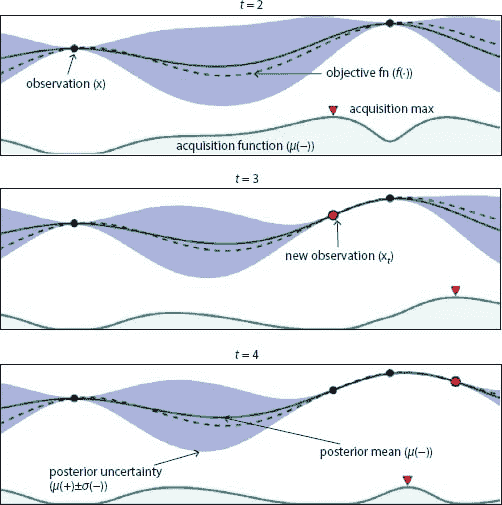

图 2.2 随迭代不断完善的目标函数的高斯过程近似。绿色阴影区域显示了。

该技术中常用的采集函数包括 `期望改进` (`EI`)、`改进概率` (`PI`）、`汤普森采样` (`TS`）、`知识梯度` (`KG`）和 `上置信边界` (`UCB`)。

### 2.7.4 基于元启发式的贝叶斯优化的最新进展

贝叶斯优化的最新进展包括使用元启发式来优化采集函数参数，以及开发高效的并行算法。人们已经许多许多尝试增强有效性并扩大范围。Snoek *等人* \[65\] 解决了线性扩展深度神经网络，作为 `GP` 的竞争性方案。此外，Brochu *等人* \[64\] 研究并提出了两种开发的贝叶斯优化扩展：带偏好的主动用户建模，和用于提高性能的分层强化学习。

## 2.8 神经架构搜索中的元启发式

神经架构搜索（`NAS`）是一个快速发展的领域，涉及为神经网络寻找最优架构。目前，绝大多数神经架构都是通过人类专家手动开发创建的，这容易产生错误且是一个耗时的过程。因此，对自动化神经架构搜索方法日益增长，而元启发式算法因其能够高效探索大型搜索空间并找到最优解决方案而受到全球关注。第 2.8 节 旨在介绍 `NAS`，阐述元启发式在 `NAS` 中的关键应用，以及这一新兴领域的最新进展。

### 2.8.1 神经架构搜索简介


神经架构搜索（NAS）是一种用于自动化机器学习和搜索神经网络最优架构的技术。NAS 涉及到在大量的候选架构中进行筛选，以为当前任务提供最佳性能。由于现代系统的复杂性和巨大的带宽需求，搜索空间可能极大，导致该过程在时间和资源上变得非常昂贵且耗尽。元启发式算法的发展允许在空间中高效定位最优解。

### 2.8.2 元启发式算法在神经架构搜索中的应用

元启发式算法已成功应用于许多 NAS 研究中以寻找最优神经网络架构。一些流行的元启发式算法包括 `GA`、`PSO`、`SA` 和 `TS`。卷积神经网络 (`CNNs`)、深度神经网络和循环神经网络是一些被发现与元启发式集成高度兼容的流行架构，用于理想设计的自动化。66] 的作者在 `CIFAR10` 上应用 `GA` 证明了通过小数据集实验搜索架构的能力。所提出的解决方案允许 `GA` 自动学习深度卷积神经网络的结构 [67]。[68] 的作者发现 NAS 方法在图像分类、目标检测或语义分割领域的优于手动设计的架构。

### 2.8.3 基于元启发式的神经架构搜索的进展

最近的研究重点在于通过元启发式算法提高 NAS 的效率和准确性。一种方法是使用更紧凑的神经架构搜索空间，以便进行高效的搜索。此外，近期对混合元启发式算法进行了大量研究——旨在结合多种元启发式的优势以在 NAS 中获得更好的性能。在常规方法之上，[69] 的作者开发了基于 `GA` 的拓扑增强神经演化 (`NEAT`)，其比当前强化学习任务的最佳固定拓扑方法具有更高的效率 [70]。性能效率的显著提高归于采用了使用物种化 (`speciation`) 的不同拓扑交叉方法，以保护结构创新并从最小结构开始逐步增长。[71] 的作者引入了一种名为 `DARTS` (`Differentiable ARchiecture Search`) 的新算法，它基于双层优化 (`bilevel optimization`)，旨在解决传统架构搜索面临的可扩展性挑战。`DARTS` 不是在离散且不可微的搜索空间上应用进化或强化学习，而是允许架构表示进行连续松弛，以便使用 `梯度下降`。该算法在多个领先基准测试中证明了自己，在 `CIFAR-10` 上取得了竞争性的结果，并在 `PTB` 数据集上表现卓越（这是一个数据集名称，`PTB` 代表德国联邦物理技术研究院 `PTB`）。该算法提高了架构搜索过程的整体效率，并缩短了探索时间。

## 2.9 用于超参数优化的元启发式技术比较

无数元启发式技术被广泛用于 HPO，但到为止还没有定义能提供关于它们如何排名的见解。本节关注上述方法的比较。

### 2.9.1 比较标准

为了对元启发式技术进行公平客观的比较，建立遵循定义范围的共识标准是有关重要的。这些标准包括技术的 `效率`、`准确性`和`健壮性`。`效率` 指技术为获取超参数所需的计算资源的智能使用，最大限度地减少时间浪费 [72]。`准确性` 是衡量元启发式技术在定位全局值时输出的真实性 [73]。算法的`健壮性` 是在不同条件和类型下表现良好的能力，不需要过度重训练 [74]。作为一种独特的方法，[75] 的作者研究了常用元启发式算法的强化和多样化 (`I&D`) 特性，并将其作为比较标准 [76, 77]。

### 2.9.2 元启发式技术的比较分析

基于现有文献和基于经验的关系研究，很难得出哪种元启发式技术对于 HPO 是最好的。通常情况下，`GA` 和 `PSO` 在广泛的优化问题上显示良好的性能，而 `SA` 和 `DE` 在特定领域显示了有前景的结果。然而，始终需要深度分析来支持经验想法。表 2.1 总结了 [75] 的作者的研究结果，他们对最常用的元启发式技术的 I&D 组件进行了分解，以比较每种技术使用的子方法和步骤 [78]。

表 2.1 流行元启发式算法及其 I&D 组件 [75]。

| 元启发式算法 | I&D 组件 |
| :--- | :--- |
| SA | 接受标准 + 冷却调度 |
| TS | 邻居选择（禁表列表） + 启发准则 |
| EC | 重交叉 + 变异 + 选择 |
| ACO | 费素更新 + 概率性构建 |
| ILS | 黑盒局部搜索 + 击打 + 接受准则 |
| VNS | 黑盒局部搜索 + 邻域选择 + 抖动阶段 + 接受准则 |
| GRASP | 黑盒局部搜索 + 限制候选列表 |
| GLS | 惩罚函数 |


**表 2.2** 基于平均值、中位数标准差的四种元启发式算法性能对比 [80]。

| 算法 || LeNet-5 上的损失 | 最佳值 (损失) | 最差值 (损失) |
| --- | --- | --- | --- |
| ABC | `f[AVG]` | 0.039988012 | 0.036257669 | 0.046849927 |
| `f[MEDIAN]` | 0.039912244 | | |
| `f[STD]` | 0.002684507 | | |
| ALO | `f[AVG]` | **0.038987691** | 0.03411367 | 0.043372824 |
| `f[MEDIAN]` | **0.039091125** | | | |
| `f[STD]` | **0.002267059** | | | |
| BA | `f[AVG]` | 0.041151504 | **0.03392095** | 0.04544504 |
| `f[MEDIAN]` | 0.041771095 | | | |
| `f[STD]` | 0.00265998 | | | |
| PSO | `f[AVG]` | 0.040463663 | 0.04651067 | 0.04651067 |
| `f[MEDIAN]` | 0.039871245 | | | |
| `f[STD]` | 0.002462824 | | | |

传统，对元启发式技术的对比分析是通过各种基准问题进行的，包括卷积神经网络、决策树 (DTs) 和支持向量机的超参数优化 [79]。Gaspar 等人 [80] 使用了四种不同的元启发式算法研究了 CNN 的超参数优化 (HPO)，即粒子群优化、蚁狮优化 (ALO)、人工蜂群和蝙蝠算法。每种元启发式算法使用相同的 CNN 架构和相同的 MNIST 数据库——运行 30 次以积累比较所需的数据。发现，根据均值、中位数标准差的统计参数，ALO 在 CNN 优化案例中表现最佳。

另一项对比归于 Ezugwu 等人 [81] 的工作，他们致力于对八种主流算法提供独特的见解，即粒子群优化、斑点鬣狗优化器 (SHO)、灰狼优化、蚁群优化、鲸鱼优化算法、引力搜索算法 (GSA)、蛾火优化 (MFO) 和蝙蝠算法。在运行了 23 个基准测试并分析了这些算法收敛曲线的探索与利用后，得出结论 SHO 和 GWO 在全局最优值的质量和准确性方面脱而出。

### 2.9.3 元启发式技术的性能评估

元启发式算法的性能评估，特别是针对 HPO 的情况，通常使用基准数据集和机器学习模型进行。这涉及基于各种已建立且认可的指标进行比较，包括结果模型收敛速度的准确性、成功率和最终解决方案的质量。随后对实验结果进行评估，以识别每种技术的优缺点。在某些情况下，需要在优势领域之间进行权衡，以达到给定应用所需的折中整体性能，因为没有一种元启发式算法可以在所有需要的方向上表现良好。

继续讨论上述 Gaspar 等人 [80] 的研究，表 2.2 显示了基于平均值、中位数和标准差的四种算法在损失方面的性能对比（如表所示）。结果显示，在上述指标方面，ALO 的表现优于其他算法。

性能的另一项对比指标是收敛速率和易用性，同时保持最小的产生损失。图 2.3 显示了基于前 10 次迭代的四种元启发式算法的收敛对比，显示 ALO 和算法在两次迭代内稳定，而 ABC 在给定应用中表现最差，在五迭代后稳定。也可以看到，在前 10 次迭代中，ALO 在运行期间产生的总损失最小。

同样，Ezugwu 等人 [81] 的工作包括对所研究的八种著名算法进行基于收敛的对比。图 2.4 显示 SHO 和 GWO 在最少的迭代次数内收敛——在 200 多次迭代内就低于 `10^-(20)`。可以看到 GSA 在大约 200 次迭代后趋于平。WOA 证明是其它的。


因此可以得出结论，元启发式算法的整体性能存在巨大差异，这受到若干参数、应用性质以及所用机器学习模型类型的强烈影响。虽然可以将性质相似的任务和应用进行集体归类，并观察哪种算法在每种情况下表现最好，但针对当前任务运行个性化的试错程序仍然是更好的做法。

## 2.10 元启发式算法在机器学习中的应用

元启发式算法在数字行业（包括机器学习）的流程自动化中发挥着重要作用。机器学习是一个快速发展的领域，旨在创建能够从数据集中学习并根据新获得的信息决策或预测的智能算法。第 2.10 节重点讨论了元启发式算法在机器学习大类中的各种应用，包括将监督学习、无监督学习、强化学习和深度学习超参数优化（HPO）集成到智能系统中。

### 2.10.1 监督学习

监督学习是一种机器学习技术，常用于训练模型，在这些应用程序中，程序需要识别易预测的结果。这些结果通常具有内置的一致性，例如循环模式或渐进序列。该技术的实现是通过向系统提供输入及其相应的输出（标记数据概念），以建立二者之间的函数关系。训练好的函数随后可以被用于对未见数据进行预测。元启发式算法主要应用于监督学习领域，用于特征选择（FS）[84, 85]、训练人工神经网络（ANN）和脉冲神经网络（SNN）、HPO，以及模型选择（MS）。Javanshir *等人* [86] 使用了基于元启发式的监督学习技术来训练脉冲神经网络（SNN），克服了脉冲神经元（SN）不连续和不可微的固有挑战。实施了 `HS`、`CS`、`DE`、`PSO`、`GA`、`ABC` 和基因表达（`GE`）等元启发式算法来运行实验，其中 `CS` 脱而出，在四个分类基准中表现出最佳性能。转向 HPO，Xian *等人* [87] 通过集成教师监督学习（TSL）模型改进了正弦余弦算法（`SCA`）以寻找全局最优。混合的 `TSL-SCA` 具有更好的群体控制和分布性、更高的收敛速度以及平衡的探索与开发。`TSL-SCA` 证明比 `DE`、`PSO`、`MFO`、`CS` 和 `WOA` 算法类型更具竞争力。

### 2.10.2 无监督学习

无监督学习与监督模式的区别在于数据标签。它需要足够智能以便在使用无标记数据训练模型的同时识别数据中的模式或结构。元启发式算法已用于无监督学习中的聚类、降维和异常检测。聚类作为最最重要的应用，涉及将相似的数据点分组在一起，以便更容易处理并提高模式发现的效率。元启发式算法具有平滑优化这一过程的能力，该方向已投入了研究工作。Jahwar 和 Abdulazeez [88] 讨论了 `SI` 方法的使用，包括用于 K-means 聚类的 `PSO`、`ACO` 和 `ABC`，其中 `PSO` 表现最好。同样，Kaur 和 Kumar [89] 设计了一种新的基于水波优化（`WWO`）的元启发式算法来解决聚类问题。众 own `WWO` 在处理有无约束优化问题方面有效，但存在过早收敛的缺点。作者通过改进搜索机制和衰减算子改进了算法，并在 13 个基准中测试了新的 `WWO`，在聚类问题上比通常的元启发式算法获得了更高的准确 分率。

### 2.10.3 强化学习

强化学习涉及训练模型以采用受用户反馈鼓励的积极行为，并拒绝受反馈抑制的消极行为。模型然后根据收到的反馈奖励和修正做出决策。强化模型需要高维存储空间且属于计算密集型，因为它们通常以接受/拒绝的方式运行，要求数据被归分为两类。元启发式算法已用于策略搜索、HPO 问题中的全局优化以及深度强化学习。Seyyedabbasi [90] 将沙猫群优化算法（`SCSO`）与集成强化学习相结合，创建了 `RL-SCSO` 元启发式混合算法，用于搜索空间中全局最优的有效探索和开发。该研究在 20 个基准测试上进行了验证，结果非常可观。Seyyedabbasi *等人* [91] 进一步提高了门槛，开发了三种新型混合元启发式算法，即 `RL[I-GWO]`、`RL[Ex-GWO]` 和 `RL[WOA]`。通过实施控制机制获取了每个动作的奖励和惩罚值，并在 30 个基准函数上模拟。

### 2.10.4 深度学习

深度学习涉及训练深度神经网络以学习数据中的复杂模式。元启发式算法已用于深度学习的各种任务，包括 HPO、架构搜索和 DNN 训练。Tian 和 Fong [92] 对 DNN 的深度学习集成提供了全面综述，讨论了整体流程、优缺点、元启发式技术的需求以及在 ANN HPO 中使用 `GA` 和 `PSO`。在类似的工作中，Rere *等人 [93] 展示了使用 `SA` 提升 `CNN` 性能。在 MNIST 数据集的实现成功后，该方法必须增加计算时间的权衡。该领域的另一个重要发现来自 Kingma 和 Ba [94]，他们创建了 `Adam`，一种处理随机目标函数一阶梯度优化的算法。研究成功证明了 `Adam` 算法的通用性，它能够扩展到大规模高维机器学习问题，与现有模型对比能良好地处理 CNN 和 DNN，甚至可以有效地解决实际的深度学习问题。

## 2.11 未来方向与开放挑战

元启发式算法是一个新兴领域，正在探索新的方向、采取新的路径并以多种独特的方式深入发展。进入机器学习世界为未来提供了更多可能，随着更先进技术的开发和新应用的发现，改进的需求呈指数级增长。这使得元启发式算法的研究具有巨大的潜力。然而，优点也伴随着缺点。新领域中的分支机会也带来了更多的开放挑战，必须克服这些挑战才能完全掌握元启发式算法及其真实能力。挑战包括复杂模型训练、高维数据处理以及 ANN 和 DNN 优化。

### 2.11.1 元启发式算法的改进机会


元启发式算法已证明其是机器学习（ML）优化问题非常有用的工具，但始终留有改进空间。首要方法是开发能够应对高维数据和复杂优化格局挑战的新型元启发式技术。其次是完善创建更优混合算法的“艺术”——即找到合适的算法进行组合并以正确的比例进行组合。Ting *et al.* [[[95\]] 讨论了混合元启发式算法的过去、现在和未来，为更广阔的研究视野和无限的研发可能性开辟了希望，以利用无限的机遇。最后，在包容性和能力方面改进现有算法是一项永恒的任务，将是一个持续到天荒地的不断增长的过程。元启发式算法应用日益增长的领域包括先进量子计算应用、纳米技术、NFT 和加密货币交易、太空探索模拟等。

### 2.11.2 将元启发式算法适应新的机器学习范式

随着机器学习的不断演进，新的范式不断出现，这要求开发新的优化技术以跟上工业基准以及全球市场的激烈竞争。诸如精益创业和其他资源管理方法等哲学要求在从生产者到消费者的链中的所有过程中进行极的优化。将元启发式算法与持续学习、认知计算、量子机器学习、对抗机器学习、可解释人工智能（XAI）、联邦学习、人类回路学习、元学习等技术相结合，可能是未来等待中重大突破的关键。开发能与这些新机器学习范式协同工作的元启发式算法无疑将是未来的重要研究领域。

### 2.11.3 解决计算复杂性和可扩展性

随着机器学习模型规模和复杂性的增加，可扩展性和计算效率成为当前智能优化与控制数字时代面临的重大挑战。顺应趋势，未来可能会在处理和存储的带宽及维度要求方面增加更多挑战。尽管这很耗时，但需要解决，应该集中大量精力在该问题上。此外，还需要更多关于并行和分布式元启发式算法的研究以加速 `HPO`。还需要开发能与现代计算架构（如 `GPUs` 和 `FPGAs`）协同工作的元启发式算法，以高效利用硬件并加速优化。

## 2.12 结论

可以同意，元启发式算法和 `HPO` 在当今的数字世界中是不可分割的思想。随着工业和人工智能技术领域全天候的快速发展，公司在保持成本和流程时间低水平的同时，战胜竞争并不断提高产品质量和多样性变得越来越重要。这正是 `HPO` 发挥作用之处，通过寻找流程参数的全局最优解来提升所需的指标。全文显示，手动优化确实是一项艰巨的任务，需要永远的修正、迭代和错误查找。元启发式算法确实是强大的工具，可以作为一种现实世界的“黑科技”，以智能且高效的方式执行 `HPO`。为了建立坚实的基础，本综述涵盖了理解 `HPO` 完整理念所需的重要概念，包括元启发式、`ML`、`AI` 等领域的术语，并探讨了不同研究人员采用的独特优化技术。本文还确定了提高 `ML` 中元启发式性能的若干未来研究领域，并讨论了为了保持推进需要克服的挑战。总而言之，可以非常有心地说，该领域在通过新技术的创新和现有变体的混合组合来提高 `ML` 算法的准确性和效率方面具有巨大潜力，并有助于解决与 `HPO`、特征选择和模型选择相关的挑战。

## 参考文献

1. `Gupta, K. et al.`, Machine learning-based predictive modelling of biodiesel production. `Energies`, 14, 4, 2021, doi:10.3390/en14041204.
2. `Hutter, F., Kotthoff, L., Vanschoren, J.`, Automated Machine Learning, Springer: New York, USA.
3. `Bergstra, J. and Bengio, Y.`, Random search for hyperparameter. `J. Mach. Learn.`, 13, 281–305.
4. `Feurer, M. and Hutter, F.`, Hyperparameter optimization, in: `Automated Learning: Systems`, pp.33, 2019.
5. `Abdel-Basset, M. et al.`, Metaheuristic algorithms: A comprehensive review, in: `Comp. Intell. Multimedia Big Data Cloud Eng. Appl.`, pp.185–231, 2018, doi:10.1016/978-0-12-813314-9.00010-4.
*(注：由于原文参考文献列表显示不全或存在断层，此处根据您提供的文本内容进行了格式化处理和翻译)*


18. 18. Holland, J.H., *自然与人工系统的适应性：对生物学、控制和人工智能应用的介绍性分析*, MIT Press, 美国马萨诸塞州剑桥, 1975.

19. 19. Kalita, K. *等*, 遗传编程辅助层层复合材料多目标动态性能的多尺度优化：更基础级分析的优势。*Neural Comput. Appl.*, 32, 12, 7969–7993, 2020, doi: 10.1007/s00521-019-04280-z.

20. 20. Kalita, K. 和 Chakraborty, S., 一种基于遗传编程的复合层板元启发式优化高效方法。*Int. J. Interact. Des. Manuf.*, 17, 2, 899–916, 2023, doi: 10.1007/ s12008-022-01175-7.

21. 21. Kalita, K. *等*, 使用遗传算法& 粒子群优化优化玻璃纤维增强复合材料（GFRP）钻孔诱导分层。*Adv. Compos. Lett.*, 27, 1, 2018, doi: 10.1177/096369351802700101.

22. 22. Kalita, K. *等*, 使用遗传算法和粒子群优化优化激光束微标标记的工艺参数。*Mater. Manuf. Processes*, 32, 10, 1101–1108, 2017, doi: 10.1080/10426914.2017.1303156.

23. 23. Di Francescomarino, C.D. *等*, 用于预测性业务流程监控中超参数优化的遗传算法。*Inf. Syst.*, 74, 67–83, 2018, doi: 10.1016/j.is.2018.01.003.

24. 24. Kalita, K. *等*, 使用多准则决策技术的非传统加工工艺的参数化优化：文献回顾与未来方向。*Multiscale Multidiscip. Model. Exp. Des.*, 6, 1, 1–40, 2023, doi: 10.1007/s41939-022-00128-7.

25. 25. Kalita, K. *等*, 鲁棒遗传优化的斜交层板。*Proc. Inst. Mech. Eng. C*, 233, 1, 146–159, 2019, doi: 10.1177/0954406218756943.

26. 26. Kennedy, J. 和 Eberhart, R., 粒子群优化，载于*1995 年 ICNN 国际神经网络会议会议集*, pp. 1942–1948, 1995, doi: 10.1109/ICNN.1995.488968.

27. 27. Tasgetiren, M.F. *等*, 用于单机总加权误期问题的粒子群优化算法，载于*2004 年进化计算会议集*, 2004, (IEEE, Cat. No. 04TH8753).

28. 28. Narayanan, G. *等*, PSO 调整的支持机模型用于管道弯头处的湍流评估。*Eng. Comput.*, 37, 3, 981–1001, 2019, doi: 10.1108/EC-05-2019-0244.

29. 29. Shankar, R. *等*, 用于工艺优化的混合粒子群-引力搜索算法。*Processes*, 10, 3, 616, 2022, doi: 10.3390/pr1003016.

30. 30. Price, K.V., Storn, R., Lampinen, J., *差分进化：一种全局优化的实用方法*. Springer Science & Business Media, 德国柏林, 2006.

31. 31. Kalita, K. *等*, 复合板多目标优化的响应面建模方法。*Steel Compos. Int. J.*, 32, 455–466, 2019.

32. 32. Kalita, K. *等*, 基于元启发式的斜交层板优化的比较研究。*Eng. Comput.*, 38, 4, 3549–3566, 2022, doi: 10.1007/s00366-021-0140-y.

33. 33. Lorenzo, P.R. *等*, 用于深度神经网络超参数选择的粒子群优化，载于*遗传与进化计算会议集*, pp. 481–488, 2017, doi: 10.1145/307178.307120.

34. 34. Zulfiqar, M. *等*, 使用自适应进化进行电力预测的支持机超参数优化。*Energy.*, 8, 13333–13352, 2022, doi: 10.1016/j.egyr.2022.09.188.

35. 35. Lohvithee, M. *等*, X 射线断层扫描中全变分重建的蚁群算法超参数。*Sensors (Basel)*, 21, 2, 591, 2021, doi: 10.3390/s21020591.

36. 36. Simon, D., 基于地理学的优化。*IEEE Trans. Evol. Comput.*, 12, 6, 702–713, 2008, doi: 10.1109/TEVC.2008.91904.

37. 37. Kalita, K. *等*, 使用元启发式算法优化斜交层板频率。*Eng. Comput.*, 36, 2, 741–761, 2020, doi: 10.1007/s00366-019-00728-x.

38. 38. Kalita, K. *等*, 基于元模型的层板多目标设计。*Struct. Eng. Mech. Int. J.*, 67, 301–310, 2018.

39. 39. Kalita, K. *等*, 铁件加工中的记忆型布鸟搜索优化。*Mater. (Basel)*, 13, 14, 3047, 2020, doi: 10.3390/ma1314307.

40. 40. Yang, X.-S. 和 Deb, S., 通过莱维飞行进行布鸟搜索，载于*自然与生物启发计算世界大会 (NaBIC)*, vol. 2009, 2009, doi: 10.1109/NABIC.2009.539369.

41. 41. Kalita, K. *等*, 用于多目标工艺优化的混合 TOPSIS-PR-GWO 方法。*Process Integr. Optim. Sustain.*, 6, 4, 1011–1026, 2022, doi: 10.1007/s41660-022-00256-0.

42. 42. Kalita, K. *等*, 关于高保真和基于元模型的复合层板优化的综述。*Arch. Comput. Methods Eng.*, 29, 5, 3005–3340, 2022, doi: 10.1007/s11831-021-09699-z.

43. 43. Mirjalili, S. *等*, 灰狼优化器。*Adv. Eng. Software*, 69, 44–61, 2014, doi: 10.1016/j.advengsoft.2013.

44. 44. Kalita, K. *等*, PSO 调整的支持机模型用于变刚性盘设计。*J. Soc. Mech. Sci.*, 43, 8–15, 2021.

45. 45. Kumar, V. *等*, 用于工艺优化的混合粒子群-引力算法。*Processes*, 9, 3, 442, 2022, doi: 10.3390/pr1003042.

46. 46. Shanas, D. *等*, 基于单解元启发式的全局搜索一种新型算法。*Processes*, 10, 6, 1074, 2022, doi: 10.3390/pr1006074.

47. 47. Ashraf, N. *等*, 用于深度学习超参数优化的响应面方法。*Data Technol. Appl.*, 54, 3, 275–296, 2020.

48. 48. Kalita, K. *等*, 用于复合材料优化的新型 NS 算法。*Multiscale Multidiscip. Model. Exp. Des.*, 6, 1, 1–40, 2023, doi: 10.1007/s41939-022-00128-7.


59. 59. Liu, H. *et al.*, 群群智能中的混沌动态特性。*Appl. Soft Comput.*, 7, 3, 1019–1026, 2007, doi: 10.1016/j.asoc.2006.10.006.

60. 60. De, S., Dey, S., Bhattacharyya, S. *数据聚类中混合元启发算法的最新进展*, John Wiley & Sons, Hoboken, NJ, USA, 2020.

61. 61. Shahriari, B. *et al.*, 将人类移出循环：贝叶斯优化综述。*Proc. IEEE*, 104, 1, 148–175, 2015, doi: 10.1109/ JPROC.2015.2494218.

62. 62. Bhattacharya, S. *et al.*, 复合材料加工过程中回归模型预测性能的对比分析。*Mater. (Basel)*, 14, 21, 6689, 2021, doi: 10.3390/ma14216689.

63. 63. Jain, P. *et al.*, 用于弯管流体精确估计的随机森林回归机器学习模型。*Processes*, 9, 11, 2095, 2021, doi: 10.3390/pr9112095.

64. 64. Brochu, E. *et al.*, 高昂代价函数的贝叶斯优化教程，及其主动用户建模和分层强化学习中的应用，arXiv Preprint ArXiv:1012.2599, 2010.

65. 65. Snoek, J. *et al.*, 使用深度神经网络的可扩展贝叶斯优化，见于：*国际机器学习会议*, 2015.

66. 66. Xie, L. and Yuille, A., 遗传卷积神经网络，见于：*IEEE 国际计算机视觉会议论文集*,pp. 1388–1397, 2017, doi: 10.1109/ICCV.2017.154.

67. 67. Krizhevsky, A. *et al.*, 基于深度卷积神经网络的 Imagenet 分类。*Commun. ACM*, 60, 6, 84–90, 2017, doi: 10.1145/3065386.

68. 68. Elsken, T. *et al.*, 神经架构搜索：综述。*J. Mach. Learn. Res.*, 20, 1997–2017, 2019, doi: 10.1007/978-3-030-05318-5\_3.

69. 69. Stanley, K.O. and Miikkulainen, R., 通过增强拓扑结构进化神经神经网络。*Evol. Comput.*, 10, 2, 99–127, 2002, doi: 10.1162/106365602320169811.

70. 70. Hansen, P. *et al.*, 变邻域搜索：方法与应用。*Ann. Oper. Res.*, 175, 1, 367–407, 2010, doi: 10.1007/s10479-009-0657-6.

71. 71. Liu, H. *et al.*, Darts: 可微的架构搜索，arXiv Preprint ArXiv:1806.09055, 2018.

72. 72. Ying, C. *et al.*, NAS-Bench-101：迈向可的神经架构搜索，见于：*国际机器学习会议*, 2019.

73. 73. Narayanan, R.C. *et al.*, 用于工程应用的新型多目标正余弦算法(`MaOSCA`)。*Mathematics*, 11, 10, 2301, 2023, doi: 10.3390/math1110231.

74. 74. Silver, D. *et al.*, 用深度神经网络和树搜索超越围棋。*Nature*, 529, 484–489, 2016, doi:10.1038/nature16961.

75. 75. Blum, C. and Roli., 组合优化中的元启发算法：概述与概念比较。*ACM Comput. Surv.*, 35, 3, 268–308, 2003, doi:10.1145/937505.

76. 76. Ganesh, N. *et al.*, 一种新型基于分解的多目标有机体搜索优化。*Mathematics*, 11, 8, 1898, 2023, doi: 10.3390/math1108898.

77. 77. Joshi, M. *et al.*, 用于 CEC-2021 全局优化的蜻蜓变体概念比较。*Arab. J. Sci. Eng.*, 48, 2, 1563–1593, 2023, doi: 10.1007/s13369-022-0688-9.

78. 78. Shaik, K. *et al.*, 用于心脏诊断的大数据分析优化决策树框架。*Appl. Sci.*, 13, 9, 5236, 2023, doi: 10.3390/app1309536.

79. 79. Real, E. *et al.* 用于分类器的正则化进化。*AAAI*, 33, 1, 4780–4789, 2019, doi: 10.1609/aaai.v33i01.3301470.

80. 80. Gaspar, A. *et al.*, 卷积神经网络中的超参数优化，见于：*机器学习中的元启发：理论与应用*, pp. 37–59, Boston, 2021, doi: 10.1007/978-3-030-70542-8.

81. 81. Ezugwu, A.E. *et al.*, 连续优化中的元启发算法概念比较。*Neural Comput. Appl.*, 32, 10, 6207–6251, 2020, doi: 10.1007/s00521-019-0413-w.

82. 82. Sonmez, M., 用于桁架优化设计的元启发算法性能比较。*Arab. J. Sci. Eng.*, 43, 10, 5265–5281, 2018, doi: 10.1007/s13369-018-3080-y.

83. 83. Tayebi, M. and El Kafhali, S., 用于交易交易的元启发超参数优化性能分析。*Evol. Intell.*, 1–22, 2022, doi: 10.1007/s12065-022-00764-5.

84. 84. Priyadarshini, J. *et al.*, 近邻特征选择中的物理启发元启发算法分析。*Appl. Sci.*, 13, 2, 906, 2023, doi: 10.3390/app13020906.

85. 85. Ganesh, N. *et al.*, 加权叠加算法的高效特征选择。*Appl. Sci.*, 13, 5, 3223, 2023, doi: 10.3390/app13053223.

86. 86. Javanshir, A. *et al.*, 用元启发算法训练脉冲神经网络。*Appl. Sci.*, 13, 8, 4809, 2023, doi: 10.3390/app13084809.

87. 87. Xian, H. *et al.*, 用于全局优化的教师学习改进正余弦算法。*IEEE Access*, 9, 17744–17766, 2021, doi: 10.1109/ACCESS.2021.3054053.

88. 88. Jahwar, A.F. and Abdulazeez, A.M., K-means 聚类的元启发算法综述。*PalArchs J. Archaeol. Egyptol.*, 17, 12002–12020, 2020.

89. 89. Kaur, A. and Kumar, Y., 基于水波优化的数据聚类新元启发算法。*Evol. Intell.*, 15, 1, 759–783, 2022, doi: 10.1007/s12065-020-00562-x.

90. 90. Seyyedabbasi, A., 用于求解全局优化问题的基于强化学习的元启发算法。*Adv. Eng. Software*, 178, 103411, 2023, doi:10.1016/j.advengsoft.2023.103411.

91. 91. Seyyedabbasi, A. *et al.*, 结合强化学习和元启发方法求解全局优化问题的混合算法。*Knowl. Based Syst.*, 223, 107044, 2021, doi: 10.1016/j.knosys.2021.107044.


计算机辅助诊断（`CAD`）一直是近期医学领域最关键且最重要的方法。此外，随着远程医疗趋势的形成，`CAD` 系统的可靠性和效率已成为当务之急的需求。针对乳腺癌检测的 `CAD` 系统专门研究正在全球范围内进行。然而，考虑到成像模态范围广泛以及上述领域多种数据集的可用性，选择最高效且最优实施方法成为了一项挑战。因此，本综述论文旨在对所有现有成像模态及其相应数据集提供全面概述。此外，还将介绍与每种模态相关的代表机器学习和深度学习领域的若干显著工作，为未来的创新研究提供领先思路。所提出的工作将阐明乳腺癌领域可以进行的所有可能的分类。我们最后通过指出新的可能研究空白来得出结论，从而为未来的后续研究开辟途径。

**关键词：** 良性、恶性、*原位*、浸润性导管癌、CAD

## 3.1 Introduction

在图像筛查过程中会出现各种迹象和异常，这些可能是乳腺癌的早期指标。进一步深入研究，它们被进一步分为良性或恶性，其中恶性代表短期内可能发展为乳腺癌的危险。

根据最近进行的一项统计研究，根据印度的情况，每 4 分钟就有一名女性被确诊为乳腺癌。截至 2020 年，乳腺癌每年病例约为 178,000 例，因此超过了宫颈癌，成为印度女性癌症的首要原因。需要注意的是，在早期诊断的情况下，生存率可以提高到 98%。然而，讽刺的是，印度约 50%–80% 的乳腺癌病例是在晚期检测出来的。

这使得有必要关注乳腺癌的潜在指标。钙化和肿块的出现被视为红旗，因此涉及临床解释以促进适当的诊断和治疗。Chaudhury 等人 [1]\] 在其工作中将钙化称为在乳腺中发现钙沉积。可能的原因包括年龄增长、既往感染和伤口，并不一定与钙摄入有关。钙化主要分为两类，即大性钙化和微小钙化，前者没有风险，而微小钙化会引起对乳腺癌的早期怀疑，因此需要进行多次随访检查。如今，已经有了自动化系统用于检测输入超声扫描中的钙化情况。Chaudhury 等人 [1]\] 讨论了一种假设的四个阶段的新型分割方法。第一阶段涉及预处理，将输入图像转换为灰度图像。图像分割通过应用 `K-means` 完成，随后的特征提取通过灰度共生矩阵（`GLCM`）进行。最后，为了对正常细胞和钙化细胞进行分类，模型使用了隐马尔可夫模型（`HMM`）分类分类算法，其中在分类目的上，相似性优先于上下文知识。上述所提出的工作使用了超声扫描。Loizidou 等人 [2]\] 讨论了一种假设的四个阶段的新型分割方法。第一阶段涉及预处理，将输入图像转换为灰度图像。图像分割通过应用 `K-means` 完成，随后的特征提取通过灰度共生矩阵（`GLCM`）进行。最后，为了对正常细胞和钙化细胞进行分类，模型使用了隐马尔可夫模型（`HMM`）分类算法，其中在分类目的上，相似性优先于上下文知识。上述所提出的工作使用了超声扫描。Loizidou 等人 [2]\] 讨论了一种假设的四个阶段的新型分割方法。第一阶段涉及预处理，将输入图像转换为灰度图像。图像分割通过应用 `K-means` 完成，随后的特征提取通过灰度共生矩阵（`GLCM`）进行。最后，为了对正常细胞和钙化细胞进行分类，模型使用了隐马尔可夫模型（`HMM`）分类算法，其中在分类目的上，相似性优先于上下文知识。上述所提出的工作使用了超声扫描。Loizidou 等人 [2]\] 讨论了一种假设的四个阶段的新型分割方法。第一阶段涉及预处理，将输入图像转换为灰度图像。图像分割通过应用 `K-means` 完成，随后的特征提取通过灰度共生矩阵（`GLCM`）进行。最后，为了对正常细胞和钙化细胞进行分类，模型使用了隐马尔可夫模型（`HMM`）分类算法，其中在分类目的上，相似性优先于上下文知识。上述所提出的工作使用了超声扫描。Loizidou 等人 [2]\] 讨论了一种假设的四个阶段的新型分割方法。第一阶段涉及预处理，将输入图像转换为灰度图像。图像分割通过应用 `K-means` 完成，随后的特征提取通过灰度共生矩阵（`GLCM`）进行。最后，为了对正常细胞和钙化细胞进行分类，模型使用了隐马尔可夫模型（`HMM`）分类算法，其中在分类目的上，相似性优先于上下文知识。上述所提出的工作使用了超声扫描。Loizidou 等人 [2]\] 讨论了一种假设的四个阶段的新型分割方法。第一阶段涉及预处理，将输入图像转换为灰度图像。图像分割通过应用 `K-means` 完成，随后的特征提取通过灰度共生矩阵（`GLCM`）进行。最后，为了对正常细胞和钙化细胞进行分类，模型使用了隐马尔可夫模型（`HMM`）分类算法，其中在分类目的上，相似性优先于上下文知识。

另一个重要指标是乳腺中肿块或结节的存在。在这里，`CAD` 系统的存在为手动操作提供了支持和保障。Jeong 等人 [3]\] 反而提出了一种三步法来检测导管原位癌（IDC）的存在。Hamed 等人 [4]\] 使用了基于 You Look Once（`YOLO`）的 `CAD` 系统，该系统作用于全场和裁剪的乳腺影像摄影。随后应用了 `ResNet`、`VGG` 和 `Inception` 等特征提取器。该系统以 98% 的准确率成功检测肿块位置，并以 95% 的准确率执行良性和恶性之间的分类。


表 3.1 为了方便读者阅读，列出了前述讨论中描述的所有医学术语的定义。此后，论文的结构安排如下。第 3.2 节描述了为了成功调查有关乳腺癌医学领域的研究工作而采用的方法论和思想。第 3.3 节从生物学和计算两个角度阐述了不同的成像模态。此外，本节还描述了与提到的每个成像模态对应的所有公开数据集。此外，还列出了综述包含论文中使用的所有私有数据集。第 3.4 节根据所采用的技术类型（即机器学习 (ML) 或深度学习）对研究工作进行了系统性的划分和阐述。这些工作进一步根据所采用的成像模态进行了排列。最后，我们在第 3.5 节中总结，重点介绍了综述中发现的研究空白，从而为未来的研究开辟了新途径。

表 3.1 使用的医学术语总结。

| 医学术语 || 定义 || 来源 |
| --- | --- | --- |
| 钙化 (Calcification) | 乳腺区域发现的微小钙颗粒 | Chaudhury *等人* \[1\] |
| 肿块 (Masses) | 组织过度生长导致形成圆形结构，并根据形成区域进行进一步分类。 | Wook Jeong *等人* \[3\] |
| 原位导管癌 (Ductal carcinoma in situ) | 代表性生长局限于乳管区域的情况 | Bejnordi *等人* \[6\] |
| 浸润性导管癌 (Invasive ductal carcinoma) | 代表癌症区域开始向周围区域扩散且不受限于导管区域的医学状况。 | Celik *等人* \[5\] |
| 良性 (Benign) | 本质上不扩散的癌症 | Deblee *等人* \[7\] |
| 恶性 (Malignant) | 癌症倾向于扩散并影响其他器官 | Deblee *等人* \[7\] |

## 3.2 研究综述流程

我们调查了 2019 年至 2022 年期间的研究论文。考虑到所提方法的新颖性和复杂性，综述还包含了少量 2016 年的论文。在评估这些论文时，考虑了以下参数：*1) 使用的成像模态，2) 所提方法的复杂性和新颖性，3) 采用数据集的性质，4) 所用技术的性质（即 ML 还是 DL）。* 本综述的通用搜索标准使用了“自动乳腺癌检测”、“使用 ML 和（成像模态名称）的 CAD 系统”、“基于 CNN 的乳腺癌检测 CAD 系统”以及“基于 ROI 分割的乳腺癌检测论文”等关键词。搜索在著名的研究数据库和网站进行，如 *1) PubMed, 2) Science Direct, 3) IEEE Xplore 数字图书馆, 4) Google Scholar 以及 5) MDPI (多学科数字出版学院)*。还回顾了一些综述论文，以分析和理解撰写关于乳腺癌主题综述论文的流程。数据集的参考文献和细节从 Kaggle 获取。

## 3.3 成像模态及其数据集

### 3.3.1 组织病理学 WSI

这种成像模态涉及在外科专家的帮助下，通过细针抽吸 (FNA) 从怀疑区域提取软组织样本。根据 Mahmood *等人* \[8\]]，这些提取的组织随后被染色并在显微镜下进行检查，以进行进一步的诊断、分类和确认。随后将其转换为数字记录，因为显微切片是易腐的，这对于自动化算法的应用非常有用。数字化副本不仅有助于便携和记录存储，而且在增强放大倍灵活性方面比使用显微镜进行人工检查更有优势，并有助于在不引起眼部疲劳的情况下查看不同区域。面临的缺点出现在处理阶段。`WSI` 文件通常是内存密集型的，无法输入处理/分类模型中。通常，这需要裁剪出 `ROI` 并对图像进行增强，这可能会导致诊断关键信息的丢失。但从医学角度来看，这是用于确认乳腺癌诊断的最优且最可靠的成像模态。

与上述成像模态相关的一些流行公开数据集如下：

1. *IDC 乳腺组织病理图像数据集*：该数据集包含约 277,524 个尺寸为 50 × 50 像素的 RGB 图像块，主要目的是识别浸润性导管癌的存在。

2. *BACH 大挑战（ICIAR 2018 会议）*：BACH 的缩写代表乳腺癌组织学图像，本质上由 400 多张标记的显微镜图像组成，任务是进行四分类：正常、良性、原位癌和浸润性癌。

3. *BreakHis (乳腺癌病理数据库)*：该数据集包含约 9,109 张显微图像，其中有 2,480 个良性和 5,429 个恶性样本。这些样本以 RGB 模式提供，尺寸为 700 × 460 像素。

4. *CAMELYON17*：该数据集是检测和区分转移区域与正常区域挑战，标注可在病变水平和患者水平提供。数据集包含涵盖不同淋巴结切片的图像。

5. *PCam 数据集*：该数据集包含约 327,680 张图像，其中尺寸为 96 × 96 的 `ROI` 区域已根据转移组织的存在进行了标记。

### 3.3.2 数字乳腺摄影

这种成像模态通过对接受检查区域暴露低剂量 X 射线来获取乳腺内部。这类似于 CT，图像以切片形式拍摄，然后组合成整个图像。CAD 系统通过评估异常区域的密度和形态特征来检查异常。与组织病理学 WSI 相比，这里不需要手动进行数字化的工作；但对于 CAD 系统而言，乳腺摄影在输入分类模型之前需要大量的图像预处理和标注。

与上述成像模态相关的一些流行公开数据集如下：

1. *DDSM-400 和 CBIS-DDSM*：这些数据集经常一起使用以增加数据量。数据集包含尺寸为 299 × 299 像素的 `ROI` 图像，样本量为 55,890，其中 14% 的样本为恶性性，其余 86% 为阴性。已经进行了裁剪、随机翻转和旋转等配合缩放的预处理技术。


这种成像模式通常用于捕捉和检查癌症的早期迹象，如肿块和钙化。它与乳腺摄影和 `MRI` 互为补充，因此可用于对上述扫描检测出的异常进行深度研究。例如，超声检查被用于判断检测到的乳腺肿块是充满液体的囊肿还是实性肿瘤。然而，使用这种成像模式对良性和恶性的分类并不十分清晰。对于 `CAD` 系统而言，由于轮廓识别不准确以及对 `ROI` 分割不当，有效且精确的特征选择往往是一个问题。此外，大多数关于使用超声检查的工作都表示为了训练目的需要进行人工标注，因此，这种成像模式对自动化的支持并不完全。

关于上述成像模式的一些流行公共数据集如下：

1. `OASBUD (Open Access Series of Breast Ultrasonic Data):` 该数据集包含约 100 名患者的超声扫描图像，其中 52 例为恶性，48 例为良性。此外，对每个病变分别从横向和纵向两个方向执行了两个垂直的扫描。

2. `UDIAT:` 该数据集包含 163 张超声图像，其中 110 张属于良性类别，53 张属于恶性。该数据集是从西班牙的 UDIAT 诊断中心使用 Siemens ACUSON 仪获取的。

3. `BUSI (Breast Ultrasound Images Dataset):` 包含约 780 张尺寸为 500 × 500 像素的超声扫描图像，收集自约 600 名患者。图像分为三类，即正常、良性和恶性。该数据集由 Dhabyani *et al.* \[9\] 开发。

### 3.3.4 磁共振成像

这种成像模式主要针对高风险女性，这些女性由于肿瘤的性质，无法接受乳腺摄影和超声检查等程序。该技术基于磁场存在时细胞核对射频的吸收。然而，在利用 `CAD` 系统实施方面，面临的主要问题是将乳腺区域与非需要的身体部位进行分割和分离。此外，由于成像时使用了不同的频率，必须使用复杂的特征融合技术，通过分类模型从扫描中提取有用的诊断结论。

该领域的大多数工作由来自医院的私有数据集组成，主要是因为需要放射科医生进行人工标注。然而，需要注意的是，这些工作中的大多数使用了动态对比增强磁共振 (`DCE-MRI`)。Witowski *et al.* \[10\] 发布了一份描述在收集此数据集时所用实践和预处理方法的此类基准报告。

### 3.3.5 红外乳腺热成像

这种成像模式是非侵入性和非电离性的，利用乳腺区域的温度分布来检测异常。根据 Venkatachalam *et al.* \[11\] 的研究，热成像基于这样一个事实：由于血管生成导致代谢率高，癌前区域表现出的温度比周围区域高。这种活动是通过红外热摄像机捕捉的。然而，正如 Venkatachalam 在 \[11\] 中正确识别并研究的，这种成像模式提出的主要问题是强度不均、`ROI` 重叠、对比度差以及低信噪比 (`SNR`)。

Venkatachalam *et al.* \[11\] 所使用的精炼私有数据集的引用如下：

用于此研究工作的红外乳腺热图像 (`IBTI`) 数据集收集自印度泰米尔纳德德邦特里奇的“Harshmitra 超级癌症中心与研究所”，由使用分辨率为 320 × 240 的红外相机 `DITI CX320` 的图像组成。它包含了来自约 50 名患者的数据。

**表 3.2**](#c03.xhtml#tab3_2) 优点与缺点。

| 成像模式 || 优点 | 缺点 |
| --- | --- | --- |
| 组织病理 WSI | 有利于对*原位*和浸润性导管癌进行细微观察和分类 | 分辨率高导致处理困难。 |
| 数字乳腺摄影 | 非侵入性且检测肿瘤和肿块效率高 | 需要大量的图像预处理 |
| 超声 | 非侵入且无痛的图像筛选方法 | 需要放射科专家知识和强制性人工标注 |
| 磁共振成像 (MRI) | 是最详细的成像模式，适用于高风险阶段的女性。 | 使用复杂的特征融合技术来提取关键诊断信息 |
| 红外乳腺热图像 (IBTI) | 非侵入性、非电离成像模式，因此可能无害。 | 强度不均、`ROI` 重叠、对比度差、低信噪比 (`SNR`)。 |

另一个使用的公共数据集是 `DMR-IR`，由米内罗联邦大学发布。该数据集也包含了来自 50 名患者的数据，图像是使用分辨率为 640 × 480 像素的 FLIR 红外相机捕捉的。

不同成像模式的优缺点总结如表 3.2 所示。图 3.1 展示了所有上述模式的良性和恶性分类的图示表示。

```
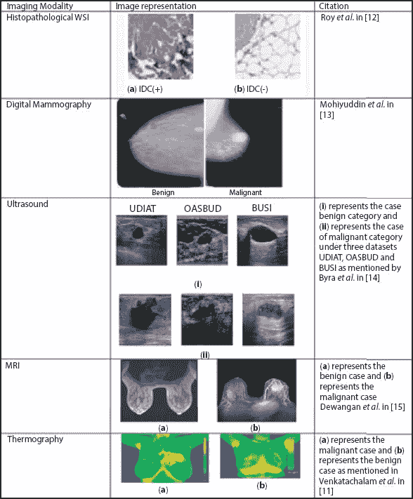
```

**图 3.1**](#c03.xhtml#fig3_1) 模式的图示表示。

## 3.4 研究综述

本节简述了上述章节提到的每种成像模式的研究工作。为了方便识别感兴趣的内容，这些工作系统地分为所提方法是基于机器学习还是深度学习。

### 3.4.1 组织病理 WSI

考虑到解释输入图像的复杂性，大多数研究工作基于深度学习 `CNN` 模型。然而，涉及使用机器学习的一项重要工作描述如下。

### 3.4.1.1 基于机器学习的组织病理 WSI

Roy *et al.* \[12\] 使用了 `ML` 分类器和集成学习来得出 IDC 阳性样本和阴性样本的分类。分类是通过提取 `SIFT`、`SURF` 和 `ORB` 等纹理特征完成的。Haralick 特征是执行分类时考虑的统计特征。皮尔逊系数用于剔除冗冗余。提取出的特征随后被输入到六个分类器中，即随机森林、极端树、`XGBoost`、`AdaBoost`、`CatBoost` 和多层感知机。该工作得出结论认为 `CatBoost` 能够提供最高的准确性能，记录为 92.55%。该工作使用了 `BreakHis` 数据集。

### 3.4.1.2 基于深度学习的组织病理 WSI


Sanyal *et al.* \[13\] 的所提出的工作基于 BACH（乳腺癌组织理学图像）数据集，该数据集是 ICIAR 2018 会议组织的一个挑战赛。所提的方法涉及对主流且流行的 CNN 架构进行微调，即 `VGG 19`、`InceptionV3`、`Inception-ResNetv2` 和 `ResNet-101`，以提取分类的关键判别性特征。作为集成学习的一部分，`XGBoost` 被整合到 softmax 层中以提高分类性能。该工作提出了一种在图像级和补块（patch）级进行四分类的模型。其分类类别为原位（in situ）、浸润性（invasive）、正常（normal）和良性（benign）。图像级的推理基于这样一个事实：单个补块共同构成一张图像，而图像级的分类本质上是通过使用补块作为投票过程中的参与者来实现。

Das *et al.* \[14\] 提出了一种自动化预处理阶段的方法，该阶段通常需要人工标注。它利用了一种基于深度多实例学习的 CNN 框架。其工作原理与自然语言处理（NLP）领域中采用并广泛使用的流行词袋（bags of words）方法密切对应。在这里，输入的测试图像被表示为在训练阶段获得的补块包。当且仅当所有补块均为良性时，输入的测试图像被分类为良性；如果任何一个补块显示为恶性，则被分类为恶性。此外，通过在 `BreakHis`、`IUHPL` 和 `UCSB` 等多种流行数据集上进行测试，展示了所提模型的通用性，分别达到了 93.06%、96.63% 和 95.83% 的准确率。

Han *et al.* \[15\] 提出了一种针对多分类问题的显著方法，涉及对恶性组织下类的识别，这些下类包括导管癌（`ductal carcinoma`）、小叶癌（`lobular carcinoma`）、腺体增生（`adenosis`）、腺腺瘤（`fibroadenoma`）、叶状纤维瘤（`phyllodes tumor`）、管状腺瘤（`tubular adenoma`）、粘液癌（`mucinous carcinoma`）和乳头状癌（`papillary carcinoma`）。该工作的创新之处在于引入了一种名为 `structured deep learning model` 的新型深度学习模型，实现了 93.2% 的准确率。基于类结构的深度卷积神经网络（`CSDCNN`）的创新性在于，它系统地跳过了训练过程中的特征工程阶段，取而利用空间距离约束进行分类。

### 3.4.2 数字化乳腺摄影

### 3.4.2.1 基于机器学习的数字化乳腺摄影

Mohiyuddin *et al.* \[16\] 利用了流行的目标检测算法 `YOLO` 扫描数字化乳腺摄影并将其分类为恶性或良性。所提模型旨在降低假阳性率（`FPR`）和假阴性率（`FNR`），同时增加马特斯相关系数（`MCC`）。最初，预处理阶段涉及去除粗糙的白色边缘和胸肌。随后使用对比度受适应直方图均衡化（`CLAHE`）进行图像增强。`CLAHE` 主要用于查看隐藏特征，其中图像被分割成块，然后使用双线性插值对相邻块进行融合以消除伪边界。准备好的数据随后作为输入到所提出的 `YOLOv5` 模型中，该模型利用了四个版本的 `YOLOv5`。随后与 `YOLO3` 和 `faster RCNN` 进行对比研究。产生的准确率高达 96.5%。上述工作使用的数据集是 `CBIS-DDSM`。

Darweesh *et al.* \[17\] 提出了一种两级层次分类方法，其中第一级分类区分正常组织和异常组织，第二级则深入异常情况以进一步分类为良性或恶性。第一阶段的特征提取使用 `GLCM`，而第二级使用局部二值模式（`LBP`）。这里需要注意的是，在分类的两个阶段都使用了 `random forest` 作为分类器。第一阶段分类的准确率为 97%，而第二阶段分类的准确率为 75%。模型共同产生了 85% 的总体准确率和 0.76 的 `MCC` 系。上述工作使用 `MIAS` 作为数据集。

### 3.4.2.2 基于深度学习的数字化乳腺摄影

Tsochatzidis *et al.* \[18\] 提出了一种将乳腺摄影分割信息与输入图像相结合以改进诊断的方法。这涉及对每个 `CNN` 层进行修改，以便考虑输入图像以及分割图。

分割图可以从真值（ground truth）建立，也可以使用 `U-Net` 建立自动分割系统，其通过上采样、下采样和跳跃层特征生成分割病变。此外，引入了一种新的损失函数，它在标准交叉熵的基础上增加了一个项，旨在引导网络关注肿块区域，并根据位置惩罚强特征激活。随后采用的主要 `CNN` 模型是 `ResNet`。`DDSM-400` 和 `CBIS-DDSM` 用于实现所提模型。

Mohapatra *et al.* \[19\] 了一了一综综论文，用于分析和比较 `AlexNet`、`VGG16` 和 `ResNet` 等各种 `CNN` 架构的性能。所有模型都在 `CBIS-DDSM` 数据集上进行了训练，并使用 90:10 的比例作为验证策略。根据观察，`AlexNet` 表现出最佳，在经过权重微调和预训练后达到了 65% 的准确率。在相同情况下，`VGG16` 和 `ResNet-50` 分别记录了 65% 和 61% 的准确率。

### 3.4.3 超声

### 3.4.3.1 基于机器学习的超声

Cheng *et al.* \[20\] 基于超声图像的 `CAD` 系统所使用的技术提供了一份有效的综述。该综述探索了在四个阶段应用于自动乳腺癌检测的方法：1) 图像预处理，2) 图像分割，3) 特征提取与选择，以及 4) 分类。图像预处理阶段旨在针对并解决低对比度和斑干扰等图像模态问题。图像分割阶段涵盖的技术旨在识别和隔离感兴趣区域（`ROI`）。在特征提取和选择章节中，作者详细描述了对分类器准确性能有害的最有效特征。在分类器章节中，详细讨论了`线性判别分析`、`逻辑回归`、`贝叶斯神经网络`和`决策树`等流行机器学习技术的应用。上述技术的研究工作也作为本综述的一部分进行了思考。


Sadad 等人 \[21\] 提出了一种使用基于机器学习的分类器（如决策树和 `KNN`）的方法论。该方法利用 `Hilbert transform` 将原始超声图像转换为 B 模式图像。鉴于超声图像对比度较低，这些 B 模式图像转而用于便于肿瘤的识别和检测。病变的分割是使用标记控制的岭域变换完成的，并使用包括形状和纹理参数在内的混合特征集进行特征提取。除了公共数据集 `OASBUD` 外，该工作还利用了从埃及 Baheya 医院收集的私有数据集。

### 3.4.3.2 基于深度学习的超声

Byra \[22\] 对应用于医学领域 CAD 系统的迁移学习技术提出了新改进。传统上，迁移学习涉及微调，即通过修改预训练网络的权重来解决给定的医学问题。然而，当可训练参数的数量变得非常大时，微调会变得困难，因此该工作提出了一种基于深度表示缩放 (`DRS`）的新型迁移学习技术，该技术插入在 `CNN` 块之间以改善信息流。通过应用 `DRS`，我们只需要更改 `DRS` 参数即可显著减少可训练参数的数量。为了展示所提模型的准确性，作者将其实并在基于超声图像数据集的乳腺肿块分类系统中。事实上，由于该方法达到了约 0.915 的准确率，它在应用于其他医学领域时似乎也非常有效。

Li 等人 \[23\] 提出了一种用于超声图像中恶性病变的完全全新的 `CNN` 架构。它被称为 `BUSnet`。该架构专门为有效解决和消除斑点噪声和声影等影响精度的因素而开发。ROI 分割利用无监督区域建议和边界框回归算法。无监督区域建议方法利用 `Canny Edge Detector`，而 `ResNet-50` 则作为边界框回归技术的骨干。聚合（Aggregation）被用作后处理技术，可以有效地将所有的回归边界框整合为一个，从而消除冗余信息。

### 3.4.4 基于 MRI

#### 3.4.4.1 基于机器学习的 MRI 分析

Dewangan 等人 \[24\] 利用 MRI 图像提出了一种基于机器学习的方法。该工作的新颖之处在于其预处理阶段，在该阶段中使用了 `Wiener` 和 `median filters` 的有效组合。这种组合被命名为 `Wienmed filter`。这两个滤波器的组合应用确保了噪声邻域像素的替换，从而提高了 MRI 乳腺图像部分的质量。此外，它还增强了一些在分类过程中起着至关作用的重要图像属性。在预处理阶段之后，图像被输入 `Wienmed` 模型。所提工作利用 `GLCM` 进行特征提取。使用名为 `krill herd` 的混合算法产生的准确率为 99.6%。

#### 3.4.4.2 基于深度学习的 MRI 分析

Hu 等人 \[25\] 通过获取 2005 年至 2013 年的样本建立了一个私有数据集。MRI 图像以两种序列收集：`DCE` 和 `T2w`。所提的方法包括：

* 图像融合：融合 `DCE` 和 `T2w` 图像
* 特征融合：合并从 `DCE` 和 `T2w` 中提取的 `CNN` 特征
* 分类器融合：通过 `SVM` 使用 `soft voting` 聚合来自 `DCE` 和 `T2w` 的概率输出

对于 `DCE`，对图像进行了最大强度投影 (`MIP`)。这些图像随后被输入深度学习 `CNN` 模型。

Ha 和 Vahedi \[26\] 提出了一种基于混合 `CNN` 架构和改进的鹿捕猎算法 (`DHOA`) 实现的自动肿瘤检测系统。第一阶段涉及预处理，包括强度归一化随后的去噪。这里使用的滤波器基于 Ma 等人 \[27\]]提出的模糊神经网络。所提工作的新颖之处在于实现了一种改进版的鹿捕猎优化算法，该算法用于 `CNN` 架构中取代传统的反向传播方法以减少网络误差。所提工作还利用 `Haralick texture` 和 `LBP` 进行特征提取。

Jiao 等人 \[28\] 提出了一种自动乳腺肿块检测方法，由两个部分组成：乳腺区域分割和乳腺肿块检测。对于分割方法，使用了基于 `U-Net++` 框架的 `DCNN` 模型。分割后的部分被输入 `Faster RCNN`，后者由两个模块组成。第一个模块用于区域建议的 `DCNN`，第二个模块是使用所提区域生成输出的检测器。`ResNet 101` 用于特征提取。


Venkatachalam *et al.* \[11\] 提出从相对复杂的热图中进行有效的 ROI 分割，该热图面临着强度不均匀、ROI 重叠、对比度差和低信噪比（SNR）等问题。图像预处理包括将伪彩色图像转换为灰度图像，随后对非乳腺区域进行分割。此后分离左右乳房并进行二值直方图差分阈值化（`BHDT`），以分割出呈现高强度不均匀性的轮廓。使用多尺度局部全局图像拟合（`MLGFI`）模型从应用 `BHDT` 后产生的输出中获得更清晰的分割结果。该过程利用了多尺度中值滤波器，根据所述的数学推导，我们获得了消除了强度不均匀性的图像。为了证明所提分割方法的有效性，将其性能与最先进的机器学习方法如模糊 C 均（`FCM`）、Chan-Vese（`CV-ACM`）和 K-means 进行了比较。良性和恶性组织在基于区域的特征（`AFs`）和基于平均强度的特征（`AIFs`）上表现出显著差异，因此，该工作建议计算上述对应炎症区域和残留区域特征的绝对差。使用 `GLCM` 提取纹理特征，对于分类，将所有这些特征输入到支持向量机（`SVM`）。所提工作的准确率达到了 91.5%。

 ![图 3.2 Mohamed *et al.* 在 [29] 中所示的 CNN 架构。](images/c3-fig-0002.jpg)

图 3.2 Mohamed *et al.* 在 \[29\] 中所示的 CNN 架构。

### 3.4.5.2 基于深度学习的热热成像分析

Mohamed *et al.* \[29\] 提出了一种可以系统地分为三个阶段的方法，即：图像缩放、乳腺区域分割和分类。热图像尺寸为 640 × 480 像素，处理时可能计算量密集，因此，第一阶段涉及将输入图像缩放为 280 × 280 像素。随后从作为噪声的身体其他部分中分割出乳腺区域，这是通过使用 `U-Net` 网络结构实现的。`U-Net` 在一系列工作中已被证明在生物医学分割中是有效的。针对异常区域和正常区域的双类分类是使用一个原生开发并从零开始训练的 `CNN` 模型完成的。因此，创新性在于所提 `CNN` 模型的架构。架构图如图图 3.2\] 所述，多类分类的范围显而易见。使用超声波在许多工作中已涉及。最后，在近年来，使用 3D 超声扫描已成为一种趋势。根据调查发现，深度学习在数据集中使用了半径、纹理、周长、凹度、对称性等实值特征，这开辟了新的道路。

## 3.6 感谢

我感谢 Girish N. Bedre（医学放射科）提供的宝贵见解，感谢 Vishore Institute of Technology 提供的信息推动了进展。

## 参考文献

1.  Caudhury, S., Rakhra, M., Memon, N., Sau, K., Ayana, M. 基于新型分割方法的乳腺钙化识别。*Comput. Math. Med.*, 2021, 99058, doi: 10.1155/2021/99058.
2.  Loizidou, K., Skouroumouni, G., Nikolaou, C., Pitris, C. 利用时间减法乳腺摄影进行自动微钙化检测。*IEEE Access*, 8, 52785–52795, 2020, doi: 10.1109/ACCESS.2020.
3.  Jeong, J.-W., Yu, D., Lee, S., Chang, J. 三维超声图像中腺肿块的自动检测。*Healthc. Inform. Res.*, 22, 4, 293–298, Oct. 2016, doi: 10.4258/hir.2016.2.
4.  Hamed, G., Marey, M., Amin, S., Tolba, M. 利用全视野数字乳腺摄影进行自动乳腺癌检测和分类。*IEEE Access*, 9, 116898–116913, 2021, doi: 10.1109/ACCESS.2021.31059.
5.  Celik, Y., Talo, M., Yildirim, O., Karabatak, M., Acharya, U.R. 基于深度迁移学习的全切片图像自动浸润性导检测。*Pattern Recognit. Lett.*, 133, 232–239, May 2020, doi: 10.1016/j.patrec.2020.03.011.
6.  Ehtesami Bejnordi, B. *et al.* 全切片 H&E 染色乳腺病理图像中 DCIS 的自动检测。*IEEE Trans. Med. Imaging*, 35, 9, 2141–2150, Sep. 2016, doi: 10.1109/TMI.2016.2550620.
7.  Debelee, T.G., Schwenker, F., Ibenthal, A., Yohannes, D. 乳腺癌图像分析中深度学习综述。*Evol. Syst.*, 11, 1, 143–163, Mar. 2020, doi: 10.1007/s12530-019-09297-2.


8. Mahmood, T., Li, J., Pei, Y., Akhtar, F., Imran, A., Rehman, K.U., 基于多图像模态深度学习方案的乳腺癌诊断简述。*IEEE Access*, 8, 165779–165809, 2020, doi: 10.1109/ ACCESS.2020.3021343.

9. Al-Dhabyani, W., Gomaa, M., Khaled, H., Fahmy, A., 乳腺超声图像数据集。*Data Brief*, 28, 104863, Feb. 2020, doi: 10.1016/j. dib.2019.104863.

10. Witowski, J. *et al,* NYU 乳腺磁共振数据集 v1.0.

11. Venkatachalam, N., Shanmugam, L., Heltin, G.C., Govindarajan, G., Sasipriya, P., 增强炎症区域的分割以提高乳腺热图中良性和恶性病例识别的准确性。*J. Oncol.*, 2021, 5566853, 2021, doi: 10.1155/2021/5566853.

12. Roy, S.D., Das, S., Kar, D., Schwenker, F., Sarkar, R., 利用纹理和统计图像特征集成计算机辅助乳腺癌检测。*Sensors*, 21, 11, 3628, Art. no. 11, Jan. 2021, doi: 10.3390/s21113628.

13. Sanyal, R., Kar, D., Sarkar, R., 使用深度卷积特征和梯度提升树分类器的混合集成从高分辨率乳腺显微图像进行癌变类型分类。*IEEE/ACM Trans. Comput. Biol. Bioinform.*, 19, 4, 2124–2136, Jul. 2022, doi: 10.1109/ TCBB.2021.3071022.

14. Das, K., Conjeti, S., Chatterjee, J., Sheet, D., 使用深度多实例 CNN 从全切片病理学图像检测乳腺癌。*IEEE Access*, 8, 213502–213511, 2020, doi: 10.1109/ACCESS.2020.3040106.

15. Han, Z., Wei, B., Zheng, Y., Yin, Y., Li, K., Li, S., 基于结构化深度学习模型从病理学图像进行乳腺癌多分类。*Sci. Rep.*, 7, 1, 4172, Jun. 2017, doi: 10.1038/s41598-017-04075-z.

16. Mohiyuddin, A. *et al.* 使用改进的 YOLOv5 网络在乳腺摄影图像中进行乳腺肿瘤检测和分类。*Comput. Math. Methods.*, 2022, 135919, Jan. 2022, doi: 10.1155/2022/135919.

17. Darweesh, M. *et al.* 基于分层学习分类的乳腺摄影图像早期乳腺癌诊断。*Cogent Eng.*, 8, 1, 196824, Jan. 2021, doi: 10.1080/2331196.2021.196824.

18. Tsochatzidis, L., Koutla, P., Costaridou, L., Pratikakis, I., 将分割整合到 `CNN` 用于乳腺摄影肿块的乳腺癌诊断。*Comput. Methods Biomed.*, 200, 105913, Mar. 2021, doi: 10.1016/j.cmpb.2020.105913.

19. Mohapatra, S., Muduly, S., Ravindra, J., Mohanty, S., 用于病理学乳腺摄影检测乳腺癌的深度学习模型评估。*Sustainable Oper. Comput.*, 3, 296–302, Jan. 2022, doi: 10.1016/j.susoc.2022.06001.

20. Cheng, H., Shan, J., Guo, Y., Zhang, L., 利用超声图像进行自动乳腺癌检测和分类：综述。*Pattern Recognit.*, 43, 1, 299–317, Jan. 2010, doi: 10.1016/j.patcog.2009.05012.

21. Sadad, T., Hussain, A., Habib, M., Ali Khan, S., Yang, S., Alawairdhi, M., 用于医疗保健的标记控制分水变换和混合特征集识别乳腺恶性变。*Appl. Sci.*, 10, 6, 1900, 2020, https://doi.org/10.3390/app10061900

22. Byra, M., 基于深度表示缩放的迁移学习乳腺块分类。*Biomed. Signal Process. Control*, 69, 102828, Aug. 2021, doi: 10.1016/j.bspc.2021.102828.

23. Li, Y., Gu, H., Wang, H., Qin, P., Wang, J., `BUSnet`: 用于超声图像乳腺肿瘤检测的深度学习模型。*Front. Oncol.*, 12, 848271, 2022, 访问：2022 年 12 月 17 日. [在线]. 可用：https://www.frontiersin.org/articles/10.3389/fonc.2022.848271

24. Dewangan, K.K., Dewangan, D.K., Sahu, S.P., Janghel, R., 使用混合优化技术的新型深度学习进行早期乳腺癌诊断。*Multimed. Tools Appl.*, 81, 10, 13935–13960, 2022, doi: 10.1007/s11042-022-12385-2.

25. Hu, Q., Whitney, H.M., Giger, M.L., 用于多参数 MRI 改进乳腺癌诊断的深度学习方法论。*Sci. Rep.*, 10, 10536, 2020, https://doi.org/10.1038/s41598-020-67441-4

26. Ha, W. and Vahedi, Z., 基于改进的鹿猎优化算法的混合 `CNN` 和基于特征的方法 MRI 自动乳腺肿瘤诊断。*Comput. Intell. Neurosci.*, 2021, 5396327, Jul. 2021, doi: 10.1155/2021/5396327.

27. Ma, D., Shang, L., Tang, J., Bao, Y., Fu, J., Yin, J., 使用一维卷积神经网络通过拉曼光谱分类乳腺癌组织。*Spectrochim. Acta A Mol. Spect.*, 256, 119732, Jul. 2021, doi: 10.1016/saa.2021.119732.

28. Jiao, H., Pang, X., Huang, Y., Li, L., 将分割整合到 `CNN` 用于乳腺摄影肿块的乳腺癌诊断。*Comput. Methods Biomed.*, 200, 105913, Mar. 2021, doi: 10.1015/j.bspc.

29. Mohamed, E.A., Rashed, E.A., Karam, O., 热图中全自动乳腺癌检测的深度学习模型。*PLoS One*, 17, 1, e026349, Jan. 2022, doi: 10.1371/pone.026349.


癌症是一个重大的全球健康问题，影响着全球的人口，每年有数百万的新病例被诊断出来。尽管医疗技术的进步显著改善了癌症的诊断和治疗，但该疾病的复杂性仍然是一个挑战。早期且准确的诊断对于治疗的成功至关重要，而机器学习技术在这一领域具有巨大的潜力。特别是利用机器学习进行基因表达微阵数据分析，已成为一种识别癌症 `[1]` 的极具前景的工具。通过对公开癌症数据的研究，过去 10 年里开发了许多机器学习模型。最近，基于机器学习的癌症类型分类模型和癌症早期诊断模型相继发布 `[2]`。机器学习极大地帮助了遗传数据分析。它已被应用到生物科学的多个领域，大多数是在过去 20 年里投入使用的。构建用于从肿瘤组织中识别恶性生长的预测模型，是机器学习最有前景的用途之一。

### 基因表达微阵数据分析
基因表达微阵数据分析涉及发现对癌症分类和诊断至重要的基因。由于涉及的基因数量巨大且数据具有复杂性，导致了高维空间，这变成了一项具有挑战性的任务。选择一组与病情最相关的基因将提高癌症分类的精确度。这一过程被称为特征选择，涉及识别一组较小的特征，这些特征可以准确区分癌症和非癌症样本。利用阵列检测癌症是智能分析的一个较新领域。基因芯片技术并发检查数百个基因表达模式的能力，使得生物过程独特图谱得以发展。研究人员正在研究微阵列技术用于癌症分类分类，这可能有助于对该疾病有更深入的理解。

### 癌症分类与特征选择
癌症分类问题通过使用微阵列有机现象信息区分健康和不健康样本来解决。微阵列技术具有提供预后和诊断重要技术的潜力，这将扩展对癌症主要起源的认知，并为创建创新疗法开启大门。尽管这些数据中的可能性（基因）多于样本数量，但大多数备选方案（基因）是无用的，这导致了访问分类准确度的过拟。因子选择方法最初被用作分类技术，它选择与相关簇最相关的最小基因变异体组。因此，分类器精确分类样本的能力得到了提高。结果，使用启发式方法解决这一问题更为有效。

驱动微阵列研究的两个关键关注点是知识有限或缺乏（意味着通常只有几十个样本），以及鲁棒性（意味着它包含了数千个基因，特征）。其次，由于基因似乎是直接或间接相关的，因此对有机现象的理解具有很高的丰富性。这些方法没有有效发挥，因为传统的机器学习程序在样本多于属性时效果最好。由于它们利用了深度学习、机器学习和人工智能领域的各种技术进展，以帮助医疗专业人员快速发现异常，这些基于图像的医疗系统对于癌症的早期识别非常有帮助。遗憾的是，该系统的架构需要一个包含有用特征的训练集，但实际获取的特征可能是完全无用的。因此，在结果产生、分类之前，会选择具有高判别潜力的相关特征 `[3]`。

特征选择涵盖多种技术，如过滤法（filter）、包装法（wrapper）和嵌入法（embedded）。过滤方法优先考虑根据其对所需结果的重要性而确定的特征，而包装方法使用机器学习评估特征子集。嵌入法将特征选择直接整合到学习算法中。所有这些技术都有其自身的优点和局限性，选择合适的方法主要取决于数据集的特征以及所考虑的具体问题。

## 混合算法
最近，针对特征选择任务提出了许多新型混合算法。混合算法结合了两种或多种优化技术，以实现比每种单独技术更好的性能。

建议的方法通过使用布鸟搜索（`CS`）降低了哈斯鹰优化（`HHO`）开发过程的计算复杂度。尽管 `CS` 算法具有强大的开发过程，但在发现新解决方案方面不如 `HHO` 算法。因此，`CS` 算法的主要缺点是其收敛问题和过早发现局部最优。`CS` 是一种为优化目的而设计的算法，其灵感源于布鸟的行为。它通过生成潜在解决方案的种群，并模仿布鸟在不同鸟类巢穴中产蛋的习惯来创建新解决方案。该算法结合了随机游产生产生新的候选解决方案，并保留表现最好的解决方案用于后续代际。

另一方面，`HHO` 是另一种根根于哈斯鹰捕猎行为的优化算法。它涉及一组鹰的共同努力寻找猎物，每只鹰都采用自己独特的策略。该算法采用了局部和全局搜索方法的整合技术来发现最优解决方案。`CS` 和 `HHO` 的结合被证明在癌症分类的特征选择中是有效的。这种混合算法结合了 `CS` 和 `HHO` 的优点，实现了比任何单一算法都更好的性能。该算法使用 `CS` 生成候选解决方案，并使用 `HHO` 精炼解决方案并确定最合适的特征集。`CSAHHO` 算法结合了 `HHO` 和 `CS` 算法，以保持开发和探索阶段之后之间的平衡 `[3]`。

推荐的工作对以下方面做出了巨大贡献：

1. 开发了一种名为 `HHOCSA` 的新型混合算法，专门用于癌症识别。
2. 建议的方法解决了 `HHO` 收敛性最小的问题。
3. 采用了 `HHO` 和 `CS` 算法的结合，以保持提取和探索过程的平衡。


本文将遵循结构化方法来探索特定主题。`Introduction`将提供研究目的和结构的概述。第 4.2 节将介绍相关工作，而第 4.3 节将介绍使用的独特研究方法。第 4.4 节将介绍所提算法中所分类器的概述。第 4.5 节将对结果及其潜在影响进行分析和解释，而第 4.6 节将通过总结发现发现讨论其意义并为未来研究提供建议来结束本文。图 4.1 展示了所提方法的概括。

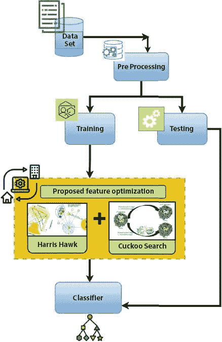

`图 4.1` 所提的研究方法论。

## 4.2 相关工作

Nanglia *et al.* 开发了一种包含三个基本组件的癌症分类技术。数据最初在第一个模块中进行预处理，接着使用 `SURF` 方法从第二个模块中提取特征。在第三个模块中，使用遗传算法对模型进行增强，并利用一种采用前馈和反向传播技术的神经网络对肿瘤进行分类。这种混合算法达到的整体分类准确率达到了惊人的 98.08% \[4]。

Sahu *et al.* 通过融合基于人工智能的学习策略与多变量统计方法创建了一个预测模型。该研究建议使用带有主成分分析（`PCA`）的人工神经网络（`ANNs`）来选择特征。使用 `PCA` 对数据进行预处理以确定最关键的属性。利用十折交叉验证的 `WBC Dataset`，建议的方法在敏感性方面表现出更高的精度 \[5]。

Motieghader *et al.* 使用遗传算法和学习自动机（`GALA`）提出了一种用于癌症分类的混合元启发式技术。在使用所选方法评估时，`GALA` 在每个数据集上的表现都优于某些新提出的算法 \[6]。

Shunmugapriya 和 Kanmani 创建了一种名为 `AC-ABC hybrid` 的独特方法，该方法将人工蜂群算法和蚁群算法的优点结合起来，以增强特征选择。根据实验结果，建议的方法旨在提高特征选择的效率和分类准确率 \[7]。

Jansi Rani M. 和 Devaraj 提出了一种名为 `MI-GA Gene Selection` 的独特两阶段方法，用于选择癌症分类的相关基因。第一阶段分析显示了与癌症相关的具有高度互信息的基因。在第二阶段，采用遗传算法选择一组能够准确分类癌症数据的基因。分类过程使用了支持向量机（`SVM`）。研究结果表明，所提的 `MI-GA` 方法在卵巢癌、肺癌和结肠癌数据集的分类准确率方面超过了现有技术 \[8]。

Elyasigomari *et al.* 开发了一种名为 `mRMR-COA-HS` 的两步基因选择技术。为了寻找重要的基因集，他们首先使用最小冗余最大相关策略。随后，他们采用了一种由支持向量机分类器和一种全新的和谐搜索优化技术（`COA-HS`）组成的封装器配置。该算法保证了分类准确度的最大程度 \[9]。

Jain *et al.* 设计了一种用于癌症分类的混合方法，将基于相关性的特征选择与改进的二值粒子群优化相结合。该模型利用 `naive Bayes` 分类器结合分层十折交叉验证对二性和多类恶性肿瘤生物样本进行分类。一致的是，结果显示在分类精度和所选基因数量方面，该模型的性能均优于其他七种成熟的策略 \[10]。

Shahbeig *et al.* 引入了一种用于识别与乳腺癌相关的关键基因的新型混合方法。他们的目标是发现能够达到最佳分类准确率、敏感性和特异性的最简基因集。为了实现这一点，他们将基于教学学习的优化（`TLBO`）技术与最近引入的变异自适应粒子群优化方法相结合。他们的方法产生了鼓舞的结果，在应用于乳腺癌检测微阵列数据时，检测准确率为 91.88%，敏感性为 90.55%，特异性为 93.33% \[11]。

Lu *et al.* 利用了一种特征选择混合方法，将互信息最大化（`MIM`）与自适应进化算法相结合。他们的实验结果表明，这种方法有效降低了基因表达数据的维度并消除了分类过程中的冗余。与传统的特征选择方法相比，他们生成的基因表达数据集达到了最高的准确率 \[12]。

Naeem *et al.* 利用机器学习算法实现了肝癌的精确诊断。他们整合了一个由二维 CT 图像和磁共振图像组成的数据集。通过应用十折交叉验证，他们评估了多层感知器（`MLP`）、支持向量机、随机森林（`RF`）和 `J48` 分类器的性能。值得注意的是，`MLP` 分类器取得了巨大的成功，实现了 99% 的卓越准确率 \[13]。

Kharrat 和 Neji 使用模拟退火和遗传算法（`SA-GA`）技术生成最优特征子。通过采用两个用于脑肿瘤分析的磁共振成像数据集评估了该方法的有效性。将模拟退火和遗传算法等先进方法进行了对比。结果显示，单独使用 `SAGA` 优于这些方法且计算速度更快。胶质瘤的分割准确率分别为 97.82% 和 0.74%，垂体膜瘤分别为 95.12% 和 3.21%，分析表明所提方法优于领先技术 \[14]。


Stephan *et al.* 开发了一种人工蜂群算法的混合算法，该算法将鲸鱼优化算法的泡网攻击策略与人工蜂群算法的开发性蜜蜂阶段相结合，形成了人工蜂群与鲸鱼优化算法（HAW）。`HAW` 算法的探索阶段由变异初始化步骤组成，改进了标准 `ABC` 方法有限的探索能力。在 `ANN` 模型背景下，`HAW` 技术被用于同时选择特征和优化参数。为了创建 `HAW` 的混合版本，引入了三种反传播学习算法（Levenberg–Marquart、鲁棒反传播和基于动量的梯度下降），生成了 `HAW-LM`、`HAW-RP` 和 `HAW-GD`。这些混合变体的有效性通过与乳腺癌相关的数据集（包括 `WBCD`、`WDBC`、`WPBC`、`DDSM`、`MIAS` 和 `IN-breast`）根据准确率、复杂性和处理时间进行了评估。其中，利用低复杂度 `ANN`模型的 `HAW-RP` 变体实现了最高的准确率，在各自数据集上的值分别为 99.2%、98.5%、96.3%、98.8%、98.7% 和 99.1% [16]]。

Khamparia *et al.* 在对乳腺癌的研究中，重点关注了迁移学习过程。他们将改进版本的视觉几何组（`VGG`）（`MVGG`应用于包含 2D 和 3D 乳腺摄影的数据集上。根据其研究结果，结合 `MVGG` 与 `ImageNet` 的建议混合迁移学习模型的准确率为 94.3%。单独研究的 `MVGG` 设计准确率为 89.8%。因此，推荐的混合预训练网络优于以前类似设计的卷积神经网络（`CNNs`）。作者对这些发现进行了详细的解释 [17]]。

Shukla *et al.* 开发了一个名为 `CMIMAGA` 的独特混合框架，用于从基因表达数据中提取重要指示。该方法结合了自适应遗传算法和条件互信息最大化（`CMIM`）。该方法采用包装器方法作为简单的过滤器，随后使用 `CMIM` 方法作为第二个过滤器以排除多余基因。下一步是使用自适应遗传算法选择具有高度判别性的基因，以可靠地诊断肿瘤和恶性肿瘤。系统使用分类器来选择这些基因。为了评估所提方法的有效性，使用了六个常用的微阵数据集，并结合了三种分类器：极值学习机、支持向量机和 K-最近邻（`KNN`）用于比较。实验结果显示，使用 `ELM` 的建议方法优于早期的过滤和包装器技术，并以更少的基因实现了更高的分类准确率 [18]]。

为了使用人工神经网络对高维微阵数据进行分类，Aziz R. *et al.* 开发了一种独特的特征选择和提取方法。该策略使用人工蜂群（`ABCs`）作为优化技术，并将独立成分分析（`ICA`）作为提取方法。通过将 `ICA + ABC` 方法与单独的 `ICA` 和 `ABC` 进行对比，并在六个基因表达微阵数据集上运行严格测试，该研究评估了该程序的有效性。将建议的方法与以前基于 `ICA` 的启发式算法以及著名的过滤策略在分类准确率和所选基因数量进行比较，它优于当前的技术。研究结果表明，`ICA + ABC` 算法提高了 `ANN` 分类器的分类准确率，使其成为基因选择和癌症分类领域中解决微阵数据问题的潜在方法 [19]]。

Kilicarslan *et al.* 利用三个微阵数据集进行了调查：卵巢、白血病和中枢神经系统（`CNS`）。他们采用自动编码器进行降维，并使用支持向量机和卷积神经网络进行分析。白血病数据集包含 72 个样本、7129 个基因和两类，而卵巢和 `CNS` 数据集也包含 60 个样本、7129 个基因和两类。在不进行降维的情况下，卵巢数据集的准确率为 96.14，白血病数据集为 94.83，CNS 数据集为 65，`SVM` 表现出良好的性能。所提混合 `CNN` 在卵巢、白血病和 `CNS` 数据集上的相应准确率为 98.6、99.8 和 83.95 [20]]。

Melekoodattu 和 Subbian 建议利用极值学习机（`ELMs`）结合果蝇优化算法（`ELM-FOA`）来修改输入权重。目标是实现隐藏层的最佳配置。在 `ELM` 测试期间，`FOA` 的感知和完善分别为 97.5 和 100。通过利用的预处理和分割技术，结合各种过滤器的特征并利用鲁棒分类器，该方法显示癌症识别准确率达到 99.04% [21]]。

Keerthana *et al.* 开发了两种新型 `CNN-SVM` 混合模型用于将皮肤镜图像分类为良性或恶性病变。特征由初级和二级 `CNN` 模型提取，然后合并并送入 `SVM` 分类进行分类。通过专家标注评估了所提方法的有效性。使用 `ISBI 2016` 数据集，建议的模型优于当前的 `CNN` 模型，准确率分别为 88.02% 和 87.43% [22]]。

文献综述得出结论，结合哈里斯鹰优化的蜂群搜索 `CSAHHO` 尚未用于癌症分类。填补这一空白是建议研究的主要目标。值得注意的是，尽管蜂群搜索算法是一种有效方法，但它存在收敛缓慢和局部停滞的问题。虽然 `HHO` 在获取全局最优方面更好，但在某些情况下可能会出现收敛问题。此外，根据无免费定理（`NFL`）概念，没有一种方案可以解决所有优化问题。提出的混合算法正是为此目标开发的。

 4.3 建议的方法

本文介绍的方法涉及几个关键步骤，包括数据收集、数据预处理、特征选择、模型训练、评估、改进和最终测试。第一步是从各种来源收集相关数据，然后对数据进行清洗、标准化和转换，以适用于分析。然后进行特征选择，以识别应纳入模型的最关键特征。完成后，选择一种混合算法利用数据训练机器学习模型。随后，在独立的验证集上对训练后的模型进行评估，并根据结果进行必要的修改。为了评估模型的泛化能力，将在另一个测试集上进行测试。通过遵循建议的方法，本文旨在构建一个能够有效解决问题的稳健准确的模型。

### 4.3.1 蜂群搜索算法


杜鹃的繁殖习为计算机科学中使用的优化方法提供了灵感。该策略利用一种名为`Levy flying`（莱维飞行）的策略，来取代范围广泛且模式不可预测的随机移动，后者会导致现有位置发生大幅偏移 [23, 24]。为了确保后代的生存，杜鹃将蛋产在其他鸟的巢中，导致宿主鸟像对待自己的孩子一样抚养杜鹃雏 [25, 26]。

### 概念

- **寄生繁殖**：利用他巢作为自己的巢，将蛋隐藏在那里，然后依靠宿主鸟抚养后。
- **宿主鸟**：巢的所有者，负责抚养和喂养杜鹃雏。
- **寄生鸟**：在宿主巢中产蛋的鸟类。
- **莱维飞行**：莱维飞行是一种物理现象，其阶段长度遵循具有显著长尾的概率分布，即莱维分布。莱维分布用于按照下述方式调节莱维飞行的转移动机会：

对于 $1 < \lambda \le 3$

(4.1)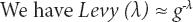<math display="block" overflow="scroll"><mtext>We&#x00A0;have&#x00A0;</mtext><mi>L</mi><mi>e</mi><mi>v</mi><mi>y</mi><mrow><mo>(</mo><mi>&#x03BB;</mi><mo)mo></mrow><mo>&#x2248;</mo><msup><mi>g</mi><mrow><mo>&#x2212;</mo><mi>&#x03BB;</mi></mrow></msup></math>

从实现角度来看，使用莱维飞行生成随机数的过程包括两个部分：

1. 基于均匀分布的随机方向选择
2. 遵循所选莱维分布的决策

- **随机游走**：一种随机过程，描述了在某些数学空间（如整数的 1D、2D 或 nD）上由随机方向的一系列离散恒长步组成的路径。

### 随机游走方程

(4.2)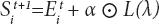<math display="block" overflow="scroll"><msubsup><mi>S</mi><mi>i</mi><mrow><mi>t</mi><mo>+</mo><mn>1</mn></mrow></mtext><mo>=</mo><msubsup><mi>E</mi><mi>i</mi><mi>t</mi></mtext><mo>+</mo><mi>&#x03B1;</mi><mo>&#x2299;</mo><mi>L</mi><mrow><mo>(</mo><mi>&#x03BB;</mi><mo)mo></mrow></math>

where 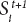<math display="inline" overflow="scroll"><msubsup><mi>S</mi><mi>i</mi><mrow><mi>t</mi><mo>+</mo><mn>1</mn></mrow></mtext></math> = 新解, 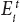<math display="inline" overflow="scroll"><msubsup><mi>E</mi><mi>i</mi><mi>t</mi></mtext></math> = 现有解, `α` = 步长, <math display="inline" overflow="scroll"><mo>&#x2299;</mo></math> = 乘因子, `L(λ)` = 莱维指数。

基础杜鹃搜索算法基于这些准则开发。在寻找新解的同时控制局面至关重要。以随机游走为特征的莱维飞行有助于防止导致超出搜索区域的大范围移动。每一步的大小由问题的规模决定，可以通过引入`Lévy flight`来实现。探索使用飞行进行优化是一个引人入胜的话题。为了方便使用，正如作者建议的那样，采用了`0.01` 的常用步因子。

### 4.3 哈里斯鹰

哈里斯鹰原产于美国南部，由于其习性被认为是最智能的鸟类之一。与大多数单独狩猎和进食的鸟类不同，它们是群体活动。et al. 创建了一种名为 `HHO` 的算法来模仿哈里斯鹰的行为。`HHO` 使用两种策略：探索和开发。`HHO` 算法用于探索搜索空间并寻找最优解。`HHO` 算法在解决复杂问题方面特别有效。


(4.4)![images/eq4-4.png)
```math
<math display="block" overflow="scroll"><msub{T}{m}(H)=\frac{1}{PS}\sum_{i=1}^{PS}T(H)</math></math>
```

当考虑逃逸兔子的能量级 (`E`) 时，HHO 算法从探索阶段过渡到开发阶段。这种过渡符号如下：

(4.5)![images/eq4-5.png)
```math
<math display="block" overflow="scroll">E=2E_{0}(1-H/Max-IT)</math></math>
```

其中 `E0` 是兔子（即猎物）的初始能量状态，使用 `[-1, 1]` 范围随机产生，`Max IT` 是允许的最大迭代次数。当 `|E| > 1` 时，猎鹰会在更多区域内寻找其猎物的位置。根据此，HHO 发现过程的开发阶段在 `|E| < 1` 时开始。

HHO 用于在猎鹰意外出袭之前规划兔子的逃跑路线。让 `n` 代表兔子在猎鹰意外扑袭之前成功逃逸 (`n < 0.5`) 或逃逸 (`n >= 0.5`) 的可能性。猎鹰根据受害者是否能够成功逃逸来使用软性或严猛的围攻。柔性围攻在公式 4.6–4.8 中描述，并在 `|E| >= 0.5` 时发生。

(4.6)![images/eq4-6.png)
```math
<math display="block" overflow="scroll">T(H+1)=\Delta T(H)-E|J\times T_{rabbit}(H)-T(H)|</math></math>
```
(4.7)![images/eq4-7.png)
```math
<math display="block" overflow="scroll">\Delta T(H)-E|J\times T_{rabbit}(H)-T(H)|</math></math>
```
(4.8)![images/eq4-8.png)
```math
<math display="block" overflow="scroll">J=2^{rd}</math></math>
```
其中 `J` 是兔子的功率，`rd` 是一个随机变量。4.9![images/eq4-9.png)
```math
<math display="block" overflow="scroll">T(H+1)=K|\Delta T(H)|</math></math>
```
HHO 方法利用莱维飞行 (`FL`) 原理对猎物的快速跳跃进行建模，这发生在 `|E| >= 0` 且 `n < 0.5` 的情况下。猎鹰俯冲成功或失败的能力由以下公式衡量：

(4.10)![images/eq4-10.png)
```math
<math display="block" overflow="scroll">Y=E|J\times T_{rabbit}(H)-T(H)|</math></math>
```
当公式 4.10 中的俯冲失败时，猎鹰将根据公式 4.11 执行基于莱维飞行的俯冲。

(4.11)![images/eq4-11.png)
```math
<math display="block" overflow="scroll">Z=Y+W+Ly(Pdim)</math></math>
```
其中 `W` 是随机变量，`Pdim` 代表问题维度。莱维飞行函数 `Ly` 的计算方法如下：


(4.12)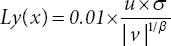<math display="block" overflow="scroll"><mi>L</mi><mi>y</mi><mrow><mo>(</mo><mi>x</mi><mo>)</mo></mrow><mo>=</mo><mn>0.01</mn><mo>&#x00D7;</mo><mfrac><mrow><mi>u</mi><mo>&#x00D7;</mo><mi>&#x03C3;</mi></mrow><mrow><msup><mrow><mrow><mo>|</mo><mi>v</mi><mo>|</mo></mrow></mrow><mrow><mn>1</mn><mo>/</mo><mi>&#x03B2;</mi></mrow></msup></mrow></mfrac></math> (4.13) 

(4.13)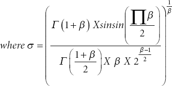<math display="block" overflow="scroll"><mi>w</mi><mi>h</mi><mi>e</mi><mi>r</mi><mi>e</mi><mtext>&#x00A0;</mtext><mi>&#x03C3;</mi><mo>=</mo><msup><mrow><mo>(</mo><mrow><mfrac><mrow><mi>&#x0393;</mi><mrow><mo>(</mo><mrow><mn>1</mn><mo+</mo><mi>&#x03B2;</mi></mrow><mo>)</mo></mrow><mi>X</mi><mi>s</mi><mi>i</mi><mi>n</mi><mi>s</mi><mi>n</mi><mrow><mo>(</mo><mrow><mfrac><mrow><mstyle displaystyle="true"><mo>&#x220F;</mo><mi>&#x03B2;</mi></mstyle></mrow><mn>2</mn></mfrac></mrow><mo>)</mo></mrow></mrow><mrow><mi>&#x0393;</mi><mrow><mo>(</mo><mrow><mfrac><mn>1</mn><mo>+</mo><mi>&#x03B2;</mi></mrow><mn>2</mn></mfrac></mrow><mo>)</mo></mrow><mi>X</mi><mi>&#x03B2;</mi><mi>X</mi><msup><mn>2</mn><mrow><mfrac><mrow><mi>&#x03B2;</mi><mo>&#x2212;</mo><mn>1</mn></mrow><mn>2</mn></mfrac></mrow></msup></mrow></mfrac></mrow><mo>)</mo></mrow><mrow><mfrac><mn>1</mn><mi>&#x03B2;</mi></mfrac></mrow></msup></math>

其中`β`是一个值为 1.5 的常数，`u`和`v`是范围为`[0, 1]`的随机变量。公式 4.10 和 4.11 用于计算本次俯冲猎鹰位置的最后步骤。

(4.14)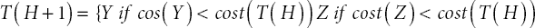<math display="block" overflow="scroll"><mi>T</mi><mrow><mo>(</mo><mrow><mi>H</mi><mo>+</mo><mn>1</mn></mrow><mo>)</mo></mrow><mo>=</mo><mrow><mo>{</mo><mrow><mi>Y</mi><mtext>&#x00A0;</mtext><mi>i</mi><mi>f</mi><mtext>&#x00A0;</mtext><mi>c</mi><mi>o</mi><mi>s</mi><mrow><mo>(</mo><mi>Y</mi><mo>)</mo></mrow><mo>&#x003C;</mo><mi>c</mi><mi>o</mi><mi>s</mi><mrow><mo>(</mo><mi>T</mi><mo>+</mo><mi>H</mi><mo>)</mo></mrow><mo>)</mo></mrow><mi>Z</mi><mtext>&#x00A0;</mtext><mi>i</mi><mi>f</mi><mtext>&#x00A0;</mtext><mi>c</mi><mi>o</mi><mi>s</mi><mrow><mo>(</mo><mi>Z</mi><mo>)</mo></mrow><mo>&#x003C;</mo><mi>c</mi><mi>o</mi><mi>s</mi><mrow><mo>(</mo><mi>T</mi><mo>+</mo><mi>H</mi><mo>)</mo></mrow><mo>)</mo></mrow></mo>}</mrow></mrow></math>


K-最近邻（KNN）是一种简单且有效的分类算法，用于二分类和多分类两类任务 [29]。KNN 算法的运行原理涉及在特征空间内识别与输入点最近的 `k` 个数据点，并将这 `k` 个点中出现频率最高的类别标签分配给输入点。`k` 的值是一个超参数，必须经过调整以获得最佳性能。KNN 的显著优势是其非参数特性，这意味着它不依赖于对底层数据分布的假设。然而，KNN 面临着数灾咒的挑战，因为其计算复杂度随着特征数量的增加而提高 [30, 31]。

### 4.3.4.2 SVM 分器

支持向量机是机器学习中广泛使用且具有影响力的分类算法。SVM 通过寻找最佳超平面将数据点划分为不同的类别来工作 [32]。选择该超平目的是为了最大化间隔（margin），间隔代表超平面与每个类别最近点之间的距离。通过使用内核技巧，SVM 能够将输入数据转换到高维特征空间，从而能够对原始空间中不可线性可的数据进行线性分离。此外，SVM 对过拟合具有鲁棒性，即使在处理高维数据时也能表现出高效的性能 [33–35]。

### 4.3.4.3 NB 分器

在涉及文本分类场景中，可以使用朴素贝叶斯（NB）这种简单快速的算法。朴素贝叶斯算法基于贝叶斯定理的原理，并假设在给定类别标签的情况下，特征之间是条件独立的。NB 在计算出给定输入数据的每个类别的后验概率后，将具有最高概率的类别赋予给输入数据。NB 是一种计算高效的算法，在训练数据较少的情况下表现良好。相比之下，朴素贝叶斯假设特征独立性，这在现实中可能并不成立，并可能导致特定数据集上的性能欠佳 [36]。

### 4.3.4.4. mRMR

名为 mRMR（或最小冗余最大相关）的特征选择技术在机器学习中经常采用。除了减少所选特征之间的冗余外，特征选择的目标是识别与目标变量具有高相关性的特征子集。Peng *等人* [49] 于 2005 年引入了 mRMR 算法，从以来作为一种特征选择技术受到了关注。相关性和冗余是该算法的两个关键要求。冗余准则评估所选特征之间的重叠程度，而相关性准则评估特征相对于目标变量所包含的信息量 [37]。mRMR 算法利用相关性和冗余评分对特征进行排序。特征的相关性得分通过计算其与目标变量之间的互信息来确定。在这种情况下，它评估了特征为目标变量提供了多少知识。互信息量化了两个变量之间的依赖关系。特征的冗余得分通过测量特定特征与所有其他已选特征之间的平均互信息计算得出。冗余得分计算了所选特征之间的相互重叠程度。在特征根据其相关性和冗余得分进行排序后，算法在最小化它们之间冗余的同时选择相关性得分最高的特征。这是通过逐渐将特征添加到所选集合中，并定期评估集合的冗余水平来实现。如果冗余得分大于给定的阈值，算法将停止积累特征并返回所选集合 [38]。已经证明，mRMR 算法在文本分类和基因表达分析等许多应用中优于其他特征选择技术。然而，至关重要的是算法的成功取决于具体的应用以及对冗余得分的的选择 [39]。结论是，mRMR 是一种平衡相关性和冗余的广为认可的方法。

## 4.4 实验设置

在这项工作中，我们寻求通过六个高维数据集研究该系统的潜力。研究关注了用于二分类的基因表达，包括结肠癌、急性白血、前列腺癌、高级胶质瘤和肺癌 II，数据采集自 `datam.i2r.edu.sg/datasets/krbd/index.html`。这些数据集的所有细节和特征见表 4.1](#c04.xhtml#tab4-1)。

**表 4.1** 六癌症数据集的信息

| 数据集 | 类别 | 基因 | 类别平衡 | 样本数量 | 简描述 |
| --- | --- | --- | --- | --- | --- |
| 结肠癌 | 2 | 2000 | (22\\40) | 62 | 直肠癌是指在结肠或直肠中形成癌细胞。这种癌症可以通过一系列症状识别，包括粪中带血、排便习惯改变、体重减轻和疲劳。 |
| 急性白血 | 2 | 7129 | (47\\25) | 72 | 急性白血病是一组与白血病诊断相关的严重症状，根据性细胞的髓系或淋巴系进行分类。ALL 和 AML 是两个类别。 |
| 前列腺肿瘤 | 2 | 12600 | (50\\52) | 102 | 前列腺癌是男性腺体癌，发育缓慢或侵进，需要监测或其他治疗。 |
| 高级胶质瘤 | 2 | 12625 | (28\\22) | 50 | 高级胶质瘤是影响各年龄段人的快速生长脑肿瘤，包括胶质母瘤和畸形少胶质瘤。 |
| 肺癌 II | 2 | 12533 | (31\\150) | 181 | 受影响肺附近的淋巴结含有癌细胞，肿瘤大小达 5 厘米。此外，肺部可能是完全或部分塌陷或炎症，癌症可能扩散主气道并覆盖肺部的膜层。恶性胸膜间皮瘤和肺腺癌组织样本。 |


| 白血病 2 || 3 || 7,129 || (28\\24\\20) || 72 || 白血病是一种影响血液的癌症，特征是异常血细胞的快速生长。这种异常生长主要发生在骨髓中，骨髓负责产生人体的大部分血液。白血病细胞通常是未成熟或发育不完全的白细胞。白血病 2 数据集包含 28 个 28 AML 类样本、24 个 ALL 样本和 20 个 MLL 样本。 |

### 4.4.1 对比算法

本研究提出的 `CSAHHO` 算法与其他三种方法进行了对比：`mRMR`、`mRMR+CSA` 和 `mRMR+HHO`。此外，还研究了结合了两种方法的混合方法 `mRMR+CSAHHO` 并对其进行了比较测试。比较是基于 `CSAHHO` 算法的特征进行的。为了评估每种方法的有效性，通过各自方法选择的基因来获取分类结果。

- `mRMR`：通过 `mRMR` 选择方法选定的基因实现分类结果。
- `mRMR+CSA`：通过 `mRMR+CSA` 选择过程选定的基因得出分类结果。
- `mRMR+HHO`：通过 `mRMR+HHO` 方法选定的基因得出分类结果。
- `mRMR+CSAHHO`：通过使用混合方法 `mRMR+CSAHHO` 选择的基因得出分类结果。

### 4.4.2 参数设置

下表（表 4.2）展示了所提技术 `HHOCSA` 在实验实现中使用的参数。为了确保比较公平，基因选择过程涉及每种基因选择方法都选择了由 `mRMR` 识别的相同排名靠基因。

**适应度函数：**通过使用 `SVM`、`KNN` 和 `NB` 分类器的分类准确率来评估所提方法的有效性。当当前适应度值超过之前的值时，丢弃之前的结果并替换为当前结果。然而，如果当前适应度值没有更好，则保留之前的方案。最终选择适应度值最高的基因子集作为预测的最优方案。适应度函数（`fit`）定义如下：

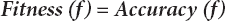
```math
<math display="block" overflow="scroll"><mi>F</mi><mi>i</mi><mi>t</mi><mi>n</mi><mi>e</mi><mi>s</mi><mi>s</mi><mrow><mo>(</mo><mi>f</mi><mo>)</mo></mrow><mo>=</mo><mi>A</mi><mi>c</mi><mi>c</mi><mi>u</mi><mi>r</mi><mi>a</mi><mi>c</mi><mi>y</mi><mrow><mo>(</mo><mi>f</mi><mo>)</mo></mrow></math>
```
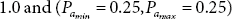 表 4.2 所提算法的参数设置。

## 4.5 结果与讨论

我们将所提算法与三种最常用的分类器应用于癌症分类。第 4.5 节 第 4.5 节 展示了使用 `SVM` 分类器的实验结果，使用 `NB` 分类器的实验结果，以及使用 `KNN` 分类器的实验结果。

### 4.5.1 所提算法在 SVM 下的实验结果

表 4.3 对各种数据集和基因选择算法的 5 折和 10 折交叉验证进行了综合分析。平均值及其相应的标准差说明了各组合的表现。值得注意的是，仅依赖 `mRMR` 算法的基因选择产生了更高的准确率。在所有基因选择方法中，`mRMR+CSAHHO` 组合脱颖而出，在不同数据集上获得了 92% 到 100% 的高准确率。这一有力的证据表明，将基因选择技术整合到模型中增强了其预测能力，提供了宝贵的见解。

所提算法结合 `mRMR`、`mRMR+CSA` 和 `mRMR+HHO` 在 5 折和 10 折交叉验证下的准确率如下：

| | 5 折交叉验证 | 10 折交叉验证 |
| :--- | :--- | :--- | :--- | :--- | :--- |
| | `mRMR+CSA` | `mRMR+HHO` | `mRMR+CSAHHO` | `mRMR+CSA` | `mRMR+HHO` |
| 数据集 | `Mean(±STD)` | `(±STD)` | `(±STD)` | `(±STD)` | `(±STD)` | `(±STD)` |
| 结肠癌 | 83.2 ± 5.19 | 95.5 ± 4.90 | 93.6 ± 3.80 | 97.7 ± 1.99 | 91.1 ± 3.97 | 100 ± 0 |
| 急性白血病 | 82.2 ± 6.29 | 83.5 ± 5.21 | 88.5 ± 3.65 | 91.0 ± 6.17 | 91.1 ± 3.76 | 93.4 ± 2.89 | 96.3 ± 3.15 |
| 前列腺癌 | 82.03 ± 4.11 | 91.71 ± 2.09 | 93.4 ± 1.4 | 95.3 ± 3.09 | 92.7 ± 4.76 | 94.7 ± 2.65 | 99.9 ± .01 |
| 高级胶质质瘤 | 83.2 ± 4.77 | 84.71 ± 3.99 | 88.71 ± 3.19 | 92.32 ± 3.44 | 91.23 ± 4.02 | 92.6 ± 2.05 | 96.54 ± .06 |
| 肺癌 II | 84.72 ± 5.98 | 92.53 ± 2.11 | 92.53 ± 2.11 | 96.52 ± 1.77 | 92.2 ± 4.45 | 94.2 ± 2.06 | 99.93 ± 11 |
| 白血病 2 | 84.45 ± 3.99 | 94.54 ± 2.17 | 94.54 ± 2.17 | 97.42 ± 1.99 | 94.9 ± 0.8 | 96.1 ± 1.2 | 100 ± 0 |


本分析中提供的雷达图展示了三种算法：`mRMR+CSA`、`mRMR+HHO` 和 `mRMR-R+CSAHHO` 观察到的方差。这些算法使用了六个微基癌症数据集进行评估。雷达曲线说明了每个算法基于方差的性能。在图中，曲线下方面积的大小表示算法的性能水平。曲线面积越大，表示准确检测和分类不同类别的能力越差。图中的图 4.4 关注所有三个算法使用 `SVM` 分类器实现的方差。`mRMR+CSA`算法由迷人的蓝色表示，而`mRMR+HHO`算法用鲜艳的橙色描述。`mRMR+CSAHHO`算法以其绿色脱颖而出。注意的是，曲线下面积最大的算法性能越低。

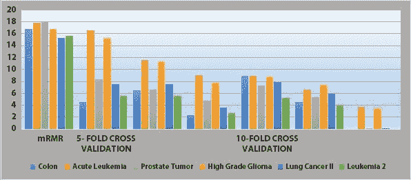

`图 4.3` 与 SVM 分类器的误差比较。

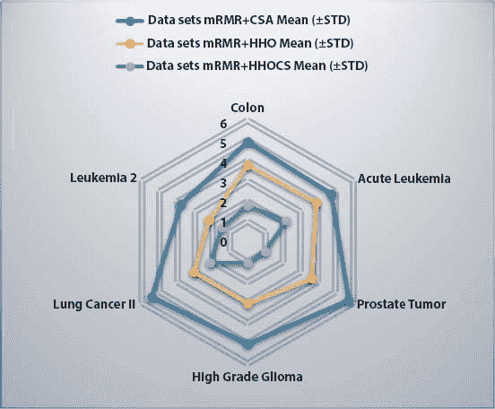

`图 4.4` 所提算法 (`mRMR+CSAHHO`) 与 `mRMR+CSA` 和 `mRMR+HHO` 算法在使用 SVM 分类器时观察到的方差。

### 4.5.2 所提算法在使用 KNN 分类器时的实验结果

表 4.4 表示了各种机器学习模型在使用 5 折交叉验证和 10 折交叉验证技术在不同数据集上的性能。数据集包括结肠、急性白血病、前列腺肿瘤、高级胶质质瘤、肺癌 II 型和白血病 2，而模型包括 `mRMR`、`mRMR+CSA`、`mRMR+HHO` 和 `mRMR+CSAHHO`。表中列出了带有标准差的平均值。结果显示，在大多数情况下，`mRMR` 与 `CSAHHO` 的结合比单独使用 `mRMR` 或与其他模型结合提供了更好的结果。例如，在结肠数据集上，`mRMR` 与 `CSAHHO` 的结合实现了 97.6% 的最高准确率，标准差为 2.3%，而单独使用 `mRMR` 的准确率为 74.9%，标准差为 5.31%。同样，在白血病 2 数据集上，`mRMR` 与 `CSA` 的结合实现了 96.76% 的最高准确率，标准差为 1.59%，而单独使用 `mRMR` 的准确率为 76.82%，标准差为 4.56%。此外，使用 10 折交叉验证通常比比使用 5 折交叉验证产生更高的平均值。例如，使用 10 折交叉验证时，肺癌 II 型数据集中 `mRMR` 与 `CSAHHO` 的组合产生的平均准确率为 97.2%，标准差为 1.23%，但在 5 折交叉验证下，准确率为 92.53%，标准差为 2.11%。结果表明，`mRMR` 和 `CSAHHO` 协同工作比其他模型更好，且使用 10 折交叉验证通常比使用 5 折交叉验证产生更高的平均值。

`表 4.4` 所提算法在使用 `KNN` 分类器时，结合 `mRMR`、`mRMR+CSA` 和 `mRMR+HHO` 在 5 折交叉验证和 10 折交叉验证技术下的准确率。

|  ||  | 5 折交叉验证 || 10 折交叉验证 |

| --- | --- | --- | --- |

|  ||  | mRMR+CSA || mRMR+HHO || mRMR+CSAHHO || mRMR+CSA || mRMR+HHO || mRMR+CSAHHO |
| 数据集 || mRMR | 平均(±STD) || 平均(±STD) || 平均(±STD) || 平均(±STD) || 平均(±STD) |
| Colon | 74.9% ± 5.31% | 97.6% ± 2.3% | 95.5% ± 3.9% | 92.5% ± 2.1% | 91.7% ± 2.3% | 99.2% ± 1.0% |
| Acute leukemia | 77.2% ± 6.75% | 91.1% ± 2.02% | 87.4% ± 3.15% | 92.7% ± 2.09% | 93.7% ± 2.76% | 9..3%  1.5% |
| Prostate tumor | 76.82% ± 4.56% | 88.4% ± 3.9% | | | | |
| High-grade glioma | 78.4% ± 5.37% | 92.3% ± 2.02% | 91.1% ± 3.76% | 96.3% ± 1.99% | 98.7% ± 1.15% | 99.9% ± 0.1% |
| Lung cancer II | 92.53% ± 2.11% | 97.2% ± 1.23% | | | | |
| Leukemia 2 | 96.76% ± 1.59% | 76.82% ± 4.56% | | | | |


| 数据集 | mRMR | 平均(±标准差) | 平均(±标准差) | 平均(±标准差) | 平均(±标准差) | 平均(±标准差) | 平均(±标准差) |
| :--- | :--- | :--- | :--- | :--- | :--- | :--- | :--- |
| 结肠癌 | 88.4 ± 5.19 | 90.16 ± 2.02 | 93.8 ± 2.56 | 95.7 ± 1.97 | 92.7 ± 3.02 | 94.4 ± 1.17 | 100 ± 0.09 |
| 急性白血病 | 84.4 ± 5.22 | 84.16 ± 2.19 | 86.4 ± 6.34 | 89.3 ± 2.25 | 92.7 ± 3.01 | 95.3 ± 2.29 | 99.9± 1.01 |
| 前列腺癌 | 88.3 ± 3.23 | 86.5 ± 1.76 | 88.4 ± 2.33 | 91 ± 2.88 | 91.1 ± 2.51 | 93.9 ± 3.34 | 96.3 ± 2.08 |
| 高级胶质质瘤 | 85.6 ± 5.22 | 85.31 ± 3.24 | 88.34 ± 3.76 | 90.37 ± 3.34 | 92.83 ± 4.32 | 96.33 ± 2.67 | 100 ± 1.2 |
| 二期肺癌 | 90.72 ± 4.56 | 92.33 ± 2.33 | 94.45 ± 4.23 | 95.72 ± 1.22 | 95.7 ± 2.25 | 98.7 ± 3.89 | 100 ± 1.70 |
| 白血病 2 | 90.38 ± 5.32 | 91.34 ± 2.11 | 94.56 ± 2.71 | 96.62 ± 1.7 | 94.71 ± 2.07 | 99.66 ± 2.87 | 100 ± 1.10 |

图 4.7 对应用于微阵列癌症数据集的不同分析方法所获得的错误率进行了全面比较。重点在于评估 `mRMR` 算法与两种常用的交叉验证技术（5 折交叉验证和 10 折交叉验证）相比的性能。图还展示了分析中使用的三种不同算法的性能结果。值得注意的是，从图中可以明显看出，使用 `NB` 分类器的 10 折交叉验证方法的错误率最低。

图 4.8 描述了使用 `NB` 分类器的三个算法的方差。这种描述进一步突显了每个算法不同的性能特征，并有助于理解它们的优势和局限性。总体而言，雷达图及其数据直观地展示了 `mRMR+CSA`、`mRMR+HHO` 和 `mRMR+CSAHHO` 算法在应用于不同分类器时的变化。为了在癌症研究和诊断中实现检测和分类，在为某些癌症数据集选择最佳算法时，这些信息至关重要。

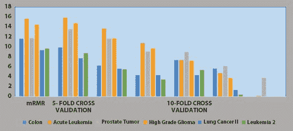

图 4.7 与 NB 分类器的错误比较。

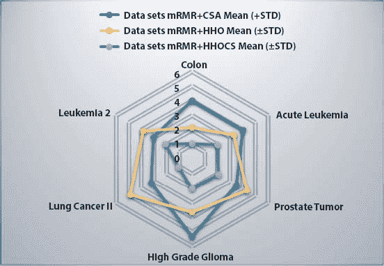

图 4.8 使用 SVM 分类器时，所提算法 (mRMR+CSAHHO) 与 mRMR+CSA 和 mRMR+HHO 算法相比的观测方差。

### 4.5.4 所提算法与其他近期发表的热门癌症分类算法的比较

表 4.6 显示了已算法与所提算法的准确率比较。根据结果，在三种方法中，`CSAHHO` 算法是针对给定问题的最佳且最高效的方法。`CSA` 的平均性能最低，表明它没有成功优化问题。尽管 `HHO` 算法性能优于 `CSA`，但它没有 `CSAHHO` 有效。值得强调的是，三种方法在不同测试中均表现出差异，表明算法的性能可能会受到解决问题的具体实例的影响。为了更全面地了解性能，在不同的问题背景下比较算法至关重要。标准差值表明，每个算法在不同实验中的性能差异显著。这表明算法性能可能对问题实例或输入参数的变化敏感。

表 4.6 已发表方法与所提方法的比较。

| 方法 | 结肠癌 | 前列腺癌 | 高级胶质质瘤 | 二期肺癌 | 白血病 2 |
| :--- | :--- | :--- | :--- | :--- | :--- |
| GWO + SVM | | | | |
| DL + DIP | | | | |
| SCLB | | | | |
| S+CLB | | | | |
| NN+CT | | | | |
| ICA + ABC | | | | |
| FHTWS | | | | |
| CNN + ECA+V16 | | | | |
| 所提方法 | | | | |

## 4.6 结论

本研究调查了三种特征识别和分类方法的有效性。结果表明，对于特定任务，`CSAHHO` 方法最佳。然而，需要在不同的数据集上进行进一步的实验以验证其泛化性和可扩展性。这项工作为该领域提供了知识，并有助于癌症分类算法的发展。

所提算法的泛化性和可扩展性在未来需要通过对各种癌症数据集进行测试和评估来实现。在特征选择和分类中应用额外的混合算法或机器学习技术可能会带来额外收益。为了提高分类过程的精度和效率，可以引入深度学习模型或集成学习技术。研究人员还可以探索该方法在癌症选择以外领域的应用。最后，开发实现该算法的用户友好软件工具可以使其更容易被医疗领域的研究人员使用。

## 参考文献

1. Tefferi, A. *et al.* 2008 年世界卫生组织骨髓增生性疾病分类系统：混沌中的秩序。*Cancer*, 115, 17, 3842–3847, 2009, doi: 10.1002/cncr.2440.
2. Kourou, K. *et al.* 机器学习在癌症预后和预测中的应用。*Comput. Struct. Biotechnol. J.*, 13, 8–17, 2015, doi: 10.1016/j.csbj.2014.11.005.
3. Nakariyakul, S., 一种基于相互信息的微阵列癌症分类的混合基因选择算法。*PLoS One*, 14, 2, e0212333, 2019, doi: 10.1371/journal.pone.0212333.


4. Nanglia, P. *等*, 一种基于 `SVM` 和神经网络的肺癌分类混合算法。*ICT Express*, 7, 3, 335–341, 2021, doi: 10.1016/j. icte.2020.06.007.

5. Sahu, B., Mohanty, S., Rout, S., 一种用于乳癌分类与诊断的混合方法。*EAI Endorsed Trans. Scalable Inf. Syst.*, 6, e2, 2018.

6. Motieghader, H. *等*, 一种利用遗传算法和学习自动机的微阵芯片癌症分类混合基因选择算法。*Inform. Med. Unlocked*, 9, 246–254, 2017, doi: 10.1016/j.imu.2017.10.004.

7. Shunmugapriya, P. 和 Kanmani, S., 一种利用蚁群和蜜群优化算法进行特征选择与分类的混合算法 (`AC-ABC Hybrid`)。*Swarm Evol. Comput.*, 36, 27–36, 2017, doi: 10.1016/j.swevo.2017.04.002.

8. Jansi Rani, M.J. 和 Devaraj, D., 一种利用互信息和遗传算法用于癌症数据分类的两阶段混合基因选择。*J. Med. Syst.*, 43, 8, 235, 2019, doi: 10.1007/s10916-019-1372-8.

9. Elyasigomari, V. *等*, 一种结合新型胶布鸟优化算法和和谐搜索的癌症分类混合方法的两阶段基因选择方法。*J. Biomed. Inform.*, 67, 11–20, 2017, doi: 10.1016/j.jbi.2017.01.016.

10. Jain, I. *等*,, 基于基因选择和癌症分类的相关性特征选择改进二元粒子群优化算法。*Appl. Soft Comput.*, 62, 203–215, 2018, doi: 10.1016/j.asoc.2017.09.038.

11. Shahbeig, S. *等*, 一种选择与乳癌相关基因的模糊多目标混合 TLBO-PSO 方法。*Signal Process.*, 131, 58–65, 2017, doi: 10.1016/j.sigpro.2016.07.035.

12. Lu, H. *等*, 一种用于基因表达数据分类的混合特征选择算法。*Neurocomputing*, 256, 56–62, 2017, doi: 10.1016/j. neucom.2016.07.080.

13. Naeem, S. *等*, 基于融合图像（MR 和 CT）用于肝癌分类的机器学习型混合特征分析。*Appl. Sci.*, 10, 9, 2020, doi: 10.3390/app10093134.

14. Kharrat, A. 和 Neji, M., 基于混合优化的磁共振成像脑肿瘤分类与分割的特征选择。*Appl. Med. Inform.*, 41, 9–23, 2019, 可访问于：`https://ami.info.umfcluj.ro/index.php/AMI/article/view/648`.

15. Zheng, Y. *等*, 一种基于鲸优化算法的新型特征选择混合算法。*IEEE Access*, 7, 14908–14923, 2019, doi: 10.1109/ ACCESS.2018.2879848.

16. Stephan, P. *等*, 一种带有鲸优化算法的混合人工蜂群，用于改进乳癌诊断。*Neural Comput. Appl.*, 33, 20, 13667–13691, 2021, doi: 10.1007/s00521-021-05997-6.

17. Khamparia, A. *等*, 基于混合迁移学习的现代乳腺摄影乳癌诊断。*Multidimens. Syst. Signal Process.*, 32, 2, 747–765, 2021, doi: 10.1007/s1045-0.

18. Shukla, A.K. *等*, 用于微阵列数据发现生物标志物的两阶段基因选择方法。*Chemol. Intell.*, 183, 47–58, 2018, doi: 10.1016/j.2018.

19. Aziz, R., 自然启发软计算技术在基因选择中的应用：一种新型框架。*Soft Comput.*, 26, 22, 12179–12196, 2022, doi: 10.1007/s0050-.

20. Kilicarslan, S. *等*, 基于卷积神经网络的癌症诊断。*Hypotheses.*, 137, 10957, 2020, doi: 10.1016/j.me.

21. Melekpattu, J. 和 Subbian, S., 使用极端学习机的自动基因检测。*J. Ambient Comput.*, 14, 5489–5498, 2023, doi: 10.339.

22. Keerth, D. *等*, 使用 `SVM` 的卷积神经网络皮肤癌分类。*Biomed. Eng.*, 5, 2023, doi: 10.1016/j.2022.

23. Dara, S. 和 Tumma, P., 用于深度学习的特征提取综述。*Int. J. Comput. Technol.*, 4, 17, 2014.

24. Fister, I. *等*, 胶布搜索算法用于癌症分类。*Future Gen. Comput. Syst.*, 97, 849–872, 2019, doi: 10.1016/j.future.

25. Kalita, K. *等*, 使用加权叠加优化算法对倾斜频率的选择。*Eng. Comput.*, 36, 2, 741, 2020, doi: 10.1007/s0036-.

26. Kalita, K. *等*, 关于倾斜频率的启发式算法的研究。*Soft Comput.*, 38, 4, 356, 2022, doi: 10.1007/s0050-.

27. Alabool, H.A. *等*, 鹰优化算法变体及其应用。*Neural Comput. Appl.*, 32, 15, 8939–8980, 2021, doi: 10.1007/s1045-.

28. Heidari, A.A. *等*, 鹰优化算法综述。*Future Gen. Comput. Syst.*, 97, 849, 2019, doi: 10.1016/j.future.

29. Shukla, S. 和 Naganna, S., 基于 `K-means` 数据聚类方法。*Int. J. Inf. Technol.*, 4, 17, 1847–1860, 2014.

30. Priadarshini, J. *等*, 用于特征选择的 `K-neighbor` 启发式算法分析。*Appl. Sci.*, 13, 2, 906, 2023, doi: 10.3390/app13.

31. Ganesh, N. *等*, 使用加权叠加优化算法的高效特征选择。*Appl. Sci.*, 13, 5, 3223, 2023, doi: 10.3390/app13.

32. Reddy, G.T. *等*, 大数据降维技术分析。*IEEE Access*, 8, 2020.

33. Bhattacharya, S. *等*, 复合材料性能的对比分析。*Mater. (Basel)*, 14, 21, 2021, doi: 10.3390/ma14.

34. Gayathri, R. *等*, 机器学习在砂浆强度预测中的对比分析。*Processes*, 10, 7, 2022, doi: 10.3390/pr10.

35. Narayanan, G. *等*, `PSO` 调优的支持机用于湍流评估。*Eng. Comput.*, 37, 5, 981–1001, 2019, doi: 10.1016/j.ec.

36. Aziz, R.M., 自然启发软计算在基因选择中的应用：一种新型框架。*Soft Comput.*, 26, 22, 12179–12196, 2022, doi: 10.1007/s0050-.


42. 42. Ali, M. and Ali, R., 用于改进肺癌和结肠癌分类的多输入双流胶囊网络*Diagnostics (Basel)*, 11, 8, 1–18, 2021, doi: 10.3390/diagnostics11081485.

43. 43. Kuruvilla, J. and Gunavathi, K., 利用神经网络进行 CT 图像肺癌分类。*Comput. Methods Programs Biomed.*, 113, 1, 202–209, 2014, doi: 10.1016/j.cmpb.2013.10.011.

44. 44. Aziz, R. *et al.*, 基于独立成分子空间的模糊特征选择用于微阵列数据的机器学习分类。*Genomics Data*, 8, 4–15, 2016, doi: 10.1016/j.gdata.2016.02.012.

45. 45. Aziz, R. *et al.*, 一种微阵列降维的新方法。*Comput. Biol. Chem.*, 71, 161–169, 2017, doi: 10.1016/j.compbiolchem.2017. 10.009.

46. 46. Yanaihara, N. *et al.*, 肺癌诊断与预后中独特的微 RNA 分子谱*Cancer Cell*, 9, 3, 189–198, 2006, doi: 10.1016/j. ccr.2006.01.025.

47. 47. Hua, D. *et al.*, 基于模糊混合双 SVM 的基因表达数据的肿瘤分类。*Chin. J. Electron.*, 31, 1, 99–106, 2022.

48. 48. Zakir Ullah, M. *et al.*, 用于急性淋巴细胞白血分类的基于注意力的卷积神经网络。*Appl. Sci.*, 11, 22, 10662, 2021, doi: 10.3390/app112210662.

49. 49. Peng, H., Long, F., Ding, C., 基于最大依赖、最大相关最小冗余互信息准标准的特征选择。*IEEE Trans. Pattern Anal. Mach. Intell.*, 27, 8, 1226–1238, 2005.

## Note

1. ***通讯作者*: abraryaqoob77@gmail.com

# 5 使用带有超参数优化的回归双向 LSTM 进行监控视频中的异常识别

**Rajendran Shankar**^(**1**)**\*** **and Narayanan Ganesh**^(**1**)**

### 摘要

使用带有超参数优化的回归双向 LSTM 进行监控视频中的异常识别。

**关键词:** 回归双向 LSTM (`RBLSTM`)、超参数优化 (`HO`)、异常检测、Video Swin。

### 引言

使用带有超参数优化的回归双向 LSTM 进行监控视频中的异常识别。

使用带有超参数优化的回归双向 LSTM 进行监控视频中的异常识别。

使用带有超参数优化的回归双向 LSTM 进行监控视频中的异常识别。

使用带有超参数优化的回归双向 LSTM 进行监控视频中的异常识别。

使用带有超参数优化的回归双向 LSTM 进行监控视频中的异常识别。

使用带有超参数优化的回归双向 LSTM 进行监控视频中的异常识别。

使用带有超参数优化的回归双向 LSTM 进行监控视频中的异常识别。

## 5.1 带有超参数优化的回归双双双 LSTM

使用带有超参数优化的回归双向 LSTM 进行监控视频中的异常识别。

使用带有超参数优化的回归双向 LSTM 进行监控视频中的异常识别。

使用带有超参数优化的回归双向 LSTM 进行监控视频中的异常识别。

使用带有超参数优化的回归双向 LSTM 进行监控视频中的异常识别。

使用带有超参数优化的回归双向 LSTM 进行监控视频中的异常识别。

使用带有超参数优化的回归双向 LSTM 进行监控视频中的异常识别。

使用带有超参数优化的回归双向 LSTM 进行监控视频中的异常识别。

使用带有超参数优化的回归双向 LSTM 进行监控视频中的异常识别。

使用带有超参数优化的回归双向 LSTM 进行监控视频中的异常识别。

使用带有超参数优化的回归双向 LSTM 进行监控视频中的异常识别。

使用带有超参数优化的回归双向 LSTM 进行监控视频中的异常识别。

使用带有超参数优化的回归双向 LSTM 进行监控视频中的异常识别。

使用带有超参数优化的回归双向 LSTM 进行监控视频中的异常识别。

使用带有超参数优化的回归双向 LSTM 进行监控视频中的异常识别。

使用带有超参数优化的回归双向 LSTM 进行监控视频中的异常识别。

使用带有超参数优化的回归双向 LSTM 进行监控视频中的异常识别。

使用带有超参数优化的回归双向 LSTM 进行监控视频中的异常识别。


本文其余部分的结构如下：第 5.2 节 综述了异常检测的文献，而第 5.3 节 介绍了所提出的方法。在第 5.4 节中，我们展示了实验分析的结果，第 5.5 节 通过我们的观察文章进行总结。

## 5.2 文献综述

为了识别体育赛事中的动作，研究人员开发了基于注意力机制的 `LSTM`。为了增强空间特征，使用了卷积块注意力机制 [6]。为了发现复杂情况下的异常，他们使用深度模型集成。一个识别人体关节的人体估计模型被集成到初始阶段。第二阶段将发现的关节视为特征，并为它们提供密集连接的完整 `CNN` 用于异常检测 [7]。他们引入了一种无监督方法，利用时变稀疏编码、在线查询信号以及从学习的特定事件术语中开发的稀疏重建技术来发现电影中的异常。由于及时发现异常的能力仍然难以获得，这引起了各学者的关注 [8]。研究人员创建了基于聚类的深度自动编码器，以有效地从常规发生中提取数据。为了学习时空特征的规律性，采用了两个模块，其中第一个模块的空间自动编码器处理最后一个单个视频帧。相比之下，第二个模块的时间自动编码器负责工作并生成帧之间的 RGB 差异。此外，还使用生成模型发现视频中的异常 [9]。研究人员提出了一种利用坐标创建异常回归模型的管提取提取方法。在将数据传输到回归模型之前，中值池化层将理想流的时间属性与来自 `inception` 块的空间变量混合 [10]。研究人员创建了一种在有限监督下发现异常的方法，以及一个带有噪声标签的动作分类监督系统。由于异常情况发生是意料之外的，其新颖性仅在于保持异常视频标签显著。此外，训练了图 `CNN` 来清理这些噪声标签，并使用动作分类器对动作进行分类 [11]。

基于此背景，研究人员提出使用带有 `HO` 的 `RBLSTM` 在智能视频监控中进行异常检测，它涵盖了短期和长期时间依赖，且计算量低于其他方法。建议的方法通过使用更高效的基于 transformer 模型提取特征，提升了模型的整体性能。

## 5.3 提出的方法

建议的方法假设尽管从异常视频中截取的片段至少包含一个异常，但从普通视频中截取的片段只包含片段。第一阶段使用归一化程序进行预处理。`Video Swin` 模型的第二阶段使用从片段中提取的特征。第三阶段涉及带有 `HO` 的 `RBLSTM`。最后一步涉及性能。`图 5.1` 描述了所提方法。

### 5.3.1 数据集

`ShanghaiTech` 数据集 [12] 是一个大型数据集。它包含 337 个视频，其中 80 个是异常的。图 5.2` 显示了若干样本。

### 5.3.2 使用归一化的预处理

异常的识别至关重要。`normalization` 是一种用于标准化数据的缩放技术。公式 5.1 被应用于数据。

```
Pnor = (P - min) / (max - min)
```

其中 `nor` = 归一化值，`max` = 最大值，`min` = 最小值。


建议的带有 `HO` 模型的 `RBLSTM` 被用于检测。在该模型中，正常视频片段由最小幅值特征表示，而异常视频片段由最大幅值特征表示。所建议的方法基于这样一个假设：异常片段的平均特征幅值高于典型片段。

### 5.3.4.1 回归双向 LSTM

所建议的方法根据提供的自变量（或多个自变量）执行预测因变量（目标）的任务。因此，这种回归方法识别了因变量与其他提供的自变量之间的线性连接。与标准的 `LSTM` 不同，`RBLSTM` 的输出同时依赖于序列中的下一帧和前一帧。对于本研究，我们使用了每层包含两个单元的 `RBLSTM`，一个用于前向传递，一个用于反向传递。`RBLSTM` 以块的形式接收由 `Video Swin` 提取的特征，以便将提供的条件分类为正常或异常，从而得出异常检测结论。在时间 `t`，`RBLSTM` 的输入由视频第一帧的千个特征中的第一部分组成，随后是时间 `t+1` 时刻后续特征的第二部分，依此类推。算法 1 代表了所提的 RBLSTM 方法。

### 5.3.4.2 超参数优化

优化超参数以增强算法性能至关重要，因为几乎所有的机器学习（ML）方法都包含这些参数 [13, 14]。在这些超参数的帮助下，性能得到了优化，减少了用户的工作量，并提供了更快、更简单的解决方案。机器学习的成功在很大程度上取决于人类选择正确的超参数。这是一个困难且耗时的操作，当它必须由 ML 非专家而非专业人士执行时，会变得更加关重要，而这种情况相当常见。在最短时间内找到超参数值的理想组合以以在数据上获得最佳性能的过程被称为超参数优化。它可能为您提供优化后的超参数设置，从而提高模型的预测准确率 [15]。超参数优化过程由 算法 2 表示，在模型训练完成后可以使用它进行预测。测试点在被检查之前必须生成其所有的哈希值。模型中预计算的计数指示了训练数据分布的特征，被用于构建估计值。

## 5.4 结果与讨论

本研究利用来自上海科技大学校园的数据集进行分析。`Video Swin` 作为特征提取的骨干网络模型。对比和结果评估对所提的带有 `HO` 技术的 `RBLSTM` 进行了全面的评估。通过与图卷积网络（GCN）[16]、边界学习嵌入预测（MLEP）[17] 以及三维卷积网络（3D ConvNets）[18] 等其他方法相比，所建议的方法在识别视频监控异常方面证明是强大且有效的。准确率、精确率、召回率和错误率是性能指标。

公式 5.3 用于计算准确率的公式定义为所有预测与更正预测的比例。

(5.3)<math display="block">Accuracy = \frac{(tn + tp)}{(tp + fp + tn + fn)}</math> 其中 `tn` 为真负，`tp` 为真正，`fn` 为假负，`fp` 为假正。

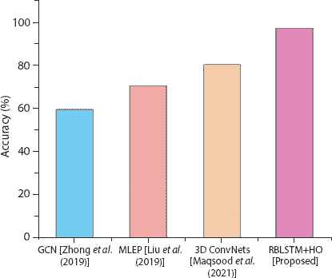

图 5.3 建议方法与当前方法的准确率对比。

图 5.3 显示了所提系统的准确率以及现有系统的准确率。所提方法也被标记。GCN 达到了 74%，MLEP 达到了 66%，而 3D ConvNets 达到了 85%。相比之下，所提方法达到了 98% 的准确率。

精确率可以使用下 公式 5.4 计算：

(5.4)<math display="block">Precision = \frac{tp}{(tp + fp)}</math>

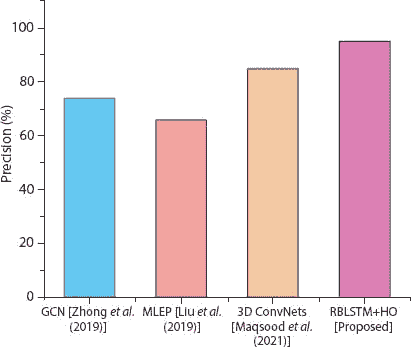

图 5.4 展示了所提系统的精确率以及现有系统的预测精确率。GCN 达到了 60%，MLEP 达到了 71%，3D ConvNets 达到了 81%，建议系统达到了 98% 的精确率。这证明了所提方法比现有方法更有效。

正如此处 公式 5.5](#c05.xhtml#req5-5)<math display="block">Recall = \frac{tp}{(tp + fn)}</math>

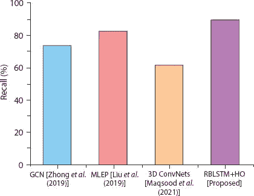

图 5.5 显示了所提系统的召回率以及现有系统的估计召回率。建议系统达到了 90% 的召回率，而 GCN 达到了 74%，MLEP 达到了 83%，3D ConvNets 达到了 62%。这证明了所建议的技术比当前技术更高效。

错误率是无效数据单元相对于所有交付数据单元的比例。


(5.6)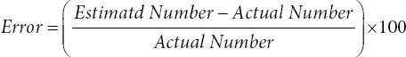
```math
<math display="block" overflow="scroll"><mi>E</mi><mi>r</mi><mi>r</mi><mi>o</mi><mi>r</mi><mo>=</mo><mrow><mo>(</mo><mrow><mfrac><mrow><mi>E</mi><mi>s</mi><mi>t</mi><mi>i</mi><mi>m</mi><mi>a</mi><mi>t</mi><mi>e</mi><mi>d</mi><mtext>&#x00A0;</mtext><mi>N</mi><mi>u</mi><mi>m</mi><mi>b</mi><mi>e</mi><mi>r</mi><mo>&#x2212;</mo><mi>A</mi><mi>c</mi><mi>u</mi><mi>t</mi><mi>a</mi><mi>l</mi><mtext>&#x00A0;</mtext><mi>N</mi><mi>u</mi><mi>m</mi><mi>b</mi><mi>e</mi><mi>r</mi></mrow><mrow><mi>A</mi><mi>c</mi><mi>u</mi><mi>t</mi><mi>a</mi><mi>l</mi><mtext>&#x00A0;</mtext><mi>N</mi><mi>u</mi><mi>m</mi><mi>b</mi><mi>e</mi><mi>r</mi></mrow></mfrac></mrow><mo>)</mo></mrow><mo>&#x00D7;</mo><mn>100</mn></math>
```

图 5.6 展示了所提系统的误差率、现有系统中消耗率的预测以及建议的技术。`GCN` 达到了 0.15%，`MLEP` 获得了 0.14%，`3D ConvNets` 达到了 0.12%，而所提的技术的误差率为 0.07%。这表明所提方法的误差率低于现有方法。

## 5.5 结论

由于多种变量对结果的影响（例如视频噪声、离群值和分辨率），视频监控中的异常检测是一项艰巨的任务。在本研究中，我们建议使用带有 `HO` 的 `RBLSTM` 来改进智能视频监控中的异常检测。它利用了从 `Video Swin Transformer` 模型提取的高质量特征。在本次调查中，异常视频以 98.5% 的准确率、98% 的精确率、90% 的召回率和 0.07% 的误差率被准确检测。实验结果表明，在帧中定位异常有助于提供卓越的结果。由于异常发生的罕见性、各种类型行为的不一致以及正常与异常数据的分布平衡，视频识别仍然是一项挑战。未来，可以通过各种方法进行进一步测试。

## 参考文献

1. Franklin, R.J. *et al.*. 使用神经网络的视频监控应用异常检测，在：*第四届创新系统与控制国际会议 (ICISC)*，2020。doi: 10.1109/ICISC47916.2020.91712.
2. Zhu, S. *et al.*. 智能监控视频异常检测，在：*计算机视觉：指南*，1–8，Springer International Publishing, Cham，2020。doi: 10.1007/978-3-030-03243-845-1.
3. Nasaruddin, N. *et al.* 通过视觉注意力深度异常检测。*大数据*，7,1–17，2020。doi: 10.1186/s40537-020-0365-y.
4. Tang, Y. *et al.*. 用于异常检测的预测与重建。*模式识别函*，129,123–130，2020。doi: 10.1016/j.patrec.2019.11.024.
5. Pranav, M. and Zhenggang, L.. 单摄像头异常检测数据集，在：*亚洲计算机视觉会议论文集*，2020。
6. Ullah, M. *et al.* 用于运动识别的基于注意力的 LSTM 网络。*电子图像*，2021，302–301，2021。doi: 10.2352/ISSN.2470-1173.2021.6.
7. Riaz, H. *et al.* 使用级联深度学习模型的异常检测，在：*第 9 届视觉信息处理欧洲会议 (EUVIP)*，2021。doi: 10.1109/EUVIP5044.2021.948462.
8. Wu, C., Shao, S., Tunc, C., Satam, P., Hariri, S., 用于视频检测的可解释高效深度学习框架。*聚类计算*，25,2715–2737。
9. Chang, Y. *et al.* 用于视频检测的聚类驱动自动编码器，在：*计算机视觉 ECCV 第 16 届欧洲会议，第 XV 部分*，329–345，2020。doi: 10.1007/978-3-030-5855-2.
10. Landi, F. *et al.* 视频监控中的异常局部，arXiv:1901.10364，2019.
11. Madan, N. *et al.* 来自社交不可接受轨迹的时间线异常检测，在：*IEEE/CVF 计算机视觉会议论文集*，2150–2158，2021。doi: 10.1109/ICCV5412.2021.0244.
12. Deshpande, K. *et al.* 使用基于 transformer 注意力模型的监控视频异常检测，2022，arXiv:2206.01524。doi: 10.1007/978-3-99-1648-1.
13. Ganesh, N. *et al.* 使用加权优化算法的高效特征选择。*应用科学*，13,5,3223，2023。doi: 10.3390/app13053223.
14. Priyadarshini, J. *et al.* 在带 K 近邻特征选择中分析物理启发的元启发式算法。*应用科学*，13,2,906，2023。doi: 10.3390/app13020906.
15. Shaik, K. *et al.* 使用松鼠搜索优化增强决策树的大数据分析框架用于心脏诊断。*应用科学*，13,9,5236，2023。doi: 10.3390/app13095236.
16. Zhong, J.-X. *et al.* 图卷积标签清理器：用于视频监控的即插即用动作分类器，在：*计算机视觉与模式识别会议*，1237–1246，2019。doi: 10.1109/CVPR.2019.0133.
17. Liu, W. *et al.* 异常检测的边缘学习嵌入预测，在：*IJCAI*，3023–3030，2019。doi: 10.24963/ijcai.2019/419.
18. Maqsood, R. *et al.* 使用 3D 卷积神经网络从监控视频中识别异常。*多媒体工具应用*，80,18693–18716，2021。doi: 10.1007/s11042-021-1057-3.

## Note

- [#c05.xhtml#rcor1] *通讯作者*: `shankarrajendran75@kluniversity.in`

# 6 基于机器学习的物联网应用僵尸网络攻击检测

**Suchithra M.**

*计算技术系计算学院，SRM 科技大学，Kattankulathur，印度*

### 摘要

由于快速发展和广泛应用，物联网（IoT）系统正成为日益频繁攻击的目标。据称，使用僵尸网络的攻击占物联网网络中的大部分。尽管大多数物联网系统拥有有效安全方法所需的内存和处理能力，但这些系统中仍存在若干安全漏洞。此外，攻击者能够绕许多基于规则的检测算法。虽然机器学习（ML）驱动的方法可以识别各种类型攻击的变化，但偶尔会启动特殊的类型类型。因此，本文提出了一种名为随机树自适应神经网络（RT-ANN）的新型机器学习技术用于检测僵尸网络攻击。首先，我们收集原始数据样本并对这些样本进行归一化处理。使用主成分分析（PCA）提取 RT-ANN 的关键方面。我们对所提的 RT-ANN 方法进行了性能分析，并提供了对比分析。实验结果表明，该方法在僵尸网络攻击检测中达到了最高的检测率。

***关键词*****:** 物联网（IoT）、机器学习（ML）、僵尸网络攻击、主成分分析（PCA）、随机树自适应神经网络（RT-ANN）

## 6.1 引言


近年来，物联网（IoT）设备的快速发展提升了我们日常生活的便利性。物联网设备平均每隔 2 分钟就会遭受一次攻击 `[1]`。物联网收集、处理并分析来自各种异构物联网设备的海量数据，以无缝地连接数百万个智能物体和设备。物联网是高特在 2020 年确定的十大关键技术发展趋势之一。根据这一预测，到 2023 年，智能设备的数量将是传统 IT 设备的 20 倍。预计物联网将更广泛地应用于公用事业、医疗保健、政府、物理安全和汽车等各个行业。然而，物联网基础设施正在快速构建，但是以更多攻击和安全漏洞为代价的。根据赛丰的数据，一个物联网设备每隔 2 分钟就会受到一次攻击 `[2]`。物联网是网络行业最新的概念之一。它可以被描述为计算资源有限的对象之间的互连。它允许通过互联网传输和接收数据，而无需计算机与计算机或人与人之间的通信。联网的启用 IP 的对象被称为“物”（包括物理和虚拟）。除了常规物联网，讨论资源受限的物联网设备也很重要。尽管这些小设备使用了物联网应用，但它们是电池供电、紧凑、低功耗的，具有各种设计权衡。它们还具有有限的计算和存储能力。简单来说，资源受限设备是用于特定应用程序的终端传感器。这些设备具有有限的存储和处理能力、由于脆弱的电池导致的能量限制，以及其他资源限制。此外，它们通过微弱的无线环境、低功耗损耗通信且在没有人类参与的情况下进行连接 `[3]`。近年来物联网设备的泛增带来了如僵尸网络攻击等新危险。此类攻击可能是组织的，并且似乎损害了目标设备。僵尸网络是指对主机的未经授权的远程控制。攻击者控制被黑入的物联网设备，并利用它们来实施恶行。僵尸网络可能在现实世界中造成巨大伤害，例如 2016 年的 Mirai 攻击影响了约 1000 台闭路电视摄像头（CCTV） `[4]`。僵尸网络是一组连接到互联网的计算机，它们已被入侵，现在正由攻击者使用僵尸程序（恶意软件的一种）进行远程管理。攻击者经常使用恶意软件。在许多其他危害中，僵尸网络将从物联网安全漏洞中获益最多。僵尸网络是由节点组成的网络，这些节点被恶意软件感染，并转变为听从僵尸网络主命令的攻击僵尸机器人。物联网为僵尸网络提供了一个极佳的环境，主要原因有两点：首先，物联网设备缺乏安全机制，使得病毒的传输和安装变得更容易。其次，预计明年联网设备的庞大数量将实现大规模攻击，为攻击者提供前所未有的大量易感资源 `[5]`。在本文中，我们提出了一种随机树自适应神经网络（`RT-ANN`）来检测僵尸网络攻击。

论文的组织结构可以通过参考以下大纲来理解。第 6.2 节 对相关工作进行了详细分析。在第 6.3 节中，我们概述了所提工作的公式。第 6.4 节展示并讨论了结果。最后，在第 6.5 节中，我们提供了结论和建议。

## 6.2 文献综述

Sriram 等人 `[6]` 提出了一种基于深度学习（`DL`）的物联网流量检测机制。Popoola 等人 `[7]` 提出了一种联邦深度学习（`FDL`）策略，以防止物联网设备中的数据泄露。Al-Duairi 等人 `[8]` 使用了一种理想的深度神经网络（`DNN`）架构来分类网络流量。许多物联网公司提供了基于安全信息和事件管理的广泛解决方案。Hussain 等人 `[9]` 提供了一套特征，无论数据集如何都能有效支持僵尸网络攻击。实验结果表明，该规范和原则特征集可以有效识别各种形式的攻击。Zagrouba 和 Alhajri `[10]` 提出了一种低功耗的物联网僵尸网络攻击策略，并详细介绍了其应对措施。Hikal 和 Elgayar `[11]` 开发了一种基于异常检测的物联网轻量化入侵检测系统。Al-Sarem 等人 `[12]` 提出了一种基于聚合互信息的机器学习（`ML`）特征选择方法。该研究分析了来自九个物联网设备的实际流量数据，以识别攻击类型。实验证明，在使用二进制数据集时，基于互信息的方法产生了最佳得分。McDermott 等人 `[13]` 建议双向策略会延长处理时间并增加每个轮的成本，但最终证明是一种更有效的模型。Alissa 等人 `[14]` 建议使用免费数据集 UNSW-NB15 使用机器学习技术进行二分类。Vishwakarma 和 Jain `[15]` 提出了一种基于蜜罐的方法论，利用机器学习方法识别恶意软件。Abu Khurma 等人 `[16]` 提出了一种混合了蝠群算法和蚁群优化的封装式特征选择模型。结果表明，通过采用这些相关的子集，蚁群优化在所研究指标方面取得了最好的结果。Vinayakumar 等人 `[17]` 提出了一种基于双层深度学习框架的僵尸网络检测系统，用于在域名系统服务的应用层语义区分僵尸网络和合法行为。Nõmm 和 Bahşi `[18]` 创建了一种无监督学习模型，该模型非常准确且缩短了特征长度，从而减少了所需的 CPU 功率。

## 6.3 所提系统


在接下来的章节中，我们将详细讨论一种用于预测僵尸网络攻击的增强模型，并解释所提出的随机树自适应神经网络方法。图 6.1 展示了所提的方法。首先，收集并对原始数据进行归一化。然后准备数据集，并使用归一化和主成分分析 (`PCA`）等数据处理技术为 `RT-ANN` 模型提取关键特征。

### 6.3.1 `数据集`

本节讨论的研究使用了 `N-BaIoT` 数据集，该数据集通过执行 `Mirai` 和 `BASHLITE` 等危险的 IoT 恶意软件获得。该数据集总包含 849,233 个实例，包括 17,935 个良性实例和 831,298 个攻击实例。在测试中，使用了具有常见激活机制的 `ANN`。这些信息从使用已知 IoT 设备的 IoT 环境收集，是公开访问的。该数据集包含 115 个流量特征、8 个独立的攻击类别以及 2 个僵尸网络和一个良性僵尸网络。图 6.2 显示了数据集中案例分布。

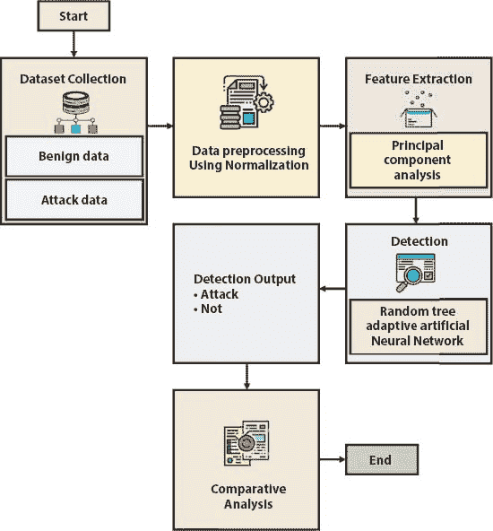

`图 6.1` 所提的方法。

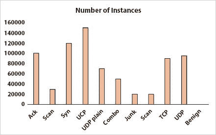

`图 6.2` 数据集的分布。

### 6.3.2 `使用归一化进行数据处理`

Z-score 归一化（也称为零均值归一化）通过计算整个训练数据集每个特征的平均值 (`M`) 和标准差 (`SD`) 并除以数据集大小，对每个输入特征向量进行归一化。计算每个属性的平均值和标准差，并根据通用公式进行转换是必要的。

(6.1)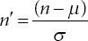<math display="block" overflow="scroll"><msup><mi>n</mi><mo>&#x2032;</mo></msup><mo>=</mo><mfrac><mrow><mrow><mo>(</mo><mi>n</mi><mo>&#x2212;</mo><mi>&#x03BC;</mi></mrow><mo>)</mo></mrow></mrow><mi>&#x03C3;</mi></></></>

属性 `n` 的平均值为 `μ`，标准差为 `σ`。在开始训练之前，数据集的所有特征都经过 z-score 归一化。收集训练数据后，应保存每个特征的平均值和标准差，以作为算法权重。

### 6.3.3 `使用主成分分析进行特征提取`

为了提高模型的性能，我们采用了降维和特征选择技术，在保留重要特征的同时减少变异性。主成分分析是减少维度的方法之一。使用 `PCA` 将数据转换为新的特征空间，其中第一个坐标解释了大部分变异，第二个主成分解释了次次大的方差，依此类推。本研究中表现出最大方差的特征被用作分类器的输入。这一过程确保了只选择相关特征，提高了机器学习模型的计算效率和简单性。此外，通过利用所有变量，该方法潜在地减少任何可能的过拟合。

### 6.3.4 `随机树自适应人工神经网络`

随机树算法与随机森林方法相当，并由于使用了某些决策树而共享其许多优势。它可以有效地管理具有高维特征的数据而不需要特征选择，并且具有强大的分类影响和高准确率。执行过程可以并行化。与在集成学习中通过自助采样生成样本的随机森林方法不同，极端树策略每个决策树的所有原始数据。此外，当极端树在节点处划分时，随机选择节点，而不是使用理想的划分阈值。图 6.3 展示了 `ANN` 的架构。

人工神经网络是神经网络技术的基本构建块。该范式适用于向量值函数。被称为神经元的组件并行运行并相互连接。层是连接在一起的组件子组。隐藏层、输出层和输入层本质上是神经网络中的层。虽然每个连接处存在相应的权重，但在反向计算阶段必须对其进行调整以获得最佳权重值。

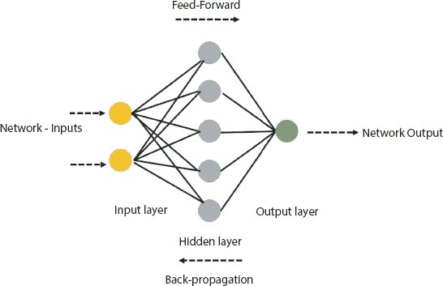

`图 6.3` `ANN` 的架构。

(6.2)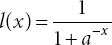<math display="block" overflow="scroll"><mi>l</mi><mrow><mo>(</mo><mi>x</mi><mo>)</mo></mrow><mo>=</mo><mfrac><mn>1</mn><mrow><mn>1</mn><mo>+</mo><msup><mi>a</mi><mrow><mo>&#x2212;</mo>x</mo></mo></mu></mrow></mfrac></math>


(6.5)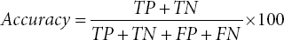
```math
<math display="block" overflow="scroll"><mi>A</mi><mi>c</mi><mi>c</mi><mi>u</mi><mi>r</mi><mi>a</mi><mi>c</mi><mi>y</mi><mo>=</mo><mfrac><mrow><mi>T</mi><mi>P</mi><mo>+</mo><mi>T</mi><mi>N</mi></mrow><mrow><mi>T</mi><mi>P</mi><mo>+</mo><mi>T</mi><mi>N</mi><mo>+</mo><mi>F</mi><mi>P</mi><mo>+</mo><mi>F</mi><mi>N</mi></mrow></mfrac><mo>&#x00D7;</mo><mn>100</mn></math>```
```

图 6.4 显示了准确率指标的比较值，显而易见，建议的技术比当前的研究方法产生更好的性能结果。建议方法 97% 的准确率优于现有方法的结果，例如 `CNN` [19\] 的准确率为 91.6%，`LGBA-NN` [20\] 的 90%，以及 `PSO-NN` [20\] 的 85.2%。在对数据进行分类时，建议的方法优于现有方法。

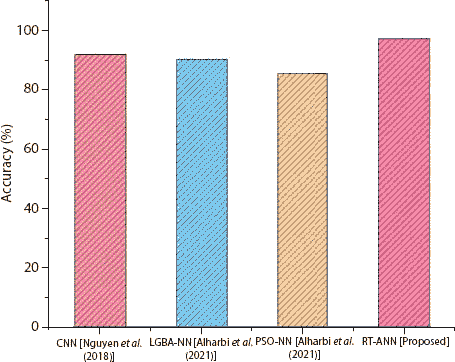

图 6.4 准确率结果。

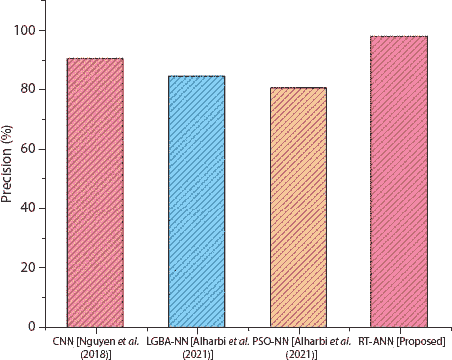

图 6.5 精确率结果。

## 6.4.2 精确率

精确率是准确率最关键的标准之一，它定义为正确分类的案例与所有预测正性数据实例的比例。精确率使用公式 6.6 计算。

(6.6)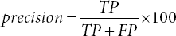
```math
<math display="block" overflow="scroll"><mi>p</mi><mi>r</mi><mi>e</mi><mi>c</mi><mi>i</mi><mi>s</mi><mi>i</mi><mi>o</mi><mi>n</mi><mo>=</mo><mfrac><mrow><mi>T</mi><mi>P</mi></mrow><mrow><mi>T</mi><mi>P</mi><mo>+</mo><mi>F</mi><mi>P</mi></mrow></mfrac><mo>&#x00D7;</mo><mn>100</mn></math
```

图 6.5 显示了精确率指标的比较值。凭借 98% 的精确率，建议的方法优于目前使用的方法，例如精确率为 90.9% 的 `CNN`、85% 的 `LGBA-NN` 以及 81% 的 `PSO-NN`。该方法比其他当前使用的方法实现了更好的数据分类精确率。

### 6.4.3 召回率

召回率模型识别数据集中每个重要样本的能力。它在统计学上定义为真阳性（TP）的数量除以 TP 和假阴性（FN）的总和。召回率使用公式 6.7 计算。

(6.7)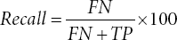
```math
<math display="block" overflow="scroll"><mi>R</mi><mi>e</mi><mi>c</mi><mi>a</mi><mi>l</mi><mi>l</mi><mo>=</mo><mfrac><mrow><mi>T</mi><mi>P</mi></mrow><mrow><mi>F</mi><mi>N</mi><mo>+</mo><mi>T</mi><mi>P</mi></mrow></mfrac><mo>&#x00D7;</mo><mn>100</mn></math
```

召回率指标的比较数据所示于图 6.6。`CNN` 的召回率为 97.6%；`LGBA-NN` 为 90%；`PSO-NN` 为 85%；`RT-ANN` 为 99%。

### 6.4.4 F 值

通过计算所提模型的调和平均值，将召回率和精确率合并为称为 F 值的单一组件。使用公式 6.8 计算 F 值。

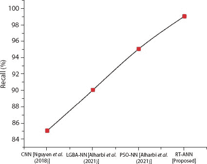

图 6.6 召回率结果。

(6.8)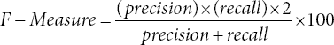
```math
<math display="block" overflow="scroll"><mi>F</mi><mo>-</mi><mi>M</mi><mi>a</mi><mi>s</mi><mi>r</mi><mi>e</mi><mo>=</mo><mfrac><mrow><mo>(</mo><mi>p</mi><mi>e</mi><mi>c</mi><mi>i</mi><mi>s</mi><mi>o</mi><mi>n</mi><mo>times</mo><mo>(</mo><mi>r</mi><mi>e</mi><mi>c</mi><mi>l</mi><mo>times</mo><mn>2</mn><mo>)</mo><mo><mi>p</mi><mi>e</mi><mi>c</mi><mi>i</mi><mi>s</mi><mi>o</mi><mi>n</mi><mo>+</mo><mi>r</mi><mi>e</mi><mi>c</mi><mi>l</mi><mo>times</mo><mn>100</mn><mo>)</mo></mfrac><mo>&#x00D7;</mo><mn>100</mn></math
```
在图 6.7 中，`RT-ANN` 的 F 值得分为 98%，之后是 `CNN`（94.1%）、`LGBA-NN`（86%）和 `PSO-NN`（86.23%）。

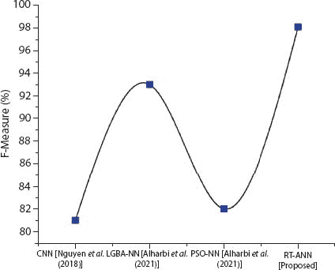

图 6.7 F 值结果。

## 6.5 结论

物联网机器人网络攻击由于多种因素，包括物联网设备的快速增长和其潜在的安全漏洞，以及受影响设备可能不会显示任何迹象。本文提出了使用新兴机器学习技术检测机器人网络攻击。我们收集了原始数据并进行了归一化处理。分析了我们提出的 `RT-ANN` 方法并提供了对比分析。实验结果表明，建议的方法具有最高的机器人网络攻击检测率。为了证实这些发现，未来的研究需要使用完整数据集进行评估。此外，为了评估与其他机器人网络攻击算法的性能，该实验可以包含更多数据集，如 `Bot-IoT` 数据集和 `CTU-13`。

## References

1. Soe, Y.N. *et al.* 基于机器学习的物联网机器人网络攻击检测 *Sensors (Basel)*, 20, 16, 4372, 2020, doi: 10.3390/s20164372.
2. Alkahtani, H. and Aldhyani, T.H.H., 使用 CNN-LSTM 模型进行物联网应用的机器人网络攻击检测 *Secur. Commun. Netw.*, 2021, 1–23, 2021, doi: 10.1155/2021/3806459.
3. Abu Al-Haija, Q. and Al-Dala’ien, M.A.-M., ELBA-IoT: 用于物联网机器人网络攻击检测的集成学习模型 *J. Sens. Actuator Netw.*, 11, 1, 18, 2022, doi: 10.3390/jsan1101018.
4. Alqahtani, M. *et al.* 基于优化极梯度提升和特征选择的物联网机器人网络攻击检测 *Sensors (Basel)*, 20, 21, 6336, 2020, doi: 10.3390/s20216336.
5. Rethinavalli, S. and Gopinath, R., 使用优化技术的物联网机器人网络攻击检测 *Int. J. Electr. Technol.*, 11, 412–420, 2020.
6. Sriram, S. *et al.*, 使用深度学习的基于网络流的物联网机器人网络检测，*IEEE Conference on Computer Communications Workshops (INFOCOM WKSHPS)*, IEEE Infocom, 2020, doi: 10.1109/INFOCOMWKSHPS50562.2020.916268.
7. Popoola, S.I., *et al.* 用于物联网边缘设备零日机器人网络攻击检测的联邦深度学习 *IEEE Internet Things J.*, 9, 5, 3930–3944, 2021, doi: 10.1109/JIOT.2021.3100755.
8. Al-Duwairi, B. *et al.* 基于 SIEM 的物联网机器人网络 DDoS 攻击检测与缓解 *Int. J. Elect. Comput. Eng.*, 10, 2, 2182, 2020, doi: 10.11591/ijece.v10i2.pp2182-2191.
9. Hussain, F. *et al.* 面向物联网机器人网络攻击的通用特征集，*23rd International Multitopic Conference (INMIC)*, IEEE, 2020, doi: 10.1109/INMIC50486.2020.9318106.


10. 10. `Zagrouba, R.` and `Alhajri, R.`, IoT 中基于机器学习的攻击检测与防御措施。*Int. J. Commun. Netw. Inf. Secur.*, 13, 2, 158–167, 2021, doi: 10.17762/ijcnis.v13i2.4943.

11. 11. `Hikal, N.A.` and `Elgayar, M.M.`, 使用机器学习-IDS 和集成数据预处理技术增强 IoT 僵尸网络攻击检测，收录：*The Internet Things-Appl. Future Proc. ITAF*, vol. 2020, 2019, doi: 10.1007/978-981-15-3075-3_6.

12. 12. `Al-Sarem, M.` *et al.*, 一种基于聚合互信息的机器学习特征选择方法用于增强 IoT 僵尸网络攻击检测。*Sensors (Basel)*, 22, 1, 185, 2021, doi: 10.3390/s22010185.

13. 13. `McDermott, C.D.` *et al.*, 使用深度学习方法进行物联网中的僵尸网络检测，收录：*国际神经网络联合会议 (IJCNN)*, vol. 2018, 2018, doi: 10.1109/IJCNN.2018.8489489.

14. 14. `Alissa, K.` *et al.*, 使用机器学习在 IoT 中进行僵尸网络攻击检测。*Comput. Intell. Neurosci.*, 2022, 4515642, 2022, doi: 10.1155/2022/4515642.

15. 15. `Vishwakarma, R.` and `Jain, A.K.`, 一种基于机器学习检测框架的蜜罐，用于防御基于 IoT 的僵尸网络 DDoS 攻击，收录：*第三届电子与信息趋势国际会议 (ICOEI)*, vol. 2019, 2019, doi: 10.1109/ICOEI.2019.8862720.

16. 16. `Abu Khurma, R.` *et al.*, 使用磷鱼群和蚁狮混合优化模型进行 IoT 僵尸网络检测。*Symmetry*, 13, 8, 1377, 2021, doi: 10.3390/ sym13081377.

17. 17. `Vinayakumar, R.` *et al.*, 一种基于深度学习的智慧城市物联网网络可视化僵尸网络检测系统。*IEEE Trans. Ind. Appl.*, 56, 4, 4436–4456, 2020, doi: 10.1109/TIA.2020.2971952.

18. 18. `Nõmm, S.` and `Bahşi, H.`, IoT 网络中基于无监督异常的僵尸网络检测。*第 17 届 IEEE 机器学习与应用国际会议 (ICMLA)*, vol. 2018, 2018, doi: 10.1109/ICMLA.2018.00171.

19. 19. `Nguyen, H.T.` *et al.*, 基于 PSI 图和 DGCNN 分类器的 IoT 僵尸网络检测方法，收录：*IEEE 信息、通信与信号处理国际会议 (ICICSP)*, vol. 2018, 2018, doi: 10.1109/ ICICSP.2018.8549713.

20. 20. `Alharbi, A.` *et al.*, 使用局部全局最优蝙蝠算法进行工业物联网僵尸网络攻击检测。*Electronics*, 10, 11, 1341, 2021, doi: 10.3390/electronics10111341.

## Note

1. *Email*: suchithm@srmist.edu.in

# 7

用于无线传感器网络的经过调优的蜘蛛猴优化的机器学习入侵检测系统

**Ilavendhan Anandaraj¹\*** **和 Kaviarasan Ramu²**

^(*1*)*计算机科学与工程学院，韦洛尔学院理工学院，钦奈杜，印度

^(*2*)*计算机科学与工程系，RGM 工程与技术学院，南迪亚尔，印度

### *摘要*

入侵检测系统用于研究无线传感器网络（WSN）或系统中出现的问题。入侵检测是用于监测系统或网络上可疑活动的软件或硬件设备。随着计算机之间的连接变得日益紧密，入侵检测对于网络安全变得越来越重要。目前已经通过机器学习和统计方法开发了不同类型的入侵检测系统（IDS）来保护无线传感器网络。准确性是衡量 IDS 运行良好坏的最重要因素。入侵检测的准确性需要提高，以减少误报并提高检测率。IDS 的主要工作是分析大量的流量数据。为了解决这个问题，需要一种分类入侵良好的方法。本研究考虑了这一问题。在文中，我们提出了一种用于无线传感器网络的机器学习技术，即经过调优的蜘蛛猴优化的支持向量机（SVM）。使用 NSL-KDD 知识发现数据集衡量入侵检测系统的效果。结果表明，所提模型优于现有的方法。

**关键词：** 入侵检测、支持向量机（SVM）、蜘蛛猴优化（SMO）、无线传感器网络、机器学习


借助机器学习（一种数据分析方法），可以自动构建分析模型。人工智能（AI）运行的基础是计算机可以学习在极少人工干预的情况下解决问题、做出决策并识别模式。机器学习的两种主要类型是监督学习和无监督学习。训练算法通常需要标记实例，例如输入和期望的输出。无监督学习用于在缺乏此类标签的情况下训练新实例。无监督学习的主要目标是：(1) 检测数据中的模式以及 (2) 更多地了解数据。此外，还利用了半监督学习和强化学习另外两种策略。

半监督学习利用较少的标记数据和海量的未标记数据进行训练。强化学习采用试错法来确定哪些活动能提供最大的奖励。该方法使用了分类、回归和预测方法。在这种学习方法中，代理体、环境和动作是三个关键组件。其目标是让代理体选择使预测收益最大化的活动。通过使用良好的策略，代理体可以快地实现目标 [4]。因此，在本研究中，使用了经过调优的蜘蛛猴优化（TSMO）的支持向量机（SVM）。这些算法可以处理分类。此外，还使用了归一化和特征还原来进行对比分析。

本工作分为五个部分，从引言开始。第二部分描述了相关工作。此外，方法论在 7.3 节中进行了概述。性能评估在 7.4 节中给出。最后，7.5 节 对文章得出了结论。

## 7.2 文献综述


一个采用星型拓扑结构、且主机和服务器均连接到 `OpenFlow` OVS 交换机的数字测试平台模拟了真实的网络环境。基于特征的 `Snort IDS` 通过镜像服务器流量来监控和检测攻击。风险评估显示，`Snort IDS` 充分保护网络拓扑免受威胁，除了少数需要缓解的威胁外。为了实现架构规模的威胁检测，创建了一种基于流的 `IDS` 模型。使用机器学习的流离群检测击败了基于特征的 `IDS` [5]。Verma 和 Ranga [6] 提出了 `ML` 分类技术，用于保护物联网（`IoT`）免受 DoS 攻击。研究深入探讨了增强基于异常的 `IDSs` 的分类器。使用流行的指标和验证技术对分类器进行评估。使用 `CIDDS-001`、`UNSW-NB15` 和 `NSL-KDD` 数据集对分类器进行基准测试。通过 Friedman 和 Nemenyi 检验对分类器进行定量比较。使用树莓派测试了分类器在 IoT 框架上的响应时间。本研究的主要重点是关于机器学习技术及其在 IoT 和用于保护计算机网络的 `IDS` 中应用的最新、最权威的文献。因此，研究的目标是对当前发表文献进行全面综述，这些文献探讨了 IoT 与 `ML` 在计算机网络 `IDS` 中交叉领域解决的问题 [7]。`IDSs` 已使用深度学习（`DL`）以及其他新方法来提高其保护计算机网络和主机的有效性。Lansky 等人 [8] 对基于 `DL` 的入侵检测技术 string 了全面的研究和分类。该研究首先介绍了 `IDS` 设计的基本思想和不同的 `DL` 技术。然后根据它们所采用的特定 `DL` 技术对设计进行分组。它解释了使用深度学习网络如何提高入侵检测的准确性。网络安全研究项目的扩展（如关注入侵检测和预防系统的项目）具有至关重要的意义。使用入侵检测系统（通常称为 `IDS`）是防御有害攻击的高效方法。在 Alrowaily 等人 [9] 进行的研究过程中，`CICIDS2017` 入侵检测数据集被用于对七种不同的机器学习算法进行各种测试。防止来自 IoT 设备攻击的最有效预防控制方法是使用 `ML` 和 `DL` 技术，因为 Asharf 等人 [10] 提供了入侵检测技术的概述，并对由于受损的 IoT 设备引起的与 IoT 系统相关的技术、协议、设计和危险进行了详细评估。该研究还对若干种基于机器学习和深度学习的策略进行了评估，这些策略可用于发现受入侵影响的物联网设备。Rahman 等人 [11] 提出了两种方法（半分布式和分布式），这些方法将高性能的特征提取与选择与雾边缘同步分析的可能性相结合，以克服资源限制设备的集中式 `IDS` 的局限性。为了分工，他们各自为拆分后的入侵数据集创建了同步的 `ML` 算法。在半分布式侧，在边缘和雾侧使用并行方法进行特征选择，然后使用单个多层感知机进行分类。在分布式模式下，特征提取和多层感知机分类由并行系统独立执行，然后由协调的边缘或雾节点聚合结果。Sarker 等人 [12] 描述了一种基于机器学习的入侵检测树安全模型，该模型首先根据相关性对安全机制进行排序，然后根据所选的关键特征构建基于树的泛化入侵检测算法。该模型能够准确预测未见的测试用例，并通过降低特征维度来减少计算成本。Dang [13] 通过阐明早期研究中构建的 `IDSs` 所做的选择来分析了现有研究。如果用户对 `IDS` 有更强的理解，他们使用该系统的信心将会增加，而程序员可能依赖这些解释来调优系统。基于模型的解释，实验结果表明，它们可以极地降低 `IDS` 的计算能力需求。Idrisi 等人 [14] 根据 Cisco IoT 参考模型架构分析了著名的安全风险，以检查 IoT 安全威胁和漏洞的当前水平。还综述了 IoT 安全领域的现有研究，重点关注那些使用 `DL` 方法检测入侵的文献。`DL` 技术正在兴起，并在许多领域（包括网络安全）中变得越来越重要。Sethi 等人 [15] 提出了一种基于深度强化学习的自适应云 `IDS` 框架，该框架在克服上述限制的同时，能够对新型复杂攻击进行准确的判定和细粒度的分类。他们使用基准 `UNSW-NB15` 数据集进行了彻底测试，结果表明在与先进的 `IDSs` 匹配时具有更高的准确性和更低的误报率（`FPR`）。由于缺乏安全措施，网络实体容易受到严重攻击。需要一个有效的处理威胁和检测攻击的安全框架来解决这个问题。


NSL-KDD 数据集基于 KDD Cup 99 数据集构建，并删除了重复和冗余数据。NSL-KDD 数据集包含 41 个标记特征，例如攻击类型。它被认为是解决 KDD’99 数据集问题的解决方案。训练集和测试集都提供了足够的数据以保证性，消除了从集合中随机选取子集进行测试的需求。这一优势使得不同研究的结果可以进行一致的比较和对比 [16]。

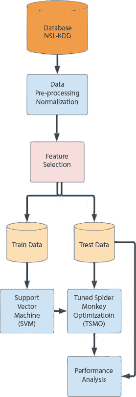

图 7.1 所提的 SVM-TSMO 模型流程图。

### 7.3.4 数据预处理

采用的预处理技术包括数据清洗、标准化和集成。数据清洗过程包括删除空字段、重复记录、语法错误和缺失代码。数据集的数据清洗程序经过标准化处理，以便数据分析，并且可以快速检索清洗后的数据进行研究。为了实现归一化，必须创建新的数据向量。归一化数据的主要优点之一是减少了数据不一致的可能性。在集成和归一化数据时，Min-Max 归一化范式至关重要。每个特征的值范围从 0 到 1，其中 0 代表最小值，1 代表最大值。

公式 7.1 表示归一化过程。

(7.1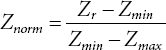
```
<math display="block" overflow="scroll"><msub><mi>Z</mi><mrow><mi>n</mi><mi>o</mi><mi>r</mi><mi>m</mi></mrow></msub><mo>=</mo><mfrac><mrow><msub><mi>Z</mi><mi>r</mi></msub><mo>&#x2212;</mo><msub><mi>Z</mi><mrow><mi>m</mi><mi>i</mi><mi>n</mi></mrow></msub></mrow><mrow><msub><mi>Z</mi><mrow><mi>m</mi><mi>i</mi><mi>n</mi></mrow></msub><mo>&#x2212;</mo><msub><mi>Z</mi><mrow><mi>m</mi><mi>a</mi><mi>x</mi></mrow></msub></mfrac></math>
```
其中 `Z`[`r`] 代表一个数据点，`Z`[`min`] 和 `Z`[`max`] 在处理批量时表示最小值和最大值。递归特征消除 (RFE) 对最重要的特征进行排序，并返回其相对相关性作为值。假设减少冗余数据会导致更小的特征子集。特征的排名可以通过对特征从重要到不重要进行排序得出。

### 7.3.5 支持向量机

支持向量机的监督学习方法涉及使用数据进行训练 [18, 19]。支持向量机能够生成超平面。核函数（如线性、多项式、径向）的主要目标是对数据进行分类。图 7.2 展示了 SVM。

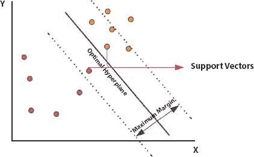
图 7.2 支持向量机。

在大多数情况下，SVM 被分为两个：训练数据集和测试数据集。

### 7.3.6 调优蜘蛛优化

TSMO 是一种基于群体智能的系统，依赖于全局领导，由全局领导决定是否移动。全局领导负责所有小组，但仍有细节需要考虑。形成 40 个或 50 个的小组。TSMO 方法是分段并基于种群的，每个阶段详细如下所示。图 7.3 显示了所提的模型。

### 阶段 1：初始化

一个起点涉及寻找 N 个完全随机的答案。蜘蛛猴种群 m 被分为 n 个等份。然后为每个小组指定一个局部领导，并由全局领导监督所有小组。(7.2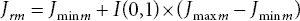
```
<math display="block" overflow="scroll"><msub><mi>J</mi><mrow><mi>r</mi><mi>m</mi></mrow></msub><mo>=</mo><msub><mi>J</mi><mrow><mi>min</mi><mi>m</mi></mrow></msub><mo>+</mo><mi>I</mi><mrow><mo>(</mo><mrow><mn>0</mn><mo>><mn>1</mn></mrow><mo>)</mo></mrow><mo>&#x00D7;</mo><mrow><mo>(</mo><msub><mi>J</mi><mrow><mi>max</mi><mi>m</mi></mrow></msub><mo>&#x2212;</mo><msub><mi>J</mi><mrow><mi>min</mi><mi>m</mi></mrow></msub></mrow><mo>)</mo></mrow></math>
```
其中 `J`[`min *m*] 和 `J`[`max *m*] 是第 *m* 个向量中 `J`[`r*] 的范围。`I`(0,1) 是一个任意数 (0,1)。

### 阶段 2：局部领导

在此阶段，蜘蛛（SMs）将感知其局部领导和附近邻居知道的信息，并此更新其位置。涉及的步骤如下：


(7.3)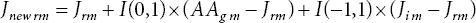
<math display="block" overflow="scroll"><msub><mi>J</mi><mrow><mi>n</mi><mi>e</mi><mi>w</mi><mtext>&#x00A0;</mtext><mi>r</mi><mi>m</mi></mrow></msub><mo>=</mo><msub><mi>J</mi><mrow><mi>r</mi><mi>m</mi></mrow></msub><mo>+</mo><mi>I</mi><mrow><mo>(</mo><mrow><mn>0</mn><momo><mn>1</mn></mrow><mo>)</mo></mrow><mo>&#x00D7;</mo><mrow><mo>(</mo><mrow><mi>A</mi><msub><mi>A</mi><mrow><mi>g</mi><mtext>&#x00A0;</mtext><mi>m</mi></mrow></msub><mo>&#x2212;</mo><msub><mi>J</mi><mrow><mi>r</mi><mi>m</mi></mrow></msub></mrow><mo>)</mo></mrow><mo>+</mo><mi>I</mi><mrow><mo>(</mo><mrow><mo>&#x2212;</mo><mn>1</mn><momo><mn>1</mn></mrow><mo>)</mo></mrow><mrow><mo>(</mo><mrow><msub><mi>J</mi><mrow><mi>i</mi><mtext>&#x00A0;</mtext><mi>m</mi></mrow></msub><mo>&#x2212;</mo><msub><mi>J</mi><mrow><mi>r</mi><mi>m</mi></mrow></msub></mrow><mo>)</mo></mrow></math>s

## 第 3 ：全局领导者

在此阶段，SM 有另一个机会利用适应度更新其位置并达到全局最优。它们可以从自身的坚韧性、邻居以及全局领导者那里获得灵感。此阶段的更新行为由以下方程更精确地描述：

(7.2)
<math display="block" overflow="scroll"><msub><mi>J</mi><mrow><mi>n</mi><mi>e</mi><mi>w</mi><mtext>&#x00A0;</mtext><mi>r</mi><mi>m</mi></mrow></msub><mo>=</mo><msub><mi>J</mi><mrow><mi>r</mi><mi>m</mi></mrow></msub><mo>+</mo><mi>I</mi><mrow><mo>(</mo><mrow><mn>0</mn><momo><mn>1</mn></mrow><mo>)</mo></mrow><mo>&#x00D7;</mo><mrow><mo>(</mo><mrow><mi>K</mi><msub><mi>A</mi><mrow><mi>r</mi></mrow></msub><mo>&#x2212;</mo><msub><mi>J</mi><mrow><mi>r</mi><mi>m</mi></mrow></msub></mrow><mo>)</mo></mrow><mo>+</mo><mi>I</mi><mrow><mo>(</mo><mrow><mo>&#x2212;</mo><mn>1</mn><momo><mn>1</mn></mrow><mo)</mo></mrow><mrow><mo2mo><mrow><msub><mi>J</mi><mrow><mi>i</mi><mi>m</mi></mrow></msub><mo>&#x2212;</mo><msub><mi>J</mi><mrow><mi>r</mi><mi>m</mi></mrow></msub></2><mo2mo></mo></mrow></math>

## 第 4 阶段：局部学习

由于全局最优已经确定，该方法确定了子组的领导者。这一步涉及通过评估阈值来确定领导者是否已更新。

## 第 5 阶段：全局学习

该阶段名称本身暗示了全局领导者的存在。它还验证了领导者是否更新到了特定的限制。

## 第 6 阶段：局部领导

当此发生时，组中的社交将通过跟随全局领导者或随机进行升级。无论局部领导者是否更新都会发生。

(7.5)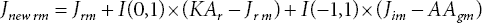
<math display="block" overflow="scroll"><msub><mi>J</mi><mrow><mi>n</mi><mi>e</mi><mi>w</mi><mtext>&#x00A0;</mtext><mi>r</mi><mi>m</mi></mrow></msub><mo>=</mo><msub><mi>J</mi><mrow><mi>r</mi><mi>m</mi></mrow></msub><mo>+</mo><mi>I</mi><mrow><mo>(</mo><mrow><mn>0</mn><momo><mn>1</mn></mrow><mo>)</mo></mrow><mo>&#x00D7;</mo><mrow><mo>(</mo><mrow><mi>K</mi><msub><mi>A</mi><mrow><mi>r</mi></mrow></msub><mo>&#x2212;</mo><msub><mi>J</mi><mrow><mi>r</mi><mtext>&#x00A0;</mtext><mi>m</mi></mrow></msub></mrow><mo>)</mo></mrow><mo>+</mo><mi>I</mi><mrow><mo>(</mo><mrow><mo>&#x2212;</mo><mn>1</mn><momo><mn>1</mn></mrow><mo)</mo></mrow><mrow><mo2mo><mrow><msub><mi>J</mi><mrow><mi>i</mi><mi>m</mi></mrow></msub><mo>&#x2212;</mo><msub><mi>J</mi><mrow><mi>r</mi><mi>m</mi></mrow></msub></2><mo2mo></mo></mo2222></mo><mi><mi</msub><mi>A</mi><mi>g</mi></mrow></msub></mo></mrow></math>

## 第 7 阶段：全局决策

在此阶段，组经历了融合，特别是关于全局限制的，这表明领导者不需要满足这些要求。

## 7.4 结果与讨论

在构建 SVM 模型后，调整其参数以满足要求是很。需要考虑的关键要素包括精确率、准确率和 F1 值 ([20], [21])。

### 7.4.1 准确率

推荐检测方案的准确率是衡量其检测有效性的指标。`图 7.3` 显示建议模型与当前模型准确率之间的比较，表明建议系统更加精确。


图 7.3 现有方法与建议方法的准确率。

(7.6)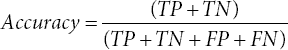
<math display="block" overflow="scroll"><mi>A</mi><mi>c</mi><mi>c</mi><mi>u</mi><mi>r</mi><mi>a</mi><mi>c</mi><mi>y</mi><mo>=</mo><mfrac><mrow><mo>(</mo><mrow><mi>T</mi><mi>P</mi><mo>+</mo><mi>T</mi><mi>N</mi></mrow><mo>)</mo></mrow></mrow><mrow><mo>(</mo><mrow><mi>T</mi><mi>P</mi><mo>+</mo><mi>T</mi><mi>N</mi><mo>+</mo><mi>F</mi><mi>P</mi><mo>+</mo><mi>F</mi><mi>N</mi></mrow><mo)</mo></mrow></mrow></mfrac></math>

### 7.4.2 精确率

精确率，又被称为正预测值的比例。与现有方法相比，建议的研究要精确得多。`图 7.4` 提供了建议方法与现有方法精确率的比较。

(7.7)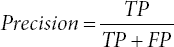
<math display="block" overflow="scroll"><mi>P</mi><mi>r</mi><mi>e</mi><mi>c</mi><mi>i</mi><mi>s</mi><mi>i</mi><mi>o</mi><mi>n</mi><mo>=</mo><mfrac><mrow><mi>T</mi><mi>P</mi></mrow><mrow><mi>T</mi><mi>P</mi><mo>+</mo><mi>F</mi><mi>P</mi></mrow></mfrac></math>

### 7.4.3 召回率


召回率（Recall），也称为灵敏度或真阳性率，代表了搜索并恢复的实例数量。与传统方法相比，所提方法具有最高的召回率。图 7.5 提供了所建议方法与现有方法在召回率方面的对比。

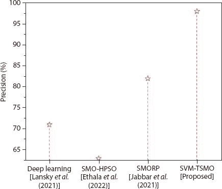

图 7.4 现有方法与所提方法的精确率。

(7.8)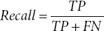
<math display="block" overflow="scroll"><mi>R</mi><mi>e</mi><mi>c</mi><mi>a</mi><mi>l</mi><mi>l</mi><mo>=</mo><mfrac><mrow><mi>T</mi><mi>P</mi></mrow><mrow><mi>T</mi><mi>P</mi><mo>+</mo><mi>F</mi><mi>N</mi></mrow></mfrac></math>

### 7.4.4 F1 分数

F1 指数是一个统一指标，同时考虑了系统清晰度和记忆的频率和幅值的调和平均值。其主要目的是评估两种方法的相对优劣，较高的 F1 分数表示系统效率更高。与旧方法相比，所提方法具有更好的 F1 分数。图 7.6 展示了新旧方法 F1 指数的对比。

(7.9)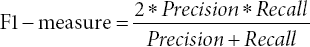
<math display="block" overflow="scroll"><mtext>F</mtext><mn>1</mn><mo>&#x2212;</mo><mtext>measure</mtext><mo>=</mo><mfrac><mrow><mn>2</mn><mo>\*</mo><mi>P</mi><mi>r</mi><mi>e</mi><mi>c</mi><mi>i</mi><mi>s</mi><mi>i</mi><mi>o</mi><mi>n</mi><mo>+</mo><mi>R</mi><mi>e</mi><mi>c</mi><mi>a</mi><mi>l</mi><mi>l</mi></mrow><mrow><mi>P</mi><mi>r</mi><mi>e</mi><mi>c</mi><mi>i</mi><mi>s</mi><mi>i</mi><mi>o</mi><mi>n</mi><mo>+</mo><mi>R</mi><mi>e</mi><mi>c</mi><mi>a</mi><mi>l</mi><mi>l</mi></mrow></mfrac></math>
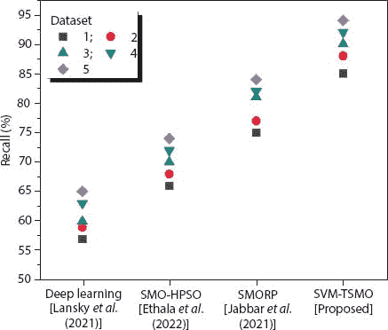

图 7.5 现有方法与所提方法的召回率百分比。

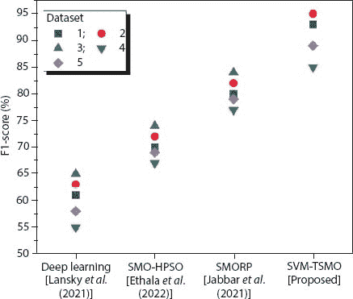

图 7.6 现有方法与所提方法的 F1 指数。

## 7.5 结论

跟上最新的安全进展涉及入侵的检测和防御。鉴于大多数活动高度依赖网络和信息系统，入侵检测和防御都至关重要。目前已有多种方法被用于开发入侵检测系统，其中带有 `TSMO` 的 `SVM` 等机器学习算法起着至关重要的作用。推荐方法与其他三种技术之间的比较结果表明，在相同的标准下，所建议的方法在入侵检测方面的表现要好得多。

## 参考文献

1.  Jabbar, A.H. and Alshawi, I.S., Spider monkey optimization routing protocol for wireless sensor networks. *Int. J. Electr. Comput. Eng.*, 11, 3, 2432–2442, 2021, doi: 10.1159/ijece.v11i3.
2.  Halima, A. and Sundartham, K., Machine learning based intrusion detection system, in: *3rd International Conference on Trends in Informatics (ICOEI)*, 2019, doi: 10.1109/ICOEI.2019.886274.
3.  Azizan, A.H. et al., A machine learning approach for improving performance of network detection systems. *Ann. Technol. Comput.*, 5, 201–208, 2021, doi: 10.3316/AETC.2021.0525.
4.  Disha, R. and Waheed, S., Performance analysis of machine learning models for intrusion detection system using Gini Impurity-based Random Forest (`GIWRF`). *Cybersecurity*, 5, 1, 2022, doi: 10.1186/s42400-021-00103-8.
5.  Abubakar, A. and Pranggono, B., Machine learning based intrusion detection system for software defined networks, in: *Seventh Conference on Emerging Security Technologies (EST)*, 2017, doi: 10.1109/EST.2017.8090413.
6.  Verma, A. and Ranga, V., Machine learning based intrusion detection systems for IoT applications. *Pers. Commun.*, 111, 4, 2287–2310, 2020, doi: 10.1007/s11277-019-0698-8.
7.  Da Costa, K.A. et al., Internet of Things: A survey on machine learning-based intrusion detection approaches. *Comput. Netw.*, 151, 147–157, 2019, doi: 10.1016/j.comnet.2019.0123.
8.  Lansky, J. et al., Deep learning-based intrusion detection: a review. *IEEE Access*, 9, 10157–10159, 2021, doi: 10.1109/ACCESS.2021.30972.
9.  Alaily, M., Effectiveness of machine learning based intrusion detection, in: *Future Data*, 2019.
10. Asharf, J., Understanding the machine learning based intrusion detection. *Electronics*, 9, 7, 75, 2020, doi: 10.3390/e907075.
11. Rahman, M., Scalable machine-based intrusion detection for smart cities. *Sustain. Cities*, 6, 10234, 2020.
12. Sarker, I.H., A review of machine learning based intrusion detection. *Symmetry*, 12, 5, 6689, 2020.
13. Dang, Q.-V., Deep learning-based intrusion detection, in: *2019 5th International Conference on Data and Security (FDS)*, 2019.
14. Idrissi, I., Deep learning-based intrusion detection, in: *2020 IEEE 5th International Conference on Data and Security (FDS)*, 2020.
15. Sethi, K., Deep reinforcement learning based intrusion detection for cloud infrastructure, in: *2020 IEEE International Conference on Communication, Systems and Networks (COMSNETS)*, 2020.
16. Ethala, S. and Kumarappan, A., A hybrid spider monkey and hierarchical swarm optimization approach for intrusion detection on Internet of Things. *Sensors*, 22, 21, 8566, 2022.
17. Wang, Z., Deep learning-based intrusion detection with adversaries. *IEEE Access*, 6, 38367–38384, 2018.
18. Kumar, G., MLEsIDS: Machine learning-based ensembles for intrusion detection systems-a review. *J. Supercomput.*, 76, 11, 8938–8971, 2020.
19. Narayanan, G., PSO-tuned support vector machine metamodels for assessment of turbulent flows in pipe bends. *Eng. Comput.*, 37, 3, 981–1001, 2019.
20. Bhattacharya, S., A comparative analysis on prediction performance of regression models during machining of composite materials. *Materials*, 14, 21, 6689, 2021.
21. Shaik, K., Big data analytics framework using squirrel search optimized gradient boosted decision tree for heart disease diagnosis. *App. Sci.*, 13, 9, 5236, 2023.


#1 计算机应用硕士系，MEASI 信息技术学院，Royapettah, 钦奈纳，印度

#2 BCA 系，新学院（The New College），钦奈纳，印度

#3 科学与工程系，Sathyabama 科学与技术学院，钦奈纳，印度

### 摘要

医疗物联网（IoMT）是一个新兴领域，在识别和管理各种疾病方面为患者和医疗保健提供者提供了许多有价值的益处。尽管具有这些优势，安全性仍然是一个关注的问题。IoMT 设备包含大量的临床数据，包括姓名、地址和病史等个人信息，这使得数据隐私和安全的维护面临挑战。由于缺乏经验的用户安全实践能力薄弱，以及可能损害敏感医疗数据的各种中间攻击泛滥，IoMT 非常容易受到安全漏洞。为了解决这些问题，我们建议使用多层粒子群优化支持向量机（`SVM-MPSO`）来增强 IoMT 数据安全。实验分析表明，建议的技术优于当前系统。所提方法可以使用准确率、精确率、安全性和敏感等多种标准进行评估。研究结果表明，推荐的方法增强了安全措施。

**关键词：** 医疗物联网，安全与隐私，机器学习，优化，智能医疗系统

## 8.1 引言

医疗物联网（IoMT）已成为处理患者健康数据的新技术。它主要在家庭、医院和身体传感器中发挥多种用途。IoMT 环境由大量的医疗设备、传感器和其他物品组成。此外，这些有效技术有能力覆盖特定的身体表面。得益于 IoMT 系统的快速发展 `[1]`，医疗业务可以轻松管理医疗识别，医生协助早期识别疾病并有效诊断。

尽管 IoMT 应用在过去几年稳定增长，但安全和隐私仍然是主要问题。由于通过 IoMT 架构存储的健康数据包含许多医疗信息，对其进行管理至关重要。物联网的网络的网络使其容易受到各种攻击，这些攻击可能会严重影响其效率。结果是它丢失了所有关键信息。当医疗设备或传感器未经过适当授权或验证，当用户不理解数据加密的需要，当设备接口未得到良好保护时，整个系统就会面临风险。为了使 IoMT 系统有效，它必须包含身份验证程序以保持患者信息的安全和隐私 `[2]`。基于 IoMT 的智能医疗系统如图 `Figure 8.1` 所示。

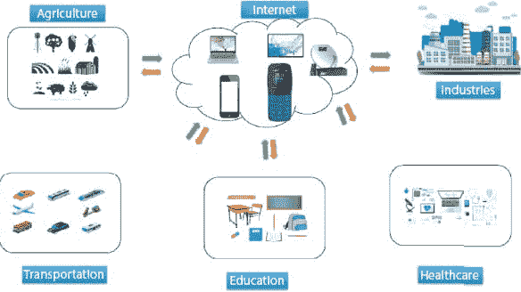

**Figure 8.1** IoMT 智能医疗系统。

经济从智能医疗系统（SHSs）中受益巨大，这现在已成为其不可或缺的一部分。远程医疗、智能药物以及医疗资源的本地和远程监控只是 IoMT 对 SHSs 增长至重要的几个例子。患者遵循医生建议并根据治疗调整行为的程度对于该过程的成功至关重要。物联网是指相互连接的具有传感器功能的医疗设备网络。通过减少不必要的就诊次数，IoMT 有可能减轻医疗机构的负担。此外，它为跨医疗部门的私人医疗数据交换提供了一个安全的数据传输环境。IoMT 的实际应用提高了人们的生活质量。

最近，研究社区对安全问题了越来越多的关注 `[3]`。数据安全涉及在数据存储和传输期间采取措施，以保护数据的真实性、准确性和完整性。此外，它确保只有授权人员可以访问数据并进行任何更改。在开发 SHS 时，还需要考虑隐私保护（`PP`）。当信息通过不安全的路由发送时，会考虑到其严重性和敏感性。`PP` 存在主题内容和环境限制。内容隐私防止敏感医疗数据泄露，但保护患者身份可能是挑战性的，因为攻击者可以通过了解治疗医生的身份很容易判断患者的健康状况。上下文隐私也必须保护。“上下文隐私”的概念涉及通信背景信息的保护。物联网 SHS 使用了多种非对称和对称加密技术来保护用户数据 `[4]`。`Figure 8.2` 显示了系统中增强性的系统框。


**Figure 8.2** 使用机器学习增强 IoMT 安全性的系统图。

本文的其余部分如下所示。在 `section 8.2` 中，我们将审查现有工作。所提方法的理论详细介绍在 `section 8.3]` 中。在 `section 8.4` 中，我们将讨论我们使用的指标和获得的结果。报告的最后一部分将总结研究结果。


Ahmed *et al.* \[5\] 概述了若干种联邦学习（FL）架构以及未来基于医疗物联网（IoMT）的联邦学习架构技术。此外，他们探索了如何利用物理层安全来有效保护基于 FL 的 IoMT 中的数据隐私。他们讨论了该领域的当前研究，以及与 IoMT 中物理层安全（PLS）辅助的联邦学习相关的重要研究问题。此外，他们展示了一个案例研究，表明与非聚类等效设备相比，对 IoMT 设备进行聚类可以提高基于 FL 的 IoMT 网络的秘密性性能。Awotunde *et al.* \[6\] 讨论了部署基于人工智能的 IoMT（`AiIoMT`）系统时涉及的科研障碍，以及在医疗系统中实施此类系统的潜在益处。该章节还介绍了一种基于 `AiIoMT` 的持续患者监测和诊断架构。该模型使用一组细胞学图像通过了验证，并在多个指标（包括多个参数）上进行了评分。结果显示诊断准确率提高到了 99.5%，表明人工智能（AI）方法是 IoMT 相关模型疾病诊断的潜在方法。Kavitha *et al.* \[7\] 展示了如何利用 IoMT 和深度学习（DL）算法观察老年人的物理行为，以便进行更快的评估和更好的治疗方案。附着在个人胸部、左踝和右臂的可穿戴传感器收集数据，并通过 IoMT 设备传输到整合的云端和数据分析层。为了确定身体哪些部位参与了特定动作，`MapReduce` 框架与具有改进政治优化器的复杂复值深度卷积神经网络（`CNN`）配合使用，该分类器与其同类产品相比，具有更高的灵活性和优越的性能。Rehman *et al.* \[8\] 深入研究了关于医疗领域区块链技术与联邦学习交叉的文献。该研究的目标是构建一个基于区块链、启用 IDS 的医疗 5.0 系统，该系统能够通过传感器监测患者，并为医生提供根据疾病预测病程进行定期诊断和治疗所需的数据。

这项研究的结果表明，所提出的系统是对医疗监测方法的成功优化。该框架的设计依赖于边缘计算，它使用混合加密方法保护用户隐私，并额外减轻了主服务器的负担。通过对共同特征使用基于 `Laplacian noise`（拉普拉斯噪声）的差分隐私进一步加强了安全性，确保即使面对对手，传输的数据也保持私密性。在基准数据集上的实验结果显示，关键系统性能指标的变化与通信的梯度体积的变化以及参与人数的比例不成正比 \[9\]。机器学习已有效用于解决广泛的网络问题，包括路由、流量工程、资源分配和安全。近期，使用基于 `ML` 的方法来增强多种物联网（IoT）应用的情况呈增加趋势。虽然关于大数据分析和 `ML` 的研究非常丰富，但针对物联网医疗行业开发基于 `ML` 的大数据分析方法的研究仍然匮乏。Li *et al.* \[10\] 深入探讨了机器学习如何被用于分析海量医疗数据。Abbas *et al.* \[11\] 提出了一种基于 IoMT 的健康信息区块链辅助安全数据管理架构，以促进患者数据的安全传输并提高医疗系统的扩展性和可访问性。所提出的区块链辅助安全数据管理框架（`BSDMF`）允许信息在本地和远程服务器（例如位于云端和位于用户本地网络的服务器）之间为了医疗目的进行安全传输。为了跨连接节点提供安全数据管理和传输，IoMT 相关安全架构利用了区块链技术。人工智能是一个全新且动态的概念，将彻底改变 IoMT 相关的应用和创新。

在基于 IoMT 的诊断和监测中使用 `AI` 可以加速过程并减少工作量。因此，该节探讨了可能使用 `AI` 的 IoMT 相关系统的应用范围。该章节还讨论了 AI 赋能的 IoMT 带来的若干突出潜力和研究问题。除了通过缩短传统检测方法所需的评估时间来减轻医疗系统的工作量外，该技术还被用于实现相当准确的识别率。随着基于 IoMT 的技术持续使用 `AI`，医疗领域的人工干预将减少，这将极大增强医疗监测、诊断、分析、预测以及药物和疫苗的开发 \[12\]。由于 IoMT 对敏感数据的安全措施松散，对患者隐私的担忧增加。传感器节点发送的最新信息无法保证真实。因此，一个基于区块链的系统是关重要的。无论使用何种网络连接，医疗人员都能通过更安全的身份验证方法获取患者的医疗数据。Al-Otaibi \[13\] 提供了一种利用机器学习的新型安全认证方法。在他们的研究中，他们使用 K 近邻和 `ML` 通过智能合约来检测并认证 IoMT 环境下的动态攻击（`KNN-MLSC`）。它增加了医生和患者的安全性，减少了等待时间并保护了个人信息。

## 8.3 提方法

需要提高医疗物联网应用的安全性。因此，我们建议使用支持向量机和多层粒子群优化（`SVM-MPSO`）来保护数据。下面将详细介绍所提方法。该技术的步骤如图 8.3 所示。


**图 8.3** 提方法的示意图。

### 8.3.1 数据收集

### 8.3.2 数据预处理


根据指定数据集的原始格式构建了一个包含 14 个特征的新数据集。由于大多数数据包不包含任何内容，我们删除了包含数据包本身的 `payload` 特征。取而代之，我们实现了一个持续时间特征，该特征将之前单独的开始时间和结束时间字段的功能结合在一起。为了消除高值特征的偏差，在数据归一化步骤中使用了 Min-Max 方法将属性缩放到 `[0,1]` 之间，相应的数学公式如下：

(8.1)
```math
<math display="block" overflow="scroll"><msup><mi>Z</mi><mo>&#x2032;</mo></msup><mo>=</mo><mfrac><mrow><mi>z</mi><mo>&#x2212;</mo><mi>min</mi><mrow><mo>(</mo><mi>z</mi><mo>)</mo></mrow></mrow><mrow><mi>max</mi><mrow><mo>(</mo><mi>z</mi><mo>)</mo></mrow><mo>&#x2212;</mo><mi>min</mi><mrow><mo>(</mo><mi>z</mi><mo>)</mo></mrow></varepsilon></mfrac></math></math>
``` 

大多数分类器不接受类别型特征；因此，采用了数据映射方法将它们转换为数值。

### 8.3.3 支持向量机

作为一种监督式机器学习分类方法，`SVM` 算法寻找跨类别的最大分离超平面，以区分正样本和负样本。由于核控制了分离超平面的形状，根据数据集的性质，可以使用多个核作为 `SVM` 方法的一部分。当数据可以沿直线进行分离时，可以使用线性核将超平面描述为线性方程。然而，当数据不可线性可分时，则需要其他核。高斯核是这种情况下使用的合适核的一个示例。该核将输入数据转换为更大的特征空间 `[15]`。

(8.2)
```math
<math display="block" overflow="scroll"><mi>l</mi><mrow><mo>(</mo><mi>y</mi><mo>)</mo></mrow><mo>=</mo><msup><mi>u</mi><mi>D</mi></msup><mi>&#x03A6;</mi><mrow><mo>(</mo><mi>y</mi><mo>)</mo></mrow><mo>+</mo><mi>p</mi></math></math
```

`SVM` 模型的基本目标是选择最优划分类别并使任意两个数据点之间最小距离（间隔）最大的超平面。从这个意义上说，所有的边界点都是支持向量。图 8.4 显示了该系统的基本变体——线性 `SVM` 模型的简化表示。

最优超平面方程如下。

(8.3)
```math
![![m a r g i n equals u Superscript upper D Baseline upper Phi left-parenthesis y right-parenthesis plus p] = StartFraction z minus min left-parenthesis z right-parenthesis Over max left-parenthesis z right-parenthesis minus min left-parenthesis z right-parenthesis EndFraction] 
<math display="block" overflow="scroll"><msup><mi>Z</mi><mo>&#x2032;</mo></msup><mo>=</mo><mfrac><mrow><mi>z</mi><mo>&#x2212;</mo><mi>min</mi><mrow><mo>(</mo><mi>z</mi><mo>)</mo></mrow></mrow><mrow><mi>max</mi><mrow><mo>(</mo><mi>z</mi><mo>)</mo></mrow><mo>&#x2212;</mo><mi>min</mi><mrow><mo>(</mo><mi>z</mi><mo>)</mo></mrow></varepsilon></mfrac></math>

```

### 8.3.4 多层粒子群优化

`MLPSO` 是一种随机搜索方法，模拟了昆虫的集群和迁徙行为。群体中每个部分的通常策略是保护每条信息，在邻近区域完成每项信息，并无论位于何处都改变信息中心。


(8.4)<math display="block" overflow="scroll"><mi>i</mi><mi>t</mi><mi>e</mi><mi>r</mi><mrow><mo>(</mo><mrow><mi>j</mi><mo>+</mo><mn>1</mn></mrow><mo>)</mo></mrow><mo>=</mo><mi>i</mi><mi>t</mi><mi>e</mi><mi>r</mi><mrow><mo>(</mo><mi>j</mi><mo>)</mo></mrow><mo>.</mi><mi>z</mi><mo>+</mo><msub><mi>c</mi><mi>i</mi></msub><mo>.</mi><mi>R</mi><mi>a</mi><mi>n</mi><msub><mi>d</mi><mi>j</mi></msub><mo>.</mi><mrow><mo>(</mo><mrow><msub><mi>b</mi><mrow><mi>b</mi><mi>e</mi><mi>s</mi><mi>t</mrow></msub><msup><mrow><mrow><mo>(</mo><mi>j</mi><mo>)</mo></mrow></mrow><mo>&#x22C6;</mo></msup><msub><mi>s</mi><mrow><mi>b</mi><mi>e</mi><mi>s</mi><mi>t</mrow></msub><mrow><mo>(</mo><mi>j</mi><mo>)</mo</mrow><mo>&#x2212;</mo><msub><mi>z</mi><mi>j</mi></msub></mrow><mo)</mo></mrow></math> (8.5)<math display="block" overflow="scroll"><msub><mi>z</mi><mi>j</mi></msub><mrow><mo>(</mo><mrow><mi>i</mi><mi>t</mi><mi>e</mi><mi>r</mi><mo>+</mo><mn>1</mn></mrow><mo>)</mo></mrow><mo>=</mo><msub><mi>z</mi><mi>j</mi></msub><mrow><mo>(</mo><mrow><mi>i</mi><mi>t</mi><mi>e</mi><mi>r</mrow><mo>)</mo></mrow><mo>+</mo><msub><mi>h</mi><mi>j</mi></msub><mrow><mo>(</mo><mrow><mi>i</mi><mi>t</mi><mi>e</mi><mi>r</mi><mo>+</mo><mn>1</mn></mrow><mo>)</mo></mrow></math>

其中 `iter` 表示第 `j` 代迭代，`Rand[j]` 表示 0 到 1 之间均匀分布的随机整数范围，`z[j]` 表示粒子的唯一速度值，`h` 表示惯性权重，它确定了粒子在当前速度之前的速度，并作为全局搜索算法和局部搜索能力的混合体。

 

**图 8.5** MLPSO 算法流程图。

MLPSO 方法的收性和准确性都会随着惯性重的减小而提高。为了提高 MLPSO 算法的精度，可以计算惯性权重因子。

### 8.3.5 性能评估

评估了若干性能标准，如准确率、精确率、敏感性、安全性和特异性，以确定所提方法的性能。

### 8.3.5.1 准确率

衡量准确率的标准方法是加权算术平均，也称为精确值的倒数。准确率衡量了对安全数据的精确分类。表 8.1 展示了所提方法与现有方法的准确率。

准确率由以下公式确定：

(8.6)<math display="block" overflow="scroll"><mi>A</mi><mi>c</mi><mi>c</mi><mi>u</mi><mi>r</mi><mi>a</mi><mi>c</mi><mi>y</mi><mo>=</mo><mfrac><mrow><mi>T</mi><mi>P</mi><mo>+</mo><mi>T</mi><mi>N</mi></mrow><mrow><mi>T</mi><mi>P</mi><mo>+</mo><mi>T</mi><mi>N</mi><mo>+</mo><mi>F</mi><mi>P</mi><mo>+</mo><mi>F</mi><mi>N</mi></mrow></mfrac></math>

### 8.3.5.2 精确率

在信息检索领域，精确率是所有找到的结果中相关观察的数量。它是实际正确的文档百分比，也称为正预测率。表 8.2 展示了现有方法的精确率。

(8.7)<math display="block" overflow="scroll"><mi>P</mi><mi>r</mi><mi>e</mi><mi>c</mi><mi>i</mi><mi>o</mi><mi>n</mi><mo>=</mo><mfrac><mrow><mi>T</mi><mi>P</mi></mrow><mrow><mi>T</mi><mi>P</mi><mo>+</mo><mi>F</mi><mi>P</mi></mrow></mfrac></math>

**表 8.1** 准确率对比。

| 方法 | 准确率 (%) |
| --- | --- |
| Deep CNN (Kavitha et al., 2022) | 91 |
| Blockchain (Rehman et al., 2022) | 85 |
| KNN (Al-Otaibi, 2022) | 73 |
| SVM-MLPSO (Proposed) | 98 |

**表 8.2** 精确率对比。

| 方法 | 精确率 (%) |
| --- | --- |
| Deep CNN (Kavitha et al., 2022) | 83 |
| Blockchain (Rehman et al., 2022) | 75 |
| KNN (Al-Otaibi, 2022) | 85 |
| SVM-MLPSO (Proposed) | 97.5 |

### 8.3.5.3 敏感性

敏感性是真正与真正加假负之比，决定了测试检测正实例的能力。它的计算方法为安全数据的正分类，也可称为真正。表 8.3 展示了新旧策略的敏感性。

敏感性通过以下公式计算：

(8.8)<math display="block" overflow="scroll"><mi>T</mi><mi>r</mi><mi>e</mi><mtext>&#00A0;</mi>P</mi><mi>s</mi><mi>t</mi><mi>i</mi><mi>v</mi><mi>e</mi><mtext>&#00A0;</mi>R</mi><mi>a</mi><mi>t</mi><mo>=</mo><mfrac><mrow><mi>T</mi><mi>P</mi></mrow><mrow><mi>T</mi><mi>P</mi><mo>+</mo><mi>F</mi><mi>N</mi></mrow></></math>

### 8.3.5.4 特异性

特异性衡量在实际条件不存在时对安全数据的负分类。它被表示为假正率或真负率。表 8.4 展示了现有方法与所提方法的特异性。

**表 8.3** 敏感性对比。

| 方法 | 敏感性 (%) |
| --- | --- |
| Deep CNN (Kavitha et al., 2022) | 70 |
| Blockchain (Rehman et al., 2022) | 87 |
| KNN (Al-Otaibi, 2022) | 79 |
| SVM-MLPSO (Proposed) | 96 |

**表 8.4** 特异性对比。

| 方法 | 特异性 (%) |
| --- | --- |
| Deep CNN (Kavitha et al., 2022) | 70 |
| Blockchain (Rehman et al., 2022) | 80 |
| KNN (Al-Otaibi, 2022) | 85 |
| SVM-MLPSO (Proposed) | 95 |

**表 8.5** 安全性对比。

| 方法 | 安全性 (%) |
| --- | --- |
| Deep CNN (Kavitha et al., 2022) | 85 |
| Blockchain (Rehman et al., 2022) | 73 |
| KNN (Al-Otaibi, 2022) | 90 |
| SVM-MLPSO (Proposed) | 97.6 |

它由以下公式确定：

(8.9)<math display="block" overflow="scroll"><mi>S</mi><mi>p</mi><mi>e</mi><mi>c</mi><mi>i</mi><mi>f</mi><mi>i</mi><mi>c</mi><mi>i</mi><mi>t</mi><mi>y</mi><mo>=</mo><mfrac><mrow><mi>T</mi><mi>P</mi></mrow><mrow><mi>T</mi><mi>P</mi><mo>+</mo><mi>F</mi><mi>P</mi></mrow></mfrac></math>

### 8.3.5.5 安全性


安全指标是一组相互关联的维度（根据标准进行测量），它允许衡量针对恶意攻击可能导致的潜在损害或损失的防护程度。表 8.5 描述了当前技术与所提技术之间的安全性对比。

## 8.4 结论
本研究使用了 `SVM-MLPSO` 方法来保护数据。虽然所提技术为医疗物物联网（IoMT）应用提供了卓越的安全性特征，但在实际场景中使用时，其某些缺点也显得而易见。与其他方法相比，粒子群优化方法产生了更准确的结果。所需的图表表明，在不使用任何特征提取技术的情况下，采用 `MLPSO` 的建议策略的准确率提高到了 99%。与当前方法中的观测值相比，所提方法提供了 98% 的准确率，要高得多。此外，`MLPSO` 的迭代值提供了最优结果，在整个过程中提高了预测值和量化评分。未来可以扩展这项采用 `MLPSO` 的研究，涵盖多种云计算平台，这将进一步丰富具有高安全特性的完整数据集。通过考虑到在所有用户可能使用机器学习方法发送和接收各种数据段的情况下，内部攻击与外部攻击的区别，这种扩展也变得可行。

## 参考文献
1. 1. Khatiwada, P. and Yang, B., IoMT 设备中数据安全与隐私的概述：性能指标、优点、缺点与挑战，在：*pHealth*, 第 2022 卷，页码 126–136, 2022, doi:10.3233/SHTI220970.
2. 2. Khan, I.A. *et al.*, XSRU-IoMT: 用于医疗物联网网络中威胁检测的可解释简单循环单元。*Future Gener. Comput. Syst.*, 127, 181–193, 2022, doi: 10.1016/j.future.2021.09.010.
3. 3. Vaiyapuri, T., Binbusayyis, A., Varadarajan, V., IoMT 赋能的智能医疗系统中安全、隐私与信任：当前与未来趋势的系统性综述。*Int. J. Adv. Comput. Sci. Appl. (IJACSA)*, 12, 2, 1–7, 2021, [`dx.doi.org/10.14569/IJACSA.2021.0120291`](http://www.dx.doi.org/10.14569/IJACSA.2021.0120291)。
4. 4. Mawgoud, A.A. *et al.,* 通过机器学习实现医疗物联网中的安全身份验证技术，arXiv 预印本 ArXiv:1912.12143，2019.
5. 5. Ahmed, J. *et al.*, 基于联邦学习的 IoMT 网络物理层安全。*IEEE J. Biomed. Health Inform.*, 27, 2, 691–697, 2023, doi: 10.1109/JBHI.2022.3173947.
6. 6. Awotunde, J.B., Folorunso, S.O., Ajagbe, S.A., Garg, J., Ajamu, G., AiIoMT: 用于增强医疗系统的基于 IoMT 的系统启用人工智能。在*Machine Learning for Critical Internet of Medical Things*，F. Al-Turjman, A. Nayyar (编)，)，Springer, Cham, 2022, [`doi.org/10.1007/978-3-030-80928-7`](https://www.doi.org/10.1007/978-3-030-80928-7)
7. 7. Kavitha, D. *et al.*, 使用复值 `CNN` 和优化器基于 IoMT 的高效健康监测。*Trans. Emerg. Telecommun.*, 33, 12, e4610, 2022, doi: 10.1002/ett.4610.
8. 8. Rehman, A. *et al.*, 基于区块链技术和联邦学习技术的安全医疗-0 系统。*Comput. Biol. Med.*, 150, 10619, 2022, doi: 10.1016/j.compbiomed.2022.10619.
9. 9. Nair, A. *et al.*, 基于边缘计算的 IoMT 大数据分析隐私保护 `Federated Learning` 框架。*Comput. Stand. Interfaces*, 86, 103720, 2023, doi: 10.1016/j.csi.2023.10320.
10. 10. Li, W. *et al.*, 针对 `IoT` 赋能智能医疗系统的基于机器学习的大数据分析综合综述。*Mob. Netw. Appl.*, 26, 1, 234–252, 2021, doi: 10.1007/s11074.
11. 11. Abbas, A. *et al.*, `IoT` 赋能智能医疗系统的基于机器学习的大数据分析综合综述。*Mob. Netw. Appl.*, 26, 1, 234–252, 2021, doi: 10.1007/s11074.
12. 12. Awotunde, J.B., Folorunso, S.O., Ajagbe, S.A., Garg, J., Ajamu, G., AiIoMT: 用于增强医疗系统的基于 IoMT 的系统启用人工智能。在*Machine Learning for Critical Internet of Medical Things*，F. Al-Turjman, A. Nayyar (编)，Springer, Cham, 2022, [`doi.org/10.1007/978-3-030-80928-7`](https://www.doi.org/10.1007/978-3-030-80928-7)
13. 13. Kavitha, D. *et al.*, 使用复值 `CNN` 和优化器基于 IoMT 的高效健康监测。*Trans. Emerg. Telecommun.*, 33, 12, e4610, 2022, doi: 10.1002/ett.4610.
14. 14. Rehman, A. *et al.*, 基于区块链技术和联邦学习技术的安全医疗-0 系统。*Comput. Biol. Med.*, 150, 10619, 2022, doi: 10.1016/j.compbiomed.2022.10619.
15. 15. Narayanan, G. *et al.*, `PSO` 调优的支持机模型用于弯管流评估。*Eng. Comput.*, 37, 3, 981–1001, 2019, doi: 10.1108/EC-05-2019-024.
16. 16. Shankar, R. *et al.*, 用于过程优化的混合粒子群引力搜索算法。*Processes*, 10, 3, 616, 2022, doi: 10.3390/pr1003016.

## 注
1. *1*通讯作者*: jayalakshmi.s@measiit.in

# 9 构建可持续通信：5G 和 6G 细胞网络的博弈论方法
### 摘要
细胞网络的发展为目前使用的数字技术增加了大量数据量。这些新的数字技术必须在客户和服务提供商之间维持平衡，这在服务质量（QoS）方面提出了问题。实时、音频、视觉和文本数据类型（每种都有特定需求）由服务提供商处理以满足客户需求。许多潜在的激励算法可以实现有效的 QoS。然而，这些计划中，移动网络运营商和访问点无法获得公平份额。此外，这些方案在高峰时期无法保证公平的通道分配，无法为端用户提供高效的 QoS。为了减轻化网络中的决策方法，我们提出了一种基于博弈论的动机策略。

***关键词:** 细胞网络、数字技术、博弈论、纳什均衡

## 9.1 引言


由于第五代（5G）无线网络对更广覆盖和容量的需求日益增长，超密集网络（UDNs）被用于解决一些最关键的问题。为了克服超越现状的基本瓶颈，人们设想在大范围内部署 UDNs [1]。第六代（6G）无线网络将带来比当前技术高出几个数量级的改进。然而，人们公认为，在严格的无线资源限制下，使用数学工具优化系统性能是一项严峻的挑战 [2]。目前的 UDN 通常依赖于数值仿真进行系统级性能优化，这种方法通常非常耗时，并且在极高密度的 6G 环境下被证明日益具有挑战性 [3]。因此，为建立一个实用的数学模型来优化 6G UDN 是至关重要的。在这项工作中，我们介绍了在实际环境中部署 UDN 时，必须仔细考虑的困难和问题。为了提高 UDN 的性能，我们回顾了有效的数学方法，包括博弈论和实时优化 [4]。此外，还涵盖了用于 UDN 的新兴技术。虽然其中一些已经在研究中，另一些预计将提高 UDN 性能以满足 6G 的需求。其中一些已经高效地应用在 UDN 中。实时优化与博弈论结合的最优技术（ROG）是一种以最小复杂性处理大规模 UDN 优化问题的强大工具，它具有重要性，我们首次展示了这项技术 [5]。然后，我们概述了在 UDN 中利用 ROG 的两种方法。最后，提供了几个 ROG 案例研究，以展示如何使用 ROG 解决 UDN 各种应用中的问题。

## 9.2 相关工作

研究 [6] 结合各种攻击场景，审视了设备到设备（D2D）通信中的物理层安全问题。利用博弈论描述了 5G 物联网（IoT）网络中授权用户与主动入侵者之间分级且多样化的交互，然后提出了几种可扩展的机器学习技术，以寻找不同代理之间的平衡状态。该研究 [7] 对用于减少或消除 5G 通信系统中干扰问题所采用的许多概念进行了历史性讨论，并对未来的研究方向提出了建议。研究 [8] 提供了一个全新的游戏化框架，利用几何建模，并在区域 5G 开放平台的共享框架下，评估了支持缓存的小小区基站（SBSs）。该研究 [9] 对无线通信资源分配领域进行了详尽分析。该综述首先通过对当前关于资源分配策略评估的链式无线网络论文，提供了一个通用的资源分配总结问题概述。文章 [10] 提供了一种简化约束的方法，为两个结合功率分配和信道划分的非凸混合整数问题寻找解决方案，这些问题并非理想非线性规划（MINLP）。研究 [11] 审视了具有无人机（UAV）窃听者的智能安全移动边缘计算（MEC）系统中的卸载决策选择的系统工程问题，其中窃听者可能会监听到从用户到计算接入点（CAP）传输的安全计算任务。研究 [12] 提出了一种移动边缘计算中高质量 VR 的自适应无线架构，VR 任务可以自适应卸载到 MEC 服务器，这些服务器的能力允许进一步提升性能。

## 9.3 方法论

由于其便携性，无线网络被广泛使用，小区通信目前是人口稠密的区域。随着技术的发展，小区网络的数据流量急剧增加。移动运营商（MNOs）实施速度最快的 4/5G LTE 以满足客户的需求。静态流量减少了输出，影响了吞吐量、响应时间和其他服务质量（QoS）参数。昂贵的技术已被证明远不能满足用户需求。通过建议的激励策略，用户在 QoS 水平获得服务。图 9.1 展示了一个人口稠密的区域，其中大多数居民使用手机和平板电脑等智能设备接入各种互联网。由于数据服务的过度使用，服务质量有所下降，并允许了许多新客户。特别是在高峰时期，形成了非常拥挤的环境；然而，非高峰时期的情况则不同。视频流等占用大量带宽的需求在高峰时期非常强劲。


5G 和 6G 通信模型如上方所示。每个用户都在线并进行下载和上传任务。我们使用基于游戏概念的集成数据卸载（IDO）来防止拥塞问题。

将这些数字加入公式 9.1，我们获得了 `MBS` 覆盖区域，没有任何 `AP` 能够访问该区域。在公式 9.1 中，`M`[`MBS]` 描述了没有卸载情况的 `MBS` 部分，`E`[`MBS]` 反映 `MBS` 覆盖的区域，`E`[`AP]` 显示 `AP` 覆盖的区域。使用以下类别来区分不同的流量：

(9.4)<math display="block" overflow="scroll"><mi>D</mi><mi>D</mi><mo>=</mo><mrow><mo>{</mo><mrow><mi>K</mi><mo>,</mo><mi>C</mi><mo>,</mo><mi>E</mi><mo>,</mo><mi>D</mi></mrow><mo>}</mo></mrow></math> 

对于公式 9.4，`DD` 显示不同形式的流量，`K` 反映当前信息，`C` 用于视频，`E` 用于音频，而 `AP` 集合代表文本数据。

(9.5)<math display="block" overflow="scroll"><mtext>B</mtext><mo>=</mo><mrow><mo>{</mo><mrow><msub><row><mtext>EB</mtext></mrow><mn>1</mn></msub><mo>,</mo><mi>E</mi><msub><mi>B</mi><mn>2</mn></msub><mo>,</mo><mi>E</mi><msub><mi>B</mi><mn>3</mn></msub><mo>&#x2026;</mo><msub><row><mtext>EB</mtext></mrow><mtext>m</mtext></msub></mrow><mo>}</mo></mrow></math> 

`P` 表示一组玩家，`EB` 表示公式 9.5 中从 `1` 到 `m` 的入口 [2]。对于每个 `AP`，不同的数据由上述两个集合的笛卡尔积表示：

(9.6)![upper E Subscript upper B Baseline upper D Subscript upper D Baseline equals StartSet left-parenthesis upper E Subscript 1 Sub Subscript upper K Subscript Baseline right-parenthesis comma left-parenthesis upper E Subscript 1 Sub Subscript upper C Subscript Baseline right-parenthesis comma left-parenthesis upper E Subscript 1 Sub Subscript upper E Subscript Baseline right-parenthesis comma left-parenthesis upper E Subscript 1 Sub Subscript upper D Subscript Baseline right-parenthesis comma left-parenthesis upper E Subscript 2 Sub Subscript upper K Subscript Baseline right-parenthesis comma left-parenthesis upper E Subscript 2 Sub Subscript upper C Subscript Baseline right-parenthesis comma left-parenthesis upper E Subscript 2 Sub Subscript upper E Subscript Baseline right-parenthesis comma left-parenthesis upper E Subscript 2 Sub Subscript upper D Subscript Baseline right-parenthesis comma ellipsis ellipsis EndSet](img/eq9-6.png)<math display="block" overflow="scroll"><msub><mi>E</mi><mi>B</mi></msub><msub><mi>D</mi><mi>D</mi></msub><mo>=</mo><mrow><mo>{</mo><mrow><row><mo>(</mo><row><mi>E</mi><msub><mi>B</mi><mrow><msub><mn>1</mn><mi>K</mi></msub></mrow></msub></row><mo>)</mo></row><mo>,</mo><row><mo>(</mo><row><mi>E</mi><msub><mi>B</mi><mrow><msub><mn>1</mn><mi>C</mi></></></mrow></msub></row><row><mo)</mo></row><mo>,</mo><row><mo>(</mo><row><mi>E</mi><msub><mi>B</mi><mrow><msub><mn>1</mn><mi>E</mi></msub></mrow></msub></row><row><mo>)</mo></row><mo>,</mo><row><mo>(</mo><row><mi>E</mi><msub><mi>B</mi><mrow><msub><mn>1</mn><mi>D</mi></msub></mrow></msub></row><row><mo)</mo></row><mo>,</mo><row><mo>(</mo><row><mi>E</mi><msub><mi>B</mi><mrow><msub><mn>2</mn><mi>K</mi></msub></mrow></msub></row><row><mo>)</mo></row><mo>,</mo><row><mo>(</mo><row><mi>E</mi><msub><mi>B</mi><mrow><msub><mn>2</mn><mi>C</mi></msub></mrow></msub></row><row><mo>)</mo></row><mo>,</mo><row><mo>(</mo><row><mi>E</mi><msub><mi>B</mi><mrow><msub><mn>2</mn><mi>E</mi></msub></mrow></msub></row><row><mo>)</mo></row><mo>,</mo><row><mo>(</mo><row><mi>E</mi><msub><mi>B</mi><mrow><msub><mn>2</mn><mi>D</mi></msub></mrow></msub></row><row><mo>)</mo></row><mo>,</mo><mo>&#x2026;</mo><mo>&#x2026;</mo></row><mo>}</mo></mrow></math>  

在公式 9.6 [1]，`E`[`B]`[`D]` 展示了在卸载场景下，各种流量是如何被接入点卸载的，包括实时、音频、视频和文本，每个 `EB` 的总流量为：

(9.7)<math display="block" overflow="scroll"><mi>E</mi><msub><mi>B</mi><mi>y</mi></msub><mo>=</mo><mi><mi</mi</mi><mi><mi><mi><mi><msub><mi>y</mi></msub></mo></row><mi>D</mi></mi></math>


(9.11)

<math display="block" overflow="scroll"><mi>T</mi><mi>h</mi><mi>r</mi><mi>o</mi><mi>u</mi><mi>g</mi><mi>h</mi><mi>p</mi><mi>u</mi><mi>t</mi><mrow><mo>(</mo><mrow><mi>t</mi><mi>h</mi><mi>r</mi></mrow><mo>)</mo></mrow><mo>=</mo><mi>T</mi><mi>h</mi><mi>r</mi><mi>o</mi><mi>u</mi><mi>g</mi><mi>h</mi><mi>p</mi><msub><mi>u</mi><mrow><mi>M</mi><mi>B</mi><mi>S</mi></mrow></msub><mo>+</mo><mi>T</mi><mi>h</mi><mi>r</mi><mi>o</mi><mi>u</mi><mi>g</mi><mi>h</mi><mi>p</mi><msub><mi>u</mi><mrow><mi>E</mi><mi>B</mi><mi>s</mi></mrow></msub></math>

在公式 9.11 中，`Throughput`[`MBS]`表示`MBS`的吞吐量，而`Throughput`[`EBs]`代表`EBs`自主决策的吞吐量。使用了多种方法来研究真实世界的构建以及它们如何相互作用。这涉及三个要素：参与者、策略和收益。它定义了参与者如何反应和做出决策，以及他们如何采取不同的立场并进行合作。收益函数如下：

(9.12)

<math display="block" overflow="scroll"><msub><mi>B</mi><mi>r</mi></msub><mstyle displaystyle="true"><munder><mo>&#x2211;</mo><mrow><mi>n</mi><mo>&#x2208;</mo><mi>D</mi><mi>D</mi></mrow></munder><mrow><msub><mi>&#x03B2;</mi><mi>m</mi></msub></mrow></mstyle><mfrac><mrow><msub><mi>f</mi><mi>m</mi></msub></mrow><mrow><mstyle displaystyle="true"><msub><mo>&#x2211;</mo><mrow><mi>r</mi><mo>&#x2208;</mo><mi>b</mi></mrow></msub><mrow><msub><mi>f</mi><mi>r</mi></msub></mrow></mfrac><mo>&#x2212</mo><msub><mi>&#x03C3;</mi><mrow><mi>r</mi><mi>m</mi></mrow></msub><msub><mi>f</mi><mrow><mi>r</mi><mi>m</mi></mrow></msub></math>

各种函数由公式 9.12 中的变量表示：`B`[`r]`是作用中的收益函数，`β`[`m]`显示了给予的奖励，而`σ`[`rm]`突出了为提供的激励所支付的代价。支付函数旨在评估基于 MBS 提供的激励和 EBs 卸载容量的模型的性能。当 AP 与其竞争对手竞争以增加其收入时，该游戏被称为非合作性游戏。游戏集中包含以下项：

(9.13)

<math display="block" overflow="scroll"><mi>G</mi><mi>a</mi><mi>m</mi><mi>e</mi><mrow><mo>(</mo><mi>S</mi><mo>)</mo></mrow><mo>=</mo><mrow><mo>{</mo><mrow><mi>B</mi><mi>f</mi><momo</mo><msub><mi>G</mi><mi>r</mi></msub><momo</mo><msub><mi>B</mi><mi>r</mi></msub></mrow><mo>}</mo></mrow></math>

在公式 9.13 中，`r` ∈ `B, S`阐明了游戏，`Bf`象征游戏中的 MBS 参与者，`EBs`和`G[`r]`代表参与者可以使用来获得最高收益的策略组，而`Br`是奖励或评分机制。在公式 9.14`5`中，`f`[`r]`展示了流量负载四边形的存在。`Q`、`R`、`S`是子空间。为了指示特定的实例负载，使用了下面的序对：

(9.14)

<math display="block" overflow="scroll"><msub><mi>f</mi><mi>r</mi></msub><mo>=</mo><mrow><mo>(</mo><mrow><msub><mi>f</mi><mi>O</mi></msub><momo</mo><msub><mi>l</mi><mi>K</mi></msub><momo</mo><msub><mi>f</mi><mi>G</mi></msub><momo</mo><msub><mi>f</mi><mi>D</mi></msub></mrow><mo>)</mo></math>
其中 `l`[`O]` = {`r`, `r`, ...}, `l`[`K]` = {`r`, `r`, ...`k`}, `l`[`G]` = {`r`, `r`, ...`g`}, 以及 `l`[`D]` = {`r`, `r`, ...`d`}。

### 9.3.1 纳什均衡

在上述游戏集的情况下，如果对于每个 `r` ∈ `B`，`B[`r`, f_r]` ≥ `B`[`r`, f_r]` 目标是完全 `f_r` ≥ 0，在某处，`B[`r`, f_r]` 仍然是 `r` 参与者的后续选择，假设额外的队伍 `f−r` `6` 的结果。`B[`r]` 在 `f_r` 上是凹的，而指定空间中的 `G[`r]` 是凸的。

(9.15)

<math display="block" overflow="scroll"><mi>G</mi><mo>=</mo><mrow><mo>{</mo><mrow><mo>(</mo><msub><mi>G</mi><mi>r</mi></msub><momo</mo><msub><mi>f</mi><mi>r</mi></msub></mo>)</mo></mrow><mo>&#x007C</mo><mi>r</mi><mo>&#x2208;</mo><mi>B</mi><msub><mi>&#x039B;</mi><mi>O</mi></msub><mo>&#x2264</mo><msub><mi>f</mi><mi>r</mi></msub><mo>&#x2264</mo><msub><mi>K</mi><mi>r</msub></mrow><mo>}</math>

数据使用一种考虑确定重要性的类型进行卸载；例如，视频数据的优先级可能高于文本数据。在确认其封装并看到 `Utlm` 继续到 `l` 后，我们移除二阶导数。以下方程给出了导数假设：

(9.16)

<math display="block" overflow="scroll"><mfrac><mrow><mo>&#x2202;</mo><msub><mi>B</mi><mi>r</mi></msub></mrow><mrow><mo>&#x2202;</mo><msub><mi>f</mi><mi>r</mi></msub></mrow></mfrac><mo>=</mo><mstyle displaystyle="true"><msub><mo>&#x2211;</mo><mrow><mi>n</mi><mo>&#x2208;</mo><mi>D</mi><mi>D</mi></mrow></msub><mrow><msub><mi>&#x03B2;</mi><mi>m</mi></msub></mrow></mstyle><mrow><mo>\[</mo><mrow><mfrac><mrow><mstyle displaystyle="true"><msub><mo>&#x2211;</mo><mrow><mi>n</mi><mo>&#x2208;</mo><mi>b</mi><mi>&#x039B;</mi><mi>n</mi><mo>&#x2260;</mo><mi>r</mi></mrow></msub><mrow><msub><mi>f</mi><mi>n</mi></msub></varepsilon></mrow><mrow><mstyle displaystyle="true"><msub><mo>&#x2211;</mo><mrow><mi>r</mi><mo>&#x2208;</mo><mi>b</mi></mrow></msub><mrow><msubsup><mi>f</mi><mi>r</mi><mn>2</mn></msubsup></mrow></mstyle></mrow></mfrac></mrow><mo>\]</mo></mrow><mo>&#x2212</mo><msub><mi>&#x03C3;</mi><mrow><mi>r</mi><mi>m</mi></mrow></msub></math>


偏导数规则被公式 9.16 \[7\]用于证明其凹性。元素 `∂` 表示偏导数，`β`[*m*] 显示为 Wi-Fi 提供的奖励，`f`[*n*] 表示重定向流量，而 `σ`[*rm*] 显示卸载该流量的金额。

关于 `f`[*n*] 的二阶导数，我们有如下式：

(9.17)![StartFraction partial-differential squared upper B Subscript r Baseline Over partial-differential squared f Subscript r Baseline EndFraction equals minus 2 left-bracket sigma-summation Underscript n element-of upper D upper D Endscripts beta Subscript m Baseline left-bracket StartFraction sigma-summation Underscript n element-of b upper Lamda n not-equals r Endscripts f Subscript n Baseline Over sigma-summation Underscript r element-of b Endscripts f Subscript r Superscript 3 Baseline right-bracket right-bracket](img/eq9-17.png)<math display="block" overflow="scroll"><mfrac><mrow><msup><mo>&#x2202;</mo><mn>2</mn></msup><msub><mi>B</mi><mi>r</mi></msub></mrow><mrow><msup><mo>&#x2202;</mo><mn>2</mn></msup><msub><mi>f</mi><mi>r</mi></msub></mrow></mfrac><mo>=</mo><mo>&#x2212;</mo><mn>2</mn><mrow><mo>\[</mo><mrow><mstyle displaystyle="true"><msub><mo>&#x2211;</mo><mrow><mi>n</mi><mo>&#x2208;</mo><mi>D</mi><mi>D</mrow></msub><mrow><msub><mi>&#x03B2;</mi><mi>m</mi></msub><mrow><mo>\[</mo><mrow><mfrac><mrow><mstyle displaystyle="true"><msub><mo>&#x2211;</mo><mrow><mi>n</mi><mo>&#x2208;</mo><mi>b</mi><mi>&#x039B;</mi><mi>n</mi><mo>&#x2260;</mo><mi>r</mi></mrow></msub><mrow><msub><mi>f</mi><mi>n</mi></msub></mrow></mstyle></mrow><mrow><mstyle displaystyle="true"><msub><mo>&#x2211;</mo><mrow><mi>r</mi><mo>&#x2208;</mo><mi>b</mrow></msub><mrow><msubsup><mi>f</mi><mi>r</mi><mn>3</mn></mtext></mrow></mstyle></mrow></mfrac></mrow><mo>\]</mo></mrow></mrow></mstyle></mrow><mo>\]</mo></mrow></mrow></math> 公式 9.15 \[8\]中的二阶导数显示出一个负乘数，事实证明在每种情况下结果将是不利的，这证明了 `B`[*r*] 是凹函数。`Um` 是凹的，如 `f`[*n*] 所示，而 `G`[*r*] 是凸的；因此，在游戏中存在纳什均衡。在公式 9.15 中，变量之前已经解释过了。

### 9.3.2 唯一纳什均衡

该游戏包含一个纳什均衡，如之前的向量 `f`[*n*] 所示。为了证明其唯一性并确保一致性，必须给出最优响应函数 `K`，这需要理解。可扩展性是三个前提之一（正性和单调性）。在这里，`R(`f`[*n*])` 描述了最优响应特征。

理想反应的最优结果是任何 `EB` 下载的所有流量都限制在 EB 的全能力范围内。在任何情况下，前者都不会那么好，且无法匹配后者。因此，这种限制可以用如下数学方式表示 \[9\]：

(9.18)<math display="block" overflow="scroll"><msub><mi>&#x03C3;</mi><mi>r</mi></msub><mstyle displaystyle="true"><msub><mo>&#x2211;</mo><mrow><mi>n</mi><mo>&#x2260;</mo><mi>r</mi></mrow></msub><mrow><msub><mi>f</mi><mi>n</mi></msub><mo>&#x003C;</mo><mi>&#x03B2;</mi></mrow></mstyle><mo>&#x21D2;</mo><mi>K</mi><mrow><mo>(</mo><mrow><msub><mi>f</mi><mi>r</msub></mrow><mo>)</mo></mrow><mo>&#x00E;</mo><mn>0</mn></math> 公式 9.18 中的变量是 `σ`[*r*]（卸载费），它提供了激励，以及 `K(`f`[*r*])`（最优响应特征）。上述连接符合游戏的正性属性。公式 9.15 中指定的组件 `AP` 的即速率将通过最优响应函数来实现收益增加。增加响应关系的是：

(9.19)<math display="block" overflow="scroll"><mn>0</mn><mo>&#x2264;</mo><msqrt><mrow><mfrac><mrow><mi>&#x03B2;</mi><mstyle displaystyle="true"><msub><mo>&#x2211;</mo><mrow><mi>n</mi><mo>&#x2260;</mo><mi>r</mi></mrow></msub><mrow><msub><mi>f</mi><mi>n</mi></msub></mrow></mstyle></mrow><mrow><msub><mi>&#x03C3;</mi><mi>r</mi></msub></mrow></mfrac></mrow></msqrt><mo>&#x2212;</mo><mstyle displaystyle="true"><msub><mo>&#x2211;</mo><mrow><mi>n</mi><mo>&#x2260;</mo><mi>r</mi></mrow></msub><mrow><msub><mi>f</mi><mi>n</mi></msub></mrow></mstyle><mo>&#x003C;</mo><msub><mi>K</mi><mi>r</mi></msub></math> 公式 9.19 展示了 \[10\],即单调增长；然而，为了证明其可扩展性，我们考虑了以下情景：


(9.20<math display="block" overflow="scroll"><mi>&#x03B1;</mi><msub><mi>K</mi><mi>r</mi></msub><mrow><mo>(</mo><mi>f</mi><mo>)</mo></mrow><mo>=</mo><mi>&#x03B1;</mi><mrow><mo>\[</mo><mrow><msqrt><mrow><mfrac><mrow><mi>&#x03B2;</mi><mstyle displaystyle="true"><msub><mo>&#x2211;</mo><mrow><mi>e</mi><mo>&#x2260;</mo><mi>p</mi></mrow></msub><mrow><msub><mi>f</mi><mi>e</mi></msub></mrow></mstyle></mrow><mrow><msub><mi>&#x03C3;</mi><mi>r</mi></msub></mrow></mfrac></mrow></msqrt><mo>&#x2212</mo><mstyle displaystyle="true"><msub><mo>&#x2211;</mo><mrow><mi>e</mi><mo>&#x2260;</mo><mi>p</mi></mrow></msub><mrow><msub><mi>f</mi><mi>e</mi></msub></mrow></mstyle></mrow><mo>\]</mo></mrow></math>

(9.21![upper K Subscript r Baseline left-parenthesis proportional-to f right-parenthesis equals StartRoot StartFraction beta sigma-summation Underscript e not-equals p Endscripts f Subscript e Baseline Over sigma Subscript r Baseline EndRoot minus alpha sigma-summation Underscript n not-equals r Endscripts f Subscript e Baseline equals StartRoot alpha EndRoot left-bracket NestedStartRoot StartRoot StartFraction beta alpha sigma-summation Underscript e not-equals p Endscripts f Subscript e Baseline Over sigma Subscript r Baseline EndRoot minus sigma-summation Underscript e not-equals p Endscripts f Subscript e Baseline NestedEndRoot right-bracket](img/eq9-21.png)<math display="block" overflow="scroll"><msub><mi>K</mi><mi>r</mi></msub><mrow><mo>(</mo><mrow><mo>&#x221D;</mo><mi>f</mi></mrow><mo>)</mo></mrow><mo>=</mo><msqrt><mrow><mfrac><mrow><mi>&#x03B2;</mi><mstyle displaystyle="true"><msub><mo>&#x2211;</mo><mrow><mi>e</mi><mo>&#x2260;</mo><mi>p</mi></mrow></msub><mrow><msub><mi>f</mi><mi>e</mi></msub></mrow></mstyle></mrow><mrow><msub><mi>&#x03C3;</mi><mi>r</mi></msub></mrow></mfrac></mrow></msqrt><mo>&#x2212</mo><mi>&#x03B1;</mi><mstyle displaystyle="true"><msub><mo>&#x2211;</mo><mrow><mi>n</mi><mo>&#x2260;</mo><mi>r</mi></mrow></msub><mrow><msub><mi>f</mi><mi>e</mi></mrow></mstyle><mo>=</mo><sqrt><mi>&#x03B1;</mi></msqrt><mrow><mo>\[</mo><mrow><msqrt><mrow><mfrac><mrow><mi>&#x03B2;</mi><mstyle displaystyle="true"><msub><mo>&#x2211;</mo><mrow><mi>e</mi><mo>&#x2260;</mo><mi>p</mi></mrow></msub><mrow><msub><mi>f</mi><mi>e</mi></msub></mrow></mstyle></mrow><mrow><msub><mi>&#x03C3;</mi><mi>r</mi></msub></mrow></mfrac></mrow></msqrt><mo>&#x2212</mo><mstyle displaystyle="true"><msub><mo>&#x2211;</mo><mrow><mi>e</mi><mo>&#x2260;</mo><mi>p</mi></mrow></msub><mrow><msub><mi>f</mi><mi>e</msub></mrow></varepsilon></mo></msqrt><mo>\]</mo></mrow></math>

在方程 20 和 21 中，变量 `Kr`（`αl`）显示了卸载所支付成本的最优响应函数（Best Response function）。`fe` 显示了已卸载的流量。通过结合方程 17 和 18 并对其进行简化，我们得到 `α√` 作为变化参数，它始终大于 0；因此，使用最优响应功能也是具有扩展性的。通过满足所有三个标准，可以确保最优响应函数是一个标准函数并满足纳什方程。

### 9.3.3 总体唯一均衡

游戏流量类型的总体唯一均衡可以计算为 10 处的：

(9.22)<math display="block" overflow="scroll"><mi>f</mi>(p)=[\left{\mfrac><mrow><mi>&#x03B2;</mi><mstyle displaystyle="true"><msub><mo>&#x2211;</mo><mrow><mi>e</mi><mo>&#x2260;</mo><mi>p</mi></mrow></msub><mrow><msub><mi>f</mi><mi>e</mi></msub></mrow></mstyle></mrow><mrow><msub><mi>&#x03C3;</mi><mi>r</mi></msub></mrow></mfrac></right><mo>&#x2212</mo><mo>\[</mo><mrow><msqrt><mrow><mfrac><mrow><mi>&#x03B2;</mi><mstyle displaystyle="true"><msub><mo>&#x2211;</mo><mrow><mi>e</mi><mo>&#x2260;</mo><mi>p</mi></mrow></msub><mrow><msub><mi>f</mi><mi>e</msub></varepsilon></varepsilon></varepsilon></mrow><mrow><msub><mi>&#x03C3;</mi><mi>r</mi></msub></mrow></mfrac></varepsilon></msqrt><mo>&#x2212</mo><mo>\[</mo><mrow><sqrt><mrow><mfrac><mrow><mi>&#x03B2;</mi><mstyle displaystyle="true"><msub><mo>&#x2211;</mo><mrow><mi>e</mi><mo>&#x2260;</mo><mi>p</mi></mrow></msub><mrow><msub><mi>f</mi><mi>e</msub></varepsilon></varepsilon></varepsilon></mrow><mrow><msub><mi>&#x03C3;</mi><mi>r</mi></msub></mrow></mfrac></right></right><mo>\]</mo></mrow></mn>0</mrow></msubsup></math> 

其中 `fn*`（表示为 `fn*`）在 `β` 取决于满足 18 和 19 中的两个要求时存在最优响应值 `f`，且超过任何一方都会接近限制。这带来了游戏的完全平衡。

MBS 的收益计算如下：

(9.23)<math display="block" overflow="scroll"><msub><mi>B</mi><mrow><mi>M</mi><mi>B</mi><mi>S</mi><mrow><mo>(</mo><mi>r</mi><mo>)</mo></mrow></mrow></msub><mo>=</mo><mrow><mo>(</mo><mrow><mi>&#x03B4;</mi><mo>&#x2212</mo><msub><mi>&#x03B2;</mi><mi>r</mi></msub></mrow><mo>)</mo></mrow><mstyle displaystyle="true"><msub><mo>&#x2211;</mo><mrow><mi>n</mi><mo>&#x2208;</mo><mi>b</mi></mrow></msub><mrow><msub><mi>f</mi><mrow><mi>e</mi><mrow><mo>(</mo><mi>r</mi><mo>)</mo></mrow></msub></mrow></mstyle></math></math>


其中 `r` ∈ `DD`，`δ` 是通过使用 `EBs` 进行卸载以消除拥塞的单位频谱，而 `β` 是针对 r 类型流量的财务激励。MBS 将通过优化其广义上的 `β` 激励来优化其在这一竞争性游戏中的效用。代入公式 9.16，最高效用收益如下：

(9.24)![upper B Subscript upper M upper B upper S left-parenthesis r right-parenthesis Baseline equals beta Subscript r Baseline left-parenthesis delta minus beta Subscript r Baseline right-parenthesis) left-bracket StartFraction left-parenthesis upper M minus 1 right-parenthesis) Over sigma-summation Underscript e left-parenthesis p right-parenthesis element-of upper B Overscript m Endscripts sigma Subscript e left-parenthesis p right-parenthesis Baseline EndFraction times sigma-summation Underscript e left-parenthesis p right-parenthesis element-of upper B Endscripts left-parenthesis 1 minus StartFraction left-parenthesis upper N minus 1 right-parenthesis) sigma Subscript e left-parenthesis p right-parenthesis Baseline Over sigma-summation Underscript e left-parenthesis p right-parenthesis element-of upper B Overscript m Endscripts sigma Subscript e left-parenthesis p right-parenthesis Baseline EndFraction) right-bracket](img/eq9-24.png)

```math
<math display="block" overflow="scroll"><msub><mi>B</mi><mrow><mi>M</mi><mi>B</mi><mi>S</mi><mrow><mo>(</mo><mi>r</mi><mo>)</mo></mrow></mrow></msub><mo>=</mo><msub><mi>&#x03B2;</mi><mi>r</mi></msub><mrow><mo>(</mo><mrow><mi>&#x03B4;</mi><mo>&#x2212;</mo><msub><mi>&#x03B2;</mi><mi>r</mi></msub></mrow><mo>)</mo></mrow><mrow><mo>\</mo><mrow><mfrac><mrow><mrow><mo>(</mo><mrow><mi>M</mi><mo>&#x2212;</mo><mn>1</mn></mrow><mo>)</mo></mrow></mrow><mrow><mstyle displaystyle="true"><msubsup><mo>&#x2211;</mo><mrow><mi>e</mi><mrow><mo>mo><mi>p</mi><mo>)</mo></mrow><mo>&#x2208;</mo><mi>B</mi></mrow><mi>m</mi></msubsup><mrow><msub><mi>&#x03C3;</mi><mrow><mi>e</mi><mrow><mo>mo><mi>p</mi><mo>)</mo></></></mrow></mstyle></mrow></mrow></mo><mo>&#x00D7;</mo><mstyle displaystyle="true"><munder><mo>&#x2211;</mo><mrow><mi>e</mi><mrow><mo>mo><mi>p</mi><mo>)</mo></mrow><mo>&#x2208;</mo><mi>B</mi></munder><mrow><mrow><mo>(</mo><mrow><mn>1</mn><mo>&#x2212;</mo><mn>1</mn><mo>&#x2212momo2111momomo</mo></mo><msub><mi>&#x03C3;</mi><mrow><mi>e</mi><mrow><mo>mo><mi>p</mi><mo>)</mo></></></></mrow><mstyle displaystyle="true"><true><mo>&#x2211;</mo><mrow><mi>e</mi><mrow><mo>mo><mi>p</mi><mo>)</mo></></></mo></mo> Over sigma-summation Underscript e left-parenthesis p right-parenthesis element-of upper B Overscript m Endscripts sigma Subscript e left-parenthesis p right-parenthesis Baseline EndFraction) right-bracket
```

当 `β` ≤ `max` 时，MBS 的特征是凸的，因为它可以被最大化。公平性必须在 `EBs` 之间实现。MBS 的效用可以通过以下几种方式计算 c09.xhtml#b01![upper B Subscript upper M upper B S left-parenthesis D right-parenthesis Baseline equals beta Subscript r Baseline left-parenthesis delta minus beta Subscript r Baseline right-parenthesis) left-bracket StartFraction ... (省略) ...-]](images/eq9-25.png)

```math
<math display="block" overflow="scroll"><msub><mi>B</mi><mrow><mi>M</mi><mi>B</mi><mi>S</mi><mrow><mo>(</mo><mi>D</mi><mo>)</mo></mrow></mrow></msub><mo>=</mo><msub><mi>&#x03B2;</mi><mi>r</mi></msub><mrow><mo>(</mo><mrow><mi>&#x03B4;</mi><mo>&#x2212;</mo><msub><mi>&#x03B2;</mi><mi>r</mi></msub></mrow><mo>)</mo></mrow><mo><mstyle displaystyle="true"><msub><mo>&#x2211;</mo><mrow><mi>e</mi><mrow><mo>mo><mi>p</mi><mo>)</mo></mrow><mo>&#x2208;</mo><mi>B</mi></mrow><mi>m</mi></msubsup><mi>log</mi><mrow><mo>(</mo><msub><mi>f</mi><mrow><mi>e</mi><mrow><mo>mo><mi>p</mi><mo>)</mo></varepsilon></msub><mo>)</mo></mrow></style></style></mo><mo>&#x2212;</mo><mrow><mo>(</mo><mrow><mstyle displaystyle="true"><msub><mo>&#x2211;</mo><mrow><mi>e</mi><mrow><mo>mo><mi>p</mi><mo>)</mo></varepsilon><mo>&#x2208;</mo><mi>D</mi><mi>D</mi></varepsilon></msub><msub><mi>&#x03B2;</mi><mi>p</mi></msub></mrow><mo>)</mo></mrow><mstyle displaystyle="true"><msub><mo>&#x2211;</mo><mrow><mi>e</mi><mrow><mo>mo&#x2208;</mo><mi>b</mi></varepsilon></msub><msub><mi>f</mi><mrow><mi>e</mi><mrow><mo>mo><mi>p</mi><mo>)</mo></varepsilon></msub></varepsilon></style></mo><mo>=</mo><mi>&#x03B4;</mi><mi>log</mi><mrow><mo>(</mo><mrow><mstyle displaystyle="true"><msub><mo>&#x220F;</mo><mrow><mi>e</mi><mrow><mo>mo><mi>p</mi><mo>)</mo></varepsilon><mo>&#x2208;</mo><mi>B</mi></varepsilon></msub><msub><mi>f</mi><mrow><mi>e</mi><mrow><mo>mo><mi>p</mi><mo>)</mo></varepsilon></msub></varepsilon></style></mo>)</mo></mo></varepsilon></style></math>
```


(9.26)!(images/eq9-26.png)
<math display="block" overflow="scroll"><mo>=</mo><mi>&#x03B4;</mi><mi>l</mi><mi>o</mi><mi>g</mi><msup><mrow><mo>(</mo><mrow><mstyle displaystyle="true"><msub><mo>&#x2211;</mo><mrow><mi>r</mi><mo>&#x2208;</mo><mi>D</mi><mi>D</mi></mrow></msub><mrow><msub><mi>&#x03B2;</mi><mi>r</mi></msub></varepsilon></mstyle></mrow><mo>)</mo></mrow><mi>N</mi></msup><mrow><mo>mo><mrow><mstyle displaystyle="true"><msub><mo>&#x220F;</mo><mrow><mi>e</mi><mrow><mo>mo><mi>r</mi><mo)mo></mrow><mo>&#x2208;</mo><mi>B</mi></mrow></msub><mrow><mrow><mo>\[</mo><mrow><mfrac><mrow><mrow><mo>(</mo><mrow><mi>N</mi><mo>&#x2212;</mo><mn>1</mn></mrow><mo>)</mo></mrow></varepsilon><mrow><mstyle displaystyle="true"><msub><mo>&#x2211;</mo><mrow><mi>e</mi><mrow><mo>mo><mi>p</mi><mo)mo></mrow><mo>&#x2208;</mo><mi>B</mi></varepsilon></msub><mrow><msub><mi>&#x03C3;</mi><mrow><mi>e</mi><mrow><mo>mo><mi>p</mi><mo)mo></varepsilon></msub></mrow></mstyle></mrow></mfrac><mo>&#x00D7;</mo><mrow><mo>\[</mo><mrow><mn>1</mn><mo>&#x2212;</mo><mfrac><mrow><mrow><mo>(</mo><mrow><mi>N</mi><mo>&#x2212;</mo><mn>1</mn></varepsilon><mo>)</mo></varepsilon><msub><mi>&#x03C3;</mi><mi>r</mi></msub></varepsilon><mrow><mstyle displaystyle="true"><msub><mo>&#x2211;</mo><mrow><mi>e</mi><mrow><mo>mo><mi>p</mi><mo)mo></varepsilon><mo>&#x2208;</mo><mi>B</mi></varepsilon></msub><mrow><msub><mi>&#x03C3;</mi><mrow><mi>e</mi><mrow><mo>mo><mi>p</mi><mo)mo></varepsilon></varepsilon></msub></mrow></varepsilon></varepsilon></mo></mo><mo>\]</mo></mo></mo></mo></mo></mo></mo></mo></mo></mo></mo></mo></mo><mo></mo></mo><mo>&#x2212</mo><msup><mrow><mo>(</mo><mrow><mstyle displaystyle="true"><msub><mo>&#x2211;</mo><mrow><mi>r</mi><mo>&#x2208;</mo><mi>D</mi><mi>D</mi></varepsilon></msub><mrow><msub><mi>&#x03B2;</mi><mi>r</mi></msub></varepsilon></varepsilon></mrow><mo>)</mo></varepsilon><mn>2</mn></msup><mrow><mo>\[</mo><mrow><mfrac><mrow><mrow><mo>(</mo><mrow><mi>N</mi><mo>&#x2212;</mo><mn>1</mn></varepsilon><mo>)</mo></varepsilon><mrow><mstyle displaystyle="true"><msub><mo>&#x2211;</mo><mrow><mi>e</mi><mrow><mo>mo><mi>p</mi><mo)mo></varepsilon><mo>&#x2208;</mo><mi>B</mi></varepsilon></msub><mrow><msub><mi>&#x03C3;</mi><mrow><mi>e</mi><mrow><mo>mo><mi>p</mi><mo)mo></varepsilon></varepsilon></msub></varepsilon></varepsilon></varepsilon></mfrac><mo>&#x00D7;</mo><mrow><mo>\[</mo><mrow><mn>1</mn><mo>&#x2212;</mo><mfrac><mrow><mrow><mo>(</mo><mrow><mi>N</mi><mo>&#x2212;</mo><mn>1</mn></varepsilon><mo>)</mo></varepsilon><msub><mi>&#x03C3;</mi><mi>p</mi></msub></varepsilon><mrow><mstyle displaystyle="true"><msub><mo>&#x2211;</mo><mrow><mi>e</mi><mrow><mo>mo><mi>p</mi><mo)mo></varepsilon><mo>&#x2208;</mo><mi>B</mi></varepsilon></msub><mrow><msub><mi>&#x03C3;</mi><mrow><mi>e</mi><mrow><mo>mo><mi>p</mi><mo)mo></varepsilon></varepsilon></msub></varepsilon></varepsilon></varepsilon></mo></mo><mo>\]</mo></mo></mo></mo></mo></mo></mo></math>

通过替换 `Γ`，我们得到：

(9.27)!(images/eq9-26.png)
<math display="block" overflow="scroll"><mo>=</mo><mi>&#x03B4;</mi><mi>l</mi><mi>o</mi><mi>g</mi><msup><mrow><mo>(</mo><mrow><mstyle displaystyle="true"><msub><mo>&#x2211;</mo><mrow><mi>r</mi><mo>&#x2208;</mo><mi>D</mi><mi>D</mi></varepsilon></msub><mrow><msub><mi>&#x03B2;</mi><mi>r</mi></msub></varepsilon></varepsilon></mrow><mo>)</mo></varepsilon><mi>N</mi></msup><mi>&#x0393;</mi>

该推论意味着应用特征是凹的。右一阶状态决定了整体优势：

(9.28)!(images/eq9-28.png)
<math display="block" overflow="scroll"><msup><mrow><mo>(</mo><mrow><mstyle displaystyle="true"><msub><mo>&#x2211;</mo><mrow><mi>p</mi><mo>&#x2208;</mo><mi>D</mi><mi>D</mi></varepsilon></msub><mrow><msub><mi>&#x03B2;</mi><mi>p</mi></msub></varepsilon></varepsilon></mrow><mo>)</mo></varepsilon></varepsilon><mo>&#x22C6;</mo></msup><mo>=</mo><msup><mrow><mo>\[</mo><mrow><msqrt><mrow><mfrac><mrow><mi>&#x03B4;</mi><mi>N</mi></varepsilon><mrow><mn>2</mn><mi>&#x03C6;</mi></varepsilon></mfrac></mrow></msqrt></mrow><mo>\]</mo></mrow><mrow><msubsup><mrow></mrow><mrow><mi>r</mi><mi>&#x03B5;</mi><mi>D</mi><mi>D</mi></varepsilon></mrow><mrow><msup><mrow><mo>(</mo><mrow><mstyle displaystyle="true"><mo>&#x2211;</mo><mrow><msub><mi>&#x03B2;</mi><mi>p</mi></msub></varepsilon></varepsilon></varepsilon><mo>)</mo></varepsilon></varepsilon></mo></mrow></msup></math>

考虑到考虑 λ [12] 的该问题的拉格朗日日，结果如下：


(9.29)![upper F left-parenthesis sigma-summation Underscript p element-of upper D upper D Endscripts beta Subscript p Baseline comma lamda right-parenthesis equals g l o g left-parenthesis sigma-summation Underscript p element-of upper D upper D Endscripts beta Subscript r Baseline right-parenthesis) Superscript upper N upper Gamma period left-parenthesis sigma-summation Underscript p element-of upper D upper D Endscripts beta Subscript p Baseline right-parenthesis) squared phi plus lamda left-parenthesis sigma-summation Underscript p element-of upper D upper D Endscripts beta Subscript p Baseline right-parenthesis) minus left-parenthesis sigma-summation Underscript p element-of upper D upper D Endscripts beta Subscript p Baseline right-parenthesis) Superscript m a x](img/eq9-29.png)<math display="block" overflow="scroll"><mi>F</mi><mrow><mo>(</mo><mrow><mstyle displaystyle="true"><msub><mo>&#x2211;</mo><mrow><mi>p</mi><mo>&#x2208;</mo><mi>D</mi><mi>D</mi></mrow></msub><mrow><msub><mi>&#x03B2;</mi><mi>p</mi></msub><mo>,</mo><mi>&#x03BB;</mi</mrow></mstyle></mrow><mo>)</mo></mrow><mo>=</mo><mi>g</mi><mi>l</mi><mi>o</mi><mi>g</mi><msup><mrow><mo>(</mo><mrow><mstyle displaystyle="true"><msub><mo>&#x2211;</mo><mrow><mi>p</mi><mo>&#x2208;</mo><mi>D</mi><mi>D</mi></mrow></msub><mrow><msub><mi>&#x03B2;</mi><mi>r</mi></msub></varepsilon></mrow><mo>)</mo></mrow><mi>N</mi></msup><mi>&#x0393;</mi><mo>.</mo><msup><mrow><mo>(</mo><mrow><mstyle displaystyle="true"><msub><mo>&#x2211;</mo><mrow><mi>p</mi><mo>&#x2208;</mo><mi>D</mi><mi>D</mi></mrow></msub><mrow><msub><mi>&#x03B2;</mi><mi>p</mi></msub></varepsilon><mo><mo>)</mo></mrow><mn>2</mn></msup><mi>&#x03C6;</mi><mo>+</mo><mi>&#x03BB;</mi><mrow><mo>(</mo><mrow><mstyle displaystyle="true"><msub><mo>&#x2211;</mo><mrow><mi>p</mi><mo>&#x2208;</mo><mi>D</mi><mi>D</mi></mrow></msub><mrow><msub><mi>&#x03B2;</mi><mi>p</mi></msub></varepsilon><mo><mo>)</mo></mrow><mo>&#x2212</mo><msup><mrow><mo>(</mo><mrow><mstyle displaystyle="true"><msub><mo>&#x2211;</mo><mrow><mi>p</mi><mo>&#x2208;</mo><mi>D</mi><mi>D</mi></mrow></msub><mrow><msub><mi>&#x03B2;</mi><mi>p</mi></msub></varepsilon><mo><mo>)</mo></mrow><mrow><mi>m</mi><mi>a</mi><mi>x</mi></mrow></msup></math> 


流量过载会导致服务质量（QoS）下降，从而引发网络拥塞。研究发现五个微基小区（picocells）足以管理范围值为 2 的拥塞；而 IMDO 和 IFPC 模型分别需要 12 和 17 个微基小区才能实现相同的功能。这是因为我们的模型提出了一种解决问题的方案，实现了最大化的卸载和特殊的集成式 Wi-Fi 管理。这表明，与之前的模型相比，我们的方法改进了拥塞管理，如图 9.3 所示。所建议模型的输出优于其他模型。我们基于双阶段过程和用于集成数据卸载的斯塔克斯（Stackelberg）博弈技术的激励型系统思想，改进了多样化网络中的决策方法。为了模拟我们建议的系统，使用了单个移动基站以及人口密集区域的几个跨平台接入点。接入点之间相互竞争，以获得在该站卸载流量的奖励，这种奖励根据流量类型提供财务激励。通过仿真，通过对现实情况的检查推导了一种数学博弈游戏。在特定时间内从源点到目的地发送的数据量被称为吞吐量。虽然秒是时间单位，数据量用字节表示，但吞吐量是它们的基准，通常以百分比形式表示。图显示了与所选频谱相关的吞吐量结果。利用的频谱位于 0 到 2 之间，并研究了其对三个模型吞吐量的影响。频谱 0 表示没有吞吐量，而频谱 1 表示吞吐量提高。拥塞会导致吞吐量下降；然而，当模型减少拥塞时，吞吐量会增加。根据图 9.2 的频谱值 2，建议的模型实现了 100% 的吞吐量，而其他两个模型分别仅为 48% 和 62%。


`Figure9.2` 频谱利用率。


`Figure9.3` 卸载率。

根据不同的流量类型，我们使用基于斯塔克斯博弈的模型确定了最佳激励。主玩家将为次玩家提供理想激励，而辅助角色将根据理想激励进行最优卸载。吞吐量图表明我们具有巨大的卸载吞吐量。图 9.4 所示的建议技术已证明了最终结果。

“响应延迟”一词是指数据在主机和客户端之间切换所需的时间。图中显示了延迟，如 y 轴以毫秒为单位测量，并使用 x 轴（随着频谱负载的增加而变化）来评估反应情况。然而，尽管有影响，这三个模型负载的增加都降低了频谱的负担。总体而言，IMDO 在此结果中表现最好，尽管如图 9.5 所示，我们的模型进展得更快。

建议的方法使用了 IDO 来解决拥塞问题。根据流量类型，它将移动从主辅助信道转移到主信道，减少延迟并降低拥塞发生的概率。频谱需求不断增加，缩短了卸载延迟并清除了通道的拥塞。由于它将利用独立的博弈范式来均衡化两个用户的使用，IMDO 整体表现最好。图 9.5 显示了我们方法的公平结果。

 

`Figure9.4` 吞吐量分析。


`Figure9.5` 响应延迟。

认为能量消耗对移动设备的 QoS 有显著影响。现代无线通信系统侧重于降低能量需求。在考虑增加微小区数量的情况下，能量消耗以每瓦特兆衡量。IMDO 模型的性能最高，尽管变化很小；建议的模型显示了其结果，但不是完美的，因为集成设计需要复杂的管理。图 9.6 说明与其他方案相比，其结果非常好。


`Figure9.6` 能量消耗分析。

## 9.5 结论

数据密集型服务由于新型智能设备的广泛采用极大增加了网络流量。移动网络运营商必须应对巨大的需求、规模和更优的 QoS 以确保用户的连接寿命并获得利润。所有提供者都可以负担移动数据卸载，通过减轻网络压力来提高 QoS。蜂窝网络数据卸载使用了许多技术，包括 Wi-Fi、使用 WiMAX 的移动网络、微小区、机会性通信和 IP。然而，这对于供应商和客户来说都是具有成本效益的。为了测试利用蜂窝网络卸载 Wi-Fi，我们开发了许多场景并研究了 Wi-Fi 卸载。我们的主要目标是使用斯塔克斯技术实现 Wi-Fi 最大卸载。研究了斯塔克斯方法对市场的影响。展示了一个双级博弈模型。第一阶段，MBS 根据流量类型为接入点提供激励；第二阶段，接入点通过释放其他类型的流量来获得优势。


3. 3. Youn, J.Y. *et al.*, 高密度邻近映射揭示了 mRNA 相关颗粒和机体的亚细胞结构。*Mol. Cell*, 69, 3, 517–532.e11, 2018, doi: 10.1016/j.molcel.2017.12.020.
4. 4. Chen, S. *et al.*, 以用户为中心的无细胞大规模 MIMO 系统综。*Digit. Commun. Netw.*, 8, 5, 695–719, 2022, doi: 10.1016/j.dcan.2021.12.005.
5. 5. Enkavi, G. *et al.*, 生物膜的多尺度模拟：理解活物质中生物现象的挑战。*Chem. Rev.*, 119, 9, 5607–5774, 2019, doi: 10.1021/acs.chemrev.8b00538.
6. 6. Luo, Y. *et al.*, 具有主动攻击者的安全可靠 D2D 通信：博弈论视角和机器学习方法，载：*Machine Learning and Intelligent Communications, Proc. 5: 5th International Conference, MLICOM 2020*，中国深圳，2020 年 9 月 26-27 日，Springer International Publishing, pp. 519–533, 2021, doi: 10.1007/978-3-030-66785-6_55.
7. 7. Sarma, S.S. and Hazra, R., 5G 网络中 D2D 通信的干扰缓解方法，载：*Cognitive Informatics and Soft Computing: Proceeding of CISC*, Springer, 新加坡, pp. 521–530, 2020, doi:10.1007/978-981-15-1451-7\_54.
8. 8. Sanguanpuak, T. *et al.*, 本地 5G 运营商的带延迟约束无线资源共享与边缘缓存：几何规划遇 Stackelberg 博弈。*IEEE Trans. Mob. Comput.*, 20, 2, 707–721, 2019, doi: 10.1109/ TMC.2019.2948630.
9. 9. Liang, H. and Zhang, W., 无线网络资源分配方法的综述与分类。*J. Commun. Inf. Netw.*, 6, 4, 372–384, 2021, doi: 10.23919/JCIN.2021.9663102.
10. 10. Hashad, O. *et al.*, 下行设备到设备通信网络中的资源分配：一种减少约束的方法。*IEEE Access*, 8, 228891–228904, 2020, doi: 10.1109/ACCESS.2020.3046417.
11. 11. Lai, S. *et al.*, 超 5G 无线网络的智能安全移动边缘计算。*Phys. Commun.*, 45, 101283, 2021, doi: 10.1016/j. phycom.2021.101283.
12. 12. Cite Guo, F., Yu, F.R., Zhang, H., Ji, H., Leung, V.C., Li, X., 未来无线网络中的自适应无线虚拟现实框架：一种分布式学习方法。*IEEE Trans. Veh. Technol.*, 69, 8, 8514–8528, 2020.
13. 13. Kadam, S., Bhargao, K.S., Kasbekar, G.S., 使用移动基站部署在大区域异构无线网络中的节点基数估计。*J. Network Comput. Appl.*, 221, 103779, 2024.

## Note
1. ****通讯作者*: mothy274@kluniversity.in

# 10 自动驾驶车辆优化：在成本效益与可持续性之间取得平衡

**Vamsidhar Talasila**^(**1**)*****, Sagi Venkata Lakshmi Narasimharaju**^(**1**)**, Neeli Veda Vyshnavi**^(**1**)**, Saketh Naga Sreenivas Kondaveeti**^(**1**)**,**Garimella Surya Siva Teja**^(**1**) **and Kiran Kumar Kaveti**^(**2**)

^(*1*)计算机科学与工程系，Koneru Lakshmaiah Education Foundation, Vaddeswaram, G 印度
^(*2*)计算机科学与工程系，Vignan’s Foundation for Science Technology and Research Deemed, Vadudi

### 摘要

交通、能源使用和环境预计将受到自动驾驶车辆（AVs）主流部署的影响。自动驾驶车辆有望减少碰撞、交通拥堵和污染，但也引发了关于负担和可持续性的问题。在这项研究中，我们提供了一种既具有成本效益又可持续的自动驾驶车辆优化方法。对物流网络的分析表明，通过该策略可以减少碳排放。由于供应链中使用了自动驾驶汽车，行程不需要休息。

**关键词：** 自动驾驶车辆（AVs）、成本效益性能、可持续性、排放

## 10.1 引言

随着全球向更可持续实践的发展，交通是受影响严重的领域之一。寻找减少排放的解决方案对于实现可持续目标至关重要。利用旨在于可持续性能与成本效益之间取得平衡的自动驾驶车辆（AVs）是解决这一问题的方法之一。`autonomous vehicle`术是指通过传感器、摄像头和复杂的算法能够在没有司机的情况下在道路上导航并执行任务的自动驾驶车辆[1。由于电力驱动、维护需求以及能够优化路线和速度以节省燃料，自动驾驶车辆具有显著减少交通部门环境影响的潜力。但自动驾驶车辆要成为交通部门可持续性问题的真正解决方案，必须在可持续性和成本效益性能之间取得平衡。因此，自动驾驶车辆必须进行调整，以在效率和长期可行性之间取得平衡，这可以通过多种技术实现[2。

路线优化是自动驾驶车辆成本效益和可持续性优化的方法之一。自动驾驶车辆可以通过分析交通、天气和道路状况的实时信息，定制路线以减少燃料消耗并排放更温室气体。由于行程时间和距离的缩短，自动驾驶车辆现在更具成本效益。节能驾驶是自动驾驶车辆性能和可持续性优化的另一种技术。


自动驾驶汽车（AVs）的电池管理系统也可用于优化其可持续性。通过让自动驾驶汽车跟踪电池的电量和放电率，可以延长电池寿命并减少对定期充电的需求。这种优化使得自动驾驶汽车更具成本效益，同时也降低了它们的碳足迹和维护费用 [4]。

车辆间通信（V2V）是自动驾驶汽车平衡成本效益性能与可持续性的另一种方式。通过与道路上的其他车辆进行交互，自动驾驶汽车可以调整速度和路线以节省燃料并减少碳排放。此外，这种通信还可以帮助自动驾驶汽车避免拥堵，从而显著减少燃料消耗和碳排放 [5]。

自动驾驶汽车的生产和处置过程也可以为了可持续性进行改进。为了减少碳足迹，自动驾驶汽车制造商应采用环保资源和制造技术，例如回收垃圾和减少浪费。与普通汽车类似，自动驾驶汽车可以被设计成易于拆解和回收，从而最大限度地减少其处置对环境的负面影响 [6]。

交通部门面临的可持续性问题的关键答案是采用为成本效益性能和可持续性设计的自动驾驶汽车。自动驾驶汽车可以通过路线优化、节能驾驶、充电管理、车辆间通信以及环保的生产和处置方法来平衡性能与可持续性。为了实现更可持续的未来，随着全球向更可持续的实践发展，优化自动驾驶汽车的可持续性将至关重要 [7]。

通过信息共享，自动化和联网汽车（CAVs）在提高交通安全性和效率方面具有巨大潜力。本研究涉及高速公路匝口两组汽车之间的纵向协调问题。对于从匝道进入和从主线驶来的车辆，建议了一种基于规则的调整算法，以实现接近理想的合并序列 [8]。

为了实现完全自动的系统（车辆和充电器），无线充电技术非常适合自动驾驶电动汽车。本文介绍了一项针对试点概念的优化研究，该概念是为美国南卡罗来纳州格林维尔的即时共享自动驾驶电力穿梭巴士（SAESs）提供途中移动充电基础设施。文中提出了一个单目标非线性组合整数系统规划优化问题。整个感应充电 SAES 系统由一个详细的成本模型表示，该模型考虑了安装、牵引电池、功率电子和道路建设的成本 [9]。

通过增强出行流动性，自动驾驶汽车为城市交通方案的管理和运营开启了新的可能性。本研究建议使用自动驾驶汽车来解决“第一公里”（FM）问题，即将人们从家里送到地铁站的问题。在乘客提前提交旅行请求后，车队运营商在滚动预测框架内派遣自动驾驶汽车并设置共享出行。根据车辆的容量、最大行程时间和访问限制，将分配一辆自动驾驶汽车来完成多个请求 [10]。


随着越来越多的大规模互联网应用投入使用，数据中心网络的能源成本急剧增加。软件定义车辆网络（SDVNs）中，两辆汽车与控制器之间的交互延迟会随着车辆数量的增加而剧增。为了降低延迟，需要额外的控制器来提供通信服务。更多的控制器导致了高昂的能源支出。因此，控制器放置（CPP）或控制器的数量和定位问题需要得到解决 [11]。具有高效能源管理的直流微电网近期引起了广泛关注。预计未来几十年内，由于微电网倾向于整合太阳能、电动汽车（EVs）等不断发展的电力电子负载以及可再生能源，直流微电网有望提高能源效率并减少碳足迹。本研究引入了一种基于智能充电点的领导力结构，该结构可能用于为微电网开发一种小型、廉价且易于使用的能源管理系统 [12]。提高能源效率已被认为是促进节约、减少排放和实现可持续发展的成功策略。面向环保生产的众多且分散的提高能效的方法在整体方案和系统集成方面尚不充分。在对学术文献进行详尽审查后，研究了 166 篇专门关注增强能源性能的论文。为了理解能源使用模式并实施高效的节能措施，对能源监控、评估、优化和基准进行了深入的检查和分析 [13]。自动驾驶车辆需要实时性能以确保及时做出决策，而实时定位对于自动驾驶车辆（AVs）实现安全有效的驾驶至关重要。还没有综述论文通过多种硬件系统和编程语言比较各种定位方法的实时性能，或者研究定位方法论、实时性能与正确性之间的联系。因此，本研究检查了最新的定位方法，并评估了它们在自动驾驶车辆应用中的表现如何。本文首先提出了一种基于定位方法操作能力（LAOC）的等效比较方法，在评估几种定位方法的相对计算成本后，深度评估并分析方法论、计算难度与精度之间的联系 [14]。自动化和联网汽车（CAVs）的发展和实施必须包含测试和评估，但目前缺乏创建测试场景库的组织结构。本文旨在提供一种针对各种运行设计领域（ODDs）、CAV 模型以及性能指标的测试场景库生成（TSLG）问题的广泛架构。评估场景库被描述为在给定 ODD 下可用于 CAV 测试的关键场景汇集 [15]。为了使辅助驾驶的系统发挥作用，必须检测交通参与者。根据交通安全数据，大部分可以避免的行员死亡事故发生在深夜。由于缺乏光线，摄像头等传感器在晚上可能会发生故障 [16]。得益于人工智能（AI）的快速发展，包括运输业在内的多个行业和企业的性能正在提高。人工智能带来的改进包括类似于人类大脑功能的极其复杂的计算技术 [17]。研究人员介绍了 `L3-Net`，这是一种新的基于学习的激光雷达定位系统，具有厘米级精度，与早先具有手动构建流水线的先进系统相似。它们不再仅仅依赖这些手动创建的模块，而是创造性地利用多个深度神经网络拓扑结构来提供基于学习的策略 [18]。如今，创建有效的燃料电池混合动力汽车（FCHVs）被认为是一个高度战略性的目标，使其在整个交通部门广泛部署，并在全球范围内完全满足著名的生态和监管限制 [19]。日益增长的流量正在破坏世界各城市。智能城市是近期的一项发展，被视为处理交通、污染、能源消耗和废物处理等城市问题的成功方法 [20]。

## 10.2 方法

为了最大化自动驾驶车辆分布的优势，进行了深度分析。遗憾的是，目前行业尚未采用自动驾驶车辆，导致无法通过调查或访谈等现有方法收集经验数据。必须对结合最先进技术的成功分配策略获得的现实数据进行彻底分析。使用收集的数据运行了计算机模拟，以确定所建议竞争方法的潜在效率水平。采用该研究是为了产生定量证明以支持所建议的框架。由于模拟提供了精确的约束和假设，得益于计算机创建的计算方法，对科学文献的贡献仍然是合法的。此外，所选方法允许评估多种场景，这是定性方法是无法实现的。这些信息被用于建模动态物流网络。使用 `Monte Carlo` (`MC`) 模拟退火过程来模拟部分货物物流，随机选择最优路线和供应商。从公司来源和其他出版物中学了自动驾驶车辆的可能优势。方法部分的最后一段揭示了更详细的逐步拆解。

### 10.2.1 竞争与可持续供应链的冲突


生产线向该领域的引入与始于英国的工业时代有关。由于机器和电动机的发明，劳动力需求也随之发生了。工作坊和批量制造是过去采用的两种主要生产方法。在那个时代，劳动者在各种活动中必须是熟练且专业化的。由于工业革命导致市场上对大规模生产的使用量增加，劳动人口被迫成为特定目标的专家，并将更多精力投入到单项工作中。

第四次工业革命（通常被称为 `Industry 4.0`）正在进行中。它被称为数字革命。然而，在分析现代工业革命的独特特征之前，理解是什么导致了行业的剧烈变化至关重要。

由于新型创新技术的发展降低了制成本，消费者开始要求更具个性化的生产。这使得人们能够以低廉的价格购买各种商品（变得可行），而这在过去是不可能实现的。由于各种产品的供应充足，客户采取了需求方而非乞求方的姿态。客户开始要求提供更多定制化的产品，因此制造过程必须再次发生。在早期，当客户没有机会从广泛的制造商中选择时，批量生产是有优势的。因此，当前的工业革命提供了生产更多定制化商品的手段。

一方面，`Industry 4.0` 赋予了生产者为消费者提供他们想要的东西的能力。周期正在缩短，客户订单量正在下降。交期订单发送到生产线的数量越来越多。另一方面，需要进行投资以使技术与企业现有业务相匹配。将尖端技术整合到业务运营可能会导致产品价格上涨，从而导致竞争优势的丧失。生产成本占产品总成本的一小部分。营销、销售、分销和客户服务是其他因素。

分销问题是本文的重点。当前消费者需求的另一个重要组成部分是配送。互联网接入和电子商务使得获取商品变得更加简单，客户从不同大洲购买商品已是寻常态。因此，本地市场现在必须与全球市场竞争。一些人认为，全球只有一个市场，区域市场或全球市场已不再存在。

自然，并非所有行业都适用于此。快速节奏消费品行业的全球分销是最好的说明。为了保持竞争优势，需要低的分销成本，但产品需求还取决于产品价格。此外，制造和交付的周期也非常重要。现在的客户希望立即获得商品；因此，仔细的需求规划是必要的。此外，由于趋势、消费者需求转移或有效期限制，许多物品无法长期备货。小批量订单是快速演变的消费品行业中的重大问题。

### 10.2.2 4.0 理念在业务运营中的行业影响应用


第四次工业革命的出现显著改变了业务运营。为了维持可持续且低成本的管理，必须在实施`Industry 4.0`理念的同时，制定有效的竞争策略。未能适应环境变化的企业将倒闭。

## 工业 4.0 概念
`Industry 4.0`概念包含多个组成部分。从根本上说，它意味着万物都是互联的，数据和信息的全面连接与开放至关重要。由于这种技术进步，业务决策变得更加精密，包括灵活的业务运营适应和灵活的人力资源规划。只有通过对所有技术的创新性整合，`Industry 4.0`的优势才能体现出来。

### 物联网 (IoT)
物联网（IoT）技术是`Industry 4.0`原则的基石之一。`IoT` 是一种通信创新，它利用多种技术连接一切，使通信设备之间的连接更加容易。物联网的概念为供应链流程的可视化提供了巨大的机会。通过使用这种方法，食品企业可以实现实时业务活动调度、监控和控制。这可以帮助他们减少食品浪费，管理因意外偏差带来的风险，并跟上食品安全法律。在规划运输系统时，可以使用物联网理念。

### 大数据分析
大数据分析是`Industry 4.0`概念的另一面。为了发现新模式或消除弱点，数据分析非常重要；仅仅从环境中收集数据是不够的。有效利用当前可用数据可以对业务运营提供全面的概述。得益于对客户需求的，未来的项目可以完全适应客户的需求。描述性、预测性、诊断性和规范性统计是构成大数据分析的一些学科。只有通过实时信息才能做出更明明的决策。鉴于农产品的保质期有限，这特别有用。诊断性统计用于模拟不同的业务流程，并为市场如何影响选择提供统计依据。最后，所有内容都需要浓缩并翻译成业务术语。

## 战略整合与自动驾驶车辆
`Industry 4.0`概念需要针对运营和商业策略进行调整。例如，用于过程控制的大数据模型可用于构建最有效的策略，以增强可持续供应链管理的环境效能，并可持续地管理自然资源。大数据分析和`IoT`的概念带来了更大的进步。现在在工业中使用自动驾驶车辆已成为可能

`图 10.1` 展示了整体竞争方法。

### 四步法
该方法分为四个步骤：
1. **初始阶段**：必须对供应链相关方的运营进行定义和可视化。这些活动包括几个不同的部分，包括采购、仓储和多种运输模式。
2. **第二阶段**：应进行更深入的组织研究，以识别最适合创建物流集群的意向企业。
3. **第三阶段**：整个供应链的活动都应实现计算机化。管理策略的主要考虑应该是收集、处理和利用信息的潜力。
4. **最终阶段**：应对集群的关键组件进行持续评估和监控。

通过将自动驾驶汽车和大数据分析纳入组织流程，物流集群可以实现更高水平的成本效益和长期生存能力。大数据分析和自动驾驶车辆都能提高管理过程中的灵活性和冗余。对策略的持续分析将培养适应能力，这将有助于现在做出更好的决策。

### 环境和经济影响
由于自动驾驶车辆可以在没有人类输入的情况下感知导航，因此它们比传统汽车更环保。结果是成本、排放水平和工作时间都可以显著减少。除了长途运输，自动驾驶车辆还可以用于供应链的运营层面。一些国家已经承认自动驾驶车辆的发明是重要的经济增长因素。最近，美国监管机构表示，`Google Cars`使用的人工智能系统在联邦法下将符合驾驶员身份。

引入无人驾驶车辆具有许多潜在优势。运输占据了供应链很大一部分。货物在运输过程中可能会受损。因此，使用自动驾驶汽车可以减少受损货物数量。根据统计，高达 90%的交通事故是驾驶员造成的。另一方面，由于使用的燃料较少，对环境的影响也较小。此外，通过持续进行短途行驶（这对于普通地面车辆来说并不总是实现的），可以进一步减少燃料消耗。

然而，很难量化可能的环境优势。目前还没有一种燃油经济测试方法可以准确评估油耗评分以及轻型汽车造成的能源消耗和环境损害。在车队行驶时，初步的油耗研究显示，燃料效率可以提高高达 10%。目前的经济测试流程缺乏评估自动驾驶车辆技术如何影响油耗评分的手段。因此，必须对特定的自动驾驶车辆进行更精确的计算。然而，对文献的评估表明，自动驾驶车辆对经济和环境有积极影响。

### 云计算与共享资源
运输的使用是自动驾驶车辆发展的关键因素。卡车通常没有被充分利用。毕竟，当移除司机时，休息时间也消失了。此外，物流集群成员有共享自动驾驶车辆的机会。共享自动驾驶车辆可能提供廉价的交通选择。物流集群也可以使用文中提到的共享技术。

此外，将自动驾驶技术与大数据分析、云计算和`物联网`相结合，可以增加道路安全，同时让客户和供应商更容易获得运输服务。云端选项比独立系统能够存储更多的历史信息，并提供足够的准确性来理解燃料使用趋势并帮助用户做出明智判断。云计算的分析工具可以将燃料消耗转换为费用或`CO[2]`排放量，分析生产每吨产品的能源消耗，并监控每辆车辆的能源消耗。


用于创建食品行业物流网络模型的数据是通过专业访谈获得的。50 家参与该大陆食品业的立陶宛企业参加了访谈。我们已获取了发票和其他重要数据，并就几个与供应链的问题提出了提问。访谈结果的很大一部分此前已发表。表 10.1 显示了所收集数据的示例。会话的主要发现是，微型市场频繁使用部分货物。通常，企业有 5 到 20 托货物需要进口或出口。满载卡车运输的每托盘成本约为 50 欧元；然而，当运输数量较少时，每托的成本可能会增加三到四倍。这些发现迫使中小型企业建立物流集群，共享运输和信息等资源。对于某些行业，部分货物运输可能是一个挑战。在这种情况下，我们根据食品业务强调了这些结果。选择食品行业作为参考行业，是因为因为它频繁使用控温运输方法，这种方法对环境的负面影响比其他行业更大图 10.2。

表 10.1 与食品行业专家访谈的供需求数据示例。

| 装载国家-城市 || 货物数量（欧洲托盘） || 交付国家-城市 || 要求温度 | 产品名称 |
| --- | --- | --- | --- | --- |
| 比时-Geel | 32 | 立陶宛-Šiauliai | 冷藏 | 蔬菜 |
| 比时-Aalst | 15 | 立陶宛-维尔纽 | 无 | 茶、咖啡 |
| 比时-Alken | 8 | 立陶宛-维尔纽 | 无 | 谷物、、麦片 |
| 比时-Alken | 11 | 立陶宛-维尔纽 | 无 | 香料和草药 |
| 比时-Kortrijk | 9 | 立陶宛-考纳斯 | 冷藏 | 蔬菜 |
| 比时-安特卫普 | 13 | 立陶宛-Šiauliai | 冷藏 | 乳制品 |
| 德国-基尔 | 23 | 立陶宛-Šiauliai | 无 | 香料和草药 |
| 德国-Löhne | 11 | 立陶宛-Šiauliai | 无 | 谷物、麦片 |
| 德国-比尔费尔德 | 18 | 立陶宛-Šiauliai | 冷藏 | 面包 |
| 德国-External | 17 | 立陶宛-Šiauliai | 无 | 乳制品 |
| 德国-Melle | 16 | 立陶宛-Šiauliai | 冷藏 | 香料和草药 |
| 德国-Lügde | 12 | 立陶宛-Šiauliai | 无 | 果果和种子 |
| 荷兰-DeKwakel | 16 | 立陶宛-Šiauliai | 冷冻 | 水果 |
| 荷兰-Veenendaal | 12 | 立陶宛-Šiauliai | 无 | 鱼 |
| 荷兰-IJsselmuiden | 32 | 立陶宛-Šiauliai | 冷冻 | 香料 |
| 荷兰-Purmerend | 16 | 立陶宛-Šiauliai | 冷冻 | 水果 |
| 荷兰-Veldhoven | 5 | 立陶宛-Šiauliai | 无 | 脂肪 |
| 荷兰-Helmond | 12 | 立陶宛-Šiauliai | 冷藏 | 香料 |
| 英国-伦敦 | 15 | 立陶宛-维尔纽 | 冷藏 | 脂肪 |
| 英国-伦敦 | 16 | 立陶宛-维尔纽 | 冷冻 | 肉类 |
| 英国-Aylesford | 12 | 立陶宛-考纳斯 | 冷藏 | 肉类 |
| 英国-伦敦 | 16 | 立陶宛-考纳斯 | 无 | 面包 |
| 英国-布里斯托 | 17 | 立陶宛-考纳斯 | 无 | | |
| 英国-剑桥 | 16 | 立陶宛-考纳斯 | 无 | 谷物、麦片 |


图 10.2 展示了物流网络模型的假设。


$SS = \frac{C}{BT} + 11 \cdot CJX\left(\frac{C}{BT/9}, 0\right)$

其中 `BT` 表示平均速度，`CJX` 表示一个仅保留整数的算子。

随后，在货物被整合到一辆卡车上的假设下，对获得的排放水平数据进行了更新。选择了 `CO2` 排放最低的路径。所选最优路线已从供应商列表中删除。该过程反复进行，直到将最佳路线分配给供应商集中的所有供应商。供应商被逐个添加到最终目标函数中，而不进行合并，前提是它们在未分配到特定路线的情况下被撤回。由于优化的限制，某些供应商无法进行整合。例如，对距离有限制，卡车的最大载重载载能力为 32 个集装箱，中转时间不能超过直送所需时间的 30% 等。在传统分销系统和独立分销系统这两种情况下，在使用该方法 50,000 次后，都为每个供应商选择了最优路径（见图 10.3）。

使用了常用的消耗率和工作时间来检查这三种情况和两种方案。在第一种方法中，模拟了传统的分销系统。第二种方法涉及自主分销系统的建模。通过改变燃油消耗和旅行时间，模拟了自主车辆的分销模型。仿真结果表明，车队行驶使得更短的提前期和更有效的燃料率利用成为可能。车队行驶还更好地利用了可用道路空间并最大限度地减少了停车需求。车队中每个连接车辆之间不需要 50 米，只需要 15 米。这种缩短的距离显著减少了空气阻力。尽管很难预测在实际使用中使用自动驾驶车辆，燃料消耗和 `CO2` 排放可能能减少高达 10%。


**图 10.3**](#c10.xhtml#fig10_3) 使用模拟退火算法的分销模型仿真。

基于所选场景的仿真结果显示在表 10.2 中。从本质上说，结果表明，及时分销的运输费用最高，但没有与建设或管理仓库相关的成本。因此，这种更关注个体业务而非集群的策略，在可用土地或启动资金短缺的情况下是合适的。与准时制情况相比，整合仓库的运输成本降低了 19%，部分货物策略的相关成本降低了 41%。部分货物场景具有最高的 `CO2` 排放水平，而整合仓库案例最低。这是由于驾驶员的休息时间导致的，在每次驾驶 90 分钟后，必须至少休息 10 小时。在休息期间，二氧化（`CO2`）不断产生，因为必须维持车队的温度控制，以确保到达目的地剩余的时间保持不变。这种场景可以用较长的行程持续时间来解释。

**表 10.2**](#c10.xhtml#tab10-2) 对物流网络进行了分析。

| 独立分销系统 | 传统分销方法 |
| :--- | :--- | :--- |
| 类型 | 准时化序(JIS) | 分销中心 | 货物部分 |
| 准时化序(JIS) | 分销中心 | 货物部分 |
| 运输费用（欧元） | 142 006 | 110 151 | 102 555 | 121 755 | 108 048 |
| CO2 水平（kg） | 141 856 | 91 182 | 3 911 | 181 931 | 105 255 | 109 241 |
| 仓库建设成本（欧元） | 0 | 341 550 | 207 942 | 0 | 116 756 | 3 904 |
| 旅行时间（小时） | 1958 | 1 074 | 3081 | 3 281 | 1 664 | 271931 |
| 仓库管理成本（欧元） | 0 | 10 263 | 3 904 | 0 | 339 581 | 5 024 |

## 10.4 结论

根据研究，在供应链中使用整合仓库可以结合准时制分销产生一个更环保的系统，其 `CO2` 排放高出 55%，而运输成本低了 19%。在大规模市场中采用准时化序分销时，这种方法更为合适。虽然在这种策略下，运输成本可能会降低 18.4%，`CO2` 排放可能会增加 43%。通过建立物流集群来共享并使用自主车辆，可以解决这一问题，使运输成本和 `CO2` 排放分别降低 5% 和 23%，与传统模式相比。该研究指出了若干理论贡献，例如技术使用的重要性、管理对信息的需求以及组织因素对技术的优势。然而，该研究的定量证据限于系统的复杂性，没有考虑到政策或经济趋势。因此，为了验证建议的策略，进一步的研究应采用复杂性理论。

## 参考文献

1. Zhang, S. *et al.* 自持续缓存站：面向成本效益的 5G 车辆网络。*IEEE Commun. Mag.*, 55, 11, 202–208, 2017, doi: 10.1109/MCOM.2017.170129.
2. Zhong, Z. *et al.* 自动车辆车队协作自适应巡航的多目标优化框架。*Transp. Res. Rec.*, 2625, 1, 32–42, 2017, doi: 10.3141/2625-04.
3. Shahian Jahromi, B. *et al.* 自主车辆感知的实时多传感器融合框架。*Sensors (Basel)*, 19, 20, 4357, 2019, doi: 10.3390/s19204357.
4. Jones, E.C. and Leibowicz, B.D., 共享自动驾驶车辆对气候变化的贡献。*Transp. Res. D*, 72, 279–298, 2019, doi: 10.1016/j.trd.2019.05.005.
5. Feng, S. *et al.*, 测试场内高度自动驾驶系统的安全评估：一个新框架。*Accid. Anal. Prev.*, 144, 105664, 2020, doi: 10.1016/j.aap.2020.105664.


###

6. Hao, M. and Yamamoto, T., 共享自动驾驶车辆：考虑租共享与自动驾驶车辆的综述。*Asian Transp. Stud.*, 5, 1, 47–63, 2018.

7. Phan, D. *等人*，传统自动驾驶车辆的智能能源管理系统。*Energy*, 191, 116476, 2020, doi: 10.1016/j.energy.2019.116476.

8. Ding, J. *等人*，用于联网自动驾驶车辆的基于规则的协同合并策略。*IEEE Trans. Intell. Transp. Syst.*, 21, 8, 3436–3446, 2019, doi: 10.1109/TITS.2019.2928969.

9. Mohamed, A.A.S. *等人*，南卡罗来纳州格林维尔感应充电按需自动电动穿梭巴士项目的规划优化。*IEEE Trans. Ind. Appl.*, 56, 2, 1010–1020, 2019, doi: 10.1109/TIA.2019.2958566.

10. Chen, S. *等人*，利用自动驾驶车辆解决首公里拼车问题。*Comput. Aided Civ. Infrastruct. Eng.*, 35, 1, 45–60, 2020, doi: 10.1111/mice.12461.

11. Lin, N., Zhao, Q., Zhao, L., Hawbani, A., Liu, L., Min, G., 一种软件定义车辆网络的新型高效控制器放置方案。*IEEE Internet Things J.*, 8, 18, 14080–14093, 2021.

12. Yu, H. *等人*，迈向能效且高效益的直流微电网：一种结合 V2G 技术、用于自动协调和调控电力调度的新型伪层次架构。*Appl. Energy*, 313, 118838, 2022, doi: 10.1016/j.apenergy.2022.118838.

13. Cai, W. *等人*，从能源监测、评估、优化和基准测试的角度面向可持续制造能源性能改进方法的综述。*Renew. Sustain. Energy Rev.*, 159, 112227, 2022, doi: 10.1016/j.rser.2022.112227.

14. Lu, Y. *等人*，自动驾驶车辆实时性能关注型定位技术：综述。*IEEE Trans. Intell. Transp. Syst.*, 23, 7, 6082–6100, 2021, doi: 10.1109/TITS.2021.3077800.

15. Feng, S. *等人*，联网与自动驾驶车辆的测试场景库生成，第一部分：方法论。*IEEE Trans. Intell. Transp. Syst.*, 22, 3, 1573–1582, 2020, doi: 10.1109/TITS.2020.2972211.

16. Li, G. *等人*，低速交通状况下使用高效阵列超声波传感器对交通参与者的检测。*Mech. Syst. Signal Process.*, 132, 535–545, 2019, doi: 10.1016/j.ymssp.2019.07.009.

17. Abduljabbar, R. *等人*，人工智能在交通领域的应用概述。*Sustainability*, 11, 1, 189, 2019, doi: 10.3390/su1101189.

18. Lu, W. *等人*，L3-net：面向自动驾驶的基于学习的激光雷达定位，见 IEEE/CVF 计算机视觉与模式识别会议论文集，页 6382–6391, 2019, doi: 10.1109/CVPR.2019.00655.

19. Sorrentino, M. *等人*，燃料电池混合动力汽车设计与控制协同优化的灵活方案开发。*Energy Convers. Manage.*, 185, 537–551, 2019, doi: 10.1016/j.enconman.2019.02.009.

20. Seuwou, P. *等人*，智慧城市中联网自动驾驶车辆的出行未来，见 数字孪生与智慧城市，页 37–52, 2020, doi: 10.1007/978-3-030-44233-1.


在本文中，我们将探讨如何活化地下车库，以更好地满足共享汽车和自动驾驶车辆的需求，并最终为城市构建一个环保的交通网络。我们将研究如何将技术整合到这些设施中、多用户停车的益处，以及进行这些改变可能带来的财务和生态优势。通过适应共享和自动驾驶车辆的需求，地下车库有机会在开发更具可持续且更有效的城市交通系统方面发挥重要作用。共享和自动驾驶汽车使得我们审看待城市交通的方式可能会发生变化。这些车辆有助于减少对私家车主的需求，减少二氧化碳排放并改善大气。然而，如果我们想充分实现这些优势，还需要重新考虑我们停车的方法。

本文的结构如下：相关工作见第 11.2 节。方法论算法描述于第 11.3 节。所生成的分析结果见第 11.4 节，结论在第 11.5 节中给出。

## 11.2 相关工作

论文 [6]\]探讨了关于城市公共停车空间更新益处的现有文献，并提出了其中涉及的四个主要问题：更新量（即需求预测评估）、何时更新（即时间序列评估）、更新什么（即功能替换决策）以及如何跟进（即设计实证研究）。此外，它为共享自动驾驶车辆（SAV）情况下的停车位有利更新技术提供了一个初步想法，并开发了一个研究框架。为了让城市更智能化并塑造城市旅行的未来，本报告将展示几个互联性项目的尖端检查。这些流程既是目前已获得良好认可的新开发流程，具有更强的能力协助转向改进的交通框架；另一方面它们仍处于增长早期阶段，尚未被接受为能够改变旅行行为规范的强大流程 [7]]。论文 [8]\]概述了历史上以汽车为导向的设计以及世界对汽车文化的世纪性妥协。随后，它进一步详细介绍了各种自动驾驶技术以及它们如何影响城市面貌。该方法被应用于德国具有历史意义的城市雷根斯堡的案例研究。研究结果显示，公交专用道减少了 3.25% 到 6.65% 的污染，并实现了约 1.6% 的从汽车模式向公共交通（PT）的转变。确定接驳服务通过增加服务区域内 PT 行程次数增强了现有的 PT 系统 [9]]。研究 [10]\]显示了政策对交通部门的供应有重大影响，但人类预期在决定该部门需求运行框架方面也起着作用。所研究的努力强调了需要多方面的可持续交通措施，以减少对汽车的依赖并实现更广泛的可持续目标。研究 [11]\]考察了韩国空气中普通污染物与共享单车系统（BSS）骑手行为之间的相互作用。他们调查了不同时间范围内空气颗粒暴露与 BSS 注册人数之间的关系。研究 [12]\]旨在解释专注于 AV 行业增长的欧洲合作计划的现状，并详细说明了城市规划者和汽车制造商面临的困难。文章考虑了一种竞争性计划，因为它支持持续且有效的成本控制。供应链必须改变并从传统方法转向更环保的方法。通过使用物联网、大数据分析、在线计算、信息物理网络、自动驾驶汽车和物流集群，可以保持长期竞争优势 [13]]。论文 [14]\]旨在为未来的研究提供一种机制，利用真实的流模型来实现对 SAV 效益更精确的预测。在研究中，提出了一种基于事件的方法，将 SAV 活动纳入当前的交通仿真框架。研究 [15]\]使用文献中当前的分类类型来描述通常定义的 AV 车队管理问题，为现有分类类别增加了新的或更细的维度，并引入了新的分类类型来分类特定的 AV 车队管理障碍。

## 11.3 方法论

### 11.3.1 研究框架

首先，通过实地研究收集有关地下停车空间（UPSs）物理特征和运行情况的信息。根据这些特征，对收集的项目进行了分类。随后，开发了一种评估 SAV 情况下 UPS 时间范围的技术，用于分析各种类型 UPS 的时间序列，并根据专业意见开发了替代方案库。基于属性的多目标决策模型决定了每个 UPS 的未来作用。

### 11.3.2 研究区域

为了加速 SAV 在现实应用中的发展，中国正在开发现代人工智能技术。中国东部拥有大型城市宁波，那里发达且人口稠密。数字设备在宁波被广泛接受。同时，由于汽车拥有率高且停车位短缺，SAV 的使用将更具吸引力。

### 11.3.3 数据收集

地理特征、建筑类型和地上用途对 UPS 的更新有直接影响。此外，城市不同区域的 UPS 情况可能有所不同。因此，我们在宁波多个区域进行了 UPS 现场调查。最终收集的样本涵盖了宁波的七个行政区，包括海曙、江北、北仑、镇海、鄞州、奉和和象山。工业厂房、办公楼、住宅和其他地上用途的结构都是例子。


`DSR` 模型包含了管理实实原则，并与生态可持续城市发展目标紧密相关。该研究通过 `UPS` 的独特性，优化了当前 `DSR` 布局中的组件配置。更新后的模型强调了资本区更新在可持续增长中所起的关键作用，同时保持了各指标之间的逻辑联系。其中，“驱动因素”（`D`）指的是由于城市演变等外部因素导致对停车位改造的需求；“状态”（`S`）指的是停车位建设、周边环境、地下空间和自然环境的现状，表达了该地区的复兴潜力；“响应”（`R`）则指 `UPS` 所有者对重建的观点。

该研究根据执行水平，改进并建立了与 `UPS` 更新相关的各项要求、要素和信号电平。周边环境（`位置、地面建筑用途、功能混合和空间连通性`）、几何布局（`层数、`UPS` 规模、结构跨度、空间高度和地面建筑覆盖率`）以及有效特征（即`是否为民防地下室`）均被视为驱动指标。`UPS` 产所有者的类型定义了响应指标。表 11.1 包含了每个指标的性质及其特定含义的列表。

表 11.1 驱动、状态和响应模型系统索引。

| 标准 | 性质 | 指标 | 因素 | 指标含义 |
| --- | --- | --- | --- | --- |
| 响应 (`RE`) | 不利 | `UPS` 的所有权及其性质 (`RE1`) | | |
| | | | | |
| 状态 (`ST`) | 不利 | `ST1` | | |
| | | `ST2` | | |
| | | `ST3` | | |
| | | `ST4` | | |
| | | `ST5` | | |
| | | `ST6` | | |
| 驱动因素 (`DR`) | 不利 | `DR1` | | |
| | | `DR2` | | |
| | | `DR3` | | |
| | | `DR4` | | |
| | | `DR5` | | | |
| | | `DR6` | | |

表 11.2 DSR 指标的权重与值。

| 指标 | 评价标准 | 权重 |
| --- | --- | --- |
| `ST1` | 0.182 |
| `ST2` | 0.200 |
| `ST3` | 0.211 |
| `ST4` | 0.153 |
| `ST5` | 0.141 |
| `ST6` | 0.113 |
| `RE` | 1.000 |
| `DR1` | 0.303 |
| `DR2` | 0.215 |
| `DR3` | 0.139 |
| `DR4` | 0.096 |
| `DR5` | 0.130 |
| `DR6` | 0.117 |

### 11.3.6 多目标模型

一个经典的多目标问题是为 `UPS` 选择合适的替代方案。其特征包括目标之间的不兼容性以及众多质量标记之间的不一致性。为了彻底评估和评价少数需要替换的 `UPS` 方案，决策者研究了已有的选择事实和示例数据。多目标归因决策的两个组成部分是选项和选择特征。以下公式描述了决策过程：


(11.1)
<math display="block" overflow="scroll"><mtable><mtr><mtd><mrow><mi>C</mi><mi>Q</mi></mrow></mtd></mtr><mtr><mtd><mrow><mi>w</mi><mo>&#x2208;</mo><mi>W</mi></mrow></mtd></mtr></mtable><mo stretchy="false">\[</mo><mi>b</mi><mn>1</mn><mo stretchy="false">(</mo><mi>W</mi><mo stretchy="false">)</mo><mo,</mo><mi>b</mi><mn>2</mn><mo stretchy="false">(</mo><mi>W</mi><mo stretchy="false">)</mo><mo,</mo><mn>&#8230;</mn><mi>b</mi><mi>m</mi><mo stretchy="false">(</mo><mi>W</mi><mo stretchy="false">)</mo><mo stretchy="false">\]</mo></math>

(11.2
<math display="block" overflow="scroll"><mi>w</mi><mi>&#x03B5;</mi><mi>W</mi><mo>=</mo><mrow><mo>\[</mo><mrow><mi>w</mi><mo>/</mo><msub><mi>w</mi><mrow><mi>j</mi><mi>i</mi></mrow></msub><mo>=</mo><mi>e</mi><mrow><mo>(</mo><mrow><msub><mi>b</mi><mi>j</mi></msub><mo,</mo><msub><mi>v</mi><mi>i</mi></msub></mrow><mo>)</mo></mrow><mo,</mo><mi>j</mi><mo>=</mo><mn>1</mn><mo>,</mo><mn>2</mn><mo>,</mo><mn>&#8230;</mn><mi>n</mn><mo>,</mo><mi>i</mi><mo>=</mo><mn>1</mn><mo>,</mo><mn>2</mn><mo>,</mo><mn>&#8230;</mn></mrow><mo>\]</mo></mrow></math>

`b[j]` 是第 `j` 例，`v[i]` 是第 `i` 个属性，而 `w[ji] = e (b[j], v[i])` 是案例 `j` 属性 `i` 的效用函数值。`CQ` 是该场景下的决策准则。公式 11.2 可用于选择标准评估并排序不同的 UPS 服务选择。各种效用函数矩阵和决策标准导致了用于决策的匹配大属性过程。UPS 的函数替代评估涉及六个步骤，均遵循多目标和大属性决策的通用程序：(i) 建立矩阵，(ii) 创建递归层次结构，(iii) 属性值归一化，(iv) 确定指标权重，(v) 计算完整的特征性值，以及 (vi) 对各种可能的方案进行排名。

我们首先为 UPS 功能创建替代库。安排并描述了城市 UPS 的更新目的可能性，展示了区域规则、设计标准以及未来城市化中的可能用途。

通过各种功能目标和 DSR 模型，研究随后创建了匹配质量和权重。在加权技术中使用专家的 AHP 方法来确定这 10 个功能目标是否合适。在通过对比总量大小替换函数替换各种 UPS 案例的属性值后（图 11.1），我们为每个 UPS 案例选择了最佳替代目标。例如，使用以下公式来确定运营目标商业 (F1) 的重要性：

(11.3)
<math display="block" overflow="scroll"><mi>E</mi><mn>1</mn><mo>=</mo><mn>0.11</mn><mi>D</mi><mi>r</mi><mn>1</mn><mo>+</mo><mn>0.07</mn><mi>D</mi><mi>r</mi><mn>2</mn><mo>+</mo><mn>0.11</mn><mi>D</mi><mi>r</mi><mn>3</mn><mo>+</mo><mn>0.01</mn><mi>D</mi><mi>r</mi><mn>5</mn><mo>+</mo><mn>0.22</mn><mi>D</mi><mi>r</mi><mn>6</mn><mo>+</mo><mn>0.07</mn><mi>S</mi><mi>t</mi><mn>1</mn><mo>+</mo><mn>0.05</mn><mi>S</mi><mi>t</mi><mn>2</mn><mo>+</mo><mn>0.10</mn><mi>S</mi><mi>t</mi><mn>2</mn><mo>+</mo><mn>0.04</mn><mi>S</mi><mi>t</mi><mn>4</mn><mo>+</mo><mn>0.02</mn><mi>S</mi><mi>t</mi><mn>5</mn><mo>+</mo><mn>0.02</mn><mi>S</mi><mi>t</mi><mn>6</mn><mo>+</mo><mn>0.04</mn><mi>R</mi>mi>1</mo></math> 

### 11.3 Statistical Data


### 11.4 Feature

The mean of 13 was 1.52. The mean for each of the Driver indices was 1.64 (Dr1), 1.43 (Dr2), 1.8 (Dr3), 1.53 (Dr4), 1.32 (Dr5), and 1.13 (Dr6), accordingly. The mean for each of the Status indices were 1.36 (St1), 1.52 (St2), 1.53 (St3), 1.67 (St4), 1.75 (St5), and 1.43 (St6). The reaction index had an average value of 1.87. The Drivers index had a weighted mean of 1.48. The current state indices’ weighted mean was 1.52.

The two-step clustering algorithm separates 200 examples into four groups based on 13 category factors. Figure 11.2 displays the parameter ordering of categorization relevance. Parking lot cost is the most crucial factor, then the spot, the level of parking changeover, and floor level. According to the information, the identifying factor of categorization accuracy was 0.26, which is satisfactory. These kinds have unique characteristics.

11.4.1 Group Types

For example, the initial group includes 40 cases where 100% of the parking prices are under or exactly match 10 yuan/hour, where 45% of the destinations are close to traffic nodes, and where 65% have an elevated parking rate of turnover. The next group consists of 50 cases, with 96% of the parking costs above 10 yuan/hour, 92% of the locations being close to traffic nodes, and all of the parking rates of turnover falling into one of two categories: either very high or very weak. There are 74 examples in the third group, of which 62.2% have a weak rate of parking changeover, 89.2% are geographically located in traffic node regions, and 91.9% have parking rates of more than 10 yuan/hour. There are 36 examples in the fourth category, of which 72.2% have parking fees that are under or equal to 10 yuan/hour, 83.3% have sites that are outside of traffic nodes, and 72.2% have significant parking turnover rates.


各种 UPS 类型的信号的平均值显示在图 11.3 的雷达图中。四类别的 `D`、`S` 和 `R` 指标读数非常独特，如图图 11.3 所示。虽然 3 型 `S` 索引的结果与其他类型更具可比性，但 2 型的 `D` 索引读数比其他类型更为不同。第一类型的 `D`、`S` 和 `R` 读数分别为 `1.31`、`1.49` 和 `1.90`。第二类型的 `D`、`S` 和 `R` 读数为 `1.48`、`1.40` 和 `1.93`；第三类型为 `1.60`、`1.66` 和 `1.77`；第 4 类型分别为 `1.47`、`1.51` 和 `2.01`。显然，第三类别的 `D` 和 `S` 通常大于其他类别。


Figure 11.3 UPS 类型特征。

### 11.4.2 更新时机

根据第 3.4 节，如果 `D` 值大于 `1.494` 且 `S` 大于 `1.539`，则视为近期扩张；如果 `Dr` 大于 `1.494` 且 `St` 大于 `1.539`，则是中期扩张；如果 `D` 低于 `1.494` 且 `S` 低于 `1.539`，则是长期扩张。这种通常程序在图 11.4 的双轴值外部创建了四个部分。

右上角的绿色区域代表当前的增长阶段，左上和右下角的黄色区域表示中期扩张阶段，左下角的红色区域代表长期扩张阶段。图 11.4 显示，共有 92 个实例被归类为中期扩张，其中 30 个是 3 型实例，26 个是 2 型；48 个实例被归类为短期扩张，其中 18 个是 2 型实例，1 型、3 型和 4 型各 10 个。在 60 个归类为近期扩张的实例中，34 个是 3 型实例，14 个是 4 型；而 30 个是 3 型实例，26 个是 2 型，有 92 个实例被归类为中期扩张。3 型中近一半（44%）正在快速增长，而 2 型的超过三分之一（37%）以及 1、2、3 型的一半。图 11.4 还展示了 `Dr` 和 `St` 之间的不同关系。3 型的 `Dr` 和 `St` 具有较小的正相关性，而其他类型的 `Dr` 和 `St` 的相反相互作用较小。


Figure 11.4 更新时间结果。

对于 13 个 `DSR` 模型索引和更新时间，本工作使用了多种连接类型的研究。关系研究图（图 11.5）突出了参数之间的关联性，反映了研究结果。图 11.5 中每个离散点的水平对应于特定的参数。如果离散点具有接近的水平，它们就彼此靠近。根据相关分析图的描述，发现并向图 11.5 中的各个区域区域分配了变量 `renewal timing` 特性。长期增长和近期增长表现出不同的特征，因为它们极大地偏离了它们的起点。

### 11.4.3 功能替换

关系研究图（图 11.5）突出了参数之间的关联性，反映了研究结果。图 11.5 中每个离散点的水平对应于特定的参数。如果离散点具有接近的水平，它们就彼此靠近。根据相关分析图的描述，发现并向图 11.5 中的各个区域分配了变量 `renewal timing` 特性。长期增长和近期增长表现出不同的特征，因为它们极大地偏离了它们的起点。


Figure 11.5 分析时机与属性。

我们逐一统计地分析了 200 个案例的替换以确定分布。展览是最频繁的角色，而商业和办公室最少。表 11.3 功能类型排名。

| 功能 | 类型 2 | 类型 4 | 排名 | 类型 1 | 类型 3 |
| :--- | :--- | :--- | :--- | :--- |
| 文化娱乐 | 4 | 9 | 19 | 2 | 4 |
| 办公室 | 5 | 8 | 23 | 5 | 5 |
| 数据中心 | 1 | 10 | 25 | 7 | 7 |
| 实验室 | 7 | 3 | 19 | 3 | 6 |
| 展览 | 2 | 2 | 13 | 8 | 1 |
| 物流 | 9 | 1 | 27 | 9 | 8 |
| 商业 | 6 | 5 | 30 | 10 | 9 |
| 体育场 | 8 | 4 | 16 | 1 | 3 |
| 学校 | 3 | 6 | 17 | 6 | 2 |
| 图书馆 | 10 | 7 | 31 | 4 | 10 |


Figure 11.6 更新时间分布。

## 11.5 结论

本研究根据 SAV 情况对城市地下停车空间的可持续更新程序和计划进行了初步调查。得出了以下结论：具有宽敞建筑扩展且顶层公共使用的地下停车空间可以接受早期增长，但建筑跨度短且设施有限的案例以及上述民用结构大部分适用于长期扩张。


由于泄漏或事故导致的地下水位上升，是建筑作为通用地下停车空间（UPS）时可能产生的一种风险性技术和地质事件。本研究不仅考虑了 UPS 的技术和地理特征，还考虑了建筑在问责和义务方面的可靠性，而这些可靠性与地下空间的运行方式密切相连。因此，从设计的角度来看，本研究的实际应用仅供参考。

尽管存在局限性，这项研究仍具有显著价值。它通过建立实证基础，揭示了向电子城市转型带来的物理复兴新问题，并提供了可行性评估和潜在解决方案。为了利用科学结果来释放设计过程，未来的研究将与低碳、环保等目标相结合，出于多种原因改进建筑结构，并以更易于接受的方式将其转化为创新理念。未来的研究还将关注数字城市的背景和城市系统空间的特征，开发更高效的设计技术，并执行真实的项目演示。

## 参考文献

1. `Tscharaktschiew, S.` 和 `Reimann, F.`, 全自动驾驶车辆是否减少了工作场所停车？`J. Intell. Connected Veh.`, 5, 3, 283–301, 2022, doi: 10.1108/JICV-07-2022-0029.

2. `Papa, E.` 和 `Lauwers, D.`, 智能出行：创新场所和城市的机遇还是威胁？在`第 20 届信息社会城市规划与区域发展国际会议 (REAL CORP 2015)` 中，页 543–550, 2015。

3. `Clark` 等人, 自动驾驶车辆和电子商务对地方政府预算和财政的影响。`Urbanism Next, Sustainable Cities Initiative University of Oregon`, 2017, [`cpb-us-e1.wpmucdn.com/blogs.uoregon.edu/dist/f/13615/files/2017/07/Impacts-of-AV-Ecommerce-on-Local-Govt-Budget-and-Finance-SCI-08-2017-2n8wgfg.pdf`](https://cpb-us-e1.wpmucdn.com/blogs.uoregon.edu/dist/f/13615/files/2017/07/Impacts-of-AV-Ecommerce-on-Local-Govt-Budget-and-Finance-SCI-08-2017-2n8wgfg.pdf)

4. `Victor, T.` 等人, 当自动驾驶车辆在道路运输系统中更大规模地引入时：The Drive Me 项目，在：`自动驾驶更安全更高效：未来驾驶`，页 541–546, 2017, doi:10.1007/978-3-319-31895-0_24.

5. `Baumgardner, W.`, `Cassidy, C.`, `Ruhl, M.`, 无缝出行的承诺：自动驾驶车辆与出行即服务（MaaS）革命。在`颠覆性交通：无人驾驶汽车、交通创新与未来的可持续城市`中，`W. Riggs`（编），页 11–20, Routledge Taylor & Francis Group, 英国伦敦，美国纽约州纽约市，2019。

6. `Xia, B.` 等人, 共享自动驾驶车辆（SAV）场景下城市公共停车空间的可持续更新方法：综述与建议。`Sustainability`, 13, 7, 3629, 2021, doi: 10.3390/su13073629.

7. `Nikitas, A.` 等人, 在智能城市背景下，自动驾驶与连接车辆、电动交通、快速公交系统、超级循环、共享出行和出行即服务如何塑造交通未来？`Urban Sci.`, 1, 4, 36, 2017, doi: 10.3390/urbansci1040036.

8. `Noyman, A.` 等人, 自动驾驶城市路线图：城市空间持续转型，2017。

9. `Ceder, A.`, 城市出行与公共交通：未来展望与综述。`Int. J. Urban Sci.`, 25, 4, 455–479, 2021。

10. `Ortegon-Sanchez, A.` 等人, 全球无车倡议：迈向未来可持续出行的概念，在：`TRB 第 96 届年度会议论文集`，华盛顿特特区，2017 年 1 月。

11. `Park, J.` 等人, 可持续发展目标背景下的空气污染与公共共享单系统骑人数。`Sustainability`, 14, 7, 3861, 2022, doi: 10.3390/su14073861.

12. `Ágnes, S.P.F.`, 从欧盟视角看自动驾驶车辆，2020。

13. `Gružauskas, V.` 等人, 最小化可持续性与成本之间的权衡。`J. Cleaner Prod.`, 184, 709–717, 2018, doi: 10.1016/j.clepro.2018.02.302.

14. `Levin, M.` 等人, 自动驾驶车辆建模的通用框架。`Comput. Environ. Urban Syst.`, 64, 373–383, 2017, doi: 10.1016/compenvurbs.2017.006.

15. `Hyland, M.` 和 `Mahmassani, H.`, 指导未来交通的共享车队管理路线图。`Transp. Res.`, 2653, 1, 26–34, 2017, doi: 10.3141/2653-04.


大数据（`BD`）研究在学术界和商业研究中日益受到关注。在适当工具和系统的帮助下，`BD` 和预测性分析（`BDPA`）是分析技术，涵盖了对海量复杂数据的访问、识别、检索、存储、处理、可视化和管理 [[1]]。与目前的传统数据处理系统相比，这种形式的数据表现出大规模的数据量和快速的数据处理速度，这可能提供频繁的补偿和结算。其次是利用业务分析（`BA`）对组织进行监控和决策。`BAs` 具备评估组织战略努力的知识和能力，并能够制定出成功的业务计划 [[2]]。电子商务公司可以使用 `BD` 处理可访问的海量数据，用以识别市场趋势、预测客户需求并评估消费者的购买习惯。无疑，`BD` 对创新过程的贡献在实践中正变得愈发显现，并在研究中得到了认可 [[3]]。大数据客户（`BDC`）活动的定义可能隐藏在 `BD` 中，而消费者分析是这些信息的实际应用，尽管在当代经济中，`BD` 被视为一种新型资本。企业必须向 `BD` 分配足够的组织、人力和物理资本资源，以从这种新型资本中获益 [[4]]。通过降低时间、管理和市场交易成本（例如与在线买卖互动相关的成本），大数据分析（`BDA`）可能帮助电子商务服务商。特别是在电子商务领域，商业智能（`BD`）使企业能够监控消费者行为，并识别将一次性客户转化为忠实客户的最佳策略。将公司的价值链与其竞争对手相比，采用 `BD` 分析的企业其生产力提升了 5%–6% [[5]]。本研究涵盖了 `BDA` 在提供持久竞争优势方面的影响。

论文的其余部分如下：第 12.2 节 总结了文献，第 12.3 节 描述了建议的策略，而 第 12.4 节 展示并讨论了实验数据集和模拟结果。分析在 第 12.5 节 中结束，该节还建议进行进一步的研究。

## 12.2 相关工作

研究 [[6]] 通过中介服务创新的影响和调节 `BDA` 能力的影响，探讨了酒店业内部一致性（`IC`）元素与竞争优势（`CA`）之间的关系。研究 [[7]] 开发了一个范式，以考察利用性、探索性和双元型创新技术如何产生大数据客户（`BDC`）。此外，它还将研究这种技术如何能为公司提供持续的竞争优势。通过利用动态能力理论来考察数据分析能力（`DACs`）如何作为中介要素发挥作用，研究 [[8]] 了 `BDA` 的部署如何影响判断质量。文章 [[9]] 引入了 `BDA`，以理解约旦制造业中竞争优势（`CA`）与供应链管理实践（`SCMPs`）之间的相互作用。文章 [[10]] 引入了商业智能，使企业能够监控消费者行为，并识别将一次性客户转化为忠实客户的最佳策略。通过将公司的价值链与其竞争对手相比，采用 `BD` 分析的企业其生产力提升了 5%–6%（注：此处原文重复，已按要求完整翻译）。文章 [[11]] 通过融合智能技术与可持续制造，引入了商业智能对可持续制造的概念。研究 [[12]] 探讨了可穿戴技术如何为公司提供持续竞争优势。文章 [[13]] 考察了 `BDA` 的部署如何影响 `BDAC`。研究 [[14]] 通过考察过程性能力（`PODCs`）对绩效（`FPER`）的中介作用，展示了数据可用性（`DA`）支持 `BDAC`。文章 [[15]] 利用 `BDA` 深入分析了业务计划。

## 12.3 假设与模型

### 12.3.1 理论模型

本研究提出的理论模型如图 12.1 所示，它包含了数据可用性（`DA`）、`BDAC`、`IC` 以及可持续竞争优势。该模型的基础是动态能力理论，认为 `DA` 在支持 `BDAC` 的情况下可以改进组织。最后，上述特征将增加 `SCA`。

```

```

### 12.3.1.1 假设 1 (H1)

`BDAC` 是一种动态能力，因为它具有可复制性特征，使其难以模仿，从而提供有价值的资产。然而，使用 `BDA` 必须具备数据可用性，否则整体性能可能会受到损害。此外，数据被删除后无法恢复。因此，企业努力使数据尽可能可用，通过解决相关问题（如数据源、规模和采集技术）来提高 `BDAC`。海量数据可以通过物联网（`IoT`）、网络物理系统、接近传感器、射频识别（`RFID`）以及其他先进的工业 4.0 生产技术进行传输并连接到云端以确保 `DA`。`BDA` 可能与企业资源计划（`ERP`）和其他管理系统相关。因此我们认为 `DA` 是 `BDAC` 的促进因素，因为更高的 `DA` 促进了更好的数据分析。我们提出的情况如下：

H1：`DA` 可能会提高 `BDAC`。

### 12.3.1.2 BDAC 作为 IC 的促进因素 (H2)

企业通过将 `BDA` 与额外的数据源（如客户研究、战略和设备监控）相结合，可以提升其产品、流程和市场的 `IC`。`BDAC` 可能通过简化流程和创新团队的工作来改进 `IC`。此外，他们证明了 `BDAC` 如何积极影响 `IC`。因此，我们建议：

H2：`BDAC` 以积极的方式有利于 `IC`。

#### 12.3.1.3 BDAC 和 IC 对提升 SCA 的贡献 (H3) 和 (H4)


首先，BDAC 是知识创造的重要中心。这是通过各种数据源（如关于消费者、流程和生产的数据）实现的，帮助组织做出更好的决策、增强性能并保持竞争优势。例如，BDA 对企业和社会环境持续性具有重大影响。在假设 3 和 4 中，更详细地研究了 BDA 对企业财务绩效的主要影响。其次，创新的动态能力通过创造新产品和工艺，对提高销售额、盈利和卓越表现出了巨大贡献。

此外，促进快速适应变化的变化的促进了竞争优势的发展。因此，IC 极大影响了公司的盈利能力和竞争能力。BDA 和创新都通过增强和维持其竞争优势及整体表现，使适应人才帮助企业克服外部障碍和挑战。因此，我们提出以下假设：

H3：BDAC 的动态能力对企业的 SCA（可持续竞争优势）有积极影响。

H4：组织的 SCA 受 IC 的积极影响，因为它是一种情感能力。

### 12.3.1.4 可持续竞争优势

当一家公司在成功方面优于其当前或未来的竞争对手时，它就获得了竞争优势。BDA 等现代技术还通过支持数据驱动的性能提供了持续的绩效。在竞争中寻找优势通常需要将企业的成功与其竞争对手的成功进行对比。基于此，我们将 SCA 操作化为在环境和社会成果方面优于竞争对手的标准。根据构成竞争优势框架的先前研究，该设计是第一个在业务层面考虑三个可持续性组成部分的设计。

### 12.3.2 建议方法

业务决策分析是在大量的复杂信息中筛选模式、相关性和见解的过程，这些见解可能用于影响选择并获取有价值的数据。必须对大量的结构化和非结构化数据采用最新的分析技术和算法，以提取有用信息并提供可以付诸的见解。

### 12.3.2.1 布局评估

使用基于网络的问卷评估了本研究的基本假设和方法。15 个调查问题中的每一个问题都收到了受访者在 5 点李克特量表上的评分，其中 1 表示非常不满意，5 表示非常同意。之前的材料被用作创建问卷的指南。利用这些问题创建了反映研究模型的四个多项反映测量的四个组成部分。使用 `G*Power 3.1` 程序将最小样本量设定为 117 个样本。结果，分别选择 5%、90% 和 0.3 作为效力、效应量和显著阈值参数。

### 12.3.2.2 分析方法和数据收集

本研究集中在来自不同工业部门、了解工业 4.0 技术并具有一定经验的制造企业，以测试该假设。研究未包含服务部门，因为几个调查问题仅供工业部门的受访者回答。问卷的次要目标是收集数据以评估结构背后的理论。为了加强收集数据的有效性，强烈鼓励高层管理人员回答问卷。本研究采用了 `PLS-SEM`，因为它是一种用于决策分析（DA）的统计软件工具，适用于分析小样本量、中介因素和间接相关性数据。`SmartPLS` 也可以直接评估信度、区分效度和收敛效度。它提供了图形输出和吸引眼球的用户界面。与其他软件包相比，它具有更灵活的制造过程。

## 12.4 结果

使用 `PLS-SEM` 软件对概念模型进行两次分析：首先评估测量模型，然后考虑结构模型。接下来的两个小节详细说明了这两个操作的结果和理由。

### 12.4.1 有效性和信度评估

对反映测量模型的评估需要对构念进行有效性和信度测试。通过这两项测试对于结构模型检验是必要的。通过评估所有变量与其相关信号的值，并结合问卷问题的合法性，这些评估试图确定受访者所提供数据的内部一致性。虽然使用了 `Cronbach’s alpha`（特别是组合信度 `CR` 测试）来评估 IC 或可靠性，但利用了区分效度和收敛效度测试来确定信度。

为了确定构念内部某项目的内部一致性，请使用 `CA`。项目和因子信度得分必须至少为 0.60。此外，用于验证 IC 的信度组合需要优于 0.8 的值。由于高于 0.8 的 `CA` 值与超过 0.8 的复合信度得分匹配，表 12.1 中显示的结果表明了所有结构的可靠性。结果确认了每个概念中 IC 的接受和可靠性。

表 12.1 有效性和信度测试结果。

| 构念 | R² | CA | CR | AVE |
| --- | --- | --- | --- | --- |
| DA | | 0.639 | 0.804 | 0.580 |
| --- | --- | --- | --- | --- |
| BDAC | 0.168 | 0.743 | 0.837 | 0.564 |
| IC | 0.241 | 0.711 | 0.818 | 0.531 |
| SCA | 0.440 | 0.743 | 0.839 | 0.567 |

图 12.2 `Cronbach’s alpha`。被称为 `CA` 的统计量衡量量表或问卷的内部一致性或可靠性。李·克隆巴（Lee Cronbach）被认为提出了这一概念。Cronbach 系数 (`CAC`) 的范围是 0 到 1。alpha 值越接近 1，量表的组件内部越一致。当 alpha 越显著时，表中的项目之间的关系越紧密，表明它们正在评估同一个底层概念。`CA` 值高于 0.8 将与超过 0.8 的复合信度得分匹配。

图 12.3 `CR` 测量实际得分方差占构念总变异的比例。通过将项目在构念上的总平方载荷（因子载荷）除以总平方载荷加上总残差（测量误差），确定判定系数 (`CR`）。公式 12.1 可写如下。


(12.1)<math display="block" overflow="scroll"><mi>C</mi><mi>R</mi><mtext>&#x00A0;</mtext><mo>=</mo><mo stretchy="false">(</mo><mi>S</mi><mi>u</mi><mi>m</mi><mtext>&#x00A0;</mtext><mi>o</mi><mi>f</mi><mtext>&#x00A0;</mtext><mi>s</mi><mi>q</mi><mi>u</mi><mi>a</mi><mi>r</mi><mi>e</mi><mtext>&#x00A0;</mtext><mi>l</mi><mi>o</mi><mi>a</mi><mi>d</mi><mi>n</mi><mi>g</mi><mi>s</mi><mo stretchy="false">)</mo><mo>/</mo stretchy="false">(</mo><mi>S</mi><mi>u</mi><mi>m</mi><mtext>&#x00A0;</mtext><mi>o</mi><mi>f</mi><mtext>&#x00A0;</mtext><mi>S</mi><mi>q</mi><mi>u</mi><mi>a</mi><mi>r</mi><mi>e</mi><mtext>&#x00A0;</mtext><mi>d</mi><mi>l</mi><mi>a</mi><mi>d</mi><mi>n</mi><mi>g</mi><mi>s</mo><mo><mi>s</mi><mi>u><mi>m</mi><mtext>&#x00A0;</mtext><mi>o</mi><mi>f</mi><mtext>&#x00A0;</mtext><mi>r</mi><mi>e</mi><mi>s</mi><mi>i</mi><mi>d</mi><mi>a</mi><mi>l</mi><mi>v</mi><mi>a</mi><mi>n</mi><mi>c</mi><mi>e</mi><mi>s</mi><mtext></mtext></math>

在结构方程模型（SEM）中，`AVE` 统计量用于评估构面或潜变量的收敛效度。它衡量了构面捕捉的变异相对于测量误差变异的大小，见图 12.4。每个项目与同一构面其他项目之间的平方相关平均值决定了 `AVE`，然后除以总方差。公式 12.2 可写如下：


**图 12.2** CA 的信度与效度。


**图 12.3** CR 的信度与效度。


**图 12.4** AVE 的信度与效度。

(12.2)<math display="block" overflow="scroll"><mi>A</mi><mi>V</mi><mi>E</mi><mo>=</mo><mrow><mo>(</mo><mrow><mi>S</mi><mi>u</mi><mi>m</mi><mtext>&#x00A0;</mtext><mi>o</mi><mi>f</mi><mtext>&#x00A0;</mtext><mi>s</mi><mi>q</mi><mi>u</mi><mi>a</mi><mi>r</mi><mi>e</mi><mi>d</mi><mtext>&#x00A0;</mi><mi>i</mi><mi>t</mi><mi>e</mi><mi><mi>mo>222212><mi>f><mi>a>a</mi><c</mi</mi>t</mi><mi>o</mi><mi>r</mi><mtext>&#x00A0;</mtext><mi>c</mi><mi>o</mi><mi>r</mi><mi>r</mi><mi>e</mi><mi>l</mi><mi>a</mi><mi>t</mi><mi>i</mi><mi>s</mi></mrow><mo>)</mo><mo>/</mo><mo><false">(</mo><mi>S</mi><mi>u</mi><mi>m</mi><mtext>&#x00A0;</mtext><mi>o</mi><mi>f</mi><mtext>&#x00A0;</mtext><mi>i</mi><mi>t</mi><mi>e</mi><mi>v</mi><mi>a</mi><mi>r</mi><mi>i</mi><mi>n</mi><mi>c</mi><mi>e</mi><mi>s</mi></mrow><mo></mrow></math>


这项研究探讨了企业的 `SCA` 与如 `BDA` 和创新等动态技能之间的关系。研究结果表明，`BDAC` 对 `IC` 有主要影响，而 `IC` 能够提高 `SCA` 能力，但无法提高 `BDA`。该研究通过提出许多新观点，丰富了该领域的知识体系。这项工作首次评估了 `DA` 水平与 `BDAC` 之间的关系，以及 `BDAC` 和 `IC` 对 `SCA` 形成的贡献。

我们的发现显示，`DA` 水平的增加有利于 `BDAC`，概念模型的结果与 `H1` 一致。当公司的系统连接到 `BDA` 时，数据可用性将大幅提高，因为所有组件都连接到 `IoT`，且备份机制有效，从而提升了 `BDAC`。然而，如果要增强 `BDAC`，工业企业必须利用 `IoT` 技术赋能者来辅助 `DA`。

这种范式可以投入使用，当高度定制化的尖端产品产生大量数据时，其效果非常显著。`BD` 对制造商的帮助与其在该行业投入的资金量不成正比，而且传统的规模化制造流程不需要高度定制的产品。因此，这种方法在这些情况下可能更为有效。当组织缺乏满足广泛市场需求或所有客户预期的 `IT` 基础设施或灵活性时，该技术也无用武处。在这些情况下，`IC` 可能不受 `BD` 和 `BDAC` 的影响；因此，`SCA` 可能无法得到提高。在竞争性市场中运营的企业也是如此。

该研究在关注 `DA` 相关问题时，还考察了网络需求作为 `BDA` 的先决条件。此外，通过强调情感技能是工业部门组织层面 `SCA` 的关键促进因素，本研究为管理人员在资源分配和投资方面的决策提供了帮助。

## 12.5 结论

研究结果支持了研究问题中的假设，即 `DA` 显著影响 `BDAC`，实质性地改善了与 `IC` 的交互作用。然而，`BDAC` 在提高公司 `SCA` 方面发挥的作用微乎其微。研究结果还表明，`IC` 显著影响了 `BDAC` 与 `SCA` 之间的关联。

根据每个假设的结果，企业可以做出决策。企业必须将其制造、运营和公司流程数字化，以扩大 `BDA` 可访问的数据。在 `H1` 中，`DA` 显著且有利地影响 `BDAC`。通过将货物、机械和其他智能对象整合到 `IoT` 网络并向 `BDA` 馈送数据流，企业可以实现生产流程的数字化。

在 `H3` 中，证明了动态能力 `BDAC` 以有利的方式影响企业的 `SCA`。根据我们的分析，`BDAC` 对组织的 `SCA` 影响很小。在 `H4` 中，被称为 `IC` 的动态能力显著且积极地影响企业的 `SCA`。这鼓励了决策者投资于支持创新的技术。

本研究为解决各种困难提供了一个有框架，包括 `DA`、`BDAC` 和 `IC` 如何支持制造业的 `SCA`。由于本研究的方法仅允许将发现推广至服务业，仍有改进空间。鉴于此，未来的研究可以采用基于部门的研究设计，重点关注工业或服务业。这种策略可以通过在研究问题中加入更具体的标准，针对每个行业的不同特性，从而产生更详细的发现和更准确的行业差异化分析。为了实现流程的可持续性，本研究对这些问题提供了重要的理论和实践见解。工业企业的长期竞争优势可以通过这些见解得到加强。但未来的研究可以从本研究的局限性和缺陷中受益。

## 参考文献

1. `Nilashi, M. et al.`, 大数据和预测分析如何影响食品浪费性能？`Ann. Res.`, 42, 2023.
2. `Bag, S. et al.`, 增强供应链性能的大数据方法。`Resour. Conserv.`, 153, 2020.
3. `Erev, S. et al.`, 大数据驱动电子商务吗？`Sustainability`, 9, 2017.
4. `Le, T. M. and Liaw, S.`, 大数据分析对消费者的影响。`Sustainability`, 14, 597, 2022.
5. `Alhatib, A. and Valeri, M.`, 大数据竞争优势的中介作用。`Eur. J. Innov. Man.`, 25, 2022.
6. `Zhang, Z. et al.`, 大数据能力与可持续发展。`Sustainability`, 14, 849, 2022.
7. `Ren, S. et al.`, 产品生命周期中数据的综合综述。`J. Clean Prod.`, 210, 2019.
8. `Nayak, B. et al.`, 健康保险中的穿戴技术与大数据。`J. Syst. Inf.`, 255, 2019.
9. `Baqleh, S.A. and Alateeq, M.`, 数据使用对竞争力的影响。`Int. J. Prof. Bus.`, 0679, 2023.
10. `Behl, A. et al.`, 从大数据视角看企业绩效的前因。`Manage. Decis.`, 368–398, 2022.
11. `Wamba, S.F. et al.`, 大数据分析与企业绩效：动态能力的影响。`J. Bus. Res.`, 356–365, 2017.
12. `Madhani, P.M.`, 供应链中的大数据使用和大数据分析：利用竞争优先事项。`IUP J. Supply Chain Manag.`, 19, 1–35, 2022.
13. `Zhang, W. et al.`, 基于大数据分析的企业可持续发展机制研究。`Mob. Inf. Syst.`, 1–12, 2021.


印度，甘达尔，Chowadaram，Chebrolu Hanumaiah 药学学院，人文与科学系

印度，海德巴德，GRIET，数学系

印度，海德巴德，Chaitanya Bharathi 技术学院

### 摘要

组织的若干目标包括创新、高额利润和持续生存。尽管如此，可持续性已成为商业机构和慈善机构的一项严谨活动，因为它推着企业迈向更高的效能。可持续性需要充足的资金和专业知识。以往的研究探讨了影响可持续性的因素，但很少从这一角度考虑创新。本研究调查了组织绩效、技术创新与管理创造力之间的联系，并将可持续性作为中介要素。我们使用矩结构分析中的结构方程模型（AMOS），利用从不同国家 304 位首席执行官和高层管理人员收集的真实信息对模型进行了测试。研究结果表明，将新的管理实践和技术整合到组织中可以极大地提高其效能和寿命。可持续性在管理创新与组织绩效之间、以及组织绩效与技术创新之间起着中介作用。为了提高长期生存能力和成功，我们敦促首席执行官和其他高级管理人员投资于管理和技术创新。

**关键词：** 组织绩效，技术创新，管理创新

## 13.1 引言

管理与技术创新之间的联系可能会受到可持续性的显著影响。可持续性的目标是在满足当前需求的同时，不损害后代满足同样需求的能力。这意味着技术进步和可持续管理技术在创建时充分考虑了环境、社会正义和经济可行性 [1]。中介因素是一个解释一个变量影响另一个变量的过程的变量，用于解释其他两个因素之间的联系。在管理与技术创新对组织绩效作用的背景下，有助于解释管理和技术创新如何影响组织绩效的变量即为中介因素。工作人口的专业知识和能力水平是潜在的中介影响之一。为了成功地接纳和利用技术进步，通常需要新的技能和知识 [2]。因此，鼓励学习和成长的管理方法可能会促进新兴技术的采用和应用，从而提升组织绩效。公司内部的互动与协作程度是另一个可能的中介要素。通过个人、小组和部门之间有效的沟通与合作，可以发现并实施可能提高组织效率的新颖创新 [3]。

规模和不确定的环境限制了技术创新，公司现在更依赖 IT。由于企业环境的变化，为了获得并保持生产力、提升性能并在当今充满挑战的市场中生存，这些基于技术且旨在增强性能的创新相关活动正受到这些发展的驱动。大量的研究调查表明，随着各行业企业对信息与通信技术（ICT）采用的增加，许多企业未能突破生命周期中的公司阶段 [4]。通常情况下，企业通过识别管理与技术创新对组织绩效相互作用中的中介要素，可以设计策略来改进其处理管理和技术创新的方式，以实现最佳的组织绩效 [5]。本研究是第一个考虑此类复杂框架的研究之一，通过评估建议的模型并测试相关预测，调查许多不同维度之间的联系。这把大数据的接受、创建和常规化与可持续性收益的发展联系起来，涉及竞争、经济和生态结果、管理和其他相关观点、商业伦理行为、消费者对环保产品的偏好以及人力资本企业 [6]。尽管对信息管理和创新的兴趣日益增长，但只有少数研究（特别是针对发展中国家的）显示了知识管理的使用与企业级创新相结合的切实证据。从理论和战略角度考虑，关注创新与知识管理之间的联系至关重要。首先，这是重要的，因为随着知识资本和专业知识等无形资产日益被认为是认可、监督和提升公司价值的基础，研究人员指出缺乏指导如何管理这些无形资源的科学证据 [7]。

## 13.2 相关工作

研究 [8] 了知识管理因素如何影响组织可持续性。它比较了获得 ISO 9001 标准与未获得的公司。该研究使用了伊拉克库尔德斯坦地区 156 名私营部门员工的数据。利用最小二乘法，我们评估了建议的模型，并调查了 ISO 9001 认证与非认证组织之间的差异。结果证明了知识存储在知识创建、交换和使用中的重要性。此外，事实证明知识管理显著影响组织的生存能力。研究 [9] 分析了创业创新性如何影响肯尼亚技术创新与公司成功的关系。该调查使用了结构方程模型（SEM）并以 240 家企业为样本。结果显示，技术创新对业务成功有积极影响。根据调查，创业者应该制定尖端计划来提高业务绩效。本研究评估了组织创新（OI）和技术创新能力（TICs）对业务绩效的影响。


论文 `[10]` 通过中国珠三角地区 265 家制造企业的样本，确定了技术创新能力（TICs）中介了机会识别（OI）对企业性能的影响。此外，他们还研究了 OI 如何影响 TICs 与企业性能之间的关系。结构方程模型的研究结果，OI 与公司性能之间的关联部分由 TICs 中介。与 TICs 和业务绩效之间的相关性相似，OI 在某种程度上缓解了这种关联性。研究 `[11]` 考察了中小企业（SMEs）开放技术的根源和影响。为了评估这些假设，我们从 404 家中小企业收集了多源数据，并采用了结构化方程建模。研究 `[12]` 提出了一种澄清信息创建作为知识管理赋能因素与组织成功之间连接纽带作用的方法。合作、T 型技能、教育和技术支持都是可能影响组织的因素。该研究认为，决策方式可能会减轻知识创造与业务成功之间的相关性。文中提供了一组代表实证驱动的研究目标并识别感兴趣变量之间关系的陈述，以帮助读者在组织背景下进行理解。为了探讨 `[13]`，文中提到了中小企业背景下组织文化、全面质量管理（TQM）与性能之间的联系。更具体地说，它建议了一个框架，概述了组织文化、TQM 措施与组织成就之间潜在的联系。通过问卷法，从印度汽车零部件制造商协会成员的印度汽车模块中小企业的职能代表处收集了数据。利用 AMOS 进行结构方程建模的路径评估方法、参数数据分析估计以及拟合优度数据对所建议的概念框架进行了评估。研究 `[14]` 使用了基于数据包络分析（DEA）的方法，并应用于该国东部地区的中小企业。财务、功能、环境和社会因素被视为建议框架的输出标准，而敏捷和以可持续发展为导向的发被视为输入标准。DEA 区分了低效的中小企业并建议对其中至少一家进行基准管理。研究随后使用定性方法识别了低绩效中小企业的改进方法。问卷 `[15]` 显示，提高企业效率的环保意识者受到技术创新的影响。那些超越财务责任支持可持续发展项目和社会福利的有效企业可能会产生更多的利润。管理创新和员工参与环保工作具有提升财务状况和企业在利益相关者中地位的潜力。研究 `[16]` 分析了企业可持续性（CS）与全面质量管理（TQM）之间的结构关系，以及 TQM 方法是否能帮助企业实现 CS 目标。该研究调查了知识管理如何在 TQM 与 CS 的关系中提供关键支持，以及 KM 如何中介这种关系。

### 13.2.1 假设开发

- **假设 (H1):** 执行人员的创造力增强了组织成功。
- **假设 (H2):** 技术进步增强了组织的效率。
- **假设 (H3):** 领导力的创造力增强了可持续性。
- **假设 (H4):** 技术进步增强了组织可持续性。
- **假设 (H5):** 可持续性增强了组织的有效性。
- **假设 (H6):** `MI` 与组织性能的交互作用通过可持续性中介。
- **假设 (H7):** `TI` 与组织性能的交互作用通过可持续性中介。

## 13.3 方法论

本研究将通过对横断面企业进行调查来采用定量方法。将使用随机抽样选择样本，并使用结构方程模型来评估收集的数据。问卷将包含旨在衡量管理、技术创新、可持续性和企业效率的问题。将评估与其领导力、战略规划和决策能力相关的条目。将使用衡量公司在研发上的投入、采用新技术以及实施创新程序的程度的指标来衡量技术创新。

### 13.3.1 样本与总体

通过应用标准问卷，在多个国家开展活动的企业通过传统问卷为本研究提交了实证信息。要找到不同国家管理、创新和技术项目的信息是具有挑战性的。由于大多数企业未能在其年度报告中列出每一项支出，因此存在测量问题。此外，在亚洲、印度和巴基斯坦等发展中国家，建议使用陈述（主观）测量来提供更可靠的统计数据。由于大多数企业位于那里，因此选择了不同国家的主要城市作为目标。我们从从事生产、商业和服务的公司收集了数据。构成 700 份调查分布的 700 个随机选取组织各收到一份问卷。要求经理回答问卷，因为他们对公司的计划和政策有更好的了解。问卷明确表示信息不会公开发，仅用于研究。在本研究中，收到了 304 份有效回复，回收回为 43.43%。在上述城市中，至少需要 300 个样本才能产生有效结果。表 13.1 列出了参与研究的不同类型的企业。

### 13.3.2 技术手段

本研究将组织性能和可持续性这一因变量与两个独立的自变量 `MI` 和 `TI` 一起作为中介变量。今天最常见的产品无疑有多种尺寸，使用六个元素将其分为三组：管理过程（条目 1 和 2）、管理程序（条目 3 和 4）和结构（条目 5 和 6）。

技术创新也缺乏通用的描述或衡量标准。我们利用了九个元素来处理众多方面，其中之一是“我们使用最新的创新进行新产品开发”。“我们的竞争对手认为我们是可持续发展领域的先驱”是他们先前的调查中五个陈述之一，我们将其用作评估可持续性的案例条目。

公司的成功通常使用`资产收益率 (ROA)`、`净资产收益率 (ROE)`、`投资回报率 (ROI)` 和销售增长等指标进行衡量。该调查经常使用会计记录来评估企业效率。在本研究中，使用了与评估组织性能其他部分相同的方法（自评法）来评估组织性能。根据 `ROA`、`ROE` 和 `ROI` 等指标，要求首席执行官和其他高管人员评估公司表现。


| 变量 | % | 周期 |
| --- | --- | --- |
| 组织平均年限 | | |
| 21 年及以上 | 36.5 | 111 |
| --- | --- | --- |
| 10 年及以下 | 28.3 | 86 |
| 11–20 年 | 35.2 | 107 |
| **CEO/经理的教育程度** | | |
| 硕士 | 41.8 | 127 |
| 中专及以下 | 22.7 | 69 |
| 学士 | 28.0 | 85 |
| 博士及等 | 7.6 | 23 |
| **行业性质** | | |
| 贸易型 | 32.89 | 100 |
| 总计 | 100.0 | 304 |
| 制造业 | 34.21 | 104 |
| 服务业 | 32.89 | 100 |

### 13.3.3 控制

我们对高管和经理的教育背景以及企业年龄进行了调整，以减少错误性发现。这些变量对绩效有很大影响。根据结构模型，CEO 和经理的教育背景与组织的成功之间存在显著的相关性。

### 13.3.4 数据分析

为了确定平均值、标准差（`SD`）和信息正态性，我们使用了描述性统计方法。结果显示，`MI` 的平均值最低，而组织绩效的平均水平最高。鉴于所有变量的偏度和峰度值都在建议范围内，我们的结果似乎根据 George 和 Mallery 的标准，处于合理的 ±2 范围之内。结果列在表 13.2 中。

### 13.3.5 因子评估验证

为了验证所用变量的准确性和可靠性，我们执行了验证性因子分析（`CFA`）。首先，我们评估了一种考虑每个因素的估计方法（图 13.1）。`chi sq./df` 的平均值为 `2.135`，小于要求的 `3`。我们发现了一个恰当的模型拟合。根据对其他拟合替代模型的检验：软件工具 `GFI`、`AGFI`、`CFI`、`TLI` 和 `NFI` 提供了满意的结果。这些值表明模型是有效的：`chi sq./df = 2.235`；`GFI = 0.87`；`AGFI = 0.84`；`CFI = 0.94`；`TLI = 0.89`；`NFI = 0.89`；均方根误差 (RMR) = 0.015；近似均方根误差 (RMSEA) = 0.061。同样，`RMR` 和 `RMSEA` 也提供了适当的值，表明模型拟合良好。在各自的构因中，所有变量的权重显著（`p = 0.01`）（表 13.3 示例性信息展示。

| 参数 | 阈值 | 峰值性能 | 平均值 | SD | 偏度 | 峰度 |
| --- | --- | --- | --- | --- | --- | --- |
| 组织绩效 | 1.24 | 4.95 | 3.7062 | 0.45160 | -1.105 | 1.100 |
| --- | --- | --- | --- | --- | --- | --- |
| 管理创新 | 1.44 | 4.4 | 3.2684 | 0.39568 | -0.376 | 1.737 |
| 技术创新 | 1.38 | 5.05 | 3.6157 | 0.44017 | -0.427 | 1.507 |
| 可持续性 | 1.41 | 4.56 | 3.3183 | 0.40734 | -0.174 | 1.684 |


**图 13.1** 模型测量方法。

为了确定这些事物是否可靠且相互一致，我们还检查了组合信度。研究结果支持，所有元素的平均值都超过了 `0.70` 的截断值。

### 13.3.6 技术偏差

使用 `SPSS` 和哈曼单因素检验检查了标准技术偏差（`STB`）。我们发现发现的成分中有四个的特征值大于 `1`。此外，第一个成分仅描述了 `33.97%` 的变异，低于 `50%`。因此，表明方法中的典型偏差并不担心。此外，我们检查了测量结构中通常隐性部分的影响，发现 `STB` 并没有危及我们调查的结论。

**表 13.3** 对各个方面的影响。

| 序号 | 变量和项目 | 估计值 |
| --- | --- | --- |
| | 管理创新 | |
| mi5 | 公司的内外通信系统频繁修订。 | 0.863 |
| --- | --- | --- |
| mi6 | 我们对几个系统性组件进行持续更改。 | 0.847 |
| mi3 | 现代治理系统经常在我们公司实施。 | 0.805 |
| mi4 | 在三年内，报销政策发生了变化。 | 0.757 |
| mi5 | 在三年内，报销政策发生了变化。 | 0.757 |
| mi6 | 我们对几个系统性组件进行持续更改。 | 0.847 |
| mi3 | 现代治理系统经常在我们公司实施。 | 0.805 |
| mi5 | 公司的内外通信系统频繁修订。 | 0.863 |
| mi4 | 在三年内，报销政策发生了变化。 | 0.757 |
| 管理创新 | | |
| mi6 | 我们对几个系统性组件进行持续更改。 | 0.847 |
| mi3 | 现代治理系统经常在我们公司实施。 | 0.805 |
| mi4 | 在三年内，报销政策发生了变化。 | 0.757 |
| mi5 | 公司的内外通信系统频繁修订。 | 0.863 |
| mi6 | 我们对几个系统性组件进行持续更改。 | 0.847 |
| mi3 | 现代治理系统经常在我们公司实施。 | 0.805 |
| mi4 | 在三年内，报销政策发生了变化。 | 0.757 |
| mi5 | 公司的内外通信系统频繁修订。 | 0.863 |
| 管理创新 | | |
| mi6 | 我们对几个系统性组件进行持续更改。 | 0.847 |
| mi3 | 现代治理系统经常在我们公司实施。 | 0.805 |
| mi4 | 在三年内，报销政策发生了变化。 | 0.757 |
| mi5 | 公司的内外通信系统频繁修订。 | 0.863 |
| 管理创新 | | |
| mi6 | 我们对几个系统性组件进行持续更改。 | 0.847 |
| mi3 | 现代治理系统经常在我们公司实施。 | 0.805 |
| mi4 | 在三年内，报销政策发生了变化。 | 0.757 |
| mi5 | 公司的内外通信系统频繁修订。 | 0.863 |
| 管理创新 | | |
| mi6 | 我们对几个系统性组件进行持续更改。 | 0.847 |
| mi3 | 现代治理系统经常在我们公司实施。 | 0.805 |
| mi4 | 在三年内，报销政策发生了变化。 | 0.757 |
| mi5 | 公司的内外通信系统频繁修订。 | 0.863 |
| 管理创新 | | |
| mi6 | 我们对几个系统性组件进行持续更改。 | 0.847 |
| mi3 | 现代治理系统经常在我们公司实施。 | 0.805 |
| mi4 | 在三年内，报销政策发生了变化。 | 0.757 |
| mi5 | 公司的内外通信系统频繁修订。 | 0.863 |
| 管理创新 | | |
| mi6 | 我们对几个系统性组件进行持续更改。 | 0.847 |
| mi3 | 现代治理系统经常在我们公司实施。 | 0.805 |
| mi4 | 在三年内，报销政策发生了变化。 | 0.757 |
| mi5 | 公司的内外通信系统频繁修订。 | 0.863 |
| 管理创新 | | |
| mi6 | 我们对几个系统性组件进行持续更改。 | 0.847 |
| mi3 | 现代治理系统经常在我们公司实施。 | 0.805 |
| mi4 | 在三年内，报销政策发生了变化。 | 0.757 |
| mi5 | 公司的内外通信系统频繁修订。 | 0.863 |
| 管理创新 | | |
| mi6 | 我们对几个系统性组件进行持续更改。 | 0.847 |
| mi3 | 现代治理系统经常在我们公司实施。 | 0.805 |
| mi4 | 在三年内，报销政策发生了变化。 | 0.757 |
| mi5 | 公司的内外通信系统频繁修订。 | 0.863 |
| 管理创新 | | |
| mi6 | 我们对几个系统性组件进行持续更改。 | 0.847 |
| mi3 | 现代治理系统经常在我们公司实施。 | 0.805 |
| mi4 | 在三年内，报销政策发生了变化。 | 0.757 |
| mi5 | 公司的内外通信系统频繁修订。 | 0.863 |
| 管理创新 | | |
| mi6 | 我们对几个系统性组件进行持续更改。 | 0.847 |
| mi3 | 现代治理系统经常在我们公司实施。 | 0.805 |
| mi4 | 在三年内，报销政策发生了变化。 | 0.757 |
| mi5 | 公司的内外通信系统频繁修订。 | 0.863 |
| 管理创新 | | |
| mi6 | 我们对几个系统性组件进行持续更改。 | 0.847 |
| mi3 | 现代治理系统经常在我们公司实施。 | 0.805 |
| mi4 | 在三年内，报销政策发生了变化。 | 0.757 |
| mi5 | 公司的内外通信系统频繁修订。 | 0.863 |
| 管理创新 | | |
| mi6 | 我们对几个系统性组件进行持续更改。 | 0.847 |
| mi3 | 现代治理系统经常在我们公司实施。 | 0.805 |
| mi4 | 在三年内，报销政策发生了变化。 | 0.757 |
| mi5 | 公司的内外通信系统频繁修订。 | 0.863 |
| 管理创新 | | |
| mi6 | 我们对几个系统性组件进行持续更改。 | 0.847 |
| mi3 | 现代治理系统经常在我们公司实施。 | 0.805 |
| mi4 | 在三年内，报销政策发生了变化。 | 0.757 |
| mi5 | 公司的内外通信系统频繁修订。 | 0.863 |
| 管理创新 | | |
| mi6 | 我们对几个系统性组件进行持续更改。 | 0.847 |
| mi3 | 现代治理系统经常在我们公司实施。 | 0.805 |
| mi4 | 在三年内，报销政策发生了变化。 | 0.757 |
| mi5 | 公司的内外通信系统频繁修订。 | 0.863 |
| 管理创新 | | |
| mi6 | 我们对几个系统性组件进行持续更改。 | 0.847 |
| mi3 | 现代治理系统经常在我们公司实施。 | 0.805 |
| mi4 | 在三年内，报销政策发生了变化。 | 0.757 |
| mi5 | 公司的内外通信系统频繁修订。 | 0.863 |
| 管理创新 | | |
| mi6 | 我们对几个系统性组件进行持续更改。 | 0.847 |
| mi3 | 现代治理系统经常在我们公司实施。 | 0.805 |
| mi4 | 在三年内，报销政策发生了变化。 | 0.757 |
| mi5 | 公司的内外通信系统频繁修订。 | 0.863 |
| 管理创新 | | |
| mi6 | 我们对几个系统性组件进行持续更改。 | 0.847 |
| mi3 | 现代治理系统经常在我们公司实施。 | 0.805 |
| mi4 | 在三年内，报销政策发生了变化。 | 0.757 |
| mi5 | 公司的内外通信系统频繁修订。 | 0.863 |
| 技术创新 | | |
| ti8 | 我们整合了。 | 0.648 |
| ti9 | 在我们的过程中，方法不断进化。 | 0.874 |
| ti3 | 我们创造新产品。 | 0.768 |
| ti4 | 足够的。 | 0.645 |
| ti5 | 我们创造新产品。 | 0.854 |
| ti1 | 我们使用技术。 | 0.772 |
| 可持续性 | | |
| s2 | 竞争对手关注我们。 | 0.737 |
| s5 | 我们提供社会要求。 | 0.784 |
| s3 | 我们创造新产品并改进现有的。 | 0.772 |
| s4 | 记录优于其他公司。 | 0.824 |
| s1 | 我们是提供商品服务的先驱。 | 0.731 |
| 组织绩效 | | |
| op1 | 属性利润 | 0.835 |
| op5 | 贸易百分比 | 0.746 |
| op6 | 最终盈利 | 0.854 |
| op2 | 股票收入 | 0.789 |
| op3 | 资本利润 | 0.726 |
| op4 | 收入增长 | 0.858 |

### 13.3.7 相关性

`SPSS` 中的皮尔逊相关性结果如表 13.4 所示。`MI` 与组织绩效之间的关联以及 `MI` 与可持续性之间的关系被确定为显著的。`TI` 与可持续性以及组织绩效之间存在显著联系。可持续性与组织效能之间存在显著联系。没有高于 `0.80` 的相关系数表明不存在多共线性。


| 技术创新 || 0.50 || 0.89 || 0.112 || 0.219 ** || 0.325 ** || 0.70 ||  ||  |

### 13.3.8 稳健性检验

我们在 `SPSS` 中执行了这些流程以测试稳健性。首先，我们观察了 `MI` 和 `TI` 如何影响可持续性，发现两者均有积极影响。结果证实了 `AMOS` 的结果。我们观察了 `MI` 和 `TI` 如何影响公司效率，发现存在关键的直接影响。

此外，当生存可行性作为中介变量时，`TI` 与公司效率之间以及 `MI` 与组织效率之间的连接显示出加强趋势。因此，我们认为 `SPSS` 和 `AMOS` 的结果之间没有明显区别。

### 13.3.9 交互分析

为了验证 `MI` 和 `TI` 中的可持续性之间的关系是否得到了体现，我们增加了一个额外的模型。回归技术显示了 `MI` 和 `TI` 的即时指示和显著的交互影响，这表明与这些值相关的符号建议了 `MI` 和 `TI` 可能影响组织性能的准确方向。

同样，`TI` 在可持续性交互期间也发生了变化，从 `0.255` 变为 `-0.831`。可持续性作为中介变量非常重要。可持续性与 `MI` 的关系项产生了较差的结果，而与 `TI` 产生了良好的结果。两个交互项的显著值表明可持续性对效率具有影响并具有改变的能力。量化组件规模和方法意味着这种变化是不确定的。

**表 13.5** (#c13.xhtml#tab13_5) 推断统计。

|  || 不可靠参数 || 标准参数 ||  ||  |
| --- | --- | --- | --- | --- |
| **模型** || 标准误差 || B || Beta || T || Sig. |
| --- | --- | --- | --- | --- | --- |
| (常数项) || 0.206 || 1.281 || || 6.221 || 0 |
| 技术创新 || 0.049 || 0.359 || 0.388 || 7.377 || 0 |
| 管理创新 || 0.054 || 0.226 || 0.220 || 4.171 || 0 |


**图 13.2** (#c13.xhtml#fig13_2) 结构模型。

虽然没有提出正式的假设来测试 `MI` 是否导致 `TI`，但 `MI` 可能会导致 `TI`。使用结构模型是为了确定是否应该得出由于 `MI` 努力而获得更好 `TI` 的结论。`表 13.5` 中的发现显示 `MI` 对 `TI` 贡献巨大。因此，我们认为 `MI` 有很大可能将 `TI` 整合到企业中。`图 13.2` 显示了结构模型。交互作用的评估见`表 13.6`。

## 13.4 讨论

在这项研究中，调查了 `TI` 和 `MI` 对组织效率的影响。本研究的目标是使用发展中国家的数据对模型进行测试。我们提供的证据表明，可持续性显著提高了发展中体的财务表现。Yu 和赵 提出的反对观点 [17] 可能通过我们的研究得到充分解决，我们的研究得出可持续性与财务成功之间显著正相关。我们的结果也非常支持企业资源基础理论 (RBV)，阐明了具有特殊且有益资产和能力的公司如何创造优势以便在市场中进行更好的竞争。为了更完整地构想并实验分析这一领域还有许多工作要做，以发现每项发明的独特效果。由于相同的原因，我们仅使用了六维度来评估组织成功。未来的研究应该考虑其他因素以进一步解释发现。为了长期繁荣，商业组织（特别是波动市场中运营的组织）需要创新策略。印度、巴基斯坦等国与其他国家有许多特征；因此，结论同样适用于发展中体和成熟经济体。

**表 13.6** (#c13.xhtml#tab13_6) 交互作用评估。

| 系数 |
| --- |
| || 不可靠参数 || || 标准参数 || ||  |
| --- | --- | --- | --- | --- | --- |
| 模型 || B || 标准误差 || Beta || t || 符号 |
| 年 || 0.165 || 0.027 || 0.298 || 7.217 || 0 |
| 资质 || 0.047 || 0.095 || 0.137 || 2.988 || 0.004 |
| 管理创新 || 1.778 || 0.375 || 1.525 || 5.248 || 0.000 |
| 技术创新 || -0.828 || 0.224 || -0.856 || -3.157 || 0.002 |
| 可持续性 || 0.718 || 0.218 || 0.718 || 0.00  || 0 || || || || || ||0 || || || || || ||0. || || || || || || || || || || || || || || || || || || || || || || || || || || || || || || || || || || || || || || || || || || || || || || || || || || || || ||000 ||0000 ||0000000 || ||0 ||00 ||0 ||00000 ||0000000000000000000000000000000000000000000000000.0 0 0.000 |
| 管理创新 || 0.228 || 0.056 || 0.157 || 0.007 ||
|. 创新 || 0.220 || 0.056 || 0.157 || 0.00 ||
| 技术创新 || 0.347 || 0.056 || 0.277 || 0.056 ||
| 可持续性 || 0.718 || 0.208 || 0.647 || 3.538 ||
| 管理创新 × 可持续性 || -0.489 || 0.100 || -2.357 || -4.864 ||
| 技术创新 × 可持续性 || 0.377 || 0.028 || 0.159 || 5.125 ||
| 年 || 0.159 || 0.056 || 0.328 || 7.185 ||
| 资质 || 0.057 || 0.025 || 0.171 || 3.350 ||
| 管理创新 || 0.247 || 0.089 || 0.203 || 4.347 ||
| 技术创新 || 0.347 || 0.056 || 0.277 || 5.256 ||
| (持续性) || 1.127 || 0.199 || 0.083 || 5.658 ||
| 年 || 0.236 || 0.028 || 0.427 || 8.386 ||
| 资质 || 0.057 || 0.026 || 0.147 || 2.756 ||
| 管理创新 || 0.247 || 0.089 || 0.203 || 4.347 ||
| 技术创新 || 0.347 || 0.056 || 0.362 || 7.671 ||
| (持续性) || 0.715 || 0.199 || 0.089 || 3.024 ||

## 13.5 结论

在这项研究中，调查了 `TI` 和 `MI` 对组织效率的影响。本研究的目标是使用发展中国家的数据对模型进行测试。我们提供的证据表明，可持续性显著提高了发展中体的财务表现。Yu 和赵提出的反对观点可能通过我们的研究得到充分解决，我们的研究得出可持续性与财务成功之间显著正相关。我们的结果也非常支持企业资源基础理论 (RBV)，阐明了具有特殊且有益资产和能力的公司如何创造优势以便在市场中进行更好的竞争。为了更完整地构想并实验分析这一领域还有许多工作要做，以发现每项发明的独特效果。由于相同的原因，我们仅使用了六维度来评估组织成功。未来的研究应该考虑其他因素以进一步解释发现。为了长期繁荣，商业组织（特别是波动市场中运营的组织）需要创新策略。印度、巴基斯坦等国与其他国家有许多特征；因此，结论同样适用于发展中体和成熟经济体。


5. `Parida, V. *et al.*, 数字化、商业模式创新与可持续行业的文献回顾：过去的成就与未来的承诺。*Sustainability*, 11, 2, 391, 2019, doi: 10.3390/su11020391.`

6. `El-Kassar, A.N. and Singh, S.K., 绿色创新与组织绩效：大数据的影响以及管理承诺与人力资源实践的调节作用。*Technol. Forecast. Soc. Change*, 144, 483–498, 2019, doi: 10.1016/j.techfore.2017.12.016.`

7. `Ode, E. and Ayavoo, R., 知识应用在知识管理实践与企业创新关系中的中介作用。*J. Innov. Knowl.*, 5, 3, 210–218, 2020, doi: 10.1016/j.jik.2019.08.002.`

8. `Demir, A. *et al.*, 知识管理与组织可持续性之间的联系：ISO 9001 认证有效吗？ISO 9001.*Knowl. Manage. Res. Pract.*, 21, 1, 183–196, 2023, doi: 10.1080/14778238.2020.1860663.`

9. `Chege, S.M. *et al.*, 信息技术创新对肯尼亚企业的影响。*Inf. Technol. Dev.*, 26, 2, 316–345, 2020, doi: 10.1080/02681102.2019.1573717.`

10. `Chen, Q. *et al.*, 组织创新与技术创新能力对企业绩效的影响：来自中国珠三角地区企业的证据。*Asia Pac. Bus. Rev.*, 26, 1, 72–96, 2020, doi: 10.1080/13602381.2019.1592339.`

11. `Singh, S.K. *et al.*, 高层管理知识价值、知识共享实践、开放创新与组织绩效。*J. Bus. Res.*, 128, 788–798, 2021, doi: 10.1016/j.jbusres.2019.04.040.`

12. `Abubakar, A.M. *et al.*, 知识管理、决策风格与组织绩效。*J. Innov. Knowl.*, 4, 2, 104–114, 2019, doi: 10.1016/j.jik.2017.07.003.`

13. `Sinha, N. and Dhall, N., 全质量管理在组织文化与绩效关系中的中介效应：来自印度中小企业的证据。*Total Qual. Manage. Bus. Excell.*, 31, 15-16, 1841–1865, 2020, doi: 10.1080/14783363.2018.1511372.`

14. `De, D. *et al.*, 精益和可持续性导向的创新对中小企业可持续绩效的影响：一种基于数据包络分析的框架。*Int. J. Prod. Econ.*, 219, 416–430, 2020, doi: 10.1016/j.ijpe.2018.07.003.`

15. `Chege, S.M. and Wang, D., 技术创新通过肯尼亚环境可持续实践对中小企业绩效的影响。*Technol. Soc.*, 60, 101210, 2020, doi: 10.1016/j.techsoc.2019.101210.`

16. `Abbas, J., 全质量管理通过知识管理的中介效应对企业可持续性的影响。*J. Cleaner Prod.*, 244, 118806, 2020, doi: 10.1016/j.jclepro.2019.118806.`

17. `Yu, M. and Zhao, R., 可持续性与企业价值：一项国际调查。*Int. J. Account. Inf. Manage.*, 23, 289–307, 2015, doi: 10.1108/IJAIM-07-2014-0050.`


另一方面，频谱共享是有效利用无线资源的重要特征 [4]。在 [4] 中，Ye 等人分析了基站（BS）中资源切片的最优分配方案，以提高服务质量（QoS）。由于优化的小区规划在无线通信中也提供了有效的资源分配，因此资源切片概念与资源有效分配的优化相结合了 [5]。观察到，网络切片方案最大化了整体带宽资源的利用率。

Melendex 等人在 2017 年为解决策略策略、上子信道分配、上行最大传输分配和计算资源调度提供了最佳算法，使用了一种名为联合计算卸载与资源分配优化的技术。该方案的优点是复杂度较低、节省时间并减少了能量消耗 [6]。然而，在优化中，计算时间和准确性同等重要，其中一种方法是卸载计算并最大化网络管理的整体效率 [6]。在 [7] 中，Wang 等人讨论了在管理有效资源分配的同时计算卸载和小区间干扰最小化。而卸载中的能耗最小化也是无线通信关注的一部分 [8]。因此，[9]讨论了考虑任务卸载、资源分配和频谱效率提升的工作。

还观察到，基于 NOMA 的异构网络也可以用于频谱效率最大化和资源分配最大化 [10]。由于频谱效率和资源分配对于最优网络效用都至关重要，我们利用元启发式算法进行能效频谱分配，以服务紧急用户。为了保证 QoS，NOMA 策略对于最小化所有用户的能耗非常重要。因此，在基于 NOMA 的异构网络中应用启发式算法来实现整体网络效用最大化，将提供平衡的能量和频谱效率。NOMA 的优点包括最优功率分配、面向 QoS 的公平性、合适的用户对以及良好的链路自适应。为了在 5G 通信技术中实现所需的吞吐量，NOMA 是同时满足能量和频谱效率的理想技术之一 [11]。NOMA 主要分为两种类型，即功率域和码域。在下行链路中调度并执行功率描述适应的功率域 NOMA 是一项合适的技术。在 [12] 中，Liu 等人就用户吞吐量功率分配策略讨论并分析了功率域 NOMA。观察到，所提出的基于联合传输的 NOMA 模型提供了改进的用户覆盖和吞吐量 [12]。

为了包含频谱效率和能效的网络效用最大化，元启发式算法变得越来越重要。为了寻找近优解，粒子群优化 `PSO` 非常适合 [13]。由于简单且易于实现，`PSO` 和其他算法如引力搜索 `GSA` 和鲸鱼优化 `WOA` 非常流行 [14]。随后，为了改进探索与开发之间的平衡，使用了混合版本 [15]。为了准确获得解决方案，使用了能效的混合版本 [16]。文献中提出了差异演化 `DE` 的应用 [17]。该问题尚未得到解决，因此促使我们开展这项工作。本文其余部分的安排如下：第 14.2 节包含所提方法，第 14.3 节给出结果与讨论，随后是第 14.4 节的结论。

## 14.2 系统模型与问题公式

如图 14.1 所示，考虑一个由一个宏基站（MBS）和 `K` 个小基站（SBS）组成的 NOMA 辅助双层异构网络。假设所有 SBS 都是 NOMA 辅助的，并通过融合中心（FC）相互连接。FC 的任务是积累信道状态信息并分配资源。假设有 `M` 个普通用户（NU）和 `F` 个紧急用户（EU）随机分布在 MBS 的范围内。假设对于分配的带宽 `w`，分配了 `S` 个信道。


**图 14.1** 系统模型

假设假设参数索引集如下：SBS：`k = {k | 1 ≤ k ≤ K}`，NU：`M = {m | 1 ≤ m ≤ M}`，EU：`F = {f | 1 ≤ f ≤ F}`，S：`S = {s | 1 ≤ s ≤ S}`。在任何特定时刻，一个信道空闲或闲置的概率如下：

(14.1) $p(s) = \frac{e(T_s)}{e(T_s) + e(T_b)}$


其中 $e(T_{SI})$ 是平均空闲时间，$e(T_{sB})$ 是第 $s^{th}$ 通道的繁忙时间。

分配给 SC（共享小区）的通道数量可能不足以分配给该区域内的所有 EU（小区用户）。假设有 $F$ 个 EU 复用在一段空闲频谱块上，而复用在同一信道上的 EU 形成一个 NOMA 簇。考虑第 $k^{th}$ 个 SC 下的 NOMA 簇集合为 $C[k]$。因此，对于总数为 $N$ 的 NOMA 簇 $1 < n < N$，其中一个簇可以表示为 $C_{kn}^n$。

一个 EU 尝试与 SBS 通信，第 $k^{th}$ 个 SBS 与第 $i^{th}$ 个 EU 之间的交换调制符号 $x[k,i]$ 可以表示如下：

(14.2) $x_{k,n} = \sum_{i \in C_{kn}^n} x_{k,i}\sqrt{P_{k,i}}$

其中 $P[k,i]$ 是从基站（BS）传输到 EU 的功率。

当基站与 EU 之间的通道增益为 $h[k,i]$ 时，EU 处的接收调制信号可以写为：

(14.3) $y_{k,i} = h_{k,i}x_{k,n} + z_0$

(14.4) $y_{k,n} = h_{k,i}x(k,n) + \sum_{i \in C_{kn}^n} h_{k,i}x_{k,i}\sqrt{p_{k,j}} + N_0$

其中 $N[0]$ 是加性白噪声。

因此，对于特定的 NOMA 簇 $c_{kn}$，信干扰加比（SINR） $\gamma[k,i]$ 可以计算为：

(14.5) $\gamma_{k,i} = \frac{P_{k,i}|H_{k,i}|²}{\omega_{kn} + I_k}$

其中 $|H[k,i]|²$ 是第 $i^{th}$ 个 EU 的归一化通道响应。$I[k]$ 是来自同一 NOMA 簇中其他 EU 的干扰，可以表示为：

(14.6) $I_{k,i} = \sum_{j \neq i, j \in C_{kn}^n} |H_{k,i}|² P_{k,j}$

一个 EU 选择特定 SBS 和 NOMA 簇的选择参数 $\alpha[n,k]$ 表示为：

(14.7) $\alpha_{k,i}^n = \begin{cases} 1, i \in C_{kn}^n \\ 0, \text{否则} \end{cases}$

基于此，簇 $c_{kn}$ 中第 $i^{th}$ 个 EU 的吞吐量可以计算为：


(14.8) $R_{k,i} = \alpha_{k,i}^n \omega_k^n \log_2(1+\bar{\gamma}_{k,i})$

其中 $\bar{\gamma}_{k,i}$ 可以表示为：

(14.9) $\bar{\gamma}_{k,i} = \frac{(p_{k,i}^* |H_{k,i}|²)}{\omega_k^n + \sum_{j=1}^{i-1} \alpha_{k,n}^* p_{k,j}^* |H_{k,i}|²}$

现在，基于香农容量（Shannon capacity），SB 的网络效用可以写为：

(14.10) $R_t = \sum_{k=1}^K \sum_{n=1}^N \sum_{i=1}^{F_k} \alpha_{k,i}^n \omega_k^n \log_2(1 + \bar{\gamma}_{k,i})$

(14.11) $R_t = \sum_{k=1}^K \sum_{n=1}^N \sum_{i=1}^{F_k} R_{k,i}$

因此，资源分配的优化问题可以表述为：

(14.12) $\max_{\alpha_{k,n}, \omega_{k,n}, p_{k,i}} \sum_{k \in K} \sum_{n \in C_k} \sum_{i \in C} R_{k,i}$

S.t.


(14.13)<mathblock="block" overflow="scroll><mtr><mtr><mtd><mrow><mi>C</mi><mn</1</mn><mo:</mo><msubsup><mi>&#x03B1;</mi><mrow><mi>k</mi><mo>,</mo><mi>i</mi></mrow><mi>n</mi></mtext><mo>&#x2208;</mo><mrow><mo>{</mo><mrow><mn>0</mn><mo>mo><mn>1</mn></mrow><mo>}</mo></mrow><mo>,</mo></mrow></mtd><mtd><mrow><mo>&#x2200;</mo><mi>k</mi><mo>,</mo><mi>i</mi><mo>,</mo><mi>n</mi><mo>,</mo></mrow></mtd></mtr></mtable></math> (14.14)<math display="block" overflow="scroll"><mi>C</mi><mn>2</mn><mo:</mo><mstyle displaystyle="true"><msubsup><mo>&#x2211;</mo><mrow><mi>k</mi><mo>=</mo><mn>1</mn></mrow><mi>K</mi></msubsup><mrow><mstyle displaystyle="true"><msubsup><mo>&#x2211;</mo><mrow><mi>n</mi><mo>=</mo><mn>1</mn></mrow><mi>N</mi></msubsup><mrow><mtext><mi>&#x03C9;</mi><mi>k</mi><mi>n</mi></mtext></mrow></mstyle></mrow></mstyle><mo>&#x2264;</mo><mi>S</mi><mo>,</mo></math> (14.15)<math display="block" overflow="scroll"><mtable><mtr><mtd><mrow><mi>C</mi><mn>3</mn><mo:</mo><mn>1</mn><mo>&#x2264;</mo><mtext><mi>&#x03C9;</mi><mi>k</mi><mi>n</mi></mtext><mo>&#x2264;</mo><mi>S</mi><mo>,</mo></mrow></mtd><mtd><mrow><mo>&#x2200;</mo><mi>k</mi><mo>,</mo><mi>n</mi></mrow></mtd></mtr></mtable></math> (14.16)<math display="block" overflow="scroll"><mtable><mtr><mtd><mrow><mi>C</mi><mn>4</mn><mo:</mo><mstyle displaystyle="true"><msubsup><mo>&#x2211;</mo><mrow><mi>n</mi><mo>=</mo><mn>1</mn></mrow><mi>N</mi></msubsup><mrow><mi>&#x03B1;</mi><mrow><mi>k</mi><mo>,</mo><mi>i</mi></mrow><mi>n</mi></mtext><mo>&#x2264;</mo><mn>1</mn><mo>,</mo></mstyle></></></mtd><mtd><mo><&#x2000mimi><mi</mi></mtd></mtr></mtr></math>  (14.17)<math display="block" overflow="scroll"><mtable><mtr><mtd><mrow><mi>C</mi><mn>5</mn><mo:</mo><mstyle displaystyle="true"><mtext><mo>&#x222A;</mo><mrow><mi>n</mi><mo>=</mo><mn>1</mn></mrow><mi>N</mi></mtext><mo>&#x2286;</mo><mi>F</mi><mo>,</mo></mrow></mtd><mtd><mrow><mstyle displaystyle="true"><mtext><mo>&#x2229;</mo><mrow><mi>n</mi><mo>=</mo><mn>1</mn></mrow><mi>N</mi></mtext><mrow><mi>C</mi><mi>n</mi></mrow></mtext><mo>&#x03D5;</mi><mo>,</mo></mrow></td><mtd><mrow><mo>&#x2200;</mo><mi>k</mi><mo>,</mo></mrow></td></mtr></mtable></math> (14.18)<math display="block" overflow="scroll"><mtable><mtr><mtd><mrow><mi>C</mi><mn>6</mn><mo:</mo><mrow><mo>|</mo><mtext><mi>C</mi><mi>n</mi></mtext></mo></></></><mo>&#x2264;</mo><msub><mi>F</mi><mi>c</mi></msub><mo>,</mo></mrow></td><mtd><mrow><mo>&#x2200;</mo><mi>k</mi><mo>,</mo><mi>n</mi><mo>,</mo></mrow></td></mtr></varepsilon></math> (14.19)<math display="block" overflow="scroll"><mtable><mtr><mtd><mrow><mi>C</mi><mn>7</mn><mo:</mo><mn>0</mn><mo>&#x2264;</mo><mstyle displaystyle="true"><mtext><mo>&#x2211;</mo><mrow><mi>n</mi><mo>=</mo><mn>1</mn></mrow><mi>N</mi></mtext><mrow><mstyle displaystyle="true"><mtext><mo>&#x2211;</mo><mrow><mi>i</mi><mo>=</mo><mn>1</mn></mrow><mrow><msub><mi>F</mi><mi>c</mi></msub></mrow></mtext><mrow><mtext><mi>&#x03B1;</mi><mrow><mi>k</mi><mo>,</mo><mi>i</mi></mrow><mi>n</mi></mtext><msub><mi>p</mi><mi>k</mi><mi>i</mi></msub><mo>&#x2264;</mo><msub><mi>p</mi><mi>k</mi></msub></mrow></mstyle></mo></mo></mo></td><mi><mi><mi</mi</mo></mo></td></mtr></></></></></></.></math)1114.0#req14-20)<math display="block" overflow="scroll"><<table>><mtr><mtd><mrow><mi>C</mi><mn>8</mn><mo:</mo><mstyle displaystyle="true"><mtext><mo>&#x2211;</mo><mrow><mi>n</mi><mo>=</mo><mn>1</mn></mrow><mi>N</mi></mtext><mrow><mi><mi></mi><mi><mi>k</mi><mo>,</mo><mi>i</mi></mrow><mi>n</mi></msub><mo>&#x2264;</mo><mn>1</mn><mo>,</mo></mstyle></mrow></td></td><mrow><mo>&#x2200;</mo><mi>k</mi><mo>,</mo><mi>i</mi></mrow></td></mtr></</table>></math>


考虑一个较大的地理区域，我们可以在其中部署 `n` 个基站，以便在用户之间分配数据。因此，在将这些站点部署到地理区域之前，我们必须确保检查所有的参数。我们可以说，参数无非是宏基站、小基站、主用户和应急用户。所以，我们需要检查在大型地理区域何处部署这些参数。我们可以根据意愿随机插入用户位置。现在，我们应该取一个随机值作为迭代次数，它表示完成该过程所需的迭代次数。图 14.2 显示了所提模型的流程图。

在初始化用户位置和参数后，我们必须在大地理区域内随机部署宏基站和小基站。在这里，我们有一些规则需要遵循，即宏基站应该放置在大地理区域的中心。在大型地理区域中心放置宏基站后，我们需要相对于 `MBS` 协调地放置 `SBSs`。这看起来就像无论宏基站还是小基站，都是相邻的 `BSs`。在将两个基站安排在各自的位置上后，我们必须评估网络资源和空中流量。


**图 14.2**](#c14.xhtml#fig14_2) 所提模型的流程图。

其中网络资源无非是任何通信中使用的功率和带宽。我们应该评估在整个过程中传输了多少功率，或者传输过程有多少功率可用。至于带宽，我们必须评估在整个过程中，一个通信节点在利用信道时通常利用了多少带宽。现在提到空中流量，它是在空中从一个用户传输到另一个用户，或从一个基站传输到另一个基站的数据。

在信息传递过程中会有很多干扰。例如，如果我们的周围有一个 `BS`，且该 `BS` 周围围绕着总共 `N` 个用户。由于资源容量的限制，一个 `BS` 无法满足相关覆盖区域内的所有用户。这个问题可以通过在该区域部署更多的 `BSs` 来解决。因此，我们必须同时评估网络资源和空中流量。在完成这一步后，我们必须制定网络效用函数。网络在资源可用性以及以及从终端用户感知的服务质量（QoS）方面满足相关区域所有用户的能力状态被称为效用函数。

这些效用函数被用于分配资源和管理数据速率。原始概念通过这里提出的网络效用函数（`NUF`）概念得到了扩展。作为网络连接的衡量，`NUF` 反映了信号吸收以及服务的效率和效用。网络效用函数基于三个步骤进行评估，如下：

1. 评估小区间干扰
2. 保证用户 QoS 满意
3. 验证总地理覆盖范围

过去十年中通信网络的快速扩张对未来的无线连接设定了新的期望，以满足用户不断增长的需求。然而，蜂窝运营商通信通道的基本局限性使得实现这些目标变得不可能。应对巨大的成本和短缺，小区之间更好的频谱复用性能至关重要。

## 14.3 结果与讨论

在仿真中，假设 `MBS` 的坐标为 `(2500, 2500)`，`SBSs` 随机部署给 1300 个用户，其中包括 900 个移动设备和 400 个机器设备（`MTDs`）。参数假设列在表 14.1 中。

通常，`SBS` 覆盖范围内的用户也属于 `MBS`。因此，基于接收功率的关联赋予 `SBS` 优先级，而需求满足必须通过 `SINR` 实现。在设备可以自由选择其与 `BS` 关联的情况下。

用户与 `BS` 的最优关联分析见图 14.3 和图 14.4。观察可以发现，用户根据其数据需求与最近的 `BSs` 进行了最优关联。


从图 14.3 可以观察到，用户根据其地理位置和数据速率需求与基站（BS）相关。单个微基站（SBS）的实际容量有限，没有足够的能力满足大量用户。因此，为了使网络效用最大化，用户必须与具有更高容量且能够满足需求数据速率的基站进行最优关联。随后，我们对用户数据速率更高的情况进行了相同的分析。图 14.4 显示了遵循需求数据速率 suit-2 的最优用户关联情况。

从图 14.4 可以观察到，与之前数据 suit-1 的情况相比，关联到 SBS 的用户较少。观察到的结果在直觉上是合理的，因为单个 SBS 的容量是有限的，这种局限性导致了根据用户需求数据速率产生的网络访问性差异。因此，在这种情况下，SBS 被优化地部署在同一位置，但关联的用户数量较少。

在这项工作中，我们通过三种著名的元启发式优化算法（即 PSO、GWO 和 DADE）分析了用户到最优基站的最优关联。图 14.5 的**显示，使用 GWO 和 DADE 获得的最大网络效用为 1.65E+04，而使用 PSO 获得的最大网络效用为 1.66E+04。还观察到，DADE 的收敛特性优于 GWO 和 PSO。


`图 14.5` 网络效用最大化图。

## 14.4 结论

在本文中，我们分析了双层异构网络中的最优小区规划，其中将紧急用户的优先级高于普通用户。观察到，为了满足用户数据速率的需求，非常需要进行用户到最优小区的最优关联。还观察到，在平衡紧急用户和普通用户关联时，最优资源分配可以提供最大的网络效用。观察到，优先考虑紧急用户并找到服务于 EU/NU（紧急用户/普通用户）的 SBS 最优位置提供满意的资源利用。未来，在考虑网络功能虚拟化的情况下，将在用户满意约束条件下分析网络效用的性能。

## 参考文献

1. 1\. Ghazzai, H., Yaacoub, E., Alouini, M.-S., Dawy, Z., Abu-Dayya, A., Optimized LTE cell planning with varying spatial and temporal user densities, in *IEEE Transactions on Vehicular Technology*, vol. 65, no. 3, pp. 1575–1589, March 2016, doi:10.1109/TVT.2015.2411579, [`ieeexplore.ieee.org/abstract/document/7056465`](https://www.ieeexplore.ieee.org/abstract/document/7056465).

2. 2\. Debnath, S. *et al.*, Energy efficient optimal resource allocation in multi-RAT heterogeneous network. *Appl. Artif. Intell.* Taylor & Francis, 35, 15, 2246–2275, 2021, doi: 10.1080/08839514.2021.1998300.

3. 3\. Yu, G. *et al.*, Multi-objective energy-efficient resource allocation for multi-RAT heterogeneous networks. *IEEE J. Sel. Areas Commun.*, 33, 10, 2118–2127, 2018, doi: 10.1109/JSAC.2015.2435374.

4. 4\. Ye, Q. *et al.*, Dynamic radio resource slicing for a two-tier heterogeneous wireless network. *IEEE Trans. Veh. Technol.*, 67, 10, 9896–9910, 2018, doi: 10.1109/TVT.2018.2859740.

5. 5\. Bahlke, F. *et al.*, Optimized cell planning for network slicing in heterogeneous communication networks. *IEEE Commun. Lett.*, 22, 8, 1776–1779, doi: 10.1109/LCOMM.2018.284166.

6. 6\. Melendez, S. and McGarry, M., Computation offloading decisions for completion time, in: *Proc. 14th Annu. Consum. Netw. (CCNC)*, Jan. 2017, pp. 160–164, doi: 10.1109/CCNC.2017.798309.

7. 7\. Wang, C. *et al.*, Joint offloading and interference management in wireless cellular networks with mobile edge computing. *IEEE Trans. Veh. Technol.*, 66, 8, 7432–7445, Aug. 2017, doi: 10.1109/TVT.2017.2672701.

8. 8\. Zhang, K. *et al.*, Energy-efficient offloading for mobile edge computing in 5G heterogeneous networks. *IEEE Access*, 4, 5896–5907, 2016, doi: 10.1109/ACCESS.2016.2597169.

9. 9\. Xu, C. *et al.*, Energy-minimization task offloading and resource allocation for mobile edge computing in NOMA networks. *IEEE Trans. Veh. Technol.*, 69, 12, 16001–16016, 2020, doi: 10.1109/TVT.2020.304065.

10. 10\. Shin, W. *et al.*, Non-orthogonal multiple access in multi-cell networks: Theory, performance, and practical challenges. *IEEE Commun. Mag.*, 55, 10, 176–183, Oct. 2017, doi: 10.1109/MCOM.2017.160165.

11. 11\. Islam, S.M.R. *et al.*, Power-domain non-orthogonal access (NOMA) in 5G systems: Potentials and challenges. *IEEE Commun. Surv. Tutorials*, 19, 2, 721–742, 2017, doi: 10.1109/COMST.

12. 12\. Liu, C. and Liang, D., Heterogeneous networks with power-domain NOMA: Coverage, throughput, and power allocation. *IEEE Trans. Wirel. Commun.*, 17, 5, 3524–3539, 2018, doi: 10.1109/TWC.2018.

13. 13\. Burer, S. and Letchford, A., Non-convex mixed-integer programming: A survey. *Surv. Oper. Res. Manage.*, 17, 2, 97–106, Apr.-Jun. 2012, doi: 10.1016/orms.2.

14. 14\. Clerc, M. and Kennedy, J., The particle swarm-explosion, stability, and convergence in multidimensional complex space. *IEEE Trans. Evol. Comput.*, 6, 3, 58–73, Feb. 2008, doi: 10.1109/.

15. 15\. Debnath, S. *et al.*, A hybrid memory based dragonfly algorithm with differential evolution for engineering application. *Eng. Comput.*, 37, 4, 2775–2802, 2021, doi: 10.1007/s0366-.

16. 16\. Debnath, S. *et al.*, Computationally efficient Hybrid evolution with learning for engineering application. *Int. J. Bio*, 19, 1, 29–39, 2022, doi: 10.1504/IJB-.

17. 17\. Eappen, G. and Shankar, T., Hybrid PSO-GSA for energy efficient spectrum sensing in cognitive radio network. *Phys. Commun.*, 40, 101091, 2020, doi: 10.1016/phycom-.

# 15

使用混合机器学习算法预测土壤团聚稳定性

**M. Balamurugan**

*计算机应用系，Acharya Institute of Graduate Studies，印度*

### 摘要

土壤聚集稳定性（SAS）的概念被用作土壤组成的标准，因为许多土壤生态功能依赖于稳定团聚的存在。由于土壤调查中很少记录聚集稳定性，预测模型作为直接测量的替代方案受到了越来越多的关注。为了预测土壤团聚稳定性，本工作开发了一种名为混合树双边界支持向量机（HT-TBSVM）的新机器学习（ML）技术。通过研究提供结构、土壤营养浓度、碱度和水分团聚信息的土壤记录，发现了意外的结果。数据集包含了来自智利超干旱、干燥和半干旱地区以及湿润地区（包括农田、草原和树林）的 109 份土壤样本。最常见的土壤类型是粘土、砂壤和壤土，每个土壤属性的范围都很大。平均绝对误差（MAE）、R²、归一化均方根误差（nRMSE）和均方根误差（RMSE）被用作确定预测有效性的不同指标。我们将这些指标与传统预测方法进行了比较。实验结果表明，所提方法在结果方面优于传统方法。


**关键词：** 土壤，土壤团聚稳定性 (SAS)，深度神经网络 (DNN)，支持向量机 (SVM)

## 15.1 引言

考虑到土壤面临的日益增长的环境压力，土壤管理必须具有可持续性，以为后代保护它。如果对土壤的多样特征和属性没有深入了解，无法无法这种管理。团聚稳定性影响水分储存和有机碳（OC）的稳定，是土壤保护的关键组成部分，与其环境功能的保护同样。土壤结构稳定性的增加还可能提高对腐蚀剂和压实的抵抗力。稳定的土壤团聚（SAs）形成了坚固的土壤结构，使气体、水和养分的传输和存储达到潜力。因此，土壤团聚稳定性（SAS）可以作为评估土壤质量的重要指标`[1]`。土壤团聚这一挑战性过程涉及土壤有机成分和矿物成分之间复杂的相互作用，导致大团体内部形成微团聚（0.25 mm）`[2]`。SAS 是土壤抵抗机械应力的关键（如地表径流和降雨带来的应力），这反过来有助于提高对水侵蚀的抵抗力。随着团聚体的退化，会产生更细的颗粒。由于这些颗粒会被水流和风流有效运输，它们在重新沉积时往往会堵塞土壤孔隙形成土壤`[3]`。土壤团聚分布数据（SASD）通常使用平均直径（MWD）和几何直径（GMD）进行量化。由于团聚体质量依赖于概率密度函数（PDFs），高阶矩（如标准差 $\sigma$ 和偏度系数）被用于描述土壤团聚分布（SAS）。然而，SAS 与因素之间的动态关系无法通过回归模型捕捉，产生较低的预测准确性`[4]`。

本文的主要贡献是：

1. 提出了一种基于树的支持向量机。

本文的结构如下：15.2 相关工作 回顾了相关工作，15.3 方法 解释了建议的方法，15.4 结果与讨论 展示了结果，15.5 结论 得出了结论。

## 15.2 相关工作

Cooke *et al.* `[6]` 研究了有机添加物的价值及其对土壤的影响。Pavlu *et al.* `[7]` 调查了该方法是否适用于不同类型的土壤。Xu *et al.* `[8]` 探索了有机组分与土壤结构之间的相互作用。Shi *et al.* `[9]` 显示了高光谱在评估 SAS 的潜力。Liu *et al.* `[10]` 分析了单价离子对稳定性的影响。Zhou *et al.* `[11]` 研究了土壤胶结剂对稳定性的影响。Ma *et al.* `[12]` 使用地统计模拟来理解其地理分布。Xue *et al.* `[13]` 对 SAS 进行了多年研究。Tang *et al.* `[14]` 考察了土地利用对 SAS 相关 OC 的。

## 15.3 提的方法

土壤团聚是指有机和无机组分对团聚体的结合和固定。它涵盖了在野外的形成和稳定性。一些学者将土壤团聚的发展归因于物理力，而另一些人认为各种元素（包括无机剂的数量和质量）是其稳定性的原因。图 15.1 展示了所提方法的框图。


**图 15.1** 土壤团聚的框图。

### 15.3.1 土壤样品与特征

为了收集研究所需的土壤特征的多样数据，采样区域设计包含了多种土壤类型、土地利用和气候变量。研究在智利南部 27°43′S 至 51°20′S 之间的深度 0–17 cm 处采集了 109 份土壤数据。研究区域位于智利八个土壤带中的四个，涵盖了多种气候。例如，沙漠带年降水量仅为 43 mm，属于极干旱，而中海气候为干旱气候。相反，中海地区和麦哲伦地区的年降水量总量分别为 1220 mm 和 238 mm，并被归为此类。研究涉及的土壤序包括棕壤、土灰土、泥炭土、始成土、黑质土和红壤。研究发现，从中海地区到麦哲伦地区，土灰土的比例有所增加。

### 15.3.2 分析土壤样品


在 2 mm 的筛分尺寸下，土壤在 40°C 下进行干燥。pH 值、有机物（OM）含量和粒径分布是通过由筛分部分（粘土、粉土和砂土）制成的土壤水悬浮液进行测量的。所提方法强调了不稳定聚集体在浸入水中会降解，并使用水分筛分设备来评估聚集体的稳定性。湿筛法包含了聚集体分散、崩解和机械分散的基本机制，模拟了野外水分渗透进土壤团体（SA）时相关的压力。实验期间，一个装有蒸馏水的 0.25 mm 过滤器和 1 到 2 mm 之间的 4.0 g 固体晶体被反复升降 3 分钟。在 3 分钟的湿筛过程中通过筛的稳定聚集体被收集在筛下方的蒸馏水容器中。将筛清洗至只剩下砂子和微根碎片后，重新安装罐体并填充分散液。两组罐体在脱水后均在 110°C 下干燥。向罐中加入蒸馏水和分散液，计算并减去装有水及其内容的罐重量。稳定材料的重量通过从含有聚集体的容器重量减去分散液重量和 0.2 g 分散液计算得出。然后将分散液罐中获得的稳定聚集体重量除以稳定和不稳定聚集体重量之和，公式见 公式 15.1，其中 100% 表示没有聚集体破碎，0% 表示所有聚集体均已破碎。然后根据稳定聚集体的百分比计算 WSA 指数。

(15.1)
```
<math display="block" overflow="scroll"><mi>W</mi><mi>S</mi><mi>A</mi><mo>=</mo><mrow><mo>(</mo><mrow><mfrac><mrow><msub><mi>W</mi><mrow><mi>d</mi><mi>s</mi></mrow></msub></mrow><mrow><msub><mi>W</mi><mrow><mi>d</mi><mi>s</mi></mrow></msub></mrow></mfrac><mo>+</mo><msub><mi>w</mi><mrow><mi>d</mi><mi>w</mi></mrow></msub></mrow><mo>)</mo></mrow><mn>.100</mn></math>
```

其中 WSA 是均匀分布在蒸馏水中的粒子数量（g），在分散溶剂 `w`[`ds`] 中分散的总重量（%）加上 `w`[`dw`] 是聚集体的重量（%）（g）。

### 15.3.3 基于混合树与双边界支持向量机的混合模型

从类别标签的训练集中学习混合树（HTs）的过程被称为混合树归纳。在此种方法中使用 HT 是因为 C5.0 采用的贪心策略和自顶向递归方法仅适用于决策树的构建。

### 15.3.3.1 混合树算法-C5.0

HT 通常用于解决数据分类问题。HT 算法通常涉及两个阶段：训练阶段，使用所选的训练数据样本构建决策树；以及预测阶段，使用训练阶段创建的 HT 来预测目标数据。开发 HT 是创建数据分类规则的关键步骤。

以下数据公式使用了最流行的决策树算法 C5.0：

(15.2)
```
<math display="block" overflow="scroll"><mi>G</mi><mi>a</mi><mi>i</mi><mi>n</mi><mi>R</mi><mi>a</mi><mi>t</mi><mi>i</mi><mi>o</mi><mi>n</mi><mrow><mo>(</mo><mrow><mi>s</mi><mo>,</mo><mi>a</mi></mrow><mo>)</mo></mrow><mfrac><mrow><mi>G</mi><mi>a</mi><mi>i</mi><mi>n</mi><mrow><mo>(</mo><mrow><mi>s</mi><mo>,</mo><mi>a</mi></mrow><mo>)</mo></mrow></mrow><mrow><mi>S</mi><mi>p</mi><mi>l</mi><mi>i</mi><mi>t</mi><mi>I</mi><mi>n</mi><mi>f</mi><mi>o</mi><mi>r</mi><mi>m</mi><mi>a</mi><mi>t</mi><mi>i</mi><mi>o</mi><mi>n</mi><mrow><mo>(</mo><mi>a</mi><mo>)</mo></mrow></mrow></mfrac></math>
```
(15.3)
```
<math display="block" overflow="scroll"><mi>S</mi><mi>p</mi><mi>l</mi><mi>i</mi><mi>t</mi><mi>I</mi><mi>n</mi><mi>f</mi><mi>o</mi><mi>r</mi><mi>m</mi><mi>a</mi><mi>t</mi><mi>i</mi><mi>o</mi><mi>n</mi><mrow><mo>(</mo><mrow><mi>s</mi><mo>,</mo><mi>a</mi></mrow><mo>)</mo></mrow><mo>=</mo><mo>&#x2212;</mo><mstyle displaystyle="true"><munderover><mo>&#x2211;</mo><mi>t</mi><mi>c</mi></munderover><mfrac><mrow><mo|AbsoluteValue</mi>s</mi><msub>t</mi></msub><mo|AbsoluteValue</mi>Over<mo|AbsoluteValue</mi>s</mi></mrow><mi>g</mi>z</mi><mfrac><mrow><mo|AbsoluteValue</mi>s</mi</msub>t</mi></msub><mo|AbsoluteValue</mi>Over<mo|AbsoluteValue</mi>s</mi></mrow></mfrac></math>
```
算法由以下步骤组成：

1. 假设条件如所述，确定原始数据的信息率。
2. 选择具有最高率值的属性 `A` 作为决策树的根节点。
3. 根据根节点对实际数据分组。
4. 计算每个类别中原始数据的信息率，然后选择较大的值作为决策节点。
5. 递归调用上述方法，直到所有原始数据都完成分类。


**图 15.2** C5.0 算法图。

### 15.3.3 基于混合树与双边界支持向量机的混合模型

假设 
```
<math display="inline" overflow="scroll"><mi>A</mi><mo>&#x2208;</mo><msup><mi>R</mi><mrow><msub>m</mi><mrow>i</mi><mo>&#x00D7;</mo><n</mi></mrow></msub></msup></math>
``` 表示类别 +1 的数据点，
```
<math display="inline" overflow="scroll"><mi>B</mi><mi>&#x03B5</mi><msup><mi>R</mi><mrow><msub>m</mi><mrow>i</mi><mo>&#x00D7;</mo><n</mi></mrow></msub></msup></math>
``` 分别代表类别 1 的数据点。矩阵中的每一行都对应一个数据样本。

非平行超平面通过线性形式的 公式 15.1 定位双边界支持向量机 (TBSVM)。


### (15.4)](#c15.xhtml#req15-4)

<math display="block" overflow="scroll"><msub><mi>f</mi><mn>1</mn></msub><mrow><mo>(</mo><mi>x</mi><mo>)</mo></mrow><mo>=</mo><msubsup><mi>w</mi><mn>1</mn><mi>T</mi></msubsup><mi>x</mi><mo>+</mo><msub><mi>b</mi><mn>1</mn></msub><mo>=</mo><mn>0</mn><mtext>&#x00A0;</mtext><mi>a</mi><mi>n</mi><mi>d</mi><mtext>&#x00A0;</mtext><msub><mi>f</mi><mn>2</mn></msub><mrow><mo>(</mo><mi>x</mi><mo>)</mo></mrow><mo>=</mo><msubsup><mi>w</mi><mn>2</mn><mi>T</mi></msubsup><mi>x</mi><mo>+</mo><msub><mi>b</mi><mn>2</mn></msub><mo>=</mo><mn>0</mn></math>

使得每个超平面相对于一类数据点更近，相对于另一类数据点更远。根据两个超平面数据样本的接近程度，将其赋予类名 `+1` 或 `1`。TBSVM 通过使用一类别的目标函数和与另一类相关的约束条件来解决这两个二次规划问题（QPPs）。

### (15.5)](#c15.xhtml#req15-5)

<math display="block" overflow="scroll"><mtable><mtr><mtd><mrow><mi>m</mi><mi>i</mi><mi>n</mi><mtext>&#x00A0;</mtext><msub><mi>w</mi><mn>1</mn></msub><momo><msub><mi>b</mi><mn>1</mn></msub><momo><mi>&#x03BE;</mi><mo>,</mo><msup><mi>&#x03BE;</mi><mo>&#x22C6;</mo></msup><mfrac><mn>1</mn><mn>2</mfrac><msub><mi>c</mi><mn>3</msub><mrow><mo><mo><mrow><msup><mrow><mo>&#x2016;</mo><msub><mi>w</mi><mn>1</mn></msub><mo>&#x2016;</mo></mo></mrow><mn>mn</2</mo><mo><mo><mi><mi</b><mn><mn</mn><mn>mn</2></mrow><mo>)</mo></mrow><mo>+</mo><mfrac><mn>1</mn><mn>2</mfrac><msup><mi>&#x03BE;</mi><mo>&#x2C6;</mo><mi>T</mi></msup><msup><mi>&#x03BE;</mi><mo>&#x2C6;</mo></msup><mo>+</mo><msub><mi>c</mi><mn>1</msub><msubsup><mi>e</mi><mn>1</mn><mi>T</mtext><mi>&#x03BE;</mi></mrow></mtd><mtr><mtd><mrow><mtext>s</mtext><mtext>t</mtext><momo><mi>A</mi><msub><mi>w</mi><mn>1</mn></msub><momo><msub><mi>e</mi><mn>1</mn></msub><msub><mi>b</mi><mn>1</mn></msub><momo><msup><mi>&#x03BE;</mi><mo>&#x2C6;</mo></msup><mo>&#x212</mo><mrow><mo><mo><mi><B</B><msub><mi>w</mi><mn>1</mn></msub><m><><msub><mi>e</mi><mn>1</mn></msub><msub><mi>b</mi><mn>1</mn></msub><mmo><mo><mi>&#x03BE;</mi><mo>&#x2C6;</mo></mo><mo><mo><mo><mo><msub><mi>c</mi><mn>1</mn></msub><mo>0></0></></></math></math>

1155.)

<math display="block" overflow="scroll"><mtable><mtr><mtd><mrow><mo><mi>&#x03BE;</mi><mo>&#x2C6;</mo><mi>T</mi></mo><msup><mi>&#x03BE;</mi><mo>&#x2C6;</mo></msup><mo>+</mo><msub><mi>c</mi><mn>1</msub><msubsup><mi>e</mi><mn>1</mn><mi>T</mtext><mi>&#x03BE;</mi></mrow></mtd></mtr></table></math>


其中向量 <math display="inline" overflow="scroll"><mi>&#x03B1;</mi><mo>=</mo><msub><mi>&#x03B1;</mi><mn>1</mn></msub><mo>,</mo><mn>&#8230;&#8230;</mn><msub><mi>&#x03B1;</mi><mrow><msub><mi>m</mi><mn>2</mn></msub></mrow></msub></math> 和 <math display="inline" overflow="scroll"><mi>&#x03B2;</mi><mo>=</mo><mrow><mo>(</mo><mrow><msub><mi>&#x03B2;</mi><mn>1</mn></msub><mo>,</mo><mn>&#8230;&#8230;</mn><mo>,</mo><msub><mi>&#x03B2;</mi><mrow><msub><mi>m</mi><mn>2</mn></msub></mrow></msub></mrow><mo>)</mo></mrow></math> 是 `w` 和 `b` 拉格日乘子，对于 `α`、`β`、`ξ`、`w[1]` 和 `b[1]`，Karush-Kuhn-Tucker (KKT) 条件如方程 15.7–15.13 所示。

(15.8)<math display="block" overflow="scroll"><msub><mo>&#x2207;</mo><mrow><msub><mi>w</mi><mn>1</mn></msub></mrow></msub><mi>L</mi><mo>=</mo><msub><mi>c</mi><mn>3</mn></msub><msub><mi>w</mi><mn>1</mn></msub><mo>+</mo><msup><mi>A</mi><mi>T</mi></msup><mrow><mo>(</mo><><><mi>A</mi><msub><mi>w</mi><mn>1</mn></msub><mo>+</mo><msub><mi>e</mi><mn>1</mn></msub><msub><mi>b</mi><mn>1</mn></msub></mrow><mo>)</mo></mrow><mo>+</mo><msup><mi>B</mi><mi>T</mi></msup><mi>&#x03B1;</mi><mo>=</mo><mn>0</mn><mo>,></math> (15.9)<math display="block" overflow="scroll"><msub><mo>&#x2207;</mo><mrow><msub><mi>b</mi><mn>1</mn></msub></mrow></msub><mi>L</mi><mo>=</mo><msub><mi>c</mi><mn>3</mn></msub><msub><mi>b</mi><mn>1</mn></msub><mo>+</mo><msubsup><mi>e</mi><mn>1</mn><mi>T</mi></msubsup><mrow><mo>(</mo><><><mi>A</mi><msub><mi>w</mi><mn>1</mn></msub><mo>+</mo><msub><mi>e</mi><mn>1</mn></msub><msub><mi>b</mi><mn>1</mn></msub></mrow><mo>)</mo></mrow><mo>+</mo><msubsup><mi>e</mi><mn>2</mn><mi>T</mi></msubsup><mi>&#x03B1;</mi><mo>=</mo><mn>0</mn></math> (15.10)<math display="block" overflow="scroll"><msub><mo>&#x2207;</mo><mi>&#x03BBE;</mi></msub><mi>L</mi><mo>=</mo><msub><mi>c</mi><mn>1</mn></msub><msubsup><mi>e</mi><mn>1</mn><mi>T</mi></msubsup><mo>&#x2212</mo><msup><mi>&#x03B2;</mi><mi>T</mi></msup><mo>&#x2212</mo><msup><mi>&#x03B1;</mi><mi>T</mi></msup><mo>=</mo><mn>0</mn></math> (15.11)<math display="block" overflow="scroll"><mo>&#x2212</mo><mrow><mo>(</mo><mrow><mi>B</mi><msub><mi>w</mi><mn>1</mn></msub><mo>+</mo><msub><mi>e</mi><mn>2</mn></msub><msub><mi>b</mi><mn>1</mn></msub></mrow><mo>)</mo></mrow><mo>+</mo><mi>&#x03B1;</mi><mo>&#x2215</mo><msub><mi>e</mi><mn>2</mn></msub><mo>&#x2216</mo><mi>&#>0x03B1><mi>mo>22215</mo>0</mn></math> (15.12)<math display="block" overflow="scroll"><mi>&#x03B1;</mi><mo>T</mo><mrow><mo>(</mo><mrow><mi>B</mi><msub><mi>w</mi><mn>1</mn></msub><mo>+</mo><msub><mi>e</mi><mn>2</mn></msub><msub><mi>b</mi><mn>1</mn></msub></mrow><mo>)</mo></mrow><mo>&#x2215</mo><msub><mi>e</mi><mn>2</mn></msub><mo>&#x2216</mo><mn>0</mn></mo><mo><mi>&#x03B2;</mi><mo>T</mo><mo>&#x2216</mo><msub><mi>c</mi><mn>1</mn></msub></math> (15.13)<math display="block" overflow="scroll"><mi>&#x03B1;</mi><mo>&#x2215</mo><msub><mi>c</mi><mn>1</mn></msub><mi>&#x03B2;</mi><mo>&#x2216</mo><mn>0</mn></math>

由于 `β` ≥ 0，方程 15.9 得到：
<math display="block" overflow="scroll"><msub><mo>&#x2207;</mo><mrow><msub><mi>w</mi><mn>1</mn></msub></mrow></msub><mi>L</mi><mo>=</mo><msub><mi>c</mi><mn>3</mn></msub><msub><mi>w</mi><mn>1</mn></msub><mo>+</mo><msup><mi>A</mi><mi>T</mi></msup><mrow><mo>(</mo><><><mi>A</mi><msub><mi>w</mi><mn>1</mn></msub><mo>+</mo><msub><mi>e</mi><mn>1</mn></msub><msub><mi>b</mi><mn>1</mn></msub></mrow><mo>)</mo></mrow><mo>+</mo><msup><mi>B</mi><mi>T</mi></msup><mi>&#x03B1;</mi><mo>=</mo><mn>0</mn><mo>,></math>

对于 `α` ≥ 0，方程 15.8 得到：
<math display="block" overflow="scroll"><msub><mo>&#x2207;</mo><mrow><msub><mi>b</mi><mn>1</mn></msub></mrow></msub><mi>L</mi><mo>=</mo><msub><mi>c</mi><mn>3</mn></msub><msub><mi>b</mi><mn>1</mn></msub><mo>+</mo><msubsup><mi>e</mi><mn>1</mn><mi>T</mi></msubsup><mrow><mo>(</mo><><><mi>A</mi><msub><mi>w</mi><mn>1</mn></msub><mo>+</mo><msub><mi>e</mi><mn>1</mn></msub><msub><mi>b</mi><mn>1</mn></msub></mrow><mo>)</mo></mrow><mo>+</mo><msubsup><mi>e</mi><mn>2</mn><mi>T</mi></msubsup><mi>&#x03B1;</mi><mo>=</mo><mn>0</mn></math>

这是一个恒等式，方程 15.14 当 `V[1]` = `[w[1],b[1]]^T`、`H` = `[A[1]]` 且 `G` = `[B[2]]` 时成立：
(15.15)<math display="block" overflow="scroll"><mo>&#x2212</mo><mrow><mo>(</mo><mrow><mi>B</mi><msub><mi>w</mi><mn>1</mn></msub><mo>+</mo><msub><mi>e</mi><mn>2</mn></msub><msub><mi>b</mi><mn>1</mn></msub></mrow><mo>)</mo></mrow><mo>+</mo><mi>&#x03B1;</mi><mo>&#x2215</mo><msub><mi>e</mi><mn>2</mn></msub><mo>&#x2216</mo><mn>0</mn></math>

QPP 的对偶可以通过结合拉格日函数中的方程 15.15 和方程 15.8 到 15.13 得到。


(15.16)<math display="block" overflow="scroll"><mi>m</mi><mi>a</mi><mi>x</mi><mtext>&#x00A0;</mtext><mi>&#x03B1;</mi><msubsup><mi>e</mi><mn>2</mn><mi>T</mi></msubsup><mi>&#x03B1;</mi><mo>&#x2212;</mo><mfrac><mn>1</mn><mn>2</mn></mfrac><msup><mi>&#x03B1;</mi><mi>T</mi></msup><mi>G</mi><msup><mrow><mo>(</mo><mrow><msup><mi>H</mi><mi>T</mi></msup><mi>H</mi><mo>+</mo><msub><mi>c</mi><mn>3</mn></msub><mi>I</mi></mrow><mo>)</mo></mrow><mrow><mo>&#x2212;</mo><mn>1</mn></mrow></msup><msup><mi>G</mi><mi>T</mi></msup><mi>&#x03B1;</mi></math> <math display="block" overflow="scroll"><mtable><mtr><td><mrow><mi>s</mi><mo>.</mo><mi>t</mi><mo>.</mo></mrow></td><td><mrow><mn>0</mn><mo>&#x2264;</mo><mi>&#x03B1;</mi><mo>&#x2264;</mo><msub><mi>c</mi><mn>1</mn></msub></mrow></td></mtr></</table>><mo>.</mo></math>

类似地，QPP 的对偶由公式 15.17 所示：

(15.17)<math display="block" overflow="scroll"><mi>m</mi><mi>a</mi><mi>x</mi><mtext>&#x00A0;</mtext><mi>&#x03B1;</mi><msubsup><mi>e</mi><mn>1</mn><mi>T</mi></msubsup><mi>&#x03B3;</mi><mo>&#x2212;</mo><mfrac><mn>1</mn><mn>2</mn></mfrac><msup><mi>&#x03B1;</mi><mi>T</mi></msup><mi>H</mi><msup><mrow><mo>(</mo><mrow><msup><mi>G</mi><mi>T</mi></msup><mi>G</mi><mo>+</mo><msub><mi>c</mi><mn>4</mn></msub><mi>I</mi></mrow><mo>)</mo></mrow><mrow><mo>&#x2212;</mo><mn>1</mn></mrow></msup><msup><mi>H</mi><mi>T</mi></msup><mi>&#x03B1;</math> <math display="block" overflow="scroll"><table><td><mrow><mi>s</mi><mo>.</mo><mi>t</mi><mo>.</mo></mrow></td><td><mrow><mn>0</mn><mo>&#x2264;</mo><mi>&#x03B1;</mi><mo>&#x2264;</mo><msub><mi>c</mi><mn>1</mn></msub></mrow></td></</table><mo>.</mo></math>

其中 `γ` 是拉格朗乘子。如果 `v[2]`，则扩展向量可以写为公式 15.18：

(15.18)<math display="block" overflow="scroll"><mi>m</mi><mi>a</mi><mi>x</mi><mtext>&#x00A0;</mtext><mi>&#x03B1;</mi><msubsup><mi>e</mi><mn>1</mn><mi>T</mi></msubsup><mi>&#x03B3;</mi><mo>&#x2212;</mo><mfrac><mn>1</mn><mn>2</mn></mfrac><msup><mi>&#x03B1;</mi><mi>T</mi></msup><mi>H</mi><msup><mrow><mo>(</mo><mrow><msup><mi>G</mi><mi>T</mi></msup><mi>G</mi><mo>+</mo><msub><mi>c</mi><mn>4</mn></msub><mi>I</mi></varepsilon><mo>)</mo></mrow><mrow><mo>&#x2212;</mo><mn>1</mn></mrow></msup><msup><mi>H</mi><mi>T</mi></msup><mi>&#x03B1;</math></math>

测试样本根据其与两个平面 `(w[1],b[1])` 和 `(w[2],b[2])` 的距离，给出类别 `i` 的标签（`i = +1,-1`），这些平面通过求解 QPP 15.16 和 15.17 得到。

类别 `i` 的测试样本由公式 15.19 给出，其中绝对值为 `|.|`。

## 15.4 结果与讨论

本节涵盖了 SA 稳定性预测结果的详细信息。用于评估所提方法有效性的变量包括平均绝对误差（MAE）、归一化均方根误差（nRMSE）和决定系数（R²）。为了评估所提方法的有效性，将其与现有的随机森林（RF）、k-近邻（kNN）、支持向量机和人工神经网络（ANN）[16] 进行了比较。


### 15.21

```math
<math display="block" overflow="scroll"><msup><mi>R</mi><mn>2</mn></msup><mo>=</mo><mn>1</mn><mo>&#x2212;</mo><mfrac><mrow><msup><mrow><mstyle displaystyle="true"><underset><mo>&#x2211;</mo><mrow><mi>i</mi><mo>=</mo><mn>1</mn></mrow><mi>N</mi></underset><mrow><mrow><mo>\[</mo><mrow><mi>Z</mi><mrow><mo>(</mo><mrow><msub><mi>X</mi><mi>i</mi></msub></mrow><mo)mo</mrow><mo>&#x2212;</mo><msup><mi>Z</mi><mo>\*</mo></msup><mrow><mo>(</mo><mrow><msub><mi>X</mi><mi>i</mi></msub></mrow><mo)mo</mrow><mo>\]</mo></mrow></mrow></mstyle></mrow><mn>2</mn></msup></mrow><mrow><msup><mrow><mstyle displaystyle="true"><underset><mo>&#x2211;</mo><mrow><mi>i</mi><mo>=</mo><mn>1</mn></mrow><mi>N</mi></underset><mrow><mrow><mo>\[</mo><mrow><mi>Z</mi><mrow><mo>(</mo><mrow><msub><mi>X</mi><mi>i</mi></msub></mrow><mo)mo</mrow><mo>&#x2212;</mo><underset accentunder="true"><mi>Z</mi><mo stretchy="true">\_</mo></underset><mrow><mo>(</mo><mrow><msub><mi>X</mi><mi>i</mi></msub></mrow><mo)mo</mrow><mo>\]</mo></mrow></varepsilon></varepsilon></mrow><mn>2</mn></msup></mrow></mfrac></math>
```

图 15.4 显示，对于 $R²$，建议的方法 (0.82%) 优于当前方法 `RF` (0.74%)、`KNN` (0.21%)、`SVM` (0.28%) 和 `ANN` (0.15%) 的结果。这表明建议系统具有更好的性能。

使用 `RMSE` 简化了不同规模模型的均方根归一化误差 (`nRMSE`) 比较。归一化的 `RMSE` 将变量的观测范围与 `RMSE` 联系起来。`nRMSE` 将 `RMSE` 表示为模型所解决的整体范围的百分比。`等式 15.22` 阐了计算 `nRMSE` 的公式。

```math
<math display="block" overflow="scroll"><mtext>nRMSE</mtext><mo>=</mo><mfrac><mrow><mtext>RMSE</mtext></mrow><underset accentunder="true"><mi>Z</mi><mo stretchy="true">\_</mo></underset><mrow><mo>(</mo><mi>X</mi><mo)mo></mrow></mfrac><mo>&#00D7;10></math>
```

图 15.5 显示，对于 `nRMSE$，建议的方法 (15.84%) 显著低于当前方法 `RF` (24.28%)、`KNN` (47.11%)、`SVM` (45.71%) 和 `ANN` (30.00%) 的结果。这表明建议系统具有更好的性能。

`MAE` 分数通过平均绝对误差获得。`绝对值` 是一种将负整数转换为正整数的数学运算。在 `等式 15.22` 中计算 `MAE` 时，期望值与预测值之间的差异可以是正的，也可以是负的。

```math
<math display="block" overflow="scroll"><mtext>MAE</mtext><mo>=</mo><mfrac><mn>1</mn><mi>N</mi></mfrac><mstyle displaystyle="true"><underset><mo>&#x2211;</mo><mrow><mi>i</mi><mo>=</mo><mn>1</mn></mrow><mi>N</mi></underset><mrow><mrow><mo>\[</mo><mrow><mo|$mo><mrow><mi>Z</mi><mrow><mo>(</mo><mrow><msub><mi>X</mi><mi>i</mi></msub></mrow><mo)mo</mo><mo>&#x2212;</mo><msup><mi>Z</mi><mo>\*</mo></msup><mrow><mo>(</mo><mrow><msub><mi>X</mi><mi>i</mi></msub></mrow><mo)mo</mo></mrow></mo><mo|$mo></mrow></mrow><mo>\]</mo></mrow></varepsilon></mstyle></math>
```

图 15.6 显示，对于 `MAE$，建议的方法 (0.10%) 低于当前方法 `RF` (0.12%)、`KNN` (0.25%)、`SVM` (0.25%) 和 `ANN` (0.15%) 的结果。这表明建议系统具有良好的性能。

## 15.5 结论

土壤团聚的稳定性直接影响土壤和作物产出的可持续性。本文对涉及土壤团聚（SA）生长和稳定性的机制和力量进行了概述。因此，本研究的目标是创建一个基于 `HT-TBSVM` 的新型模型来预测 SAS。测量不同团聚大小的土壤有机碳 (`SOC`) 和 `SAS` 指数需要花费大量的时间、金钱和人力。在本研究中，评估了四种机器学习模型（`RF`、`SVM`、`kNN` 和 `ANN`）在预测不同团聚分级中 `SAS` 和 `SOC` 的能力。在处理大型数据集时，基于树的双双边界 `SVM` 可能因为所需的训练时间较长而表现不佳。在未来评估土壤生物对土壤团聚的贡献时，也应该考虑物种组合。

## 参考文献

1. Bouslihim, Y. *et al.*, Machine learning approaches for the prediction of soil aggregate stability. *Heliyon*, 7, 3, e06480, 2021, doi: 10.1016/j.heliyon.2021. e06480.
2. Rivera, J.I., and Bonilla, C.A., Predicting soil aggregate stability using readily available soil properties and machine learning techniques. *CATENA*, 187, 104408, 2020, doi: 10.1016/j.catena.2019.104408.
3. Besalatpour, A.A. *et al.*, Estimating wet aggregate stability from easily available properties in a highly mountainous watershed. *CATENA*, 111, 72–79, 2013, doi: 10.1016/j.catena.2013.001.
4. Purushothaman, N. *et al.*, National-scale maps for soil size distribution using pedotransfer functions and digital soil data. *Geoderma*, 424, 116006, 2022, doi: 10.1016/j.geoderma.2022.116006.


9. Shi, P. *et al.*, 比时粘土带土壤团聚稳定性和粒径分布的近红外光谱评估*Geoderma*, 357, 113958, 2020, doi: 10.1016/j.geoderma.2019.113958.

10. Liu, J. *et al.*, 特定离子对土壤团聚和雨滴侵蚀的影响*Int. Soil Water Conserv. Res.*, 10, 4, 557–564, 2022, doi: 10.1016/j. iswcr.2022.02.001.

11. Zhou, W., Sun, X., Li, S. *et al*., 有机覆盖对中国北京城市森林土壤团聚稳定性及团聚胶结剂的影响*J. For. Res*., 33, 1083–1094, 2022, [https://doi.org/10.1007/s11676-021-01402-z].

12. Ma, R. *et al.*, 中国东南地区水稳性团聚体的空间分布及尺度特定控制*J. Cleaner Prod.*, 369, 133305, 2022, doi: 10.1016/j.jclepro.2022.133305.

13. Xue, B. *et al.*, 稻油轮作体系中秸秸还还和钾肥通过改变土壤中氧化铁和有机碳含量增强土壤团聚稳定性*Land Degrad. Dev.*, 33, 14, 2567–2584, 2022, doi: 10.1002/ldr.4333.

14. Tang, X. *et al.*, 受径流影响的中国南方地区土地利用类型控制的有机碳和总氮对土壤团聚稳定性的响应*CATENA*, 218, 106543, 2022, doi: 10.1016/j.catena.2022.106543.

15. Luzio, W. *et al., 智利土壤，智利大学. Maval Press, Santiago, 2010.

16. Zeraatpisheh, M. *et al.*, 利用机器学习算法和环境变量对团聚组中土壤团聚稳定性和土壤有机碳的空间预测*Geoderma Reg.*, 27, e00440, 2021, doi: 10.1016/j. geodrs.2021.e00440.

17. Mo, J., Feng, J., He, W., Liu, Y., Cao, N., Tang, Y., Gu, S., 多环芳烃荧并并对土壤团聚稳定性的影响及可能的内在机制*Environ. Sci. Pollut. Res*., 30, 4, 10245–10255, 2023.

## Note

1. *Email*: [balamurugan2833@acharya.ac.in]

# 索引

***

* 5G, 196–197, 199, 287
* 6G, 196, 199
* ABC, 13, 46, 57–62, 100, 102–103, 129
* ACO, 2, 8–10, 24, 38, 43, 45, 56, 59, 60, 62
* 算法效率, 22
* 算法性能, 22
* 异常检测, 62, 135–147
* 蚁群, 1, 8–10, 43, 45, 57
* 人工蜜群, 13, 23, 46, 57, 100, 102
* 自动驾驶, 215–220, 222–224, 228–229, 231, 235–237
* 蝙蝠算法, 15, 43, 48, 57
* 贝叶斯优化, 37, 39, 41, 50–53
* 大数据, 51, 183, 222–224, 231, 238, 253–255, 257, 259, 261, 263, 265, 269
* 僵尸网络攻击, 149, 151–152, 156, 160
* 癌症, 73–79, 81, 83, 85–86, 90–91, 96–104, 115–117, 119–130
* 猫群群优化, 18–19, 32, 62
* 细胞规划, 286–288, 299
* 细胞网络, 195–197, 211
* 决定系数, 260, 263, 309–310
* 通信, 18, 23, 150–151, 182, 195–197, 199, 210–211, 216–218, 221, 245, 268, 276, 286–288, 294–296, 300
* 竞争优势, 221, 253, 254, 255, 256, 257, 258, 265
* 竞争边缘, 221, 238, 253, 254, 255, 257
* 计算复杂度, 37, 65, 113
* 成本效益, 216
* 布谷搜索, 15, 16, 45, 95, 96, 98, 104, 105, 106, 112, 118, 125
* 数据收集, 81, 104, 117, 158, 184, 258, 303
* 数据归一化, 140, 185
* 深度学习, 3, 6, 7, 8, 9, 10, 11, 12, 13, 14, 15, 16, 17, 18, 19, 20, 21, 22, 23, 24, 25, 26, 27, 28, 29, 30, 31, 32, 33, 34, 35, 36, 37, 38, 39, 40, 41, 42, 43, 44, 45, 46, 47, 48, 49, 50, 51, 52, 53, 54, 55, 56, 57, 58, 59, 60, 61, 62, 63, 64, 65, 66, 67, 68, 69, 70, 71, 72, 73, 74, 75, 76, 77, 78, 79, 80, 81, 82, 83, 84, 85, 86, 87, 88, 89, 90, 91, 92, 93, 94, 95, 96, 97, 98, 99, 100, 101, 102, 103, 104, 105, 106, 107, 108, 109, 110, 111, 112, 113, 114, 115, 116, 117, 118, 119, 120, 121, 122, 123, 124, 125, 126, 127, 128, 129, 130, 131, 132, 133, 134, 135, 136, 137, 138, 139, 140, 141, 142, 143, 144, 145, 146, 147, 148, 149, 150, 151, 152, 153, 154, 155, 156, 157, 158, 159, 160, 161, 162, 163, 164, 165, 166, 167, 168, 169, 170, 171, 172, 173, 174, 175, 176, 177, 178, 179, 180, 181, 182, 183, 184, 185, 186, 187, 188, 189, 190, 191, 192, 193, 194, 195, 196, 197, 198, 199, 200, 201, 202, 203, 204, 205, 206, 207, 208, 209, 210, 211, 212, 213, 214, 215, 216, 217, 218, 219, 220, 221, 222, 223, 224, 225, 226, 227, 228, 229, 230, 231, 232, 233, 234, 235, 236, 237, 238, 239, 240, 241, 242, 243, 244, 245, 246, 247, 248, 249, 250, 251, 252, 253, 254, 255, 256, 257, 258, 259, 260, 261, 262, 263, 264, 265, 266, 267, 268, 269, 270, 271, 272, 273, 274, 275, 276, 277, 278, 279, 280, 281, 282, 283, 284, 285, 286, 287, 288, 289, 290, 291, 292, 293, 294, 295, 296, 297, 298, 299, 300, 301, 302, 303, 304, 305, 306
* 差分进化, 2, 12, 21, 39, 43, 44, 288
* 集成学习, 83, 84, 130
* 特征提取, 23, 74, 85, 86, 87, 88, 89, 136, 137, 139, 141, 143, 153, 167, 184, 258, 303


*   特征选择，8, 14, 41, 61, 65, 79, 95, 96, 97, 98, 100, 101, 103, 104, 114, 119, 121, 125, 130, 151, 152, 154, 155
*   萤火虫算法，14, 59
*   花粉授粉算法，16
*   遗传算法，1, 2, 3, 5, 23, 39, 43, 44, 49, 100, 101, 102
*   全局优化，2, 51, 62
*   全局搜索，2, 50, 98, 188
*   萤光虫群优化算法，18
*   蝗虫算法，19
*   灰狼优化算法，14, 19, 45, 57
*   和谐搜索，1, 12, 39, 43, 48, 100
*   启发式优化，1
*   混合算法，22, 50, 87, 88, 97, 98, 100, 104
*   超参数优化，25, 37, 38, 55, 135, 137, 142, 143
*   成像，73, 75, 76, 77, 78, 79, 80, 81, 82, 83, 90, 91, 101
*   成像模态，73, 76, 82, 83, 90, 91
*   帝国主义竞争算法，14, 15
*   入侵检测，151, 163–167, 177
*   物联网，149–152, 154, 156, 160, 166–167, 183, 196, 221–222, 256, 264–265, 295
*   磷虾群算法，17
*   局部搜索，2, 10–11, 16, 43–48, 50, 56, 188
*   LSTM，135, 137–138, 141
*   机器学习，1, 2, 14, 23, 37–40, 44, 50, 53, 61, 63–64, 73, 76, 83, 86, 91, 95–97, 101–102, 104, 113,122](#c04.xhtml#Page_122), 130, 142, 149, 151–152, 154, 163–167, 179, 183–185, 193, 197, 301, 313
*   磁共振，81, 101
*   乳腺摄影，23, 79, 80, 81, 82, 91
*   元启发式算法，1, 2, 3, 10, 21–26, 38–39, 42, 46, 49, 53–56, 59, 62–65, 287, 288, 295
*   蛾火虫优化，19–20, 57
*   纳什均衡，196, 202–203, 207
*   神经架构搜索，37, 39, 53–54
*   非线性问题，2
*   优化问题，1, 3, 7, 8, 10, 12, 14–16, 19–21, 24–25, 38, 42, 49–50, 55, 64, 104, 217, 291
*   优化技术，1, 10, 12, 14, 20, 22, 24, 37, 39, 41, 42, 52, 54, 65, 97, 100, 103, 168, 291
*   停车，229, 245–246, 250
*   粒子群算法，1, 2, 7, 8, 10, 21–23, 39, 43, 44, 49, 50, 57, 100, 101, 179, 184, 188, 192, 286, 288
*   病态的，75, 78, 51, 82, 91


*   随机树，149, 151, 152, 155
*   强化学习，53, 54, 62, 165, 167
*   可靠性，73, 258–262, 275
*   可扩展性，21, 37, 54, 65, 129, 130, 183, 203
*   安全性增强，182
*   模拟退火，1, 2, 5, 7, 20, 22, 39, 43, 47, 49, 101, 220, 227, 229
*   智能医疗系统，181
*   土壤团聚稳定性，301–302
*   结构模型，259, 263, 273, 279
*   监督学习，61–62, 152, 165, 170
*   可持续性，215–217, 233, 237–238, 253, 255, 257–258, 265, 267–269, 271, 242, 274, 276–281, 313
*   群体智能，1, 2, 21, 46, 171
*   禁忌搜索，1, 2, 10, 11, 39, 43, 47, 48
*   技术创新，268–269, 271, 276, 280
*   Transformer，135, 137–138, 140, 146
*   超声，74–75, 79–82, 86–87, 91
*   无监督学习，62, 152, 165
*   鲸鱼优化算法，17, 22, 46, 57, 288
*   无线传感器网络，14, 50, 163–165

## 感兴趣的其他内容

查看 Scrivener 出版的以下“人工智能与软计算用于工业转型”系列已出版及即将出版的书

*   **机器学习算法与应用的元启发式算法**
    编辑：Kanak Kalita, Narayanan Ganesh 和 S. Balamurugan
    2024 出版。ISBN 978-1-394-23392-2
*   **可持续应用的人工智能**
    编辑：K. Umamaheswari, B. Vinoth Kumar 和 S. K. Somasundaram
    2023 出版。ISBN 978-1-394-17458-4
*   **深度学习在网络物联网与安全中的融合**
    编辑：Rajdeep Chakraborty, Anupam Ghosh, Jyotsna Kumar Mandal 和 S. Balamurugan
    2023 出版。ISBN 978-1-119-85721-1
*   **医疗保健中的认知智能与大数据**
    编辑：D. Sumathi, T. Poongodi, B. Balamurugan 和 Lakshmana Kumar Ramasamy
    2022 出版。ISBN 978-1-119-76888-3
*   **新型先进社会：人工智能与工业互联网范式**
    编辑：Sandeep Kumar Panda, Ramesh Kumar Mohapatra, Subhrakanta Panda 和 S. Balamurugan
    2022 出版。

