# 金属增材制造：设计、性能与应用


这是《材料》期刊（ISSN 1996-1944）公开发表的特刊重印本，*材料*，可在以下网址免费访问：https://www.mdpi.com/journal/materials/special_issues/IH48K0EQR0。

引用时，请分别引用每篇文章，如在线文章页面所示，并按以下格式：

> 姓氏, A.A.; 姓氏, B.B. 文章标题。*期刊名称* **年份**, *卷号*, 页码范围。


## 关于编辑

### 尼古劳斯·克拉多瓦西拉基斯

尼古劳斯·克拉多瓦西拉基斯博士是一名机械工程师和设计师，在工业设计、优化程序和先进制造工艺方面拥有丰富经验。他拥有机械工程硕士学位（AUTH，2017年）、战略产品设计硕士学位（专业方向：工业设计与创新，IHU，2020年）以及材料科学与增材制造博士学位（IHU，2023年）。他的研究重点包括先进制造技术、材料表征、工艺优化和计算力学。克拉多瓦西拉基斯博士担任多个与增材制造、机器人技术、ICT、逆向工程、循环经济、计算力学和材料表征相关项目的高级研究员。他著有多篇科学出版物，并作为发明人持有多项专利。

### 康斯坦蒂诺斯·松加斯

康斯坦蒂诺斯·松加斯博士是国际希腊大学教授，专业领域为先进材料及其在机械结构中的应用。他拥有土木工程硕士学位（DUTH，2011年）、结构工程硕士学位（DUTH，2012年）以及机械工程博士学位（AUTH，2016年），专长于纳米复合聚合物和结构的动态力学性能。他的研究兴趣涵盖增材制造、逆向工程、机械测试、材料形貌表征（SEM/EDS和XRD）、有限元法以及优化工艺。松加斯博士积极参与众多与数字制造和先进建筑相关的研究项目，并在权威科学期刊上发表了大量论文。

### 迪米特里奥斯·采齐斯

迪米特里奥斯·采齐斯博士是国际希腊大学教授，专业领域为机械设计（CAD/CAE）、增材制造和材料工程。他还担任科学与技术学院数字制造与材料表征实验室（DMMC Lab）负责人及战略产品设计硕士项目主任。他的研究兴趣集中在复合材料和纳米复合材料、材料加工与力学、破坏性和非破坏性测试、产品设计、3D打印以及纳米材料。他积极参与多项资助的研发项目，并在先进材料及结构在各种应用中的领域发表了大量科学研究。


## 社论

## 金属增材制造：设计、性能与应用

- Nikolaos Kladovasilakis 1,*, Konstantinos Tsongas 2,* and Dimitrios Tzetzis 3,*
- 1 希腊研究与技术中心，信息技术研究所 (CERTH/ITI)，57001 塞萨洛尼基，希腊
- 2 国际希腊大学工学院工业工程与管理系先进材料与制造技术实验室，57001 塞萨洛尼基，希腊
- 3 国际希腊大学科学与技术学院数字制造与材料表征实验室，塞萨洛尼基-穆达尼亚第14公里，瑟米，57001 塞萨洛尼基，希腊
- * 通讯作者：nikoklad@iti.gr (N.K.); ktsongas@ihu.gr (K.T.); d.tzetzis@ihu.edu.gr (D.T.)

金属增材制造（AM）的快速发展已在包括航空航天、医疗保健、汽车和能源在内的各个行业带来了变革性的进步。尽管这项开创性技术前景巨大，但其广泛采用仍面临重大挑战，亟需在设计、性能优化和特定应用开发方面提出创新解决方案。题为《金属增材制造：设计、性能与应用》的专刊通过提供一个传播前沿研究和开创性见解的专门平台，应对这些挑战。通过介绍新方法、严格评估材料特性并展示最先进的实际应用，这本高质量科学论文集旨在加深我们对金属AM在工业中应用的理解，并加速其实施。

本专刊包含来自全球22家杰出机构和组织的47位贡献者撰写的10篇高质量论文，反映了本专刊的协作与跨学科特性。本专刊收录的研究建立在381项已进行并发表的工作基础之上，得出了推动该领域发展的全面且创新的发现。科学界的强烈反应进一步凸显了本专刊的重要性，其发布头九个月内阅读量已超过9600次。

收稿日期：31 December 2024
录用日期：22 January 2025
发表日期：25 January 2025
引用：Kladovasilakis, N.; Tsongas, K.; Tzetzis, D. 金属增材制造：设计、性能与应用. Materials 2025, 18, 545. https://doi.org/10.3390/ma18030545
版权：© 2025 由作者所有。被许可人 MDPI，瑞士巴塞尔。
本文是一篇开放获取文章，按照 Creative Commons Attribution (CC BY) 许可证的条款和条件分发（https://creativecommons.org/licenses/by/4.0/）。

本专刊发表的论文在金属AM产品设计、性能和应用之间保持了平衡。具体而言，Liu H. 等人 [1] 撰写了题为“选择性激光熔化制造不同晶格结构的热行为与力学性能”的论文，提供了关于金属AM设计与性能的研究结果。Xia P. 等人 [2] 撰写了题为“电流双丝电弧增材制造Ti6Al4V/Inconel 718复合材料的微观组织和热裂敏感性研究”的论文，提供了关于金属AM性能的研究结果。Lee J. 等人 [3] 撰写了题为“热冲压用未涂层硼钢及其氧化层抑制方法的表面质量分析研究”的论文，提供了关于金属AM性能的研究结果。Perrone A. 等人 [4] 撰写了题为“通过脉冲激光沉积制备的金属和超导光电阴极的各种提高效率配置：比较综述”的论文，提供了关于金属AM性能与应用的研究结果。Giarmas E. 等人 [5] 撰写了题为“利用选择性激光熔化技术制造增材H13钢的纳米压痕蠕变行为”的论文，提供了关于金属AM性能与应用的研究结果。Egorov S. 等人 [6] 撰写了题为“铣削与直接金属沉积联合过程中冷却液对铣削界面的影响”的论文，提供了关于金属AM性能与应用的研究结果。Kim S. 等人 [7] 撰写了题为“通过3D打印和常规技术制造的下颌可摘局部义齿框架的精度”的论文，提供了关于金属AM性能与应用的研究结果。Kladovasilakis N. 等人 [8] 撰写了题为“用于增强动态摩擦性能的金属3D打印生物灵感晶格电梯制动片”的论文，提供了关于金属AM设计与应用的研究结果。Zykona A. 等人 [9] 撰写了题为“‘ColdArc’ WAAM模式和电弧枪编织对As-Built和Subtransus淬火Ti-6Al-4V显微组织与性能的影响”的论文，提供了关于金属AM应用的研究结果。最后，Hawryluk M. 等人 [10] 撰写了题为“多系统中连杆类锻件精锻技术改进——基于数值模拟的工艺机器人化可能性”的论文，提供了关于金属AM性能与应用的研究结果。

本专刊不仅推动了对金属AM的科学理解，还充当了研究创新与工业应用之间的桥梁。我们谨向所有为本专刊贡献杰出工作的作者表示由衷感谢。他们宝贵的研究和奉献对塑造本文集的成功起到了关键作用。我们还感谢审稿人凭借其宝贵的专业知识确保已发表研究的质量和严谨性。最后，我们感谢编辑团队在整个过程中给予的坚定支持和承诺。共同，这些努力为该领域做出了有意义的贡献，并无疑将激发金属AM的进一步进步。

**作者贡献：** N.K., K.T. 和 D.T. 对本研究做出了同等贡献。所有作者均已阅读并同意稿件的已发表版本。

**利益冲突：** 作者声明不存在任何利益冲突。

## 参考文献

- 1. Liu, H.; Cai, G.; Peng, K.; Jin, H.; Alexander, A. 采用选择性激光熔化制造的不同晶格结构的热行为与力学性能. *Materials* **2024**, *17*, 5603. [CrossRef]
- 2. Xia, P.; Ye, X.; Zhang, G. 电流双丝电弧增材制造Ti6Al4V/Inconel 718复合材料的微观组织和热裂敏感性研究. *Materials* **2024**, *17*, 5989. [CrossRef]
- 3. Lee, J.; Song, J.; Bae, G. 热冲压用未涂层硼钢及其氧化层抑制方法的表面质量分析研究. *Materials* **2024**, *17*, 5563. [CrossRef] [PubMed]
- 4. Perrone, A.; Aziz, M.R.; Gontad, F. 通过脉冲激光沉积制备的金属和超导光电阴极的各种提高效率配置：比较综述. *Materials* **2024**, *17*, 5257. [CrossRef] [PubMed]
- 5. Giarmas, E.; Tzimtzimis, E.K.; Kladovasilakis, N.; Tzovaras, D.; Tzetzis, D. 利用选择性激光熔化技术制造增材H13钢的纳米压痕蠕变行为. *Materials* **2024**, *17*, 3756. [CrossRef] [PubMed]
- 6. Egorov, S.; Schudeleit, T.; Wegener, K. 铣削与直接金属沉积联合过程中冷却液对铣削界面的影响. *Materials* **2024**, *17*, 3119. [CrossRef] [PubMed]
- 7. Kim, S.; Oh, K.C.; Kim, J.-H. 通过3D打印和常规技术制造的下颌可摘局部义齿框架的精度. *Materials* **2024**, *17*, 3148. [CrossRef] [PubMed]
- 8. Kladovasilakis, N.; Pechlivani, E.M.; Sfampa, I.K.; Tsongas, K.; Korlos, A.; David, C.; Tzovaras, D. 用于增强动态摩擦性能的金属3D打印生物灵感晶格电梯制动片. *Materials* **2024**, *17*, 2765. [CrossRef] [PubMed]
- 9. Zykova, A.; Savchenko, N.; Nikolaeva, A.; Panfilov, A.; Vorontsov, A.; Semenchuk, V.; Gurianov, D.; Kolubaev, E.; Tarasov, S. “ColdArc” WAAM模式和电弧枪编织对As-Built和Subtransus淬火Ti-6Al-4V显微组织与性能的影响. *Materials* **2024**, *17*, 2325. [CrossRef] [PubMed]


10. Hawryluk, M.; Dudkiewicz, Ł.; Polak, S.; Barełkowski, A.; Miżejewski, A.; Szymańska, T. 连杆式锻件精密锻造技术改进及基于数值建模的工艺机器人化可能性研究。*Materials* **2024**, *17*, 1087. [CrossRef] [PubMed]

**免责声明/出版者说明：** 所有出版物中包含的声明、观点和数据仅代表个人作者和贡献者的观点，不代表 MDPI 及/或编辑的立场。MDPI 及/或编辑对于内容中涉及的任何想法、方法、说明或产品所导致的人员伤害或财产损失不承担任何责任。

## 基于选择性激光熔化制备的不同晶格结构的热行为与力学性能

Hui Liu 1, Gaoshen Cai 1,2,*, Kai Peng 1, Haozhe Jin 1,3,* and Antonov Alexander 4

- 1 浙江科技大学机械工程学院，中国杭州 310018
- 2 浙江大学机械工程学院浙江省先进制造技术重点实验室，中国杭州 310027
- 3 浙江科技大学流动诱导腐蚀研究所，中国杭州 310018
- 4 白俄罗斯格罗德诺扬卡·库普拉州立大学机械工程学院创新技术系，白俄罗斯格罗德诺 230023
- * 通信作者：caigaocan@zstu.edu.cn (G.C.); haozhejin@zstu.edu.cn (H.J.)

摘要：本研究利用数值模拟方法，研究了不同工艺参数下熔池尺寸和部件孔隙率。根据结果，选定了合适的工艺参数，模拟了体心立方（BCC）、面心立方（FCC）和菱形十二面体（Dode）晶格结构成形过程中的温度与残余应力分布。此外，利用选择性激光熔化（SLM）技术制备了三种晶格结构，并开展了准静态压缩实验以研究其力学性能。结果表明，三种结构的高温区域均位于节点及其相邻支柱下方，且越靠近节点温度越高。Dode 结构的残余应力最高，达到 1218.2 MPa。还发现，Z 方向的残余应力最大，在成形过程中起主导作用。通过压缩实验发现，三种晶格结构均发生斜向剪切失效，且 Dode 结构表现出最佳的压缩性能。

关键词：选择性激光熔化；残余应力；数值模拟；晶格结构；力学性能

### 1. 引言

钛合金具有低密度、耐腐蚀、优异的疲劳强度和耐热性等优点[1]。基于这些特性，钛合金作为轻型结构材料具有巨大的潜力。Ti6Al4V 的优异性能使其广泛应用于燃气涡轮、汽车零部件以及医疗植入物和假体等领域，深受许多行业的青睐[2,3]。

晶格结构具有重量轻、比强度高和散热性能好等优点，在航空航天、生物医学等领域备受关注[4–6]。晶格结构的传统制造方法包括熔模铸造[7]、扣合件、扩张金属片、金属丝组装[8]等。然而，使用传统制造技术难以制造几何形状复杂的零件。增材制造技术可以克服这一困难，实现复杂结构的制造。

选择性激光熔化（SLM）是一种常见的金属增材制造技术[9,10]。SLM 技术利用激光作为热源，根据模型切片选择性熔化粉末，并反复熔化粉末直至制成零件[11,12]。尽管使用 SLM 技术制备晶格结构前景广阔，但由于工艺本身的限制，仍会产生缺陷[13]。此外，在 SLM 成形过程中，粉末颗粒经历快速熔化和快速凝固两个过程，导致巨大的热应力和温差，进而产生较大的残余应力和翘曲变形，影响精度和力学性能[14,15]。为提高成形质量，有必要研究残余应力。

Zhao 等人[16]研究了不同工艺参数对 SLM 成形零件残余应力的影响。研究发现，熔池尺寸和温度梯度受工艺参数变化的影响。熔池温度梯度越大，残余应力越大，且最大残余应力出现在熔池重叠区域。Wang 等人[17]的研究表明，激光功率、扫描速度和扫描策略对零件残余应力有不同的影响，可通过改变工艺参数来控制残余应力的分布。此外，还发现 SLM 制造零件过程中存在热积聚效应，热积聚效应的存在会导致残余应力增加。Gan 等人[18]发现，晶格结构支柱的角度和直径对残余应力有显著影响。通过增加支柱倾角和减小支柱直径可以降低残余应力。支柱长度的变化对残余应力影响较小。

残余应力的测量方法包括钻孔法、中子衍射法、X 射线法等[19]。钻孔法需要在部件表面钻孔，对于晶格结构而言很难实现。Tobias 等人[20]引入了无损中子衍射法来测量晶格结构中的残余应力。然而，他们提出，由于晶格结构的特殊性，难以获得准确结果且容易出错。

目前，关于晶格结构热行为的研究相对较少。因此，本研究选取了 BCC、FCC 和 Dode 等几种晶格结构，系统研究了 Ti6Al4V 晶格结构的温度变化和残余应力分布。零件采用 SLM 技术制备，并研究了其压缩响应和失效行为。

### 2. 材料与方法

#### 2.1. 材料与方法

原材料是由 Bright Laser Technologies Co., Ltd.（中国西安）生产的 Ti6Al4V 粉末。粉末的化学成分列于表 1。JSM-5610LV 扫描电镜（SEM）图像显示，所观察粉末颗粒的形貌接近球形，如图 1 所示。

| 合金元素 | Ti | Al | V | Fe | C | N | H | O |
| :--- | :--- | :--- | :--- | :--- | :--- | :--- | :--- | :--- |
| wt.% | Bal. | 5.5–6.75 | 3.5–4.5 | ≤0.30 | ≤0.08 | ≤0.05 | ≤0.015 | 0.08–0.13 |

Bal.：余量，即剩余成分的含量。

晶格结构采用该公司的 BLT-A300 + 3D 打印机制造，激光功率为 300 W，扫描速度为 1000 mm/s，扫描间距为 0.1 mm，层厚为 0.03 mm，如图 2 所示。

为测试晶格结构的力学性能，采用微机控制电子万能试验机（济南天森试验机制造有限公司，中国济南）进行准静态压缩实验，最大载荷为 100 kN，压缩速度为 1 mm/min，直至零件失效。随后，通过 SEM 观察断裂形貌，并分析了试样的断裂机制。


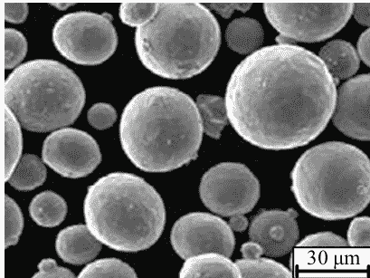

图 1. Ti6Al4V 粉末的 SEM 图像。

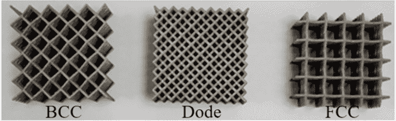

图 2. 使用 SLM 制造的晶格结构。

#### 2.2. 数值模拟

SLM 的热行为非常复杂。为获得准确的模拟结果，需要具备温度控制方程、热源模型、初始条件和边界条件。在本研究中，使用了 Nd: YAG 光纤激光器进行 SLM，激光能量密度近似为高斯分布。高斯热源函数如公式 (1) 所示 [21]：

```
\( q = \frac{2AP}{\pi R_L^2} \exp(-\frac{2r^2}{R_L^2}) \) (1)
```

其中 A 是粉末的激光吸收率，P 是激光功率，R_L 是激光光斑半径，r 是从节点到激光光斑中心的径向距离。

此外，应设置正确的初始条件和边界条件。公式 (2) 是初始条件。

```
\( T|_{t=0} = T_0(x,y,z,t) \) (2)
```

其中 T 是环境温度。

数值模拟模型中的边界条件可分别用公式 (3) 和 (4) 表示 [22]：

```
\( -\lambda_e \frac{\partial T}{\partial n} = h(T - T_m) \) (3)
```

```
\( -\lambda_e \frac{\partial T}{\partial n} = \sigma_{SB} \psi(T^2 + T_m^2)(T + T_m)(T - T_m) = \beta_0(T - T_m) \) (4)
```

其中 λ_e 是粉末的有效导热系数，n 是沿法向方向的粉末床顶面矢量，h 是对流传热系数，T_m 是环境温度，σ_SB 是斯特藩-玻尔兹曼常数，ψ 是材料的反射率，β_0 是热辐射系数。

数值模拟中 Ti6Al4V 材料的热物理性能参数随温度变化的影响如表 2 所示 [23]。

表 2. Ti6Al4V 的力学性能。

| 温度 (K) | 热膨胀系数 (\(\times 10^6\)/K) | 弹性模量 (GPa) | 屈服强度 (MPa) | 泊松比 | 剪切模量 (MPa) |
|---|---|---|---|---|---|
| 298 | 8.91 | 107 | 1098 | 0.323 | 0.7 |
| 589 | 10.12 | 91.8 | 844 | 0.339 | 2.2 |
| 700 | 10.82 | 82.4 | 663 | 0.347 | 2.2 |
| 811 | 11.31 | 69.6 | 527 | 0.354 | 1.9 |
| 923 | 11.71 | 54.7 | 300 | 0.361 | 1.9 |
| 1073 | 12.21 | 35.3 | 60 | 0.369 | 2 |
| 1123 | 12.37 | 29.3 | 5 | 0.371 | 2 |
| 1473 | 12.44 | 6.6 | 2 | 0.392 | 2 |
| 1923 | 12.51 | 0.1 | 0.1 | 0.415 | 0.1 |

NX 用于建模晶格结构，如图 3 所示；每个单元的尺寸为 \(5 \times 5 \times 5\)，柱的直径为 1 mm。模型被导入 ANSYS Workbench 进行模拟。材料是 Ti6Al4V 粉末。加工参数与实际制造相同。使用了单位长度为 0.5 mm 的四面体网格。

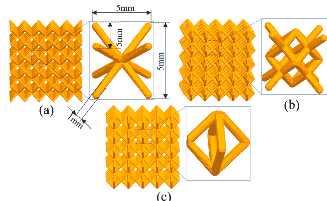

图 3. 晶格结构：(a) BCC，(b) Dode 和 (c) FCC。

### 3. SLM 加工参数优化

#### 3.1. 加工参数对熔池的影响

熔池形状的示意图如图 4 所示。熔池形状受加工参数的很大影响，主要体现在熔池的宽度和深度上。因此，采用了与先前研究相同的方法来研究加工参数对熔池几何形状的影响 [24,25]。

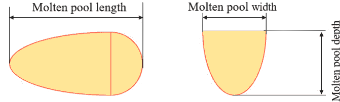

图 4. 熔池形状。

通过不同加工参数的组合，获得了各种组合。加工参数对熔池的影响如图 5 所示。随着激光功率的增加，熔池的深度、宽度和长度增加。随着扫描速度的增加，熔池的深度和宽度减小，熔池的长度先减小后增加。在 Chen [26] 和 Zhao 等人 [27] 的研究中，加工参数对熔池尺寸的影响与本研究的规律一致。

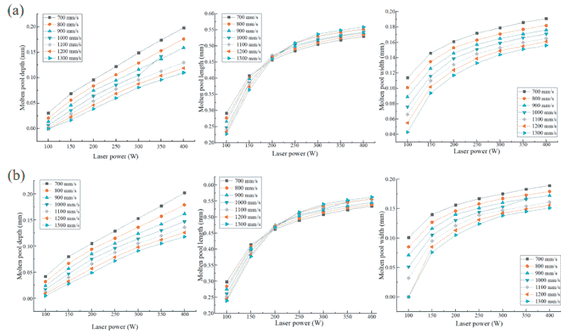

图 5. 不同加工参数下的熔池尺寸：(a) 0.03 mm 层厚，(b) 0.04 mm 层厚。

重熔致密化机制被提出作为消除残余孔隙的方法。当当前粉末层熔化时，足够的能量输入允许前一层粉末重新熔化，这有助于减少前一层的孔隙率 [28]。因此，为了获得良好的熔池，至少需要 2.5 层的熔池深度，因为 2.5 层的渗透深度可以通过重熔前一层来减少孔隙率。不同加工参数下的熔池形貌如图 6 所示。不同图案代表不同的熔池尺寸。橙色方块表示熔池深度过浅，蓝色点表示熔池过深，黄色三角形表示熔池过长，绿色星星表示熔池尺寸合理。与 0.04 mm 层厚相比，0.03 mm 层厚可以产生更合适的熔池尺寸。

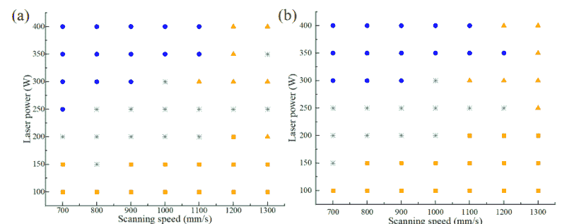

图 6. 不同加工参数下的熔池质量：(a) 0.03 mm 层厚，(b) 0.04 mm 层厚。

#### 3.2. 加工参数对孔隙率的影响

根据熔池的模拟结果，选择了图 6 绿色部分的加工参数组合进行孔隙率模拟。此外，还添加了新的扫描间距变量。影响孔隙率的原因有很多。在制造过程中，粉末中的夹带气体可能残留在零件中。在熔池形成过程中可能发生污染物脱气。在凝固过程中，少量气体蒸汽也可能残留在熔池中，在零件内部形成孔隙。结果如图 7 所示；当扫描间距不超过 0.1 mm 且激光功率为 300 W 时，孔隙率较低。

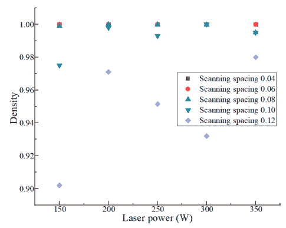

图 7. 孔隙率的模拟结果。

综合熔池和孔隙率的模拟结果，优化后的加工参数如下：激光功率 300 W，扫描速度 1000 mm/s，层厚 30 μm，扫描间距 0.1 mm。

### 4. 热行为

#### 4.1. 不同单元晶格结构的温度分布

使用优化后的加工参数模拟了三种晶格结构的温度变化和残余应力。图 8 显示了 SLM 成型过程中三种不同单元结构的温度分布。三种结构的高温部位均位于节点及其相邻柱子下方。越靠近节点，温度越高。这是因为节点附近发生重复重熔，温度不断累积导致温度升高。BCC、Dode 和 FCC 的最大温度分别为 1270.77 °C、1298.77 °C 和 1232.39 °C。在三种结构中，Dode 结构的温度最高，主要是因为 Dode 结构复杂，柱子数量多于其他结构，制造过程中的总能量输入高且散热不良，使其最高温度高于其他两种结构。

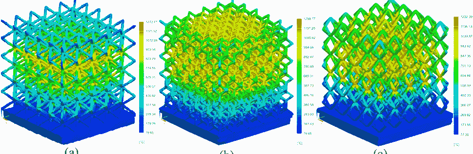

图 8. 不同单元晶格结构的温度分布：(a) BCC，(b) Dode 和 (c) FCC。

#### 4.2. 不同单元晶格结构的残余应力

图 9 是不同单元晶格结构的残余应力分布图。可以发现，在三种结构中，Dode 结构的等效残余应力最大，达到 1218.2 MPa。FCC 结构的应力达到 1164.4 MPa，BCC 结构的应力达到 1159.9 MPa。Dode 结构的复杂性导致内部散热不良，因此其残余应力最大。每种结构的最大残余应力位于节点，这是因为在成型过程中节点温度高于其他部位（图 8），并且存在较大的温度梯度。

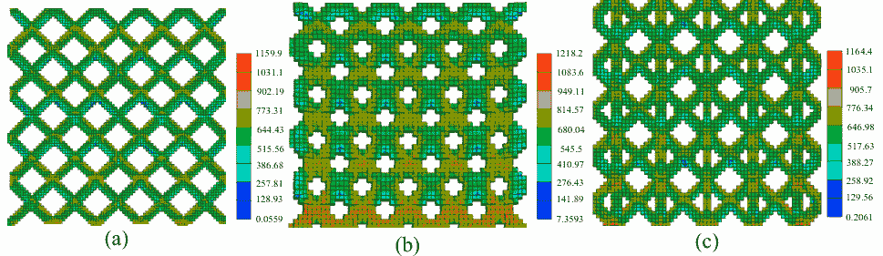

图 9. 不同单元晶格结构的残余应力分布：(a) BCC，(b) Dode 和 (c) FCC。

提取了不同方向的应力，并进一步分析了晶格结构的应力分布。BCC、Dode 和 FCC 结构的残余应力分布如图 10 所示。Z 方向的等效残余应力分量最大，其他方向的应力大小相似。这是因为衬底与零件连接处温度梯度过大。BCC、Dode 和 FCC 在 Z 方向的最大拉应力分别为 1559.9 MPa、1818.8 MPa 和 2361 MPa。最大压应力分别为 1330.8 MPa、1081.0 MPa 和 911.16 MPa。


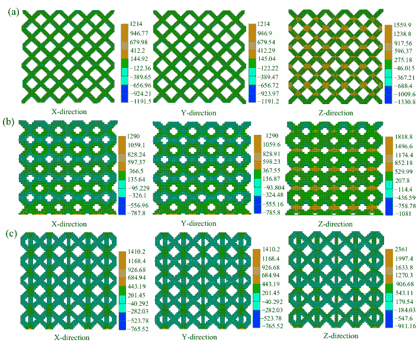

图 10. 不同方向的残余应力分布：(a) BCC、(b) Dode 和 (c) FCC。

### 5. 结果与讨论

#### 5.1. 准静态压缩实验

图 11 显示了不同晶格结构的应力–应变曲线。不同晶格结构的压缩性能差异很大。应力–应变曲线中出现多个峰值，其最终特征是应力急剧下降且零件损坏。曲线的斜率代表弹性模量，第一个峰值应力代表抗压强度。Dode 结构在弹性阶段的斜率显著大于 BCC 和 FCC。所有结构在第一个峰值应力处的应变非常接近，但峰值应力差异很大。三种晶格结构的力学性能见表 3。Dode 结构具有最高的弹性模量和抗压强度，表现出最佳的压缩性能。虽然 FCC 的弹性模量和抗压强度高于 BCC，但从图 10 可以看出，第一次损坏后承载能力急剧下降，且在应变达到约 0.14 后开始低于 BCC 结构。

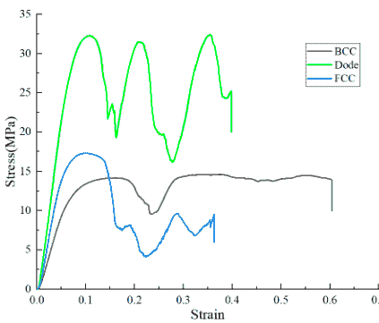

图 11. 不同晶格结构的应力–应变曲线。

表 3. 不同晶格结构的力学性能。

| 样品 | 弹性模量 (MPa) | 抗压强度 (MPa) | 平台应力 (MPa) | 屈服强度 (MPa) |
|---|---|---|---|---|
| BCC | 208.46 | 14.2 | 13.61 | 10.5 |
| Dode | 478.72 | 32.26 | 25.69 | 23.4 |
| FCC | 340.96 | 17.29 | 8.871 | 14.59 |

#### 5.2. 变形行为

图 12 显示了压缩实验中各晶格结构的变形情况。在压缩实验的初始阶段，各结构均发生了轻微变形。随着压力不断施加，底部单元的支柱变形并向外延伸，FCC 结构的底部变形最为显著。屈服阶段后，它们具有不同的变形机制。三种结构的失效均发生在节点处。BCC 结构断裂处的支柱沿水平方向受压，FCC 结构断裂处的支柱方向几乎保持不变。两者均由支柱弯曲坍塌引起。Dode 结构的相对滑移沿 45° 方向发生。最终，三种结构均沿 45° 方向形成挤压带，导致灾难性损坏。在压缩过程中发现，激光切割后晶格结构基底的压缩性能将受到影响。激光切割导致底部支柱硬度增加、塑性降低，使得底部支柱在受载下更容易断裂。

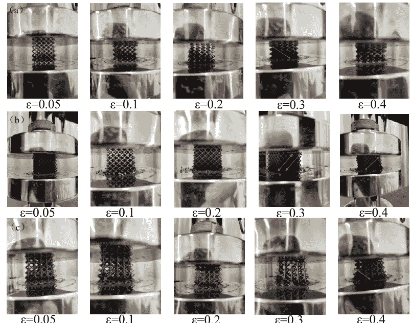

图 12. 晶格结构的变形模式：(a) BCC、(b) Dode 和 (c) FCC。

#### 5.3. 断裂形貌

图 13a、c、e 分别为 BCC、Dode 和 FCC 晶格结构的压缩断裂形貌。图 13b、d、f 分别对应局部放大图。

每种晶格结构中均观察到大量窝孔，这是金属延性断裂的特征。延性断裂有利于结构吸收更多能量。图 13c 中发现了二级裂纹和孔洞。二级裂纹的原因是：在压缩实验加载过程中，晶格结构倾向于向外扩张，导致支柱中部薄弱区域产生高拉应力，从而形成混合断裂。孔洞由制造过程中的气体残留产生。BCC 断裂面上的窝孔比 FCC 断裂面更多，且 FCC 断裂面上的窝孔更大、撕裂更明显，表明 FCC 节点在最终断裂前发生了较大的塑性变形。

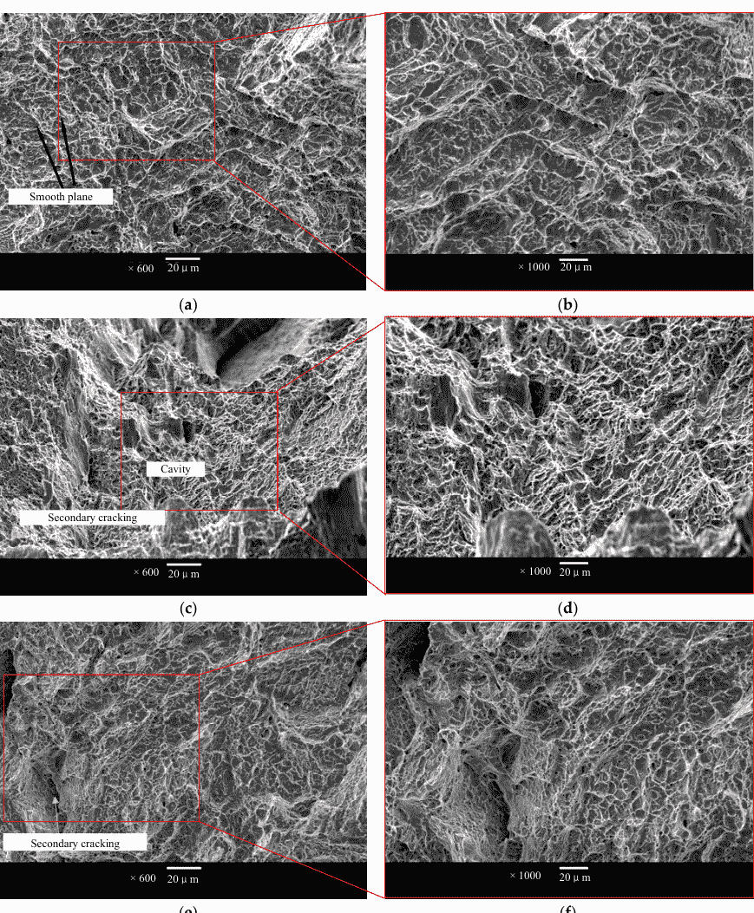

图 13. BCC、Dode 和 FCC 的压缩断裂形貌 (a,c,e) 及晶格结构断裂形貌的局部放大 (b,d,f)。

### 6. 结论

本研究通过数值模拟优化了加工参数。利用优化结果，研究了不同单元晶格结构的温度和残余应力分布。测试了晶格结构的压缩性能。得出以下主要结论：

- (1) 研究了不同加工参数对熔池和孔隙率的影响，并在此基础上进行了优化。优化后的参数为：激光功率 300 W、扫描速度 1000 mm/s、粉末厚度 0.03 mm 和扫描间距 0.1 mm。

- (2) 研究了 SLM 成形过程中 Ti6Al4V 晶格结构的热行为演变。三种结构的高温区均位于节点及其相邻支柱的下方，且越靠近节点温度越高。Dode 结构温度最高，其次是 BCC 结构，FCC 最低。

- (3) 晶格结构的节点是残余应力分布的主要区域，这与节点的高温分布密切相关。从不同方向的残余应力来看，部件两端存在残余压缩应力。X 和 Y 方向的残余应力接近，Z 方向的残余应力对成形过程影响最大。此外，不同单元晶格结构的残余应力差异显著。Dode 的残余应力最高，达到 1218.2 MPa。FCC 位居第二，BCC 最低。

- (4) 不同单元晶格结构的压缩性能差异很大。Dode 结构具有最高的弹性模量和抗压强度，分别达到 478.72 MPa 和 32.25 MPa，在三种结构中表现出最佳的压缩性能。

### 作者贡献

概念化，G.C. 和 H.J.；数据整理，H.L. 和 K.P.；正式分析，K.P. 和 G.C.；调查，H.L.；方法学，K.P. 和 A.A.；项目管理，G.C. 和 H.J.；资源，G.C. 和 A.A.；软件，H.L. 和 K.P.；验证，H.L. 和 K.P.；可视化，K.P.；撰写—原稿，H.L. 和 K.P.；撰写—审阅和编辑，G.C. 所有作者均已阅读并同意发表的手稿版本。

### 资助

本工作得到浙江科技大学优秀研究生论文培育基金（批准号：LW-YP2024045）、浙江科技大学基本科研业务费专项基金（批准号：22242297-Y）、浙江省自然科学基金（批准号：LQ18E050010）和中国博士后科学基金资助项目（批准号：2018M642482）的支持。

### 机构审查委员会声明

不适用。

### 知情同意声明

不适用。

### 数据可用性声明

本研究的数据可应要求从通讯作者处获取。

### 利益冲突

作者声明不存在利益冲突。

### 参考文献

- 1. Yang, X.; Ma, W.; Zhang, Z.Y.; Liu, S.F.; Tang, H.P. 通过选择性激光熔化制造的超高比强度 Ti6Al4V 合金晶格材料。*Mater. Sci. Eng. A-Struct.* **2022**, *840*, 142956. [CrossRef]

- 2. Yuan, B.G.; Liu, X.; Du, J.F.; Chen, Q.; Wan, Y.Y.; Xiang, Y.L.; Tang, Y.; Zhang, X.X.; Huang, Z.Y. 氢化温度对 CMHT 处理 Ti6Al4V 合金室温压缩性能的影响。*J. Mater. Sci. Technol.* **2021**, *72*, 132–143. [CrossRef]

- 3. Bhardwaj, A.; Mudaliar, V.; Gohil, N.; Gupta, A.K.; Kumar, S.S.S. 高温下多次约束槽压对 Ti6Al4V 合金显微组织和力学性能演化的影响。*J. Mater. Process. Tech.* **2021**, *288*, 116891. [CrossRef]


- 4. Ding, J.H.; Qu, S.; Zhang, L.; Wang, M.Y.; Song, X. 基于高精度激光粉末床熔融制备的薄壳格栅结构几何偏差及补偿. Addit. Manuf. 2022, 58, 103061. [CrossRef]
- 5. Fan, X.J.; Tang, Q.; Feng, Q.X.; Ma, S.; Song, J.; Jin, M.X.; Guo, F.Y.; Jin, P. 基于选择性激光熔化制备的分级厚度三周期极小曲面结构的设计、力学性能及吸能能力. Int. J. Mech. Sci. 2021, 204, 106586. [CrossRef]
- 6. Pan, C.; Han, Y.F.; Lu, J.P. 格栅结构设计与优化：综述. Appl. Sci.-Basel. 2020, 10, 6374. [CrossRef]
- 7. Zhang, L.; Chen, Y.F.; He, R.J.; Bai, X.J.; Zhang, K.Q.; Ai, S.G.; Yang, Y.Z.; Fang, D.N. 轻质C/SIC金字塔格栅芯夹层面板弯曲行为. Int. J. Mech. Sci. 2020, 171, 105409. [CrossRef]
- 8. Meyer, G.; Wang, H.; Mittelstedt, C. 几何缺口和形状优化对增材制造格栅结构力学性能的影响. Mater. Des. 2022, 222, 111082. [CrossRef]
- 9. Kuai, Z.Z.; Li, Z.H.; Liu, B.; Chen, Y.L.; Lu, S.Y.; Bai, P.K. 选择性激光熔化CuCrZr合金热处理效应：微观组织演变、力学性能及断裂机制. J. Mater. Res. Technol. 2023, 23, 2658–2671. [CrossRef]
- 10. Jiang, Z.H.; Xu, P.W.; Liang, Y.L.; Liang, Y. 熔池边界变形对SLM AlSi10Mg力学性异性的影响. Mater. Today. Commun. 2023, 36, 106879. [CrossRef]
- 11. Sefene, E.M. 选择性激光熔化工艺最新进展：全面综述. J. Manuf. Syst. 2022, 63, 250–274. [CrossRef]
- 12. Daloadulo, E.; Pini, F.; Leali, F. 增材制造粉末床熔融集成产品与工艺设计：一种由仿真驱动的系统方法. Int. J. Adv. Manuf. Technol. 2024, 130, 5440–5452.
- 13. Zhang, T.; Zhang, K.F.; Chen, Q. 选择性激光熔化工艺参数对单轨和块状支撑结构影响的研究. J. Laser Appl. 2024, 36, 012024. [CrossRef]
- 14. Jia, H.L.; Sun, H.; Wang, H.Z.; Wu, Y.; Wang, H.W. 选择性激光熔化（SLM）扫描策略：综述. Int. J. Adv. Manuf. Technol. 2021, 113, 2413–2435. [CrossRef]
- 15. Gockel, J.; Sheridan, L.; Koerper, B.; Whip, B. 增材制造工艺参数对表面粗糙度和疲劳寿命的影响. Int. J. Fatigue 2019, 124, 380–384. [CrossRef]
- 16. Zhao, Z.Y.; Wang, J.B.; Du, W.B.; Bai, P.K.; Wu, X.Y. 选择性激光熔化过程中7075铝合金的数值模拟与实验研究. Opt. Laser Technol. 2023, 163, 109814. [CrossRef]
- 17. Wang, L.F.; Jiang, X.H.; Zhu, Y.H.; Zhu, X.G.; Sun, J.; Yan, B. AlSi10Mg零件选择性激光熔化过程中残余应力和变形预测方法. Int. J. Adv. Manuf. Technol. 2018, 97, 3535–3546. [CrossRef]
- 18. Gan, M.J.; Wu, Q.; Long, L.C. 基于固有应变法的激光粉末床熔融制备Ti-6Al-4V格栅结构残余变形和应力预测. Mater. Res.-Ibero-Am. J. 2023, 26, e20220516. [CrossRef]
- 19. Jiang, X.H.; Ye, T.; Zhu, Y.H. 工艺参数对AlSi10Mg选择性激光熔化残余应力的影响. Mater. Sci. Technol. 2019, 69, 342–352. [CrossRef]
- 20. Fritsch, T.; Sprengel, M.; Evans, A.; Farahbod-Sternal, L.; Saliwan-Neumann, R.; Hofmann, M.; Bruno, G. 增材制造格栅结构残余应力测定研究. J. Appl. Crystallogr. 2021, 54, 228–236. [CrossRef]
- 21. Luo, C.; Qiu, J.H.; Yan, Y.G.; Yang, J.H.; Uher, C.; Tang, X.F. 热电SnTe选择性激光熔化过程中的温度和应力场有限元分析. J. Mater. Process. Tech. 2018, 261, 74–85. [CrossRef]
- 22. Shibata, K.; Kovács, A.; Kiselev, N.S.; Kanazawa, N.; Dunin-Borkowski, R.E.; Tokura, Y. 基于离轴电子全息法的天蛾星内部和晶格结构对温度和磁场的依赖性研究. Phys. Rev. Lett. 2017, 118, 087202. [CrossRef] [PubMed]
- 23. Hu, B.; Cai, G.S.; Deng, J.L.; Peng, K.; Wang, B.X. 选择性激光熔化薄壁零件热力学行为、微观组织和力学性能研究. Met. Mater. Int. 2024, 3, 194–210. [CrossRef]
- 24. Jammikar, N.; Liu, S.; Brice, C.; Zhang, X.L. 基于CNN的丝进激光增材制造熔池状态—工艺关系综合建模. J. Manuf. Process. 2023, 98, 42–53. [CrossRef]
- 25. Ge, J.G.; Huang, J.; Lei, Y.P.; O'Reilly, P.; Ahmed, M.; Zhang, C.; Yan, X.C. SLM Ti6Al4V格栅结构微观组织特征和压缩性能. Surf. Coat. Technol. 2020, 403, 126419. [CrossRef]
- 26. Chen, D.J.; Li, G.; Wang, P.; Zeng, Q.Z.; Tang, Y.H. 粉末级Ti6Al4V激光粉末床熔融熔池尺寸和流动演化数值模拟. Finite Elem. Anal. Des. 2023, 223, 103971. [CrossRef]
- 27. Zhao, M.Z.; Wei, H.L.; Mao, Y.M.; Zhang, C.D.; Liu, T.T.; Liao, W.H. 基于物理信息深度学习模型的增材制造工艺参数和熔池尺寸预测. Engineering 2023, 23, 181–195. [CrossRef]
- 28. Yu, G.Q.; Gu, G.Q.; Dai, D.H.; Xia, M.J.; Ma, C.L.; Chang, K. 铝合金选择性激光熔化过程中工艺参数对激光穿透深度及熔化/再熔致密化的影响. Appl. Phys. A-Mater. 2016, 122, 891. [CrossRef]

免责声明/出版者说明：所有出版物中包含的陈述、观点和数据仅为作者和投稿者个人的观点，不代表 MDPI 和/或编辑的立场。MDPI 和/或编辑对内容中涉及的任何想法、方法、说明或产品导致的人身或财产伤害不承担任何责任。

## 基于电流的双丝电弧增材制造Ti6Al4V/Inconel 718复合材料的微观组织及热裂纹敏感性研究

Peng Xia, Xin Ye * and Guangshun Zhang

School of Materials Science and Engineering, Shanghai University of Engineering Science, Shanghai 201620, China; xia159112@163.com (P.X.); zhang16140225@163.com (G.Z.) * 通信作者：yexin@sues.edu.cn; Tel.: +86-67791474

Abstract: 采用电弧增材制造技术，在不同沉积电流下制备了Ti6Al4V/Inconel 718复合材料。复合材料的性能直接影响梯度材料的性能，而热输入进一步影响复合材料的性能。结果表明，在沉积电流为35 A时，Ti元素扩散至Inconel 718合金中。增加电流会导致在沉积层中形成脆性金属间化合物，如TiNi、Cr2Ti和Fe2Ti。沉积电流低于50 A时无裂纹出现，但在50 A电流下会产生裂纹。此外，随着沉积电流升高，沉积层的显微硬度增加。与35 A条件相比，50 A电流下的显微硬度提高了31.51%。本研究可扩展直接沉积Ti6Al4V/Inconel 718复合材料电弧增材制造的应用领域。

Keywords: 电弧增材制造；微观组织；Ti6Al4V/Inconel 718复合材料；力学性能

### 1. 引言

航空航天领域的持续进步导致对更先进航天器的需求增加，特别是在异种金属连接结构方面。这些结构现在必须同时满足高性能和轻量化设计的要求 [1–3]。因此，越来越多的研究人员开始关注异种金属的连接，并获得了Ti/Al、Mg/Al、Fe/Al、Ti/Ni等复合组件 [4–8]。其中，Ti6Al4V合金和Inconel 718合金因其优异的性能而在航空航天领域广泛应用，因此钛基合金与镍基高温合金之间的连接越来越受到关注 [9,10]。由Ti6Al4V合金和Inconel 718高温合金连接组成的结构可以有效降低零件质量并适应高温环境 [11,12]。然而，由于异种金属在热膨胀系数和热导率等热物理性质参数上的差异，钛基合金与镍基高温合金连接过程中会产生裂纹 [13–15]，而梯度材料的制备可以改善这一情况。此外，当异种金属连接时，接头处通常会形成复合材料，其中容易形成Ti2Ni和Ni3Ti等脆性金属间化合物（IMCs），这进一步增加了异种接头的脆性 [14,16,17]。因此，复合材料的微观组织和力学性能在梯度材料制备中起着重要作用。

在异种金属连接过程中，不可避免地会形成新的复合材料，因此一些研究人员通过逐层改变合金成分来实现异种金属连接。Sun等人 [18] 采用激光增材制造技术制备了Inconel 625/Ti6Al4V组件，并研究了合金从Ti6Al4V到Inconel 625的成分和结构变化。结果表明，相


α+β→α+β+Ti2Ni→Ti2Ni+β→Ti2Ni+Cr2Ni+γ-Ni 的变化，并在800 °C的扩散区出现微裂纹。Meng 等人[19]利用激光同步预热/非预热制备了Inconel 625/Ti6Al4V功能梯度材料，并发现预热对裂纹和析出相的形成有重大影响。Song 等人[10]采用激光增材制造技术制备了不同Ti含量的复合材料。结果表明，随着Ti含量的增加，所制备组件的主相变为γ→Fe2Ti→TiNi。Onuike 等人[20]采用激光增材制造技术制备了Inconel/Ti6Al4V梯度材料，并通过引入VC作为中间层引入了新相Cr3C2，以避免脆性相的产生。Wang 等人[15]采用线型激光增材制造技术制备了Ti6Al4V/Inconel718组件。结果表明，Ti6Al4V/Inconel 718组件的相微观组织从下到上为γ+Laves→α+β+Ti2Ni+TiNi+Ni3Ti→α+β。然而，当焊丝用作激光增材制造的原材料时，会出现分层现象。大多数研究人员更倾向于使用激光作为热源来制备功能梯度材料。然而，由于激光用作堆积热源，需要高功率来熔化焊丝或粉末，这大大增加了堆积成本。当电弧用作堆积热源时，无需使用高功率来熔化焊丝材料，电弧增材制造具有产品效率高、材料利用率高和设备成本低的优势[21]。Huang 等人[21]通过控制Ti6Al4V和Inconel 625的焊丝进给速度，采用电弧增材制造技术制备了TiNi梯度材料。结果表明，采用电弧可以使Ti2Ni和TiNi的相分布均匀，并提高TiNi组件的压缩性能和表面耐磨性能。Lu 等人[22]采用电弧增材制造技术制备了TA1/Inconel 625功能梯度，并研究了其微观组织和力学性能。然而，只有少数研究初步讨论了使用电弧增材制造技术连接Inconel 718和Ti6Al4V合金。总之，通过电弧增材制造制备Ti6Al4V/Inconel 718梯度材料的研究很少；特别是，关于微观组织和力学性能的讨论相对有限。

制备梯度材料的前提是制备完整的复合材料，因此复合材料的微观组织和力学性能常常影响梯度材料的性能。在堆积过程中，热输入会影响复合材料的微观组织和力学性能。本文选用Ti6Al4V和Inconel 718焊丝作为Ti6Al4V和Inconel 718焊接设备，并固定两根焊丝的送丝速度，制备不同堆积电流的Ti6Al4V/Inconel 718复合材料。研究了不同堆积电流对Ti6Al4V/Inconel 718复合材料微观组织和力学性能的影响。通过对比不同堆积电流下复合材料中金属间化合物相的形貌，分析了裂纹断面的成因。此外，评价了不同堆积电流制备样品的微硬度。这可以扩展电弧增材制造直接堆积Ti6Al4V/Inconel 718复合材料的应用领域。

### 2. 实验细节

实验采用单电弧堆积系统，主要包括TIG焊接机、伺服电机移动平台和送丝机构。工作原理如图1所示。Ti6Al4V和Inconel 718焊丝由电弧热源加热。两根焊丝放置在一侧，送丝器可以实现不同的送丝速度。该系统使用99.999%高纯氩气作为保护气。

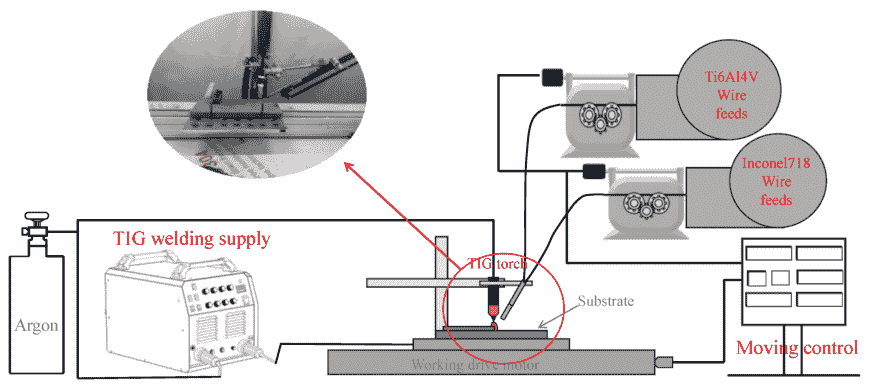

图1. D-WAAM设备示意图。

基体为Inconel 718，尺寸为100 mm × 50 mm × 4 mm。实验前，用角磨机打磨表面，去除氧化层，并用丙酮和酒精清洗并晾干表面。在沉积Ti6Al4V/Inconel 718复合层之前，先沉积一层Inconel 718。在沉积的Inconel 718层上继续沉积。Ti6Al4V和Inconel 718焊丝的直径为1.2 mm，两根焊丝的化学成分分别列于表1和表2中。合金成分通过考虑送丝速度(Vi)、密度和直径来控制[23]。表3显示了堆积参数。质量分数(Wx)和原子分数(Ax)可使用以下公式计算[24]：

```
W_x = \frac{\sum V_i d_i \rho_i W_{x_i}}{\sum V_i d_i \rho_i} \tag{1}

A_x = \frac{W_x / M_x}{\sum W_x / M_x} \tag{2}
```

其中，i为金属焊丝（i = 1, 2，1表示Ti6Al4V，2表示Inconel 718），Wx（x为Ti6Al4V和Inconel 718合金中的元素；i = 1, 2）为焊丝中某元素的质量分数，Vi(i = 1, 2)为焊丝的送丝速度，单位为mm/s。di(i = 1, 2)为焊丝直径，单位为mm。Mx（x为Ti6Al4V和Inconel 718合金中的元素）为相对原子质量，ρi(i = 1, 2)为焊丝密度，单位为g/cm³。

表1. Ti6Al4V焊丝化学成分（wt%）。

| Al | V | Fe | C | N | H | O | Ti |
|---|---|---|---|---|---|---|---|
| 5.9 | 3.97 | 0.05 | 0.10 | 0.05 | 0.01 | 0.10 | Bal. |

表2. Inconel 718焊丝化学成分（wt%）。

| Ni | Cr | Nb | Mo | Ti | Al | Si | Fe |
|---|---|---|---|---|---|---|---|
| 53.61 | 18.76 | 4.86 | 3.12 | 1.05 | 0.49 | 0.18 | Bal. |

试样沿纵向截面切割，小样用400–2000目SiC砂纸抛光。进一步使用1.5粒径悬浮液进行抛光。最后，使用Kroll试剂（HF：HNO3：C2H5OH=7:2:1）进行腐蚀约10 s。采用激光共聚焦显微镜观察异种金属间的相结构形貌，随后用高倍电镜分析相结构。采用扫描电子显微镜（SEM）和能谱分析仪（EDS）分析试样的微观组织。采用X射线衍射（XRD）分析试样的相组成。采用Hv-1000显微维氏硬度计测试复合材料的微硬度。加载力为200 g，保持时间为15 s。

表3. 堆积参数。

| 参数 | 数值 |
|---|---|
| 送丝速度（Ti6Al4V） | 400 mm/min |
| 送丝速度（Inconel 718） | 800 mm/min |
| 气体流量 | 15 L/min |
| 板速 | 0.9 mm/s |

### 3. 结果与讨论

#### 3.1. 单层堆积分析

为确定合适的工艺参数，通过改变送丝器的速度调整两种焊丝的比例。在固定两种焊丝的送丝速度后，采用不同堆积电流制备堆积层。图2展示了不同堆积电流下的堆积形貌。随着电流增加，沉积层的粗糙度也显著增加，主要原因是液态金属粘度的升高。Van等人[25,26]研究了热输入与成形质量之间的关系，结果表明热输入越低，沉积件表面越光滑。这与本工作中沉积样品的形貌一致。在较高的冷却速率下，液态金属的润湿性和扩散性降低，导致附着力变差。此外，当电流达到50 A时，层表面会出现裂纹。

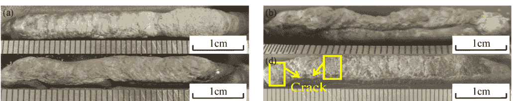

图2. 不同堆积电流的堆积形貌：（a）35 A，（b）40 A，（c）45 A，以及（d）50 A。

#### 3.2. XRD相分析

Inconel 718的送丝速度是Ti6Al4V的两倍。根据公式(1)和(2)，当钛与镍的元素比为1:2时，使用这两种焊丝制备沉积层。在沉积过程中，形成Ti-Ni金属间化合物。此外，Inconel 718合金还含有一定量的Cr和Fe，这些元素也可能与Ti形成金属间化合物。采用X射线衍射法分析了不同堆积电流下制备的沉积层的相，如图3所示。所有样品均表现出TiNi相、Ni3Ti相、Cr2Ti相、α-Ti相和Fe2Ti相。


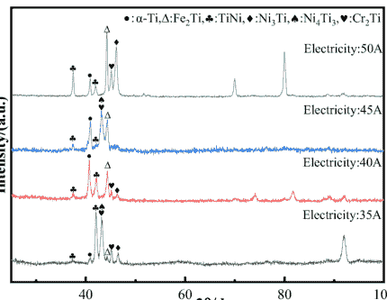

图 3. 不同沉积电流下沉积产物的 X 射线衍射谱。

#### 3.3. 光学显微镜下的组织表征

为研究不同热输入对相同复合材料（V_Inconel 718: V_Ti6Al4V=2:1）微观组织的影响，采用光学显微镜在不同沉积电流下观察了样品的金相形貌。图 4 显示了各沉积电流下的光学显微镜表征结果。图 4a 显示了沉积电流为 35 A 时的光学微观组织，上部为 Ti6Al4V/Inconel 718 复合材料，下部为 Inconel 718 层。上部主要由柱状晶组成，柱状晶枝条之间夹杂一些长条状黑色条纹。在 WAAM 工艺中，固–液界面逐渐向液相区推进。在此过程中，溶质发生重新分布，导致一定距离内出现成分超冷现象。这种平面固–液界面的不稳定性最终导致柱状晶的形成。由于液相区受溶质再分布影响，发生溶质聚集，表现为微观偏析 [27]。从图 4a 可以观察到，柱状晶侧面存在微小的次级枝晶，这些次级枝晶之间的平均距离为 5.16 μm。

随着沉积电流的增加，沉积层中的柱状晶逐渐发生分化。图 4b 显示了沉积电流为 40 A 时的光学微观组织。从图 4b 可以观察到，部分晶粒呈有序排列，晶粒之间存在不连续的黑色相。此外，图 4b 中还可以观察到长直的柱状晶，其形成是由于成分超冷引起的固–液界面不稳定性所致。在快速冷却条件下，柱状晶更容易形成。与图 4a 相比，当沉积电流为 40 A 时，热输入增加，在相同散热条件下工件的温度停留时间延长。因此，冷却速率相对变慢。在微观尺度上，柱状晶数量减少，部分较大的柱状晶逐渐转变为较小的晶粒，导致柱状晶之间的间距增大。由于部分热量沿沉积体方向传导，在晶轴垂直方向上液相中形成负温度梯度。这导致在主晶轴沿线形成次级晶轴 [27]。在图 4b 中可以观察到次级枝晶的存在，次级枝晶之间的平均距离为 6.38 μm。

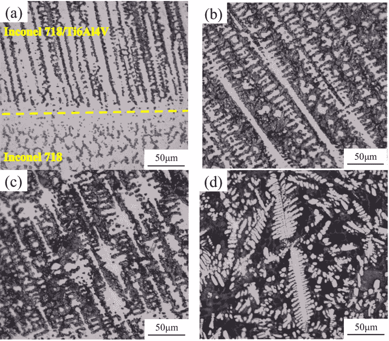

图 4. 不同沉积电流下样品的光学显微镜表征：(a) 35 A，(b) 40 A，(c) 45 A，和 (d) 50 A。

当沉积电流进一步增加时，沉积层的金相形貌如图 4c 所示。图 4c 显示了沉积电流为 45 A 时的光学微观组织，其中可以观察到细小的柱状晶和“叶片状”晶粒。随着电流增加，晶粒进一步生长，部分次级枝晶在生长过程中融合，形成更大的“叶片状”晶粒，并与柱状晶轴融合。

图 4d 显示了沉积电流为 50 A 时的光学微观组织，观察到典型的枝晶状柱状晶，且外延晶含量增加。与沉积电流 45 A 相比，热输入增加略微延长了散热时间，使晶粒进一步生长并增加次级枝晶。次级枝晶之间的平均距离为 3.96 μm。此外，该区域还可观察到大量灰黑色晶内结构，这将需要通过 EDS 扫描分析进一步检验。

图 5 展示了一张示意图，说明随着电流增加，沉积过程及沉积样品的晶粒演化。随着沉积电流逐渐增加，沉积样品中的柱状晶从“长条状”形貌演变为“棒状”结构。随着电流进一步增加，这些“棒状”枝晶开始融合，形成“叶片状”枝晶。当电流达到 50 A 时，“叶片”枝晶分裂为更小的枝晶。沉积样品的取样方法是检查加工体的横截面。当沉积电流较低（<50 A）时，柱状晶的生长方向垂直于加工体方向。然而，当沉积电流达到 50 A 时，少数柱状晶的生长方向仍保持垂直于加工体，而大多数柱状晶变为与加工体平行。这种变化可能归因于沉积电流增加导致热输入增加。在电弧增材制造（WAAM）过程中，过量热量沿已形成的加工体扩散，使柱状晶的生长方向倾向于与加工体平行。

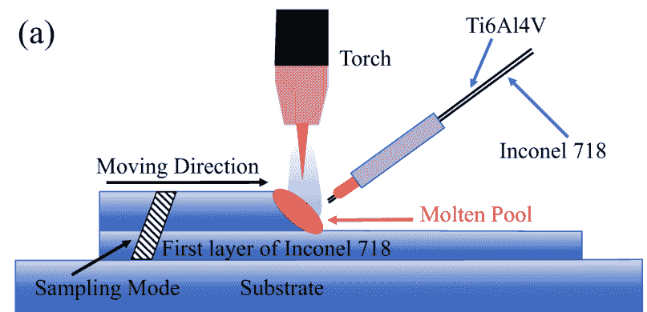

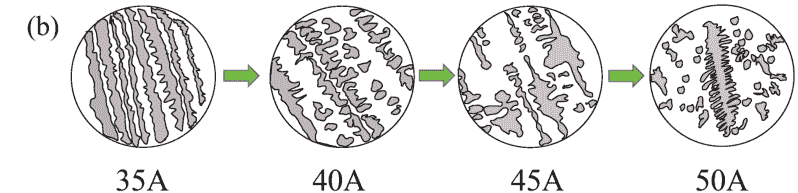

图 5. (a) 35 A–50 A 沉积电流样品的沉积示意图和 (b) 晶粒演化示意图。

图 6 展示了不同沉积电流下次级枝臂间距（SDAS）的统计结果。在沉积电流为 40 A 和 45 A 时，SDAS 数值相似且大于 35 A 和 50 A 时的数值。值得注意的是，50 A 时的最小 SDAS 记录为 3.96 μm。随着电流增加，热输入也随之上升，导致沉积温度升高。这种变化增强了原子迁移率，增加了某些原子的动能，并降低了晶粒之间的界面能，从而促进晶粒生长。晶粒生长过程也在图 5 中清晰说明。当沉积电流低于 50 A 时，次级枝晶间距 SDAS 变化极小，所有测量值均低于 50 A 时观察到的值。这种现象可能归因于沉积层中热输入有限且冷却速率过高，阻碍了晶粒生长所需的动能。因此，原子迁移受阻，导致晶粒生长停止，次级枝晶间距没有显著变化。当沉积电流达到 50 A 时，增加的热输入有助于部分晶粒进一步生长，同时形成更多次级枝晶，导致次级枝晶间距减小。晶粒形貌逐渐从柱状转变为枝晶状，柱状晶的厚度也随之减小。

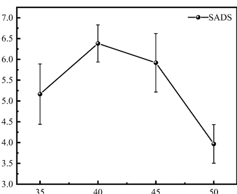

图 6. 各沉积电流下次级枝晶间距的统计结果。

#### 3.4. SEM 和元素含量分析

为研究在不同电流条件下沉积样品的组织成分，对每层沉积层进行了扫描电子显微镜（SEM）和能谱（EDS）点分析。详细结果见图 7 和表 4。结合图 4a、图 7a,e 和表 4 的信息可以得出结论：柱状晶之间的黑色相（P1）表现出最高的碳（C）含量，表明存在 MC 碳化物。MC 碳化物在镍基合金中起着关键作用。即使少量 MC 碳化物也能通过抑制位错运动和稳定晶界来增强强度 [15]。在与晶轴对应的位置（P2），Ni、Cr 和 Fe 的浓度升高。这可能归因于 WAAM 工艺中沉积电流较低，导致冷却速率快，熔池中 Ti 和 Ni 分布不均。因此，Ni 和 Ti 未完全融合，部分 Ti 扩散到基体中并形成共晶结构。因此，当沉积电流设定为 35 A 时，形成少量 TiNi 相。在析出相（P3）中，Ti 含量为 68.52 at%，Ni 含量为 23.47 at%。这表明析出相可能由 Ti2Ni 颗粒组成。

随着电流增加，沉积层中的柱状晶结构逐渐分化，如图 7b 所示。图 7f 提供了局部放大，揭示了晶界（P5）处存在大量小“绒毛状”结构。根据能谱（EDS）扫描分析，Ti、Ni、Cr 和 Fe 的浓度没有显著差异。这种现象可能归因于热输入增加，使熔池中的 Ti 充分扩散并与 Ni、Cr 和 Fe 形成金属间化合物。因此，可以推断这种“绒毛”状相可能由 Ti、Ni、Cr 和 Fe 元素组成的共晶结构构成。在晶粒的 P4 位置（图 7f），Ti 元素含量显著高于图 7e 中 P2 位置的 Ti 元素含量。这可能归因于更高电流相关的热输入增加，促进了 Ti 原子与 Ni 原子的结合。因此，增加的热输入有助于原子扩散并增强与其他原子形成化合物。枝晶轴和枝晶间结构中 Ti、Cr 和 Fe 原子的浓度相似。通过与 X 射线衍射（XRD）数据相关联，可以推断 Ti 原子与 Cr、Fe 和 Ni 原子相互作用形成 Cr2Ti、Fe2Ti 和 TiNi 等金属间化合物。此外，晶粒（P4）中未检测到 Nb 和 Mo 原子。这可能归因于凝固过程中 Nb 和 Mo 等重元素扩散到枝晶间区域，


导致它们与枝晶间残余液相的共晶反应分离 [15]。

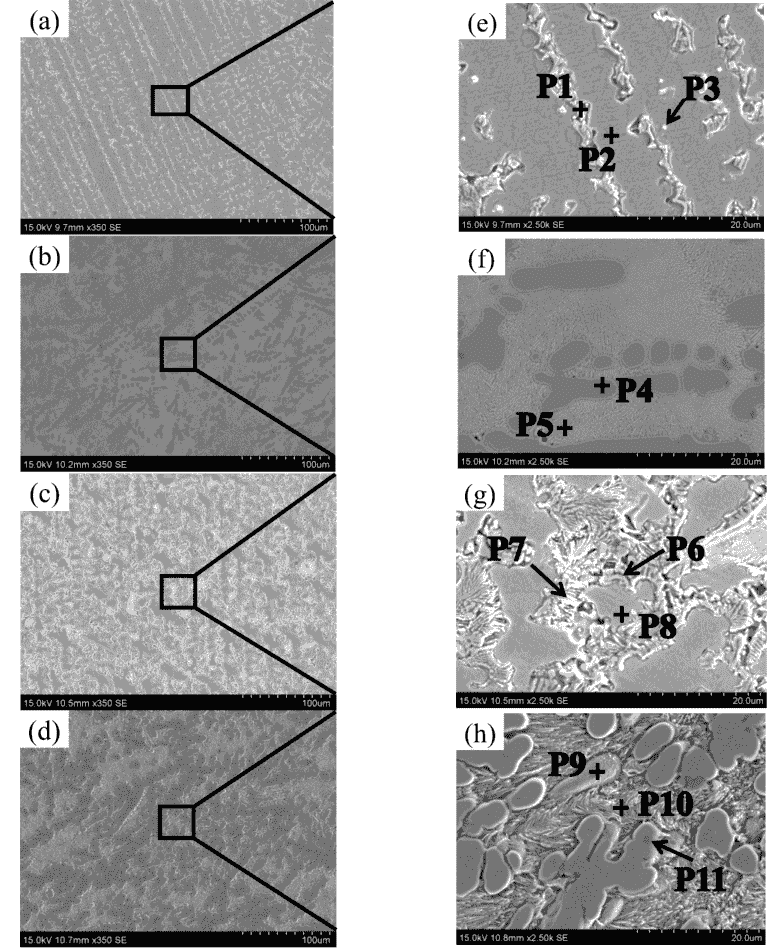

图 7. SEM 扫描地形图和 EDS 测量点位置：（a）30 A，（b）40 A，（c）45 A，（d）50 A，（e）a 的局部放大，（f）b 的局部放大，（g）c 的局部放大，以及（h）d 的局部放大。

图 7c 说明了在 45 A 沉积电流下获得的样品沉积层的组织结构，而图 7g 提供了局部放大。从图 7g 可以明显看出，晶界处存在大量针状析出相。经过能量色散光谱（EDS）扫描分析后观察到，针状结构中 Ni 原子与 Ti 原子的比例约为 3:1。根据 Ti-Ni 相图（图 12a），可以推断针状结构可能为 Ni3Ti，而晶粒结构可能由 γ + TiNi 组成。在位置 P7 的析出相中检测到最高浓度的碳 C，表明该特定相的组织结构为 MC 碳化物。

| 区域 | Ti | Ni | Cr | Fe | Nb | Mo | C |
|---|---|---|---|---|---|---|---|
| P1 | 4.05 | 17.78 | 12.79 | 10.54 | 6.55 | 2.52 | 44.45 |
| P2 | 6.1 | 48.14 | 22.89 | 19.64 | - | - | - |
| P3 | 68.52 | 23.47 | - | - | - | - | - |
| P4 | 17.15 | 43.48 | 21.31 | 16.02 | - | - | - |
| P5 | 20.22 | 27.59 | 20.96 | 20.86 | 6.10 | 3.16 | - |
| P6 | 12.87 | 33.63 | 21.89 | 19.56 | 6.18 | 3.66 | - |
| P7 | 5.23 | 11.72 | 12.91 | 11.01 | 4.57 | 2.13 | 51.63 |
| P8 | 8.20 | 44.65 | 23.81 | 21.59 | 23.81 | - | - |
| P9 | 22.48 | 26.71 | 21.91 | 21.17 | 4.12 | 2.59 | - |
| P10 | 22.94 | 45 | 16.96 | 15.10 | - | - | - |
| P11 | 12.60 | 17.08 | 14.59 | 13.68 | 3.71 | 2.10 | 35.58 |

图 7d 说明了在 50 A 沉积电流下获得的样品沉积层的组织结构，而图 7h 提供了局部放大。从图 7h 可以观察到，枝晶间存在大量针状组织。根据 EDS 扫描结果，晶间针状组织中 Ti 和 Ni 的原子含量分别为 22.94 at% 和 45 at%。Ni 与 Ti 的原子比约为 2:1。结合 X 射线衍射分析结果，可以得出结论：针状组织可能为富镍 TiNi 相。在析出相 P9 处，Ti 与 Ni 的原子比约为 1:1，Cr 和 Fe 的原子含量相近。可以推断，该析出相可能由 Ti、Ni、Cr 和 Fe 元素组成的共晶结构，可能形成 TiNi、Cr2Ti 和 Fe2Ti 等脆性金属间化合物。在图 7h 的位置 P11 处，可以在枝晶轴上观察到黑色析出相。根据 EDS 扫描结果，P11 处的碳含量高于其他元素。这可能归因于热输入过大，导致凝固过程中 MC 碳化物部分扩散至晶粒内。有报道称，少量 MC 碳化物可以抑制位错运动并稳定晶界，从而增强材料。然而，过量的 MC 碳化物会导致应力集中并降低合金的耐久性 [15]。当沉积电流达到 50 A 时，沉积层开始出现裂纹。这可能归因于 MC 碳化物堆积引起的应力集中，如图 2d 所示。裂纹截面的详细分析将在下一节中提供。

基于上述分析，热输入显著影响枝晶轴与枝晶之间的元素含量。此外，在相同沉积电流下，枝晶轴与枝晶之间的元素含量存在显著差异，表明偏析机制为晶间偏析。XRD 结果未检测到 Ti2Ni 金属间化合物，可能是由于其含量较低。根据 Ti-Ni 二元相图（图 12a），Ti2Ni 的形成需要 Ti 含量超过 Ni 含量。此外，由于本实验中 Inconel 718 合金的体积是 Ti6Al4V 合金的两倍，Ti2Ni 的形成不太可能。通常，当两种合金丝在熔池中熔化时，内部元素理想上应均匀扩散。然而，在电弧增材制造过程中，极快的冷却速率和较小的沉积电流导致在充分扩散发生前就发生凝固。这导致某些区域的元素含量出现显著变化。尽管随着沉积电流逐渐增加，这一问题有所改善，但当电流达到一定水平时，由于热输入过大，沉积层中仍可能产生裂纹。

根据 SEM-EDS 分析，在不同沉积电流下，枝晶轴沿线的 Ni 含量高于 Ti 含量，而枝晶轴沿线的 Ti 含量随沉积电流升高而增加。图 8 说明了枝晶轴的比例。在 35 A 沉积电流下，枝晶轴比例达到最大值 80.36%。然而，随着沉积电流增加，该比例总体下降。对枝晶间区域和枝晶区域元素含量的比较表明，随着沉积电流增加，这两个区域的合金元素浓度变得更加相似，表明相分布趋于更均匀。

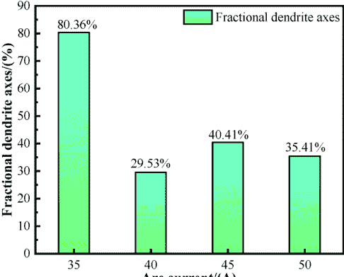

图 8. 枝晶轴比例。

#### 3.5. 裂纹

钛合金是重要的结构材料，而镍基合金被视为超合金。由于其热膨胀系数高，沉积过程中容易产生裂纹。在 WAAM 过程中，沉积电流低于 50 A 时，沉积层中未观察到裂纹。然而，在 50 A 沉积电流下，沉积层中检测到裂纹。图 9 展示了部分裂纹的宏观视图以及高速 SEM 图像。第一层中未发现裂纹，但第二层 Ti6Al4V/Inconel 718 的裂纹截面看起来不连续，裂纹形貌不均匀。裂纹截面的高倍 SEM 图像（如图 9b–d 所示）揭示了具有河纹和劈裂图案的微观断裂形貌，表明为劈裂断裂机理。

为调查裂纹截面的相组成，对其组织结构进行了 EDS 扫描分析。图 10 展示了断裂底部的高倍 SEM 图像，揭示了析出相 A。EDS 分析表明，氧与铁的原子比约为 1.6:1，表明该析出相可能为氧化铁。在位置 B，镍与钛原子的比约为 1:1，铬和铁的含量与钛和镍相近。然而，碳含量相对较高，推测位置 B 的主相为 MC 碳化物。以往研究表明，少量 MC 碳化物可阻碍位错运动并稳定晶界，从而提供强化；然而，过量 MC 会导致应力集中，降低合金的耐久性并促进裂纹形成 [15]。在位置 C，镍原子含量最高，钛、铬和铁含量相近。这推测该位置的相可能为由 Ni、Ti、Cr 和 Fe 形成的脆性金属间化合物的共晶结构。

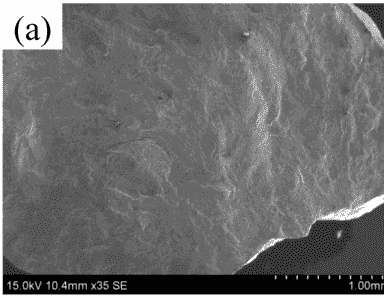

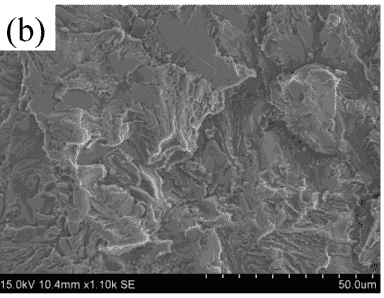

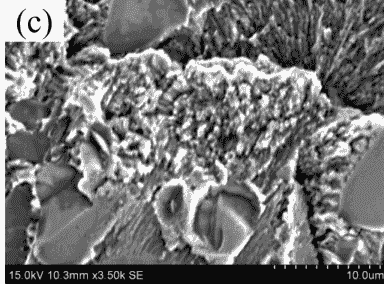

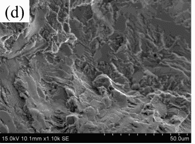

图 9. 50 A 沉积电流下的 SEM 图像：（a）部分裂纹的宏观轮廓，（b–d）高倍 SEM 图像。

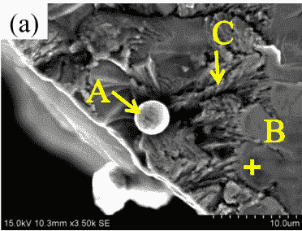

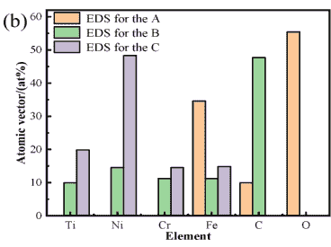

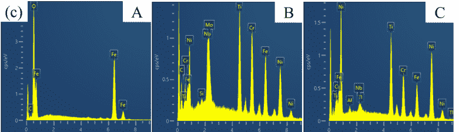

图 10.（a）50 A 沉积电流下断裂底部的高倍 SEM 图像。（b）元素含量比较，（c）(a) 中三个点的 EDS 测量含量图。

从图 9 可以看出，横截面分布着大量河纹和“阶梯”形状。根据 XRD 结果和 EDS 扫描分析，WAAM 制备的沉积层中分布着 Ti-Fe、Ti-Ni 和 Ti-Cr 系列的脆性金属间化合物 [28,29]。当沉积电流低于 50 A 时，


热输入最小，Ti6Al4V 和 Inconel 718 合金的屈服强度超过沉积层中的热应力，因此不会形成裂纹。但是，当沉积电流超过 50 A 时，沉积层中的应力集中超过合金的屈服强度，导致裂纹形成。

#### 3.6. 机械性能

图 11 展示了通过显微硬度计测量的不同沉积电流下样品的显微硬度特性。沉积电流为 35 A 时，平均显微硬度为 550.14 HV。该值在 40 A 时增加到 658.27 HV，在 45 A 和 50 A 时均达到 659.79 HV。记录到的最大平均显微硬度为 723.50 HV。以往研究表明，Inconel 718 的显微硬度约为 250 HV [30]。结果表明，Ti6Al4V 复合材料的显微硬度显著提高，并随着沉积电流的增加而逐渐提升。

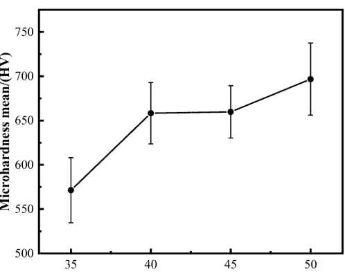

图 11. 不同沉积电流下样品的显微硬度特性。

随着沉积电流增加，热输入也随之上升，导致沉积层的二次枝臂间距、晶粒尺寸和形貌发生变化。较高的沉积电流会使沉积层内晶粒变细，增加晶界的相对面积，从而阻碍位错运动。这种阻碍有助于提高屈服强度，进而影响样品的显微硬度。以往分析表明，沉积电流为 35 A 时，沉积层主要由柱状晶组成。这些晶体主要为镍基合金，其中少量 Ti 通过扩散分布在其中。Ti 元素的掺入增强了材料的显微硬度。

沉积电流为 40 A 时，沉积层的微观组织主要由 TiNi、Cr2Ti 和 Fe2Ti 等金属间化合物组成。Cr2Ti 和 Fe2Ti 均为硬脆的金属间化合物相，有助于提高材料的整体硬度。当沉积电流增加到 45 A 时，与 40 A 相比，显微硬度变化不大。这种稳定性可能归因于枝轴沿线的微观组织，其主要为镍基合金，并少量分布 Ti。枝轴与枝晶之间的硬脆金属间化合物含量很少；然而，MC 碳化物位于晶界附近。这些碳化物阻碍位错运动，从而增强材料的硬度，并可能解释显微硬度变化有限的原因。

沉积电流为 50 A 时，枝轴和枝晶上的硬脆金属间化合物含量相对较高，且从图 7 可以看出，MC 碳化物也分布在枝轴上。有报道称，少量 MC 碳化物通过阻止位错运动和稳定晶界提供强化作用 [15]，因此相应硬度相对提高。当电流增加到 40 A 时，与 35 A 相比，显微硬度提高了 19.65%。当沉积电流增加到 50 A 时，显微硬度比沉积电流为 35 A 时提高了 31.51%。

### 4. 讨论

#### 4.1. 不同沉积电流下复合材料的凝固

由 Ti6Al4V 和 Inconel 718 合金制备的复合材料中，金属间化合物主要以 Ti-Ni 二元体系为主。图 12 显示了 Ti-Ni 二元相图 [31]。根据 Ti-Ni 二元相图分析，当 Ti 和 Ni 原子含量接近 1:2 时，会发生共析反应，复合材料中会形成新的 TiNi 和 Ni3Ti 金属化合物相。但是，Inconel 718 合金含有更多元素，在 WAAM 过程中，Inconel 718 合金中除了 Ni 以外的其他元素仍会与 Ti 元素结合形成 Ti-Fe 相和 Ti-Cr 相。有报道称，Fe2Ti 金属化合物在晶体学中被描述为 C14 Laves 相 [32]，而 Cr2Ti 金属化合物也被描述为 Laves 相 [33]。

热力学计算的理论基础是 CALPHAD 方法（计算相图法）[34]。当整个系统的吉布斯自由能达到最小时，系统处于平衡状态。在某些区域，平衡状态可能是多种相的混合物，也可能仅仅是一个稳定的单相。在多元系统中，相的吉布斯自由能通常可由以下方程表示：

$$ G_m = \sum_i x_i G_i^o + RT \sum_i x_i ln x_i + \sum_i \sum_j > 1 x_i x_j \sum_V \Omega_V (x_i - x_y)^2 \quad (3) $$

其中，$G_m$ 是相的吉布斯自由能，$\sum_i x_i G_i^o$ 是纯组分的吉布斯自由能，$RT \sum_i x_i ln x_i$ 是理想熵，$\sum_i \sum_j > 1 x_i x_j \sum_V \Omega_V (x_i - x_y)^2$ 是带有相互作用参数的配对相互作用项，$x_i$ 和 $x_y$ 是不同合金组分的摩尔分数，$T$ 是温度，$R$ 是气体常数。$\Omega_V$ 是取决于 $V$ 值的相互作用系数。当 $V$ 的值为 0 和 1 时，对应正溶液模型。在实践中，该值通常不超过 2 [35]。

多元合金的平衡相图及各温度下的相平衡分数可根据热力学计算原理计算得出 [36]。尽管非平衡加热和冷却过程与平衡状态下的理论温度存在偏差，但各温度之间的相对大小关系不变，因此可利用平衡状态下的理论温度来分析冷却过程中各相的凝固和析出。

本工作中，对不同沉积电流下复合材料的枝轴和枝晶间区进行了 EDS 分析，获得了平均合金元素含量，并计算了固-液线理论温度，以获得相应组分的析出温度。结果表明，沉积电流为 35 A 时制备的复合材料中未发现 Laves 相，即冷却过程中未析出 Laves 相。冷却过程中，$\gamma$、$\eta$ 和 BCC 相从枝晶轴析出。有报道称，$\eta$ 相是以 Ni3Ti 组分为基础的金属间化合物相 [37]。BCC 的结构是体心立方结构，TiNi 相的结构据报道也是体心立方结构 [31]。

图 12b 显示了沉积电流为 35 A 时，在平衡状态下计算的 $\gamma$ 相、$\eta$ 相和 BCC 相的析出和液化质量分数与温度曲线。可以看出，枝轴的液相温度较高，因此枝轴在冷却过程中首先凝固，且在冷却过程中枝轴会依次析出 \(\gamma\) 相、\(\eta\) 相和 BCC 相。凝固过程涉及溶质元素的重新分布。考虑到析出相主要与 Ni 和 Ti 相关，从图 12a 中 Ti-Ni 二元相图的分析可以看出，枝轴上的析出相为 \(\gamma\)-NiNi、Ni\(_3\)Ti 和少量的 TiNi。当温度高于 1353.87 °C 时，全部呈液相。当温度低于 1350 °C 时，\(\gamma\) 相开始析出。在此温度下，枝轴开始凝固，因为高温存在时间非常短，因此沉积过程中的熔池基本处于固液混合阶段；在冷却过程中，枝晶和枝轴之间会形成液膜，液态金属的吸热作用及表面张力的机械作用限制并阻碍了晶粒生长，从而使奥氏体晶界属于化学晶界 [38,39]。

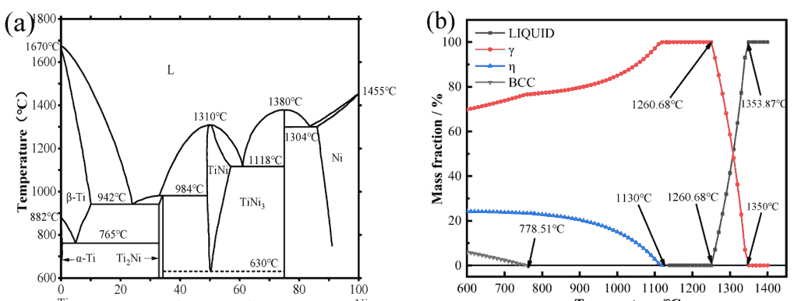

图 12. (a) Ti-Ni 二元相图 [26] 以及 (b) 沉积电流为 35 A 时复合材料的相平衡分数图。

图 13 显示了沉积电流为 40 A 时复合材料的平衡分数图，计算结果表明，枝轴（图 7f-P4）和枝晶间区（图 7f-P5）完全液化为液相的温度为 1172.76 °C。然而，枝晶间 Laves 相的析出温度为 1366.21 °C，表明枝晶间 Laves 相是在冷却过程中最先析出的相，且其含量达到最高点的温度为 1144.16 °C。当温度降至约 1181.76 °C 时，枝轴上的 Ni\(_3\)Ti 相和 TiNi 相开始析出。在枝晶间 Laves 相析出过程中，枝晶轴上的 Ni\(_3\)Ti 相和 TiNi 相也依次析出，且 Ni\(_3\)Ti 相的含量随温度降低几乎不变。注意的是，当温度降至 865.82 °C 时，TiNi 相含量出现明显下降，同时伴随 \(\sigma\) 相开始析出。Laves 相的熔化温度较高，因此枝晶首先凝固，与枝轴形成液膜，保持枝晶结构状态，表明枝晶在整个冷却过程中都处于分散状态，如图 7b,f 所示。


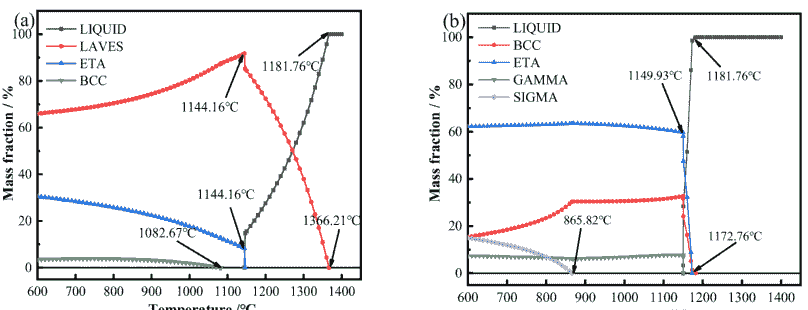

图 13. 40 A 沉积电流下复合材料的平衡分数：(a) 枝间区域和 (b) 枝轴。

图 14 显示了沉积电流为 45 A 时复合材料的平衡分布图。计算结果显示，所有枝晶转变为液相的温度为 1310.08 °C，所有枝间转变为液相的温度为 1270 °C。可见，在冷却过程中，γ-Ni 相首先在枝轴上凝固，γ-Ni 相最高析出含量的温度为 1180.65 °C。枝间 Laves 相的析出温度为 1269.52 °C，与 γ-Ni 相相近。在 WAAM 过程中，高温停留时间短，冷却速度极快，因此在冷却过程中，γ-Ni 相和 Laves 相几乎同时析出。随着温度降低，Ni3Ti 相开始在枝轴上析出。当温度进一步降低时，枝轴上的 γ-Ni 含量降低，而 TiNi 相含量增加。主要的 Ni3Ti 相在枝晶之间析出。当温度逐渐降低时，Ni3Ti 相含量降低，而 Ni3Ti 相含量增加。

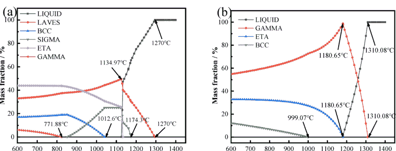

图 14. 45 A 沉积电流下复合材料的平衡分数：(a) 枝间区域和 (b) 枝轴。

图 15 展示了 50 A 沉积电流下复合材料的平衡分布图。计算结果表明，析出相包括 Laves 相、Ni3Ti 相和 TiNi 相，既出现在枝轴沿线，也出现在枝间区域。Laves 相在枝轴上的析出含量在 1140 °C 达到峰值，随后随温度降低而降低。相反，Ni3Ti 相和 TiNi 相的含量逐渐增加，并趋近于平衡状态。

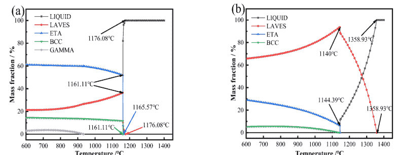

图 15. 50 A 沉积电流下复合材料的平衡分数：(a) 枝间区域和 (b) 枝轴。

Laves、TiNi 和 Ni3Ti 相的析出温度约为 1161.11 °C。随着温度降低，Laves 相含量倾向于降低并最终达到平衡，而 Ni3Ti 相含量缓慢增加，也趋向平衡。在从液相到固相的整个凝固过程中，枝轴上的 Laves 相优先析出，在枝间形成液膜，这有助于保持枝晶结构。

#### 4.2. 裂纹分析

焊接热输入量的大小显著影响工件中的应力水平；一般来说，热输入越高，应力越大 [40]。在本研究中，50 A 沉积电流下制备的复合材料出现了裂纹。随着沉积电流增大，高温停留时间延长。对复合材料进行 SEM-EDS 分析显示，枝轴沿线存在 MC 碳化物，表明这些碳化物在液态金属凝固过程中析出。MC 碳化物的存在导致工件应力集中，可能会降低其力学性能。此外，Laves 相的存在也会影响工件的力学性能。

对不同沉积电流下复合材料的微观组织分析表明，在 50 A 沉积电流下，枝间区域和枝轴沿线都存在大量 Laves 相。这些 Laves 相的存在使工件容易发生液化裂纹，不利地影响其力学性能。此外，对断裂截面的 SEM 和 EDS 分析表明，断裂模式为解理断裂，断裂表面检测到大量次级相。凝固析出分析表明，这些次级相主要由 Laves 相、Ni3Ti 和 TiNi 组成。XRD 分析还表明复合材料中存在 Fe2Ti 和 Cr2Ti。有文献记载，Fe2Ti、Ni3Ti 和 Cr2Ti 相是脆性金属间化合物 [41,42]。Laves 相与这些次级相的共同作用导致了复合材料中裂纹的形成。

#### 4.3. 硬度分析

复合材料的微硬度随沉积电流增大而增加。次级相析出也会影响复合材料的微硬度。当沉积电流较小时，复合材料中的 Ti-Cr 和 Ti-Fe 等次级相析出较少。当沉积电流增加时，产生的次级相更多，从而提高了复合材料的微硬度。此外，材料的枝晶常充满高溶质含量的晶体，导致偏析，这会影响合金的力学性能，且枝晶间距越小，合金性能越好 [43]。不同沉积电流下生产的复合材料的二级枝晶间距呈现一定的变化性。如图 6 所示，二级枝晶间距起初随沉积电流增加而增大，在较高电流下随后减小。同时，复合材料的微硬度也随沉积电流增加而升高。在 35 A 和 40 A 沉积电流下，二级枝晶间距增大，复合材料的微硬度也随之升高。40 A 下微硬度的增加归因于材料内部形成了更多次级析出相，从而提升了其性能。在 40 A 和 45 A 沉积电流下，二级枝晶间距保持相对恒定，导致微硬度数值相近。然而，当沉积电流达到 50 A 时，二级枝晶间距减小，且次级相析出量显著增加，从而观测到最高的微硬度。

### 5. 结论

- 1. 采用 Ti6Al4V 和 Inconel 718 焊丝作为原材料，通过双丝电弧增材制造（WAAM）沉积法在不同沉积电流下成功制备了 Ti6Al4V/Inconel 718 复合材料。然而，观察到沉积电流增加与复合材料中出现裂纹之间存在相关性。

- 2. 随着沉积电流增大，沉积样品的二级枝晶间距先增大后减小。在 35 A 沉积电流下，二级枝晶间距为 5.16 μm，而在 50 A 下减小至 3.96 μm。值得注意的是，35 A 沉积电流下制备的样品具有良好的形貌，无可见裂纹或缺陷。

- 3. 在 35 A 沉积电流下，微观组织主要由镍基合金组成，Ti 元素通过扩散沿枝轴分布。在 40 A 和 45 A 沉积电流下，枝轴与枝晶之间的钛、镍、铬和铁含量变化甚微。然而，在 50 A 时，TiNi、Cr2Ti 和 Fe2Ti 主要沉积在枝轴上，同时也发现了 MC 碳化物。此外，Ni3Ti 主要沉积在枝晶之间。

- 4. 在 50 A 沉积电流下，制备的样品出现裂纹，表现为解理断裂。过量的热输入导致沉积层中应力集中，超过合金的屈服强度，从而产生开裂的横截面。

- 5. 硬度数据表明，样品的微硬度随电流增大而增加。具体来说，当电流升至 50 A 时，与 35 A 的值相比，微硬度增加了 31.51%。

**作者贡献：** 概念化，P.X. 和 X.Y.；方法学，P.X. 和 X.Y.；验证，P.X. 和 G.Z.；正式分析，P.X.；调查，P.X. 和 G.Z.；资源，X.Y.；数据整理，P.X.；写作——原始草稿准备，P.X.；写作——审查和编辑，P.X.；监督，X.Y.；项目管理，X.Y.；资金获取，X.Y.。所有作者已阅读并同意出版的手稿版本。

**资助：** 本研究由学科高峰资助支持。

**数据可用性声明：** 本研究的原始贡献包含在文章中，进一步询问可联系通讯作者。

**致谢：** 本工作部分得到上海材料科学与工程（高能束智能加工与绿色制造）III 类学科高峰的支持。

**利益冲突：** 作者声明不存在利益冲突。


### 参考文献

- 1. Sakundarini, N.; Taha, Z.; Abdul-Rashid, S.H.; Ariffin, R.; Ghazila, R. 汽车车身装配轻量化设计中纳入可回收性的最佳多材料选择. J. Mater. Des. 2013, 50, 846–857. [CrossRef]
- 2. Wargnier, H.; Kromm, F.X.; Danis, M.; Brechet, Y. 多材料设计程序的提案. J. Mater. 2014, 56, 44–49. [CrossRef]
- 3. Jeong, H.-I.; Kim, D.-H.; Lee, C.-M. 使用Ti-Nb-Cr-V-Ni高熵合金中间层进行Inconel 718和Ti-6Al-4V的多材料沉积. J. Mater. Res. Technol. 2024, 29, 3217–3227. [CrossRef]
- 4. Hou, X.; Ye, X.; Qian, X.; Zhang, X.; Zhang, P.; Lu, Q.; Yu, Z.; Shen, C.; Wang, L.; Hua, X. 双丝等离子电弧增材制造Ti-Al合金的热量积累、微观结构演变及应力分布. J. Adv. Eng. Mater. 2022, 24, 2101151. [CrossRef]
- 5. Hadibeyk, S.; Beidokhli, B.; Sajjadi, S.A. 瞬态液相键合异质GTD-111/FSX-414 TLP超合金的结合时间和均质化热处理对其微观结构和力学性能的影响. J. Alloy. Comp. 2018, 731, 929–935. [CrossRef]
- 6. Zhang, Y.; Luo, Z.; Liu, Y.; Liu, J.; Huang, Z. 采用Zn中间层热补偿电阻点焊制造的Mg/Al异质接头的微观结构表征及拉伸性能. J. Mater. 2015, 75, 166–173. [CrossRef]
- 7. Aceves, S.M.; Espinosa-loza, F.; Elmer, J.W.; Huber, R. 用于低温加压氢储存的铜、钛和钽中间层爆炸制造铝到不锈钢过渡接头的ScienceDirect比较. J. Int. J. Adv. Manuf. Technol. 2014, 40, 1490–1503. [CrossRef]
- 8. Oliveira, J.P.; Pantano, B.; Zeng, Z.; Andrei, C.M.; Zhou, Y.; Miranda, R.M.; Fernandes, F.M.B. 使用铌中间层将NiTi与Ti6Al4V进行激光连接. J. Acta Mater. 2016, 105, 9–15. [CrossRef]
- 9. Mishra, A.; Paul, A.R.; Sharma, R.; Mukherjee, M.; Singh, R.K. 使用Monel-400作为中间层，通过电弧增材制造开发的Ti6Al4V-IN718异质结构的界面特征. J. Mater. Today Proc. 2023, 80, 241–247. [CrossRef]
- 10. Song, C.; Ma, G.; He, A.; Li, Y.; Niu, F.; Wu, D. 激光增材制造Ti6Al4V/Inconel 718复合材料的多相转变机制. J. Mater. Charact. 2021, 179, 111363. [CrossRef]
- 11. Chatterjee, S.; Abinandanan, T.A.; Chattopadhyay, K. Ti/Ni异质焊缝中的相形成. J. Mater. Sci. Eng. A 2008, 490, 7–15. [CrossRef]
- 12. Chatterjee, S.; Abinandanan, T.A.; Reddy, G.M.; Chattopadhyay, K. 异质金属焊缝中的微观结构形成：Ti/Ni的电子束焊接. J. Metall. Mater. Trans. A 2016, 47, 769–776. [CrossRef]
- 13. Martinsen, K.; Hu, S.J.; Carlson, B.E. 异质材料的连接. J. CIRP Ann.-Manuf. Technol. 2015, 64, 679–699. [CrossRef]
- 14. Sun, Z.; Ion, J.C. 异质金属组合的激光焊接. J. Mater. Sci. 1995, 30, 4205–4214. [CrossRef]
- 15. Wang, Y.; Ye, X.; Shi, M.; Pan, N.; Xia, P. 脉冲激光熔覆沉积Ti6Al4V/Inconel 718相演变行为的研究. J. Mater. 2023, 16, 2437. [CrossRef]
- 16. Chen, H.C.; Pinkerton, A.J.; Li, L. 航空航天应用中Ti-6Al-4V和Inconel 718异质合金的光纤激光焊接. J. Int. J. Adv. Manuf. Technol. 2011, 52, 977–987. [CrossRef]
- 17. Peng, Y.; Fu, Y.Y.; Wang, W.M.; Zhang, J.Y.; Wang, Y.C.; Wang, H.; Zhang, Q.J. 使用脉冲电流加热焊接Ti-6Al-4V和TiB2-Ni陶瓷金属复合材料. J. Sci. Technol. Weld. Join. 2008, 13, 456–461. [CrossRef]
- 18. Sun, Z.; Ji, X.; Zhang, W.; Chang, L.; Xie, G.; Chang, H.; Zhou, L. 激光熔覆沉积制造的Ti6Al4V/Inconel625梯度涂层的微观结构演变及高温抗性. J. Mater. Des. 2020, 191, 108644. [CrossRef]
- 19. Meng, W.; Xiaohui, Y.; Zhang, W.; Junfei, F.; Lijie, G.; Qunshuang, M.; Bing, C. 激光同步预热从Inconel625到Ti6Al4V的功能梯度材料增材制造. J. Mater. Process. Technol. 2020, 275, 116368. [CrossRef]
- 20. Bonny, O.; Amit, B. Inconel 718-Ti6Al4V双金属结构的增材制造. J. Addit. Manuf. 2018, 22, 844–851. [CrossRef]
- 21. Huang, J.; Liu, G.; Yu, X.; Guan, Z.; Yu, S.; Fan, D. 使用双丝交流电交叉电弧增材制造对镍钛合金梯度材料的表征. J. Alloys Compd. 2022, 910, 164912. [CrossRef]
- 22. Lu, L.; Tian, Y.; Cai, Y.; Xin, Y.; Chen, X.; Zhang, G.; Han, J. 双丝+电弧增材制造从TA1到Inconel 625的功能梯度材料的微观结构和力学性能. J. Mater. Lett. 2021, 298, 130010. [CrossRef]
- 23. Wang, J.; Pan, Z.; Wei, L.; He, S.; Cuiuri, D.; Li, H. 钛铝化物金属间化合物电弧丝材增材制造中三元合金化元素的引入. J. Addit. Manuf. 2019, 27, 236–245. [CrossRef]
- 24. Han, J.; Chen, X.; Zhang, G.; Liu, B.; Cai, Y.; Chen, M.; Jiang, H.; Tian, Y. 基板加热温度为600°C的双丝+电弧增材制备的Ni50.8Ti49.2合金. J. Manuf. Process. 2023, 104, 76–86. [CrossRef]
- 25. Le, V.T.; Bui, M.C.; Nguyen, T.D.; Nguyen, V.A. Van Canh Nguyen. 不锈钢电弧丝材增材制造中热输入与成形质量的关系. J. Vacuum. 2023, 209, 111807. [CrossRef]
- 26. Le, V.T.; Mai, D.S.; Bui, M.C.; Wasmer, K.; Nguyen, V.A.; Dinh, D.M.; Nguyen, V.C.; Vu, D. 利用电弧焊源进行增材制造生产的308L不锈钢壁中工艺参数和热循环对质量的影响. J. Weld World 2022, 66, 1565–1580. [CrossRef]
- 27. Zhang, G.; Chen, X.; Cai, Y.; Lu, L.; Xin, Y.; Jia, D.; Tian, Y.; Han, J. 双丝+电弧增材制造的Ti-3Al-2V合金的微观结构和力学性能. J. Mater. Lett. 2021, 229, 130190. [CrossRef]
- 28. Danek, M.; Fernandes, F.; Cavaleiro, A.; Polcar, T. Cr添加对多层TiAlCrN薄膜的结构和抗氧化性能的影响. J. Surf. Coat. Technol. 2017, 313, 158–167. [CrossRef]
- 29. Hu, B.; Du, Y.; Schuster, J.C.; Sun, W.; Liu, S.; Tang, C. 基于四子晶模型对有序/无序体心立方相的Cr-Ni-Ti系统进行热力学模拟. J. Thermochim. Acta 2014, 578, 35–42. [CrossRef]
- 30. Górka, J.; Jamrozik, W.; Kiel-Jamrozik, M. TIG焊接对Inconel 718对接接头的结构和硬度的影响. J. Heliyon. 2023, 9, e13175. [CrossRef]
- 31. Tian, Y.; Chen, X.; Cai, Y.; Luo, Z.; Chen, M.; Zhang, X.; Li, J.; Han, J. 双丝电弧增材制造原位制备的Ni-Ti-Cr-Mo-Nb合金的微观结构和性能. J. Mater. Sci. Eng. A 2022, 853, 143740. [CrossRef]
- 32. Wu, Y.; Wu, X.; Qin, S.; Yang, K. 金属间化合物Fe2Ti的压缩性和相变. J. Alloys Compd. 2013, 558, 160–163. [CrossRef]
- 33. Uchil, J.; Kumara, K.G.; Mahesh, K.K. 热处理温度和热循环对Ni-Ti-Cr合金相变的影响. J. Alloys Compd. 2001, 325, 210–214. [CrossRef]
- 34. Saunders, N.; Miodownik, A.P. 相图计算（Calphad）：全面指南；Pergamon materials series；Cahn, R.W., 编；Elsevier：阿姆斯特丹，荷兰，1998；第1卷，第1–479页.
- 35. Shercliff, H.R.; Ashby, M.F. 铝合金时效硬化的工艺模型-I. 模型. J. Acta Metall. Et Mater. 1990, 38, 1789–1802. [CrossRef]
- 36. Yang, Z.; Yan, C.; Tang, T.; Li, P.; Li, Z. NOS525旋转平板binaul热锻模具的失效分析及热处理工艺优化. J. Eng. Fail. Anal. 2024, 163, 108521. [CrossRef]
- 37. Swartzendruber, L.J.; Itkin, V.P.; Alcock, C.B. Fe-Ni（铁-镍）系统. J. Phase Equilibria 1991, 12, 288–312. [CrossRef]
- 38. Ojo, O.A. 焊接镍基超合金热影响区的晶间液化裂纹（铸造状态）. J. Mater. Sci. Technol. 2007, 23, 1149–1155. [CrossRef]
- 39. Chintababu, U.; Chary, V.R.; Gupta, S.P. Cu-5 At.% Sb合金中的液膜迁移. J. Can. Metall. Q. 2007, 46, 175–187. [CrossRef]
- 40. Kumar, S.; Shahi, A.S. 热输入对气体钨电弧焊AISI 304不锈钢接头的微观结构和力学性能的影响. J. Mater. Design. 2011, 32, 3617–3623. [CrossRef]
- 41. Pelloth, J.; Brand, R.A.; Keune, W. Fe2Ti Laves相的局部磁性能. J. Magn. Magn. Mater. 1995, 140–144, 59–60. [CrossRef]
- 42. Su, L.; Jia, L.; Feng, Y.; Zhang, H.; Yuan, S.; Zhang, H. 定向凝固Nb-Si-Ti-Cr-Al-Hf合金的微观结构和室温断裂韧性. J. Mater. Sci. Eng. A Struct. Mater. Prop. Microstruct. Process. 2013, 560, 672–677. [CrossRef]
- 43. Liu, M.Y.; Shi, B.; Wang, C.; Ji, S.K.; Cai, X.; Song, H.W. 亚微米晶低碳钢的正常Hall–Petch行为. J. Mater. Lett. 2003, 57, 2798–2802. [CrossRef]

**免责声明/出版者说明：** 所有出版物中包含的声明、意见和数据仅由各个作者和贡献者负责，而非MDPI及/或编辑。MDPI及/或编辑对内容中提及的任何想法、方法、说明或产品导致的人员或财产损害概不负责。


文章

## 热冲压未涂层硼钢表面质量分析及氧化层抑制方法研究

李志浩, 宋俊翰 和 裴基贤 *

韩国工业技术研究院柔性制造研发部, 仁川广域市 21999, 大韩民国; jksg0319@kitech.re.kr (J.L.); jhsong@kitech.re.kr (J.S.) * 通讯作者: baegh@kitech.re.kr; 电话: +82-32-850-0318

摘要: 本研究调查了热冲压对硼钢表面性能的影响，对比了未涂层钢与Al-Si涂层钢，重点开发受控气氛热冲压技术。使用帽形试件的实验表明，未涂层钢在高温下暴露于大气氧气中形成了厚氧化层，对表面质量和可焊性产生负面影响。相比之下，Al-Si涂层钢未形成氧化物。尽管未涂层钢表现出较高的平均维氏硬度，但氧化层对焊接质量的不利影响使得工艺技术进步势在必行。开发了一种实验室规模的热冲压模拟器来控制大气氧气水平，利用环形感应加热线圈将材料加热至1000 °C以上，随后在成型模具中进行快速冷却。结果表明，将氧气浓度保持在6%以下可显著降低氧化层厚度，近真空条件可完全消除氧化物形成。这些发现强调了氧气控制在提升未涂层硼钢表面质量和可焊性方面的关键作用，适用于超高强度汽车应用，有望在确保零件性能的同时降低制造成本。

关键词: 热冲压; 硼钢板; 氧化层; 气氛控制; 感应加热模块

引用: Lee, J.; Song, J.; Bae, G. 热冲压未涂层硼钢表面质量分析及氧化层抑制方法研究. Materials 2024, 17, 5563. https://doi.org/10.3390/ma17225563

学术编辑: 迪米特里奥斯·采特齐斯, 康斯坦蒂诺斯·宗加斯和尼古劳斯·克拉多瓦西利基斯

收稿日期: 2024年10月18日 修回日期: 2024年11月11日 接受日期: 2024年11月12日 发表日期: 2024年11月14日

版权: © 2024 作者所有。被 MDPI, 巴塞尔, 瑞士 特许。本文根据知识共享署名(CC BY)许可证(https://creativecommons.org/licenses/by/4.0/)的条款和条件分发，为开放获取文章。

### 1. 引言

由于近期环境问题和燃油效率法规的加强，环保车辆的需求不断增加。许多全球汽车公司正在生产电动汽车，以通过取代传统内燃机来满足各种环境法规。为了实现单次电池充电的最大续航里程，车辆重量对环保车辆至关重要。为了减轻车辆重量，许多公司正在增加热冲压部件的应用，以确保碰撞性能和乘客安全。作为这一证据，1984年硼钢热冲压部件首次应用于Saab汽车[1]后，热冲压生产数量从1987年的300万件增加到800万件，并进一步在2007年激增至1.7亿件[2]。预计2023年热冲压市场将扩展至约12.8亿个部件。因此，与热冲压生产技术相关的研究正在积极开展。

热冲压方法适用于在超过900 °C的高温下成形具有高延伸率和低强度的材料，然后将其淬火为马氏体钢，以达到超过1.5 GPa的极高强度，从而生产出乘客安全所需的高强度产品。淬火过程涉及从马氏体转变温度（范围从马氏体起点425 °C到马氏体终点280 °C）[3]以每秒约27 K的速度进行快速冷却。热冲压常用材料包括添加硼的合金，如22MnB5、27MnB5和37MnB5。添加硼的合金在热冲压中更受青睐，因为硼钢被公认为热冲压后唯一能够产生马氏体组织的钢种[4]。热处理前，硼钢板的抗拉强度通常约为600 MPa。通过热冲压后材料的马氏体转变，已知可达到约1.5 GPa的抗拉强度[4]。

大量研究者已调查利用未涂层热冲压钢板的部件制造技术。从材料技术角度来看，已进行了各种实验分析，以确保和增强材料的力学性能，冷却率被选为关键变量[5–7]。同时，从工艺技术角度来看，研究人员专注于优化热冲压工艺以改善成形质量和生产率[8–12]。此外，还进行了各种研究来分析热冲压过程中的热传递和材料变形机制，旨在提高工艺效率[13–16]。这些集体研究不断推进了利用未涂层热冲压钢板的部件制造技术。

未涂Al-Si涂层的热冲压硼钢在奥氏体化条件下暴露于空气中时，表面会生成氧化皮。为控制这种氧化层，可以采用诸如使用Al-Si涂层硼钢板进行防氧化[17]或在表面涂抹油进行抗氧化[18]等方法。涉及喷丸的物理方法也可以去除氧化层[18,19]。尽管这些方法在热冲压过程中控制氧化层方面具有优势，但表面用于氧化控制的涂层存在可能导致焊接过程中涂层熔化。此外，使用油进行防氧化时，研究数据显示界面传热系数(IHTC)下降，影响组织和力学性能[20]。Al-Si涂层在快速加热速率下可能会提前加热，导致涂层滑动并引起涂层位移等问题。此外，由于与Al-Si涂层硼钢板相关的材料和工艺专利，热冲压零件的生产成本会增加。

为克服这些缺点，使用未涂层硼钢板提出一种替代热冲压方法至关重要。Taylor等人[21]绘制了未涂层钢板热冲压工艺的示意图，表明该工艺通常包括一个额外的喷丸步骤以去除氧化皮。这一额外步骤需要额外的生产设备并延长了加工时间，导致使用未涂层钢板的热冲压零件制造成本增加。与涂层钢板相比，相对较高的制造成本是使用非涂层钢板的一大障碍。因此，即使支付阿赛洛米塔尔持有的材料和工艺专利的额外费用，大多数汽车车身部件制造商仍选择使用Al-Si涂层钢板。Chen等人[22]强调了未涂层热冲压工艺在汽车零件制造中的成本节约优势。此外，Kim等人[23]通过经济效益分析表明，在热冲压工艺中使用未涂层钢板可以降低生产成本并提高效率。因此，为降低热冲压部件的制造成本，汽车公司和车身部件制造商正在寻求开发能够抑制非涂层钢板上氧化层形成的压制成形技术。这意味着，防止或控制氧化层生长应是使用未涂层硼钢板的核心技术。

本文研究了热冲压零件表面质量的定量调查及其未涂层硼钢板氧化层的改进方法。首先，根据Al-Si涂层的有无比较了帽形试件的热处理结果，以观察涂层对表面质量和力学性能的影响。为调查未涂层钢板氧化层的抑制方法，开发了一种实验室规模的热冲压模拟器，用于在受控气氛条件下复制加热和成形过程。


随后，根据氧含量对氧化层进行了定量分析。研究结果可作为热成形工艺控制技术，以在使用未涂层钢板制造超高强度车身组件的过程中确保表面质量和可焊性。

### 2. 热成形试验方法

#### 2.1. 设备设置

已知Al-Si涂层硼钢在热成形过程中通过阻隔氧气接触来防止氧化层形成 [17]。对于使用未涂层硼钢板，应调查表面质量和性能，以观察氧化层形成并确保热成形零件的机械性能。

如图1所示，搭建了一套实验装置以再现热成形过程。气氛炉可加热至约1000 °C，机械压机可利用热成形模具制成帽型试件。水冷却冷水机与冲压模具相连以实现快速冷却，温度计用于监测冲压模具处的温度。300 mm × 300 mm试件加热至950 °C并稳定10 min。之后，试件在模具内于5 s内快速冷却至10 °C或以下，以进行马氏体相变。实验使用了由阿赛洛米塔尔生产的带有和不带Al-Si涂层的22MnB5 1.0 t钢板。22MnB5基体金属的化学成分和机械强度如表1所示。

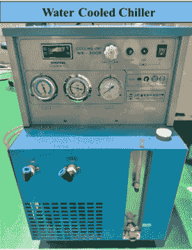

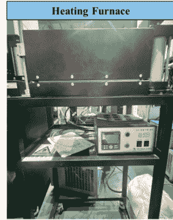

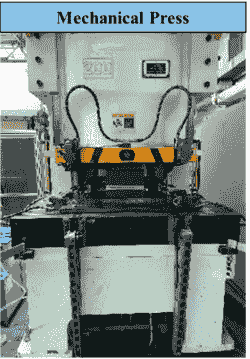

图1. 热成形试验的主要测试设备。

表1. 22MnB5基体金属的化学成分和机械强度。

| | 化学成分 [wt%] | | | | | | | 机械强度 [MPa] | |
|---|---|---|---|---|---|---|---|---|---|---|
| C | Mn | B | Si | P | S | Cr | 屈服应力 | 抗拉应力 |
| 0.24 | 1.10 | 0.003 | 0.26 | 0.014 | 0.001 | 0.14 | 1254 | 1545 |

#### 2.2. 试验程序

为观察未涂层和Al-Si涂层材料在热成形后的表面性能变化，试件经过了相同的热处理条件。试件由可控气氛炉加热至950 °C并稳定10 min。随后，采用预冷却至10 °C以下的水冷模具的200吨伺服压机对试件进行同时淬火和成形。材料到达压机所需时间约为5 s。详细试验程序如图2所示。

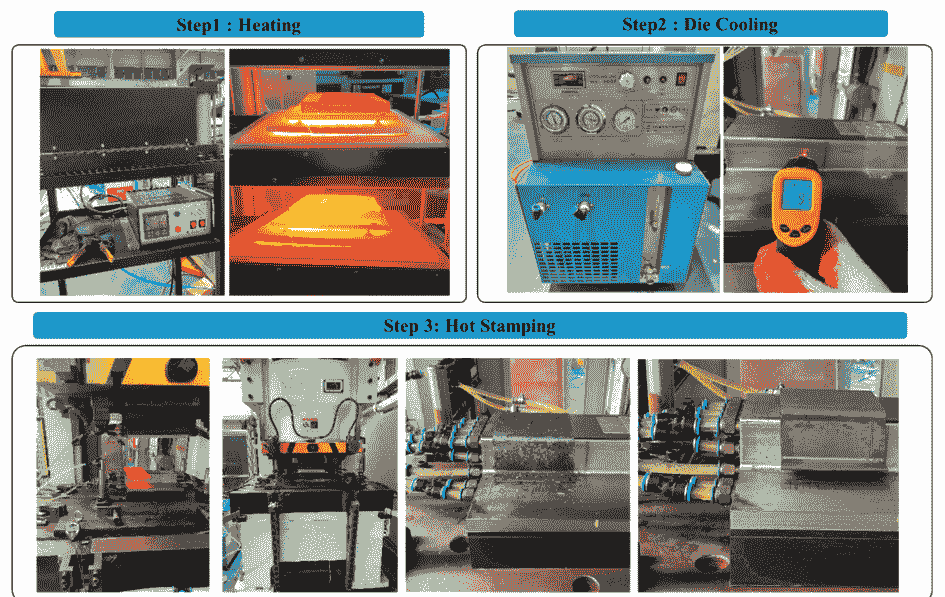

图2. 帽型试件的热成形试验过程。

### 3. 热成形试验结果

#### 3.1. 表面调查

为观察氧化层的生长并调查涂层和未涂层硼钢板的表面性能，使用帽型试件进行了热成形实验。图3显示了根据涂层情况的试件。带Al-Si涂层的试件仅在加热和淬火过程中的快速温度变化后显示热影响色变，如图3a所示，未观察到氧化层。这与已知特性一致，即Al-Si涂层在加热后通过阻隔与大气的接触来防止氧化层形成 [17]。如图4所示，加热材料在运输过程中因接触空气中的氧气而产生氧化层，在零件成形过程中的快速冷却后，如图3b所示存在较厚的氧化层。

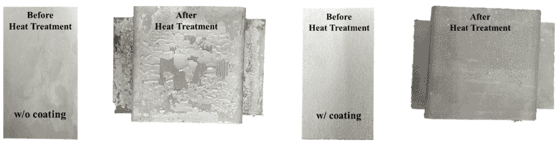

图3. 热成形试验前后的帽型试件：(a) 未涂层材料；(b) 涂层材料。

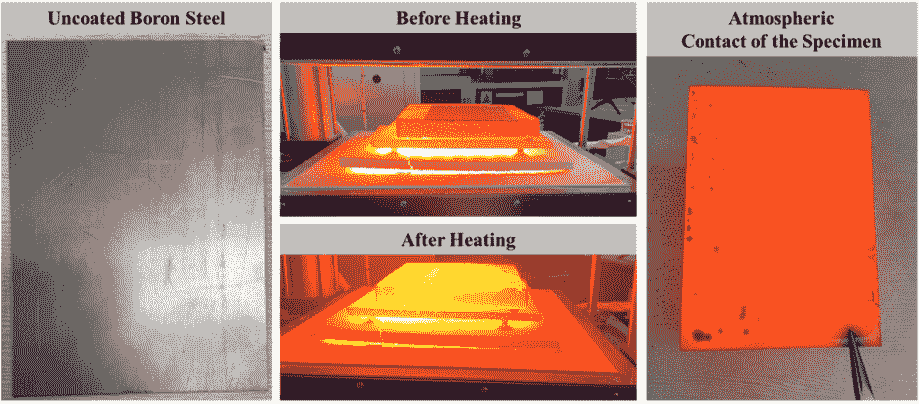

图4. 未涂层硼钢因氧气接触而形成的氧化层。

#### 3.2. 氧化层

为更精确地分析表面层变化，采用SEM（扫描电子显微镜）设备观察了加热前后的涂层和未涂层硼钢板。用于观察的设备是QUANTA 200F（FEI公司，美国俄勒冈州希尔斯伯勒）。首先，进行了点EDS测量以调查未涂层硼钢板表面氧化皮的成分。图5显示了表面氧化皮的点EDS测量结果。表面氧化皮的成分为Fe 80.74 wt%和O 19.26 wt%，表明表面氧化皮是Fe和O的氧化层。

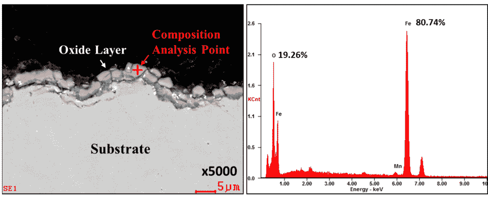

图5. 热处理后未涂层硼钢板的点EDS成分分析。

Al-Si涂层试件采用EDS映射进行了分析，以调查热处理前后涂层处成分的变化。如图6所示，热处理后Al-Si涂层转变为Al-Si和Fe的混合金属间化合物层。如图6所示，在粗糙的金属间化合物层中观察到细裂纹和内部空洞，这些是在快速淬火过程中产生的。已知此类化合物具有低断裂韧性，会促进细裂纹的形成和生长 [24,25]。作为成分扩散和合金化的结果，热处理后涂层厚度从19.79 µm增加到38.14 µm。

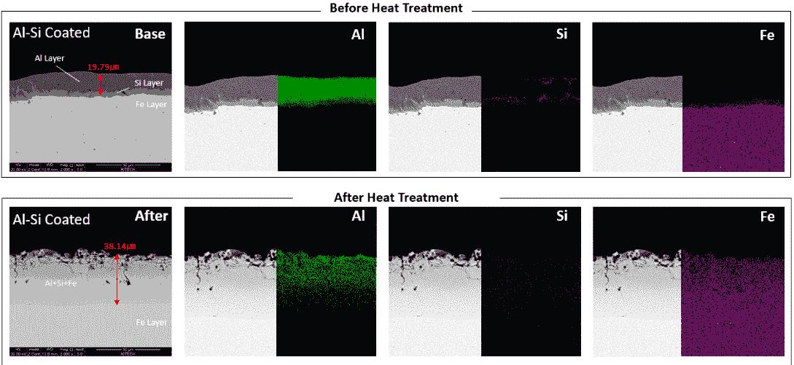

图6. 热处理前后Al-Si涂层硼钢板的EDS映射分析。

利用未涂层硼钢板的帽型试件，通过光学显微镜定量测量了氧化层厚度，以调查热成形过程中模具与板材间不同接触机制导致的氧化层残留情况。图7显示了帽型未涂层试件的取样位置。如图8所示，顶部、壁和缘部位置的氧化层厚度分别为23.46 μm、1.81 μm和7.55 μm。在顶部位置，由于模具与板材无接触，观察到最厚的氧化层。相反，在壁位置，大部分氧化层被去除，因为成形过程中板材与模具滑动时发生严重接触。在缘部位置，由于压机滑块底死点处模具的高压缩，厚度减小。在车身总成过程中，大部分点焊在顶部和缘部区域进行。这意味着，在热成形中使用未涂层硼钢板时，较厚的氧化层会恶化焊接质量。因此，需要一种新型冲压方法来减少或控制氧化层形成，以便将未涂层硼钢板用于超高强度汽车零部件。

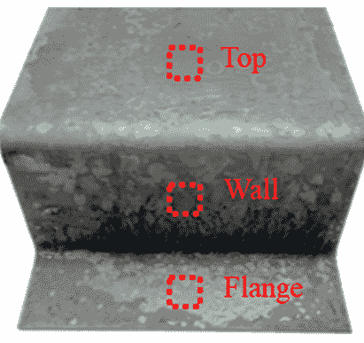

图7. 帽型试件的取样位置。

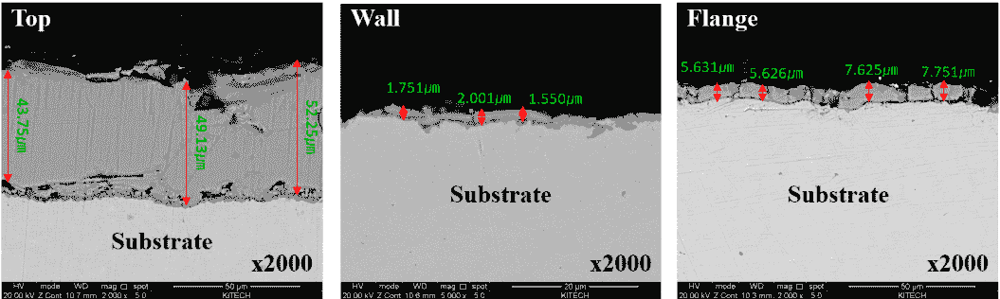

图8. 在顶部、壁和缘部位置的SEM图像，用于测量未涂层硼钢的氧化层厚度。

图9显示了Al-Si涂层试件的光学显微镜图像。由于Al-Si涂层，观察到的是根据扩散合金化成分增加的涂层厚度，而非氧化层。此外，由于热膨胀系数不同 [25–27]，涂层内部存在微裂纹和气孔。在顶部、壁和缘部位置，由于成形过程中的接触压力，未观察到显著差异。

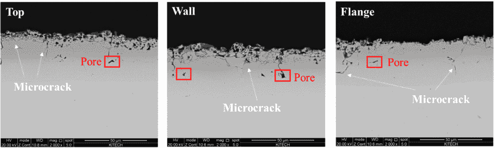

图9. 顶部、壁和缘部位置的Al-Si涂层帽型试件的SEM图像。

#### 3.3. 硬度

进行了维氏硬度试验，以考察未涂层钢板成形过程中无涂层对材料强度的影响。硬度通常已知与材料强度相关。Kim等人 [28] 报道，硼钢板在热成形热循环后的维氏硬度约为450 Hv。基于相变试验，Li等人 [29] 证明，硼钢在30 °C/s冷却速率下的维氏硬度为459 Hv，且硬度随冷却速率升高而成比例增加。本文中，使用SHIMADZU HMV-2R（岛津制作所，日本京都）设备，在施加980.7 mN载荷10 s的条件下测量了维氏硬度。图10显示了涂层和未涂层钢板的维氏硬度测量结果。为考察材料与模具间接触条件差异导致的冷却模式变化的影响，在顶部、壁和缘部区域进行了硬度测量。硬度以1 mm间隔测量了七次。涂层和未涂层钢板的总体平均硬度分别测得为481 Hv和513 Hv，未涂层钢板的数值更高。因此，证实了未涂层材料在热成形中对于强度保障更有利，而热成形需要快速


冷却。各测量位置的硬度差异，考虑到数据的离散性，未被认为具有显著差异，表明模具与材料之间的接触条件对硬度的影响微乎其微。尽管涂层的存在或不存在以及接触条件存在差异，帽形试件在所有区域均可达到所需的抗拉强度。

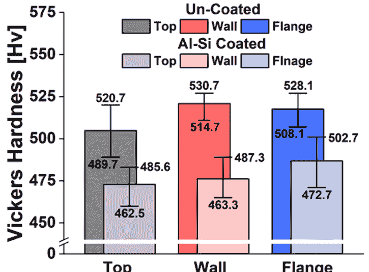

图 10. 未涂层和涂层硼钢板的维氏硬度。

#### 3.4. 摘要

对于带有 Al–Si 涂层的硼钢，如预期，在热处理和热成型过程中表面未观察到氧化层。然而，由于热膨胀系数不同，涂层层内识别出了微裂纹和气孔。此外，热处理前在涂层层中清晰区分的元素在热处理过程中扩散，在涂层层内部形成了 Fe3(AlSiFe) 合金层，这可能会影响焊接性。涂层厚度也增加了约两倍。另一方面，未涂层硼钢在热处理过程中暴露于大气中时，表面会出现不规则且不均匀的氧化层。热成型模拟测试表明，氧化层厚度可根据模具形状被保留、剥落或压缩。观察到氧化层厚度超过 20 μm，这可能会导致汽车零部件装配过程中的焊接问题。预计使用未涂层钢板对于保证材料强度有利。

在使用未涂层 22MnB5 材料进行热成型过程中，氧化反应在材料转移点最为明显。这一观察表明，材料在加热和转移过程中接触了大气中的氧气，导致氧化层开始形成并快速生长。因此，为了确保未涂层 22MnB5 材料在热成型过程中的表面质量，在转移过程中控制加热材料与氧气的接触对于保持表面质量至关重要。因此，需要对新的成型技术进行进一步研究，以抑制氧化层的形成，从而确保未涂层钢板的表面质量和焊接性。

### 4. 氧化层改进

#### 4.1. 新热成型模拟器的开发

未涂层钢板热成型过程中的氧化层形成问题，是因为材料在高温下与大气中的氧气迅速反应，导致氧化层形成。特别是，控制大气中的氧气浓度对于抑制氧化层形成至关重要。开发能够复制热成型过程的新型实验室规模模拟器是实现这一目标的非常重要的方法。

实验室规模模拟器允许在各种条件下（如氧气浓度和温度）对氧化层厚度进行定量分析，为工艺优化提供关键数据。图 11 显示了热成型模拟器的示意图。实验设备由加热区和成形区组成，包括加热后连续成形的传输系统。为了在实验过程中控制大气中的氧气含量，整个设备密封在真空室内。引入了氮气注入系统以提高大气控制效率。通过这种配置，真空室和氮气注入系统允许设置受控的大气条件，从而可以通过加热-传输-成形序列模拟未涂层钢板的热成型过程。

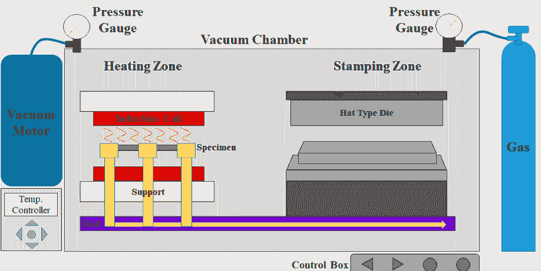

图 11. 气氛可控热成型模拟器示意图。

图 12 显示了制造的实验设备。在加热区，一个 300 mm × 300 mm 的试件放置在传输夹具上，并使用安装在其上方的煎饼形感应线圈进行加热。一旦试件达到目标温度，它就会通过由机械电机驱动的传输装置被转移到冲压区，然后由液压缸驱动的上模进行成形。在此过程中，上下模均用水冷却，创造了促进马氏体组织形成的快速冷却条件。对于氧化层控制实验，按前述方式实施了气氛控制系统，使用真空系统抽出室内空气，同时注入氮气以快速达到所需的氧气水平。使用这台新开发的热成型模拟器，在不同氧气水平下对未涂层热成型钢板进行了成形测试，以研究抑制氧化层的潜力。

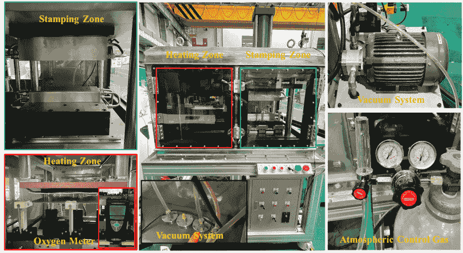

图 12. 实验室规模热成型模拟器。

#### 4.2. 实验条件的确立

模拟器设备使用煎饼形感应线圈，将 300 mm × 300 mm 尺寸的材料加热到 950 °C 以上。由于线圈的形状和试件的热变形，不同位置会出现温度变化。因此，进行了加热测试，以选择加热模块的最佳输出以达到目标温度，并根据温度变化确定表面层检查的分析区域。为测量试件的温度分布，使用了 FLIR A700 (FLIR Systems, Wilsonville, OR, USA) 红外热成像仪，其可测量高达 2000 °C 的温度。图 13 显示了使用 FLIR 热成像仪对材料进行的加热性能测试。首先，在 12 kW 条件下对材料进行加热，图 14 说明了加热测试后形成的氧化层分布。通过这项预备加热测试，确认材料沿线圈形状加热，且氧化层相应形成。FLIR 热成像仪用于测量穹顶形试件的 1/4 部分（考虑测量范围）。三个热电偶固定在壁部和凸缘部，用于测量校准的参考温度。

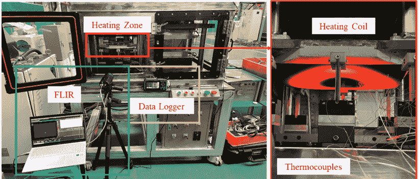

图 13. 加热模块性能评估的设备配置。

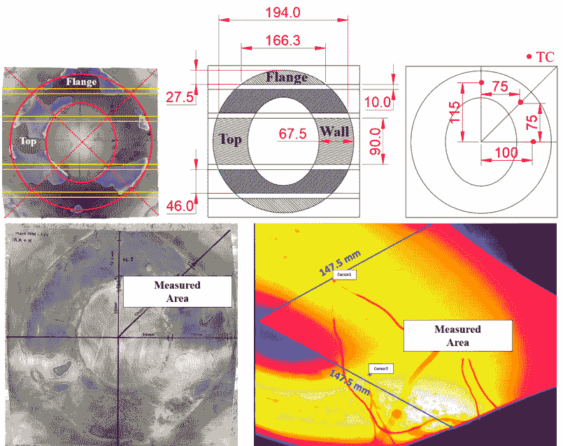

图 14. 考虑加热区域的热电偶固定位置。

随后，根据加热模块的输出进行了加热测试，并使用 FLIR 热成像仪观察温度分布。图 15 显示了与加热模块输出相对应的温度分布图。由于热成型工艺的目标温度为 950 °C 以上，该区域在温度分布图上标记为黄色。通过加热测试，确认需要 20 kW 的输出才能在帽形试件的大面积区域内保持目标温度。因此，在受控氧气条件下进行成形测试的最佳输出设定为 20 kW。

为验证真空室的气氛控制性能，观察了氮气压力变化对氧气含量的影响。通过真空泵同时抽出室内空气并注入氮气来控制氧气含量。为检查室内氧气水平，如图 16 所示安装了氧分析仪。氧分析仪在加热区、传输区和成形区之间移动，以测量随时间变化的氧气含量，确保氧气分布的均匀性。图 17 显示了根据氮气压力和时间的氧气含量变化历史。确认氧气含量随时间可控制在 1% 以下。然而，当氮气压力低于 5 kPa 时，将氧气含量控制在 1% 以下需要超过 80 分钟，并且观察到不同位置间氧气分布不均匀。为改善这一情况，当氮气压力增加到 7.2 kPa 时，达到相同氧气控制水平所需的时间缩短到 25 分钟以内，且氧气分布在整个室内变得均匀。因此，认为氮气压力 7.2 kPa 适合用于气氛控制。


| 493 | 558 | 883 | 925 | ... | 620 |
| --- | --- | --- | --- | --- | --- |
| 486 | 559 | 680 | 767 | ... | 620 |
| 492 | 561 | 684 | 767 | ... | 610 |
| 515 | 589 | 682 | 760 | ... | 608 |
| 567 | 589 | 710 | 765 | ... | 599 |
| 673 | 630 | 718 | 769 | ... | 594 |
| 783 | 713 | 750 | 783 | ... | 578 |
| 841 | 775 | 788 | 803 | ... | 561 |
| 914 | 829 | 924 | 822 | ... | 581 |
| 907 | 876 | 852 | 845 | ... | 517 |
| 943 | 831 | 853 | ... | ... | 538 |
| 947 | 927 | 907 | ... | ... | ... |
| 947 | 947 | 922 | ... | ... | ... |
| 940 | 958 | 934 | ... | ... | ... |
| 919 | 958 | 936 | 907 | ... | 527 |

| 515 | 582 | 695 | 782 | ... | 686 |
| --- | --- | --- | --- | --- | --- |
| 511 | 584 | 701 | 791 | ... | 655 |
| 521 | 596 | 714 | 791 | ... | 661 |
| 563 | 626 | 729 | 792 | ... | 654 |
| 631 | 691 | 754 | 902 | ... | 643 |
| 736 | 756 | 785 | 811 | ... | 630 |
| 820 | 811 | 821 | 828 | ... | 584 |
| 871 | 881 | 868 | 859 | ... | 588 |
| 932 | 930 | 902 | ... | ... | 567 |
| 956 | 929 | 948 | ... | ... | 559 |
| 1019 | 949 | 904 | ... | ... | 537 |
| 956 | 939 | 909 | ... | ... | 529 |
| 972 | 944 | 948 | ... | ... | 516 |
| 1009 | 1027 | 987 | ... | ... | ... |
| 919 | 1000 | 1009 | 931 | ... | 514 |

| 582 | 668 | 817 | ... | 780 |
| --- | --- | --- | --- | --- |
| 530 | 637 | 810 | ... | 785 |
| 532 | 644 | 809 | ... | 777 |
| 566 | 691 | 812 | ... | 767 |
| 643 | 739 | 829 | ... | 748 |
| 755 | 805 | 849 | ... | 709 |
| 886 | 883 | 884 | ... | 687 |
| 972 | 959 | 946 | ... | 664 |
| 983 | 892 | 967 | ... | 613 |
| 971 | 991 | 964 | ... | 573 |
| 992 | 983 | 964 | ... | 546 |
| 1109 | 1053 | 1006 | ... | 514 |
| 1114 | 1054 | 953 | ... | 489 |
| 1076 | 1047 | 973 | ... | ... |
| 1027 | 966 | 935 | ... | 445 |

| 602 | 773 | 931 | ... | 910 |
| --- | --- | --- | --- | --- |
| 566 | 737 | 908 | ... | 914 |
| 579 | 719 | 901 | ... | 916 |
| 631 | 766 | 923 | ... | 910 |
| 728 | 830 | 918 | ... | 915 |
| 869 | 857 | 944 | ... | 877 |
| 952 | 962 | 977 | ... | 840 |
| 1042 | 1026 | 1040 | ... | 787 |
| 1044 | 979 | 1021 | ... | 714 |
| 1093 | 1026 | 1008 | ... | 639 |
| 1162 | 1157 | 1073 | ... | 598 |
| 1119 | 1097 | 1060 | ... | 552 |
| 1146 | 1078 | 1122 | ... | 613 |
| 1153 | 1169 | 1108 | ... | 519 |
| 1104 | 1124 | 1102 | ... | 450 |

图 15. 根据加热模块输出的温度分布。


图 16. 真空室内氧分析仪的安装。


图 17. 根据氮气气压的大气控制测试结果：(a) 5.0 kPa；(b) 7.2 kPa。

#### 4.3. 氧化层评估

采用实验室级热成型模拟器，对未涂层钢板制成的帽形试样进行了成形测试，并配备加热和压力控制，以考察氧含量的影响。在根据氧含量稳定大气环境后，材料由感应线圈加热，通过自动转移装置转移至热成型模具，然后在模具内采用水冷成型为帽形试样。为观察基于氧含量的氧化层形成量，在 0%（类真空）、2%、4%、6% 和 21%（大气）氧条件下进行了成形测试，如图 18 所示。在类真空条件下，几乎未观察到氧化层。但是，随着氧含量增加，氧化层量也逐渐增加，在 6% 氧含量时，氧化形成几乎与大气条件下观察到的相似。

图 18. 通过大气控制的模拟试样实验结果。


图 19. 顶部区域根据大气条件的光学显微镜测量：(a) 氧 0%；(b) 氧 2%；(c) 氧 4%；(d) 氧 6%；(e) 氧 8%。


为进行更定量的观察，在不同氧条件下从顶部区域取样，因为顶部区域最容易形成氧化层。使用光学显微镜测量氧化层厚度。用于观察的设备是 ECLIPSE MA22（Nikon，东京，日本）。图 19 显示了各种条件下的光学显微镜图像。当氧量接近真空条件时，几乎不形成氧化层。随着氧含量逐渐增加，氧化层厚度也按比例增加，在 6% 氧含量时，观察到与大气条件下形成的相似的氧化层。这表明未涂层硼钢的氧化层对氧含量高度敏感。

对于典型汽车零部件，车身装配在热成型后通过点焊等工艺进行。此时，随着残留氧化层厚度增加，焊接质量可能迅速恶化。因此，对于未涂层硼钢的热成型，有必要控制大气环境，以将成形过程中的氧含量降至最低。否则，将需要通过喷丸等工艺去除表面氧化层，这会增加制造成本，并成为使用未涂层硼钢板的障碍。然而，在实际零部件制造过程中，将氧含量控制在接近真空以抑制氧化层具有高度挑战性。在未涂层钢的热成型工艺中引入可确保焊接质量的阈值氧含量条件更为实际。未来研究应通过分析氧化层形成与焊接质量之间的相关性，重点确定最佳氧控制条件。

### 5. 结论

本研究旨在比较和分析硼钢在热成型过程中，根据是否存在 Al–Si 涂层而产生的表面性能变化，并开发大气控制热成型技术，以将未涂层硼钢应用于超高强度汽车零部件。使用帽形试样的热成型实验表明，虽然 Al–Si 涂层钢上未形成氧化层，但由于未涂层钢在高温下暴露于大气氧中，其上观察到了厚氧化层。这种氧化层不仅恶化了未涂层钢的表面质量，还显著阻碍了汽车零部件装配过程中的焊接性能。表面硬度分析表明，未涂层钢的维氏硬度平均比 Al–Si 涂层钢高 32 Hv，表明未涂层钢在确保零部件强度方面可能更有优势。然而，厚氧化层的形成对焊接质量构成重大风险，因此抑制氧化形成的工艺技术对于未涂层钢的实际应用至关重要。

为解决此问题，开发了一种新的实验室级热成型模拟器。该设备旨在在可控制大气中氧含量以抑制氧化层形成的环境下进行成形实验。该系统使用环形感应加热线圈将材料加热至 1000 °C 以上，并通过自动传送系统快速将其转移到成形模具中进行快速冷却和成型。模拟器中的氧浓度使用氮气和真空泵进行控制，从而能够在不同氧含量下分析氧化层形成情况。实验结果表明，当大气中的氧含量低于 6% 时，氧化层厚度显著降低，在近真空条件下几乎不形成氧化层。这些发现表明，控制氧浓度可以有效抑制未涂层钢中氧化层的形成，从而改善表面质量和焊接性能。

总之，本研究证实，对于未涂层硼钢应用于超高强度汽车零部件，在热成型过程中进行有效的氧控制是必不可少的。通过实施这种技术，预计可以在降低制造成本的同时，同时确保未涂层钢零部件的强度和焊接质量。

### 作者贡献：
概念化，J.L.，G.B.，和 J.S.；方法学，G.B.；软件，J.L.；验证，J.L. 和 G.B.；正式分析，J.L.；调查，G.B. 和 J.L.；资源，J.L.；数据管理，J.L.；撰写—原始草稿准备，J.L. 和 G.B.；撰写—审阅和编辑，J.L. 和 G.B.；可视化，J.L. 和 G.B.；监督，G.B. 和 J.S.；项目管理，G.B. 和 J.S.；资金获取，G.B. 和 J.S.。所有作者已阅读并同意手稿的出版版本。

### 资助：
本研究由韩国产业技术研究院作为“带附加模块的智能根技术开发（KITECH EO-24-0005）”资助，并由韩国贸易产业能源部（MOTIE，韩国）作为“为提高压制成形质量而开发的多点伺服控制垫和工艺监测模块（20018327）”及“利用 AlSi 涂层热压成型钢开发汽车车身部件（20013403）”资助。

### 机构审委会声明：
不适用。

### 知情同意声明：
不适用。

### 数据可用性声明：
本研究提出的原始贡献已包含在文章中，进一步咨询可联系通信作者。

### 利益冲突：
作者声明不存在任何利益冲突。


### References

- 1. Berglund, G. 北瑞典硼钢淬火硬化史. 载于《第1届高性能钢热板材成形国际会议论文集》, 德国卡塞尔, 2008年10月22–24日; 第175–177页.
- 2. Aspacher, J. 成形淬火概念. 载于《第1届高性能钢热板材成形国际会议论文集》, 德国卡塞尔, 2008年10月22–24日; 第77–81页.
- 3. Merklin, M.; Lechner, J.; Stoehr, T. 硼锰钢热冲压用金属涂层的摩擦学和热性能表征. 载于《第七届制造工程涂层国际会议论文集》, 2008年10月1–3日; 第1–3页.
- 4. Naderi, M. 超高强度钢热冲压. 博士学位论文, 阿米尔卡比尔理工大学, 伊朗德黑兰, 2007年11月2日.
- 5. Sato, H.; Watanabe, S. 热冲压后未涂层钢板的微观组织和硬度发展. *Metall. Mater. Trans. B* **2017**, *48*, 2760–2772.
- 6. Bae, S.; Kang, Y. 冷却速率对未涂层热冲压钢力学性能的影响. *Steel Res. Int.* **2019**, *90*, 1900137.
- 7. Wang, C.; Liu, Q. 热冲压未涂层合金的微观组织分析. *Metall. Mater. Trans. A* **2020**, *51*, 456–467.
- 8. Lee, J.; Park, H. 热冲压过程中未涂层钢板的热和结构特性. *Int. J. Mater. Form.* **2019**, *12*, 685–697.
- 9. Xu, F.; Zhang, Y. 未涂层板材热冲压成形性实验研究. *Int. J. Adv. Manuf. Technol.* **2020**, *106*, 1425–1432.
- 10. Liu, J.; Zhang, X. 未涂层热冲压工艺参数优化. *Materials* **2022**, *15*, 1357.
- 11. Altan, T.; Tekkaya, A.E. 热冲压应用中未涂层高强度钢分析. *J. Mater. Eng. Perform.* **2016**, *25*, 315–322.
- 12. Luo, X.; Dong, H. 热冲压过程中未涂层和涂层钢的比较研究. *J. Manuf. Process.* **2019**, *43*, 260–269.
- 13. Kim, S.; Kim, J.; Kim, Y. 未涂层材料先进热冲压技术. *Mater. Sci. Eng. A* **2018**, *734*, 85–93.
- 14. Li, X.; Wang, Z. 热冲压中未涂层板材的传热和力学行为. *J. Manuf. Process.* **2017**, *29*, 251–259.
- 15. Gong, H.; Yang, S. 热冲压过程中未涂层钢板传热建模. *Comput. Mater. Sci.* **2019**, *162*, 56–64.
- 16. Guo, J.; Wei, Y. 热冲压中未涂层高强度钢的热力学行为. *J. Mater. Process. Technol.* **2018**, *252*, 350–359.
- 17. Karbasian, H.; Tekkaya, A.E. 热冲压综述. *J. Mater. Process. Technol.* **2010**, *210*, 2103–2118. [CrossRef]
- 18. Borsetto, F.; Ghiotti, A.; Bruschi, S. 热冲压操作中高强度钢 Al-Si 涂层研究. *Key Eng. Mater.* **2009**, *410*, 289–296. [CrossRef]
- 19. Mori, K.; Ito, D. 通过氧化预防油防止淬火钢板热冲压过程中的氧化. *CIRP Ann.* **2009**, *58*, 267–270. [CrossRef]
- 20. Chang, T.; Tang, X.; Zhao, K.; Hu, P.; Wu, Y. 影响热冲压界面传热系数的因素研究. *J. Mater. Process. Technol.* **2016**, *228*, 25–33. [CrossRef]
- 21. Taylor, T.; McCulloch, J. 零件/模具边界条件对 2000 MPa 级硼钢热冲压过程中微观组织演变的影响. *Steel Res. Int.* **2018**, *89*, 1700495. [CrossRef]
- 22. Chen, T.; Zhao, Y. 汽车工业应用中未涂层热冲压的优势和局限性. *J. Mater. Process. Technol.* **2021**, *291*, 116–122.
- 23. Kim, Y.; Kang, M. 大规模生产热冲压中使用未涂层钢的成本效益. *Procedia Manuf.* **2022**, *54*, 78–82.
- 24. Kobayashi, S.; Yakou, T. 通过扩散处理控制钢和铝界面处的金属间化合物层. *Mater. Sci. Eng. A* **2002**, *338*, 44–53. [CrossRef]
- 25. Wang, K.; Gui, Z.; Liu, P.; Wang, Y.; Zhang, Y. 硼钢板热冲压中 Al-Si 涂层的开裂行为. *Procedia Eng.* **2014**, *81*, 1713–1718. [CrossRef]
- 26. Gui, Z.; Liang, W.; Liu, Y.; Zhang, Y. Al-Si 合金涂层热冲压硼钢的热力学行为. *Mater. Des.* **2014**, *60*, 26–33. [CrossRef]
- 27. Ghiotti, A.; Bruschi, S.; Borsetto, F. 热冲压条件下高强度钢板的摩擦学特性. *J. Mater. Process. Technol.* **2011**, *211*, 1694–1700. [CrossRef]
- 28. Kim, J.-H.; Ko, D.-C.; Lee, S.-B.; Kim, B.-M. 基于淬火因子分析的局部坯料加热热冲压过程中的硬度预测. *Metals* **2018**, *9*, 29. [CrossRef]
- 29. Li, Y.; Chen, Y.; Li, S. 考虑奥氏体变形前变形效应的硼钢热冲压相变测试与建模. *Mater. Sci. Eng. A* **2021**, *821*, 141447. [CrossRef]

**Disclaimer/Publisher’s Note:** 所有出版物中包含的声明、观点和数据仅代表个别作者（们）和投稿者（们）的观点，而不代表 MDPI 和/或编辑（们）的观点。MDPI 和/或编辑（们）对内容中提及的任何想法、方法、说明或产品所导致的人员伤亡或财产损失不承担任何责任。

## Various Configurations for Improving the Efficiency of Metallic and Superconducting Photocathodes Prepared by Pulsed Laser Deposition: A Comparative Review

Alessio Perrone 1,2, Muhammad Rizwan Aziz 3,* and Francisco Gontad 3

- 1 “E. De Giorgi” 数学与物理系，萨兰托大学，意大利莱切 73100; alessio.perrone@unisalento.it
- 2 INFN-国家核物理研究所，意大利莱切 73100
- 3 西北金属研究协会激光应用中心，西班牙波里尼奥 36410; francisco.gontad@aimen.es
- * 通讯作者: muhammadrizwan.aziz@unisalento.it

摘要：本文提出了一种通过脉冲激光沉积（PLD）制备的金属和超导光阴极（MPs 和 SCPs）提高效率的先进配置的创新探索。这些光阴极对于驱动下一代自由电子激光（FELs）和等离子体加速器至关重要，两者都需要具有提高量子效率（QE）和电气性能的电子源。我们的方法比较了三种不同的光阴极配置，即：常规型、混合型和非常规型，重点关注最近的创新。混合型 MP 集成了一种薄的高性能光致发射膜，通常是钇或镁，位于光注入器铜法兰的中心位置。对于混合型 SCP，使用铅薄膜，其量子效率高于铌块材。本研究还引入了非常规配置，例如分别部分涂覆铜膜和铌膜的钇盘和铅盘。这些设计利用每种材料的独特性能，实现增强的光发射和长期稳定性。该方法的新颖之处在于利用钇和铅等块体光发射材料的优势，同时保持集成到射频腔所需的电气兼容性和耐用性。研究结果表明，这些配置有望显著优于传统光阴极，提供更高的 QE 和更长的运行寿命。这份比较分析为高效率光阴极的制造提供了新的见解，为电子源技术的未来进步奠定了基础。

Keywords: 量子效率; 脉冲激光沉积; 薄膜; 金属和超导光阴极; 光阴极配置

Citation: Perrone, A.; Aziz, M.R.; Gontad, F. 通过脉冲激光沉积制备的金属和超导光阴极效率提升的各种配置：一份比较综述. Materials 2024, 17, 5257. https://doi.org/10.3390/ma17215257

Academic Editors: Gulkoheng Quan, Nikolaos Kladovasilakis, Konstantinos Tsongas 和 Dimitrios Tzetzis

Received: 24 July 2024
Revised: 30 September 2024
Accepted: 25 October 2024
Published: 29 October 2024

Copyright: © 2024 由作者所有。被许可人 MDPI，瑞士巴塞尔。本文是一篇开放获取文章，按照 Creative Commons Attribution (CC BY) 许可证（https://creativecommons.org/licenses/by/4.0/）的条款和条件分发。

### 1. 引言

由于传统金属光阴极（MPs）和超导光阴极（SCPs）能够产生高亮度电子束、具有导致低时间展宽的快速光发射、电子可用性更大从而实现最短的电子脉冲间隔，或与金属腔体具有更好的电气耦合，因此备受关注。这些技术在最新的 X 谱自由电子激光（FELs）中发挥着关键作用，对粒子驱动等离子体尾场加速器的进步至关重要 [6–11]。对具有高峰电流和极低暗发射率的电子束的持续需求，促使研究人员探索替代材料，超越在正导射频（NCRF）和超导射频（SRF）枪中传统使用的铜（Cu）和铌（Nb）[12–16]。近年来已取得进展


在混合金属光阴极（hybrid MPs）中，特别是通过脉冲激光沉积（PLD）在Cu基底上沉积钇（Y）和，程度较轻的镁（Mg）薄膜制成的光阴极。这些金属相比Cu表现出更高的量子效率（QE），取得了有希望的结果 [17–21]。因此，我们研究并开发了被称为“混合配置”的新光阴极布局，主要基于Mg或Y的薄膜 [18,21]。在图1a所示的混合配置中，利用PLD在基底的中心区域涂覆一层薄金属膜。这些薄膜表现出强附着力和满意的光发射性能，其QE予以证明 [17,22]。然而，光发射效应前所需的激光清洗过程会减小这些已经很薄的薄膜（0.1–2 μm）的厚度，显著缩短了其寿命 [3,23,24]。


为解决这一问题，引入了另一种新颖配置 [24]。此处，由PLD沉积的薄膜旨在提升块体材料的光发射性能，并增强与RF枪腔的电兼容性。这种新型MP原型采用一个Y圆盘（直径25 mm，厚度5 mm），覆盖薄Cu膜，并留出Y基底中央6 mm的圆形区域暴露作为发射区，如图1b所示。该配置允许光发射直接从Y块体发生，同时RF枪腔与周围Cu表面相互作用。这种经过设计的装置整合了Y的高QE和低功函数（WF）的有利组合，以及适用于Cu基NCRF枪所需的电兼容性。

类似的方法也已被提议用于SCPs [25]。虽然纯Nb可以作为Nb超导RF枪中的光阴极材料，但其低QE限制了电子束强度 [2]。为了提升SCP性能，已有研究尝试在Nb块体上覆盖薄铅（Pb）膜 [15]，这种方法被称为混合配置，也已被探索，如图1c所示。然而，Pb膜在暴露于空气时容易氧化，虽然与其他半导体光阴极相比程度较轻，但仍构成挑战 [26,27]。与MPs类似，混合SCPs的主要缺点是因再生发射表面所需的激光清洗导致材料变薄。为缓解这一问题，已为SCPs提出了一种类似的创新配置。这涉及用薄Nb膜覆盖Pb基底，并对中央区域进行掩膜以作为电子源（见图1d）。这种设计保持了腔体的Q值，且不会损害适用的电场。开发半导体光阴极（如砷化镓GaAs和碲化铯Cs₂Te）不需要这些特殊配置，因为它们相较于传统金属光阴极具有更高的QE。特别是GaAs，因其负电子亲和势表面而著称，当以铯和氧活化时，可显著提升QE [28,29]。然而，这些材料常因与真空系统中残余气体发生化学反应而迅速降解，这使得需要频繁重新活化 [30]。此外，半导体光阴极的运行寿命可能因高强度激光清洗过程造成的损伤而受到限制，这与金属和超导体对应物面临的挑战相似 [30]。正在探索先进技术，如原子层沉积（ALD）和分子束外延（MBE），通过精确控制薄膜厚度和成分来制造更坚固、更持久的半导体光阴极。

在本文中，我们介绍了关于MPs和SCPs的研究结果，重点介绍了为增强光发射性能并延长运行寿命而开发的非传统配置。三种不同光阴极配置的优缺点已在表1中报告。

Table 1. 不同光阴极配置的优缺点。

| 配置 | MP | SCP | 寿命 | QE |
| :--- | :--- | :--- | :--- | :--- |
| 传统 | Cu圆盘 | Nb圆盘 | 相对较长 ¹ | 相对较小 ² |
| 混合 | 中心区域沉积有Y薄膜的Cu圆盘 | 中心区域沉积有Pb薄膜的Nb圆盘 | 短于传统 ³ | 高于传统 ⁴ |
| 非传统 | 带Cu环形薄膜的Y圆盘 | 带Nb环形薄膜的Pb圆盘 | 远高于混合 ⁵ | 高于传统 ⁴ |

- ¹ 高化学惰性
- ² 高功函数
- ³ 激光清洗处理导致的薄膜变薄
- ⁴ 低功函数
- ⁵ 块体作为光电子源

### 2. 沉积技术的选择

已采用各种技术来沉积用作电子源的金属薄膜 [15,31,32]。在这些方法中，PLD技术因其能够确保金属薄膜与基底之间的强力结合（即使在环境温度下应用）而脱颖而出 [21,32,33]。在为光阴极应用选择Cu、Mg和Pb等金属的沉积技术时，PLD技术相较于其他物理气相沉积（PVD）方法具有明显优势。热蒸发、电子束蒸发、溅射沉积、阴极弧沉积和分子束外延（MBE）等技术各自都有特定缺点，使其不太适合高质量光阴极制造。

热蒸发常因蒸发材料中包含杂质而受到污染。此外，精确控制薄膜厚度具有挑战性，且将该工艺扩展到较大基底存在问题 [34]。此外，该技术沉积的薄膜附着力较差 [31]。电子束蒸发虽然有所改进，但引入了高昂的设备成本和基底加热问题，可能损坏敏感材料。该方法在精确厚度控制方面也面临困难，特别是对于高熔点材料 [35]。

溅射沉积是另一种常见的PVD技术，经常在薄膜中引入应力，导致潜在的开裂或剥离。其较低的沉积速率延长了工艺时间，并且所使用的高能离子可能损坏基底 [36]。阴极弧沉积虽然能够实现高沉积速率，但会产生液滴，导致粗糙表面和薄膜缺陷。该方法还会引起显著的基底加热以及来自阴极材料的潜在污染 [34]。

MBE以其制造高质量薄膜而闻名，但受到极高成本、缓慢的沉积速率以及超高真空条件要求的制约。这些因素增加了操作复杂性并限制了产量，使MBE不太适合大规模应用 [37]。

相比之下，PLD提供了众多优势。它可以生产高质量、均匀且表面光滑的薄膜，并能精确控制沉积薄膜的厚度。PLD具有多功能性，能够沉积多种材料，包括复杂的合金和化合物，同时由于激光剥蚀过程可最大限度地减少污染。尽管其沉积速率相对较低，但适用于薄膜，并且可以优化以最大限度地减少基底加热和损伤。这些特性使得PLD成为沉积Cu、Mg和Pb等金属用于光阴极应用的优选方案 [38]。

PLD的常见设置涉及一个由不锈钢制成的高真空腔（10⁻⁵–10⁻⁶ Pa），其中基底与靶材平行放置，通常相距4–5 cm。

为防止在沉积过程中出现显著的陨坑或定向形成，靶材会进行旋转和位移，这是我们之前研究中遵循的做法。紫外-可见光激光经常被使用，因为它们能与各种靶材有效相互作用。脉冲激光束以45°角照射靶材表面，功率密度范围为0.1至1 GW/cm²，持续时间在纳秒量级。根据具体参数，金属薄膜在基底上沉积，速率通常按每激光脉冲几个十分埃（angstrom）来衡量。PLD的一个显著优势在于这些薄膜与基底的强附着力，这一特性一直被强调。使用飞行时间技术的测量表明，等离子体的平均离子动能可能显著变化，取决于激光强度，可能达到几百电子伏特 [39–42]。薄膜的QE通常在高真空系统中测量，其中光阴极位于阳极前方，使得激光束可以聚焦在光阴极表面而不影响阳极。在阳极和阴极之间施加强电场（兆伏/米量级），并根据照射光阴极表面的激光能量测量发射电流。使用PLD制备的光阴极的QE是利用定制的光二极管电池进行研究的，该电池根据前文所述规格设计，如文献[31]所示。

### 3. 光阴极组装

#### 3.1. 金属光阴极的混合和非传统配置

以往的研究广泛涵盖了传统MPs的操作原理和特性 [3,19,43]。在这些应用中，铜经常被使用，因为其具有高化学稳定性、长寿命、低电阻率、良好的导热性和经济成本，这些都能提高RF腔的品质因数。尽管如此，Cu在266 nm处表现出2.0 × 10⁻⁵的低QE [17]，因此需要使用强紫外激光来克服其高功函数（WF）（见表2）。即使是基于Mg且功函数为3.6 eV的光阴极，也需要使用Nd:YAG激光器的第四谐波（266 nm，4.66 eV）或Ti:sapphire激光器的第三谐波（267 nm，4.64 eV）。这意味着驱动激光器的能量和稳定性大大降低。相比之下，Y的低功函数（3.1 eV）允许使用Nd:YAG激光器的第三谐波（355 nm，3.5 eV）来驱动基于该金属的光阴极。然而，许多设施仍将Mg [44]用作光阴极，因为其相对较高的QE（266 nm处为7.6 × 10⁻⁴）以及比Y更低的化学活性。这两种金属会与含氢和含氧分子（如H₂、H₂O、CO₂和O₂）反应，在表面形成氢化物和氧化物 [45]。然而，需要注意的是，体金属光阴极中的氧化过程与半导体光阴极相比显著较轻微。最近，已开发出设计用于增强QE并延长寿命的带薄膜的“智能”阴极。混合设计（在传统金属阴极中间部分实现薄膜，见图1a,c）已应用于MPs和SCPs。图2a,b说明了混合配置下Cu上Y薄膜及激光清洗后Cu块体的收集电荷与激光能量的关系。收集电荷与激光能量之间的线性相关性表明，光发射通过一光子吸收机制发生。此外，由低收集电荷导致的最小空间电荷效应进一步支持了这一点。与连续线对应的斜率与QE值相关 [32]。图2a,b说明，在相同条件下，Cu上Y薄膜的QE显著大于块体Cu，这一点也得到了文献的证实 [21]。金属和超导光阴极所使用的金属最重要的光发射特性见表2。


表 2. 最常用块体金属光阴极的相关光致发射特性（常规配置）。

| | Cu | Mg | Y | Nb | Pb |
|---|---|---|---|---|---|
| 工函数 (eV) | 4.6 [46] | 3.6 [47] | 3.1 [48] | 4.3 [49] | 4.2 [49] |
| QE (266 nm 处) 块体 | 2.0 × 10⁻⁵ [17] | 7.6 × 10⁻⁴ [21] | 3.0 × 10⁻⁴ [21] | 3.2 × 10⁻⁶ at 248 nm [13] | 7 × 10⁻⁵ [50] |
| 运行寿命 (年) [51] | 无限制 | ~1 | <1 | 无限制 | >1 |
| 与 Cu 射频枪的兼容性 | 非常高 | 中等 | 低 | - | - |
| 与 Nb 超导射频腔的兼容性 | - | - | - | 非常高 | 高 |


图 2. 混合配置中 Y 薄膜沉积于 Cu 上以及块体 Cu 在激光清洗处理后，收集电荷作为激光能量的函数（a 为 Y 薄膜，b 为块体 Cu）。连续线为数据拟合曲线（图 2a 转引自参考文献 [21] 和图 2b 转引自参考文献 [17]）。

如前所述，由 PLD 技术沉积的 Y 和 Mg 薄膜厚度通常从数百纳米到几微米不等，往往不足以承受运行使用所需的重复清洗过程。无论采用 PLD 还是其他方法，较厚的薄膜往往会导致高机械应力和开裂，进而导致薄膜从 RF 枪后法兰脱离。为解决这一问题，已提出多种方法，包括摩擦焊 [52]、热等静压 [53] 和块体圆盘压装 [47]。

然而，将另一种材料的圆盘插入 Cu 光阴极中间部分，会在两种金属之间引入微小的不连续性，引起不希望的电放电并降低 RF 腔的品质因数。相比之下，非传统布局中衬底与薄膜之间的不连续性非常平滑。因此，如前文所述并在图 1b、d 中所示的非传统配置，似乎是防止这些问题和变薄过程的最有效替代方案 [48]。这种创新设计使金属光阴极能够保留 Y 块体的光致发射特性 [24]。确实，在当前组件中，激光清洗过程与块体金属（Y 或 Mg）相关，而非薄膜。在此非传统设置中，研究最透彻的 MP 是每年在 Y 圆盘上实现的 Cu 薄膜（见图 1b），结合了 Y 的光致发射特性和 Cu 的电学特性。导电 Cu 薄膜在形貌、结构和电学方面进行了分析，以确保其适合应用。扫描电子显微镜 (SEM) 显示 Cu 表面存在小液滴，尽管与其他金属沉积技术相比数量较少 [2]。

利用亚皮秒激光脉冲沉积于 Y 衬底上的用作光阴极的 Cu 薄膜的结构特性，通过 X 射线衍射 (XRD) 进行了分析。图 3 的 XRD 图谱显示了对应于 Cu (111)、(200) 和 (220) 晶面的峰，而其他峰归因于 Y 多晶衬底。形貌和结构分析均表明 Cu 薄膜具有应用前景，且其与 Y 衬底的高附着力也得到了证实。


图 3. 利用亚皮秒激光脉冲通过 PLD 技术在 Y 圆盘上沉积的 Cu 薄膜的 XRD 图谱。标记为 * 的峰可归因于 Y 多晶（转引自参考文献 [48]）。

这种出色的物理性能主要与激光消融过程中 Cu 等离子体中粒子的显著动能相关。Y 衬底上 100 nm 厚 Cu 薄膜的平均电阻率测得为 2.3 × 10⁻⁶ Ω·cm，对应方块电阻为 3.1 × 10⁻¹ Ω/sq [24]。该测得电阻率比块体高纯 Cu (1.69 × 10⁻⁶ Ω·cm) [54] 高出约 36%，可能归因于沉积膜原子级表面粗糙度引起的电子散射 [55]。

#### 3.2. 超导光阴极的混合与非传统配置

超导光阴极利用超导材料的独特特性，在能量耗散极小的情况下产生高亮度电子束。由于具有良好的超导特性，Nb 和 Pb 是 SCPs 中最常用的材料。由于 Nb 具有较高的临界温度和良好的机械性能，因此被广泛用于 SRF 腔中。Pb 虽然临界温度较低，但作为光致发射材料时具有更高的 QE。将这些材料组合在混合配置中，旨在利用 Pb 的高 QE 和 Nb 的稳健超导特性 [25]。用于创建这些混合配置的沉积方法（如 PLD）至关重要，因为它们影响薄膜的附着力、均匀性和整体性能。保持表面清洁和防止氧化的挑战至关重要，因为这些因素直接影响 SPC 的光致发射效率和寿命。超导光阴极 (SCP) 的混合配置主要包含 Nb 和 Pb 金属。这些器件通过多种沉积方法（如电镀、电弧沉积、溅射和热蒸发）在 Nb 衬底上沉积薄 Pb 薄膜来制造 [15,31,34,56–58]。图 4 显示了 Nb 薄膜的 XRD 图谱，表明 PLD 薄膜大多是非晶态的，在 38° 附近有一个弱峰，对应 (110) 晶面。其他峰归因于 Pb 衬底。


图 4. 沉积于 Pb 衬底上的 Nb PLD 薄膜的 XRD 图谱（转引自参考文献 [25]）。

图 5a,b 显示了混合配置中通过 PLD 制备的 Pb 薄膜与 Pb 块体相比，随激光能量变化的电子电荷。


图 5. (a) 混合配置中通过 PLD 制备的 Pb 薄膜和 (b) Pb 块体在激光清洗处理前（□）和后（■）发射的电子电荷（转引自参考文献 [50]）。

在 266 nm 处，Pb 块体和 Pb 薄膜的 QE 值分别为 7 × 10⁻⁵ 和 8 × 10⁻⁵ [50]，显著高于 Nb 块体在 248 nm 处的 3.2 × 10⁻⁶ QE [13]。然而，观察到在激光能量超过 35 μJ 时会出现轻微的空间电荷效应。尽管 Pb 具有良好的化学稳定性，但其表面在空气中会氧化，因此在用于 SRF 枪之前需要进行激光清洗。与 MP 类似，这些清洗过程会导致光致发射表面变薄，从而影响性能和寿命。因此，各研究小组已探索了替代的机械和物理方案。

在非传统设置中，提出了一种配置：Pb 圆盘完全包覆 Nb 薄膜，但其中心表面除外，该表面作为光致发射区域（图 1d）[25]。与金属光阴极的情况类似，在非传统配置中，驱动激光作用于 Pb 块体而非薄膜。机械方案面临与 MP 类似的挑战；因此，PLD 似乎是沉积高附着力薄膜的最佳技术。对 Nb 薄膜的形貌、结构、电学和机械特性进行了分析。

纳米压痕分析测定了 Nb 薄膜的机械特性，显示出良好的硬度值为 2.8 ± 0.3 GPa [25]。避免光阴极表面划痕至关重要，因为这些划痕可能在超导腔的高电场下引起电放电。

SCP 另一个关键特性是其与超导腔的电学兼容性。图 6 显示了样品电阻作为温度的函数，存在两个明显的不连续点：一个在 9.3 K，对应 Nb 的临界温度；另一个在 7.3 K，接近 Pb 的临界温度 [25]。


图 6. 样品 Nb 薄膜（沉积于 Pb 衬底上）的电阻随温度的变化（转引自参考文献 [25]）。

在此非传统配置中，SCP 具有与 Pb 块体相似的光电特性。这些发现表明，MP 和 SCP 的非传统设置在各种拟议配置中显示出最大的潜力和可靠性（见表 1–4）。


### 表3. 混合配置中PLD薄膜的光发射特性。

| | Mg | Y | Pb |
|---|---|---|---|
| 量子效率 (266 nm 处) | 1.8 × 10⁻³ [21] | 3.3 × 10⁻⁴ [21] | 8.0 × 10⁻⁵ [50] |
| 运行寿命 * | 2–3个月 [18] | 3–5个月 * | 4–6个月 [31] |
| 与Cu RF枪的兼容性 | 高 | 中等 | - |
| 与Nb SCRF枪的兼容性 | - | - | 高 |

*预期值。*

### 表4. 非常规配置中PLD薄膜的光发射特性。

| | Mg本体阴极配Cu掩膜 | Y本体阴极配Cu掩膜 | Pb本体阴极配Nb掩膜 |
|---|---|---|---|
| 量子效率 (266 nm 处) | 7.6 × 10⁻⁴ | 3 × 10⁻⁴ | 7 × 10⁻⁵ [50] |
| 运行寿命 (年) 与表2中给出的本体材料相似 | ~1 | <1 | >1 |
| 与Cu RF枪的兼容性 | 非常高 | 高 | - |
| 与Nb SCRF枪的兼容性 | - | - | 非常高 |

### 4. 结论

本研究对通过脉冲激光沉积（PLD）制备的MPs和SCPs的先进光阴极配置进行了全面探讨，旨在提升其性能。对常规、混合和非常规配置的比较分析表明，量子效率（QE）、运行寿命以及与RF腔的集成方面均有显著提升。

混合配置是将Y或Pb等高性能材料的薄膜沉积到常规Cu或Nb衬底上，具有显著优势。这种方法在保持与RF腔良好电气兼容性的同时，提升了光发射特性。薄膜设计使其量子效率高于常规金属光阴极，从而成为提高电子源效率的可行方案。然而，混合配置在激光清洗过程中面临光发射层变薄的问题，这限制了其运行寿命。尽管如此，混合光阴极代表了利用薄膜技术优化光阴极性能的重要进步。

与此同时，非常规配置通过缓解变薄问题实现了进一步的进步。该配置直接使用本体Y和Pb材料暴露于驱动激光下，同时用Cu或Nb薄膜包围以保证电气兼容性，结合了两者的优点：Y和Pb的卓越光发射性能，以及Cu和Nb的坚固结构和电气特性。这种设计不仅延长了运行寿命，还能长期保持高量子效率，使非常规配置成为苛刻应用中高度耐用且高效的选择。混合配置和非常规配置都凸显了本研究的创新性，因为它们为提高下一代加速器（如FEL和等离子体尾场加速器）中使用的光阴极的光发射效率和稳定性提供了新途径。混合配置相较于常规设计提供了更高量子效率的近期解决方案，而非常规配置则通过解决长期运行问题，推动了光阴极技术的边界。

这些发现为光阴极设计的未来创新奠定了基础，展示了集成先进材料和配置以提升电子源性能的潜力。两种配置的贡献代表了向满足现代加速器技术严苛要求迈出的重大进展。

### 作者贡献：概念化与写作—原始草稿准备，A.P.；形式分析，写作—审阅与编辑，F.G.；验证与监督，M.R.A.。所有作者均已阅读并同意发表的稿件版本。

### 资助：本研究未获得外部资助。

### 致谢：该工作得到意大利国家核物理研究所（INFN）的支持。M. R. Aziz谨向应用物理、测年与诊断中心（CEDAD）对本研究的持续支持表示诚挚感谢。

### 利益冲突：作者声明不存在利益冲突。

### 参考文献

- 1. Rosenzweig, B.; Cahill, A.; Dolgashev, V.; Emma, C.; Fukasawa, A.; Li, R.; Limborg, C.; Maxson, J.; Musumeci, P.; Nause, A.; 等. 下一代高亮度电子束源自超高场冷藏射频光阴极源。 *物理评论·加速器与束流* **2019**, *22*, 023403. [CrossRef]
- 2. Hannon, F.; Andonian, G.; Harris, L.A. 用于SRF枪应用的等离子体铌光阴极。载于：第10届国际粒子加速器会议IPAC2019论文集，澳大利亚墨尔本，2019年5月19–24日；第19–24页。
- 3. Zhou, F.; Brachmann, A.; Decker, F.J.; Emma, P.; Gilevich, S.; Iverson, R.; Stefan, P.; Turner, J. 激光清洗光阴极后高亮度电子束的演变。 *物理评论专题·加速器与束流* **2012**, *15*, 090703. [CrossRef]
- 4. Faillace, L.; Agustsson, R.; Behtouei, M.; Bosco, F.; Bruhwiler, D.; Camacho, O.; Carillo, M.; Fukasawa, A.; Gadjev, I.; Giribono, A. 用于先进光源应用的高场混合光注入器电子源。 *物理评论·加速器与束流* **2022**, *25*, 063401. [CrossRef]
- 5. Xu, X.; Li, F.; Tsung, F.S.; Miller, K.; Yakimenko, V.; Hogan, M.J.; Joshi, C.; Mori, W.B. 利用等离子体阴极为X射线自由电子激光产生超高亮度预成团电子束。 *自然·通讯* **2022**, *13*, 3364. [CrossRef]
- 6. Decking, W.; Abeghyan, S.; Abramian, P.; Abramsky, A.; Aguirre, A.; Albrecht, C.; Alou, P.; Altarelli, M.; Altmann, P.; Amyan, K. 由超导直线加速器驱动的兆赫兹重复频率硬X射线自由电子激光。 *自然·光子学* **2020**, *14*, 391–397. [CrossRef]
- 7. Filippetto, D.; Grames, J.; Hernandez-Garcia, C.; Karkare, S.; Piot, P.; Power, J.; Sun, Y.; Wang, E. 加速器电子源。 *arXiv* **2022**, arXiv:2207.08875.
- 8. Massimo, F.; Marocchino, A.; Chiadroni, E.; Ferrario, M.; Mostacci, A.; Musumeci, P.; Palumbo, L. 单成团等离子体尾场加速的变压器比研究。 *核仪器与方法物理研究A辑* **2014**, *740*, 242–245. [CrossRef]
- 9. Nie, Z.; Li, F.; Morales, F.; Patchkovskii, S.; Smirnova, O.; An, W.; Zhang, C.; Wu, Y.; Nambu, N.; Matteo, D. 由单物种等离子体光阴极产生的高自旋极化多GeV电子束。 *物理评论研究* **2022**, *4*, 033015. [CrossRef]
- 10. Li, R.K.; To, H.; Andonian, G.; Feng, J.; Polyakov, A.; Scoby, C.M.; Thompson, K.; Wan, W.; Padrone, H.A.; Musumeci, P. 基于纳米结构铜阴极的表面等离子体共振增强高亮度电子束多光子发射。 *物理评论快报* **2013**, *110*, 074801. [CrossRef]
- 11. Hidding, B.; Assmann, R.; Bussmann, M.; Campbell, D.; Chang, Y.-Y.; Corde, S.; Cabadağ, J.C.; Debus, A.; Döpp, A.; Gilljohann, M.; 等. 混合等离子体尾场加速的进展。 *光子学* **2023**, *10*, 99. [CrossRef]
- 12. Barday, R.; Kamps, T.; Kugeler, O.; Neumann, A.; Schmeißer, M.; Voelker, J.; Smedley, J.; Sekutowicz, J.; Kneisel, P.; Nietubyc, R. SRF枪腔体中超导铅光阴极的表征。载于：IPAC2013会议论文集，中国上海，2013年5月12–17日；第279–281页。
- 13. Hand, L.N.; Happke, U. 波长为\(\lambda = 193\) nm和\(\lambda = 248\) nm时铌的光电量子效率。 *核仪器与方法物理研究A辑* **1996**, *372*, 335–338. [CrossRef]
- 14. Qian, H.J.; Murphy, J.B.; Shen, Y.; Tang, C.X.; Wang, X.J. 高亮度电子束射频枪中的表面光发射。 *应用物理快报* **2010**, *97*, 253504. [CrossRef]
- 15. Smedley, J.; Rao, T.; Sekutowicz, J. 铅光阴极。 *物理评论专题·加速器与束流* **2008**, *11*, 013502. [CrossRef]
- 16. Németh, K.; Harkay, K.C.; van Veenendaal, M.; Spentzouris, L.; White, M.; Attenkofer, K.; Srajer, G. 通过金属上的超薄表面层实现高亮度光阴极。 *物理评论快报* **2010**, *104*, 046801. [CrossRef]
- 17. Lorusso, A.; Trovò, M.; Demidovich, A.; Cinquegrana, P.; Gontad, F.; Broitman, E.; Chiadroni, E.; Perrone, A. 适用于射频枪的钇光阴极脉冲激光沉积。 *应用物理* **A** **2017**, *123*, 779. [CrossRef]
- 18. Cultrera, L.; Gatti, G.; Miglietta, P.; Tazzioli, F.; Perrone, A.; Moody, J.T.; Musumeci, P. S带射频枪内脉冲激光沉积Mg光阴极的电子发射表征。 *物理评论专题·加速器与束流* **2009**, *12*, 043502. [CrossRef]
- 19. Scifo, J.; Alesini, D.; Anania, M.P.; Bellaveglia, M.; Bellucci, S.; Biagioni, A.; Bisesto, F.; Cardelli, F.; Chiadroni, E.; Cianchi, A. SPARC_LAB铜光阴极的纳米加工、表面分析和发射度测量。 *核仪器与方法物理研究A辑* **2018**, *909*, 233–238. [CrossRef]
- 20. Henneken, H.; Scholze, F.; Krumrey, M.; Ulm, G. VUV和X射线范围内金和铜光阴极的量子效率。 *计量学* **2000**, *37*, 485. [CrossRef]


- 21. Lorusso, A.; Gontad, F.; Solombrino, L.; Chiadroni, E.; Broitman, E.; Perrone, A. 基于脉冲激光沉积技术制备的Mg和Y薄膜光阴极的紧密比较. Nucl. Instrum. Methods Phys. Res. A 2016, 836, 57–60. [交叉引用]

- 22. Xiang, R.; Arnold, A.; Michel, P.; Murcek, P.; Teichert, J.; Lu, P.; Vennekate, H.; Patra, P. 镁光阴极光电发射效率的提高. 载于 IPAC 会议录，丹麦哥本哈根，2017年5月14–19日.

- 23. Siewert, F.; Smedley, J.; Weinberg, G.; Barday, R.; Kamps, T.; Quast, T.; Schubert, S.G.; Varykhalov, A.; Nietubyc, R. 铅光阴极激光清洗工艺的研究. 载于第3届国际粒子加速器会议（IPAC 2012）论文集，美国新奥尔良，2012年5月20–25日.

- 24. Perrone, A.; D’Elia, M.; Gontad, F.; Di Giulio, M.; Maruccio, G.; Cola, A.; Stankova, N.E.; Kovacheva, D.G.; Broitman, E. 基于溅射在Y衬底上沉积的Cu薄膜的非传统光阴极. Nucl. Instrum. Methods Phys. Res. A 2014, 752, 27–32. [交叉引]

- 25. Gontad, F.; Lorusso, A.; Panareo, M.; Monteduro, A.G.; Maruccio, G.; Broitman, E.; Perrone, A. 脉冲激光沉积在Pb衬底上的Nb薄膜作为超导腔新概念光阴极的纳米力学和电学性质. Nucl. Instrum. Methods Phys. Res. A 2015, 804, 132–136. [交叉引用]

- 26. Bellani, S.; Najafi, L.; Martín-García, B.; Ansaldo, A.; Del Rio Castillo, A.E.; Prato, M.; Moreels, I.; Bonaccorso, F. 用于高效率、溶液加工、大面积、柔性、析氢有机光阴极的石墨烯基空穴选择性层. J. Phys. Chem. C 2017, 121, 21887–21903. [交叉引用]

- 27. Mine, P.; Malamud, G.; Vratsky, D.; Vasileiadis, G. 气体粒子探测器用有机UV光阴极. Nucl. Instr. Meth. 1997, 387, 171–175. [交叉引用]

- 28. Bae, J.K.; Bazarov, I.; Cultrera, L.; Galdi, A.; Ikponmwen, F.; Maxson, J. Cs、Sb和O2对GaAs基光阴极活化稳健性的增强. 载于北美粒子加速器会议（NAPAC'19）论文集，美国兰辛，2019年9月1–6日；JACoW 出版社：瑞士日内瓦，2019；第210–212页.

- 29. Liu, Z.; Guan, J.; Dai, Z.; Zhong, J.; Liu, L.; Jiang, Z.; Wang, J.; Nie, Y. 基于表面等离子体极化元新型Cs2Te光阴极的结构设计与光电子发射特性. Radiat. Phys. Chem. 2024, 218, 111545. [交叉引用]

- 30. Huang, P.-W.; Qian, H.; Du, Y.; Huang, W.; Zhang, Z.; Tang, C. 半导体光阴极的光电发射与退化. Phys. Rev. Accel. Beams 2019, 22, 123403. [交叉引用]

- 31. Perrone, A.; Gontad, F.; Lorusso, A.; Di Giulio, M.; Broitman, E.; Ferrario, M. 利用热蒸发和脉冲激光沉积技术在Nb衬底上沉积的Pb薄膜性能比较. Nucl. Instrum. Methods Phys. Res. A 2013, 729, 451–455. [交叉引用]

- 32. Mistry, S.; Jones, L.B.; Valizadeh, R.; Hannah, A.; Cropper, M.; Noakes, T.; Militsyn, B.L.; Middleman, K. 金属薄膜光阴极表面性能的比较. 载于 IPAC 会议录，韩国釜山，2016年5月8–13日.

- 33. Liimatainen, J.; Kekkonen, V.; Piirto, J.; Kaisto, J.; Zolotukhin, A.; Chaudhuri, S. 工业应用超短脉冲激光沉积技术. J. Mater. Sci. Eng. B 2015, 5, 196–205.

- 34. Koskinen, J. 阴极电弧和热蒸发沉积. 载于《全面材料加工》；Hashmi, S., Batalha, G.F., Van Tyne, C.J., Yilbas, B., 编；Elsevier：英国牛津，2014.

- 35. Mohammad, M.A.; Muhamad, M.; Dew, S.K.; Stepanova, M. 电子束曝光与显影基础. 载于《纳米制造：技术与原理》；Stepanova, M., Dew, S., 编；Springer：奥地利维也纳，2012；第11–41页.

- 36. Depla, D.; Mahieu, S.; Greene, J.E. 第5章——溅射沉积工艺. 载于《薄膜和涂层沉积技术手册》第3版；Martin, P.M., 编；William Andrew 出版社：美国波士顿，2010；第253–296页.

- 37. Biasioi, G.; Sorba, L. 分子束外延：原理与应用. 载于《能源生产和节能应用材料晶体生长》；Edizioni ETS：意大利比萨，2001；第66–83页.

- 38. Chrissey, D.B.; Hubler, G.C. 薄膜脉冲激光沉积. John Wiley & Sons：美国新泽西州霍博肯，1994.

- 39. Torrisi, L.; Caridi, F.; Picciotto, A.; Margarone, D.; Borrielli, A. 由532 nm激光脉冲蚀刻产生的钽等离子体的粒子发射. J. Appl. Phys. 2006, 100, 093306. [交叉引用]

- 40. Eason, R. 薄膜脉冲激光沉积：功能材料的应用导向生长. John Wiley & Sons：美国新泽西州霍博肯，2007；ISBN 0470052112.

- 41. Baraldi, G.; Perea, A.; Afonso, C.N. 193 nm下多种金属激光蚀刻产生的离子动力学. J. Appl. Phys. 2011, 109, 43302. [交叉引用]

- 42. Perea, A.; Gonzalo, J.; Budtz-Joergensen, C.; Epurescu, G.; Siegel, J.; Afonso, C.N.; García-López, J. 金脉冲激光沉积过程中自溅射和植入的定量分析. J. Appl. Phys. 2008, 104, 084912. [交叉引用]

- 43. Schaber, J.; Xiang, R.; Gaponik, N. 粒子加速器电子束源用光阴极综述. J. Mater. Chem. C Mater. 2023, 11, 3162–3179. [交叉引用]

- 44. Zhao, Q.; Guan, M.Y.; Zhang, P.; Yang, C.G.; Li, J.J.; Wei, Y.T.; Wang, L.; Gan, Y.Y.; Xiong, W.X. 液氩温度下Hamamatsu R5912-20MOD光电倍增管相对量子效率的测量. J. Instrum. 2021, 16, T06014. [交叉引用]

- 45. Bungaro, C.; Noguera, C.; Ballone, P.; Kress, W. Mg(0001)早期氧化阶段：密度泛函研究. Phys. Rev. Lett. 1997, 79, 4433. [交叉引用]

- 46. Mitchell, E.W.J.; Mitchell, J.W. 铜、银和铝的功函数. Proc. R. Soc. A 1951, 210, 70–84.

- 47. Wang, X.J.; Rao, T.S.; Batchelor, K.; Ben-Zvi, I.; Fischer, J. 微波电子枪中镁阴极光电子的测量. Nucl. Instrum. Methods Phys. Res. A 1995, 356, 159–166. [交叉引用]

- 48. Gontad, F.; Lorusso, A.; Klini, A.; Manousaki, A.; Perrone, A.; Fotakis, C. 用于光阴极应用的Y衬底上皮秒脉冲激光沉积的多晶Cu薄膜生长. Nucl. Instrum. Methods Phys. Res. A 2015, 799, 70–74. [交叉引用]

- 49. Michaelson, H.B. 元素的功函数及其周期性. J. Appl. Phys. 1977, 48, 4729–4733. [交叉引用]

- 50. Lorusso, A.; Gontad, F.; Broitman, E.; Chiadroni, E.; Perrone, A. 用于光阴极应用的纳秒脉冲激光沉积技术制备的Pb薄膜表征. Thin Solid Film 2015, 579, 50–56. [交叉引用]

- 51. Xiang, R.; Schaber, J. 超导RF枪先进光阴极最新进展综述. Micromachines 2022, 13, 1241. [交叉引用]

- 52. Iijima, H.; Uesaka, M.; Ueda, T.; Yoshii, K.; Muroya, Y.; Fukasawa, A.; Dobashi, K.; Washio, M.; Kashiwagi, S. 东京大学S带直线加速器中高电荷Mg光阴极RF枪. 载于 EPAC’02 论文集，法国巴黎，2002年6月3–7日；第1771–1773页.

- 53. Nakajyo, T.; Yang, J.; Sakai, E.; Aoki, Y. RF枪中3rd和4th谐波Nd:LiYF4激光照射下Mg光阴极的量子效率. Jpn. J. Appl. Phys. 2003, 42, 1470–1474. [交叉引用]

- 54. Liu, H.-D.; Zhao, Y.-P.; Ramanath, G.; Murarka, S.P.; Wang, G.-C. 超薄(<40 nm) Cu薄膜的厚度依赖电阻率. Thin Solid Film 2001, 384, 151–156.

- 55. Timoshevskii, V.; Ke, Y.; Guo, H.; Gall, D. 表面粗糙度对薄Cu膜电导率的影响：从头算研究. J. Appl. Phys. 2008, 103, 113705. [交叉引用]

- 56. Mistry, S.; Cropper, M.; Valizadeh, R.; Jones, L.B.; Middleman, K.J.; Hannah, A.N.; Militsyn, B.L.; Noakes, T.C.Q. 常规导电rf枪用多晶和薄膜金属光阴极的制备. 载于 IPAC 2015 会议录，美国里士满，2015年5月3–8日.

- 57. Lorkiewicz, J.; Nietubyc, R.; Sekutowicz, J.; Barlak, M.; Kostin, D.; Kosinska, A.; Barday, R.; Xiang, R.; Mirowski, R.; Grabowski, W. 超导RF直线加速器电子枪用薄层铅光阴极制备的综述及现状. 载于《天文学、通信、工业和高能物理实验光子学应用》论文集，波兰维尔卡，2015年5月25–31日；第9662卷，第852–861页.

- 58. Sekutowicz, J.; Iversen, J.; Klinke, D.; Kostin, D.; Moller, W.; Muhs, A.; Kneisel, P.; Smedley, J.; Rao, T.; Strzyzewski, P. Nb-Pb超导RF枪腔体的现状. 载于2007年IEEE粒子加速器会议（PAC）论文集，美国阿尔伯克基，2007年6月25–29日；第962–964页.

免责声明/出版社说明：所有出版物中包含的声明、观点和数据仅为各作者和撰稿人个人的观点，而非MDPI及/或编辑的观点。MDPI及/或编辑对因内容中提及的任何想法、方法、说明或产品导致的人身或财产伤害不承担任何责任。


## 利用选择性激光熔化技术对增材制造 H13 钢纳米压痕蠕变行为的研究

Evangelos Giarmas 1, Emmanouil K. Tzimtizis 1, Nikolaos Kladovasilikis 1,2, Dimitrios Tzovaras 2 and Dimitrios Tzetzis 1,*

- 1 国际希腊大学科学与技术学院，数字制造与材料表征实验室，希腊塞萨洛尼基-穆达尼亚第14公里，瑟米，57001 塞萨洛尼基；e.giarmas@ihu.edu.gr (E.G.)
- 2 希腊研究与技术中心—信息技术研究所 (CERTH/ITI)，57001 塞萨洛尼基，希腊
- * 通信作者: d.tzetzis@ihu.edu.gr

**摘要：** 当今，H13 热作钢是工业中常用的热作模具材料；然而，增材制造 H13 钢件的蠕变行为尚未得到广泛研究。本论文研究了体积能量密度 (VED)（增材制造 (AM) 的关键参数）的影响，以及后热处理氮化对通过选择性激光熔化 (SLM)（根据 ISO/ASTM 52900:2021 属于粉末床熔化工艺）制造的 H13 热作工具钢蠕变行为的影响。该研究利用纳米压痕测试来研究蠕变响应及相关参数，如稳态蠕变应变速率。保持阶段期间进行的测量和观察为所研究材料的行为提供了宝贵的认识。本研究结果表明，VED 和氮化对硬度、弹性模量、压痕深度和蠕变位移等多个因素有显著影响。有趣的是，蠕变应变速率似乎基本不受这些参数的影响。本研究得出结论，蠕变应力指数 (n) 随 VED 的增加和氮化处理的应用而呈下降趋势。

**关键词：** 增材制造；选择性激光熔化；蠕变性能；纳米压痕

### 1. 引言

增材制造 (AM) 近年来已成为研究的主要焦点。该过程涉及通过精确逐层增材来构建零件。AM 相较于传统制造具有多方面优势，例如生产更快、废料更少、定制化更出色，以及能够制造近净成形零件。基于激光的 AM 特别适用于各行业的金属零件。然而，AM 由多种设计和工艺变量引起的固有复杂性，给研究人员带来了挑战，并限制了商业技术的可用性 [1–3]。

受 AM（尤其是选择性激光熔化 (SLM)）需求不断增长的推动，改进工艺开发（尤其是针对新型粉末材料）的需求日益迫切。在 SLM 中，高功率激光熔化一层粉末，逐层构建实体零件。激光功率、层厚、孵线宽度和扫描速度是控制构建过程的关键参数，并显著影响构建速度和最终零件的机械性能。每种材料都需要特定的这些参数组合，以实现高密度和表面粗糙度等所需特性 [4–6]。SLM 能够快速生产复杂的功能性金属零件。与其他 AM 方法一样，SLM 允许创建传统方法（如机加工或压力铸造）难以或无法实现的精细几何形状和特征。它还提供了制造具有精细内部冷却通道和晶格结构零件的独特能力，并能将多个部件整合为单个功能单元 [6–13]。这种多功能性，加上各种金属粉末的广泛可用性，使 SLM 成为一种极具吸引力的 AM 技术。

为确保金属 AM 零件适合工业用途，了解其机械行为至关重要。这需要进行实验以评估抗拉强度和伸长率等重要的机械行为。大量研究已经探讨了各种打印配置（如工艺参数、构建方向等）对通过增材制造生产的 H13 工具钢部件机械性能的影响 [14–19]。然而，除了拉伸试验之外，纳米压痕是一种常用的用于评估亚微米尺度机械性能的技术，对于材料基础物理的实验研究具有重要价值。它通过利用高精度的载荷-位移数据，有助于识别各个事件，例如位错源的激活、剪切不稳定性的开始以及测试过程中的相变 [20]。

最近，研究人员高度关注利用纳米压痕蠕变测试研究微纳结构材料和薄膜的蠕变行为及机制 [21,22]。与传统单轴蠕变测试相比，纳米压痕蠕变实验具有几项显著优势。它们能够精确测量局部蠕变特性（例如涂覆在基体上的薄膜的蠕变特性），而传统单轴蠕变测试无法测定这些特性。此外，纳米压痕蠕变方法不需要大量试样体积，且可以在单个试样上进行多次重复测试。这些测试的持续时间也远短于标准单轴蠕变测试 [23]。Nguyen 等人 [24] 研究了利用 SLM 方法制造的 H13 钢的纳米力学性能。该研究重点在于纳米压痕应变速率与硬度之间的相互关系。该材料的应变速率敏感度指数 (m = 0.022) 表明，随着应变速率从 0.002 增加到 0.1 s⁻¹，纳米压痕硬度在 8.41–9.18 GPa 范围内增加。在另一项研究中，主要关注纳米压痕应变速率与硬度之间的关系。SLM H13 在激光扫描速度为 100、200、400、800 和 1600 mm/s 时的应变速率敏感度值分别为 0.022、0.019、0.027、0.028 和 0.035。这表明随着应变速率的增加，硬度增加。值得注意的是，与其他扫描速度下的 H13 试样相比，SLM H13 在 200 mm/s 激光扫描速度下的硬度值最高，且对应变速率最不敏感 [25,26]。

在本研究中，利用纳米压痕测试研究了关键工艺相关增材制造参数对 H13 热作工具钢机械和蠕变行为的影响。此外，还研究了氮化的影响。具体而言，研究了体积能量密度 (VED) 对蠕变位移、蠕变应变速率和蠕变应力指数 (n) 的影响。其他类似研究利用广义物理模型（即所谓的“Maxwell–Voigt”模型）来揭示高熵金属玻璃的塑性起源 [27]。所呈现的研究非常关键，因为文献中关于增材制造 H13 热作工具钢的类似研究并不多。本研究的主要目标是研究增材制造 H13 热作工具钢的蠕变行为，旨在将其作为传统生产钢材的替代品集成到标准工业操作中。鉴于缺乏可比研究，本调查有望产生许多重要发现。图 1 描绘了本研究论文所采用的方法论。


图 1. 当前研究工作的流程图。

### 2. 材料与方法

#### 2.1. 材料与样品制备

本研究选用的材料是 OERLIKON MetcoAdd™ H13-A（美国纽约州韦斯特伯里），一种可空气淬硬的铬铁马氏体钢粉末。其根据制造商提供的化学成分如表 1 所示。

表 1. 根据制造商提供的 H13A 粉末的 PSD、霍尔流速和化学成分。

| 名义范围 (µm) | D90 (µm) | D50 (µm) | D10 (µm) | 霍尔流速 (s/50 g) |
|---|---|---|---|---|
| -45 + 15 | 50 | 34 | 21 | ≤25 |
| \multicolumn{5}{c}{重量百分比（名义）} |
| Fe | Cr | Mo | Si | V | C |
| 余量 | 5.2 | 1.3 | 1.0 | 1.0 | 0.4 |

为实现 H13 热作工具钢所需的机械行为，考虑了各种打印参数。通入材料的能量是 SLM 工艺中一个非常重要的变量，因为它直接影响成形过程中熔池的特性，进而影响最终零件的性能。这种能量称为体积能量密度 (VED)，单位为 J/mm³，描述如下：

```
VED = \frac{P}{V * h * t} \left[ \frac{J}{mm^3} \right] \tag{1}
```

其中 P 为激光功率 (J/s)，V 为扫描速度 (mm/s)，h 为孵线宽度 (mm)，t 为层厚 (mm)。Katanick 等人 [28] 探索了一系列打印参数。密度最高的部件（相对密度为 99%，孔隙率小于 0.01%）是利用 760 J/mm³ 的体积能量密度制造的。这是通过 152 W 激光功率、100 mm/s 扫描速度、40 mm 孵线间距和 50 mm 层厚的设置实现的。在本研究中，孵线宽度固定为 40 µm，层厚为 25 µm。变量为扫描速度和激光功率。不同打印参数组合见表 2。


表 2. 每组测试试样的打印参数。

| 样本 | VED (J/mm³) | 激光功率 (W) | 扫描速度 (mm/s) |
|---|---|---|---|
| S1 | 50 | 100 | 2000 |
| S2 | 57 | 100 | 1750 |
| S3 | 58 | 115 | 2000 |
| S4 | 66 | 115 | 1750 |
| S5 | 68 | 135 | 2000 |
| S6 | 75 | 150 | 2000 |
| S7 | 77 | 135 | 1750 |
| S8 | 80 | 100 | 1250 |
| S9 | 86 | 150 | 1750 |
| S10 | 92 | 115 | 1250 |
| S11 | 100 | 100 | 1000 |
| S12 | 108 | 135 | 1250 |
| S13 | 115 | 115 | 1000 |
| S14 | 120 | 150 | 1250 |
| S15 | 135 | 135 | 1000 |
| S16 | 150 | 150 | 1000 |

#### 2.2. 纳米压痕测试

采用岛津 DUH-211S 仪器（日本京都）并配备伯克维奇金刚石压头（顶角：65°，压头半径：100 nm）进行了纳米压痕实验。所进行的纳米压痕测试使用了圆柱形试样。Oliver 和 Pharr 的计算方法已被用于确定 SLM 打印件的压痕硬度和弹性模量 [29]。以下函数中的压痕最大深度可用于确定硬度 (H)：

```
H = \frac{P_{max}}{A} \quad (2)
```

其中 P<sub>max</sub> 是在最大渗透深度 (h<sub>max</sub>) 处测得的最大施加载荷，A 是压头与薄膜之间的投影接触面积。对于理想的伯克维奇压头，A 可以作为接触压痕深度 h<sub>f</sub> 的函数计算，如下：

```
A = 33\sqrt{3}h_f^2 \tan^2 65 = 23.96h_f^2 \quad (3)
```

接触压痕（即 h<sub>f</sub>）可使用以下公式计算：

```
h_f = h_{max} - \varepsilon \frac{P_{max}}{s} \quad (4)
```

其中 \(\varepsilon\) 是一个几何常数，对于金字塔形压头取值为 0.75，S 是接触刚度。接触刚度 S 可表现为最大载荷点卸载曲线的梯度，如下：

```
s = \left( \frac{dP}{dh} \right)_{h=h_{max}} \quad (5)
```

简化弹性模量 E<sub>r</sub> 由以下公式给出：

```
E_r = \frac{S}{2\beta} \sqrt{\frac{\pi}{A}} \quad (6)
```

其中 \(\beta\) 是由压头形状决定的常数。在本例中使用的伯克维奇压头中，\(\beta\) 的值设定为 1.034。随后，试样的弹性模量 (E<sub>s</sub>) 可根据以下公式计算：

```
\frac{1}{E_r} = \frac{1 - \nu_s^2}{E_s} + \frac{1 - \nu_i^2}{E_i} (7)
```

其中 \nu_{i,s} 和 E_{i,s} 分别描述泊松比和弹性模量。此外，对于金刚石压头，泊松比 (\nu_i) 为 0.07，弹性模量 (E_i) 为 1140 GPa。试样的弹性模量 (E_s) 和硬度 (H) 使用上述公式计算。

该仪器的载荷分辨率为 0.196 µN。所有测试均在室温下进行。纳米压痕程序涉及通过金刚石压头在试样表面施加受控载荷谱。载荷谱包括连续增加至峰值 800 mN，保持恒定驻留时间 3 s（蠕变时间），然后完全卸载至零力。压痕深度作为施加载荷的函数持续监测。采用 10 次独立测量的平均值来确定材料的弹性模量和硬度。

#### 2.3. 氮化处理

作为纳米压痕实验的下一步，试样经历了氮化处理表面处理，以研究其对力学性能的影响。氮化程序采用了两阶段冷却过程，如图 2 所示。该程序总时长为 20 小时 11 分钟。在初始阶段（4 小时 12 分钟），温度稳定升高至目标值 397 °C。随后，氨气被引入炉膛（4 小时 42 分钟）。然后，温度在接下来的一小时内进一步升高至 500 °C（5 小时 46 分钟）。这一阶段标志着第一个氮化步骤的启动，该步骤在 8 小时 25 分钟结束。第二阶段以另一次温度升高开始，在 13 小时 24 分钟达到峰值 530 °C。这一阶段结束了氮化过程。随后进行了两步冷却序列。第一阶段在 15 小时 24 分钟将温度降至 255 °C。最终冷却阶段将温度降至 70 °C，标志着氮化程序在 20 小时 11 分钟时完成。


图 2. (a) H13 热加工钢的压痕硬度，(b) 氮化处理前后的弹性模量，以及 (c) 氮化温度–时间程序。

### 3. 结果与讨论

#### 3.1. 纳米压痕测试结果

图 2 展示了硬度和弹性模量的结果。对于所有选定的参数，每个打印参数制造了 10 组试样，其标准偏差也在该图中显示。试样 16 表现出最高的硬度，达到 6191 ± 60 MPa。可以清楚地看出，随着 VED 的增加，硬度相应升高。最大弹性模量出现在试样 6 至 14 及 16 中，每个均超过 215,000 MPa。另一方面，试样 1 和 2 呈现出最小的弹性模量，低于 150,000 MPa。这些较低的模量值是由于使用了多样的打印参数，这些参数不足以达到所需的机械性能标准。就压痕深度而言，试样 16 表现出最有利的性能，压痕深度为 2.11 ± 0.01 μm。最大压痕深度记录在试样 1 上，为 2.7 ± 0.01 μm，这是选择未达到必要机械性能基准的增材制造参数的结果。

氮化处理显著增强了 H13 热加工钢的纳米压痕行为，使其更能抵御挤压的极端条件。硬度提高了高达 51.23%（表 3），处理后试样 16 表现出最高值（8960 ± 77 MPa）。对弹性模量的影响不那么明显，平均增加了约 4.3%。然而，所有试样的模量均超过 215,000 MPa。

表 3. 增材制造 H13 热加工钢在氮化处理前后的纳米压痕结果对比。

| VED | 硬度 (MPa) 处理前 | 处理后 | 差异 | 弹性模量 (MPa) 处理前 | 处理后 | 差异 |
|---|---|---|---|---|---|---|
| 50 | 4196.78 | 6076.76 | 44.80% | 141,520 | 177,000 | 25.07% |
| 57 | 4444.36 | 6555.67 | 47.51% | 148,280 | 182,780 | 23.27% |
| 58 | 4553.83 | 6989.61 | 53.49% | 182,900 | 204,500 | 11.81% |
| 66 | 4666.16 | 7371.27 | 57.97% | 205,100 | 193,300 | −5.75% |
| 68 | 4880.79 | 7431.27 | 52.26% | 204,260 | 214,740 | 5.13% |
| 75 | 4992.83 | 7515.16 | 50.52% | 217,460 | 199,380 | −8.31% |
| 77 | 5093.64 | 7658.96 | 50.36% | 229,140 | 190,700 | −16.78% |
| 80 | 5189.16 | 7810.58 | 50.52% | 228,860 | 212,260 | −7.25% |
| 86 | 5235.03 | 7896.8 | 50.85% | 205,900 | 221,740 | 7.69% |
| 92 | 5334.36 | 8001.45 | 50.00% | 227,780 | 240,820 | 5.72% |
| 100 | 5386.71 | 8137.8 | 51.07% | 221,200 | 201,540 | −8.89% |
| 108 | 5459.57 | 8232.46 | 50.79% | 230,000 | 186,680 | −18.83% |
| 115 | 5548.13 | 8390.42 | 51.23% | 208,280 | 228,700 | 9.80% |
| 120 | 5648.06 | 8509.95 | 50.67% | 207,360 | 236,780 | 14.19% |
| 135 | 5903.83 | 8789.17 | 48.87% | 208,440 | 204,220 | −2.02% |
| 150 | 6191.25 | 8960.81 | 44.73% | 216,360 | 226,660 | 4.76% |

#### 3.2. 显微组织表征

使用 Phenom ProX 仪器（ThermoFisher Scientific，美国马萨诸塞州沃尔特姆）扫描电子显微镜（SEM）对增材制造金属件的显微组织进行了表征，该 SEM 配备了背散射电子探测器（BSD）和二次电子探测器（SED），以实现增强表征。这种探测器组合确保了对显微组织的全面分析。图 3a 显示了低能量密度制造试样的显微组织。大面积未熔化粉末颗粒清晰可见，表明与周围材料未完全熔合。这些未熔合区域会导致表面不规则和显微组织不连续，这可能对最终零件的机械性能产生不利影响。为进一步说明这一点，图 3a 展示了低能量密度（50 J/mm³）制造试样的高倍 SEM 图像。显微组织中可见未熔化颗粒。相反，随着能量密度


打印过程中增加，这些未熔合区域的存在随之减少。图 3b,c 分别对应能量密度 100 J/mm³ 和 150 J/mm³，显示未熔化颗粒显著减少。这种熔化效率的提高转化为更光滑的表面和潜在增强的机械性能。


图 3. 试样的 SEM 图像：(a) 低能量密度 (50 J/mm³)，(b) 中等能量密度 (100 J/mm³)，(c) 高能量密度 (150 J/mm³)。

#### 3.3. 纳米压痕蠕变行为

为了通过纳米压痕测试研究蠕变行为，使用了实验保持阶段收集的数据。保持阶段的实验数据可用以下方程很好地拟合 [16]：

```
h = hi + a(t-ti)1/2 + b(t-ti)1/4 + c(t-ti)1/8   (8)
```

其中 h 为保持阶段的压头位移；t 为蠕变时间；hi、ti、a、b 和 c 为由方程 (8) 得到的最佳拟合参数。

图 4 典型地描绘了 S1（VED 为 50 J/mm³，未进行氮化处理）在纳米压痕保持阶段的实验数据及拟合蠕变位移-时间曲线。红线表示根据方程 (8) 的拟合曲线，蓝点表示实验结果。此外，表 4 列出了方程 (8) 的最佳拟合参数值。可以清楚地看出，拟合曲线与纳米压痕测试保持阶段 H13 增材制造热作工具钢在环境温度下的蠕变实验结果几乎完全一致。最佳拟合参数是借助命令行驱动的绘图实用工具（Gnuplot/www.gnuplot.info，访问时间为 2022 年 9 月 2 日至 2022 年 12 月 15 日）找到的，其中根据实验收集的数据计算了满足方程 (8) 的参数。


图 4. 样品 1（VED 为 50 J/mm³，未进行氮化处理）的实验和拟合蠕变位移-时间曲线。

表 4. 样品 S1（VED 为 50 J/mm³，未进行氮化处理）的最佳拟合参数值及渐近标准误差。

| 参数集 | 渐近标准误差 |
|---|---|
| a = 0.00538866 | ±0.001072 (19.89%) |
| b = 0.019735 | ±0.003034 (15.38%) |
| c = −0.0144336 | ±0.002013 (13.95%) |
| hi = 2.55421 | ±0.0002216 (0.0087%) |
| ti = 12.6707 | ±0.01187 (0.09366%) |

图 5 中呈现的研究数据说明了通过纳米压痕过程得出的蠕变位移-时间曲线。这些曲线代表了 16 种不同体积能量密度（VED）条件下的结果，包括应用和未应用氮化热处理工艺的情况，如表 5 所述。本研究结果强调了 VED 和氮化对所研究材料蠕变行为的重大影响。对于未进行氮化的试样，当 VED 从 50 J/mm³ 增加到 150 J/mm³ 时，蠕变位移显著下降了 31.32%，从 0.0166 µm 变为 0.0114 µm。同样，当应用相同的 VED 值时，经过氮化处理的试样表现出 33.79% 的蠕变位移减少，从 0.0145 µm 减少到 0.0096 µm。值得注意的是，氮化过程在所有 VED 条件下始终导致蠕变位移减少，平均减少幅度观察为 24.54%。

这些发现突出了 VED 和氮化对增强 H13 热作工具钢（采用选择性激光熔化 SLM 技术制造）蠕变抗力的协同效应。150 J/mm³ 的 VED 与氮化处理的组合导致了最低的观察蠕变位移，表明在优化材料在这方面的性能方面具有潜力。


**图 5.** 不同 VED 条件下未进行 (a–d)/进行 (e–h) 氮化处理的蠕变位移-时间曲线。

根据 Mayo 等人 [19]，蠕变应变率 \(\dot{\varepsilon}\) 是通过位移根据以下方程计算的：

```
\(\dot{\varepsilon} = \frac{\dot{h}}{h} = \frac{1}{h} \frac{dh}{dt}\) (9)
```

蠕变应变率数据是通过用方程 (8) 对保持阶段拟合的蠕变 h-t 曲线求导计算得出的，而图 6 和 7 描绘了 16 种选定体积能量密度（VED）条件（S1–S16）的蠕变应变-时间曲线，包括未进行和进行氮化热处理工艺的情况。可以看出，蠕变 \(\dot{\varepsilon}\)–t 曲线包括以下两个阶段：瞬态阶段和稳态阶段。在负荷保持开始时，测得的蠕变应变率非常高，随后蠕变应变率迅速降低。这种现象可能是由于塑性变形引起的加工硬化所致，对应于瞬态蠕变。在保持时间 2.3 s 后，出现了近乎稳态的蠕变阶段，并显示出随着蠕变时间增加，蠕变应变率非常缓慢地下降 [20]。从图 6 和 7 可以明显看出，无论是 VED 还是氮化，随蠕变时间的蠕变应变率没有重要变化，但使用氮化可以检测到蠕变应变率的微小下降。Liu 等人得出了相同结论，即由于位移蠕变现象，稳态蠕变应变率不敏感 [30]。在每个图中，都叠加了一张详细图像，其中不同条件之间的差异更加明显。

表 5. 不同 VED 条件下的蠕变位移。

| 样品编号 | VED (J/mm³) | 蠕变位移 (µm) * | % 变化 | 蠕变位移 (µm) ** | % 变化 |
| :--- | :--- | :--- | :--- | :--- | :--- |
| S1 | 50 | 0.0166 | - | 0.0145 | - |
| S2 | 57 | 0.0148 | −10.84% | 0.0119 | −17.93% |
| S3 | 58 | 0.0149 | 0.68% | 0.0117 | −1.68% |
| S4 | 66 | 0.0148 | −0.67% | 0.0108 | −7.69% |
| S5 | 68 | 0.0143 | −3.38% | 0.0103 | −4.63% |
| S6 | 75 | 0.0142 | −0.70% | 0.0105 | 1.94% |
| S7 | 77 | 0.014 | −1.41% | 0.0104 | −0.95% |
| S8 | 80 | 0.0141 | 0.71% | 0.0102 | −1.92% |
| S9 | 86 | 0.0139 | −1.42% | 0.0106 | 3.92% |
| S10 | 92 | 0.0132 | −5.04% | 0.0104 | −1.89% |
| S11 | 100 | 0.0129 | −2.27% | 0.0101 | −2.88% |
| S12 | 108 | 0.013 | 0.78% | 0.01 | −0.99% |
| S13 | 115 | 0.0129 | −0.77% | 0.0103 | 3.00% |
| S14 | 120 | 0.0121 | −6.20% | 0.0101 | −1.94% |
| S15 | 135 | 0.0119 | −1.65% | 0.0102 | 0.99% |
| S16 | 150 | 0.0114 | −4.20% | 0.0096 | −5.88% |

* 未进行氮化处理；** 进行氮化处理。

材料的主导蠕变机制和环境温度下的蠕变行为可以通过应力 (s) 和蠕变应变率 ($\dot{\varepsilon}$) 的方程 (10) 进行研究 [21]：

```
$\dot{\varepsilon} = \alpha \sigma^n$ (10)
```

其中 n 为蠕变应变指数，$\alpha$ 为材料常数。纳米压痕测试中的应力应与压头施加的压力相关。基于关系式 H = P/A = P/24.56hc²（其中 P 为保持载荷，A 为 Berkovich 圆锥头的投影接触面积），保持阶段的蠕变应力方程可基于 $\sigma$ = (H/3)/(hmax/h)² [22] 轻松推导。此外，蠕变应变指数 n 是根据方程 (11) 通过确定 ln $\dot{\varepsilon}$ 与 ln$\sigma$ 图的斜率得出的：

```
$n = \frac{d(ln\dot{\varepsilon})}{d(ln\sigma)}$ (11)
```


图 6. 未进行氮化处理的不同 VED 条件下的蠕变应变-时间曲线 (a) S1–S4，(b) S5–S8，(c) S9–S12 和 (d) S13–S16。


图 7. 进行氮化处理的不同 VED 条件下的蠕变应变-时间曲线 (a) S1–S4，(b) S5–S8，(c) S9–S12 和 (d) S13–S16。

图 8 描绘了 16 种选定体积能量密度（VED）条件下的 lnε̇ 与 lnσ 图，使用蠕变应变率和应力的定义，包括未进行和


未采用氮化热处理工艺。为了根据不同的VED条件以及将氮化作为热处理工艺的使用，对每个选定试样进行计算时，仅考虑稳态蠕变，因为蠕变应力指数在蠕变应变率与应力曲线的不同位置上数值不同。


图8. 不同VED条件下未氮化（a–d）/氮化（e–h）的lnε̇-lnσ曲线。

此外，表6和表7分别列出了不同VED条件下无氮化阶段和有氮化阶段的稳态蠕变应变率（ε̇）和蠕变应力指数（n）值。很明显，稳态蠕变应变率随VED值的变化不显著。这些数值非常低，因此对变化非常敏感，以至于做出明确假设并不安全。这可能的主要原因是，尽管VED值相同，但揭示VED的打印参数之间可能存在重要差异。这可能是未来研究的一个良好起点。然而，关于蠕变应力指数（n），似乎当VED从50 J/mm³增加到150 J/mm³时，非氮化试样的总减少量为43.32%（从6.67降至3.78）。同样，氮化试样在这些VED水平下表现出50.73%的减少（从5.48降至2.70）。最后，氮化在大多数VED条件下始终降低了应力指数（n），平均降低2.94%。

### 表6. 不同VED条件下的稳态蠕变应变率（ε̇）。

| 试样编号 | VED (J/mm³) | 稳态蠕变应变率（ε̇）* | 变化率（%） | 稳态蠕变应变率（ε̇）** | 变化率（%） |
|---|---|---|---|---|---|
| S1 | 50 | 0.00088045 | - | 0.000481014 | - |
| S2 | 57 | 0.000745593 | -15.32% | 0.000667245 | 38.72% |
| S3 | 58 | 0.000542276 | -27.27% | 0.000226144 | -66.11% |
| S4 | 66 | 0.001308202 | 141.24% | 0.000833911 | 268.75% |
| S5 | 68 | 0.000716387 | -45.24% | 0.000682166 | -18.20% |
| S6 | 75 | 0.000872306 | 21.76% | 0.000856347 | 25.53% |
| S7 | 77 | 0.000953821 | 9.34% | 0.001076213 | 25.67% |
| S8 | 80 | 0.000655186 | -31.31% | 0.000763662 | -29.04% |
| S9 | 86 | 0.001507832 | 130.14% | 0.000433518 | -43.23% |
| S10 | 92 | 0.001126749 | -25.27% | 0.001126749 | 159.91% |
| S11 | 100 | 0.001182228 | 4.92% | 0.001257004 | 11.56% |
| S12 | 108 | 0.000862596 | -27.04% | 0.000811422 | -35.45% |
| S13 | 115 | 0.000953821 | 10.58% | 0.0006205 | -23.53% |
| S14 | 120 | 0.000760173 | -20.30% | 0.000833777 | 34.37% |
| S15 | 135 | 0.000634656 | -16.51% | 0.001090283 | 30.76% |
| S16 | 150 | 0.000799513 | 25.98% | 0.000830285 | -23.85% |

* 未氮化；** 已氮化。

### 表7. 不同VED条件下的蠕变应力指数（n）。

| VED (J/mm³) | 蠕变应力指数（n）* | 变化率（%） | 蠕变应力指数（n）** | 变化率（%） |
|---|---|---|---|---|
| 50 | 6.675110931 | - | 5.486328588 | - |
| 57 | 4.199017749 | -37.09% | 4.501311944 | -17.95% |
| 58 | 3.229997014 | -23.08% | 11.39958664 | 153.25% |
| 66 | 3.485868021 | 7.92% | 2.971131928 | -73.94% |
| 68 | 5.86734502 | 68.32% | 3.290291092 | 10.74% |
| 75 | 4.538255719 | -22.65% | 2.687519724 | -18.32% |
| 77 | 4.710518564 | 3.80% | 2.031330012 | -24.42% |
| 80 | 6.566776868 | 39.41% | 3.036948594 | 49.51% |
| 86 | 2.950171409 | -55.07% | 5.068478173 | 66.89% |
| 92 | 3.842315907 | 30.24% | 4.180542552 | -17.52% |
| 100 | 3.274040411 | -14.79% | 1.773010121 | -57.59% |
| 108 | 4.855511694 | 48.30% | 1.986774532 | 12.06% |
| 115 | 2.568365618 | -47.10% | 4.159389552 | 109.35% |
| 120 | 4.111052477 | 60.06% | 2.877173982 | -30.83% |
| 135 | 4.44471448 | 8.12% | 1.850538219 | -35.68% |
| 150 | 3.780465456 | -14.94% | 2.704244278 | 46.13% |

* 未氮化；** 已氮化。

### 4. 结论

本研究采用纳米压痕测试，探讨了体积能量密度（VED）及将氮化作为热处理工艺的使用对SLM工艺制造的H13热作工具钢蠕变行为的影响，以及稳态蠕变应变率（ε̇）和蠕变应力指数（n）等相关蠕变参数。关于硬度、弹性模量和压痕深度，VED为150 J/mm³的试样16在氮化前后均表现出最有利的特性。氮化显著改善了H13热作工具钢的纳米压痕行为。硬度提高了高达51.23%，试样16在热处理后表现出最高值（8960 ± 77 MPa）。对弹性模量的影响不那么明显，平均提高约4.3%。然而，所有试样在氮化后的模量均超过215,000 MPa。此外，研究还揭示了VED和氮化对蠕变行为的显著影响。非氮化试样在VED从50 J/mm³增加到150 J/mm³时，蠕变位移降低了31.32%（从0.0166 μm降至0.0114 μm）。同样，氮化试样在这些VED水平下表现出33.79%的蠕变位移减少（从0.0145 μm降至0.0096 μm）。此外，氮化在所有VED条件下始终降低了蠕变位移，平均减少24.54%。最后，尽管稳态蠕变应变率随时效过程变化不显著，但蠕变应力指数（n）似乎对非氮化试样下降了43.32%（从6.67降至3.78），对氮化试样下降了50.73%。

总而言之，上述研究为在增材制造H13钢部件中启动对蠕变行为的考虑铺平了道路。鉴于蠕变抗力在这些金属通常关联的高性能应用中的关键性，理解这种行为至关重要。

### 作者贡献

概念化，E.G.和D.T.（Dimitrios Tzetzis）；方法学，E.G.和D.T.（Dimitrios Tzetzis）；软件，E.G.；验证，N.K.和E.K.T.；正式分析，E.G.和E.K.T.；调查，E.G.；资源，E.K.T.、N.K.和D.T.（Dimitrios Tzovaras）；数据管理，E.G.和E.K.T.；撰写—原始草稿准备，E.G.；撰写—审阅和编辑，E.G.、N.K.、D.T.（Dimitrios Tzovaras）和D.T.（Dimitrios Tzetzis）；可视化，E.G.和N.K.；监督，D.T.（Dimitrios Tzetzis）；项目管理，D.T.（Dimitrios Tzetzis）。所有作者均已阅读并同意发表的稿件版本。

### 资助

本研究未获得外部资助。

### 机构审查委员会声明

不适用。

### 知情同意声明

不适用。

### 数据可用性声明

支持本文结论的原始数据可应要求由作者提供。

### 利益冲突

作者声明不存在利益冲突。

### 参考文献

- 1. Payne, G.; Ahmad, A.; Fitzpatrick, S.; Xirouchakis, P.; Ion, W.; Wilson, M. 使用激光金属沉积再制造H13钢模具和模芯。载于第14届制造研究国际会议论文集，英国拉夫伯勒，2016年9月6–8日。[CrossRef]
- 2. Gibson, I.; Rosen, D.W.; Stucker, B. 增材制造技术：3D打印、快速成型和直接数字制造，第2版；Springer：德国柏林/海德堡，2015年。
- 3. Sames, W.J.; List, F.; Pannala, S.; Dehoff, R.R.; Babu, S.S. 金属增材制造的冶金与加工科学。Int. Mater. Rev. 2016, 61, 1–46。[CrossRef]
- 4. Kladovasikakis, N.; Charalampous, P.; Tsongas, K.; Kostavelis, I.; Tzovaras, D.; Tzetzis, D. 选择性激光熔化增材制造参数对Inconel 718超合金的影响。Materials 2022, 15, 1362。[CrossRef] [PubMed]
- 5. Kladovasikakis, N.; Charalampous, P.; Kostavelis, I.; Tzovaras, D.; Tzetzis, D. 金属增材制造参数对粉床熔化和直接能量沉积工艺的影响：全面综述。Prog. Addit. Manuf. 2021, 6, 349–365。[CrossRef]


- 6. Yap, C.Y.; Chua, C.K.; Dong, Z.L.; Liu, Z.H.; Zhang, D.Q.; Loh, L.E.; Sing, S.L. 选择性激光熔化综述：材料与应用. Appl. Phys. Rev. 2015, 2, 041101. [CrossRef]

- 7. Vele, F; Ackermann, M.; Bittner, V.; Šafka, J. 选择性激光熔化技术工艺参数对AISI H13工具钢孔隙率和硬度的影响：统计方法. Materials 2021, 14, 6052. [CrossRef] [PubMed]

- 8. Hao, L.; Raymont, D.; Yan, C.; Hussein, A.; Young, P. 蜂窝格栅结构的设计与增材制造. 载于《虚拟与快速成型先进研究国际会议（VRAP）》论文集；Taylor & Francis Group：Leiria, Portugal, 2011；第249–254页.

- 9. Spears, T.G.; Gold, S.A. 选择性激光熔化（SLM）增材制造中的在过程传感. Integr. Mater. Manuf. Innov. 2016, 5, 16–40. [CrossRef]

- 10. Zvoníček, J.; Koutný, D.; Pantelejev, L.; Paloušek, D. AlSi7Mg铝合金SLM加工工艺参数的开发. 载于《构造设计当前方法》；Springer：Berlin, Germany, 2020；第515–524页.

- 11. Durakovic, B. 增材制造设计：优势、趋势与挑战. Period. Eng. Nat. Sci. 2018, 6, 179–191. [CrossRef]

- 12. Sing, S.L.; Yeong, W.Y. 金属增材制造用激光粉末床熔化：近期发展的视角. Virtual Phys. Prototyp. 2020, 15, 359–370. [CrossRef]

- 13. Fu, J.; Hu, Z.; Song, X.; Zhai, W.; Long, Y.; Li, H.; Fu, M. NiTi形状记忆合金微选择性激光熔化：缺陷、微观组织和热/力学性能. Opt. Laser Technol. 2020, 131, 106374. [CrossRef]

- 14. Kang, Y.; Yun, J.; Kim, H.; Kim, B.; Choe, J.; Yang, S.; Yu, J.H.; Kim, Y.J. 冷作模具合金工具钢粉末及增材制造件的微观组织. Korean Powder Metall. Inst. 2017, 24, 202.

- 15. Chen, H.; Gu, D.; Dai, D.; Ma, C.; Xia, M. 选择性激光熔化工具钢零件的微观组织与成分均匀性、拉伸性能及其底层热物理机制. Mater. Sci. Eng. A 2017, 682, 279–289. [CrossRef]

- 16. Al Noman, A.; Kumar, B.K.; Dickens, T. 聚合物和金属场辅助增材制造：材料与方法. Virtual Phys. Prototyp. 2023, 18, e2256707. [CrossRef]

- 17. Park, J.M.; Jeon, J.M.; Kim, J.G.; Seong, Y.; Park, S.H.; Kim, H.S. 选择性激光熔化增材制造的316L奥氏体不锈钢中孔隙率对机械各向异性的影响. J. Korean Powder Metall. Inst. 2018, 25, 475–481. [CrossRef]

- 18. Lee, J.; Choe, J.; Park, J.; Yu, K.; Sung, I.; Sung, H. 不同条件下选择性激光熔化H13工具钢的拉伸和断裂行为的微观组织影响. Mater. Charact. 2019, 155, 109817. [CrossRef]

- 19. Alsalla, H.; Hao, L.; Smith, C. 采用选择性激光熔化技术制造的316 L不锈钢蜂窝格栅结构的断裂韧性和抗拉强度. Mater. Sci. Eng. A 2016, 669, 1–6. [CrossRef]

- 20. Mencin, P.; Van Tyne, C.J.; Levy, B.S. 使用纳米压痕仪测量热锻模具表面层硬度的方法. J. Mater. Eng. Perform. 2009, 18, 1067–1072. [CrossRef]

- 21. Chatterjee, A.; Srivastava, M.; Sharma, G.; Chakravarthy, J.K. 基于纳米压痕的纳米和超细晶镍中塑性流动和蠕变行为研究. Mater. Lett. 2014, 130, 29–31. [CrossRef]

- 22. Kaur, N.; Kaur, D. 通过W掺杂实现NiTi形状记忆合金薄膜的细晶化. Mater. Lett. 2013, 91, 202–205. [CrossRef]

- 23. Sabnis, P.A.; Forest, S.; Arakere, N.K.; Yastrebov, V.A. 镍基单晶超合金柱形压痕的晶体塑性分析. Int. J. Plast. 2013, 51, 200–217. [CrossRef]

- 24. Nguyen, L.; Kim, E.; Yun, J.; Choe, J.; Yang, D.; Lee, C.; Yu, J. 选择性激光熔化法制造的H13工具钢纳米力学行为. Met. Mater. Trans. A 2019, 50, 523–528.

- 25. Nguyen, V.L.; Kim, E.A.; Lee, S.R.; Yun, J.; Choe, J.; Yang, D.Y.; Lee, H.S.; Lee, C.-W.; Yu, J.H. 基于纳米压痕试验评价选择性激光熔化H13工具钢的应变速率敏感性. Metals 2018, 8, 589. [CrossRef]

- 26. Duan, Z.; Pei, W.; Gong, X.; Chen, H. 退火H13钢的超塑性. Materials 2017, 10, 870. [CrossRef]

- 27. Li, W.; Zuo, X.F.; Liu, R.; Pang, C.M.; Jin, F.; Zhu, W.W.; Yuan, C.C. 纳米压痕揭示的Gd18.33Tb18.33Dy18.34Co17.5Al27.5高熵金属玻璃中的多尺度缺陷激活. Int. J. Plast. 2024, 174, 103893. [CrossRef]

- 28. Katancik, M.; Mirzababaei, S.; Ghayoom, M.; Pasebani, S. 用于快速成型应用的H13工具钢选择性激光熔化与回火. J. Alloys Compd. 2020, 849, 156319. [CrossRef]

- 29. Oliver, W.; Pharr, G. 利用载荷和位移传感压痕实验确定硬度和弹性模量的改进技术. J. Mater. Res. 1992, 7, 1564–1583. [CrossRef]

- 30. Liu, X.; Zhang, Q.; Zhao, X.; Yang, X.; Luo, L. ECAP处理超细晶钛的室温纳米压痕蠕变. Mater. Sci. Eng. A 2016, 676, 73–79. [CrossRef]

**免责声明/出版者说明：** 所有出版物中包含的声明、观点和数据仅属于各自的作者和贡献者，不代表MDPI和/或编辑。MDPI和/或编辑对内容中提及的任何想法、方法、说明或产品所导致的人身或财产伤害不承担责任。

## 铣削与直接金属沉积联合工艺中冷却液对铣削界面的影响

Sergei Egorov 1,2,*, Timo Schudeleit 1 和 Konrad Wegener 1,2

1 Inspire AG, Technoparkstrasse 1, 8005 Zurich, Switzerland; timo.schudeleit@inspire.ch (T.S.); wegener@iwf.mavt.ethz.ch (K.W.)
2 瑞士联邦理工学院（ETH Zürich）机床与制造研究所，Leonhardstrasse 21, 8092 Zurich, Switzerland
* 通讯作者：sergei.egorov@inspire.ch；电话：+41-44-633-23-84

摘要：直接金属沉积（DMD）与铣削的结合为制造对尺寸精度和表面质量要求高的复杂几何零件提供了诸多优势。为此，两种工艺之间通常需要交替采用工艺策略，在通过DMD添加材料之前，铣削表面会留有一层冷却液。本文研究了铣削与DMD联合工艺中冷却液对铣削界面的影响。研究考察了五种不同的界面条件，并采用四种不同的清洁技术来评估其对界面质量的影响。分析的关键指标包括界面处的氢含量、碳含量和孔隙率。对清洁技术进行了评估，以确定其在联合DMD和铣削生产工艺中提升界面质量的必要性。本研究结果为改善混合制造工艺中的界面完整性提供了最佳清洁要求的重要见解，从而有望在工业应用中带来更可靠、更高效的生产方法。

关键词：增材制造；定向金属沉积；混合工艺；冷却液；Inconel 718

### 1. 引言

直接金属沉积（DMD）是一种金属增材制造技术，涉及使用聚焦能量源（例如激光）将金属粉末逐层沉积，以熔化并熔合粉末颗粒到基材或先前沉积的层上[1]。该工艺允许进行修复、应用耐磨耐腐蚀涂层以及制造复杂金属零件。这种创新方法可与传统的减材制造技术（例如铣削）相结合，形成一种混合制造工艺，从而提高所得零件的尺寸精度和表面质量。利用增材和减材方法的优势可以显著提高制造灵活性，减少材料浪费，并能够生产具有复杂几何形状的零部件，这些形状之前通过传统制造方法几乎无法制造。它为制造技术开辟了新视角，为从医疗到航空航天等各种应用中高载产品的更高效、可持续和可定制化生产提供了一条途径。航空航天零件通常由难加工合金（例如镍基或钛基合金）制成，从经济和技术角度来看，这在加工方面构成了一项技术挑战。最常用的镍基超合金之一是析出硬化镍基超合金Inconel 718（IN718），由镍公司于20世纪50年代开发。它具有较高的力学性能，包括优异的抗蠕变性、在高达650 °C的高温下具有优异的抗氧化和抗腐蚀性以及良好的焊接性能[2,3]。这些特性确保了其在航空航天工业中的广泛应用。

引用：Egorov, S.; Schudeleit, T.; Wegener, K. 铣削与直接金属沉积联合工艺中冷却液对铣削界面的影响. Materials 2024, 17, 3119. https://doi.org/10.3390/ma17133119

学术编辑：Dimitrios Tzetzis, Konstantinos Tsongas 和 Nikolaos Kladovasilakis；收稿日期：2024年5月28日；修回日期：2024年6月18日；接受日期：2024年6月21日；发表日期：2024年6月25日

版权：© 2024 由作者所有。被许可人：MDPI, Basel, Switzerland。本文是开放获取文章，根据创意共享署名（CC BY）许可（https://creativecommons.org/licenses/by/4.0/）的条款和条件分发。


尽管如此，Inconel是一种难加工材料[4]，且由于其高韧性和高强度，即使在高温下，加工产生的热量也过大。由于其导热系数低，在加工Inconel时，热量集中在刀具表面，导致刀具磨损增加。在加工这些合金时，切削刀具刃口附近的温度和应力显著较高，使其容易受到后刀面磨损、缺口磨损和刃口崩口等损坏。这些问题导致刀具寿命降低，成品表面完整性下降[5]。此外，加工材料与切削刀具的焊接和粘附经常发生，由于随后涂层和刀具基材的拉出，会导致严重的缺口并改变刀具的前刀面[6]。因此，铣削过程中使用各种冷却和润滑方法来减少切削力和刀具磨损。对于镍基合金，可采用干切削、泛沫冷却切削、低温切削和低温最小量润滑等多种方法实现此目的[7]。尽管方法多种多样，但使用浓度约为3–9%的水-油乳液切削液或最小量润滑（MQL）在工业中最为常见[8]。基于此，得出结论：在大多数情况下，对于难加工材料，联合DMD和铣削过程中使用切削液是不可避免的。这可能导致连续堆焊和铣削过程中的界面污染。以下各节介绍了联合工艺的研究，强调了该领域持续调查的重要性，并回顾了当前的最新技术状态。

研究者[9–13]研究了由增材制造（AM）方法生产的IN718的可加工性。他们的研究结果显示，孔隙率和热处理影响切削力、刀具磨损或表面粗糙度。这些结果表明，对增材制造零件加工这一主题有浓厚兴趣。

Song等人[14]报道了一种名为“3D焊接与铣削”的混合方法，该方法将气体金属电弧焊与铣削相结合。该研究关注工艺开发的早期阶段，并表征了使用此方法制造的零件。它深入探讨了结果，强调了这种混合工艺在制造金属原型方面的独特能力，并可能克服增材制造零件常见的表面光洁度和精度限制。

Soffel等人[15]专注于使用铸造、界面铣削和DMD制造零件。他们揭示，不同的加工路线影响最终产品的机械性能和结合质量。这强调了理解DMD和铣削在界面层面如何相互作用的重要性。

Barckhoff[16]和Alsher等人[17]等作者指出，在激光焊接之前，应清除表面的任何润滑剂，以防止气泡和气孔的形成。Cortina等人[18]分析了在结合IN718增材和机械加工操作的混合制造工艺中使用切削液的影响。该论文探讨了机加工后进行DMD是否可行，而无需进行中间清洁以去除残留切削液。它得出结论，如果机加工后零件表面未得到充分清洁，可能导致后续激光增材操作质量不佳。然而，在这项工作中，仅评估了制备样品的孔隙率。此外，样品本身仅在锻造基板上为单层，不能完全反映3D零件的真实联合制造工艺，即在已沉积的工件部分上进行多层覆层。

已知，在进一步覆层过程中残留在与激光相互作用区域的切削液会经历加热、汽化和解离，这可能加速氢或碳向材料内部的扩散，导致氢脆等不良影响。Aiello等人[19]研究了通过选择性激光熔化（SLM）制造的IN718中氢含量的影响。测试在高达28百万分率（ppm）的氢浓度下进行。结果显示，氢浓度从2.7 ppm开始即出现氢脆（断裂伸长率下降约10%）。这表明氢浓度对IN718性能有显著影响。

因此，混合工艺中使用冷却剂的问题是一个需要进一步研究的重要问题。该方向的研究有助于确定是否需要额外的技术清洁操作，这可能会增加工艺和最终产品的成本。本研究旨在通过研究多层样品的孔隙率、碳和氢含量，调查联合DMD + 铣削过程中界面清洁方法对界面本身质量的影响。据作者所知，液体对后续DMD工艺的影响以前未曾如此详细地进行过调查。

### 2. 材料与方法

#### 2.1. 实验设置

为实验选用了镍基高温合金Inconel 718（Oerlikon Metco AG，瑞士奥珈利肯）。使用5轴联合铣削和DMD机床GF HPM 450 U（Georg Fischer AG，瑞士沙夫豪森）对试样进行增材制造。DMD结构的增材制造采用了来自HMT（Hybrid Manufacturing Technologies，英国米德兰兹）的集成激光加工系统Ambits S5，该系统包含一台IPG YLR-1000-MM-WC（IPG Photonics Corporation，美国马萨诸塞州牛津）光纤激光器。加工头的工作距离设定为8.0 mm，从而使熔池宽度约为2.2 mm。氩气分别以8 L/min、6 L/min和4 L/min的流量用作保护气、喷嘴保护气和粉末载气。所用粉末的材料成分详见表1。

表1. Inconel 718成分。

| 元素 | Fe | Ni | Cr | Nb + Ta | Mo | Ti | Al | C | N | O |
|---|---|---|---|---|---|---|---|---|---|---|
| wt.% | 18.1 | 53.4 | 18.9 | 5.1 | 3.05 | 0.88 | 0.44 | 0.05 | 0.02 | 0.01 |

铣削步骤采用金属加工液（MWF）半合成水溶性冷却润滑剂Viscotex Zubora 67H Ultra（VISCOTEX Schmiertechnik AG，瑞士阿尔特施泰滕）进行。所选MWF由机床制造商推荐用于IN718的铣削。MWF在15 °C时的密度为0.97 g/cm³。测试使用了100%润滑剂和5%浓度乳液进行。

铣削测试使用了Fraisa W00410404立铣刀配W50410013切削刀片（Fraisa SA，瑞士贝拉赫）。切削参数根据制造商建议选择：切削速度—40 m/min，每齿进给量—0.04 mm，轴向进给深度—1 mm，径向进给深度—15 mm（该刀具最大为30 mm），主轴转速—320转/分，进给速度—51 mm/min。

#### 2.2. 试样制备

试样的几何形状如图1所示。每层的扫描栅格方向变化了45°（图1b）。轮廓扫描速度为200 mm/min，栅格扫描速度为333 mm/min[15]。试样分段制造，各段之间进行中间机加工。段高为4 mm，整个试样高度为8 mm。这些尺寸被选为代表大块段中的工艺条件。每种润滑剂浓度制备了五组共三个试样，各段之间界面应用了不同的清洁技术（表2）。方法P1被选为参照，展示了在未清洁和未加工的DMD零件上进行覆层的工艺。方法P2包括用乙醇进行手动清洁——一种经过验证但属于手动技术的方法。方法P3包括气流喷射清洁——一种相对容易实施和自动化但可能需要机床改装的方法。方法P4包括在覆层前使用1000 W散焦激光束对表面进行激光处理以蒸发液体。散焦是通过将喷嘴沿+Z方向移动10 mm实现的。


方向。该方法只需对 G-code 进行微小修改即可轻松实现，且无需修改当前设置。方法 P5 除了将机器台面倾斜 90 ° 5 秒，使液体从铣削表面滴落外，不包含任何特定清洁。该方法也易于实现且最快，但清洁质量降至非常低的水平。


图 1.（a）试样几何形状，（b）试样照片，和（c）扫描方向。

| 界面处理 | 第 1 段 | 铣削 | 清洁 | 第 2 段 |
|---|---|---|---|---|
| P1 | 包覆 | - | - | 包覆 |
| P2 | | | 乙醇清洁 | |
| P3 | | 铣削 | 气吹 | |
| P4 | | | 激光清洁 | |
| P5 | | | 台面倾斜 | |

该润滑剂根据表 2 应用于相应的试样。进行了两组测试——第一组中切削液中润滑剂浓度为 5%，第二组为 100%。这些浓度被选为加工 IN718 时最常用的浓度。试样的命名遵循以下规则——每个样品命名为 PS_C，其中 S（1 到 5）根据表 2 表示工艺链和清洁方法，C 是切削液中润滑剂的浓度（5 或 100）。例如，P5_100 表示使用了 100% 浓度的切削液润滑剂和清洁方法 P5。

#### 2.3. 实验表征

横截面使用从 240 到 4000 目的 SiC 砂纸打磨平整，并使用 1 μm 和 0.1 μm 金刚石悬浮液抛光。横截面使用 Keyence VHX-1000 数码显微镜（Keyence，日本大阪）进行分析。Kalling II 被用作腐蚀剂以揭示组织结构。在抛光状态下，通过软件 ImageJ（版本 1.51p，ImageJ，美国马里兰州贝塞斯达）对十个横截面进行图像分析，从而确定了孔隙率。

使用蔡司 EVO 10 扫描电子显微镜（SEM，蔡司 AG，德国耶纳），并配备 Oxford Instruments X-MaxN 探测器用于能谱分析（EDS，Oxford Instruments，英国阿宾登），对试样进行 SEM 和 EDS 分析。EDS 方法可用于轻元素（B、C 等）的定性分析，尽管在恰当选择参数的情况下也可以进行定量分析 [20]。

#### 2.4. 氢测量

氢含量测定使用 LECO ONH 836（LECO，美国密歇根州安娜堡）设备上的热气抽提（HGE）法进行。每个 DMD 立方体至少提取并测量三个试样（每个试样质量约 0.5 g）用于氢测定。试样从试样界面区域的中间提取。

为了计算试样随时间变化的氢浓度，进行了菲克扩散定律计算。菲克扩散定律为描述介质内原子传输提供了基础原理。菲克第一定律指出，原子通量从高浓度区域向低浓度区域移动，与浓度梯度成正比。在数学上，其表达式为：

```
J = -D \frac{\partial C}{\partial x}, \quad (1)
```

其中 J 是扩散通量，D 是扩散系数，C 是浓度，x 是空间坐标。

菲克第二定律是在恒定扩散系数假设下从第一定律推导而来，用于描述浓度随时间的变化：

```
\frac{\partial C}{\partial t} = D \frac{\partial^2 C}{\partial x^2} \quad (2)
```

该方程描述了扩散如何导致 Inconel 718 试样内氢浓度演变。

扩散过程采用高斯分布进行建模，其中心位于试样中间并偏移 0.4 mm，以表示氢浓度剖面。这一假设代表了界面下方一层中 H 浓度的增加。由于高斯模型在许多扩散过程中具有物理相关性，因此选择了该模型。任何位置 x 和时间 t 的浓度剖面均使用以下方程估算：

```
C(x, t) = C_{m,init} exp \left( - \frac{(x)^2}{2 \sigma_0^2} \right) \quad (3)
```

其中 C_{m,init} 是初始时刻的峰值浓度。

根据分布的展宽对峰值浓度进行了调整，以确保质量守恒：

```
C_{m,init} = C_{m,current} \times \frac{\sigma_{current}}{\sigma_0} \quad (4)
```

其中 \sigma_{current} 是选定时间后的标准差，计算公式为 \sigma(t) = \sqrt{4Dt}。

### 3. 结果

试样 P2_5 的横截面概况如图 2 所示。在图中，虚线指示试样上下部分之间的界面。可以看出，铣削界面处未观察到额外孔隙，仅有少量因粉末材料非理想性而在试样中分布的气体夹带孔隙。


图 2. 试样 P2_5 的腐蚀横截面。

光学法孔隙率测定结果如图 3 所示。每个试样的界面三个区域在抛光试样上进行了孔隙率测量。测量位置距离界面不超过一层。未进行中间铣削的 DMD 试样孔隙率测定结果为 0.1%。试样 P1_5 的结果显示孔隙率数值与 P5_5 相当。由于采用了最仔细的清洁，试样 P2_5 的孔隙率水平被选为基准水平。与其他工艺链中的铣削表面相比，P1 中作为 DMD 生成的最后一层所产生的非平整和氧化表面导致试样 P1 与 P2、P3、P4 相比显示出更高的孔隙率数值。所应用的三种清洁技术（P2、P3、P4）的结果非常接近，均约为 0.1%，不取决于切削液浓度。试样 P5_100 在这些测试中显示出最高的孔隙率，约为 0.3%。


图 3. 根据表 2，五种不同工艺链所获得试样以及两种不同润滑剂浓度的孔隙率水平。点线显示目标值——未进行中间工艺中断的 DMD 制造试样。P1 用不同图案标记，因为它不涉及任何清洁技术和液体浓度。

采用热气抽提法测定氢含量，并选取最具代表性的试样 P1、P2 和 P5 进行分析。测量结果如图 4 所示。图表显示，样品 P1、P2 和 P5_100 的界面处氢含量低于 2 ppm。另一方面，样品 P5_5 显示的平均值略高于 2 ppm。


图 4. 热气抽提法测得的调查试样的氢含量。P1 用不同图案标记，因为它不涉及任何清洁技术和液体浓度。

试样的氢浓度在制造后 60 天进行测量。它们在 20 °C 下储存，并在 HGE 之前立即切割。因此，假设试样界面处的浓度因扩散而降低。为了计算试样氢浓度随时间的变化，进行了菲克扩散定律计算。根据 Aiello et al. [19]，扩散系数 D 假设为 5 × 10−15 m2/s。计算中使用了 P5_5 样品的平均值 2 ppm。所使用的方程在第 2 节中描述，结果如图 5 所示。

可以看出，分布宽度随时间增加，峰值浓度降低。计算表明，制造后立即浓度为 3.2 ppm。由于 Inconel 扩散系数低且无升高温度，如此长时间间隔内的这一变化相对较小。

此外，通过从 DMD 试样中间提取 HGE 试样，可以假设捕获了一小部分未暴露于氢的材料，这可能在一定程度上影响了测量结果，使其偏低。因此，作者估计界面区域的实际浓度略高。

EDS 碳含量测定结果如图 6 所示。每个试样在界面区域测量了四条线。图 6a 显示了标记了铣削界面和测量碳含量线的二次电子（SE）图像。获得的线性元素扫描示例如图 6b 所示。在所观察界面中，所有测量的试样均未显示出碳含量的任何可检测增加。


### 4. Discussion

在这个过程中，一个重要参数是覆层后、铣削前和铣削后的温度，它会影响零件的多孔性和组织结构。由于所有试样采用相同的工艺参数，覆层后试样表面温度相似，因此未予考虑。覆层后，出于工艺原因（刀具更换、零件高度测量等），应用了约 15 min 的停留时间，在此期间试样冷却至 50 °C 以下。此外，铣削过程中使用了冷却剂，确保温度降低而不会进一步影响材料组织。这也确保了铣削后及下一段覆层开始前试样表面温度处于环境温度范围内。

关于激光清洗方法，应注意激光表面处理涉及高温热处理，这可能会对最终产品质量产生关键影响。高温可能导致热侵蚀和表面缺陷，例如微裂纹和空腔，从而限制激光加工的实际应用[21]。然而，在本工作中，激光参数的选择旨在最大限度地减少热影响，同时有效去除研究区域的液体。在P4试样的横截面上未观察到因激光影响而产生的再熔层或缺陷。

控制多孔性水平很重要，因为它对力学性能有负面影响[22,23]。根据多孔性分析，可以得出结论：切割液对分段覆层界面质量有负面影响。参考试样P1显示出较高的多孔性值，可能是由于表面粗糙（典型的DMD工艺特征）。空气清洗或激光辅助清洗方法在降低多孔性方面显示出几乎相同的有效性。乙醇清洗试样显示出最低的多孔性值。试样P5显示出最高的多孔性值。多孔性可能是由于熔融材料中被困的汽化液体气泡形成的。因此，不同的清洗方法显示出可比的有效性，因为它们去除了表面的切割液。

碳含量分析未在任何研究的试样界面处检测到升高的值。合金碳饱和的假设与润滑剂的成分有关——润滑剂由超过80%的碳组成。这些结果可能是由于切削液中的润滑剂在过程中蒸发速度快于碳扩散到合金中。

对于Inconel 718等高性能材料，制造商力求在可能的情况下将氢含量降低到1 ppm以下，特别是对于关键应用[19]。由于氢脆的风险[24,25]，控制氢含量很重要。氢含量分析表明，该材料试样中的氢浓度略有升高。理想情况下，尽可能降低氢含量可将氢脆风险降至最低。试样P5_5显示氢含量升高至高达3 ppm，根据研究[10]的数据，这可归因于氢脆，导致断裂伸长率从40%降至30%。界面处含有5%润滑剂的试样中较高的氢含量可能是由于激光束产生的等离子体中水和油的汽化和解离引起的。氢随后溶解在金属熔池中。

这些缺陷会严重影响材料的强度和耐久性，尤其是在需要高可靠性的关键应用中。控制氢含量的重要性无论如何强调都不为过，因为这种元素含量的微小增加会通过氢脆机制导致合金韧性显著降低。研究结果强调，在研究过程中实施覆层前的清洗方法以减少多孔性和氢吸收的必要性。

### 5. Conclusions

获得的结果允许比较不使用铣削和使用铣削的分段覆层，以及所获得界面的不同清洗方法。可以得出以下结论：

- 在分段式DMD工艺中，对“基体”段进行顶部铣削非常重要，因为它可以平整表面，从而获得更高的界面质量；
- 就多孔性而言，与所有其他应用的方法相比，倾斜机床工作台被证明是最不有效的。空气喷射和激光辅助清洗方法已被证明在降低多孔性方面有效，并且可以相对容易地集成到现有工艺链中，因为它们可以实现自动化。乙醇清洗在这方面显示了最佳效果，但由于自动化和在连续过程中实施的困难，它是经济上最不利的解决方案；
- 清洗零件表面不仅是为了降低多孔性，也是为了降低表面氢饱和度，因为这可能导致氢脆。与纯润滑剂相比，乳液中的这种效应更为明显，因为该液体中水的显著影响。

因此，激光或空气喷射等自动化清洗方法通常足够，并有助于避免干切削的限制，干切削对于难加工材料（如镍基高温合金）尤其不利。然而，对于关键零件，建议使用乙醇进行手动清洗以提高界面质量，尽管这会降低生产率。这种方法确保了此类部件所需的可靠性，而对不太关键的应用则可能受益于自动化技术的效率。

**作者贡献：**概念化，S.E. 和 K.W.；方法学，S.E.；软件，S.E.；验证，S.E. 和 K.W.；正式分析，S.E.；调查，S.E.；资源，T.S.；数据整理，S.E.；撰写—原始草稿准备，S.E.；撰写—审阅和编辑，K.W.；可视化，S.E.；监督，K.W. 和 T.S.；项目管理，S.E. 和 T.S.；资金获取，K.W. 和 T.S.。所有作者均已阅读并同意出版的手稿版本。

**资助：**作者谨感谢 Innosoisse 资助机构（项目编号 25498）以及 GF Machining Solutions、Fraisa SA、EMPA 和 Accelleron Turbo Systems Switzerland Ltd. 公司的支持。

**机构审查委员会声明：**不适用。

**知情同意声明：**不适用。

**数据可用性声明：**本研究期间和/或期间生成和/或分析的数据集可应要求从通讯作者处获得。

**致谢：**作者谨感谢 Knut Krieger 对本研究的协助。

**利益冲突：**所有作者均受雇于 Inspire AG 公司。作者声明，该研究在不存在任何商业或财务关系的情况下进行，这些关系可能被视为潜在的利益冲突。

### References

- 1. _ASTM F3055-14a；增材制造镍合金（UNS N07718）粉末床熔化标准规范_。ASTM International：美国宾夕法尼亚州韦斯特康肖霍肯，2021年。
- 2. Tucho, W.M.; Cuvillier, P.; Sjölyst-Kverneland, A.; Hansen, V. 选择性激光熔化制造的Inconel 718在固溶热处理前后的组织和硬度研究。_Mater. Sci. Eng. A_ **2017**, _689_, 220–232. [CrossRef]
- 3. Zhang, D.; Feng, Z.; Wang, C.; Wang, W.; Liu, Z.; Niu, W. 选择性激光熔化与铸造加工的Inconel 718合金组织和力学性能比较。_Mater. Sci. Eng. A_ **2018**, _724_, 357–367. [CrossRef]
- 4. Bhatt, A.; Attia, H.; Vargas, R.; Thomson, V. Inconel 718精车中WC涂层和未涂层刀具的磨损机制。_Tribol. Int._ **2010**, _43_, 1113–1121. [CrossRef]
- 5. Obikawa, T.; Yamaguchi, M.; Funai, K.; Kamata, Y.; Yamada, S. 镍基高温合金气流辅助加工。_Int. J. Mach. Tools Manuf._ **2012**, _61_, 20–26. [CrossRef]
- 6. Devillez, A.; Schneider, F.; Dominikiak, S.; Dudzinski, D.; Larrouquere, D. 使用涂层硬质合金刀具干加工Inconel 718的切削力和磨损。_Wear_ **2007**, _262_, 931–942. [CrossRef]
- 7. Lei, X.; Wei, X.; He, Y. 冷却和润滑条件对端面铣削Inconel 718高温合金切削性能和表面完整性的影响。_Adv. Mech. Eng._ **2023**, _15_, 16878132231158217. [CrossRef]
- 8. Ezugwu, E.O.; Bonney, J.; Olajire, K.A. 冷却剂浓度对镍基Nimonic C-263合金可加工性的影响。_Tribol. Lett._ **2004**, _16_, 311–316. [CrossRef]
- 9. Liang, S.Y.; Feng, Y.; Ning, J. 预测制造：减材与增材。载于 _IOP Conference Series: Materials Science and Engineering_；IOP Publishing：英国布里斯托尔，2020年；第842卷，第1期；第012024页。
- 10. Careri, F.; Imbrogno, S.; Umbrello, D.; Outeiro, J.C.; Batista, A.C. 直接能量沉积制造IN718加工残余应力预测。_Procedia CIRP_ **2021**, _102_, 13–18. [CrossRef]
- 11. Quadra Vieira dos Santos, G.; Kaneko, J.I.; Abe, T. Inconel 718丝弧增材制造产品可加工性能分析。_J. Manuf. Mater. Process._ **2023**, _8_, 4. [CrossRef]
- 12. Holmberg, J.; Berglund, J.; Brohede, U.; Åkerfeldt, P.; Sandell, V.; Rashid, A.; Hosseini, S. 增材制造合金718在原始和热处理状态下的加工：表面完整性和切削刀具磨损。_Int. J. Adv. Manuf. Technol._ **2024**, _130_, 1823–1842. [CrossRef]
- 13. Schneider, S.A.; Hermsen, S.; Kirchmann, S.; Ganser, P.; Bergs, T.; Schleifenbaum, J.H. 特定诱导多孔性增材制造Inconel 718铣削的可加工性分析。载于《航空航天工业加工创新会议（MIC）论文集》，印度尼西亚三宝垄，2022年11月12日。
- 14. Song, Y.; Park, S.; Choi, D.; Jee, H. 3D焊接与铣削：第一部分——金属原型自由形式制造的直接方法。_Int. J. Mach. Tools Manuf._ **2005**, _45_, 1057–1062. [CrossRef]


- 15. Soffel, F.; Eisenbarth, D.; Hosseini, E.; Wegener, K. Inconel 718 经铸造、铣削和直接金属沉积顺序加工后的界面强度及机械性能. J. Mater. Process. Technol. 2021, 291, 117021. [CrossRef]

- 16. Barckhoff, J.R. 焊接总体管理; 美国焊接学会: 多拉, 佛罗里达州, 美国, 2005.

- 17. AlShaer, A.W.; Li, L.; Mistry, A. 短脉冲激光表面清洗对汽车部件制造中铝合金激光焊接孔隙形成和减少的影响. Opt. Laser Technol. 2014, 64, 162–171. [CrossRef]

- 18. Cortina, M.; Arrizubieta, J.I.; Ukar, E.; Lamikiz, A. 切削液在机加工与激光金属沉积（LMD）混合工艺中的应用影响分析. Coatings 2018, 8, 61. [CrossRef]

- 19. Aiello, F.; Beghini, M.; Bertini, L.; Macoretta, G.; Monelli, B.D.; Valentini, R. SLM Inconel 718 的氢扩散率和拉伸性能劣化. In IOP Conference Series: Materials Science and Engineering; IOP Publishing: 英国布里斯托尔, 2022; Volume 1214, No. 1; p. 012002.

- 20. Wu, W.; Liu, Z.W.; Lin, C.C.; Hua, J.J.; Zeng, Y. 能量色散光谱（EDS）定量分析中低电压的应用. In Materials Science Forum; Trans Tech Publications, Ltd.: 瑞士贝赫, 2014; Volume 804, pp. 165–168. [CrossRef]

- 21. Yilbas, B.S.; Ali, H.; Karatas, C.; Al-Sharafi, A. Inconel 718 合金表面激光纹理：湿空气环境中环境粉尘的影响. Opt. Laser Technol. 2018, 108, 346–354. [CrossRef]

- 22. Kan, W.H.; Chiu LN, S.; Lim CV, S.; Zhu, Y.; Tian, Y.; Jiang, D.; Huang, A. 激光粉末床熔化制造合金中工艺诱导孔隙对机械性能影响的批判性综述. J. Mater. Sci. 2022, 57, 9818–9865. [CrossRef]

- 23. Al-Maharama, A.Y.; Patil, S.P.; Markert, B. 增材制造零件中孔隙对机械性能的影响：批判性综述. Mater. Res. Express 2020, 7, 122001. [CrossRef]

- 24. Li, X.; Zhang, J.; Akiyama, E.; Fu, Q.; Li, Q. 室温下 Inconel 718 合金的氢脆行为. J. Mater. Sci. Technol. 2019, 35, 499–502. [CrossRef]

- 25. Xu, J.; Hao, Z.; Fu, Z.; He, X.; Wang, H.; Xu, G. 选择性激光熔化 Inconel 718 合金的氢脆行为. J. Mater. Res. Technol. 2023, 23, 359–369. [CrossRef]

**免责声明/出版者说明：** 所有出版物中包含的声明、意见和数据仅为各作者和撰稿人个人的观点，不代表 MDPI 和/或编辑的观点。MDPI 和/或编辑对于内容中提及的任何想法、方法、说明或产品所导致的人身或财产伤害不承担任何责任。

## 3D 打印和常规技术制造的下颌可摘局部义齿框架的精度

Soonam Kim 1,†, Kyung Chul Oh 2,† 和 Jee-Hwan Kim 2.*
1 延世大学研究生院牙科系，韩国首尔 03722；snkim2016@gmail.com
2 延世大学牙医学院口腔修复学系，韩国首尔 03722；kyungabc@yuhs.ac
* 通讯作者：jee917@yuhs.ac；电话：+82-2-22283161；传真：+82-2-3123598
† 这些作者对本工作作出了同等贡献。

**摘要：** 本研究采用数字叠合法评估了三种技术制造的下颌可摘局部义齿金属框架的精度。将三十个下颌牙模主型根据框架制造方法分为三组（n = 10）：基于选择性激光熔化的金属三维（3D）打印（SLM）、基于数字光处理的树脂 3D 打印及随后铸造（RPC），以及常规铸造（CON）。对主型进行了两次扫描，第一次在制备后进行，第二次在使用框架固定硅胶后进行。这些扫描文件进行了数字叠合以测量硅胶厚度。统计分析使用 SPSS Statistics（Version 23.0, IBM Corp., Somers, NY, USA）进行。采用单因素方差分析（One-way ANOVA）和事后 Tukey 多重比较检验来确定三组间的差异（α = 0.05）。RPC 组在静止状态和组织止点处的整体和平均内部不一致性显著高于 SLM 组和 CON 组，而 SLM 组和 CON 组之间差异无统计学意义。因此，SLM 制造所得的精度与 CON 达到的精度相当，而依次进行树脂 3D 打印和铸造会导致较差的精度。然而，三组中所有框架均在临床可接受范围内。

**关键词：** 精度；可摘局部义齿框架；选择性激光熔化；叠合；3D 打印

### 1. 引言

近年来，可摘局部义齿（RPD）金属框架的制造方法已从传统失蜡铸造技术转向计算机辅助设计（CAD）和计算机辅助制造（CAM）技术，特别是金属三维（3D）打印。考虑到 RPD 金属框架制造方法的历史，向当前直接 3D 打印 RPD 框架的转变提供了一条创新之路。Fauchard 于 1728 年首次报道了在 RPD 中使用金属结构，他使用金属唇舌杆连接两个设计的 RPD 雕刻象牙块 [1,2]。在 19 世纪 90 年代，即 160 多年后，失蜡铸造技术被引入牙科，用于制造金属义齿，包括 RPD 金属框架。然而，它包含复杂的工序，包括耐火模型制作、蜡型制作、浸型和铸造，因此需要大量的劳动和时间 [3–5]。此外，耐火模型上的蜡型变形会导致 RPD 框架不准确，这可能会阻碍 RPD 治疗的成功 [6]。尽管存在这些缺点，传统铸造技术被使用了一个多世纪，直到 1970 年代 CAD/CAM 技术被引入牙科，为从嵌体到 RPD 金属框架的所有组件的制造方法带来了革命性变化 [7–11]。

早期的 CAD/CAM 方法涉及铣削，这是一种减材制造技术。然而，该技术存在多种缺点，例如切削工具磨损、复杂形状或倒凹区域、切削废料浪费、加工时间长和收缩 [12,13]。因此，3D 打印技术取代了铣削方法，因为它绕过了这些限制。它是一种增材制造（AM）技术，通过逐层添加材料来生产 3D 对象，使其在制造复杂形状对象时效率极高 [4]。目前，根据材料和能源，正在使用多种 3D 打印技术，如立体光刻（SLA）、数字光处理（DLP）、选择性激光烧结（SLS）和选择性激光熔化（SLM）。本研究中使用了 SLM 和 DLP [9–11,14]。

SLA 是 1980 年代获得专利的第一种 3D 打印技术，已用于制造各种对象。它涉及使用紫外激光聚合树脂，层厚范围为 10 至 100 µm [15,16]。DLP 由德州仪器的 Larry Hornbeck 于 1987 年发明 [17]，其分辨率和应用范围与 SLA 相似。实际上，美国试验材料协会认为 DLP 和 SLA 属于同一 AM 类别 [17]。然而，这些方法之间的主要区别在于光源，即图像分别由电弧灯或微镜形成。DLP 的处理时间比 SLA 短，因为投影光可以一次固化整个层 [16,18]。微镜的数量决定了 DLP 中投影图像的分辨率 [17,19]。SLA 早在 21 世纪初就首次用于从 3D CAD 模型打印 RPD 框架的树脂牺牲图案；然而，该方法需要铸造 [20]。后来，使用 SLM 3D 打印机直接打印金属 RPD 框架成为现实，从而消除了复杂的传统铸造工艺，除了表面处理和抛光 [21,22]。

SLM 涉及使用高能激光束熔化金属粉末，并根据 CAD 信息将其逐层熔合和固化 [14,16]。SLM 和 SLS 原理相似；然而，两种方法之间的主要区别在于所使用的材料 [14]，即 SLS 和 SLM 分别更适用于陶瓷/聚合物和金属。同时，Suzuki 等人 [13] 指出，各种材料（包括金属）均可用于 SLS，SLS 和 SLM 之间的区别在于粉末处理方法。具体来说，SLM 涉及熔化粉末，而 SLS 涉及烧结粉末。Alageel 等人 [22] 指出，SLM 涉及金属粉末的完全熔化，而 SLS 涉及其部分熔化。本研究中，SLM 术语指金属 3D 打印技术。

近年来，采用 SLM 制造的 RPD 框架使用量有所增加；然而，传统铸造技术仍然费时费力。为了推广方便的金属 3D 打印框架的应用，应证明 3D 打印钴铬（Co–Cr）合金的有利性能，且框架的精度应与传统铸造框架相当。多项研究报道，SLM 制造的 Co–Cr 合金比铸造 Co–Cr 合金具有更均匀的微观结构，从而改善了机械性能 [14,23–27]。关于金属 3D 打印 RPD 框架的精度，近期综述文章得出结论：SLM 制造和传统铸造的 RPD 框架在临床可接受范围内表现出相似的精度 [13,27–29]。然而，某些研究指出，尽管精度值在临床上可接受，但 SLM 制造的 RPD 框架的内部不一致性大于传统铸造框架 [30–32]。此外，关于下颌 3D 打印 RPD 框架的研究有限。下颌 RPD 框架呈 U 形，与上颌 RPD 框架相比，与组织的接触面积明显较小，因为缺乏上颌 RPD 框架中大部分接触集中的腭区，这可能会影响 RPD 框架组件的内部适应性。此外，尽管已采用各种方法来调查通过 CAD/CAM 技术制造的 RPD 框架的精度 [30–37]，但使用可靠数字测量对三种制造方法进行比较的研究很少。以往的研究主要比较了金属


3D打印与传统铸造技术通常依赖点测量，与面积测量相比具有更高的偶然性。

本研究通过采用面积测量的数字分析，比较了采用三种不同方法制造的下颌RPD支架的精度。所评估的方法包括基于SLM的金属3D打印、基于DLP的树脂3D打印后铸造以及传统失蜡铸造。零假设为三种下颌RPD金属支架的精度之间不存在显著差异。

### 2. 材料与方法

#### 2.1. 主模型制作与真实性评估

本研究使用了Kennedy II类修正1型下颌牙列模型（YS-RPD；M. Tech，韩国金泉市）。在为左侧第二前磨牙、右侧第一前磨牙和右侧第二磨牙准备牙座和导平面后，使用台式扫描仪（T500；Medit，韩国首尔）对牙列模型进行了扫描。扫描数据被保存为标准三角语言（STL）格式的参考文件。通过用聚乙烯硅氧烷（Aquasil XLV；Dentsply Sirona，德国康斯坦茨）对牙列模型进行重复印模，并用4型超硬模型石膏（Snow Rock Gypsum；DK Mungyo Co.，韩国巨津市）浇筑，制作了三十个主模型。主模型被分为三组，每组10个：用于金属3D打印的组（SLM组）；用于组合方法、树脂3D打印和铸造的组（RPC组）；以及剩余的10个用于传统铸造的组（CON组）。

所有模型均使用同一台式扫描仪分别扫描，数据保存为STL文件。为了证明三组主模型之间无差异，30个主模型的每个STL文件均分别与参考文件进行重叠配准。每个主模型的真实性使用计量软件（GOM Inspect 2018；Carl Zeiss GOM Metrology GmbH，德国不伦瑞克）的最佳拟合配准进行了验证。

#### 2.2. 采用三种方法制作RPD支架

所有30个RPD支架均设计相同：舌杆作为主要连接体，左侧第二前磨牙上为I-bar型卡环，右侧第一前磨牙和第二磨牙上为基本C形卡环。SLM组的支架在电子调枋后使用CAD软件（Dental system 2019；3Shape A/S，丹麦哥本哈根）设计，虚拟支架直接使用基于SLM技术的金属3D打印机（NCL-M2150X；南京森狮激光科技有限公司，中国南京）打印出来，并使用Co-Cr合金粉末（ChamTiger；Shinseki International Inc.，韩国首尔）。带支撑结构的3D打印支架按照制造商说明进行热处理，以消除应力并优化机械性能（图1A）。RPC组的支架使用相同的CAD软件设计；然而，虚拟支架被打印为树脂牺牲图型，使用基于DLP技术的树脂3D打印机（Pro3D printer SRP1902A；SprintRay Inc.，美国加利福尼亚州洛杉矶）和可3D打印树脂材料（S-plastic cast 2.0；Graphy Inc.，韩国首尔）。对3D打印的可烧除支架进行了传统包埋和铸造（图1B）。最后，对于CON组，支架设计手动绘制在每个主模型上，并通过用可逆水胶材料（Polyflex；Dentsply Sirona，德国康斯坦茨）对主模型取印模和浇筑（rema Exakt；Dentaurum GmbH，德国伊斯普林根）制作了耐火模型。耐火模型上的蜡型用磷酸盐结合包埋材料（BC-VEST P-Plus；Bukwang，韩国釜山）进行包埋，并使用Co-Cr合金（Biosil F；Degudent，德国汉瑙）进行铸造（图1C）。CON组的组织止点的位置与SLM组和RPC组相同。图2展示了抛光前的三种下颌RPD金属支架以及RPC组的3D打印树脂图型。对30个RPD支架进行了精加工和抛光，以适应相应的主模型。设计程序由一位经验丰富的修复医生执行，所有实验室程序均由一位经认证的经验丰富的牙科实验室技师完成。


图1. 下颌RPD金属支架的三种制造方法：（A）基于SLM的金属3D打印（SLM组），（B）基于DLP的树脂3D打印与铸造的组合方法（RPC组），（C）传统失蜡铸造（CON组）。


图2. 抛光前的三种下颌RPD金属支架和3D打印树脂图型：（A）金属3D打印支架，（B）RPC组的3D打印树脂图型，（C）3D打印树脂铸造支架，（D）传统铸造支架。注意（C）的形状与（A）相同；然而，（C）的颜色与（D）相同，因为使用了相同的铸造合金。

#### 2.3. 使用硅酮材料扫描主模型

三组中的每个主模型均使用台式扫描仪扫描，以获取仅包含模型的STL文件，这对于后续测量步骤（第2.4节）中的重叠配准至关重要。每个RPD支架使用硅酮材料安装在相应的主模型上。安装前，支架的内表面涂有薄层凡士林（Vaseline，Unilever，美国康涅狄格州格林威治），以防止硅酮附着在支架上。此外，将薄层粘合剂液体（3M ESPE Polyether Adhesive，3M ESPE AG，德国巴伐利亚州）涂于模型的测量区域，以防止在取下支架时硅酮脱落。混合的聚乙烯硅氧烷（Fit Checker Advanced；GC Corp.，日本东京）被涂在牙座、组织止点和舌杆的内表面上。支架立即安装在相应的模型上，并在硅酮固化后小心取下，使硅酮保持在模型上。如果检测到硅酮与模型测量区域之间有任何间隙，则在清洁模型后重复该过程。带有硅酮的每个主模型都使用台式扫描仪重新扫描。所有扫描程序均未喷粉。

#### 2.4. RPD支架内部偏差的测量

使用3D计量软件的测量步骤如图3所示。两种类型的STL文件（即仅主模型和带硅酮的主模型）使用计量软件（GOM Inspect 2018，Carl Zeiss GOM Metrology GmbH，德国不伦瑞克）的局部最佳拟合配准功能进行重叠配准，以测量硅酮厚度，代表支架的内部偏差（图3A）。测量了RPD支架八个区域的平均偏差值：三个牙座（35R、44R和47R）、四个组织止点（36T、37T、45T和46T）以及一个舌杆。每个主模型的测量区域边界均按照特定标准手动创建，以确保命名一致性。每个边界均选在略微远离边缘的位置，舌杆的垂直边界选在犬牙的远中侧（图3B）。每个选定的区域使用计量软件的“实际表面比较”功能进行检查，并通过颜色映射以及列出平均值和最大偏差值的表格进行可视化（图3C）。


图3. 使用3D计量软件的测量步骤截图。通过叠加测量代表内部偏差的压印硅酮材料厚度


两个STL文件：仅印模体和硅胶附着印模体。(A) 利用计量软件的局部最佳拟合对齐功能叠加两个STL文件，(B) 手动选择每个测量区域，以及(C) 八个测量区域（三个支点、四个组织停点和一个舌杆区域）的选定边界线以及区域的颜色映射（绿色表示良好贴合，黄色至红色表示正误差，蓝色表示负误差）。

测量了支点、组织停点和舌杆处的内部不一致（分别为IDR、IDT和IDL）。此外，计算了包含IDR和IDT平均值的总体内部不一致（IDO）。

#### 2.5. 统计分析

每组样本量为10，基于统计显著性水平α = 0.05、效应量0.6及检验效能（1 − β）0.8确定。采用Shapiro–Wilk检验检查正态性，所有数据均服从正态分布（p > 0.05）。采用单因素方差分析及事后Tukey多重比较检验确定三组间的差异（α = 0.05）。数据使用统计软件（SPSS Statistics version 23.0, IBM Corp., Somers, NY, USA）进行分析，分析图表使用绘图软件（GraphPad Prism 10, Boston, MA, USA）创建。

### 3. 结果

采用三种方法制造的下颌可摘局部义齿金属框架的总体内部不一致（IDOs）以及支点、组织停点和舌杆处的内部不一致（分别为IDR、IDT和IDL）如图4所示。RPC组的IDO显著高于SLM组和CON组（p分别为0.001和0.019），而SLM组和CON组的IDO无显著差异（p = 0.633）。CON组的平均IDR最低（p = 0.010，p < 0.001），而SLM组的IDT最低（p = 0.001，p = 0.025）。RPC组结合树脂3D打印和铸造，显示出最高的IDR和IDT且差异有统计学意义。关于IDL，三组间无显著差异。三组下颌RPD框架的平均IDR、IDT和IDL见表1。


图4. 三种方法制造的下颌可摘局部义齿金属框架的总体内部不一致（IDOs）以及支点、组织停点和舌杆处的内部不一致（分别为IDR、IDT和IDL）比较（SLM：基于选择性激光熔化的金属3D打印，RPC：基于DLP的树脂3D打印及后续铸造，CON：传统失蜡铸造）。星号表示三组间存在统计学显著差异（p < 0.05）。

表1. 采用三种方法制造的下颌可摘局部义齿金属框架的内部不一致（μm）。

| 内部间隙/组别 | SLM | RPC | CON |
|---|---|---|---|
| IDO | 101.7 ± 68.41 <sup>a</sup> (81.48–121.95) | 143.7 ± 67.29 <sup>b</sup> (123.43–163.99) | 112.3 ± 70.09 <sup>a</sup> (88.83–135.74) |
| IDR | 133.0 ± 43.87 <sup>a</sup> (120.92–145.08) | 149.0 ± 50.33 <sup>a</sup> (127.09–170.91) | 96.3 ± 48.74 <sup>b</sup> (78.02–114.65) |
| IDT | 78.2 ± 74.38 <sup>a</sup> (49.23–107.27) | 139.8 ± 78.03 <sup>b</sup> (114.02–165.48) | 124.3 ± 81.14 <sup>b</sup> (88.66–159.84) |
| IDL | 127.0 ± 44.48 <sup>a</sup> (95.18–158.82) | 135.0 ± 72.91 <sup>a</sup> (82.84–187.16) | 150.0 ± 25.81 <sup>a</sup> (131.53–168.47) |

数据表示为均数±标准差和置信区间。IDO，总体内部不一致；IDR，支点内部不一致；IDT，组织停点内部不一致；IDL，舌杆内部不一致；SLM组，金属3D打印框架；RPC组，3D打印树脂铸造框架；CON组，传统铸造框架。SLM组和RPC组的IDL中减去了默认值200 μm。不同字母表示三组间存在统计学显著差异（p < 0.05）。

### 4. 讨论

由于三种制造方法制造的下颌可摘局部义齿金属框架的准确性存在显著差异，原假设被拒绝。SLM组和CON组的IDO无显著差异，而RPC组的IDO高于其他两组，这可归因于RPC组RPD框架较高的误差倾向。尽管RPC组消除了制作耐火印模体和蜡型的步骤（这些步骤可能因蜡的物理性质导致不准确[6]），但其涉及可铸造树脂图案3D打印步骤以及传统埋包和铸造步骤产生的误差。根据Revilla-Leon和Ozcan [17]，数字牙科工作流程的每个步骤都可能引入偏差。3D打印机参数、所用材料（具有最佳激活波长范围）、功率以及3D打印机上的增材制造（AM）曝光时间均会影响打印物体的准确性[17]。

作为直接接触牙齿或组织的RPD框架结构组件，支点和组织停点的准确性在三组间存在显著差异。CON组支点准确性最高，SLM组组织停点准确性最高。RPC组两个组件的准确性均最低。2020年，Tasaka等人[36]报道，比较基于SLS技术的3D打印和3D打印树脂图案铸造时，下颌可摘局部义齿金属框架的准确性因结构组件而异，这与本研究结果一致。2019年，Bajunaid等人[37]通过使用数码显微镜测量四个支点区域，比较了基于SLM技术的3D打印和传统铸造制造的下颌可摘局部义齿框架的准确性。两组中贴合度和准确性最高的区域有所不同，这也与本研究一致。

由于本研究针对的是下颌可摘局部义齿框架，还与以往关于上颌可摘局部义齿框架的研究进行了比较。Oh等人[35]在类似条件下比较了上颌可摘局部义齿金属框架的准确性，得出结论：SLM、RPC和CON三组间无显著差异；然而，其IDO（226.99–365.30 μm）均高于本研究（101.70–143.70 μm）。本研究中三组的平均IDR也比Oh等人[35]的研究低约110 μm。这种差异可归因于不同因素。首先，下颌可摘局部义齿框架未包含腭侧接触区域，这可以减少支点与支点座接触前的干扰。相比之下，上颌可摘局部义齿框架可能因大连接体的腭侧接触而出现早期干扰。其次，测量标准不同。以往研究采用“点”测量，而本研究采用“面”测量。“面”测量比“点”测量更能减少手动指定的偶然性，因为它包含指定边界线内的无数点。最后，不同制造公司的设备和计量软件的使用可能会影响差异。

Chen等人[38]使用四种类型的部分无牙颌树脂模型评估了SLM技术制造的上颌可摘局部义齿金属框架的适应性。他们报道，SLM制造的RPD框架具有可接受的准确性；然而，在跨度较大且固位体和卡环较多的框架中，传统铸造技术表现出稍好的贴合度和准确性。此外，Soltanzadeh等人[30]使用石膏模型和3D打印树脂模型评估了传统铸造和3D打印技术制造的上颌可摘局部义齿框架的准确性和贴合度。两种方法均显示出临床可接受的适应性（50–311 μm），但传统铸造组表现出更好的整体贴合度和更高的准确性。使用3D打印技术制造的前腭带处观察到最差的贴合度。

以前已进行过不论上颌和下颌的3D打印可摘局部义齿金属框架的研究。Tregerman等人[16]比较了三种工作流程制造的可摘局部义齿金属框架的临床贴合度——传统铸造路径、SLM 3D打印配合石膏模型口外扫描、SLM 3D打印配合口内扫描——并得出结论：完全数字化工作流程的误配最低。Al-mufleh等人[39]比较了患者对使用传统铸造和SLS 3D打印制造的框架的可摘局部义齿的满意度，发现使用SLS 3D打印框架获得的可摘局部义齿满意度更高。Peng等人[40]比较了SLM和3D打印树脂铸造制造的可摘局部义齿金属框架的真实度。SLM 3D打印制造的框架表现出比组合方法更高的真实度。总结最近研究的结果，SLM 3D打印和传统铸造技术在制造可摘局部义齿金属框架方面显示出相似的准确性，且均在临床可接受范围内，如本研究所示。

关于支点与支点座之间的内部间隙，已报道每个支点的平均距离为69–387 μm [41]和193–203 μm [42]。Lee等人[34]研究了通过组合方法制造的可摘局部义齿框架的准确性，得到的平均IDR为249.27 ± 134.84 μm，高于之前报道的铸造可摘局部义齿框架数值。Oh等人[35]得到的IDR范围为211.91 ± 16.84至259.26 ± 45.41 μm，三种制造方法间无显著差异。Souza Curinga等人[27]得到的传统铸造框架的IDR范围为20–279 μm，3D打印框架为30–272 μm，未显示显著差异。前述研究中的IDR范围为20–387 μm，而本研究中的IDR更低，表明具有临床可接受的数值。

本研究还测量了此前未被研究过的舌杆内部不一致，三组间未注意到显著差异。由于CON组因无倒凹而未在舌杆下进行蜡型减压，因此在CAD中为舌侧缓解设置了默认值200 μm，并从SLM组和RPC组的IDL中减去。我们还试图根据位置因素（如牙支持区域与牙黏膜支持区域）在三组间识别特定趋势；然而，难以观察到特定趋势。补充区域分析的表格和图表见补充材料（补充表S1，图S1和S2）。

尽管如此，本研究存在一定的局限性。首先，这是一项体外研究，与实际患者口腔黏膜的条件不同。患者的无牙区覆盖有弹性软组织和唾液，而主模型则不是。因此，与体内研究获得的结果可能存在差异。其次，精加工和抛光可能对结果产生各种影响。然而，如果不进行精加工和抛光，很难在模型上实现可摘局部义齿框架的完全适应，实际的可摘局部义齿框架在完全抛光后才安装到患者口腔中。因此，对抛光后的框架进行测量被视为不可避免且合适。然而，所有30个框架均由


为尽量降低经认证的实验室技术人员对本研究结果可能产生的不利影响，本研究均由一名经验丰富的经过认证的实验室技术人员操作。如果所有样本都需要平等应用的工艺（如修整和抛光）由不同技术人员执行，由于本研究基于在相同条件下进行组间比较的实验，就难以确保组间准确比较。最后，测量区域边界线的手动指定可能会精细地影响测量值。鉴于计量程序中数字测量的特性，每次测量所选位置不同，数值都会发生细微变化。因此，我们通过仔细选择边界线多次进行了测量。

然而，截至目前，采用SLM技术的金属3D打印是制造RPD框架最便捷的方法，可以减少常规实验室工艺所需的时间和人力。为了制造比传统铸造框架更精确的RPD框架，使用各种金属3D打印机和软件程序进行进一步研究至关重要。此外，直到使用金属3D打印的RPD框架变得普及之前，还需要对其精度、适合性和持久性进行更多体内研究。

总体而言，本研究得出以下结论：（1）SLM制造的RPD框架整体精度与传统铸造RPD框架相似；（2）树脂3D打印与铸造结合的方法精度较差。然而，三组中所有框架均在临床可接受范围内。

### 补充材料
以下支持信息可在 https://www.mdpi.com/article/10.3390/ma17133148/s1 下载，表 S1：三组下颌RPD金属框架中三个支点和四个组织止点处的内部偏差（µm）；图 S1：使用三种方法（SLM：基于选择性激光熔化的金属3D打印，RPC：基于DLP的树脂3D打印及随后铸造，CON：传统失蜡铸造）制造的下颌RPD金属框架中#35、#44、#47支点处的内部偏差比较；图 S2：使用三种方法（SLM：基于选择性激光熔化的金属3D打印，RPC：基于DLP的树脂3D打印及随后铸造，CON：传统失蜡铸造）制造的下颌RPD金属框架中#36、#37、#45、#46组织止点处的内部偏差比较。

### 作者贡献
概念化，J.-H.K.；数据整理，S.K.；正式分析，K.C.O.；调查，S.K.；方法学，K.C.O.；项目管理，J.-H.K.；资源，S.K.；监督，K.C.O.和J.-H.K.；验证，J.-H.K.；可视化，S.K.；撰写—原稿，S.K.和K.C.O.；撰写—审阅与编辑，J.-H.K. 所有作者均已阅读并同意发表的稿件版本。

### 资助
本研究由韩国政府（MSIT）资助的韩国国家研究基金会（NRF）拨款（编号：2021R1F1A1055901）以及通过NRF由教育部资助的基础科学研究计划（编号：2021R1I1A1A01048233）资助。

### 机构审查委员会声明
不适用。

### 知情同意声明
不适用。

### 数据可用性声明
本研究中展示的数据可向通信作者申请获取。

### 利益冲突
作者声明不存在利益冲突。

### 参考文献
- 1. Giradot, R.L. 部分义齿设计的历史与发展. J. Am. Dent. Assoc. 1941, 28, 1399–1408. [CrossRef]
- 2. Becker, C.M.; Kaiser, D.A.; Goldfogel, M.H. 可摘局部义齿设计的演变. J. Prosthodont. 1994, 3, 158–166. [CrossRef] [PubMed]
- 3. Ucar, Y.; Akova, T.; Akyl, M.S.; Brantley, W.A. 使用新型牙冠制作技术制备的牙冠内部适合性评估：激光烧结Co-Cr牙冠. J. Prosthet. Dent. 2009, 102, 253–259. [CrossRef] [PubMed]
- 4. van Noort, R. 牙科器械的未来是数字化的. Dent. Mater. 2012, 28, 3–12. [CrossRef]
- 5. Venkatesh, K.V.; Nandini, V.V. 直接金属激光烧结：一种数字化金属铸造技术. J. Indian Prosthodont. Soc. 2013, 13, 389–392. [CrossRef] [PubMed]
- 6. Diwan, R.; Talic, Y.; Omar, N.; Sadig, W. 固定和可摘局部义齿铸造中的图案蜡与不准确性. J. Prosthet. Dent. 1997, 77, 553–555. [CrossRef] [PubMed]
- 7. Rekow, D. 牙科中的计算机辅助设计与制造：现状综述. J. Prosthet. Dent. 1987, 58, 512–516. [CrossRef] [PubMed]
- 8. Dawod, A.; Marti Marti, B.; Sautet-Jackson, V.; Darwood, A. 牙科中的3D打印. Br. Dent. J. 2015, 219, 521–529. [CrossRef]
- 9. Azari, A.; Nikkadi, S. 牙科快速成型的演变：综述. Rapid Prototyp. J. 2009, 15, 216–225. [CrossRef]
- 10. Lima, J.M.; Anami, L.C.; Araujo, R.M.; Pavanelli, C.A. 可摘局部义齿：快速成型的应用. J. Prosthodont. 2014, 23, 588–591. [CrossRef]
- 11. Beguma, Z.; Chhedat, P., 快速成型——当虚拟与现实相遇. Int. J. Comput. Dent. 2014, 17, 297–306. [PubMed]
- 12. Bae, E.J.; Jeong, I.D.; Kim, W.C.; Kim, J.H. 牙科修复体增材制造与减材制造的比较研究. J. Prosthet. Dent. 2017, 118, 187–193. [CrossRef] [PubMed]
- 13. Suzuki, Y.; Shimizu, S.; Waki, T.; Shimpo, H.; Ohkubo, C. 可摘义齿框架增材制造的实验室效率：基于文献的综述. Dent. Mater. J. 2021, 40, 265–271. [CrossRef] [PubMed]
- 14. Koutsoukis, T.; Zinelis, S.; Eliades, G.; Al-Wazzan, K.; Riafy, M.A.; Al Jabbari, Y.S. Co-Cr牙科合金的选择性激光熔化技术：结构与性能综述及与其他可用技术的比较分析. J. Prosthodont. 2015, 24, 303–312. [CrossRef] [PubMed]
- 15. Barazanchì, A.; Li, K.C.; Al-Amleh, B.; Lyons, K.; Waddell, J.N. 增材技术：牙科中当前材料与应用的更新. J. Prosthodont. 2017, 26, 156–163. [CrossRef] [PubMed]
- 16. Tregerman, I.; Renne, W.; Kelly, A.; Wilson, D. 使用3种不同技术制造的可摘局部义齿框架评估. J. Prosthet. Dent. 2019, 122, 390–395. [CrossRef] [PubMed]
- 17. Revilla-Leon, M.; Ozcan, M. 用于聚合物加工的增材制造技术：现状及在修复牙科中的潜在应用. J. Prosthodont. 2019, 28, 146–158. [CrossRef]
- 18. Sosni, A.M.; Lotfy, S.M.; Thabet, Y.G.; Sabet, M.E.; Rizk, F.N. 数字化设计局部义齿的减材与增材间接制造技术比较. J. Adv. Prosthodont. 2021, 13, 327–332. [CrossRef] [PubMed]
- 19. Williams, R.J.; Bibb, R.; Rafik, T. 使用数字化模型和电子调查分析制造可摘局部义齿框架图样的技术. J. Prosthet. Dent. 2004, 91, 85–88. [CrossRef]
- 20. Bibb, R.; Eggbeer, D.; Williams, R. 可摘局部义齿框架的快速制造. Rapid Prototyp. J. 2006, 12, 95–99. [CrossRef]
- 21. Williams, R.J.; Bibb, R.; Eggbeer, D.; Collis, J. 使用CAD/CAM技术制造可摘局部义齿框架. J. Prosthet. Dent. 2006, 96, 96–99. [CrossRef] [PubMed]
- 22. Alageel, O.; Abdallah, M.N.; Alseghri, A.; Song, J.; Caron, E.; Tamimi, F. 激光烧结技术处理的可摘局部义齿合金. J. Biomed. Mater. Res. B Appl. Biomater. 2018, 106, 1174–1185. [CrossRef] [PubMed]
- 23. Stamenkovic, D.; Popovic, M.; Rudolf, R.; Zrilic, M.; Raic, K.; Duricic, K.O.; Stamenkovic, D. 可摘局部义齿框架用铸造和3D打印激光烧结Co-Cr合金的微观结构与性能比较研究. Materials 2023, 16, 3267. [CrossRef] [PubMed]
- 24. Takaichi, A.; Fueki, K.; Murakami, N.; Ueno, T.; Inamochi, Y.; Wada, J.; Arai, Y.; Wakabayashi, N. 数字化可摘局部义齿系统综述。第二部分：CAD/CAM框架、人造牙和义齿基托. J. Prosthodont. Res. 2022, 66, 53–67. [CrossRef] [PubMed]
- 25. Zhou, Y.; Li, N.; Yan, J.; Zeng, Q. 不同方法制造的Co-Cr牙科合金微观结构与力学性能比较分析. J. Prosthet. Dent. 2018, 120, 617–623. [CrossRef] [PubMed]
- 26. Lapcevic, A.R.; Jevremovic, D.P.; Puskar, T.M.; Williams, R.J.; Eggbeer, D. 用于牙科器械的铸造和直接金属激光烧结生产的Co-Cr合金结构与硬度比较分析. Rapid Prototyp. J. 2016, 22, 144–151. [CrossRef]
- 27. Souza Curinga, M.R.; Claudino Ribeiro, A.K.; de Moraes, S.L.D.; do Egito Vasconcelos, B.C.; da Fonte Porto Carreiro, A.; Pellizzer, E.P. 使用数字和常规技术制造的可摘局部义齿框架的力学性能与精度：系统综述. J. Prosthet. Dent. 2023. [CrossRef] [PubMed]
- 28. Carneiro Pereira, A.L.; Bezerra de Medeiros, A.K.; de Sousa Santos, K.; Oliveira de Almeida, E.; Seabra Barbosa, G.A.; da Fonte Porto Carreiro, A. 可摘局部义齿框架制造中CAD-CAM系统的精度：系统综述. J. Prosthet. Dent. 2021, 125, 241–248. [CrossRef] [PubMed]
- 29. Ahmed, N.; Abbasi, M.S.; Haider, S.; Ahmed, N.; Habib, S.R.; Altamash, S.; Zafar, M.S.; Alam, M.K. 使用CAD/CAM、快速成型和常规技术制造的可摘局部义齿框架的适合精度：系统综述. Biomed. Res. Int. 2021, 2021, 3194433. [CrossRef]
- 30. Soltanzadeh, P.; Suprono, M.S.; Kattadiyil, M.T.; Goodacre, C.; Gregorius, W. 常规和CAD/CAM可摘局部义齿框架精度与适合性的体外研究. J. Prosthodont. 2019, 28, 547–555. [CrossRef]
- 31. Ye, H.; Ning, J.; Li, M.; Niu, L.; Yang, J.; Sun, Y.; Zhou, Y. 使用计算机辅助设计和快速成型技术制造的可摘局部义齿框架的初步临床应用. Int. J. Prosthodont. 2017, 30, 348–353. [CrossRef] [PubMed]
- 32. Arnold, C.; Hey, J.; Schweyen, R.; Setz, J.M. CAD-CAM制造的可摘局部义齿精度. J. Prosthet. Dent. 2018, 119, 586–592. [CrossRef] [PubMed]


- 33. Negm, E.E.; Aboutaleh, F.A.; Alam-Eldein, A.M. 上颌聚醚醚酮可摘局部义齿框架适配准确性与真实度的虚拟评估：采用直接和间接 CAD/CAM 技术制造. J. Prosthodont. 2019, 28, 804–810. [CrossRef]
- 34. Lee, J.W.; Park, J.M.; Park, E.J.; Heo, S.J.; Koak, J.Y.; Kim, S.K. 铸造快速成型图案制造的数字化可摘局部义齿的精确度：一项临床研究. J. Prosthet. Dent. 2017, 118, 468–474. [CrossRef]
- 35. Oh, K.C.; Yun, B.S.; Kim, J.H. 通过数字叠加评估可摘局部义齿金属 3D 打印框架的精确度. Dent. Mater. 2022, 38, 309–317. [CrossRef]
- 36. Tasaka, A.; Shimizu, T.; Kato, Y.; Okano, H.; Ida, Y.; Higuchi, S.; Yamashita, S. 采用 3D 打印图案铸造和选择性激光烧结制造的可摘局部义齿框架的精确度. J. Prosthodont. Res. 2020, 64, 224–230. [CrossRef]
- 37. Bajunaid, S.O.; Altwaim, B.; Alhassan, M.; Alammari, R. 可摘局部义齿金属框架的适配精度：采用常规和 3D 打印技术的体外研究. J. Contemp. Dent. Pract. 2019, 20, 476–481. [CrossRef]
- 38. Chen, H.; Li, H.; Zhao, Y.; Zhang, X.; Wang, Y.; Lyu, P. 选择性激光熔化制造的可摘局部义齿框架的适应性. J. Prosthet. Dent. 2019, 122, 316–324. [CrossRef]
- 39. Almufleh, B.; Emami, E.; Alageel, O.; de Melo, F.; Seng, F.; Caron, E.; Nader, S.A.; Al-Hashedi, A.; Albuquerque, R.; Feine, J.; et al. 患者对激光烧结可摘局部义齿的满意度：一项交叉导入临床试验. J. Prosthet. Dent. 2018, 119, 560–567.e561. [CrossRef] [PubMed]
- 40. Peng, P.W.; Hsu, C.Y.; Huang, H.Y.; Chao, J.C.; Lee, W.F. 选择性激光熔化增材制造的可摘局部义齿框架的真实度. J. Prosthet. Dent. 2022, 127, 122–127. [CrossRef]
- 41. Stern, M.A.; Brudvik, J.S.; Frank, R.P. 可摘局部义齿支承座适应性的临床评价. J. Prosthet. Dent. 1985, 53, 658–662. [CrossRef] [PubMed]
- 42. Dunham, D.; Brudvik, J.S.; Morris, W.J.; Plummer, K.D.; Cameron, S.M. 可摘局部牙科义齿卡环组件适配性的临床研究. J. Prosthet. Dent. 2006, 95, 323–326. [CrossRef] [PubMed]

Disclaimer/Publisher’s Note: 免责声明/出版者说明：所有出版物中包含的声明、观点和数据仅系各独立作者和贡献者的观点，不代表 MDPI 和/或编辑的观点。MDPI 和/或编辑对因内容中提及的任何想法、方法、说明或产品而导致的人员或财产损害不承担任何责任。

## 面向增强动态摩擦性能的金属 3D 打印生物启发格构电梯制动片

Nikolaos Kladovasilikas 1,*, Eleftheria Maria Pechlivani 1, Ioanna K. Sfampa 2, Konstantinos Tsongas 3, Apostolos Korlos 3, Constantine David 4 and Dimitrios Tzovaras 1

1 Centre for Research and Technology Hellas, Information Technologies Institute (CERTH/ITI), 57001 Thessaloniki, Greece; riapeschl@iti.gr (E.M.P.); dimitrios.tzovaras@iti.gr (D.T.)
1 希腊研究与技术中心，信息技术研究所 (CERTH/ITI)，57001 塞萨洛尼基，希腊；riapeschl@iti.gr (E.M.P.)；dimitrios.tzovaras@iti.gr (D.T.)

2 R&D Department, KLEEMANN Group, 61100 Kilkis, Greece; i.sfampa@kleemannlifts.com
2 KLEEMANN 集团研发部，61100 基尔基斯，希腊；i.sfampa@kleemannlifts.com

3 Advanced Materials and Manufacturing Technologies Laboratory, Department Industrial Engineering and Management, School of Engineering, International Hellenic University, 57001 Thessaloniki, Greece; ktsongas@ihu.gr (K.T.); apkorlos@ihu.gr (A.K.)
3 国际希腊大学工学院工业工程与管理系先进材料与制造技术实验室，57001 塞萨洛尼基，希腊；ktsongas@ihu.gr (K.T.)；apkorlos@ihu.gr (A.K.)

4 Manufacturing Technology and Production Systems Laboratory, Department of Mechanical Engineering, International Hellenic University, 62124 Serres, Greece; david@ihu.gr
4 国际希腊大学机械工程系制造技术与生产系统实验室，62124 塞雷斯，希腊；david@ihu.gr

* Correspondence: nikolad@iti.gr
* 通信作者：nikolad@iti.gr

Abstract: 电梯行业不断扩张，对集成高技术工具以提高电梯效率和安全性的需求日益增加。朝着这个方向，增材制造（AM），尤其是金属 AM，是生产工业零件的一种技术，可提供众多竞争优势，例如复杂几何形状的集成、高强度金属合金的高可制造性等。在此背景下，本研究对电梯安全齿轮摩擦片的新型生物启发结构进行了 3D 设计、3D 打印制造和评估，旨在增强其动态摩擦性能并消除常规摩擦片中观察到的不良行为特性。在常规摩擦片摩擦表面模板上形成了四种带有嵌入式生物启发表面格构结构的不同摩擦片，并利用工具钢 H13 粉末作为原料，通过选择性激光熔化（SLM）工艺进行 3D 打印。每个安全齿轮摩擦片都经历了摩擦学测试，以评估其动态摩擦系数（CoF）。结果表明，接触表面积大的摩擦片（如汽车胎面状结构和延伸蜂窝结构）表现出较高的 CoF，分别为 0.549 和 0.459。基于获得的 CoF，开发了有限元模型（FEM）来评估制动片在实际运行条件下的性能，突出了上述设计较低的应力集中。3D 打印的安全齿轮摩擦片已组装在 KLEEMANN 集团现有的紧急渐进式安全齿轮系统中，提供了足够的功能。

Keywords: 生物启发表面格构；增材制造；选择性激光熔化；动态摩擦；电梯制动片；摩擦学分析；有限元模型

Citation: Kladovasilikas, N.; Pechlivani, E.M.; Sfampa, I.K.; Tsongas, K.; Korlos, A.; David, C.; Tzovaras, D. 面向增强动态摩擦性能的金属 3D 打印生物启发格构电梯制动片. *《材料》* **2024**, *17*, 2765. https://doi.org/10.3390/ma17112765

Academic Editor: 林永成
Received: 2024 年 5 月 17 日
Revised: 2024 年 5 月 29 日
Accepted: 2024 年 6 月 4 日
Published: 2024 年 6 月 5 日

Copyright: © 2024 作者。被 MDPI, 巴塞尔, 瑞士 许可。本文为开放获取文章，根据知识共享署名（CC BY）许可条款分发（https://creativecommons.org/licenses/by/4.0/）。

### 1. 引言

电梯行业不断扩张，受城市发展和高层建筑需求增加的推动 [1,2]。与此同时，各类建筑中对更安全、更高效垂直运输的需求始终存在。该领域的技术进步使得开发性能更优、安全标准更高的电梯成为可能。在电梯的建造和运营阶段，遵守安全法规至关重要。紧急制动系统和安全齿轮等机械部件在电梯安全中发挥着关键作用，并受国家和欧洲法规的要求 [3,4]。

渐进式安全齿轮是一种用于处理潜在危险情况（例如下降速度超标或悬挂装置断裂，如钢丝绳断裂）的机械装置 [5,6]。在这些情况下，一种创新抓紧装置会自动激活，确保电梯厢体立即停止运动，并保护乘客免受可能的事故。具体来说，这种渐进式安全齿轮既可安装在厢体下方，以避免突然向下和/或向上移动，也可安装在配重下方，前提是井道下部空间（尤其是配重行程下方）可进入。渐进式安全齿轮的基本元件包括摩擦片（垫片）、外壳、碟形弹簧和抓轮。为了避免电梯过度加速，特别是对于额定速度超过 1 m/s 的电梯，渐进式安全齿轮按照当前技术水平使用。图 1 展示了现有渐进式安全齿轮系统及其在电梯系统中的位置示意图。具体来说，在渐进式安全齿轮的操作中可以区分以下阶段：

- i. 静止阶段，轮距导轨安全距离（几毫米），而摩擦片距导轨 1–3 毫米。
- ii. 激活阶段，轮刚刚接触导轨。
- iii. 楔合阶段，轮移动并与导轨接触，直到导轨与背面之间的间隙为零，此时安全齿轮开始制动。
- iv. 导轨与摩擦片接触后，弹簧被压缩，摩擦力逐渐产生，从而实现渐进式制动。


Figure 1. 现有渐进式紧急制动系统及其在电梯系统中的位置示意图。

现有商业安全齿轮在电梯渐进式紧急制动系统中的主要缺点在于激活过程中会对安全齿轮本身和导轨造成损坏。更具体地说，当电梯的安全齿轮被激活时，摩擦片会强烈变形导轨表面，导致在一次或至多两次紧急制动后完全失效，从而迫使更换。这些事件会因停机期间而增加电梯的维护成本和运营成本，在许多情况下（尤其是电梯系统是重要基础设施的建筑物，如医院）这极为不可取。此外，由于现有商业摩擦片的形态，材料的行为变得难以预测，因为通过产生的摩擦力实现厢体（或配重）固定，结果往往是由于摩擦片部分穿入导轨主体而导致导轨的塑性变形。这种行为还会导致电梯乘客的不良体验，增加其受伤可能性。为了解决上述问题，在过去几十年中，研究界和电梯行业都进行了研究


并开发了优化渐进式安全齿轮性能和可靠性的新型解决方案。在这方面已提交大量专利。然而，缺乏关于检查摩擦片接触区域创新图案以提高其动摩擦性能的公开文献。

在此背景下，本研究提出将分级生物仿真图案集成到摩擦垫表面的技术方案，以开发和制造先锋摩擦垫，采用最佳生产技术和先进材料。采用这种新方法预计可提供更平稳的电梯制动，降低乘客受伤的可能性，并避免突发紧急电梯停止带来的不愉快体验。此外，预计由于存在大尺寸扩散通道，将增加特定部件的使用寿命，从而减少电梯的维护间隔和成本。更具体地说，本文开发了电梯紧急制动系统安全齿轮的四种创新摩擦片。这些先进形貌基于生物启发分级图案的应用，即特定的重复几何形状，可显著改善表面的摩擦学行为。分级图案设计这一创新可集成到各种类型的电梯安全齿轮中，提供比较优势。具体而言，本研究新形貌的优势在于应用生物仿真摩擦面设计过程，即复制具有经过验证的高附着力的天然图案形貌，例如青蛙后脚掌的脚底。开发的形貌包括具有生物仿真设计的蜂窝状、延伸蜂窝状、斑点蜂窝状和汽车轮胎几何结构。设计的摩擦垫采用选择性激光熔化（SLM）技术进行增材制造，并对每一个进行了摩擦学分析。然后，基于摩擦学分析结果（即摩擦系数 CoF），在真实载荷下通过有限元分析（FEA）对制造的制动垫进行了数值评估。图 2 展示了本研究的流程图。


图 2. 本研究流程图。

### 2. 材料与方法

#### 2.1. 问题陈述

渐进式安全齿轮在电梯行业中广泛应用，提高了电梯系统的安全性和可靠性。通常，商用电梯的渐进式安全齿轮由两个具有梯形配置的摩擦垫组成，以实现渐进式减速。这样，电梯的制动过程平稳进行，避免对乘客造成潜在伤害。然而，为了实现电梯制动，需要在导轨上产生大于电梯总重力的摩擦力（与电梯运动方向相反）。根据现有标准化文件 [7]，电梯的总重力由以下公式给出（公式 (1)）。其中 P 为空载轿厢质量，包括门、墙壁、地板、屋顶和轿厢悬架的质量。另一方面，Q 为电梯载重量，即选定轿厢可承载的最大重量 [8]。此外，g 为重力加速度（9.81 m/s²），FOS 为安全系数，用于确保电梯减速发生。该属性的值通常约为 2。

```
Total Braking Force = (P + Q) × g × FOS (1)
```

因此，每个安全齿轮的制动力（BF）通过以下公式评估。该公式指出，为了实现所需的摩擦力，摩擦垫向导轨施加的必要垂直力（VF）（公式 (3)）。其中 \(\mu\) 为摩擦垫与导轨之间的实验摩擦系数。

\(\begin{aligned} BF &= \frac{\text{Total Braking Force}}{2} \\ VF &= \frac{BF}{\mu} \end{aligned}\)
(2)
(3)

根据上述分析显而易见，为了制动电梯，需要在导轨上施加远大于重力的足够垂直力，因为摩擦系数在 0 到 1 之间。这种垂直力通常会严重损坏导轨，导致紧急制动激活后的维护成本急剧增加。因此，电梯制造商正在探索减少垂直力的新方法。减少垂直力最直接的技术是增加摩擦垫与导轨之间的摩擦系数。根据 KLEEMANN 集团电梯制造商的数据表，现有摩擦垫的摩擦系数约为 0.3。因此，在本文范围内，在摩擦垫表面采用了新型表面拓扑材料，以提高摩擦系数并从而减少施加的垂直力，在不损坏其导向系统的情况下实现高效、平稳的电梯制动。

#### 2.2. 生物启发制动垫设计

在本研究背景下，采用了四种不同的表面拓扑材料，旨在提高表面的摩擦系数。这些结构灵感来源于具有高动摩擦性能的天然结构，例如青蛙后腿的垫子和猎豹腿部的垫子，分别用于蜂窝结构和类似汽车轮胎的结构 [9,10]。所选的表面拓扑材料，即延伸蜂窝、蜂窝、斑点蜂窝和类似汽车轮胎的结构，集成到现有摩擦垫的结构中，如图 3 所示。通常，蜂窝配置在汽车工业 [11] 中用于制动应用，显示出增强的制动性能，因此所选四种结构中有三种属于此类别。另一方面，汽车轮胎结构旨在在道路上提供抓地力，因此相应的结构（类似汽车轮胎）是电梯制动垫的合适候选方案。选择这些结构的理念是创建连续的延伸接触表面，并配备足够的通道用于碎屑清除。这样一来，累积摩擦增加了垫子与导轨光滑表面之间的摩擦系数，从而最大限度地减少因垂直力降低而造成的损坏，并在制动过程中均匀清除金属切屑。所采用结构的设计尺寸是为了为开发的摩擦垫提供高可打印性并确保足够的扩散通道宽度。每个结构元件（即单元胞）的厚度为 2 毫米，以在不牺牲其机械性能的情况下为制动垫提供延长的使用寿命（即多次使用）。值得注意的是，设计过程在 SolidWorks™ 设计平台（Dassault Systèmes SE, 法国韦利济-维拉库布莱）上进行。


图 3. 设计的表面拓扑材料的等轴测、正面和详细视图（单位：mm）：（a）延伸蜂窝；（b）蜂窝；（c）斑点蜂窝；（d）类似汽车轮胎的配置。

#### 2.3. 材料选择与增材制造

在摩擦垫设计完成后，下一阶段是这些部件的制造过程。该过程的第一步是材料选择。现有摩擦垫采用工具钢制造，以承受增加的制动载荷。在此背景下，为开发的摩擦垫选用了高强度 H13 工具钢作为构造材料。表 1 的上部列出了 H13 工具钢的基本性能。这些性能由金属增材制造原材料的制造商（OC Oerlikon, 瑞士弗赖恩巴赫）以及之前关于 3D 打印 H13 工具钢的已发表研究 [12] 提供。


表 1. H13 工具钢粉末的 PSD、霍尔流速和化学成分（按制造商）

| 属性 | 数值 |
|---|---|
| 密度 | 7.80 g/cm³ |
| 弹性模量 | 200,000 ± 5900 MPa |
| 泊松比 | 0.29 |
| 屈服强度 (ASTM E8) [13] | 1538 ± 31 MPa |
| 极限抗拉强度 (ASTM E8) [13] | 1903 ± 12 MPa |
| 断裂伸长率 (ASTM E8) [13] | 11 ± 1 % |

| 标称范围 (µm) | D90 (µm) | D50 (µm) | D10 (µm) | 霍尔流速 (s/50 g) |
|---|---|---|---|---|
| –45 + 15 | 50 | 34 | 21 | ≤25 |

重量百分比（标称值）

| Fe | Cr | Mo | Si | V | C |
|---|---|---|---|---|---|
| 余量 | 5.2 | 1.3 | 1.0 | 1.0 | 0.4 |

| 3D 打印参数 | 数值 |
|---|---|
| 层高 | 0.25 mm |
| 孵化距离 | 0.40 mm |
| 激光功率 | 150 W |
| 打印速度 | 1000 mm/s |
| VED | 150 J/mm³ |
| 光束直径 | 0.40 mm |

因此，为制造所开发的制动衬片，采用了 SLM 增材制造技术，使用 ORLAS Creator（Coherent Inc., Santa Clara, CA, USA）金属 3D 打印机。ORLAS Creator 配备了连续 250 W Yb-光纤激光束，波长为 1067 nm，足以熔化金属粉末。此外，其最大打印精度在垂直方向/z 轴（层高）可达 25 µm，在 XY 平面（孵化距离）可达 40 µm [14]。所选材料以细粉末形式存在，其粒径分布（PSD）、霍尔流速和化学成分等基本特性列于表 1 中。该参数组合确保了 3D 打印摩擦衬片的高打印性和质量。此外，为了在力学行为和精度方面获得最佳质量，特定的工艺相关参数是基于以往研究结果（表 1 底部）选择的。值得注意的是，方程 (4) 描述了粉末熔融最重要的参数之一，即体积能量密度（VED），与基本工艺相关参数（如层高 (l)、孵化距离 (h)、激光功率 (P) 和打印速度 (V)）之间的数学关系。基于 VED 的值，我们确保了粉末获得适当的热能曝光，以形成足够且均匀的熔池，从而提高零件的相对密度（>99.8%）并消除潜在缺陷（未熔化颗粒、键孔、空洞等）[15]。最后，根据国际标准 [16]，打印方向选择为 ZXY，以使打印零件在工况下呈现最大强度。

\( VED = \frac{P}{V \cdot h \cdot l} \) (4)

#### 2.4. 磨损分析

在进行磨损分析之前，第一步是对 3D 打印零件表面进行粗糙度测量。表面粗糙度分析采用 Wyko® NT 系列光学轮廓仪（Veeco Instruments Inc., Plainview, NY, USA）NT1100 光学轮廓仪系统进行。该系统采用白光干涉法进行高分辨率 3D 表面粗糙度测量。利用光学表面轮廓仪评估了试样轮廓，具体关注 3D 打印 H13 衬片的摩擦表面。将表面粗糙度与磨损结果一起讨论很重要，因为它直接影响摩擦和磨损行为，为材料相互作用和性能提供关键洞察。值得注意的是，试样表面和轮廓的最关键粗糙度参数是根据国际标准 [17,18] 获得的。

利用 Tribolab 通用材料试验（UMT）装置进行的一系列磨损实验中，采用直径为 6.56 mm 的销，在 10 mm 距离内施加 50 N 的标准化正常力，滑动速度为 1 mm/s。这些经过精心控制的参数成为严格检验多种材料组成固有摩擦动力学和磨损特性的基础 [19,20]。利用 Bruker（Billerica, MA, USA）UMT TriboLab 的先进功能，采用销-盘配置来研究 AM H13 钢试样的磨损行为。这些试样设计为安全制动衬片，具有多种配置，包括蜂窝、蜂窝斑点、延伸蜂窝、类似轮胎和金字塔结构。调查重点在于确定 CoF，即广泛接受的标准摩擦参数。该参数从力传感器信号计算得出，同时考虑正常力和纵向力。通过分析 CoF，获取了每种配置摩擦特性的洞察，从而全面了解其磨损性能。该设置有助于对所检查的设计图案的磨损特性进行深入研究，旨在识别其在受控条件下的性能。所有测试在室温下至少重复五次，在固定孔之间的区域进行。

#### 2.5. 有限元模型

为快速、准确且可靠地评估所开发摩擦衬片的性能，基于磨损分析结果开发了有限元模型（FEM）。为此，利用 ANSYS Workbench（ANSYS, Inc., Canonsburg, PA, USA）仿真平台，更具体地说，是其静力模块。采用的材料模型为双线性各向同性硬化，其中弹性部分源自上述材料属性，塑性部分在屈服应力点之后出现，切线模量为 10,000 MPa，依据以往研究的实验结果 [12]。下一步是创建计算网格，在对最大 von Mises 应力进行网格灵敏度分析后予以定义，以提取与网格无关的结果。该分析得出了具有四面体单元且最小尺寸为 0.4 mm 的网格，总网格单元数约为 100,000 至 125,000 个，具体取决于结构的应用几何形状。关于分析的固定条件，每个摩擦衬片在各支撑孔平面上设置为零位移，并在每个衬片背面（弹簧组件应用处）设置为零位移。另一方面，对于加载条件，选择了商业载人电梯的最坏情况场景，P + Q 为 2600 kg 且配备两个渐进式安全齿轮。此外，施加在每个衬片摩擦表面上的总力分为两个不同分量进行分析，即垂直力和制动/摩擦力。制动/摩擦力方向与电梯运动方向相反，且为恒定，因为该力的相同值会使电梯静止，无论每个衬片的应用表面图案如何。相比之下，产生摩擦力所需的垂直力取决于每个开发摩擦衬片的摩擦系数。因此，利用磨损分析结果，对每种情况的该力分量进行了评估。值得注意的是，在本研究背景下，还测试了一种商业摩擦衬片，以便为所设计制动衬片提供全面的基准。图 4 展示了在开发的 FEM 中考虑的固定和加载条件的商业摩擦衬片示例。


### 3. 结果

#### 3.1. 3D 打印摩擦衬片

具有先进表面几何形状的开发摩擦衬片通过 SLM 3D 打印技术增材制造，如图 5a 所示。3D 打印过程在低氧浓度（<1%）下进行，以避免氧化现象。此外，所有四个设计的摩擦衬片均以 ZYX 方向安装在 3D 打印机平台上，如图 5b 所示。整个 3D 打印过程持续约 13 小时，表明增材制造技术具有快速制造特性。值得注意的是，3D 打印件结构无瑕疵，无任何可见缺陷和空洞。此外，3D 打印试样使用高精度天平称重，其重量值接近标称值，表明结构孔隙率可忽略。然后，3D 打印摩擦衬片经历了支撑移除和喷砂的后处理，以完成表面处理。最后，开发的摩擦衬片组装在安全齿轮系统中，显示出足够的装配性和功能性，如图 5c 所示。


#### 3.2. 磨损摩擦结果

在进行磨损摩擦分析之前，需要评估 3D 打印摩擦垫的粗糙度，因为它与摩擦系数（CoF）密切相关。粗糙度测量在每个试样的接触表面上进行。图 6 说明了 3D 打印部件粗糙度评估的示例。具体而言，借助光学轮廓仪，得到了表面粗糙度轮廓和粗糙度剖面。这些获取的数据表明，检查平面（即 XZ 平面）中的 3D 打印部件粗糙度在 0 到 15 µm 之间波动，过渡平滑。


图 6. 3D 打印摩擦垫示例性制动表面的表面粗糙度轮廓和粗糙度剖面。

值得注意的是，粗糙度检查区域与图案无关，因为其规模小一个数量级（约 2 × 2 mm）。因此，在粗糙度分析中测量了 3D 打印表面，由于 SLM 3D 打印工艺的可重复性，所有开发的制动垫均具有相近的粗糙度值。此外，表 2 列出了所有关键粗糙度参数，即平均粗糙度（$S_a, R_a$）、纵坐标值的均方根（$S_q, R_q$）、平均粗糙度深度（$S_z, R_z$）、最大坑高度（$S_v, R_v$）和最大峰高度（$S_p, R_p$）。

**表 2. 3D 打印制动垫粗糙度指标的平均值。**

| 表面粗糙度 | | 剖面粗糙度 | |
| :--- | :--- | :--- | :--- |
| 指标 | 值 (µm) | 指标 | 值 (µm) |
| $S_a$ | 2.675 ± 0.1 | $R_a$ | 0.7081 ± 0.05 |
| $S_q$ | 3.168 ± 0.1 | $R_q$ | 0.8189 ± 0.05 |
| $S_z$ | 15.42 ± 0.4 | $R_z$ | 2.619 ± 0.1 |
| $S_v$ | 6.860 ± 0.2 | $R_v$ | 1.113 ± 0.1 |
| $S_p$ | 8.557 ± 0.25 | $R_p$ | 1.506 ± 0.1 |

在对开发摩擦垫的 3D 打印表面进行粗糙度分析后，下一步是进行磨损摩擦分析。所有试样均在相同条件下检查，该过程的示例性图像如图 7 所示，用于类似汽车轮胎的垫（a）和蜂窝垫（b）。很明显，探头的方向与电梯运动方向相同，以便获得可比较的磨损摩擦结果。


图 7. 针对圆盘磨损摩擦测试期间（a）类似汽车轮胎和（b）蜂窝摩擦垫的示例性图像。

基于磨损摩擦分析，蜂窝和斑点蜂窝配置分别表现出 0.317 和 0.372 的摩擦系数（CoF）。值得注意的是，这些值表明它们在磨损摩擦行为上具有近乎相同的模式，归因于其紧密匹配的 CoF。然而，斑点变体表现出略高的 CoF，可能归因于其表面存在斑点。这种细微的区别强调了表面纹理对摩擦动力学的影响，突出了详细分析在磨损摩擦调查中的重要性。在滑行距离方面，我们观察到图 8 中由于单元间隙而产生的激发。对于延伸蜂窝配置，观察到了三次激发，最大 CoF 达到 0.6。此外，平均 CoF 仍然显著较高，约为 0.459。对于类似汽车轮胎的配置，CoF 显著较高，达到 0.549。CoF 值的显著增加突出了类似汽车轮胎图案的独特特征，其中其结构复杂性可能导致了更高的摩擦相互作用。类似汽车轮胎的图案表现出最高的 CoF，超过了所有其他配置，巩固了其作为摩擦倾向最高配置的地位。这种区别强调了不同配置中表现出的多样磨损摩擦行为，每种都有其自身的摩擦响应特征。


图 8. 垫结构的 CoF 随距离的磨损摩擦结果：(a) 蜂窝；(b) 斑点蜂窝；(c) 延伸蜂窝，和 (d) 类似汽车轮胎。

#### 3.3. 有限元分析

在进行磨损摩擦分析后，得到的结果（尤其是 CoF）被用于准确模拟每个设计摩擦垫在现实载荷下的机械性能。因此，利用每种设计的测量 CoF，评估了相应的垂直力，如表 3 所示。评估过程基于 P + Q = 2600 kg 的最大标准化电梯系统，根据方程 (1)–(3) 进行。很明显，为了减速电梯并最终停止而需要施加的垂直力与界面 CoF 密切相关。特别是，当界面处的 CoF 较低时，需要增加朝相反方向施加的垂直力，强调制动垫。

**表 3. 基于 CoF 和每种结构所需制动力的垂直力评估。**

| 结构 | 测量 CoF | 制动力 (BF) | 垂直力 (VF) |
|---|---|---|---|
| 商用 | 0.3 | | 85,020 N |
| 蜂窝 | 0.317 ± 0.03 | | 80,461 N |
| 斑点蜂窝 | 0.372 ± 0.04 | 25,506 N | 68,565 N |
| 延伸蜂窝 | 0.459 ± 0.05 | | 55,569 N |
| 类似汽车轮胎 | 0.549 ± 0.05 | | 46,459 N |

这种观察到的行为很容易得出结论：低 CoF 的摩擦垫承受的应力高于高 CoF 的摩擦垫，导致零件更快、更突然的失效。确实，所进行的有限元分析显示了类似结果，如图 9 所示。更具体地说，延伸蜂窝结构（图 9d）和类似汽车轮胎结构（图 9e）的摩擦垫表现出较低的应力集中，均匀分布施加的载荷。此外，商用摩擦垫（图 9a）和具有蜂窝结构的摩擦垫（图 9b）在等效 von Mises 应力方面表现出相似的机械性能，显示出约 170 MPa 的最大 von Mises 应力值。另一方面，具有斑点蜂窝结构的摩擦垫（图 9c）集中了最高应力，达到 212 MPa，这是由于其蜂窝斑点源于的局部高应力集中区域。值得注意的是，主要应力集中区域观察在零件的支撑孔周围，表明螺栓/螺钉上的施加载荷增加。最后，从设计摩擦垫的数值提取机械行为可以清楚地看出，金属 3D 打印结构能够承受摩擦载荷，为进一步的实验检查提供了有希望的结果。总之，较高摩擦系数配置表现出最佳应力分布，从而防止突然失效，并确保制动垫上载荷分布更均匀，如所进行的有限元分析所揭示。


**图 9.** 垫结构的等效 von Mises 轮廓：(a) 标准 (b) 蜂窝；(c) 斑点蜂窝；(d) 延伸蜂窝，和 (e) 类似汽车轮胎。

### 4. 结论

在本研究中，设计并开发了具有生物启发式接触表面结构的电梯渐进式安全齿轮垫片，以提高其耐久性和效率。更具体地说，在常规垫片模板上设计了四种不同的摩擦垫片，即蜂窝、斑点蜂窝、延伸蜂窝和类似汽车轮胎结构。然后，利用 SLM 3D 打印技术增材制造这些设计，以评估其与现有系统的兼容性并实验评估其磨损摩擦行为。结果表明，接触表面积大的垫片（即类似汽车轮胎和延伸蜂窝结构）具有高 CoF，分别为 0.549 和 0.459。此外，在本文背景下，根据每个设计摩擦垫的磨损摩擦行为开发了有限元模型。数值分析结果表明，高 CoF 的摩擦垫表现出较低的应力，增加了零件的耐久性和效率。此外，所有设计均与常规摩擦垫进行了比较，并表现出优越性能。然后，通过所进行的有限元分析，开发的摩擦垫经历了显著低于构造材料强度的应力，为通过实际应用于电梯渐进式安全齿轮进行进一步的实验评估铺平了道路。总而言之，预计新设计表现出的降低载荷和应力将增加制动垫的使用次数，延长其生命周期，并降低电梯系统的维护成本和停机时间。此外，施加制动力导致的应力均匀分布表明垫片与导轨之间接触更平滑，减轻了导轨变形的风险。

### 5. 专利

本研究于 2023 年 11 月 22 日向希腊工业产权组织（HIPA）提交专利申请，申请号为 20230100969，标题为：《用于增强动态摩擦性能的电梯摩擦垫层级生物仿真表面图案》。

**作者贡献：** 概念化，N.K., E.M.P. 和 I.K.S.；方法学，N.K. 和 E.M.P.；软件，N.K.；验证，N.K., E.M.P. 和 K.T.；正式分析，N.K. 和 K.T.；调查，N.K. 和 I.K.S.；资源，A.K. 和 C.D.；数据管理，N.K. 和 E.M.P.；撰写—原始草稿准备，N.K.；撰写—审阅和编辑，A.K., C.D. 和 E.M.P.；可视化，I.K.S.；监督，D.T. 和 E.M.P.；项目管理，E.M.P. 和 I.K.S.；资金获取，D.T. 和 E.M.P. 所有作者均已阅读并同意出版的稿件版本。

**资助：** 本研究未获得外部资助。

**机构审查委员会声明：** 不适用。

**知情同意声明：** 不适用。

**数据可用性声明：** 支持本文结论的原始数据将由作者应要求提供。

**致谢：** 本研究部分得到“En3DSyst”项目（项目代码：KMP6-0232019）的支持，该项目属于“投资创新计划”行动框架下的“中央马其顿 2014–2020”运营计划，由欧盟和希腊的欧洲区域发展基金（ERDF）共同资助。

**利益冲突：** Ioanna K. Sfampa 受雇于 KLEEMANN 集团。其余作者声明，研究不存在任何可能被视为潜在利益冲突的商业或财务关系。

### 参考文献

1. Macalós, J.P.S.; Rossi, P. 上楼梯，下电梯？新兴市场货币对全球流动性周期的非对称反应。_Camb. J. Econ._ **2022**, _46_, 849–868. [CrossRef]


- 2. Alexandros, V.; Paschalis, C.; Nikolaos, D.; Nikolaos, K.; Michael, C.; Giorgos, G.; Dimitrios, T.; Stelios, K. 利用多传感器测量系统和计算机视觉技术进行电梯井自动检测. J. Build. Eng. 2023, 82, 108358. [CrossRef]

- 3. Ma, X.; Pan, G.; Zhang, P.; Xu, Q.; Shi, X.; Xiao, Z.; Han, Y. 高速电梯制动衬片材料的实验评价. Wear 2021, 477, 203872. [CrossRef]

- 4. Pulecchi, T.; Manes, A.; Lisignoli, M.; Giglio, M. 升降机安全齿轮动作过程中加速度数据的数字滤波. Measurement 2010, 43, 455–468. [CrossRef]

- 5. Janovsky, L. 电梯机械设计（第2版）. Ellis Horwood Limited: New York, NY, USA, 1993.

- 6. Strakosch, G.R. 奥蒂斯电梯提供，垂直运输手册（第3版）. John Wiley & Sons, Inc.: Hoboken, NJ, USA, 1998.

- 7. 多部分文档 BS EN 81——电梯建造和安装安全规则。载人载货电梯。在线可用：https://knowledge.bsigroup.com/search?productType=standard&query=BS%20EN%2081&type=products（2024年6月3日访问）。

- 8. Peng, Q.; Li, Z.; Yuan, H.; Huang, G.; Li, S.; Sun, X. 基于模型的电梯制动器制动能力分析无载试验方法. Adv. Mater. Sci. Eng. 2018, 2018, 8047490. [CrossRef]

- 9. Banik, A.; Tan, K. 受青蛙趾垫启发的分级仿生表面图案的动态摩擦性能. Adv. Mater. Interfaces 2020, 7, 2000987. [CrossRef]

- 10. Ivanović, L.; Vencl, A.; Stojanović, B.; Marković, B. 面向摩擦学应用的仿生设计. Tribol. Ind. 2018, 40, 448–456. [CrossRef]

- 11. Duralast Products Corporation. 汽车制动部件。在线可用：https://www.duralastparts.com/brakes.html（2024年6月3日访问）。

- 12. Garmas, E.; Tsakalos, V.; Tzimtzimis, E.; Kladovasiliakis, N.; Kostavelis, I.; Tzovaras, D.; Tzetzis, D. 用于铝挤压模具部件制造的选择性激光熔化增材制造 H13 工具钢. J. Manuf. Process. 2024, accepted.

- 13. ASTM E8/E8M-22；金属材料拉伸试验标准试验方法. ASTM International: West Conshohocken, PA, USA, 2024.

- 14. Kladovasiliakis, N.; Charalampous, P.; Tsongas, K.; Kostavelis, I.; Tzovaras, D.; Tzetzis, D. Inconel 718 超合金中选择性激光熔化增材制造参数的影响. Materials 2022, 15, 1362. [CrossRef] [PubMed]

- 15. Kladovasiliakis, N.; Charalampous, P.; Kostavelis, I.; Tzetzis, D.; Tzovaras, D. 金属增材制造参数对粉末床熔化和定向能量沉积工艺的影响：全面综述. Prog. Addit. Manuf. 2021, 6, 349–365. [CrossRef]

- 16. ASTM ISO/ASTM52921-13；增材制造标准术语——坐标系统和试验方法学. ASTM International: West Conshohocken, PA, USA, 2013.

- 17. ISO 21920-2:2021；几何产品规范（GPS）——表面纹理：轮廓. ISO: Geneva, Switzerland, 2021.

- 18. ISO 25178-2:2021；几何产品规范（GPS）——表面纹理：面积. ISO: Geneva, Switzerland, 2021.

- 19. Borawski, A. 刹车片和盘的摩擦学性能分析常用方法——综述. Acta Mech. Autom. 2019, 13, 189–199. [CrossRef]

- 20. Lyu, Y.; Bergseth, E.; Wahlström, J.; Olofsson, U. 低温下铸铁、烧结和复合材料铁路制动块的盘对销摩擦学研究. Wear 2019, 424–425, 48–52. [CrossRef]

**免责声明/出版者说明：** 所有出版物中包含的声明、观点和数据仅为各作者和撰稿人自己的观点，而非 MDPI 和/或编辑的观点。MDPI 和/或编辑对因内容中提及的任何想法、方法、说明或产品导致的人员或财产损失不承担任何责任。

## “ColdArc” WAAM 制度和电弧枪摆动对增材制造及亚析温淬火 Ti-6Al-4V 组织和性能的影响

Anna Zykova, Nikolai Savchenko, Aleksandra Nikolaeva, Aleksander Panfilov, Andrey Vorontsov, Vyacheslav Semenchuk, Denis Gurianov, Evgeny Kolubaev and Sergei Tarasov *

俄罗斯科学院西伯利亚分院强度物理与材料科学研究所，阿卡德米切斯基大街 2/4, 634055 托木斯克, 俄罗斯; zykovaap@mail.ru (A.Z.); savnick@ispms.ru (N.S.); nikolaeva@ispms.ru (A.N.); alexpl@ispms.ru (A.P.); vav@ispms.ru (A.V.); svm_70@ispms.ru (V.S.); gurianov@ispms.ru (D.G.); eak@ispms.ru (E.K.) * 通信作者：tsy@ispms.ru; Tel.: +7-3822-286-815

引用：Zykova, A.; Savchenko, N.; Nikolaeva, A.; Panfilov, A.; Vorontsov, A.; Semenchuk, V.; Gurianov, D.; Kolubaev, E.; Tarasov, S. “ColdArc” WAAM 制度和电弧枪摆动对增材制造及亚析温淬火 Ti-6Al-4V 组织和性能的影响. Materials 2024, 17, 2325. https://doi.org/10.3390/ma17102325

摘要：采用丝弧增材制造（WAAM）并结合“coldArc”沉积技术，通过馈入 Ti-6Al-4V 焊丝并采用两种沉积策略（即带焊炬摆动和不带焊炬摆动），制备出了无缺陷的薄壁样品。对这些样品中形成的微观组织与力学特性进行了关联研究。1 Hz 的电弧枪摆动使我们能够干扰 β-Ti 柱状晶的外延生长，从而降低其长宽比。冷却过程中，原 β-Ti 晶内形成了 α/α′+β 组织，且该组织相比未采用摆动制备的样品更为均匀。样品在水中进行亚析温淬火后，对采用电弧枪摆动制备的样品的组织和性能无任何影响，而未采用摆动制备的样品中则形成了更均匀的晶粒结构。淬火还导致两种情况下的伸长率均降低了 30%。

关键词：丝弧增材制造；“coldArc”；沉积策略；淬火；微观组织；力学性能

### 1. 引言

丝弧增材制造（WAAM）是一种以丝材为原材料、以电弧放电为能源的逐层金属沉积工艺 [1,2]。由于其工艺性好、金属沉积速度相对较高，且与其他增材制造方法相比设备成本低，该技术被认为经济高效，并适用于大型金属产品的制造 [1]。钛合金因其强度与延展性的优异组合，在航空航天、能源、核工业和生物医学等多个行业广泛应用 [1,3–5]。同时，使用传统减材金属加工方法制造成型钛合金部件意味着生产成本显著增加。增材技术的发展为使用逐层方法、从熔池中生长出来的近净成形机械零件制造提供了一种替代方式。与此同时，几乎所有增材制造方法中均可观察到初级柱状 β-Ti 晶的外延生长，随后导致形成具有宽 α 片层的大型 α/β 落羽，这些落羽会导致性各异性并降低强度。

在 WAAM 过程中，凝固始终发生在基板通过温度梯度和散热条件下，从熔池底部生长初级晶粒 [6–9]。相关研究表明，WAAM 制得的 Ti-6Al-4V 合金的初级 β-Ti 晶与使用激光 [10–12] 和电子束增材制造方法 [13–16] 获得的晶相似。因此，几乎所有利用原材料熔合的增材方法都会产生以大型柱状 β-Ti 晶（宽度数毫米，高度几乎贯穿整个产品）为特征的原始铸造组织，在低冷却速率下，该组织会发生分解，形成晶界 α-Ti 晶和 α/β 落羽，其特点是强度低、塑性高。随着冷却速率进一步降低或在循环再加热的影响下，β 片层可能会发生进一步分解，形成 α/α″ 和 α/α₂ 组织 [17]。

与丝电子束增材制造相比，WAAM 可实现更高的冷却速率，这可能导致 α/β 组织转变为 α/α′ 组织，这种转变虽能提高强度，但同时会削弱延展性 [18,19]。在增材成形 Ti-6Al-4V 部件时，长时间加热还可能导致高残余应力 [20]。因此，通过增材方法获得的产品要么因大型初级 β-Ti 晶的形成及其分解为粗大 α/β 落羽而强度不足，要么因 α/α′ 落羽的形成而塑性低。应当指出，通过机械振动、超声（空化）和机械颗粒间撞击处理来强化熔池内液态金属搅动，从而打破熔池中生长的枝晶，有可能实现初级 β-Ti 晶的原位细化。

增材制造材料的另一特点是，其中会发生逐层沉积后的连续再加热，导致形成热影响带 [17]，在该带中，沉积后的微观组织会受到额外的结构和相变，例如 β→α/α″ 和 β→α/α₂。修复此类结构不均匀性可能需要沉积后热处理。

修改沉积策略可能是干扰初级柱状 β-Ti 晶外延生长的方法之一。等离子体或焊炬摆动是优化 WAAM 中焊缝几何形状和提高沉积速率的有效方法 [21,22]。特别是，将较大的摆动幅度与低炬速和低波长相结合，可以制造尺寸更大的壁体 [23]。Ni 等人 [24] 开发了一种用于曲面 WAAM 的新型摆动方法，可提高其尺寸精度。此外还表明 [25]，等离子体炬摆动对多层等离子体转移电弧 Fe-Cr-Mo-C 涂层再加热区的组织和强度有积极影响。

在众多致力于 Ti-6Al-4V WAAM 的文献中，有部分专门研究不同沉积策略的影响。例如，Zhou 等人研究了同向和往复沉积策略对组织和机械强度的影响，但沉积过程中未采用摆动 [26]。冷金属转移技术下，圆形摆动沉积策略已应用于 Ti-6Al-4V 的丝材增材制造 [27]。不幸的是，未有报道能揭示低频摆动的影响。然而，也未发现有关 WAAM 中电弧或等离子体炬摆动对增材制造状态 Ti-6Al-4V 组织和特性直接影响的文献来源。

然而，在 WAAM 中使用电弧枪振荡可能对 Ti-6Al-4V WAAM 的组织均匀性产生积极影响。

替代方案可能包括通过微合金化扩展熔池的组成超冷区，从而增加均匀晶核成核的概率 [28]，或通过添加耐火孕核颗粒来强化非均匀晶核成核 [29]。前两种方法涉及设计复杂性增加，而添加合金化和孕核剂在保持化学成分的角度来看并不总是可取。

为了确定 WAAM 和后热处理过程中微观组织演变的机制，已经进行了大量研究。例如，对 WAAM 方法制得的 Ti-6Al-4V 在应用五种亚析温热处理（SHT，温度高达 950 °C）后的微观组织和力学性能进行了研究 [30]。发现这五种 SHT 均可改善


终极强度和延展性。对 WAAM 后 Ti-6Al-4V 经过 SHT 和热等静压处理的强度和延展性进行了研究 [31]。发现各种热过程通过强度对 \(\alpha\) 股粒尺寸的依赖性直接影响力学性能 [31]。然而，有报道 [32] 称，在真空中（720 °C，120 min）、空气或氩气中对 Ti-6Al-4V 进行热处理后，未发现组织或力学性能方面的显著差异。所有热处理试样的屈服强度和抗拉强度均满足 AMS4928 标准的要求。多个来源还指出，在高压下轧制 [6,8] 或超声处理 [33,34] 后，WAAM 产品中出现了 \(\beta\) 股粒细化、纹理改性和残余应力消除。

如前所述，合金的组织（包括股粒尺寸和形貌）在很大程度上取决于 WAAM 过程中的热历史。换句话说，如果适当控制沉积过程中的热条件，既可以获得所需的组织，也可以获得可接受的力学性能。通过压缩 CO2 层间冷却改变冷却速率，由于 \(\alpha'\)-相的形成，抗拉强度略有提高，伸长率略有降低 [35,36]。采用冷金属过渡（CMT）技术通过 WAAM 制得了 Ti-6Al-4V 壁，随后进行了热处理 [37]。有研究表明 [37]，制得的 Ti-6Al-4V 壁的组织由针状 \(\alpha'\)-马氏体和少量层状 \(\alpha/\beta\) 超晶结构组成，并表现出可接受的硬度和抗拉强度。马氏体 \(\alpha'\)-Ti 相可通过在 900 °C 下退火 4 h 并随炉冷却来消除。同时，热处理试样的抗拉强度显著低于原始试样的抗拉强度 [37]。

因此，对增材制造试样进行热后处理是实现所需强度和延展性组合的现实途径，但这将需要额外的成本和时间。然而，使用能够确保严格控制热输入的技术（例如“coldArc”）来控制产品制造过程可能更加高效，“coldArc” 采用带有电弧放电点火和金属转移实时控制的电源 [38,39]。WAAM 工艺参数与利用电弧（等离子体）枪摆动的沉积策略之间的相互作用非常复杂且多因素 [23,40]。使用 CMN 或“coldArc”等特殊 WAAM 沉积技术会使这种关系变得更加复杂，但仍需进一步研究。

关于上述及其他关于在 Ti-6Al-4V 上使用 WAAM 工艺的论文，本研究将“coldArc”等 WAAM 沉积技术与电弧枪编织相结合，并评估了其对晶粒结构的影响。对试样进行了热后处理，以研究上述方法制得的试样进行此类程序的必要性，以及为了理解组织和力学性能的演变。

本研究的目的是阐明电弧枪编织对采用“coldArc”技术制得的 WAAM Ti-6Al-4V 试样组织和特性的影响。

### 2. 材料与方法

采用直径为 1.6 mm 的 Ti-6Al-4V 焊丝，其化学成分（wt.%）如下：4.1 ± 0.5 Al，3.19 ± 0.2 V，Ti—余量。焊丝在 He 99.8% 保护气流的电弧放电下熔化，然后转移到由商业纯钛制成的 2.5 mm 厚矩形基板上的熔池中。丝弧增材制造（WAAM）采用带有焊枪的 6 轴工业机器人 FANUC Robot ARC Mate 100iD（FANUC 欧洲公司，卢森堡）和带有“coldArc”技术的 EWM Titan XQ R 400 Pulse 逆变电源（EWM GmbH，德国明德斯巴赫）进行。WAAM 参数见表 1。

表 1. “coldArc” WAAM 参数。

| 参数 | 数值 |
|---|---|
| 平均电弧电流，A | 120 |
| 平均电弧电压，V | 14.5 |
| 枪速，m/min | 0.25 |
| 丝送进速率，m/min | 3.2 |
| 保护气流量，l/min | 15 |
| 层间闲置时间，s | 10 |

“coldArc” 技术通过原位控制电弧点火过程，使焊接过程的热输入降低 [41]。由于缺乏短路和电弧模式的参数和特征时间，无法计算实际热输入。因此，热输入的标称值按常规电弧焊的方式计算。此处无需特别指出，这种假设不会对实验结果产生任何影响。采用 WAAM 方法，从 Ti-6Al-4V 焊丝构建了两个模型壁，采用不同的层沉积策略：分别获得了无编织和带编织的 Ti-6Al-4V-0 和 Ti-6Al-4V-1 试样（表 2）。编织振幅和频率分别为 2 mm 和 1 Hz（图 1）。为了尽量减少壁几何形状的变形，在每层沉积后将焊枪向相反方向转向。焊枪相对于基板的倾斜角为 10°。然后，将焊枪提升到沉积层的高度，随后将打印方向改为相反方向（图 1）。所得试样的化学成分见表 2。

表 2. “coldArc” WAAM 试样的元素组成。

| 层沉积策略 | 区域 | Ti | Al | V |
|---|---|---|---|---|
| 无编织 (Ti-6Al-4V-0) | 底部 | 余量 | 3.50 ± 0.57 | 3.04 ± 0.15 |
| | 中部 | 余量 | 3.82 ± 0.60 | 3.09 ± 0.15 |
| | 顶部 | 余量 | 4.01 ± 0.62 | 3.23 ± 0.15 |
| 编织 (Ti-6Al-4V-1) | 底部 | 余量 | 3.67 ± 0.56 | 2.94 ± 0.15 |
| | 中部 | 余量 | 4.06 ± 0.56 | 3.03 ± 0.15 |
| | 顶部 | 余量 | 4.27 ± 0.63 | 3.12 ± 0.15 |


图 1. 在 Ti-6Al-4V 上结合无编织/编织层沉积策略的“coldArc” WAAM 示意图。

将制得的壁切割成试样，采用传统的试样制备程序，包括砂纸（Al₂O₃）研磨和金刚石糊（14/10、3/2 和 1/0 目）抛光等阶段。为了鉴定组织成分，对试样的抛光表面进行了化学蚀刻，试剂为 2.5 HNO3 + 1 HCl + 1 HF + 95 mL H2O 和 4 HF + 6 HCl + 8 HNO3 + 82 mL H2O。采用光学显微镜（OM，Altami Met 1S 显微镜（Altami Ltd.，俄罗斯圣彼得堡）和 Axiovert 200MAT 倒置反射光显微镜（Carl Zeiss AG，德国奥伯科肯））以及扫描电子显微镜（SEM，Thermo Fisher Scientific Apreo S LoVac（Thermo Fisher Scientific，美国马萨诸塞州沃尔瑟姆），配备能量色散光谱仪（EDS））研究了试样的宏观组织和微观组织。对每个壁的三个区域（底部、中部和顶部）使用 DRON-7 衍射仪（Bourevestnik，俄罗斯圣彼得堡）和 CoKα 辐射进行了 X 射线衍射分析（XRD）。WAAM Ti-6Al-4V 试样在热处理前后的微应变（ε）水平根据 Williamson–Hall 方法 [42] 计算：

```
\varepsilon = \frac{\beta_{hkl}}{4tg\theta} (1)
```

其中 \(\beta_{hkl}\) 为半高全宽（FWHM），\(\theta\) 为布拉格角。从每个壁的中部切割出的薄样品通过聚焦离子束薄化制备成薄箔，然后用透射电子显微镜（TEM，JEOL-210（JEOL Ltd.，日本东京））进行观察。从壁的相应部分切割出的哑铃形试样在万能试验机（UTS-110M-100（Testsystems，俄罗斯伊万诺沃））上进行室温单轴拉伸试验，夹持速度为 1 mm/min。对于单轴拉伸试验，将平板样本切割，其拉伸轴平行于 OY，标距尺寸为 12 × 2.7 × 1.5 mm。

### 3. 结果

#### 3.1. WAAM Ti-6Al-4V 试样的宏观组织、微观组织和相组成

为研究沉积金属随热历史的结构演变，将壁任意划分为底部、中部和顶部三部分（图 2a 和 3a）。所有采用“coldArc” WAAM 和两种层沉积策略制得的 Ti-6Al-4V 试样的宏观组织均由原柱状-等轴初生 \(\beta\) 股粒组成，其中 \(\alpha\) 相以片状和威德曼斯坦结构形式存在（图 2b–d 和 3b–d）。


**图 2.** 通过“coldArc” WAAM（无编织）制得的试样 Ti-6Al-4V-0 在 ZOX 横截面上的宏观组织（a），以及壁下部（b）、中部（c）和上部（d）的微观组织放大光学图像。（a）中的红色字母标明了获得高倍率图像的区域。


图 3. 通过“coldArc” WAAM（无编织）获得的 Ti-6Al-4V-1 样品的宏观组织，在 ZOX 横截面 (a) 中观察，以及墙体下部 (b)、中部 (c) 和上部 (d) 的微观组织放大光学图像。(a) 中的红色字母表示已获得更高放大倍率图像的区域。

值得注意的是，与未采用“coldArc”技术的 WAAM [1] 及其他增材制造方法相比，初级柱状 β-Ti 晶粒的平均长度相对较小（d_av = 6 mm），在这些方法中，初级柱状 β-晶粒可达到几十毫米长并贯穿产品的整个横截面 [11,15,43,44]。对于两种层积策略，等轴 β-晶粒的平均尺寸几乎相同，即 Ti-6Al-4V-0 和 Ti-6Al-4V-1 样品中分别为 0.4 ± 0.1 mm 和 0.3 ± 0.1 mm（图 4）。


图 4. Ti-6Al-4V-0 (a) 和 Ti-6Al-4V-1 (b) 样品中初级柱状和等轴 β-Ti 晶粒的平均长宽比值。l/d—初级柱状 β-晶粒的平均长宽比；d_av—初级等轴 β-晶粒的平均尺寸。

然而，沿墙体高度方向观察，Ti-6Al-4V-0（无编织）中的柱状 β-晶粒在尺寸上略有不同。墙体底部包含最小长度和宽度分别为 0.57 mm 和 0.15 mm、最大长度和宽度分别为 5.38 mm 和 1.37 mm 的柱状晶粒（图 4a）。在样品中部，部分柱状晶粒可达到最大长度 8 mm 和最大宽度 2 mm，导致平均 l/d 长宽比增加，以及这些值的散乱程度增大（图 4a）。Ti-6Al-4V-0 墙体顶部的特点是孤立的高长宽比晶粒，最大长度可达 7 mm，宽度为 1.7 mm。

在沉积 Ti-6Al-4V-1 墙体时采用 1 Hz 电弧枪横向振荡，形成了更均匀的晶粒结构（图 3a）。墙体下部、中部和上部的长宽比值分别为 3.4 ± 1.2、2.7 ± 0.7 和 2.6 ± 0.5；即这些值彼此接近并处于误差范围内（图 4b）。在此情况下，柱状晶粒的最大长度和宽度分别约为 9 mm 和 3 mm。

Ti-6Al-4V-0 和 Ti-6Al-4V-1 样品中沉积层的宏观和微观图像显示存在大块初级 α-片层，以及 α/β 和 α/α' 落枝组织（图 5b,c,g,h）。在所有样品的沉积层之间都可见深色等厚带，这些带是由层未熔化部分的再熔化和再加热（热影响区）形成的（图 5a,f）。再加热区的组织与沉积层的组织不同，其特征是初级 α-片层以及它们之间的 α/β 落枝组织所占比例更大（图 5d,e,i,j）。然而，这些热影响带在 Ti-6Al-4V-0 和 Ti-6Al-4V-1 样品中外观不同。编织使得在热影响带中获得的 α/β 和 α/α' 落枝组织比 Ti-6Al-4V-0 样品（图 5d,e）中的更小（图 5i,j）。


图 5. Ti-6Al-4V-0 (b–e) 和 Ti-6Al-4V-1 (g–j) 的光学宏观照片 (a,f) 及微观组织 SEM 图像。(a,f) 中的红色字母表示已获得更高放大倍率 SEM 图像的区域。

图 6 显示了 Ti-6Al-4V-0 和 Ti-6Al-4V-1 样品中微观组织的亮场 TEM 图像，这些图像外观相同，并包含相同的结构组分，如 α-片层、α/β 和 α/α' 落枝组织。


图 6. 从 Ti-6Al-4V-0 (a–c) 和 Ti-6Al-4V-1 (d–f) 区域获得的 TEM 亮场图像 (a,b) 及相应的 SAED 衍射图样 (c)。红色字母和圆圈表示获得 SAED 衍射图样并随后进行鉴定的区域。

Ti-6Al-4V-0 的 X 射线衍射图样显示来自 α/α′（HCP）结构的主要反射，以及来自 (110)β（BCC）的弱反射，与层积策略无关。由于 α 和 α′ 具有相似的晶体结构和晶格参数，其 X 射线衍射峰无法区分，因此这些结构在相应的 X 射线衍射图样中被指定为 α/α′（图 7）。


图 7. 从 Ti-6Al-4V-0 (a) 和 Ti-6Al-4V-1 (b) 墙体底部、中部和上部获得的 X 射线衍射图样。

未观察到其他相位的反射，例如正交 α″ 马氏体，这种马氏体出现在丝材电子束增材制造后的热影响带中 [17]。Ti-6Al-4V-0 样品的 XRD 图样显示峰强度呈逆序排列，表明存在某些纹理（图 7a）。(101)α/α′ 峰在墙体底部具有最大高度，而 (102)α/α′ 和 (110)α/α′ 则是墙体顶部的主要峰（图 7a）。对于 Ti-6Al-4V-1 样品，α/α′ 相的 (101) 峰在整个墙体高度范围内高度保持不变，这也间接证实了与 Ti-6Al-4V-0 样品相比，该样品具有更均匀的结构（图 7b）。

#### 3.2. 热处理对“coldArc” WAAM Ti-6Al-4V 样品结构-相状态的影响

将 Ti-6Al-4V 样品从 900 °C 淬火后在水中冷却，未引起任何显著的微观组织变化（图 8）。采用两种层积策略获得的 WAAM Ti-6Al-4V 样品的宏观组织由柱状-等轴初级 β-晶界组成，其中 α 相呈现片层状、针状和威德曼斯坦组织（图 8）。然而，在亚共晶淬火后，观察到 α′ 相的体积分数增加。等轴晶粒的平均尺寸未改变，与建成状态样品相同；对于 Ti-6Al-4V-0 和 Ti-6Al-4V-1 样品，相应的平均晶粒尺寸分别为 0.4 ± 0.1 mm 和 0.3 ± 0.1 mm（图 9）。


图 8. 淬火后 Ti-6Al-4V-0 (a–f) 和 Ti-6Al-4V-1 (b–e) 墙体的微观组织，沿与 ZOX 平面平行的切面观察。


图 9. 初级柱状和等轴 β-Ti 晶粒的平均长宽比值 (d_av)：Ti-6Al-4V-0 (a) 和 Ti-6Al-4V-1 (b) 淬火后样品。l/d—初级柱状 β-晶粒的平均长宽比；d_av—初级等轴 β-晶粒的平均尺寸。

Ti-6Al-4V-0 样品的淬火使我们能够获得与初级 β-Ti 晶粒相关的更均匀的长宽比值（图 9a）。墙体底部、中部和上部的平均长宽比 (l/d) 值分别为 3.4 ± 1.1、3.4 ± 1.1 和 3.6 ± 1.3（图 9a）。对于淬火后的 Ti-6Al-4V-1 样品，平均长宽比值与建成状态样品相比未发生变化，分别为 2.6 ± 0.5、2.8 ± 0.7 和 3.4 ± 1.2（图 9b）。

根据 TEM（图 10a,b,d,e），淬火后 Ti-6Al-4V-0 和 Ti-6Al-4V-1 样品中 α′-Ti 的体积分数显著增加（图 10c,f）。同时，在淬火后的 Ti-6Al-4V-1 样品中，β 相在 α 片板之间部分保留（图 10e），相应的 XRD 图样证实了这一点（图 11）。


图 10. 淬火后 Ti-6Al-4V-0 (a–c) 和 Ti-6Al-4V-1 (d–f) 样品中微观组织的 TEM 亮场图像。


图 11. 从淬火的 Ti-6Al-4V-0 (a) 和 Ti-6Al-4V-1 (b) 样品中获得的 X 射线衍射图。

与制造状态样品相比，Ti-6Al-4V-0 样品的淬火导致 XRD 峰强度重新分布，从而观察到 (101)α/α' 反射的优先取向（图 11a）。对于淬火后的 Ti-6Al-4V-1 样品，X 射线衍射图样与制造状态样品的相同，在产品整个高度上均具有 (101)α/α' 的优先取向。

然而，α/α' 晶格的弹性微应变大小取决于壁的高度（图 12）。制造状态的 Ti-6Al-4V-0 样品表明，其弹性微应变值随壁的高度增加而增加。对 Ti-6Al-4V-0 样品进行淬火使我们能够降低其弹性微应变，但它们仍保留对壁高度的依赖性（图 12a）。淬火后的 Ti-6Al-4V-1 样品未显示对壁高度的任何线性依赖，从而在壁的中部显示出最大值（图 12b）。


图 12. 制造状态和淬火后的 Ti-6Al-4V-0 (a) 及 Ti-6Al-4V-1 (b) 样品上的弹性微应变。

#### 3.3. 微硬度

制造状态和淬火后的 Ti-6Al-4V-0 及 Ti-6Al-4V-1 样品的微硬度剖面使我们观察到，制造状态和淬火后的 Ti-6Al-4V-0 样品均表现出微硬度数值散射，且该散射大于 Ti-6Al-4V-1 样品的情况（图 13a,b）。制造状态沉积的 Ti-6Al-4V-0 的平均微硬度值为 3.4 GPa，淬火后增加至 3.6 GPa（图 13a）。对于 Ti-6Al-4V-1 样品，微硬度数值略低于 Ti-6Al-4V-0，且散射更小（图 13b）。制造状态和淬火后样品的平均微硬度值分别为 3.1 GPa 和 3.4 GPa（图 13b）。

两种层沉积策略在淬火后微硬度值的增加可能是由于 α'-Ti 相的体积分数增加所致。


图 13. 制造状态和淬火后的 Ti-6Al-4V-0 (a) 及 Ti-6Al-4V-1 (b) 样品的微硬度剖面。

#### 3.4. 机械强度

无电弧枪摆动和带电弧枪摆动的淬火后 Ti-6Al-4V-0 及 Ti-6Al-4V-1 样品的拉伸应力-应变曲线表明，其机械特性（如屈服强度 (YS)、抗拉强度 (UTS) 和相对伸长率 (ε)）取决于壁的高度（图 14）。Ti-6Al-4V-0 在产品底部、中部和顶部的屈服强度值分别为 531 ± 17、701 ± 20 和 725 ± 21 MPa；Ti-6Al-4V-1 样品的相同特性分别为 560 ± 18、770 ± 21 和 837 ± 25 MPa（图 14a）。Ti-6Al-4V-0 壁的底部显示其 UTS 和 ε 分别为 698 ± 19 MPa 和 18%，而 Ti-6Al-4V-1 样品的相应值为 643 ± 18 MPa 和 14%（图 14a）。淬火后的 Ti-6Al-4V-0 和 Ti-6Al-4V-1 样品中部和上部的 UTS 值相同，高达 903 ± 28 MPa。在此情况下，Ti-6Al-4V-0 壁中部和上部的相对伸长率值分别为 11% 和 18%，而 Ti-6Al-4V-1 样品测得的相应值分别为 10% 和 8%。淬火使我们能够将 Ti-6Al-4V-0 和 Ti-6Al-4V-1 样品底部的抗拉强度提高到 780–800 MPa（图 14b）。与此同时，中部和上部的 UTS 值未变，保持在约 920 MPa 的水平，而相对伸长率降低到 5%（图 14b）。


图 14. 从淬火后的 Ti-6Al-4V-0 (a) 和 Ti-6Al-4V-1 (b) 样品中获得的拉伸应力-应变曲线。

### 4. 讨论

Ti-6Al-4V-1 样品采用电弧枪摆动制造，与未使用摆动制造的 Ti-6Al-4V-0 样品相比，形成了更小的 β-Ti 晶粒和更均匀的晶粒结构。熔池中初级 β-Ti 晶粒的外延生长由温度梯度及相关凝固条件决定 [45,46]。β-Ti 晶粒的温度梯度、核化和生长速率在增材制造过程中受热输入影响显著，液相线附近较低的热输入通常伴随较高的温度梯度。凝固前沿的此类条件伴随着更高的冷却速率，如其他文献所示 [47]。

已知过量热输入和可能的过热是影响电弧丝增材制造工艺稳定性的问题 [48,49]。“coldArc” WAAM 的特点是通过电弧模式和短路模式之间的快速循环来控制金属转移，这需要在每个短路模式结束时和电弧点燃前立即进行瞬时功率测量 [41]。这确保了转移过程平稳，与常规 WAAM 相比能量输入显著降低。因此，借助“coldArc”技术进行的 Ti-6Al-4V 合金丝电弧沉积是由于相对“冷”熔池的凝固而发生的，这限制了施加的温度梯度，进而限制了初始 β-Ti 晶粒的柱状生长。然而，有人认为 Ti-6Al-4V 合金的高热容和低热导率会导致层序列沉积过程中的显著热量积累，以及先前沉积层长期重新加热到对应于 α→β 相变的温度，从而使其能够支持 β-Ti 晶粒的外延生长。

刻意改变层沉积速度和使用低频横向电弧摆动可能会干扰外延晶粒生长，并促进形成更均匀的结构，与未使用这些摆动凝固的柱状晶粒相比，其长径比更低。根据 [49,50]，过高的层沉积速度可能导致丝材熔化不足，增加熔池中的核化中心数量，从而促进在柱状晶粒附近形成更小的等轴晶粒。然而，在本实验中未观察到此现象。另一方面，摆动的联合作用以及“coldArc”和 CMT 工艺的使用可能有助于产生额外的晶粒核化中心 [51]。

使用频率接近熔池固有频率（10–200 Hz）的强制摆动可能导致熔池中的共振现象，从而相应改善熔池金属的搅拌。此外，通过丝进给机构传输的连续摆动可进一步改善熔池搅拌，促进树枝破碎，并细化树枝糊状区的晶粒。树枝和晶粒碎片留在熔池中，作为 β-Ti 晶粒核化的中心，提供竞争性晶粒生长机制。

上述讨论的组织不均匀性可能会影响 WAAM Ti-6Al-4V 的机械特性。在钛 α/β 合金中，位移的有效滑移长度由 α-团块的平均尺寸和 Widmanstätten 结构中 α-板片的尺寸决定 [56]。减小 α-板片和 α-团块的尺寸将增加高角界的数量，这些界面作为位移屏障，从而增加 α/β 界面沿线的位移密度，有助于提高屈服强度和硬度。因此，随着 α-板片尺寸的减小，可以预期硬度会增加。然而，α-板片尺寸可能适用于 basket-weave（篮编组织）和 lath-like（板状）组织，而 α-团块可使位移轻松滑移较长距离，从而降低材料的强度性能 [57]。这两个特性可以相互补偿，导致平均硬度值的偏差最小（图 9）。


本研究展示了在WAAM中对Ti-6Al-4V使用“coldArc”模式对其组织和力学性能的影响，使我们能够获得与文献中已知数据相比的合金最大强度和塑性。获得的抗拉强度（UTS）高于ASTM F1108标准对可变形Ti-6Al-4V推荐的值（UTS > 860 MPa，图11）。这一结果，加上该工艺降低结构和力学各向异性的能力，使“coldArc”技术成为Ti-6Al-4V及其他钛合金增材制造的首选方法。同时，“coldArc”用于Ti-6Al-4V需要后续热处理，制造后不能立即使用，因为即使使用焊炬摆动，力学性能的各向异性也未被完全消除（图11）。考虑到WAAM Ti-6Al-4V-1当前的力学特性，“coldArc”工艺结合电弧焊炬摆动对该合金的增材制造具有巨大潜力。然而，仍需进一步研究以优化工艺并为最终产品开发理想的预处理和后处理路线。

### 5. 结论

本研究中，利用“coldArc”技术和焊炬摆动，从Ti-6Al-4V合金中生长出了无缺陷的WAAM壁体。对所得产品的组织特征进行了研究，以建立“工艺–组织–性能”关系。基于所得结果，得出以下结论：

结果表明，采用横向1 Hz焊炬摆动的“coldArc”WAAM使整个壁体高度范围内形成了更均匀的晶粒结构。这一效应可能与熔池搅拌和激荡的改善有关，这是在凝固过程中实现枝晶破碎和晶粒细化的主导因素。将摆动与“coldArc”技术结合使用，使我们能够降低亚建态壁体中初级β-Ti晶粒的长径比，尤其是在检查壁体中间部分时。这一发现是基于以下事实预料到的：壁体顶部的导热率低于壁体中间部分。

将样品从900 °C淬入水中，使得未采用焊炬摆动模式制造的Ti-6Al-4V-0样品形成了更均匀的晶粒结构。组织（晶粒尺寸、相组成、取向等）和力学性能与采用焊炬摆动获得的亚建态Ti-6Al-4V-1样品中发现的相同。

淬火对采用“coldArc”WAAM摆动模式获得的样品的组织和性能几乎没有影响。

淬火后，两种情况下的相对伸长率均降低。研究表明，如果消除了力学各向异性，使用“coldArc”技术对于Ti-6Al-4V产品的增材制造和高性能生产（具有高水平力学性能）是有前景的。

作者贡献：概念化，A.Z.和S.T.；方法学，A.Z.、N.S.和S.T.；正式分析，A.Z.、A.N.、A.P.、N.S.、D.G.、V.S.和A.V.；调查，D.G.、N.S.、A.P.、A.V.和V.S.；数据整理，V.S.、A.Z.和A.N.；撰写—原始草稿准备，A.Z.、S.T.和N.S.；撰写—审阅和编辑，S.T.；项目管理，E.K.；资金获取，E.K.和A.Z.。所有作者均已阅读并同意发表的手稿版本。

资助：本研究由ISPMS SB RAS的政府研究任务资助，项目编号FWRW-2024-0001。

机构审查委员会声明：不适用。

知情同意声明：不适用。

数据可用性声明：本研究提出的数据可应要求从通讯作者处获取。

致谢：研究使用了TsKP“Nanotech”（ISPMS SB RAS）提供的设备进行。

利益冲突：作者声明不存在利益冲突。

### 参考文献

- 1. Lin, Z.; Song, K.; Yu, X. 钛合金丝弧增材制造综述. J. Manuf. Process 2021, 70, 24–45. [CrossRef]
- 2. Williams, S.W.; Martina, F.; Addison, A.C.; Ding, J.; Pardal, G.; Colegrove, P. 丝弧增材制造. Mater. Sci. Technol. 2016, 32, 641–647. [CrossRef]
- 3. Liu, S.; Shin, Y.C. Ti6Al4V合金增材制造：综述. Mater. Des. 2019, 164, 107552. [CrossRef]
- 4. Attar, H.; Ehtemam-Haghighi, S.; Soro, N.; Kent, D.; Dargusch, M.S. 面向生物医学应用的低成本多孔钛基复合材料增材制造：优势、挑战及未来发展展望. J. Alloys Compd. 2020, 827, 154263. [CrossRef]
- 5. Froes, F.H.S.; Gungor, M.N.; Ashraf Imam, M. 成本可负担的钛：组件制造视角. JOM 2007, 59, 28–31. [CrossRef]
- 6. Donoghue, J.; Antonysamy, A.A.; Martina, F.; Colegrove, P.A.; Williams, S.W.; Prangnell, P.B. 将轧塑变形与Ti–6Al–4V中丝–弧增材制造相结合对β晶粒细化和织构改性的有效性. Mater. Charact. 2016, 114, 103–114. [CrossRef]
- 7. Syed, A.K.; Zhang, X.; Caballero, A.; Shamir, M.; Williams, S. 沉积策略对丝弧+增材制造Ti–6Al–4V拉伸和疲劳性能的影响. Int. J. Fatigue. 2021, 149, 106268. [CrossRef]
- 8. Colegrove, P.A.; Coules, H.E.; Fairman, J.; Martina, F.; Kashoob, T.; Mamash, H.; Cozzolino, L.D. 通过高压轧制改善丝弧增材制造零件的组织和残余应力. J. Mater. Process. Technol. 2013, 213, 1782–1791. [CrossRef]
- 9. Wang, F.; Williams, S.; Rush, M. 直流脉冲钨极氩弧焊增材层制造Ti6Al4V合金的形貌研究. Int. J. Adv. Manuf. Technol. 2011, 57, 597–603. [CrossRef]
- 10. Razorenov, S.V.; Garkushin, G.V.; Savinykh, A.S.; Klimova-Korsmik, O.G.; Shalnova, S.A.; Gushchina, M.O. 激光金属沉积制造的VT6钛合金动态强度. Phys. Mesomech. 2022, 25, 26–32. [CrossRef]
- 11. Wu, X.; Liang, J.; Mei, J.; Mitchell, C.; Goodwin, P.S.; Voice, W. 激光沉积Ti–6Al–4V的组织. Mater. Des. 2004, 25, 137–144. [CrossRef]
- 12. Simonelli, M.; Tse, Y.Y.; Tuck, C. 构建方向对SLM Ti–6Al–4V力学性能和断裂模式的影响. Mater. Sci. Eng. A 2014, 616, 1–11. [CrossRef]
- 13. Kolubaev, E.A.; Rubtsov, V.E.; Chumaevsky, A.V.; Astafurova, E.G. 基于丝馈电子束增材制造的块体金属和聚合材料微、中和宏观结构设计. Phys. Mesomech. 2022, 25, 479–491. [CrossRef]
- 14. Al-Bermani, S.S.; Blackmore, M.L.; Zhang, W.; Todd, I. 电子束熔化Ti-6Al-4V中组织多样性、织构和力学性能的起源. Metall. Mater. Trans. A 2010, 41, 3422–3434. [CrossRef]
- 15. Antonysamy, A.A.; Meyer, J.; Prangnell, P.B. 构建几何对通过选择性电子束熔化增材制造Ti6Al4V的β晶粒结构和织构的影响. Mater. Charact. 2013, 84, 153–168. [CrossRef]
- 16. Kalashnikov, K.N.; Chumaevskii, A.V.; Kalashnikova, T.A.; Osipovich, K.S.; Kolubaev, E.A. 非定常局部冶金过程中钛合金的缺陷形成. Russ. Phys. J. 2020, 63, 962–967. [CrossRef]
- 17. Zykova, A.; Panfilov, A.; Vorontsov, A.; Shmakov, V.; Savchenko, N.; Gurianov, D.; Gusarenko, A.; Utyaganova, V.; Krasnoveikin, V.; Tarasov, S. 电子束丝材增材制造及亚相变温度淬火和正火过程中Ti6Al4V的组织和相演变. Mat. Sci. Eng. A 2024, 898, 146384. [CrossRef]
- 18. Åkerfeldt, P.; Colliander, M.H.; Pederson, R.; Antti, M.-L. 激光金属丝沉积Ti-6Al-4V疲劳裂纹扩展的电子背散射衍射表征. Mater. Charact. 2018, 135, 245–256. [CrossRef]
- 19. Bruschi, S.; Bertolini, R.; Ghiotto, A. 将机加工与热处理相结合以增强增材制造Ti6Al4V钛合金的耐磨行为. Tribol. Int. 2017, 116, 58–68. [CrossRef]
- 20. Li, R.; Xiong, J.; Lei, Y. 丝弧增材制造圆筒薄壁零件诱导的热应力演变研究. J. Manuf. Process. 2019, 40, 59–67. [CrossRef]
- 21. Ma, G.; Zhao, G.; Li, Z.; Yang, M.; Xiao, W. 大型高薄壁铝结构机器人增材与减材制造的优化策略. Int. J. Adv. Manuf. Technol. 2019, 101, 1275–1292. [CrossRef]
- 22. He, T.; Yu, S.; Runzhen, Y.; Bo, Z. 火箭发动机双金属圆锥壳体的摆动丝弧增材制造. Int. J. Adv. Manuf. Technol. 2022, 119, 6601–6612. [CrossRef]
- 23. Bultman, J.; Saldana, C. 摆焊路径参数对丝弧增材制造特征几何形状的影响. Int. J. Adv. Manuf. Technol. 2023, 124, 2563–2577. [CrossRef]
- 24. Ni, M.; Zhou, Y.; Hu, Z.; Qin, X.; Xiong, X.; Ji, F. 曲面摆焊沉积的WAAM成形优化. Int. J. Mech. Sci. 2023, 252, 108366. [CrossRef]
- 25. Gnyusov, S.F.; Degterev, A.S.; Tarasov, Y. Y. 等离子枪摆动对多遍等离子转移弧Fe-Cr-V-Mo-C涂层组织演变的影响. Surf. Coat. Technol. 2018, 344, 75–84. [CrossRef]


- 26. Zhou, Y.; Qin, G.; Li, L.; Lu, X.; Jing, R.; Xing, X.; Yang, Q. 不同沉积路径下丝弧增材制造Ti-6Al-4V的成形性、组织及力学性能. *Mater. Sci. Eng. A* **2020**, *772*, 138654. [CrossRef]

- 27. Farabi, E.; Klein, T.; Schnall, M.; Primig, S. 冷金属转移增材制造过程中高沉积速率对Ti-6Al-4V组织和性能的影响. *Addit. Manuf.* **2023**, *71*, 103592. [CrossRef]

- 28. Zykova, A.P.; Nikolaeva, A.V.; Yrontsov, A.V.; Chumaevskii, A.V.; Niknov, S.Y.; Moskvichev, E.N.; Gurianov, D.A.; Savchenko, N.L.; Kolubaev, E.A.; Tarasov, S.Y. 铜含量对增材制造Ti-6Al-4V合金晶组织演化的影响. *Phys. Mesomech.* **2023**, *26*, 107–125. [CrossRef]

- 29. Kennedy, J.R.; Davis, A.E.; Caballero, A.E.; Pickering, E.J.; Prangnell, P.B. 丝弧增材制造中Ti-6Al-4V凝固过程中β晶细化. *IOP Conf. Ser. Mater. Sci. Eng.* **2023**, *1274*, 012005. [CrossRef]

- 30. Wang, J.; Lin, X.; Wang, M.; Li, J.; Wang, C.; Huang, W. 后续热处理对丝弧增材制造Ti-6Al-4V合金组织特征及力学性能的影响. *Mater. Sci. Eng. A* **2020**, *776*, 139020. [CrossRef]

- 31. Bermingham, M.J.; Nicastro, L.; Kent, D.; Chen, Y.; Dargusch, M.S. 采用后工艺热处理优化丝弧+增材制造Ti-6Al-4V零件的力学性能. *J. Alloys Compd.* **2018**, *753*, 247–255. [CrossRef]

- 32. Artaza, T.; Suárez, A.; Veiga, E.; Braceras, I.; Tabernero, I.; Larrañaga, O.; Lamikiz, A. 采用等离子弧焊的丝弧增材制造Ti6Al4V航空零件：不同气氛下热处理工艺分析. *J. Mater. Res. Technol.* **2020**, *9*, 15454–15466. [CrossRef]

- 33. Gou, J.; Wang, Z.; Hu, S.; Shen, J.; Tian, Y.; Zhao, G.; Chen, Y. 三向超声强化处理对冷金属转移增材制造Ti-6Al-4V薄壁结构晶细化和各向异性的影响. *J. Manuf. Process.* **2020**, *54*, 148–157. [CrossRef]

- 34. Yang, Y.; Jin, X.; Liu, C.; Xiao, M.; Lu, J.; Fan, H.; Ma, S. 超声冲击处理辅助丝弧增材制造Ti-6Al-4V合金的残余应力、力学性能及晶形貌. *Metals* **2018**, *8*, 934. [CrossRef]

- 35. Wu, B.; Pan, Z.; Ding, D.; Cuiuri, D.; Li, H.; Fei, Z. 强制层间冷却对丝弧增材制造Ti6Al4V合金材料性能的影响. *J. Mater. Process. Technol.* **2018**, *258*, 97–105. [CrossRef]

- 36. Ding, D.; Wu, B.; Pan, Z.; Qui, Z.; Li, H. 采用主动层间冷却的Ti6Al4V丝弧增材制造. *Mater. Manuf. Process.* **2020**, *35*, 845–851. [CrossRef]

- 37. Gou, J.; Shen, J.; Hu, S.; Tian, Y.; Liang, Y. 冷金属转移增材制造Ti-6Al-4V合金的组织及力学性能（制造状态和热处理状态）. *J. Manuf. Process.* **2019**, *42*, 41–50. [CrossRef]

- 38. Al Zarzami, I.; Davison, B.; Susmel, L. 铝到钢薄焊接接头抗疲劳设计的标称和局部应力量. *Int. J. Fatigue.* **2019**, *123*, 279–295. [CrossRef]

- 39. Biester, K.; Lammers, M.; Hermsdorf, J.; Kaierle, S. 激光辅助WAAM工艺中激光位置对焊缝成形和表面性能的影响. *Procedia CIRP* **2022**, *111*, 190–195. [CrossRef]

- 40. Zhou, S.; Xie, H.; Ni, J.; Yang, G.; Qin, L.; Guo, X. 基于CMT的Ti-6Al-4V合金丝弧增材制造中的金属转移行为. *J. Manuf. Process.* **2022**, *82*, 159–173. [CrossRef]

- 41. Goecke, S.F. 对热敏感材料的低能弧连接工艺：报告——德国EWM Mündersbach，2005；第1–5页。可在线查阅：https://studyres.com/doc/5825671/low-energy-arc-joining-process-for-materials-sensitive-to-heat...#（2024年5月10日访问）。

- 42. Gorelik, S.S.; Rastorguev, L.N.; Skakov, Y.A. X射线和电子光学分析；冶金：莫斯科，俄罗斯，1970；366页。

- 43. Brandl, E.; Schoberth, A.; Leyens, C. 丝送进增材层积制造（ALM）沉积的钛（Ti-6Al-4V）块体的形貌、组织和硬度. *Mater. Sci. Eng. A* **2012**, *532*, 295–307. [CrossRef]

- 44. Wu, X.; Sharman, R.; Mei, J.; Voice, W. 抗燃Ti合金的直接激光制造及组织. *Mater. Des.* **2002**, *23*, 239–247. [CrossRef]

- 45. Gaumann, M.; Bezençon, C.; Canalis, P.; Kurz, W. 高温合金单晶激光沉积：加工–组织图. *Acta Mater.* **2001**, *49*, 1051–1062. [CrossRef]

- 46. Rosli, N.A.; Alkahari, M.R.; bin Abdollah, M.F.; Maidin, S.; Ramli, F.R.; Herawan, S.G. 丝弧增材制造过程中热输入影响的综述. *J. Mater. Res. Technol.* **2021**, *11*, 2127–2145. [CrossRef]

- 47. Ou, W.; Knapp, G.L.; Mukherjee, T.; Wei, Y.; DebRoy, T. 丝弧增材制造的改进传热与流体流动模型. *Int. J. Heat Mass Transf.* **2021**, *167*, 120835. [CrossRef]

- 48. Ding, D.; Pan, Z.; Cuiuri, D.; Li, H. 金属零件丝送进增材制造：技术、发展与未来展望. *Int. J. Adv. Manuf. Technol.* **2015**, *81*, 465–481. [CrossRef]

- 49. Ma, Y.; Cuiuri, D.; Shen, C.; Li, H.; Pan, Z. 采用气体钨极电弧焊制造钛铝合金时层间温度对原位合金化及增材制造的影响. *Addit. Manuf.* **2015**, *8*, 71–77. [CrossRef]

- 50. Ahn, D.-G. 指向能量沉积（DED）工艺：现状. *Int. J. Precis. Eng. Manuf. Technol.* **2021**, *8*, 703–742. [CrossRef]

- 51. Cunningham, C.R.; Flynn, J.M.; Shokrani, A.; Dhokia, V.; Newman, S.T. 受邀综述文章：高质量丝弧增材制造的策略与工艺. *Addit. Manuf.* **2018**, *22*, 672–686. [CrossRef]

- 52. Ke, W.C.; Oliveira, J.P.; Cong, B.Q.; Ao, S.S.; Qi, Z.W.; Peng, B.; Zeng, Z. 超高频脉冲丝弧增材制造（WAAM）NiTi形状记忆合金的多层沉积机理. *Addit. Manuf.* **2022**, *50*, 102513. [CrossRef]

- 53. Hirata, Y. 脉冲电弧焊. *Weld. Int.* **2003**, *17*, 98–115. [CrossRef]

- 54. Lin, J.J.; Lv, Y.H.; Liu, Y.X.; Xu, B.S.; Sun, Z.; Li, Z.G.; Wu, Y.X. 脉冲等离子弧增材制造Ti-6Al-4V壁体的组织演变及力学性能. *Mater. Des.* 2016, 102, 30–40. [CrossRef]

- 55. Sequeira Almeida, P.M.; Williams, S. 采用冷金属转移（CMT）的Ti-6Al-4V增材层积制造创新工艺模型。载于《第21届国际固体自由成形研讨会——增材制造会议论文集》，虚拟会议，2021年8月2–4日；第25–36页。

- 56. Lütjering, G.; Williams, J.C. 钛；Springer：德国柏林/海德堡，2013；379页，可在线查阅：https://books.google.ru/books?id=wBXsCAAAQBAJ（2024年5月10日访问）。

- 57. Tiley, J.; Searles, T.; Lee, E.; Kar, S.; Banerjee, R.; Russ, J.C.; Fraser, H.L. α/β钛合金中组织特征的定量分析. *Mater. Sci. Eng. A* 2004, 372, 191–198. [CrossRef]

**免责声明/出版者说明**：所有出版物中包含的陈述、观点和数据仅为各作者和撰稿人个人的观点，而非MDPI及/或编辑的观点。MDPI及/或编辑对因内容中提及的任何想法、方法、说明或产品导致的人员或财产伤害不承担任何责任。

## 基于数值模拟的多系统连杆类锻件精密锻造技术改进——工艺机器人化可能性探讨

Marek Hawryluk 1,*, Łukasz Dudkiewicz 1,2, Sławomir Polak 1, Artur Barełkowski 1, Adrian Miżejewski 2 and Tatiana Szymańska 2

- 1 弗罗茨瓦夫科技大学金属成形、焊接与计量学系，波兰弗罗茨瓦夫Łukasiewicza街5号，50-370；lukasz.dudkiewicz@pwr.edu.pl (Ł.D.); slawomir.polak@pwr.edu.pl (S.P.); artur.barełkowski@pwr.edu.pl (A.B.)
- 2 Schraner Polska，波兰Łęczyca Łotnicza街21G号，99-100；amiżejewski@schraner.pl (A.M.); tszymanska@schraner.pl (T.S.)
- * 通信作者：marek.hawryluk@pwr.edu.pl

**摘要：** 本研究旨在通过数值模拟，改进目前在锤上实现的三系统连杆锻件精密锻造技术。具体包括开发一种在粗锻工序前使用的额外轧制通道，以及制备可由机器人抓手夹持的坯料，以实施未来的工艺机器人化。研究内容包括对现有锻造技术及锻件尺寸–形状要求的分析，此分析作为构建和开发热力-机械数值模型、以及使用Forge 3.0 NxT计算软件包设计带有额外轧制通道的工装结构的基础。研究的下一阶段是实施新开发锻造工艺的多变量数值模拟（考虑机器人化），从而获得：变形材料对工模具印模（包括辊印模）的合适充填、锻件和工模具的温度分布以及塑性变形（考虑热激活现象）、晶粒尺寸变化以及锻造力和能量曲线。所得结果在工业条件下进行了验证，并与迄今采用的技术所获得的锻件进行了对比。技术测试的取得成果证实，工装结构和预成型件几何形状的改进降低了坯料的直径，从而也降低了其体积，并为未来锻造工艺的机器人化和自动化实现提供了可能。研究结果表明，引入额外轧制坯料使锻造力和能量降低了30%，同时减少了一次锤击。将机器人化引入工艺的尝试取得了成功，未对锻件的几何形状或质量产生不利影响，反而提高了生产效率。

引用：Hawryluk, M.; Dudkiewicz, Ł.; Polak, S.; Barełkowski, A.; Miżejewski, A.; Szymańska, T. 基于数值模拟的多系统连杆类锻件精密锻造技术改进——工艺机器人化可能性探讨. *Materials* **2024**, *17*, 1087. https://doi.org/10.3390/ma17051087

学术编辑：Dimitrios Tzetzis, Konstantinos Tsongas 和 Nikolaos Kladovaslakis

收稿日期：2024年1月30日
修回日期：2024年2月15日
录用日期：2024年2月22日
在线发表日期：2024年2月27日

**关键词：** 锤精密锻造；锻造FEM建模；机器人化；技术改进

版权：© 2024 由作者所有。MDPI，巴塞尔，瑞士，被许可。本文按照Creative Commons Attribution（CC BY）许可条款（https://creativecommons.org/licenses/by/4.0/）分发，属开放获取文章。

### 1. 引言

连杆是许多机器和设备（如木工行业使用的汽油链锯）中传动系统的连接元件。它们是传动系统的重要安全部件，因此必须具有高尺寸–形状精度、质量和性能特性[1]。在大批量生产中，对于连杆类锻件，通常采用开模或闭模热精密锻造，多在曲柄和螺旋压力机以及液压


锤，通常在多系统中，以在保持高产品质量的同时提高生产效率[2]。获得的锻件经过飞边修整以及一些附加程序（冷却、热化学处理、喷丸、机械加工精整、无损检测和最终检验）。生产连杆型锻件的过程，尤其是在多系统中，仍然是一个巨大的挑战和一个尚未完全解决的问题，因为，在模锻过程中，合适的工具结构和工作腔几何形状的开发以及工艺参数的正确选择起着巨大作用，这转化为技术效率和产品质量，同时考虑工具耐用性。当锻件需要具有额外指定的组织和硬度时，这一点至关重要，这些组织和硬度既由锻造过程，也常通过适当的热处理获得[3]。影响这些方面的最重要因素是工艺参数、工具的形状和质量以及操作次数、毛坯和坯料锻造的几何形状，以及影响摩擦学条件的热参数[4,5]。虽然锻造技术相对成熟，但对锻件（尤其是形状复杂的锻件）进行适当准备，以满足设计师、技术人员和操作员对精度和质量的要求，需要具备广泛的知识和经验[6]。提高生产稳定性和效率的一种辅助手段和解决方案是引入锻造过程的自动化和机器人化[7]，但这是一项额外的挑战，需要时间和财务资源。文献中关于模锻过程有效自动化和机器人化的应用很少，然而，这些应用专门针对特定类型的锻件，每一个都需要个性化的方法[8,9]。这创造了从零开始设计技术的需求，因为这需要重新设计工具并考虑机器人抓手在过程中的作用[10]。在热模锻的情况下，还应考虑生产过程中工具工作腔的磨粒磨损，这会造成材料损失，进而以牺牲锻件材料为代价增加锻件体积，这使得机器人对锻件的抓取变得显著更加困难，这也应在自动化锻造过程的设计中予以考虑。在锻造过程自动化的情况下，应特别考虑不仅振动，而且整套工具的大弹性偏转，这需要在抓手接头/其对接中应用补偿，或应用其他解决方案[11]。通过机器通信耦合的此类解决方案使滑块以及所需时间的保持时间得到控制[12,13]。这还涉及实施额外的传感器和探测器、电子元件以及专业软件的应用，还需要进行大量测试和试验[14]。引入热锻造过程自动化和机器人化的尝试，在使用至少部分过时机械设备的情况下，更加困难[15,16]。同时，在技术线的每个阶段，都存在产生缺陷/问题的潜在风险，这些缺陷/问题会降低产品质量或导致未能满足几何或组织要求（锻后组织不当、硬度不合适等）[17]。此外，许多时候，在特定阶段发现的错误的原因是技术开发不当，也包括机器人化方面，和/或未在工艺早期阶段遵循该技术[18]。众所周知，一个精心设计的塑性加工工业过程需要进行大量实验和测试，这与巨大的成本和大量投入的时间相关[19]，而设计和优化中最重要的阶段仍是在工业条件下对开发的工艺进行最终验证[20,21]。出于此原因，目前，对于新技术的分析、优化或制定，使用基于CAD/CAM/CAE的工程程序，这些程序由IT工具辅助[22–24]，以及非常流行的数值建模，后者通常构成独立工具[25,26]。同时应用许多辅助设计、仿真和生产的方法和技术，使对给定问题能够采取全局和综合的方法[27,28]。

现有文献提供了许多关于使用数值建模技术分析和优化塑性成形过程的研究和文章。在该情况下，基于FEM/FVM的数值建模[29]主要用于确定坯料锻造的最佳形状和尺寸，以及材料流动和腔体填充，还包括锻件和工具中的温度场，或者用于确定变形分布，甚至过程后的晶粒尺寸[30]。

研究[31,32]应用FEM对锻造过程进行复杂分析，以改进所分析的技术。

相反，在研究[33,34]中，FEM被用于分析飞边修整过程。

目前使用的计算软件包配备了越来越多的功能，使对金属成形过程进行更好、更彻底的分析成为可能[35–37]，例如，可以分析模具和锻锤的磨损（Forge、QFORM、Simufact、Deform）[38,39]。

越来越多地，在FEM[40,41]中，应用了用于缺陷检测的特殊功能[42]。

用户应用此类功能可以显著缩短新项目的实施时间并限制错误，例如，在设计新装备并考虑机器人抓手抓取的过程中[43]。

虽然数值建模和IT工具[44]显著改变了实验的角色和范围，将其带入虚拟维度，但真实实验一方面仍然是最好、最必要的验证，另一方面，它是设计中最昂贵、最耗时的阶段[45]。

尽管如此，数值建模一直是并且仍然是分析和优化生产过程（包括模锻过程的机器人化和自动化）非常方便、快速且最常用的工具[46]。

此外，此类IT工具不断用新功能和能力进行扩展，使得能够更接近真实实验。

用测量技术（3D扫描等）以及微观组织检验对数值建模结果进行额外支持，能够对整个技术进行综合分析，以及对其改进和发展[47,48]。

本研究旨在构建三系统中生产连杆锻件的热锻造过程的适当数值模型，以改进当前技术，特别是在引入额外轧制通道（以提高效率）方面，以及优化工艺参数和迄今实现的精密锻造过程机器人化的可能性。

### 2. 测试对象与方法论

在研究中，对三系统生产的3-型连杆型带突出物的延长高锻件（带柄）进行了分析。图1a展示了该锻件产品的应用。单个锻件的CAD模型如图1b所示。带尺寸的锻件如图1c所示。


图1. 视图：(a) CAD模型，(b) 手动生产连续阶段后的锻件照片，以及(c) 带单一尺寸的锻件。

生产连杆锻件的当前工艺在2个锻造操作中实现：粗锻和精锻。坯料是一根直径为


直径 16 mm、长 280 mm，采用渗碳钢 13CrMo4-5 (1.7335) 制成。每个循环锻造的毛坯数量：3 个。工具（锻模）由 1.2367 钢制成，热处理后硬度为 53–55 HRC。下料后，坯料在感应炉中加热，随后在能量为 16 kJ 的液压锤上进行锻造。连杆锻件是否制造合格由以下要求决定：尺寸–形状精度为 0.1–0.3 mm，平均晶粒度为 ASTM 5 级，硬度为 170–200 HB，以及无表面缺陷或折叠；允许 0.3 mm 的错台。此类连杆的工艺余量为每侧 0.5 mm 至 1 mm。在迄今实施的技术中，该过程为手动实现。

为实现既定目标，在连续的研究与开发研究实施过程中，采用了以下方法、技术以及测量和测试工具：

- 采用例如热成像相机 Flir 840（美国俄勒冈州威尔逊维尔）和高速相机（Casio Pro Ex-F3，Casio，日本东京）对锻造过程进行复杂分析，并利用相机 Canon EOS 60D（Canon，日本东京）对工具和锻造缺陷进行宏观分析。
- 三维扫描 Atos Core 135（GOM，德国不伦瑞克）结构光扫描仪，配备两台 5MPix CCD 相机（GOM，德国不伦瑞克）（分辨率 2448 × 2050 像素），测量场为 135 × 100 mm，工作距离为 170 mm，单次扫描的物理点距为 0.05 mm。
- 基于当前规格表，使用达索（Dassault，法国巴黎）的 Catia V6R20 程序，开发成品锻件及工具（额外轧辊）的 CAD 模型，同时考虑机器人化方面（通过使用所谓的 “tickworm” 增加坯料长度，以实现操作机械手夹爪的双面抓取）。
- 基于上述信息，开发了数值模型，并使用 QForm 程序（https://www.qform3d.com/（2024 年 2 月 21 日访问））的计算包对改进的热精密锻造技术进行了仿真，以确定关键参数和物理量以及识别最重要的问题。
- 机器人运动轨迹建模（RobotStudio ABB 2020）。
- 为验证主要源于数值建模的引入变更和改进，对锻件几何尺寸进行了测量（参照变更前的锻件），并分析了所生产锻件的获得的组织和硬度。
- 使用 Leica DM6000N 光学显微镜（Leica Microsystems，日本东京）进行组织观察（用于验证目的）。为此，沿较短侧对模具嵌件进行切割以制备测试样品。为获得传统的组织切片，在 Struers 350 抛磨机上进行了研磨和抛光。腐蚀使用了苦酸溶液。
- 使用 LECO LC120 硬度计（LECO，美国密苏里州圣约瑟夫）进行硬度测量；

图 2 展示了一个图表，以便更好地理解测试过程。

应强调，完全机器人化与自动化的彻底实施涉及更多技术和工艺方面，本文未予讨论（例如，装料和温度分选的自动化、局部关键装置的确定、机器人选择、操纵夹爪的设计、工具的装配与更换、其在锤上的安装方式，以及锻造过程中工具的加热和润滑等）。


图 2. 测试过程图。

### 3. 结果与讨论

研究分为若干阶段，其中前三个阶段包括对迄今在手动系统中实施的技术的分析，以及在考虑机器人化方面的前提下对锻造过程进行设计和建模。随后，最后阶段涉及在工业条件下进行初步测试，以验证所开展的研究。

#### 3.1. 手动系统中当前技术的分析

具有细长形状且沿长度方向截面差异较大的锻件（如连杆）通常由已初步成型的坯料锻造而成。锻件的生产方式多种多样。最高效的方法是使用专用机器，即锻造轧机，轧制可通过斜轧法或周期轧制法进行。然而，在没有轧机的情况下，成形过程可以直接在锤子上通过模具的专用部位进行开式或半开式模锻。在目前的连杆锻造过程中，采用多件系统，从圆棒中锻出三个锻件。锻造过程分为两道工序。第一道锻造工序，即粗锻，包括将置于直径上的圆柱形坯料压扁。此工序涉及最高的压力和材料变形。第二道工序为精锻，其结果是获得接近成品形状的锻件。润滑剂按 1:16 的比例用作石墨与水的混合物。当前技术的效率为每班 2100 件（700 个）；手动过程的循环时间为 19 秒。图 3 显示了坯料、工具和锻件的过程热像图。


图 3. 锻造过程中的温度分布视图：(a) 放在送料器上的坯料；(b) 上工具的温度结果；(c) 下工具的结果；以及 (d) 锻件的温度。

加热器测温仪测得的温度为 1320–1340 °C。离开加热器的坯料温度比坯料放在送料器上等待操作员接收时测得的温度高出约 10–20 °C。同样，工具的工作温度为 200–250 °C。加热后的坯料被送入粗锻轧道，在其中通过两次锤击进行粗锻，随后在精锻轧道中进行一次锤击。产品的最终形状是通过锻件的热修整获得的。一个问题是锻造过程中工具冷却，这是由于变形材料体积相对于模具质量较小，以及变形及其功转化为热提供给工具的能量不足所导致的。在一个锻造循环中，工具接触时间最多为 0.5 秒，而在剩余时间，工具因辐射、传导以及较小程度的环境对流而冷却。在流程自动化的情况下，这也是一个应解决的问题，以确保机器人长时间工作，而无需频繁加热工具。初步计划包括使用快速感应加热 [49]。

总之，针对当前技术的分析表明，直接从棒材生产锻件会导致过多飞边的形成，这既不利于模具耐用性，也会造成巨大的材料损失。此外，在手动系统中锻造会导致工艺缺乏稳定性和可重复性，效率降低，并导致锻件质量下降和锻造缺陷的产生。因此，为了改进当前技术，引入了包括开发和设计新工具结构（考虑在机器人化系统中锻造）在内的变更和解决方案。所实施的解决方案之一是使用额外轧辊对材料进行初步再成形，并使用更长的坯料以确保所谓的 “tickworm”，从而在机器人化锻造过程中使操作机械手的夹爪能够抓握和固定坯料/锻件。对于以圆棒形式的当前输入材料长度，考虑到单个锻件长度的三倍加上工艺余量，应在两侧各施加约 20–30 mm 的余量用于所谓的 “夹钳”（forceps），这将使机器人在锻造过程中能够同时抓住棒材的两侧。此外，决定将坯料直径从 20 mm 减小到 18 mm，这应有助于减少材料损失并降低能量–力参数。引入当前实现技术的自动化和机器人化应该能够解决上述问题，带来可衡量的效益并改进当前的锻造过程。

#### 3.2. 理想毛坯锻件和轧辊

在设计轧辊之前，应首先确定理想的毛坯锻件。为此，应计算锻件及其特定区域飞边的横截面积。由于整体由三个相同的锻件组成，只需计算一个锻件的横截面积，然后将其反映到其他锻件上即可。假设的初始数据是模具模型，从中切割出连同飞边（宽 10 mm）的锻件主体，这是连杆易于充型（锻造期间）形状以及相对于宽度而言高度较小的足够值。在此基础上，确定了隔离锻件主体相对于长度的各个横截面积（图 4）。

以这种方式呈现的截面图进行了平滑处理，以便可使用相关的理想毛坯锻件来制备轧辊（图 4c）。根据理想毛坯锻件的数据，设计了用于直径 14 mm 圆棒的轧辊。假设为封闭式轧辊，即椭圆形。在这种情况下，根据文献，轧辊宽度 b（椭圆的大直径）应对应于高度 h（椭圆的小直径）的 3/2。用于制备滚轮的完整 3D 模型如图 4d 所示。随后，作为进一步研究的结果，配备料仓的滚轮


designed, which served to reduce the amount of energy needed for the deformation in the rolling pass. However, after the simulation, this solution was abandoned because there were no noticeable differences between the rollers in both versions, whereas the use of a magazine would involve unnecessary milling. After being connected to the lower and upper die (Figure 5), the roller obtained its final shape.


Figure 4. View of (a) a forging model with the predicted flash, (b) a diagram of the forging’s sections, (c) a correlated ideal slug forging, and (d) a 3D model used to prepare the roller.


Figure 5. A 3D model of (a) the upper die with the roller and (b) the lower die with the roller.

In order to avoid the flash moving between the dies, in the area of its possible occurrence, the gap between the dies, 1.6 mm high, was expanded up to the border of the locks.

#### 3.3. Modeling of the Forging Process with Rolling

The forging process of connecting rod-type forging on a robotized station will be realized with the application of an additional rolling operation, which was developed in order to reduce the diameter of the charge material from 20 mm to 18 mm. Special attention in the simulation was paid to the rolling operation, for which a dozen or so variants were created. During the deformation process, the tips of the bar were not deformed as they were to be held by the robots. The conditions assumed in the calculations of the forging process on the automatized station were exactly the same as those for manual forging, only the length of the bar was larger, and the shape of the die was adjusted in a way that would enable a non-collision placement of the robot's grippers between the upper and lower die. Also, in the roughing operation, one blow of the hammer was applied. The conditions in the calculations were assumed for a process of forging in three-pass dies. The number of blows: RX—the rolling pass—one blow; 1X (the roughing pass) with the energy of 10.5 kJ—one blow; 2X (the finishing pass): 6.2 kJ—one blow. The forging temperature and the charge temperature was 1320 °C. The cycle time was 12 s divided into cooling 6 s + forging in three operations. The machine was a hydraulic hammer with 16 kJ of energy. The tool temperature was 250 °C. The lubrication was water with graphite. The heat exchange was an average of 10 kW/(m²·K). The simulation results for a Ø 18 mm diameter bar are presented in Figure 6 (models A and B).


Figure 6. Contact with the tools in the pre-roughing operation, a 14 mm diameter bar: (a) model A—1.2 mm opening and (b) model B—1 mm opening.

For models A and B, we can see certain differences in the construction of the tools in the pre-roughing operation. Modification A has no bridge for the flash, whereas, in modification B, we can see the shape of a bridge (the color red denotes lack of contact with the die). Modification A has stronger friction forces on the flash, which can bring a more advantageous result in successive forging operations. The shape of the pass was previously filled, so a 1.2 mm opening was used, whereas, in modification B, a 1 mm opening was chosen (Figure 6b). The difference in the dimension of the forging measured in the direction of the hammer’s stroke is in favor of solution A, as it is 0.2 mm bigger (Figure 6a). The results of the simulation in the roughing operation show that, regardless of the shape of the used flash, the filling of the pass is fully realized for a 14 mm diameter bar. For this reason, further works were initiated in order to perfect the technology, with the final assumed solution from model A. The approximate forming forces and the forging energy are shown in Figure 7 for the pre-roughing operation. The energy was about 5 kJ and the forging force was maximally 250 tons.


Figure 7. Force and energy of the blow—pre-roughing operation, variant B, a 1 mm opening.

A comparison was also made of the forces and energies of formation in the manual and automated forging technology in the roughing and finishing operation (Figure 8). In the roughing operation in the manual forging process, the hammer performs two blows, whereas in the case of adding the rolling operation and the application of a smaller diameter bar, i.e., 18 mm, we need one blow with the energy of about 10 kJ.


Figure 8. Comparison of the force-energy parameters for forging technology: (a) manually and (b) robotization.

The forming force can be lower in the case of the technology in three operations, and, for exemplary results, it equals about 500 tons, previously being over 800 tons. In turn, the energy needed to deform the detail in the finishing operation is lower in the simulation and equals 4.5 kJ, while in the case of manual forging, it is over 6 kJ. However, the force increased from 700 to 800 tons.

During the process, the temperature increases as a result of a change in the plastic deformation work into heat and, in the roughing operation, it equals about 945–1145 °C, which is presented in Figure 9. The plastic deformation in this operation equals maximally about 5—the highest takes place in the area of the changes in the cross-section.


Figure 9. Results of the simulation after the roughing operation—distributions of (a) the temperature field and (b) the deformations.

The temperature at the end of the forging process after the finishing forging equals about 890–1100 °C (Figure 10). The highest temperature is on the side of the upper die. On the cross-section, we can see a big difference in the temperature field distribution.


Figure 10. Results of the simulation after the finishing operation—distributions of (a) the temperature field and (b) the deformations.

The maximal plastic deformations increase only slightly. The deformation process runs properly. The formed lap occurs on the flash beyond the detail and does not affect the quality of the obtained products.

A detailed analysis was also made of the changes in the grain size during the forging in the newly elaborated robotized technology, in order to provide a possibility to model the microstructural changes during deformation and thus verify the usefulness of numerical modeling for such tasks connected with a microstructural analysis. The initial grain size was assumed at the level of 45 μm, based on the performed microscopic tests and analyses. In the QForm program, the mean grain size (its diameter in μm) is defined as follows:

$d_{\mu m} = 1000 \sqrt{10^{-\frac{ASTM+2.95}{3.32}}}$ (1)

where ASTM can be read from the table below [38] (Table 1).

Table 1. Grain size referred to ASTM.

| ASTM | 15 | 14 | 13 | 12 | 11 | 10 | 9 | 8 | 7 | 6 | 5 | 4 | 3 | 2 | 1 | 0 |
|---|---|---|---|---|---|---|---|---|---|---|---|---|---|---|---|---|
| Grain size (μm) | 2 | 3 | 4 | 6 | 8 | 11 | 16 | 22 | 32 | 45 | 63 | 90 | 127 | 180 | 254 | 360 |

In turn, Figure 11 shows the grain size distributions in the final phase of the rolling operation, with a full pocket right after the forging process and 2 s after the forging (this is the time when the forging is replaced into the successive pass of the roughing forging operation).


Figure 11. Results of the simulation for the rolling operation: (a) the final deformation phase and (b) 2 s after the rolling process.

Based on the presented grain size distributions in the final phase of the process, we can observe that the largest mean grain diameters equaling 38–41 μm are localized in the areas of the forging with the highest volume, that is where the material was the least deformed. In areas of larger deformations, the grain is much smaller (Figure 8b). The case is similar for the roughing forging operation, where the deformation is at the level of 2–4, which means the grain size, as a result of microstructure reconstruction (dynamic recrystallization), is at a similar level (Figure 12).

Figure 13 shows the results of the forging simulation for the finishing operation, which included the distributions of deformation, temperature changes, and grain size right after the forging and 3 min after the end of the process.

We can notice that, as a result of the dynamic processes, the recrystallization did not take place in the analyzed time frame in the whole volume of the forging (Figure 12c), with respect to the deformation distribution for the forging in the final forging phase. In turn, we can see that, in the case of a longer time (Figure 13d,e), it has no significant effect on the grain growth. Moreover, the obtained modeling results for the time of 180 s after forging can be compared to the results of the microstructural tests for the forging after forging on the robotized station, because, as we can see, throughout a longer period of time, no


微观组织中可以观察到显著变化。数值模拟得到的平均晶粒尺寸约为35–40 μm（根据ASTM为6级）。


图12. 粗加工操作的模拟结果：（a）总变形分布，（b）仅在粗锻过程中的变形分布（自再结晶以来），（c）锻件中的温度场分布，以及（d）晶粒尺寸分布。


图13. 精加工操作（变形的最终阶段）的模拟结果：（a）变形分布，（b）温度场分布，（c）该情况的晶粒尺寸分布，（d）锻造后3分钟的温度变化，以及（e）类似工艺的晶粒尺寸分布。

所呈现的晶粒尺寸、塑性变形和温度分布结果表明，与粗加工操作的结果相比，晶粒尺寸和塑性变形的变化并不大，这是因为精加工操作在一定意义上是一种校准操作。因此，锻件不发生大变形，这使得时间延长对晶粒尺寸和塑性变形的影响很小。

### 4. 工业条件下的试验与数值模拟验证

在锻造过程机器人化期间，决定将加热材料放置在模具上直至移至热修整操作的整个过程中，成形元件始终由机器人夹持器在两侧夹持，且在所有锻造操作期间同步移动（图14a）。这将确保在两点处提供稳定支撑，防止材料滑出。分配给该工作的三台机器人将执行以下任务。


图14. （a）两台机器人协同工作的构想，（b）RobotStudio程序中机器人化站的模拟，以及（c）锻件（所谓的“叶片”）的CAD模型，带有单件锻件。

机器人R1支撑已从感应加热炉中移出的加热棒材，并将其放置在下模上方，以便机器人R2能夹住另一端。两台机器人在锻造过程中都操作锻件，之后机器人R1松开夹持，随后的操作仅由机器人R2完成，机器人R2拦截由飞边连接的锻件，并通过侧窗将其放置在修整压机模具中。图14b展示了在机器人化站上进行的初步锻造试验。

为验证在机器人化座位上生产的锻件的正确性，对选定的锻件进行了测量。首先，对锻造过程中修整前收集的连杆锻件测试批次进行了3D扫描。下面展示了代表性的扫描结果。获得了以三角网格形式的点云，在测量数据均等化后，利用GOM软件（2019版）进行了分析。图15展示了从整个系列中随机选取的一片叶片的示例性3D扫描结果，形式为偏差的彩色图。


图15. K22锻件的3D扫描结果。

分析图15所示数据，可以注意到锻件叶片变形，这种变形是由锻造过程形成的。可以看出，在用于均等化数据的中央部分，形状偏差最小。对于左座位，锻件出现轻微变形。对于在右座位上锻造的锻件，可以看到锻件外部在-0.91 mm水平处发生变形。这种弯曲不应显著影响单件锻件的尺寸-形状精度。尽管如此，对六个选定的叶片进行了详细测量：两个来自工艺试验的开始，两个来自中间，两个来自结束，获得的结果列于表2中。

#### 表2. 6个随机选定的锻件的选定几何特征测量结果（例如，1B表示1个锻造叶片，2——单个连杆锻件的编号）。

| | Dd (mm) 30 ± 0.03 | Dm (mm) 15 ± 0.2 | Tm (mm) 12.5 ± 0.15 | Td (mm) 17.3 ± 0.15 | 偏差 (mm) 最大 0.3 |
|---|---|---|---|---|---|
| 第一次尝试 | | | | | |
| 1A | 30.02 | 15.08 | 12.71 | 17.22 | 0.099 |
| 1B | 29.99 | 15.07 | 12.72 | 17.24 | 0.048 |
| 1C | 29.98 | 15.08 | 12.74 | 17.14 | 0.144 |
| 2A | 29.99 | 15.04 | 12.68 | 17.21 | 0.064 |
| 2B | 29.98 | 15.06 | 12.70 | 17.25 | 0.080 |
| 2C | 30.03 | 15.07 | 12.72 | 17.20 | 0.124 |
| 第二次尝试 | | | | | |
| 1A' | 30.01 | 15.07 | 12.58 | 17.22 | 0.079 |
| 1B' | 30.02 | 15.04 | 12.63 | 17.26 | 0.089 |
| 1C' | 29.98 | 15.04 | 12.58 | 17.23 | 0.162 |
| 2A' | 29.99 | 15.05 | 12.58 | 17.23 | 0.029 |
| 2B' | 29.98 | 15.06 | 12.67 | 17.28 | 0.060 |
| 2C' | 30.02 | 14.84 | 12.61 | 10.25 | 0.127 |
| 最后一次尝试 | | | | | |
| 3A" | 29.99 | 15.05 | 12.60 | 17.19 | 0.028 |
| 3B" | 29.98 | 15.06 | 12.61 | 17.25 | 0.075 |
| 3C" | 30.03 | 15.04 | 12.59 | 17.20 | 0.180 |
| 3A" | 30.01 | 15.07 | 12.58 | 17.20 | 0.029 |
| 3B" | 30.02 | 15.06 | 15.62 | 17.27 | 0.082 |
| 3C" | 29.98 | 15.06 | 12.60 | 17.23 | 0.039 |

可以注意到，所选几何特征（Dm——小网直径；Dd——大网直径；Tm——小网厚度；Tg——大网厚度；D——台阶）的测量结果基本在假定的尺寸公差范围内，这表明在所开发的机器人化系统中，锻造工艺在锻件尺寸-形状精度方面是适当的。仅对于前两片叶片，小网厚度结果显示略高，但对于随后随机选定的元件，可以看出工艺已稳定，所有几何特征均在公差范围内。

此外，为验证在机器人化系统中进行的初步锻造试验，对初始材料（即钢13CrMo4-5（1.7335））进行了检查。该钢为铬-钼钢，含有0.70–1.15%的Cr和0.4–0.6%的Mo，使其成为最高贵、最耐用的材料之一。与其他也用于高温应用的相关牌号相比，铬钢的碳含量相对较低。显微镜检测是在光学显微镜下进行的，用于微观组织验证。图16显示了交付状态钢材1.7335的微观组织结果。


图16. 钢1.7335的微观组织——连杆锻件的初始材料。

钢16MnCr5的微观组织是典型的低碳铁素体-珠光体组织，可见细小的Fe3C析出物以凝聚颗粒形式存在，而非以珠光体形式结合。它具有细晶粒结构。该材料交付状态下的测量硬度约为218 HV。另一方面，对随机选定的一个锻件（来自技术试验的中间部分）进行了金相测试以及微观组织和晶粒尺寸分析（以便将结果与数值模拟结果进行对比）。从锻件中切出了每项测试的三个样品。图17显示了用于制备金相试样的剪切线区域，在其表面上进行了微观组织检查，以及晶粒尺寸评价和HV1硬度测量。


图17. （a）用于连杆金相试样制备而切割所检查连杆的区域照片，（b）切割样品和嵌装样品的金相试样外观。

图18展示了锻件选定区域的微观组织测试结果，并附带晶粒尺寸测量。另外，表3显示了连杆锻件的微观组织分析汇总结果。微观组织通过2.5% Nital试剂腐蚀揭示，微观组织观察在Keyence VHX 6000激光显微镜下进行，放大倍数为100×和200×。所分析连杆微观组织中的晶粒尺寸采用截线法确定，使用显微镜的专用软件。


图18. 续


图 18. 连杆随机锻件选定区域显微组织测试结果：样品 3-Dd、3-Ds、3-Dm。

表 3. 显微测试和硬度测量结果。

| 样品 | 组织 | 以前奥氏体晶粒 PN-EN ISO 643:2020 [49] | 硬度 HB | 脱碳区 |
|---|---|---|---|---|
| 3-Dd | 铁素体 + 珠光体，铁素体存在于晶界 | 4.5 | 175 | 无 |
| 3-Ds | 晶界铁素体 + 珠光体 + 贝氏体 | 5 | 175 | 无 |
| 3-Dm | 贝氏体 + 晶界铁素体 + 痕量珠光体 | 5 | 190 | 无 |

关于组织的获得测试结果证实，将工艺机器人化引入当前技术对微观组织变化没有负面影响，因为晶粒尺寸以及硬度和组织均符合要求。相应地，根据从技术试验到 FEM 获得的晶粒尺寸结果，我们可以说明，与建模结果（ASTM 6，即 40 µm）相比，晶粒尺寸低一个等级（ASTM 5，即约 65 µm）。基于此，我们可以说明，通过从手动过程转向机器人化过程，在多系统中实现当前锻造过程的自动化仅带来有利方面（尺寸-形状精度和组织），并额外确保生产过程的稳定性和可重复性。话虽如此，在将新开发的锻造技术投入系列生产之前，应在工业条件下进行进一步的测试和研究。

### 5. 结论

本研究介绍了关于改进以及将机器人化引入当前在锤上实施的精密锻造技术以生产连杆锻件的可能性的结果，主要采用数值建模。基于对现有技术水平的分析，证明了现有文献几乎没有关于机器人化锻造座的深入研究或解决方案；此外，机器人化不能被视为通用解决方案。出于这个原因，本文提出了一种优化当前实施的锻造连杆锻件过程的解决方案，同时考虑机器人化方面，例如，通过开发额外轧制通道、减小坯料直径和质量，并由机器人抓手夹持坯料/毛坯锻件。研究包括对当前锻造技术进行复杂分析，以确定需要改进/变更的关键区域，然后设计新的工具结构，并通过 Forge 3.0 NxT 计算包对新开发的锻造过程进行多变体数值模拟来对技术进行建模。获得的结果已在工业条件下验证，并与迄今实施的技术所获得的锻件进行了相关性分析。引入机器人化的尝试主要旨在使当前手动过程保持稳定和可重复，从而提高锻件质量，同时通过消除操作员产生的错误来降低废品率。技术测试的获得结果证实，所引入并随后实施的变更是恰当的，并带来了可衡量的效益。尺寸-形状精度、硬度和组织均符合要求。额外轧制通道将锻造力和能量降低了 30% 以上，相对于手动过程，锤击次数减少了一次，这也应转化为锻造设备硬度的提高。话虽如此，为了最终验证所提出的解决方案，有必要进行包括更长操作时间的进一步检查和测试。还应强调，所展示的结果指向数值建模方法的巨大潜力，因为它目前能够实现对过程的全面分析（包括组织发展模拟）以及给定锻造过程的改进。

### 作者贡献：

概念化，Ł.D., M.H. 和 S.P.；方法论，M.H., A.B. 和 T.S.；软件，S.P.；验证，Ł.D., A.B. 和 A.M.；正式分析，M.H. 和 Ł.D.；调查，M.H., Ł.D., A.M. 和 A.B.；资源，A.M.；数据管理，Ł.D. 和 T.S.；撰写—原始草稿准备，M.H., Ł.D. 和 T.S.；撰写—审阅和编辑，M.H., Ł.D. 和 S.P.；可视化，A.M. 和 A.B.；监督，M.H.；项目管理，Ł.D. 和 T.S. 所有作者均已阅读并同意发表的手稿版本。

### 资金：

该研究是根据项目编号 POIR.01.01.01-00-0537/21 进行的。

### 机构审查委员会声明：

不适用。

### 知情同意声明：

不适用。

### 数据可用性声明：

数据包含在文章中。

### 利益冲突：

作者 Łukasz Dudkiewicz、Adrian Mizejewski 和 Tatiana Szymańska 受雇于 Scharner Polska。其余作者声明，该研究在不存在任何可能被视为潜在利益冲突的商业或财务关系的情况下进行。

### 参考文献

- 1. Magesh, K.; Ankush, K.B. 连杆设计分析综述论文. Int. J. Recent Innov. Trends Comput. Commun. **2020**, _5_, 479–481.
- 2. Godara, S.S.; Nagar, S.N. 基于碳材料的汽车前保险杠梁分析. _Mater. Today Proc._ **2020**, _26_, 2601–2607. [CrossRef]
- 3. Sathish, T.; Kumar, S. 通过有限元法对不同连杆材料进行建模与分析. _Mater. Today Proc._ **2020**, _21_, 971–975. [CrossRef]
- 4. Gronostajski, Z.; Hawryluk, M. 精密锻造的主要方面. _Arch. Civ. Mech. Eng._ **2008**, _8_, 39–55. [CrossRef]
- 5. Altan, T. _冷锻和热锻基础及应用_; Ohio ASM International: Ohio, MI, USA, 2005.
- 6. Banaszek, G.; Stefaniak, A. 锻件成形过程中冶金缺陷闭合的理论与实验建模. _J. Mater. Process. Technol._ **2006**, _177_, 238–242. [CrossRef]
- 7. Hawryluk, M.; Rychlik, M. 选定热模锻过程机器人化的实现. _Arch. Civ. Mech. Eng._ **2022**, _22_, 119. [CrossRef]
- 8. Belchiora, J.; Guillo, M.; Courteille, E.; Maurine, P.; Leotoing, L.; Guines, D. 机器人加工中刀具路径偏差的离线补偿：应用于增量成形板. _Robot Comput. Integrat. Manuf._ **2013**, _29_, 58–69. [CrossRef]
- 9. Mitchell, G.; Kramer, A. 锻造操作—机锻、锻造模具和特殊锻造操作; Read Books Ltd.: Redditch, UK, 2013.
- 10. Van Doren, M.J.; Slocum, A. 精密物料搬运机器人控制系统的设计与实现. Int. J. Mach. Tools Manuf. 1995, 35, 1003–1014. [CrossRef]
- 11. SMS Group GmbH. 在线可用：https://www.sms-group.com (访问日期：2023 年 10 月 17 日).
- 12. SCHUNK SE & Co. KG. 在线可用：https://schunk.com/pl_pl/systemy-chwytakowe/ (访问日期：2023 年 10 月 17 日).
- 13. Ferrari, P.; Flammini, A.; Vitturi, S. PROFINET 网络性能分析. Comput. Stand. Interfaces 2006, 28, 369–385. [CrossRef]
- 14. Honczerenko, J. 工业机器人构造与应用，第 2 版; Scientific and Technical Publishing Houses: Warsaw, Poland, 2010.
- 15. Yin, G.; Zhu, Z.; Gong, H.; Lu, Z.; Yong, H.; Liu, L.; He, W. 用于汽车面板的工业机器人柔性冲压系统. Robot. Comput. Integr. Manuf. 2018, 52, 92–99. [CrossRef]
- 16. Fu, X.; Bao, Q.; Xie, H.; Fu, X. 工业机器人扩散与包容性增长：来自跨国数据的劳动力市场证据. J. Bus. Res. 2021, 122, 670–684. [CrossRef]
- 17. ISO 10360-4:2000；几何产品规范 (GPS) — 坐标测量机 (CMM) 的验收和再验证测试 — 第 4 部分：用于扫描测量模式的 CMM. ISO: Geneva, Switzerland, 2000. 在线可用：https://hdl.handle.net/11696/74641 (访问日期：2023 年 3 月 2 日).
- 18. Dieter, G.E.; Kuhn, H.A.; Semiatin, S.L. 可加工性与工艺设计手册. Materials Park; ASM International: Geneva, Switzerland, 2003.
- 19. Ponhot, J.P.; Kleinermann, J.P. 金属成形过程初始/工具形状优化的优化方法. Int. J. Veh. Des. 2005, 39, 14–24. [CrossRef]
- 20. Bonte, M.H.A.; Van den Boogaard, A.H.; Huétink, J. 工业金属成形过程的优化策略. Struct. Multidiscip. Optim. 2008, 35, 571–586. [CrossRef]
- 21. Lange, K. 工业生产现代金属成形技术. J. Mater. Process. Technol. 1997, 71, 2–13. [CrossRef]
- 22. Jolgaf, M.; Hamouda, A.M.S.; Sulaiman, S.; Ahmad, M.M.H.M. 闭模锻造过程 CAD/CAM 系统的开发. J. Mater. Process. Technol. 2003, 138, 436–442. [CrossRef]
- 23. Srinivasan, N.; Ramakrishnan, N.; Venugopal Rao, A.; Swamy, N. 钛合金航空发动机盘锻造的 CAE 与 CAD–CAM 集成以制作模具. J. Mater. Process. Technol. 2002, 124, 353–359. [CrossRef]
- 24. Li, S.Y.; Cheng, S.Y. 基于 CAD/FEM/ANN 集成方法的冷锻设计优化. Adv. Mater. Res. 2010, 97–101, 3281–3284. [CrossRef]
- 25. Neugebauer, R.; Bräunlich, H.; Scheffler, S. 过程监控与闭环控制过程. Arch. Civ. Mech. Eng. 2009, 9, 105–126. [CrossRef]
- 26. Ou, H.; Wang, P.; Lu, B.; Long, H. 带不确定性的净成形金属成形过程有限元建模与优化. Comput. Struct. 2012, 90–91, 13–27. [CrossRef]
- 27. Wilby, A.J.; Neale, D.P. 制造和使用过程中引入金属中的缺陷. Mater. Sci. Eng. 2009, 3, 48–75.
- 28. Wojtaszek, M.; Lisiecki, Ł.; Łukaszek-Sokeł, A.; Korpala, G.; Zygula, K.; Śleboda, T.; Jabłońska, M.B.; Prahl, U. 应用加工图和数值建模识别热锻过程参数和限制. Arch. Civ. Mech. Eng. 2023, 23, 240. [CrossRef]
- 29. Park, J.J.; Rebelo, N.; Kobayashi, S. 基于有限元法的金属成形预成形件设计新方法. Int. J. Mach. Tool Des. Res. 1983, 23, 71–92. [CrossRef]
- 30. Hawryluk, M.; Ziemba, J. 3D 逆扫描方法在刀具磨损和锻造缺陷分析中的应用. Measurement 2018, 128, 204–213. [CrossRef]
- 31. Bouissa, Y.; Bohlooli, N.; Shariari, D.; Champliaud, H.; Morin, J.B.; Jahazi, M. 大尺寸钢锻件淬火变形的 FEM 建模与实验验证. J. Manuf. Process. 2020, 58, 592–605. [CrossRef]
- 32. Xu, Y.; Zhang, Y.; Zhuang, X.; Cao, Z.; Lu, Y.; Zhao, Z. 铁路车轴高速锻造过程数值建模与砧座设计. Int. J. Mater. Form. 2021, 14, 813–832. [CrossRef]
- 33. Lu, B.; Ou, H. 3D 锻件修整仿真高效方法. Int. J. Mech. Sci. 2012, 55, 30–41. [CrossRef]
- 34. Kawka, M.; Kakita, T.; Makinouchi, A. 使用静态显式 FEM 代码模拟多步钣金成形过程. J. Mater. Process. Technol. 1998, 80–81, 54–59. [CrossRef]
- 35. Lee, S.; Quagliato, L.; Park, D.; Kwon, I.; Sun, J.; Kim, N. 基于卷积神经网络的金属锻造过程预成形件设计新方法. Appl. Sci. 2021, 11, 7948. [CrossRef]
- 36. Krishna, R.H.; Jena, D.P. 椭圆截面毛坯自由锻过程解析与数值建模. Measurement 2019, 134, 855–865. [CrossRef]
- 37. Transvalor. Forge 2011 文档—Datafile Forge 3v75. 在线可用：http://www.transvalor.com/en/cmspages/forge-next.32.html (访问日期：2023 年 10 月 17 日).
- 38. Qform. Qform 3D—金属成形过程和金属型材挤压模拟与优化软件, Qform UK: Oxford, UK, 1991. 在线可用：http://www.qform3d.com(访问日期：2023 年 10 月 17 日).


- 39. Simufact Forming. Hexagon. 在线可用: https://www.simufact.com/simufactforming-forming-simulation.html (2023年10月17日访问).

- 40. SFTC. DEFORM-3D. Scientific Forming Technologies Corporation. 在线可用: https://www.deform.com/products/deform-3d-/ (2023年10月17日访问).

- 41. Hawryluk, M.; Jakubik, J. 选定工业模锻工艺的锻造缺陷分析. Eng. Fail. Anal. 2016, 59, 396–409. [CrossRef]

- 42. Hawryluk, M.; Dudkiewicz, Ł.; Marzec, J.; Rychlik, M.; Tkocz, R. 高温下模锻工艺润滑的选定方面——综述. Lubricants 2023, 1, 206. [CrossRef]

- 43. Hawryluk, M.; Polak, S.; Rychlik, M.; Dudkiewicz, Ł.; Borowski, J.; Suliga, M. 模锻热锻工艺中锻件缺陷测量和检测的可能性. Materials 2024, 17, 213. [CrossRef] [PubMed]

- 44. Sharma, S.; Sharma, M.; Gupta, V.; Singh, J. 锻造工艺中影响工艺参数及各种测量技术因素的系统综述. Steel Res. Int. 2023, 94, 2200529. [CrossRef]

- 45. Šraml, M.; Stupan, J.; Potrč, I.; Kramberger, J. 锻造工艺的计算机辅助分析. Int. J. Adv. Manuf. Technol. 2004, 23, 161–168. [CrossRef]

- 46. Shirgaokar, M. 第9章：锻造操作的分析方法. In 《冷锻与热锻：基础与应用》; ASM Technical Books: 瑞士日内瓦, 2005. [CrossRef]

- 47. Lange, K.; Cser, L.; Geiger, M.; Kals, J.A.G. 批量金属成形中的刀具寿命与刀具质量. Proc. Inst. Mech. Eng. Part B J. Eng. Manuf. 1993, 207, 223–239. [CrossRef]

- 48. Hawryluk, M.; Widomski, P.; Kaszuba, M.; Krawczyk, J. 基于工业案例研究和数值建模的热锻工具新预热方法的开发. Metall. Mater. Trans. A Phys. Metall. Mater. Sci. 2020, 51, 4753–4764. [CrossRef]

- 49. ISO 643:2020; 钢材——显微法测定表观晶粒尺寸. 波兰标准化委员会: 华沙, 波兰, 2020年.

**免责声明/出版者说明：** 所有出版物中包含的陈述、观点和数据仅为各作者和撰稿人个人的观点，而非MDPI及/或编辑的观点。MDPI及/或编辑对因内容中提及的任何想法、方法、说明或产品而导致的人员伤害或财产损失不承担任何责任。

MDPI AG
Grosspeteranlage 5
4052 Basel
Switzerland
Tel.: +41 61 683 77 34

Materials Editorial Office
E-mail: materials@mdpi.com
www.mdpi.com/journal/materials


免责声明/出版者说明：本重印本的标题和前言部分由客座编辑自行决定。出版者对其内容或任何相关问题不承担责任。所有单篇文章中包含的陈述、观点和数据仅为各编辑和撰稿人个人的观点，而非MDPI的观点。MDPI对因内容中提及的任何想法、方法、说明或产品而导致的人员伤害或财产损失不承担任何责任。

## MDPI


学术开放获取出版
mdpi.com

ISBN 978-3-7258-3790-8

