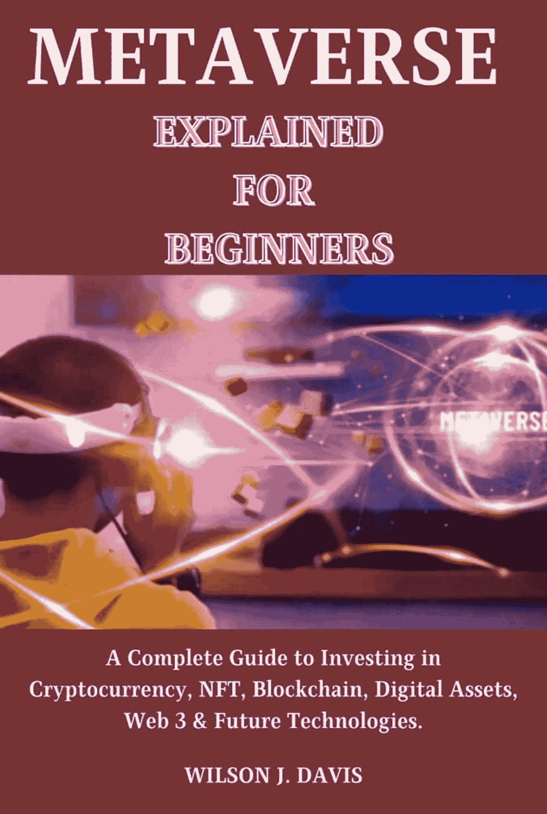
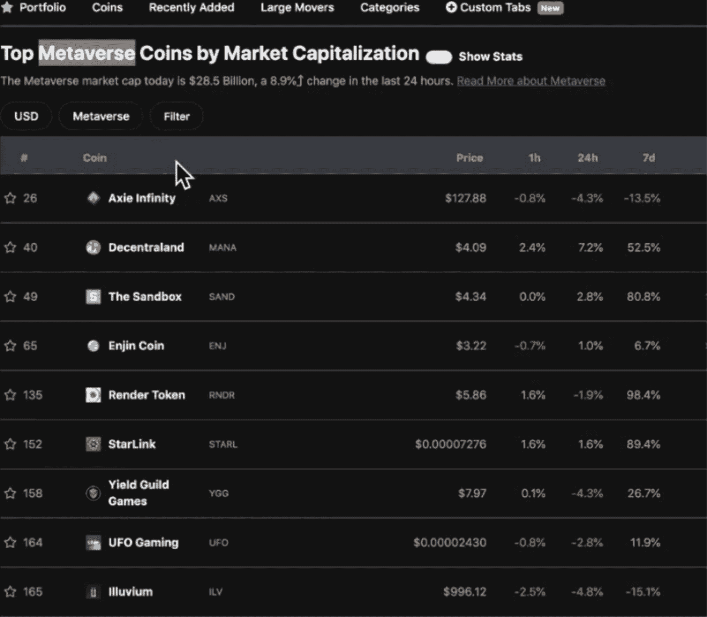
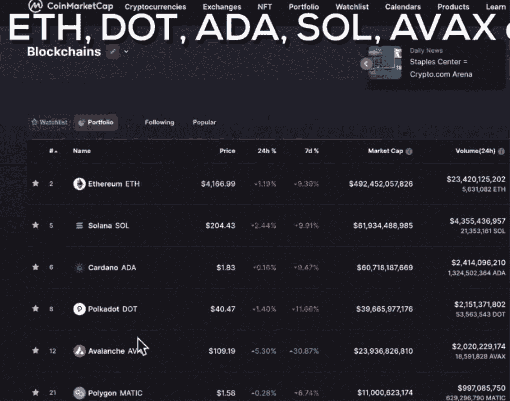
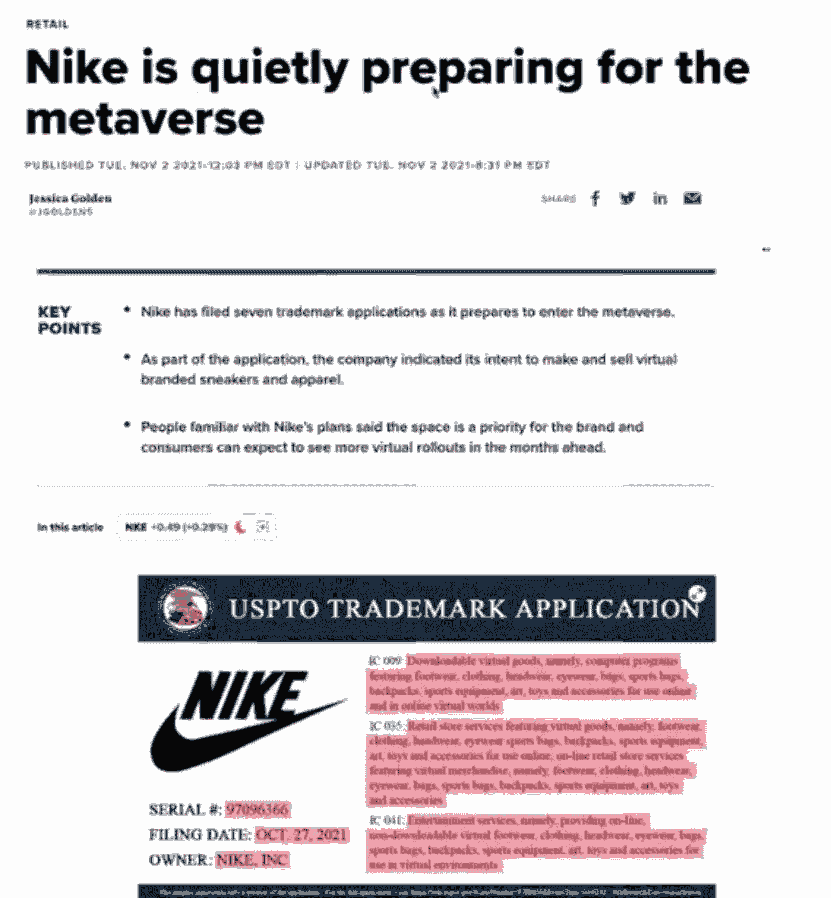
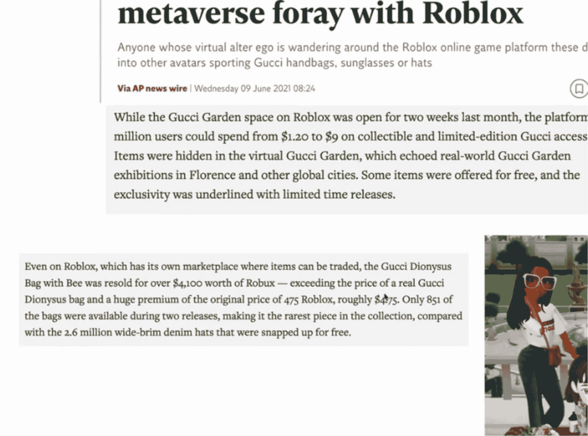
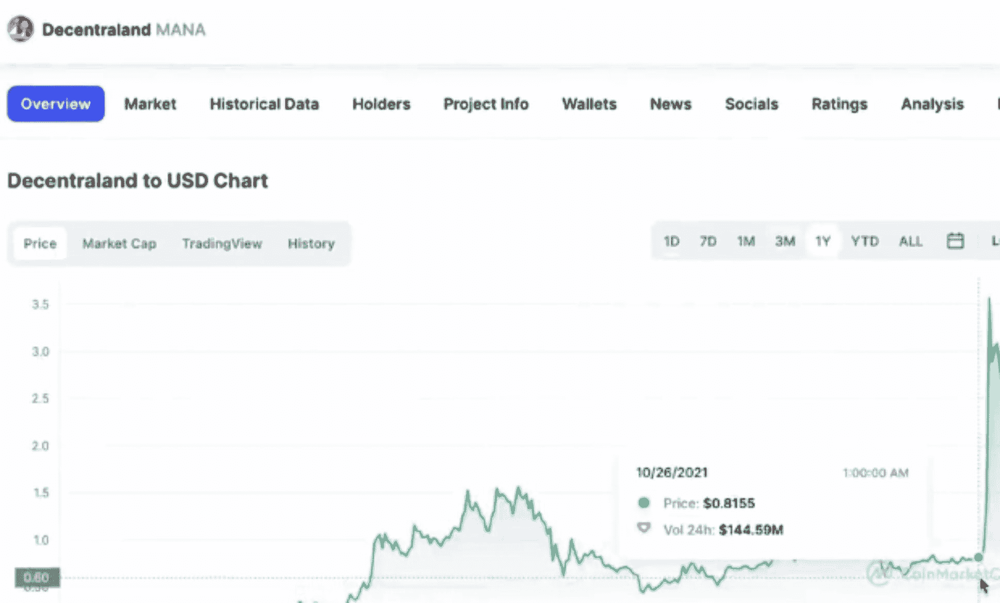
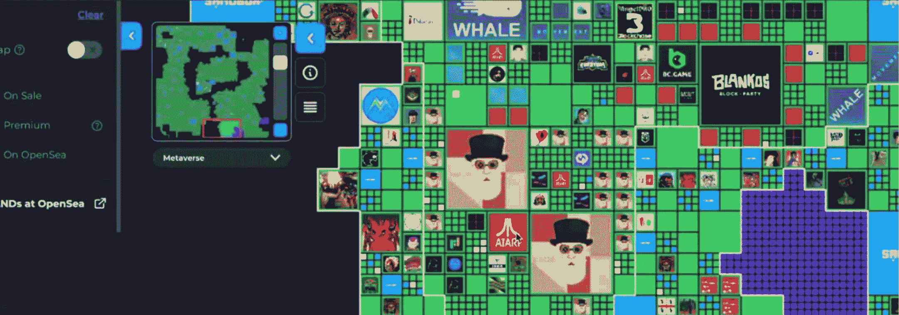
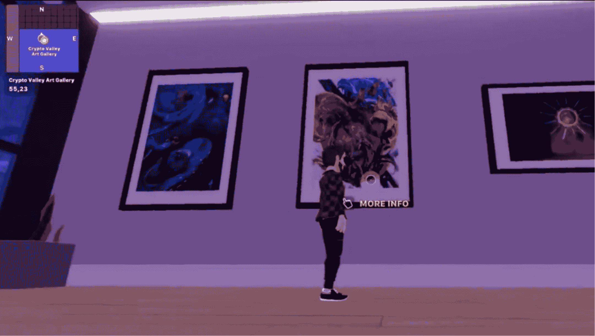
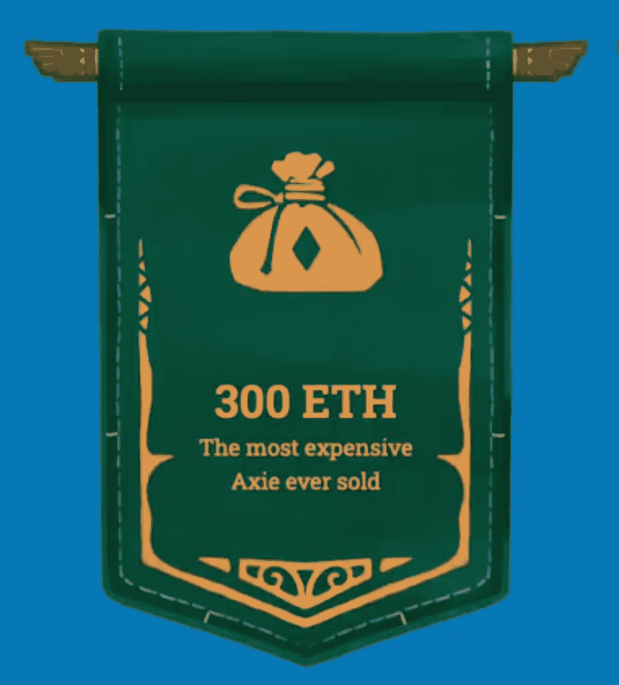

# 元宇宙初学者指南：投资加密货币、NFT、区块链、数字资产、Web 3 与未来技术的完整指南





## 通用指南
一份关于投资加密货币、NFT、区块链、数字资产、Web 3 及未来技术的完整指南。


## 通用指南
关于投资加密货币、NFT、区块链、数字资产、Web 3 及未来技术的完整指南。


## 通用指南
关于投资加密货币、NFT、区块链、数字资产、Web 3 及未来技术的完整指南。


引言
元宇宙、元宇宙经济、元宇宙政治、元宇宙社区，这一概念并不新鲜。然而，它变得非常流行，尤其是在加密社区。这究竟是什么？本书将详细阐述并探索其潜力，这是一个重大的范式转移，我相信在未来 10 年内，它将成为你生活的一部分。

想象一下，在没有网站的情况下经营业务。你可能会变得无关紧要。未来在元宇宙中没有存在，将像今天没有网站一样，至少会让你的竞争对手获得优势。我们正在经历现实世界与虚拟世界界限的模糊以及两者经济的融合。一个发生的事情会影响另一个，富翁将诞生，企业将破产。它是互联网的演变，是一个新的数字大银行，也是数字宇宙的创造。

想象一下不需要通过 Zoom 或摄像头进行你的业务会议和面试。想象一下在家里试穿衣服——这是下一个大趋势。

教育也可能非常迷人。想象一下戴上那些智能眼镜，你可以进入人体内部，触摸心脏并观察器官如何相互作用。你可以在外太空间中移动原子并扩张宇宙。这将是神奇的。

## 第一章
元宇宙
元宇宙是物理增强现实和虚拟现实在共享在线空间的交汇。它是一个镜像世界，用户可以在计算机生成的环境中与其他用户交互的虚拟空间。它是互联网的未来版本，无论你是否登录都存在。

这是一个持久的场所，你可以在那里经历改变并返回。它可以通过我们所有的不同的计算平台访问：VR、AR、PC、移动设备和游戏机。其生态系统考虑了以用户为中心的元素，包括虚拟形象、内容创作、虚拟经济、社会接受度、安全和隐私、信任和责任。

元宇宙可以被定义为一个多用户实时虚拟空间，全球用户可以通过网络连接、共存、社交并交换价值。元宇宙与传统多人游戏的区别在于，玩家能够创建并共享内容，在持久或半持久性的环境中塑造他们周围的环境。《世界兽》几十年来已经在虚拟和数字元宇宙中运行。


现在，你为什么需要元宇宙？营销和传播专业人员需要关注元宇宙，因为它是在线交互的下一个边界，就像社交媒体彻底改变了在线营销格局一样。它开启了我们现实中受限的业务想法的可能性。诸如`视频会议`、`加密货币`、`电子邮件`、`虚拟现实`、`社交媒体`、`直播`、`人工智能`、`区块链`、`计算机视觉`等活动都是元宇宙的一部分。人们可以在其中互动、玩游戏、做生意和交流，以及更多可能。

元宇宙将为个人创作者和艺术家带来巨大的机会。它为那些想要远离如今城市中心的地方工作并拥有房屋的人，以及那些生活在教育或娱乐机会较有限地区的人提供了帮助。人们将能够通过`virtual reality`进入完全虚拟的元宇宙，或者在增强和混合现实的帮助下与其物理空间的部分进行交互。

想象一下在虚拟办公室中进行业务会议和面试，而不是通过`zoom`或摄像头。想象一下在购物时，在自己舒适的家里试穿衣服——下一项重大趋势将是传送设备和`元宇宙经济 (Metanomics)`。

### 元宇宙经济 (Metanomics)

上述想法非常棒，但作为项目所有者、业务所有者或个人，你能做什么呢？`Metanomics`是对元宇宙经济监管和业务模式的研究。它也是研究现实世界的业务如何将虚拟世界作为其策略的一部分。如果我们进一步深挖，`Metanomics`还包含了将虚拟世界作为实验室，以研究现实世界的业务或政策问题。

你现在可能正处于某个元宇宙中而甚至不知道。用户购买数字商品的原因与购买实体商品的原因相同。存在身份认可、对特定子群体或社区的归属感、价格投机以及可能的收益。

虚拟时尚、`虚拟角色皮肤`、`虚拟房地产`、房屋和汽车在元宇宙中将具有价值。`Netvrk`作为顶尖的加密元宇宙项目之一，近期举行了车辆销售并像抢手货一样一售一空。如果你能创作高质量的内容并进行市场营销，`NFT`的流行程度完全没有放缓的迹象，你在元宇宙中可以取得的成就是无限制的。

虚拟职业将在`元宇宙语义 (Metonymy)`中被提及。一些例子可能包括`元宇宙顾问`、`虚拟房地产开发商`、`车辆和物业租赁`、`角色设计师`以及数千其他头衔。公司需要将它们的营销策略从在线建议转存在共享虚拟经济中。像`envoy`这样的项目脱颖而出。有了他们的去中心化委员会，可以想象一个像纽约`时代广场`那样的广告板。

有些人可能会说`Metanomics`是对现实世界事件的不对称对冲，而`Metonymy`可能会成为由元宇宙社区完全由自由市场力量驱动的最纯的资本主义形式。此外，跨境拥有资产的简单性对于那些希望存放资金的人来说可能非常有吸引力。

让我们再深入探讨一下。人们去元宇宙中寻找品牌，是因为他们感到有一种联系，而不一定是因为他们需要某种产品或服务。你需要在有机销售产品或服务的同时，让客户能够沉浸在体验中。

看看这些顶级范例，`Travis Scott`合作的`fortnight`，艺术家在周边商品销售上赚了 2000 万美元。相比之下，他在线下`Astroworld`巡演中单晚拥有 170 万张唱片销量，仅占他报告的 5350 万次巡演收入的 40%以下。粉丝较少的艺术家仍然有机会在虚拟世界中举办活动，以推动数字专辑销售并增加流媒体和纪念性数字商品的销量。

是的，十年前的演唱会 T 恤想法现在可以是一个`NFT`或一个`game skin`。而以前，你玩游戏是为了快乐和爱好，但现在你可以投资并开始赚钱了。

我胆于说，更年轻、精通技术的一代将远离传统的教育系统，转而转向这种技术先进的元宇宙并享受它。

在世界经济论坛，一位人士曾表示，大多数工作现在可以被机器人化，`AI`开启了一个更具机会的领域。`AI`影响着社交媒体。现在元宇宙将被启用、普及并被人工智能所支持。`AI`对元宇宙具有重要的另一种方式是`AI`系统将随着时间的推移了解你并塑造你的体验。你可以想象在个人层面由`AI`生成内容和互动。人工智能的应用潜力将近乎无限。关于元宇宙无论它最终采取什么形式，我相信人工智能将至关重要。`Web 3.0`比任何现有服务提供了更丰富的功能和互操作性。远程办公、`视频会议`、`远程医疗`、`远程社交`以及更多可能性都得到了极大增强。在未来十年及以后，元宇宙成为普通人生活的重要组成部分是合理的。这里有许多分支，例如`元宇宙语义`。它开启了社交范式的新维度。你可能会看到运动和趋势渗透到现实世界，反之亦然。

有一天，我们需要一个全球性的区块链，就像我们有一个运行网站和一切的互联网协议一样。互操作性和所有那些不同的旧币看起来更像是摩擦和顺畅体验的障碍。

现在有一个叫做`Meta net` 的东西。它已经生产多年，是构建在原始比特币协议之上的。它目前的代码是`BSV`，加密社区被社会工程化地讨厌它。


互联网的新一次迭代正在开发中，它将对社会产生巨大影响。营销、传播和品牌专业人士将面临新的挑战，但也面临新的机遇。这个元宇宙的新时代将释放独特的创造力，并为品牌和企业开启新的疆域和视野。

对于具有创业心态的个人来说，这将创造全球性的机会。以前由背景管辖区或教育水平所加的限制将变得前所未有的模糊。拥抱并适应正在发生的新转变。互联网和加密货币是范式转移；而元宇宙是这些者的融合且远超此。问题是，你准备好了吗？

## 第二章

自从 Facebook 自更名为 `meta platforms` 以来，元宇宙已成为科技领域最热门的话题。元宇宙加密货币最近爆发式增长，这绝非暂时的现象。我们在这个元宇宙之旅上已经走了多年，只是 Facebook 广受瞩目的转型让这一趋势处于聚光灯中心。

元宇宙不仅仅是一个用于虚拟商品和 nfts 的增强、混合现实市场。那只是大图的一小部分。它是互联网的下一次演进，将改变我们的生活方式，包括我们的交流方式。本节将简要探讨这一趋势将向何处发展，更重要的是，作为加密货币投资者和股票投资者，如何进入这个价值八万的颠覆性市场。

它包括投资元宇宙特定的代币，这些代币与创建和变现数字财产密切相关。此外，不要忘记这些元宇宙生态系统的加密货币和区块链基础设施。最后，我们在股市中还有各种参与者，他们都在朝着同一个方向移动。让我们开始吧。

如果你根据我为止的描述仍然不知道元宇宙，请把它想象成一个虚拟世界，你我这些人可以在其中玩、停留，并通过从音乐会、会议甚至世界各地的假期一切建立联系。

在 10 到 20 年后，想象一下使用虚拟现实和全息技术定制你感兴趣购买的汽车。想象使用投影仪在你真实公寓的墙上显示你的数字艺术品。这种你作为独特 `nfts`拥有的艺术可以在区块链上被验证，且无法被盗。讽刺的是，你的房子可能会烧毁或被盗，但你的数字资产是安全的。

想象一下从舒适家中跳入工作会议，体验比现实生活还要好，因为元宇宙可以提供一个与现实一样无缝、直观但经过增强的界面。推进幻灯片、打开链接和调整屏幕大小可以像滑动、点击或捏合一样简单。想象从任何角度观看体育赛事，甚至从球员自身的视角观看。想象即使在身体上不在场，也能与爱的人一起停留并共同感受。

这些是未来的先驱们正在思考并已经在构建的，而我们已经部分实现了。他们已经拥有了超快宽带、高速 VR 头显设备以及持久的 24/7 全天候在线世界。

对于许多年轻人来说，转向元宇宙甚至不是必要的。他们成长时的预期是，他们未来的很大一部分将存在于元宇宙中。我们其他人无论喜欢与否都必须跟上潮流。

### 区块链和加密货币在元宇宙中的角色

区块链和加密货币在我们走向元宇宙的过程中扮演了什么角色？事实证明，作用非常大。有些人认为，今天的加密投资者将成为元宇宙的主人。

#### Axie Infinity
`axie Infinity` 是一个你可以在其中繁殖、训练和战斗生物的游戏。它是以太坊上受欢迎的 `nfts` 之一。

#### Decentraland
`decentraland` 是一个构建在以太坊上的虚拟世界，用户可以在那里购买和开发土地。它是一个去中心化平台。

#### The Sandbox
`Sandbox` 是一个构建在以太坊上的虚拟世界，玩家可以在那里创建并变现他们的体验。它也是一个去中心化平台。

#### Enjin
`Enjin` 是一套工具，允许用户创建并将 `nfts` 集成到游戏和应用中。

#### OVR
`ovr` 是一个覆盖整个世界的数字层，由 16 万亿块土地组成。它们都是独立的 `nfts`。

#### Metahero
`Metahero` 允许你使用他们的 3d 扫描仪创建你的数字头像。这是另一个可以在不同平台使用的 3d `nfts`。

### 你可以在哪里购买这些元宇宙加密货币？

嗯，最大的主流币可以在如 `binance` 和 `coinbase` 等任何中心化交易所购买。你也可以在 `defi` 中购买它们。例如，基于以太坊的代币都可以在旧 `uniswap` 上购买，但要注意 Gas 费用。`binance smart chain` 的代币可以在老牌 `pancakeswap` 上购买。


以下是一系列特定元宇宙的加密货币。它们包括 `axie`、`mana`、`sand`、`Enjin` 等。购买并持有这些代币是投资元宇宙旅程的直接方式。



另一种方法是投资作为这些元宇宙生态系统底层基础设施的区块链，例如 `ethereum`、`Solana`、`Cardano`、`Polkadot`，特别是 `Polkadot`、`avalanche`、`polygon` 等。



这些元宇宙的应用场景正在不断增加。`layer one`（第一层）和 `layer two`（第二层）质量将受益，因此投资这些区块链可能是更安全、更明智的想法，因为你还实现了超越特定元宇宙应用场景的多元化投资。这些是你可以多年来通过定额投入并长期持有的加密货币。如果你购买特定的元宇宙代币，尤其是市值较小的代币，你将更密切地关注它们。

`Polkadot` 是这些区块链中值得关注的层之一，因为它完全专注于互操作性以及连接大多数主要以孤岛模式运行的不同区块链。随着未来你可以在其他区块链之间共享数字资产和 NFT，这将将变得越来越重要。你不需要让你基于 `ethereum` 的 NFT 困在 `ethereum` 上。同样，你不需要让你的 `Solana` 资产和 `card` 资产局限于那里。你需要互操作性，而这是 `Polkadot` 的首要任务。所以这是一个值得关注的。

区块链和加密货币构建元宇宙的一种方法。不要忘记所有其他公司也远离区块链并各尽一份，其中包括科技巨头。我们谈论的是一个 100 万亿美元的股市。显而易见的选择是元平台。这家科技巨头曾名为 `Facebook`，在重品牌之前就已经对虚拟现实进行了大量投资，包括在 2014 年收购 VR 公司 `Oculus`。马克·扎克伯格在完成 `Facebook` 重品牌后，对元宇宙极其看好。他认为它可以取代我们所知的互联网。

#### Microsoft

`Microsoft` 正在通过其 `Microsoft mesh` 平台开发混合和扩展现实应用。这是一个结合了现实世界与 VR 及全息技术的大项目。他们将把这些技术整合到 `Microsoft teams` 中，供那些居家办公的人使用。很快，你将把全息和虚拟化身等混合现实功能带入视频会议，这非常有趣。

不要忘记与基础设施相关的股票。你拥有像 `Nvidia` 这样的硬件公司，它是最大的显卡和 AI 芯片制造商。你拥有 `Amazon`，它的云计算基础设施经常被拿来与 `ethereum` 在加密领域所扮演的角色相媲美。许多业务建立在 `Amazon web services` 之上，就像许多 `Dapps` 构建在 `ethereum` 区块上一样。

所有这些公司都是重要的，因为随着元宇宙采用率的增加，对计算力和数据基础设施的需求只会增加。还有许多其他玩家在为元宇宙创作内容。例如，你有 `Fortnite` 背后的公司 `epic games`，其 CEO 对元宇宙非常看好。他们已经举办了 `Ariana Grande` 和 `Travis Scott` 的虚拟演唱会。他们正在通过 `meta-human creator` 开发照片级真实的数字人类，这可以在未来的开放世界游戏中为你定制数字双胞胎。目前 `epic games` 唯一的问题是它们不是一家上市公司，但如果它们以后上市，将引起巨大的关注。

#### Unity Software

`Unity Software` 是整个视频行业中使用最广泛的引擎。这是一个允许开发者创建 2D 和 3D 实时内容的平台。最后，我们将提到 `Roblox`，它是一个用户生成内容的平台。

总结，我们看到元宇宙正在快速演变，从特定的加密货币到大型科技巨头和基础设施供应商。无论是通过代币、虚拟现实还是沉浸式游戏平台，数字化转型都是不可避免的。

## 第三章

元宇宙已经来临，它是互联网演化的下一个阶段。所以很快，我们可能不再通过智能手机或电脑查看内容，那可能成为过去。但我们将完全沉浸在数字环境中，并通过智能眼镜与世界各地的人进行互动。无论你喜不喜欢，它都会到来，并在未来七八年内成为一个 8500 亿美元的行业。

我们可以投资哪些业务来从元宇宙的崛起获利？让我们在本节寻找答案。

什么是元宇宙？我给过元宇宙几种定义，但它们都归于同一个思想或概念。它现在是全球范围内的热词。元宇宙是一个通过智能眼镜访问的全沉浸式共享虚拟环境。在那里，我们的互动将是多维的。现在，我们如何与人互动？我们通过社交媒体互动，它是二维的，或者在某些在线游戏中最多是三维的。但通过元宇宙，我们的互动将是多维的 4D，用户可以沉浸在数字内容中，而不仅仅是查看它。

例如，想象未来像 Zoom 会议一样，你在在线看人的脸，但你身处一个虚拟环境中，带着化身在任何你想要创建的奇幻幻想地点与世界各地的人见面。另一个例子是，你可以通过沉浸式环境与世界另一端的人下棋。如果你还记得那部电影质感的 `player1`，它完全就是那样。

当你在虚拟世界中戴上眼镜时，你可以和地球另一端的人跳舞。在更极端的情况下，你可以从沙漠中冲浪，或者进行像《黑客帝国》中的任何事情。元宇宙将改变我们工作、游戏和学习的方式。


还记得汤姆·克鲁斯主演的电影《少数报告》吗？他在片中滑动物体、扩展物体，甚至像《钢铁侠》中的托尼·斯塔克那样，通过全息移动物体。这就是元宇宙将发生的情况。我们的应用程序将环绕在我们身边，我们将从虚拟空间中提取或存文件。想象一下未来的会议，我们将通过化身，在任何我们想要的的环境中与世界各地的人会面。

你不会感到惊讶，这一切演变可能会杀死像 Zoom、智能手机或平板电脑这样的产品，它们在未来可能会过时。假设像苹果或三星这样的公司在未来没有转向这个元宇宙，他们的产品可能会像过去的录像带一样过时，因为技术变化得太快了。

同样有趣的是，元宇宙将如何改变我们玩游戏的方式。如果你看过 Facebook 将其更名为 Meta 的视频，你只需要戴上眼镜，就可以与另一个国家的人进行击剑。你看到他们的化身，他们也能看到你，然后开始击剑。

教育也可能非常迷人。想象一下戴上那些智能眼镜，你可以进入人类的身体内部，触摸心脏并观察器官之间如何相互作用。你可以处于外太空，滑动原子并扩张宇宙。这将是惊叹的。

再次，这是一个预计到 2028 年价值接近 1 万亿美元的行业。有趣的是，世界上一些最大的品牌正在认真对待这一点，并现在正以他们独特的方式进入元宇宙。例如，Nike 正在悄悄准备元宇宙。他们已经申请了七项商标，用于在元宇宙中销售虚拟品牌运动鞋和服装。



再次，在未来的元宇宙中，我们将拥有化身并与全球的人互动。如果你想让你的化身好看一点，可以为化身购买 Nike 运动鞋、衣服和连帽衫。Nike 将在虚拟世界中把卖给你。他们现在正在创造所有虚拟 Nike 配饰，不仅是 Nike，还有 Gucci。

Gucci 最近创建了数字配件、套装和包，卖给 Roblox 上的用户。什么是 Roblox？Roblox 是一个非常像元宇宙的在线游戏环境。人们已经在这个在线游戏环境中互动，购买 Gucci 衣服，进行交易并进行虚拟购物。他们最近在 Roblox 上开放了一个 Gucci 花园空间。他们以 1 美元到 9 美元不等的价格数字销售了这些 Gucci 配饰、Gucci 眼镜、Gucci 包和 Gucci 衣服，有些人成功地转售了它们。他们以 4 美元 75 分买入，然后在 Roblox 平台上将这个 Gucci 包（虚拟数字包）以 4000 美元卖出。



元宇宙将创造数百万的财富，就像在物理环境中一样。品牌和公司现在认真对待这一切的原因是，他们意识到这不再是一种趋势或幻想。它正在发生。进入元宇宙将成为品牌保持相关性的必要条件。

## 应该购买哪些股票

哪些公司的股票对于创建、构建和维护元宇宙至关重要？这些公司也将将从互联网的新一次演变中获益。数百只股票将从元宇宙中受益，但我将关注主要的几只，并将它们分为核心元宇宙股票。

### 公司

第一类是涉及硬件、操作系统和元宇宙软件的公司。这些公司创建智能眼镜并将其推向新水平，并且已经在创建驱动元宇宙的操作系统的过程中。我们还将包括通过云计算参与构建和维护元宇宙基础设施的公司。有很多公司，但我将重点关注的几个是：

#### Meta

除非你住在山洞里，否则你知道 Facebook 现在已自更名为 Meta。因此，他们的股票代码 `FB` 将在 12 月 1 日之前变为 `MVRS`。为什么 Facebook 要更名为 Meta？这是他们成为元宇宙领先者的战略愿景。与竞争对手相比，他们拥有很好的领先优势。在硬件和软件方面，他们处于领先地位，因为他们拥有 `Oculus` VR 头显设备、游戏。他们与 `ray-ban` 合作创建智能眼镜。紧随其后的是微软。

#### Microsoft

微软的首席执行官也表示他们将创建元宇宙的企业部分。他们预测未来专业人士将在这个虚拟环境中见面、协作和工作。微软还投资了 `hololens`。

#### Amazon

Amazon 也宣布了他们将进入元宇宙，创建虚拟经济和虚拟商店。构建和维护基础设施需要云计算。两个最强大的竞争者是 `Amazon Web Services` 和 `Microsoft Azure`。还有 `Alphabet`。

### 内容创作工具

元宇宙无法由一家公司或某个人创建。它将由全球数百万计算机程序员、设计师和开发者共同创造。这是一场全球性的协作，就像维基百科一样。因此，对于这些人创作创建元宇宙内容（如房地产、虚拟建筑），他们需要工具。提供创建这些环境工具的公司有哪些？

#### Autodesk

Autodesk 是建筑师、工程师和建筑人员的领先软件供应商。在建筑师进行物理建造之前，他们使用 `AutoCAD` 软件创建 3D 建筑。最近，Autodesk 创建了一系列产品，允许计算机程序员创建 `VR` 和 `AR` 3D 建筑和模拟。

再次，Autodesk 将成为人们创建元宇宙的重要工具。稍后我们将查看 `ADSK` 股票。下一只股票是 Roblox 的股票代码 `RBLX`。

#### Roblox

Roblox 是一个在线游戏平台，目前拥有 1.64 亿月活跃用户。你可以进入 Roblox 构建自己的游戏。你可以创建自己的游戏并玩其他用户创建的游戏。这些游戏就像带有化身的元宇宙游戏，你可以与其他互动。你可以与他们交易物品，从他们那里购买，平台内还有类似于虚拟经济的 Roblox 本货币。

就像在 Roblox 虚拟环境中出售的 Gucci 包一样，Roblox 平台将成为想要在元宇宙中创建游戏的人的重要工具。下一只股票是 Unity 软件的股票代码 `U`。

#### Unity Software

Unity 软件也将是程序员用来构建元宇宙游戏的重要工具。他们是领先的 3D 视频游戏引擎设计者，用于自定义视频游戏玩家在游戏中如何移动和互动。 100 家游戏开发工作室中有 94 家使用 `Unity engine`。

### 半导体


你无法逃避半导体，因为它们是任何数字经济的基石。你需要大量的半导体来驱动元宇宙（Metaverse）。现在有很多半导体股票。首先是设计高端芯片的半导体公司。

#### 英英达 (Nvidia)
领导者是 `Nvidia`，你还有 `AMD`。你还有其他几家，但在高端芯片设计方面，`Nvidia` 是领先的。`Nvidia` 只设计芯片。而制造小于五纳米高端芯片的是台湾半导体公司，股票代码为 `TSMC`。同样，你还有其他如 `ASML`、`Applied Materials` 等许多公司，但 `Nvidia` 和 `TSMC` 是两个大竞争者。这些是从元宇宙崛起中获利的少数几性股票。顺便说一下，如果你想买 ETF，也有元宇宙 ETF 可以购买，规模最丰厚的代码是 `Meta`，即 Facebook。

### 如何成为成功的投资者
成为一个成功的投资者不仅仅在于知道买什么。你可能知道买什么，但这还不够。要成为一名成功的投资者，有四个关键点需要注意：
- 你必须知道买什么
- 你必须知道什么时候买入股票
- 你必须知道买多少股票
- 你必须知道什么时候卖出并获利

许多人的问题在于，他们知道买什么，但在错误的时间买入；他们在价值过高、价格过高或过度扩张时买入。所以知道买什么是不够的，你必须确切知道什么时候买。例如，在投资方面，你只需要在这些公司被低估时才买入它们的股票。例如，`Meta` 或 Facebook 目前被低估，而 `Nvidia` 目前被高估，而代码为 `TSM` 的半导体制造公司则略微低估。所以你必须知道哪些是低估的，哪些是高估的，因为如果你买了一个价格过的高股，你也会亏钱。

你如何知道真实的估值以及如何计算内在价值？当股票被低估且价格回落到支撑位时买入。你必须查看技术图表来把握入场时机。这完全取决于入场时。再次，`Nvidia` 是一家伟大的公司，但被高估了，目前价格处于过度扩张状态。最好在你开始建仓之前，它能回落接近支撑位。例如，`Meta` 或 Facebook 被低估且目前处于支撑位。其中一些你现在就可以买，另一些则你可以等一段时间，等它们变得更有吸引力时再买。

此外记住，某些股票你不需要投资，但可以进行短期交易，例如投资那些目前正在盈利的公司来计算内在价值。但某些股票并不盈利，仍在大量亏损，因此我不舒服投资它们，但它们仍然可能大涨。这些是用于短期交易的股票。在交易中，你应该知道在哪里设置 `stop loss`、`profit target`，以及如何以最大的利润和最低的风险进入和退出。此外，你如何利用 `options` 来限制你的风险并最大化收益？例如，要小心，因为 `Roblox` 和 `Unity` 目前都没有盈利。它们仍在亏损且价格非常昂贵。你不应该投资它们，但你应该使用 `options` 对这些股票进行短期波段交易。学习更多关于这些元宇宙股票以及市场中其他优秀股票的投资和交易。

## 第四章

### 元宇宙投资
投资元宇宙可能是精明投资者赚取大钱的最极佳的机会之一。在 Facebook 最近更名为 `Meta` 以构建实现他们对元宇宙的愿景和解读之后，它引起了全球投资者对如何可能尽早投资这一领域，并从这一可能是完美投资的机会中获利的兴趣。

事实上，有许多不同且令人兴奋的方式投资元宇宙，这不仅仅是投资股票。随着元宇宙越来越多地融入我们的日常生活，它成为我们越来越多参与其中的事物。它确实存在于一个稍微虚拟的世界中，我怀疑围绕它的投资机会随着时间的推移只会不断扩大。所以，让我们谈谈这些早期投资机会。

#### 股票
我想谈论的第一个投资机会是投资股票。这是大多数投资组合（包括我的）的基石。有很多不同的公司正在积极为元宇宙以及构建元宇宙生态系统的基础设施做出贡献。

我们已经知道马克·扎克伯格（Mark Zuckerberg）已经勾勒了他构建自己的元宇宙的计划，并在社交连接的演变中占据一席之地。但这里有趣的是，元宇宙本身远超一家公司所能构建的，因为构建元宇宙的基础设施以及在其中进行的活动显然广阔得多。

它包含了从在虚拟世界中与朋友一起玩游戏、访问现场活动和娱乐、不去健身房就能获得个人训练、与同事一起工作并在虚拟办公室见面，甚至在元宇宙中购物等一切内容。想象一下所有已经在运营、建立并拥有实体产品的公司，他们可以将产品转化为数字或虚拟产品。

你拥有像 `Unity Software` 和 `Roblox` 这样的游戏公司，健身公司 `Peloton`，视频会议公司 `Zoom` 和 `Microsoft`，电子商务公司 `Amazon` 和 `Shopify`。对于提到的所有这些公司都有无限可能。由于如此，你有许多机会在投资组合中获得这些股票的收益。看到哪些股票实际上能取得突破并开始投资以获得市场份额无疑是非常有趣的。我怀疑进入这一领域的先者优势是巨大的。

元宇宙的市场机会或预测的市场机会预计到 2028 年将达到 8250 亿美元，并以 43.3% 的复合年增长率增长。因此，有很多机会投资那些通过投资元宇宙并拥有虚拟产品而从业务巨大增长中获利的公司。

#### 元宇宙令牌
接几个投资机会让情况变得更有趣。所以我们将开始谈论元宇宙代币。如果你访问像 `coinmarketcap.com` 这样的网站，你可以滚动并点击元宇宙标签，列出一些顶级的元宇宙加密货币代币。

```
(Image00005.jpg)
```

我们拥有像 `axie Infinity`、`Decentral`、`Enjin Coin` 以及 `The Sandbox` 这样的代币。所有的市值各异，特别是 `axie Infinity` 和 `Decentral`，其市值在六十亿到接近九十亿美元之间。这些不是任何小代币。它们是许多人积极投资的代币。这些代币本质上就是他们构建的相应虚拟元宇宙使用的货币。


我想你可以把这种比较比作在英国花费大量的英镑来买东西。对于这些所谓的虚拟世界或元宇宙（metaverses）也是如此。例如，你有拥有 `AXS` 代币的 `axie infinity`、拥有 `MANA` 代币的 `Decentraland` 以及拥有 `SAN` 代币的 `Sandbox`。

投资者正在投资这些代币。他们使用这些代币在相应的元宇宙中购买物品，并将这些代币视为一种纯粹的投资机会进行投资，因为他们认为相应的元宇宙可能是下一个大趋势。有趣的是，自从 Facebook 宣布重品牌以来，这些元宇宙代币的价值上涨了多少。即使你观察 `Decentraland` 代币并将其放在一年线图中，你可以发现该代币的价格从上涨 75% 直达到 3.56 美元的市场巅峰，而且直到目前的市场价格，它的交易价格仍在每枚 3.17 美左右。我们谈论的是过去三周 300% 到 400% 的增长率。



通过投资这些元宇宙代币，你本质上是依赖于相应的元宇宙随着时间的推移而变得受欢迎。随着需求的增加，你可以在元宇宙中购买物品，随着时间推高价格。

这就是投资其中一些元宇宙代币时产生主观性因素的地方。`Decentraland` 的当前市值为六十亿美元，但究竟是什么定义了它呢？

这一切归结为供需关系以及该领域内的潜在竞争。但为其中一些代币提供底层价值仍然相当困难。尽管如此，考虑到某些加密构建的元宇宙的预期增长，在我看来，其增长潜力可能是巨大的。

#### 土地和房产
当我说土地和房产时，我指不是物理意义上的土地和房产。指的是目前正在构建的一些元宇宙中的土地和房产。你真的可以购买描绘这些元宇宙中土地和所有权的像素。


我们都知道迪士尼在几十年前做过的一项出色的投资，当时他在佛罗里达州的奥兰多购买了 27000 英亩的土地，每亩仅花费 182 美元。今天，那片土地本身价值数十亿美元，而同样的潜力机会似乎在元宇宙中也是可行的。你可能会对其中某些土地目前的售价之高而感到惊讶。如果我们想在 `sandbox` 元宇宙上购买一些土地，点击“购买土地”按钮，它将带你进入许多人购买 NFT 和各种不同数字资产的地方。你可以看到某些土地是多么贵。这简直太荒谬了。


如果你查看“最近出售”，你可以看到根据主题不同，合法的土地售价在 1.5 到 2 个 `ethereum` 之间。这目前的市场价格大约是 4500 美元。

这种土地的价格向上空间大约为九千美元，仅仅是为了屏幕上的几个像素。然后一旦你购买了土地，它就会出现在元宇宙地图上，你可以看到许多带有不同图标的公司，他们已经在元宇宙内购买了土地。



`Atari` 在上面的图像中脱颖而出。它是另一家似乎在 `sandbox` 元宇宙中购买土地的视频游戏公司。你可以看到数百个其他个人和潜在公司在 `sandbox` 元宇宙中购买了土地。

所以我想你可能会问，在这些元宇宙中投资和购买这些土地是如何一种投资机会。正如我之前提到的，随着越来越多的人使用这个元宇宙并使用其代币，待售的土地变得越来越稀缺，因为许多人已经买光了。本质上，这就变成了供需法则。当你有有限供应时，人们可以根据他们认为可以出售的价格要求的价格。

有趣的是，你还可以你买回的土地上进行建设。基础设施更丰富的土地会吸引人们，如果你在以后某个时间出售它，你可以为此收取更多费用。如果你认为自己是某些元宇宙中相当精明的土地主和投资者，那么请务必去查看许多不同元宇宙中的一些市场。

#### NFT 和可穿戴设备
非同质化代币（NFTs）是人们认为在现实世界中没有任何价值的东西，但如果你在虚拟世界中使用并应用它们，它们可能具有巨大的价值，特别是当人类物种过渡到减少对物理资产和物品的重视，并开始对你拥有的数字资产和物品赋予更多价值时。



你可能成为一个 `NFT` 的唯一所有者，你可以把它放在你的虚拟财产中，坐在你元宇宙的虚拟土地上，人们目前在那里炫耀他们的设计师服装和昂贵汽车。你可能在元宇宙中通过 `NFTs` 和可穿戴设备看到同样的东西。这是一个有趣的概念，光是想想就确实让人大为观止。

### 元宇宙中的市场机会
大多数时候，我认为只会是一群 12 岁的孩子使用这些元宇宙，并在虚拟世界中带着他们的化身到处跑，但现实完全不同。在这些平台上花费的资金绝对是天文数字，光是想想就令人大为观止。

给你举一个 `axie affinity` 方面的例子，目前售出的最贵物品是 300 个 `ethereum`，根据今天的市场价格，这大约是 135 万美元，或者相当于一百多万。



花费在其中某些数字资产上的资金是疯狂的。我们已经在 `NFT` 领域看到过，现在我们开始在这些元宇宙中看到。


残酷的现实是，元宇宙投资对大多数投资者来说并不合适。我想和你们分享一些投资元宇宙的经验。以下是我在过去五中学到的东西，也是我在 2022 年正在寻找的重点。我想就如何利用下一次技术变革给你们提供一些见解或想法。

首先，让我们从另一个角度来看元宇宙？元宇宙是现实空间与数字空间的融合。它包含了增强现实、混合现实和虚拟现实。还有很多内容，但元宇宙是移动互联网的继任者。这种迭代并不是关于进入更小的电脑，而是进入一个完全连接且沉浸的世界或多个世界。

Adobe 提供了一个极好的例子，展示了元宇宙如何无缝地取代我们目前在手机和电脑上的用途。元宇宙不仅仅限于娱乐。它包含了我们工作、医疗以及与他人协作的地方。它还是我们的教育场所，让我们学习导航和日常实用任务等逻辑知识。他们正在构建一个未来的 AR 站点、一个平台和一个创作系统，人们可以在那里以元宇宙原生格式创建他们每天使用的所有程序、DIY 项目和检查清单。

其中一些内容非常具有技术性，比如修理战斗机的燃油管，但另一些只是日常琐事，比如制作完美的香蕉包。当这项技术被正确应用时，你甚至察觉不到它的存在。它是一种直观的幕后型技术，现在这里有很多机会。

### 风险投资

在过去的五年里，我与数百位风险投资人、天使投资人以及私募股权公司的合伙人交流过，我自己也成为一名投资者。我知道你们中有多人处于投资者社区，并对投资元宇宙初创公司感兴趣。

残酷的现实是：元宇宙投资对大多数投资者并不合适。元宇宙技术非常小众，行业仍处于极早期，再次强调，我们就像 1996 年的互联网。当我与投资者交流时，他们希望在五年或更短时间内看到典型的回报或 ROI（投资回报）。如果你是这个领域的新手，这意味着当投资者提供启动资金以换公司的股权或部分所有权时，他们期望该初创公司能在五年左右被收购或进行 IPO（上市）。

如今的公司很少能在五年内实现 IPO，如果真的能实现的话话。他们预期你在五年内被收购或购买。对于今天的大多数元宇宙公司来说，这并不是一个现实的预期。投资者需要做长远打算，而不是每个投资者都能做到的一点。增加复杂性的是，初创公司将为元宇宙创造最大的价值，并成为下一个独角兽或构建幕后产品的公司。

这些产品并不总是容易理解，因此长 ROI 周期和热门公司这些因素的结合，使得概念的构化变得困难，并让风险投资与元宇宙之间的关系变得复杂。它只适用于特定类型的投资者。

### 元宇宙如何取代传统技术

让我们看看元宇宙如何取代传统的科技形式。这将为我们即将讨论的市场机会提供一些背景。

我认为许多人（包括投资者在内）都期望增强和虚拟现实会在一夜之间完全取代目前的模式。手机会突然消失，每个人都会戴上耳机，但从历史上来看，这种情况并没有发生。

起初，新技术是叠加的，随着时间的推移，它会取代那些传统形式。我们在音频领域看到这一点。最初你只能通过物理收音机听广播节目，但在互联网历史的早期，你就可以在线听广播节目了。它还是你在 AM 或 FM 频道听到的同一个节目，只是作为一种消费方式被增加到了互联网上。

然后随着时间的推移，我们开始获得仅在在线提供的广播节目。这变成了播客，现在我们有了整整一代人只通过播客消费长音频内容。这是一个巨大的转变，它是分阶段发生的。它不是一夜之间发生的。

另一个目前的例子是《堡垒之夜》中的 Travis Scott 演唱会和 Roblox 中的 Lil Nas X 演唱会。这些艺术家并没有取代传统演唱会。他们只是增加了这些形式来与粉丝联系，并作为粉丝消费他们音乐的方式。我们今天拥有的许多习惯将逐渐过渡到虚拟空间。正如我之前提到的，这不是一次性的转变，而是通过小步渐式的步骤发生的。

#### 市场机会

现在我们进入了激动的部分。根据彭博社的数据，到 2024 年，元宇宙的市场机会将达到 8000 亿美元。所以，可以看到元宇宙的价值和机会。

### 你如何投资？

以下是我 2022 年关注的，它分为三类：指数、股票和时间。

#### ETF

第一个元宇宙指数是全球第一个旨在追踪元宇宙表现的指数。它由全球上市公司的分层加权组合组成，例如 `Nvidia`、`Roblox`、`Cloudflare`、`Snap`（拥有 `Snapchat`）、`Unity3d`、`Facebook` 和 `AutoDesk`。它们都积极参与了元宇宙的建设。还有很多，但那只是其中几个。你可以通过你选择的券商搜索并查阅这个 ETF。

#### 股票

元宇宙中一些特定的上市公司是可以购买股票的，以及来自平台角度的领先者。你可以关注的上市公司有如 `Unity`、`Nvidia`、`Qualcomm`、`Broadcom` 以及任何无线塔公司如 `Verizon`。

还有幕后架构公司，为元宇宙运行提供所有支持。那里是最大的机会所在。在我看来，这个类别还包括内容公司，我认为你们中的一些可能对此感兴趣。我个人将关注流媒体平台 `Netflix`、`Hulu`、`Disney` 和 `Amazon` 如何适应在沉浸空间生成内容。我提到的 Travis Scott 演唱会去年通过虚拟演唱会赚了 2000 万美元。事实很大程度上表明，人们也会为沉浸空间中其他类型的媒体付费。

我提到的两个类别涉及上市公司，排除了所有私公司和初创公司。除非你在风险投资社区，否则你不会获得投资这些公司的机会。有一些选择，如 `Republic`、`StartEngine` 以及其他几个任何人都可以投资的众筹风投平台。

投入时间学习和如何使用这些技术是投资这类公司的一种方式。它们正在发展，这可能意味着学习为特定的头设备开发软件，例如为 `Magic Leap One` 使用 `Lumen`，或为新兴平台 `DressX` 创建内容。这到目前为止是最不直接投资的方式，但如果你这样想，这个类别类比于 2007 年开发移动应用程序或 2006 年创建在线视频。它让你在格局发展时，处于一个可以利用这些技能的绝佳位置。


Web 3 并不是指任何特定的程序，而是指由加密货币支持的项目组，它们共同工作创建一个去中心化互联网服务的生态系统。那么，是哪些服务呢？它可以涵盖从去中心化的社交媒体（而不是由单一公司控制的新闻，公司可以打压任何他们不喜欢的观点）到让用户可以自由讨论和表达自我的开放论坛。去中心化数据让用户对自己的数据拥有控制权和隐私。如何？通过使用加密货币和区块链技术。它允许用户无需依赖任何单一政府或公司即可随心所欲。

在我们深入研究 Web 3 如何工作之前，让我们先回到过去理解 Web 1.0 的历史。在 20 世纪 90 年代的 dot.com 时代，网站的角色类似于传统媒体，信息是单向的，消费者只能进行消费。像 `yahoo` 这样的网站，无论有多少人点击链接，都会被排在搜索结果的前列，这就像纸质报纸收取广告费一样。

随着社交媒体的普及，Web 2 诞生了，重点转向了其他用户创建的热门内容。内容消费者和生产者之间的界限变得模糊，但 Web 2 也引发了一系列问题。其中最突出的是审查和隐私问题。像 `Google`、`Facebook` 和 `Twitter` 这样的科技巨头公开打压任何符合他们叙述的言论。唐纳德·特朗普被社交媒体封禁了，所以如果一个亿万富翁的活跃美国总统都不能自由说话，你又有什么机会呢。Web 3 标志着互联网架构的变化，允许用户不再依赖任何单一公司或政府，从而让他们随心所欲。

本节将介绍 Web 3 的一些基本组件以及该领域的一些领导者。这些基本组件从域名注册中心到云数据存储和计算机处理（在加密货币术中被称为智能合约平台）。

### 域名注册中心

在当前系统中，当你访问一个网站时，例如 `google.com`，点之前的部分是子域名，即 `Google`。点之后的部分（`com`）是顶级域名。顶级域名将域名租给子域名。因此，拥有 `dot com` 顶级域名的 `VeriSign` 将其租租给了 `google`。你永远无法拥有 `dot com` 或 `dot net` 域名。

与 Web 2 不同，Web 3 是一个开放市场，用户可以对自己的顶级域名进行竞标。例如，该领域的领导者之一是 `handshake`。他们的 `HNS` 代币使用维克里拍卖模式，允许人们拥有和租赁他们想要的任何域名。

现在这是一个非常简短的解释，但让我们进入 Web 3 的下一个组件，云数据存储。

### 云数据存储

众所周知，Web 2 中云存储的领导者是 `Amazon` 和 `Google`。但在 Web 3 中，许多竞争者并不参与审查，也不监视他们的用户。这些竞争者包括 `Filecoin`、`Siacoin` 和 `Arweave`，但还有更多。数据是点对点共享的，人们通过项目的原生货币获得奖励。数据要么直接存储在区块链上，要么使用区块链来记录谁在托管数据的支付。例如，使用 `Siacoin`，数据被分成若干组，托管者需要押金。如果托管者在付费托管期结束前消失，他们将失去押金，这激励他们确保数据不丢失。此外，所有不同的组都有许多重复托管者。

另一种方法是 `Arweave` 的做法。`Arweave` 将曾经存在的所有数据都整合进区块链。当托管者调用 `miners` 来更新被称为“信息块”的新信息时，他们必须证明所有之前的信息都包含在内。这样做的优点是创建一个永久记录，对于不受审查地记录历史极其有用。

Web 3 的最后一个组件是计算机处理，在加密领域中被称为智能合约平台。在 Web 2 中，信息在单家公司的计算机或网络上处理。但他们可以随自己的意愿更改规则，并审查或阻止用户。

相反，在 Web 3 中，信息在区块链上处理，使其具有无许可性且完全的抗审查性。代码被称为“合约”，是因为它是双方之间关于在区块链上处理信息的协议。该领域的一些领导者包括 `Ethereum`、`Polkadot`、`Cardano`，甚至还有 `ICP` 或互联网计算机，它们将去中心化云与智能合约平台相结合。

这些是 Web 3 的一些基础骨架，你可以购买这里讨论的所有代币以及许多其他即将推出的项目。虽然这仅仅是 Web 3 运作的最基础基础设施。

## 第七章：涉及健康的元宇宙技术

本节将探讨人们如何利用元宇宙来治愈身体并改变大脑的连接方式。我们关注的是临床环境中发生的基于研究的可衡量效果。这本书的这部分 95% 是科学，5% 是我的观点和推测。

所以，让我们回顾一下什么是元宇宙？元宇宙是一个描述现实与数字空间融合的总术语。它包含了增强现实、混合现实和虚拟现实。大多数人通过手机访问元宇宙，但最终我们将使用某种头戴设备，可能是 `Oculus`、`magic leap` 和 `hololens` 的简化版。

作为一个开发者，我长时间坐在头戴设备和电脑前，很早我就担心这种极端的屏幕时间是否对我有害。我有一个容易患黄斑变变性的基因，所以我自然很担心我的眼睛健康。我还在想，沉浸在这些丰富的虚拟体验中是否会影响或改变我大脑连接的方式，并缩短我已经很短的注意力。

事实证明许多人，特别是父母和神经科学家也有同样的疑问，早期的发现相当震惊。元宇宙的一些常见负面影响包括可能听过的晕动症、眼睛疲劳，以及更严重的问题如癫痫和永久性近视。这甚至还没有考虑到在一个每个人都是完美化身的世界里长时间待着对心理健康产生的副作用，但它并非全是坏事，这正是本节的重点。


当你康复时，医生可能会送你去接受物理治疗，在物理治疗健身房里进行锻炼以帮助重建肌肉力量。如果你患过中风，还必须训练大脑在受损区域周围长出新的神经元，以便你重新获得对腿部的控制力。任何经历过物理治疗的人，即使只是由于轻微事故，都会告诉你，这个过程真的非常困难、枯燥，并且可能会让人沮丧。

事实证明，越来越多的证据表明，如果你将某置于 VR 体验中，然后让他们进行同样的实际练习，但通过将他们放入视频游戏中并将这些练习与有意义的沉浸式体验连接起来，那么这也是一种物理治疗。

他们可以更快、更有效地自我疗愈。通过这种 VR 体验，他们的大会在受损区域周围生长神经元，让该个人拥有更大的活动能力、重新行走或恢复力量。已经有一些公司正在利用增强现实和虚拟现实来欺骗你的大脑，启动这种神经塑性过程，从而建立新的神经连接。

其中一家公司是总部位于德克萨斯州的初创公司，名为 `Neuro-Rehab VR`。坦率说，当我发现这是真的并有神经科学支持时，我非常兴奋能与这家初创公司合作。他们已经在全美的诊所和医院建立了 VR 物理治疗模拟系统。看到一家公司用 VR 改变生活真是太酷了。他们正致力于开发一种可以在家里使用的 VR 应用。所以，如果你需要物理治疗或正在从运动伤害中恢复，它将变得超级易于获取。

世界上许多其他公司正在使用元宇宙来帮助你的大脑变得更好，我最喜欢的包括 `helium`，它有一个沉浸式应用可以帮助你冥想，并训练你的大脑保持更长时间的冥想状态。

`Fundamental VR` 拥有一个增强现实和虚拟现实应用，用于帮助外科医生进行复杂的操作和程序。当他们第一次进行手术时，已经拥有了肌肉记忆和经验。最后我要提到的是 `oxford VR`，它可以帮助患者克服恐惧和恐惧症，最少只需两个小时，这太神奇了。

进入 VR 和神经科学的尖端领域一直是我最新的痴迷所在，或者至少是我最新痴迷的核心，这是一个我正在密切关注并想要投资领域。

所以我们说的是，增强、混合现实和虚拟现实等元宇宙技术能够改变思维模式或心态，并帮助人们更快地实现目标。这本质上是按需个人成长，而且通过神经塑性，目标不必是非与物理治疗或力量相关的（如我们在神经康复中看到的那）。他们还在讨论帮助人们重塑大脑，帮助他们获得理想工作、寻找浪漫伴侣、创业、积累财富、实现财务自由、减肥。这些都是自我帮助行业试图销售价值数十亿美元的元素。

让我们看看科学如何说，目前神经科学研究告诉我们这可能发生。目前的研究显示，大师冥想者可以专注于特定的状态，在该状态下他们产生的脑波通过思想和情感的结合重塑他们的神经回路。没有人像手术刀和电极那样进去帮助冥想者。他们在大脑内部就完成了这一切，这太了不起了。

如果你听过像吸引力法则或显化之类的东西，这就是这些实践正试图触及并实现的。尽管尽管如此，我认为它们往往无法真正做到这一点，因为这些类型的活动本身不足以触发大脑的物理或化学变化。但如果有一种选择，从应用商店获取一个 `29.99 VR app`，它能诱导那种情绪反应和脑波模式，你可以每天使用一次来调整你的思维模式，并让你以一种将获得超级成功的方式采取行动，你将会这样做。

这听起来比花费 10 年学习如何成为超级冥想者要容易得多。如果你想在家里复制这一点，它是完全可行且令人兴奋的。他们拥有一个装饰过的 3d 空间，包含通往他们书签元世界的入口，以及一个为了优化运行而定制的 3d 工作环境。技术是好的，但它还有更多可能。

回到故事的开头，我曾担心宇宙可能对健康有害，但如果使用得当，它对大脑可能是很棒的。尽管这看起来是可选的，但我认为我们应该推动它成为元宇宙的一部分。

## 第八章

### 2040 年技术预测

2040 年，世界由于多种技术进步将看起来完全不同。例如，元宇宙将成为日常生活的基础。到 2040 年，许多大型科技公司将对元宇宙做出重大贡献，元宇宙将在大多数年龄层中获得普及。普通人使用元宇宙及其相关硬件将就像我们现在使用互联网和智能手机一样。

2040 年的普通人可能拥有极其精细且真实的 3d 形象，并有几种预设服装以及成百上千的单件物品可供选择。他们可能拥有装饰过的 3d 家庭空间，包含通往他们书签元世界的入口，以及一个为了在环境中优化运行而定制的 3d 工作环境。

数字资产可以跨设备访问，如虚拟现实头显、增强现实眼镜、智能手机、智能手表等。这些资产可以在以前通常不相关的多个应用程序中使用。元宇宙中可能存在各种虚拟环境。这些用途超出了纯娱乐。这些用途将包括健身、教育、职业培训、产品演示、虚拟主题演讲、购买虚拟和实体物品的市场等。此外，我们可以在大多数主要城市和机构叠加用户生成的特定位置投影，提供导航、评论和历史事件的 3d 动画。

#### 脑机接口可能变得主流

技术专家和未来学家雷·库兹韦尔预测，21 世纪 30 年代中期我们将开始将人类新皮层连接到云端。到 2040 年，这个预测可能会实现。脑机接口将比 2030 年的版本大改进，并在很大程度上用于日常。它们还可能成为虚拟现实头显的标准配件，包括提供全沉浸式 VR 体验的高价头盔。某些脑机接口可以为了医疗目的进行完全植入。

人们可以使用脑机接口在现实游戏和虚拟环境中控制物体，具有很高的准确性，尤其是在娱乐方面。视频游戏工作室可能会开始将这种技术整合到他们的视频游戏中。例如，用思想控制物体的能力在玩具有原力能力的绝地武士和西斯的《星大战》游戏中，以及在扮演主角的《黑客帝国》游戏中将特别适用。


### 仿生的虚拟助手可能成为主流

然而，`interfaces` 可能会产生最实质的影响。在服务脊髓损伤患者时，他们可以重新获得对感官的控制。

#### 自动驾驶汽车可能出现

每个人都可能拥有一个数字助手。到那时，随着指数级增长，在`language model platforms` 上可以构建出更先进的`virtual assistants`。这些`virtual assistants` 可以回答任何提出的问题，甚至提供建议。

到 2040 年，`autonomous vehicles` 可以在没有人工干预的情况下运行。然而，加速这一发展的主要因素将专门为支持它们而建设的城市和地区。这可能涉及嵌入传感器的墙壁，以便每辆`autonomous vehicle` 的位置都能在互联的网络中被追踪。随着这些网络的演进，它们将跟踪所有的`vehicles`、街道状况以及更多信息，形成世界上首批智能城市的基础。

#### 量子计算机可能成为主流

这可以向公众开放，既通过`cloud` 主流，也通过物理设备。这一进步可能会彻底改变我们解决优化问题、训练`machine learning algorithms` 以及更好地理解亚原子级水平的物理过程的方式。受益于此的行业包括金融、制药和网络安全。

#### 人工智能可能接管教育行业

到 2040 年，`AI`可能会接管教育系统的大部分。`AI teachers`可能会开始出现，学生可以访问`virtual reality`和增强现实设备。`AI teachers`可以根据提供给它们的口头和肢体信号信息提供个性化教育。例如，一个`AI teacher`可以注意到是什么因素让学生保持警觉，并改变其教学方式以保持学生的参与度。

如果一个学生喜欢篮球，`AI teachers`可以重写数学和英语题，使这些问题量身定制于篮球领域，`AI`可以根据每个学生的进度为每位学生分配不同的作业。`AI teachers`将降低教育系统中所有的基础成本，让更多的人接触到高质量且标准化的教育。在富裕社区，人类教师可以教更少的学生，成为他们的导师和教练。

#### 服务机器人全球数量可能达到十亿级

很快，`service robots`通常可以被分为两个独立的群体，即`personal`和`professional`。个人机器人的类型包括吸尘器、割草机、个人玩具、移动设备和宠物运动机器人。

`Professional service robots`将用于商业目的，并通常由经过良好培训的人员操作和监控。示例包括医疗机器人、手术机器人、消防机器人、自动安全巡逻机器人、公共场所清洁机器、送货机器人等。

`Industrial robots`将在社会中发挥巨大作用，特别是在制造业中，但它们的数量远不及前两种类型。在这个阶段，大多数`robots`可以瞬间识别并与无数物体交互，同时向客户提供实时信息。由于这些机器人的存在，美国的制造业将大部分消失。这一切之所以成为可能，由于`machine learning`、`cloud computing`、`bandwidth`、`sensor technology`等的指数级改进。

#### 第一个永久月基地可能建立

到 2030 年代后期，政府和私营企业可以在月球上建立永久的人类存在。这一里程碑的动力部分是计划开发的小行星采矿业，该行业在未来几十年内可能会产生数万亿美元的收入。3D 打印将使`luna base`的建设变得比替代方法便宜得多且方便得多。可以使用月表面的岩石和尘土制造出用于整个建筑的新工具、备件和组件。

`NASA`可能领导这一月基地，并得到欧洲航天局、加拿大航天局以及各种私营公司的贡献。中国也可能与俄罗斯合作准备其独立的月基地。

#### 超音速客机可能投入使用

经过数十年的研发，新一代客机可以投入商业运营。这种飞机的巡航速度可以达到 5 马赫，比典型的客客飞机快 7 倍以上，是音速的 5 倍。`Hypersonic planes`可以在 30 分钟内从纽约飞到加州，并在不到 4 小时内从纽约飞到伦敦。

其优点非常多，而且可以比`Boeing 747s`更轻，并可以使用传统的跑道。唯一的缺点是它们没有窗户，因为窗户对于这种机型来说太重了。解决这个问题的一个方案可能是安装闪屏显示屏，显示窗外世界的画面。


经过数十年的研究，可以开发出用于合成碳纳米管的新工艺。碳纳米管是由`纳米级`直径的碳原子组成的。碳纳米管可以由多层包裹形成空心。这些结构的长度可能达到数千英里。它们的强度是钢的数百倍。碳纳米管的应用场景不胜枚举，包括防弹衣、防水服装、用于汽车的轻量化材料、天器辐射屏蔽、下一代水以及水净化材料。有些人甚至可以说这让太空电梯成为可能。

## 第一台泽级超级计算机投入运行

在 2040 年，一台`Zettascale`超级计算机将比最快的超级计算机强大百万倍。该系统将以数据为中心，处理海量数据。它还可以去中心化，这意味着数百万个组件协同工作，形成比任何单一机器都强大的超级计算机。

## 爱因斯坦望远镜投入运行

由欧洲联盟开发的第三代引力波观测站爱因斯坦望远镜将在 2030 年代中期投入。它的灵敏度是任何以往仪的 10 倍，可以分析黑洞、中子星、暗物质和其他引力波源。它还将改进对爱因斯坦广义相对论的测试。爱因斯坦望远镜甚至可以追溯到 100 亿年前，即恒星和星系形成的宇宙时代。


## 机器人可能主宰战场

高机性的自主机器可以部署在大多数前线人员。由于拥有强大的传感器`GPS`和`热成像`，它们可以以超越人类的精度锁定目标。这些机器可以在几周或几个月内部署，而无需人工维护。

## 太空太阳能可能具有商业可行

到 2040 年，来自太空太阳能的能量可以并入许多电网。该系统涉及将几颗大型卫星放入地球轨道。每颗卫星将拥有一个近两英里的太阳能阵列。这些太阳能阵列将捕捉阳光能量，然后通过`激光`传回地球。地面上的大型收集器将接收能量并转换为可用电力。这种方法的一个主要优势是这些卫星可以 24/7 暴露在阳光下，而不是像地面设备一样每天只有 12 小时。由于太空碎片的影响，阵列需要高强度屏蔽。此外，一些高科技阵列可以使用纳米技术复合材料在发生损坏时自我愈合。预计此类卫星将出现在`月球`和`火星`轨道上，为人类基地提供能量。在接下来的两个世纪里，足够的卫星将环绕地球，以便几乎所有的阳光都能被捕捉和利用。这也是人类成为 I 型文明的重要一步。I 型文明可以使用并存储这个星球上所有的可用能量。

## 深海采矿可能变得常见

得益于机器人技术的进步，在海底开采材料将成为可能。到 2040 年，勘探和现场建设将使用自动化和遥控机器人完成。当船舶或采矿平台位于目标区域上方时，资源将通过`水力吸引`或连续斗链带带表面。这些作业的主要重点是获取稀土金属，用于广泛的电子设备和其他科技应用。如果 2040 年出现全球性短缺，这些资源的战略重要性可能与几十前的石油和天然气相当。

另一个深海采矿可用但危险的目标是`甲烷水`。`甲烷水`是地球上最大的天然气资源。`甲烷水`沉积物由包裹在冰水晶体中的浓度甲烷组成。日本、中国和美国已经建立了最大的矿业来开采这种能源。

## 聚变能可能商品化

全球最大的聚变能项目——`国际热核聚变实验反应堆`，将在 2030 年代中期投入运行。它可以产生 5 亿瓦的持续输出，这与典型发电厂的能量输出相当。聚变能的优点是价格低廉且资源丰富，而且整个聚变过程中产生的长期放射性废物温室气体极少。此外，到 2040 年，由`MIT`和一家名为`Commonwealth Fusion Systems`的衍生公司可能会开发出名为`spark`的新实验反应堆。

## 超大强对撞机可能投入运行

通过在高能碰撞中撞击粒子，可以重建宇宙最早阶段的。能量越高，研究人员可以模拟的时间越久，可以观察到越奇异的相互作用。`超大强对撞机`将是大型强对撞机的继任者，并可能在 2030 年代中期建造。它的加速环直径约为 62 英里，运行能量是大型强对撞机的七倍。它的目的是大幅提高我们对`希格斯玻色子`粒子、暗物质、暗能量和强度理论的认知。从长远来看，这种新型对撞机可能帮助开发`拾控技术`，实现比纳米技术还小三个数量级的物质操纵。

## 高清太空望远镜投入运行

到 2040 年，高清太空望远镜将设计用于在我们太阳系的星际邻域寻找数十颗类地行星，这只是我们`银河系`的一小部分。高清太空望远镜的灵敏度将是`哈勃望远镜`的 100 倍，并且还配备了内部`日冕仪`。这个圆盘可以遮挡来自中心恒星的光，使得原本黑暗且难以看到的行星在太阳系中变得可见。它还预计以惊人的分辨率和细节拍摄太阳系内行星和卫星的照片。
