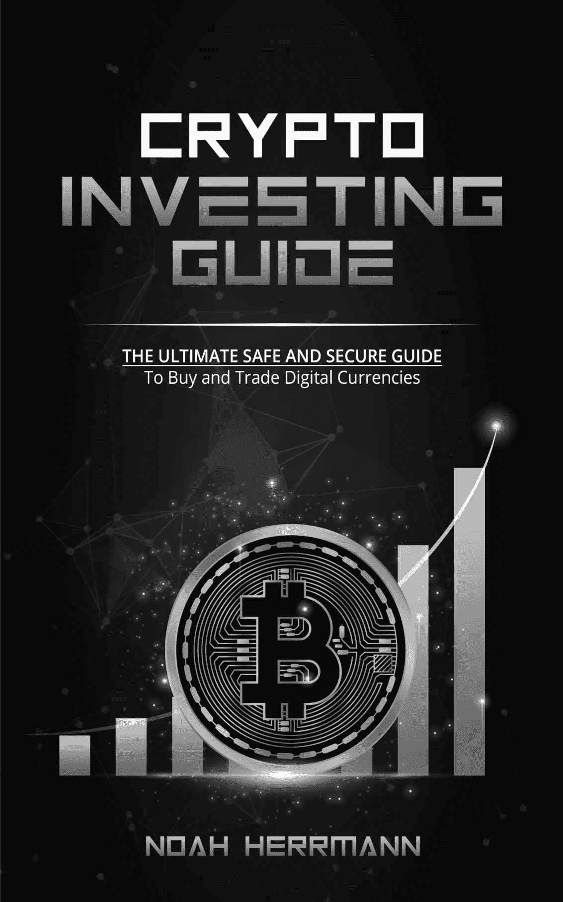
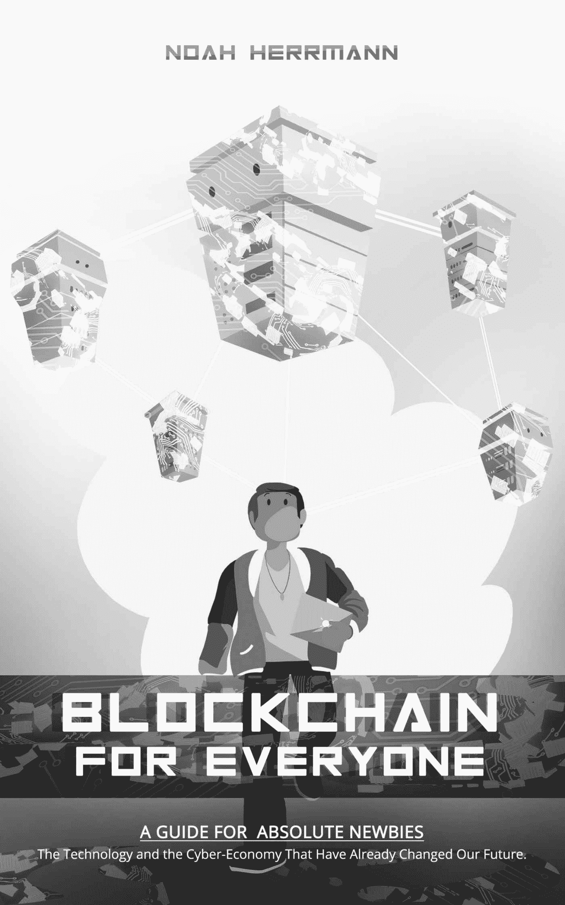
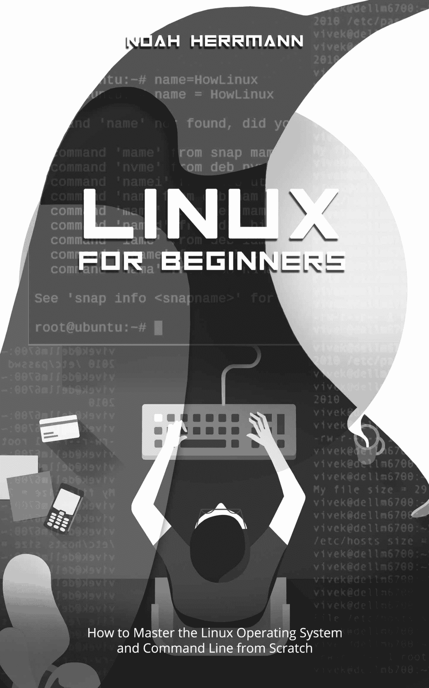

# 元宇宙投资：全面理解区块链世界的终极指南

***

读到末，你将获得一些额外的免费内容！我们那里见！

***

# 序言

元宇宙概念在 Facebook 改名为 Meta 之前就已经存在并快速发展，首席执行官马克克·扎克伯格也详细讨论过“元宇宙”。不可否的是：元宇宙已经在这里，而且很可能将长期存在。

那么，元宇宙究竟是什么？它像某些公司声称的那样重要，还是仅仅是一个几个月后就会消失的转瞬即逝潮流？你需要了解关于元宇宙的所有知识吗？你是否应该在它进一步爆发之前投入？本书将深入探讨元宇宙概念，讨论它的过去、现在，以及最重要的未来。

# 第一章

## 元宇宙的真正含义

为了说明“元宇宙”这个概念可能有多么困惑和混乱，请考虑以下实验：在一个句子中，将“元宇宙”替换为“网络空间”。在百分之十的情况下，意思保持不变。该术语并不是指某项技术，而是由于技术进步，我们与之互动的方式发生了广泛变化。即使它最初指定的技术变得随处可用，该短语也可能过时，这是一种完全可能。

它由两种技术组成：虚拟现实，其定义为永久的虚拟环境，即使在你没有玩时它依然存在；以及增强现实，它将物理世界和数字世界的元素融合，创造出更真实的体验。然而，并不要求某些场所只能通过虚拟现实或增强现实访问。一个可以通过电脑、游戏机甚至手机访问的虚拟世界（如 `Fortite`），在可访问性上可以被认为是具有元宇宙属性的。

也被称为“数字经济”，是一个允许用户创建、购买和销售物品的平台。互操作性允许你在更理想化的元宇宙环境中，将衣服或汽车等虚拟对象从一个平台移动到另一个平台。在现实生活中，你可能在商场买了一衬衫，然后晚上穿上它去看电影。大多数平台已经将用户的虚拟身份、化身和库存限制在单一平台；然而，元宇宙可能允许你创建一个可以随身携带到任何地方的人格，就像将你的个人资料从一个社交网站转移到另一个社交网站一样简单。

当你听到类似上面的描述时，可能很难理解这一切意味着什么，因为当你听到这些话时，可能会想：“等等，那不已经存在了吗？”例如，`World of Warcraft`的`World of Warcraft`是一个永久的虚拟环境，用户可以在其中购买和出售物品。瑞克·桑切斯可能通过音乐会和`Fortnite`展览等虚拟接触来了解马丁·路德·金。。你可能通过戴上`Oculus Rift`虚拟现实头设备进入你的虚拟世界。“元宇宙”这个术语的定义是什么？它只是涌现出的几种新形式视频游戏吗？

简而言之，答案是肯定的否。将 `Fortnite` 称为“元宇宙”就像将 Google 称为“互联网”。即使你在 `Fortnite` 中花费大量时间进行聊天、购买、学习和玩游戏，这也不能保证你理解了关于元宇宙的所有知识。

元宇宙源于科幻小说，关于它的大多数普遍观点都源于此。正如《头号玩家》和《黑客帝国》等电影所示，元宇宙通常被描绘成一种数字化的“接入”互联网——一种对真实现实的描述，但基于一个模拟的（有时像主题公园那样的）环境，与《头号玩家》和《黑客帝国》中看到的场景媲比。虽然可以想象这种体验会在元宇宙中存在，但它们将受到限制，就像《创战纪》等电影将互联网呈现为由比特组成的真实数字“信息超级高速公路”一样。

提到元宇宙时，我们无言以对，就像在 1982 年很难想象 2020 年的互联网——而且更难向从未“登录”过它的人解释它。另一方面，核心特征是可以被识别的。

- **持久性 (Persistence)**：被定义为它从不“重置”、“暂停”或“终止”，而是不间断地持续。
- 除了预先计划和自包含的事件外，元宇宙将是一个对所有人实时存在的现场体验，就像它在“现实生活”中一样。
- 允许无限数量并发用户，同时保持每个用户的“临场感”——每个人都可以成为元宇宙的成员，并在同一时间参与不同的元宇宙、地点或活动，只要元宇宙支持。
- 经济体系将完全运作——人们和公司可以开发、拥有和投资被他人看重的各种“劳动”，并且可以为这种劳动获得报酬。
- 是数字世界和物理世界、私人网络和公共网络、开放平台和封闭系统的融合。
- 由于这种整合，你可以在这些体验之间共享无与的数据、数字物品、内容等——例如，你的 `Counter-Strike` 皮肤可以在 `Fortnite` 中使用，或通过 `Facebook` 送给朋友。就像为 `Rocket League` 车辆（甚至是 `Porsche` 网站）可以转移到 `Roblox` 中运行一样，为 `Roblox`制作的车辆也是如此。今天数字世界的运作方式类似于商场，每家商店都有独特的身份卡、货币、商品（如鞋子或热量）的专用单位以及特定的着装规则，以此与其他区分来。
- 由多元化的贡献者生成和运行“内容”和“体验”，其中一些是自雇人士，另一些可能是非正式小组或商业为导向的公司。

还有一些概念可能对元宇宙至关重要，尽管它们并不为人所知。这些担忧之一是，个人是否可以在与所有人的接触中使用单一数字身份（或“化身”）。然而，尽管这可能很有益，但在短期内是怀疑的，因为每个“元宇宙时代”领导者都需要他们自己的识别系统。

另一个争议点是，元宇宙需要达到何种程度的互操作性才能被视为“元宇宙”，而不仅仅是现有互联网的演变。许多人还问，在一个真正的元宇宙中是否可以只有一个运营者，而不是一个虚拟元宇宙（正如《头号玩家》中的情况那样的）。根据某些人的观点，元宇宙的定义（以及成功）需要一个强去中心化的平台，该平台主要构建在社区驱动的标准和协议（类似于开放网络）之上，以及一个“开源”的元宇宙操作系统或平台（尽管这并不排除元宇宙中存在主导地位的封闭平台）。

另一个值得考虑的想法是元宇宙的基础通信架构。虽然现在的互联网是基于单个服务器之间根据需要进行“对话”来构建的，但其他人认为，元宇宙应该建立在持续的多对多连接上进行“布线”和“管理”，而不是基于单个服务器的“对话”。关于这种模式将如何运作，以及去中心化的程度如何，目前尚未达成共识。

思考一下元宇宙通常被比作什么也是好的，即使这种类比是不准确的。虽然这些相似之处很可能是元宇宙的一部分，但它们本身并不是元宇宙。相反，元宇宙并不是……

### 虚拟世界

“虚拟世界”是一个只存在于用户脑海中的宇宙。虚拟世界、带有 AI 驱动角色的游戏以及那些充斥着“真实”个体的世界首次出现已经几十年了。人们正在探索一个合成且虚构的世界，而不是一个具有单一目标的“元”（希腊语，意为“超越”）宇宙（一个游戏）。

虚拟世界，如 `Second Life`（第二人生），经常被称为“原型元宇宙”，因为它们 (A) 没有游戏那样的目标或技能系统；(B) 是持久的虚拟聚会场所；(C) 提供近同步的内容更新；以及 (D) 具有由数字化身代表虚拟世界中的真人。但正如后文将讨论的，这些属性对于元宇宙来说是不充分的。

### 虚拟现实 (VR)

虚拟现实（`VR`）体验是一种让自己沉浸在虚拟环境或区域的方法，而无需真正身处其中。要符合元宇宙的标准，必须有一种身处数字环境的存在感。本质上，这等同于仅仅因为你可以看到并在其中漫步，就声称住在一个富裕的城市里。

### 数字经济

另一种经济类型——“数字和虚拟经济”——已经存在。单个游戏，如 `World of Warcraft`（魔兽世界），长期以来一直运行着经济体系，其中真人在长时间内用虚拟商品交换真实货币，或通过虚拟劳动获取货币。此外，诸如 `Amazon's Mechanical Turk`（亚马逊众包）等平台以及 `Bitcoin`（比特币）等技术基于利用人员、公司和计算能力进行虚拟和数字劳动，这就是它们存在的原因。目前，我们正在通过完全数字化的市场，对纯数字商品和服务以及纯数字活动进行大规模交易。

`Fortnite`（堡垒之夜）是一个“游戏”，但它包含各种元宇宙组件。例如，它 (A) 融合了 IP（知识产权）；(B) 拥有跨越多个封闭平台的一致身份；(C) 是通往各种体验的门户，其中一些是完全社交的；以及 (D) 为内容提供者付费。虽然它自《头号玩家》发布以来有所改进，但就它可以完成的内容、能走多远以及可以完成哪些“工作”（至少目前如此）而言，仍然不足。然而，尽管元宇宙可能具有某些类游戏的目标，可能包含游戏，并可能利用游戏化，但它本身并不是一个游戏，它也不专注于实现特定目标。

### 主题公园与建筑

“虚拟迪士尼乐园或主题公园”是一种虚拟主题公园。“景点”的数量将是无边际的，而且它们不会像迪士尼乐园那样被“规划”或“编程”，它们也不会像迪士尼乐园那样的完全关于趣味或娱乐。此外，参与度的分布将具有非常长的长尾效应，参与度的分布也也是如此。

没有人需要一种访问应用程序的新方式，而且（例如）“在 `VR` 中”这样做并不会解锁/开启继代互联网所承诺的类型价值。然而，将会有一个“新的应用商店”。元宇宙的架构、范式和目标与今天的互联网/移动架构、范式和目标大不相同。

换句话说，元宇宙并不是另一个类似于 `YouTube` 或 `Facebook` 的平台，在那里许多个人可以在其中创建、分享和变现材料，而最受欢迎的内容仅占总消费的一小部分。元宇宙是一个“新的用户生成内容平台”。这将是一个真正帝国建立的地方，这些资金充足的企业将能够在元宇宙中完全拥有一个消费者，管理 `APIs` 和数据，并治理单元经济学等。此外，正如网络的情况一样，可能有一个平台将占据用户时间、体验、材料以及生活其他方面的很大比例。

考虑到这一点，想象一下置于《圣诞夜惊噩梦》中，你可以漫步进入任何活动或项目，并可能满足你的几乎任何欲望，而这一切都源自一个你所认识的所有人的家园起点或星球。这就是为什么超文本是如此重要的原因。然而，重要的是记住，元宇宙并不是传统意义上的游戏、一项技术或一种在线体验。它等同于声称 `World of Warcraft`、`iPhone` 或 `Google` 都是互联网的表象。

# 第二章：为什么元宇宙很重要？

尽管元宇宙可能无法达到科幻小说家的宏伟预言，但它作为一个新的计算平台或内容媒介，预计将产生数十亿美元的价值。

总而言之，元宇宙具有改变我们分配和营销当前自然资源方式的潜力。千年来，随着劳动力和稀缺性需求的起伏，发达经济体也随之变化。元宇宙将为住在城市以外的潜在劳动者提供通过虚拟劳动参与“高价值”经济的机会。随着越来越多的消费者支出转向虚拟产品、服务和体验，我们将见证在居住地、基础设施建设以及未来由谁来承担某些职责方面的更多变化。以“金币农场”概念为例：在游戏内贸易经济建立后不久，许多“玩家”（其中许多人受雇于大公司，许多人来自低收入国家）会花费工作时间积攒数字资源，以便在游戏内或游戏外进行出售。这些销售行为是西半球高收入玩家行为的典型特征。尽管大多数“劳动”是琐碎、重复且局限于少数应用程序的，但这种“工作”的多样性和价值将随着元宇宙的发展而并行增加。

## 创建元宇宙

创建元宇宙是一项艰巨工程。

在正常运行方面，元宇宙需要大量的新技术、协议和业务，以及技术的进步和科学发现。此外，它并不会凭空出现；“元宇宙之前”和“元宇宙之后”之间并没有明显的界限。随着无数物品、服务和能力的相互链接与融合，物联网最终会发展起来。无论如何，考虑必须就绪的三个关键变量至关重要。

为了程序化地思考这三个类别，我从《创世记》的角度来思考：首先，必须建立底层宇宙（“并发基础设施”），然后描述其物理定律和规则（“标准和协议”），最后，必须用有价值的内容填充它（内容），这些内容会根据选择压力进行进化和迭代。这意味着上帝并不是像构建微缩模型一样创建和构造世界，而是让在一个大部分空旷画布上生长，以此类推。

## 并发基础设施

简单来说，在最基础的层，目前的技术尚无法支持成百上万、甚至是百万人同时参与同一个同步体验。例如 2019 年在 `Fortnite` 中举行的 Marshmello 演唱会。总共有 1100 万人在线观看这一活动。然而，他们并不是以协调的方式参与的。据估计大约发生过 100,000 次 Marshmello 演唱会，每场都略有不同步，并限制在 100 名参与者。`Epic` 现在可能可以处理更多，但无法像早期那样处理数十万甚至百万级的并发。

元宇宙不仅需要目前不存在的基础设施，而且互联网之初也从未打算用于任何与目前元宇宙所提供的内容相似的东西。毕竟，它的建立目的是将数据从一台计算机传输到另一台计算机。因此，互联网大部分底层系统都是围绕单个服务器构建的，该服务器通过互联网与另一个服务器或终端设备通信。尽管由于年代久远，但它在今天仍在使用。尽管今天 `Facebook` 上有数十亿用户，每个用户都有自己到 `Facebook` 服务器的独立连接，且不与任何其他人共享此连接。结果是，每当你访问另一个用户的材料时，你只能接收到来自 `Facebook` 的最新信息。尽管文本对话是首批伪同步应用，但你很大程度上仍然是向服务器提供大量静态数据，并根据你需要的时间、地点和方式从那里检索最新的数据。当涉及到持久性（相对于连续性）的通信时，互联网从未被设计用于它，更不用说与许多其他人实时同步的持久性通信了。

为了正常工作，元宇宙需要使用类似于视频游戏和视频会议的技术。这些会议通过持久连接成为可能，允许参与者实时保持同步，并达到其他程序并不所需的精度。然而，它们很少被很多人同时使用：大多数视频聊天系统的容量仅为几个人，一旦达到 50 人，你就必须向观众进行“直播”，而不是共享双向连接。这些互动并不是真实的，事实上也并非如此。

为了实现这一目标，元宇宙需要使用更接近视频游戏的技术。这也是为什么大逃杀竞技类型之所以最近在视频游戏中流行起来的原因之一，因为现在才可行与大量玩家一起游戏。最受欢迎的游戏，如《第二人生》和《魔兽世界》，已经存在了近二十年，但它们很大程度上通过“分片”并将玩家分成不同的“世界”和服务器来模拟这种体验。例如，《星空帝国》可能有超过 100,000 名玩家同时处于“同一个游戏”中，尽管他们分布在多个现实（即服务器节点）中。因此，玩家在任何时刻只能接触到少数玩家，与他们的互动非常有限。此外，切换到不同的星系需要关闭一个服务器并加载另一个服务器（游戏通过叙事上让玩家以光速旅行来掩盖这一点）。当《星空帝国》达到数百人的战斗时，系统就会陷入停滞，这种情况发生过多次。由于游戏的整体游戏动态在很大程度上取决于大规模、设计良好的舰船战斗，因此它是成功的。

## 标准、协议以及这些规范的采用

我们今天所知的互联网是通过用于视觉显示、通信、图形、文件加载、数据以及许多功能的标准和协议实现的。其涵盖的产品范围跨越了从知名到冷门的公司的任何实体。此外，`WebSocket` 协议几乎支持浏览器与互联网上其他服务器之间的各种实时通信，被分配给了 `GIF` 文件类型。

在元宇宙中，S&Ps（标准与协议）将需要比现在更广泛、更复杂且更健壮。由于互操作性和实时同步体验至关重要，我们必须修剪一些现有的标准，并针对每个功能围绕较小的标准集进行“标准化”——例如，今天的图像文件格式包括 `.GIF`、`.JPEG`（及其变体）、`.PNG`（及其变体）、`.BMP`（及其变体）、`TIFF`（及其变体）以及 `WEBP`（及其变体）。尽管今天的网页构建在开放标准之上，但其本质上大部分是封闭且专有的。Amazon、Facebook 和 Google 使用了类似的技术 set；但它们的设计初衷并非以相同的方式共同工作，就像福特的轮子设计并不是为了适配通用汽车的车架一样。此外，许多组织坚决避免将其系统与其他链接或与其交换数据。然而，尽管此类活动可能会增加“数字经济”的总价值，但它们也会损害与之相关的极高网络效应，使人们更容易将他们的数字生活转移到他处。

这将项非常艰巨且耗时的任务。元宇宙的价值和互操作性越高，要在数据安全、数据持久性、前向兼容的代码演进以及交易功能等问题上获得行业内的共识就越困难。因此，除了我们现在正在应对的许多其他挑战的现有规则外，还需要针对审查、通信控制、监管执法、税收报告以及防止在线激进化的新规定。

元宇宙的标准不会预先创建，这与涉及面对面讨论、谈判和争论的传统标准制定方法不同。与相当混乱且更具有机性的标准过程不同，标准过程中的会议和观点是根据情况改变的。

### 模拟城市（SimCity）模型

将 `SimCity` 视为游戏性方面的元宇宙等效物。为了获得最佳效果，“市长”（即玩家）会在从零开始构建之前，先设计好他们的特大都市。然而，你不能像在现实生活中一样，在游戏中直接“建造”一个拥有 1000 万人口的城市。你从专注于一个小镇开始，并对其进行优化以实现最大效率（例如道路的位置、学校、公用事业容量等）。随着城镇扩张，建设会在城镇到处进行，有些“旧”部分会被拆除，并在偶尔建造新部分，但只有在发生问题（如停电）或悲剧（火灾）时才会这样做。然而，与 `SimCity` 不同，会有许多市长而不是只有一个，他们的欲望和动机会经常相互碰撞。

我们并不确切元宇宙将需要什么，更不用说当前的标准将如何、何时或通过何种应用程序和组织传输到新环境中。因此，分析元宇宙如何增长，而非仅仅分析它所遵循的技术标准，对于使其生效至关重要。

### “入场”体验式学习

正如元宇宙标准无法被“宣布”一样，消费者和公司不会仅仅因为某个原型元宇宙被提供就接受它。

看看生活的现实吧。为了吸引一个客户或一家公司，没有必要建造一个足够容纳十万个人或百家企业的商场。当现有的基础设施和活动不足以满足当前的民用或商业需求时，“城镇广场”就会围绕它们有机增长。最后但同样重要的是，任何活动区域——无论是酒吧、地下室、公园、博物馆还是游乐园——人们频繁光顾主要是因为那里已有的人或物，而不是因为其本身就是一个目标。

在数字交互方面，情况也是如此。`Facebook` 作为全球最大的社交网络，之所以如此成功，并不是因为它宣布自己是一个“社交网络”，而是因为它最初只是一个校园外貌打分网站，成长为一个数字毕业纪念，并最终变成带有消息功能的照片分享信息服务。元宇宙与 `Facebook` 类似，必须被“填充”，而不仅仅是“人口”，而且这些人口必须用可以做的活动和要消费的物品填充这个数字环境中的空间，而不是简单的“入住”。

从这些角度考虑时，认为 `Fortnite` 是一个视频游戏或互动体验的想法是过于局限且仓促的。`Fortnite` 起是一个视频游戏，但它迅速演变成一个拥有数百万粉丝的社交媒体平台。从 1970 年到 2010 年，青少年们放学回家后每天都会打三个小时电话。他们现在正在和朋友谈论 `Fortnite`，而不是谈论 `Fortnite` 本身。相反，他们谈论的是其他事情，如学校、电影、体育、新闻、男女等等。事实上，`Fortnite` 并没有叙事或 IP；相反，故事情专注于岛屿上发生的事情以及在那里体验这一切的人。

此外，`Fortnite` 正迅速成为其他企业、知识产权和故事通过游戏和叙事来表达自己的平台。其中最著名的是去年 Marshmello 的现场表演。然而，在期间，类似的案例呈爆炸式增长。在 2019 年 12 月一次较大的游戏内互动活动中（其中包括对导演 J.J. Abrams 的现场动采访），《星球大战：天崛起》发布了备受期待的电影片段，该片段只能通过游戏的 `Fortnite` 模式访问。此外，这一发生在电影的片头序列中被明确提到。Weezer 建立了一个独特的岛屿，粉丝可以在其他人之前先试听他们的新专辑（同时与其他“玩家”跳舞）。此外，`Fortnite` 还根据热门品牌开发了许多主题“限时模式”，如耐克的 `Air Jordan` 和 Lionsgate 的《约翰·维克》电影系列。有时，这些“LTMs”会将 `Fortnite` 地图的一个区域变成一个微虚拟世界，访问时会改变游戏的视觉效果、物品和游戏风格，以模仿另一个游戏的外观和游戏玩法。这些设置中的一些包括《无主之地》的世界、哥谭市（Gotham）、蝙蝠侠的家乡，以及旧西部。

因此，`Fortnite` 是少数几个可以让漫威和 DC 的 IP 出现在同一个游戏中的地方。在哥谭市，你完全可以装扮成漫威角色，并与那些穿着联盟合法授权的 NFL 球衣的人聊天。这在历史上是第一次出现此类情况。然而，这对元宇宙的发展将至关重要。

可以有一个更通用的表述：堡垒之夜（Fortnite）开发出了一种新的子经济，其中“玩家”可以制作（并出售）自己的内容。皮肤（数字服装）和舞蹈（表情）就是这类内容的例子。尽管它最初只是一小部分游戏，但它已迅速扩展，涵盖了任何使用堡垒之夜引擎、资产或美学的新游戏和体验。每种玩家都能找到自己喜欢的的内容，从简单的寻宝游戏，到格林兄弟童话与跑酷文化的复杂融合，再到一部跨越多个宇宙和时间跨度的 10 小时幻史诗。此外，堡垒之夜的创作模式已经开始看起来像元宇宙的前传。一旦进入其中，玩家可以在数千扇“门”（即时空裂缝）中进行选择，这些门将把他们带往数千个独立世界之一，在那里他们可以同时与其他 99 名玩家一起游戏。

正如创意总监唐纳德·马斯德（Donald Mustard）所日益明确的那样，游戏的长期野心是问题的核心。

### Epic Games

堡垒之夜潜力最有说服力的指标之一，是它能够说服大量表面上的竞争对手进行合作（或展示早期的相互“互操作性”）。堡垒之夜目前已在每个主要的娱乐平台上可用——包括 iOS 和 Android 等移动设备，以及 PlayStation、Nintendo、PC 和 Xbox 等主机——它允许跨越多个身份/账户系统、支付方式、社交图谱以及通常封闭的生态系统进行无缝跨平台游戏。长期以来，主流游戏平台一直反对这种体验，认为允许实现这种体验会削弱它们的网络效应，并减少购买其专利设备的需求。这导致了在 PlayStation 上玩《使命召唤》的伙伴无法与在 Xbox 上玩《使命召唤》的朋友一起玩，尽管索尼和微软都知道他们想这样做。

事实上，知识产权（IP）所有者并不愿意让他们角色和故事被整合到其他 IP 中。这种情况偶尔会发生（例如，几次漫威与 DC 的漫画联名和视频游戏）。然而，在一个他们不具备编辑控制权的体验中看到这种情况是极其罕见的，更不用说是一个以不可预测性为核心的体验了（连堡垒之夜的创作团队也不知道 2021 年会发生什么），而且拥有如此广泛的知识产权光谱。

如何强调有机演化的意义都不为过。如果你“宣布”了你要构建元宇宙的意图，这些方永远不会接受互操作性，也不会将他们的知识产权交给你。然而，就像宝洁（P&G）不能宣布“哦，Facebook 不适合我们”一样，大多数交易对手除了加入对话别无选择。他们几乎肯定渴望成为“游戏”的一部分。因为堡垒之夜已经变得如此流行和独特，以至于大多数对手别无参与竞争。堡垒之夜是一个非常有价值的平台。

堡垒之夜是这款游戏的名字。不过，请在了一两年后再次询问这个问题。

### 元宇宙构建努力

Epic 在其构建元宇宙的努力中提供的不仅仅是一个通往世界的具有视觉吸引力的入口。此外，Epic Games 是虚幻引擎（Unreal Engine）2 的所有者（这是第二大的独立游戏引擎），并负责堡垒之夜的运营，据称这曾是该公司的一个侧项目。为了简单起见，目前有成千上万的游戏正在使用它的“技术栈栈”。

### 在线服务

虽然 Epic 在线服务（Epic Online Services）目前处于私用测试阶段，但公司声称它将于 2020 年第二季度向公众开放，并在可用后支持“成百或上千”个游戏。此外，值得注意的是，所有这一切都减少了 Epic 在长期元宇宙构建计划方面对堡垒之夜的依赖。

Epic 还运营着全球最大（尽管仍然很小）的数字游戏商店之一，让客户能够访问广泛的数字内容和体验。客户对数字内容的进一步碎片化并不感兴趣，绝大多数人对市场领导者 `Steam` 表示满意。`Epic Games` 的创始人兼首席执行官 Tim Sweeney 一直直言，目前数字内容购买的标准 30% 百成费用（例如在 `iOS`、`Amazon` 或 `Google Play` 上）不仅是高利贷的，而且阻碍了真正的全球数字市场的发展。如果信用卡手续费是目前的 20 到 60 倍，实体经济中的许多巨大部门将无法运营（例如咖啡馆或杂货店）。这项服务的费用仅占 `Epic` 总成本的 12%（还包括 5% 的 `Unreal` 许可费，使得许多客户的成本仅为 7%）。特别值得注意的是，有报告不断传出，Sweeney 在与董事会同意 12% 的费率之前，曾寻求过更低的费用——Sweeney 承认，这一费率在所有情况下都不足以支付运营费用。并不是说这里没有更广泛的商业机会；运营一家商店无疑将有助于元宇宙的扩张——但 Sweeney 的努力范围似乎比这广泛得多。尽管 `Google` 和 `Apple` 正在积极追逐 `Epic` 的价格，但它们产生的收入是 `Epic` 的初创商店的数千倍。

如果 88/12 百成的零售冲突通过掷硬币来决定，结果将如下：由于其他零售商没有做出反应，`Epic Games Store` 成功了，所有创作者也因此获得了胜利。由于 `Tails`（反面），我们的竞争对手追上了我们，并失去了我们在收入分成方面的竞争优势。其他零售商可能会因此获益，但所有开发者都将受益。

# 第三章

还有谁能够构建元宇宙？

尽管元宇宙有完全取代互联网作为计算平台的潜力，但它不太可能追随其先驱的后辙。在美国，公共研究机构和政府倡议负责了互联网的发展。这部分归是因为私营部门很少有人看到世界维网的经济潜力，但也是因为这些组织几乎是唯一拥有构建它所需的计算能力、资源和雄心的机构。如果我们从元宇宙的角度来看，这一切就都不成立。

私营行业不仅完全意识到元宇宙的潜力，而且对它的未来最有信心，并且拥有比任何其他行业都多的资金（至少在愿意支持元宇宙研发的意愿方面）、最出色的工程技能以及最强的征服野心。公司想要主并定义元宇宙，而不仅仅是处于其开发的前沿。尽管在元宇宙早期只有少数潜在的领导者，但具有非企业视角的开源努力将继续在元宇宙中发挥至关重要的作用，并会吸引一些最令人兴奋的创意人才。你将能够将它们每一个区分开来。

`Microsoft` 是如何做到这一点的一个很好的例子。通过 `Office 365` 和 `LinkedIn`，该公司拥有数亿联邦用户身份，是全球第二大云服务供应商，拥有一套跨越所有 `platforms/infrastructure/systems`（平台/基础设施/系统）的广泛工作相关软件和服务，在海量共享在线内容/运营方面拥有可证明的技术专长，并拥有一套包括 `Minecraft`（我的世界）、`Xbox + Xbox Live` 以及 `HoloLens` 等在内的的一系列潜在网关体验。因此，元宇宙为 `Microsoft` 提供了一个机会，使其夺回在从 `Windows 95` 迁移到 `Windows NT` 期间失去的 `OS/硬件`领先地位。

从电脑到移动设备。但也许重要的是，`Microsoft` 的首席执行官 `Satya Nadella` 意识到公司必须出现在任何进行工作的地方。随着 `Microsoft` 从企业到消费者、从 PC 到移动、从离线到在线的成功转型，很难想象这家公司不在劳动和信息处理的虚拟化未来中发挥重要作用。`Microsoft` 成功地完成了从企业到消费者、从 PC 到移动、从离线到在线的转型，同时在“工作”经济中保持着重要地位。

显然，`Facebook` 的首席执行官 `Mark Zuckerberg` 正专注于元宇宙，尽管他尚未明确声明他想要开发和运营一个元宇宙帝国。这也是一个大策略。由于元宇宙创造了更大、更强大的社交图谱，以及一个新的计算机和交互平台，`Facebook` 面比任何其他公司损失最多的资金。同时，元宇宙允许 `Facebook` 将影响力扩大到整个社交媒体栈。尽管已有其他尝试设计手机操作系统和部署消费硬件，但 `Facebook` 是 `FAAMG` 企业中第一个完全专注于应用和服务层的企业。由于元宇宙，`Facebook` 可能成为下一个 `Android` 或 `iOS/iPhone`（因此 `Oculus`），以及 `Amazon` 的虚拟商品等物。

`Facebook` 在元宇宙中的优势是无法衡量的。地球上每一个其他平台在日用户数、日使用时间和用户生成内容方面都显得黯然失色。它拥有仅次于数字广告支出比例、数十亿美元、数千名世界级工程师以及一个拥有多数投票权的所有者。此外，它的 `Metaverse` 资产正在快速扩张，半导体和脑机接口的专利现在已成为其最有价值的资产之一。然而，公司作为一个允许第三方开发者和组织构建长期企业的平台、作为一个财团（例如 `Libra`）的领导者以及作为用户信息和信任的管理者，其记录非常糟糕。

`Amazon` 因各种原因而令人振奋。为了成为我们购物的首选网站，它将不断尝试这样做。无论使用游戏引擎、虚拟环境还是网络浏览器购买物品，该交易都是有效的。此外，该公司已经拥有数亿张信用卡和全球（除中国外）最大的电子商务份额。它还运营着各种消费媒体体验（音乐、电子书、视频、游戏直播、有声书等）和第三方商业平台（例如 `Fulfilled by Amazon`、`Amazon Channels`），并且正在开发他们希望是首个专门为云构建的大游戏/渲染引擎（`Amazon Cloud Gaming`）。

## 亚马逊与元宇宙

公司的创始人兼首席执行官杰夫·贝佐斯（Jeff Bezos）对基础设施支出非常有热情；这一点尤为重要。例如，`AWS`（亚马逊云）负责互联网运营。公司销售、包装并交付其他公司提供的物品，而不是直接购买和销售库存。亚马逊配送（Fulfilled by Amazon）占了亚马逊收入的 80%，公司 80% 的收入来自这项服务（与大多数零售商一样）。贝佐斯曾表示，他对`Blue Origin`（蓝色起源）的目标是“在太空建立巨大的芯片工厂，并只需发送小碎片”，这类似于早期的网络协议和他的亚马逊云服务（`AWS`）。虽然埃隆·马斯克的私人航天公司 `SpaceX` 渴望殖化火星，但贝佐斯表示，他对`蓝色起源`的目标是“在太空建立巨大的芯片工厂，并只需发送小碎片”。这意味着亚马逊比任何其他 FAAMG 企业都可能支持一个完全开放的元宇宙——因为它不需要控制用户体验或身份，因为它从后端基础设施使用和数字交易的巨大增长中获益。

## 谷歌与元宇宙

就像互联网是一个数据矿一样，元宇宙将包含比现有网络更多的数据和可能更大的回报。在全球范围内，谷歌是唯一一家在这些数据变现方面做得比自己更好的公司。得益于其在索引数字和物理世界方面的领先地位（有近 10,000 名员工参与制图工作），该公司也是中国之外最成功的数字软件和服务公司。此外，它还拥有世界上最流行的操作系统（`Android`）和最开放的主流消费级平台（`Windows`）。谷歌是第一家通过 `Google Glass` 积极追求可穿戴计算潜力的公司，尽管 `Google Glass` 失败了，但公司现在正通过 `Google Assistant`、其 `Nest` 设备系列和 `FitBit` 大力推动家居数字化。因此，元宇宙最可能是将谷歌迄为止的所有分散投资整合在一起的唯一努力，这些投资包括 `Stadia` 边缘计算、`Project Fi`、`Google Street View`、大量的暗纤购买、可穿戴设备以及虚拟助手等其他技术。

## 苹果与元宇宙

底层元宇宙极可能不会受到底层元宇宙的影响或管理。事实上，它运营着世界上第二大计算机平台（也是目前为止最有价值的），还是全球最大的游戏商之一（这意味着它支付给开发者的费用比地球上任何人都都要多）。公司还在积极投资增强现实设备和“结缔组织”以帮助元宇宙的发展。[来源：维基百科]（例如 `Apple Watch`、`Apple AirPods`、信标）。另一方面，苹果的思维方式和商业模式与创新开放平台的发展是不兼容的，在这样的平台上，任何人都可以访问完整的用户数据和设备 `APIs`。因此，与其作为运营商/驱动者，苹果更有可能是西方世界与元宇宙交流的主要方式，而不是反过来。这与互联网一样，几乎肯定会对所有参与方有利。

## Unity 引擎策略

如果元宇宙涉及资产、体验和通用 `APIs` 的广泛交互，`Unity` 将成为促进这种相互作用的关键。该引擎被超过一半的手机游戏使用，在现实世界的渲染和模拟应用（如建筑、设计和工程）中的使用范围甚至比 `Unreal Engine` 更广泛。迪士尼的《曼达洛人》（The Mandalorian）在导演乔恩·法弗罗（Jon Favreau）创作和拍摄写实版《狮子王》的同时，正在 `Unity` 中进行创作和拍摄。该公司还拥有并运营着世界上最大的数字广告网络之一（这是每天支持 100 亿分钟移动娱乐的一个良好副作用）。然而，尚不确定 `Unity` 在未来几个月几年内推动元宇宙发展将扮演什么作用。目前没有实体商店，没有用户账户系统，也没有真实的直接面向消费者体验。它的大部分辅助服务（那些与搜索引擎或广告无关的服务）并不经常被使用。此外，如前所述，绝大多数（尽管不是所有）`Unity` 驱动的游戏都是基础手机游戏，而不是元宇宙网关。然而，考虑到它对标准、游戏时间和内容生产等其他方面不可避免的影响，无法想象它不会被购买并整合到具有更大资产和福利的大型技术业务中。

此前，很难证明购买 `Unity` 的合理性。潜在的购买方必须确保 `Unity` 保持完全的平台中立，以保持市场主地位、开发者支持和影响力（例如，`Google` 无法让 `Unity` 在 `Android/Chrome` 上独占或成为最佳，否则会疏远大量开发者）。但是，这并不排除未来将 `Unity` 变为专有引擎作为一种明智战略决策的可能性。这种选择将导致价值的流，加上收购 `Unity` 所需的溢价，无疑会让这种举动在财务上不可持续的。另一方面，购买 `Unity` 可能是由于在新互联网中占据关键位置的愿望，在这种情况下，收购者将有强动力保持引擎跨平台开放/可用，价格将迅速变得不再重要。

## Epic 与 Valve

如果 `Epic Games` 有一条通往元宇宙的现实道路，那么 `Valve` 也必须有。在用户、资金和游戏时间方面，`Epic Games Store` 与 `Valve` 的 `Steam` 比自见绬。它是市场上许多最流行、运行最长的多人游戏（`Counter-Strike`、`Team Fortress`、`DotA`）的创造者和所有者。此外，在内容创作和盈利创新方面也有悠久的历史（它是首次尝试 `AAA` 免费游戏和玩家对玩家市场）。例如，`Valve` 花了多年开发和发布虚拟现实技术，该公司现在每年产生数十亿美元收入。`Valve` 由一组对开源技术充满热情并反感封闭设置的程序员私有。另一方面，`Valve` 的 `Source` 引擎受关注较少，与 `Epic` 不同，它似乎对将自己的能力和资产整合起来创建元宇宙感兴趣。

# 结论

全息图在元宇宙中的作用是什么？

互联网的引入带来了一系列技术进步，包括跨距离连接计算机以及将互联网上的一个网页链接到另一个网页的能力。这些技术特性为我们现在与互联网相关的抽象结构（如网站、应用程序、社交网络以及建立在其之上的一切）奠定了基础。这还没有考虑到非互联网接口技术的融合，如显示器、键盘、鼠标和触摸屏，这些对于互联网的正常运行仍然是。

元宇宙的引入了一些新的构建模块。例如，一个服务器实例可以托管数百人（未来的元宇宙版本应该能够处理成千上万），并且运动追踪工具可以识别人的手的位置。这些新技术在未来可能是非常令人兴奋且具有未来感的。

另一方面，某些局限性可能是不可行的。需要注意的是，当 `Microsoft` 和 `FaMeta` 等公司发布未来构想的虚假视频时，他们并没有考虑人们是如何与元宇宙交互的。尽管虚拟现实技术仍处于起步阶段，但大多数人在长时间使用虚拟现实头戴设备后会感到晕症或身体不适。除了如何在公共场合使用增强现实眼镜而不让自己看起来像个大白痴这一项不容忽视的挑战外，增强现实眼镜也面临着类似的系列挑战。

那么，信息技术（IT）企业如何在不展示笨重设备和奇特眼镜的情况下，展示其技术的理念呢？目前看来，他们最可行的替代方案似乎是从零开始构建技术。她是今天早些时候 `Meta` 演讲中出现的那个全息女子吗？我很抱歉要带来坏消息，但即使使用当前技术最先进的版本，要实现你所要求的也是不可行的。

如果不使用精确控制的条件，在空中出现三维图像是不可能的；相比之下，运动追踪的数字分身虽然目前看起来还有有些生硬，但明天可能会变得更好，无论 `Iron Man` 怎么想。也许它们被设计为通过眼镜投影的图片——毕竟演示视频中的两个女性都戴着眼镜——但这对微型眼镜的物理能力提出了很多假设，而 `Snap` 恰恰证明了这从一开始就是一个难以解决的挑战。

作为一种展示元宇宙可能如何运作的方式，这种对现实的欺骗在电影演示中很常见。使用虚拟现实设备或仅仅坐在桌子前，这个人是在做什么？这个人看起来要么是连接着沉浸式飞行设备，要么只是坐在桌子前。`Meta` 的另一场演示展示了在空间中漂浮的人；此人是连接着沉浸式飞行设备，还是仅仅坐在桌子前？图中描写的人戴着全息图吗？如果是，是如何扫描他们的脸来创建全息图的？在某些情况下，一个人可以拿虚拟物品，而在另一些时候似乎又在他们真实手中拿着它们。

这次演示产生的问题比它提供的答案要多得多。

在某种程度上，这种行为是可以接受的。`Microsoft`、`Meta` 以及其他创建此类疯狂演示的公司都在试图描绘出未来可能样子的艺术感，而不是解决过程中可能出现的每一个技术问题。当时，这看起来似乎是不可能的，但 `AT&T` 一场语音控制折叠手机的演示——它可以神奇地从图像中删除个人并生成 3D 模型——开启了一项长期的传统。

然而，无法预测由于这种“作为技术的愿望式演示”导致的结果，各种元宇宙概念中的哪些特征有一天会变成现实。只要虚拟现实和增强现实头戴设备足够舒适且物美廉，，让人们每天佩戴——这是一个巨大的“假设”——那么与在空间中漂浮的机器人或全息投影作为对手玩虚拟扑克的想法就可能实现。如果那不是一个选择，你始终可以通过 `Discord` 视频会议参与 `Tabletop Simulator`。

虚拟现实和增强现实的华丽也掩盖了元宇宙更平庸的元素，而这些元素更有可能表现出来。对于软件公司来说，建立一个开放的数字分身标准是轻而易举的，这将是一种包含你在角色创建器中输入的属性的文件——例如眼睛颜色、发型和服装选项——并允许你随随地携带它。为了这一目的，没有必要去创建更舒适的虚拟现实头戴设备。

### 元宇宙的机会、风险与未来

“元宇宙”一词在过去几年中在全球范围内引发了大量的讨论。来自各种背景的广泛人群对元宇宙的推广努力做出了积极反应。“下一步是什么？”是几天前出现在英国《经济学人》（The Economist）网站上的一个问题。根据《2022 年值得关注的 22 项新兴技术》一文，元宇宙、量子计算和虚拟网红是 2022 年值得关注的 22 项新兴技术之一。正如《商报》（Commercial Press）报道的，国家语言资源监测与研究中心在 12 月 6 日发布的一份报告中将元宇宙列为“2021 年十大网络词汇之一”，报告中还列出了其他热门网络词。

正如《商报》的文章解释道，“元宇宙”一词源于《雪崩》（Avalanche）中引入的科幻概念，目前用于指由 `XR`、数字孪生、区块链技术和人工智能等技术进步创造的虚拟世界。在此时，元宇宙仍然是一个不断成长和发展的概念。全球范围内围绕元宇宙这一巨大且不断发展的理念着着讨论。

### 处理元宇宙的最佳方法是什么？

沈向阳（美国国家工程院外院士、英国皇家工程院外院士）最近从元宇宙的四个层次解释了元宇宙的新含义。他的声明强调，元宇宙应该是一个以开放性为特征的世界，随后的产品将建立在这个基础之上。

根据阿里巴巴达摩院 `XR` 实验室主任谭平的话，元宇宙是下一代互联网，即运行在 `AR/VR` 眼镜上的整个互联网。下一代移动计算平台（如增强现实 AR 眼镜）正走向普及，而元宇宙是互联网行业对这一新平台的展示。每形式的互联网应用都将在元宇宙中有一个呈现，就像现在一样。元宇宙的技术底层被分为四层：全息构建、全息仿真、虚实融合和虚实联动。在前两个层通过虚拟现实（VR）创建一个虚拟环境，而第三、第四层则利用增强现实（AR）在第三和第四层创建虚拟与现实世界的混合。

根据中国工程院院士、清华大学计算机与系系教授郑为民的说法，这是一个由数据的世界。郑教授认为，分布式数据存储已成为确保元宇宙长期运行的主要方法。同时，数据生产者、管理者、集成者、用户以及参与数据使用过程的其他角色之间存在着错综复杂的权利交织，这使得验证数据碎片的所有权变得非常困难，并导致了广泛的数据误用。这些忧虑可以通过区块链技术和架构来解决，而这正是底层的技术和架构。郑为民院士表示，算力和数据是元宇宙扩张和数字经济发展的基石。数字治理、金融科技、智慧医疗和智能制造都是需要使用大量算力才能正常运行的互联网创新业务示例。我国数字经济的发展已在多个领域积累了大量数据，为数据词化和市场化奠定了坚实的平台。

根据英伟达首席执行官黄仁勋（Jensen Huang）的说法，我们打算未来在元宇宙中重建工业和工厂，以及现实世界中的电气基础设施。通过这种方式我们可以减少浪费，这也是元宇宙在经济上对企业有益的原因之一。他们花费数十亿美元获取人工智能能力的意愿将是极高的。

## 这种情况发生的概率有多大？

台积电董事长刘德民近期表示，半导体行业的增长已随着信息技术的全球化而扩大。在未来 10 年里，增强现实可能会取代智能手机，而虚拟现实将取代个人电脑。人们将越来越多地接触物理世界和虚拟世界。随着元宇宙规模的扩大，其对硬件的需求将继续增长。

Ark Invest 的创始人兼首席执行官凯蒂·伍德（Cathie Wood）认为，元宇宙具有价值万亿美元的潜力，并将对经济产生深远影响。这是一个出色的概念，就像技术一样，它有望以我们目前无法想象的方式渗透每一个行业。

根据美国银行研究管理董事兼全球战略官海姆·以色列斯拉尔（Haim Israel）的说法，元宇宙代表了区块链技术未来的巨大可能性。元宇宙还将帮助加密货币的主流化。根据元宇宙，“我们在这里开始接受加密货币作为一种支付形式”。由于这种发展，目前的货币可能会遭受过度的波动。

预计某些稳定币将接管市场。如果加密货币在元宇宙中被广泛利用，传统支付公司对对加密货币产生越来越兴趣，预计他们之间会有大量的接触。

据消息人士称，12 月 6 日举行的江苏省第十三届全国人大常委会第二十七次会议审议了关于数字经济的特别议题。江苏省发展改革委副主任高青指出，元宇宙可能为未来互联网的建立或数字经济的发展提供新途径。发展的下一个阶段，若干尖端数字技术，如网络和算力技术、显示技术、物联网技术、人工智能技术、区块链技术等许多尖端数字技术必须整合，以支持元宇宙开放、随时随地访问、沉浸式等特征。高青还指出，为了建设数字经济，我们必须愿意承担风险并抓住新机会。为了将元宇宙从概念变为现实，我们必须积极推动它，加速数字技术整合以赋能实体经济，并通过扩大元宇宙产业来加速我省经济和社会的数字化转型。在技术、标准、应用开发和立法等多个层面不断扩大对元宇宙发展的支持，对于为虚拟世界的未来奠定实基础至关重要。

摩根士利认为，尽管元宇宙可能需要长时间才能亮相，但随后 NFT 的扩张和社交游戏的繁荣将为精品部门带来巨大的收入机会。根据摩根士利的数据，Roblox（一个现在被视为元宇宙先驱的游戏平台）上约五分之一的玩家每天更换他们的游戏头像，这一数字正在增加。据估计，社交游戏到 2030 年将为数字奢侈品行业产生 200 亿美元的销售额。根据行业估计，在价值 3000 亿美元的 NFT 领域，各种数字奢侈品和收藏品可能积累超过 250 亿美元的市值。对于摩根士利而言，多次进入 NFT 和社交游戏领域导致了新客户群的发展，并对这一快速增长的业务有了更深入的了解。该品牌正处于 NFT 和元宇宙游戏的概念验证阶段。证据表明，目前的测试都是有效的；下一步是确定如何在现实世界中实施这些。

11 月 19 日，微软首席执行官萨提亚·纳德拉（Satya Nadella）表示对元宇宙感兴趣，并称他将继续使用全栈思维，以拥抱未来元宇宙等新的发展可能性。正如纳德拉描述的那样，元宇宙通过跨商业和消费者互联网将人、物和领域连接起来，弥合了物理世界与数字世界之间的差距。由于整合是可行的，它不应被视为孤立的消费市场现象，或发生在组织层面的现象。它是非常有必要的。在某些方面，疫情期间视频会议的流行为我们提供了一些 2D 元宇宙的实践经验，这对未来的研究很有帮助。存在于时空之外的 3D 元宇宙无疑是一个重要的发展方向。你应该警惕哪些危险？

# 元宇宙的发展与展望

## 概述与挑战
12 月 6 日，清华大学新闻学院新媒体研究中心主任沈阳在“中国发展论坛青年企业家峰会”上发布了团队的《2020-2021 元宇宙发展研究报告》。沈阳称，元宇宙是目前所能接触的最复杂的移动互联网。尽管元宇宙尚处于起步阶段，但元宇宙领域展现出成长型企业特有的不成熟和波动性，并且可能出现各种挑战。整个元宇宙业务目前处于“亚健康”状态，表现为至少存在 10 项重大风险。行业和市场必须尽快恢复正常和理性。十个关键危险方面包括：资本操纵、舆论泡沫、伦理约束、垄断冲突、行业演进、算力需求、经济风险、成瘾风险、隐私问题以及知识产权保护困难。

公司创始人周鸿祎谈到了元宇宙。他说，这个概念非常受欢迎。由于股市高涨，许多人最终发现了一种赚钱的新途径。在我看来，元宇宙是由小说家创造出的一个虚构虚拟环境。它发展出了一种与其所处物理离线世界截然不同的完全在线的现实。这需要一些时间。其次，我注意到 Facebook 对未来的想法和梦想，并追随了它们。我认为这并不代表人类的未来。我将其视为人类终结的标志。它意味着如果我们放弃现实，并且不在现实中投入同等努力来实现目标，那么每个人都将生活在一个幻想的世界里。我和我在美国的同事进行过几次对话。还有人认为，脑机接口的融合最终将是元宇宙最伟大的宿命。闭上眼睛躺在床上，头部插入一根注入营养液的管子来激活脑波，这样就可以产生无限的数字。幻觉和图像最终能够取代《黑客帝国》中的人类电池吗？由于元宇宙的存在，人类文明将不会有任何方面的进展。人类若要解决全球能源困境，必须面对核聚变问题。

## 行业现状与演进
清华大学新闻学院新媒体研究中心的沈阳教授指出，只有当人类解决了宇宙导航的谜团，才能离开这个世界回到自己的母星球。许多公司正在推广元宇宙，但他们实际上是在推广许多互联网产品，其中许多仅仅是移动产品，而非“元宇宙”。“目前元宇宙如火如荼，我想通过增加更多产品来火上加油。”我希望这一代人能够利用并满足于不断进步的技术，从处理能力到通信技术、算法和成品。直到晚些时候，“元宇宙”一词已成为信息技术领域最热门的流行语（buzzword），特别是在 Facebook 上月将其更名为 `Meta` 以更好地代表其业务转型之后。明确的是，以前没有人听过“元宇宙”这个词。

每个人都不确定最终产品会长什么样，因为这个想法仍处于早期阶段。另一方面，它的进展必须由需求驱动。为了研究各种技术在各种情况下的实施，`Meta`、`Microsoft` 和 `Nvidia` 等 IT 巨头已转向元宇宙寻求帮助。然而，无论情况如何，这些产品基础的基础最终必须满足大众的需求。不符合消费者需求的产品很可能在未来被市场淘汰。

## 弗拉基米·普京的观点
11 月 15 日，俄罗斯总统弗拉基米尔·普京表示他将参加 2021 年世界杯。根据媒体报道，“AI 之旅”国际会议（`AI Journey 2021`）将有以下演讲者：“我想指出，元宇宙这个词是由一位知名人物在 30 年前创造的。根据作者的设想，人们从他们出生的真实世界的缺陷现实中逃亡到了元宇宙。这种想法对现在的我们来说实在太令人沮丧了。我不认为采取这种路线有理由。”

普京此外还说，“我们需要利用元宇宙的功能，让人们无论距离多远，都能共同进行交流、协作、学习并开展合作研究和商业活动。”普京总统认为，这对于技术企业、创意产业、虚拟现实和混合现实设备制造商，甚至是法律专家来说至关重要，他们被赋予了建立“新世界”经济和社会标准的任务。“这是一个具有挑战性的局面，”他说。据普京介绍，这涉及确保网络空间中个人的受保护，以及他们在“元宇宙”中虚拟化身的安全。根据技术开发人员的说法，如果使用虚拟世界，人们可以在离开舒适家的情况下跨越空间。普京认为，“这使人们能够与位于遥远大陆的人交流。”

## 企业观点与未来展望
根据 12 月 5 日发布的新闻，海丰董事长郭台铭近期参加了 `iCareDx` 医学技术展的新发布会，这是一家通过个人投资形成的初创企业，并在活动中分享了他对“元宇宙”概念的看法。根据郭台铭（`Terry Gou`）的，元宇宙理念的实施将需要 5 到 10 年，而随之的应用将在几年后。尽管在开发过程中有多种研发可能性，但重点不成比例地集中在应用端。由于“用户体验”仍有很大的改进空间，目前讨论应用的爆炸式增长是不可行的。

在 11 月 16 日在波士顿举行的一场会议上，迪士尼的首席执行官鲍勃·查佩克（Bob Chapek）和新英格兰队的罗伯特·克拉夫（Robert Kraft）讨论了业务。双方畅述了元宇宙，查佩克暗示元宇宙将是迪士尼的未来。他说，迪士尼乐园和 `Disney+` 互联网平台为公司提供了前所未有的元宇宙构建可能性。他断言，这个三维画布将无缝无限制地整合物理世界和数字世界，允许更多的创造性思维。他认为元宇宙代表了未来一代的成长路线。

根据中国社会科学院信息化与网络经济研究办公室副主任、中国社会科学院信息化研究中心秘书长左鹏飞的说法，我们距离元宇宙基础场景的实现大约还有 10 到 20 年。在我们的生活以及社会经济发展的五个领域，元宇宙将产生重大影响：通过技术创新和协作模式提高社会生产效率；催生大量新技术、格式和模型，并推动传承；促进文化创意产业的跨界演变，这对信息消费具有重大影响；由于大部分工作和生活将在虚拟世界中进行，重构工作生活方式；以及推动智慧城市和创新的社会治理模式，这些对信息消费具有重大影响。

# 第四章：元宇宙现状概述

由于描述元宇宙需要对现状进行描述，因此在没有定义现状的情况下定义未来是不可能的。本质上是虚拟世界的大在线游戏（MMOs）、以及数字演唱会、在线化身、与全球各地的人视频通话以及商业平台，都已以各种方式向公众开放。因此，它们必须具有某种原创性，才能作为一种观察世界的新方式进行宣传。如果你谈论元宇宙的时间足够长，几乎肯定会提到一些虚构作品，例如被认为创造了“元宇宙”一词的《雪崩》，或者描绘了一个每个人都在其中工作、购物和娱乐的虚拟现实环境的《头号玩家》。当结合更广泛的流行文化概念——全息和抬头显示（基本上是钢铁侠在前十部电影中使用过的所有设备）时，这些故事为元宇宙提供了一个创意参考点——一个科技公司可能为我们提供新颖有趣事物的元宇宙。

它和其他任何形式的恐惧体验一样，都是元宇宙的一部分。但 `NFTs`（非同质化代币）的支持者——在某种上充当数字物品所有权证明的加密令牌——对元宇宙的概念感到兴奋，也不为奇。是的，`NFTs` 对环境有害的，但如果这些令牌可以被视为你 `Roblox` 虚拟房屋的数字钥匙，那么它们就是非常值得。你刚刚将收集表情包的爱好变成了互联网骨干的关键组成部分。恭喜你！（可能还增加了你拥的所有加密货币的价值。）虽然将今天的原始元宇宙概念与早期互联网进行类比，并认为一切都将以线性方式演变和扩展是非常诱人的，但事实未必如此。并不是每个人都想坐在没有腿的虚拟办公桌前，或者与梦工厂执行官马克·扎克伯格玩扑克，更不用说相信 `AR` 和 `VR` 技术在未来将像智能手机和电脑一样普及。

如果存在真正的“元宇宙”，可以想象它将主要由迷人的虚拟现实游戏和 `Zoom` 会话中的数字化身组成，而不是主要由我们现在认为的互联网组成。

## 在元宇宙中赚钱是一个简单的概念。

大量的资金正被投入新技术，导致其正逐渐失控。新一代艺术家和小型公司正被誉为现代的先驱。

如果你不了解某个主题的所有知识，是可以被原谅的。存在一个平行世界，可以在那里看到我所描述的现象。

## 元宇宙的本质

“元宇宙”是我们物理生活和数字生活的融合，这种融合是由网络连接、增强现实/虚拟现实以及区块链技术的进步所推动的。它是我们所有科幻幻想的结晶——《幻城》和《头号玩家》等电影所构想的，但实际上今天正在发生。如果这听起来很有吸引力，那么个人在该领域进行巨额投资以追求梦想也不为奇。非同质化代币已被指定为元宇宙的货币，已获得约 4 亿美元的投资（或 `NFT`）。根据上述统计数据和信息，每月有 4000 万美元易手，历史上最贵的 `NFT` 交易都发生在最近几个月内。上周，佳士得使用 `NFT` 平台拍卖了一件 `Beeple` 的数字艺术品，价格超过 6900 万美元。

许多人无法用任何传统衡量 `Upland`，这是可以理解的。它不仅仅是一个虚拟游戏，而且是一种社区体验，这引发了一个问题：为什么成千上万的人愿意拿出辛苦赚来的钱参与其中？一种解释是因为它太稀有了。

## 案例研究：Upland

`Upland` 是一个使用真实地图的虚拟房地产市场，是一个去中心化应用 (`dApp`)，允许用户购买、出售和交易虚拟房地产。例如，为了找出谁拥有帝国大大厦或纽约证券交易所，你可能去纽约市的 `Upland` 社区。如果你有足够的游戏币，如果你有足够的游戏货币，你甚至可以自己竞标。

光是这个概念本身就是有趣的。然而，正是 `Upland` 游戏内经济的运作方式使其区别于简单的玩具。为了开始投资原生加密货币 `UPX`，玩家必须先使用法币获得他们的第一套房屋。随着 `Upland` 变得越来越，由于需求的增加，这些房屋的市场价值将不可避免地上升。虚拟房东有选择保留资金，也可以将其兑换为法币。

尽管 `Upland` 的房屋是虚拟的，但它们是非常真实的投资。以纽约证券交易所为例。与其他 `Upland` 资产相比，该交易所似乎具有合理的 `UPX` 潜力，不是吗？但是，它值 2.3 万美元的购买吗？那是它去年 12 月成交的价格。它在过去几年里变得越来越有用。

对于恢复地球的前景以及终有一天以此为生他们感到兴奋。Upland 的开发团队希望在未来的几个月和几年里，通过引入 3D 财产建筑工具以及允许玩家在游戏世界内部运营公司来扩大游戏范围。他们还在致力于开发一项功能，允许玩家将 NFT 艺术整合到他们的虚拟财产中，就像实物艺术品增加真实房地产价值一样，来增加其虚拟财产的价值。

Lueth 在一份声明中表示：“我能够将更多现实世界的公司引入 Upland，我感到非常荣幸，并终于启动了一些基于位置的服务和功能，开始模糊现实世界与 Upland 元宇宙之间的界限。”

## 既有品牌参与背后的动力是什么？

只有最具前瞻性的技术人员才意识到元宇宙的存在，而元宇宙目前在很大程度上仍然不为人所知。这种情况还会持续多久？根据 Lueth 的观点，更多传统的游戏发行商正在对区块链技术进行实验。对于他们来说，要避免业务模式被这种方式打破将极其困难。

随着企业意识到营销和直接赚钱的机会（许多消费品将变为 NFT 化并出现在元宇宙中），万物皆可用 `NFTs` 的趋势将会增加。此外，当更多行业加入市场时，一些公司可能会利用其现有品牌来尝试新种商品和业务模式。

Lueth 对元宇宙未来的兴奋是显而易见的，但在预测元宇宙被广泛接受需要多久时，他非常谨慎。在这两种情况下，他很可能是准确的。天花板很高，而且时间线非常长。

但一些名人已经开始涉足元宇宙的水域。以 `Sotheby's` 为例，他们刚刚以难以置信的价格售出了一幅由《纽约人》记者诺曼·福斯特创作的作品。

然后是品牌 `Atari`，它与视频游戏的开端紧相连。在一个极少数人能想象到的行动中，该公司最近通过开发自己的加密货币 `Atari Token`，以一种以前所未有的举措跨越了整个当前的游戏代际。

`Atari Token` 的目标是使其成为视频游戏和娱乐行业的首选加密货币代币。它将通过提供一个快速、方便的代币传输市场（并受到智能合约等承诺的支持），帮助开发者和玩家有效地实现数字资产的变现。

`Atari` 与 `Enjin`（被认为是区块链游戏市场最大的加密货币业务）最近的合作就是这种运作方式的例子。通过与 `Atari` 合作，这两家公司创建了一个 NFT 时尚系列，用户可以使用他们的 `bitcoin` 来购买 `Atari` 品牌的服装。

根据该说法，`Atari` 未来希望在其他领域增加影响力，例如移动游戏开发正在扩张的非洲。他们还致力于为 PC 和移动设备创建沉浸式且强大的虚拟和增强现实游戏。这让 Chesnais 感到兴奋！“除了现实世界之外，人们渴望创造尽可能多的不同的数字世界（尽可能多）。人们比以往任何时候都更意识到虚拟世界给他们的生活可能带来的真正益处。几乎从 `PONG` 视频游戏行业之初，人们就被数字交互体验所吸引，”Atari 总裁兼首席执行官说道。“这加上 `NFTs`（允许使用户拥有自己的游戏内资产，同时也真正赋能艺术家），正在引发业界日益增长的兴趣。这种增长的趋势将无限持续下去。我们仍然处于这一过程的早期。”

## 视觉化业务模型不是你应该考虑的全部。

`EarBuds` 的首席执行官 Jason Fox 是另一位与我们谈论在现实世界中蓬勃发展的新兴元宇宙业务模式的首席执行官。Fox 曾是一名 NFL 球员，他在球场上构思了该业务的概念，并好奇 `Cam Newton` 在耳机里听的是什么。当这个念头闪过时，开发社交音乐应用的想法就跳入了他的脑海。尽管他的组织没有参与元宇宙的视觉方面，但音频和语音变得越来越重要。

## 元宇宙的长期可行性。

`IMVU` 的首席执行官预测元宇宙的到来。当我们与先驱们谈论他们对元宇宙经济的看法时，`IMVU` 团队分享了一些我们听过的最深刻的评论。据公司介绍，`IMVU` 被认为是全球最大的 3D 形象社交网络之一，拥有超过 700 万月活跃用户。一个拥有超过 5000 万产品的市场、一种已经获得数百万收入的原生加密货币（`VCOIN`）以及最近 3500 万美元的投资都是该公司资产库的一部分。所有这些使得无论它是否参与游戏，都处于元宇宙宇宙公司的顶尖水平。

当我们与他们的首席执行官 Daren Tsui 话时，他立即指出了让 `IMVU` 蓬勃发展的更大背景和氛围。“元宇宙”一词最初出现在尼尔·斯蒂芬森 1992 年的小说《崩溃》中，尽管个人可以相互交互的虚拟模拟概念在此之前已经存在很久（例如 1982 年的 `Tron`）。根据 `Tsui` 的说法，随着相关技术的不断进步，虚拟体验的真实性和能力大大提高，导致在虚拟世界中连接的人数增加。

根据 `Tsui` 的说法，毫无疑问，疫情激发了全球更多的人寻找一种更安全、更有效的在线互动方式。他们发现了一种在现实世界中与新朋友互动和交流的新颖且迷人的方法。

`COVID-19` 引起的社交孤立作为虚拟社交网络兴趣的动力是合理的，但它并不是唯一的解释。另一方面，`Tsui` 更关注长期前景。据他所，疫情正在推动更多人“寻找”像元宇宙这样的东西，但“戏剧性”提高的“虚拟体验的真实感和能力”是他们留下来——以及回来并在虚拟体验上花钱的原因。即使疫情结束，这仍然是一个问题。

在 `Upland`、`Atari`、`EarBuds` 和 `IMVU` 的帮助下，我们可以清楚地看到他在说什么。只需要几年时间，如果他们正在实验的所有内容都被整合，`Upland` 将创造出一个无与伦比的投资平台/游戏体验，在短短几年后将变得无法识别。在 `Atari` 历史游戏知识的帮助下，一种创新的、尖端的游戏物品交易方法正在开发中。`IMVU` 构建了一个人们想要参与并在其中的虚拟世界。尽管他们被疫情所吸引，他们也参与虚拟活动并购买虚拟道具，因为它是引入注目且沉浸式的。

`Tsui` 的表达非常简洁。在关于我们的物理世界和元宇宙是否会合并并产生比现在的东西更宏大、更伟大、更令人难忘的问题上，他简单地说：“这是一个何时的问题，而不是是否的问题。”

自从 Facebook 宣布更名为 Meta 以来，“元宇宙”（metaverse）一词已流行起来。Meta 是一家社交技术公司，其目标是“让元宇宙变为现实”。他们总部位于旧金山。这个想法引起了许多元宇宙爱好者的兴趣。

从其本身来看，这个名字和概念并不新奇。虽然元宇宙的概念已经存在了几十年，但直到最近才出现具体的实例。在尼尔·斯蒂芬森（Neal Stephenson）1992 年的著作《崩雪奇员》（`Snow Crash`）中，主角们使用计算机化身来探索数字世界或相互联系，以逃避他们反乌托邦式的现实；元宇宙”一词的创造正是为了描述这种数字环境以及他们彼此之间的互动。

数字孪生（digital twin），或现实世界中任何事物的虚拟复制，最初是由大卫·格莱纳特（David Gelernter）在他 1991 年于英国出版的著作《镜像世界》（`Mirror Worlds`）中提出的。根据他自己的承认，迈克尔·格里夫斯（Michael Grieves）博士被广泛认为是数字孪生软件概念的开发者，他于 0002 年首次将数字孪生概念应用于制造业。美国国家航空航天局（NASA）在 2010 年使用数字孪生技术复制了太空舱，并取得了巨大的成功。元宇宙似乎正在来临，但它究竟是什么，以及对我们的日常生活可能产生什么影响，仍有待讨论。以下是一些示例，可以帮助你更好地理解元宇宙、它的运作方式以及它未来可能向何处发展。

## 帮助你理解元宇宙的现实示例

目前，不可能对元宇宙给出一个具体的描述。

元宇宙是一个定义松散的虚拟世界，在其中用户可以访问数字化身，使他们能够在自己创建的虚拟现实中“生活”。在元宇宙中，人们可以相互交谈、买卖数字资产、前往虚拟地点（这些地点可能是完全构想的，也可能有现实生活的对应物），并参与各种其他活动。

就像在《头号玩家》（`Ready Player One`）中，元宇宙提供了一个无限可能的世界，只有用户的想象力是限制。它与电影中的 `OASIS` 可以比拟。

一个更准确的定义应该是存在于我们的物理宇宙之外或作为我们物理宇宙延续的虚拟宇宙。它的核心是虚拟现实（VR）和增强现实（AR）等互操作性技术。它由由数字货币或加密货币驱动的可行数字经济支持（正如你可能听过的，它们与加密货币并不是一回事）。

此外，并没有一个唯一的元宇宙可言。在元宇宙中，有许多变体供探索。例如，如果你正在玩《堡垒之夜》（`Fortnite`），你可以选择进入虚拟现实。`Facebook Horizon`的用户也可以访问另一个完全不同的元宇宙。另一方面，元宇宙旨在具有互操作性，这意味着只要平台兼容，你最终可以在一个平台上获得的资产并在另一个平台上使用它们。

## 有助于解释元宇宙的元宇宙示例

元宇宙的概念以及它开启的可能性绝对奇奇的。以下是元宇宙的一些现实示例，以及它可能被用于更好地刻画这种另一种现实的地方。

### 流行文化描绘的元宇宙

### 1. 《头号玩家》是一款视频游戏。

在谈到元宇宙时，《头号玩家》几乎总是被作为一个例子。尽管如此，这背后有其合理的理由。《元宇宙》是恩斯特·克莱恩（Ernest Cline）于 2011 年写的科幻小说，描绘了元宇宙可能的样子以及它的运作方式的清晰蓝图。

为了逃离一个被战争、贫困和气候变化破坏的世界，小说设定在 2045 年的人们转向了 `OASIS`。这是一个大型多人在线模拟游戏（MMOSG），它有自己的虚拟世界（和货币），人们可以在那里与其他玩家互动、访问不同的地点、玩游戏甚至购物，以从现实世界的恐怖中寻找避难所。在。在 `OASIS` 中，每个人和每件事都是可能的；只有人类的想象力限制限制了所谓的“现实”，每个人都可以成为他们想成为的任何人。如果你觉得这一切太复杂了，也可以观看 2018 年史蒂芬·斯皮尔伯格执导的电影版。它为小说中的元宇宙提供了一个很好的视角。

Facebook 正在全力建立 `Facebook Horizon` 的途中，这是 `OASIS` 的现实世界对应物，将在不久后可用。要访问这个虚拟环境，你需要 `Oculus Rift` 或 `Oculus Quest 2` 头设备。在这个巨大的数字世界中，用户可以以多种方式探索、游戏、创造并与其他玩家互动。

### 2. 《堡垒之夜》中的演唱会。

起初一个简单的游戏很快发展变成了复杂得多的东西，并能够提供更广泛的情感和感受。《堡垒之夜》中的玩家有能力构建自己的世界并进行冒险。他们将能够与其他 `堡垒之夜` 玩家竞争。由于游戏具有跨平台功能，用户可以在 `Xbox 360`、`PC`、`PlayStation` 和手机上访问并玩游戏。

近年来，《堡垒之夜》已发展不仅仅是一个游戏，人们可以在其中社交并参加演唱会。特拉维斯·斯科（Travis Scott）、亚莉娜·格兰德（Ariana Grande）和马士麦（Marshello）是曾在表演的艺术家。通过引入来自全球艺术家的 `Soundwave`，由 `Epic Games` 开发的游戏增加了筹码。`Series` 为玩家提供了游戏内的互动活动。

## 在元宇宙中，有游戏和社交网络。

### 1. 第二人生 - 一个人们可以在其中互动的虚拟世界。

被称为 `Second Life`，它是一个用户可以在其中创建数字化身并探索的在线环境。他们还可以与其他交流并使用林德币（Linden Dollars）出售物品和服务。

`Second Life` 最初于 2003 年推出，它是元宇宙的前身，用户可以在其中与他人以及数字世界互动。这项服务自 2000 年代后期一直可用，使用户能够发现并探索元宇宙的可能性。

### 2. Sandbox。

Sandbox 是一个虚拟元宇宙，在其中个人可以在类似于现实生活的环境中构建和游戏。它还允许用户控制并从他们的游戏体验中获利。Sandbox 元宇宙中的土地和资产可以使用非同质化代币（通常被称为 `NFT`）进行购买和交易。

`NFT` 是区块链上创建的虚拟代币，可以兑换为货币。因此，它们是独特的、不可分割且不可转换的，使你能够在纯数字层面拥有你的游戏资产。

这表明数字货币在元宇宙中越来越接受。数字未来将使我们能够以今天无法想象的方式感知、利用定义货币。

### 3. Illuvium。

`Illuvium` 是一款将于 2022 年发布的开放世界角色扮演游戏，据称构建在以太坊区块链上。Illuvials` 是神一般的实体，可以保存在 `Shards` 中，玩家可以在这个游戏的区域内猎捕并捕捉它们。在 `Illuvium` 中，玩家主要关注收集 `NFTs`，它们代表每个 `Illuvial`。此外，你还可以在第三方 `NFT` 市场上转售游戏内物品。

增强现实。

增强现实是一项将现实世界的场景与数字增强相结合的技术。例如，如果你使用增强现实，你虽然身处现实世界，但可能会看到一条巨龙停在你邻居的汽车上。

它已经用于许多游戏和导航系统。`Pokémon Go` 是最受欢迎的 AR 应用之一，允许玩家使用手机摄像头对在现实世界中“出现”的宝可梦进行寻找、战斗和捕捉。

除了游戏应用外，AR 还被应用于导航系统。`Google` 的 AR 和 VR 技术允许用户更多地探索现实世界。

这种现实世界软件旨在为用户提供更具沉浸感的体验，让他们充分利用智能设备的价值。例如，当你使用 `Google Maps' Live View` 时，你可以更轻松地穿过某个区域，因为路线指示叠加在你的 `Google Street View` 照片之上。

另一个应用是在 `Google Search` 中利用增强现实的能力。这允许你在所在区域内设置 3D 物体，并更好地理解它们的尺寸比例。

AR 的其他现实世界应用还包括：
1. 在足球比赛中演示战术
2. 让你了解一件家具在房间里的可能样子
3. 通过在遗迹上叠加古代文明的照片，让历史遗迹活起来

AR 技术正在进入教室。`The Metaverse Studio` 是一个增强现实平台，允许老师和学生在教室里开发增强现实。它可以被用于构建应用、游戏和活动，以补充项目制学习。

## 增强现实的演变

2016 年，`Pokemon Go` 的狂热潮将增强现实（AR）推向了主流。尽管全世界在“捕捉它们”时，它似乎是一项尖端技术，但 AR 发明于 1968 年。

你知道增强现实的首次出现是在 1968 年吗？

从 20 世纪 60 和 70 年代最早计算机生成的视觉效果和投影，到最新的 AR 游戏和 `Microsoft HoloLens Developer Kit`，增强现实的使用和潜力不断演变。2016 年，增强现实和虚拟现实的总投资达到了 9.25 亿欧元，且没有放缓的迹象。

### 过去与现在的增强现实

Ivan Sutherland 在 1968 年建造了第一个头戴式显示系统，这是 AR 的开始。空军使用 AR 创建虚拟夹具，美国航空航天局（NASA）利用它改进视觉导航测试。波音研究员 Tom Caudell 在 1990 年创造了“增强现实”这一术语。AR 和互联网在 21 世纪初汇合，但得益于智能手机革命，对该技术的兴趣直到 2009 年才爆发。由于智能可穿戴技术的增长，增强现实最近经历了第二次文艺复兴。

## 业务中的增强现实

除了 AR 技术在游戏中的“传统”利用外，在物流、制造、零售等许多其他领域也出现了许多新的可能性和优势。AR 可用于任何可以从增加视觉叠加中获益的流程或商业活动，例如制造业。

企业开始看到增强现实的可能性。`Boeing` 进行的一项实验让一组工厂学习员使用增强现实 (AR) 指令组装机翼。结果结果显示，处理时间缩短了 30%，但输出的不准确率增加了 90%。类似地，`DHL` 现在正在其一个仓库中测试增强现实智能眼镜，目标是提高 25% 的效率，并考虑更广泛的部署。

另一个利用增强现实技术来提升消费者体验的行业是零售。`Ikea` 推出了虚拟家具，允许客户在购买之前将 `Ikea` 商品虚拟地放置在他们的厨房和客厅中。`Lego` 正在开发一种 `Digital Box`，让幼儿能够握住玩具的虚拟版本，并用手旋转和塑造它的形状，以从各个方面进行探索。

## 元宇宙中的房地产

在谈论元宇宙时，我们无法回避房地产应用。人们像在现实世界一样，在数字市场上买卖房产。然而，他们参与的是加密货币市场。

据预测，元宇宙中一个功能完备的经济的发展将在某一天发生，即使元宇宙房地产目前被认为是“高度投机性的”。随着虚拟房地产受欢迎程度兴起，数字资产已在市场上以数百万美元出售。在 `Decentraland` 中，一块虚拟财产以 618,000 mana（价值 240 万美元加密货币）售出，而在 `The Sandbox` 中，一块虚拟土地以 430 万美元售出。

由于元宇宙的日益受欢迎，越来越多的公司选择开发自己的数字世界，并随之产生了数字资产。例如，`The Metaverse Group` 运营着 `Decentraland`，这是一个虚拟环境，其用户对周围拥有完全控制权。通过作为 `Decentraland` 虚拟货币的 `mana`，用户可以探索他人拥有的区域、创建艺术品和挑战、参加活动获得奖励并交易数字商品，就像他们在其他虚拟世界中所做的一样。

除了 `SuperWorld`（一个你可以购买、出售和收集虚拟房地产碎片的虚拟世界）外，元宇宙中还有许多其他著名的房地产案例。除了光光山 `Mount Rushmore`（0.1 ETH）、泰姬陵 `Taj Mahal`（50 EHT）和埃菲尔铁塔 `Eiffel Tower` 外，截至目前，它已经积累了 648 亿块不同的虚拟财产（以 100 ETH 售出）。购买虚拟房地产的用户成为了这些独特数字资产的所有者，平台利益相关者参与由用户活动创造的利润。

谈到解释元宇宙（通常被称为 `Web3`），这可能会很困难。这在某种程度上是因为它目前并不存在。另一方面，人们对元宇宙提出了自己的见解，我们将将其作为指南。可以将元宇宙视为一种沉浸式的、3D 的且具有社区属性的虚拟现实体验。佩戴虚拟现实头设备将使用户带入虚拟世界，就像玩虚拟现实游戏将他们带入虚拟现实环境一样。

## 可访问性

既然我们已经对元宇宙的本质有了明确理解，现在人们将如何访问它呢？虚拟现实头设备目前是进入虚拟世界最常用的方法。在未来，访问元宇宙可能不再需要虚拟现实头设备，但目前，它们是最有前景的进入方式。这解释了为什么像 `Facebook` 这样的公司在虚拟现实头设备整个虚拟现实技术上投入了这么多。如果你想了解更多关于虚拟现实技术的现状、未来方向以及当前的 VR 趋势，请听听我们与特邀嘉宾、`XRApplied` 的 `Sales` 的 `Luke Levene` 的音频节目。

## 元宇宙是可以探索的

你可能会问，既然我们已经有了虚拟现实，那么元宇宙与虚拟现实的区别是什么呢？虚拟现实和元宇宙之间存在着巨大的差异。首先，将虚拟现实想象成一艘船，而将元宇宙视为目的地。此外，用户在元宇宙中能做的比玩游戏多得多，而游戏目前是虚拟现实最流行的用途。用户将在元宇宙中与来自全球的人士互动、购物、做生意以及进行各种其他事情。

此外，`bitcoin` 在未来将发挥重要作用。远见者们表示希望元宇宙能够接受自己的货币，并具有接受其他加密货币作为支付的能力……不出意料的是，非线性光纤（`NFTs`）将在元宇宙中发挥重要性作用。

## NFTs 的重要性

元宇宙最基本的特征之一是 `NFTs` 的整合。无论是图片、音乐、表情包、虚拟服装、杂志文章还是任何其他类型的数字艺术，大多数人通常将 `NFTs` 视为此类。但对于元宇宙来说，`NFTs` 有完全不同的用途。`NFTs` 可用于代表元宇宙中的土地。

每个元宇宙都应该有有限数量的土地供开发。因此，出现了资源短缺。根据供需法则，稀缺性增加了商品的价值。元宇宙中的用户将以 `NFT` 的形式购买土地，正就像他们在现实世界中一样。这让他们能够无限期持有 `NFT`，并在准备好后将其（以及土地）卖出。

事实上，土地已经在虚拟世界中作为 `NFT` 销售。`Decentraland` 中的一个 `NFT` 被数字房地产投资机构 `Republic Realm` 以 `$913,000` 的价格收购。`Republic Realm` 是一家专门从事数字房产的投资公司。`Decentraland` 是一个基于 `Ethereum` 区块链技术的虚拟现实平台。`Minecraft` 用户很快就能使用 `Minecraft` 币在游戏中购买土地。收购的土地也是以 `NFT` 的形式购买的。

# 第五章

## 在元宇宙中通过 NFTs 赚钱

### 访问元宇宙时非终性交易的重要性：

1. 由于区块链的存在，元宇宙可以创建一个公平开放的经济环境。
2. 通过使用 `NFTs`，“边玩边赚”的游戏经济将赋予基于区块链的游戏玩家权力。
3. `NFTs` 是往元宇宙的门户，允许在元宇宙中探索身份和社交互动。

第一步是让玩家收集游戏内代币。

`NFTs` 凭借其快速增长的应用案例正在开启数字世界的新时代——元宇宙。`Facebook` 推出 `Meta`，标志着向元宇宙时代的迈进，基于 `NFT` 的增强体验预计将作为下一代社交网络的基础，这最好地证明了元宇宙在全球范围内的出现。

`NFTs` 和元宇宙已经交织在一起，特别是在区块链游戏和其他可互操作游戏中，它们在那里作为大规模数字社交媒体的价值载体。尽管这是一个相对新的想法，但 `Binance NFT` 的初始游戏发行 (`IGO`) 证明了 `NFT` 游戏已获得普及。这个新的游戏部门受到了玩家和加密货币购买者的热烈反响，在短短两周内，交易额就达到了 `$16 million`，所有的 `IGO` `NFT` 集合都已售罄。

利用区块链技术，元宇宙可以被定义为一个数字生态系统。虚拟现实和增强现实（`VR` 和 `AR`）等技术提供了视觉组件，而去中心化媒体允许了无尽的社交参与和商业机会。这些环境具有扩展性、互操作性和适应性，它们在个人和组织层面将成员之间的创新技术和互动模式相结合，从而产生更高效、更吸引投入的工作环境。

元宇宙是数字 3D 宇宙，其中通信、货币、游戏世界、个人资料、`NFTs` 以及其他过程和元素全部存在。元宇宙也被称为数字 3D 宇宙。元宇宙的承诺归功于它所提供的自由；元宇宙中的任何人都可以创建、购买和查看 `NFTs` 以获取虚拟土地、加入社交网络、建立虚拟身份以及玩游戏等。由于可能的用例非常广泛，有很多机会对现实世界和数字资产进行变利，企业和个人都能整合到元宇宙框架中。

未来的元宇宙将把不同的在线领域连接起来，`NFTs` 实现跨世界的跨链交互。为了更深入地理解元宇宙

## NFTs 对元宇宙将产生什么影响？

在元宇宙中，`NFTs` 有潜力颠覆用户互动、社交和交易活动的传统社交网络模型。了解 `NFTs` 如何在数字世界中创造变化。

### 一个开放公平的经济体。

现实世界的商品和服务现在可以在元宇宙（这是一个去中心化的虚拟环境）中的用户和公司之间传输。使用具有互操作性的区块链游戏的新游戏模型是带来更多现实资产进入元宇宙的一种策略。

另一种替代方案是“边玩边赚”的游戏理念，它参与并赋予了区块链游戏参与者权力`NFTs` 允许玩家参与元宇宙的游戏内经济，并根据他们提供的价值获得奖励，这依赖于 `NFTs`（这是边玩边赚钱的俚语）。在元宇宙的边玩边赚游戏中，玩家对其资产拥有完全控制权，而大多数传统游戏相反，它们仅赋予玩家单个游戏单元的所有权。

考虑到你可能对参与这些游戏内金融经济感兴趣。因此，Binance NFT 的 IGO 推出了一系列来自游戏项目的游戏内资产，用户可以收集并将其整合到各种游戏设置中。对这类游戏内 NFT 的需求是巨大的，IGO 发布的成功证明了这一点，所有 NFT 在第一天就售罄了。Axie Infinite (AXS)、My Neighbor Alice (Alice) 以及许多其他游戏都是成功的玩边赚（P2E）游戏。

你对元宇宙的财务计划是什么？在过去的一年里，这个词无处可见。Facebook 改名为 Meta，这引起了怀疑，在某些情况下甚至受到了直接的蔑视。NFT（非同质化代币的缩写）被选为柯林斯词典的年度词汇，此类代币是新兴虚拟世界的关键组成部分。在这个版本的未来到来之前，从游戏玩家到开发者到外交官，每个人似乎都准备好探索元宇宙并体验它的奇迹了。

如果你相信元宇宙是未来，你应该为元宇宙制定什么样的财务策略？在当今，建议你在几块数字物业上投资 150 万美元的主流建议已经很难得了。此外，目前尚不确定元宇宙将如何体现、甚至是否会出现。

然而，随着我们进入这个元宇宙狂热之年的年底，至少了解一下这些新的工作、游戏和投资方式可能如何影响你的财务状况，是一个好主意。或者，当你的家人在假期期间问起“元宇宙到底是什么？”时，你已经准备好回答。

## 投资数字资产是一个好主意

由于虚拟世界的存在，虚拟投资的可能性不断发展。数字土地的价值正以惊人的速度增长。Republic Real Estate 今年些时候建立了一个专门虚拟土地投资者的基金，该公司已筹集资金收购现实世界中的抵押公寓。除了其他外，该公司还计划从不同的在线“元宇宙”购买软件包，并将其转化为虚拟酒店、商店和其他用途，以增加它们在比特币粉丝中的价值。

NFT 艺术已迅速升为今年最受欢迎的数字资产之一。Bain & Co 的合伙人 Thomas Olsen 认为所有资产将在 20 到 30 年内实现代币化，他已经宣布相信这将会发生。作者说：“所有的股票和债券将在该加密实验正在开发的数字资产平台上进行交易。”

## 仅限在线的购物和体验

如果企业按照它们的意愿，在线购买将变得复杂得多。他们已经通过销售仅在元宇宙提供的服装和配饰赚了数百万美元。这现在看起来可能很愚蠢，但如果你花费大量时间在网上工作和游戏，你的外表可能会变得重要得多。因此，跟踪不同种族和性别的虚拟形象在互联网上如何以及为何被估值至关重要，以防止对他们的歧视。差异已经开始显现，可能会产生毁灭性的后果。

## 极端的居家办公

在 1990 年建议某人他们需要为互联网对其所在行业的潜在破坏做好准备，听起来可能是暗淡甚至荒谬的，但现在不会了。也许元宇宙的情况和地球上是一样的。

由于元宇宙的运作模式（modus operandi），远程办公具有变得更加永久和沉浸的潜力。正如微软一样，Facebook 正试图将其办公室形象带入虚拟世界，这与微软对物理世界的愿景相似。目前，微软正在开发其 Teams 聊天和会议平台的版本，其中将包含数字化身，预计将在 2022 年上半年准备好。办公文件和功能（如 PowerPoint 演示文稿）也将在虚拟世界的客户之间进行交换。

## 现实世界实际情况的变化

这些都不意味着现实世界将在不久的任何时候被完全消除。随着比特币、游戏、工作和日常生活在物理世界变得更加紧密，公司将继续适应对虚拟世界更包容的现实世界权威，例如加利福尼亚州。波多黎各似乎也是这样，那里的低税吸引了大量加密货币粉丝来到该岛。如果元宇宙的银行家想在圣胡安聚会，对我来说也可以。与其通过电话面试，我会安排他们在海滩与我见面。—— Charlie Wells 等。

## 谁将拥有元宇宙的最终权力？

既然 Facebook 已将重心转向 Meta，谁将掌管被誉为下一代互联网的东西？八位数字营销专家正在争论去中心化是否会成功，还是大型科技公司将继续在自己的墙内运营。

早期投资者认为去中心化和互操作性是“真实”元宇宙两个最重要的特征：去中心化和互操作性。

当权力和决策分布在网络上，而不是由单一实体操纵时，就发生了去中心化。当涉及到开放、无许可的环境时，消费者处于主导地位，能够塑造和控制他们的体验过程，并成为自己身份和创新的唯一所有者。这主要归功于区块链技术，它允许用户在虚拟账上跟踪数字资产的来源和所有权，并有一天可能支持主权身份，这使得去中心化得以实施。通过将数据留在手中而不是不同的平台中，可以实现互操作性。用户可以使用同一个“数字孪生”从一种体验切换到另一种体验。

数字营销人员必须紧跟最新的技术发展。理解元宇宙及其全部潜力是这一过程中的重要组成。营销人员必须意识到，元宇宙并非转瞬即逝的趋势；它看起来将长期存在，并正朝着成为营销领域的下一个大趋势发展。

## 营销人员可以使用哪些技术来跟上元宇宙的快速扩张？

首先，营销人员不应低估千禧一代和 Z 世代作为目标群体的重要性。许多类型的元宇宙，如 `Roblox` 等视频游戏和 `VR` 等虚拟现实技术，在这一代人中流行。让我们先考虑这一点，看看如何在元宇宙中开展营销。

### 平行元宇宙营销与传统的现实世界营销并行进行。

创建与现实生活活动相关或与公司目前在现实世界中所做的活动相当的营销体验，以吸引客户参与。`AB InBev` 所有的啤酒品牌 `Stella Artois`（花信）与 `Zed Run` 公司合作，在六月开发了一种受`Tamagotchi`游戏系统启发的肯塔基德马体验。结果，他们选择了 `AB InBev` 所有的 `Stella Artois`，该品牌以赞助体育活动（尤其是赛马）而闻名。对于他们来说，建立一个可以交易、比赛和育种非同质化代币（`NFT`）的在线平台似乎是逻辑上的下一步。

### 沉浸的重要性无论如何强调都不为过。

你可以通过在元宇宙中销售虚拟广告来赚钱。视频游戏广告技术初创公司 `Bidstack` 已完成从传统的户外广告向虚拟广告牌营销的转型。

另一方面，虚拟广告牌并非唯一选择。利用元宇宙本质上迷人且具有沉浸性的特点，并通过提供类似的沉浸式广告和营销体验来实现这一点，是理想的。与其仅仅是展示广告，不如为消费者提供他们可以参与的品牌装置和活动。

消费者一直很享受由早期采用者提供的沉浸式体验，例如 `Roblox` 中的 `Lil Nas X` 演唱会、`Gucci Garden` 体验活动，以及华纳兄弟对《高地狂热》（In the Heights）的推广，其中包括对华盛顿高地地区的虚拟重建。`Roblox` 元宇宙和其他虚拟世界最近通过与这些平台的合作，为营销人员展示了新的收入来源。

### 收藏品应该变得易于获取。

拥有收藏品是一项流行的爱好，而元宇宙为之提供了另一个平台。提供只有在元宇宙中才能获取的资产或限量版产品，允许用户在现实世界中重现这种体验。

其中一个功能是 `Collector's Room`（收藏室），它可以在 `Gucci Garden` 的 `Roblox` 体验中找到。它使用户能够在元宇宙中积累大量的限量版 `Gucci` 商品。结果，`Gucci` 通过该游戏首次销售收藏商品赚取了 `286,000,000 Robux`。

### 与已存在的社区互动。

广告被普通大众广泛厌恶。尝试进入元宇宙的企业必须小心，不要得罪已经在那里的人们。你还需要来自这些用户的积极反馈，因为你在不久的将来将向他们进行营销。

记住，你不能在不考虑新格式的情况下直接加入一个新平台。例如，与 `Roblox` 开发者社区成员互动以构建物品和体验的企业主，从远来看将获得更大的关注。同样，当 `O2` 举办《堡垒之夜》（Fortnite）演唱会时，他们与已经非常熟悉该游戏机制的工程师进行了合作。

将此视为影响营销的实际案例。因为用户生成的内容至关重要，你社区中的人成为你实施计划措中不可或缺的一部分。

### 定期进行实验。

营销人员正处于一个令人兴奋的变革时期。然而，尽管有某些指导原则可以帮助营销人员确定使用哪些方案和方法，但元宇宙仍然是一个新平台，留有很大的实验空间。目前正在努力建立最佳实践，而且范式仍在整体处于创建中。这为营销人员提供了极大的自由，让他们对新想法进行实验，并在策略上发挥创造力。

## 元宇宙中的其他特殊案例。

`Dimension Studio` 为时尚品牌进行的元宇宙测试带来了 `650 万美元` 的销售额。用户可以进入一个拥有 106 台摄像头的虚拟制作场景，在被传输到虚拟世界之前对他们进行扫描，在那里他们可以试穿服装和其他产品。他们因参与 `Balenciaga`（巴黎世家）2021 秋冬 `Afterworld` 游戏系列的作品而闻名。

《侠盗猎手 V》（Grand Theft Auto V）这款开放世界沙盒游戏增加了几种服装选择，其中包括类似于香港抗议者所穿着的替代方案。许多艺术家一直在利用虚拟世界表达自己的政治观点，香港的抗议者如果愿意，可以将斗争从现实世界带入元宇宙。

用户可以在专注于家居设计和装饰的网站 `Houzz` 上建立他们家具和其他家居用品的数字图片集。每当有人利用 `Houzz` 的服务进行购买时，他们就能为自己赚钱。得益于公司在 2017 年创建的 `3D viewer`，用户可以通过摄像头直接查看 3D 物品，并在视觉上将其整合到他们的实际环境中。

`Google Maps` 在演示中展示了其步行指令的增强现实功能。该功能为用户提供精确的视觉指令和箭头，帮助他们在移动设备上导航至预定目的地。只需将用户的摄像头指向他们需要帮助的方向，增强现实功能就会引导他们沿着正确的路线行驶。

被动购买和存储代币，而不是频繁兑换，是为了减少与频繁交易相关的高昂交易费用。由于他们认为受市场波动的影响，自己无法跑赢市场，因此他们选择了采用风险较小的被动策略。另一方面，主动的营销策略需要定期进行物品的买卖。在投资者认为，他们有能力超越市场并创造比普通投资者更高的回报。

## 长期增长
在投资方面，长期增长是关键。

这一持续时间取决于投资者在整个投资过程中寻求为其投资组合增加的价值。如果投资者相信代币的整体价值将在未来几年内增加，且内在价值将会提高，他们必须相信代币的整体价值将在未来几年增长。此类投资在特定专业领域通常被称为“增长投资”。当投资者预计某个代币在投资后的一、两年内具有高价值时，被认为是在进行短期投资，而非长期投资。个人投资者决定他们想持有投资多久，这会影响持有期限。其他因素还包括他们需要资金购买房屋、送孩子上学或资助退休计划的紧。

## 价值投资
“价值投资”一词是指发现并投资于低估资产的实践，其定义如下：

在价值投资技术中，投资的一个例子是基于内在价值而非市场价值投资代币。采用这种方法是因为市场低估了此类类别的企业。例如，低估公司的投资者相信，当市场经历调整时，此类低估公司的价值将得到纠正，导致此类低估公司的股价上涨，从而使他们在卖出股票时获得丰厚的利润。全球知名投资者沃伦·巴菲特在其投资中采用了这种方法。言行合一。

## 收益投资
为了增加投资组合总价值而投资代币的另一种方法是投资代币以为你提供每月现金流。来自固定来源的收入（如 `yield farming`）和股息收入是这种此类投资策略（`staking`）可能获得的两种现金收入。当投资者从其资产中寻找可靠的收入来源时，这种策略通常是首选。

在股息增长型公司，通过资本投资获利是行的。与其他公司相比，具有定期分红记录的代币往往更稳定、波动更小。此外，这些公司努力每年提高分红金额。投资者利用这种方法将收益进行再投资，以从长期投资的复利效应中受益。

## 股市首次投资者的指南
以下列出了针对初学者的投资建议，在进行任何类型的财务投资之前应考虑这些。

### 建立你的财务目标和愿景
列出你的财务目标，包括你预计未来几个月内需要多少钱。这将帮助你确定是否需要进行长期或短期投资，以及你可以合理预期获得的收益数额。

### 观察、调查和趋势分析
在进行财务投资之前，考虑投入必要的时间彻底理解市场如何运作以及各种金融工具如何工作。此外，你应该调查并监控你想要投资的代币的价格和收益趋势，看看它们的价值随着时间的推移是在增加还是减少。

### 投资组合优化
优化财务投资组合中一组资产的过程。应该从你可以获取的组合中选择最符合你目标的组合。理想的组合是在合理可行范围内承担最小风险的情况下，产生最高潜在收益率的组合。

### 风险承受能力
风险承受能力是忍受不确定性的能力。决定为了获得预期的投资收益你愿意接受多少风险。这取决于你的短期和长期目标，以及目前的财务状况等因素。如果你想在更短时间内优化收益，请承担更多风险。这意味着在目标收益的反方向上承担更多风险。将风险暴露分散在许多不同的资产上至关重要。进行一系列投资可能帮助你降低风险的同时提高你的收益。此外，请确保代代币之间没有任何关联。

## 投资技术的优点
与其他投资形式相比，使用投资方法有许多优点。使用投资策略的优点包括以下点：
1. 通过使用基于时间和预期收益投资于各种资产和领域的投资技术，可以在组合中实现风险多元化。
2. 构建投资组合时，可以使用单一投资策略或投资策略组合来满足投资者的喜好和需求。
3. 明智投资允许投资者充分利用他们的资金，同时提高他们获得投资回报的可能性。
4. 可能帮助你降低交易费用和纳税义务的投资选择允许你在投资中节省资金。

## 投资策略的局限性
以下列出了与不同投资策略相关的缺点示例：
1. 普通财务资源的投资者在投资收益方面很难跑赢市场。尽管 `bitcoin` 是一个非常好的投资项目，拥有卓越且惊人的利润，但根据比特币基金会的说法，由于他们缺乏耐心且贪婪，许多市场新手仍在挣扎寻找真正的收益。
2. 虽然在做出投资决策之前考虑了大量的研究、分析和历史数据，但绝大多数投资决策本质上是预测性的。
3. 在某些情况下，结果和回报可能低于预期，迫使投资者在追求目标的过程中落后更多。

一个深思熟虑的投资策略对于实现财务成功至关重要。它将帮助你剔表现不佳的组合并增加成功的机会。检查一些基本因素，例如你想投入多少钱，以及你有多少时间可以投入。我希望获得什么样的回报？我准备承担多少风险？我做出投资决策的时间跨度是多久？这项财务承诺对我来说意义何？

在设定财务目标时，明确你的目标更为重要，因为这会增强你对未来做出卓越投资决策能力的信心。要时刻关注新的投资机会，并在可能的情况下，避免一次性赚取大量资金。

投资组合类似于从零开始盖房子，一砖一瓦、一分一钱地，从地基开始逐步向上构建。为了避免错误，把事情做对比做得快更重要。

# 第八章

## 音乐与元宇宙

他们一致认为，在互联网扩张的早期，音乐行业经历了彻底的颠覆，并变得面目模糊。

随着 COVID-19 病毒的爆发，音乐行业尤其是现场音乐家，为了保持竞争力，被迫进行创新并探索与观众互动的新技术。

结果，由于这种情况的影响，他们开始在互联网上表演。坦诚地说，网络流媒体的概念已经存在了相当长的时间。1995 年，滚石滚乐队等乐队就开始尝试这种形式，结果前景广阔。像 `Spotify` 这样的组织将其整个业务模式建立在通过互联网传输音乐的基础上。与典型的“原味”直播或甚至是订阅制流媒体不同，元宇宙中的音乐消费在许多至关重要的方面与传统的“原味”直播或订阅流媒体有显著区别。这些差异将在下一节中详细讨论。

建立虚拟场馆和/或其中表演的能力被称为虚拟场馆能力。

这项功能实现了与观众的实时通信与互动。

艺术家的化身或其他视觉形象通常与艺术家的精确视频图像相结合，以为观众提供更真实的体验。一系列新的制作能力正变得触可用，包括修改虚拟环境的能力以及将数字视觉制作与艺术家的音乐作品融合的能力等。

据特拉维·斯科特（Travis Scott）称，他在 `Fortnite` 中出现的表演是近年来这种新型音乐艺术形式中视觉吸引力和商业上最成功的案例。由于这次活动，这一事件引起了大量的关注和兴趣。除了虚拟活动和非传统娱乐形式（`NFTs`），元宇宙对音乐行业的另一个进一步发展是虚拟“艺术家”的引入。

许多真正的音乐鉴赏家可能会对合成艺术家的概念感到反感，这是可以理解的。由人工智能创造的人没有独立的个性；相反，他或她是人工智能的产物。

事实上，这类音乐家在随着互联网作为资源长大的年轻人中获得了大量的人气。当谈到被誉为“一位以华丽风格和潮人审美闻名的机器人说唱歌手”的 `FN Meka` 时，人们很难不受他的影响。

这是一种轻浮的、带有模糊未来感的娱乐形式，尽管其外表如此，但它是建立在具有巨大经济可能性的基础上的。然而，尽管这位虚拟歌手在视频分享应用 `TikTok` 上有超过 900 万粉丝，但他现在仍是这本书的作者。

在制作这本书之前，通常被称为“新一代超级巨星歌手之一”的机缘说唱者（Chance the Rapper）只有略多于 200 万的 `TikTok` 粉丝，与其他热门歌手相比，这是一个很小的数字。

考虑到这两个事件，关于元宇宙究竟是音乐业务的机会来源还是风险来源的问题随之产生。

例如，如上面提供的两个实例所示，元宇宙可能同时为音乐行业提供机会和问题。在当今尖端生产、消费方法以及日益普及的消费者体验中，依赖已不再适用于这个世界的过时程序，对于创意行业的人士来说是危险的。考虑这样一种场景：你是某项材料版权的所有者，并通过订阅制流媒体渠道将其变现。结果是，你通过这些策略获得的收入不足以支付你在这些策略中的初始投资成本，你将亏损。短短几年后它们就会变成可以自动化的商品。

那些愿意突破边界并充分利用所有可用技术进行交流和创作的企业将发现，他们未来的发展前景几乎是无限的。相比之下，即使是最广泛的体育场巡演，也无法与艺术家为在线元宇宙现场表演可能聚集的瞬时、一次性的全球观众竞争。在亲身经历了 COVID-19 疫情（这导致全世界的人转向互联网寻求娱乐）后，音乐行业得出结论：付费、制作精良且迷人的直播在可预见的未来将继续以某种形式存在。在未来，现实世界中发生的最重要的演唱会节日可能会包含一个在线部分，这个部分比物理活动本身更专注、流畅且更具交易性。因此，在可预见的未来，元宇宙将在音乐领域持续存在。

## 虚拟现实中的法律后果

在虚拟现实世界中，在那里播放音乐会有什么样的法律后果？

当音乐在互联网上生成、播放、流传输和利用时，音乐权利清理是最需要考虑的，就像在包括录音行业在内的音乐行业的所有其他方面一样。对于“在线利用的绝大多数标准法律和许可限制适用于元宇宙”这一通用规则只有少数例外。为音乐表演和利用增加额外的互联网设置（无论是限制性的还是开放的），可能会为音乐许可过程中本已复杂的权利链增加另一层复杂性，而这个过程已经足够令人困惑。

举例来说，数字音乐服务提供商（例如该公司）可能会在全球视频游戏机平台上推广并组织一场直播演唱会，就像 `Spotify`（例如 `Sony PlayStation`）的情况。

虽然这种演唱会可能会在锦赛休息期间举行，并由大型游戏发行商（例如 `Electronic Arts`）进行市场推广，但演唱会也可能在此期间内与知名品牌（例如 `Adidas`）合作举办。

要参加电竞比赛，用户必须先在游戏平台上注册，然后购买活动入场券。尽管只有少数购买了由头牌艺术家发行的独特 NFT 令牌的超级粉丝被允许观看直播活动，但该表演将改为向公众开放（例如，`Drake`）。

### 奖励结构与法律挑战

顶层奖励选择可能包括参加虚拟现场活动，以及收到由数字产品制成的实体物品。除了错失参加现场活动的兴奋感外，亚军仍然可以通过点播视频在稍后完整地观看表演。

在与客户交道时，律师可能会面临与前述示例类似的问题，例如谈判复杂的合同义务网络，并考虑权利清理的因素。`NFL Super Bowl` 的半场表演在音乐行业被称为一项极具声望但极具挑战性的制作和清理工作，需要制作团队和清理团队进行大量的准备和协调，对于任何音乐行业专业人士来说，都是不容错过的事件。在元宇宙中进行音乐许可的难度水平，可能在许多方面远大于在物理世界中进行音乐许可的复杂性水平。

### 管辖权与全球合规

因此，任何计划在元宇宙中使用他人音乐的人必须确保其获得许可的条款与音乐将要使用的环境兼容。尽管真正的全球虚拟环境概念似乎很简单，但管理虚拟环境的方法取决于其所在的法律管辖区。例如，世界顶尖说唱歌手之一在美国的现场表演将受到审查和内容法律的限制，这些法律与`印度尼西亚`、`迪拜`或`香港`等国家的类似表演法律大相同。艺术家在舞台上表达的政治观点通常非常直接。

在现实生活中，这类事件发生的可能性大得多。事实上，它们是大平台法律合规团队的噩梦，这些团队通常被要求与全球各政府保持良好关系。

### 许可与平台

谁负责获得适当的批准和许可？

对于现场表演和社交媒体互动，人们可能会认为消费者习惯了 `YouTube` 和 `Facebook` 等网站代表他们支付音乐许可费用。除了与音乐权利人、收集组织和其他互联网服务商建立自己的协议获利外，`Twitch`、`Facebook`、`YouTube` 和 `PlayStation` 也是从音乐权利人、收集组织和其他互联网服务商的泛滥许可协议中获利的在线服务示例。

委婉地说，尽管此类网站的服务条款明确规定上传者对任何音乐许可安排负全责任，但客户可能对将音乐融入其业务中更有信心。当音乐可以在实时游戏元宇宙或社交环境中被生成、共享和欣赏时，对于听众来说情况变得更加复杂和困惑。

### 用户生成内容与病毒式趋势

创建迷因允许任何用户即时控制、更改和创作全新的音乐作品，只需将其发布在社交媒体上，就有在几秒钟内病毒式传播。尽管这些技术在互联网上随处可用，但它们具有造成广泛伤害的潜力。

在互联网时代发现和推广新音乐，视频共享程序 `TikTok` 无疑是一个重要的平台。然而，现在比以往任何时候都是由用户决定一首歌是否会成功。由于用户生成内容，为艺术家、出版商甚至平台本身的律师几乎拥有无限的替代方案。

### 元宇宙环境

平台将负责努力获得用户提交材料的许可；但它对商业实体带来的内容的版权不负责。在线游戏环境曾举办过包括 `Ava Max`、`BTS`、`Marshmello` 和 `Kaskade` 等不同艺术家的表演，他们利用其形象和声音的视觉重建来传达信息。许多创新的虚拟现实服务，例如 `MelodyVR`（被誉为下一代“Napster”）和 `Facebook` 的 `Oculus Rift`，允许个人在虚拟环境中实时查看正在发生的现实演唱会。

然而，尽管获取此类活动的权利没有“一刀切”的方法，但仍许多需要考虑的因素：

这是表演者。除非且直到符合监管艺术家录制及附属权利的法律框架，否则将不会表演；任何作为表演部分履行的歌曲或作品都将被视为表演的一部分。

识别和理解以下概念至关重要：

包含在内的制造元素（例如，舞蹈，这以前仅仅是最严谨的制作权利清理专家的领域，在元宇宙设置下可能突然变成一个完全的雷区）；一个协助制造过程或作为制造过程基础的虚拟引擎；另一个需要考虑的方面是来自数字艺术家和其他虚拟参与者的想象力构思的供应。

在元宇宙中创作音乐是一个稀有的机会。在元宇宙中制作新音乐对于参与其中的每个人来说都将是一次有回报的体验。当然，如果人们开始留在元宇宙中、投影自己的形象并在那里度过时间，他们下一个逻辑步骤就是从现实世界的录音室过渡到虚拟创作环境，这在设计和功能上是不言自喻的。在世界不同地区已经发生了大量此类案例，世界上到处都是这样的例子。除了允许用户与设计成像乐器的图形界面进行交互的虚拟现实头戴设备和控制器外，还有大量的虚拟现实游戏系统可供选择。预计 `Rock Band VR` 将发布，空吉他将变成真正的吉他。

生活在互联网时代的一个大好处是，你可以在线组建一支乐队，并将自己秃顶、中年的“老父亲身材”变成一个发型精致、肤色古古、体态矫健的摇滚英雄，实现在大观众面前表演的梦想。这一概念在更务实层面的应用是，像 `Minecraft`、`Roblox` 和 `Fortnite` 这样的元宇宙环境提供了歌曲代码以及乐器、录制功能和修改音乐的控制功能，允许玩家通过音乐进行艺术表达。然而，尽管绝大多数活动产生的具有很少或没有金钱价值的原创版权，但用户将有无数次无意中违背或侵犯著名的商业音乐或资产，这可能导致面临法律诉讼。

难道你不感兴趣在元宇宙的虚拟世界里与虚拟朋友聊天时，听着弗兰克·辛纳拉的现代爵士混曲吗？坦率地说，这完全没有问题。随着新科技与人类的融合以及连接的增强，法律问题的复杂性无疑将继续增加。今天，法律系统中对音乐的处理已成为娱乐法中最精密、复杂和多样化的方面之一，而这仅仅是故事的开始。事实上，音乐在元宇宙中的广泛普及和增长，为活跃其中的人士带来了新挑战。在创新和协助客户方面，元宇宙为律师提供了大量机会，不仅可以应对现有的框架，还可以开发开发版权的新模型和方法，为整个行业以及对元宇宙本身投入巨资的平台创造增量收入和价值。

# 结论

一旦你理解了什么是元宇宙以及你如何对其进行投资，将从书中获得的新信息付诸实践就至关重要。应该考虑以下资产的可能投资：股票、非金融工具、虚拟世界代币和其他形式的资产。甚至在引入 `NFTs` 之前，`Decentraland` 和 `The Sandbox` 等网站已让任何人购买虚拟土地，并使用该技术构建自己的环境成为可能。由于元宇宙随着每一天的推移变得越来越真实，随着我们接近这一现实，我们应该预见到该行业将出现更多的投资可能性。到今天为止，元宇宙的概念无论从技术使用的角度还是在世界其他地方的应用来看，仍然是一个完全原创的概念。许多监管者、企业家和商业人士正在与时间赛跑，以彻底了解元宇宙并尽快在上面销售他们的商品。虽然目前尚不清楚元宇宙的争论和动荡何时结束，但有一点是肯定的：元宇宙将以某种形式存在一段时间。

---------------------------------------------------
嘿！不要错过我的其他出版物！我确定你也会感兴趣：

## 探索你现在如何通过加密货币投资并赚钱！

投资 `Cryptocurrencies` 是今天的一项重要技能，互联网上有大量的信息和课程，但在线学习可能会导致无用信息，最重要的是会导致导致误解和信息过载，这只会浪费时间。

这本书将允许你循序渐进并有效地学习使用 `crypto` 进行投资和获利所需的所有知识。

你想知道如何开始投资加密货币吗？如果是，那么你来对地方了。

这本书是一份循序渐进的指南，将以简单且全面的方式教你如何开始投资 `Cryptocurrencies`。

我想向你展示一些我们在书中将共同涵盖的内容，以便你更好地理解我们将学习的内容。

这里只是我们将共同涉及的一些的话题：

* `Cryptocurrencies`
* `常见加密货币`
* `加密货币 2.0`
* `投资加密货币`
* 更多内容

`Blockchain` 和 `Cryptocurrency` 是席卷世界的全球现象的一部分。它们是一股现代创新浪潮，已经在重塑行业、社会政治关系以及其他任何形式的价值交换。

尽管如此，它们看起来非常陌生，似乎没有人对它们了如指。主流媒体充满了关于 `crypto` 的谜团、神话以及对许多问题的部分答案。

加密货币到底是什么？

`blockchain` 技术是如何工作的？

它们与 `US dollar` 或 `Euro` 等现实世界货币有何联系？

如何可以获得它们？

这本书弥补了关于 `blockchain` 的纯技术性书籍与主要关注实际应用、预期经济影响讨论以及未来愿景的研究型书籍之间的鸿沟。

它将成为你穿过未知且复杂的 `cryptocurrency` 和 `blockchain technology` 世界的指南。

如果你对这个去化和开源的世界感兴趣，这可能会吸引你，看这里吧 ;)

# 学者 Linux：如何从零开始掌握 Linux  操作系统和命令行

1. 你是否正在寻找一份全面的指南，教你如何使用 `Linux` 并像专业人士一样管理它？
2. 你在浏览各种可用的 `Linux` 发行版并决定哪一个更符合你的需求时是否遇到了困扰？
3. 你是否想系统地回顾一下你的学习已经到了什么种程度？

如果是的话，请继续阅读！

毫无疑问，`Linux` 是最高效的操作系统。是的，你可能认为 `Windows` 和 `macOS` 是高效的操作系统，因为它们占据了大部分 PC 市场，但这些统计数据将改变你的观点。

即使你以前从未用过 `Linux` 但想要精通它，加入你的技能树，并可能用于网络、编程甚至基础网页浏览，这本书也是有帮助。

幸运的是，这本书采用了易于理解、对初学者友好的方法向你介绍所需的所有知识，无论你是初学者还是专家，都能立即应用所学。

后记：正如承诺的那样，这里有你的奖励——我们可以把 `Web 3.0` 视为互联网的未来吗？

点击[这里](https://dgmedia.aweb.page/p/ff92b5ed-a7bd-49b1-947b-0d38be033685): https://bit.ly/357uWdv 并下载！

或者使用这个二维码，那里见！拜拜！

