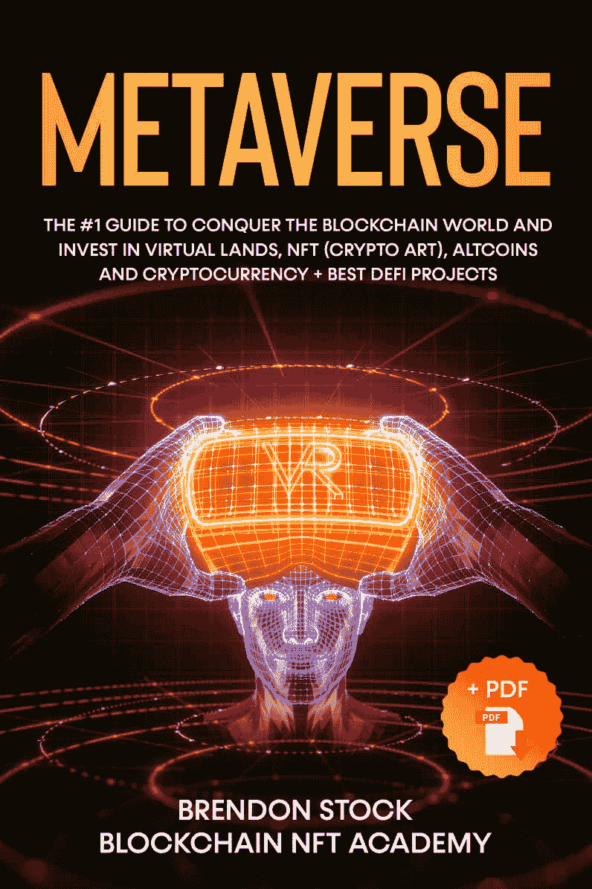
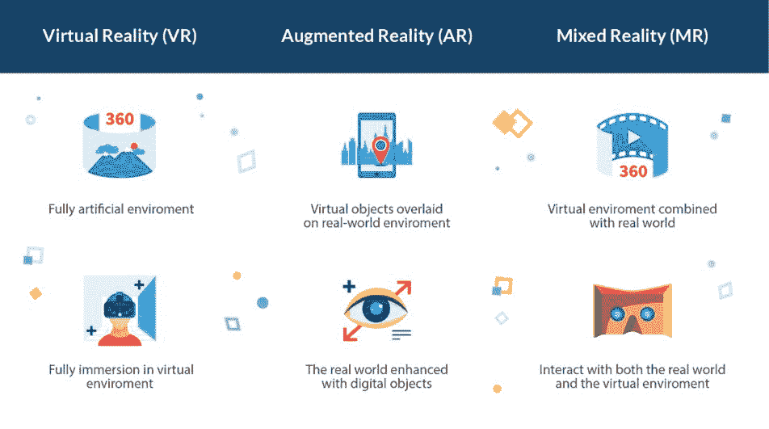
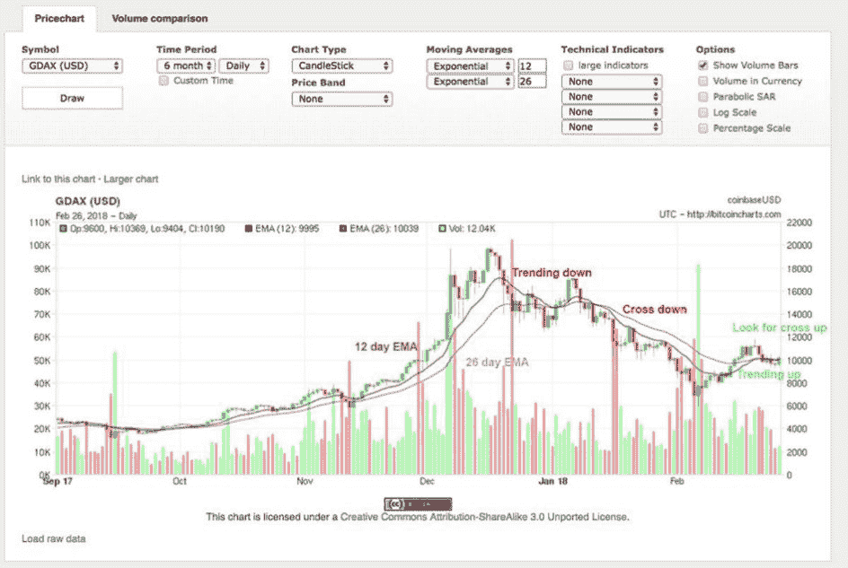

# 元宇宙：征服区块链世界并投资虚拟土地、NFT（加密艺术）、山寨币和加密货币以及最佳 DeFi 项目指南





# 简介

元宇宙的概念早在 Facebook 改名为 Meta，首席执行官马克·扎克伯格详细谈论“元宇宙”之前就已经存在并快速发展。无法回避：元宇宙已经到来，并且很可能会长期存在。

那么，元宇宙究竟是什么？它是否像某些公司声称的那样重要，还是仅仅是一个短暂的时尚，几个月后就会消失？您是否需要了解关于元宇宙的一切，并且应该在它进一步爆炸之前参与进来？本书深入探讨了元宇宙的概念，讨论了它的过去、现在，最重要的是，未来。

# 第 1 章：

## 元宇宙的概念

尽管新颖，元宇宙似乎已经无处不在。

Facebook（呃，Meta）最近的重新品牌化和投资引发了对元宇宙的新一波兴趣。它无处不在，出现在新闻、表情包、游戏平台和社交媒体上。这个词日益增长的流行度正在产生一种即将来临的毁灭感，仿佛我们的物理生活随时都会被包裹，融入像素和付费墙交易。然而，像《堡垒之夜》和 Roblox 这样的游戏多年来一直在宣传元宇宙，这个短语本身也有几十年的历史。

那么，元宇宙究竟是什么？

马克·扎克伯格的版本描绘了一个虚拟现实的愿景：你使用 Quest VR 头显以化身的身份参加商务会议，并使用手腕上的设备偷偷给朋友发短信。当你外出时，你会戴上智能眼镜，捕捉你看到和听到的内容并提供增强现实。元宇宙将通过手机、笔记本电脑、可穿戴技术和头显（或这些设备的组合）访问。它将是你工作、锻炼、购物、社交、看电影和玩电子游戏的地方。

然而，这个词早于许多可能使其成为现实的技术。后缀 meta- 可以表示“背后或超越”、“更广泛”或甚至“变革性”等含义（如变态）。单词 -verse 来自单词“universe”，指特定的领域或区域（例如 Twitterverse）或虚构的世界（例如 omegaverse（抱歉！），一种投机性的替代现实文学流派，其中角色被分为阿尔法、贝塔和欧米伽）。一个存在于现实世界之外、之上或之外的虚拟环境被称为“元宇宙”。

这个术语首次使用是在尼尔·斯蒂芬森 1992 年出版的反乌托邦科幻小说《雪崩》中。根据小说，元宇宙是一个围绕超长“街道”的虚拟和增强现实的集合，个人可以作为化身在上面行走，并通过护目镜和计算机访问。公共终端的用户被描绘为模糊的黑白化身，而私人终端则以全彩色和细节描绘。从那以后，“元宇宙”一词已经来指代构建一个更持久的虚拟世界并渗透到我们日常生活中的广泛活动。


自 20 世纪 60 年代以来，人们一直在努力构建身临其境的虚拟世界，这一愿望受到电影和视频游戏行业努力的推动。Second Life 是一款另类现实电脑游戏，你可以在其中控制虚拟形象并做任何你想做的事情，例如买房或结婚，于 2003 年发布，是元宇宙最著名的例子之一。它是一个如此逼真的环境，以至于甚至出现了蓬勃发展的变态文化——比这更逼真的也没什么了。尽管如此，到 2006 年，已有足够多的元宇宙专家聚集召开峰会。

元宇宙路线图（The Metaverse Roadmap）项目源于该峰会，该项目绘制了完成元宇宙的路径。根据元宇宙路线图，元宇宙是“虚拟增强的物理现实与物理持久的虚拟领域的融合”。换句话说，它可能类似于通过增强现实叠加在我们世界之上的第二个世界，以及我们可以进入和退出的虚拟区域，类似于《间谍小子 3》中的视频游戏。例如，可以考虑 Snapchat 滤镜或 Google 查看等比例 3D 动物模型的功能。根据元宇宙路线图，“元宇宙不会是整个互联网——但，如同网络一样，它将被许多人视为最重要的元素。”

今天的许多布道者会宣称，我们拥有技术、协议和基础设施，可以踩下油门，第一次将其变为现实。据说这是移动互联网之后的下一个合乎逻辑的步骤。虚拟现实、Zoom 会议、增强现实、社交网络、加密货币、NFT、在线零售、可穿戴技术、人工智能、5G 等都在元宇宙中被探讨。据说这是未来！因为未来是不可避免的，它必定是积极的，对吧？

许多赞扬元宇宙优点并认为它是自然而然下一步的人，是硅谷的声音、未来学家（元宇宙路线图的 John Smart）以及在元宇宙实现中拥有财务利益的其他参与者。其中之一无疑是 Mark Zuckerberg。

...一个庞大的 3D 环境和模拟网络，它们实时渲染。”

根据 Ball 的说法，元宇宙是“一个庞大的、持久的、实时生成的 3D 环境和模拟网络。”Ball 的元宇宙应保留身份、对象、历史和支付的连续性。它应由无限数量的人同时体验，每个人都有自己的存在感。元宇宙是一个持久的虚拟世界，允许人们在场，并且是一个可能利用区块链技术支付我们可以跨各种体验携带的东西的地方：想象一下，你可以在 Twitter 和 Instagram 个人资料照片中使用《动物森友会》的 Sandy Liang 绒毛外套。Ball 的元宇宙在不断增长和变化。

Ball 的元宇宙对 Zuckerberg 的元宇宙有很大影响。Zuckerberg 的虚拟形象在他的 Facebook Connect 演示中从一个平台移动到另一个平台，穿着同样的黑色 T 恤，以展示“身份和事物的连续性”。Zuckerberg 的元宇宙正在朝着容纳无限数量的人迈进，拥有近 30 亿 Facebook 用户。在整个演讲中，Zuckerberg 强调元宇宙的每个方面都将创造“存在感”。

如今，Roblox 和 Epic Games 的 Fortnite 经常在元宇宙讨论中被提及，有些人认为它们比 Zuckerberg 的 Meta 更接近实现元宇宙。这是因为这两款游戏都符合持久虚拟世界的标准：它们各自拥有数百万前来游玩和社交的人，事物（衣服和皮肤）具有一定的持久性，并且接受支付（Robux 和 V-Bucks）。此外，数百万人观看了 Fortnite 的 Ariana Grande 表演，这些活动，连同可自定义的虚拟形象和表情动作，正在产生一种“存在感”。

最重要的是，要明白元宇宙并不存在。Zuckerberg 已明确表示，元宇宙像许多其他投资者、工程师、科学家和未来学家一样，是他的长期目标。当然，人们厌恶 Zuckerberg 的提议，并且对 Meta 的元宇宙能做出任何其他事情（除了无法估量的伤害）毫无信心，甚至将其标记为反乌托邦式的灾难。尽管如此，元宇宙是一个想法——对一些人来说令人兴奋，对另一些人来说则令人恐惧。

Welcome to the Metaverse 是由 Rhizome 举办的一次会议，Rhizome 是一家非营利艺术组织，致力于存档数字艺术和文化。艺术家 David Rudnick 表示，“元宇宙的概念是终极中心化”，这与我们曾经对互联网寄予的许多民主化希望背道而驰。“当人们谈论新兴的元宇宙梦想时，”Rudnick 解释道，“他们谈论的是一个你可以在其中做一切事情的空间 \[在虚拟世界中\]”，一个商业公共空间，“可以从平台上发生的所有互动中提取价值或某种所有权。”

对元宇宙的恐惧和担忧，本质上是对规模的担忧。虚拟世界负面方面的任何增加都可能加剧它们。如果少数几家营利性公司中介了如此多的关键互动，这意味着什么？如果 Meta 目前的社交媒体统治地位是任何指标，那么没有多少理由乐观。

政府有着对技术突破反应迟缓的历史，更不用说监管了。一个连 finsta 是什么都不了解的政府，能否被信任来保障元宇宙的安全、道德和可持续？如果追求这一点，人类和环境的成本与收益会是什么？

目前，元宇宙主要是虚构、一种假设，以及一种幻想，其中有许多空间让未知的寒风吹拂。

## 什么是元宇宙，它是如何工作的？对“互联网未来”的深入探讨。

## 元宇宙是一种虚拟现实

### 原创系列特色图片的未来

虽然元宇宙是一个虚拟世界，但它与你在科幻电影中看到的并不相同。

考虑像《黑客帝国》这样的系列，其中世界是一个数字模拟，每个人都连接到它，并且制作得如此精良，以至于几乎没有人意识到它不是真的。元宇宙还没有达到那个程度，但它有潜力变得极其身临其境。

元宇宙的概念比 Meta 对它的构想存在的时间要长得多——事实上，它甚至早于 Facebook。“一个你身处其中的具身互联网，而不是仅仅凝视它，”Zuckerberg 说。

元宇宙的真正含义与 Zuckerberg 模糊的定义一样广泛。

在最基本的层面上，元宇宙是一个虚拟环境，允许世界各地的人们相互交流并与元宇宙本身交互。用户通常可以收集他们在会话之间保留的物品，甚至在元宇宙中拥有土地。然而，这个概念可以以多种方式解释，并且随着时间的推移发生了显著的变化。

我们不断地在互联网上与某些东西交互，无论是网站、游戏还是连接我们与朋友的聊天软件。元宇宙更进一步，让用户沉浸在行动中。这为更强大、更逼真的体验打开了大门，而这些体验很少，如果有的话，仅通过浏览网页或观看视频就能唤起。

## 虚拟现实与元宇宙有什么区别？

虽然虚拟现实（VR）和增强现实（AR）都与元宇宙相关，但它们是不同的。因此，最好将它们视为相互补充的独立事物，而不是本质上同一实体的不同化身。


用户可以使用 VR 和 AR 技术沉浸于虚拟环境中。在虚拟现实的情况下，我们被提供了完全不同的环境。VR 允许你与周围变化的世界互动，无论是通过游戏还是电影。另一方面，AR 通过添加对象并允许你以各种方式与它们交互来增强你的现实世界环境。

一个人正在戴着虚拟现实头显。

区别在于目标。你可以随时不与他人连接地玩 VR 或 AR 游戏，然而，人类触感是 Meta 和其他公司所设想的元宇宙的基石。

简而言之，元宇宙是上述两者的游乐场——一种让个人共享虚拟环境以进行商业、学习、健身或仅仅为了娱乐的方法。

使用虚拟现实和增强现实工具将大大有助于扩展元宇宙，并使其感觉比添加了步骤的视频游戏更真实。另一方面，元宇宙应该以以前无法想象的方式让人们更加紧密地联系在一起，而不仅仅是通过 VR 和 AR。因此，有很大的发展空间。

## 谁在构建元宇宙？

由于扎克伯格最近的 Meta 演讲，数以百万计的新眼睛被吸引到了元宇宙，但在这场通往未来的竞赛中，有许多巨头。此外，这些企业中的每一个都对元宇宙有自己的诠释，这进一步扩大了这个词本身就已非常宽泛的定义。

Facebook 进军元宇宙并不完全出乎意料。Facebook 于 2014 年 3 月以 23 亿美元收购了 Oculus。该公司继续发布 Oculus Quest 设备，这些设备是目前市面上最好的虚拟现实头显之一。

考虑到 Meta 目前打算在很大程度上依赖 VR 和 AR 来为元宇宙增加真实感，七年前收购 Oculus 似乎并非随机决定。值得注意的是，Oculus Quest 将很快停产。整个产品线将从 2022 年开始重新品牌化为 Meta Quest，从而结束这笔交易并移除旧品牌。

除了 Meta Quest，Meta 的首席技术官 Andrew Bosworth 透露，一些 Oculus 产品将被称为 Meta Horizon。根据 Bosworth 的说法，这将是整个虚拟现实元宇宙平台的品牌。

一个人正在灰色背景前戴着 Oculus Quest 2 VR 头显。

Oculus.com/Facebook

Microsoft 很快在 Facebook 的重大公开宣布后加入了元宇宙的行列。从 2022 年开始，Microsoft 计划在 Microsoft Teams 中创建一个元宇宙。

Microsoft 打算部署 Mesh，以允许所有 Teams 用户通过用动画头像替换网络摄像头照片来参与视频会议。人工智能将监听用户的声音，然后为其头像添加匹配的嘴唇动作。此外，切换到 3D 会议将导致更多的手部动作。

虽然 Microsoft 的声明与 Meta 相比可能显得微不足道，但它是朝着元迈出的重要一步，展示了该公司的承诺。此外，与 Meta 一样，Microsoft 可能打算将元宇宙整合到远程工作的未来中，正如 Teams 的这些更新所证明的那样。

Nvidia Omniverse 是 Nvidia 进入元宇宙竞赛的另一匹马。该公司将其描述为“一个将 3D 环境整合到共享虚拟宇宙中的平台”。Nvidia 的 Omniverse 是云原生的，这意味着它是一个共享的、持久的平台，在会话之间不会改变。此外，它可以远程流式传输到任何设备，并在基于 RTX 的平台上运行。

### Omniverse Replicator 的应用

迄今为止，这家显卡巨头似乎对其元宇宙采取了略有不同的方法。虽然 Meta 和 Microsoft 强调元宇宙的社交方面，但 Nvidia 专注于协作和新技术探索。设计师、机器人工程师和其他专家使用 Omniverse 在虚拟现实中模拟现实世界。例如，Ericsson 工程师使用 Omniverse 在都市环境中模拟 5G 波。

就未来而言，另一位重量级玩家即将登场。Apple 正在开发全虚拟现实头显和增强现实眼镜，所有迹象都表明该公司正朝着元宇宙方向发展。这两款产品几乎肯定都需要连接到元宇宙才能工作；因此，Apple 在元宇宙开发方面可能不会落后于 Meta 太远。

## 元宇宙仅仅是视频游戏的幌子吗？

简短回答：不，我不这么认为。

详细回答：取决于你的观点，也许有点像。

包括 Fortnite、World of Warcraft 和 Minecraft 在内的所有在线游戏，本身都是元宇宙。它们构建了一个永久环境，玩家可以随意进出。此外，玩家的进度存储在外部服务器上并与其他用户共享，这意味着你在这些游戏中所做的任何事情以后都可以回顾。

从技术上讲，每款游戏都可以被视为元宇宙，而各种科技巨头正在开发的元宇宙可能都会包含游戏特征。然而，元宇宙的概念远比视频游戏广泛。元宇宙旨在在虚拟环境中取代或增强现实世界的功能。用户日常做的事情，例如上课或上班，都可以在元宇宙中完成。

视频游戏元宇宙和更广泛元宇宙的概念有一些相似之处。例如，你可以与他人交流、合作进行各种活动，甚至在一定程度上改变周围的世界。然而，所有这些都受到游戏限制的约束。

例如，在 Minecraft 中，你可以建造一座巨大的堡垒；然而，在 World of Warcraft 中，你没有同样的自由。相反，玩家可以拥有一个要塞，这基本上是一块土地，尽管他们对其外观或位置几乎没有控制权。更重要的是，所有玩家共享同一块土地，只有在被邀请时才能互相访问。

这个 Minecraft 项目中展示了建筑和地形。

虽然上述标题目前很受欢迎，但元宇宙的概念可以在许多视频游戏中找到，并且已经存在相当长一段时间了。Second Life 是一款 2003 年的游戏，至今仍在运行，它是一个不像许多其他游戏那样有终极目标的元宇宙：它只是让你环游世界并与其他人交流。顺便说一句，你还可以飞行。

在理想的元宇宙中，许多传统视频游戏的限制被消除，你构建自己的命运。然而，无论是在与游戏相关的元宇宙中还是不在，初始阶段总是相同的：你必须创建你的角色。

### 发展为头像

元宇宙中的用户会获得一个代表自己的头像，他们可以根据喜好进行自定义。平台决定头像的外观。它可能非常基础，但也可以非常高质量，拥有许多自定义选项。例如，用户可以保持忠实，但也可能转变成完全不同的人。

一旦构建完成，头像就是用户进入元宇宙的通行证，这是一个如果你有想象力暂时搁置现实，一切皆有可能的虚拟环境。头像可以行走、交流和探索环境，等等。当然，平台独自负责头像的限制。

Meta Horizon Worlds 元宇宙中有四个头像。

有些元宇宙实例类似于视频游戏，允许用户使用键盘和鼠标走动。更先进的版本使用虚拟现实头显和控制器，通过在元宇宙中模拟用户的现实动作来让用户沉浸于场景中。


创建头像的流程因公司而异。2022 年，Microsoft Mesh 将集成到 Teams 中，为元宇宙增添新内容。用户将使用该应用程序构建一个完全个性化的自己头像。得益于混合现实技术，头像将成为用户的逼真表现。未来，这将包括广泛的面部表情、肢体语言和背景。

在其下一个元宇宙 Horizon Worlds 中，Meta 对头像创建有着宏大的构想。虚拟现实将支持头像，这些头像将实时镜像用户的活动。虽然这一切听起来很美妙，但这些头像目前没有腿，也许是为了让移动和旅行更易于管理。Meta 还在开发逼真的 Codec Avatars，这些头像外观惊人，超逼真，能够与周围环境实时渲染。

理想的元宇宙，无论平台如何，都将允许用户选择自己希望呈现的样子，同时在 VR 支持下保持面部表情和动作的真实感。

## 元宇宙长什么样？

要回答这个问题，我们首先必须区分“元宇宙”和“一个元宇宙”。没有单一的元宇宙将所有其他宇宙合并为一个统一的整体，尽管它们都使用互联网来连接用户。因此，每个元宇宙可能有独特的外观。

元宇宙的外观由其创建者决定。有些元宇宙类似沙盒，有大量的开发机会，并且对用户可以构建的内容几乎没有限制。想象一下《我的世界》，但规模大得多：每个人都生活在同一个宇宙中，而不是和朋友共享一个服务器。

元宇宙可以采取学校、街道、奇幻森林或海洋深处的形式。

在这样的元宇宙中，现实世界的规则仍然适用。你很可能会看到天空、建筑物和自然景观，以及其他人。根据元宇宙的不同，艺术风格可以是卡通风、写实风，或介于两者之间的任何风格。

另一方面，元宇宙并不像现实世界那样有相同的限制，扎克伯格在 Meta 演讲中指出。因此，例如，如果元宇宙的创建者允许，你完全没有理由不能在元宇宙中带着全家去太空旅行。

总结来说，元宇宙可以类似于学校、街道、梦幻森林或海洋深处。另一方面，最流行的示例提供了这些事物的混合，这要归功于它们赋予用户的自由。

## 创建元宇宙可行吗？

让我们简要看看我们目前所处的位置。首先，我们有虚拟现实，其中创建者是唯一能够限制它的人。我们已经创建了头像来代表自己。然后，当然，我们可以访问互联网，这使我们能够参与这个全球社区。

接下来我们该去哪里？这取决于情况。

一个元宇宙愿景，有许多人物指向未来世界。

在理想情况下，元宇宙将连接每一个人。当你加入公共服务器时，你应该能够与当时在线的其他所有人通信。然而，事实往往不同。

随着某些元宇宙变得更加流行，托管它们的服务器变得无法处理增加的流量。一些程序员设计不同的层来划分用户，从而缩小宇宙。

未来这可能会得到预防，但目前，元宇宙往往是分裂的——更不用说人们使用多个平台，实际上选择了他们喜欢的领域。

如前所述，每家公司对元宇宙都有自己的看法。例如，Facebook 正在开发 Horizon Worlds，Nvidia 正在开发 Omniverse，这个非常大的池塘中更小的鱼也在参与。此外，比特币行业也有自己的元宇宙。

单一巨大元宇宙的想法现在是不可行的，因为各个元宇宙相互隔离，在不同的平台上运行，并且没有共同的用途或目标。

如果元宇宙是一个巨大的共享虚拟环境，所有发布元宇宙的企业都必须联合起来。这些企业不仅必须合作，服务器技术也必须迅速改进。

主机和最终用户将不得不处理难以想象的服务器负载，才能将元宇宙的所有这些多个版本托管在一个平台上。

在实现这一点之前，元宇宙可能会保持分裂状态，要求用户在连接到共享世界之前选择他们偏好的宇宙。

## 元宇宙的目的是什么？

元宇宙作为一个概念很难定义，仅仅因为它看起来是无限的。然而，这意味着创建它的组织或个人群体以及每个用户都可以根据具体情况定义其总体目的。

元宇宙的总体目标是通过一个虚拟的共享宇宙来团结人们。元宇宙的存在是为了弥合现实与距离之间的差距，团结来自世界各地的人们，无论是为了就业、自我提升，还是单纯的娱乐。

允许用户通过他们的头像与外部世界互动，而不赋予他们任何特定目的，这提供了大量的选择灵活性。这也是 Meta 大揭秘的基础：即你几乎可以在元宇宙中做任何你想做的事情。

让我们来看看元宇宙中一些更受欢迎的活动。

### 拥有房产

允许人们购买土地地块是元宇宙中反复出现的主题。当用户购买房产时，它会分配给该用户，只要该头像拥有它，其他玩家就无法使用。就像在现实世界中一样，地块可以购买或出租。

当你拥有房产时，你通常有自由随意使用它。例如，有些人喜欢创建画廊来展示他们的财物，而另一些人则开设商店或创建共享公共区域。

允许用户在其环境中构建任何想要的东西的想法并不新鲜，这也是《我的世界》和 Roblox 等游戏如此受欢迎的很大一部分原因。元宇宙的开发者通过允许用户创建自己的建筑，节省了大量工作，否则这将花费大量时间。

当然，这是互联网，过多的自由可能导致各种恶作剧。大多数元宇宙继续监控用户生成的内容，并且根据主机的不同，内容可能会被删除。即使是一个看似无限的宇宙也有其边界。

### 交易房产

一旦你在元宇宙中获得了某样东西，你就可以将其出售或与其他用户交易。这为一个原本冷冰冰的世界提供了财富和声望感。有些地块比其他地块更有价值，有些是稀有的，而有些是常见的——所有这些都有助于建立特定于元宇宙的经济。

元宇宙中的土地地块通常在大小和位置上有所不同。因此，考虑到这是现实生活的虚拟表现，房地产市场在元宇宙中蓬勃发展也就不足为奇了。有争议的地块，即靠近繁忙地点或仅仅因为其他奢侈品而更受欢迎的地块，可以获得远高于城外一小块草地的价格。

Decentraland 是一个基于区块链的元宇宙。

一些元宇宙既受企业欢迎，也受普通用户欢迎。因为有这么多人共享宇宙，它提供了广告机会。购买土地并展示公司的标志可能是激发或重新点燃兴趣的好方法。

公司可以从元宇宙中以多种方式受益。例如，在一个看似无限的宇宙中，组织活动、在房产之间开发跨界合作以及与用户社区沟通变得更加容易。

### 生活与互动


与理想元宇宙相比，你之前看到的元宇宙实现示例不过是些技术细节——理想元宇宙是一个几乎可以取代现实的领域。我们还没有完全做到（而且未来几年可能也做不到），但 Meta 和 VRChat 等企业正将我们推向前所未有的接近程度。

在理想元宇宙中，你将与周围的每个人互动。这比我们在《Second Life》或《Habbo》等游戏中看到的基于文本的对话更为先进。然而，使用语音通信、VR 头显和 AR 眼镜，互动可能会被提升到一个新的水平。

无论是与朋友一起跳伞，还是在虚拟图书馆组织学习小组，元宇宙的核心前提始终是人际互动——只不过不是面对面的。

## 工作与学习

从 Meta 到微软，许多公司都高度重视在元宇宙中协作、学习和共同工作的能力。

微软打算使用 Mesh 为原本乏味的视频会议增添真实感。此外，Meta 还希望构建虚拟工作空间，让远程员工在白天能在虚拟现实中共度时光。

在元宇宙中，工作可以以多种方式进行，包括先在虚拟现实中模拟现实世界的任务。例如，工程师、程序员、设计师以及各种其他专业人士可以使用 Nvidia 的 Omniverse 等元宇宙来实现这一点。

元宇宙、加密货币和 NFT 之间在某种程度上都有关联。

很难在不提及比特币的情况下谈论元宇宙。毕竟，区块链——加密货币运行的去中心化基础——已被用于一些最著名的案例中。

例如，Decentraland 是一种沙盒式元宇宙，用户可以在其中拥有土地地块、探索其他地块并进行交流。仅在 Decentraland 中使用的 MANA 加密货币支撑着整个经济体系。

这些元宇宙与商业拥有的虚拟宇宙不同之处在于，它们依赖于去中心化网络，你的资产属于你自己，不受元宇宙所有者的控制。

加密货币几乎总是去中心化的，围绕它们构建的世界也是如此。这意味着没有单一实体控制货币、虚拟土地或整个元宇宙，因此它随时都不会被关闭、出售或以其他方式摧毁。合同会分发到用户网络中，去中心化需要多数票决。除非网络中的大多数决定将其关闭，否则元宇宙理论上应始终对所有人开放。

在《魔兽世界》等游戏元宇宙中情况并非如此，你的账户仍然属于游戏创作者的财产。不幸的是，这意味着你无法完全控制自己的资产，例如角色或装备。NFT（非同质化代币）是解决这一问题的方案。

NFT 可以从 8 像素头像到惊人的艺术作品（在我看来，相当丑陋）。从本质上讲，NFT 是一种用于授予虚拟对象所有权的去中心化系统。NFT 使用比特币和合同将所有权赋予特定用户，而任何人都可以下载快照并声称其为己有。

这为元宇宙带来了全新的经济层面，将这个奇幻概念变成了人们赚取（或亏损）现实世界金钱的方式。用户可以用加密货币购买虚拟土地地块、头像，甚至为其元宇宙头像购买一顶帽子。

non-fungible tokens concept, crypto art, NFT neon sign-picture on circuit board

非同质化代币并不依赖元宇宙，但它们确实在某些宇宙的经济中发挥作用，例如 Decentraland 和 The Sandbox，后者仍在建设中。

The Sandbox 销售 NFT，赋予客户对一块土地的完全所有权。用户随后可以导航到该可视化区域并与其中的数据进行交互。简要查看 The Sandbox 的地图显示，这种形式的 NFT 已引起数十家有兴趣探索新广告领域的公司的关注，而不仅仅是比特币爱好者。

几家知名公司和特许经营品牌已在 The Sandbox 正式开放前购买了土地。Atari、《行尸走肉》、《过山车大亨》、《咩咩启示录》甚至《南华早报》都拥有大片土地。

尽管没有人会指责这群公司对 NFT 或元宇宙特别感兴趣，但这一概念具有价值。一些公司正努力从中获利。

很难不发现比特币市场与一些最流行的元宇宙之间的互动方式，与现实世界经济运作方式之间的联系。总体结果可能是美好的，也可能是可怕的，这取决于你站在哪一边。

## 元宇宙的未来

没有人能否认元宇宙概念已经开始扩展到此前未被发现的领域。从《Second Life》、《Habbo Hotel》甚至早已消失、早已被遗忘的《Club Penguin》等游戏中卑微的起源，我们已经走得很远了。

据扎克伯格称，Meta 旨在通过 Horizon Worlds 快速起步，尽管他自己也承认我们还没有完全做到。元宇宙要渗透到我们的现实中，达到 Meta 所期望的普及和可及程度，还需要数年时间。

元宇宙中共享现实的概念，即来自不同大洲的个人可以一起玩耍、学习、交流甚至工作，是未来主义和乌托邦式的。在元宇宙中，布满商店、公园和人群的繁华街道都可以被复制，但实现这一点所需的技术对普通个人来说仍然遥不可及。

元宇宙体验的现实性是迈向广泛接受的又一步。将虚拟现实和增强现实添加到元宇宙中，无疑会让体验感觉比使用键盘和鼠标时更加真实。

Travis Scott 在 Fortnite 中举办音乐会的截图。

我们已经看到一些引人入胜的跨界合作，它们推动了元宇宙的边界。Travis Scott 在 Fortnite 中举办了一场虚拟音乐会，吸引了超过 1200 万名玩家。Justin Bieber 刚刚表示他也打算这样做。Snoop Dogg 是 NFT 的积极支持者，他在 The Sandbox 中拥有土地，并允许访客购买 VIP 通行证，未来可以参观他的家，即使目前尚未开放。

扎克伯格认为元宇宙是互联网的未来，甚至将其称为移动互联网的“继任者”。这是否正确还有待观察。

可以肯定的是：元宇宙不再仅仅是从科幻电影中摘取的奇幻概念。相反，Facebook/Meta 只是向一团已经燃烧的火焰浇了油，在未来几年里，我们可能会看到元宇宙被用于我们从未想象过的方式。

## 还有谁有能力创建元宇宙？

尽管元宇宙可以取代互联网成为计算平台，但它不太可能遵循其前辈相同的演化路径。互联网是由美国的公立研究型大学和政府项目开发的。这部分是因为私营部门很少有人看到了万维网的商业潜力，但也部分是因为这些组织几乎是唯一拥有构建它所需的计算能力、资源和目标的机构。不幸的是，在谈到元宇宙时，这些都不成立。


## 私营行业与元宇宙

私营行业不仅充分意识到元宇宙的潜力，而且对其未来抱有最积极的信念，更不用说拥有最多的资金（至少在支持元宇宙研发方面），最好的工程技能，以及最强的征服野心。主要科技公司希望拥有并定义元宇宙，而不仅仅是引领它。尽管早期元宇宙可能只有少数几个领导者，但采用非企业方式的开源倡议将继续发挥重要作用。它们将吸引一些最有趣的创意人才。而且你将能够将它们区分开来。

## 微软

微软是这一现象的绝佳例证。该公司通过 `Office 365` 和 `LinkedIn` 拥有数亿个联合用户身份，是世界第二大云供应商，拥有跨越所有系统/平台/基础设施的广泛工作相关软件和服务套件，在大规模共享在线内容/运营方面拥有清晰的技术经验，并通过 `Minecraft`、`Xbox + Xbox Live` 和 `HoloLens` 拥有一系列潜在的入口体验。为此，元宇宙为微软提供了一个机会，以重新夺回其在 PC 向移动端转型过程中失去的 `OS/硬件` 领导地位。但更重要的是，微软 CEO Satya Nadella 理解在工作发生的任何地方都存在的重要性。微软已成功从业务向消费者、PC 向移动端、离线向在线转型，同时在“工作”经济中保持了强大的角色。因此，很难想象微软不会成为劳动和信息处理虚拟化未来的重要推动者。

## Facebook

尽管 Facebook CEO Mark Zuckerberg 并未明确表示他想要创建和控制元宇宙，但他对元宇宙的兴趣显而易见。这也很巧妙。比任何其他公司都更甚，Facebook 将因元宇宙而损失最多，因为它将发展出一个新的计算和交互平台以及一个更大、更强大的社交网络。同时，元宇宙使 Facebook 能够在技术栈的上下游扩大其影响力。尽管多次尝试设计智能手机操作系统并部署消费硬件，Facebook 是唯一完全专注于应用/服务层的 FAAMG 公司。得益于元宇宙，Facebook 可能成为下一个 `Android` 或 `iOS/iPhone`（因此是 `Oculus`）以及 `Amazon` 的虚拟商品版本。

Facebook 的元宇宙收益巨大。它拥有地球上任何平台中最高的每日用户数、每日使用量和用户生成内容，第二高的数字广告支出百分比，数十亿资金，数千名世界一流的工程师，以及一位拥有多数投票权的创始人。其元宇宙资产也在迅速发展，现在包括半导体专利和脑机计算接口。不幸的是，Facebook 作为允许第三方开发者/公司构建长期企业的平台，作为联盟的牵头者（例如 `Libra`），以及在管理用户数据/信任方面，其记录却是糟糕的。

## 亚马逊

亚马逊在多种方面都很迷人。它当然会渴望成为我们购买“东西”的主要地点。无论是通过游戏引擎、虚拟环境还是网页浏览器购买，都无关紧要（它已经在 `Twitch` 内销售）。此外，该公司已经拥有数亿张信用卡，全球最大的电子商务份额（不包括中国），是世界最大的云供应商，运营着各种消费者媒体体验（视频、音乐、电子书、有声书、视频游戏直播等）和第三方商务平台（例如 `Fulfilled by Amazon`、`Amazon Channels`），并且正在开发他们希望成为第一个专为云构建的主要游戏/渲染引擎的东西。

更重要的是，该公司的创始人兼 CEO Jeff Bezos 是基础设施支出的坚定信徒。例如，`AWS` 为互联网提供动力（`Amazon Web Services`）。亚马逊不直接买卖库存，而是销售、打包和分销其他公司提供的产品，其中“`Fulfilled by Amazon`”占亚马逊收入的 80%（与大多数零售商类似）。虽然 Elon Musk 的私人火箭企业 `SpaceX` 旨在殖民火星，但 Bezos 已表示他对 `Blue Origin` 的目标是“在轨道上创建巨型芯片工厂，然后只将小零件发送下来”，类似于早期的 Web 协议和他的 `AWS`。因此，亚马逊比任何其他 FAAMG 公司都更有可能拥抱完全“开放”的元宇宙——它不需要控制 UX 或 ID，因为它从后端基础设施使用和数字交易的巨大增长中受益。

## Google

互联网是数据的金矿，元宇宙将拥有比现有网络更多的数据和潜在的更高产出。而且没有哪家公司能比 Google 更好地在全球范围内利用这些数据。此外，该公司不仅是索引数字世界和物理世界的行业领导者（近 10,000 名员工参与地图操作），也是中国以外最成功的数字软件和服务公司。它还运行着地球上最流行的操作系统（`Android`）以及主要消费计算平台中最开放的平台（`Windows`）。尽管失败了，Google 是第一个全力投入可穿戴计算的公司，推出了 `Google Glass`。它现在正通过 `Google Assistant`、其 `Nest` 产品套件和 `FitBit` 大力推进房屋数字化。因此，元宇宙可能是唯一能够将 Google 迄今为止的各项投资整合在一起的项目，包括 `Stadia` 边缘计算、`Project Fi`、`Google Street View`、巨大的暗纤维采购、可穿戴设备、虚拟助手等。

## 联合努力

它不太可能控制或驱动底层元宇宙。诚然，它拥有世界第二大计算机平台（而且远为最有价值），以及世界最大的视频游戏零售商（这也意味着它支付给开发者的钱比地球上任何其他人都多）。此外，该公司正在大力投资增强现实设备和将有助于元宇宙的“连接组织”（例如 `beacons`、`Apple Watch`、`Apple AirPods`）。但是，另一方面，Apple 的态度和商业模式与构建一个任何人都可以访问完整用户数据和设备 API 范围的开放创新平台不兼容。Apple 更有可能成为西方世界与元宇宙之间的主要沟通方式，而不是操作者/驱动者。这，如同互联网一样，几乎肯定将惠及所有人。

## Unity

如果元宇宙需要资产、体验和共享 API 的广泛交互，那么 `Unity` 将至关重要。这个引擎被用于超过一半的移动游戏。它在现实世界渲染/模拟用例（建筑、设计和工程）中甚至比 `Unreal` 更受欢迎。例如，在使用 `Unity` 制作和拍摄逼真的《狮子王》时，电影制作人 Jon Favreau 也在使用 `Unreal` 制作和拍摄迪士尼的《曼达洛人》。它还控制着世界上最大的数字广告网络之一（为 100 亿每日分钟的移动娱乐提供动力的一个不错的副作用）。

另一方面，`Unity` 在推动元宇宙发展中的作用尚不清楚。它没有商店，没有登录系统，也没有真正的面向消费者的体验。其大部分辅助服务（非引擎或广告）很少被使用。此外，大多数（但并非全部）基于 `Unity` 的游戏仅仅是移动游戏，而不是元宇宙入口。考虑到它对规范、游戏时间和内容制作的不可避免的影响，很难想象它不会被收购并合并到一家拥有更多资产和优势的更大的科技企业中。


它曾经很难证明购买 Unity 是合理的。尽管该公司价值很高，但任何潜在收购方都必须完全保持 Unity 的平台中立性，以维护市场主导地位、开发者支持和影响力（例如，Google 不能让 Unity 独占或仅在 Android/Chrome 上表现最好，否则会疏远大量开发者）。这意味着将 Unity 转变为专有引擎不是一个明智的商业决策。此类决策导致的价值损失以及购买 Unity 的额外成本，很可能使这一举措变得无法承受。另一方面，收购 Unity 的目标是在新互联网上占据关键位置，买方将有动力保持引擎开放并可跨平台使用，价格也将迅速变得无关紧要。

如果 Epic 做到了，Valve 必须拥有通往元宇宙的可行途径。Valve 的 Steam 在用户、资金和游戏时长方面都占据着 Epic Games Store 的主导地位。此外，它还拥有市场上一些最受欢迎且长期运行的多人游戏（Counter-Strike、Team Fortress、DotA）。而且，该公司在内容和货币化创新方面有着良好的记录（它是第一个大规模尝试 AAA 免费游戏和玩家对玩家市场的公司）。Valve 还花了多年时间创建和部署虚拟现实技术，由一群热爱开源技术、厌恶封闭环境的热情程序员私人拥有，并且每年产生数十亿的收益。另一方面，Valve 的 Source 引擎采用率很低。与 Epic 不同，它似乎并未专注于整合其能力和资产来开发元宇宙。

## 为什么全息图在元宇宙中扮演角色？

当互联网最初推出时，它伴随着一系列技术成就，包括在远距离连接计算机的能力以及将一个网页链接到另一个网页的能力。这些技术特征为我们现在与互联网联系在一起的抽象结构提供了基础，例如网页、应用程序、社交网络以及一切依赖于它们的东西。这还没有考虑非互联网界面创新的融合，例如显示器、键盘、鼠标和触摸屏，这些仍然是使互联网运行所必需的。

在元宇宙中，有一些新的基础模块已经到位，例如能够在单个服务器实例中容纳数百人（元宇宙的未来版本应该能够处理数千甚至数百万人）以及能够区分一个人手部位置的运动跟踪工具。这些新技术有可能变得极其引人入胜和充满未来感。

然而，也存在一些可能证明是不可能克服的限制。像 Microsoft 和 Fa—Meta 这样的公司展示了未来概念的虚构视频，他们经常掩盖人们将如何与元宇宙交互。VR 头显仍然笨重，长时间佩戴会导致大多数人出现晕动症或身体疼痛。除了如何在公共场合佩戴增强现实眼镜而不显得像个十足的呆子这一不容小觑的障碍之外，增强现实眼镜还有另一个问题。

那么，IT 公司如何在不展示庞大设备和奇怪眼镜现实的情况下演示其技术概念？到目前为止，他们的主要选择似乎是从零开始开发技术。是 Meta 演讲中出现的那个全息女性吗？很抱歉要打破这个幻想，但即使使用最先进的现有技术，这也根本不可能。

与目前有点笨拙但未来可能会更好的运动跟踪数字化身不同，没有一种笨拙的方法可以在没有精确控制条件的情况下让三维图像出现在半空中。不管 Iron Man 如何宣称。也许这些是被视为通过眼镜投射的图像——毕竟，演示视频中的两个女人都戴着眼镜——但这对小型眼镜的物理能力做出了很多假设，而 Snap 可以证明这是一个难以解决的挑战。

这种对现实的欺骗在展示元宇宙可能如何运作的电影演示中很普遍。这个人是在戴虚拟现实护目镜，还是只是坐在办公桌前？这个人是被固定在沉浸式空中装置上，还是只是坐在办公桌前？Meta 的另一个演示展示了人们在太空中悬浮——这个人是被固定在沉浸式空中装置上，还是只是坐在办公桌前？全息图的主体戴着头显吗，如果是，他们的脸是如何被扫描的？在其他时候，一个人可能会拿起虚拟物体，但看起来像是用他们真实的手拿着。

这个演示引发的问题远多于它解答的问题。

在某些层面上，这是可以接受的。Microsoft、Meta 以及每一家做这种奇怪演示的公司，都在试图传达一种关于未来可能是什么样子的艺术感，而不是解决每一个技术挑战。这是一个悠久的传统，可以追溯到 AT&T 展示一款语音控制的折叠手机，它可以神奇地从照片中删除人物并创建 3D 模型，所有这些在当时都看似不可能。

另一方面，这种将愿望思维作为技术演示的做法，让我们很难预测各种元宇宙理念的哪些方面有一天会成为现实。例如，一个虚拟扑克游戏的构想，你的朋友是机器人和漂浮在太空中的全息图，如果虚拟现实和增强现实头显变得足够舒适和实惠，让人们每天佩戴——这是一个巨大的“如果”——那么它可能成为现实。如果不是，你总是可以通过 Discord 视频会议玩 Tabletop Simulator。

VR 和 AR 的光鲜亮丽也掩盖了元宇宙更平凡的方面，这些方面更有可能实现。例如，软件公司创建一个开放的数字化身标准是微不足道的，这是一种包含你会在角色创建器中输入的功能的文件——比如眼睛颜色、发型或衣橱选项——并允许你随身携带它去任何地方。为此不需要制造更舒适的 VR 头显。

## CHAPTER 2: 理解增强现实及其工作原理

今天是计算机中介、技术增强生活的时代。人们不仅想生活在物理世界中，还想拥有技术进步所能提供的更深层次的体验。这些突破之一是增强现实（AR），这是一种允许个人与名人共舞、前往遥远的地方、参观其他行星，甚至穿越回过去的技术——所有这些都可以在自己家的舒适环境中完成。如果你想拥抱技术变革并了解更多关于增强现实的信息，请继续阅读以了解它是什么以及它是如何工作的。

## 什么是增强现实，它是如何工作的？

那么，增强现实到底是什么？由于人类体验与其所代表的技术概念根本不同，因此很难定义“增强现实”。但是，在其最广泛的定义中，AR 技术可以定义为由计算机生成的视觉和/或音频特征增强的物理环境视角。

## AR 简史


在 1901 年，即 L. The first augmented reality notions appeared when Frank Baum's novel "The Master Key" was published. Though the protagonist's glasses were not named AR, the devil granted him glasses that allowed him to see the letters on people's foreheads that indicated their nature (e.g., E for evil, G for good, W for wisdom, etc.). The AR lab "Video place" was established in 1974. However, Tom Caudell and David Mizell were the first to document the augmented reality features in 1990. Julie Martin introduced the first completely working AR gadget in 1994. It was called "Dancing in Cyberspace" for a reason: it was an augmented reality theater that mixed virtual items with real-world settings.

AR has progressed rapidly in the twenty-first century. For example, Hirokazu Kato launched ARToolKit, an open-source AR library, in 2000. It was a ground-breaking combination of virtual graphics and real-time video tracking for overlapping images. ARToolkit was effortlessly integrated into web browsers nine years later. In 2013, Google debuted the "Google Glass" project, and in 2016, the augmented reality game "Pokemon GO" dominated the world. The year 2017 was marked by the introduction of eye-tracking augmented reality technology. Since 2018, over 1,000 apps with a range of augmented reality capabilities have been released on the Google and Apple app stores.

## 增强现实与虚拟现实有什么区别？

虚拟现实（VR），一种将用户沉浸于合成环境并使其与现实世界断开连接的技术，常与增强现实混淆。AR 与 VR 的区别在于，前者增强现实，而后者替代现实。AR 假设将数字、计算机生成的信息（例如，视频、声音或动画）叠加到实时环境中，以此方式对其进行补充。

考虑众多 VR 和 AR 设备的示例，以更好地理解增强现实技术。

### AR 应用包括：

• 客户可以使用宜家的增强现实应用为其空间找到合适的产品。他们可以使用智能手机的摄像头查看房间。他们可以通过滑动和点击，立即看到一件宜家家具是否符合他们公寓的设计。

Gap 最近推出了 AR 增强的试衣间，允许客户试穿各种商品，而无需将随身物品拖到商店里。

• 拜仁慕尼黑推出了一款增强现实应用，让球迷无需前往慕尼黑即可与他们的英雄合影。

• 多亏了路虎的增强现实软件，驾驶员可以透过透明引擎盖看到汽车发动机。

### 虚拟现实示例包括：

• 万豪的虚拟现实“传送器”软件允许客人参观其全球各地的物业。该软件逼真，可能提供真实的旅行体验。

• SportX 的虚拟现实模拟器允许客户在各种模拟活动（例如慢跑、游泳或网球）中试穿他们销售的运动服。

• 在手术期间，HoloTeach VR 应用程序允许外科医生实时互动和咨询，即使他们相隔数千英里。

AR 是一种交互式现实，它将视频、声音或图形/动画等计算机生成的组件融入现实世界，为用户提供更具沉浸感的体验。



## 增强现实的类型

由于 IT 行业最近的突破，现代增强技术有多种形式。以下是当今企业和消费者使用的最常见的增强现实类型的快速概述。

### 基于标记的 AR

在 AR 发展初期，标记（一个厚黑色方形边框）被用作参考物品，以测量计算机与物体之间的距离。换句话说，基于标记的 AR 应用程序依赖于读取器（通常是摄像头）来解释图像并在虚拟环境中生成 3D 对象。

### 无标记 AR

尽管基于标记的 AR 有明显的好处，但厚黑色标记的视觉外观不吸引人，降低了市场对基于标记的解决方案的采用。无标记 AR 主要是为商业用途而创建的，以解决上一代的不足。在这种 AR 类型中，使用通用图像作为标记，通过 SIFT、SURF 和 FAST-SURF 等图像提取技术提供。大多数最近的无标记 AR 系统使用强点匹配方法来处理由异常值、大量遮挡和其他因素引起的鲁棒性问题。您可以使用它来检测和映射现实世界环境，并在其中放置虚拟物品。从桌子上的跳舞动画生物到放置在您家中的宜家沙发，都是无标记 AR 的示例。

### 基于投影的 AR

顾名思义，基于投影的 AR 版本使用视频投影仪将图像显示在屏幕或各种物理表面上。使用现实世界物体来投影虚拟图像是这一 AR 类别的核心。它通常用于产品可视化和工业组装。然而，由于反射率、颜色和几何差异，便携式基于投影的 AR 在各种形状奇特的表面上的投影质量在一定程度上受到限制。

### 基于叠加的 AR

这种增强现实假设对真实物体的图形修改直接叠加在其上（或其完全复制的图像上），从而产生真实物体的增强视图。在基于叠加的 AR 执行中，技术识别事物的能力很重要，因为无法识别对象会阻止原始图像被增强视图取代。患者的实时医疗评估是这种增强现实的一个很好的示例。例如，一些医疗机构提供来自 X 射线设备的实时馈送，以便 X 射线结果可以叠加在患者身体的实际图像上。

## 什么是增强现实及其工作原理？

AR 应用程序不再仅用于娱乐。这项技术在商业、科学和研究领域有广泛的应用。以下是有关用于构建沉浸式增强现实体验的过程和工具的一些具体信息。

### 摄像头和传感器

构建任何 AR 元素都需要精确捕捉现实世界物体，以便在显示器上现实地增强它们。AR 程序使用各种传感器来实现这些目标，包括机械、生物、声学、光学和环境传感器。

机械传感器记录物体的位置、形状、加速度、质量和位移。最常见的应用之一是确定物体的位置、重量和运动。

生物传感器测量物体的心率、温度、神经活动和呼吸频率。它们可以识别情绪并评估人们的精神和身体状态。

声学传感器提供精确声音的响度、音调、频率、相位和调制，这对于声音检测和语音识别非常有用。

光学传感器报告物体的发射率、折射率、光波频率、亮度和亮度，用于计算机视觉检测、存在检测和 IR 运动分析。

环境传感器收集有关周围区域温度和湿度的信息。

深度感应摄像头——一种可以收集 3D 图像的摄像头——是创建引人入胜的 AR 体验的最重要工具之一。传统上，AR 设备至少配备一个摄像头，有些配备两个用于深度感应。在设备中包含红外摄像头也是常见的，以启用高级深度感应和热图分析。

### 投影


投影是一种增强现实技术，允许用户在不佩戴或携带设备的情况下增强现实世界物品。这意味着使用可编程投影机-摄像头系统，增强现实功能将直接使用空间 AR 工具显示在物体上。投影 AR 系统是尖端的增强现实技术，因为它们提供完全不受限制的 AR 体验，允许用户通过在环境中显示增强现实功能来随时随地享受投影。

## 处理

处理 AR 的能力主要归功于先进的图像和声音处理技术。任何 AR 产品都依赖于图像处理来准确理解环境、估计光线，并确定基本特征点和平面。

## 反射

AR 技术的主要目的是通过将虚拟物体集成到现实世界环境中来创建逼真的视觉效果。当开发人员使用先进的建模来集成虚拟环境和实际环境时，就可以实现逼真的视觉效果。例如，虚拟反射是一种 AR 技术，它模拟现实世界物体在虚拟物体上的反射，从而增强现实场景。

## 增强现实支持哪些类型的设备？

了解增强现实的工作原理后，您可能想了解更多用于创建增强现实的设备。

### 手机

几十年前，AR 只能在配备大量专业技术的设备齐全的房间中体验，而如今的智能手机应用程序则能提供逼真的 AR 体验。iOS 和 Android 设备均可使用 AR。世界著名的游戏《Pokemon Go》、BBC 的 Civilizations AR、Froggipedia 应用程序和 SketchAR 都是热门应用。流行的即时通讯工具和社交媒体平台也允许我们尝试 AR 的潜力（例如，Hololens、Snapchat 滤镜等）。

### 基于 AR 的设备

虽然移动技术正在迅速发展，为世界带来新发明，但更逼真、更先进、更具专业外观的 AR 仍然只能通过使用专用 AR 设备（例如可穿戴智能眼镜、头戴式设备、数字罗盘、陀螺仪、CPU、GPS 和显示屏）来实现。用户佩戴以获得完全沉浸式 AR 体验的抬头显示器（HUD）是最常见的专用设备。

### AR 眼镜

智能眼镜也越来越受欢迎，Google Glasses 和 Laster SeeThru 等制造商获得了广泛关注。AR 增强镜片也已集成到轻量级 AR 眼镜中，例如 AV Walker，它可以用数字内容覆盖世界。

### AR 隐形眼镜

将增强现实技术集成到隐形眼镜中是科技界的一个相对较新的趋势。

华盛顿大学发起了一项名为“Twinkle in the Eye”的开创性项目，旨在开发可以显示文本、将语音翻译成字幕并实时提供导航系统视觉指示的 AR 镜片。

### 虚拟视网膜显示器（VRD）

20 世纪 90 年代末，VRD 被引入作为创建视觉图像的尖端技术。

人机交互技术实验室（HIT Lab）创建了第一个 VRD。VRD 的图像合成过程依赖于低功率激光光扫描以及直接在人眼视网膜上进行图像再现。因此，VRD 使创建高分辨率、高对比度的视觉效果成为可能，这些效果叠加在用户所见之上。

## 增强现实的控制方式是什么？

目前，开发人员已构建可控制 AR 应用程序功能的特性和功能。例如，用户决定如何行动、遵循哪个场景以及游戏何时结束。另一方面，新的 AR 应用程序预计将由人类大脑控制。虽然现在可能难以想象，但这种控制在未来几年无疑是可行的。像 Neurable 这样的初创公司正在迈出初步步骤，允许用户使用“脑鼠标”导航 VR 和 AR 应用程序。

## 增强现实在未来的重要性

随着技术以前所未有的速度发展，我们应预期 AR 将迅速进步，为世界各地的用户带来全新体验。那么，对于使用增强现实的人来说，未来会如何呢？

- 带有增强现实功能的隐形眼镜。虽然目前正在使用 AR 镜片原型，但主流市场采用仍需时日。然而，预计带有数百个 LED 的无线镜片将很快可用，这些 LED 会在人眼前形成图像。这些视觉效果可能包括文字、图表、照片、主动指令和有趣的 AR 组件。
- 仿生眼是一组仿生眼。随着仿生学和仿生技术的迅速发展，人类可以期待 AR 技术在此领域得到引入。例如，仿生眼可以帮助盲人或视力较弱的人恢复视力。

由此可见，增强现实是一个充满希望的技术领域，它不仅能提供更好的视觉体验，还能改变人们学习、导航、接受医疗和沟通的方式。AR 设备正变得越来越复杂、更加适合消费者且更加轻便，将 AR 体验带给普通消费者，让他们能够享受乐趣、学习新知识、前往遥远的地方，并在同一个房间里与来自世界各地的人见面。

# CHAPTER 3

# NFT 在元宇宙中的作用

NFT 凭借其迅速扩展的应用场景，正在开启数字世界的新时代——元宇宙。Facebook 推出 Meta，标志着向元宇宙时代的转变，其中基于 NFT 的增强体验可能成为下一代社交网络的支柱，这最能体现元宇宙在世界舞台上的到来。

NFT 和元宇宙已经紧密交织，尤其是在区块链游戏和其他可互操作的游戏中，它们作为大规模数字社交媒体的价值载体。尽管 NFT 游戏是一个相对较新的概念，但它很受欢迎，Binance NFT 的首次游戏发行（IGO）就是明证。这个新的游戏部门已获得游戏玩家和加密货币消费者的积极反馈，仅两周内交易量就已超过 1600 万美元，所有 IGO 的 NFT 系列均已售罄。

## 什么是元宇宙以及它是如何运作的？

元宇宙是一种基于区块链技术的数字生态系统。VR 和 AR 等技术提供视觉组件，而去中心化媒体则允许无限的社交互动和商业机会。这些环境具有可扩展性、互操作性和适应性，并在个人和组织层面将成员之间的新技术和交互模式相结合。

通信、货币、游戏世界、个人档案、NFT 以及其他流程和元素都是元宇宙的一部分，元宇宙是数字 3D 宇宙。元宇宙的承诺归功于它提供的自由；元宇宙中的任何人都可以构建、购买和查看 NFT，以积累虚拟土地、加入社交社区、构建虚拟身份并玩游戏等。这种多样化的应用场景为货币化现实世界和数字资产开辟了许多可能性，企业和个人都可以融入元宇宙框架。

未来的元宇宙将汇聚不同的在线世界，NFT 将允许跨链交互。阅读此内容以了解更多关于元宇宙的信息。

## NFT 对元宇宙会产生什么影响？

NFT 可以颠覆元宇宙中用户联系、社交和交易的传统社交网络范式。了解 NFT 如何在数字世界中造成混乱。

### 一个开放且公平的经济


用户和企业现在可以将现实世界的资产和服务转移到元宇宙，这是一个去中心化的虚拟环境。使用具有互操作性的区块链游戏的新型游戏模式，是将更多现实世界资产带入元宇宙的一种方法。

其中一种选择是“玩赚”游戏概念，它能吸引并赋能区块链游戏玩家。玩家可以参与元宇宙中的游戏内经济，并通过依赖 NFT 获得其提供价值的激励，基本上是边玩边赚。在元宇宙中，玩赚游戏也是公平的，因为参与者保留其资产的完全所有权，而不是像大多数传统游戏那样由单一游戏实体拥有。

假设你有兴趣参与这些游戏内的金融经济，那么 Binance NFT 的 IGO 启动提供了来自游戏项目的游戏内资产选择，玩家可以收集这些资产并将其整合到各种游戏环境中。此类游戏内 NFT 需求量很大，这一点从 IGO 首发中可见一斑，所有 NFT 都在首日售罄。《我的邻居爱丽丝》（Alice）、《Axie Infinite》（AXS）等都是成功的玩赚游戏的例子。

玩赚游戏公会也将有助于提升玩赚游戏的受欢迎程度。公会作为中介运作，购买游戏内 NFT 资源（如土地和资产），然后将其出租给希望在其虚拟世界中使用这些资源来获取回报的玩家。收益随后在玩赚公会之间分配。

这通过允许没有必要资金参与公会的玩家获得一个开端，来促进一个开放和公平的经济。此外，公会降低了所有玩家进入玩赚游戏的门槛，确保每个人都有公平的机会参与元宇宙经济。总之，公会通过使 NFT 资源对所有人更加可及，帮助在元宇宙中启动虚拟经济。

收益公会游戏（YGG）就是其中一个例子。他们创建了一个元宇宙参与者的全球社区，这些参与者通过交换游戏内奖励来为虚拟世界做出贡献，并通过出租或出售 YGG 拥有的资产来获利。

由于用户可以在 Binance NFT 等 NFT 平台上交换他们的 NFT 资产（如游戏内资产和数字房地产），因此游戏内资产可以具有现实世界的价值。游戏中提供的 NFT 的经济价值由其在各种元宇宙模块中的应用决定。这允许用户创建他们想要的任何形式的内容，例如吸引广泛受众的热门资产、原创数字艺术品，或在游戏中赋予特定技能和外观的专用 NFT。

元宇宙支持一个开放和公平的经济，由区块链的不可更改性和透明度支持。此外，价格由供需的基本法则决定，该法则基于稀缺性以及 NFT 根据其适用性的链上价值，从而消除了炒作和人为价值通胀的可能性。

Binance，元宇宙经济的辅助运作方式，体现在 NFT 的游戏发布中。每周的 IGO 启动提供来自游戏项目的关键游戏内资产，让玩家在 NFT 游戏行业中抢占先机。此外，独一无二的神秘盒子也会随之发布，包含各种适用于玩赚游戏的有价值物品。

Binance NFT 二级市场允许用户查找和交易游戏内 NFT 物品。此外，为了帮助 NFT 新手，Binance NFT 在主页和排行榜上策划了一套每日 NFT 集合和创作者的建议，以推广顶级的 NFT 销售、集合和生产者。

## 身份、社区和社交体验的扩展

NFT 也将在元宇宙的身份、社区和社交互动中发挥关键作用。例如，用户对某个项目的支持或对虚拟世界和现实世界的看法，可以通过持有特定的 NFT 资产来传达。这使得持有相似 NFT 的人能够形成社区、分享经验并共同创作内容。流行的 NFT 头像就是此类 NFT 的一个例子。

玩家的真实或想象中的自我由其 NFT 头像代表。NFT 头像可以用作访问令牌，以进入并在元宇宙的不同部分之间跳转。在这种情况下，NFT 头像作为我们现实生活身份的延伸，允许我们在元宇宙中完全控制和独立地策划和创建我们的虚拟身份。

头像 NFT 提供了对各种独特元宇宙和现实世界活动的虚拟会员资格，促进社区和社交互动。通过内容创作和公司启动，NFT 头像已经在帮助定义元宇宙的体验和环境。

例如，无聊猿游艇俱乐部和 CryptoPunks 系列为其持有者提供了独家权利和访问权限，分别进入受保护内容的富人封闭群体，甚至是线下独家活动。此外，通过带有 NFT 相关入场费的独家派对，凸显了 NFT 作为连接数字世界和现实世界的价值载体的功能。

要查找和获取 NFT 头像，请前往 Binance NFT 市场，那里有各种价格实惠的 NFT 头像选择。

## 虚拟房地产：房产所有权

用户可以通过 NFT 在元宇宙中完全控制他们的虚拟土地和空间。此外，得益于底层区块链，用户可以证明物品的所有权，并按自己的意愿构建他们的虚拟房地产。

元宇宙中虚拟房地产的一些用途包括：出售房产以获利、出租土地以获得被动收入、在现有土地上创建各种结构（如在线商店）以及举办社交聚会。

Decentraland（最近与 Adidas 组织了一场虚拟时装展，作品作为 NFT 拍卖）就是元宇宙数字房地产场景的一个例子。音乐家尤其对虚拟房地产感兴趣，因为他们可以在线上演奏并出售 NFT 门票和产品。

## 元宇宙的未来

元宇宙虽然仍处于起步阶段，但通过使用 NFT，它提供了大量潜在的社会和财务机会，以及人们玩耍、互动、聚集、赚取和交易的新方式。

元宇宙和 NFT 区块链游戏将成为 Web 3.0 的一个重要方面，这是一个时代，在这个时代中，现实世界的企业将扩展到数字领域，用户通过融合 VR、视频游戏、社交网络和加密货币的部分来发现此类环境的适应性。

我们认为，NFT 所有权至关重要，并将在即将到来的元宇宙中打开一个充满可能性的世界。有兴趣探索元宇宙的用户可以使用 Binance NFT 市场来查找、积累和交换独特的 NFT 资产。

# CHAPTER 4

# THE WEB 3.0

如果你最近一直在阅读加密货币论坛或视频游戏新闻——或者看到从《纽约时报》招聘启事到疯狂的 Twitter 帖子等各种内容，声称常规的工作面试即将被基于区块链的“任务、冒险和课程来证明你的价值”所取代——你可能已经遇到了“Web3”这个术语。这个名称指的是互联网的第三代。然而，它仅仅是那些以数十万美元交易卡通猿 NFT 并已经在元宇宙中规划虚拟豪宅的人们之间的行话吗？还是说，那些觉得我们仍然生活在 Web2 时代的人应该了解 Web3 及其所代表的这种不那么专注的互联网形式？这两个问题很可能都会得到肯定的回答。以下是对你后续问题的回答。

## Web3 究竟是什么？


# Web3 是什么？

Web3 是一种可能的未来互联网版本，基于公共区块链，这是一种最著名于促进加密货币交易的记账系统。Web3 的吸引力在于它是去中心化的，这意味着消费者不再通过谷歌、苹果或 Facebook 等公司中介的服务访问互联网，而是由个人拥有和管理互联网的部分。此外，Web3 不需要“许可”，这意味着中央机构无法决定谁可以访问哪些服务，也不需要“信任”，这指的是不需要中介来允许两个或多个方之间进行虚拟交易。最后，由于这些机构和中介正在进行大部分数据收集，Web3 在技术上更好地保护了用户隐私。

当然，虽然这是区块链工程师和支持者对 Web3 未来的乌托邦式愿景，但在实践中可能不那么公平。例如，去中心化金融（通常称为 DeFi）是 Web3 的一个组成部分，正在变得越来越流行。它涉及在没有银行或政府帮助的情况下，在区块链上执行现实世界的金融交易。

与此同时，许多大公司和风险投资公司正在向 Web3 投入资金，很难想象他们的参与不会导致某种形式的集中权力。

## Web3 的前身是什么？

Web1 和 Web2（有时称为 Web 2.0）是早期互联网时代的术语。Web1 涵盖 1990 年代和 2000 年代初期，当时互联网更加去中心化，开源协议更受欢迎。静态页面（即无法交互且不经常更新的网站）更为常见。Web2 指的是从 2000 年代初期至今的时期，当时大型科技公司控制着最突出的在线枢纽。在 YouTube 视频或 Facebook 帖子等星系级平台上出现用户生成的内容，是这个时代的另一个标志。这就是驱动社交媒体的东西。互联网不再是被动消费的地方，而是变成了积极参与的地方。

## Web3 是加密货币的东西吗？

NFT、数字货币和其他区块链实体将在 Web3 中被广泛使用。例如，Reddit 旨在通过创建一种使用加密货币代币来赋予用户对其在网站上参与的社区部分控制权的方法，来进入 Web3 领域。根据这一概念，用户通过在特定子版块发帖来获得“社区积分”。然后用户根据有多少用户为特定帖子点赞或踩踏来获得积分。（这只是 Reddit Karma 的区块链版本。）这些积分本质上可以用作投票股份，允许做出重大贡献的用户对影响社区的选择有更大的发言权。此外，由于这些积分存储在区块链上，其所有者对它们拥有更多控制权；它们不容易被拿走，并且可以被追踪。公平地说，这只是一个应用程序，是公司对 Web3 去中心化自治组织（DAO）概念的采纳，DAO 使用代币来划分所有权和决策权。例如，去中心化自治组织（DAO）是 Augur，一个去中心化的博彩平台。NFT 也是 Web3 的重要组成部分。它们本质上是独一无二的加密货币代币，通常用作虚拟物品（如艺术品或篮球录像）的所有权证书。（这与比特币形成对比，比特币可以与任何其他比特币交换。）根据 Web3 支持者的说法，NFT 代表的数字稀缺性将使这种新互联网的用户能够交易从视频游戏皮肤到医疗记录的一切。

## 为什么 Web3 突然如此受到关注？

大部分关注似乎来自比特币社区，该社区将从更依赖其技术的互联网中受益。然而，一些关注源自一些知名公司，例如 Reddit，正在采取措施在趋势之前建立 Web3 服务和平台。例如，根据 CoinDesk 的报道，GameStop 正在寻找“Web3 游戏负责人”和针对未识别 NFT 平台的软件工程师。此外，关于 Web3 如何通过让玩家更轻松地购买和交易游戏内物品或获得赋予他们对游戏治理更大控制权的代币来改进视频游戏，有很多讨论。然而，The Verge 推测 GameStop 可能只是在其招聘启事中使用“Web3”和“区块链”等术语，以吸引其在 1 月份获得的同类另类投资者支持。10 月初，最近的发展是风险投资公司 Andreessen Horowitz 在华盛顿特区的 Web3 游说推动。Andreessen Horowitz 大力投资比特币和其他区块链技术，已派遣高管前往国会山和白宫，将 Web3 推广为解决硅谷整合的方案，并为不断扩大的虚拟世界提出规则。

## 围绕 Web3 的兴奋是否完全合理且适度？

10 月下旬，一位 28 岁的艺术家分享了一张名为“Web3 时代的爱情”的表情包，描绘了一对卡通情侣躺在床上盯着比特币和以太坊价格。这位艺术家能够将表情包转化为 NFT，并在亿万富翁埃隆·马斯克在 Twitter 上发布并获得数十万个点赞后，以近 2 万美元的价格出售。在其他进展中，一个旨在成为“Web3 街头乐队”的团体推出了带有卡通猿的 NFT。其中一只卡通猴最近在拍卖会上以 340 万美元的价格成交。因此，要回答这个问题，答案是否定的。

## Web3 在元宇宙中扮演什么角色？

### 技术领域非常流行

我提到过我们的主人没有接种疫苗。结果，我的 Airbnb 评论被删除了。

### 为什么天文学家因即将发射的望远镜而“哭泣和呕吐”

### 导致每个婴儿潮一代都出现红眼的过时物体

### 从大气中抽取碳的有争议计划

首先，元宇宙是由三维虚拟现实区域组成的未来互联网，用户可以在其中相互交流。正因如此，Facebook 最近将其名称更改为“Meta”。一些技术人员预计，Web3 将推动基于区块链技术和开放标准的元宇宙的创建，由全球计算机网络管理，而不是由少数几家大公司管理。如果 NFT 被用于允许虚拟现实交易，传统的把关人将无法控制什么可以进入元宇宙，什么不能进入。在 10 月发布的一份公开声明中，Facebook 首席执行官马克·扎克伯格诗意地描述了元宇宙不会“由一家公司制作”，并将建立“比当今平台和政策所限制的更广泛的创意经济”。这一切听起来很美好，但考虑到 Facebook 为在社交媒体领域保持其主导地位所做的努力，它很可能会继续试图在 Web3 未来中保持一个突出的机构。

## Web 3.0 将释放哪些新商业模式？

Web 3.0 将产生远超加密货币初始用例的深远影响。Web 3.0 将使用高效的机器学习技术，以密码学方式连接来自企业、个人和机器的数据，从而产生根本性的新市场和相关商业模式，这要归功于现在可能的丰富交互以及可用的全球对手方范围。

Web 3.0 的未来影响是显而易见的，但问题仍然在于哪些商业模式可以破解密码，并在当今经济中创造持久和可持续的价值。

## Web 1.0、2.0 和 3.0 时代的商业模式回顾


# Web 2.0 与 Web 3.0 商业模式分析

## Web 2.0 商业模式的演进

在探讨 Web 3.0 所能实现的原生商业模式之前，我们先简要回顾那些常被遗忘但充满艰辛的历程，这些历程造就了 Web 2.0 惊人且难以预测的商业成功。

让我们不要忘记 Google 从 1998 年到 2002 年的历程，随后于 2004 年上市，这为 Web 2.0 商业模式的发现过程奠定了基础：

• 尽管流量很高，但他们在 1999 年明显因商业计划而受挫。“我们真的无法弄清楚商业策略；有一段时间情况看起来非常糟糕，”Mike Moritz（红杉资本）说道，他是他们的领投人。

• 2001 年，Google 营收 8500 万美元，而 Overture 营收 2.88 亿美元，因为在 dot-com 泡沫破裂后，基于 CPM 的网络广告逐渐式微。

• 2002 年，Google 推出了 AdWords Select，这是其自有的按点击付费、拍卖式搜索广告产品，基于 Overture 的广告策略。

• 两年后，即 2004 年，Google 达到了全球 84.7% 的互联网搜索份额并上市，估值达 232 亿美元，年化营收 27 亿美元。

经过四年的挣扎，商业计划中一个微小的改变使 Google 腾飞，最终成为世界上最有价值的公司之一。

### Web 2.0 商业模式内容回顾

#### 在线内容

早期的在线内容仅仅是将现有报纸和电话号码簿数字化……尽管如此，Roma（Alfonso Cuarón）的电影通过 Netflix 的订阅流媒体服务发行，如今已获得十项奥斯卡奖提名。

#### 市场（Marketplaces）

Amazon 最初是一家无人预期能盈利的在线书店……尽管如此，它已成长为一个巨大的市场，销售从园艺工具到健康食品再到云基础设施的各种商品。

#### 免费开源软件

爱好者和将软件视为公共可用共同体的乌托邦观念发起了开源软件的开发……尽管如此，如今整个互联网都运行在开源软件上，每年产生 4000 亿美元的经济价值，Github 被 Microsoft 以 75 亿美元收购。相比之下，Red Hat 从 Linux 服务中每年获得 34 亿美元的收入。

#### SaaS

在 Web 2.0 早期，商业软件能通过浏览器交付并在经济上可行，这似乎难以想象……尽管如此，SaaS 模式如今已被大多数 B2B 组织采用。

#### 共享经济

很难想象有人会自愿坐进别人的车，或将沙发借给陌生人……然而，尽管 Uber 和 AirBnB 不拥有任何汽车或房屋，它们已成为世界上最大的出租车和住宿公司。

#### 广告

虽然 Google 和 Facebook 在早期发展迅速，但在其存在的前半段缺乏明确的收入策略……尽管如此，广告模式似乎过于契合它们。因此，它们现在占全球数字广告收入的 58%（2018 年为 1110 亿美元），成为主导的 Web 2.0 经济模式。

## Web 3.0 新兴商业模式

如果你回顾过去十年的 Web 3.0，你会发现早期的商业模式并不总是可重复或可扩展的，而且它们常常试图重现 Web 2.0 的概念。尽管对其可行性存在一些怀疑，但我们相信，一些最聪明的建设者的持续实验将在未来几年创造出极具价值的模式。

我们希望通过调查现有和实验性的 Web 3.0 商业模式，了解一些更成熟和实验性的 Web 3.0 商业模式将如何在未来几年积累价值。

• 原生资产的创建

• 维护原生资产并扩展网络：

• 与投机相关的税费（交易所）

• 用于支付的代币

• 代币应被销毁

• 用于工作的代币

• 其他模式

### 发行原生资产

发行原生资产包括以下步骤：

Bitcoin 是第一种加密货币。第一个拜占庭容错且完全开放的点对点网络是通过 Proof of Work 和 Nakamoto Consensus 建立的。其核心商业理念基于 BTC，这是一种可证明稀缺的数字币，作为区块奖励分发给矿工。Ethereum、Monero 和 ZCash 等其他项目也效仿了这一做法，分别发行了 ETH、XMR 和 ZEC。

这些原生资产的价值来自于它们提供的安全性：通过为诚实矿工提供足够高的哈希算力激励，恶意行为者发动攻击的成本会随着原生资产价格的上涨而同步增加，而增加的安全性又会推动对该货币的进一步需求，从而提升其价格和价值。这些原生资产的价值已被彻底研究和衡量。

### 维护原生资产并扩展网络

一些早期的加密网络公司只有一个目标：使其网络更具盈利性和吸引力。由此产生的商业模式可以概括为“增加其原生资产国库；构建生态系统”。例如，Blockstream 作为最大的 Bitcoin Core 维护者之一，依赖其 BTC 资产负债表来创造价值。同样，ConsenSys 已发展到一千名员工，通过为以太坊生态系统构建关键基础设施来提升其持有的 ETH 价值。

虽然这将公司与网络正确地联系起来，但这种方法在最初几家公司之后就难以复制：积累足够大的本地资产余额最终变得不切实际……如果没有足以带来指数级回报的重大投资，创立和维护一家公司所付出的血汗泪水就无法得到合理化。例如，除了中央银行（如美国汇款服务）之外，任何公司仅通过持有巨额 USD 并致力于改善美国经济来建立业务，都是不合理的。

### 对原生资产投机价值征税

下一代商业模式专注于为这些原生资产建立金融基础设施，包括交易所、托管机构和衍生品供应商。它们都是以一个目标创建的：为希望对这些高风险资产进行投机的用户提供服务。虽然 Coinbase、Bitstamp 和 Bitmex 等组织已成长为数十亿美元的企业，但它们并非垄断性的，因为它们提供便利并增加了其底层网络的价值。公司无法通过提供“独家访问”来锁定垄断地位，因为底层网络是开放且无需许可的，但其流动性和品牌随着时间的推移提供了可防御的护城河。

### 支付代币

随着代币销售的兴起，新一波区块链项目将其商业模式建立在网络内的支付代币之上，通常形成双边市场，并要求所有支付都使用原生代币。根据假设，随着网络经济的增长，对受限原生支付代币的需求会增加，从而导致代币价值上升。虽然这种代币范式的价值积累存在争议，但对客户的额外摩擦是显而易见的。原本可以用 ETH 或 DAI 支付的东西，现在需要在交易双方进行额外的兑换。虽然这种范式在 2017 年代币热潮期间很流行，但其诱发摩擦的特性在过去九个月里将其推到了开发队列的后面。

### 销毁代币


社区、公司和使用代币产生收入的项目，并不总是会将收益直接分配给代币持有者。回购/代币销毁的想法引起了广泛关注，成为 Binance（BNB）和 MakerDAO（MKR）代币的一个方面。随着收入流入项目（通过 Binance 交易费和 MakerDAO 稳定费），原生代币从公开市场回购并销毁，导致代币供应量减少，价格上涨。查看 Arjun Balaji（The Block）的分析很有意思。他声称，Binance 的代币销毁机制并不真正等同于股权回购：因为没有支付股息，所以“每代币收入”仍为 $0。

## 工作代币

工作代币是一个完全专注于网络收入生成供应方的概念，旨在消除用户的摩擦。加密网络的商业模式之一是我们看到的“持水”。Augur 的 `REP` 和 Keep Network 的 `KEEP` 代币是两个很好的例子。工作代币的工作方式与传统的出租车执照相似。它们要求服务提供者质押/锁定特定数量的原生代币，以换取为网络执行有利可图工作的权利。工作代币范式最重要的特性之一，是其能够用胡萝卜加大棒（劳动奖励）（可被削减的质押）来激励参与者。它们还可以根据对服务提供者集体的可预测未来支付流进行评估，并通过激励服务提供者从事诚实工作（因为他们以劳动代币计价锁定了本金）来提供网络安全。简而言之，此类代币应根据归因于所有网络服务提供者的未来预测现金流进行定价，这可以基于网络定价和使用假设进行建模。

正在调查的各种不同模型值得一提：

• 双代币模型，例如 `MKR/DAI` 和 `SPANK/BOOTY`，其中一种资产吸收消费的波动起伏，而另一种保持稳定以实现最佳交易。

• 治理代币使有机会影响费用和开发优先级等标准，并可作为一种分叉保险来估值。

• 代币化证券是现有资产（股份、商品、票据或房地产）的数字表示，可能因可分割性和无国界流动性而带来溢价。

• 为什么 BloXroute 和 Aztec Protocol 模型等功能的交易费一直在尝试一个财库，它接受微小的交易成本以换取其改进（例如，分别针对可扩展性和隐私）。

• Starkware 团队提出的 Tech 4 Tokens，希望以代币为交换提供其技术作为投资，从而创建其合作的所有项目的财库。

• 为协议提供 UX/UI，例如为 Augur 提供的 Veil 和 Guesser，以及为 MakerDAO 生态系统提供的 Balance，以换取微小费用或推荐和佣金。

• 网络特定服务，例如质押（如 Staked.us）、CDP 管理器（例如，在 MakerDAO CDP 变得抵押不足之前进行补充）或市场管理服务（例如，OpenBazaar 上的 OB1），这些可以收取传统费用（订阅或收入百分比）。

• 在非产生收入的应用中具有产生收入商业模式的流动性提供者。例如，Uniswap 是一个自动化做市商，其唯一的收入来源是提供流动性对。

随着如此多新商业模式的涌现和探索，很明显，虽然传统风险投资有其位置，但投资者和资本本身的角色正在改变。资本转变为网络中的原生资产，具有特定的功能需要履行。投资者需要为这种新的组织模式重新定位自己，这种模式由信任最小化的去中心化网络驱动，从被动的网络参与转向在现金承诺后引导网络（例如，计算工作或流动性提供），再到直接向网络注入定性工作（例如，治理或 CDP 风险评估）。

回顾过去，我们可以看到 Web 1.0 和 Web 2.0 都需要大量的试错来开发出正确的商业模式，从而造就了今天的科技巨头。当然，我们并未忽视 Web 3.0 也将不得不经历类似的迭代过程，但一旦我们找到正确的商业模式，它们将非常强大。在无需信任的环境中，个人和企业将能够在不依赖寻租中介的情况下，在全新的层面上进行互动。

成千上万的优秀团队已经在努力执行其中一些概念，或发现全新的可行商业模式。当然，由于这些模式可能不符合传统框架，投资者可能需要通过承担新角色并提供工作和资本（我们在 Fabric Ventures 已经开始了这一旅程）来适应，但只要我们能看到可预测且合理的价值累积，加大投入就是有意义的，因为执行风险每天都在降低。

# CHAPTER 5

## 元宇宙中值得考虑购买的股票

元宇宙被描述为身临其境且交互式的虚拟在线环境，在过去几个月里引起了投资和商业界的兴趣。因此，各种公司都在投入数十亿美元，试图抢占互联网下一个大风口。其中包括 Facebook、Oculus、Instagram 和 WhatsApp 的母公司 Meta Platforms (`NASDAQ: FB`)。这家科技巨头计划每年在元宇宙投资上花费超过 100 亿美元。

然而，Meta 并不是唯一在开发元宇宙的公司。为了乘上这一长期趋势，以下是三只现在就可以投资的元宇宙股票。

### 1\. Match Group

在线约会业务由 Match Group (`NASDAQ: MTCH`) 主导。它拥有多个应用程序和服务，其中最著名的是 Tinder，这是全球使用最广泛的移动约会应用程序。订阅或单点销售目前占该公司收入的大部分。它们让用户可以使用更多服务，并将他们的约会个人资料展示给更多潜在的匹配对象。在最近的一个季度，Match Group 的付费用户同比增长 16%，达到 1630 万，表明有 1630 万人在该公司的各种服务上花钱。

这一技巧迄今已被证明是成功的，并且在未来几年应该继续奏效。另一方面，Match Group 在其最近的股东信中表示，其打算在未来十年内使其服务更加身临其境。这将从视频功能开始，Match Group 已经在其许多产品中加入了该功能。例如，Tinder 刚刚推出了一个“探索”区域，用户可以根据相同的兴趣或活动进行连接。此外，它还打算在全球范围内引入一种虚拟货币，以便在平台上更轻松地购买虚拟商品和服务。

Match Group 除 Tinder 之外最雄心勃勃的项目是韩国的 Single Town，由其最新收购的 Hyperconnect 运营。Single Town 是一个实验性虚拟世界，单身人士可以在其中利用化身在虚拟环境中会面和交谈/闲逛。尽管这个概念很新颖且不太可能流行起来，但它反映了 Match Group 对增强其拥有的服务的承诺。

### 2\. Take-Two Interactive


Take-Two Interactive (`NASDAQ: TTWO`) 是一家知名的视频游戏开发商和发行商，其作品包括 (`GTA`)《侠盗猎车手》、《荒野大镖客》和《NBA 2K》。GTA 是其最具“元宇宙”特色的系列，也是主要的收入来源。为便于理解，Take-Two 最近推出的高端 GTA 游戏是 2013 年发行的《GTA V》。它是上个十年中最受欢迎的游戏之一，并且至今仍是该公司的主要收入来源。

之所以能实现这一点，是因为 Take-Two Interactive 在《GTA V》发行的同时推出了《GTA Online》。《GTA Online》是一个设定在虚构的南加州大都市圣安德烈亚斯的虚拟环境。自推出以来，Take-Two 一直为《GTA Online》社区发布升级和扩展内容，这些内容推动了虚拟商品和服务的消费。《GTA Online》可能是目前运行中最好的“活元宇宙”示例，尽管其沉浸感不如虚拟现实头显（至少目前还不如）。

《GTA Online》将于 2022 年 3 月作为独立游戏发布，以增加能够在虚拟世界中互动的人数。《GTA VI》的最终发布（无论何时）几乎肯定会导致《GTA Online》宇宙中更多的重复互动。随着未来十年虚拟世界变得更加沉浸，《GTA Online》无疑也会变得更加沉浸，这将惠及任何 Take-Two Interactive 的所有者。

## 3\. Roblox

另一只元宇宙股票是 Roblox (`NYSE: RBLX`)，但它与 Match Group 和 Take-Two Interactive 相比“颠倒了剧本”。Roblox 不是创建自己的类元宇宙体验，而是为其他开发者提供工具，以便他们为用户创建虚拟世界。你可以将其视为视频游戏和虚拟世界创建领域的 YouTube。

Roblox 用户的大部分年龄在 18 岁以下；因此，该平台的体验大多面向儿童。然而，该公司相信，随着时间的推移，它将能够改进其图形制作工具，使其游戏更接近 Take-Two 等专业工作室发布的游戏。第三季度后，Roblox 拥有 4730 万日活跃用户 (`DAUs`)，已经是一个庞大的在线社区。这些客户正在大量消费 Robux，这是平台的游戏内货币，开发者可以利用它提供游戏内体验或物品。（Roblox 通过抽取每笔交易的一定比例来获利。）

Roblox 的净预订量（其销售衡量指标）在第三季度达到 6.378 亿美元，产生了 1.706 亿美元的自由现金流。如前所述，该平台目前面向儿童，而 Roblox 正在打造世界上最纯粹的元宇宙系统之一。因此，如果你相信未来几十年越来越沉浸和虚拟的世界的趋势将继续，Roblox 可能是你投资组合中一个极佳的长期复利增长股。

### 10 只我们比 Match Group 更看好的股票

当我们获奖的专家团队有股票建议时，值得关注。毕竟，他们发行近十年的 Motley Fool Stock Advisor 通讯已经使市场回报翻了三倍。

他们宣布了投资者现在可以购买的十大股票……而 Match Group 不在其中！是的，他们认为这十只股票是更好的投资机会。

## 虚拟房地产投资

虚拟房地产投资通常被认为是更有经验的房地产投资者的领域。不过，这并不完全正确。受美国新冠疫情对房地产市场的影响，虚拟房地产投资已经来临并将长期存在。你不需要去其他州进行房产调研。此外，购买投资房产不再受地点限制。任何来自任何地方的人都可以借助房地产投资工具和房地产投资者网站做出有利可图的投资选择。

### 什么是虚拟房地产投资？

虚拟房地产投资是在购买投资房产之前，利用房地产投资软件进行房产调研和投资房产分析。它本质上是远程房地产投资，而不是传统的亲自参加看房的方式。它是进行外地房地产投资的一种经济有效的选择，因为它消除了差旅以及相关的费用和时间。不仅如此，它还简化了寻找非市场房产的过程，后者通常包括亲自驱车在社区周围巡视。虚拟房地产投资者可以在自己家的舒适环境中进行远程房地产投资。

### 如何开始虚拟房地产投资

成为房地产投资者并不一定很难。如果你拥有必要的房地产资源，甚至可以将其作为副业来获得被动收入。然而，由于你不再受所在城市的限制，虚拟房地产投资为任何预算和投资目标打开了许多机会。在州外购买出租房产对你来说可能更有利可图。所以，如果你准备好让这种方法为你工作，以下是如何开始：

#### 如何选择房地产市场

远程房地产投资起初可能会令人困惑，因为有太多选项需要考虑。如果你不知道从哪里开始，选择一个你感兴趣的州。它可能是一个对 Airbnb 法规有利或适合度假房产的州。如果你想进入典型的出租房产领域，它也可能是一个没有租金控制且人口众多的房产。然后决定其中的城市或城镇是否可能对长期租户或游客有吸引力。你是如何判断的？如果附近有旅游景点、地标或自然特征，就会有游客。要了解是否会有长期租赁房屋的需求，你可以在线查看市场统计数据，例如租客数量、房价租金比以及就业市场和经济状况。

即使进行了一些研究，这一阶段也可能具有挑战性。这就是为什么虚拟房地产投资需要房地产投资工具。你无法了解每个城镇房地产市场的情况，但像 Mashvisor 这样的房地产投资软件可以。它从各种房源网站收集信息，几乎可以自动化你的房地产市场调研。Mashvisor 的房地产热力图允许你探索美国任何城市的社区。可以使用不同类型的社区数据进行分析：

• 传统和 Airbnb 租赁收入
• 房源价格
• Airbnb 入住率
• 出租房产的平均投资回报率（以传统和 Airbnb 现金回报率形式）

这样一来，你就可以快速了解你选择地区的房地产市场，并确定它是否是一个适合房地产投资的好地方。此外，它还为你提供房地产市场研究的图形化表示。热力图允许你根据关键参数（例如现金回报率）搜索项目。地图会被筛选，相应的社区会以高值突出显示为绿色。你不需要曾经去过该地点就可以使用这些数据——虚拟房地产投资意味着你对投资潜力的了解比当地人更多。

## 做出商业决策

在州外购买出租房产和在家附近投资有一个共同点：在两种情况下，你都必须在选择待售房产之前进行投资房产研究。这包括深入研究房产的财务状况，并确定它是否会是一项有利可图的投资。Mashvisor 可以帮助传统和虚拟房地产投资者做到这一点。该平台为你完成这项分析，使你能够比较替代方案。以下是自动分析包含的内容快速概述：


# 费用与可能的资金来源

要计算支出和投资回报率，请将您的抵押贷款或现金数据输入投资房产计算器。水电费、保险费、物业管理费和业主协会（HOA）费均基于当地历史房产数据估算。因此，您可以立即看出某个待售投资房产是否适合您的房地产投资计划。

这是一个租赁方案。租金收入、现金流、资本化率、现金回报率、月度支出和入住率均由 Mashvisor 报告。此外，您还将获得 Airbnb 与传统租赁的便捷并列对比，以帮助您决定哪种租赁计划最有利可图。

## Mashvisor 上的投资房产计算器

调查竞争对手。Mashvisor 列出了社区中类似的租赁房屋，使外地房地产投资更加容易。此外，标准租赁和 Airbnb 租赁可比房源均可用。面积、入住率，以及针对 Airbnb 的每晚房源价格，以及 Airbnb 评分和评论均可用。因此，您将能够设定合理的租金。

## Mashvisor 的租赁可比房源

一旦您发现了理想的投资房产，在获得一些协助后即可远程完成交易。在大多数地区，您可以聘请房屋检验服务代表您访问房产，让您高枕无忧。然后，为了进行谈判和报价，联系当地房产中介将会有所帮助。这可以通过电话或电子邮件快速完成（Mashvisor 上的房源提供所有中介的联系方式）。最后，需要数字签名。在交易完成前，必须签署许多文件，更不用说在您取得所有权后签署的租约了。大多数县现在接受数字签名的文件，这将为您节省大量文书工作。毕竟，虚拟房地产投资在技术上是先进的，不应该有太多文书工作。

# 元宇宙虚拟房地产正在蓬勃发展

The Sandbox 等虚拟世界之一，目前在交易者和销售方面名列前茅。上周，The Sandbox 的交易量最大，土地地块 NFT 交易额超过 8600 万美元，而 Decentraland 以超过 1500 万美元的土地地块 NFT 交易额位居第二。

那么，购买虚拟土地地块日益增长的吸引力是什么？

根据加密社交交易平台 Alpha Impact 的首席执行官 Hayden Hughes 的说法，NFT 和玩赚游戏（例如由越南工作室 Sky Mavis 开发的 Axie Infinity）已将整整一代人引入共享在线社区。Hughes 表示，当这些社区成长时，成员们有创造性的冲动，通过在元宇宙中拥有资产（例如土地）来表达自己。

“真正想要表达自己的创意人士，以及希望获利的投机者，正在推动元宇宙土地购买的热潮。与 2017 年首次代币发行（ICO）泡沫不同，元宇宙拥有广泛的采用和充满活力（尽管尚处早期）的生态系统。”Hughes 解释道，“Facebook / Meta 并非该领域的市场领导者，重新品牌化已为该生态系统引起了关注。”

根据 DappRadar 的数据，不仅元宇宙体验的需求在增长，元宇宙土地的价格也在上涨。上周，各个虚拟世界中的元宇宙土地地块 NFT 占据了十笔最昂贵的 NFT 交易中的五笔。

根据数据，交易额最高的是 Decentraland 的 Fashion Street Estate，以 618.000 MANA（约合 242 万美元）易手。然而，一个 Axie Genesis 地块——另一个独立元宇宙游戏中最有价值的领地——上个月以 550 个以太币（ETH）售出。根据创作者的一条推文，这次购买是“有史以来单件数字房产的最大销售”，截至 12 月 3 日，550 ETH 价值 248 万美元。

Axie Infinity、Decentraland 和 Metaverse Gaming 只是可用游戏中的几个例子。

根据 Axie Infinity 白皮书，“Lunacia，即 Axie 的母国，被分为代币化的土地地块，这些地块作为其 Axies 的住所和行动基地。”地块可以通过在游戏中收集的各种资源和制作材料随时间改进。

根据开发者白皮书，Lunacia 包含 90,601 块以 NFT 形式表示的土地，用户可以自由出售。然而，问题中的 Genesis 地产因其稀缺性而非常有价值：游戏中的 90,601 块地块仅包含 220 块 Genesis 地块。

根据 Grayscale Investments 的最新研究，这种“创意经济”（也称为“玩赚”）的扩张，允许用户将其数字资产作为 NFT 拥有，在游戏中与他人交换，并偶尔将其转移到其他数字体验。因此，Decentraland 等项目正在构建一个开放世界的元宇宙，用户可以登录玩游戏并赚取 MANA（Decentraland 的原生货币），该货币可用于购买 LAND 或收藏品等 NFT、对经济治理进行投票或构建 NFT。此外，这种架构为用户在系统间提供了显著的互操作性，作为他们在游戏中花费时间的价值主张。

根据 Grayscale Investments 的研究分析师兼报告合著者 Matt Maximo 的说法，元宇宙中的土地是一个引人入胜的概念，因为传统房地产的价值很大程度上取决于其靠近商店、服务和其他人——您受限于从家中出行所需的时间。

在多个元宇宙（例如 Decentraland）中，玩家可以瞬间传送到世界各地，使旅行迅速且与估值无关。鉴于市场的发展性质，许多高价销售来自理想位置的 LAND 地块，例如靠近著名的元宇宙景点。

“投资 LAND 令人兴奋，但它与任何其他新兴市场一样存在风险。”LAND 和 MANA 持有者有动力保持 Decentraland 地图较小并维持地块数量较低，但“将来会有一个时刻，扩大地图并生产更多 LAND 出售，对他们来说将比稀释其财产更有利，”他解释道。

他还表示，由于 LAND 地块是非同质化代币，其流动性远低于 MANA 等基础代币。

“如果您急于出售，可能会被迫以低于市场价值的价格卖给出价最高者，而如果我持有 MANA，我可以去 Uniswap 或 Coinbase 等交易所并立即完成交易，”他补充道。

## 元宇宙中土地是否无限？

虽然元宇宙日益增长的选择极大地激励玩家通过购买房产在虚拟环境中占据一席之地，但一个潜在的困难是土地供应可能是无限的。

“因此，很难预测未来土地的价值，如今购买可能被视为一项危险的投资。”例如，如果数字土地供应过剩，供需经济学就会发挥作用，价格就会下跌。然而，对于希望成为数字世界中最早拥有土地的投资者来说，元宇宙可能提供的大量可能性可能会超过风险。”BLOCKv & SmartMedia Technologies 联合创始人 Reeve Collins 对 GOBankingRates 表示。

根据基于区块链的加密通讯工具 Status 的市场经理 Eduardo Erlo 的说法，购买数字房地产的狂热可能会导致暂时的低迷。Erlo 还表示，由于元宇宙中的土地永远充足，现在为其支付大笔资金可能是一种浪费。


他说，绕过无穷无尽的数字土地过剩的一种方法，就是让某些元宇宙在土地地块方面内置稀缺性——例如前面讨论过的创世虚拟土地——类似于比特币所提供的内置货币投资稀缺性。“关于这一切，现在还为时过早，无法得知，”他说，“但观察这一切很有趣。”

根据 Grayscale 的说法，让任意数量的元宇宙实现商业化的机会，每年的收入可能超过 1 万亿美元。此外，虚拟游戏世界的收入可能会在 2025 年达到 4000 亿美元，而 2020 年为 1800 亿美元。

几位专家认为，在元宇宙中购买虚拟土地可以被视为一种投资。Vivid Labs 去中心化媒体总监 Robert Powers 表示，元宇宙——以及其中的众多元宇宙——将兑现承诺，转变为一个动态的虚拟环境，我们都会以某种方式为之做出贡献。

然而，Powers 对 GOBankingRates 表示，我们仍处于新兴元宇宙（或元宇宙们，因为很可能会有很多，而不仅仅是一个）的早期阶段，我们应该警惕导致目前数字土地市场上正在出现的那种快速价格上涨的投机行为。

“然而，这次创新爆发为未来更加完全沉浸式的数字环境带来了巨大的希望。” “也许这些早期的数字土地买家，相当于拥有帝国大厦或纽约市本身的数字等价物，”他推测道。

Sfermion（一家专注于 NFT 的投资公司）的普通合伙人 Dan Patterson 也就数字房地产的价值提出了另一个观点。

“在这些未来世界中，每一块数字房地产都将是一个完全由用户拥有和开发的 3 维个人资料页面，”他补充道，“Instagram 上访问量最大的页面值多少钱？”

# 第 6 章

## 加密货币在元宇宙中的作用

加密元宇宙创建者常常努力以三种关键方式将其世界与之前的元宇宙迭代区分开来：

### 去中心化

与早期由企业拥有和控制的虚拟世界不同，加密元宇宙通常是去中心化的，区块链技术为元宇宙游戏组件的部分或全部提供动力。因此，区块链元宇宙与当今游戏行业使用的标准企业结构和价值提取策略有所不同。区块链游戏的独特结构可以为参与者提供更公平的参与选项。它还意味着元宇宙中的个人共享元宇宙的所有权。即使元宇宙区块链的原始设计者放弃了该项目，游戏也可能无限期地继续存在。

### 用户治理

像 Decentraland 这样的加密元宇宙使用去中心化自治组织（DAO）和治理代币，帮助用户掌控游戏的未来，使他们能够对修改和升级进行投票。通过这种方式，元宇宙可以发展成拥有经济和民主政府的完整社区，超越加密游戏。

加密元宇宙使用加密代币，例如非同质化代币（NFT），来代表现实世界的物体。在游戏环境中，成就和购买对玩家可能非常有用。NFT 为游戏内物品标准带来了急需的透明度和资产市场准入。由于每个 NFT 都是唯一的，元宇宙代币和物品可以设计为轻松帮助验证游戏内用户生成内容以及 NFT 游戏资产的来源。

由于加密元宇宙使用加密货币和区块链基础设施，其经济与更广泛的加密经济密不可分。元宇宙货币、头像皮肤和数字房地产的持有者现在可以在 DEX 和 NFT 市场上交易它们以获取现实世界的价值。

### 元宇宙游戏既可以带来经济收益，也可以带来社交价值

虽然加密元宇宙（以及 NFT 游戏总体）仍处于早期阶段，但这些新世界具有巨大的社会和经济前景。用户可以通过加密元宇宙获得新的玩法、投资、收藏和社交方式，以及从中获利的新方式。虽然各种元宇宙平台的工作值得注意，但许多元宇宙游戏可以相互通信和互操作，可能将 nascent 区块链游戏生态系统转变为全球经济支柱。元宇宙游戏结合了虚拟现实的沉浸式环境、社交媒体和视频游戏的互动性的上瘾可玩性，以及加密货币的价值主张，有望成为互联网下一阶段的核心特征。

### NFT：元宇宙的经济

#### 非同质化代币如何帮助在虚拟世界中发展文明

元宇宙——一个共享的沉浸式虚拟现实——的典型一天，很快可能会类似于我们熟悉和喜爱的世界。得益于虚拟现实和 5G 通信的重大进步，我们将参观商场、穿梭于城镇之间、在咖啡馆与朋友见面，并以一种诡异真实的方式交换联系。

元宇宙以多人在线游戏的形式存在已有数十年。然而，我们可能即将进入一个沉浸式体验几乎与现实无法区分的时代，为游戏玩家和非游戏玩家都产生新的互动方式。

在 Decentraland 和 Somnium Space 等原型下一代元宇宙中，个人定居土地、社交、转移商品和主张所有权等现象已经可见。然而，任何社会（无论是物理社会还是虚拟社会）都需要一个运作良好的经济。经济基于元宇宙中经过身份验证的数字属性，例如一个人的元宇宙住宅、汽车、农场、书籍、衣服和家具。它还需要能够在具有不同法律和规则的领域之间自由旅行和交易，才能繁荣发展。

非同质化代币——基于区块链的数字所有权记录——将构成元宇宙经济的支柱，允许对物品、财产甚至身份进行身份验证。此外，由于每个 NFT 都受到无法擦除、复制或销毁的加密密钥的保护，它允许对元宇宙社区成功并相互沟通所需的虚拟身份和数字财产进行可靠的、去中心化的验证。

除了数百万美元数字艺术销售的炒作之外，NFT 的相关性可能在于它能够促进类似真实人类社会在元宇宙中出现，该社会基于自由市场（针对产品、服务和想法）、自主所有权和社会契约。

“最初，NFT 专注于数字艺术方面。但它将强大得多，”Crypto.com 的首席运营官 Eric Anziani 补充道。“在未来，它将成为在虚拟环境中描绘任何数字资产的工具。” 因此，可能性是无限的。”

### 勇敢新世界中的房地产开发

在喷泉旁交谈的人、时尚精品店里的购物者、海滨大道上的慢跑者，以及引诱客人参与高注额扑克的赌场荷官，都可以在 Decentraland 中漫步。

这些遭遇是那些购买了土地并创建了引起其他 Decentraland 居民兴趣的栖息地的人进行虚拟房地产开发的结果。

这种体验远非超现实（Decentraland 的创建者声称该世界仍处于“铁器时代”）。然而，即使在这些早期版本中，潜力也是显而易见的。人们就像在现实社会中一样，涌向元宇宙中有趣的区域。而且，就像在巴黎或比弗利山一样，名声会自动提高虚拟房地产的价值。


土地相邻性是 Decentraland 及其他元宇宙中一个基本的经济概念。在有限的地理范围内，所有元宇宙地块都在固定点上相连。由于房产供应有限，这就导致了稀缺性。而稀缺性使得房产价值能够遵循普遍的供需法则而上涨或下跌。

根据 Decentraland 的宣言，因此构建了一个基于“由现有土地所有权和内容分发层驱动的社会体验”的基础。

推动元宇宙运转的房产交易之所以成为可能，得益于 NFT。这些代币提供了比任何土地契据都更安全的不可否认的所有权证明。

“你根本无法伪造元宇宙的房产权利，因为智能合约的定义方式和 NFT 的编程方式，”Anziani 解释道。“你知道你拥有一项资产，并可以建立完全的所有权。”然后你可以根据该虚拟环境的规则和条件来主张所有权权利。”

伦敦、纽约或东京待售房产

这场房地产革命的影响已经被强烈感受到。例如，数字房产投资基金 Republic Realm 在六月为 Decentraland 中的一块土地支付了近 90 万美元。该地块正在被 Republic Realm（由投资基金 Republic 控制）改造成一个名为 Metajuku 的虚拟商场，模仿东京的原宿地区。

很快，房地产投资信托（REITs）就会开始根据这些行为在元宇宙中寻找机会。房产价值会随着经济同步上涨和下跌，在 Decentraland 中不断扩张。当其开发者在 2017 年推出虚拟世界时，他们心中想的正是这一点。

根据元宇宙的宣言，“Decentraland 对应用程序开发者的价值主张在于，他们可以充分利用其程序与用户之间的经济互动。”此外，“平台必须促进三种事物的交易：货币、产品和服务”，以实现这些经济联系。

时尚是最早认识到 NFT 和元宇宙财务潜力的行业之一。Burberry 为 Blankos Block Party 视频游戏设计了 NFT 配饰，而 Louis Vuitton 则发布了其自身的 NFT 视频游戏 LOUIS THE GAME。

与此同时，元宇宙的定制鞋匠 RTFKT 创建了限量版 NFT 运动鞋，这些运动鞋可以在虚拟世界中穿着，并已售出数百万美元。

在元宇宙铁器时代如此强劲的势头下，基于 NFT 技术的虚拟世界经济模型承诺带来巨大的规模经济。

“五个月前，全球加密货币用户还只有 1 亿。”Anziani 说。“我们现在拥有超过 2 亿用户。”“我们坚信，元宇宙——虚拟世界与区块链技术的结合，特别是 NFT——将是下一波达到十亿或二十亿用户的浪潮。”

## 2022 年值得投资的前 11 种元宇宙加密货币

想象一个不受你生活中具体事实束缚的宇宙。在这个平行现实中，你可以工作、玩耍、放松，并与来自世界各地的人交流。你可以参加派对、创作精彩艺术，并积累财富。你可以实现任何你立志要做的事情。这不是科幻小说：这是元宇宙，而加密货币是进入它的钥匙。

尽管元宇宙区块链技术仍在开发中，但数字宇宙的概念已非常成熟，拥有数十年的历史。元宇宙是由先驱者和科幻作家构想的一种概念，他们梦想找到一种方法，超越我们世界的物理限制，去探索新的边疆并创造新的可能性。元宇宙让你在数字成功中达到新的高度，前往新的世界，并以新颖的方式与朋友和家人互动。

Mark Zuckerberg 是最近涉足元宇宙的人物，并且对此大肆宣传。然而，尽管 Facebook（现称为 Meta）是一个庞大而强大的组织，它既不是第一个也不是最后一个对元宇宙概念着迷的公司。毕竟，元宇宙是互联网的下一次演进，单一公司既无法控制互联网，也无法控制元宇宙。然而，每个参与的公司都将影响元宇宙的架构，以及它未来的样子。

## 什么是元宇宙，它是如何工作的？

元宇宙首次在 Neal Stephenson 1992 年的赛博朋克小说《雪崩》中被详细描述，当时他创造了一个“元宇宙”。Stephenson 使用虚拟现实眼镜和共享光纤网络来定义一个共享的数字宇宙。他的元宇宙包含日常普通场景的虚拟复制品，从公园和建筑物到异国情调且极其有趣的领域，在那里只有个人想象力的规则和限制适用。

自从 Zuckerberg 将其定义为“互联网的下一章”以来，公众对元宇宙的兴趣已经爆发。这个元宇宙拓宽了你的视野，为你提供了做任何你选择的事情的自由，无论是社交、工作、玩耍、购买、创作，还是了解新地方和新想法。元宇宙不仅将整个物理宇宙置于你指尖，还将你思想的力量掌握在你手中。

你将在元宇宙中拥有自己的虚拟家园，并通过一个在线化身与他人交流，该化身让你可以自由移动、说话和行动。你将完全掌控自己的生活，包括拥有虚拟房产的机会，就像拥有真实房地产一样。你甚至可以开发一项房产，例如艺术品或建筑物，并将其出售给其他元宇宙用户，以换取非同质化代币（NFT）或其他形式的付款。

NFT 是一种游戏内货币和收藏品。用户参与玩赚模式，用虚拟商品或房产交换代币，这些数字资产构成了其虚拟经济的基础。他们还可以将元宇宙加密货币出售给其他用户，或将其投资以赚取利息或其他收藏品。许多最著名的元宇宙游戏网站都有自己的代币，这些代币可用于各种目的，或在加密货币或法定货币中交换为真钱。自从 Zuckerberg 宣布以来，许多 NFT 和代币的价值已经上涨，现在采用元宇宙加密货币可以帮助你尽早进入交易所交易基金（ETFs），并乘着浪潮驶向元宇宙的成功。

## 元宇宙的顶级加密货币

你需要钱来在另一个世界中生活、工作和玩耍，你可以通过比特币来赚取。有大量的加密货币可供选择，就像有大量的元宇宙可供探索一样。了解每种选项的众多区别、优点和缺点，将帮助你为自己的情况做出最佳投资决策。

## Decentraland (MANA)

#### Decentraland Mana

Decentraland 是一个增强现实平台，允许你购买、交易和管理虚拟房产（称为 LAND）。因此，你可以完全控制如何修改和扩展你的宇宙，并且可以通过你的手机、电脑或虚拟现实（VR）头显来完成。要开始，你需要 Decentraland MANA。MANA 是一种原生加密货币，使你能够使用交互式应用程序、支付商品和服务，以及投资房地产。


## MANA (Decentraland)

MANA 是一款广为人知的元宇宙加密货币，拥有庞大的用户基础，甚至能吸引最不熟练的用户。Decentraland 元宇宙还为用户提供音乐会和节日等令人兴奋的互动活动，以及与现实世界相媲美的动态娱乐场所。Decentraland 正在不断发展，拥有一支蓬勃发展的开发团队，为你提供多样化的选择和可能性。在 Facebook 宣布更名为 Meta 后，引发了对虚拟房产代币的更多关注，MANA 上涨了 400%，达到 `$4.16` 的历史高点。

尽管 MANA 和 Decentraland 很受欢迎，但它们也存在一些缺点。MANA 基于以太坊元宇宙区块链，Gas 费用较高，但安全性良好。用户很少在“野外”遇到其他用户，这使得体验感到孤独。可做的事情不多，地形也单调乏味。Decentraland 代币可以以多种方式使用，平台也在不断更新，以引入新功能和可能性。安全咨询委员会监督社区，`LAND` 和 `NFTs` 都可以进行拍卖。

## Buy & Trade MANA on the Spot/Derivatives

# The Sandbox (SAND)

## The Sandbox Biome jungle

The Sandbox 是一个虚拟世界，用户可以使用 `SAND`（元宇宙货币）购买和出售虚拟土地及其他物品。你可以利用 `SAND` 加密货币的力量，构建和修改你所能梦想的任何事物，同时出售你的虚拟体验。

The Sandbox 由 `SoftBank` 支持，后者是世界上最强大的数字投资机构之一。因此，你的虚拟地块和贵重物品可以被购买、出售和质押。此外，The Sandbox 是一个玩赚元宇宙，允许你自定义体验。你可以创建自己的游戏，玩其他游戏，拥有虚拟土地，并收集、建造或控制房地产等。

The Sandbox 的元宇宙建立在 `Ethereum` 区块链之上，确保最大程度的安全和保障。然而，这也意味着你可能不得不时不时支付高昂的汽油费。尽管如此，其编辑器让你能够创造无与伦比的动画和模型，同时为你提供强大的工具来创建你想要的虚拟世界。

## Buy & Trade SAND on Bybit Spot/Derivatives Market

# Star Atlas (ATLAS)

## Star Atlas powered by Solana

你可以通过 Star Atlas 将你的体验扩展到有形领域之外。在这里，天空是极限，你拥有完全的自由去探索无数的选项。例如，你可以乘坐你的飞船探索一个独特的元宇宙，加入或创建一个派系，并创建你独特的星球。

`ATLAS` 是一种元宇宙代币，为这个独一无二的现实提供动力。它是通往激动人心的新景观和可能性的关键，并且运行在 `Solana` 元宇宙区块链上。在速度、安全性和保障方面，Solana 元宇宙区块链与 `Ethereum` 类似，但它更具可扩展性且成本更低。你可以使用 `ATLAS` 元宇宙货币购买你需要的任何数字资产，以沉浸于 Star Atlas 宇宙，包括飞船、土地、船员和设备。你还可以花费 `ATLAS` 购买 `POLIS`，这是一种游戏内货币，将帮助你在游戏的某些领域。特别是 `POLIS`，将负责通过发布法令来管理和控制你的新星球。

虽然 Star Atlas 元宇宙是一个新颖的概念，拥有有价值的元宇宙代币，但有些人可能会对两种代币——`ATLAS` 和 `POLIS`——感到困惑或沮丧。尽管如此，其优点大于缺点，Star Atlas 是一个充满活力、引人入胜的环境，拥有 `NFTs`，能提供超值的虚拟体验。

# Axie Infinity (AXS)

## Axie in-game pets

每天，超过四分之一百万人玩 Axie Infinity。`AXS` 代币由玩家拥有，为他们提供了游戏所有权和运营的股份。玩家可以建立王国，寻找稀有资源，并构建宝箱。最活跃的玩家通过元宇宙区块链获得奖励。

玩家竞争轴，这些是非同质化代币（`NFTs`），可以在游戏之外购买和交易。根据其稀有程度，轴的价格可以从 `$150` 到超过 `$100,000` 不等。另一方面，最昂贵的 Axie 以 `300 ETH` 的价格售出，Axie Infinity 在八月创下了最高 `$10 亿` 交易量的记录。它在多个平台上运行，包括 iOS、Android、Windows 和 Mac。

由于 `AXS` 与许多其他元宇宙代币一样，建立在 `Ethereum` 元宇宙区块链上，Gas 费用可能非常高。但是，你可以对平台的安全性和保障性充满信心。此外，`AXS` 可以交换为其他加密货币，例如 `Ether`，或法定货币。

玩家可以通过在平台上完成任务和其他活动来赚取 `AXS`，但他们每天能赚取的 `AXS` 数量是有限的。此外，其中一些活动需要大量的时间投入，使得有工作或其他责任的人难以全身心投入。最后，虽然你可以通过玩游戏来赚取 `AXS`，但它不是免费的。因为玩家必须至少拥有三个 Axies 才能参与，许多人可能会发现初始价格过高。

## Buy & Trade AXS/USDT on the Spot

# Alien Worlds (TLM)

## Aliens World

CC: Alien Worlds official web page.

Alien Worlds is a DeFi

Decentralized Finance (`DeFi`) brings the blockchain's decentralized notion to the world of finance. Build...

A metaverse and a blockchain-based game where participants battle for scarce resources inside the community. The game Alien World features decentralized components, and players may take things even further by staking `Trillium` (`TLM`) and acquiring voting rights in the `Planet DAO`.

A set of principles governs decentralized Autonomous Organization (`DAO`) as an open-source blockchain ledger...

Anyone who wants to participate needs a `WAX Cloud Wallet`. After logging in to Alien Worlds and receiving `TLM` money, they can begin mining. These tokens can be used to make a claim to the government of one or more Alien World planets and run for president.

`NFTs` can also be earned, used to complete chores, fight other players, or mine `TLM`. In addition to regulating the Alien Worlds metaverse, `TLM` can be used to mine `NFTs`, acquire or upgrade certain objects, and participate in missions and in-game activities. The most active users are rewarded through `TLM`. `TLM` can alternatively be exchanged for `Ethereum`, `WAX`, or `BSC`.

Low upfront expenses and the potential to earn bitcoin through gameplay are attracting new players to this game. However, some people may find its UI to be overly basic.

## Trade TLM/USDT Perpetual Exclusively on Bybit

# Enjin (ENJ)

The Enjin platform allows users to create, store, and sell virtual goods. To begin, developers must create a smart contract utilizing `ENJ` tokens, the metaverse token, to assign value to their virtual goods. Players can then trade, sell, or use virtual goods according to the contract terms. When an item is sold, the merchant receives `ENJ`.

`ENJ`, like other metaverse coins, has a limited supply. Only one billion will be produced and distributed. `ENJ` can be kept in the platform's wallet, which connects all of the platform's functions. The wallet may be used to log into games, access and use content, exchange things and metaverse currency, and sell digital commodities for `ENJ`.

Enjin also offers a unique marketplace experience, allowing users and businesses to expand their markets by using `NFTs` and `QR codes` and interacting with other users through websites, apps, and games. The network is powered by `Ethereum` and offers a decentralized experience. However, vetting the wallet can be difficult because it isn't open-source. `ENJ` is also not backed by any asset, profit, or commodity.

## Buy & Trade ENJ on Bybit’s Spot/Derivatives Market

# Illuvium (ILV)


# Illuvium

Illuvium 是一款开放世界角色扮演游戏（RPG），玩家可以在其中探索广阔而美丽的区域。他们探索 Illuvium 的土地，完成任务，寻找被称为 Illuvials 的动物，并探究围绕其的谜团。

必须收集超过 100 个 Illuvials，每个都有自己独特的技能、职业、优势和劣势。当你遇到一个 Illuvial 时，你可以保留它、升级它，或者将其存储在你的玩家钱包中。NFT 包括 Illuvials、皮肤和其他可在游戏中或在第三方平台（如 Illuvium 的去中心化市场（`IlluvDEX`））上交易的收藏品。

Illuvium 是一种加密货币，使用 `ILV`（一种原生 ERC-20 代币），并在以太坊网络上运行。另一方面，Illuvium 不需要使用 `ILV` 即可游玩。虽然 `ILV` 对游戏结构很重要，但游戏在许多地点是免费的，并提供高级付费订阅选项。`ILV` 可用于代币持有者的流动性挖矿和治理。`ILV` 代币可以通过完成指定目标（例如任务）来获得。

## 质押 Illuvium 和 ILV 分配

根据投机和区块链使用情况，`ILV` 的价格可能会变化。因此，只有一千万个 `ILV` 将被提供，其中三百万个将留作质押激励。就流通供应量而言，流通供应量是指公开可用并在加密市场中流通的加密货币或代币的数量...

随着 `ILV` 价值的下降，`ILV` 的价值可能会上升。虽然 `ILV` 让你可以访问游戏及其功能，但它也有一些缺点，例如以太坊网络上的高昂 gas 费用。尽管 Illuvium 尚未发布，但围绕这款元宇宙游戏的炒作已经非常强大。Illuvium 预计将于 2022 年上映。

在 Bybit 交易热门的 `ILV/USDT` 永续合约

# Gala Games (`GALA`)

Gala Games 是一个游戏环境，允许玩家控制自己的游戏体验。玩家可以保留自己的 NFT（有助于各种游戏任务），或者将其出售、交易或赠送给其他玩家。此外，Gala Games 提供多种 NFT，例如 `CraneBot`，可用于创建它们的游戏以及同一生态系统中的其他游戏。

与其他元宇宙游戏一样，Gala Games 有自己的原生代币，称为 `GALA`。`GALA` 是一种加密安全的货币，是参与者之间的主要交换手段。`GALA` 奖励节点和玩家，代币激励节点，顶级玩家通过游戏获得代币。

玩家还可以使用 `GALA` 参与 Gala Games 的治理，使他们对新游戏的内容和开发拥有近乎前所未有的权力。

尽管 Gala Games 仍处于早期阶段，但开发团队已制定了明确的目标和实现这些目标的路线图。`GALA` 代币有很大的扩展空间，游戏平台正在积极开发即将发布的多款新游戏。`GALA` 代币和 NFT 奖励用于激励玩家和节点。

Gala Games 的免费游戏是其最具吸引力的功能之一。注册账户的玩家无需支付任何费用、收费或订阅。但是，由于 Gala Games 使用以太坊网络，客户在转移货币或完成交易时可能会遇到高昂的 gas 费用。

在 Bybit 交易 `GALA/USDT` 永续合约

# Flow Blockchain (`FLOW`)

Flow 是一个面向开发者的区块链网络，支持各种应用程序、游戏和数字资产。其多节点、多角色架构在不分片的情况下进行扩展，并将单个节点功能集中起来，实现更快、更高效的性能。此外，Flow 确保用户数据保持私密和安全，同时为他们提供可在公开市场上交易的数字资产。

Flow 网络的其他独特元素包括使用 `Cadence` 编写的智能合约，这是一种对加密用户来说更安全、更易于使用的编程语言。

消费者可以使用高效、易于使用的支付入口，而开发者可以使用各种工具和内置支持。Flow 采用权益证明（`PoS`）共识机制，验证分布在各种节点上。交易验证需要每种类型节点的参与。Flow 的多角色架构使其区别于竞争对手，允许网络在不分片的情况下进行扩展。

由于 Flow 是专门为支持加密游戏和 NFT 收藏品而创建的，最初的交互机会可能受到限制。用户可以在市场上购买 NFT 或通过其他应用程序购买，甚至可以通过 NBA Top Shot 交易数字商品。开发者可以使用各种内置工具，使创建 `DApps` 或简单地进行实验变得轻而易举。

Flow 的原生代币是 `FLOW` 代币。`FLOW` 激励验证者，代币充当支付方式。因此，`FLOW` 是为网络提供动力并支持其上运行的应用程序生态系统的货币。

在 Bybit 交易 `FLOW/USDT` 永续合约

# WEMIX

WEMIX 是一个用于游戏和其他目的的区块链平台。用户可以赢取或制作 NFT 商品，与其他用户交换，并交易 `WEMIX` 代币。Wemade Tree Pte. Ltd. 的 `WEMIX` 是该领域的新进入者，为消费者提供一个去中心化的市场来花费和交换数字货币。`WEMIX` 也可在加密货币交易所上购买，可以用比特币、以太坊和其他加密货币购买，并可轻松转换为游戏代币。

在 Bybit 交易热门交易对 `WEMIX/USDT`

# NetVRk

与其他元宇宙代币一样，NetVRk 代币允许用户访问虚拟资产，如房地产、住宅、汽车和其他商品。你还可以用代币购买广告空间，这能提供被动收入，并让你收集更多代币并扩展你的宇宙。使用代币，你还可以在 NetVRk 中获得股份，这将根据你在网络中质押的元宇宙代币数量，按预定利率向你支付利息。

凭借无限的独特内容，NetVRk 元宇宙允许所有用户开发和创建他们梦想中的虚拟世界。此外，该网站为新体验、与其他用户的关系以及参与的金钱奖励提供了无限机会。

虽然可能性很有吸引力，但也存在一些缺点。NetVRk 所基于的以太坊网络具有高昂的 gas 和其他费用。NetVRk 也是一个比其他一些平台更新的平台，因此可能存在一些需要解决的问题。

# 加密货币是元宇宙的关键吗？

NFT 和加密货币最终是进入元宇宙虚拟世界的关键。NFT 可用于访问虚拟住宅和企业以及数字服装、艺术和其他虚拟商品等数字资产。元宇宙区块链保护你的 NFT，防止它们被复制或被黑客攻击。

虽然元宇宙区块链技术已经成熟，但元宇宙作为一个整体仍在发展中，因此尚未成形。此外，尽管关于这可能包含什么存在大量投机，但非同质化代币的价值仍然是重大不确定性的来源。尽管如此，包括下面列出的许多 NFT 在内，已经展示了其发展和潜力，这就是为什么它们越来越被视为一种投资选择。


元宇宙可以打开一个充满可能性的世界，但用户才是实际承诺的持有者。通过货币化你的数字工艺品，你可以从数字资产中获益。筹款活动、游戏和收藏品可能会被转化为数字资产，随后可以将其代币化为游戏内资产，或制作成玩赚游戏。用户可以投资并进行非同质化代币交易，无需实际游玩即可赚取真金白银。甚至可以构建一个与我们现实世界一模一样的虚拟现实，并改进其关键特性。然而，使用一个能够保护和认证其所含数据及支持资金的元宇宙区块链是至关重要的。最后，理想的加密货币将让你进入你所选择的世界。

# CHAPTER 7

## 2022 年最佳元宇宙游戏推荐

“元宇宙”在过去几个月里人气飙升，但加入还不算太晚。以下是 2022 年值得游玩的顶级元宇宙游戏列表。

NFT 游戏已经存在相当长一段时间了。在加密货币的早期，就有不少此类游戏。然而，这一切始于今年早些时候《Axie Infinity》的巨大成功。

在《Axie Infinity》迅速崛起之后，其他加密游戏也纷纷效仿，投资者们正在寻找下一个“暴涨”的 NFT 游戏。许多人认为“元宇宙”将是下一个大趋势。

元宇宙是一系列虚拟世界的集合，即使你没有积极游玩游戏，这些世界依然存在。这些虚拟环境大多与 VR 和 AR 相连以增强沉浸感，尽管它们并不局限于这些技术。

大多数元宇宙游戏要求你拥有独一无二的、完全数字化的 NFT。元宇宙的目标是连接我们的物理世界与数字世界。它被认为是互联网的下一代。

Facebook 刚刚将其名称改为“Meta”，并全身心投入到元宇宙的开发与推进中。因此，许多企业效仿 Facebook 的做法，开始更加关注元宇宙。

这就是为什么许多人认为元宇宙在未来几年将是一个巨大的趋势，并开始在其中投入大量资金。这也是为什么，在 2022 年，我们着手发掘最佳元宇宙游戏。

## 2022 年前 15 名元宇宙游戏

以下是我们对 2022 年最佳元宇宙游戏的一些推荐。这些是我们认为在 2022 年将保持相关性和稳定性的游戏。

### 1 Axie Infinity (AXS)

Axie Infinity 是列表中的第一个名字。Axie Infinity 于 2018 年发布；然而，其人气近期有所上升。人们通过玩这款游戏赚了很多钱，它已成为 NFT 游戏领域的支柱。

《宝可梦》是 Axie Infinity 的灵感来源。它拥有被称为“Axies”的生物，你可以使用它们与其他 Axies 战斗。它目前的市值为 90 亿美元，使其成为最有价值的元宇宙游戏。它目前是最好的、最受欢迎的元宇宙游戏，其开发者对此有着宏大的计划。

### 2 The Sandbox Game (SAND)

The Sandbox 是一个社区驱动的平台，允许你游玩、开发、拥有和管理一块虚拟土地。在 The Sandbox Game 中，你几乎可以随心所欲，就像在任何其他沙盒游戏中一样，只要你拥有那块 LAND。

你也可以简单地设计你的 NFT 头像，并游玩或探索他人的 LAND。由于其类似方块的图形，该游戏的风格和感觉与《我的世界》惊人地相似。

Atari、Care Bears、The Smurfs、Snoop Dogg、The Walking Dead 和 Adidas 是在 alpha 测试阶段与其合作的企业之一。The Sandbox Game 与这些公司的合作帮助它成为未来值得游玩和关注的最佳元宇宙游戏之一。

### 3 Decentraland (MANA)

另一种最近上涨并达到历史新高的加密货币是 MANA 代币。Decentraland 是第一个完全去中心化的世界。它很像 The Sandbox Game，你可以在其中游玩、创作、建造、探索，并做许多其他事情。

开始使用 Decentraland 你只需要一个像 Metamask 这样的数字钱包和你喜欢的网页浏览器。之后，你就可以开始探索 Decentraland 的数字世界，参与活动或与其他用户交流。

### 4 Illuvium (ILV)

Illuvium 是一款基于区块链的开放世界角色扮演游戏。你可以探索游戏广阔的环境，并捕捉被称为“Illuvials”的强大怪物。尽管该游戏尚未发布，但它已经拥有 10 亿美元的市值，是目前可用的顶级元宇宙游戏之一。

开发者已经展示了 Illuvium 游戏体验的样本，到目前为止，它堪称壮观。它包括惊艳的图形、充满活力的环境和流畅的游戏体验。当然，只有时间才能证明 Illuvium 是否真正伟大。即便如此，如果这些片段属实，它可能是最好的元宇宙游戏。

### 5 UFO Gaming (UFO)

2022 年值得关注的另一个元宇宙项目是 UFO Gaming。它是一个完整的元宇宙生态系统，每个行星代表一个不同的游戏。玩赚模式将在其所有游戏中实施。

他们的首款游戏名为 Super Galactic。这是一款拥有游戏内任务、锦标赛和 PVP 战争模式的游戏，你可以通过游玩来赚钱。还有一个育种和交易系统，以及用于物品、武器和角色的 NFT 市场。UFO Gaming 未来应该会推出更多游戏。

### 6 Vulcan Forged (PYR)

元宇宙还包括 Vulcan Forged，它是一系列游戏的集合。目前可用的四款游戏是 Vulcan Verse、Berserk、Forge Arena、Vulcan Chess 和 Blockbabies。然而，还有四款正在开发中：Block Babies、Coddle Pets、Geocats 和 Agora。

每款游戏都有自己的游戏玩法和 NFT，这些 NFT 可以在市场中使用或交易。Vulcan Forged 是增长最快的区块链游戏和去中心化应用程序平台。它是元宇宙中最早建立的游戏工作室之一。它还可以创造元宇宙中可用的最佳游戏之一。

### 7 Mobox (MBOX)

Mobox 是一款免费游玩的游戏，你只需通过游玩即可赢得奖励。它将 DeFi 和游戏相结合，创建了一个让每个人都能享受同一个宇宙的生态系统。

“MOMOverse”正在与日俱增，现在拥有市场、NFT 农场和多款游戏等功能，未来还会有更多。MOMO Avatars、MOMO NFTs，甚至可以通过扫描附带的二维码转移到数字世界的实体盲盒，都在 MOMOverse 中提供。

### 8 Star Atlas (ATLAS)

Star Atlas 是一款独一无二的太空探索策略游戏，你可以在其中选择三个阵营之一。它是本列表中第一款建立在 Solana 区块链上的元宇宙游戏。尽管游戏仍在开发中，但它已经在 Solana 区块链上确立了自己作为最受欢迎的元宇宙游戏之一的地位。

由于游戏由虚幻引擎 5 驱动，你可以期待惊艳的视觉效果。探索星系的深处，控制各种领土。此外，Star Atlas 提供独特的多人游戏体验，让你可以与朋友一起探索星系。

### 9 Polkacity (POLC)

Polkacity 像本列表中的大多数游戏一样，是一个 3D 和增强现实平台。它也是第一个在 3D 和 AR 中支持多个区块链的 NFT 平台和游戏。Polkacity 支持以太坊和 Binance 区块链，并有一个桥梁允许 POLC 从以太坊转移到 Binance。

Polkacity 是一款值得关注的激动人心的游戏。游戏尚未推出，但根据他们的计划，我们应该在 2021 年第四季度看到初始版本。游戏的创作者将其描述为“加密货币界的 GTA”，这是 2022 年一个有前途的元宇宙理念。

### 10 Revomon (REVO)


Revomon 是一款类似于 Axie Infinity 的游戏，玩家可以在其中获取、繁殖、战斗和交易各种 Revomon。这款元宇宙游戏提供了身临其境的虚拟现实体验，你可以在其中探索一个由各种 Revomon 居住的数字环境。

这是一款边玩边赚的游戏，让你在享受乐趣的同时也能赚取加密货币。测试版现已推出，可从其官网下载。在 Revomon 中，你可以从 Gorlit、Deksciple 和 Zorelle 中选择你的伙伴，与它们一同探索 Revomon 世界。

11 StarMon (SMON)

StarMon 是一款 3D NFT 边玩边赚游戏，拥有各种具有独特技能的怪物。它包括在 Andres Land 上与多名训练师进行战斗、用于获取稀有物品的冒险模式，以及繁殖不同 Starmon 以开始你自己的收藏。

除了独特的 Starmon 生物之外，你还可以获取 Starmon Lands 并构建独特的 Starmon NFT 头像。他们还将推出 Starmon Go，这是一款类似于 Pokémon GO 的软件，你的手机将作为现实世界与 Starmon 元宇宙之间的门户。

12 Bloktopia (BLOK)

Bloktopia 是一个基于 Polygon 区块链的虚拟现实平台，承诺为加密社区提供独特的 VR 体验。你可以把 Bloktopia 想象成一座摩天大楼，它是你所有加密冒险的中心枢纽。你可以在 Bloktopia 上通过玩游戏、出售房地产、投放广告等方式赚钱。

你将通过第一人称视角体验一个完全虚拟的环境。Bloktopia 让你放松、交流、玩游戏等。它不仅仅是一款游戏；它是虚拟现实中的一个全新世界。Bloktopia 仍处于早期阶段，但它为 2022 年准备了很多内容，是一款值得关注的精彩元宇宙游戏。

13 Blockchain Monster Hunt (BCMC)

Blockchain Monster Find 是一款基于区块链的游戏，类似于 Pokémon GO，允许用户狩猎和战斗怪物。它是第一款完全在区块链上运行的 NFT 游戏，也是第一款跨多个区块链存在的游戏。

它遵循大多数受 Pokémon 启发的游戏的相同规则。你必须狩猎并收集各种生物，以便在与其他玩家的战斗中使用它们。这是一款免费的边玩边赚游戏，让玩家无需任何资金即可开始，并可在多个区块链上进行。

目前，Ethereum、BSC、Polygon 和 Ambros 区块链已被 Blockchain Monster Hunt 支持，未来计划加入 Heco 和 Moonriver。

14 SolChicks (CHICKS)

SolChicks 是一款基于 Solana 区块链的精彩奇幻游戏。它目前是 Solana 上最受欢迎的奇幻游戏。尽管该代币尚未公开发行，但它拥有超过 50 万用户的社区。

它包含 PvP 和 PvE 动作以及 MOBA 风格的体验，拥有各种天赋和能力。SolChicks 拥有独特的技能、属性和可爱的小服装，你将对其进行管理和使用。如果它能保持良好的开端，它有潜力成为 Solana 网络上最好的元宇宙游戏。

15 Ember Sword (EMBER)

Ember Sword 是一款拥有引人入胜的故事和进度系统的沙盒 MMORPG。它拥有快节奏的战斗系统，具有独特的职业和能力。该游戏提供 PvE 和 PvP 模式，就像大多数 MMORPG 一样。Ember Sword 最好的部分是它完全免费游玩，可以通过浏览器或其客户端访问。

它仍处于开发早期阶段，目前处于 pre-alpha 阶段。开发者计划在 2022 年向公众发布 alpha 测试，目前正在致力于微调游戏组件。尽管如此，Ember Sword 看起来是一款潜力巨大的元宇宙游戏，可能是未来几年的良好投资。它是本列表中风险较高的项目之一，但看起来是一款前景看好的元宇宙游戏，可能是未来几年的良好投资。

在继续之前，请记住，这都不是财务建议。包括元宇宙在内的加密货币市场波动极大，价值可能随时上涨或下跌。因此，请始终只投资你承受得起损失的资金，并（DYOR）自行研究。

话虽如此，2022 年值得玩的顶级元宇宙游戏就是上述那些。我们相信，到 2022 年，这些游戏将主导元宇宙市场，并在未来几年继续蓬勃发展。

我们的一些推荐游戏是知名且已建立的，而另一些则是全新的且仍在开发中。所以选择你最喜欢的，在元宇宙中享受乐趣吧。

# CHAPTER 8

# THE ALTCOIN

## 什么是替代加密货币（Altcoins）？

替代比特币的加密货币被称为 altcoins (`BTCUSD`)。它们与比特币有一定相似之处，但在重要方面有所不同。例如，一些 altcoins 使用不同的共识技术来构建区块或验证交易。此外，它们可能通过提供智能合约或降低价格波动等新功能或改进功能，将自己与比特币区分开来。

截至 2021 年 11 月，大约有 14,000 种加密货币。根据 CoinMarketCap 的数据，仅比特币和以太币就占了 2021 年 11 月总加密货币市场的约 60%。1 其余部分由所谓的 altcoins 组成。Altcoin 的价格走势往往遵循比特币的路径，因为它们通常是衍生品。然而，分析师认为，随着加密货币投资生态系统的成熟和这些代币新市场的出现，altcoin 的价格波动将变得独立于比特币的交易信号。

## 理解替代加密货币

“altcoin”一词指所有比特币的替代品。它是“alternative”和“coin”的组合。比特币和 altcoins 的核心设计非常相似。因此，它们共享代码，并以点对点系统或能够同时处理大量数据和交易的大型计算机的方式运行。Altcoins 试图在某些情况下成为下一个比特币，成为一种低成本的数字交易媒介。

然而，比特币和 altcoins 之间存在重大差异。比特币是最早的加密货币之一，其哲学和设计为后续代币的开发提供了模型。然而，其实现中存在重大缺陷。例如，工作量证明 (`PoW`) 是一种用于构建区块的耗能且耗时的共识技术。比特币的智能合约功能也同样有限。

比特币在 2009 年推出后，成为第一个广泛使用的工作量证明应用。(`PoW`)。

许多其他加密货币基于 2 `PoW`，它允许安全、去中心化的共识。

为了获得竞争优势，altcoins 在被认为的比特币缺陷基础上进行构建。为了减少能源使用以及构建区块和处理新交易所需的时间，几个 altcoins 使用权益证明 (`PoS`) 共识技术。

以太币（Ether）是按市值计算的世界第二大加密货币，用作以太坊智能合约中的 gas（或交易费用支付）。Altcoins 通常解决之前对比特币的批评，例如可扩展性和可持续性，正如备受期待的以太坊 2.0 推出所证明的那样。

Altcoins 通过这种方式将自己与比特币区分开来，为自己建立了市场。因此，它们吸引了将其视为可行的比特币替代品的投资者。随着 altcoins 越来越受欢迎，用户和价格上涨，投资者期望获利。

## Altcoins 的类型

Altcoins 根据其功能和共识程序存在于各种风格和类别中。以下是一些最重要的快速概述：

基于挖矿的


# 基于挖矿的替代币

基于挖矿的替代币是通过挖矿过程创建的。工作量证明（PoW）是一种机制，系统通过解决挑战性问题来构建区块，从而生成新货币，大多数基于挖矿的替代币都采用此机制。基于挖矿的替代币包括莱特币（Litecoin）、门罗币（Monero）和 ZCash。2020 年初，主流加密货币的大部分都是基于挖矿的。预挖替代币是基于挖矿替代币的一种流行替代方案，通常包含在首次代币发行（ICO）中。这些代币在被放置到加密货币交易所之前，是通过算法分发而非生成的。瑞波（Ripple）的 XRP 代币就是预挖代币的一个示例。

# 稳定币

自诞生以来，加密货币交易和使用一直以波动性为特征。稳定币通过将其价值与一篮子商品（如法定货币、贵金属或其他加密货币）挂钩，试图降低整体波动性。该篮子旨在作为代币失败或出现问题时持有者的备份。稳定币的价格波动不应超过一定范围。

泰达币（USDT）、MakerDAO 的 DAI 和 USD Coin 是知名的稳定币（USDC）。2021 年 3 月，Visa Inc.（V）表示，它将开始在其网络上通过以太坊区块链结算部分 USDC 交易，并计划在当年晚些时候扩展稳定币结算能力。

# 安全代币

安全代币类似于股票市场证券，只是它们具有数字起源。安全代币与传统股权类似，因为它们通常以所有权或股息分配的形式为持有者提供股权。此类代币增值的潜力是投资者投资的巨大动力。

比特币钱包公司 Exodus 在 2021 年执行了一次符合美国证券交易委员会（SEC）资格的 Regulation A+ 代币销售，出售了 7500 万美元的转换为 Algorand 代币的普通股。

由于这是首个向美国本土发行公司提供股权的数字资产证券，因此这是一个历史性事件。

# 迷因币

正如其名称所示，迷因币基于一个笑话或其他知名加密货币的幽默戏仿。它们经常在短时间内获得人气，知名加密货币影响者和日常投资者在线推广它们，以寻求快速获利。

例如，特斯拉公司（TSLA）首席执行官兼加密货币爱好者埃隆·马斯克（Elon Musk）经常发布关于著名迷因币（如狗狗币 DOGEUSD 和柴犬币 Shiba Inu）的神秘推文，这可能对其价格产生重大影响。例如，2021 年 10 月，当马斯克分享他柴犬幼犬 Floki 乘坐特斯拉的照片时，柴犬币在 24 小时内飙升了 91%。2021 年 4 月和 5 月这些特定替代币的大幅上涨期间，许多人将其称为“迷因币季节”，数百种此类加密货币仅凭纯粹投机就实现了大幅百分比增长。

首次代币发行（ICO）是加密货币行业对等于首次公开募股（IPO）的等价物。首次代币发行（ICO）是公司为开发新代币、应用程序或服务筹集资金的一种方式。

# 实用代币

实用代币用于在网络内提供服务。例如，它们可用于购买服务、支付网络费用或兑换奖励。与安全代币不同，实用代币不支付股息或要求所有权份额。相反，像 Filecoin 这样的实用代币用于购买网络存储空间。

# 替代币值得投资吗？

替代币行业仍处于早期阶段。这是一场悬殊的比赛。过去十年中，加密货币交易所上市的替代币数量激增，吸引了大量希望从价格波动中获利的普通投资者。另一方面，这些投资者缺乏产生显著市场流动性所需的资本。此外，由于缺乏监管和市场薄弱，替代币价格容易出现瞬息万变的波动。

考虑以太坊的以太币，它在 2018 年 1 月 12 日达到 1,299.95 美元的高点。几周后，它跌至 597.36 美元，到年底时已暴跌至 89.52 美元。然而，仅两年后，即 2021 年 11 月，该替代币再次达到近 4,750 美元的新高。使用定时交易的交易者可以赚取大量资金。

然而，存在一个问题。加密货币市场仍处于起步阶段。尽管反复尝试，但加密货币没有正式的投资标准或指标。替代币市场的主要驱动力是投机。大量失败的加密货币示例表明，它们未能获得人气，或者在收集投资者资金后消失。

因此，愿意承担在无监管和波动市场中运营的巨大风险的投资者可能会考虑替代币。他们还应处理伴随重大价格调整而来的焦虑。对于此类投资者，加密货币市场可以带来丰厚利润。

# 优点

替代币是比特币的“更好版本”，旨在解决该加密货币的缺陷。

稳定币（与替代币一样）可以实现比特币作为日常交易媒介的最初承诺。

像以太坊的以太币和卡尔达诺的 ADA 这样的某些加密货币已经获得了广泛接受，导致价格高企。

投资者有大量替代币可供选择，每种在加密经济中都服务于特定目的。

# 缺点

与比特币相比，替代币的投资市场要小得多。截至 2021 年 11 月，比特币在全球加密货币市场中占有 42% 的份额。

替代币市场的特点是投资者较少且流动性有限，原因是缺乏监管和既定的投资标准。因此，与比特币相比，其价格波动更大。

并不总是容易区分替代币及其众多应用，这使得投资选择变得更加复杂和令人困惑。

几种“死币”已经导致投资者资金损失。

# 替代币的未来

十九世纪导致采用国家印制美元的情况，为关于替代币（甚至加密货币）未来的论点提供了模型。在此期间，各种类型和种类的地方货币在美国各地流通。每种货币都有独特的个性，并伴随独特的工具。例如，金币证书由国库黄金储备支持。用于资助南北战争的美国钞票由政府支持。

地方银行也印制自己的货币，有时由虚构的储备支持。货币和金融工具的多样性反映了当前替代币市场的状况。当今市场上有数千种加密货币，每种都声称服务于独特的目的和市场。

根据当前替代币市场的状况，单一加密货币不太可能出现。另一方面，加密货币交易所上市的 1,800 多种替代币中的大多数不太可能生存。相反，一组具有出色可用性和用例的加密货币将主导加密货币行业。

替代币是投资者在比特币之外多元化加密货币市场视野的低成本替代方案。加密货币市场上涨带来的利润是比特币利润的数倍。然而，投资替代币存在风险，其中不乏缺乏监管。随着比特币市场的成熟，更多专业知识和资本无疑将进入，为监管铺平道路并降低波动性。

替代币是希望在加密货币市场内多元化投资组合的投资者的绝佳选择，因为它们产生的回报通常是比特币的数倍。

# 什么是替代货币（替代币）？


比特币的替代加密货币被称为替代币（有时也指除以太币以外的币种）。这些币种通过增强自身功能并弥补比特币的缺陷来与其区分开来。

# 什么是前 10 名替代加密货币？

以太坊、币安币（BNB）、泰达币（USDT）、索拉纳、卡尔达诺、XRP、波卡、狗狗币、美元币和柴犬币是截至 2021 年 11 月的前十大替代币。

# 替代币的价格是多少？

替代币的价格各不相同，从几分钱到数百美元不等。例如，以太坊在 2021 年 11 月的交易价格约为 4,500 美元，而瑞波币的 XRP（第六大最有价值的加密货币）交易价格为 1.10.87 美元。

# 最适合投资的替代币是什么？

以太币是按市值计算最大且最知名的替代币。

# 它是以太坊的一部分，或许是近期最复杂的区块链平台之一，其智能合约功能已展示出应用场景。

# 替代币值得投资吗？

许多与比特币相同的投资风险也适用于替代币。此外，许多小型替代币流动性较差。然而，以太币和 XRP 等知名替代币与比特币竞争。

# 最后的想法

替代币是加密货币市场投资者多样化持仓的绝佳选择。尽管以太坊的以太币等一些替代币很有名，但超过 10,000 种可用替代币中的绝大多数尚未产生影响。替代币是加密货币如何颠覆当前金融的一个很好的例子。然而，在投资之前，投资者应该做好功课。投资替代币的风险与比特币相似，甚至更大。

# 第 9 章

# 投资比特币和替代币的策略

帮助你开始加密货币投资的策略和技巧列表。

我们将介绍几种投资比特币和其他加密货币的基本策略。下面列出的策略都是在波动的加密货币市场中投资的可行选择。

提示：这些是完全合法且光明正大的白帽投资和交易策略。这不是投资建议，而是旨在理解基础知识的教学和信息内容。此外，这仅涉及直接比特币投资（无 GBTC 建议）。我们甚至不会讨论“进行 ICO”或“尝试那个加密货币贷款计划”等模糊领域。

# 投资加密货币前需要考虑的事项

首先，以下是投资加密货币前需要考虑的一些事项：

1\. 做好功课。使用你熟悉的交易所和钱包（我建议从 Coinbase/Coinbase Pro 开始；它可以说是交易所/钱包最适合初学者的解决方案）。专注于你相信且不介意“套牢持有”的币种（我只建议比特币和以太坊；替代币风险更高/潜在回报更高）。提示：我建议“多元化”，但对于新手投资者来说可能有风险。只有在你弄清楚自己在做什么时才进行多元化。从最安全的选择开始，例如比特币（以及在较小程度上以太坊），然后再转到顶级替代币，例如 LTC 和 XRP，再考虑列表中更靠后的币种。

2\. 花些时间了解市场的历史。加密货币市场每天 24 小时、每周 7 天开放。当交易量低时，清晨常会出现重大价格波动。加密货币有时会上涨 400%，有时会下跌 80%，有时一种币种几个月都没有变动……你很难预测下一个会发生哪种情况。如果你在一切顺利的时期进入，可能会想象事情永远是这样，但事实从来不是这样。有时 BTC 上涨而替代币下跌，有时替代币似乎占据主导地位，有时一切都在上下波动，等等。当然，事情不会一直上涨，但当上涨时，那个阶段不会持续很久（而且情绪可能在你睡觉或周六晚上出去玩时就发生变化）。只有研究和/或经验才能让你为许多可能的比特币世界做好准备。

3\. 认识到市场是波动的，虽然投资加密货币是合法的，但你承担的许多风险都会相当大……有些甚至可能看起来像赌博（类似于投资小盘股；这是投资，但如果你 HODL，你必须愿意损失 80% 到 100% 的投资）。

4\. 谨慎和保守。通过保持投资在可承受范围内并随时间逐步进入市场，你可以减轻日常生活中的很多压力。一种合理的技巧是将加密货币投资限制在可投资现金的 1%–4%，买入金额不超过该比例的 10%。如果你使用止损单来降低风险并使用技术分析来指导市场时机，那就更好了。

5\. 对市场采取长期视角。除非你的策略要求，否则尽量不要过于关注当下。相反，选择一种策略和投资，坚持执行，并对市场保持长期视角。随着你获得更多知识，调整策略是可以的；只要确保你心中有一个计划和目标。你要么投资，要么交易，要么两者都做。如果你在投资，尽量将交易降到最低，避免过于关注当天的美元价值。如果你在交易，请关注你的美元价值，避免在高点 HODL。

6\. 注意你的情绪。几乎总是，你的情绪会让你损失钱。只有在你运气好的时候，你才会幸运地在底部 FOMO 买入或在高点恐慌抛售。始终依赖数据，永远不要依赖你的直觉、内心或仅基于数据的任何其他东西。FOMO（错失恐惧症）是绝对不行的。

7\. 从小开始。先用少量资金开始，一旦确认一切正常，再逐渐增加。此指导适用于在交易所之间转账、测试机器人或 TA 方法、交易以及在同行之间转账等方面。

8\. 了解税务影响和规则。有一些法规以及复杂的税务规则。如果你提前规划，没有什么是不可能的，但也没有什么可以忽视。作为一般规则，如果某事在正常生活中具有争议（网上赌博、在暗网购买东西、不纳税等），那么在加密货币领域至少是可疑的。

9\. 认识当前趋势。如果你能分辨牛市和熊市，你会表现得好得多。

# 投资加密货币：基础知识

如果你牢记以上所有内容，并计划战略性地投资或交易你喜欢的加密货币，对市场的波动历史有良好认识，并知道使用哪些交易所……那么是时候选择一两种投资/交易策略来实施了（这比在没有明确计划退出市场的情况下一次性投入所有资金要好得多）。

以下是一些可能引起你兴趣的一般投资方法。

今天就全仓投入并“只是 HODL”（尽量避免这种方法）：最容易做的事情就是今天就全仓投入并“只是 HODL。”这种方法的问题相当于走到轮盘赌桌前，把所有钱都押在黑色上。虽然这是事实，但该策略缺乏复杂性。如果你未能把握市场的绝对底部，你可能会发现自己看着纸面财富消失，除了止损或等待之外别无选择。


Bottom line: 买入并长期持有可能是地球上最明智的策略……直到它不再明智为止。你应该始终为投资制定退出策略。当牛市结束时，通常最好获利了结或卖出。不过，如果你寻求的是长期投资，买入并持有是一个可行的选择，任何价格通常都足够好。尽管如此，这种策略存在在高点全仓买入并`HODLing`一路下跌的风险。这可能会非常痛苦，所以请看看替代方案。

在`HODLing`之前建立平均仓位：这是一种简单且保守的方法，可以让你免受日常价格波动的困扰。要么你定期买入，不顾价格，要么你随着价格随时间下跌而逐步买入。通过数月甚至数年建立长期仓位来避免择时错误是一个好方法。与此同时，当收益时有时无地出现时，你可以拿走部分或全部收益（如果以后看到更有吸引力的价格，可以再次再投资）。人们可能还希望逐步退出头寸。通过随时间逐步加入和退出头寸，你可以在投资时降低风险。这对于比特币这样波动大、高风险高回报的资产来说可能是一个绝佳的策略。作为额外的好处，你最终可能支付长期资本利得税而不是短期资本利得税（后者大约只有前的一半），并且你可以避免交易者在提交复杂加密税务时面临的一些问题。

Bottom line: 对于新手投资者来说，分批建仓并`HODLing`是最佳选择。毫无疑问。没有竞争。这类似于“全仓买入并`HODL`”，但它给了你更多喘息空间，以及如果市场走势与你相反时可以采取的更多选择。当然，在一波精彩行情开始前就开始这样做没那么有趣，但在这种情况下，只需对行情开始前的买入感到高兴即可。你很可能很快就会有机会低位买入，并且你会做好准备！在某些情况下，保守意味着为了短期收益降低而换取谨慎。十有八九，这是一个很好的权衡。

你不需要知道比买卖加密货币更多的东西来进行低买高卖交易。在你认为价格较低时买入，例如价格连续下跌几天后的价格，然后在价格较高时卖出。如果你犯了错误，你可以设置止损，或者“持有被套”（基本上如果你犯了错误就回到“建立平均仓位并持有”的方法）。如果你想成为这方面的专家，你需要学习技术分析（`TA`）。你可以使用`TA`根据支撑位、移动平均线和其他指标来做出买卖决策。如果你做对了，`TA`可以帮助你提高交易的盈利能力，但如果你做错了，它可能会让你心态崩溃。如果你决定交易，请留意手续费和投资组合侵蚀。在横盘市场中，经验丰富的交易者可以跑赢`HODLers`，在负面条件下，他们也可能跑赢他们（因为交易者更倾向于卖出并持有现金等待）。交易者（尤其是新手交易者）可能会错过一些短暂而剧烈的行情，因为他们追逐最后一枚一路下跌的表现良好的币种，而错过了排在下一位的币种。如果你没有时间或精力全天候（每天 24 小时，每周 7 天）关注不可预测的加密货币市场，请考虑只交易你总可投资资金的一部分。学习成为一名不错的加密货币交易者需要时间和自律（不过非常有趣）。

Bottom line: 交易很有趣，如果你技术娴熟、自律且了解技术分析，它可能是最盈利的方法。出于各种复杂的原因，“新手”在交易中很可能会被“割韭菜”。没有人指望通过交易跑赢`HODLer`，但大多数人确实如此（就我的研究而言）。在变得更好的过程中受一些挫伤是可以的，但不要在你还没有到达时就自欺欺人地认为你已经成功了。因为你可能没有，所以从小额买入开始，不要交易过于频繁。

TIP: 你可以进行加密货币对加密货币的交易，或者加密货币对加密货币的交易。加密货币对加密货币交易的额外好处是，在你试图增加特定币种持仓的同时，始终保持在加密货币领域。然而，它比看起来更困难，可能会让你错过行情……所以请记住这一点。

投资交易机器人：交易机器人是替你处理交易的计算机程序。主要优势是它可以在你睡觉时执行你的指令。它消除了与睡觉相关的所有焦虑。如果你要交易，花时间、精力和金钱来设置和管理机器人可能是值得的。你不需要对它做任何事情；只需让它为你设置止损，或者如果你懂一些基本的`TA`，就让它在 2 小时以上的 K 线上交易死叉和金叉（这种策略足够常见，以至于你应该在任何时间框架上都了解它；如果每个人都用没有额外参数的自动化……每个叉点都会比已经更加引人注目）。

Bottom line: 对于不是同时拥有基本交易和`TA`知识的业余程序员的新手交易者来说，交易机器人可能要求太高（门槛不高，但有一些障碍和学习曲线）。一旦你掌握了技术，它将大大减轻你一天的压力。如果市场在凌晨 4 点暴跌，你可能无法卖出。你可能不坐在电脑旁，准备在你上班时出现的金叉买入……但你的机器人在……并且它只根据事实做出决策。让你的加密机器人为你做出合理的决策，去除你的情绪。



NOTE: 我上面提到了`MACD`交叉作为一种`TA`技术，因为当价格上涨时，短期平均线必须交叉上穿长期平均线，当价格下跌时则反之。其他技术指标更具预测性，并有助于定义概率。相比之下，`MACD`交叉只是一个必然发生的现象（这使得它们非常适合专注于长期投资而非日内交易的长时间框架机器人）。

你可以通过关注比特币的`MACD`来大致了解市场趋势。

使用交易机器人投资：“交易机器人”是一个误称。当你使用交易机器人时，你不需要主动交易。它可以用来建立币种收藏或控制风险（设置止损和止买，或者你可以只在图表非常看跌时退出头寸，并在它们一转势时立即重新入场）。你可以使用机器人通过选择保守的低风险/低回报技术来保护或增长你的资金。你可能知道你想投资比特币，但这并不意味着你想在 80%的下跌中硬扛。你的情绪可能会干扰，但你的机器人不会，所以告诉它你想要什么，然后走开。结论：如果你打算使用机器人，从这种策略开始。这是中级投资者想要进入加密货币但不想成为殉道者、不顾市场状况`HODL`他们拥有的每一枚币种的绝佳选择。

套利：你知道吗，你可以在一个交易所以较低价格买入一种币种，并在另一个交易所以较高价格卖出？这被称为在交易所之间进行套利（或者简单地说“套利”）。套利可以非常有利可图，但你必须行动迅速。你可以使用机器人，但你必须授予你的机器人提币权限，这可能有点不愉快。


Bottom line: 这是一个看似风险很小，实则充满陷阱的危险操作，因为在交易所之间转移加密货币需要时间。不过，只要一切顺利，它就非常简单且有利可图。这不适合新用户，但它是你在工具箱中应该努力掌握的技能。这里有个小贴士：如果你已经在两个交易所都持有你要交易进出的币种，你可以立即买卖，然后转移币种（而不是先买入、发送、等待，再卖出）。

Make a Combination of the Above: 为了在学习和享受比特币带来的一切时保持安全，可以结合使用上述方法。例如，你可以运行一个处于 `invest` 模式的机器人实例，另一个处于 `trading` 模式，手动交易少量资金，并将其余资金存放在安全的离线钱包中。另一方面，也许你的钱包超越了所有其他良好意图，而你的机器人保护你免受情绪化交易的影响？问题是，如果某件事对你效果极好而其他事项不行，你现在就知道自己应该是什么类型的投资者/交易者了。

Bottom line: 这很困难，因为它需要学习和使用各种解决方案。另一方面，这应该也是绝大多数人的目标。所以，为什么不将它们结合起来使用，如果你对每种工具都有足够的掌握，就为每项工作选择正确的工具呢？

ON TA STRATEGIES: 说到技术分析，在弄清楚“什么是最适合我的基于技术分析的投资策略”之前，必须坚持基础。例如，我喜欢使用 `MACD` 和 `GUPPY` 移动平均线来寻找看涨和看跌交叉（因为它们不会出错；如果市场看涨，它们必须交叉向上；如果看跌，则必须交叉向下）。然而，你应该发展自己的风格。同样，我喜欢停下来，用小额买入分批建仓和清仓，始终保持一部分资金为现金，其余部分为加密货币，但我无法告诉你该如何打你的牌。同样，我在这里试图提供一般策略，而不是具体细节。

## ALTCOIN INVESTMENT STRATEGIES YOU NEED TO KNOW

### 1 跃入前先深呼吸

在深入了解市场和你希望投资的货币之前，你不能进入任何交易或投资领域——无论是股票还是山寨币。

加密货币市场比传统股票市场更加波动，由诸如印度的 `SEBI` 等监管机构中介，涉及挂钩金融资产，并且每天 24 小时、每周 7 天运作。因此，你应该意识到加密货币市场容易出现快速的情绪波动。跟踪市场历史或某些加密货币的表现、投资者情绪、加密生态系统的当前发展、看跌或看涨的市场模式以及其他因素，将帮助你理解局势。

你不需要在价格上涨或下跌时每次都清空你的山寨币钱包。相反，为了增加信心，选择你相信的货币，研究它们的白皮书，查看他们的团队和路线图，并了解他们使用的技术。

接下来，制定一个有明确目标的明确投资策略将帮助你度过最艰难的时期。最后，考虑你想持有货币多久：几分钟、几小时、几天、几个月，甚至几年。或者，你可以决定是想进行日内交易，还是长期“持币待涨”山寨币。

要交易或处理山寨币，请使用信誉良好的加密货币交易所。例如，`WazirX`，印度最著名的加密货币交易所，让你能够以最安全、最快速和最便捷的方式进行交易。

### 2 不要把所有鸡蛋放在一个篮子里

加密货币领域是一个波动的环境，例如 `Tezos` 中的小规模技术团队争执，或马斯克在 Twitter 上大喊“DOGE, DOGE, BABY DOGE”等事件，都可能摧毁或推动市场。因此，投资单一货币是不明智的。相反，投资各种山寨币以分散你的投资组合。对于新手来说，按市值排名的前 10 种加密货币（不包括比特币），例如 `Dash`、`ETH`、`XRP`、`Litecoin`、`Cardano` 等，将是最安全的选择。

山寨币投资额外提示：投资那些尚未达到其全部增长潜力的加密货币，随着山寨币越来越受欢迎，你的投资将随着时间的推移而翻倍。

#mc embed signup

{background:#fff; clear:left; font:14px Helvetica,Arial,sans-serif; } /

\* 在你的网站 CSS 或此样式块中，添加你自己的 Mailchimp 表单样式覆盖。此块和之前的 CSS 链接应移动到你的 HTML 文件的 HEAD 中。

Get WazirX News First

```
(function($) {window.fnames = new Array(); window.ftypes = new Array();fnames[0]=’EMAIL’;ftypes[0]=’email’;}(jQuery));var $mcj = jQuery.noConflict(true);
```

### 3 将你的信心寄托在基础上

山寨币不同于标准股票，它们远不止是可交易的金融工具。它们有自己一套具体的目标。有些有助于调节货币价格，有些有助于加速支付流程，还有些有助于增强平台的透明度和问责制，例如 `Ethereum` 或 `NEO` 等智能合约平台，或 `Filecoin` 或 `Storj` 等去中心化存储网络。不要依赖公众舆论，使用这两管齐下的方法来评估币种的基本面：

为了估计山寨币的寿命，评估概念的可行性、实际用途和范围。

审查公司即将进行的合作伙伴关系和发布对公司市场表现的范围和影响。

山寨币投资额外提示：不要投资于不同“类别”的币种，而是在类别内分散你的投资组合以降低风险。

### 4 避免情绪化，专注于技术分析

FOMO 或任何直觉、本能或情绪都没有数字证据支持。然而，通过学习技术分析的一些细节，你可以增加加密货币投资的收益。你可以简单地判断价格是上涨还是下跌，波动还是保持不变，并相应调整你的投资计划。例如，如果你知道某个山寨币的 `50-day SMA (Simple Moving Average)`，你可以在山寨币价格开始高于其 SMA 时发现积极的价格波动。

另一个重要的技术指标是山寨币的 `ATH (All-Time High)` 价格。你可以计算出山寨币 ATH 值中有多少百分比对应于其当前价格。如果你在交易前定期研究这些迹象，你将能够做出更明智的交易决策。

### 5 我应该质押、挖矿还是 HODL？

取决于你投资的山寨币，有多种方式来增长你的加密货币投资：

从资产中获得被动收入最安全、最简单、最快的方式是持有加密货币。你只需要一个安全的加密货币钱包和一个可信赖的交易所来投资山寨币。此外，你可以少量购买加密货币，并随时间积累你的持仓。

质押是一种通过在网络上冻结或质押你的加密货币并获得利息来获得被动收入的方法。

你也可以通过挖矿山寨币获得每月股息。想要通过挖矿获得奖励的个人应该考虑云挖矿或加入挖矿池，因为单独挖矿成本高且费力，尤其是在比特币的情况下。

### 6 保护你的加密货币投资


你必须在多元化游戏中玩得聪明，以对冲你的加密资产。那么，实现这一目标的最佳方式是什么？要构建跨市场的投资组合，要跳出思维定势，将你的资产从加密货币多元化到股票、黄金和其他传统工具中。一个同时包含股票和加密货币的投资组合可以帮助你克服加密市场的高度相关性。简单来说，比特币（占加密市场 45%）的上涨趋势总会导致更广泛的加密市场出现类似趋势，反之亦然。因此，在市场崩盘时，没有任何“安全的加密资产”可供你依赖。所以，巨大的投资基金如今试图将两者结合起来，这并不奇怪。

## 7 从小开始，追求流动性。

在全力投入加密市场之前，先进行一次试运行。从小额投资开始，随着时间的推移逐步建立你的投资组合。一旦你意识到自己走在正确的道路上，就再也没有回头路了。另一种让资金保持流动并增值的简单方法是定期交易。

为了安全并保持加密投资的流动性，流动性至关重要。投资者经常选择交易量较小的山寨币。这个决定可能会变成一种劣势。虽然山寨币的价格可能会上涨很多倍，但你无法将它们卖出以获利。即使你能卖出大量代币，由于缺乏流动性，价格也可能暴跌。那么，如何保持安全？低交易量的加密货币应不惜一切代价避免！

# CHAPTER 10

## 元宇宙中的十种商业模式

元宇宙有什么吸引人的地方？从技术角度来看，区块链为所有数字资产提供了可强制执行的产权。从互联网发展来看，3D 和多媒体长期以来一直是主流趋势。互联网已经朝着更生动的方向发展，从文本通信到照片、视频和直播。元宇宙结合了这两个观点：它建立在区块链技术之上，并遵循丰富内容的趋势。那么，未来的元宇宙会有哪些商业模式呢？

## NFT 销售

画廊现在是元宇宙中最流行的商业模式，这可能源于 NFT 与艺术之间的内在联系。许多最初的元宇宙成员是画家或在艺术领域工作。在韩国社区中，CryptoVoxels 的作品包括刘佳莹的“纯金画廊”、宋婷的“熊猫画廊”、BCA 画廊和 Doge Sound Club。这是元宇宙的第一种也是最流行的商业模式。

## Vox 销售

与现实世界不同，元宇宙由不同的材料组成。例如，CryptoVoxels 中的所有结构和可穿戴设备都完全由体素（voxels，三维网格上的数字值）制成。因此，在 CryptoVoxels 中需要使用 vox，它作为建筑装饰或个人展示。许多 vox 商店应运而生以满足这一需求，其中 voxWalk 是这一商业理念最突出的例子。

## 元宇宙中的十种商业模式

未来，你的公司可能需要购买虚拟广告牌，在 Discord 等平台上与粉丝互动，并与 Jadu 或 The Fabricant 等公司合作制作虚拟资产。它们将作为实体企业与增强现实和虚拟现实之间的桥梁。元宇宙将创造复杂而创新的广告活动，模糊物理世界与虚拟世界之间的界限。

## 建筑

一些土地所有者拥有许多地块，但缺乏时间和精力进行建设。其他土地所有者使用专家团队来构建他们的地块以发展自己的品牌。由于这种需求，元宇宙中出现了第三方建筑服务，例如 MetaEstate 和 Voxel Architects。在 CryptoVoxels 的主岛 Origin City 上，累计访问量最多的前四个结构——SpaceAge、StoneAge、GlassAge 和 Welcome——均由 Voxel Architects 创建。MetaEstate 还建造了著名且美丽的结构，例如 MetaChi 总部和 Creation Fashion Hub。

## 数字地块租赁

数字地块，如同现实世界中的房地产，可以租赁和购买。根据 CV Analytics 的调查结果，许多土地所有者拥有多个地块。大多数土地所有者不打算建设他们的地块，而是选择长期投资。因此，一个自然的土地租赁市场应运而生，允许土地所有者将其未使用的房产租给需要进行开发或运营的其他人。

## 沉浸式体验

那些过于专注于设计氛围而忘记现实的人是沉浸的。当哈利·波特举起移动的椅子，与变形金刚一起跳上塔顶，并在环球影城北京与小黄人 Fiddle 一起嬉闹时，这种看似触手可及的体验是一种精神上的沉浸。因此，元宇宙是一种基于专业建筑设计和沉浸式 3D 体验的自然环境。

## 游戏

由于游戏的虚拟性质，游戏很容易集成到元宇宙中。The Sandbox 是一个由社区驱动的区块链游戏平台，允许设计师将体素资产和游戏内小工具转换为 NFT。当然，游戏也可以集成到其他元宇宙平台中。玩家可以通过参与链上游戏，在投资 NFT 的同时享受乐趣。

## 服装销售

从某些方面来说，元宇宙永远无法取代现实世界。例如，衣食住行都是基本的物质需求。特别是，在线服装销售已经从过去引入 2D 图像发展到直播试穿，并正在向未来的 3D 方向发展。事实上，看着别人试穿衣服与自己试穿的效果不同。例如，你可以使用 3D 扫描仪将你的 3D 虚拟形象穿上你的 3D 虚拟衣服。

## 在线 KTV

KTV 是喜欢它的人的一种社交方式。对于住得远的人来说，在现实世界中在 KTV 相见很困难。然而，这些愿望在元宇宙中可能会实现。

## 数据服务

数据无处不在，元宇宙也不例外。例如，平台需要每个地块的访客数据，潜在买家需要已售地块的历史数据，潜在卖家需要市场数据来计算他们的要价。上述每一项都需要数据支持，一家熟练的数据分析提供商可能会成为一项有利可图的业务。

在元宇宙中，有十种不同的商业模式。

不久的将来可能会出现许多新工作。元宇宙建筑师、元宇宙游戏策划师、建筑和运营专业人员等都是例子。除了上述列出的十种之外，无疑还有其他成功的商业理念。

那么，元宇宙的未来会是什么样子？一个结合社交媒体和广告的三维“Twitter”？一个接一个的沉浸式项目体验？3D 试穿和试装的互联网市场？有可能拥有国际卡拉 OK KTV 吗？这些都不是，正如 Facebook、Google 和 Amazon 无法独立代表互联网一样；相反，它们必须与其他平台链接和交互，才能构建真正的元宇宙。

## 区块链使元宇宙中的企业商业模式成为可能

自 2017 年开始以来，企业区块链已经走得很远。最初，商业区块链是一个基于私有许可网络的系统，主要用于供应链管理。随着区块链的成熟，企业开始使用以太坊等公共无许可网络进行业务。


# 2021 年，元宇宙中的企业正在实施去中心化理念以开发更高效的流程

2021 年，元宇宙中的企业正在实施去中心化理念以开发更高效的流程。虽然元宇宙难以描述，但去中心化预言机网络 Chainlink Labs 的业务发展负责人 William Herkelrath 向 Cointelegraph 表示，他认为元宇宙是去中心化金融（Defi）自然产生的一系列生态系统的集合：

“企业将被要求在元宇宙中建立生态系统，因为它们必须与外部世界进行交互。”例如，消费者希望在单一平台之外使用忠诚度计划，因此他们会选择提供可在多个生态系统中使用的激励措施的品牌。此外，数据、实物资产、商业资产和金融资产都可以在元宇宙中构建在去中心化系统之外的一层上。”

## 企业元宇宙

虽然这一概念可能看起来很未来主义，但越来越多的基于区块链的企业开始拥抱元宇宙。这一话题在上周三举行的欧洲区块链大会虚拟会议的一个名为“构建企业多元宇宙”的小组讨论中得到了深入探讨。

在谈话中，Vodafone Business 的区块链负责人 David Palmer 表示，元宇宙远不止是一个可以通过游戏或社交媒体网络进行数字体验的虚拟环境。Palmer 声称，元宇宙目前正被用于将区块链技术应用于中央银行数字货币、非同质化代币（NFT）和 Defi 等金融概念。

然而，Palmer 指出，元宇宙缺乏一个允许将虚拟交易转移到现实世界的层。根据 Palmer 的说法，手机可以在这两个世界之间充当中介。他补充说，Vodafone Business 正在使用区块链建立可以在元宇宙和现实生活中使用的数字身份：

“数字身份将弥合数字世界和物理世界之间的差距。”例如，数字钱包将拥有银行账户、抵押信息、代币和 NFT 等。另一方面，去中心化身份将能够访问这些凭证，使人们能够同时参与元宇宙和现实世界。”

Palmer 透露，Vodafone Business 正在为移动设备开发虚拟身份钱包。此外，在最近题为“元宇宙、Web 3.0 虚拟云经济”的研究中，Greyscale Research 讨论了多元宇宙中自主身份的概念。该研究将自主身份描述为一种“原生互联网社交声誉代币（创作者代币）”，并提到其他平台的数据可以导入元宇宙并用于身份或信用评分。

在讨论中，Telefonica 的全球供应链战略与转型负责人 Angel Garcia 描述了元宇宙的数字供应链如何帮助电信公司提高效率。根据 Garcia 的说法，Telefonica 已创建了一个将在元宇宙生态系统中使用的区块链网络。他还表示，该组织正在积极收集数据以优化端到端运营。“下一阶段将是自动化这些业务运营并将其集中化供所有人使用，”他说。

根据 rising X（一家为希望构建自主数字组织的公司提供企业解决方案的公司）的联合创始人 Rowan Fenn 的说法，企业可以拥有其自主组织的数字孪生体来管理、运营和控制模拟流程：“这些组织将能够在多元宇宙中实时相互交互和交易。”这还将使自主数字群体能够协作。

Fenn 表示，在多元宇宙生态系统中拥有数字孪生体的公司将能够在使用更少资源的同时生产更多商品和服务。因此，他认为世界将通过使用这种商业模式从有限经济过渡到无限经济。

## 企业已在元宇宙中使用区块链

虽然企业正在研究在元宇宙中实施商业模式的早期用例，但某些行业已经在这样做。例如，Herkelrath 表示，保险行业使用区块链网络体现了元宇宙商业模式。

根据 Herkelrath 的说法，数十万份保险合同正在通过虚拟生态系统向全球农民销售。他还表示，构建在区块链网络之上的智能合约以及像 Chainlink 这样的去中心化预言机，使得克服保险行业的透明度问题成为可能。此外，整个保险流程已被简化，使其对边缘化客户在国际上可用。

虽然可能看起来仅靠区块链就实现了这一点，但 Herkelrath 指出，保险公司创建的智能合约需要没有元宇宙就无法获取的数据：

“你拥有一个公司元宇宙，数据在其中流动并由更大的网络确认，这使得这变得可行。”能够在元宇宙中发生此事表明，企业对消费者的交易可以变得负担得起，并为任何地方的任何人提供可用性。”

## 企业拥抱元宇宙的可能性有多大？

虽然一些企业开始设计和使用元宇宙商业模式，但对技术缺乏了解可能会减缓采用。在小组讨论中，德国化工和消费品公司 Henkel 的区块链负责人 Rodolfo Quijano 表示，目前推动采用的主要问题是认识到元宇宙可以为企业带来的价值：

“技术不是问题；不过，人们需要更多时间来了解什么是区块链以及它与传统企业资源规划工具相比如何。”在元宇宙中寻找区块链采用的倡导者可能会很困难。”

“电信公司需要解决的最大方面是如何在元宇宙中连接个人，”Palmer 表示，并补充说，元宇宙企业环境中的可扩展性也是一个问题，还有让组织了解如何过渡并参与这项新技术。此外，人们将拥有两个身份，一个虚拟，一个现实；因此，问题是我们是否会有足够的通信带宽。”

此外，Palmer 认为，在元宇宙商业模式方面，公司将质疑区块链的作用。不过，他确实认为技术对这些应用至关重要。“在多元宇宙环境中，区块链是信任和交换层。这是一个巨大的机会，但公司会发现很难做出改变。”

# 元宇宙中的营销

数字营销人员必须跟上技术变化的步伐。其中一部分包括了解元宇宙及其全部潜力。营销人员必须认识到，元宇宙不仅仅是一个短暂的潮流；它似乎会长期存在，并有望成为下一个大事件。

## 当元宇宙扩张时，营销人员可以采用哪些技术？

首先，营销人员必须记住千禧一代和 Z 世代作为目标受众的重要性。这些世代也对元宇宙感兴趣，例如 Roblox 等游戏和虚拟现实等技术。考虑到这一点，让我们看看如何在元宇宙中进行营销。

在现实世界营销中，存在平行的元宇宙营销。


创建与现实生活事件相关联或与贵公司目前业务相似的营销体验。例如，在六月份，AB InBev 的 Stella Artois 与 Zed Run 合作，创建了一个主题为 Tamagotchi 的肯塔基赛马体验。之所以这样做，是因为 AB InBev 的 Stella Artois 以支持体育活动（尤其是赛马）而闻名。因此，为他们创建一个可以出售、竞速和繁殖非同质化代币（NFT）马匹的在线平台，似乎是一个合乎逻辑的下一步。

## 沉浸式体验是关键

你可以在元宇宙中销售虚拟广告。例如，Bidstack 是一家视频游戏广告技术公司，已从传统的户外广告转向虚拟广告牌广告。

不过，虚拟广告牌并不是唯一的选择。由于元宇宙本身就非常迷人且具有沉浸感，因此最好利用这一点，为你的广告和营销活动提供可比拟的沉浸式体验。例如，提供品牌装置和活动，让用户可以与之互动，而不仅仅是展示广告。

早期采用者已为消费者提供了沉浸式体验，例如 Roblox 上的 Lil Nas X 表演、Gucci Garden 体验之旅，以及 Warner Bros. 通过重建华盛顿高地地区来推广《在高处》。此外，品牌最近通过与 Roblox 元宇宙及其他元宇宙合作，发现了新的收入来源。

## 收藏品应可供获取

人们喜欢收集东西，而元宇宙为他们提供了另一个这样做的渠道。通过提供仅在元宇宙中才能获得的资产或限量版物品，你可以在元宇宙中复制这种体验。

例如，在 Gucci Garden Roblox 体验中可以找到收藏家房间。它允许用户在元宇宙中收集限量版 Gucci 产品。该游戏最初的收藏品销售为 Gucci 带来了总计 286,000,000 Robux 的收入。

## 参与现有社区

总体而言，公众讨厌广告。因此，试图进入元宇宙的企业必须避免冒犯已经在那里的个人。因为你将向这些用户进行营销，你也需要他们的积极反馈。

重要的是要记住，你不能简单地进入一个新平台而不考虑新的格式。例如，当企业与 Roblox 开发者社区的成员合作构建商品和体验时，就会获得关注。同样，当 O2 举办 Fortnite 演出时，他们聘请了已经熟悉该游戏的程序员。

这是影响者营销的一个例子。由于用户生成内容非常重要，社区成员对于你的营销活动的成功至关重要。

## 持续实验

营销人员正处于一个令人兴奋的时期。虽然一些指南可以帮助营销人员确定应采用哪些方法和策略，但元宇宙仍然是一个相对较新的平台，有大量实验的空间。最佳实践仍在建立之中，整体范式也在不断发展。因此，营销人员有很大的自由去尝试新事物，并在策略上发挥创造力。

## 其他值得注意的元宇宙案例

- Dimension Studio 为时尚公司进行的元宇宙实验带来了 650 万美元的收入。他们设计了一个虚拟制作设置，允许消费者走上平台，让 106 台摄像机扫描身体，然后被放置在虚拟世界中试穿服装和其他物品。他们因在 Balenciaga 的 Autumn/Winter 2021 Afterworld 游戏中的工作而闻名。

- 开放世界沙盒游戏《侠盗猎车手 V》提供了与香港示威者使用的服装选项相似的选项。许多艺术家已使用虚拟世界来表达政治观点，香港示威者可以将他们的斗争从现实世界转移到元宇宙中。

- 用户可以在 Houzz（一个家居装饰网站）上创建家具和其他家居物品的数字照片集。每当有人使用 Houzz 购买东西时，他们就会赚钱。2017 年，他们创建了一个 3D 查看器，允许客户直接通过相机以 3D 查看产品，并将其直观地集成到实际环境中。

- 对于步行导航，Google Maps 展示了一个增强现实应用程序。用户可以使用此功能获取精确的视觉指示和箭头，帮助他们到达目的地。只需将用户的相机对准需要前往的方向，AR 功能就会将他们引向正确的方向。

# CHAPTER 11

## 从元宇宙中获利

长期以来，虚拟场所和世界一直很受欢迎。人们通过《模拟城市》和《侠盗猎车手》系列等游戏沉浸在虚拟环境中。由于这些游戏成为全球轰动，虚拟世界（也称为“元宇宙”）已成为未来技术的成功补充。

随着时间的推移，元宇宙已经发展到人们开始将这项技术视为对地球有经济优势的地步。不幸的是，在融入这种世界观之前，元宇宙是没有基于现实参考的虚拟工具。

另一个显著影响市场整体状况的领域是加密货币和区块链。由于区块链的广泛应用，市场得到了实际和基于工业的解决方案。因此，基于数字的技术预计将接管为世界其他地区提供基于货币解决方案的角色。

作为现实，元宇宙建立在科幻小说之上。它由两个前缀组成：“meta”意为“超越”，“verse”意为“宇宙”。元宇宙是所有已构建的互联网支持虚拟世界的最终结果。使用增强现实和虚拟现实，已经生成了可以虚拟通信并拥有端到端区块链加密数字资产的虚拟形象。这是一个虚拟现实环境，人们在其中在自动生成的环境中相互交互。

元宇宙已经存在了一段时间，但底层技术尚未将无需许可的身份、金融服务或高速交易带给大众市场。相反，加密货币和区块链开发了一种共享和存储数十亿人数据的系统，以在虚拟世界和现实世界之间创建基于现实的连接。

随着元宇宙越来越专注于将区块链技术作为这些平台的“引擎”，元宇宙的整个运营概念发生了巨大变化。由于元宇宙是虚拟世界，它们一直拥有金融系统。在区块链成为虚拟世界的一部分之前，这些游戏内货币没有价值，因为它们缺乏实体形式。区块链融入元宇宙现象后，“去中心化”概念很快影响了这些平台。基于区块链技术的平台拥有自己的 NFT 和加密货币，用于创建、拥有和货币化虚拟资产。该技术的一项突破是，通过元宇宙专用的 NFT 市场允许将 NFT 出售为真实现金，从而建立真正的价值。Axie Infinity、Decentraland 和 SecondLive 是已成为商业轰动的虚拟世界示例，允许用户通过成为其中一部分来赚取财富。

## 投资元宇宙的最佳方式是什么？

随着元宇宙作为一种运行在区块链上的系统而常态化，人们接触到了各种类型的投资入口。因此，投资者可以根据其运行方式，以主动或被动的方式在虚拟世界中进行投资。


用户积极参与游戏并投身于虚拟环境。作为一个完整的世界，元宇宙拥有众多类别，每个类别都有其自身的一组应用程序。参与游戏并成为元宇宙一部分的参与者可以赚取金钱和 NFT 代币（元宇宙运行所依赖的代币）。这些获得的代币在金融世界中具有价值，可以在任何元宇宙的市场上交易。此外，用户还可以选择将代币兑换为主要加密货币。

用户可以在专注于主动投资风格的同时，被动地投资元宇宙。在整个元宇宙或元宇宙 NFT 中使用的 NFT 代币，在加密世界中具有货币价值。随着项目的增长，它可以在各种交易所和平台上市。此外，投资者可以在交易所或平台之间汇集资金以获取利润，因为它是多个 IDO 和发行平台的一部分。这标志着投资者在元宇宙中被动参与的结束。

另一种可能被认可的元宇宙投资策略是投资者通过购买元宇宙 ETF 获得风险敞口。交易所交易基金（ETF）是一组在股票市场上像股票一样交易的证券和安全资产。投资者可以通过元宇宙股票 ETF 投资于在加密生态系统中已占据强势地位的公司。

## 元宇宙如何帮助你赚钱？

成为游戏的一部分是用户提供的在元宇宙中赚钱的最易理解的解释之一。因为这些元宇宙使用“玩赚”方法，你只需玩游戏就能赚取大量金钱。

从元宇宙中获利的另一种方法是通过被动投资。人们在投资前被敦促对项目进行充分调研。发现项目的突出用例和路线图，无疑可以在短时间内为你带来巨大收益。

作为一种技术，元宇宙正在呈指数级发展。由于这些系统是无限的，能够在虚拟世界中执行广泛的功能，因此有很多内容可以展示。由于我们都同意元宇宙的范围是无限的，许多用例可以被实施。如果你想从元宇宙中获利，你应该发展你的概念理解。由于这一点，更多的概念和独特性最终将被纳入元宇宙。自行投资技术将帮助你使其变得极其盈利。

虚拟世界和元宇宙已经提出了一种连接数字世界和物理世界的合理策略。区块链是到达以明确建立这种联系的最显著因素之一。此外，元宇宙为用户提供了众多替代方案，并从系统中过度受益。

# 第 12 章

## 元宇宙房地产购买分步指南

通过增强现实（AR）、虚拟现实（VR）和视频的结合，元宇宙是数字化现实世界的一步。用户可以使用他们的数字化身在虚拟宇宙中工作、玩耍和与朋友交流。元宇宙中有很多事情可做，从组织会议到进行虚拟地球之旅。

另一方面，房地产似乎正在吸引投资者的注意。由于每隔一周就有报道数百万美元的前所未有的购买，元宇宙中的房地产交易量一直在登上新闻头条。

要购买虚拟房产，你必须首先在 Decentraland、The Sandbox 或 Axie Infinity 等元宇宙平台上注册。然后，要在元宇宙中进行交易，你只需要一个资金充足的数字钱包。然后，你可以通过将美元转换为以太币或你正在进行交易的元宇宙的原生代币（如 MANA 或 Sandbox）来将美元存储在你的数字钱包中。

在元宇宙近乎完整的生态系统的支持下，你可以在数字世界中购买、出租、翻转甚至出售房屋，所有权基于非同质化代币（NFTs）。

以下是购买元宇宙房地产的分步指南。

1. 访问元宇宙房地产市场之一，例如 Decentraland、Axie Infinity 或 Sandbox，并登录。

2. 比较各种可用土地地块的价格。

3. 在选择了想要购买的数字土地地块后，点击它以了解更多信息。请务必记住，特定的元宇宙房地产平台只有在你使用其批准的加密货币时才会允许你从他们那里购买。例如，Decentraland 仅允许用户使用其加密货币 MANA 来购买和出售房屋。

4. 下一步是将你的数字钱包连接到房地产网站上的账户。为此，你首先需要获得一个合适的数字钱包。Metamask 是目前市场上最流行的数字钱包。此外，它与几乎每个元宇宙房地产平台兼容。

5. 使用与你选择的数字房地产平台兼容的加密货币为你的数字钱包充值至关重要。然后，你可以在各种交易所轻松购买它，并将加密货币安全地存储在你的数字钱包中。当你完成土地选择并为关联的数字钱包充值后，你只需按下“购买”按钮即可。

6. 完成交易后，你购买的数字土地将作为 NFT 存储在你关联的数字钱包中。因此，在你的数字钱包中，前往“NFTs”页面以查看你新购买的土地。

## 购买元宇宙房地产前你应该知道的事项

与投资房地产市场不同，在元宇宙中，如果你购买的平台失败并倒闭，你购买的数字土地将变得不复存在。另一个需要记住的是用于在元宇宙房地产市场进行交易的加密货币的显著波动性。由于数字货币的价值波动，你所持有的元宇宙房地产的价值也会相应波动。

此外，由于数字房地产是一个相对较新的资产类别，许多方面尚未被探索。因此，投资元宇宙的数字房地产市场具有高度投机性；因此，在做出任何决定之前，建议彻底研究其优缺点。

# 第 13 章

## 元宇宙与网络

三个主要的网络方面——带宽、延迟和可靠性——对于大多数读者来说将是最不引人入胜的元宇宙推动因素。但是，另一方面，它们的限制和增长影响着我们构建元宇宙产品和服务的方式、我们何时可以使用它们，以及我们能够（和不能）完成什么。

## 带宽

带宽通常与速度混淆，尽管它指的是在给定时间内可以发送的数据量。元宇宙对大多数互联网应用程序和游戏以及许多当前连接的要求要严格得多。微软飞行模拟器是理解这一点的最佳方法。

微软飞行模拟器是有史以来最逼真、最大的消费级模拟器。它包含了地球上几乎每条道路、山脉、城市和机场，以及 2 万亿棵单独渲染的树木、15 亿座建筑物，以及几乎每条道路、山脉、城市和机场……由于它们基于原始物体的高质量扫描，它们看起来都像真实的东西。然而，微软飞行模拟器需要超过 2.5 拍字节的数据——即 2,500,000 千兆字节——才能实现这一点。消费设备（或大多数企业设备）无法存储如此大量的数据。


## 即使他们能做到，Microsoft Flight Simulator 也是一项实时服务，会根据现实世界的天气和空中交通（包括精确的风速和风向、温度、湿度、降雨和照明）进行变化。因此，你可以飞入现实世界的飓风和风暴，同时遵循现实商业飞机的相同飞行路径。

Microsoft Flight Simulator 的工作原理是将少量数据本地保存到你的计算机上（计算机同时运行游戏，就像任何主机游戏一样，不同于基于云的游戏流媒体服务，如 `Stadia`）。然而，当用户在线时，Microsoft 会按需向本地玩家的设备提供海量数据。你可以将其视为现实世界飞行员的工作方式。当他们飞越山脉或绕过弯道时，新的光线信息会涌入他们的视网膜，首次显示并澄清那里有什么。之后，他们除了知道那里会有东西之外，一无所知。

许多玩家认为所有在线多人视频游戏都是这样工作的。实际上，大多数游戏提供商只向单个玩家发送位置数据、玩家输入数据（例如，投掷炸弹、射击）和汇总级数据（例如，大逃杀中剩余的玩家）。由于所有资产和渲染数据已经在你的本地设备上，下载和安装时间相当长，硬盘占用也是如此。

通过按需传输渲染数据，游戏可以拥有更广泛的事物、资产和环境种类。此外，它们可以在不需要游戏延迟的下载和安装、更新批处理或大量用户硬盘的情况下实现这一点。因此，许多游戏现在采用混合范式，结合本地存储的数据和数据流。另一方面，这种策略对于专注于元宇宙的系统至关重要。例如，`Roblox` 需要（并从中受益）比 `Mario Kart` 或 `Call of Duty` 更广泛的资产、物品和环境种类。

随着虚拟模拟的复杂性和重要性增加，需要广播的数据量也将增加。目前，`Roblox` 从各种已被广泛回收并轻微修改的基本预制件和资产中受益。因此，`Roblox` 主要流式传输关于修改先前下载内容的信息。然而，虚拟平台最终将需要几乎无限数量的排列和构建（其中几乎所有都无法准确预测）。

虚拟孪生系统（也称为镜像世界，例如 `Microsoft Flight Simulator`）已经必须模仿现实世界几乎无限（且可证明）的变异性。这意味着需要发送显著更多（即更重）的数据，而不是“这里有一片乌云”或“一片与乌云 C-95 95% 相似的乌云”。相反，是一片看起来完全如此的乌云。最重要的是，这些数据是实时更新的。

最后一点的重要性无论如何强调都不为过。如果我们希望在一个巨大的、实时的、共享的和持久的虚拟世界中进行交互，我们将需要大量的云流式数据。

（其中一个是虚构的。）

将现实世界与 `Fortnite` 中的地图进行比较。地球上的每个人都同时且在同一地点沉浸在同一个模拟中。如果我砍倒一棵树，那棵树对所有人来说都不可逆转地消失了。玩 `Fortnite` 时，只能使用地图的固定时间点版本。而且你在地图上所做的任何事情都只会与少数其他人共享，并在有限的时间后重置，然后才会重置。砍倒一棵树合法吗？它将在 1-25 分钟内重置，并且最多只消失了 99 个其他用户。地图仅在 `Epic Games` 发布新版本时更新。如果 `Epic Games` 决定将你的宇宙广播到世界其他地方，他们会选择你的宇宙，忽略他们的宇宙，并将你的宇宙设定在指定的时间段。这对于许多虚拟体验是可以接受的。它也将满足各种元宇宙特定体验的需求。但是，一些（但并非所有）体验将要求所有用户在任何时候都保持一致性。

如果我们希望在不同虚拟世界之间流畅导航，也需要云数据流。例如，`Fortnite` 中的 Travis Scott 演唱会将玩家从游戏的主区域带到前所未见的海洋深处，然后是前所未见的星球，最后是遥远的太空。`Epic` 通过在活动前几天或几小时通过典型的 `Fortnite` 补丁将所有这些游戏世界发送给玩家来实现这一点（当然，这意味着任何在活动前没有下载和安装更新的人都无法参与）。然后，在每个场景期间，下一个场景会在每个玩家的设备上后台加载。这种方法效果很好，但它需要发行商知道用户接下来会访问哪些世界以及他们会提前多久访问。如果你想从大量地点中进行选择，你要么下载所有可用替代方案的全部内容（这是不可能的），要么对它们进行云流传输。

除了额外的环境数据，还有更多的玩家数据。当你今天在 `Fortnite` 中看到你的朋友时，`Fortnite` 服务器只需向你提供他们在哪里以及他们想要完成什么的信息；动画（例如重新装填突击步枪或坠落）已经加载到你的设备上，只需运行即可。然而，当实时动作捕捉被映射到朋友的头像时，这些详细信息也必须连同其他信息一起提供。如果你想在游戏中观看视频文件，就像 `Fortnite` 偶尔做的那样，你需要通过虚拟世界来完成。听到人群的空间音频？也是一样。有没有过路人擦过你的触觉紧身衣的肩膀？也是一样。

许多玩家已经面临着仅需要位置和输入数据的在线游戏的带宽和网络拥塞问题。元宇宙将放大这些要求。好消息是，全球的宽带普及率和带宽正在稳步增加。计算（将在第 #3 节中详细讨论）也在改善，并可以通过预测将要发生的事情，直到真实数据可以被替代，来帮助替代受限的数据传输。

## 延迟

网络中最困难的问题也是最被误解的问题：延迟。数据从一个位置到另一个位置再返回所需的时间就是延迟。与网络容量（上文）和可靠性（下文）相比，延迟通常被认为是最不相关的 KPI。这是因为大多数互联网传输是单向或异步的。发送 `WhatsApp` 消息和收到已读回执之间的时间是 100ms、200ms 甚至两秒，都无关紧要。你在 `YouTube` 上按下暂停按钮后，视频是在 20ms、150ms 还是 300ms 后结束，也无关紧要。观看 `Netflix` 时，流媒体继续播放比立即开始播放更重要。`Netflix` 通过延迟视频流的开始来实现这一点，以便你的设备在观看时提前下载。这样，如果你的网络出现几秒钟的卡顿或拥塞，你就不会注意到。

即使是像视频通话这样的同步和持久通信，对延迟也有相当高的容忍度。因为视频是通话中最不重要的方面，视频通话软件通常在网络拥塞时优先处理语音，即“最轻”的数据。如果你的延迟激增——即使达到秒级而非毫秒级——软件可以通过加快音频积压的播放并快速剪掉停顿来拯救你。此外，参与者可以通过简单地学会等待更长时间来轻松管理延迟。


# 低延迟在 AAA 在线多人游戏中的应用

低延迟是最具吸引力的 AAA 在线多人游戏所必需的。这是因为延迟决定了玩家接收信息的速度（例如，他们在哪里，手榴弹是否已被投掷，或者足球是否已被踢出），以及他们的响应被传递给其他玩家的速度。换句话说，延迟决定了你是赢是输，是杀是被杀。这就是为什么大多数现代游戏的运行帧率是通常视频帧率的 2–4 倍，以及为什么我们迅速接受了这些提高，尽管我们对传统视频的更高帧率持抵制态度。这是成功的要求。

在视频游戏中，人类的延迟阈值极低，尤其是与其他媒介相比。考虑普通视频和视频游戏之间的区别。平均而言，如果音频和视频不同步超过 45 毫秒或 125 毫秒（总共 170 毫秒），大多数人不会注意到。接受水平在提前 90 毫秒和延迟 185 毫秒（总共 275 毫秒）时要高得多。当我们在数字按钮（例如 YouTube 停止按钮）上 200–250 毫秒内没有收到响应时，我们会认为点击失败了。即使是非玩家在 AAA 游戏中 50 毫秒后也会感到恼火，而非玩家在大约 110 毫秒时会感到无能为力。游戏在 150 毫秒时无法进行。根据 Subspace 的说法，延迟每增加或减少 10 毫秒，每周游戏时间就会减少或增加 6%。这是一个千载难逢的机会，没有其他公司拥有。

查看全尺寸版本

让我们以上述范围为背景，看看全球平均延迟。数据从一个城市传输到另一个城市再返回的典型往返时间在美国为 35 毫秒。许多配对超过了这个时间，尤其是在需求高峰期的人口稠密地区（例如，傍晚时分从旧金山到纽约）。还有“城市到用户”的传输时间，这尤其容易受到延迟的影响。人口稠密地区的城市、社区和公寓楼很快就会变得拥堵。如果你在移动设备上玩游戏，4G 技术会再增加 40 毫秒。最后，如果你住在大都市中心之外，你的数据可能需要穿越额外 100 英里古老且维护不善的有线基础设施。全球中位交付延迟因城市而异，范围在 100 到 200 毫秒之间。

查看全尺寸版本

在线游戏行业已经想出了几种部分修复方法和技巧来管理延迟。然而，其中没有一种能很好地扩展。

例如，大多数高保真多人游戏基于服务器区域。游戏发行商可以通过将玩家名单限制在美国东北部、西欧或东南亚的玩家来减少地理延迟。这种聚类效果足够好，因为游戏是一种休闲活动，通常与一到三个朋友一起享受。毕竟，你不太可能与住在不同时区的人一起玩。而且，无论如何，你也不在乎你的未知对手（你通常甚至无法与他们沟通）住在哪里。尽管如此，根据 Subspace 的说法，中东大约四分之三的互联网连接不在动态多人游戏的可玩延迟限制内，而美国和欧洲只有四分之一。这主要是由于宽带基础设施限制，而不是服务器位置。

“网码”解决方案也用于多人在线游戏，以确保同步和一致性，并保持玩家参与度。基于延迟的网码指示玩家的设备（例如 PlayStation 5）延迟渲染所有者的输入，直到延迟更高的玩家（即他们的对手）的输入到达。这会让具有低延迟肌肉记忆的玩家感到不悦，但它有效。回滚网码更先进。如果对手的输入延迟，玩家的设备将按照其预期行动。如果发现对手做了不同的事情，设备将尝试撤销正在进行的动画，然后“正确地”重新播放它们。

对于 1v1 游戏（例如，2D 格斗游戏）、微小延迟问题（例如，40 毫秒）以及具有高度可预测行为窄范围的游戏，这些解决方案效果良好（例如，驾驶游戏、2D 格斗游戏，不幸的是，当我们扩展到更多以元宇宙为重点的体验，拥有更多玩家、更多延迟变化和更多动态场景时，这些解决方案会退化。很难预见十几个玩家能够连贯且准确地行动，然后“以非破坏性方式将它们回滚”。最好是直接断开缓慢玩家的连接。虽然视频会议可能有多个参与者，但任何给定时间只有一个是相关的，从而导致“核心”延迟。在游戏中，从所有参与者那里获得适当的信息至关重要，而延迟会加剧这个问题。

对于大多数游戏来说，低延迟不是问题。《炉石传说》和《Words with Friends》都是回合制和异步游戏，但《王者荣耀》和《糖果粉碎传奇》不需要像素级完美或毫秒级精确的输入。低延迟仅对《堡垒之夜》、《使命召唤》和《Forza》等快节奏游戏是必需的。这些游戏很有利可图，但它们仅占总游戏市场中创建的游戏标题的一小部分——在总游戏时间方面则少得多。

虽然元宇宙不是快节奏的 AAA 游戏，但由于其社交性质和期望的重要性，它确实需要最低延迟。轻微的面部动作在人类对话中至关重要，我们对微小的错误和同步问题非常敏感（因此 CGI 中出现了诡异谷问题）。社交产品的普及也取决于此。想象一下，如果 FaceTime 或 Facebook 只有在你的朋友或家人在 500 英里以内时才能工作，那会是什么样子。或者，你可能只在家里才能使用它。而且，在虚拟世界中，如果我们想利用国际或长途劳动力，我们需要的不仅仅是额外的带宽。

View full-size

不幸的是，延迟是所有网络特性中最难、最耗时解决的问题。部分问题源于这样一个事实，如前所述，只有少数服务和应用程序需要超低延迟交付。这限制了任何网络运营商或延迟导向内容分发网络（CDN）的经济论据——而基本物理规则已经在挑战商业论据。

从纽约市到东京或孟买的旅行距离为 11,000–12,500 公里，耗时 40–45 分钟。这满足了所有低延迟要求。然而，尽管光纤电缆构成了互联网骨干的大部分，但由于它很少处于真空中（+ 损耗通常为 3.5 dB/km），因此比光速慢 30%。铜缆和同轴电缆的距离延迟恶化和带宽限制更糟糕，导致拥堵和交付延迟增加。尽管如此，这些电缆仍然构成了住宅和商业建筑内部以及社区中发现的大部分电缆。

此外，这些电缆都不是沿着直线铺设的。我们通常所说的“互联网骨干”是一个松散的私有网络联合体，没有哪个网络能够正确传输数据包（或者有动机将路段交给拥有更快段路的竞争对手）。因此，两台服务器之间，或服务器与客户端之间的网络距离，可能大于它们之间的地理距离。此外，网络拥堵可能导致数据被路由得更不直接，以确保持续和正在进行的交付，而不是降低延迟。这就是为什么纽约和东京之间的平均延迟是光在两座城市之间旅行时间的四倍多，而纽约和孟买之间是光在两座城市之间旅行时间的四到六倍。


任何基于电缆的基础设施更新或中继都极其昂贵且复杂，尤其是当目的是缩短地理距离时。它还需要广泛的监管/政府批准，通常涉及多个层级。但当然，无线更容易维修。5G 无疑有所帮助，因为它平均将 4G 延迟降低了 20–40 毫秒（并承诺低至 1 毫秒的延迟）。然而，这仅有助于最后几百米的数据传输。然后，当你的数据到达基站后，你将回到标准骨干网络。

Starlink，SpaceX 的卫星互联网星座公司，承诺将高带宽、低延迟的互联网带到美国，并最终带到世界其他地区。然而，这并不考虑极低延迟，尤其是长距离情况下。虽然 Starlink 从你的家到卫星再返回的往返时间为 18–35 毫秒，但数据必须从纽约传输到洛杉矶再返回。毕竟，需要通过众多卫星进行中继。在某些情况下，Starlink 反而会使传输长度变得更糟。例如，当前往低轨道卫星再返回时，纽约到费城的直线距离大约为 100 英里，通过电缆可能为 125 英里，但通过低轨道卫星往返则超过 700 英里。

此外，光纤电缆的损耗率低于通过环境传输的光线，尤其是在阴天。人口稠密的城市区域也较为嘈杂，容易受到干扰。埃隆·马斯克在 2020 年表示，Starlink 专注于“那些[电信公司]否则难以触达的最难服务的客户”。这样一来，它欢迎更多人进入元宇宙，而不是增强那些已经在那里的人。

为了满足对实时带宽应用日益增长的需求，正在开发全新的技术、业务线和服务。例如，Subspace（披露：投资组合公司）在数百个城市部署硬件，为低延迟网络路径查找创建“天气图”，运行一个网络栈，该栈包括低延迟应用的需求以及构成该路径的众多第三方，并且还构建了一个光学网络，该网络跨越各种光纤网络进行拼接，以缩短服务器之间的距离并尽量减少非光纤电缆的使用。

另一方面，Fastly 提供一个偏好低延迟应用而非交付可靠性和带宽的 CDN。使用一种“基础设施即代码”的方法，允许客户定制公司边缘计算集群的几乎每个方面，该公司声称软件应用程序可以在 150 毫秒内清除并替换所有这些集群全球的所有缓存内容，并且可以实时缓存和加速单个区块链交易。

## 可靠性

可靠性的概念不言而喻。我们向虚拟工作和教育过渡的能力依赖于一致的服务质量。这包括总体正常运行时间以及下载/上传带宽和延迟稳定性等其他因素。接下来的许多内容对如今“生活在线”的许多人来说可能显得令人震惊——大多数时候，Netflix 以 1080p 甚至 4K 流媒体播放。但另一方面，Netflix 使用的可靠性解决方案不适合游戏或元宇宙特定的应用程序。

像 Netflix 这样的非实时视频提供商在内容提供给观众前数月就会收到所有视频文件。这使他们能够通过研究帧数据来进行深入分析，以确定可以消除哪些信息，从而减小（或压缩）文件大小。例如，Netflix 的算法会“观察”一个蓝天场景，并确定如果观众的连接带宽下降，500 种不同的蓝色是否可以简化为 200、50 或 25 种。流媒体的算法会按场景考虑这一点，理解对话场景可以承受比快节奏动作场景更大的压缩。这被称为多遍编码。如前所述，Netflix 使用额外带宽在内容需要之前将其传输到用户的设备，因此如果连接出现短暂中断或延迟上升，最终用户不受影响。

此外，Netflix 会在本地节点预加载内容，因此当你请求时，最新一集的《怪奇物语》仅在几个街区之遥。这对于实时视频或数据来说是不可行的，如前所述，它们必须更快地到达。这就是为什么云端流媒体传输 1GB 的 Stadia 比云端流媒体传输 1GB 的 Netflix 更困难。

因此，虽然元宇宙的目标本身并不具有竞争性，但我们应该将其视为将所有网络方面的标准——延迟、可靠性/韧性和带宽——提升到 AAA 多人游戏水平。你的设备多么强大（参见硬件和计算）无关紧要，如果它不能及时获取所需的所有数据。

# 结论

毫无疑问，元宇宙将对我们的社会产生深远影响。它将改变我们沟通、宣传自己和塑造品牌的方式。此外，这种尖端技术将带来新的机遇和挑战。元宇宙有能力释放大量创造力，同时拓宽我们的经济、娱乐和文化视野。

