# 基于微流控生物芯片的小型细胞外囊泡蛋白多重分析与机器学习集成用于早期疾病诊断

精准的早期诊断对于预防疾病、提高治愈率和生存率至关重要。目前大多数主要疾病尚无可靠的早期诊断生物标志物。在此，以食管鳞状细胞癌（ESCC）为疾病模型，通过整合条形码免疫分析生物芯片与机器学习，开发了一种用于准确早期诊断的蛋白组生物标志物 panel 检测平台。该生物芯片可从血清中捕获小细胞外囊泡（EVs），原位裂解，并定量包括 EV 膜蛋白和内部蛋白在内的多种蛋白。其被用于多中心 273 例临床样本的检测。随后利用机器学习对验证集进行分析，得出 ESCC 的精准诊断模型。该模型基于质谱分析鉴定的差异表达蛋白中筛选出的九个诊断蛋白生物标志物，在外部验证中达到 91.0% 的准确率，在检测早期 ESCC 时准确率为 90.8%。这些结果显著优于目前用于鳞状细胞癌的生物标志物（仅 14.4%）的准确率。因此，将细胞外囊泡蛋白分析与机器学习相结合为识别 ESCC 患者提供了一种方法。所开发的细胞外囊泡分析平台为多生物标志物检测方法的临床应用提供了有前景的工具，推动了 ESCC 的早期诊断。

## 1. Introduction

恶性肿瘤是人类最主要的致死原因之一。例如，食管癌（EC）在全球最常见的恶性肿瘤中排名第七，鳞状细胞癌占病例的 90%，且死亡率高，严重影响患者生活质量。[1,2] 虽然一些传统筛查方法，例如内镜筛查，可降低 EC 的发病率，但这些方法具有侵入性、成本高且需要熟练操作者。[3–5] 此外，组织活检受限于获取样本的困难，且由于肿瘤的时间和空间异质性而存在取样偏差。[6] 因此，需要更少侵入性的方法来筛查更大比例的人群。[7]

液体活检微创、安全，且可克服与肿瘤内异质性相关的问题。[8,9] 无细胞 DNA（cfDNA）和游离蛋白是液体活检最常用的标志物；然而，循环 cfDNA 和游离蛋白对早期 EC 的敏感性低于 20%。[10–12] 小细胞外囊泡是小于 200 nm 的细胞外囊泡（EVs）的一个亚群，广泛存在于组织间隙和体液中，携带指示其细胞来源的分子指纹。[13,14] 与其他液体活检标志物（如循环肿瘤细胞）相比，小细胞外囊泡在血液中更丰富，包含更多样化的信息，并且由于其完整的膜结构而更稳定。[15] 在多种癌症类型中，包括结直肠癌（CRC）、[16] 胰腺导管腺癌、[17,18] 前列腺癌、[19] 和卵巢癌、[20] 小细胞外囊泡携带的 RNA 和蛋白可作为有前景的生物标志物，为肿瘤诊断和预后提供可靠信息。

小细胞外囊泡膜蛋白主要参与如 EVs 形成、细胞间通讯和靶向特异性等功能。[21] 相反，小细胞外囊泡内部的大多数蛋白来源于母细胞的生理或病理状态。这使得小细胞外囊泡内部蛋白能够反映细胞内生物学过程和信号机制，从而为小细胞外囊泡在细胞间信息传递中的作用提供有价值的见解。[22] 因此，对小细胞外囊泡膜蛋白和内部蛋白进行全面分析可获得更整体、更精确的生物学数据，这对于评估机体整体生理状态至关重要。质谱可筛选小细胞外囊泡膜和内部蛋白，并可鉴定数千种蛋白。然而，质谱检测耗时数天、成本高且需要大量样本体积，这限制了其在临床大规模筛查中的应用。质谱与其他检测技术的结合对临床应用前景广阔，因为质谱可提供差异表达蛋白列表，而另一种检测技术可对少量临床样本进行快速、经济、灵敏的检测。生物芯片因其检测速度快、经济成本低、样本消耗少等优势而受到认可。[23,24] 目前，基于生物芯片的小细胞外囊泡捕获平台表现出高特异性和灵敏度。[25–29] 然而，现有的小细胞外囊泡标志物检测生物芯片平台主要集中于小细胞外囊泡表面蛋白，缺乏对小细胞外囊泡膜蛋白和内部蛋白进行全面快速检测的平台。

在此，以食管鳞状细胞癌（ESCC）为模型，我们开发了一种整合质谱和条形码免疫分析生物芯片的小细胞外囊泡蛋白检测平台，以研究患者中的膜蛋白和内部蛋白，并通过血清小细胞外囊泡蛋白质组鉴定出在癌症患者和健康对照中差异表达且具有诊断潜力的蛋白标志物。质谱鉴定出超过 2000 种蛋白，并提供了早期诊断的潜在蛋白标志物。生物芯片从血清中捕获小细胞外囊泡，原位裂解，并定量分析质谱在两个队列临床样本中鉴定的多种潜在蛋白标志物。然后，基于机器学习算法为 ESCC 开发了可靠的诊断模型，并在独立临床队列中进行了验证。该平台能够对多中心多个样本进行高通量、快速分析，促进多生物标志物检测向临床应用的转化。

X. Zhang, Y. Zhang, C. Wang, Y. Liang, J. Qiu, M. Sun, X. Chen, M. Huang, Y. Zhang, H. Liu, L. Han

海洋科学与技术学院

山东大学

中国山东省青岛市滨海路266237

电子邮件：hanlin@sdu.edu.cn

Y. Jia, Z. Li, J. Wang

放射肿瘤科

齐鲁医院

齐鲁医学院

山东大学

中国山东省济南市文化西路250012

电子邮件：200862000877@email.sdu.edu.cn

C. Mao

生物医学工程系

香港中文大学

中国香港特别行政区沙田

电子邮件：cmao@cuhk.edu.hk

L. Han

微生物技术国家重点实验室

山东大学

中国山东省青岛市滨海路266237

本文作者的 ORCID 识别号可在 https://doi.org/10.1002/advs.202506167 下找到

## 2. Results

### 2.1. 早期诊断的小细胞外囊泡蛋白分析设计

本研究的总流程，包括各分析参与者招募的具体细节，见图 1。 具体而言，我们对 12 例 ESCC 患者和 18 例健康对照（HC）的血清小细胞外囊泡进行基于液相色谱-质谱（LC-MS）的 4D 数据非依赖采集（4D-DIA）方法，以获得其蛋白质组数据。鉴定出超过 2000 种小细胞外囊泡蛋白，并根据差异表达和生物信息学意义筛选出 14 个潜在标志物。然后在队列 1 中比较 66 例 ESCC 患者和 80 例 HC 中这些标志物的表达。利用机器学习技术探索蛋白谱与临床表型之间的相关性。开发了 ESCC 诊断模型，并优化 14 个潜在标志物中的 9 个构建 9-DM 模型，并评估其区分 ESCC 患者与 HC 的性能。此外，还采用外部测试集验证机器学习模型的稳健性，该测试集包含 67 个样本，包括 47 例 ESCC 患者和 20 名健康人。

### 2.2. 候选小细胞外囊泡蛋白标志物的筛选

为表征 ESCC 中血清小细胞外囊泡的蛋白功能，我们对 12 例 ESCC 患者和 18 例 HC 血清样本分离的小细胞外囊泡进行 4D-DIA 质谱分析（图 2A）。总共在 ESCC 患者血清小细胞外囊泡中鉴定出 2062 种蛋白，而在 HC 中检测到 2370 种蛋白，其中 2053 种蛋白在两组中共存（图 2B）。主成分分析（PCA）有效区分了 ESCC 样本与 HC，提示 ESCC 血清小细胞外囊泡蛋白质组发生了显著重塑（图 2C）。采用倍数变化（FC）阈值 ≥1.5 且显著性水平 P < 0.05 进一步分析 ESCC 与 HC 共有的血清小细胞外囊泡蛋白差异。该分析显示，与 HC 相比，ESCC 血清小细胞外囊泡中 203 种蛋白显著上调（图 2D）。此外，差异蛋白的基因本体（GO）分析显示，ESCC 患者血清细胞外囊泡中的蛋白显著富集于“细胞外外泌体”、“蛋白结合”和“中性粒细胞脱颗粒”相关通路（图 2E）。此外，京都基因与基因组百科全书（KEGG）通路分析显示“核糖体”、“趋化因子信号通路”和“内吞作用”通路显著上调（图 2F）。上述结果表明，ESCC 患者血清小细胞外囊泡中激活了多个显著的功能和代谢通路。基于 ESCC 患者与 HC 血清小细胞外囊泡蛋白质组差异的分析以及前两个 GO 通路，筛选出 14 种小细胞外囊泡蛋白，其在 ESCC 中显著升高，作为后续诊断分析的候选标志物（图 2G；支持信息图 S1 和 S2）。

### 2.3. 用于血清小EV蛋白筛选的条形码免疫分析芯片

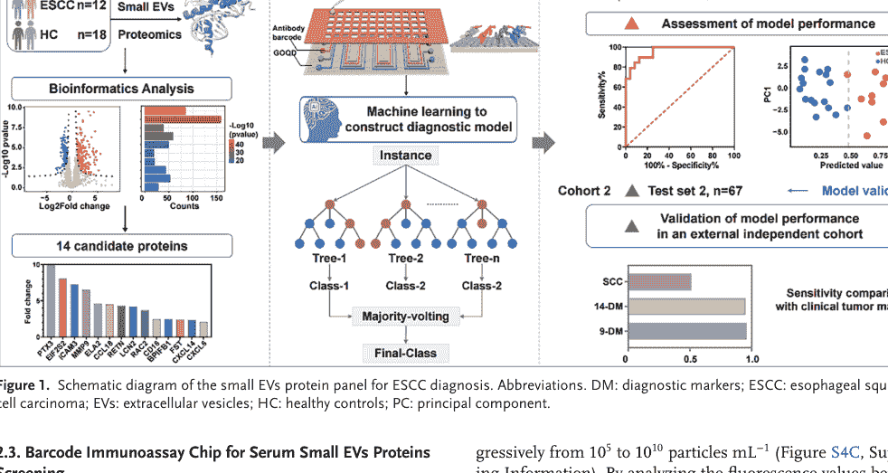

Figure 1. 用于ESCC诊断的小EV蛋白panel示意图。缩写。DM：诊断标志物；ESCC：食管鳞状细胞癌；EVs：细胞外囊泡；HC：健康对照；PC：主成分。

小EV的高效捕获和检测对于小EV生物标志物的应用至关重要。开发了一种条形码微流控平台，该平台整合了小EV捕获、原位裂解和EV蛋白检测，以全面分析小EV表面和内部的蛋白，从而提高标志物检测的灵敏度。石墨烯氧化物量子点（GOQDs）已证明其与蛋白质和核酸结合的强能力。[30,31,23]因此，制造了具有60个反应单元的聚二甲基硅氧烷（PDMS）芯片，并将其与GOQDs自组装玻璃基底对齐。[31]CD63、CD81和CD9是小EV常用的四跨膜蛋白，它们代表了重叠但不同的小EV群体。[22,24–26]因此，在每个反应单元中，将CD63、CD81和CD9抗体的混合物固定在GOQDs基底上，以提高小EV的捕获效率（图3A）。然后，将血清样品加载到每个反应单元中，小EV被捕获在芯片上。透射电子显微镜（TEM）和纳米颗粒追踪分析（NTA）的小EV结果显示于图3B、C和图S3（支持信息）。小EV的尺寸主要集中在200 nm以下。将CD63、CD81、CD9混合抗体的捕获效率与三种单独捕获抗体进行比较，混合抗体在细胞系上清液和血清中均捕获了最多的小EV（图S4A、B，支持信息），促使我们使用混合抗体进行小EV捕获。为评估小EV捕获效率，将一系列不同浓度的小EV引入反应单元。小EV用APC荧光标记，并检测荧光信号，其从10^5到10^10 particles mL^-1逐渐增加（图S4C，支持信息）。通过分析捕获的小EV与残留液中小EV之间的荧光值，计算小EV捕获效率，其在10^10 particles mL^-1时达到91.9%，在10^9 particles mL^-1时达到93.5%，在10^8 particles mL^-1时达到97.7%（图3D）。通过三次独立实验重复，该平台一致显示在10^8至10^9 particles mL^-1浓度范围内EV捕获效率超过90%（图S5，支持信息）。考虑到健康人体内典型的小EV浓度约为10^9 particles mL^-1，使用细胞系来源的10^9 particles mL^-1浓度来优化孵育时间。在室温下孵育60分钟时捕获的小EV数量达到峰值，且延长孵育时间并不会显著提高小EV的荧光信号（图S4D，支持信息）。因此，小EV的最佳孵育时间为60分钟。捕获小EV后，进行小EV的原位裂解，并在不同的裂解时间评估芯片上剩余的小EV数量。向芯片上含有APC-CD63小EV的反应单元中加入放射免疫沉淀法（RIPA）缓冲液和蛋白酶抑制剂，荧光信号的下降反映了裂解过程（图3E）。观察到小EV的荧光强度随时间逐渐减弱，在裂解30分钟后收敛至背景水平（图S4E，支持信息）。因此，使用30分钟裂解捕获的小EV。随后，通过在GOQD基底上微打印目标蛋白的捕获抗体构建了抗体条形码芯片。首先，通过软光刻法[27]制造具有14个平行微通道的PDMS芯片，并将其与GOQDs自组装玻璃基底对齐[27]，从而实现至少14种捕获抗体条形码的同时打印

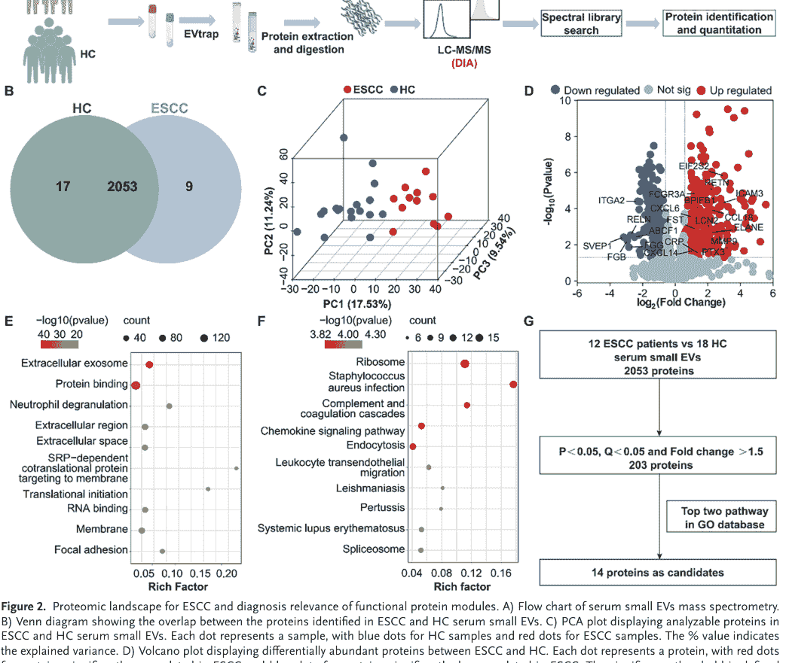

Figure 2. ESCC的蛋白质组学景观及功能蛋白模块的诊断相关性。A) 血清小EV质谱分析流程图。B) 显示ESCC和HC血清小EV中鉴定蛋白重叠的Venn图。C) 显示ESCC和HC血清小EV中可分析蛋白的主成分分析图。每个点代表一个样本，HC样本为蓝色点，ESCC样本为红色点。%值表示解释方差。D) 显示ESCC和HC之间差异丰度蛋白的火山图。每个点代表一个蛋白，ESCC中显著上调的蛋白为红色点，显著下调的蛋白为蓝色点。显著性阈值定义为肿瘤中上调（校正后P < 0.05，log2FC > 0.58（FC > 1.5）），肿瘤中下调（校正后P < 0.05，log2FC < -0.58），或否则视为不显著。P值使用R包“limma”计算，并使用Benjamini-Hochberg方法校正。计算了双侧P值。E) 显示ESCC和HC组的GO富集气泡图和F) KEGG通路富集。校正后P < 0.05被认为具有统计学显著性。P值由KOBAS计算，并使用Benjamini-Hochberg方法校正。计算了双侧P值。缩写。ESCC：食管鳞状细胞癌；HC：健康对照；PC：主成分；PCA：主成分分析；Not sig：不显著。

用于捕获相应的目标小EV蛋白（表S1，支持信息）。在GOQDs基底上打印捕获抗体条形码后，移除微通道PDMS芯片，并将样品加载用PDMS芯片与条形码芯片对齐（图3F）。样品加载芯片具有60个反应单元，每个单元覆盖整个条形码阵列，从而实现60个样品的同时检测以及每个样品的14种蛋白。裂解产物转移至抗体条形码芯片用于小EV蛋白检测，并记录由抗体条形码衍生的荧光值（图S4F，支持信息）。此外，在用BSA包被但不含EV捕获抗体的对照芯片中，未检测到目标生物标志物的特异性信号（图S6，支持信息），表明我们的芯片系统实现了特异性EV捕获，同时有效防止了非囊泡成分的非特异性结合。此外，GOQD功能化芯片表现出稳定的性能，在4 °C下储存24周期间荧光信号的RSD < 5%。抗体偶联GOQD芯片显示出相当的稳定性，信号衰减 < 10%

Figure 3. 小EV分析平台。A) 小EV捕获和原位裂解芯片示意图。小EV跨膜蛋白的捕获抗体固定在自组装GOQD基底上以促进小EV捕获。随后进行小EV的原位裂解。该方法可同时检测60个样品，每个样品需10 µL血清。B) 小EV的代表性透射电子显微镜图像，具有脂质双层和杯状结构。比例尺100 nm。C) 通过纳米颗粒追踪分析测量的小EV颗粒尺寸分布。D) 荧光扫描图像显示芯片在10⁸至10¹⁰ particles mL⁻¹浓度范围内的捕获能力。捕获的小EV使用与APC偶联的CD63抗体检测，并使用具有635 nm激光光源的荧光扫描仪进行扫描。计算公式：[初始荧光强度/(初始荧光强度 + 回收荧光强度)] ×100%。E) 荧光扫描图像描绘了浓度为10⁹ particles mL⁻¹时小EV的裂解。F) 条形码免疫分析芯片示意图。芯片使用GOQD组装玻璃片和60孔PDMS微室层构建。目标蛋白的抗体按指定顺序微图案化，以特异性捕获小EV裂解物中的目标蛋白。孵育与APC偶联的检测抗体后，进行荧光扫描。G) 条形图说明了14种蛋白的检测限。LOD = 3 × δ / S，其中δ指空白值的相对标准偏差，S指线性回归方程中的斜率。H) 散点图显示浓度为1 ng mL⁻¹时14种蛋白荧光读数的稳定性。荧光读数点在条形码上随机选取。缩写。Ab：抗体；GOQD：氧化石墨烯量子点；LOD：检测限。

在−20 °C下储存10个月期间（图S7，支持信息）。首先，检测不同浓度的14种重组蛋白，并绘制其定量曲线如图S8（支持信息）所示。它们彼此间表现出优异的特异性（图S9，支持信息）。对于14种小EV蛋白，芯片显示检测限为0.01–96.61 pg mL⁻¹（图3G）。为评估条形码芯片读数的均匀性，将蛋白浓度标准化为1 ng mL⁻¹，并从条形码荧光条中随机选择10个点，其误差范围为平均读数值的2–7%（图3H）。

### 2.4. 基于条形码免疫分析平台的临床样本检测

为验证微流控芯片与质谱结果之间的一致性，我们使用两种平台对同一ESCC患者和健康对照队列中的14种候选蛋白进行平行检测。比较分析显示，多数蛋白在平台间的差异表达模式具有高度一致性（图S10和S11，支持信息）。基于上述描述的条形码免疫分析平台，我们检测队列1和队列2血清小EV中的14种候选蛋白。首先，两个队列的ESCC患者和HC具有相似的性别比例（图4A；图S12A、C，支持信息），年龄分布主要在50岁以上（图4B；图S12B、D，支持信息）。因此，可排除因组间年龄和性别差异导致的潜在干扰。此外，两个队列间ESCC患者的基础临床病理特征无显著差异（图S12E，表S2，支持信息），表明两个临床队列具有可比性。

队列1和队列2中ESCC患者血清小EV中这14种蛋白的水平与HC相比显示出显著差异（图4C）。具体而言，PTX3、ICAM3、MMP9、CXCL6、BPIFB1、FST，

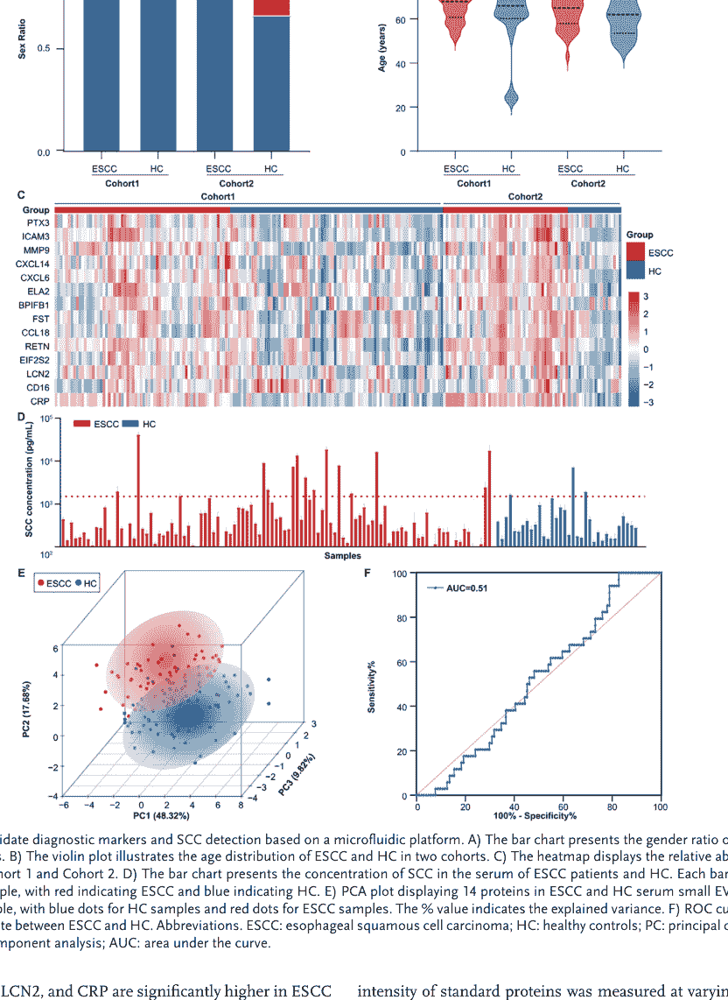

图4. 基于微流控平台的14个候选诊断标志物和SCC检测。A) 条形图展示了两个队列中ESCC和HC的性别比例。B) 小提琴图说明了两个队列中ESCC和HC的年龄分布。C) 热图显示了队列1和队列2中14种蛋白质的相对丰度。D) 条形图展示了ESCC患者和HC血清中SCC的浓度。每个条形代表一个个体样本，红色表示ESCC，蓝色表示HC。E) 显示ESCC和HC血清小EV中14种蛋白质的PCA图。每个点代表一个样本，蓝色点为HC样本，红色点为ESCC样本。%值表示解释方差。F) 用于区分ESCC和HC的SCC ROC曲线。缩写。ESCC：食管鳞状细胞癌；HC：健康对照；PC：主成分；PCA：主成分分析；AUC：曲线下面积。

RETN、EIF2S2、LCN2 和 CRP 在 ESCC 患者中显著升高（图 S13–S16，支持信息）。

为进一步评估筛选的标志物是否优于现有临床标志物，检测了SCC的表达水平，SCC是一种常用的鳞状细胞癌标志物。使用微流控平台，在SCC的不同浓度下测量标准蛋白的荧光强度以创建标准蛋白曲线（图 S17A，支持信息）。然后在104名ESCC患者和34名健康对照的血清中测量SCC的表达水平（图 S17B，支持信息）。并且根据测量的荧光强度和标准蛋白定量曲线计算浓度。发现只有14.4%的ESCC患者SCC表达水平超过1.5 ng mL−1（图4D）。此外，与HC相比，ESCC患者中SCC的平均表达水平没有显著差异（图 S17C，支持信息）。

此外，基于14种筛选蛋白质荧光水平的PCA成功地区分出更明显的ESCC患者亚组与HC（图4E）。使用ROC曲线评估标志物的诊断效能，单个蛋白标志物的ROC曲线下面积（AUC）范围为0.52至0.88（图 S18，支持信息），而SCC的AUC仅为0.51（图4F）。总之，本研究鉴定的14个标志物显示出对ESCC潜在的临床诊断价值。

### 2.5. 精确诊断模型的构建与验证

为了利用候选蛋白开发ESCC的创新诊断方法，采用机器学习创建能够精确预测临床状态的模型（图5A）。最初，使用随机森林算法基于14种蛋白构建模型，并根据准确率（ACC）和AUC的综合评分优化模型参数（图 S19A–C，支持信息）。最优值设定为 ntree = 145 和 mtry = 1。

队列1按7:3的比例随机分为训练集和测试集，而队列2作为独立的外部测试集，称为测试集2。为了可视化模型性能，生成了图表以比较预测值与实际疾病状态（ESCC或HC）。以0.5为分类截止值，14个诊断标志物（DM）模型在测试集1中准确识别了63.2%的ESCC患者，在测试集2中为78.7%（图5B,C）。该模型在训练集中表现出100%的准确率（图 S19D，支持信息），测试集1的准确率为79.1%（图 S19E，支持信息），测试集2为82.1%（图 S19F，支持信息）。各自测试集的AUC值分别为0.94和0.96（图5D）。

为了进一步优化模型并降低检测成本，使用随机森林算法对14-DM模型中变量的重要性进行排序。根据平均最小深度和节点数，ELA2、CXCL6、MMP9、CRP和BPIFB1排名前五，其余9种蛋白用于进一步分析（图5E）。结果表明，基于ACC、AUC和整体性能，9个蛋白变量获得了最高的综合评分（图5F）。所选变量为MMP9、CRP、CXCL6、FST、EIF2S2、ELA2、BPIFB1、PTX3和CD16。逐一排除变量会导致准确率下降程度不同，观察到MMP9的下降最为显著（图5G），这意味着MMP9在诊断模型中发挥重要作用。

使用这九个变量构建改进的随机森林模型，将参数优化为`ntree`设为400，`mtry`设为1（图 S20A–C，支持信息）。该9-DM模型在测试集1中准确识别了79.0%的ESCC患者，在测试集2中为91.5%（图5H,I）。准确率在测试集1中为88.4%（图 S20D，支持信息），测试集2中为91.0%（图 S20E，支持信息），各自测试集的AUC值分别为0.96和0.95（图5J）。这些结果表明9-DM模型具有高灵敏度和可靠性。

为了进一步验证所选生物标志物和9-DM模型的普适性，在2025年1月至3月期间于齐鲁医院招募了由30名ESCC患者和30名健康对照组成的独立验证队列（队列3）。外部验证结果显示，大多数候选生物标志物的表达模式与队列1和2中观察到的结果一致（图 S21 和 S22，支持信息），而9-DM模型保持了稳健的诊断性能，分类准确率为83.3%（AUC = 0.93）（图 S23，支持信息），从而证实了我们的蛋白特征在ESCC检测中的临床实用性和可靠性。

为评估其诊断早期ESCC的有效性，9-DM模型被应用于两个测试集中区分I-II期ESCC与HC。该模型成功识别了85.7%的早期ESCC患者和93.2%的HC，总体准确率为90.8%（图 S20F,G，支持信息），AUC为0.96（图 S20H，支持信息）。在临床环境中，ESCC的早期检测对于及时干预和根治性切除至关重要，这可以降低手术难度并显著提高患者生存率。[28,29]

### 2.6. 小EV蛋白标志物区分癌症的特异性

为评估9-DM模型对ESCC诊断的特异性，从结直肠癌（CRC）、胃癌（GC）和乳腺癌（BC）患者收集血清样本。患者的性别和年龄分布见图 S24（支持信息）。在CRC、GC和BC的血清小EV中，9个标志物的表达水平与ESCC相比显示出显著差异（图6A；图 S25，支持信息）。基于9-DM的PCA表明，与其他癌症类型相比，ESCC样本表现出独特的特征（图6B）。然而，使用9-DM的PCA无法有效区分CRC、GC和BC样本与HC样本（图 S26A–C，支持信息）。

值得注意的是，除CXCL6和EIF2S2外，其余七个标志物在CRC、GC和BC患者的血清小EV中表达水平较低（图6C–K）。将CRC、GC和BC的数据纳入9-DM模型完全无法将其与HC区分开（图 S26D,E，支持信息）。这些发现强调了所选小EV蛋白标志物和9-DM模型在诊断ESCC中的特异性。

### 2.7. ESCC生物标志物的组织学验证

为了进一步验证所选生物标志物的准确性，我们对源自ESCC细胞系（KYSE150/KYSE510）和正常食管上皮细胞系（HEEC）的EV进行了蛋白质组学分析。结果显示，在ESCC来源的EV中PTX3、EIF2S2和FST显著过表达，与HEEC对照相比，倍数变化值超过10。后续对三对配对ESCC和

### A

队列1

发现集 (n=103)

ESCC n = 47

HC n = 56

随机森林模型

自助采样 1

自助采样 2

自助采样 145

分类器 1

分类器 2

分类器 145

投票

集成分类器

14-DM 模型

逐一消除

平均最小深度

节点数

作为根的次数

准确率下降

变量重要性

9-DM 模型

测试集 1 (n=43)

ESCC n = 19

HC n = 24

性能评估

队列2

测试集 2 (n=67)

ESCC n = 47

HC n = 20

性能评估

### B

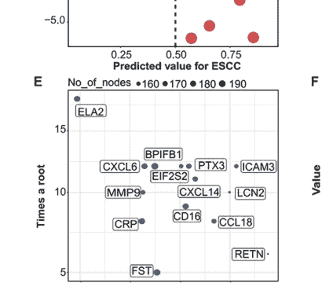

### C

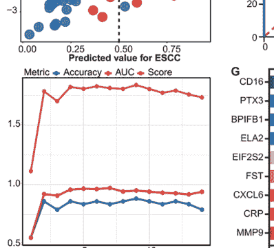

### D

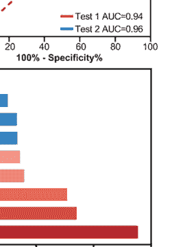

### E

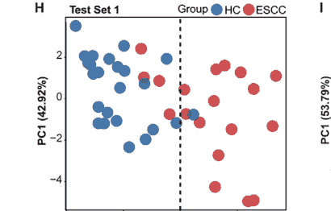

### F

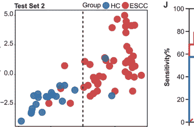

### G

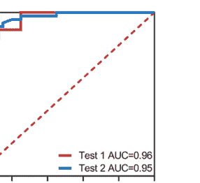

### H

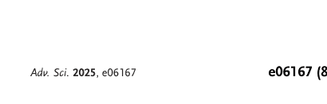

### I

### J

图 5. 基于血清小细胞外囊泡蛋白的机器学习衍生预测模型用于 ESCC 诊断。A) 构建诊断模型的流程设计。特征选择和模型训练使用随机森林算法进行。14-DM 和 9-DM 模型在内部测试集（测试集 1）和外部测试集（测试集 2）中得到验证。B) 14-DM 模型在测试集 1 中区分 ESCC（红色）与 HC（蓝色）的预测性能，以及 C) 测试集 2。虚线表示 0.50 的截止值，用于分别预测 HC（左侧）和 ESCC（右侧）。D) 14-DM 模型在测试集 1 和 2 中诊断 ESCC 的 ROC 曲线。E) 14 个生物标志物的重要性分布图。每个点代表一个蛋白生物标志物，点的大小表示该生物标志物在模型中用于分割的总节点数。X 轴表示变量的平均最小深度，值越小表示重要性越大，而 Y 轴表示变量用于分割的树总数。F) 折线图显示随着纳入变量数量的增加，模型准确率、AUC 以及准确率与 AUC 的综合评分。G) 条形图显示移除每个变量后 9-DM 模型的准确率下降情况。H) 9-DM 模型在测试集 1（G）中预测 ESCC（红色）与 HC（蓝色），以及 I) 测试集 2。虚线表示 0.50 的截止值，用于分别预测 HC（左侧）和 ESCC（右侧）。J) 9-DM 模型在测试集 1 和 2 中诊断 ESCC 的 ROC 曲线。缩写。AUC：曲线下面积；DM：诊断标志物；ESCC：食管鳞状细胞癌；HC：健康对照；PC：主成分。

相邻正常组织样本显示出肿瘤特异性表达模式，在 ESCC 组织中出现阳性信号，而在组织学正常的相邻区域仅显示微弱或可忽略的染色（图 S27，支持信息）。这些发现与之前记录这些生物标志物肿瘤限制性表达谱的报道一致。[32-34]

早期诊断可显著改善患者预后。[26,35] 目前的内镜诊断和筛查方法有限，迫切需要新的无创方法来筛查并持续监测癌前病变。[1] 尽管近年来液体活检已被探索，cfDNA 在 EC 早期诊断中的敏感性低于 20%。[10-12] 相比之下，小细胞外囊泡广泛存在于生物液体中并具有双层膜结构，提供高稳定性。[22] 虽然多项研究表明小细胞外囊泡中的 miRNA 可区分肿瘤患者与健康个体，但很少有效转化为临床应用。[36,37] 与 RNA 相比，小细胞外囊泡来源的蛋白更稳定，因此更适合临床检查。[38] 近年来蛋白质组学检测技术的不断完善，为理解肿瘤患者和健康个体中的蛋白功能创造了机会。[39,40]

## 3. 讨论与结论

在本工作中，虽然以 ESCC 作为模型来测试筛选的小细胞外囊泡蛋白 panel 进行早期诊断的应用，但这是一种通用方法，可用于筛选特定早期诊断生物标志物、评估治疗疗效生物标志物以及准确预测其他疾病的预后生物标志物。

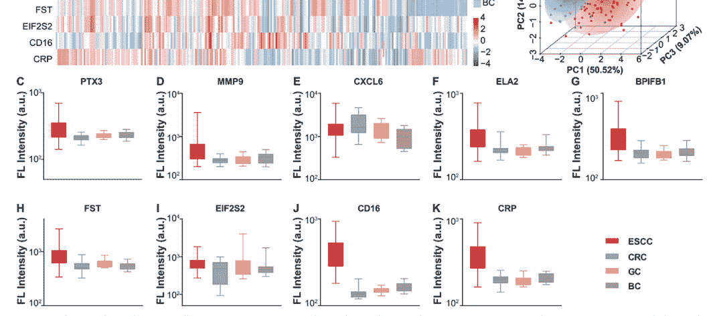

图 6. ESCC 小细胞外囊泡蛋白的特异性。其他癌症中 ESCC 生物标志物的表达。A) 热图显示 HC 以及 ESCC、CRC、GC 和 BC 患者血清小细胞外囊泡中 9 个生物标志物的表达。B) 基于 9 个生物标志物的 PCA 图，比较其他癌症和 ESCC。每个点代表一个样本，蓝色点表示其他癌症，红色点代表 ESCC 样本。百分比值代表解释方差。C) 箱线图显示 ESCC、CRC、GC 和 BC 患者血清小细胞外囊泡中 9 个生物标志物的平均表达水平。缩写。BC：乳腺癌；CRC：结直肠癌；ESCC：食管鳞状细胞癌；GC：胃癌；HC：健康对照；PC：主成分；PCA：主成分分析。

在本研究中，使用 4D-DIA 鉴定并表征了患者和 HC 血清小细胞外囊泡中的所有蛋白，揭示了患者小细胞外囊泡中蛋白组成的变化。值得注意的是，小细胞外囊泡组成、蛋白结合和中性粒细胞脱颗粒等重要通路显著上调，提示其小细胞外囊泡蛋白质组的功能状态。此外，与肿瘤发生相关的通路，如内吞作用、趋化因子和内皮细胞迁移，在 KEGG 通路分析中显著升高，表明小细胞外囊泡蛋白在肿瘤形成和进展中发挥关键作用。这进一步支持了在血清小细胞外囊泡蛋白质组中鉴定癌症诊断标志物的潜力。

由于肿瘤固有的异质性和其微环境的复杂性，[41,42] 单一标志物难以准确反映肿瘤特征的整体变化。因此，多标志物组合已成为诊断和治疗方法的主流趋势。[43,44] 这一趋势对检测方法提出了更高要求，强调需要低样本消耗和高通量能力的检测方法，这对于标志物检测和癌症诊断至关重要。CD63、CD81 和 CD9 是存在于小细胞外囊泡膜上的跨膜蛋白，代表了部分重叠的小细胞外囊泡群体。[22,24,25] 本研究开发的微流控平台利用针对 CD63、CD9 和 CD81 的抗体混合物特异性捕获血清小细胞外囊泡，在浓度为 10^8 至 10^10 particles mL^-1 时捕获效率超过 90%。捕获的小细胞外囊泡在芯片上原位裂解，产生总小细胞外囊泡蛋白，包括膜蛋白和内部蛋白。这种方法最大限度地减少了总小细胞外囊泡蛋白的损失并提高了检测的整体灵敏度。整个过程仅需要 10 µL 血清样本量，显著减少了样本损失。此外，条形码免疫检测平台能够在 60 个临床样本中同时检测至少 14 个标志物，显著减少了多样本分析所需的时间。这使其特别适合于筛选多样化人群。值得注意的是，芯片对蛋白的检测限低至 0.01–96.61 pg mL^-1，且荧光读数相对稳定。因此，本研究开发的条形码免疫检测平台在小细胞外囊泡蛋白检测方面具有巨大的临床应用潜力。

虽然血清小细胞外囊泡蛋白质组学适用于表征疾病中的蛋白并鉴定有希望的诊断生物标志物，但解读复杂组织学数据仍然具有挑战性。[16,45–47] 机器学习越来越多地被认为是有助于提高医疗监测和诊断准确性的有价值工具。在本研究中，利用随机森林算法通过基于 ACC 和 AUC 调整参数来选择最佳模型。诊断模型在测试集 1 中的准确率达到 79.1%。为了进一步提高准确率并降低检测成本，最佳模型 9-DM 通过机器学习确定，在测试集 1 中达到 88.4% 的准确率。此外，机器学习算法揭示了某些小细胞外囊泡蛋白的预测潜力，这些蛋白通常被传统分析方法所忽视。例如，尽管 CD16 和 ELA2 在比较 ESCC 患者与 HC 之间的总体平均值时未显示出显著差异，这两个标志物仍被保留在模型对最优变量的选择中。用于创建诊断模型的机器学习算法经过泛化验证，并显示出优于临床可用鳞状癌标志物的性能。具体而言，队列 2 被验证为独立的外部测试集，其中 14-DM 和 9-DM 模型的准确率分别为 82.1% 和 91.0%。值得注意的是，9-DM 模型在随后的队列 3 中保持稳健性能（准确率 83.3%；AUC = 0.93），从而证实了其在不同患者群体中的泛化能力。此外，9-DM 模型在识别早期 ESCC 患者方面表现出强性能。在 I-II 期 ESCC 患者和 HC 的队列中，该模型准确识别了 85.7% 的早期 ESCC 患者，总体准确率达到 90.8%，超过了现有临床标志物。分子表征显示 PTX3、FST 和 EIF2S2 在 ESCC 来源的细胞外囊泡中显著过表达（FC > 10），免疫荧光证实了肿瘤特异性表达模式。这些发现共同验证了模型的临床实用性，同时阐明了分子基础，支持其通过扩大验证研究和算法优化以实现临床实施的进一步开发。

此外，本研究测试了 CRC、GC 和 BC 患者的血清样本。与 ESCC 相比，这三种癌症类型中鉴定的蛋白总体表达水平较低。9-DM 模型可以准确识别 ESCC 患者。这进一步证实了所选标志物和诊断模型对 ESCC 的特异性。总体而言，我们的优势在于对血清小细胞外囊泡进行蛋白质组学分析并描述患者血清小细胞外囊泡蛋白的功能图谱。已筛选出一组简便的蛋白标志物，并应用机器学习方法构建了用于 ESCC 的稳健诊断模型，促进了复制、优化和临床应用。此外，已开发出一种条形码免疫检测平台，可利用 10 µL 血清样本进行多样本和多参数的同时高通量检测，这对临床应用具有重要转化价值。

本研究有若干局限性应予承认。首先，由于我们的预测模型是使用相对定量蛋白质组学数据开发的，其在新患者中用于 ESCC 风险评估的临床应用将在模型实施过程中需要标准化质量控制样本。尽管存在这些局限性，我们的工作已成功鉴定出关键的细胞外囊泡蛋白质组标志物，可有效区分 ESCC 与健康对照，代表了迈向临床适用诊断模型的重要进展。其次，当前平台需要将检测结果手动传输到机器学习模型，这可能在临床环境中引入操作复杂性。展望未来，我们将对这些生物标志物在大规模多中心队列中进行绝对定量蛋白质组学分析，以建立临床相关的参考范围和检测阈值，同时努力开发一个完全集成的自动化平台，将检测、数据采集和诊断输出相结合，以提高临床实用性和操作效率。

总之，所提出的平台鉴定出具有潜在诊断价值的生物标志物，并构建了整合机器学习算法的诊断模型。此外，已开发出一种条形码免疫分析平台，集成了小EVs捕获、原位裂解和多参数检测，能够实现多样本的快速分析。这些发现增强了对疾病病理学的理解，同时促进了早期检测并开发了多参数小EVs检测的新方法。更广泛地，基于机器学习的小EVs数据解读在肿瘤检测和临床决策中具有明显优势，而所开发的微流控分析平台在实际临床应用中具有重要的转化前景，并可扩展至其他疾病的研究。

## 4. 实验部分

### 临床队列

2023年8月至2024年5月期间，66例ESCC患者从山东大学齐鲁医院招募，80例接受体检的HC被纳入，形成队列1。2023年7月至2023年9月期间，另有47例ESCC患者在山东第一医科大学附属省立医院接受治疗，以及20例HC被招募，从而建立队列2。此外，自2025年1月至3月，30例ESCC患者和30例HC在齐鲁医院入组，以建立用于验证研究的队列3（图S28，支持信息）。纳入标准：参与者年龄为18–85岁，经组织学确诊为ESCC，且未接受治疗。排除标准：具有双原发或多原发肿瘤的个体；患有免疫紊乱或自身免疫性疾病的参与者；以及接受过器官移植、非自体骨髓移植或干细胞移植者被排除。健康个体的纳入标准：

- 已获得书面同意；

- 年龄在18至85岁之间；且

- 无恶性疾病。

上述排除标准同样适用于健康个体。本研究使用的所有样本均回顾性地从已建立的机构生物库中获得。人材料的用途已获得山东大学齐鲁医院医学科学研究伦理委员会批准（批准号：KYLL-2021(K S)-011和KYLL-202409(YJ)-024）。所有参与者均自愿签署知情同意书。

### 临床样本采集

从ESCC患者和HC收集血清样本。每位参与者采集5 mL外周静脉血样本。样本在4 °C下于1 h内迅速转移至实验室进行进一步处理。新采集的血液样本在室温（RT）下保持1 h以允许凝固，然后进行离心。上清液随后在4 °C、1,000 g下离心15 min后小心移除并转移至干净的试管中。为确保完全去除血小板和其他碎屑，样本在4 °C、10 000 g下进行第二次离心10 min。收集的上清液储存在−80 °C。

### 细胞上清液小EVs的收集与分离

细胞在完全培养基中培养至达到70%汇合度，此时培养基更换为无胎牛血清（FBS）培养基。在无FBS条件下培养48 h后收集上清液。收集的上清液进行连续离心：首先以300 × g离心10 min，随后以2000 × g离心10 min，然后以10 000 × g离心30 min。然后上清液通过0.22-μm滤器并以100 000 × g超速离心70 min。离心后获得的上清液被指定为小EVs去除组分。小EVs沉淀随后重悬于磷酸盐缓冲液（PBS）中并进行第二次100 000 × g超速离心70 min以纯化小EVs。

### 纳米颗粒追踪分析

小EVs被重悬并稀释100-至500倍，以获得每帧20–100个颗粒的浓度。分析使用NanoSight NS300系统（NanoSight Technology, Malvern, UK）进行，该系统配备488 nm激光器和高度灵敏的sCMOS相机。在手动将小EVs引入腔室后，每个样本使用13级相机进行三次重复测量，采集时间为30 s，检测阈值设为7。NTA分析软件版本2.3用于分析每个视频中至少200条完整轨迹。

### 透射电子显微镜

小EVs颗粒用2.5%戊二醛在RT下处理10 min。然后将5–10 μL小EVs悬液的一滴置于铜网上。用滤纸去除多余液体，小EVs样本用PBS洗涤三次，每次洗涤持续10 min。最后，加入10 μL 1%醋酸铀在铜网上对小EVs进行负染色1 min，然后使用Tecnai G2 F20透射电子显微镜进行检查。

### 血清小EVs用于液相色谱-质谱（LC-MS）及数据非依赖采集

血清小EVs使用EVtrap试剂盒分离和收集。分离后，小EVs经裂解、蛋白提取、还原、烷基化和胰蛋白酶消化以生成用于质谱分析的肽链。接下来，每个样本的肽经受质谱进行DIA分析。更多细节见图S29（支持信息）。

### 差异蛋白及通路富集分析

ESCC患者与HC之间差异蛋白丰度使用`R`软件中的`limma`包计算。显著性水平设定为校正后P值< 0.05，log2倍数变化（`FC`）阈值为> 0.58（表示上调）或< −0.58（表示肿瘤中下调）。功能富集分析使用`KOBAS`（`http://bioinfo.org/kobas`）进行，参数为默认。

### 微流控平台的制备

`GOQDs`基底玻璃载玻片和`PDMS`微腔层按照先前报道的相同程序制备。[31] 具有14个平行微通道的微打印芯片首先与`GOQD`功能化玻璃载玻片键合，该纳米材料基底显示出显著增强的抗体固定化效率。使用精密移液器，将3 μL捕获抗体溶液分配到每个独立微通道的入口，然后在室温下施加真空力将装载的捕获抗体从入口泵送至出口。捕获抗体在每个相应微通道的基底表面固定化。去除微打印芯片后，基底用1% `BSA`溶液处理以进行表面钝化，随后用3% `BSA`溶液封闭以饱和微通道外的剩余反应位点。最后，芯片经过严格洗涤、旋干并在4 °C下保存直至使用。微打印芯片包含14个锯齿状微通道，保持完全的流体隔离。每个检测单元包括全部14个微通道的完整循环回路（图S30，支持信息）。为捕获小EVs，将4.5 μL含有`CD63`（100 μg mL−1）、`CD81`（100 μg mL−1）和`CD9`（100 μg mL−1）抗体的混合溶液加入每个反应单元并过夜孵育。然后使用3% `BSA`封闭10 min，随后用`PBS`和超纯水连续洗涤以去除未结合组分。为富集小EVs，将10 μL血清样本加入每个反应单元并孵育60 min。然后去除上清液，孔用`PBS`冲洗。随后，将5 μL `RIPA`裂解缓冲液与蛋白酶抑制剂的混合物（100:1比例）加入每个反应单元，以原位裂解捕获的小EVs 30 min。对于抗原检测，微阵列芯片的`PDMS`微腔用1% `BSA`密封。然后将小EVs裂解液转移至微阵列芯片上的孔中并孵育45 min，之后去除上清液。微阵列芯片在1% `BSA`中孵育，孔与终浓度为5 μg mL−1的检测抗体孵育45 min，随后与`APC`孵育30 min。微阵列用`PBS`和蒸馏水彻底洗涤然后振干。使用荧光扫描仪测量抗原的荧光强度。本研究使用的商业抗体和蛋白来自`R&D Systems`、`BioLegend`、`NOVUS`、`eBioscience`、`Abcam`和`Santa Cruz Biotechnology`等制造商。

### 微流控平台数据分析

检测过程涉及以下步骤：1) 信号采集：使用 635 nm 激光通道扫描生物芯片，并使用 `GenePix Pro` 软件对每个条形码的荧光信号进行定量，并获得检测区域的平均荧光强度。2) 数据归一化：在机器学习模型输入之前，对原始荧光强度值进行 `log10` 转换，以归一化数据分布并增强模型性能。

### 诊断预测建模

使用 `R` version 4.4.2 为 ESCC 开发了诊断预测模型，采用集成机器学习方法进行多维分析。在方法学上，系统性地实施了多个 `R` 包：`randomForest` 用于随机森林建模，`caret` 用于数据预处理和模型调优，`pROC` 用于性能评估，`randomForestExplainer` 用于特征重要性分析，`ggplot2` 用于可视化，以及 `Rtsne` 用于高维数据降维。在模型构建期间：首先使用 `caret` 包进行数据标准化和分层抽样（70% 训练集/30% 测试集），以确保数据分布均衡。随机森林模型使用 `randomForest` 中实现的自助聚合算法开发，最初纳入 14 种血浆蛋白作为预测变量。通过 `caret` 指导的网格搜索验证，模型参数优化为：`ntree` = 145 棵决策树，`mtry` = 14（每次节点分裂考虑的特征数），`nodesize` = 5（每个末端节点的最小样本数）。参数优化由 `pROC` 计算的 `AUC` 值和 `caret` 生成的混淆矩阵指标共同指导。使用 `randomForestExplainer` 进行了特征重要性分析，其提供了三种互补的评估方法：1) 最小深度分析（`min_depth_distribution`）以识别最关键的分类特征；2) 节点纯度提升（`measure_importance`）以量化每个特征对模型精度的贡献；3) 根节点分裂频率以反映全局特征重要性。基于这些分析，从最初的 14 个特征中选出 9 个最具预测性的蛋白生物标志物用于最终模型。验证阶段采用多维评估策略：`caret` 生成的混淆矩阵提供了包括准确率、敏感性和特异性在内的关键指标；`pROC` 从 ROC 曲线计算 `AUC` 值；`ggplot2` 生成校准曲线；`Rtsne` 可视化展示了 ESCC 患者与健康对照在蛋白生物标志物空间中的分离模式。模型通过 `randomForest` 的 `predict` 函数输出个体化预测概率（范围 0–1），诊断阈值设为 0.5（概率 > 0.5 分类为 ESCC，≤0.5 为健康对照）。所有可视化均使用 `ggplot2` 创建，包括 ROC 曲线、多维特征重要性热图、t-SNE 降维散点图和模型校准曲线。

### 免疫荧光染色

福尔马林固定石蜡包埋切片经二甲苯和梯度乙醇系列脱蜡，随后在柠檬酸缓冲液（pH 6.0）中采用微波加热进行抗原 retrieval。经 10% 与二抗宿主种属匹配的血清封闭后，载玻片在 4 °C 下过夜孵育以下一抗：`anti-FST`（1:400, `Proteintech` #60060-1-Ig）、`anti-PTX3`（1:200, `Proteintech` #13797-1-AP）和 `anti-EIF2S2`（1:500, `Servicebio` #GB111135）。`Alexa Fluor` 偶联二抗（1:200）在室温下作用 50 min，随后进行 `DAPI` 复染和自发荧光淬灭。切片用抗淬灭封片剂封固并使用数字切片扫描仪成像。所有步骤之间均进行 `PBS` 洗涤（3 min × 5 min）。

### 统计方法

采用 `Kolmogorov–Smirnov` 检验评估所有数据的正态性，而分类数据则使用卡方检验进行分析。对于呈正态分布的数据，采用非配对双尾 t 检验进行比较，而非正态分布数据则使用 `Mann–Whitney` 非参数检验。荧光强度或光密度（O.D.）值与目标抗原浓度之间的线性关系使用 `R-squared`（`R²`）统计量进行评估。p 值低于 0.05 被认为具有统计学意义。检测限（`LOD`）由方程确定：`LOD = 3 × δ / S`，其中 `δ` 为空白值的相对标准偏差，`S` 表示由线性回归方程得出的斜率。

诊断效率使用准确率、ROC 曲线和其他相关指标进行评估。分析使用 `GraphPad Prism`（v.9.5）、`R software`（v.4.4.1）（可获取于 `https://www.r-project.org/`）和 `Origin`（v.2021）进行。

## 支持信息

支持信息可从 Wiley Online Library 或作者处获取。

## 致谢

本工作得到中国国家重点研发计划（2023YFB3210400）、山东省重大科技创新项目（2022CXGC020501）、国家自然科学基金（项目号 62174101）、山东大学集成研究与培养项目（项目号 2022JC001）以及微生物技术国家重点实验室院内联合项目（项目号 SKLMTPJ-2024-05）资助。作者感谢山东大学生命与环境科学核心设施的 Xiaoju Li、Haiyan Sui 和 Xueyun Geng 在 TEM 方面的帮助。C.M. 感谢香港研究资助局研究基金（14208723）的财务支持，以及香港赛马会慈善信托基金对自然启发精准医学工程 JC STEM 实验室的资助。

## 利益冲突

作者声明无利益冲突。

## 作者贡献

L.H.、Y.Z.、J.W.、X.Z. 和 C.M. 构思了研究思路。X.Z.、Y.Z.、J.Q. 和 Y.L. 执行实验、撰写文章并制作图表。Y.Z.、C.W.、M.S. 和 X.C. 指导了本稿件的准备。Z.L. 和 Y.Z. 执行样本采集和数据获取。H.L.、L.H. 和 C.M. 进行论文修改。所有作者均阅读并批准了最终稿件。

## 数据可用性声明

支持本研究结果的数据可根据合理请求从通讯作者处获取。

## 关键词

早期诊断, 机器学习, 微流控平台, 小型细胞外囊泡蛋白

收稿：2025年4月7日

修订：2025年6月17日

在线发表：

[1] N. Deboever, C. M. Jones, K. Yamashita, J. A. Ajani, W. L. Hofstetter, BMJ 2024, 385, 074962.

[2] H. Sung, J. Ferlay, R. L. Siegel, M. Laversanne, I. Soerjomataram, A. Jemal, F. Bray, CA Cancer J. Clin. 2021, 71, 209.

[3] T. L. Vaughan, R. C. Fitzgerald, Nat. Rev. Gastroenterol. Hepatol. 2015, 12, 243.

[4] R. K. Vajravelu, J. M. Kolb, S. U. Thanawala, F. I. Scott, S. Han, A. G. Singal, G. W. Falk, D. A. Katzka, S. Wani, Clin. Gastroenterol. Hepatol. 2022, 20, 1739.

[5] S. Connal, J. M. Cameron, A. Sala, P. M. Brennan, D. S. Palmer, J. D. Palmer, H. Perlow, M. J. Baker, J. Transl. Med. 2023, 21, 118.

[6] J. J. Hao, D. C. Lin, H. Q. Dinh, A. Mayakonda, Y. Y. Jiang, C. Chang, Y. Jiang, C. C. Lu, Z. Z. Shi, X. Xu, Y. Zhang, Y. Cai, J. W. Wang, Q. M. Zhan, W. Q. Wei, B. P. Berman, M. R. Wang, H. P. Koeffler, Nat. Genet. 2016, 48, 1500.

[7] Z. Yuan, X. Wang, X. Geng, Y. Li, J. Mu, F. Tan, Q. Xue, S. Gao, J. He, Cancer Commun. 2021, 41, 3.

[8] R. B. Corcoran, B. A. Chabner, N. Engl. J. Med. 2018, 379, 1754.

[9] S. N. Lone, S. Nisar, T. Masoodi, M. Singh, A. Rizwan, S. Hashem, W. El-Rifai, D. Bedognetti, S. K. Batra, M. Haris, A. A. Bhat, M. A. Macha, Mol. Cancer 2022, 21, 79.

[10] E. A. Klein, D. Richards, A. Cohn, M. Tummala, R. Lapham, D. Cosgrove, G. Chung, J. Clement, J. Gao, N. Hunkapiller, A. Jamshidi, K. N. Kurtzman, M. V. Seiden, C. Swanton, M. C. Liu, Ann. Oncol. 2021, 32, 1167.

[11] J. D. Cohen, L. Li, Y. Wang, C. Thoburn, B. Afsari, L. Danilova, C. Douville, A. A. Javed, F. Wong, A. Mattox, R. H. Hruban, C. L. Wolfgang, M. G. Goggins, M. Dal Molin, T. L. Wang, R. Roden, A. P. Klein, J. Ptak, L. Dobbyn, J. Schaefer, N. Silliman, M. Popoli, J. T. Vogelstein, J. D. Browne, R. E. Schoen, R. E. Brand, J. Tie, P. Gibbs, H. L. Wong, A. S. Mansfield, et al., Science 2018, 359, 926.

[12] M. C. Liu, G. R. Oxnard, E. A. Klein, C. Swanton, M. V. Seiden, Ann. Oncol. 2020, 31, 745.

[13] J. A. Welsh, D. Goberdhan, L. O'Driscoll, E. I. Buzas, C. Blenkiron, B. Bussolati, H. Cai, D. Di Vizio, T. Driedonks, U. Erdbrügger, J. M. Falcon-Perez, Q. L. Fu, A. F. Hill, M. Lenassi, S. K. Lim, M. G. Mahoney, S. Mohanty, A. Möller, R. Nieuwland, T. Ochiya, S. Sahoo, A. C. Torrecillas, L. Zheng, A. Zijlstra, S. Abuelreich, R. Bagabas, P. Bergese, E. M. Bridges, M. Brucale, D. Burger, et al., J Extracell. Vesicles 2024, 13, 12404.

[14] I. A. Batista, J. C. Machado, S. A. Melo, Trends Cancer 2024, 10, 947.

[15] D. Yu, Y. Li, M. Wang, J. Gu, W. Xu, H. Cai, X. Fang, X. Zhang, Mol. Cancer 2022, 21, 56.

[16] H. Yin, J. Xie, S. Xing, X. Lu, Y. Yu, Y. Ren, J. Tao, G. He, L. Zhang, X. Yuan, Z. Yang, Cell Rep. Med. 2024, 5, 101689.

[17] Q. Zhu, J. Luo, H. P. Li, W. Ye, R. Pan, K. Q. Shi, R. Yang, H. Xu, H. Li, L. P. Lee, F. Liu, ACS Nano 2023, 17, 8564.

[18] H. K. Charles Jacob, R. Signorelli, J. L. Charles Richard, T. Kashuv, S. Lavania, A. Middleton, B. A. Gomez, A. Ferrantella, H. Amirian, J. Tao, A. B. Ergounl, M. M. Boone, M. Hadisiyura, W. A. Tao, A. Iliuk, M. K. Kashyap, M. Garcia-Buitrago, R. Dawra, A. K. Saluja, J. Exp. Clin. Cancer Res. 2022, 41, 258.

[19] B. Pang, Q. Wang, H. Chen, Z. Liu, M. Han, J. Gong, L. Yue, X. Ding, S. Wang, Z. Yan, Y. Chen, D. Malouf, J. Bucci, T. Guo, C. Zhou, J. Jiang, Y. Li, Adv. Sci. 2024, 11, 2402509.

[20] M. Quiralte, A. Barquín, M. Yagüe-Fernández, P. Navarro, T. Grazioso, E. Sevillano-Fernández, J. F. Rodríguez-Moreno, A. Balarézo-Saldívar, H. Peinado, E. Izquierdo, C. Millán, I. López-Carrasco, M. Prieto, R. Madurga, I. Fernández-Miranda, S. Ruiz-Llorente, J. García-Donas, J. Clin. Invest. 2024, 134, 176161.

[21] W. Li, C. Li, T. Zhou, X. Liu, X. Liu, X. Li, D. Chen, Mol. Cancer 2017, 16, 145.

[22] R. Kalluri, V. S. LeBleu, Science 2020, 367, aau6977.

[23] M. Haider, R. Cagliani, J. Jagal, M. N. Jayakumar, B. Fayed, S. B. Shakartalla, R. Pasricha, K. Greish, R. El-Awady, J. Colloid Interface Sci. 2023, 630, 698.

[24] C. Brosseau, L. Colas, A. Magnan, S. Brouard, Front. Immunol. 2018, 9, 2316.

[25] S. Gurunathan, M. H. Kang, M. Jeyaraj, M. Qasim, J. H. Kim, Cells 2019, 8, 307.

[26] M. Mathieu, N. Névo, M. Jouve, J. I. Valenzuela, M. Maurin, F. J. Verweij, R. Palmulli, D. Lankar, F. Dingli, D. Loew, E. Rubinstein, G. Boncompain, F. Perez, C. Théry, Nat. Commun. 2021, 12, 4389.

[27] C. Wang, C. Wang, Y. Wu, J. Gao, Y. Han, Y. Chu, L. Qiang, J. Qiu, Y. Gao, Y. Wang, F. Song, Y. Wang, X. Shao, Y. Zhang, L. Han, Adv. Healthcare Mater. 2022, 11, 2102800.

[28] V. S. Wang, J. L. Hornick, J. A. Sepulveda, R. Mauer, J. M. Poneros, Gastrointest. Endosc. 2009, 69, 777.

[29] E. L. Bird-Lieberman, R. C. Fitzgerald, Br. J. Cancer 2009, 101, 1.

[30] Y. Gao, L. Qiang, Y. Chu, Y. Han, Y. Zhang, L. Han, AIP Adv. 2020, 10, 045022.

[31] C. Wang, Y. Zhang, W. Tang, C. Wang, Y. Han, L. Qiang, J. Gao, H. Liu, L. Han, Anal. Chim. Acta 2021, 1178, 338791.

[32] J. W. Yang, L. L. Yuan, Y. Gao, X. S. Liu, Y. J. Wang, L. M. Zhou, X. Y. Kui, X. H. Li, C. B. Ke, Z. J. Pei, J. Cancer 2021, 12, 5838.

[33] L. Dreikhausen, S. Blank, L. Sisic, U. Heger, W. Weichert, D. Jäger, T. Bruckner, N. Giese, L. Grenacher, C. Falk, K. Ott, T. Schmidt, BMC Cancer 2015, 15, 121.

[34] Z. Fan, Y. Zheng, X. Li, X. Deng, Y. Ba, K. Feng, J. Su, H. Wang, Z. Suo, L. Li, Mol. Ther. Oncolytics 2022, 24, 772.

[35] S. K. Bhat, D. T. McManus, H. G. Coleman, B. T. Johnston, C. R. Cardwell, U. McMenamin, F. Bannon, B. Hicks, G. Kennedy, A. T. Gavin, L. J. Murray, Gut 2015, 64, 20.

[36] Y. Wang, X. Li, X. Wei, L. Li, H. Bai, X. Yan, H. Zhang, L. Zhao, W. Zhou, L. Zhao, MedComm 2023, 4, 377.

[37] K. Li, Y. Lin, Y. Zhou, X. Xiong, L. Wang, J. Li, F. Zhou, Y. Guo, S. Chen, Y. Chen, H. Tang, X. Qiu, S. Cai, D. Zhang, E. Bremer, S. C. Jim Yeung, H. Zhang, Gastroenterology 2023, 165, 932.

[38] I. H. Chen, L. Xue, C. C. Hsu, J. S. Paez, L. Pan, H. Andaluz, M. K. Wendt, A. B. Iliuk, J. K. Zhu, W. A. Tao, Proc. Natl. Acad. Sci. USA 2017, 114, 3175.

[39] L. Dimitrakopoulos, I. Prassas, E. P. Diamandis, G. S. Charames, Crit. Rev. Clin. Lab. Sci. 2017, 54, 414.

[40] Z. Ding, N. Wang, N. Ji, Z. S. Chen, Mol. Cancer 2022, 21, 53.

[41] M. Binnewies, E. W. Roberts, K. Kersten, V. Chan, D. F. Fearon, M. Merad, L. M. Coussens, D. I. Gabrilovich, S. Ostrand-Rosenberg, C. C. Hedrick, R. H. Vonderheide, M. J. Pittet, R. K. Jain, W. Zou, T. K. Howcroft, E. C. Woodhouse, R. A. Weinberg, M. F. Krummel, Nat. Med. 2018, 24, 541.

[42] K. E. de Visser, J. A. Joyce, Cancer Cell 2023, 41, 374.

[43] Y. Chen, B. Wang, Y. Zhao, X. Shao, M. Wang, F. Ma, L. Yang, M. Nie, P. Jin, K. Yao, H. Song, S. Lou, H. Wang, T. Yang, Y. Tian, P. Han, Z. Hu, Nat. Commun. 2024, 15, 1657.

[44] Z. Huang, C. Deng, C. Ma, G. He, J. Tao, L. Zhang, X. Hu, Y. Mo, L. Qiu, N. Zhang, C. Luo, S. Xing, J. Xie, H. Yin, Int. J. Surg. 2024, 110, 4672.

[45] Y. Chen, G. Cai, J. Jiang, C. He, Y. Chen, Y. Ding, J. Lu, W. Zhao, Y. Yang, Y. Zhang, G. Wu, H. Wang, Z. Zhou, L. Teng, Gastric Cancer 2023, 26, 504.

[46] B. Li, F. G. Kugeratski, R. Kalluri, Elife 2024, 12, RP90390.

[47] J. Zhang, Z. Gao, W. Xiao, N. Jin, J. Zeng, F. Wang, X. Jin, L. Dong, J. Lin, J. Gu, C. Wang, Chem. Sci. 2024, 15, 18419.
