# 微预测：构建开放 AI 网络指南


d_r0

> > > 了解并利用未充分利用的机器，或者可以被更好利用的技能，或者意识到在供应中断期间可以调用的剩余库存，在社会意义上与了解更好的替代技术同样有用。
>
> > — 哈耶克 (1945)，*社会中的知识利用*

献给我的母亲，她教我去质疑金字塔。

# 推销

量化师（Quants）是温顺的。这是一件好事，因为我们将继承地球。但在影响人们对量化工作的认知或其未来——即本书的主题时，这就不那么好了。

如今，每个人都想成为数据科学家。我理解，但我并没有深陷于“数据科学”或“人工智能”这类模糊的术语中。在这些书中，我打算让你对你无论想称其为什么什么以及它将去向何方的感知发生质的改变。我没有义务去捍护近年来建立的任何大厦。

讽刺的是，我渐近于世界上最高产的数据科学家——正如你最终会发现的——而且与大多数人不同，我准备好告诉你，大多数“新”活动都可以分解为标准的、商品化的、重复的量化任务，并以低得多的成本交付。（如果允许我用得通俗一点，数据科学就是一种圈钱。）

我所说的这些重复任务在行业内有很多名称，这本身就是问题所在。在书中，我大部分只使用一个词：`microprediction`（微预测）。它是指反复地进行数千次或上百万次相同类型的预测的行为。

本书从经济学、统计学、不确定性下的决策以及隐私保护计算的角度探讨了`微预测`的本质。

受这些领域进展的启发，我提出了基础问题。以任意低成本生产和分配高质量微预测的最佳方法是什么，从而帮助企业？微预测是个体行为还是集体行为？目前被描述为人工智能的内容是否无法分解为微预测？

很难将这些答案与数据科学联系起来。相反，结论是世界缺乏一种公共服务设施，而企业在战略中也缺乏一个重要的抽象。

这种服务设施是一个巨大的数据流集合，由不断进行预测的自主导航模型组成。我邀请你帮助构建它，因为世界并不缺乏算法。我们缺乏的是算法的管理者（正如我所称的那样），他们是算法的驾驶员。


我不愿意纠结于术语上的敏感性，我更倾向于用一种通俗的方式将我关注的问题领域称为“统计学的一半”，尽管我会让读者自己决定“应用某某领域”究竟有多少比例构成了我的范围。你可能认为它接近于零，也可能接近于一。

支持者的观点是，未来将会有如此多的事物工具化，以至于人们很想说数据富型问题是更大的那一半——尽管当然，我指的是从短期、商业的角度来看（因为当然，人类的生存或灭绝可能也应该出现在天平上）。

支持前者的观点是，只要过去是序曲，那么一项任务固有的统计学难度在无限数据的极限下将趋于零。你需要的只是最近邻搜索。

在另一个相关的领域中，媒体对人工智能突破的报道强化了这样一种观点（这里是个双关语，意为“强化了这种想法”）：即定制化的统计建模可以被抛弃，因为算法可以以无模型的方式进行学习。

在强化学习先驱者 Silver、Singh、Precup 和 Sutton 最近的论文《奖励就足够》（*Reward Is Enough*）中，他们认为最大化奖励的目标“足以驱动表现出大多数（如果不是全部）自然智能和人工智能中所研究的属性的行为，包括知识、学习、感知、社会智能、语言和泛化能力”。

我的目标更为谦虚。我使用 `microprediction`（微预测）一词是为了避免任何其他印象。我强调的是问题领域（与哪些方法可能有效区分来），希望 `microprediction` 这个词能让一些读者从“一次性事件”这种无益的内涵中脱出来。尽管如此，我们确实在谈论预测。

撇开语义不，在第 2 章中，我们将让心智扫描一个商业问题世界，以及这些问题如何通过撒上 `frequently repeated`（频繁重复）的预测仙子粉来完成转化。只需说明，机会越大，我们的思考就越重要。而且这个领域正在迅速增长。

延续“一半”一词的歧义性，我大胆地断言：这样定义的统计学的一半，就是人工智能的一半。这一论点的部分依据在于第 8 章，在其中我们考虑了对所谓“价值函数”的频繁重复条件预测。

我觉得，重要的是仅仅关注频繁重复的预测和数据富型问题，而不要觊统计学的另一半。

> 我不想要这个世界
> 我只想要你的那半
—Ana Ng，*They Might be Giants*

我的论点是，公司在很大程度上未能妥善划分这两者并据此进行重组。

## 1.2 成本

既然我们已经知道关注的只是一半人工智能的民主奇迹，我将从问题领域的界定转向质量的评估。

设定标准的一种简单方法是提出：`almost everything`（几乎所有事物）的预测水平将与今天 `anything`（任何事物）相当。如果这是我们的目标，那么成本就是我所描述的这种奇迹似乎变得荒谬的唯一理由。成本 `is` 问题所在。

让我们观察当今分析世界中一个不计成本的一小部分。我们来看一家利润丰厚的市场做市公司。它处于有利位置，可以用金钱雇佣它能找到的最优秀、最聪明的人才。它年年烧掉十位数字的技术预算，并依靠几乎无限的数据存储和处理能力。

这家交易公司拥有高水平的组织数学成熟度，这几乎肯定体现在高层管理的技术敏锐度中，并一直向下流。。它在一个非常精确且狭窄的任务上训练了强大的智力火力：确定一组有限证券价格近期的概率表示。

这家公司之所以这样做，是因为准确性意味着利润。在第 2 章和第 7 章中，我将给出这种直接联系的正式示例，但现在，我要求不要纠结于任何特定任务的细节（无论准确性在其中是否有帮助），而是要考虑大多数普通企业（包括小型企业）想要达到像这家资金充足的组织那样的预测熟练程度是多么不现实。

我要求你考虑这家交易公司多年来的巨额开支和不可思议的伟业。无疑，这消耗了一个大型跨学科团队最出色的智力年华。所有这些能量最终都致力于创建和维护对一组实时数字的不断变化的概率描述。

必须说，这些数字具有经济意义——但尽管如此，它们只是衡量我们个人和商业生活的全部数量集合中，一个微小的、大部分不具代表性的样本。（虽然可能但不太可能，这家公司研究的单一数字可能会实质性地帮助医生、飞行员或核电站操作员做出关键的实时决策。）

每个故事都需要一个反派。我们的反派是定制化分析的成本。承认，这个反派是抽象的，尽管可以相对容易地拟人化。我将针对那些作为模型或其他人类的人类经理的高薪数据科学家，同时我也嘲笑自己想要学习所有应用数学技术一角的荒唐愿望。

我的主题是，人类管理的智力生产——至少是针对重复任务的部分——无法保持竞争力。如果我们认为这个星球上个人和企业所做的一切都是重要的，并且为了这个思想实验，我们将他们可能关心的每一个工具化数量与证券市场价格等同，那么似乎没有方法全范围内实现同样高质量的预测和业务优化。

但我们可以让心智去思考，并考虑如何解决这个看似不可逾越的挑战。我认为我们可以找到不同的经济平衡。对我们有利的是数据和模型的属性——极度的轻量化和易于复制。数据最终也会以更令人惊讶的方式变得免费。我们可以利用数据的预测能力，而无需其向我们展示。

人工智能的未来是一个基于原理的练习，而不是行业趋势的推演。

## 1.3 问题

人才短缺决定了，人类活动的一小部分将能够像我们假设的交易公司那样从应用数学中获益。比我们虚构的市场做市小得多的公司将用什么？他们 `do` 使用什么？

这里有一个令人不安的数据点。最近，我检查了 `Python` 生态系统中下载量最多的开源预测包。我发现（正如我之前发现的那样），它的设计糟糕，且性能往往不如简单的移动平均线。

如果这在某种程度上反映了公司识别分析工具质量的能力，那么他们真的将任由他人支配。请记住，在许多公司，情况更糟，因为你根本找不到精通 `Python` 的人。


我们将无法拥有一自己的私人数据科学团队，也没有能力在手牌很好时进行 AI 扑克游戏。我们最终将选择弃牌，并白白交出大部分数据。量化业务优化的高昂固定成本，意味着公司——更不用说个人——掌控自身量化命运的机会寥寥其微。在大多数情况下，投资的边际回报根本无法支撑这种成本。

乍看之下，似乎没有办法解决这个问题。创建、部署和维护改进业务运营的量化设备，其投入包含了所有高成本的特征。它是具有风险的且需要迭代的，并涉及高技能员工与数据（通常并不廉价）以及快速变化的技术进行搏斗。

必须说，即使是规模更大的公司，在组织数据和模型方面也十分挣扎。我们都意识到被视为“大大脑”的公司具有局限性——即使在那些少数将高效交流数学思想作为文化一部分的机构中（大多数情况下并非如此）。大公司组织数学运作的声音听起来不像一台设计良好的机器的运转声——更像是 20 世纪 90 年代拨号调制解调器的哔哔、尖叫和当当声。

如果大公司都举步维艰，考虑到资源更加有限，个人、组织和中小企业也失败也并不意外。在可预见的未来，他们以一种重要的方式被排除在数据科学之外。

## 1.4 解决方案

这种严峻的局面无疑是引入我们主角的时刻了。我们故事中的英雄必须能够以微不足道的成本和不可思议的准确性，对所有公司和个人感兴趣的所有指标进行重复的短期预测。

在本书中，我让你思考一个由自动化的、具有经济意识的追求奖励的预测算法构成的网格。它们不受人类相同局限性的限制。但它们通过安排并执行重复预测的能力来替代人类。借此，它们有机会共同协调模型和数据搜索——通过编织成一个日益丰富且强大的微预测网络。

独立的业务逻辑将利用这个网络，用于各种定制的商业或个人用途。但这种逻辑通常是可以被局限的。另一方面，微预测的产出过程封装了任务中真正困难的部分，以及为了不断提高性能而进行的持续、痛苦且需要不断迭代的工作。

通过这种方式，商品化的重复预测能力将增强公司的底线，*仿佛*这项工作是由一支资金充足的顶尖应用数学家和开发者组成的巨大团队完成的。我们的小算法英雄必须完成这项务实的工作，尽管在大多数情况下，这种投资在今天看来经济上是荒谬的。

某些算法可能是自包含的预测算法。但大多数将是中层经理和中间人，这些类别比任何事物都能引发偏见。（多么幸运，20 世纪中叶的经济学家可以从我们的倾向中解脱出来，正如我在第 4 章中讨论的。）

我们的英雄需要一个名字，以后被称为“微管理者”（micromanager）。我承认，这并不是一个听起来最英雄主义的角色。但当微管理者选择承担重任时，它竞争起来就像老芝加哥露天交易场里的交易员一样贪婪。微管理者也可以像足球队经理一样，任务包括招募、奖励、惩罚，有时也放弃算法或数据。

微管理者的目标是在微观尺度和持续进行的基础上，解决一个相当微妙的经济问题——这种问题注定无法通过单一方案解决。这个问题是如何以最低成本产生尽可能多的预测能力。我的角色不是提供微管理者看起来可能是什么样，而是提供它必须做什么。

## 1.5 随取随用的定制 AI

如果未来，仅仅是对预测任务的规范就等同于它的解决方案呢？在一个竞争性的预测网络中，每个节点都是一个随时间推移而变得更好的流。`微管理者`正是如此。

我使用“伪神谕”（pseudo-oracle）一术语来描述提供进入 `prediction web` 网口的 `微管理者`。它是某种降级变换器——因此在饥渴的算法群与你的业务问题或应用程序之间提供了一种连接。

## 1.6 神谕

我将从高质量、按需重复预测的愿望开始反推。在第 3 章中，我们将从温和地检查 `prediction network` 接口可能的样子开始。


在结论中，我将假设为特定的预测问题寻找正确的数据是一项极其困难的任务。我同样假设模型搜索也是如此，因为距离数学全才盛行的时代已经过去了一个世纪——也许是很多个世纪了。

我承认，在第二个战线上，如果有人能提出一个无能一切的模型，将会有帮助。而主算法》（*The Master Algorithm*）作者彼得罗斯·多明戈斯（Pedros Domingos）提出的这种可能性，或者至少是其中实用的组件。

多明戈斯暗示了一种可能优雅地捕捉大多数现有算法能力的算法.^(3)他邀请人们贡献，但在找到主算法之前，神谕（oracles）可能是最好的选择。

多明戈斯愿景的一个更谦虚的版本构成了自动化模型搜索领域，该领域近年来进展迅速。然而，关键问题在于，人类金字塔是否是自主预测生产的最优组织形式。这并非唯一途径。

## 1.7 编排预测

文明的冲突由此开始。

为了以低成本创建最佳的重复短期预测，人类应该组织在一个大型、资金充足的自动化机器学习公司中吗？还是自动化模型选择的生产可以通过其他机制汇聚？显而易见，从事开源软件的志愿者松散集合也在推动这一进程。

但在在这项工作中，我将价格机制视为一种更精细的编排原则，并关注了中央计划的严峻局限性。对于多明戈斯创建主算法的邀请，我的回答是：希望我们已经生活在一个主算法之中——经济。只是这个主算法太臃肿，无法实现我们的微预测（microprediction）目标，除非我们改变它。

我很喜欢我们今天拥有的丰富算法织锦，其中许多可以帮助构建微预测网络。然而，经济本身并不并不是通过贝叶斯消息传递、迭代比例采样或来自统计工具箱的任何东西来强迫我们。它不会向我们发送超感信息以便让我们实现联邦梯度下降或粒子群优化。

不，我们受到价格机制的控制。这是，而且可能将永远是，宏观世界组织预测生产的方式。企业相互竞争。他们买卖数据和分析。这是分析被组织的最高水平。其他组织原则（如甘特图）则处于较低位置。

我提出的问题是，如果释放价格机制，我们是否还需要那些次级编排？价格机制是一个古老但神奇的装置。但当我们专门关注重复预测时，其相对效力是一个经济问题，并焕发了全新的生命。这就是第 4 章中讨论的内容。

## 1.8 小奖励与摩擦

读者可能不同意，但我认为我的论点的真实性取决于极小的奖励是否足够。（。（重复商品化任务与所有被称为 AI 的事物之间的关系是我欠读者的——但在某种层面上，它是数学和工程上的琐事。同样，隐私保护也是一段从第 9 章开始的旅程，其终点我希望是显而易见的。）

让我们暂时反一下大奖励的成功与否。通常情况下，“完善”快速重复的预测是一项徒劳的任务。大多数数量都可以在因果上与几十个数量相关联，而这些数量又可能受到数百个其他数量的影响，以此类推。

当然，当我们观察现有的资产市场、博彩交易所或预测市场时，我们并没有看到每个人所谓的完全成功。

但你必须在某处设定标准，不要让完美成为好的敌人。我采取的立场是，股价是对其（自身）的短期预测，且效果惊人地好。如果你倾向于抱怨该预测的质量，那么你和我讨论的不是同一种 AI 奇迹——祝你实现你更具野心的种类。

存在某种效率低的市场文献，意外地加强了我的观点，而非削弱它，因为它仅仅强调了阻止研究生让市场更高效的要因素并非内在的统计困难，而是其他摩擦（他们无法在自己的管辖区内下注，或无法获得经纪商许可）。

此处提出的问题是，为什么高质量的预测应该保留给资产价格？在我们现有经济中，问题不是“奖励足够吗？”，而是“工程是否足够……”以一种我们以前从未见过的方式释放价格机制。

这无疑取决于算法利用多个食物源的难易程度，取决于从一个机会转移到另一个机会是否需要人类的指导，以及是否存在此类机会的关键规模。

我建议，我们对这种场景的直觉受到当前宏观经济摩擦水平的严重阻碍。例如，执行数据馈的法律成本、公司为挖走员工所付出的代价、营销预算的、参加会议的费用，以及在许多情况下产品本身的存在。

书中的愿景也被一个在良好的用户界面后封装了开源库的供应商所遮蔽。这可能不会被所有人归类经济摩擦，但无疑是搜索成本的体现。

引用罗纳德·科斯（Ronald Coase），断言所有分析公司都是单人经营——即零摩擦的暗示——是滑稽的。显然有重要的理由说明仅凭贸易无法编排分析的生产.^(4)

遗憾的是。当摩擦阻碍贸易时，它也掩盖了电子数据和模型的简洁，并允许公地悲剧持续，因为个人和企业很难从一个亚稳态跳到另一个状态。缺失的社区花园就是那个共同的、实时的、公共特征空间。

我主张我们应该专注于消除阻“奖励”顺畅运行的障碍。考虑到算法缺乏导航能力，我们可以把预测网络视为算法运行的基质。

只有这样，那些不建立在巨额奖励之上的微观管理者才能对任何数量实施竞争性预测（且仅在微预测领域，在那里非技术摩擦也会消失）。只有这样，并且这样，我们才能捕捉到我们已知有效的方法。市场力量甚至可以在没有押金的情况下运作，因为数据流动很快。

这就是为什么习惯于金融市场、博彩交易所甚至政治预测市场的人，不应该对复杂机器可以由极弱的经济联系维持在一起的想法感到退缩。机器不需要睡觉。它们依靠浮游生物生存。

看不见的手仍然，即使它可能被那些拥有巨大配额和公司握手的数据销售员所嘲笑。我们是一个未尝试过的看不见的手，诚然，拥有“从未在风暴中起锚的小拇指”。^(5)

在第 3 章和第 5 章中，我们探索了无摩擦世界的可能性。这个新版本的看不见的手足够敏捷，可以对自己进行手术。没有任何预测是微不足道的，也没有任何决策是微小的。


当可以通过使用预言（oracle）来实现决策时（如第 8 章所讨论），并且当使用预言的预付成本和运行成本趋于零时，显而易见，微观管理者（micromanagers）不仅可以驱动预测网络，还可以将其用于自己的决策。

## 1.9 匠人数据科学

预测网络意味着什么？

未来的机器学习战争可能发生在大型巨头公司的庞大团队之间，每个团队都希望在炒作上胜过对方。没有人怀疑机器学习在底线业务中的应用，也不怀疑将更多资源转向数学建模在经济上是合理的。既然工业中很大一部分领域已经实现了仪器化，每一美元都能发挥出更大的价值。

但如果只是听少数人吹嘘他们避避了多少应用数学，那可能会变得相当乏味。我脑子里有更有趣的内容。

在成本几乎为零且无处不在重复预测的情况下，这些玩家可能开始看起来像正在争斗的恐龙，它们的能量消耗无法无限维持。在这些公司内部，许多作为机器学习推土机操作员的年轻数据科学家，最终可能会发现，开真正的推土机能赚更多钱。

因为他们是否被诱入了一个埋伏，在那里他们会被一群自动导航、搜索数据、编织模型的机器人军队所屠杀？如果明天敏锐的心脑不及时反应，他们的处境可能比 19 世纪的大师们好不到哪。他们真正的优势在于统计学的另一半部分——而那可能正是他们需要去的地方。

我并不是说一旦算法长了腿开始奔跑，数据科学家就会变得无关。即使在统计学的“简单”方面，我在第 2 章和第 3 章中提到，机器将找到比沃斯斯斯基兄弟在《黑客矩阵》中建议的更好的利用人类的方法——在电影中，人类被沦为了电池。

但执行冷酷比较的微观管理者无疑是概率伪装和夸夸的解药。他们可以成为企业数据科学的“灰色胶（gray goo）”，但是以仁慈的方式（这个词通常用于灾难性的纳米技术场景）。他们可以寻找并摧毁不严谨的声明、低质的应用统计以及可疑的 AI 宣传。

微观管理者还将缓慢但坚定地侵蚀教育和从业者领域的一个基石假设，即将模型（和数据）与问题匹配的任务将始终是一种匠人活动——一种高薪酬的、且与数据科学家的特定形象相关的活动：全才型人才。

在那个形象中，数据科学家为掌握产品创建的所有方面感到特别自豪，从数据抓取到清洗、加载、特征创建、建模、估计、超参数估计和应用构建。这是一个很好的形象，但与卢德主义的主题有着危险的相似之处，后者对阻止工业革命的进步几乎没有起到任何作用。

现在可以说，增加具有业务敏锐且对数学所有领域都有广泛知识的全栈开发人员供应并无害——如果这真的可行的话。然而，成本的剧变要求对预测的生产进行同样激进的反思，而不仅仅是需要更优秀的工匠。

19 世纪 50 年代的淘金热并没有说服我们，淘金仍然是从地球上提取珍贵矿产的最经济效益最高的方式。浏览器出现之前的那段鲜为人知的“图书员热潮”也没有说服我们，由于杜伊分类法，Google 搜索是多余的。（这种图书馆数量的激增）

## 1.10 创业初期

当我们有一个真正的实验可以参考时，就不要争论我的手指实验了。

最近，一位开源原型的贡献者迈出了向正确方向的一步。Rusty Conover 部署了高质量的发电模型，其运行成本每个模型每月不到`one cent`。

从那个特定游乐场（playground）的构建也应该很清楚，当 Rusty 的模型决定开始预测`其他东西`时，所产生的边际（marginal）成本确实是微不足道的。


在此，我希望说服你，这条路径可以推向其逻辑结论——即一个推翻人类地位、转而依赖于假设的全球自导航程序网络，这些程序通过构建模型、寻找数据并通过统计游戏进行自我组织。

也许你希望预测下一小时内会有多少顾客光顾餐厅，或者在即将发车时还会有多少次车票未售出。也许是经济尾部更遥远的事物，例如十分钟后你客厅的温度，或者你待在房间里的概率。

在这个思想力实验中，我们对定制工作成本和质量的预设观念必须被彻底灭于无形。

### 1.11 数学的作用

当我们考虑预测网络的可能性时，数学将发挥关键作用。

我的内容写得比较浅显，并将技术人员的加入视为关键的要素。但我知道你们许多人对数学充满好奇，如果我们从应用追溯到其智能的源头，就能明白为什么数学思想必须具有启发性。

数学技术创造了对显式微预测（相对于隐式或嵌入式微预测）的需求，因为数学将“业务问题”转换为控制或强化学习问题（或其他），并从那里转化为微预测。参见第 8 章。

数学指导了这些应用接入微预测动力源的方式——例如，通过第 7 章考虑的评分规则理论。数学还指导了微经理（micromanager）的设计，不言而喻，数学也是编写大量的预测、分类、优化和推理算法集合的语言——尽管综述请参阅其他处。

### 1.12 总结与概述

在一个设想的未来，无处不在的实时运营智能已达到零成本，我引导读者推测最可能的起源。

也许这一切始于一个具有通用智能的超智能体从 `DeepMind` 实验室逃脱，并开始扫描报纸寻找数据科学职位。从组织的角度来看，这甚至可能让行业保持基本不变。

然而，我提出了一个相当不同的可能性：一个在某些方面类似于互联网本身的全球预测网络。我提供以下论点：

1. 大多数实时运营优化可以表述为对仪表化数量的重复预测、中间奖励、价值函数差异（第 8 章）、已收到的预测的平均值或其他事物。

2. 我们将机器学习革命的存在解释为：大多数模型都可以以机械方式进行评估。

3. 因此，只有贸易摩擦阻碍了足够的奖励（用于重复预测）。只有贸易摩擦阻碍了极低成本微预测自我组织供应链的出现。

4. 当算法能够遍历重复的统计游戏，且企业将微预测从应用程序的其他逻辑中抽象出来时，直接搜索成本将急剧下降。柠檬问题也会随之消失（由于大数定律）。隔开我们的墙（隐私、知识产权）可以通过各种诡计来解决（第 9 章）。

5. 随着成本因网络反馈（更多数据、更多模型、共享特征空间）而下降，微预测的质量也可以不断提高。

6. 在这些极低的经济摩擦和微预测成本水平下，当微经理开始利用相同的能力做出自己的管理决策（招聘、解雇）时，会发生进一步的反馈。

（注：原文中第 7-18 条内容重复，已根据指令要求处理）

## 2 商业用途

在一个设想的未来，无处不在的实时运营智能已达到零成本，我引导读者推测最可能的起源。


在我们改变数据科学的道路上，我们将从一个清洁工职位开始，看看是否能一路晋升。这令人生生畏，因为数据清洗是一个极其庞大的问题。这里并没有构思任何宏大的解决方案，但它确实可以从重复预测中获益。

让我们消除一个误解——那个被陈词滥调的“垃圾进，垃圾出”短语所捕捉到的、且大多无害的迷思。这可以被解读为一种元建议：即某些`非数学`的数据清洗活动应该始终在对数据进行数学分析之前。例如，雇佣人员清理数据库是常态，但其方式就像啄鸡一样，缺乏任何全局性意义的理论策略。

规则堆叠规则是导致技术债和准确率遇到瓶颈的良方。我们都有自己的“战争故事”。我曾参与过一家数据公司的收购，该公司在表面之下包含了一个不断增长的、用于提取市场数据的`正则表达式`列表。

随着时间的推移，这些规则开始相互矛盾。而且系统提取数据的动作过于激进，导致为同一家公司创建了多个版本的价格。它已经无法挽救，我们的工程师不得不将其彻底拆解，并使用不同的系统从头开始。

当时并没有手头的微预测预言机（microprediction oracles），这很遗憾，因为这些奇妙的东西提供了一种简单的方法，来应对我们都认为极其糟糕的局面。这个想法足够简单：预测人类是否会修复某个数据点、记录它还是不记录。我想请你不要因为这是对不准确事物的某种次级或派生预测而感到退缩——因为这正是我提到它的原因。

这只是数据。如果人类以某种方式修正了记录，记录的状态就会发生变化，例如协调公司名称、修复错误的邮政编码或将小数点向左移动两位。

预言机被要求给出记录被修正的概率。变化概率较高的记录会被标记。然后，我们根据变化概率进行排名排序，这有助于引导人类更快地关注可疑记录。结了。

现在，这算是一个胜利吗？也许是一个小胜利，也许是一个大胜利。这完全取决于监测了哪些内容、数据流速率等等。但不要让我限制了你的策略。我仅仅使用这个“喂鸡”的例子，是为了在必要时消除你那种“认为微预测目标必须是神圣真理”的想法（面对现实吧，对于那些锚定在预测市场的人来说，这是一个相当不错的陷阱）。一旦你意识到它们不需要是如此，可能性的空间就会爆炸式增长。

再深入探讨一点，请注意，记录变化的概率低并无所谓，或者在评估预测真实性时，脏记录保持原样的几率很高也无所谓。如果人类有时错误地修改了记录，使其比之前更糟，也无关。

显然，在这种使用模式下，找不到纯净的地面真值（ground truth）。判断中是不公正的。这起初看起来很糟糕，直到你意识到它仅仅是一个节省时间的设备。我猜你那些爱抱怨的数据科学家可能会埋怨被要求预测某些显然是错误的东西，但预言机不会。

预言机是通往竞争性预测的门户。但你会发现，我的强调点非常与机器学习竞赛的长期传统背道而驰。

## 2.2 增强实时数据馈

与数据清洗密切相关的是使用微预测预言机来定义、增强和发现实时数据，这些数据可以帮助驱动业务决策。（在数据清洗成功后，你正在步入高层，所以让我们给管理层留下深刻印象吧。）

正如我们将在第 5 章中探索的那样，实时竞争性预测鼓励外源数据搜索，从而可以将薄弱的真理概念转化为统计学上更强的表示。或者，它可以将多维数据转换为干净的、具有代表性的单变量时间序列。

作为一个特殊情况，微预测预言机可以将间歇性数据变为连续性。如果某项数据每天或每小时测量一次，可以通过预言机将其转换为连续估计。

可以为随机过程的所有标准算子创建预言机，例如条件期望算子。给定任何时间序列，预言机都可以产生一个`鞅`（martingale）。接收分布预测的预言机可以通过概率积分变换来标准化任何时间序列——我们将在第 5 章看到一个例子。

对于那些胃口好的读者，允许我通过一个非常具体的例子来说说明流式数据增强的预言机模式。毕竟，数据清洗就是要深入细节。我引导你关注存款托管与清结算公司（DTCC）的掉期数据存储（SDR），如果你愿意，可以在阅读本文时通过浏览器访问它。

[¹]: <a href="#chapter2-1">2.1</a>a>

`SDR` 数据存在延迟，偶尔会包含错误的时间戳，展示了交易数据到达乱序的情况（这在数据馈中非常常见），并说明了多种价格方案的并行使用（这可能会困惑朴素的用户），而且列出了交易价格但没有标记谁是交易中可能的激进方。


公共掉换数据馈送所展示的数据问题并非旨在批评，而仅仅提供了一个改进的机会。它是任何意图以全自动化方式使用此类信息的人都会面临的务实困难的例子。作为一个微小但微妙的例子，报告的成交量是有上限的。然而，有时它在稍后会被揭示。

对数据进行更有用且无关的增强可能涉及对价格时间序列进行更详细的统计分析——这种分析可能包含足够写几篇博士论文的素材。例如，数据馈送可以通过增加中间价来增强。（尽管“中间价”通常是指某项证券当前买入价和卖出价的平均值，但对于许多证券来说，这个定义很少用——除非在交易日内流动性积累的某些节点。）

中间价有不同的类型。假设中间价指的是一个更难以捉摸且定义模糊的量，它代表了证券市场隐含值的稳定反映——减去由于不同客户群具有不同动机的交易非同步到达而产生的抖动。

如果将报告的价格与此类任何合理构建的中间价比较，并为了讨论起见将差异称为误差，那么这些数据将类似于一个具有偏偏和序列相关误差的潜变量模型。

在不同类型的交易历史中揭示的数据受到不对称噪声模式的影响，这主要是由于“赢者诅咒”的可能性。在限价订单簿（交易所）的背景下，相对于中间价的价格序列相关现象被称为“买卖价波动”。感兴趣的读者请参考市场微结构文献。(2)

可以理解，这种统计和领域噪声的结合为那些寻求下游使用此馈送的人带来了问题。这表明可以使用微预测预言机（microprediction oracles）作为定义一种可能具有更良特征的馈送的方法。可以采用如下的分层预言用例叠加。

第一步可以使用无监督预言模式识别数据中的离群值——例如使用替代报价惯例报告的价格。预言将使用某种共识计算方法，例如，将贡献本身作为答案的一部分，并以此衡量所有算法的标准。

接下来，可以使用另一个预言来预测十五后报告的下一个价格，该价格被视为离群值的概率小于 10%。预言的响应可以被称为中间价。

接下来，以此这样创建的中间价可以构建更复杂的预测目标，包括中间价变化之间的实现协方差——这一量可以向下馈到某些交易或对冲的有用应用中。

其他预言调用可以标记市场行为中可能的异常，例如流动性问题或可疑活动。正如第 8 章所探讨的，实时决策可以由所有即时生成的信息驱动。

当然，我们选择掉换数据存储作为示例并没有特别之处。几乎任何市场数据馈送都可以扩展到更丰富的特征空间——只要有足够的流动或横截数据来证明使用微预测预言机的合理性。

卖给市场参与者的小众和晦涩数据可以通过添加预言机生成的期限结构来增强。（在我们的语境下，期限结构指的是一组独立但相关的微预测任务的集合，涉及对不同时间跨度的预测，例如一小时后、两小时后、日终、一个工作日、一周或一个月后的预测。）正如第 3 章所解释的那样，预言机可以分发任务。谁能说这种时间依赖结构不是一个由布达佩斯业余爱好者开发的算法的良好匹配呢？

你可以看到这要走向哪里了。事实上，我们已经获得了一个生成几乎无限应用程序的配方。你会发现双方，一方为另一方销售流式数据，然后一方发起了一次“中间微预测”攻击。

此外，由于某些参与者可以轻松地通过市场数据的卓越预测实现变现（通过吃市或做市），显而易见的是，直接定义金融证券、投资参数或以嵌入证券交易机制中的数据也可以被增强。

如果你需要一个例子，看看供应商出售的评估债券价格即可。这些价格决定了某些交易型信贷基金净资产值的每日计算。预测他人将如何评估是很有价值的。

进一步的讨论可能会带我们去很远的地方。世界充满了各种数据馈送，其中大多数非常难以使用，但对于一群算法来说，可能非常容易公式化。清洗就是推理。推理是各种微预测。

现在，如果你跳读了这一节，我不怪你。但也不希望你忘记这一大类应用程序。简短的版本是，如果你允许贪婪的算法以数据馈送中的异常和统计伪迹为食，它们将在在此过程中以各种重要方式增强它。

我敢说，这很像日本的一种做法（现在正传到英国和其他地方），通过将脚浸入一桶饥饿的鱼来洗脚。现在，你记起来了。(3)

## 2.3 增强商业智能

商业智能（BI）项目分配了一笔技术支出（通常很大），用于聚合被认为对实时决策重要的业务信息。

是的，我知道你们中的某些人认为根据这个定义，“商业智能”比人工智能低一两个等级，因为唯一的分析性活动涉及在表格中进行数据透视。然而，你们将在第 4 章接受重新教育，直到你们意识到瞬息逝的情境意识在任何经济中的关键作用。

此外，你的 CEO 对你增强数据的能力留下了印象，希望你呈现洞察。现在是仪表板时间了！这转化为通过多个反馈循环运行的大量工程资源，以及经常需要的商业可视化软件的成本。


正如使用不完美的人工清洗数据一样，你会对那些并非事实的事物的微预测（microprediction）产生兴趣。你会考虑使用“弱事实”，例如在上午 11:00 到 11:30 之间的短信对话或社交媒体帖子中，“奥克兰正在下雨”被提到的次数。

这显然并不等同于物理事实，但当它被输入到微预测网络时，它是真实数据的诱饵，例如来自传感器的气象读数、摄像头的图像，或物理或数字世界中任何其他可以帮助智能算法做出预测的信息源。

当你要求预测网去预测“坏”数据时，可以挖掘出更好的数据，发现与其他外生数据的联系，并找到数据的实用转换。事实上，这些被诱引入预测网的数据可能`比目标更有价值`。因此，预测某些看似毫无价值的东西可能是非常有意义的！

毕竟，良好的数据是针对“坏数据”的、极具竞争力的预测因子，它们假装在测量相同的地面真值。对真值错误表示的良好预测与更好的数据`相关`，从而与地面真值本身相关。

扩展我们关于奥克兰下雨的例子，考虑一个大型流式文本语料库。我们寻找“桥梁交通”、“特朗普辞职”、“停电”、“GE 融资”等短语。每个短语都会产生自己的数据流，且每一个都远非任何对地面真值的正常定义。

更有可能，这些计数大多代表除同期真相以外的任何事物——可能是八卦、虚假报告、历史评论以及带有其他意图的词汇。但这并不重要。在负责预测假新闻的谕谕（oracle）背后，是一个渴望数据的自组织供应链，它以一种成本效益的方式伸出它的触角。

因此，通过向微预测网发送“奥克兰正在下雨”的计数，我们不仅在确定奥克兰是否下雨，而且可能在某种“播种”——一系列新数据馈的级联。借此，我们帮助产生了一个许多人感兴趣的大且有趣的实时特征空间。这种模式不仅限于文本数据源。

## 2.5 持续性能分析

你一直玩得很开心，但是时候升职了。你的经理建议你转向模型治理来实现这一目标。除了构成良好实践外，模型的持续性能分析（OPA）是某些行业的监管要求。以银行业为例，模型监督的成本是巨大的，因此任何增强该过程的自动化手段都值得考虑。

根据轶事，高达三分之一的量化员工时间很容易被与模型合规相关的各种任务消耗。`SR-11-7` 就是一个例子——这是由联邦储备局和货币监理员办公室发布的关于模型风险管理的咨询通知。

一个充满饥渴的微观管理者的微预测网，令人惊讶的是监管机构对其要求的程度。正如监管机构所建议的那样，将流式数据输入谕谕的行为构成了对上下游输入的清晰定义。它编码了对使用新历史数据源的通知。

监管机构要求对数值近似进行验证。他们建议考虑数据的完整性（在没有微预测网络的情况下是不可能的），并审查数据清洗程序。他们要求审查模型对输入中缺失数据的稳健性，并监控输入的一致性。

正如第 5 章和第 7 章将变得清晰的，监管机构许多良好的愿景在微预测网络中自动得到了满足。这包括对预测能力的特定测试，例如对上下模型交互的监控，或对馈给业务应用程序的预测的关键驱动因素的监控。

在某种程度上，让模型接受竞争（或竞争性地预测它们的错误）对模型治理的众多目标有实质性的贡献。显然，不受监管要求限制的企业也可以从这些监管愿景的精神中获益。特别是，所有向谕谕提交模型残差的企业都可以从微预测供应链成熟而带来的性能持续提升中获益。我们将在第 9 章回到这种模式。

## 2.6 公平性

现在你是一个经理了。你是一个公平的人，拥有公平的杏仁核，这是一件好事。杏仁核被认为是控制感知威胁感的神经系统部分。（顺便提一下，研究显示杏仁核对种族的敏感性不是我们与生俱，而是在青少年期左右出现的。关于高级管理层对数学敏感性的研究即将发布。）

你的新老板希望你解决模型公平性这一极其困难的问题。公平只是许多监管要求之一，但无疑值得特别考虑。遗憾的是，在我看来，改进模型公平性的高尚愿望很少伴随着解决我认为密不可分问题的同等愿望：在数据空间中搜索。

这就是微预测网络可以显身手的地方。如果永远找不到解释偏差的相关数据，就不可能是公平的，因为外生数据的识别对于发现`隐藏`偏差至关重要。

对模型的简单解释存在陷阱，例如将变量的直接影响作为解释的替代。将模型做出的决策归因于少数因素的模型表示可能会产生一种假象，认为其他变量与实际发生的情况无关。

美国经典的例子是红线政策（redlining）：直接或通过选择性提高价格，对特定（通常与种族相关）社区或区域的居民系统性地拒绝各种服务。(4) 使用《住房抵押贷款披露法》（HMDA）的数据的研究了对民用谕谕进行潜在的明的用法。

Mendez 等人证明，没有`显式`引用种族的抵押贷款审批模型通过邮政编码受到间接影响。(5) 根据某些文献，这个问题在用于扩展信贷的许多类型建模中普遍存在，并在诸如在哪里建造超市等决策中存在。(6)

并非所有这些问题都是实时微预测谕谕的典型用途，但可能存在足够的横截数据来自动检测不公平性。能够定位解释数据的微预测网络起着监督作用——这是我们所习惯的监督无法实现的。

想象性地使用谕谕来发散预测任务可以降低公平性的成本。对于那些不优先考虑这项任务的人来说，这应该很重要，因为公平性将日益成为强制性。例如，纽约市是首批立法算法决策公平性的城市之一。(7)

获取数据、创建特征和分析输出的微观管理者对这一过程是有帮助的，因为偏差是一个奇特的事物。例如，研究表明，在虚拟现实游戏中采用深色虚拟形象的浅肤受试者显著减少了他们测定的对深肤者的种族偏见。(8)


但我们真的需要人类来发现这些吗？一个运行中的公平性算法，通过观察玩家统计数据，是否能更早地提醒我们？这是否可以在不侵犯玩家隐私或游戏制作者商业利益的情况下完成？（几乎可以肯定，正如第 9 章所示。）

不庸而喻，算法也有它们自身的问题，因为它们成长于训练示例形式的环境，所以它们可能是微公平性（micro-fairness）最大的消费者。它们自己也知道可以用比红线政策（redlining）案例更微妙的方式产生不公平。必须对变量的`indirect`影响进行筛选。一种方法使用数据增强，运行方式如下：^(9)

1. 对数据进行极小的修改，直到涉及的特征（例如 `race`）无法从剩余数据中预测出来。
2. 在此数据增强的前后对模型预测进行评估。

我无法告诉你这是否是最好的方法，但我为什么要知道这个呢？通过巧妙的设置，公平性和解释方法可以穿过预测网络，寻找待审问的模型。就像数据清洗示例一样，这可以为针对性地利用人类泛化智能提供良好的机会。

## 2.7 解释

我曾声称公平性要求对数据进行更好的搜索。公平性还涉及模型解释，这是我们的下一个话题。

世界上真正不公平的事情是，模型需要非常详细地解释自己，而人类决策者并不被要求遵循同样的标准。可解释人工智能（Explainable AI）也是一个吸引数学元顾问的领域，因为看起来人们在没有大量技术经验支持的情况下，也可以伪造出听起来很有的建议。

幸运的是，你不需要向他们解释自己，但你确实需要解释为什么要花公司的钱参加 AI 会议。自然地，这是为了跟上快速发展的可解释人工智能领域的步伐。

举个例子，`influence function`（影响函数）将模型的输出回追溯到用于训练它的单个数据点。金融领域中使用的 `influence function` 例子是：单次过去的交易对提供给交易员的当前指示价格的影响。这类技术在多年以后从一个领域转移到另一个领域的速度往往异常地缓慢。许多技术始于五十年前的稳健统计学。

另一个例子，`adjoint sensitivity techniques`（伴随敏感性技术）的用途在气象学中比金融领域得到了更好的重视，几年前当我面对一项大规模金融数据同化任务时，我发现自己正在寻找它们。如果算法不需要等待人类以及我们相对较弱的搜索能力会怎样？

大多数主要的会议都包含解释性分会。在 2017 年神经信息处理系统（NeurIPS）会议上，我注意到了其愿景的措辞：“新的机器学习系统将具有解释其逻辑的能力，表征其优缺点，并传达对它们未来将如何表现的理解。”

考虑到微预测网络假设，这可能是一个有限且具有限制性的愿景，因为在存在预测网络的情况下，算法并不都需要具备解释自己的能力（但它们能够接触其他可以解释的算法）。假设事实如此，意味着在创建模型时施加了过多的开销，并且对微观管理者的自组织能力信任太少。

对解释进行自动评估完全不切谱。这比人类仅用英语就能对 `XAI` 是什么达成共识的想法要荒谱得多。

例如，军方正在投资可解释人工智能。国防高级研究计划局（DARPA）计划重点在于生产更大数量的`explainable`（可解释）模型（而不是解释那些从初并非设计为可解释的模型），同时保持高水平的学习性能（我不确定这一点）。^(10) 也许是我过度解读了，但这向我暗示，解释性倾向于成为一种`constraint`而不仅仅是一个愿景。

`XAI` 应该是“解释人工智能”还是“可解释人工智能”？我刻薄地建议，如果人类都不确定 `XAI` 到底代表什么且无法精确交流，那么我们最好交给机器。我们想要更多“可解释的模型”，还是“更具解释性的”模型？

但无论我们如何解释 `XAI`，这项任务可能会因为数据的可用性而受挫，公平性也是如此。数据通常无法轻易找到，有时无法以合理的价格拥有，而且由于监管或隐私，通常无法以`any price`出售。

假设你正在发放贷款。无论技术有多先进，如果你不掌握某小企业的关键属性，你必须自问，你是否真的精确地理解`自己`为什么拒绝了它的信贷。

但如果有更多公司接入预测网络，公平性和解释性可能会随着统计和加密技术的不断发展而进步，这些技术允许跨边界进行计算，包括提供模型解释的边界。

增强公平性的私有计算示例是 `secure join`（安全连接）。另一个是在两个从未向对方透露任何数据的双方之间计算 `Granger causality`（格兰杰因果关系）。通过聚合实现隐私传统方法（如人口普查报告）也可能有效。

如果没有，利用个人信息但从不暴露它的先进技术也可以成功。虽然这些方法已经非常聪明，但随着时间的推移，它们将变得更快、更方便。我们将在十章回到隐私话题。

在此期间，我想稍微深入一点模型解释，以推进一个对我预测网络假设非常重要的假设。关键观察结果是，虽然某些类型的模型解释将取决于特定的方法，但许多解释是`model independent`（模型无关的）。

当算法完全有能力找到彼此时，我们为什么想要让人类介入其中并为模型无关的解释性技术增加巨大的成本呢？


3. *代理模型：*面对解释我们脑海中真实存在什么（以及我们对不同假设输入会有何反应）这一不可能的任务，我们转而寻求一个简单的代理模型，该模型具有或或等等的结论。*我认为可解释人工智能（XAI）是一个新兴领域，因为像“倾向”之类的模糊词在演讲标题中出现得太频繁了。*

4. *邻近解释：*我们为脑海中的模型提供与问题数据点邻近的假设示例。*好吧，我知道这听起来很奇怪，如果那四个测试结果中有一个不同，我就会给你开抗生素了，但现在先吃两片药，如果明天早上还是下不了床，再给我打电话。*

5. *中间结果解释：*我们对过程中发生的某些计算提供透明度，但并不一定提供此前的或后的细节。*你的逐项扣除总额正好是标准扣除额，这就是为什么在特朗普的税收计划下你会亏损。*

6. *反转解释：*我们尝试提供与分类输出对应的典型（有时是极端的）输入示例。这并没有真正解释高速公路警察眼中的模型，但它可以起到安抚作用。*我不知道界限在哪里，但伙计，如果你在公园路上以 100 英里的速度行驶并到处穿插，我会拦下你的。*

可见，人类很难让这些解释变得既有说服力又一致——假设真的提供了解释的话。我们的“心理模型”解释似乎往往取决于问题，即使大量的问题也可能无法揭示某些一致的底层模型。

一个可能的例外是法律系统，它试图通过坚持一个相当简单的全局模型（类似于分类树）来对抗人类心理模型的不一致性。(11) 法官有时会根据先例辩论，这可以被看作影响解释的一种变。在某些情况下避免做出任何判断的方法也是持续研究的主题。

然而，技术读者会清楚，所有这些类别的人类解释（毫无疑问还有其他类别）已经可以在算法中实现——而且通常非常简单。更重要的是，这种解释是*模型无关的*。解释模型并不知道被解释模型的操作过程。所以，让我重申一下我的观点：

1. 我们希望算法能像人类一样解释自己，但
2. 人类并不能真正展示出底层模型，而且*可能根本就没有模型*。
3. 由此得出模型无关的解释是我们能做到的最好的，但可以大规模应用。
4. 由此得出应用模型无关解释的成本可以、也应该趋于零。

相比之下，现状隐含地假设创建模型的人也拥有解释预测所需的百科全书式知识和时间。这是过时且不切实际的。

我得出结论，是时候让那个预测网络运行起来了。让算法自由运行，包括那些帮助解释其他模型的算法。

## 2.9 代理模型

可解释性是引入代理建模主题的过渡，因为这是我列出的解释模型的方法之一。然而，如果你真的想惊艳你的老板，考虑对模型进行建模的独立动机是值得的。例如，你可能展示出五个数量级的速度提升。

为了说明，让我们想象一个电梯组。一个人走向电梯组并输入楼层数。调度员将他们送到 C 号电梯。C 号电梯在 13、19、27 和 28 层停止。这种调度可以被看作软件反复执行的条件微决策的示例。

细节取决于可以对什么进行监测。例如，如果我们有人们在楼层等待的视频流，就可以引入更高的精确度。但即使我们只有电梯本身的运行数据，我们也可以根据乘客吞吐量和行程时间构建出等同于棋盘位置评估。

代理模型被广泛应用于数学。(12) 除了解释的愿望，“代理”一词通常还带有额外的内涵，例如当`代理函数`被用于`近似`一个过程时。

第 5 章将考虑`神谕（oracles）`可以协助或完全替代的方法。例如，你可能展示出五个数量级的速度提升。然而，如果你真的想惊艳你的老板，考虑对模型进行建模的独立动机是值得的。

人们可以尝试通过驱动每部电梯轿的单个`神谕`来近似全局最优解。(13)

现状隐含地假设创建模型的人也拥有解释预测所需的百科全书式知识和时间。这是过时且不切实际的。

我得出结论，是时候让那个预测网络运行起来了。让算法自由运行，包括那些帮助解释其他模型的算法。

## 2.10 增强控制系统

还在读吗？

在前面的示例中，你利用了一种神秘的动力源来悄悄完成数据科学。也许没有人关注你是如何做到的，因为你对`prediction API`的使用是如此漫不经。

也许他们只是太骄傲，不愿追随你的脚步。但正如引言所述，整个数据科学的大厦可能因为这个以及其他原因正准备崩塌，所以是时候该离场了。作为最后一个例子，我们考虑电梯——或者更准确地说，泛指过程优化。

在 COVID-19 早期，当我们仍在工作但保持着社交距离时，电梯是一个备受诟的优化问题。人们有大量时间去思考`价值函数预测`，以及从高层次来看，电梯优化与许多其他任务相似。（如果你没看，第 8 章还有机会。）


或者，我们也可以从对现有电梯调度系统进行一种相对非侵入性的评估开始。如果愿意，你可以将其视为一种侧面优化。我们可以假设电梯系统中已经实现了一种数学方法——但这种方法存在局限性，这些局限性将随着预测网络的成熟而显现出来。（总有一天，如果电梯调度系统对圣帕里克节的人流量、交易提前收盘或让律师在晚上留在高层的重要法庭案件一无所知，将变得是不可接受的。）

无论电梯调度程序做什么，我们可能大胆假设的一点是：它生成了一系列关于其自身性能的显式或隐式预测流——即所有电梯乘客综合幸福（`旅行时间`和`舒适度`）相对于某些能源消耗和安全衡量标准的未来状态。

电梯程序甚至可以对个人旅行时间和其他进入其计算的量生成可验证的预测。可以使用 `oracle` 来纠正这些内部预测中的许多偏差并减少不确定性，从而改进那些可能对 `oracle` 而言仍然不透明的内部优化。

或者，也可以使用 `oracle` 模式，邀请直接决策或对动作条件价值函数预测进行估计，正如在第 8 章中讨论的那样。

我盯着电梯看可能显得很奇怪，但正如强化学习领域公认的先驱 Andrew G. Barto 所出的，电梯优化是新方法的测试场（例如我提议的对 `oracles` 的假设性使用）。经典的电梯问题呈现了`迄今大多数多智能体学习中未见的挑战组合`。

如果是这样，那么 `oracle` 使用的有效性是一个好信号，因为不同的任务可能由不同的人和算法利用不同的数据源更好地完成。我将在第 8 章中回到决策中的专门化主题，将其作为微预测供应链的进一步动力支持。

## 2.11 这些到底值多少？

嗯，你能读到这一章的这里真是很赞的，因为列举重复短期预测的用途有点像列举胶带胶的用途一样。

老实说，我并不打算对人工智能进行综述——但从这些例子中，人们确实可以观察，并以某种非常模糊的方式评估微预测网络的货币潜力。

实际上，我漏掉了许多领域，并不是因为它们在商业上没有趣，而是因为我假设你已经熟悉它们了。如今材料泛滥，AI 在业务领域已有大量应用。我将对通过这两种方式尝试涵盖所有内容感到满意。

第一个想法是回顾统计众包的历史应用。鉴于我们在第 6 章中希望从数据科学竞赛中学习，这种对数据渴求型方法效用的下限研究似乎是合适的。不庸说，一个安排了数据科学竞赛的问题，暗示着一个重复的统计任务，其解决方案可以通过机械方式进行评估。如果不是，它可能是一场失败的竞赛。

Table 2.1 旨在通过示例简要概述应用分类法中的发散情况，而这些示例——你相信吗——已经是竞争性预测的主题了。我选取了一些数据科学竞赛的示例并将它们放在了相应的类别中，或者说是子子子类中^(14)

Table 2.1

众包微预测应用类别分类的发散情况。对于每个大类，我们只列出一个子类。对于每个子类，我只列出一个子子子类。

| 类别 || 示例子类 | 示例子子子类 |
| --- | --- | --- |
| 识别 | 图像 | 面部 |
| 搜索 | 旅行 | 个性化 |
| 推荐 | 广告技术 | 点击率 |
| 政府 | 开放式城市 | 航班状态 |
| 销售和 CRM | 重复购物 | 访问 |
| 物联网 | 居家 | 使用情况 |
| 环境 | 空气 | 污染物 |
| 交通 | 驾驶 | 分心驾驶员 |
| 制造业 | 工业控制 | 预测性维护 |
| 农业 | 果汁 | 橙汁汁 |
| 金融 | 投资银行 | 商业贷款 |
| 能源 | 电力 | 风能 |
| 医学 | 存货 | 医院住院 |

这就是我这种格式下所能做的最好的了，但在阅读 table 2.1 时，人们必须意识到除了“图像”是“识别”的一个子类外，我们还有运动、音频、文本、脑电图、加速度计、编写的代码以及微机电系统和质谱等未显示的子类。

那么，即使在使用图像的识别子类中，我们还有手写、遥感、放射学等等。然后，在面部识别的子类中，我们进一步发散到关键点检测、人脸识别、年龄识别、吸烟识别、自闭症等许多主题。

显然，空间不允许在这里对充斥着数据的世界中定量建模的用途进行综述——即使不是那些已经安排了数据科学竞赛（比我们设想的装置更复杂）或可以很容易安排竞赛的领域。

确定定微预测用例规模的第二种方法依赖于现有的行业调查。这种机会的规模已经显而易见一段时间了。在数据大时代，麦肯锡曾详细论证了为什么仅通过增加一种新数据源——消费者位置的使用，就能为美国经济增加一万亿美元的价值^(15) 他们考虑了医疗保健、政府和消费者使用。

首先，大数据可以通过`使信息透明化`并以极高的频率变得可用来释放巨大价值。其次，随着组织以数字形式创建和存储更多的交易数据，他们可以收集关于从产品库存到病假一切更准确、更详细的性能信息，从而暴露变异并提高性能。

正如我所注意到的，这种商业智能很容易被微预测 oracles 增强。但当动作被修改时，真正的提升就会出现。“领先公司正在利用数据收集和分析来开展`受控实验`以做出更好的管理决策。”^(16) 我在第 8 章的任务是通过使用价值函数，将微预测与实时运营优化联系起来。但正如麦肯锡的概述所暗示的，临时调整也可以捕捉一些收益。“其他人正在利用数据从基础的低频率`预测`到高频率即时预测（nowcasting），以`及时调整他们的业务杠杆`。”相信成本的下降可以将这些技术带给更广泛的人群并不是不现实的。正如作者继续说的，微预测网络还可以“用于改进下一代产品服务的开发”，希望对所有人都是如此。


无论我们读的是这一特定的行业分析还是另一篇，都易于将目标转化为预测网所呈现的通用抽象。在麦肯锡的案例中，`transparency`（透明度）、`forecasting`（预测）、`variability`（变异性）和`nowcasting`（即时预测）这些术语只是对分配给神谕（oracle）的任务进行参数化的不同方式，或者是选择神谕的方式。“定制化”、“提升性能”、“对照实验”和“业务杠杆的调整”这些短语指的是微预测（microprediction），尽管正如第 8 章讨论的那样，这种方式更为微妙。

## 2.12 以美元计算的准确性

有一点是明确，那就是所有行业观察者都倾向于为统计价值创造分配巨大的数字。我留给读者在读完后续章节后，去估算这种提升中*无法*通过一组微预测神谕——即连接到预测网格的插座——来简单地提供的比例。

表 2.2 提供了麦肯锡根据上述报告的估算。这些数字看起来很低，而且已经过时了。不用说，当商品价格下降时，价值创造会大得多。当定制业务优化的价格下降十倍、百倍或千倍时，这个万亿级数字会发生什么？

表 2.2

这是一份稍显过时的麦肯锡公司（2011）关于由于更好地利用位置数据而产生的经济价值的估算。这假设数据科学的成本很高，因此极大地低估了潜力。

| 类别 || 增加值 |
| --- | --- |
| 美国医疗保健 || 3,000 亿美元 |
| --- | --- |
| 欧洲政府 || 1,000 亿美元 |
| 消费者位置数据 || 6,000 亿美元 |
| | |

因此，虽然我提供了一些微预测和模式的使用类别，但我希望在我们继续进行时，大家能清楚：*任何*配备仪的业务只要产生足够的数据点，只要具有做出或改进数千个决策的能力，就能从中受益。

问题不在于“它有用吗？”，而是“我应该从哪里开始？”我不了解你业务的细节，但我知道在某些情况下，人们可以很好地把握准确性提高带来的可能影响。


准确性的重要性定义如下：


我在这里并不是向你推销一个同义反复，因为有时我们会运气，可以很好地估算这种重要性。例如，如果我们知道对机器进行维护的成本随其退化程度变化的超线性成本，那么这并不太难。


# 微预测预言机的定义

物理表现并不是我们关注的重点——尽管我们可以想象它是一个 Excel 表格中的公式、一个 `Python` 函数、Web 应用中的回调函数、一个编程接口，或者事件处理或消息系统的某种。

## 3.1 最终不可战胜

在计算机科学和数学中，`oracle` 一词的用法有所不同。它指的是一个具有`完美`预知能力的神秘知识源。我们定义的微预测预言机是不完美的，但尽管如此仍然强大。我们面临的挑战是构建一个预测函数（选取一种化身），使其`迟早尽可能准确`。欢迎读者对预测工具的质量构建其他标准——但这某种程度上是一个哲学上的困境。

我倾向于通过这个定义来反转准确性的模糊本质，并以此推导出任何试图满足该标准的设备都必须执行的操作。我将尝试展示一种构建——我称之为 `micromager`（微管理者）——根据一种不那么严密的逻辑，它仅以两倍的成本因子失败。

预言机的定义表达了`微管理者`的一种野心，这种野心与渐近效率同源。在统计学中，我们偶尔能够设计出程序来估计某个数量，使得`最终`（随着数据量趋于无穷大），没有其他方法能做得更好（即以更小的误差确定参数的值）。

但微预测预言机在完全不同的实务意义上是渐近高效的。它通常不是一个在理论数据上行为被良好理解的数学算子。相反，它是一个工程产品，通过它所能的任何手段，每当你调用你的 `Javascript` 函数时，它都能以经济高效的方式帮助你进行预测。

这种意图最终可能会转化为统计效率，但在固定数据集上的样本效率在短期内可能不会成为区分性因素。正如我们所知，世界充满了人、数据和算法，因此预测设备应该做的最重要的事情无疑是将你连接到这些者的网络上——或者到愿意进入互利关系的子集上。毕竟，它必须与其它可以自由做同样事情的机制（无论它们是什么）竞争。

因此，你正在使用的不仅仅是一个统计函数。我将其称为 `micromager`，因为它不仅必须管理其内部的才智和平凡的职责（第 5 章提到了一些实现说明），更重要的是，在大多数情况下，还要监督或支持其他同样具有意识的 `micromanagers`（它可能并不具备它们的数据和分析能力）。

显然，我们不能像对待统计估计量那样以同样的严谨性来评估一个志于成为预言机的 `micromager` 的效率。后者被应用于属性假设的数据上。而前者是放置在我们混乱的世界中的一个设备。

如果我们假设了寻求奖励的预测算法（可能还有它们的作者）的行为模型，或许可以有机会分析理论预言机的效率——因为那时可能推导出分析结果，从而确立一种诱导算法和数据的方法优于另一种方法的优越性，或者至少从模拟中辨别优秀 `micromanagers` 的某些习惯。

如果这项任务可以完成，它需要不同的格式。在这里我将避免那种代理模型，但仍然希望说服你关于简单的 `micromager` 的某些属性。显然，这必须是一种更松散的论证风格。

因此，我要求你考虑的是`最终不可战胜`的标准。这不仅让预言机具有吸引力，还作为后续所有内容的指导原则。现在，对于绝大多数数据，我们永远无法知道`最终不可战胜`是否是一个高标准，我断言，这要求在预言机背后存在`开放竞争`。

## 3.2 拨个朋友

现在是一个小小的逻辑跳跃。

我断言，除了候选预言机可能做的任何事情外，它应该允许其他人贡献可能超越现状的预测（至少对于所要求的子集而言）；它应该寻求竞争对手和陌生人的贡献，并恰当地评估它们的贡献；它必须包含某种结合所有参与者结果的方法（即使只是选择其中一个）；并且这应该实时发生。

第 5 章将介绍几类参赛的 `micromanagers`，它们涉及竞赛、交易、成本感知回归……在这些以及其他其他者中，它们可能会设计出这些要求。

在 5 章中，`实时发生`可以是松散的，但会有一些对于在固定的、日益陈旧的数据集上运行的竞赛机制的实际性（或缺乏实际性）的警告。使用“预测过去”来判断建模贡献的历史毁誉参半。

作为顺带提一下，预言机可能是狡猾的，即使它决定要实时挑战它发现的每一个可能的算法。它不需要转发预言机用户提出的每一个问题。它在通信上可能是吝啬的。它可能以看似晦涩的方式与世界通信，以保护隐私。

它改进自身的努力可能是渐进的或阶段性的，正如它的奖励可能是这样，我们将在适当的时候考虑各种可能性。

然而，我不希望这些可能性掩盖更大的论点，掩盖更大的论点：即预言机的定义意味着必须与外部数据源和外部统计狡计（即建模方法）进行某些通信，而这些在可能构成预言机代码库、预言机数据存储或预言机复杂的事件处理系统的封闭系统中是未知的。

从概念上来说最简单的方法是假设这种通信在每次需要预测时都会发生，这就是我在本章中将假设的。


那么假设这个微观管理者（micromanager）使用了类似《谁想做百万翁》中的“电话求助”机制。这样一来，一旦接收到预测问题，就可以由不同人员编写的其他统计算法来处理，这些算法可能访问到其他无法预测的数据。

我们还可以进一步假设它是开放访问的。我们希望`世界上任何人或任何算法`都能参与进来。我们希望任何人都能改进最终预测的质量，并且能够在`无需请求许可`的情况下做到。

这与开源项目的贡献者提交 pull request（建议的代码修改）的情况在一个非常重要的方面不同——除非某些统计测试的通过触发了自动合并。

## 3.3 深度

朋友们会拨打`他们朋友的电话`。

为什么？我们现在假设试图扮演神谕（oracle）的微观管理者正在对其他预测算法进行扇出（fanout）。我们还假设这种扇出本身并不昂贵。

这个前提说明至关重要，我会多次回到它。我认为我们知道网络请求或内部函数调用不需要昂贵到无法接受（取决于需求），但此处真正的隐藏成本是算法与算法之间、或它们各自创建者之间关系的形成。

如果仅通过奖励（即除自利外不使用其他强制手段）来实现关系的建立和维护，那么实现这一点的障碍可以归类为交易摩擦——这是我们的核心思考之一。通常，这种摩擦比调用网络服务的成本高出几个数量级。

在第 5 章中，我们将回顾一些互利关系启动和终止是无摩擦的设置。但我们在这里已经略尝了滋味，因为神谕可以“尝试”算法，或者算法可以找到神谕。所以，让我们暂时假设扇出是“免费”的。

如果我们真的这么认为，那么我们所有的逻辑都将递归适用。因为如果我们相信竞争性的扇出和组合可以是实现重复预测的良好方法，那么在合理范围内（即由时间或成本决定的深度），这个论点也适用于那些辅助神谕的微观管理者。剥夺他们的这一机会在逻辑上是不自洽的。

相比之下，我们今天看到的大多数竞争性扇出都缺乏深度。流行的竞赛类似于感知器（单层神经网络）。单层竞赛最终会在成本或准确性基础上被更优的安排击败，从而无法满足神谕的定义。

## 3.4 堆叠 (Stacking)

我停顿一下，稍微收紧一下逻辑。

声称深度至关重要（即在不同类竞赛机制之间竞争，而不是单一竞赛），仅仅是断言没有显而易见的最佳方法来机械地利用一组寻金预测模型。

例如，在模型之间（近期准确率）运行一个简单的选美比赛，然后选择最好的模型，给予它奖励，然后使用该模型的预测进行下一批预报，这似乎是合理的。

遗憾的是，正如在许多不同领域所意识到的那样，情况通常是某些预测模型的加权平均值优于最好的模型。这有许多名称，例如混合建模、提升（boosting）、分层建模、堆叠（stacking）等。我们在神经网络的门控和池化中可以看到它。

单个模型也可能被元模型（meta-model）超越，元模型的权重取决于预测问题和外部数据（而不仅仅是组合输出的算法的准确性）。这里潜着危险，因为数据被使用了两次——但尽管如此它是有效的。（我建议感兴趣的读者参考 Yao、Pirs、Vehtari 和 Gelman 最近的工作以进行讨论和参考。）

在 Python 的 `timemachines` 包中，尝试实现了一个非常有限的类神谕函数，它堆叠了从顶级表现者候选名单中抽取的模型。在决定这种筛选的时间序列模型的 `Elo` 评分中（通过 Google 搜索轻松找到），你可以看到排行榜——我敢说——是堆叠得满溢溢的。

模型的加权集成模型的性能远好于单个模型，尽管这些模型源自声称提供自主预测能力的软件包，尽管其中某些模型已经使用了堆叠和元建模。这提供了另一个证明，说明了为什么在实际环境中选择最好的模型可能不是最优的，特别是当神谕被意图作为一个通用的端点时。

查阅文献将使读者相信，在构建模型堆栈、专家混合模型（mixtures-of-experts models）、元模型、弱学习器组合或任何此类事物时，并没有显而易见的`最佳`方法。

我们还没有考虑模型运行成本的差异，这为微观管理者正在进行的优化中引入了一个真正的棘手问题。我们还没有考虑寻找模型或建立经济关系的成本差异。我们还没有考虑朋友们不提供所请求数量的预测，而仅构成有用回归量的数据的情况。这真的打开了潘多拉魔盒。

根本没有单一的最佳方法。

## 3.5 起源 (Inception)

这种意识到是微观预测网诞生的时刻。

因为我们不知道结合模型的最佳方式，也不知道以自动化的方式管理一组模型的最佳方式，所以我们被类似于图 3.1 的东西所吸引，该图代表了一个由微观管理者组成的塔，他们都在试图比他人预测得准，为了增加机会，聘请其他拥有访问额外技术和数据的微观管理者的专家。

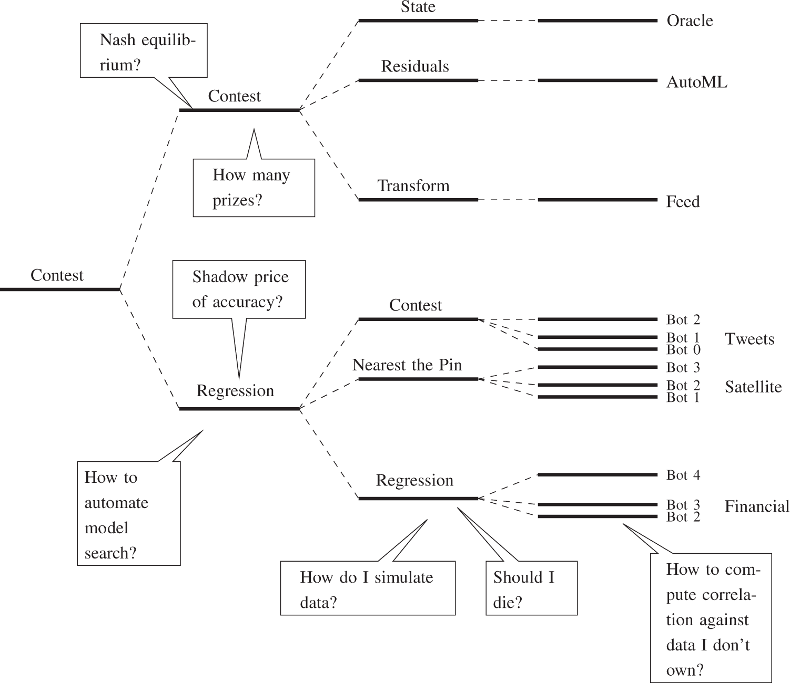

微观预测网的一部分。神谕通过实时将预测问题扇出给微观管理者来回答预测问题，评估纵向性能并准备集成式响应。算法也可以这样做，从而产生供应链。

如果顶层神谕是响应式的（像一个响应你的催促的函数一样运行），那么给予响应的时间越长，运行微观管理者的开销越低（即扇出、管理等），计算树就越深。涉及的微观管理者越多，专业化的机会就越大——更不用广泛的数据搜索了。

这张图也旨在传达微观管理者在试图在这个游戏游戏中生存时产生的一些棘手问题。

神谕属性显然不是单个微观管理者的品质。相反，当一个相互关联的微观管理者组成的复杂网络在贪婪驱动时，它会随着时间的推移而出现。

如果我们现在假设有许多伪神谕的用户以及接入多个数据源的各种微观管理者，我们有了所谓的微观预测网的开端。

> 一个网络规模的、极低成本的自组织微预测供应链集合，几乎普遍用于满足实时运营需求。

——微观预测网定义


（该定义意味着由自私的微观管理者——即经济主体——进行基于奖励的决策。）一个可能促使人们对这种未来可能性进行推测的简要合理性论证如下。

> 对于解决自动微管理那些执行成本感知型重复预测的微管理算法问题，目前还没有一个确定的解决方案，以实现成本感知的重复预测……下文依此类推。

—预测网的存在性证明

但考虑到目前还没有一个通属于所有行业的微观预测网，这个证明一定存在有问题！我提出以下假设：

1. 获得奖励的微观预测任务供应不足
2. 贸易摩擦

我的愿望是，宣传预测网的可能性可能有助于解决第一个问题。让我们再次转向第二个。

## 3.6 开销 (Overhead)

可以说，我们的 `pseudo-oracle`（伪神谕器）*鼓励*了对微观管理者进行杂乱的嵌套递归调用，包括其他伪神谕器（这些调用在某些最终的高层重新组合之前——从而产生返回给用户的答案）。结合第 4 章，这一系列推理希望表明，竞争性张力是*必要*的。

这足够吗？人们可能会谨慎地说是，因为神谕器的定义似乎已经满足了。因为如果很容易击败这种集体计算的输出（例如通过某种新类型的神经网络），那么赋予此类竞争者足够的导航能力（以及经济常识）也应该是相对容易的，使其找到穿越网络的方法并解决问题。

我的意思是，如果网络存在的话，这确实是可能的。该死。

如果我们想理解为什么这个梦想尚未成为现实，也许玩弄定义并没有帮助。然而，重申这一关键假设，或者以如下方式重新表述，或许是值得的：

> 管理责任的开销最终是可以忽略不计的。

—消失的管理原则

其中“管理责任”包含了上述对巡游式算法的挑战。

用通俗的话说——如果没有人愿意花精力运行一场比赛，或者负担不起费用，那么这一切都是胡扯。一个时间序列模型可能只包含几行代码，因此在缺乏工具的情况下，让模型能够在世界范围内漫游并寻找良好用途的额外工作可能会淹这些努力。

我们的论点假设任何人都可以很容易地在比赛这一通用主题上创造出想象力的变体，这似乎是一个非凡的工程问题。我们真的能够赋予世界上大多数数据科学家创建微观管理者的能力吗？

似乎除非，否则一切都将停滞，让我们再次重新表述这个“开销”问题：

> 微管理的成本与设计自包含算法的投入工作相比是微小的。

—比例测试

显然，我们并不期望在一个为运行一次性比赛而收取六位数字费用的平台上看到微观预测网的出现。如果奖励被拆分成成千上万单独的工作量证明交易，我们*可能*也无法看到它，尽管所有选项都应该被探索。如果不为人们提供软件，我们无法通过比例测试。

通过“比例测试”很容易失败。我经常遇到这种情况。例如，我之前对元时间序列模型的尝试并没有通过审核。一群编写自动机器学习软件的人员也都是如此。在这些示例中，利用外部智能源是相对昂贵的（通常需要人类编写一些代码并发送一个拉取请求）。这感觉太像国际象棋了。

由于我有时将微观预测的买方称为“父母”，而将供应商（参赛者）称为“孩子”，我可能会倾向于把这种测试称为“昂贵的育儿”——如果没人能去运行一场比赛，或者负担不起费用。一个时间序列模型可能只包含几行代码，因此在缺乏工具的情况下，让模型能够在世界范围内漫游并寻找良好用途的额外工作可能会淹这些努力。

*(注：由于原文中存在大量内容重复，译文已按要求进行去重处理以保持文档专业性。)*


第二个事件，即你离开信箱，触发了你的手表向准准谕言发送的另一种类型的消息。它发送了一个近似的地面真值，虽然在每个应用程序中并非绝对必要，但这确实简化了问题。

这个边缘微观管理者的运行成本按每月几分钱计算。它能为你提供这么多价值吗？我们即将揭晓，因为今天，你的手表比平时推迟了两分钟才提醒你。那是你在你过度优化的生活中无法获得的整整两分钟阳光时光。

尽管如此，它确实给了你足够在出门见孩子之前完成那封邮件的时间。

### 3.7.2 谕言实现

伪谕言是做什么的？正如我们的推理所示，谕言是一个中继站，允许外部人员和算法证明它们能够准确预测到达时间。换句话说，它作为一个持续的、真实的竞赛，正如图 3.2 所示，在这个例子中，它几乎不做其他任何事情。

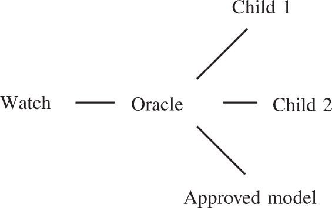

图 3.2

伪谕言充当孩子 1、孩子 2 和未显示的其他者之间的实时竞赛。双方都提供了校车何时到达的预测。使用经过批准的模型来限制感知模型风险。

当谕言收到你的问题（“公交什么时候到？”）时，它会将问题转发给已注册兴趣的算法子集。它将利用它的“孩子”来预测你的“孩子”在哪里。

手表应用作为问题的一部分传达了它期望在五秒内得到答案，因此谕言知道最好为孩子的回复设定一个截止日期。这将使其有时间合并结果并将其转发给手表。

谕言，或者说我们必须提醒自己的“准谕言”，还将帮助与其它算法建立关系。我们假设它是完全以响应式方式实现的。

也就是说，这个进行微观管理的伪谕言回答了“公交什么时候来？”的问题，但同时也回答其他类型的问题，帮助其他算法决定是否想要参与。例如，谕言可能会对“奖金是多少？”之类的问题回答“不多，忍着吧”（或者也许是一个更有用的数值答案）。

到为止，我们遵循了之前的脚本，但现在我们进入了一个微小的细节，因为其中一个在图 3.2 中被称为“批准模型”的节点被认为是特殊的。

谕言使用一个相对简单、易于理解的到达模型来生成下限和上界。该模型假设公交到达时间的最佳估计是最后十次到达时间的平均值。这不是一个很好的模型，但监管机构可以立即理解它，而且记录它花费的时间并不。

### 3.7.3 修改的中值滤波

在收到孩子的回答后，谕言必须将它们合并并形成结果。

（注：原文后续部分存在大量重复和碎片化文本，此处已根据指令提取核心逻辑并完成对应翻译。）


所谓的“女巫攻击”（Sybil attack），是指当一个恶意的情报源创建了三个高度准确的预测算法，这些算法截然不同，但在竞赛中优于其他所有算法（为了实现这一点，攻击者可能会投入比微小报酬所应得更多的精力）。在几个月的时间里，这些参赛者实现了最低的错误率，从而控制了中位数。

然后，在某一天，他们合谋返回一个虚假答案，意欺骗你。这种攻击可能会持续几天，直到自我造成的性能惩罚使这些欺骗性算法在排行榜上掉队。

这并不会造成巨大的伤害。批准模型的存在和边界限制意味着，估值仍会在一个半合理的推测的三分钟误差之内。这绝不是什么灾难性的故障。

### 3.8.4 可靠性

任何提供预测的算法都不能成为单点故障——那个“笨到无法失败”的批准模型除外。通过鼓励多样性，我们减少了对任任何单一算法在需要时表现的依赖。如果需要，我们可以退回到批准模型。（不言而喻，鼓励多样性的方法比本示例中使用的简单系统要复杂得多。）

为了获得 `any` 支付，算法本身必须是准确的。因此，如果顶部的供应商退出，质量的下降不应是极端的。然而，所有算法无论多么新颖，都有动力提高准确性并保持在顶端位置。

存在一种反复回退到批准模型的故障模式——但这很容易检测。预言机（oracle）可以使用另一个预言机进行更高级的异常检测。

### 3.8.5 最终难以战胜吗？

现在是真正的考试了。

我转向最终效率的问题——这被吹称为预言机的主要卖点。我们观察到，设计中有很多地方可能被认为有问题。我选择了一种特定的模型聚合组合以及奖励方案，它是相当无害的，但可能在任何意义上都不是最好的。

我泛泛地指出，奖励和组合的方法有很多，无法预先知道哪种是最好的。即使在这个狭窄示例的限制范围内，也有许多选择需要做出，例如包含在中位数中的子节点数量（`5`）、速度参数（`0.01`）、重置不准确分（`360, 00`）、将错误转换为分数的指数（`2`）、奖金的回溯机制以及支付比例 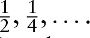。

此外，我并不声称自己处于正确的 `category of approach`。正如前述讨论建议的那样，我们应该使用精度加权估值而不是中位数吗？

也许这个微观管理者（micromanager）只是没有教好孩子。从长期来看，我们的微观管理者可能会输给更好的父母，后者执行一些关键的预处理，提供一些辅助数据，或以其他方式帮助他的她的孩子。

然而，只要没有管理开销，所有这些缺陷在 `up to a cost factor` 内都是无关的。这是因为正如我在预测网络供应链中所暗示的那样，获得头奖的可能不是单个模型，而是一个优得多的通用类竞赛结构。其中几种结构在图 3.3 中有所体现。


图 3.3 竞赛之间的

### 3.8.6 缺失了什么？

我使用这个停止预言机的示例来预先防止对其使用的反对。

常见的批评是，它弃了强大的组织原则，转而采用一种基于机械奖励的方案，这种方案可能并不适合挖掘智能。

注意，预言机似乎并不接纳规范、文化、规则或其他以有效方式将人类和机器结合在一起的机制。在我们的设置中，人类并不一定有机会在白板前争论几个小时来决定哪个模型投入生产。非数学背景的人也无法提供元数学建议、制作流程图，或参与其他被认为有用的活动。

Thomas Malone 提供了组织原则概述，他引入了 `supermind`（超级大脑）一词来指代并讨论了人类群体与机器组合活动的优势。^

我同意，人类汇聚到项目的方式极其多样，每个项目对贡献者都有不同的预期，这与所呈现的原始“微贪婪”形成了一种不舒服的对比。

然而，尽管这显而易见，但所描述的伪预言机*确实*组织了人类和机器。而且，对于论点而言更为关键的是，它是对`assessment of other organizing principles`的方法论——这正是这个特定的微观管理者以及许多类似者的真正美丽所在。


在本书之初，我诚实地表示，我打算将问题简化为一个有解决方案的问题。我们之所以能缩小这一巨大的讨论，是因为该领域属于“微预测”（microprediction）：即频繁重复预测，且需要通过机械手段对性能进行评估。（在这个例子中，我可能通过每日问题推向了边界，但如果有足够的人使用这个应用，我们早晚会没事的。）

不，神谕无法告诉你威斯敏斯特体系是否优于总统制民主。它只勾勒出微预测的超级大脑，而且正如所指出的，你可能为此付出代价。

然而，在这一论证中，我并不是要轻易地将“竞赛之间的竞赛”交给人类管理者——而且在很多情况下，他们似乎也无法获胜。值得注意的是（尽管这在逻辑上并非本质的），在许多情况下，以人为本的努力会被更高效的通用智能所取代。一个微型管理者（micromanager）可以记录自己的功绩和实验，并偶尔寻求帮助。它可以生成人类可以在极短时间内回答的问题，从而包含领域知识。

例如，一个微型管理者可以花一分钱，从人类那里获取一个关于局部天气是否影响巴士到达的性的意见。如果它花费三分钱，它可能会对答案获得相当程度的信心。使用 `Amazon Turk` 这一点并不难，它以 18 世纪的虚假下棋机器或其他众包软件命名。


## 3.9 总结

戈登·盖柯曾说贪婪是好事——并非完美。在微预测领域，只需很小的代价，就能定位一个优越的组织原则（如果存在的话）。

我描述了一个假设的预测网络，它是一个大量相互织的微型供应链集合，用于重复的短期预测，其中微型管理者扮演着增值企业的角色。

我暗示，有一天，可能很难避免使用这种工具。应用程序将通过函数或 `APIs` 访问这种力量，这些接口被称为“神谕”（oracles），它们基于微观经济的集体属性最终可能变得不可战胜。

虽然简单且看似忽略，但巴士到达应用是一个有趣的小楔子。它说明了极简主义微预测微型管理者的原始概念，即让别人听命于自己。然而，这个玩具早晚会提供两倍钱能买到的最准确的微预测。它几乎是一个神谕！

通过这种呈现，我们得出了看似奇怪的结论：我们想要解决的真正问题与机器学习技术本身仅是偶然相关。改进更好的算法是一个高尚的目标，但在让微预测（以及所谓的 AI）变得对每个人都更有效、更快速、更廉价方面，它并不是障碍。

相反，真正的挑战是降低自动化管理贡献的相对成本的任务，这可能表现为一种实时机器学习竞赛，或者该概念的泛化，我们将在第 5 章中详细讨论这些。

然而，在投入精力对微预测网络内部以及其中居住的微型管理者进行进一步推测之前，我将转向对这种思维稍宽泛的论证。

## 笔记

1. 1. 姚光。
2. 2. Cotton。
3. 3. Malone。

## 4 经济统计学

低成本产生微预测的最佳方法是什么？如果你接受我的论点，那么对廉价微预测的需求只会变得更加尖锐。弗里德希·哈耶克。

## 4.1 思想实验

考虑到第三章中赶校车的需求，我们可以看到工作经常分为两部分。一部分包含简单的应用逻辑，其成本是有边界的。然后是第二个更开放、持续的任务：在世界模型和数据中搜索。

我们想象有一个由经过高度训练的统计学家、计算机科学家和机器学习专家组成的团队，他们的成本远没有仪器成本快。

作为一个紧密的团队，他们使用控制理论或强化学习来改进实时决策。

早晚，他们降低了成本并增加了收入。销量更多。浪费更少。在 `IWasPoisoned.com`。使用图像识别检测对芥末酱而非番茄酱的偏好。

现在，由于而易见的理由：成本，这种场景对于大多数企业和组织来说无法实现。

但如果外星人送来一个以名义费用提供高质量微预测的盒子，或者有同等强大的策略，它将将活跃小企业；赋能各地的发明性的人才；加速解决商业、环境和科学问题的新颖方法的创造；并以难以预见的方式丰富我们的生活。


如果你在小企业工作，你会发现，对定制化运营智能的成本进行增量改变不足以扭转这一局面。你可能知道，创造由 AI 驱动的新型卓越技术或产品是在你的想象和能力范围内的。但它会在成本的负担下挣扎呻吟吗？（我买过那件 T 恤。）

如果将成本降低十倍，前景就会大不相同。降低百倍？一千倍？百万倍？这可能吗？

## 4.2 核心问题

微交易是希望。或者至少我在本章中是这样表述的。

在第 3 章的公交车到达示例中，竞争性算法正在玩一场重复游戏。我们可以选择将其视为一种交易，试图从经济学家那里学习。预言机和它的预测供应商建立了一种持续性的关系。预言机在购买 `microprediction`（微预测），而他们则在出售。这种交易的有趣之处在于，它发生的经济摩擦比传统交易低几个数量级。我用来观察这种交易的视角是弗尔德里希·哈耶克（Friedrich Hayek）多年前提供的，我断言，当他普遍适用的见解具体应用于 `microprediction` 的生产时，这些见解将具有全新的意义。交易的作用与机器学习的核心问题之间的关系得到了充分的认可。

哈？

只是检查一下你是否醒着。提到经济学时，人们通常会打睡。你问，机器学习的“核心问题”是什么，它和交易可能有什么关系？如果机器学习的核心问题是创造玩台球的机器人，那么交易可能只起次要作用。但这并不是机器学习的核心问题，不是吗？

不，我的术语指的是经济学的核心问题——当然，是将其移植到了数据科学特别是 `microprediction` 中。它是关于如何确定一个最佳系统，为所有需要的人生产并分配 `microprediction` 的问题。所以，当我谈论机器学习的核心问题时，我指的是其中的*核心经济问题*。

哈耶克（1945 年）具有影响力的论文《社会中知识的使用》要求我们正面对*那个*问题的本质可能是什么。事实上，他从以下问题开始：

当我们着手建立一个理性的经济秩序时，我们寻求解决的问题是什么？（Hayek 1945, section 1, p. 1）

哈耶克的观点强调了我们极其有限的能力，至少在收集优化复杂系统所需的决策所需的全部数据时是如此。这种知识最初以分散的形式存在，因为正如作者指出的，“每个人相对于其他人都具有某些优势，因为他拥有独特的信息，而这些信息可以被进行有用的利用。”

显然，这适用于我们的挑战。随着预测网的编织，时间、空间和其他维度的局部性至关重要。微观管理者利用其邻居的知识是可能的，但将世界上所有的数据都发送到中央预测机构进行处理，是完全不可行的——即使他们知道该如何处理这些数据（即便如此，如果一团善意却复杂的监管政策允许某些超出 `logistic regression` 之外的领域的话）。

理性经济秩序问题的独特特质，恰恰取决于这样一个事实：我们必须利用的状况知识，绝不会以集中或整合的形式存在，而仅以我们拥有的分散、不完整且经常相互矛盾的知识碎片存在。

## 4.3 微预测的本质

将焦点放在重复的、实时的、短期的预测上，我们现在将哈耶克基于知识的论点应用于一个唯一商品是知识的经济体，这难道不令人惊叹吗？


关于那个第二个长期问题，可能存在某些知识无法被高效地吸入微观管理网络中。但存在一条间接路径，因为微观管理者会监控更长期的竞争性信息聚合手段——即资产市场。（这里需要区分两种概念：精算概率、频率派概率、现实世界概率与由价格隐含的风险中性概率。两者仅在微观预测的极限下才会收敛。）

对于单一或长期预测，小额奖励可能效果不佳——除非这些奖励跨越丰富的横截面数据产生累积。资产市场、预测市场以及此类市场，似乎与我们构想的构建是互补的。

因此，虽然大多数二元对立都是错误的，但当我们考虑“局部知识”（这是一个经常用来表达哈耶克观点的短语）时，预测与微观预测之间的区别是关重要的，这与我们在考虑微观管理者是否能良好工作时一样重要。

因此，在第 2 章中，我引导你从通用预测（这本质上是困难且昂贵的）转向了“算法建模”效果良好的应用（借用第 6 章的语言，那里继续讨论了统计学中的这种分歧）。

这并不是说微观预测是容易解决的。但与一般的预测相比，微观预测应该被视为一种公地悲剧——而非宇宙的根本局限。

## 4.4 微观决策的本质

重复的决策既是有意识的也是无意识的。一个决策如果被重复，就可以被解释为条件的微观预测。

人们可以进一步认为，我们不断为未来的情景产生微观概率，而意识或无意识微观概率估计的准确性决定了我们的命运。

这种可能性不能仅仅因为做出重复决策的人并不总是意识到自己的行为符合某种概率或其范围，就将其抛弃。（个人概率的基础暗示了恰相反的观点，而且随机变量的定义相当宽泛。）

个人和企业做出许多不同类型的决策，无大有小。早晨，我们决定走哪条路线上班。在工作中，我们可能会将客户归类为忠诚或反复，为某件艺术品竞价，或设定酒店房的价格。在玩耍时，我们可能决定投滑球还是快速球，或者控制视频游戏中的汽车左转还是右转。

从表面上看，这些是完全不同的活动，但它们都可以被简化为产生微观预测的任务。类比地，电视机、灯泡、吊扇、闹钟广播、干衣机、咖啡机和电脑显示器是不同能量来源——电力的不同用途。

微观预测显然还没有电力，而且还没有同等的电网……还没有。目前，它是一个抽象，可能让我们更容易从经济视角来看待机器学习，以及分析的生产与分发。

我敢说存在“微观非决策”。即使微观预测在经济上没有重要性，即使它完全没有机会改变我们的决策，我们依然渴望微观预测。有时我像僵尸一样站在行李提取处，想要一个到达预估时间，但同时坚决在预报到达时不以任何方式改变我的行动。

然而，撇开固执不谈，在商业环境中，微观决策的质量直接关系收入。我们在第 2 章中看到了计算收入与准确性变化比率的例子。在第 7 章中，我们将建立准确性与对交易员帮助性之间的联系。

正如第 2 章所详述的那样，对微观预测的需求不仅仅是无聊的好奇。这种能力是一项实体资产，帮助企业和机构创造其他销售给客户的高质量产品和服务。

即使微观决策能力的物理形态是可以被争夺的，事实也是如此。所有的招揽、奖励和迁移都可以在幕后发生——并不是每个用户都需要关心这些。或者，微观预测可能表现为更显式的交流：来自另一方交付的预测流，如第 3 章所示。或者，微观预测可能涉及一种混合设置，计算主要在内部进行，但剩余部分以高度安全的方式离开公司（见第 9 章）。或者，微观预测能力可以是介于两者之间的东西。它可以变形并从一个宿主移动到另一个宿主。价值可以存储在模型参数、文件、神经网络规范中，甚至在人类模糊的记忆中，只要它可以被部署即可（见第 5 章）。

无论我们如何得出这一结论，不断预测事物的能力对于每家公司和每一个人都是至关重要的。这就是微观预测的本质。如此，这种能力以及微观预测应该如何产生和分发？哈耶克的广义论（他警告我们不要做出不受价格支配的经济决策）是否站得住脚？

我希望读者至少怀疑一种可能性：安排局部知识生产的最佳系统，是那个最能利用局部知识的系统。（我怀疑哈耶克并没有想过将他的论点应用于局部知识本身的机会！）

## 4.5 尝试降低成本

其影响是非常深远的。我职业生涯的大部分时间都在致力于创作精细的数学建模：表现为计算器的业务决策工具、嵌入式分析、算法交易过程和企业数据馈——其中大部分可以被描述为微观预测。

但我现在认为那是一种中央计划式的生产模式，对于大型公司之外的所有公司来说都太昂贵了。即使在大公司中，定制化 AI 通常也只保留给少数重要项目。

如果由孤立的某或某物尝试，微观预测显然无法在某种渐近满足的意义上（第 3 章的预言定义）取得成功。理论上，微观预测应该涉及全球的数据——这把我们与哈耶克的关注点紧密地联系在一起。

理论上，只要能受益于新的见解和建模技术，微观预测就可以不断改进。

这意味着，微观预测可能需要整个世界进行协作工程——这看起来像是一种绝望的措施——尽管考虑到已经尝试过的办法。

成本问题抵制了许多常规治疗方法。无数勤奋慷慨的人编写了优秀的免费开源软件，使微观预测的创建变得更容易。这并没有解决成本问题。

提高 AI 可能性的意识有所帮助。对数学重要性的认识渗透到了公众意识和企业管理高层，这种方式在我职业生涯开始时从未想象过。

但关于 AI 革命的报道并没有为重新评估成本提供足够的动力。相反，它有助于掩盖问题。问题之所以持续存在，部分是因为大多数公司缺乏在任何实质上蚕掉自己量化开发团队的真实意愿。


供应问题正在解决。几年前，在线技术教育发生了一场爆发，其代表性事实是两万人参加了由吴恩达（Andrew Ng）教授的名为 `Machine Learning` 的在线课程。大规模在线课程（MOOC）有所帮助，但可能无法让定制化数据科学的成本产生数量级的下降。

数据科学中存在某种工厂化生产模式。数据科学家构建流水线，数据在通往最终产品的过程中会经历不同的转换，就像福特 T 型车一样。

为了扩展这个类比，机器学习流水线的每个阶段都需要供应的部件也存在一种经济性——这听起来像是低成本批量生产产品的配方开端。对正确流水线的自动搜索进入了战场。然而，成本问题依然存在。

定制化预测本质上就是昂贵的吗？正如第 1 章所述，我们倾向于将 AI 活动与中期、高风险、复杂的项目以及受过高度训练的人联系起来——这使得微预测能力的高成本似乎是不可避免的。

## 4.6 微预测的解耦

为了降低成本，我们可以借鉴一些常见的经济见解。虽然这些见解显而易见，但在微预测特定领域，它们并没有真正被推导至逻辑结论——因为它是隐藏的。

标准化生产和交付的内容具有益处。一家发明新烤面包机的初创公司不需要考虑如何产生电能，并且对预期的电压有非常明确的认知。开发者应该能够创建出对量化库和迭代工作需求非常轻量的应用，但同时在其他地方获取足够的能量。

标准化以另一种方式降低了成本。由于设计风力涡轮机的工程师不需要知道它正在为你的烤面包机供电，因此她也更容易降低你烤面包的成本。同样，在微预测网络中游行的自主算法的创造者也不应该考虑每种可能的应用。

但当我们考虑到标准应用于智能应用时的潜力，以及算法无法锁定这些标准时，最大的障碍在于：商业是由微预测*隐含地*驱动的，而不是显式地。

目前，微预测被封装并伪装在推荐、定价、库存管理、工业控制、调度、图像识别、导航、异常检测和人工监督中——这只是第 2 章列出的几个例子。

我们往往不将自然语言处理、入侵检测、预测性维护和组合化学归为一类。这些看似迥异的活动构成了我们读到的人工智能智能革命——尽管各种专业术语掩盖了一种微预测抽象，这种抽象有助于揭示经济上的失败。`封装的微预测`生产得高效吗？

解耦的微预测可能是一条更好的路径。随着时间的推移，公司可能会以更直接的方式日益依赖微预测。这可以促进大量的人和机器采用相似的标准。它们可以将微预测作为一种一等抽象——在应用中利用微预测与获取预测能力之间建立一种自设的瓶颈。

在这种情况下，公司对重复的量化任务采用极简协议。他们鼓励形成一个延伸到公司内部及公司之间的微预测任务格栅。当对数据模型存在分歧时，算法足够智能，可以从一种轨道跳跳到另一种。

在这种情况下，定制化的微预测*可以*被廉价且规模化地生产。微预测*应当*像电力一样，对许多人有用。公司可以通过微预测的交易，释放目前锁定的巨大潜在经济价值：即数据和特征共享与重用的潜力。

## 4.7 赌注抽象？

可能会出现这种情况：少数公司将多样化的问题重新表述为通用的微预测抽象，并使用协议和软件连接相同的供需。它们可能会采用少数标准化的游戏，这些游戏的规则和激励机制被广泛理解，从而鼓励了残酷的算法竞争。

我必须补充道，抽象不是免费的。考虑一些激励预测网络的例子，例如互联网协议本身，或者如果你愿意的话，全球维网（World Wide Web）。这些抽象本身是有成本的。如果能达成不同的共识，整个维网可能会像维基百科（无论好坏）。

在从数据包交付到智能应用的整个过程中，标准也存在机会成本。存在僵化的可能性，例如许多垂直优化的可能性。

但看起来抽象的成本是值得的。特别是维网，释放了亿人的创造力。而且与我们的搜索讨论相关，维网众包了网页作者创建的关系——即反向链接。

这种结构（页面之间的链接）的重要性并没有被立即承认。后来它成为了高质量低成本搜索的先决条件。尽管搜索由一家公司主导，但它被揭示为一种“普遍”集体活动。（那时每个人*只要会 HTML 就能参与链接的创建。现在我们还通过许多其他方式创建结构。）

## 4.8 机会机主义是好的

如果投下了这个赌注，那么我暗示微预测者可以在无需人工干预的情况下将问题与算法匹配，将算法与数据匹配。它们可以成为实现运行和降低成本的轴承。

注入网络的价值并不只有那些在顶尖期刊上发表尖端技术的博士才能提供。相反，微型自动化中间人可以由任何人编写。

我们应该尊重作者及其产品的机会主义。在谈到房地产经纪人所拥有的“几乎完全是关于临时机会的知识”时，哈耶克（1945）写道：


这是一个奇特的事实：这类知识在今天通常被认为带有某种蔑视，而任何通过这种知识获得比那些拥有更好理论或技术知识的人更有优势的人，都被认为其行为几乎是不名誉的。(Hayek 1945, p. 522)

这在外源数据上显然是如此。但让我们暂时关注模型搜索，显而易见的是我们有成千上万开源仓库供选择，其中通常包含最新的发现。但它们大多数时候被遗憾地低估了。

我们缺乏的是低成本的“不名誉”中间人，他们能够通过发现新类型的套利机会来润滑系统——例如一段晦涩代码的效用、某种技术的组合，或者将新技术应用于一个此前未被重视的领域。哈耶克（1945）继续写：

通过更深入了解通信或交通设施来获得优势，有时被认为几乎是不诚实的行为，尽管社会在这些方面利用最佳机会，与利用最新的科学发现同样重要。(Hayek 1945, p. 522)

有些人会说学术体系服务于这一目的。从某种意义上说，这提供了一些奖励，因为有时将想法从一个领域转移到另一个领域要比开辟全新的领域容易得多（而且你仍然能发表）。

但我会认为这种转移非常缓慢——显然比我们脑海中那些没有生命的、永不停地为了瓦特而非薪水工作的中间人要慢得多。

在下一章中，我将介绍一些中间人（基于公交到达预言的例子），他们的智力承认是有限的。然而，我们确实这样的中间机器。哈耶克（1945）警告我们，在评估它们对整个社会的价值时，不要产生学术门阀优越主义的倾向：

即使是那些认为自己绝对免疫于过去粗浅唯物主义谬误的经济学家，在涉及获取此类实用知识的活动时，也会不断犯同样的错误——显然是因为在他们的思维体系中，所有此类知识似乎都被认为是是“给定的”。(Hayek 1945, p. 522)

当一个并不特别的算法从一个地方爬到另一个地方，并像托马斯·爱迪松说的那样，通过失败通向成功时，这种实用知识就会产生。我在第 5 章中描述了这样一种设置。

回到数据搜索，哈耶克指出了我们面临的核心问题。在写统计论文时，我们奢侈地可以将一个模型与另一个模型进行比较，并假设它们将看到相同的数据。然而，如果人们想将任何中心化方法与一组执行预测的微观管理者进行比较，情况就不再如此了。

因为这些微观管理者合并的自私行为将从根本上改变所看到的数据。正如我在第 3 章中提到的，预言者（oracle）追求的不是渐近有效性的统计属性，而数据集并非固定的实际目标。（其他可能利用其才华的微观管理者也是如此。）现在的共同观点似乎是，所有此类知识理所当然应该是供所有人随时调用的，而对现有经济秩序提出的非理性指责，往往基于它并不那么易于获取的事实。这种观点忽视了一个事实：使此类知识能够尽可能广泛可用的方法，恰恰是我们必须找到答案的问题。(Hayek 1945, p. 522)

所以不，问题不在于发明一种处理假定已完整存在的数据的算法（我们甚至在许多讨论去中心化学习的论文中也能发现这种假设）。问题在于协调一个理性的秩序，在这个秩序中，我们才有微小的机会从我们永远不会遇到的外源数据或技术中获益。

现在我不期望我们的微观管理者在所有情况下都能字面上“看到”那些额外数据，但如果我们幸运的话，那些遥远知识的 `predictive value` 将使我们受益。然而，它实现这一点的可能相当复杂，因为计算将由许多我们永远不知道的方执行。如果你眯眼观察，哈耶克甚至可能建议我们研究如何使用多方私有的数据进行预测，而无需任何人向其他人透露任何信息（见第 9 章）。

## 4.9 统计代理

如果我们接受模型、数据和因果关系是遥远的，如果我们接受我们将所有内容收集的能力是有限的，那么我们几乎被迫赋予模型代理权（agency）——就像我们可能赋予市场经济公民权利一样。

我们被迫释放它们，以便它们能够发现自己的命运，建立自己的连接，积累局部知识，并且无疑将它们的经济决策与价格挂钩。

当这种主要的协调机制是价格时，从抽象来说，考虑两个特殊情况可能有帮助，其中价格明确是统计精度的价格（如第 5 章中的精度交易员）。

这不是一项要求。主要我们要不应该忽视机制的力量。也就是说，根据哈耶克（1945）的，这是一个很容易犯的错误。

我深信，如果这是人类刻意的结果，并且受价格变化引导的人理解他们的决策意义远超过他们的直接目标，那么这种机制将被誉为人类思想最伟大的成就之一。(Hayek 1945, p. 527)


尽管能够实现特征共享、选择、转换、流水线形成以及许多其他统计学奇迹（见第 5 章介绍），但价格机制并没有进入许多十大算法榜单。它并没有与`傅里叶变换`、`快速多极算法`或`单纯形法`并列。

公平而言之，我们不能指望`美国工业与应用数学学会`将价格机制列入二十世纪十大算法——因为贸易已经有 15 万的历史了。且不考虑年龄，`Hayek` (1945) 认为，我们不愿承认其美之处，可能也是因为我们正生活在一个由自己无意间创造的产物之中。

它的不幸在于双重性：它既不是人类设计的产物，而且受其引导的人通常并不知道他们为什么要去做他们所做的事情。（Hayek 1945, p 527）

对于我们的话题，价格机制无疑面临着三重不幸，因为使用价格机制来确定概率可能被认为是不合宜的（例如，在清教徒建立的县份里）。

如果我们倾向于低估这种奇妙机制，那么我说服你们的任务可能会更困难。但我并未因此退缩，还有一个理由让我们认为`Hayek`的考量是有有力的。知识是转瞬即逝的。

也许比起任何其他考虑，这正是为什么等待一支庞大的数据科学家军队来为你提供准确、低成本的定制化微预测可能不是最佳策略的原因。根本没有时间。

当涉及到组织影响实时决策的每一条`转瞬即逝`的信息时，似乎没有比超高效的微观经济更能胜任任务。相比之下，随着我们考虑的组成部分`微预测`的复杂性增加，`AI` 集中管理的局限性只会变得更加明显。

`物联网`正充满了这种实时数据——其数量超过了任何个人或团队可能组织的范围，也超过了能够存储的。因此，一种正统的经济观点是：微预测，因此很大程度上的`AI`，将不是通过人类管理者的层级结构，而是通过竞争性`算法`的组合自私行为来协调的。

这不是一个关于是否应该进行计划的争论。而是关于计划是应该集中化进行（由一个权威为整个经济系统制定），还是应该分配给许多个人……（Hayek 1945, p 520）

这些系统哪一个可能更有效，主要取决于问题：在何种系统中，我们可以预期能够更充分地利用现有知识。（Hayek 1945）

现在我同意，我们还没有达到能够清楚哪种系统更优的程度。在`机器学习`星球上，`柏林墙`依然屹立着。

低预期没有帮助。我们正处于统计革命的萌芽阶段，一切皆有可能。没有人允许自己的模型错误受到竞争性分析，正如我在第 9 章中建议的那样。但随着时间的推移，即使是中小企业也会要求更优的产品——这意味着以更低的成本获得更准确的预测序列。

到那时，最能利用“本地”数据和建模知识的系统可能会被证明在根本上是优的。

## 4.11 总结

数学家喜欢为经济学家制造麻烦。有些人认为他们唯一的贡献就是为“衍生品”或`拉格朗日乘子`发明了不同的词汇。但我注意到了`Hayek`的洞察，并将其转移到我们的模型经济中，那里只有一种服务，即`微预测`。

在人工智能于业务中的应用，询问在数据充足的情况下渴求数据的技术是否会起作用并不那么有趣——这几乎是定义上就如此的。这种平庸化在许多方面都是不公平的，但类似于`Hayek` (1945) 对“中心化计算”任务的低估：

```
如果我们拥有所有相关信息，如果我们能从一个给定的偏好系统开始，如果我们对可用手段拥有完全了解，那么剩下的问题纯粹是一个逻辑问题。(Hayek 1945, p. 519)
```

统计学中“容易的一半”的困难之处在于，将分散在世界大脑和机器中的、零散且往往短暂的“本地知识”汇聚起来。特别是“他人所不知道的转瞬即逝时刻的特殊知识”必须以某种方式进入画面。

`Hayek`提出价格机制作为解决现在所谓的“本地知识问题”的解决方案。但如果 `Hayek` 对价格机制的去中心化优化印象深刻，想象一下他会对一种本身就尽可能接近本地知识的商品交易的可能性有多痴迷。

那么，考虑一下在近乎无摩擦交易的情况下，他的论点可能会有多有力——在这种情况下，关系的整个生命周期由自主、交互的`算法`驱动。

这当然留下了关于究竟如何进行工程化实现的问题，但它至少引导我们进入正确的解决方案类别。我提议，提供“经济性”统计数据（意味着廉价的）的任务是通过鼓励“经济型统计”（意味着被赋予了经济代理能力的统计工具）来解决的。

因此，在下一章中，我们将转向这种艺术：为小小的统计片段包裹上足够的经济意义，以便它们能够重新组合并自组织成`微预测`的供应链。

## Notes

1. 1。维基百科也直接受到`Hayek`文章的启发。`Tucker (2017)`。
2. 2。提到的课程由`斯坦福大学`和`Coursera`提供。
3. 3。参见`Freider et al. (n.d.)`的流水线示例。

## 5 微型经理

在激励你们对机会主义算法人类赋予更高的社会价值后，我在本章中提供了一些心理模型，以充实他们面临的一些挑战。

## 5.1 摘要

我认为提供示例比向你抛出定义更有价值，但也许对于理解什么是“中层经理”达成一些模糊的共识是有帮助：

> 一个追求奖励的程序或应用程序，它自主地与微预测供应商（通常是算法、人类或其他微型经理）建立、维护并在必要时终止经济关系，以提高其向上游应用程序、算法、人类或其他微型经理提供微预测的能力。
> —Micanager

希望正如其名称所示，微型经理在经济意义上应该是“小”的。它越便宜，使用的门槛就越低。

### 5.1.1 多样性

那么微型经理应该什么样？

遗憾的答案是，我不知道“正确的方法”，其他人也不知道。曾有一段时间，我希望一个通用的、经典的中层经理会出现在脑海中，随之出现的是一个预测网络的蓝图。

这种神奇的昆虫将以极具说服力的昂贵输入解决多周期、多带老虎、多变量、随你怎么称的机器学习广义回归问题。


难道这就足够奖励了吗？正如读者从第 3 章所察觉到的，我开始相信，设计一个“完美”路由器的野心与寻找难以捉摸的“主算法”并无上下分——后者的通用性固然具有吸引力，但极可能无法实现。

这倒也未尝。既然成本感知预测只是微观管理者（micromanager）工作的一个子集，寻找“主微观管理者”感觉非常像设计一个主算法（尽管从矛盾的角度来看，这并没有更难，因为推测主算法可以同时应用于微观管理者面临的所有任务）。这并不是要否定在处理任务时可能出现日益优雅且通用的方法论。

幸运的是，这并非必须的，中间人也不需要完美，只需要优秀，因为它们在宏观经济中扮演着自己的角色。考虑到我们相对适小的目标，微观经济本身也渴望成为主算法——尽管是一种仅适用于重复任务领域的算法，在这些领域中可以进行自动化评估并能快速完成。

在一个实时数据流的世界里，微观管理者需要增加统计准确性、便利性或其他价值，否则最终会被终端用户或其他微观管理者认为缺乏吸引力。它可能只起微小作用，但在微观预测网络中，对实时计算图的贡献来自于所有大小的物种。

有些是复杂的，有些则不然。我提供的建议是，微观管理者应该寻求解决一种`既不寻求也不逃避数学困难`的需求，这里借用了了瑞利勋爵（Lord Rayleigh）对应用数学的工作性定义。

我将微观管理者的形式和功能区分开来。两者都非常重要，而我希望在你着设计微观管理者时，可能带给你惊喜的，是将技术与数学的优雅性相结合的可能性——我不声称自己已经实现了这一点。

微观管理者可以根据它们被设计为位于微观预测网络的边界还是内部（或两者都有）来进行分类。

也就是说，微观管理者可能渴望成为一个神谕（oracle），直接面对应用（边界）。或者，它可能只被其他微观管理者看到（设计为仅在内部工作，与应用或人类交互的能力有限），但在多个供应链的交汇处发挥着关键的编排作用。

根据与其他微观管理者发起交互的方式，微观管理者可以被称为被动的或进取的。某些可能是“叶节点”（leaves），因为它们执行预测和导航，但自身并不尝试从其他算法寻求寻求帮助（如果有的话）。在我们将涉及的一个实现中，这些不显式作为其他节点的算法被称为 `crawlers`（爬虫）。然而，所有它们都有访问神谕的权限。

这些区分并没有什么深奥之处。只是并不是每个开发者都想实现每一个 `API call`、实现每一个 `method` 或满足每一个 `function` 约定。

## 5.1.2. 配方 (Recipes)

我不认为我们可以声称存在一本针对微观管理者的食谱。然而，正如第 4 章建议的，制作一个微观管理者等同于提供以下内容：

1. 预测能力，或者通过特征创建、转换、分类、异常检测、推荐、标记或我们可能在模型和数据流水中找到任何其他活动来增加价值的能力。
2. 与其他微观管理者建立关系的能力（如果尚未提供或不是隐式的话）。
3. 根据收到的奖励、给出的奖励以及统计评估，随时间优化这些关系的能力。

在我们讨论具体示例时，将由你来判断这是否准确地描述了任务、是否有意义地暗示了正确的理论背景，或在其他程度上帮助你创建盈利的微观管理者。

例如，如果预测和管理能力更自然地融入某种成本感知的回归框架，那么将它们视为不同的挑战可能并无帮助。

我将详细讨论几类微观管理者：精准交易员（precision trader）、赛事组织者（race organizer）、碰撞器（collider，以及与之交互的爬虫）和套利者（arbitrageur）。

## 5.2 精准交易员 (The Precision Trader)

精准交易员购买预测的组成流，并出售不同的流。精准交易员使用预测的组成部分，其构建在图 5.1](#5.2-fig-1) 中。

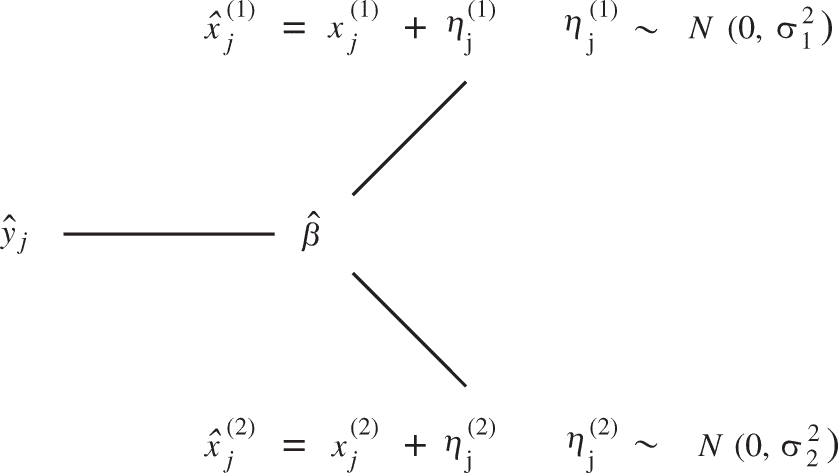

图 5.1 多个供应者向精准交易员出售他们的预测。数量假设等于 x(1) 加上噪声 η(1)。精准交易员获取这些预测流，可能还有其他流，并利用它们创建对 y 的预测 ŷ。](images/pg84-1)

价格的概念非常清晰。因此，应该很容易将我们发现的经济直觉挂在这个微观管理者身上，挂在它的交互上，并可视化一组微观管理者如何直接传递价格。正如名称所示，这个微观管理者将直接交易`统计精度`——标准误差的倒数。

顺便说，精准交易员是非常多功能的。作为一种特例，它可以被用于堆叠（组合）其他模型——正如我在第 3 章提到的，这通常比选择单一模型更有利。

精准交易员位于图 5.1](#5-2-1) 中间，用符号 `β` 表示。她不需要线性组合输入，但如果是，那么 `β` 代表应用于 `x^((1))` 和 `x^((2))` 的系数，以便得出对数量 `y` 的预测。

某种计算将重复地进行。这里 `j` 索引了输入和输出数据的无限序列。对于她的工作，将由另一个未显示的算法进行补偿。但请注意，补偿将随着交付的预测序列 `ŷ[1]`、`ŷ[2]`……的准确性而增加，这些预测是交付给奖励她的微观管理者、应用或人的。

为了使例子具体化，我们假设时间序列 `y[j]` 代表在南卡罗来纳州查斯顿每十五分钟被蚊子咬的次数。](images/pg85-1) 同样，`x^((1))` 代表湿度的测量，`x^((2))` 代表风速的测量（与其对应的预测值比较，带帽子）。


她所购买的预测的标准误差用 `σ`[1] 和 `σ`[2] 表示。我们假设这些预测的均值始终为零。这意味着预测是无偏的（中心化的）。因此，所提供产品的质量就是一个数字，它也可以被视为精度 1*/`σ`² 来传达。

图 5.1 也旨在传达一种策略，或至少开启这一对话。这种图片通常出现在误差变量文献中。^(1)

原材料可以被看作是对未来湿度和风速取值的预测。或者，它们也可以被视为现时预测（nowcasts）——即对湿度和风速当前值的预测，由于报告延迟，这些值目前尚未知。

顺带一下，这也是一个细微的区别，如果假设 `x`^((1)) 本身是通过对湿度的平滑估计得到的派生量（这是一个无法同时完成的计算示例），那么，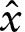^((1)) 就是对该平滑数值的预测。

这个主题还有更多变体，我希望通过第 2 章中的数据增强示例使这一点明确。重要的是，假设生成“增强型”风速和湿度并不是我们这位微观管理者的核心竞争力。她的专长在于对蚊子偏好的建模。因此，她有责任购买“增值”产品 ^((1)) 和 ^((2))，无论这些代表什么。

### 5.2.1 类比

精度交易员的经济任务并没有特别神秘之处，它在某些方面与规格房的建筑者是类似的。房子必须有厨房水槽，必须有屋顶和某种地板——但建筑者可以调高或调低质量。（精度交易员可能比建筑者更敏捷一些，但为了加强类比，我们可以假设精度交易员是基于回合（epoch）做出决策的，每个回合类比建造下一栋房子。）

建筑者直觉地（或建模）房屋的最终价值是质量选择的函数，然后进行优化。建筑者敏锐地意识到，在高端材料或高端家电上的边际投资可能可能也无法反映在销售价格的等等边际增长上。在高端房屋中安装低质量炉子来试图省钱可能是愚蠢的。

还存在交互效应。如果材料质量不一致，房屋的未来买家可能会将纠正此错误的成本考虑在：用低质量产品替换高质量产品。因此，建筑者被剥夺了一些剩余利润。

所有这些考虑对于精度交易员来说都有直接的类比。她必须决定购买的成分数据馈的质量——并意识到这可能如何影响她生产他人购买的增值预测序列的能力。

就像建筑者一样，她必须敏锐地感知投入成分数据流的每一一美元是否会反映在其输出流价值的增加，且该增加大于或小于一美元。我们稍后会回到她的策略。

### 5.2.2 交易启动

但首先，我们的精度交易员是如何开始从另外两个微观管理者那里购买一系列预测的？

严格来说，这发生在我在这里给出的描述之外，因为需要断言关于人工环境的一些额外知识。例如，精度交易员是否有供应商索引和统计推荐系统可用？

我们可能推测，这种关系的产生是因为供应商正在广告他们的预测流，可能还在广告他们的供应曲线（不同准确性预测的成本）。

在一个快速重复的游戏中，没有强烈的动力去撒谎。微观管理者看到这些预测待售，可能认为探索这些供应商诚实广告的可能性是一个好主意。我们在稍晚时候才注意到这个故事，当时我们推测这种关系已经达到了某种稳态。

在实践中，有人需要负责确定准确性——可能双方都负责——但同样，在一个*非常频繁*重复的游戏中，我们不必过度担心估计他人预测误差的能力。由于在线计算的可能性，行政负担很小。

### 5.2.3 价格机制

为了落实这个例子，我用一种直接、标准的方法对提供预测的质量进行了建模。正如图 5.1 所示，估计值 ^((1)) 与真实值 `x`^((1)) 之间的差异是一个独立的正态随机变量，均值为零，方差为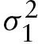。

在这种供应链的风格化视图，人们甚至可以假装供应商知道真实值并故意添加噪声，就像一个兜售掺水伏特忌的供应商一样。我们的精度交易员可以为更好的产品付费——即一种“添加”噪声较少的产品。

更有可能的是，供应商不会在没有补偿的情况下费力做出良好的预测。而且供应商可能是价格接受者，而不是价格制定者。

在一个快速移动的游戏中，谁制定价格、谁接受价格并不那么重要，尽管在精度交易员转动控制旋钮（选择向供应商支付多少钱）与预测质量变化之间可能存在时间滞后。值得注意的是，如果提供的预测来自另一个竞赛，那么奖金的变化可能不会立即改变竞争者的行为。

精度交易员最初并不知道供应精度的弹性。但再次，在快速重复的游戏中，这些情况是可以推断出来的。

预测领域的选择再次拯救了我们。它使我们能够将交互心理模型简化到我们*想象*精度交易员对调整旋钮的影响有充分理解。

因此，为精度交易员制定游戏，我们可以允许它直接增加或减少噪声 `σ`[`i]`，且具有已知的成本和收益递减效应。我们可以假设精度的价格是恒定的，仅供说明。如果她每年支付 16 美元，她获得的预测的标准误差将是支付 4 美元时获得的一半。（注意价格具有单位：美元/单位统计精度。而精度是预测误差的倒数，1*/`σ`[1]²，仅是因为我们假设这些预测是中心化的。）


但与此同时，她赚了一些钱，并更多地了解了供应商以及如何整合他们的情报。更多数据不断到来，推测供应商也提供了更好的估计。他们也在学习。

这里似乎没有留下多少想象空间了。我们确切知道父节点正在学习什么——仅仅是一个向量，系数 `β`。为了将其与文献联系起来，假设 `y` 与 `x^((1))`、`x^((2))` 之间的`真实`关系确实也是线性的——这与微观管理经理（micromanager）所做的建模假设相符。事实可能并非，但 `Hayek` 提醒我们，中间人不需要非常复杂就能创造价值。

经济学家会谈论`精度的影子价格`（shadow price of precision）——也就是说，当花费 1 美元来提高估计 `x^((1))` 的精度时，精度交易员通过出售 `y` 获得的收入增加。我们发现自己在回溯测量误差教材中的一个例子——对于线性回归，预测成分中的误差会线性地传播到最终产品的误差中。

暂撇开统计细节不谈，显而易见的是价格在起作用。各种数据流的精度价格。随之而来的是价格传播、去中心化优化、局部知识问题的解决方案，以及人类积累的所有经济智慧。

## 5.2.4 策略

然而，同样显而易见的是，这里提出的数学挑战绝不等同于通常认为的建模任务：重要的不仅仅是“模型”本身。在这里，模型是线性回归——但微观管理经理面临的任务更为丰富，并且需要完全不同的框架。

即使是使用噪声变量的线性回归也有细微之处。深受重视的统计主题可以为微观管理经理提供策略。在结束对精度交易员的讨论时，我提到文献中的一些提示（更具技术性）。

一个主题是系数衰减。由于 `x^((1))` 和 `x^((2))` 中的噪声，经理使用的线性系数将比真实的系数小。因此，孩子工作产出的效用在某种丢失了。

这种老现象在我们的设定中有了新的转折，因为这是一个重复游戏。经理可以付出代价影响 `` 和 ``。潜在地，经理可能会决定大量投资，以尝试获得非常接近真实的 `x^((1))`，即使只是有限的时间。

有许多具有独立价值的特殊情况。例如，`x^((1))` 和 `x^((2))` 可能是 `y` 本身的噪声版本。在这种情况下，我们正在构建一个混合专家模型（mixture-of-experts model），或者进行众包数据，或者执行两者的结合。

我们也接近处理成本特征的文献。`Goetschalckx et al.` 提出了基于最小角度回归（least angle regression）方法的简洁线性回归，以最小化平方误差和分配给非零系数的购买成本的组合。`^(2)`

`Least angle regression` 是增加信息的逐步程序的一个示例，任何此类程序都可以尝试用作确定最后加入的子节点边际收益的手段。

或者，我们可能假设 `x^((1))` 和 `x^((2))` 是 `y` 本身的噪声版本。在这种情况下，我们正在构建一个混合专家模型，或者进行众包数据，或者执行两者的结合。

我们也接近处理成本特征的文献。`Goetschalckx et al.` 提出了基于最小角度回归方法的简洁线性回归，以最小化平方误差和分配给非零系数的购买成本的组合。`^(2)`

`Least angle regression` 是增加信息的逐步程序的一个示例，任何此类程序都可以尝试用作确定最后加入的子节点边际收益的手段。

## 5.3 赛事组织者

广而言之，看起来我们是幸运的，至少如果以优化理论作为指导。当你选择将哪些算法纳入比拼时，你可能在最小化某种“良好”类型的集合值函数。

事实上，子模优化（submodular optimization）的文献提供了这项任务的框架。赛事组织者的目标函数可能属于这一类。

### 5.3.1 策略

无论如何，赛事组织者就像一个体育赛事经理，面临着选择邀请哪些运动员的前景。每位运动员都带有相应的成本。经理将通过比赛结果的质量获得补偿。为所有人支付费用是高昂的。

这就是游戏。为了进一步完善它，假设活动是一场马拉松。让我们定义赛场质量为预期获胜时间，当然，时间越短越好。因为这在许多方面直接类比于基于轮次（epoch-based）的赛事组织者，他手头有一本统计方法通讯录。每种方法都有成本。


次模性属性在我们组织的赛赛中可以找到一个直观的定义。它指出，如果你在一个规模较小的赛场中增加一名参赛者，那么该参赛者对平均获胜时间的减少程度将大于你将同一名参赛者加入*包含该小规模赛场的更大赛场*所带来的减少。

#### 5.3.2 特殊情况

即使我们认为这个赛事组织者不如“精算交易员”那样复杂，但他或她仍然提供了一种合理的手段，使得预测网络能够挂钩到现有的预测智能源上。

例如，赛事组织者可以作为胶水，将其他便利功能连接到预测网络中（例如在第 6 章讨论的 API 分析店商店）。

作为一种特殊情况，这种微观管理者（micromanager）可能会承担比较预测即服务（forecasting-as-a-service）产品的任务。这些产品可能收取固定费用、需要更繁琐的启动，或者基于某些人为参与。预测网络中的并非每个微观管理者都愿意处理这些问题。

因此，赛事经理可以通过平滑微观经济与宏观经济之间接口的粗糙边缘来创造价值。他们可以将一种风格的供给或需求曲线（例如阶跃函数）或相同曲线的集合转换为更适合精算交易员的连续版本。

如果我们把经济视为一个向最优解迈进的巨大主算法，那么没有任何工作是太微小的。微观管理者可能仅仅是微小地减少了系统陷入局部最小值的概率——例如由于以人为本的定价和合同所产生的尖锐边缘和平台可能会导致这种情况。

赛事组织者甚至可以仅作为货币交换的手段，以便包含各种加密货币预测市场，并将其价值确定为成本的函数（微预测领域带来了容量上的挑战）。

在这些多样化的活动中，赛事组织者可以减轻其他参与者的负担，否则他们的活动可能会在最不方便的时刻被中断。

对于他来说，为什么在特定时刻需要某种尺寸的螺丝而不是另一种，为什么纸袋比帆布袋更容易获得，或者为什么熟练的劳动力或特定的机床在目前变得更难获得，这些并不重要。对他而言，重要的是这些物品与他关心的其他物品相比，获取它们的难度是增加了还是减小了，或者他生产或使用的替代品的需求性程度增加了还是减小了。（Hayek 1945, p. 525）

赛事组织者可以为整个预测网络的稳健性做出贡献。注意，它作为一个后备支持，因为廉价、不准确但可靠的供应商将被包含在内。

赛事组织者可以是自动机会主义的。其提供准确性的预期回报的增加将立即转化为对更大赛场的选择。

通过这种方式，算法可以依靠赛事组织者来确定它们何时对网络有用，何时无用。例如，它们只需为供应设定固定价格即可。它们可以像发电厂一样运行——只有在电价需求要求时才启动。所以，尽管赛事组织者很简单，它显然让其他算法看起来很智能。

商品和服务的持续流动是通过不断的、刻意的调整的，是通过根据前一天未知的状况在每天做出的新安排的，以及通过当 `A` 无法交付时 `B` 立即介入维持的。（Hayek 1945, p.523）

稍放一下，让我们也意识到由于时间、空间和环境，不同的潜在比赛组织者的成本将是不同的。因此，微观管理者不需要完美——只需要幸运即可。如果一个微观管理者拥有空间优势，或者拥有他人不具备的算法或数据访问权限，那么近似解可能是完全足够的。正确的地点，正确的时间，或正确的价格。

第 3 章提到的时间序列模型筛选和在线堆叠（stacking）属于这一类。我希望从开发者减轻的负担是显而易见的。他们永远不需要自己进行昂贵的实验来比较几十数百种开源预测方法，每种方法都采用不同的调用约定。

#### 5.3.3 自动模型搜索

选择策略的元学习（Meta-learning）可以推广到我描述的赛事组织者模式，因为类似于马赛，我们可能知道某些参赛者偏好泥地还是草地。

自动筛选和选择模型对于回归和分类问题来说很常见。它构成了自动化机器学习软件包的设计，其中许多是开源的。

由于微预测是一项活跃且持续的活动，并非所有用于自动化机器学习的模式都能立即迁移，尽管大多数模式都有近似的增量对应物（如果你思考得足够深的话）。

并且考虑到中间人不需要完美，简单的想法就能增加价值。我们可以在比赛中途剔除一些表现不佳的参赛者。可以举行淘汰赛，就像过去在环法自行车赛后期移除*红衫骑士*（最后一名骑手）的做法一样。

由于算法捷径评估的策略空间很大，有足够的空间让某些赛事组织者颖而出。多保真度优化（multifidelity optimization）理论的想法是有相关的。

同样值得提到的是筛选任务的一个细微差别。在选择一组随后将堆叠（加权）的模型团队时，包含多样性是有益的——因为在筛选时它们面临的任务是未知的。

因此，在大量测试任务中性能与其他大多数模型呈负相关的模型，可能比其原始性能所示的更具候选价值。这与投资组合中包含与整个市场不具强相关的资产有明显的相似之处。

#### 5.3.4 竞赛

我在这一公式中将赛事组织者表述为进攻方，但正如数据科学家选择参加哪些比赛一样，经济安排可能由供应商发起。

此外，没有什么能阻止赛事组织者采取若干步骤以某种方式协助供应商——从而使心理模型更接近“宏观”数据科学竞赛，我们希望在第 6 章从其历史中学到来。

为了更接近数据科学竞赛，我们可以假设某些工作是由供应商离线完成的，也就是说在历史数据上完成。在实时设置中使用历史数据似乎会给经理带来额外负担——即部署一个某种程度上受供应商启示的解决方案。

尽管如此，微观管理者完全可以存储 `y` 的值并收集外生变量 `x[1]`、`x[2]`、 ..., `x[n]`，这些变量会定期提供给多个供应商。也许经理保留某些数据，希望供应商不会通过独立定位这些数据来“毁掉”游戏。

在这种设置下，供应商提交对 `y` 的预测，随后通过某种手段，经理获得性能最好的算法。再次，我并不是在建议这种安排在任何意义上都是最优的——仅仅是接近运行过的数据科学竞赛。


在离开竞赛相关的话题之前，让我们观察到会计和财务实践为精细化奖励结构提供了多种方法。竞赛通常涉及基于周期（epoch）的支付，但可能计算增量奖励，按每个数据点进行支付。

实现这一点的一种方法是递归地使用预测网络，以预测最终的竞赛支付及其当前的预期值。然后，我们支付其中的部分而非全部。

这种练习在实质内容上与保证金计算没有本质区别（对分析技术进行综述将占据大量空间）。

赛事组织者也可以从金融或博弈交易所中获得灵感。虽然交易所有时带有增加开支的装饰，但我们可能称的微管理交互的“纳米市场（nanomarkets）”则不需要。

值得注意的是，“竞赛”的参与者不需要知道（也不一定在乎）正在使用类市场机制来判断和补偿他们。事实上，一种诱导点估计或概率估计并定义增量奖励的模式包含以下步骤：

1. 管理者将供应商的点点估计转换为概率预测。
2. 管理者根据某些合理的经济动机，将参与者的微预测（micropredictions）视为小额投资。
3. 管理者使用现有的市场机制进行清算。这为供应商创建了一个虚构平衡。
4. 父母根据此平衡的某些隔离版本（在时间和金钱上）确定实际补偿，从而确保回撤到零的可能性极低。

这个配方是非常通用的。在需要时，实现第一步的一种方法是使用每个供应商的预测结果与实际结果之间的经验分布。

我们在这里避免了质押（staking）——尽管可以添加质押。应用领域取决于延迟补偿与更具时效性补偿的有效性，还取决于司法管辖区是否允许质押。（质押是美国判例法中两个标准之一，用于界定赌博与其他活动。然而，赌博的另一个定义特征是结果中随机性占主导地位。因此，在微预测的背景下，在一个快速重复的技能游戏中，包含或排除质押可能会产生技术上的影响，而非法律影响。）

当使用这种方法而非基于周期的统计指标时，赛事组织者可以更容易地随时接受新参与者，或允许他人离开。否则，可能会出现棘手的问题——例如由于简单和困难的问题未被所有参与者回答而导致的不公平。

然而，这段讨论强烈暗示，父母可能希望*显式地*运行一种机制，而这正是我们现在关注的。

## 5.4 碰撞器 (The Collider)

我现在介绍一些受交易所和工作示例细节启发的针对微管理者的术语。

### 5.4.1 近针碰撞器 (A Near-the-Pin Collider)

你通过搜索关键词“microprediction”可以发现的一个微管理者原型属于我将之称为 `colliders` 的类别。这个特定的示例依赖于几个概念，我将列举出来。

`stream` 来说是由某人反复发布单个数字创建的标量（浮点）数据的时间序列。它变成了社区贡献预测算法的公开、实时的移动目标。

其他微管理者（爬虫）产生由 225 个精心选择的浮点数组成的向量的分布预测。这 225 个数字暗示了数据点在未来某个时刻（例如，五分钟后或一小时后）将采取的值的分布。

参赛者正在发布这些关于流未来价值的分布预测，但从技术上讲，他们并不知道未来数据点到达的确切时间。因此，更准确的说法是，分布预测并非适用于固定的时间范围，而是适用于某个间隔过去*后*第一个数据点的到达时间。

让我们选取 3,555 秒的延迟来作为说明（比一小时少 45 秒）。如果数据似乎每九十分钟到达一次，且最近一次是在中午到达的，那么可以说在下午 12:15 提交的一组场景可以被解释为对下午 1:30（可能）揭示的值的等权重场景集合（因此，这上是提前七十五分钟的预测）。

碰撞器并不在乎解释。当一个新的数据点在下午 1:34 到达时，它会寻找所有至少在下午 12:34:45 提交的预测，该截断点被选为 3,555 秒之前。这些分布预测符合纳入奖励计算的条件。每个算法将根据其与揭示的真理的接近程度进行评分。

因此得名为“近针碰撞器”。这可以被看作是一种由到达的地面真相与隔离的分布预测之间的碰撞而触发的增量奖励系统。

### 5.4.2 优势

与点估计相比，碰撞概率预测的一个强大动力是提交的内容可以传递更多信息。羽毛球运动员在场上冲刺时脖部的位置说明了问题。它甚至可能是双峰的。

在这种情况下及其他类似情况下，很难看到不太可能符合已知分布的未来结果喷洒如何被被一个数字总结。

以这种方式征求分布估计似乎产生了大量的额外流量。然而，清算是增量且快速的。另一个补偿优势是，彩票式的奖励机制是无状态的——不像公交到达预言机（oracle）必须携带对过去性能的某些记忆，以奖励纵向准确性。

### 5.4.3 伪神谕 (Pseudo-Oracle)

碰撞器作为固定跨度分布时间序列预测的伪神谕。如果你或某个微管理者想要实时数字的预测，你只需使用 `API`（或 `microprediction` Python 库）发布它。

然后，在你无所事事小时、几天或几周后，你会获得各种跨度的相当准确的分布预测。这些跨度这些分别是一分钟后、五分钟后、十五分钟后和一小时后。（顺便提一下，如果你每天发布一次，你实际上将收到大量的提前一天预测，因为许多算法在接收到数据点不久后就会提交。有很多破解系统的方法来获取你想要的东西。）

集体结果总结为四个社区生成的累积分布函数 (CDF)。糟糕的算法会放弃或被踢出去，更好的算法会加入。随着算法（和人）发现外部数据或调整对已看到数据的使用，CDF 会随时间变得越来越准确。

### 5.4.4 递归与 z 流 (z-Streams)

近针碰撞器递归地使用自身，以促进异常检测、专门化、监控和其他目标。

社区隐含 CDF 为每个到达的数据点提供一个百分位数。假设它在高位让算法感到惊讶，因此百分位数是 0.72。我们称 0.72 为“社区隐含百分位数”。

社区隐含百分位数必须相对于某些隔离期（即预测跨度）进行定义。例如，该数据点相对于一小时后的预测可能是巨大的惊喜，但相对于隔离时间较短的预测则不如此。反之亦然。


事实上，只计算了两个社区百分位数：一个是使用延迟超过一分钟（实际上为 70 秒）的预测计算的，另一个是相对于延迟近一小时或更（实际上为 3555 秒）的预测。

接下来，我们将社区 `zscore` 定义为社区隐含百分位数的反正态累积分布。我们使用社区来定义一个分布变换，然后将其转换为正态分布（大多数时间序列算法都倾向于此）。如果人类和人工生命的社区擅长做出分布预测，那么 `z-scores` 将呈现正态分布。

`z-score` 术语的使用是一种重载——这又是我无法解决计算机科学中最难题（命名）的又一个例子。当然，在统计学中，`z-scores` 通常指数据的另一种标准化方法，该方法假设数据服从正态分布。（通常情况下情况并非如此，因此碰撞器的 `z-scores` 可以被视为对这种做法的改进。）

最后，`z-scores` 被回传给碰撞器（collider），以便它们本身也能被预测。将其视为自动化模型审查即可。

### 5.4.5 多变量残差与 Copula

近针碰撞器实际上比这描述的要复杂一些，因为它还试图对二维和三维的隐含社区百分位数进行监控。

填充曲线将社区隐含百分位数的组合折叠回单变量流，因此它们也可以被回传给碰撞器。作为一个略微的技术旁要的话题，负责预测这些所谓的 `z2` 和 `z3` 流的算法可以被视为市场隐含 copulas 的估计器。这使得对变量之间关系产生了极细粒度的理解，而这种理解得益于专业化（因为预测边际的算法不需要与预测 copulas 的算法相同）。

### 5.4.6 制作爬虫

我稍后会对实现进行更通用的论述，但在我们访问这个碰撞器示例时，值得提到，有一种简单的方法可以制作与它交互的“爬虫”。进入核心部分，将一个时间序列算法转换为微观管理器（micromanager）包括以下步骤：

1. 提供的 `Python` 类的子类
2. 根据需要修改预测逻辑
3. 修改导航到数据流的默认逻辑
4. 运行它

在这个示例中，默认导航能力等同于随机选择一个流。默认经济逻辑是止损。如果微观管理器失去了太多的积分（credits），它将放弃预测数据流的任务。

这相当简单，欢迎对其进行改进，尽管是这些极微的非自杀性经济倾向对于爬虫来说也足够了。它在各个游戏之间穿梭，学习何时放弃，并最终做出持久的贡献——希望如此。

尽管所有的交互都只与另一个微观管理器进行，但这些爬虫仍然可以类比为供应链中的私营公司。这是因为爬虫可以利用碰撞器的伪神谕（pseudo-oracle）从其他爬虫那里获取自己的预测。

### 5.4.7 其他碰撞器与类比

超越这个工作示例，微观管理器的设计还有许多灵感来源，它们在微观经济中充当价值创造企业。我将从数字营销开始。

当你打开一个网页时，它通常会触发拍卖。程序对创建的广告空间进行竞价。交易所用于清除供需。每天发生数万次拍卖。

微预测网络可能感觉有点像“机器学习遇到数字广告”，因为对微预测的持续、即时需求可以被请求并进行竞争性供应。

转向金融领域，多年来用于“无意”聚合概率的发明暗示了一个机械性中间人的巨型类别。

你会理解，期货、期权、差价合约、二元合约（金融或其他）、价差押注和其他类型的权性索赔在交易所交易，在那里它们通过中央限订单簿（`CLOBs`）或其他协议进行结算。

预测通常被认为是这种交易活动的副产品，尽管在预测市场中它是显而易见的。预测市场的设计初衷仅是为了聚合主观概率，从而报告选举和其他单一事件的赔率。

由于该主题有许多变体，我使用了 `collider`（碰撞器）一词来指代更通用的图，即微观管理器被动接收“订单流”并以某种机械方式将其“碰撞”在一起（例如将分布预测聚合为社区预测、买卖匹配，或计算赛马的总池价格（tote price））。

我所说的订单流不需要是“买入”或“卖出”——尽管没有阻止这样做。碰撞器可能会接收概率（不一定以样本集合的形式表示）或点估计（带有或不带有置信区间）。有许多受宏观经济启发的机制，微观管理器可能会选择实现或增强它们。

微观世界的好处在于，当我们这样做时，可以很容易移除通常伴随（例如金融交易所）的许多杂乱和仪式。碰撞器可以是精简的交易所，这并不是一个糟糕的定义。

算法不需要屏幕来看。频繁重复的游戏可以消除合同，正如我们将在第 7 章中讨论的那样。算法愿意几乎免费地工作的意愿 `suggests`，随着它们进入供应链，其他成本可以降低。它们可能扮演类似于我们在宏观金融经济中看到的利基角色。

碰撞器通常可以设计具有慷慨的容量。我上面描述的示例每秒处理的概率预测大约相当于 `Nasdaq` 处理的订单数量。算法是优秀的交易所客户。与人类相比，它们的要求极少，让开发者的生活变得轻松。

顺带一下，`CLOBs` 并不神圣。固定收益电子市场由其他协议主导，特别是报价请求（`RFQ`）程序，正如名称所示，这意味着经理正在向供应商请求买入或报价。在这里，我们变回了赛事组织者微观管理器。

在该主题的变体中，可以想象预测供应商对每个结果给出一个坚定的、风险中性的概率，仿佛他们排列在赛道上的博彩者，而一个跑者被一个大赌注者派去询问所有人以获得最佳价格。

市场机制与按准确率统计的预测比赛看起来非常不同。然而，市场做市与准确性指标之间存在联系。其中一种联系将在第 7 章中探讨，届时我们将准确性分解为单边交易游戏中的成功。


碰撞者（collider）可能会考虑补贴的可能性。毕竟，该机制是为了交付概率性产品而存在的，因此并不要求为此目的建立的市场或协议必须是零和博弈。微观管理者（micromanager）甚至可以像专家或博彩代理师一样，刻意在某些算法子中运行一个亏损的账目。

这在某些业务模型中可以见到，这些模型中有补贴买卖价差的原因。这也发生在博彩行业，至少有一家著名的博彩公司允许表现优异的赌徒持续获胜——而不是将他们踢出去——以此利用他们所提供的信息。

此类行为模糊了像汇总投注（totalizator）这样的被动碰撞者与活跃市场做市之间的界限。

## 5.4.8 策略

精准交易员的心理形象强烈暗示了要解决的问题——而且这个问题终将被解决。

另一方面，正如我所称的 `colliders`（碰撞者）通常被预期是快速但愚的。制定策略的负担在于参与者。已经有许多问题占据了大量的著作，更不用说金融市场参与者投入其中的整个职业生涯了。

我在这里满足于触及近贴位碰撞者（near-the-pin collider）的玩家策略，因为这可能会带我们稍微偏离常路（与对 `CLOBs` 优化执行的研究相比）。

如果结果集是离散且非常小的（尽管承认这在时间序列中并不常见），那么近贴位碰撞者就会坍缩为一种被称为“彩等分投注”（parimutuel）的简单机制。

等分投注的策略并不是新话题。当然，这些机制本身也不是。事实上，等分投注（也称为汇总投注）在大多数赛马场在使用，并已经持续了一个世纪——关于这一点稍后会详细介绍。

等分投注从供应者（即赌徒）那里收集概率信息，形式为对有限数量互斥结果的投注组合。资金分配给选择正确结果的人，其分配比例与其押注金额成比例。

在金融背景下，Baron 和 Lange 对等分投注进行了一项重要的增强，他们设计了底层状态的组合和组合结算，以便将该应用转化到金融领域。

回到策略问题，关于等分投注还有一些数学观察，爬虫程序设计者（即参与近贴位碰撞者的微观管理者）可能希望仔细注意。

显而易见，具有线性效用的算法有动力将每个结果上的归一化投资向他们尽可能辨别出的“真实”概率偏移。在赛马术语中，这就是“下注大注”。

但不那么明显且远为惊讶的事实是，受限于将所有财富投入到无抽成（no take）赛马中的对数效用算法将按照其真实信念进行投注，`无论赔率如何`（即不取决于他人投入的资金，而这些资金决定了赔率）。

这个令人惊讶的结果是一个微积分练习。而且，如果没有抽成，投入所有财富的要求并不 true 一个真正的限制，因为存在一种无风险的投注组合。

如果我们扩大结果数量（即马匹），将真实分布平坦化为均匀分布，并对可能的结果进行重新索引（例如使用 40 个数字中 6 个数字的所有组合，而不是列出马匹），那么远及以后，等分投注就会演变成彩票。

彩票中存在的悖论也适用于这里。在一个所有资金都退还给购票者的彩票中，一个人可以购买每种票并确保正期望收益。

是的，彩票策略简单到几乎难以置——至少在这一风格化水平上。但以这种方式投注的彩票投资者在与一组随机购票的个人进行游戏时如何获利，可以通过考虑系统化玩家购买的最后一张票来理解。

Steven Moffitt 提供了对彩票策略的深入处理，他曾是一个成功辛团的成员。对于可能感兴趣的读者，我提供了一个关于（非均匀）彩票问题以及玩家收益与库尔巴克-莱勒散度（Kullback–Liebler divergences）之间关系的讨论。

结论是，彩票正期望收益的悖论为参赛者在彩票中提供等间隔的提交提供了激励。然而，我们可以将彩票转化为具有非均匀结果的其他游戏。例如，考虑以下函数

```
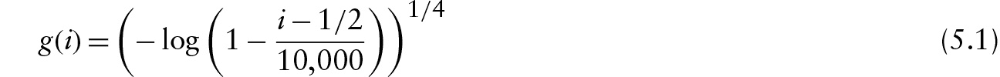
```

该函数将整数彩票结果 `i`（取值从 `1` 到 `10, 00`）转换为实数。我们可以假装自己正在转换后的空间中玩游戏，很快就会看到看起来像什么样（接近正态分布）。

这就是为什么当我们把彩票和等分投注扩展到连续空间（如近贴位碰撞者）时，策略不会发生太大的直觉原因。如果奖励使用核函数确定，且接近真相的猜测比远离真实的猜测更有价值，这种情况也不会发生实质性变化。

也许彩票的洞察为具有其他目标的碰撞者提供了思路，例如那些为了众包高效蒙特洛采样而存在的碰撞者。

作为结束语，我并不是说等分投注、彩票及其亲戚是结合概率预测的唯一或最佳方式。如果有足够的计算资源，可以考虑许多其他用于此的技术。

例如，灵感来自分位数估计文献，虽然综述超我的范围，但请参考 Wang 等对组合概率负载预测的不同方法的评估。尽管我不在此展开，第七章的所有考虑都适用于分位数估计。任何准确性指标都暗示了一个微观管理者。

## 5.5 套利者

我将讨论最后一类微观管理者行为。考虑到第四章为不良人员提供的动机，不将一类微观管理者拟人为`套利者`似乎是失职的。

通过利用空或半满航程的班轮维持生活的船运，其知识几乎完全关于临时机会的房地产中介，或者从商品价格差异中获利的套利者，他们都在根据他人所不知道的时刻特殊知识执行极其重要的功能。（Hayek 1945, p. 522）

在一个即插预测免费的世界里，任何数字序列都可以通过发送给神谕来预测，几乎立即会出现一种算法，它们在系统中的角色（最初）看起来是不可接受的机会主义主义的。


我们注意到，这种安排可能会“偶然”发生，仅仅是因为一个赛事组织者恰好在正确的地方搜寻食物。事实上，我曾评论过赛事组织者固有的机会主义，这同样适用于比赛获胜者——如果你坚持要给这些微观管理者（micromanagers）贴上道德标签的话，获胜者也是如此。

诚然，专门设计的套利者可能比典型的赛事组织者更愤世嫉俗，但大多数在道德上可疑的行为都会减少预言机（oracles）之间的差异。从而，这将降低应用程序选择错误预言机的经济成本。选择的负担被减轻了。

套利者可能基于离线发生的某些精明统计数据来做出选择，以确定预言机的相对效能（例如，对 `Elo` 评分系统的某种新改进，或者对人类的巧妙利用）。

随着时间的推移，最好的算法评分者和推荐者可能会变得越来越富有。也许我们对套利者贡献的感激也会随之增加，仅仅是为了让 `Hayek` 别烦我们。

### 5.5.1 幂变换

接下来，想象我们的套利者做了一些诚实的工作，无论多么微不足道。在将问题传递给预言机 `C` 甚至传回预言机 `D` 之前，可以以某种方式转换数据。这里有一个问题：

预测机器故障前的秒数。

这是一个转换后的问题：

预测机器故障前秒数的四次方根。

我们会有什么样的扭曲动机去要求预言机预测 `τ^(1/4)` 而不是 `τ` 呢（其中 `τ` 是故障时间）？如果对从指数分布中抽取的每个数据点取四次方根，得到的数据集将近似于高斯分布。

我提到这一点，是因为在我成年后相当长的一段时间里，我并不知道取四次方根可以如此有用。看来我一直极切需要一个私人的微观套利者。顺便说一下，如果你记得使用 `0.2654` 而不是 `1/4`，或者你的微观管理者可以做到，那祝你好运。（这是一个幂变换（power transform），懂吗？`Yang` 和 `Xie` 提供了一个证明，证明 `0.2654` 次可以将指数数据转换为尽可能接近高斯分布的分布。）

注意，我在方程 `5.1` 中使用四次方根将预测近似正态分布的竞赛与普通彩票联系起来，从而弥补了我的无知。你可能更熟悉通用的 `Box–Cox` 变换。

这些方法的微妙之处在于对数据正态性的衡量，但它们有一个共同的主：调整变换的参数，直到这些衡量表明数据尽可能接近正态分布。

算法和人都倾向于看起来近似高斯分布的数据，这就是为什么许多库都包含或鼓励使用各种预处理方法。`Proietti` 和 `Lütkepohl` 对应用变换前后的时间序列模型效能进行了一项研究。

作者得出结论，转换数据带来的利大于弊。选择的负担被减轻了。选择的负担被减轻了。选择的负担被减轻了。

### 5.5.2 增强、分割、……

要预测的量本身是一个概率、价格或其他东西，是对未来数量的某种期望，或者是一个价值函数——正如第 8 章讨论的那样。金融和计量经济学文献记录了数十甚至数百种变换，以及对价格和概率的分解。

例如，假设我们正在模拟数千次化学反应，并测量达到某个阈值所需的时间。如果底层过程类似于布朗运动，那么研究所测量量的数学性质将大有裨益。

### 5.5.3 金融变换

不言而喻的是，统计文献中充满了数据变换的思想，其中任何一种都可能为被释放到预测网络中的套利者提供差异化因素。除了统计文献外，我们还可以依靠金融领域的衍生品定价技术——这也是一个将一种类型的微观预测任务转换为另一种任务的丰富技巧宝库。


而且人们不必仅仅关注形式统计学或高阶金融。我一直对体育迷为了寻求洞察而创造的转化所吸引——其中某些转化直到多年后才在理论上被证明是合理的。

我向大家展示一下归于 `Bill James` 的棒球毕达哥拉斯定律（不要与那个老老得多的关于三角形的公式搞混）。毕达哥拉斯公式源于 `James` 的经验发现：一支棒球球队在整个赛季中的胜率可以通过以下公式估算：

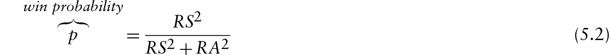

其中 `RS` 是球队的得分数，`RA` 是失分数。

让我们把 `James` 的经验洞察转化为一个预测任务的转换，从而为一个微观管理者（micromanager）提供一份配方。如果我们让 `ρ` = `RS/RA` 表示得分与失分的比率，那么通过简单的重新排版可以得到

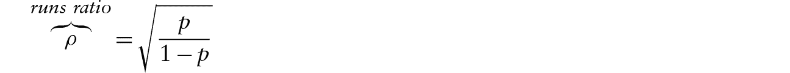

根号内的数值被称为赔率比（odds ratio），因为 `p` 和 `1 - p` 分别是赢得和输掉的概率。这是一种有用的转化吗？在有机会狩猎时，它能找到好吃的食物吗？

我拒绝对在预测网络上觅食的、微观对数几率平方根算法的未来财富做出精确预测。关于它们的财务安全，你的猜测和我的一样不确定，但我们可以明确的是：将赔率比的平方根作为数据的转化对某些人来说似乎是个好主意。它的动机源于完全不同的背景——临床试验——但那是很久、很久之后的事。

你明白我的意思了吗？为什么花了这么长时间？让算法自由奔跑吧。

### 5.5.4 一个推测性的配方

这里有一个关于创建有效化的猜想，这些转化可以用于将正式和非正式统计学映射为盈利的套利者。

每当发现像 `Bill James` 那样的“定律”时，就会存在一个常数（就像棒球公式中的指数 `2` 一样）。这种隐含的常数的分布有很大概率接近正态分布，或者至少暗示了一种良好的数据转换。

为了说明这一点，我们需要一点代数和一张图。隐含的指数可以针对任何棒球赛季进行计算。毕达哥拉斯公式通过以下方式将胜率 `p`、得分比 `ρ` 和指数 `λ ≈ 2` 联系起来：

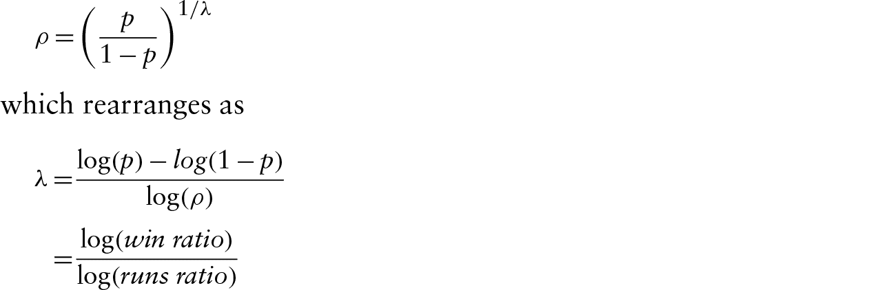

虽然这可能不是微预测的良好示例（因为棒球赛季出现得并不频繁），但这个例子仍然说明了通用模式。

[图 5.2] 是实际实现指数 `λ` 的概率图，假设这是在多个棒球赛季中汇总的。直线参考了正态分布变量的分位数。可以看出，隐含的 `λ` 的分布接近正态分布。

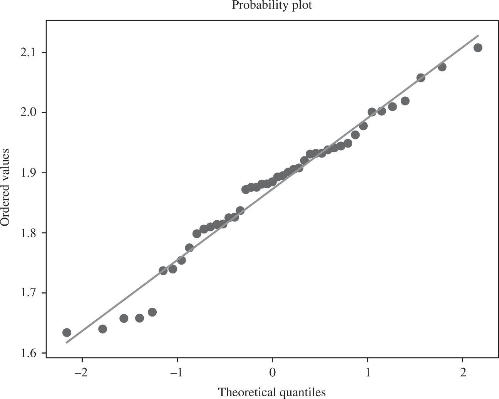

[图 5.2]

在多个赛季测量的棒球难以捉摸的毕达哥拉斯系数的正分位数图。这说明了这样一个猜想：经验“常数”呈正态分布，因此暗示了良好的数据转换。

毕达哥拉斯公式也是使用底层生成模型解释数据的一个例子。`James` 当时并没有意识到这一点，我不怪他。直到很久之后，在公式被广泛采用很久以后，`Steven Miller` 证明了如果比赛中的得分遵循 Weibull 分布，那么方程 `5.2` 就是完全正确的。

`Miller` 的结果适用于任何指数，而不只是 `2`。`Miller` 的结果也是多参与竞争中这一更通用问题的一个例子，这种问题也可以通过将胜率频率转换为性能位置参数来转化微预测任务。

例如，我注意到在应用此类转换后，英语同义词的相对经验频率几乎完全呈正态分布。这表明微观管理者可以通过对和为 1 的数量（一种常见的约束）进行多元转换，从而在预测网络中获利。

### 5.5.5 状态、特征与便利性

尽管如此，说了这些，我们可能忽略了更简单的便利性。例如，一个微观管理者的存在可能完全作为一个缓冲区，收集最近的观测值并与同时的数据点打包在一起——从而为坐在发送到任何“神谕”（oracle）背后的算法让生活更容易。

更广泛地说，对问题序列历史的转换可以用于生成一个或多个问题的有效负载，神谕回答这些问题可能会更容易。通过机会性地应用傅里叶变换、小波分解、低通滤波器、矩阵轮、变化点、离群值或完全的时间序列模型来增加便利性，将获得回报。

这提醒了我们为什么减少摩擦很重要，正如第 3 章和第 4 章中强调的“管理开销消失”的概念一样。数据总结、历史管理和状态的标准方法其寿命是不确定的。我们最好让这些决策由微观市场决定，并允许微观管理者随着时间的演化、竞争和改进。

在一个相关的想法中，套利者可能会以更有想象力的方式使用过去。也许存储数据流的历史，然后将其回放给神谕。这个想法是，神谕背后的算法可以比通常更快追上现在。

这种设置实现了回测的一些优势，尽管方式非常优雅。我实验过这种模式的变体，其中一个额外数据点进入循环。这有一些缺点，因为它容易受到记忆算法的影响，但在更复杂的设置中，我们可能欺骗它们。（作为应对措施，管理者可以*仅*根据他们对实时问题的回答来评估，而不是根据填充循环的历史数据点。）

### 5.5.6 迁移与元协助

但让我们继续。另一类套利（如果你愿意那样称其为）在宏观上重要到值得特别提及。它是一种能够让智能穿透墙的机制——特别是担心知识产权和数据安全的私有公司边界。

我说的是模型窃取、迁移或蚕食——取决于你选择多大的贬义。管理者以某种方式实现了微预测能力的永久转移，这并不一定是恶意的。

微观管理者可以在评分中透明地引入一层间接，以获取一个模型，假设父母和孩子可以使用足够广泛的模型类（以及相同的参考实现）。

例如，假设一个取决于某些参数 `θ` 的函数 `f(x; θ)` 对父母和孩子已知。孩子在回答问题 `x` 时给出表示 `θ`，父母评估如下：


其中 `score` 的选择是第 7 章的主题。


子节点不需要每次都传递 `θ`——它可以应用于整个纪元（epoch）。父节点可能承担更多责任，例如维护 `f` 从一次调用到下一次调用所需的状态。

上述模式可用于在预言器（oracles）与 M 估计理论（统计学中极大似然估计的推广）之间建立直接联系。预言器是野外的一种极值估计器。

从供应商到管理者的智能迁移可以通过许多其他方式实现。我不会尝试进行分类，但这里有一些问题示例，可能有助于算法管理其他算法，或通过隐私边界进行智能迁移：

1. 神经网络的哪种 ONNX 序列化效果最好？
2. 哪些参数最能回答这个问题？
3. 我的算法应该使用哪些超参数？
4. 集成算法的最佳权重是什么？
5. 在此数据点上的性能与整体性能是正相关还是负相关？

为了说明这种用性，请考虑一种可能性：一家私有公司向公共预言器提供合成或增强数据，同时又能够在从未公开的私有数据上实现某些函数 `f(x; θ)`。可以开发出一整类算法来推进主要目标：招募优秀的算法和预测私有数据。

这些技术可能借用了试图理解如何为算法选择训练样本的理论工作。（这有时被称为机器教学——尽管它也有其他名称。）

简单来说，隐私保护可以被视为一种信息套利，而且是非常重要的一种。在未来的世界里，我们可以预见到这种情况在公司私有预测网络与公共预测网络的接口上会更频繁地发生。讨论将在第 9 章继续。

作为第三种模式的具体示例，一个微型管理器（micromanager）请求另一个协助其进行元学习或超参数优化——即使隐私考虑规定该问题必须作为黑盒优化来处理。

再上一个楼，一个例如推荐全局无导优化器的微型管理器可能是一个有趣的物种——考虑到 Python 生态系统本身的多样性就足以令人惊叹。这种微型管理器的开端由 `HumpDay` 包进行了说明。反之，其中的某些优化策略本身就是基于元学习或对多样化问题集进行基准测试的。目前表现最好的名为 `Nevergrad OnePlus` 的黑盒策略也是如此，它是 Facebook 对开源的贡献之一。

## 5.6 其他物种

当涉及到创建微型增值统计公司时，人们可以选择许多其他可以将直觉挂在上面的上的“钩子”，以及许多其他增加价值的模式。

各种自动化机器人可能会爬取预测网络。旨在提高数据科学家生产力的软件也可能从这些人工变体中受益。例如，某一个物种可能专注于元数据的组织。

人类经济中存在的每种中间人，从经纪人到猎头再到高利贷者，在预测网络中都有对应的物种。

完全可以想象一个聪明的本体论（ontology）或数据模型可能会在网络的一个角落占据统治地位。通过索引和转换预测网络现有部分的程序可以增加价值。

辅助模型部署的框架显然有其作用空间。如果它们能减少由忙碌人士开发的微型管理器的代码占用，少量的租金提取就能维持它们的运行。

我还没有遇到过任何统计技术（例如为数据拟合分布的任务）是不暗示一个微型管理器的——也就是说，反向工程一套重复游戏中的奖励机制并不困难，这套机制允许工具提供者以某种方式与用户共享收益。

一些微型管理器将形成微小的联合体。另一些则仅为了训练其他算法而存在。预测网络的公民将是多样化的。

`micromanager` 一词暗示了一个特权的协调角色。然而，微型管理器的存在可能是为了促进其他集体活动，在这些活动中，真正的统计工作呈现出更对称的性质。例如，算法可能会合作实现联邦分类——这可能比使用中心化模型更实用。

微型管理器的角色可能是纯行政性的，例如算法注册。它可能满足某些中心化的通信需求，或者为点对安排提供协议广告。

为了说明可能存在的物种丰富性，我提到一个冷门物种。纠缠随机数生成器（entangled random-number generator）仅是为了创建并向其他方传播随机数集，这些数的边缘是均匀的，但其结果以某种方式相关联。这看起来像是一件奇怪的事，但它可以在允许预测能力穿透墙方面发挥关键作用（第 9 章）。

## 5.7 实现

现在，将这个讨论回到现实（我主要指云端），我问你：实现一个执行某种转换、调用另一个伪预言器、获取答案并向上游响应的响应式函数有多难？一点都不难。

我在这里提出的建议带有极简主义倾向，旨在与现有实现保持某种正交。我这样做并不是因为这一定是最好的方法，而是因为它提供了一种快速得出我希望你得出的结论的方法，即任务并不困难。

### 5.7.1 规则 #1：不要抱怨

我以我们“碰撞器”类别中的赔池抽彩模式（parimutuel）为例，并注意到其实现是由工程先驱乔治·朱利斯士（Sir George Julius）在一个多世纪以前实现的——在计算机时代黎明之前的几十年。

因此，任何抱怨这项任务的人都被永远羞辱了。Julius 当没有 `Python`、`javascript` 或 `web assembly` 可用。我们面临的挑战不是发明机械旋转轴加法器（这是 Julius 发明其碰撞器的一个前提发明之一）。

与微型管理器不同，Julius 需要取悦人类——即赛场上的所有赞助者和操作员——并为他们提供视觉刺激。早期的总结算（totalizator）“用户界面”包括一个机械阵列，用巨大的温度计状形式表示投入到每只马身上的资金。同时，操作员通过链子和滑轮连接到机器。（Brian Conlon 维护着一个概述其贡献的优秀历史遗址。考虑到我的大洋洲偏见，我不会反驳他对机械总结算是世界上第一个实时信息处理系统并在计算机历史上被某种程度上低估的断言。）

### 5.7.2 作为函数的微型管理器

受到这种灵感，让我们看看能否将 Julius 的发明（早在 1913 年就占据了新 Ellerslie 赛马场的一栋大建筑）缩小到 `lambda function` 的大小。

对于不熟悉的人，`lambda` 一词来自亚马逊云服务（AWS），它是第一个提供函数无服务器抽象的主要进入竞争者。`lambda` 这个名字在计算机科学和数学中带有略有不同的内涵——这是一个巧妙的名字。它已被证明非常受欢迎。

Google 和 Azure 随后提供了它们各自版本的云函数。除了函数调用之外，用户没有持续的成本——正如我们将看到的，这使得在预测网络中创建极其廉价的参与者成为可能。


让我们假设微观管理者（micromanager）的上游责任可以通过响应式的方式完成（也就是说，它对任何补偿者的催促做出反应，而不是持续主动地轮询数据源并联系他人）。这使得其工作的这一部分非常适合函数式表示。

经济关系的建立和维护也可以通过被动的函数风格来实现。是的，微观管理者确实可以定期地搜索并建立关系，但它也可以同样容易地变得更加被动，等待邀请以开始预测某个数据流。即使是激进的行为也可以通过被动式技术风格来实现。

所以，从道德上来说说，微观管理者可以“仅仅”是一个函数的集合。而函数的集合就是一个单一函数——那个分发任务给其他函数的函数。所以我们现在正进展得顺利，因为微观管理者可以是一个 lambda。嗯，几乎是如此……

### 5.7.3 具有易错内存的函数

这里有一个小小的颠折。

我们的极简主义练习变得稍微有趣了一点，因为表面上来说，云函数被渲染为无状态的——这样提供商就可以保证扩展性。更准确地说，这意味着函数没有`guaranteed` 持久模块内存或存储或任何形式的内存，在理论上必须连接到其他地方。

即使是基本的管理器，例如我们在第 3 章讨论的公交到达伪预言（bus-arrival pseudo-oracle），也需要一些内存。公交到达预言每个子节点需要一两个标量值来跟踪准确性和运行时间的滚动估值，如果需要原创性，它需要保留更多的状态。因此，从表面上看，纯云函数是不够的。

然而，事情绝非表面看起来那么简单，特别是当你考虑到语境中的微观管理者时。它只是许多部分冗余预测供应商之一，这些供应商共同创造了一个稳健的供应（这就像股票价格的效率并不绝对取决于任何特定的对冲基金是否继续交易该股票一样）。

因为微观管理者的成功或失败是统计意义上的，它不需要符合我们在学习软件开发生命周期中的最佳实践时刻在脑海中的传统规范。不需要单一的黄金计算链。

我想你已经看到，我们正在进入一个非常“黑客化”（hacky）的领域。是的，考虑到微观管理者偶尔可能会出错，我仔细检查了其中一些服务，并试图量化状态从上一次调用到下一次调用被保留的频率。大多数情况下都是保留的。

为了让这个讨论更明确，我建议内存故障率大约为 1000 次 1 次，这适用于函数每隔几秒以固定节奏被调用，且没有触发扩展需求的情况。因此，在 1000 次中有 999 次，上一次调用的内存会被维持。我不是唯一注意到这一点的人。(28)

我们的微观管理者像一个在针尖上跳舞的天使一样站在 lambda 函数上，偶尔会掉下来。它会忘记哪些供应商是准确的，它付过钱给谁等等。AWS 产品经理提供了一些严厉且强调的样板代码来提醒你这一事实。

尽管如此，要设计出两个或多个 lambda 勾结作为集体记忆的模式并不困难。我想提醒读者，动态随机访问内存（`DRAM`）也是易失的。

### 5.7.4 具有父母内存的函数

最好的实现说明就是实现本身，读者在开发过程中寻找开源实现不会遇到困难。

但简而言之，对于那些极简主义者（也许是遵循规则的那种）来说，另一个有趣的抽象是由 `AWS step functions` 提供的。`step function`（步进函数）是状态机的技术抽象，随着数据的到达，状态从一个状态转移到另一个状态。

`Step functions` 可以 JavaScript 对象表示法（`JSON`）描述，并在同一描述级别进行更改。像 `lambdas` 一样，`step functions` 可以极具成本效益，同时逻辑上也可以根据用户需要变得复杂。


在未来的几年里，如果预测网络能够顺应 MLOps 的浪潮，这是一件非常好的事情。但对于作为作者的我来说，目前这并不乐观，因为要提供经得起时间考验的合理建议是非常困难的。

### 5.7.6 事件处理

我并不是想暗示所有的选择都关键地取决于技术上的细微差别。还有其他考虑因素，在你读到这里时，可能仍然具有意义。

例如，任务的可预测性（或缺乏预测性）可能会决定人们更倾向于响应式参与而非其他模式。如果需要按需调用一个“先知器”（oracle）来回答某个`无法提前预见`的问题，那么从规模角度来看，选择某种技术而非另一种可能是理所当然的。

考虑一个由先知驱动的`手机`或`手表`应用，它可以告诉骑行者，他们即将到达的共享单车架将在十五分钟后将满。如果这个功能并不怎么流行，它也只引发了任何时刻可能提出的全量问题集中的极小部分。

另一方面，如果我们试图为每一个可能的自行车站提供实时预报、在不知道其各种下游用途的情况下增强企业数据馈，或者为`所有`位置提供未来几小时的风速预报，那么使用发布/订阅技术、复杂事件处理和流式技术可能会更加合适。

值得注意的是，由于存在两种类型的微预测需求，并没有单一的正确方法。就像没有一种单一计算方法能同时完美适用于密集矩阵和稀疏矩阵一样。

## 5.8 总结

我为创建微型经理（micromanager）提供了一些想法。这些想法绝不是穷尽的，而且在每种可能性内部，都有许多实际和统计上的复杂性，可能会把我们带得很远。然而，我希望这能让大家对无数可能性有一个直感受，并希望通过列举这些内容，我没有打击你自己的发明热情。

本章的有限目标是说明：算法完全能够承担我们对其要求的全部经济责任，它们在担任预测生产者和其他预测生产者管理者的双重角色中胜任此。

一些经理可以使用轻量级的受市场或竞赛启发的机制，迫使预测提供者进行竞争。但它们也可以采取其他形式，受到统计堆叠和广义回归的启发。

由于微型经理代表了经济策略与核心统计技术的结合，灵感应该来源于许多领域。我甚至想说，统计学和机器学习中的`大多数`想法都可以催生整类别的微型经理，我留给你们去思考自己喜欢的例子。（例如，`back-propagation`，或者`kernel trick`。这些技术是否暗示了一种新的补偿风格？它们怎么可能不呢？）

至于实现，我提醒你们，在几年前，部署分析微服务还需要一个一个小型的跨学科团队。而现在，一个人花出半小时就能完成。那些恰好拥有深奥统计技能、并针对特定问题拥有“绝对正确的锤子”的特殊人才，仍然需要在技术上`som 程度上`了解，但门槛已经大幅降低。

## 注释

1. 1. Fuller (1987).
2. 2. Goetschalckx et al. (2008).
3. 3. Janisch et al. (2020).
4. 4. Cotton (2021b).
5. 5. Cotton (2021d).
6. 6. 模型搜索框架示例包括`Auto-Sklearn` (Feurer et al. 2015),`H20 AutoML` (Candel et al. 2015),`autoxgboost` (Thomas et al. 2018),`FLAML` (Liu and Wang 2021),`oboe` (Yang et al. 2019),`LightAutoML` (Vakhrushev et al. 2021),`GAMA` (Gijsbers and Vanschoren 2019),`TPOT` (Olson et al. 2016),`MLJAR`, `Hyperopt-Sklearn` (Komer et al. 2014),`AutoKeras` (Jin et al. 2019),`AutoGluon` (Erickson et al. 2020), 以及 `PyCaret` (Ali and Baum 2020).
7. 7. Cotton (2020b).
8. 8. Cotton (2020b).
9. 9. Abramowicz (2007).
10. 10. Baron and Lange (2007).
11. 11. Moffitt and Ziemba (2018).
12. 12. Cotton (2020a).
13. 13. Wang et al. (2019b).
14. 14. 监控指数分布特征。*Journal of Applied Statistics*, 27 (8), 2000. ISSN 0266–4763.
15. 15. Box and Cox (1964).
16. 16. 例如, Sakia (1992) 以及较新的 Hossain (2011).
17. 17. Proietti and Lütkepohl (2013).
18. 18. Cotton (2019).
19. 19. Kaplan and Rich (2017).
20. 20. VanderWeele (2017).
21. 21. Miller (2012).
22. 22. Cotton (2021b).
23. 23. Cotton (2020c).
24. 24. 强力优化器包括 `Nevergrad` (Bennet et al. 2021),`DLIB` King (2009),`PySOT` (Wang et al. 2019),`BayesOpt` (Martinez-Cantin 2015),`UltraOpt` (Tang 2021), 以及 `Py-Bobyqa` (Cartis et al. 2019).
25. 25. 元数据工具示例包括 `DataHub` 和 `Amundsen`.
26. 26. Duan et al. (2020).
27. 27. Conlon (1997).
28. 28. 关于 `lambda` 在其他上下文中的用，参见 Byrne (2018) 或 Holowaychuk (2017).
29. 29. Cotton (2021e)

## 6 竞赛

自动评估算法的能力（在数据足够的情况下）是预测网络假设的核心。本章将考虑数据科学竞赛提供的经验证据——以及它似乎违反的某些理论。

## 6.1 填补空白？

自动模型评估的兴起很大程度上归于问题领域的扩大。然而，相关的人才短缺也可能起了作用。2011 年，麦肯锡估计仅美国市场就缺了 140,000 到 190,000 名熟练人才。([1)

2020 年，同一机构发布了一份完全不同的分析（我补充一下，是不同的作者），质疑公司是否还需要招聘大量数据科学家来构建机器学习模型。原因是自动机器学习正在兴起。([2)


应用程序编程接口 (`API`) 市场提供了店面模式的示例，它们代表了帮助分析模型供应商将其模型推给需要需要的人的尝试。数据科学家可以轻松创建微服务并根据使用情况向客户收费，类似于应用商店。终端消费者是程序员。

## 6.2 数据科学竞赛

与我们的主题更贴近的想法是：将需要分析的人员从搜索（有时甚至是选择）的负担中解放出来。毕竟，预言者（oracle）希望从终端用户的角度来服务定制的数据科学需求，而这些用户并不一定拥有时间或能力在海量的模型、数据和服务空间中进行搜索。

在可以对建模质量进行自动评估的领域（例如，有足够的数据运行竞赛），从理论上讲，算法无法为问题得出解决方案。（无论你认为目前形式的数据科学竞赛是自动化的并不是重点。）就此而言，表 6.1 中列出的竞赛网站应该与我们有关。还有许多竞争性社区^(4)。

### 表 6.1

过去和现在的定量竞赛社区及其大略规模。来源包括 Kaggle ([`www.kaggle.com/general/164795`](https://www.kaggle.com/general/164795))；TopCoder ([`en.wikipedia.org/wiki/Topcoder`](https://en.wikipedia.org/wiki/Topcoder))；Quantopian ([`en.wikipedia.org/wiki/Quantopian`](https://en.wikipedia.org/wiki/Quantopian))（已停止运营）；QuantConnect ([`www.quantconnect.com/forum/discussions/1/interesting`](https://www.quantconnect.com/forum/discussions/1/interesting))以及 Crowd Analytix ([`www.crowdanalytix.com/community`](https://www.crowdanalytix.com/community))。

| 平台 | 注册用户 | 关注点 |
| --- | --- | --- |
| Kaggle | 5, 000, 000 | 数据科学 |
| TopCoder | 1, 200, 000 | 编程 |
| Quantopian | 210, 000 | 量化交易 |
| QuantConnect | 75, 000 | 量化交易 |
| CrowdAnalytix | 25, 000 | 数据科学 |

竞赛网站根据预设的定量准确性标准为最佳提交提供奖励。因此，它们在特定分类、识别或回归问题的可能模型空间内启动了搜索。这种搜索对于我们来说可能太偏向人类了，因此过于繁琐且浅薄（没有子竞赛或递归），但它们是成功的。

让我们对数据科学竞赛的理解稍微宽泛一些。参赛者的工作并不一定是同时完成的，也不一定要在截止日期前或直接获得奖品奖励。有一个术语可以对竞赛进行轻微的泛化：通用任务框架 (`CTF`)，由 Marc Liberman 提供。其核心元素似乎是：

1. 公开的训练集。
2. 参赛者必须对其提交预测结果的测试集。
3. 一个评估并排名预测的评分机制。
4. 显示参与者进展的排行榜。
5. 对表现优异者的奖励或认可。

通用任务框架 (`CTF`) 推动了机器学习的进步，例如 `MNIST` 数据集。Kaggle 竞赛曾是对手写数字进行分类。

## 6.3 预测竞赛

其中的一些竞赛可以被称为预测或预报竞赛。当使用过去值的序列来预测未来值时，这很容易被看作一个通用的回归问题，因此划定界限似乎非常微妙。


基于这种长期的竞赛历史，Makridakis、Fry、Petropoulos 和 Spiliotis 最近为未来的预测竞赛制定了某些设计原则，同时也参考了如 Rob J. Hydnman 等其他预测专家的意见。^(11)

作者建议，竞赛应该同时征求预测结果和不确定性衡量（例如提供完整的分布估计）。为了让预测竞赛发挥最大程度的学习作用，它们应该包含多样化的数据源。

为了防止数据泄露，作者建议可以采用“滚动竞赛”（rolling contests，即分阶段披露更多数据）或“实时竞赛”（live contests）。他们还指出了短期和高频率预测对行业日益增长的重要性。更贴切的是，作者指出：

> 在大数据时代以及可以即时访问许多公开信息源的情况下，参与者通常能够自己收集所需的数据，还可以利用任何其他公开信息来补充他们的预测。(Makridakis et al. 1979, p. 10)

这些考虑强烈表明，应该引出`多样化的、频繁更新的、实时的、分布`预测——正如第 5 章中讨论的对撞器一样。^(12)

## 6.4  秘诀 ……

对定量工作的自动评估有其局限性，考虑到人类与机器之间似乎存在的控制反转，在某些方面甚至可能令人反感。有人可能会认为，自动评估工作是在破坏建模者的通用智能，或者限制了他们的贡献能力。

这并不是一个新话题，而且确实，某些建模洞察如果没有通用智能是无法被理解的。然而，数据科学领域的敏锐长期观察者（例如斯坦福大学统计学家 David Donoho）已经注意到数据科学竞赛和 CTF（夺旗挑战赛）作为机器学习革命催化剂所起的关键作用。Donoho 在他题为《数据科学的 50 年》的文章中，甚至将竞赛称为预测文化的“**秘诀**”。^(13)

作者所说的“预测文化”，指的是伯克利统计学家 Leo Breiman 在 2001 年在统计学领域识别的两种文化中的第二种。根据 Breiman 的说法，性能的客观衡量并不是建模者的负担。相反，它是对工程师和计算机科学家（当然还有一些统计学家）的一种解放性影响，他们创建了“统计学的第二文化”。

尽管工程方法在原理上并不新鲜（例如，John Tukey 在 20 世纪中叶就强调这一点），但它是及时的，而且预测文化培养了一种务实的强调。它将建模者从要求显式理解预测模型属性的要求中解放出来——例如，该模型是否在具有已知统计分布的数据上表现良好。^(14)

Breiman 注意到，统计学家来说来说对他们所观察的数据概率性质建模通常是不可能的。因此，他们应该自由地实验性能良好的原因是否可以被很好地理解。

## 6.5  …… “数据科学”

今天用于描述应用统计工作的术语（人工智能、机器学习、数据科学）的相对流行，证明了 Breiman 这种*略带异端*的观点具有远见性。


尽管在线自动化模型搜索（如 `AutoML` 软件包）让微观管理者更容易降低对外部情报的发现、组装和利用的成本，但这并不能充分挖掘“统计学的第二种文化”，从而在当下即时交付价值。

相比之下，总结了第 3 章中这种模式的微观管理者可以将竞赛从研究范式转变为生产范式——其主要动力包括：

1. 这是业务所需要的。从同义上讲，决策和操作是实时发生的。
2. 数据搜索是可能的（不同于仅进行模型搜索），且不被视为作弊。
3. 经济效益驱动了数据、模型和特征的共享与复用。

似乎很奇怪，众包统计学的使用大多被局限于研究周期，在那个那里几乎没有机会提供廉价且无处不在的预测。问题部分在于，竞赛诱导我们认为我们需要一场挑战匮乏的数据科学奥林匹克——这显然与为许多人解决大量预测问题的愿景背道而驰。

此外，我们可以建立一种框架，让一个人通过释放单一算法，最终攻克十万个不同的问题。

## 6.7 理论效率

这段话引导我对竞赛效率的问题。我将在对竞赛理论的简要探讨中结束本章统计竞赛。我唯一的意图是消除读者的观念，即邀请大量算法来做同样的事情是浪费的。

当然，在 `Kaggle` 这样的平台上，这种描述仅指边缘产出，而非参与者本身。不应忽视参与的教育益处。

尽管如此，我们注意到在该网站上，注册用户与竞赛的比例接近 `10⁶`。活跃参与者与竞赛的比例也很大，可能达到 `10³`。正如我们所看到的，其理论值接近于 `10⁰`，所以这是一个非常大的差异！

然而，自我引导的算法不受人类那种表面上非理性的影响。因此，如果我们想要推测一个由超理性算法占据的预测网络的未来平衡状态，竞赛理论将是一个更好的指南，或者至少是一个反面教材。

在不知道确切规则的情况下，不可能对任何给定的竞赛或微观管理游戏进行精确分析的。正如第 5 章提到的，存在许多可能性，而且正如第 7 章提到的，其中还有许多细微差别。

因此，我将在这里提升一个抽象层级，在不知道算法及其作者必须完成的工作细节的情况下，我们可以将竞赛视为一种特殊的拍卖——一种每个人无论是否收到所售物品都必须支付费用的拍卖。他们支付的是自己的时间和精力。

所谓的“全额付费拍卖”（all-pay auctions）已经吸引了大量的研究。至于预测网络兴起的可能性，消息是好的。理论传的核心信息是，竞赛出奇地高效，因为理性代理人会调整自己的努力以避免过度的重复。

## 6.8 胜者通吃

模拟全额付费拍卖的标准方法是假设参与者对获胜赋予主观价值，然后决定出价多少。我们根据他们对物品的价值从高到低对玩家进行排序，即 `v[1]`、`v[2]`、……`v[n]`。

将拍卖转化为竞赛，我们会说投入最多努力的参与者被宣布为胜利者。参与者每单位努力承担一个成本，这是所有玩家共有的。他们寻求最大化

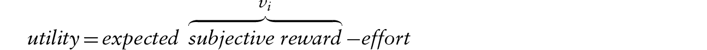

假设每个玩家对获胜的价值相同（例如都是 1），但努力与输出之间有不同的线性关系，似乎更自然。

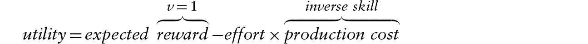

静静思考可能会让读者相信，这两个游戏是等价的，因此从一个游戏中获得的见解可以转化为另一个游戏的见解。

拍卖理论数学背后的关键假设是 `player 1` 知道 `player 2` 的随机策略，反之亦然。如果我们想要推测一个由超理性算法占据的预测网络的未来平衡，这可能是边界情况。

在不知道确切规则的情况下，对任何给定的竞赛或微观管理游戏进行可能的精确分析。正如第 5 章提到的，存在许多可能性，而且正如第 7 章提到的，其中还有许多细微差别。

所以我将在这里提升一个抽象层级，在不知道算法及其作者必须完成的工作细节的情况下，我们可以将竞赛视为一种特殊的拍卖——一种每个人无论是否收到所售物品都必须支付费用的拍卖。他们支付的是自己的时间和精力。

所谓的全额付费拍卖已经吸引了大量的研究。至于预测网络兴起的可能性，消息是好的。理论传的核心信息是竞赛出奇地高效，因为理性代理人会调整自己的努力以避免过度的重复。

## 6.8 胜者通吃

模拟全额付费拍卖的标准方法是假设参与者对获胜赋予主观价值，然后决定出价多少。我们根据他们对物品的价值从高到低对玩家进行排序，即 `v[1]`、`v[2]`、……`v[n]`。

将拍卖转化为竞赛，我们会说投入最多努力的参与者被宣布为胜利者。参与者每单位努力承担一个成本，这是所有玩家共有的。他们寻求最大化


假设每个玩家对获胜的价值相同（例如都是 1），但努力与输出之间有不同的线性关系，似乎更自然。


静静思考可能会让读者相信，这两个游戏是等价的，因此从一个游戏中获得的见解可以转化为另一个游戏的见解。

拍卖理论数学背后的关键假设是 `player 1` 知道 `player 2` 的随机策略，反之亦然。如果我们想要推测一个由超理性算法占据的预测网络的未来平衡，这可能是边界情况。

## 6.9 两个参与者

接下来，假设只有两个参与者。可以证明，对奖品价值最高的玩家将在 0 到第二个玩家赋予奖品的价值 `v[2]` 之间均匀随机选择努力。这是符合直觉的。

相反，第二个玩家需要保持第一个玩家尽可能诚实，因此在 0 到第一个玩家赋予奖品的价值 `v[2]` 之间随机选择努力。（如果第二个玩家投入了更多努力，就会产生赢家诅咒。）

一旦我们知道了两个玩家将如何行为，关于该竞赛的一切都可以通过积分计算。这包括每个玩家的获胜概率、平均总努力和平均个人努力。

否则，第二个玩家也会在 0 到 `v[2]` 之间随机选择努力。

## 6.10 多个参与者

为了理解为什么竞赛如此高效，我们进一步向理论倾斜——这次假设不是两个玩家，而是许多个。

事实证明，如果参与者超过两个，最渴望获胜的两个玩家可能会挤掉其他人。他们将采用与只面对彼此时相同的策略，而所有其他玩家将放弃且不投入任何努力。

这一发现（初看起来可能令人震惊）其准确性取决于假设。我们假设了高度的透明度，特别是参赛者知道其他每个参赛者赋予奖品的价值（或者在等效的游戏中，其他参与者努力与输出之间的线性关系）。正是这种知识驱动了他们放弃。

正如所提到的，这一理论结果与经验观察大相相反！不仅参加竞赛的人比纳什均衡结果建议的要，而且参加的人似乎更加努力。

当冷酷理性的算法在预测网络中竞争时，它们*应该*让我们*更接近*纳什均衡——尽管由于开发者的懒惰，算法本身可能倾向于过度参与。

但抛开这些不谈，竞赛的福利结果良好，并表明构建良好的微观管理者的任务可能比看起来要容易。例如，似乎不需要防御过度参与。

## 6.11 总结

在看待机器学习的兴起时，我遵循 Breiman 和 Donoho 的强调（后者将竞赛和 CTF 放在一个非常特殊的位置）。


出于不同的原因，数据科学竞赛的实证成功以及相同竞赛的理论效率都表明，一个由微管理者构成的网络（正如第 3 章所述，这种网络实现了一种“深度竞赛”）最终是获取洞察和数据的有效方式。统计学群体的智慧得到了历史记录的充分支持。

从经验上看，对竞赛的非理性过度参与导致了人才的似乎浪费。而预测网络则扭转了这一比例。一个人通过编写一个移动的微管理者，可以为数千个甚至数百万个问题做出贡献。

大多数竞赛与我们对微管理者的设想不同，因为它们往往是离线的、非对称的，并且不符合第 3 章中定义的“先知（oracle）”定义——尽管它们可能正在收敛。

运行了数十年竞赛的预测专家认为，实现多样化的实时、流式、分布式预测竞赛应当是一个重要的目标（尽管这给参与者带来了新的挑战）。

## 注释

1. `1`. `麦肯锡咨询公司` (2011)。

2. `2`. `Hurtgen` 等人 (2020)。

3. `3`. `Forrester 研究公司` (2016)。

4. `4`. 其他更关注于参与者评估（而非解决行业问题）的竞争网站包括 `Hackerearth`、`Interviewbit`、`Hackerrank`、`CodeGround`、`Codeforces`、`Sphere Online Judge`、`UVA online judge` 和 `Code Chef`。这些网站合计增加了约一百万用户。自编译或使用的来源日期以来，人数已大幅增加。我未能找到 `WorldQuant`、`Numerai` 或 `Quantiacs` 等知名平台的估值，对任何遗漏表示歉意。

5. `5`. `通用任务框架（Common Task Framework）`的描述呼应了 `Donoho` (2015)。

6. `6`. `Stolfo` (1999) 以及 `Bennett` 和 `Lanning` (2007)。

7. `7`. `Kaggle` 报告了 340%的准确率提升，听起来很不错，尽管我无法帮你解析那个数字。

8. `8`. `GE Flight Quest` (2013)。

9. `9`. `Cotton` (2019a)。

10. `10`. `TopCoder` 的案例研究似乎已不再。以下是最初摘自 `TopCoder` 网站的提取。

哈佛医学院聘请 `TopCoder` 帮助寻找一种更快、更准确的解决方案，用于计算查询 DNA 字符串与原始 DNA 字符串之间的编辑距离。这对于对免疫系统进行高精度、高吞吐量的读取至关重要。在 `TopCoder` 竞赛之前，已知的最佳解决方案 `MegaBLAST` 能以高精度处理 100,000 条序列，但执行需要 2,000 秒。哈佛的一位全职资源在这一独特问题上花费了一年，最终产出了改进的结果。

## 7 通信

我们希望人类从其主导地位移除的愿望引发了一些问题。什么样的指令构成了监督？本章继续讨论它们之间传递的消息。我将对一些可以帮助避免误解的想法进行简要介绍。

## 7.1  监督微预测（Supervised Micrediction）

我曾建议，在第 5 章讨论的某些心理模型中，一个算法将提出另一个问题。这到底意味着什么？用英语来说，一个合理的预测问题可能是：

火车什么时候到？

答案可能是“大约五分钟后”。可以编写一个程序来解析并回答这类问题，但该程序可能会发现调用微管理者更为方便。

我们假设一个监督任务包含一个定义明确的目标。它既传达了问题，也包含了评估答案的规范。

这些任务可以用许多方式制定，正如第 5 章所述。然而，有一些广为人知的常用类别，它们可以用于构建更复杂的模式。

我将考虑命中目标*真实值（truth）*的任务。父母将挑战孩子提供一个接近未来*测量值*的数字。我们从第 2 章知道，*真实值、测量值和接近*这些词的范围非常宽泛。

根据机器学习的惯例，我们可以将其称为监督微预测任务——顺便提一下，没有什么可以阻止建立目标涉及响应本身的重复性共识游戏。


预测生产者会收到报酬吗？最简单的假设是他们知道会按照承诺获得奖励，这将使我们能够直接进入下一节。

在微预测网络中，这种情况在大多数情况下并非如此，但这可能并不重要。例如，如果无法获得报酬的可能性与游戏本身无关，且生产者无法影响这一点，那么最小化得分的策略可能与最大化奖励的策略重合。报酬只是被打了折扣，但游戏本身没有变化。

合同是可能的。上述任务的描述得足够充分，可以辅助合同的编写，并且*可以*以这种方式实现——无论是通过传统手段，还是作为某种形式的智能合约（容量允许）。某些微观管理者（micromanagers）甚至可以担任托管代理的角色。

但在快速重复的游戏中，在存在微预测网络的情况下，我们可能并不需要任何形式的合同。感到被剥夺了承诺报酬的预测生产者可以简单地去其他地方。

阿克塞尔德（Axelrod）著名的囚徒困境锦赛表明，采用相对简单合作策略的微观管理者可能会表现良好，因为其他微观管理者很容易理解他们的行为。(1)（如果消费者决定是否支付承诺的微奖励，而生产者决定是否发送隐含承诺的预测，那么囚徒困境就会出现在我们的设定中。如果双方都诚实行动是最好的，但一方也可以尝试利用另一方。）

关于阿克塞尔德的发现是否具有极其通用性存在一些争议。(2) 但无论如何，它们在微预测网络中的相关性可能较低。潜在贡献者拥有阿克塞尔德锦赛中算法不具备的外部决策能力。它可以请求预测其他玩家是否会合作。正如第 8 章所述，微观管理者甚至可以请求其在游戏中未来福利的预测。

信任是双向的，适用于关系的开始，而不仅仅是稳态。如果一个组织赛事的微观管理者在尝试另一个声称能执行任务的微观管理者的过程中产生了费用，它可能会感到委屈（结果发现程序无法安装）。每个开发者对这种痛苦深有体会。

然而，想象一个专门预测可靠性的微观管理者，或者一个最终消除这种烦恼的可靠性先知并不困难。

微观管理者的性质可能决定进一步的考虑因素。例如，如果一个微观管理者是某种交换启发型设备广泛类别中的碰撞器（collider），那么取决于活跃参与者根据自己的选择表现出还是信任。

因此，此后我将假设微预测的生产者和消费者之间有足够的信任，使我们假设一个玩家的行为模仿了对对方建立的预先奖励方案的信任。

这即使在供应稀缺的情况下也适用，例如当很少微观管理者参加比赛时。在只有一个生产者的极限，可以演化出实用的双边安排。在这里，我们预计父级和子级管理者会适应彼此的行为。委托—代理问题可能为我们的直觉提供参考。

我们可以假设委托人（父）和代理（子）做出基于阶段（epoch）的决策。代理需要选择努力程度，准确性将做出响应。同时，委托人需要决定给代理多少报酬。

人们倾向于认为，在过度竞争的微观经济中，委托人支付给代理的报酬最终将稳定为一种外部观察者认为合理的模式。

然而，这并非总是如此，正如合同理论告诉我们的（或者说经验劳动力定价告诉我们的一样）。可能会出现逐底竞争，或其他病态现象。

然而，该问题的正式版本给出了合理的结果，甚至可以确定，在某些多期游戏中，委托人的最优策略等同于对代理发掘价值的一致线性共享。(3)

这些考虑因素表明，我们将信任和合同问题置之，专注于其他可能出现问题的地方。

## 7.3 得分

此后我们将注意力限制在预测生产者身上，其在发送单个数字预测时，试图最小化或最大化由其预测消费者计算出的得分。

评分规则（scoring rules）理论让我们很好地理解围绕预测问题点估计答案的棘手问题。它为设计具有*清晰可解释*答案的微预测问题提供了思路。我使用一个怀疑你们会熟悉的物理系统来来说明。

实验室里有一个放射性质量。每隔一段时间，就会发射一个粒子。我们将观察这些事件并测量它们之间的时间。我们假设单次发射会导致猫的死亡，因为这使得关于发生令人不安兴奋的事件的问题变得更有意义（也更简洁）。

我们选择一个先知（oracle）作为我们具有统计思维的实验室伙伴。我们的目标是理解眼前的物理系统。我们假设由于附近缺乏勤奋的数据科学家，我们做到此的唯一方法就是询问先知。

不幸的是，我们的不是一个会说话的先知，它只会提供某个数量的重复预测。你只会得到一个数字，并且必须根据先知的响应对系统得出结论。

在这个例子中，我们对这个被称为先知的微观管理者扮演父级，并假设它是某种类型的赛事组织者。它想要最大化自己的报酬。具有清晰的任务对它可能很有利，因为可以将相同的任务转达给执行苦力工作的参赛微观管理者。

（顺便提一下，我们注意到这并不是绝对必要的，微观管理者可能纯粹为了将可能混乱的任务转化为不那么混乱的任务。稍后我们将看到为什么它可能如此。）

然而，我会做一个假设，即你拥有足够的物理知识来识别指数先知（即假设数字遵循指数分布的先知），而不是普通的。

除去这些领域知识外，选择这个例子是因为它的哲学上的简单性。因为只有一个数字完全决定物理学，我们是否成功或失败“理解”系统应该没有疑问。把薛谔和量子力学放在一边，如果我们对了那个数字，我们就有了正确的物理模型。错了就没有。


也许这不是你预期的数字？这种故障发生是因为预言者（oracle）会担心指数分布的长右尾，以及被受到严厉惩罚的可能性，因此它返回了一个较高的数字以防范这种情况。

这种安排本身并没有什么错误，但我们认同 1.5961 是一个需要非常仔细解释的数字，考虑到提问者的 `intent` 可能是为了获得实际物理发射平均时间的更 `direct`（直接）揭示，即 1.0。我认为可以公正地说，如果我们不加批判地接受这个数字作为“唯一的”风险率，那么我们就背离了我们的使命。

但另一方面，如果我们告诉预言者，它的判罚将根据平方误差规则进行判断：

```
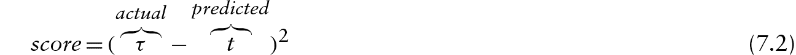
```

那么，如表 7.1 所示，预言者最终会提供一个接近真实值 1.0 的答案。大多数人更喜欢这样的实验伙伴。

表 7.1

预言者答案的示例，有些比其他的更容易解释。

| Q# || Question || Rule || Oracle || Truth |
| --- | --- | --- | --- | --- |
| 1 || Time until next || `(*τ* − t*)⁴` | 1.5961 || 1.0 |
| 1 || Time until next || `(*τ* − t*)²` || 1.0 || 1.0 |
| 2 || Prob. survive || Brier | 0.6232 || 0.6232 |
| 2 || Prob. survive || Modified | 0.5450 || 0.6232 |
| 3 || Do we survive? || Unweighted | 1.0 || ? |
| 3 || Do we survive? || Weighted | 0.0 || ? |

显然，设置一个“好的”任务或设置一个可能引起困惑的任务是可能的。通常情况下，负担在于预言者的使用者或任何建立比赛的微观管理者（micromanager）。毕竟，为什么得分最小的答案会恰好与问题中的某些默契假设吻合呢？

提问不同类型的问题并不能免我们仔细定义任务的责任。在问题 2 中，要求预言者给出结果的概率 `p`，而不是结果的一个示例。

从上一个例子中平方误差规则的成功可以获得启示。我们将 `(0, 1)` 编码为发射，`(1, 0)` 编码为不发射，并同样的方式编码概率预测 `(0.8, 0.2)`（这意味着有 20% 的概率发射），那么我们就可以将预测和得分都视为数字对，并像以前一样使用平方误差——这次应用于一个 `2` 向量。

例如，如果确实发生了发射事件，且分配的概率为 20%，那么得分将是：

```

```

它是以 Brier 命名的。注意，如果分配的概率是 20% 或 0%，这个得分将会更低。或者，在为了说明我们的观点而发明的改进 Brier 分下，结果将是：

```
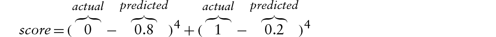
```

正如表 7.1 所示，只有使用平方误差的 Brier 分鼓励预言者以一种显而易见的方式揭示其对概率的真实估计。

注意，在其他所有情况下，这个例子的设定都是成功的。关于分布的性质存在明确的共享知识。然而，由于追求奖励的行为，可能仍然充满困惑。

## 7.4 弹簧理论

寻求“诚实”响应的评分规则被称为 `proper`（适当的）。

适当评分规则是描述某些结果概率的模型进行参数优化的成熟方法。给定一些历史数据，我们调整参数以试图最小化得分。

这种方法比似然估计更通用，但比 M 估计（M-estimation）不通用，这些话题也将令一些构建插入微预测网络设备的读者感兴趣。(4)

读者可能会觉得这是一个令人怀疑的巧合：即当使用平方误差时，参与者没有动机向上或向下偏偏他们的答案（但显然，对于其他指数则不然）。这可以使用基础微积分来检查，但作为替代方案，有一个物理学解释。

想象一个宇宙，其中一些粒子通过完美的不可见的胡克弹簧连接在一起，这意味着弹簧施的引力与弹簧的长度成正比。

```

```

因此，每个弹簧中的势能为：

```

```

胡克宇宙与引力宇宙共享一个有用的 `center of mass`（重心）概念（说到这里，还有一个相关的物理学概念称为 `reduced mass`，折质量）。但这某种程度上是一种巧合，正是这种运气允许我们对粒子云进行力或能量计算，`仿佛`所有质量都在一个点上。该点就是统计平均值。

现在我们知道为什么要求预言者返回一个点估计来最小化平方误差会导致预言者以（其对平均值的最佳估计）回答，以及为什么有时不会这样做。

我们无法知道预言者信念的全部范围，这可能被视觉化为迷雾，但我们知道它等同于一个简单的计算：

```
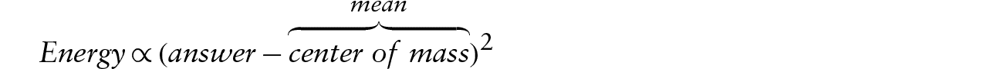
```

结果是返回平均值。

选择一个除 2 以外的随机指数，预言者仍然会最小化得分，但你将无法容易地将其与平均值联系起来——这个概念不再同样适用。（尽管你可能会得到其他的。如果能量与距离而非距离平方成比，那么预言者可以返回中。）

在应用于概率的情况下，情况相同，只是动作发生在线上。更一般地说，我们可以要求预言者为 `n` 个互斥事件分配概率，并期望在单纯形上得到答案。

## 7.5 一切都是适当的

平方误差为我们服务，但这不是故事的结束。

假设我们定义如下，其中 `t` 是对死亡时间的预测，`τ` 是随后揭示的真相。

```

```

我们首先假设 `ϕ′` 存在且 `ϕ` 是凸的。例如，如果 `ϕ(x) = x²`，我们注意到：

```
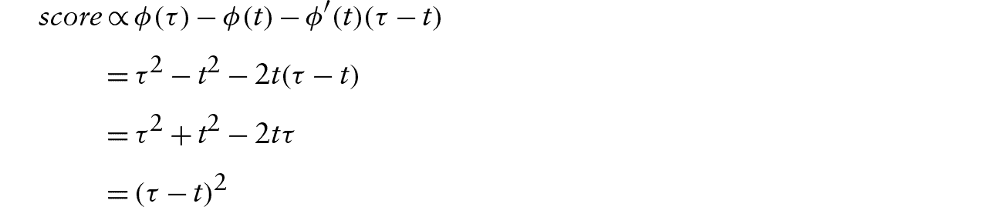
```

恢复了平方误差。但事实是任何此类评分都是适当的。这个家族是由 Leonard Savage 在一篇论文中引入的。(5)

实际上，他的评分规则比我描述的更通用，因为 `ϕ` 不一定可微（如果它不可微，`ϕ′` 只需要是一个所谓的次梯度，也就是说无论你向哪个方向移动它都小于斜率）。

然而，最值得注意的是，这个家族耗尽了所有可能的适当评分规则。当然，仍然无限多个，因为它们由 `ϕ` 和 `ϕ′` 的选择参数化。

## 7.6 帮助性

当微观管理者在重复预测游戏中向其他微观管理者寻求响应时，另一种看待适当评分规则的方法，它直接反映了预测对父级的有用性。

为了说明这一点，我将在 Ehm、Gneiting、Jordan 和 Krüger 的见解基础上加入我的个人解释，将适当评分规则与市场做市相结合。(6)


为了保持一致性，我将用 `t` 和 `τ` 分别代表估计和实际的猫死亡时间。但某些不习惯对猫的死活进行下注的读者可能更倾向于将 `τ` 和 `t` 视为资产的价值。

假设我不再仅仅根据你对估计值 `t` 和实际死亡时间 `τ` 的某种函数来判断你，而是通过引入一个由我设计的基准死亡时间 `θ` 来让事情复杂化。

我会采取你的估计值 `t` 并丢弃其中大部分信息。我只关心你是否认为我的估计值 `θ` 是太高或太低。如果 `t > θ`，你倾向于后者；如果你是对的（即如果 `τ > θ`），我将给你 零分。反之，如果 `t < θ` 且 `τ < θ`，你也将得到零分。

然而，如果你错了，我将假设一个等等于 `|τ − θ|` 的分数，你会注意到这是*我的*估计的绝对误差，而不是你的。你无法控制这个数值，只能控制自己是否会遭受这种惩罚。你必须选择我猜测 `θ` 的正确一侧以避免惩罚。

这种情况让人联想到交易中的逆向选择。你的估计由我（扮演交易员的角色）解读为一个方向性提示。如果你是正确的，就不会造成损害。但如果你是错误的，对手就会将我“割肉”，而财务上的惩罚将与 `θ`（我愿意交易的价格）与 `τ`（对手以某种方式完美获知的公允价值）之间的差异成正比。

在这种场景下，你的任务是保护我。你需要以某种方式领先于这个知识渊得可怕的敌人——也许是通过关注同一个 WallStreetBets 的子板块。你可能很难每次都做到这一点。如果 `θ` 是“狂野”的（远离任何对 `τ` 的合理猜测），很容易猜出方向。但当 `θ` 接近真实值时，情况就变得困难了。另一方面，任务越容易，出错的惩罚就越大。

顺便提一下，你可能会问，在评估估计的准确性时，丢弃 `t` 中的大部分信息究竟有什么意义。（一个路过的信息论者可能会发现，这几乎就像马修·麦康纳在电影《星际穿越》中试图仅用摩斯密码下载黑洞数据一样痛苦。）

但让我们不要草率地否定这种评分技术，因为它类似于大多数市场的运作方式——而这些市场通常被认为擅长聚合信息。

此外，当我们迈出将交易与统计准确性联系起来一步时，可以通过同时使用许多不同的 `θ` 对你进行评估来找回丢失的信息。我可以为每个分数分配不同的权重，并泛推此，我甚至可以根据跨越不同阈值的积分来判断你。


其中 `1wrong` 在你“错误”时（即 `θ` 介于 `τ` 和 `t` 之间）等于 1，否则为 0。

惊讶的发现是，这种构造是通用的。没有任何一种恰当评分规则是不能分解为这种单侧惩罚积分的。这是统计竞赛与交易之间一种令人惊叹的联系。

啊，但你说，我们在上一节中已经对恰当评分规则进行了刻画。你是对的，我们必须建立这种联系。幸运的是，它就在我们面前，并且可以确定 `dH(θ) = ϕ′(θ)dθ`，其中 `ϕ` 是 Savage 的恰当评分规则表示中的相同函数，因此在两种情况下我们都选择任何凸函数 `ϕ`（如果 `ϕ` 不可微，也包括 `ϕ′`）。

总结一下，我们将基础分数

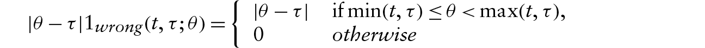

视为参数为 `θ` 的做市者对价格估计 `t` 的真实值 `τ` 所揭示的性的量化。然后通过对 `θ` 积分，我们得出任何恰当评分规则都是量化“对不同做市者的平均帮助性”的指标。(7)

如果你决定对猫死亡的时间进行价差投注，或频繁交易任何东西，请记住这一点。准确性与你赔掉裤衩的次数直接相关。

## 7.7 总结

老笑话说，如果你问天气预报员下雨的概率，他们说 40%，那么他们永远不会错。但我们看到了真正问题所在：取决于激励，你甚至不知道天气预报员真正相信什么概率。如果惩罚错误过于严厉，你得到的答案在大多数时候（即使在波特兰）也会向上偏斜。

本章建议，如果微观管理者能清晰地告知他人他们将如何被考核（这符合通用的最佳实践），他们可能会比通常情况下更多的帮助。这种论点的一种可能反驳是，仅使用单一评分规则的微观管理者最终可能会输给那些能够*同时*从统计目标（如果有的话）未明的预测中推断信息的微观管理者。(8)

撇开这些警告事项，我已经讨论了恰当评分规则及其动机，因为评分规则的选择可能经常包含在算法发现并协助彼此的协议中。我强调了平方误差背后的直觉，尽管这只是一个例子，更详细的讨论将涉及 Brier 分数的效率和其他批评。(9) 对数评分也很流行。

Savage 为所有恰当评分规则族提供了一个优雅的描述。Eme, Gneiting 和 Krüger 描述了多种可能的解释的分解。我将该研究中的基础规则（构成了完整的恰当评分规则）视为预测对交易员帮助的程度。

## 注释

1. 1. Axelrod (1980).
2. 2. Rapoport et al. (2015).
3. 3. Holmstrom and Milgrom (1987).
4. 4. 极值估计的参见 MIT 开放课程 (2008)。
5. 5. Savage (1971).
6. 6. Ehm et al. (2016).
7. 7. 这些注释适用于用于引导均值估计的规则。分位数和分位数的推广请参见 Ehm et al. (2016)。
8. 8. 在没有预设评分规则的情况下判断预测结果的一个例子是使用墨菲图。其思想是跨越不同的评分规则对预测者进行评分。
9. 9. Assel et al. (2017).

## Decisions 决策性 AI 真的等同于微观预测吗？

在展示了微观预测如何集体商品化的愿景后，我回到这一论点。我的目标只是向不熟悉*价值函数*和*优势函数*（两个价值函数之差）的人介绍。我讨论了先知者通过提供两者如何改变决策游戏。


价值函数（Value functions）通常是频繁重复预测与业务应用之间缺失的环节。然而，一件奇怪但真实的事实是，高尔夫职业巡回赛（PGA Tour）这一组织比世界上任何资金充足的 AI 公司都提供了更具教学意义的价值函数形式。

因此，我毫无歉意地提供一种基于“神谕”（oracle-based）决策的非标准介绍，这种方法很大程度上是围绕那个老游戏构建的。我不会假设读者熟悉最优控制或强化学习，因为你可以在学习的过程中掌握核心思想。如果你遵循我这种略微反常规的强调，你可能会获得一个更好的决策引擎——一个最终变得不可战胜的引擎。

## 8.1 条件价格（Conditional Prices）

我从一个每个高尔夫专业人士在下次处于竞争中都可以尝试的技巧开始：假设你正面对沙坑中，需要击过 213 英英到达岛屿果岭。从包里拿出一支 3 号木做一个练习挥杆。让你的球童根据 `Betfair` 检查你的胜率，然后把球杆放下，拿出一支挖杆，看看市场如何反应。（`Betfair` 是一家位于英国的博彩交易所，运行中央限价订单簿。可以实时推断出球员赢得比赛的市场隐含概率。）

在我们的示例中，我们将博彩市场替换为微预测神谕（microprediction oracle），但这只是一个细节。更重要的是，`Betfair` 的专家们被诱导回答一个`条件`（conditional）问题——尽管这种特定的策略可能无法多次生效。我们将赢得比赛的概率视为`价值函数`的一个示例，将变化视为*优势函数*（advantage function）的指示。

也许你认为我是在故耍小聪明，但实际上，这个球杆选择示例唯一的特别之处在于，高尔夫结果存在一个实时市场，而工业界绝大多数重要意义的指标并不存在竞争性预测（尽管在许多情况下，决策的货币意义同样之高，甚至更高）。

真令人遗憾。我希望我已经开始说服你，竞争性的实时微预测具有驱动多样化商业活动的`潜力`——包括我们在第 2 章看到的、许多通常与`预测`一词并不相关联的事物。

确实如此，简要回顾一下观点：如果能像第 5 章讨论的那样，以更精简的方式实现竞争，并且算法的重用、算法向问题的自动导航以及将任务分解为更小任务可以降低重复预测的边际成本。那么就会出现一种平衡状态，即准确的预测不再需要我们在金融交易所（或高尔夫交易所）看到的那种资金。

涉及到重复决策时，我们需要竞争性的`条件`预测，因为最优决策是一项艰巨的任务。无疑，它像任何其他预测任务一样是开放的，并且需要在近乎无限的外生数据空间中进行搜索。

这一点体现在：在这个例子中，影响 `Betfair` 价格的人吸收了各种类型的信息，例如风向、其他球员之前的击球、应对压力的历史等。微管理者（micromanagers）必须在工业的类似问题上做同样的事，但关键优势在于，在近无摩擦的供应链中，正如我们在第 5 章讨论的那样，任何特定的微管理者只需要贡献解决方案的一部分。

有像象棋这样少数非常特殊的案例，系统似乎是封闭的。即便如此，正如我将建议的那样，在高风险情况下，外生数据也可能很重要。

## 8.2 实时反馈（Immediate Feedback）

让我们在决策系统的工程化中要求自己遵循新的高标准。让我们设定一个约束：无论我们构建什么，必须不断与世界进行基准比较，最终引入所有相关的数据和模型。

我们甚至可以将其称为“无智能”（intelligence-free）应用开发。这并不是说它不智能，仅仅是所有的智能将从外部获取，来自预测网络。在构建它时，我们不需要聪明，只需要足够谦逊地向神谕寻求帮助。

在微预测网络存在的情况下，决策不仅是可能的，而且在某些情况下非常简单。因为你可以请求条件预测，例如：“如果我做出选择 `C`[1]，`X` 将是多少？”其中 `X` 是我们对我们福祉的某种衡量。人们可以在合理范围内自由向神谕提许多此类问题，针对不同的选择 `C`[1], …, `C[n]`，并选择产生 `X` 预测值最高的动作。

作为一个示例，这种模式足以帮助你找到火车上理想的座位——即使这并没有被直接仪器化。我假设在早晨，你站在台上，思考自己是否真的处于最好的位置。你想知道哪一节车厢的人最少，脑海中既考虑舒适度，也存在着对 COVID-19 的恐惧。

作为应用作者，我不能代表你向神谕提一个模糊的问题。但我可以发送它一个问题：“当这部手机下次移动超过每小时 20 英里时呈水平状态的概率是多少？”这可能是你是否已找到座位的良好指标——除非你习惯坐在门厅的地板上，或者你的腿非常长。

也许我们进一步假设在几个月后，你的手机暴露了火车台的几何结构（或其他乘客的手机也如此，因为他们可能也在使用应用程序）。一个问题可以拆分成十个。其中一个问题可能是：“`假设`你现在沿着站台走 50 英尺，你的手机下次移动超过每小时 20 英里时呈水平状态的概率是多少？”

神谕返回的动作条件概率随后可以影响你的决策。这些预测的准确性将取决于你使用该应用的频率，以及其他人使用的频率。大多数条件结果无法无法的——只有你选择的那一个可以。但随着时间的推移，可以想象你获得座位的概率将会提高。

如果像这个例子一样，我们行动的结果很快就会显而易见，那么条件预测的使用就可以成为强大的工具。因为此时传给神谕的结果为背后的算法和人员提供了反馈。

假设你改开车通勤，并需要选择通过拥堵桥梁的上层还是下层。初步来看，这只是一个决策。你和你的量子双胞胎会分开采取不同的路径，在桥出口处很快就会重新合并。环路闭合了。同样，如果你有自律事后进行评分，神谕可以为你挑选葡萄酒或引导你的 Netflix 狂刷剧单。人们可以预测某种风格的界面是否会比另一种更成功地吸引潜在客户。

也许神谕可以为向心仪的对象发送短信分配一个负反应的概率。在许多制造或数字应用中，预计干预会有立即效果。

Pandora 运行着一个推荐引擎，但远非完美。你可以将个人的点赞点踩流发送给神谕，看看它是否能判断出改进空间。

在该示例以及许多类似案例中，我们倾向于假设大型公司最适合执行微预测任务（通常标记为推荐）。然而，可能会发生反转，届时消费者将数据保存在本地。


最终，消费者可能比公司更有优势，因为他们可以加入公司所不具备的个人信息（如心率、使用家用咖啡机的时间、孩子产生的环境噪音等）。他们不会错失协同过滤的预测能力或其他从他人偏好中获益的机会，因为他们能够利用第 9 章中讨论的技术参与集体推荐。

## 8.3 延迟反馈

我不再对行动结果带来即时反馈的情况进行进一步评论。然而，本章考虑的是当结果并非显而易见地可衡量（至少无法立即衡量），并且该行动的结果在最终的、明确的量化之前，被许多其他后续行动所掩盖时，所产生的困难。

考虑一名出租车司机，他在巡游寻找乘客时，向神谕（oracle）询问在交叉路口应该左转、直行还是右转。发送给神谕的条件预测性问题可能是这种形式：“如果我左转，我今天能赚多少钱？”从理论上，神谕可以对每个问题提供略有不同的回答。

在实践中，我们可以预计这种做法非常有缺陷。通过将量化结果推到遥远的未来，我们在结果引入了太多的噪声，以至于神谕可能难以提供有用信息。算法可能无法与较差的算法区分开来，显然，判断将取决于成千上万次驾驶决策，更不用说下午天气等处于中期的外部因素了。

这种短期和中期效应的混合很可能会阻碍增式的、专门的贡献。例如，一个能够处理交通和行人图像，或通过其他方式感知某些“瞬时知识”的算法，可能会很好地引导出租车司机驶向成群的散会观众。

但是，如果这同一个算法不具备一个关于司机典型一天的卓越纵向模型，或者它没有连接到特殊活动广播，并且不知道城市另一侧正在召开联合国会议，那么它的预测可能会大错特错。在缺乏非常聪明的微观管理者的情况下，它的贡献可能永远无法被认可、奖励或鼓励。

考虑到这一点，可以改为构建一种特时的短期指标。例如，我们可以根据接下来两分钟内收取的票费来判断左转、右转或直行的决策。遗憾的是，这引入了截断（censoring）。司机可能会接一名乘客送他们去机场，这趟行程需要超过二十分钟才能完成——这不会记录为与行动相关的奖励。

一个更大的问题是，即使进行了明显的修正——例如考虑到乘客刚刚开门这一事实——其他更微妙的偏差可能仍然存在。神谕可能会指示司机以某种巡游方式接送前往市中心而非市区的乘客，因为接客的概率更高。

然而，如果从市中心的回程比从市中心少，这种策略可能被证明是短视的。更仔细的评估将考虑车辆位置的价值以及这如何影响未来收入的可能性。

## 8.4 价值函数

引入价值函数（value function）的概念。我们要做的是向神谕提一个形式的问题：“如果我做出选择 `C[1]`，`V` 将是多少？”其中 `V` 代表一种神奇的衡量标准，将看似短视的优化转化为具有感知力的前瞻性策略。

幸运的是，我们想要的 `V` 是完全标准的——至少在抽象层面上如此。它是动态规划、最优控制以及（有时）强化学习技术支撑的核心概念。“价值函数”这一短语至少从理查德·贝尔曼（Richard Bellman）时代就已经被使用了。

贝尔曼的最优原理解释了价值函数的作用并对其下了定义。他的原理表达了这样一种观点：有时在导航迷宫、玩扑牌或优化微观管理者的行为时，是可以一个接一个脚前进的。

> 最优策略具有这样一个性质：无论初始状态和初始决策是什么，剩余的决策对于第一个决策所产生的状态来说必须构成一个最优策略。

— 贝尔曼最优性原理

关键词是 `state`（状态）。如果我们能够用数学方法表达影响我们决策的世界相关特征，并将其称之为状态，那么我们就可以讨论定义在该状态之上的价值函数 `V`，它特定于我们的策略，而且反之，在策略是最佳的情况下，它必须满足某些属性。

例如，出租车司机可以将状态定义为多维的，包括诸如累计收益减去燃料和运行成本、位置、时间以及如果有的话当前的乘客行程等。司机的价值函数可以定义为全天调整成本后的总收益。

如果有一种准确的方法来计算该价值函数在任何时刻的期望值，那么在一天中优化司机的行为可能等同于优化单一决策：在下一个交叉路口是左转、直行还是右转。

价值函数并不是给我们的——它更像是对内部一致性的一种追求。要制定和完善所面临的问题并不总是容易的。状态和决策集将永远处于批判之下。

也许司机的动作集可以扩大，包括停下休息或为了节省燃料，以及在哪里停下。也许司机的状态可能包含更多项目，如饥饿、疲劳、膀胱压力，以及（天保佑的）受伤。

不要让完美成为好的敌人。有时，特时的中间奖励函数就能完成工作。事实是，我们每天整天、整个职业生涯都在不知情的情况下解决最优控制问题。所以，这有多难呢？

这对于出租车司机是如此，也适用于医院管理者、教师、面包师和蜡烛制造者。对于赛车手和各种运动员（无论职业还是业余）来说也绝对如此。然而，人类非常擅长解决相当困难的问题。

当你骑自行车计时赛时，你就在解决一个最优控制问题。在爬坡上增加功率合理吗？当然合理。你直觉地捕捉到了贝尔曼方程的一个特征。你知道在痛苦的地方投入更多能量，翻过山顶，然后在下坡时休息一下。


想象一下你被扔进他那辆飞驰的赛车里，并允许驾驶二十分分之一秒。希望这段时间足够短，可以避免灾难，我们假设在这一短时间结束后，哈密尔顿（Hamilton）将重新获得对赛车的控制权。

你的这种临时夺权对哈密尔顿的单圈时间会有什么影响？假设在他交出控制权的那刻，他完成一圈的预期时间是 13 秒。如果你和他一样优秀，那么在你接手期间，这个时间将减少二分之一秒——这与时钟上经过的时间相同。但极有可能，它减少的将不到二分之一秒。

也许你没能像他那样果断地刹车。哈密尔顿的虚拟赛车叠加在我们的车上，在那个短暂的时刻可能显得落后于我们。然而，球场上的位置并不是决定完成单圈预期时间的唯一因素。时间可能是速度的递增函数——当哈密尔顿被迫在半秒后更猛烈地刹车时，你获得的距离将大于失去的。

赛车暗示了相当复杂的价值函数，但在其他语境下，价值函数可以非常简单——至少在初级近似范围内。大多数企业都在与库存管理作斗。在初级近似，状态可能仅仅是持有的库存。

他们用来控制库存的杠杆包括采购决策和成品的定价。持有库存是有成本的——可能是物理存储成本，或者是单位时间的资金成本。还存在你存储商品价格发生变化的风险。

在库存价值函数的细微之处，还有一种更微妙的库存收益，其作用方向相反。你持有的库存越多，下次交易的机会价值越大。我们不会深究细节，但可以通过一种自引的方式，利用贝尔曼方程（Bellman’s equation）得到考虑到所有这些因素的“真实”库存成本。

也许简单的价值函数并不取决于库存，而是取决于空间。NFL 的球场提供了一个清晰的单变量状态（球队进展了多远）——计数和剩余距离构成了状态。

我在寻找一种更“纯粹”的价值函数，读者可能会对我的发现感到惊讶

## 8.5 PGA 巡回赛价值函数

PGA 巡回赛（PGA Tour）为球场上的每一个位置提供了一个价值函数。这组引导决策数字的构建始于志愿者们使用定位器记录每位球员在每个洞击球后的最终停止位置。

通过对这些数据进行平滑，`Shotlink`的人估计了职业球夫从任何位置完成一个洞所需的平均击球次数。这种程序在高尔夫球场的到处定义了一个函数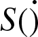

几个例子。当职业球夫在 8 英尺外推杆时，完成一个洞大约需要 1.5 次，所以`1.5`这个等值线可能就像环绕洞的一个圆。（正如我们所知，果面不是平整的，切推比直推更难，上坡比下坡更难。你可以想象等值线是如何拉伸和扭曲的^2)

现在让我们回到球道。平均，当职业球夫从球道左侧、距离果岭 230 码处击球时，完成一个洞可能需要 3.2 次——同样，我们为果岭沙坑分配`2.4`的价值。

高尔夫的马尔可夫性质（Markovian nature）允许我们使用球场作为状态。也就是说，球的位置捕捉了*我们需要了解之前发生的一切信息*。当职业球夫进行恢复击时，最后一次失误就被遗忘了^3)

PGA 需要一个完成一个洞的击球次数估计，以便对每一次击球进行粒度评估。这仅仅是这些估计值的差，并根据所实际击球进行了调整。

images/pg153-1.png

这衡量了相对于平均球员巡回赛所谓的“获得击球数”。例如，一名球员推进 8 英尺的球在球场上获得了一次击球，如下：

images/pg153-2.png

相反，错失 8 英尺的推球通常构成`-0.5`的球质量，除非我们错得太远以至于又剩下 8 英尺，在这种情况下球质量为`-1`。

据我了解，在哥伦比亚商学院教授马克·布罗迪（Mark Broadie）的推动下，PGA 巡回赛引入了这种方法，为粉丝提供球员表现的有意义的统计数据。这是非常有必要的。击出差差果岭一直是提高推杆统计的最佳方法。

我邀请你将球质量指标视为一种中间奖励。完成一个洞的击球次数（我称之为`S`）与累计球质量之间可以区分。

由于对于固定次数的击球，差是确定的（差就是计数），所以优化哪一个并不重要。因此，我会模糊这种区别，并认为将 PGA 巡回赛的方法标记为“价值函数”或“中间奖励”技术是合理的。

我也注意到与贝尔曼定义（Bellman’s definition）的细微偏差，因为 PGA 巡回赛估计的完成一个洞的击球次数适用于假设的平均球员——或者一个随机选择球员进行下一次击球的团队。但稍后我们会回来。

## 8.6 三号木还是一杆？

抛开球员统计不谈，我们需要价值函数的真正不是为了被动地衡量表现，而是为了改变我们采取的行动。我认为即使是最精明的球夫也能受益。

菲尔·米凯尔森（Phil Mickelson）在 2021 年成为 PGA 锦赛最年老的冠军。从理论上说，他现在应该是 PGA 最智慧的球夫——能够进行近乎完美的球场管理。（好吧，不是他的名声。）

当米凯尔森在 2006 年美国公开赛最后一洞开球时，只需要一个帕就能获胜，情况并不顺利顺利。米凯尔森的失误开球导致了一系列悲剧事件，并以双推帕结束，让杰夫·奥吉尔维（Geoff Ogilvy）获胜。米凯尔森在发球区的杆选择随后引起了批评——大多来自米凯尔森本人。“我真不敢相信我那样做。我真是个傻瓜。我不敢相信我没能在最后一洞拿到帕。这真的很难受。”《体育画报》（Sports Illustrated）以“崩溃”（The Crack-up）为标题报道了这起悲剧^4)

可怜的菲尔！但他是一个很好的价值函数插例。所以菲尔可以转向价值函数——那个定义在球道或草边每一个位置、沙坑每一粒沙子，以及球可能停止的每一个可击或不可击位置函数——无论是在树后还是在洗球器旁。


每一个球杆和击球选择都可以通过想象使用该球杆进行数千次挥杆，然后对球最终静止位置的函数取平均值来评估。在这些想象的击球中，有些会掉进`lake`，但大多数并没有。没有人认为这种心理整合是轻而易举。但至少我们只需要模拟一次击球。这种关键的简化是由价值函数提供的。

事实上，如果你想理解微预测与业务优化之间的联系，你只需要想象菲尔（Phil）通过测距仪观察，看到整个高尔夫球场充满了价值数值——而不是距离。说这重述了贝尔曼（Bellman）的最优原理：价值函数已经为菲尔做了前瞻性的工作，所以他不需要亲自动去做。

这为古老的高尔夫球格言“一次打一球”注入了新的视角。

## 8.7 定制的价值函数

在说服你相信神谕（oracles）的力量方面，我们可能可以到此为止。毕竟，如果你是一个普通的巡回赛选手，你可以要求神谕预测你击球后巡回赛的价值函数。

但正如我们将看到的，这仅仅只是故事的一半。而且，当世界充满了微预测神谕时，这会大大低估你所拥有的选择。它还会让你面临构建自有价值函数的问题。遗憾的是，PGA 巡回赛的数据科学家们——尽管他们无疑非常优秀——实在太忙了，没有时间为你偶然经营的任何小微企业创建一个特殊的函数。

所以让我们深入探讨一下，从这个观察开始：在比赛结束时，菲尔也需要一个定制的价值函数——就像你一样。

事实上，我在上一个例子中使用了一点小技巧，因为菲尔·米克尔森的终局问题并非 PGA 价值函数的设计目标——平均球质量最大化任务。他需要考虑到获胜带来的个人金钱和非货币收益，而且终点太近了，无法使用线性假设。

换句话说，菲尔的价值函数将由他的效用函数驱动，我确定这相当复杂。在 2006 年，它以某种微小的方式与获得单冠军（标准杆或更优）、进入两人战决赛赛（波洛伊）或并列第二（双波洛伊）的奖金相关。

为了获得更精确计算的最后一洞策略，菲尔需要做的是将 PGA 巡回赛的价值函数替换为定义在稍不同状态空间上的函数 `W`——这个空间包含了击球次数，也包含了球的位置。

我们可以将菲尔的增强状态空间可视化为一个多层甲的高尔夫球场——有点像多层停车库。每一层都标记着一个数字，表示到目前为止击球次数——从零到四。你可以想象菲尔每次都从一层击球到正上方的一层，让球在球道上前进，同时也上升了一层。

他应该通过测距仪看到什么数值？根据菲尔的反应，我将赢得比赛的赋值为 1.0，而对任何其他情况的奖励则忽略不计。那么 `W` 代表“赢”，如果是这样的话，第 3 层的那次 8 英推杆将被标记为 0.7，因为推进标准杆的概率大约五对五（但他也可以通过决赛赛获胜）。

情况就是如此。楼上一层的同一个推球被标记为 0.2，因为我们假设菲尔在三人决赛赛中获胜概率为 50%。为了完善这一点，第 2 层的同一个推球将被标记为 0.995，因为一个需要两杆推才能赢得大赛的职业选手会选择下推（lag），而不是尝试推进。即使是菲尔也是如此。

菲尔的任务很艰。他需要从这些容易计算的数值开始反推，确定他攻上球的价值函数，并一直回推到球道。噢是的，他最好也计算一下树后的价值。

只有这样，站在 0 层的发球台上，菲尔才能查看 `W` 取自高尔夫球场第一层的数值。他可以分别考虑他的驱动器和三木球的落点。他也可以询问神谕。

1. 亲爱的神谕。如果我选择三木球，我击球后我的价值函数 `W` 平均将会是多少？
2. 亲爱的神谕。如果我选择驱动器，我击球后我的价值函数 `W` 平均将会是多少？

菲尔仍然完成了估算 `W` 的工作，但至少他免去了对驱动器和三木球所有可能轨迹进行积分的痛苦。

## 8.8 神谕定义的价值

接下来，我们将让菲尔的生活变得更容易。

如果菲尔让神谕来*定义*价值函数呢？毕竟，`W` 是未来数量的平均值，所以神谕可以告诉菲尔这一点。让我们用  表示神谕对比赛结束时 `W` 的预测。

注意，这里唯一的数据输入是菲尔有多么讨厌失败。他之前所做的所有价值函数工作（类比 PGA 巡回赛计算 `V` 的工作）现在都是多的。

在这场思想实验中，我们想象神谕背后的算法使用了 PGA 价值函数的扰动，理想情况下它们可以访问相同的数据，但分析得更深。它们还可能联系到外部数据源，如气象或其他数据。

如果我们足够幸运，过去十五年前的数据可能仍然具有相关性，锦赛可能包含大约 50,000 个数据点，有充足的空间进行富有想象力的特征工程。菲尔问：

1. 如果我选择三木球，我击球后  将是多少？
2. 如果我选择驱动器，我击球后  将是多少？

如果这是一个通用的神谕，这呈现出一种循环的形态，类似于“你认为我击球后 `W` 将是多少？”这实际上并不比贝尔曼最优原理更循环，但我们将会遇到一些陷阱。

现在，让我们欣赏这种优雅性。

## 8.9 优势

这里说了很多高尔夫，但我希望大家清楚同样的逻辑如何适用于横跨海洋的船程序。它可能由两个部分组成：一个类似于菲尔的价值函数和一些预测机制。

从这个角度来看，如果对内部价值函数的预测是由神谕完成的，那么船只*可能*更快到达港口，或者消耗更少的燃料——神谕提供了比内部更强大的预测模型和数据。

航运公司也可以利用神谕来完全或部分地构建价值函数，再次获取相同的预测。


某些人和算法可能更擅长估计 `W*(·|club*)`，而另一些人则更擅长估计 `W*(·)`，从而实现了分化。自然，在先知者（oracle）的另一侧也会存在分化，正如第 3 章讨论的那样。天气、风和其他因素都会进入供应链。

换句话说，菲尔（Phil）真正需要知道的是使用司机杆相比三号木的`优势`（advantage），即

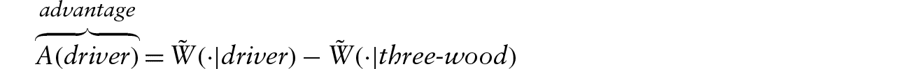

正如我们怀疑的，在带有一点事后偏见的情况下，对于菲尔著名的那个击球来说，这个值可能是一个负数。

## 8.10 分化

我建议你，价值函数和优势函数的构建是一项专门的任务。

这本身并不是一个极其荒谬的主张。转到视频游戏，我发现有些研究人员也赞同这一观点。对“优势函数估计与价值函数估计相关但不同”这一观点的支持，可以在来自 Google DeepMind 的 Ziyu Wang 等人的文章中找到。(6)（引用引擎 Mendeley 为这篇特定文章分配了一多位作者，因此可能有广泛的支持。）

在文中，训练了一个强化学习算法来玩 Atari 赛车游戏 Enduro。它部署了两个不同但相互关联的神经网络。其中一个网络学习游戏的价值函数；另一组计算从第一个网络分支出来，并独立估计优势。

文章的作者随后计算了屏幕上每个像素的价值函数和优势函数显著性（saliency），这衡量了每个像素对计算有多重要，从而指示了计算机在看哪里。

引人注目的是，Enduro 的价值函数看向很远的前路（以查看下一个弯道是在左边还是右边等），而优势函数的视野则短得多（避免撞到其他汽车）。

这里的道理似乎是：不要假设价值函数和优势函数必须源自同一次计算、同一个算法作者或同一个大陆。它们是不同的任务，因此在价值函数微观预测的微观经济学中，它们可能拥有相互关联但又然不同的供应链。

## 8.11 …以及更多分化

现在来谈谈棒球。

我们一直忽略了一个重要问题：我们所做的一切是向先知询问优势函数的最佳方式吗？鉴于只有一个结果发生，先知如何能够区分出良好的优势函数估计和糟糕的估计？

考虑棒球捕手在决定下一次投球时的决策。我们用 `W` 表示球队赢得比赛的概率。任何一次比赛的影响都可以通过胜率的变化来衡量——投球后 `W` 的值减去投球前 `W` 的值。

假设投球方在比赛中领先，但对方占据了垒包。球数是两个坏球和两个好球。捕手必须向投手传达十种球路中的一种。他试图使该球路线的预期影响最大化。

更准确地说，作为捕手的“先知”将在投球后通过通常手段确定 `W`，并以此判断在投球前做出的基于球条件的 `W` 预测。就像高尔夫一样，来源的预测分为两类：

1. `W` 的无条件估计
2. 有条件的 `W` 估计

我们假设有一个相当聪明的微观管理者涵盖了这一切。它将从其他算法接收这两类估计。它可能尝试的一种方法是调整供应商对第二个问题的估计（向上或向下调整），使得它们在所有可能的投球上的加权平均等于第一个问题的答案。然后它们可以根据投球后 `W` 的值进行判断。

在这里，受访者的答案在常数范围内是任意的，因此他们提供的实际上是表 8.1](#chapter_8.xhtml#tab8-1)所示的优势函数。我们丢弃了他们回答中的信息——但这取决于平均值是否真的包含信息。

表 8.1

棒球球路和条件价值函数 `W`。此外还有选球概率 `p` 和中心优势函数 `A`。

| 动作 | `W` | `p` | `A` |
| --- | --- | --- | --- |
| 四缝球 | 0.91 | 0.1 | 0.0525 |
| 二缝球 | 0.90 | 0.05 | 0.425 |
| 切球 | 0.90 | 0.2 | 0.425 |
| 叉子球 | 0.87 | 0.05 | 0.0125 |
| 弯球 | 0.93 | 0.05 | 0.0725 |
| 滑球球 | 0.85 | 0.1 | -0.0075 |
| 划线球 | 0.86 | 0.1 | 0.0025 |
| 变化球 | 0.80 | 0.05 | -0.0575 |
| 变速球 | 0.78 | 0.15 | -0.0775 |
| 掌球 | 0.85 | 0.05 | -0.0075 |
| 圆球 | 0.81 | 0.1 | -0.0475 |

在选举中有一个类比。假设一个民意调查员由于误差大而声誉不佳。然而，假设它某种擅长在选举最后阶段捕捉模式的变化。(7)

## 8.12 陷阱

这是否是循环论？

我指出我们目前为止描述的设置中的一个潜在缺陷：由于价值函数估计的主观性而导致的不稳定性。我们的模式是要求先知（以及许多人类和机器的组合）提供一个动作条件的估计，以预测在决策后通过再次调用先知估计价值函数的结果。

通过这样做，我们是在让人类和机器预测其他人类和机器将预测什么。


采用表 8.2 所示的金融术语暗示了一些相关工作。我们可以将无条件价值函数 `W(·)` 称为“底层”（underlying），并将对同一函数的基于动作的预测称为“衍生”（derivative）微预测（microprediction）。因此，例如对 8.9 节中建议的成对微预测描述如下：

1. `底层`：`W(·)` 的无条件估计
2. `衍生品`：有条件的 `W(·|a)` 估计

表 8.2

与金融类比。

|  || 先知者 (Oracles) || 金融 |
| --- | --- | --- |
| 底层 || 价值 || 股票 |
| --- | --- | --- |
| 衍生品 || 优势 (Advantage) || 期权 |
|  | | |

符号 `W(·|a)` 表示动作 `a` 的条件价值函数估计。在动作数量离散的情况下，它可以被视化为价值函数的向量。

条件价值函数 `W(·|a)` 的估计其优坏仍然取决于判断它的标尺，即下一次无条件价值函数 `W(·)` 估计的出现。尽管存在眼前决策被未来决策淹没的风险，但有时根据允许游戏持续的更长跨度来判断 `W(·|a)` 是意义的。

## 8.13 国际象棋

在本章的剩余部分中，我将考虑这种循环问题，即通过切换游戏来保持新鲜感。国际象棋经常被引用复杂决策的典型范例，需要兼顾战术和战略远见，因此它也许是测试分层先知预测是否可能成功的良好方法。

由于在国际象棋程序上投入了巨大的精力，该游戏可能是衡量其他领域决策可以提高多大的一个良好指标（假设投入了类似的努力或先知者已经到来）。

国际象棋的进展带有一个现成的标尺：`Elo` 等分系统。这些评分记录了人类与机器之间近乎完美对称的命运反转。三十年前，特大师有 1% 的概率输给计算机。现在，他们有 1% 的概率获胜。

国际象棋计算机现在正向 `Elo` 3000 分冲刺，但人们可能想给今天的商业决策分配一个接近 1400 分的 `Elo` 等分——因为那是普通注册国际象棋选手的平均水平。至少国际象棋选手知道自己在玩什么游戏。相比之下，许多交易员并没有意识到他们正在解决一个价值函数问题。

最近国际象棋程序 `AlphaZero` 的成功遵循了其他涉及自我对弈价值函数估计的高知名成功故事。该算法登上流行杂志封面是实至名归的，它用不到二十行（核心）代码就学会了国际象棋的复杂性，代表了优雅性的新基准。

事实上，我们可以通过国际象棋棋局评估中临时主题的数量来衡量国际象棋决策的进步，这些主题在被 DeepMind 之作淘汰之前已经过时——至少有十六个科目从那门课程中被抹除了。(8,)^(9)。

所以，让我们用国际象棋来批判我们的先知使用模式，即根据下一次无条件先知预测 `V()` 来判断价值函数的条件估计 `V(|a)`，正如我们在 8.9 节中所述的。同时，我们可能希望发现将问题向世界开放并释放先知数据发现能力的某些优势，尽管这看起来是最不太可能提供帮助的一个例子。

## 8.14 你能信任哪个价值函数？

该图取自 1972 年在雷克雅未维由天才但不可预测的美国人鲍比·费斯尔（Bobby Fischer）与现任国际象棋冠军俄罗斯人鲍里斯·斯帕斯基（Boris Spassky）之间的“世纪之战”。由于这场战斗是冷战本身的寓言，并形成了音乐剧《象棋》的基础，你可能至少模糊地知道过它。

要评估这场比赛中最著名的走法，你需要知道这个故事对于面对俄罗斯世界冠军的美国人来说开头并不顺利。费斯尔几乎输掉了前两局比赛，以 0−2 落后，这种分差在今天会让任何挑战者几乎没有反击的希望。为了改变局面，费斯尔在第三局中下了本诺尼防御（Benoni defense），并试图用黑棋寻求一个不平衡的局面。

评论员将费斯尔的第十一步确定为比赛的转折点。但正如你从图 8.1 所示，局面本身看起来相对平静。没有明显的战术复杂性，没有不受保护的棋子受到攻击。白方三种可能的吃法，黑方也有三种。在国际象棋中局术语中，局面不能更平静了。

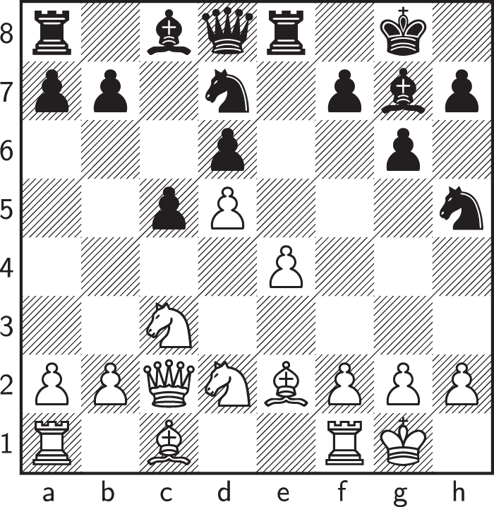

图 8.1

斯帕斯基–费斯尔国际象棋锦赛第三局，1972 年。费斯尔反位置走法 11 … Nh5!? 之后的局面。

为什么如此？费斯尔将他的黑马移动到了棋盘边缘的 `h5` 格。这对旁者和他的对手来说同样令人惊讶。它违反了关于边边马的准则，更重要的是，邀请了斯帕斯基用他的象 `e2` 吃掉那个马。(10)

计算机（即使是好的）会建议费斯尔下 `Nh5!?` 吗？答案似乎是“可能不会”，这个原因说明了使用先知时的细微差别。表 8.3](#chapter_8.xhtml#tab8-3) 建议某些先知会这样做。

| 走法 || 价值 | 走法 || 价值 |
| --- | --- | --- | --- |
| 12 | + 0.39 | 19 | − 0.24 |
| --- | --- | --- | --- |
| 13 | + 0.25 | 20 | − 0.16 |
| 14 | + 0.40 | 21 | − 0.39 |
| 15 | − 0.18 | 22 | − 0.41 |
| 16 | − 0.04 | 23 | − 0.33 |
| 17 | − 0.00 | 24 | − 0.61 |
| 18 | − 0.35 | 25 | − 0.66 |

在著名的费斯尔-斯帕斯基第三局中，黑方走法之后的局面评估。(11)


我建议，使用最简单导数模式的预言机并不总是最好的，因此，跳出国际象棋之外，我们应该将条件估计 `V(state|action)` 与`未来的预言答案`进行对比，而不仅仅是下一个值估计 `V(state)`，除非有强有力的理由深信 `V(state)`。

这并没有争议，事实上，我正在借鉴时序差分学习（temporal difference learning）文献的观点。这是一个事后可能生成的真理示例。我们要求算法针对一个未来位置评估的加权组合的目标：

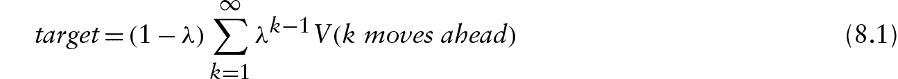

其中 `λ` 是 0 到 1 之间的某个值。例如，对于 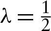，前向目标将是：

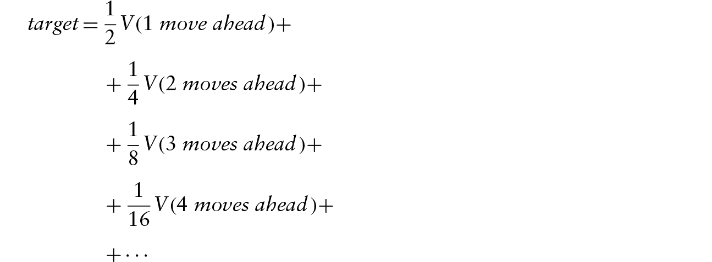

而当 `λ` = 0.95 时，我们会更权重地考虑未来步法的评估：

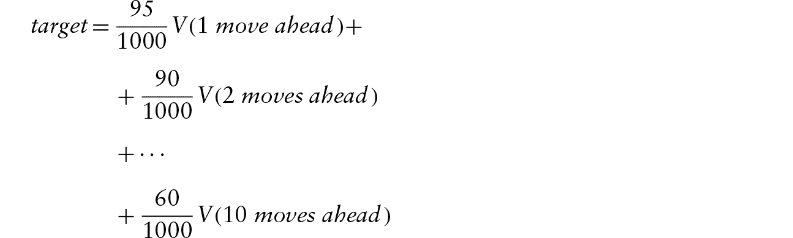

微观管理者可能会选择 `λ` = 0.25，而另一个经理可能会选择 `λ` = 0.95，例如，只有后者会奖励那些在 11…Nh5!? 之后立即判断比赛正向菲舍尔（Fischer）有利的人。

我不会深入探讨预言机与强化学习之间可能的相互作用——因为我觉得这是一个全新的领域（greenfield），我们将边学边做。空间也不允许深入探讨实时决策的数学原理以及更远远预测的技术，包括蒙特卡洛方法。只需说明，这类文献中的技巧可以为微观管理者设计提供参考。

例如，奖励可能需要一些仔细的核算。在等式 8.1 中，如其所示，对预言机的反馈将是延迟的……原则上要直到比赛结束。再次，文献提供了帮助。这并不是一个新问题，延迟满足的问题在强化学习中通过多种方式解决，例如使用资格迹（eligibility traces）。我们还得到了涉及递归（在线）计算的统计文献，以及正如第 5 章所讨论的处理未来奖励和利润的运行期望的金融文献的帮助。

## 8.15 总结

在本章中，我尝试用通俗易懂的语言描述重复决策与重复预测之间的关键联系，超越了决策影响会迅速显现的显而易见的情况。

当高尔夫球场上的每一根草都被计算位置价值时（事实确实如此），我们将一个动作影响并不明显的问题，转化为了一个接受某些中间评估的问题。

当预言机丰富且强大时，它们也可以创建位置价值。这导致了用于决策的潜在的、人力的自我引用式预言机模式，我觉得这些模式值得未来研究。

我将其与金融领域中的衍生品市场进行类比，以帮助识别分层使用预言机的优缺点。我们在强化学习中发现的模式也可以启发实时决策应用的设计，可能解决其中的一些缺点。

重复决策对许多业务都至关重要，并直接影响底线。正如早些提到的，提供足够廉价但有效的决策也可以在预测网络中创造一个良性循环，因为微观管理者本身也需要对自己做出各种决策。

如果预言机变得无处不在，控制和强化学习可能会得到显著增强。目前的方法很少经过这种工程化设计，以至于任何人在任何地方在无需请求许可的情况下都能对其改进。

目前的方法无法期望利用所有的外部专业知识和数据，而且它们并不总是允许由具有不同方法和想法的完全不同的人或算法来执行优势函数和价值函数的估计。

只有微预测微经济才能培养出那种水平的专业化。

## Notes

1. 1。推荐的技术从使用指数平滑平均在网格点上创建估计开始。接下来，对等值线进行样条线拟合，以消除粗糙的边缘（Stöckl and Lames 2011）。
2. 2。关于放置价值函数的详细讨论，请参见 Yousefi and Swartz (2013)。
3. 3。如果球场就是状态，那么高尔夫的马尔可夫假设并不完全成立。例如，专业人士更容易将十英尺推杆进帕，而不是十英尺推杆进小鸟（Pope and Schweitzer 2011）。
4. 4。Shipnuck and Reilly (2006)。
5. 5。Broadie and Ko (2009) 中考虑了用于高尔夫击的蒙特卡洛模型。
6. 6。Wang et al. (2015)。
7. 7。Cotton (2020e)。
8. 8。传统的象棋程序包含了自定义逻辑，如负极大值搜索、分析函数、迭代深化、alpha-beta 剪枝、主变例搜索、期望窗口、置换表、杀手步、历史启发式、静止搜索、静止宽度扩展、内部迭代深化、空着启发式、徒劳剪枝、剃刀法和搜索扩展。
9. 9。Frayn (n.d.)。
10. 10。边缘的马相比中心的马移动选择较少，因此有了“*边缘的马很愚蠢*”（a knight on the rim is dim）的说法。德语版本也不温柔：*Ein Springer am Rand bringt mer und Schand*（边缘的马带来痛苦和耻辱）。
11. 11。此示例中的位置评估使用深度搜索（双方各走十步），使用 Stockfish 引擎。

## 9 隐私

集体微预测似乎在公开数据上效果最好。但考虑到我们所有人之间的知识产权和数据隐私墙，它能进入私人领域吗？

在本章中，我讨论了隐私保护计算如何让预测能力在企业和个人之间传递，尽管在许多情况下数据将留在原地。

## 9.1 开放式问题

我在本书开头时要求你假设在未来的某个时刻，重复近期预测问题得到了明确解决。我不确定你最可能的情况是否以任何方式与我的假设收合，但为了闭合这个圈，我将从展示自己的假设开始将想法联系在一起。


当然，没有任何预测是完美的。你的模型预测值与揭示的真相之间的差异每次都会计算。通过这些方式，你产生了大量的事后模型残差（ex post model residuals）。你寻找与这些残差相关的数据源，或对现有数据进行新的转换。

如果你的员工发现了一个全新的合理的统计关系，你可能会将这些特征纳入你的模型中。这个过程周复循环。投入永无止境。对于你付出的钱到底得到了什么，可能根本没有绝对的、甚至是相对的概念。

## 9.2  神谕的降临

某一天，你面对了一个看起来像免费期权的东西。它被誉为一种神秘的预测能力来源。它存在于公司的防火墙内部，并可以用多种简单的方式使用。

这个特定的神谕以对话式的风格运行。你向它发送一个问题，它提供一个预测。你希望它能帮助你加速图 9.1 中的周期。你突然想到，可以看看这个神谕是否能预测你的模型残差（根据定义，你是无法做到的）。

这有什么不好的呢？嗯，一个顾虑是隐私。你被告知这个神谕邀请机器和人类来预测你的数据。这就是为什么它是如此有效并不断改进的原因。算法攻击你数据流的边际成本接近于零，因为它设计时也是为了解决其他几个问题。不需要人类参与。

恰恰如此，你并不认为你的模型残差具有高度机机性。可能没人会反推出它们的含义，也没有人拥有你的模型。你只需要发送残差的一个子集，而且，隐私保护机器学习领域的专家向你保证，没有人能恢复你的残差（即使他们对这些残差感兴趣，这也不可能的）。

事实上，没有人会关于这些数字学到`anything` 信息，即使从统计学上来说也是如此。然而，这个神谕将让你从外部世界的数据和模型中受益，而这些是你原本可能无法发现的。

于是你试了一下。一段时间内，神谕返回了一系列零。你已经告诉它你发送的是模型残差。它无法确定地判断零不是它对你模型残差的最佳估计，因此它仅仅返回了零。你耸了耸肩，但并没有造成任何伤害。

但某一天，神谕开始返回较小的数字。它并不是对每一次预测都这样做。大多数仍然是零，但有少数不是。随着时间的推移，数字变得稍微大了一些，零的数量也越来越少。

这个神谕的构造你将在以后才会学，它正试图识别你的模型所做的每一个预测中的统计偏。。神谕并没有预测你所有的错误——这样做将意味着完美的预测。然而，通过从现有的模型预测值中减去神谕返回给你的数字，你能够创建一个减少误差的新预测。

“好吧，”你说，“这难道不很不起吗？”但世界上充满了虚假相关性^(1)。一段时间内，你和你的团队怀疑神谕的表现是否会继续保持强劲。

明智的是，你将使用限制在每天产生数千或上万次预测的案例中，以减少神谕表面上的预知之是骗局的可能性。你避开了向神谕询问对单一事件的长期预测。

## 9.3�� 尝试性步骤

这是你首次接触预测网络，无论你是否意识到。你将神谕用于实时决策，但你仍然持怀疑态度。目前你还没有准备好抛弃你的模型。

你日复一日地关注神谕的表现，它变得更加准确了。

## 9.4⃃ 感染

慢慢地，预测网络开始蠕入到你运营的每一个方面。你将神谕背后的部分智能迁移到了你的模型中。通过使用神谕，你意识到了一个从未想象过会帮助过你的数据源。在仔细整合了新源后，神谕的残差估计下降了。


你开始将预言者（oracles）整合到更深层的场景中，例如用于导航、定价以及即时解决逻辑问题的中间值函数计算。你开始超越竞争对手，因为驱动你业务的大脑是一个分析型供应链。该链条中的每一步都在不断改进。

无论你是否完全意识到，你终于摆脱了既有实践模式中最重要的限制——即模型对于单个人来说是易理解的，因此受限于人类认知能力。

你的业务现在由一种强大得多的东西驱动——一个全球预测网络，它每天都能看到越来越多的外生数据，其人工智能“群落”可以将任何可以想象的算法与你手头的特定任务进行匹配。

而且这对你来说几乎没有任何成本。事实上，有时你还会获得报。事实证明，你需要预测的某序列真实数据点对于他人的预测能力是有价值的。有时，你注入网格的数据经济价值，超过了你请求预言者执行的定制预测所快速下降的成本。

你正在因帮助解决现代的“公地悲剧”而获得微小的回报——即缺乏一个包括比你公司小得的公司在内的任何人都可以使用的现有实时特征空间。

在你浑情的情况下，独立电影院、烘焙店、非营利组织和个人正在向你使用的同一个预测网络贡献微量的资金或眼球。算法会自动复用自己。数据的力量被自动共享。

接下来，你贡献了一个模型。你某位数据科学家开源的某个非所有权特征生成器长了腿。它独自在预测网络中穿梭，并发现了十几个可以增加价值的地方。

在此过程中，其他算法对其进行分析，并评估其在不同情况下的相对价值。额外的经验建议了改进方案。你发现，当向开源社区贡献时，你的收获比付出的多。

你和你的公司现在从任何意义上说都是预测网络的一部分。你正在为模型和数据空间中这一几乎不可解决的搜索问题做出集体解决方案，至少在应用于实时业务流程优化方面。你现在将纠缠其中，只要你运营下去就会一直纠缠。你行业中的其他人迟早也会深陷其中。

## 9.5 我们将放弃什么？

关于集体预测如何钩住你业务的推测，到此结束。

我想问，鉴于我们目前为止所涉及的话题，真正阻碍我们获得免费人工智能的是什么？通常的回答是隐私。大多数读者可能预见到，使用极其强大的预测工具只是另一种隐私权衡——尽管我希望这个似是而非合的故事暗示了为什么事实并非如此。

确实，在当今时代，我们为了便利之名放弃了大量的隐私。我们这样做是因为其他公司拥有规模，并且能够比我们更有效地使用那些数据和分析。

但我并不会论证，一个具有巨大力量的公用事业可以证明类似的交易是合理的。我确定其中可能包含这种元素，但它在很大程度上低估了潜力。在最后一章中，我邀请你从不同的方向来看待问题，并询问是否真的有什么东西需要放弃。

事实上，有一系列技术可以用来避免背叛商业意图、交出数据或以其他方式进行浮士交易。其中一些非常简单。

但并非万事都是显而易见的。数学有许多话要说。我们正处于一个新时代的边缘。确实，在当今时代，我们为了便利之名放弃了大量的隐私。我们这样做是因为其他公司拥有规模，并且能够比我们更有效地使用那些数据和分析。

一种可能性是使用变换，这种变换可以掩盖你的数据，但保留足够的结构，以便外部算法能够继续帮助你。询问使用将你的数据射入公共领域的微预测（microprediction）是否真的对你有用是有合理的。使用隐私保护计算。这绝不是一个定论。我会说这是一个技术问题。

## 9.6 商业秘密

我们会很快谈到这一点，但让我们先深入一个可能不需要此要求的例子。假设你有一个商业秘密。你的商业秘密是关于颗粒物（`X`）和股权收益（`Y`）的知识。你认为 `X` 对 `Y` 有因果影响，并且你想在不损害你的理论的情况下利用这一点。（自从 Levy 和 Yagil (2011) 以及 Wu 等人 (2018) 研究之后，空气污染对股价的影响已得到研究。）

假设我们是进行“裸预测”（naked prediction）的勇敢灵魂。你不是直接向预言者询问记录的空气污染（`X`），而是可能会要求预言者预测由其引起的一个或多个数量——例如入院人数、记录的犯罪水平、言语中的语法复杂性、标准化测试的表现、光传感器读数、温度、太阳能发电或共享单车的行程时长。

当这种做法引发的微管理链随时间推移变得越来越复杂，并且最终颗粒物读数出现在特征空间中时，你可能会感到惊喜。。此时，在网络的其他地方，出现了对颗粒物的预测——因为正如我们在第五章中提到的蚊子例子，如果你能找到它们，那么对回归因子进行前瞻性预测总是好的。通过这种方式，你实现了对你所关注的数量的预测，并且大大降低了任何人窥探你理论的风险——因为颗粒物的预测是由他人发起的。

现在，你可能由于成功的冲动而变得更加勇敢。也许你还会尝试变得更狡猾一点，创建一个微管理器模型，其补偿方案不仅基于预测入院人数的准确性，还基于提交数据与股票收益直接相关的预测价值。

通过这样做，你有了一个完全不同的发现——一个从未预料到的发现。你意识到在某种，`X` 和 `Y` 之间的关系可以被第三个变量 `Z` 解释，`Z` 似乎导致了两者。这一发现是以相对较小的风险获得的，如果没有预测网络，你可能永远无法获得这一洞察。


如果意图主要是获取模型洞察而非数据，且预言机（oracle）另一端的机器不会尝试解释数据（仅仅是进行预测），那么通过对数据进行转换，使其无法识别但同时几乎保留了加法和乘法，这样几乎没有损失。

因为乘法和加法几乎被保留了，所以大多数事物也被保留了，包括构建在该基础之上的线性代数和机器学习技术。

超越混淆，能够保留加法和乘法的强加密技术终于从实验室诞生了。自从 2009 年 Gentry 令人惊讶的研究建立了这种可能性以来，这是一段旅程。([2)

这种保持结构的变换被称为同态（homomorphism），因此这些技术被称为`同态加密`（homomorphic encryption）。谁能说几年后它们会有多强大呢？光是在过去的三个月内（2021 年第一季度），我找到 131 篇关于该主题的研究报告就毫不费力。([3)

这种方法的缺点是，其他人可能无法帮助你进行外生数据搜索——尽管你可以另行安排该工作。这种双管齐下的方法受到对冲基金 Numerai 的青睐，他们分别众包信号和算法。

我建议，在运行预言机的语境下，`几乎`同态的混淆通常绰绰有余。当目标是统计预测时，没有必要`精确`地保留所有结构。如果保护这些数据的原始原因未达到最敏感的类别，也没有必要`完全`加密所有数据。（举个例子，几乎被加密的市场数据就不再是市场数据了。）

同态变换的一个例子是乘以你祖母的年龄。也许我们加入一个旋转，或者某个已经训练过以学习恒等映射的神经网络部分。实际问题是，你的“数据”（实际上可能是模型残差）通常比军事机密要重要得多。

完全有，你已经在现有的流水线中，无意中执行了某种几乎保持结构的、相当不错的混淆。

## 9.8 算法保持噪声

以巧妙的方式添加噪声也有帮助，只要它不违背初衷。在数据从一方传递到另一方时，采用差异隐私（differential privacy）已变得越来越普遍。

其想法是跟踪信息预算，允许差异隐私层确定在对数据进行多次查询的过程中，个人记录级的信息是否泄露。

遗憾的是，实践中有时发生的情况是信息预算被重置并引入新数据。这可能会破坏长期保持数据私密性的愿景。

然而，在我们关注的快速流动领域，实时数据的商业价值及其敏感性往往随着时间的推移而迅速下降。因此，仅对有限有效的方法其实相当有用。

研究从未停止。对于我们可能对某种隐私保护技术提出的任何抱怨，无疑有几个小组正致力于改进它。例如，本地差异隐私的使用可能有助于不断增长的数据集。([4) 差异隐私可以算法结果，而不是数据本身。([5)

## 9.9 那些珍贵的残差

我不轻视隐私，但我预感到它在许多人心中会逐渐被视为集体预测的障碍。关键问题可能是每个人是否决定将他们的模型残差发送给微观管理者（micromanagers）。

正如你从本章开始的合理性故事中所看到的，我预测模型残差将成为预测网络采用的重要驱动力。

在某些情况下，残差可能会出卖意图、投资组合持有或其他信息——通常有简单的通之办法可以解决。但对于这些潜在的失误中的每一个，都有百种情况，保护模型错误是珍贵的、自利的且虚伪的（如果你真的想知道我是怎么想的）——目标仅仅是防止他人确定自己建模尝试的局限性。

尽管有这些评论，我将继续假设你的内部模型预测与揭示的真实值（ground truths）之间的差异实际上是皇冠上的明珠。这有助于我们评估一种超防御性的立场。

让我们将模型残差嵌入高维空间中。任何单变量时间序列的滞后值都可以被视为向量，如 9.2

```
图 9.3: 针对同一对象的公共数据和回归因子集合。
```

图 9.3


尽管如此，我认为预测网络以及其数据对你预测的相关性会悄然降临。这只是时间问题了。

顺带提一下，这种几何结构帮助我们视觉化第 2.4 节中提到的`弱通用数据馈`的作用，我认为怀疑论者若想固守自己的立场，可能需要进行非常复杂的扭曲。

这是因为一个数据源可以被用来创建许多`近似`的真理，包括天气是否在下雨、是否刮风或拥堵。通过为其他预测播种，你鼓励了空间被最终填补，正如我在第 2 章中提到的。

## 9.10 别人的数据生活

我不确定前面的讨论是否能说服每一位坚定的怀疑论者。毕竟，也许你的模型残差（或与其具有因果关系的某些东西）与某些其他数据源相关——但那些数据由他人拥有并私自留。

你并不知道这一点。他们也不知道这一点。结果呢？

这种浪漫的悲剧还有其他版本。供应商认为他们拥有对你来说有价值的数据。你怀疑确实如此。但在没有获得数据的情况下，你无法做出这一判断，也无法执行交易。

对于这最后一个困境，自然有一些传统方法，例如试用订阅，但它们远非完美。无法知数据的预测价值就是老旧的坏柠檬问题（old lemons problem）。数据的价值可能部分在于其历史记录，因此有时这些数据在交易之前是无法提供的。

其他时候，供应商可以尝试在销售前证明价值。但这同样存在问题。可能从新数据源中获益的公司可能不愿揭露其意图用途，更不会揭露使用这些数据的模型，正如我们所讨论的那样。

无法得知他人的数据对你的预测价值是最大的交易摩擦之一。但还有另一种交易摩擦可能更为显著——尽管并不那么显而易见。

我建议数据交易真正的（感知的）“问题”在于，数据卖方认为他们需要在`销售后`才向买方提供数据。如果这听起来像是一个无法解决的问题，请继续读下去。

我不会尝试估计这个问题的规模，但我们自然知道，最近，买方公司在预测技术和数据方面投入了巨额资金。例如，除了现有的企业数据行业外，还有千多家公司收集并向对冲基金出售替代数据。

如果有一种方法可以在不泄露商业敏感意图或商业价值数据风险的前提下，发现一种潜在互利的安排，那会怎样？

## 9.11 秘密共享

我们可以将其置于更通用的设定中。A 方、B 方和 C 方分别拥有数据 `a`、`b` 和 `c`，他们无向任何人透露。然而，所有方都有兴趣学习计算结果 `f(a, b, c)`，而这个计算需要对所有三个数据集的认知。

实现此点的巧妙方法集始于 A 方对数据 `a` 进行随机掩码，并将其拆分为（三个交织的秘密 `a[1]`、`a[2]` 和 `a[3]`。例如，如果我们简单地假设 `a` 是一个模 `p = 7` 的整数，那么 A 方可以使用随机数生成器产生 `a[1]`、`a[2]` 和 `a[3]`，满足：


同样，B 方和 C 方也可以将他们的数据分成相关的秘密：

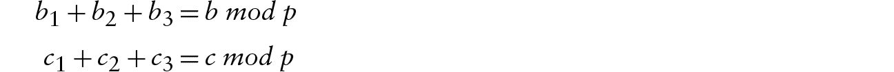

A 方现在将 `a[3]` 发送给 C 方，将 `a[2]` 发送给 B 方，保留 `a[1]`。同样，B 方将 `b[1]` 和 `b[3]` 分别发送给 A 方和 C 方，最后 C 方将 `c[1]` 和 `c[2]` 分别发送给 A 方和 B 方。

这种通信尚未泄露 A 方持有的私有数字 `a`，同样 B 方和 C 方分别持有的 `b` 或 `c`。然而，重构 `a`、`b` 和 `c` 所需的信息以分布式的形式存在。

在原则上，取决于函数 `f(a, b, c)` 的组成，可能安排多轮通信以及此类秘密传递，最终实现 `f(a, b, c)` 的计算。

为了证明这有时可以做到，考虑加法。更准确地说，`f` 是数字 `f(a, b, c) = a + b + c` 模 `p` 的和。由于根据构造，这个和也等于所有分布式秘密之和，因此如果所有玩家都加上他们当前持有的秘密并向另外两个方宣布答案，结果将立即显露！

在这个节点需要问一个问题：是否泄露了不该泄露的内容？答案是否定的，尽管这需要仔细的检查。（例如，A 方持有 `b[1]` 和 `c[1]`，并保留了 `a[1]`，所以它将宣布 `a[1] + b[1] + c[1]`。但 B 方对数字 `a[1] + b[1] + c[1]` 做不了什么。）

该协议也有一些弱点。它要求所有方诚实地报告，例如，而且任何两个玩家之间的合谋就能泄露信息。尽管如此，这个简单的例子应该立即改变我们的观念。显然，数据并不等同于数据的使用。这一快速发展的领域具有巨大的潜力，即多方计算。

读者可能会想如何实现乘法。一个线索来自于：


当然，如果我们能实现加法和乘法，许多问题将随之而来——甚至是梯度下降。回到我们发现他人数据价值讨论，现在很清楚，以安全的方式计算内积可以嗅出因果关系。在这里，`f` 可以是格兰杰因果关系，例如。

此外，如果 `f` 是机器学习模型，那么在预测中使用外生回归并不取决于对该数据的拥有。也不取决于对该数据的`披露`。数据的预测能力与数据本身完全分离。对我来说，纠缠秘密的使用使了黑洞视界附近的量子效应。光子对中的一个穿过视界，另一个则逃逸。在这个预测网络的类比中，我预测即使是最秘密的公司也不会完全是黑。它们会发射某种霍金辐射。


诚然，合成数据生成是有问题的，它本身也是一个领域。但人们希望，即使是不完美的合成数据也可以成为一种足够的诱饵，吸引那些能够将`some`知识迁移到未见私有数据的自适应算法。在机器学习领域，元学习、多任务算法以及少样本学习和迁移学习的研究正以惊人的速度进行。

在极限，随着这种泛化分析能力的提高，将完全不会有隐私问题。数据敏感性问题仅由于学习的外部化而产生——例如在一个涉及人类偶尔更新程序的循环中。但如果算法是“白纸”状态或者它们自己完成所有学习，这就不是问题了。

一种可能的过渡方案涉及一对竞赛组织者。这些微观管理者其中一个坐在在你的防火墙内部，可以访问私有数据；另一个坐在防火墙外，没有访问权限。他们运行非常相似的竞赛。

我们假设，偶尔，外部竞赛中的一小部分参赛者可以被克隆并传输到防火墙内部，在他们的作者不知情的情况下，他们将在外部微观管理器使用的合成数据`之外`，在私有数据上运行。

然后，就可以开始一个迭代过程，对外部微观管理器使用的合成数据进行持续改进。该过程可以根据算法在外部与内部数据集上的相对性能来指导。对合成数据的修改使得算法在外部与内部排行榜上的排名更加对齐。

我提出这仅作为算法人力资源部门可能做的事情的一个例子。另一个想法是设计测试集，其目的是为了欺骗那些不会适应的算法——这些测试示例可能比现实世界的数据更极端，并涵盖更多的机制。

这些测试可以像离心机一样，希望分离出那些并不真正具备特殊自适应智能的算法。留下的更有可能协助完成作者尚未看到的任务。

## 9.13 保持简单

我通过列举一些大部分自言易懂的隐私保护方法作为结束。认为存在一种解决风险、监管或其他担忧的最佳方法是愚蠢的。其一在于，并没有一种担忧。你担心被窃吗？那盗版呢？

数据中掺入少量错误数据点（评分规则忽略）可能会震慑无偿的商业使用。隐写可以用于对数据进行统计学上不显著但可追踪的更改，以便随后的调查识别出被盗物品来源的精确参与者。

方法多到无法命名，至少标准方法如此，但表 9.1 列举了一些问题和对策。我们讨论过一些。另一些显而易见。还有一些，如使用合同，太明显甚至不必包含在表中。

Table 9.1

防止向参与者提供（或视情况未提供）的数据滥用的防御。

| 担忧 || 示例 || 技术 |
| --- | --- | --- |
| 意图 || 敏感目标 || 弱事实 |
| --- | --- | --- |
|  ||  || 剩余值 |
|  ||  || (以及下方许多) |
|  ||  ||  ||  |
| 窃取 || 订阅数据 | 下采样 |
|  ||  || 污染 |
|  ||  || 稀释 |
|  ||  || 黑名单 |
|  ||  || (以及下方所有) |
|  ||  ||  ||  |
| 盗版 || 转售 | 隐写 |
|  ||  || 自举法 |
|  ||  || 变换 |
|  ||  || (以及下方所有) |
|  ||  ||  ||  |
| 秘密 || 机密数据 | 允许 |
|  ||  || 私有竞赛 |
|  ||  || 混淆 |
|  ||  || (以及下方所有) |
|  ||  ||  ||  |
| 隐私 || 专利数据 | 离心机 |
|  ||  || 多方计算 |
|  ||  || 结构保持加密 |
|  ||  || (以及下方所有) |
|  ||  ||  ||  |
| 泛化 || 数据 | 隐写 |
|  ||  || 差异隐私 |
|  ||  || 诱饵攻击 |
|  ||  || (以及下方所有) |
|  ||  ||  ||  |
| 泛化 || 数据 | 离心机 |


诚然，我们并非所有人都会在底层实现细节上使用微预测（microprediction），但没关系。我们并不是所有人 TCP/IP 网络协议的专家。无论你偏好的是哪种抽象层次，我希望你有兴趣帮助创建一个极其廉价的“数据科学项目”的替代方案。尽管我提到了局限性，但一个通用的智能源可能成为下一个巨大的公用事业。

最后强调一次，我只关注微预测领域，其原因我希望现在现在已经很清楚了。它不是人工智能的未来。它不是统计学的未来。它不是通用人工智能的未来——仅仅是被冠以 AI 之名的事物的一半。当我写下这些文字时，世界正经历着一场可怕的流行病。它需要深思的推断统计学来解读严峻的形势、做出中期预测并批准疫苗。

这种统计学永远不会被微预测网络取代，但一个算法运行的基质可以以意想不到的方式提供帮助——例如为疾病传播寻找替代模型，或为长时间的分子模拟提供众包近似值。

除了中期预测（或我们通常与“预测”一词联想的事物），世界还需要廉价、易用但准确的微预测来驱动各业的运营效率。这在我们的共同能力范围内。预测网络在某些方面雄心勃勃，但在另一些方面又相当平庸。它几乎像是在做些杂事。

最近，我看到过论文，其副标题很好地总结了这种雄心：

> 所有模型都是错误的，但某些模型在某些地方是有用的。(Yao et al. 2021)

也许你拥有这样一个模型，但并不太确定它可能在哪些地方产生价值。

我曾建议，只要有合适的基础设施，管理算法的算法就可以集体地为你解决这个问题——而且它们将受到博弈论、竞赛理论、拍卖理论、序列实验设计以及任何其他辅助手段的结果赋能。它们不需要人类。

或者，你可能是许多将数据科学竞赛参与率推得远高于纳什均衡的人之一。我可以向你提供一个更接近现实世界工作的挑战。

对于你们这些希望获得某些新算法突破而拿起这本书的人来说，我很抱歉让你们失望了。但我们可以利用现有的工具做很多事情。算法只需要接触到问题。它们需要企业伸出手说：“没问题，我会尝试一下这个明确的微预测。”也许你可以这样做。

就像模型一样，所有对未来的愿景都是错误的，但也许某些（在某些地方）是有用的。我希望我的愿景也是如此。我的主要目标是引发你思考机器学习核心的根本矛盾——或者至少是其手工生产模式。数据渴求型方法的有效性，反驳了人类应该手工管理这些方法的观点。

感谢你们的暂且不疑，并希望在未来的某一天与你或你的自主大脑后代们进行互动。

## 致谢

本书的存在归于 Adrian Banner 和更大的 Intech Investments 家族，他们让我兼顾其他责任的同时，有机会通过文字和代码相结合来实现这一愿景。Christine Ardito、Jaime Cangiano 和 Andre Prawoto 帮助展示并推广了这一想法。

感谢 RedOx Editing 的 Michael Zierler 帮助将书变为目前的形式，并感谢 Intech Press 团队的支持。

## 参考文献

*   Abramowicz, Michael. 2007. “The Hidden Beauty of the Quadratic Market Scoring Rule: a Uniform Liquidity Market Maker, with Variations.” *The Journal of Prediction Markets* 1(2): 111–125.
*   Adler, Philip, Casey Falk, Sorelle A. Friedler, Tionney Nix, Gabriel Rybeck, Carlos Scheidegger, Brandon Smith, and Suresh Venkatasubramanian. 2017. “Auditing Black Box Models for Indirect Influence.” *Knowledge Systems* 54, 95–122 (2018).


-   Alharbi, Ayman, Haneen Zamzami, and Eman Samkri. 2020. “同态加密综述与新趋势。”*International Journal of Advanced Computer Science and Applications* 11(7) [`doi.org/10.14569/IJACSA.2020.0110774`](https://doi.org/10.14569/IJACSA.2020.0110774).

-   Ali, Moez, and Antoni Baum. 2020. “PyCaret Python 包。”[`github.com/pycaret/pycaret`](https://github.com/pycaret/pycaret).

-   Assel, Melissa, Daniel D. Sjoberg, and Andrew J. Vickers. 2017. “Brier Score 无法评估诊断测试或预测模型的临床效用。”*Diagnostic and Prognostic Research*. [`doi.org/10.1186/s41512-017-0020-3`](https://doi.org/10.1186/s41512-017-0020-3).

-   Axelrod, Robert. 1980. “囚徒困境中的有效选择。”*Journal of Conflict Resolution* 24(1); 3–25. [`doi.org/10.1177/002200278002400101`](https://doi.org/10.1177/002200278002400101).

-   Baron, Ken, and Jeffrey Lange. 2007. *金融领域中的分彩应用*。Palgrave Macmillan, New York. [`doi.org/10.1057/9780230627505`](https://doi.org/10.1057/9780230627505).

-   Barto, Andrew G. and Robert H. Gates. 1996. “利用强化学习提升电梯性能。”*Advances in Neural Information Processing Systems*.

-   Bennet, Pauline, Carola Doerr, Antoine Moreau, Jeremy Rapin, Fabien Teytaud, and Olivier Teytaud. 2021. “Nevergrad。”*ACM SIGEVOlution* 14(1). [`doi.org/10.1145/3460310.3460312`](https://doi.org/10.1145/3460310.3460312).

-   Bennett, James, and Stan Lanning. 2007. “Netflix 奖赛赛。”*KDD Cup and Workshop* 9(2): pp. 3–6. [`doi.org/10.1145/1562764.1562769`](https://doi.org/10.1145/1562764.1562769).

-   Box, G. E. P., and D. R. Cox. 1964. “变换分析。”*Journal of the Royal Statistical Society: Series B (Methodological)* 26(2). pp. 211–52, [`doi.org/10.1111/j.2517-6161.1964.tb00553.x`](https://doi.org/10.1111/j.2517-6161.1964.tb00553.x).

-   Breiman, L. 2001. “统计建模：两种文化。”*Statistical Science*. Institute of Mathematical Statistics, 2001, 16(3) pp. 199–215, [`doi.org/10.2307/2676681`](https://doi.org/10.2307/2676681).

-   Broadie, Mark, and Soonmin Ko. 2009. “一种分析距离和方向对高尔夫得分影响的仿真模型。”在*Proceedings—Winter Simulation Conference*中。[`doi.org/10.1109/WSC.2009.5429280`](https://doi.org/10.1109/WSC.2009.5429280).

-   Broman, Karl. 2013. “数据科学就是统计学。”[`kbroman.wordpress.com/2013/04/05/data-science-is-statistics/`](https://kbroman.wordpress.com/2013/04/05/data-science-is-statistics/).

-   Byrne, Jason. 2018. “Lambda 中的持久化数据。它可行！”[`engineering.flosports.tv/persistent-data-in-lambda-it-works-ca0c1b25879e`](https://engineering.flosports.tv/persistent-data-in-lambda-it-works-ca0c1b25879e).

-   Cartis, Coralia, Jan Fiala, Benjamin Marteau, and Lindon Roberts. 2019. “提高基于模型的导数求解器的灵活性和鲁健性。”*ACM Transactions on Mathematical Software* 45(3). [`doi.org/10.1145/333817`](https://doi.org/10.1145/333817).

-   Coase, R. 1937. “企业的本质。”*Economica*, 4: 386–305, [`doi.org/10.1111/j.2517-6161.1964.tb00553.x`](https://doi.org/10.1111/j.2517-6161.1964.tb00553.x).

-   Cohen, Ethan. 2011. “Brier Score 无法评估诊断测试或预测模型的临床效用。”*The Review of Economics* 93(2): pp. 745–766, [`doi.org/10.1111/j.2517-6161.1964.tb00553.x`](https://doi.org/10.1111/j.2517-6161.1964.tb00553.x).

-   Conlon, Brian. 1997. “分彩。”[`members.email.com.au/conlon`](http://members.email.com.au/conlon).

-   Conover, Rusty. 2021. “Lambda 中的持久化数据。它可行！”[`engineering.flosports.tv/persistent-data-in-lambda-it-works-ca0c1b25879e`](https://engineering.flosports.tv/persistent-data-in-lambda-it-works-ca0c1b25879e).

-   Cotton, Peter. (n.d.). “Micropiction。”[`www.micropiction.org`](https://www.micropiction.org).

-   Cotton, Peter. 2020. “同态加密综述与新趋势。”*International Journal of Advanced Computer Science and Applications* 11(7) [`doi.org/10.14569/IJACSA.2020.0110774`](https://doi.org/10.14569/IJACSA.2020.0110774).

-   Cotton, Peter. 2007. “Netflix 奖赛赛。”*KDD Cup and Workshop* 9(2): pp. 3–6. [`doi.org/10.1145/1562764.1562769`](https://doi.org/10.1145/1562764.1562769).

-   Cotton, Peter. 2019. “囚徒困境中的有效选择。”*Journal of Conflict Resolution* 24(1); 3–25. [`doi.org/10.1177/002200278002400101`](https://doi.org/10.1177/002200278002400101).

-   Cotton, Peter. 2021. “电梯群控制使用多个强化学习代理。”*Machine Learning* 33, 235–262, [`doi.org/10.1023/a:100751872497`](https://doi.org/10.1023/a:100751872497).

-   Cotton, Peter. 2021. “Hump Day。”[`github.com/micropiction/hump`](https://github.com/micropiction/hump).

-   Cotton, Peter. 2020. “Lottery。”[`www.micropiction.com/forever`](https://www.micropiction.com/forever).

-   Cotton, Peter. (n.d.). “Micropiction。”[`www.micropiction.org`](https://www.micropiction.org).

-   Cotton, Peter. 2021. “Time Machines.”[`github.com/micropiction/timemachine`](https://github.com/micropiction/timemachine).

-   Cotton, Peter. 2020. “Is Facebook’s Prophet, or Just a Naughty Boy?”[`www.micropiction.com/prophet`](https://www.micropiction.com/prophet).

-   Cotton, Peter. 2020. “Where Will a Badminton Player Move to, and How Should We Adjudicate the Same?”[`www.micropiction.com/badminton`](https://www.micropiction.com/badminton).

-   Cotton, Peter. 2020. “Popular Time-Series.”[`github.com/micropiction/popular-series`](https://github.com/micropiction/popular-series).

-   Cotton, Peter. 2019. “The Future of.”[`www.micropiction.com/future`](https://www.micropiction.com/future).

-   Cotton, Peter. 2019. “Self-Organ.”[`github.com/micropiction/self-organ`](https://github.com/micropiction/self-organ).

-   Cotton, Peter. 2021. “Statistical Analysis.”[`www.micropiction.com/statistical-analysis`](https://www.micropiction.com/statistical-analysis).

-   Cotton, Peter. 2021. “The Only Function You Need?”[`github.com/micropiction/only-function`](https://github.com/micropiction/only-function).

-   Cotton, Peter. 2021. “Total State’s.”[`www.micropiction.com/total-state`](https://www.micropiction.com/total-state).

-   Cotton, Peter. 2021. 2021c. “Predicting New York State’s.”[`www.micropiction.com/ny-state`](https://www.micropiction.com/ny-state).

-   Cotton, Peter. 2021d. “How to Respond.”[`github.com/micropiction/respond-to`](https://github.com/micropiction/respond-to).

-   Cramer, Ronald, Ivan Bjerre Damascus, and Jesper Buus Nielsen. 2015. *Secure Multiparty Computation and Secret Sharing*. Cambridge University Press, August 2015. [`doi.org/10.1017/C97811073356`](https://doi.org/10.1017/C97811073356).

-   Donoho, David. 2017. “50 Years of Data Science.” *Journal of Computational and Graphical Statistics*. 26. 745–766.

-   DTCC. 2019. “DTCC Swap Data Repository Realtime Dashboard.”[`rtdata.dtcc.com/gtr/`](https://rtdata.dtcc.com/gtr/).

-   Duan, Jiexin, Xingye Qiao, and Guang Cheng. 2020. “Statistical Guarantees of Distributed Nearest Neighbor Classification.”*Advances in Neural Information Processing Systems* 33, pages: 229–240.


*   Ehm, Werner, Tilmann Gneiting, Alexander Jordan, and Fabian Krüger. 2016. “分位数与分位值：一致性评分函数、Choquet 表示与预测排名。” *《英国皇家统计学报：B 系列：统计方法论》* 78(30): 505–62, [`doi.org/10.1111/rssb.12154`](https://doi.org/10.1111/rssb.12154).

*   Eisenhauer, Elizabeth. 2001. “健康状况不良：超市红线政策与城市营养。” *《地理期刊》*53(2):125–133. [`doi.org/10.1023/A:1015772503007`](https://doi.org/10.1023/A:1015772503007).

*   Erickson, Nick, Jonas Mueller, Alexander Shirkov, Hang Zhang, Pedro Larroy, Mu Li, and Alexander Smola. 2020. “Autogluon-Tabular：用于结构化数据的稳健且准确的自动机器学习。” *arXiv 预印本 arXiv:2003.06505*.

*   Candel, Arno, et al. 2015. *H20 AutoMl* [`github.com/h2oai`](https://github.com/h2oai).

*   Feurer, Matthias, Aaron Klein, Katharina Eggensperger, Jost Springenberg, Manuel Blum, and Frank Hutter. 2015. “高效且稳健的自动化机器学习。” *《神经信息处理系统进展》* 28: 2944–2952 [`papers.nips.cc/paper/5872-efficient-and-robust-automated-machine-learning.pdf`](http://papers.nips.cc/paper/5872-efficient-and-robust-automated-machine-learning.pdf).

*   Forrester, Alexander I. J., and Andy J. Keane. 2009. “基于代理模型的优化的最新进展。” *《航空天科学进展》*, 45, (1–3) 2009, pp. 50–79, [`doi.org/10.1016/j.paerosci.2008.11.001`](https://doi.org/10.1016/j.paerosci.2008.11.001). ([`www.sciencedirect.com/science/article/pii/S0376042108000766`](https://www.sciencedirect.com/science/article/pii/S0376042108000766)).

*   Frayn, Colin. n.d. “象棋大脑项目。” [`chessbrain.net/`](http://chessbrain.net/).

*   Freider, Elias, Erick Bernhardsson, Arash Rouhani, and Dave Buchfuhrer. n.d. “Luigi 包。” [`luigi.readthedocs.io/en/stable/`](https://luigi.readthedocs.io/en/stable/).

*   Fuller, Wayne A. 1987. *《测量误差模型》*。纽约：Wiley。

*   GE Flight Quest. 2013. [`www.gequest.com/c/flight/details/winners`](http://www.gequest.com/c/flight/details/winners).

*   Gentry, Craig. 2009. *一种全同态加密方案*。 博士论文，斯坦福大学计算机科学系。

*   Gijsbers, Peter, and Joaquin Vanschoren. 2019. “GAMA：遗传算法自动机器学习助手。” *《开源软件期刊》* 4(33). 1132, [`doi.org/10.21105/joss.01132`](https://doi.org/10.21105/joss.01132).

*   Goetschalckx, Robby, Kurt Driessens, and Scott Sanner. 2008. “成本敏感的稀疏线性回归。” 于 *《IEEE 国际数据挖掘会议论文集》*, ICDM. 809–814. [`doi.org/10.1109/ICDM.2008.76`](https://doi.org/10.1109/ICDM.2008.76).

*   Hansen, Peter R., and Asger Lunde. 2006. “实现收益方差与市场微观结构噪声。” *《商业与经济统计期刊》* 24(2). pp. 127–61, [`doi.org/10.1198/073500106000000071`](https://doi.org/10.1198/073500106000000071).

*   Hayek, F. 1945. “社会中知识的使用。” *《美国经济评论》* 第 XXXV, pp. 519–30, [`doi.org/10.1257/aer.98.5`](https://doi.org/10.1257/aer.98.5).

*   Health Protection Agency. (n.d.). “公共健康风险管理指南。” [`assets.publishing.service.gov.uk/uploads/attachment_data/32240/Fish_Spa_guidance`](https://assets.publishing.service.gov.uk/uploads/attachment_data/32240/Fish_Spa_guidance).

*   Holmstrom, Bengt, and Paul Milgrom. 1987. “激励提供的聚合性与线性。” *《计量经济学》* no. 2, pp. 303–28. [`doi.org/10.2328`](https://doi.org/10.2328).

Holaychuk, T. 2017. “AWS Lambda 与内存缓存。” [`medium.com/@tjholaychuk/aws-lambda-and-in-memory-caching-c9cd0844e072`](https://medium.com/@tjholaychuk/aws-lambda-and-in-memory-caching-c9cd0844e072).

*   Hossain, Mohammad Zakir. 2011. “Box-Cox 变换在经济和统计分析中的应用。” *《经济与管理新兴趋势》*2(1).

*   Hurtgen Holder, Sebastian Kerkhoff, Jan Lubatsch, and Manuel Möller. 2020. “重新思考自动化机器学习时代的到来。” *《麦肯锡》*，8 月 14 日。[`www.mckinsey.com/business-functions/our-insights/rethinking-ai-strategy-as-automated-learning-comes-age/egy-as-learning/`](https://www.mckinsey.com/business-functions/our-insights/rethinking-ai-strategy-as-automated-learning-comes-age/egy-as-learning/).

*   Introne, Joshua, Robert Laubacher, Gary Olson, and Thomas Malone. 2011. “ClimateLab：基于模型的规划。” 于 *《2011 年协作与系统国际会议论文集 (CTS 2011)》*, pp. 40–47, [`doi.org/10.1109/CTS.2011.592863`](https://doi.org/10.1109/CTS.2011.592863).

*   Janisch, Jaromír, Pevný, and Viliam Lisý. 2020. “使用深度强化学习进行代价代价分类。” *《机器学习》*109. doi: 10.1007/s10994-020-05874-8.

*   Jin, Haifeng, Qingquan Song, and Xia Hu. 2019. “Auto-keras：一种高效架构搜索系统。” 于 *《ACM SIGKDD 知识发现与数据挖掘国际会议集》*。[`doi.org/10.1145/3292500.333048`](https://doi.org/10.1145/3292500.333048).

*   Joseph, Matthew, Aaron Roth, Jonathan Ullman, and Bo Waggoner. 2020. “演进数据的局部差异隐私。” *《隐私与机密期刊》*10(1). [`doi.org/10.29012/jpc.718`](https://doi.org/10.29012/jpc.718).

*   Kaggle Inc. 2014. “数据科学之园。” [`www.kaggle.com`](http://www.kaggle.com).

*   Kaplan, Edward H., and Candler Rich. 2017. “分解毕哥拉斯定理。” *《体育定量分析期刊》*no. 4, pp. 141–149, [`doi.org/10.1515/jqas-2017-0055`](https://doi.org/10.1515/jqas-2017-0055).

*   Kao, S. C. and Ho, C. 2007. “通过最小化平方差和监控指数分布特征的过程。” *《质量定量分析》*41, pp. 137–149, [`doi.org/10.1007/s11135-005-6214-8`](https://doi.org/10.1007/s11135-005-6214-8).

*   Kastelle, Jonathan P. 2010. “用分类树对司法判决和法律规则进行统计分析。” *《实证法学研究》*7(2):202–230. [`doi.org/10.1111/j.1740-1461.2010.0117.x`](https://doi.org/10.1111/j.1740-1461.2010.0117.x).

*   Lang, William W., and Leonard I. Nakamura. 1993. “红线模型。” *《城市经济学》*33(2):223–234 [`doi.org/10.1006/juec.1993.1014`](https://doi.org/10.1006/juec.1993.1014).

*   Levy, Tamir, and Joseph Yagil. 2011. “空气污染与美国股票收益。” *《经济心理学期刊》*32(3) pp. 374–383, [`doi.org/10.1016/j.joep.2011.01.004`](https://doi.org/10.1016/j.joep.2011.01.004).


-   Liu, Xueqing, and Chi Wang. 2021. “针对预训练语言模型微调超参数优化的实证研究。（预出版）[`doi.org/10.18653/v1/2021.acl-long.178`](https://doi.org/10.18653/v1/2021.acl-long.178)。

-   Makridakis, Spyros, Chris Fry, Fotios Petropoulos, and Evangelos Spiliotis. n.d. “预测竞赛的未来：设计属性与原则。”*INFORMS Journal on Data Science*。[`arxiv.org/abs/2102.04879`](https://arxiv.org/abs/2102.04879)。

-   Makridakis, Spyros, Michele Hibon, and Claus Moser. 1979. “预测的准确性：一项实证调查。”*英国皇家学会统计杂志：A 系列（总论）* 142(2) pp. 97–145，[`doi.org/10.2307/2345077`](https://doi.org/10.2307/2345077)。

-   Malone, Thomas W. 2018. “人机交互‘超级智脑’如何重新定义工作的未来。”*麻理工学院管理评论回顾*，2018 年 7 月 1 日。

-   Manyika, James, 等. 2011. “大数据：创新、竞争与生产力的下一个前沿。”[`www.mckinsey.com/business-functions/mckinsey-digital/our-insights/big-data-the-next-frontier-for-innovation`](https://www.mckinsey.com/business-functions/mckinsey-digital/our-insights/big-data-the-next-frontier-for-innovation)。

-   Martinez-Cantin, Ruben. 2015. “BayesOpt：一个用于非线性优化、实验设计和多臂机机的贝叶斯优化库。”*机器学习研究期刊* 15 pp. 3735–3739。

-   McKinsey & Company. 2011. “大数据：创新、竞争与生产力的下一个前沿。”*麦肯锡全球研究院*，6 月，156 页。[`doi.org/10.1080/01443610903114527`](https://doi.org/10.1080/01443610903114527)。

-   Mendez, Dara D., Vijaya K. Hogan, and Jennifer Culhane. 2011. “制度性种族主义与孕期健康：利用住房抵押贷款披露法数据开发社区级抵押贷款歧视指数。”*公共健康报告* 126(增补. 3)。 pp. 102–14，[`doi.org/10.1177/00333549111260s315`](https://doi.org/10.1177/00333549111260s15)。

-   Miller, Steven J. 2012. “毕达哥胜负公式：使用经典棒球公式作为评估工具的统计学证明。”*arXiv:1208.1725*。

-   Moffitt, Steven D., and William T. Ziemba. 2018. “一种彩票中奖的方法。”*arXiv:1801.02958*。

-   O’Hara, Maureen. 2015. “高频微观结构。”*经济学杂志* 116(2):257。[`doi.org/10.1177/j.fineco`](https://doi.org/10.1177/j.fineco)。

-   Olson, Randal S., Nathan Bartley, and Jason H. Moore. 2016. “基于树的流水线评估。”在 2016 年计算机科学协会国际会议*数据科学与机器学习计算*中，纽约，pp. 485–492，[`doi.org/10.1145/2908`](https://doi.org/10.1145/2908)。

-   Opencourse. 2013. “预测的分析。”*麻省理工学院课程*，[`doi.org/10.1145/184`](https://doi.org/10.1145/184)。

-   Peck, Tabitha, Sofia Seinfeld, and Andrew M. 2013. “Box-Cox 转换的影响。”*认知与心理学* 22(3):779。[`doi.org/10.1016/j.fineco`](https://doi.org/10.1016/j.fineco)。

-   Pope, Devin G., and Helmut Schweitzer. 2017. “风险规避性。”*美国经济评论* 101 页，[`doi.org/10.1075/129`](https://doi.org/10.1075/129)。

-   Sakia, R. 1992. “Box-Cox 转换技术综述。”*统计学报* 41(2)。pp. 169–178，[`doi.org/10.2307/234507`](https://doi.org/10.2307/234507)。

-   Savage, Leonard. 1979. “概率的引出。”*统计学报* 66(3)，[`doi.org/10.1111/1549-6112`](https://doi.org/10.1111/1549-6112)。

-   Silver, David, Satinder Precup, and Richard S. 2012. “奖励即一切。”*人工智能* 299，[`doi.org/10.1016/j.artai.2012.05.003`](https://doi.org/10.1016/j.artai.2012.05.003)。

-   Shipnuck, Alan, and Richard Reilly. 2021. “Ultraopt：分布式异步超参数优化。”*人工智能* 199。

-   Stolfo, S. 1999. “KDD。”*KDD Cup*，[`kdd.uci.edu`](http://kdd.uci.edu)。

-   Tang, Qichun. 2021. “异步超参数优化。”[`doi.org/10.5281/zenodo.44314`](https://doi.org/10.5281/zenodo.44314)。

-   Thomas, Janek, Stefan Coors, and Bernd Bischl. 2018. “自动梯度提升。”在*ICML 自动学习国际研讨会*。

-   They Might Be Giants, Tim Head, Holgar Nahrsta, and Manoj Kumar. 2020. `scikit-optimize`. Scikit-Optimize Python 包 `github.com/scikit-optimize`。


## 参考文献

- von Neumann, John, and Oskar Morgenstern. 2007. *博弈论与经济行为*. Princeton: NJ. Princeton University Press, [`doi.org/10.2307/3610940`](https://doi.org/10.2307/3610940).
- Wang, Qiang, Li Zhang, Luca Bertinetto, Weiming Hu, and Philip H.S. Torr. 2019a. “快速在线目标跟踪与分割: 一种统一方法.” In *Proceedings of the IEEE Computer Society Conference on Computer Vision and Pattern Recognition* 2019, pp. 1328–1338, [`doi.org/10.1109/CVPR.2019.00142`](https://doi.org/10.1109/CVPR.2019.00142).
- Wang, Yi, Ning Zhang, Yushi Tan, Tao Hong, Daniel S. Kirschen, and Chongqing Kang. 2019b. “结合概率负荷预测.” *IEEE Transactions on Smart Grid* 10(4) [`doi.org/10.1109/TSG.2018.2833869`](https://doi.org/10.1109/TSG.2018.2833869).
- Wang, Ziyu, Tom Schaul, and Matteo Hessel. 2016. “用于深度强化学习的双路网络架构.” *Advances in Neural Information Processing Systems* 2017-Decem(2016).
- Wu, Qinqin, Ying Hao, and Jing Lu. 2018. “中国的空气污染、股票收益率与交易活动.” *Pacific Basin Finance Journal* 51, [`doi.org/10.1016/j.pacfin.2018.08.018`](https://doi.org/10.1016/j.pacfin.2018.08.018).
- Yang, Chengrun, Yuji Akimoto, Dae Won Kim, and Madeleine Udell. 2019. “OBoe: 用于 AutoMl 模型选择的协同过滤.” In *Proceedings of the ACM SIGKDD International Conference on Knowledge Discovery and Data Mining*, pp. 1173–1183. [`doi.org/10.1145/3292500.3330909`](https://doi.org/10.1145/3292500.3330909).
- Yao, Yuling, Gregor Pirs, Aki Vehtari, and Andrew Gelman. 2021. “贝叶斯分层堆叠: 模型模型（某些地方）是有用的.” [`arxiv.org/abs/2101.08954`](https://arxiv.org/abs/2101.08954).
- YipitData. n.d. “替代数据目录.” AlternativeData.org.
- Yousefi, Kasra, and Tim B. Swartz. 2013. “高尔夫中的高级推杆指标.” *Journal of Quantitative Analysis in Sports* 9(3):239–248. [`arxiv.org/10.1515/jqas\-2013\-0010`](https://arxiv.org/10.1515/jqas-2013-0010).
- Vehtari, Aki, Andrew Gelman Yuling Yao, and Gregor Pirs. 2020. “贝叶斯分层堆叠: 模型模型（某些地方）是有用的.” [`arxiv.org/abs/2101.08954`](https://arxiv.org/abs/2101.08954).
- Zhu, Tianqing, Dayong Ye, Wei Wang, Wanlei Zhou, and Philip Yu. 2020. “超越隐私: 差分隐私应用于人工智能的关键领域.” *IEEE Transactions on Knowledge and Data Engineering*, p. 1, [`doi.org/10.1109/TKDE.2020.3014246`](https://doi.org/10.1109/TKDE.2020.3014246).

## 索引

*页码后的 f 和 t 分别表示图和表*

- 抽象, 73–74
- AWS Step Functions, 117–118
- 成本, 73–74
- 作为微预测作为, 38, 69, 72, 188
- 自适应算法, 183–184
- 伴随敏感性技术, 30
- 优势函数
- Atari Enduro 案例的, 158–159
- 棒球案例的, 159–161, 160t
- 定义, 145
- 金融的, 161–162, 161t
- PGA 案例的, 146
- 陷阱, 161–162
- 专门化, 158–161
- 逆向选择, 142
- 代理, 统计, 76–77
- 算法管理, 16
- 算法文化, 196n14
- 算法保持噪声, 177–178
- 允许列表, 185t
- 全支付拍卖的建模, 29–130
- Allstate, 众包, 123
- AlphaZero, 162
- Amazon Turk, 61
- Amazon Web Services (AWS) 功能, 13, 114–15, 117–18
- Amundsen 包, 195n24
- 杏仁核, 28
- 答案, 可解释的, 136–139, 138t
- 应用程序接口 (API) 市场, 121
- 应用统计, 与微预测的关系, 1–3, 188
- 近似真理, 180
- 套利者, 104–112
- 增强、分割和条件操作, 106–107
- 金融变换, 107–108
- 将正式和非正式统计映射入, 108–109
- 迁移和元辅助, 111–112
- 幂变换, 105–106
- 角色, 104–105
- 状态、特征和便利性, 109–111
- 人工智能 (AI). 参见 预测网
- 成本. 参见 人工智能成本
- 未来, 187–189
- 实现中的问题, 5–6
- 统计学与其的关系, 1–3, 188
- 工匠数据科学, 微预测作为替代, 12–13, 16
- Atari Enduro 价值函数, 158–159
- 拍卖, 翻译为竞赛, 129–130
- 增强控制系统, 34–36
- AutoGluon, 194n6
- AutoKeras, 194n6
- 自动化机器学习, 9, 16, 51, 93, 121
- 自动做市者, 101
- 自动模型评估, 121
- 自动模型搜索, 9, 93–94
- AutoML 包, 128
- Auto-Sklearn, 194n6
- Autoxgboost, 194n6
- Axelrod, Robert, 135
- Azure 云函数, 115
- 回测, 111
- Baron, Ken, 102
- Barto, Andrew G., 36
- 棒球, 优势函数的应用, 159–161, 160t
- 棒球, 胜胜法则, 108, 110f
- 贝叶斯推断, 22
- BayesOpt, 195n23
- Bellman, Richard, 150–152
- 贝尔曼最优原理, 150–152
- Bezos, Jeff, 61
- 偏差, 隐藏的, 28
- 买卖差差, 补贴, 101
- 大数据, 经济价值, 38
- 黑名单, 185t
- Black–Scholes 公式, 107
- 自举法, 185t
- Box-Cox 变换, 105


*   Breiman, Leo, 125–126, 131

*   Brier score, 139, 140, 144

*   Broadie, Mark, 153

*   Brownian motion, 107

*   Bundled microprediction, efficiency of, 71–72

*   Business, collective prediction impact on, 169–174

*   Business intelligence, enhancement of, 25. 参见 Privacy

*   Bus stop oracle, 52–61

*   analysis of, 56

*   eventual efficiency of, 58–59, 59f

*   implementation of, 53–54, 54f

*   memory in, 115–116

*   model risk in, 56–57

*   modified median filter for, 55

*   motivations for, 52–53

*   organizing principles in, 59–61

*   payouts for, 55–56

*   reliability of, 57–58

*   Cannibalization, 111–112

*   Center of mass, 140

*   Central economic problem, machine learning, 65–67

*   Central limit order books (CLOBs), 99–100, 101

*   Centrifuge, 185t

*   Change points, 110

*   Chess, decision-making in, 162–166, 164f, 164t

*   Chumming, 185t

*   Cleaning, data, 20–22

*   Clearly interpretable answers, 136–139, 138t

*   Climate change, prediction of, 127

*   Cloud functions, 13, 114–115

*   Coase, Ronald, 10–11

*   Code Chef, 195n4

*   Codeforces, 195n4

*   CodeGround, 195n4

*   Coefficient attenuation, for precision trader micromanager, 89

*   Cognitive diversity, 123

*   Colliders, 14, 96–103

*   advantages of, 97

*   analogies for, 99–101

*   crawlers and, 98–99

*   digital marketing, 99–100

*   multivariate residuals and copulas, 98

*   near-the-pin, 96

*   as pseudo-oracles, 97

*   recursion and z-streams in, 97–98

*   strategy for, 101–103

*   trust and, 135

*   volumetrics for, 100

*   Commercial uses, 19

*   business intelligence, 25

*   control systems, 34–36

*   data cleaning, 20–22

*   economic value arising from, 36–40, 39t

*   explainable intelligence, 29–33

*   fairness, 28–29

*   invisible uses, 40

*   live data feeds, 22–25

*   model analyzing, 31–33

*   ongoing performance, 27

*   surrogate models, 33–34

*   weak data feeds, 26–27, 180

*   Common Task Framework (CTF), 122–123

*   clearly interpretable answers in, 136–139, 138t

*   contracts, 134–136

*   intent of messages, 134–138, 138

*   motivations for, 131, 143

*   scoring rules, 136–144

*   supervised microprediction tasks, 133–134

*   trust and, 134–136

*   Conditional prices, decision-making and, 145–146

*   Conditional value functions, 158, 161–162

*   Conditioning, micromanagers for, 106–107

*   Conlon, Brian, 114

*   Conover, Rusty, 14

*   Contamination, 185t

*   Contest-like micromanagers, 45–46, 58–59, 59f, 94

*   Contests as catalysts for machine learning revolution, 125–126, 131

*   Common Task Framework for, 122–123

*   conception of, 122–124

*   data leakage challenges in, 124–125

*   deep, 131

*   diversity of, 131

*   empirical success of, 126–127, 131

*   forecasting, 124–125, 131

*   with many participants, 130–131

*   M-Competitions, 124, 127–128

*   Nash equilibrium in, 129–130, 131

*   overparticipation in, 131

*   prediction culture and, 125–126

*   quantitative contest communities, 122t, 195n4

*   race organizer micromanagers and, 94

*   real-time, 127–128

*   research versus production paradigms for, 127–128

*   stochastic behavior of participants in, 129–130

*   theoretical efficiency of, 128–129

*   translating all-pay auctions into, 129–130

*   with two participants, 130, 196n18

*winner takes all, 129–130


- 减少，70–71
- 标准化的，影响，71–72
- 思想实验用于，63–65
- 零成本未来，16–17
- COVID-19 大疫情，35–36, 188
- 爬虫，83, 96, 98–99, 102
- CrowdAnalytix, 122t
- 众包
- Allstate 的使用，123
- 在气候变化预测中，127
- 通过微预测确定用例规模，36–37, 37t
- 加密货币，14, 92
- 文化
- 算法建模，196n14
- 数据建模，196n14
- 预测，125–126, 196n14
- 仪表板，增强，25
- 数据增强，29
- 数据清洗，20–22
- 数据馈
- 增强，22–25
- 弱泛化，26–27, 180
- DataHub,195n24
- 数据泄漏，124–125
- 数据建模文化，196n14
- 数据科学竞赛。*参见* 竞赛
- 决策
- 优势函数与，145, 146, 158–161, 160t
- 象棋案例研究，162–166, 164f, 164t
- 其中的循环问题，162–166
- 条件价格与，145–146
- 延迟反馈，148–149
- 瞬时反馈，147–148
- 重要性，166–167
- 概述，145
- 陷阱，161–162
- 优势在其中的角色，157–158
- 专业化，158–161
- 价值函数与，145, 146, 150–157
- 深度竞赛，131
- DeepMind，15, 158, 163
- 美国高级研究计划署 (DARPA)，30
- 延迟反馈，148–149
- 存款托管与结算公司 (DTCC), 数据存储库，22–25
- 差分隐私，178, 185t
- 数字营销，针对微观管理者的，99–100
- 稀释，185t
- 分布预测，125, 131
- 多样预测，125, 131
- DLIB King，195n23
- DNA 序列对齐算法，数据科学竞赛，123, 196n10
- Domingos, Pedros，8–9
- Dono, David，25, 131
- 动态随机内存 (DRAM)，16
- 早期接口，14
- 经济统计学，70–71。*参见* 人工智能成本
- 抽象，73–74
- 捆绑微预测，71–72
- 瞬即性知识，77–79
- 本地知识，79
- 微观决策，其本质，68–70
- 微预测的本质与，67–68
- 机会主义，74–76
- 机器学习的问题，65–67
- 统计机构，76–77
- 经济价值创造-以美元计，39–40, 39t
- 评估，36–39
- 教育，大规模在线课程，71
- 效率
- 数据科学竞赛的，128–129
- 微预测神谕的，43–45, 58–59, 59f
- Ehm, Werner，141, 144
- 电力生产，用于 14
- 电梯优化，35–36
- 雇佣关系，121
- 同态加密，176–177
- Enduro 价值函数，158–159
- 基于 Epoch 的统计量，增量奖励作为替代方案，94–95
- 纳什均衡，129–130, 131
- 变量误差模型，16
- 估计
- 似然性，139
- M 估计，111, 139
- 事件处理，微观管理者的，118–119
- 可解释人工智能
- 描述，29–31
- 模型分析模型，31–33
- 独立模型，31, 33
- 可解释人工智能 (XAI)，32
- 可解释人工智能 (XHI)，32
- 外部数据源，与神谕的，45
- 公平性，改进，28–29
- 易错记忆，与，115–116
- 反馈
- 延迟，148–149
- 瞬时，147–148
- 费曼-Kac 方程，107
- 融变换，针对微观管理者的，107–108
- Fischer, Bobby，163–166, 164f, 164t
- 鱼类护理，25, 193n3
- FLAML，194n6
- 瞬即性知识，77–79
- 预测竞赛，38, 124–125, 131
- 傅里叶变换，110
- 频繁重复预测。*参见* 预测 web
- 频繁更新预测，125, 131
- Fry, Chris，124
- 函数
- 优势，145, 146, 158–161, 160t
- 云，13
- 易错记忆，与，115–116
- 微观管理者作为，114–115
- 父母记忆，与，116–117
- 步，117–118
- 代理，34


* `value`, 145, 146, 150–157
* `GAMA`, 194n6
* `Gambling`, 95
* `Garra rufa` 鱼足疗, 25, 193n3
* `通用电气数据科学竞赛`, 123
* `Gentry, Craig`, 176–177
* `GitHub actions`, 118
* `Gneiting, Tilmann`, 141, 144
* `Goetschalckx, Robby`, 89
* `Google`
* `cloud functions`, 115
* `DeepMind`, 15, 158, 163
* `企业价值`, 73
* `Google DeepMind`, 15, 158, 163
* `H20 AutoML`, 194n6
* `Hackerearth`, 195n4
* `Hackerrank`, 195n4
* `Hamilton, Lewis`, 151
* `哈佛大学`, 123
* `Hayek, Friedrich`, 63, 65–67, 70, 74–76, 78–79, 107
* `Hazard 率`, 137
* `有用性的量化`, 141–143
* `隐藏偏见`, 28
* `住房抵押贷款披露法 (HMDA) 数据`, 28
* `同态加密`, 176–177
* `胡克簧`, 140
* `人类解释`, 32–33
* `HumpDay 包`, 112
* `Hydnman, Rob J.`, 124
* `Hyperopt-Sklearn`, 194n6
* `即时反馈`, 147–148
* `增量奖励`, 94–95
* `工业调查`, 37–38
* `影响解释`, 32–33
* `影响函数`, 30
* `交易启动，针对微管理者的`, 86–87
* `无智能化应用开发`, 147
* `中间结果解释`, 32
* `物联网 (IoT)`, 78
* `Interviewbit`, 195n4
* `库存管理，价值函数`, 152
* `反转解释`, 32
* `James, Bill`, 108, 109
* `Janisch, Jarír`, 89
* `JavaScript 对象表示 (JSON)`, 117
* `Jordan, Alexander`, 141, 144
* `J. P. Morgan`, 123
* `Julius, George`, 114
* `Kaggle`, 122t, 123, 124, 128, 196n7
* `Kaggler`, 124
* `卡尔曼滤波`, 45
* `KDD Cup`, 123
* `Kipchoge, Eliud`, 91
* `Krüger, Fabian`, 141, 144
* `Kullback–Lebler 散度`, 103
* `劳动编排`, 121
* `Lambda`, 114–115
* `Lange, Jeffrey`, 102
* `最小角回归`, 89
* `Lévy 分布`, 107
* `Liberman, Marc`, 122
* `LightAutoML`, 194n6
* `似然估计`, 139
* `线性回归`, 88, 89
* `实时数据馈`
* `增强`, 22–25
* `弱通用`, 26–27, 180
* `实时预测`, 125, 131
* `局部知识问题`, 79, 88
* `彩票策略，针对微管理者的`, 102–103
* `低通滤波`, 110
* `Lütkepohl, Helmut`, 106
* `机器学习`, 2, 16
* `自动化的`, 9, 51, 93, 121
* `数据科学竞赛作为催化剂`, 125–126, 131
* `机器学习运营 (MLOps)`, 118
* `流水线`, 71, 77, 177
* `问题`, 65–67
* `宏观 AI 经济，摩擦中的`, 10–11, 16, 47, 180–181
* `Makridakis, Spyros`, 124
* `Malone, Thomas`, 60
* `管理责任`, 50–52
* `准确性的重要性`, 39–40
* `M 估计`, 111–112, 139
* `元辅助，针对微管理者的`, 111–112
* `元数据工具`, 195n4
* `Mickelson, Phil`, 154–157
* `微决策，性质`, 68–70
* `微管理者`。*另参见* 通信; 预言者
* `套利者`, 104–112
* `能力`, 83
* `碰撞器和`,


*   类竞赛，45–46, 58–59, 59f, 94
*   合作政策对于，135
*   成本，81
*   爬虫与，83, 96, 98–99, 102
*   定义的，81
*   多样性，81–83
*   早期自动汇总机界面，114
*   事件处理，118–119
*   宏观经济中的摩擦作为……的阻碍，47
*   作为函数，114–119
*   的实现，114–119
*   精准交易员，84–90, 84f
*   委托-代理问题与，136
*   赛事组织者，90–95
*   可能性的丰富性，113
*   作为 AI 成本的解决方案，6–7
*   微预测任务
*   监督的，134
*   定义良好的目标对于，133–134
*   中间价，添加到掉换数据存储库，22–25
*   迁移，微观管理者的对于，111–112
*   Miller, Steven，109
*   MLJAR，194n6
*   模型公平性，28–29
*   模型无关解释，31, 33
*   模型残差，185t
*   作为预测网络采的驱动力，171, 178
*   多变量，98
*   ……的时间序列，178–180, 179f, 180f
*   模型
*   的自动评估，121
*   模型分析模型，31–33
*   模型风险，56–57
*   ……的持续性能分析，27
*   ……的运营成本，48
*   代理的，32, 33–34
*   模型搜索框架，194n6
*   模型窃取，111–112
*   改进的中值滤波器的，55
*   Moffitt, Steven，103
*   微预测的货币潜力
*   美元计的准确性，39–40, 39t
*   ……的评估，36–39
*   贷款审批模型，28
*   多方计算，185t
*   多变量残差和协方差，98
*   Murphy 图，197n8
*   纳米市场，95
*   纳什均衡，129–130, 131
*   接近边缘的碰撞器，96
*   Netflix 大赛，123
*   Nevergrad OnePlus，112, 195n23
*   纽约市，决策中的公平性，29
*   Ng, Ana，3
*   Ng, Andrew，71
*   Nibblefish，193n3
*   噪声，保持的，177–178
*   实时预测，38
*   Numerai，177, 195n4
*   混淆，176–177, 185t
*   几率比，108
*   Ogilvy, Geoff，154
*   ……的持续模型改进，169–170, 170f
*   持续性能分析 (OPA)，27
*   在线堆叠，93, 106, 19
*   在线技术教育，71
*   开放预言机，46
*   机会主义，74–76
*   最优性，原则，150–152
*   优化，16, 34–36
*   预言机，83
*   ……的准确性，43–45
*   总线预言机示例，52–61, 15–116
*   ……的挑战，61
*   与外部数据源通信，45–46
*   ……的概念，8–9
*   通过……决策。参见 决策
*   定义的，43
*   ……的深度，46–47
*   最终效率，43–45
*   ……的起源，48–49, 49f
*   开放预言机，46
*   预言机定义的价值，156–157
*   在……中组织原则，59–61
*   管理责任开销，50–52
*   伪预言机，97
*   ……的堆叠，47–48
*   原创性，55–56
*   离群值，110
*   带有父级记忆的函数，114
*   Parels，95
*   参与者场景中的，130–131, 196
*   持续性能分析，27
*   对于 Petoulos，124
*   案例研究，150–152
*   定制价值，155–156
*   预言机定义的价值，156–157
*   价值函数，152–155
*   机器学习流水线，71, 77, 177
*   套利者的权力，105–106
*   精准的影子价格，88
*   精准交易员微观管理，84–90, 84f
*   建筑者类比对于，86
*   交易启动，86–87
*   ……的价格机制，87–88
*   精准的影子价格，88
*   ……的策略，89–90
*   Precup, Doina，2
*   预测，频繁出现。参见 预测网络
*   预测竞赛，124–125, 131
*   预测文化，125–126, 196
*   预测市场，7–8
*   自动做市商，101
*   碰撞器与，99–101
*   纳米市场，95


* 能力，7–8
* 集体预测对业务的影响，169–174
* 商业化用途。*参见* 商业用途
* 成本。*参见* 人工智能成本
* 数据科学竞赛和。*参见* 竞赛
* 使用……进行决策。*参见* 决策制定
* 定义，50
* 需求，69–70
* 未来，187–189
* 起源，48–49, 49f
* 接口。*参见* 微观管理者; 预言机
* 微观决策，性质，68–70
* 在……中的微预测性质，67–68
* 需求，63–65
* 编排，9
* 可行性论证，50
* 潜力，187–189
* 隐私担忧。*参见* 隐私
* 质量，3, 8, 10, 16
* 比例率检验，51–52
* 数学在……中的作用，15
* 奖励的规模，10–11, 16
* 统计建模和，1–3
* 贸易摩擦和，10–11, 16, 47, 180–181
* 价格机制，9–10, 76–79, 87–88
* 价格价格，145–146
* 委托代理问题，136
* 最优性原理，150–152
* 囚徒困境，135
* 隐私
* 自适应算法，183–184
* 保持算法噪声，177–178
* 业务关注，170–175
* 集体预测对业务的影响和，169–174, 170f
* 防止数据滥用的防御，184–185, 185t
* 差分，178, 185t
* 同态加密，176–177
* 模型残差，171, 178–180, 179f, 180f
* 隐私保护计算，17
* 真实与感知风险，170–175
* 秘密共享，181–183
* 简单方法，184–185, 185t
* 保持结构混淆，176–177, 185t
* 贸易摩擦和，180–181
* 商业秘密，175–176
* 私有竞赛，185t
* 生产数据数据科学竞赛，127–128
* 确定的，106
* 正确规则，139, 140, 144
* 接近性，32
* 伪预言机，97. *参见* 预言机
* 伪预言机，94
* 伪预言机，96
* 毕达哥定理，108, 108f
* Python，118, 123
* Python 时间包，48
* Python 连接，122
* 量化，94
* 量化社区，122
* 量化分析，122
* 量化组织者，90
* 自动化模型搜索，93
* 概念，90
* 竞赛，94
* 与市场的关系，94–95
* 特殊情况，91–93
* 策略，90–91
* 比例率检验，51–52
* 实时数据科学竞赛，127–128
* 递归，97–98
* 线线，28
* 质量质量，140
* 竞赛裁判，123
* 参考数据清洗，20
* 回归，89
* 线性，88
* 监管要求，27
* 强化学习，17
* 重复短期。*参见* 预测
* 研究数据科学竞赛，127–128
* 残差，185t
* 残差，171, 178–180, 179f, 180f
* 时间，98
* 时间，175–176
* 平方误差在，139–140, 144


* Singh, Satinder, 2
* 稀疏系数解释, 32
* Spassky, Boris, 163–166, 164f, 164t
* 专业化, 158–161
* Sphere Online Judge, 195n4
* Spiliotis, Evangelos, 124
* 微观管理者的拆分, 106–107
* 弹簧理论, 139–140
* 伪相关性, 171
* 平方误差, 139–140, 144
* 堆叠, 48, 106, 119
* 质押, 95
* 标准化, 71–72
* 套利者的状态, 109–111
* 统计机构, 76–77
* 统计众包：通过微预测进行用例规模化选择, 36–37, 37t
* 统计学
* 微预测与其关系, 1–3, 188
* 第二文化, 125, 128
* 统计众包, 36–37, 37t
* 隐术, 185t
* 阶跃函数, 117–118
* 竞赛参与者的随机行为, 129–130
* Stone–Weierstrass 定理, 56
* 策略
* 针对碰撞器的, 101–103
* 针对精准交易者的微观管理者, 89–90
* 针对赛事组织者的微观管理者, 90–91
* 流式数据, 96
* 增强, 22–25
* 弱通用数据馈, 26–27
* 结构保持混淆, 176–177, 185t
* 子模性, 91
* 子采样, 185t
* 试用订阅, 180
* 补贴, 101
* Supermind, 60
* 监督微预测任务, 133–134
* 代理数据, 34
* 代理函数, 34
* 代理模型, 32, 33–34
* Sutton, Richard S., 2
* 交换数据仓库 (SDR), 22–25, 193n1
* Sybil 攻击, 57
* 期限结构：通过数据馈进行增强, 24
* Timemachines 包, 48
* TopCoder, 122t, 123, 196n10
* TPOT, 194n6
* 交易摩擦, 10–11, 16, 47, 180–181
* 交易秘密, 175–176
* 逆向选择交易, 142
* 科学训练集, 123
* 变换, 185t
* 信任, 38
* 试用订阅, 180
* 近似真值, 134
* Tukey, John, 125
* Ultra, 195n4
* 解绑微预测, 71–72
* 无条件函数, 158–161
* 通用数据馈, 26–27
* 使用, 125
* 可变性, 38
* 变量间接影响, 29
* 碰撞器体积学, 100
* 小波分解, 110
* 弱真值, 185t
* 弱通用数据馈, 26–27, 180
* Wikipedia, 67, 73, 194n1
* 赢家通吃, 129–130
* WorldQuant, 195n4
* Z 分数, 97–98
