# Microsoft Azure AI：初学者指南：通过实用演示探索 Azure 应用 AI 服务、Azure 认知服务和 Azure 机器学习（英文版）

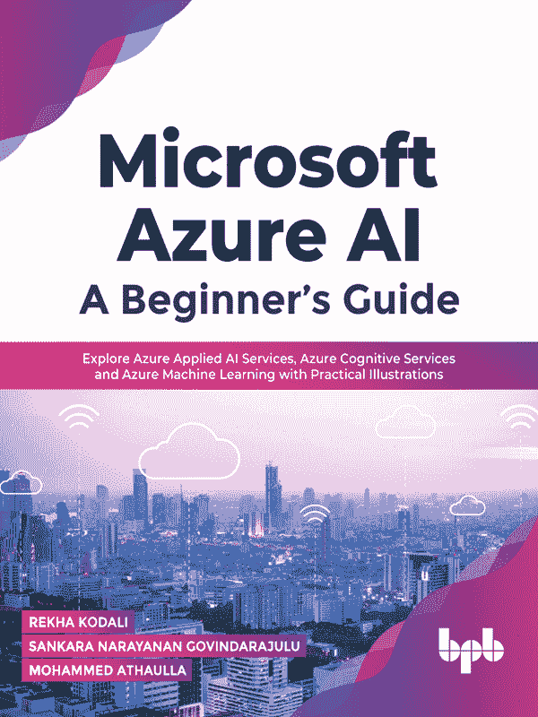


## 前言

作为 Avanade 公司 Azure 全方位解决方案高级副总裁，我认为人工智能（AI）是所有垂直领域和客户群体数字化转型的核心支柱。

AI 的概念让许多自由思考者着迷，让另一些人恐惧。少数人将 AI 视为构建未来业务的大跃迁，而有些人则基于可能导致人类灭绝的恐惧攻击这一理念。

虽然 AI 技术距离创造能够自我意识和自我进化的 AI 还很远，但事实上——AI 已经对我们生活的每个方面产生了巨大影响。AI 为各行业的企业提供了利用其构建未来产品、服务、优化运营，并为改善客户体验和员工体验提供无价洞察的机会。每年人工智能和自动化领域都有新进展，企业可以用各种创新方式利用这些进展。但你猜怎么着，AI 专业人才的匮乏是加速 AI 采用的最大障碍之一。

我喜欢这本书的地方在于，它为不同的角色提供了从 CTO 层到 AI 架构师、AI 顾问或初级 AI 开发人员的实用指南。这本书让学习 Microsoft Azure AI 概念、常见用例变得简单，涵盖了 Azure AI 的基础和高级概念。本书结构良好，涵盖了大量的 Azure AI 和 PaaS 能力。学习新技术最好的方法是尝试开发简单的应用程序并编写代码。这本书通过解释良好的工作代码示例帮助解决这一问题。

我很喜欢涵盖 Azure AI 平台基础、Azure AI 生态系统和服务概念的章节。如果你想学习 Azure 认知服务、Azure 计算机视觉，这是一本必读之书。

## 关于作者

**Rekha Kodali** 是埃森哲首席总监。她在微软技术领域拥有 23 多年的经验，其关注领域包括 Azure、企业架构、微服务、解决方案架构和售前工作。她在创建差异化解决方案和服务供应方案方面发挥了重要作用。她的证书包括 TOGAF、IASA 认证基础架构师和 Azure 解决方案架构师专家。她是《Developing Cloud Native Applications Using Azure .Net Core: A Practitioner's Guide to Design, Develop and Deploy》的作者。

LinkedIn: `https://www.linkedin.com/rekha-kodali-3561201b/`

**Sankara Narayanan Govindarajulu** 是微软的解决方案架构师，帮助合作伙伴和客户完成数字化转型之旅。在 23 年的职业生涯中，Sankara 利用其深经验和热情以引入人的方式帮助客户进行战略决策、项目执行、架构设计以及企业解决方案开发。Sankara 拥有 TOGAF 认证，并拥有 Azure 迁移、架构、开发和安全认证。他出版过书籍和期刊，并在多次技术会议上进行过演讲。

LinkedIn Profile：`https://www.linkedin.com/in/sankara-narayanan-g/`

**Mohammed Athaulla** 是 Wipro 首席开发人员，在微软技术领域拥有 10 多年的经验。他在使用 Azure、ASP.net core MVC、Web API、Angular、JavaScript、SQL Server 等各种技术进行软件应用程序开发和定制方面拥有实战经验。他领导了一个大型 AI 解决方案的开发。

LinkedIn Profile：`https://www.linkedin.com/in/athaulla/`

## 关于评审员

**Suryanarayana Murty Eranki** 在架构和交付云解决方案方面拥有 24 年实践领导经验，并在 IT 软件方面拥有丰富经验。他是一位成就卓越且技术复杂的领导者，在项目生命周期内架构和实施大型、复杂且业务关键的技术项目方面表现成功。作为云解决方案专家，他帮助企业采用 Microsoft Azure、Amazon Web Services 和 Google 等公共云平台。他曾在 Wipro、Tech Mahindra、Cognizant、Genpact 等公司工作，目前在海得拉云咨询精品公司 Apware - Hyderabad 担任执行董事，为客户提供基于 Microsoft Azure 和 AI/ML 的解决方案。

LinkedIn 档案：`https://www.linkedin.com/in/eranki/`

## 致谢

`Rekha Kodali`: 我想感谢并感谢导师 Venkata Guru Prasad Kandarpi 和 Hari Kishan Burle 提供的指导、灵感和支持。感谢我的孩子们（Sireesh 和 Tarun）、我的兄弟们、Sarath 以及我的丈夫的支持。

`Sankara Narayanan Govindarajulu`: 感谢家人、朋友、同事和评审人员，他们的支持和灵感让这一切成为可能。

`Mohammed Athaulla`: 我非常感谢我的父母、妻子和儿子（Zayan）。没有他们的支持，这一切将是不可能的。

## 前言

近几年证明，AI 正在迅速成为各种规模组织的“新常态”。各各的组织正在为未来重新调整其战略和投资，将 AI 成为首要任务之一。本书的目的是是提供实用的指导方，如果你是 CTO/架构师/设计师/顾问/开发者，甚至是 AI 旅程中的初学者，这些指南可能对你有所帮助。我们相信这本书将让你轻松学习 `Azure AI` 概念，并涵盖了 `Azure AI` 的基础及一些高级概念。本书分为 8 章节。对 `Azure AI` 开发感兴趣的软件专业人士将从中受益。

## 代码包与彩色图片

请点击链接下载本书的 `Code Bundle` 和 `Coloured Images`：

[`rebrand.ly/137e75`](https://rebrand.ly/137e75)

本书的代码包也托管在 GitHub 上，地址为 [`github.com/bpbpublications/Microsoft-Azure-AI-A-Beginner-s-Guide`](https://github.com/bpbpublications/Microsoft-Azure-AI-A-Beginner-s-Guide)。如果代码有更新，将在现有的 GitHub 仓库中更新。

我们在丰富的书籍和视频目录中提供了代码包，地址见 [`github.com/bpbpublications`](https://github.com/bpbpublications)。欢迎去查看！

## 如果您兴趣成为作者

如果您在某个领域拥有专业知识，并兴趣编写或贡献书籍，请访问 `www.bpbonline.com.bonline.com`。我们与成千上万像您这样的开发者和技术专业人士合作，帮助他们将见解分享给全球技术社区。您可以提交通用申请、申请我们正在募作者的热门主题，或提交自己的想法。

## 评论

请留下评论。在您阅读并使用这本书后，为什么不在您购买的网站上留下评论呢？潜在读者可以查看并参考您的无偏见意见做出购买决策。我们 BPB 可以了解您对产品的看法，我们的作者也可以看到他们对书籍的反馈。谢谢！

更多关于 BPB 的信息，请访问 `www.bpbonline.com.bonline.com`。

*   Azure 提供的构建 AI 应用程序平台
*   Azure 认知服务 – 核心方面
*   对话式 AI
*   Azure 计算机视觉
*   用例 – 企业场景
*   设置开发工具

## 目标

阅读本章后，读者将理解 Azure AI 平台、Azure 认知服务的核心概念、Azure 计算机视觉提供的各种服务以及利用 Azure 计算机视觉的具体用例。

## Azure AI 平台

智能应用程序利用人工智能为用户提供丰富、自适应、个性化、沉浸且上下文相关的体验，并具有自主性。文本、语音和视觉的自然接口解锁了对话商务和 AR/VR 等新类别，有助于构建沉浸式应用程序。沉浸式应用程序整合了情感和情绪检测、视觉和语音识别、语言理解、知识和搜索等智能功能。Azure AI 平台提供了快速构建此类应用程序的能力。Azure AI 平台可以大致分为四类服务/组件，如下：

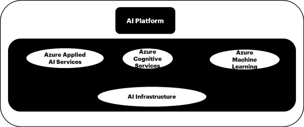

**图 1.1:** Azure 提供的构建 AI 应用程序的组件

## Azure 应用 AI 服务

Azure 应用 AI 服务是基于 Azure 认知服务构建的。它们有助于完成任务，如提高课堂素养、诊断、指标异常监控、从文档中挖掘知识、文档理解、转录分析等场景。

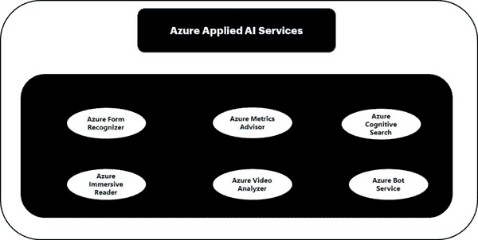

**图 1.2:** Azure 应用 AI 服务

*   **Azure Form Recognizer**: 它帮助从表单文档中识别并提取文本、键值对和表格数据。它有助于从表单导入文本，并输出包含原始文件中关系的结构化数据。
*   **Azure Metrics Advisor**: 它通过结合近实时监控、适应特定场景的模型来帮助识别并修复问题，并辅助诊断和告警。
*   **Azure Cognitive Search**: 它利用内置的 AI 能力，帮助识别和探索相关内容。
*   **Azure Immersive Reader**: 这是一个包容性设计的工具，通过实施各种技术来提高语言学习者、新阅读者以及学习差异者的阅读理解能力。
*   **Azure Video Analyser for Media**: 它帮助从视频和音频文件中提取语音词、人脸等元数据。
*   **Azure Bot Service**: 它有助于开发对话式 AI 体验。
*   **Azure Cognitive Services**: 开发者可以快速消费高级“成品”服务，加速 AI 解决方案的开发。它们有助于根据组织的可用性、安全性和合规性要求定制智能应用程序。
*   **Azure Machine Learning**: 由一套全面的工具和框架组成，有助于构建、部署和运行机器学习模型。它们提供了一系列支持的工具、IDE 以及 Azure ML studio，有助于轻松构建、微调机器学习模型并进行部署。
*   **AI 基础设施**: AI 服务和工具通过提供访问大规模基础设施作为支持。它提供了包含数千个尖端 GPU 的超集群、涵盖最全面 GPU 集的广泛 AI 硬件，以及一系列通用 CPU。它在每个服务器内部都提供了最新的高带宽网络。

我们将查看使用 Azure AI 平台可以构建的不同类型的应用程序。

### AI 服务

AI 服务有助于通过简单的 `REST API` 调用访问高质量的语音、视觉、决策、语言和 AI 模型，并提供创建我们机器学习模型的能力。

提供的 AI 服务可以大致分类如下：

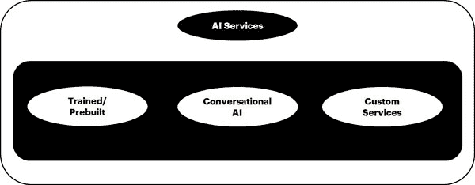

**图 1.3:** AI 服务

以下是 AI 服务的概述：

### 训练好的服务（预构建）

训练好的服务是 Microsoft Azure 认知服务，它们提供了一系列基于机器学习的 Azure Rest APIs，可以轻松集成到应用程序中以注入智能。

*   **训练好的/预构建的服务的用例**：以下是利用认知/训练好的服务的几个用例：

    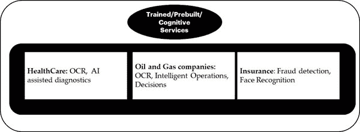

    **图 1.4:** 训练好的/预构建/认知服务

    *   **医疗保健**: 我们可以根据需要利用 `OCR` 和 `Read` API 以及其他自定义算法/逻辑处理大量文本，这些文本包含对通用实体（如人名）和特定领域实体（如药物和疾病名称）的引用，这些实体需要进行连接和关联。有时我们还需要将其与以已知方式分析的图像（例如 `OCR`）相结合，并应用领先的方法（例如 AI 辅助诊断）。
    *   **石油天然气公司**: 石油气公司拥有地质学家和其他专家团队，他们需要理解地震和地质数据。他们通常拥有大量的 PDF 库，其中包含样本照片以及写满手写现场笔记的样本表。他们需要连接地点、人员（领域专家）、事件，并导航所有信息以做出关键决策。我们可以利用 `OCR` 和其他自定义算法/逻辑进行分析并做出决策。
    *   **保险**: 可以通过 `Azure Machine Learning` 识别交易中的异常来完成欺诈风险分析，`Face Recognition` 可作为身份验证机制。

### 对话式 AI

对话式 AI 有助于创建基于 AI 的对话界面。Azure 提供了 Bot 服务，包括用于端到端开发的 Bot Builder SDK 以及连接多个通道的 Bot Connector 服务。我们可以用多种语言创建 Bot。

Bot 是一种使用对话界面进行通信的 Web 服务，并利用 Bot Framework Service 在 Bot 和通道之间交换事件和消息。

可以通过添加 NLP 等附加功能扩展 Bot 功能。微软认知服务如语言理解服务 (`LUIS`) 可以添加到 Bot 交互中，使对话更加直观。

以下是扩展 Bot 功能的一些方式：

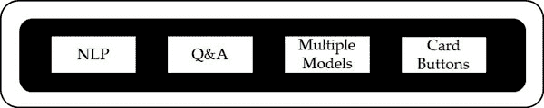

**图 1.5:** 扩展 Bot 功能

下表显示了用于扩展 Bot 功能的一些附加功能。

| 功能 | 描述 |
| --- | --- |
| 自然语言处理 | NLP 可用于识别和理解用户的意图、捕捉拼写错误、启用语音等。 |
| 问答 | 可以利用知识库使对话更自然。 |
| 管理多个模型 | “管理多个模型”功能可用于管理多个模型，如 `LUIS`、`Q&A maker`。 |
| 添加卡片和按钮 | 卡片和按钮可增强用户体验。 |

**表 2.1:** 利用 Bot 功能

对话式 AI 的用例：利用对话式 AI 的几个用例如下：

*   Bot 可以帮助保险公司为其客户提供一种简便的方法来查看理赔状态并询问有关福利的问题。
*   Bot 可以帮助医疗提供者通过症状检查器分诊患者问题，帮助患者寻找医疗服务并查找附近的医生。
*   Bot 可以帮助终端客户与银行/零售网站进行智能对话。
*   Bot 可以利用语言理解模型、Bing 知识和内容进行构建。它们能够从之前的交互中学习。

### 自定义服务

自定义服务有助于使用自定义训练的模型来构建应用程序。产品推荐、交易欺诈检测、销售预测都是利用自定义服务的应用示例。Azure 提供了一个易于使用的平台，用于开发/构建、训练和部署自定义机器学习模型，并使用了 `Visual Studio Code`、`Jupyter Notebooks` 以及 `Tensorflow`、`PyTorch` 等开源工具。它还可以通过简单的 `REST API` 调用，将这些功能作为服务嵌入到自定义应用程序中。

- **自定义服务的用例**：以下是利用自定义服务的几个用例：

  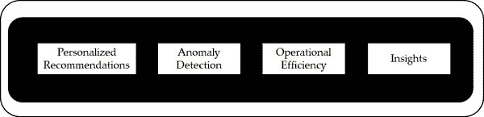

  **图 1.6：** 自定义服务的用例

  - 提供产品推荐、针对药物、服装、产品等的个性化推荐。
  - 为患者提供指导和治疗。实现体检等检查检查的个性化建议和推荐。
  - 临床医生可以通过分析医疗记录来主动识别风险患者，并使用来自智能设备的数据提供个性化护理。
  - 使用异常检测进行欺诈识别。提高运营效率。我们可以通过从设备收集的数据中得出智能洞察和行动来提高运营效率。
  - 提高安全性。通过提供对车间活动的洞察，可以通过维护来提高设备的安全有效性。

现在我们已经了解了 AI 服务，我们将深入研究 Azure 认知服务（Azure Cognitive Services）。

# Azure 认知服务

Azure 认知服务提供了 `APIs`、`SDKs` 和服务，开发者利用这些服务可以将语音、光学识别、情感分析、人脸识别、视频分析、文本分析等认知智能注入应用程序。

Azure 认知服务提供了一系列托管在 Azure 上的基于机器学习的内置 `Azure Rest APIs`。我们可以利用这些 `Azure Cognitive Service APIs` / 服务轻松地为 Web、移动、桌面应用程序添加智能功能，例如人脸识别、语音识别、情绪和情感检测、视觉和语音识别、知识、搜索和语言理解。这些 `APIs` 是跨平台的，可以在各种设备上访问。

Azure 认知服务可以大致分为决策、语言、语音、视觉和网页搜索，如下：

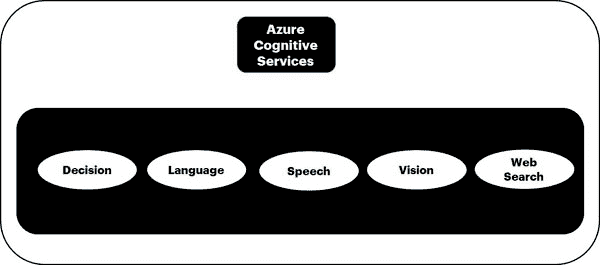

**图 1.7：** Azure 认知服务

以下是 Azure 认知服务下不同服务的简要描述：

- **决策服务 (Decision Service)**：帮助构建通过添加推荐来辅助高效决策的应用程序。决策服务包括 `Personalizer` 和 `Content Moderator`。

  - **Personalizer 服务**：`Personalizer` 服务是一种云端服务，帮助应用程序选择向用户展示的最佳内容，并通过易于使用的 `APIs` 帮助强化学习。决策 `API` 的一些用例包括 `Intent`（意图）的澄清和消除歧义，这在当用户意图不明确时，通过提供个性化选项帮助用户获得更好的体验。`Decision API` 帮助为个性化菜单和选项提供建议。

    例如，它可以用于向购物者建议产品。应用程序可以监控用户的反应，并向 `personalizer service` 发回 `reward score`（奖励分数），从而实现机器学习模型的持续反馈和改进，这进一步增强了 `personalizer` 提示语境化推荐的能力。

  - **异常检测器 (Anomaly detector)**：`Anomaly detector` 帮助监控和检测异常。`Anomaly detector` 以时间序列数据作为输入，帮助使用异常检测算法检测数据中的下降和峰值。它可以在云端或边缘端使用，并进行自定义。

  - **内容审核器 (Content moderator)**：`Content moderator` 帮助监控和检测攻击性内容。


- **语言服务 (Language service)**：帮助构建嵌入语言理解的应用程序。这有助于识别实体及其关系，更好地理解情感并理解信息。以下是语言服务的一些用例：

  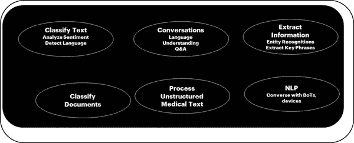

  **图 1.8：** 语言服务

  它帮助注入对话中，并允许使用 `Natural Language Processing`（自然语言处理）驱动 `Bots`、应用程序和 `IoT Devices`。

- **语音服务 (Speech service)**：帮助将语音转换为文本并将文本转换为自然的语音。语音有助于不同语言之间的翻译，并实现说话人验证和识别。以下是语音服务的一些用例：

  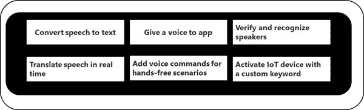

  **图 1.9：** 语音服务

  - **语音转文本 (Speech to Text)**：帮助实时将音频流翻译为文本

  - **文本转语音 (Text To Speech)**：帮助将文本转换为合成语音

  - **语音翻译 (Speech Translation)**：帮助实现语音的实时多语言翻译

  - **语音助手 (Voice Assistants)**：帮助赋予开发者为应用程序创建对话式界面

  - **说话人识别 (Speaker Recognition)**：帮助提供 API 来识别和识别说话人

  - **意图识别 (Intent Recognition)**：帮助识别语音、实体和意图

- **视觉服务 (Vision Service)**：帮助分析图像、视频，执行某些分析并得出洞察，如识别、识别标题、滥用内容等。

  - **计算机视觉 (Computer Vision)**：提供处理图像的先进算法访问

  - **人脸 (Face)**：`Face` 服务提供了高级算法的访问，实现人脸属性检测和识别

  - **自定义视觉服务 (Custom Vision Service)**：提供构建图像分类器的能力。

- **网页搜索 (Web Search)**：帮助为应用程序添加 `Bing Search APIs`。`Bing Search` 帮助通过单个 `API call` 从网页、图像、视频和新闻中搜索信息。帮助为用户查询提供即时答案，并可以轻松配置以包含网页、图像、视频、新闻、翻译，基于搜索相关性和您的 `Bing Search subscriptions` 以 `JSON` 格式输出。它有助于实时建议搜索词、过滤结果、本地化搜索结果并使用 `Bing Statistics` 分析搜索指标。

在书中，我们将专注于上述描述的 `Azure Cognitive Services` 和 `Azure Applied AI Services`。我们将从理解基础知识开始，然后详细介绍 `Azure Vision API` 提供的每个 `API`。

# Azure 视觉服务

Azure 视觉服务提供了 `APIs` / `SDK` 来分析图像、视频、从图像提取文本并审核图像内容。我们可以利用 `APIs` 或 `SDK`。`Vision APIs` 帮助为应用程序注入视觉能力，如图像处理、视频分析和洞察、人脸识别和检测能力、OCR 能力。

我们将详细查看每个 `API`。

- **计算机视觉 (Computer Vision)**

计算机视觉提供了用于分析图像、从图像中提取文本以及审核内容的 API。Azure 计算机视觉（Azure Computer Vision）提供了帮助处理和分析照片、图像和视频的 API。这些 API 允许用户执行图像分类、从图像中提取情感、读取手写并转换为文本，或根据图像中的意图为图像添加描述。它有助于识别人脸并根据分类应用标签等。例如，计算机视觉可以帮助判断图像是否包含成人内容，找到图像中的所有人脸，并从视频中提取洞察。

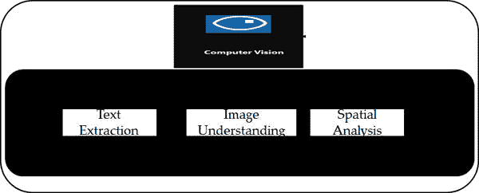

**图 1.11:** Azure 计算机视觉

以下是各个 API 的详细描述：

### 文本提取

帮助从图像中提取文本。它提供了光学字符识别，包括 `Read API` 和 `OCR API`。

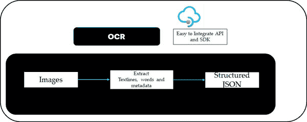

**图 1.12:** 自定义服务的用例

*   `Read API` 帮助从图像中提取文本，并针对文本密集的图像和包含大量文本内容的文档进行了优化。我们可以使用此 API 从名片、海报、收据、白板等提取信息。

*   `OCR API` 同步执行，未针对大型文档进行优化。它利用了较旧的识别模型。`OCR` 支持约 25 种语言。`OCR` 会自动检测识别文本的语言。它提供了纠正识别文本旋转的能力，并提供每个词的帧坐标。

### 图像分析

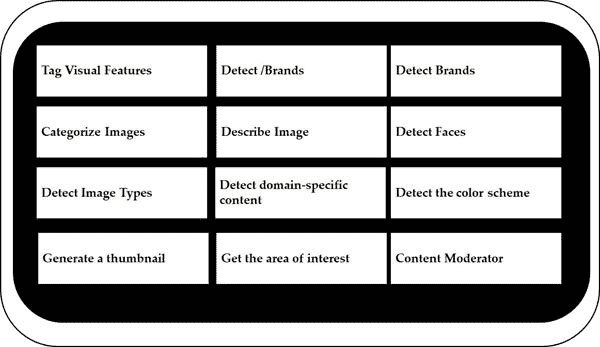

**图 1.13:** 自定义服务的用例

图像识别和分析可以从图像中提取各种视觉特征，如分类、图像类型。可以通过利用 `Analyze Image API` 执行图像分析，该 API 提供的功能包括定位图像中的所有人脸、检查图像是否包含成人内容、描述图像、生成图像缩略图、识别并标记图像中的视觉特征、检测图像中的物体、检测图像中的商业品牌、识别并标记整幅图像、检测色调、检测特定领域的内容以及获取感兴趣的边界框坐标。

以下是 `Analyze Images API` 功能的简要概述：

| 操作 | 描述 |
| :--- | :--- |
| 标记视觉特征 | 帮助利用大量预构建模型识别并标记图像中的视觉特征。 |
| 检测物体 | 帮助返回每个标签的边界框坐标。我们可以利用此来处理给定图像中物体之间的关系。 |
| 品牌检测 | 帮助检测图像中的商业品牌。这有助于检查品牌的流行程度。 |
| 图像分类 | 帮助使用预构建类别对图像进行识别和分类。 |
| 描述图像 | 帮助根据图像中识别出的物体返回描述。对于每个识别出的物体还会返回一个置信度评分。 |
| 检测人脸 | 帮助检测人脸并提供有关每个检测到的人脸的信息。我们可以使用这些信息实现数字 ID 或姿态检测等。 |
| 检测图像类型 | 帮助识别给定的图像是线条画还是剪贴。 |
| 检测特定领域内容 | 帮助使用名人等预构建模型识别特定领域的内容。 |
| 检测色调 | 帮助识别图像是黑白的还是彩色的，并帮助识别彩色图像的强调色和主色调。 |
| 生成缩略图 | 帮助识别并裁剪感兴趣区域并返回缩略图。它可以识别图像中的人脸等并进行裁剪。它提供质量质量的缩略图。它具有识别图像中人脸等并在周围进行裁剪的能力。 |
| 获取感兴趣区域 | 帮助分析内容并返回感兴趣区域的坐标。 |
| 内容审核 | 它帮助检测图像中的成人和攻击性内容并返回置信度评分。标记内容的阈值可以根据需要设置。`Content Moderator APIs` 帮助视频、文本和图像的内容审核。`Content Moderator APIs` 有助于对攻击性内容进行标记。这些被标记的内容可以通过基于工作流的应用程序处理，删除删除攻击性内容，这可能还需要人工干预。 |

**表 2.2:** 图像分析

### 空间分析

计算机视觉空间分析通过摄取摄像头的流视频帮助提取洞察并生成事件。它可以检测人的存在及其移动，并帮助计算进入空间的人数或测量佩戴口罩的合规性。

以下是空间分析的一些用例：

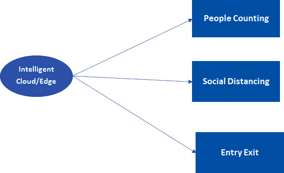

**图 1.14:** 空间分析的用例

### 自定义视觉服务

Custom Vision 提供自定义图像训练用于异常检测、带有自定义标签的物体等用例。通过 Custom Vision，我们可以构建并训练自定义的视觉模型。输入模型的图像越多，模型训练得越充分，预测就越准确。

以下是自定义视觉模型的训练方式：

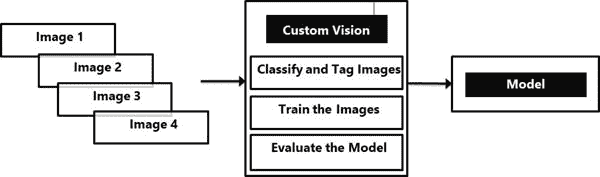

**图 1.15:** 自定义视觉模型

一旦创建了项目，我们就可以上传图像、定义标签并针对标签对图像进行训练。每个类别至少上传 50 张图像即可获得良好的准确率。当上传更多图像时，需要重新训练模型。

Custom Vision 提供两个 API 将自定义模式集成到应用程序中：Prediction API 和 Training API。定义如下：

*   `Prediction API`: `Prediction API` 允许我们将训练好的模型集成到自定义应用程序中。该 API 可以 REST 服务访问，也可以在 Windows 应用程序中使用客户端。

*   `Training API`: `Training API` 允许我们使用代码构建并训练图像，并集成到应用程序中。

*   定价: 访问以下链接获取更多关于定价的信息：

    `https://www.azure.com/en-gb/pricing/details/cognitive-services/customvision-service/`

    虽然免费层用于实验，定价基于存储以及每秒事务数等因素。

### 人脸 API

Face API 能够对照片中的人脸进行检测、分析、识别、组织和标记。它还允许识别心情或情绪，目前支持约 9 或 10 种情绪。

Azure Face API 有助于分析人脸、识别人物和寻找相似脸。脸检测和人脸识别是 Face API 涵盖的两个基本方面。它还帮助检测图像中的愤怒、恐惧、惊讶、厌恶、快乐和悲伤。

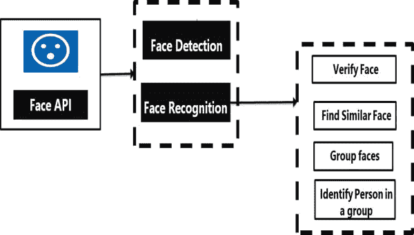

**图 1.16:** Face API

`Face Detection` 帮助发现脸部属性，如性别、年龄等。

`Face Recognition` 支持以下功能子类：

*   `人脸验证`: 验证两张脸是否匹配。

*   `寻找相似脸`: 接收一张脸，并尝试根据一组脸的相似程度创建排序。

*   **人脸聚类 (Face Grouping)**：根据相似程度对一组照片创建人脸子组。

*   **人脸识别 (Face Identification)**：这允许我们训练图像成为一组的一部分。我们可以使用越来越多的图像来训练模型并提高准确性。我们需要创建一个 `PersonGroup` 对象，其中包含该人的多张图像并进行训练。

下面的图片显示了我们如何进行人脸识别的训练：

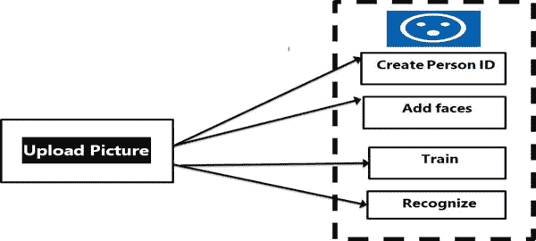

**图 1.17：** 人脸识别

### 访问 API

调用 `Computer Vision API` 需要订阅密钥，该密钥可以通过请求头中指定的查询字符串参数传递。我们可以按照以下方式获取订阅密钥：

下方提供的是 Computer Vision 的链接：**[`azure.microsoft.com/en-us/services/cognitive-services/computer-vision/`](https://azure.microsoft.com/en-us/services/cognitive-services/computer-vision/)**

一旦进入此页面，点击“`Try the Computer Vision API`”。然后我们需要选择订阅类型。

一旦获得订阅密钥，我们就可以利用它们从自定义代码中调用 API。

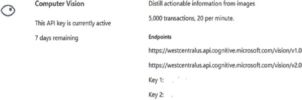

**图 1.18：** 订阅密钥

我们将探索一些使用 Azure Vision APIs 的用例。

## 用例

Azure Vision APIs 可用于各种利用图像分类、目标检测、情绪/情感分析的场景。情感分析可用于分析情绪。

这里有两个示例：

*   **智能图像分类和目标检测**：可以根据图像分类将图像分类为好或坏。这对于交通拥堵、发送交通警报、家庭监控和安全解决方案等用例非常有用。

*   保险公司可以使用智能图像分类对图像进行分类，并指导保险代理确定正确的保费金额。

  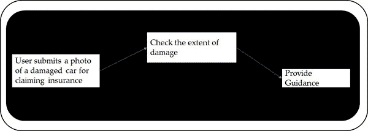

  **图 1.19：** 保险用例

*   **智能安全**：利用 `Face Detection API` 可以识别客户并提取相关信息（如电子健康记录），以提供正确的服务。示例场景包括在医院柜台等待的患者或在银行柜台等待的客户。

  下方是医院/银行柜台的用例。当客户来到柜台时，可以扫描人脸并提取相关记录，以便护士或出纳员在轮到患者之前了解其病史。这将有助于缩短等待时间。

  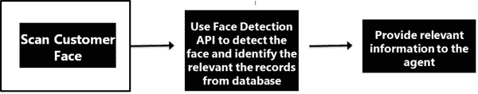

  **图 1.20：** 医院柜台用例

*   **情绪分析 (Emotion Analysis)** 可以帮助组织了解客户如何接收其产品/服务，并帮助他们改进服务。它还可以帮助人群分析。如果许多人在会议上看起来很无聊，也许是时候宣布休息了。

  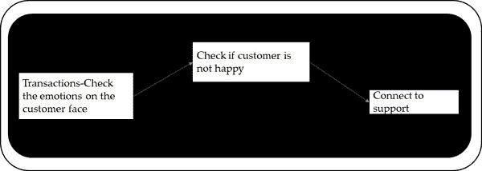

  **图 1.21：** 情绪分析用例

*   **内容审核 (Content Moderator)** 可以帮助自动执行任务以处理不当内容，从而确保内容共享网站的安全和易用。`Video Indexer` 然后可以帮助人群分析。

## 结论

Azure Vision APIs 可用于各种利用图像分类、目标检测、情绪/情感分析的场景。情感分析可用于分析情绪。

## 多选题

在本章中，读者将理解如何使用 Azure Vision APIs 进行图像处理和目标检测。阅读本章后，读者将掌握利用图像分析、内容审核和 Azure Custom Vision 服务来有效构建应用程序的技能。

## 答案

你有电影的图像和观众离开电影院的图像。

1. **c. **

2. **b. **

3. **b. **

4. **b. **

5. **a. **

6. **b. **

7. **b. **

8. **b. **

9. **b. **

10. **a.**

# 第 2 章

# Azure Computer Vision - 图像分析、处理、目标检测 

在本章中，读者将理解如何使用 Azure Vision APIs 进行图像处理和目标检测。

## 结构

本章将涵盖以下主题：

* 图像处理：
    * 使用 Computer Vision API 进行图像分析、内容审核
    * 使用 Azure Custom Vision Service 进行图像分类
    * 使用 Azure Custom Vision Service 进行目标检测

## 目标

在本章中，读者将理解如何使用 Azure Vision APIs 进行图像处理和目标检测。阅读本章后，读者将掌握利用图像分析、内容审核和 Azure Custom Vision 服务来有效构建应用程序的技能。

## 图像处理

处理图像信息是开发业务关键应用时应用人工智能的一个非常重要的方面。我们可以通过图像分析和图像分类来分析和处理图像，这是 Azure Vision Service 的两个不同方面。以下章节将详细介绍图像分析和图像分类。

## 图像分析 - Azure Computer Vision API

我们可以利用 Azure Computer Vision `Analyze Image` API 来分析图像并获取有关图像视觉方面的信息。它根据不同的视觉特征返回描述，并对每个特征提供一个置信度评分。最终输出是一个按置信度从高到低排序的描述列表。基于数千个可识别的对象，计算机视觉除了返回背景详情外，还会根据图像中识别出的物体、生物体和动作返回标签。在信息不可用的地方会提供提示（Hints）。

下面的图显示了我们使用 `Analyze Image` API 可以执行的操作：

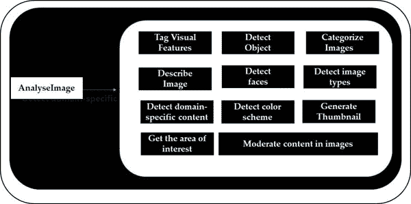

**图 2.1：** 使用 `AnalyzeImage` API 可以执行的操作

### 详细分析 API：

*   **检测对象 (Detect object)**：我们可以利用对象检测 API 列出对象及其对应的坐标，并检查某个对象的相似实例的数量。我们可以利用 `detect` 操作来确定对象之间的关系，并获取每个找到的对象的边界框（bounding box）坐标。标签是根据图像中包含的对象和生物应用的。

    例如，对于包含像 `cat`（猫）、`dog`（狗）等对象的图像，`Detect API` 将列出这些对象及其在图像中的坐标。此 API 可用于关联图像中对象之间的关系。`Detect API` 帮助检查图像中是否存在同一标签的多个实例。

    以下是 `Detect API` 的一些局限性：

    *   小于图像 5% 的对象不会被检测
    *   组织得太近的对象可能不会被检测

*   **类别 (Categories)**：我们可以利用此方法从约 86 个类别中获取类别。

    示例分类包括 `dog`（狗）、`outdoor`（户外）、`bread`（面包）等：


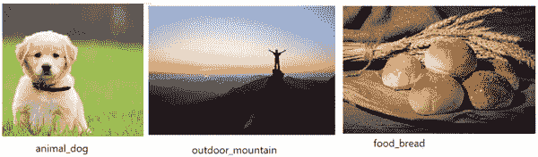

**图 2.2：** 示例分类

*   **检测品牌 (Detect Brands)**：我们可以利用此方法获取关于社交媒体上哪些品牌受欢迎的见解。

    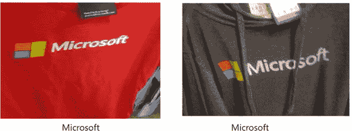

    **图 2.3：** 示例品牌

*   **图像分类 (Categorize an image)**：我们可以利用此方法识别并对整个图像进行分类，使用具有父子继承层次结构的类别分类体系法。

*   **列出特定领域模型 (List domain-specific models)**：我们可以利用此方法返回 Computer Vision API 支持的特定领域模型，包括名人识别器、地标识别器。

*   **生成缩略图 (Generate a thumbnail)**：我们可以利用此方法返回由用户指定的宽度和高度的缩略图。服务将对图像进行分析，识别“感兴趣区域”（`ROI`）并根据 `ROI` 生成智能裁剪坐标。

*   **描述图像 (Describe image)**：我们可以利用此方法返回图像的描述，该描述是图像中内容的标签集合，并带有置信度评分。支持的输入方法包括指定图像或图像 URL。我们在随后的章节中有一个实验。

*   **检测脸部 (Detect faces)**：我们可以利用此方法提供有关图像中检测脸部的信息。返回的每个脸部的详情包括年龄、坐标、性别。

```csharp
private static async Task ProcessImage(string filePath)
{
    try
    {
        HttpClient client = new HttpClient();
        client.DefaultRequestHeaders.Add("Ocp-Apim-Subscription-Key", computerVisionsubscriptionKey);
        string requestParameters = "visualFeatures=Categories, Description,Color";
        string uri = baseURL + "?" + requestParameters;
        HttpResponseMessage response;
        byte[] byteData = GetPictureAsByteArray(filePath);
        using (ByteArrayContent content = new ByteArrayContent(byteData))
        {
            content.Headers.ContentType = new MediaTypeHeaderValue("application/octet-stream");
            response = await client.PostAsync(uri, content);
        }
        string jsonResponse = await response.Content.ReadAsStringAsync();
        Console.WriteLine("\nResponse:\n\n{0}\n", JToken.Parse(jsonResponse).ToString());
    }
    catch (Exception e)
    {
        Console.WriteLine("\n" + e.Message);
    }
}

private static byte[] GetPictureAsByteArray(string filePath)
{
    using (FileStream fileStreamReader = new FileStream(filePath, FileMode.Open, FileAccess.Read))
    {
        // Read the file’s contents into a byte array. 
        BinaryReader binReader= new BinaryReader(fileStreamReader);
        return binReader.ReadBytes((int) fileStreamReader.Length);
    }
}
```

示例输入文件如下：


**图 2.8：** 图像处理示例输入

**输出**：响应捕捉到图像包含狗，置信度为 0.9921875。

响应返回了标题为“一只坐在草地的狗”的描述，置信度为 0.737724174239289。

捕捉到的标签包括“狗”、“草”、“坐”、“动物”、“棕色”、“躺”、“前”、“黄色”、“大”、“站”、“白色”。

捕获的完整响应如下：

```json
{
  "categories": [
    {
      "name": "animal_dog",
      "score": 0.9921875
    }
  ],
  "color": {
    "dominantColorForeground": "White",
    "dominantColorBackground": "White",
    "dominantColors": [
      "White",
      "Green"
    ],
    "accentColor": "BB8310",
    "isBwImg": false,
    "isBWImg": false
  },
  "description": {
    "tags": [
      "dog",
      "grass",
      "sitting",
      "animal",
      "brown",
      "laying",
      "front",
      "yellow",
      "large",
      "standing",
      "white"
    ],
    "captions": [
      {
        "text": "a dog sitting in the grass",
        "confidence": 0.737724174239289
      }
    ]
  },
  "requestId": "550b3576-f360-42b3-aea8-70799c685852",
  "metadata": {
    "width": 781,
    "height": 512,
    "format": "Png"
  }
}
```

现在我们将介绍内容审核器 API，该 API 可用于内容审核。

## 使用 Azure Custom Vision 服务进行图像分类

我们可以利用 Microsoft Custom Vision 服务来构建自己的图像分类模型，根据标签将图像分类到不同的类别。几乎不需要编写代码，就可以上传图像、训练、测试并发布模型。一旦模型通过测试，就可以使用预测密钥和预测 URL 在自定义应用程序中调用它们对图像进行分类。

### Azure Custom Vision Service - 图像分类实验

以下是一个关于自定义视觉的实验，其中我们将使用包的图像进行对分类、训练并发布模型。

我们将使用 Azure custom vision 服务创建一个示例项目。我们将上传并训练图像。我们将训练模型，然后使用它进行预测。

#### 第 1 步：先决条件

* 访问 `www.customvision.ai`

* 创建新项目（New Project）– 选择 `Classification`（分类）

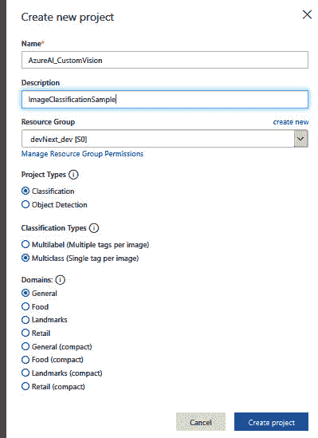

**图 2.9：** 创建新项目

#### 第 2 步：上传图像

项目创建后，我们就可以通过界面上传图像并根据需要对其标记。至少 50 张图像将提供良好的预测准确率。

在这里，我们上传了乒乓包并将图像分类为“粉色包”（Pink Bags）。

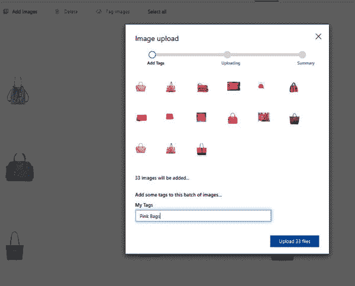

**图 2.10：** 上传图像

* 一旦带有正确的标签上传图像，我们需要训练模型。

    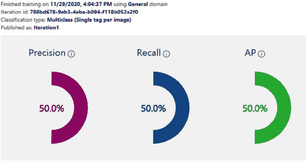

    **图 2.11：** 训练

#### 第 4 步：预测 API

一旦通过选择预测 URL（Prediction URL）完成模型训练，我们就可以预测 API 密钥、项目 ID 和项目 URL 将集成到我们的自定义应用程序中。

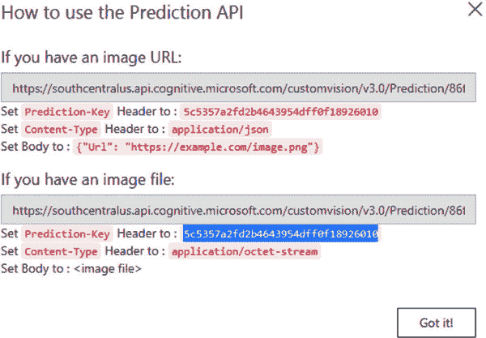

**图 2.12：** 预测密钥

#### 第 5 步：训练 API

Custom Vision Service 还提供了另一个称为训练 API（training API）的 API。训练 API 可将模型构建和训练集成到自定义应用程序中。

#### 第 6 步：创建控制台应用程序并运行：使用 Custom Vision 进行分类


```csharp
namespace CustomVision
{
    class Program
    {
        private static void Main(string[] args)
        {
            // 输入图像路径
            Console.Write("输入图像路径：");
            string filePath = Console.ReadLine();
            PredictOnRequest(filePath).Wait();
            Console.WriteLine("\n 回车退出...");
            Console.ReadLine();
        }

        public static async Task PredictOnRequest(string filePath)
        {
            // 添加密钥
            var client = new HttpClient();
            client.DefaultRequestHeaders.Add("Ocp-Apim-Subscription-Key", computerVisionsubscriptionKey);
            // 替换下面的字符串为 URL
            string url = baseURL + "?" + requestParameters;
            HttpResponseMessage responseMessage;
            byte[] byteData = GetPictureAsByteArray(filePath);
            using (var content = new ByteArrayContent(byteData))
            {
                content.Headers.ContentType = new MediaTypeHeaderValue("application/octet-stream");
                responseMessage = await client.PostAsync(url, content);
            }
            Console.WriteLine("\n 响应:\n\n{0}\n", JToken.Parse(await responseMessage.Content.ReadAsStringAsync()).ToString());
        }

        private static byte[] GetPictureAsByteArray(string filePath)
        {
            using (FileStream fileStreamReader = new FileStream(filePath, FileMode.Open, FileAccess.Read))
            {
                // 将文件内容读入字节数组。
                BinaryReader binReader= new BinaryReader(fileStreamReader);
                return binReader.ReadBytes((int) fileStreamReader.Length);
            }
        }
    }
}
```

## 使用 Azure Custom Vision 进行目标检测

我们可以利用 Custom Vision 中的目标检测类型来检测图像中的多个对象。我们可以在识别出的对象周围画框。

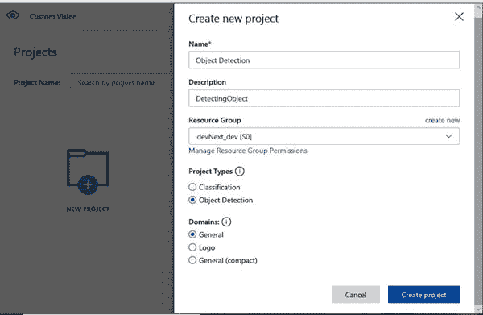

**图 2.13：** 使用目标检测

一旦上传图像，模型就会进行训练。上传图像后对其标记。我们可以训练模型、测试模型，并将模型应用于开发中。

## 总结

在本章中，我们查看了基础知识。学习了如何利用 Azure Vision API 进行图像处理、自定义视觉和目标检测。在下一章中，我们将探索光学字符识别、人脸 API 和空间分析。

## 多选题

思考实验 - 这将是一组 7-10 道题，用于测试对本章学习概念的理解。

有一群观众看了电影。你有电影的图像以及观众离开的图像。

1. **你想使用 Computer Vision 分析 API。先决条件是什么？**

   - 安装 `Microsoft.Azure.CognitiveServices.Vision.ComputerVision` 客户端库

   - 为 `AnalyzeImage` API 添加正确的端点

   - 添加适当的订阅密钥

   - 以上所有

2. **使用什么方法验证两个脸属于同一个人？**

   - 人脸检测

   - 人脸识别

   - 人脸分组

   - 人脸验证

3. **你将如何构建图像分类器？**

   - 使用 Azure Portal

   - 使用 Custom Vision

   - 使用 Computer Vision 网站

   - 使用基于 .NET Core 的门户

4. **如何获取 custom vision 服务的预测密钥？**

   - 使用 Azure Portal

### 2. 训练模型并获取预测密钥

### 3. 发布模型并获取预测密钥

### 4. 从 Azure Ops 站点获取密钥


### 5. 我们可以利用什么来检测图像中的多个对象？

1. 计算机视觉
2. 内容审核
3. 检测对象
4. 扫描内容

### 6. 我们可以利用什么返回 Computer Vision API 支持的特定领域模型（包括名人识别器、地标识别器）？

1. 列出特定领域模型
2. 生成缩略图
3. 描述图像
4. 以上所有

### 7. AnalyzeImage API 支持的文件大小是多少？

1. 1 MB
2. < 100 MB
3. < 4 MB
4. < 10 MB

### 8. 可以用什么方法获取关于社交媒体上哪些品牌最受欢迎的见解？

1. 类别
2. 列出特定领域模型
3. 检测品牌
4. 检测

### 9. Computer Vision API 支持哪些特定领域模型？

1. 名人识别器
2. 城市识别器
3. 国家识别器
4. 文化识别器

### 10. 可以用什么方法分析图像？

1. AnalyseImage
2. ExtractImage
3. PredictImage
4. Detect

## 答案

1. D. 以上所有
2. D. 人脸验证
3. B. 使用 Custom Vision
4. C. 发布模型并获取预测密钥
5. C. 检测对象
6. A. 列出特定领域模型
7. D. < 10 MB
8. C. 检测品牌
9. D. 文化识别器
10. A. AnalyseImage

# 第三章

# 计算机视觉 - 光学字符识别、Face API 和空间分析

阅读本章后，读者将理解 Vision APIs 中提供的各种 API。包括文本识别、光学字符识别、Face API 和空间分析 API。在本章结束时，读者将理解如何使用每个 API 构建应用程序。

## 结构

在本章中，将解释以下主题：

* 文本识别、光学字符识别
* Face API
* 空间分析
* 示例用例

## 目标

在本章中，读者将理解如何使用手写体识别、光学字符识别、Face API 和空间分析。阅读本章后，读者将掌握相关技能，通过利用手写体识别、光学字符识别、Face API 和空间分析来有效地构建应用程序。

## 手写/打印文本识别

处理手写或打印文本信息是开发智能应用程序的一个非常重要的方面。计算机视觉提供了不同的 API，帮助检测和提取图像中的手写或打印文本。这在健康、保险和银行等领域有许多用例。

下图显示了我们如何使用易于集成的 API/SDKs 处理打印和手写笔记。


**图 3.1：** OCR 用例

以下章节涵盖了计算机视觉中提供的用于 OCR 的不同 API。

* **Read API**: 使用 `Read API`，我们可以将文本转换为机器可读的字符流。此异步 API 适用于转换文本密集图像以及包含大量噪声的图像。它使用了最新的识别模型。

  以下是 `Read API` 的关键功能：

    * 支持的图像类型包括 TIFF、JPEG、BMP、PDF 和 PNG
    * 文件大小应小于 20 MB
    * 它可以处理多达 200 页，每页最多限制为 300 行

* **OCR API**: 我们可以利用 `OCR API` 同步将图像转换为文本。此 API 尝试检测文本的方向并尝试纠正图像的方向。

  以下是 `OCR API` 的功能：

    * 支持的图像类型包括 BMP、GIF、PNG 和 JPEG。
    * 支持按 90 度的倍数以及最多 40 度的小角度旋转图像。输入图像应大于或等于 40 x 40 且小于或等于 3200 x 3200 像素。
    * 大小应小于 1000 万像素。
    * 大小不大于 4 MB。
    * OCR 支持 25 种不同的语言并可以检测图像中文本的语言。

* **示例场景**

  下面是使用上述 API 的一些示例场景/用例。

  **场景 1**:

    * 用户上传支票。
    * 使用 `OCR API` 将支票转换为数字文本。
    * 验证签名。
    * 支票结清。

    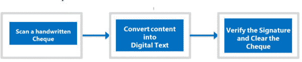

    **图 3.2：** 手写支票的 OCR 用例

  **场景 2**: 在有多个患者记录被扫描、数字化和存储的场景下，提供全面的患者记录对于提供适当治疗非常有用。

  我们可以通过对各种来源的医疗记录、保险记录进行 `OCR` 来创建聚合患者病史。这提供了一个全面的患者记录。这有助于提供正确的治疗。

  下图显示了我们如何使用 `OCR` 聚合来自多个来源的记录：

  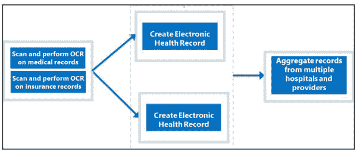

  **图 3.3：** 从多个来源聚合记录的 OCR。

  **场景 3**: 我们可以对一种语言的文档进行扫描并执行 `OCR`，使用 Azure Text to Speech API 翻译成另一种语言。

  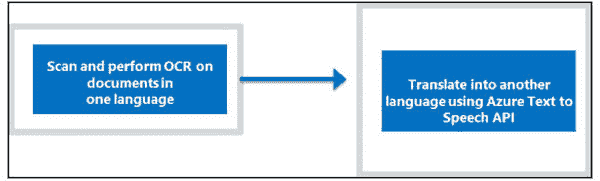

  **图 3.4：** 从多个来源聚合记录的 OCR。

### 手写识别实验

下面是识别手写的示例。我们将创建一个 .NET 控制台应用程序。该程序接收图像作为输入。它将识别并打印读取的文本。

按照步骤进行手写实验：

**步骤 1**: 创建一个新的 C# .NET Core App。

```csharp
using System;
using System.Net.Http.Headers;
using System.Net.Http;
using System.Web;
using System.IO;
using System.Threading.Tasks;
using Newtonsoft.Json;
using System.Collections.Generic;
using System.Linq;
using Newtonsoft.Json.Linq;
```

**步骤 2**: 访问 `https://portal.azure.com` 创建计算机视觉服务。

**步骤 3**: 替换有效的密钥和端点。

```csharp
namespace HandwritingDetection
{
    internal class Program
    {
        private static string subscriptionKey = "<密钥>"; //替换密钥
        private static string endpoint = "https://retailocr.cognitiveservices.azure.com/vision/v1.0/ocr?"; //替换端点 URL
        private static void Main()
        {
            var ch = "1";
            // 从用户获取路径和文件名
            Console.WriteLine("手写文本提取:");
            while (ch == "1")
            {
                Console.Write("输入想要读取的图像路径:");
                string imgPath = Console.ReadLine();
                if (File.Exists(imgPath))
                    MakeRequest(imgPath).Wait();
                else
                    Console.WriteLine("\n 无效路径");
                Console.WriteLine("\n 按回车 0 退出，按 1 继续...");
                ch = Console.ReadLine();
            }
        }
    }
}
```

**步骤 4**: 创建模型类 `ImageInfoViewModel.cs`

```csharp
namespace HandwritingDetection
{
    public class Word
    {
        public List<int> boundingBox { get; set; }
        public string text { get; set; }
        public double confidence { get; set; }
    }
    public class Line
    {
        public List<int> boundingBox { get; set; }
        public string text { get; set; }
        public List<Word> words { get; set; }
    }
    public class ReadResult
    {
        public int page { get; set; }
        public double angle { get; set; }
        public int width { get; set; }
        public int height { get; set; }
        public string unit { get; set; }
        public string language { get; set; }
        public List<Line> lines { get; set; }
    }

    public class AnalyzeResult
    {
        public string version { get; set; }
        public List<ReadResult> readResults { get; set; }
    }

    public class ImageInfoViewModel
    {
        public string status { get; set; }
        public DateTime createdDateTime { get; set; }
        public DateTime lastUpdatedDateTime { get; set; }
        public AnalyzeResult analyzeResult { get; set; }
    }
}
```

#### Step 5：添加 `MakeRequest()` 方法并使用请求头和正文进行 API 调用；

```csharp
private static async Task<string> MakeRequest(string imageFilePath)
{
    var errors = new List<string>();
    string extractedResult = "";
    var client = new HttpClient();
    var queryStr = HttpUtility.ParseQueryString(string.Empty);
    // Request headers
    client.DefaultRequestHeaders.Add("Ocp-Apim-Subscription-Key", "YOUR SUBSCRIPTION KEY");
    // Request parameters
    queryStr["language"] = "en";
    var uri = "YOUR CUSTOM VISION SERVICE URL" + "/vision/v3.1/read/analyze?" + queryStr;
    HttpResponseMessage httpResponse;
    string opsLocation;
    // Request body
    byte[] byteImageData = GetImageAsByteArray(imageFilePath);
    using (ByteArrayContent content = new ByteArrayContent(byteImageData))
    {
        content.Headers.ContentType = new MediaTypeHeaderValue("application/octet-stream");
        // 第一个 REST 调用启动异步过程来分析
        // 图像中的写入文本。
        httpResponse = await client.PostAsync(uri, content);
    }
    if (httpResponse.IsSuccessStatusCode)
    {
        opsLocation = httpResponse.Headers.GetValues("Operation-Location").FirstOrDefault();
    }
    else
    {
        // 显示 JSON 错误数据。 
        string error = await httpResponse.Content.ReadAsStringAsync();
        Console.WriteLine("\n\nResponse:\n{0}\n", JToken.Parse(error).ToString());
        Console.WriteLine(error);
        return error;
    }
    string result;
    int i = 0;
    do
    {
        System.Threading.Thread.Sleep(1000);
        httpResponse = await client.GetAsync(opsLocation);
        result = await httpResponse.Content.ReadAsStringAsync();
        ++i;
    } while (i < 11 && result.IndexOf("\"status\":\"Succeeded") == -1);
    // 如果成功，将执行后续处理。 
    if (httpResponse.IsSuccessStatusCode)
    {
        var responeData = JsonConvert.DeserializeObject<ImageInfoViewModel>(result);
        var linesCount = responeData.analyzeResult.readResults[0].lines.Count;
        for (int j = 0; j < linesCount; j++)
        {
            var imageText = responeData.analyzeResult.readResults[0].lines[j].text;
            extractedResult += imageText + Environment.NewLine;
        }
    }
    Console.WriteLine("Result:\n--------------------------------\n" + extractedResult + "--------------------------------\n");
    return extractedResult;
}
```

#### Step 6：添加下面的方法。

```csharp
private static byte[] GetImageAsByteArray(string imgFilePath)
{
    using (FileStream fileReaderStream = new FileStream(imgFilePath, FileMode.Open, FileAccess.Read))
    {
        // 读取文件内容到字节数组。
        BinaryReader binReader = new BinaryReader(fileReaderStream);
        return binReader.ReadBytes((int)fileReaderStream.Length);
    }
}
```

#### Step 7：生成并运行应用程序。

示例图像：


**图 3.5:** 示例输入

#### Step 8：提供图像路径作为输入。

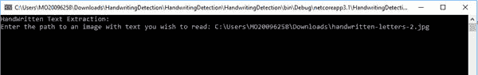

**图 3.6:** 输入图像路径

#### Step 9：输出

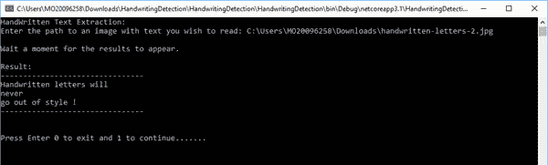

**图 3.7:** 示例输出

## 人脸识别

根据人的面部轮廓，人脸识别通过比较和分析模式来帮助识别或验证身份。人脸识别技术具有广泛的应用潜力。它使人机交互变得无缝。

人脸识别可以有效解决银行、医疗保健、住宅安全和旅行等行业领域的许多问题。

Face API 提供了 REST API 来对人脸执行各种任务，例如检测人脸、验证人脸、识别人脸、分析人脸、匹配人脸、分析人脸属性、分组相似脸。

我们可以利用 Face API 检测图像中的活动、从现有的图像数据库中匹配人脸、返回人脸坐标、管理配置文件、分析和识别视频帧中的人脸。

以下是 Face 用于脸识别的示例用例：

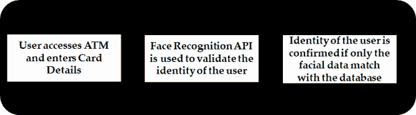

**图 3.8:** 使用人脸

### Computer API - 详情

根据人的面部轮廓，人脸识别通过比较和分析模式来帮助识别或验证身份。人脸识别技术具有广泛的应用潜力。它使人机交互变得无缝。

人脸识别可以有效解决银行、医疗保健、住宅安全和旅行等行业领域的许多问题。

Face API 提供了 REST API 来对人脸执行各种任务，例如检测人脸、验证人脸、识别人脸、分析人脸、匹配人脸、分析人脸属性、分组相似脸。

我们可以利用 Face API 检测图像中的活动、从现有的图像数据库中匹配人脸、返回人脸坐标、管理配置文件、分析和识别视频帧中的人脸。

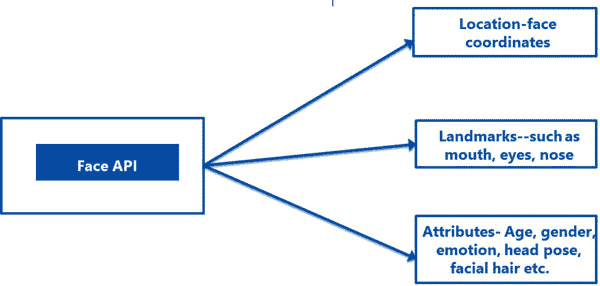

**图 3.9:** Face 提供的功能

一些用例包括：

* **识别人脸**：将人与组匹配。
* **识别相似脸**：将人与组匹配。
* **人脸检测**：检测图像中的人脸。
* **情绪识别**：为每个脸部返回一组情绪。
* **人脸分组**：根据相似特征对未识别的人脸分组。

### Face API - 实验

我们将使用自定义视觉服务创建一个项目，并利用 Face API 分析人脸。


#### 步骤 1：先决条件

* 需要有效的 Face API 订阅密钥。
* **Visual Studio 2015 或 2017** 及更高版本。
* NuGet 包：`Microsoft.Azure.CognitiveServices.Vision.ComputerVision` 客户端库

#### 步骤 2：创建并运行示例应用程序：使用 Face API 进行人脸检测

我们必须登录 Azure 门户。我们需要点击 `Create a Resource`（创建资源）。我们需要选择 `AI + Machine Learning`（人工智能+机器学习）。我们需要选择 `Face`（人脸）。

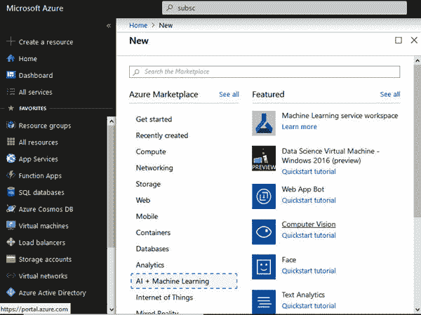

**图 3.10:** 创建项目

我们需要提供以下信息：

* **Name（名称）**：为 Face 提供名称。
* **Subscription（订阅）**：选择一个激活的订阅
* **Location（位置）**：选择资源组的位置。
* **Pricing Tier（定价层）**：选择定价层。
* **Resource Group（资源组）**：创建或选择现有资源组。

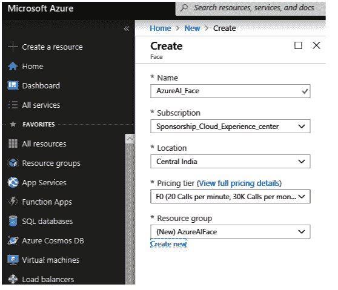

**图 3.11:** 填写项目详情

#### 步骤 3：端点

在创建 Computer Vision API 时可以选择可用位置。我们可以选择最近的区域。在本教程中，我们选择了中印度（Central India）。

#### 步骤 4：获取订阅密钥

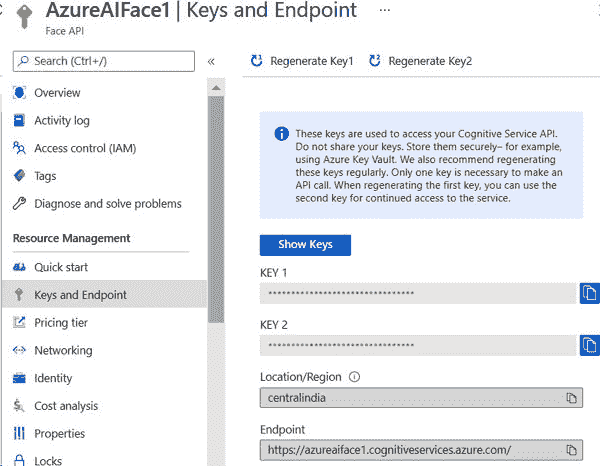

**图 3.12:** 获取订阅密钥

#### 步骤 5：创建一个分析脸部的示例控制台应用程序：

```csharp
using System;
using System.IO;
using System.Text;
using System.Net.Http;
using System.Net.Http.Headers;

namespace AZureAI_FaceDetection
{
    internal class Program
    {
        // Replace <Subscription Key> with your subscription key.
        private const string faceDetectionSubscriptionKey = "<Subscription Key>";
        // replace <myresourcename> with the string found in your endpoint URL
        private const string uriBase = "https://azureaiface1.cognitiveservices.azure.com//face/v1.0/detect";

        private static void Main(string[] args)
        {
            Console.WriteLine("Detect Faces: ");
            Console.WriteLine("Enter the path of an image for analysis: ");
            string imgFilePath = Console.ReadLine();
            if (File.Exists(imgFilePath))
                FaceAnalysisRequest(imgFilePath);
            else
                Console.WriteLine("\nFile path is Invalid.\nPress Enter to exit...\n");
            Console.ReadLine();
        }

        // Uses Face REST API to Analyze the Image.
        private static async void FaceAnalysisRequest(string imageFilePath)
        {
            HttpClient httpClient = new HttpClient();
            // Request headers.
            httpClient.DefaultRequestHeaders.Add("Ocp-Apim-Subscription-Key", faceDetectionSubscriptionKey);
            // Request parameters.
            string parameters = "returnFaceId=true&returnFaceLandmarks=false" +
                "&returnFaceAttributes=age,gender,headPose,smile,facialHair,glasses," + "emotion,hair,makeup,occlusion,accessories,blur,exposure,noise";
            // Below URI for the REST API Call.
            string requestUri = uriBase + "?" + parameters;
            HttpResponseMessage response;
            // Request body. Posts a locally stored image.
            byte[] imgByteData = ConvertImageToByteArray(imageFilePath);
            using (ByteArrayContent content = new ByteArrayContent(imgByteData))
            {
                content.Headers.ContentType = new MediaTypeHeaderValue("application/octet-stream");
                // Execute the REST API call.
                response = await httpClient.PostAsync(requestUri, content);
                // Get the JSON response.
                string contentString = await response.Content.ReadAsStringAsync();
                // Display the JSON response.
                Console.WriteLine("\nResponse:\n");
                Console.WriteLine(JsonPrettyPrint(contentString));
                Console.WriteLine("\nPress Enter key to exit...");
            }
        }

        // Converts specified file to byte array.
        private static byte[] ConvertImageToByteArray(string imageFilePath)
        {
            using (FileStream fileStreamReader = new FileStream(imageFilePath, FileMode.Open, FileAccess.Read))
            {
                BinaryReader binReader = new BinaryReader(fileStreamReader);
                return binReader.ReadBytes((int)fileStreamReader.Length);
            }
        }

        // Formats the given JSON string by adding line breaks and indents.
        private static string JsonPrettyPrint(string json)
        {
            if (string.IsNullOrEmpty(json))
                return string.Empty;
            json = json.Replace(Environment.NewLine, "").Replace("\t", "");
            StringBuilder sb = new StringBuilder();
            bool quote = false;
            bool ignore = false;
            int offset = 0;
            int indentLength = 3;
            foreach (char c in json)
            {
                switch (c)
                {
                    case '"':
                        if (!ignore) quote = !quote;
                        break;
                    case '\'':
                        if (quote) ignore = !ignore;
                        break;
                }
                if (quote)
                    sb.Append(c);
                else
                    switch (c)
                    {
                        case '{':
                        case '[':
                            sb.Append(c);
                            sb.Append(Environment.NewLine);
                            sb.Append(new string(' ', ++offset * indentLength));
                            break;
                        case '}':
                        case ']':
                            sb.Append(Environment.NewLine);
                            sb.Append(new string(' ', --offset * indentLength));
                            sb.Append(c);
                            break;
                        case ',':
                            sb.Append(c);
                            sb.Append(Environment.NewLine);
                            sb.Append(new string(' ', offset * indentLength));
                            break;
                        case ':':
                            sb.Append(c);
                            sb.Append(' ');
                            break;
                        default:
                            if (c != ' ') sb.Append(c);
                            break;
                    }
            }
            return sb.ToString().Trim();
        }
    }
}
```

输出如下：

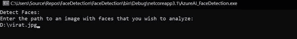

**图 3.13:** 示例输出

输出如下：它在分析脸部后提供了详细信息。

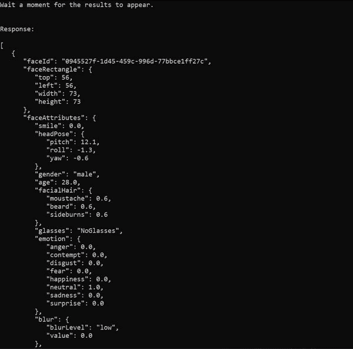

**图 3.14:** 示例输出

## 空间分析

输出如下：它在分析脸部后提供了详细信息。


**图 3.14:** 示例输出

### 支持的操作

输出如下：它在分析脸部后提供了详细信息。

| 操作 | 用法 |
| :--- | :--- |
| 人脸检测 | 帮助在图像中寻找人物 |
| 人脸追踪 | 帮助跨连接人物 |
| 口罩检测 | 帮助检查客户是否佩戴口罩 |
| 空间占用 | 帮助监控空间使用情况 |
| 入口计数 | 帮助统计进入入口的人数 |

### 应用场景

以下是可以实现的一些用例：

* **购物者分析**：帮助杂货店了解产品
* **队列管理**：帮助分析结账线的等待时间
* **口罩合规性**：帮助组织遵守安全指南
* **空间占用**：帮助经理优化员工移动
* **入口计数**：帮助识别大堂的人流量

## 总结

在本章中，我们学习了使用 Azure API 进行文字识别、光学字符识别、Face API 和空间分析的基础。在下一章中，我们将学习 Azure AI 服务。

## 问题

思考实验 - 这将包含 10 道问题，用于测试本章学到的知识。

1. 使用哪个 API 可以异步将文本转换为机器可读的字符流？
2. 使用哪个 API 可以同步将文本转换为机器可读的字符流？
3. 哪个 API 帮助在图像中寻找人物和边界坐标？
4. 使用什么工具来检查客户是否佩戴口罩？
5. 哪个 API 使用 Azure 文本语音 API 翻译成另一种语言？
6. 可以使用什么工具通过比较组中的脸部来识别人物，并返回匹配的人物对象？
7. 我们可以利用什么工具检测脸部并返回图像的框？
8. 使用什么工具可以为图像中的每个脸部返回给定置信水平的一组情绪？识别的情绪包括愤怒、蔑视、厌恶、恐惧、快乐、中性、悲伤和惊讶？
   1. 人脸验证 (Face Verify)
   2. 情感 API (Emotion API)
   3. Happy API
   4. 人脸相似性 (Face Similar)
9. 利用什么可以根据相似特征对未识别的人脸进行分组并将它们归为一组？
   1. 人脸相似性 (Face Similar)
   2. 人脸分组 API (Face Grouping API)
   3. 情感 API (Emotion API)
   4. Happy API
10. 哪个 API 检测进入空间的人数？
    1. OCR
    2. 读取 (Read)
    3. 检测 (Detect)
    4. 空间分析 (Spatial Analysis)

## 答案

1. **b. Read API**
2. **a. OCR API**
3. **b. 人数检测 (People Detection)**
4. **c. 空间分析 API (Spatial Analysis APIs)**
5. **d. 文本转语音 API (Text to Speech API)**
6. **b. 人脸验证 (Face Verify)**
7. **c. 人脸检测 (Face Detect)**
8. **b. 情感 API (Emotion API)**
9. **b. 人脸分组 API (Face Grouping API)**
10. **d. 空间分析 (Spatial Analysis)**

# 第 4 章：Azure 智能服务

阅读本章后，读者将理解如何使用 Azure 智能服务的决策、语言、语音和网络搜索服务。读者将学习异常检测器 (`Anomaly detector`)、内容审核 (`Content Moderator`)、个性化器 (`Personalizer`)、文本分析 (`Text Analytics`)、Azure Functions 和 Azure 智能服务容器。

## 结构

在本章中，涵盖的主题如下：

* 决策服务
* 内容审核：用用例、详细 API
* 个性化器 (`Personalizer`)
* 语言服务
* Azure Logic Apps 和 Functions
* 语音服务
* 网络搜索服务

## 目标

在本章中，我们将探索 Azure 智能服务的决策、语言、语音和网络搜索服务。在章末结束时，读者将理解如何使用每种提到的 Azure 智能服务来有效地构建应用程序。


## 决策服务

决策服务用于通过 `Decision APIs` 做出良好的决策，帮助分析数据并从中得出见解。

该类别下提供的主要服务如下：

* **异常检测器 (Anomaly Detector)**：异常检测器帮助监控和检测数据中的异常，可以在云端或边缘端使用，并可以轻松自定义。异常检测器取时间序列数据作为输入，并使用异常检测算法帮助检测数据中的下降和峰值。

以下提供了一些可以使用异常检测 API 的示例用例：

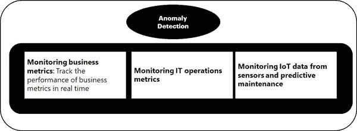

**图 4.1：**异常检测用例

我们将查看异常检测的一个示例用例流：

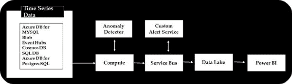

**图 4.2：**异常检测示例用例流

时间序列数据从数据源摄入，包括 `SQL DB`、`Azure DB`。异常服务选取数据并检测异常。`Anomaly Detector API` 的算法通过自动识别并应用最匹配的模型到输入数据来不断适应，异常检测器确定异常检测的边界，即哪些是预期值，哪些是数据点中的异常。

详细流程如下：

* 数据从 `SQL DB`、`Event Hubs` 等数据源摄入。
* 使用 `Databricks` 或任何计算资源通过聚合和计算原始数据来生成时间序列。
* `Azure Function` 根据异常相关的元数据从消息队列中获取消息并发送有关异常的警报。
* `Data Lake` 存储异常检测元数据。
* 使用 `Power BI` 可视结果。

* **内容审核 (Content Moderator)**：`Content Moderator API` 帮助监控社交媒体应用程序中的攻击性内容，并识别帖子或视频等攻击性内容并对其进行标记。

* 可以有效使用的少数场景包括审核社交消息平台、组织、学校等处的内容。
* 下图显示了有助于审核文本、图像和视频的可用 API。我们可以利用这些 API 检查文本/图像中的违规内容。

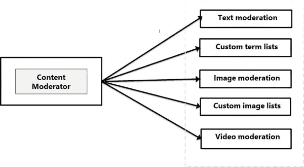

**图 4.3：**内容审核 API

我们将查看内容审核的一个示例用例。

## 内容审核-用例

当用户上传图像时，程序会检查图像是否包含违规内容。

为了检查图像是否包含违规内容，我们将利用 `Azure Container`、`Blob storage`、`Image Moderation API` 并执行以下步骤：

提供的输入是用户上传的图像。

下面是详细解释的程序流：

* 用户上传图像。
* 图像存储在 `blob` 中。
* 当图像被添加到 `blob` 时，触发 `Azure function`。
* 调用 `Image Moderation API` 检查图像是否包含色情内容。
* 根据该值，将图像存储在 `Validated Blob` 或 `Objectionable Blob` 中进行进一步处理。

我们可以如下所示利用 `Azure Container`、`Blob storage`、`Image Moderation API`：

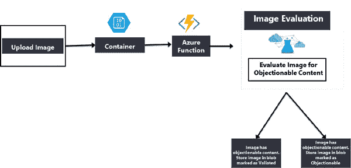

**图 4.4：**为该用例开发的工作流

## 内容审核-详细 API

Azure 内容审核智能服务通过标签对文本、图像和视频内容进行验证和标记，以识别具有攻击性的材料。内容审核服务包含审核 API，帮助检测攻击性内容。

以下是自定义列表的详情：

| API 组 | 用途 |
| --- | --- |
| 文本审核 | 帮助扫描文本中的攻击性内容。根据文本中存在的成人内容将文本分为三类——类别 1、2 和 3。 |
| 自定义词列表 | 帮助使用自定义列表标记攻击性内容。 |
| 图像审核 | 帮助扫描图像并识别攻击性内容。 |
| 自定义图像列表 | 帮助根据自定义列表扫描图像。自定义图像列表：通过创建图像列表帮助防止分享攻击性图像。 |
| 视频审核 | 帮助扫描视频中的攻击性内容。 |

**表 4.1：**内容审核-详细 API

## 个性化器 (Personalizer)

个性化服务用于通过从用户在线活动中学习，为用户创建个性化推荐。

利用强化学习为用户提供上下文内容。它利用用户行为和活动向用户展示合适的内容。

它如下所示使用强化学习：

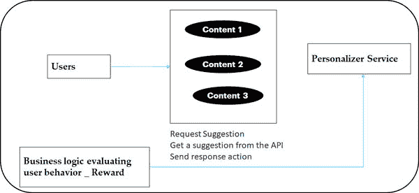

**图 4.5：**个性化服务

个性化服务的一些用例包括高亮内容、提供菜单建议、为用户填写表单列表、提供上下文决策和过滤内容，如下所示

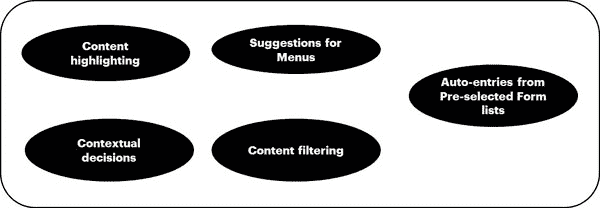

**图 4.6：**个性化用例

## 语言服务

语言 API 帮助用户分析文本并识别文本中的意图和实体。

该类别下有若干服务如下所示：

* **浸入式阅读 (Immersive Reader)**：浸入式阅读是微软提供的独立 Web 应用程序，能够对内容进行词性分析、语音、翻译等处理。它实施了经过的技术，提高了新读者、语言学习者和有学习差异（如阅读障碍）者的阅读理解。

* **LUIS**：此服务提供自然语言理解和解释服务。LUIS 是一种云端对话 AI 服务，它将机器学习智能应用于用户的对话，以理解用户的意图并提取相关的详细信息。聊天机器人可以利用 LUIS 理解意图并提供更具上下文的响应。

* `QnAMaker`：是一种基于云的`自然语言处理` (`NLP`) 服务，允许用户创建自然对话层。可以利用 `QnAMaker` 根据常见问题解答（FAQs，自定义知识库）为聊天机器人回答问题。

* `Translator`：`Translator` 可用于实时将一种语言翻译成另一种语言，支持超过 90 种语言。

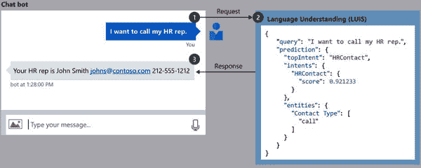

**图 4.7:** 异常检测用例 – 语言服务 – `LUIS`（源）

在上方图中，`LUIS` 帮助聊天机器人识别与用户对话相关的意图和实体。

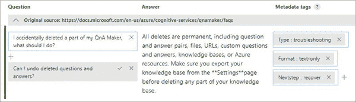

**图 4.8:** 语言服务 – `QnA Maker`

([-`https://docs.microsoft.com/en-us/azure/cognitive-services/qnamaker/media/qnamake`](https://docs.microsoft.com/en-us/azure/cognitive-services/qnamaker/media/qnamake))

这是一个 `QnA Maker` 的示例，用于创建一个 FAQ 聊天机器人，该机器人可以根据可用输入回答用户的问题。

现在我们已经对这些服务有了简要概述，我们将详细介绍 `Text Analytics API`。

## 文本分析 (Text Analytics)

`Text Analytics API` 是 `Language API` 的一部分。它提供了基于自然语言的处理 API 来处理原始文本。我们可以将 `Text Analytics` 与 `Handwriting`（手写）、`OCR API` 结合构建智能业务应用程序。它提供了以下功能

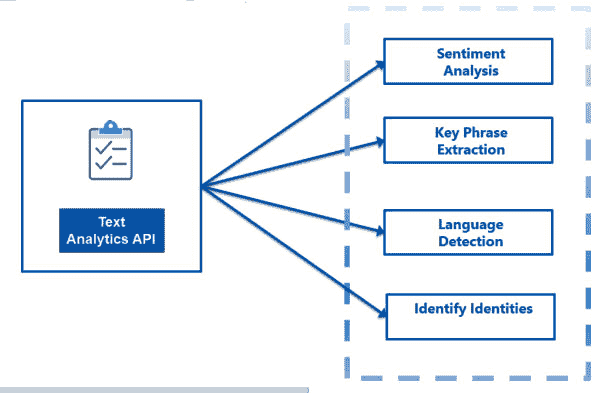

**图 4.9:** Text Analytics API。

可以如下所示方式调用 `Text Analytics API`：


**图 4.10:** Text Analytics API 的调用

我们可以使用 `Sentiment Analysis API` 对讨论论坛、评论和社交媒体中的文本和关键词汇进行情感分析。目前支持的语言包括英语、西班牙语、德语和法语。


**图 4.11:** 情感分析 API。

接下来的图显示了我们如何使用文本和情感分析来检查其是正面情感还是负面情感。

调用 `Sentiment Analysis API`：

* 输入应以 `JSON` 文档的形式提供。
* 每个文档的大小必须少于 5,120 个字符。
* 每个集合限制为 1,000 个 (IDs)。


**图 4.12:** 调用情感分析 API。

1. `Key Phrase Extraction API`（关键词提取 API）：我们可以使用 `Key Phrase Extraction API` 提取一组字符串，表示输入文本中的关键论点点。该服务使用了 Microsoft Office 先进的自然语言处理工具包。支持的语言包括西班牙语、德语、英语和日语。

2. `Language Detection API`（语言检测 API）：`Language Detection API` 以文本文档作为输入并返回语言标识符。支持的语言数量为 120 种。这种能力在语言未知的的情况下非常有用。

3. `Entity Identification API`（实体识别 API）：`Named Entity Recognition API` 获取 `JSON` 文档并返回实体列表，带有网上更多信息的链接。

### 用例场景

以下是 `Azure Cognitive Text Analytics` 与 `Sentiment Analysis`（情感分析）、`Key Phrase Extraction API`（关键词提取 API）和其他 API 结合的示例用例场景。

* **分析反馈结果**：使用 `Azure Cognitive Services Text Analytics` 分析来自会议等的反馈。下面显示了我们如何分析反馈并将其存储在 `Azure storage` 中，并在门户中显示报告。

    

    **图 4.13:** 分析反馈结果。

* **处理并分类支持事件**：使用 `Key Phrase Extraction`（关键词提取）和 `Entity Recognition`（实体识别），我们可以处理请求并将请求路由到正确的支持工程师。我们还可以自动化趋势分析，这将有助于为解决事件进行合理的资源规划。

在进入示例用例之前，我们将简要介绍 `Azure Logic Apps` 和 `Functions`。

## Azure Logic Apps 和 Functions

让我们要介绍一下我们将在实验中利用的 `Azure Logic Apps` 和 `Azure Functions`。

* **Azure Logic Apps - 简述**

    `Azure Logic Apps` 是无服务器且可扩展的应用程序，用于执行工作流和集成。

    `Azure Logic Apps` 的特征所示所示：


**图 4.14:** 分析反馈结果。

`Logic Apps` 可用于定义工作流。它们带有一组触发器，包括 `FTP`、`AS2`、`EDI` 和 `EDIFACT`。它们提供了：

* `Poll Trigger`（轮询触发器）：定期轮询以检查数据。
* `Push Trigger`（推送触发器）：监听事件。
* `Recurrence Trigger`（周期触发器）：按指定的计划触发。
* **模板**：`Logic Apps` 带有定义的模板。

**Azure Functions**：`Azure Functions` 是无服务器的并根据使用量付费。它们是用任何语言编写的代码段，由触发器调用。`Azure Functions` 的特征所示：


**图 15:** 创建 Azure Function

`Azure Functions` 可用的触发器包括：

* `HTTP`：当请求 RESTful `HTTP` 端点时触发。
* `Timer`（定时器）：按预定义的计划触发。
* `WebHook`：当消费 `GitHub` 时触发。
* `CosmosDb`：当 `CosmosDB` 发生变化时触发。
* `Blob`：当 `Azure Blob` 上传文件时触发。
* `Storage Queue`：当 `Azure Queue Storage` 中添加或删除消息时触发。
* `EventHub`：当发生注册的 `Azure Hub Event` 时触发。
* `Service Bus`：当更新 `Service Bus` Topic 时触发。

`Bindings`（绑定）：可选的，有助于简化输入输出的代码。

### 实验 - 使用 OCR 和文本分析创建 Logic App

我们将创建一个简单的应用程序，允许现场工作人员上传离线收集的数据。一旦上传，图像将存储在 `Azure Blob Storage` 中。监听事件的逻辑应用获取图像并运行工作流，其功能包括应用 `OCR`、检测语言、检测关键词并存储结果。`Power BI` 应用显示报告。以下是实验解决的示例场景：


**图 4.16:** 用例流程图

下面显示了执行上述问题问题的详细步骤：

**步骤 1**：我们将如下所示获取 `Text Analytics API` 的 `Cognitive Services` 订阅：

进入 Azure 门户并选择 `AI + Machine Learning` -> `Text Analytics`

**步骤 2**：我们将为 `Text Analytics` 创建 `Cognitive Service` 订阅。

**步骤 3**：我们将按照`手写识别实验`中的描述获取 `OCR` 订阅密钥。

* 选择存储连接
* 下一步，选择文件夹路径、Blob 名称和 Blob 内容
* 我们将使用存储账户创建一个容器（Container）

#### 步骤 7：我们将创建一个逻辑应用（Logic App）。在仪表板中选择。

* 创建资源
* 选择集成（Integration）
* 选择 逻辑应用（Logic App）

我们将为逻辑应用添加细节。


**图 4.20:** 为逻辑应用添加详情

我们现在添加一个当 blob 被添加或修改时的触发器。如下所示是我们的操作方法。


**图 4.21:** 添加触发器

我们将添加间隔和频率详情。


**图 4.22:** 为触发器设置间隔和频率

#### 步骤 8：配置 OCR 的计算机视觉 API：我们现在配置计算机视觉 OCR API 以用于检测消息的情绪。

搜索 Computer Vision（计算机视觉）


**图 4.23:** 配置计算机视觉 API

选择 `Optical Character Recognition`（`OCR`）到文本。


**图 4.24:** 选择 OCR

搜索 Text Analytics（文本分析）


**图 4.25:** 搜索文本分析

#### 步骤 9：在 `Detect Language`（检测语言）窗口中，添加新参数。


**图 4.26:** 添加新参数

对检测 Key Phrases（关键短语）和检测 Sentiment（情绪）重复执行相同操作。

#### 步骤 10：现在配置逻辑应用中的一个步骤，将结果保存到 Drop Box 文件夹中的文件中。

#### 步骤 11：创建一个 Azure Functions App，它将从 Drop Box 获取数据并更新到 Azure SQL 数据库。

#### 步骤 12：创建一个 Power BI 仪表板来显示报告。创建一个自定义门户来显示结果。

## 语音

语音服务用于检测和分析来自用户的语音内容。这些服务可以用于各种功能，例如文本转语音、语音转文本转录、识别说话者、为应用程序添加语音等，如下所示：


**图 4.27:** 语音服务

* **语音转文本（Speech to Text）**：语音转文本有助于通过叫中心转录获取客户洞察，通过语音支持的助手改进体验，捕捉会议中的关键讨论等，并将对话翻译成文本。NLP（自然语言处理）也可用于使解释更加智能。

* **文本转语音（Text to Speech）**：文本转语音服务帮助将文本转换为自动调制的人类真人声音。这有助于创建可以进行对话的应用程序和服务。文本转语音支持 119 种语言的 270 种神经语音。以下给出一些用例：

  

  **图 4.28:** TextToSpeech

* **语音翻译（Speech Translation）**：该服务帮助在用户说话时实时将从一种语言翻译到另一种语言。它支持 30 多种语言。

* **说话者识别（Speaker Recognition）**：这仍然处于预览模式。它帮助识别特定人的发言，并根据学习识别说话者。

* **语音助手（Voice Assistants）**：语音助手在助手和设备之间提供快速且可靠的交互。

以下是语音助手的一些用例：


**图 4.29:** 语音助手

语音助手的用例包括为应用程序创建语音助手、创建无接触的语音优先的体验以提高安全性并支持重返工作的场景、使用自定义关键词激活等。

## Bing 网页搜索

Bing 网页搜索 API 可用于构建连接的应用程序和服务，这些服务可以集成新闻搜索、网页搜索、图像搜索等搜索功能。我们可以构建集成图像、网页、位置、新闻且无广告的应用程序。这些 API 还可以帮助自动建议搜索词、按内容类型过滤结果、高亮、根据市场、地区或国家本地化搜索结果，并使用 Bing Statistics 分析搜索指标。

### 实验

#### 步骤 1：进入 Azure Portal。搜索 Bing Search。它将弹出以下窗口：


**图 4.30:** Azure Portal-Bing Search

#### 步骤 2：一旦资源部署完成，将出现如下所示的部署成功：


**图 4.31:** 部署窗口

### 步骤 3：点击 `Go To Resource`（转到资源）按钮并添加搜索词，然后点击 `Search`（搜索）：


**图 4.32:** 添加搜索词

### 步骤 4：搜索结果所示：


**图 4.33:** 搜索结果窗口

### 步骤 5：对于程序化调用，我们可以获取密钥并在代码中使用。获取密钥所示：


**图 4.34:** 获取密钥

现在来看 Docker 。

## Azure Cognitive Services 容器

除了云端版本的 API 外，Azure 还提供了 Docker 容器，让我们可以使用相同的功能。这些可以部署在本地或边缘侧。

以下是一组容器。


**图 4.35:** 可用的 Docker 容器

## 结论

在本章中，我们查看了决策、语言、语音和网页搜索的基础。我们还学习了 Azure 应用和 Azure Functions。在下一章中，我们将学习应用服务。

## 单选题

## 问题

1. **哪种服务用于通过决策分析数据并得出洞察？**

   - Decision
   - Analyze
   - Detect
   - Insights

2. **哪种服务可以将新闻搜索、网页搜索、图像搜索等搜索功能集成到自定义应用程序中？**

   - Decision
   - Analyze
   - Web Search
   - Image Search

3. **哪种服务可以识别人的并据此识别？**

   - Speaker Recognition
   - Speech To Text
   - Text To Speech
   - Voice Assistant

4. **哪种服务用于通过叫中心转录获取客户洞察，通过语音支持的助手改进体验，捕捉会议中的关键讨论等？**

   - Speaker Recognition
   - Speech To Text
   - Text To Speech
   - Voice Assistant

5. **哪种服务用于为应用程序提供语音？**

   - Speaker Recognition
   - Speech To Text
   - Text To Speech
   - Voice Assistant

6. **哪种服务可以用于翻译 30 多种语言的音频？**

   - Speech Translation
   - Speech to Language
   - Voice Assistant
   - Text To Speech

7. **哪种服务可以用于创建可以对话的应用程序和服务？**

   - Speech Translation
   - Speech to Language
   - Voice Assistant
   - Speech To Text

8. **哪种 Azure Content Moderator 认知服务验证并标记文本、图像和视频内容中的冒犯性内容标签？**

   - Azure Content Sanitizer
   - Analyze
   - Web Search
   - Azure Content Moderator

9. **哪种 API 可用于提取表示输入文本中关键论点的字符串列表？**

   - Decision
   - Analyze
   - Key Phrase Extraction
   - Language Detection

10. **哪种服务可以使用文本作为输入并返回语言标识符？**

    1. `Decision`
    2. `Analyze`
    3. `Key Phrase Extraction`
    4. `Language Detection`

## [答案]

你拥有电影的图片以及观众离开电影院的图片

1. `a. Decision`
2. `b. Web Search`
3. `a. Speaker Recognition`
4. `b. Speech To Text`
5. `d. Voice Assistant`
6. `d. Text To Speech`
7. `c. Voice Assistant`
8. `b. Video Indexer Insights`
9. `c. Key Phrase Extraction`
10. `d. Language Detection`

# 第 5 章：Azure 应用 AI 服务

读完本章后，读者将了解 Azure 应用 AI 服务的概述，这些包括 `Azure Form Recognizer`、`Azure Metrics Advisor`、`Azure Cognitive Search`、`Azure Immersive Reader`、`Azure Video Analyzer for Media` 以及 `Azure Bot Service`。Azure 应用 AI 服务帮助开发者轻松地应用 AI 来解决业务问题。它们构建在 `Azure Cognitive Services` 之上。它们优化了诸如 `anomaly detection`、监控等任务。

## 结构

本章将涵盖以下主题：

* Azure 应用 AI 服务概述
* `Azure Metrics Advisor`
* `Azure Immersive Reader`
* `Azure Video Analyzer for Media`
* `Azure Form Recognizer`
* `Azure Cognitive Search`

## 目标

在本章结束时，读者将理解 Azure 应用 AI 服务以及如何有效利用这些服务。

## Azure 应用 AI 服务概述

以下是 Azure 应用 AI 服务的概述：

* **Azure Metrics Advisor**: 它帮助通过结合近实时监控和针对特定场景的适应模型来识别并修复问题，从而提供带有告警和诊断的细粒度分析。它使用 AI 对时间序列数据进行数据监控和异常检测。该服务自动完成将模型应用到数据的过程，并提供了一组 `APIs` 和基于 Web 的工作空间，用于异常检测、数据接入和诊断。用户可以在该服务之上构建 `AIOps`、预测性维护和业务监控应用程序。

* **Azure Immersive Reader**: 这是一个包容性设计的工具，实施了各种技术来提高语言学习者、新读者以及有学习障碍的人的阅读理解能力。

* **Azure Form Recognizer**: 它帮助从表单文档中识别和提取文本、键值对和表格数据。它帮助从表单中接入文本并输出包含原始文件中关系的结构化数据。

* **Azure Video Analyzer for Media**: 它帮助从视频和音频文件中提取如语音、人脸等元数据。

* **Azure Cognitive Search**: 它利用内置的 AI 能力，帮助识别和探索相关内容。

* **Azure Bot Service**: 它帮助开发对话式 AI 体验。

我们将详细介绍每种服务。

## Azure Metrics Advisor

Azure Metrics Advisor 帮助分析时间序列数据。

以下是常用的建议 set：

1. **高可用性建议**：帮助确保关键应用的连续性。高可用性建议可以帮助以下领域：

    * 识别未属于可用性集的虚拟机并建议将其移动到可用性集。
    * 识别未配置容错的应用程序网关实例以确保业务连续性。
    * 防止误删虚拟机数据。
    * 提高虚拟磁盘的性能。

2. **安全性建议**：Advisor 与 Azure Security Center 集成。它提供安全建议，帮助检测、响应和防止安全威胁。

3. **成本建议**：帮助减少虚拟机成本并识别管理多个 SQL 数据库的成本解决方案。

4. **性能建议**帮助提高应用程序性能。性能建议可以帮助以下领域：

    * 优化数据库性能
    * 优化 Redis 性能
    * 优化 App Service 服务

以下是为 Metrics Advisor 创建工作流的步骤：

* 创建 Metrics Advisor Azure
* 使用 Web 门户构建监控
* 数据接入
* 根据特定需求更改异常检测配置
* 订阅异常接收通知
* 查看诊断洞察
* 使用 `REST API` 定制实例

## Azure Immersive Reader

Azure Immersive Reader 帮助提高语言学习者、新读者以及如阅读障碍等学习障碍者的理解能力。它帮助让阅读变得更容易。Immersive Reader 库可以用于改进 Web 应用程序。

Immersive Reader 是一个独立的 Web 应用程序，可以通过调用 Immersive Reader 库通过 iframe 集成到 Web 应用程序中。Immersive Reader 库处理 iframe 与 Immersive Reader 后端服务的交互。

Azure Immersive Reader 的某些功能列如下：


**图 5.3:** Azure Immersive Reader 功能

1. **隔离内容**：这有助于提高可读性
2. **显示图片**：它可以为常用词显示图片
3. **突出词性**：它可以突出显示词性
4. **大声读内容**：允许用户选择文本进行朗读


## 5. 实时翻译内容
帮助将文本实时翻译成多种语言

## 6. 将单词拆分为音节
它可以帮助将单词拆分为音节

## Azure 媒体视频分析器 (Video Analyzer for Media)

Video Analyzer for Media 帮助用户获取视频的详细洞察，包括摘要性洞察，提供面部、情感和主题的聚合视图。这些洞察可用于内容创作（如预告片）、增强视频库搜索、基于提取的洞察提供相关广告、内容审核以及推荐。

它还可以通过检测面部、语音词、情感和人物，帮助从视频中提取洞察并增强内容交付体验。可以添加推荐并高亮片段，从而提高参与度。此外，当视频分析器看到、检测或听到用户正在寻找的内容时，可以触发工作流。

这有助于人脸检测、名人识别、自定义人脸识别、缩略图提取、视觉文本识别、物体识别、视觉内容审核、分镜检测、黑帧检测、关键帧检测、音频分析、关键词提取、主题推断、情感分析、情绪检测、语音转文本、语言检测、降噪、发言者识别以及发言者统计。

视频分析器提供的洞察的某些应用场景如下：


**图 5.4：** Azure 媒体视频分析器

* **深度搜索**：Azure Video Analyzer 提供的洞察可以帮助增强搜索体验。
* **内容创作**：我们可以利用社交媒体内容、高光集或新闻片段，根据 Video Analyzer for Media 提供的洞察创建预告片。
* **无障碍辅助**：Video Analyzer for Media 提供的转录和翻译可用于实现用户的无障碍支持。
* **变现**：通过提供相关广告，可以利用 Video Analyzer 增加视频价值并创造收入机会。
* **内容审核**：我们可以使用内容审核来提醒用户或阻止违规内容/视频，从而确保内容安全。
* **推荐**：通过向用户高亮相关的视频时刻，可以使用视频洞察来提高用户参与度。

下图展示了 Azure 媒体分析器的工作原理：


**图 5.5：** Azure 浸入式阅读 (Immersive Reader)

图片来源：[`docs.microsoft.com/en-us/azure/azure-video-analyzer/video-analyzer-for-media-docs/video-indexer-overview`](https://docs.microsoft.com/en-us/azure/azure-video-analyzer/video-analyzer-for-media-docs/video-indexer-overview)

### 视频/音频洞察 (Video / Audio Insights)

下表详细描述了 Video / Audio Indexer 提供的功能。

| 功能 | 描述 |
| --- | --- |
| 人脸检测 | 帮助检测视频中的面部并进行分组 |
| 名人检测 | 帮助识别视频中的名人 |
| 基于账户的人脸识别 | 帮助根据训练的模型识别面部 |
| 面部缩略图提取 | 帮助在捕捉的一组面部中识别最佳面 |
| 视觉文本识别 | 使用 OCR 识别视频中的文本 |
| 视觉内容审核 | 帮助审核内容 |
| 标签识别 | 帮助识别视频中的物体和动作 |
| 场景分割 | 帮助根据视频视觉线索检测场景切换 |
| 分镜检测 | 帮助根据视频视觉线索检测分镜切换 |
| 黑帧检测 | 帮助识别视频中的黑帧 |
| 关键帧提取 | 帮助检测视频中的关键帧 |
| 滚动字幕 | 帮助检测视频中的滚动字幕 |
| 动画角色检测 | 帮助检测、分组并识别动画内容中的角色 |
| 影视分镜类型检测 | 帮助标记特写等分镜 |
| 观测人物跟踪（预览版） | 帮助检测视频中的被观测人物，并提供被观测人物的位置、时间戳等信息 |
| 匹配人物 | 帮助检测到的面部与视频中观察到的人物进行匹配 |

**表 5.1：** 视频/音频洞察

### 音频洞察 (Audio Insights)

下表详细描述了 Audio Insights 提供的功能。

| 功能 | 描述 |
| --- | --- |
| 音频转录 | 帮助将语音转换为文本 |
| 自动语言检测 | 帮助检测主语言 |
| 多语言语音识别和转录 | 帮助识别音频不同片段中的语音语言 |
| 闭式字幕 | 帮助创建字幕 |
| 双通道处理 | 帮助合并转录文件 |
| 降噪 | 帮助消除噪声 |
| 转录自定义 | 帮助训练自定义的语音转文本模型 |
| 发言者计数 | 帮助理解哪个发言者在什么时候说了哪些词 |
| 发言者统计 | 帮助提供语音比例统计数据 |
| 文本内容审核 | 帮助检测音频转录中的文本 |
| 音频效果 | 帮助识别语音、安静、拍掌等音频效果 |
| 情绪检测 | 帮助识别情绪 |
| 翻译 | 帮助创建音频转录的翻译 |
| 音频效果检测（预览版） | 帮助检测笑声等音频效果 |

**表 5.2：** 音频洞察

### 视频与音频洞察 (Video and Audio Insights)

Video and Audio Insights 提供了以下功能：

| 功能 | 描述 |
| --- | --- |
| 关键词提取 | 帮助从语音和视觉文本中提取关键词 |
| 命名实体提取 | 利用 NLP 帮助从语音和视觉文本中提取品牌、位置和人物 |
| 主题推断 | 帮助从转录中推断主要主题 |
| 伪迹/细节 | 帮助提取丰富的“深层细节” |
| 情感分析 | 帮助识别中性、积极和消极情感 |

**表 5.3：** 视频与音频洞察

## Azure 表单识别 (Form Recognizer)

Form Recognizer 帮助从文档中提取文本和结构。它帮助通过预构建模型和无监督构建学习，从文档、表单和收据中提取文本、键值对和表格。

Form Recognizer 支持以下模型：

* **通用文档**：帮助分析和提取表格、文本、键值对、结构和命名实体
* **布局**：帮助分析和提取文档和表单中的表格、单词、行和选择标记
* **自定义**：帮助通过自定义训练模型从自定义表单中分析和提取字段和其他内容
* **发票**：使用预训练模型分析并提取发票中的常见字段
* **收据**：使用预训练模型分析并提取收据中的常见字段
* **身份证明**：使用预训练模型分析并提取护照或驾照等身份证明文档中的常见字段
* **名片**：使用预训练模型分析并提取名片中的常见字段

**预构建模型：**

使用预训练模型分析并提取常见文档类型中的数据。

* `Pre Built-businessCard`：帮助从名片中提取文本和关键信息。
* `Prebuilt-idDocument`：帮助从执照和国际护照中提取文本和关键信息。
* `Prebuilt-receipt`：帮助从收据中提取文本和关键信息。
* `Custom Models`

    除了支持预构建模型外，我们还可以使用样本输入表单训练自定义模型。训练所需的最小表单数量为 5 个。模型使用无监督学习来识别表单中的字段、表格、条目和之间的关系。

## 访问 Form Recognizer

可以通过 REST API 访问 Form Recognizer。Form Recognizer 目前正处于受限访问预览阶段。

在这个简短的实验中，我们将看到如何使用 Form Recognizer studio 来分析示例发票。

我们将在实验中使用 `Layout API`。`Layout API` 用于分析并提取来自表单和文档的文本、表格、标题、选择标记和结构信息。


**图 5.6:** 配置服务资源

以下是一个示例发票文档：


**图 5.7:** 示例发票

以下是显示的示例输出：


**图 5.8:** 生成的输出

## Azure Cognitive Search

Azure Cognitive Search 是一种云端搜索服务，提供丰富的搜索体验。它可以将数据从多个源拉到网页、移动和其他应用程序中。它可以使用 AI 和自然语言处理搜索数据。它具有数据增强和加密的能力。功能包括自动完成、筛选、分页、分面（facets）和增强（boosting）。它可以帮助实现分面导航、自动完成、相关性调整和筛选。

它可以帮助搜索 Azure Blob Storage 和 Cosmos DB。

Azure Cognitive Search 支持微软的自然语言处理器以及 Lucene 分析器和分词。我们可以配置分析器对原始内容进行特殊处理，例如过滤掉变音或识别并保留字符串中的模式。

以下是 Azure Cognitive Search 的架构：


**图 5.9:** Azure Cognitive Search

搜索服务在客户端应用发送查询请求并发送响应时，帮助对索引数据进行索引和搜索。

搜索服务提供的组件包括：

* **支持的数据源/内容**：支持的数据源包括 Azure VM 上的 SQL Server、Azure SQL Database、Cosmos DB、托管实例、Azure Table Storage、Azure blob 存储容器、Azure Data Lake Storage Gen2 或 SharePoint Online（预览版），或包含 JSON 文档的任何数据集。
* **索引 (Index)**：Azure Cognitive Search 在指定的数据上创建索引。`Indexer` 按计划间隔运行。
* **查询 (Querying)**：一旦填充了搜索文本，客户端就可以发送并接收搜索服务的响应。

搜索服务包括同义词匹配、自动完成、筛选、模糊匹配、自动拼写检查、排序或模式匹配、视觉特征识别（如人脸检测）、`Optical Character Recognition` (`OCR`) 以及图像识别和图像解释。

我们可以使用以下两种方法之一创建基础搜索服务：

### 方法 1

* 决定一个层级。对于高级功能，我们需要一个计费层级，否则可以使用免费层级。
* 在 Azure 门户中创建搜索服务。
* 使用 `Import data wizard` 导入数据。提供数据源详细信息作为输入，并创建、加载和查询索引。
* 使用 `Search Explorer portal client` 查询已创建的索引。

### 方法 2

* 使用 `NET SDK`、`REST API`、`.portal` 或其他 SDK 创建搜索索引。索引架构定义了可搜索内容的结构。
* 使用“推”模型从任何源推送 JSON 文档，或者如果你的源数据是支持的类型，则使用“拉”模型（`indexers`）。
* 使用 `Search Explorer portal client` 查询索引，或使用 `REST API`、`.NET SDK` 或其他 SDK 查询索引。

### 实验：创建 Azure Cognitive Search 服务

在示例中，我们将利用方法 1，即通过门户创建搜索服务，从示例数据库导入数据，创建索引并使用 `Search Explorer` 查询索引。

**前提条件：**

一个具有活动订阅的 Azure 账户。

以下是实验需要遵循的详细步骤：

#### 步骤 1 - 创建搜索服务

使用您的 Azure 账户登录 Azure 门户。


**图 5.10:** 创建搜索服务

### 步骤 2 - 启动导入数据向导

在实验中，我们选择了一个示例数据。


**图 5.11:** 数据源

#### 步骤 3 - 选择示例数据

如所示选择示例数据库：


**图 5.12:** 选择示例数据

#### 步骤 4 - 创建索引

必须在加载之前创建索引。


**图 5.13:** 添加索引

#### 步骤 5 - 索引属性

索引属性有助于控制字段的使用。


**图 5.14:** 索引属性

* `Searchable`（可搜索）决定字段是否包含在全文中。
* `Filterable`（可筛选）、`Facetable`（可分面）和 `Sortable`（可排序）决定字段是否用于筛选、分面导航或排序。
* `Key` 是文档的唯一标识符。
* `Retrievable`（可检索）使搜索结果返回该字段。

#### 步骤 6 - 认知技能

我们可以如所示向搜索服务添加认知技能：


**图 5.15:** 认知技能

#### 步骤 7 - 添加增强

`skillset`（技能集）可以附加到索引器上，索引器执行 AI 处理。索引器提取内容并根据图像、blob 和原始文本等内容创建新信息。输出是一个搜索索引。


**图 5.16:** 技能集

### 步骤 8 - 附加认知技能

下方描述了认知搜索提供的一些认知技能：


**图 5.17:** 认知技能

* `Custom Entity`（自定义实体）：帮助查找定义的单词和短语。
* `Key Phrases`（关键短语）：帮助使用预训练模型提取此类数据。对于检索记录中的要点有用。
* `Language Detection`（语言检测）：帮助检测每个文档的语言。
* `Merge`（合并）：帮助将多个字段的文本合并到一个字段中。一个常见用例是从 OCR 技能提取说明，然后将其与文档的内容字段合并。
* `Entity Recognition`（实体识别）：帮助识别位置、人物、电子邮件、组织等。
* `PII Detection`（个人身份信息检测）：帮助从给定文本中提取个人身份信息。
* `Sentiment Analysis`（情感分析）：帮助根据积极、消极或中性情感检索评分。
* `Text Split`（文本分割）：通过将文本拆分为句子来增强内容。
* `Translate`（翻译）：帮助将文本翻译成多种语言。
* `Image Analysis`（图像分析）：帮助识别图像内容并生成文本描述、标签以及识别地标或名人。
* `OCR`：帮助搜索传真、图像和扫描文档。
* `Conditional`：允许根据条件合并、筛选或分配默认值，或者为不存在的值设置默认值。
* **文档提取**：帮助从文档中提取内容。
* **Web API**：帮助扩展 AI 丰富工作流管道。
* **知识库**：

### 将丰富后的内容保存到知识库

`Knowledge Store` 帮助存储丰富后的内容。它使用了 `Azure Storage` 中的 blob、表（tables）和容器（containers）。存储的数据可以用于进一步的独立分析，以及用于知识挖掘等场景的下游处理。


**图 5.18:** 丰富后的内容

知识库窗口显示如下：


**图 5.19:** 知识库

### 步骤 4 - 配置索引器

* 在“导入数据”向导程序中，点击 `Indexer` | `Name`。
* 输入索引器名称。
* 点击 `Submit` 创建索引器。

配置索引器窗口显示如下：


**图 5.20:** 配置索引器

# 监控进度

我们可以通过进入索引器列表来监控进度。

转到“概述”（Overview）页面并点击名为 `Indexers` 的标签页。


**图 5.21:** 监控进度

点击索引器查看更多关于索引器运行的详细信息。


**图 5.22:** 索引运行窗口

## 使用 Search explorer 进行查询

你现在有一个可以使用 `Search explorer` 查询的索引。

`Search explorer` 发送符合 Search Documents API 的 REST 调用。该工具支持简单查询语法和完整的 Lucene 解析器。

点击命令栏上的 `Search explorer`。


**图 5.23:** Search Explorer

从“索引”（Index）中选择示例索引：


**图 5.24:** 选择索引

在搜索栏中添加查询字符串并选择 `Search`。


**图 5.25:** 添加查询字符串

结果显示在结果窗口中：


**图 5.26:** Search Explorer 输出窗口

## 结论

在本章中，我们查看了一些 Azure 应用 AI 服务以及如何利用它们。在下一章中，我们将详细了解机器人机器人（Bots）以及如何使用它们。

## 多选题

本节由一组问题组成，旨在测试你对本章涵盖概念的理解。

1. **哪种服务有助于从文档中提取文本和结构？**

    1. Azure Machine Learning Studio
    2. Form Extractor
    3. Form Recognizer
    4. OCR

2. **哪种服务帮助用户获取视频的详细洞察，包括摘要性洞察，可提供面部、情感和主题的聚合视图。无需编写任何代码即可拖放操作？**

    1. Automated ML
    2. Video Analyzer for Media
    3. Audio Extractor


# 4. Frame Extractor

## 3. 哪种服务通过结合近实时监控、使模型适应特定场景来识别并修复问题，从而提供带有警报和诊断的细粒度分析？

1. `Azure Monitor`
2. `Azure Metrics Advisor`
3. `Azure Video Adapter`
4. 全部

## 4. 哪种服务有助于提高语言学习者、新读者以及有读写障碍等学习差异者的理解？

1. `Azure Immersive Reader`
2. `Azure Video Reader`
3. `Azure Reader`
4. `Azure Pencil`

## 5. 什么有助于识别和提取相关内容？

1. Automation
2. `Azure Cognitive Search`
3. `Azure Cognitive Extractor`
4. `Automated ML`

## 6. 什么有助于存储丰富后的内容以供进一步分析？

1. Data
2. `Knowledge Store`
3. Enrichments
4. `Automated ML`

## 7. 什么有助于利用预训练模型提取重要短语（key phrases）？

1. Automation
2. `Key Phrases`
3. Extractor

## 8. 什么有助于利用预训练模型识别并提取相关内容？

1. Automation
2. Key Phrases
3. `Extractor`

## 9. 什么有助于利用预训练模型识别并提取相关内容？

1. Automation
2. Key Phrases
3. `Extractor`

## 10. 什么有助于利用预训练模型识别并提取相关内容？

1. Automation
2. Key Phrases
3. `Extractor`

## 答案

1. `Form Recognizer`
2. `Video Analyzer for Media`
3. `Video Adapter`
4. `Azure Immersive Reader`
5. `Azure Cognitive Search`
6. `Knowledge Store`
7. `Key Phrases`
8. `Recognition`
9. `Skillset`
10. `Metrics Advisor`

# 第 6 章

# 机器人 - 简介

本章将在简单介绍机器人后，带你了解 `Bot Framework` 和 `Bot Composer`。我们还将涉及如何使用 `Bot Emulator` 进行本地调试。

## 结构

本章将涵盖以下主题：

* 机器如何学习 - 简介
* 介绍机器人
* 机器人生态系统
    * `Bot Framework`
    * `Bot Composer`
    * 认知智能
    * 搜索
    * 存储
    * 信息源
    * 构建 `Bot Composer`
    * 周期
    * 参考架构
    * `Bot Emulator`
    * 企业级场景
    * 典型用例

## 目标

阅读本章后，读者将能够理解机器人的概念并能够开发机器人。他们将理解 `NLP`、`LUIS`、`QnA`、`Bot Composer` 和 `Bot Emulator` 的概念。

`Conversation as a Service` (`CaaS`) 和 `Conversational User Interfaces` (`CUI`) 已经在市场上存在了一段时间。任何成功的应用无论界面媒介如何，都有一个共同点——出色的用户体验。对于机器人来说，这一点没有改变，因此创造良好的对话用户体验至关重要。

微软提供的机器人产品让开发者构建、集成和部署机器人变得更加简单。

机器人可以用于内部或外部的客户场景。在内部世界，它们可以赋能用户搜索知识、文档，并作为员工和用户的虚拟帮助台来寻求帮助。在外部世界，机器人可以在企业中占有一席之地，不仅可以处理咨询、预订等简单的客户场景，还能处理账户管理、支付、零售等高级场景。

让我们来看一下细节，我们将从 `Bot Framework` 提供的功能开始，快速浏览 `Emulator`（模拟器）以及一个演示机器人，然后我们将讨论 `Bot Framework Composer`。

# 机器人生态系统

微软提供 `Bot Framework` 作为构建机器人的底层平台。`Azure Bot Service` 是一项 `Azure` 服务，帮助在 `Azure` 上托管机器人，并提供如连接和身份验证等功能。理解 `Bot Framework` 和 `Bot Service` 之间的区别非常重要。除了底层的 `Bot Framework` 之外，微软还提供了 `Bot Composer` 和 `Power Virtual Agents` 等产品，它们构建在 `Bot Framework` 之上，提供了现成的接口和函数以快速开发应用程序。

以下是微软提供的不同服务下的机器人格局概览：


**图 6.1：** 机器人格局

## Bot Framework

`Microsoft Bot Framework` 提供了构建和连接智能机器人所需的一切。该框架实现了标准协议，并提供了精美的工具来帮助建模对话。它还提供了跨多个画布的 UI 以及强大的自适应卡片（`adaptive cards`）。通过集成认知服务（`Cognitive services`），可以轻松启用通用且易于理解的模式，并在其中构建智能。

设计机器人时必须考虑用户界面需求，用户应尽可能少地输入或说话以获取所需内容。设计机器人时的一些关键考虑因素与其智能性无关，而是关于如何更好地提升用户体验，如下：

*   **可发现性**：客户多容易找到并开始使用机器人？它支持多个平台吗？
*   **可用性**：解决用户问题所需的步骤数。
*   **生产力**：解决问题所花费的时间与其他通信媒介相比。
*   **常见模式**：机器人是人类的好伙伴，每个人都会寻找用例来引入机器人。让我们来看看它们被频繁使用的常见模式。
*   **任务自动化**：机器人可以执行从简单到复杂的任务。一个简单的例子是用户重置密码，而更复杂的业务流程如客户订单处理则被称为 `机器人流程自动化` (`RPA`)。有趣的是，使用软件自动化执行任务在社交媒体上变得流行，并被称为 `Botting`。一些公司提供此类服务来增加社交媒体上的粉丝。`Instagram` 通过分析发布评论中的词频来检测机器人行为，账号会被“影子封禁”（`shadowban`）甚至被删除。
*   **获取知识和其他内容**：机器人可以设计为提供任何主题的信息，并利用来自 `SQL` 数据库中的关系型数据、`NoSQL` 存储中的 `JSON` 数据或文档存储中的文档来查找并返回用户请求的信息。它们与普通机器人不同，通过训练大量的非结构化和结构化数据来产生专家级回复，帮助决策。
*   **人工接管**：机器人可能非常智能，但有时它们并不是孤立运行的，必须将对话交接给人类。机器人+人类混合场景的最常见原因是处理变得复杂，或者情况紧急并需要快速解决，甚至仅仅是客户的选择。在这种情况下，需要一个交接触发器，让人类可以接管，无论转换期间是否涉及等待时间。
*   **机器人到网页浏览器再返回机器人**：在某些场景下，机器人可以将用户引导到网页浏览器以完成任务，并在任务完成后返回。最典型的用例是使用 `Azure Active Directory` 等服务进行身份验证和授权，以访问如 `Office 365` 等用户个人内容。执行这种重定向到浏览器再返回是一项挑战，通常在实现通道（`channel`）时，良好的做法是提供一个机器人可以使用内置 `HTML` 窗口，用于展示本应出现在网页浏览器中的应用程序。这让用户保持在对话框中，同时可以访问外部资源。
*   **网站**：除了 `Skype`、`Teams` 等标准客户端应用外，机器人也可以存在于网络浏览器中，被称为 `Web Chat`（网络聊天）。对于网站希望与客户互动提供信息或支持等实例，可以将机器人嵌入网站中，让使用户更容易找到信息或快速获得支持，而不是在网站中反复导航。机器人在初步处理客户请求后，可以将对话交接给人类。
*   **应用**：机器人可以使用 `Direct Line API` 直接与应用程序集成。无论是原生移动应用、`Web` 应用还是在计算机或设备上运行的自定义应用程序，机器人都可以嵌入这些应用程序中，并成为用户和客户的第一响应者。

# Bot Framework Composer

每个人都需要一个工具，虽然 `Bot Framework SDK` 是给编码人员使用的，但非编码人员没有与 `Bot Framework` 工作的选项。通过 `Bot Framework Composer`，微软提供了一个开源的可视化设计器，帮助可视化机器人开发。该工具于 2020 年左右发布，微软 `Bot Framework` 工程团队提供了一个能够快速开发机器人的工具，以便人们花费更少的时间在连接和配置服务上。不要将其与 `Power Virtual Agents` 混淆，后者针对业务用户和初级开发者，也是一个无代码（`No-Code`）平台。Composer 的区别在于，它仍然为你提供了构建机器人的稳健框架，它介于提供机器人构建完全控制的 `Bot Framework SDK` 和通过视觉抽象简化机器人开发的 `Bot Composer` 之间（注：此处原文此处可能笔误，应指 SDK 与 Composer 的对比）。

# 为什么你需要关注它？

`Composer` 构建在 `Bot Framework SDK` 之上，帮助编写机器人并集成认知智能服务，且都在可视化体验中完成。这迎合了那些不想写代码但仍希望为自己的领域或业务用例构建机器人，并使用传统开发者所拥有的所有功能的人群。由于是开源的，可以进行自定义构建或者作为 `web application` 托管在云端。你没听错，`composer` 可以作为 `Web` 应用程序或桌面工具运行。

使用 `Bot Composer` 可以执行以下任务：

*   如果你已经使用 `Bot Framework SDK` 工作了一段时间，并决定切换到无代码模型且保留你的工作，`Bot Composer` 可以实现这一目标。现有的对话（`dialogs`）和技能（`skills`）也可以导入到 `Composer` 中。当你决定切换到视觉设计器（`Visual Designer`）时，这是一个进一步加速机器人开发的优势。你还可以导出它们并共享。
*   `Composer` 使用声明式 `JSON`，它位于视觉画布之后，可以在其中将对话和响应拼接在一起。
*   它支持 `NuGet` 包管理器，机器人可以消耗 `NuGet` 包，这就像任何其他应用程序开发中一样，增强了在组织内复用内容的能力。
*   你可以使用 `Composer` 的网络聊天功能测试机器人，或使用 `Bot` 模拟器（`Bot Emulator`）。

# 设置 Composer

`Composer` 桌面应用程序适用于 `Windows`、`MacOS` 和 `Linux`，可以从此处进行安装。请确保能够连接到互联网。如果你对制作 `composer` 的自定义构建感兴趣，请参考此微软文档以获取先决条件和指导。

以下是设置 `Composer` 需要的步骤：

## 配置

*   **连接 (Connections)**

    连接是链接机器人与外部服务的方式，这些服务可以来自 `Azure` 或其他外部源。`Azure` 连接可能包括网络聊天（`Web Chat`）、`Teams`、语音服务等，而外部连接是可以通过 `NuGet` 包管理器以包形式提供的外部扩展。

*   **技能 (Skills)**

    技能允许引用与机器人关联的现有技能以便复用。

## 使用 Composer 进行机器人设计的组件

我们将探索 `Composer` 的以下核心功能：

*   对话 (`Dialogs`)
*   识别器 (`Recognizers`)
*   触发器和操作 (`Triggers and Actions`)
*   自然语言处理 (`Natural Language Processing`)
*   技能 (`Skills`)
*   内存范围 (`Memory Scopes`)

### 对话

对话是建立和管理对话的手段。它们被称为 `适应对话` (`Adaptive Dialogs`)，将它们想象成窗口或界面，用于与具有针对输入和响应定制功能的机器人交互。对话可以有一个或多个触发器，即对话的起点。使用 `bot composer` 创建的机器人可以有两种对话——一个 `主对话` (`main dialog`) 和一个或 `子对话` (`child dialogs`)。

### 识别器

识别器用于解释来自用户的消息并将其分为 `意图` (`intent`) 和 `实体值` (`entity values`)。在此过程之后，消息将传递给触发器。有 3 种识别器：默认识别器（默认启用），它允许使用 `composer` 内置的 `LUIS` 和 `QnA` 识别器。也可以拥有自定义识别器或使用正则表达式版本，允许对意图和实体值进行自定义提取。

### 触发器和操作

触发器是由为特定对话编写的规则触发的事件，并有一个或多个操作。操作是机器人要处理的执行指令。触发器的示例是 `意图识别` (`Intent recognized`)，当发生某个意图时（例如 `Agent`），操作可以是 `开始新对话` (`Begin a new Dialog`)，从而与该 agent 启动一个独立的对话流。

### 自然语言处理

自然语言处理 (`NLP`) 是一项涵盖自然语言理解 (`NLU`) 和自然语言生成 (`NLG`) 的技术。`NLU` 是理解和解码文本以知道其含义的能力。想象用户使用 `<TBD>` 等词汇与机器人通信。`NLG` 全关于生成自然语言。`NLP` 有四个组件：

*   语言理解
*   语言生成
*   `QnA`
*   编排 (`Orchestration`)

### 语言理解

为了维持对话流，机器人需要保存用户对话的状态和上下文，以便用户可以从离开的地方继续。默认情况下，活动对话被保存到内存中，还可以添加其他数据，如用户配置文件、偏好自定义属性。

### 语言生成

一旦确定了意图和语句，语言生成有助于响应。这在认知服务（`Cognitive Services`）下单独提供，是以前 `QnA Maker` 服务的更新版本。

### QnA

`QnA Maker` (托管) 是经典的问答服务，提供基于问答的对话能力。`QnA Maker` 托管更新通过创建服务部分的两个资源（即 `QnA Maker` 服务和 `Cognitive Search`）简化了资源管理。它还支持使用 `Azure Monitor` 进行监控（而不是之前提供的 `Application Insights`），并提供了深度学习 `NLP` 排名模型。

### 编排

可以在创建期间启用 `Orchestrator`。

!images/Figure-6.2.jpg

### 技能

技能用于创建可共享的对话逻辑。技能就像执行某些操作的代码函数——一组可以复用的任务。技能由技能清单 (`JSON`) 描述，该定义定义了它的操作、输入输出。你可以通过 `Composer` 导出机器人来创建一个技能。使用技能的机器人被称为 `根机器人` (`root bots`)。当技能被机器人使用（而不是直接使用）时，用户只能与 `根机器人` 交互，而不能与技能交互。

### 内存范围

这一切都是通过属性面板完成的，在面板中你可以尝试用于机器人响应的属性。

## 图 6.3: 启用 LUIS 的应用程序

可以使用 `luis.ai` 门户创建 `LUIS` 应用，此类应用包含一个特定领域的自然语言模型。如果你是初开始，应该先尝试一个预构建的领域模型。另一种方法是构建你自己的模型，也可以将预构建的领域模型与你的自定义模型进行混合组合。

以下是理解 `LUIS` 应用时需要掌握的重要概念：

- **意图 (Intent)**：用户希望机器人执行的操作 - 用户查询背后的基本意图。
- **话语 (Utterances)**：用户与机器人交互时使用的问题或句子。
- **实体 (Entities)**：用户查询所依据的上下文中的名词或对象。

这里有一个示例：


**图 6.4：** `LUIS` 应用的主要组件

`LUIS` 与 `QnA Maker` 的不同之处主要在于对 API 响应的消费方式。在 `QnA Maker` 中，查询结果（即映射问题的答案）会直接发送给用户，而无需机器人（机器人的代码）进行额外的处理或操作。在 `LUIS` 中，来自 `LUIS API` 的响应是预测评分、意图和一些元数据的组合。机器人必须处理此响应并做出相应反应，然后才能回复用户。

## 用于语言的 Azure 认知服务

2021 年 5 月，微软将 `QnA Maker` 管理服务作为“自定义问答”（`Custom Question Answering`）功能作为文本分析（`Text Analytics`）的一部分重新引入。这是“规模化 AI”方法的一部分，其中“问答”功能同时引入了预构建和自定义能力。现有的 `QnA` 管理资源也可以继续工作。

微软最近所做的是将 `QnA Maker` 和 `LUIS` 合并，并将它们与文本分析一起置于名为“语言服务”（`Language Service`）或“用于语言的认知服务”（`Cognitive Services for Language`）的新服务中。截至本文编写，它处于公共预览阶段。如果你已经拥有 `QnA` 或 `LUIS` 资源，可以将它们迁移到新的语言服务。导入 `LUIS` 非常简单，只需导入 `LUIS JSON` 文件，而 `QnA` 迁移是一个引导过程。如果你感兴趣，可以在这里查看迁移指南 - [将 QnA Maker 知识库迁移到自定义问答 - Azure 认知服务 | Microsoft 文档](https://docs.microsoft.com/zh-cn/azure/ai-services/question-answering/howto-migrate-qnamaker-kb)


**图 6.5：** 认知服务 – 语言服务


**图 6.6：** 在语言服务中添加功能

## 搜索


# 搜索

搜索是构建机器人不可或缺的一部分。例如，QnA Maker 现在内部使用 Azure Search（你会看到作为 QnA 服务一部分而创建的 Azure Search 实例），其中搜索用于索引所有知识库内容，并用于编写和测试。

此外，机器人可以单独整合 Azure Search 以探索涉及的源，还可以集成 Bing Search 进行网络搜索。因此，如果模型、知识库和数据源无法处理查询，机器人可以运行 Bing Search 并提供合适的答案。

# 存储

机器人存储数据有两种方式：内存存储或数据库存储。在这两种情况下，机器人都会存储和检索与用户/对话关联的状态数据，这些数据可以用于许多用途，例如从离开的地方重新开始对话或简单地通过名称识别用户。它还可以用于根据用户的兴趣量身定制内容与用户进行交互，例如提醒他们感兴趣的事件或新闻。

# 信息源

机器人还可以与暴露为 REST API 的外部信息源建立接口。此类服务可以提供人口统计和地理空间数据、来自第三方和机构的数据等。

## 监控与洞察

Bot Analytics 为机器人提供分析洞察。它是应用程序 Insights 的扩展，提供有关流量、延迟和集成的数据，以及有关对话的数据，如用户、消息和通道数据。

## 报告/可视化

报告和可视化是任何解决方案的共同方面，可以通过 Power BI 等云原生产品来实现。Power BI 是一系列软件服务、应用程序和连接器，它们共同工作，将不相关的数据源转换为视觉沉浸式且交互式的洞察。数据可以来自任何源，例如电子表格、基于云或基于本地部署的数据存储器和仓库。

# 使用 Bot Framework 构建机器人

使用 Bot Framework 构建机器人涉及以下辅助开发者构建机器人的组件和工具：

- **Bot Framework SDK**：开发包，提供了开发机器人所需的所有底层管道代码。
- **Bot 构建工具**：用于协助端到端开发，包括机器人模拟器（Bot emulator）。
- **Azure Bot Service**：启用机器人与其通道之间通信的核心服务。
- **对话体验**：允许与机器人通信的通道。

Azure Bot Service 提供了两种创建机器人的方法，它们在计费方面不同，取决于机器人的需求/使用情况。

- **Web 应用机器人 (Web App Bot)**：此类机器人使用 App Service 来托管机器人，并可以选择“App Service 计划”或“消费计划”。
- **函数机器人 (Functions Bot)**：函数机器人使用 Azure Functions 作为后端。你不会看到 App service 字段。相反，有一个托管计划字段供选择。

设计和构建机器人的思维过程在开始设计之前就很重要。按照原则，以下应该是目标：从简单开始，随着构建不断增加复杂度。机器人应该是上下文感知的并适应用户的。引入智能控制来管理复杂度。

# 生命周期

当你开始构建机器人时，你构建的第一个可能会遇到一些故障，并觉得计划得不够好。但理解开发周期有助于从头到尾开发机器人而不产生很多故障。以下是生命周期每个阶段的简要总结。

## 计划 (Plan)

涉及利用设计最佳实践规划机器人的对话和对话框（查看机器人设计原则）。在开始编码之前，使用 Chatdown 模拟对话。

## 构建 (Build)

构建阶段是你连接诸如**语言理解（`LUIS`）**、知识库支持（QnA Maker）等智能功能的时候。

## 测试 (Test)

使用 `Bot Framework Emulator V4` 对机器人进行测试并使用断点进行调试。模拟器是微软提供的免费工具，允许机器人连接到 LUIS、QnA 等其他服务。

## 发布 (Publish)

如果你使用 Visual Studio 或 VS Code 进行自定义开发，可以直接从这些工具发布机器人。还可以使用 `Azure CLI` 创建、下载并将你在本地构建的机器人发布到 Azure Bot Service。

## 连接 (Connect)

通道是机器人与通信应用之间的连接。Bot Service 通道可以通过 Azure 门户或使用 `Azure CLI` 命令行与机器人连接。

机器人的端到端开发工作流包括 6 个阶段，微软提供了所有阶段的工具来帮助开发、设计和构建：

图片来源：[`docs.microsoft.com/en-us/azure/bot-service/bot-service-overview?view=azure-bot-service-4.0`](https://docs.microsoft.com/en-us/azure/bot-service/bot-service-overview?view=azure-bot-service-4.0)


**图 6.7：** 端到端开发周期

# 优化

部署后，评估涉及改进机器人的功能和性能。使用 `Bot Analytics` 和如 `Application Insights` 等工具，可以获取关于用户、消息和通道数据的对话级报告。

# 参考架构

参考架构展示了用于设计解决方案时可能用到的组件，而针对业务问题的实际现实解决方案可能不会使用所有的服务，甚至可能包含参考架构中未记录的额外服务。此针对机器人的参考架构描述了 Azure Bot Framework 及其周围其他服务的使用，这些服务构建了一个完整的解决方案。

每个机器人都是独特的，但总有一个最基础的视角，可以产生任何类型的用例——聊天机器人、对话式机器人、支持机器人等。此参考架构应该是探索可能性的良好起点，并随着需求的演变进一步扩展这些可能性。

该架构描述了以下核心支柱：

## 用户

这些是用户——通过各种通道使用机器人的内部员工或客户。偏于使用机器人的用户不需要理解任何关于机器人的知识，可以使用他们选择的自然语言进行对话，只需从一个“Hi”甚至是一个他们寻求解决的紧急问题开始。机器人通过“引导式对话”引导用户，通过提供选项帮助他们完成整个对话，并帮助他们选择其中之一。目标是在最佳时间内为用户提供所需的信息/支持。

## Azure Bot Service

Azure Bot Service 允许你托管智能的企业级机器人，并对客户数据拥有完全的所有权和控制权。理想情况下，你可以在任何地方托管机器人，但 Bot Service 本身允许用户从现有模板创建机器人，在 Azure 中托管机器人，并提供连接到各种通道的连接选项、在默认的“Web Chat”中测试机器人等功能。

## 对话通道

通道是机器人服务可以连接的各种接口。一些常见的通信通道包括 Skype、SMS 和电子邮件。

## 安全

在第 4 版本之前，Bot 框架需要包含 OAuth 控制器来执行用户令牌管理，此时机器人会要求用户在网站上登录，并使用用户可以验证其身份的魔法码（magic code）。使用 `v4 SDK` 后，不再需要魔法码验证，现在开发一个可以向各种身份提供程序（如 Azure AD 甚至 GitHub 等其他提供程序）验证用户的机器人变得更加容易。所有的安全工作都在 Azure Bot Service 内部处理，你需要在其中创建一个 Azure AD 并用机器人注册该应用。

安全性方面应遵循的一些最佳实践：

- 在 Direct Line 通道中启用增强身份验证选项——这允许 Bot 服务检测并拒绝用户 ID 的更改，从而避免身份伪装。
- 在 Direct Line 配置页面中指定受信域。

## Bot Framework 模拟器 (Bot Framework Emulator)

开发者可以使用一些强大的工具让开发变得更加愉快，Bot Emulator 就是其中之一。Bot Framework Emulator 是一个开源的跨平台应用程序，允许开发者在本地机器或云端构建、测试和诊断他们的对话应用程序。虽然模拟器没有涵盖上述工作流中的所有领域，但它很好地涵盖了规划、测试和优化机器人，并在在这方面表现出色。

模拟器支持本地和远程托管的机器人，并支持三个主要的开发平台——Windows、Linux 和 OS X。

模拟器的最新版本可以在此处下载。

## 构建基础机器人

让我们从一个基础机器人开始演示如何操作，稍后我们将使用模拟器对其进行调试和测试。

你可以使用完整版本的 Visual Studio/Visual Studio Community 或 VS Code。

首先进入命令行或 PowerShell，使用 `dotnet` 命令行在新建文件夹 `Basic Bot` 下创建一个新项目。

```


让我们尝试将 QnA Maker 构建到基础机器人中，它可以处理与用户的问答会话。我们在这里选择了经典模型，你应该看到一个警告提示你切换到 Question Answering——让我们忽略它。我们还将使用模拟器在部署到 Azure 之前快速运行各项功能并在本地测试机器人。

让我们从创建知识库开始。

1. 访问 `QnAMaker.ai` 并使用你的 Azure 账户登录。
2. 点击 `Create a knowledge base` 创建知识库，这将打开以下屏幕：

```
![](images/Figure-6.9.jpg
```

**图 6.9:** 创建知识库

该页面提供了创建知识库的逐步方法，并跟了创建机器人的后续步骤：

```
![](images/Figure-6.10.jpg
```

**图 6.10:** 创建 QnA 服务

点击 `Create a QnA service` 按钮，这将带你进入 Azure 门户中 Cognitive Services 下的 QnA Maker 创建窗格。

```
![](images/Figure-6.11.jpg
```

**图 6.11:** 创建 QnA 服务

选择所需的选项，对于上下文，我们为 QnA 和 Search 选择了基础定价层级。一旦创建，用户将被重定向到概述页。你可以在这里探索选项，对我们来说最重要的信息是 `Keys` 窗格，它包含了用于 Bot Service 的密钥。

回到 QnA Maker 门户，点击步骤 2 中的 `Refresh` 按钮查看你新创建的 QnA 服务，并选择该服务将知识库连接到基于 Azure 的服务。QnA Maker 是一个 SaaS 工具/产品，因此它（及其知识库）与 Azure 分离。Azure QnA Maker 服务是一个计费实体。

```
![](images/Figure-6.12.jpg
```

**图 6.12:** 连接到数据库

为知识库命名，并提供 FAQ 或附加文档，以便从引用链接或文档自动提取并填充数据。在信息发布使用之前，你将获得编辑的选项。

```
。打开模拟器并连接到运行中的机器人，以进行交互并测试其工作情况。

截至本文，Bot Framework 模拟器的最新版本是 `4.14.1`，发布于 2021 年 11 月 21 日。

你需要更新下载代码中的 `appsettings.json` 文件，包含如 `KB Id`、`Endpoint`、`Key` 等详情。你可以从知识库的“settings”下获取这些信息。


**图 6.19:** 机器人模拟器

更新后，你可以通过 Visual Studio 或命令行运行机器人，此时机器人应该会在你的浏览器中显示。


**图 6.20:** 已就绪的基础机器人

打开模拟器并连接到机器人。如果你有现有的机器人配置文件，可以直接使用“`Open Bot`”按钮或通过文件菜单打开，你就可以准备好运行或调试机器人了。如果是第一次，你可以使用 `File` 菜单创建一个新的机器人配置，并点击“`New bot configuration`”。


**图 6.21:** 机器人模拟器

端点创建后，模拟器会建立连接并现在已准备就绪。你可以开始与机器人对话，这里有一个示例聊天，显示了之前根据麦当劳 FAQ 创建的 QnA Maker 获取的响应。


**图 6.22:** 显示从之前根据麦当劳 FAQ 创建的 QnA Maker 获取响应的示例聊天。

## 功能

理解模拟器的功能和概念对于有效利用它至关重要，让我们来了解一下。

## 转记录 (Transcripts)

机器人转记录文件是一个保留用户与机器人交互情况的 `JSON` 文件。转记录文件不仅保留了消息内容，还保留了交互细节，如 `user Id`、`channel Id`、`type of channel`、`channel capabilities`、`interaction time` 等。


**图 6.23:** 转记录

保存的转记录可以通过 `File` 菜单 | `Open Transcript` 选项再次打开。


**图 6.24:** 保存的转记录

它会显示整个对话过程以及日志。


**图 6.25:** 带有日志的对话

## 聊天文件 (Chat Files)

聊天文件用于创建用户与机器人之间的对话模拟。当需要为不同的路径（对话）创建并测试对话，或者需要与非技术利益相关者进行讨论或评审时，这种方法尤为有用。一个聊天文件具有 `.chat` 扩展名，格式如下：

```
user=sankara bot=BasicBot user: Hi!
bot: Hello there, I am the basic bot. How can I help you today?
```

它基本上是一个包含两个部分的 markdown 文件：

**Header (头部)** - 定义对话的参与者

**Actual Conversation (实际对话)** - 用户与机器人之间的往返对话

聊天文件是由名为“Chatdown”的工具创建的，它是开发和测试机器人的众多工具之一。`Chatdown` 可以将 `.chat` 文件转换为 .transcript 文件，然后可以将这些文件加载到模拟器中运行以测试机器人的行为，以下是使用上述示例 `.chat` 文件的简单快速测试。

使用 `npm` 安装 Chatdown 并转换 `basic.chat` 文件。


**图 6.26:** 安装 Chatdown

`.transcript` 文件随后可以加载到模拟器中运行以测试机器人的行为，以下是使用上述示例 `.chat` 文件的简单快速测试。

使用 `npm` 安装 Chatdown 并转换 `basic.chat` 文件。


**图 6.27:** 转换 `basic.chat` 文件


**图 6.28:** 直接加载聊天文件

打开转记录会将将其加载到模拟器并自动运行聊天，显示如果用户实际上在对话将会如何进行。

所有聊天文件和转记录文件都可以在 Resources（资源）部分下访问：

- **Logs (日志)**：模拟器右下区域显示的日志部分记录了所有事件和活动。请查看图 20 中的日志部分。
- **Inspector (检查器)**：使用对话窗口右侧的 Inspector 功能，可以检查原始 JSON。当你点击窗口中的消息气泡时，气泡将变为黄色并显示 JSON 活动。JSON 信息包含了关键元数据，如 channelID、活动类型、对话 ID、消息、终端 URL 等。


## Services (服务)

模拟器提供了添加额外服务的选项。当机器人加载时，点击 Services 面板上的 `(+)` 按钮，即可看到 LUIS、QnA 和 Dispatch 的选项。

## Debugging (调试)

模拟器的关键功能之一允许调试用户与机器人之间的交互。点击模拟器右下角日志部分中的任何事件/活动，Inspector 窗口就会显示该特定交互的信息。这有助于解决这些问题。

使用前面提到的转记录是记录对话并在之后用于调试的方法之一。

### 为示例添加 LUIS

在机器人的真实世界应用中，我们需要处理不同的实体集和大量的 QA。因此，我们可能需要结合使用多个 LUIS 模型和 QnA 知识库来涵盖所有业务需求并为用户创建完整的体验。为了提供这种体验，应该有逻辑将输入的用户问题路由到 LUIS 的相应意图或 QnA 知识库中的正确知识库。这就是 Dispatch 模型的作用所在。

Dispatch 工具评估用于分发到多个机器人模块（如 LUIS 模型、QnA 知识库等）的 LUIS 模型。该工具通过创建一个独立的 LUIS 应用来管理，从而将用户输入路由到正确的模型或 QnA KB。

利用在前章节中开发的 `BasicBot`，让我们为它添加自然语言处理功能，并添加第二个知识库，以便展示机器人如何通过分发器（dispatcher）来路由请求。机器人基本上变成了一个 `dispatcher`。

### 添加 LUIS 模型

利用预构建的 `Reservation` 领域创建一个 LUIS 模型，为了我们的目的，我们将选择几个可用的 `reservation` 模型 - `RestaurantReservation.FindEntry`。将 LUIS 应用命名为 `BasicBot`。

## 添加第二个 QnA 知识库

在上一节创建的 `BasicBot` 节中，我们已经创建了一个知识库（KB）。让我们添加第二个知识库，这次我们将选择来自知名餐厅 Olive Garden 的 FAQ。FAQ 来源将使用此处的内容。你可以参考上一章节查看关于在 QnA 中创建知识库的步骤说明。

### 使用 Bot Framework Orchestrator 创建分发模型

过去，当使用多个 LUIS 和 QNA 应用时，Microsoft Bot Framework 使用分发工具进行 `Dispatching Model`。请求会被分发到正确的目的地。该工具现在已弃用，并被作为 Bot Framework CLI 一部分的 Bot Framework Orchestrator 所取代。Orchestrator 为分发提供了一个直接的解决方案，它使用了 `language understanding`，同时简化了建模过程，消除了对神经网络或 `NLP` 领域的深度专业知识。让我们开始使用 Orchestrator 来了解请求是如何分发的。

1. 首先在命令行或 PowerShell 中使用 `npm` 命令安装 Bot Framework CLI。

```bash
npm i -g @microsoft/botframework-cli
```

2. 你可以使用 `bf` 命令验证 CLI 的安装情况。本文编写时的版本为 4.15.0。一旦创建，你就可以通过添加 LUIS 应用模型和 QnA Maker 知识库作为 Orchestrator 数据源来开始准备 Orchestrator。

3. 通过添加你的 LUIS 模型和 QnA 库来准备 orchestrator。

```bash
bf orchestrator:add -t luis --id <luis-id> --endpoint <endpoint> -k <key> --routingName reservation
```

LUIS 编写应用将根据提供的端点和应用 ID 添加到 orchestrator 中。此时你可以检查 `orchestratorsettings.json` 文件，该文件已填充了应用信息。

4. 同样将 QnA Maker 知识库添加到 orchestrator 设置中。

```bash
bf orchestrator:add -t qna --id <kb-id> -k <key> --routingName mcdonaldsfaq
```

一旦添加了 QNA 知识库（你可以验证 `orchestrator.json`），即可继续为 orchestrator 创建语言模型。

5. 下载基础模型并使用之前添加的 LUIS 和 QNA 库创建快照。

```bash
bf orchestrator:basemodel:get --out model
bf orchestrator:create --in CognitiveModels --model --out generated
```

你可以看到这为 LUIS 和 QnA 创建了相应的文件，并将 orchestrator 的快照写入 `orchestrator.json`。

6. 通过运行示例查询来检查模型：

```bash
bf orchestrator:query -i="generated\orchestrator.json" -m=model -q="special hours"
```

7. 在下载的代码中，修改 `appsettings.json` 文件以包含 LUIS 应用和 QnA 知识库的详情。

注意在在此过程中创建的 3 个文件夹：

- `model` 文件夹：包含 orchestrator 的基础模型文件。
- `CognitiveModels` 文件夹：保存了相应应用程序（LUIS、QnA）生成的文件。
- `generated` 文件夹：包含 orchestrator 快照，包含了所有的意图（intents）、语句（utterances）及其得分。

这里是解决方案资源器的视图，显示了整个代码库并展开了最重要的部分。

## 更新 BasicBot 源代码以包含分发支持

现在我们已经有了 Orchestrator 模型，必须修改机器人源代码以包含分发功能。

### IBotService.cs 和 BotServices.cs

`IBotService` 是定义连接的接口。`BotServices` 是实现 LUIS 和 QnA 的类。

### ErrorHandlerAdapter

用于处理机器人遇到的错误的错误处理程序，可以为用户定义自定义的错误消息，而不是直接向他们抛出原始错误信息。

```javascript
// 删除当前对话的 conversationState，以防止机器人
// 因为处于错误状态（bad state）而陷入错误循环中。
// conversationState 可以被类比为类似于 Web 页面中的“cookie 状态（cookie-state）”。
await conversationState.DeleteAsync(turnContext);

}
catch (Exception e)
{
    logger.LogError(e, `$"Exception caught on attempting to Delete ConversationState : `{e.Message}``);
}
}
// 发送 trace 活动，该活动将显示在 Bot Framework Emulator 中
await turnContext.TraceActivityAsync(`OnTurnError Trace`, exception.Message, `https://www.botframework.com/schemas/error`, `TurnError`);
};
}
}
```

## 使用 Emulator 进行构建并测试

使用 Visual Studio 编译代码并运行。默认情况下，机器人托管在 `localhost` 的 `3978` 端口上，Visual Studio 会打开浏览器并显示带有默认机器人人的主页，其中包含一些如何连接到机器人的说明。

让我们检查模拟器中的机器人运行情况。启动模拟器，并通过连接到其端点 URL —— `http://localhost:3978/api/messages` 来连接到运行中的机器人。

你应该能看到一条欢迎消息，显示“Welcome to Restaurant bot User. You can search and reserve a seat at McDonalds”。当你继续提问“你们提供冷冻汉堡吗？”甚至发送“冷冻汉堡”之类的短语时，机器人会正确回答问题。然而，当你问一些常见问题，如“哪里找到麦当劳？”或询问“我今晚在麦当劳有预订吗？”时，代码的设计方式是根据分发器机器人（dispatcher bot）确定的意图进行回复。机器人以 `RestaurantReservin.FindReservationEntry` 作为意图响应。当你跟随“你能帮我确认今晚的预订吗？”时，机器人正确识别了 `RestaurantReservation.Confirm` 实体，表示该问题的意图是确认餐厅。机器人代码非常基础，目前仅编写为向用户显示所选意图及相关的意图。


**图 6.34：** 构建代码并在 Emulator 中进行测试

### 将 Olive Garden FAQ 作为练习

现在作为一项练习，你可以获取你创建的另一个 QnA KB —— 即 Olive Garden FAQ，将其整合到此项目以及编排器中，并尝试进行测试。

可以使用类似于下方的命令来添加 Olive Garden FAQ：

* `bf orchestrator:add -t qna --id <kb-id-of-olivegardebfaq-qna> -k <qna-subscription-key-of-olivegardenfaq-bot> --routingName q\_olivegardenfaq`

### 进一步增强

此示例没有显示任何对话（dialogs），但你可以使用对话作为意图的响应来增强对话，并根据当前对话的进展相应设置多个子对话。

## 构建 Bot Framework Composer

Composer 提供了一个由对话（dialogs）表示的可视化界面来构建机器人。如果打算编写少代码并使用内置组件，就会选择 Composer 而不是 Bot Framework。Composer 的当前版本是 2，并且相当成熟。

我们不会体验通过 Composer 创建新机器人的过程，因为最终产品是一个与使用 Bot Framework SDK 创建的机器人类似的机器人。我想展示一下可视化界面以及一个构建完成的机器人的样子。

Composer 的主页非常像仪表盘，显示了最近通过 Composer 创建的机器人以及学习资源。


**图 6.35：** Bot Framework Composer

**注意：你需要安装 Azure Functions Core Tools，如果尚未安装，在继续操作之前将提示你进行安装。**

你可以遵循此微软教程来使用 Bot Composer 并创建一个天气机器人 - [Tutorial: Create a weather bot with Bot Framework Composer | Microsoft Docs]()

## 企业级场景

在微软的一次 Build 开发者会议上，微软首席执行官 Satya Nadella 分享他对未来的愿景，涉及聊天机器人、机器学习和人工智能，他还谈到了“机器人是新的应用”，推动了人机交互的进步。

当今“变革性”世界变化之快，对于企业快速学习并以敏捷的方式持续迭代至关重要。机器人进入企业场景，通过内容的人性化和个性化，并在数字世界中赋予用户信息，缩小了任何企业软件与其用户之间的距离。

### 客户场景

客户 John Doe 正准备进行一项重要的购买——他的梦想汽车，并联系他的银行获取财务状况。在与银行的典型交互中，这可能是故事的结束，但如果银行能超越事务性查询并成为财务顾问将会怎样？

有了机器人，John 可以从询问“我有多少钱？”开始。这触发了与 John 的对话流，帮助他完成查询。机器人理解意图并提供他正在寻找的帮助。它使用 `LUIS` 来确定如何处理此查询。如果问题是“我现在的账户里有多少钱？”，它仍然可以检测账户并返回余额。

然而，机器人还提供了他的支出摘要，嵌入在聊天窗口等富内容中，这允许对话进行，例如“显示我过去 6 个月的最高支出”或“我今年在旅行上花了多少钱？”信用评分以及提醒信用卡还款，所有这些为 John 提供了更多洞察，帮助他做出买车决定。展望，如果 John 决定买车，他需要保险。保险公司可以利用业务分析和人工智能从根本上改变客户服务的方式并减少客户流失。John 进入保险提供者的网站获取报价。机器人验证了他的信息并询问车辆详情（包括照片），同时机器人访问 `Dynamics CRM` 中 John 的用户信息，识别出客户信用良好，并决定继续处理他的申请。

这表明机器人可以实现与客户互动模式，它们代表了赋予用户以自然和个性化方式与企业交互的机会。我们可以输入这些问题，甚至可以利用语音转文本来实现更自然的交互模式。下一个交互流将更加复杂。

### 典型用例

数字业务转型的旅程可以从组织的任何地方开始，至少可以涵盖以下关键转型领域：

#### 重新解释客户交互

一切从客户开始。企业正在不断、积极地探索能够为客户创造更多价值的机会。利用数字技术提供连接的产品和业务，通过个性化体验与客户互动，并在合适的时间提供推荐优惠和增值服务。

#### 重新工程运营流程

公司已开始将数字化融入到其运营中，利用数字工具进行增长变得比以往任何时候都更容易，并为优化运营提供了巨大的机会。从可以更具预测性和主动性维护资产的物理工厂，到更具活性和个性化的业务流程，同时也影响了它们的创新过程。

这正是 `Automation Bots` 观察用户行为，并结合来自各种数据源的信息来自动化任务，为企业及其客户提供见解的地方。

#### 重新想象企业模型

企业已开始使用数字技术来完全重新构业务模型。有些企业的目标是利用丰富的数据交付新的数字产品，而另一些企业则通过重新定义的数字体验来补充物理体验。这种势头驱动企业重新制定战略思维，转向 `digital services`，而不仅仅关注于 `building products`。

封装在电子设备中的 `Digital Assistants` 提供了针对个人的个性化和定制化体验，而不是标准的通用解决方案。

多个不同的企业垂直领域全范围内使用机器人，例如：

电信、汽车、医疗、教育、保险、政府、金融。沃丰的 `Tobi` 就是一个很好的近期例子，展示了如何通过对话界面重新定义客户互动。

## 利用自然语言处理

对话聊天机器人的目的是协助组织处理客户往来、回答问题和接订单。为了有效地执行这些任务，它们必须具有洞察力。归结底，它们必须精通 `Natural Language Processing` (`NLP`)。尽管如此，重点在于，构建自己的 `NLP` 非常乏味。幸运的是，你通常不需要在没有任何外部帮助的情况下开始。自然语言处理引擎在最近比以往任何时候都要好。结合深度学习和神经网络，它们现在使我们能够构建高度互动且类人的界面。

## 结论

我们向你介绍了 Bot 框架以及如何使用微软提供的 SDK 和工具在 Azure 上轻松地开发、调试和部署机器人的基本结构。这应该帮助你上手该框架，并让你探索更高级的场景，例如使用对话、集成不同的通道、连接到各种其他认知智能 API，以为客户和企业构建创新解决方案。在下一章节中，我们将学习 `ML.NET`。我们还将了解如何从 `.NET` 代码调用它。

至此，我们将在后续附录章节查看一些行业场景以及 AI 如何集成的。

## 思考实验

1. **你如何测试和调试你的机器人？**

   * 使用 `Visual Studio` 并使用 `Visual Studio` IDE 内置的 `Emulator`
   * 使用 `VS Code` 并使用 `VS Code` 内的 `Debug` 选项
   * 在任何 IDE 外使用 `Bot Emulator` 测试和调试机器人
   * 发布到 Azure 并调试

2. **你可以在本地机器上运行机器人吗？**

   * 它们必须发布到 Azure 才能工作，它们在本地无法工作
   * 可以配合 `Bot Emulator` 在本地使用

3. **Bot 框架和模拟器提供哪些调试选项？**

   * 使用模拟器的本地调试
   * 使用模拟器的远程调试
   * 两者都有

4. **机器人可以使用哪些认知技能？**

   * `LUIS`
   * `QnA Maker`
   * `Azure Search`
   * `Speech Service`
   * `Vision`/`Custom Vision Service`
   * `Bing Search`
   * `Bing Spell Check`
   * 以上所有

## 第 7 章

## 使用 ML.NET 在自定义应用程序中注入 ML

在过去的章节中，我们学习了视觉 API 以及我们如何利用认知服务将智能注入应用程序。在本章中，我们将学习 `ML.NET`，它是一个易用的 `.NET` 机器学习平台，有助于向应用程序中注入智能。`ML.NET` 是一个跨平台的、开源的机器学习框架，有助于开发简单的智能 `.NET` 应用程序。

该框架构建在 `.NET Core` 和 `.NET Standard` 之上。它支持包括 Mac、Linux 和 Windows 在多个平台。`ML.NET` 的起源于 `text mining search and navigation` (`TMSN`)，它曾在微软产品内部使用。`Ml.NET` 仓库包含了用于消费和训练模型的 `.NET` API。它有助于进行预处理、特征工程、建模、评估和调用。

通过 `ML.NET`，我们不需要学习像 Python 这样的新编程语言来开发自己的 ML 模型。该框架提供的功能可以帮助我们在本地训练、构建、训练和部署自定义的机器学习模型，而不需要任何机器学习经验。读完本章后，我们将学习 `ML.NET` 的基础知识以及如何利用 `ML.NET`。

## 结构

在本章中，将涵盖以下主题：

* 介绍 `ML.NET` – 如何利用 `ML.NET` 开发模型


# 实验 - 开发示例 ML 模型

# 将 ML 模型暴露为服务并从 .NET Core 客户端调用该服务

## 目标

读完本章后，我们将理解如何使用 `ML.NET` 开发机器学习模型，然后将其暴露为 API 或网络服务。我们还将理解如何从 `.NET` 代码调用它。

在本章中，我们将理解 `ML.NET` 的基础知识：

* `ML.NET` – 介绍，学习如何利用 `ML.NET` 开发模型
* 实验 - 开发示例 ML 模型
* 将 ML 模型暴露为服务并从 .NET Core 客户端调用该服务
* 一个思考实验，这是一组旨在帮助理解本章涵盖的关键概念的问题

在本章结束之后，我们将对 `ML.NET` 有一个相当的了解，包括支持的各种算法、模型开发以及将模型暴露为服务。

## 介绍 ML.NET

`ML.NET` 是一个跨平台的、开源机器学习框架，可轻松地为简单的 `.NET` 应用程序添加机器学习。`ML.NET` 最初在微软研究院部开发。它被用于许多微软产品，包括 Windows、Bing 等。`ML.NET` 有助于轻松执行回归、分类等复杂的机器学习任务，并通过 `.NET` 代码调用它们。

下面的图捕捉了 `ML.NET` 框架的关键组件：


**图 7.1:** ML.NET 框架

以下是简单概述：

**开发者友好 API**: 训练 API：这些 API 有助于创建和构建模型。消费 API：这些 API 有助于预测

数据：

* **IDataView**: `IDataView` 是数据管道机制。它由一组接口和类组成，有助于数据的转换。它有助于处理高维数据和数据集。`IDataView` 相关组件包括加载器、转换器、保存器、训练器、预测器等。我们可以从任何数据源将数据集加载到 `IDataView`。我们可以使用文件加载器处理典型源（包括文本、二进制和图像文件），可以使用数据库加载器直接从 Oracle、SQL Server 等关系型数据库中加载和训练数据。

* **数据转换**：`ML.NET` 提供了许多数据转换器，可以将数据转换为 ML 算法（如文本特征提取器）接受的格式。

* **模型训练**：经典 ML 任务：`ML.NET` 支持许多算法，如分类、回归、聚类、异常检测、推荐引擎等。它提供了超过 40 种训练器供特定任务选择。扩展——利用 ML.NET 查看第 1 章，‘Azure AI 平台与服务] [ 4 ] 计算机视觉：`ML.NET` 还提供了基于 TensorFlow 的图像分类/识别功能，可以使用我们自定义的图像。

* **模型消费与评估**：

    * **模型消费**：一旦训练好模型，我们就可以使用预测引擎进行预测。

    * **模型评估**：我们可以使用 `ML.NET` 提供的评估器来确定模型的准确性。

* **扩展**：`ML.NET` 帮助简化其他机器学习基础设施库和运行时，例如 Cognitive ToolKit、TensorFlow 和 ONNX。微软 `Cognitive Toolkit` (`CNTK`) 是一个开源工具包，提供深度学习能力。TensorFlow 是一个由 Google Brain 团队开发的、用于加速机器学习和深度神经网络研究的库。ONNX 是开放神经网络交换格式。它是一种开源共享模型表示，有助于框架的互操作性和共享优化。`ML.NET` 还提供了名为 `NimbusML` 的 Python 绑定。我们可以在 Python 中通过 `NimbusML` 创建 `ML.NET` 模型。这些模型可以在 `.NET` 应用中消费。

* **工具**：我们可以使用 `ML.NET` 的工具（Visual Studio 中的 Model Builder 或跨平台 CLI）让模型训练变得更加简单。这些工具内部使用 `ML.NET AutoML API` 来尝试许多不同的算法和配置组合，以便为我们的数据和场景找到最佳模型。现在我们将讨论 `ML.NET` 支持的算法。

# ML.NET 支持的算法

## 选择合适的算法

机器学习算法可以分为监督学习（分类、回归）和无监督学习（聚类）。

* **监督学习**：监督学习是使用带标签的输入数据和将输入数据映射到输出数据的算法对模型进行学习。该算法通过从输入数据中预测输出来学习，并能够在提供新输入值时预测其输出。它涉及对数据的离线分析。准确性较高。

监督学习可以进一步分类为：

    * **分类**：此类学习适用于预测输出变量，该输出为一种类别，例如衣服的颜色等。

    * **回归**：此类学习适用于预测输出变量的连续值，例如根据某些条件预测特定行程的计程费。

* **无监督**：此类学习从无标签的输入数据中学习，这些数据没有对应的输出变量。它涉及对数据的实时分析。

    * **聚类**：聚类问题是我们想要发现提供的输入数据中的分组，例如按细分划分客户。模型通过查看相互相似的训练数据并将它们聚在一起（类似于相似种类的鸟类）来学习。

    * **关联**：关联规则通过查看现有样本数据中特征的相关性来学习。例如，为购买的衣服推荐配件。

* **半监督学习**：此类学习适用于部分输入数据已标记但大部分数据未标记的情况。

有许多因素决定了选择何种合适的算法。合适算法的选择取决于我们正在解决的问题、输入数据的特征以及计算和存储资源。有时我们可能需要尝试不同的算法，以为我们的数据和场景找到最佳模型。现在我们将讨论 `ML.NET` 支持的算法。

`ML.NET` 支持多种训练算法。算法是一种执行的数学方法，用于定义生成具有独特特征的模型。通过 `ML.NET`，相同的算法可以应用于不同的任务，但算法输出的解释方式有所不同。例如，随机对坐标上升法可用于回归和二分类。

## 训练器

对于每种算法的组合，`ML.NET` 提供一个执行训练算法的训练器组件。我们现在讨论训练器。

以下是 `ML.NET` 支持的一些训练器：

* **线性训练器**：线性训练器通过输入数据的线性组合和一组权重创建模型。线性算法适用于线性可分的特征。

    

    **图 7.3: 线性训练器**

* **平均感知器**：这用于根据线性函数将输入分类到几种可能的输出，然后结合特征向量派生的权重权重。这适用于文本分类。

* **随机对坐标上升**：这用于解决机器学习中的正则化损失最小化问题。

* **L-BFGS**：这是一种使用有限内存训练各种机器学习模型的优化算法。这在特征数量巨大时适用。

* **符号梯度下降**：这用于最小化求和形式的损失函数。非常准确且快速。

* **决策树训练器**：决策树训练器适用于非线性可分的特征。这些算法创建基于决策序列的模型。决策树算法的特征不需要归一化且非常准确。

    以下是 `ML.NET` 中的各种决策树训练器：

    

    **图 7.4: 决策树训练器**

* **轻量级梯度提升**：这是一种梯度提升框架，能够处理大量数据，并设计为分布式，具有更快的训练速度、更低的内存占用以及更高的准确性和效率。

* **快速树**：快速树不需要读取整个数据集即可学习，因此缩短了学习时间，在内存方面也高效。快速树每次测试数据到达时都会执行测试和训练过程。这在特征非常多时效果良好。

* **广义加性模型**：当线性预测器线性依赖于未知平滑函数时使用。

提升树是树的集合。集合中的每棵树都对输入数据进行评分。输入数据被传递给下一棵树以产生更好的评分。现在我们将查看创建 `ML.NET` 模型所需的步骤。

## 创建 ML.NET 模型

机器学习模型有助于对输入数据执行转换，并将预测数据作为输出。创建模型的基本步骤如下：


**图 7.5: 创建 ML.NET 模型的步骤**

## 步骤 1：收集数据并加载数据

`ML.NET` 使用类来定义输入数据模型。`ML.NET` 支持从多种数据源加载数据，包括数据文件、内存集合、JSON/XML 和数据库。

### 步骤 2：创建流水线

一旦加载了数据，我们需要准备输入数据。输入数据并不是干净的，并且会存在数据缺失。我们需要对数据进行清洗，以符合 `ML.NET` 算法期望的格式。

*   **过滤 (Filtering)**：我们可以使用过滤选项通过过滤来移除无关的数据。

*   **缺失值 (Missing values)**：我们可以通过将缺失值替换为平均值或某些默认值来处理它们。

*   **归一化 (Normalizers)**：我们可以使用归一化来标准化不在同一尺度上的特征。

*   **极值归一化 (Min-Max normalization)**：我们可以用此根据数据观察到的最小值和最大值对值进行归一化。

    例如，我们可以将原始收入值 `[100000, 200000]` 归一化为 `[0.5, 1]`，这将产生 0-1 范围内的输出值。

*   **分箱 (Binning)**：我们可以使用分箱将年龄等连续值转换为离散表示，例如 0 到 15 岁的年龄段等。

*   **分类数据 (Categorical Data)**：我们可以使用 `OneHotEncoding` 方法将非数值分类数据转换为数字。

*   **文本数据 (Text Data)**：我们可以使用 `FeaturizeText` 将文本转换为数值向量。

我们可以使用 `Data transformations`（数据转换）为模型训练准备数据。数据转换可以链式使用，链中的每个转换都期望接收并产生特定类型和格式的数据。

### 列映射与分组

以下是列映射和分组的选项：


**图 7.6：** 列映射与分组

### 归一化与缩放

以下是归一化和缩放的选项：


**图 7.7：** 归一化与缩放

*   **数据类型之间的转换**：包括将输入列类型转换为新类型的函数、将值映射到键、将值映射到值、将值映射到向量、哈希等。

*   **文本转换**：包括将文本列转换为归一化 n-grams 和字符 n-grams 计数的浮点数组的函数、将一个或多个文本列拆分为单个单词等。图像转换有助于将图像转换为灰度模式、将像素向量转换为 `ImageDataViewType` 等。

*   分类数据转换有助于将一个或多个文本列转换为独热编码（one-hotencoded）向量，并将另一个文本列转换为基于哈希的独热编码向量。

*   缺失值处理有助于创建一个新的布尔输出列，当输入列中的值缺失时，该列值为真；并创建一个新的输出列，如果输入列中的值缺失，则将其设置为默认值，否则设为输入值。

### 步骤 3：训练模型

我们必须将数据分为两个部分：训练集和测试集。大部分用于训练，一小部分用于测试。通过使用相似的测试和训练数据，我们可以尽地减少数据差异的影响。

交叉验证是一种训练和模型评估技术，它将数据分为若干个分区，并在这些分区上训练多个算法，以提高训练过程的健壮性。当数据集较小时，这是一种有效的训练方法。

### 步骤 4：改进模型

训练后，我们测试模型是否做出了正确的预测。我们必须使用 `Evaluate` 方法，该方法根据所执行的任务产生不同的指标。

训练完成后，我们可以使用 `Save` 方法利用输入数据的 `DataViewSchema` 将训练好的模型保存到文件中。

有许多种方法可以提高模型准确性：

*   **重构问题**：重新表述问题陈述可能会提高模型准确性。

*   **提供更多数据**：提供更多的样本可能会提高模型准确性。

*   **添加上下文**：为数据添加上下文有助于。

*   **使用有意义的特征**：使用有意义的特征来改进模型。

### 步骤 5：使用模型


**图 7.8：** 使用模型

### 加载模型

我们可以加载本地或远程存储的模型。对于本地存储的，我们需要使用 `path`；对于远程存储的，我们需要使用 `Stream`。

### 预测

预测流水线包含了训练模型以及数据处理。我们可以进行单次或批量预测。

## 基于 ML.NET 的样本

`ML.NET` 提供的样本包括：


**图 7.9：** 样本

### 实验 1 - 使用 ML.NET 创建样本 - 情感分析

在本实验中，我们将创建一个接收输入、执行情感分析并返回结果的应用程序。

## 第一步：创建 .NET 控制台项目

打开 Visual Studio。从菜单栏选择 `文件` | `新建` | `项目`。在新项目对话框中，选择 C# 节点，选择 `控制台应用 (.NET Core)` 模板。


**图 7.10：** 创建项目

在 `名称` 框中输入 `AzureAI`，然后点击 `确定` 按钮。


**图 7.11：** 配置项目

## 第二步：安装 ML.NET NuGet 包

通过“管理 NuGet 包”安装 `ML.NET` NuGet 包。


**图 7.12：** 安装包

```csharp
private static DataOperationsCatalog.TrainTestData LoadSentimentData(IDataView dataView, MLContext mlContext)
{
    //train test data TrainTestData DataOperationsCatalog.TrainTestData
    DataOperationsCatalog.TrainTestData splitDataView = mlContext.Data.TrainTestSplit(dataView, 0.3);
    return splitDataView;
}
```

### 步骤 6：构建并训练模型

`BuildAndTrainModel()` 方法执行以下任务：

- 提取并转换数据。
- 训练模型。
- 根据测试数据预测情感。
- 返回模型。

```csharp
private static ITransformer BuildAndTrainModel(MLContext mlContext, IDataView trainingData)
{
    var dataProcessPipeline = mlContext.Transforms.Text.FeaturizeText("Features", nameof(AzureAISentiment.InputSentimentText));
    // 设置训练算法，然后创建并配置构建器
    var trainer = mlContext.BinaryClassification.Trainers.SdcaLogisticRegression("Label", "Features");
    var trainingPipeline = dataProcessPipeline.Append(trainer);
    // 将模型拟合到数据集以进行训练
    ITransformer trainedModel = trainingPipeline.Fit(trainingData);
    return trainedModel;
}
```

### 步骤 7：现在模型已经构建完成，我们必须提供用于预测的情感文本。

```csharp
private static AzureAISentimentPrediction predict(MLContext mlContext, ITransformer trainedModel, AzureAISentiment aiSentiment)
{
    // 创建与加载的训练模型相关的预测引擎
    var predEngine = mlContext.Model.CreatePredictionEngine<AzureAISentiment, AzureAISentimentPrediction>(trainedModel);
    // 评分
    var resultprediction = predEngine.Predict(aiSentiment);
    return resultprediction;
}
```

`Main` 方法调用的代码片段：


```csharp
public static void Main(string[] args)
{
    int ch = 1;
    do
    {
        MLContext mlContext = new MLContext();
        IDataView dataView = mlContext.Data.LoadFromTextFile<AzureAISentiment>(testfilePath, hasHeader: false);
        var trainTestSplit = LoadSentimentData(dataView, mlContext);
        IDataView trainingData = trainTestSplit.TrainSet;
        IDataView testData = trainTestSplit.TestSet;
        ITransformer trainedModel = BuildAndTrainModel(mlContext, trainingData);
        Console.WriteLine("\n 请输入情感文本");
        AzureAISentiment aiSentiment = new AzureAISentiment { InputSentimentText = Console.ReadLine() };
        var resultprediction = predict(mlContext, trainedModel, aiSentiment);
        Console.WriteLine("\n=============== 单次预测 =\n");
        Console.WriteLine($"Text: {aiSentiment.InputSentimentText} | 预测: {(Convert.ToBoolean(resultprediction.PredictedValue) ? "Positive" : "Negative")}");
        Console.WriteLine("\n 处理结束。按 0 退出，按 1 继续===");
        ch = Convert.ToInt32(Console.ReadLine());
    } while (ch == 1);
}
```

示例输出如下：


图 13：示例输出

# 实验 2 - 使用 ML.NET 创建样本 - 票价预测

在本实验中，我们将创建一个预测票价的示例应用程序。我们将创建一个控制台应用程序，用于构建和训练模型并根据给定的输入预测票价。

### 步骤 1：创建 .NET Core 项目

打开 Visual Studio。从菜单栏选择 `文件` | `新建` | `项目`。在新项目对话框中，选择 C# 节点，紧接着选择 .NET Core 节点。然后选择控制台应用 (.NET Core) 模板。


图 14：创建项目

在 `Name` 文本框中输入 `AzureAISentiment`，然后点击 `OK` 按钮。通过管理包安装 ML.NET。


图 15：管理界面

### 步骤 2：现在为数据和预测创建类。

在项目中添加两个类：`AzureAISentimentPrediction.cs` 和 `AzureAISentiment.cs`。

```csharp
public class AzureAISentimentPrediction
{
    public bool PredictedValue { get; set; }
    public float Probability { get; set; }
}

public class AzureAISentiment
{
    public string InputSentimentText { get; set; }
}
```

### 步骤 3：初始化 MLContext

`MLContext` 是用于创建 ML.NET 对象的核心对象。

```csharp
MLContext mlContext = new MLContext();
```

### 步骤 4：数据准备和加载

我们可以从下方下载样本：

### 步骤 5：构建并训练模型

`BuildAndTrainModel()` 方法执行以下任务：提取并转换数据。

### 步骤 6：对样本进行预测

### 步骤 7：打印输出

```csharp
IDataView dataView = mlContext.Data.LoadFromTextFile<AzureAIFareData>(datasetfilePath, hasHeader: true, separatorChar: ','); 

var count = dataView.GetColumn<float>(nameof(AzureAIFareData.FareAmount)).Count();
IDataView trainingDataView = mlContext.Data.FilterRowsByColumn(dataView, nameof(AzureAIFareData.FareAmount), lowerBound: "1", upperBound: "150");
var count2 = trainingDataView.GetColumn<float>(nameof(AzureAIFareData.FareAmount)).Count();
var trainTestSplit = mlContext.Data.TrainTestSplit(dataView, "0.2");
IDataView trainingData = trainTestSplit.TrainSet;
IDataView testData = trainTestSplit.TestSet;
ITransformer trainedModel = BuildAndTrainModel(mlContext, trainingData);
//Console.WriteLine("\nPlease enter the sentiment text");
var taxiTripSample = new AzureAIFareData() { VendorId = "VTS", RateCode = "1", PassengerCount = 1, TripTime = 1140, TripDistance = 3.75f, PaymentType = "CRD", FareAmount = 0 }; // To predict. Actual/Observed = 15.5
var resultprediction = predict(mlContext, trainedModel, taxiTripSample);
Console.WriteLine($"\n=============== Single Prediction ===============\n");
Console.WriteLine($"VendorId: {taxiTripSample.VendorId} | RateCode:{taxiTripSample.RateCode}\n" + $"PassengerCount:{taxiTripSample.PassengerCount} | TripTime:{taxiTripSample.TripTime}\n" + $"TripDistance:{taxiTripSample.TripDistance} | PaymentType:{taxiTripSample.PaymentType}\n" + $"FareAmount:{taxiTripSample.FareAmount}\n");
Console.WriteLine($"Predicted fare: {resultprediction.FareAmount:0.####}, actual fare: 15.5");
Console.WriteLine($"\n================End of Process.Hit 0 to exit and 1 to continue==================================\n");

ch = Convert.ToInt32(Console.ReadLine()); 
} while (ch == 1); 
}
```

Model Builder 帮助开发者通过图形化的用户友好界面构建模型，而无需具备大量的机器学习专业知识。Model Builder 支持多种场景，如情感分类、欺诈交易检测、问题分类等。

## 模板 (Templates)

Model Builder 自带模板，这些模板可以作为常见场景的起点，例如情感分析、问题分类、价格预测和自定义场景。


**图 7.21:** Model Builder 模板

## 数据 (Data)

一旦选择了模板，我们需要输入模型将使用的数据集以及需要预测的输出。

数据集具有特征或属性作为列，样本数据作为行。例如，自行车价格估算器将具有 `model`、`make`、制造年份 `year` 等作为特征，并将 `price` 作为标签。Model Builder 对数据有以下限制：

* 数据可以从文件（带有标题行的 `csv` 或 `.tsv`）中读取
* 数据可以从 SQL Server 数据库读取——限制为 100000 行
* 在训练之前将数据从 SQL Server 复制到本地机器

## 训练 (Train)

一旦加载了数据集，就需要对其进行训练。训练的确切时间取决于：

* 列的类型 - 是数值型还是文本
* 任务类型 - 回归等
* 用于训练的行数
* 特征列的数量

评估 (Evaluate) 衡量使用新数据对已训练模型进行预测的优劣。Model Builder 将训练数据分为训练集（80%）和测试集（20%）。

如果你的模型性能评分不如预期，我们需要进行长时间的训练，或者添加更多数据或平衡数据。例如，如果某些标签没有被有效使用，不平衡的数据将使模型难以进行预测。

**模型文件 (Model File)**：在评估阶段之后，将输出可以作为模型文件添加的代码，该代码可以添加到应用程序中。

## 实验 4 - 使用 ML.NET Model Builder 创建用于情感分析的示例

在实验中，我们将创建一个示例应用程序，该程序将接收输入并使用 ML.NET Model Builder 执行情感分析并返回结果。

**第 1 步**：前往 [`aka.ms/mlnettemplates`](http://aka.ms/mlnettemplates) 获取 Visual Studio 并下载 ML.NET Model Builder 扩展程序。

**第 2 步**：创建一个 .NET Core 控制台项目。打开 Visual Studio。从菜单栏选择 `File` | `New` | `Project`。在新项目对话框中，选择 Visual C# 节点，紧接着选择 .NET Core 节点。然后选择 `Console App (.NET Core)` 项目模板。


**图 7.22:** 创建项目

**第 3 步**：右键点击 `Solution Explorer`。选择 `Add` | `Machine Learning`。


**图 7.23:** 添加包

**第 4 步**：为此示例选择数据模型，我们从 UCI `Sentiment Labeled Sentences` 数据集中下载了 `yelp`。我们可以从下面的链接下载：

[`archive.ics.uci.edu/ml/machine-learning-databases/00331/sentiment%20labelled%20sentences.zip`](https://archive.ics.uci.edu/ml/machine-learning-databases/00331/sentiment%20labelled%20sentences.zip)。


**图 7.24:** 选择数据模型

右键点击 `yelp_labelled.txt` 并另存为 `yelp_labelled.tsv`。

选择模型类型：


**图 7.25:** 选择模型类型

选择用于训练模型的数据集并选择要预测的列。


**图 7.26:** 添加数据

训练 (Train) 选择合适的训练时长。对于较大的数据集，我们需要设置更长的时间。如果时间太短，训练可能会失败。


**图 7.27:** 训练模型

模型训练的进度显示如下：

* **Status (状态)**：显示模型训练过程的状态。
* **Accuracy (准确率)**：最佳模型的准确率。
* **Best algorithm (最佳算法)**：显示最佳算法。
* **Last algorithm (最后算法)**：显示 Model Builder 探索的最后一种算法。

**第 5 步**：评估模型


**图 7.28:** 评估模型

**第 6 步**：训练好的模型已准备好使用。


**图 7.29:** 模型已就绪

## 结论 (Conclusion)

在本章中，我们学习了 ML.NET 基础知识、如何利用 ML.NET 开发模型并将自定义机器学习注入应用程序中、如何利用 Vision API 开发示例 ML 模型、将 ML 模型暴露为服务以及从 .NET Core 客户端调用该服务。

在下一章中，我们将介绍 Accord.NET。

## 选择题

本节由一组问题组成，旨在测试你对本章涵盖概念的理解。

在回答这些问题时，想象有一个观众正在看电影。

1. 我们可以将原始数据转换为

    a. 分析器
    b. 特征
    c. 转换
    d. 功能工程

2. 哪些算法通过输入数据的线性组合来计算得分？

    a. 线性
    b. KNN
    c. 多分类
    d. 朴素

3. 哪些算法用于发现输入数据中的分组，例如？

    a. 聚类
    b. 回归
    c. 多分类
    d. 二分类

4. 哪种类型的学习适用于输入数据部分已标记但大部分未标记的情况？

    a. 监督学习
    b. 无监督学习
    c. 半监督学习
    d. 以上都是

5. 哪种类型的学习适用于根据特定条件预测连续值，如预测出租费

    a. 聚类
    b. 回归
    c. 多分类
    d. 二分类

6. 什么框架能够处理大数据并设计为分布式，具有更快的训练速度、更低的内存占用以及更高的准确性和效率？

    a. 线性
    b. Lighted Machine
    c. Fast Tree
    d. 决策树

7. 哪种技术用于将数据分为若干分区并在这些分区上训练多个算法以提高训练过程的稳健性？

    a. 验证
    b. 主成分分析
    c. 交叉验证
    d. 分区

8. 使用带有标签的输入数据和将输入数据映射到输出数据的算法来学习模型的过程。

    a. 监督学习
    b. 无监督学习
    c. 半监督学习
    d. 以上都是

9. 我们可以用什么来标准化不在同一尺度上的特征？

    a. 验证
    b. 一化
    c. 交叉验证
    d. 分区

在过去的几个章节中，我们学习了 Azure 提供的各种认知服务。我们还学习了 `ML.NET` 和 `Applied Azure AI Services`。本章重点介绍我们如何通过 `Automated ML`（自动化机器学习）和 `Designer`（设计器）使用 `Azure Machine Learning Studio`。我们将理解 `ML Ops` 以及如何从 `Classic Azure ML Studio` 迁移。在章节结束时，我们将学习 `Accord.Net Machine Learning Framework`。

# 

本章将涵盖以下主题：

* 理解 Azure Machine Learning Studio
* 使用 ML Studio Automated ML 的示例实验
* 使用 ML Studio Azure Designer 的示例实验
* ML Ops - 简述
* 从 Classic Azure ML Studio 迁移 - 简述
* Azure ML 算法库
* 理解 Accord.Net Machine Learning Framework

## 目标

读完本章后，读者将能够利用 `Azure Machine Learning Studio` 创建模型、对模型进行评分并运行实验，同时也将了解 `Accord Framework`。

# Azure Machine Learning Studio

`Azure Machine Learning studio` 是一个项目编制和资产管理门户，为创建和管理模型、运行日志、数据存储、笔记本、实验、管道、数据集和计算资源等资产及资源提供无代码代码优先体验。从数据导入到将模型作为服务，再到容器编排，`Azure Machine Learning Services` 帮助这一切变得更加简单和快速。

`Azure Machine Learning studio` 提供了编写机器学习项目的不同方式。


* **Notebooks**：我们可以利用 `Jupyter notebooks`。它与 `Jupyter Notebook Servers` 集成。
* **Azure Machine Learning designer**：`Azure Machine Learning Designer` 提供了一种无代码的方法，帮助通过简单的拖拽无需编写任何代码即可开发 ML 应用。
* **Automated machine learning UI**：`Automated machine learning studio` 支持在可用训练数据和已知标签的情况下进行监督机器学习模型（如分类、回归和时间序列预测）。它通过迭代超参数和算法的组合，根据所选指标找到最佳模型。

现在，我们将通过操作两个机器学习示例来熟悉 `Azure Machine Learning Studio`。我们将通过使用 `Azure Machine Learning Studio` 的两个选项来完成示例实验：一个使用 `Automated ML`，另一个使用 `Designer`。

# 使用 Azure ML Studio 使用 Automated machine learning UI 无代码方法的示例实验

自动化机器学习通过自动化机器学习模型开发中耗时的迭代任务，帮助人员构建大规模、高效且高产率的 ML 模型。自动化机器学习快速迭代算法和超参数的许多组合，以帮助根据所选的成功指标找到最优模型。

**问题描述**：在示例中，我们将使用一个由本地数据集数据填充的数据集。我们将创建一个工作区，加载示例数据集，创建一个实验并运行实验。我们将观察模型如何返回结果。在本次实验中，我们将探索无代码选项。我们将使用 `Azure Machine Learning automated ML` 来训练分类模型、部署并评估模型。

在实验中，我们将执行以下步骤：

**步骤 1**：创建一个 Azure Machine Learning 工作区。

**步骤 2**：加载数据集。

**步骤 3**：使用 `Dataset` 运行自动化机器学习实验。

以下是详细步骤：

### 步骤 1：创建一个 Azure Machine Learning 工作区

工作区是机器学习项目的构建基块。以下是工作区界面。


**图 8.1：** 创建

点击 `Create`。这将显示下面的屏幕。


**图 8.2：** 创建

创建工作区后，我们将进入 Azure Machine Studio。以下是运行实验的快照。


**图 8.3：** 运行中的实验

### 步骤 2：加载数据集

我们将使用下方所示的选项加载数据集。


**图 8.4：** 运行中的实验

点击 `Create`。这将显示下面的屏幕。


**图 8.5：** 创建

这是数据集界面。


**图 8.6：** 创建

点击 `Create`。这将显示下面的屏幕。


**图 8.7：** 创建

以下是运行实验的快照。


**图 8.8：** 创建

以下是运行实验的快照。


**图 8.9：** 创建

以下是运行实验的快照。


**图 8.10：** 创建

以下是运行实验的快照。


**图 8.11：** 创建

以下是运行实验的快照。


**图 8.12：** 运行中的实验

以下是运行实验的快照。


**图 8.13：** 运行中的实验

以下是运行实验的快照。


**图 8.14：** 运行中的实验

结果显示如下：


**图 8.15：** 结果窗口

**部署模型**：我们可以使用下方所示的选项部署模型。


**图 8.16：** 部署模型

# 使用 Azure ML Studio Azure Machine learning designer 的示例实验

**问题描述**：我们将使用 `Azure ML Studio Machine Learning Designer` 运行一个示例应用程序。在示例中，我们将利用汽车定价数据。我们将导入并清洗数据。我们将训练、测试并评估模型。

### 步骤 1：创建新的流水线

我们将通过导航到 `Azure Machine Learning Studio` 来创建流水线。

[`ml.azure.com/`](https://ml.azure.com/)

以下是 Azure Machine Learning Studio 打开屏幕：


**图 8.17：** Azure ML Studio

点击 `Designer`。

这将显示下面的屏幕。


**图 8.18：** 创建流水线屏幕

点击第一个选项页。

**步骤 2**：导入数据

在样本数据集中选择 `Automobile price data (Raw)` 以添加数据集。你可以在左侧查看样本数据集。选择 Automobile price data。


**图 8.19:** 导入数据

### 第 3 步：准备数据

在用于实验之前，我们需要清理缺失行并对数据进行归一化。

点击下方的 `Edit Column` 来添加“清理缺失数据”并进行配置：


**图 8.20:** 选择列

按照如下方式点击 `Edit Column` 添加“清理缺失数据”并进行配置：


**图 8.21:** 清理缺失数据

在清洗模式（Cleaning Mode）中选择 `Remove entire Row`（删除整行）：

在注释（Comment）部分添加 `Remove missing value rows`（删除缺失值行）：

**分割数据**：对于训练，我们将使用 `Split Data` 并将行百分比比例调整为 .7。这将使用 70% 的数据进行训练，剩余的 30% 用于模型测试。


**图 8.22:** 在注释部分添加删除缺失值行

### 第 4 步：训练机器学习模型

现在我们将选择算法来运行模型。

选择 `Linear Regression Model`（线性回归模型）。


**图 8.23:** 选择算法

添加训练模型（Train Model）

在编辑列选择器中，在标签列（Label Column）对话框中输入 `price`。


**图 8.24:** 标记列

### 第 5 步：评估模型

添加评分模型（Score Model）和评估模型（Evaluate Model）：

如下所示完成流水线（pipeline）：


**图 8.25:** 已完成的流水线

选择并配置计算实例（Compute Instance）设置：


**图 8.26:** 配置设置

我们将配置计算实例：

**images/Figure-8.27.jpg**

**图 8.27:** 配置计算实例

### 第 6 步：提交流水线

我们可以提交流水线来训练机器学习模型。

在画布顶部，选择 `Submit`（提交）。

我们需要填写实验详情并运行流水线

在 `Set up pipeline run`（设置流水线运行）对话框中，选择 `Create new`（新建）。


**图 8.28:** 设置流水线运行

## 模型评分

我们可以使用 `Score Model` 将模型应用到数据上。

*   `Score Model` 的输入是一个部署的模型以及我们想要评分的新未标记记录数据集。
*   输出是一个评分后的数据集，显示了每个记录的预测结果。

`Scored Labels` 列根据我们选择的特征预测汽车价格。我们可以将预测价格与实际价格进行比较，并确定我们模型的准确性水平。


**图 8.29:** 点击评分数据集

我们可以检查评分后的数据集。有一个新列 `Scored Labels`。这是预测的汽车，即汽车价格。

评分后的数据集如下所示：


**图 8.30:** 评分数据集

## 部署模型

一旦模型部署，它就可以作为 Web 服务进行消费，并通过 Azure Machine Learning 测试服务或 API 测试工具进行消费。在部署模型时，我们可以勾选“启用 Application Insights 诊断”以进行数据收集。

我们使用 ML Studio 创建了两个示例。现在我们将查看如何从经典版本迁移到新版本的 ML Studio。

## ML Ops

**机器学习运营**（**ML Ops**）有助于更快速地开发、部署模型，并实现端到端生命周期的自动化。


**图 8.31:** MLOps

## 可重复性

*   **创建流水线 (Create Pipelines)**：有助于创建用于重复步骤的流水线，如数据准备、评分和训练。
*   **创建环境 (Create Environments)**：有助于创建用于训练和部署模型的环境。
*   **自动化 (Automation)**：有助于实现端到端工作流的自动化，包括更新模型、训练和部署模型。
*   **警报 (Alerts)**：有助于为模型注册、实验完成和模型部署创建警报。
*   **监控 (Monitoring)**：有助于比较训练和推理之间的模型输入，探索特定模型的指标，并对机器学习基础设施提供监控和警报。它有助于监控运营和机器学习相关的问题。
*   **治理 (Governance)**：有助于在数据科学家、工程师、分析师和运维人员之间透明地共享从模型创建到部署的整个周期。

更多信息：使用 Azure Machine Learning 进行 MLOps - Cloud Adoption Framework | Microsoft Docs

## 迁移

ML Studio (classic) 将于 2024 年 8 月停止。从 2021 年 12 月起，我们将无法创建新的 Machine Learning Studio (classic) 资源。

建议在 2024 年 8 月 31 日之前迁移到新版，因为 Machine Learning Studio (classic) 的支持届时结束。

迁移包括评估现状、计划、准备、采用新功能以及管理资产和资源。

下面是 Azure 采用框架，我们可以作为指南：

参考：`https://docs.microsoft.com/en-us/azure/machine-learning/migrate-overview`


**图 8.32:** Azure 采用框架

**Azure/Machine-Learning-Adoption-Framework**：此仓库提供了最佳实践指南、计划模板、解决方案评估工具等，用于 Machine Studio (classic)。

## Azure ML 算法库

虽然我们看到了一些使用 Machine Studio 的示例程序，Azure Learning 支持许多算法。我们将在下一节探讨这些细节。

机器学习拥有大量的算法库，帮助解决回归、分类、推荐系统、异常检测、聚类等问题。Azure Learning 速查表帮助我们识别合适的算法。

我们可以在此处下载查表：`https://docs.microsoft.com/en-us/azure/machine-learning/algorithm-cheat-sheet`

以下是 Accord.NET 在各个模块中支持的一些算法：


**图 8.34:** Accord.NET 框架

## 结论

在本章中，我们学习了 Azure Machine Learning Studio。我们学习了如何使用 Azure Machine Learning Studio 创建示例 ML 实验。

## 多选题

本节由一组问题组成，旨在测试你对本章涵盖概念的理解。

1. **什么是项目编写和资产管理门户？**

    1. Azure Machine Learning Studio
    2. VS code
    3. Visual Studio
    4. Eclipse

2. **哪项提供了基于无代码的方法，帮助通过简单的拖放而无需编写任何代码来开发 ML 应用？**

    1. 自动化机器学习 (Automated ML)
    2. ML Analytics
    3. Visual Studio
    4. Eclipse

3. **什么有助于更快速地开发、部署模型，并实现端到端生命周自动化？**

    1. DevOps
    2. AIML
    3. MLOps
    4. 以上

4. **Azure 机器学习项目的基础模块是什么？**

    1. 数据集 (Dataset)
    2. 项目 (Project)
    3. 实验 (Experiment)
    4. 机器学习工作空间 (Machine Learning Workspace)

5. **什么有助于数据科学家、工程师、分析师和运营人员之间透明地共享从模型创建到部署的整个生命周期？**

    1. 自动化 (Automation)
    2. 治理 (Governance)
    3. 重试 (Retry)
    4. 透明度 (Transparency)

## 答案

1. **a. Azure Machine Learning Studio**
2. **a. Automated ML**
3. **c. MLOps**
4. **d. Machine Learning Workspace**
5. **b. Governance**

## 索引

### A

Accord.NET 框架 227, 228

AI 服务 4

对话式 AI 6

自定义服务 7, 8

已训练服务（预构建） 5

算法, ML.NET 174

选择 174

半监督学习 175

监督学习 174

无监督学习 175

视图 176

分析图像 API 13

特征 14

利用，用于图像分析 26

异常检测

示例用例流 72, 73

用例 72

异常检测器 72

APIs, Azure Vision Service

访问 17

分析图像 API 13, 14

计算机视觉 11, 12

自定义视觉服务 15

人脸 API 16

空间分析 15

文本提取 12

用例 18, 19

人工智能 124

音频洞察

特征 104, 105

自动化机器学习 UI 208

Azure AI 平台 2

Azure Applied AI Services 2, 97

AI 基础设施 4

Azure Bot Service 3

Azure Cognitive Search 3

Azure Cognitive Services 4

Azure Form Recognizer 3, 98

Azure Immersive Reader 3, 98

Azure Machine Learning 4

Azure Metrics Advisor 3, 98

Azure Video for Media 3

概述 98

Azure Bot Service 136

Azure Cognitive Search 108, 109

方法 109, 110

认知技能，添加 113

认知技能，附加 114, 115

组件 109

创建 110, 111

增强 114

保存到知识库 115

索引 112

配置 116

进度 117

搜索 117, 118

Azure Cognitive Services 8, 71

决策 Services 9, 72

Docker 容器 92

Language Service 9, 76

Speech Service 10, 88, 89

Vision Service 10

Web Search 11, 90

Azure Cognitive Services for Language 133, 134

Azure Form Recognizer 98, 106

访问 107, 108

Azure Bot Service 98

Azure Cognitive Search 98

Azure Video Analyzer for Media 98

自定义模型 106

预构建模型 106

支持的模型 106

Azure Functions 81

触发器 82

Azure Immersive Reader 98, 101

特征 101, 102

Azure Logic Apps 80

特性 81

模板 81

Azure Machine Learning

算法库 226

Azure Machine Learning Adoption Framework 225, 226


# Azure Machine Learning Algorithm Cheat Sheet 226, 227

# Azure Machine Learning Designer 208

# 算法 227

# Azure Metrics Advisor 98

## 特征 99

## 流程图 100

## 推荐 100

## 用例 99

## 工作流，创建 101

# Azure ML Studio 207, 208

## 编写机器学习项目 208

## 示例实验室，使用自动化机器学习 UI 无代码方法 208-216

## 示例实验室，使用 Azure Machine Learning designer 216-224

# Azure Video Analyzer for Media 102

## 用例 102, 103

## 工作 103

# Azure Vision APIs, 用例

## Content Moderator 20

## 情感分析 19, 20

## 智能图像分类与目标检测 18, 19

## 智能安全 19

# Azure Vision Service 11

### B

# Bing 搜索

## using 90-92

# 机器人构建工具 136

# 机器人生态系统 125

# Bot Framework 126

# Bot Framework Composer 128

# 认知智能 132

# 信息源 136

# 搜索 135

# 存储 135

# Bot Framework 126

## 对话体验 136

## 关键考虑 126, 127

# Bot Framework Composer

## 操作 130

## 构建 165, 166

## 配置 129

## 客户场景 167

## 对话 129

## 企业级场景 166, 167

## 功能 129

## 内存范围 131

## 自然语言处理 (NLP) 130

## 识别器 129, 130

## 设置 128, 129

## 技能 131

## 任务，执行 128

## 触发器 130

# Bot Framework Composer，用例 167

## 自然语言处理 168, 169

## 重新工程运营流程 168

## 重新构企业模型 168

## 重新解释客户交互 168

# Bot Framework 模拟器 139

## 基础机器人，构建 140

## BasicBot 源代码，更新 161

## 聊天文件 152

## 代码，构建 164

## 代码测试 164

## 分发模型，使用 Bot Framework Orchestrator 创建 156-160

## 下载链接 139

## 功能 151

## LUIS，添加到示例中 155

## LUIS 模型，添加 155

## Oliver Garden FAQ，添加 165

## QnA 库，创建 140-148

## 第二 QnA 库，添加 156

## 转录记录 151

## 使用 148-155

# Bot Framework SDK 136

# 机器人功能 6

## 功能 6

## 利用 6

# 机器人 124, 125

## 使用 Bot Framework 构建 136

## 生命周期 137

# BotServices 161

# 机器人化 127

# 机器人转录记录 151

# Chatdown 153

# 聊天文件 152

# 认知智能 132

## Azure 认知语言服务 133, 134

## LUIS 132

## QnA Maker (托管型) 132

## 认知工具包 (CNTK) 174

## 计算机视觉 API 11

## 内容审核器 73

### 详细 API 75

### 用例 74

## 对话 AI 7

## 对话用户界面 (CUI) 125

## 对话即服务 (CaaS) 125

## 自定义服务 7

### 用例 7, 8

## 自定义视觉模型训练 15, 16

## 自定义视觉服务 API 15, 16

### 图像分类，执行 36

### 目标检测，执行 41

### 预测 API 16

### 定价 16

### 训练 API 16

## D

## 数据 API, ML.NET

### 数据转换 173

### `IDataView` 173

## 决策服务 9

### 异常检测器 9, 72

### 内容审核器 9, 73

### 个性化服务 9, 75

## 决策树训练器 177

### Fast Tree 178

### 广义加性模型 178

### 轻量级梯度提升机 178

## 开发者友好 API, ML.NET

### 数据 173

### 扩展 174

### 模型消费与评估 174

### 模型训练 173

### 工具 174

## 开发者工具设置 20

## E

## 实体识别 API 79

## `ErrorHandlerAdaptor` 162

## F

## 人脸 API 17, 55

### 人脸检测 16, 17

### 人脸识别 16, 17

## 人脸 API，用于人脸识别

### 情感识别 56

### 人脸分组 56

### 用例 55, 56

## 人脸 API 示例项目，创建 57, 64

## 人脸识别 54, 55

## 人脸分组 17

## 人脸识别 17

## 人脸验证 17

## 机器人 136

## H

## 手写识别示例应用程序，创建 48, 54

## I

## `BotService.cs` 161

## 图像分析，使用 Analyze API

### 兴趣区域 28

### 品牌，检测 27, 28

### 分类 27

### 颜色方案 28

### 领域特定模型，列出 28

### 人脸检测 28

### 图像，描述 28

### 图像类型检测 28

### 实验 28

### 目标检测 26, 27

### 执行 26

### 示例项目，创建 28, 36

## 使用 Azure 自定义服务进行图像分类 36

### 执行 36

### 示例项目，创建 36, 41

## 图像处理 26

## 沉浸式阅读 76

## K

## 关键词组提取 API 79

## 关键要素，参考架构

### Azure Bot 服务 138, 139

### 对话通道 139

### 安全 139

### 用户 138

## 知识库 115

## L

## 语言检测 API 79

## 语言服务 9

### 沉浸式阅读 76

### LUIS 76

### QnAMaker 76

### 翻译器 76

## 语言理解服务 (LUIS) 6, 76, 77, 132

## 生命周期，机器人

### 构建 137

### 连接 138

### 计划 137

### 发布 138

### 完善 138

### 测试 137

## 线性训练器 176

### 平均感知器 177

### `L-BFGS` 177

### 随机对协调上升 177

### 符号随机梯度下降 177

## 逻辑应用创建，使用 OCR、文本分析和 Azure Functions 82-88

## LUIS 应用

### 组件 133

### 概念 133

### 创建 133

## M

## ML.NET 171, 172

### 算法 174

### 算法，选择 174, 176

### 组件 172, 173

## 开发者友好 API, ML.NET 173

## 示例应用程序，创建用于票价预测 188-192

## 示例应用程序，创建用于问题分类 192-197

## 示例应用程序

### 用于情感分析的示例应用程序 183-187

### 样本 182

### 训练器 176

## ML.NET 模型

### 创建 178-181

### 使用 182

## ML.NET 模型 Builder 197

### 数据 198

### 数据训练 198, 199

### 用于情感分析的示例应用程序 199-203

### 模板 198

## ML Ops

### ML Ops 224, 225

## N

## 自然语言生成 (NLG) 130

## 自然语言处理 (NLP) 130

### 语言生成 130

### 语言理解 130

### 编排 131

### 问答 (QnA) 131

## 自然语言处理 (NLP) 服务 76

## 自然语言理解 (NLU) 130

## O

## 使用 Azure Custom Vision 服务进行目标检测

### 执行 41

## OCR API

### 功能 47

### 用例 47, 48

## P

## Personalizer 服务 75

### 用例 76

## Q

## QnAMaker 76

## QnA Maker (托管版) 132

## R

## 参考架构 138

### 关键支柱 138

## 感兴趣区域 (ROI) 28

## 机器人流程自动化 (RPA) 126

## S

## 用于票价预测的示例应用程序

### 使用 ML.NET 创建 188

## 用于情感分析的示例应用程序 183-187

## 训练器 176

## 搜索，机器人 135

## 使用 79 进行情感分析

## 技能 131

## 空间分析 15, 66

## 语音服务 88

### 声纹识别 89

### 语音转文本 89

### 语音翻译 89

### 文本转语音 89

## 语音助手 89

## 存储，机器人 135

## T

## 文本分析 API 77, 78

### 实体识别 API 79

### 关键句提取 API 79

### 语言检测 API 79

### 情感分析 API 79

### 用例 80

## 文本提取 API 12

## OCR API 13

## 读取 API 12

## 文本挖掘与导航 (TMSN) 171

## 文本识别：手写体识别 46，通过 OCR API 执行 46-48，打印体识别 46

## 预训练服务（预构建），用例：医疗保健 5，保险 5，石油和天然气公司 5

## 训练器，ML.NET：决策树训练器 177，线性训练器 176

## 翻译译器 76

## U

## 无监督学习算法 175：关联 175，聚类 175

## V

## 视频和音频洞察功能 105

## 视频/音频索引器功能 104

## 视觉服务用例 10

## VS Code 20

## W

## Web 应用机器人 136

## Web 聊天 127

## Web 搜索 11
