# Microsoft Azure 入门指南

## 要查看本书的速查表，只需访问 [www.dummies.com](http://www.dummies.com)，并在搜索框中搜索 "Microsoft Azure For Dummies Cheat Sheet"。

# 简介

Microsoft Azure 是一项公有云服务，您可以在其中从 Microsoft 租用运行在 Microsoft 数据中心内的计算服务。您仅需为您在账单周期内使用的资源付费。

我编写本书旨在为您提供一份循序渐进且详尽的 Microsoft Azure 入门指南，向您展示其运作原理，以及为何您可能想要利用它为公司节省资金、时间、精力，并保持内心平静。

## 关于本书

您可能会疑惑，为何在当地书店或在线零售商处找不到大量与 Azure 相关的书籍。答案很简单：Azure 变化频繁，因此纸质出版商很难跟上节奏。

我从事 Azure 工作已有数年，并与 Microsoft 的 Azure 团队成员保持定期联系，他们发现紧跟技术更新对他们而言，正如对用户一样，同样耗时费力。

因此，我编写本书旨在帮助您实现以下目标：

* **熟悉 Microsoft Azure：** 我通过坚持 Microsoft 所谓的“80% 场景”（即 80% 的客户群使用的 Azure 部署）来让您获得这种舒适感。

* **掌握编程式部署技能：** 在此过程中，我将向您展示如何使用 `Azure PowerShell`、`Azure 命令行接口 (CLI)` 和 `Azure 资源管理器 (ARM)` 模板来完成您的 Azure 工作。这些 Azure 访问方式的变化频率比 Azure 门户图形用户界面 (GUI) 低。

* **熟悉工具并保持技术更新：** 您可以预期 Azure 门户会发生变化，以至于您屏幕上看到的内容可能与本书中的不符。这在意料之中！在本书的最后一部分“十件事”中，我将为您提供自行保持技术更新的技能，以免在 Azure 今天的样子与昨天不同的时候感到措手不及。

我在这本书中包含了许多网址，也称为 URL。如果微软更改了页面地址，而我提供的链接不再有效，请不要担心！只需在 Google 上搜索文章标题，你几乎可以立即找到更新后的页面地址。

全书中，你将看到数十个分步操作过程。在学习这些内容时，请记住以下几点：

*   你需要一个 Azure 订阅才能执行这些步骤。如果你还没有，可以创建一个免费 Azure 帐户（`https://azure.microsoft.com/free`），它提供 30 天时间，让你在任何 Azure 服务上花费 200 美元。只要你在使用完部署后将其删除，这个配额应该足以支撑你完成本书的内容。

*   我经常提供在我环境中有效的示例值，但这些值在你的环境中可能不适用。你应该根据自己的需求自定义这些过程。

*   如果完成练习需要额外的软件，我会在练习前告知你。软件要求仅限于免费的微软软件，以最大程度减少学习本书对你的经济影响。

我假设你有互联网连接；否则，你将无法访问 Azure（除非你使用的是 Azure Stack，但那是另一本书的主题）。

最后，大多数 Azure 管理和开发工具都适用于 Windows、macOS 和 Linux。（我使用的是 Windows 10 工作站。）

## 错误的假设

编写本书时，我考虑了几类读者。看看你是否大致或完全符合以下任何一种描述：

*   你是一位经验丰富的 IT 专业人员，因工作未来的计划而需要了解 Azure。

*   你是 IT 新手，想了解 Azure 以保障职业生涯的前瞻性。

*   你精通其他公有云平台，如 Amazon Web Services 或 Google Cloud Platform，想看看 Azure 与它们相比如何。

*   你被迫在工作中使用 Azure。

*   你的任务是说服老板和其他决策者 Azure 对业务有多大价值，并希望确保自己理解基础知识。

*   你已经在使用 Azure，但想填补知识或技能上的空白。

无论你目前对 Azure 持何种态度和立场，我希望通过学习本书并应用其中的方法，你能更多地了解 Azure，从而在职业生涯中脱颖而出。

## 本书使用的图标

如果你以前读过 *For Dummies* 系列书籍，那么你可能已经熟悉这些图标了。如果不熟悉，或者想要每个图标的正式说明，请继续阅读！

 **提示** 图标标记了提示（显然！）和快捷方式，可让你更轻松地使用 Azure。

 **请记住** 图标标记了特别重要的信息。若想快速获取每章最重要的信息，请浏览带有这些图标的段落。

 **技术细节** 图标标记了高度技术性的信息，你可以跳过阅读。

 **警告** 图标提醒你小心！它标记了可能让你避免麻烦的重要信息。

## 书籍之外

除了本书封面内包含的内容外，我还制作了一份“速查表”，其中包含了本书涉及的 Azure 服务的提示、技巧和快捷方式。你可以通过访问 `https://www.dummies.com` 并在搜索框中输入 *Azure For Dummies* 来找到速查表以及与本书相关的其他信息（如勘误表）。

## 后续学习路径

虽然我建议从 第 1 章 开始按顺序阅读本书，但你可能不想采用这种方法。你可以直接深入任何一章，而无需正式依赖前面的章节，所以翻到你想开始的那一章，让我们开始工作吧！

# 第 1 部分：Microsoft Azure 入门

本部分内容……

弄清“云计算”到底意味着什么，以及 Microsoft Azure 如何融入云计算蓝图

区分不同的云计算部署模型和服务交付模型

理解 Azure 资源管理器的基础知识

熟悉各种 Microsoft Azure 管理工具

# 第 1 章：Microsoft Azure 简介

本章内容

 **云简介**

 **区分云计算模型**

 **Microsoft Azure 主要服务简介**

 **启动 Azure 订阅**

欢迎来到云计算世界，欢迎来到 Microsoft Azure！我不确定你的职业或个人生活中发生了什么让你阅读这本书，但我很高兴你能和我一起学习。在本章中，我将介绍基础术语，首先准确解释 *the cloud*（云）和 *cloud computing*（云计算）这两个流行词的含义。

读完本章后，你将拥有属于自己的免费层 Azure 订阅。你激动吗？我希望如此！

## 什么是云计算？

我 9 岁的女儿 Zoey 知道什么是云。“那是存放我 iPad 应用的地方，”她说。“如果我从 iPad 上删除了一个应用，我可以从云端再次下载。”我无法反驳这一点。

我 75 岁的母亲告诉我，就她所知，云是“互联网的一部分，你可以在那里保存你的东西”。这也没错。

大多数人都在使用云服务，无论他们是否意识到。想想你的智能手机。你认为你的照片、媒体、文件和设置备份在哪里？是什么让你能够在世界任何地方检索你的内容，只要你有互联网连接？

你是否使用网站托管公司来托管你的个人网站？存放你网站的物理服务器在哪里？

这些场景都是云计算的例子，在这种模式下，你只是在另一个组织的基础设施上租用资源。

你租用的资源由以下硬件和软件组件组成：

*   **计算：** *计算* 是原始计算能力 —— 构成应用程序和数据平台的中央处理器 (CPU) 和随机存取存储器 (RAM)。

*   **存储：** *持久存储* 意味着你在微软的服务器上有一个存放文件和其他数据的位置。当你将文件保存到云托管的存储帐户时，该文件应永久保留，或者至少直到你移动或删除它。

*   **网络：** Azure 提供了一个软件定义的网络基础设施，你可以在其中托管虚拟机和其他 Azure 服务。因为云几乎总是涉及互联网连接，所以 *online*（在线）和 *cloud*（云）基本上是同义词。我说“几乎总是”，因为企业可以创建私有云，它共享公有云的大多数属性，但位于其私有网络环境中。微软还出售一个名为 Azure Stack 的私有、便携版 Azure。

*   **分析：** 你永远无法接触云提供商的计算、存储或网络资源。你能做的最近的事，就是在 Web 浏览器或管理应用中查看其遥测数据。因此，Azure 和其他公有云提供商提供工具，让你精确查看每分钟消耗了多少服务。云分析还为你的云基础架构提供了宝贵的故障排除和性能调优建议。

企业对使用云感兴趣，因为它允许他们卸载许多关于维护本地数据中心令人恐惧、烦人和/或昂贵的方面，例如以下各项：

## 云计算优势

*   **电力成本**：为托管应用程序和服务所需的所有设备供电可能非常昂贵。如果本地数据中心发生公用事业中断会怎样？将数据迁移到云端后，提供商将承担这些风险。

*   **资本支出**：运行本地数据中心时，您需要租赁或直接购买物理服务器。因此，您需负责所有硬件升级和维修，这些硬件费用也很高昂。

*   **安全与配置开销**：如果无法聘请本地系统管理员，或现有资源已捉襟见肘，很容易在本地服务器上留下漏洞，导致被恶意行为者利用。相比之下，使用 Azure 等公有云服务时，您依赖 Microsoft 基于人工和机器学习的威胁情报，帮助保护应用程序、服务和数据安全。

您看到这里的趋势了吗？云计算之所以流行，是因为它对最终用户方便，对企业业务更便宜。但在进一步深入之前，我想明确定义一下何为*云计算*。

### NIST 定义

美国国家标准与技术研究院（NIST，读作 *nihst*）制定了云计算的标准定义。根据 NIST，云计算的五个基本特征是：

*   **按需自助服务**：云客户可随时预配服务，仅为所消耗的资源付费。

*   **广泛的网络访问**：云服务通常在全球范围内提供，鼓励客户将服务部署在尽可能靠近消费者的地理位置。

*   **资源池化**：云服务是*多租户*的，意味着不同客户的环境相互隔离。您绝不会看到其他 Azure 客户的数据，反之亦然。

*   **快速弹性**：云服务客户可通过配置服务自动缩放，以适应多变的流量模式。例如，可配置 Azure 自动复制 Web 服务器以应对流量高峰，并在不再需要时自动移除服务器。

*   **计量服务**：云按需提供服务并进行计量；客户再次仅为预配的资源付费。


若想阅读源材料，请查阅 NIST 特别出版物 800-145《NIST 云计算定义》，可从 [`https://csrc.nist.gov/publications/detail/sp/800-145/final`](https://csrc.nist.gov/publications/detail/sp/800-145/final) 下载。

### 云计算收益

正如本章前面所述，云计算因其便利性、高可用性和潜在成本节约，对企业和消费者都极具吸引力。具体而言，Microsoft Azure 或任何其他公有云服务采用基于消费的支出模型，归类为运营支出（OpEx）。

购买或租赁本地基础设施属于前期资本支出（CapEx）。相比之下，OpEx 相对可预测的经常性成本模型，对注重成本控制的组织极具吸引力（如今哪个组织不关注成本？）。

云的快速可扩展性和弹性，原本只有世界上最大的公司才负担得起自行管理。Microsoft Azure 让中小公司和个人只需几次鼠标点击，即可跨地理区域复制 SQL 数据库（参见图 1-1）。让高可用性如此触手可及，是云计算的一大优势。

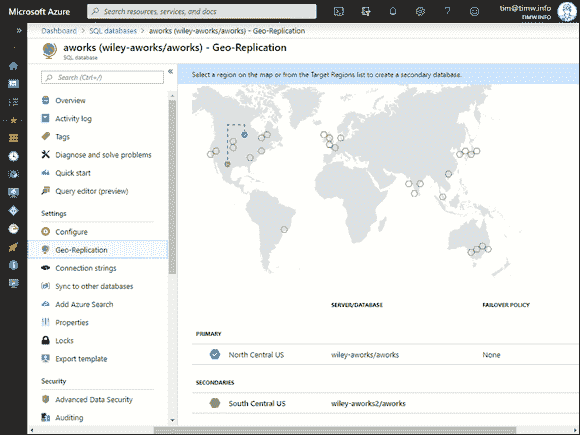

图 1-1： 在 Azure 中，只需几次点击即可使数据库具备跨地域可用性。

### 规模经济

*规模经济*是指企业以更大批量采购内部资源，从而将节省的成本传递给客户。

截至撰写本文时，Microsoft 的 Azure 产品组合已分布在全球 54 个区域。每个区域包含两个或更多物理数据中心。每个数据中心内有数不清的服务器机架、刀片式服务器、存储阵列、路由器、交换机等——庞大的物理产能。我们有理由认为，Microsoft 因大批量采购，从原始设备制造商（OEM）处获得了折扣。Microsoft 的采购折扣进而惠及 Azure 客户，就这么简单。

## 理解云计算模型

*云计算*的工作定义是：一种订阅安排，个人或企业租用云服务提供商的基础设施，仅为所消费的服务付费。这个定义没问题。

但在本节中，我将通过解释部署模型和服务交付模型，来加深您对云计算的整体理解。

### 部署模型

在 Azure 命名法中，*部署*是指在 Azure 公有云中预配资源。您可能会问：“这是怎么回事？为什么 Microsoft Azure 叫公有云？我以为您说不同 Azure 客户默认永远看不到彼此的资源。” 别急，听我解释。

#### 公有云

Microsoft Azure 是公有云，因为其全球数据中心结构面向公众开放。Microsoft 非常重视 Azure 的多租户特性，因此增加了层层物理和逻辑安全措施，确保每个客户的数据私密。事实上，在许多情况下，即使是 Microsoft 也无法访问客户的数据加密密钥！

其他主要云服务提供商——包括 AWS、GCP、Oracle 和 IBM（参见附近的侧边栏“其他云提供商”）——也被视为公有云平台。


Microsoft 还有三个独立的 Azure 云专供政府专用。因此，Microsoft 文档中会提到 Azure Cloud（指其公有云）和 Azure Government Cloud（指其主权、特殊访问的云）。普通公众若无关联政府机构背书，无法访问 Azure Government Cloud。

#### 私有云

如前所述，极少数企业拥有足够的财力、资本和人力资源来托管自己的云环境。通常只有最大型的企业组织才负担得起拥有冗余数据中心、存储、网络和计算的私有云基础设施，但它们可能因安全禁令，禁止将数据存储在 Microsoft（或任何其他云提供商）的物理数据中心中。

Microsoft 销售 Azure 云的便携版本：Azure Stack，它由一个服务器机架组成，公司可从 Microsoft 关联的硬件或服务提供商处租赁或购买。

其理念是：无需涉及互联网或外部云提供商（除非您愿意），即可将云计算的标志——按需自助服务、资源池化、弹性等——引入本地环境。

您的管理员和开发人员使用相同的 Azure 资源管理器（ARM）应用程序编程接口（API），将资源部署到本地 Azure Stack，就像部署到 Azure 公有云一样。此 API 让将基于云的服务引入本地（反之亦然）变得轻而易举。您将在第 2 章了解 ARM。

#### 混合云

当您结合本地环境和云环境的优势时，您就拥有了混合云。

根据我的专业经验，混合云部署模型对大多数企业来说最合理。为什么？混合云允许企业挽救（即：继续使用）其已付费的本地基础设施，同时利用 Azure 公有云的超大规模能力。

请看 图 1-2。在此拓扑中，本地网络扩展到了在 Azure 中运行的虚拟网络。您可以在此处进行各种巧妙的服务管理，包括：

*   将 Azure 虚拟机 (VM) 加入本地 Active Directory 域。

*   使用 Azure 管理工具管理本地服务器。

*   通过将 Azure 作为灾难恢复 (DR) 站点，提供近乎即时的故障转移灾难恢复。故障转移是指在别处备有生产服务器的复制备份，以便在几分钟内从故障的主环境切换到备份环境。对于无法承担从备份存档恢复备份所涉及停机时间的企业来说，故障转移至关重要。

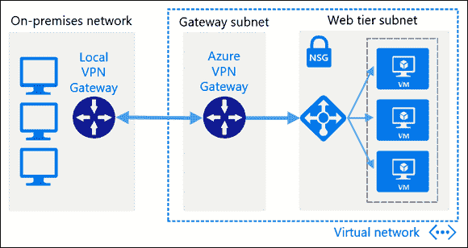

图 1-2： 一种混合云，其中本地企业网络扩展至 Azure。

读完本书时，您将了解如何部署 图 1-2 中所示的环境，但以下是正在发生情况的概述：

*   左侧是一个本地企业网络，通过虚拟专用网络 (VPN) 网关连接到 Internet。


右侧 (Azure) 是虚拟网络中的三 VM 部署。站点到站点 VPN 将本地环境连接到虚拟网络。最后，Azure 负载均衡器将传入流量平均分配给 Web 层子网中三个配置相同的 Web 服务器。因此，公司内部员工可以通过安全的 VPN 隧道访问基于 Azure 的 Web 应用程序，并获得低延迟、可靠、始终在线的连接。

 在本书中，我将本地物理网络环境称为 *本地环境*。在实际情况中，您会看到对 “on premise” 的错误引用——遗憾的是，即使在 Microsoft 的 Azure 文档中也是如此。请勿犯此错误。*Premise* 是一个前提/假设；*premises* 才指场所/局址。

根据我的经验，只有小企业足够敏捷，能在 Azure 云中完成所有工作。也就是说，您可能会发现，在您的组织熟悉了 Azure 并开始欣赏其可用性、性能、可伸缩性和安全性后，您将致力于将更多本地基础设施迁移到 Azure，并将更多业务线 (LOB) 应用程序以云优先为目标。

## 服务交付模型

组织主要通过三种方式部署应用程序：软件即服务、基础设施即服务和平台即服务。

### 软件即服务 (SaaS)

SaaS 应用程序是一个成品的、面向客户的应用程序，运行在云中。Microsoft Office 365 是一个完美的例子。如图 1-3 所示，您只需一个 Web 浏览器、一个 Internet 连接和一个 Office 365 订阅（您按月按订阅制付费），即可使用 Word Online 创建、编辑和共享文档。

使用 SaaS 应用程序时，您对应用程序的后端机制完全没有可见性。以 Word Online 为例，您既不知道也不关心后端服务器的备份频率、Office 365 数据中心的地理位置等。您关心的只是能否访问您托管在云中的文档，以及 Word Online 的表现是否符合预期。

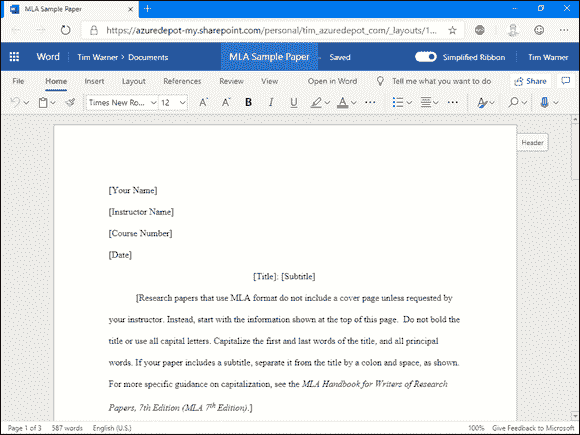

图 1-3： Word Online 是 Microsoft Office 365 产品系列的一部分，是 SaaS 应用程序的一个例子。

### 平台即服务 (PaaS)

我作为 Azure 解决方案架构师的大部分工作，集中于在特定场景下解释 PaaS 相对于 IaaS 的优势。

设想一家企业使用 VM 运行三层本地 Web 应用程序。该组织希望将此应用程序工作负载移至 Azure，以利用云计算的优势。因为该组织一直使用 VM 开展业务，所以它假设该工作负载在 Azure 中必须由定义运行在 VM 中。

且慢。假设该工作负载由 Microsoft 技术栈应用程序组成。也许该企业应考虑使用 PaaS 产品，例如 `Azure App Service` 和 `Azure SQL Database`，以利用自动缩放和一键式异地复制。

我将在后面的 第 3 部分 中讨论 `Azure App Service` 和 `Azure SQL Database`。目前，请理解异地复制是指将服务的同步副本放置在其他地理区域以实现容错，并将这些服务放置在更靠近用户的位置。

或者，该工作负载可能是一个使用 PHP 和 MySQL 的开源项目。没问题。`Azure App Service` 可以处理该场景。Microsoft 还为 MySQL 提供了一个原生托管数据库平台，名为（非常贴切地）`Azure Database for MySQL`。

使用 PaaS 时，Microsoft 承担了更多的托管环境责任。您不再对 VM 负 100% 的责任，因为 PaaS 产品将所有那些管道和管理开销从您身上抽离了。

其理念是 PaaS 产品让您能专注于应用程序，最终专注于使用这些应用程序的人员。如果 PaaS 有取舍的话，那就是放弃全栈控制权，这对许多资深的系统和网络管理员来说需要一个适应过程。

总而言之，IaaS 和 PaaS 的主要区别在于：IaaS 让您完全控制环境，但牺牲了可伸缩性和敏捷性。PaaS 让您完全具备可伸缩性和敏捷性，但牺牲了一些控制权。

 可以肯定的是，云计算文献中还包含对其他云部署模型的引用，例如社区云。您还会看到对其他交付模型的引用，例如存储即服务 (STaaS) 和标识即服务 (IDaaS)。本章重点介绍最常用的云部署和交付模型。

### 基础设施即服务 (IaaS)

我发现，大多数将应用程序和服务迁移到 Azure 的企业都使用 IaaS 模型，如果仅仅是因为他们过去一直通过 VM 交付服务——这就是老话常说的“如果没坏，别修它”。

很大程度上，IaaS 是指客户在云中托管一个或多个 VM。客户仍需对 VM 的整个生命周期负责，包括：

*   配置
*   数据保护
*   性能调优
*   安全性

通过在 Azure 中托管 VM 而不是在本地环境中，您可以省钱，因为不必在本地预配物理和逻辑资源。您也不必为 Azure 开箱即用的地理、物理和逻辑冗余层付费。

因此，SaaS 是一种在云中完全抽象化的服务，客户只需使用应用程序；而 IaaS 在 Microsoft 的责任（提供托管平台）和客户的责任（管理 VM 的整个生命周期）之间提供了一种分工。

 云计算总体而言，尤其是 Microsoft Azure，采用的是所谓的*共享责任模型*。在该模型中，Microsoft 的责任是提供使你的云部署成功所需的工具——Microsoft 的数据中心、服务器、存储和网络硬件等。你的责任是使用这些工具来保护、优化和防护你的部署。Microsoft 不会自动为你配置、备份和保护虚拟机；这些任务由你负责。

## 介绍 Microsoft Azure 服务

Microsoft Azure 服务目录包含数百项服务。在本书中列出所有服务将是对油墨和纸张的浪费，因为等到你读完本章时，服务列表将已经进一步扩充。

Microsoft 在 [`https://azure.microsoft.com/en-us/services`](https://azure.microsoft.com/en-us/services) 维护着一份服务目录，但本章我将带你高层级地浏览 Microsoft 所谓的“80% 服务”——即 80% 的客户群所使用的 Azure 产品。

### Azure 历史

2008 年 10 月，Microsoft 在其专业开发者大会上宣布了 Windows Azure。许多人认为该产品是直接回应 Amazon 的，后者当时已开始向公众推出 AWS。

首个 Azure 托管服务是 SQL Azure 关系型数据库，于 2009 年 3 月宣布。随后在 2012 年 6 月增加了对 PaaS 网站和 IaaS 虚拟机的支持。图 1-4 展示了当时 Windows Azure 门户的样子。

Satya Nadella 于 2014 年 2 月成为 Microsoft 的首席运营官。Satya 有一个愿景，即让 Microsoft 拓展其原本封闭的边界，因此 Windows Azure 更名为 Microsoft Azure，Azure 平台开始拥抱开源技术以及 Microsoft 过去视为敌对竞争对手的公司。

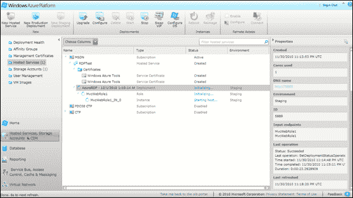

图 1-4： 2012 年左右的 Windows Azure 门户。

 我无法过分强调这一简单更名的重要性。如今，Microsoft Azure 为基于 Linux 的虚拟机和非 Microsoft Web 应用程序及服务提供了一流支持，这意义重大。

最后，Microsoft 在 2014 年 Microsoft Build 大会上推出了 RM 部署模型。Windows Azure 背后的 API 称为 Azure 服务管理 (ASM)，它存在多个设计和架构痛点。例如，ASM 使得组织部署资源变得极其困难，且无法以细粒度划分管理访问权限。

ARM API 的建模紧密参考了 AWS API（正如那句老话所说“模仿是最真诚的奉承”），其核心架构概念（如资源组和基于角色的访问控制）是 AWS 云中相应功能的直接对应物。

为了支持拥有旧部署的老客户，ARM 仍在 Azure 门户中为 ASM 部署提供有限支持（参见第 2 章）。这些资源带有“Classic”后缀标记。然而，本书专注于 ARM API，因此我不会涉及 ASM IaaS 产品。

Azure 虚拟机是 Microsoft Azure 的主力 IaaS 产品。具体而言，Azure 门户中的 Azure Marketplace 列出了来自 Microsoft、认可的 Linux 发行版以及第三方解决方案提供商的数千个预配置虚拟机映像。你可以在图 1-5 中查看虚拟机映像库。

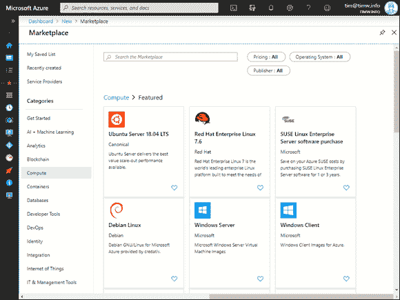

图 1-5： Azure Marketplace 包含预构建的 Windows 和 Linux 虚拟机映像。

当然，你可以将本地的物理机和虚拟机迁移到 Azure，也可以创建自定义虚拟机映像。我稍后会讲到这些主题；我保证。

### PaaS 产品

Azure 产品组合中充满了强大且节省成本的 PaaS 产品。以下是一些较为知名的 Azure PaaS 产品：

*   **应用服务：** Web 应用、移动应用、API 应用、逻辑应用和函数应用
*   **数据库：** Cosmos DB、Azure SQL 数据库、Azure Database for MySQL 和 Azure Cache for Redis
*   **容器：** Azure 容器实例、Azure 容器注册表和 Azure Kubernetes 服务
*   **DevOps：** Azure DevOps 和 Azure DevTest Labs
*   **物联网：** Azure IoT 中心、Azure IoT Edge、Azure Sphere 和 Azure Digital Twins
*   **机器学习：** Azure 机器学习服务、Azure Bot 服务、认知服务和 Azure 搜索
*   **标识：** Azure Active Directory、Azure AD B2B 和 Azure AD B2C
*   **监视：** Application Insights、Azure Monitor 和 Azure Log Analytics
*   **迁移：** Azure Site Recovery、Azure 成本管理、Azure 数据库迁移服务和 Azure Migrate

## 开启你的第一个 Azure 订阅

你可以通过 Azure 免费帐户免费、低门槛地试用 Microsoft Azure 平台。*低门槛*意味着你必须提供一些个人详细信息和合法的付款方式。Microsoft 仅将你的信用卡信息用于身份验证。

许多人对注册公共云服务存有顾虑，即使承诺是免费的，原因包括：

*   免费试用期结束后，Microsoft 是否会开始向我的信用卡收费？
*   如果我意外让某个 Azure 服务保持运行状态，Microsoft 会因此向我的信用卡收费吗？

我可以解决这些及其他完全合理的顾虑，首先从解释 Azure 订阅的工作原理入手。

### 了解订阅类型

当你注册 Azure 免费帐户时，你将获得 200 美元（或等值的本地货币）额度，可在 30 天内用于任何 Azure 服务。30 天后，Microsoft **不会** 自动将你的帐户转换为即用即付 (PAYG) 订阅（典型的付费订阅方案）。

相反，你运行的任何服务都将停止，若要重启服务，你需要在 Azure 门户中手动将试用帐户转换为 PAYG 帐户或其他订阅方案。

也就是说，Azure 免费帐户为多项 IaaS 和 PaaS 服务提供 12 个月的免费可用性，包括：

*   750 小时运行 Windows Server 或 Linux 的 B1S 通用虚拟机
*   5 GB 本地冗余热访问层 Blob 存储
*   10 个 Web、移动或 API 应用，含 1 GB 存储
*   5 GB Cosmos DB 实例
*   250 GB Azure SQL 数据库（S0 实例大小）
*   15 GB Azure 传出数据传输

 你可以通过在 Azure 门户中查看“免费服务”边栏选项卡，或访问 Azure 免费帐户常见问题解答页面 [`https://azure.microsoft.com/en-us/free/free-account-faq`](https://azure.microsoft.com/en-us/free/free-account-faq/) 来查看 Azure 免费层服务的完整列表。

 “边栏选项卡”是 Microsoft 用来描述 Azure 门户中任何特定网页的术语。我在本书中大量使用该词，你也会在 Azure 文档中随处看到它。

此外，多项 Azure 服务在始终免费层运行；具体细节请查看 [`https://azure.microsoft.com/en-us`](https://azure.microsoft.com/en-us/)。但请记住，免费层服务并非供你运行生产工作负载。该层级的存在是为了让你有机会测试 Azure，以确定它是否符合你的职业或个人需求。

即用即付 (PAYG) 是最常见的标准订阅方案。每月，你将收到一份发票，列出你在 Azure 免费层服务之外所消耗的 Azure 资源费用。

企业协议 (EA) 是一种特殊用途的合同，旨在供愿意承诺三年 Azure 订阅的大型企业使用。Microsoft 为 EA 客户提供 Azure 服务的特别折扣，并提供一个特殊的管理门户，用于分析支出、创建预算、跟踪使用情况等。

根据 EA，您需要预先支付年度费用，且遵循“用进废退”原则。例如，如果您承诺第一年支付 12,000 美元，但到 12 月 31 日仅花费了 9,000 美元，则剩余的 3,000 美元将损失殆尽。不过，在每个合同年度结束时，您可以调整下一年度的费用，以更好地匹配您的使用情况和预期。

其他几种 Azure 订阅产品/服务提供每月定期赠送的额度，包括：

*   **Visual Studio：** 赠予拥有 Visual Studio Online 订阅的用户
*   **Action Pack：** 赠予 Microsoft 合作伙伴网络成员
*   **Azure for Students：** 面向拥有经验证的学术电子邮件地址的学生，提供为期 12 个月的免费额度 (100 美元)
*   **Azure Pass：** 通常由 Microsoft 赠予 Azure 用户组和教育机构，旨在免费分发

### 创建免费 Azure 帐户

要注册 Azure 免费帐户，您需要一个 Internet 连接和任意现代 Web 浏览器。

 我建议您在台式机或笔记本电脑上执行此过程（以及本书中的所有过程），而不是在平板电脑或智能手机上。Microsoft 尽可能使 Azure 门户适配移动端，但考虑到您需要大量输入，我建议使用大屏幕计算机。

请按照以下步骤创建您的帐户：

1.  **浏览至** [`https://azure.microsoft.com/en-us`](https://azure.microsoft.com/en-us/) **并寻找免费帐户链接。**

    Microsoft 会定期更改 Azure 网站，因此我不敢让您在特定位置寻找链接或按钮。页面上某个地方会有供您点击的链接或按钮。

2.  **使用您的 Microsoft 帐户登录，或创建一个新帐户。**

    Azure 免费帐户是一个 Microsoft 帐户，它为公司所有在线服务提供支持，包括 Xbox 和 Office 365。如果您已有 Microsoft 帐户，但可能希望专门为 Azure 创建一个新帐户。我建议这样做，因为您可能希望将 Azure 业务与（例如）Xbox 娱乐活动完全隔离开来。

3.  **在“关于您”部分，提供您的联系详细信息，然后单击“下一步”。**

    Microsoft 需要此信息来设置您的 Azure 订阅。它还会使用您的电话号码、电子邮件地址和付款详细信息来验证您的身份。

4.  **在下一页的“通过卡片验证身份”部分，提供有效的信用卡详细信息。**

    请注意，您不能使用预付费信用卡或礼品卡；该卡必须是一张以您的名义开具且账单地址为您地址的合法信用卡或借记卡。除非您升级到付费订阅产品/服务，否则 Microsoft 不会向您的帐户收费。也就是说，Microsoft 可能会在您的信用卡帐户上冻结 1 美元用于验证；此冻结将在三到五个工作日内解除。

    您只能拥有一个 Azure 免费帐户，Microsoft 执行身份验证部分是为了防止欺诈。

5.  **在“协议”部分，确认您同意订阅协议、产品/服务详情和隐私声明；然后单击“注册”。**

6.  **在出现的“您已准备好开始使用 Azure”页面上，单击“转到门户”。**

    完成了，您已准备就绪。很简单，不是吗？

您现在应该能看到 Azure 门户，以及“欢迎使用 Microsoft Azure”消息，如图 1-6 所示。

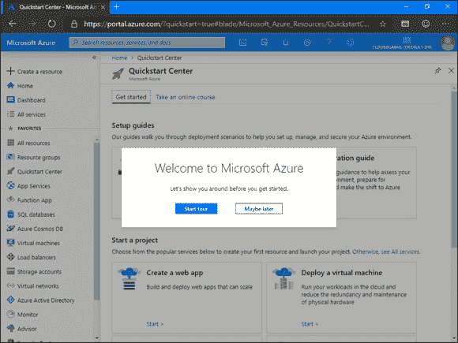

图 1-6： 首次登录 Azure 门户。

我将在 第 2 章 中正式介绍 Azure 门户。目前，请将此地址 [`https://portal.azure.com`](https://portal.azure.com) 加入书签，因为您从现在起将频繁使用它。


单击“开始演练”以浏览 Azure 门户。在图 1-6 的背景中，您可以看到“快速入门中心”；您可以随时通过在顶部导航栏的搜索框中键入 `quickstart center` 返回此边栏选项卡。快速入门中心包含指向文档和 Microsoft Learn（Microsoft 的免费 Azure 教育门户）的链接。

 Azure 门户中的窗口称为 *边栏选项卡*。

### 查看订阅详细信息

请按照以下步骤查看您的 Azure 免费帐户订阅详细信息：

1. **在 Azure 门户的搜索框中键入** `subscriptions`。

    “订阅”选项应几乎立即出现。（我是 Azure 门户中全局搜索功能的忠实粉丝，希望您也能成为其中一员。）

2. **在“订阅”边栏选项卡中，选择您的“免费试用”订阅。**

    在单击“免费试用”之前，请注意“订阅”边栏选项卡为您提供的信息：您的帐户角色为“帐户管理员”，帐户状态为“活动”。到目前为止，一切顺利。

3. **检查各种订阅管理工具。**

    图 1-7 显示了以下工具：

    * **A：** “概述”设置显示“要点”面板（显示在图的右侧），您可以在其中查看订阅状态和元数据的详细信息。
    * **B：** “成本管理”设置使您能够报告已消耗和/或正在消耗的 Azure 服务。
    * **C：** “付款方式”设置使您能够更改与订阅关联的付款方式。
    * **D：** “升级订阅”使您能够将免费试用转换为即用即付订阅。如果您在花费完 200 美元或达到 30 天之前进行转换，则在费用计费器开始计费前，您将保留您的额度。
    * **E：** “管理”按钮将带您进入 Azure 帐户中心，您可以在其中打印过去的服务发票、设置账单警报，并更改拥有该订阅的帐户。 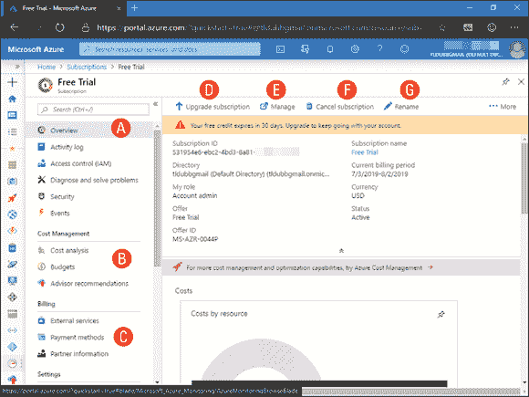

        图 1-7： 在 Azure 门户中查看您的免费试用订阅。
    * **F：** “取消订阅”按钮使您能够……嗯，取消您的订阅。还能有什么？
    * **G：** “重命名”按钮使您能够将订阅的逻辑名称从“免费层”更改为对您和您的组织更有意义的名称。

如果您决定升级订阅，Microsoft 会询问您是否要购买月度支持计划。与即用即付订阅一样，您可以随时取消支持计划，无需支付任何罚款。这三个支持层级各自具有固定的月度费用，分别是：

* **开发人员计划：** 面向试用和非生产环境的支持。您可以在您所在时区的上午 9 点至下午 5 点与 Azure 支持人员互动，初始响应时间少于 8 个工作小时。截至 2019 年 11 月撰写本文时，月费为 29 美元。
* **标准计划：** 面向生产环境的支持。您将获得 7x24 小时技术支持，并在 2 小时内得到响应。截至撰写本文时，标准计划每月花费 100 美元。
* **专业直接计划：** 面向高度依赖 Azure 的企业。您将获得 7x24 小时技术支持，严重问题在 1 小时内得到响应。截至撰写本文时，Microsoft 对此支持计划收取每月 1,000 美元。
* **高级计划：** 此支持层级面向不仅需要闪电般快速的技术支持，还需要来自 Microsoft Azure 解决方案专家的架构指导的企业。您需要联系 Microsoft 以获取高级计划的价格报价。

除非你与微软签有企业协议（EA），否则你可以随时取消 Azure 订阅。但请注意，在微软允许你取消订阅之前，你需要删除所有资源。

# 第 2 章：探索 Azure 资源管理器

## 本章内容

- 了解 Azure 资源管理器
- 熟悉 Azure 区域
- 学习 Azure 管理工具

在本章中，我将带你一窥究竟，向你介绍构成 Microsoft Azure 公有云的后端服务。

乍一看，你可能会觉得即将讨论的 REST API 有点（也许不止一点）开发人员风格，超出了你的专业舒适区。请继续跟随我！我认为，无论专长为何，任何 Azure 专业人员都必须对 Azure 资源管理器架构有扎实的理解；毕竟，它是所有基于 Azure 服务的基础。

## 介绍 Azure 资源管理器

Azure 资源管理器（最常缩写为 ARM，发音同身体部位“arm”）是 Microsoft Azure 底层的部署和管理服务。你在 Azure 中采取的每一个操作，无论使用何种工具，都会调用 ARM REST API。Azure 门户只是一个 Web 前端，它抽象了 ARM REST API 的请求和响应。

“你问什么是 REST API，Tim？”你问得很好。我接下来回答这个问题。

### REST API

应用程序编程接口（API）是一种软件规范，允许与其他软件应用程序进行交互。例如，Twitter 发布其 API 规范，以允许软件开发人员利用 Twitter 服务用于他们自己的应用程序（获取推文、发布帖子等）。

表述性状态转移（REST）是一种软件开发方法论，它定义了基于 Web 的 API 如何通过使用超文本传输协议（HTTP）进行通信。

HTTP 有五种主要方法（也称为*操作*或*动词*），REST API 调用可以执行这些操作：

- `GET`：检索资源详细信息
- `POST`：创建新资源
- `PUT`：更新资源（替换现有资源）
- `PATCH`：增量更新资源（修改现有资源）
- `DELETE`：删除资源

上述四种 HTTP 方法对应信息技术中的四种主要数据操作：创建、读取、更新和删除。因为我们 IT 从业者喜欢双关语和幽默梗，所以我们简称为 CRUD 操作。

嘿，此时不要被 HTTP 动词困住。我在此描述它们只是为了给你提供更完整的背景。

现在我将这些 REST API 知识与 Microsoft Azure 联系起来。ARM 的 REST API 从根本上定义了 Azure 产品和服务，并指定了如何在订阅中使用它们。

你在 Azure 中部署的每个单独工件都代表一个资源。因此，虚拟机 (VM)、Web 应用程序、数据库、存储帐户和密钥保管库在 ARM REST API 中被定义为离散的资源类型。

### 资源提供程序

在 ARM REST API 定义中，*资源提供程序* 是提供特定 Azure 产品的服务。Azure 资源提供程序的命名空间是分层排列的。

为了说明此命名空间，请考虑我的一个 Azure 存储帐户（名为 tlwstor270）的资源 ID：

```
/subscriptions/2fbf906e-1101-4bc0-b64f-adc44e462fff/resourceGroups/twtech/providers/Microsoft.Storage/storageAccounts/tlwstor270
```

首先，请注意正斜杠以及资源路径类似于统一资源标识符 (URI) 的方式。这是有意为之，因为所有 REST API 都是基于 Web 的，且专门使用 HTTP 或 HTTPS URI。你可以从左向右读取存储帐户资源 ID，以遍历 ARM REST API 命名空间：

- `subscriptions`：斜杠 (/) 下方的节点，即 ARM REST API 层级结构的顶级根节点。
- `2fb…`：托管我存储帐户的订阅的订阅 ID。
- `resourceGroups`：资源组命名空间。资源组是 Azure 中的主要部署单位。
- `twtech`：托管我存储帐户的资源组。
- `providers`：资源提供程序层级。
- `Microsoft.Storage`：管理 Azure 存储服务的资源提供程序（存储帐户只是其中一项服务）。
- `storageAccounts`：托管我存储帐户的资源组。
- `tlwstor270`：对实际存储帐户的引用。

如果你曾使用过 REST API，你可能想使用第三方产品（如 Postman (`https://www.getpostman.com/`)）来与 ARM REST API 交互。如果没有，请将浏览器指向 `https://resources.azure.com`，使用你的订阅所有者帐户登录，并以图形方式浏览 ARM REST API 和你的 Azure 订阅资源。图 2-1 显示了该界面。

正如我之前提到的，我有一个名为 tlwstor270 的存储帐户，位于名为 `twtech` 的资源组中。以下是如何使用 Azure 资源浏览器“遍历树”：

1. **在左侧导航栏上，展开“订阅”，然后展开你的订阅。**

   在图 2-1 中，我展开了我的订阅。

2. **展开 resourceGroups，然后展开你的目标资源组。** 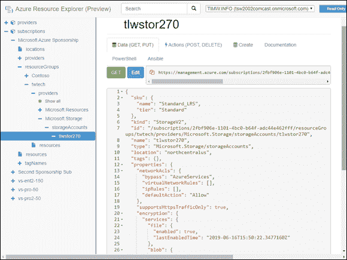

   图 2-1： Azure 资源浏览器允许你直接查看 ARM REST API。

3. **展开 providers，展开 Microsoft.Storage，然后选择你的存储帐户。**

4. **在主屏幕上，浏览定义你的存储帐户的 JavaScript 对象表示法 (JSON) 输出。**

   在图 2-1 中，tlwstor270 存储帐户是我 `twtech` 资源组中唯一的资源，因此很容易在 JSON 输出中找到资源定义。请注意屏幕顶部对 HTTP 动词的引用：`GET`、`PUT`、`POST` 和 `DELETE`。

虽然 Azure 资源浏览器默认将你置于只读模式，但请注意界面顶部的“只读”按钮。如果你拥有足够的特权，你可以超越简单的 `GET` 请求，对 Azure 资源执行 `PUT`、`POST` 和 `DELETE` 操作，因此请小心！

### JSON

RESTful API 使用 JSON（通常发音为 *jay-sahn*）数据格式对所有请求和响应数据进行编码，ARM 当然也不例外。

Douglas Crockford 于 2001 年发明了 JSON，旨在以相对紧凑、人类可读的形式表示数据。JSON 文档是纯文本，可以在任何文本编辑器中打开。

如果你是 Azure 专业人员，我建议使用 Visual Studio Code 作为文本编辑器。

JSON 元素由逗号分隔的键/值对列表组成。请查看我之前讨论的 Azure 存储帐户的此 JSON 片段。注意通过查看少量代码就能了解该资源的大量信息。别担心现在还看不懂——你才刚刚开始！

```json
"sku": {
  "name": "Standard_LRS",
  "tier": "Standard"
},
"kind": "StorageV2",
"id": "/subscriptions/2fbf906e-1101/resourceGroups/twtech/providers/Microsoft.Storage/storageAccounts/tlwstor270",
"name": "tlwstor270",
"type": "Microsoft.Storage/storageAccounts",
"location": "northcentralus"
```

Azure 中的所有部署都以 JSON 格式记录。这些所谓的 ARM 模板使创建可靠、可重复的 Azure 环境变得更加容易。

# 例如，在 图 2-2 所示的 Azure 门户中，你可以看到我在测试环境中创建的可靠 tlwstor270 存储帐户。然后我选择“导出模板”设置，并单击“下载”以获取存储帐户的 ARM 模板定义。你可以在 图 2-2 中看到此过程的实际操作。

我怎么强调都不为过，熟悉 JSON 以及特别是 ARM 模板是多么重要。好消息是，在阅读本书的过程中，你将获得大量关于两者的实践经验。

## ARM 管理范围

在计算机的文件系统中，存在已定义的层次结构：卷、文件夹、子文件夹和文件。在较高范围设置的权限通过继承流向较低范围。例如，授予 Pat 对服务器 E 盘的只读访问权限，将导致 Pat 继承对 E 盘所有文件夹、子文件夹和文件的只读访问权限。

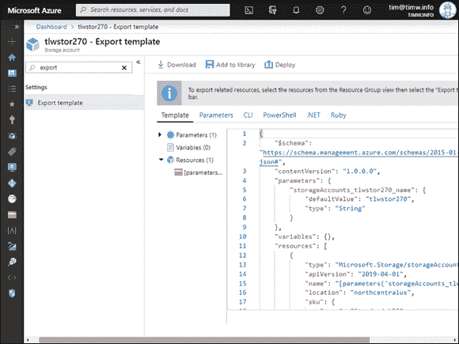

图 2-2： 你可以定位并下载每个 Azure 资源背后的 JSON 源代码。

继承和多层范围在 Azure 中的工作方式大致相同。所有资源组都包含在 Azure 订阅中，你可以将一个或多个订阅汇总到一个管理组中。这些管理范围（请参阅 图 2-3）简化了向资源（最终是其用户）授予基于角色的访问控制授权分配和治理策略的过程。

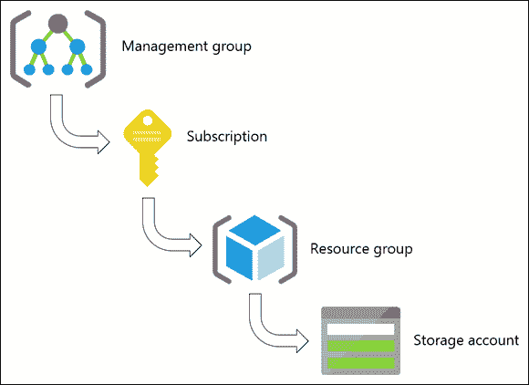

图 2-3： Azure 管理范围。

让我举个例子说明 Azure 管理员如何组合使用这些管理范围。请先跟着我的思路走；等你读完本书时，你将对这些概念有深入的了解。

假设一位管理员需要确保其他 Azure 管理员部署的任何 VM 仅位于企业授权的区域中。但我要使此场景复杂化：该组织的 VM 分散在 6 个订阅的 44 个资源组中。哇！即使有继承机制，这里的管理开销也将非常巨大。

但情况并非乍看之下那么糟糕。管理员创建一个包含这六个企业订阅的单一管理组。然后她创建一个定义资源部署规则的单一 Azure 策略，并将该策略与管理组关联。Azure 策略通过继承流经其包含的订阅和资源组，作用于现有和未来的 VM，这实现了强大而高效的管理。

## 熟悉 Azure 区域

在公有云计算中，你将资源存储在 Microsoft 的物理基础设施中。（请参阅 第 1 章。）此基础设施由遍布全球的庞大数据中心网络组成。

这个（可以说是）Azure 数据中心的“环球网”意味着你可以将云资源在地理上放置在靠近客户的位置，从而为他们提供连接到你应用程序的低延迟、高性能连接。在撰写本书时，Microsoft 在 140 个国家/地区拥有 54 个区域。每个区域由一个或多个独立的物理数据中心组成，并具有冗余的高速网络互连。

### 可用性区域

当你在 Azure 中托管面向客户的服务时，高可用性应是你最关心的问题。如果主区域的数据中心发生故障，你有什么应对计划？

Microsoft 正在逐步在其区域地图中推出可用性区域。从本质上讲，`可用性区域` 允许你在同一区域的不同数据中心中放置副本 VM。换句话说，可用性区域代表单个 Azure 区域内的独立位置。

图 2-4 说明了这一概念：两个配置相同的 Web 服务器 VM 分别放置在我的主区域中的两个可用性区域内。VM 前面的 Azure 负载均衡器使这两个 VM 均可在同一 IP 地址或域名系统主机名下访问。通过此设置，如果我的某个 VM 脱机（由于我自己的错误或 Microsoft 数据中心中断），我的服务仍保持在线且功能正常。

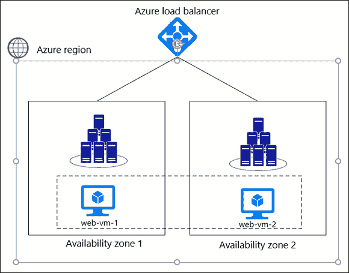

图 2-4： 通过将副本 VM 放置在可用性区域中来提供高可用性。

在 Azure 命名法中，`区域` 和 `位置` 可互换使用。

### 地理位置

Microsoft 将其区域组织为地理位置，以支持企业合规性和数据驻留要求。

### 特殊区域

Azure 被称为公有云服务，因为其大多数区域和服务可供公众购买。也就是说，Microsoft 托管称为政府云或主权云的特殊区域，供全球特定政府机构专用（请参阅 第 1 章）。

Azure Government 区域对非政府雇员不可见（不可见）。在撰写本书时，Microsoft 为美国、中国和德国政府维护独立的区域、可用性区域和数据中心。

### 区域对

本章前面提到，你可以将 Azure 服务的冗余副本放置在多个区域中以实现故障转移冗余。当你这样做时，应首先确定 Microsoft 指定的配对区域，以确保最低延迟。

Microsoft 在配对区域之间构建了额外的高速网络连接，这向客户保证其多区域部署不会遭受过度延迟。

搜索 `https://docs.microsoft.com/azure` 中的文章“业务连续性和灾难恢复 (BCDR)：Azure 配对区域”，其中包含配对区域的主列表。

在我的 Azure 咨询工作中，我建议客户通过访问 Azure Speed Test 2.0 `https://azurespeedtest.azurewebsites.net/` 来测试其位置与 Azure 之间的延迟。你可能会发现，延迟最低的 Azure 区域并非你想象的那个。

### 功能可用性

Azure 产品团队逐步在区域地图中推出新功能，因此某些产品目前可能在你的主区域中不可用。

因此，密切关注“按区域提供的产品”页面 `https://azure.microsoft.com/en-us/global-infrastructure/services/` 非常重要。同样的指导原则也适用于 Azure Government 区域。大多数时候，我发现新功能始于 Azure 公有云，很久之后才进入主权云。

## 介绍 Azure 管理工具


是时候熟悉最常用的 Azure 管理工具了。本书中描述的所有分步过程都假设你在 Windows 10 工作站上工作，但你可以在 macOS 或 Linux 系统上完成本书中的几乎每一项任务。

## Azure 门户

Azure 门户 ([`https://portal.azure.com`](https://portal.azure.com)) 是一个响应式 Web 应用程序，构成了 Azure 中基本的图形管理平台。图 2-5 显示了 Azure 门户。

### Azure 门户界面元素

*   **页面标题栏 (A)：** 顶部导航栏有时称为 `全局导航`，因为这些控件在 Azure 门户的任何位置均可用。打开“收藏夹”菜单。
*   **全局搜索 (B)：** 搜索任何 Azure 资源。搜索结果包含文档链接。
*   **Cloud Shell (C)：** 打开 Azure Cloud Shell 以执行命令行 Azure 工作。
*   **全局订阅筛选器 (D)**：显示 Azure 订阅的子集，使 Azure 门户视图列表更易于浏览。
*   **通知 (E)**：查看当前和过去部署的进度。
*   **你的帐户 (F)**：注销、切换目录和编辑帐户配置文件。
*   **收藏夹 (G)**：加载你最常用的 Azure 服务。
*   **资源窗格 (H)**：使用搜索框查找需要配置的设置。
*   **配置边栏选项卡 (I)**：*边栏选项卡* 是指你在其中进行 Azure 工作的详细屏幕。水平滚动条可帮助你左右移动。

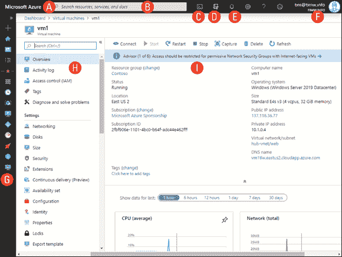

你的 Azure 门户自定义仅影响你的用户帐户。你的同事将拥有她自己的收藏夹列表、订阅筛选器、自定义仪表板等。

响应式 Web 应用程序会动态重新排列自身以适应不同的 Web 浏览器和屏幕尺寸。然而，在智能手机上访问完整门户通常并不有趣。Microsoft 为 iOS 和 Android 移动设备提供了 Azure 门户的移动版本。你可以在该移动应用中执行大多数管理任务，包括访问 Cloud Shell。

## Azure PowerShell

Azure 门户很好用，但如果你被要求部署 10 个、100 个或 1,000 个 VM 怎么办？你肯定不想在 Azure 门户中通过点击来执行重复性操作。

对于管理自动化，你需要使用 Azure PowerShell。PowerShell 是一种自动化语言，可用于在 Windows Server、macOS、Linux、Azure、AWS 等环境中执行任何重复性任务。

如果你还没有开始提升 PowerShell 技能，今天就是开始的日子；你需要至少具备中级 PowerShell 技能，才能在 Azure 中充分发挥生产力。

请遵循以下步骤，在 Windows 10 工作站上安装 Az 模块：

1.  **打开提升权限的 PowerShell 控制台。**

    在 Windows 10 中，打开“开始”菜单，输入 PowerShell，右键单击图标，然后从快捷菜单中选择“以管理员身份运行”。

2.  **从 PowerShell 库安装 Az 模块。**

    Microsoft 运营一个经过策划的 PowerShell 模块存储库，名为（非常贴切地）PowerShell 库。运行以下命令以下载并安装 Azure PowerShell：

    ```
    Install-Module -Name -Az -Verbose -Force
    ```

    从技术上讲，`-Verbose` 和 `-Force` 开关参数是可选的，但我建议使用 `-Verbose` 以便阅读详细的命令输出，并使用 `-Force` 以便在计算机上已安装模块时进行升级。

3.  **更新本地帮助。**

    PowerShell 默认不附带本地帮助，因为文档变化非常快。请使用以下命令，确保你拥有最新的 PowerShell 命令帮助：

    ```
    Update-Help -Force -ErrorAction SilentlyContinue
    ```

    `-ErrorAction SilentlyContinue` 部分会抑制帮助文件下载过程中可能发生的任何错误或故障。出于多种原因，运行 `Update-Help` 时偶尔会遇到错误（例如，PowerShell 团队的某人可能忘记为某个命令创建帮助文章）。

4.  **登录到 Azure 订阅。**

    运行以下命令以生成“登录到你的帐户”对话框。通过身份验证后，你将返回到 PowerShell 控制台，已登录并准备就绪。

    ```
    Connect-AzAccount
    ```

5.  **要关闭 PowerShell 连接，请关闭控制台窗口。**

每当你想使用 PowerShell 管理 Azure 时，都需要使用上述步骤。但是，你可以通过使用一种称为服务主体的特殊 Azure Active Directory 帐户来实现 Azure PowerShell 登录自动化。有关详细信息，请参阅 Azure 文档文章“使用 Azure PowerShell 创建 Azure 服务主体”，网址为 [`https://docs.microsoft.com/en-us/powershell/azure/create-azure-service-principal-azureps?view=azps-3.2.0`](https://docs.microsoft.com/en-us/powershell/azure/create-azure-service-principal-azureps?view=azps-3.2.0)。

## Azure CLI / Azure Cloud Shell

Azure 命令行接口 (CLI) 是……嗯，一个用于 Azure 的跨平台命令行接口。我发现一些 Azure 管理员和开发人员更喜欢 Azure CLI 而不是 Azure PowerShell，因为 CLI 的学习曲线更平缓，并且速度极快，尤其是在交互模式下。

在本书中，你将在 Azure Cloud Shell 中使用 Azure CLI。Cloud Shell 是一个基于浏览器的命令行环境，可让你访问 PowerShell、Azure CLI 以及许多其他管理和开发工具。

请遵循以下步骤，开始熟悉 Azure Cloud Shell 和 Azure CLI：

1.  **在 Azure 门户的全局导航栏上，单击 Cloud Shell。**

    “你没有装载存储”对话框随即打开。

2.  **选择你的 Azure 订阅，然后单击“创建存储”。**

    首次启动 Cloud Shell 时，需要指定一个存储帐户。你可以使用该存储帐户存储所有 Cloud Shell 资源（模块、脚本等）。

    如果想要使用现有存储帐户，或想要完全控制存储帐户的名称和区域，请单击“显示高级设置”。

    你需要指定是要从 Bash 还是 PowerShell 开始。我建议选择 PowerShell。

3.  **在 Cloud Shell 工具栏上，确保 PowerShell 是当前环境。**

    你可以通过检查 Azure Cloud Shell 工具栏上的第一个元素来做到这一点。请注意，只需从此菜单中进行选择，即可在 Bash 和 PowerShell 环境之间切换。

    你可以从 PowerShell 会话或 bash shell 会话启动 Cloud Shell 会话。这些步骤是在 PowerShell 环境中进行的。

4.  **运行 `Get-CloudDrive` 以查看云驱动器信息。**

    该命令会告诉你关于 Cloud Shell 文件所在位置的所有信息。你的云驱动器指向指定 Azure 存储帐户中的文件共享。

5.  **输入 `az interactive` 以启动交互式 Azure CLI 会话。**

6.  **针对发送遥测信息给 Microsoft 的请求回答是或否。**

    首次启动 Azure CLI 交互式环境时请耐心等待。通常需要一分钟或更长时间才能完全初始化。

7.  **输入以下命令以查看可用的存储帐户：**

    ```
    az storage account list -o table
    ```

    在输入时，请注意 Azure CLI 中以下我认为非常有用的行为：

    *   Azure CLI 提供自动完成下拉菜单，帮助你完成命令。请善用这些菜单。按 Tab 键接受突出显示的选项，或使用箭头键选择替代项。
    *   在屏幕中间，Azure CLI 在你输入时提供内联文档。
    *   Azure CLI 默认提供 JSON 输出，但在这种情况下，请指定表格格式。然后运行 `az configure` 以指定表格或其他更适合你习惯的默认输出格式。

8.  **要退出 Cloud Shell，请关闭窗格。**

Cloud Shell 之所以如此快速，是因为 Microsoft 在其全球内容分发网络中预置了 Docker 容器。Azure 使用你的客户端 IP 地址和地理位置将你连接到最近的 Cloud Shell 容器，从而提供最快的连接。

虽然我在本书中使用 Cloud Shell 内的 Azure CLI，但你也可以在 Windows、macOS 或 Linux 工作站上安装 Azure CLI。请访问 Azure 下载页面 [`https://azure.microsoft.com/en-us/downloads`](https://azure.microsoft.com/en-us/downloads) 以下载安装程序。

## Azure SDK

正如本章前面所述，REST API 是一种基于 HTTP 的接口，允许两个软件系统进行通信，而 Azure 门户、PowerShell 和 Azure CLI 是*抽象*（隐藏底层细节）底层 ARM REST API 的方式。

对于软件开发人员，软件开发工具包 (SDK) 代表了另一层 API 抽象层。截至撰写本文时，Azure SDK 实际上可用于以下编程语言和框架：

*   Android
*   Go
*   iOS
*   Java
*   .NET
*   Node.js
*   PHP
*   Python
*   Ruby
*   Swift
*   Windows
*   Xamarin

Azure SDK 提供了与 Azure 服务交互所需的项目模板和代码库。在本书中，我使用 Visual Studio 2019 来使用 Azure SDK。如图 2-6 所示，你只需启用 Azure 开发工作负载；Visual Studio 会处理其余的设置工作。

如果你是 Visual Studio 新手，可能需要获取有关修改已安装工作负载的更详细说明。请参阅 Microsoft 文档文章“修改 Visual Studio”，网址为 [`https://docs.microsoft.com/en-us/visualstudio/install/modify-visual-studio?view=vs-2019`](https://docs.microsoft.com/en-us/visualstudio/install/modify-visual-studio?view=vs-2019)。

顺便说一句，如果你在想：“嘿，我不是开发人员；我不想为 Visual Studio 付费！”请稍等一下。Microsoft 免费提供 Visual Studio 2019 Community Edition，供测试和开发使用。Windows 和 macOS 版本均可用。

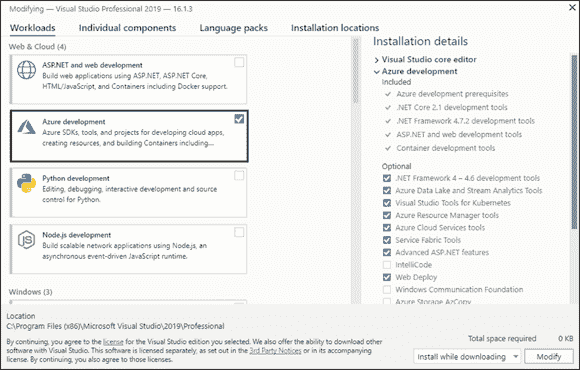

## ARM REST API

如果你愿意，可以深入到 ARM REST API 的“最底层”。图 2-7 显示了 Azure 资源浏览器 ([`https://resources.azure.com`](https://resources.azure.com/))，这是一个基于浏览器的 ARM REST API 界面。

注释如下：

*   **A：** 选择要附加的 Azure AD 目录。
*   **B：** 将环境设置为“只读”（默认）或“读/写”。在读/写模式下工作时要小心，因为你是在直接操作 Azure 资源。
*   **C：** 虽然资源浏览器使用知名地址，但访问需要身份验证，界面中显示的内容反映了你的用户帐户的 Azure AD 和 Azure 资源权限。
*   **D：** 使用 ARM REST API 资源提供程序命名空间浏览订阅并深入查看资源。
*   **E：** 使用 HTTPS 动词 `GET`、`PUT`、`POST` 和 `DELETE` 执行 ARM REST API 操作。
*   **F：** 以原生 JSON 格式查看资源定义。如果将资源浏览器置于读/写模式，你可以直接进行更改。

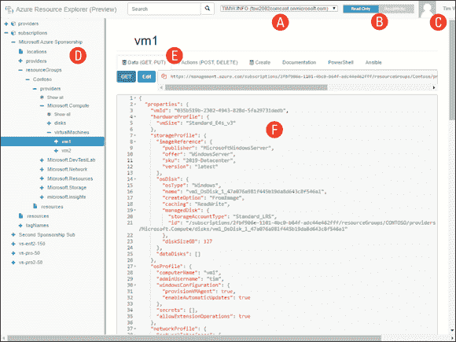

正如包括开源社区人士在内的许多人常说的那样，“能力越大，责任越大。”

你可能想知道何时以及为何需要在基本 REST API 层面与 Azure 交互。然而，这种交互比你想象的更常见。也许你正在排查资源行为故障，却无法在 Azure 门户或其他抽象层中找到所需的控件。又或许你正在编写自己的 API，需要知道如何为自己的用途构建 ARM REST API 调用。

# 第 2 部分：将计算资源部署到 Microsoft Azure

**本部分内容……**

*   像专家一样管理 Azure 存储
*   在 Microsoft Azure 中规划和实施虚拟网络
*   部署和配置 Windows Server 和 Linux 虚拟机 (VM)
*   区分 Docker 容器与 VM，并学习如何在 Azure 公有云中驾驭它们

# 第 3 章：在 Azure 中管理存储

**本章内容**

*   **区分存储数据类型**
*   **创建和使用存储帐户**
*   **决定 VM 磁盘的存储位置**
*   **为数据备份奠定基础**

存储是 Microsoft Azure 云中一个几乎通用的服务示例。无论你运行何种工作负载——VM、应用服务、Functions、机器学习或其他——你都可能需要持久的对象存储。

读完本章后，你将牢固掌握 Azure 存储帐户：它是什么、如何工作、如何部署，以及如何存储和检索不同的数据类型。

## 了解 Azure 存储数据类型

Azure 存储帐户代表一个多用途容器资源，为三种主要数据类型提供高可用、持久的存储：非结构化、半结构化和结构化。

### 非结构化数据

*非结构化数据*是没有模式强制约束的数据。你可以将*二进制大对象* (blob) 视为文件、虚拟硬盘、文档文件和媒体文件。所有这些对象都是文件存储对象，可以具有任何特定格式和内容。

虽然 *blob* 一词包含 *large* 之意，但 blob 对象可以是任意大小的文件，无论是 1 KB 的文本文件还是 120 GB 的虚拟硬盘文件。

### 半结构化数据

*半结构化数据*没有关系数据的列行排列，但也不像纯二进制非结构化数据那样自由。Azure 存储帐户中的表服务以键/值数据对的形式呈现半结构化数据。

NoSQL 数据库是半结构化数据的一个例子。正如我在第 9 章中所述，Cosmos DB 是 Azure 的主要 NoSQL 数据库产品。

### 结构化数据

如果你使用过任何关系数据库系统，你就懂*结构化数据*——即分解为一个或多个表中的数据，其中每一列都受特定数据类型约束。

到目前为止，我已解释 Azure 存储帐户存储非结构化和半结构化数据。但结构化数据怎么办？

事实上，Azure 存储帐户没有结构化数据存储选项。相反，你需要使用 Microsoft 的关系数据平台即服务 (PaaS) 产品之一，或在虚拟机 (VM) 内运行数据库。

Azure 生态系统中的结构化数据库示例包括 Azure SQL 数据库和 Azure Database for MySQL 服务器。

此时，你已了解 Azure 存储帐户提供用于非结构化数据的 Blob 服务和用于半结构化数据的表服务。但你应该知道还有两种额外的存储帐户服务：

*   **队列：** 支持应用程序组件之间的异步消息传递。该服务速度快、可扩展，且开销低。
*   **文件：** 创建兼容服务器消息块 (SMB) 和网络文件系统 (NFS) 的文件共享，并从 Azure 内部或外部访问它们。

## 使用存储帐户

现在考虑如何规划 Azure 存储。Azure 通用存储帐户包含多个配置选项，因此为了节省成本和安全，你需要做出正确的决策。

### 创建存储帐户

在创建第一个存储帐户之前，你应该了解一些关键事实。首先，你需要确定需要哪种类型的存储帐户。你的选择如下：

### 存储账户类型

*   **General-purpose v2（通用 v2）：** 除非您有令人信服的理由选择其他类型，否则应在大多数情况下选择此类型，因为它是功能最全面的选项。它包含所有四种存储账户服务：Blob、表、队列和文件。
*   **General-purpose v1（通用 v1）：** 此选项主要用于支持经典 Azure 部署，其功能比 v2 少。


*   **Blob storage（Blob 存储）：** 此存储账户仅支持 Blob 服务。曾经您需要此类型来指定访问层，但现在新部署无需选择此存储账户类型。

## 性能层级

接下来，您必须解决性能层级问题。标准存储费用较低且速度较慢，因为它在 Azure 后端使用传统的机械硬盘。高级存储费用较高且速度快得多，因为 Azure 存储结构使用没有移动部件的固态硬盘。

是否愿意为更快的存储账户支付额外费用，取决于您计划存储的数据。如果您计划将数据库数据和日志文件放在存储账户中，则可能需要高级存储的稳健、可预测性能。对于大多数其他数据，标准性能层级应该足够。

## 复制选项

最后，您必须确定需要哪种存储账户复制选项。Azure 存储具有高可用性，因为 Microsoft 至少会将您的存储账户*复制*（创建精确副本）三次。以下是您的选项，按成本从低到高排列：

*   **Locally redundant storage (LRS，本地冗余存储)：** Microsoft 在您的主区域内的单个数据中心内制作存储账户的三个副本。

*   **Zone-redundant storage (ZRS，区域冗余存储)：** 三个存储账户副本分布在您主区域内的不同数据中心中。

*   **Geo-redundant storage (GRS，异地冗余存储)：** 三个存储账户副本分布在您主区域内的数据中心中，另外三个副本放置在 Microsoft 选择的次要区域中。（有关配对区域的更多信息，请参阅 Chapter 2）。

*   **Read-access geo-redundant storage (RA-GRS，读取访问异地冗余存储)：** 此选项即 GRS，但您可以获得对次要存储账户内容的只读访问权限。

您选择的复制选项取决于您的可用性需求、合规性要求等。

 **警告：** Azure 存储提供高可用性，这意味着您的数据持久且不易丢失或删除。但是，您仍然需要备份存储账户数据。Microsoft 不会为您执行此操作。仅仅因为 Azure 存储账户具有高可用性，并不意味着它们默认具有高可恢复性。

 **技术细节：** 我决定不讨论 Azure 资源定价，因为该主题超出了本书范围，且价格变动频率甚至高于产品变动。有关价格信息，请访问 [`https://azure.microsoft.com/en-us/pricing`](https://azure.microsoft.com/en-us/pricing)。

Table 3-1 总结了每种存储账户复制选项提供的保护。

### 表 3-1 复制保护

| **复制选项** | **保护对象** |
| --- | --- |
| LRS | 主区域内单个数据中心内的存储阵列 |
| ZRS | 主区域内的单个数据中心 |
| GRS | 您的主区域 |

当您知道需要哪种类型的存储账户时，可以在 Azure 门户中创建新的存储账户。转到 [`https://portal.azure.com`](https://portal.azure.com)，使用订阅所有者帐户登录，然后执行以下步骤：

1.  **在 Azure 门户中，导航到“存储账户”边栏选项卡。**

    您可以通过多种方式执行此操作，但我建议在全局搜索框中输入 **storage accounts** 并选择相应的链接。

     **提示：** 请勿选择“存储账户(经典)”，因为它涉及 Azure 服务管理。本书涉及 Azure Resource Manager (ARM)。

2.  **在“存储账户”边栏选项卡上，单击“添加”。**

3.  **在“基本信息”页面上，指定订阅和新的或现有的资源组。**

4.  **填写“实例详细信息”下方的表单（请参阅 Figure 3-1）并单击“下一步”继续。** 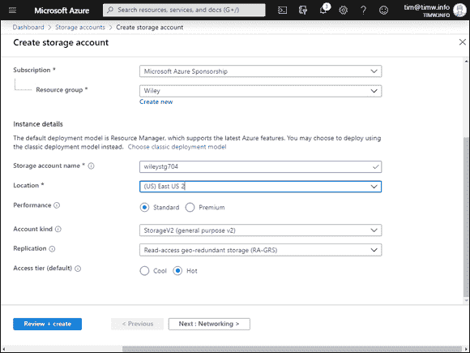

    FIGURE 3-1: Creating a general purpose storage account.

    *   **Storage Account Name（存储账户名称）：** 此名称必须全局唯一，且只能包含小写字母和数字。最大长度为 24 个字符。

    *   **Location（位置）：** 将存储账户放置在最接近需要其资源的用户的位置。

    *   **Performance（性能）：** 标准为低速存储，而高级为高速（且更昂贵）存储。除非您对更可预测的输入/输出性能有需求，否则请选择标准。

    *   **Account Kind（账户类型）：** 您始终应选择“General-purpose v2”（通用 v2）。

    *   **Replication（复制）：** 除非您有更高可用性的业务需求，否则本地冗余存储 (LRS) 是一个很好的起始选择。您稍后随时可以通过访问存储账户的“配置”边栏选项卡来更改决定。

    *   **Access Tier（访问层）**（默认）：访问层选项可能会根据您是频繁访问（热层）还是不频繁访问（冷层）存储账户数据而为您提供价格优惠。本章稍后将详细讨论层级。

5.  **在“网络”页面上，单击“下一步”继续。**

    “网络连接”边栏选项卡允许您为存储账户配置服务终结点，这会将存储账户集成到 Azure 虚拟网络中。我在 Chapter 4 中讨论服务终结点。

6.  **填写“高级”页面上的表单（如 Figure 3-2 所示）：** 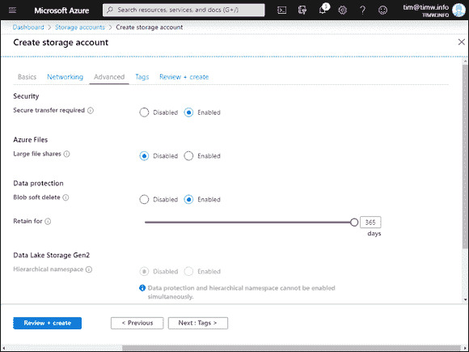

    FIGURE 3-2: Configuring advanced storage account options.

    *   **Secure Transfer Required（需要安全传输）：** 将此选项保留为“Enabled（已启用）”，以确保您使用加密的 HTTPS（而非未加密的 HTTP）来访问存储账户数据。

    *   **Allow Access From（允许从以下位置访问）：** 将此选项保留为“All Networks（所有网络）”。您也可以选择使用服务终结点将存储账户集成到虚拟网络中。

    *   **Blob Soft Delete（Blob 软删除）：** 启用此选项可为已删除的 Blob 对象创建一种回收站。

    *   **Hierarchical Namespace（分层命名空间）：** 将此选项保留为“Disabled（已禁用）”。（我在 Chapter 4 中讨论 Azure Data Lake Storage。）

7.  **在“标记”屏幕上，单击“下一步: 查看 + 创建”。**

    使用分类标记是对相关 Azure 资源进行分类的好方法，但您现在不必担心标记。

8.  **如果验证通过，单击“创建”以将部署提交给 ARM。**

    如果收到验证错误，请检查配置边栏选项卡选项卡；包含错误的选项卡旁边应有一个圆点。

 **请记住：** 如果我提供的过程与您在 Azure 门户中看到的不匹配，请不要惊慌。原因很简单：Microsoft 不断调整门户，更新用户界面并添加或修改服务和设置。重要的是要了解您正在配置的内容。

Figure 3-3 显示了 ARM 部署的详细信息。

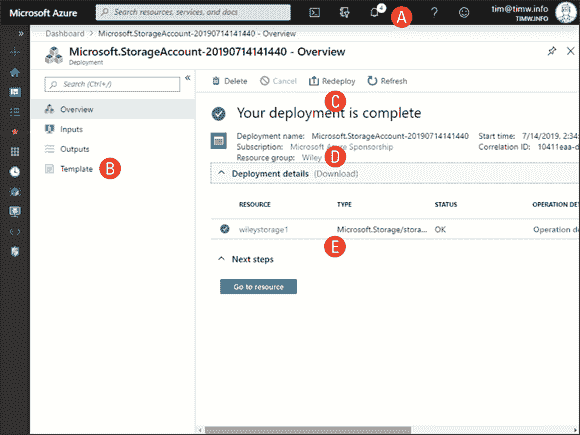

FIGURE 3-3: Watching a Microsoft Azure deployment.

以下是一些需要注意的关键功能：

*   打开“通知”菜单 (A) 以检查当前和最近部署的状态。

*   获取部署的基础 ARM 模板 (B) 访问权限，这对于未来的自动化部署非常有用。

*   **重新部署** 按钮 (C) 在部署失败时非常有用；你可以修复 ARM 模板中的错误，并从中断处继续部署。ARM 这一重要特性称为*幂等性*。

*   你可以打开与部署关联的资源组 (D)，并导航到 **部署** 设置，以查看此部署和其他部署、下载模板定义，等等。

*   这种粒度细致的部署操作列表 (E) 对于排查失败的部署非常有用。

### 使用 Blob 服务

尽管通用存储帐户有四个独立的服务，分别用于不同的数据和对象类型，但本章的大部分内容侧重于 Blob 服务。

我做此选择的原因有二：

*   这是一本入门书籍，而其他三个服务面向更高级的受众。

*   Blob 服务是最常用的 Azure 存储帐户服务。

#### 安装 Azure 存储资源管理器

Azure 存储资源管理器是一款免费、闭源、跨平台的桌面应用程序，可让你与 Azure 存储帐户进行交互。

访问 [`https://azure.microsoft.com/en-us/features/storage-explorer`](https://azure.microsoft.com/en-us/features/storage-explorer/)（或在你常用的搜索引擎中搜索 *Azure 存储资源管理器*），下载该程序并将其安装在计算机上。请遵循以下步骤配置存储资源管理器：

1.  **在“连接到 Azure 存储”对话框中，选择“添加 Azure 帐户”，将 Azure 环境设置为 Azure，然后单击“下一步”。**

    如果首次启动存储资源管理器时未出现该对话框，请单击存储资源管理器边栏上的 **添加帐户** 按钮。（该按钮的图标看起来像一个电源插头。）

2.  **使用你的管理帐户向 Azure 进行身份验证。**

3.  **在“显示来自这些订阅的资源”筛选器中，确保选中了你的目标 Azure 订阅，然后单击“应用”。**

    我管理多个订阅，因此我倾向于仅关注我正在使用的一个（或多个）。

图 3-4 展示了存储资源管理器及以下功能：

*   单击 **资源管理器** 按钮 (A) 以浏览你的存储帐户。

*   单击 **管理帐户** 按钮 (B) 以筛选存储资源管理器在资源管理器视图中显示的订阅。

*   单击 **添加帐户** 按钮 (C) 以同时使用多个 Azure AD 帐户登录。

*   展开通用存储帐户以查看其服务 (D)。导航的工作方式类似于文件传输协议 (FTP) 客户端应用程序。

*   查看当前选中项的属性 (E)。默认情况下，存储帐户为每个服务使用以下公共终结点：

    *   Blob 服务：`https://<storage-acct-name>.blob.core.windows.net/`

    *   文件服务：`https://<storage-acct-name>.file.core.windows.net/`

    *   队列服务：`https://<storage-acct-name>.queue.core.windows.net/`

    *   表服务：`https://<storage-acct-name>.table.core.windows.net/`

*   每个服务都有自己的工具栏 (F)。图 3-4 中显示的 Blob 服务工具栏用于容器和文件上传/下载，而表服务工具栏用于数据导入/导出和查询。

*   此窗格 (G) 让你能够以粒度细致的方式与存储帐户进行交互。

*   **活动** 窗格 (H) 显示来自存储资源管理器的错误、警告和信息消息。

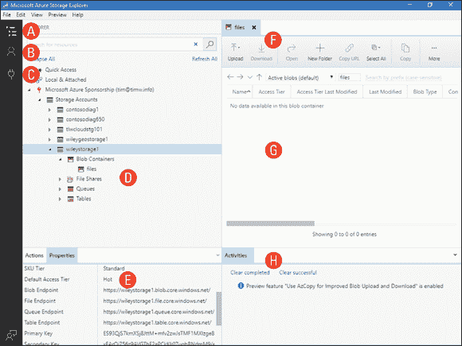

图 3-4： Azure 存储资源管理器。

存储资源管理器也可在 Azure 门户中使用。浏览到你的存储帐户，然后选择 **存储资源管理器** 设置。

#### 上传 Blob

现在该创建一个 Blob 容器并将一些文件上传到 Azure 了。请遵循以下步骤：

1.  **展开你的存储帐户，右键单击 Blob 容器节点，然后从快捷菜单中选择“创建 Blob 容器”。**

    容器的一个直观名称是 `files`。容器的功能类似于计算机文件系统中的目录。

2.  **选择 `files` 容器，然后单击存储帐户工具栏上的 **上传**。**

    你可以将文件拖放到容器中，但我特意在指导上更加……呃，有意图一些。

3.  **向新容器添加一个或多个文件。**

    你可以直接在 Azure 门户中执行文件上传。导航到 **容器** 边栏选项卡，单击进入你的新容器，然后从工具栏单击 **上传**。随后你可以浏览计算机上的文件并将它们添加到 Azure Blob 存储中。

养成在存储资源管理器中右键单击 Blob 以从快捷菜单访问便捷管理选项的习惯是很好的，这些选项包括下载对象和更改其访问层。图 3-5 显示了右键单击 Blob 时看到的快捷菜单。

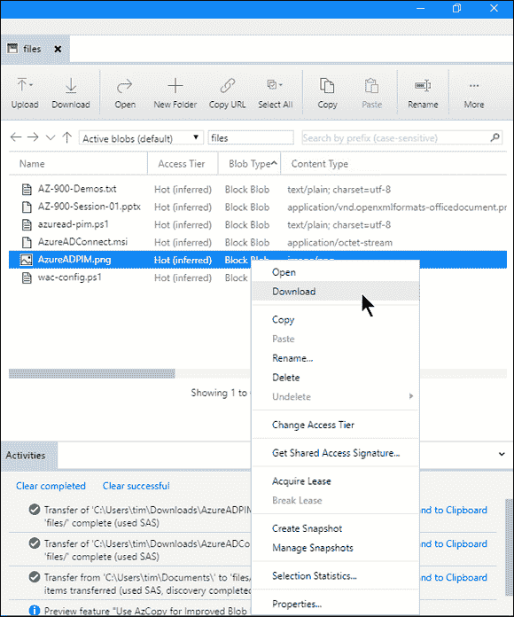

图 3-5： 尝试在 Azure 存储资源管理器中右键单击所有内容，查看有哪些可用选项。

练习使用键盘快捷键（可在 [`https://docs.microsoft.com/en-us/azure/vs-azure-tools-storage-explorer-accessibility#shortcut-keys`](https://docs.microsoft.com/en-us/azure/vs-azure-tools-storage-explorer-accessibility#shortcut-keys) 找到）以及存储资源管理器的菜单和工具栏系统来处理 Blob 的上传、下载和删除。但请务必使用测试文件进行练习，而不要使用生产资源。

#### 更改 Blob 访问层

本节回到 Azure 门户，以便你可以修改 Blob 对象的访问层。首先，了解 Microsoft 如何为标准层存储帐户定价会很有帮助。你需要为以下项目付费：

*   **存储量：** 存储量代表 Blob 服务中的数据量。

*   **REST API 事务：** 每次你与 Blob 服务交互，该交互都会转化为读取、写入、更新或删除 REST API 调用，Microsoft 会对每次调用收费。

*   **数据流出网络流量：** 进入存储帐户的入站（上传或入站）流量不收费，但你需要为出站（下载或出站）数据传输付费。

根据定价方案，更改具有不同使用场景的 Blob 的访问层可能是合理的。你有三个层选项：

*   **热访问层：** 为频繁访问的数据进行优化。你可以获得事务定价折扣。

*   **冷访问层：** 为不常访问且至少存储 30 天的数据进行优化。你可以获得存储占用空间折扣。

*   **归档访问层：** 为极少访问（180 天或更久）的数据进行优化。你可以同时获得存储占用空间和事务成本的折扣。

要修改你上传到 `files` Blob 容器中的某个 Blob 的访问层，请遵循以下步骤：

1.  **在 Azure 门户中，找到你的存储帐户，然后选择 **容器** 设置。**

    你会发现 Azure 门户和 Azure 文档中存在一些不一致之处。存储帐户 **Blob** 服务也称为 **容器**；如果 Microsoft 在你阅读本书时已将服务名称更改为 **容器**，你就会知道原因了。

2.  **浏览到 `files` 容器，选择你的某个 Blob，然后从工具栏单击 **更改层**。**

    当你选择一个 Blob 时，Azure 会显示该 Blob 的所有元数据。

3.  **从 **访问层** 下拉菜单中选择 **归档**，然后单击 **保存** 以确认更改。**

    我在 图 3-6 中展示了该界面。Azure 门户应显示一条消息，告知你将 Blob 标记为 **归档** 会使其无法访问，直到你显式地将其恢复到 **热** 或 **冷** 层。

存档的 Blob 无法访问，除非你将它们移出存档层。Microsoft 将此过程称为“重新激活”。要重新激活存档的 Blob，请重复这些步骤，但选择“冷”或“热”作为 Blob 的新访问层。

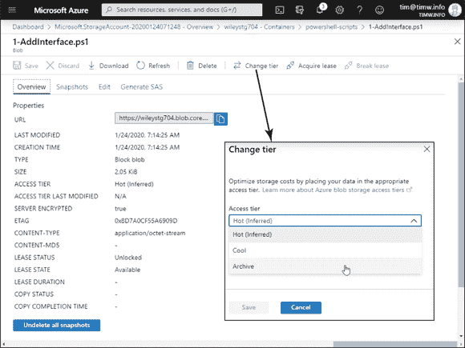

图 3-6： 在 Azure 存储帐户中更改 Blob 的访问层。

### 了解文件、表和队列服务

本节简要介绍其他三种 Azure 存储帐户服务。

#### 文件服务

我认为 Azure 文件服务是一种“瑞士军刀”，拥有众多用例。首先，你可以将 Cloud Shell 主文件夹环境存储在文件共享中。要开始使用 Cloud Shell，请执行以下步骤：

1.  **在 Azure 门户顶部导航栏上，单击 Cloud Shell。**

2.  **在“你没有装载存储”对话框中，验证你的 Azure 订阅，然后单击“显示高级设置”。**

3.  **指定云驱动器设置。**

    你可以随意重用现有的存储帐户。创建一个名称直观的文件共享，例如 cloud-drive。（**注意：** 文件共享名称中不允许包含空格。）

4.  **单击“创建存储”以继续。**

5.  **Cloud Shell 加载后，确保你处于 PowerShell 环境中。**

    如果你不在 PowerShell 环境中，请打开会话菜单并进行更改。会话菜单是工具栏上的第一个按钮；它是一个下拉列表，包含两个条目：PowerShell 和 Bash。

6.  **运行命令 `Get-CloudDrive`。**

    此命令显示你的 Cloud Shell 云驱动器所在的存储帐户和文件共享。

7.  **在 Cloud Shell 工具栏上，单击“上传/下载文件”按钮，然后从下拉列表中选择“管理文件共享”。**


单击“上传”按钮（请参阅图 3-7）以上传脚本文件、网页和其他项目构件，然后通过 Cloud Shell 从世界任何地方访问它们。

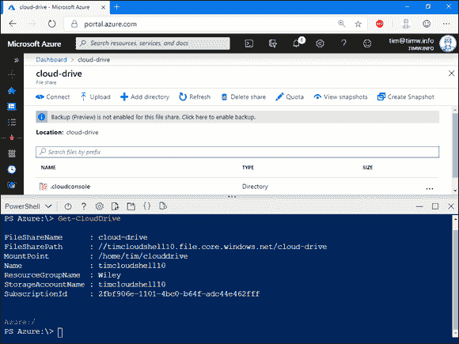

图 3-7： Azure Cloud Shell 和你的个人云共享。

#### 表服务

Azure 存储帐户表存储服务是一种 NoSQL 键值存储，用于表示半结构化数据。正如我在本章前面提到的，许多开发人员喜欢针对表存储进行编程，因为它易于使用、速度快、可扩展且具有成本效益。

许多 Azure 开发人员喜欢表服务，因为它是一种快速、可扩展、低成本的方法，可用于临时或永久地存储应用程序数据。

Azure 表存储旨在实现单个区域内的大容量 NoSQL 存储。如果你正在寻找异地复制和全球规模，请查看 Azure Cosmos DB 表 API。有关详细信息，请访问 [`https://docs.microsoft.com/en-us/azure/cosmos-db/table-introduction`](https://docs.microsoft.com/en-us/azure/cosmos-db/table-introduction)。

#### 队列服务

如果你不是软件开发人员，消息队列的概念可能对你来说很陌生。其理念是：如果你已将应用程序分离为模块化服务（即所谓的*微服务*软件架构），则需要一种机制，使这些服务能够异步发送和接收消息数据。

从本质上讲，队列存储是一个快速、可扩展但相对简单的消息传递平台。如果开发人员需要更高级的功能（更高的规模、有保证的消息传递、事务支持等），请让他们参考存储队列服务的“大兄弟”Azure Service Bus。

## Azure 磁盘存储简介

在 Microsoft 推出托管磁盘之前，VM 虚拟硬盘 (VHD) 是在存储帐户的 Blob 服务中使用的。这种安排并不理想，原因有很多：

*   将 VHD 与其他随机 Blob 混合在一起使得组织管理更加困难。
*   管理员在清理 Blob 存储容器时，很容易意外删除 VM 磁盘。
*   可以向 Blob 容器授予匿名公共访问权限。如果容器存储 VM VHD，则会产生潜在的灾难性安全问题。
*   存储帐户具有固定的请求速率，即每秒 20,000 次输入/输出操作。如果你在单个存储帐户中放入太多 VHD，VM 性能将受到严重影响。

使用托管磁盘，你的 VM 操作系统和数据磁盘由 Microsoft 存储和维护。你可以随意处理你的 VHD，但不必处理基于存储帐户的存储所涉及的麻烦。

在托管磁盘出现之前，VM 磁盘存储在通用存储帐户中。这会导致各种潜在的危险结果。例如，我曾经有位同事允许对包含静态网站资产和 Azure VM 磁盘的存储帐户 Blob 容器进行匿名公共访问！

为了演示如何使用托管磁盘，请执行以下步骤，使用 Azure Cloud Shell 和 Azure CLI 创建资源组和 VM。此处不必担心 VM 细节；我将在本书的第 5 章中深入探讨 VM 的护理和维护。

1.  **在 Azure 门户中，打开 Cloud Shell。**

    对于本练习，无论你处于 Bash 还是 PowerShell 环境都无关紧要。

2.  **使用 Azure 命令行界面 (CLI) 创建新的资源组。**

    你不必使用与我相同的名称和区域。发挥创意。不必担心成本，因为你只是为练习设置此环境。用完后，你可以将其删除。代码如下：

    `az group create --name SimpleVM --location eastus`

    如果看到 Azure CLI 以 JSON (JavaScript Object Notation) 格式输出，不要感到惊讶，这是默认输出格式。

    运行 `az configure` 以更改 Azure CLI 默认值，包括将表指定为默认输出格式。

3.  **运行 `az vm create` 以快速创建 Windows Server 2016 VM。**

    通常我不推荐此方法，因为 Azure CLI 不提供任何管理灵活性。但就本步骤而言，这没问题。

    在以下代码中，`myPassword` 是占位符；请改用你自己的强密码。此外，请在一行中输入以下命令，并忽略我的反斜杠。反斜杠是视觉指示符，表明该命令已被拆分为多行以便于阅读：

    ```
    az vm create \
    --resource-group SimpleVM \
    --name WindowsVM \
    --image win2016datacenter \
    --admin-username azureuser \
    --admin-password myPassword
    ```

4.  **部署完成后，导航到“磁盘”边栏选项卡。**

    一个快速的方法是在 Azure 门户的全局搜索框中键入**磁盘**。

5.  **在列表中选择你的磁盘，并检查其属性。**

    图 3-8 显示了你在 Azure 门户的“磁盘”边栏选项卡中可以对 VM 磁盘执行的一些很酷的操作：

    *   设置帐户类型 (A)。有点令人惊讶的是，此处的快速创建操作选择了更昂贵但性能更高的高级 SSD 选项。
    *   将 VHD 下载到计算机 (B)。
    *   查看、部署或下载底层 ARM 模板 (C)。
    *   创建磁盘的备份副本 (D)。

对于大多数 VM 磁盘活动，关联的 VM 必须处于停止并解除分配状态。如果你需要在生产 VM 上执行 VHD 配置，请记住此要求。

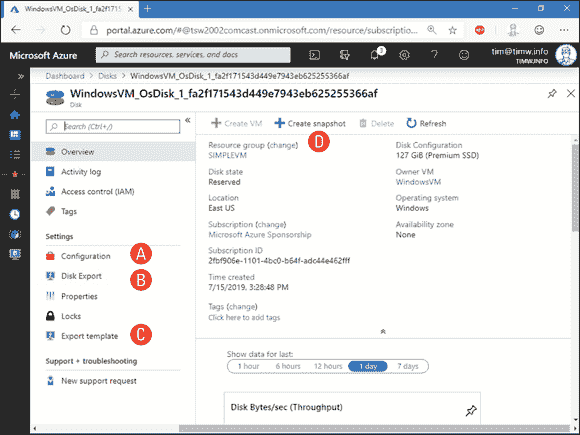

图 3-8： 在 Azure 中为 VM 使用托管磁盘存储。

# 第 4 章：规划虚拟网络拓扑

本章内容

 **区分 Azure 的虚拟网络构建基块**

## 部署和配置虚拟网络

### 连接虚拟网络

几年前，微软的人告诉我，网络是 Azure 中排名第一的支持请求。对我来说，这至少有两个原因是讲得通的：

*   以太网和 TCP/IP 互联网络是一个复杂的主题，其深度足以支撑整个职业生涯。
*   Azure 云中的软件定义网络与本地硬件网络截然不同。
*   在 Azure 网络中犯错的成本和后果很高。

在本章中，我将为 Azure 网络奠定基础。我将讨论虚拟网络，它构成了一个边界，你可以在其中放置虚拟机 (VM) 和其他潜在的 Azure 服务。

### 了解虚拟网络组件

*虚拟网络* (VNet) 是 Azure 中强大的隔离和通信边界。一个常见的初学者错误是将 VM 放置在单独的 VNet 上，并期望它们之间默认可以通信 —— 因为，比如说，这些 VNet 位于同一个 Azure 区域和订阅中。

并非如此！虽然单个 VNet 内的 VM 默认可以正常通信（当然，防火墙拒绝规则除外），但在没有额外管理干预的情况下，VNet 之间无法进行直接通信。

目前，我将通过解释此类网络的各种组件来开始 VNet 讨论。

#### 地址空间

*地址空间* 是你为 VNet 定义的顶级私有 IPv4（互联网协议版本 4）地址范围。微软的最佳实践指导是确保你的 VNet 之间或你的本地网络之间没有 IP 地址重叠。

VNet 内的所有网络通信仅在 Azure 中进行；因此，你的地址空间必须来自 RFC 1918（征求意见稿 1918）中定义的私有、不可路由 IPv4 地址范围：

*   `10.0.0.0–10.255.255.255` (/8 前缀)
*   `172.16.0.0–172.31.255.255` (/12 前缀)
*   `192.168.0.0–192.168.255.255` (/16 前缀)

 要详细了解私有 IP 地址范围，请阅读 RFC 1918 源文档：[`https://tools.ietf.org/html/rfc1918`](https://tools.ietf.org/html/rfc1918)。

#### 子网

除非并直到你定义一个或多个子网，否则你的 VNet 地址空间毫无价值。子网的酷之处在于，Azure 系统路由会负责在单个 VNet 的子网之间引导流量。不需要路由器。

最常见的架构模式是将每个应用层放在其自己的子网中 —— 也许一个子网用于 Web 前端层，一个用于业务逻辑层，一个用于数据层。这样，你可以更轻松地雕琢流量规则，因为每个子网上的 VM 具有相同的网络流量要求。

Azure 始终会从每个子网中保留五个 IP 地址供自己使用。假设你创建一个使用地址 `192.168.10.0/24` 的子网。会发生以下情况：

*   `192.168.10.0` 被保留，因为它是子网的网络 ID。
*   `192.168.10.1` 到 `192.168.10.3` 保留供 Azure 专用。
*   `192.168.10.4` 是子网中第一个可用的 IP 地址，由 Azure 的动态主机配置协议分发。
*   `192.168.10.255` 为协议一致性而保留。

 Azure 是一项计量服务，每项服务都有预定义的容量限制。在单个区域中的单个订阅内，你最多可以定义 1,000 个 VNet 和每个虚拟网络 3,000 个子网。乍一看，这些容量似乎高得离谱。然而，总会有那么一天你会遇到这些服务限制，我不希望你感到惊讶。有关更多详细信息，请访问 Azure 文档文章“Azure 订阅和服务限制、配额和约束”：[`https://docs.microsoft.com/en-us/azure/azure-subscription-service-limits`](https://docs.microsoft.com/en-us/azure/azure-subscription-service-limits)。

### 创建虚拟网络

图 4-1 显示了本章中部署的环境。

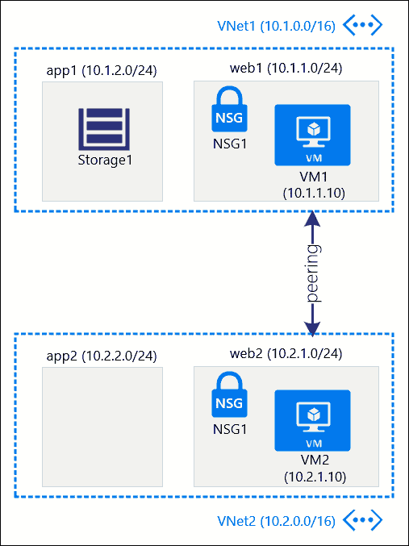

图 4-1： 本章中使用的 Azure 虚拟网络基础设施。

该拓扑具有以下显著特征：

*   VNet 被划分为两个子网，以反映常见的应用层。
*   每个 VNet 受单个网络安全组 (NSG) 保护。
*   服务终结点将存储帐户链接到 VNet。
*   VNet 对等互连在逻辑上连接 VNet1 和 VNet2。

#### 使用 Azure 门户部署

当你使用管理帐户登录 Azure 门户时，请遵循以下步骤部署你的第一个 Azure 虚拟网络：

1.  **创建新资源组或添加到现有资源组。**
2.  **使用 Azure 门户中的全局搜索栏浏览到“虚拟网络”边栏选项卡。**
3.  **单击“添加”。**
4.  **填写“创建虚拟网络配置”边栏选项卡，然后单击“创建”以提交部署。**

    为练习，请使用以下值：

    *   *名称：* `VNet1`
    *   *地址空间：* `10.2.0.0/16`
    *   *订阅：* `[你的订阅]`
    *   *资源组：* `Wiley`
    *   *位置：* 离你最近的 Azure 区域。（这些示例使用美国东部 2。）
    *   *子网名称：* `web1`（Azure 始终将默认子网命名为“default”；你要更改其名称以使其更具描述性。）
    *   *子网地址范围：* `10.2.1.0/24`
    *   *DDoS 保护：* 基本
    *   *服务终结点：* 已禁用
    *   *防火墙：* 已禁用

你可以在 图 4-2 中看到我完成的配置边栏选项卡。

Azure 部署新 VNet 后，你需要重新访问其配置设置以定义第二个子网。请遵循以下步骤来实现该目标：

1.  **导航到 VNet1 配置边栏选项卡。**
2.  **在 VNet 的“设置”列表中，选择“子网”；然后单击“子网”按钮。**
3.  **填写“添加子网”边栏选项卡上的表单，然后单击“创建”以完成配置。**

    使用以下值：

    *   *名称：* `app1`
    *   *地址范围：* `10.1.2.0/24`
    *   *网络安全组：* 无
    *   *路由表：* 无
    *   *服务终结点服务：* 0 个已选
    *   *将子网委托给服务：* 无

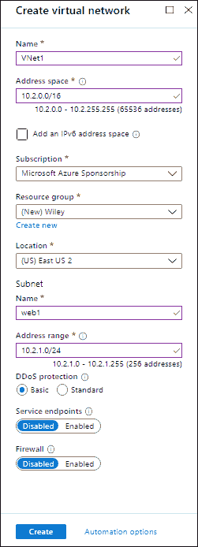

图 4-2： 完成的虚拟网络配置。

软件定义网络可能变得抽象且难以设想。在 VNet1 设置列表中，单击“关系图”，如 图 4-3 所示。Azure 会创建一个矢量图来描绘你的虚拟网络；单击图形中的元素会转到该资源的设置。

我发现这些图表对于弄清我的 VNet 布局非常有价值。更酷的是，你可以

*   正如我之前提到的，在 Azure 门户中单击关系图中的任何形状以转到其配置边栏选项卡。
*   单击“下载拓扑”以下载可缩放矢量图形 (SVG) 格式的图像，用于你的架构文档。

 如果你没有 Microsoft Visio 许可证，请考虑获取一个。Visio 使创建 Azure 关系图变得简单。我强烈建议从事 Azure 相关工作的任何人投资 Visio，以便更轻松地可视化基于云的资源。

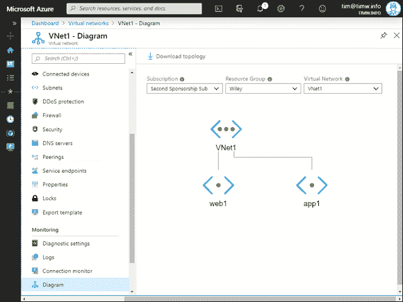

图 4-3： Azure 为你生成很酷的网络关系图。

具体而言，将 VNet 拓扑图像导入 Visio，右键单击它，然后从 Visio 的快捷菜单中选择“组合”⇒“取消组合”。现在你可以访问所有形状。你还应该在 [`https://www.microsoft.com/en-us/download/details.aspx?id=41937`](https://www.microsoft.com/en-us/download/details.aspx?id=41937) 下载 Azure Visio 形状库。

#### 使用 PowerShell 部署

你可以使用 Cloud Shell 和 PowerShell 部署第二个 VNet。由于本页版面空间有限，我已将以下步骤中的代码拆分为多行，但你应将代码作为单行输入。我使用了反引号（`` ` ``）作为行继续字符，以使 PowerShell 代码更易于理解，但你不应在 Cloud Shell 中添加它。请遵循以下步骤部署 VNet：

1. **在 Azure 门户中，单击 Cloud Shell 以打开 Cloud Shell 会话。**

   如果会话在 Bash 中打开，请使用 Cloud Shell 的下拉菜单切换到 PowerShell。

   如果你有多个订阅，可能需要运行 `Set-AzContext` 以确保你专注于正确的订阅。如果你只有一个订阅，则可以直接继续。

2. **输入以下代码以运行 `New-AzVirtualNetwork` 并定义 VNet：**

   ```
   New-AzVirtualNetwork `
   -ResourceGroupName Wiley `
   -Location EastUS2 `
   -Name VNet2 `
   -AddressPrefix 10.3.0.0/16
   ```

   注意我的代码中的反引号（`）字符。这不是单引号，而是键盘上 Tab 键上方的键。在 PowerShell 中，你可以使用反引号将代码行继续到下一行。我在这里这样做只是为了让代码在页面上保持可读；如果你不介意代码行在 Cloud Shell 中变长，则可以省略它们。

3. **运行 `Add-AzVirtualNetworkSubnetConfig` 以定义 web2 和 app2 子网。**

   PowerShell 中的变量以美元符号开头。代码如下：

   ```
   $subnetConfig1 = Add-AzVirtualNetworkSubnetConfig `
   -Name web2 `
   -AddressPrefix 10.3.1.0/24 `
   -VirtualNetwork 'VNet2'
   $subnetConfig2 = Add-AzVirtualNetworkSubnetConfig `
   -Name app2 `
   -AddressPrefix 10.3.2.0/24 `
   -VirtualNetwork 'VNet2'
   ```

4. **使用 PowerShell 管道和 `Set-AzVirtualNetwork` 命令提交配置。**

   PowerShell 管道允许你将一个命令的输出传递给后续命令。代码如下：

   ```
   $subnetConfig1 | Set-AzVirtualNetwork
   $subnetConfig2 | Set-AzVirtualNetwork
   ```

 以编程方式执行 Azure 部署被认为比在 Azure 门户中操作更高效的一个原因是，你可以指定部署的各个方面。在前面的示例中，两个子网是同时定义的。Azure 门户表单仅允许你指定第一个子网。

### 配置虚拟网络

到目前为止，本章已为未来的 VM 和 Azure 服务互联奠定了基础。在填充 VNet 之前，你需要进行一些调整，以确保其按你期望的方式运行。

#### 确定名称解析策略

默认在 VNet 中启用的 Azure 提供的名称解析，可确保你的 VM 既可以通过短主机名，也可以通过 IP 地址进行通信。然而，一些企业面临的问题是，他们希望其云 VM 使用自定义 DNS 域名（例如 company.com）。


如果你需要不同 VNet 中的 VM 解析彼此的主机名，或者想要为云 VM 使用自定义的完全限定域名，则需要配置自定义名称解析。例如，你可以执行以下任一操作：

* 部署专用 Azure 域名系统 (DNS) 区域，并将该区域链接到这两个子网。
* 在每个 VNet 中部署 DNS 服务器 VM，并将它们配置为将名称解析查询相互转发。

在你的 VNet 中，浏览到 DNS 服务器设置。你应该会看到默认（Azure 提供的）设置。如果你需要重写 DNS，请选择“自定义”，然后提供一个或多个自定义 DNS 服务器 IPv4 地址。这些地址可能指向：

* 本地 DNS 服务器（如果你在混合云中运行）
* 在本地 VNet 中运行的 DNS 服务器 VM
* Azure 提供的虚拟 IP 地址 (`168.63.129.16`)

 `168.63.129.16` 是一个值得了解的 IP 地址，因为如果使用规定的自定义 DNS 服务器列表进行递归名称查找失败，你可能希望 VM 回退到 Azure 提供的 DNS。

 切勿尝试从 Azure 中 VM 内部配置 TCP/IP 属性。如果这样做，你将立即失去与 VM 的网络连接。请记住，你处理的是基于云的软件定义网络，而不是本地物理或虚拟服务器。你需要在 Azure 资源管理器 (ARM) 中执行所有 VM 网络配置，无论你使用 Azure 门户、PowerShell 还是 Azure 命令行接口 (CLI)。

### 配置网络安全组

NSG 是可与 VM 虚拟网络接口卡和/或 VNet 子网关联的流量筛选器。我建议将 NSG 与子网关联，以减少未来的故障排除工作量，并同时将相同的入站和出站流量规则应用到多个 VM。

NSG 由一条或多条访问规则组成，这些规则具有以下属性：

* **优先级：** 较低的优先级值会最先被评估。当你添加规则时，请务必在它们之间留出空间，以便为未来的增长留出余地。
* **名称：** 我建议你尽可能用描述性的方式命名 NSG 规则（例如 `HTTP-in-Allow`）。
* **端口：** 此属性是传输控制协议 (TCP) 或用户数据报协议 (UDP) 端口分配。
* **协议：** 此属性是 TCP、UDP 或两者皆有。
* **源：** 此属性是流量流的来源。
* **目标：** 此属性是流量流的去向。
* **操作：** 此属性是“允许”或“拒绝”。

NSG 根据流量方向，将每个流量流通过其入站或出站规则列表。适用的第一条规则将成为生效规则。除非你有一条捕获所有未分类流量并予以拒绝的“全捕获”规则，否则你会留下不想要的连接类型的可能性，这可能会危及 VM 的安全性。

表 4-1 和表 4-2 总结了 NSG 的默认入站和出站规则。

**表 4-1** 默认入站安全规则

| 规则 | 说明 |
| --- | --- |
| `AllowVnetInBound` | 允许源自该 VNet 及任何对等 VNet 的入站流量 |
| `AllowAzureLoadBalancerInBound` | 允许来自任何 Azure 负载均衡器 IP 地址的入站运行状况探测流量 |
| `DenyAllInBound` | 捕获所有规则，确保任何未被前一条规则捕获的入站流量均被拒绝 |

**表 4-2** 默认出站安全规则

| 规则 | 说明 |
| --- | --- |
| `AllowVnetOutBound` | 允许从该 VNet 发出的出站流量及发往任何对等 VNet 的流量 |
| `AllowInternetBound` | 允许 VM 从 VNet 内部访问公共 Internet |
| `DenyAllOutBound` | 捕获所有规则，确保任何未被前一条规则捕获的出站流量均被拒绝 |

 虽然 Microsoft 为你的方便创建了默认的入站和出站 NSG 安全规则，但你没有义务使用它们。我认为它们过于宽松，因此我会手动创建 `DenyAllInbound` 和 `DenyAllOutBound` 规则，而不使用其他默认规则。

本章前面的图 4-1 中所示的 VNet 包含用于筛选流量的 NSG1，并包含默认的入站和出站规则。

 因为 VNet2 具有相同的访问要求，所以将 NSG1 与这两个子网关联。

要创建 NSG 并允许入站 HTTP 流量（TCP 端口 80），请执行以下步骤：

#### 创建 NSG

1. 使用 Azure 门户的全局搜索查找 **Network Security Groups** 边栏选项卡；然后单击工具栏上的 **Add**。

     不要选择 **Network Security Groups (Classic)** 选项。本书的重点是 ARM。

2. 填写 **Create Network Security Group** 边栏选项卡上的表单，然后单击 **Create**。

    使用以下属性：

    * **Name:** `NSG1`
    * **Subscription:** `[your subscription]`
    * **Resource Group:** `Wiley`
    * **Location:** `East US 2`（使用你的主区域；这些示例使用的是我的）

#### 配置入站安全规则

3. 部署完成后，选择你的 NSG，并在 Settings 列表中浏览到 **Inbound Security Rules** 设置。

    请注意，入站和出站安全规则有单独的设置。**Default Rules** 按钮切换它们的状态。对于此练习，请保持两个设置都处于启用状态。

4. 单击 **Add**。

5. 填写 **Add Inbound Security Rule** 边栏选项卡上的表单，然后单击 **Create**。

    默认情况下，Azure 会将你置于 **Advanced** 视图中，这正是你想要的位置。（如果你愿意，单击 **Basic** 查看简化视图。）

    对 `NSG1` 使用以下配置属性：

    * **Source:** `Service Tag`, `Internet`。
        源可以是 IP 地址或地址范围的逗号分隔列表、服务标记或应用程序安全组。目前，请理解此规则适用于源自公共 Internet 的入站流量。
    * **Source Port Ranges:** `Any`（用星号表示）
    * **Destination:** `VirtualNetwork`（服务标记来救场）
    * **Destination Port Ranges:** `80`
    * **Protocol:** `TCP`
    * **Action:** `Allow`
    * **Priority:** `100`
    * **Name:** `HTTP-In-Allow`
    * **Description:** （如果想要可添加）

#### 配置出站安全规则

6. 为 `NSG1` 创建一个新的**出站**（我重复：出站）安全规则。

    此规则允许从 `web1` 子网流向你将放置在 `app1` 子网上的存储帐户的流量。

    使用以下属性：

    * **Source:** `Virtual Network`
    * **Source Port Ranges:** `Any`
    * **Destination:** `Service tag`, `Storage`
    * **Destination Port Ranges:** `Any`
    * **Protocol:** `Any`
    * **Action:** `Allow`
    * **Priority:** `100`
    * **Name:** `Storage-Out-Allow`
    * **Description:** （如果想要可填写）

Figure 4-4 显示了我在 MSG1 Overview 页面上完成的 `NSG1` 配置。

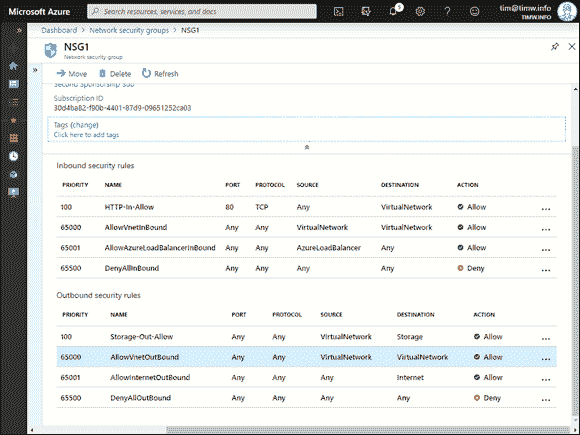

FIGURE 4-4: NSG1 configuration.

#### 添加服务标记和应用程序安全组

**Service tags**（服务标记）是聚合 IP 地址前缀池的标签，使编写准确的 NSG 规则变得更加容易。一些常见的服务标记包括：

* **VirtualNetwork:** 所有虚拟网络地址空间，包括本地和对等互连的 VNet
* **Internet:** 所有公共 IP 地址，包括 Azure 拥有的和公共的
* **AzureLoadBalancer:** 你部署的 Azure 负载均衡器的虚拟 IP 地址
* **AzureCloud:** Azure 公共 IP 地址空间
* **Storage:** Azure 存储服务的 IP 地址范围

**Application security groups (ASGs)**（应用程序安全组）实际上是用户创建的服务标记。通过它们，你可以按管理员定义的方式对资源进行分组，以简化 NSG 规则分配。例如，你可能会创建一个名为 `web-servers` 的 ASG，应用于部署中的 Web 服务器 VM。

 遗憾的是，使用默认入站和出站规则是一个全有或全无的选择：你无法有选择地删除单个默认入站或出站规则。因此，你应该计划重新创建所需的规则，而不是使用默认规则。

 有关 ASG 的更多信息，请阅读 Azure 文档文章“Security Groups”，网址为 [`https://docs.microsoft.com/en-us/azure/virtual-network/security-overview`](https://docs.microsoft.com/en-us/azure/virtual-network/security-overview)。

#### 将 NSG 与相应子网关联

按照以下步骤将新的 NSG 与 `VNet1` 上的 `web1` 子网和 `VNet2` 上的 `web2` 子网链接：

1. 在 **NSG1 Configuration** 边栏选项卡上，选择 **Subnets**。
2. 在 **Subnets** 边栏选项卡上，单击 **Associate**。
3. 在 **Associate subnets** 边栏选项卡上，选择适当的虚拟网络和子网。
    你需要完成此过程两次：一次用于 `VNet1`/`web1`，一次用于 `VNet2`/`web2`。

### 理解服务终结点

**Service endpoints**（服务终结点）通过将某些 Azure 服务的连接限制在虚拟网络内来保护这些服务。你可能有一个包含敏感数据的存储帐户，该数据应仅由位于特定 VNet 上的 VM 访问。在这种情况下，在适当的虚拟网络上为该服务帐户创建服务终结点即可实现你的目标。

其他可以通过服务终结点绑定到 VNet 的 Azure 产品包括 SQL Database、Cosmos DB、Key Vault 和 App Service。

本节将引导你完成配置。要在 `Vnet1` 的 `app1` 子网上创建 `Microsoft.Storage` 服务终结点，请执行以下步骤：

1. 在 Azure 门户中，浏览到 `VNet1`，然后选择 **Service Endpoints** 设置。
2. 在工具栏上，单击 **Add**。
3. 在 **Add Service Endpoints** 边栏选项卡上，选择 `Microsoft.Storage` 作为服务，选择 `app1` 作为子网；然后单击 **Add** 完成配置。
    你的工作还没有完成：你需要将存储帐户与 `app1` 子网关联。你看，在 VNet 上定义服务终结点为将存储帐户集成到网络中打开了可能性。接下来你需要转到存储帐户以完成配置。
    在这种情况下，你可以忽略服务终结点策略，因为截至撰写本文时，它是一个公共预览功能，没有关联的服务级别协议 (SLA)。服务终结点策略允许你更精细地筛选发往 Azure 服务的 VNet 流量。
4. 打开 **Storage Explorer**，确保你可以连接到存储帐户。
    如果你在 Chapter 3 中创建了存储帐户，可以使用该存储帐户。你应该能够访问文件的 blob 容器以及其中的 blob。
5. 回到 Azure 门户，浏览到 `VNet1` 资源，然后选择 **Service Endpoints** 设置。
6. 从 `Microsoft.Storage` 的上下文菜单（即行尾的省略号；我在 **Figure 4-5** 中向你展示了这一点），选择 **Configure Virtual Networks in a storage account**。

    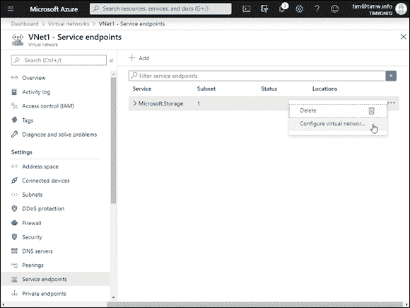

    FIGURE 4-5: In the Azure portal, most resources have a context menu from which you can select configuration options.

7. 在 **Storage Accounts** 边栏选项卡上，选择你的存储帐户和 **Firewalls and Virtual Networks** 设置。
8. 在 **Allow Access From** 部分，选择 **Selected Networks**。
9. 在 **Virtual Networks** 部分，选择 **Add Existing Virtual Network**。
10. 浏览到 `VNet1` 虚拟网络和 `app1` 子网，然后单击 **Add**。
11. 单击 **Save** 完成配置。
     启用服务终结点后，存储帐户的 **Firewalls and Virtual Networks** 边栏选项卡包含一些其他选项：
     * **Add Your Client IP Address:** 如果不选择此选项，你将无法从当前工作站访问存储帐户。
     * **Allow Trusted Microsoft Services to Access This Storage Account:** 启用此选项以确保其他 Azure 服务（如 Key Vault、Azure AD 等）可以访问存储帐户，反之亦然。
12. 关闭并重新打开 **Storage Explorer**。
13. 测试与存储帐户的连接。
     你应该会看到 Figure 4-6 中显示的错误消息。

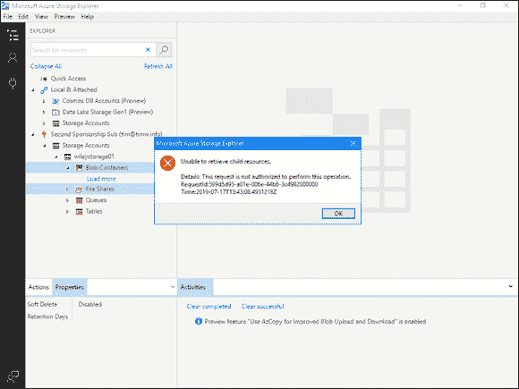

图 4-6： 服务终结点将 Azure 资源保护到特定虚拟网络。

### 连接虚拟网络

以下是将两个 VNet 进行逻辑链接以支持需要此功能的拓扑的两种方式：

* 支持 VNet 间通信的生产/开发 VNet
* 中心辐射型 VNet 架构，其中心 VNet 具有到本地环境的链接

Azure 为我们提供了两种链接 VNet 的选项，我将在下文中进行描述。

#### 配置 VNet 对等互连

VNet 对等互连是无缝连接两个 Azure 虚拟网络的一种方式。直到 2018 年底，连接位于不同区域的 VNet 需要虚拟网络网关和 VNet 到 VNet 的虚拟专用网络 (VPN)。如今，不同区域甚至不同 Azure 订阅中的 VNet 都可以进行对等互连。

跨 VNet 对等互连的网络流量是私有的，通过 Azure 网络骨干网发生并使用专用 IP 地址。对等互连不需要 VPN 费用或开销，尽管如果您的安全需求要求，您可以部署 VNet 到 VNet 的 VPN。但是，您可以从仅一个 VNet 的角度配对等互连的双方。

请遵循以下步骤在您的 VNet1 和 VNet2 虚拟网络之间配置 VNet 对等互连：

1. **在 Azure 门户中，浏览到 VNet1，选择“对等互连”设置，然后单击“添加”。**
2. **填写“添加对等互连”边栏选项卡上的表单，然后单击“确定”。**
    使用以下配置属性：
    * *从 VNet1 到远程虚拟网络的对等互连名称：* `vnet1-to-vnet2-peering`
    * *虚拟网络部署模型：* 资源管理器
    * *订阅：* `[your subscription]`
    * *虚拟网络：* `VNet2`
    * *从远程虚拟网络到 VNet1 的对等互连名称：* `vnet2-to-vnet1-peering`
        (不久前，您还必须在两个 VNet 中分别配置对等互连；现在能在一个配置边栏选项卡中定义双方，真是方便。)
    * *允许虚拟网络访问（双向）：* 已启用
    * *配置转发流量设置（双向）：* 已禁用
    * *允许网关传输：* 未选中
3. **单击“确定”将配置提交给 ARM。**


最终，VNet1 和 VNet2 的“对等互连”边栏选项卡应显示对等互连状态为“已连接”。您现在拥有了一条仅涉及 Azure 的两个 VNet 之间的路由路径——不涉及公共 Internet（或 VPN 连接）。

#### 理解服务链

当您在 Azure 门户中选择一个对等互连时，可以自定义对等互连关系以实现路由目标。例如，您可能有一个必须通过中心 VNet 中转以访问本地环境的辐射 VNet。

您必须知道 VNet 对等互连是**非传递**的。图 4-7 显示了一个常见的中心辐射型 VNet 拓扑。

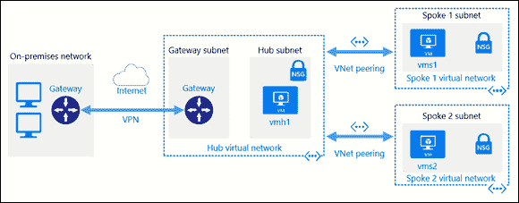

图 4-7：中心辐射型虚拟网络拓扑。

在图中，中心虚拟网络充当 Azure 与企业本地网络环境之间的中转点。（我将在第 13 章中讨论 VPN 和混合云。）

图 4-5 还显示了到辐射 1 和辐射 2 的两个对等互连。非传递性意味着辐射 1 中的 `vms1` 默认无法通过中心直接与辐射 2 中的 `vms2` 通信。要解决此问题，您可以执行以下操作之一：

*   在辐射 1 和辐射 2 之间创建第三个对等互连。
*   配置网络虚拟设备并显式路由流量。

您看懂我的意思了吗？许多企业在 Azure 中需要不止一个虚拟网络，并且通常需要配置它们之间的连接。例如，企业可能使用对等互连来链接开发和生产 VNet。

另一个用例是在中心网络中放置网络虚拟设备（如企业防火墙），并为其他链接的 VNet 中的流量“共享”该设备。严格来说，这就是 Microsoft 所谓的“服务链”。

当您需要控制流量如何在 VNet 内部及 VNet 之间流动时，Azure 中需要路由表。路由表定义一个或多个“下一跳”目标 IP 地址；如果您在本地环境中使用过静态 IP 路由，则 Azure 路由表应该很容易上手。

请遵循以下步骤创建一个示例路由表，假设 NVA 在专用 IP 地址 `10.1.1.100` 上侦听流量：

1.  **使用 Azure 门户中的全局搜索查找“路由表”边栏选项卡。**
2.  **在“路由表”边栏选项卡上，单击“添加”。**
3.  **填写“创建路由表”边栏选项卡上的表单，然后单击“创建”。**

    请使用以下属性：

    *   *名称：* `nva-next-hop`
    *   *订阅、资源组、位置：* 使用您迄今为止一直使用的值
    *   *虚拟网络网关路由传播：* 已禁用

4.  **选择 `nva-next-hop` 路由表，导航到“路由”边栏选项卡，然后单击“添加”。**
5.  **填写“添加路由”边栏选项卡上的表单，然后单击“确定”提交您的配置。**

    指定以下属性：

    *   *路由名称：* `nva-default-route`
    *   *地址前缀：* `0.0.0.0/0`。

        此特殊 IP 地址范围称为*默认路由*，适用于与此路由表关联的子网的每一位出站流量。

    *   *下一跳类型：* 虚拟设备。

        其他选项包括虚拟网络、Internet 和虚拟网络网关。还记得您学习服务标记和网络安全组时吗？这些标识符也是同样的概念。

    *   *下一跳地址：* `10.1.1.100`

    ARM 的一条提示提醒您在 NVA 上启用 IP 转发。您可以将此转发配置为 NVA 的网络接口卡设置的一个属性。

6.  **将路由表与相应的子网关联。**

    为此，请在路由表的“设置”列表中打开“子网”边栏选项卡，然后选择“关联”。正如本章前面“配置对等互连”一节中的图所示，您需要将新路由表与辐射 1 和辐射 2 子网关联，以强制其出站流量通过位于中心 VNet 中的 NVA。

中心辐射型 VNet 设计模式和服务链并非罕见场景。在我作为 Azure 解决方案架构师的工作中，我一直看到这些拓扑。用户定义的路由表允许您从 Azure 提供的路由（其工作效果足够好）转移到自定义路由，在自定义路由中，您可以精细地控制流量如何在 VNet 内部、VNet 之间以及传输 VNet 与本地网络之间流动。

**请记住** 别忘了您的 NSG 及其入站和出站规则。当您创建更复杂的 VNet 拓扑（如服务链和对等互连）时，极有可能需要调整现有的 NSG 规则和/或创建新规则以适应新的流量流。

# 第 5 章：部署和配置 Azure 虚拟机

## 本章内容

 **规划您在 Azure 中的 VM 部署**

 **部署 Linux 和 Windows Server VM**

 **连接到 Azure VM 并对其进行配置**

 **监视您的 VM**

根据我作为 Azure 解决方案架构师的经验，我发现大多数客户自然会在两种情况下考虑虚拟机 (VM)：

*   将其现有工作负载迁移到 Azure 时
*   将新工作负载直接部署到云中时

作为云顾问，我的一大乐趣是向客户展示他们不必使用 Azure VM。Azure 包含许多出色的平台即服务 (PaaS) 选项，例如 Azure 应用服务和 Azure SQL 数据库，这些选项可以提供地理缩放和快速敏捷性。

如果你需要对环境进行全栈控制，Azure 完全支持 VM。在本章中，我将解释各种 Azure VM 选项，以及如何在 Azure 中部署和配置 Windows Server 和 Linux VM。

## 规划 VM 部署

你可能还记得木匠的格言“三思而后行”，这强调了在投入项目之前进行规划的重要性。对于 Azure VM 部署，你需要深思熟虑，以便第一次就做出正确的决定；否则，你就有删除并重新创建 VM 的风险。

然而，在规划部署之前，你需要了解 VM 在 Azure 中是如何运行的。

### 理解 VM

VM 是计算机的软件表示。每个 Azure 区域由多个数据中心组成；每个数据中心由数千台硬件刀片服务器组成。VM 在这个庞大的计算结构中运行。

每个 VM 都从其父硬件主机分配虚拟硬件资源：

*   计算（CPU [中央处理器] 和 RAM [随机存取存储器]）
*   存储
*   网络

Microsoft 的数据中心服务器运行专用版 Windows Server Core，你的 VM 位于 Microsoft Hyper-V 主机上。相比之下，Amazon Web Services (AWS) 在开源 Xen 管理程序下运行其弹性计算云 VM 实例。

截至撰写本文时，Microsoft Azure VM 服务支持以下 64 位版本：

*   Windows 7
*   Windows 8.1
*   Windows 10
*   Windows Server 2008 R2
*   Windows Server 2012 R2
*   Windows Server 2016
*   Windows Server 2019

Microsoft 仅出于开发目的支持 Azure 中的 Windows 客户端 VM 映像。其理念是开发人员可以部署 Windows 客户端 VM，将其用作针对基于云的业务线应用程序的测试代理。

Azure 还支持以下认可的 64 位 Linux 发行版：

*   CentOS
*   CoreOS
*   Debian
*   OpenSUSE
*   Oracle Linux
*   Red Hat Enterprise Linux
*   SUSE Enterprise Linux
*   Ubuntu

### 从 Azure 市场开始 VM 部署

在 Azure 中部署 VM 的最快方法可能是从 Azure 市场进行部署。Azure 市场是一个在线集市，包含数千个 Microsoft 和非 Microsoft VM 映像，包括本章前面所述的所有裸操作系统 (OS) 映像。图 5-1 显示了 Azure 市场。

你可以通过在 Azure 门户的全局搜索框中输入 `marketplace` 来访问 Azure 市场。

### 从本地环境开始 VM 部署

在第 13 章中，我将解释如何使用 Azure Migrate 将本地物理服务器和虚拟服务器迁移到 Azure。话虽如此，你始终可以将通用的 OS 映像上传到 Azure。为此，你需要一个快速的 Internet 连接或到 Azure 云的专用连接；仅此而已。

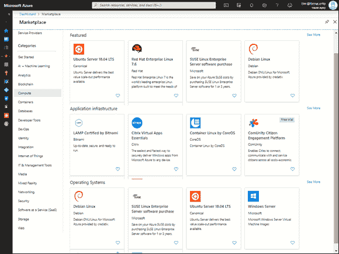

图 5-1：Azure 市场是多种 VM 类型的一站式商店。

我在此提供的说明仅供参考，并不全面。请查阅 Azure 文档，以获取关于准备本地 Linux 和 Windows Server VM 以上传到 Azure 的完整分步指导。

以下是常规工作流：

1.  **准备 VM 磁盘以上传到 Azure。**

    如果你的本地 VM 不是 Hyper-V，则需要使用适当的工具进行转换。虽然 Azure 支持 Hyper-V 第 2 代虚拟硬盘 (VHD)，但磁盘必须采用 `.vhd` 格式（而非 `.vhdx`）才能在 Azure 中工作。

    要将 `.vhdx` 虚拟磁盘转换为固定大小的 `.vhd`，可以在本地 Hyper-V 主机上运行 `Convert-VHD` PowerShell cmdlet，如下所示：

    ```
    Convert-VHD –Path d:\dev\vm1-gen2.vhdx –DestinationPath d:\dev\vm1-gen1.vhd -VHDType Fixed
    ```

    顺便说一下，PowerShell 命令通常称为“cmdlet”，发音为 *command-lets*。

    另请注意，你的 OS VHD 必须是通用的。通用化会从 VM 磁盘映像中删除所有唯一信息，包括安全标识符、静态 IP 地址、主机名等。在 Windows Server 中，你可以使用内置的 Sysprep 实用程序。

2.  **将通用的 OS 映像上传到 Azure 存储帐户的 Blob 服务。**

    有关使用存储帐户和 Azure 存储资源管理器工具的更多信息，请参阅第 3 章。

3.  **使用 Azure PowerShell 将上传的 VHD 添加到 Azure 托管存储服务，步骤如下。**

    1.  *定义一些变量以使代码更整洁：*

        ```
        $vmName = "vm1"
        $rgName = "myResourceGroup"
        $location = "EastUS"
        $imageName = "myImage"
        $osVhdUri = "https://mystorageaccount.blob.core.windows.net/vhds/vm1-gen1.vhd"
        ```

    2.  *创建 Microsoft 所谓的*托管映像*：*

        ```
        $imageConfig = New-AzImageConfig -Location $location
        $imageConfig = Set-AzImageOsDisk -Image $imageConfig -OsType Windows -OsState Generalized -BlobUri $osVhdUri
        $image = New-AzImage -ImageName $imageName -ResourceGroupName $rgName -Image $imageConfig
        ```

4.  **使用托管映像进行 VM 部署。**

## 识别 Azure VM 组件

从更高层次的抽象来看，Azure 虚拟机是一种云资源，由以下三个子系统组成：

*   计算
*   存储
*   网络

在解释如何部署和配置 VM 之前，我将介绍 Azure VM 如何实现这些子系统。

### 计算

你需要为 Azure VM 分配并运行的每一分钟付费。*已分配*意味着 Microsoft 为你的 VM 预留硬件计算能力——主要是 CPU 和 RAM 资源。

可用的 VM 实例大小分为多个系列。表 5-1 列出了 Windows Server VM 大小及每种大小的预期工作负载，这将帮助你了解 VM 大小系列之间的差异。你可以在 Azure 文档 (`https://docs.microsoft.com/en-us/azure/virtual-machines/linux/sizes`) 中找到关联的 Linux VM 大小。

表 5-1 Azure 中的 Windows Server VM 大小

| **系列** | **大小** | **预期工作负载** |
| --- | --- | --- |
| 通用 | B, Dsv3, Dv3, Dasv3, Dav3, DSv2, Dv2, Av2, DC | 测试和开发 |
| 计算优化 | Fsv2 | Web 服务器 |
| 内存优化 | Esv3, Ev3, Easv3, Eav3, Mv2, M, DSv2, Dv2 | 数据库服务器 |
| 存储优化 | Lsv2 | 大数据工作负载 |
| GPU | NC, NCv2, NCv3, ND, NDv2, NV, NVv3 | 繁重的图形渲染作业 |
| 高性能计算 | HB, HC, H | 高性能计算 |

如果你不因合规目的而绑定到特定的 Azure 区域，请考虑在部署 VM 之前货比三家，因为在不同区域运行 VM 会产生显著不同的成本。价格差异源于电力成本、物理工厂成本等，这些因 Azure 数据中心所在的区域而异。

随着时间的推移，你将通过检查其 ID 标签来识别特定 VM 大小来自哪个系列。例如，D 系列 VM 属于通用型，因此是 Azure 客户最常使用的。请注意，这些大小是有版本的；例如，你可以期望 v3 映像拥有 v2 映像没有的功能。

如果您部署的 VM 规模从成本或性能角度来看不足以满足您的需求，请不必担心。您可以动态调整 VM 大小，以更好地适应您的情况。

### 存储

Azure 使用一项称为 `Managed Disks` 的功能来存储您的操作系统和数据 VHD。`Managed Disks` 的酷炫之处在于，您无需管理底层存储帐户基础设施，而这在过去是必须的。

关于 VM 磁盘存储的关键问题在于性能。以下是您的选项：

*   **标准 HDD 存储：** 速度较低且价格最低的机械磁盘存储。提供每秒 2,000 次最大输入/输出操作数 (IOPS)。
*   **标准 SSD 存储：** 在经济性和速度之间取得平衡；底层磁盘为固态。提供每秒 6,000 次最大 IOPS。
*   **高级 SSD 存储：** 高速但价格较高的固态磁盘存储。提供每秒 20,000 次最大 IOPS。
*   **超级磁盘存储：** 超高速、最高价的固态磁盘存储。提供每秒 160,000 次最大 IOPS。

哪个存储层级适合您的 VM 工作负载，取决于您对速度和高可用性的需求。例如，测试/开发 VM 通常需要标准 HDD 存储。另一方面，生产数据库服务器 VM 可能需要高级 SSD 存储提供的速度和可预测的性能。

### 网络

我想强调的主要观点是，VM 的网络配置独立于 VM 资源本身。请理解，VM 的网络堆栈由以下组件组成：

*   VM 资源
*   虚拟网络接口资源
*   （可选）公共 IP 地址资源
*   （可选）网络安全组资源

您在虚拟网络接口卡 (`vNIC`) 上配置 TCP/IP 协议属性，而不是在 VM 上。此功能之所以酷炫，原因有很多，其中最重要的一点是您可以将 `vNIC` 从一个 VM 分离并附加到另一个 VM。可移植性！

## 架构考量

在 Azure 中部署 VM 的过程包含相当多的组成部分，在您登录 Azure 门户之前，值得将其中最重要的部分——高可用性和可伸缩性——纳入考量。

### 高可用性

您不希望 VM 部署中存在单点故障。如果您的工作负载包含前端 Web 层，您可能至少需要两个配置相同的 VM 实例，以便在一个节点脱机（无论是预期内还是预期外）时，您的服务仍能保持在线。

当您将两个或更多匹配的 VM 节点放置在不同的可用性区域中时，Microsoft 提供 99.99% 的高可用性服务级别协议 (SLA)。当您将两个或更多相同的 VM 实例放置在可用性集中时，SLA 为 99.95%。最后，如果您使用高级存储的单个 VM 实例，SLA 为 99.9%。

您负责配置匹配的 VM 节点。Azure 不会自动生成额外的相同 VM 节点，就像它对 Azure 应用服务所做的那样。要创建副本 VM，存在各种可能性：您可以在 Azure 门户中手动操作，或使用 `Azure Resource Manager` 模板来自动化该过程。

请查看 图 5-2 以了解可用性集和可用性区域之间的区别。

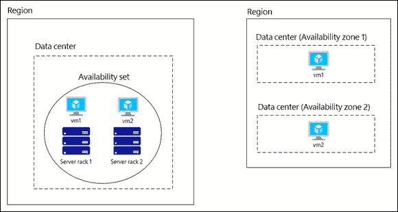

图 5-2：左侧为可用性集；右侧为可用性区域。

*可用性集* 是一个容器对象，您可以在其中填充同一区域内的 VM 实例。可用性集可保护您的 VM 层免受主区域内单个数据中心故障的影响。您的 VM 会被放置在不同机架上的独立硬件主机上；因此，如果 Microsoft 某个机架发生电源或交换机故障，或者需要让您的硬件主机脱机，您的服务仍可保持可用，因为您至少在别处托管了一个成员。


相比之下，**可用性区域**可防止主区域内整个数据中心发生故障。您将 VM 放置在该区域内的不同数据中心中。您无需担心延迟，因为 Microsoft 在区域数据中心群集之间拥有冗余电源、冷却和网络链路。

如果您在部署期间忘记将 VM 放置在可用性区域或可用性集中，则需要重新部署才能进行此更改。是的，这很麻烦，所以请确保第一次就把这项任务做对。

“您可能会问：‘那为什么不总是选择可用性区域呢？’”答案很简单：Microsoft 尚未为所有公共区域启用可用性区域，因此该选项在您的区域中可能不可用。随着时间的推移，我相信可用性区域将在所有区域中提供。

因此，Microsoft 的指导原则是：如果您的 Azure 区域支持可用性区域，则应使用它们。否则，请使用可用性集为 Azure VM 提供高可用性。

### 可伸缩性

**可伸缩性**是指您调整 VM 大小的能力。它也意味着您可以通过部署额外实例来扩展 VM。像 `Azure 应用服务` 这样的 PaaS 服务可以为您处理自动缩放；此功能是 PaaS 和 IaaS 之间强有力的区别因素。

目前，Azure VM 最接近水平自动缩放的功能是 `虚拟机规模集` (`VMSS`)。借助 `VMSS`，您可以创建一个 VM 群集，并指示 Azure 根据您针对 CPU 负载、时间计划等制定的规格进行自动缩放。

然而，`VMSS` 也有一些复杂性：

*   成本高昂，因为您需要为群集中的每个 VM 付费。
*   要求您具备网络知识，因为您需要一个 Azure 负载均衡器。
*   您必须手动配置和同步工作负载。

无论您决定使用规模集还是自行创建相同的 VM 副本，取决于您对 VM 部署和配置的熟悉程度。规模集旨在抽象化大部分底层基础设施复杂性。

## 从 Azure 市场部署 Azure VM

我感觉您一直在等待本章的这一部分，在其中我将解释如何直接使用 Azure 技术。感谢您的耐心。

### 部署 Linux VM

我将从 Linux 开始，因为 Microsoft 在 Azure 中原生支持 Linux 这一事实，让我始终感到兴奋不已。我从 1997 年起就是一名 Microsoft 专家，直到几年前，我们还无法想象能够利用 Microsoft 技术运行非 Windows VM。

在本节中，我将解释如何在新虚拟网络中部署一个简单的 Linux Web 服务器，使用来自 Azure 市场的 Ubuntu Linux 18.04 长期支持 (LTS) VM 映像。

### 从 Azure 门户部署

请遵循以下步骤在 Azure 门户中部署 Linux VM：

1.  **选择“收藏夹” ⇒ “创建资源”，然后选择“Ubuntu Server 18.04 LTS”。**

    或者，您可以浏览到“虚拟机”边栏选项卡并单击“添加”以部署新资源。

    如果 Ubuntu 未显示在 Azure 市场列表中，请键入其名称以在 VM 模板库中查找它。

2.  **在“创建虚拟机”边栏选项卡上，完成“基本信息”选项卡。**

    图 5-3 显示了“创建虚拟机”边栏选项卡。哦，天哪，当您看到所有选项卡时，很难不感到不知所措：基本信息、磁盘、网络、管理、高级、标记和“查看 + 创建”。

    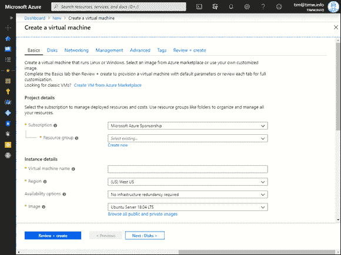

    图 5-3： 创建虚拟机边栏选项卡。

从现在开始，当我在这些部署边栏选项卡中给你建议的选择时，我将省略你已经了解的字段，例如订阅、资源组和区域。请使用以下信息完成其他字段：

*   **虚拟机名称：** 该名称只需在你的资源组内唯一。请注意当你将光标放在字段中时弹出的验证帮助器。
*   **可用性选项：** 如果在下拉菜单中看不到可用性区域和可用性集这两个选项，请选择其他区域。（美国东部 2 是一个不错的选择。）因为这是练习部署，你可以选择不需要基础设施冗余。
*   **映像：** 你在步骤 1 中指定了 Ubuntu 映像，但如果你对其他选项感兴趣，请打开下拉菜单查看最流行的 VM 映像。你也可以单击“浏览所有公共和专用映像”以查看 Azure 市场中的所有模板。
*   **大小：** 目前，接受微软推荐的默认 VM 大小。
*   **身份验证类型：** Linux VM 与 Windows 不同，因为你可以使用安全外壳 (SSH) 基于密钥的身份验证或基于密码的身份验证。对于此练习，请选择密码。

     你应该选择一个有创意的默认管理员帐户名称。ARM 不允许你使用常见的易被猜测的管理员帐户名称，例如 `root` 或 `admin`。

*   **公共入站端口：** 为了测试目的，将公共 IP 地址与此 VM 关联，并通过 SSH 连接到该实例。

     稍后你将收紧网络安全组安全性，以防止基于互联网的恶意行为者进行未经授权的访问尝试。

*   **选择入站端口：** 选择 SSH。

#### 完成“磁盘”选项卡

此选项卡是你对 VM 的操作系统磁盘和数据磁盘进行初始选择的地方。选择标准 HDD 以节省成本。（有关各种选项的更多信息，请参阅本章前面的“存储”。）

你可以创建的数据磁盘数量取决于你选择的 VM 实例大小。你稍后随时可以添加数据磁盘，因此目前请继续进行下一个边栏选项卡。请注意，Azure 为新 VM 提供的默认数据磁盘数量为零；由你作为管理员决定是否要使用它们。

#### 完成“网络”选项卡

在将 VM 放置在何处以及如何配置其连接性方面，你需要做出一些至关重要的决定。以下是配置选项：

*   **虚拟网络：** 模板默认部署一个新的虚拟网络。这正是你想要的，因此请保留此设置不变。

     如果将 VM 放置在错误的虚拟网络上，你将需要重新部署它以将其移动，这很麻烦，所以请尝试第一次就做出正确的选择。

*   **子网：** 保留此设置的默认值。
*   **公共 IP：** 保留此设置的默认值。实际上你确实需要一个公共 IP 地址，至少最初是这样。
*   **NIC 网络安全组：** 选择基本。
*   **公共入站端口：** 允许选定端口。
*   **选择入站端口：** 选择 SSH。
*   **加速网络：** 并非所有 VM 模板都支持此选项。对于支持此功能的 VM 模板，加速网络通过允许 VM 更直接地使用 Azure 网络骨干，为 VM 提供网络速度提升。
*   **负载均衡：** 选择无。

#### 完成“管理”选项卡

确保启用了启动诊断，而所有其他选项均处于关闭状态。启动诊断是使用 VM 串行控制台所必需的，因此最好尽早启用它。

#### 查看“高级”和“标记”选项卡

目前你不需要这些选项中的任何一个，但它们值得研究。扩展允许你将代理软件和/或管理脚本注入 VM。不过，你可以在部署后处理配置。

分类标记是一种跨订阅跟踪资源以用于核算目的的方式。

#### 提交部署并监视进度

单击“查看 + 创建”选项卡；然后在 ARM 告知你的选择通过验证后单击“创建”。如果发生错误，ARM 会在检测到无效设置的配置边栏选项卡旁边放置一个红点。

### 连接到 VM

使用 Azure Cloud Shell 与你的 VM 建立 SSH 连接。请遵循以下步骤：

1.  **在 Azure 门户中，浏览到新创建的 VM 的“概述”边栏选项卡，并记下公共 IP 地址。**

    你可以在图 5-4 中看到我的 VM 配置。

2.  **打开 Cloud Shell，通过指定默认管理员帐户名称和 VM 的公共 IP 地址来连接到你的 Linux VM。**

    要使用我的 `tim` 管理员帐户连接到位于 `13.68.104.88` 的 Linux VM，我输入：

    ```
    ssh tim@13.68.104.88
    ```

    输入 **yes** 以接受 VM 的公钥，然后输入密码以进入 SSH 会话。此时，你正在直接对 Linux VM 进行操作。

 你可以通过输入 `man <command-name>` 来获取任何 Linux 命令的帮助。使用方向键滚动浏览帮助文档，按 Q 退出。

### 部署 Windows Server VM

在本节中，我将解释如何使用 Visual Studio 2019 Community Edition 和 ARM 模板创建 Windows Server VM。

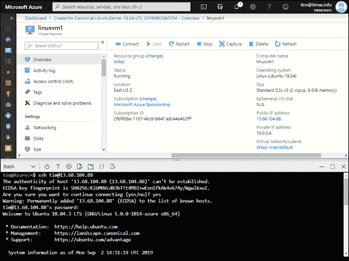

图 5-4： 大多数管理员使用 SSH（无论是否使用 Cloud Shell）来管理 Azure 中的 Linux VM。

Visual Studio 2019 Community Edition ([`https://visualstudio.microsoft.com/vs/community`](https://visualstudio.microsoft.com/vs/community)) 是一个免费的 Visual Studio 版本，可用于测试、开发和开源项目。

 虽然我在本书中使用 Windows 作为工作站操作系统，但微软确实为 macOS 提供了 Visual Studio 版本。请访问 [`https://visualstudio.microsoft.com/vs/mac`](https://visualstudio.microsoft.com/vs/mac) 了解详细信息。

理解此过程对你尤为重要，原因有二：

*   ARM 模板构成了管理自动化、开发和运维的基础。
*   你将使用 ARM 模板完成本书后面介绍的任务。

#### 设置开发环境

请遵循以下高级步骤来设置你的 Visual Studio 环境：

1.  **下载 Visual Studio 2019 Community Edition 并运行安装程序。**

    你需要在 Windows 10 工作站上拥有管理权限才能安装该软件。

2.  **选择 Azure 工作负载。**

    这是最重要的一步。Visual Studio 是一个支持多种开发语言和框架的集成开发环境。为了部署 Windows Server VM，你需要安装 Microsoft Azure 软件开发工具包和工具。

    图 5-5 演示了用户界面。你可以将 Azure 工作负载组件保留为默认设置。

    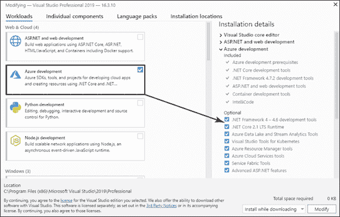

    图 5-5： 在 Visual Studio 2019 中安装 Azure SDK。

3.  **安装完成后，打开 Visual Studio 并登录到你的 Azure 管理员帐户。**

    启动 Visual Studio 2019 时，你将看到“入门”页面。单击“继续而无需代码”；然后通过选择“视图”⇒“Cloud Explorer”打开 Cloud Explorer 扩展。向 Azure Active Directory 进行身份验证，并选择要使用的 Azure 订阅。

#### 部署 VM

#### 从 Azure 快速入门模板部署 Windows Server VM

假设你已打开 Visual Studio 并登录到 Azure 订阅，那么你就可以开始了。在本节中，你将从 Azure 快速入门模板库部署一台 Windows Server VM，该库位于 `https://azure.microsoft.com/en-us/resources/templates/`。我使用的是一个包含托管磁盘的模板定义。请遵循以下步骤：

1.  **在 Visual Studio 中，选择“文件”⇒“新建”⇒“项目”。**

    “创建新项目”对话框随即打开。

2.  **在 Visual Studio 模板库中搜索“Azure 资源组”，将其选中，然后单击“下一步”。**

3.  **为项目命名并保存。**

    选择一个有意义的项目名称，例如“Simple Windows VM”，选择你喜欢的目录位置，然后单击“创建”。

4.  **在 Azure 快速入门模板库中选择 `101-vm-with-standardssd-disk` 模板，然后单击“确定”。**

    图 5-6 显示了该界面。

    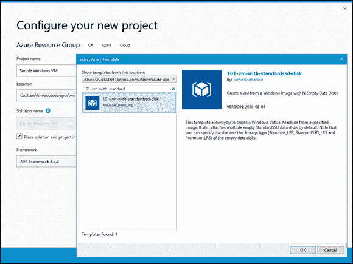

    图 5-6： 在 Visual Studio 2019 中创建资源组部署项目。

5.  **双击 `azuredeploy.json` 模板文件。**

    此操作将 JavaScript Object Notation (JSON) 文件加载到代码编辑器中。请特别注意 JSON 大纲窗格，如图 5-7 所示。

    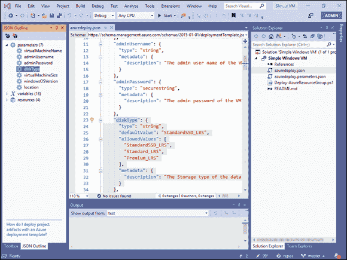

    图 5-7： 代码编辑器中的 ARM 模板。

6.  **浏览 ARM 模板的内容。**

    JSON 大纲视图中显示的三个元素为：

    *   **parameters（参数）：** 你在部署时向模板提供这些值。请注意第 26-30 行的 `allowedValues` 元素；模板作者预先填充了 VM 磁盘类型，以简化验证和部署。
    *   **variables（变量）：** 这些值表示在模板内部引用的固定或动态数据。
    *   **resources（资源）：** 在此部署中，你将创建四种资源类型：虚拟机、虚拟 NIC、虚拟网络和公共 IP 地址。

7.  **在解决方案资源管理器中，右键单击项目，然后从快捷菜单中选择“验证”。**

    “验证到资源组”对话框随即打开。

8.  **填写对话框的字段，然后单击“编辑参数”以提供参数值。**

    你可以在图 5-8 中看到我的环境。

    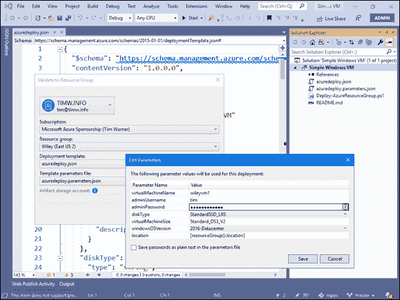

    图 5-8： 验证我们的 ARM 模板。

     Visual Studio 允许你在将模板部署到 Azure 之前对其进行验证。资源组是 Azure 中的基本部署单位。因此，你的部署必须指定一个新的或现有的资源组。

9.  **单击“验证”，并观察“输出”窗口中的状态消息。**

    请务必查看 Visual Studio 应用程序后面；Azure 会生成一个 PowerShell 控制台会话，提示你确认管理员密码。

    你在“输出”窗口中寻找的反馈信息是：

    `Template is valid.`

    如果模板验证失败，Visual Studio 会相当清楚地告诉你发现问题的模板代码行。你可以调试并根据需要重试验证多次，直到模板通过验证。

10. **通过在解决方案资源管理器中右键单击项目并从快捷菜单中选择“部署”来部署 VM。**

     快捷菜单包含对验证配置的引用。

11. **监视进度，并在 Azure 门户中验证 VM 是否存在。**

    当你在“输出”窗口中看到以下状态行时，即表示部署已成功完成：

    `Successfully deployed template 'azuredeploy.json' to resource group 'your-resource-group'.`

### 连接到 VM

通常，你会使用远程桌面协议在本地远程管理 Windows Server，Azure 也不例外。浏览到新 VM 的“概述”边栏选项卡，然后单击“连接”。随即打开“远程桌面连接”对话框（请参阅图 5-9）。你可以从此处下载 `.rdp` 连接文件并将其打开。

如图 5-9 所示，建立 RDP 连接的步骤如下：

1.  从“概述”边栏选项卡工具栏单击“连接”。
2.  将 RDP 连接文件下载到本地计算机。
3.  使用你首选的 RDP 客户端软件打开连接。

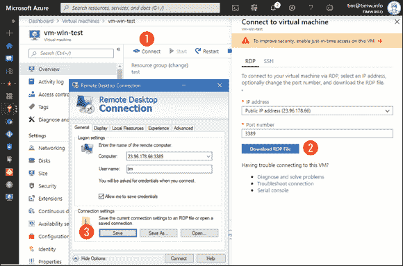

图 5-9： 远程桌面连接在 Azure VM 上的工作方式与在本地 VM 上完全相同。

 Microsoft 为 macOS 提供了原生的远程桌面协议客户端；可在 Mac App Store 中获取。

## 配置 VM

Azure 云中的配置管理实质上与本地环境相同。你希望尽早在 VM 的生命周期中就正确配置它。

首先，我将解释如何调整网络设置，这是 VM 至关重要且潜在脆弱的子系统。

 **请勿尝试从 VM 内部配置 Azure VM 的网络设置。** 如果这样做，你将把自己锁在 VM 外部。相反，你需要在 ARM 中执行所有 TCP/IP 配置。

包含计算机 IP 配置的不是 VM 资源，而是其 vNIC。请遵循以下步骤为 Windows Server VM 配置 TCP/IP：

1.  **打开 Windows Server VM 的“设置”边栏选项卡，然后选择“网络”。**

    “网络”边栏选项卡提供一目了然的 TCP/IP 配置，并提供指向关联网络资源的直接超链接：

    *   vNIC
    *   虚拟网络
    *   公共 IP 地址
    *   网络安全组

    我在图 5-10 中展示了此界面。如果你是从上一练习中使用的 Simple Windows VM 模板部署的 Windows Server VM，你会惊讶地发现 VM 没有受到 NSG 的保护。你可以解决这个问题。

2.  **在 Azure 搜索框中，浏览到“网络安全组”边栏选项卡，然后单击“添加”。**


 请务必将任何额外的 NSG 放置在与你的 NSG 相同的 Azure 区域中。否则，你的 VM 和 VNet 都无法使用它们。

如果你一直在按顺序阅读本书（我衷心希望如此），你已经知道如何创建 NSG。

### 添加一条入站规则以允许入站远程桌面协议流量

你将在第 4 章中学习如何创建网络安全组。

### 浏览到 VM 的“网络”边栏选项卡，然后选择其 vNIC

你需要将新的 NSG 与 VM 的 vNIC 关联，以防止基于 Internet 的访问。

### 从“网络接口”设置菜单中选择“网络安全组”，单击“编辑”，选择新的 NSG，然后单击“确定”

现在我们说到点子上了！通过这一简单步骤，你已大幅减少了这台新 VM 的攻击面。

### 在“网络接口”设置中，选择“IP 配置”设置，然后单击 `ipconfig1`

vNIC 始终有一个名为（毫无想象力地）`ipconfig1` 的单一 IP 配置。你需在 IP 配置中指定专用和公用 IP 地址。

图 5-10 将引导你完成在 Azure 中查找 IP 地址存储位置的点击路径：

1. 在网络接口的设置列表中，单击“IP 配置”。
2. 单击 `ipconfig1`（默认 IP 配置）。
3. 根据需要调整公用和专用 IP 地址。

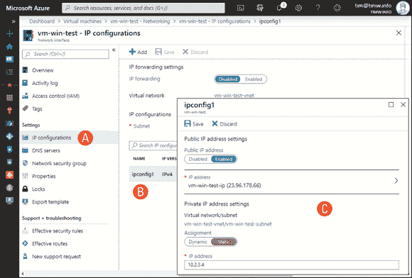

图 5-10： Azure 门户中的 Azure VM TCP/IP 设置。

以下是关于 Azure VM IP 地址的一些考虑要点：

*   请记住，为 VM 分配公共 IP 地址可能不是必需的，甚至可能不是个好主意。存在许多其他用于基于 Internet 访问 VM 的选项，例如 Azure 防火墙、手动配置的跳板机、负载均衡器或虚拟专用网络。
*   您的私有 IP 地址来自其所在虚拟网络上的子网。您可以在此处分配静态私有 IP 地址，而不依赖 Azure 动态地址分配。

### 重新访问 VM 的“网络”边栏选项卡并验证您的更改

您至少应该能看到 NSG 入站端口规则。不错！

## 启动、停止和调整 VM 大小

在教您如何启动和停止 VM 之前，我想提醒您，Microsoft 会为 VM 运行的每一分钟或处于已分配状态下已停止的每一分钟向您收费。我之前提到的一条规则在此也适用：尽可能从 VM 外部执行与 Azure 相关的 VM 管理。

如果您使用 Azure 门户、PowerShell 或 Azure 命令行界面关闭 VM，则根据您添加的参数，您将关闭并释放 VM，从而停止计费。

只需知道，释放 VM 会释放已分配给它的任何动态资源，例如公共/私有 IP 地址和临时存储。

### 启动和停止 VM

您可能已经注意到 Azure 门户中 VM“概述”边栏选项卡上的“启动”、“重启”和“停止”按钮。您可以使用这些按钮来控制 VM 的分配状态（从而控制计费），但我将教您如何使用 PowerShell 来停止和启动 VM。图 5-11 显示了该界面。

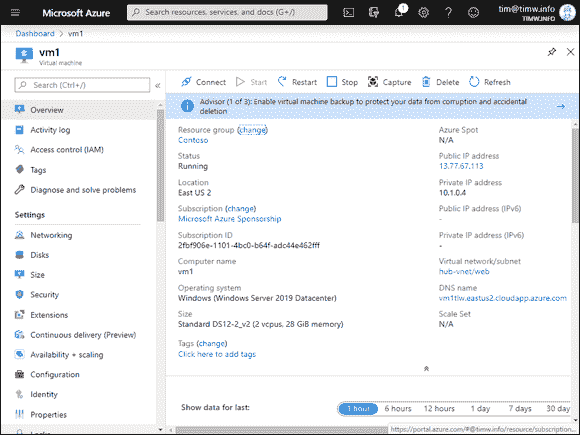

图 5-11： 使用工具栏在 Azure 门户中启动、停止或重启 VM。

当您使用 Cloud Shell 时，Azure 会自动将您的用户帐户向 Azure Active Directory 进行身份验证。相比之下，您需要在本地计算机上使用 Azure PowerShell 之前手动进行身份验证。

请遵循以下步骤，在 Windows 10 工作站上使用 PowerShell 来停止并启动给定的 VM：

#### 打开管理员 PowerShell 控制台，并登录到 Azure

为此，请运行 `Connect-AzAccount`，并向 Azure 进行身份验证。

如果您有多个订阅，且 Azure 将您的会话与错误的订阅关联，请使用以下命令进行切换：

```
Set-AzContext -SubscriptionName 'MySubscription'
```

#### 列出资源组中的 VM

您可能不记得 VM 的名称，但如果您记得资源组名称，请尝试以下命令：

```
Get-AzVM -ResourceGroupName 'Wiley'
```

在 PowerShell 中，您可以使用单引号或双引号将字符串（字符）数据括起来。PowerShell 的设计初衷是不针对此类事情过于挑剔。

#### 使用此命令停止目标 VM

```
Stop-AzVM -Name 'vm-win-test' -ResourceGroupName 'Wiley' -Force
```

请务必包含 `-Force` 开关参数，以确保您既停止又释放 VM。

#### 启动 VM

哇——变化真快！但这一步是一个很好的学习机会。请看这个技巧：

```
Get-AzVM -Name 'vm-win-test' -ResourceGroupName 'Wiley' | Start-AzVM
```

管道符 (`|`) 将第一部分（获取对目标 VM 的引用）的结果传递给第二部分。此技术称为*管线*。

### 调整 VM 大小

正如我之前提到的，动态调整 VM 大小的能力与维护本地硬件相比，是一个巨大的范式转变。

Azure 中的 VM 调整大小有一个缺点：它们会重启您的 VM。请务必仅在预定义的维护时段内执行此操作。

要调整 VM 大小，请遵循以下步骤：

#### 在 VM 设置中，选择“大小”

“大小”边栏选项卡包含一个表，列出了您所在区域中所有可用的 VM 大小。并非所有 VM 大小在每个区域都可用。

#### 编辑筛选器以筛选可用的 VM 大小

您可以使用以下属性的任意组合来筛选 VM 大小：

*   **大小：** 选项为小型、中型和大型。
*   **代系：** 选项为当前、上一代和旧版。
*   **系列：** 选项为通用、GPU、高性能计算、计算优化、内存优化和存储优化。
*   **高级磁盘：** 选项为支持和不支持。
*   **vCPU：** 选项范围为 1 到 64 个 vCPU 核心。
*   **RAM：** 选项范围为 2 到 432 GB。

#### 选择所需的 VM 大小，然后单击“调整大小”

您的 VM 将使用新的虚拟硬件资源重启。这难道不比在本地数据中心申请、订购和安装硬件容易得多吗？

## 扩展 VM 功能

在本章接近尾声之际，我想向您展示如何为 Azure 中的 Windows Server 和 Linux VM 配置基本的诊断日志记录。

### 启用诊断日志记录

Microsoft 为 Linux 和 Windows Server VM 提供了三种粒度日益细化的监视选项：

*   **主机级指标：** 由 Azure 平台提取的基本 CPU、磁盘和网络利用率数据，无需代理软件
*   **来宾级监视：** 更详细的监视；需要 Azure 诊断代理
*   **Azure Monitor Log Analytics：** 功能最强大的监视；需要 Log Analytics 代理和关联的 Azure Monitor Log Analytics 工作区

在本章中，我将使用来宾级监视。要访问它，请打开“诊断设置”边栏选项卡，然后选择“启用来宾级监视”。

来宾级监视从您的 Windows Server VM 中收集以下数据：

*   **选定的性能监视器计数器：** CPU、内存、磁盘和网络。
*   **事件日志消息：** 应用程序、安全和系统。
*   **CPU 内核崩溃转储数据：** 此数据可帮助 Microsoft 支持代表诊断 VM 的问题。

来宾级监视包含来自您的 Linux VM 的以下指标和日志：

*   CPU、内存、网络、文件系统和磁盘指标
*   用于身份验证、任务计划、CPU 和其他设施的 Syslog 日志数据

在 Azure 监视命名法中，*指标* 是存储供后续分析的测量值时间序列。

#### 在 Azure Monitor 中查看诊断数据

假设您需要为已创建的 Linux 和 Windows Server VM 绘制 CPU 利用率数据，以便为您的经理生成基线数据。

请遵循以下步骤在 Azure Monitor 中创建监视图表：

#### 在 Azure 门户中打开“监视器”，并导航到“指标”边栏选项卡

我在图 5-12 中向您展示了 Azure Monitor。

#### 在“图表标题”字段中，为新图表指定一个描述性名称

在此练习中，我将其命名为“Windows Server 与 Linux CPU 对比”。

#### 配置初始指标行以绘制某个 VM 的 CPU 数据

以下是我为 Windows Server VM 指定的属性：

*   **资源：** vm-win-test
*   **指标命名空间：** 虚拟机主机
*   **指标：** CPU 百分比
*   **聚合：** 平均值

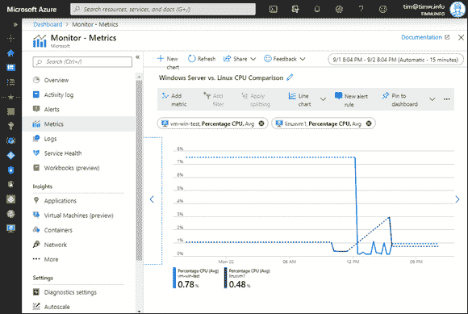

图 5-12： Azure Monitor 是基础设施和应用程序监视的中心点。

#### 单击“添加指标”，并配置指标行以绘制另一个 VM 的 CPU 数据

能够绘制来自多个 Azure 资源的指标对您的监视工作大有裨益。

#### 试用 Azure Monitor 中的其他指标控件

请查看这些控件：

*   **新建图表：** 您可以创建一个图表，显示诸如 Azure 存储帐户读取事务之类的内容。
*   **折线图：** 尝试更改绘图类型，观察视图如何改变数据的可见性。
*   **新建警报规则：** 您可以根据定义的指标阈值生成警报、通知和修正操作（例如，当 Linux VM 超过预定义的 CPU 利用率阈值时触发警报）。
*   **固定到仪表板：** 您可以将 Azure 仪表板用作商业智能仪表板。

# 第 6 章：在 Azure 中部署 Docker 容器

## 本章内容

*   理解 Docker 和容器
*   回顾 Azure 对 Docker 容器的支持
*   实施 Azure 容器实例和 Azure 容器注册表
*   探索 Azure Kubernetes 服务
*   在 Azure 应用服务 Web 应用程序中部署 Docker 容器

Docker 容器正在席卷全球！

好吧，也许我需要弱化一下这种夸张说法。许多企业正在意识到在开发和生产环境中使用 Docker 容器的经济效益。简而言之，Docker 容器使开发人员构建软件产品变得更快、更容易。

Microsoft 以多种方式在其云中支持 Docker 容器。读完本章时您可能还不是 Docker 专家，但我完全有信心您将掌握容器的用法以及在 Azure 中使用 Docker 的可能性。

## 理解 Docker

如果您读过第 5 章，您可能对虚拟机 (VM) 是什么以及它们如何工作已经有了相当不错的了解。在我看来，Docker 容器代表了一种更敏捷的虚拟化程度。容器允许开发人员或管理员将应用程序及其所有依赖项打包成一个单一的模块化单元，从而实现快速部署。

> **请记住：** Docker 容器是一个虚拟化的应用程序，而不是完整的 VM。您可能会创建并运行不同数据库和数据库版本的 Docker 容器，以便针对这些数据库测试您的应用程序。这些容器仅包含（看我这双关语？）数据库引擎二进制文件及其依赖项——别无其他。

每个 VM 可能高达数百 GB，且需要更新、备份、监视和维护，而容器的大小范围可以从不到 100 MB 到几 GB 不等。

与 VM 一样，容器与其容器主机服务器共享硬件资源。与 VM 不同的是，容器从根本上是由纯文本 `Dockerfile` 定义的，其中包含构建容器的指令。

思路是将构成容器的所有资产放在一个目录中，并创建一个 `Dockerfile` 来编排容器的组成。然后将 `Dockerfile` 编译为二进制映像，该映像作为您的部署单元。最后，通过部署映像模板的实例，根据需要创建任意数量的容器。图 6-1 说明了 Docker 部署过程。

> **提示：** Docker 是一个庞大的主题，足以填满一本单独的书。如果您想了解更多关于创建容器映像的信息，请查看 Docker 文档：[`https://docs.docker.com`](https://docs.docker.com)。

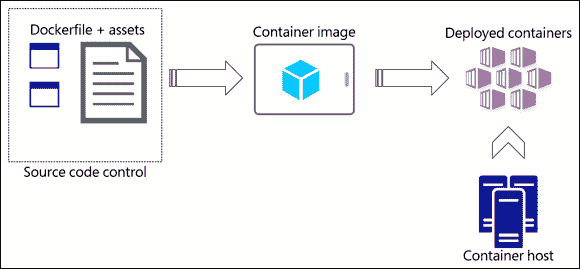

图 6-1： Docker 容器部署过程。

> **技术资料：** 应用程序虚拟化在 Linux 中早于 Docker 就已存在。Docker 只是一家将这些预先存在的技术进行标准化和扩展的公司。Microsoft 和 Docker 建立合作伙伴关系，主要是为了将 Docker 容器引入 Windows Server，本章几乎完全专注于 Windows Server 容器。

### 使用 Docker 容器

开发人员喜爱 Docker 容器，因为容器很敏捷。正如我之前提到的，`Dockerfile` 是纯文本文档，这意味着开发团队可以将它们存储在源代码控制系统中，并随时间跟踪其变更。

假设 Jane Developer 需要针对三个 MySQL 数据库版本测试她公司的业务线应用程序。启动三个独立的 VM 通常是一个缓慢且劳动密集型的过程。当她需要启动并使用每个基于 VM 的 MySQL 安装的多个实例时，这种痛苦会变得更大。如果 VM 的来宾操作系统需要更新，或者 MySQL 需要更新，该过程会更慢。

相比之下，Jane 可以使用 Docker 命令行界面或托管容器平台启动任意数量的运行不同软件版本的 MySQL 容器。测试完成后，她可以用一条命令处理掉这些容器。如果 MySQL 需要更新，她或队友只需编辑 `Dockerfile` 并重新编译映像即可。

可移植性是容器的另一大优势。Microsoft Azure 是一个 Hyper-V 生态系统。如果您需要将 VM 迁移到（比如说）Google Cloud Platform，而那里使用的是另一个管理程序，该怎么办？

我花费了太多时间重新配置虚拟机，以使它们适应不同云提供商的生态系统。有了 Docker，您就拥有了一个通用格式，可在任何支持 Docker 的云中工作。

只要有 Docker 守护进程（服务器服务）组件可用，您就几乎可以在任何地方运行容器，且无需任何修改。

### 在工作站上设置 Docker

Docker 运行时环境相对轻量且便携。在本节中，我将向您展示如何在 Windows 10 工作站上安装 Docker Desktop。

> **请记住：** 就本书而言，我假设您使用的是基于 Windows 10 的计算机。不过，Docker Desktop 及其相关工具也适用于 macOS 和 Linux。Docker 在标准化用户界面方面做得很好，因此如果您使用的是 macOS 或 Linux，应该会发现以下步骤对您同样适用。

#### 安装 Docker Desktop

请遵循以下步骤在 Windows 10 系统上设置 Docker：

1.  **在 Docker Hub 注册免费用户帐户。**

    Docker Hub ([`https://hub.docker.com`](https://hub.docker.com)) 是 Docker 容器的主要公共存储库。

2.  **从** [`https://www.docker.com/products/docker-desktop`](https://www.docker.com/products/docker-desktop) **下载并安装 Docker Desktop。**

    该网站鼓励您完成一个交互式教程；请随意尝试。

3.  **安装过程中接受默认设置。**

    此规则的例外情况发生在安装程序询问您是否要使用 Windows 容器而不是 Linux 容器时。请选择 Windows 容器。在 macOS 或 Linux 计算机上，您不会看到此选项。

4.  **重启计算机。**

    安装程序要求您注销并重启，以安装 Hyper-V 和容器 Windows 10 功能。

5.  **验证 Docker 服务正在运行。**

    Docker Desktop 会作为一个图标出现在 Windows 通知区域（请参阅图 6-2）。

    右键单击 Docker 图标，您将在快捷菜单上看到各种选项（包括如果您在安装期间忘记启用该功能，则可以切换到 Windows 容器）。图 6-2 显示的是“切换到 Linux 容器”，如果您当前配置为 Windows 容器，Docker 会显示此选项。

> **请记住：** Docker 服务需要以提升的权限运行。如果您发现 Docker Desktop 没有将其图标放在通知区域中，请以管理员身份从桌面或“开始”菜单快捷方式运行该应用程序。

#### 运行 hello-world 容器

### Docker 的 hello-world 参考镜像

Docker 的 hello-world 参考镜像能让你从客户端的角度体会如何使用 Docker。请遵循以下步骤：

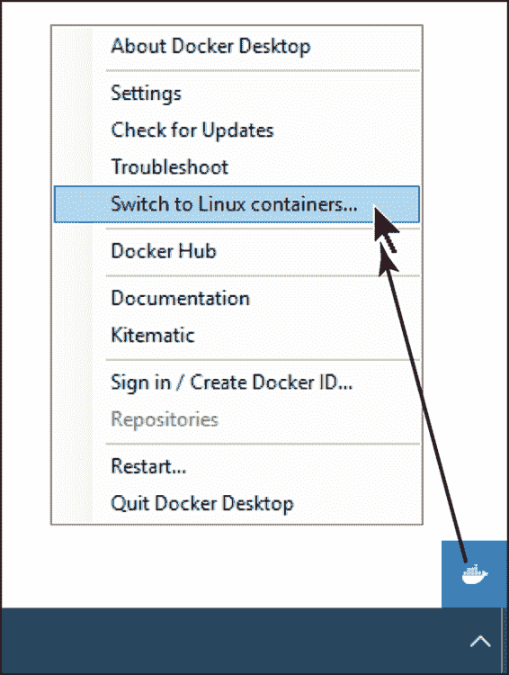

**图 6-2：** Docker Desktop 可从 Windows 通知区域轻松访问。


# 在工作站上设置 Docker

1. **打开提升权限的 PowerShell 或命令提示符控制台。**

   为此，在“开始”菜单或任务栏上找到 PowerShell 或命令提示符图标，右键单击它，然后从快捷菜单中选择“以管理员身份运行”。

2. **通过运行 `docker --version` 检查你的 Docker 版本。**

   此步骤是一个合理性检查，旨在确保 Docker 命令行界面和服务器组件功能正常。

3. **通过运行 `docker images` 检查是否有本地可用的容器镜像。**

   你应该只会看到 Repository（仓库）、Tag（标签）、Image ID（镜像 ID）、Created（创建时间）和 Size（大小）属性，而没有任何镜像。（你将在第 4 步中解决这一情况。）你也可以使用 `docker info` 查看更精简的元数据。

4. **从 Docker Hub 拉取并运行 hello-world 镜像。**

   发出命令 `docker run hello-world` 并观察 Docker 的操作：

   1. Docker 检查该镜像是否存在于你的本地系统上。不存在。
   2. Docker 发出拉取命令，从 Docker Hub 检索 hello-world 镜像的最新版本。
   3. Docker 运行容器。hello-world 显示 `Hello from Docker!`，确认镜像运行正确。

5. **运行 `docker ps -a` 查看容器的运行状态。**

   Docker 告诉你它将 hello-world 镜像作为容器运行了，并且镜像一运行完就退出了。在现实世界中，你可能希望 Docker 容器运行更长时间。你也可以附加到容器并从容器分离。

6. **运行 `docker container prune` 移除所有已停止的容器。**

   在本例中，你只有一个容器。重新运行 `docker ps -a` 以验证该容器已消失。

7. **验证 hello-world 容器镜像在本地可用。**

   使用 `docker images` 命令；你应该会看到列出的 hello-world 镜像。

太酷了！通过这场 Docker 的旋风之旅，你已经了解到普通用户使用容器的工作流是：

1. 根据需要从中央仓库拉取容器镜像。
2. 基于这些镜像运行新容器。
3. 在容器不再需要时将其处置。


当你在 Windows 10 系统上安装 Docker Desktop 时，你安装的是 Docker 守护进程和 Docker CLI（客户端）两者。如果你右键单击通知区域中的 Docker 图标，可以从快捷菜单中打开 Kitematic（一个图形化的 Docker 前端）。对于尚不习惯从命令行运行 Docker 命令的 Docker 初学者，Kitematic 会很有帮助。

# 在 Azure 中运行容器

“你可能会说：‘Tim，所有这些 Docker Desktop 的东西固然很好，但我什么时候才能接触到 Azure？’” 你现在就在那里。

在 Azure 生态系统中，以下资源原生支持 Docker 容器：

* 基于 VM 的容器主机
* Azure 容器实例
* Azure 容器注册表
* Azure Kubernetes 服务
* 适用于容器的 Azure 应用服务 Web 应用

在你动手实践这些技术之前，我将简要讨论每个选项。

## 基于 VM 的容器主机

这里所说的是在 Azure 虚拟网络中启动一个 Linux 或 Windows Server VM，安装 Docker 守护进程，并从那里启动 Docker 容器。虽然此策略行之有效，但在大多数情况下，考虑到已可供你使用的平台即服务 (PaaS) 资源，我认为这没有多大意义。

## Azure 容器实例

Azure 容器实例 (ACI) 适用于那些需要快速运行 Docker 容器，而无需担心安装和维护 Docker 守护进程及客户端开销的 Azure 专业人员。ACI 非常适合一次性容器工作，在这类工作中，集中管理和编排是不必要的。

## Azure 容器注册表

到目前为止，你已经了解了 Docker Hub，即由 Docker 托管的公共镜像存储库。Microsoft 将其大部分公开可访问的容器镜像发布到 Docker Hub。另一方面，Azure 容器注册表 (ACR) 专为那些团队需要一个私有的、中央镜像注册表以便使用其自己的内部 Docker 镜像的企业而设计。

## Azure Kubernetes 服务 (AKS)

Azure Kubernetes（发音为 *koo-burr-NET-eez*）服务，即 AKS，是一个由 Google 开发的用于 Docker 容器的容器编排平台。它允许你创建一个计算群集，为你的容器工作负载提供强大的集中管理。

AKS 之所以流行，是因为许多企业使用 Docker 托管由多个容器组成的多层应用程序，这些容器需要作为一个组进行管理。它还提供高可用性、计划内应用程序升级和大规模并行扩展。

简而言之，AKS 是 Azure 的托管 Kubernetes 群集服务。你仍然可以使用原生 Kubernetes 客户端工具，如 Web UI 和 `kubectl` 命令行客户端，但你可以利用与其他 Azure 服务和功能的无缝集成。

## 适用于容器的 Azure 应用服务 Web 应用

Azure 应用服务是 Azure 中的一种托管 Web 应用程序服务，可与基于 Docker 容器的应用集成。应用服务（我在第 7 章中讨论）允许你轻松地：

* 在生成/发布管道中集成你的应用程序
* 自动缩放你的应用程序以应对使用高峰
* 让 Microsoft 负责修补、备份和维护底层主机环境

因此，适用于容器的 Web 应用将容器的敏捷性与强大的应用服务 PaaS 平台相结合。

# 实施 Azure 容器实例

是时候登录 Azure 门户并深入了解这些与 Docker 相关的 Azure 资源了。本节涵盖以下任务：

* 使用 Microsoft 从 Docker Hub 公开提供的 Internet Information Services (IIS) Web 服务器容器定义新的容器实例
* 将公共 IP 地址资源与容器关联，以便你可以从工作站访问它
* 使用浏览器测试连接
* 移除容器

要完成其中任何工作，你都需要使用管理员帐户登录 Azure 门户。

## 部署 Azure 容器实例

请遵循以下步骤，部署一个具有公共 IP 地址的基于 IIS 的 Windows Server 容器：

1. **导航到“容器实例”边栏选项卡，然后单击“添加”。**

   要转到“容器实例”边栏选项卡，请在全局搜索框中键入 `azure container`。

2. **填写默认显示的“基本信息”选项卡（如图 6-3 所示）。单击“下一步”继续。**

   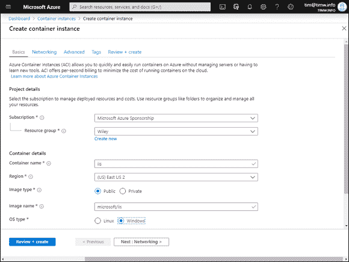

   **图 6-3：** 使用 Azure 容器实例服务部署 Docker 容器。

   你需要完成以下项目：

   * **订阅和资源组：** 选择符合你要求的选项。
   * **容器名称和区域：** 该名称在你的资源组内必须唯一。选择离你最近的 Azure 区域。
   * **映像类型：** 当你从 Docker Hub 拉取 IIS 镜像时（如此示例所示），Public（公共）是合适的选项。你要选择 Private（专用）以向专用镜像存储库进行身份验证。
   * **映像名称：** 键入镜像的名称——在本例中为 `microsoft/iis`，这是一个极受欢迎的容器镜像。
   * **操作系统类型：** 选择你正在使用的操作系统。
   * **大小：** 接受默认设置。您的容器将在底层的主机 VM 上运行，尽管您永远不会直接与主机交互。

3. **填写“网络”选项卡。**

   完成以下项目：

   * **包含公共 IP 地址：** 选择“是”。您需要一个公共 IP 地址，以便通过公共 Internet 连接到容器。
   * **端口：** 因为您要部署 Web 服务器容器，所以需要访问容器上的 TCP 端口 80 (HTTP)。
   * **DNS 名称标签：** 此字段为可选，但提供一个您能识别的名称标签是个好主意，以防公共 IP 地址因某些原因发生更改。请注意，此主机名需要全局唯一，因此您可能需要发挥一些创意来想出一个名字。

4. **提交部署。**

   为此，单击“查看 + 创建”，然后单击“创建”。

5. **监视部署进度。**

## 验证并处置容器实例

请遵循以下步骤，熟悉 ACI Azure 门户体验并验证与新 IIS 容器的连接：

1. **在“容器实例”边栏选项卡上，选择一个容器实例。**

   您可以选择在上一过程中创建的 IIS 容器。选择容器实例将带您转到其“概述”边栏选项卡。

2. **在“概述”边栏选项卡的“要点”窗格上，验证“状态”和“IP 地址”字段。**

   容器状态应为“正在运行”。记下公共 IP 地址，因为您将在第 3 步中用到它。

3. **复制容器的 IP 地址，将其粘贴到新 Web 浏览器选项卡的地址栏中，然后按 Enter 键。**

   如果一切顺利，您应该会看到蓝色的 Windows Server IIS 测试页。如果出现该页面，说明您已启动一个可通过 Internet 访问的容器。

4. **回到 Azure 门户，单击“容器”设置。**

5. **在“容器”边栏选项卡上，单击“连接”。**

   您正在建立到此容器的终端连接。

6. **在“选择启动命令”窗口中，键入 `/bin/bash`，然后单击“连接”。**

   到达命令提示符后，您可以使用命令行工具执行任务，例如将文件复制到容器和下载配置文件。图 6-4 显示了正在运行的容器叠加在 Azure 门户中的 ACI 实例元数据之上。

   通过 Azure 门户附加到容器非常方便。但请注意，还有其他方法，其中一些是通过工作站上的 Docker 命令行界面或 Azure PowerShell 实现的。

   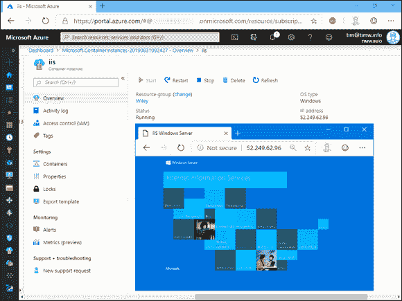

   **图 6-4：** 将 IIS Web 服务器作为容器与 ACI 服务一起运行。

7. **浏览到容器实例的“概述”页面，单击“删除”，并确认您的选择。**

   “概述”工具栏上有“停止”、“重启”和“删除”控件。尽管 Docker 容器通常被认为是临时且可丢弃的，但您将来可能想要停止并重启同一个容器。在本例中，您不再需要该容器，因此可以从订阅中将其删除。

# 在 Azure 容器注册表中存储映像

我想节省您的网络带宽，因此在本节中，您将把（相对）较小的 hello-world 容器（您在前面的“在工作站上设置 Docker”一节中从 Docker Hub 拉取的）推送到新的容器注册表。

Azure 容器注册表 (ACR) 是一个云托管的 Docker 映像存储库。ACR 为您团队的映像提供了一个集中的存储/管理位置；这些映像仅可供您授予适当权限的 Azure 用户访问。

## 部署容器注册表

在将容器推送到 ACR 之前，您需要部署注册表。请遵循以下步骤：

1. **在 Azure 门户中，浏览到“容器注册表”边栏选项卡，然后单击“添加”。此时将出现“创建容器注册表”窗体。**

2. **填写“创建容器注册表”窗体。**

   以下是您需要处理的设置：

   * **注册表名称：** 您可以为注册表选择任何名称，只要它全局唯一即可。如果您碰巧选择了一个已在使用的名称，Azure 将不允许您继续。
   * **订阅、资源组和位置：** 选择您的订阅、所需的资源组和 Azure 区域。
   * **管理员用户：** 启用此选项。这样做将使向注册表进行身份验证变得更加容易。
   * **SKU：** 选择“基本”。SKU 是 *stock-keeping unit*（库存单位）的缩写，基本版是成本最低的 ACR 定价层。标准版和高级版 SKU 提供更高的性能和规模。

3. **单击“创建”以提交部署。**

   在大多数情况下，Azure 会在不到一分钟内完成部署。

4. **部署完成后，在 Azure 门户中打开新注册表，并记下“登录服务器”字段的内容。**

   您将在下一节中用到此 DNS 名称，届时您将把容器映像推送到注册表。注册表采用名称 `<your-registry-name>.azurecr.io`。

## 将映像推送到新容器注册表

为了向您展示如何将映像推送到容器注册表，我将使用您在本章前面的“在工作站上设置 Docker”一节中使用的 hello-world 映像。要将映像推送到容器注册表，请遵循以下步骤：

1. **从注册表的“访问密钥”设置边栏选项卡获取管理员凭据。**

   我在图 6-5 中展示了此边栏选项卡。具体而言，您需要记下“用户名”字段（应为您的注册表名称）以及两个密码中的任意一个。复制哪个密码无关紧要；您只需要其中一个来完成第 2 步。

2. **打开命令提示符会话，并使用 `docker login` 命令登录到您的容器注册表。**

   将注册表短名称（在我的示例中为 twwiley）作为用户名，将之前复制的密码作为密码提供。以下是命令：

   ```
   docker login twwiley.azurecr.io
   ```

   如果一切顺利，您将看到 `Login succeeded` 状态消息。

3. **为 hello-world 映像定义标记。**

   标记的格式为 `<owner-name>/<image-name>`，但在这种情况下，`owner` 是注册表。以下是我为 twwiley 注册表使用的命令：

   ```
   docker tag hello-world twwiley.azurecr.io/hello-world
   ```

   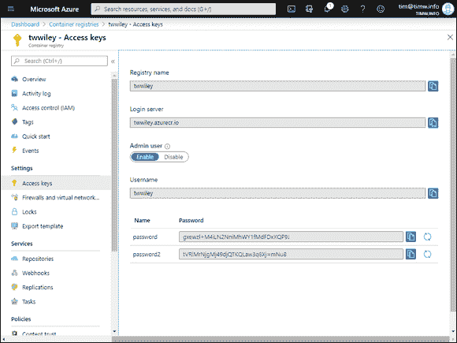

   **图 6-5：** 从 Azure 容器注册表检索管理员凭据。

4. **将 hello-world 映像推送到您的注册表。**

   为此，请使用以下命令：

   ```
   docker push twwiley.azurecr.io/hello-world
   ```

   此过程所需的时间取决于您到 Azure 的上游网络带宽。

5. **验证 hello-world 映像是否出现在您的容器注册表中。**

   为此，请导航到注册表的“存储库”边栏选项卡。您会发现 Azure 门户并未为您提供太多操作此容器映像的选项。这暗示您将通过使用 Docker CLI、自动化工具或工具链来与映像交互。

## 通过 ACI 拉取存储库映像

将 Docker 映像放入注册表后，您可以使用 `docker pull` 命令下载该映像，并根据该映像在本地系统上生成容器。

在本节中，您将从 ACI 服务运行注册表中的 hello-world 容器映像。为此，请遵循以下步骤：

1. **导航到“容器实例”边栏选项卡，并添加一个新的容器实例。**

2. **指定映像类型、映像名称和操作系统类型。**

   信息如下：

   * **映像类型：** 当您从专用的基于 Azure 的容器注册表拉取映像时，选择“专用”；否则，选择“公用”。
   * **映像名称：** 对于我的注册表，我使用 `twwiley.azurecr.io/hello-world`。请替换为您自己的注册表名称。

### 部署容器实例

* **Image Registry:** 添加登录服务器、用户名和密码。
* **OS Type:** 选择正在使用的操作系统。

3. **单击“Review + Create”，然后单击“Create”提交部署。**

   无需担心网络、标记等问题。

4. **如果部署失败，请阅读操作详细信息。**

   ARM 可能通过验证但仍导致部署失败。如果发生这种情况，与任何失败的部署一样，请阅读 Azure 提供的所有操作详细信息。

图 6-6 显示了失败的 ACI 部署。横幅用通俗易懂的英语解释了问题。在本例中，容器类型指定为 Linux 而非 Windows。也可以单击“Operation Details”以获取来自 ARM 的更详细反馈。

失败的部署并非大问题。可以根据需要多次重新运行部署模板，直到成功为止。只需单击图 6-6 中所示的“Redeploy”按钮。默认情况下，部署不会删除现有资源。相反，模板会从中断处继续，直到部署与底层模板定义匹配。

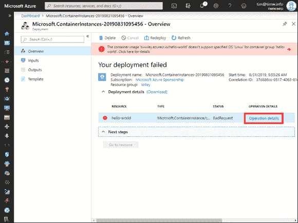

**图 6-6：** Azure 部署失败时不要恐慌。阅读错误消息，从中吸取教训。

研究部署详细信息（成功或失败）的另一个位置是 Azure 门户中的“Resource Groups”边栏选项卡。打开一个资源组，导航到“Deployments”边栏选项卡。Azure 中的每个部署都会被记录下来，供参考和/或故障排除。

我所解释的关于 Azure 中容器支持的一切都很好，但坦率地说，ACI 存在一个致命缺陷：它没有编排功能。开发人员很可能需要同时部署多个容器并将它们作为一个组进行管理。业务可能还要求容器能够水平扩展以适应用户负载，并具有高可用性。换句话说，ACI 服务适用于相对简单的容器部署，但在业务中除最基本的容器用例外，都需要容器编排平台。

为了满足这些要求及更多需求，需要一个容器编排平台，例如 AKS。

# Azure Kubernetes Service 简介


AKS 最初是 Azure Container Service (ACS)，支持包括 Kubernetes、Swarm 和 DC/OS 在内的多个容器编排平台。ACS 的缺点是其复杂性，以及大多数客户仅想要对 Kubernetes 的第一方支持。因此，尽管可能在 Azure 门户或其他地方偶尔看到对 ACS 的引用，但请忽略它们，专注于 AKS。

我没有足够的篇幅演示如何部署和管理 AKS 群集。相反，我将描述 AKS 架构，解释其部分优势，并提供在 Azure 中使用 AKS 的宏观视角。

开发人员启动容器并非因为它们好玩，而是因为它们实用。容器托管应用程序组件（如 Web 服务器或数据库服务器），进而形成应用程序解决方案。因此，从现在开始，请将“container”（容器）和“application”（应用程序）这两个词联系起来。

## AKS 架构

图 6-7 显示了 AKS 的基本元素：

*   **Master node（主节点）：** Microsoft 抽象了控制平面（在 Kubernetes 命名法中称为 *master node*），以便专注于工作节点和 Pod。这种托管的平台即服务 (PaaS) 平台是许多企业喜爱 AKS 的原因之一。主节点负责调度 Kubernetes 与底层群集之间的所有通信。

*   **Worker node（工作节点）：** 在 AKS 中，工作节点是构成群集的 VM。群集提供大量并行计算、在节点间轻松移动 Pod、在不关闭整个群集的情况下对节点执行滚动更新等能力。一种选择是使用 ACI 作为工作节点。

    图 6-7 还显示了 ACR，AKS 可以从中拉取存储的映像。这种 Azure 集成难道不引人注目吗？

*   **Pod：** Pod 是 AKS 生态系统中最小的可部署单元。一个 Pod 可能包含一个 Docker 容器，也可能包含一组需要在一起、相互通信并作为一个内聚单元运行的容器。

跟上思路了吗？

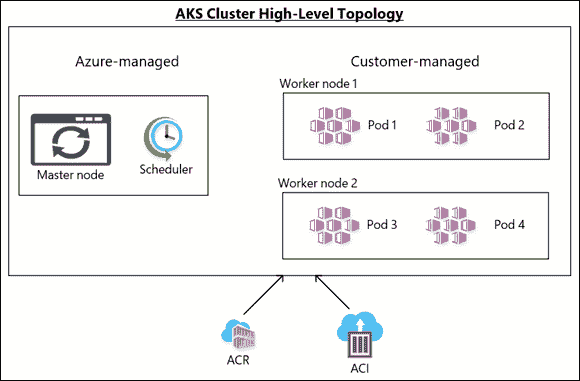

图 6-7： AKS 高级架构。

## AKS 管理说明

在继续之前，我将回顾开发人员和管理员如何与 AKS 交互。从控制平面角度来看，有 AZR，可用于通过基于角色的访问控制保护 AKS 群集、升级 Kubernetes 版本、横向扩展群集、添加或删除工作节点等。

从应用程序平面角度来看，Microsoft 希望确保客户无需学习新工具集即可在 AKS 中使用容器。

### `kubectl` 命令行工具

大多数 Kubernetes 专业人员使用 `kubectl`（通常发音为 *KOOB-see-tee-el*、*KOOB-control* 或 *KOOB-cuttle*）以编程方式与其 Kubernetes 群集及其 Pod 交互。如果工作站上安装了 Azure CLI，可以通过发出以下命令轻松安装 `kubectl`：

```
az aks install-cli
```

事实上，Azure CLI 在应用上下文命令工作流方面似乎大量借用了 `kubectl` 语法。例如，要使用 `kubectl` 列出正在运行的 Pod（容器），请运行：

```
$ kubectl get pods
READY STATUS RESTARTS AGE
azure-database-3406967446-nmpcf 1/1 Running 0 25m
azure-web-3309479140-3dfh0 1/1 Running 0 13m
```

### Kubernetes Web UI

Kubernetes Web UI 是一个图形化仪表板，为管理员和开发人员提供强大的控制界面。图 6-8 显示了该界面。

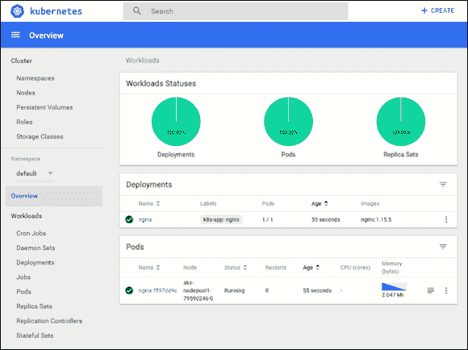

图 6-8： Kubernetes Web UI 仪表板。

同样，应使用 Azure CLI 连接到仪表板；无法从 Azure 门户进行连接。相关命令如下：

```
az aks browse --resource-group myResourceGroup --name myAKSCluster
```

`az aks browse` 命令在工作站和 Azure 中运行的 AKS 群集之间创建一个代理；它在输出中提供连接 URL。典型的连接 URL 为 `http://127.0.0.1:8001`。

## 将容器与 Azure App Service 配合使用

我将通过展示如何将容器与 Azure App Service 结合使用来结束本章。（第 7 章 Chapter 7 深入探讨 Azure App Service。）

Azure Web App for Containers 允许将现有的基于容器的应用插入 Azure App Service 应用中。对于未使用 AKS 等编排/缩放平台的企业，此功能是一种无需额外投资和复杂性即可自动缩放应用的绝佳方式。

“你无法在 App Service 中托管非 .NET 应用，对吧？”你问道。我很高兴地报告，这是不正确的。容器可以使用任何受支持的运行时环境，包括：

*   .NET Core
*   Node.js
*   PHP
*   Java
*   Python
*   Ruby

此过程使用 Azure 门户中的 Cloud Shell。要创建一个使用从 Docker Hub 拉取的 Linux 容器作为代码库的新 Azure App Service Web 应用，请执行以下步骤：

1. **在 Azure 门户中启动 Cloud Shell，并选择 Bash 环境。**

    选择哪种 Shell 无关紧要，因为 Azure CLI 在两者中均可用。

虽然你是使用 Azure CLI 创建此应用服务 Web 应用，但你也可以使用 Azure 门户、PowerShell、软件开发工具包 (SDK) 或 Azure REST API。由于 Microsoft 对 Azure 门户进行了大量更新，你最好主要专注于 Azure CLI 或 PowerShell，以获得更稳定、更熟悉的部署环境。

2. **使用 Azure CLI 创建新的资源组。**

    使用你自己的资源组名称和位置。我使用的是：

    `az group create --name containerApp --location "East US 2"`

3. **创建应用服务计划为 Web 应用提供支持。**

    应用服务计划定义托管 Web 应用程序的底层计算层 (VM)。在此，你将使用 B1 VM 实例大小创建一个基于 Linux 的服务计划：

    `az appservice plan create --name myAppServicePlan --resource-group containerApp --sku B1 --is-linux`

4. **定义 Web 应用。**

    我将我的应用命名为 go-container-704 以使名称全局唯一，并从 Docker Hub 拉取了 `microsoft/azure-appservices-go-quickstart` 容器映像。你可以通过访问 [`https://hub.docker.com/r/microsoft/azure-appservices-go-quickstart/`](https://hub.docker.com/r/microsoft/azure-appservices-go-quickstart/) 来检查该容器。

    `az webapp create --resource-group containerApp --plan myAppServicePlan --name go-container-704 --deployment-container-image-name microsoft/azure-appservices-go-quickstart`

    你可以通过访问 [`https://hub.docker.com/r/microsoft/azure-appservices-go-quickstart`](https://hub.docker.com/r/microsoft/azure-appservices-go-quickstart) 来检查该容器。

5. **浏览到该应用。**

    项目的 URL 格式为 http:// http://<*app\_name*\>.azurewebsites.net/hello。使用该地址（替换为你自己的应用名称）。

6. **验证你是否看到** **图** **6-9** **中所示的简单 `Hello, world!` 消息。**

    你的新容器支持的应用出现在 Azure 门户的“应用服务”边栏选项卡中。

    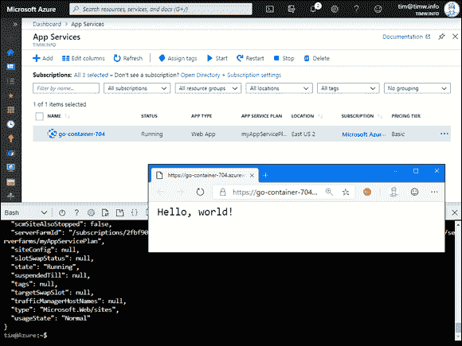

    图 6-9： 由 Docker 容器提供支持的新 Azure Web 应用。

7. **清理环境。**

    因为你将此测试 Web 应用存储在其自己的资源组中，所以清理起来非常轻松。运行最后一条 Azure CLI 命令，并确认你的选择：

    `az group delete --name containerApp`

# 第 3 部分：将平台资源部署到 Microsoft Azure

## 本部分内容……

*   部署和配置应用服务应用
*   通过使用 Azure WebJobs、Functions 和 Logic Apps 理解 Azure 中的“无服务器计算”
*   描述 Azure 中的关系型和非关系型数据库选项
*   亲身体验 Azure SQL 数据库和 Cosmos DB

# 第 7 章：部署和配置 Azure 应用服务应用

## 本章内容

*   **了解 Azure 应用服务家族成员**
*   **部署应用服务 Web 应用**
*   **配置你的 Web 应用**
*   **启用遥测**

作为 Microsoft Azure 解决方案顾问，我的乐趣之一就是看着客户在发现 Azure 平台即服务 (PaaS) 资源的强大功能和敏捷性时的表情；Azure 应用服务首当其冲。

Azure 应用服务让你能够专注于业务线应用程序，而无需管理 VM 基础设施。应用服务提供超大规模，并与存储帐户和 Azure SQL 数据库等其他 Azure 产品无缝集成。

在本章结束时，你将了解应用服务在 Azure 产品组合中的地位。你还将能够熟练创建和配置应用服务 Web 应用。当然，特定的编程语言超出了本书的范围，因此我将重点放在应用服务的操作方法和原理上，而将代码库留给你和你的团队。

## 介绍 Azure 应用服务

简而言之，应用服务是一种基于超文本传输协议 (HTTP) 的 Web 应用程序托管服务。可以把它想象成 GoDaddy，但功能强大得多。其理念是：如果你愿意放弃对应用底层基础设施的完全控制（这正是 Azure 虚拟机的用途），你将获得以下回报：

*   全球复制和地域可用性
*   动态自动缩放
*   原生集成到持续集成/持续部署管道中

是的，应用服务在底层使用虚拟机 (VM)，但你永远不必担心维护它们；Microsoft 会为你处理这些。相反，你几乎完全专注于你的源代码和应用程序。

本章几乎完全专注于 Web 应用，但在 第 8 章 中你将了解其他应用服务家族成员。

### Web 应用

静态或动态 *Web 应用程序* 是应用服务中最常用的选项。你托管的 Web 应用可以链接到云端或本地数据库、API Web 服务和内容分发网络。

### API 应用

*应用程序编程接口* (API) 是一种机制，它通过使用 HTTP 请求和响应为你的应用程序提供编程（非交互式）访问——一种称为表述性状态传递 (REST) 的编程范式。如今，Microsoft 支持来自应用服务和 API 管理服务的 API 应用。

### 移动应用

*移动应用* 为 iOS 或 Android 应用程序提供后端。Azure 移动应用提供了大多数智能手机用户已习惯期望的功能，作为他们使用的移动应用的一部分，例如社交媒体登录、推送通知和脱机数据同步。

### 逻辑应用

*逻辑应用* 为开发人员提供了一种构建业务工作流的方法，而无需了解不同服务中所有底层 API。例如，你可以创建一个逻辑应用，每当有人在 Twitter 上提及你公司的名称时触发。然后此应用可能会执行多个操作，例如在你销售部门的 Slack 频道中发布通知消息，或在你的客户关系管理数据库中创建一条记录。

### 函数应用

*函数应用* 允许开发人员在特定时间运行特定代码，而无需担心底层基础设施。这就是为什么函数应用被称为 *无服务器* 应用程序，或 *代码即服务 (CaaS)* 解决方案。我的一位咨询客户拥有一个函数应用，每当用户在其网站上创建新帐户时，该应用就会向潜在客户发送确认电子邮件。

函数应用支持 C#、F# 和 Java 编程语言。

逻辑应用和函数应用均基于触发器运行。此触发器可以是手动执行命令、时间计划，或是在 Azure 内部或外部发生的离散操作。

### 应用服务逻辑组件

图 7-1 显示了构成应用服务的组件。应用服务 Web 应用由关联的应用服务计划提供支持。此计划是一个抽象层；你可以控制为应用程序提供支持所需的虚拟计算量，并动态地垂直缩放以满足你的性能要求和预算需求。


图 7-1： 应用服务所需和可选组件。

在 图 7-1 中，应用服务计划是唯一必需的组件。你可以通过将应用与以下任何一项集成来扩展其功能：

*   **存储帐户：** 应用服务计划具有持久性存储，但许多开发人员喜欢使用灵活的存储帐户以获取额外空间。

#### 虚拟网络

您可以将应用服务应用链接到虚拟网络 — 例如，将 Web 应用连接到在 VM 上运行的数据库。

#### 数据库

如今，大多数 Web 应用使用关系型、非关系型和/或内存数据库来存储临时或持久数据。

#### 内容分发网络

您可以将静态网站资产放在存储帐户中，并让 Azure 在全球范围内分发这些资产。这样，您的用户将获得更快的体验，因为他们的浏览器从低延迟、地理位置接近的源拉取您的网站内容。

## 应用服务计划

应用服务计划按功能和价格递增的顺序分为三个层级：

### 开发/测试

具有最少计算资源且无额外功能的 F 系列和 B 系列 VM。此计算级别费用最低，但提供的功能很少，不应用于生产应用。

### 生产

在计算能力和功能之间取得良好平衡的 S 系列和 P 系列 VM。此层级应作为您应用服务的起点。

### 隔离

称为应用服务环境，价格非常昂贵；Microsoft 分配硬件，使您的 Web 应用与公共 Internet 隔离。

您可以根据需要在层级内或层级间移动。此功能是公共云服务最大的优势之一。图 7-2 显示了一个应用服务计划。


图 7-2： 应用服务计划提供原始计算能力以及可能有用的网站功能，例如自动缩放和部署槽位。

 Azure 使用 `Azure Compute Unit` 作为一种标准化方法来对计算能力进行分类。您可以在 Azure VM、应用服务以及使用 VM 的任何其他 Azure 资源中看到对它的引用。拥有标准化的性能指标至关重要，因为 Microsoft 在其数据中心使用多种类型的硬件。

 仅仅因为您可以将多个 Web 应用关联到单个应用服务计划，并不意味着您应该这样做。当然，您可以省钱（应用服务计划根据实例大小产生运行时成本），但您在单个计划中打包的应用越多，对底层 VM 的负担就越大。

## 部署您的第一个 Web 应用

在本节中，您将通过部署两个简单的 Web 应用程序开始实操：第一个通过 Azure 门户经由 Azure 市场部署，第二个通过 Visual Studio 经由内置项目模板部署。您需要同时安装 Visual Studio 2019 和 Azure 工作负载。

 您可以免费下载并使用 Visual Studio 2019 Community Edition；请访问 [`https://visualstudio.microsoft.com/vs`](https://visualstudio.microsoft.com/vs) 获取软件。

### 从 Azure 门户部署

请按照以下步骤从 Azure 门户部署您的第一个 Web 应用：

1.  **在 Azure 门户菜单中，选择“创建资源”；然后搜索 `ASP.NET Empty Web App`。接下来，单击“创建”。**

    对于本练习，请选择 `ASP.NET Empty Web App` 模板。此 Web 应用包含示例代码，供您查看和交互。

2.  **按如下方式完成 ASP.NET Empty Web App 创建表单（请参阅** **图** **7-3****）：** 

    *   **应用名称：** 您的应用名称需要全局唯一，因为 Microsoft 将其置于 `azurewebsites.net` DNS 域中。但您可以而且应该在创建 Web 应用后尽快将您自己的企业 DNS 域绑定到您的站点。

    *   **应用服务计划/位置：** 在您的主区域中创建一个新的应用服务计划。选择 `S1 Standard`，这是解锁生产级功能的最小 VM 实例大小。


*   **Application Insights：** 选择“禁用”选项。（我将在本章后面的“监视 Web 应用”部分讨论 Web 应用监视。）

3.  **单击“创建”以提交部署。**

4.  **打开 Web 应用。**

    为此，请浏览到新 Web 应用的“概述”边栏选项卡，并选择 URL 属性的内容。Web 应用应显示 Microsoft 提供的样板内容。


图 7-3： 创建 Azure 应用服务 Web 应用。

### 配置 Git

 Git 是一种免费、开源、跨平台的版本控制系统，由 Linux 创始人 Linus Torvalds 发明。它是一种分布式系统，其中每个开发人员都拥有存储库的完整副本；或者，开发人员可以将其更改推送到上游源存储库。

源代码控制的概念很简单：多个开发人员将更改提交到单个共享代码库。如何保留代码历史、了解哪位开发人员做了哪项更改，并防止开发人员互相干扰？Git 解决了这些问题。

即使您的工作角色不是开发人员，您也应该熟悉 Git，因为它几乎涉及各种 Azure 工作。您可以在网上找到大量实操性、交互式的 Git 教程；去看看哪个最适合您的学习风格。您也可以阅读 Sarah Guthals 和 Phil Haack 合著的 *GitHub For Dummies*（John Wiley & Sons, Inc. 出版）。

Git 与 Azure 应用服务完美契合；事实上，应用服务应用可以托管自己的 Git 存储库，如图 7-4 所示。


图 7-4： Git 版本控制与 Azure 应用服务无缝集成。

我想向您展示如何将 Git 与应用服务结合使用。Visual Studio 2019 Community Edition 包含一个 Git 客户端。要使用它为应用服务设置 Git，请执行以下步骤：

1.  **打开 Visual Studio，并在启动窗口中单击“继续而无需代码”按钮。**

2.  **选择“视图”⇒“团队资源管理器”以打开团队资源管理器 Visual Studio 扩展。**

3.  **在扩展顶部的“项目”列表中，选择“设置”。**

4.  **在“设置”窗格中，单击“全局设置”。**

5.  **在“Git 设置”窗格中，填写“用户名”和“电子邮件地址”字段。单击“更新”以提交您的更改。**

6.  **（可选）更改 Visual Studio 保存 Git 存储库的位置。**

7.  **将其他 Git 选项保留为默认设置，然后单击“主页”按钮以查看 Git 项目设置。**

 如果您没有看到此过程中描述的元素，您可能需要选择 Git 作为 Visual Studio 的源代码管理提供程序。为此，请选择“工具”⇒“选项”，并找到“源代码管理”⇒“插件选择”选项。选择 Git 作为您的源代码管理插件，然后单击“确定”以确认。图 7-5 显示了该界面。


图 7-5： 确保 Visual Studio 将使用 Git 进行源代码版本控制。

### 从 Visual Studio 连接到 Web 应用

您可以使用 Visual Studio 连接并处理您的新 Azure Web 应用。

这是工作流：

1.  在 Azure 中为应用创建本地 Git 存储库。

2.  将基于 Azure 的存储库克隆到您的本地工作站。

3.  在本地处理应用，并定期将更改推送到 Azure。

深入探讨 Git 超出了本书的范围，但我会尽力确保您不会迷失方向。

#### 为 Web 应用创建 Git 存储库

请按照以下步骤为 Web 应用的示例源代码创建本地 Git 存储库：

1.  **在 Azure 门户中的 Web 应用设置里，选择“部署中心”。**

如果您按照本章前面“从 Azure 门户部署”中的步骤操作，您选择的 Azure Marketplace 模板已经创建了一个 Git 存储库。很方便！但请单击 `Disconnect`，以便您可以创建一个本地 Git 存储库。

2. **在部署中心，选择 Local Git 作为源代码提供程序。**

3. **对于生成提供程序，选择应用服务生成服务。** **图 7-6** **显示了此界面。**

    K 代表 *Kudu*，它是处理生成代码和执行发布操作的引擎。

    

    图 7-6： 将本地 Git 存储库添加到 Azure 应用服务 Web 应用程序。

4. **在部署中心边栏选项卡上，复制“存储库”字段中的克隆 URL。**

    通常，Git 克隆 URL 以 `.git` 文件扩展名结尾。例如，我的 wileywebapp1 Git 克隆 URL 是

    `https://wileywebapp1.scm.azurewebsites.net:443/wileywebapp1.git`

5. **打开 Azure Cloud Shell 并创建 Git 部署凭据。**

    此凭据是您将用于向基于 Azure 的 Git 存储库进行身份验证的标识。我建议为此目的使用 Azure Cloud Shell。在会话中，从命令行运行以下命令，替换您自己的用户名和（强）密码：

    `az webapp deployment user set --user-name wileydev --password P@$$w0rd111`

    请记下用户名和密码，因为您将在下一步中需要它们。

6. **在 Visual Studio 的“团队资源管理器”窗格上，选择“管理连接”（插头图标）。**

7. **在“本地 Git 存储库”部分中选择“克隆”。**

    粘贴您的应用服务克隆 URL（步骤 4），并验证本地目录路径和文件夹名称。

8. **单击“克隆”。**

    克隆操作只是一个文件复制；在本例中，您是将基于 Azure 的代码库复制到本地计算机。

9. **当 Visual Studio 提示您输入 Git 部署凭据时，请输入它们。**

    您将在“解决方案资源管理器”窗格上看到克隆的存储库。

10. **在“团队资源管理器”窗格上，选择“文件” ⇒ “新建” ⇒ “从现有代码创建项目”。**

     “从现有代码创建新项目”对话框随即打开。

11. **找到与您现有 Web 应用最匹配的项目类型。**

     您在应用服务中部署了一个 ASP.NET Web 应用程序，因此合乎逻辑的选择是 ASP.NET Web 应用程序 (.NET Framework)。

12. **为本地版本指定一个名称（如 1.0）和保存位置。**

13. **选择“空”模板。**

14. **将所有其他设置保留为默认值，然后单击“确定”。**

如 图 7-7 所示，单击“解决方案资源管理器”中的“切换视图”按钮（图中圈出）可在 Git 存储库视图（右侧文件夹）和 Visual Studio 视图（左侧解决方案视图）之间切换。


图 7-7： 在 Visual Studio 中使用应用服务 Web 应用。

#### 将代码更改推送到 Azure

无需编写一行 C# 代码，当您将 ASP.NET 入门 Web 应用转变为 Visual Studio 解决方案时，您就已大幅更改了其结构。通过切换到“团队资源管理器”窗格的“主页”并单击“更改”来验证这一点。您将看到包含更改的任何文件的详细列表。

在 Visual Studio 中进行更改后，您需要将该代码更改推送到 Azure。请按照以下步骤更改 Web 应用的主页并将所有更改推送到 Azure：

1. **在“解决方案资源管理器”中，单击“切换视图”按钮（请参阅 图 7-7）以切换到文件夹视图。**

2. **打开 `Default.cshtml`。**

3. **在第 3 行，将代码更改为以下内容：**

    `Page.Title = "Production Slot Home Page"`

4. **切换到“团队资源管理器”，然后单击“主页”按钮。**

5. **单击“更改”按钮。**

    您将看到许多更改，因为您已将代码库转换为 Visual Studio 项目和解决方案。

6. **输入有意义的提交消息，然后从下拉列表中选择“全部提交并推送”。**

    图 7-8 显示了 图 7-7 中的界面。

    如果您在 `db.lock` 上收到 `permission denied` 错误（就像我在开发系统上遇到的那样），请在“更改”列表中找到受影响的文件，右键单击它，然后从快捷菜单中选择“忽略此扩展”。

    如何编写高质量的代码提交消息是开发人员之间热烈讨论的话题。在我看来，最重要的是您的消息要简洁地描述更改的效果。

7. **验证 Azure Web 应用是最新的。**

    当您在 Web 浏览器中加载该页面时（如果看到缓存的页面副本，请执行硬刷新），您应该会看到“Production Slot Home Page”而不是“Home Page”。

    或者，您可以使用应用服务编辑器检查源代码。在 Web 应用的“设置”列表中选择“应用服务编辑器”，然后单击“转到”以在应用服务编辑器中查看源文件（请参阅 图 7-9）。能够直接在浏览器中编辑应用的源代码非常方便，并且在排查故障紧急情况时可能挽救您的工作。


图 7-8： 使用 Git 和 Visual Studio 提交代码更改。


图 7-9： 应用服务编辑器允许您在 Azure 门户中编辑源代码。

### 从 Visual Studio 部署

如果我不向您展示如何从本地计算机和 Visual Studio 启动 Web 应用，然后直接发布到应用服务，那将是我的失职。本节介绍如何创建另一个简单的 ASP.NET Web 应用，将其发布到 Azure，并再次发布到第二个部署槽位。

#### 在 Visual Studio 中创建新的 Web 应用项目

请按照以下步骤在 Visual Studio 中创建解决方案：

1. **关闭任何现有的文件夹或解决方案。**

    您可以从“文件”菜单关闭最近的文件和解决方案。如果“启动窗口”自动出现，请将其关闭。

2. **选择“文件” ⇒ “新建” ⇒ “项目”。**

3. **选择“ASP.NET Core Web 应用程序”。**

    在上一个练习中，您使用了 .NET Framework Web 应用。为了着眼未来和跨平台兼容性，这次以 .NET Core 为目标。

4. **为您的项目/解决方案指定一个简短的名称和保存位置。**

    请务必牢记 Azure 全局唯一性。项目名称与用户访问应用的最终 DNS 名称几乎没有关系。

5. **单击“创建”以转到模板选择过程。**

6. **选择“Web 应用程序”模板，然后单击“创建”。**

7. **取消选择“配置为 HTTPS”选项，并确保“身份验证”设置为“无身份验证”。**

8. **通过选择“调试” ⇒ “开始调试”来运行 Web 应用程序。**

    Visual Studio 包含一个名为 IIS Express 的内置 Web 服务器。调试是在本地环境中运行应用并解决出现的任何错误或性能问题的过程。在本示例中，您只需启动和停止调试，以便了解该过程的样子。

    如果系统提示您接受应用程序的自签名数字证书，请接受。

9. **要结束调试会话，请关闭托管该应用的浏览器选项卡。**

#### 发布到应用服务

Git 发布工作流是将 Web 应用发布到应用服务的众多方法之一。你也可以直接从 Visual Studio 发布到 Azure。为此，请遵循以下步骤：

1.  **在解决方案资源管理器中，右键单击你的项目，然后从快捷菜单中选择“发布”。**

    此时将打开一个向导，允许你从以下发布目标中进行选择：

    *   应用服务 (Windows VM)

    *   应用服务 (Linux VM)

    *   Azure IaaS VM

    *   IIS、FTP

    *   文件夹

2.  **选择“应用服务”作为发布目标，选择“新建”，然后单击“发布”（请参阅图 7-10）。**

    如果你尚未登录，系统将提示你向 Azure 进行身份验证。

    

    图 7-10： 将 Web 应用发布到 Azure 应用服务。

3.  **完成“应用服务 - 新建”窗体。**

    我想引起你对两个部署属性的注意：

    *   **托管计划：** 这指的是应用服务计划。

    *   **Application Insights：** 选择“无”。

         Application Insights 是一个强大的 Web 应用监视平台，我将在本章后面的“监视 Web 应用”部分进行介绍。

 Visual Studio 使用一种称为 Web Deploy 的方法来执行 Web 应用发布。从本质上讲，Visual Studio 将你的应用及其依赖项打包成一个 ZIP 存档；将该包传输到 Azure；并将其移交给 Kudu 生成服务，后者将 Web 应用部署到应用服务中。

### 了解部署槽位

你的开发团队可能希望在 Azure 中直接管理应用服务应用的整个生命周期。换句话说，他们可能希望在一个应用实例中执行开发和测试，同时保持生产实例在线。

部署槽位提供了这种能力。只要你的应用服务计划至少在 S 层运行，你就可以创建一个或多个额外的部署槽位，以满足你的应用暂存需求。图 7-11 展示了部署槽位的工作原理。

每个应用服务应用都从一个名为（非常贴切地）Production（生产）的部署槽位开始。在“部署槽位”边栏选项卡上，你可以创建另一个槽位，并从生产槽位克隆应用设置。

 至关重要的是要理解，每个部署槽位都包含应用程序的一个完整实例。请结合你的应用服务计划牢记这一事实；槽位越多，对计划的负担就越重。


图 7-11： 部署槽位允许你在开发、暂存和生产环境之间无缝切换。

对比图 7-11 中显示的 URL。请注意，Azure 为命名部署槽位创建了略有不同的主机名。具体而言，Azure 会在原始 Web 应用的主机名后追加一个连字符和槽位名称。

当我使用 Web 应用的生产槽位时，我使用的 URL 是

`https://app.azurewebsites.net`

当我使用我的开发槽位实例时，URL 是

`https://app-dev.azurewebsites.net`

你可以通过检查图 7-12 在 Azure 门户中看到此行为。Azure 强调 PRODUCTION（生产）—— 默认部署槽位。这是你的默认槽位，无法删除。

请记住，使用部署槽位的主要原因是执行应用服务应用的分阶段推出。例如，你的开发人员在开发槽位上工作，然后你执行槽位交换，将更改后的代码移动到面向公众的生产槽位。


图 7-12： 每个部署槽位都是你的 Web 应用的一个单独实例。

图 7-12 显示了一个“流量 %”字段，当你需要使用实时用户执行测试时，这非常有用。Azure 根据你在“部署槽位”边栏选项卡上指定的百分比将最终用户流量发送到各个槽位。

如图 7-13 所示，你可以从 Web 应用程序的“部署槽位”边栏选项卡向任意方向执行槽位交换。此过程的酷炫之处在于，Azure 门户会向你显示交换后哪些设置将发生更改。例如，你可能在每个槽位中存储了不同的数据库连接字符串；在这种情况下，你不希望交换影响特定于槽位的设置。


图 7-13： Azure 门户让你能够了解部署槽位交换的后果。

说到这里，带预览执行交换选项使交换成为一个两阶段操作。在第一阶段，你可以看到如果完成交换操作，哪些特定于槽位的设置将发生更改。在第二阶段，你可以取消或继续执行槽位交换。

## 配置 Web 应用

在本节中，我将向你展示应用服务 Web 应用的一些最常见配置选项。

### 自定义应用设置

如果你访问应用服务应用的“配置”边栏选项卡，你将看到四个应用程序设置选项卡：

*   **应用程序设置：** 与应用程序相关的键/值对；数据源连接字符串

*   **常规设置：** 应用程序运行时环境；是否允许 FTP；HTTP 版本

*   **默认文档：** 当 Azure 确定默认 Web 应用显示文档时应查找的文件类型

*   **路径映射：** 不同文件类型的映射处理程序（脚本处理器）


PaaS 的主要主题是：你放弃对底层 VM 的完全控制，以换取大规模和敏捷性。这些配置设置，以及你的开发人员添加的任何与配置相关的源代码，都是你在底层接触服务器配置的最近距离。

配置这些应用设置时，请牢记两个关键因素：

*   你将应用程序键/值设置和数据库连接字符串数据存储在此处，而不是存储在文本文件中（例如 ASP.NET 应用程序的 `web.config`）。
*   请务必标记在部署槽位交换期间不应随应用程序一起传输的部署槽位设置。当你编辑设置或连接字符串时，你将看到“部署槽位设置”复选框。

### 添加自定义域

Microsoft 在其自己的 `azurewebsites.net` 域名系统 (DNS) 域中定义了你所有的应用服务应用。这很方便，因为你可以利用 Microsoft 的 `*.azurewebsites.net` 通配符 TLS/SSL 数字证书建立 HTTP 连接。但你很可能想要添加自己的 DNS 域。

 甚至不要尝试将 Web 应用从 `azurewebsites.net` 域中解绑。因为此域是 Azure 识别你的 Web 应用的方式，除非并直到你删除该 Web 应用，否则你将一直拥有该 DNS 名称。抱歉！

请遵循以下步骤将你自己的 DNS 域添加到 Web 应用：

1.  **在 Web 应用设置中，浏览到“自定义域”边栏选项卡，并将“仅 HTTPS”设置设为“关闭”。**

    要访问 Web 应用设置，请在 Azure 门户中打开 Web 应用的设置并选择“配置”。

    除非并直到你使用与自定义域匹配的安全套接字层 (SSL) 证书，否则你不想强制使用 HTTPS。

2.  **单击“添加自定义域”，添加你的域名，然后单击“验证”。“添加自定义域”边栏选项卡随即出现。**

    我想这属于显而易见的常识，但该域名必须是您拥有的 DNS 域名，或者至少是您有权访问其区域文件的域名。

### 编辑您的 DNS 区域文件以添加验证/映射资源记录

您正在做的事情是向 Microsoft 证明您拥有相关域名的所有权。此过程要求您登录到您的域名注册商网站，并向您的区域添加一条资源记录。

要证明域名所有权，您需要创建一条临时的 DNS 资源记录。Azure 会检查您的域名，查看该记录是否存在。如果存在，Azure 就会“知道”您一定拥有该域名，因为只有所有者才能向自己的域名添加资源记录。

*   **主机 (A) 记录：** 我建议不要选择此选项，该选项将您的自定义域名映射到 Web 应用的公共互联网协议 (IP) 地址。问题在于，如果 Microsoft 为您的应用分配了新的公共 IP 地址，您的名称解析将会中断。
*   **CNAME 记录：** 我建议选择此选项，因为您是将自定义域名的 DNS 映射指向 `azurewebsites.net` 下您的 Web 应用的 DNS 主机名。即使 Microsoft 更改了您应用的公共 IP 地址，该映射仍然有效。

例如，在我的环境中，我想将 `zoeywarner.info` 映射到 `twlocalwebapp12.azurewebsites.net`。在我对 DNS 区域文件进行该更改并单击“验证”后，就只能等待了。Azure 门户可能会提示 DNS 传播可能需要长达 48 小时才能生效，但我发现验证通常在几分钟内就会完成。

当然，您需要购买自己的域名才能自行执行这些操作。

### 验证完成后，单击“添加自定义域名”以完成该过程

图 7-14 显示了已完成的域名配置。请注意以下重要元素：

*   域名已准备好供使用，但在您绑定匹配的 SSL 证书之前，无法将其用于 SSL。正如您所见，Azure 门户会抛出各种令人担忧的警告。
*   当您使用原始 DNS 名称（例如 `twlocalwebapp12.azurewebsites.net`）时，该站点仍可通过 HTTP 或 HTTPS 访问。


图 7-14：为应用服务应用添加自定义域名固然不错，但您还需要配套的 SSL 证书。

### 绑定 TLS/SSL 证书

一个受公众信任的传输层安全/安全套接字层 (TLS/SSL；下文我将统称 SSL) 数字证书为您的 Web 应用提供机密性、数据完整性和身份验证。在我为客户添加自定义 DNS 域名后，我几乎总是建议他们尽快将网站证书绑定到其应用服务应用。

要将证书绑定到您的应用服务应用，请执行以下步骤：

1.  **在您的 Web 应用设置中，导航到“TLS/SSL 设置”边栏选项卡，然后单击“添加 TLS/SSL 绑定”。**

    “TLS/SSL 绑定”边栏选项卡随即出现。

2.  **在“TLS/SSL 绑定”边栏选项卡上，选择您的自定义域名。**

    您应该会看到消息 `No certificates match the selected custom domain`（没有证书与所选自定义域名匹配）。

3.  **在“TLS/SSL 绑定”边栏选项卡上，选择“上传 PFX 证书”。**

4.  **浏览到您导出的 PFX 证书，该证书同时包含公钥和私钥组件。**

5.  **使用您的密码解密该存档，然后单击“上传”。**

     就开发/测试目的而言，您可以使用 `New-SelfSignedCertificate` PowerShell cmdlet 创建自己的自签名证书。您也可以使用 Let’s Encrypt 免费获取受公众信任的证书。Microsoft 员工 Scott Hanselman 撰写了一篇关于将这些证书与应用服务配合使用的优秀文档；您可以在 [`https://timw.info/ssl`](https://timw.info/ssl) 阅读该文档。

6.  **在“TLS/SSL 绑定”边栏选项卡上，选择私有证书指纹和 TLS/SSL 类型，然后单击“添加绑定”以完成配置。**

    在大多数情况下，您将选择基于 IP 的 SSL 作为 TLS/SSL 类型。仅当您的数字证书保护多个显式定义的 DNS 名称时，才会使用服务器名称指示 (SNI) SSL。

7.  **使用 HTTPS 和您的自定义域名测试与 Web 应用的连接。**

    图 7-15 显示了已完成的配置。


图 7-15：此 Web 应用已准备就绪，自定义 DNS 和 TLS/SSL 均已投入运行。

### 配置自动缩放

在过去，如果您希望本地公共 Web 服务器能够处理预期的使用高峰，通常需要购买新硬件。如果高峰过后不再需要这些硬件，这种资本支出就是巨大的浪费。

您无需购买新硬件，而是可以为应用服务应用配置手动缩放或自动缩放。

 在高级功能（如自定义域名、SSL 证书和自动缩放规则）可供您使用之前，您可能需要向上扩展（垂直扩展）您的应用服务计划。例如，在撰写本文时，您至少需要 S1 计划才能使用自定义域名和 SSL，并能够自动缩放至最多十个相同实例。

假设您希望根据应用服务计划在 10 分钟窗口内的 CPU 负载，将 Web 应用配置为从 1 个实例扩展到 3 个实例。同样重要的是，当使用高峰平息时，您希望缩减到最小实例数。要完成该配置，请执行以下步骤：

1.  **在您的 Web 应用设置中，选择“横向扩展(应用服务计划)”，然后单击“自定义自动缩放”。**

    “自定义自动缩放”选项随即出现。另请注意“手动缩放”选项，该选项指示 Azure 资源管理器生成相同的 Web 应用实例，而无需操作 VM、DNS 或应用配置 —— 这才是 PaaS 的最佳体现。

2.  **对于“缩放模式”，选择“基于指标缩放”，并配置实例限制。**

    理解这三个实例限制选项之间的区别非常重要：

    *   **最小值：** 您希望运行的最小实例数。请注意，您需要为每个实例付费。
    *   **最大值：** 您设想需要的最大同时实例数。
    *   **默认值：** 如果 Azure 无法计算指标，则用作后备的值。

3.  **选择“添加规则”以定义缩放规则。**

    缩放规则也称为 *缩放条件*。请使用以下设置作为基准，但请随意尝试：

    *   **时间聚合：** 平均值
    *   **指标名称：** CPU 百分比
    *   **维度名称、运算符、值：** 实例：= 所有值
    *   **时间粒度统计：** 平均值
    *   **运算符和阈值：** 大于 70
    *   **持续时间：** 10 分钟
    *   **操作：** 增加 1 个实例，具有 5 分钟冷却时间

    冷却值指定 Azure 在再次缩放前等待的时间量。

4.  **单击“添加”。**

    现在您应该能在“自定义自动缩放设置”中看到您的缩放条件。您已创建一个缩放条件来定义 Web 应用的横向扩展，但别忘了缩减。

5.  **选择“添加缩放”以创建一个新的指标规则，当 CPU 使用率达到 40% 或更低时缩减群集。**

     我建议您重命名缩放条目，使其对您和您的团队更有意义。单击条目旁边的铅笔图标即可编辑。

## 监视 Web 应用

在本节中，我将简要解释如何使用 Application Insights 监视您的应用服务应用。Application Insights 是一个 Azure 托管的应用程序性能管理平台，可为几乎任何应用程序提供丰富、深入的见解，无论该应用存在于 Azure、本地还是其他云中。

*检测* 是指将 Application Insights 软件开发工具包 (SDK) 添加到应用程序的源代码中。然后，将客户端 SDK 链接到 Azure 订阅中的 Application Insights 资源。

Application Insights 可以为开发人员提供的部分智能见解包括：

*   **请求和响应时间及失败率：** 您可以查看一天中不同时段哪些 Web 应用页面最受欢迎或最不受欢迎，以及用户从何处连接。
*   **依赖项比率：** 您可以直观地绘制应用对外部组件的任何依赖关系，这有助于在需要执行维护或迁移时确保正常运行时间。
*   **带有源代码分析的异常：** 您可以通过堆栈跟踪输出追踪到源代码中的实际行，因为 Application Insights 遥测直接嵌入在您的 Visual Studio 项目中。
*   **性能计数器：** 您可以观察从 Web 应用的底层 VM 基础设施收集的性能统计信息。
*   **仪表板：** 您可以用易于理解的格式绘制遥测数据。
*   **探查器：** 您可以逐个操作地跟踪 Web 应用程序的请求和响应。

### 添加 Application Insights 资源

请遵循以下步骤在 Azure 订阅中创建新的 Application Insights 资源：

1.  **在 Azure 门户中，浏览到 Application Insights 边栏选项卡，然后单击“添加”。**

    此时将出现 Application Insights 配置边栏选项卡。

2.  **配置资源详细信息。**

    这些详细信息非常不言自明：

    *   订阅
    *   资源组
    *   实例名称
    *   区域

    我要强调的主要一点是，为了确保最低延迟，请将 Application Insights 资源放置在与其关联的 Web 应用相同的 Azure 区域中。

    遗憾的是，在撰写本文时，Application Insights 并非在所有公共区域都可用。您可能不得不选择离应用区域最近的区域。

3.  **单击“查看 + 创建”，然后单击“创建”以提交部署。**

### 在 Web 应用中启用检测

在 Azure 命名法中，检测是指将 Azure 应用服务应用链接到 Application Insights 实例。Application Insights 会立即开始收集有关应用程序环境和性能的详细信息。

请遵循以下步骤将 Application Insights 实例连接到 Azure Web 应用：

1.  **切换到 Visual Studio，并加载您在本章中最后使用的 ASP.NET Web 应用程序。**

2.  **在“解决方案资源管理器”中，右键单击项目，然后从快捷菜单中选择“添加” ⇒ “Application Insights 遥测”。**

    此时将打开“Application Insights 配置”窗口。

     如果您没有看到 Application Insights 选项，可能是因为您未安装 Application Insights SDK。请选择“工具” ⇒ “获取工具和功能”以打开 Visual Studio 安装程序，您可以在其中安装 Application Insights。

3.  **在“Application Insights 配置”窗口中，单击“开始”。**

    此时将打开“向 Application Insights 注册您的应用”窗口。

4.  **填写表单。**

    您需要提供 Azure 帐户、订阅、资源名称和定价层。

    请务必指定您之前创建的 Application Insights 资源。

5.  **单击“注册”。**

### 查看 Application Insights 遥测数据

您可以在以下任一位置利用 Application Insights 遥测流：

*   **Visual Studio：** 打开 Application Insights 工具栏以探索功能。如果您没有看到该工具栏，请选择“视图” ⇒ “工具栏” ⇒ “Application Insights”。
*   **Azure 门户：** 打开您的 Application Insights 资源，然后在“概述”边栏选项卡上单击“应用程序仪表板”。
*   **Azure Log Analytics：** Log Analytics 是一个通用的查询和报告平台，它使用自己的类 SQL 查询语言，称为 Kusto（发音为 COO-stow）查询语言。您可以从一个中心点将 Application Insights 与 Azure 中的几乎任何其他资源结合起来进行查询。在 Application Insights 资源的“概述”边栏选项卡工具栏上，单击“日志 (Analytics)”。

图 7-16 和 图 7-17 分别显示了在 Visual Studio 和 Azure 门户中查看的遥测数据。


图 7-17：Azure 门户中的 Application Insights 遥测数据。


图 7-16：Visual Studio 中的 Application Insights 遥测数据。

# 第 8 章：在 Azure 中运行无服务器应用

本章内容

 **了解无服务器计算**

 **设计和实现 Azure Function Apps 和 Azure Functions**

 **规划、设计和测试 Azure Logic Apps**

本章将带您进入 Azure 无服务器计算的奇妙世界。我将首先揭开 *无服务器* 这一流行词的神秘面纱，然后讨论如何在 Azure 中创建 Function Apps 和 Logic Apps。

## 定义无服务器

如今，*无服务器* 一词备受关注。它是什么意思？我将尝试透过营销术语，简明扼要地解释这一概念。

应用服务应用提供了很大的灵活性，因为您无需管理底层基础设施，但您仍然需要处理整个应用程序。

无服务器应用背后的理念是，Microsoft 将几乎整个环境从您面前抽象掉了。您几乎只需上传单个源代码函数，并指示 Azure 根据预定义的触发器事件来运行它。

您和我都知道，从物理意义上讲，不存在 *无服务器* 这种东西。所有应用服务应用在底层都依赖 Linux 或 Windows Server 虚拟机 (VM)。该术语仅表示 Azure 开发人员、管理员和解决方案架构师的抽象层级提高了。

### 了解 Azure Functions 应用

您可以将 Azure Functions 视为“代码即服务”，即您上传源代码，Azure 为您运行它。具体来说，Azure 根据触发器运行您的函数，触发器是一种事件类型。该事件可以是手动启动的触发器、计划触发器，或是在 Azure 其他位置发生的某个操作。

*Function App* 是一个容器对象；您可以在 Function App 中包含一个或多个单独的 Azure Functions。计算和应用程序运行时存在于 Function App 级别，并由所有包含的 Functions 共享。

 *函数* 是执行特定任务的程序的命名部分。通常，应用程序由多个函数组成。相比之下，Azure Functions 是单独的、命名的代码块，其作用域限定为非常出色地执行一项操作。

您有两种方式为 Azure Functions 付费：

*   **消耗计划：** 每当您的函数运行时，Azure 会动态分配计算资源。您按每月函数执行次数付费；Microsoft 提供了慷慨的免费层。缺点是消耗成本模型可能比应用服务计划模型慢得多。
*   **应用服务计划：** 此定价模型与应用服务 Web 应用相同。优势在于性能更可预测，因为您可以控制底层计算能力。


 本书不提供太多关于 Azure 定价的细节，因为 Microsoft 经常更改价格和定价模型。要获取最新详细信息，请访问 [`https://azure.microsoft.com/en-us/pricing/`](https://azure.microsoft.com/en-us/pricing/)。

默认情况下，Functions 以无状态方式运行——也就是说，Function 被触发，源代码运行，Function App 平台不关心维护持久性。

为了适合涉及状态的长时间运行任务，以及在检查点设置和恢复执行、并能在 VM 重启后存活的能力，Microsoft 提供了 Durable Functions（持久函数），它们是 Azure Functions 的扩展。它们与许多常见的应用程序架构模式集成，在撰写本文时，它们支持 C#、F# 和 JavaScript 编程语言。

## 了解 Azure Logic Apps

我喜欢将 Azure Functions 描述为瑞士军刀式的实用工具，程序员可以使用它们自动执行重复性工作，而无需承担整个应用程序编程接口 (API) Web 应用程序的开销。Azure Logic Apps 解决的是一个略有不同的问题，即创建集成不同第三方软件即服务 (SaaS) 应用的业务工作流，而不要求开发人员了解不同的 API。

如果您听说过 Microsoft BizTalk Server，Logic Apps 本质上是 BizTalk 的云变体。BizTalk 和 Logic Apps 都包含一个庞大的连接器库，适用于各种第一方和第三方应用。

假设您的人力资源部门需要将员工数据从一个数据库平台移动到另一个，然后将选定的结果导出到另一个 SaaS 平台。Logic Apps 很有可能为每个平台都提供了内置连接器。Logic Apps Designer 是一个图形控制界面，您可以在其上构建工作流。

图 8-1 使用不同的业务场景演示了 Logic App 的行为。


图 8-1： Logic Apps 无需 API 知识，并使用拖放式工作流设计界面。

图 8-1 显示您可以向 Logic App 工作流添加条件逻辑。您可以成功镜像任何所需的业务逻辑，无论简单或复杂，而无需了解不同供应商的 API。

### 自定义连接器

所有 Logic Apps 及其连接器均使用 JavaScript 对象表示法 (JSON) 进行描述。因此，如果 Microsoft 的内置库中没有特定的应用，您的开发人员定义自定义 Logic Apps 连接器并不太困难。限制是相关应用应公开支持 OpenAPI 标准的 RESTful API。

表述性状态转移 (REST) 是一种编程方法，应用程序通过使用 HTTP 协议发送和接收数据。REST 很酷的地方在于您无需特殊软件即可使用它，且数据传输通过防火墙友好的端口和协议进行。

### Microsoft Flow 与 Azure Logic Apps 对比

Microsoft Flow 是 Office 365 的一员，是一个构建在 Logic Apps 之上的 SaaS 平台。换一种说法，Flow 是面向最终用户而非开发人员的 Logic Apps 简化版。

Microsoft Flow 适用于组织未使用 Azure 的业务最终用户，而 Logic Apps 适用于组织使用 Azure 的业务最终用户或高级用户。

### Azure Functions 与 Azure Logic Apps 对比

Functions 需要具备特定编程语言的开发技能；相比之下，Logic Apps 是无代码解决方案。此外，Functions 面向通用 CaaS，而 Logic Apps 专门面向业务工作流开发。

## 理解触发器、事件和操作

有趣的是，您可以集成 Functions 和 Logic Apps，将任一应用用作触发器和/或操作。

*   在 Azure 无服务器计算平台领域，`触发器` 定义了如何调用 Function 或 Logic App。每个无服务器应用只有一个触发器。

*   “但什么构成了触发器？”您可能会问。那是`事件`：一种轻量级的状态更改通知。

*   最后，`操作` 是您配置的在应用触发器激活时自动发生的响应。

## 使用 Azure Functions

设计 Function 的第一步是决定希望它做什么。假设您在 App Service 中创建了一个 Web 应用程序，允许用户上传图像文件。您这个虚构应用的源代码将用户上传的图像文件放置在名为（非常贴切地）`images` 的容器中，该容器位于 Azure 存储帐户的 Blob（二进制大型对象）服务容器内。

如果您想对这些上传采取自动操作怎么办？以下是一些示例：

*   自动转换和/或调整图像大小
*   对图像执行人脸识别
*   根据图像类型生成通知

碰巧的是，可以根据文件上传触发 Function。

在撰写本文时，Azure Functions 包括以下触发器（以及其他）：

*   `HTTP`：基于 Webhook (HTTP 请求) 触发
*   `Timer`：基于预定义计划触发
*   `Azure Queue Storage`：基于队列存储消息触发
*   `Azure Service Bus Queue`：基于服务总线消息触发
*   `Azure Service Bus Topic`：基于指定主题中出现的消息触发
*   `Azure Blob Storage`：每当 Blob 被添加到指定容器时触发（示例所需的触发器）
*   `Durable Functions HTTP Starter`：当另一个 Durable Function 调用当前 Function 时触发

## 创建 Azure Function

我提到过 Function App 是一个容器对象，用于存储一个或多个单独的函数。图 8-2 显示了 Function 工作流。


图 8-2： 用于对上传的图像文件采取操作的 Azure Function。

首先，您需要创建 Function App。接下来，定义 Function 本身。最后，测试并验证您的函数是否正确触发。

### 创建 Function App

请按照以下步骤在 Azure 门户中部署新的 Function App：

1.  **在 Function App 边栏选项卡上，单击“添加”。**

    Function App 边栏选项卡的“基本信息”选项卡随即出现。

2.  **填写 Function App 部署表单（请参阅 图 8-3）。**

    以下是一些建议值：

    *   `应用名称`：此名称必须唯一，因为 Function Apps 属于 App Services 系列，并在 Microsoft 的公共 azurewebsites.net 区域中拥有 DNS 名称。
    *   `操作系统`：选择您拥有的操作系统类型。
    *   `托管计划`：消耗计划是一个很好的起点。如果您想要或需要，稍后可以更改此设置。
    *   `运行时堆栈`：您的选择包括 .NET Core、Node.js、Python、Java 和 PowerShell Core。
    *   `存储`：存储代码项目需要一个通用存储帐户。
    *   `Application Insights`：启用 Application Insights 是个好主意，以便从 Function App 获取尽可能多的后端遥测数据。

3.  **单击“创建”以提交部署。**

在撰写本文时，Microsoft 正在预览 Azure Function Apps 的新创建体验。因此，如果您看到的是新体验而不是 图 8-3 中所示的内容，请不要感到惊讶。配置选项相同，但呈现方式不同。Azure 门户的变化是生活中您始终可以依赖的一件事。


图 8-3： 创建 Azure Function App。

### 定义 Function

Azure Function 创建工作流的下一步是定义 Function 本身。根据我的经验，没有太多人觉得 Function App 的非标准用户界面直观。一点也不。图 8-4 解释了正在发生的情况。

## Azure Function App 组件

*   单个 `Function App（A）` 包含一个或多个 Functions。
*   在 Function App 的运行空间中运行的每个 Function 都存储在此处 **(B)**。
*   `Function Proxy（C）` 允许你为单个 Function App 中的所有 Functions 提供单个 API 端点，供其他 Azure 或非 Azure API 服务使用。
*   `Function Apps` 支持 `部署槽位 (D)`；它们的用途与 App Service Web 应用的部署槽位相同，并支持槽位交换。
*   `Function App Settings（E）` 是指定 Function App、Function 或 Proxy 设置的位置，具体取决于上下文。

## 先决条件：创建 Images Blob 容器

在创建 Function 之前，你应该创建此网站上传示例所需的 `images` Blob 容器。如果你已安装 `Azure Storage Explorer`，请继续！如果没有，请参阅 第 3 章 了解安装详情。


**图 8-4：** 设计 Function App 用户界面的人没有注意到 Azure 门户其余部分的行为方式。

 `Azure Storage Explorer` 是一款免费的跨平台桌面应用程序，让处理 Azure 存储帐户变得轻而易举。请访问 [`https://azure.microsoft.com/en-us/features/storage-explorer/`](https://azure.microsoft.com/en-us/features/storage-explorer/) 获取该工具。

请遵循以下步骤为新 Function 创建 Blob 容器：

1.  **打开 Azure Storage Explorer，并向你的 Azure 订阅进行身份验证。**
2.  **展开你为 Function App 创建的存储帐户，右键单击 Blob 容器，然后从快捷菜单中选择“创建 Blob 容器”。**

    Azure 将创建该容器，并将光标置于其旁边，准备好供你命名新对象。

3.  **将容器命名为 `images`，然后按 Enter 键确认。**

## 创建 Function

很好。你快完成了。现在你需要创建一个 Function。请遵循以下步骤：

1.  **在 Azure 门户中打开你的 Function App。**
2.  **在“Functions”行中，单击加号。**

    右侧的详细信息窗格将引导你完成 Function 向导，第一步是选择开发环境。

3.  **选择“In-Portal”作为你的开发环境，然后单击“继续”。**

    Visual Studio 和 Visual Studio Code 都原生支持编写 Functions。

4.  **在“创建 Function”窗格中，单击“更多模板”，然后单击“完成并查看模板”。**

    我在 图 8-5 中展示了这一点。

    

    **图 8-5：** 在 Azure 门户中创建 Function。

5.  **单击“查看模板”以查看 Azure Function 触发器库。**
6.  **在库中，选择“Azure Blob 存储触发器”。**

    系统可能会提示你安装 Azure Storage 扩展；单击“安装”，并等待过程完成。

7.  **完成“新建 Function”边栏选项卡。**

    完成以下字段：

    *   `名称`：我将我的命名为 `BlobUploadFx`。这是包含在 Function App 内部的 Function 的名称。名称应简短且具有描述性。
    *   `Azure Blob 存储触发器路径`：此设置很重要。你需要保留 `{name}` 部分，因为它是一个代表任何上传 Blob 的变量。路径应如下所示：

        `images/{name}`

    *   `存储帐户连接`：单击“新建”，然后选择你的 Function 的存储帐户。

8.  **完成后单击“创建”。**

当你在 Function App 的左侧菜单中选择你的 Function 时，可以看到你的初学者 C# 源代码。对于此示例，代码应如下所示：

```csharp
public static void Run(Stream myBlob, string name, ILogger log)
{
    log.LogInformation($"C# Blob trigger function Processed blob\n Name:{name} \n Size: {myBlob.Length} Bytes");
}
```

此代码的意思是“当 Function 被触发时，将 Blob 的名称和大小写入控制台日志。”此示例很简单，以便你可以专注于 Functions 的工作原理，而不会陷入编程语言语义的泥沼中。

新 Function 包含以下三个设置边栏选项卡：

*   `集成`：此边栏选项卡用于编辑触发器、输入和输出。
*   `管理`：此边栏选项卡用于禁用、启用或删除 Function，以及定义授权 API 访问 Function 的主机密钥。
*   `监视`：在此处，你可以查看成功和失败的 Function 执行，并可选择从 Function 访问 Application Insights 遥测数据。

## 测试

测试你的 Function 只需执行以下步骤：

1.  **在 Azure Storage Explorer 中，将图像文件上传到 `images` 容器。**

    为此，请选择该容器，然后单击 Storage Explorer 工具栏上的“上传”。你可以上传单个文件或整个文件夹。

    从技术上讲，你可以上传任何文件，无论是否为图像，因为所有文件都被视为 Blob。

2.  **在 Azure 门户中，选择你的 Function App，切换到“日志”视图，并观察输出。**

    图 8-6 显示了测试的输出。


**图 8-6：** 我们的 Azure Function 运行中。

## 配置 Function App 设置

在讨论 Logic Apps 之前，我想确保你了解如何调整 Function App 设置。例如，你可能想要从消耗计划定价切换到 App Service 计划定价，反之亦然。或者你可能想要测试不同的运行时环境。

我在浏览 Function App 配置边栏选项卡时感到困难，主要是因为它们与 Azure 门户其余部分的 UI 完全不同。我认为某些设置控件所在位置也存在一些冗余。为了方便起见，以下是 Function App 中每个设置边栏选项卡的主要功能摘要：

 你需要处于 Function App 作用域（导航 UI 中 Functions 的上方）。你可以在 图 8-7 中看到此约定。

*   `概述`：使用此边栏选项卡停止、启动和重启 Function App。你还可以下载所有站点内容，以便在本地集成开发环境中使用。
*   `平台功能`：大多数 Function App 设置类别都位于此边栏选项卡中。
*   `Function App Settings`：从此边栏选项卡，你可以查看使用配额并管理主机密钥。
*   `配置，应用程序设置`：此边栏选项卡用于管理应用程序键/值对设置和数据库连接字符串。
*   `配置，常规设置`：此边栏选项卡用于配置体系结构；FTP 状态、HTTP 版本；远程调试。


**图 8-7：** 理解 Function App 与其所包含的 Functions 之间的关系。

## 使用 Azure Logic Apps 构建工作流

假设你公司的市场部门希望在现有或潜在客户在 Twitter 上提及公司官方账号时收到通知。如果没有 Logic Apps，你的开发人员将不得不注册 Twitter 开发人员帐户和 API 密钥，随后他们需要深入研究 Twitter API，以了解如何将 Twitter 与公司通知平台集成。

相反，你的开发人员可以配置一个 Logic App，使其在特定的 Twitter 推文上触发，并向 Outlook 邮箱发送电子邮件，而无需了解 Twitter 或 Office 365 API。图 8-8 显示了此 Logic App 的工作流。


图 8-8： Azure 逻辑应用的工作流。


### 创建 Azure 逻辑应用

你将创建一个逻辑应用，当公开推文中提及关键字 `Azure` 时触发。生成的操作会向指定的电子邮件地址发送电子邮件通知。你将分三个阶段开发逻辑应用：

*   部署逻辑应用资源
*   定义工作流
*   测试触发器和操作

### 在 Azure 门户中部署资源

请遵循以下过程创建逻辑应用资源：

1.  **在 Azure 门户中，浏览到“逻辑应用”边栏选项卡，然后单击“添加”。**

    “创建”边栏选项卡随即打开。

2.  **完成“逻辑应用创建”边栏选项卡。**

    创建资源无需太多设置。提供名称、订阅、资源组和位置，并指定是否要使用 Log Analytics 进行监视。

3.  **单击“创建”以提交部署。**

    部署完成后，在 Azure 通知菜单中单击“转到资源”以打开逻辑应用。默认情况下，你将进入逻辑应用设计器。

4.  **单击界面右上角的 X 按钮以关闭边栏选项卡。**

### 定义工作流

请遵循以下步骤定义逻辑应用工作流：

 如果你想跟随本练习操作，则需要 Twitter 和 Office 365 帐户。Twitter 帐户是免费的，但 Office 365 通常是付费的 SaaS 产品。如果你愿意，可以使用其他电子邮件帐户（如 Gmail）。逻辑应用连接器库非常庞大，因此你很有可能会找到适合你的服务。

1.  **转到新逻辑应用的“概述”边栏选项卡。**

2.  **从“设置”菜单中选择“逻辑应用设计器”。**

    此命令将带你进入首次打开逻辑应用时看到的视图。

3.  **向下滚动到“模板”部分，然后选择“空白逻辑应用”。**

    从空白逻辑应用开始，可让你更熟悉工作流设计过程，但 Azure 提供了许多模板和触发器，可用于其他目的。

4.  **在“搜索连接器和触发器”字段中，键入 `Twitter`。**

5.  **在搜索结果中，选择 Twitter 触发器类别，然后单击“发布新推文时”触发器。**

6.  **单击“登录”，并登录到你的 Twitter 帐户。**

7.  **完成“发布新推文时”表单。**

    对于前面概述的示例，你希望逻辑应用在有人在推文中提及关键字 `Azure` 时触发，因此按如下方式完成选项：

    *   *搜索文本：* “Azure”
    *   *间隔：* 1
    *   *频率：* 分钟

     将逻辑应用配置为在关键字 `Azure` 上触发会生成*大量*触发事件，并可能在结果中产生较差的信噪比。如果你为此目的创建逻辑应用，请尝试编写更精细的触发器关键字，以生成你想要的结果。

8.  **单击“新建步骤”。**

9.  **浏览连接器库列表并查找 Outlook。**

10. **找到 Outlook 连接器后，单击“Office 365 Outlook”连接器。**

11. **在操作列表中搜索“发送”，然后选择“发送电子邮件”操作。**

12. **在“Office 365 Outlook 连接器”对话框中，单击“登录”，并向 Office 365 进行身份验证。**

13. **完成“发送电子邮件”对话框，最好使用动态字段。**

    此步骤可能会变得有点复杂。

    1.  *在“收件人:”字段中输入目标 Office 365 电子邮件地址。*
    2.  *将光标放在“主题”字段中。*
    3.  *单击“添加动态内容”以显示动态内容弹出窗口。*

    动态字段允许你将实时数据插入工作流。例如，图 8-9 显示了一个自定义的电子邮件通知消息。

14. **单击“保存”。**

     切勿忽略此步骤！根据我的经验，很容易错过这一步。


图 8-9： 逻辑应用中的动态内容。

### 测试触发器和操作

要触发该操作，请遵循以下步骤：

1.  **在逻辑应用工作流工具栏上，单击“运行”。**

     你*必须*——我重复一遍，*必须*——将逻辑应用切换到运行状态，以便它捕获触发器。

2.  **在 Twitter 上，发布一条包含 Azure 引用的推文。**

3.  **等待通知。**

    该推文应会触发一封发送到你指定地址的电子邮件。图 8-10 显示了此类通知。


图 8-10： 指示逻辑应用正常工作的电子邮件。

 检查工作流运行状态的另一个位置是“概述”页面，该页面显示触发器触发的次数、工作流运行次数和/或任何错误。

# 第 9 章：在 Microsoft Azure 中管理数据库

## 本章内容

 **评估 Azure IaaS 和 PaaS 以用于应用程序的数据层**

 **探究 Azure 中的关系型和非关系型数据库系统**

 **使用 Azure SQL 数据库**

 **使用 Cosmos DB**

大多数业务线应用程序都需要数据层来支持数据持久化、查询和报告，因此现在是时候了解如何在 Microsoft Azure 公有云中实现数据库了。

云中的数据库并非新事物：SQL 数据服务是 Microsoft 首个正式推出的云服务。年份是 2008 年。

在本章结束时，你将了解 Azure 中关系型和非关系型数据库选项，并掌握其部署和配置的基础知识。

## 重新审视 IaaS 与 PaaS 的选择

Azure 云解决方案架构师在与客户打交道时，常见的一个争论点是确保特定工作负载属于 Azure VM，而不是各种托管的平台即服务 (PaaS) 服务。数据层就是这种动态的一个绝佳例子。

对于“应用程序的 SQL 数据库应该托管在 Azure VM 还是 Azure PaaS 中？”这类问题，顾问的经典回答是“视情况而定”。答案通常不是非黑即白的。以下部分描述了 Azure 客户在做决定时需要考虑的各个方面。

### 控制环境

当你在虚拟网络中的 Azure 虚拟机 (VM) 上托管数据库时，你可以完全控制整个环境的全栈。如果你需要调整 SQL Server 的内存分配，你可以自由地执行该操作。如果你想基于 Windows 注册表进行性能增强，VM 允许你实现该目标。

相比之下，当你使用托管的 PaaS 产品（如 Azure SQL 数据库）时，你会失去那种程度的管理控制权。使用 PaaS 时，Microsoft 会严格控制你访问数据库底层虚拟服务器的程度。

### 运行任意版本的任意数据库

某些客户选择在 VM 上运行其数据层的主要原因是，其数据库的托管版本不可用。在撰写本文时，Microsoft 为 MySQL 服务器支持以下版本的 Azure SQL 数据库：

*   MySQL Community Edition 5.6
*   MySQL Community Edition 5.7
*   MySQL Community Edition 8.0

如果你的应用程序需要更早或更晚的版本，或者你已经购买了 MySQL Enterprise Edition 怎么办？在这些情况下，VM 是最合适的。

相比之下，只要你的应用程序支持 Azure 托管的 PaaS 数据库选项，你就可以立即利用 Azure 的大规模全球规模和弹性计算能力。

### 使用来自 Azure Marketplace 的预装 VM

Azure Marketplace 提供了预装了市面上几乎所有关系型或非关系型数据库的 VM 镜像。

其商业优势在于，你无需花费额外时间安装、授权和配置数据库服务器软件，因为它已预装在镜像上。此外，SQL Server 授权已包含在按分钟计费的 VM 运行时成本中。

相比之下，使用 PaaS 数据库选项时，底层服务器基础设施会被抽象化。因此，你无需担心服务器性能调优、备份等事务。相反，你可以更专注于业务线应用程序及其后端数据。

图 9-1 展示了 Marketplace 中可用模板的示例。一些合作伙伴提供“即用即付”式授权，可与 Azure 订阅成本集成。


图 9-1： 通过从 Azure Marketplace 部署预装 VM 可节省时间。

## 比较 Azure 中的关系型与非关系型数据库

本节将深入探讨 Azure 托管数据库，首先从关系型和非关系型数据库系统的区别入手。当然，全面阐述此主题超出了本书范围，但我可以在此介绍核心要点。

 欲了解更多信息，请参阅 Allen G. Taylor 所著的《SQL For Dummies》第 8 版，以及 Adam Fowler 所著的《NoSQL For Dummies》（均由 John Wiley & Sons, Inc. 出版）。Fowler 的书比 Taylor 的早一些，但结合这两卷，你将获得现代数据库系统的广泛技能。

表 9-1 列出了关系型和非关系型数据库系统之间的最大差异。

**表 9-1 关系型与非关系型数据库**

| | **关系型** | **非关系型** |
| --- | --- | --- |
| 数据类型 | 大量、无关且易变 | 预定义架构 |
| 用途 | 移动应用、实时分析和物联网 (IoT) 应用 | 会计、金融、银行、事务处理 |
| 扩展方式 | 跨集群横向扩展 | 通过向 VM 添加更多资源纵向扩展 |
| 数据模型 | 键/值和宽列 | 相关表，每个表有大量约束 |
| 查询语言 | 多种，包括类 SQL | SQL |

以下各节介绍 Azure 的关系型数据库 PaaS 产品。

### SQL 数据库

使用 SQL 数据库时，Microsoft 会抽象化大部分服务器平台，让你几乎可以完全专注于数据库本身。

表 9-2 描述了 SQL 数据库系列的成员。

**表 9-2 SQL 数据库产品**

| **产品** | **用途** |
| --- | --- |
| Azure SQL 数据库 | 联机事务处理 |
| Azure SQL 数据仓库 | 联机分析处理 |
| Azure SQL 数据库托管实例 | 大规模并行处理 |

通常，选择合适产品的依据如下：

*   如果需要完全控制环境，请选择 **SQL 数据库**。
*   如果需要在基础设施即服务 (IaaS) 和 PaaS 灵活性之间取得平衡，请选择 **SQL 数据库托管实例**。
*   如果需要大规模并行处理以应对密集型查询工作负载，请选择 **SQL 数据仓库**。

### 适用于 MySQL 服务器的 SQL 数据库

对于运行 MySQL 应用的企业，**适用于 MySQL 服务器的 SQL 数据库** —— 一个完全托管、企业级的 MySQL Community Edition 实例，原生集成于 Azure 中 —— 是一个不错的选择。

此解决方案使开发人员能够继续使用 MySQL 数据平台及其原生工具，并利用 Azure 平台的地理级扩展、安全性和性能特性。

### 适用于 MariaDB 服务器的 Azure 数据库

自 2008 年 Oracle 收购 MySQL 以来，一些企业已将其应用的数据平台迁移到其他产品，或采用了 MariaDB 项目：一个 Oracle 专有 MySQL 关系型数据库管理系统的开源分支。

**适用于 MariaDB 服务器的 Azure 数据库** 的运作方式与 **适用于 MySQL 服务器的 Azure 数据库** 几乎完全相同，区别在于你使用的是 MariaDB 而非 MySQL。除此之外，这两种数据库服务器读写相同的文件，甚至可以并行版本工作。

### 适用于 PostgreSQL 服务器的 Azure 数据库

PostgreSQL（正式发音为 *post-gres-cue-el*）是一个免费开源的关系型数据库系统，在开源 N 层 Web 应用程序项目中的普及度与 MySQL 不相上下。

Azure 对 MySQL 和 PostgreSQL 的支持意义重大；就在几年前，微软支持除自家 SQL Server 和 Microsoft Access 之外的任何数据库产品还是不可想象的。

## 实现 SQL 数据库

本节将通过 SQL 数据库进行实际操作。

### 了解服务层级

SQL 数据库具有两个服务层级和一个弹性池定价模型，详见以下各节。

#### 基于 DTU 的服务层级

在 第 5 章 中，我简要提到了 Azure 计算单元 (ACU)，这是 Microsoft 用于标准化 VM 计算能力的指标。该值用于核算 Microsoft 在其全球数据中心网络中使用不同硬件的情况。同样，**数据库事务单元 (DTU)** 是 SQL 数据库的性能指标。DTU 是一个综合值，综合考量了服务器中央处理器 (CPU)、磁盘输入/输出 (I/O) 和内存分配。DTU 模型的关键在于为你的数据库预测合适的服务级别。

 为帮助你确定 SQL 数据库工作负载所需的 DTU 数量，Microsoft 员工 Justin Henriksen 创建了 Azure SQL 数据库 DTU 计算器，地址为 [`https://dtucalculator.azurewebsites.net`](https://dtucalculator.azurewebsites.net/)。快去看看吧！

#### vCore 服务层级

**vCore 服务层级** 允许你指定离散的 Azure VM 实例大小来为 Azure SQL 数据库提供动力。其优势在于，你对计算层的控制粒度比 DTU 层级细得多。

使用 **无服务器** 选项时，计算资源会自动缩放，并按数据库消耗的 vCore 数量按秒计费。

#### 弹性池模型

DTU 和 vCore 服务层级适用于单一数据库。如果你的企业有多个数据库，每个都有自己的使用模式，该选择哪种定价模型？

这就是 **SQL 弹性池** 的用武之地。你将数据库放入弹性池，数据库共享一组弹性 DTU 分配。这样，较安静的数据库可以将本会付费却未使用的 DTU 让给更活跃的数据库，从而提供帮助。

### 部署 SQL 数据库虚拟服务器

本节将指导你完成部署 SQL 数据库虚拟服务器及 AdventureWorks 示例的过程。首先创建虚拟服务器，然后添加数据库。

使用管理员帐户登录 Azure 门户，然后执行以下步骤：

1.  **在 Azure 门户中，浏览到“SQL 服务器”边栏选项卡，然后单击“添加”。**

    “创建 SQL 数据库服务器”边栏选项卡的“基本信息”选项卡随即出现。

2.  **在“创建 SQL 数据库服务器”边栏选项卡上，完成“基本信息”选项卡（如 图 9-2 所示），然后单击“下一步”继续。**

    使用以下详细信息填写字段：

    *   **服务器名称：** 该名称必须唯一，因为 Microsoft 会将虚拟服务器放置在其 `database.windows.net` DNS 域中。

### 服务器管理员登录

请使用通用的账户名称。不允许使用常见的登录名，例如 `sa`、`root` 和 `admin`。


图 9-2： 部署新的 Azure SQL 数据库虚拟服务器。

### 密码

您的密码长度需在 8 到 128 个字符之间。密码不能包含登录名的任何部分，且必须具备复杂性特征，例如大小写字母、数字和非字母数字字符的混合。

### 网络配置

在 **网络** 选项卡上，选择 **允许 Azure 服务和资源访问此服务器**。

此设置颇具争议但至关重要。启用后，所有 Azure IP 地址都将共享一条通往您虚拟 SQL 服务器的连接路径。该设置绝不会授予访问权限，而只是提供了这种可能性。

许多管理员在需要将 SQL 数据库与 Azure Key Vault、存储帐户、HDInsight 和 Azure Data Factory 等服务集成时，都需要此设置。

您可以将 **其他设置** 和 **标记** 选项卡的设置保留为默认值。

### 部署

单击 **查看 + 创建**，然后单击 **创建** 以将部署提交给 Azure 资源管理器 (`ARM`)。

 Azure 不会向您收取虚拟服务器的费用。SQL 数据库的费用来自于您放置在虚拟服务器上的数据库，而非虚拟服务器本身。

## 部署 SQL 数据库

接下来，您需要部署一个 Azure SQL 数据库虚拟服务器以及 AdventureWorks 示例数据库，后者为您提供了一些预先存在的数据供您操作。首先创建虚拟服务器，然后添加数据库。

 AdventureWorks 示例数据库拥有悠久的历史。有关详细信息，请访问 [`https://www.microsoft.com/en-us/download/details.aspx?id=10331`](https://www.microsoft.com/en-us/download/details.aspx?id=10331)。

使用您的管理员帐户登录 Azure 门户，然后执行以下步骤：

1.  **在 Azure 门户中，浏览到 SQL 数据库边栏选项卡，然后单击“添加”。**

2.  **在“创建 SQL 数据库”边栏选项卡上，完成“基本信息”选项卡（如 图 9-3 所示）。**

    使用以下信息填写字段：

    *   **数据库名称：** 此名称无需全局唯一。
    *   **服务器：** 列表中应包含您在上一节（“部署 SQL 数据库虚拟服务器”）中创建的虚拟服务器。


图 9-3： 创建 Azure SQL 数据库数据库。

*   **是否要使用 SQL 弹性池？：** 对于此示例，回答“否”。

*   **计算 + 存储：** 选择 **配置数据库**，在 **配置** 边栏选项卡上（请参阅 图 9-4），选择 **正在寻找基本、标准、高级？**。然后选择 **标准** 层。

     因为您只是在测试，所以无需为数据库计算层“超配”。选择标准层是个好主意，因为它解锁了您所需的大多数管理和安全功能。

3.  **单击“应用”以确认您的选择。**

4.  **完成“其他设置”页面。** 

    *   **数据源：** 示例。此选项指示 Azure 还原 AdventureWorksLT 示例数据库。(`LT` 是 `light` 的缩写，指数据库的精简版本。)

5.  **单击“查看 + 创建”，然后单击“创建”以将部署提交给 ARM。**


图 9-4： SQL 数据库服务层级边栏选项卡。

## 配置数据库

本节介绍一些最常见的 SQL 数据库配置设置。

 每当您需要熟悉新的 Azure 资源时，请查看资源“设置”列表中的“快速入门”边栏选项卡。此边栏选项卡提供提示、过程和文档链接。

### 防火墙

SQL 数据库防火墙是一个软件定义的网络组件，可保护您的数据库免受未经授权的入站连接。

您可以在虚拟服务器级别或数据库级别配置防火墙。设置服务器防火墙的优势在于，您可以使用单一配置保护多个数据库。

要进行配置，请从数据库打开服务器防火墙：浏览到 **概述** 边栏选项卡，然后单击工具栏上的 **设置服务器防火墙**。

SQL 数据库防火墙由三个组件组成：

*   **允许访问 Azure 服务：** 此选项启用来自所有 Azure 源公共和专用 IP 地址的连接流量。此设置不构成授权，您需要单独配置授权。

*   **客户端 IP 地址和 IP 规则：** 这些设置允许从您本地工作站的公共 IP 地址进行数据库连接。您还可以定义一个允许连接到数据库的公共 IP 地址范围列表。

*   **虚拟网络：** 如果您在虚拟网络中定义了 SQL 数据库服务终结点，则可以在此处完成配置，以将对虚拟服务器的访问限制为来自该网络的访问。

### 连接字符串

数据库连接字符串代表您的应用程序与数据库本身之间的接口。SQL 数据库提供四种驱动程序选择：

*   **ADO.NET：** 通常用于 .NET 应用程序

*   **JDBC：** 通常用于 Java 应用程序

*   **ODBC：** 通用驱动程序

*   **PHP：** 通常用于 PHP 应用程序

选择最适合您的应用程序及您的开发团队技能组合的连接字符串。

### 异地复制

依我之见，为 SQL 数据库配置异步复制的能力是 PaaS 的杰出功能之一。极少有企业拥有资源自行完成此配置。

您可能会将数据库复制到另一个区域以实现故障转移；这意味着如果主数据库脱机，您可以将连接重定向到辅助备用数据库副本。异地复制的另一个好处是能够针对副本数据库运行只读查询，而不会给您的用户造成阻塞问题。

请执行以下步骤为 SQL 数据库启用异地复制：

1.  **在数据库的“设置”边栏选项卡上，单击“异地复制”。**

    将出现一张全球地图。

2.  **在“目标区域”列表中，选择您想要用于托管辅助数据库的区域。** 图 9-5 显示了此界面。

     考虑选择指定为您的主要区域配对的区域。Microsoft 会在配对区域之间建立额外的高速网络连接以减少延迟。您不必使用配对区域，但这样做是个好主意，因为可以减少区域间的网络延迟。

    

    图 9-5： 为 Azure SQL 数据库配置异地复制。

     在 Azure 文档中查看 Azure 主要区域和次要区域的映射：[`https://docs.microsoft.com/en-us/azure/best-practices-availability-paired-regions`](https://docs.microsoft.com/en-us/azure/best-practices-availability-paired-regions)。

3.  **完成“创建辅助数据库”配置边栏选项卡，然后单击“确定”以保存更改。**

    您需要在次要区域中创建一个虚拟服务器。创建辅助数据库会产生定价影响，但为了省钱，您可以在比主数据库更低的定价层上运行辅助数据库。

### 故障转移组配置

1.  **在地图上方，点击横幅文本 `You can now automatically manage replication, connectivity, and failover of this database by adding it to a failover group` 横幅。**

     Azure 门户一直在变化，所以如果你看不到此横幅，请导航到你的虚拟服务器，选择“故障转移组”设置，然后单击“添加组”。

2.  **按如下方式完成“故障转移组”配置边栏选项卡：**

    *   **读/写故障转移策略：** 选择“自动”。

    *   **读/写宽限期(小时)：** 此设置是 Azure 在数据丢失可能发生时，自动故障转移到辅助数据库之前等待的时间量。此处的决定在于设置一个足够短的宽限期以维护你的服务级别协议，但又不能长到导致不必要的服务拒绝。

3.  **单击“创建”将部署提交给 Azure 资源管理器。**

     虽然这些步骤将 Azure 配置为自动故障转移数据库，但你负责更改应用程序源代码中的连接字符串以指向辅助实例。Azure 可能很聪明，但没聪明到那种程度。要获取数据库的连接字符串，请在 Azure 门户中打开数据库的设置并浏览到“连接字符串”边栏选项卡。

图 9-6 显示了一个已完成的异地复制配置。

#### 配置

“配置”边栏选项卡是你可以更改服务层级的地方。如果你使用 DTU，可以在“基本”、“标准”和“高级”级别之间切换。你也可以在 DTU 和 vCore 购买模型之间切换。


图 9-6： 在 5 分钟内配置了自动故障转移的异地复制 Azure SQL 数据库。

### 检查虚拟服务器

此过程可帮助你了解新 SQL 数据库与其父虚拟服务器之间的关系。请遵循以下步骤：

1.  **导航到 SQL 数据库的“概述”页面。**

2.  **在“要点”窗格上，单击“服务器名称”超链接。**

     虚拟服务器名称位于 `database.windows.net` 公共 DNS 区域中。

3.  **在“设置”列表中进行以下选择：**

    *   **SQL 数据库：** 你应该能看到你的数据库，以及其状态和当前定价层。

    *   **管理备份：** Azure 默认会备份你的数据库。你可以选择你的数据库并单击“配置保留”以调整 Azure 备份数据库的频率，以及它保留每日（时间点还原）、每周、每月和每年备份的时长。

    *   **DTU 配额：** 此设置显示你的数据库在当前（每月）Azure 计费周期中消耗了多少资源。

### 连接到数据库

要连接到 SQL 数据库，你需要下载并安装 SQL Server Management Studio ([`https://docs.microsoft.com/en-us/sql/ssms/download-sql-server-management-studio-ssms?view=sql-server-2017`](https://docs.microsoft.com/en-us/sql/ssms/download-sql-server-management-studio-ssms?view=sql-server-2017))，这是免费的 SQL Server/Azure SQL 数据库管理界面。安装该产品后，请遵循以下步骤：

1.  **在数据库的“概述”边栏选项卡上，复制虚拟服务器的域名服务 (DNS) 名称。**

2.  **启动 SQL Server Management Studio 并使用管理用户帐户进行身份验证。**

    你需要填写以下信息：

    *   **服务器名称：** 格式为 `<server-name>.database.windows.net` 的虚拟服务器名称

    *   **身份验证：** SQL Server 身份验证

         如果你已配置 Azure Active Directory 身份验证，则可以使用它。你将在 第 11 章 中了解 Azure AD。

    *   **登录名/密码：** 你为虚拟服务器定义的管理凭据

3.  **展开“数据库”容器，并选择 Adventure-Works 数据库。**

4.  **选择“文件”⇒“来自当前连接的新查询”。**

    将出现一个新的空白 SQL 查询窗口。

5.  **在查询窗口中，键入以下 Transact-Structured Query Language (T-SQL) 查询：**

    ```
    SELECT TOP (10) [CustomerID] ,[Title] ,[FirstName] ,[LastName] ,[CompanyName] FROM [SalesLT].[Customer]
    ```

6.  **选择该查询，然后单击 SQL 编辑器工具栏上的“执行”。**

    或者，你可以右键单击选定的查询，然后从快捷菜单中选择“执行”。

    图 9-7 显示了查询的结果。


图 9-7： 查询 Azure SQL 数据库。

## 实现 Azure Cosmos DB

关系数据库的核心在于*模式*，即结构。我常说，要成为一名关系数据库管理员，你应该是一名微观管理者，因为每一行数据都需要受到严格约束以适应表、关系和数据库模式。

尽管关系数据库提供了出色的数据一致性，但由于所有模式开销，它们往往在可扩展性方面表现不佳。非关系数据库应运而生。

与其称非关系数据库为*无模式*，不如说 NoSQL 数据库具有灵活的模式更为准确。乍一看，你可能会认为灵活的模式会使查询几乎不可能。但 NoSQL 数据库可以通过跨多个群集节点对数据集进行分区，并将原始计算能力应用于查询执行来克服这一障碍。

 *NoSQL* 通常被理解为 *not only SQL*（不仅仅是 SQL）。

### 了解 Cosmos DB

Cosmos DB（最初称为 Document DB）是 Azure 的多模型、异地复制、非关系数据存储。你可以结合使用 Cosmos DB，或将其用于替代关系数据库系统。

以下部分将带你了解 Cosmos DB 的功能。

#### 多模型

最初 Document DB 是一个 JavaScript Object Notation (JSON) 文档模型 NoSQL 数据库。然而，Microsoft 希望拥抱更广泛的客户群，因此推出了 Cosmos DB，它支持五种数据模型/应用程序编程接口 (API)：

*   **核心 (SQL)：** 此 API 是原始 Document DB 的继任者。数据存储由 JSON 文档组成，核心 API 提供了一个类 SQL 查询语言，关系数据库管理员和开发人员应该会立即感到得心应手。

*   **用于 MongoDB API 的 Azure Cosmos DB：** 此 API 支持 MongoDB 线路协议。MongoDB 也是一个 JSON 文档存储，它允许你像查询 MongoDB 实例一样查询 Cosmos DB。

*   **Cassandra：** 此 API 与 Cassandra 宽列存储数据库兼容，并支持 Cassandra 查询语言。

*   **Azure 表：** 此 API 指向 Azure 存储帐户的表服务。它是一个键/值数据存储，你可以使用 ARM 的表述性状态传输 (REST) API 进行访问。

*   **Gremlin (图)：** 此 API 支持基于图的数据视图和 Apache Gremlin 查询语言。

你是否看到了一个主题？其理念是，几乎任何需要 NoSQL 数据存储的开发人员都应该能够使用 Cosmos DB，而无需牺牲原始源代码或客户端工具。

#### 一站式全球分发

只需几次鼠标点击，你就可以指示 Azure 将 Cosmos DB 数据库复制到任意数量的 Azure 区域，以将数据置于靠近用户的位置。

 Cosmos DB 使用多主复制方案，为读取和写入操作提供 99.999% 可用性服务级别协议。

#### 多种一致性级别

关系型数据库总是以速度和规模为代价提供强一致性。

Cosmos DB 在这方面提供了灵活性，允许你（动态）选择五个数据一致性级别中的任意一个：

*   **强：** 保证读取操作返回某个项目最近提交的版本。此级别性能最慢，但最准确。

*   **限定过期一致性、会话和一致前缀：** 这些一致性级别在性能和一致的查询结果之间提供了平衡。

*   **最终：** 读取操作没有顺序保证。此选择速度最快，但准确性最低。


*数据一致性* 是指要求任何数据库事务仅以允许的方式更改受影响的数据。具体就读取一致性而言，其目标是防止因数据库复制不完整而导致两个用户从同一查询中看到不同的结果。

### 创建 Cosmos DB 帐户

本节进入正题。第一项任务是启动 Cosmos DB 以创建 Cosmos DB 帐户。拥有帐户后，你可以定义一个或多个数据库。

请遵循以下步骤创建帐户：

1.  **在 Azure 门户中，浏览到 Azure Cosmos DB 边栏选项卡，然后单击“添加”。**

    将出现“创建 Azure Cosmos DB 帐户”边栏选项卡。

2.  **在“创建 Azure Cosmos DB 帐户”边栏选项卡上，使用以下设置完成“基本信息”页面：**

    *   *帐户名称：* 此名称在其资源组中必须唯一。

    *   *API：* 选择 `Core (SQL)`。

    *   *异地冗余：* 不要启用此选项。如果启用，Azure 会将你的帐户复制到你所在区域指定的配对区域。

    *   *多区域写入：* 不要启用此选项。如果需要在全球范围内拥有该帐户的多个读/写副本，稍后随时可以启用它。

3.  **查看“网络”页面。**

    第 4 章 将向你展示如何将对 Cosmos DB 帐户的访问限制为指定的虚拟网络。

4.  **单击“查看 + 创建”，然后单击“创建”以提交部署。**

### 运行和调试示例 Cosmos DB 应用程序

在我看来，对新 Azure 服务建立总体熟悉度的最佳方法是访问其“快速入门”页面。我现在将对 Cosmos DB 执行此操作。图 9-8 显示了 Cosmos DB 快速入门页面。


图 9-8： Cosmos DB 快速入门边栏选项卡。

如果你遵循 Cosmos DB 快速入门教程，可以完成以下目标：

*   创建新的 Cosmos DB 数据库和容器。

*   下载一个连接到 Cosmos DB 数据库的 `.NET Core` Web 应用程序。

*   使用 Visual Studio 在工作站上与容器和数据存储进行交互。

要运行示例应用程序，请遵循以下步骤：

1.  **在 Cosmos DB 帐户的“快速入门”边栏选项卡上，选择 .NET Core 平台，然后单击“创建‘Items’容器”。**

    Azure 将创建一个名为“Items”、容量为 10 GB、每秒 400 个请求单位 (RU) 的容器。正如你正确猜测的那样，RU 是标准化的 Cosmos DB 性能指标。

2.  **单击“下载”以下载预配置的 .NET Core Web 应用程序。**

3.  **在系统上解压下载的压缩包，然后双击 `quickstartcore.sln` 解决方案文件，在 Visual Studio 2019 Community Edition 中打开该项目。**

4.  **在 Visual Studio 中，通过选择“生成”⇒“生成解决方案”来生成并运行解决方案。**

5.  **选择“调试”⇒“开始调试”，在默认 Web 浏览器中打开应用程序。**

6.  **在现正于 Web 浏览器中运行的“使用 Azure DocumentDB 的待办事项应用”Web 应用程序中，单击“新建”，并定义若干示例待办事项。**

    当你添加待办事项时，实际上是在填充 Azure Cosmos DB 数据库中的 Items 容器。

7.  **关闭浏览器以停止调试应用程序。**


为了获得额外练习，请使用 Visual Studio 发布向导（在“解决方案资源管理器”中右键单击项目，然后从快捷菜单中选择“发布”即可找到）将此应用发布到 Azure 应用服务。此练习是对你迄今为止所开发技能的绝佳测试。

### 与 Cosmos DB 交互

要练习与 Cosmos DB 及你的数据库进行交互，请返回 Azure 门户并查看 Cosmos DB 帐户设置。在此，我重点介绍一些关键设置，以确保你知道在哪里可以找到它们：

*   **数据资源管理器：** 执行基于浏览器的查询和数据库配置。图 9-9 显示了数据资源管理器。

    

    图 9-9： Cosmos DB 数据资源管理器直接在 Azure 门户中可用。

*   **全球复制数据：** 单击地图将 Cosmos DB 帐户复制到多个区域。（需额外付费。）

*   **默认一致性：** 在五个数据一致性级别之间切换。

*   **防火墙和虚拟网络：** 将 Cosmos DB 帐户绑定到特定虚拟网络。

*   **密钥：** 查看 Cosmos DB 帐户终结点统一资源标识符、访问密钥和连接字符串。

现在请遵循以下步骤，直接从 Azure 门户与新的 Cosmos DB 数据库进行交互：

1.  **在 Cosmos DB 帐户中，选择“数据资源管理器”。**

2.  **单击数据资源管理器工具栏上的“打开全屏”按钮。**

    此按钮会在单独的浏览器标签页中带你前往 [`https://cosmos.azure.com`](https://cosmos.azure.com)，为你提供更多屏幕空间来运行查询。

    ToDoList 行星图标代表图标，Items 图标代表容器。容器是 Cosmos DB 的复制单位。

3.  **右键单击 Items 容器，然后从快捷菜单中选择“新建 SQL 查询”。**

    

    “保存查询”按钮可用于保留特别有用的查询。

4.  **通过运行默认查询来查看现有项目。**

    Azure 在数据资源管理器中提供的默认查询 `SELECT * FROM c` 可检索 Items 容器中的所有文档。

    

    `c` 是 *container*（容器）的别名。使用 Cosmos DB Core API 时，你会发现该别名非常有用。

    图 9-10 显示了示例查询结果。

    

    图 9-10： 使用 Azure 数据资源管理器和 SQL 查询 Cosmos DB Core API 项目。

5.  **尝试不同的 `SELECT` 查询。**

    双破折号 (`--`) 表示数据资源管理器中的单行注释。尝试在数据资源管理器中输入以下查询。

    ```
    -- 从容器文档中选择两个字段
    SELECT c.name, c.description from c
    -- 仅显示未完成的待办事项
    SELECT * from c WHERE c.isComplete = false
    ```

6.  **使用数据资源管理器更新文档。**

    在 图 9-10 左侧的 SQL API 树视图中，展开 Items 容器，然后选择 Items。单击要编辑的文档，并将至少一个文档的 `isComplete` 字段从“false”更新为“true”，反之亦然（请参阅图 9-11）。

    

    图 9-11： 编辑 Cosmos DB 集合中的文档。

7.  **单击工具栏上的“更新”按钮以保存更改。**

请将 URL [`https://cosmos.azure.com`](https://cosmos.azure.com) 加入书签，以便您能轻松在全窗口体验中访问 Cosmos DB 数据资源管理器。此外，微软在 [`https://docs.microsoft.com/en-us/azure/cosmos-db/query-cheat-sheet`](https://docs.microsoft.com/en-us/azure/cosmos-db/query-cheat-sheet) 提供了优秀的 Cosmos DB SQL 查询备忘单。

# 第 4 部分：为 Azure 资源提供高可用性、可伸缩性和安全性

## 本部分内容

- 备份和还原 Azure 存储帐户、VM、应用服务应用和数据库

- 熟悉 Azure Active Directory

- 为 Azure 订阅和资源实施最小权限安全性

- 对 Azure 环境应用治理策略

# 第 10 章：备份和还原 Azure 数据

## 本章内容

- **保护 Azure 存储帐户**

- **备份和还原虚拟机及应用服务**

- **保护数据库**

灾难恢复是指企业从 IT 相关故障中恢复的能力。在深入探讨灾难恢复的具体细节之前，您必须了解云计算中的共享责任模型。

Azure 服务基于共享责任模型运行。微软作为云服务提供商，按即用即付的方式为您提供高可用资源。微软的责任是提供基础设施和服务级别协议 (SLA) 中规定的特定程度的高可用性。Azure 存储帐户就是一个很好的例子。就撰写本书时而言，微软针对存储帐户的 SLA 声称如下：

> 我们保证至少 99.9% 的时间（冷访问层为 99%），我们将成功处理从本地冗余存储 (LRS)、区域冗余存储 (ZRS) 和异地冗余存储 (GRS) 帐户读取数据的请求。

这意味着，如果您的存储帐户的 Blob 服务遭受加密勒索软件攻击，Azure 会将加密复制到受感染存储帐户的所有副本实例，但这并不等同于为您提供灾难恢复计划。

总而言之，作为 Azure 客户，您有责任掌控组织 Azure 资源的灾难恢复工作。微软提供灾难恢复工具，但您需要付诸实施。

读完本章后，您将了解如何保护存储帐户、虚拟机 (VM)、应用服务、Azure SQL 数据库实例和 Cosmos DB 数据库。

## 保护存储帐户的 Blob 数据

好消息和坏消息都有。好消息是 Azure 提供了一些选项，用于备份和还原单个 Blob，甚至（通过手动干预）保护整个 Blob 容器。

坏消息是，在我看来，这些工具既不够顺手，也不够方便。在以下几节中，我将带您了解相关内容，以便您决定如何在您的环境中处理 Azure Blob 存储灾难恢复。

### 备份和还原单个存储 Blob

Blob（二进制大型对象）是非结构化数据文件。示例包括文档文件、日志文件和媒体文件。

Azure 存储帐户中的软删除功能实际上是已删除 Blob 的“回收站”。您可以在部署后启用该功能：在 Azure 门户中导航到您的存储帐户，选择“软删除”设置，启用该功能，并确定保留策略。软删除 Blob 的保留时限为 1 到 365 天。

如果您打算演练接下来几节中的步骤，我建议您在存储帐户中创建一个容器，并放入一些您不介意用于测试的不重要文件。我在第 3 章中详细介绍了创建 Azure 存储帐户。

在我的环境中，我创建了一个具有以下属性的存储帐户：

- **存储帐户名称：** `wileyprimstorage`

- **类型：** 常规用途 v2

- **Blob 软删除：** 已启用

- **容器名称：** `scripts`

- **容器内容：** 存储在我工作站上的若干 Azure PowerShell 脚本文件

#### 创建和查看快照备份

您可以对 Azure 存储帐户 Blob 进行手动快照备份。*快照* 一词表示这些备份是您可根据需要下载或还原的时间点文件版本。

在 Azure 门户中，请遵循以下步骤创建快照备份：

1. **浏览到目标容器，并选择一个或多个 Blob。**

   Azure 门户支持通过复选框控件进行多选。

2. **在工具栏上，单击“创建快照”。**

   您不会在存储帐户中看到任何确认信息，但应会在 Azure 门户的“通知”菜单中看到 `Successfully created blob snapshot(s)` 消息。

3. **仅选择您在第 1 步中选定的 Blob 中的一个，然后单击工具栏上的“查看快照”。**

   图 10-1 显示了我为名为 `arm-deployment.ps1` 的脚本文件创建的快照列表。我标注了以下内容：

   - “下载快照”按钮 (A) 在您需要 Blob 先前版本的副本时非常有用。此命令将 Blob 下载到您的本地计算机。

   - “提升快照”按钮 (B) 会用选定的快照备份替换当前的 Blob 副本。请谨慎使用此选项，因为它会覆盖 Blob 的当前版本。

   - “删除快照”按钮 (C) 允许您有选择地移除不想再次使用的快照。

   - “编辑 Blob”选项卡 (D) 允许您修改快照内容。

   - “生成 SAS”选项卡 (E) 可轻松为 Blob 创建共享访问签名统一资源标识符 (URI)。共享访问签名允许您提供对 Blob 的限时公共访问；Azure 开发人员经常使用 SAS 令牌配合存储帐户处理 Blob 的上传和下载。


图 10-1： 在 Azure 门户中管理 Blob 快照。

#### 删除和还原快照

您可以通过删除（以及在已启用软删除的情况下还原）任意 Blob 来清理存储帐户 Blob 列表。请遵循以下步骤删除父 Blob 并将其恢复：

1. **选择一个您已创建快照的 Blob，打开其上下文菜单，然后选择“删除”。**

   确认消息会告知您删除父 Blob 也会删除其快照。选中复选框以继续。

2. **在消息中单击“确定”以确认。**

3. **单击“刷新”，验证该 Blob 是否已从列表中消失。**

   您删除的 Blob 应不再出现在列表中。这是预期行为，不足为奇。

4. **在工具栏上，选中“显示已删除的 Blob”复选框。**

   此操作会显示软删除 Blob 的“回收站”。

5. **打开该项目的上下文菜单 (…)，然后选择“取消删除”。**

   您期望的成功确认会出现在“通知”菜单中。

您可以在存储帐户设置中配置软删除。如图 10-2 所示，您首先导航到“数据保护”设置边栏选项卡，将“Blob 软删除”控件切换为“已启用”，然后选择保留期。软删除支持 1 到 365 天的保留范围。

软删除的 Blob 在超过您的保留策略后将从存储帐户中永久清除。


图 10-2： 为 Azure 存储帐户 Blob 配置软删除。

当我在 Azure 门户中提到资源的*上下文菜单*时，通常是指项目行右侧出现的省略号 (…) 图标。

### 批量备份存储 Blob

我们现在要考虑的问题是如何备份整个 Blob 容器。遗憾的是，Azure 平台没有任何原生功能来协助你完成此任务；我没有关于原因的定论，但 Microsoft 未来可能会将其作为一项功能请求来考虑。但你可以编写一个调用 `AzCopy`（请参阅附近的边栏）的 Shell 脚本，以便在两个存储帐户之间复制 Blob，最好位于不同的区域。

首先，安装 `AzCopy`（请参阅本章后面的“AzCopy”边栏），然后打开一个提升的命令提示符并运行以下 PowerShell 命令，设置一个指向你的 `AzCopy` 安装目录的新环境变量（在本例中，`AzCopy` 位于我的 `C:\azcopy` 目录中）。这样做是为了让你可以在命令提示符会话或脚本文件的任何目录中调用 `AzCopy` 命令：

```
[Environment]::SetEnvironmentVariable("Path", $env:Path + ";C:\bin", "Machine")
```

然后重启计算机以启用新的系统环境变量。

这是我用来将 `scripts` 容器从我的 `wileyprimstorage` 存储帐户复制到我的 `wileysecstorage` 存储帐户中的 `scripts-backup` 容器的 `AzCopy` 命令：

```
AzCopy /Source:https://wileyprimstorage.blob.core.windows.net/scripts /Dest:https://wileysecstorage.blob.core.windows.net/scripts-backup /SourceKey:4SXSCKBA== /DestKey:ZpuwuCLQ== /S
```

你可以通过传入访问密钥来向存储帐户进行身份验证。如果你一直按章节顺序学习本书，你就会知道什么是访问密钥以及如何找到它们。如果不是，我建议你阅读第 3 章以系统了解 Azure 存储帐户。

## 保护虚拟机

关于存储帐户的内容就讲到这里。本节讨论如何保护你宝贵的 Azure VM 操作系统和数据磁盘，它们当前驻留在托管磁盘存储中。

### 了解恢复服务保管库

Azure 恢复服务保管库有两大用途：

*   **备份和恢复：** 备份和还原单个 VM 或批量 VM

*   **灾难恢复：** 配置 Azure VM 的热备实例，并在主要实例脱机时快速切换到它们

托管磁盘服务和恢复服务保管库都是构建在 Azure 存储帐户之上的抽象层。Azure 资源管理器的很大一部分工作都是将较高层级的管理开销抽象为更易于管理的层级。

#### 部署恢复服务保管库

请按照以下步骤在 Azure 门户中部署恢复服务保管库：

1.  **浏览到“恢复服务保管库”边栏选项卡，然后单击“添加”。**

2.  **填写“创建恢复服务保管库”表单。**

    保管库名称需在 Azure 订阅级别保持唯一。请记住，待备份的 VM 需要与恢复服务保管库位于同一区域。

3.  **单击“查看 + 创建”，然后单击“创建”以提交部署。**

    部署速度很快，因为恢复服务保管库本质上是一个容器。

Azure 恢复服务保管库可以自动备份 Azure VM 中运行的 SQL Server 以及存储帐户文件共享，但你需要深入了解 VM 备份。

只能将 Azure VM 备份到同一 Azure 区域中的恢复服务保管库。如果你的 VM 跨区域，则需要多个执行相同操作的恢复服务保管库。

#### 创建备份策略

*备份策略*决定你的备份计划——即 Azure 备份的频率以及保留时间。

请按照以下步骤创建一个用于 VM 备份的简单备份策略：

1.  **在恢复服务保管库设置中，单击“备份策略”。**

2.  **在“备份策略”页面上，单击“添加”。**

    “添加”边栏选项卡随即出现。

3.  **在“添加”边栏选项卡的“策略类型”下，选择“Azure 虚拟机”。**

    请注意，你也可以为 Azure VM 中的 SQL Server 和 Azure 文件共享备份创建策略。

4.  **填写“创建策略”边栏选项卡。**

    以下是主要的策略选项：

    *   **策略名称：** 使用描述性名称。（例如，我选择了 `wiley-windows-policy`。）

    *   **备份计划：** 选择“每日”或“每周”。

    *   **即时还原：** 指定 1 到 5 天之间的值，以将最新的备份快照保留在恢复服务保管库的暂存区中。此功能使还原速度更快，因为保管库不必将快照从存档中解包并放入暂存区。

    *   **保留范围：** 指定 Azure 存档每周、每月和每年备份点的时长。

5.  **单击“创建”以提交更改。**

### 备份 VM

你可以从恢复服务保管库的角度或单个 VM 的角度配置 VM 备份。在本节中，我将向你展示这两种方法。

> **Note:** 要跟随本节中的练习操作，你需要两个 VM；无论它们运行 Windows Server 还是 Linux 都无所谓。重要的是 VM 处于运行状态，以便 Azure VM 快照扩展可以备份正在使用的文件并提供应用程序一致性备份。

我在第 5 章中介绍 Azure VM 的创建。

#### 备份单个 VM

请按照以下步骤在 Azure 门户中备份正在运行的 VM：

1.  **在 VM 的“设置”列表中，选择“备份”。**

2.  **完成“欢迎使用 Azure 备份”边栏选项卡。**

    你只需从提供的下拉菜单中选择新创建的恢复服务保管库和新备份策略即可。

3.  **单击“启用备份”。**

4.  **部署完成后，返回到 VM 的“备份”边栏选项卡。**

5.  **在工具栏上，单击“立即备份”。**

    此步骤将启动手动备份，而无需等待策略中指定的下一个备份时段。

6.  **确认备份保留日期。**

7.  **单击“确定”以开始备份。**

#### 备份多个 VM

请按照以下步骤从恢复服务保管库备份一个或多个 VM：

1.  **在恢复服务保管库的设置列表中，选择“备份”。**

2.  **完成以下字段，如下所示：**

    *   **工作负载在何处运行？：** Azure

    *   **要备份什么？：** 虚拟机

3.  **单击“备份”以继续。**

4.  **在“备份策略”边栏选项卡上，选择你的 VM 策略，然后单击“确定”以继续。**

    “选择虚拟机”边栏选项卡随即出现。

5.  **在“选择虚拟机”边栏选项卡上，选择要包含在批量备份作业配置中的 VM。**

    图 10-3 显示了我的环境。


图 10-3： 你可以从恢复服务保管库同时备份多个 VM。

6. **单击“确定”。**

“备份”边栏选项卡随即出现。

7. **在“备份”边栏选项卡中，单击“启用备份”以完成配置。**

你可以通过单击保管库中的“备份作业”设置来查看备份作业状态。

### 还原 VM

在解释“点点点击”的操作步骤之前，我想先解释一下 VM 还原选项。

#### VM 备份一致性级别

根据备份快照的一致性级别，Azure 为 VM 还原提供三种保证：

* **应用程序一致：** 这是最推荐的快照一致性级别。它保证 VM 将成功启动，且你不会遭受数据损坏或丢失。

* **文件系统一致：** SLA 规定 VM 将成功启动，且你不会遭受数据损坏。但是，你可能需要实施手动或自动修复，以确保数据是最新的。

##### 崩溃一致性

这是最不推荐的快照一致性级别。SLA 不提供任何保证。VM 在启动时会运行磁盘检查。

### VM 还原选项

Azure 在还原 VM 方面提供了灵活性。例如，你可能需要对整个 VM 执行试验性还原，以确保备份操作正常工作；又或者，你可能只需要从 VM 的某个数据磁盘中提取一些文件。

以下是你的还原配置选项摘要：

* **创建新虚拟机：** 覆盖现有 VM 或还原到备用虚拟网络。

* **还原磁盘：** 将已备份的操作系统和数据磁盘复制到存储帐户 Blob 服务。

* **替换磁盘：** 用快照副本替换有问题的 VM 的操作系统和数据磁盘。

* **文件恢复：** 通过一些巧妙的 PowerShell 脚本魔法，将快照操作系统和数据磁盘装载到本地工作站。然后，你可以快速轻松地从备份中恢复单个文件。

 文件恢复功能非常酷且实用。要了解更多信息，请查看 Azure 文档：[`https://docs.microsoft.com/en-us/azure/backup/backup-azure-restore-files-from-vm`](https://docs.microsoft.com/en-us/azure/backup/backup-azure-restore-files-from-vm)。

### 备份和还原

图 10-4 显示了 VM 的“备份”边栏选项卡。


图 10-4： VM 的“备份”边栏选项卡是备份和恢复操作的一站式商店。

废话不多说，让我向你展示如何使用 Azure VM 还原体验。请遵循以下步骤：

1. **在 VM 的“设置”列表中，选择“备份”。**

2. **在“备份”边栏选项卡上，单击“还原 VM”。**

3. **在“选择还原点”边栏选项卡上，选择一个还原点。**

此处的一般指导原则是选择最近的应用程序一致性备份。

4. **在“还原配置”边栏选项卡上，选择一个还原选项。**

你可以选择将整个 VM 还原到其原始位置，或仅将其磁盘还原到原始位置，或者还原到备用存储帐户和虚拟网络。

## 保护应用服务

Azure 应用服务内置备份的便利之处之一在于，除了备份应用的源代码外，Azure 还会备份其关联的配置设置和支持文件：

* 应用文件系统项目
* 应用配置数据
* 连接到应用的数据库

### 备份应用服务应用

> **注意：** 要学习本节内容，你需要一个正在运行的应用服务应用和一个通用存储帐户。在撰写本文时，应用服务备份不使用恢复服务保管库。

要备份应用服务应用，请遵循以下步骤：

1. **在应用的“设置”边栏选项卡上，单击“备份”。**

2. **在工具栏上，单击“配置”。**

3. **完成“备份配置”边栏选项卡。**

填写以下信息：

* **备份存储：** 选择同一区域中的存储帐户，并创建或指定一个现有容器来存放应用备份。

* **备份计划：** 计划每隔 *n* 天或小时自动备份一次，并选择以天为单位的保留期。

* **备份数据库**（可选）：在备份定义中包含数据库连接。

4. **单击“保存”以提交配置。**

5. **单击“保存”以提交部署。**

你将返回到 Web 应用的“备份”边栏选项卡。

 你的应用服务功能取决于应用服务计划的定价层。要利用计划备份，你的应用服务计划必须至少运行在 S1 服务层级。我在第 7 章介绍 Azure 应用服务。

### 还原应用服务应用

本节考虑的是这枚著名硬币的另一面：还原应用。也许你想执行一次试验性的应用服务还原，以确保备份是一致的。

要还原应用服务，请遵循以下步骤：

1. **导航到应用服务应用中的“备份”边栏选项卡。**

2. **在“备份”部分，选择“还原”。**

“还原备份”边栏选项卡随即出现。

3. **完成“还原备份”边栏选项卡。**

* **还原源：** 选项包括应用备份（选择此项）、存储或快照。

* **选择要还原的备份：** 这将列出之前创建的备份。

* **还原目标：** 选项包括覆盖、新建或现有应用。

* **还原时忽略冲突的主机名：** 选项为否或是。保留此设置为“否”，以防止 Azure 将具有与你环境中冲突名称的应用服务应用还原到环境中。

* **忽略数据库：** 选项为否或是。如果你的 Web 应用有数据库连接字符串，你将需要将此选项设置为“否”。

4. **单击“确定”完成应用服务还原过程。**

图 10-5 显示了 Azure 门户中的“还原备份”边栏选项卡。


图 10-5： 还原 Azure 应用服务应用。

## 保护数据库

最后要备份和还原的是 Azure SQL 数据库和 Cosmos DB。

### 备份和还原 SQL 数据库

SQL 数据库每周创建数据库的完整备份，每 12 小时创建差异备份，每 5 到 10 分钟创建事务日志备份。备份会自动发生，无需你干预。

此外，SQL 数据库将备份放置在读取访问异地冗余存储帐户中，以确保即使主要 Azure 区域不可用，你的备份仍然可用。

我在第 9 章教你如何使用 Azure SQL 数据库。

#### 配置 SQL 数据库备份保留

你可以在虚拟服务器级别配置 SQL 数据库备份。请遵循以下步骤来管理备份：

1. **浏览到你的 SQL 数据库虚拟服务器，然后选择“管理备份”设置。**

“配置策略/可用备份”边栏选项卡随即出现。

2. **在“配置策略”选项卡上，在数据库列表中选择所需的数据库，然后单击工具栏上的“配置保留”按钮。**

图 10-6 显示了该界面。

“配置策略”边栏选项卡随即出现。此边栏选项卡有四个可配置属性：

* **时间点还原配置：** 范围为 7 到 35 天。

* **每周长期保留 (LTR) 备份：** 范围为 1 到 520 周。

* **每月 LTR 备份：** 范围为 4 到 520 个月。

* **每年 LTR 备份：** 范围为 1 到 10 年。


图 10-6： 自定义 Azure SQL 数据库自动备份。

3. **单击“应用”以提交保留策略更改。**

4. **在“管理备份”边栏选项卡上，单击“可用备份”选项卡。**

5. **浏览附加到虚拟服务器的所有数据库的备份。**

#### 还原 SQL 数据库

要恢复意外删除的数据库，请导航到你的 Azure SQL 数据库虚拟服务器，然后单击“已删除的数据库”设置。接下来，选择已删除的数据库，选择一个还原点，然后单击“还原”以恢复数据库。你需要为还原的数据库提供一个新名称。

 你也可以使用本机 SQL Server 客户端工具（如 SQL Server Management Studio 和 Transact-SQL）执行 SQL 数据库备份和还原。

要恢复损坏的数据库，请浏览到 SQL 数据库的“概述”页面，然后单击“还原”。系统将要求你确认所需的还原点。

你还可以将数据库还原到另一个数据库服务器和/或弹性池，甚至可以即时更改定价层。

### 备份和还原 Cosmos DB

与 SQL 数据库一样，Cosmos DB 会自动备份您的数据，无需客户干预。Cosmos DB 每 4 小时进行一次数据库备份，并保留最新的两个备份。Cosmos DB 还会保留快照 30 天。

Azure 文档建议您使用 Azure 数据工厂，通过将数据复制到另一个 Cosmos DB 账户来手动备份 Cosmos DB 数据。

截至撰写本文时，您需要向 Microsoft 提交支持工单以请求任何类型的数据恢复。Cosmos DB 团队告诉我，Microsoft 已将用户发起的数据恢复列入新功能待办事项。谁知道呢；等您读到这一章时，也许该功能已经添加了！这就是 Azure。

共有四种 Azure 支持计划。所有即用即付订阅者均从基础支持计划开始，该计划免费；其他三个计划具有固定的月度费用。以下是这四个计划及其相关 SLA 的快速概览：

* **基础：** 无响应时间 SLA

* **开发人员：** 针对影响最小的支持问题，响应时间 SLA 少于 8 小时

* **标准：** 针对关键业务影响的支持问题，响应时间 SLA 少于 1 小时

* **专业直接：** 最短的响应时间，外加 Azure 架构和运营支持

假设您意外删除了 Cosmos DB 账户，并需要尽快恢复它。您必须提交支持工单。以下是步骤：

1. **在 Azure 门户中，选择“帮助” ⇒ “帮助 + 支持”。**

“帮助 + 支持”工具随即出现，如图 10-7 所示。

2. **选择“新建支持请求”，然后按提示操作。**

在这种情况下，您需选择您的 Cosmos DB 实例，并选择“备份和恢复”问题类型。

3. **定期查看“所有支持请求”边栏选项卡以获取更新。**

Azure 支持可能会通过电子邮件和/或电话与您联系，具体取决于您提交支持请求时指定的偏好。


图 10-7： 在“帮助 + 支持”边栏选项卡上创建和跟踪 Azure 支持请求。

# 第 11 章：使用 Azure Active Directory 管理标识和访问

## 本章内容

* **区分 AD 产品**

* **描述订阅与 AD 之间的关系**

* **创建和管理 AD 用户和组**

* **实施基于角色的访问控制**

* **采纳 Azure 顾问建议**

每当您在 Azure 中执行工作时，您都在与 Azure Active Directory (Azure AD) 交互，后者是一种托管标识服务，与 Azure 架构师、管理员、开发人员、业务分析师、信息工作者甚至您的客户息息相关。

Azure AD 之所以在 Azure 中处于核心地位，是因为它构成了订阅的标识基础。任何需要访问您 Azure 订阅的人员或进程都必须在 Azure AD 中定义。

读完本章后，您将深入掌握 Azure AD 与 Azure 订阅之间的关系。您还将掌握使用最小权限安全性保护资源所需的技能。IT 安全的最小权限原则意味着您应仅授予用户完成其工作所需的权限，不多也不少。

## 理解 Active Directory

Azure AD 是一种多租户托管标识存储，供 Azure 以及其他 Microsoft 云服务使用，包括：

* Office 365
* Dynamics 365
* Intune
* Enterprise Mobility + Security

如今的任何计算机（无论运行 Windows、macOS 还是 Linux）都有一个本地标识存储，用于定义获授权使用该计算机的用户。自 1999 年以来，Microsoft 在其 Windows Server 产品中提供了 Active Directory 域服务 (AD DS)；AD DS 是本地网络的集中式标识存储。

*租户* 和 *多租户* 这两个术语容易让人困惑，所以我马上为您消除困惑。就 Azure AD 而言，*租户* 就是单个 Azure AD 实例。一个组织可以有一个或多个 Azure AD 实例——例如，一个供内部使用，另一个供客户使用。

Azure AD 之所以被称为多租户标识存储，是因为：

* 您可以拥有多个 Azure AD 租户。
* 每个租户可以托管来自多个来源的用户帐户，包括其他 Azure AD 租户。
* 一个或多个订阅可以信任 Azure AD（共享单个标识存储）。

另一个经常模糊不清的术语是 *云应用*。就 Azure AD 而言，云应用是指任何依赖 Azure AD 作为其用户标识存储的应用程序（Web、桌面或移动）。

### AD 与 AD DS 的对比

Azure AD 可能与本地网络中的 Active Directory 域服务 (AD DS) 共享部分名称，但这些目录服务截然不同。表 11-1 提供了高层对比。

表 11-1 Azure AD 与 AD DS 对比

| | **AD DS** | **Azure AD** |
| --- | --- | --- |
| 访问协议 | 轻型目录访问协议 | Microsoft Graph REST API |
| 林/树域结构 | 是 | 否 |
| 组策略管理 | 是 | 否 |
| 组织单位 | 是 | 否 |
| 动态组 | 否 | 是 |
| 多重身份验证 | 否 | 是 |

尽管 AD DS 和 Azure AD 差异很大，但可以将它们结合成混合标识解决方案。您可以部署 Azure AD Connect（Microsoft 免费的标识同步引擎），将本地 AD 帐户同步或联合到 AD，从而为云应用提供单一登录。

> **提示：** 有关使用 Azure AD Connect 将本地 Active Directory 扩展到 Azure AD 的详细信息，请参阅 [`https://docs.microsoft.com/en-us/azure/active-directory/hybrid/whatis-azure-ad-connect`](https://docs.microsoft.com/en-us/azure/active-directory/hybrid/whatis-azure-ad-connect)。

### 订阅与 AD 租户之间的关系

您还需要清楚地了解 Azure AD 租户与 Azure 订阅的关系。要创建 Azure 帐户，您需要使用 Microsoft 帐户标识。这样做时，您的试用订阅将链接到一个默认 AD 租户，通常标记为“默认目录”。

Azure AD 租户可以独立于订阅存在，但在 Azure AD 租户链接到至少一个订阅之前，Azure 不会允许您部署任何资源。图 11-1 说明了这一点。

图 11-1 描绘了 Azure 订阅与单个 Azure AD 租户之间存在的信任关系。


图 11-1： Azure AD 与 Azure 订阅之间的关系。

#### 多租户 Azure AD

虽然 Azure AD 可以作为多个订阅的标识存储，但单个 Azure 订阅一次只能信任单个 Azure AD 租户。要理解这些概念，请执行以下步骤：

1. **以管理用户身份登录 Azure 门户。**

2. **选择“创建资源”。**

3. **在 Azure 市场边栏选项卡上，搜索并选择 Azure Active Directory，并考虑拥有多个 Azure AD 租户的含义。**

您可以部署任意数量的 Azure AD 租户（取决于您的用例），但在将 Azure 订阅绑定到它们之前，您无法对它们进行任何实质性操作。Azure AD 租户是资源，与 Azure 资源管理器 (ARM) 中的任何其他资源非常相似。

4. **使用全局搜索框浏览到“订阅”边栏选项卡，并在订阅列表中选择您的订阅。**

如果你只有一个订阅，这一步很简单。

5. **在“概述”页面工具栏上，单击“更改目录”。**

现在你有进展了！此控件允许你将订阅从当前的 Azure AD 租户中拔出，并插入到另一个租户中。图 11-2 是一张组合屏幕截图，展示了在我环境中的目录更改过程。


图 11-2： 将 Azure 订阅移动到另一个 Azure AD 租户。

也许你的开发人员希望在开发云应用时隔离他们的环境。使用单独的 Azure AD 租户非常适合在 Azure 部署环境之间提供隔离。

当你将订阅移动到另一个 Azure AD 租户时，必须重做所有基于角色的访问控制 (RBAC) 分配。原因应该很明显：你将面对一组新的 Azure AD 用户和组账户。

#### “其他” Azure AD 目录家族成员

在深入探讨创建 Azure AD 标识的主题之前，我将区分 Azure Active Directory 产品家族的其他成员：


## Azure AD 协作技术

*   **Azure AD 企业间 (B2B)：** 此协作技术通过允许外部用户使用其现有的电子邮件 ID，简化了邀请他们进入你的 Azure AD 租户的过程。当你想要向承包商或临时员工授予对 Azure 环境的有限访问权限时，请使用此服务。

*   **Azure AD 企业对消费者 (B2C)：** 此可移植标识存储面向你的业务线客户。此租户包含与社交媒体账户注册和登录的现成集成。当你想要简化面向公众的基于 Azure 的应用程序的客户账户管理时，请使用此服务。

*   **Azure AD 域服务：** `Azure AD Domain Services` 是一个托管的、云托管的 Azure AD 域。你可以利用 `LDAP`、`Kerberos/NTLM` 身份验证、组织单位、组策略以及通常仅保留给本地 AD 的其他功能。当你想要弃用本地 AD DS 环境并完全迁移到云中，同时保留现有的 Active Directory 管理工具（如组策略）时，请使用此服务。

*   **Azure AD Connect/Connect Health：** 前者是一个免费应用程序，你可将其安装在本地 AD 环境中，以将本地账户同步和/或联合到 Azure AD 以支持单一登录。后者是一个基于 Azure 门户的监视/报告层，用于 `Azure AD Connect`。当你已在本地和 Azure 之间配置混合标识，并需要监视连接运行状况时，请使用此产品。

## 创建用户和组

本节进入正题。如果你浏览到 AD 租户的“属性”页面，可以将租户标签从“默认目录”更改为更有意义的名称。（你可能已经在本书的屏幕截图中注意到，我根据我的 DNS 域将我的目录命名为 `timw.info`。）

一般来说，你希望用户的登录名与其电子邮件地址匹配。以下各节介绍如何实现此目标。

### 向目录添加域

浏览到 Azure AD 租户中的“自定义域名”设置。你将看到 Microsoft `onmicrosoft.com` 域名上的原始目录名称。`*.onmicrosoft.com` 域是 Azure AD 用户的默认登录后缀，但它无法提供良好的用户登录体验。

 你无法删除 `<tenant>.onmicrosoft.com` 域名。这是 Microsoft 通过域名系统 (DNS) 从根本上识别你的租户的方式。

我强烈建议你将业务 DNS 域与 Azure AD 租户关联。这样你就可以选择希望 Azure AD 用户使用的登录后缀。

你只需验证所有权，即可将自己的业务 DNS 域添加到租户中。请遵循以下步骤：

1.  **在“自定义域名”边栏选项卡上，单击“添加自定义域”。**

2.  **在“自定义域名”边栏选项卡中，添加你的自定义域名，然后单击“添加域”。**

    你将被带到验证边栏选项卡。

3.  **向域的区域文件添加 TXT 或 MX 资源记录。**

     你需要拥有对 DNS 区域的管理访问权限才能完成此步骤。你选择哪种记录类型进行验证无关紧要。

    Azure 会为你提供资源记录详细信息。

4.  **单击“验证”，并等待 Azure 验证资源记录是否存在。**

    思路是只有 DNS 域所有者才能创建该记录；因此，你已向 Microsoft 证明了你拥有该域。

5.  **验证完成后，从域注册商区域文件中删除验证记录。**

    你不再需要该记录，现在可以自由地将自定义域用作用户登录后缀。

图 11-3 显示了我租户的自定义域列表。你可以看到我有 `onmicrosoft.com` 域、一个可用的已验证域，以及几个尚不可用的未验证名称。

### 了解 AD 用户和组类型

没有用户和组账户，标识存储就毫无价值。用户账户代表个人标识，而组聚合多个用户账户以便于管理。


图 11-3： Azure Active Directory 中的自定义域名。

接下来，让我解释 Azure AD 用户和组的工作原理。在你的 Azure AD 租户中，选择“用户”边栏选项卡。Azure AD 有两种用户账户类型和两种组账户类型：

*   **成员用户：** 此账户是直接在租户中创建的用户，或来自另一个目录（本地或 AD）的同步/联合用户。

*   **来宾用户：** 此账户是通过 AD B2B 邀请进入你租户的用户。

*   **分配成员身份组：** 此组是你静态填充用户的组。

*   **动态组：** 此组是 Azure 根据预定义的用户账户属性值自动填充的组。

AD 用户列表中的“源”列表示用户的创建位置及其身份验证位置。此授权来源很重要，因为你可能想要区别对待云原生 Azure AD 账户与联合或同步账户。选项包括

*   **AD DS：** 这些用户直接在本地租户中创建。

*   **外部 Azure AD：** 这些用户是在单独的 Azure AD 租户（你的或他人的）中创建的，并通过 AD B2B 协作受邀进入你的租户。

*   **Microsoft 账户：** 这些用户是 Azure AD B2B 受邀者；最初创建租户/订阅的账户也是 Microsoft 账户。

     Microsoft 账户是一个免费账户，可用于访问多项 Microsoft 服务，包括 Xbox、Office 365，当然还有 Azure。Microsoft 账户目录早于 Azure；你可能还记得以前称为“Windows Live 账户”的东西，它们是同一回事。

*   **Windows Server AD：** 这些用户是从本地 AD DS 域同步或联合的。

### 创建 AD 组

就本书而言，我使用 Azure 门户来创建和管理 AD 用户和组账户。`Azure PowerShell` 和 `Azure CLI` 是你可以使用的替代方案；当你需要批量创建账户时，这些自动化语言能让工作量大幅减少。

你在 Azure 中使用 AD 组的方式与在本地 Active Directory 中使用组的方式大致相同：简化管理。请遵循以下步骤创建一个示例 Azure AD 组：

1.  **在 Azure AD 设置中，浏览到“组”边栏选项卡并单击“新建组”。**

2.  **在“新建组”边栏选项卡上，完成表单。**

    以下是我填写此表单的建议：

*   **组类型：** 选择“安全”。Office 365 用于 Microsoft Exchange Online 中的通讯组列表。（Office 365 也使用 Azure AD。）

*   **组名称：** 为该组指定一个有意义且易于输入的名称。

*   **成员资格类型：** 选择“已分配”。其他选项包括“动态用户”和“动态设备”。动态组会指示 Azure 根据用户帐户属性（例如城市）或其设备类型（例如桌面或移动设备）自动填充这些组。

*   **所有者：** 这些是将拥有编辑组成员资格特权的 Azure AD 用户。

*   **成员：** 如果你选择“已分配”作为组类型，则需要手动将 Azure AD 用户添加到该组。

3. **单击“创建”以创建新组。**

### 创建 Azure AD 用户

现在你可以创建一个新的 Azure AD 用户帐户。请遵循以下步骤：

1. **在 Azure AD 设置列表中，选择“所有用户”边栏选项卡，然后单击“新建用户”。**

2. **在“新建用户”对话框中，单击“创建用户”，并填写“标识”属性。**

如果可能，请将用户名和域部分定义为与你的企业电子邮件 ID 格式相匹配。如果你尚未添加自定义域，则别无选择，只能使用 `<tenant>.onmicrosoft.com` 后缀。

我在本章前面的“向目录添加域”一节中解释了如何将自定义域与 Azure AD 关联。

 仅仅因为你的 Azure AD 用户名与电子邮件名称匹配，并不意味着 Azure 会验证该地址。Azure 会向该地址发送通知消息，但不会为用户创建邮箱。你必须单独处理用户的电子邮件。

3. **决定如何处理用户的初始密码。**

用户首次尝试针对你的 AD 租户进行身份验证时，需要提供此初始密码。

4. **将用户添加到现有组。**

在“组和角色”部分，单击 `0 个选定组`，浏览你的目录，并选择你创建的 AD 组。“组”属性应显示 `已选择 1 个组`。

5. **将其他设置保留为默认值，然后单击“创建”。**

### 使用 Azure AD 用户帐户

在本节中，我将探讨你可以对 Azure AD 用户帐户执行的一些最重要操作，例如向用户分配 Azure AD 许可证、以用户身份登录以及更改密码。

#### 向用户分配许可证

所有订阅所有者的 Azure AD 租户均从免费定价层开始。表 11-2 显示了各版本之间的一些区别。

表 11-2 Azure AD 版本对比

| | **Azure AD 免费版** | **Azure AD 高级版 P1** | **Azure AD 高级版 P2** |
|---|---|---|---|
| 最大目录对象数 | 500,000 | 无限制 | 无限制 |
| AD Connect 同步 | 是 | 是 | 是 |
| 公司品牌化 | 否 | 是 | 是 |
| 服务级别协议 | 否 | 是 | 是 |
| 动态组 | 否 | 是 | 是 |
| 非管理员 MFA | 否 | 是 | 是 |

 如果你查看 AD 定价页面 ([`https://azure.microsoft.com/en-us/pricing/details/active-directory/`](https://azure.microsoft.com/en-us/pricing/details/active-directory/))，你会看到 Office 365 应用版。本书不涉及此变体，因为重点在于 Azure。

请记住以下几点：

*   Azure AD 高级版按用户、按月收取固定价格。
*   每个将使用高级功能的用户都需要分配相应的许可证。

 你需要一个本地 AD 帐户，而不是 Microsoft 帐户。该帐户还必须被分配全局管理员目录角色。目录角色是一组命名的权限集合，可让用户对 Azure AD 拥有更大的控制权。

要购买 Azure AD 许可证，请遵循以下步骤：

1. **使用你的 Azure AD 管理员帐户登录到 Microsoft 365 管理中心 ([`https://portal.office.com`](https://portal.office.com))。**

2. **选择“账单”⇒“产品和服务”。**

随即打开“购买服务”库。

3. **在服务列表中找到 Azure Active Directory，然后选择 P1 或 P2。**

图 11-4 显示了该界面。

4. **指定所需的许可证数量，然后完成交易。**

你将使用 Azure 订阅中列出的付款方式支付许可证费用。


图 11-4： 你在 Microsoft 365 门户而非 Azure 门户中购买 AD 高级版许可证。

#### 分发许可证

既然你已有一些许可证可供分发，本节将向你展示如何在 Azure 门户中进行分发。请遵循以下步骤：

1. **在你的 AD 租户中，选择“许可证”设置。**

随即出现“许可证管理入门”边栏选项卡。

2. **在“许可证设置”列表中，选择“所有产品”。**

3. **从许可证列表中选择你购买的许可证类型。**

例如，如果你购买了 Azure AD 高级版许可证，它们会显示在此列表中。你可以查看已分配的许可证数量和可用的许可证数量。

4. **在“已获许可用户”边栏选项卡上，单击工具栏中的“分配”。**

5. **在“分配许可证”边栏选项卡上，选择目标用户，然后单击“分配”。**

#### 以 Azure AD 用户身份登录

如果你不熟悉 Azure 应用程序访问面板 ([`https://myapps.microsoft.com`](https://myapps.microsoft.com))，它是一个经过身份验证的站点，你的 AD 用户可以在其中执行以下操作：

*   使用单一登录登录到已分配给他们的 Azure 云应用
*   管理其用户帐户，包括更改其密码和/或 MFA 选项

在本节的示例中，这位虚构用户提供了她的用户名 (`ginger@timw.info`) 以及创建帐户时分配的密码。在她更改密码后，会看到她的个性化应用程序访问面板，如 图 11-5 所示。


图 11-5： 应用程序访问面板是一个一站式商店，允许 Azure AD 用户访问其配置文件属性和云应用。

#### 更改用户密码

我确信密码重置是你的支持服务台最常见的用户帐户维护操作。要在 Azure AD 中更改密码，请遵循以下步骤：

1. **在你的 AD 租户中找到并选择相关用户。**

2. **在用户的“配置文件”边栏选项卡上，单击“重置密码”。**

随即出现“重置密码”边栏选项卡。

3. **在“重置密码”边栏选项卡上，单击“重置密码”。**

你可以复制临时密码并将其提供给用户，或让 Azure 通过电子邮件消息通知用户发送到她的登录地址。用户在下次登录时将被强制更改密码。

 你无法从 AD 重置 Microsoft 帐户的密码。

## 配置基于角色的访问控制 (RBAC)

Microsoft 使用基于角色的访问控制 (RBAC，通常发音为 *are-back*) 授权模型。身份验证是指凭据验证，确保用户就是其声称的那个人。*角色* 是一组预定义的授权集合，通常与工作角色相对应，因此授权定义了该经过身份验证的用户在你的系统中可执行操作的限制。

Azure RBAC 利用继承性。换句话说，较高范围的 RBAC 角色分配会通过继承级联到较低范围。图 11-6 显示了五个 Azure 管理范围：

### Azure 管理范围和 RBAC 角色

#### Azure 管理范围

*   **租户根：** ARM 中的最高范围级别。

*   **管理组：** 一个可以容纳一个或多个订阅的容器。此选项非常适合需要同时对多个订阅应用相同 RBAC 角色分配的企业。

*   **订阅：** Azure 中的基本计费单位。

*   **资源组：** Azure 中的基本部署单位。

*   **资源：** 单个 Azure 资产（虚拟机、数据库等）。


图 11-6： Azure 管理范围使用继承来简化管理。

### 实现内置 RBAC 角色

为避免常见的新手错误，请理解 Azure 有两套独立且不同的 RBAC 角色：

*   **AD 角色：** 管控 AD 内的操作
*   **资源角色：** 管控在租户根、管理组、订阅、资源组和资源范围内对 Azure 资源的操作

以下章节将讨论这些角色。

#### Azure AD 角色

当你创建一个普通 Azure AD 用户时，该用户没有分配任何目录角色。原因很简单：只有选定的团队成员才应拥有 Azure AD 本身的特权。

成员类用户帐户可以执行基本操作，例如编辑其个人资料属性，并可能查看其他成员用户帐户的属性。但是，你的团队中可能有人需要向 Azure AD 注册云应用的能力，或创建用户和组帐户的能力。

在你的 Azure AD 租户中，选择 **“角色和管理员”** 设置以查看内置 Azure AD 角色的完整列表。其中一些最常见的包括：

*   **全局管理员：** 角色持有者可在租户内执行所有操作。这是目录中最高权限的角色，你在分配给谁时必须格外小心。
*   **应用程序管理员：** 角色持有者可管理云应用注册。
*   **计费管理员：** 角色持有者可管理订阅发票和付款方式。
*   **来宾邀请者：** 角色持有者可通过 AD B2B 协作邀请外部用户进入你的目录。
*   **密码管理员：** 角色持有者可为非管理员重置密码。
*   **报表读取者：** 角色持有者可读取 Azure 审核报表。
*   **用户管理员：** 角色持有者可管理 AD 用户和组。

假设新用户 Ginger Grant 应被授予 **“用户管理员”** 角色，以便她可以创建和管理 Azure AD 用户帐户。为此，请执行以下步骤：

1.  **以该用户身份登录 `portal.azure.com`。**

    回想一下，该用户是一个没有 Azure AD 角色分配的普通用户。

2.  **浏览到“订阅”边栏选项卡。**

    你不应看到列出的任何订阅，因为新用户没有足够的权限。

3.  **在你的 Azure AD 租户中，打开新用户的设置，然后单击“目录角色”边栏选项卡。**

    选择 **“所有用户”** 设置，选择该用户，然后从用户自己的设置中选择 **“目录角色”** 边栏选项卡。

4.  **在“目录角色”边栏选项卡上，单击“添加分配”。**

5.  **在“用户管理员”的目录角色列表中，选择该角色。**

6.  **单击“添加”。**

    该用户应被授予用户管理员角色的成员资格。

7.  **要测试访问权限，让该用户退出门户并再次登录以刷新帐户的访问令牌。**

图 11-7 显示，相关的用户管理控件（例如添加新用户）在应用用户的新角色分配之前是不可用的。


图 11-7： RBAC 角色分配前（上）和后（下）。


 隐藏或禁用用户无权访问的控件的用户界面技术称为 `security trimming`（安全修剪）。

## 资源角色

Azure AD 角色是可在 Azure AD 租户内使用的命名权限集合。相比之下，资源角色是可与 Azure 订阅和资源关联的权限集合。请注意，这与你迄今为止在 Azure AD 中看到的角色是完全不同的一组角色。

你可以将 RBAC 角色应用于本章前面“Azure AD 角色”部分讨论的五个管理范围中的任意一个，这些分配会通过继承级联到较低的范围级别。

你可以在 **“订阅”** 边栏选项卡上为用户添加角色分配。最常见的内置资源角色包括：

*   **所有者：** 允许你在该范围内执行任何操作，包括编辑 RBAC 角色成员资格。
*   **参与者：** 拥有与所有者相同的特权，不同之处在于你无法编辑 RBAC 分配。
*   **读取者：** 允许你查看资源但不能更改它们。
*   **虚拟机参与者：** 允许你管理虚拟机 (VM)，但不能管理其关联的网络和存储资源。
*   **虚拟机管理员登录：** 允许你查看订阅中的 VM 并以管理员身份登录到它们。

## 将帐户添加到 Azure AD 角色

请遵循以下步骤，在订阅级别将帐户添加到 **“读取者”** 角色：

1.  **要测试“之前”的状态，以新用户身份登录 Azure 门户，并导航到“资源组”边栏选项卡。**

    在 Azure 全局搜索框中键入 `resource groups` 以快速找到此边栏选项卡。

    你不应看到列出的任何资源组，因为该用户尚未获得任何特权。

2.  **浏览到“订阅”边栏选项卡，选择你的订阅，然后单击“访问控制 (IAM)”设置。**

3.  **在“检查访问权限”选项卡上，键入用户的登录名以查看其当前访问级别。**

    Azure 门户应显示该用户有零个角色分配。

4.  **在“角色分配”选项卡上，选择“添加”⇒“添加角色分配”。**

5.  **在“添加角色分配”边栏选项卡上，为用户分配读取者角色。**

    使用以下设置：

    *   **角色：** 选择读取者角色。
    *   **将访问权限分配给：** 使用 Azure AD 用户、组或服务。
    *   **选择：** 键入用户的登录名以解析帐户，然后单击以选择它。

6.  **单击“保存”以提交更改。**

7.  **作为你的用户，退出 Azure 门户，然后再次登录以测试访问权限。**

    “资源组”边栏选项卡应显示对用户订阅范围内所有资源的有限访问权限。Azure 会阻止你执行大多数操作，你可以通过尝试关闭 VM 或将 Blob 上传到存储帐户来测试这一点。

在任何范围内，你都可以访问 **“访问控制 (IAM)”** 边栏选项卡及其 **“角色分配”** 选项卡，以查看哪些帐户具有哪种程度的访问权限（请参阅 图 11-8）。


图 11-8： 查看特定管理范围内的 RBAC 角色分配。

## 纵览 Azure Advisor

本章最后将讨论一个经常被忽视但极其有用的 Azure 服务，称为 **Azure Advisor**（Azure 顾问）。

实际上，没有人能对其 Azure 基础设施的成本、性能、安全性和高可用性拥有 100% 的全景视野。**Azure Advisor** 使用机器学习算法，就如何更好地优化 Azure 环境以实现成本、安全性、可用性和性能提出建议。

**Azure Advisor** 是一个推荐引擎，它扫描你的订阅并就高可用性、安全性、性能和成本提供指导。该服务是免费的，因此这是一种经济高效的方式，可获得关于你可能从对订阅进行更改中受益的地方的反馈。你可以创建警报，以便在 Advisor 提出特定建议时触发，并可以调整推荐引擎以更好地适应你的环境。

要使用 Advisor，请遵循以下步骤：

1.  **在 Azure 门户中，导航到 Advisor 概述边栏选项卡。**

    从此边栏选项卡的工具栏，你可以下载 CSV（逗号分隔值）或 PDF 格式的报告。

2.  **选择“设置”⇒“建议”⇒“安全性”。**

    “安全性建议”边栏选项卡随即出现。

    图 11-9 显示了 Advisor 为我提出的安全性建议，列出了影响、问题描述、受影响的资源以及创建建议的日期。

    

    图 11-9： Advisor 提供详细建议，有时会自动修复问题。

3.  **选择一条建议以查看其详细信息。**

例如，你可以选择标题为“应为存储帐户启用安全传输”的建议。此建议可以自动修正。选择受影响的资源，然后单击“修正”；Azure 将为我选定的存储帐户启用安全传输。

请注意 Advisor 安全性建议顶部的“安全中心”按钮。Azure 安全中心也使用机器学习来针对你的环境提出建议；Advisor 将安全中心建议作为其逻辑的一部分。安全中心将在第 12 章中介绍。

在撰写本文时，你无法创建自己的 Advisor 建议，但可以自定义内置建议的行为。请遵循以下步骤：

1.  **在 Advisor 中，选择“配置”设置。**

2.  **浏览到“规则”选项卡。**

3.  **选择一条规则，然后从弹出菜单中选择“编辑”。**

    例如，你可以选择自定义“调整大小”或“关闭低使用率虚拟机”建议。

4.  **在“编辑建议规则”边栏选项卡上，进行更改。**

    例如，你可以将建议阈值从 5% CPU 更改为 10%、15% 或 20% CPU。

5.  **单击“应用”以完成配置。**

# 第 12 章：实施 Azure 治理

## 本章内容

- **实施分类标记以组织和跟踪 Azure 资源**
- **使用 Azure Policy 强制实施标准化的 Azure 环境**

Azure 治理是指组织管理其各种 Azure 资源的方法。例如，如何确保资源仅部署到授权区域？如何限制资源大小以免超出预算？在本章中，你将了解如何使用 Azure 的核心治理工具：分类标记和 Azure Policy。

## 实施分类标记

资源组是 Azure 的基本部署单位。其理念是将共享同一生命周期的所有资源放在同一个资源组中，以简化管理和审核。

然而，现实往往没那么简单。你极有可能会遇到跨资源组、跨区域甚至跨订阅的部署。要让财务和合规部门满意地跟踪这些松散耦合的资源可能很困难。

使用分类标记可以解决这个问题。在 Azure 中，`tag`（标记）是一个简单的键/值对。只要用户对资源拥有写入访问权限，他或她就可以向该资源添加现有标记或创建新标记。

例如，你可能会使用标记来表示组织中的各个成本中心，或者用标记来区分不同的基于 Azure 的项目。Azure 以 `key:value`（键:值）的格式显示标记，例如 `CostCenter:Development`。

Azure 中的分类标记有点挑剔。请记住以下关于分类标记的事实：

*   每个资源组或资源最多可以有 50 个标记。
*   标记名称限制为 512 个字符；标记值限制为 256 个字符。
*   应用于资源组的标记不会通过继承流向较低的管理范围。
*   并非所有 Azure 资源都支持标记。例如，你无法将标记应用到管理组或订阅——只能应用到资源组和大多数资源类型。
*   标记名称不能包含以下保留字符：`< > % & \ ? /`。

> **警告：** 与 RBAC 和 Azure Policy 分配不同，应用于资源组的标记**不会**继承给该资源组内的资源。你可以使用 Azure PowerShell 或 Azure CLI 来解决此限制，但这很重要，值得注意。

另一个需要考虑的痛点是 Azure 标记很容易被不一致地使用。你会痛苦地发现，你的某些同事（当然不是你，而是你的同事）会做以下事情：

*   在部署期间或部署后忘记向资源添加标记
*   意外使用不正确的标记名称或值
*   拼写错误标记名称或值

如果你使用分类标记进行成本跟踪，这些问题可能会产生重大影响，因为不一致的标记会导致不一致（不准确）的报告结果。好消息是，你可以使用 Azure Policy 来标准化标记应用。

### 向资源组和资源应用标记

你的团队需要进行的最重要的治理对话之一，是关于哪种 Azure 资源命名和标记标准最合理。

你可以参考以下 Microsoft 在线资源，以获取关于资源和标记命名最佳实践的指导：

*   准备：推荐的命名和标记约定：[`https://docs.microsoft.com/en-us/azure/cloud-adoption-framework/ready/azure-best-practices/naming-and-tagging`](https://docs.microsoft.com/en-us/azure/cloud-adoption-framework/ready/azure-best-practices/naming-and-tagging)
*   资源命名和标记决策指南：[`https://docs.microsoft.com/en-us/azure/cloud-adoption-framework/decision-guides/resource-tagging/`](https://docs.microsoft.com/en-us/azure/cloud-adoption-framework/decision-guides/resource-tagging/)

表 12-1 总结了几种对分类标记进行分类的方法以及应使用的标记名称。

**表 12-1 常见 Azure 分类标记模式**

| **标记类型** | **示例标记 (name:value)** |
| --- | --- |
| 核算/财务 | `department:legal`, `region:europe`, `project:salespromo` |
| 分类 | `confidentiality:private`, `sla:8h` |
| 功能 | `app:prodsite1`, `env:staging`, `tier:web` |
| 合作伙伴关系 | `contact:jsmith`, `owner:twarner` |
| 用途 | `businessproc:development`, `revenueimpact:high` |

#### 在 Azure 门户中添加标记

废话不多说，让我演示如何向资源组和单个资源添加标记。我在第 2 章中介绍了如何创建资源组。

请确保你有一个至少包含两个资源的资源组，并且你已使用管理员帐户登录到 Azure 门户，然后遵循以下步骤：

1.  **在资源组的设置列表中，选择“标记”。**
2.  **输入新的标记名称和值，然后单击“保存”。**

    例如，你可以使用名称“project”和值“learning”。

    > **提示：** 如果你看到其他标记名称和值，即使你是订阅中唯一的用户，也不必感到惊讶。有时，Azure 本身会向资源添加标记。

3.  **导航到资源组的“概述”页面，并验证其标记。**

    你应该会在“要点”窗格中看到“标记”字段。

4.  **单击第 2 步中命名的标记。**

    Azure 会将你带到 `project:learning` 边栏选项卡，其中列出了你分配了此标记的所有资源。

5.  **浏览到资源组中的某个资源，然后从资源的设置列表中单击“标记”。**
6.  **重复使用现有的 project 标记，但将值更改为 testing。**

    该标记现在显示为 `project:testing`。

    Azure 标记是可修改的，这既方便又危险，因为拼写错误可能导致报告不正确。

7.  **单击“保存”以提交更改。**
8.  **将任一标记或两个新标记与不同资源组中的其他一些资源关联。**

 你可以（也应该）在部署期间为新资源添加适当的标记。

图 12-1 显示了创建存储帐户的“标记”部署边栏选项卡。

#### 以编程方式添加标记

使用 PowerShell 以编程方式向资源添加标记非常简单。第 2 章 介绍了 Azure CLI 和 Azure PowerShell。首先，使用以下代码列出资源组上的现有标记（我的资源组名为 `'wiley'`）：

```
(Get-AzResourceGroup -Name 'wiley').Tags
Name Value
---- -----
project learning
```


图 12-1： 在部署期间标记资源是最佳实践。

 在尝试执行这些步骤之前，请使用 `Login-AzAccount` 登录 Azure，并使用 `Set-AzContext` 设置默认订阅。

假设你想要向资源组添加一个新标记（`env:dev`）。如果你使用 `Set-AzResourceGroup` 命令添加新标记，PowerShell 将覆盖任何现有标记并用新标记替换它们，因此你不想那样做。相反，你可以先将 `'wiley'` 资源组的标记存储在一个名为 `$tags` 的变量中：

```
$tags = (Get-AzResourceGroup -Name 'wiley').Tags
```

接下来，使用 `$tags` 对象的 `Add` 方法来包含一个新的 env:dev 标记：

```
$tags.Add("env", "dev")
```

最后，运行 `Set-AzResourceGroup` 以提交更改：

```
Set-AzResourceGroup -Tag $tags -Name 'wiley'
```

#### 删除标记

如果你的同事拼错了标记名称和/或值，或者你的团队弃用了一个项目且不再需要该标记，那么你就面临一个需要解决的 Azure 治理问题。

正如创建标记和从现有条目构建新标记很容易一样，删除不再需要的标记也很简单。同样，你可以使用 PowerShell。

首先，检索现有标记（我的标记在我的 `'wiley'` 资源组上）：

```
(Get-AzResourceGroup -Name 'wiley').Tags
Name Value
---- -----
env dev
project learning
```

接下来，使用以下代码尝试通过此命令删除 env 标记及其所有值：

```
Remove-AzTag -Name env
```

结果是

```
Remove-AzTag : Cannot remove tag/tag value because it's being referenced by other resources.
```

糟糕！看来你必须先从所有相关资源中删除此标记，然后才能将其删除，这是合理的。你可以运行以下两条命令来定位具有特定标记的所有资源组和资源：

```
(Get-AzResourceGroup -Tag @{ 'env' = 'dev' }).ResourceGroupName
(Get-AzResource -Tag @{ 'env' = 'dev' }).Name
```

 你可以使用 `Remove-AzTag` 的 `-Value` 参数保留标记名称但删除特定值。在本示例中，你可以通过运行 `Remove-AzTag -Name 'project' -Value 'projektY'` 从 `'project'` 标记中删除 `'projektY'` 值。这样，任何其他项目值都将保留在你的订阅中。

此时，在门户中查找资源并删除标记引用可能更容易。在清除所有关联资源上的标记后，你可以重试使用 `Remove-AzTag` 命令来删除该标记。

### 通过标记生成报告

针对给定标记关联了哪些资源进行报告的最简单方法是打开“标记”边栏选项卡并单击相应的标记，如图 12-2 所示。


图 12-2： Azure 门户中的标记报告。

每个名称:值对在标记列表中显示为单独的一行。例如，你可能会看到 project:learning 或 project:testing。

Azure 分类标记最重要的用例之一是成本报告。碰巧的是，Azure 可以轻松以直观美观的格式生成此数据。

#### “成本管理 + 计费”边栏选项卡

你可以在 Azure 门户的“订阅”边栏选项卡上查看基本的资源使用/成本信息。但是，若要真正深入分析支出并预测未来支出，请使用“成本管理 + 计费”边栏选项卡。请执行以下步骤，根据标记名称/值筛选视图：

1.  **在 Azure 门户中，使用全局搜索浏览到“成本管理 + 计费”边栏选项卡，然后选择“成本管理”设置。**
2.  **在“成本管理”边栏选项卡设置列表中，单击“成本分析”。**
3.  **在“成本分析”工具栏上，单击“添加筛选器”按钮。**

    Azure 将创建一行以容纳你的筛选器表达式。

4.  **从第一个下拉列表中选择“标记”作为属性，从第二个下拉列表中选择适当的标记名称和/或值。**

    Azure 会立即应用新筛选器。图 12-3 显示了我的环境。


图 12-3： 使用标记执行 Azure 成本分析。

#### 通过 API 访问标记和计费

开发人员通常倾向于使用 API 访问以尽快找到答案。为此，他们可以使用包含标记的多个与计费相关的 API：


*   **资源使用情况 API：** 此 API 显示 Azure 服务消耗数据。
*   **费率卡 API：** 此 API 根据区域显示 Azure 服务的当前价格。
*   **云成本管理 API：** 此 API 是“成本管理 + 计费”Azure 门户边栏选项卡的后端。

通过阅读 Azure 文档文章“Azure 消费 API 概览”，了解有关 Azure 消费 API 的更多信息，网址为 [`https://docs.microsoft.com/en-us/azure/billing/billing-consumption-api-overview`](https://docs.microsoft.com/en-us/azure/billing/billing-consumption-api-overview)。

#### 实施 Azure Policy

Azure Policy 是一个简单的 JavaScript Object Notation (JSON) 文档，可保护整个管理组或订阅，防止出现违反公司策略的部署操作。策略限制授权用户在其部署范围内可以执行的操作。例如，你可以部署一项策略，防止用户在允许的 Azure 区域之外部署虚拟机 (VM)。

 基于角色的访问控制 (RBAC) 角色与策略之间存在根本差异。RBAC 角色允许 Azure 用户在 Azure 资源上执行特定操作，例如部署 VM。

你可以定义自己的策略，但 Microsoft 也提供了可供使用的现有策略。以下是一些内置策略定义的示例：

*   **允许的位置：** 限制组织在部署资源时可以指定的位置。
*   **应对 VM 应用磁盘加密：** 对 Azure VM 操作系统和数据磁盘应用全盘加密。
*   **向资源添加标记：** 当创建或更新缺少此标记的任何资源时，添加指定的标记和值。
*   **允许的虚拟机 SKU：** 限制用户可以部署的 VM 大小。

### 策略定义结构

与 Azure Resource Manager (ARM) 中的几乎所有其他内容一样，策略定义是 JSON 文档。向策略添加参数以使其更灵活是个好主意。请考虑以下示例，它定义了一个名为 `listOfAllowedLocations` 的参数：

```
"parameters": {
  "listOfAllowedLocations": {
    "type": "Array",
    "metadata": {
      "description": "The list of locations that can be specified when deploying resources.",
      "strongType": "location",
      "displayName": "Allowed locations"
    }
  }
}
```

您可以通过阅读 Azure 文档文章“Azure Policy 定义结构”来了解有关 Azure Policy JSON 语法的更多信息，网址为 [`https://docs.microsoft.com/en-us/azure/governance/policy/concepts/definition-structure`](https://docs.microsoft.com/en-us/azure/governance/policy/concepts/definition-structure)。

在策略部署时，您需要为 `listOfAllowedLocations` 参数指定一个值。`strongType` 元素是一项 ARM 魔法，它会创建一个包含所有 Azure 区域的下拉列表。这是一个在 ARM 模板和策略定义中使用的实用技巧。

请回想一下，Azure 资源管理器 (ARM) 是支撑您在 Azure 中执行的任何和所有操作的 API。

作为替代方案，您可以通过替换 `allowedValues` 数组来创建允许值的枚举：

```
"allowedValues": [ "EastUS", "EastUS2", "CentralUS" ]
```

策略的核心是条件语句。下一个代码块使用了一个包含一个或多个约束的 `if` 块。在本示例中，所有条件必须评估为 `true`，策略才会生效。策略评估部署中指定的位置。如果目标位置不在允许的位置列表中，则策略会拒绝该部署。

```
{ "if": { "allOf": [ { "field": "location", "notIn": "[parameters('listOfAllowedLocations')]" } ] }, "then": { "effect": "Deny" }}
```

策略包含多种不同的策略效果。在 Azure Policy 中，效果决定了如果给定策略评估为 true，Azure 将执行什么操作。

使用审核效果，您可以允许部署，但为了审核目的对其进行密切跟踪。`DeployIfNotExists` 效果非常强大，因为策略可以执行 ARM 模板部署来强制实施策略。例如，您可以设置一个策略，如果同事在资源上意外或故意关闭了资源诊断，则自动重新启用它。

如果您想深入了解 Policy，请参阅“了解 Azure Policy 效果”，网址为 [`https://docs.microsoft.com/en-us/azure/governance/policy/concepts/effects`](https://docs.microsoft.com/en-us/azure/governance/policy/concepts/effects)。

### 策略生命周期

部署策略分为三个阶段：

*   **创作：** 通常，您需要复制现有的策略定义，将其附加到管理范围，并对其进行编辑以满足您的要求。
*   **分配：** 您将策略链接到管理范围。
*   **合规性：** 您查看并报告 Azure 资源的合规性，并根据需要采取创作、分配和修正纠正措施。

在 Policy 中，*计划* 是一个与一个或多个单独的策略定义关联的容器对象。计划的用例是希望将多个相关的策略分配作为单个实体进行管理的企业。然而，本章重点介绍单个策略。

#### 创建策略

您可以定义一个链接到订阅范围的策略，以限制管理员可以向其部署资源的区域。请在 Azure 门户中执行以下步骤：

1.  **浏览到“策略”边栏选项卡，然后选择“设置”⇒“定义”。**
2.  **在“策略 - 定义”边栏选项卡的搜索框中键入** `location` **。**

    您会在键入时看到搜索词的结果列表。花点时间浏览结果列表。我在图 12-4 中向您展示此界面。

    

    图 12-4： 浏览内置 Azure Policy 定义。

3.  **选择“允许的位置”内置策略定义，然后从工具栏单击“复制定义”。**

    策略定义随即出现。内置模板是只读的，因此您需要复制它才能使其成为您自己的定义。

4.  **完成新的策略定义。**

    以下是关于属性的一些指导：

    *   *定义位置：* 选项为管理组和订阅。我建议您选择您的订阅。
    *   *名称：* 根据您的企业 Azure 命名约定，使策略名称具有意义。
    *   *类别：* 将策略存储在内置类别中或创建您自己的类别。

5.  **编辑策略规则以删除以下行：**

    ```
    { "field": "location", "notEquals": "global" }, { "field": "type", "notEquals": "Microsoft.AzureActiveDirectory/b2cDirectories" }
    ```

    严格来说，您唯一需要的策略条件是引用 `listOfAllowedLocations` 参数值的那个条件。

6.  **单击“保存”以提交您的更改。**

Microsoft 的策略工程团队托管了一个 Azure Policy 示例 GitHub 存储库，其中包含涵盖大多数 Azure 服务的数百个策略。这些策略定义应该能让您在管理自己的环境方面抢占先机。您可以在 [`https://github.com/Azure/azure-policy`](https://github.com/Azure/azure-policy) 找到它们。

#### 分配策略

创建自定义策略定义后，将其分配给您的订阅并进行测试。请执行以下步骤：

1.  **在“策略 - 定义”边栏选项卡上，从“类型”下拉列表中选择“自定义”。**

    筛选视图以便仅查看您的自定义策略会很有帮助。

2.  **选择您的策略，然后单击工具栏上的“分配”。**

    您也可以从此配置边栏选项卡编辑或删除您的策略定义。

3.  **完成表单。**

    以下是我关于填写表单的建议：

    *   *范围：* 因为您将定义链接到了订阅级别，所以请选择该订阅作为分配范围。您可以进一步将策略范围限制为订阅中的特定资源组。
    *   *排除：* 您可以将资源组和单个资源从策略中豁免。在这种情况下，订阅中可能已存在已获授权位于不允许的区域中的资源。
    *   *分配名称：* 分配名称的显示名称可以与其底层策略定义不同。
    *   *参数：* 在这种情况下，您应该会看到一个填充了 Azure 区域的“允许的位置”下拉列表。选择您想要允许的任何区域。
    *   *创建托管标识：* 仅当您的策略将执行部署时，才需要此选项。Azure Active Directory (AD) 中的托管标识类似于本地 AD 中的服务帐户；请参阅第 11 章。

4.  **单击“分配”以提交您的策略。**

打开通知菜单；您可能会看到一条信息性消息，通知您策略分配大约需要 30 分钟才能生效。

如果您浏览到“分配”边栏选项卡，应该会看到您新分配的策略，如图 12-5 所示。要获得更清晰的视图，请打开“定义类型”下拉列表并筛选“策略”。


图 12-5： 策略分配列表。

#### 测试策略

要测试策略，请尝试将 Azure 资源部署到不允许的位置。例如，尝试部署一个新的存储帐户；第 3 章 介绍了如何执行此操作。

部署应该会失败，如图 12-6 所示。


图 12-6： Azure Policy 阻止了此部署。

请注意，Azure 失败文本解释了所需的存储帐户资源被策略禁止，甚至贴心地提醒您是哪个策略起到了保护作用。

# 迁移到 Microsoft Azure 并监视您的基础设施

本部分内容……

将本地环境扩展到 Azure

掌握如何将海量数据从本地网络迁移到 Azure

理解 Azure VPN 与 ExpressRoute 之间的区别

# 将本地环境扩展到 Azure

## 本章内容

- 将本地数据和数据库迁移到 Azure
- 将本地物理服务器和虚拟服务器迁移到 Azure
- 建立 VPN 以将本地网络连接到 Azure

在本章中，我将介绍将本地数据和应用程序迁移到 Azure 的任务。好消息是，Microsoft 提供了许多工具来简化该过程。我还将讨论如何创建混合云，将本地网络基础设施扩展到 Azure 虚拟网络中。

## 数据迁移选项

在本地管理数据既昂贵又令人焦虑。你需要考虑数据弹性以及灾难恢复。你面临诸如数据加密等安全问题，并且必须担心存储空间耗尽，不得不进行额外的资本支出以扩展本地存储结构。

出于这些原因及其他原因，你可能想要或需要将本地数据移至 Azure。为此，你有三个选项：

- Blob 复制
- Azure Data Box
- Azure Migrate

### Blob 复制

将本地 Blob 数据导入存储账户最直接的方法是执行文件复制。你可以使用 Azure 存储资源管理器，但更好的选择是 `AzCopy` 命令行工具，可在 [`https://docs.microsoft.com/en-us/azure/storage/common/storage-use-azcopy-v10?WT.mc_id=thomasmaurer-blog-thmaure`](https://docs.microsoft.com/en-us/azure/storage/common/storage-use-azcopy-v10?WT.mc_id=thomasmaurer-blog-thmaure) 免费获取。

假设你在名为 `D:\backup-archive` 的服务器目录中有 2 TB 数据，并且想要将这些文件复制到 Azure 上名为 `backup-archive` 的容器中，该容器位于你的 `wileystorage704` 存储账户中。

在文件服务器上打开提升后的命令提示符后，你将通过以下方式使用 `AzCopy` 对 Azure 进行身份验证：

```
azcopy login
```

接下来，执行复制操作（请注意，以下代码应在一行上；我之所以换行是为了适应印刷页面）：

```
azcopy copy "D:\backup-archive" https://wileystorage704.blob.core.windows.net/backup-archive --recursive --put-md5
```

`--recursive` 标志可确保复制父文件夹内的所有子文件夹。`--put-md5` 标志指示 `AzCopy` 通过 MD5 校验和验证，确认复制的文件与其本地版本匹配。

这种数据迁移方法的优点是非常廉价（网络带宽费用除外）。缺点是该过程可能需要数小时甚至数天才能完成。此外，尽管 `AzCopy` 在发生复制中断时包含重试逻辑，但程序将在 15 分钟超时后中止，这可能会使你的数据迁移过程耗时更长。

### Azure Data Box

`Azure Data Box` 是一系列物理存储设备（以及一个虚拟选项）的集合，你可以从 Microsoft 租用。Data Box 的高级工作流如下：

1. 从 Azure 门户订购 Data Box。
2. 将 Data Box 连接到本地计算机或网络。
3. 使用 Data Box 的本地 Web 门户来构建你希望 Azure 端数据的外观（存储账户、容器等）。
4. 将数据从本地环境复制到 Data Box。
5. 将 Data Box 寄送到你的主要 Azure 区域。

   Microsoft 将你的数据解包并导入你的 Azure 订阅。

以下是 Data Box 产品系列成员的概览：

- **Data Box Disk：** 8 TB SSD 驱动器，每包五个（共 40 TB）。通过 USB/SATA 接口将磁盘插入本地工作站。
- **Data Box：** 具有 100 TB 容量的加固设备；通过高速以太网端口连接到 LAN。
- **Data Box Heavy：** 带轮驱动器手推车，容量为 1 PB。
- **Azure Stack Edge：** 本地物理设备；包含在将数据上传到 Azure 之前转换数据的逻辑。
- **Data Box Gateway：** Data Box Edge 的虚拟设备版本。

> **提示：** Azure 有一个名为导入/导出服务的传统离线数据迁移产品，你可以准备自己的硬盘驱动器并将其寄送给 Microsoft。我选择在本书中忽略此选项，因为 Data Box 更加灵活且具有成本效益。请查看文档了解更多信息：[`https://docs.microsoft.com/en-us/azure/storage/common/storage-import-export-service`](https://docs.microsoft.com/en-us/azure/storage/common/storage-import-export-service)。


Data Box 的优势在于，它是将大量数据导入 Azure 的便捷方式。其劣势（Data Box Edge 和 Data Box Gateway 除外）在于订购、填充、寄送和解包设备之间存在的延迟。你可能无法承受这种数据延迟。

那么，替代方案是什么呢？在“混合云选项”部分，我将介绍用于建立与 Azure 的安全、高速、始终在线连接的虚拟专用网络 (VPN) 和 ExpressRoute 选项。

### Azure Migrate：数据库评估

除了或除了 Blob（文件）数据外，你可能还拥有想要以脱机或联机方式迁移到 Azure 的本地 SQL Server 数据库。Microsoft 支持的数据库迁移工作流包含两个阶段：

- **评估：** 评估当前工作负载参数，并确定哪种 Azure 产品最合适，以及在哪个定价层/规模下最合适。
- **迁移：** 确定你对网络延迟的容忍度，然后决定采用脱机还是联机迁移方法。

#### 执行数据库评估

如今，几乎所有数据迁移选项都在 `Azure Migrate` 产品系列下进行。请遵循以下步骤创建新的数据库迁移项目并启动评估：

1. **在 Azure 门户中，浏览到 Azure Migrate 边栏选项卡。**
2. **在“迁移目标”部分，单击“数据库”。**

   将出现“入门”边栏选项卡。

3. **在“详细信息”窗格的“入门”部分，单击“添加工具”。**
4. **在“添加工具”选项卡上，完成“迁移项目”边栏选项卡。**

   指定订阅、资源组、迁移项目名称和地理位置。

5. **单击“下一步”继续。**
6. **在“选择评估工具”边栏选项卡上，选择“Azure Migrate: 数据库评估”。**

   我在图 13-2 中展示了此界面。


7. 在“选择迁移工具”边栏选项卡上，选择“Azure Migrate: 数据库迁移”。

8. 取消选择“跳过添加迁移工具”。

9. 返回“Azure Migrate - 数据库”边栏选项卡，单击链接以下载数据迁移助手 (DMA)。

   DMA 是一款免费的桌面应用，你将在管理工作站上下载并运行它。

图 13-3 显示了 DMA 界面。


运行 DMA 时，你将针对以下四个目标之一对本地 SQL Server 数据库进行建模：

- Azure SQL 数据库
- Azure SQL 数据库托管实例
- Azure 虚拟机上的 SQL Server
- SQL Server

DMA 会根据你定义的 Azure 数据库选项检查数据库兼容性，并检查功能对等性，以确保你没有在本地使用 Azure 中不可用的功能。它还允许你将评估结果上传到 Azure Migrate 项目，这将进入下一阶段：迁移。

Microsoft 设计 Azure Migrate 无需安全虚拟专用网络 (VPN) 连接即可工作。相反，你与 Azure 的连接使用 TLS/SSL 协议进行加密。因此，你可以确信在迁移过程之前、期间和之后的数据隐私。

### 使用 DMS 执行数据库迁移

在 Azure 中，你可以使用数据库迁移服务 (DMS) 将评估过的本地 SQL Server 数据库迁移到 Azure。DMS 支持其他多个数据库平台，包括：

*   MongoDB
*   MySQL
*   AWS RDS for MySQL
*   PostgreSQL
*   AWS RDS for PostgreSQL
*   Oracle

请按照以下步骤在 Azure 门户中开始使用 DMS：

1.  在你的 Azure Migrate - 数据库项目中，在“Get Started with DMS”标题下方，单击链接以创建 DMS 服务实例。

    将出现“创建迁移服务”边栏选项卡。

2.  完成“创建迁移服务部署”边栏选项卡。

    你需要将数据库迁移项目放置在你主区域的虚拟网络上。你还需要选择一个定价层。除了速度和容量之外，标准和高级定价层之间最大的区别在于只有高级层支持联机迁移。在我的咨询工作中，我发现大多数客户选择高级层，因为联机迁移是他们的业务需求。

3.  打开你的 Azure 数据库迁移服务实例，然后单击“新建迁移项目”。

4.  为项目指定一个有意义的名称，并完成“新建迁移项目”表单，如下所示：

    *   **源服务器类型：** 选择源服务器类型，例如 SQL Server。
    *   **目标服务器类型：** 选择你要迁移到的服务器类型，例如 SQL 数据库。
    *   **活动类型：** 如果你选择了高级定价层，你的选项包括脱机数据迁移、仅架构迁移、联机数据迁移和仅创建项目外壳。

迁移向导将接管后续工作，根据你的源数据库平台，包含多个阶段和选项。

一个重要提示：虽然数据库评估不需要 VPN，但你需要在本地数据库服务器和 Azure 之间建立现有的、安全的连接路径，才能使用 Azure 数据库迁移服务完成数据库迁移。这可以是点到站点 VPN、站点到站点 VPN 或 ExpressRoute 线路。

### 使用 DMA 执行数据库迁移

如果建立 VPN 不可行，你可以使用 DMA 工具执行数据库迁移，它使用标准安全 Web 协议且不需要 VPN。图 13-4 显示了该界面。

你可能会问：“Tim，既然 DMA 不仅可以评估我的本地数据库，还可以迁移它们，我为什么要使用 DMS？”


图 13-4： DMA 工具既可以执行数据库迁移，也可以执行评估。

这个问题的答案有两方面：

*   只有 DMS 支持非 SQL Server 数据库的迁移。
*   DMS 旨在大规模执行迁移。

总之，如果你只需要迁移少量 SQL Server 数据库，你可能不需要 DMS。但如果你跨供应商在大量潜在的巨型数据库上运行，DMS 非常合适。

## 服务器迁移选项

最后一类迁移是服务器迁移。迁移服务器最方便的方法是使用 Azure Site Recovery (ASR)，它支持物理服务器和虚拟服务器，并完全支持 VMware 和 Hyper-V 虚拟化环境。

但是，你也可以使用 `AzCopy` 将本地 VHD 迁移到 Azure 存储帐户；然后将上传的 VHD 转换为托管磁盘。

### VHD 上传

像 `AzCopy` 这样的工具的一个常见且仍然有效的用途是将通用 VHD 从本地迁移到 Azure，用于 Azure 虚拟机 (VM) 部署。为此，你首先上传通用的第 1 代 VHD。

虽然 Azure 正在逐步推出对 Hyper-V 第 2 代 VHDX 文件的支持，但我建议你走稳妥路线，仅上传第 1 代 VHD。在将 VM 磁盘传输到 Azure 之前，你可能需要对其进行一些格式转换，特别是如果你使用 VMware 或其他非 Microsoft 虚拟化管理程序时。

当你将通用 VHD 放入存储帐户后，可以使用 Azure PowerShell 创建托管磁盘。请按以下步骤操作：

1.  创建一些变量，如下所示：

    ```
    $vmName = "vm-template"
    $rgName = "myResourceGroup"
    $location = "EastUS2"
    $imageName = "myImage"
    ```

2.  创建对 Azure 中通用 VHD 的引用，如下所示：

    ```
    $osVhdUri = https://mystorageaccount.blob.core.windows.net/vhdcontainer/vhdfilename.vhd
    ```

3.  运行一系列 AzImage cmdlet 以创建映像：

    ```
    $imageConfig = New-AzImageConfig -Location $location
    $imageConfig = Set-AzImageOsDisk -Image $imageConfig -OsType Windows -OsState Generalized -BlobUri $osVhdUri
    $image = New-AzImage -ImageName $imageName -ResourceGroupName $rgName -Image $imageConfig
    ```

当你的托管映像就位后，你可以基于该映像部署新 VM。在“创建虚拟机”边栏选项卡的“基本信息”选项卡上，单击“浏览所有公共和专用映像”，然后切换到“我的项目”选项卡，如图 13-5 的合成图像所示。第 5 章 涵盖了创建 Azure VM 的内容。


图 13-5： 基于你自己的自定义 VHD 映像部署 Azure VM。

### Azure Migrate：服务器评估

另一种选择是将 Azure Migrate 用作本地服务器迁移的运营基地。请按照以下步骤开始操作：

1.  在 Azure 门户中，浏览到“Azure Migrate”边栏选项卡，选择“服务器”，然后单击“添加工具”。

2.  完成“迁移项目”选项卡。

    你需要填写元数据：订阅、资源组、迁移项目名称和地理位置。

3.  在“选择评估工具”选项卡上，选择“Azure Migrate: 服务器评估”。

    Microsoft 允许某些独立软件供应商合作伙伴将其工具包含在此列表中。图 13-6 显示了此界面。

4.  在“选择迁移工具”选项卡上，单击“Azure Migrate: 服务器迁移”。


图 13-6： 向 Azure Migrate 服务器迁移项目添加工具。

然后，你可以启动发现和评估过程，该过程根据你在本地拥有 Hyper-V 还是 VMware 环境而采取不同的形式。

#### 发现和评估工作流

你下载一个 Migrate VM 设备，在本地网络中部署它，并让它完成工作。该设备能很好地枚举所有本地服务器，并报告它们如何转换为 Azure VM。

收集器设备还将其发现和评估数据发送到你的迁移项目，以便进行集中跟踪。交付成果是一系列 Microsoft Excel 电子表格和发送到你项目的迁移数据。

图 13-7 显示了一个示例服务器评估报告。除了提供 VM 大小建议外，服务器评估引擎还提供成本估算。在我担任 Azure 解决方案架构师的工作中，我从未遇到过不将最小化成本作为主要关注点的客户。


图 13-7： Azure 服务器评估报告包含图表和表格数据。

 在其文档中，Microsoft 建议您尽可能长时间地运行评估，以收集本地服务器性能的所有峰值和低谷。运行评估两周到一个月或更长时间并不罕见。

### Azure Migrate：服务器迁移

在 Migrate 出现之前，通过复制迁移本地服务器的选项是使用恢复服务保管库和 ASR。您仍然使用 ASR，但将该技术合并到 Migrate 中的工作正在进行中。

以下是发生情况的高级概述：

1.  在 Azure 中为您的本地 VM 和物理服务器创建虚拟网络环境。
2.  将本地服务器的磁盘复制到 Azure，直到其数据同步。
3.  从本地环境执行故障转移到 Azure 虚拟网络。
4.  停止复制。
5.  退役您的本地服务器，因为您不再需要它们。
6.  继续在 Azure 中使用您的服务。

您不需要 VPN 或 ExpressRoute 连接即可执行此 Azure Migrate/ASR 复制。最终，VMware 环境的复制过程将无需代理（Hyper-V 已经是无代理的），但在撰写本文时，无代理 VMware 复制处于预览状态。

 在 Migrate 术语中，`服务器迁移` 意味着“复制、故障转移，且不故障回复到本地环境。”

Migrate 服务器迁移的优点是复制意味着近乎零停机时间。缺点是初始复制的冲击可能很大，如果您有按流量计费的 Internet 连接，成本可能很高。

## 混合云选项

我将通过介绍将本地环境扩展到 Azure 的两种主要方式来结束本章：

*   站点到站点 (S2S) VPN
*   ExpressRoute 线路

部署混合云在成本、人力和时间方面都是密集型的，因此我无法在本书中深入介绍该过程的细节，但我希望能让您对这些技术有一个全局的了解。

### S2S VPN

VPN 是在不安全介质（Internet）上的安全连接。Azure S2S VPN 是始终在线的安全连接，它们通过使用 Internet 协议安全 (IPSec) 和 Internet 密钥交换 (IKE) 安全协议来隧道传输您的 Internet 流量。

在本地网络和 Azure 虚拟网络之间建立 VPN 隧道的价值主张是多方面的。VPN 允许您执行以下操作：

*   将 Azure VM 加入本地 Active Directory 域。
*   使用 System Center 或其他配置管理和监视平台管理 Azure VM。
*   使用 Azure 管理解决方案管理本地 VM。
*   确保本地环境与 Azure 之间的数据机密性。

*Extend*（扩展）是 Azure 混合云的一个恰当用词，因为混合云使您能够将本地网络提供给 Azure 订阅使用，反之亦然。

让我带您了解 S2S VPN 的各个部分和组件。图 13-8 显示了 Azure 混合云的高级视图：

*   本地网关
*   虚拟网络网关
*   本地网络网关
*   连接

#### 本地 VPN 网关

Azure 需要知道您本地 VPN 网关的公共 IP 地址以及所有本地虚拟局域网 (VLAN) 的网络地址。Azure 将此信息存储在一个称为本地网络网关的资源中；您负责使用 Azure 网关的公共 IP 地址和预共享密钥来配置本地 VPN 网关。


图 13-8： 代表性 Azure S2S VPN 拓扑。

 我建议您阅读“关于 VPN 设备和站点到站点 VPN 网关连接的 IPsec/IKE 参数”（这文章标题真长，不是吗？）[`https://docs.microsoft.com/en-us/azure/vpn-gateway/vpn-gateway-about-vpn-devices`](https://docs.microsoft.com/en-us/azure/vpn-gateway/vpn-gateway-about-vpn-devices)。该文章列出了 Microsoft 保证可与 Azure 配合使用的所有经过验证的 VPN 设备。您很可能会找到由设备制造商或 Microsoft 提供的详细配置指南链接。

Azure VPN 使用常规的 VPN 和路由协议，如 IPSec、IKE 和边界网关协议 (BGP)，因此即使您的硬件不在 Microsoft 的验证设备列表中，您也不应该在配置 VPN 隧道的本地方面遇到困难。

#### 虚拟网络网关

此 Azure 资源称为虚拟网络网关，而不是 VPN 网关，因为它是多功能的。使用此单一资源，您可以创建以下任意组合的连接：

*   **S2S VPN：** 您可以在本地网络或另一个云托管网络与您的 Azure VNet 之间配置此安全 IPSec 隧道。
*   **VNet 到 VNet VPN：** 您可以在两个 Azure 虚拟网络之间配置此安全 IPSec 隧道。严格来说，由于 VNet 对等互连，此网关不再是必需的。
*   **点到站点 VPN：** 您可以将特定客户端计算机配置为创建其自己的专用 VPN 隧道以进入您的虚拟网络。有关详细信息，请参阅本章后面的边栏“Azure P2S VPN”。
*   **ExpressRoute：** 您可以配置一个从本地环境到 Azure 的高速、始终在线的连接，该连接完全绕过 Internet。

也就是说，我将使用 *VPN 网关* 来表示配置了一个或多个 S2S VPN 连接的虚拟网络网关。是的，没错：单个 VPN 网关可以同时管理多个连接。

 当与 BGP 动态路由协议结合使用时，VPN 网关支持主动-主动故障转移方案以实现容错。有关更多信息，请阅读“BGP 和 Azure VPN 网关概述”[`https://docs.microsoft.com/en-us/azure/vpn-gateway/vpn-gateway-bgp-overview`](https://docs.microsoft.com/en-us/azure/vpn-gateway/vpn-gateway-bgp-overview)。

VPN 网关有四种库存单位 (SKU) 可用；表 13-1 总结了它们的主要区别。

表 13-1 Azure VPN 网关 SKU 对比

| **网关类型** | **最大带宽** | **最大 S2S 隧道数** |
| --- | --- | --- |
| Basic | 100 Mbps | 10 |
| VpnGw1 | 650 Mbps | 30 |
| VpnGw2 | 1 Gbps | 30 |
| VpnGw3 | 1.25 Gbps | 30 |

另一个 VPN 网关配置选择是设备如何处理 IPSec 流量路由。基于路由的网关使用静态路由表，而基于策略的网关则利用 BGP 等动态路由协议。您的选择主要取决于本地 VPN 硬件的新旧程度。一般指导原则是，较旧的 VPN 硬件通常要求您为隧道的 Azure 端选择基于路由的网关。

最后，请知道您的 VPN 网关需要放置在中心虚拟网络的专用子网上。您可能已经注意到虚拟网络的“子网”边栏选项卡中的“网关子网”按钮（请参阅图 13-9）。您不必使用此按钮来创建网关子网，但该子网确实需要名为 `GatewaySubnet`（无空格）。

Microsoft 建议对网关子网使用尽可能小的 IP 地址空间，以便节约您的专用 IP 地址。`/29` 网络地址是常见的选择。


图 13-9： 你的 Azure VPN 网关需要位于虚拟网络中的专用子网上。

#### 本地网络网关

在 Azure 中，本地网络网关是一种代表你本地网络的资源。本地网络网关包含两到三个重要的配置值：

*   本地 VPN 终结点的公共 IP 地址
*   本地网络的 IP 地址范围
*   （可选）BGP 设置，如自治系统编号和对等互连 IP 地址


仔细思考一下，这很合理，因为 Azure 不仅需要识别隧道另一端的 VPN 聚合器，还需要识别那些促进混合云流量路由的远程网络段。

请小心你在 Azure 中使用的私有 IP 地址范围。你最不想做的就是排查/解决本地网络与 Azure VNet 之间的 IP 地址冲突。请始终使用不重叠的 IP 地址范围。

### 连接

最后是连接。Azure 连接资源是将本地网络网关和 VPN 网关绑定在一起的粘合剂，并定义了混合云握手。

在连接定义中，你需要定义连接类型（S2S、VNet 到 VNet 或 ExpressRoute）以及本地网关和 VPN 网关将存储用于相互身份验证和数据加密的预共享密钥。

我讨论的所有 Azure 混合云组件都是 Azure 产品系列的一部分，因此本书迄今为止涵盖的所有内容——包括 RBAC、策略、分类标记等——都同样适用于此处，就像适用于任何其他资源一样。不要害怕应用你的新知识。

### ExpressRoute

ExpressRoute 与 Azure S2S VPN 类似，因为它是本地网络与 Azure VNet 之间始终开启的专用连接。ExpressRoute 的独特之处在于它是一种真正的专用 Azure 连接，可绕过公共互联网。ExpressRoute 链路不需要隧道协议。

ExpressRoute 线路带宽选项范围从 50 Mbps 到 10 Gbps。这意味着你可以拥有与本地网络速度一样快的 Azure 连接。传入 ExpressRoute 的数据免费，但传出数据会收费，除非你购买了 ExpressRoute 无限数据计划。

ExpressRoute 有两种对等互连选项，你可以单独使用或组合使用：

*   **Azure 专用对等互连：** 从本地到 Azure VNet 的 ExpressRoute 链路
*   **Microsoft 对等互连：** 从本地到 Office 365 或 Dynamics 365 的 ExpressRoute 链路

图 13-10 描绘了典型的 ExpressRoute 实现。


图 13-10： ExpressRoute 代表性拓扑。

你需要两个边缘路由器来构建 ExpressRoute 连接。你还需要与本地第三方 ExpressRoute 连接提供商合作，以帮助你对等互连到 Microsoft 云平台。

大多数客户通过询问其互联网服务提供商、咨询 Microsoft 合作伙伴或进行传统的在线搜索来寻找本地 ExpressRoute 服务提供商。

Microsoft 要求你在 ExpressRoute 线路的你这一侧提供两个边缘路由器，主要有三个原因：

*   以便 Microsoft 提供其 ExpressRoute 服务级别协议 (SLA)
*   为了提供故障转移冗余
*   以便你将两个链路组合起来以最大化带宽

在撰写本文时，ExpressRoute 提供三种连接模型：

*   **云交换共置：** 你将边缘设备共置于 ExpressRoute 服务提供商的数据中心。
*   **点对点以太网连接：** 你通过使用点对点以太网（也称为城域以太网）连接，从你的园区建立 ExpressRoute 线路。
*   **任意到任意 (IPVPN) 连接：** 你将 Microsoft Cloud 作为一个节点添加到现有的多协议标签交换广域网云中。

## Azure Arc 简介

对于 Azure 专业人士来说，Microsoft Ignite 2019 大会发布的最重要的新产品公告是 Azure Arc。Arc 是一种在任何位置部署 Azure 服务并将基于 Azure 的管理扩展到混合、多云基础设施的解决方案。

### Arc 用例

在信息技术中，*治理* 是指你的企业为确保符合组织和法律要求而制定的政策和程序。在 Azure 中，治理还用于限制成本、最大化安全性，以及了解哪些组拥有哪些基于 Azure 的资源。

Azure VPN 和 ExpressRoute 选项将你的本地网络扩展到 Azure，以便你能更直接地将基于 Azure 的 VM 和其他资源集成到本地 IT 治理策略中。

相比之下，Arc 将 Azure 资源管理器 (ARM) 的核心元素引入你的本地网络，以及你在其他云中维护的网络。图 13-11 显示了 Azure 拓扑的概览。


图 13-11： Arc 拓扑概览。

在图 13-11 中，请注意流程是如何工作的。无需任何 VPN 或 ExpressRoute 要求，你就可以将标记、策略和日志分析等核心 Azure 功能不仅扩展到本地网络，还可以扩展到其他云，如 Amazon Web Services 和 Google Cloud Platform。

Arc 带来的第二个价值主张是在本地环境中直接部署 Azure 资源的概念。例如，你可以使用 ARM 模板将 VM、数据库和 Kubernetes 群集部署到自己的数据中心，然后使用 Azure 工具将这些资源与云原生资源一起进行管理。

### Arc 产品系列成员

在撰写本文时，Arc 产品系列包含三个成员，使你能够完成特定任务：

*   **用于服务器的 Azure Arc：** 使用原生 Azure 工具管理 Azure 之外的虚拟机和物理机。
*   **用于数据服务的 Azure Arc：** 在本地或其他云环境中运行 Azure 数据服务，如 Azure SQL 数据库和 Azure Database for PostgreSQL。
*   **用于 Kubernetes 的 Azure Arc：** 跨环境部署和管理 Kubernetes 应用程序。

用于服务器的 Arc 处于公开预览版，而用于 Kubernetes 和数据平台的 Arc 处于私有预览版状态。通常你必须申请才能参加私有预览版，而公开预览版功能可供部分或所有 Azure 客户使用。请注意，Microsoft 通常不支持 Azure 预览版功能，也不为其提供 SLA。一般指导原则是，你应仅在测试/开发环境中运行 Azure 预览版功能。

在撰写本文时，用于服务器的 Arc 是唯一公开可用的功能，因此以下部分将重点介绍该产品。

### 准备环境

在我的本地实验室环境中，我有两个 VM：一个运行 Windows Server 2019，一个运行 Ubuntu Linux 16.04。为了保持 Arc 环境整洁，我创建了一个资源组来容纳这两台本地机器。在本节中，我将向你展示如何使用用于服务器的 Arc 将这些机器接入 Azure 订阅。

请按照以下步骤在 Azure 门户中创建一个新的资源组：

1.  **搜索**资源组，**并浏览到“资源组”边栏选项卡。**
    “资源组”边栏选项卡随即出现。
2.  **在“资源组”边栏选项卡上，单击“添加”。**
    “创建资源组”边栏选项卡随即出现。
3.  **在“创建资源组”边栏选项卡上，填写“基本信息”表单，然后单击“查看 + 创建”。**
    您在此处只需提供相应的 Azure 订阅、资源组名称和区域。截至撰写本文时，Azure Arc 仅在选定区域可用。对此不必感到惊讶；Microsoft 会逐步推出预览功能，目标是到正式发布日期时产品在所有区域均可用。
4.  **单击“创建”以提交部署。**
    此操作应只需几秒钟即可完成。

### 将 Windows Server 系统添加到 Arc

您可以将基于 Windows 的服务器添加到 Arc 环境中。根据 Arc 文档，该服务支持运行 Windows Server 2012 R2 及更高版本的系统。

您无需 VPN 或 ExpressRoute 连接即可将服务器添加到 Azure。要让本地系统可由 Azure 管理，您只需安装一个代理。

请遵循以下步骤将 Windows Server 系统接入 Arc。当然，只有当您有可用的本地服务器时，才能执行这些步骤：

1.  **在 Azure 门户中，搜索 `azure arc`。**
    搜索结果包括 Azure Arc 和 Machines - Azure Arc（计算机 - Azure Arc）条目。
2.  **单击第一个图标以查看完整产品。**
3.  **在 Arc 欢迎页上，单击“管理服务器”。**
    随即出现“Machines - Azure Arc”边栏选项卡。
    截至撰写本文时，Kubernetes 和数据平台产品尚不可用。
4.  **在“Machines - Azure Arc”边栏选项卡上，单击“添加”。**
    随即出现“选择方法”边栏选项卡。
5.  **在“选择方法”边栏选项卡上，单击“使用交互式脚本添加计算机”部分中的“生成脚本”按钮（请参阅图 13-12）。**
    界面可能已*更改*，您看到的内容可能与图 13-12 不同；这是 Azure 不断发展的生态系统的本性。
    单击此按钮后，将出现“生成脚本”边栏选项卡。
    请阅读附近的边栏“大规模添加服务器”，了解有关其他 Arc 服务器接入方法的更多信息。
6.  **在“生成脚本”边栏选项卡上，完成“基本信息”选项卡。**
    选择您的订阅、资源组和区域；然后选择本地计算机的操作系统（Windows 或 Linux）。
    
    图 13-12： 为 Arc 选择服务器接入方法。
7.  **单击“查看 + 生成”。**
    随即出现“查看 + 生成”选项卡。
    对于 Windows 计算机，您将看到以下脚本（如果 Microsoft 在本书出版后更新了代码，您可能会看到类似的脚本）：
    ```
    #### Download the package
    Invoke-WebRequest -Uri https://aka.ms/AzureConnectedMachineAgent -OutFile AzureConnectedMachineAgent.msi
    #### Install the package
    msiexec /i AzureConnectedMachineAgent.msi /l*v installationlog.txt /qn | Out-String
    #### Run connect command
    & "$env:ProgramFiles\AzureConnectedMachineAgent\azcmagent.exe" connect --resource-group "AzureArc" --tenant-id "133f6972-44a7-4037-8eea-1d9afd1ebfc8" --location "westus2" --subscription-id "2fbf906e-1101-4bc0-b64f-adc44e462fff"
    ```
    Azure 门户会根据您在部署过程中之前指定的环境详细信息，动态填充此 PowerShell 代码。
    PowerShell 将完成以下三项任务：以 Microsoft Installer (`.msi`) 格式下载 Azure Connected Machine Agent，使用内置于 Windows 的 `msiexec` 命令行实用程序在您的系统上安装代理，并将本地系统链接到您的 Azure 订阅（总体上）和 Arc（特别是）。
8.  **单击“下载”。**
9.  **将接入脚本复制到目标系统。**
    您直接在系统上运行该脚本。
10. **在目标系统上，通过打开“开始”、键入 `powershell`、右键单击 PowerShell 图标，并从快捷菜单中选择“以管理员身份运行”，启动一个提升权限的 PowerShell 控制台。**
    随即出现一个管理员 PowerShell 控制台。
11. **暂时将脚本执行策略设置为 Bypass。**
    出于安全原因，Windows 默认不运行所有 PowerShell 脚本。为确保您可以运行 Arc 接入脚本，请键入并运行以下命令：
    ```
    Set-ExecutionPolicy -ExecutionPolicy Bypass -Scope Process -Force
    ```
    此代码会在当前 PowerShell 会话期间放宽系统的脚本执行策略。
12. **运行脚本。**
    您只需键入脚本文件的完整或限定路径。例如，如果您使用 `cd` 命令将命令提示符位置设置为与脚本文件相同的目录，则可以键入以下内容来运行脚本：
    ```
    .\OnboardingScript.ps1
    ```
    在 Windows 和 Linux 系统上，指定*点斜杠*语法会指示计算机从当前工作目录运行脚本。
    Arc for Servers 接入脚本会暂停并要求您向 Azure 进行身份验证。图 13-13 显示了设备登录过程。
    
    图 13-13： 将 Windows Server 系统接入 Arc。

### 将 Linux 系统添加到 Arc

截至撰写本文时，Arc for Servers 仅支持 Ubuntu 16.04 和 18.04。请遵循以下步骤将 Linux 系统接入 Arc：

1.  **在 Azure 门户中，搜索 `azure arc`。**
2.  **在搜索结果中，选择“Machines - Azure Arc”图标。**
3.  **在“Machines - Azure Arc”边栏选项卡上，单击“添加”。**
    随即出现“选择方法”边栏选项卡。
4.  **在“选择方法”边栏选项卡上，单击“生成脚本”。**
    随即出现“生成脚本”边栏选项卡的“基本信息”选项卡。
5.  **填写“基本信息”选项卡。**
    请务必选择 Linux 作为目标操作系统。
6.  **单击“查看 + 生成”，然后单击“下载”。**
    以下代码是 `OnboardingScript.sh` Linux 接入脚本，它使用 Bash shell 语法而非 PowerShell 语法：
    ```
    #### Download the installation package
    wget https://aka.ms/azcmagent -O ~/install_linux_azcmagent.sh
    #### Install the hybrid agent
    bash ~/install_linux_azcmagent.sh
    #### Run connect command
    azcmagent connect --resource-group "AzureArc" --tenant-id "133f6972-44a7-4037-8eea-1d9afd1ebfc8" --location "westus2" --subscription-id "2fbf906e-1101-4bc0-b64f-adc44e462fff"
    ```
    Linux 代码执行以下三项操作：下载 Connected Machine Agent、安装它，然后将本地系统链接到您的 Arc 环境。
7.  **将 `OnboardingScript.sh` 脚本传输到目标系统，并运行它以完成接入过程。**
    在 Linux 系统上打开终端，浏览到复制 `OnboardingScript.sh` 脚本的目录，然后执行它。例如，如果您的终端命令提示符位于与脚本相同的目录中，请键入并运行以下 Bash 命令：
    ```
    sudo sh ./OnboardingScript.sh
    ```
    您需要在单独的浏览器窗口中输入一次性代码，以向 Azure 进行身份验证。
8.  **代理安装完成后，返回 Azure 门户，并刷新“Machines - Azure Arc”边栏选项卡。**
    正如您在图 13-14 中所见，您的 Arc 环境现在有两个托管的本地 VM。
    
    图 13-14： 在 Azure 门户中查看已接入的本地 VM。

### 使用 Arc 管理本地系统

现在是时候回答“使用 Arc for Servers 接入计算机后我能做什么？”这个问题了。截至撰写本文时，Arc for Servers 支持对已接入系统执行以下管理操作：

*   基于角色的访问控制 (RBAC)
*   Azure Monitor
*   分类标记
*   Azure Policy

#### 实施 Azure Policy

### Policy 是用于 Azure 资源治理的强大平台

假设您的业务位于美国西部。您需要通过 Policy 确保所有系统均分配有太平洋时区。

请遵循以下步骤为基于 Windows Server 的 Arc 计算机配置策略分配：

1.  **在“计算机 - Azure Arc”边栏选项卡上，选择您的 Windows 服务器。**
    将显示服务器的“概述”边栏选项卡。
2.  **选择“策略”设置，然后单击工具栏上的“分配策略”。**
    将出现“分配策略”边栏选项卡。
    图 13-15 显示了 VM 的设置界面。如果您认为管理本地系统与管理 Azure 原生 VM 的方式完全相同，那么您就理解了用于服务器的 Arc 用例。
    
    图 13-15： 查看 Arc 托管系统的策略设置。


### 3. 在“分配策略”边栏选项卡的“基本信息”选项卡上，填写表单，然后单击“下一步”继续。

填写以下信息：

*   **范围：** 确保此设置设置为您的 Azure 订阅和 Azure Arc 资源组。
*   **排除：** 使用此控件将 Ubuntu 系统从此策略中排除。您即将分配的时区策略仅适用于 Windows 系统。
*   **策略定义：** 在内置策略定义中搜索名为“在 Windows 计算机上配置时区”的定义。
*   **分配名称**（可选）：如果您愿意，可以为该策略指定一个自定义名称。默认情况下，名称设置为策略定义名称。
*   **策略强制执行：** 选项为“已启用”和“已禁用”。您想要使用此策略，因此请确保其设置为“已启用”。

### 4. 在“分配策略”边栏选项卡的“参数”选项卡上，从“时区”下拉列表中选择所需的时区，然后单击“下一步”继续。

在此场景中，您将所有系统分配为太平洋时间：美国和加拿大的 UTC - 8 小时。

### 5. 在“分配策略”边栏选项卡的“修正”选项卡上，创建修正任务，然后单击“查看 + 创建”继续。

Policy 的功能远不止审核合规性。在此，选中“创建修正任务”复选框，指示 Azure 将 Windows 服务器的时区设置为与您的策略定义相匹配。

 确保“要修正的策略”下拉列表设置为您的策略。Azure 会创建一个托管标识，为修正任务提供安全上下文。默认情况下，Azure 会暂时授予托管标识权限。

 `managed identity`（托管标识）是一种特殊用途的 Azure AD 标识，其作用非常类似于本地网络环境中的服务帐户。有关 Azure 中托管标识的详细信息，请阅读“What is managed identities for Azure resources?”（什么是 Azure 资源的托管标识？），网址为 [`https://docs.microsoft.com/en-us/azure/active-directory/managed-identities-azure-resources/overview`](https://docs.microsoft.com/en-us/azure/active-directory/managed-identities-azure-resources/overview)。

### 6. 单击“创建”以提交部署。

您可以通过导航到 Windows 服务器的“策略”边栏选项卡、选择您的策略并切换到“修正任务”选项卡来跟进策略修正状态（请参阅图 13-16）。


**图 13-16： 验证策略合规性和修正状态。**

我检查了 Windows Server VM 上的时区，果然，它已从中央时区（我原来的时区）更改为太平洋时区。

## 实现分类标记

您可以为 Arc 服务器创建分类标记集。具体而言，您可以在 Ubuntu VM 上定义一个名为 `env:arc` 的标记。

请遵循以下步骤将分类标记分配给 Arc（或原生 Azure）资源：

### 1. 在“计算机 - Azure Arc”边栏选项卡上，选择您的 Linux VM。

将显示 VM 的“概述设置”边栏选项卡。

### 2. 在“设置”列表中选择“标记”设置。

### 3. 定义 `env:arc` 标记，然后单击“保存”以保存更改。

请注意，分类标记是名称:值对。您只需键入标记名称和标记值；或者，您可以重用之前定义的标记名称和/或值。

图 13-17 显示了完成的配置。


**图 13-17： 将分类标记应用到 Arc 资源。**

有关分类标记的详细信息，请参阅附近的边栏“What can you do with tags in Azure?”（您可以在 Azure 中对标记做什么？）。

# 第 14 章：监视您的 Azure 环境

## 本章内容

 **使用 Azure Monitor 绘制指标图表和引发警报**

 **使用 Azure Log Analytics 查询日志数据**

本章介绍如何检查所有 Azure 资源的脉搏。监视之所以是一项重要技能，原因有很多：

*   跟踪部署的人物、事件、时间和地点
*   生成性能基线
*   管理资源使用成本
*   排查问题
*   识别并解决安全隐患
*   为成本、速度、安全性和可用性优化环境

在本章结束时，您将精通 Azure Monitor 和 Azure Log Analytics。

## Azure Monitor

Azure Monitor 是您的基准监视平台。我之所以说是*基准*，是因为 Azure 本身会收集基本指标数据，并允许您免费访问这些数据。相比之下，Application Insights 和 Log Analytics 是具有自己定价计划的高级监视服务。

Azure Monitor 从您的资源收集两种基本数据类型：

*   **指标：** 描述 Azure 资源某方面的数值时间序列数据
*   **日志：** 描述各种系统事件和指标数据的文本文件或表格

`telemetry`（遥测）一词在 Azure 方面备受关注；该术语仅指资源将其指标和日志数据传输到收集器资源的能力。

 `telemetry`（遥测）一词源自两个希腊单词：`tele`（意为“远距离”）和 `métron`（意为“度量”）。在现代英语中，您可以认为遥测意味着远程测量。

### 启用诊断日志记录

对于非 VM Azure 资源，您可以通过在 Azure 门户中访问每个资源的配置边栏选项卡或访问 Azure Monitor，单独启用诊断日志记录和指标。您始终在 VM 资源级别为 Windows Server 和 Linux 虚拟机 (VM) 启用诊断。

#### Azure Monitor 活动日志

Azure Monitor 活动日志跟踪 Microsoft 所谓的“控制平面事件”，这些是由 Azure 本身或由您和您的 Azure 管理员同事发出的管理事件。控制平面事件的一些示例包括重启虚拟机、部署 Azure Key Vault 或获取存储帐户访问密钥。

我喜欢将活动日志描述为本质上的操作/审核日志。借助它，您可以确定谁在您的订阅中执行了哪项操作、在什么时间执行的，以及该操作是成功还是失败。

 活动日志仅收集订阅级别的事件。如果您想要聚合来自多个订阅的活动日志数据，则需要查看 Azure 活动日志分析，本章稍后将介绍。

请遵循以下步骤浏览您的活动日志环境：

### 1. 在 Azure 门户中，浏览到“监视器”边栏选项卡，然后单击“活动日志”。

### 2. 单击每个筛选器按钮，深入了解如何调整活动日志视图。

我在图 14-1 中向你展示此界面。


**图 14-1： Azure 活动日志记录由你或 Azure 本身发起的管理事件。**

例如，你可以在搜索框中键入 Azure AD 用户名，以仅查看由你的用户帐户发起的控制平面事件。

你可以根据多个标准进行筛选：

*   **资源类型：** 显示 VM、Web 应用、数据库等。
*   **操作：** 显示创建、删除、写入或影响 Azure 资源的任何其他操作。
*   **事件发起者：** 搜索 Azure AD 用户名。
*   **事件类别：** 显示管理、安全、警报等。
*   **事件严重性：** 显示严重、错误、警告和信息。
*   **时间跨度：** 列出过去一小时或一个月内发生的事件，或自定义间隔。

### 选择活动日志事件以查看其详细信息

在图 14-1 中，你可以清楚地看到是谁（我）在何时成功启动了虚拟机。图 14-2 中显示的 JavaScript 对象表示法 (JSON) 源数据揭示了 VM 名称和其他详细信息。

图 14-2 顶部的工具栏包含一些有用的按钮：

*   **编辑列：** 自定义资源列表视图中使用的显示属性。你应该养成在所有资源列表中使用此控件的习惯。请注意，此处的自定义仅影响你的 Azure Active Directory (AD) 帐户，不影响同事的帐户。
*   **刷新：** 单击以确保你看到最新数据。
*   **导出到事件中心：** 将当前筛选后的活动日志数据流式传输到事件中心命名空间。然后，你可以使用其他 Azure 资源订阅此活动日志流，并根据业务要求处理数据。
*   **下载为 CSV：** 下载当前活动日志视图的逗号分隔值 (CSV) 表示形式。
*   **日志：** 转到活动日志分析。如果你尚未创建 Log Analytics 工作区，系统将提示你创建一个。
*   **固定当前筛选器：** 允许你将当前筛选后的结果集放置在仪表板磁贴中。当你需要持续关注活动日志数据时，此选项非常方便。
*   **重置筛选器：** 删除任何用户定义的筛选器，并将视图重置为默认值。

单击一个活动日志事件会显示摘要。图 14-2 中显示的“摘要”选项卡显示常规信息。单击“JSON”选项卡以 JSON 格式查看详细信息。此 JSON 提供了关于事件的深度细节，当你执行取证故障排除以弄清订阅中究竟是谁在何时做了什么时，这非常有用。

 **活动日志分析**是一项高级（付费）服务，允许你整合来自多个订阅的活动日志数据；配置更长的数据存档策略；运行交互式查询；并基于查询数据构建动态报表。你可以在[`https://docs.microsoft.com/en-us/azure/azure-monitor/platform/activity-log-collect`](https://docs.microsoft.com/en-us/azure/azure-monitor/platform/activity-log-collect)了解有关活动日志分析的更多信息。


**图 14-2： 查看 Azure 活动日志事件的 JSON 源。**

#### Azure Monitor 诊断设置

Azure Monitor 诊断设置是用于启用非 VM 资源诊断的中央控制站。请按照以下步骤在 Azure Monitor 中启用资源诊断：

### 1. 在 Azure Monitor 中，选择“诊断设置”边栏选项卡。

### 2. 使用筛选器控件缩小视图范围，并从列表中选择一个资源。

在图 14-3 中，你可以看到来自两个订阅的四个资源。此示例选择了 `vm1-nsg` 网络安全组。

### 3. 在“诊断设置”边栏选项卡上，单击“添加诊断设置”。

 Azure Monitor 诊断数据的两种类型是日志和指标。某些 Azure 资源两者皆有；其他资源则只有一种。

### 4. 完成“诊断设置”边栏选项卡。

将你看到的内容与图 14-4 进行比较。为诊断流命名；我总是将 `-diag` 追加到资源名称后。


**图 14-3： Azure Monitor 诊断设置允许你为多个资源集中启用诊断。**


**图 14-4： 配置 Azure 资源诊断。**

你可以将诊断数据发送到以下一个或多个目标：

*   **存储帐户：** 优势是长期归档存储。
*   **事件中心：** 优势是实时订阅诊断流。
*   **Log Analytics：** 优势是 Log Analytics 固有的强大查询/报告功能。

如果稍后需要更改这些设置，可以重新访问它们。

除了诊断设置目标外，你还需要指定要收集哪些日志和指标类别。不同资源收集不同类型的指标和日志。例如，网络安全组诊断会在每次触发 NSG 规则时记录日志。

### 5. 单击“保存”以提交更改。

 你将为使用任何其他 Azure 资源付费，即使它是作为单独配置的一部分。例如，在配置诊断以将资源诊断数据存储在存储帐户中时，你即接受了与该存储帐户相关的额外费用。

#### VM 诊断设置

VM 资源诊断的处理方式与其他 Azure 资源分开。启用 VM 诊断涉及安装 Azure 诊断扩展。正如你所料，此扩展收集的特定指标和日志取决于操作系统（Windows 或 Linux）。

要启用 VM 诊断，请执行以下步骤：

### 1. 导航到要为其启用诊断的 VM，然后选择“诊断设置”菜单项。

### 2. 在“诊断设置概述”页面上，单击“启用来宾级监视”。

重要的是要注意，Azure 无需代理即可收集非常基本的 VM 数据。通过启用来宾诊断，你指示 Azure 为虚拟机收集更详细、更细粒度的诊断数据。

### 3. 在 VM 的设置列表中，单击“扩展”，并验证 Azure 诊断扩展是否已安装。

在图 14-5 中，你可以看到我的 VM1 虚拟机已安装 VM 诊断和其他扩展。

在我撰写本文时，该扩展的正式名称为 `Microsoft.Insights.VMDiagnosticsSettings` (Windows)。


**图 14-5： 验证 Azure VM 的 VM 诊断扩展是否存在。**

### 4. 返回 VM 的“诊断设置”边栏选项卡，并查看配置选项。

你可以在 Windows VM 上收集以下数据：

*   性能计数器
*   事件日志
*   内存崩溃转储

你可以在 Linux VM 上收集以下数据：

*   系统硬件指标（处理器、内存、网络、文件系统和磁盘）
*   在 VM 上运行的任何已启用守护进程的 Syslog 事件

我在图 14-6 中向你展示此界面。


**图 14-6： 在 Azure 中运行的 Windows Server VM 中自定义诊断日志记录。**

 你必须在 Linux VM 所在区域拥有一个现有的存储帐户，才能在该 VM 上启用来宾诊断。

#### VM 启动诊断

我几乎总是建议我的客户在 Windows Server 和 Linux VM 上启用启动诊断。启动诊断数据存储在指定存储帐户的 Blob 服务中。此功能为管理员提供两大优势：

*   启动诊断会定期截取 VM 屏幕的屏幕截图 —— 这是一种方便的完整性检查，可确保 VM 未处于停止状态。
*   启动诊断启用串行控制台 —— 这是一个通往系统的诊断后门，你可以通过 Azure 门户直接获得命令行连接。当 VM 的网络堆栈脱机且你无法通过 Internet 或 VPN 连接访问 VM 时，串行控制台可挽救生命。

### 绘制资源指标图表并引发警报

在本节中，我将回到 Azure Monitor 以检查 Azure 资源和 VM 诊断数据。如前所述，Azure 平台收集可在 Azure Monitor 中查看的基本资源指标。但是，当你正式在资源上启用诊断时，你将获得深入得多的见解。

#### 绘制指标图表

*指标* 是从你的资源定期采样的时间序列值。请遵循以下步骤，使用 Azure Monitor 的指标资源管理器绘制多个 VM 的 CPU 消耗情况：

### 1. 浏览到 Azure Monitor 设置列表，然后选择“指标”。

指标资源管理器显示在“详细信息”边栏选项卡中。

### 2. 单击“图表标题”旁边的铅笔图标，并为图表指定一个有意义的名称。

我将其命名为“多 VM CPU 利用率”。

### 3. 完成第一个资源行，如下所示：

*   **资源：** 你可以选择多个订阅和/或资源组，以获得广泛的资源供选择。请确保选择“虚拟机”资源类型。遗憾的是，你在此处只能选择一台 VM；你需要创建其他资源行，以便在同一图表上绘制其他 VM 的指标。
*   **指标命名空间：** 选择“虚拟机主机”。此值取决于你加载到“资源”属性中的资源。
*   **指标：** 选择“CPU 百分比”。指标特定于资源，并且列表可能较长或较短，具体取决于你是否已启用资源诊断。
*   **聚合：** 选择“平均值”。

### 4. 至少再添加一个资源行，以绘制其他 VM 的指标。

为此，单击工具栏上的“添加指标”，然后选择定义第一个资源行时所选的相同属性。图 14-7 显示了生成的图表。


**图 14-7： Azure Monitor 中的指标资源管理器让你一目了然地查看诊断和性能数据。**

以下是关于图 14-7 中界面的更多详细信息：

*   使用“新建图表”(A) 可在指标资源管理器中创建多个图表。


*   单击“共享”(B) 以下载图表定义作为 Microsoft Excel 工作簿。请注意，如果你不将图表固定到仪表板或保存其定义，则离开指标资源管理器时它将丢失！如果将来需要，请务必保存链接、下载定义或将指标图表保存到仪表板。
*   单击“时间范围/时间粒度”下拉列表(C) 以设置时间范围。
*   使用“折线图”下拉列表(D) 以五种图表格式之一显示数据：折线、面积、柱状、散点和网格。
*   单击“新建警报规则”(E) 以基于当前加载的指标配置警报规则。
*   单击“固定到仪表板”(F) 以在 Azure 门户仪表板上持久显示图表。
*   单击“更多”按钮(G) 并选择“图表设置”以修改图表属性。
*   单击指标行(H) 以调整图表上显示的指标数量。

当你在 Azure Monitor 中单击离开指标资源管理器时，指标图表会消失。单击“共享”，然后选择“复制链接”，并将该链接保存在 Web 浏览器的“收藏夹”列表中。这样，当 Azure 使其消失时，你可以找回图表。

#### 配置警报

Azure 中的警报功能超强，因为你可以配置 Azure 在触发警报时采取自动纠正措施。操作组可以包含以下一种或多种操作类型：

*   **自动化 Runbook：** 运行你的 Azure PowerShell 或 Python 脚本
*   **Azure Function：** 运行你的 Function App 函数
*   **Logic App：** 运行指定的 Logic App 工作流
*   **电子邮件/短信/推送/语音：** 以多种方式通知一个或多个帐户
*   **ITSM：** 在你的 IT 服务管理平台中创建工单
*   **Webhook：** 向接收服务发送特定格式的 HTTP(S) 响应（Azure 事件网格、Function App、Logic App 等）

假设你需要配置一个警报，以便在 winserver VM 重启时收到电子邮件通知。你需要定义操作组、创建警报规则，并重启 VM 以测试警报。

#### 创建操作组

请遵循以下步骤创建一个向你发送电子邮件通知的操作组：

1.  **在 Azure Monitor 中，选择“警报”边栏选项卡，然后单击“管理操作”。**
2.  **在“管理操作”边栏选项卡上，单击“添加操作组”。**

    你可以将操作组视为一个容器，其中包含一个或多个单独的操作规则。

3.  **填写“添加操作组”表单。**

    在你提供操作组名称、短名称、订阅和资源组后，真正的工作开始了：定义你的操作。以下是我设置电子邮件警报操作组操作规则的方式：

    *   *操作名称：* Send-email（发送电子邮件）。
    *   *操作类型：* 电子邮件/短信/推送/语音。系统会提示你指定目标电子邮件地址。

    正如你所料，每种操作类型都有其自己的子配置。

4.  **单击“确定”以确认配置。**

现在该创建规则了，你将把它绑定到操作组。

Microsoft 故意将操作组和操作规则与警报分离。这样，你就可以轻松地在不同的警报中重用相同的操作组和规则。非常方便，不是吗？

#### 定义警报规则

Azure 警报支持两种信号类型：

*   **指标：** 这些是你在整章中一直在使用的相同指标。
*   **活动日志：** 这些是活动日志中跟踪的事件。对于 VM 重启条件，你需要此信号类型。

由于 Azure 平台限制，每个警报规则最多只能包含两个指标信号或一个活动日志信号。

请遵循以下步骤创建一个在给定 VM 重启时触发的警报规则：

1.  **在 Azure Monitor“警报”边栏选项卡上，单击“新建警报规则”。**

    “创建规则”边栏选项卡随即出现。

2.  **在“创建规则”边栏选项卡的“资源”部分，单击“选择”。**
3.  **选择要监视的 VM。**

    使用筛选器控件浏览你的订阅、位置和资源类型。

4.  **在“条件”部分，单击“添加”，选择“重启虚拟机”活动日志信号，然后单击“完成”。**

    具体的配置选项取决于你选择的指标或活动日志信号。我在图 14-8 中向你展示此界面。


图 14-8： 为 Azure Monitor 警报规则配置信号逻辑。

5. **在“操作”部分，单击“选择操作组”，然后选择你的操作组。**
6. **在“警报详细信息”部分，填写警报元数据。**

    此元数据包含警报规则名称、可选说明、目标资源组，以及是否要启用该规则。图 14-9 显示了我完成的规则定义。

    请务必对“创建时启用规则”选择“是”，以便你可以对其进行测试。

7. **单击“创建警报规则”以完成配置。**

#### 测试警报

你可以通过重新访问 Azure Monitor“警报”边栏选项卡并单击“管理警报规则”来查看警报规则定义。

在我的环境中，我重启了 winserver VM 并等待。几分钟内，我收到了警报通知。图 14-10 中的组合屏幕截图显示了 Azure 门户、通知电子邮件和 SMS 短信警报。


图 14-9： 完成警报规则定义。


图 14-10： Azure 通知你警报规则已触发的不同方式。

## Azure Log Analytics

在 Azure Monitor 中花费了一些时间后，你已经看到了 Azure 资源创建的无数日志文件中的一些。想想数据呈现的所有方式，并想象一种将所有日志放入单个数据湖并无缝运行查询的方法。“你又在带着我走吗，Tim？”你问道。

是的，我就是在带着你走。Log Analytics 是一个平台，你可以在其中做到这一点：将 VM 和 Azure 资源日志文件聚合到一个数据湖（称为 `Log Analytics workspace`）中，然后使用一种名为 Kusto（发音为 KOO-stoh）查询语言 (KQL) 的 Microsoft 创建的数据访问语言针对数据运行查询。

你会发现 Log Analytics 以某种方式将所有这些不同的日志流规范化为表格结构。你还会发现 KQL 类似于结构化查询语言 (SQL)，即关系数据库的标准数据访问语言。

### 创建 Log Analytics 工作区

首要任务是部署一个 `Log Analytics workspace`。然后，你可以根据需要将少至一个或多至多个 Azure 资源加入到该工作区。你还可以部署多个 `Log Analytics workspace` 以使日志数据保持隔离。

要创建新的 Azure Log Analytics 工作区，请执行以下步骤：

1. **在 Azure 门户中，浏览到“Log Analytics 工作区”边栏选项卡，然后单击“添加”。**

    “Log Analytics 工作区”边栏选项卡随即出现。

2. **填写“Log Analytics 工作区”边栏选项卡。**

    你需要提供以下详细信息：

    * 工作区名称
    * 订阅名称
    * 资源组名称
    * 位置
    * 定价层

3. **单击“确定”以创建工作区。**
4. **单击“确定”以提交部署。**

定价超出了本书的范围，但 Log Analytics 有一个免费层以及多个付费层。最大的免费层限制是

* 每月 5 GB 的数据引入限制
* 30 天的数据保留限制

### 将数据源连接到工作区

工作区上线后，你就可以将 Azure 资源加入到该工作区中。要将 Azure 资源连接到工作区，请返回“监视器诊断设置”，启用诊断，并将日志流指向你的工作区。（请参阅图 14-4 了解界面的外观。）

你可以直接从工作区的“设置”菜单将 VM 连接到工作区。请执行以下步骤：

1. **在 Log Analytics 工作区设置菜单中，单击“虚拟机”。**

    你会看到工作区区域中所有 VM 的列表。你可以看到哪些 VM 已连接到工作区，哪些未连接。

2. **如有必要，使用筛选器控件，直到看到要连接的 VM。**

    一次只能将一个 VM 链接到一个工作区。例如，在图 14-11 中，我的 vm1 虚拟机链接到了另一个工作区。

3. **选择所需的 VM，然后单击“连接”。**

    在后台，Azure 将 Log Analytics 代理（以前称为 Microsoft Monitoring Agent）部署到 VM。

4. **验证 VM 是否已连接到工作区。**

    你可以在工作区设置中看到此信息。或者，你可以重新访问 VM 的“扩展”边栏选项卡（有关如何执行此操作的详细信息，请参阅第 5 章），并验证是否已安装 `MicrosoftMonitoringAgent` 扩展。

第 13 章讨论了混合云的可能性。你应该知道，Log Analytics 可以加入本地 VM，特别是那些由 Systems Center Operations Manager 管理的 VM，就像它可以加入原生云 Linux 和 Windows Server VM 一样。

你可以将 VM 从其当前工作区断开连接，并将其连接到另一个工作区。此操作很简单，只需 2 分钟左右即可完成。要执行此操作，只需从工作区中选择该 VM，然后单击工具栏上的“断开连接”。


图 14-11： 将 VM 连接到 Azure Log Analytics 工作区。

### 编写 KQL 查询

你需要了解如何使用 KQL 访问 Log Analytics 工作区数据。KQL 速度快且易于学习，如果你用过 Splunk 搜索处理语言、SQL、PowerShell 或 Bash shell，它应该看起来很熟悉。

#### 游览日志搜索界面

你可以通过打开“监视器”并选择“日志”边栏选项卡来访问日志搜索界面。另一种方法（也是我首选的方法）是转到 Log Analytics 工作区并单击“日志”设置。

第三种方法是使用 Log Analytics 查询演练场，你可以在其中处理海量数据集，在生成有意义的数据集之前熟悉 Log Analytics。

请执行以下步骤来运行一些示例 KQL 查询：

1. **打开一个新的浏览器选项卡，并导航到** [`https://portal.loganalytics.io/demo`](https://portal.loganalytics.io/demo)**。**

    此站点需要身份验证，但请放心：你使用的是 Microsoft 的订阅，而不是你自己的。

2. **展开架构列表中的某些表（如**图 **14-12** **所示）。**

    此列表中有很多内容。Log Analytics 将所有传入的数据流规范化并将其投影到基于表的结构中。

    展开“LogManagement”类别；然后展开“Alert”表，你可以在其中使用 KQL 查询 Azure Monitor 警报。（如图 14-12 中展开的 SecurityEvent 项下所示）t 条目是表现得像关系数据库表中的列的属性。

    

    图 14-12： Azure Log Analytics 日志搜索界面。

3. **在日志搜索工具栏上，单击“查询资源管理器”，展开“收藏夹”列表，然后运行查询“过去 12 小时内按计算机统计的安全事件计数”。**

    此环境是一个沙箱。Microsoft 不仅将大量资源加入到了此工作区，还编写了示例查询，让你可以试用。

4. **在结果列表中，单击“图表”以从“表”视图切换到“图表”视图。**

    你可以通过单击一个按钮自动可视化查询结果。并非每个结果集都适合图形表示，但此功能非常强大。

5. **单击“导出”，并将查询结果（仅显示的列）保存到 CSV 文件中。**

    请注意指向 Power BI（Microsoft 基于云的商业智能/仪表板生成工具）的链接。

#### 编写基本 KQL 查询

为了好玩，我想让你通过一系列常见的 KQL 查询来闯关。点击日志搜索查询界面中的加号（可见于图 14-12）以打开一个新选项卡——一个类似于 Visual Studio 和 Visual Studio Code 中的多选项卡界面。

要了解表的情况，你可以指示 Azure 以无特定顺序显示任意数量的行。例如，要从 `SecurityEvent` 表显示 10 条记录，请使用以下命令：

```
SecurityEvent | take 10
```

你是否注意到查询编辑器在你输入时尝试自动完成查询？当你看到出现合适的自动完成选项时按 Tab 键，即可利用这一便利功能。

使用 `search` 关键字执行自由文本查询。以下查询在 `SecurityEvent` 表中查找包含字符串 `"Cryptographic"` 的任何记录：

```
search in (SecurityEvent) "Cryptographic" | take 20
```

当你按下 Enter 键时，你无疑会注意到管道字符 (`|`)。此字符的功能方式与在 PowerShell 或 Bash shell 中完全相同。一个查询片段的输出通过管道传递给下一个片段——这无疑是一种强大的构造。

你可以通过添加筛选和排序来增加复杂性。以下代码既按条件筛选，又按时间以降序对结果进行排序：

```
SecurityEvent | where Level == 8 and EventID == 4672 | sort by TimeGenerated desc
```

如果你在想：“哇，这些 KQL 查询的表现简直太像 SQL 了！”那你完全说到了点子上。欢迎来到 Log Analytics！

 本章中的 KQL 示例改编自 Microsoft 文档。有关详细信息，请参阅“Azure Monitor 中日志查询入门”教程：[`https://docs.microsoft.com/en-us/azure/azure-monitor/log-query/get-started-queries`](https://docs.microsoft.com/en-us/azure/azure-monitor/log-query/get-started-queries)。

# 第 6 部分：十诫篇

本部分内容……

*   了解前 10 大 Azure 新闻资源
*   找出如何跟上不断扩展的 Azure 生态系统的步伐

# 第 15 章：十大 Azure 新闻资源

本章内容

*   **掌握 Azure 服务可用性动态**
*   **跟进 Azure 产品更新**
*   **学习新的 Azure 相关技巧和窍门**

我发现 Microsoft Azure 是让我时刻保持警惕的技术栈，迫使我采用成长型思维和终身学习的视角。考虑到 Azure 发展如此迅速，你如何跟上这些变化？好吧，这里有我精心挑选的十个我常用且深信对你大有裨益的网站。

我建议你在常用浏览器中创建一个书签文件夹，为这些网站分别创建书签，并养成定期查看它们的习惯。保持与时俱进，乐在其中！

 本章列出的大多数网站都提供 Really Simple Syndication (RSS) 源。考虑订阅这些源，并使用你喜欢的 RSS 阅读器查看更新。（我喜欢 Feedly。）

## Azure Status

[`https://status.azure.com/status`](https://status.azure.com/status)

Azure Status 仪表板是全球服务可用性的实时索引。在这里，你可以查看每个 Azure 服务在每个公共区域和政府区域中的状态。状态类别包括：

*   正常
*   信息
*   警告
*   严重

Microsoft 在提供详细信息方面做得很好，包括在发生中断时提供事后根因分析。仪表板还提供有关可能影响你服务的计划性维护事件的公告。

## Azure Blog

[`https://azure.microsoft.com/blog`](https://azure.microsoft.com/blog)

并非每个 Azure 产品/工程团队都会为官方 Azure 博客投稿，但投稿的团队足够多，值得订阅。你将找到记录 Azure 产品从私有预览、公共预览到正式发布 (GA) 路径的产品公告。你还将找到由 Microsoft 项目经理、产品营销经理，有时甚至是 C 级高管（如 Mark Russinovich）撰写的白皮书和案例研究。

## Azure Updates

[`https://azure.microsoft.com/updates`](https://azure.microsoft.com/updates)

Azure Updates 页面提供详细的产品跟踪和路线图信息。三个选项卡对应产品开发阶段：

*   开发中
*   预览中
*   现已推出

每季度，Microsoft 都会在此网站免费发布一份更新回顾供下载。

当你对正在开发的新 Azure 功能感到兴奋并询问“这个产品究竟何时才会最终发布到生产环境？”时，这个网站就是你要关注的对象。

## Azure.Source

[`https://azure.microsoft.com/blog/topics/last-week-in-azure`](https://azure.microsoft.com/blog/topics/last-week-in-azure)


从技术上讲，`Azure.Source`（也称为 Last Week in Azure）是官方 Azure 博客的一部分，但这份每周通讯重要到足以在本章中单独列出。

`Azure.Source` 本质上是产品公告和路线图更新的汇总。你可能更喜欢阅读这份每周摘要，而不是在更新发生时通过 RSS 获取。

## Build5Nines Weekly

[`https://build5nines.com/category/weekly`](https://build5nines.com/category/weekly)

Microsoft MVP（也是我的朋友）Chris Pietschmann 运营着一个博客 `Build5Nines.com`（前身为 `BuildAzure.com`），这是世界上最好的 Azure 教育资源之一。该博客不仅汇总了上周最重要的 Azure 产品公告，还收录了 Pietschmann 阅读过的最佳 Azure 相关社区博客文章。你每周阅读这份电子通讯都能获取大量信息。

## Azure Weekly (Endjin)

[`https://azureweekly.info`](https://azureweekly.info/)

Endjin 是一家位于伦敦的云咨询公司，在社区推广方面投入了大量精力。其每周电子邮件摘要内容超全面；我怀疑工作人员会将他们上周发现的每一个 Azure 产品更新都塞进通讯里。

`Azure Weekly` 特别酷的地方在于，自 2014 年以来的全部过往期刊均可在网站上免费访问和搜索。

## Azure 官方 YouTube 频道

[`https://www.youtube.com/user/windowsazure`](https://www.youtube.com/user/windowsazure)

该媒体频道自 2008 年 11 月起就已存在，托管了数百个视频。（不过，Microsoft 似乎已经删除了 2017 年之前发布的任何视频。）

在这里，你将找到大量内容，包括产品功能概述、Azure 相关的 Microsoft 会议演示以及教程。

`Azure Friday` 节目（见下一节）也可在此频道观看。

## Channel 9：Azure Friday

[`https://channel9.msdn.com/Shows/Azure-Friday`](https://channel9.msdn.com/Shows/Azure-Friday)

`Azure Friday` 是一个每周视频系列，由 `Scott Hanselman`（一位 Microsoft 产品布道师，以善于为复杂的技术主题提供简单解释而闻名）或其同事主持。Hanselman 之所以受欢迎，是因为他既是一位知识渊博的开发人员，又是一位优秀的教师。该系列采访 Azure 产品团队成员，并经常提供演示。

## Azure Feedback

[`https://feedback.azure.com`](https://feedback.azure.com/)

你可以访问 `Azure Feedback` 门户提交新产品和/或产品改进建议，对现有问题进行投票，并直接与 Microsoft 产品团队成员互动。正如你在图 15-1 中所见，一些客户反馈促成了功能增强，甚至新产品的开发。


# 十大 Azure 教育资源

## Tim 的 Twitter 动态

[`https://twitter.com/techtrainertim`](https://twitter.com/techtrainertim)

如果你想以一种“元”方式跟进 Azure 相关资讯，只需关注我的 Twitter 动态即可。毕竟，我每天都会浏览前面提到的九个网站，并每天发布三到五条相关推文。

## Azure 文档

[`https://docs.microsoft.com/azure`](https://docs.microsoft.com/azure)

`Azure 文档`库是了解 Azure 产品工作原理的终极权威来源。Microsoft 已将文档开源至 `GitHub`，因此社区成员（像你一样！）可以对其进行编辑并提交审阅。

文档库的“动态”特性意味着文档会随 Azure 产品的发展而演进。你还会找到大量多媒体资源，以适应更偏向动手实践或视觉化的教育风格。

 如果你尚未掌握 `Git` 源代码控制和 `GitHub` 协作工作流，不妨看看 Sarah Guthals 和 Phil Haack 合著的精彩著作 *《GitHub For Dummies》*（John Wiley & Sons, Inc. 出版）。

## Azure 架构中心

[`https://docs.microsoft.com/azure/architecture`](https://docs.microsoft.com/azure/architecture)

Microsoft 早已“吃自己的狗粮”，所谓两件事：

* 它使用自己开发的产品、技术和框架。
* 它与客户分享其最佳实践。

`Azure 架构中心`包含两份超值的在线指南：

* *Azure 应用程序架构指南*：Microsoft 如何在 Azure 中设计可缩放、有弹性、高性能且安全的应用程序架构
* *Microsoft Azure 云采用框架*：Microsoft 如何帮助客户从完全本地部署过渡到混合云，再到云原生架构

该中心还包括参考架构库以及丰富多样的拓扑图和解释。许多图表可免费作为 `Microsoft Visio` 绘图文件获取。在我的 Azure 解决方案架构师工作中，我经常以发布的参考架构为起点，构建我向客户推荐的拓扑结构。

 如果你尚未投资 `Visio` 或同等优秀的技术绘图工具，不妨考虑一下。我接触的几乎每一位 Azure 架构师都使用 `Visio` 或 `Microsoft PowerPoint` 来创建 Azure 架构图。

## Azure REST API 浏览器

[`https://docs.microsoft.com/rest/api/?view=Azure`](https://docs.microsoft.com/rest/api/?view=Azure)

你在 Azure 订阅中执行的每项操作，都会转化为对 Azure 公有云的表述性状态传输 (`REST`) API 调用。`Azure REST API 浏览器`让你能够深入研究资源提供程序、查看可用操作，甚至对其进行测试（请参阅图 16-1）。

在 `API 浏览器`展示 Azure 资源管理器 API 请求/响应生命周期的工作原理后，你就可以高效地构建直接与 `ARM REST API` 交互的自定义应用程序。


图 16-1： 使用 `Azure REST API 浏览器`从底层进行操作。

## Microsoft @ edX

[`https://www.edx.org/learn/azure`](https://www.edx.org/learn/azure)

`edX` 是一家非营利公司，托管大规模开放在线课程（`MOOCs`，发音为 *mooks*）。Microsoft 深度投入 `edX` 生态系统。你将找到大量涵盖大多数学科的 Azure 相关课程，包括

* 架构
* 管理
* 开发
* 安全
* 物联网
* 数据工程
* 数据科学
* 机器学习

这些课程免费学习，只需使用 `Microsoft 账户`登录以跟踪进度即可。该公司的多媒体教学方式是触达具有不同（或多种）学习风格人群的绝佳途径。

## Microsoft Learn

[`https://docs.microsoft.com/learn`](https://docs.microsoft.com/learn)

`Microsoft Learn` 在某些方面类似于 `edX`，不同之处在于 `Learn` 完全由 Microsoft 内部孵化。你将找到数百个免费的精选实验室，涵盖大多数 Azure 职位角色；这些实验室编写精良且内容完整。

Microsoft 在许多动手实验室中提供了沙盒环境，让你访问 Microsoft 的 Azure 订阅。这意味着你通过直接使用 Azure 来学习 Azure，而不是使用模拟或仿真环境。

## Azure 认证

[`https://www.microsoft.com/learning/azure-exams.aspx`](https://www.microsoft.com/learning/azure-exams.aspx)

我发现，如果你问五位 IT 专业人士对专业认证的看法，会得到五种不同的回答。有些人需要 Azure 认证来维持其 Microsoft 合作伙伴资格；另一些人想通过认证在竞争激烈的就业市场中脱颖而出。

无论如何，这个网站是你深入了解 Azure 基于角色的认证的首选之地。2018 年，Microsoft 从单一的 Azure 认证头衔转向基于角色的徽章。这样，你就可以以一种与你当前或期望的工作角色（无论是管理员、开发人员、架构师、`DevOps` 专家等）紧密对齐的方式来展示你的 Azure 专业技能。

 我强烈建议你将 Microsoft 全球学习认证和考试优惠页面（[`https://www.microsoft.com/en-us/learning/offers.aspx`](https://www.microsoft.com/en-us/learning/offers.aspx)）加入书签。大多数情况下，你可以找到考试重考优惠，以及 `MeasureUp` 模拟测试的折扣（见下一节）。考试重考优惠在你首次考试未通过时，提供第二次考试的优惠券。

## MeasureUp

[`https://www.measureup.com/azure-products`](https://www.measureup.com/azure-products)

`MeasureUp` 是 Microsoft 唯一授权的模拟考试提供商。我无法过分强调模拟考试对 Azure 认证考试成功的关键作用。我见过经验丰富的专家信心满满地走进考场，却哭着出来，因为他们没通过考试，因为他们没预料到 Microsoft 全球学习以多种方式考察考生技能。

顺便说一下：前文提到的 `Microsoft Learn`，指的是 Microsoft 全球学习的在线技术教育中心。是的，它们是两码事。

`MeasureUp` 提供精准的考试体验。正如理解理论很重要一样，理解并熟悉 Microsoft 如何评估你的知识同样重要。

在 Azure 考试中，你将遇到基于性能的实验室，你会获得真实 Azure 门户的 `Active Directory (AD)` 登录权限，并被要求完成一系列部署和/或配置任务。

考试还包含案例研究，呈现一家虚构公司的当前状况、Azure 相关目标和技术限制；然后要求你通过分析每个案例来回答若干问题。这些考试绝非儿戏，值得投入专门的备考时间。

## Meetup

[`https://www.meetup.com/topics/azure`](https://www.meetup.com/topics/azure)

我必须坦诚地告诉你，在我 20 多年的职业生涯中，几乎每一个职业机会都是通过专业社交网络获得的。当你建立专业联系时，当机会出现时，你的名字自然会被提及。

因此，我建议你访问 `Meetup.com`，搜索你所在地区的 Azure 用户组。在撰写本书时，全球共有 716 个用户组，成员超过 300,000 名（参见图 16-2）。


图 16-2： 查找你附近的 Azure 用户组。

Azure 聚会是了解新知识的绝佳机会，你会遇到从事你正在做或将来想做的工作的同行。IT 招聘人员习惯赞助用户组，因此你也可以在聚会上接入求职网络。

在这个话题上，我还想推荐 `Microsoft Reactor` ([`https://developer.microsoft.com/en-us/reactor/`](https://developer.microsoft.com/en-us/reactor/))，这是一个由微软运营的社区中心，列出了面向学习者和社区组织者的免费聚会。主题涵盖 Azure 和大多数其他微软技术及职位角色。

## CloudSkills

[`https://cloudskills.io`](https://cloudskills.io/)

`CloudSkills` 是一家精品云咨询公司，以 Microsoft Azure 教育为主要目标。我的朋友 `Mike Pfeiffer` 是一位 Microsoft 最有价值专家 (`MVP`)，曾在 `Amazon Web Services` 和 `Microsoft` 担任云架构师。他创建了 `CloudSkills` 作为一家培训公司，提供免费和付费培训、专业咨询以及通用的云和职业指导。你可以在 `CloudSkills.io` 找到培训课程，在 `CloudSkills.fm` 收听免费播客访谈，在 `CloudSkills.tv` 观看免费教程。

## Pluralsight

[`https://www.pluralsight.com/partners/microsoft/azure`](https://www.pluralsight.com/partners/microsoft/azure)

完全公开：我是 `Pluralsight` 的全职培训师。不过，世界上的 Azure 专家似乎大多也是。`Pluralsight` 与 Azure 团队合作，创建了一个行业领先的在线学习库。

许多涵盖所有主要 Azure 职位角色的视频培训课程可免费获得。`Pluralsight` 还提供技能前后评估以及指导服务。

# 索引

## 符号

*   \` (反引号)，71–72
*   … (省略号) 图标，216

## A

*   “About VPN devices and IPsec/IKE parameters for Site-to-Site VPN Gateway connections” 文章，283
*   `abstract`，41
*   `access rules`，74
*   `Accounting tags`，253
*   `accounts`
    *   adding to `Azure AD` roles，245–247
    *   `Cosmos DB`，202–203
    *   for storage，49–61
*   `ACI` (`Azure Container Instances`)，121
*   `ACR` (`Azure Container Registry`)，121
*   `action groups`，312–313
*   `Action Pack`，22
*   `Action property`，74
*   `actions`
    *   about，170
    *   testing，183
*   `Active Directory (AD)`
    *   about，229–230
    *   `AD` *vs.* `AD DS`，231
    *   `Azure Advisor`，247–249
    *   `Azure roles`，243–245
    *   compared with `Active Directory Domain Services (AD DS)`，231
    *   configuring `Role-Based Access Control (RBAC)`，242–247
    *   creating users and groups，234–241
    *   pricing，239
    *   subscriptions *vs.* `AD tenants`，231–234
*   `Active Directory Domain Services (AD DS)`，231，236
*   `AD` (`Active Directory`)
    *   about，229–230
    *   `AD` *vs.* `AD DS`，231
    *   `Azure Advisor`，247–249
    *   `Azure roles`，243–245
    *   compared with `Active Directory Domain Services (AD DS)`，231
    *   configuring `Role-Based Access Control (RBAC)`，242–247
    *   creating users and groups，234–241
    *   pricing，239
    *   subscriptions *vs.* `AD tenants`，231–234
*   `adding`
    *   accounts to `Azure AD` roles，245–247
    *   `Application Insights` resource，164
    *   `application security groups (ASGs)`，77–78
    *   `custom domains`，158–160
    *   domains to `Active Directory`，234–235
    *   `Linux` systems to `Arc`，294–295
    *   servers at scale，293
    *   `service tags`，77–78
    *   tags in `Azure portal`，253–254
    *   tags programmatically，254–255
    *   `Windows Server` systems to `Arc`，290–293
*   `address space`，66


# 索引

## A

*   administration notes (AKS)，132–133
*   ADO.NET，195
*   AdventureWorks sample database，192
*   AKS. *See* Azure Kubernetes Service (AKS)
*   alerts
    *   configuring，312
    *   defining rules for，313–314
    *   testing，314–315
*   `AllowAzureLoadBalancerInBound`，74
*   `AllowInternetBound`，75
*   `AllowVnetInBound`，74
*   `AllowVnetOutBound`，75
*   Amazon Web Services (AWS)，11，12，88
*   analytics，8
*   Any-to-any (IPVPN) connection，287
*   API. *See* application programming interface (API)
*   App Service Certificates，162
*   App Service plan，for Azure Functions，168
*   Application Administrator role，243
*   Application Insights resource，164，316
*   Application Insights telemetry data，165–166
*   application programming interface (API)
    *   about，13
    *   access to tags and billing，258–259
    *   apps，141
*   application security groups (ASGs)，77–78
*   Application settings，158
*   application-consistent consistency level，221
*   applying tags to resource groups and resources，252–256
*   architectural considerations，94–96
*   archive tier，58
*   ARM. *See* Azure Resource Manager (ARM)
*   ASGs (application security groups)，77–78
*   ASM (Azure Service Management)，18
*   ASR (Azure Site Recovery)，277
*   Assessment phase，in Azure Migrate Database Assessment，272–275
*   Assigned membership group (AD)，236
*   assigning
    *   licenses to users，238–240
    *   policies，263–264
*   Assignment phase，of policies，261
*   associating NSGs with subnets，78

## 索引 (中文)

*   创作阶段，策略的，261
*   自动缩放，配置，161–163
*   可用性集，94–95
*   可用性区域，33–34
*   AWS (Amazon Web Services)，11，12，88
*   `az aks browse` 命令，133
*   AzCopy，216–217，270
*   Azure。*请参阅* Microsoft Azure
*   Azure Active Directory。*请参阅* Active Directory (AD)
*   Azure AD Business-to-Business (B2B)，233
*   Azure AD Business-to-Consumer (B2C)，234
*   Azure AD Connect/Connect Health，234
*   Azure AD Domain Services，234
*   Azure Advisor，247–249
*   Azure App Service
    *   简介，139–141
    *   API 应用，141
    *   配置 Web 应用，157–163
    *   部署 Web 应用，144–157
    *   开发框架和计算环境，140
    *   域，162
    *   函数应用，141–142
    *   逻辑应用，141
    *   逻辑组件，142–144
    *   移动应用，141
    *   监视 Web 应用，163–166
    *   作为 PaaS 产品，19
    *   保护，223–225
    *   发布到，154–155
    *   配合容器使用，133–136
    *   容器 Web 应用，122
    *   Web 应用，141，144–166
*   *Azure Application Architecture Guide*（《Azure 应用程序架构指南》），332
*   Azure Arc
    *   简介，288
    *   添加 Linux 系统，294–295
    *   大规模添加服务器，293
    *   添加 Windows Server 系统，290–293
    *   系列成员，289
    *   使用其管理本地系统，295–299
    *   准备环境，289–290
    *   标记，299
    *   用例，288–289
*   Azure Architecture Center (Azure 架构中心)，332
*   Azure Blob 存储，171
*   Azure Blog (Azure 博客)，326
*   Azure Blueprints，265
*   Azure 认证，334–335
*   Azure CLI/Azure Cloud Shell，39–41
*   Azure 计算单元，143
*   Azure 连接资源，286
*   “Azure 消费 API 概述”文章，259
*   Azure 容器实例 (ACI)
    *   简介，121
    *   部署，123–124
    *   处置，124–125
    *   实现，122–126
    *   验证，124–125
*   Azure 容器注册表 (ACR)
    *   简介，121
    *   部署，126–127
    *   存储映像，126–130
*   Azure Cosmos DB
    *   简介，200–201
    *   备份和还原，227–228
    *   创建帐户，202–203
    *   调试示例应用，203–204
    *   实现，200–208
    *   交互，204–207
    *   作为多模型，201
    *   多个一致性级别，202
    *   运行示例应用，203–204
    *   即用型全球分发，201
*   适用于 MongoDB API 的 Azure Cosmos DB，201
*   Azure Cosmos DB 表 API，61
*   Azure Data Box，271–272
*   Azure Database for MariaDB 服务器，189
*   Azure Database for MySQL，16
*   Azure Database for PostgreSQL 服务器，189
*   Azure 下载页面 (网站)，41
*   Azure Feedback (Azure 反馈)，328–329
*   Azure for Students (Azure 学生版)，22
*   Azure 免费帐户常见问题解答，21
*   Azure Functions。*另请参阅* 函数应用
    *   创建，171–177
    *   定义，173–174
    *   测试，176–177
*   Azure Government Cloud (Azure 政府云)，12
*   Azure Kubernetes 服务 (AKS)
    *   简介，121–122，131
    *   体系结构，131–132
*   Azure Log Analytics
    *   简介，316
    *   Application Insights 遥测流和，165
    *   将数据源连接到工作区，317–318
    *   创建工作区，316–317
*   Azure Marketplace
    *   从中部署 VM，96–106
    *   预装虚拟机 (VM)，186–187
    *   从中开始部署，89
    *   网站，85
*   Azure Migrate 数据库评估，272–277
*   Azure Migrate 服务器评估，279–280
*   Azure Migrate 服务器迁移，281
*   Azure Monitor
    *   简介，302
    *   活动日志，302–305
    *   启用诊断日志记录，302–310
    *   在其中查看诊断数据，112–113
*   Azure Monitor Log Analytics，111
*   Azure 官方 YouTube 频道，328
*   Azure P2S VPN，286
*   Azure Pass，22
*   Azure Policy
    *   分配策略，263–264
    *   创建策略，262–263
    *   实现，296–298
    *   测试策略，265
*   “Azure Policy 定义结构”文章，260
*   Azure Policy Samples GitHub 存储库 (网站)，263
*   Azure 门户
    *   简介，24，36–37
    *   在其中添加标记，253–254
    *   Application Insights 遥测流和，165，166
    *   在其中创建存储帐户，50–53
    *   从中部署，96–99，144–145
    *   在其中部署资源，180
    *   使用其部署，68–71
*   Azure PowerShell，38–39，71–72
*   Azure 专用对等互连，286
*   Azure 队列存储，48，171
*   Azure Resource Explorer (Azure 资源浏览器)，42
*   Azure Resource Manager (ARM)
    *   简介，13，27
    *   JSON，30–31
    *   管理范围，31–33
    *   资源提供程序，28–30
    *   REST API，28，42–43
*   Azure REST API Browser (Azure REST API 浏览器)，333

## A (续)

*   Azure SDK，41–42
*   Azure 服务总线队列，171
*   Azure 服务总线主题，171
*   Azure 服务管理 (ASM)，18
*   Azure Site Recovery (ASR)，277
*   Azure 解决方案，321
*   Azure Speed Test 2.0，36
*   Azure Stack，12
*   Azure Status，325–326
*   Azure 存储资源管理器，54–56，174
*   “Azure 订阅和服务限制、配额与约束”文章，67
*   Azure 表，201
*   Azure 更新，326–327
*   Azure Visio 图形，71
*   Azure Weekly (Endjin)，327–328
*   AzureCloud 服务标记，77
*   AzureLoadBalance 服务标记，77
*   Azure.Source，327

## B

*   反引号 (`\`)，71–72
*   备份和恢复
    *   简介，211–212
    *   Azure Cosmos DB，227–228
    *   批量备份存储 Blob，216–217
    *   保护应用服务，223–225
    *   保护数据库，225–228
    *   保护存储帐户的 Blob 数据，212–217
    *   保护虚拟机，217–223
    *   SQL 数据库，225–227
    *   虚拟机，219–221
*   计费管理员角色，243
*   二进制大型对象。*请参阅* Blob（二进制大型对象）
*   绑定 TLS/SSL 证书，160–161
*   边栏选项卡，21，24
*   Blob 服务，54
*   Blob 存储选项，49
*   Blob（二进制大型对象）
    *   简介，48
    *   复制，270
    *   重新激活已存档的 Blob，58
    *   上传，56–57
*   启动诊断，309–310
*   Build5Nines Weekly，327

## C

*   CaaS（代码即服务），141
*   资本性支出，9，10
*   Cassandra，201
*   更改
    *   Blob 访问层，57–59
    *   用户密码，241
*   Channel 9：Azure Friday，328
*   绘制指标图表，310–312
*   Cheat Sheet（网站），4
*   分类标记，253
*   CLI（命令行界面），39
*   云应用，230
*   云计算
    *   简介，7–9
    *   优势，10
    *   规模经济，11
    *   模型，11–17
    *   NIST 定义，9
    *   提供商，11
*   云成本管理 API，259
*   云交换共置，287
*   Cloud Shell (C)，36，136
*   CloudSkills，337
*   cmdlet，90
*   代码即服务 (CaaS)，141
*   代码版本控制系统，150
*   代码视图按钮（逻辑应用设计器工具栏），182
*   命令行界面 (CLI)，39
*   策略的合规性阶段，261
*   计算环境，92，140
*   计算机，8
*   配置边栏选项卡 (I)，37
*   配置边栏选项卡，197–198
*   配置
    *   警报，312
    *   自动缩放，161–163
    *   Function App 设置，177–178
    *   Git，145–147
    *   网络安全组 (NSG)，74–78
    *   对等互连，84
    *   基于角色的访问控制 (RBAC)，242–247
    *   SQL 数据库，194–198
    *   SQL 数据库备份保留，226–227
    *   虚拟机 (VM)，106–108
    *   虚拟网络，73–80
    *   VNet 对等互连，81–82
    *   Web 应用，157–163
*   连接
    *   将数据源连接到工作区，317–318
    *   连接到 SQL 数据库，199–200
    *   连接虚拟网络，81–86
    *   连接到 VM，99，105–106
    *   从 Visual Studio 连接到 Web 应用，147–152
*   连接字符串，195
*   连接器按钮（逻辑应用设计器工具栏），182
*   一致性级别
    *   Azure Cosmos DB 的，202
    *   VM 备份的，221
*   消耗计划，用于 Azure Functions，168
*   容器，作为 PaaS 产品，19。*另请参阅* Docker 容器
*   内容分发网络，Azure 应用服务与，143
*   参与者角色，245
*   冷访问层，58
*   复制 Blob，270
*   Core (SQL)，201
*   成本
    *   Active Directory (AD)，239
    *   开发人员计划，25
    *   顶级计划，26
    *   专业直接计划，26
    *   标准计划，25
*   成本管理 + 计费边栏选项卡，257–258
*   故障一致性级别，221
*   “使用 Azure PowerShell 创建 Azure 服务主体”文章，39
*   创建
    *   操作组，312–313
    *   AD 组，237
    *   Azure 帐户，22–24
    *   Azure AD 用户，238
    *   Azure Functions，171–177，174–176
    *   备份策略，218–219
    *   Blob 容器，174
    *   Cosmos DB 帐户，202–203
    *   Function App，172–173


# 索引

## 数字/符号

*   `DELETE` 方法，28
*   `GET` 方法，28

## A

*   Azure App Service
    *   数据库与，142
    *   域，162
    *   使用 Docker 容器，133–136
*   Azure Container Instances，部署，123–124
*   Azure Container Registry (ACR)
    *   部署，126–127
    *   存储 Docker 镜像，126–130
*   Azure Cosmos DB
    *   实现，200–208
    *   调试示例应用，203–204
*   Azure Kubernetes Service (AKS)，Docker 容器，131–133
*   Azure Log Analytics，环境，316–322
*   Azure Monitor
    *   环境，302–315
    *   “Download As CSV” 按钮，304
    *   “Edit Columns” 按钮，304
    *   “Export to Event Hub” 按钮，304
    *   “Getting Started with Log Queries in Azure Monitor” 教程，322
*   Azure Policy，实现，259–265
*   Azure 门户
    *   从中部署，68–71，96–99，144–145
    *   在其中部署资源，180
    *   全局导航，36
    *   全局搜索 (B)，36
    *   全局订阅筛选器 (D)，36
*   Azure 资源管理器 (ARM) 模板，180

## B

*   备份
    *   保护数据库，225–228
    *   恢复服务保管库，部署，218

## C

*   云计算特征
    *   规模经济，11
    *   快速弹性，9
*   容器
    *   Docker 容器
        *   关于，115–117
        *   Azure Kubernetes Service (AKS)，131–133
        *   文档网站，116
        *   实现实例，122–126
        *   在 Azure 中运行，120–122
        *   在工作站上设置，117–120
        *   在 Azure Container Registry (ACR) 中存储镜像，126–130
        *   使用，117
        *   与 Azure App Service 结合使用，133–136
    *   Docker Desktop，安装，118
*   Cosmos DB，参见 Azure Cosmos DB
*   一致性级别
    *   文件系统一致，221
*   成本管理，21

## D

*   数据
    *   一致性，202
    *   迁移选项，269–277
    *   半结构化，48
    *   结构化，48
    *   类型，47–48
    *   非结构化，48
    *   数据流出网络流量，58
    *   数据源，连接到工作区，317–318
*   数据库
    *   关于，185
    *   Azure App Service 与，142
    *   比较关系型和非关系型，187–189
    *   实现 Azure Cosmos DB，200–208
    *   实现 SQL，190–200
    *   作为 PaaS 产品，19
    *   PaaS 与 IaaS，185–187
    *   保护，225–228
    *   SQL，188–189
*   数据库迁移服务 (DMS)，使用其执行数据库迁移，275–276
*   数据库事务单位 (DTU)，190
*   DTU 购买模型，190
*   默认文档，158
*   定义工作流，180–182
*   部署
    *   Azure Container Instances，123–124
    *   Azure Container Registry (ACR)，126–127
    *   从 Azure 门户，68–71，96–99，144–145
    *   Linux VM，96–99
    *   模型，12–14
    *   使用 PowerShell，71–72
    *   恢复服务保管库，218
    *   在 Azure 门户中部署资源，180
    *   SQL 数据库，192–194
    *   SQL 数据库虚拟服务器，191–192
    *   虚拟机 (VM)，88–91，96–106
    *   从 Marketplace 部署虚拟机 (VM)，96–106
    *   从 Visual Studio，153–155
    *   Web Apps，144–157
    *   Windows Server VM，99–106
*   部署槽位，155–157
*   诊断日志，启用，111–112，302–310
*   灾难恢复 (DR)，13
*   磁盘存储，61–63
*   分发许可证，240
*   域
    *   添加到 Active Directory，234–235
    *   Azure App Service，162
*   DR (灾难恢复)，13
*   DTU (数据库事务单位)，190
*   Durable Functions HTTP Starter，作为 Azure Functions 触发器，171
*   动态组 (AD)，236

## E

*   EA (企业协议)，21
*   企业协议 (EA)，21
*   弹性池模型，190
*   环境
    *   关于，301
    *   Application Insights，316
    *   Azure Log Analytics，316–322
    *   Azure Monitor，302–315
    *   控制，186
    *   准备，289–290
*   事件，170
*   ExpressRoute，284，286–287
*   扩展 VM 功能，111–113
*   外部 Azure AD，236

## F

*   收藏夹 (G)，37
*   功能可用性，36
*   文件，作为存储帐户服务，48
*   文件恢复功能，222
*   文件服务，59–60
*   防火墙，195
*   强制删除资源组，208
*   Function Apps
    *   关于，141–142，168，171
    *   与 Logic Apps 对比，170
    *   配置设置，177–178
    *   创建，172–173
*   功能标记，253
*   函数，168

## G

*   GCP (Google Cloud Platform)，11，12
*   常规设置，158
*   常规用途 v1 选项，49
*   常规用途 v2 选项，49
*   地理位置，34
*   异地冗余存储 (GRS)，50
*   异地复制，196–197
*   Git
    *   配置，145–147
    *   为 Web 应用创建存储库，148–150
*   GitHub For Dummies (Guthals 和 Haack)，145
*   全局管理员角色，243
*   Google Cloud Platform (GCP)，11，12
*   治理
    *   实现 Azure Policy，259–265
    *   实现分类标记，251–259
*   Gremlin，201
*   组
    *   操作组，312–313
    *   创建，234–241
*   DenyAllInBound，74，75
*   目标属性，74
*   开发人员计划，25
*   开发环境，100–101
*   开发框架，140
*   DevOps，作为 PaaS 产品，19
*   Dev/Test 层，143
*   声明式代码，105
*   调试示例 Cosmos DB 应用，203–204
*   设计器按钮 (Logic App 设计器工具栏)，182
*   删除快照，214–216
*   省略号 (…) 图标，216
*   启用
    *   诊断日志，111–112，302–310
    *   Web 应用中的检测，165
*   Fowler, Adam (作者)
    *   *NoSQL For Dummies*，188

## G

*   `GRS` (异地冗余存储)，50
*   `Guest Inviter`（来宾邀请者）角色，243
*   `Guest user`（来宾用户）(AD)，236
*   `guest-level metrics`（来宾级指标），111–112
*   `Guthals, Sarah` (作者)
    *   *GitHub For Dummies*，145

## H

*   `Haack, Phil` (作者)
    *   *GitHub For Dummies*，145
*   `hello-world container`（hello-world 容器），118–120
*   `host-level metrics`（主机级指标），111
*   `hot tier`（热访问层），58
*   `HTTP` (Hypertext Transfer Protocol)，28，171
*   `hybrid cloud`（混合云），13–14，281–287
*   `Hypertext Transfer Protocol` (HTTP)，28，171

## I

*   `IaaS` (Infrastructure as a Service)，16–17
*   `IBM Cloud`，11，12
*   `icons`（图标），说明，3
*   `IDaaS` (Identity as a Service)，16
*   `idempotent`（幂等），105
*   `identity`（标识），作为 PaaS 产品，20
*   `Identity as a Service` (IDaaS)，16
*   `images`（映像），存储在 Azure Container Registry 中，126–130
*   `implementing`（实施）
    *   Azure Container instances，122–126
    *   Azure Cosmos DB，200–208
    *   Azure policy，259–265
    *   Azure Policy，296–298
    *   built-in RBAC roles，243–245
    *   SQL database，190–200
    *   taxonomic tags，251–259，298–299
*   `incremental mode`（增量模式），105
*   `Infrastructure as a Service` (IaaS)，16–17，185–187
*   `inspecting virtual servers`（检查虚拟服务器），198
*   `installing`（安装）
    *   Azure Storage Explorer，54–56
    *   Docker Desktop，118
*   `instrumentation`（检测），在 Web 应用中启用，165
*   `interacting`（交互），与 Cosmos DB，204–207
*   `Internet of Things` (IoT)，作为 PaaS 产品，19
*   `Internet resources`（Internet 资源）
    *   “About VPN devices and IPsec/IKE parameters for Site-to-Site VPN Gateway connections” article（“关于站点到站点 VPN 网关连接的 VPN 设备和 IPsec/IKE 参数”文章），283
    *   Active Directory (AD) pricing，239
    *   Activity Log Analytics，304
    *   AdventureWorks sample database，192
    *   Application Insights resource，316
    *   AzCopy，217
    *   Azure AD Connect，231
    *   Azure Architecture Center，332
    *   Azure Blog，326
    *   Azure Blueprints，265
    *   Azure certification，334
    *   “Azure consumption API overview” article（“Azure 使用量 API 概述”文章），259
    *   Azure Cosmos DB table API，61
    *   Azure Data Box，271
    *   Azure documentation，331–332
    *   Azure Downloads page (website)，41
    *   Azure Feedback，328
    *   Azure Free Account FAQ，21
    *   Azure Marketplace，85
    *   Azure Official YouTube Channel，328
    *   “Azure Policy definition structure” article（“Azure Policy 定义结构”文章），260
    *   Azure Policy Samples GitHub repository，263
    *   Azure portal，24，36，50
    *   Azure pricing，168
    *   Azure Resource Explorer，42
    *   Azure REST API Browser，333
    *   Azure Speed Test 2.0，36
    *   Azure Status，325
    *   Azure Storage Explorer，174
    *   “Azure subscription and service limits, quotas, and constraints” article（“Azure 订阅和服务限制、配额与约束”文章），67
    *   Azure Updates，326
    *   Azure Visio stencils，71
    *   Azure Weekly (Endjin)，327
    *   Azure.Source，327
    *   Build5Nines Weekly，327
    *   Channel 9: Azure Friday，328
    *   Cheat Sheet，4
    *   CloudSkills，337
    *   “Create an Azure Service Principal with Azure PowerShell” article（“使用 Azure PowerShell 创建 Azure 服务主体”文章），39
    *   “Custom roles for Azure resources” article（“Azure 资源的自定义角色”文章），246
    *   Docker container documentation，116
    *   File Recovery feature，222


## 索引

### 符号与数字

*   “Getting Started with Log Queries in Azure Monitor” tutorial（“Azure Monitor 中日志查询入门”教程）, 322
*   keyboard shortcuts, 57
*   MeasureUp, 335
*   Meetup, 336
*   Microsoft @ edx, 333
*   Microsoft Learn, 334
*   Microsoft Reactor, 336
*   Microsoft Worldwide Learning Certification and Exam Offers page, 335
*   “Modify Visual Studio” article（“修改 Visual Studio”文章）, 41
*   NIST Special Publication 800-145, *The NIST Definition of Cloud Computing*, 9
*   “Overview of BGP and Azure VPN Gateways” article（“BGP 和 Azure VPN 网关概述”文章）, 284
*   Pluralsight, 337
*   Postman, 29
*   price information, 50
*   Products Available by Region page, 36
*   “Quickstart: Connect machines to Azure using Azure Arc for servers - PowerShell” article（“快速入门：使用 Azure Arc 将计算机连接到 Azure - PowerShell”文章）, 293
*   “Resource naming and tagging decision guide” article（“资源命名和标记决策指南”文章）, 299
*   RFC 1918 source document, 66
*   “Security Groups” article（“安全组”文章）, 78
*   services directory, 17
*   SQL Server Management Studio, 199
*   Tim's Twitter Feed, 329
*   “Understand Azure Policy Effects” article（“了解 Azure Policy 效果”文章）, 261
*   Visual Studio 2019 Community Edition, 100, 144
*   “What are Azure Reservations?” article（“什么是 Azure 预留？”文章）, 194
*   “What is managed identities for Azure resources” article（“什么是 Azure 资源的托管标识？”文章）, 297
*   **Internet service tag**（Internet 服务标记）, 77
*   **IPv6**, 67
*   **IPVPN** (Any-to-any) connection, 287
*   **Isolated tier**（隔离层）, 143

### J

*   **JDBC**, 195
*   **JSON**, 30–31, 170, 259

### K

*   **keyboard shortcuts**（键盘快捷键）, 57
*   **KQL queries**, 编写, 319–322
*   **kubectl** command-line tool, 132
*   **Kubernetes Web UI**, 133

### L

*   **licenses**（许可证）
    *   assigning to users, 238–240
    *   distributing, 240
*   **life cycle**（生命周期）, of Azure policies, 261–265
*   **Linux VMs**
    *   adding to Arc, 294–295
    *   deploying, 96–99
*   **local network gateway**（本地网络网关）, 285
*   **local systems**（本地系统）, managing with Arc, 295–299
*   **locally redundant storage** (LRS), 49
*   日志搜索界面，319–320
*   登录，作为 Azure AD 用户，240–241
*   逻辑应用
    *   简介，141、168–169、179
    *   使用其构建工作流，179–183
    *   与函数应用的比较，170
    *   创建，179
    *   设计器工具栏，182
*   逻辑组件，Azure 应用服务，142–144
*   日志，302
*   “日志”按钮（Azure Monitor），304
*   低承诺，20
*   LRS（本地冗余存储），49

### M

*   机器学习，作为 PaaS 产品，20
*   托管磁盘，61–63
*   托管标识，297
*   管理组作用域，242
*   管理作用域，31–33
*   管理工具
    *   简介，36
    *   ARM REST API，42–43
    *   Azure CLI/Azure Cloud Shell，39–41
    *   Azure 门户，36–37
    *   Azure PowerShell，38–39
    *   Azure SDK，41–42
*   管理
    *   环境，186
    *   使用 Arc 管理本地系统，295–299
*   应用商店。*请参阅* Azure 应用商店
*   主节点，131
*   可度量服务，作为云计算的特征，9
*   MeasureUp，335
*   Meetup，336
*   成员用户 (AD)，236
*   方法，HTTP 的，28
*   指标，302、310–312
*   微服务，61
*   Microsoft 帐户，237
*   Microsoft Azure。*另请参阅具体主题*
    *   创建帐户，22–24
    *   磁盘存储，61–63
    *   文档，331–332
    *   历史，17–19
    *   实施策略，259–265
    *   管理工具，36–43
    *   区域，33–36
    *   在其中运行 Docker 容器，120–122
    *   服务，17–20
    *   开始订阅，20–26
*   Microsoft BizTalk Server，169
*   *Microsoft Cloud Adoption Framework for Azure*（Microsoft Azure 云采用框架），332
*   Microsoft @ edx，333–334
*   Microsoft Flow，170
*   Microsoft Learn，334
*   Microsoft Office 365，14–15
*   Microsoft 对等互连，287
*   Microsoft Reactor，336
*   Microsoft Visio 许可证，70
*   Microsoft Worldwide Learning Certification and Exam Offers 页面（网站），335
*   `Microsoft.Storage`，29
*   迁移数据。*请参阅* 数据
*   迁移阶段，在 Azure Migrate 数据库评估中，272、275–277
*   移动应用，141
*   模型
    *   云计算的，11–17
    *   部署，12–14
    *   RM 部署，18
    *   服务交付，14–17
    *   共担责任，17
*   “修改 Visual Studio”文章，41
*   监视
    *   环境。*请参阅* Azure Monitor
    *   作为 PaaS 产品，20
    *   Web 应用，163–166
*   多租户，230
*   多租户 Azure AD，232–233

### N

*   Nadella, Satya（首席运营官），17
*   Name 属性，74
*   名称解析策略，73
*   美国国家标准与技术研究院 (NIST)，9
*   网络文件系统 (NFS)，48
*   网络安全组 (NSG)，74–78
*   网络虚拟设备 (NVA)，85
*   网络
    *   简介，8、65、93
    *   广泛访问，作为云计算的特征，9
    *   组件，66–67
    *   配置虚拟网络，73–80
    *   连接虚拟网络，81–86
    *   创建虚拟网络，68–72
*   NFS（网络文件系统），48
*   NIST Special Publication 800-145，《NIST 云计算定义》，9
*   非关系型数据库，与关系型数据库的比较，187–189
*   NoSQL 数据库，48
*   *NoSQL For Dummies*（Fowler 著），188
*   通知 (E)，37
*   NSG（网络安全组），74–78
*   NVA（网络虚拟设备），85

### O

*   ODBC，195
*   本地环境
    *   简介，14、269
    *   Azure Arc，288–299
    *   数据迁移选项，269–277
    *   混合云选项，281–287
    *   服务器迁移选项，277–281
    *   从其开始部署，89–91
*   运营支出 (OpEx)，10
*   运营安全性，35
*   操作，HTTP 的，28
*   OpEx（运营支出），10
*   Oracle Cloud，11、12
*   “BGP 和 Azure VPN 网关概述”文章，284
*   所有者角色，245

### P

*   PaaS。*请参阅* 平台即服务
*   页眉 (A)，36
*   配对区域，35–36
*   合作伙伴标记，253
*   密码管理员角色，243
*   `PATCH` 方法，28
*   路径映射，158
*   即用即付 (PAYG)，20
*   对等互连，84、286–287
*   PHP，195
*   “固定当前筛选器”按钮（Azure Monitor），304
*   流水线，110
*   平台即服务 (PaaS)
    *   简介，15–16
    *   与基础设施即服务 (IaaS) 的比较，185–187
    *   产品，19–20
*   绘制资源指标图表，310–312
*   Pluralsight，337
*   Pod，131
*   点对点以太网连接，287
*   点到站点 VPN，283、286
*   端口属性，74
*   `POST` 方法，28
*   Postman，29
*   电源，8
*   预装虚拟机，186–187
*   顶级支持计划，26
*   准备环境，289–290
*   Priority 属性，74
*   私有云，12–13
*   生产层级，143
*   “按区域查看可用产品”页面（网站），36
*   专业直接计划，26
*   属性，74
*   保护
    *   应用服务，223–225
    *   数据库，225–228
    *   存储帐户的 Blob 数据，212–217
    *   虚拟机，217–223
*   Protocol 属性，74
*   `providers`，29
*   公有云，12
*   发布，到应用服务，154–155
*   目的标记，253
*   将代码更改推送到 Azure，151–152
*   `PUT` 方法，28

### Q

*   队列服务，61
*   快速启动边栏选项卡，194
*   “快速入门：使用适用于服务器的 Azure Arc 将计算机连接到 Azure - PowerShell”文章，293

### R

*   RA-GRS（读取访问异地冗余存储），50
*   RateCard API，259
*   RBAC（基于角色的访问控制），242–247
*   读取访问异地冗余存储 (RA-GRS)，50
*   读取者角色，245
*   恢复服务保管库，217–219
*   “刷新”按钮 (Azure Monitor)，304
*   区域，33–36
*   重新激活存档 Blob，58
*   关系型数据库，与非关系型数据库的比较，187–189
*   “记住”图标，3
*   删除标记，256
*   复制，50
*   报告，通过标记，257–259
*   报表读取者角色，243
*   存储库映像，通过 ACI 拉取，128–130
*   表述性状态传输 (REST)，28，170
*   征求意见稿 (RFC)，66
*   “预留”按钮，194
*   “重置筛选器”按钮 (Azure Monitor)，304
*   调整虚拟机 (VM) 大小，108–109，110–111
*   资源组作用域，242
*   资源组
    *   向其应用标记，252–256
    *   强制删除，208
*   资源指标，绘图，310–312
*   “资源命名和标记决策指南”文章，299
*   资源池化，作为云计算的特征，9
*   资源提供程序，28–30
*   资源角色，245
*   资源作用域，242
*   Resource Usage API，259
*   `resourceGroups`，29
*   资源
    *   向其应用标记，252–256
    *   推荐资源，325–329，331–337
*   “资源”窗格 (H)，37
*   REST（表述性状态传输），28，170
*   REST API，28，58
*   还原
    *   数据。请参阅备份和还原
    *   快照，214–216
    *   虚拟机，221–223
*   RFC（征求意见稿），66
*   RFC 1918 源文档，66
*   RM 部署模型，18
*   基于角色的访问控制 (RBAC)，242–247
*   “运行”按钮（逻辑应用设计器工具栏），182
*   运行
    *   Azure 中的 Docker 容器，120–122
    *   hello-world 容器，118–120
    *   示例 Cosmos DB 应用，203–204
    *   无服务器应用，167–183
    *   数据库版本，186
*   Russinovich, Mark (CTO)，35

### S

*   SaaS（软件即服务），14–15
*   Salesforce，11
*   可伸缩性，95–96
*   SDK（软件开发工具包），41
*   安全性和配置开销，9
*   “安全组”文章，78
*   自助服务，按需，作为云计算的特征，9
*   半结构化数据，48
*   服务器消息块 (SMB)，48
*   服务器大小，92
*   无服务器应用
    *   简介，167
    *   操作，170
    *   事件，170
    *   函数应用，168，171–178
    *   逻辑应用，168–170，179–183
    *   触发器，170
*   服务器
    *   大规模添加，293
    *   迁移选项，277–281
*   服务链接，82–86
*   服务交付模型，14–17
*   服务终结点，78–80
*   服务标记，添加，77–78
*   服务层级，190
*   服务，17–20
*   设置
    *   Azure Monitor 诊断，305–307
    *   虚拟机，307–309
*   设置
    *   开发环境，100–101
    *   工作站上的 Docker 容器，117–120
*   共享责任模型，17
*   站点到站点 (S2S) VPN，282–286
*   SMB（服务器消息块），48
*   快照备份，213–214
*   快照，214–216
*   软件即服务 (SaaS)，14–15
*   软件开发工具包 (SDK)，41
*   Source 属性，74
*   特殊区域，34–35
*   SQL Azure 关系型数据库，17
*   SQL 数据库
    *   简介，188–189
    *   备份和还原，225–227
    *   “配置”边栏选项卡，197–198
    *   配置，194–198
    *   连接到，199–200
    *   连接字符串，195
    *   部署，192–194
    *   部署虚拟服务器，191–192
    *   防火墙，195
    *   异地复制，196–197


# 索引

## S

*   Azure 应用服务和，142
*   数据类型，47–48
*   Azure 容器注册表中的映像，126–130
*   保护 Blob 数据，212–217
*   存储即服务 (STaaS)，16
*   存储 Blob，批量备份，216–217
*   存储服务标记，77
*   存储卷，57
*   `storageAccounts`，29
*   结构化数据，48
*   子网，66–67，78
*   订阅范围，242
*   订阅
    *   与 AD 租户对比，231–234
    *   类型，20–22
    *   查看详细信息，24–26
*   `subscriptions`，29

## T

*   表服务，60–61
*   标记
    *   在 Azure 门户中添加，253–254
    *   以编程方式添加，254–255
    *   应用到资源组和资源，252–256
    *   删除，256
    *   通过标记报告，257–259
*   分类标记，实施，251–259，298–299
*   Taylor, Allen G. (作者)
    *   *SQL For Dummies*，第 8 版，188
*   “技术资料”图标，3
*   遥测，302
*   “模板”按钮（逻辑应用设计器工具栏），182
*   租户根范围，242
*   租户
    *   与订阅对比，231–234
    *   定义，230
*   测试
    *   操作，183
    *   警报，314–315
    *   Azure Functions，176–177
    *   策略，265
    *   触发器，183
*   计时器，作为 Azure Function 触发器，171
*   Tim's Twitter Feed，329
*   “提示”图标，3
*   TLS/SSL 证书，绑定，160–161
*   `tlwstor270`，29
*   触发器
    *   简介，170
    *   适用于函数应用，171
    *   测试，183
*   现成的全球分发，201
*   `2fb…`，29
*   `twtech`，29

## U

*   “了解 Azure Policy 效应”文章，261
*   统一资源标识符 (URI)，29
*   非结构化数据，48
*   上传 Blob，56–57
*   URI (统一资源标识符)，29
*   用户管理员角色，243
*   用户
    *   向用户分配许可证，238–240
    *   更改密码，241
    *   创建，234–241
    *   登录，240–241

## V

*   vCore 服务层级，190
*   HTTP 动词，28
*   验证 Azure 容器实例，124–125
*   数据库版本，186
*   VHD 上传，277–278
*   VHD（虚拟硬盘），61–63
*   查看
    *   Application Insights 遥测数据，165–166
    *   Azure Monitor 中的诊断数据，112–113
    *   快照备份，213–214
    *   订阅详细信息，24–26
*   虚拟硬盘 (VHD)，61–63
*   虚拟机管理员登录角色，245
*   虚拟机参与者角色，245
*   虚拟机规模集 (VMSS)，95
*   虚拟机 (VM)
    *   简介，13，87
    *   体系结构注意事项，94–96
    *   备份，219–221
    *   启动诊断，309–310
    *   组件，91–93
    *   配置，106–108
    *   连接到，99，105–106
    *   从 Marketplace 部署，96–106
    *   诊断设置，307–309
    *   扩展功能，111–113
    *   规划部署，88–91
    *   预装，186–187
    *   保护，217–223
    *   调整大小，108–109，110–111
    *   还原，221–223
    *   启动，108–110
    *   停止，108–110
*   虚拟网络网关，283–285
*   虚拟网络
    *   Azure 应用服务和，142
    *   配置，73–80
    *   连接，81–86
    *   创建，68–72
*   虚拟专用网络 (VPN) 网关，14
*   虚拟服务器，检查，198
*   VirtualNetwork 服务标记，77
*   Visual Studio
    *   简介，22
    *   Application Insights 遥测流和，165，166
    *   从 Visual Studio 连接到 Web 应用，147–152
    *   在 Visual Studio 中创建 Web 应用项目，153
    *   从 Visual Studio 部署，153–155
*   Visual Studio 2019 Community Edition，100，144
*   基于 VM 的容器主机，121
*   VM（虚拟机）
    *   简介，13，87
    *   体系结构注意事项，94–96
    *   备份，219–221
    *   启动诊断，309–310
    *   组件，91–93
    *   配置，106–108
    *   连接到，99，105–106
    *   从 Marketplace 部署，96–106
    *   诊断设置，307–309
    *   扩展功能，111–113
    *   规划部署，88–91
    *   预装，186–187
    *   保护，217–223
    *   调整大小，108–109，110–111
    *   还原，221–223
    *   启动，108–110
    *   停止，108–110
*   VMSS（虚拟机规模集），95
*   VNet 对等互连，配置，81–82
*   VNet 到 VNet VPN，283
*   VPN（虚拟专用网络）网关，14

## W

*   “警告”图标，3
*   容器 Web 应用，122
*   Web 应用
    *   简介，141
    *   配置，157–163
    *   从 Visual Studio 连接，147–152
    *   在 Visual Studio 中创建项目，153
    *   自定义设置，158
    *   部署，144–157

# 索引

## W

*   网站
    *   “About VPN devices and IPsec/IKE parameters for Site-to-Site VPN Gateway connections” 文章，283
    *   Active Directory (AD) 定价，239
    *   Activity Log Analytics，304
    *   AdventureWorks 示例数据库，192
    *   Application Insights 资源，316
    *   AzCopy，217
    *   Azure AD Connect，231
    *   Azure Architecture Center，332
    *   Azure Blog，326
    *   Azure Blueprints，265
    *   Azure 认证，334
    *   “Azure consumption API overview” 文章，259
    *   Azure Cosmos DB 表 API，61
    *   Azure Data Box，271
    *   Azure 文档，331–332
    *   Azure Downloads 页面（网站），41
    *   Azure Feedback，328
    *   Azure Free Account FAQ，21
    *   Azure Marketplace，85
    *   Azure Official YouTube Channel，328
    *   “Azure Policy definition structure” 文章，260
    *   Azure Policy Samples GitHub 存储库，263
    *   Azure 门户，24，36，50
    *   Azure 定价，168
    *   Azure Resource Explorer，42
    *   Azure REST API Browser，333
    *   Azure Speed Test 2.0，36
    *   Azure Status，325
    *   Azure Storage Explorer，174
    *   “Azure subscription and service limits, quotas, and constraints” 文章，67
    *   Azure Updates，326
    *   Azure Visio 图形，71
    *   Azure Weekly (Endjin)，327
    *   Azure.Source，327
    *   Build5Nines Weekly，327
    *   Channel 9: Azure Friday，328
    *   Cheat Sheet，4
    *   CloudSkills，337
    *   “Create an Azure Service Principal with Azure PowerShell” 文章，39
    *   “Custom roles for Azure resources” 文章，246
    *   Docker 容器文档，116
    *   文件恢复功能，222
    *   “Getting Started with Log Queries in Azure Monitor” 教程，322
    *   键盘快捷键，57
    *   MeasureUp，335
    *   Meetup，336
    *   Microsoft @ edx，333
    *   Microsoft Learn，334
    *   Microsoft Reactor，336
    *   Microsoft Worldwide Learning Certification and Exam Offers 页面，335
    *   “Modify Visual Studio” 文章，41
    *   NIST Special Publication 800-145，*The NIST Definition of Cloud Computing*，9
    *   “Overview of BGP and Azure VPN Gateways” 文章，284
    *   Pluralsight，337
    *   Postman，29
    *   价格信息，50
    *   Products Available by Region 页面，36
    *   “Quickstart: Connect machines to Azure using Azure Arc for servers - PowerShell” 文章，293
    *   “Resource naming and tagging decision guide” 文章，299
    *   RFC 1918 源文档，66
    *   “Security Groups” 文章，78
    *   服务目录，17
    *   SQL Server Management Studio，199
    *   Tim's Twitter Feed，329
    *   “Understand Azure Policy Effects” 文章，261
    *   Visual Studio 2019 Community Edition，100，144
    *   “What are Azure Reservations?” 文章，194
    *   “What is managed identities for Azure resources” 文章，297
*   “What are Azure Reservations?” 文章，194
*   “What is managed identities for Azure resources” 文章，297
*   Windows Server AD，237
*   Windows Server VM
    *   添加到 Arc，290–293
    *   部署，99–106
*   工作节点，131
*   工作流
    *   使用 Logic Apps 构建，179–183
    *   定义，180–182
*   工作站，在其上设置 Docker 容器，117–120
*   编写 KQL 查询，319–322

## Y

*   Your account (F)，37

## Z

*   区域冗余存储 (ZRS)，49

# 作者简介

**Tim Warner** 于 1981 年首次接触计算机，当时他的父亲给他买了备受推崇的“99 美元电脑” Timex-Sinclair 1000。随后，Tim 使用了 Commodore 64、Tandy TRS-80，接着是 x86 机器，这让他接触到了 Microsoft Windows。其后的故事，正如人们常说的，就是历史了！

Tim 自 1997 年起一直是一名 IT 专业人员。他撰写了近 20 本技术书籍，编写了 200 多门计算机培训 (CBT) 课程，并在国际上就 Microsoft Azure 发表演讲。Tim 持有 Microsoft Azure 架构、管理和开发方面的认证。

您可以通过 Twitter (@TechTrainerTim) 或他的网站 [`https://techtrainertim.com/`](https://techtrainertim.com/) 联系 Tim。

# 作者致谢

感谢我的 Wiley 编辑 Steve Hayes，给了我这个机会成为 *For Dummies* 作者。实际上是 Peter Weverka 的 *Word for Windows 95 For Dummies* 帮助我在 1997 年进入 IT 行业，所以也要感谢 Peter。希望这本书能代表一种微小的“传递善意”方式。

感谢我的项目编辑 Charlotte Kughen，感谢您精湛的技艺、随时的响应以及在手稿制作过程中的指导。您和您的丈夫 Rick 多年来一直是我写作旅程的一部分！

感谢 Microsoft Azure 社区的所有人——Microsoft 产品团队成员、社区 MVP、我的同事和我的学生。这听起来像陈词滥调，但如果没有你们，我确实无法完成这本书！

最后，感谢我的妻子 Susan 和女儿 Zoey。我爱你们！

# 出版社致谢

**执行编辑：** Steve Hayes

**项目编辑：** Charlotte Kughen

**责任编辑：** Kathy Simpson

**技术编辑：** Sarah Guthals

**校对：** Debbye Butler

**高级编辑助理：** Cherie Case

**制作编辑：** Magesh Elangovan

**封面图片：** © gremlin/Getty Images

随身携带 Dummies 丛书！


访问我们的 [网站](http://www.dummies.com)


在 [Facebook](http://www.facebook.com/fordummies) 上关注我们


在 [Twitter](http://www.twitter.com/fordummies) 上关注我们


在 [YouTube](http://www.youtube.com/user/fordummies) 上观看我们

# WILEY 最终用户许可协议

请访问 [www.wiley.com/go/eula](http://www.wiley.com/go/eula) 以查阅 Wiley 的电子书最终用户许可协议 (EULA)。
