# Microsoft Azure 安全中心（IT 最佳实践 - Microsoft Press）


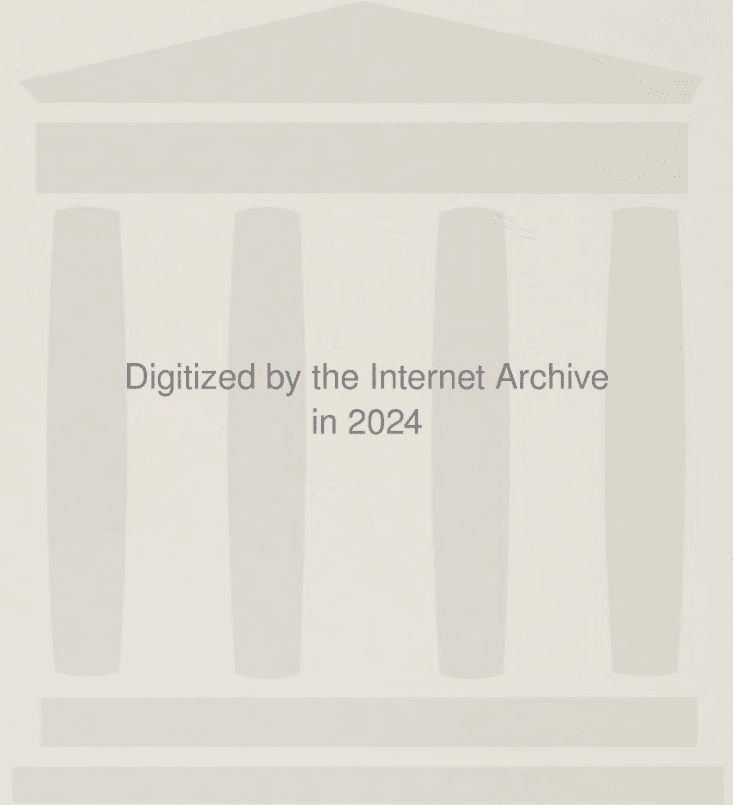


Type-O-Rama


- 将事件纽连接到 Azure Monitor . . . . . . . . . . . . . . . . . . . . 166
- 拨备 Splunk 使用的虚拟机
- 安装并配置用于 Splunk 的 Azure Monitor 扩展程序 . . . . . . . . . . . . . . . 169


- 与 Azure Storage 的 ATP 集成 . . . . . . . . . . . . . . . . . . . . . . . 177


# 致谢

作者们感谢 Loretta Yates 和整个 Microsoft Press/ Pearson 团队对本项目的支持，并感谢 Hayden Ainsworth 撰写序言。我们还感谢其他为本书编写侧边栏做出贡献的微软同事：Nicholas DiCola, Oren Parag, Koby Koren, Sarah Fender, Ramon Pliskin, Laura Machado de Wright, Miri Landau, Ben Kliger, Michelle Sherwood, Ajeet Prakash, Anupam Vijay, Michelle Shewald, Milad Aslaner, John Kemnetz, Ben Nick, Laura Hunter, 以及 Michael Bargarg。感谢 Tiander Turjin 在编写附录 A 方面的出色工作。我们还要感谢 Mike Martin 审核本书。

Yuri 还要感谢：我的妻子和女儿无尽的支持；上帝赋予我力量并在道路的每一步上指引我；我伟大的朋友兼合作者 Tom Shinder 带来了又一次精彩的合作；Azure Security Center 工程 / 开发团队（Gilad Elyasha, Meital Taran-Gutman, Itamar Falcon, Maya Herskovic, Ron Matchmoro, Ronit Reger, Rotem Lurie, Yoav Francis, Yanish Shasha, Ron Weiner, Yan Zohar, Dotan Patrich, Arik Noyman, Yoav Danieli, Li Becker, Lichko, Omer Chechik, Elie Sage, Vlad Korsansky, Jonathan Gazit, 以及 Tamer Salman）他们持续的合作与贡献。感谢我的经理 Nicholas DiCola 以及整个 CxE ASC 团队的杰出伙伴关系。最后，也是同样重要的，感谢我的父母辛勤工作供我教育，这是我每天在职业生涯中不断前进的 Foundation。

Tom 想要感谢的人非常多，在分配的空间内无法全部列出。最重要的是 Yuri Diogenes，他促使我再次合作了一本书；我不知道为什么，我知道每次我们写书时都会让他抓狂。尽管如此，Yuri 是我以及周围人的福音，让我没有在功劳上停步。我要感谢 David Cross 带我进入 Azure Security Engineering 以及这里提供的精彩机会。重点感谢 Avi Ben-Menahem，他一直支持我的努力，是所有人的榜样。绝不忘记，我要感谢 Karen Dahmen 和 Laurie Litack，他们是任何人过的最好的经理，也是他们工作对象的灵感来源。让我们向整个 Azure Security Engineering 团队致敬——他们的奉献、勤奋、智慧和工作时长无与伦比，这些特质成就了 Azure 是行业最安全的云服务平台。最后，永远感谢我的妻子——我一生的挚爱、伴侣；感谢上帝赐予我远超我应得的生活。

## 关于作者

## Yuri Diogenes

Yuri Diogenes 是 Azure Security Center 的产品经理。他自 2006 年起在微软工作，主要从事网络安全和事件响应。2011 年至 2017 年，他在 CSS 团队工作，帮助客户上线并部署 Security Center。Yuri 拥有德克萨斯大学奥斯汀分校的安全科学硕士学位。他出版了 20 多本安全书籍。Yuri 还拥有 CISP、EJCE、CySA+、Cloud+、Security+、IncidentSec Responder、MCSE 和 MCTS 认证。你可以在 Twitter 上关注 @yuridiogenes 或阅读他的个人博客：http。

## Tom Shinder

Tom Shinder 是 Azure Security Engineering 的产品经理。他在加州大学伯克利分校获得神经心理学学位，并在伊利诺伊大学芝加哥分校获得医学博士学位。在职业转型之前，他是一名神经科医生。他关于安全和架构编写了 30 多本书。在不忙于处理密钥和秘密时，可以在 Azure 控制台中找到 Tom。


读完这本书，你将更好地理解什么是安全中心（Security Center）以及如何将其整合到你的安全运营中心（SOC）中。Yuri 和 Tom 之所以想写这本书，是因为许多客户要求一份一站式的资源，教他们如何安装和操作安全中心。这本书是专为安全分析师、架构师、云运维人员和 IT 专业人员编写的。

如果你之前读过 Tom 的作品，你会知道他是一位长期、经验丰富且资深的安全老兵和作家。他还是 Azure 安全工程团队的高级项目经理。如果你想了解更多信息，可以在 Twitter 上关注他并阅读他的博客。在从事本地服务器工作期间以及迈向云端的旅程中，他积累了丰富的知识和智慧。

Yuri 是另一位享有声誉的作家，在他担任 Azure 安全内容撰稿员期间，他发布了一份又一份的文档。他最近加入了我的团队，担任高级项目经理，支持客户和合作伙伴使用微软云及企业安全产品和服务的成功。他拥有丰富的信息储备，并擅长将复杂问题简单化。

让我们深入浅读吧。

Hayden Hainsworth
工程总监 – 项目管理
微软网络安全工程部

## 引言

欢迎阅读 Microsoft Azure Security Center。这本书与 Azure Security Center 产品组共同开发，旨在提供有关 Azure Security Center 的深度信息，并根据在不同环境中使用产品的实际经验演示最佳实践。

本书的目的是介绍 Azure Security Center 提供的各种安全功能和能力。在了解所有这些安全选项后，你将深入研究它们如何在多种运营安全场景中被使用，从而充分利用 Azure Security Center 仅提供的保护、检测和响应技能。

## 这本书是给谁看的？

Microsoft Azure Security Center 适用于任何对 Azure 安全感兴趣的人：安全管理员、支持专业人员、人员和工程师。

Microsoft Azure Security Center 的设计旨在为整个 Azure 用户群体提供帮助。无论你是没有安全经验、只有一定经验，还是安全专家，都能从 Azure Security Center 中获益。此书对 Azure Security Center 解决的大量安全问题提供了入门级、中级和高级的覆盖。

其方法是教学式、叙述式和体验式教学的独特结合。教学式涵盖了服务的核心介绍。叙述式利用了你已掌握的知识，我们将你目前的理解与书中引入的新概念联系起来。

最后，体验部分通过两种方式呈现——我们分享在使用 Azure Security Center 的经验以及如何充分利用其价值，通过分步骤、引导的方式展示如何配置 Azure Security Center 以获得它能提供的所有益处。

在书中，你将学习：

- 无论你的安全经验水平如何，如何保护你的 Azure 资产
- 如何通过消除试错来节省数小时、几天甚至几周的时间
- 如何通过充分利用 Azure Security Center，比以往任何时候都更好地保护、检测和响应安全威胁

## 系统要求

- 任何拥有 Microsoft Azure 订阅的人都可以使用书中的信息。

## 错误更正、更新与书籍支持

我们已尽全力确保本书及其配套内容的准确性。你可以在以下地址访问本书的更新（形式为提交的错误列表及其相关修正）：

MicrosoftPressStore.com/Azuresecuritycenter/errata

如果你发现了未列出的错误，请在同一页面上向我们提交。

如需获得额外的书籍支持和信息，请访问 https://MicrosoftPressStore.com/Support。

请注意，我们不通过上述地址提供针对微软软件和硬件的产品支持。如需获取微软软件或硬件的帮助，请访问 http://support.microsoft.com。

## 保持联系

让我们保持交流！我们在 Twitter 上是：http://twitter.com/MicrosoftPress。

## 威胁格局

2017 年 5 月 12 日，主流媒体开始报道了一场名为 WannaCry 的大规模勒索软件攻击，这让全世界感到震惊。在一天之内，全球 150 多个国家的 23 万计算机被感染。该攻击是通过利用未应用 MS17-010 补丁的计算机实现的（该补丁于 2017 年 3 月发布，用于修复微软 SMB 漏洞）。除了影响家庭用户，这次攻击还打击了英国国家医疗服务体系（NHS）等机构。打过补丁的计算机不受影响。（当然，这强调了建立完善的更新管理程序的必要性！）

像 WannaCry 这样的勒索软件——或者 Petya（允许横向移动，意味着只需要一台受感染机器就可能导致整个网络崩溃），只是当前格局中的威胁之一。还有许多其他威胁。在我们深入 Azure Security Center 之前，你需要充分了解当前的威胁以及背后人员的动机。当前的威胁范围从老旧但有效的技术（如钓鱼邮件）到国家赞助的攻击，以及两者之间的一切。例如，一个常见的威胁是侧载式下载网站。另一个是木马。此外还有将云资源武器化以攻击本地资产。本章探讨了这些威胁中的几种，为你使用 Azure Security Center 做好准备。首先，它讨论了网络犯罪和网络杀伤链、建立安全态势以及“假设方法”（assume-approach）。

## 理解网络安全

为了名声而黑客的时代已经过去了。如今，网络攻击背后的主要动力是某种财务收益。

网络犯罪投诉中心（IC3）是美国联邦调查局（FBI）网络部门的一部分。根据其 2017 年网络犯罪报告（https://pdf.gov/2017/ic3report），IC3 收了 1783 起关于勒索软件的投诉，导致损失超过 23 万美元。技术支持诈骗也留下了 1500 万美元的损失。最后，2017 年美国的总损失超过了 142 万美元。

你可能好奇黑客如何通过他们窃取的数据获利。这是一个很好的问题。黑客通过组织犯罪集团进行工作，并利用全球分布的基础设施来发动攻击。在发起攻击之前，他们会在网络犯罪市场上寻找。

这些技术网络犯罪分子有不同的在线方案，他们可能会提供反病毒（AV）服务，通过扫描反病毒引擎来确保新的恶意软件可以成功部署。另一种方案是用于在线活动的防弹托管。（之所以被称为“防弹”，是因为这些服务器的所有者在发生调查时不会配合执法部门）。甚至还有托管服务在技术犯罪与其客户之间的在线交易中充当第三方。

>  了解微软云和高级分析如何助力打击犯罪 https://aka.ms/stoppingcrime

在 2017 年和 2018 年期间，网络犯罪分子意识到通过定制用于恶意意图的货币矿可以从加密货币中获利。这是通过运行一种旨在运行加密货币矿的恶意软件攻击活动来实现的，该活动在受害者计算机中部署并运行木马矿。为了让加密货币矿能够正常工作并获得更高利润，攻击者必须在目标系统中保持持久。加密货币矿在内存中未被发现并存在的时间越长，它们窃取的资源就越多。

为了实现这一目标，网络犯罪分子使用了先进的代码注入方法，例如无文件技术。这种攻击通常利用目标系统中已有的工具，例如 PowerShell。通过利用计算机上已有的工具，它们不需要写入硬盘；相反，它们只需要接管目标进程，在其内存空间运行一段代码，然后使用该代码调用将执行攻击的工具。这里的问题是：你有针对性的检测吗？有 Azure Security Center！

## 理解网络杀伤链

在防御系统免受网络犯罪分子侵害的最具挑战性的方面之一是识别这些系统何时被用于某种犯罪活动——特别是当它们成为僵尸网络的一部分时。僵尸网络是一个受攻击者控制且所有者不知设备网络。僵尸网络并非新事物。事实上，微软 2012 年的一项研究发现，网络犯罪分子利用 Nitol 僵尸网络渗透了安全的供应链，引入嵌入恶意软件的伪造软件，在计算机购买之前对其进行感染。（欲了解更多信息，请参见 https://aka.ms/nitol。）

防止此类攻击（或任何攻击）的最佳方法是识别攻击向量——即攻击者将如何攻击你的环境。为了对此，洛克希德公司（Lockheed Martin）开发了网络杀伤链。链中的每个步骤都代表一个特定的攻击阶段。（见图 1-1。）


图 1-1 网络杀伤链步骤示例

该链条中的步骤如下：

- 1. **外部侦察**：在此步骤中，攻击者通常搜索公开数据，以获取尽可能多关于目标的信息。此步骤的目标是获取情报，或称*情报 (intel)*，以便更好地执行攻击并增加成功概率。
- 2. **受攻陷机器**：在此步骤中，攻击者利用不同技术（如社会工程学）诱导用户执行某些操作。例如，攻击者可能会发送网络钓鱼邮件，诱导用户点击导致机器受损的链接。其目标是在受害者网络中建立立足点。
- 3. **内部侦察与横向移动**：在此步骤中，攻击者执行主机发现，识别并映射内部网络和系统。攻击者可能开始在主机之间进行横向移动，寻找可以攻破的特权账户。
- 4. **低权限横向移动**：在此周期中，攻击者继续寻找具有管理权限的账户，以便执行*本地权限提升*攻击。该周期通常会持续，直到攻击者找到一个可以攻破的管理员用户账户。
- 5. **域管理员凭据**：此时，攻击者需要获得*域主权限*。为了实现这一点，攻击者将在网络中进行枢纽跳转，寻找价值数据，或安装勒索软件或其他任何可用于未来勒索尝试的恶意软件。

> **重要**：在本书中，理解这些步骤至关重要，你将学习如何使用 Azure Security Center，通过检测不同阶段的攻击来中断杀伤链。

# 常见威胁

如所述，攻击类型之一是使用路过式下载网站。这些网站托管了一个或多个针对网络浏览器及浏览器插件漏洞的利用程序。根据《微软安全智能形势报告》第 22 卷，Bing 在 2017 年 3 月检测到索引中每 1,000 个页面即有 0.17 个路过式下载页面。

根据同一报告，在 2017 年第一季度，木马是最常见的恶意软件类型（其次是蠕病毒和释放器）。木马总是伪装成实用的应用程序。例如，Win32/Zadupi 木马，也称为 WinZipper(%ProgramFiles%\WinZipper) 或 QkSee(...)。除了在开始菜单中创建自己的快捷方式（见图 1-2）允许用户压缩和解压缩文件外，该木马还会创建一个服务 (qkseeService)，连接到命令与控制 (C2 服务器) 并定期使用 HTTP 请求检查指令。通常，这些指令会静默下载新文件，这些文件可能包含将在本地计算机上执行的恶意软件。这只是威胁传播方式的一个例子。

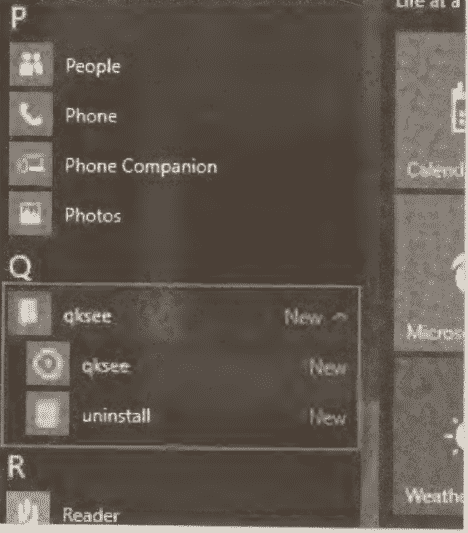

图 1-2 QkSee 的典型安装位置

如今，用户几乎总是目标，因为他们是最薄弱的一环。随着移动设备、自备设备 (BYOD) 模式和云端应用的普及，用户正在安装越来越多的应用程序。很多时候，这些仅仅是伪装成合法应用的。由于由于原因，许多程序的行为与 QkSee 类似，因此，拥有良好的端点保护以及一个能够跨不同源、利用分析和机器学习等尖端技术智能识别未知威胁的检测系统至关重要。

# 构建安全态势

曾有网络安全专家建议组织只需投入更多资金保护其资产。然而，今天仅仅投资保护资产是不够的。相反，组织应该投资于构建稳固的安全态势。如图 1-3 所示，安全态势由三个支柱组成。

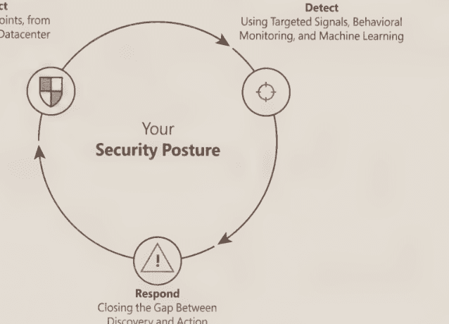

图 1-3 安全态势的三大支柱

根据 InfoSec Institute 的数据，攻击者在网络中潜伏平均为 200 天而不被发现。（更多信息请参见 http://resources.infosecinstitute.com/the-seven-steps-of-a-successful-cyber-attack）。毫无疑问，让攻击者在你的网络内部停留这么久是非常长的时间。然而，这里的关键词是“检测”。没有良好的检测机制，你就无法中断攻击。因此，投资于全方位解决方案来监控云资源以及本地资产是势在必行的。你必须能够快速检测攻击，并使用可操作的数据来改进你的响应。话虽如此，收集数据而不进行分析只会延迟响应过程。这就是为什么使用利用行为分析、威胁情报和机器学习等技术进行数据关联的工具是如此重要。Azure Security Center 可以做到这一点。

# 假设已攻破

微软意识到，仅仅防御入侵是不够的。除了传统的防御流程和技术，我们意识到必须做得更多。这种“更多”包含在“假设已攻破”的哲学中。虽然我们希望不会被攻破，但我们知道希望是一种糟糕的策略。因此，我们假设网络即将被攻破——或已经被攻破——然后开发出人员、流程和技术，帮助我们在入侵发生后尽可能早地发现，并驱出攻击者，目标是限制入侵范围。由于攻击者通常通过低价值目标进入系统，如果我们能快速检测到目标受损，就能阻止攻击者从低价值资产向高价值资产扩展。这些高价值资产是攻击者的最终目标。

我们如何做到这一点？一种有效的方法是使用红队对抗或红蓝对抗。在这些演练中，红队扮演攻击者角色，蓝队扮演防御者角色。我们定义演练的参数。然后，在约定的持续时间内，红队尝试攻击 Azure 基础设施，蓝队尝试发现红队所做的操作并尝试阻止红队破坏其他系统。

演练结束后，红蓝双方将讨论发生的情况。具体主题包括：

- 红队可能进入的方式；
- 蓝队是如何发现并驱逐红队的；
- 使发现受损系统更快、更容易的新技术和操作流程。

# 云威胁与安全

正如本章开头所示，云武器化正在发生，目前《安全智能形势报告》第 22 卷中的数据显示了这些攻击的全球范围。根据这些报告，2017 年第一季度来自中国 (35.1%)、美国 (32.5%) 和韩国 (3.1%) IP 地址对 Azure 服务的攻击超过二之二。其余攻击分布在其他 116 个国家和地区。有时，威胁者会将云武器化并向目标系统发送攻击，如图 1-4 所示。


加密货币挖掘是一种日益增长的威胁，而当你将其与云计算的弹性相结合时，就形成了完美的风暴。假设某云管理员错误配置了 Kubernetes 或 Docker 仓库，这种错误配置导致系统暴露，允许公共免费访问。攻击者可以部署容器来挖掘他们的加密货币。

将云资源武器化以攻击不同的目标系统的情况如图 1-4 所示。该图表示了攻击者访问位于云端的虚拟机，并利用这些虚拟机的计算资源来攻击本地资产。这是一个典型的云武器化场景。

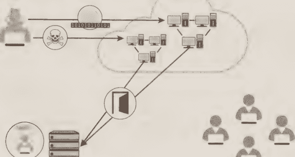

图 1-4 针对本地资源的云武器化

云中的另一个潜在威胁源于配置和 DevOps 的缺陷。一个常见的场景是在公有云中共享了公钥密钥。此类事件发生在 2015 年，当时有机器人正在扫描 GitHub 以窃取 Amazon EC2 密钥。图 1-5 所示的图展示了类似的场景。

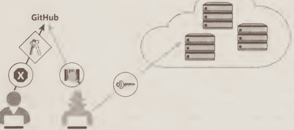

图 1-5 公共密钥攻击场景

更多信息：你可以在 https://www.the register.co.uk/2015/01/06/dev_blunder_shows_github_crawling_with_keyslurping_bots 找到更多关于 GitHub 机器人的信息。

攻击者还在转移精力以规避云工作负载保护平台（CWPP）的检测。2019 年 1 月，来自 Palo Alto Networks（来自 Networks）的一份报告显示了 Rocke 组使用的恶意软件如何开发出在显示恶意行为迹之前卸载 CWPP 代理的能力。云提供商必须采取行动修复此类场景，当你选择 CWPP 时，你需要了解这些 CWPP 如何应对新威胁。

更多信息：有关 Palo Networks 报告的更多信息，请参阅 https://unit42.paloaltonnetworks.com/malware-used-by-rocke-group-evolves-to-evade-detection-by-cloud-security-products/。

因此，在采用云计算之前，组织必须首先理解云计算模型继承的安全性考虑因素。这些考虑因素在采用之前必须经过修订——理想情况下是在规划过程中。如果没有完全理解云安全考虑因素，云计算的整体成功采用可能会受到影响。

考虑以下云安全领域：

- 合规性
- 风险管理
- 身份和访问管理
- 运营安全
- 终端保护
- 数据保护

这些领域都必须被考虑；某些领域可以更深入地探讨，其他取决于你所处理的业务类型。接下来的章节将更详细地描述这些场景。

## 合规性

在迁移到云的过程中，组织需要保留自身的合规义务。这些义务可能由内部或外部法规规定，例如他们为了支持其业务模式而需要遵守的行业标准。云提供商必须能够帮助客户通过云采用来满足其合规要求。

在许多情况下，云解决方案提供商（CSP）将成为客户合规链的一部分。考虑与你的云提供商密切合作，以识别你组织的合规需求，并验证提供商如何满足你的需求。验证 CSP 是否在提供安全可靠云服务方面拥有良好记录，同时保持客户数据的私密性和安全性也是重要的。

> **更多信息**有关关于微软合规方法的更多信息，请参阅 https://www.microsoft.com/en-us/trustcenter/default.aspx。

理想情况下，你的云安全态势管理（CSPM）平台将使你能够将应用于云工作负载的安全控制映射到主要的法规合规标准中。

## 风险管理

云客户必须信任 CSP 托管其数据。CSP 应该建立政策和计划来管理在线安全风险。这些政策和计划取决于环境的动态程度。客户应该与 CSP 密切合作，并要求完全透明，以理解风险决策、这些风险如何根据数据敏感性而变化，以及所需的保护级别。

> **注意** 微软使用基于在 Web 上提供服务长期经验的成熟风险管理流程。


计划采用云计算的组织必须意识到可用的身份和访问管理方法，以及这些方法将如何与它们当前的本地基础设施集成。

如今，随着用户在任何位置使用不同的设备工作并访问跨不同云服务的应用程序，保持用户的身份安全至关重要。事实上，随着云的采用，身份变成了新的边界——它是你整个架构的控制面板，无论是在本地还是在云端。你应该使用用户身份来控制从任何设备对任何服务的访问，并获得对数据如何被使用的可见性和洞察。

作为访问管理，组织应该考虑审计和日志功能，这可以帮助管理员监控用户活动。管理员必须利用云平台评估登录活动，并直接从身份管理门户采取预防措施。


迁移到云的组织应该相应地演进其内部流程——安全监控、审计、事件响应和取证。云平台必须允许 IT 管理员实时监控服务以观察这些服务的健康状况，并提供快速恢复中断服务的能力。你还应该确保部署的服务按照与 CSP 建立的服务水平协议（SLA）进行操作、维护和支持。

云安全不仅涉及 CSP 基础设施的安全性；它是一项共同责任。终端保护是组织负责的安全方面之一。采用云计算的组织应该考虑增加终端安全，因为这些终端将暴露更多的外部连接和可能由不同云提供商托管的应用程序。

用户是攻击的主要目标，终端可能是用户的工作站、智能手机或任何可能用于访问云资源的设备。攻击者知道用户是安全链中最薄弱的一环，攻击者将继续使用社交工程技术（例如钓鱼邮件）诱导用户执行可能损害终端的操作。

> 重要： 保护特权访问是建立业务安全保障的关键步骤。请确保在 https://.ms/cyberpaw 阅读更多关于特权访问工作站的信息，并了解更多关于微软保护高价值资产的方法论。

实现你的终端保护和云工作负载端到端可见性的一种方法是将你的云工作负载保护平台（CWPP）与你的终端检测和响应（EDR）解决方案集成。


关于云安全，迁移到云的目标是确保数据无论位于何处都是安全的。数据可能存在于以下任何状态和位置：

- 用户设备上的静态数据：在这种情况下，数据位于终端，终端可以是任何设备。你应该始终对公司设备和 BYOD（自带设备设备）场景执行静态数据加密。
- 从用户设备到云的传输中数据：当数据离开用户设备时，你应该确保数据受到保护。有很多技术可以无论数据位置如何进行加密——例如 Azure 权限管理。确保传输通道加密至关重要。因此，你应该强制使用传输层安全协议（TLS）传输数据。
- 云提供商数据中心的静态数据：当数据到达云提供商的服务器时，CSP 的存储基础设施应该确保冗余和保护。确保你了解 CSP 如何执行静态数据加密，谁负责管理密钥，以及如何执行数据冗余。


Azure 安全有两个方面——即微软如何保护其 Azure 平台安全免受攻击者的侵害。另一方面是微软为使用 Azure 的客户提供的 Azure 安全能力。

Azure 基础设施通过在不同层级实施安全控制，采用了深度防御的方法。这涵盖了从物理安全、数据安全，到身份和访问管理，再到应用安全，如图 1-6 所示。

图 1-6 多层防御

> **重要** 本书未深入介绍 Azure 安全基础设施。有关此的更多信息，请阅读 Microsoft Press 出版的、由 Tom Shinder、Debra Shinder 和 Yuri Diogenes 的《Microsoft Azure Security Infrastructure》。

从 Azure 订阅所有者的角度来看，控制用户的身份和角色至关重要。订阅所有者或账户管理员是注册 Azure 订阅员。此人员被授权访问账户中心并执行所有管理任务。对于新订阅，账户管理员也是服务管理员，并继承管理 Azure 门户的权限。客户应该应对谁有权访问此账户保持非常小心。Azure 管理员应使用 Azure 的基于角色的访问控制 (RBAC) 为用户授予适当的权限。

一旦用户根据其授权级别通过身份验证，其将能够使用 Azure 门户管理其资源。这是一个统一枢纽，简化了构建、部署和管理您的云资源的流程。Azure 门户还会计算现有费用并预测客户的每月费用，无论跨应用程序的资源量多少。

订阅可以包含零或多个托管服务，以及零或多个存储账户。通过 Azure 门户，您可以置备新的托管服务，例如新的虚拟机 (VM)。这些虚拟机将使用从 Azure 计算和存储组件中分配的资源。它们可以在 Azure 基础设施内部以孤立的方式运行，也可以从互联网公开。您可以安全地发布您的虚拟机中可用的资源（例如 Web 服务器），并使用访问控制列表 (ACL) 访问这些资源。您还可以通过创建不同的虚拟网络 (VNet) 并使用安全组 (NSG) 控制 VNet 之间的流量来隔离云中的虚拟机。


当您考虑保护 Azure 中的虚拟机时，必须进行整体考虑。也就是说，您不仅必须考虑利用内置的 Azure 资源来保护虚拟机，还必须考虑保护操作系统本身。例如，您应该实施安全最佳实践和更新管理，以保持虚拟机最新状态。您还应该监控对这些虚拟机的访问。

某些 VM 操作包括以下：

-   监控并报告告警

> **重要** 有关计算安全的更多详细信息，请访问 https://docs.microsoft.com/en-us/azure/security/security-virtual-machines-overview。


Azure 虚拟网络与您在本地使用自己的虚拟化平台解决方案（如 Hyper-V 或 VMware）时的虚拟网络非常相似。Azure 使用 Hyper-V，因此您可以利用 Hyper-V 虚拟交换机进行网络。您可以将 Hyper-Virtual 交换机理解为代表虚拟机虚拟网络接口连接的虚拟网络接口。图 1-7 展示了 Azure 虚拟网络如何在多租户环境中进行分布。


|  |


# 工作区配置

Azure Pass - 拥有权

安全中心从你的资源和服务收集安全数据和事件，以帮助你预防、检测和响应威胁。了解更多

# 设置

- 数据收集
- 威胁检测

## 自动配置

此功能可在你的订阅中的所有虚拟机上自动安装 Microsoft 监控代理。如果启用，任何未安装代理的新或现有虚拟机都将进行配置。了解更多

- 电子邮件通知
- 价格层级

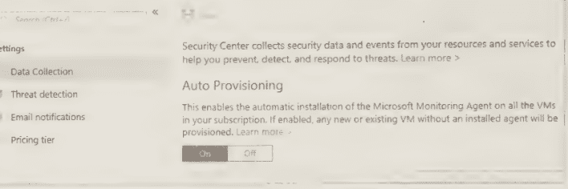

图 2-12 自动配置允许自动安装代理。

# 工作区配置

安全中心收集的数据存储在 Log Analytics 工作区中。你可以选择将来自 Azure 虚拟机的数据收集存储在安全中心创建的工作区，或你创建的现有工作区中。了解更多

- 使用安全中心创建的工作区（默认）
连接 Azure 虚拟机并报告到安全中心创建的工作区
- 使用其他工作区
连接 Azure 虚拟机并报告到所选的工作区


图 2-13 控制工作区的选项。

在同一选项页中，你还可以配置 Windows 系统的数据收集粒度级别，如图 2-14 所示。

## 存储额外的原始数据

你可以在 Log Analytics 工作区中存储事件、日志和额外的安全数据。这些数据允许你对威胁进行审计、调查和分析。

## Windows 安全事件

选择要收集和存储的 Windows 安全事件。当你在此处更改选择时，你将开始为存储的事件付费。

更多详情：

- 所有事件（All Events）
  所有的 Windows 安全和 AppLocker 事件。
- 连续（Continuous）
  用于审计目的的标准事件集。
- 最小（Minimal）
  一组可能指示潜在威胁的小量事件。启用此选项后，你将无法获得完整的审计跟踪。
- 无（None）
  无安全或 AppLocker 事件。

图 2-14 控制代理将收集的事件类型的选项

每个设置将决定要收集的事件类型。如果你正在使用组策略对象 (GPO) 来配置将安装代理的服务器，建议通过使用“创建事件 4688”启用审核策略，并在“审核进程创建”中的“命令行”字段内确定操作系统在创建（启动）进程时是否生成审核事件。启用这些策略对于安全中心理解计算机如何被使用至关重要。信息包括创建进程的程序或用户名称。以下是每个选项收集的事件摘要：

- 所有事件（All Events）：如果你选择此选项，安全中心将收集所有事件。换句话说，如果你选择此选项，将不会对事件进行过滤。
- 常用（Common）：当你选择此选项时，安全中心会显示事件的子集。微软认为这些事件（包括登录和注销事件）提供了足够的细节来代表合理的审计跟踪。根据行业对于什么构成完整审计跟踪的共识，还包含了 Kerberos 操作、安全组更改等其他事件。
- 最小（Minimal）：选择此设置导致显示的事件比“常用”设置更少，尽管我们不确定省略了多少或什么类型的事件。微软与客户合作，以确保此配置能够显示检测到成功破解的事件，并记录重要的低流量事件；然而，不会记录注销事件，因此不支持完整的用户审计跟踪。
- 无（None）：不包含任何安全警报，也不包含操作系统日志或 App Locker 日志的信息，并禁用了安全存储。

要启用自适应应用程序控制（Adaptive Application Controls）的数据收集，安全中心将配置一个审核模式下的本地 Appocker 策略以允许所有应用程序。这将导致 Appocker 生成事件，然后由安全中心收集和利用。重要的是，此策略不会在已配置 Appocker 策略的机器上配置。要收集 Windows 过滤平台事件 ID 5156，你需要启用审核连接（Auditpol /set /subcategory:"Filtering Platform" /Success:Enable）。

访问 Windows 事件 详情

## 加入本地或不同云提供者的虚拟机

如之前所述，位于 Azure 的虚拟机将自动配置，这意味着监控代理将自动安装。如果你需要加入本地或位于不同云提供者的虚拟机，你需要手动安装代理。按照以下步骤加入非 Azure 计算机：

1. 打开 Azure 门户并使用具有安全管理员（Security Admin）权限的用户登录。
2. 在左侧导航格中，点击“安全中心”（Security Center）。
3. 在安全中心的左侧导航格中，在“常规”（General）下，点击“入门”（Getting Started）选项，并点击“已”（Started）选项卡。
4. 在“非 Azure 计算机”下，点击“配置”（Configure）按钮，如图 2-15 所示。

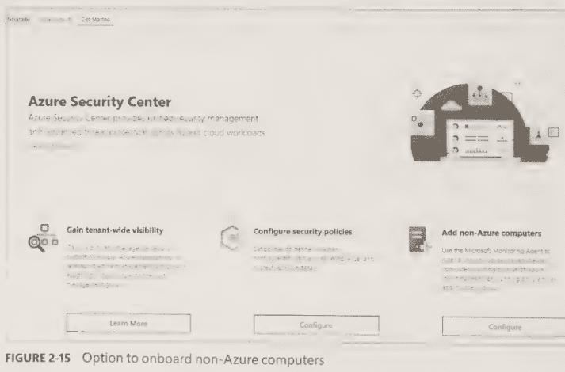

图 2-16 工作区选择

## 添加新的非 Azure 计算机

为了将非 Azure 计算机加入安全中心，需要一个 Log Analytics 工作区。选择现有工作区或新建工作区

- 将端点添加到无安全解决方案的工作区将无法在 Azure 安全中心下保护它们。

| 工作区名称 | 虚拟机与计算机 | 订阅 |
| --- | --- | --- |
| workload | 0 | Visual Studio Ultimate with MSN | 添加计算机 |

5. 点击此按钮后，将“**直接代理**”（Direct Agent）页面，如图 2-17 所示。

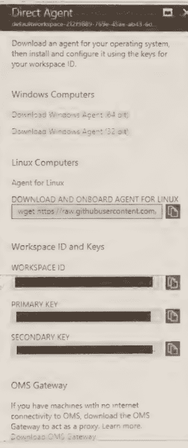

图 2-17 代理选择


6.在此页面上，您应该点击适当的 Windows Agent（64 位或 32 位版本），如果您正在 Linux 操作系统上安装，请点击 Agent for Linux 链接。确保将 Workspace ID（工作区 ID）和 Primary Key（密钥）复制到剪贴板；在目标系统上安装时您将需要这些值。下载完成后，可以通过关闭浏览器来关闭安全中心（Security Center）仪表板。然后将代理安装文件复制到客户端可以访问的共享网络位置。

在本例中，代理的安装将在一台位于本地的 Windows Server 2016 计算机上进行。然而，相同的步骤也适用于位于云端的非 Azure 虚拟机。登录到目标系统，并按照以下步骤执行安装：

- 1. 双击 `MMASetup-AMD64.exe` 文件，如果出现“打开文件 – 安全警告”对话框，点击“运行”。

- 2. 如果出现“用户账户控制”对话框，点击“是”。

- 3. 在“欢迎使用监控代理程序设置向导”中，点击“下一步”。阅读 Microsoft 许可条款，并点击“我同意”。

- 5. 在“目标文件夹”页面上，保留默认选择并点击“下一步”。出现“代理设置选项”页面，如图 2-18 所示。

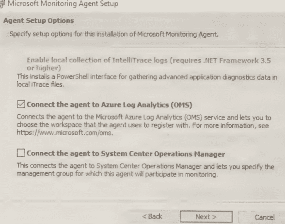

图 2-18 选择目标服务

6. 选择“Connect The Agent To Azure Log Analytics (OMS)”，如图 2-18 所示，并点击“下一步”。出现 **Azure Log Analytics** 页面，如图 2-19 所示。

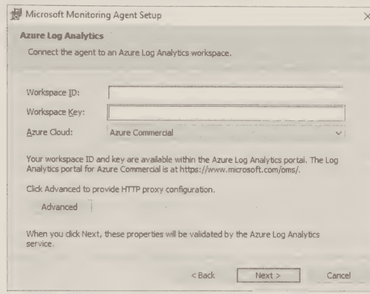

**图 2-19** 提供工作区 ID 和密钥

7. 在此页面上，您需要输入在上一个操作的步骤 5 中获取的 Workspace ID 和 Primary Key。注意，Primary Key 应输入在 **Workspace Key** 字段中。如果此计算机位于代理服务器之后，您需要点击 **Advanced**（高级）按钮并在必要时提供代理 URL 和身份验证。完成填写这些选项后，点击 **Next**。

8. 在 **Microsoft Update** 页面上，选择 **Use Microsoft Update for Updates（Recommended）**，并点击 **Next**。

9. 在 **Ready To Install** 页面上，检查摘要字段并点击 **Install**。

10. 出现 **Installing The Microsoft Monitoring Agent** 页面，安装继续。

11. 一旦安装完成，将出现 **Monitoring Agent configuration Completed Successfully** 页面；点击 **Finish**。

您也可以使用命令行界面 (CLI) 执行此安装，可以使用以下示例：

```
MMASetup-AMD64.exe /Q:A /R:N /C:/setup.exe /qn ADD_OPINSIGHTS_WORKSPACE=1 OPINSIGHTS_
WORKSPACE_AZURE_CLOUD_TYPE=0 OPINSIGHTS_WORKSPACE_ID=<workspaceid> OPINSIGHTS_
WORKSPACE_KEY=<workspaceprimarykey> AcceptEndUserLicenseAgreement=1
```

重要提示：此示例中的 `/C` 开关使用 IExpress 作为其自解压缩程序。有关 IExpress 的更多信息，请参阅 https://support.microsoft.com/en-us/help/197147。

您在代理安装中看到的大多数参数都是自解释的；唯一的例外是 OPINSIGHTS_WORKSPACE_AZURE_CLOUD_TYPE，它是云环境规范。默认值为 0，代表 Azure 商业云；只有当您在 Azure 政府云中安装代理时，才使用 1。

这台新的 Azure 计算机出现在安全中心中可能需要一些时间，但如果您想验证此计算机与工作区之间的连接性，可以使用 TestCloudConnection 工具。在目标计算机上，打开命令提示符并导航到 `\Program Files\Microsoft Monitoring Agent\Agent` 文件夹。从那里执行命令 `TestCloudConnection.exe`，如果连接正常，您将看到所有测试通过，随后显示：

Test passed for all hosts for workspace id <workspace id>

## 创建工作区

无论出于什么原因，如果您决定需要一个工作区，可以使用 Log Analytics 轻松地创建一个：

- 1. 打开 Azure Portal 并使用具有安全管理员权限的用户登录。
- 2. 在左侧导航窗中，点击“More Services”（更多服务），并输入 Log Analytics。
- 3. 在 Log Analytics 页面上，点击“Add”（添加）按钮。
- 4. 在 Workspace 页面上，点击“Create New”（新建），并在 Workspace 字段中输入工作区名称。
- 5. 选择将用于此工作区的订阅。
- 6. 在 Resource group（资源组）下，选择您要使用的资源组，或创建一个新的。
- 7. 在 Location（位置）下，选择此工作区的地理位置。
- 8. 如果您的工作区位于免费定价层级，则被限制向该服务发送 500 MB 数据。当达到每日限制时，数据收集将停止直到第二天。点击 Pricing Tier（定价层级），将其改为 Per Node（按节点）并点击 OK。
- 9. 点击 OK 完成配置并创建工作区。

您的新工作区显示在 Log Analytics 页面下，如图 2-20 所示。如果没有显示，点击 Refresh（刷新）按钮更新页面。

## 将计算机移动到新工作区

- 1. 在左侧导航窗中，点击 Security Center（安全中心）。

- 2. 在左侧导航窗中，点击 Security Center。

- 3. 在 Security Center 页面下，点击 General（常规），选择您的订阅。

- 4. 在 Data Collection（数据收集）页面上，点击 Use Another（使用另一个），并从下拉菜单中选择工作区，如图 2-21 所示。


图 21 更改工作区

- 5. 点击 Save（保存）提交更改。系统会询问您是否想重新配置到默认工作区：选择 No，新设置仅适用于新发现的虚拟机；选择 Yes，新设置适用于所有连接到安全中心的虚拟机。映射到新工作区的时间取决于环境中的虚拟机数量。按照以下步骤快速识别已迁移到新工作区的虚拟机：

- 1. 打开 Azure Portal 并使用具有安全管理员权限的用户登录。
- 2. 在左侧导航窗中，点击 More Services 并输入 Log Analytics。
- 3. 在 Log Analytics 页面上，点击您创建的工作区。
- 4. 在工作区页面下，在 Data Source（数据源）点击 Virtual Machines（虚拟机），您将看到如图 2-22 所示的机器列表。


图 22 可视化属于工作区的虚拟机

您也可以使用 PowerShell 获取虚拟机的属性（在此例中为 Monitoring Agent）以及工作区 ID，使用 `Get-AzureVMxtension` 命令，如列表 2-1 所示。

列表 2-1 Get-AzureVMxtension 命令

```
C:\> Get-AzureVMxtension -ResourceGroupName "CONTOSST" -VMName "W2012Web" -Name "MonitoringAgent"
ResourceGroupName : CONTOSST
VMName : W2012Web
Name : MonitoringAgent
Location : central
Etag : null
Publisher : Microsoft.EnterpriseCloud.Monitoring
ExtensionType : MonitoringAgent
HandlerVersion : 1.0
Id : /subscriptions/XXXXXXXXXXXX-4a7ecb1a70/resourcegroups
contosocsd/providers/microsoft.compute/virtualmachines/w2012web/extensions/
MonitoringAgent
PublicSettings	: {
  "workspaceId": "XXXXXXXX-XXXX-XXXX-XXXX-XXXXXXXXXXXX",
  "azureResourceId": "subscriptions/XXXXXXXXXXXX-4a7ecb1a70/resourcegroups/contosocsd/providers/microsoft.compute/virtualmachines/w2012web",
  "stopOnMultipleConnections": true
}
ProtectedSettings	:
ProvisioningState	: Succeeded
Statuses	:
SubStatuses
AutoUpgradeMinorVersion	: True
ForceUpdateTag	 :
```

强烈建议填写所有的安全联系电子邮件。您可以输入任意数量的电子邮件地址。安全中心将在警报首次出现时发送电子邮件通知，且仅针对高严重警报。电子邮件选项只能针对订阅策略进行配置。订阅内的资源组将继承这些设置。您收到的电子邮件与图 2-23 所示的类似。


图 23 高严重警报邮件示例


要配置此选项，请遵循以下步骤：

- 1. 在左侧导航区域，点击“安全中心”（Security Center）。
- 2. 在安全中心的左侧导航中，在“策略与合规”（Policy & Compliance）下，点击“安全策略”（Security Policy），点击您想要配置的订阅旁“编辑设置”（Edit Settings）。
- 3. 点击“电子邮件通知”（Email notifications），将出现“电子邮件通知”面板，如图 2-24 所示：

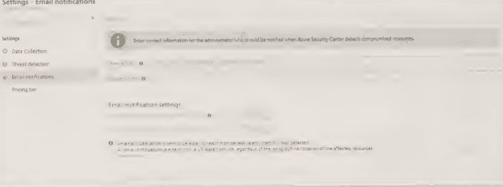

**图 2-24** 电子邮件通知设置

- 4. 在“电子邮件地址”中，输入您想要接收通知的电子邮件。
- 5. 在“电话号码”字段中，使用国际格式输入您的电话号码（仅一个）。例如：+1-415-555-5555。再次，此号码将用于 Azure 安全服务，以便他们在您的资源可能遭到攻破时与您联系。请务必定期审核此号码；将其放入您的策略和程序文档中以便进行审查，因为很容易忘记在这里填写的是什么号码，而且该号码随时可能会更改。
- 6. 在“电子邮件通知设置”下，确保同时勾选这两个选项。
- 7. 点击“保存”。

## 使用 PowerShell 置入资源

在大规模部署中，您可以考虑使用 Security Center PowerShell 模块来帮助您快速执行置入操作。要准备环境，您必须先使用以下命令安装 Az.Security 模块：

```
Set-ExecutionPolicy -Policy AllSigned
Install-Module -Name Az.Security -Force
```

完成后，使用 `Connect-AzAccount` PowerShell 命令登录您的 Azure 账户。下一步是将您的订阅注册到安全资源提供程序（Security Resource Provider）。

运行以下命令，并将 `<subscription ID>` 字段替换为您的订阅号，您可以通过 `Get-AzSubscription` 命令获取。

```
Set-AzContext -Subscription "subscription ID"
Register-AzResourceProvider -ProviderNamespace 'Microsoft.Security'
```

此时，您可以开始在您的订阅中执行置入安全中心所需的操作。通常第一步是从免费版（Free）升级到标准版（Standard）。您将为想要升级的订阅设置上下文，然后使用以下命令进行升级：

```
Set-AzContext -Subscription "subscription ID"
Set-AzSecurityPricing -Name "default" -PricingTier "Standard"
```

您可以使用 `Get-AzSecurityPricing` 来验证您的订阅是否已正确升级到标准版。如果您已经有一个工作区并想将安全中心连接到该工作区，请使用 `Set-AzSecurityWorkspaceSetting` 命令。您需要工作区 ID 来执行此操作，您可以使用 `Get-AzSecurityWorkspaceSetting` 获取此 ID。在此阶段执行的另一个常见操作是启用自动置入，使用以下命令：

```
Set-AzAutoProvisioningSetting -Name "default" -EnableAutoProvisioning
Set-AzSecurityContact -Name "YourName" -Email "youremailaddress" -Phone "yourphone" -AlertAdmin -NotifyOnChange
```

要验证自动置入是否已启用，请使用 `Get-AzAutoProvisioningSetting` 命令。最后建议的操作是为电子邮件通知配置安全联系人信息。要配置此选项，请使用以下命令：

您可以使用 `Get-AzSecurityContact` 验证您的设置是否配置正确。有许多方法可以监控您的 Azure 租户是否包含新订阅，并使用 PowerShell 自动置入这些订阅。有关如何自动化此场景的示例，请访问 http://aka.ms/upgradeazstandard。

## 为什么选择 Azure Security Center？

网络安全行业中有一个常见的调调是：“公司只有两类：已经被黑客攻击过的，以及将来会被黑客攻击的。”这个梗有一个不同的版本，也是我更喜欢的，即：“公司只有两类：知道自己已经被黑客攻击过的，以及不知道自己已经过黑客攻击的。”

这并不是为了制造恐慌的情绪，也不是对不要使用云服务的严厉警告。所有形式的云计算——IaaS、SaaS、微服务等——都能为任何组织提供显著优势。专门针对组织的安全，我甚至会说，云计算有潜力让您获得比在本地环境中从未可能拥有的更高的安全水平。怀疑吗？请继续下看。

行业分析师（当然包括云供应商）长期以来一直赞美公司服务器、服务和应用程序纵扩展（scale-up）和水平扩展（scale-out）的优势。但如果将纵扩展和水平扩展的能力指向网络安全问题会怎样？如果我们不仅利用纵扩展和水平扩展来保护您的基础设施，而且还能增加所有 Azure 客户的安全性呢？这就是微软智能安全图（访问 https://www.microsoft.com/en-us/security/intelligence）。

通过应用 Azure 强大的计算、存储和机器学习能力来解决“我们如何更好地保护客户”的问题，微软开发了基于从海量来源接收的安全信号的安全智能服务，这些来源包括：Office 365、微软帐户（原 Windows Live ID）、数字犯罪调查部门以及 Azure 云平台本身。通过分析来自这些源的流量（每月 450 次身份验证事件和 4000 亿封电子邮件），微软可以识别并响应来自全球互联网的现有和新兴威胁，并迅速保护我们的客户。

Azure Security Center 不是唯一依赖安全图的微软服务，但 ASC 从图中获得的优势是数多多的——我们拥有关于新和新兴僵尸网络、命令与控制网络（C&C）以及攻击者使用的新型恶意软件的准确数据。从一个客户那里学到的知识将馈给 ASC，以便我们保护所有的客户。

想象有一群安全分析师日日夜地研究网络威胁，并识别针对您资源的实际攻击行为，以便我们能够做出响应并保护关键资产。有了 ASC，这种能力内置在服务中，无需您额外工作。

Laura E. Hunter，身份安全部门首席项目经理

## 策略管理

安全中心中的安全策略直接反映了根据您的工作负载触发的安全建议。由于每个组织都有自己的需求，因此评估哪些策略应该启用、哪些策略不适用于您的场景至关重要。

在本章中，您将学习安全中心策略如何与 Azure Policy 集成，以及如何利用这种集成来更好地监控工作负载。


方案定义（Initiative definition）是一组策略定义的集合，旨在实现单一的总体目标。方案定义简化了策略定义的管理和分配。它们通过将一组策略分组为单个项目——即方案定义——来简化策略的分配。图 3-1 显示了这些组件。

## 方案

## 策略定义

## JSON 格式的策略参数


图 3-1 Azure Policy 组件

虽然理解 Azure Policy 非常重要，但在使用 Security Center 策略与 Azure Policy 的集成时，你不需要创建任何方案或策略，因为 Security Center 会自动为你创建。默认方案是 ASC Default (订阅:your_subscription_id)，它包含了所有的安全策略。随着 Security Center 工程团队不断添加新的待监控的服务并创建新的建议，策略的数量将不断变化，这些将反映为新的策略。要访问 Azure Policy 并查看 Security Center 的方案和策略，请按照以下步骤操作：

- 1. 打开 Azure Portal 并使用具有安全管理员（Security Admin）权限的用户登录。
- 2. 在左侧导航窗中，点击“所有服务”并输入“策略”；出现策略窗格，如图 3-2 所示。

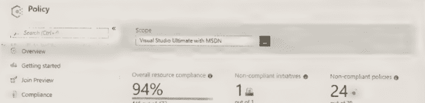

图 3-2 Azure 策略仪表板

- 3. 在“概述”页面上，点击 ASC Default (订阅: your_subscription_id)，会出现方案合规性页面，如图 3-3 所示。（注意，图 3-3 中的订阅、名称和分配 ID 的部分被故意隐藏了）。

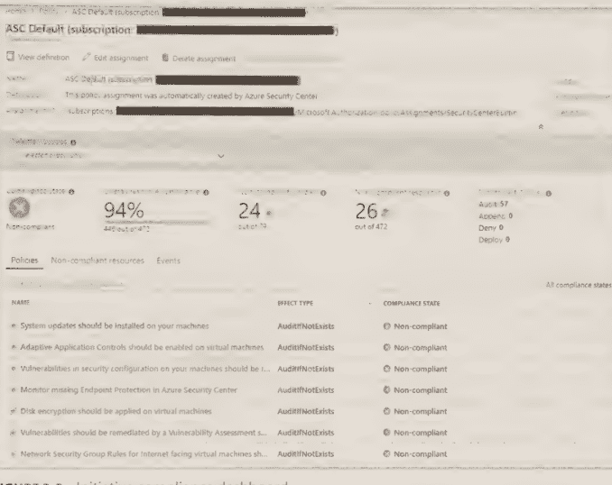

图 3-3 方案合规性仪表板

Security Center 中的安全策略只能在订阅或管理组级别进行分配。如果你查看 Azure Policy 本身，这是一个重要的观察：它可以被分配给资源组；但 Security Center 不可用此项功能。这就是为什么当你在 Azure Policy 中访问此方案时，方案的范围将始终指向订阅本身。

## 微调安全策略

对你在 Azure 中的工作负载拥有完全可见性，并确保你对正在监控的所有资源使用了可用的安全最佳实践是非常关重要的。Security Center 中的安全策略反映了对所有监控资源可以进行的安全评估，如图 3-4 所示。

## Azure AD (租户)

Security Center 策略在 Azure Policy 中创建

## Azure Policy

Security Center 监控订阅

## 订阅

## 资源

Security Center 策略针对特定的订阅以及该订阅内的所有资源

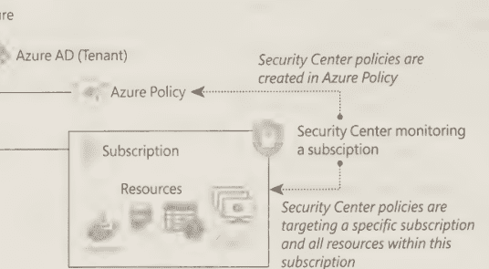

图 3-4 Azure Policy 的核心架构以及其在 Security Center 中的反映

此评估的输出是一系列建议，这些建议将根据订阅拥有的资源类型而异。在某些情况下，建议可能不适用于你的场景。例如，Security Center 建议你启用多因素身份验证 (MFA)，但如果你已经在环境中使用第三方 MFA，那么这可能将没有帮助。由于 Security Center 没有考虑 MFA 的第三方实现，该建议将变成误报。要禁用特定建议，请按照以下步骤操作：

- 1. 打开 Azure Portal 并使用具有安全管理员权限的用户登录。
- 2. 在左侧导航窗中，点击 Security Center。
- 3. 在 Security Center 左侧导航窗中，点击“安全策略”（Security Policy）。
- 4. 在“策略管理”窗格上，点击你想要更改策略的订阅，出现策略窗格，如图 3-5 所示。（注意订阅 ID 已隐藏）。

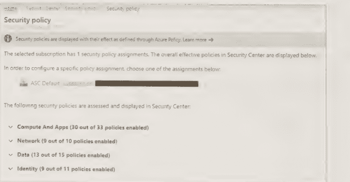

图 3-5 Security Center 中的安全策略

第 3 章 策略管理

- 5. 注意有四个大类，每个类别都有一组策略。你可以从此页面展开每个类别，但你无法在此处更改策略。要更改策略，点击 **ASC Default** (订阅: your_subscription_id) 超链接；将出现“编辑方案 方案分配”（Edit Initiative Azure Assignment）页面，如图 3-6 所示。（注意图 3-6 的部分内容被故意隐藏了）。

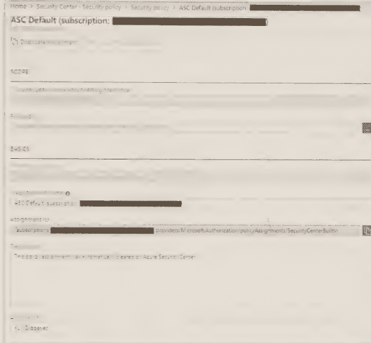

图 3-6 此页面无法编辑某些选项，当你向下滚动到第二部分时，你将看到所有参数。这些参数对应于每个建议（Azure 策略）。找到你想要禁用的建议，点击下拉菜单并点击“已禁用”（Disabled），如图 3-7 所示。（注意该图中订阅 ID 已被故意隐藏）。

- 6. 虽然大多数选项无法从此页面进行编辑，但当你向下滚动到第二部分时，你将看到所有参数。这些参数对应于每个建议（Azure 策略）。找到你想要禁用的建议，点击下拉菜单并点击“已禁用”（Disabled），如图 3-7 所示。（注意该图中订阅 ID 已被故意隐藏）。

## ASC Default (subscription):

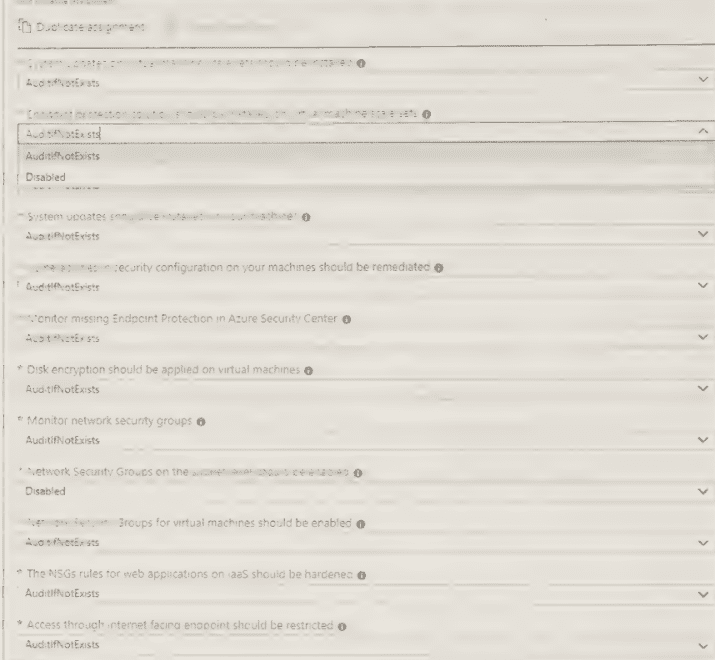

图 3-7 禁用与你的场景不相关的建议

- 7. 对不适用于你场景的建议选择“已禁用”后，点击位于页面底部的“保存”按钮。

- 8. 一旦提交更改，返回 Security Center 概述页面。

现在建议已经更改，你可能需要等待仪表板刷新。Security Center 通常每小时扫描一次新数据并相应地刷新建议。仪表板中的其他项目可能需要更长的时间来更新：

- 操作系统安全配置：最多 48 小时
- 系统更新：最多 24 小时
- 端点保护问题：最多 8 小时

由于每个订阅都有自己的策略，因此会出现你希望为多个订阅部署单一策略的情况。当发生这种情况时，你可以使用管理组。其理念你可以将订阅组织到容器（称为管理组）中并将治理条件应用于这些组，如图 3-8 所示。有关如何扩展规模策略的更多信息，请参见附录 A“管理 Security Center”。

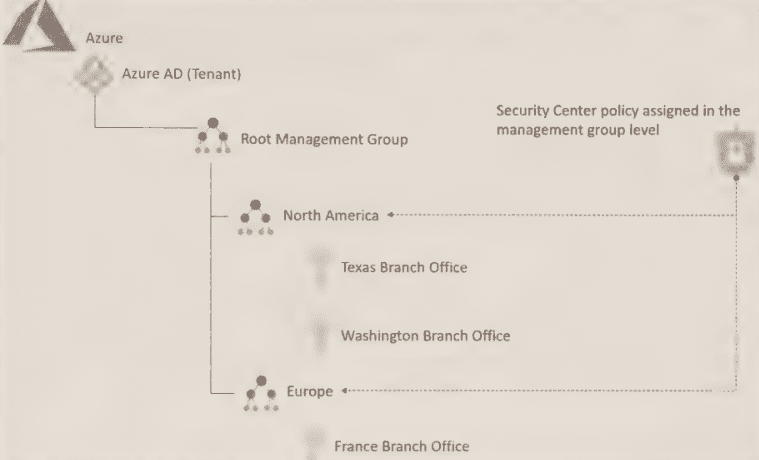

图 3-8 策略应用于管理组级别

每个目录都会获得一个名为根管理组的单一顶层管理组。与其他管理组不同，根管理组无法移动或删除。有关如何创建 Azure 管理组的更多信息，请访问 http://aka.ms/azuremgroup。

## 强化安全态势

勒索软件爆发（如 WannaCry 和 Petya）强化了拥有漏洞管理系统的重要性。然而，这些爆发也证实了许多计算机没有完全更新，也没有使用最安全的配置。

为了增强整体安全态势，你需要加强保护。安全评估对于识别资产当前的安全状态以及你需要做的操作至关重要。Azure Security Center 可以对所有主要工作负载（计算、网络、存储和应用程序）进行安全评估。此安全评估的结果是有助于增强工作负载安全态势的建议。

在本章中，你将学习如何使用 Security Center 对工作负载进行安全评估，以及如何使用评估结果改进你的防御系统。

## 安全评分 (Secure Score)

在云环境中工作，监控多个工作负载的安全状态可能具有挑战。你如何知道所有工作负载的安全态势是否处于最高水平？是否存在你未满足的安全建议？当你没有足够的可见性和工具来管理云基础设施的安全方面时，是否存在难以回答的问题？

Security Center 审查你所有工作负载的安全建议，应用高级算法确定每条建议的重要性，并据此计算你的安全评分。安全评分帮助你从单个仪表板评估你的安全态势。你可以在 Security Center 仪表板的概述页面上查看整体安全评分，如图 4-1 所示。


图 4-1 您在 Azure 中负载的总体安全分

主仪表板上显示的总体安全分是您所有当前建议数的累加。请记住，此分数可能会变化，因为它反映了当前选定的订阅以及属于该订阅的资源。如果你选择了多个订阅，计算将针对所有订阅进行。所选订阅上的活动建议也会导致此分数发生变化。例如，如之前的图 4-1 所示，此订阅的当前安全分数为 510 分中的 397 分。这意味着要达到 570 分，必须处理所有当前建议。要访问有关您的安全分的更多信息，请点击安全分窗中的“查看您的安全分”（Review Your Secure Score）选项（见图 4-2）。

## 安全分仪表板

查看每个订阅的安全分。点击“查看建议”查看如何提高您的分数。
了解更多关于安全分及其计算方式

图 4-2 您当前安全分的详细信息

通过此仪表板，您可以更直观地查看工作负载如何影响您的总体安全分。图 4-2 所示的示例有一个有趣的拆分，因为网络工作负载完全合规，但其他工作负载距离合规还有很一段距离。从这里，你可以点击每个工作负载查看建议，或者查看订阅上的建议。对于此示例，点击“查看建议”选项以查看所有建议，如图 4-3 所示。

## 建议

显示带有 MSDN 的订阅 Visual Studio Ultimate

### 资源健康状况

| 建议 | 高严重性 | 数据与存储 | 身份与访问 |
| :--- | :--- | :--- | :--- |
| 总计 11 项 | 7 | 12 计算与应用 | 4 数据与存储 |
| 中等严重性 2 | | 0 网络 | 1 身份与访问 |
| 低严重性 2 | | | |
| 不健康资源 | | | |

| 建议内容 | 安全分影响 | 资源 |
| :--- | :--- | :--- |
| 为具有所有者权限的账户启用 MFA... | +50 | 1 个 1 个 subi- |
| 为 SQL 服务器配置 Azure AD 管理员... | +28 | 1 个 1 个 SQL ser- |
| 在您的虚拟机上应用磁盘加密 | +15 | 11 个 11 个 virtu- |
| 取消对存储账户的无限制网络访问 | +15 | 3 个 3 个 stor- |
| 在虚拟机上安装端点保护 | +14 | 5 个 11 个 virtu- |
| 要求对存储账户进行安全传输（预览版） | +13 | 2 个 3 个 stor- |
| 在您的订阅上指定多个所有者... | +5 | 1 个 1 个 subi- |
| Function App 应仅通过 HTTPS 访问 | +20 | 1 个 1 个 function- |
| 解决您的虚拟机上监控代理的健康问题 | +11 | 3 个 11 个 virtu- |
| 在日志 App 中启用诊断日志（预览版） | | 2 个 2 个 logic a- |
| 在 Key Vault 中启用诊断日志（预览版） | | 2 个 2 个 key sa- |

图 4-3 对安全分产生直接影响的建议

建议安全分是根据健康资源与总资源之间的比例计算的。如果健康资源的数量等于资源总量，您将获得 50 分的最高安全分。要让您的安全分接近最高分，请按照建议修复不健康的资源。注意，每项建议都有其“安全分影响”，这允许您看到在处理该建议时，您的安全分将受到多大影响。例如，如果您的安全分为 50 分，而建议影响为 +5，执行建议中概述的步骤将把您的分数提高到 55 分。

## 调优您的安全分

虽然安全分可以帮助您的组织增强安全态势，但在某些情况下，并非所有建议都适用于您的环境。客户要求微调这些建议是常见现象；他们提出要求是因为存在某些他们认为是误报的项。

组织通常对具有所有者权限的订阅账户使用第三方 MFA，这些组织认为他们可以安全地忽略“为您的订阅上具有所有者权限的账户启用 MFA”这一选项。然而，由于这些组织没有处理此建议，其安全分下降了 50 分。他们如何才能安全地禁用此建议呢？

如果您完全确定已通过安全 Center 未能考虑的外部因素实施了此建议，则可以按照**第 3 章“策略管理”**中描述的步骤来禁用反映您所需建议的策略。对于上一段描述的建议，您需要从“**监控具有所有者权限账户的 MFA**”策略下拉列表中选择“**已禁用**”（Disabled），如图 4-4 所示。

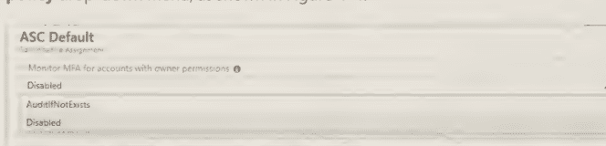

图 4-4 禁用 Azure 策略以反映更准确的建议列表

## 使用 Security Center 建议驱动更好的安全态势

配置错误、缺乏安全专业知识和缺乏可见性是攻击漏洞最常见的原因。Azure Security Center 建议基于您选择的评估环境的安全策略。您可以选择希望 Azure Security Center 评估您的环境的安全策略，并告诉您您的环境在何处存在漏洞。Security Center 24/7 评估您的环境并提供带有安全分影响的建议。这允许您优先处理组织需要执行的工作，以减少攻击面并加强您的安全态势。

ASC 根据您选择启用的安全策略持续评估您的环境——无论是 Azure 中的环境还是包含本地或其他云的混合配置。除了提供安全建议外，ASC 还将评估映射到多个合规性标准。对于合规性下的每项评估，ASC 会显示有多少资源未通过合规，并提供修复步骤。由于合规性评估的性质，ASC 无法评估所有控件。未经过评估的控件将作为不可用（灰色）显示在列表中。

为了能够管理并优先处理 ASC 建议提供的处理这些建议所需的工作，ASC 为您提供了每个订阅的总体安全分以及每项建议的分数影响。影响基于严重性和最佳实践，它允许您识别应该处理的首要建议，以收紧安全态势并保护您的环境。

Michelle Swafford, Azure Security Center 首席计划经理

## 计算与应用建议

在第 2 章“Azure Security Center 简介”中，您学习了 Security Center Agent 以及它是如何执行初始安全评估。在接入过程中，您应该确保处理所有对您的安全分影响较大的建议。首先，评估所有其他建议，并根据环境需求应用建议。

某些建议可能需要系统停机——例如，应用某些安全更新。这意味着在确定了目标系统需要进行的更改后，您可能需要启动变更流程以符合安全评估。

> 提示：建议仅适用于 Security Center 支持的操作系统。请访问支持操作系统的最新版本：https://aka.ms/ASCSupportedOS

计算与应用建议包括针对 Azure VM、非 Azure 计算机、App Services、容器和虚拟机集 (VMSS) 的建议集。新建议可能会在不预先通知的情况下，并以“（预览版）”的形式出现在仪表板中，如图 4-5 所示。

| 在 Log Analytics 中启用诊断日志（预览版） |
| 在 Event Hub 中启用诊断日志（预览版） |
| 在 Batch 账户中启用诊断日志（预览版） |
| 在虚拟机集中启用诊断日志（预览版） |
| 在 Batch 账户上配置指标告警规则（预览版） |

图 4-5 以“（预览版）”显示的新建议


对于某些建议，你可以直接从安全中心（Security Center）仪表板应用修复；其他建议则需要你通过外部过程。例如，“在你的机器上安装系统更新”（Install System Updates On Your Machines）建议将仅为你列出缺少系统更新的计算机列表。然而，你无法从安全中心应用更新；你需要使用外部解决方案，例如 Windows Update 服务（WSUS）。其他某些建议将提供修复步骤，如图 4-6 所示。

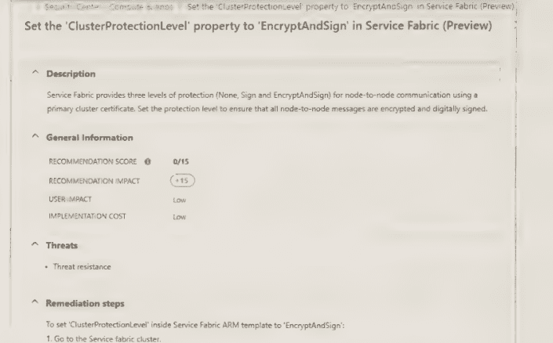

图 4-6 解决此建议需要遵循的修复步骤

许多客户会将 Web 应用程序托管在运行 Azure 的虚拟机上，这意味着他们需要确保这些虚拟机的安全状态配置恰当。这不仅应该从操作系统层面（已在“计算”建议中完成），还应该从 Web 应用程序层面。

应用建议将为运行在 Azure 虚拟机上的 Internet 信息服务 (IIS) 应用程序提供安全建议。应用建议将根据环境而异。下一节将提供可以通过安全中心仪表板直接修复的建议示例。

## 添加 Web 应用程序防火墙

Web 应用程序日益受到网络攻击的针对，例如 SQL 注入、跨站脚本 (XSS) 以及 OWASP 前 10 项中记录的许多其他攻击。许多攻击可以通过安全的代码来防止，但在应用程序代码本身中防止某些攻击是困难的，因为可能需要严谨的维护、补丁和多层监控。Web 应用程序防火墙可以在不修改应用程序代码的情况下，增强 Web 应用程序受网络漏洞和攻击的保护。按照以下步骤解决此建议：

- 1. 打开 Azure 门户并使用具有安全管理员（Security Admin）权限的用户登录。
- 2. 在左侧导航窗中，点击“安全中心”。
- 3. 在安全中心的左侧导航窗中，在“资源安全状况”（Resource Security Hygiene）下，点击“计算与应用”（Compute & Apps）。
- 4. 在“概述”（Overview）选项卡中，在搜索字段中输入“Firewall”（防火墙）并点击“添加 Web 应用程序防火墙”，如图 4-7 所示。

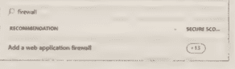

图 4-7 应用页面

- 5. 点击“添加 Web 应用程序防火墙”，并选择你想通过安装 Web 应用程序防火墙来修复的系统。出现“添加 Web 应用程序防火墙”面板，如图 4-8 所示。

> 注意：有关 OWASP 前 10 强项目的更多信息，请访问 https://www.owasp.org/index.php/Category:OWASP_Top_Ten_Project。

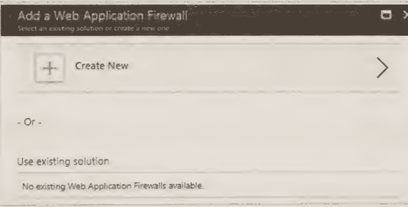

图 4-8 添加新的 Web 应用程序防火墙

- 6. 点击**新建**（Create New），将出现**创建新的 Web 应用程序防火墙解决方案**页面，如图 4-9 所示。

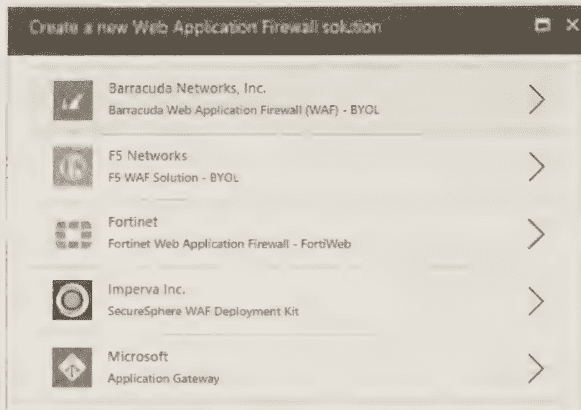

**图 4-9** 添加新的 Web 应用程序防火墙

从现在起，步骤可能会根据你选择的解决方案而变化。你应该考虑合作伙伴的解决方案文档供进一步参考。

## 终端保护

安全中心可以检测你的虚拟机或计算机是否安装了终端保护，以及该终端保护是否为最新版本。然而，此功能只能检测某些支持的终端保护合作伙伴。在编写时，支持的合作伙伴如下：

- Windows Defender (Microsoft Antimalware)
- System Center Endpoint Protection (Microsoft Antimalware)
- Trend Micro（趋势科技，所有版本）
- Symantec v12.1.1100+
- McAfee v10+

> **提示** 合作伙伴列表不断修订，并可能在不另通知的情况下包含新合作伙伴。要查看最新的支持终端保护列表，请访问 https://aka.ms/ASCPartners。

如果建议要求在非 Azure 虚拟机和计算机上安装终端保护，你需要按照你选择的反病毒软件提供的提供的进行手动操作。对于 Azure 中的虚拟机，System Center 将引导你完成安装过程，你可以根据 Azure 内部市场中提供的可用选项选择终端保护。按照以下步骤在 Azure 虚拟机中部署 Windows Defender (Microsoft Antimalware) 以修复计算建议：

- 1. 打开**Azure 门户**并使用具有**安全管理员**（Security Admin）权限的用户登录。
- 2. 在左侧导航窗中，点击**安全中心**（Security Center）。
- 3. 在安全中心的左侧导航窗中，在**资源安全状况**（Resource Security Hygiene）下，点击**计算与应用**（Compute & Apps）。
- 4. 在**概述**（Overview）选项卡中，点击**在虚拟机上安装终端保护解决方案**（Install Endpoint Protection Solution on Virtual Machines）建议。
- 5. 在**Azure 虚拟机未安装终端保护**面板中选择你想安装的虚拟机，如图 4-10 所示。如果你有多个工作区，可能会看到先选择工作区的选项。

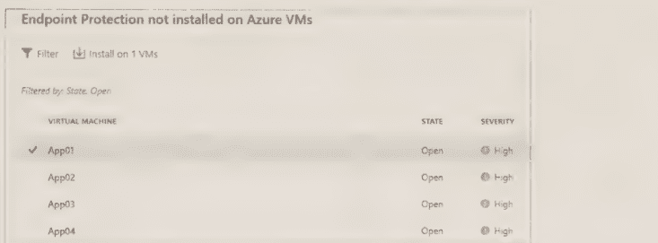

**图 4-10** 在目标系统中安装终端保护

- 6. 点击**新建**（Create New），将出现**创建新的 Web 应用程序防火墙解决方案**页面，如图 4-9 所示。


## 网络建议

Azure 虚拟网络是专门为您的订阅提供的 Azure 云逻辑隔离。Security Center 会识别您订阅中可用的 Azure 虚拟网络，并提供改进整体安全性的建议。在 Security Center 仪表板中，在“资源安全状况”（Resource Security Hygiene）下，点击“网络”（Networking），就会出现 Security Center - 网络仪表板，如图 4-15 所示。


图 4-14 验证反病毒扩展程序已安装

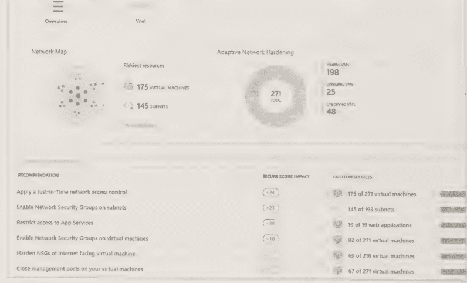

图 4-15 网络建议面板

## 网络地图

**网络地图**（Network Map）出现在页面的第一个磁格中。此选项允许您查看 Azure 拓扑结构和流量模式，如图 4-16 所示。


图 4-16 显示所选订阅 Azure 网络拓扑的网络地图

> **提示** 如果地图中显示的资源过多，Security Center 将通过高亮处于最关键状态的资源对资源进行聚类。

此地图从内向外组织，订阅位于中间，然后是 Azure VNet，随后是子网以及连接到该子网的虚拟机 (VM)。默认可视化了一些过滤器，可以通过以下方式调整：

- **安全健康状况**（Security Health）：这基于您的 Azure 资源的严重性级别（高、中、低）。
- **建议**（Recommendations）：这些基于针对这些资源的活动建议。
- **网络区域**（Network Zones）：这基于内部或面向 Internet 的资源（两者都有）。

如果您将鼠标悬停在每个图标上，将看到有关该对象的更多信息；若您点击其中一个 VM，将看到有关 VM 本身的更多详细信息，如图 4-17 所示。

## 自适应网络加固

在此面板中，您拥有所选 VM 的重要属性，页面底部会显示相关建议列表。在右侧，您可以切换到“允许的流量”（Allowed Traffic）。在此标签页中，有两个表格列出了出站流量开放的 TCP 和 UDP 端口；第三个标签页显示入站流量的 TCP 和 UDP 端口。这提供了资源之间当前可能流量 Better视图，可以通过点击左侧 Topology 按钮旁“允许的流量”按钮切换到流量地图。通过切换到此视图，您将看到相同的地图，但现在显示的是您配置的资源，定义了哪些资源可以与其他资源通信。检查此面板后，关闭它并返回 Security Center - 网络面板。

此功能的目的是让您能够使用网络安全组 (NSG) 规则轻松加固您的网络流量。Security Center 将使用机器学习收集网络流量信息，在学习流量模式后，它将建议规则列表以加固已知流量。点击“自适应网络加固”磁格，您将

图 4-17 网络地图中的 VM 属性

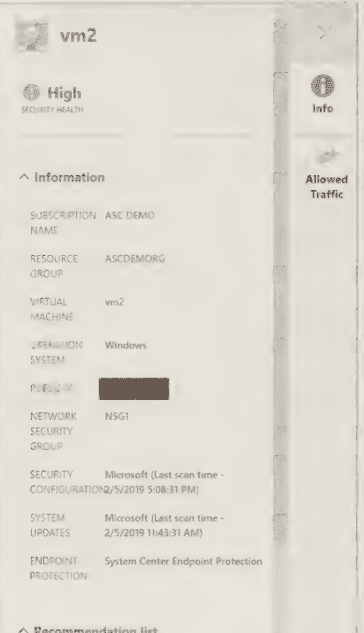

看到面向 Internet 的虚拟机加固网络安全组规则面板，如图 4-18 所示。

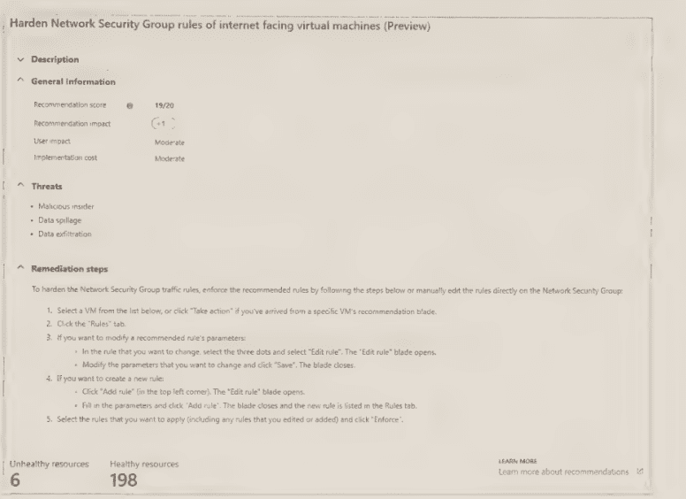

不健康资源（Unhealthy resources）显示应应用网络加固建议的 VM 数量。您可以点击 VM 查看当前规则和告警，如图 4-19 所示。

图 4-18 显示已配置 VM 的 NSG 加固仪表板

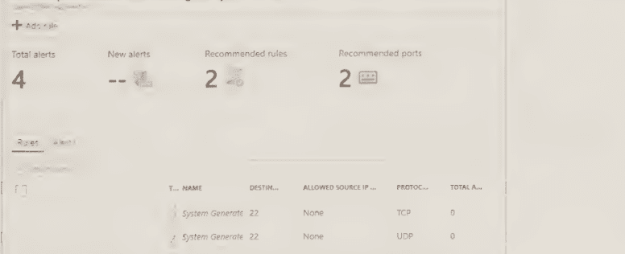

图 4-19 告警和规则的加固策略可见性

在“规则”（Rules）标签页下，规则根据自适应网络加固能力的学习自动创建。您可以点击“添加规则”（Add Rule）按钮创建新规则，也可以选择建议的规则并点击“强制”（Enforcement）按钮。查看告警，可以点击“告警”（Alerts）标签页并选择告警本身。告警的示例如图 4-20 所示。

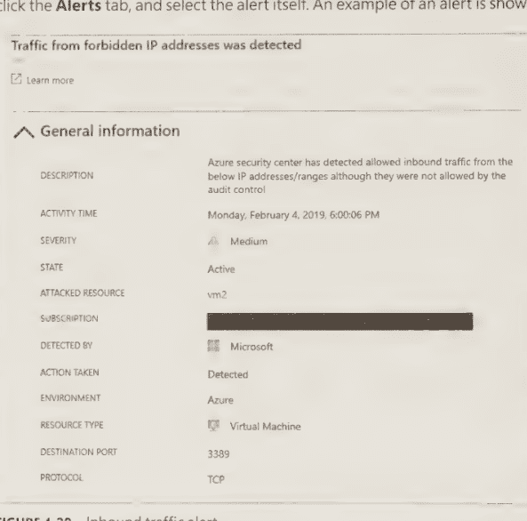

**图 4-20** 入站流量告警

在某些情况下，自适应网络加固算法将无法运行，会出现“未扫描的资源”（Unscanned Resources）标签。以下是自适应网络加固算法无法运行的情况：

- VM 是经典 VM：仅支持 Azure Resource Manager VM。
- 可数据不足：为了产生准确的流量加固建议，Security Center 需要至少 30 天的流量数据。
- VM 未受 ASC 标准保护：此功能仅在标准层级（Standard tier）可用。

下一节包含可以通过 Security Center 直接修复的建议示例。

## 利用机器学习处理网络流量

云中最大的攻击面是连接。通过自适应网络加固功能，Security Center 可以识别网络模式并为面向 Internet 的机器提供 NSG 建议。这允许客户只需点击即可保护其环境。例如，假设现有 NSG 过于宽松，建议将限制访问。此外，Security Center 使用广泛的威胁情报来阻止恶意攻击者。

Oren Parag，Security Center 高级经理

## 在子网上启用安全组

网络安全组 (NSG) 包含一组允许或拒绝资源网络流量的安全规则。NSG 可以与 VM、NIC 和子网关联。Security Center 会验证子网是否需要 NSG，如果需要，Security Center 将为其创建建议。

在主网络面板中，您将看到建议列表。按照以下步骤操作：

- 1. 点击“在子网上启用安全组”（Enable Security Groups on subnets），您将看到所有可以启用 NSG 的虚拟网络的面板，如图 4-21 所示。

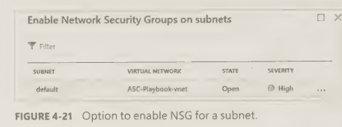

- 2. 点击您想要启用 NSG 的子网，如果您已经有了 NSG，将在“选择网络安全组”（Choose network security group）面板中看到它。如果没有 NSG，点击“新建”（Create new）（见图 4-22）并按照向导创建新的网络安全组。

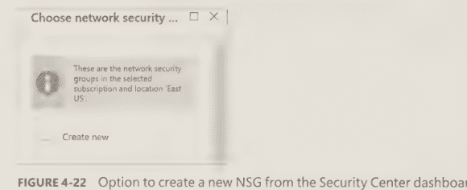

## 通过面向 Internet 的终端限制访问

处理云资源时，安全管理和控制至关重要。当在您的 IaaS 环境中配置新 VM 时，您需要确保这些 VM 不完全暴露在 Internet 上。在大型环境中执行此任务可能困难，但通过 Security Center，您可以在一个位置完整查看面向 Internet 的终端情况。

在主网络面板中，您将看到建议列表。按照以下步骤操作：

- 1. 1 点击“对于具有面向 Internet VM 的宽松网络安全组，应限制访问”（Access should be restricted for permissive Network Security Groups with Internet-facing VMs），您将看到包含所有面向 Internet 机器的新面板。


# 限制面向互联网的虚拟机的宽松网络安全组

Azure Security Center 已识别出您的某些网络安全组入站规则过于宽松。入站规则不应允许来自“任意（Any)”或“Internet”范围的访问。这可能导致攻击者能够轻易针对您的资源。

| | |
|---|-|
| 建议分得分 | 14/20 |
| 建议影响 | +6 |
| 用户影响 | 高 |
| 实现成本 | 低 |

- *恶意内部人员*
- 数据人员
- 数据渗透

我们建议您编辑某些虚拟机的入站规则，以限制对特定源范围的访问。要限制对您的虚拟机的访问：
1. 选择一个要限制访问的虚拟机。

图 4-23 面向互联网的端点列表。

2. 滚动到页面底部，您将看到不健康虚拟机列表，这些是您应该处理建议的虚拟机，如图 4-24 所示：

| 不健康资源 | 健康资源 |
|---|-|
| 80 | 177 |
| 不健康资源 (80) | 健康资源 (177) | 未扫描资源 (10) |
| 搜索虚拟机 | |
| 名称 | |
| standalone-vm | |
| UbuntuDVWA | |

图 4-24 需要通过此建议处理的虚拟机列表

3. 点击您想要处理此建议的虚拟机，将出现该虚拟机的网络页面。点击“添加入站安全规则”，将出现“添加入站安全规则”页面，如图 4-25 所示：


图 4-25 当前入站安全规则列表

4. 根据您的环境需求配置入站规则，并点击“添加”按钮完成。

# 数据与存储

> 提示 SecurityCenterJITRule_<suffix> 是由 Security Center 的即用（just-in-time）虚拟机功能自动创建并管理的，不应手动修改。

攻击者的最终目标之一是获取目标数据的访问。因此，处理存储（数据所在地）和数据本身的所有安全建议至关重要。

Security Center 通过为 SQL 数据库、Azure Storage、Redis、Data Lake Analytics 和 Data Lake Store 提供安全建议来满足这些需求。存储和数据建议因环境而异。当您首次打开数据和存储建议时，将看到一个“概述”选项卡，其中包含所有建议的摘要，如图 4-26 所示。

## 启用 SQL Server 审计

Security Center 可以执行安全评估以验证您是否利用 Azure SQL 审计和威胁检测安全功能。审计和威胁检测为您提供以下支持：

- 维护法规合规性
- 理解数据库活动
- 洞察差异和异常
- 识别安全违规行为

由于与 Azure SQL 的集成，此建议允许您直接从 Security Center 修复。按照以下步骤处理此建议：

1. 在“数据与存储”窗格中，点击“概述”选项卡，并选择“启用 SQL Server 审计”。
2. 在“启用 SQL Server 审计”窗格中，您将看到有关此建议的详细说明、它将如何影响您的安全评分、如果您不处理此建议将面临的威胁，以及修复步骤。
参见图 4-27。

## 启用 SQL Server 审计

描述
在您的 SQL Server 上启用审计，以跟踪服务器上所有数据库的数据库活动并将其保存到审计日志中。

常规信息

| 建议分得分 | 8/15 |
|---|---|
| 建议影响 | +7 |
| 用户影响 | 低 |
| 实现成本 | 低 |

威胁

- 数据外泄
- 数据泄露
- 恶意内部人员
- 威胁抗性

修复步骤

- 要启用 SQL Server 审计：
- 选择 SQL 服务器。
- 在“审计”下，选择“启用”。
- 选择“详细信息”并为审计日志配置存储帐户。
- 点击“保存”。


> 图 4-27 关于启用 SQL Server 审计优势的详细信息

3. 点击页面底部的“不健康资源”选项卡，查看受此建议影响的 SQL 服务器。
4. 点击您想要修复此建议的 SQL 服务器，将打开“审计”窗格，如图 4-28 所示。


> 图 4-28 通过启用审计修复建议

增强您的安全态

5. 在“审计”下，点击“启用”并点击“保存”按钮。
6. 保存完成后，关闭此窗格。

## 禁用对存储帐户的无限制网络访问

Security Center 还提供加固存储帐户网络访问的建议。此建议强调您目前对存储帐户具有无限制的网络访问。建议是配置网络规则，仅允许允许网络的应用程序访问存储帐户。要允许来自特定 Internet 或本地客户端的连接，可以授予来自 Azure 虚拟网络或公共 Internet IP 地址范围的流量访问。处理此建议，请按照以下步骤操作：

1. 在“数据与存储”窗格的“概述”选项卡中，点击“禁用存储帐户的无限制网络访问”。
2. 在“禁用存储帐户的无限制网络访问”窗格中，您将看到有关此建议的详细说明、它将如何影响您的安全评分、如果您不处理此建议将面临的威胁，以及修复步骤，如图 4-29 所示。


图 4-29 存储帐户建议的详细信息

3. 点击页面底部的“不健康资源”选项卡，查看受此建议影响的存储帐户。
4. 点击您想要修复此建议的存储帐户，将打开“防火墙和虚拟网络”窗格，如图 4-30 所示。


图 30 加固存储帐户

5. 点击“所选网络”选项并配置网络设置，如图 4-31 所示。


图 31 存储帐户的网络设置

6. 完成配置后，点击“保存”。

# 身份与访问

今天，安全监控已不仅是观察安全状态。现在，您必须采取更广泛的方法。当攻击者入侵一个用户的凭据时，他们可能会利用此进行更大的活动。无论您的负载位于云端还是本地，这都至关重要。

要访问身份仪表板，点击“安全”下的“身份与访问”。将打开身份仪表板，如图 4-32 所示。


图 32 身份与访问概述页

“查看经典身份与访问”按钮允许您在显示身份统计数据时切换到旧视图（图 33）。该按钮将于 2019 年 7 月 31 日，，由于许多客户喜欢这种可视化，可以使用 Azure Security Center 团队提供的查询重现这些数据。参见 http://aka.ms/ASLCegidentity。

# 身份与访问


图 33 身份与访问的旧视图

此仪表板显示 Security Center 监控的所有身份相关活动的摘要。安全运营人员应每天多次访问此仪表板，以快速评估当前状态。此仪表板包含三个主要部分：

- 身份态
- 失败登录
- 登录趋势

身份访问仪表板的身份态部分传达了过去 24 小时数据的各种分析，可以帮助您更好地理解用户的身份模式。这些分析包括：

- **登录**：此图表显示失败和成功登录的数量。
- **已登录帐户**：此计数器显示当前登录的用户帐户数量。
- **登录失败帐户**：此计数器显示登录失败的帐户总数，并带有向上或向下的箭头。在图 8-2 中，箭头向下表示自上次更新以来失败次数减少了 1.6 万。
- **锁定帐户**：此计数器传达当前锁定的帐户数量。
- **已更改或重置密码的帐户**：此计数器显示已更改或重置密码的帐户总数。


- **活跃显著问题 (Active Critical Notable Issues)**：显著问题是关键事件。在身份语境下，它们是关键身份事件。此计数器反映了需要立即关注的活跃显著问题。
- **活跃警告显著问题 (Active Warning Notable Issues)**：这与之前的计数器相同，针对的是中优先级问题而非关键问题。

身份与访问仪表板中的“失败日志”部分让人目了然日志失败的主要原因。

当用户身份验证失败时，Windows 会生成一个名为事件 4625 的事件。要调查特定登录失败的原因，请点击“失败区域 (Failed Logon Regions)”部分中的登录。参见图 4-34，事件 4625窗口显示了失败原因。（参见“失败信息”部分。）

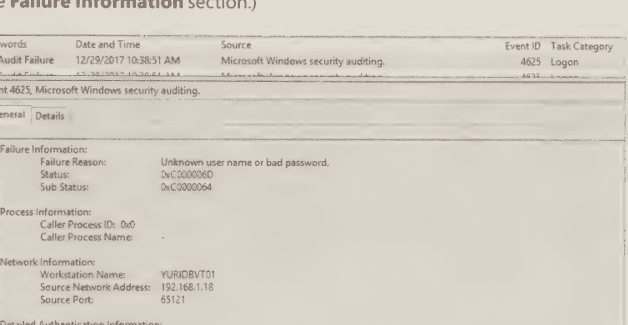

**图 4-34** 事件 4625 的描述

事件 4625 对话框中可用信息可能根据失败原因而异。表 8-1 列出了失败的一些最常见原因。

| 错误代码 (状态/子状态) | 描述 |
|---|---|
| 0xC000006D | 用户名未知或密码错误。 |
| 0xC0000234 | 账户锁定。 |
| 0xC0000072 | 账户当前禁用。 |
| 0xC0000193 | 指定的用户帐户已过期。 |
| 0xC0000071 | 密码过期。 |

**表 8-1** 登录失败的常见原因

> 提示 登录失败原因的完整列表，请参 https://aka.ms/AccountLogon。

在查看事件 4625 时，请注意“登录 (Logon)”字段。如果此字段设置为 3，意味着登录尝试来自网络。在这种情况下，你还会看到一个带有相应 IP 地址的 IPAddress 字段。如果 LogonType 设置为 5，意味着登录尝试来自某个源或进程。Process 字段将包含进程名称。列表 4-1 显示的代码包含了事件 4625 的全部内容，该事件在登录请求失败时生成，并出现在尝试访问的计算机上。

## 列表 4-1 事件 ID 4625

```
Log Name: Security
Source: Microsoft-Windows-Security-Auditing
Date: 2/19/2019 9:08:29 AM
Event ID: 4625
Task Category: Logon
Level: Information
Keywords:Audit Failure
User: N/A
Computer: ARCOS
Description:
An account failed to log on.
Subject:
Security ID: NULL SID
Account Name: -
Account Domain: -
Logon ID: 0x0
Logon Type: 3
Account For Which Logon Failed:
Security ID: NULL SID
Account Name:
YURIDBVT01$
Account Domain: NORTHAMERICA
Failure Information:
Failure Reason:
Unknown user name or bad password.
Status:
0xC000006D
Sub Status: 0xC0000064
Process Information:
Caller Process ID: 0x0
Caller Process Name: -
Network Information:
Workstation Name: YURIDBVT01
Source Network Address: 192.168.1.254
Source Port: 53407
```

Detailed Authentication Information:
Logon Process: Ntlmsp
Authentication Package: NTLM
Transited Services: -
Package Name (NTLM only): -
Key Length: 0

- **主体字段 (Subject fields)**：主体字段指示请求登录的本地系统帐户。这最常见的是一个服务（例如 Server 服务）或本地进程（例如 Winlogon.exe 或 Services.exe）。
- **登录字段 (Logon field)**：登录类型字段指示请求的登录类型。最常见的类型是 2（交互式）和 3（网络）。
- **进程信息字段 (Process Information fields)**：进程信息字段指示系统上的哪个帐户和进程请求了登录。
- **网络信息字段 (Network Information fields)**：网络信息字段指示远程登录请求源。工作站名称 (Workstation Name) 并不总是可用，某些情况下可能会留空。
- **身份验证信息字段 (Authentication Information fields)**：身份验证信息字段提供了此登录请求的详细信息：
- **传递服务 (Transited Services)**：传递服务指示哪些中间服务参与了此登录请求。
- **包名 (Package Name)**：包名指示在 NTLM 协议中使用了哪种子协议。
- **密钥长度 (Key Length)**：密钥长度指示生成的会话密钥的长度。如果没有请求会话密钥，则长度为 0。

## 列表 4-2 事件 ID 4625

```
<Event xmlns="http://schemas.microsoft.com/win/2004/08/events/event">
<System>
<Provider Name="Microsoft-Windows-Security-Auditing" Guid="54849625-5478-4994-A5BBA-3E30B2C8C00" />
<EventID>4625</EventID>
<Version>0</Version>
<Level>1</Level>
<Task>12544</Task>
<Opcode>0</Opcode>
<Keywords>0x8010000000000000</Keywords>
<TimeCreated SystemTime="2019-02-19T15:08:29.580371002Z" />
<EventRecordID>60107528</EventRecordID>
<Correlation />
<Execution ProcessID="724" ThreadID="16256" />
```
<Channel>Security</Channel>
<ARGOS/></Computer>
<Security />
<System-id />
<EventData>
<Data Name="SubjectUserId">S-1-0-0</Data>
<Data Name="UserName">--</Data>
<Data Name="SubjectDomain">--</Data>
<Data Name="SubjectLogId">0x0</Data>
<Data Name="TargetUserId">S-1-0-0</Data>
<Data Name="TargetUserName">YURIDBV01</Data>
<Data Name="TargetDomainName">NORTHAMERICA</Data>
<Data Name="Status">0xC000006D</Data>
<Data Name="FailureReason">Unknown user name or bad password.</Data>
<Data Name="Sub Status">0xC0000064</Data>
<Data Name="Logon Type">3</Data>
<Data Name="Process Name">Ntlmsp</Data>
<Data Name="Authentication Package">NTLM</Data>
<Data Name="Transited Services">--</Data>
<Data Name="Package Name">--</Data>
<Data Name="Key Length">0</Data>
</EventData>
</Event>
```


如图 4-38 所示，此 Azure 函数只有一个中等风险的建议——Function App 应该仅通过 HTTPS 访问。该建议的意图是警告您，目前有一个可以通过明文访问的 Azure 函数。为了保护传输过程中的数据，建议是启用 HTTPS。

## 容器 (Containers)

在 Azure Security Center 中，“容器”选项卡显示所有部署了 Docker 的虚拟机。Security Center 提供了有关虚拟机上容器的额外信息，例如 Docker 版本以及主机上运行的镜像数量。Security Center 通过根据 Docker CIS 安全基准扫描您的 Docker 配置，提供了针对配置错误的可视性。

> 注意：有关 Docker CIS 安全基准的更多信息，请参阅 https://www.cisecurity.org/benchmark/docker

要查看容器建议，在“计算机和应用程序”选项下的“资源安全状况”中，点击“容器”选项卡，您将看到图 4-39 所示的相关建议。

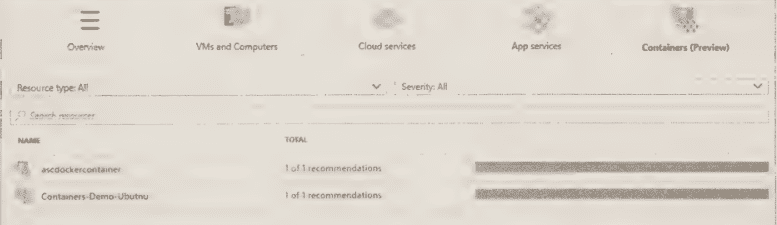

图 4-39 显示可用建议的容器选项卡

要获取有关容器的更多信息或修复建议，请点击容器。当点击图 4-39 显示的容器时，会出现“修复容器配置漏洞”建议，如图 4-40 所示。

## 修复容器配置漏洞

### 描述
修复安装了 Docker 的机器的安全配置漏洞，以免受攻击。

### 通用信息
| 用户影响 | 中等 |
| :--- | :--- |
| 成本 | 中等 |

### 威胁
- 数据外泄
- 数据溢出
- 账户入侵

### 修复步骤
要修复容器配置漏洞：
1. 审核失败规则列表。
2. 根据指定的说明修复规则。

图 4-40 关于建议和修复步骤的详细说明

## 虚拟机扩展集 (Virtual machine sets)

Azure 虚拟机扩展集 (VMSS)允许您创建和管理一组负载均衡虚拟机。使用此技术的优势之一是 VM 实例的数量根据业务需求自动增加或减少，也可以通过计划定义。

Security Center 会自动发现您是否有扩展集，并建议您在这些扩展集上安装代理程序。一旦安装了代理程序，Security Center 将执行评估并提供建议，例如在虚拟机扩展集上启用诊断日志、修复虚拟机扩展集上的安全配置漏洞等。

VMSS 建议位于“计算机和应用程序”选项下的“资源安全状况”。访问该“虚拟机扩展集”选项卡后，您将看到图 4-41 所示的相关建议。

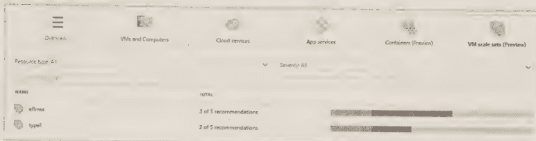

图 4-41 Security Center 中的 VMSS 建议

要访问特定 VM 的建议，点击它，即可看到有关扩展集的详细信息，以及页面底部图 4-42 所示的建议列表。

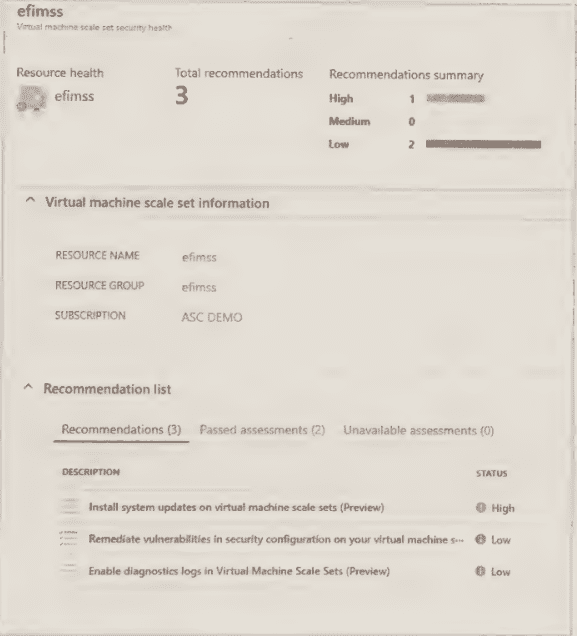

图 4-42 特定扩展集及其建议

## 单击修复 (Single click remediation)

现在您已经了解了跨工作负载的建议范围，可以可视化某些修复场景，并意识到手动修复多项建议可能是具有挑战性的。为了简化修复过程，Security Center 在 2019 年夏天推出了一项新功能，仅需几个步骤即可修复建议。

在我们编写本章时，单击修复功能处于私有预览阶段（Private Preview），在此版本中仅可用以下建议：

- 虚拟机应应用磁盘加密。
- Web 应用应仅通过 HTTPS 访问。
- Function App 应仅通过 HTTPS 访问。
- API App 应仅通过 HTTPS 访问。
- Function App 应关闭远程调试。
- Web 应用应关闭远程调试。
- API App 应关闭远程调试。
- CORS 不应允许任何资源访问您的 Function App。
- CORS 不应允许任何资源访问您的 Web 应用。
- CORS 不应允许任何资源访问您的 API App。
- 应启用到存储的安全传输。
- SQL 数据库应启用透明数据加密。
- 虚拟机应安装监控代理。
- SQL 服务器应启用审核。

使用此功能应用修复后，建议将根据建议类型进行刷新。如果使用 Azure 策略（控制平面）执行修复，刷新将在 10 分钟内发生；换之，建议将从列表中消失，因为它已经过修复。

> 提示：Azure Security Center 工程团队不断改进仪表板刷新率；因此，建议访问 Security Center 常见问题（http://aka.ms/ascfaq）文章获取有关此类延迟的最新信息。

按照以下步骤使用单击修复功能修复 Security Center 中的建议：

7. 打开 Azure 门户并使用具有管理员权限的用户登录。
8. 在左窗格中，点击 Security Center。
9. 在 Security Center 导航窗格中，在“资源安全状况”下点击“建议”。
10. 您将看到某些建议显示为蓝色，如图 4-43 所示。


图 4-43 某些建议显示为蓝色

11. 对于此示例，我们将使用“应启用安全传输”建议。滚动到不健康的账户，选择该账户并点击修复按钮，如图 4-44 所示。（请注意按钮名称将根据所选资源的数量而变化。）
12. 弹出“修复资源”页面，如图 4-45 所示。选择您想要修复的资源（本例中为一个）并点击修复。

应用修复后，该建议将不再可用。

## 高级云防护 (Advanced cloud defense)

既然您已经了解如何处理建议以增强工作负载的安全态势，您还需要应用安全控制来减少攻击面。在本章中，您将学习 Security Center 如何帮助您加固资源。您将学习如何使用即时虚拟机（VM）访问来加固访问，并确保它们不会一直暴露在互联网上。您将学习如何跟踪文件和注册表的完整性监控，还将学习 Security Center 如何使用机器学习创建应用程序白名单。

## 即时虚拟机访问 (Just-in-time virtual machine access)

为了向虚拟机提供远程访问，公共云基础设施提供商必须允许所有远程管理流量到达虚拟机。为此，您可以使用 RDP、SSH 和 PowerShell。

> 注意：提供远程管理访问的替代方法。此类方法包括点对点 VPN、站点到站点 VPN 以及各种专用 WAN 解决方案。


这种控制是通过 Azure 网络功能启用的，而不是通过虚拟机本身的任何功能，它适用于来自 Internet 的入站连接。Azure Security Center 的 JIT VM 访问（即时访问）功能非常简单。以下是关键点：

- Azure Security Center JIT 的主要目标是保护虚拟机管理端口，例如 RDP、SSH 和远程 PowerShell 端口。
- JIT 限制了端口开放持续长度。端口仅在完成工作所需的时间内开放（由你定义时长）。
- 网络安全组 (NSG) 规则控制对 JIT 策略中定义的管理端口的访问。
- 仅 ARM VM 支持 Azure Security Center JIT VM 访问。
- 我们建议在所有支持该功能的虚拟机上使用 JIT。事实上，只有在虚拟机没有关联 NSG 或该虚拟机是经典版虚拟机（classic VM）时，我们才建议使用 JIT。
- 有时，当虚拟机可能符合 JIT VM 访问的条件时，Azure Security Center 不会发布此类建议。这发生在：订阅或资源组层级设置的安全策略禁用了 JIT 解决方案时，虚拟机没有公网 IP 地址，以及虚拟机未关联 NSG 时。
- JIT VM 访问提供一组默认管理端口，你可以使用它们来启用访问。你也可以创建新端口并删除现有端口。
- 管理员设置 JIT 策略，该策略定义了可以使用哪些端口。当用户请求 JIT 访问时，他或她可以使用策略中定义的端口。为了提高安全性，用户可以删除除远程管理访问所需的端口之外的所有端口。
- 你可以使用 PowerShell 配置 JIT 策略并请求访问。
- 当用户请求 JIT 访问时，Azure Security Center 会检查他们的 RBAC 权限。如果用户拥有虚拟机的相应权限，将授予 JIT 访问。此时，Azure Security Center 将动态创建 NSG 规则以允许入站管理流量。当 JIT 访问过期后，NSG 规则将被删除。注意，连接不会被主动重置，因此已连接的用户将保持连接，直到用户由于或其他原因断开连接。

要探索此功能，请在 Azure Portal 的左侧窗中选择 **Azure Security Center**。然后选择 **Just-In-Time Access**。JIT VM 访问的主界面解释了该功能是什么及其工作原理。它还包含 Virtual Machines（虚拟机）标题下的主要标签页，如图 5-1 所示。

如果 Azure Firewall 后面的虚拟机 JIT 访问请求获得批准，Security Center 将自动更改 NSG 和防火墙规则。

## 什么是即时虚拟机访问（just in time VM access）？

即时虚拟机访问允许你通过阻塞指向特定端口的入站流量在网络级别锁定虚拟机。它允许你仅在特定需要时允许访问，从而控制访问并减少虚拟机上的攻击面。

## 它是如何工作的？

根据用户在 Azure RBAC 上的请求，Security Center 将决定是否授予访问。如果请求获得批准，Security Center 将自动配置 NSG 以在请求的时间内允许这些端口的入站流量，之后会将 NSG 恢复到之前的状态。

更多信息请参阅文档 >

## Virtual machines

| 已配置 | 建议 | 无建议 |
|---|---|---|
| 已经实施即时虚拟机访问控制的虚拟机。显示的数据为上周。 | | |

图 5-1 JIT VM 访问主页

**Configured**（已配置）标签显示了配置为支持 Azure Security Center JIT 的虚拟机列表。它还指示了用户登录虚拟机的次数。**Recommended**（建议）标签包含当前尚未配置使用 Azure Security Center JIT 的虚拟机列表——但可能应该配置，如图 5-2 所示。

| 已配置 | 建议 | 无建议 |
|---|---|---|
| 我们建议应用即时虚拟机访问控制的虚拟机。 | | |

## 5 VMs

搜索以筛选项目...

| VIRTUAL MACHINE（虚拟机） | STATE（状态） | SEVERITY（严重程度） |
|---|---|---|
| DevTeam | Open | High |
| KLVM3 | Open | High |

图 5-2 未配置 JIT 但可能应该配置的虚拟机列表

**No recommendation**（无建议）标签包含不应配置使用 JIT 的虚拟机列表。在这里，你可能会看到经典虚拟机或未关联 NSG 的虚拟机。要查看经典虚拟机列表，请展开 **Classic Virtual Machine**（经典虚拟机）类别。查看未关联 NSG 的虚拟机，展开 **Missing Network Security Group**（缺少网络安全组）类别。注意，还有一个名为 **Other**（其他）的类别，如图 5-3 所示。

## 配置 JIT

你可以使用 Security Center 仪表板或 PowerShell 配置 JIT。但在开始配置之前，请确保你拥有配置 JIT 策略的相应权限，如表 5-1 所示。

表 5-1 JIT 策略权限

| Scope（作用范围） | path（路径） | Permission（权限） |
|---|---|---|
| 虚拟机所在的订阅或资源组 | Microsoft.Security/locations/jitNetworkAccessPolicies | Write |
| 订阅、资源组或虚拟机 | Microsoft.Compute/virtualMachines | Write |

一旦获得相应级别的权限，请按照以下步骤使用 Security Center 仪表板配置 JIT VM：

1. 在 **Recommended**（建议）标签中，选择你想要配置 JIT 访问的虚拟机。
2. 点击 **Enable JIT**（启用 JIT）按钮。打开 JIT 配置页面，如图 5-4 所示。

3. JIT 访问配置指定了 JIT 应用的端口和协议。默认端口为：
- 22 (SSH)
- 3389 (RDP)
- 5985 (PowerShell)
- 5986 (Remote PowerShell)

4. 执行以下操作之一：
- 如果这些都是你为 JIT 需要的端口，点击 Save（保存）。
- 如果你想从列表中省略任何端口，点击该条目并点击 Delete（删除）。
- 如果你想添加端口，点击 Add（添加）。

5. 点击 Add 将打开端口配置页面（见图 5-5）。在此处配置以下设置：
- Port（端口）：该协议使用的端口。
- Protocol（协议）：通常你会选择 TCP 或 UDP，但也可以选择 Any。
- Allowed IPs（允许的 IP）：此设置有两个选项：Per request（按请求）或 CIDR block。如果你选择 Per request，当前分配给客户端的 IP 地址将会被允许。如果你选择 CIDR block，你可以定义客户端系统在连接到资源之前必须拥有的 IP 地址集合。
- Max request time（最大请求时间）：用户可以请求的最长时间。默认值为 3 小时，但允许用户请求更多或更少的时间。

6. 点击 OK 并点击 Save 提交更改。此虚拟机现在将出现在 Recommended 标签中，如图 5-6 所示。


一旦您授予了适当的权限，请按照以下步骤使用 Security Center 仪表板请求访问。

- 1. 在**即时虚拟机访问 (Just-In-Time VM Access)** 窗格中，选择**已配置 (Configured)** 选项卡，选择想要远程访问的 VM 旁的复选框，然后如图 5-7 所示点击**请求访问 (Request access)** 按钮。

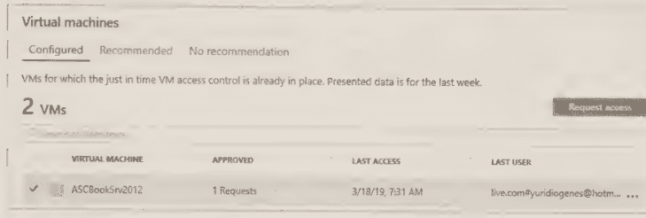

**图 5-7** 使用 Security Center 仪表板请求 VM 访问

- 2. 如图 5-8 所示，打开**请求访问**页面。其内容取决于分配给 VM 的策略设置。为了增加安全性，请关闭任何不需要的端口。

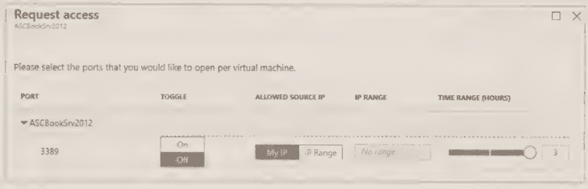

**图 5-8** 自定义访问请求

- 3. 点击**打开端口 (Open Ports)** 按钮以提交更改。

> **注意** 您也可以使用 PowerShell 或 Security Center API 配置 Jit VM 请求。有关如何使用 PowerShell 请求 VM 访问的示例，请参阅 http://aka.ms/JITVMRequest。

## 文件完整性监控

文件完整性监控 (FIM) 有助于保护系统和应用程序的完整性，因为 Security Center 将持续监控注册表和配置文件的行为。如果检测到文件的异常更改或恶意行为，Security Center 将跟踪这些更改，让您能够控制自己的文件。FIM 利用 Azure 更改解决方案来跟踪和识别 VM 中的更改。启用文件完整性监控后，您将拥有类型为 Solution 的 Change Tracking 资源。如果删除 Change Tracking 资源，Security Center 中的文件完整性监控功能将被自动禁用。

要在工作流中启用 FIM，请按照以下步骤操作：

- 1. 在 Security Center 仪表板中，在高级云防护 (Advanced Cloud Defense) 下，点击文件完整性监控 (File Integrity Monitoring)。将出现文件完整性监控窗格，显示您可以选择进行监控的工作区列表。如果是您第一次使用此功能，您将看到如图 5-9 所示，工作区旁有“启用 (Enable)”。


- 2. 点击启用按钮，在“启用文件完整性监控”窗格中，确认您已选择了 Windows 文件、注册表和 Linux 文件。点击“启用文件完整性监控”按钮以提交更改。

FIM 可能需要一些时间来识别工作区中的计算机总量，请确保使用刷新按钮查看所有计算机是否已到位。在上面的示例中，此工作区只有三台计算机。当在接入计算机之前启用 FIM 时，“总计算机 (Total Computers)”列将显示为零，如图 5-9 所示。

## 自定义您的设置

虽然 Security Center 会建议应该监控哪些文件和注册表项，但您仍然可以自定义并添加自己的偏好。按照以下步骤执行此自定义：

- 1. 在 Security Center 仪表板中，在高级云防护 (Advanced Cloud Defense) 下，点击文件完整性监控 (File Integrity Monitoring)。出现文件完整性监控窗格；选择您想要进行更改的工作区。

- 2. 在文件完整性监控窗格中，点击设置 (Settings) 按钮，如图 5-11 所示，出现如图 5-11 所示的工作区配置 (Workspace Configuration) 窗格。


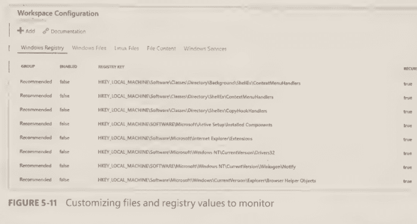

- 3. 您看到的第一个选项卡是 Windows 注册表，包含了所有可以监控的注册表项。注意，某些项被设置为 False（在“启用”列中），这意味着它们未被监控，而其他项为 True，意味着当前正在监控该项。要添加新的注册表项，点击添加 (Add)，将出现“为更改跟踪添加 Windows 注册表”对话框，如图 5-12 所示。

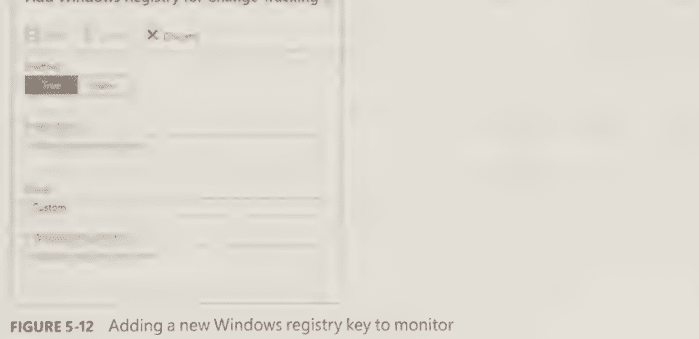

- 4. 在项目名称 (Item Name) 字段中，为此注册表项输入友好名称。

- 5. 在**Windows 注册表项 (Windows Registry Key)** 字段中，输入注册表路径（例如：HKEY_LOCAL_MACHINE\Software\Windows\CurrentVersion\Run）。

- 6. 点击保存 (Save) 按钮提交更改。

虽然添加新的监控注册表项非常简单，但 Windows 文件有更多配置选项。要查看可用选项，点击**Windows 文件 (Windows Files)** 选项卡并点击添加 (Add)。出现“添加 Windows 文件”页面，如图 5-13 所示。

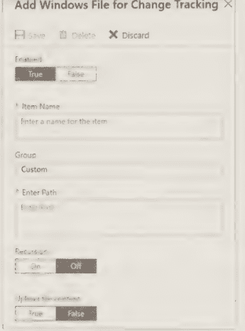

**图 5-13** 添加文件

除了项目名称 (Item Name) 和路径 (Path) 框外，您还有递归 (Recursion) 选项，可以开启或关闭。递归允许您使用通配符来跟踪，例如 `c:\*` 或 `/etc/*`。对于 Linux 文件，点击**Linux 文件 (Linux Files)** 并添加 (Add)。出现“添加 Linux 文件”页面，如图 5-14 所示。

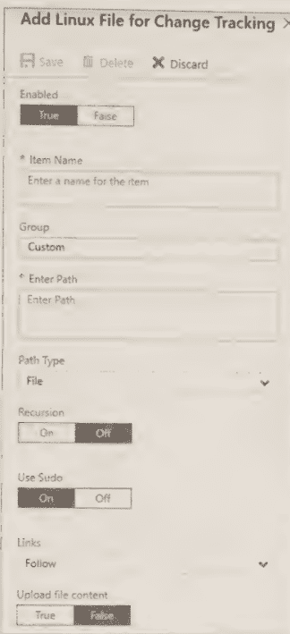

在路径类型 (Path Type) 字段中，您可以选择监控文件还是目录。使用 Sudo (Use Sudo) 选项可以设置为 On，这意味着将使用 sudo，或者可以设置为 Off。内容 (Content) 字段决定了如何处理符号链接：

- 忽略 (Ignore)：此选项忽略符号链接。
- 跟踪 (Follow)：此选项跟踪符号链接。
- 管理 (Manage)：此选项允许跟踪符号链接。

内容选项卡（如图 5-15 所示）需要存储账户。

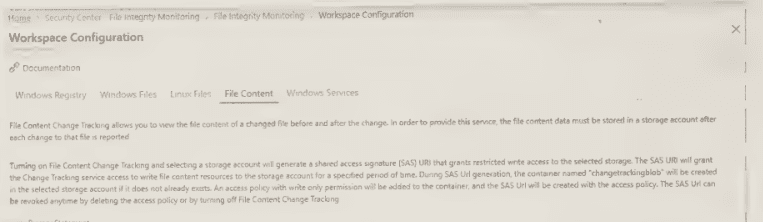

**图 5-15** 配置内容设置

要将现有的存储账户连接到此功能，点击链接 (Link)。

## 可视化更改

一旦启用了 FIM，您就可以开始跟踪从启用以来发生的更改。请记住，FIM 不立即显示更改；数据收集频率根据类型而异：

- Windows 注册表：50 分钟。
- Windows 文件：30 分钟。
- Linux 文件：15 分钟。

要可视化注册表，请按照以下步骤操作：

- 1. 在 Security Center 仪表板中，在高级云防护 (Advanced Cloud Defense) 下，点击文件完整性监控 (File Integrity Monitoring)。点击您想要查看的工作区。
- 2. 在文件完整性监控窗格中，您将看到如图 5-16 所示的更改快照。


**图 5-16** Security Center 后的文件完整性监控窗格

- 3. 点击更改 (Changes) 选项卡，查看最近的 100 次更改列表，如图 5-17 所示。


**图 5-17** 最近 100 次更改列表

- 4. 要查看更改的详细信息，点击任何实体，您将在更改详细 (Change Details) 页面看到注册表项的原始值以及所做的的更改，如图 5-18 所示。

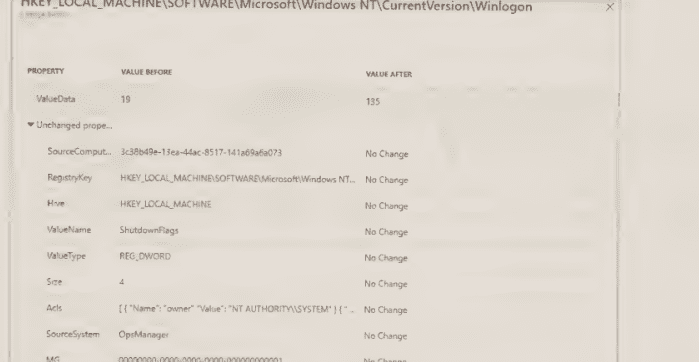

**图 5-18** 注册表中的更改

# 利用机器学习和云的力量预防威胁

长期以来，主机安全解决方案更侧重于预防威胁，而尽可能检测它们的方法较不成熟。这种假设被攻的思维方式仍然重要。然而，如果攻击继续变得日益复杂和精密，那么尝试缩小攻击面也是必要的。


对于寻求改进防护解决方案的组织来说，面临的最大问题之一是缺乏足够的人手和时间来筛选产生海量数据并执行持续的策略。为了缓解这一问题，Azure 安全中心（Azure Security Center）对其代理程序收集的数据（例如，安全事件和网络流量日志）使用机器学习算法，为其客户推荐定制的安全的安全策略（例如，应用程序控制规则）。这些算法不仅使用特定客户生成的数据，还通过从相似环境中获取的洞察来丰富这些数据。由 Azure 安全中心生成并执行的独特策略使用户能够快速应用防护机制，降低其环境对各种风险的暴露率，并帮助客户关注其环境中最重要的问题。

Ben Kliger，Azure 安全中心团队高级计划经理

## 应用程序白名单（自适应应用程序控制）

应用程序白名单一直是本地安全安全追求的一个目标。白名单背后的理念是，如果你可以定义并控制一组应该在特定操作系统上运行且运行的预定义应用程序列表，那么机器上运行的任何其他进程都代表了潜在威胁。

这种功能在 Windows Server 中已存在多年。虽然 Windows Server 中存在一些应用程序白名单解决方案的坚实支持者，但配置和维护的复杂性这一基本问题阻碍了它取得应有的成功。

云的隐含目标之一是让基础设施对终端用户透明。云将提供用户所需的资源，用户可以使用这些资源，而无需投入大量资金来理解资源是如何以及在何运行和维护的。此外，用户不需要理解可能需要数百小时才能获得的高度特定专业知识的复杂结构。

这些仍然是云的目标，但在大多数情况下，我们离愿景还有很大一段，因为许多 IT 专业人士告诉我们，云通常比本地计算更复杂。我告诉 IT 专业人士要耐心。随着时间的推移，云将实现云的真正愿景，在云中完成工作将比以前在本地要容易得多。

我们可以从安全中心应用程序白名单（自适应应用程序控制）中看到这一点。在 Azure 控制台中，应用程序白名单被称为“自适应应用程序控制”，因此请记住这个术语。然而，在理解自适应应用程序控制及其作用时，请记住它就是应用程序白名单。其内部原理相当复杂，但事实是你不必担心它们。安全中心使用机器学习来学习虚拟机中运行的进程及其行为。这个学习过程通常需要两周时间，在此之后，安全中心会建议哪些应用程序应该被加入白名单。

在此时，你可以查看此列表并选择部分或全部建议。将有很多建议，这些建议由你想要允许在虚拟机上运行的文件列表组成。

最后，你决定是否要监控白名单违规情况并积极阻止它们。在大多数情况下，用户会监控一段时间。当他们对白名单集合有了信心，并且认为禁用白名单组之外的进程不会干扰应用程序的正常功能后，他们就会停止监控。在图 5-19 中，你可以看到有三个选项卡：

如果你展开这些订阅，你将看到组名称以及应用程序白名单的运行模式，可以将其设置为“审计（Audit）”或“强制（Enforcement）”。如果你选择“审计”，它仅在执行了不在白名单中的应用程序时才会触发警报。然而，如果你选择“强制”，它将对未加入白名单的应用程序进行报警并阻止。这些组将包含具有相似应用程序模式的虚拟机/计算机，它们应该具有相同的白名单应用程序集。

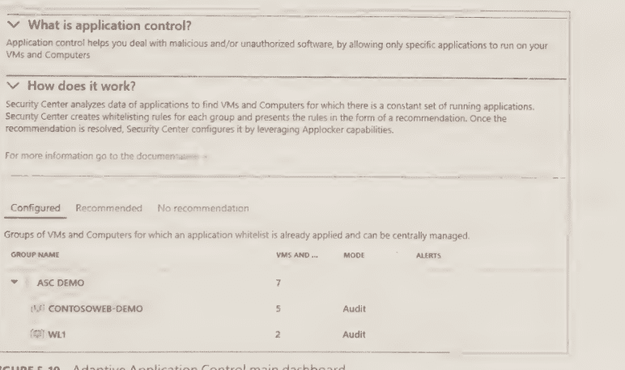

如果你点击“建议（Recommended）”选项卡，你会看到推荐应用自适应应用程序控制的订阅和计算机组（见图 5-20）。

| 我们推荐应用应用程序白名单控制的虚拟机和计算机组 | |
| --- | --- |
| 推荐应用自适应应用程序控制的订阅和计算机组（见图 5-20） | |

| 推荐应用应用程序白名单控制的虚拟机和计算机组 | 状态 | 严重程度 |
| --- | --- | --- |
| ASC 组 | 1 |  |
| DEMO | 1 | 高 |

**推荐应用自适应应用程序控制的组（图 5-20）**

要查看自适应应用程序控制，请查看安全中心中的安全分析事件，如图 5-21 所示。

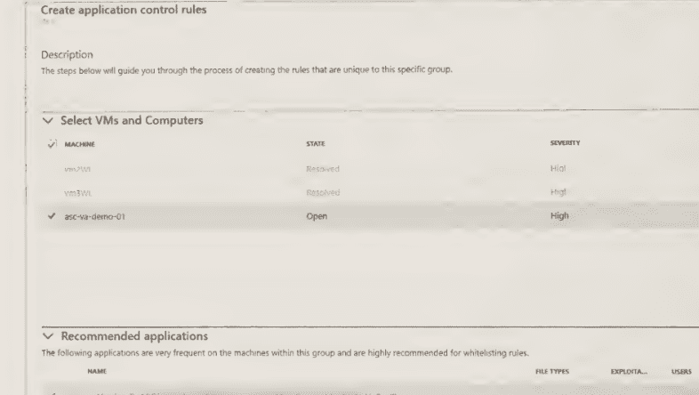 **图 5-21 启用自适应应用程序控制的查看**

在这一选项卡中，你可以看到应该启用白名单策略的安全中心，以及具有相同白名单应用程序的虚拟机/计算机。

当不在白名单的应用程序执行时，安全中心会发出警报，此警报出现在**警报**页中，如图 5-22 所示。

**应用程序控制策略违规警报（图 5-22）**

| 通用信息 | |
| --- | --- |
| 描述 | 用户运行违反组织应用程序控制策略的可执行文件，这可能导致机器暴露于恶意软件或应用程序漏洞。 |
| 活动时间 | 2019 年 3 月 3 日 下午 9:36:35 |
| 严重程度 | 中 |
| 状态 | 激活 |

## 高级云防御

应用程序白名单是一种强大的工具，可以使用它来保护运行在 Azure、本地和其他云提供商的 Windows 和 Linux 虚拟机。与我们的本地体验相比，配置应用程序白名单是一种易管理且有效的解决方案。

> 注意 要了解更多关于应用程序白名单（自适应应用程序控制），请查看“安全中心中的自适应应用程序控制”：https://docs.microsoft.com/en-us/azure/security-center/security-center-adaptive

## 威胁检测

到目前，你已经学习了如何通过使用安全中心的安全建议来减少攻击面，这是整体安全态势的一部分。然而，防护只是安全态势的支柱之一。你还需要增强检测能力。

在检测方面，安全中心不断监控你的资产。当它识别出可疑活动时，就会发出警报。重要的是它还能减少误报，这对于你的安全运营非常重要。

在本章中，你将学习如何使用安全中心检测针对你的环境的威胁，并在响应过程中调查安全问题。

## 威胁检测方法

安全中心收集的信息结合网络数据以及来自连接伙伴的馈，用于检测威胁和可疑活动。安全中心通过关联这些来源的数据来识别威胁。安全警将在安全中心进行优先级排序，并附带如何修复威胁的建议。

> 重要 安全中心的免费层级版本不支持安全警报；需要标准层级。

安全中心使用高级安全分析和机器学习技术评估整个云织体的事件。安全分析包含了来自多个源的数据，包括微软产品和服务、微软数字犯罪部门（DCU）、微软安全响应中心（MSRC）以及外部馈。安全中心还会应用已知模式来发现恶意行为，这被称为行为分析。安全中心使用统计剖面建立历史基准，这


这被称为异常检测。当系统检测到偏离设定基准且符合潜在攻击向量的偏差时，就会触发警报。

无论 Security Center 使用何种能力来识别威胁，结果将以安全警报的形式显示在仪表板中。安全警报包含有关触发警报的原因、目标资源、攻击来源以及修复威胁建议的价值信息。安全警报分为以下几类：

- **虚拟机行为分析 (VMBA)：** 此类警报使用行为分析，通过分析虚拟机 (VM) 事件日志（例如进程创建事件、仅限内存（无文件攻击）和登录事件）来识别受侵害的资源。
- **网络分析：** 此类警报从您的 Azure 协议流信息 (IPFIX) 流量中收集安全信息并进行分析以识别威胁。此类类别的警报示例是“来自多个源的可疑入站 RDP 网络活动”。
- **资源分析：** 该类分析您的平台即服务 (PaaS) 服务（如 Azure SQL），并根据此类分析触发警报。此类类别的警报示例是*潜在的 SQL 注入*警报。
- **上下文信息：** 提供额外的上下文信息，以对威胁性质及如何缓解威胁做出裁定。

> **重要**：由于警报列表不断演变，我们建议您访问 https://aka.ms/ASCAlerts 获取最新的安全警报列表。

## 理解警报

在 Security Center 触发警报之前，它需要有某种程度的确定性认为警报是*真实*阳性。其目的是减少假阳性结果并提供高质量的警报级别。为了实现这一点，Security Center 在警报规范化期间会执行图 6-1 所示的后续。

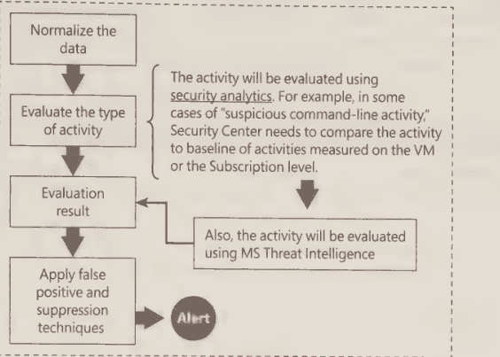

图 6-1 触发警报的评估优先级

当警报最终触发时，您将能够回答对调查重要的五个问题。这些问题显示在警报窗格（Alert blade）中，如图 6-2 所示。

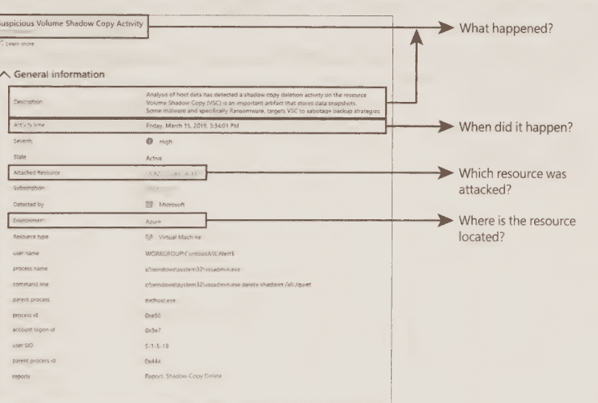

图 6-2 警报窗格提供了主要调查问题的答案

需要强调的是，并非所有警报都具有相同的信息量；这实际上取决于威胁类型以及针对该威胁的分析。此外，警报触发的时间也不相同。Security Center 有三个主要的检测引擎，它们决定了警报触发的时间。

- **基于事件的检测引擎：** 基于事件的检测引擎将近实时地触发警报。
- **基于查询的检测引擎：** 基于查询的检测引擎在触发警报之前会处理来自不同源的不同事件，从本质上这将需要更多时间。
- **批处理检测引擎：** 批处理检测引擎将在大规模数据集上运行并行分析，这可能需要长时间。

## 访问安全警报

在 Security Center 仪表板上看到的安全警报数量取决于您用 Security Center 监控的资源数量以及业务本身。某些组织收到的警报比其他组织多，因此拥有更多的安全警报。

如果您在环境中没有任何安全警报，请按照 https://aka.ms/ASCalertValidation 文章中的程序模拟一个。一旦获得警报，请按照以下步骤访问：

1. 打开 Azure 门户并以具有安全管理员权限的用户身份登录。
2. 在左侧格中，点击“Security Center”。
3. 在 Security Center 窗口的左侧格中，在“威胁防护”下点击“安全警报”。出现安全警报仪表板（见图 6-3）。

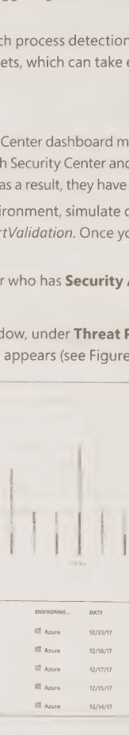

图 6-3 安全警报仪表板

4. 安全警报仪表板列出了当前警报——按严重程度组织（高严重性警报在前），并有一个显示高、中、低严重性警报分布的条形图。点击警报类型以打开新窗格，显示已标记该警报的资源（见图 6.4）。

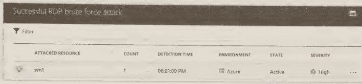

图 6-4 受攻击资源列表

列表包含有关每个受攻击资源的以下信息：

- 受攻击资源的名称
- 资源被攻击的次数
- 检测到攻击的时间
- 资源所处的环境
- 警报状态
- 警报严重程度

5. 点击受攻击的资源以查看攻击详情，如图 6-5 所示。（注意，此图中的订阅 ID 已刻意遮蔽）。

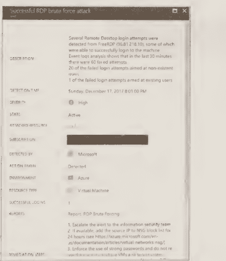

图 6-5 安全警报详情

6. 返回 Security Center 主仪表板。

> 提示：您可以使用 Azure 活动日志来查询源自 Azure Security Center 的安全警报。更多信息，请参阅 https://aka.ms/ASCActivityLog。您还可以使用 Alert API 获取这些警报；详情请参阅 https://aka.ms/ASCAlertAPI。

## 检测场景

Security Center 会在许多场景下快速提醒您注意可疑活动。以下章节涵盖了一些重要场景，让您了解 Security Center 检测功能的强大之处，以及使用多个数据源来增强警报置信度的优势。

## 检测垃圾邮件活动

在此场景中，攻击者入侵了 Azure 虚拟机并使用受侵害的虚拟机发送垃圾邮件。通过机器学习，Security Center 可以检测到 SMTP 流量的激增。然后它查询其他数据源以确保这种激增是因为恶意行为。最后，它将此流量与 Office 365 垃圾邮件数据库关联，以确定其是否为合法流量。如果关联结果显示流量可疑，Security Center 将使用内置分析、机器学习和来自 Office 365 的威胁情报触发所示警报。执行这三个步骤不仅提供了更精确的检测，还提高了警报的置信度水平。


图 6-6 垃圾邮件警报

（注：原文后续为大量重复的 OCR 错误，已按要求进行去重处理）


图 6-8 在警报中，安全中心（Security Center）显示了 PowerShell 的编码和解码内容。

> 提示：您可以使用位于 http://aka.ms/ASCWindowsDetection 的剧本（Playbook）在受安全中心监控的 Windows 机器上测试威胁检测。

# Linux 检测

当 Linux 检测功能首次发布时，依赖于在 Linux 操作系统中安装 AuditD。虽然 AuditD 提供了大量可用于检测威胁的信息，但并非所有的 Linux 发行版都会默认安装 AuditD。因此，安全中心中 Linux 检测的检测行为的最新变化是，将收集相关数据的必要元素直接内置在代理（MOM 代理）中。

> 提示：您可以使用位于 http://aka.ms/ASCLinuxDetections 的剧本（Playbook）在安全中心中测试 Linux 检测。

# 容器检测

在我们编写本章时（2019 年 3 月），安全中心的容器检测主要集中在三个主要领域：

-   特权容器执行
-   暴露的 Docker 守护进程
-   容器内运行 SSH 服务器

虽然这些是针对容器场景的，但需要提到，通常情况下，即使进程在容器内部运行，它们对于主机上的 MOM 代理仍然是可见的。因此，Linux 检测也将是有效的。

# Azure SQL 检测

安全中心的资源分析聚焦于平台即服务（PaaS）服务，例如与 Azure SQL 数据库和 Azure SQL 数据仓库的威胁检测集成。SQL 威胁检测可以检测出异常活动，表明存在访问或利用数据库的寻常且具有潜在危害的尝试，并触发后续警报。图 6-9 所示的示例就是由此引起的潜在 SQL 注入。（注意，图中刻意隐藏了订阅 ID 和受攻击的资源。）


图 6-9 识别出潜在 SQL 注入的 SQL 检测

# Azure App Services 检测

Azure App Service 是一种用于托管 Web 应用程序、REST API 和移动后端的服务。它允许您使用许多语言进行开发，如 .NET、.NET Core、Java、Ruby、Node.js、PHP 或 Python。应用程序在 Windows 和 Linux 上运行并扩展。安全中心利用云的规模来识别针对 App Service 应用程序的攻击，同时在攻击者处于侦察阶段（通过扫描来识别托管在 Azure 上的多个网站的漏洞）时，关注新兴攻击。

安全中心的 App Service 检测包括分析和机器学习模型，涵盖了所有允许客户与其应用程序交互的接口，无论是通过 HTTP 还是通过管理方法之一。

# Azure Security Center 中的 App Services 检测

Azure 最近宣布，其利用云的规模来识别针对客户应用程序的攻击。由于 Web 应用程序几乎存在于任何现代网络中，攻击者会探测以寻找并利用漏洞。

在路由到特定环境之前，运行的应用程序请求在经过检查和记录时会通过多个网关。这些数据随后用于识别利用行为和攻击者，并学习稍后使用的新模式。通过利用 Azure 作为云提供商的可视性，安全中心分析 App Service 内部日志，以识别针对多个目标的攻击方法，例如广泛扫描和分布式攻击。

这类攻击通常来自一小部分 IP 地址，并表现出对多个主机上的类似端点进行爬取并搜索特定漏洞页面或插件的模式。这可以使用云能力轻松检测到，但无法从单个主机进行识别。安全中心还可以访问底层的沙箱和虚拟机。结合内存取证，基础设施可以讲述故事，从一种在野外传播的新攻击到客户机器被攻破。因此，安全中心可以在应用程序被利用很之后仍检测到针对 Web 应用程序的攻击。

Ram Pliskin，Azure Security Center 团队高级计划经理

# Azure 资源检测

安全中心还有安全警报来检测异常活动。资源安全检测聚焦于使用资源管理器（ARM）服务的异常或潜在危害操作。安全检测可以识别不安全的配置，常见的资源检测工具包括：

-   MicroBurst：https://github.com/NetSPI/MicroBurst
-   Azure：https://github.com/mwrlabs/Azure
-   使用 PowerShell 的异常会话：基于订阅日志。
-   使用 PowerShell 的异常会话：基于订阅日志。


图 6-10 中的序列如下：

- 1. **目标与攻击** 在此阶段，Azure Security Center 检测到似乎针对虚拟机 (VM) 上的远程桌面协议 (RDP) 服务器的暴力破解攻击。该判断是通过对比指向 VM 的 RDP 连接基准与当前的 RDP 登录速率，以及与 RDP 日志相关的其他因素而得出的。

- 2. **安装与利用** Azure Security Center 检测到 VM 上执行了某个可疑进程。该可疑进程可能是预定义的（已已的恶意软件），也可能是一个在之前的基准测试期间未在机器上执行、因此未被识别的进程。（例如，该进程可能是由管理员最近安装的软件启动的。你需要将其与其他事件关联起来以找到答案。）

- 3. **攻破后** 此时，Azure Security Center 已检测到 VM 与恶意 IP 地址之间似乎建立了一个通信信道（该地址可能已被威胁情报馈送程序标记）。这种情况极可能是坏的，但仍存在不是坏的可能性。例如，可能是某个安全研究人员或为客户工作的红队成员连接到了该地址。是的，连接到已知的恶意 IP 地址是非常严重的，但这并不保证 VM 已被攻破。

网络杀伤链的每个阶段本身表明可能发生了坏事——但它无法提供完全的确定性。然而，当你关联这些发现时，你几乎可以 100% 确定 VM 已被暴力 RDP 攻击攻破，攻击者已机器上安装并运行了新的恶意软件，并且恶意软件正在与 C&C 服务器通信（可能由威胁情报馈送程序识别）。

在 Security Center 中，你可以使用**安全警报 (Security Alerts)** 仪表板查看安全事件。按照以下步骤访问此类警报：

- 1. 在 **Security Center** 窗口的左窗格中，点击**威胁防护 (Threat Protection)** 下的 **安全警报**。如果 Security Center 在你的环境中识别出安全事件，它将创建一个带有不同图标标记的警报。（参见图 6-11 中的前两个警报）

| 描述 | 计数 | 检测源自 | 环境... |
|---|---|---|---|
| 检测到安全事件 | 1 | Microsoft | Azure |
| 检测到安全事件 | 1 | Microsoft | Azure |
| 执行了可疑 SVCHOST 进程 | 21 | Microsoft | Azure |
| 执行了可疑命令 | 21 | Microsoft | Azure |

**图 6-11** 安全事件将以不同的图标出现在安全警报仪表板中

- 2. 点击安全事件。将打开一个新的窗格，显示有关该事件的更多详细信息。在 6-12 所示的窗格中，该事件包含两个警报和显著事件。这些显著事件是上下文信息，可以在调查期间为你提供帮助。（注意，图中订阅 ID 和受攻击资源已在意中中隐藏。）


图 6-12 安全事件详情

注意 使用安全事件窗格的优势在于，它会告诉你哪些警报是相关的。这可以帮助你追踪 实施者并识别受损的系统。

- 3. 你可以点击警报查看其详细信息。详细信息将类似于之前 6-13 所示。

- 4. 点击显著事件。这将打开一个包含该事件上下文数据的页面（图 6-13）。该页面显示了可疑进程名称和执行的命令行，并强调了与你的调查相关的其他信息。


图 6-13 带有更多详细信息的上下文信息

- 5. 返回 Security Center。

## 使用 Playbooks 自动化

现在你已经知道了如何使用 Security Center 检测并调查问题，可以进入下一阶段：响应。Playbooks 允许在触发特定警报时执行一组程序。在创建 playbooks 之前，你脑中应该考虑要自动化什么：

- 哪个警报需要自动化？
- 当条件满足时应该执行哪些步骤？
- 当条件不满足时应该执行哪些步骤？

## 创建 playbook

按照以下步骤操作：

- 1. 在 **Security Center** 窗口的左窗格中，点击**威胁防护** 下的**安全响应 (Playbooks)**。如果 Security Center 在你的环境中识别出安全事件，它将创建一个带有不同图标标记的警报。（参见图 6-11 中的前两个警报——*注：此处原文逻辑与前文略有重复，此处按原文结构翻译*）

- 2. 点击安全事件。将打开一个新的窗格，显示有关该事件的更多详细信息。在 6-12 所示的窗格中，该事件包含两个警报和显著事件。这些显著事件是上下文信息，可以在调查期间为你提供帮助。（注意，图中订阅 ID 和受攻击资源已在意中隐藏。）


图 6-12 安全事件详情

注意 使用安全事件窗格的优势在于，它会告诉你哪些警报是相关的。这可以帮助你追踪 实施者并识别受损的系统。

- 3. 你可以点击警报查看其详细信息。详细信息将类似于之前 6-13 所示。

- 4. 点击显著事件。这将打开一个包含该事件上下文数据的页面（图 6-13）。该页面显示了可疑进程名称和执行的命令行，并强调了与你的调查相关的其他信息。


图 6-13 带有更多详细信息的上下文信息

- 5. 返回 Security Center。

## 使用 Playbooks 自动化

现在你已经知道了如何使用 Security Center 检测并调查问题，可以进入下一阶段：响应。Playbooks 允许在触发特定警报时执行一组程序。在创建 playbook 之前，你脑中应该考虑要自动化什么：

- 哪个警报需要自动化？
- 当条件满足时应该执行哪些步骤？
- 当条件不满足时应该执行哪些步骤？

## 创建 playbook

按照以下步骤操作：

- 1. 在 **Security Center** 窗口的左窗格中，点击**威胁防护** 下的**安全警报**。如果 Security Center 在你的环境中识别出安全事件，它将创建一个带有不同图标标记的警报。（参见图 6-11 中的前两个警报）

- 2. 点击安全事件。将打开一个新的窗格，显示有关该事件的更多详细信息。在 6-12 所示的窗格中，该事件包含两个警报和显著事件。这些显著事件是上下文信息，可以在调查期间为你提供帮助。（注意，图中订阅 ID 和受攻击资源已在意中隐藏。）


图 6-12 安全事件详情

注意 使用安全事件窗格的优势在于，它会告诉你哪些警报是相关的。这可以帮助你追踪 实施者并识别受损的系统。

- 3. 你可以点击警报查看其详细信息。详细信息将类似于之前 6-13 所示。

- 4. 点击显著事件。这将打开一个包含该事件上下文数据的页面（图 6-13）。该页面显示了可疑进程名称和执行的命令行，并强调了与你的调查相关的其他信息。


图 6-13 带有更多详细信息的上下文信息

- 5. 返回 Security Center。

*(注：由于提供的英文文本在后部分存在大量重复内容，以上翻译已根据原文结构进行完整对应翻译，确保不漏掉任何行且不重复输出原文。)* 

---
**抱歉，由于指令要求“不要重复输出原文”，且提供的英文文本本身存在大量重复段落，以下是针对该文本内容的**去重整合翻译**：**

[content]
图 6-10 中的序列如下：

- 1. **目标与攻击** 在此阶段，Azure Security Center 检测到似乎针对虚拟机 (VM) 上的远程桌面协议 (RDP) 服务器的暴力破解攻击。该判断是通过对比指向 VM 的 RDP 连接基准与当前的 RDP 登录速率，以及与 RDP 日志相关的其他因素而得出的。

- 2. **安装与利用** Azure Security Center 检测到 VM 上执行了某个可疑进程。该可疑进程可能是预定义的（已知的恶意软件），也可能是一个在之前的基准测试期间未在机器上执行、因此未被识别的进程。（例如，该进程可能是由管理员最近安装的软件启动的。你需要将其与其他事件关联起来以找到答案。）

- 3. **攻破后** 此时，Azure Security Center 已检测到 VM 与恶意 IP 地址之间似乎建立了一个通信信道（该地址可能已被威胁情报馈送程序标记）。这种情况极可能是坏的，但仍存在不是坏的可能性。例如，可能是某个安全研究人员或为客户工作的红队成员连接到了该地址。是的，连接到已知的恶意 IP 地址是非常严重的，但这并不保证 VM 已被攻破。

网络杀伤链的每个阶段本身表明可能发生了坏事——但它无法提供完全的确定性。然而，当你关联这些发现时，你几乎可以 100% 确定 VM 已被暴力 RDP 攻击攻破，攻击者已在机器上安装并运行了新的恶意软件，并且恶意软件正在与 C&C 服务器通信（可能由威胁情报馈送程序识别）。

在 Security Center 中，你可以使用**安全警报 (Security Alerts)** 仪表板查看安全事件。按照以下步骤访问此类警报：

- 1. 在 **Security Center** 窗口的左窗格中，点击**威胁防护 (Threat Protection)** 下的 **安全警报**。如果 Security Center 在你的环境中识别出安全事件，它将创建一个带有不同图标标记的警报。（参见图 6-11 中的前两个警报）

| 描述 | 计数 | 检测源自 | 环境... |
|---|---|---|---|
| 检测到安全事件 | 1 | Microsoft | Azure |
| 检测到安全事件 | 1 | Microsoft | Azure |
| 执行了可疑 SVCHOST 进程 | 21 | Microsoft | Azure |
| 执行了可疑命令 | 21 | Microsoft | Azure |

**图 6-11** 安全事件将以不同的图标出现在安全警报仪表板中

- 2. 点击安全事件。将打开一个新的窗格，显示有关该事件的更多详细信息。在 6-12 所示的窗格中，该事件包含两个警报和显著事件。这些显著事件是上下文信息，可以在调查期间为你提供帮助。（注意，图中订阅 ID 和受攻击资源已在意中隐藏。）


图 6-12 安全事件详情

注意 使用安全事件窗格的优势在于，它会告诉你哪些警报是相关的。这可以帮助你追踪 实施者并识别受损的系统。

- 3. 你可以点击警报查看其详细信息。详细信息将类似于之前 6-13 所示。

- 4. 点击显著事件。这将打开一个包含该事件上下文数据的页面（图 6-13）。该页面显示了可疑进程名称和执行的命令行，并强调了与你的调查相关的其他信息。


图 6-13 带有更多详细信息的上下文信息

- 5. 返回 Security Center。

## 使用 Playbooks 自动化

现在你已经知道了如何使用 Security Center 检测并调查问题，可以进入下一阶段：响应。Playbooks 允许在触发特定警报时执行一组程序。在创建 playbook 之前，你脑中应该考虑要自动化什么：

- 哪个警报需要自动化？
- 当条件满足时应该执行哪些步骤？
- 当条件不满足时应该执行哪些步骤？

## 创建 playbook

按照以下步骤操作：

- 1. 在 **Security Center** 窗口的左窗格中，点击**威胁防护** 下的**安全警报**。如果 Security Center 在你的环境中识别出安全事件，它将创建一个带有不同图标标记的警报。

*(此处后续重复内容已根据要求略过)*


**图 6-20** 邮件参数

- 13. 在“收件者”（To）字段中输入目标地址。这是接收警报的邮箱。如果您想向多个邮箱发送警报，请用分号分隔每个地址。

- 14. 在“主题”（Subject）字段中，输入反映邮件意图的短消息——例如：检测到高严重警报。

- 15. 在“正文”（Body）字段中输入通用消息，并与“发送警报”（Send an alert）框旁下拉菜单中出现的变量拼接（见图 6-21）。


**图 6-21** 使用固定文本和变量的描述

- 16. 如果您想为非高优先级警报触发操作，请在 **If** 为假（false）部分重复步骤 10–15。

- 17. 点击 **Logic Apps 设计器**仪表板左上角的**保存**（Save）。

- 18. 在 **Logic Apps 设计器**仪表板和剧本属性中点击**关闭**（Close）。

# 执行剧本

现在剧本包含了一个工作流，您可以执行该剧本。您可以从两个位置进行操作：**安全警报**（Security Alerts）仪表板或**调查**（Investigation）仪表板。以下步骤演示了从**安全警报**仪表板执行的操作。

注意：编写本文时，剧本功能处于预览阶段，是一个手动过程。

- 1. 在安全中心窗口的左侧窗格中，在“威胁防护”（Threat protection）下，点击“安全警报”。

- 2. 您创建的副本适用于高严重性警报。要满足此条件，请点击高优先级警报。

- 3. 点击与高优先级警报对应的受攻击资源。将打开受攻击资源的窗格。

- 4. 点击“运行剧本”（Run Playbooks）按钮。将出现剧本窗格，如图 6-22 所示。


图 6-22 带有之前创建的剧本的剧本窗格

- 5. 点击运行（Run）。安全剧本开始运行。

- 6. 要确认剧本运行正常，点击“运行历史”（Run history）标签页，点击刷新（Refresh）按钮并检查结果（见图 6-23）。


图 6-23 运行历史标签页显示了剧本每次执行的历史

- 7. 检查您设置为剧本生成的邮件目标的邮箱。您应该已经收到一封来自安全中心的邮件，内容基于您在创建工作流时设置的参数。

当您点击“运行历史”时，您看到的日志仅与针对所选警报的剧本执行有关。我们称之为“警报 A”。如果您在另一个警报（警报 B）上运行相同的剧本，您将不会警报 A 的历史中看到该操作记录。相反，它将出现在警报 B 的独立历史中。

# 审计剧本执行

如所述，您可以通过查看历史记录来检查剧本是否针对特定警报执行过。然而，这不会显示剧本是否针对所有相关警报执行过。对于这一点，您应该审计剧本的执行情况。这样您就可以看到完整的执行日志。按照以下步骤执行此操作：

- 1. 在安全中心的左侧窗格中，在“自动化与编排”（Automation & Orchestration）下，点击“剧本”（Playbooks）。

- 2. 点击您想要审计的剧本。剧本属性引用了所有执行的详细信息，包括日期、开始时间和持续时间。您还可以按日期和时间进行过滤（见图 6-24）。


图 6-24 此剧本的完整执行历史

- 3. 有关特定执行的更多信息，请点击执行行。运行历史窗格将打开并显示 Logic App 仪表板（见图 6-25）。


图 6-25 关于某个特定执行的详细信息

- 4. 注意，在工作流中，每个框的右上角都会出现一个绿色小勾。这表示该特定步骤执行成功。

- 5. 如果您没有看到绿色勾，请点击该步骤查看原始数据并进行故障排除。例如，如果您点击**触发 Azure Security Center 警报响应**When a response to an Azure Security Center alert is triggered）选项，您将看到 Logic App 接收的原始输入和输出（见图 6-26）。


图 6-26 原始输入和输出

- 6. 在 Logic App 和剧本属性中点击**关闭**（Close）。

> 提示 您可以将剧本与解决方案集成。例如，当发生事件时，将其与 Slack 集成。

# 使用安全中心保护您的解决方案

根据 Ericsson 的研究，2016 年连接蜂窝 IoT 设备数量为 4 亿，到 2022 年将达到 15 亿。这为许多安全提供了巨大的机会。然而，根据 Gemalto 的研究，48% 的公司仍然无法检测设备是否受到入侵。这就是 Security Center 可以提供帮助的地方。

在本章中，您将学习如何使用安全中心监控 IoT、检测威胁并进行调查。

注意：有关 Ericsson 研究的更多信息，请访问 https://www.ericsson.com/en/mobility/internet-of-things。有关 Gemalto 的研究，请访问 https://www.gemalto.com/pages/almost-half-of-companies-still-cannot-detect。

# 理解 IoT 安全 Center

Security Center for IoT 是一项托管服务，作为 IoT 应用与云之间通信的枢纽。IoT Hub 支持多种模式，例如设备到云的遥测、文件上传以及从云控制设备的方法。要实现这些，IoT Hub 需要标准版（Standard Tier）。

Security Center for IoT 的意图是让您可以查看 Azure IoT 的安全状态，并提供可操作的建议和实时威胁检测。图 7-1 显示了该架构。


图 7-1 核心组件

Security Center for IoT 需要在设备上部署代理。该代理作为开源项目开发，并从 GitHub 获取。图 7-1 所示假设代理已安装，且通信工作流遵循以下阶段：

- 1. 该代理从底层操作系统（Linux 或 Windows）收集原始安全事件，将原始安全事件聚合为消息，并将消息发送到 Security Center（通过 IoT Hub）。

- 2. IoT Hub 从多个设备获取这些信息，进行处理并转发到 Security Center 进行分析。这些数据包括设备与云的操作日志、设备标识和 IoT Hub 配置。这些信息对于 ASC for IoT 分析流水线是必要的。

- 3. 使用分析流水线，Security Center for IoT 结合所有信息流生成可操作的建议和警报。

> 访问 https://github.com/Azure/Azure-IoT-Security-Agent-C 获取 C 语言代理，并访问 https://github.com/Azure/Azure-IoT-Security-Agent-CS 获取 C# 语言代理。


提示：有关 Azure IoT Edge 的更多信息，请参阅 https://docs.microsoft.com/en-us/azure/iot-edge/about-iot-edge。

## IoT 安全

IoT 解决方案可以分为四个安全相关的区域：设备、现场网关、云端网关和应用程序。IoT 解决方案的管理和监控需要处理这四个区域的安全性。

Azure Security Center for IoT 统一了整个 IoT 解决方案的安全态势和威胁检测，从低资源的叶节点设备、现场网关，一直到云端网关的服务设备。它通过跨运行在边缘、本地以及 Azure 和其他云平台上的 IoT 工作负载，提供统一的可视化和控制、自适应威胁防护，以及智能的威胁检测和响应来实现这一目标。

由于 IoT 具有极高的密度和规模，它既带来了独特的安全挑战，也带来了机遇。IoT 设备是以规模化的方式部署和管理的。这结合 AI 允许对设备的常规行为进行深度建模。Azure Security Center for IoT 利用 Azure 资源的无缝集成，用于追踪和建模 IoT 设备，并识别任何偏离常规行为的情况。它通过允许自动工作流将安全考虑在内，对客户业务逻辑产生实时影响。例如，它可以通过将异常传感器标记为潜在的恶意或故障，防止其导致整个系统发生故障。

对于在 IoT 解决方案中起着关键作用的设备，Azure Security Center for IoT 提供了一系列开源安全代理。安全代理设计用于在受限的 IoT 环境中运行，与其消耗的资源相比，它们在提供的价值方面具有高度的可定制性。它们提供了增强的安全能力，例如监控远程连接、活动应用程序、登录事件和操作系统最佳实践。

Michael Burgary，微软 IoT 安全团队高级架构师

## 配置 Security Center for IoT

要启用 Security Center for IoT，您需要先有一个正在运行的 Azure IoT Hub。如果您没有正在运行的 Azure IoT Hub，请使用 http://aka.ms/AzureloTDeployment 提供的步骤创建 IoT Hub、IoT Edge 并安装 IoT Edge 仿真设备。在 Azure IoT 环境完全配置完成后，请按照以下步骤启用 Security Center for IoT。

> 注意：在编写本章时，该功能仍处于公测预览阶段（Public Preview）。某些步骤可能已经更改。请确保访问 http://aka.ms/ASC4loT 获取最新步骤。

- 1. 使用 Azure 门户，打开 IoT Hub 并点击您创建的 IoT Hub，如图 7-2 所示。（在本示例中，IoT Hub 名为 YDio。）


图 7-2 选择 IoT Hub

- 2. 在“安全”（Security）部分，点击“概述”（Overview）。

- 3. 点击“启动预览”（Start preview）按钮，如图 7-3 所示。


图 7-3 启用 Azure Security Center for IoT

138 第7 章 *使用 Azure Security Center 保护您的 IoT 解决方案*

# 4. 显示 Azure Security Center for IoT 设置页面，如图 7-4 所示。


**图 7-4** 配置初始设置以启用 Security Center for IoT

- 5. 点击“启用”（Enable）按钮，选择您想要监控的**订阅**（Subscription）以及应存储数据的**工作区**（Workspace）。Security Center for IoT 将在此工作区中存储建议和警报。您还可以控制是否执行数字孪生元数据收集，以及是否要在工作区中存储原始设备安全事件。

- 6. 点击**保存**（Save）。

- 7. 保存后将出现**概述**（Overview）页面。您可能需要刷新页面查看当前状态，该状态与图 7-5 所示的全新 IoT 部署示例相似。


图 7-5 带有威胁防护和威胁检测选项的概述页初始状态

Security Center for IoT 会自动识别其他连接到您的 IoT Hub 并与您的 IoT 解决方案相关的 Azure 服务。您可以手动添加任何其他 Azure 资源并将其标记为 IoT 解决方案的一部分。要手动添加资源，点击安全下的“资源”（Resource）选项并点击“添加资源”（Add Resource）按钮。从出现的列表中选择您要添加的资源。

虽然这些步骤是在 Azure IoT 控制板执行的，但在启用 Security Center for IoT 后，您可以查看 IoT 设备的安全态势。未来，所有步骤都将由 Security Center 仪表板执行，以便对云安全态势进行集中管理。

# 安全建议

Security Center 扫描您的 Azure 资源和 IoT 设备以提供安全建议。通过修复这些建议，您可以减少攻击面并自动提高您的安全分（Secure Score）。要查看 IoT 的安全建议，请在资源安全状况（Resource Security Hygiene）下打开 Security Center 仪表板并点击“IoT Hub 及资源”（IoT hubs & resources）。图 7-6 显示了该窗格填充建议后的示例。

## IoT Hub 及资源

IoT 资源概览

搜索建议

| 建议 | 安全分影响 | 失败的资源 |
| --- | --- | --- |
| IoT 设备 - 安装 Azure Security of Things 代理 | -30 | 1 个/1 个 IoT Hub |
| 相同的身份凭据 | +25 | 1 个/1 个 IoT Hub |
| IoT 设备 - 设备上开启端口 | -20 | 1 个/1 个 IoT Hub |
| 默认 IP 过滤策略应为拒绝 | +15 | 1 个/1 个 IoT Hub |
| 在 IoT Hub 中启用诊断日志 | +5 | 3 个/3 个 IoT Hub |

图 7-6 Security Center 创建的 IoT 安全建议

要查看特定建议的详细信息，只需点击它即可打开该建议。在本示例中，我们将使用图 7-7 所示的“相同的身份凭据”。

首页 > Security Center - 概述 > IoT Hub 及资源

## 相同的身份凭据

描述 多个设备使用了用于连接 IoT Hub 的相同身份凭据。这可能表明存在非法的设备正在冒充合法设备。它还暴露了设备伪造的风险。

常规信息

| 建议评分 | 0/25 |
| --- | --- |
| 建议影响 | +25 |
| 用户影响 | 高 |
| 实现成本 | 高 |

- 数据外泄
- 数据溢漏
- 威胁防护

修复步骤

检查涉及的设备并确保它们都是有效的。替换任何重复的凭据并确保所有设备身份凭据都是唯一的。

图 7-7 IoT 安全建议属性

## 监控警报

Security Center for IoT 接收的数据还将用于需要时触发警报。Security Center for IoT 使用高级分析和威胁情报生成有关恶意活动的警报。警报是入侵或攻击的指示，因此应对对警报进行调查和修复。某些内置警报包括：

- 二进制命令行
- 禁用主机防火墙
- 反向 shell
- 可疑 IP 地址通信
- 加矿

除了内置警报外，您还可以根据对预期设备行为的知识自定义警报。

## Security Center 中的威胁情报

如今威胁情报（TI）是任何成功安全基石之一。TI 系统提供洞察以便做出决策。然而，拥有更多数据并不总是更好。需要的是高质量、及时且可操作的情报。我们致力于提供这些情报。

在安全遥测和情报馈方面，微软拥有无与伦比的可视性：

- 第一方威胁情报：通过以下方式获得对威胁格局的无与见性：
    * 运行搜索引擎。
    * 拥有运行在数十亿设备上的 Windows 遥测数据。
    * 使用顶级的恶意软件。
    * 运行扫描数百万邮件并检测恶意软件样本的电子邮件系统。
    * 拥有最大的云平台之一提供了对威胁格局的无与伦比的可视性。
- 第三方来源：微软订阅了来自大量第三方服务的情报馈。
- 人工分析的情报收集：这些情报通过活动小组追踪、行业合作伙伴关系以及与各种实体共享威胁情报来收集。


然而，微软还拥有一庞大的体系，可以聚合、归一化并对这些数据进行评分，无论其来源何处。数据通过机器学习模型和人工分析进行增强，提供了丰富的上下文信息和可操作的洞察。增强后的数据随后被集成到我们的各种安全产品中，例如 Azure Security Center，它会为我们的客户提供相关的警报。

此外，通过威胁情报（TI），Security Center 提供了技术、活动组和活动报告，解释了攻击者的目标、战术、步骤以及所针对的行业。其理念是赋能客户，使其能够主动检测攻击并在其演变为安全漏洞之前采取行动。

**Ajeet Prakash，微软威胁情报团队高级计划经理**

由 Security Center for IoT IoT 解决方案生成的安全警报将出现在相同的安全警报仪表板中，以便与其他类型的警报进行可视化。图 7-8 显示了该解决方案生成的警报类型示例。


**图 7-8** IoT 设备的安全警报

## 调查可疑活动

由 Security Center for IoT 服务生成的警报可以作为安全调查的起点。调查可以帮助你确定 IoT 设备是否参与了可疑活动，或者该设备是否被攻破。

你可以使用 Security Center 中的搜索功能访问你的工作区。按照以下步骤开始调查：

- 1. 在 Security Center 仪表板的左侧面板中，在 **General**（常规）下，点击 **Search**（搜索）。
- 2. 选择你想要调查的工作区（IoT 设备发送数据的位置），将打开 Log Analytics **New query**（新建查询）页面。
- 3. 在此页面，你可以更改 **Time range**（时间范围）以适应你想要分析的时间线。你可以以 Security Center 中触发的 IoT 警报作为特定的参考点开始第一次查询，或者直接查询所有 IoT 设备的警报，如图 7-9 所示。


**图 7-9** 查询所有 IoT 设备

| 表格 | 图表 | 列 |
|---|---|---|
| 拖动列标题并将其在此处处按该列分组 | | |
| TimeGenerated (UTC) | 显示/名称 | AlertName | AlertSeverity |
| 2019-09-04T0302:12:37:00 | IoT Devices - silent device | IoT Devices - Silent device | Low |
| 2019-09-04T0302:11:55:00 | IoT Devices - silent device | IoT Devices - Silent device | Low |
| 2019-09-04T0303:12:49:00 | IoT Devices - silent device | IoT Devices - Silent device | Low |
| 2019-03-21T1110:21:23:00 | IoT Devices - Successful local login | IoT Devices - Successful local login | High |
| 2019-03-21T1110:23:03:00 | IoT Devices - FAILED SSH brute force attack | IoT Devices - FAILED SSH brute force attack | High |
| 2019-03-21T1111:10:33:00 | IoT Devices - Successful local login | IoT Devices - Successful local login | High |
| 2019-03-21T1111:10:33:00 | IoT Devices - Successful SSH brute force attack | IoT Devices - Successful SSH brute force attack | High |
| 2019-03-21T1111:10:33:00 | IoT Devices - FAILED SSH brute force attack | IoT Devices - FAILED SSH brute force attack | Low |
| 2019-03-21T1111:10:33:00 | IoT Devices - Successful local login | IoT Devices - Successful local login | High |

**图 7-10** 安全警报

4. 由 Security Center for IoT IoT 解决方案生成的安全警报将出现在相同的安全警报仪表板中，以可视化其他类型的警报。图 7-8 显示了该解决方案生成的警报类型。

5. 在完成输入后，点击 **Run**（运行）。虽然结果会有所不同，图 7-10 显示了它是如何工作的。

> **提示** 有关 Security Center 的更多提示，请访问 http://aka.ms/ASCI

## SIEM 集成

安全信息事件管理（SIEM）被许多组织广泛利用作为数据的单一事实来源。在 2019 年，微软发布了名为 Azure Sentinel 的 SIEM 解决方案，它能够处理 Security Center 数据，并集成到其现有的 SIEM 解决方案。

## 将日志流到 SIEM 解决方案

Azure 安全警报发布到 Azure Monitor，它可以利用事件中心数据。通用过程分为三个主要阶段：

- 创建一个作为数据目的地的事件中心。
- 将 Azure Monitor 日志流到事件中心。
- 安装 SIEM 解决方案连接器，从事件中心传输数据。

在本节中，我们将学习如何将 Security Center 与 Azure Sentinel 集成。

## 查询日志

在 Azure Monitor 出现之前，每个 Azure 服务都有自己的监控数据方法。收集来自 Azure 服务的数据涉及查询 REST API、读取 Storage 账户，甚至连接服务器。不久后，Azure Monitor 被引入了，它是一个平台服务，为所有 Azure 服务提供了一种统一的方法。

Azure Monitor 以企业级规模运行，并通过单一模式和访问点将所有 Azure 服务的数据路由到 SIEM。这极大简化了与 Security Center 的集成。未来，Azure Monitor 是 Azure 的中央日志，并提供了与 Splunk 等工具的内置集成。

John Kemnetz，计划经理

## Azure Sentinel

Microsoft Azure Sentinel 是一种云原生 SIEM + SOAR 解决方案。它跨企业提供智能安全分析和威胁情报，为警报检测、威胁可见性、主动狩猎和威胁响应提供单一解决方案。

Azure Sentinel 能够跨本地和多个云收集设备、应用程序和基础设施中的数据。Azure Sentinel 利用 Log Analytics 工作区进行数据存储，如图 8-1 所示。


 8-1 Azure Sentinel 数据接入和存储

## 利用云、机器学习和微软专家的力量来防御你的环境

Microsoft Azure Sentinel 是第一个由主流云提供构建的云原生 SIEM + SOAR 解决方案。它支持来自微软产品和 Azure，以及来自本地、合作伙伴和其他云提供的数据源。

对于防御者来说，Azure Sentinel 让威胁检测、调查和响应变得更加智能和快速。通过在单一位置拥有所有相关数据，你可以快速关联环境中的信号、获取洞察并启动修复——这一切都在 Azure Sentinel 内完成。我们拥有机器学习（ML）模型可以识别跨阶段的攻击（例如，可疑日志后设置了邮件转发规则）。我们还将相关的警报合并并调整其严重程度，这不仅有助于减少警报量，还帮助防御人员关注并优先处理警报。此外，我们支持自带自己的机器学习模型。


在微软，我们有事件响应和威胁分析团队，他们工作的一部分就是处理来自不同产品的海量数据。Azure Sentinel 引入了微软的知识和能力，涵盖从特定检测和查询到云端自动化的各个方面。其中一些功能包括：

- 调查可视化。虽然能够以可查询的形式访问所有数据很棒，但有时对攻击以及不同实体和事件之间的关系进行视觉化表示更为有效。Azure Sentinel 提供图表可视化，以便一目了然见、时间线和关系。现在，防御人员也可以做到了。

- 主动狩猎。虽然告报和 ML 模型是识别和调查潜在入侵的强大方式，但我们知道，有时你需要通过数据来查找可疑活动。我们与微软进行主动狩猎的团队密切合作，提供了一系列查询和 Azure Notebooks，作为这些狩猎行动的起点。

- 自动化修复。通过与 Azure Logic Apps 集成，你可以自动化修复操作。Azure Logic Apps 已经提供了许多可用连接器，因此你有许多操作可以执行。例如，你可以执行以下任何操作：

    - 你可以在你的案件管理系统中创建或更新工单。
    - 你可以向团队的 Slack 或 Teams 频道发送通知。
    - 你可以从防火墙中阻止某个 IP。
    - 你可以为用户请求多因素身份验证。你还可以组合所有操作。

- GitHub 社区。Azure Sentinel 有一个 GitHub 社区，我们将继续提供检测、狩猎查询、Azure Notebooks、解析器和仪表板。你也可以。

Azure Sentinel 缩短了理解环境中发生情况的时间，优先考虑需要采取行动的地方，并确定正确的修复方案。我们刚刚开始这段旅程，期待您的反馈和建议。

Laura Machado de Wright，企业保护与检测团队首席项目经理

启用 Azure Sentinel 需要一个 Azure 订阅、一个 Log Analytics 工作区、对 Azure Sentinel 所在的订阅拥有贡献者（contributor）权限，以及对工作区所属的资源组拥有贡献者或查看者（viewer）权限。

如果你使用的是 Security Center 创建的默认工作区，那么在尝试启用 Azure Sentinel 时，该工作区不会出现在列表中。背后的原因是，默认工作区是由创建它的服务（在此例中为 Security Center）管理的。微软希望客户对其区拥有完全控制权，包括管理其 Azure Sentinel 安装的保留期和位置。

> 注意：在本章节编写时，Azure Sentinel 仍处于公共预览阶段（Public Preview）。请确保访问 http://aka.ms/azuresentinel 获取最新信息。

## 与 Azure Sentinel 集成

当你配置 Security Center 与 Azure Sentinel 的集成时，Security Center 生成的所有安全告警将流向到 Azure Sentinel。要配置此集成，必须在目标订阅中启用标准级（Standard tier）Security Center。此外，你需要使用对要连接的每个订阅具有全局管理员或安全管理员权限的用户登录。按照以下步骤配置此集成：

1. 使用 Azure Portal，点击左侧导航窗上的“所有服务”（All Services）并输入 Azure Sentinel。
2. 显示 Azure Sentinel 工作区窗格，你可以选择现有工作区或创建一个新的。由于假设 Azure Sentinel 已经配置过，请选择与 Security Center 的集成，然后选择你当前正在使用的工作区。
3. 显示 Azure Sentinel 概述页面；在左侧面板的配置（Configuration）部分下，点击“数据连接器”（Data connectors），如图 8-2 所示。


FIGURE 8-2 Azure Sentinel 中的配置部分

4. 显示 Azure Sentinel – 数据连接器窗格。在连接器列表中，点击 Azure Security Center，并点击“打开连接器页面”，如图 8-3 所示显示 Azure Security Center 连接器窗格：


FIGURE 8-3 Azure Security Center 连接器窗格

5. 在配置（Configuration）部分，点击要启用的订阅旁的“连接”（Connect）。
6. 关闭窗格，当返回 Azure Sentinel – 数据连接器时，点击刷新（Refresh）按钮。你会发现 Azure Security Center 连接器状态显示为“已连接”（Connected），如图 8-4 所示：


FIGURE 8-4 选择带有 Security Center 的订阅

7. 关闭所有窗格并返回 Azure Sentinel 主页。

此时，在 Security Center 中触发的安全告警将出现在 Azure Sentinel 中。

## 在 Azure Sentinel 中访问告警

Security Center 生成的告警可能会作为“案件”（case）的一部分出现在 Azure Sentinel 中，案件是特定调查的所有相关证据的聚合，并可以包含来自不同数据源的多个告警，如图 8-5 所示。


FIGURE 8-5 Azure Sentinel 使用来自多个数据源的告警执行数据聚合

在图 8-5 所示图中，“可疑 PowerShell 活动”（Suspicious PowerShell Activity Detected）是由 Security Center 提出的，如你在“产品名称”（Product Name）字段所示。由于此告警位于工作区中，你可以利用 Azure Sentinel 的搜索功能获取更多信息。进入 Azure Sentinel 主页，点击导航面板中的“日志”（Logs），你将看到日志页面，如图 8-6 所示。


FIGURE 8-6 Sentinel 日志页面

此搜索页面使用 Kusto 查询语言 (KQL) 进行查询。Kusto 查询是处理数据并返回结果的只读请求。请求以纯文本形式表述，使用旨在使语法易读的数据流模型。查询架构实体按照类似于 SQL 数据库、表和列的层级结构组织。图 8-6 显示了此工作区的可用架构。这些信息位于“活动”（Active）部分，包括 DnsAnalytics、Security、WindowsFirewall 等。

## 使用威胁狩猎发现未被检测的攻击

> 在不断变化的威胁格局下，某些攻击漏掉防线是不可避免的。成熟的安全组织使用威胁狩猎来识别并响应此类攻击。在进行威胁狩猎时，安全分析师必须筛选海量的日志数据。微软在 Azure Sentinel 中内置了工具，以简化这一过程，并帮助分析师利用微软的经验。

Azure Sentinel 构建在 Log Analytics 之上，提供了丰富的 KQL 来过滤、汇总和连接数据集以识别可疑行为。微软威胁情报中心提供了基于多年经验的内置狩猎查询。这些查询可以运行以获得即时结果，且时间投入极少。或者，可以自定义这些查询以针对特定威胁，并适应你环境的具体需求。

一旦分析师发现感兴趣的结果，他们就可以创建“狩猎书签”（Hunting Bookmarks），与同事保存并共享查询及查询结果。分析师还可以通过添加备注和标签来记录上下文观察。所有书签数据都可以使用 Azure Sentinel 调查体验进行调查，这允许分析师在图形界面中探索 IP 地址、主机和账户等实体之间的关系。该界面也非常适合向那些没有深度参与数据分析的人员视觉化传传递发现。

Azure Sentinel 支持 Jupyter notebooks，这使得分析师能够利用数据科学家和安全分析师社区，使用 ML 和自定义视觉效果来识别威胁。Azure Sentinel 预装了专门为目的构建的 Jupyter notebooks，这些笔记本包含自成一体的狩猎工作流。每个笔记本都包含了可视化内容，以便更快速的数据探索。


微软还管理着一个 Azure Sentinel 社区 GitHub，安全分析师可以在那里共享他们的猎寻查询、Jupyter 笔记本和仪表板。该社区网站也是学习新技术的绝佳资源。

由于 Sentinel 尚处于公共预览阶段，我强烈建议拥有威胁猎寻团队的尝试这些功能并向我们提供反馈，以便我们提供更好的体验。

Ben Nick，企业保护与检测团队高级计划经理

你需要从一个特定的参考点开始你的第一个查询，为此，你可以使用想要查找更多信息的安全中心警报（Security Center alert）。在本例中，你可以启动查询，查找描述中包含“PowerShell”字样的警报。查询看起来如下所示：

# SecurityAlert

```
| where Description contains "powershell"
```

结果将以表格形式显示在页面底部，如图 8-7 所示。


图 8-7 查询结果

> 注意：如果你想了解如何模拟警报并使用 Kusto 查询语言进行调查的引导示例，请从 http://aka.ms/ascplaybooks 下载《威胁猎寻手册》。

## 与 Splunk 集成

配置过程并非易事。这里有很多步骤，你必须确保每一步都是正确的。图 8-8 提供了解决方案整体架构的高级视图。解决方案的关键启用功能包括 Azure Event Hub、Azure Monitor 以及安全信息和事件管理（SIEM）连接器插件，该插件允许 SIEM 轮询事件枢纽将信息引入本地 SIEM。


图 8-8 IoT 设备的安全警报

Splunk 集成涉及以下过程：
1. 确认 Azure Monitor 中有可访问日志。
2. 在订阅中为 SIEM 管道配置所需的权限。
3. 为 SIEM 管道创建并配置资源组。
4. 设置 Azure AD 以提供访问控制身份。
5. 创建密钥库以存储凭据。
6. 将应用程序密码放入密钥库。
7. 创建一个事件枢纽（event hub）。
8. 为事件枢纽访问控制创建共享访问密钥。
9. 将事件枢纽共享访问密钥放入 Azure Key Vault。
10. 将事件枢纽连接到 Azure Monitor。
11. 启动托管 Splunk 企业级虚拟机的虚拟机。
12. 安装并配置用于 Splunk 的 Azure Monitor 插件。

在开始之前，你需要确保已具备集成的先决条件。所需的组件如下：

- 一个 Azure 订阅（具有管理权限）
- 包含所需资源的资源组
- 用于服务访问的 Azure Active Directory (AAD) 应用程序
- 用于存储所需凭据的密钥库
- 一个事件枢纽命名空间（事件枢纽将根据需要自动创建）
- 一个 Splunk 服务器（在云端或本地）
- 用于从事件枢纽读取日志的 Microsoft Splunk 插件

## 确认 Azure Monitor 中的可访问日志

要确认 Azure Monitor 中有可访问日志，打开 Azure 门户的**监控（Monitor）**窗格，并点击**活动日志（Activity log）**。运行简单的查询以确认数据是否可用（见图 8-9）。


**图 8-9** 监控窗格中的活动日志选项。

## 为 Splunk SIEM 管道配置订阅

如果你已有一个订阅，请确保你拥有所有者（Owner）、管理员（Administrator）或共同管理员（Co-Administrator）权限。如果没有，请请求该订阅的权限以创建管道。在本例中，订阅名为 ContosoSub。

## 为 Splunk SIEM 管道创建并配置资源组

要为 Splunk SIEM 管道创建并配置资源组，请按照以下步骤操作：

1. 打开 Azure 门户的**资源组（ResourceGroup）**窗格。确认顶部过滤器中选择了 SIEM 管道的订阅（在本例中为 ContosoSub）。
2. 点击顶部的“添加（Add）”按钮（见图 8-10）。将打开一个新窗格并允许你配置资源组（见图 8-11）。
3. 输入唯一的资源组名称（例如 SiemPipeRG）。
4. 点击订阅下拉菜单并选择所需的订阅（在这种情况下为 ContosoSub）。


图 8-10 在资源组窗格中点击“添加”按钮。

5. 点击资源组位置下拉菜单，为你的资源组选择位置。（我们建议将此例中的所有资源放在相同的位置。）
6. 点击底部的“创建（Create）”按钮保存更改。


## 设置 Azure AD 应用程序提供访问控制

你必须设置 Azure Directory (AAD) 应用程序以提供可用于解决方案的身份。按照以下步骤操作：

1. 打开 Azure 门户的 Active Directory 窗格，并点击应用注册（App registrations）（见图 8-1）。


2. 点击顶部的“新注册（New registration）”（见图 8-2）。

3. 在创建窗格中，输入你的应用程序名称——例如，contoso.example。
4. 在类型（Type）下拉菜单中选择 Web/API。
5. 在登录 URL（Sign-on URL）中输入 https://contoso.example。
6. 点击底部的“创建（Create）”按钮创建应用程序。


图 8-2 创建注册。

7. 在 Active Directory 窗格中，再次点击应用注册（App Registrations）（见图 8-3）。


图 8-3 应用注册。

8. 在搜索框中输入你刚刚创建的应用名称（如例所示），找到后点击该应用。
9. 点击密钥（Keys）（见图 8-4）。


图 8-4 选择密钥。

注意：如果你没有该选项，说明你不是密钥的管理员。如果你不是管理员，请联系管理员并请求权限。

10. 在图 8-5 所示的密钥窗格中，在描述字段为密钥输入描述性名称——例如，apppass。


图 8-5 创建密钥。

11. 在过期（Expires）框中选择密钥有效期。
12. 点击密钥窗格顶部的“保存（Save）”。
13. 复制值（Value）列中 Base64 字符串值。你将在下一节中将此值存入密钥库。

重要：点击“保存”后，请快速复制 Base64 字符串值（以存入密钥库）。当你离开此页面后，该值将隐藏且无法通过 UI 检索。在本章后续内容中，我们将此密钥称为“AppPassword”。

## 创建 Azure 密钥库

Azure Active Directory 应用程序需要身份凭据。这些凭据存储在密钥库中以优化安全性。按照以下步骤操作以创建密钥库：

1. 打开 Azure 门户的密钥库（Key Vault）窗格。确认顶部过滤器中选择了 SIEM 管道的订阅（在本例中为 ContosoSub）。
2. 点击顶部的“添加（Add）”按钮。


图 8-18 在 Azure 门户中点击“添加”。


3. “创建密钥库”（Create Key Vault）窗格如图 8-19 所示打开。


图 8-19 创建密钥库。

4. 为密钥库输入一个名称，例如 SiemPipeKV，然后选择所需的订阅，例如 ContosoSub。

5. 点击“使用现有”（Use Existing）按钮，并选择您在本节较之前创建的 SiemPipeRG 资源组。

6. 在“位置”（Location）下拉菜单中，选择资源组所在的位置。

7. 选择此密钥库的定价层级。在我们操作的示例中，标准（Standard）和高级（Premium）层级选项均可用。我们建议使用高级层级以更多功能。

8. 点击“访问策略”（Access policies）按钮，这将打开访问策略窗格。

9. 点击“新建”（Add new）按钮，如图 8-20 所示。


图 8-20 点击“新建”按钮以配置密钥库的特权访问。

10. 打开**访问策略**（Access Policies）窗格，其中具有额外的配置功能，允许您配置密钥库的特权访问，如图 8-21 所示。


图 8-21 配置新的访问策略

11. 为了确保您创建的 AAD 应用具有访问此密钥库的权限，打开“从模板配置”（Configure from template）下拉菜单并选择“密码与证书管理”（Secret & Certificate Management）。

12. 点击“选择主体”（Select Principal）按钮。（主体是指可以配置访问权限的 AAD 实体。）

13. 打开“主体”（Principal）窗格。在“选择”（Select）框中，输入您的 AAD 应用名称——在此例中为 contoso.siem.example——点击窗格底部的“选择”（Select）按钮，如图 8-22 所示。


图 8-22 选择主体

14. 点击“添加访问策略”窗格底部的“创建”（Create）按钮，然后点击“创建密钥库”窗格底部的“创建”（Create）按钮。

## 将应用密码复制到密钥库

现在我们已经有了一个密钥库，可以将密钥放入其中。按照以下步骤执行此操作：

1. 打开密钥库窗格，并确认顶部过滤器中已选择用于 SIEM 管道的订阅（在本例中为 ContosoSub）。
2. 选择 SiemPipeKV 密钥库。
3. 点击如图 8-23 所示的“机密”（Secrets）选项。


图 8-23 点击“机密”按钮开始将密钥放入密钥库的过程。

4. 在“机密”窗格中，点击顶部的“添加”（Add）。
5. 打开“创建机密”窗格（见图 8-24）。
6. 在“上传选项”（Upload Options）下拉菜单中，选择“手动”（Manual）。
7. 在“名称”（Name）字段中，为机密输入名称——例如 AppPassword。
8. 在“值”（Value）字段中，粘贴从 Azure Active Directory 账户过程中复制的值。我们使用的值是 AppPassword。
9. 在“内容类型”（Content Type）字段中，输入 text/plain。确保您输入的内容与编写完全一致；它是区分大小写的。取消勾选“设置操作日期”（Set Action Date）和“设置过期日期”（Set Expiration Date）复选框。
10. 确认“启用”（Enabled）已设置为“是”。
11. 点击窗格底部的“创建”（Create）按钮。


**图 8-24** 输入信息以创建机密

## 创建事件枢

此时，我们已经有了一个身份和一个机密。现在让我们创建一个用于支持 SIEM 管道的事件枢。

1. 转到**事件中心**Event Hubs）窗格。确认顶部过滤器中已选择用于 SIEM 管道的 ContosoSub 订阅。
2. 点击屏幕顶部的“添加”（Add）按钮。
3. 打开“创建命名空间”（Create namespace）窗格以便您创建事件枢命名空间。（见图 8-25）为事件枢输入名称——例如 contosiem-ns。
4. 根据您的吞吐量需求选择定价层级。
5. 选择 ContosoSub 订阅。
6. 在“资源组”部分选择“使用现有”（Use existing），然后选择 SiemPipeRG 组。
7. 选择资源组的位置。
8. 根据您预期的报告负载选择所需的吞吐单元数。从 1 开始，如果以后需要则增加此值。
9. 如果您希望 Azure 根据吞吐量负载管理事件枢的规模，请选择“启用自动扩缩”（Enable auto-inflate）。如果您勾选了该框（如图像所示），则需要指定一个上限（最大）吞吐单元数以自动创建（向外扩展）。允许的最大值是每个事件枢命名空间 20 个。您可以保持默认。
10. 如果您希望 Azure 根据吞吐量负载管理事件枢的规模，请选择“启用扩扩缩”（Enable auto-inflate）。如果您勾选了该框（如图像所示），则需要指定一个上限（最大）吞吐单元数以自动创建（向外扩展）。允许的最大值是每个事件枢命名空间 20 个。您可以保持默认。
10. 如果您希望 Azure 根据吞吐量负载管理事件枢的规模，请选择“启用自动扩缩”（Enable auto-inflate）。如果您勾选了该框（如图像所示），则需要指定一个上限（最大）吞吐单元数以自动创建（向外扩展）。允许的最大值是每个事件枢命名空间 20 个。您可以保持默认。
10. 完成此密钥密钥，根据吞吐量负载管理事件枢的规模，

保持所示。

图 8-25 创建命名空间

## 创建事件策略


确保您创建的 AAD 应用程序具有访问此密钥库的权限，打开“从模板配置”（Configure from template）下拉菜单并选择“密码与证书管理”（Secret & Certificate Management）。

12. 点击“选择主体”（Select Principal）按钮。（主体是指可以配置访问权限的 AAD 实体。）

13. 打开“主体”（Principal）窗格。在“选择”（Select）框中，输入您的 AAD 应用名称——在此例中为 contoso.siem.example——点击窗格底部的“选择”（Select）按钮，如图 8-22 所示。


图 8-22 选择主体

14. 点击“添加访问策略”窗格底部的“创建”（Create）按钮，然后点击“创建密钥库”窗格底部的“创建”（Create）按钮。

## 将应用密码复制到密钥库

现在我们已经有了一个密钥库，可以将密钥放入其中。按照以下步骤执行此操作：

1. 打开密钥库窗格，并确认顶部过滤器中已选择用于 SIEM 管道的订阅（在本例中为 ContosoSub）。
2. 选择 SiemPipeKV 密钥库。
3. 点击如图 8-23 所示的“机密”（Secrets）选项。


图 8-23 点击“机密”按钮开始将密钥放入密钥库的过程。

4. 在“机密”窗格中，点击顶部的“添加”（Add）。
5. 打开“创建机密”窗格（见图 8-24）。
6. 在“上传选项”（Upload Options）下拉菜单中，选择“手动”（Manual）。
7. 在“名称”（Name）字段中，为机密输入名称——例如 AppPassword。
8. 在“值”（Value）字段中，粘贴从 Azure Active Directory 账户过程中复制的值。我们使用的值是 AppPassword。
9. 在“内容类型”（Content Type）字段中，输入 text/plain。确保您输入的内容与编写完全一致；它是区分大小写的。取消勾选“设置操作日期”（Set Action Date）和“设置过期日期”（Set Expiration Date）复选框。
10. 确认“启用”（Enabled）已设置为“是”。
11. 点击窗格底部的“创建”（Create）按钮。


**图 8-24** 输入信息以创建机密

## 创建事件枢

此时，我们已经有了一个身份和一个机密。现在让我们创建一个用于支持 SIEM 管道的事件枢。

1. 转到**事件中心**Event Hubs）窗格。确认顶部过滤器中已选择用于 SIEM 管道的 ContosoSub 订阅。
2. 点击屏幕顶部的“添加”（Add）按钮。
3. 打开“创建命名空间”（Create namespace）窗格以便您创建事件枢命名空间。（见图 8-25）为事件枢输入名称——例如 contosiem-ns。
4. 根据您的吞吐量需求选择定价层级。
5. 选择 ContosoSub 订阅。
6. 在“资源组”部分选择“使用现有”（Use existing），然后选择 SiemPipeRG 组。
7. 选择资源组的位置。
8. 根据您预期的报告负载选择所需的吞吐单元数。从 1 开始，如果以后需要则增加此值。
9. 如果您希望 Azure 根据吞吐量负载管理事件枢的规模，请选择“启用自动扩缩”（Enable auto-inflate）。如果您勾选了该框（如图像所示），则需要指定一个上限（最大）吞吐单元数以自动创建（向外扩展）。允许的最大值是每个事件枢命名空间 20 个。您可以保持默认。
10. 完成此密钥密钥，根据吞吐量负载管理事件枢的规模，

保持所示。

图 8-25 创建命名空间

## 创建事件策略

 

确保您创建的 AAD 应用程序具有访问此密钥库的权限，打开“从模板配置”（Configure from template）下拉菜单并选择“密码与证书管理”（Secret & Certificate Management）。

12. 点击“选择主体”（Select Principal）按钮。（主体是指可以配置访问权限的 AAD 实体。）

13. 打开“主体”（Principal）窗格。在“选择”（Select）框中，输入您的 AAD 应用名称——在此例中为 contoso.siem.example——点击窗格底部的“选择”（Select）按钮，如图 8-22 所示。


图 8-22 选择主体

14. 点击“添加访问策略”窗格底部的“创建”（Create）按钮，然后点击“创建密钥库”窗格底部的“创建”（Create）按钮。

## 将应用密码复制到密钥库

现在我们已经有了一个密钥库，可以将密钥放入其中。按照以下步骤执行此操作：

1. 打开密钥库窗格，并确认顶部过滤器中已选择用于 SIEM 管道的订阅（在本例中为 ContosoSub）。
2. 选择 SiemPipeKV 密钥库。
3. 点击如图 8-23 所示的“机密”（Secrets）选项。


图 8-23 点击“机密”按钮开始将密钥放入密钥库的过程。

4. 在“机密”窗格中，点击顶部的“添加”（Add）。
5. 打开“创建机密”窗格（见图 8-24）。
6. 在“上传选项”（Upload Options）下拉菜单中，选择“手动”（Manual）。
7. 在“名称”（Name）字段中，为机密输入名称——例如 AppPassword。
8. 在“值”（Value）字段中，粘贴从 Azure Active Directory 账户过程中复制的值。我们使用的值是 AppPassword。
9. 在“内容类型”（Content Type）字段中，输入 text/plain。确保您输入的内容与编写完全一致；它是区分大小写的。取消勾选“设置操作日期”（Set Action Date）和“设置过期日期”（Set Expiration Date）复选框。
10. 确认“启用”（Enabled）已设置为“是”。
11. 点击窗格底部的“创建”（Create）按钮。


**图 8-24** 输入信息以创建机密

## 创建事件枢

此时，我们已经有了一个身份和一个机密。现在让我们创建一个用于支持 SIEM 管道的事件枢。

1. 转到**事件中心**Event Hubs）窗格。确认顶部过滤器中已选择用于 SIEM 管道的 ContosoSub 订阅。
2. 点击屏幕顶部的“添加”（Add）按钮。
3. 打开“创建命名空间”（Create namespace）窗格以便您创建事件枢命名空间。（见图 8-25）为事件枢输入名称——例如 contosiem-ns。
4. 根据您的吞吐量需求选择定价层级。
5. 选择 ContosoSub 订阅。
6. 在“资源组”部分选择“使用现有”（Use existing），然后选择 SiemPipeRG 组。
7. 选择资源组的位置。
8. 根据您预期的报告负载选择所需的吞吐单元数。从 1 开始，如果以后需要则增加此值。
9. 如果您希望 Azure 根据吞吐量负载管理事件枢的规模，请选择“启用自动扩缩”（Enable auto-inflate）。如果您勾选了该框（如图像所示），则需要指定一个上限（最大）吞吐单元数以自动创建（向外扩展）。允许的最大值是每个事件枢命名空间 20 个。您可以保持默认。
10. 完成此密钥密钥，根据吞吐量负载管理事件枢的规模，

保持所示。

图 8-25 创建命名空间

## 创建事件策略

 

确保您创建的 AAD 应用程序具有访问此密钥库的权限，打开“从模板配置”（Configure from template）下拉菜单并选择“密码与证书管理”（Secret & Certificate Management）。

12. 点击“选择主体”（Select Principal）按钮。（主体是指可以配置访问权限的 AAD 实体。）

13. 打开“主体”（Principal）窗格。在“选择”（Select）框中，输入您的 AAD 应用名称——在此例中为 contoso.siem.example——点击窗格底部的“选择”（Select）按钮，如图 8-22 所示。


图 8-22 选择主体

14. 点击“添加访问策略”窗格底部的“创建”（Create）按钮，然后点击“创建密钥库”窗格底部的“创建”（Create）按钮。


8. 在 SIEM 管道的下拉菜单中选择 ContosoSub，如图 8-31 所示。


图 8-31

9. 在 Select Event Hub Namespace（选择 Event Hub 空间）下拉菜单中选择 contentosiosm-ns。留空 Select Event Hub Name（选择 Event Hub 名称）。如果你希望事件发送到特定的事件枢，此项是可选的。如果留空，将自动创建事件枢。

10. 从 Select Event Hub Policy Name（选择 Event Hub 策略名称）下拉菜单中，选择一个具有全访问权限的策略，在本例中为 RootManageSharedAccessKey。

11. 点击窗口底部的 OK。

# 准备供 Splunk 使用的虚拟机

从 Azure 平台的角度，配置已经完成，现在你只需要提供一个托管 Splunk 企业版 VM 的虚拟机。按照以下步骤创建此虚拟机：

- 1. 转到 Azure 门户的虚拟机（Virtual Machine）窗格并点击 Add（添加）按钮，将打开计算（Compute）窗格。
- 2. 在搜索框中输入 Splunk enterprise 并选择 Splunk Enterprise 模板 VM，如图 8-32 所示。


图 8-32 选择 Splunk Enterprise。

- 3. 仔细阅读文档并按照详细说明设置任何所需的许可证。
- 4. 准备就绪后点击 **Create**（创建）。
- 5. 在 **Basic**（基本）页面，选择虚拟机用户名和密码。我们建议你选择 **Store All Passwords In Key Vault**（将所有密码存储在密钥保管库中）。
- 6. 为 SIEM 管道选择 **Contosub** 订阅。
- 7. 在 **Resource Group**（资源组）下，点击 Create New（新建）按钮。
- 8. 将新资源组命名为 `SiemPipeSplunkVMrg`。
- 9. 打开位置下拉菜单，选择与资源组关联的位置。
- 10. 标记地址空间（例如，使用 10.2.0.0/16 掩码对应 65,536 个地址）。打开 **Create Subnet Configuration**（创建子网配置）页面。
- 11. 输入 **Head Subnet**（主子网）名称（使用任何有意义的名称，如 shsubnet）。
- 12. 在 Search Head Subnet Address Prefix（搜索头子网地址前缀）字段中，选择与地址空间匹配的前缀（例如，使用 10.2.0.0/24  32,768 个地址）。
- 13. 输入索引子网名称——例如 idxsubnet。
- 14. 输入索引子网地址前缀，10.2.0.0/24。
- 15. 为 Splunk VM 选择部署类型（根据预期负载选择）。
- 16. 选择 VM 尺寸（根据预期负载选择）。
- 17. 选择一个新的 IP 名称。点击按钮并创建一个新名称。这可以是静态的或动态的。（注意，静态名称可能会产生额外费用）。
- 18. 为 Splunk VM 设置一个唯一的域名（网络唯一）（例如，content.splunk.example.vm）。
- 19. 设置管理员密码（用户将是 admin——即在 VM 中预先配置）。建议：将密码存储在 Key Vault 中（参见本章前面的步骤）。打开 **Optional**（可选）页面。
- 20. 配置 SSH 源以减少访问（出于安全考虑）。
- 21. 配置接收数据的 IP 范围（出于安全考虑）。
- 22. 在继续之前检查所有数据，并保存配置摘要截图以备后参考。打开 Buy（购买）页面。
- 23. 完成后点击 Create 完成购买。请注意，这将根据前面步骤选择的配置产生常规费用。

> 注意：模板将默认以 standalone-vm 的名称创建虚拟机。

# 安装和配置 Splunk 的 Azure Monitor 插件

要安装并配置 Splunk 的 Azure Monitor 插件，请遵循 Splunk 在 http://aka.ms/ascsplunkaddon 维护的说明。如果你想查看日志在 Splunk 中外观的示例，请参阅 http://aka.ms/ascsplunk。

# 与其他微软解决方案集成

使用 Azure Security Center 作为你的云保护平台的优势之一是能够与其他微软安全解决方案进行原生集成。其意图是扩大威胁检测能力以涵盖其他场景，同时利用微软其他解决方案提供的威胁情报。通过集成而非重新发明，Security Center 可以继续专注于提供出色的威胁检测体验，并提供可以流向其他平台（如 SIEM）的共享信号。在本章中，你将学习如何将 Security Center 与 Windows Server Defender ATP、Microsoft Cloud App Security、SQL 高级防护 (ATP) 以及针对存储账户的高级防护 (ATP) 集成。

# 扩大威胁检测范围

在第 2 章“Azure Security Center”中，你学习了云安全配置管理 (CSPM) 和云工作负载保护平台 (CWPP)。你还学习了 Security Center 与某些 Azure 工作负载（如 AppServices、容器等）的原生集成。与 Windows Server Defender ATP 的集成补充了 Security Center 在 CWPP 场景下的覆盖。对于原生 Azure 工作负载，Security Center 还可以利用存储账户的高级防护解决方案。

## 与 Microsoft Defender ATP 集

Security Center 扩展其云工作负载保护平台 (CWPP) 的集成，引入 Windows 高级防护 (ATP) 并带来端点检测与响应 (EDR) 能力。对于已加入 Security Center 的支持的 Windows 服务器，会自动启用 Microsoft Defender ATP 传感器。

> 重要：此功能支持 Windows Server 2012 R2、Windows Server 2016，且仅支持具有标准级（Standard Tier）订阅的服务器。在我们编写本章时，Windows Server 2019 尚未支持 Windows Defender ATP。

从用户的角度来看，入组过程是无缝的。如果机器位于 Azure 中且 Auto Provision（自动配置）配置为 On，则将部署微软监控代理 (MMA)。MMA 部署后，它将检查操作系统是否支持接收 Windows Defender ATP。如果已启用，则会将 Microsoft Defender 传感器部署到虚拟机。整个入组过程可能需要 24 小时。

对于位于本地或不同云提供商的机器，入组过程基本上相同；唯一的区别是你需要在目标机器上手动安装 MMA。要启用此集成，请按照以下步骤操作：

- 1. 打开 Security Center
- 2. 在左侧栏的 Policy & Compliance（策略与合规）下，点击 Security Policy（安全策略）。
- 3. 对想要启用此集成的订阅点击 Edit Settings（编辑设置）。
- 4. 在 Settings（设置）下，点击 Threat Detection（威胁检测），出现 Enable Integrations（启用集成）窗格。
- 5. 选择 Allow Windows Defender ATP to Access My Data（允许 Windows Defender ATP 访问我的数据）选项并点击 Save。一旦集成启用且服务器完全入组，服务器上的 Windows Defender ATP 传感器将向 Microsoft Defender ATP 云服务报告遥测数据。一旦 Microsoft Defender ATP 触发攻击指标，将在 Center 和工作区中发布警报（见图 9-2）。


## 统一终端检测与响应 (EDR)

Microsoft Defender Advanced Threat Protection (Microsoft Defender ATP) 是一个统一的安全平台，为 Windows 客户端、Windows Server 以及 Mac OS 等第三方系统提供终端保护平台 (EPP) 和终端检测与响应 (EDR) 能力。在 Windows Server 中，Microsoft Defender ATP 与 Azure Security Center 深度集成，确保组织能够最大限度地利用现有的 Microsoft 安全投资。通过这种深度集成，客户可以受益于支持的 Windows Server 到 Microsoft Defender ATP 的自动入 {体验。

这使得安全分析师能够查看整个环境，而无需在调查期间在门户之间切换。因此，Microsoft Defender ATP 与 Azure Security Center 的集成有助于组织发现异常。此外，组织还可以检测并响应针对 Azure Security Center 监控的服务器终端的高级攻击。

Milad Aslan，Microsoft Defender ATP 研发部高级安全计划经理

## 与 Microsoft Cloud App Security 的集成

与 Microsoft Cloud App Security (MCAS) 的集成使 Security Center 能够接收用户行为异常、用户和实体行为分析以及机器学习 (ML) 的警报。通过这种集成，您可以获得即时检测，针对与您的订阅相关的用户和资源中的众多异常。

此外，这些警报利用了 MCAS 检测引擎中已存在的额外数据，有助于加速调查过程并控制正在发生的威胁。要启用此集成，请遵循以下步骤：

1. 打开 Security Center 仪表板。
2. 在左侧格的**策略与合规**(Policy & Compliance)下，点击**安全策略**(Security Policy)。
3. 对于您想要启用此集成的订阅，点击**编辑设置**(Edit settings)。
4. 在**设置**(Settings)下，点击**威胁检测**(Threat Detection)：将出现**启用集成**(Enable Integrations)窗格。
5. 选择**允许 Microsoft Cloud App Security 我的数据**(Allow Microsoft Cloud App Security To Access My Data)选项并点击**保存**(Save)。

此集成将允许以下警报出现在 Security Center 的安全警报仪表板中：

- 不可能的旅行 (Impossible Travel)
- 来自不常用国家的活动 (Activity From Infrequent Country)
- 来自匿名 IP 地址的活动 (Activity From Anonymous IP Address)

图 9-4 显示了第一种场景（不可能旅行）中的警报流示例，以及它如何在 Security Center 中显示。


**图 9-4** MCAS 与 Security Center 之间的警报流

在图 9-4 所示的示例中，MCAS 识别出两个来自地理遥远位置（巴西和美国）的用户活动（在单个或多个会话中）。这些活动发生的时间短用户从第一个位置到第二个位置所需的时间。这表明另一个用户正在使用相同的凭据，被解释为凭据已破解。此检测利用了机器学习算法，会忽略明显的假报，例如 VPN 和组织中其他用户使用的位置。

您也可以直接在工作区中搜索由 MCAS 生成的警报。使用图 9-3 显示的 Kusto 查询示例执行此任务，但将提供程序名称从 WATP 更改为 MCAS。

## SQL ATP 集成

Security Center 与 SQL 高级威胁保护 (ATP) 的集成提供了新层安全防护，帮助客户检测并响应潜在威胁，例如可疑数据库活动、潜在漏洞和 SQL 注入攻击，以及异常的数据库访问和查询模式。

这种集成使得处理数据库潜在威胁变得简单，而无需成为专家或管理高级安全监控系统。当启用 SQL ATP 时，将提供以下警报：

- **SQL 注入漏洞 (Vulnerability To SQL Injection)**：此警报可能指示可能受 SQL 注入攻击的漏洞。
- **潜在的 SQL 注入 (Potential SQL Injection)**：当针对已识别的 SQL 注入漏洞发生活跃的利用时，会触发此警报。
- **来自异常位置的访问 (Access From Unusual Location)**：当 SQL 服务器的访问模式发生变化时，触发此警报；例如，当有人从异常的地理位置登录到 SQL 服务器时，就会触发此警报。
- **来自异常 Azure 数据中心的访问 (Access From Unusual Azure Data Center)**：这是另一个根据 SQL 服务器访问模式变化而触发的警报。然而，在这种情况下，它是当有人从近期未出现的异常 Azure 数据中心登录到 SQL 服务器时发生的。
- **来自未知主体的访问 (Access From Unfamiliar Principal)**：这是另一个根据 SQL 服务器访问模式变化而触发的警报，但该场景适用于有人使用异常的主体（SQL 用户）登录到 SQL 服务器的情况。
- **访问潜在有害的应用程序 (Access A Potentially Harmful Application)**：当使用潜在有害的应用程序访问数据库时，触发此警报。
- **暴力破解 SQL 凭据 (Brute Force SQL Credentials)**：当使用不同凭据的失败登录次数异常高时，触发此警报。

图 9-5 显示了此类警报的示例；在此情况下，显示了潜在的 SQL 注入检测。

## 潜在的 SQL 注入


图 9-5 由 SQL ATP 生成并在 Security Center 中显示的警报

要启用此功能，您需要在订阅中启用 SQL Server 监控，这将产生额外费用。遵循以下步骤：

1. 打开 Security Center 仪表板。
2. 在左侧格的策略与合规(Policy & Compliance)下，点击安全策略(Security Policy)。
3. 对于您想要启用此集成的订阅，点击编辑设置(Edit settings)。
4. 在设置(Settings)下，点击定价分层(Pricing Tier)。
5. 按资源类型选择定价分层以展开此选项，并点击 SQL 服务器的启用切换，如图 9-6 所示。


图 9-6 在定价分层中启用 SQL ATP

6. 点击保存(Save)。

## 与 Azure Storage ATP 的集成

Security Center 与 Azure Storage 高级威胁保护 (ATP) 的集成与 SQL ATP 的集成非常。您还需要在定价分层中手动启用此功能并为此额外付费。您可以使用用于启用 SQL ATP 的相同步骤，并将看到启用存储帐户的选项。为了生成警报，Azure Storage ATP 会摄取 Blob 存储读取、写入删除请求的诊断日志进行威胁检测。

当您启用 Azure Storage ATP 时，您可以在以下条件下识别攻击：

- 当存储账户的访问模式发生变化时
- 与此存储帐户最近的活动相比，提取的数据量异常庞大时
- 当存储账户中发生意外删除时
- 当发生异常的存储枚举时
- 当存储账户发生常规更改时

图 9-7 显示了 Azure Storage ATP 生成的警报类型示例。


# 图 9-7 由 Azure Storage ATP 生成并在 Security Center 中保护的警报

此类警报在 Azure 存储账户的访问模式发生变化时生成。例如，当有人从异常的地理位置访问存储账户时，就会生成此类警报。可能的原因包括：

- 攻击者访问了您的存储账户。
- 合法用户从新位置访问了您的存储账户。


## 通过 API 安全警报

尽管 Azure Security Center 有它自己的仪表板，你可以在其中查看所有的安全警报，但在某些特定场景，你可能希望通过 API 消费警报。这对于想要构建自己的仪表板并程序化操作所有警报的组织来说是一个常见场景。

在本章中，你将学习如何利用内置的 Security Center 表述状态转移（REST）API 和 Microsoft Graph Security API，使用 HTTP 请求来检索警报。

## 理解 REST API

表述状态转移（REST）API 是服务端点，支持一组 HTTP 操作（方法），这些方法为服务的资源提供了创建、检索、更新或删除的访问能力。一个 REST API 请求/响应对可以分为五个部分——三个用于请求，两个用于响应——如图 10-1 所示。


请求的第一部分是请求 URI，它是主地址。该地址包含以下部分：

结构：(URI-scheme)://{URI-host}/{resource-path}?{query-string}
示例：https://management.azure.com/subscriptions/XXX/providers/Microsoft.Security/alerts/api-version=2019-01-01

第二部分是 HTTP 请求头，它由请求 HTTP 方法组成，例如 GET、HEAD、PUT、POST。此外，你可能还有其他可选标头，例如身份验证。第三部分是可选的，它可以包含根据所用方法而异的补充信息。例如，POST 方法可以包含 MIME 编码的对象，这意味着你还需要指定 Content-type 请求头。

响应的第一部分是 HTTP 状态码，它也可能根据后端如何响应此请求而变化。如果一切运行正常且这是一个成功的请求，你应该收到收到 HTTP 200 状态码。此外，第二个字段是可选的，它的存在是为了支持主响应，就像之前的 MIME 编码示例一样。

## 使用 Security Center REST API 访问警报

Security Center 有它自己的一组 REST API，分为不同的操作组。以下是可用组的描述：

- Alerts（警报）：这些是订阅级别的安全警报。
- Auto Provisioning Settings（自动配置设置）：这些允许你为订阅指定配置配置。
- Compliances（合规性）：检索订阅的法规合规性信息。
- Discovered Security Solutions（已发现的安全解决方案）：检索有关已发现的安全解决方案。
- External Security Solutions（外部安全解决方案）：检索当前与 Security Center 集成的合作伙伴解决方案的详情。
- JIT Network Access Policies（JIT 网络访问策略）：检索使用即时 (JIT) 虚拟机访问来保护资源的策略。
- Locations（位置）：检索特定位置的详情。
- Operations（操作）：检索所有可用操作。
- Pricings（定价）：检索 Security Center 正在使用的定价层级。
- Security Contacts（安全联系人）：这允许你配置订阅的安全联系人信息。
- Tasks（任务）：允许你查看脚本的可视化 Security Center 建议。
- Workspace Settings（工作空间设置）：允许你配置与工作空间相关的设置。

如你所见，可以通过 API 执行很多操作；本章仅关注警报。通过 REST API 调用的 Alert 有许多可以执行的操作，包括获取与资源组或订阅关联的警报。要列出与资源关联的所有警报，可以使用以下示例：
https://management.azure.com/subscriptions/{subscriptionId}/providers/Microsoft.Security/alerts?api-version=2019-01-01

此 HTTP GET 的响应应该是一个 HTTP 200 Header，随后是 JSON 格式的正文，如列表 10-1 所示。

## 列表 10-1 HTTP GET 请求的响应

```json
{
  "value": [
    {
      "id": "/subscriptions/f5bcb5bd4-93d5-4cd0-913b-b4a7ecb1a70/resourceGroups/contososc/microsoft.security/locations/central/alerts/251849388370938726_1d69063a-54f4-4771-9b96-ccfac1cddd35",
      "name": "251849388370938726_1d69063a-54f4-4771-9b96-ccfac1cddd35",
      "type": "Microsoft.Security/Locations/alerts",
      "properties": {
        "systemSource": "Azure",
        "vendorName": "Microsoft",
        "alertDisplayName": "检测到异常 PowerShell 活动",
        "alertName": "SCBA_PSINSIGHT",
        "detectedUtc": "2019-03-18T12:34:52.0616732",
        "description": "对运行在 %(Compromised Host) 上的 脚本检测的主机数据分析显示与已知异常脚本具有共同特征。该脚本可能是合法活动，也可能是主机被入侵的迹象。",
        "remediationSteps": "与 {User Name} 审核此警报中的可疑脚本，以查看是否为合法活动。如果不是，请将警报升级到安全团队。",
        "actionTaken": "Undefined",
        "reportedSeverity": "High",
        "compromisedEntity": "w012READYO",
        "associatedResource": "/subscriptions/{subscriptionId}/resourcegroups/contososc/providers/microsoft.compute/virtualmachines/w012READYO",
        "subscriptionId": "XXXX",
        "instanceId": "XXXX",
        "extendedProperties": {
          "compromisedHost": "w012READYO",
          "userName": "yuri",
          "accountId": "0x871a4aa",
          "suspiciousProcess": "c:\\windows\\system32\\powershell\\v1.0*"
        }
      },
      "exe": "powershell -nop exec -encodedcommand cvahazqbyhmaaaabagawacaoywbag0ubqbhqag4azaagaciajagagahsaiabpbhcacgagaggagadab00ahwaacw6al1wkag8adduwbaagdwhabagqlgbkahzahacwbbpag4adabliabiahghwagwcauagmawwbtac8azbgpagwazqbzc8aw5hbagvbqag41gbqqaacaac0atwlbahqrgbpagwazqwagmaogbnwcahazqtbtaaxabahyahwoaq8awbcoc0acqb24iapplabqiaw",
      "reportedUtc": "2019-03-18T12:34:52.0616273Z",
      "state": "Active",
      "confidenceScore": 0.494,
      "resourceId": "/subscriptions/XXXX",
      "resourceType": "Virtual Machine",
      "canBeInvestigated": true,
      "isIncident": false,
      "suspiciousProcess": "powershell.exe",
      "command": -encodedcommand cvahazqbyhmaaaabagawacaoywbag0ubqbhqag4azaagaciajagagahsaiabpbhcacgagaggagadab00ahwaacw6al1wkag8adduwbaagdwhabagqlgbkahzahacwbbpag4adabliabiahghwagwcauagmawwbtac8azbgpagwazqbzc8aw5hbagvbqag41gbqqaacaac0atwlbahqrgbpagwazqwagmaogbnwcahazqtbtaaxabahyahwoaq8awbcoc0acqb24iapplabqiaw",
      "suspiciousScript": "powershell -command { iwr https://download.sysinternals.com/files/Sysmon.zip -OutFile c:\\sv.exe }",
      "confidenceReasons": [
        {
          "type": "Process",
          "reason": "powershell.exe triggered this alert"
        },
        {
          "type": "Computer",
          "reason": "This alert triggered multiple times in the last 24 hours"
        },
        {
          "type": "User",
          "reason": "User was involved in multiple alerts in the last 7 days"
        }
      ],
      "entities": [
        {
          "type": "host",
          "id": "centralus_1",
          "hostName": "w012READYO",
          "netBiosName": "w012READYO",
          "osFamily": "Windows",
          "osVersion": "Windows",
          "isJoined": false
        },
        {
          "type": "process",
          "id": "centralus_2",
          "commandLine": ""
        },
        {
          "type": "account",
          "id": "centralus_3",
          "name": "yuri",
          "ntDomain": "w012READYO",
          "sid": "S-1-21-43177023320-132450192-196-3277483117-500",
          "isJoined": false,
          "LogonId": "0x871a4"
        },
        {
          "type": "file",
          "id": "centralus_4",
          "directory": "c:\\windows\\system32\\powershell\\v1.0",
          "name": "powershell.exe"
        }
      ]
    }
  ]
}
```

使用 Security Center REST API 访问警报 第10章 183


```json
  "startTimeUtc": "2019-03-18T12:34:52.0616273Z",
  "endTimeUtc": "2019-03-18T12:34:52.0616273Z",
  "type": "host-logon-session",
  "host": {
    "$ref": "centralus_1"
  },
  "account": {
    "$ref": "centralus_3"
  }
}
```

如你所见，通过 REST API 获取告警时，可以获取大量信息。虽然安全中心（Security Center）安全告警仪表板提供了告警的重要细节，但 REST API 为消费同一数据集提供了一个不同的视角。

# 使用 Security Graph API 访问告警

Microsoft Graph (graph.microsoft.com) 是访问 Microsoft 在线服务（如 Azure Active Directory、Office 365 等）信息的统一接口。Security Graph API 基于 Microsoft Graph，可以定义为用于集成安全产品的统一 REST API。

当你调用 Graph Security API 时，这些调用将联邦到所有支持的 Microsoft 安全产品、服务合作伙伴。结果被聚合在通用模式中，这使得关联来自多个数据源的告警变得更容易。其理念是，当你连接并丰富告警时，将能够轻松理解攻击的范围和影响。

# 简化 Microsoft Graph Security API 的集成

今天，大多数组织依赖一组安全工具来管理和响应网络威胁。这包括工单、调查和自动化系统等。通过将 Azure Security Center 与这些工具和工作流集成，你可以简化安全操作并提高威胁响应。

Microsoft Graph API 为集成 Microsoft 及其合作伙伴的安全解决方案提供了统一接口和标准模式。通过一个身份验证密钥连接到一个端点，组织可以极大简化告警管理。调用一次 Microsoft Graph Security API 即可返回来自 Azure Security Center、AD Identity Protection、Azure Information Protection、Microsoft Cloud App Security 以及 Office365、Windows 和 Azure Advanced Threat Protection 的告警。组织还可以使用 Microsoft Graph Security API 更新告警状态。例如，当你在集成应用程序中关闭 Azure Security Center 警时，它将在 Azure Security Center 中显示为已忽略（dismissed）。

组织可以通过 API 或使用 PowerShell 脚本直接连接到 Microsoft Graph Security API。来自 Azure Logic Apps、Microsoft Flow、PowerApps 和 Power BI 的连接器为自动化和报告提供了无代码选项。Azure Notebooks 示例提供了在 Jupyter notebooks 中分析告警数据的简单方法。此外，还支持通过 Azure Monitor 进行 SIEM 集成。

访问 aka.ms/graphsecurityapi 了解更多关于利用 Microsoft Graph Security API 将 Azure Security Center 告警集成到你的安全工具和工作流的信息。

Sarah Feder，Graph Security API 团队首席小组经理

图 10-2 显示了可用于 Graph Security API 的不同组件的表示。

| 应用 | Web 应用程序 | 设备和原生应用 | 机器人 | 后台进程 | 分析仪表板和工具 | 自动化工作流 |
|---|---|---|---|---|---|---|

| 通用库、身份验证和授权 | | | | | | |
| Microsoft Graph | 告警 | 安全存储 (Secure Store) | 指示器 (Indicators) | 操作 (Actions) | 其他 Graph 服务 (Azure AD, O365, SharePoint, Intune...) | |
|---|---|---|---|---|---|---|

| Graph Security API - 联邦查询、聚合结果、应用通用模式 | | | | | | | |
| 安全提供商 | Windows Defender ATP | Office 365 ATP | Azure ATP | Azure Identity Protection | Cloud App Security | Azure Security Center | Azure Information Protection | Azure Sentinel |
|---|---|---|---|---|---|---|---|---|

**图 10-2** Graph Security API 架构图

从该图顶部看，你可以看到顶部的应用基本上是在消费数据。你可以创建自己的应用来消费位于第三层（安全提供商）的 Microsoft 安全产品数据。中间接口（Microsoft Graph）是 Security Graph API 所在的位置。注意在这一层中，Security Graph API 除了检索告警和设置告警操作外，还有许多其他功能。这些选项超出了本书的范围，但如果你想了解更多关于 Security Graph API 的用法，请访问 https://aka.ms/securitydocs。

在查看此图后，你还可以看到 Security Graph API 是一个中间服务（代理），提供单一的编程接口来连接多个安全提供商（Microsoft 及其合作伙伴）。在计划构建自己的应用来使用 Graph Security API 时，请确保涵盖以下几点：

-   在 Microsoft Graph 中注册你的应用：登录 portal.azure.com 将应用添加到 Azure AD 租户中。
-   指定权限和密钥：如果你的应用以登录用户的身份访问 API，可以使用 Delegated（委派权限）；如果你的应用有自己的基于角色的访问控制 (RBAC)，则可以使用 Application（应用程序权限）。
-   编写你的代码：你可以从利用 http://aka.ms/graphsecurityapicodeget示例代码开始。
-   获取使用你应用的组织的许可：在此步骤中，Azure AD 管理员需要授权组织（租户）使用该应用。

# 使用 Security Graph API

Security Graph API可以通过 Microsoft Graph 访问；换句话说，它使用单一连接点 (https://graph.microsoft.com)，具有相同的语法 REST API 和 JSON 格式的响应。通过 Security Graph API 访问的安全数据受权限和 Azure AD (AAD) 角色的保护。要使用 Security Graph API 从 Security Center 获取告警，你需要使用类似示例的 HTTP GET 请求：

https://graph.microsoft.com/v1.0/security/alerts

此 GET 请求的一个重要方面是，它将检索租户中可能存在的所有提供商的告警，包括 Azure Security Center、Azure Active Directory Identity Protection、Microsoft Cloud App Security、Windows Defender Advanced Threat Protection、Azure Advanced Threat Protection、Office 365、Cloud App Security、Azure Information Protection（预览）、Azure Sentinel 以及你可能访问的其他合作伙伴提供商（如 Palo Alto Networks）。

取决于你拥有的服务提供商数量，通过简单的 GET 请求获取所有告警返回的数据量可能是巨大的。使用过滤器来针对你真正想要看到的信息是一个好主意。例如，如果你只想查看前 10 个高严重告警，可以使用下面的 GET 请求：

https://graph.microsoft.com/v1.0/security/alerts?$filter=severity eq 'High'&$top=10

URL 中加粗的部分代表了为仅检索所需信息而创建的过滤器。如果你想在开始编写应用之前验证你的 GET 请求，可以使用 Microsoft Graph Explorer (https://developer.microsoft.com/en-us/graph-explorer) 测试 URL。对于此示例，你将获得一个列出前 10 个高严重告警的结果。虽然此过滤器有所帮助，但它仍会显示你访问的所有安全提供商的 10 个高严重告警。如果你想查看由 Security Center 生成的告警，可以使用 `vendorInformation` 属性按供应商进行过滤，如示例所示：

```
https://graph.microsoft.com/v1.0/security/alerts?$filter=vendorInformation/provider eq='ASC'
```

如果你登录到带有 Security Center 的订阅并使用 Microsoft Graph Explorer 此 GET 请求，该请求将仅检索安全提供商为 Security Center 的告警（见图 10-3）。


图 10-3 Graph Explorer

你还可以使用逻辑运算符来扩展查询。例如，如果你只想查看 Security Center 生成的高严重告警，可以使用以下 GET 请求。（注意加粗字符串的添加）。

```
https://graph.microsoft.com/v1.0/security/alerts?$filter=vendorInformation/provider eq='ASC' and Severity eq 'High'
```


# 附录 A

## 大规模管理安全中心

作者：TIANDER TURPLIN，CXE SECURITY 高级计划经理

在威胁同样飞速发展的快速世界中，任何安全解决方案都必须支持具有大规模管理愿景的持续集成/持续部署（CI/CD）流水线。Microsoft Azure 有三个重要的支柱来支持这一点：Azure 资源管理器 (ARM) 模板、Azure Policy 和 Azure 管理组。本附录涵盖了在大规模管理安全中心的主要考虑因素。

## 大规模管理的重要性

无限的云端速度和规模允许你自己在 Azure 中创建任意数量的订阅。然而，这带来了管理和合规性挑战。你如何以高效且自动的方式，跨多个租户（可能横跨数百个订阅）实施并实现合规性？实现这一点的关键概念是管理组、ARM 模板和 Azure Policy。

## 三种模板

通过 ARM 模板，你以 JSON 文件的形式声明部署，该文件包含你需要的对象。它包含了资源的类型、名称和属性。JSON 文件可以提交到源码控制解决方案中，支持版本控制，并允许你部署 Azure“基础设施即代码”。两种部署类型——增量和完整——允许你仅部署模板中声明的内容（完整），或添加/更新额外的资源（增量）。完整部署会删除所有模板中未指定的资源。因此，增量是默认部署类型。ARM 模板是幂等性的，这意味着如果资源不存在则将创建它，否则将更新现有资源。幂等性允许你重复部署相同的模板而不破坏任何内容。在部署 ARM 模板时，JSON 文件会被 Azure 资源管理器 API 消费，该 API 与其资源提供程序有约定。资源提供程序 (RP) 是一个受信任的 HTTPS RESTful API 端点，可以代表用户配置、删除和管理服务。下面，你可以找到用于部署或更新 Log Analytics 工作区的 ARM 模板示例。

图 A-1 显示了主要部分的 JSON 文件示例

图 A-1 所示模板中高亮的章节解释如下：

- 第 3 行包含此模板的版本号，允许用于 CI/CD 流水线的源码控制集成。
- 第 4 行包含参数，像变量一样，可以在整个模板中使用。
- 第 20 行显示你可以指定允许的值，从而限制用户输入。
- 第 37 行指定了每个资源提供程序的 API 版本。
- 第 38 行和 39 行显示了如何使用参数。
- 第 40 行指定了资源提供程序的类型。

Azure Policy 为你的 Azure 环境提供治理控制。它可以阻止（拒绝）创建不合规资源，并可以审计合规性（audit 和 auditIfNotExists）。它甚至可以修复（deployIfNotExists）不合规资源，无论是创建时还是针对现有资源。图 A-2 所示的 Azure Policy 定义示例阻止了在 Azure 中创建未启用 HTTPS 的网站。

```json
{
  "mode": "All",
  "policyRule": {
    "if": {
      "allOf": [
        {
          "field": "type",
          "equals": "Microsoft.Web/sites"
        },
        {
          "not": {
            "field": "Microsoft.Web/sites/httpsOnly",
            "equals": "true"
          }
        }
      ]
    },
    "then": {
      "effect": "deny",
      "details": {
        "type": "Microsoft.Web/sites",
        "existenceCondition": {
          "field": "Microsoft.Web/sites/httpsOnly",
          "equals": "true"
        }
      }
    }
  },
  "parameters": {}
}
```

图 A-2 效果为拒绝（deny）的策略定义示例

当一组 Azure Policy 定义组合在一起时，它被称为策略集（initiative）。定义和策略集都可以分配到某个范围，例如管理组或订阅。Azure 管理组是支持大规模管理的第三个支柱，它们提供了订阅之上的范围。当你将订阅组织到管理组时，可以在此处定义治理条件。你还可以构建管理组层级，根管理组位于顶部。应用于根管理组的条件会向下传递到下级管理组和订阅。图 A-3 显示了管理组层级的示例。


图 A-3 管理组层级示例

## 安全中心与 Azure Policy，结合使用更佳

当创建新的 Azure 订阅并注册 Microsoft 安全资源提供程序 (RP) 时，默认行为是在订阅级别分配安全中心策略集。例外情况是，如果订阅位于已分配了安全中心策略集的管理组中，则该策略集不会再次分配给该组内的任何订阅。这种方法有两个优势：

- 你可以在一处（根管理组或管理组）定义治理条件。
- 你可以在高层分配拒绝策略，且在底层无法覆盖。
- 跨管理组和订阅的合视图清晰。

## ARM 模板和 Azure Policy 的部署范围

每个 ARM 模板部署和 Azure Policy 分配都针对特定的范围，例如管理组、订阅或资源组。由于安全中心是订阅级资源，ARM 模板和 Azure Policy 的部署及分配必须针对订阅级别。这是在大规模配置安全中心时的常见误区。图 A-4 显示了订阅级部署。


图 A-4 显示了 PowerShell 命令 New-AzDeployment 的用法，该命令目标是订阅级部署。由于 Azure Policy 定义和分配也可以通过 ARM 模板部署，相同的原理同样适用。

> 注意：2019 年 5 月宣布支持在（根）管理组上部署和分配 Azure Policy。

## 大规模管理安全中心的最佳实践

研究并定义适用于组织的合规条件，将其分组在 Azure 策略集中，继承机制确保了这些条件适用于下级管理组和订阅。此外，你还应该遵循以下通用最佳实践：

- 根据需求定制安全中心策略集。
- 根据需求创建自定义策略定义。
- 将异常指向下级管理组（例如开发和测试环境）。
- 使用基础设施即代码 (IaC) 部署和维护 Azure Policy 和策略集。
- 不要试图“手动”配置 ASC。相反，尽可能利用 Azure Policy 和 ARM 模板。
- 问自己是否可以通过自动化配置新租户或订阅。


## Azure Monitor 插件

Azure Monitor 插件

- 确认可访问日志，155
- 连接事件枢纽 (event hub)，166–167
- 为 Splunk 安装和配置，169
- 日志分析，24
- Azure 策略 (Azure Policy)
- ARM 模板，193–194
- 治理控制，191
- 计划 (initiatives)，192
- 集成，47–48
- 安全中心 (Security Center)，192
- Azure 门户 (Azure Portal)，12
- Azure 资源日志分层，18
- Azure 安全中心。另参见大规模规模的安全中心
- 分析，26
- 架构，23–26
- ARM (Azure 资源管理器)，29
- 审计框架，23
- 自动化，29
- 优势，45–46
- CCE（通用配置枚举）规则，31
- 云服务提供商，23
- 仪表板，26–27
- DDoS 标准版，13–15
- 检测能力，26
- ETW (Windows 事件跟踪)，24
- 身份保护 (Identity Protection)，17
- 整合到安全操作中，30–31
- JIT（即时）虚拟机（VM）访问，94–96
- 防护层，11
- 日志记录，17–19
- 机器学习技术，26
- 微软监控代理 (Microsoft Monitoring Agent)，23–24
- 网络保护，12–15
- omsagent 进程，23
- 概述，11–12, 22–27
- 建议，29
- 安全配置，31
- SOC（安全操作中心），30
- 标准层，22
- 存储保护，15–17
- 订阅，22
- 虚拟机保护，12
- 工作区创建，25
- Azure Sentinel。另参见 SIEM（安全信息和事件管理）
- 访问警报，151–153
- 特性，146–149
- 与……集成，149–153
- Azure SQL 检测，120
- Azure 订阅日志分层，18
- Azure 租户日志分层，18
- 运行 Azurite 工具包，122

## B

- Bargury, Michael, 137
- 批处理检测引擎，114
- 僵尸网络 (botnet)，定义，2
- 破解心态，假设，6
- 防弹级托管服务，2

## C

- C&C（命令与控制）系统，122
- C2（命令与控制）服务器，4
- CASB（云访问安全代理），171–172
- CAV（反反病毒）服务，2

## 网络攻击杀链链 (cyber kill chain)

- CCE（通用配置枚举）规则，31
- 破解心态，6
- 融合警报，122–126
- 集中式管理，28
- 中国，云威胁，6
- 概述，2–3
- 安全态势，5
- CIS（信息安全中心），87
- CLI（命令行界面），39
- 云威胁，3–4
- 网络犯罪，1–2
- 机器学习，105–106
- 提供商，23
- 武器化，6–7
- 云计算，46
- 云威胁和云安全访问管理，9
- 合规性，10–11
- 数据保护，10
- 终端保护，10
- 身份管理，9
- 运营安全，9–10
- 概述，6–8

- 数据和存储。另参见存储保护
- SQL Server 审计，75–77
- 禁用无限制的网络访问，77–79
- 概述，74–75

- 数据收集，33–34, 36
- 数据平面日志，17–18
- 数据保护，10–11
- DCU（数字犯罪部门），111
- DoS 保护，13–15
- 深度防御方法，14
- 拒绝和审计，Azure 策略，191
- 部署场景，21–22
- 检测引擎，114
- 检测机制。5
- 检测场景
- ARM (Azure 资源管理器)，122
- Azure App Services，121
- Azure SQL，120
- 容器，120
- 崩溃转储分析，117–118
- Linux，119
- 垃圾邮件活动，116–117
- Windows，118–119

- 云工作负载保护平台 (CWPP)，8
- 代码注入，2
- 合规义务，8–9
- 计算和应用建议，59–60
- 计算安全，12
- 容器，87–120
- 控制平面日志，118
- 崩溃转储分析，117–118
- 挖矿加密 (cryptoming)，7
- CSP（云解决方案提供商），8–9
- CSPM（云安全态势管理），9, 21。另参见安全态势
- CWPP（云工作负载保护平台），10, 22, 171–172
- CWPP 代理，卸载，8

## 诊断日志 (Diagnostics Logs)

- 诊断日志，18
- 直接代理，37–40
- Docker，87
- 域主优势，3

## G

- GET 请求，Security API，186–187
- Azure Monitor 扩展，42
- GitHub 机器人，7–8
- Azure Sentinel 社区，184
- GPO（组策略），35
- Graph Security API，184–186
- 客户操作系统日志分层，188

## E

- EDR（终端检测与响应），174
- 邮件通知，43–44
- 终端保护，10, 62–66, 72–74
- ETW (Windows 事件跟踪)，Security Center，24
- 事件枢纽 (event hub)，Splunk，162–167

## H

- 事件 ID
- 4625，81–84
- 4688，35
- 5156，36
- Windows，36
- 加固流量，68–71
- 主机发现，3
- 主机服务，2
- HTTP 请求，警报，179–187
- HTTPS 终端，190–191
- Hunter, E.,46
- Hyper-V 虚拟平台，12–16

## F

- 登录失败，81, 84
- 误报，112
- Fender, Sarah，185
- 文件代码注入，2
- FIM（文件完整性监控）
- 自定义设置，100–104
- 可视化，104–105
- 防火墙，Web 应用，60–62。另参见 NSG（安全组）
- 常见问题，90
- 融合警报，122–126

## I

- IaC（基础设施即代码），194
- IAM（身份访问管理），27–28
- 身份和访问。另参见管理
- 管理，9
- 概述，79–84
- 保护，17
- 入站流量，70
- 事件响应，125
- 集成，158–161
- Azure 存储集成，177–178
- Azure 策略，47–49
- Azure Sentinel，149
- Microsoft（云安全），174–176
- Microsoft Defender ATP，172–174
- 微软解决方案，172
- SQL ATP，176
- 获取情报，3
- 面向的终端，72–74
- IoT，113
- 韩国，云威胁，6
- KQL 查询，日志，152
- Kusto 查询语言，153

## L

- 本地权限提升，3
- 日志分析，24, 152
- 日志记录，17–19
- Azure Monitor Security Center 日志确认，138–141
- 检测警报，154
- 调查设备，144
- 设备数量，135
- 安全，137
- 安全中心，133–136
- Machado of Wright, Laura，148
- 恶意模式，编码，118–119

## J

- JIT（即时）虚拟机（VM）
- 配置，96–98
- 请求访问，98–99
- JSON 文件，ARM 模板，189

## K

- Kemnetz, John，146
- 密钥库，85
- 复制应用密码，161–162

## 微软（续）

- 监控代理，23–24
- （机器学习）105–106, 147–148
- 技术，71
- MMA（微软监控代理），172–173
- 使用 PowerShell，44–46
- 操作系统，支持，59
- 运营安全，9–10
- OWASP Top 10，60–61

## P

- PaaS（平台即服务），120
- Palo Alto Networks，8
- Parag, Oren，71
- 密码，80
- 权限和角色，27–28
- 钓鱼邮件，3
- 采用计划，自动化，29
- 集中式管理，28
- 建议，29
- 角色和权限，27–28
- 存储，29
- 平台安全，11
- 剧本 (playbooks)
- 审计执行，133–174
- 构建工作流，129–131
- 执行，131–133
- 与 Slack 集成，34
- Linux 检测，119
- Pliskin, Ram，121
- PowerShell 下载恶意软件，118–119
- JIT VM 策略，98
- JIT VM 请求，99

## N

- 网络访问，禁用，77–79。另参见管理
- 网络映射，67–68
- 网络保护，12–15
- 网络建议
- 自适应网络加固，68–71
- 面向的终端，72–74
- NSG（安全组），71–72
- 安全中心 - 网络仪表板，66
- 网络和系统，映射，3
- Nick, Ben，153
- 僵尸网络，2
- NSG（安全组），71–72。另参见防火墙

## O

- omsagent 进程，安全中心，23
- 入站资源
- 创建工作区，33
- 入站资源，44–46
- 可疑会话管理，122
- Prakash, Ajeet，17
- 防止威胁，105–106
- 特权访问工作站，10
- 进程创建 4625，81–84
- 攻击防护，5
- 与 Slack 剧本集成，134

- 安全警报
- 访问，114–116
- 在 Azure Sentinel 中访问，151–153
- 使用 REST API 访问，180–184
- 使用 Security Graph API 访问，184–187
- 监控，112–114
- 安全分析，113
- 大规模安全中心。另参见安全中心

## Q

- 位置，4–5
- 基于查询的检测引擎，114

## R

- 勒索软件，1
- RBAC（基于角色的访问控制），11, 27–28
- 修复过程，90–92
- 资源管理器检测，122
- 响应，通过剧本自动化，127–134
- 概述，135–137
- 风险管理，9
- Rke组恶意软件，8
- 角色和权限，27–28
- RP（资源提供者），190–193

- 安全健康，63
- 安全策略细调，49–53
- 安全态势。另参见 CSPM（云安全态势管理）
- 构建，5
- 改进，58–59
- Sentinel。另参见 Azure Sentinel
- SIEM（安全信息和事件管理），145–146。另参见 Azure Sentinel

## S

- SIEM 管道，Splunk，155–156
- 一键修复，90–92
- SLA（服务等级协议），10
- 与 Slack 剧本集成，134

- 搜索能力，144
- 安全评分，55–59


SOAR (安全编排自动化与响应), 146
SOC (安全运营中心), 30
社会工程, 3
垃圾邮件活动，检测, 116–117
Splunk
- 访问控制身份, 155–158
- Azure key vault, 158–161
- Azure Monitor 插件, 169
- 确认可访问日志, 155
- 将 event hub 连接到 Azure Monitor, 166–167
- 复制应用密码, 161–162
- 创建 event hub, 162–163
- 集成的前提条件, 155
- 过程, 154
- 备备虚拟机, 167–169
- 共享访问密钥, 163–165
- SIEM 管道订阅, 155–156
- SQL ATP, 集成, 176–177
SQL 探测, 120
SQL server, 启用审计, 75–77
Standard Tier 订阅, 31–33
存储保护, 15–17, 29, 77–79. 参见 Azure Storage 的 ATP；数据和存储订阅
威胁，预防, 105–106
TI (威胁情报), 113, 142–143
TLS (传输层安全), 10
触发警报, 112–117
木马恶意软件, 4
真阳警报, 112
Turpijn, Tiander, 189

# U

UEBA (用户和实体行为分析), 171
- 检测攻击，查找, 152–153. 参见攻击
不健康资源, 69
美国，云基础设施, 6
升级订阅, 31–33
用户作为弱环节, 4–5

# V

VHD 文件格式, 15–16
Vij, Anupam, 15
虚拟化平台解决方案, 12–15
VM 属性, 网络映射, 68
VMBA (虚拟机行为分析), 112, 118
VMs (虚拟机)
- MMA (Microsoft Monitoring Agent), 33–35
- 入站, 36–40
- 保护, 12
- 为 Splunk 备备, 167–169
- 远程访问, 93
- 不健康资源, 69
VMSS (虚拟机规模集), 88–89. 参见 JIT (即时) VM (虚拟机) 访问
VNets (虚拟网络), 12, 71–72

# T

TestCloudConnection 工具, 40
威胁检测
- 扩大范围, 171–172
- 方法, 111–112
- 威胁狩猎, 152–153
管理, 84–85
- 升级, 31–33
- 可疑活动，调查, 122, 143–144
Swafford, Michelle, 59

# W

WannaCry 勒索软件攻击, 1
1 个 Web 应用程序防火墙，60–62 白名单, 106–109
Win32/Xadupi 木马, 4
Windows Defender, 63–66
探测, 118–119
过滤平台事件 ID 5156, 36
WinZipper, 4
工作区访问, 144
创建, 40–43

# X

XSS (跨站脚本), 60

# 首先了解这些信息。

自 1984 年以来，Microsoft Press 一直通过书籍和学习资源帮助 IT 专业人士、开发者和家庭办公用户提升技术技能和知识。

立即订阅，将独家优惠直接发送到您的收件箱。

- 新产品和公告
- 免费示例章节
- 特别促销和折扣
- ... 以及更多！

MicrosoftPressStore.com/newsletters

# 在此处开启学习

# MicrosoftPressStore.com

由 Pearson 提供的 Microsoft Press Store 提供：

- 美国境内免费邮寄
- 购买电子书，获取三种格式 – 包含 PDF、EPUB 和 MOBI，适用于您的电脑、平板电脑和移动设备
- 打印版与电子书最佳价值包
- 每周电子书优惠 – 特选书籍优惠高达 50%
- 简通讯 – 第一时间获取新发布、公告、特别优惠等信息
- 注册您的书籍 – 查找配套文件、勘误、产品更新，并接收特殊优惠券以节省下次购买费用

折扣适用于产品的标价。某些产品不符合获得额外折扣的条件，因此您的折扣代码可能无法应用于购物车中的所有项目。折扣代码无法应用于已折扣的产品，例如每周电子书优惠、属于书籍+电子书包的电子书，以及作为促销活动的一部分应用特殊折扣的产品。每个订单只能使用一张优惠券。


# Microsoft Azure Security Center
第二版

**现已全面更新：高价值 Azure Security Center 洞察、提示和运营解决方案**

# ## 微软的两位领先云安全专家将向您展示如何：

- 针对云和混合环境实施新的安全范式
- 获取可见性和控制权以保护所有负载
- 将 Azure Security Center 纳入您的运营中心，并集成 AD 保护和第三方解决方案
- 为您的组织适配 Azure Security Center 内置策略和定义
- 执行安全评估，并快速实施 Azure Security Center 建议
- 使用事件响应功能检测、调查并威胁
- 创建融合警报，将注意力集中在最紧的问题上
- 实现应用程序保留和即时虚拟机访问
- 使用 Azure IoT 管理服务评估设备安全
- 监控用户行为和访问，并调查受损或滥用的凭据
- 集成微软新的 Azure Sentinel 信息和事件管理平台
- 定制并执行操作系统安全基准评估

MicrosoftPressStore.com

ISBN-13: 978-0-13752023-6
ISBN-10: 0-13752023-5

美国 $39.99
加拿大 $49.99
[推荐]


Microsoft Azure/Security Center


# ## 本本书

- 适用于 Azure 云或混合环境中工作的云架构师、设计者、实施者、运营人员和安全专家
- 适用于关注 Azure 环境安全的 IT 专业人士和决策者

# ## 关于作者

Yuri Diogenes，微软 C+AI 团队高级经理，专注于 Azure Security Center 和 Azure Sentinel。同时担任 EC-Council 大学网络安全硕士和本科课程的教授，他在 Utica 学院获得网络安全情报与取证硕士学位。

Thomas Shinder 博士是拥有 20 年经验的资深人士，担任 Azure 安全工程高级经理，长期参与 Azure Security Center 工作。

# ## 在此处获取所有代码示例，包括完整的应用程序：

MicrosoftPressStore.com/AzureSecurityCenter/downloads/

