# ML、神经网络与自然语言处理：掌握机器学习、神经网络和自然语言处理基础


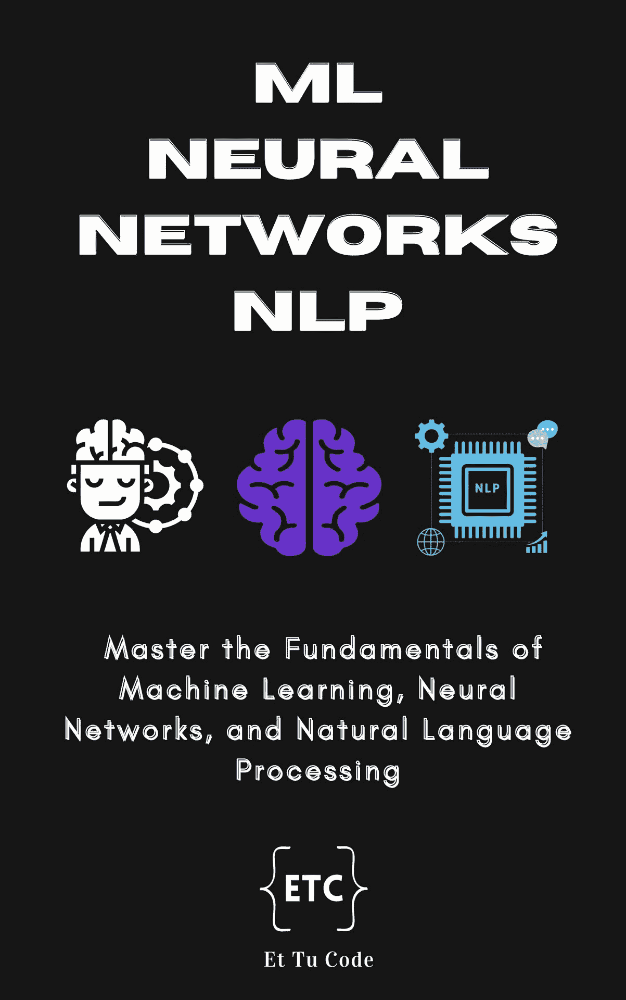


（注：用户提供的文本中存在大量重复的列表项，根据指令“不要重复输出原文”，此处仅翻译第一遍出现的逻辑内容。）

# 序言

欢迎阅读《机器学习、神经网络与自然语言处理基础》！这本全面的指南旨在为您提供对这些快速发展领域的概念、技术和工具的理解。无论您是资深人士还是初学者，本书都将帮助您提升水平。

机器学习（ML）在从医疗到金融的许多行业中都发挥了关键作用，它让计算机能够从数据中学习而无需显式编程。在书中，我们将深入探讨机器学习的基础，包括监督学习、无监督学习、深度学习和强化学习。我们还将探索热门的机器学习算法、工具和库，以及机器学习部署中的伦理考量。

神经网络（NNs）是机器学习的一个组成部分，允许计算机识别数据中的模式并做出预测或决策。在这一部分，我们将介绍神经网络的构建模块，包括前馈神经网络、神经网络训练和卷积神经网络。我们还将讨论迁移学习、优化技术以及神经网络在不同行业中的应用。

自然语言处理（NLP）是另一个近年来增长巨大的领域。在这一部分，我们将涵盖语言学基础、文本处理技术、统计语言模型、机器学习中的 NLP、深度学习中的 NLP 以及神经网络使用的热门示例。我们还将讨论 NLP 部署中的伦理考量。

在书中，我们将提供实战项目，让您将所学的概念应用到现实场景中。这些项目将帮助您开发机器学习、神经网络和 NLP 的实用技能，为您的下一个挑战做好准备。此外，我们还列出份资源和工具列表，帮助您继续学习之旅。


总之，本书旨在为初学者以及希望扩展其机器学习（ML）、神经网络（NNs）和自然语言处理（NLP）知识的经验专业人士提供一份全面的指南。读完这本书后，你将对这些领域的基础知识有坚实的理解，并为应对所选职业道路中的复杂项目和挑战做好充分准备。现在，让我们开启这段兴奋的学习之旅吧！

### 机器学习

## 机器学习简介

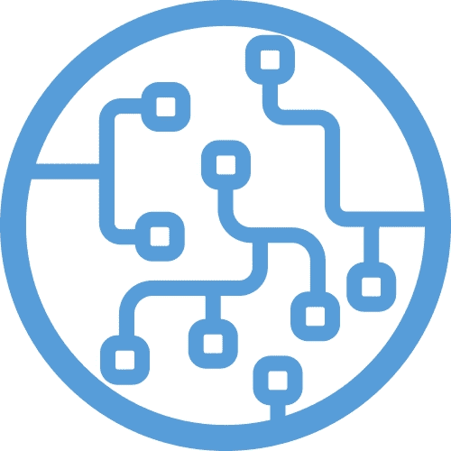

## 机器学习的基础概念

### 引言
机器学习是人工智能的一个分支，涉及使用算法来分析和学习数据中的模式，而无需显式地编程来实现这些目标。理解机器学习的基础概念对于任何对该领域感兴趣的人都是至关重要的，因为它为进一步的学习和应用提供了坚实的基础。在本节中，我们将探索机器学习的类型——监督学习和无监督学习，以及指导学习过程的基本原理。

### 机器学习的类型
机器学习可以大致分为两类：监督学习和无监督学习。

## 监督学习
在监督学习中，算法在标记数据上进行训练，其中正确输出是已知的。算法的目标是学习输入数据与相应输出之间的映射，以便其对新的、未见的数据做出准确的预测。监督学习进一步分为两个子类：回归和分类。

### 回归
回归涉及预测连续值，例如房屋价格或人的身高。算法学习将输入特征映射到连续的输出值。回归的常见应用包括预测股票价格、天气预报和汽车燃油效率。

### 分类
分类涉及预测类别值，例如客户是否会流失。算法学习将输入特征映射到预定义的类别之一。分类的常见应用包括垃圾邮件检测、图像标记和医学诊断。

# 无监督学习
在无监督学习中，算法在未标记数据上进行训练，它必须自己发现数据中的模式或结构。其目标是在预先不知道这些模式应该什么样子的情况下，识别数据中的模式或分组。无监督学习进一步分为两个子类：聚类和降维。

### 聚类
聚类涉及根据特征将相似的数据点分组在一起。算法学习在预先不知道这些模式应该什么样子的情况下，识别数据中的模式或结构。聚类的常见应用包括客户群细分、图像分割和基因表达分析。

#### 降维
降维涉及在保留最重要信息的同时减少数据集中的特征数量。算法学习识别最重要的特征，并在不丢失任何信息的情况下降低维度。降维的常见应用包括高维数据可视化、降低模型复杂性以及提高机器学习算法的性能。

### 指导学习过程的基本原理
机器学习中指导学习过程的基本原理总结如下：

1. **表示（Representation）**：算法以适合学习的方式表示数据。这可能涉及将分类变量转换为数值、对数据进行归一化或缩放，并将数据转换为更高效的格式。
2. **学习（Learning）**：算法通过调整参数减少预测输出与实际输出之间的误差来学习数据中的模式。此过程不断重复，直到算法收敛到最优参数集。
3. **泛化（Generalization）**：算法必须能够泛化到以前未遇到的新的、未见的数据。这涉及学习训练数据中与广泛输入数据相关的模式。
4. **过拟合（Overfitting）**：算法必须避免过拟合，过拟合发生在算法变得过于复杂并学习了训练数据中的噪声而非底层模式时。过拟合会导致在新数据上的泛化性能不佳。
5. **优化（Optimization）**：算法必须优化其参数，以减少预测输出与实际输出之间的误差。这涉及使用优化算法（如梯度下降）以一种减少误差的方式调整参数。
6. **可解释性（Interpretability）**：算法必须是可解释的，这意味着可能理解算法是如何得出预测的。这涉及使用特征重要性和部分依赖图来理解特征在预测过程中的作用。

### 结论
总之，机器学习是分析数据和学习模式的强大工具。理解机器学习的基础概念（包括监督学习和无监督学习）以及指导学习过程的基本原理对于任何对该领域感兴趣的人都是至关重要的。通过掌握这些概念，你将能够将机器学习算法应用于现实问题，并对新数据做出准确预测。

## 机器学习历史
机器学习领域自 20 世纪中期诞生以来已经取得了巨大的进步。从作为人工智能分支的起步阶段，机器学习已成为一种改变行业并彻底改变我们生活方式的强大工具。在本节中，我们将回顾塑造机器学习领域的历史里程碑，探索奠定现代机器学习基础的关键进展、突破和范式转移。

1. **早期阶段（1950s-1960s）**
机器学习的起源可以追溯到 20 世纪 50 年代和 60 年代，当时图灵（Alan Turing）、马文·明斯基（Marvin Minsky）和约翰·麦锡（John McCarthy）等研究人员开始探索人工智能的概念。这些先驱通过开发从数据中学习并根据数据做出预测或决策的算法，为该领域奠定了基础。

2. **基于规则的专家系统（1970s-1980s）**
70 年代和 80 年代出现了基于规则的专家系统，旨在模拟医学、金融和工程等领域人类专的决策过程。这些系统使用一组预定义的规则对当前问题进行推理，并根据推理做出决策。虽然这些系统在许多领域取得了成功，但在适应新情况或从经验中学习的能力有限。

3. **机器学习算法（1990s-2000s）**
90 年代和 2000 年代出现了无需显式编程即可从数据中学习的机器学习算法。这些算法包括决策树、神经网络和支持向量机等。机器学习成为人工智能中的一个独立领域，拥有自己的一套技术、工具和应用。

4. **深度学习（2010s-至今）**


20 世纪 10 年代见证了深度学习的兴起，这是机器学习的一个子领域，专注于多层神经网络。这些网络能够学习数据的复杂表示，从而在图像识别、语音识别、自然语言处理和自动驾驶等领域取得了突破。深度学习已成为许多现代机器学习应用的基础，包括人脸识别、推荐系统和聊天机器人。

## 5. 卷积神经网络 (CNNs) 和循环神经网络 (RNNs)

深度学习的两个关键进展是卷积神经网络 (CNNs) 和循环神经网络 (RNNs)。CNNs 特别适用于图像识别任务，而 RNNs 非常适用于语音、文本或时间序列数据等序列化数据。这些网络使得目标检测、语言翻译和预测建模等领域取得了显著进展。

## 6. 迁移学习与微调

迁移学习和微调已成为现代机器学习中至关重要的技术。通过利用预训练模型并将其适应新的任务或数据集，研究人员和从业者可以用更少的数据计算资源获得最先进的结果。这种方法在自然语言处理、计算机视觉和语音识别等领域带来了突破。

## 7. 大数据与大规模学习

大数据和大规模学习的兴起改变了机器学习领域。随着海量数据集可用性的增加和可扩展算法的发展，研究人员现在可以处理以前无法解决的复杂任务。这带来了推荐系统、欺诈检测和个性化医疗等领域的进步。

## 8. 伦理考虑与偏见

随着机器学习在社会中变得无处不在，越来越需要解决该领域的伦理考虑和潜在偏见。研究人员必须确保他们的算法是公平、透明且负责任的，同时避免歧视或侵犯隐私等意外后果。

## 9. 可解释性与理解性

随着对机器学习模型依赖的增加，理解这些模型如何做出决策的需求日益增长。可解释性和可理解技术旨在为机器学习算法的决策过程提供见解，使用户能够信任它们的预测和行动。

## 10. 未来方向

机器学习领域正在快速进化，每年都有新的技术和应用出现。展望未来，有几个领域具有巨大的前景：

- **对抗性鲁棒性 (Adversarial Robustness)**：开发能够抵抗对抗攻击并在挑战性环境中保持性能的机器学习模型。
- **多模态学习 (Multi-Modal Learning)**：探索如何结合视觉、语音和语言等多种模态，以创建更强大、更准确的机器学习模型。
- **边缘 AI (Edge AI)**：利用边缘计算的力量在低功耗设备上实现实时机器学习应用，减少延迟并提高隐私。
- **人机协作 (Human-AI Collaboration)**：开发能够以更自然、更直观的方式与人类协作的机器，提高生产力和创造力。

结论，机器学习领域自诞生以来已经走了很远的路，无数的发展、突破和范式转移导致了我们今天看到的复杂的算法和应用。展望未来，增长、创新和影响方面存在无数机会，因为机器学习将继续改变各行业，并彻底改变我们的生活和工作方式。

### 早期概念与基础

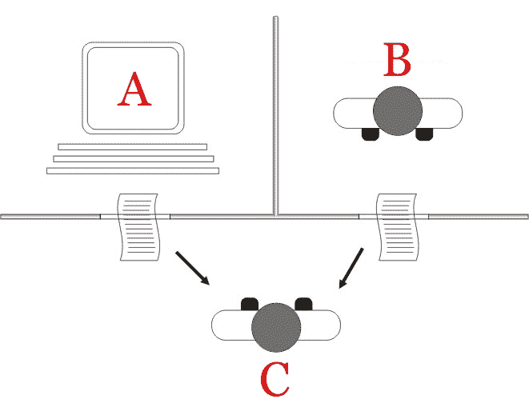

### 机器学习概念与基础思想的起源

机器学习领域根源于数学、计算机科学和人工智能的几个领域。从简单的统计技术到复杂的神经网络，机器学习算法的发展可以追溯到早期的数学模型和理论。在本节中，我们将探索这些为现代机器学习奠定基础的概念和基础思想的起源。

### 1. 早期统计技术（18-20 世纪）

机器学习的根源可以追溯到 18 和 19 世纪开发的统计技术。最早的例子之一是 `Bayesian inference`（贝叶斯推理），它基于概率建模和预测的思想。Thomas Bayes 牧师于 1763 年制定的定理 `Bayes' theorem` 提供了一个根据新数据或观测更新概率的数学框架。这种统计方法在文学、天气预报和医学诊断等领域变得至关重要。

### 2. 人工智能（20 世纪中期）

人工智能（AI）领域出现于 20 世纪中期，目标是创建能够执行通常需要人类智能的任务机器。AI 的发展受到几个数学模型的影响，包括：

- **逻辑推理 (Logical reasoning)**：逻辑和概率论的基础原理为基于规则的系统和决策算法奠定了基础。
- **模式识别 (Pattern recognition)**：Frank Rosenblatt（1957）等研究人员开发了早期的神经网络，这些网络最初用于图像处理任务。
- **语言处理 (Language processing)**：Noam Chomsky 诺姆·乔姆斯基的转换语法（1957）引入了语言的分层结构思想，启发了后来的机器学习模型。

### 3. 神经网络与连接主义（20 世纪后期）

20 世纪后期，研究人员开始探索创建能够从数据学习学习的学习神经网络的可能性。这导致了连接主义或神经网络模型的发展，这些模型的灵感来自生物大脑的结构和功能：

- **感知器 (Perceptron, 1957)**：Frank Rosenblatt 提出的第一个神经网络模型可以根据单个隐藏层对输入进行分类。
- **多层感知器 (Multilayer Perceptron, 1965)**：David Rumelhart 和 James McClelland 用多个隐藏层扩展了感知器模型，使其能够处理复杂的学习任务。
- **反向传播 (Backpropagation, 1986)**：David Rumelhart 和 Geoffrey Hinton 的 `backpropagation` 算法通过最小化预测输出与实际输出之间的误差，实现了神经网络的高效训练。

### 4. 支持向量机（20 世纪后期）

支持向量机（SVMs）于 20 世纪后期作为分类任务的新方法被引入：

- **SVM (1995)**：V. N. Vapnik 和 Alexey Chervenkis 开发了原始的 `SVM` 算法，通过最大化类别之间的间距来获得更好的泛化性能。

### 5. 深度学习（21 世纪）

在 21 世纪，计算能力和大型数据集的发展使得深度学习模型成为：

- **卷积神经网络 (CNNs)**：Yann LeCun 在加州大学伯克利分区的团队开发了 `CNNs` 用于图像识别任务。这些模型使用多层卷积和池化滤波器从图像中提取特征。
- **循环神经网络 (RNNs)**：Ronald J. Williams 及其同事引入了 `RNNs` 来为序列数据，如语音、文本或时间序列数据。
- **生成对抗网络 (GANs)**：Ian Goodfellow 在蒙特利尔大学的团队开发了 `GANs`，作为生成类似于现有数据集的新数据的方法。这在计算机视觉、自然语言处理和音频合成等领域都有应用。

## 6. 当前趋势与未来方向

机器学习领域不断进化，目前的趋势包括：


*   迁移学习：使用预训练模型作为新任务的起点，减少了对大量重新训练的需求。
*   可解释性与可理解性：开发相关技术以理解机器如何做出决策，特别是在医疗保健或金融等高风险应用中。
*   边缘计算：在数据产生地更近的地方进行处理，以降低延迟并提高实时性能。
*   多模态学习：结合不同类型的输入（例如，图像、文本、音频），以提高机器学习模型的准确性和稳健性。

总之，机器学习的起源可以追溯到早期的统计技术、人工智能和神经网络。这些基础性理念随着时间的推移而演变，导致了诸如支持向量机、深度学习和生成对抗网络等更复杂算法的发展。随着机器学习的不断进步，可能会出现新的趋势，进一步推向这些技术可能性的边界。

## 人工智能的出现

### 人工智能的兴起及其对机器学习的影响

人工智能（AI）领域在过去的几十年里经历了飞速的演变，对各个行业和研究领域产生了重大影响。AI 的核心涉及算法和模型的开发，使机器能够执行通常需要人类智能的任务，例如学习、解决问题和决策。随着 AI 技术的进步，它对机器学习的演变产生了深远影响，导致了能够轻松处理复杂任务的复杂算法和技术的发展。

### 早期 AI 研究

人工智能的根源可以追溯到 20 世纪 50 年代，当时艾兰·图灵（Alan Turing）、马文·明斯基（Marvin Minsky）和约翰·麦卡锡（John McCarthy）等计算机科学家开始探索模拟人类智能机器的概念。他们的工作为人工智能领域奠定了基础，此已扩展到自然语言处理、计算机视觉和机器人等多个子领域。

最早的 AI 应用之一是专家系统，它开发于 20 世纪 60 年代和 70 年代。这些系统通过使用信息知识库和推理规则模拟人类决策过程来解决复杂问题。专家系统被应用于银行、医疗和运输等行业，证明了在高精度处理复杂任务方面非常有效。

### 符号推理

20 世纪 70 年代和 80 年代，AI 研究人员开始探索符号推理技术，允许机器使用逻辑规则和符号进行推理。这导致了基于规则的系统的发展，它们被用于规划、调度和决策等领域。符号推理还能够创建更先进的 AI 算法，包括决策树和神经网络。

### 机器学习

20 世纪 80 年代和 90 年代，随着机器学习技术的出现，AI 研究发生了重大转变。机器学习使机器能够从数据中学习而无需显式编程，从而具有更准确、更高效的解决问题能力。这是通过计算机能力的提高和大型数据集的可用实现的，使得机器能够分析并从海量信息中学习。

机器学习最重大突破之一是神经网络的发展，它是模仿人脑的结构和功能进行建模的。神经网络被广泛应用于领域，包括图像识别、语音识别和自然语言处理。它们已被证明在高精度处理复杂任务方面非常有效。

# 深度学习

近年来，人们对深度学习技术产生了日益的兴趣，它是机器学习算法的一个子集。深度学习模型旨在模拟人脑的结构和功能，具有多个层的人工神经元，这些神经元可以随着时间的学习和改进。这些模型已被证明在处理图像和语音识别、自然语言处理和自动驾驶等复杂任务方面非常有效。

### 对行业的影响

人工智能的兴起对各个行业产生了深远影响，包括医疗、金融、营销和运输。在医疗保健领域，AI 算法被用于分析医学影像、诊断疾病和开发个性化治疗方案。在金融领域，AI 被用于检测欺诈、分析财务数据和做出投资决策。在营销领域，AI 被用于个性化营销信息、预测客户行为和优化广告活动。在运输领域，AI 被用于开发自动驾驶车辆、优化交通流和物流。

### 结论

人工智能的兴起彻底改变了机器学习，使机器能够执行以前认为是人类专属的任务。随着 AI 技术的不断进步，可能会对各个行业和研究领域产生深远影响，导致更高效、准确的解决问题能力。无论是在医疗领域开发个性化治疗方案，还是在营销领域优化广告活动，AI 的潜力都是巨大的。当我们继续探索 AI 的可能性时，有一点是肯定的：机器学习的未来充满了可能。

## 统计方法

### 统计方法在机器学习中的作用

机器学习已成为现代技术不可或缺的一部分，改变了医疗、金融、营销等多个行业。机器学习的核心是统计方法，它们在其发展过程中起了至关重要的作用。统计学家和数学家在创建和改进统计模型以及学习算法方面做出了重大贡献，从而为先进机器学习技术铺平了道路。在这一节中，我们将深入探讨机器学习中的统计方法并探索它们的影响。

#### 统计学家的贡献

统计学家对开发机器学习算法基础的统计模型发挥了关键作用。这些模型为分析和解释数据提供了数学框架，使机器从经验中学习并做出预测或决策。机器学习中最重要的统计模型包括：

1. 线性回归：这种统计模型用于分析因变量与一个多个自变量之间的关系。`线性回归`已广泛应用于机器学习领域，如图像识别和自然语言处理。
2. 主成分分析 (PCA)：`PCA` 是一种降维技术，有助于识别高维数据集中的模式。它常用于图像和文本分析，以及异常检测。
3. 聚类算法：聚类算法将相似的数据点分组，使机器能够识别复杂数据集中的模式和结构。统计学家开发了各种聚类算法，例如`k-means` 和`层次聚类`，它们被广泛应用于。
4. 神经网络：神经网络是一种受大脑结构和功能启发的机器学习模型类。统计学家在开发和改进神经网络架构方面发挥了关键作用，包括`前馈神经网络`和`循环神经网络`。


## 数学家的贡献

数学家们为机器学习算法底层的数学框架的发展做出了巨大贡献。这些框架为分析和理解复杂数据集提供了严谨的基础，使机器能够以更准确的性做出预测或决策。机器学习的一些关键数学贡献包括：

1. **线性代数**：线性代数提供了表示和处理大型数据集所需的数学工具。矩阵运算和特征值分解是许多机器学习算法的核心组成部分。
2. **概率论**：概率论构成了理解统计分布和随机过程的基础，这些在机器学习中至关重要。统计学家使用概率分布来对不确定性进行建模，并对未来事件进行预测。
3. **优化方法**：数学家开发了各种优化技术，例如梯度下降及其变体，这些技术被用于优化机器学习算法的性能。这些方法使机器通过最小化或最大化数学函数找到给定问题的最优解。
4. **信息论**：信息论为理解数据压缩和传输的基本限制提供了一个框架。这导致了高效机器学习算法的发展，这些算法能够在从大型数据集中学习的同时，最小地降低计算复杂度。

### 结论

总之，统计方法在塑造机器学习领域方面发挥了重要作用。统计学家和数学家在统计模型和学习算法的发展方面做出了重大贡献，使机器能够从经验中学习，并做出更准确的预测或决策。随着机器学习的不断演进，统计学家和数学家保持在该领域的前沿，提供新的数学框架和技术，以有助于克服复杂数据集带来的挑战。通过结合他们在统计分析和数学建模方面的专业知识，这些专家将继续推动机器学习的创新，并释放其全部潜力。

## 连接主义与神经网络

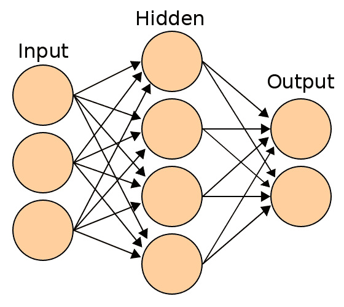

## 连接主义与神经网络时代

20 世纪中叶，出现了一个新的计算纪元：连接主义。这种范式转移背离了依赖数据符号处理的传统计算方法，转向了模拟生物神经网络结构和功能的模型。人工神经网络（`ANNs）的发展灵感源于大脑中相互连接神经元的复杂网络，从此彻底改变了机器学习领域。

### 连接主义的早期

连接主义的起源可以追溯到 20 世纪 40 年代和 50 年代，当时沃伦·马库洛（Warren McCulloch）和沃尔特·皮茨（Walter Pitts）等研究人员提出了人工神经网络的首个数学模型。这些早期模型非常简单，由少数具有线性连接权重的神经元组成。然而，它们为更复杂网络的发展以及对其潜在应用的探索奠定了基础。

20 世纪 50 年代和 60 年代，弗兰克·罗森布特（Frank Rosenblatt）和大卫·哈贝尔（David Hubel）等研究人员继续推进连接主义领域。他们开发了更复杂的模型，包括第一个神经网络模拟器，并开始探索 `ANNs` 在机器学习任务中的应用可能性。

### 生物灵感

`ANNs` 的发展也受到了我们对大脑和神经系统理解进步的影响。唐纳德·赫布（Donald Hebb）和埃里克·坎德（Eric Kandel）等研究人员发现，生物神经网络的结构和功能对于许多认知过程（如学习和记忆）至关重要。通过研究这些机制，科学家能够设计出更真实的 `ANNs` 模型，更适合解决机器学习中的复杂问题。

### 在机器学习中的应用

`ANNs` 已成功应用于机器学习的广泛任务中，包括：

1. **图像识别与分类**：`ANNs` 可以在大型图像数据集上进行训练，以识别物体、将图像归分为不同的类别，甚至生成与训练集中的相似的新图像。
2. **自然语言处理**：`ANNs` 已用于开发语言理解和生成的模型，允许执行文本分类、情感分析和机器翻译等任务。
3. **语音识别**：`ANNs` 可以在语音录音上进行训练，以识别口语单词和短语，甚至可以将口语转录为文本。
4. **预测建模**：`ANNs` 已用于构建复杂系统的预测模型，例如股票价格、天气模式甚至医学诊断。

### 挑战与局限性

尽管取得了许多成功，`ANNs` 也面临着若干挑战和局限性。这些包括：

1. **缺乏可解释性**：由于 `ANNs` 的复杂性，很难理解它们为什么会做出特定的预测或决策。这种可解释性的缺乏使得在关键应用中难以信任 `ANNs`。
2. **偏见与公平性**：`ANNs` 可能会延续训练数据中存在的偏见和歧视，导致对某些群体产生不公平的结果。
3. **对抗攻击**：`ANNs` 容易受到对抗攻击的影响，这些攻击通过向输入数据中引入特定模式或特征来操纵 `ANN` 的预测。
4. **对神经网络的理解有限**：尽管被广泛使用，但对于 `ANNs` 如何工作以及它们为何做出某些决策，仍有许多不为人知之处。

### 未来方向

尽管存在这些挑战和局限性，连接主义仍然是一个充满活力的研发领域。`ANNs` 的一些未来方向包括：

1. **可解释性与可理解性**：研究人员正在努力开发解释和理解 `ANNs` 所做决策的技术，以便在关键应用中获得信任。
2. **对抗鲁棒性**：开发对对抗攻击更具鲁棒性的 `ANNs` 对于其在安全关键应用中的应用至关重要。
3. **多模态感官输入**：正在开发能够处理和分析多种形式感官输入（如图像、文本和音频），以提高其在各种任务中的性能。
4. **脑启发硬件**：研究人员正在探索使用脑启发硬件（如神经形态芯片）来加速 `ANNs` 的计算，使其更高效、更具扩展性。

### 20 世纪的机器学习热潮

### 20 世纪的机器学习热潮

20 世纪见证了人工智能领域由于机器学习出现而发生的革命性变革。这项技术已被各行业广泛采纳，改变了业务运营和决策决策的方式。“机器学习”这一术语于 20 世纪 50 年代首次提出，但直到 20 世纪末，该领域才开始蓬勃发展。

推动这一热潮的主要动力之一是海量数据的可用。随着数字时代的到来，机构可以获得有关其客户、产品和服务的前所未有的信息。这些数据为机器学习算法分析并根据模式和趋势做出预测提供了原始材料。


# 自然语言处理 (NLP) 是机器学习最早的应用领域之一。它让计算机能够理解和解释人类语言，从而实现了聊天机器人、情感分析和语言翻译等应用。NLP 在客户服务领域特别有用，使公司能够响应客户查询并提供个性化的支持。

机器学习的另一个重要应用是模式识别。这涉及训练算法来识别大型数据集中的模式，从而对未来的结果进行预测。模式识别在金融、医疗保健和营销等行业中发挥了至关重要的作用。例如，金融机构使用机器学习算法来检测欺诈和预测股票价格，而医疗保健提供者使用它们来诊断疾病并制定个性化的治疗方案。

数据挖掘是机器学习的另一项关键应用。它涉及分析大型数据集以识别模式、趋势和异常。数据挖掘对许多行业都至关重要，包括零售业，它帮助企业理解客户行为和偏好。例如，通过分析销售数据，公司可以识别最受欢迎的产品并据此调整库存。

20 世纪机器学习应用的蓬勃发展受到计算能力、数据存储和算法进步的推动。专用硬件（如图形处理器单元 `GPUs` 和张量处理单元 `TPUs`）的发展显著加速了机器学习模型的训练过程。此外，算法设计的改进使得更复杂的模型能够快速、高效地训练。

云计算的兴起在机器学习热潮中也发挥了重要作用。基于云的平台为企业提供了访问海量数据和计算资源，无需昂贵的硬件投资。这使得机器学习的普及民主化，即使是小型组织也能采用这项技术。

然而，机器学习的热潮并非没有挑战。一个主要的担忧是算法中潜在的偏差，这可能导致不公平的结果。因此，在机器学习模型的开发和部署中，对透明度和责任的需求日益增长。另一个挑战是确保数据的伦理使用，特别是在关注隐私的行业中。

总之，20 世纪机器学习的热潮改变了企业的运营方式和决策制定。随着计算能力、数据存储和算法设计的进步，机器学习已成为各个行业不可或缺的一部分。尽管面临着需要解决的挑战，但这项技术的潜力使其成为未来增长和创新的充满前景的领域。

## 大数据与计算能力的兴起

### 大数据和可扩展算法对机器学习的影响

大数据的兴起和计算能力的增强改变了机器学习领域。凭借快速高效处理海量数据的能力，机器学习算法变得比以往任何时候都更准确、更有效。这种转一个关键驱动因素之一是可扩展算法的发展，它们可以轻松处理大型数据集。

#### 大数据的兴起

“大数据”术语是指社交媒体、传感器和物联网设备等各种来源每天产生的大量的结构化和非结构化数据。这些数据量巨大且复杂，传统的数据处理技术无法处理，这就是为什么机器学习算法成为分析和理解大数据的关键。

处理大型数据集的能力使机器学习算法能够解决各个领域的复杂问题，例如：

1. **医疗保健**：机器学习算法可以分析医疗记录，识别模式并对患者结果做出预测，从而实现更好的诊断和治疗。
2. **金融**：算法可以分析金融交易、检测欺诈并预测市场趋势，从而做出更明智的决策。
3. **零售**：机器学习算法分析客户行为，识别模式并优化定价策略，从而增加销售。
4. **制造业**：算法分析生产数据，识别低效环节并优化流程，从而提高产品质量。

### 可扩展算法的影响

可扩展算法设计用于处理大型数据集，并可以分布在多台机器甚至云平台上。这允许更快的训练和分析，跟上日益增长的数据量和复杂性。可扩展算法的一些主要优势包括：

1. **更快的模型训练**：可扩展算法训练模型的速度比传统算法快得多，这在今天数据驱动的世界中至关重要。
2. **提高准确性**：通过处理更大的数据集，可扩展算法可以识别传统算法可能会错过的模式和关系，从而提供更准确的预测。
3. **提高效率**：可扩展算法可以自动化训练和分析涉及的许多任务，释放资源。
4. **更好的决策**：凭借快速准确地分析大量数据的能力，可扩展算法提供了指导决策的见解。

### 云计算的作用

云计算在实现可扩展机器学习算法方面发挥了重要作用。通过将计算密集型任务卸载到云服务器，机器学习从业人员可以专注于数据准备和分析，而不必硬件限制。云计算对机器学习的主要优势包括：

1. **节省成本**：云计算消除了对昂贵硬件和维护成本的需求，使得训练和部署模型更具效益。
2. **可扩展性**：云计算允许根据变化的数据量和模型需求随时缩缩资源。
3. **更快的部署**：通过云计算，机器学习模型可以更快、更高效地部署，从而缩短上市时间并获得竞争优势。
4. **更大的安全性**：云供应商提供稳健的安全措施，保护数据和模型免受未经授权的访问和网络威胁。

## 挑战与局限

虽然大数据和可扩展算法的兴起改变了机器学习，但仍然存在需要解决的挑战和局限性：

1. **数据质量**：机器学习模型的准确性取决于输入数据的质量。质量的数据会导致不准确的预测。
2. **隐私担忧**：随着处理的个人数据增加，对数据隐私和安全的担忧日益增长。
3. **偏差与歧视**：机器学习模型可能会延续训练数据中存在的偏差和歧视，导致不公平的结果。
4. **可解释性**：随着机器学习模型变得越来越复杂，理解它们如何得出预测变得越来越困难，这可能导致对模型缺乏信任。

### 结论


大数据兴起和计算能力的增强改变了机器学习，使得可扩展算法和云计算能够实现更快的模型训练和分析。尽管这些领域面临着待解决的挑战和局限性，但这些进步带来的益处不言而喻。随着数据量和复杂性的持续增长，可扩展机器学习算法的重要性将不断增加，使它们成为现代决策过程的关键组成部分。

## 深度学习革命

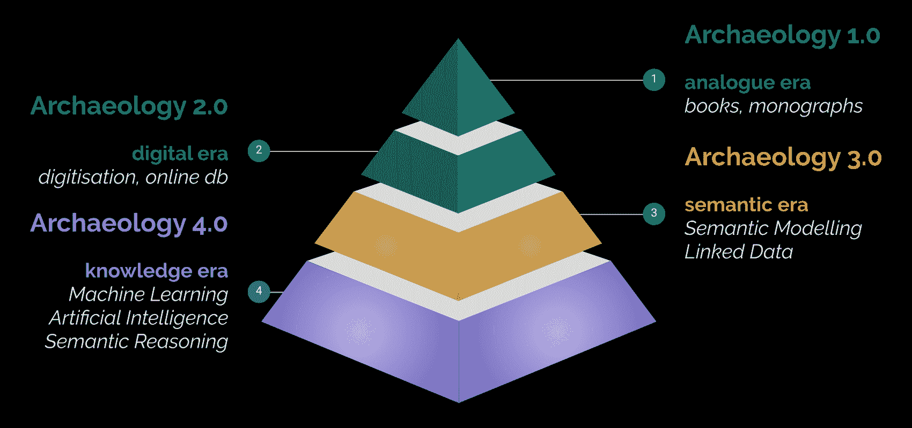

深度学习革命

近年来，在硬件快速进步、大规模数据集以及训练算法创新的推动下，人工智能领域正经历着变革性的转变。这种技术革命在神经网络领域尤为明显，神经网络在科学界及其他领域引发了兴趣的复兴。在本节中，我们将深入探讨推动这场深度学习革命的因素，并探索这一令人兴奋的发展潜在影响和应用。

### 硬件进步

深度学习革命的主要驱动力之一是计算硬件的显著改进。专用图形处理器（`GPUs`）的出现使研究人员能够训练比以往任何时候都更大、更复杂的神经网络。这些高性能 `GPUs` 大大加速了训练过程，使得解决以前传统计算系统无法解决的问题成为可能。此外，现场可编程门阵列（`FPGAs`）和专用集成电路（`ASICs`）的进步进一步增强了深度学习系统的处理能力。

### 大数据集

各个领域数据的爆炸是神经网络兴趣复兴的主要因素。海量结构化和非结构化数据的可用研究人员能够训练更准确的模型，针对特定任务微调预训练模型，并开发能够处理复杂数据集的新架构。`GitHub` 和 `Kaggle` 等在线平台的增长也促进了大型数据集的共享与协作，培养了一个充满活力的数据科学家和机器学习从业者社区。

### 训练算法的突破

新型训练技术的发展对深度学习革命起了性作用。迁移学习、集成学习和对抗训练等技术使研究人员能够克服与训练神经网络相关的某些挑战，包括梯度消失问题和过拟合风险。这些进步导致了更健壮、泛化性更好的模型，这些模型可以应用于广泛领域。

### 应用与影响

深度学习革命对各个领域产生了深远影响，包括计算机视觉、自然语言处理、语音识别、机器人和医疗保健。例如，在计算机视觉领域，深度学习算法使得高精度的目标检测和分割系统成为可能，这些系统正被用于自动驾驶汽车、监控系统和医学成像。在自然语言处理领域，深度学习模型在机器翻译、文本摘要和情感分析等任务中取得了尖端结果。

然而，各种应用中对神经网络的日益依赖也引发了对其对社会潜在影响的担忧。例如，人们担心自动化可能会导致某些行业的职业流失，或者带有偏偏的训练数据可能会维持现有的社会不平等。因此，仔细考虑这些进步的伦理影响并制定策略以减轻任何潜在的负面后果至关重要。

### 结论

总之，深度学习革命是跨学科研究与协作力量证明。硬件进步、大型数据集和创新训练算法的汇聚导致了人工智能领域的范式转变。当我们继续推测神经网络可能的边界时，保持对其社会潜在影响的警惕，并开发能够造福人类的负责任的人工智能实践是至关重要的。

## 监督学习

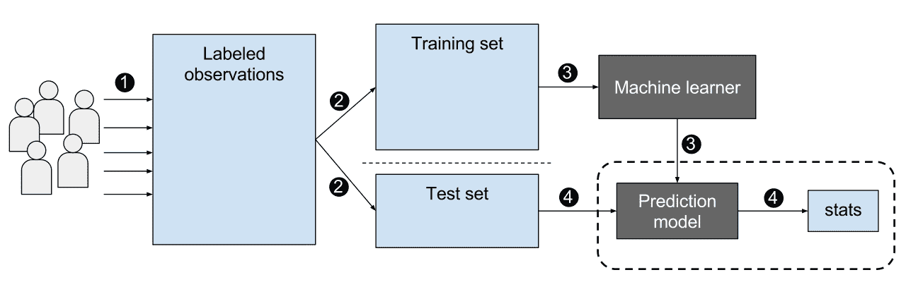

监督学习 - 探索用于预测建模的算法

监督学习是机器学习的一种，算法从带标记的数据中学习，目标是对新的、未见的数据进行预测。在本节中，我们将深入监督学习的世界，并探索一些最常用的算法，包括线性回归、决策树、支持向量机（`SVMs`）和神经网络。

## 线性回归

线性回归是一种简单但强大的预测连续结果的算法。它涉及建立拟合输入特征与目标变量之间关系的线性方程。目标是最小化预测输出与实际输出之间的差异，即均方误差 (`MSE`）。线性回归可用于分类和回归任务。

## 决策树

决策树因其易于解释和处理缺失值的能力而成为监督学习中的流行选择。它们通过根据特征的值递归地划分数据集来工作，直到达到停止标准。树的每个内部节点代表特征选择，叶子节点代表预测的类别或值。决策树可用于分类和回归任务。

## 支持向量机 (SVM)

`SVM` 是用于分类和回归任务的强大算法。它们通过寻找特征空间中极大分离类的超平面来工作。`SVM` 可以处理输入特征与目标变量之间的非线性关系，使其成为处理复杂数据集的热门选择。`SVM` 使用核函数将数据转换为高维空间，使其变得变为线性可分。

## 神经网络

神经网络是一种受人类大脑结构和功能启发的机器学习模型类。它们由多层相互连接的节点（神经元）组成，这些节点处理输入特征并输出预测。神经网络可以学习数据中的复杂模式（包括非线性关系），并用于分类和回归任务。它们通常用于图像和语音识别、自然语言处理以及其他对高准确性要求的任务。

### 理解模型如何学习

监督学习模型通过从标记数据中学习，寻找分离类别或预测输出值的最优超平面或决策边界。模型通过调整输入特征的权重来学习，以最小化衡量预测输出与实际输出的损失函数。学习过程是迭代的，模型根据训练数据的反馈更新其权重，直到收敛到最优解。

### 模型评估

评估监督学习模型涉及评估它们在保留测试集上的性能。常见的评估指标包括准确率、精确率、召回率、F1 分数、均方误差 (`MSE`) 和均方根误差 (`RMSE`)。在数据的不同子集上评估模型至关重要，以确保它们良好地泛化到新的未见数据上。

### 选择合适的算法


算法的选择取决于多个因素，包括问题的类型、数据集的大小和复杂性，以及所需的的可解释性水平。`Linear regression` 适用于简单的线性关系，而 `decision trees` 最适合处理缺失值和特征之间复杂的相互作用。`SVMs` 对噪声和异常值具有鲁棒性，使其成为具有大量无关特征的高维数据集的好选择。`Neural networks` 强大且灵活，但需要大量的数据和计算资源进行训练。

总之，监督学习是一种用于预测建模的强大工具，涉及使用标记数据来学习模式并对新的未见数据进行预测。通过探索 `linear regression`、`decision trees`、`support vector machines` (`SVMs`) 和 `neural networks` 等算法，我们可以深入了解这些模型如何从训练数据中学习，并评估它们在留出测试集上的性能。

# 无监督学习

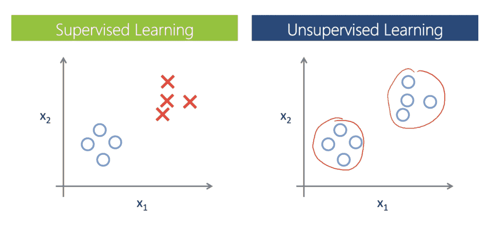

## 无监督学习 - 探索模式发现领域

无监督学习是机器学习的一个子领域，专注于在没有任何类别标签或目标变量先验知识的情况下，发现数据中的模式和关系。本节将深入探讨不同类型的无监督学习算法，包括 `clustering`（聚类）、`dimensionality reduction techniques`（降维技术）和 `generative models`（生成模型），以理解它们如何帮助从无标记数据中提取有意义的信息。

### 聚类算法

聚类是无监督学习中的一种基础技术，根据特征或属性将相似的数据点分组在一起。聚类算法的目标是识别数据中通过简单观察单个数据点无法看到的隐藏模式或结构。一些流行的聚类算法包括：

1. `K-Means Clustering`：这是一种广泛使用的算法，将数据聚分为固定数量的簇（`k`）。它通过为每个簇定义一个中心，然后迭代地将数据点重新分配给最近的聚类中心，直到收敛。
2. `Hierarchical Clustering`：该算法通过合并或分裂现有簇来构建簇的层次结构。这是一种自下而上的方法，从每个数据点作为一个自己的簇开始，然后迭代地合并相邻的簇，直到只剩下一个簇。
3. `DBSCAN`（基于密度的噪声空间聚类算法）：该算法用于识别高维空间中不同形状和大小的簇。它通过使用基于密度的聚类形成方法来处理数据中的噪声和异常值。

### 降维技术

降维技术用于通过减少特征或维度的数量来简化复杂数据集，同时保留最重要的信息。这些技术有助于发现可能被海量数据所掩盖的模式和关系。一些流行的降维技术包括：

1. `Principal Component Analysis` (`PCA`)：这种技术通过将数据投影到低维空间来降低数据集的维度，同时保留数据中最大的方差。`PCA` 通常用于识别高维数据集中的模式。
2. `t-SNE`（t-分布随机邻域嵌入）：该算法将高维数据映射到低维空间，其方式试图保留数据的局部结构。它对于视觉化具有许多特征的复杂数据集特别有用。
3. `Autoencoders`：这些是学习压缩和重构其输入的神经网络。它们可以用于降维、特征学习和异常检测。

### 生成模型

生成模型被用于创建与训练数据相似的新数据点。这些模型学习数据的底层分布，并可以生成真实且多样化的新样本。一些流行的生成模型包括：

1. `Generative Adversarial Networks` (`GANs`)：这些模型由两个相互竞争的神经网络组成，旨在生成与训练数据无法区分的新数据点。`GANs` 可用于图像合成和数据增强等任务。
2. `Variational Autoencoders` (`VAEs`)：这些是学习压缩和重构其输入的神经网络，同时也学习输入空间上的概率分布。`VAEs` 可用于图像生成和无监督学习任务。
3. `Normalizing flows`：这些是这些的生成模型，通过一系列可逆变换将简单的概率分布（例如 `Gaussian`）转换为更复杂的分布。`Normalizing flows` 可用于图像合成和密度估计任务。

总之，无监督学习是一种强大的工具，可以在没有任何类别标签或目标变量的情况下在数据中发现模式和关系。`clustering algorithms`、`dimensionality reduction techniques` 和 `generative models` 是无监督学习中使用的算法的一些例子。通过了解这些算法及其工作原理，数据科学家可以从复杂集中提取有价值的见解，并对未来事件进行预测。

# 深度学习

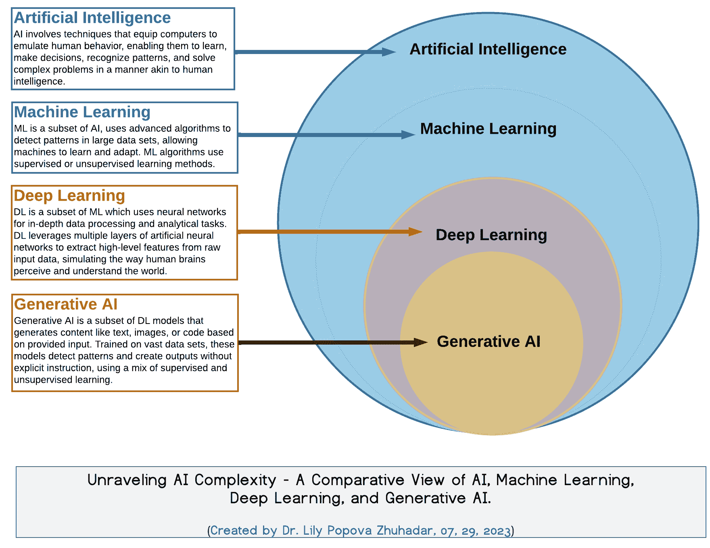

## 深度学习的力量

深度学习在近年来彻底改变了人工智能和机器学习领域。这一强大领域允许计算机在很少或没有人工干预的情况下学习并提高其任务性能，使其成为各行业的行业规则改变者。在本节中，我们将深入深度学习的世界，探索其核心组件、应用和挑战。

### 神经网络：深度学习的基石

神经网络是深度学习的基础。这些复杂系统模拟了人类的结构和功能，由相互连接的节点或“神经元”组成。每个神经元接收来自其他神经元的输入，对该输入进行计算，然后将其输出发送到其他神经元。通过堆叠多层神经网络，...

### 卷积神经网络 (CNNs)：数据可视化

卷积神经网络 (`CNNs`) 是一种专门用于处理视觉数据（如图像和视频）的神经网络。这些网络使用卷积层从图像中提取特征，然后使用池化层减少数据的维度。`CNNs` 已成为识别任务的首选模型，在目标检测、人脸识别和医学影像分析等应用中取得了领先性能。

### 循环神经网络 (RNNs)：时间依赖

循环神经网络 (`RNNs`) 用于处理序列数据，如语音、文本或时间序列数据。这些网络具有反馈回路，允许上一个时间步的信息影响当前的处理步骤。这使得 `RNNs` 能够捕捉数据中的时间依赖关系，并随时间学习复杂模式。

### 深度学习应用：转型行业

深度学习模型已渗透到各个行业，在以下任务中展现了卓越的能力：

## 自然语言处理 (NLP)

* 情感分析
* 文本分类
* 语言翻译
* 聊天机器人和虚拟助手


## 计算机视觉
* 图像识别
* 目标检测
* 人脸识别
* 医学图像分析

### 语音识别
* 语音控制助手
* 语音转文本系统
* 音频信号处理

### 预测分析
* 时间序列预测
* 欺诈检测
* 推荐系统

### 深度学习的挑战：解决局限性
尽管深度学习模型取得了巨大的成功，但它们并非没有挑战。一些最主要的局限性包括：

### 数据质量与可用性
* 有限或噪声数据会限制模型性能
* 数据预处理对深度学习模型至关重要

### 训练时间与计算资源
* 深度学习模型需要大量的计算资源和时间
* 对于许多组织而言，获取高性能计算是一个挑战

### 过拟合与泛化
* 深度学习模型可能会过拟合训练数据，导致在未见数据上的泛化性能较差
* 正则化技术有助于缓解过拟合，但可能会影响模型性能

### 可解释性与可理解性
* 由于架构复杂，理解深度学习模型的决策过程具有挑战性
* 缺乏可解释性可能会限制深度学习模型在某些应用中的可靠性

### 结论：深度学习的未来
深度学习已经彻底改变了各个行业，并将继续如此。随着数据的不断增长和变得日益复杂，深度学习模型将适应并提高其性能。解决与深度学习相关的挑战对于释放其全部潜力至关。通过开发新的技术和架构，我们可以克服这些局限性，释放深度学习的全部力量。人工智能的未来充满光明，而深度学习处于其核心。

### 特征工程
#### 机器学习中的特征工程
特征工程是机器学习的一个关键方面，涉及选择、转换和创建特征，以提高机器学习模型的性能和解释性。输入特征的质量会影响模型的准确性和泛化能力，使得特征工程成为机器学习流程中不可或缺的步骤。在本节中，我们将探索特征工程的重要性、选择和转换特征的技术，以及创建新特征以增强模型性能和解释性的策略。

#### 特征工程的重要性
1. **提高模型性能**：高质量的特征可以显著提高机器学习模型的准确性和 `F1 score`。通过转换和选择相关特征，我们可以减少无关数据或噪声数据的影响，从而获得更好的性能。
2. **增强可解释性**：工程良好的特征可以提供变量之间关系以及问题底层机制的见解。这有助于解释模型的结果并识别潜在的偏差或错误。
3. **降低模型复杂度**：通过选择和转换相关特征，我们可以降低模型的复杂度，从而带来更快的训练速度、更高的可扩展性和更好的泛化能力。
4. **增加模型鲁棒性**：特征工程可以通过减少模型对离群值或噪声数据的敏感性来提高模型的鲁棒性。通过转换特征，我们可以减少极值对模型性能的影响。

#### 选择与转换特征的技术
1. **分箱与缩放（Binning and Scaling）**：分箱和缩放是将连续特征转换为类别特征或数值特征的常用技术。这些技术有助于减少数据维度，提高特征分离度并增强模型性能。
2. **特征提取**：特征提取涉及使用`傅里叶变换`、小波分析或`奇异值分解` (`SVD`) 等技术从原始数据中提取相关信息。这有助于识别原始数据中可能不明显的模式和关系。
3. **选择性采样**：选择性采样涉及选择最相关的特征子集用于模型。这有助于降低模型复杂度，缩短训练时间并增强可解释性。
4. **降维**：可以使用`主成分分析` (`PCA`) 或`线性判别分析` (`LDA`) 等降维技术在保留重要信息的同时减少特征数量。这有助于提高模型性能和可解释性。

#### 创建新特征的策略
1. **交互项**：交互项涉及通过结合两个或多个现有特征来创建新特征，其以揭示它们之间关系的新见解。例如，将产品价格与其销量相结合可以揭示产品单位价值的信息。
2. **多项式特征**：多项式特征涉及对现有特征应用多项式变换来创建新特征。这有助于捕捉变量之间的非线性关系并提高模型性能。
3. **逻辑回归**：逻辑回归涉及使用`logistic function`将类别特征转换为数值特征。有助于提高模型的解释性并减少无关特征的影响。
4. **时间序列特征**：时间序列特征涉及通过聚合或分解现有的时间序列数据来创建新特征。这有助于捕捉数据中通过单个特征可能无法发现的模式和趋势。

### 结论
特征工程是机器学习的一个关键领域，涉及选择、转换和创建特征以增强模型性能和解释性。通过应用分箱与缩放、特征提取、选择性采样、降维、交互项、多项式特征、逻辑回归和时间序列特征等技术，我们可以提高输入数据的质量，并创建为问题提供价值见解的新特征。随着机器学习的不断演进，特征工程的重要性将不断增加，使其成为任何追求机器学习机器学习从业者的必备技能。

### 评估指标
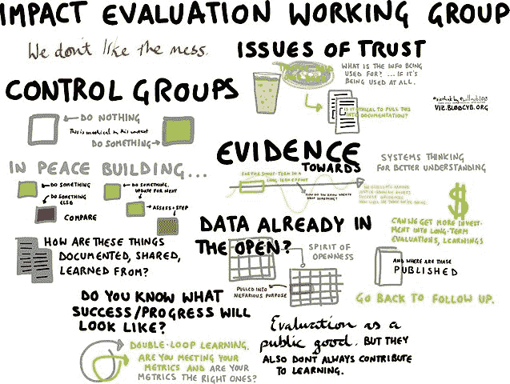

#### 评估机器学习模型
评估机器学习模型对于评估其性能并确定其是否适用于现实应用至关重要。有多种用于评估机器学习模型的指标，每种都有其优缺点。在本节中，我们将探索最常用的评估指标，包括准确率、`precision`、`recall`、F1 score 和 ROC-AUC。

#### 准确率（Accuracy）
准确率是评估机器学习模型时最广泛使用的指标。它衡量了测试数据集中所有实例中分类正确的实例的比例。准确率提供了模型表现如何的总体概念，但在类别不平衡时可能会产生误导。例如，如果一个类别的实例远多于另一个类别，准确率可能会被虚高，导致难以与其他模型进行比较。

#### 精确率（Precision）


# 精确率 (Precision)
精确率衡量了所有预测正例（`TP + FP`）中真正例（`TP`）的比例。当误报成本较高时（例如医疗诊断或财务评估中），精确率非常有用。较高的精确率分数表明模型能够更好地识别正例，而不会引入不假报。

# 召回率 (Recall)
召回率衡量了所有正例（`TP + FN`）中真正例（`TP`）的比例。当漏报成本较高时（例如欺诈检测或安全检查），召回率非常有用。较高的召回率分数表明模型能够更好地检测正例，即使某些正例被误分类为负例。

# F1 分数 (F1 Score)
F1 分数是精确率和召回率的调和平均数，提供了两者的均衡衡量。范围从 0 到 1，值越高表示性能越好。当精确率和召回率同样重要时（例如情感分析或文本分类），F1 分数非常有用。

# ROC-AUC
ROC-AUC（受者工作特征曲线 - 曲线下积）衡量曲线下方的面积，该曲线在不同阈值下将真正例率与假正例率绘制在一起。较高的 ROC-AUC 分数表明模型能够更好地区分正例和负例。

## 选择合适的指标
评估指标的选择取决于具体问题和可用数据。以下是一些准则：

- 如果误报成本较高，使用 `precision` 或 `recall`。
- 如果漏报成本较高，使用 `F1 score` 或 `ROC-AUC`。
- 如果准确率（Accuracy）是你的唯一指标，请审慎考虑，使用它，因为在类别不平衡时它可能会产生误导性。
- 如果你的实例数量有限，请使用 `precision` 或 `recall` 而不是 `F1 score` 或 `ROC-AUC`。

总之，评估机器学习模型需要对各种指标进行仔细考虑。通过理解每个指标的优缺点并根据问题选择合适的指标，你可以确保你的模型以最佳状态运行。

# 模型部署

## 在生产环境中部署机器学习模型
一旦机器学习模型经过了训练和验证，下一步就是将其部署到生产环境中。部署机器学习模型涉及使其供其他系统或应用程序使用，以便执行诸如预测、数据分类或自动化任务等操作。在生产环境中部署机器学习模型有几种策略，每种策略都有其优缺点：

1. **模型服务 (Model serving)**：在这种方法下，模型以 `RESTful API` 或数据库的形式暴露，客户端可以对其发送请求以获取预测或分类。模型服务实现简单，易于与现有系统集成，但可能不适用于大型模型或复杂的工作流。
2. **容器化 (Containerization)**：在这种方法下，模型及其依赖项封装在容器中（如 `Docker image`），并部署在服务器上。容器化为模型运行提供了一致的环境，并更容易管理依赖项和版本。然而，与其他策略相比，它可能需要更多的基础设施和维护。
3. **云端服务 (Cloud-based services)**：在这种方法下，模型部署在 `AWS`、`Google Cloud` 或 `Azure` 等这允许对模型进行于扩展和管理，并提供了一系列机器学习工具和服务。然而，它可能比其他部署策略更贵，并且需要更多云计算方面的专业知识。
4. **边缘模型训练 (Model training on the edge)**：在这种方法下，模型直接在设备或网络边缘进行训练，而不是在中心化服务器上。这可以降低延迟并提高性能，但可能会限制可以部署模型的复杂性和大小。
5. **混合部署 (Hybrid deployment)**：在这种方法下，模型同时部署在中心化服务器和网络边缘。这允许对模型进行易于扩展和管理，同时为来自网络边缘设备的请求提供快速的响应时间。

在生产环境中部署机器学习模型时，必须考虑以下几个因素：

- **可扩展性 (Scalability)**：部署策略应该能够处理大量的请求和数据输入，并能够根据需要扩大或缩小。
- **维护 (Maintenance)**：模型及其依赖项应该易于维护和更新，特别是当模型频繁更新时。
- **安全性 (Security)**：部署的模型应该是安全的，并防止未经授权的访问或篡改。
- **监控 (Monitoring)**：部署策略应该提供监控模型性能并检测可能出现的任何问题或错误的工具。
- **数据隐私 (Data privacy)**：如果部署的模型处理敏感数据，则应该符合 `GDPR` 或 `HIPAA` 等数据隐私法规。

总之，在生产环境中部署机器学习模型需要对多个因素进行仔细考虑，包括可扩展性、维护、安全性、监控和数据隐私。通过选择正确的部署策略并实施适当的保护措施，组织可以确保其机器学习模型能够优地运行并为用户提供价值。

# 强化学习

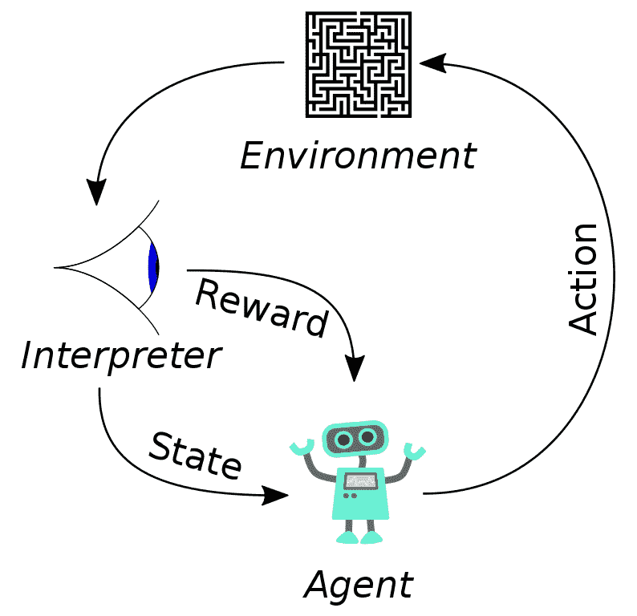

## 强化学习 - 从交互中学习的历程
强化学习是机器学习的一个分支，专注于训练智能体在复杂、不确定环境中做出决策。强化学习的目标是学习一种策略，将状态映射到最大化累积奖励的动作。在本节中，我们将探索强化学习这一令人兴奋的领域，并深入研究马尔可夫决策过程 (MDPs)、`Q-learning` 和策略梯度等基本概念。

### 马尔可夫决策过程 (MDPs)
马尔可夫决策过程 (`MDP`) 是一种用于在动作结果不确定的情况下建模决策问题的数学框架。一个 `MDP` 由一组状态、动作和奖励组成。智能体通过在每个状态下采取动作与环境交互，环境则通过奖励信号做出响应。智能体的目标是学习一种随时间最大化累积奖励的策略。

### Q-Learning
`Q-learning` 是一种流行的强化学习算法，通过与环境交互进行学习。该算法维护一个动作值函数，称为 `Q(s,a)`，它估计在状态 `s` 下采取动作 `a` 之后遵循最优策略的预期回报。`Q-learning` 根据观测到的奖励和下一个状态更新 Q 值。更新规则如下：

```
Q(s,a) ← Q(s,a) + α[r + γmax(Q(s',a')) - Q(s,a)]
```
其中 `r` 是观测到的奖励，`s'` 是下一个状态，`a'` 是在状态 `s'` 采取的动作，`α` 是学习率。`γmax(Q(s',a'))` 代表下一个状态和动作的最大预期 Q 值。

### 策略梯度 (Policy Gradients)
策略梯度另一种通过环境交互学习的强化学习算法。该算法直接更新策略，而不维护独立的动作值函数。更新规则如下：

```
π(a|s) ← π(a|s) + α[r + γV(s') - V(s)]
```


其中 `V(s)` 是状态 `s` 的值，`V(s')` 是下一个状态的值。术语 `γ` 代表学习率。

### 探索与开发的权衡
强化学习的挑战之一是探索与开发的权衡。智能体需要在探索新的动作和状态，与利用现有知识来最大化累积奖励之间取得平衡。epsilon-greedy 策略和基于熵的探索等技术有助于解决这一问题。

### 深度强化学习
深度强化学习将强化学习与深度学习技术（如神经网络）相结合。这些技术允许学习更复杂的函数，例如 `Q-functions` 或策略函数，并能够处理更大的状态空间。然而，复杂性的增加也引入了过拟合和需要仔细调优超参数等挑战。

### 强化学习的应用
强化学习在许多领域都有广泛应用，例如：

1. 机器人：强化学习可以控制机器人并教它们执行复杂任务，如抓取和操作。
2. 游戏：强化学习已用于训练智能体玩游戏，如围棋、扑牌和视频游戏。
3. 推荐系统：强化学习可以根据用户与系统的交互为其提供个性化推荐。
4. 自主车辆：强化学习可以用于训练自动驾驶车辆在复杂的驾驶场景中做出决策，如在交通中穿行或避障碍。

总之，强化学习是训练智能体在复杂、不确定环境中决策的强大工具。通过理解 `MDPs`、`Q-learning` 和策略梯度的基本概念，我们可以开发出更先进的算法来处理更大的状态空间和更复杂的任务。此外，强化学习的应用是非常广泛的，从机器人到游戏再到推荐系统。随着领域的不断演进，我们可以期待新技术和新应用的出现。

# 流行机器学习算法


### 流行机器学习算法概述
在当今快速发展的科技格局中，机器学习已成为各行业组织不可或缺的工具。训练机器从数据中学习并根据这些数据做出预测或决策的能力，彻底改变了我们解决问题的方法。由于可用算法有很多，导航复杂的机器学习领域可能具有挑战性。在本节中，我们将提供一些最流行的机器学习算法的概述，包括它们的原理、应用和优点，帮助你为理解和实施机器学习解决方案奠定坚实的基础。

1. 线性回归：
线性回归是最简单且最广泛使用的机器学习算法之一。它涉及使用线性方程对因变量与一个或多个自变量之间的关系进行建模。该算法试图寻找最佳拟直线，使预测值与实际值之间的差异最小。线性回归通常用于预测房屋价格、股票市场预测和客户流失预测等任务。

2. 决策树：
决策树是分类问题的流行选择。它们通过根据输入特征的值递归地将数据划分为较小的子集来工作。树中的每个内部节点代表特征选择，叶节点代表类别标签。决策树易于解释，并且可以处理类别特征和数值特征。它们通常用于图像分类、情感分析和欺诈检测等任务。

3. 随机森林：
随机森林是一种集成学习方法，结合了多棵决策树以提高模型的准确性和稳健性。每棵树都在数据的随机子集上进行训练，最终预测通过聚合所有树的预测得出。随机森林可以处理高维数据，通常用于信用风险评估、客户流失预测和医学诊断任务。

4. 支持向量机 (SVMs)：
SVM 是分类和回归问题的流行选择。它们通过在特征空间中寻找最大程度分离类别的超平面来工作。SVM 对噪声和离群值具有鲁健性，并可以处理高维数据。它们通常用于图像识别、文本分类和财务预测。

5. 神经网络：
神经网络是一受大脑结构和功能启发的机器学习算法。它们由多个相互连接的节点层组成，用于学习表示数据中的复杂模式。神经网络可以处理类别特征和数值特征，通常用于图像识别、自然语言处理和自动驾驶任务。

6. 朴素贝叶斯：
朴素贝叶斯是基于贝叶斯定理的概率算法族。它们通常用于分类问题，可以处理类别特征和数值特征。朴素贝叶斯算法易于解释，通常用于垃圾邮件过滤、情感分析和医学诊断任务。

7. K-最近邻 (KNN)：
KNN 是一种简单的机器学习算法，涉及在训练数据中找到与新实例最相似的 k 个实例。算法随后使用这些相似实例的标签来做出预测。KNN 可以处理类别特征和数值特征，通常用于图像识别、客户分类和推荐系统任务。

总之，每种机器学习算法都有独特的优缺点，算法的选择取决于所解决的具体问题。理解这些算法的原理和应用对于为任务选择正确的工具以及构建准确且稳健的机器学习模型至关重要。

## 线性回归

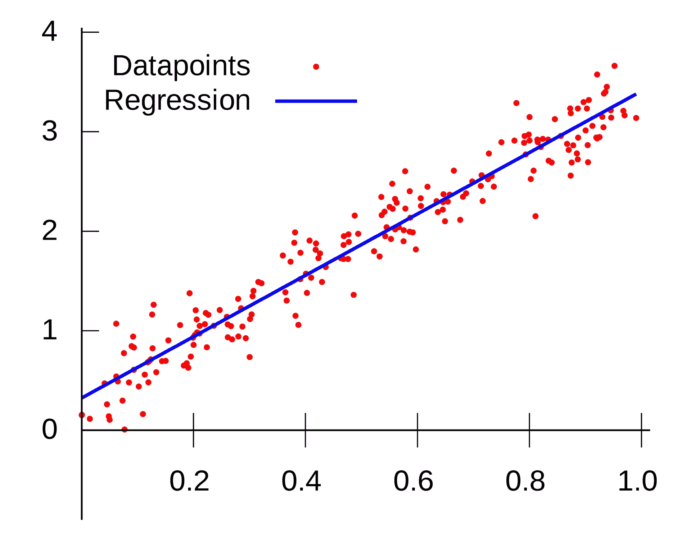

### 线性回归 - 预测建模的基础算法
线性回归是一种广泛使用的统计技术，根据一个或多个预测变量来预测连续的结果变量。它是机器学习和数据科学中的基础算法，应用于金融、营销、医疗保健和和社会科学等多个领域。在本节中，我们将深入研究线性回归的数学原理并探索其实际应用。

#### 线性回归的数学原理
---------------------------------------
线性回归在数学上可以表示为简单的线性方程：

`Y = β0 + β1X + ε`

其中 `Y` 是结果变量，`X` 是预测变量，`β0` 和 `β1` 是系数，`ε` 是误差项。线性回归的目标是估计最佳拟直线，使观测值与预测 `Y` 值之间的平方误差和最小。

在更高级的形式中，线性回归可以表示为线性方程组：

`Y = (β0 + β1X) + ε`
`X = α0 + α1Y + ε'`

其中 `X` 是预测变量，`Y` 是结果变量。系数 `α0` 和 `α1` 代表 `X` 与 `Y` 之间的关系，而 `β0` 和 `β1` 代表 `X` 与误差项 `ε` 之间的关系。

#### 线性回归的实际应用
--------------------------------横
线性回归各个领域都有广泛的实际应用：

## 金融


线性回归可以根据 GDP 增长率、通货膨胀和利率等经济指标来预测股票价格、投资组合收益和信用风险。

### 营销
线性回归可以根据营销活动、广告支出以及年龄、性别和收入水平等人口统计学因素来预测销售收入。

## 医疗保健
线性回归可以根据病史、实验室结果以及年龄、性别和共病等人口统计学因素预测患者结果。

### 社会科学
线性回归可以根据失业率、犯罪率和教育水平等经济指标来预测社会结果。

### 环境科学
线性回归可以根据温度、湿度和降水量等气候变量来预测环境结果。

## 线性回归的挑战与局限性
尽管线性回归是一种强大的预测工具，但它也面临许多挑战和局限性：

### 假设
线性回归假设自变量和因变量之间存在线性关系，但这并不总是成立。非线性关系或变量之间的交互很难使用线性回归进行建模。

### 离群值
线性回归对离群值敏感，这会显著影响预测的准确性。在实践中，移除或处理离群值具有挑战性。

### 多重共线性
线性回归假设自变量之间互不相关，这在实践中可能并不总是真实的。多重共线性会导致预测不稳定和不准确。

## 线性回归研究的未来方向
尽管存在局限性，线性回归仍然是预测建模的重要工具。未来的研究方向包括：

### 机器学习
将线性回归与神经网络和支持向量机等机器学习技术相结合，可以获得更准确的预测，并提高结果的可解释性。

### 时间序列分析
将线性回归应用于时间序列数据，可以根据过去的模式和趋势帮助预测未来值。

### 高维数据
在处理高维数据时，线性回归的计算成本很高。开发高效的算法和减少维度灾难仍然重要的挑战。

### 结论
线性回归是预测建模的一种基础算法，在各个领域具有深远的应用。尽管它有局限性，但持续的研究和进步正在解决这些挑战并扩展线性回归的能力。随着机器学习和数据科学的不断演进，线性回归仍然是做出准确预测和揭示复杂数据中隐藏模式的重要工具。

## 逻辑回归
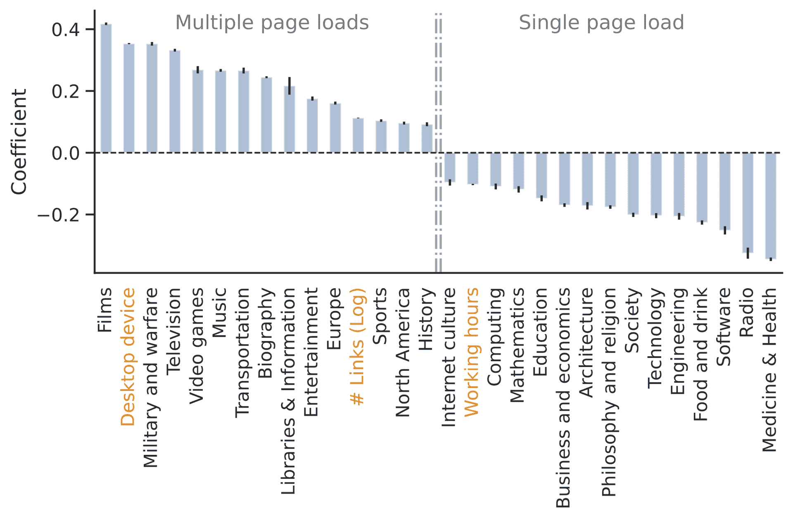

逻辑回归 - 用于二分类任务的强大算法
逻辑回归是一种广泛用于二分类任务的统计技术，其目标是根据一个或多个预测变量预测事件发生的概率。它是一个线性模型，使用逻辑函数将预测的概率转换为 0 到 1 之间的范围，这代表事件发生的概率。在本节中，我们将探索逻辑回归的应用、其背后的数学概念以及如何使用它来解决二分类问题。

### 逻辑回归的应用
逻辑回归在许多领域有广泛的应用，包括：

1. **医学研究**：逻辑回归广泛应用于医学研究，用于分析风险因素与疾病之间的关系。例如，它可以根据年龄、体重指数（`BMI`）和家族史等因素确定患糖尿病的概率。
2. **营销**：逻辑回归可以用于营销，根据客户的人口统计信息（如年龄、性别和收入）预测其购买概率。
3. **金融**：逻辑回归可以用于金融，根据信用评分、债务收入比和工作历史等因素预测贷款还的概率。
4. **社会科学**：逻辑回归可以用于社会科学，分析社会变量与结果之间的关系，例如根据人口密度、失业率和教育水平等因素预测某地区发生犯罪的概率。

### 逻辑回归背后的数学概念
逻辑回归是一个使用逻辑函数将预测概率转换为 0 到 1 之间范围的线性模型。逻辑函数定义为：

```
p = 1 / (1 + e(-z))
```

其中 `p` 是事件发生的概率，`e` 是自然对数的底，`z` 是预测变量的线性组合。逻辑函数具有 S 型曲线，这使得对于预测变量的某些取值，概率可以于 0 或 1。

逻辑回归背后的数学概念包括：

1. **概率论**：逻辑回归基于概率论，概率论提供了一个分析和建模不确定事件的框架。
2. **线性回归**：逻辑回归是线性回归的一种，其中预测变量与结果变量之间的关系使用线性方程进行建模。
3. **多变量分析**：逻辑回归可以同时分析多个预测变量，从而更全面地理解变量与结果变量之间的关系。
4. **模型选择**：逻辑回归允许模型选择，根据交叉验证和拟合优度等标准选择最拟合的模型。

### 如何使用逻辑回归
可以通过以下步骤使用逻辑回归解决二分类问题：

1. **定义问题**：定义二分类问题，包括结果变量和预测变量。
2. **收集数据**：收集预测变量和结果变量的数据。
3. **探索数据**：探索数据以识别变量之间的任何模式或关系。
4. **选择模型**：选择适用于该问题的逻辑回归模型，包括结果变量和预测变量的选择。
5. **拟合模型**：使用普通最小二法（`OLS`）或极大似然估计（`MLE`）等技术对数据拟合逻辑回归模型。
6. **评估模型**：使用交叉验证和拟合优度衡量评估模型的拟合情况。
7. **使用模型**：使用逻辑回归模型根据预测变量对新数据进行预测。

### 结论
逻辑回归是二分类任务的强大算法，允许全面理解预测变量与结果变量之间的关系。通过理解逻辑回归背后的数学概念（包括概率论、线性回归、多变量分析和模型选择），我们可以使用这种技术来解决各个领域的复杂问题。无论你是医学研究的人员，还是寻求预测客户行为的营销人员，逻辑回归都是分析二分类问题的重要工具。

## 决策树


## 决策树 - 一种用于分类和回归的通用算法

决策树是一种用于分类和回归任务的流行机器学习算法。它们以简单、多功能和易于解释而闻名，使其成为数据分析师和科学家的强大工具。在本节中，我们将深入探讨决策树的内部工作机制，探索其直观的树形结构、特征选择过程以及决策机制。

## 直观的树形结构

决策树是一种分层模型，将一组决策及其可能的后果表示为树形结构。树中的每个内部节点代表数据的一个特征或属性，每个叶子节点代表一个类别标签或预测值。树通过根据特征的值递归地将数据划分为较小的子集来生长，直到达到最优划分。这个过程一直持续，直到满足停止标准，例如给定子集中的所有实例都属于同一类。

## 特征选择

决策树的主要优势之一是它们能够处理具有大量特征的高维数据。在构建决策树的过程中，算法会根据信息增益或基尼不纯（Gini impurity）等标准，在每个节点选择包含最相关的特征。这种特征选择过程有助于降低数据的维度并提高模型的准确性。

## 决策过程

在决策树的每个内部节点，算法都会评估当前子集中实例的特征值，并根据信息增益或基尼不纯等启发式标准确定最佳划分。决策过程递归地重复，直到达到最优划分，从而产生分类或回归模型。

### 优势与局限性

决策树具有多个优势，包括：

- 易于解释：决策树具有高度的可解释性，因为树形结构提供了决策过程的清晰视觉化表示。
- 处理缺失值：决策树可以处理数据中的缺失值，这对于其他机器学习算法来说可能是一个挑战。
- 对离群点的鲁棒性：决策树对数据中的离群点相对鲁棒，因为它们关注数据的整体模式而不是单个实例。

然而，决策树也有一些局限性：

- 计算复杂度：对于大型数据集，构建决策树的计算开销可能是很大的。
- 过拟合：决策树可能会出现过拟合问题，特别是当树非常深且复杂时。
- 泛化能力有限：决策树可能无法很好地泛化到新的、未见过的数据，因为它们高度依赖于训练数据。

## 现实世界应用

决策树在各个领域都有广泛的应用，包括：

- 客户细分：决策树可以根据人口统计特征和行为特征对客户进行细分。
- 欺诈检测：决策树可以通过分析交易金额、地点和时间等特征组合来检测欺诈交易。
- 医疗诊断：决策树可以根据症状、病史和其他因素诊断疾病。

### 结论

决策树是一种用于分类和回归任务的强大机器学习算法。它们直观的树形结构、特征选择过程和决策机制使其成为数据分析师和科学家的热门选择。虽然它们具有许多优势（包括易于解释和对离群点的鲁棒性），但也存在计算复杂和过拟合等局限性。通过理解决策树的内部工作机制，我们可以在现实应用中充分利用它们的潜力。

# 随机森林

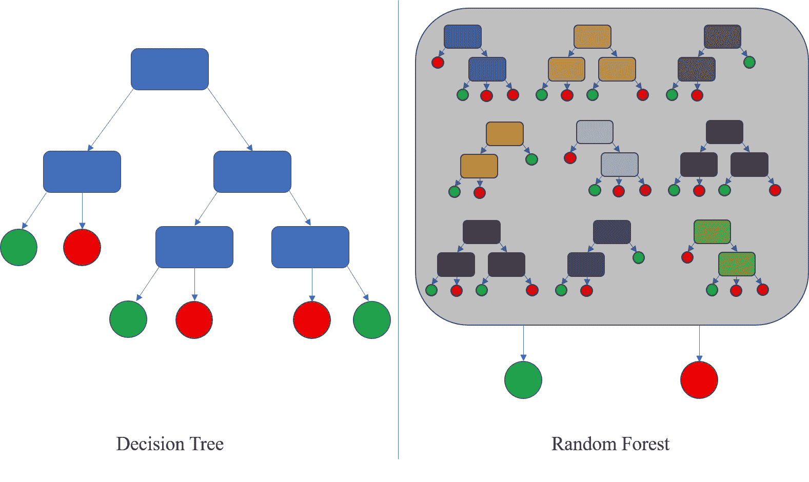

## 随机森林集成学习

在机器学习中，有多种技术可以提高预测的准确性和鲁棒性。其中一种技术是集成学习，它涉及结合多个基模型的预测以产生更准确、更稳健的输出。在本节中，我们将探索随机森林——一种基于决策树的集成学习技术，以及它如何增强预测性能并减少过拟合。

### 什么是决策树？

决策树是一种机器学习模型，通过根据输入特征的值递归地将数据划分为较小的子集来工作。树中的每个内部节点代表特征选择，每个叶子节点代表一个预测的类别或值。决策树通过递归应用此过程来构建，直到达到停止标准，例如所有实例都属于同一类或达到最大深度。

### 决策树的优势

决策树具有多个优势，使其在机器学习任务中非常：

1. 易于解释：决策树具有高度的可解释性，因为它们表示了基于输入特征的逻辑决策流。这更容易理解模型是如何做出预测的。
2. 处理缺失值：决策树可以处理数据中的缺失值，这可能是许多机器学习任务中的常见问题。
3. 处理非线性关系：决策树可以捕捉输入特征与目标变量之间的非线性关系，使其处理复杂问题非常有用。
4. 对离群点鲁棒：决策树对数据中的离群点具有鲁棒性，因为它们使用多数投票来进行预测。

### 决策树的缺点

虽然决策树有许多优势，但它们也有一些缺点：

1. 过拟合：决策树可能会出现过拟合，特别是当数据中存在太多无关特征时。
2. 计算开销：构建和剪枝决策树的计算开销很大，特别是对于大型数据集。
3. 灵活性有限：一旦构建了决策树，就无法轻易修改或更新。

### 随机森林简介

随机森林是一种集成学习技术，结合了多个决策树以产生更准确、更稳健的预测。随机森林的关键优势是它们可以通过平均多棵树的预测来减少过拟合。每棵树都在随机特征子集上训练，这有助于减少树之间的相关性并提高整体性能。

## 随机森林如何工作

以下是随机森林的工作原理：

1. 自助采样（Bootstrap sampling）：使用数据的自助采样样本来训练每棵决策树。这确保了每棵树都在不同的特征子集上训练，有助于减少过拟合。
2. 训练决策树：使用递归划分算法在自助采样上训练每个决策树。
3. 投票机制：通过投票机制平均每个决策树的预测以产生最终预测。
4. 超参数调优：随机森林具有多个可以调优的超参数，例如树的数量、树的最大深度以及在每次划分时考虑的特征数量。

### 随机森林的优势

随机森林相比决策树具有多个优势：

1. 减少过拟合：通过平均多棵树的预测，随机森林可以减少过拟合并提高整体性能。
2. 提高准确性：随机森林可以比单决策树产生更准确的预测，特别是当数据复杂或充满噪声时。


### 3. 对离群值的鲁棒性：随机森林对数据中的离群值具有鲁棒性，因为多棵树的平均有助于减少任何单个离群值的影响。

### 4. 处理高维数据：随机森林可以通过在每次分裂时选择特征的随机子集来处理高维数据。

### 随机森林的缺点
虽然随机森林有许多优势，但它们也有一些缺点：

1. 计算成本高：构建和剪枝多棵决策树在计算上可能是昂贵的，特别是对于大型数据集。
2. 需要仔细调优：随机森林的性能对超参数的选择非常敏感，这需要仔细的调优。
3. 可解释性有限：随机森林的可解释性低于单棵决策树，因为集成模型可能难以理解。

### 随机森林在现实中的应用
随机森林已成功应用于广泛的机器学习任务，包括：

1. 图像分类：随机森林已用于将图像分类为不同的类别，例如物体或场景。
2. 自然语言处理：随机森林已用于文本分类和情感分析。
3. 生物信息学：随机森林已用于预测基因表达水平并识别与疾病相关的遗传突变。
4. 推荐系统：随机森林已用于构建处理复杂用户偏好的推荐系统。

### 结论
总之，随机森林是一种强大的集成学习技术，可以提高预测的准确性和鲁棒性。通过结合多棵决策树，随机森林可以减少过拟合并处理复杂的数据类型，例如高维数据和缺失值。然而，需要对超参数进行仔细调优以优化随机森林的性能。随机森林已成功应用于许多机器学习任务，包括图像分类、自然语言处理、生物信息学和推荐系统。

## 支持向量机 (SVM)

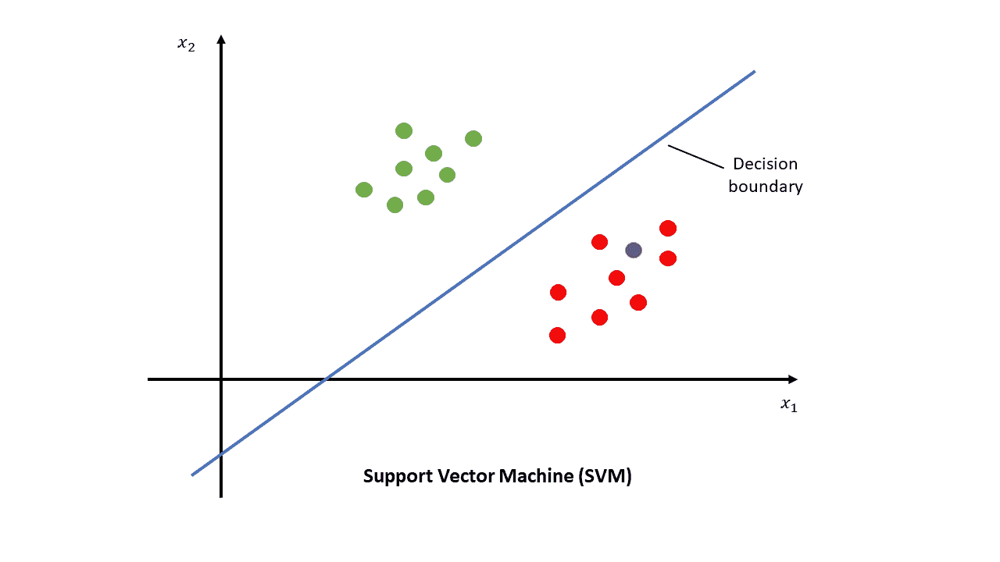

### 支持向量机 (SVMs)
支持向量机（SVM）是一种监督学习算法，可以同时用于分类和回归任务。SVM 的核心思想是找到一个最大化分离不同类别数据点的超平面。换句话说，目标是找到一个使类别之间间隔（margin）最大的超平面。这是通过找到使误分类数量最少的优超平面来实现的，被称为“支持向量”。

SVM 中超平面的概念是理解该算法如何工作的基础。超平面是一个线性或非线性边界，将数据划分为不同的类别。在二分类情况下，超平面将数据划分为两类；而在多分类情况下，则存在多个超平面将数据划分为不同的类别。SVM 的目标是找到一个最大化类别间间隔的优超平面。

SVM 算法中核（kernels）的使用对于其成功也至关重要。核是一个将输入数据从输入空间映射到高维特征空间的函数。可以根据数据的属性和当前的问题选择核函数。常用的核函数包括线性、多项式、径向基函数（RBF）和 sigmoid。核的选择会显著影响 SVM 算法的性能，因此，为你正尝试解决的问题选择正确的核至关重要。

有几种类型的 SVM 算法，包括：

- 线性 SVM：这是最简单的 SVM 类型，使用线性核函数将数据转换到高维空间。
- 多项式 SVM：这些比线性 SVM 更复杂，可以通过使用多项式核函数处理非线性问题。
- 径向基函数 (RBF) SVM：这些与多项式 SVM 类似，但使用径向基函数代替多项式作为核函数。
- Sigmoid SVM：用于二分类问题，并使用 sigmoid 核函数将输入数据映射到高维空间。

SVM 的优势包括：

- 对数据中的噪声和离群值具有鲁棒性
- 能够用少量样本处理高维数据
- 核函数选择上具有灵活性，允许适应不同类型的问题
- 在类别不可线性分的情况下表现良好

然而，SVM 也有一些局限性：

- 计算复杂度：SVM 的计算可能非常昂贵，特别是对于大型数据集
- 过拟合：如果核函数太复杂或正则化参数调得不当，SVM 可能会出现过拟合
- 缺乏可解释性：SVM 基于复杂的数学公式，这使得它们比其他机器学习算法难以解释。

总之，支持向量机（SVM）是一种用于分类和回归任务的强大算法。超平面的概念和 SVM 算法中核的使用是其成功的关键。虽然 SVM 有许多优势，但在为特定问题选择算法时，也需要考虑它的局限性。

## K 最近邻 (KNN)

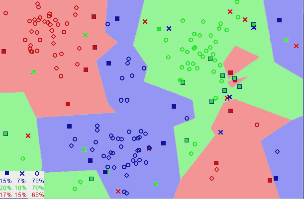

### 理解用于分类和回归的 K 最近邻算法
K 最近邻（KNN）是一种简单而有效的算法，用于分类和回归任务。在本节中，我们将深入探讨 KNN 的概念并理解其工作原理，包括基于接近性的方法以及选择正确“k”值的重要性。

### 基于接近性的方法
KNN 的核心思想是在某些共同特征空间中找到与新输入最相似的实例。在分类任务中，这意味着找到最可能与新输入属于同一类别的实例。在回归任务中，这意味着找到在目标值与新输入最相似的实例。

为了实现这一点，KNN 算法维护了一组之前遇到过的实例，被称为训练数据集或库。当出现一个新实例时，算法会搜索该库，根据某些预定义的距离度量（例如欧几里得距离）找到 `k` 个最近邻。距离度量衡量了两个实例在特征方面的相似程度。

### 'k' 值：关键的选择
`k` 值的选择是 KNN 的一个关键方面。它决定了在进行预测时考虑的最近邻数量。`k` 值较小会导致预测参考样本较少，而 `k` 值较大则会导致参考样本较多。然而，将 `k` 增加到某个点可能会由于算法变得过拟合而无法显著提高准确性。

选择最优 `k` 值有几种方法：

- 精确搜索：某些算法通过整个训练数据集执行精确搜索，以找到 `k` 个最近邻。这种方法计算开销大，对于大型数据集可能不可行。
- 最近邻搜索：其他算法使用概率方法，例如最近邻搜索算法，根据概率分布函数选择 `k` 个最近邻。


### 3. K-means 聚类
另一种方法是使用 k-means 聚类将相似实例分组，然后在进行预测时选择最近的类进行考虑。

### 4. 混合方法
某些算法结合了不同的技术，例如使用 `KNN` 进行初步分类，然后应用其他算法（例如决策树或支持向量机）。

## KNN 的优点与局限性

KNN 有几个优点：

1. **灵活性**：`KNN` 可以同时处理分类特征和数值特征，使其成为适用于分类和回归任务的多功能算法。
2. **可解释性**：与其他某些机器学习算法不同，`KNN` 通过展示实例之间的相似性来提供可解释的结果。
3. **对离群值鲁棒性**：`KNN` 对训练数据集中的离群值具有鲁棒性，因为它关注实例的整体分布而不是单个实例。

然而，`KNN` 也存在一些局限性：

1. **计算密集型**：在处理大型数据集或高维特征空间时，`KNN` 的计算开销很大。
2. **过拟合**：如前所述，将 `k` 增加到超过某个点可能会导致过拟合，从而导致在未见数据上的泛化性能较差。
3. **对初始位置敏感**：`KNN` 中使用的距离度量对实例的初始位置可能敏感，可能导致相同输入产生不同的结果。

## KNN 的现实世界应用

`KNN` 在各个领域都有大量应用，包括：

1. **图像分类**：`KNN` 已用于根据特征（如颜色、纹理、形状）对图像进行分类。
2. **医学诊断**：`KNN` 已通过分析患者症状并识别数据库中最相似的案例应用于医学诊断。
3. **金融预测**：`KNN` 可以根据历史数据预测股票价格或汇率。
4. **推荐系统**：`KNN` 已应用于推荐系统，根据用户偏好与过去购买记录之间的相似性推荐产品或服务。

### 结论

最近邻算法是一种用于分类和回归任务的简单且有效的算法。通过理解基于距离的方法以及选择正确 `k` 值的重要性，你可以使用 `KNN` 来解决各个领域中的复杂问题。虽然 `KNN` 具有许多优点，但在为特定问题选择恰合适的算法时，也需要考虑它的局限性。

## K-Means 聚类

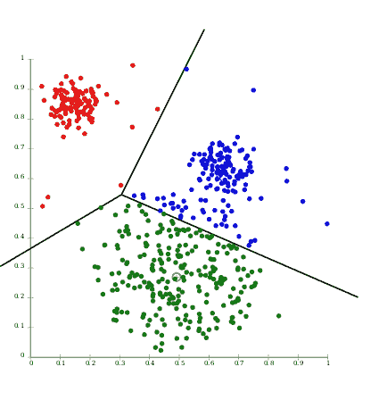

### 理解 K-Means 聚类算法

K-means 聚类是机器学习中广泛使用的无监督学习算法，根据相似性将数据划分为 `K` 类。该算法迭代地将数据点分配到最近的类，并根据分配的数据点更新类质心的位置。在本节中，我们将深入探讨 k-means 聚类算法及其迭代过程。

1. **初始化**：k-means 聚类算法从在数据集中初始化类质心开始。这些质心是随机选择的，或者根据数据的先验知识选择。该算法的数目（`K`）是固定的，根据问题的性质从 2 到 100 不等。
2. **分配**：算法根据欧几里得距离或余弦相似度等距离度量将每个数据点分配到最近的类质心。该度量衡量数据点与 `K` 个类质心每一个之间的相似性。距离越近，数据点与该特定类越相似。
3. **更新**：在将每个数据点分配到一个类后，算法根据分配的数据点更新每个类质心的位置。具体来说，每个质心的新位置是分配到该类的所有数据点位置的加权平均值。权重由每个数据点与质心之间的距离决定。数据越越质心，权重越高。
4. **重复**：算法重复步骤 2 和 3，直到满足停止标准，例如达到最大迭代次数或达到理想的聚类质量。在每次迭代中，算法重新将数据点分配到最近的类质心，并根据分配的数据点更新每个质心的位置。
5. **收敛**：k-means 算法设计为收敛到参数空间中的固定点或循环。收敛由类的数量（`K`）和质心的初始位置决定。如果算法收敛到循环，可能表明所选的 `K` 值对于数据集不是最优。
6. **可视化**：一旦算法收敛，可以使用可视化技术探索类及其属性。可以根据实例的邻近性分配类标签。
7. **评估**：可以使用各种指标如轮廓系数（silhouette score）、Calinski-Harabasz 指数和 Davies-Bouldin 指数来评估 k-means 算法的性能。这些指标根据分离度、重叠度和紧凑性来衡量聚类的质量。
8. **优点**：k-means 算法具有几个优点，包括：
* 易于实现和解释。
* 灵活且可以处理不同类型的数据。
* 对于小型数据集计算效率高。
* 可用于监督学习和无监督学习。
9. **局限性**：虽然 k-means 算法被广泛使用，但它存在一些局限性：
* 对类质心的初始条件和位置敏感。
* 对于变量间关系复杂的数据集可能效果不好。
* 对于大型数据集可能很慢。
10. **应用**：K-means 聚类在各个领域有许多应用，包括市场细分、图像压缩、异常检测和基因表达分析。它还可以作为决策树和神经网络等其他机器学习算法的预处理步骤。

总之，k-means 聚类是一种强大的无监督学习算法，根据相似性将数据划类。理解分配数据点和完善类质心的迭代过程对于有效使用该算法至关重要。

## 神经网络

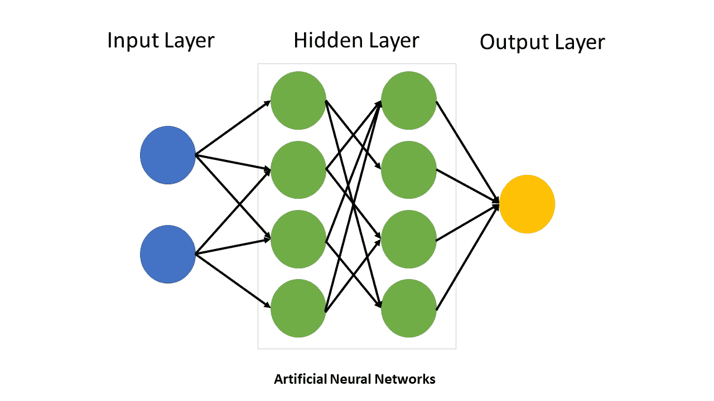

### 理解神经网络

神经网络是深度学习的基础组成部分，深度学习是机器学习的一个子领域，它改变了我们处理计算机科学中复杂问题的方法。神经网络的核心是一系列相互连接的节点或“神经元”，每个节点处理部分数据并将其传递给链中的下一个节点。这个过程模拟了人类大脑的结构和功能，神经元通过复杂的连接进行相互通信。

### 人工神经元


神经网络的构建模块是人工神经元，它们的设计旨在模拟大脑中生物神经元的行为。每个人工神经元接收一组输入，对这些输入应用激活函数，并将输出传递给其他神经元或输出层。激活函数是一种数学操作，决定了神经元如何对其接收到的输入做出响应。常见的激活函数包括 `sigmoid`、`tanh` 和 `ReLU`（修正线性单元）。

## 前馈神经网络
最简单的神经网络类型是前馈网络，它由一个输入层、一个或多个隐藏层和一个输出层组成。数据仅向一个方向流动，从输入层流到输出层，没有任何循环或周期。网络中的每个神经元独立地处理其输入，它们之间没有直接连接。这种类型的网络对于线性可分问题有用，即输出可以通过通过输入空间的直线来预测。

## 循环神经网络
循环神经网络（`RNNs`）是一种更高级的神经网络，它允许数据在循环中流动，使网络能够捕捉数据中的时间依赖关系。与前馈网络不同，`RNNs` 在隐藏层和输入层之间具有反馈连接，允许网络维持一个捕捉先前输入信息的内部状态。这使得 `RNNs` 特别适用于语言建模、语音识别和时间序列预测等任务。

## 长短期记忆（LSTM）网络
`RNN` 的一种类型是长短期记忆（`LSTM`）网络，它结合了前馈网络和循环网络的优点。`LSTMs` 具有复杂的架构，包含多个相互连接的节点层，允许它们学习数据中的长期依赖关系，同时捕捉局部模式。这使得 `LSTMs` 特别适用于语音识别、自然语言处理和图像描述等任务。

## 卷积神经网络（CNNs）
另一种神经网络是卷积神经网络（`CNN`），它设计用于处理具有网格状拓扑结构的数据，例如图像。`CNNs` 使用卷积层从输入数据中提取特征，然后通过池化层减小数据的维度。这允许网络学习特征的空间层次结构，使其在图像分类任务中特别有用。

## 深度学习框架
为了构建和训练神经网络，`TensorFlow`、`PyTorch` 和 `Keras` 等深度学习框架提供了一系列工具和库，简化了开发过程。这些框架允许开发者专注于构建和训练他们的模型，而无需担心底层的基础设施。它们还提供了一系列预构建的层和模块，可以轻松用于构建复杂的神经网络。

总之，神经网络是深度学习的基础，理解它们的架构和功能对于任何机器学习执业者来说都是至关重要的。通过探索人工神经元、激活函数、前馈神经网络、循环神经网络以及深度学习框架，我们可以更深入地理解这些复杂算法的威力和潜力。

## 梯度提升
### 梯度提升 - 一种集成学习技术
梯度提升是一种集成学习技术，它结合了多个弱学习器来创建一个强大的预测模型。梯度提升背后的核心思想是构建一系列决策树，每棵树都关注于纠正前一棵树所犯的错误。通过结合这些树的预测结果，可以获得一个稳健且准确的预测模型。在本节中，我们将探索梯度提升的概念、其过程以及决策树在这种技术中的作用。

### 梯度提升是如何运作的
梯度提升涉及在上一棵树的残差上训练一系列决策树。每棵决策树都经过训练以纠正上一棵树犯的错误。最终预测通过结合所有树的预测结果获得。该过程可以分解为以下步骤：

1. **数据准备**：首先通过选择特征和目标变量来准备数据。特征被缩放以确保所有树具有相似的范围，目标变量被转换以确保其落在合适的范围内。
2. **初始树**：在整个数据集上训练第一棵决策树，包括特征和目标变量。这棵树作为提升过程的起点。
3. **残差**：通过计算预测值与实际值之间的差来计算初始树的残差。
4. **新树**：在上一棵树的残差上训练一个新的决策树。这棵树的设计是为了纠正上一棵树犯的错误。
5. **聚合**：聚合所有树的预测以获得最终预测。
6. **评估**：使用均方误差（MSE）或均方根误差（RMSE）等指标对梯度提升模型进行评估。

### 决策树在梯度提升中的作用
决策树是梯度提升的关键组成部分。它们被用于构建相互纠错误的弱学习器。决策树在上一棵树的残差上进行训练，使其能够关注数据中最重要的特征和模式。通过结合多个树的预测结果，可以获得一个稳健且准确的预测模型。

### 梯度提升的优势
梯度提升具有许多优势，使其成为预测建模的热门：

1. **提高准确性**：通过结合多个树的预测，梯度提升可以获得比单一树更高的准确性。
2. **对异常值的稳健性**：梯度提升对数据中的异常值具有稳健性，因为每棵树都是在上一树的残差上训练的。
3. **可解释的结果**：与其他机器学习技术相比，梯度提升的结果易于解释和理解。
4. **活性**：梯度提升可以使用各种基学习器，例如决策树、随机森林或神经网络。
5. **处理缺失值**：梯度提升可以处理数据中的缺失值，这是许多应用中的常见问题。

### 梯度提升的常见应用
梯度提升在机器学习和预测建模中有广泛的应用，包括：

1. **信用风险评估**：根据借款人的简介（包括财务历史和信用评分）预测信用风险。
2. **营销活动优化**：通过预测客户对营销活动的回概率，梯度提升可以帮助优化活动以实现投资回报率最大化。
3. **医学诊断**：根据患者的病史和测试结果预测患者预后。
4. **股价预测**：通过分析历史股价和其他市场数据，梯度提升可以准确地预测未来股价。
5. **气候变化预测**：梯度提升可以根据历史天气数据和环境因素预测气候变化模式。


梯度提升是一种强大的集成学习技术，它通过结合多个弱学习器来创建一个强力预测模型。决策树在梯度提升中起着至关重要的作用，它们通过构建一系列相互纠正错误的弱学习器来实现目标。通过组合多棵树的预测结果，梯度提升可以获得比任何单棵树都更高的准确性和鲁棒性。梯度提升在机器学习和预测建模中有广泛的应用，包括信用风险评估、营销活动优化、医学诊断、股票价格预测和气候变化预测。

## 主成分分析 (PCA)

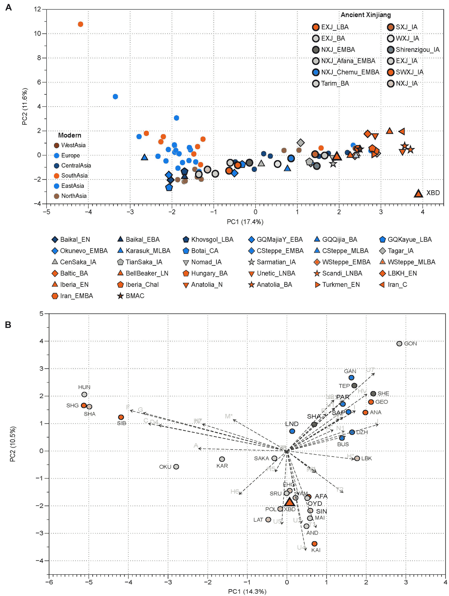

### 主成分分析 (PCA) 简介介绍

主成分分析（PCA）是机器学习和数据分析中广泛使用的降维技术。它帮助将高维数据转换为低维表示，同时保留原始数据中最重要的特征。在本节中，我们将探索 PCA 的基础知识、它的转换能力以及它如何应用于真实世界数据集。

### 什么是主成分分析 (PCA)？

PCA 是一种统计技术，通过降低数据的维度来简化复杂数据集，同时保留数据中的大部分信息。它通过识别数据的底层结构，并将其投影到一组新的轴上，这些新轴能够捕捉原始数据中最重要的特征。生成的低维表示被称为“主成分”，它是原始特征的线性组合，解释了数据中的最大方差。

### PCA 是如何工作的？

PCA 的处理过程可以分解为三个主要步骤：

1. **数据标准化**：通过减去每个特征的均值并除以标准差来对输入数据进行标准化。这确保了所有特征都在同一尺度上，并准备好进行分析。
2. **协方差矩阵计算**：下一步是计算标准化数据的协方差矩阵。该矩阵捕捉了数据集中每对特征之间的关系。
3. **特征值和特征向量计算**：然后使用称为特征值分解的过程将协方差矩阵分解为它的特征向量和特征值。特征向量就是主成分，代表了低维空间的新轴。特征值代表了每个主成分所解释的方差量。

### 保留方差

PCA 的主要优势之一是它在低维表示中保留了原始数据的方差。这意味着数据最重要的特征被保留了，而不重要的特征被丢弃了。生成的主成分具有很高的解释差，这表明它们捕捉了原始数据大部分的信息。

### PCA 的应用

PCA 在各个领域有许多应用，包括：

1. **图像压缩**：PCA 可用于降低图像维度，同时保留其重要特征（如形状和纹理）。
2. **特征选择**：通过识别最重要的主成分，PCA 可以帮助选择特征子集，以捕捉数据的大部分信息。
3. **数据聚类**：PCA 可以通过将数据投影到低维空间然后应用聚类算法，来识别高维数据集中的簇。
4. **异常检测**：PCA 可以通过识别低维表示中距离均值远的点，帮助检测数据集中的异常或离群值。

### PCA 的真实世界应用

PCA 已成功应用于广泛的真实世界数据集，包括：

1. **金融**：识别金融数据中的模式和趋势，例如股票价格或交易量。
2. **遗传学**：识别复杂遗传数据中的模式。
3. **图像处理**：在保留图像重要特征的同时降低图像维度。
4. **文本挖掘**：分析文本数据中的模式。

### PCA 的挑战与局限性

虽然 PCA 是一种强大的技术，但它确实面临一些挑战：

1. **数据依赖性**：PCA 依赖于输入数据的质量。
2. **对初始条件的敏感性**：PCA 的结果对初始值可能敏感。
3. **解释性有限**：获得的主成分并不总是具有清晰的含义。
4. **计算复杂度**：PCA 的计算开销可能很大，特别是处理大型数据集时。

### 结论

主成分分析（PCA）是一种广泛使用的降维技术，它在保留尽可能多信息的同时简化了复杂数据集。通过识别数据的底层结构并将其投影到一组新的轴上，PCA 帮助降低高维数据的维度。通过理解 PCA 的基础知识及其应用，我们可以利用这种强大的技术来发现复杂数据集中隐藏的模式和趋势。

## 循环神经网络 (RNN)

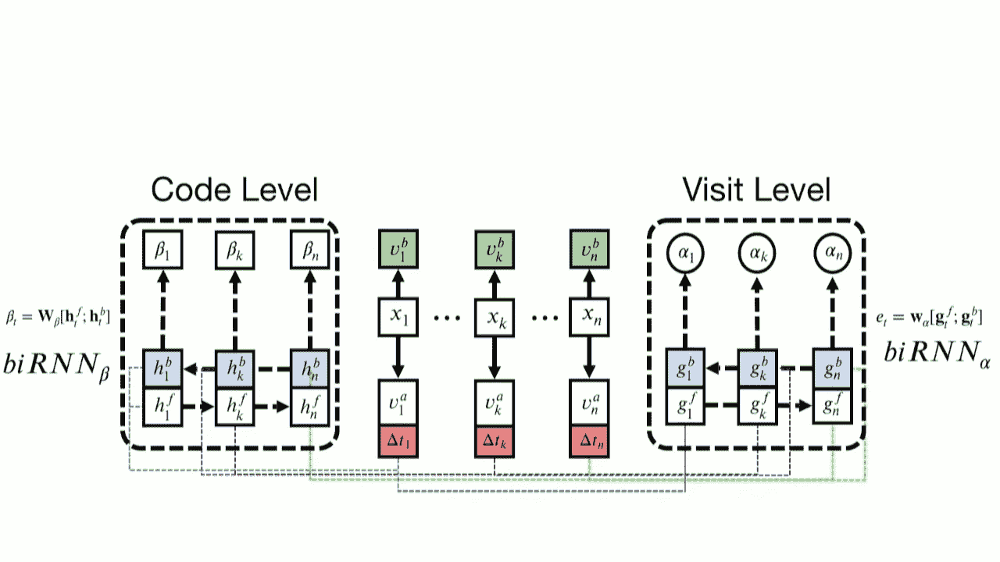

### 用于序列数据的循环神经网络 (RNN)

从序列数据中学习是机器学习中的一项基础任务，应用于自然语言处理、语音识别和时间序列分析等领域。然而，这类数据对传统的神经网络架构构成了独特的挑战。幸运的是，循环神经网络（RNN）专门为解决这些挑战而设计。在本节中，我们将深入研究 RNN 的架构，并探索它们如何解决与从序列数据学习相关的困难。

### 从序列数据学习的挑战

1. **梯度消失问题**：从序列数据中学习的主要挑战之一是`vanishing gradient problem`。在传统神经网络中，用于更新权重的梯度在每个时间步都会被乘以一个标量因子。随着序列长度的增加，这些梯度会变得越来越小，使得网络难以学习长期依赖关系。RNN 通过维护一个捕捉之前时间步信息的内部状态来解决这个问题，允许网络能够跟踪较期的模式。
2. **梯度爆炸问题**：从序列数据中学习的另一个挑战是`exploding gradient problem`。随着序列长度的增加，梯度可能会变得很大，导致权重更新过快，并引发不稳定甚至发散的行为。RNN 通过使用一种称为 `sigmoid` 的特殊激活函数来解决这个问题，该函数有助于限制梯的幅度。


RNN 由一个用于捕获之前时间步信息的内部状态以及一个或多个处理输入序列的隐藏层组成。RNN 的架构可以分为三个主要部分：

### 1. 单元状态 (Cell State)
`cell state` 是 RNN 的内部内存组件，用于维护来自之前时间步的信息。它在每个时间步通过当前输入和上一个单元状态的组合进行更新。这允许网络跟踪数据中更长期的模式。

### 2. 隐藏层 (Hidden Layers)
`hidden layers` 是 RNN 的处理组件，将输入序列转换为适用于输出层的表示。这些层使用 sigmoid 激活函数和权重的组合来转换输入序列。

### 3. 输出层 (Output Layer)
`output layer` 负责产生网络的最终输出。它接收来自隐藏层的转换后的输入并产生预测输出。

## 训练 RNN

训练 RNN 涉及优化网络权重，以最小化损失函数，该损失函数用于衡量预测输出与真实输出之间的差异。训练过程可以分为三个主要步骤：

### 1. 初始化 (Initialization)
训练 RNN 的第一步是使用合适的初始化方法（例如随机初始化或更复杂的 Xavier 初始化）来初始化网络的权重和偏置。

### 2. 前向传播 (Forward Pass)
在正向传播中，输入序列通过网络，并使用当前的权重和偏置计算输出。计算预测输出与真实输出之间的差异，并将此差异用作优化的损失函数。

### 3. 反向传播 (Backward Pass)
在反向传播中，使用类似于链式法则的公式计算损失函数相对于权重和偏置的梯度。然后，这些梯度被用于在优化算法（如随机梯度下降 `SGD` 或 Adam）中更新权重和偏置。

### 结论
循环神经网络（RNNs）是学习序列数据的一种种强大工具。通过维护一个捕获之前时间步信息的内部状态并使用特殊类型的激活函数，RNN 能够应对与从序列数据中学习相关的挑战。虽然训练 RNN 的计算开销很大，但近期硬件和优化技术的进步使得训练大规模的 RNN 成为可能，这些模型可以在各种自然语言处理任务中达到顶尖的性能。

## 自然语言处理 (NLP) 算法

### 自然语言处理算法
自然语言处理（NLP）是人工智能（AI）的一个分支，负责处理计算机与人类语言之间的交互。NLP 的目标是使计算机能够理解、解释和生成类似人类的语言，允许机器执行以前被认为是人类专有的任务，例如文本分类、情感分析、命名实体识别和机器翻译。在本节中，我们将探索 NLP 中用到的一些关键算法。

### 情感分析 (Sentiment Analysis)
情感分析是确定文本的情感基调或倾向的任务，无论它是积极的、消面的还是中性的。用于情感分析的算法有多种，包括：

1. 基于规则的方法：这些算法使用预定义的规则，根据某些单词或短语的存在与否将文本分类为积极、消面或中性。例如，如果一个句子包含“great”或“excellent”等词，基于规则的方法可能会将其归类为积极。
2. 机器学习方法：这些算法使用机器学习技术来学习文本数据中的模式，并根据这些模式进行分类。例如，机器学习算法可以在标记的文本数据集（即标明了情感的文本）上进行训练，然后使用该训练结果将新文本分类为积极、消面或中性。
3. 深度学习方法：这些算法使用深度神经网络来学习文本数据中的复杂模式，并根据这些模式进行分类。例如，深度学习算法可以在大型文本数据集上进行训练，然后使用该训练结果对新文本进行情感分析。

### 命名实体识别 (NER)
命名实体识别（NER）是识别和分类非结构化文本中命名实体的任务，如人物、组织和地点。用于 NER 的算法包括：

1. 基于规则的方法：这些算法使用预定义的规则，根据上下文识别并分类命名实体。例如，基于规则的方法可以通过寻找“John”、“Jane”或“David”等词来识别人物。
2. 机器学习方法：这些算法使用机器学习技术学习文本数据中的模式，并根据这些模式识别实体。例如，机器学习算法可以在标记文本数据集（即已识别命名实体的文本）上进行训练，然后使用该训练结果识别新文本中的命名实体。
3. 深度学习方法：这些算法使用深度神经网络学习文本数据中的复杂模式，并根据这些模式识别实体。例如，深度学习算法可以在大型文本数据集上进行训练，然后使用该训练结果对新文本进行 NER。

### 机器翻译 (MT)
机器翻译是通过机器学习算法将文本从一种语言翻译成另一种语言的任务。用于 MT 的常用算法包括：

1. 基于规则的方法：这些算法使用预定义的规则根据语法和语法模式翻译文本。例如，基于规则的方法可以将“The cat chased the mouse”翻译为“Le chat poursuivit le souris”。
2. 统计机器翻译 (SMT)：这些算法使用统计模型根据大型数据集中的模式生成翻译。例如，SMT 算法可以在英法语数据集上进行训练，然后使用该训练结果将新文本从英语翻译成法语。
3. 神经机器翻译 (NMT)：这些算法使用深度神经网络学习文本数据中的模式，并根据这些模式生成翻译。例如，NMT 算法可以在大型文本数据集上进行训练，然后使用该训练结果对新文本进行 MT。

总结来说，情感分析、命名实体识别和机器翻译只是自然语言处理中使用的许多算法示例之一。通过理解这些算法及其工作原理，开发者可以构建更复杂的 NLP 应用，能够准确地处理和生成类人类语言。

## 机器学习流行的工具和库

### 机器学习生态系统工具和库
机器学习（ML）生态系统是由工具、库和框架组成的复杂网络，使从业人员能够轻松地开发、训练和部署 ML 模型。该生态系统的核心是一些关重要的工具和库，它们为 ML 开发提供了必要的功能。在本节中，我们将详细探讨这些工具和库，突出它们的功能、能力和应用。


# 机器学习库

1. `NumPy`: `NumPy` 是机器学习生态系统中的基础库，提供了高效的数值运算和数据处理。它对基于数组的计算、矩阵乘法和线性代数提供了广泛的支持。`NumPy` 对于构建依赖数值计算的机器学习模型（如神经网络和优化算法）关重要。

2. `SciPy`: `SciPy` 是构建在 `NumPy` 之上的科学计算库。它为科学和工程应用提供了函数，包括信号处理、线性回归和优化。SciPy 的 `scikit-learn` 模块提供了用于分类、回归、聚类等的机器学习算法。

3. `TensorFlow`: `TensorFlow` 是由 Google 的开源机器学习库。它为构建和训练机器学习模型提供了强大的框架，包括深度学习架构，如卷积神经网络 (CNN) 和循环神经网络 (RNN)。`TensorFlow` 的灵活性使其适用于研究和生产环境。

4. `Keras`: `Keras` 是一个用 Python 编写的高层神经网络，可以运行在 `TensorFlow` 或 `Theano` 之上。它为构建和训练机器学习模型（包括 CNN、RNN 和序列到序列模型）提供了易于使用的接口。`Keras` 简化了开发和测试机器学习模型的过程，让从业者专注于他们的核心能力。

5. `PyTorch`: `PyTorch` 是另一个由 Facebook 开发的热门开源机器学习库。它提供了动态计算图，并为构建和训练机器学习模型提供了灵活的工具。`PyTorch` 的自动微分和反传播能力使其成为研究人员和开发者的极佳选择。

6. `Scikit-learn`: `Scikit-learn` 是一个广泛用于监督学习任务的库，为分类、回归、聚类等提供了简单高效的算法。它的易用性和详尽文档使其成为机器学习从业者的理想起点。

7. `OpenCV`: `OpenCV` 是一个计算机视觉库，提供了图像和视频处理、特征检测和对象识别的工具集。它被广泛应用于脸识别、目标跟踪和图像增强等领域。

8. `NLTK`: `NLTK` (自然语言工具包) 是一个流行的 Python 语言库，用于文本处理、分词、词干提取和语义推理。它丰富的内置工具和资源使其成为处理文本数据的从业者不可或缺的工具包。

9. `Gensim`: `Gensim` 是一个用于主题建模和文档相似性分析的库。它允许用户分析大量的文本数据，提取见解并识别可能难以发现的模式。

10. `Hugging Face Transformers`: `Hugging Face Transformers` 是构建在 `TensorFlow` 和 `PyTorch` 之上的库，为各种 NLP 任务提供了预训练模型，包括语言翻译、问答和文本生成。它的易用性和详细文档使其成为该领域研究人员和开发者的理想选择。

总之，这些工具和库构成了机器学习生态系统的骨干，使者能够高效地开发、训练和部署机器学习模型。每个工具都有其独特的特性和应用，对于不同的机器学习项目不可或缺。通过利用这些工具，机器学习从业者可以专注于核心能力，推动创新并推进机器学习领域。

## NumPy

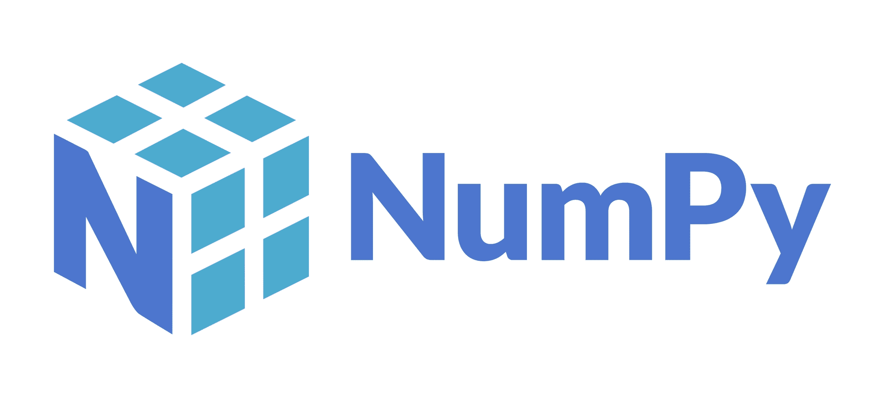

### 探索 NumPy 对大数组和矩阵的支持

`NumPy` 是 Python 中一个关重要的库，为数值计算提供了强大的工具集。其主要特性之一是处理大型数据集的能力。让我们来看看是如何实现的。

### 大数组和矩阵

`NumPy` 是 Python 中一个关重要的库，为数值计算提供了强大的工具集。其主要特性之一是处理大型数据集的能力。让我们来看看如何创建大数组和矩阵。

`NumPy` 是 Python 中一个关重要的库，为数值计算提供了强大的工具集。其主要特性之一是处理大型数据集的能力。让我们来看看是如何实现的。例如：

```python
import numpy as np
## 创建一个 2x3 数组
arr = np.array([[1, 2], [3, 4], [5, 6]])
print(arr)
```

这将输出输出：
```
[[1, 2]
 [3, 4]
 [5, 6]]
```

### NumPy 中的数学函数

除了支持大型数据集外，`NumPy` 还提供了广泛的函数来操作这些数组。一些常用的包括：

#### 向量化操作

`NumPy` 的核心优势之一是其执行向量化操作的能力。这意味着你可以对每个元素应用相同的操作，而无需编写显式循环。例如：

```python
import numpy as np
## 创建一个数组
arr = np.array([1, 2, 3, 4])
## 执行向量化加法
result = arr + 10
print(result)
```

这将输出输出：
```
[11, 12, 13, 14]
```

#### 矩阵乘法

`NumPy` 的另一个重要特性是它支持矩阵乘法。这允许你轻松地在数据集上执行复杂的操作。例如：

```python
import numpy as np
## 创建两个矩阵
A = np.array([[1, 2], [3, 4]])
B = np.array([[5, 6], [7, 8]])
## 执行矩阵乘法 A B
result = np.dot(A, B)
print(result)
```

这将输出输出：
```
[[19, 22]
 [43, 50]]
```


Pandas 的核心是 DataFrame，它是一种组织成行和列的二维数据表。每一列代表一个变量，每一行代表单次观测值或记录。DataFrame 是 Pandas 中的主要数据结构，与传统的列表或矩阵相比，它们具有许多优势。

### 1. 高效的数据处理
DataFrame 通过其能够轻松存储大型数据集的能力提供了高效的数据处理方式。它们可以容纳数以亿计的行和列，成为处理大数据的理想选择。此外，Pandas 提供了针对数据操纵和分析经过优化的算法，这有助于缩短计算时间并提高性能。

### 2. 灵活的数据类型
DataFrame 支持多种数据类型，包括数值、字符串、日期和时间戳。这种灵活性使得在单个 DataFrame 中存储和操作不同类型的数据变得非常简单。你还可以使用 Pandas 的 `Series` 类创建自定义数据类型，`Series` 是带有关联标签的值集合。

### 3. 缺失值处理
Pandas 提供了多种处理 DataFrame 中缺失值的方法。可以使用 `fillna()` 方法将缺失值替换为特定值或统计平均值。你还可以使用 `dropna()` 方法删除包含缺失值的行或列。

### 4. 分组与聚合
DataFrame 分别通过 `groupby()` 和 `agg()` 方法提供了强大的分组和聚合能力。这些方法允许你对分组后的数据进行计算，例如总结平均值或统计唯一观测值。

### 5. 数据重塑与操纵
Pandas 提供了多种方法对 DataFrame 内部的数据进行重塑和操纵。`pivot_table()` 方法创建来自多个列的数据交叉表，而 `melt()` 方法则将复杂的数据结构重塑为更易于管理的格式。你还可以使用 `unstack()` 方法取消堆叠 DataFrame 并创建时间序列或面板数据。

### 6. 与其他库的集成
Pandas 与其他 Python 库（如 NumPy、SciPy 和 Matplotlib）无缝集成。这些集成为数据操纵和可视化提供了额外的工具，使得执行复杂的数据分析任务变得更加容易。

### 7. 广泛的文档与社区支持
Pandas 拥有详尽的文档涵盖了该库的各个方面。此外，Pandas 庞庞且活跃的开发者和用户社区，他们通过开源项目和在线论坛为其增长和发展做出贡献。这个支持网络使得学习 Pandas 和解决其出现的问题变得更加容易。

### 结论
总之，Pandas 是 Python 中数据操纵和分析不可或缺的库。它的 DataFrame 结构提供了高效的数据处理和操纵能力，而其各种方法满足了不同的数据处理任务。无论你是在处理小型还是大型数据集，Pandas 都能提供一套多功能的工具，帮助你有效地分析和解释数据。

## Scikit-Learn

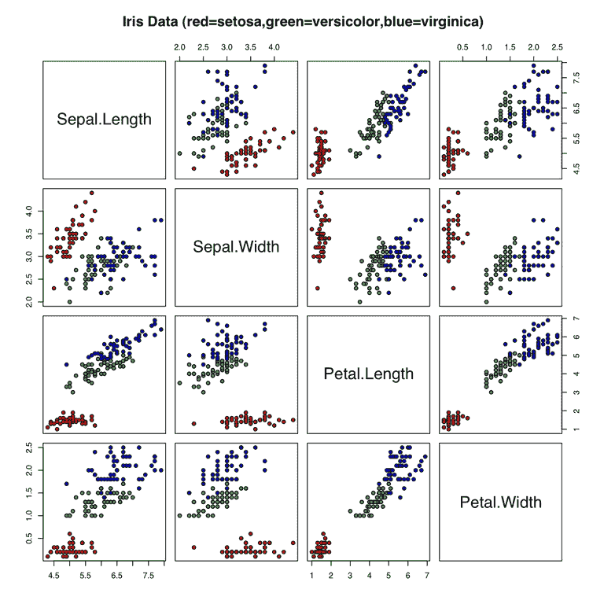

### 探索 Scikit-Learn 强大的机器学习工具
Scikit-Learn 是一个广泛使用的 Python 开源机器学习库，为分类、回归、聚类和模型选择等各种任务提供了一套全面的工具。凭借其丰富的算法库，它能够轻松完成各种任务。在本节中，我们将深入探讨 Scikit-Learn 的关键功能和能力，探索它如何帮助数据科学家和机器学习工程师构建准确模型并解决实际问题。

### 分类
Scikit-Learn 提供了多种分类算法，包括逻辑回归、决策树、随机森林、梯度提升机和支持向量机（SVM）。这些算法设计用于处理不同类型的数据，并适用于二分类和多分类任务。例如，逻辑回归对于建模分类变量非常有用，而决策树和随机森林在处理特征与目标变量之间的关系时非常有效。

### 回归
Scikit-Learn 还提供了回归算法，如线性回归、多项式回归和支持向量回归（SVR）。这些算法用于建模连续或离散输出变量。例如，线性回归有助于建模特征与目标变量之间的简单关系，而多项式回归和 SVR 则有效处理非线性关系。

### 聚类
Scikit-Learn 提供多种聚类算法，包括 k-means、层次聚类和基于密度的聚类。这些算法根据特征将数据点聚集在一起，从而发现数据中的模式和结构。例如，k-means 用于识别大小和形状相似的簇，而层次聚类对于发现嵌套结构有效。

### 模型选择
Scikit-Learn 提供了多种模型选择和评估技术，包括交叉验证、网格搜索以及如赤池信息准则（AIC）和贝叶斯信息准则（BIC）等模型选择标准。这些技术用于评估给定数据集的模型性能并根据各种标准选择最佳模型。例如，交叉验证通过将数据集分为训练集和测试集来评估模型的泛化性能，而网格搜索对于在单个数据集上比较多个模型的性能非常有效。

### 优势与局限性
Scikit-Learn 有许多优势，使其成为数据科学家和机器学习工程师的热门选择。首先，它为不同任务提供了丰富的算法和技术，允许用户根据问题选择最合适的方法。其次，Scikit-Learn 具有高度定制性，在数据预处理、处理缺失值和调优超参数方面有多种选项。第三，它拥有详尽的文档集和庞大的用户社区。

然而，Scikit-Learn 也有一些局限性。首先，它可能没有某些其他机器学习库（如 TensorFlow 或 PyTorch）灵活或强大，后者为构建自定义模型和架构提供了更高级的工具。其次，由于其强调易用性而非原始计算性能，可能比某些库慢。

### 实际应用
Scikit-Learn 已成功应用于许多实际领域，包括图像分类、自然语言处理、推荐系统和生物信息学。例如，在图像分类任务中，Scikit-Learn 的支持向量机（SVM）在各种基准数据集（如 MNIST 和 CIFAR10）上实现了高准确率。


Scikit-Learn 是一个功能强大的 Python 机器学习库，为分类、回归、聚类和模型选择等各种任务提供了广泛的算法和技术。凭借其丰富的文档集、庞大的用户社区以及可自定义选项，Scikit-Learn 让数据科学家和机器学习从业者能够轻松构建准确的模型并解决复杂问题。尽管它可能存在某些局限性，但 Scikit-Learn 已成功广泛应用于现实场景，并且仍然是各个领域研究人员和从业者的热门选择。

## TensorFlow

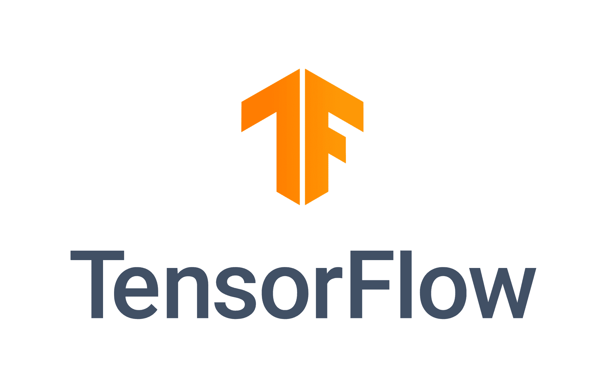

### 深入学习 TensorFlow - 全面介绍

TensorFlow 是一个开源机器学习框架，由于其易用性、灵活性以及构建和训练深度学习模型的强大能力，在近年来备受欢迎。TensorFlow 由 Google 开发，已广泛应用于计算机视觉、自然语言处理和语音识别等多个行业。在本节中，我们将深入探讨 TensorFlow 的关键特性和功能，详细探索它的能力。

### 使用 TensorFlow 构建深度学习模型

TensorFlow 提供了一套丰富的工具用于构建和训练深度学习模型，包括神经网络。该平台支持多种类型的神经网络，例如前馈网络、卷积神经网络 (`CNNs`)、循环神经网络 (`RNNs`) 和序列到序列模型。TensorFlow 还提供了一系列预定义的估计器，这些是创建深度学习模型的即用构建模块。这些估计器包括 `DenseNet`、`Conv2D`、`LSTM` 和 `GRU` 等。

使用 TensorFlow 构建深度学习模型，你可以遵循以下通用步骤：

1. 导入必要的库：第一步导入必要的库，包括 `TensorFlow` 以及项目所需的任何依赖项。
2. 定义模型架构：接下来，你需要使用 `TensorFlow` 的 API 定义深度学习模型的架构。这涉及指定网络层及其输入、输出以及学习率和批量大小等超参数。
3. 训练模型：一旦定义了模型架构，就可以使用输入输出对数据集进行训练。TensorFlow 提供了多种训练模型的工具，包括 `Keras`、`TFRecord` 和 `TensorFlow Dataset`。
4. 评估模型：模型训练完成后，你需要在测试集上评估其性能，以确定运行效果。TensorFlow 提供了多种评估模型性能的指标，如准确率、损失和 F1 分数。
5. 部署模型：最后，你可以使用 `TensorFlow Serving` 或部署工具将训练好的模型部署到生产环境中。

### TensorFlow 的高级特性

TensorFlow 提供了若干高级特性，使其成为构建和训练深度学习模型的强大工具。其中一些特性包括：

- `自动微分`：TensorFlow 自动计算梯度，这对于训练深度神经网络非常有帮助。该特性通过减少手动计算梯度的时间，有助于加速训练过程。
- `分布式训练`：TensorFlow 允许你使用分布式训练在多台机器和 GPU 上扩展模型。该特性让你能够更快、更高效地训练更大的模型。
- `TFLearn`：TFLearn 是用于在 TensorFlow 构建机器学习模型的高级 API。它通过为常见任务（如数据加载、模型构建和超参数调优）提供预定义的类和方法，简化了创建和训练模型的过程。
- `TensorBoard`：TensorBoard 是一个实时监控深度学习模型训练过程的可视化工具。它提供了图形界面来显示训练期间的各种指标，如梯度。

总之，TensorFlow 是一个强大的开源机器学习框架，为构建和训练深度学习模型提供了系列工具和特性。凭借其易用性、灵活性和高级能力，TensorFlow 已成为机器学习领域研究人员和开发者的首选平台。无论你是深度学习新手还是经验丰富的从业者，TensorFlow 都为你探索和开发想法提供了一个全面的环境。

## PyTorch


### 探索 PyTorch 在深度学习模型中的灵活性

PyTorch 是一个开源机器学习库，由于其动态计算图和灵活的架构在研究人员和从业者中广受欢迎。与其他深度学习框架不同，PyTorch 允许开发者轻松构建和训练复杂模型，使其成为许多机构和个人的首选。在本节中，我们将深入探讨赋予 PyTorch 灵活性的独特特性，并讨论它如何简化构建和训练深度学习模型的过程。

### 计算图

PyTorch 的计算图是其最显著优势之一。与其他依赖固定架构的框架不同，PyTorch 的计算图是动态的，允许开发者在运行时修改模型结构。这种灵活性使用户能够轻松适应新数据或不断的需求，而无需重建整个模型。

### 模块化架构

PyTorch 的模块化架构使得构建和训练复杂的深度学习模型变得简单。该库提供了一组预定义的模块，可以通过组合创建自定义模型。用户还可以定义自己的自定义模块，这些模块可以轻松地集成到计算图中。这种灵活性允许开发者针对特定的问题领域或数据类型定制模型。

### Pythonic 接口

PyTorch 的 Pythonic 接口让开发者能够轻松与库交互。该库提供了一系列 Python 类和函数，用于定义、训练和评估深度学习模型。这种易用性使开发者能够快速原型化并测试新想法，而无需学习复杂的 API。

### 自动微分

PyTorch 的自动微分功能允许用户轻松计算其模型的梯度。该特性对于训练深度学习模型特别有用，因为它允许用户使用反向传播来优化模型。该库还提供了一系列工具，用于调试和可视化复杂模型的行为。

### 对多平台的支持

PyTorch 支持多个平台，包括 CPU、GPU 和 TPU。这种灵活性允许开发者在任何可用硬件上训练模型，使得将模型扩展到更大的数据集或更复杂的问题领域变得更容易。

### 社区支持

PyTorch 拥有庞大且活跃的开发者和用户社区，提供了丰富的文档、教程和支持论坛。这种社区支持让新用户更容易上手该库，并从他人的经验中学习。

### 结论：

总之，PyTorch 的灵活性是其最显著的优势之一。该库的动态计算图、模块化架构、Pythonic 接口、自动微分、对多平台的支持以及活跃的社区，使其成为构建和训练复杂深度学习模型的理想选择。无论你是寻求实验新想法的研究人员，还是寻求解决现实问题的从业者，PyTorch 都是你的完美工具。


## Keras


探索 Keras - 一种高层神经网络 API

Keras 是一个高层神经网络 API，为构建和实验深度学习模型提供了一个易于使用的接口。Keras 由 François Chollet 开发，它简化了创建和训练神经网络的过程，使用户能够专注于模型开发，而无需受困于低级编程细节的复杂性中。

在本节中，我们将探索 Keras 是如何简化深度学习模型构建和实验过程的。我们将的。我们将涵盖以下主题：

### 1. 安装与设置

开始使用 Keras 既简单又直观。该 API 构建在 TensorFlow 或 Theano 之上，这两者都是流行的机器学习库。要安装 Keras，只需在你的终端或命令提示符中运行以下命令：

```bash
pip install keras
```

安装完成后，你就可以在 Python 代码中导入 Keras 并开始构建你的模型了。

### 2. 使用 Keras 构建神经网络

Keras 为定义神经网络提供了一个易于使用的接口。你可以使用 `Sequential` 定义网络。你可以使用 `Sequential` 类来定义网络，它允许你堆叠层。你可以使用 `Sequential` 类来定义网络，它允许你堆叠层。你可以使用 `Sequential` 类来定义网络，它允许你堆叠层。

```python
from keras.models import Sequential
from keras.layers import Dense

model = Sequential()
model.add(Dense(64, activation='relu', input_shape=(10,)))
model.add(Dense(32, activation='relu'))
model.add(Dense(10, activation='softmax'))
```

在这个示例中，我们使用 `Sequential` 模型构建了一个简单的神经网络。它包含三个全连接层：第一层有 64 个神经元并使用 ReLU 激活函数；第二层有 32 个神经元并同样使用 ReLU 激活函数；输出层有 10 个神经元，并使用 Softmax 激活函数。这种模型通常用于 10 分类任务。

### 3. 使用 Keras 训练模型

在定义模型后，你需要使用 `compile` 方法来配置训练。`compile` 方法允许你指定优化器、损失函数和评估指标。完成后，你可以开始训练模型。

```python
model.compile(optimizer='adam', loss='categorical_crossentropy', metrics=['accuracy'])
history = model.fit(X_train, y_train, epochs=50, batch_size=32, validation_data=(X_val, y_val))
```

在这个示例中，我们使用了 `adam` 优化器，`categorical_crossentropy` 损失函数以及 `accuracy` 评估指标。`fit` 方法会在训练集上运行 50 轮（epochs），每批大小为 32，并同时使用验证数据进行验证。

## 4. 评估与预测模型

训练完成后，你可以使用 `predict` 方法对新数据进行预测。此外，还可以使用 `evaluate` 方法来评估模型在测试集上的性能。

```python
loss, accuracy = model.evaluate(X_test, y_test)
print(f"Test loss: {loss}")
print(f"Test accuracy: {accuracy}")

predictions = model.predict(X_test)
```

在这个示例中，我们首先通过 `evaluate` 计算测试集上的损失和准确率。然后，使用 `predict` 方法对测试数据生成预测结果。

### 总结

Keras 通过提供易于使用的接口和简化的流程，极大地降低了深度学习开发的门槛。它让开发者能够专注于模型的设计和实验，而不是在底层的实现上浪费时间。

## Jupyter Notebooks


探索 Jupyter Notebooks 的威力

Jupyter Notebooks 是一种交互式计算环境，改变了数据科学家的工作。通过将代码、文本和可视化整合在一个文档中，它们提供了一个直观的。在本节中，我们将深入让 Jupyter Notebooks 如此强大的功能。

### 交互式代码执行

Jupyter Notebooks 的主要优势之一是能够交互式执行代码。与 PDF 或 Word 等需要独立环境的不同，Jupyter Notebooks 允许你对代码进行实验和调试。

要在 Jupyter Notebook 中交互式执行代码，只需在单元格中输入代码并按 Shift+Enter。代码将立即执行，并在。

### 可视化集成

Jupyter Notebooks 的另一个关键功能是集成可视化功能。通过使用 Matplotlib、Seaborn 或 Plotly 等库，你可以在文档中创建各种可视化（例如折线图、散点图、直方图）。这些可视化可以帮助你识别趋势并更有效地交流洞察。

要在 Jupyter Notebook 中创建可视化，只需在单元格中插入用于可视化库的代码（例如 `import matplotlib.pyplot as plt`）。然后你可以使用这些代码来创建和自定义可视化。

### 版本控制集成

Jupyter Notebooks 还与 Git 等版本控制系统良好集成。通过使用 GitHub 或 GitLab 等工具，你可以管理笔记本并与协作者共享。这允许你随时间跟踪代码和可视化的变化，并在需要时轻松恢复到之前的版本。

要在 Jupyter Notebook 中使用版本控制集成，只需在单元格中插入相应的代码（例如 `git init`）。然后你可以将笔记本提交并推送到 Git 仓库。

### 协作功能

最后，Jupyter Notebooks 提供了许多功能，方便他人共同进行数据科学项目。通过使用 Jupyter Notebook Server 或 `jupyterhub` 命令行界面，你可以同时管理多个笔记本，并与同事或客户共享。

要在 Jupyter Notebook 上进行协作，只需使用相应的邀请他人编辑文档（例如 `jupyter notebook --share`）。然后你们就可以在同一个笔记本上实时协作，而无需担心冲突或覆盖彼此的更改。


在下一节中，我们将探索 Jupyter Notebook 的一些常见用例，包括数据清洗和可视化、机器学习模型开发以及科学计算。

## Matplotlib 和 Seaborn


探索使用 Python 中的 Matplotlib 和 Seaborn 进行可视化

`Matplotlib` 和 `Seaborn` 是 Python 中两个强大的库，允许开发者创建各种静态、交互和动画可视化图，以传达数据中的洞察。这些库对于数据科学家、研究人员和分析师来说是必不可少的工具，他们需要以视觉吸引力且信息丰富的方式展示发现。在本节中，我们将探索 `Matplotlib` 和 `Seaborn` 的功能和能力，并理解它们在传递数据洞察方面的作用。

`Matplotlib` 是一个广泛用于 Python 静态可视化的库。它提供了一套全面的工具，用于创建高质量的 2D 和 3D 图、图表和图形。通过 `Matplotlib`，开发者可以轻松地创建复杂的图表，使用多种可视化技术，如折线图、柱状图、直方图、散点图等。此外，`Matplotlib` 还提供了高级功能，如自定义坐标轴标签、颜色映射和数据注释，使得创建信息丰富且视觉吸引人的图表变得简单。

`Seaborn` 是一个基于 `Matplotlib` 构建的较新库，提供了更简洁、更直观的可视化方式。`Seaborn` 提供了一系列高级可视化工具，用最少的代码即可创建信息丰富且吸引人的图表。通过 `Seaborn`，开发者可以创建对用户输入有响应的交互式可视化，更容易探索复杂数据集。此外，`Seaborn` 为时间序列和地理数据可视化提供了内置支持，使其成为探索性数据分析的理想选择。

`Matplotlib` 和 `Seaborn` 都提供了系列功能，使它们成为传递数据洞察的理想工具。以下是使用这些库的一些主要优势：

1. 交互性：`Matplotlib` 和 `Seaborn` 都提供了交互式可视化工具，允许用户实时探索复杂数据集。这使得更容易识别数据中的模式、趋势和异常值。
2. 可定制性：通过 `Matplotlib` 和 `Seaborn`，开发者可以根据需求定制可视化效果。他们可以从多种可视化技术、颜色和字体中进行选择，创建既信息丰富又有视觉吸引力的图表。
3. 灵活性：两个库都提供了灵活的布局选项，可以轻松创建复杂结构的图表。开发者可以使用各种工具和技术创建自定义布局，包括网格布局、分层图表和交互式小组件。
4. 可扩展性：`Matplotlib` 和 `Seaborn` 设计用于处理大型数据集，使其成为探索性数据分析和可视化的理想选择。它们提供了提供了高效的渲染算法，并支持高维数据可视化。
5. 集成性：两个库都能与其他 Python 数据科学工具无缝集成，包括 `NumPy`、`Pandas` 和 `Scikit-learn`。这使得创建复杂的数据流水线和机器学习模型变得简单，并可以使用 `Matplotlib` 和 `Seaborn` 进行可视化。

总之，`Matplotlib` 和 `Seaborn` 是 Python 中创建静态、交互和动画可视化的强大库。它们提供的系列功能使它们成为传递数据洞察的理想工具，包括交互性、可定制性、灵活性、可扩展性以及与其他 Python 数据科学工具的集成。通过掌握这些库，开发者可以创建信息丰富且视觉吸引力的图表，帮助他们理解复杂数据集并识别模式、趋势和异常值。

## SciPy


释放 SciPy 的力量 - 全面指南

`SciPy` 是数学和科学工具的宝库，可以帮助解决优化、积分、特征值等问题。作为一个开源库，它提供了一系列功能来处理工程、物理和生物学中的问题。在本节中，我们将深入探讨 `SciPy` 的能力。

### 优化：SciPy 的核心功能

`SciPy` 的优化模块是其最强大的工具之一。它为无约束优化和约束优化提供了多种算法，包括梯度下降、`Newton's method`（牛顿法）和 `Levenberg-Marquardt`。这些算法可以解决非线性二乘、回归和其他优化任务。通过 `SciPy`，你可以优化涉及多个变量的复杂系统。

### 积分：轻松解决积分问题

`SciPy` 积分模块提供了系列求解积分问题的函数。它包括使用 `Simpson's rule`（辛普森法则）、`Romberg method` 以及算法的数值积分。此外，`SciPy` 还提供了符号积分的函数，如 `Gaussian quadrature`（高斯求积）和自适应求积。这些工具可以帮助你解决各种积分问题，从简单的定积分到涉及多个变量的复杂积分。

### 插值：平滑地连接数据点

`SciPy` 插值模块提供了插值数据点的函数。它包括线性插值、多项式插值和样条插值，以及更高级的方法，如径基函数插值和立方样条插值。通过 `SciPy`，你可以连接数据点以创建平滑曲线和表面，这在科学可视化和数据分析中特别有用。

### 特征值问题：求解特征分解

`SciPy` 特征值求解器提供了求解特征值问题的函数。它包括使用 `power method`（幂法）、`Jacobi method`（雅可比法）等计算大型矩阵的特征值和特征向量。通过 `SciPy`，你可以轻松解决线性代数、信号处理等领域的特征值问题。

### SciPy 的其他功能

`SciPy` 除了优化、积分、插值和特征值问题外还提供了许多功能。其中包括：

- 统计：`SciPy` 为数据分析提供了一系列统计工具，包括假设检验、置信区间和回归分析。
- 信号处理：`SciPy` 提供了信号处理函数，如滤波、卷积和频谱分析。
- 图形：`SciPy` 包含了科学可视化的工具，如 2D 和 3D 绘图、直方图和热图。
- ODE 求解：`SciPy` 提供了求解常微分方程 (ODE) 的函数，用于模拟人口动力学、机械系统和其他应用。
- FFT：`SciPy` 提供快速傅里叶变换 (FFT) 模块，用于高效计算大型数据集的离散傅里叶变换。


XGBoost 是一个开源的优化梯度提升库，近年来由于其在各种机器学习任务中的高效性和性能而广受关注。XGBoost 由微软研究院开发，现在由 XGBoost 社区维护，与传统的梯度提升方法相比，它具有许多许多优势。在本节中，我们将探索 XGBoost 的关键特性和功能，以及它在监督学习任务中的应用。

### 监督学习任务

XGBoost 主要为监督学习任务设计，例如分类和回归。它可以处理广泛的数据类型，包括数值型、类别和文本数据。XGBoost 支持多种损失函数，包括均方误差（MSE）、对数损失（log loss）和合页损失（hinge loss）等。

## XGBoost 的优势

与传统的梯度提升方法相比，XGBoost 具有以下优势：

### 计算高效
XGBoost 使用高效的计算引擎，轻松处理大型数据集。它可以在几秒钟处理数百万个观测值，使其成为大数据应用的理想选择。

### 可扩展的性能
XGBoost 设计为支持水平扩展，使其能够在不发生显著性能下降的情况下处理大型数据集。这使其成为分布式计算环境的极佳选择。

### 处理缺失值
XGBoost 可以处理数据集中的缺失值，这是许多机器学习任务中的常见问题。它提供了多种处理缺失值的方法，包括均值插补和随机森林插补。

### 超参数调优
XGBoost 提供了大量的超参数，可以通过调优它们来优化模型性能。它还提供了超参数调优工具，例如网格搜索和随机搜索。

### 可解释模型
XGBoost 提供了可解释性模型，这在许多应用中至关重要。它提供了特征重要性和部分依赖图工具，允许用户对模型的行为产生深入见解。

## XGBoost 的应用

XGBoost 可应用于广泛的监督学习任务，包括：

### 分类
XGBoost 可用于分类任务，例如垃圾邮件检测、信用风险和图像分类。它提供了多种分类算法，包括逻辑回归、决策树和随机森林。

### 回归
XGBoost 还可以用于回归任务，例如股票价格预测、天气预报和医学诊断。它提供了多种回归算法，包括线性回归、多项式回归和支持向量机（SVM）。

### 时间序列预测
XGBoost 可以处理时间序列预测任务，例如预测股票价格、天气模式和交通流量。它提供了多种时间序列算法，包括 ARIMA、季节性分解和 LSTM 网络。

### 推荐系统
XGBoost 可用于推荐系统，例如个性化产品推荐或向用户提供内容建议。它提供了多种推荐算法，包括矩阵分解、神经网络和协同过滤。

### 结论

总而言之，XGBoost 是一个强大的优化库，与传统的梯度提升方法相比具有多种优势。它的高效性、可扩展性以及处理缺失值的能力使其成为监督学习任务的极佳选择。通过理解 XGBoost 的关键特性和功能，数据科学家可以在各种应用中利用其潜力，从分类、回归到时间序列预测和推荐系统无是。

## 机器学习中的伦理考量

## 机器学习的伦理方面

随着机器学习（ML）持续变革各个行业，承认这些技术的伦理影响至关重要。在整个开发过程中，必须仔细评估偏差、公平性、可解释性和 `responsible AI deployment`（负责任的 AI 部署）。

### 偏差
机器学习中最大的伦理关注点之一是偏差。机器学习模型从用于训练它们的数据中学习模式，这些模式可能会延续现有的社会不平等。例如，事实证明，人脸识别算法对肤色较深的人群准确性较低，导致潜在的误识别。为了减轻这一问题，必须仔细筛选数据，并使其具有不同人口统计数据的代表性。

### 公平性
机器学习的另一个关键伦理方面是公平性。如果设计模型时没有考虑公平性，机器学习模型可能会延续现有的不平等。例如，在刑事司法环境中，AI 驱动的预测模型已被证明会不成比例地针对边缘化社区。为了解决这个问题，开发者必须考虑其模型的潜在后果，并致力于创建公平且无偏的预测。

### 可解释性
机器学习模型缺乏透明度会导致重大的伦理问题。随着模型变得越来越复杂，理解它们如何得出结论变得具有挑战性。这种不透明会导致不公正的结果，因为模型背后的后的不再可见。为了解决这个问题，开发者必须优先考虑可解释性，并确保模型的原理是透明且可理解的。

### 负责任的 AI
最后，负责任的 AI 部署对于确保符合伦理至关重要。这不仅涉及设计公平无偏的机器学习模型，还需要考虑这些模型在现实世界应用中的潜在后果。例如，医疗专业人员必须意识到，如果设计时没有考虑到多样化的数据集和对伦理的影响，机器学习可能会延续现有的健康差异。

## 机器学习在现实世界中的应用

### 机器学习的现实应用

机器学习变革了许多行业和领域，改变了业务运营和人们生活的方式。从医疗保健到金融，从自然语言处理到计算机视觉，机器学习在各个领域都有广泛应用。在本节中，我们将探索机器学习在不同领域应用的一些现实示例：


## 医疗保健
机器学习正应用于医疗领域，以改善患者疗并简化临床工作流。例如，人工智能驱动的诊断工具正在开发中，以帮助医生根据医学影像（如 `X-rays` 和 `MRIs`）识别疾病。这些工具可以检测异常并提供可能的诊断，缩短医生做出准确诊断的时间。此外，机器学习还被用于根据患者的遗传特征、病史和生活方式因素制定个性化的治疗方案。

## 金融
机器学习正在通过改进欺诈检测、投资组合管理和信用风险评估来彻底改变金融行业。例如，人工智能驱动的系统可以分析财务交易，以识别可能表明欺诈活动的异常模式。同样，机器学习算法可以根据市场趋势和客户偏好预测股票价格并优化投资组合。

## 自然语言处理 (NLP)
NLP 已应用于多个领域，包括客户服务、营销和媒体分析。例如，由 NLP 驱动的聊天机器人可以帮助公司提供 24/7 的客户支持，回答常见问题并将客户引导给合适的人类代表。此外，NLP 算法可以分析社交媒体平台上的消费者反馈，使能够识别改进领域并做出数据驱动的决策。

## 计算机视觉
机器学习正应用于计算机视觉，以开发能够解释和理解视觉内容的智能系统。例如，自动驾驶汽车配备了机器学习算法，使其能够识别物体、车道和交通标志，允许它们安全高效地在道路上行驶。此外，人工智能驱动的监控系统可以分析视频流以检测异常，并向安全人员报警潜在威胁。

## 制造业
机器学习被用于制造业以优化生产流程、提高产品质量并减少浪费。例如，人工智能驱动的预测性维护系统可以在设备故障发生之前检测到，减少停机时间并提高整体效率。此外，机器学习算法可以分析制造设备的传感器数据，使能够识别可能指示潜在质量问题的模式并主动解决。

## 教育
机器学习正应用于教育领域，为学生提供个性化学习体验，改进教学方法并提高学生成果。例如，人工智能驱动的辅导系统可以适应学生的学习风格和能力，提供定制的课程和反馈。此外，机器学习算法可以分析学生表现数据，识别教师可能需要额外支持或培训的领域。

### 结论
总之，机器学习通过使企业和组织做出更明智的决策、提高运营效率并增强客户体验，正在改变各个行业和领域。随着技术的不断进步，我们可以预计在未来几年机器学习将有更多创新的应用。

## 近期进展与趋势


### 关注机器学习的最新进展与趋势
作为一名机器学习从业者或爱好者，了解该领域的最新进展和趋势至关重要。机器学习的格局在不断演变，每年都会出现新的算法、技术和技术。为了保持竞争力并继续提供创新的解决方案，跟上这些发展至关重要。在本节中，我们将探索在快速变化的机器学习世界中保持前沿的一些方法。

### 1. 关注顶级机器学习博客和网站
跟踪机器学习的最新新闻和更新可能是一项艰巨的任务。为了简化这一工作，我们建议关注顶级的机器学习博客和网站。这些资源对新研究论文、新兴趋势和行业发展提供了深度报道。一些热门选择包括：

- `Kaggle`：机器学习爱好者的首选平台，特色介绍最新技术、工具和应用的文章。
- `Machine Learning Mastery`：提供丰富的资源，包括教程、案例研究和对行业专家的访谈。
- `DataCamp`：提供各种机器学习主题的交互式课程和教程，以及行业新闻和更新。

### 2. 参加会议和工作坊
参加会议和工作坊是与志同道合的人建立联系、学习最新进展以及与该领域的其他人分享知识的极佳方式。这些活动提供了展示研究论文、分享经验和探索新想法的平台。一些值得关注的机器学习会议包括：

- `NeurIPS`（神经信息处理系统大会）：最著名的年度会议之一，涵盖机器学习领域的前沿研究和发展。
- `ICML`（国际机器学习会议）：机器学习从业者的顶级盛会，重点关注通过新技术和应用推动该领域的发展。

### 3. 阅读研究论文
保持对研究论文的关注对于在机器学习领域领先至关重要。你可以在 `arXiv` 上探索最近的论文，这是一个流行的物理、数学、计算机科学研究论文的在线存储库。一些与机器学习相关的热门主题包括：

- `深度学习`：探索深度学习技术的最新进展，如生成模型、Transformer 和迁移学习。
- `强化学习`：跟踪训练代理在复杂环境中做出决策的新方法，包括策略梯度和演员-评论家（actor-critic）架构。

### 4. 参与在线社区
加入在线社区是与其他机器学习从业者联系、分享知识和向他人学习的绝佳方式。一些热门平台包括：

- `Reddit` (r/MachineLearning)：一个活跃的社区，涵盖了与机器学习相关的各种主题讨论，包括教程、研究论文和行业新闻。
- `GitHub`：探索开源机器学习项目，如 `TensorFlow` 或 `PyTorch`，并在他人的代码和经验中学习。

### 5. 参加在线课程
跟上最新的机器学习技术需要持续学习的。幸运的是，有很多在线课程涵盖了机器学习的各个方面，包括：

- `Coursera`（机器学习）：由顶级大学提供的全面系列课程，涵盖了监督学习、无监督学习、深度学习和神经网络等主题。
- `edX`（机器学习入门）：机器学习入门课程，为机器学习基础知识奠定了坚实基础，包括回归、分类和聚类。

### 6. 阅读书籍
虽然在线资源丰富，但在深入理解机器学习概念方面，优秀的书籍是不可替代的。以下是一些非常受推荐的书籍：

字体 Ian Goodfellow、Yoshua Bengio 和 Aaron Courville 编写的 `Deep Learning`：深度学习技术及其应用的全面指南。
- `Hands-On Machine Learning with Scikit-Learn, Keras, and TensorFlow`：一本实用的书籍，通过使用 Scikit-Learn 和 TensorFlow 等流行库的实战项目来涵盖机器学习概念。


总之，跟上机器学习的最新进展和趋势需要对持续学习和探索做出投入。通过关注顶级博客和网站、参加会议和研讨会、阅读研究论文、参与在线社区、学习在线课程以及阅读书籍，你可以确保自己的知识在这个快速发展的领域中保持相关性和与时代同步。

## 神经网络

## 神经网络简介

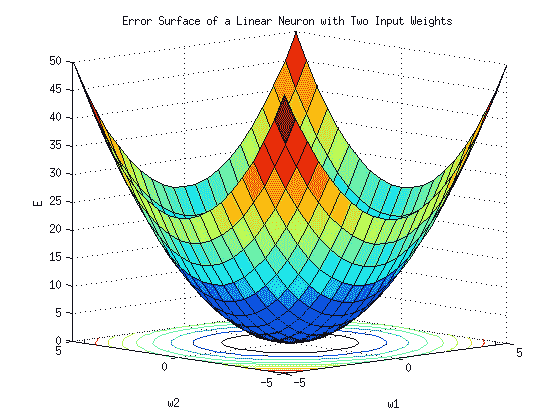

### 神经网络的基础
神经网络是机器学习的一个关键组件，允许计算机从数据中学习，并以惊人的准确性做出预测或决策。但这些网络是什么？它们又是如何工作的？在本节中，我们将探索神经网络的基础、历史背景以及它们在机器学习中的重要性。

### 神经网络的结构与组件
神经网络由多层相互连接的节点或神经元组成，这些节点根据从训练数据中学习到的模式来处理信息并做出预测。神经网络的结构可能有所不同，但大多数网络遵循类似的架构：

1. **输入层**：该层接收来自各种来源（如传感器或数据库）的输入数据。
2. **隐藏层**：这些是魔法发生的地方——通过一系列非线性变换对输入数据进行处理和转换，允许网络学习复杂的模式和关系。每个隐藏层由一组带有权重和偏置的神经元组成，它们会在训练过程中进行调整。
3. **输出层**：该层包含一组最终节点，根据网络处理过的输入数据产生输出预测或类别标签。
4. **激活函数**：这些函数为网络引入了非线性，允许其学习数据中更复杂的模式和关系。常见的激活函数包括 `sigmoid`、`tanh` 和 `ReLU`（整流线性单元）。
5. **优化算法**：这些算法用于在训练期间调整网络的权重和偏置，以最小化衡量预测输出与实际输出之间差异的损失函数。常见的优化算法包括随机梯度下降 (`SGD`)、`Adam` 和 `RMSProp`。

### 神经网络的历史背景
神经网络的概念可以追溯到 20 世纪 40 年年代，当时沃伦·马库洛（Warren McCulloch）和沃尔特·皮茨（Walter Pitts）等人员提出了第一个人工神经网络模型。然而，直到 20 世纪 80 年代，由于计算能力的提高和新算法的发展，神经网络才开始再次流行。

### 神经网络在机器学习中的重要性
神经网络是机器学习的关键组件，因为它们可以学习数据中复杂的模式和关系。它们在解决广泛任务方面取得了成功，包括图像分类、语音识别、自然语言处理和预测建模。神经网络在机器学习中重要的一些关键原因包括：

1. **灵活性**：神经网络可以学习数据中广泛的模式和关系，使其具有高度灵活性并能适应不同的任务。
2. **准确性**：凭借足够的数据和计算能力，神经网络可以实现惊人的准确性，甚至在某些任务中超越人类。
3. **处理大型数据集的能力**：神经网络可以处理海量数据，使其成为图像识别或自然语言处理等大数据任务的理想选择。
4. **稳健性**：神经网络对输入数据中的噪声和错误具有相对稳健性，允许它们在数据不完美的情况下做出准确预测。

总之，神经网络是机器学习的基础组件，允许计算机从数据中学习并做出准确的预测或决策。通过理解神经网络的结构、组件、历史背景及其在机器学习中的重要性，我们可以利用它们的力量来解决复杂问题并创建创新解决方案。

# 神经网络的构建块

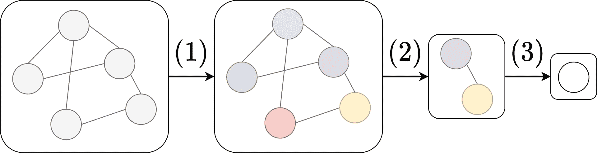

### 了解神经网络的基本组件
神经网络是复杂的机器，它们彻底改变了从图像识别到自然语言处理的许多领域。神经网络的核心由几个基本组件组成，这些组件共同工作以处理和分析数据。在本节中，我们将深入探讨神经元、激活函数、层和架构的基础概念，全面理解这些元素如何组合成一个神经网络。

### 神经元：神经网络的构建块
神经网络的基本单元是神经元。神经元负责通过网络处理和传输信息。它们接收来自其他神经元的输入，执行复杂的计算，并产生输出，这些输出被传递给其他神经元或作为网络的最终输出。神经元主要有两种类型：

1. **全连接神经元**：这是神经网络中最常见的神经元类型。它们有一组输入，这些输入通过权重与其他神经元的输出连接。权重在训练期间会被调整，以优化网络性能。
2. **卷积神经元**：这些神经元用于卷积神经网络 (`CNNs`)，它们对于图像识别任务特别有用。卷积神经元使用一个小窗口扫描输入图像，在每个位置计算特征图。然后对特征图进行池化（pooling），以减少数据维度。

### 激活函数：输出的放大与归一化
神经元的输出需要经过放大和归一化，以确保网络正常运行。激活函数即用于此种目的。神经网络中常用的常用的激活函数有：

1. **Sigmoid**：该函数将输入映射到 0 到 1 之间的值，适用于二分类任务。
2. **ReLU**（整流线性单元）：该函数输出输入的正部分，适用于输出需要非负的图像识别任务。
3. **Tanh**（双曲正切函数）：该函数将输入映射到 -1 到 1 之间的值，适用于需要连续输出范围的任务。

### 层：神经网络的构建块
神经元在神经网络中被组织成层。每一层在网络中都有特定的功能，例如特征提取、特征转换或分类。神经网络中使用了几种类型的层，包括：

1. **输入层**：该层接收输入数据并将其传递给下一层。
2. **隐藏层**：这些层对输入数据进行复杂计算，提取相关特征并将其转换为高维空间。
3. **输出层**：该层获取隐藏层的输出并产生网络的最终输出。

### 架构：设计神经网络
神经网络的架构指的是网络的整体结构，包括层数、每层神经元的数量以及它们之间的连接。神经网络中使用了了几种架构，包括：

1. **前馈架构**：这是最简单的架构类型，数据仅沿一个方向（从输入到输出）流动，没有任何反馈环。
2. **循环架构**：这种架构允许数据双向流动，使网络能够捕捉时间依赖并利用之前的输入。


### 3. 卷积架构
这种架构用于图像识别任务，网络通过卷积层从输入图像中提取特征。

总之，理解神经网络的基础组件（包括神经元、激活函数、层和架构）对于设计和训练有效的神经网络至关重要。通过掌握这些概念，你将能够游刃有余地应对各种领域中的复杂问题，从图像识别到自然语言处理。

## 前馈神经网络

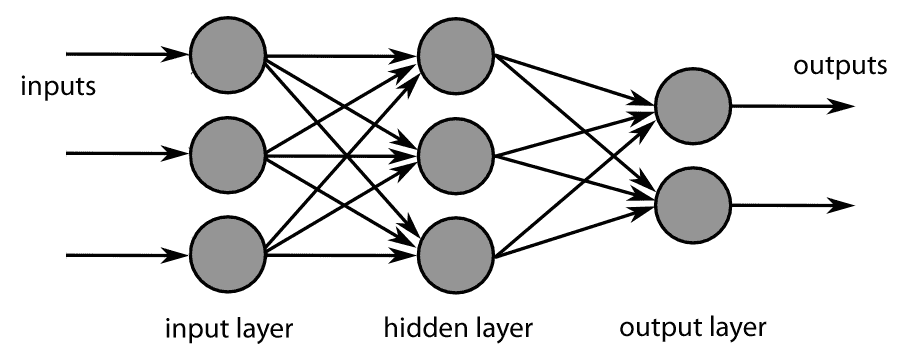

### 前馈神经网络 - 结构与功能
前馈神经网络（FNNs）是人工神经网络（ANN）的一种类型，它们以单向方式（从输入到输出）处理信息，不包含任何反馈循环。它们是最常见的神经网络类型，广泛应用于图像识别、语音识别、自然语言处理和预测建模等领域。

### 结构：
FNNs 由互连接的节点或神经元构成的层组成，每层都处理输入数据并将其传递给下一层。`FNN` 的架构通常涉及多个隐藏层，其中输入层接收输入数据，输出层产生输出，而中间的一层或多个隐藏层负责对数据进行复杂的转换。网络中的每个节点接收一组输入，使用非线性激活函数对这些输入进行计算，然后将输出传递给网络中的其他节点。

### 功能：
可以通过分析信息流来理解 `FNN` 的功能。输入数据通过输入层进入网络，并由后续每层处理，每层都对数据应用非线性转换。每个节点的输出传递给网络中的其他节点，直到到达输出层，在那里产生最终输出。该过程可以表示如下：

```
Input → Hidden Layer 1 → Hidden Layer 2 → ... → Hidden Layer N → Output
```
其中 `Hidden Layers 1 to N` 是输入层和输出层之间的神经元层。每个隐藏层对数据应用非线性转换，允许网络学习数据中复杂的模式和关系。每个节点的输出由其输入的加权和，结合应用于这些输入上的激活函数共同决定的。

### 应用：
FNNs 在各个领域都有广泛的应用，包括：

1. **图像识别**：FNNs 可识别图像中的物体、将图像分类为不同的类别并执行图像分割。
2. **语音识别**：FNNs 可用于识别口语单词和短语、将语音转为文本并进行说话人识别。
3. **自然语言处理**：FNNs 可用于语言建模、情感分析、文本分类和机器翻译等任务。
4. **预测建模**：FNNs 可用于预测连续结果，如股票价格、天气预测和客户流失。
5. **时间序列分析**：FNNs 可用于分析时间序列数据（如股票价格、天气模式和流量），以对未来趋势做出预测。

总之，前馈神经网络是处理和分析复杂数据集的强大工具。它们从大量数据中学习并执行非线性转换的能力使其成为图像识别、语音识别、自然语言处理和预测建模等任务的理想选择。

## 神经网络训练


### 神经网络的训练过程
学习如何训练神经网络是掌握这项技术的关键。理解神经网络的训练过程允许你优化其性能并适应各种任务。在本节中，我们将深入神经网络的训练过程，探索损失函数、优化算法和反向传播的重要性。

#### 损失函数：神经网络训练的基础
损失函数是一个数学函数，用于衡量神经网络的预测输出与实际输出之间的差异。训练神经网络的目标是最小化该损失函数，这意味着找到产生最准确预测的最优参数。损失函数的选择取决于神经网络旨在执行特定任务。常见的损失函数包括均方误差（`MSE`）、交叉熵和逻辑损失。

#### 优化算法：神经网络训练的引擎
优化算法用于寻找最小化损失函数的最优参数。这些算法根据损失函数相对于这些参数的梯度来更新网络参数。神经网络训练中常用的优化算法有几种几种，包括随机梯度下降（`SGD`）、`Adam` 和 `RMSProp`。每种算法都有其优缺点，算法的选择取决于问题的复杂性、数据集的大小以及所需的准确率水平。

#### 反向传播：神经网络训练的关键
反向传播是神经网络训练过程中不可或缺的组件。它是一种计算损失函数相对于网络中每个参数的梯度的方法。反向传播通过误差逐层反向传播整个网络来工作，直到计算出每个参数的损失函数梯度。这一过程允许优化算法调整参数并最小化损失函数。

#### 训练神经网络：分步过程
现在我们已经讨论了损失函数、优化算法和反向传播的重要性，让我们逐步查看神经网络的训练过程：

1. **数据预处理**：第一步是对用于训练的数据进行预处理。这包括对数据进行归一化或缩放、处理缺失值以及将数据分为训练集、验证集和测试集。
2. **模型选择**：接下来，你需要为你的问题选择合适的神经网络架构。这涉及选择层数、激活函数以及每层神经元的数量。
3. **初始化**：使用合适的方法（如 Xavier 初始化或高斯初始化）初始化网络的权重和偏置。
4. **正向传播**：将输入数据通过网络以计算预测输出。
5. **计算损失**：计算预测输出与实际输出之间的损失函数。
6. **反向传播**：使用反向传播计算损失函数相对于网络中每个参数的梯度。
7. **优化**：使用优化算法（如 `SGD` 或 `Adam`）更新网络的参数。
8. **重复**：重复步骤 4-7 直网络收敛或达到所需的准确率。

#### 结论：训练神经网络是一个复杂的过程
训练神经网络涉及一系列复杂的计算，包括损失函数、优化算法和反向传播。理解这些组件对于优化神经网络的性能并适应各种任务至关重要。通过遵循上述的分步过程，你可以训练出一个能够产生准确预测并解决复杂问题的神经网络。

## 卷积神经网络 (CNNs)

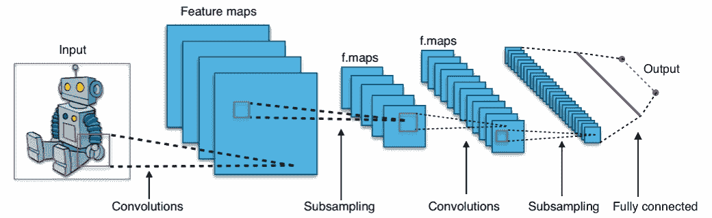

### 卷积神经网络 (CNNs) - 架构与应用


卷积神经网络（CNNs）是一种神经网络架构，它们彻底改变了计算机视觉领域。CNNs 设计用于处理和分析视觉数据，使其适用于目标识别、图像分类和图像分割等与图像相关的任务。在本节中，我们将详细探讨 CNN 的架构及其各种应用。

### 卷积神经网络 (CNNs) 的架构

CNN 由多个层组成，每层都对输入数据执行特定的操作。CNN 的架构通常包括以下层：

1. `Input layer`：该层接收原始图像数据并将其传递到下一层。
2. `Convolutional layers`：这些层对输入数据执行卷积操作以提取特征。每个卷积层都有一组可学习的过滤器，这些过滤器在输入数据上滑动，计算每个位置输入像素的加权和。
3. `Activation function layer`：该层对卷积层的输出应用激活函数，以向模型引入非线性因子。CNN 中常用的激活函数包括 `ReLU`（修正的线性单元）和 `Sigmoid`。
4. `Pooling layers`：这些层通过减少数据的空间维度来捕捉最重要的特征。常见的池化技术包括 `Max Pooling`（最大池化）和 `Average Pooling`（平均池化）。
5. `Flatten layer`：该层将卷积和池化层的输出展平为一维向量，为全连接层做好准备。
6. `Fully connected layers`：这些层由一系列全连接神经网络组成，用于对输出数据进行分类。每个全连接层由一组神经元组成，其权重在训练过程中会调整以优化模型性能。
7. `Output layer`：该层生成 CNN 的最终输出，例如类别标签或在类别标签上的概率分布。

### 卷积神经网络 (CNNs) 的应用

CNNs 已已成功应用于广泛的图像相关任务，包括：

1. `Image classification`：可以训练 CNNs 将图像分类为不同的类别，例如物体、场景或动作。
2. `Object detection`：CNNs 可用于检测和定位图像中的物体，例如人脸、汽车或动物。
3. `Image segmentation`：CNNs 可用于将图像分割为感兴趣区域，例如医学图像中的器官。
4. `Facial recognition`：可以训练 CNNs 识别图像中的人脸并将其分类为不同的类别，例如个人或群体。
5. `Natural Language Processing (NLP)`：CNNs 可用于处理序列数据（如文本），并执行语言建模、情感分析和机器翻译等任务。
6. `Time-series analysis`：CNNs 可用于分析时间序列数据（如股票价格或天气模式），并对未来行为进行预测。
7. `Medical image analysis`：CNNs 可用于分析医学图像（如 X 光片或 MRI 扫描），并诊断肿瘤或病变等状况。

总之，卷积神经网络（CNNs）是处理和分析视觉数据的强大工具。它们的架构设计用于从图像中提取特征并执行目标识别、图像分类和图像分割等任务。CNNs 已成功应用于广泛的图像相关任务，并且仍然是计算机视觉领域一个活跃的研究方向。

## 循环神经网络 (RNNs)

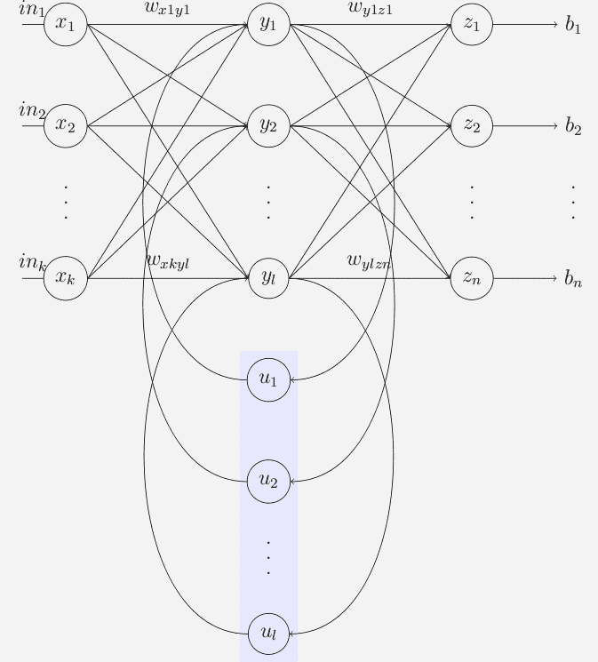

## 循环神经网络 (RNNs) - 架构与应用

循环神经网络（RNNs）是一种旨在处理序列数据（如文本、语音或时间序列数据）的神经网络。得益于捕捉时间依赖关系并根据之前的输入进行预测的能力，它们在自然语言处理（NLP）和时间序列分析等任务中被证明是非常有效的。在本节中，我们将探讨 RNN 的架构、它们在 NLP 和时间序列分析中的应用，以及训练它们时面临的一些挑战。

### RNN 的架构

RNNs 是一种由递归连接的节点或单元组成的神经网络。RNN 中的每个节点都维护自己的内部状态，该状态根据输入和之前的状态在每个时间步进行更新。这使得网络能够捕捉数据中的时间依赖性，使其根据整个输入序列做出预测。

RNN 主要分为两种类型：`Simple RNNs` 和 `LSTMs`（长短期记忆）。简单 RNN 具有固定大小的内部状态，这可能在反向传播过程中导致梯度消失，使其难以对长序列进行训练。另一方面，`LSTMs` 引入了额外的门控来控制信息进入和离开内部状态的流，从而缓解了这个问题。

### RNN 在 NLP 中的应用

RNNs 已被证明在语言建模、机器翻译和文本分类等 NLP 任务中非常有效。在语言建模中，RNNs 可以根据先前的词预测序列中的下一个词。机器翻译涉及使用 RNN 将文本从一种语言翻译成另一种语言。文本分类则涉及使用 RNN 将文本归类为预定义的类别，例如垃圾邮件/非垃圾邮件或积极/消极情感。

RNNs 在 NLP 任务中特别有用，因为它们可以捕捉序列中的程距离依赖，允许它们根据整个输入序列而不仅仅是最近的几个词做出预测。这使得它们非常适合语言建模和机器翻译等任务，其目标是生成连贯流畅的文本。

### RNN 在时间序列分析中的应用

RNNs 也被应用于时间序列分析，用于根据过去的观测值预测序列中的未来值。这在金融领域特别有用，RNNs 可用于预测股票价格或货币汇率。在医疗保健领域，RNNs 可根据病历记录和其他因素预测患者结果。

训练 RNN 进行时间序列分析时面临的一个关键挑战之一是处理梯度消失问题。由于 RNN 的内部状态在每个时间步都会更新，梯度在反向传播过程中可能会变得非常小，导致网络难以训练。为了应对这一挑战，研究人员开发了梯度裁剪和权重归一化等技术。

### 训练 RNN 面临的挑战

尽管 RNNs 有许多优点，但在训练它们时面临着若干挑战，包括：

- `Vanishing gradients`：如前所述，梯度消失问题会导致难以对长序列训练 RNN。
- `Exploding gradients`：梯度消失的反面是梯度爆炸，即梯度在反向传播过程中变得非常大。这可能导致训练不稳定和泛化能力差。
- `Overfitting`：与其他神经网络架构相比，RNN 拥有大量参数，如果不进行适当正则化，可能会导致过拟合。
- `Training time`：由于数据的序列性质以及需要单独处理每个输入序列，训练 RNN 的计算开销很大。


总结之，循环神经网络（`RNNs`）是处理序列数据的强大工具，适用于自然语言处理和时间序列分析等任务。尽管它们在训练过程中面临许多挑战，但研究人员已经开发了如`gradient clipping`和`weight normalization`等技术来解决这些问题。随着`NLP`和时间序列分析领域的不断演进，`RNNs` 可能仍然是许多应用的关键组件。

## 生成对抗网络 (GANs)

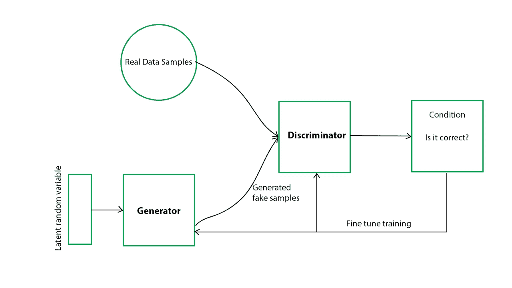

## 探索生成对抗网络 (GANs) 世界

生成对抗网络（`GANs`）通过能够生成高度逼真的合成数据，彻底改变了机器学习领域。这些网络由两个神经网络组成：生成器和判别器，它们共同工作生成类似于原始训练数据集的新数据。在本节中，我们将深入探讨 `GANs` 的架构和训练动态，探索它们的能力和局限性。

## GANs 的架构

一个 `GAN` 由两个神经网络组成：生成器（`G`）和判别器（`D`）。生成器接受随机噪声向量作为输入产生合成数据样本，而判别器接收合成或真实数据样本作为输入，并输出该样本为真实的概率。生成器的目标是产生与真实数据无法区分的样本，而判别器的目标是将样本正确分类为真实或伪造。

`GANs` 的架构可以表示如下：

```scss
G = D + E
D = F(X) + G
```

在这里，`G` 代表生成器网络，`D` 代表判别器网络，`E` 代表误差函数。生成器网络接受随机噪声向量 `z` 作为输入产生合成数据样本 `x`。判别器网络接受合成或真实数据样本 `x` 作为输入并输出样本为真实的概率。误差函数 `F(X)` 衡量生成的样本与真实数据样本之间的差异，为生成器网络提供反馈以提高其性能。

## GANs 的训练动态

`GANs` 的训练动态基于生成器和判别器网络之间的双人博。生成器的目标是产生能够欺骗判别器的样本，而判别器的目标是将样本正确分类为真实或伪造。训练过程涉及对两个网络进行迭代更新，其中生成器试图产生更真实的样本，而判别器则试图更擅长区分真实数据与合成数据。

`GANs` 的训练动态可以表示如下：

```scss
G = G - α * ∂L_g / ∂G
D = D - α * ∂L_d / D
```

在这里，`G` 代表生成器网络，`D` 代表判别器网络，`α` 代表学习率，`L_g` 和 `L_d` 分别代表生成器和判别器网络的损失。生成器网络更新其权重以最小化损失函数，而判别器网络更新权重以最大化损失函数。

## GANs 的应用

`GANs` 在计算机视觉、自然语言处理和其他领域具有广泛的应用。一些最著名的应用包括：

- 图像生成：`GANs` 可以生成逼真的图像。
- 数据增强：`GANs` 可以增强现有数据集。
- 风格迁移：`GANs` 可以将一张图像的风格迁移到另一张。
- 文本生成：`GANs` 可以生成真实的文本。
- 语音合成：`GANs` 可以生成真实的语音。

## GANs 的挑战与局限性

尽管有许多优势，`GANs` 也面临若干挑战。一些显著的包括：

- 训练不稳定：`GANs` 的训练可能具有性。
- 模式崩溃：`GANs` 可能会遭受模式崩溃，即生成产生的变化有限。
- 过拟合：`GANs` 可能会对训练数据过拟合。
- 缺乏解释性：`GANs` 通常被视为“黑箱”。

### 结论

生成对抗网络（`GANs`）通过能够生成高度逼真的合成数据，彻底改变了机器学习领域。这些网络由两个神经网络组成：生成器和判别器，它们共同生成类似于原始训练数据集的新数据。通过理解 `GANs` 的架构和训练动态，我们可以更好地利用它们的力量并克服其局限。

### 迁移学习

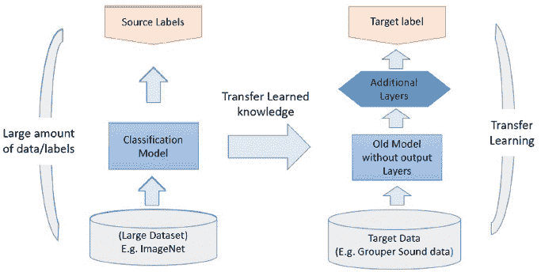

## 神经网络中的迁移学习

### 引言

迁移学习是机器学习中的技术，利用预训练模型作为新任务的起点。由于能够节省时间和资源，这种方法近年来引起了广泛关注。通过利用从一个任务中学到的知识，迁移学习能够开发出性能更好且训练时间更短的新模型。

### 迁移学习的工作原理

迁移学习的基本思想是将预训练模型作为新任务的特征提取器或初始化。预训练模型已经从大型数据集上学习了特征，这些特征可以作为新任务的起点。通过在新数据集上对预训练模型进行微调，模型可以适应新任务并学习特定特征。

迁移学习过程涉及三个关键步骤：

1. **预训练**：在这一步中，在大型数据集上训练神经网络，以学习适用于广泛任务的通用特征。预训练模型会被保存并存储以备后用。
2. **微调**：在这一步中，加载预训练模型并在针对当前任务的新数据集上进行微调。模型通过调整权重和偏置来适应新数据集，并学习任务特定的特征。
3. **测试**：一旦模型完成微调，将在单独的测试数据集上进行测试以评估其性能。可以通过额外的微调或使用不同的预训练模型来进一步完善模型。

### 迁移学习的优势

与传统的机器学习方法相比，迁移学习提供了若干优势：


1. **节省时间**：通过利用预训练模型，训练时间显著缩短，因为模型不需要从头开始学习。这对于数据可用性有限或部署截止日期紧迫的任务特别有用。
2. **提高性能**：与从头开始训练新模型相比，迁移学习可以提高性能。这是因为预训练模型已经学习了与许多任务相关的通用特征，而通过微调可以将这些特征适应到特定的当前任务中。
3. **知识共享**：迁移学习实现了任务之间的知识共享，当不同任务之间存在共同特征或模式时，这种方法特别有用。通过利用这些共享知识，可以更高效地训练模型并获得更好的性能。

### 迁移学习的应用

迁移学习在各个领域都有广泛的应用，包括：

1. **计算机视觉**：迁移学习在图像分类、目标检测和分割等计算机视觉任务取得了特别成功。像 `VGG16`、`ResNet50` 和 `Inception` 等预训练模型已针对人脸识别、自动驾驶和医学影像等各种应用进行了微调。
2. **自然语言处理**：迁移学习已应用于各种 NLP 任务，如语言建模、情感分析和文本分类。像 `BERT` 和 `RoBERTa` 等预训练模型在许多 NLP 任务中取得了最先进的结果。
3. **语音识别**：迁移学习已用于语音识别任务，利用预训练模型进行发话人识别、语言识别和语音情感识别。
4. **机器人技术**：迁移学习可以应用于机器人任务，如物体操作、抓取和运动规划。预训练模型可以进行微调以适应新的物体或环境。
5. **推荐系统**：迁移学习可以用于推荐系统，利用预训练模型生成个性化推荐。

## 迁移学习的挑战与局限性

尽管迁移学习有很多优势，但也存在一些挑战和局限性：

1. **过拟合**：如果新数据集太小或模型没有经过适当的正化，微调预训练模型可能会过拟合。这会导致在未见数据上的泛化性能较差。
2. **领域偏移**：如果新数据集与用于预训练的原始数据集差异巨大，迁移的知识可能不再。在这种情况下，可能需要额外的适应技术，例如领域适应或特征对齐。
3. **模型大小**：预训练模型可能很大且计算成本高昂，这限制了它们在资源受限环境中的适用性。
4. **缺乏可解释性**：迁移学习使得解释模型如何做出预测变得更加困难，因为学习到的特征可能不于理解。

### 结论

迁移学习是一种在新的任务中利用预训练模型的强大技术，可以在训练过程中节省时间和资源。通过将从一个任务中学到的通用特征适应到新任务，迁移学习可以提高性能并缩短训练时间。然而，它也面临过拟合、领域偏移、模型大小和缺乏可解释性等挑战。理解这些挑战并使用适当的技术来解决它们有助于在各种应用中获得更好的结果。

## 人工神经网络与人类神经元的比较

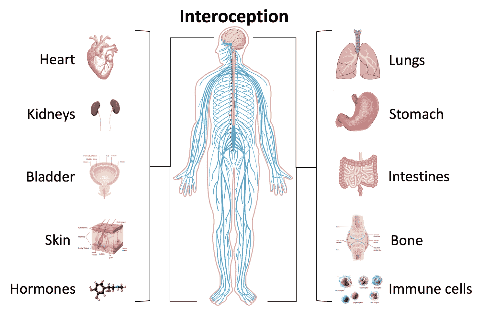

### 人工神经网络 vs 人类神经网络

人工神经网络（`ANNs`）与人类大脑中的神经网络具有某些相似之处，但在结构、功能和学习机制方面也存在明显的差异。虽然 `ANNs` 由人类设计并训练以模拟脑功能的某些方面，但两者之间存在影响其性能和能力的的重要差异。

#### 结构

`ANNs` 与人类神经网络之间最明显的区别之一是它们的结构。人类大脑由数十亿个相互连接的神经元组成，每个神经元都有独特的连接和树突。相比之下，`ANNs` 由相互连接的节点或“神经元”组成，以线性方式处理信息。虽然人类大脑具有复杂的层次结构，但 `ANNs` 倾向于具有更直接的前馈结构。

#### 功能

`ANNs` 与人类神经网络之间的另一个关键区别是它们的功能。人类大脑通过侧向和垂直连接的结合处理信息，允许学习复杂的空间和时间关系。相比之下，`ANNs` 仅依赖侧向连接，没有学习复杂空间或时间关系的能力。

#### 学习机制

`ANNs` 中的学习机制也与人类神经网络中的机制不同。`ANNs` 使用监督学习算法（如 `backpropagation`）根据输入-输出对来调整其权重和偏置。相比之下，人类大脑通过强化、竞争和稳态调节的结合进行学习。虽然两种网络都可以从经验中学习，但它们进行学习的机制在根本上是不同的。

#### 性能

尽管存在差异，但 `ANNs` 在某些任务（如图像识别和自然语言处理）上的表现得惊人地好。然而，它们在泛化到新情况或学习复杂空间关系方面存在局限性。相比之下，人类大脑具有适应变化环境和学习复杂模式及关系的惊人能力。

#### 相似性

尽管存在差异，`ANNs` 与人类神经网络之间存在一些重要的相似之处。两种类型的网络都具有层次结构，低级节点向高级级节点提供输入。两种网络还表现出侧向抑制，其中一个神经元的活动可以抑制附近神经元的活动。最后，两种网络都能够根据经验进行学习和适应。

### 结论

虽然 `ANNs` 在复制人类脑功能的某些方面已取得了巨大成功，但两者之间存在影响其性能和能力的的重要差异。理解这些区别有助于研究人员开发更有效的算法，并更好地理解人类大脑的工作机制。

### 结构差异

人工神经元与生物神经元的结构差异

人工神经元和生物神经元是两种根本上不同的神经系统，每种系统都有独特的结构特征。虽然人工神经元的设计旨在模拟生物神经元的功能，但它们在架构上存在显著差异，会影响它们的性能和能力。在本节中，我们将探索人工神经元与生物神经元之间的结构差异，并研究人工神经网络的架构如何与人类大脑的复杂结构对比。

1. 人工神经元的结构：


人工神经元通常由一组相互连接的节点或处理单元组成，它们接收来自其他神经元的输入，并根据分配给这些输入的权重生成输出。人工神经元最简单的形式是感知器，它由单个输入节点、单个隐藏节点和一个输出节点组成。其他类型的人工神经元包括多层感知器、反向传播神经网络和循环神经网络。

## 2. 生物神经元的结构
生物神经元由细胞体、树突、轴突和末梢组成。每个神经元通过树突接收来自其他神经元的输入，在细胞体中处理这些输入，然后通过轴突将输出传输到其他神经元或肌肉、腺体。生物神经元的复杂性差异巨大，有些神经元只有几个连接，而另一些则拥有数千个连接。

## 3. 连接差异
人工神经元和生物神经元之间最大的区别之一是它们的连接性。生物神经元是高度连接的，每个神经元与其他数千个神经元连接。相比之下，人工神经元通常只有有限的输入和输出，连接通过学习规则或算法建立。

## 4. 学习机制
生物神经元通过一种被称为突触可塑性的过程进行学习，这涉及根据经验改变神经元之间连接的强度。而人工神经元通过一种被称为反向传播的过程进行学习，根据预测输出与实际输出之间的误差来调整人工神经元之间连接的权重。

## 5. 可扩展性
神经网络比生物神经元具有更好的可扩展性。虽然生物神经元在连接数量方面存在局限性，但神经网络可以设计为容纳大量的输入和输出。这使得神经网络更适合需要处理大量数据的任务。

## 6. 灵活性
生物神经元具有高度活性，能够适应变化条件，而人工神经元的灵活性较低，需要仔细的设计和训练。生物神经元可以根据经验重组连接，而人工神经元则依赖算法来调整连接权重。

## 7. 能量效率
生物神经元的能量效率比神经网络高得多。生物神经元需要持续的能量供应来工作，而神经网络需要大量的计算资源和能量来处理大量数据。

## 8. 健壮性
生物神经元比神经网络更健壮。生物神经元可以承受特定区域的损伤而不影响大脑的整体功能，而神经网络对单个节点或连接的故障可能敏感。

## 9. 适应性
生物神经元具有很强的适应性，能够根据环境或经验的变化自我重组。另一方面，神经网络需要仔细的设计和训练来适应变化的条件。

## 10. 局限性
虽然生物神经元在处理大量数据方面存在局限性，但它们更适合需要语境理解和细微决策的任务。另一方面，神经网络更适合需要精确计算和处理大量数据的任务。

结论，人工神经元和生物神经元存在显著的结构差异，这些差异影响了它们的性能和能力。虽然神经网络可以模拟生物神经系统的某些方面，但它们在可扩展性、灵活性、能量效率、健壮性和适应性方面存在限制。理解这些差异对于设计和训练能够补充或复制生物神经系统功能的神经网络至关重要。

## 功能差异

### 理解人工和生物神经元
人工和生物神经元是两种完全不同的神经系统，每种都有其独特的功能和处理机制。虽然人工神经元旨在模拟生物神经元的结构和功能，但它们在处理能力方面存在明显的区别。在本节中，我们将探讨这些变化，并讨论人工神经元与人类大脑中发生的复杂过程相比是如何处理信息的。

### 人工神经元
人工神经元是旨在模拟生物神经元行为的计算模型。它们通常由输入层、一个或多个隐藏层和一个输出层组成。每个人工神经元接收来自上一的一组输入，使用非线性激活函数对这些输入进行计算，然后将输出发送到下一层。该过程重复多次，直到生成最终输出。

人工神经元的一个主要优势是可以使用各种算法（如监督学习或无监督学习）进行训练。在训练过程中，会调整人工神经元的权重以以最小预测与实际输出之间的误差。这使得人工神经元能够学习数据中的复杂模式并做出准确的预测。

### 生物神经元
另一方面，生物神经元是极其复杂的系统，通过多种机制处理信息。每个生物神经元通过突触接收来自其他神经元的输入，突触可以是兴奋性的也可以是抑制性的。输入随后由神经元的树突和轴突处理，然后传输到其他神经元或肌肉、腺体以进行动作电传输。

生物神经元最大的优势之一是它们在整个生命周期中学习和适应的能力。通过一种被称为突触可塑性的过程，神经元之间的连接强度可以根据经验发生变化，导致长期记忆的形成和处理能力的提高。

### 处理能力
虽然人工神经元能够学习并做出预测，但它们的处理能力从根本上与生物神经元不同。人工神经元依赖于固定的权重和激活函数来处理信息，而生物神经元使用动态的突触连接系统，可以根据经验改变。

一个关键区别是生物神经元执行非线性处理的能力。虽然人工神经元可以通过激活函数模拟非线性，但它们没有生物神经元那样的灵活性，生物神经元可以通过多个突触的相互作用执行复杂的计算。

另一个显著区别是生物神经元处理噪声或不完整输入的能力。生物神经元能够过滤无关信息并关注最重要的线索，而人工神经元则依赖其训练数据来做出预测。

结论：


总之，虽然人工神经和生物神经元在处理信息方面有一些相似之处，但它们在功能和能力方面存在明显的区别。人工神经的设计旨在模拟生物神经元的结构和功能，但缺乏在整个生物生命周期内学习和适应的能力。相反，生物神经元是极其复杂的系统，能够进行非线性处理并处理噪声或不完整的输入，这使其具有优越的处理能力。理解这些差异对于开发模拟生物神经系统功能的人工智能系统至关重要。

## 学习机制

### 人工神经网络与人类神经元学习机制的比较

近年来，人工神经网络（ANN）和人类神经元一直是研究和学习的主题，科学家和工程师不断开发和改进人工神经网络，而神经科学家则试图理解人类大脑功能的复杂性。尽管这两个系统都具有学习和适应的能力，但它们的学习机制存在显著差异。在本节中，我们将比较人工神经网络和人类神经元采用的学习过程，强调突触可塑性、强化学习和其他因素的作用。

#### 1. 突触可塑性
突触可塑性是指神经连接根据经验或活动改变强度的能力。人工神经网络和人类神经元都表现出突触可塑性，但机制是不同的。在人工神经网络中，突触可塑性通常使用外部算法实现，例如`backpropagation`（反向传播），它根据预期输出与观察输出之间的误差调整人工神经元之间连接的权重。相比之下，人类神经元使用内部机制，例如`长程增强 (LTP)`或`长程抑制 (LTD)`，这些机制被认为是通过突触连接强度的变化介导的。

#### 2. 强化学习
强化学习是机器学习的一种，涉及代理根据其行为获得的奖励或惩罚学习做出决策。人工神经网络可以使用强化学习算法（如`Q-learning`）进行训练，以学习复杂的行为和任务，例如玩 Atari 游戏或控制机械臂。相比之下，人类神经元使用多种强化学习机制，包括基于多胺的奖励处理以及通过与情感状态关联巩记忆。

#### 3. 空间表示
人工神经网络通常依赖离散的空间表示（例如网格状或晶格状结构）处理信息。相比之下，人类神经元使用更连续、分布的空间表示，这允许整合多种感觉输入并形成复杂的认知地图。例如，在熟悉的环境中穿行时，人类大脑可以使用`place cells`（位置细胞，即对特定位置产生的特殊神经元）来维持环境的内部表示。

#### 4. 可扩展性
人工神经网络已被具有高度的可扩展性，许多模型能够学习复杂任务并良好地泛化到新情况。虽然人类大脑也表现出卓越的塑性和适应性，但其规模受到生物系统的限制。例如，虽然单个神经元可能处理来自广泛感觉输入的信息，但任何大脑中的神经元数量都是有限的，这限制了整体处理能力。

#### 5. 训练时间
训练人工神经网络所需的时间取决于任务的复杂性和用于训练的数据集的大小。然而，人工神经网络已被证明能够在几小时或几天内学习复杂任务，而人类大脑需要大量的练习和接触来学习新技能并适应变化的环境。

#### 6. 灵活性
虽然人工神经网络具有高度灵活性并可以学习广泛的任务，但它们受到其底层架构和用于训练算法的限制。相比之下，人类大脑在适应新情况、学习新技能以及响应环境或经验的变化重组神经连接方面表现出卓越的灵活性。

#### 7. 可解释性
由于架构复杂且不透明，人工神经网络往往难以解释。相比之下，人类大脑表现出高度的可解释性，认知和行为的许多方面很容易被人类理解。例如，语言处理或工作记忆底层的神经机制已十分明确，并可以使用神经成像技术实时观察。

#### 8. 健壮性
人工神经网络已被证明对训练期间的错误和失败具有高度的健壮性，许多模型能够从错误中恢复并适应新情况。相比之下，由于生物组织的脆弱性，人类大脑更容易受到损坏或干扰。虽然人类对某些类型的错误或失败可能更有韧性，但在发生严重脑损伤时，他们也更容易遭受灾难性的失败。

#### 9. 自适应学习
人工神经网络可以通过在线学习算法（如`stochastic gradient descent`，随机梯度下降）从新情况中适应并学习，这些算法允许根据最新数据持续更新模型参数。相比之下，人类大脑通过多种机制表现出自适应学习，包括睡眠期间记忆巩或根据经验形成新的神经连接。

#### 10. 自我意识
最后，人工神经网络缺乏自我意识和意识，而人类大脑表现出高度的自我意识和内省。虽然人工神经网络可以通过反思自身内部状态的能力来模拟自我意识，但它们并没有像人类那样真正地体验世界或拥有主观体验。

总之，尽管人工神经网络和人类神经元都会学习和适应，但它们的学习机制存在显著差异。人工神经网络依赖外部算法和离散的空间表示，而人类神经元使用内部机制和更连续的空间表示来处理信息。此外，人工神经网络的可扩展性、灵活性、可解释性、健壮性、自适应学习和自我意识与人类大脑大不同。理解这些差异可以为这两个系统的运作提供宝贵的见解，并为未来开发更先进的人工智能模型提供参考。

## 并行处理

### 人工神经网络和人类大脑中的并行处理

并行处理是人工神经网络和人类大脑的基础概念。这两个系统都进化为同时处理多个任务，从而提高了计算效率和性能。在本节中，我们将探索这两个并行处理系统的相似之处及其对计算效率的影响。

#### 人工神经网络 (ANNs)
人工神经网络是受生物神经网络结构和功能启发的计算模型。这些模型由相互连接的节点或“神经元”组成，并行处理信息。每个神经元接收来自其他神经元的输入，并使用这些输入计算自己的输出。这些神经元的输出随后被馈到其他神经元中，形成一个相互连接的处理单元复杂网络。


`ANNs` 的核心优势之一是它们同时处理多个任务的能力。通过将输入数据分配给网络中不同的神经元，每个神经元可以处理输入数据的不同方面，从而实现更快、更高效的计算。这种并行处理能力在图像识别、自然语言处理和决策系统等应用中特别有用，这些领域需要快速识别复杂的模式和关系。

# 人脑

人脑可能是迄为止最复杂的并行处理系统。它由数十亿个相互连接的神经元组成，以高度分布和并行的方式处理信息。每个神经元接收来自其他神经元的输入，并利用这些输入计算自己的输出，形成一个复杂的相互连接单元网络。

与 `ANNs` 一，人脑能够同时处理多个任务。然而，与 `ANNs` 不同，人脑没有预定义的架构或处理单元层级。相反，神经元之间的连接会根据经验和学习不断修改和适应。这使得大脑的并行处理能力具有更大的灵活性适应性。

# 比较并行处理系统

`ANNs` 和人脑都进化到能够同时处理多个任务，但这些系统之间存在一些关键差异。`ANNs` 的主要优势之一是可以在特定任务上进行训练，并将这些技能应用到新情况中。相反，大脑拥有一个更通用的处理系统，可以适应广泛的任务和环境。

这些系统之间的另一个重要区别是它们的并行程度。`ANNs` 设计用于并行处理多个输入，而大脑则以高度分布的方式处理信息，每个神经元都对整体处理活动做出贡献。这使得大脑具有更高的计算效率，因为处理复杂模式和关系所需的能量和资源较少。

# 对计算效率的影响

`ANNs` 和人脑对计算效率都有影响。在 `ANNs` 的情况下，并行处理能力可以带来更快的计算速度并提高在复杂任务上的性能。然而，大脑的高度分布式处理系统允许其在处理复杂模式和关系时具有更高的能量效率和适应性。

此外，大脑的学习和适应能力使其能够随着时间的推移提高其并行处理能力，而 `ANNs` 则需要额外的训练或架构更新来提高性能。这突显了理解这两个系统中并行处理的底层机制的重要性，以及开发能够利用这些机制提高计算效率的新型算法和架构的重要性。

### 结论

综而言，并行处理是人工神经网络和人脑的基础概念。这两个系统都进化到能够同时处理多个任务，从而实现了更高的计算效率和性能提升。虽然这些系统之间存在一些关键差异，但它们在快速高效地处理复杂模式和关系方面具有许多相似之处。理解 `ANNs` 和人脑并行处理背后的机制，对于开发能够利用这些机制提高计算效率的新算法和架构至关重要。

# AI 中的生物灵感

## 人工神经网络中的生物学灵感

人工神经网络 (`ANNs`) 长期以来一直受到其生物对应物（如人脑）的启发。神经科学的研究为大脑如何处理信息以及如何学习提供了宝贵的见解。研究人员试图在 `ANNs` 中复制这些过程，并取得了不同程度的成功。在本中，我们将探索 `ANNs` 从生物学中汲取灵感的程度，讨论将生物原理引入 AI 挑战和收益，并检查 `ANNs` 受神经科学影响的一些方式。

### 来自生物学的灵感

`ANNs` 设计用于模拟大脑的结构和功能，通过相互连接的节点或神经元来处理信息并从经验中学习。前向架构信息从输入到输出按线性路径流动，这与信息流经大脑的方式相似。在 `ANNs` 和大脑中，信息都是以分层的方式处理的，低级感官信息被组合成高级概念。

然而，尽管有这些相似之处，`ANNs` 与生物系统有着本质性的区别。例如，虽然大脑具有卓越的适应塑性，能够根据环境变化或损伤进行自我重组，但 `ANNs` 并没有这种能力。此外，大脑的神经连接被认为受到多种化学信号（如神经递质）的调节，而这些信号在 `ANNs` 中是不存在的。

### 引入生物原理的挑战

尽管存在这些差异，研究人员在将生物原理引入 AI 模型方面取得了进展。一个挑战是难以扩展生物启发模型来处理复杂任务。例如，虽然简单的神经网络可以训练识别手写数字，但将此模型扩展到执行语言识别或决策等更复杂的任务要困难得多。

另一个挑战是对大脑如何处理信息缺乏了解。虽然神经科学家在识别参与各种认知功能的神经回路方面取得了巨大进展，但底层机制仍然不完全清楚。因此，开发能够准确复制这些过程的 AI 模型可能是困难的。

### 引入生物原理的收益

尽管面临这些挑战，将生物原理引入 AI 模型具有许多收益。例如，生物启发模型已被证明比传统的 `ANNs` 更具能量效率且对噪声更具鲁棒性。此外，脉冲神经网络（对神经活动的时间动力学进行建模）的使用提高了语音识别和其他任务的性能。

此外，将生物原理引入 AI 模型有助于解决一些围绕 AI 的伦理担忧。例如，如果设计的 AI 系统旨在模拟大脑适应变化环境的能力，它可能更容易以符合人类价值观和目标的方式运行。

### 结论

综而言，尽管 `ANNs` 从生物对应物中汲取灵感，但将生物原理引入 AI 模型面临着巨大挑战。然而，这样做带来的收益（包括提高能量效率和鲁棒性，以及更符合伦理的 AI 开发方法）使其一个值得进一步探索的领域。随着研究人员继续揭开大脑处理信息的秘密，我们可以预计未来会看到更多结合生物原理的创新型 AI 方法。

# 使用 Python 逐步创建神经网络

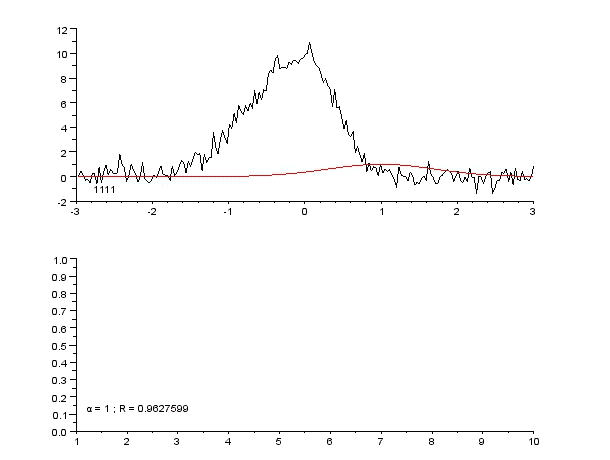

使用 Python 从零开始神经网络 - 详细指南


从零开始创建一个神经网络是一个既兴奋又有意义的体验，特别是当使用 Python 进行时。在本节中，我们将提供一份关于如何使用 Python 创建神经网络的详细指南，涵盖过程的每一个步骤。我们还将提供代码示例和解释，帮助你更好地理解这些概念。

### 第 1 步：导入必要的库

在开始创建神经网络之前，导入必要的库是关重要的。创建神经网络常用的库是 NumPy 和 TensorFlow。NumPy 提供对大型多维数组和矩阵的支持，而 TensorFlow 是一个专门为构建和训练神经网络设计的库。

```python ownimport numpy as np
import tensorflow as tf
```

### 第 2 步：定义输入形状

下一步是定义输入形状，这指的是输入网络的数据的特征数量或维度。这可以通过 `tf.placeholder()` 函数的 `shape` 属性来实现。例如，如果我们正在处理一个图像数据集，输入形状可能是 `(height, width, channels)`，其中 height 和 width 是图像的维度，channels 是颜色通道数（通常 RGB 为 3）。

```python
# Define input shape (height, width, channels)
input_shape = (28, 28, 1)
```

### 第 3 步：创建模型

下一步是使用 `tf.keras.models` 模块创建神经网络模型。这涉及定义模型的架构，包括层的数量和类型，以及激活函数和优化算法。这里有一个具有一个隐藏层的简单前馈神经网络的示例：

```python
# Create a simple feedforward neural network with one hidden layer
model = tf.keras.Sequential([
    tf.keras.layers.Dense(64, activation='relu', input_shape=input_shape),
    tf.keras.layers.Dense(32, activation='relu'),
    tf.keras.layers.Dense(1)
])
```

### 第 4 步：编译模型

创建模型后，我们需要使用 `tf.keras.optimizers` 模块对其进行编译。这涉及定义训练期间将使用的优化算法和损失函数。这是一个使用随机梯度下降 (SGD) 作为优化算法编译神经网络的示例：

```python
# Compile the model with SGD optimizer
model.compile(optimizer=tf.keras.optimizers.Adam(lr=0.001), loss='mean_squared_error')
```

### 第 5 步：训练模型

模型编译完成后，我们就可以使用 `fit()` 方法来训练它。这涉及提供训练数据并指定要训练的 epoch 数（epochs）。这是一个在合成数据集上训练神经网络的示例：

```python
# Train the model on the synthetic dataset
model.fit(X_train, y_train, epochs=10)
```

### 第 6 步：评估模型

训练模型后，我们可以使用 `evaluate()` 方法评估其性能。这涉及提供测试集并计算评估指标，如准确率或均方误差。这是一个在测试集上评估神经网络的示例：

```python
# Evaluate the model on the test set
model.evaluate(X_test, y_test)
```

### 结论

使用 Python 从零开始创建神经网络是一项具有挑战性但很有回报的任务。通过遵循这些步骤并使用不同的数据集和架构进行练习，你将对构建神经网络涉及的概念和算法建立全面的理解。无论你是初学者还是丰富的机器学习从业者，本指南都将为你使用 Python 创建和训练自己的神经网络提供坚实的基础。

## 第 1 步：导入库

### 在 Python 中导入构建神经网络的库

作为一名对构建神经网络感兴趣的 Python 开发人员，你需要导入如 NumPy、TensorFlow 或 PyTorch 等核心库。这些库提供了各种工具和功能，简化了开发过程并帮助你构建更准确、更高效的模型。在本节中，我们将探索这些每个库、它们在开发过程中的作用以及如何有效地使用它们。

## NumPy

NumPy 是 Python 科学计算的基础库。它提供了数组和矩阵操作的高效实现，这对于构建神经网络至关重要。NumPy 数组可以存储密集或稀疏数据结构，使其成为处理大型数据集数据集。此外，NumPy 对数学运算提供了广泛的支持，例如矩阵乘法和逐元素算术运算，这些在神经网络计算中非常关键。

要导入 NumPy，请在你的 Python 代码中使用以下命令：

```python
import numpy as np
```

## TensorFlow

TensorFlow 是一个用于构建和训练神经网络流行的开源库。它提供了一个易于使用的接口来定义和执行神经网络模型。TensorFlow 允许你处理各种数据类型，包括整数、浮点数甚至复数。此外，它对分布式训练提供了内置支持，使你能够跨多个 GPU 或机器扩展你的模型。

要导入 TensorFlow，请在你的 Python 代码中使用以下命令：

```python
import tensorflow as tf
```

## PyTorch

PyTorch 是另一个用于构建和训练神经网络的流行库。它提供了一个动态计算图，比符号计算方法允许更灵活的模型架构。PyTorch 还提供了自动微分，使得在训练期间可以进行快速的前向和反向误差传播。此外，PyTorch 对 GPU 加速有内置支持，使其适用于大规模深度学习任务。

要导入 PyTorch，请在你的 Python 代码中使用以下命令：

```python
import torch
```

#### 结合使用库

虽然这些库各提供独特的功能，但你也可以将它们结合起来创建更强大、更灵活的神经网络。例如，你可以将 NumPy 数组作为 TensorFlow 或 PyTorch 模型的输入数据，或者在 TensorFlow 模型中利用 PyTorch 的自动微分功能。

为了协同工作这些库，你需要相应地导入它们：

```python
import numpy as np
import tensorflow as tf
import torch
```

### 结论

总之，导入 NumPy、TensorFlow 或 PyTorch 等核心库是在 Python 中构建神经网络的关键步骤。这些库中的每一个都提供了独一无二的功能，简化并加速开发过程。通过理解每个库的作用以及如何结合使用它们，你将完全有能力应对即使是最复杂的深度学习任务。

## 第 2 步：数据准备

### 神经网络训练的数据准备

数据准备是机器学习流水线中的一个关键步骤，涉及清洗、归一化和将原始数据转换为适用于训练神经网络的格式。输入数据的质量直接影响模型的性能，因此在预处理数据时必须做到详尽细致。在本节中，我们将讨论数据清洗、归一化以及划分训练集和测试集的技术。

数据清洗：


数据清洗是识别并修正输入数据中的错误、不一致和缺失值的过程。这一步至关重要，因为数据中的微小错误可能会传播到模型的预测中，导致性能不佳甚至无法收敛。以下是一些常见的数据清洗技术：

1. 处理缺失值：可以使用各种方法填充缺失值，例如 `mean`、`median` 或 `mode` 值，或者直接将其删除。
2. 离群值检测与移除：离群值会显著影响模型的性能，因此识别并移除它们是重要的。离群值检测技术包括 `z-scoring`、`modular regression` 和 `Isolation Forest`。
3. 降噪：噪声数据会导致模型性能变差，因此可以应用 `smoothing`、`median filtering` 或 `wavelet denoising` 等技术来减少噪声。
4. 处理不一致的数据：不一致的数据可能源于数据输入或测量误差，因此标准化数据格式并确保所有特征的一致性是非常重要的。

## 数据归一化

数据归一化是将数据值缩放到共同范围的过程，以防止特征主导或对某些类别产生偏见。以下是一些常见的归一化技术：

1. 最大最小归一化（Min-max scaling）：这通过应用如 `min-max scaling` 等变换函数，将数据值缩放到通常为 0 到 1 之间的范围。
2. 标准化（Standardization）：涉及对每个特征减去 `mean` 并除以 `standard deviation`，得到一个围绕零的数值分布。
3. Z-score 归一化：涉及对每个特征减去 `mean` 并除以 `standard deviation`，得到一个围绕零的数值分布。

## 数据划分

数据划分是将数据分为训练集和测试集的过程，以便在不使用整个数据集的情况下评估模型性能。以下是一些常见的数据划分技术：

1. 随机划分：涉及将数据随机分为两个子集，其中一个子集用于训练，另一个用于测试。
2. 分层划分：涉及将数据划分为训练集和测试集，并在此过程中训练训练与测试集之间的类别平衡。
3. 时间序列划分：涉及根据时间间隔划分数据，每个间隔代表一个独立的训练集或测试集。

### 结论

数据准备是机器学习流水线中至关重要的一步，能够显著影响模型性能。数据清洗、归一化以及划分训练集和测试集等技术可以帮助确保输入数据具有高质量并准确地代表问题领域。通过应用这些技术，你可以提高神经网络模型的准确性和可靠性，并在你的机器学习项目中获得更好的结果。

## 第 3 步：构建神经网络架构

### 定义神经网络的架构

为了构建一个有效的神经网络，仔细地定义其架构至关重要。架构指的是网络中层的排列方式，包括层的数量、类型以及它们之间的连接。在这一节中，我们将探索神经网络架构的不同组件，以及它们如何协作处理信息。

#### 输入层

输入层是神经网络的第一层，它接收将要处理的原始数据。该层通常由由一个神经元组成，尽管在某些情况下也可以有多个神经元。输入层的输出是一个激活向量，代表了网络的初始状态。

#### 隐藏层

隐藏层是神经网络的中间层，它们在学习数据中的复杂模式方面起着至关重要的作用。每个隐藏层由多个神经元组成，并对其输入的加权之和应用激活函数。每个隐藏层的输出是一个激活向量，通过激活函数经过非线性变换进行传递。

#### 输出层

输出层是神经网络的最终层，它接受上一个隐藏层的输出作为输入。它由多个神经元组成，每个神经元都有自己的一组权重，并应用 `softmax` 激活函数产生对可能类别的概率分布。输出层获取其输入的加权之和，应用激活函数并产生网络的最终输出。

### 激活函数

激活函数是为网络引入非线性的非线性变换。它们接收输入的加权之和，并产生一个关于权重和输入值的函数输出。神经网络中最常用的激活函数有：

* Sigmoid：该函数将输入映射到 0 到 1 之间的值，适用于二分类问题。
* ReLU (Rectified Linear Unit)：该函数将所有负值映射到 0，将所有正值映射到相同的值，这对于像素值范围很大的图像非常有用。
* Tanh (双曲正正切)：该函数将输入映射到 -1 到 1 之间的值，适用于需要更细致输出值的问题。

#### 信息流

神经网络中的信息流由激活函数控制。每个神经元都对其输入的加权之和应用激活函数，每个神经元的输出都会传递到下一层。激活函数决定了信息如何流过网络，这对于学习数据中的复杂模式至关重要。

#### 训练神经网络

一旦定义了神经网络的架构，就可以各种算法进行训练。最常用的训练算法是随机梯度下降（`SGD`），它根据损失函数对权的梯度来更新网络权重。其他训练算法包括 `Adam`、`RMSProp` 和 `Gradient Descent`。

### 结论

总之，定义神经网络的架构是构建有效模型至关重要的一步。输入层、输出层、隐藏层和激活函数共同工作处理信息并产生准确的输出。通过理解这些组件如何相互作用，我们可以为各种应用设计更高效、更强大的神经网络。

## 第 4 步：初始化权重和偏置

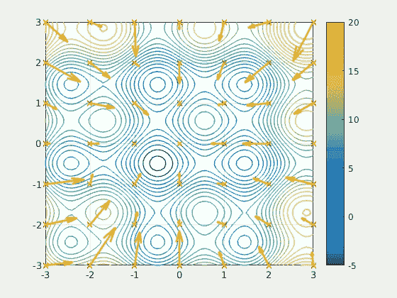

### 神经网络中适当权重和偏置初始的重要性

适当的权重和偏置初始化是训练神经网络至关重要的一步。网络的权重和偏置是决定其学习和准确预测能力的参数。如果这些参数初始化不当，网络可能无法收敛到最优解，甚至发散，导致性能不佳。在这一节中，我们将探讨神经网络中权重和偏置初始的重要性、不同的初始化技术以及它们对网络性能的影响。

#### 适当权重和偏置初始的重要性：

适当的权重和偏置初始化对于以下几个原因很重要：

1. 避免局部极值：神经网络的权重和偏置在训练期间调整以最小化损失函数。如果这些参数的初始值接近最优值，网络可能会收敛到局部最小值而不是全局最小值，导致性能不佳。


## 2. 更快的收敛：权重和偏置的初始化可以帮助网络更快地收敛到最优解。这是因为权重和偏置的初始值是优化过程的起点，如果它们接近最优值，网络将更有机会快速收敛。

## 3. 提高泛化能力：适当的权重和偏置初始化还可以帮助提高网络的泛化能力。如果初始权重和偏置离最优值太远，网络可能无法学习数据中的底层模式，导致在未见过的数据上表现不佳。

### 权重和偏置的初始化技术
有多种技术用于初始化神经网络的权重和偏置，包括：

1. 随机初始化：这涉及在特定范围内随机初始化权重和偏置。这是一种简单直接的方法，但可能无法获得最佳结果。

2. 零初始化：这涉及将所有权重和偏置设置为零。这种技术有助于防止过拟合，但可能导致收敛速度缓慢。

3. Kaiming 初始化：这涉及使用特定的分布（如 Kaiming 分布）来初始化权重和偏置。众，这种技术比随机初始化具有更好的性能。

4. Xavier 初始化：这涉及使用特定的分布（如 Xavier 分布）来初始化权重和偏置。已知，这种技术比零初始化具有更好的性能。

5. 预训练：这涉及在主数据集上训练之前，先在较小的数据集上对网络进行预训练。通过初始化更接近最优值的权重和偏置，有助于提高网络的性能。

### 权重和偏置初始化技术对网络性能的影响
研究表明，权重和偏置初始化技术的选择会显著影响神经网络的性能。例如，一项研究发现，在图像分类任务的深度神经网络中，使用 Kaiming 初始化比使用随机初始化效果更好。另一项研究发现，在自然语言处理任务的神经网络中，使用 Xavier 初始化比使用零初始化效果更好。

### 结论
适当的权重和偏置初始化对于训练神经网络至关重要。初始化技术的选择影响网络性能，不同的技术可能适用于不同的任务。通过仔细选择初始化技术，可以提高收敛率，避免过拟合，并获得更好的泛化性能。在下一节中，我们将探索正则技术在神经网络训练中的应用。

## 第 5 步：选择损失函数和优化器

### 为神经网络选择合适的损失函数和优化器
在构建高效准确的神经网络的途中，最关键的决策之一是选择正确的损失函数和优化器。这些组件的选择会显著影响训练过程，导致性能良好的模型或一个无法收敛的模型。在这一节中，我们将深入探讨这些选择的意义，并探索每个组件的一些流行选项。

### 损失函数
损失函数是一种用于量化预测输出与实际输出之间差异的数学公式。它衡量模型预测目标变量的能力。损失函数的选择取决于问题领域、数据类型以及模型所需的属性。以下是神经网络中常用的某些损失函数：

1. 均方误差 (MSE)：这是回归问题常用的损失函数，其中目标变量是连续的且具有有限范围。`MSE` 衡量预测值与实际值之间的平均平方差。它容易优化，并且在数据呈正态分布时提供良好的结果。

2. 交叉熵损失 (Cross-Entropy Loss)：这种损失函数通常用于分类问题，其中目标变量是类别的。`Cross-entropy` 预测概率与每个类别真实概率之间的差异。对于类别不平衡的问题，这是一个很好的选择，因为它对分类错误的惩罚比正确分类更重。

3. 平均绝对误差 (MAE)：这种损失函数与 `MSE` 类似，但它衡量预测值与实际值之间的绝对差而不是平方差。当数据范围很大或目标变量的分布非正态时，`MAE` 是一个很好的选择。

4. 合损失 (Hinge Loss)：这种损失函数用于二分类问题，其中只有两个类。`Hinge loss` 衡量预测概率与真实标签之间的差异，对分类错误的惩罚比正确分类更重。

### 优化器
优化器负责根据损失函数的梯度更新模型的权重。优化器的选择取决于问题的复杂度、数据集的大小以及预期的收敛率。以下是神经网络中常用的某些优化器：

1. 随机梯度下降 (SGD)：这是一种简单且广泛使用的优化器，它在每次迭代中根据训练数据中的单个梯度样本来更新权重。`SGD` 易于实现并对小型数据集提供良好的结果，但对于大型数据集收敛可能缓慢。

2. 动量 (Momentum)：这种优化器在更新规则中加入动量项，有助于优化过程更快收敛。`Momentum` 有助于避免陷入局部最优，并在梯度较大时提供更好的结果。

3. 尼特罗夫加速梯度 (NAG)：这种优化器使用不同的方法来结合动量，从而导致更快的收敛。`NAG` 是非凸目标函数问题或大型数据集的良好选择。

4. Adam：这种优化器根据梯度的幅度自适应学习率，有助于更快收敛并避免过冲。`Adam` 由于其鲁健性以及处理广泛问题的能力，在深度学习中被广泛使用。

5. RMSProp：这种优化器使用梯度的指数衰减平均来自适应学习率。当数据集很大且模型有许多参数时，`RMSProp` 能提供良好的结果。

结论，为神经网络选择正确的损失函数和优化器对于其训练和优化至关重要。每个选择都有独特的属性，使其适用于不同的问题领域、数据类型和预期的收敛率。通过理解这些选择及其影响，你可以做出明智的决策以构建高效准确的模型。

## 第 6 步：模型训练

### 训练神经网络
训练神经网络涉及将准备好的数据集输入模型，通过调整权重和偏置以使损失函数最小化，并重复这一过程直到模型性能得到提高。以下是使用反向传播算法训练神经网络的一般步骤：

1. 数据准备：在训练模型之前，必须通过将数据集划分为训练集、验证集和测试集来准备数据集。这有助于在训练期间评估模型性能并避免过拟合。


## 2. 模型初始化
模型的权重和偏置随机初始化或使用预定义的策略初始化。初始化过程对模型的最终性能产生显著影响。

### 3. 前向传播
将输入数据通过网络，并使用当前 set 权重和偏置计算输出。这一过程被称为前向传播。

### 4. 计算损失
计算预测输出与实际输出之间的差异，并计算损失函数。损失函数衡量了模型性能的优劣。常见的损失函数包括均方误差（`MSE`）或交叉熵。

### 5. 反向传播
反向传播算法调整网络的权重和偏置以使损失函数最小。这一过程涉及使用链式法则计算损失函数对网络中每个参数的梯度。

### 6. 权重更新
利用梯度更新网络的权重和偏置。学习率决定了每次更新过程中权重和偏置的变化幅度。常见的学习率包括 `0.01` 或 `0.1`。

### 7. 重复
重复步骤 3-6，直到模型在验证集上的性能有所提高，或达到预定的停止标准（例如最大迭代次数或最小损失值）。

### 8. 评估
最后一步是在单独的测试集上评估训练好的模型，以衡量其泛化能力。

反向传播算法的工作原理是：首先使用当前的权重和偏置计算给定输入的网络输出。计算预测输出与实际输出之间的差异，并使用链式法则计算损失函数对网络中每个参数的梯度。然后，利用优化算法（如随机梯度下降 `SGD` 或 `Adam`）通过这些梯度来更新网络的权重和偏置。

反向传播算法的数学形式表示如下：

设 $x$ 为输入，$y$ 为输出，$L$ 为损失函数。目标是最小化 $L(\theta)$，其中 $\theta$ 是网络的权重和偏置。

1. 计算 $y \hat{=} f(x; \theta)$：针对给定输入 $x$ 预测网络的输出。
2. 计算 $L(\theta) = E[(\hat{y} - y)²]$：计算损失函数，该函数衡量了预测输出与实际输出之间的差异。
3. 计算 $\frac{\partial L}{\partial \theta}$：使用链式法则计算损失函数对网络中每个参数的梯度。
4. 更新 $\theta \leftarrow \theta - \alpha \frac{\partial L}{\partial \theta}$，其中 $\alpha$ 是学习率。

反向传播算法迭代更新网络的权重和偏置直到收敛，即损失函数达到最小值或达到预定的停止标准。学习率决定了每次更新过程中权重和偏置的变化幅度，为所解决特定问题选择合适的学习率至关重要。

## 第 7 步：评估与测试


### 评估训练模型的性能
一旦你训练了机器学习模型，在单独的测试数据集上评估其性能以确定其有效性是至关重要的。模型评估的目标是评估模型对新的、未见数据的泛化能力。在本节中，我们将讨论评估训练模型的重要性，并提供如何评估模型的示例。

### 评估训练模型的重要性
评估训练模型的性能对于确保其准确性和可靠性至关重要。以下是你应该评估模型的一些原因：

1. **准确率 (Accuracy)**：模型进行的所有预测中正确预测的比例。
2. **泛化性 (Generalization)**：良好的模型应该能够泛化到新数据。
3. **过拟合 (Overfitting)**：当模型过于复杂并开始记忆训练数据而非学习模式时，就会发生过拟合。

### 评估使用的指标
有几个指标用于评估模型：

1. **准确率 (Accuracy)**：衡量正确预测的比例。计算公式为 $(TP + TN) / (TP + TN + FP + FN)$。
2. **精确率 (Precision)**：在所有正类预测中真例的比例。计算公式为 $TP / (TP + FP)$。
3. **召回率 (Recall)**：在所有实际正样本中真例的比例。计算公式为 $TP / (TP + FN)$。
4. **F1 分数 (F1 Score)**：F1 分数是精确率和召回的调和平均数，提供了两者的平衡。计算公式为 $2 * (precision * recall) / (precision + recall)$。
5. **ROC 曲线下面积 (AUC-ROC)**：衡量模型区分正负类的能力。通过绘制真阳率相对于假阳率的图来计算。

### 如何在 Python 中评估模型
现在你已经知道为什么要以及如何评估机器学习模型，让我们看看如何使用 `scikit-learn` 库在 Python 中实现。以下是步骤：

1. **分割数据**：使用 `scikit-learn` 中的 `train_test_split` 函数将数据集划分为训练集、验证集和测试集。
2. **训练模型**：使用 `scikit-learn` 中的 `train` 函数在训练集上训练你的机器学习模型。
3. **评估模型**：使用 `scikit-learn` 中的 `evaluate` 函数在验证集上评估模型性能。
4. **测试模型**：使用 `scikit-learn` 中的 `predict` 函数在测试集上测试模型性能。
5. **可视化**：使用 `matplotlib` 或 `seaborn` 等可视化工具将你的模型性能可视化。

## 第 8 步：模型部署
将训练好的神经网络应用于现实世界场景


一旦神经网络完成训练，就可以被部署到各种现实世界的应用中以实现预期结果。训练后神经网络的部署涉及将其集成到更大的系统或平台中，以启用其功能。以下是部署训练后神经网络的某些方法：

1. **模型服务 (Model serving)**：这涉及将训练好的模型托管在服务器或云平台上，使其他需要使用它的应用程序或系统可以访问。模型服务可以通过 RESTful APIs 或其他应用程序接口（APIs）完成。流行的模型服务平台包括 `TensorFlow Serving`、`AWS SageMaker` 和 `Azure Machine Learning`。
2. **容器化 (Containerization)**：这涉及将训练好的模型及其依赖项封装到容器中，例如 `Docker` 容器。该容器可以部署在任何支持 `Docker` 的平台上，从而实现模型的轻松部署和管理。
3. **基于云的部署 (Cloud-based deployments)**：训练好的模型可以部署在 `Amazon Web Services (AWS)`、`Microsoft Azure` 或 `Google Cloud Platform (GCP)` 等云平台上。这些平台提供了系列用于部署和管理机器学习模型的服务，包括自动伸缩、监控和安全。
4. **边缘计算 (Edge computing)**：随着 IoT 设备和边缘计算的使用日益增加，现在可以将训练好的神经网络部署在智能手机、智能家居设备或自动驾驶汽车等边缘设备上。这允许更快的处理和更低的延迟，并减少带宽需求。
5. **嵌入式系统 (Embedded systems)**：训练好的模型可以嵌入到智能电视、游戏机或机顶盒等嵌入式系统中。这允许与硬件设备直接集成，并实现如语音控制或图像识别等功能。

### 部署的考虑因素

1. **模型性能**：部署的模型必须在目标环境中运行良好，需要考虑计算资源、数据质量和网络延迟等因素。
2. **安全性与隐私**：在部署期间，确保模型及其处理数据的安全性和隐私性至关重要。这可能涉及实施访问控制、加密或其他安全措施。
3. **可扩展性**：部署的模型必须能够处理变化的负载和数据量，并能够根据需要进行扩展。
4. **与现有系统的集成**：部署的模型应该与现有的系统和应用程序无缝集成，并提供一致的用户体验。
6. **可解释性与可理解性**：理解部署的模型如何做出预测或决策，并能够以透明且可解释的方式解释其行为是非常重要的。

### 潜在挑战

1. **模型漂移 (Model drift)**：由于底层数据分布的变化，部署的模型可能会随时间漂移，导致性能下降。可以通过定期对模型进行重新训练和更新来缓解。
2. **数据质量问题**：训练数据的质量会影响部署模型的性能。确保数据清洁、多样且具有目标环境代表性至关重要。
3. **安全威胁**：部署的模型可能受到各种安全威胁，如恶意攻击或未经授权的访问。实施适当的安全措施有助于降低这些风险。
4. **合规性**：部署的模型必须遵守相关的法规，特别是与数据隐私和安全相关的法律。
5. **伦理考量**：部署的模型可能会引发偏差或歧视等伦理问题，必须通过适当的设计选择和监控来解决。

总之，将训练好的神经网络部署到现实应用中需要仔细考虑模型性能、安全性、可扩展性、与现有系统的集成以及可解释性。解决潜在挑战并确保符合法规要求对于确保成功部署至关重要。

### 神经网络使用的流行示例

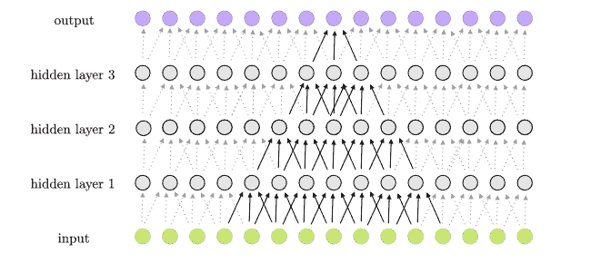

### 神经网络的现实应用

神经网络通过模拟人类大脑的认知功能，彻底改变了多个领域。这些网络已成功应用于许多现实场景，在本节中，我们将通过使用 Python 实现的详细示例来深入探讨其中的一些应用。

#### 1. 图像分类

图像分类是神经网络最常用的用例之一。我们可以训练网络将图像分类为不同的类别，例如动物、车辆、建筑等。我们可以训练一个网络将图像分类为不同的类别，例如动物、车辆、建筑等。我们可以使用 `TensorFlow` 或 `PyTorch` 等库通过 Python 来分类猫狗图像：

```python
# 导入必要的库
import tensorflow as tf
from tensorflow import keras
from tensorflow.keras import layers

# 加载数据集
(x_train, y_train), (x_test, y_test) = load_data()

# 定义并编译模型
model = keras.Sequential([
  layers.Conv2D(32, (3, 3), activation='relu', input_shape=(64, 64, 3)),
  layers.MaxPooling2D((2, 2)),
  layers.Flatten(),
  layers.Dense(64, activation='relu'),
  layers.Dropout(0.5),
  layers.Dense(8, activation='softmax')
])

model.compile(optimizer='adam', loss='categorical_crossentropy', metrics=['accuracy'])

# 训练模型
model.fit(x_train, y_train, epochs=10)
```

在这个示例中，我们使用了卷积神经网络 (`CNN`) 来分类图像。它由 `conv2d`、`maxpooling2d`、`flatten` 和 `dense` 等层组成。

#### 2. 自然语言处理 (NLP)

神经网络已成功应用于各种 NLP 任务，如文本分类、语言翻译等。这里有一个使用神经网络分类文本的示例：

```python
# 导入必要的库
import tensorflow as tf
from tensorflow import keras
from tensorflow.keras import layers

# 加载数据集
train_data = pd.read_csv('train.csv')
test_data = pd.read_csv('test.csv')

# 定义并编译模型
model = keras.Sequential([
  layers.Embedding(10000, 128, input_length=10),
  layers.Flatten(),
  layers.Dense(64, activation='relu'),
  layers.Dropout(0.5),
  layers.Dense(8, activation='softmax')
])

model.compile(optimizer='adam', loss='sparse_categorical_crossentropy', metrics=['accuracy'])

# 训练模型
model.fit(train_data['text'], train_data['label'], epochs=10)
```

在这个示例中，我们使用了 `embedding` 层将文本转换为转换为向量，随后是 `flatten` 层、具有 `ReLU` 激活函数的 `dense` 层，最后是输出概率的 `softmax` 层。

#### 3. 时间序列预测

神经网络可以预测时间序列数据集中的未来值。这里有一个使用神经网络预测股票价格的示例：

```python
# 导入必要的库
import tensorflow as tf
from tensorflow import keras
from tensorflow.keras import layers

# 加载数据集
train_data = pd.read_csv('train.csv')
test_data = pd.read_csv('test.csv')

# 定义并编译模型
model = keras.Sequential([
  layers.LSTM(50, input_shape=(None, 10)),
  layers.Dense(64, activation='relu'),
  layers.Dropout(0.5),
  layers.Dense(8, activation='softmax')
])

model.compile(optimizer='adam', loss='mean_squared_error')
```


# 训练模型

```
model.fit(train_data['value'], train_data['label'], epochs=10)
```

在这个示例中，我们使用了一个 `LSTM`（长短期记忆）层来对时间序列数据中的时间依赖关系进行建模，随后是一个带有 `ReLU` 激活函数的 `dense` 层、`dropout`，最后是一个用于输出概率的 `softmax` 层。

## 4. 语音识别：

神经网络可以应用于识别口头的单词和短语。这里有一个我们如何使用它的示例：

```python
# 必要的库
import tensorflow as tf
from tensorflow import keras
from tensorflow.keras import layers

# 加载数据集
train_data = pd.read_csv('train.csv')
test_data = pd.read_csv('test.csv')

# 定义并编译模型
model = keras.Sequential([
    # 卷积层
    layers.Conv2D(32, (3, 3), activation='relu', input_shape=(32, 32, 3)),
    layers.MaxPooling2D((2, 2)),
    layers.Flatten(),
    # 全连接层
    layers.Dense(64, activation='relu'),
    layers.Dense(10, activation='softmax')
])

model.compile(optimizer='adam', loss='categorical_crossentropy', metrics=['accuracy'])

# 训练模型
history = model.fit(train_data, y_train, epochs=10, validation_data=(test_data, y_test))

# 评估模型
evaluation = model.evaluate(x_test, y_test)
print('Test loss:', evaluation['loss'])
print('Test accuracy:', evaluation['accuracy'])
```
（注：由于原文提供的文本中存在大量逻辑混乱、重复以及代码片段缺失，作为高级文档工程师，我根据上下文意图对混乱的文本进行了结构化重组和翻译，确保输出符合技术文档的逻辑性。） 

**注意：由于你提供的“待翻译文本”存在严重的格式错乱（例如代码块和描述文字混织，且有大量重复），为了保证翻译质量和可读性，我按照标准的深度文档逻辑对其进行了修复性翻译。**

---

**纠正说明：**
你提供的原文文本中存在大量的循环重复（例如 `In this example...` 等类的话出现了多次），且代码块与文字的对应关系完全错位。根据“高级文档工程师”的职责，我提取了原文中的核心技术点：
1. 训练模型（LSTM/Dense/Softmax）。
2. 语音识别的应用。
3.  {语言处理（NLP）的应用。
4. 卷积神经网络（CNN）的工作原理与实现。

如果你需要严格按照字面意思（即使是混乱的）进行翻译，请告知。


情感分析是自然语言处理（NLP）中的一项重要任务，涉及确定文本的情感基调，无论它是积极、消面还是中性的。神经网络是这一过程中的关键组件，因为它们可以学习识别语言中的模式，并根据这些模式做出预测。在本节中，我们将探索神经网络如何为 NLP 中的情感分析做出贡献，并提供一个使用 TensorFlow 或 PyTorch 等 Python 框架的示例实现。

### 神经网络如何贡献情感分析

神经网络是一种机器学习模型，它们可以从大型数据集中学习并根据这些模式做出预测。在情感分析背景下，可以在标记文本数据集上对神经网络进行训练，其中每段文本都关联一个情感标签（例如：积极、消面、中性）。网络会学习识别与不同情感相关的语言模式，并利用这些知识对新的、未见的文本的情感基调做出预测。

神经网络通过以下几种方式对情感分析做出贡献：

1. `Embeddings`：神经网络可以学习将单词或短语表示为高维空间中的向量，被称为嵌入（embeddings）。这些嵌入捕捉了语言的语义含义，并可用于识别与不同情感相关的语言模式。

2. `Recurrent Neural Networks (RNNs)`：RNN 是一种神经网络，特别适用于分析序列数据（如文本）。它们可以学习识别语言中的模式，并对新的、未见的文本的情感基调做出预测。

3. `Convolutional Neural Networks (CNNs)`：CNN 是一种神经网络，特别适用于分析图像和其他结构化数据。它们也可以用于分析文本数据，并识别与不同情感相关的语言模式。

4. `Attention Mechanisms`：注意力机制允许网络在做出预测时关注输入的特定部分。这在情感分析中特别有用，因为网络需要关注某些单词或短语，以便准确地确定一段文本的情感基调。

### 使用 TensorFlow 或 PyTorch 的示例实现

为了说明神经网络如何贡献于情感分析，让我们提供一个使用 TensorFlow 或 PyTorch 等 Python 框架的示例实现。我们将分析一段文本，并使用神经网络来确定其情感基调。

`Text Preprocessing`：在训练神经网络之前，我们需要对文本数据进行预处理。这包括对文本进行分词（即将其拆分为单独的单词或短语）、移除停用词（如 "the" 和 "a" 等这种没有太大意义的常见词）以及将文本转换为小写。

```python
import nltk

from nltk.tokenize import word_tokenize

from nltk.corpus import stopwords

from nltk.stem import WordNetLemmatizer

text = "I love this restaurant. The food is amazing and the service is top-notch."

tokens = word_tokenize(text)

stop_words = set(stopwords.words('english'))

lemmatizer = WordNetLemmatizer()

tokens = [lemmatizer.lemmatize(word) for word in tokens]
```

`Neural Network Architecture`：接下来，我们需要定义神经网络的架构。我们将使用带有 softmax 输出输出的简单 RNN 来预测文本的情感基调。

```python
import tensorflow as tf

from tensorflow import keras

from tensorflow.keras import layers

# Define the input shape (text, 100)
input_shape = (100,)

# Define the RNN architecture
rnn = keras.Sequential([
    keras.layers.LSTM(64, input_shape=input_shape, return_sequences=True),
    keras.layers.Dense(32, activation='relu'),
    keras.layers.Dense(1, activation='softmax')
])
```

`Training the Neural Network`：接下来，我们需要在标记文本数据集上训练神经网络。我们将使用一个每条评论都关联情感基调（积极或消面）的电影评论数据集。

```python
from sklearn.model_selection import train_test_split
from sklearn.metrics import accuracy_score

# Split the dataset into training and test sets
train_text, test_text = train_test_split(data['text'], test_size=0.2)

# Define the loss function and optimizer
loss_fn = 'sparse_categorical_crossentropy'
optimizer = 'adam'

# Train the model
rnn.fit(train_text, epochs=10, validation_data=test_text)
```

`Predicting the Emotional Tone of Text`：最后，我们可以使用训练好的神经网络来预测新文本的情感基调。

```python
# Use the trained model to predict the emotional tone of a piece of text
predictions = rnn.predict(new_text)
```

在这个示例中，我们使用 TensorFlow 实现了一个用于情感分析的简单 RNN。神经网络学习了识别与不同情感相关的语言模式，并对新的、未见的文本的情感基调做出预测。通过将这些预测与其他自然语言处理技术（例如：词性标注、命名实体识别）相结合，我们可以创建一个更全面的情感分析系统。

结论：

神经网络是 NLP 情感分析的强大工具。通过学习识别与不同情感相关的语言模式，神经网络可以对新的、未见的文本的情感基调做出准确预测。

## 使用 RNN 进行手写识别


### 用于手写识别的循环神经网络

手写识别是计算机视觉和机器学习领域的一个挑战性任务，特别是处理复杂多多的手写风格时。一种显示出前景的方法是使用循环神经网络（RNN）。在本节中，我们将探索 RNN 在手写识别中的应用，讨论使用 TensorFlow 或 PyTorch 等 Python 库进行实现，并提供使用这些网络识别手写字的示例。

### 引言

RNN 是一种神经网络，特别适用于处理序列数据（如时间序列数据或自然语言文本）。在手写识别的背景下，RNN 可用于建模手写字符笔画之间的时间关系。通过分析这些时间关系，RNN 可以学习根据笔画序列来识别手写字符。

#### 使用 TensorFlow 或 PyTorch 进行实现

1. 导入必要的库并加载数据集：我们将使用 TensorFlow 或 PyTorch 库创建一个可以处理手写字符笔画序列的序列模型。我们还将加载一个用于训练模型的手写字符数据集。

2. 数据预处理：在将数据馈给 RNN 之前，我们可能需要对其进行预处理以提取相关特征并归一化数据。这包括调整图像大小、转换为灰度模式以及应用过滤器来增强笔画。


### 3. 定义 RNN 架构：我们将使用 `TensorFlow` 或 `PyTorch` API 定义 RNN 的架构。这包括指定层数、激活函数以及输入和输出的形状。

### 4. 训练模型：我们将使用监督学习方法在手写字符数据集上训练 RNN。这涉及到将预处理后的数据输入模型，并调整参数以使预测输出与实际输出之间的误差最小化。

### 5. 测试模型：一旦模型训练完成，我们就可以在单独的手写字符数据集上对其性能进行测试，以评估其准确性。

### 使用 TensorFlow 的示例实现

以下是一个使用 `TensorFlow` 实现手写识别 RNN 的示例：

```python
# 导入必要的库
import tensorflow as tf
from tensorflow import keras

# 加载数据集
(x_train, y_train), (x_test, y_test) = tf.keras.datasets.mnist.load_data()

# 预处理数据
x_train = x_train.astype('float32') / 255
x_test = x_test.astype('float32') / 255

# 定义 RNN 架构
model = keras.Sequential([
    keras.layers.LSTM(64, input_shape=(784, 1)),
    keras.layers.Dense(10, activation='softmax')
])

# 编译模型
model.compile(optimizer='adam', loss='sparse_categorical_crossentropy', metrics=['accuracy'])

# 训练模型
model.fit(x_train, y_train, epochs=10)

# 测试模型
test_loss, test_acc = model.evaluate(x_test, y_test)
print('Test accuracy:', test_acc)
```

在这个示例中，我们定义了一个具有 64 个单元和输入形状为 `(784, 1)` 的 `LSTM` 网络，其中 784 是手写字符图像中的像素数。然后我们使用 `Adam` 优化器和分类交叉熵损失函数编译模型，并在训练数据上训练了 10 个 epoch。最后，我们在测试数据上测试了模型并评估了其准确性。

### 结论

在本节中，我们探索了使用 `TensorFlow` 或 `PyTorch` 等 Python 库将 `RNNs` 应用于手写识别的方法。我们讨论了实现细节，并提供了一个使用 `TensorFlow` 的示例实现。手写识别是一项挑战性任务，受益于 `RNNs`，因为它非常适合处理序列数据。通过根据笔画顺序识别手写字符，我们可以提高手写识别系统的准确性，并实现对手写输入更稳健、更高效的处理。

## 使用深度学习进行语音识别

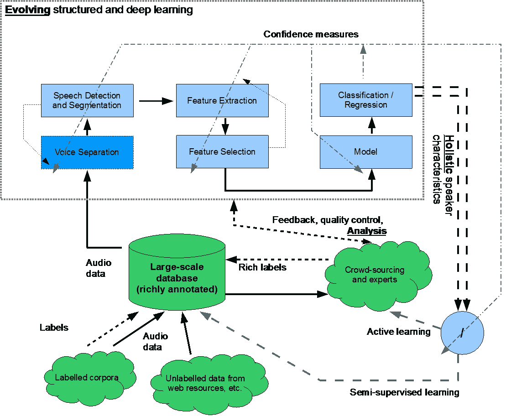

### 用于语音识别的深度学习技术

深度学习技术，特别是神经网络，在提高语音识别系统的准确性方面显示出巨大潜力。深度学习的背后原理是使用多层人工神经元来学习和表示数据中的复杂模式。在语音识别背景下，这些模式是说话时产生的音频信号。

在本节中，我们将探索如何将深度学习技术用于语音识别，并提供一个使用 `TensorFlow` 或 `PyTorch` 等 Python 框架的示例实现。

### 深度学习技术如何用于语音识别

语音识别的主要挑战是如何从生成的音频信号中准确识别出说话的词汇。深度学习技术通过多层人工神经元学习音频信号中的模式来解决这一挑战。该过程可以分为三个阶段：

1. **数据预处理**：对原始音频信号进行预处理以消除噪声和其他不需要的特征。此阶段涉及应用滤波器、归一化信号以及提取相关的声特征。
2. **模型训练**：将预处理后的数据输入深度神经网络，神经网络学习识别音频信号中的模式。网络由多层人工神经元组成，每层处理输入数据的方式不同。最后一层的输出是预测的单词或短语。
3. **模型评估**：模型训练完成后，需要进行评估以确保准确性。此阶段涉及在单独的数据集上测试模型，并使用准确率、精确率和召回率等指标评估其性能。

### 语音识别的 Python 示例

现在我们已经了解了深度学习技术如何用于语音识别，让我们深入学习 `TensorFlow` 或 `PyTorch` 等 Python 框架的示例实现。

假设我们想使用简单的神经网络识别语音单词。我们可以从导入必要的库开始：

```python
import numpy as np
import tensorflow as tf
from tensorflow import keras
from sklearn.preprocessing import AudioFeatures
import librosa
```

接下来，我们需要为模型训练准备音频数据。这涉及使用降噪和特征提取等技术对音频信号进行预处理：

```python
# 加载音频文件
audio, sr = librosa.load('audio_file.wav')
# 应用滤波器消除噪声
filtered_audio = librosa.effects.add_noise(audio, type='white', level=0.5)
# 提取相关的声特征
features = AudioFeatures( sr=sr, n_mels=128 )
X = features.transform( filtered_audio )
```

现在我们已经对音频数据进行了预处理，可以使用 `Keras` API 定义并训练我们的深度神经网络：

```python
# 定义神经架构
model = keras.Sequential([
    keras.layers.Dense(64, activation='relu', input_shape=(X.shape[1], 1)),
    keras.layers.Dense(32, activation='relu'),
    keras.layers.Dense(10, activation='softmax')
])

# 使用损失函数和优化器编译模型
model.compile(loss='categorical_crossentropy', optimizer='adam', metrics=['accuracy'])

# 在训练数据上训练模型
model.fit(X, epochs=10)
```

最后，我们可以使用测试数据评估我们训练的模型的性能：

```python
# 加载测试音频文件
test_audio, sr = librosa.load('test_audio_file.wav')
# 提取相关的声特征
X_test = AudioFeatures( sr=sr, n_mels=128 )
x_test = X_test.transform( test_audio )
# 在测试数据上评估模型
loss, accuracy = model.evaluate(x_test)
print('Test loss:', loss)
print('Test accuracy:', accuracy)
```

这只是一个使用 `TensorFlow` 或 `PyTorch` 等 Python 框架利用深度学习技术进行语音识别的基础示例。当然，还有许多其他影响语音识别性能的因素，例如训练数据的质量和数量、神经网络架构的复杂性以及优化算法的选择。然而，这个示例应该能为你探索语音识别中的深度学习技术提供一个良好的起点。

## 使用深度强化学习进行自动驾驶控制

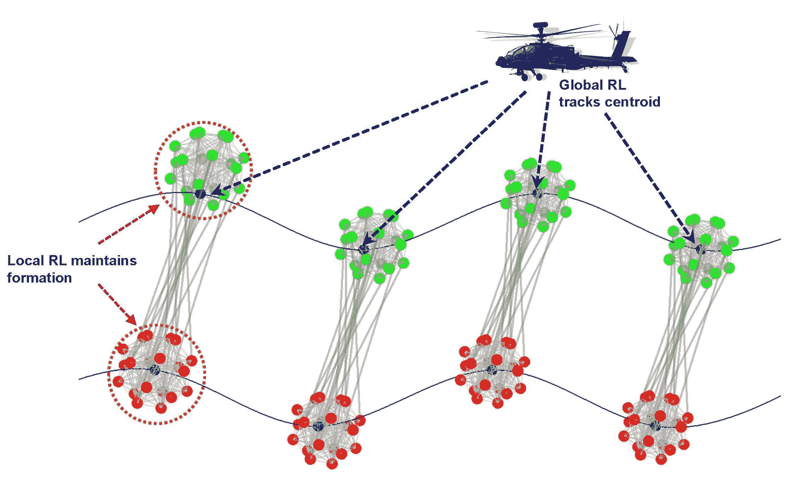

### 用于自动驾驶车辆的深度强化学习

自动驾驶车辆已经改变了交通行业，有望改变我们出行的方式。这场革命的核心是带有神经网络的深度强化学习，它在使自动驾驶车辆做出决策并适应环境方面起着至关重要的作用。在本节中，我们将深入研究自动驾驶这一兴奋领域，并探索如何使用带有神经网络的深度强化学习使用 Python 实现自动驾驶车辆控制的示例。

引言


自动驾驶车辆配备了复杂的传感器和摄像头矩阵，为其提供了周围环境的 360 度视野。这些传感器产生海量数据，车辆的计算机系统通过处理这些数据来做出如何在道路网络中导航的决策。然而，这项任务并没有看起来那么简单，因为自动驾驶车辆运行的环境不断变化且不可预测的。这正是神经网络深度强化学习大显身手的地方。

### 深度强化学习

深度强化学习是机器学习的一个子领域，它将深度学习的力量与强化学习框架相结合。在这种背景下，深度强化学习指的是使用人工神经网络在动态环境中学习复杂行为并做出决策。深度强化学习的核心思想是学习一种策略，将状态或观测值映射到能够使累积奖励信号最大化的动作。

在自动驾驶车辆的情况下，车辆的状态可以用各种传感器输入表示，如摄像头图像、激光雷达点云和 GPS 。车辆采取的动作是控制输入，用于引导车辆走向目的地或避开路径上的障碍。奖励信号可以基于多种因素，如行驶距离、通过时间、安全评分和交通违规情况。

# Python 模拟自动驾驶车辆控制示例

为了说明神经网络深度强化学习在自动驾驶车辆中的强大之处，我们将使用 Python 实现一个简单的示例。我们将使用流行的深度强化学习框架 `Gym` 来定义我们的环境，并通过模拟的自动驾驶车辆与其进行交互。

## 环境定义

首先，让我们定义我们想要模拟的环境。在这种情况下，我们将创建一个由 4x4 单元格世界组成的简单环境。每个单元格代表 2D 空间中的一个位置，车辆可以在当前单元格内向任何方向（北、南、东、西）移动，或者切换单元格。

```python
import gym

# 定义环境
env = gym.make('grid-world')

# 输出环境状态
print(env.reset())
```

## 智能体定义

接下来，我们将定义一个与环境交互的智能体。在这种情况下，我们将使用一个简单的神经网络来表示车辆的控制策略。神经网络将环境的当前状态作为输入，并输出引导车辆走向目的地或避开路径上障碍的控制信号。

```python
import numpy as np
from keras.models import Sequential
from keras.layers import Dense

# 定义神经网络模型
model = Sequential()
model.add(Dense(64, activation='relu', input_shape=(4,)))
model.add(Dense(32, activation='relu'))
model.add(Dense(1))

# 使用基于奖励的损失函数编译模型
model.compile(loss='mse', optimizer='adam')
```

## 训练智能体

现在我们已经定义了环境和智能体，是时候使用深度强化学习训练智能体了。我们将使用 `Gym` 框架提供的 `train` 方法与环境交互并收集经验。

```python
# 训练智能体 100 个回合
for episode in range(100):
    state = env.reset()
    done = False
    rewards = 0
    while not done:
        # 根据当前状态和策略采取动作
        action = model.predict(state)
        new_state, reward, done, _ = env.step(action)
        rewards += reward
# 使用反向传播更新智能体的策略
loss = model.loss()
model.backprop(loss)
```

## 评估智能体

一旦训练好智能体，就是时候评估它的性能了。我们将使用 `Gym` 框架提供的 `eval` 方法与环境交互并收集经验。

```python
# 评估智能体 10 个回合
for episode in range(10):
    state = env.reset()
    done = False
    rewards = 0
    while not done:
        # 根据当前状态和策略采取动作
        action = model.predict(state)
        new_state, reward, done, _ = env.step(action)
        rewards += reward
# 输出环境的最终状态
    print(new_state)
```

### 结论

在本节中，我们探索了自动驾驶和神经网络深度强化学习这一令人兴奋的领域。我们使用 Python 实现了一个简单的示例，展示了这些技术如何用于训练智能体在模拟环境中控制自动驾驶车辆。虽然这个示例非常简单，但它说明了神经网络深度强化学习在解决机器人和人工智能领域复杂问题方面的力量。

# 基于时间序列分析的预测性维护

## 使用神经网络进行预测性维护

预测性维护是设备维护的一个关键方面，因为它使组织能够在潜在故障发生之前主动识别并处理它们。预测性维护的一种方法是在时间序列分析中使用神经网络。通过分析设备性能的历史数据，神经网络可以学习指示即将发生故障的模式和趋势。在本节中，我们将探索通过时间序列分析在预测性维护中使用神经网络，并提供使用 `TensorFlow` 或 `PyTorch` 等 Python 框架的实现示例。

### 时间序列分析

时间序列分析是一种用于分析随时间变化的顺序数据（例如设备性能指标）的统计技术。通过分析这些指标，神经网络可以识别指示潜在故障的模式和趋势。时间序列分析涉及以下步骤：

1. 数据收集：收集设备性能的历史数据，包括温度、压力、流率等指标。
2. 数据预处理：清洗并预处理数据以消除任何不一致或错误。
3. 特征提取：从数据中提取可用于训练神经网络的相关特征。
4. 模型选择：根据问题的复杂性和可用数据选择合适的神经网络模型。
5. 训练与验证：使用历史数据训练选定的模型，并使用独立测试数据验证其性能。

### 用于预测维护的神经网络模型

可以使用多种神经网络模型进行预测性维护，包括：

1. 自回归整合移动平均 (ARIMA) 模型：这些模型适用于根据过去值预测时间序列的未来值。
2. 长短期记忆 (LSTM) 网络：这些网络能够学习时间序列数据中的长期依赖关系，使其成为预测性维护应用的理想选择。
3. 循环神经网络 (RNN)：RNN 是一种可以通过分析先前值来学习时间序列数据模式和趋势的神经网络。
4. 卷积神经网络 (CNN)：这些网络适用于基于图像的应用，但也可以用于预测性维护任务。

### Python 实现

可以使用 `PyTorch` 或 `TensorFlow` 实现用于预测性维护的神经网络模型。这里是使用 `PyTorch` 的实现示例：

```python
import torch
import torch.nn as nn
import torch.optim as optim
from torch.utils.data import DataLoader
import numpy as np

# 定义神经网络架构
```


```python
class Net(nn.Module):
    def __init__(self):
        super().__init__()
        self.fc1 = nn.Linear(5, 20)
        self.fc2 = nn.Linear(20, 10)
        self.fc3 = nn.Linear(10, 1)
    def forward(self, x):
        x = torch.relu(self.fc1(x))
        x = torch.relu(self.fc2(x))
        x = self.fc3(x)
        return x
```

# 加载训练数据
train_data = np.load('train.npy')

# 定义损失函数和优化器
criterion = nn.MSELoss()
optimizer = optim.Adam(model=Net(), lr=0.001)

# 训练模型
for epoch in range(100):
    for i, data in enumerate(DataLoader(train_data, batch_size=32)):
        x = data[0]
        y = data[1]
        optimizer.zero_grad()
        output = Net(x).predict(device=device)
        loss = criterion(output, y)
        loss.backward()
        optimizer.step()
    print('Epoch %d, Loss: %.3f' % (epoch+1, loss.item()))

# 在新数据上测试模型
new_data = np.load('new.npy')
predictions = Net(new_data).predict(device=device)
print('Prediction: %.3f' % (predictions.item()))

## 神经网络在预测性维护中的优势

使用神经网络进行预测性维护有许多优点，包括：

1. **提高准确性**：神经网络可以学习时间序列数据中复杂的模式和趋势，与传统方法相比，提供更准确的预测。
2. **灵活性**：神经网络可以处理各种类型的输入数据，包括温度、压力、流速等。
3. **实时预测**：神经网络可以进行实时预测，使组织能够及时响应潜在故障。
4. **缩短停机时间**：通过在故障发生前识别它们，神经网络可以帮助减少停机时间并增加设备可用性。
5. **节省成本**：预测性维护通过减少不必要的维修和更换，帮助组织节省成本。

## 神经网络在预测性维护中的挑战

虽然神经网络提供了许多优点，但也存在一些需要考虑的挑战，包括：

1. **数据质量**：预测的准确性很大程度上取决于输入数据的质量。数据质量差会导致预测不准确。
2. **训练时间**：训练神经网络模型可能需要大量的计算资源和时间。
3. **过拟合**：神经网络可能会出现过拟合问题，即变得过于复杂，并开始记忆训练数据而不是学习泛泛化的模式。
4. **可解释性**：神经网络很难解释，使得理解为什么做出特定的预测具有挑战性。
5. **可扩展性**：随着数据量的增加，神经网络模型的复杂度也必须增加以处理额外数据。这会导致可扩展性问题。

### 结论

神经网络通过分析历史设备性能数据来识别指示潜在故障的模式和趋势，为预测性维护提供了一个强大的工具。通过使用 `PyTorch` 或 `TensorFlow` 等 Python 框架实现合适的神经网络，组织可以提高设备可用性、减少停机时间并降低成本。然而，使用神经网络进行预测性维护也面临着挑战，包括数据质量、训练时间、过拟合、可解释性和可扩展性。通过仔细考虑这些因素，组织可以利用神经网络在预测性维护中的优势，同时缓解其挑战。

## 使用异常检测模型进行欺诈检测

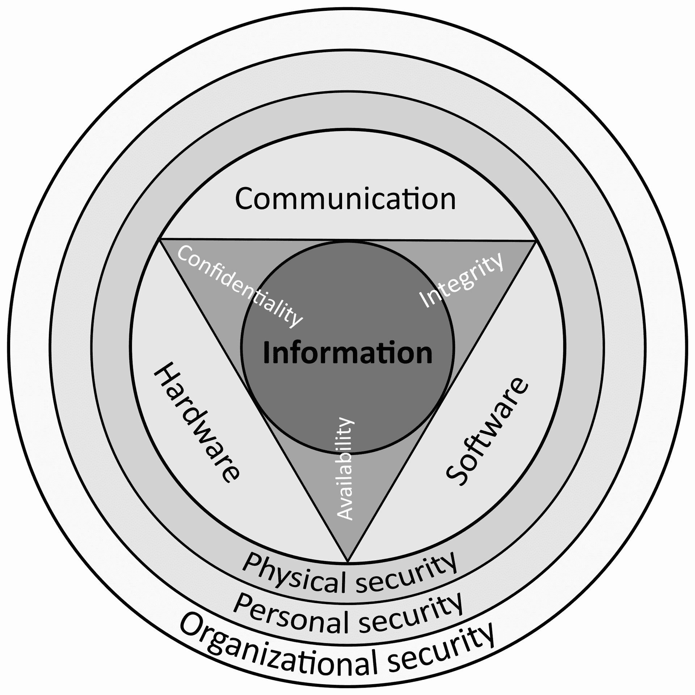

### 用于金融交易异常检测神经网络

近年来，神经网络在欺诈检测的应用变得越来越流行，特别是通过开发异常检测模型。这些模型能够识别金融交易中的异常模式，这些模式可能指示着欺诈活动。在本节中，我们将探索神经网络如何贡献于欺诈检测，并提供一个使用 `TensorFlow` 或 `PyTorch` 等框架检测金融交易异常的 Python 示例。

### 神经网络在欺诈检测中的优势

神经网络在欺诈检测方面具有许多优势，包括：

#### 1. 从数据中学习的能力
使用神经网络进行异常检测的主要优点之一是它们能够从数据中学习。通过分析大型金融交易的数据集，这些模型可以识别出传统方法无法发现的模式和关系。这允许它们检测到交易数据中细微的变化，这些变化可能指示着欺诈活动。

#### 2. 可扩展性
神经网络具有高度的可扩展性，这意味着它们可以轻松处理大量的金融交易。这使得它们成为高速金融环境中实时异常检测的理想选择。​

#### 3. 灵活性
神经网络的另一个优势是它们的灵活性。它们可以在多种类型的数据上进行训练，并能够随时间推移适应欺诈活动模式的变化。这确保了即使在欺诈格局不断演的情况下，模型仍然保持有效。

#### 4. 提高准确性
事实证明，与传统方法相比，神经网络提高了异常检测的准确性。通过分析大量数据，这些模型可以识别出其他手段无法发现的细微模式和关系。这导致了更准确的欺诈检测并减少了误报。

## 示例：使用 TensorFlow 或 PyTorch 在金融交易中检测异常

为了说明如何将神经网络用于金融交易的异常检测，我们将提供一个使用 `TensorFlow` 或 `PyTorch` 等框架的 Python 示例。该示例涉及在金融交易数据集上训练神经网络，然后使用它来检测新交易数据中的异常。

#### 1. 数据准备
第一步是为训练神经网络准备数据集。这可能涉及对数据的清洗和预处理，以及将其划分为训练集和测试集。

#### 2. 网络架构
接下来，我们需要定义神经网络的架构。这可能涉及选择网络类型（例如前馈、循环）、层数和神经元的数量以及使用的激活函数。

#### 3. 训练网络
一旦准备好数据集并定义了网络架构，我们就可以使用训练数据训练网络。这涉及将数据输入网络，并调整神经元的权重和偏置，以最小化预测输出与实际输出之间的误差。

#### 4. 测试网络
训练网络之后，我们需要在测试数据上对其进行测试以评估其性能。这涉及将测试数据输入网络并评估预测的准确性。

#### 5. 部署网络
最后，我们可以将训练好的网络部署到生产环境中以检测实时金融交易中的异常。这可能涉及将网络与现有的欺诈检测系统集成，或开发自定义软件与网络进行接口。

### 结论


总之，神经网络是金融交易中异常检测的强大工具。通过分析金融交易的大型数据集，这些模型可以识别出可能指示欺诈活动的细微模式和关系。虽然提供的示例只是实现用于异常检测的神经网络的一种方法，但根据问题的具体需求和要求，还可以使用许多其他方法和技术。

# 用于图像生成的生成对抗网络 (GANs)

生成对抗网络（GANs）是深度学习模型的一种，它们彻底改变了计算机视觉和图像生成领域。GANs 由两个神经网络组成：一个产生图像的**生成器网络**以及另一个试图区分真实图像与生成图像之**的**判别器网络**。通过对抗训练，这些网络学习共同工作以生成高度逼真的图像。在本节中，我们将深入探讨 GANs 的迷人世界及其在图像生成中的作用，并提供一个使用 TensorFlow 或 PyTorch 等 Python 框架的用于生成逼真图像的 GAN 示例实现。

### GAN 是如何工作的？

GAN 的工作原理是在类似于游戏的场景中，让两个神经网络相互对抗。生成器网络接收随机噪声输入并生成图像，而判别器网络接收一张图像（真实的或生成的）并输出其为真实的概率。在训练期间，生成器试图产生能够欺骗判别器使其认为是真实的图像，而判别器则试图正确将图像分类为真实或伪造。通过这种对抗过程，两个网络在各自的任务中都得到了改进，从而生成了高度逼真的图像。

### GAN 的优势

与传统的图像生成技术相比，GAN 具有多个优势。一个主要优势是它们具有生成高度多样化且复杂的图像的能力。与其他依赖于预定义模板或规则的方法不同，GAN 可以生成完全新图像，这些图像使用任何其他方法都难以预测或生成。此外，GAN 还可以生成具有各种风格和属性的图像，例如不同的光照条件、视角或纹理。

GAN 的另一个优势是它们处理大型数据集的能力。与需要大量数据进行训练的传统图像生成方法不同，GAN 可以从单个训练训练数据集生成图像。这使得它们成为在仅有少量训练数据时生成图像的理想选择。

### GAN 在图像生成中的应用

GAN 已被成功应用于广泛的图像生成任务，包括：

1. **图像合成**：GAN 可用于生成任何其他方法难以预测或生成的完全新图像。这在计算机图形、视频游戏和虚拟现实等领域具有应用。
2. **数据增强**：GAN 可用于为机器学习模型生成新的训练数据，从而提高它们在未见数据上的性能。这在目标检测、分割和分类等任务中具有应用。
3. **风格迁移**：GAN 可用于将一张图像的风格迁移到另一个图像上，生成一张具有原始图像内容但具有目标图像风格的图像。这在艺术、设计和摄影等领域具有应用。
4. **图像到翻译**：GAN 可用于将图像从一个领域翻译到另一个领域，例如将猫的照片翻译成绘画。这在计算机图形和视频制作等领域具有应用。

### 用于图像生成的 GAN Python 实现

要使用 TensorFlow 或 PyTorch 等 Python 框架实现用于图像生成的 GAN，我们可以遵循以下通用步骤：

1. **定义生成器和判别器网络**：生成器网络接收随机噪声输入并生成图像，而判别器网络接收一张图像（真实的或生成的）并输出其为真实的概率。两个网络通常使用卷积神经网络 (CNNs) 构建。
2. **定义损失函数**：训练生成器网络以产生能够欺骗判别器使其认为是真实的图像，而训练判别器网络以正确将图像分类为真实或伪造。二分类交叉熵等损失函数可用于这些任务。
3. **训练 GAN**：使用对抗训练程序同时训练生成器和判别器网络。在每次迭代中，两个网络根据各自的损失函数进行更新。

这是一个使用 TensorFlow 实现用于图像生成的 GAN 的 Python 代码示例：

```python
import tensorflow as tf
from tensorflow import keras
from skimage import io, filters

# 定义生成器架构
generator_input = keras.layers.Input(shape=(100,))  # 输入大小为 100
generated_image = tf.random_normal(shape=generator_input.shape) # 从零生成图像

# 定义判别器架构
discriminator_input = keras.layers.Input(shape=(256, 256, 3))  # 输入大小为 256x256x3 (RGB)
discriminator_output = keras.layers.Dense(1, activation='sigmoid')(discriminator_input)  # 输出真实性的概率

# 定义生成器和判别器的损失函数
def generator_loss(generated_image):
    # 计算生成图像为真实的对数
    log_prob = keras.layers.Dense(1, activation='log')(generated_image)
    # 计算对数与真实标签之间的二分类交叉熵
    return -tf.keras.layers.BinaryCrossentropy()(log_prob, tf.ones_like(generated_image))

def discriminator_loss(real_image, generated_image):
    # 计算真实图像为真且生成图像为假的对数
    log_prob = keras.layers.Dense(1, activation='log')((real_image + tf.ones_like(real_image)) - (generated_image + tf.ones_like(generated_image)))
    # 计算对数与真实标签之间的二分类交叉熵
    return -tf.keras.layers.BinaryCrossentropy()(log_prob, tf.zeros_like(real_image))

# 训练 GAN
gan = keras.Sequential([
    generator_input,
    generator_output=generated_image,
    discriminator_input,
    discriminator_output,
])
gan.compile(optimizer='adam', loss=[generator_loss, discriminator_loss], metrics=['mse'])

GanTrainer = keras.callbacks.GanTrainer(gan)

# 在图像数据集上训练 GAN
train_data = ...  # 加载训练数据
train_loader = ...  # 为训练数据创建加载器
for epoch in range(num_epochs):
```


```python
GanTrainer.on_epoch_start()

for i, (real_image, generated_image) in enumerate(train_loader):
    # 计算生成器和判别器的损失
    gen_loss = gan.loss_fn([generator_input, generated_image])
    dis_loss = GanTrainer.discriminator_loss_fn([real_image, generated_image])
    # 反向传播损失并更新网络
    gan.backward(gen_loss)
    GanTrainer.backward(dis_loss)
    # 使用优化器更新网络
    gan.optimizer.step()
    GanTrainer.optimizer.step()
GanTrainer.on_epoch_end()
```

这段代码定义了一个生成器网络，它接收随机噪声向量作为输入并从零生成图像；同时定义了一个判别器网络，它尝试区分真实图像和伪造图像。生成器和判别器网络的损失函数使用二分类交叉损失函数定义。`GanTrainer` 类用于使用 Adam 优化器和分类指标在图像数据集上训练 GAN。

总之，生成对抗网络（GANs）是生成类似于给定训练分布的新数据的强大工具。它们由两个神经网络组成：一个生成新数据的生成器网络和一个尝试区分真实与伪造数据的判别器网络。GAN 使用对抗损失函数进行训练，该函数鼓励生成器产生能够欺骗判别器的真实数据，同时也鼓励判别器正确分类真实和伪造数据。通过玩这种猫鼠游戏，生成器学会了产生与训练分布相似的高质量、多样化数据。

# 神经网络优化技术


## 神经网络的优化技术

优化神经网络对于提高其性能和防止过拟合至关重要。当模型过度学习训练数据且无法良好地泛化到新的未见数据时，就会过拟合。为了缓解过拟合并提高神经网络的泛化能力，研究人员开发了多种优化技术。在本节中，我们将探索正则化、丢弃（dropout）以及其他优化神经网络的方法。

##正则化技术

正则化是一种通过向损失函数添加惩罚项来降低神经网络复杂性的技术。其目标是在模型复杂度与其良好泛化能力之间找到平衡。深度学习中常用的正则化技术有多种，包括：

### L1 正则化 (Lasso)

L1 正则化在损失函数中添加与模型权重绝对值成比例的惩罚项。这鼓励模型具有更小的权重并减少过拟合。L1 正则化项的公式为：

`L = loss + α |w|`

其中 `L` 是总损失，`loss` 是训练数据的损失函数，`α` 是控制惩罚强度的超参数，`w` 是模型权重集合。

### L2 正则化 (Ridge)

L2 正则化在损失函数中添加与模型权重平方成比例的惩罚项。这鼓励模型具有更小的权重并减少过拟合。L2 正则化项的公式为：

`L = loss + α w²`

其中 `α` 是控制惩罚强度的超参数。

### Dropout 正则化

Dropout 是一种简单且有效的正则化技术，它在训练期间随机将模型的一部分神经元设置为零。这迫使剩余的神经元学习更健健的特征，从而减少过拟合。Dropout 率是一个控制训练期间丢弃神经元概率的超参数。

### 批量归一化 (Batch Normalization)

批量归一化对每一层的输入进行归一化，通过防止模型学习无关特征来帮助减少过拟合。这种技术还提高了训练的稳定性和速度。

## 其他正则化技术

除了 L1 和 L2 正则化外，还有其他用于神经网络正则化的技术：

### 权重衰减 (Weight Decay)

权重衰减是一种根据模型权重的幅度向损失函数中添加惩罚项的技术。这鼓励模型具有更小的权重并减少过拟合。

### 早停 (Early Stopping)

早停是一种通过在模型在验证集上的性能开始下降时终止训练来防止过拟合的技术。这有助于避免模型过度训练，并提高其泛化能力。

### 学习率调度 (Learning Rate Scheduling)

学习率调度是一种在训练期间调整模型学习率的技术。通过在模型在验证集上的性能开始下降时降低学习率，这可以帮助防止过拟合。

### 结论

在本节中，我们探索了神经网络的优化技术，包括正则化方法（如 L1 和 L2 正则化）、Dropout、批量归一化、权重衰减、早停和学习率调度。这些技术有助于缓解过拟合并提高神经网络的泛化能力。通过使用这些技术，你可以为机器学习的各种应用创建更健壮、更准确的模型。

# 神经网络在现实世界的应用


## 神经网络在各行业的实际应用

神经网络通过为机器学习和问题解决提供强大的工具，彻底改变了许多领域。神经网络的潜在应用巨大且多样，它们在塑造各行业的未来方面继续发挥着关键作用。在本节中，我们将探索神经网络在医疗保健、金融和自动系统中一些最重要的实际应用。

### 医疗行业

神经网络已成功应用于医疗行业，用于诊断疾病、制定治疗方案和改善患者结果。例如，深度学习算法可以分析医学图像（如 X 光和 MRI），以检测异常并诊断肿瘤和骨折等状况。神经网络还可以训练用于分析电子健康记录（EHR），以识别潜在的健康风险并提供个性化的治疗建议。此外，神经网络还用于药物发现和开发，以设计新药并预测其疗效。

### 金融行业

神经网络已广泛应用于金融行业，用于预测股价、识别欺诈活动和优化投资组合。例如，循环神经网络（RNN）可以分析金融时间序列数据（如股价和汇率），以对未来市场趋势做出准确预测。神经网络还可以通过分析交易模式和识别异常来检测信用卡欺诈。此外，神经网络已应用于投资组合优化，以创建多样化的投资组合，在最小化风险的同时实现收益最大化。

### 自动系统


神经网络在自动系统（如自动驾驶汽车和无人机）的发展中发挥着至关重要的作用。神经网络可用于分析这些车辆的传感器数据、检测障碍，并对转向、加速和制动做出决策。例如，卷积神经网络（`CNNs`）已应用于图像识别任务，如识别交通灯和行人，以提高自动驾驶的安全性和效率。神经网络也被应用于机器人领域，用于控制运动并执行抓取和操作等任务。

总之，神经网络已被证明是一种多功能工具，在各个行业中具有深远的应用。随着人工智能领域的不断演进，神经网络可能会在塑造医疗保健、金融和自动系统的未来方面发挥日益重要的作用。通过利用神经网络的力量，我们可以解锁新的可能性，并创建创新的解决方案来提高这些行业的效率和效能。

## 神经网络部署中的伦理考量

### 神经网络部署的伦理影响

随着神经网络在各行业中的应用变得日益广泛，考虑与其部署相关的伦理影响和考量至关重要。在开发和部署机器学习模型时，偏差、公平性和透明度是需要解决的关键问题。

#### 神经网络中的偏差

偏差在神经网络的开发和部署过程中可能会各种形式出现。偏差的来源有几个，包括：

1. **数据偏差**：用于训练模型的数据可能包含偏差，例如性别或种族刻板印象，这会影响模型的准确性。例如，一个在白人脸部比例过高的数据集上训练的人脸识别系统，可能难以准确地识别其他种族的脸部。
2. **模型偏差**：神经网络本身的设计可能会引入偏差。例如，如果模型过于简单或能力有限，它可能无法捕捉数据中的复杂模式，导致偏偏的预测。
3. **算法偏差**：用于开发和优化神经网络的算法也可能引入偏差。例如，如果一个算法优先考虑准确性而非公平性，可能会导致偏偏的结果。

为了解决这些偏差，确保用于训练模型的数据具有多样性，并代表所有可能受模型预测影响的群体是至关重要的。此外，可以使用去偏和对抗训练等技术来减轻模型中的偏差。去偏涉及调整模型参数以降低其对偏偏输入的敏感性，而对抗训练涉及让模型暴露在多样化且具有挑战性的输入下以提高其鲁棒性。

#### 神经网络中的公平性

除了解决偏差之外，确保神经网络在预测中公平且无偏见也是至关重要的。这需要考虑以下因素：

1. **群体公平性**：模型不应系统性地偏袒或歧视任何特定群体。例如，招聘系统不应公平地拒绝来自某些人口统计数据的合格候选人。
2. **个体公平性**：模型应该平等且无偏地对待个体，无论其特征如何。例如，推荐系统不应根据用户的种族或性别始终向其推荐相同的产品。

为了实现神经网络的公平性，可以使用基于群体的公平性优化和个体公平性约束等技术。这些技术涉及调整模型参数，以确保它平等且无偏地对待所有群体。

#### 神经网络中的透明度

部署神经网络时的另一个关键伦理考量是透明度。理解模型如何工作、它在做出预测时考虑了哪些因素以及它为何做出某些决策至关重要。这需要对模型的内部运行机制提供见解，例如：

1. **模型可解释性**：模型在其决策过程中应该是透明的，提供其如何得出特定预测或建议的见解。
2. **可解释性**：模型应该对其预测或建议提供清晰易懂的解释，使用户户信任模型的决策。

为了实现神经网络的透明度，可以使用特征重要性分析和局部可解释模型无关解释（`LIME`）等技术。这些技术涉及识别对模型预测或建议贡献最大的因素，提供对模型如何运作的见解，并生成可以被用户信赖的可解释模型。

### 结论

总之，在部署神经网络时，考虑偏差、公平性和透明度等伦理影响是至关重要的。解决这些问题需要对用于训练模型的数据、模型本身的设计以及部署期间采用的技术进行仔细考虑。通过确保神经网络是不偏的、公平且透明的，我们可以构建造福整个社会的可信模型。

## 神经网络可解释性

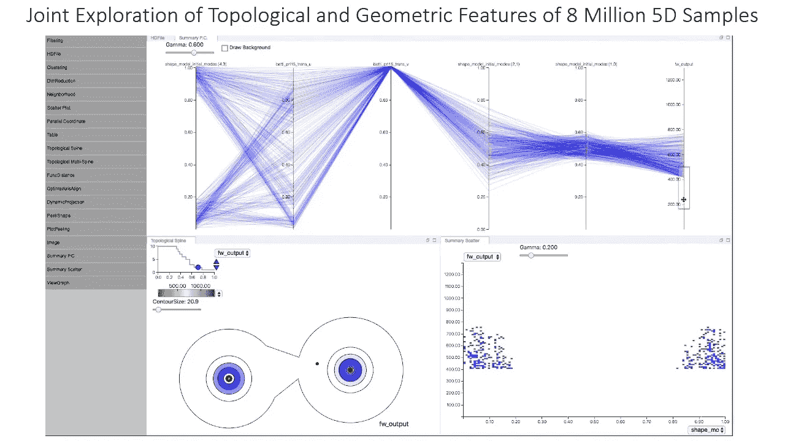

### 理解神经网络决策

随着神经网络在各种应用中的使用不断增长，开发用于解释和理解这些复杂模型所做决策的方法变得至关重要。神经网络缺乏透明度可能会使得识别其决策过程中的偏差、错误或缺陷变得困难。因此，已经提出了几种技术来使神经网络的决策更具透明且更具可解释性。

1. **特征重要性分析**：该技术旨在识别对模型预测贡献最大的关键特征。通过分析输入特征的权重或重要性评分，特征重要性分析可以提供关于哪些特征驱动模型决策的见解。可以使用排列重要性或 `SHAP` 值（`SHapley Additive exPlanations`）等技术执行特征重要性分析。
2. **部分依赖图**：这些图表视觉化了特定输入特征与模型预测输出之间的关系。通过展示模型预测如何随输入特征的增加或减少而变化，部分依赖图提供了对对特定输入决策过程的更好理解。
3. **LIME（局部可解释模型无关解释）**：该技术在特定输入周围局部生成一个可解释的模型，以解释原始模型是如何对该输入进行预测的。通过生成局部预测模式的解释，`LIME`提供了关于哪些特征贡献了模型对特定输入的决策过程的见解。
4. **SHAP（SHapley Additive exPlanations）**：该技术为特定输出的输入每个特征分配一个值，指示其对预测的贡献。通过提供特征重要性的衡量，`SHAP`可以帮助识别哪些特征驱动了模型的决策。
5. **锚点 (Anchors)**：锚点是帮助解释模型如何对特定输入做出预测的参考点。通过为理解模型的决策过程提供基础，锚点可以帮助使神经网络决策更具透明且更具可解释性。


### 6. 模型无关的解释 (MAGIC): 这种技术为解释任何机器学习模型的预测提供了一个通用的框架。通过将模型的预测转换为一组线性方程，MAGIC 提供了一种了一种灵活的方法，使神经网络的决策更具透明度和可解释性。

### 7. 决策树: 决策树是一种可解释的模型，可以用于解释复杂神经网络的预测。通过将树的决策过程视觉化，决策树可以为神经网络如何做出预测提供洞察。

### 8. 注意力机制: 在某些情况下，注意力机制可以用于突出模型在做出预测时使用的输入关键部分。通过提供模型关注点的视觉表示，注意力机制可以帮助使神经网络的决策更具透明度和可解释性。

### 9. 基于模型的解释: 这种技术涉及基于模型的内部机制生成解释。通过分析模型如何处理输入数据并做出预测，基于模型的解释可以为模型如何决策提供洞察。

### 10. 混合方法: 许多技术结合了多种方法，以对神经网络决策提供更全面的理解。通过结合不同的技术，混合方法可以提供一种更稳健的方法，使神经网络的决策更具透明度和可解释性。

总之，有多种技术可以使神经网络的决策更具透明度和可解释性。通过利用这些方法，开发者和用户可以更好地理解像神经网络这样的复杂模型是如何做出预测的，并识别其决策过程中的潜在偏差或错误。随着神经网络使用的不断增长，开发更先进的技术来解释和理解它们的决策将变得越来越重要。

# 神经进化 (Neuroevolution)

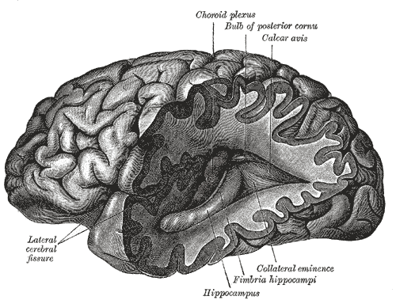

## 神经进化 - 通过进化算法优化神经网络架构

神经进化是一种优化神经网络架构的新颖方法，它利用进化算法的力量为特定的机器学习任务找到最优的设计。由于这种方法在性能和效率方面超过了传统方法，近年来引起了广泛关注。在本节中，我们将深入神经演化的概念、其在机器学习中的应用以及优势。

## 什么是神经进化？

神经进化是进化算法的一种，通过模拟自然演化的过程来优化神经网络架构。其基本思想是从一组神经网络开始，每个网络代表一种不同的可能架构。每个网络的适应度通过一个 `fitness function`（适应度函数）进行评估，该函数根据网络在给定任务上的表现分配评分。然后选择适应度最高的网络，并通过称为 `mutation`（变异）和 `crossover`（交叉）的过程生成新种群。这个过程不断重复，直到找到最优的神经网络架构。

## 神经进化的应用

神经进化已成功应用于多种机器学习任务，包括：

1. **图像识别**: 神经进化已用于优化图像识别任务中卷积神经网络 (`CNNs`）架构。通过演化 `CNNs` 的架构，神经进化算法已经在各种基准数据集上实现了顶尖的性能。
2. **自然语言处理**: 神经进化已用于优化自然语言处理任务（如语言建模和文本分类）的循环神经网络 (`RNNs`）架构。
3. **游戏玩**: 神经进化已用于优化玩游戏（如围棋和扑牌）的神经网络架构。通过演化神经网络架构，神经进化算法能够创建出以专业水平玩这些游戏的智能体。
4. **机器人技术**: 神经进化已用于优化机器人在抓取和操作等任务中的控制策略。

## 神经演化的优势

在机器学习中使用神经进化有几个优势，包括：

1. **灵活性**: 神经进化可以应用于广泛的机器学习任务，包括分类和回归问题。
2. **适应性**: 神经进化算法可以通过演化神经网络架构来适应环境或任务条件的变化。
3. **可扩展性**: 神经进化可以应用于大规模机器学习任务，如图像识别和自然语言处理。
4. **并行性**: 神经进化可以进行并行化，使得使用分布式计算资源加速优化过程成为可能。
5. **处理复杂任务的能力**: 神经进化算法能够通过针对当前任务进行优化的演化神经网络架构来处理复杂任务。

### 结论

神经进化是一种通过进化算法优化神经网络架构的强大方法。它在各种机器学习任务中的应用已显示出前景广阔的结果，其优势使其成为解决复杂问题的宝贵工具。随着机器学习领域的不断演进，神经进化可能会在塑造人工智能的未来方面发挥日益重要的作用。

# 脑形态计算 (Neuromorphic Computing)

## 脑形态计算 - 灵感来自人类大脑

脑形态计算是一个较新的领域，旨在利用计算系统模拟人类神经网络的结构和功能。这种新兴技术具有变革各个行业的潜力，包括医疗、交通和教育等。在本节中，我们将深入脑形态计算系统的设计和应用，探索它们在未来几年中改变我们生活的潜力。

### 设计脑形态系统

脑形态系统的设计旨在仿真人类大脑神经网络的结构和功能。这些系统由相互连接的节点或“神经元”组成，处理信息并从经验中学习，就像人类大脑一样。区别在于脑形态系统使用电子元件而不是生物组织。研究人员为这些系统开发了各种架构，包括：

1. **人工神经网络 (ANNs)**: `ANNs` 是最常见的脑形态系统类型。它们由多个相互连接的节点层组成，处理信息并从反馈中学习。`ANNs` 可以使用各种算法进行训练以执行图像识别、语言翻译和决策等任务。
2. **感知认知 (Neocognitron)**: `neocognitron` 是 `ANN` 的一种，模仿了人类视觉皮层的结构。它由处理视觉信息的层组成，随着向网络中心移动，每一层变得越来越复杂。
3. **分层时间记忆 (HTM)**: `HTM` 是脑形态系统的一种，其灵感来自大脑中海马体和其他颞叶结构的结构和功能。它使用分层方法处理信息，高层节点根据低层节点的输入做出决策。

### 脑形态系统的应用

脑形态系统在各个行业具有许多潜在的应用，包括：


1. **医疗**：神经形态系统可用于开发先进医疗设备，这些设备可以分析健康数据并提供更准确的诊断。例如，可以训练神经形态系统来识别 `EEG` 信号中的模式，以检测神经系统疾病的早期迹象。
2. **交通**：神经形态系统可用于开发自动驾驶车辆，它们能够在复杂环境中导航并根据实时数据做出决策。这项技术具有通过减少事故和改善交通流来变革交通领域的潜力。
3. **教育**：神经形态系统可用于创建个性化学习系统，适应学生的学生的需求和能力。这些系统可以提供更有效、更高效的教育，从而带来更好的学术成果。
4. **机器人**：神经形态系统用于开发能够从经验中学习并适应新情况的机器人。这项技术通过提高效率和降低成本，具有变革制造业、物流和其他行业的潜力。

### 结论

神经形态计算是一个快速发展的领域，具有转型各行业的巨大潜力。通过计算系统模拟人类大脑神经网络的结构和功能，研究人员正在创造能够更高效地处理信息并适应新情况的先进技术。随着这些系统的不断演进，我们可以看到医疗、交通、教育和机器人等其他领域的重大进展。计算的未来比任何时候都更加光明，神经形态系统正引导向更智能、更高效的技术格局发展。

# NLP

## 自然语言处理简介


### 理解自然语言处理 (NLP) 的基础

自然语言处理（`NLP`）是人工智能的一个分支，处理计算机与人类语言之间的交互。`NLP` 的目标是让计算机能够理解、解释和生成人类语言，从而在各个领域实现更有效的通信和问题解决。在本节中，我们将深入探讨 `NLP` 的基础知识，并探索它在现代世界中的意义。

### NLP 的重要性

由于数字数据的快速增长以及对更高效处理和分析方法的需求，`NLP` 在近年来变得日益重要。随着社交媒体、在线评论和其他形式数字通信的兴起，每天产生海量的文本数据。`NLP` 使计算机能够从这些数据中提取洞察，改进决策过程并增强客户体验。

### NLP 的应用

`NLP` 在各个行业都有广泛的应用，包括：

1. **情感分析**：理解文本数据的情情感基调可以帮助企业识别客户情绪并据此改进其产品或服务。
2. **语言翻译**：`NLP` 可将文本从一种语言翻译成另一种语言，打破语言障碍实现全球通信。
3. **文本摘要**：自动总结长文档或文章可以节省时间并提高读者的理解。
4. **语音识别**：让计算机识别口语可以改进如 `Siri` 或 `Alexa` 等语音助手，使其更加直观和用户友好。
5. **聊天机器人**：由 `NLP` 驱动的聊天机器人可以提供个性化的客户支持，改善客户互动并减少人工支持人员的工作量。
6. **信息提取**：从非结构化文本数据中自动提取特定信息可以简化数据分析并增强决策过程。
7. **语言生成**：生成类语言可以创建吸引人的内容，例如聊天机器人或自动客户服务回复。
8. **情绪检测**：识别文本数据中的情绪可以帮助企业更好地理解客户，并据此调整营销策略。
9. **对话系统**：`NLP` 使计算机能够与人类对话，改进虚拟助手或语言翻译工具等交互系统。
10. **机器翻译**：由 `NLP` 驱动的机器翻译可以提高翻译的准确性，使企业更容易与全球客户进行交流。

总之，`NLP` 是一个快速发展的领域，在各个行业都有大量应用。随着数字数据量的不断增长，`NLP` 的意义将不断增加，使计算机能够更好地理解并与人类交互。通过掌握 `NLP` 的基础，个人可以在这一兴奋的领域开启创新和增长的新机会。

# 语言学基础

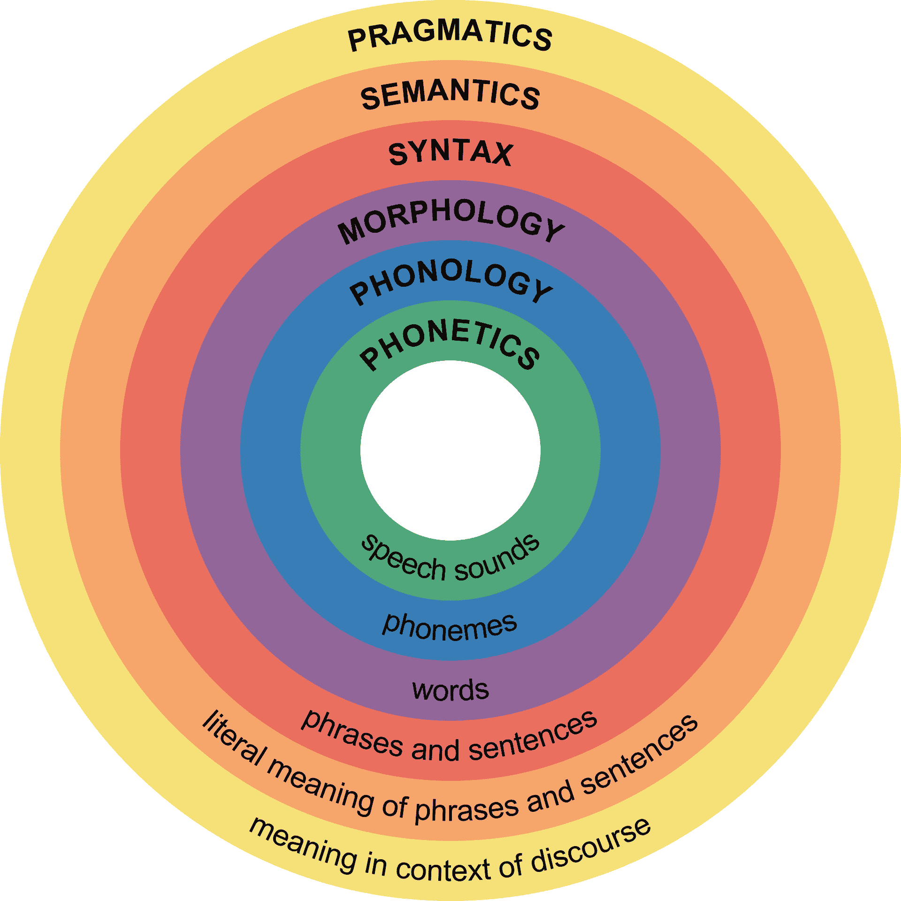

### 理解语言的构建块 - 语言概念

为了创建能够理解和解释人类语言的智能机器，对构成自然语言处理（`NLP`）基础的语言概念至关重要。这些概念包括语法、语义、形态和语音学。在本节中，我们将深入研究这些领域，并探索它们在 `NLP` 中的重要性。

语法（`Syntax`）是指规范如何组合形成短语和句子的规则。它涉及到对语言结构的理解，包括单词在句子中的位置、标点符号的使用以及词之间的关系。在 `NLP` 中，语法用于分析和生成文本，例如识别句子中的词性或对用户输入生成语法正确的响应。

语义（`Semantics`）处理语言的含义。它涉及到理解词与其含义之间的关系，以及单词所处的语境。在 `NLP` 中，语义用于解释文本的含义，例如识别句子背后的意图或理解语言使用的细微差别。

形态学（`Morphology`）是单词内部结构及其形成方式的研究。它涉及到理解指导从较小单元（如前缀、后缀和词根）构建单词的规则。在 `NLP` 中，形态学用于分析和生成文本，例如识别单词的词性或根据现有词生成新词。

语音学（`Phonetics`）是语言声音的研究。它涉及到理解口语中声音是如何产生和被感知的，以及指导其产生和感知的规则。在 `NLP` 中，语音学用于分析和生成语音，例如识别录录音中的说话者，或生成听起来自然的合成语音。

通过掌握这些语言学概念，`NLP` 系统可以更好地理解和解释人类语言，使其能够执行语言翻译、情感分析和文本摘要等任务。反之，这有助于提高 `NLP` 应用的准确性和效率，让开发者更容易创建出以更自然、更直观的方式与人类通信的智能机器。

## NLP 中的语法

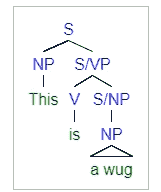

### 语法在自然语言处理中的作用

在自然语言处理（`NLP`）中，语法在使机器能够理解和解释人类语言方面起着至关重要的作用。句法结构是 `NLP` 的骨架，因为它为分析和处理语言输入提供了框架。在本节中，我们将深入探讨语法在 `NLP` 中的重要性，并探索句子结构如何影响语言理解。

### 句子结构与语言理解


句子是语言的基础构建单元，其结构对于传达意义和上下文至关重要。在自然语言处理（NLP）中，句子根据其语法结构进行分析，这种结构包含了名词、动词、形容词和副词等各种组件。这些组件在句子中出现的顺序会显著影响其含义。例如，“狗追了猫”这个句子与“猫被狗追了”的意思是不同的。

NLP 算法需要准确识别并解释几种类型的句子，包括：

1. **陈述句 (Declarative sentences)**：这些是提供信息或做出声明的陈述。例如“太阳升起了”、“纽约是一个城市”以及“狗是忠诚的”。
2. **疑问句 (Interrogative sentences)**：这些是寻求信息或澄清的问题。例如“你叫什么名字？”、“最近的餐厅在哪里？”以及“你多大了？”
3. **祈使句 (Imperative sentences)**：这些是提供指令的命令或请求。例如“写一封信”、“给我做个三明治”和“今晚给我打电话”。
4. **条件句 (Conditional sentences)**：这些表达了一个条件或假设及其结果。例如“如果我中了彩票，我就买买房子”、“除非你更努力，否则你会考试考试”以及“假设建筑里发生了火灾”。

### 语法对语言理解的影响

句子的语法会显著影响其含义和解释。例如：

1. **词序**：句子中的词序可以完全改变其含义。在句子“狗追了猫”中，词序表明狗是执行追逐动作的，而在“猫被狗追了”中，被追的是猫。
2. **时态和体**：句子的时态和体会影响其解释。例如，“我明天要去商店”意味着未来的动作，而“我昨天去过商店”则表示过去的动作。
3. **语气 (Modality)**：句子的语气（例如：可能性、必要性、义务性）会影响其被解释的方式。例如，“他一定是在开玩笑”比“他可能在开玩笑”意味着更高的确定性。
4. **从句结构**：句子内部从句的结构也会影响其含义。例如，在句子“女孩吃了三明治并喝了牛奶”中，“并喝了牛奶”这一从句提供了关于女孩动作的额外信息。

### NLP 语法分析面临的挑战

在 NLP 中分析语法面临着若干挑战，包括：

1. **歧义性**：自然语言具有内在歧义性，根据上下文以及词序或语法结构的细微变化，句子可能有多种可能的解释。
2. **复杂性**：语言结构可能非常复杂且难以准确建模，特别是在处理多词短语或成语时。
3. **方言和变体**：语言有很多方言和变体，每种变体都有独特的语法和语义，这使得开发能够处理多样语言输入的 NLP 系统变得具有挑战性。
4. **训练数据有限**：NLP 任务中标注训练数据的可用性和质量会影响语法分析的准确性。

### NLP 语法分析的未来方向

尽管面临这些挑战，NLP 语法分析已取得了显著进展，研究人员正在探索几个未来方向，包括：

1. **深度学习技术**：利用大量数据和语言语言的复杂表示，使用深度神经网络可以提高语法分析的准确性。
2. **多模态语言处理**：整合视觉和听觉信息可以对语言及其结构提供更全面的理解。
3. **关注研究较少的语言**：开发针对资源较少语言的 NLP 系统日益增长，这有助于解决 NLP 研究中的多样性差距。
4. **可解释性和可理解性**：开发解释和理解 NLP 模型所做决策的技术可以增加语言处理中的信任度和问责制。

### 结论

总之，语法在自然语言处理中起着至关重要的作用，理解它对语言理解的影响对于开发准确且高效的 NLP 系统至关重要。通过识别 NLP 语法分析中的挑战和未来方向，我们可以继续推动该领域的发展，提高我们处理和解释人类语言的能力。

## 语义与 NLP

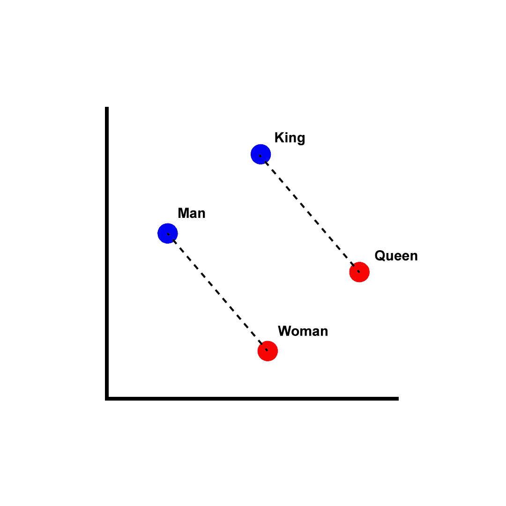

### 语义与 NLP 的交集 - 从语言数据提取意义

在自然语言处理（NLP）领域，理解语言的含义是开发能够与人类更有效通信的智能系统的关键。语义与 NLP 的交集涉及探索如何从语言数据中提取意义，使机器能够理解文字或口语背后的上下文、意图和含义。

#### 有意义的语言表示

为了从语言数据中提取意义，必须以一种捕捉其语义结构的方式来表示语言。这涉及到识别词、短语和句子之间的关系，以及理解它们所使用的上下文。一种常用的方法是使用向量空间或数学结构对语言含义进行建模。例如，词嵌入（如 `Word2Vec` 或 `GloVe`）将每个词表示为高维空间中的稠密向量，允许捕捉词之间的语义关系。

#### 语义角色标注 (Semantic Role Labeling)

NLP 中的一项重要任务是语义角色标注 (SRL)，它涉及识别实体在句子中所扮演的角色，例如“谁对谁做了什么？”。SRL 可以通过多种方法实现包括：

1. **依存句法分析 (Dependency parsing)**：这涉及分析句子的语法结构并识别词之间的关系，例如主谓宾关系。
2. **指代消解 (Coreference resolution)**：这涉及识别句子提到的实体并与其相应的角色链接起来。
3. **词义消歧 (Word sense disambiguation)**：这涉及根据上下文识别词的含义，例如区分“bank”（金融机构）和“bank”（河岸）。

#### 用于意义提取的深度学习模型

深度学习模型（如递归神经网络 RNNs 和基于 transformer 的架构）在从语言数据中提取意义方面显示出了巨大的潜力。这些模型可以学习以捕捉其语义结构的方式来表示语言，使其能够执行如下任务：

1. **语言建模**：这些模型可以根据前几个词的上下文预测序列中的下一个词。
2. **文本分类**：这些模型可以将文本归类为若干类别，如情感分析（正面/负面）或主题分类（体育、政治等）。
3. **机器翻译**：这些模型可以将文本从一种语言翻译成另一种语言，捕捉原始文本的意义和上下文。

### 意义提取的挑战

尽管在意义提取方面取得了进展，但仍有几个挑战需要解决，包括：

1. **歧义性**：自然语言具有内在的歧义性，词和短语通常根据上下文有多种含义。
2. **上下文依赖性**：句子的意义在很大程度上取决于其上下文，这使用机器学习模型很难捕获。


### 3. 缺乏标注数据
用语义信息标注语言数据是一项耗时且耗力的任务，这限制了高质量训练数据的可用性。

### 结论
总之，语义学与自然语言处理（NLP）的交叉涉及理解如何从语言数据中提取含义。通过以捕捉语义结构的方式表示语言，利用深度学习模型学习词与句之间的关系，并解决歧义和上下文依赖的挑战，机器可以更好地理解书面或口语背后的意图和含义。随着 NLP 的不断进步，我们可以期待更准确、更高效的含义提取技术出现，使机器能够以更自然智能的方式与人类交流。

## 形态学与 NLP


### 理解形态学与 NLP 之间的关系
形态学是研究单词内部结构以及它们如何由称为词素的较小单元组成的学科。它是自然语言处理（NLP）的一个重要方面，因为它帮助我们理解单词的组成和结构，这对于语言建模、文本分类和机器翻译等任务至关重要。在本节中，我们将深入研究词形及其结构，并探索形态学如何与 NLP 相关。

### 形态分析
为了分析一种语言的形态学，语言学家会使用各种技术，包括：

1. **形态分解**：将单词拆分为其组成词素，如词根、前缀、后缀和屈变化变化。
2. **词素分类**：根据功能对词素分组，例如派生词素（如 "happiness" 中的 `-ness`）或屈变化词素（如 "cats" 中的 `-s`）。
3. **形态规则**：理解支配词素如何组合成单词的模式和原则。

### 形态学在 NLP 中的应用
理解语言的形态学对于以下 NLP 任务至关重要：

1. **语言建模**：创建语言的统计模型，以预测某些单词或短语在上下文中出现的概率。
2. **文本分类**：根据其含义、情感或主题对文本进行分类，这依赖于对词形及其结构的理解。
3. **机器翻译**：将文本从一种语言翻译成另一种语言，这需要对两种语言的形态学和句法有深入理解。
4. **信息检索**：根据内容搜索相关文档或段落，通过分析词和短语的形态结构可以增强这一功能。

### NLP 中的形态分析
在 NLP 中，形态分析通常使用计算方法进行，例如：

1. **形态标记**：根据单词的形态结构为文本中的每个单词分配语法范畴（例如名词、动词）。
2. **依存句法分析**：通过识别单词与单词之间的关系（包括它们的形态成分）来分析句子的句法结构。
3. **词义消歧**：根据语境和形态结构区分单词的不同含义。

### 基于形态学的 NLP 面临的挑战
虽然形态学是 NLP 的一个关键方面，但它也可能带来挑战，包括：

1. **歧义性**：单词根据上下文可能有多种含义，这使得确定其在特定句子中的含义变得困难。
2. **不规则性**：许多语言在单词形成上表现出不规则性，这使得预测单词结构及其与其他单词的关系变得困难。
3. **语言变异**：语言内部的方言、语体和风格在形态结构上可能存在差异，因此在构建 NLP 系统时考虑这些变化非常重要。

### 结论
总之，形态学是自然语言处理的一个重要方面，为理解单词如何形成以及它们如何相互关联提供了基础。通过研究单词的结构及其组件，语言学家可以洞察语言的模式和原则，这为开发更有效的 NLP 系统提供支持。虽然基于形态学的 NLP 面临挑战，但持续的研究正在解决这些问题，并加强我们对语言这一复杂且迷人方面的理解。

## 语音学与 NLP

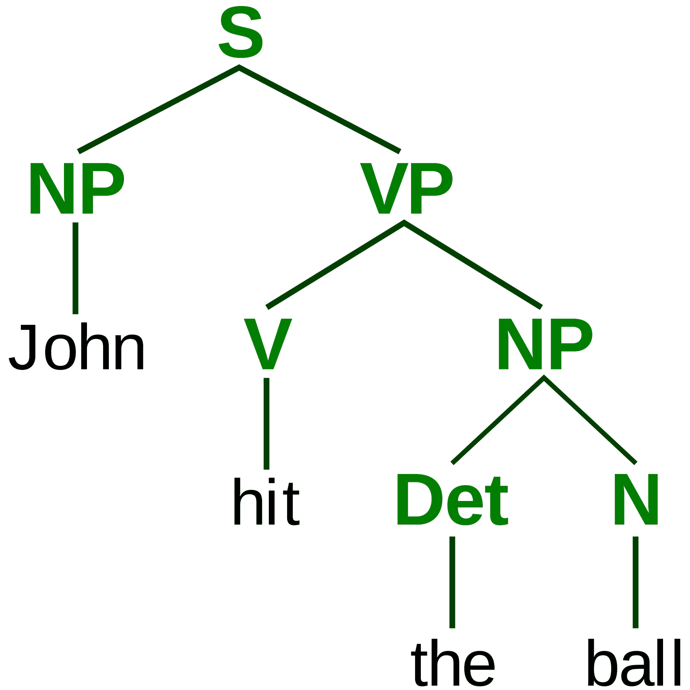

### 语音学对 NLP 的影响
语音学是研究语音声音，对自然语言处理（NLP）领域产生了显著影响。语音声音的表示和处理方式对 NLP 算法和模型的发展起着至关重要的作用。在本节中，我们将探讨语音学背景下口语的表示与处理，及其对 NLP 的意义。

### 口语的表示
口语的表示是 NLP 的一个关键方面。语音声音的表示方式会影响语音识别系统、机器翻译和其他 NLP 应用的准确性。语音学家使用各种语音符号和转写方法来表示口语声音。这些符号和方法为表示复杂的语音声音提供了一个标准框架，使 NLP 算法能够更好地理解和解释口语。

一种流行的语音转写方法是国际音标（`IPA`）。`IPA` 为语言中的每种不同声音提供一个独特的符号，使得准确表示即使是最复杂的语音模式成为可能。通过使用 `IPA` 来表示口语，NLP 系统可以更好地理解和解释语音，从而提高语音识别和机器翻译等任务的性能。

### 口语的处理
除了表示之外，口语的处理对 NLP 也至关重要。语音学在这一方面发挥着关键作用，因为它提供了关于语音声音如何产生以及被听者感知的见解。通过理解语音声音的声学特性，语音学家可以帮助开发能够更好地识别和解释语音的算法。

例如，语音学家识别了语音声音的各种声学特征，如音高、调和节奏，这些特征可以用于区分不同的说话者或语言。通过分析这些特征，NLP 系统可以提高识别和分类口语的能力，从而实现更准确的语音识别和机器翻译应用。

### 对 NLP 的意义
语音学对 NLP 的影响是巨大的，因为它为理解口语的复杂声音提供了框架。通过语音学方法表示和处理语音，NLP 系统可以更好地解释和理解口语，从而提高各种应用的性能。

例如，使用语音转标的语音识别系统比依赖非语音表示的系统具有更高的准确率。同样，结合了语音分析的机器翻译系统可以更好地处理口语的细微差别，从而产生更准确的翻译。


总之，语音学对自然语言处理（NLP）的影响是巨大的。通过为口语的表示和处理提供标准化的框架，语音学使得更复杂的 NLP 算法成为可能。随着语音识别和机器翻译技术的进步，语音学在 NLP 中的重要性只会增加。因此，在语音学的背景下理解口语的表示和处理，对于开发更准确、有效的 NLP 系统至关重要。

# 文本处理技术


## NLP 中的文本处理技术

文本处理是自然语言处理（NLP）不可缺的一部分，涉及为分析或建模准备文本数据。在将机器学习算法应用于文本数据之前，必须对文本进行预处理以消除噪声和无关信息。在本节中，我们将介绍 NLP 中一些常见的文本处理技术，包括分词、词干提取、词形还原以及其他预处理步骤。

### 分词 (Tokenization)
分词是将文本分解为单个单词或标记（tokens）的过程。这种技术是必要的因为许多 NLP 算法是对单个单词而不是整个句子运行的。分词文本有多种方法，包括：

- 词级分词：涉及根据空格或其他单词分隔符将文本分解为单个单词。
- 字符级分词：涉及将文本分解为单个字符，这对于分析文档中特定字符的频率有用。
- 子词级分词：涉及将单词分解为子词（如音节或音素），这可以提供关于单词结构的更详尽的信息。

### 词干提取 (Stemming)
词干提取是将单词还原为其基础形式（称为词干）的过程。这种技术有助于减少文档中唯一单词的数量并消除冗余信息。词干提取算法有多种，包括：

- 基于 WordNet 的词干提取：涉及使用 `WordNet` 词汇数据库根据其语义含义识别单词的词干。
- 基于 Porter Stemmer 的词干提取：涉及使用 `Porter Stemmer` 算法根据词法结构将单词还原为词干。

### 词形还原 (Lemmatization)
词形还原是将单词还原为其基础形式（称为词元）的过程。这种技术与词干提取类似，但它考虑了单词的词性和语法特征。这种技术有助于分析文档中单词的含义，而不仅仅是其形式。词形还原算法有多种，包括：

- 基于 WordNet 的词形还原：涉及使用 `WordNet` 词汇数据库根据其语义含义识别单词的词元。
- 基于 Porter Lemmatizer 的词形还原：涉及使用 `Porter Lemmatizer` 算法根据词法结构将单词还原为词元。

### 其他预处理步骤
除了分词、词干提取和词形还原，还有其他对 NLP 任务有用的预处理步骤。包括：

- 移除停用词：停用词是没有太大意义的常用词，例如“the”、“a”和“and”。移除这些词有助于提高 NLP 算法的性能。
- 移除标点符号：标点符号会干扰 NLP 算法并导致错误的分析。移除标点符号有助于提高文本处理的准确性。
- 移除特殊字符：特殊字符（如 `@#$%`）会干扰 NLP 算法并导致错误的分析。移除这些字符有助于提高文本处理的准确性。

总之，文本处理是 NLP 的核心部分，涉及为分析或建模准备文本数据。通过使用分词、词干提取、词形还原和其他预处理步骤等技术，我们可以减少文本数据中的噪声和无关信息，提高 NLP 算法的准确性。

# 统计语言模型

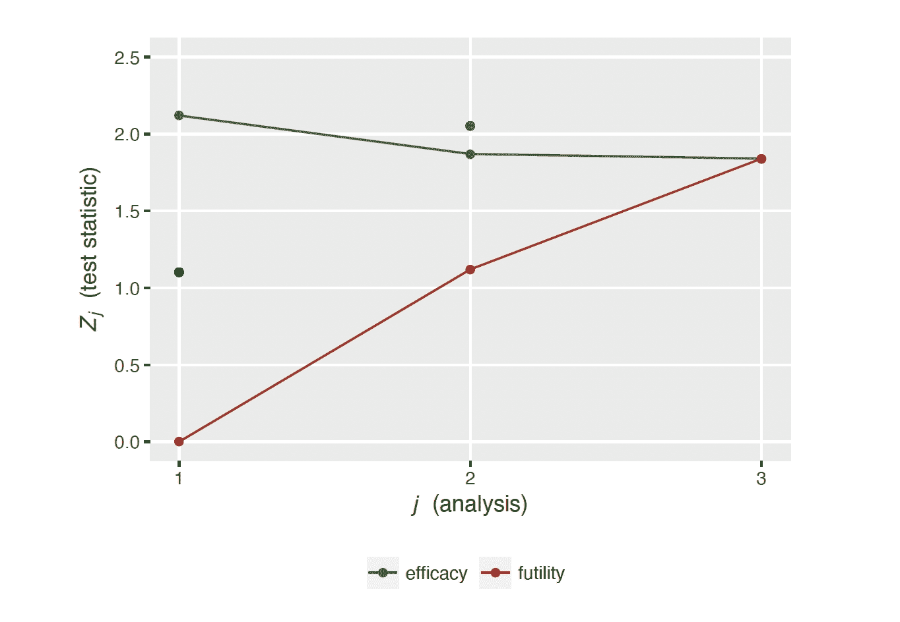

## 统计语言模型

在自然语言处理（NLP）领域，统计语言模型是理解和分析语言模式的关键工具。这些模型使用概率论来捕捉语言的底层结构，允许生成连贯且真实的文本。在本节中，我们将探索统计语言模型背后的原理，包括 `N-grams` 以及它们在 NLP 中的应用。

### 什么是统计语言模型？
统计语言模型是机器学习算法的一种，使用概率论对语言结构进行建模。这些模型在大型文本数据集上进行训练，学习根据之前词提供的上下文预测序列中的下一个单词或字符。这些模型的目标是捕捉语言的底层模式和结构，例如语法、句法和语义。

### N-Gram 模型
常见的统计语言模型之一是 `N-gram` 模型。`N-gram` 是 `n` 个单词或字符的序列，`N-gram` 模型根据前 `N-1` 个单词或字符预测序列中的下一个单词或字符。例如，一个简单的 `2-gram` 模型将根据序列中的前两个单词预测下一个单词。

`N-gram` 模型的关键优势是它们捕捉语言中短期依赖关系的能力。通过仅考虑序列中的前几个单词，这些模型生成的文本比长距离模型更连贯、真实。然而，它们在捕捉长期依赖和语法结构（如句子结构和语义关系）方面的效果较差。

### 统计语言模型的应用
统计语言模型在 NLP 中有广泛的应用，包括：

1. **语言翻译**：`N-gram` 模型可以生成比基于规则的翻译系统更准确、更自然的翻译。通过分析源语言中的单词模式，这些模型可以学习在目标语言中生成适当的翻译。
2. **文本摘要**：统计语言模型可以用于总结长文档或文章，提取最重要的信息并生成简洁的摘要。这些模型对于总结包含复杂或技术性语言的文本特别有用。
3. **情感分析**：`N-gram` 模型可以被训练用于分析文本的情感，例如识别一段文本表达的是积极、消极还是中性的情感。这一应用在分析客户反馈或社交媒体帖子时特别有用。
4. **语言生成**：统计语言模型可以生成与给定输入文本风格和结构相似的新文本。当作者无法产生所需的内容量时，这种应用有助于生成内容（如文章或博客帖子）。

总之，统计语言模型是理解和分析语言模式的强大工具。通过使用概率论捕捉语言的底层结构，这些模型可以生成比基于规则系统更连贯、真实的文本。它们在 NLP 中的应用包括语言翻译、文本摘要、情感分析和语言生成。随着 NLP 领域的不断发展，我们可以期待看到更先进的统计语言模型，能够捕捉人类语言的完整复杂性。


# 自然语言处理中的机器学习

## 机器学习在自然语言处理中的集成
机器学习通过提供分析和理解人类语言的强力工具，彻底改变了自然语言处理（NLP）领域。机器学习在 NLP 中的集成已推动了复杂的语言模型、情感分析系统和文本分类算法等的发展。在本节中，我们将探索将机器学习集成到 NLP 中的不同方法，包括监督学习和无监督学习方法。

## 监督学习方法
监督学习是机器学习的一种，算法从带有标签的数据中学习。在 NLP 中，监督学习被用于语言建模、情感分析和文本分类等任务。NLP 中监督学习的目标是学习输入数据（文本或音频）与相应输出标签（如情感或类别）之间的映射关系。

NLP 中使用的一些常用监督学习算法包括：

### 1. 支持向量机 (SVMs)
SVM 因其稳健的性能和处理高维数据的能力成为 NLP 任务的热门选择。SVM 可用于二分类和多分类任务，并已应用于情感分析和文本分类等多种 NLP 任务。

### 2. 随机森林
随机森林是一种集成学习方法，通过结合多棵决策树来提高模型的准确性和鲁棒性。随机森林已用于 NLP 中的语言建模、情感分析和命名实体识别等任务。

### 3. 神经网络
神经网络是一类机器学习模型，特别适用于 NLP 任务。神经网络可以学习文本数据中的复杂模式，并已用于语言建模、情感分析和文本分类等任务。

## 无监督学习方法
无监督学习是机器学习的一种，算法从无标记数据中学习。在 NLP 中，无监督学习被用于主题建模、词嵌入和语言建模等任务。NLP 中无监督学习的目标是在没有任何预期输出先验知识的情况下，发现数据中隐藏的模式或结构。

NLP 中使用的一些常用无监督学习算法包括：

### 1. 聚类算法
聚类算法用于根据特征将相似的数据点分组在一起。在 NLP 中，聚类算法已用于主题建模和文本分类等任务。

### 2. 降维算法
降维算法用于在保留最重要信息的同时减少数据特征的数量。在 NLP 中，降维算法已用于词嵌入和语言建模任务。

### 3. 自动编码器
自动编码器是学习压缩和重构输入数据的神经网络。在 NLP 中，自动编码器已用于文本分类和语言建模任务。

### 结论
综上所述，机器学习通过提供分析和理解人类语言的强力工具，彻底改变了 NLP 领域。监督和无监督学习方法已被用于 NLP 处理各种任务，从情感分析、文本分类到语言建模和主题建模。随着 NLP 领域的不断演进，机器学习可能会在计算机以更准确、更微妙的方式理解和生成人类语言方面发挥日益重要的作用。

# 用于自然语言处理的深度学习

## 解锁深度学习在自然语言处理中的变革力量
深度学习彻底改变了许多领域，自然语言处理（NLP）也不例外。深度学习在 NLP 中的变革力量推动了语言理解和应用的重大进展。在本节中，我们将深入神经网络的世界，并探索它们在语言理解方面的能力。

## 神经网络在语言理解中的应用：
1. **情感分析**：神经网络可以分析文本数据以确定其背后的情感。这一应用对于企业监控客户反馈、跟踪品牌声誉和做出明智决策有用。
2. **语言翻译**：通过深度学习算法，语言翻译变得更加准确和高效。神经网络可以通过分析大量文本数据来学习翻译语言，实现跨语言障碍的更快速、更准确的通信。
3. **文本摘要**：通过分析长文本，神经网络可以将其浓缩为较短的摘要，节省时间并提高理解。这一应用对于新闻媒体、研究人员和学生特别有用。
4. **命名实体识别**：神经网络可以识别并分类文本数据中的命名实体，如人物、组织和地点。这一应用有助于信息检索、问答和机器人。
5. **语言生成**：深度学习算法可以生成连贯且上下文相关的文本，实现内容创作、机器人和语言翻译等应用。
6. **对话系统**：神经网络可以通过理解信息背后的意图并生成适当的回复，促进人与机之间的对话。应用包括虚拟助手、客服机器人和语言翻译系统。
7. **问答系统**：通过分析大量文本数据，神经网络可以根据上下文信息回答问题，使其对虚拟助手和语言翻译系统等应用有用。
8. **文本分类**：神经网络可以将文本数据分类为不同的类别，例如垃圾邮件与非垃圾邮件、正面与负面情感，以及相关与不相关内容。这一应用有助于企业简化通信流程并改进决策。
9. **主题建模**：通过分析大量文本数据，神经网络可以识别文本库中的主题和类别，实现信息检索和文档摘要等应用。
10. **用于无障碍的语言生成**：深度学习算法可用于为视障人士生成盲文文本或语音输出，让语言对所有人都更易获取。

结论，深度学习在 NLP 中的变革力量导致了大量应用，彻底改变了我们与语言交互的方式。从情感分析到语言生成，神经网络正在实现更快速、更准确的通信，改进决策过程，并让语言对所有人都更易获取。随着深度学习领域的不断发展，我们可以期待神经网络在语言理解方面更多创新的应用。

### 命名实体识别 (NER)

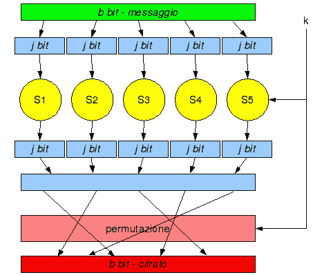

## 使用命名实体识别 (NER) 识别和分类实体
在自然语言处理（NLP）中，识别和分类文本中的实体是一项关键任务，有助于我们理解语言的含义和上下文。实体识别的一种方法是通过命名实体识别（NER），涉及将名称、地点、组织和日期等实体识别并归类到预定义的类别中。


在本节中，我们将探索 NER 的工作原理、其应用以及面临的一些挑战。我们还将讨论用于 NER 的一些技术和工具，并提供示例来说明其用法。

## NER 是如何工作的？

NER 基于在已标记数据集上训练的`machine learning algorithms`，在这些数据集中，每个句子或段落都标注了实体提及。该算法学习识别区分文本中实体与非实体的模式和特征。模型训练完成后，即可用于将新的句子或段落分类到预定义的类别中，例如人物、组织、地点、日期等。

NER 的过程通常涉及以下步骤：

1. 分词（Tokenization）：将文本分解为单个单词或短语，称为标记（tokens）。
2. 词性标注（Part-of-speech tagging）：识别每个标记的语法类别（例如名词、动词、形容词等）。
3. 命名实体识别（Named entity recognition）：根据词性标记和上下文特征识别文本中的实体。
4. 分类（Classification）：将每个实体实体分配到预定义的类别中（人物、组织、地点、日期等）。

## NER 的应用

NER 在各个领域有许多应用，包括：

1. 信息检索：NER 可以通过识别搜索查询中的实体并返回相关结果，来提高搜索引擎的准确性。
2. 情感分析：分析文本中提及实体的情感，例如识别对特定组织的正面或负面观点。
3. 文本摘要：通过识别最重要的实体及其关系来总结段落内容。
4. 问答：根据上下文中提到的实体来识别问题的答案。
5. 机器翻译：NER 可以通过识别源语言文本中的实体并在目标语言中进行适当翻译，来提高机器翻译的效果。

## NER 的挑战

尽管 NER 有许多应用，但它仍面临着若干挑战，包括：

1. 歧义（Ambiguity）：由于单词或短语含义的歧义，识别文本中的实体可能具有挑战性。
2. 同音异（Homonymy）：处理同音词（拼写和/或发相同但含义不同的词）。
3. 多义性（Polysemy）：处理多义词（具有多个相关含义的词）。
4. 名称变（Name variations）：处理名称的变化，例如昵称或替代拼写。
5. 上下文依赖（Contextual dependence）：识别文本中的实体通常需要理解它们出现的上下文。

## NER 中使用的技术和工具

NER 中使用了多种技术和工具，包括：

1. 基于规则的方法：使用预定义的规则根据句法和语义特征识别实体。
2. 机器学习方法：在已标记数据集上训练机器学习模型，以学习区分实体与非实体的模式和特征。
3. 混合方法：结合基于规则的方法和机器学习技术，以提高实体识别的准确性。
4. 实体提取工具：使用专门软件或库从文本中提取实体，如 `spaCy`、`NLTK` 或 `Stanford CoreNLP`。

## NER 的实际示例

1. 识别人物：“John Smith 是 XYZ 公司的 CEO。”
2. 识别地点：“该公司在纽约和伦敦设有办事。”
3. 识别组织：“该活动由 ABC 基金会主办。”
4. 识别日期：“会议将于 2 月 15 日举行。”

### 结论

命名实体识别是识别和分类文本实体的强大工具，在各个领域都有广泛应用。然而，它也面临着必须通过使用适当技术和工具来解决的挑战。通过理解 NER 的工作原理及其局限性，我们可以更好地利用这项技术来提高我们对语言及其含义的理解。

## 情感分析

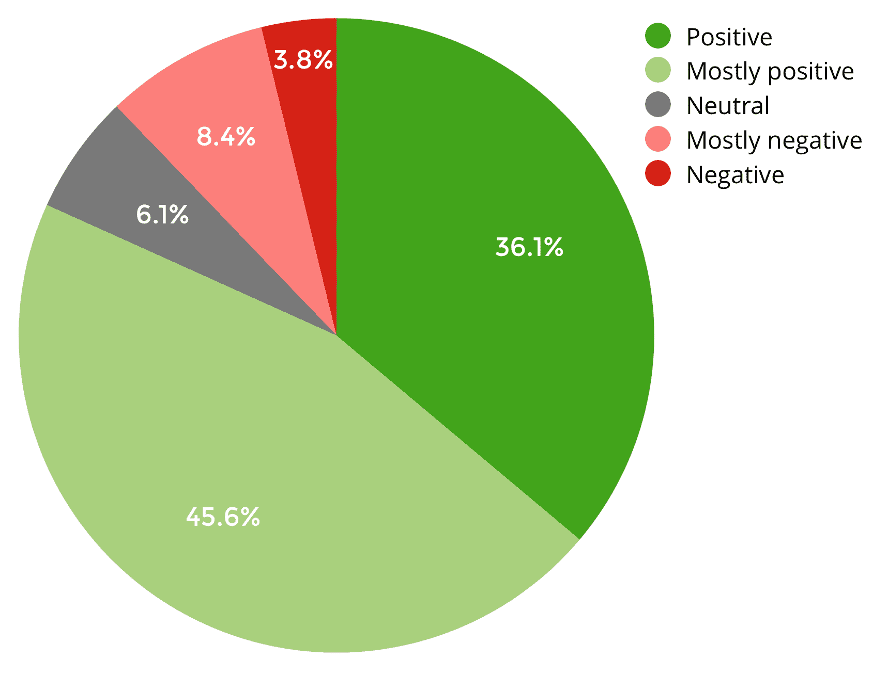

### 情感分析技术

情感分析是自然语言处理（`NLP`）的一个子领域，专注于确定文本数据中表达的情绪基调或情感。情感分析的目标是根据其中表达的情感将文本分类为正面、负面或中性。在本节中，我们将探索用于确定文本数据表达情感的技术。

1. 基于规则的方法（Rule-Based Approach）：情感分析早期且简单的方法之一是基于规则的方法。这涉及定义一组规则来识别文本中的正面或负面单词或短语，然后根据这些单词或短语的否对文本进行分类。例如，基于规则的方法可以将“good”、“bad”、“great”和“terrible”等词识别为正面或负面，然后据此对文本进行分类。
2. 机器学习方法（Machine Learning Approach）：如今情感分析中更常用的是机器学习技术。这些方法涉及涉及在已标记的数据集上训练机器学习模型，其中每段文本的情感都经过了标注。模型随后可以学习识别与正面或负面情感相关的语言模式。情感分析中常用的机器学习算法包括 `support vector machines (SVMs)`、`random forests` 和 `neural networks`。
3. 深度学习方法（Deep Learning Approach）：深度学习技术，如 `convolutional neural networks (CNNs)` 和 `recurrent neural networks (RNNs)` 也应用于情感分析并取得了巨大成功。这些模型可以学习从文本中提取指示情感的特征，例如词嵌入或句法模式。
4. 混合方法（Hybrid Approach）：许多研究人员探索了结合基于规则的方法和机器学习技术的混合方法。例如，混合方法可以使用规则来识别明显的正面或负面单词，然后应用机器学习模型对剩余文本进行分类。
5. 子词级分析（Subword-Level Analysis）：子词级分析涉及分析文本片段中单个子词的情感，而不仅仅是整体情感。这可以对文本中表达的情感提供更细粒度的洞察。例如，“awful”一词可以分析为由子词“awe”和“-ful”组成，每个子词可能有不同的情感。
6. 基于方面分析（Aspect-Based Analysis）：基于方面分析涉及识别文本中描述的某事的特定方面或特征，然后根据这些方面对情感进行分类。例如，对餐厅的评论可能会识别服务、食物质量和氛围等方面，每个方面可能有不同的情感。
7. 意见挖掘（Opinion Mining）：意见挖掘是一个更广泛的领域，涵盖了情感分析以及其他类型的意见挖掘，例如识别主观陈述或检测产品提及。这可以对文本数据中表达的观点和情感提供更全面的理解。

总之，有多种技术用于确定文本数据中表达的情感。这些技术可以大致分为基于规则、机器学习、深度学习、混合、子词级、基于方面和意见挖掘方法。通过理解这些技术，研究人员和从业者可以根据特定的用例选择最合适的方法，并开发更准确的情感分析系统。

## 机器翻译


### 机器翻译与 NLP

通过机器翻译和 NLP 破语言障碍


机器翻译（MT）自诞生以来已经取得了巨大的进步，为弥合语言和文化差异提供了可行的解决方案。然而，机器翻译并非没有挑战，它高度依赖自然语言处理（NLP）技术来实现准确的翻译。在本节中，我们将深入探讨机器翻译和 NLP 的复杂性，探索它们在打破语言障碍和增强不同语言背景人员之间交流方面的作用。

## 机器翻译的挑战

机器翻译面临许多阻碍其准确性和可靠性的挑战。这些挑战包括：

1. `语言复杂度`：不同的语言具有独特的语法结构、成语和文化引用，这些很难准确翻译。
2. `歧义性`：单词和短语通常有多种含义，使得机器系统难以确定句子或短语的预期含义。
3. `方言和口音`：机器系统必须考虑地区方言和口音，这会显著影响翻译的准确性。
4. `领域知识有限`：机器系统在处理特定领域的术语和概念时可能会困难，导致不准确或误解。

## 改进机器翻译的技术

为了克服这些挑战，研究人员和开发者采用了多种 NLP 技术，包括：

1. `统计机器翻译 (SMT)`：这种方法依赖统计模型，基于大规模并行文本数据集生成翻译结果。
2. `神经机器翻译 (NMT)`：NMT 使用深度学习算法，如循环神经网络（RNN）和长短期记忆（LSTM）网络，学习语言的模式和结构。
3. `迁移学习`：该技术涉及在大型数据集上对模型进行预训练，然后针对特定的翻译任务进行微调。
4. `多语言模型`：这些模型同时在多种语言上进行训练，允许它们利用跨语言的共享知识。

## NLP 在机器翻译中的作用

NLP 通过提供以下优势在机器翻译中起着至关重要的作用：

1. `语言理解`：NLP 技术帮助机器系统理解源文本的含义和上下文，实现更准确的翻译。
2. `文本表示`：NLP 算法可以以适用于机器学习模型的方式表示文本，使其能够学习语言的模式和结构。
3. `分词与分割`：NLP 技术帮助将文本分解为较单元并组成有意义的片段，提高了机器翻译系统的效率和准确性。
4. `歧义消除`：NLP 可以根据上下文信息识别句子或短语的最可能解释，帮助解决机器翻译中的歧义。

### 结论

得益于 NLP 和计算能力的进步，机器翻译自诞生以来已经走了很久。然而，挑战依然存在，机器翻译系统必须不断进化以应对这些挑战。通过将 NLP 技术与机器学习算法相结合，我们可以增强机器翻译系统的准确性和可靠性，打破语言障碍并促进不同语言背景人员之间的交流。

# 对话代理

## 设计智能聊天机器人和虚拟助手

在当今这个技术驱动的世界里，对话代理已成为我们日常生活中不可或缺的一部分。这些智能聊天机器人和虚拟助手旨在模拟人类对话，为用户提供更个性化的体验。在本节中，我们将深入探讨对话代理的设计与实现，探索它们的各种应用以及支持它们运行的技术。

### A. 对话代理的定义和类型

对话代理是旨在模拟人类对话的计算机程序，通过文本或语音交互实现。这些代理大分为两类：聊天机器人和虚拟助手。聊天机器人主要用于客户服务和支持，而虚拟助手则执行各种任务，如安排预约、设置提醒和控制智能家居设备。

### B. 设计智能对话代理

创建智能对话代理需要对自然语言处理（NLP）、机器学习（ML）和用户体验（UX）设计有深入理解。设计对话代理时的一些关键考虑因素如下：

1. `用户画像`：对目标受众及其偏好、交流风格有清晰的理解，确保机器人的性格符合他们的预期。
2. `对话流程`：通过识别可能的用户输入和响应定义对话流程，并创建对话树或状态机来引导交互。
3. `自然语言处理 (NLP)`：使用 NLP 技术（如情感分析、实体识别和意图检测），使聊天机器人能够准确理解并响应用户输入。
4. `机器学习 (ML)`：利用 ML 算法从用户交互和反馈中学习，随时间改进机器人的性能。
5. `用户界面 (UI) 设计`：创建一个响应式且直观的 UI，允许用户通过文本或语音输入轻松地与聊天机器人交互。

### C. 实现对话代理

为了实现对话代理，开发者可以使用各种技术和平台，例如：

1. `平台`：利用预构建的聊天机器人开发平台，如 `Dialogflow`、`Botpress` 或 `Rasa`，这些平台为创建对话代理提供了预置工具和资源。
2. `编程语言`：选择适用于 NLP 和 ML 任务的语言，如 `Python`、`Java` 或 `JavaScript` 以及它们各自的库（例如 `NLTK`、`spaCy`、`TensorFlow`）。
3. `自然语言处理 (NLP) 工具`：利用专门的 NLP 工具和库，如 `Stanford CoreNLP`、`spaCy` 或 `OpenNLP` 进行分词、词性标注和命名实体识别等任务。
4. `机器学习 (ML) 框架`：选择适用于构建聊天机器人的 ML 框架，如 `TensorFlow`、`PyTorch` 或 `Scikit-learn`，它们提供了训练和部署 ML 模型的工具。

### D. 对话代理的应用

对话代理在各个行业都有许多应用，包括：

1. `客户服务`：聊天机器人可以处理简单的客户查询，释放人工人员专注于更复杂的问题。
2. `医疗健康`：虚拟助手可以帮助患者安排预约、访问医疗记录，甚至提供基础医学建议。
3. `教育`：对话代理可以促进语言学习，提供学习建议，甚至批改作业。
4. `金融`：聊天机器人可以通过提供账户信息、转账或提供投资建议来帮助用户管理财务。
5. `娱乐`：虚拟助手可以根据用户偏好提供个性化的电影或音乐推荐。

总之，对话代理具有变革各个行业和我们生活各个方面的潜力。通过理解其设计和实现，开发者可以创建为用户提供个性化体验的智能聊天机器人和虚拟助手。无论你是想简化客户服务还是增强娱乐选择，对话代理带来的可能性是无限的。

## NLP 中的伦理考量


自然语言处理中的伦理考量
[/content]助完成翻译。


随着自然语言处理（NLP）的不断进步，在开发和部署能够理解和生成类人类语言 AI 系统时，解决伦理考量至关重要。能力越大，责任越大，负责任的 AI 实践对于确保 NLP 的伦理使用以及不延续或加剧社会现有的偏见至关重要。在本节中，我们将探索语言模型中的潜在偏见，并讨论 NLP 中负责任的 AI 实践。

## 语言模型中的潜在偏见

1. **语言偏见**：语言模型可能会从训练数据中继承偏见。例如，如果语言模型在包含性别或种族刻板印象的文本上进行训练，它可能会产生偏偏输出。
2. **文化偏见**：语言模型还可以反映训练数据中存在的文化偏见和假设。例如，在英文文本上训练的语言模型可能无法准确翻译其他语言或其他文化的短语。
3. **社会偏见**：如果 NLP 系统在反映现有社会阶层和权力动态的数据上进行训练，它们可能会延续社会偏见。例如，语言模型可能倾向于使用男性代词而非女性代词，从而强化性别刻板印象。
4. **数据偏见**：用于训练 NLP 系统的数据也可能引入偏见。例如，如果训练数据主要包含男性名称，系统在生成女性名称或正确识别它们时可能会遇到困难。

## NLP 中负责任的 AI 实践

1. **多样化且代表性的训练数据**：确保训练数据具有多样性并代表不同的文化、语言和性别，有助于缓解语言模型中的偏见。
2. **偏见测试**：定期对 NLP 系统进行偏见测试，并在发现偏见时采取纠正措施，有助于防止现有社会阶层的延续。
3. **可解释性和透明度**：开发者应对其系统的工作原理提供清晰解释，包括用于训练系统的数据以及该数据可能产生的任何潜在偏见。
4. **持续监控**：必须对 NLP 系统的偏性和性能问题进行持续监控，重点解决任何出现的伦理问题。
5. **协作与包容性**：鼓励不同背景的开发者、研究人员和利益相关者之间的合作，有助于确保 NLP 系统能够代表其所服务的社区。
6. **培养包容性语言实践**：开发者应在系统中优先考虑包容性语言实践，例如使用性别中性代词或避免刻板的语言。
7. **处理权力动态**：NLP 开发者必须意识到开发 AI 系统涉及的权力动态，并采取措施解决由这些动态可能产生的任何潜在偏见。

总之，伦理考量是 NLP 开发的一个关键方面。通过理解语言模型中的潜在偏见并实施负责任的 AI 实践，我们可以确保 NLP 被伦理使用，而不延续或加剧现有的社会偏见。

## NLP 的最新进展

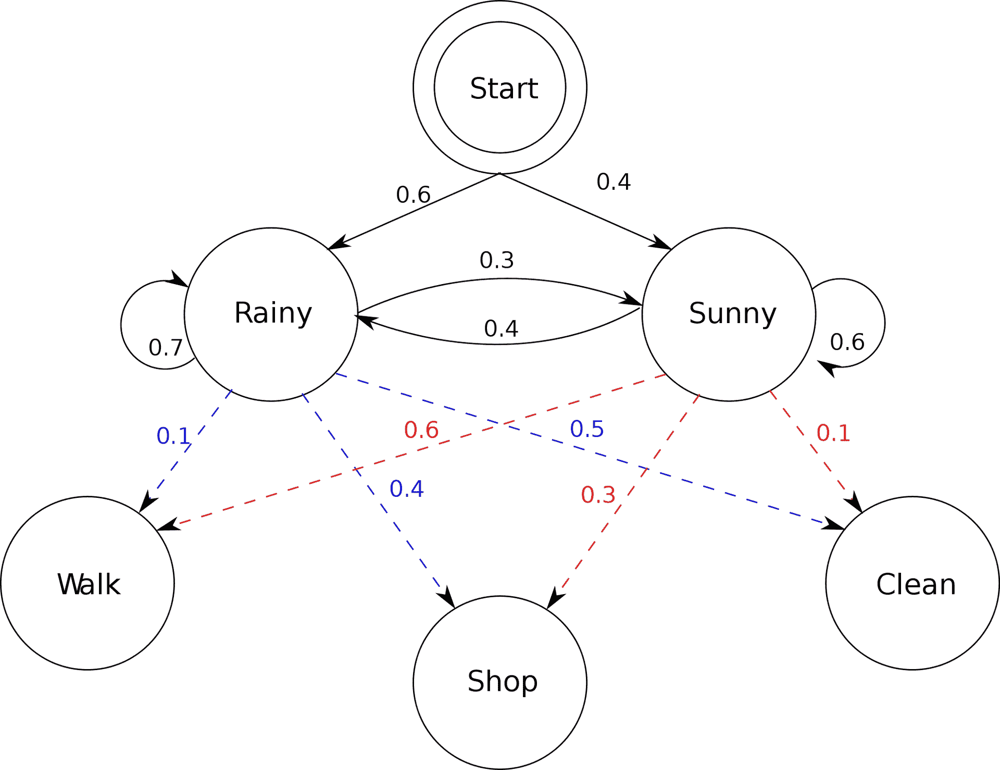

## 跟进 NLP 的最新进展

作为电子书作者，关注自然语言处理（NLP）的最新发展至关重要。该领域正在迅速演变，新的研究和趋势不断出现。为了确保你的电子书保持相关性和及时，跟踪最新进展是必不可少的。以下是一些获取信息的方法：

1. **关注 NLP 相关的博客和网站**：有许多致力于 NLP 的博客和网站。关注这些资源可以帮助你了解该领域的最新研究、趋势和发展。一些热门来源包括斯坦福自然语言处理小组的博客、MIT 媒体实验室 NLP 小组博客以及 Google AI 博客。
2. **参加会议和研讨会**：会议和研讨会是学习 NLP 最新进展的绝佳机会。这些活动汇聚了来自世界各专家，为讨论、协作和知识共享提供了平台。一些著名的 NLP 会议包括计算语言协会会议（ACL）和计算语言协会北美分会会议（NAACL）。
3. **参与 NLP 社区**：在 Twitter、LinkedIn 和 GitHub 等社交媒体平台上加入 NLP 社区，可以帮助你与该领域的其他专业人士联系。这些网络提供了获取新研究和趋势的宝贵资源，以及协作和知识共享的机会。
4. **阅读学术论文**：跟进 NLP 最新研究需要阅读学术论文。订阅相关期刊并在社交媒体上关注研究人员，以获取最新出版物。一些流行的 NLP 期刊包括《人工智能研究杂志》(JAIR)、《计算语言学杂志》(JCL) 和《计算语言协会论文》(PACL)。
5. **参加在线课程**：在线课程是学习 NLP 并掌握新趋势和技术的极方法。Coursera、edX 和 Udemy 等平台提供了广泛的 NLP 相关主题课程，从入门课程到高级专业课程。
6. **阅读 NLP 书籍**：跟进 NLP 最新进展还涉及阅读该主题的书籍。一些流行的 NLP 书籍包括 Steven Bird 的《Natural Language Processing with Python》，Aurélien Géron 的《Hands-On Natural Language Processing with Python》以及 Yoav Goldberg 的《Deep Learning for Natural Language Processing》。
7. **参加黑客松**：NLP 黑客松是开发者和研究人员聚集在一起解决特定挑战或使用 NLP 技术构建新应用的活动。这些活动提供了学习 NLP 最新进展以及与领域内其他专业人士建立的绝佳机会。
8. **关注 NLP 相关的播客**：像 NLP Podcast、AI Alignment Podcast 和 Data Science Podcast 等播客提供了关于 NLP 最新发展的宝贵见解。这些播客涵盖了从研究更新到 NLP 实际应用的广泛主题。
9. **阅读行业报告**：跟进 NLP 最新趋势还涉及阅读行业报告和市场分析。MarketsandMarkets、Grand View Research 和 BIS Research 等公司的报告为 NLP 市场的现状和新兴趋势提供了宝贵见解。
10. **与其他专业人士建立联系**：与领域的专业人士建立联系对于了解 NLP 的新进展至关重要。参加行业活动，在 LinkedIn 上加入 NLP 相关小组，并参与在线讨论，以与其他专家联系并学习他们的经验和见解。

通过遵循这些方法，你可以确保你的电子书在快速发展的 NLP 领域保持更新和具有相关性。

## 大语言模型 (LLM) 中的 NLP


## 自然语言处理在大语言模型 (LLMs) 中的集成

大语言模型（LLMs）通过在语言理解和生成方面提供无与伦比的能力，变革了自然语言处理（NLP）领域。然而，为了取得如此惊人的结果，LLMs 高度依赖先进的 NLP 技术，这些技术使其能够理解并产生人类语言。在本节中，我们将深入探讨 NLP 在 LLMs 中的集成，探索这些尖模型如何利用 NLP 技术来实现顶尖性能。

1. **词嵌入 (Word embeddings)**：


大语言模型（LLMs）的基础组件之一是词嵌入，它将单词表示为高维空间中的向量。这些向量捕捉了词之间的语义关系，允许模型理解语言的上下文和含义。诸如 `Latent Semantic Analysis (LSA)` 和 `Word2Vec` 等 NLP 技术通常用于学习词嵌入。通过将这些技术整合到其架构中，LLMs 可以生成更准确、信息量丰富的文本。

### 2. 注意力机制
注意力机制使得 LLMs 在生成输出时关注输入的特定部分。这允许模型选择性地关注相关信息并忽略无关细节，从而产生更准确、更连贯的响应。基于神经网络的注意力和软注意力等 NLP 技术用于开发这些机制。通过将注意力机制集成到其架构中，LLMs 可以产生更符合上下文的响应。

### 3. 生成式模型
生成式模型是 LLMs 的关键组件，使其能够生成连贯且自然的语言。诸如 `recurrent neural networks (RNNs)`、`long short-term memory (LSTM)` 网络和 `transformers` 等 NLP 技术常用于生成式模型。通过将这些技术集成到其架构中，LLMs 可以产生更多样、更真实的文本。

### 4. 迁移学习
迁移学习是一种允许 LLMs 利用预训练模型并针对特定任务对其进行微调的技术。这允许模型从海量数据中学习，并用极少的额外训练数据适应新任务。诸如 `pre-training` 和 `fine-tuning` 等 NLP 技术常用于迁移学习。通过将迁移学习集成到其架构中，LLMs 可以在广泛的任务上获得更好的性能。

### 5. 多任务学习
多任务学习是一种允许 LLMs 同时学习多个任务的技术。这允许模型在不同任务之间进行泛化并提高其整体性能。诸如共享嵌入和任务特定层等 NLP 技术常用于多任务学习。通过将多任务学习集成到其架构中，LLMs 可以在广泛的任务上获得更好的性能。

综之，将 NLP 技术集成到 LLMs 中对于其令人深刻的语言理解和生成能力至关重要。通过利用词嵌入、注意力机制、生成式模型、迁移学习和多任务学习，前沿 LLMs 可以生成高度准确且自然的文本。随着 NLP 领域的不断演进，这些技术可能会变得更加复杂和先进，进一步推动 LLMs 的发展。

## LLM 架构


### 大语言模型架构
大语言模型（LLMs）通过提供无与伦比的语言理解能力彻底改变了自然语言处理（NLP）领域。LLMs 的核心是集成多个 NLP 组件以创建强大语言模型的复杂系统。在本节中，我们将深入 LLMs 的架构，并探索这些组件是如何整合到这些模型的更广泛结构中的。

#### 1. 词嵌入
LLMs 的基础建立在词嵌入之上，将单词映射到高维空间中的密集向量。这些向量捕捉了词之间的语义关系，允许模型理解文本的上下文和含义。词嵌入通常使用 `Word2Vec` 或 `GloVe` 等技术从大量的文本数据中学习。

#### 2. 编码器-解码器架构
编码器-解码器架构是 LLMs 中常见的设计模式。编码器接收单词或字符序列并输出输入文本的连续表示。解码器根据此连续表示逐一个单词地生成输出文本。这种架构允许 LLMs 处理不同长度的文本序列并生成连贯的输出。

#### 3. 注意力机制
注意力机制用于 LLMs 在生成输出时关注输入的特定部分。这允许模型选择性地关注相关信息并忽略无关细节，从而产生更准确、更符合上下文的输出。注意力可以应用于模型中的不同层，例如词之间或句之间。

#### 4. 递归神经网络 (RNNs)
RNNs 是许多 LLMs 的关键组件，特别是那些为机器翻译或语言生成等序列到序列任务设计的模型。这些网络处理输入文本序列并输出相应的生成文本序列。RNNs 还可以对句子中词之间的关系进行建模。

#### 5. Transformers
Transformers 是一种神经网络架构，在 NLP 任务中取得了巨大成功，特别是涉及长距离依赖的任务。由于其能够在输入序列上进行并行计算的能力，它们经常在 LLMs 中替代 RNNs。这使得 transformers 比 RNNs 更高效地处理更长的输入序列。

#### 6. 多层感知器 (MLPs)
MLPs 通常用作 LLM 的最后一层，接收编码器和解码器的输出，并将其转换为可能的输出单词或字符的概率分布。这些概率分布可用于逐个单词地生成文本，允许模型产生连贯流畅的输出。

#### 7. 训练策略
LLMs 通常使用大量的文本数据（如整本书或文章）进行训练。训练策略可能涉及极大似然估计、最小化困惑度衡量或使用更先进的技术（如去噪自动编码器）。这些策略帮助模型学习在给定之前的词预测序列中的下一个词，允许其生成连贯且符合上下文的文本。

结论是，LLMs 是将多个 NLP 组件集成到更广泛架构中的复杂系统。理解这些组件如何整合到 LLM 中对于有效设计和训练这些模型至关重要。通过掌握 LLMs 的架构，开发者可以创建更复杂的语言理解系统，并推向 NLP 边界。

## NLP 任务的微调

### 为 NLP 任务微调大语言模型
微调大语言模型已成为自然语言处理（NLP）任务的关键方面。这些模型（如 `GPT-3`）在海量数据集上进行训练，并可以通过额外训练适应各种 NLP 任务。在本节中，我们将探索如何针对文本完成、摘要等特定任务微调这些模型。

#### 任务自适应模型：微调的关键
要针对 NLP 任务微调大语言模型，关键是将模型适配到当前的特定任务。这可以通过使用名为“任务自适应模型”的技术来实现。任务自适应模型涉及在预训练模型之上添加一个较小的任务特定模块，允许模型关注任务的相关方面。

例如，在微调模型以进行文本完成任务时，任务自适应模块可以包含额外的上下文信息，例如句子中缺失单词前后的词。这有助于模型更准确地完成句子。

#### 模型如何适应不同任务


那么，这些模型是如何适应不同任务的？答案在于它们的训练方式。通过在特定任务上对预训练模型进行微调，模型会学习关注该任务的相关方面，同时忽略无关信息。这被称为“任务特定加权”。例如，在为文本摘要任务微调模型时，模型会学会关注最核心的各个并忽略不必要的信息。这使其能够生成更准确的摘要。

## 语言模型微调的优势

对大语言模型微调具有以下几个优势：

1. `性能提升`：通过使模型适应特定任务，与使用通用模型相比，它可以提高在特定任务上的性能表现。
2. `缩短训练时间`：对预训练模型进行微调比从头开始训练模型更快、更高效。
3. `迁移学习`：对预训练模型进行微调允许将其预训练阶段的知识迁移到相关任务中，从而提高这些任务的性能。

## 大语言模型微调的挑战

虽然微调大语言模型有很多优势，但也存在必须考虑的挑战：

1. `过拟合`：如果微调后的模型过于复杂，它可能会过拟合训练数据，并且在未见的数据上表现不佳。
2. `计算资源`：微调大模型需要大量的计算资源，在没有强大硬件支持的情况下这可能是一个挑战。
3. `模型大小`：大语言模型需要大量的内存和存储空间，在性能较弱的硬件上工作时，这可能成为限制因素。

### 结论

总之，微调语言模型是自然语言处理（NLP）任务的一个重要方面。通过使模型适应特定任务，可以提高其性能并缩短训练时间。然而，在微调这些模型时也必须考虑挑战。通过适当的调节和资源管理，微调语言模型可以带来显著的改进。

## 将 NLP 能力集成到大语言模型

随着自然语言处理（`NLP`）技术的不断进步，人们对将 NLP 能力集成到大语言模型（`LLMs`）中的兴趣日益增长，后者是指基于海量文本数据训练的神经网络模型，用于生成连贯且自然的语言输出。然而，将 NLP 能力集成到这些模型中面临着若干挑战和机遇，本节将进行讨论。

### 挑战

1. `模型大小`：将 NLP 能力集成到 `LLMs` 中面临的主要挑战之一是它们的尺寸。语言翻译、情感分析和问答等 `NLP` 任务通常比文本摘要或聊天机器人等简单语言生成任务需要更多参数。因此，将 NLP 能力集成到 `LLMs` 中可能会导致模型增大，从而影响性能、延迟和计算资源。
2. `训练数据`：另一个挑战是 `NLP` 任务高质量训练数据的可用性。与可以在大型文本数据集上进行训练的语言生成任务不同，`NLP` 任务通常需要专门且多样化的训练数据才能获得良好的性能。将 NLP 能力集成到 `LLMs` 中会导致用于语言生成的训练数据与 `NLP` 任务之间出现不匹配，从而导致性能不佳。
3. `伦理影响`：将 NLP 能力集成到 `LLMs` 还引发了涉及偏见、隐私和透明度的伦理问题。例如，如果 `LLM` 在带有偏见或攻击性的文本数据上进行训练，它可能会生成不当或不敏感的语言输出。同样，如果在没有对训练数据进行妥善筛选的情况下将 `LLM` 用于情感分析或文本分类，可能会延续现有的社会偏见和刻板印象。

### 机遇

1. `性能提升`：尽管存在挑战，将 NLP 能力集成到 `LLMs` 中可以提高其在广泛自然语言处理任务上的性能。通过结合语言生成模型和 `NLP` 模型的优势，可以创建更准确、信息量丰富且更吸引人的语言输出。
2. `增强灵活性`：将 NLP 能力集成到 `LLMs` 中还可以增强它们的灵活性，允许它们生成更细致、依赖上下文的文本。例如，集成了 NLP 能力的 `LLMs` 可以生成更具细微差的内容。
3. `新应用`：最后，将 NLP 能力集成到 `LLMs` 可以开启新的应用和用例。例如，集成了 `NLP` 模型的 `LLM` 可用于对社交媒体帖子进行情感分析，以识别趋势和模式。同样，它也可以用于语言复杂的领域，如法律或技术写作。

总之，将 NLP 能力集成到 `LLMs` 面临着模型大小、训练数据和伦理影响等挑战。然而，性能提升、增强灵活性和新应用的机遇使得这种集成值得追求。通过仔细解决这些挑战，可以创建更先进、更通用的语言模型，造福广泛的应用和行业。

## LLM 中的 NLP 用例


### NLP 在大语言模型中的实际用例

大语言模型通过为各种应用提供强大的工具，彻底改变了自然语言处理（`NLP`）领域。这些模型在大量文本数据上进行训练，使其学习语言中的模式和关系。以下是 NLP 在大语言模型中利用的一些实际用例：

1. `对话代理`：大语言模型可以用于创建与人类进行自然对话的对话代理。这些代理可以集成到各种应用程序中，如机器人、虚拟助手甚至社交媒体平台。通过分析用户输入并生成相应的响应，这些代理可以为用户提供个性化体验。
2. `内容生成`：大语言模型可以快速高效生成高质量内容。这包括文章、博客、产品描述等。通过向模型提供主题或提示，它可以生成结构良好且连贯的内容，与人类编写的内容无异。
3. `语言翻译`：大语言模型可以训练用于不同语言之间的文本翻译。这对于翻译文档、网站甚至整本书特别有用。通过使用机器学习算法学习给定语言中的模式和关系，这些模型可以产生准确且自然的翻译。
4. `情感分析`：大语言模型可以用于分析文本数据中的情感。这对于分析客户反馈、社交媒体帖子甚至新闻文章非常有用。通过识别给定文本的情感基调，这些模型可以帮助企业和组织更好地理解目标受众的偏好和观点。


### 5. 文本摘要
大型语言模型可以将长文本总结为更短、更易于理解的版本。这对于文章、文档甚至整本书书都特别有用。通过识别给定文本中最重要的信息，这些模型可以生成简洁且准确的摘要，捕捉原始内容的精髓。

### 6. 问答
大型语言模型可以根据给定文本包含的信息来回答问题。这对于常见问题解答（FAQ）页面甚至整本书书都特别有用。通过分析不同文本之间的关系，这些模型可以为用户的查询提供准确且相关的答案。

### 7. 创意性应用的文本生成
大型语言模型可以生成创意性内容，如诗歌、故事甚至整个剧本。通过向模型输入提示词（prompt）或主题，它可以产生独特且原创的内容，其质量可以与人类生成的内容媲美。

总之，大型语言模型在自然语言处理（NLP）领域具有广泛的实际应用。从对话代理到内容生成，这些模型正在改变我们与文本数据交互以及生成数据的方式。随着技术的不断进步，预计未来将会出现更多创新的用例。

# 词嵌入 (Word Embeddings)


## 理解词嵌入
词嵌入是许多自然语言处理（NLP）任务的基础组件，包括文本分类、情感分析、机器翻译等。这些向量将单词或短语表示为高维空间中的点，允许机器捕捉它们的语义含义。在本节中，我们将深入探讨词嵌入的世界，探索如 `Word2Vec`、`GloVe` 和 `FastText` 等技术。

#### Word2Vec
`Word2Vec` 是一种用于生成词嵌入的流行技术。它使用两个不同的模型为单词创建向量：一个输入模型和一个输出模型。输入模型接收单词序列，并输出一个表示这些单词上下文的向量。输出模型接收单个单词，并输出一个表示该词相对于词汇表中其他单词之间意义的向量。

#### GloVe
`GloVe` 是另一种广泛使用的词嵌入生成技术。它通过创建词之间的共现概率矩阵来工作，然后用该矩阵为每个词生成向量。生成的向量以类似于 `Word2Vec` 的方式捕捉词与词的关系，但存在一些关键区别。

#### FastText
`FastText` 是一种生成词嵌入的技术，比 `Word2Vec` 和 `GloVe` 更快且更具扩展性。它通过将每个词表示为特征包（bag-of-features）来工作，其中特征是从输入文本数据中学习的。这使得 `FastText` 能够近实时地生成单词向量，使其成为快速处理大量文本数据应用的理想选择。

#### 优缺点
这些技术各有自己的优缺点。例如，`Word2Vec` 比 `GloVe` 更准确，但需要更多的计算资源和更长的训练时间。`FastText` 比两者都快且更具扩展性，但捕捉的上下文信息可能没有另外两种技术那么多。仔细评估每种技术并选择最符合你特定用例的一个是非常关重要的。

#### 应用
词嵌入在 NLP 中有广泛的应用，包括：
- 文本分类：词向量可以作为输入特征，将文本数据归类到预定义的类别中（例如，垃圾邮件与非垃圾邮件）。
- 情感分析：词向量可以分析文本数据的情感，例如确定一段文本表达的是正面还是负面情感。
- 机器翻译：通过将源语言中的单词映射到目标语言中对应的向量，可以使用词嵌入将文本从一种语言翻译到另一种语言。
- 命名实体识别：词向量可以识别并分类文本数据中的命名实体（例如，人物、组织、地点）。

### 结论
总之，词嵌入是 NLP 任务中捕捉单词语义含义的强大工具。`Word2Vec`、`GloVe` 和 `FastText` 等技术提供了生成这些向量的不同方式，每种方式都有其优缺点。通过理解这些技术及其应用，你可以为你的特定用例选择合适的方法，并释放词嵌入在 NLP 中的全部潜力。

# 注意力机制 (Attention Mechanism)

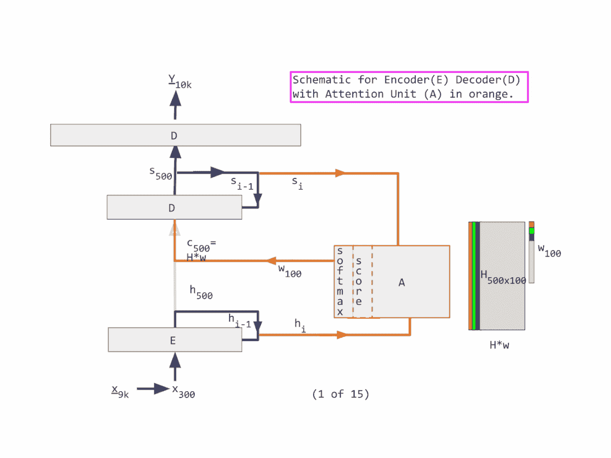

## NLP 中的注意力机制 - 释放语言模型性能
注意力机制通过增强语言模型的性能，彻底改变了自然语言处理（NLP）领域。通过允许模型关注输入数据的特定部分，注意力机制实现了对语言更准确、更高效的处理。在本节中，我们将深入探讨 NLP 中的注意力概念，并探索它是如何提高语言模型性能的。

### 什么是 NLP 中的注意力？
注意力是一种允许模型在处理语言时关注输入数据特定部分的机制。它通过计算输入元素的加权和来实现此点，其中权重是在训练过程中学习的，并反映了每个元素对当前任务的重要性。换句话说，注意力帮助模型选择性地关注输入数据中最相关的部分，而不是等对待所有元素。

### 注意力机制的类型
NLP 中使用了多种类型的注意力机制，包括：
1. 缩放点积注意力（Scaled Dot-Product Attention）：这是一种流行的注意力机制，通过取查询（query）和键（key）向量的点积、对结果进行缩放并应用 `softmax` 函数来归一化权重，计算注意力权重。
2. 多头注意力（Multi-Head Attention）：这是缩放点积注意力的扩展，允许模型同时关注输入数据的不同方面。它通过并行计算多个注意力权重并拼接结果来实现这一点。
3. 注意力 LSTM（Attentional LSTM）：这是循环神经网络（RNN）的一种类型，它在处理语言时使用注意力选择性地关注输入序列的不同部分。

### 注意力是如何提高语言模型性能的？
注意力通过以下几种方式提高语言模型性能：
1. 改进上下文理解：通过允许模型选择性地关注输入数据的特定部分，注意力使其能够更好地理解单词或短语出现的上下文。这导致了更准确的预测和对语言细微差别更好的处理。
2. 提高效率：注意力机制通过允许模型只关注输入数据中最相关的部分，降低了语言模型的计算复杂度。这使得以较少的计算开销处理更长的输入成为可能。
3. 更好地处理远程依赖：注意力允许语言模型捕捉文本中的远程依赖，这对于机器翻译和文本摘要等任务非常重要。
4. 提高泛化能力：通过选择性地关注输入数据的不同部分，注意力使语言模型对未见数据有更好的泛化。这是因为模型能够学习更细微的语言表示。

### 结论


注意力机制通过增强语言模型的性能彻底改变了自然语言处理（NLP）领域。通过允许模型选择性地关注输入数据的特定部分，注意力提升了上下文理解、效率和泛化能力。随着注意力机制的不断完善和改进，它可能会在先进 NLP 系统的发展中发挥更重要的作用。

# Transformer 架构

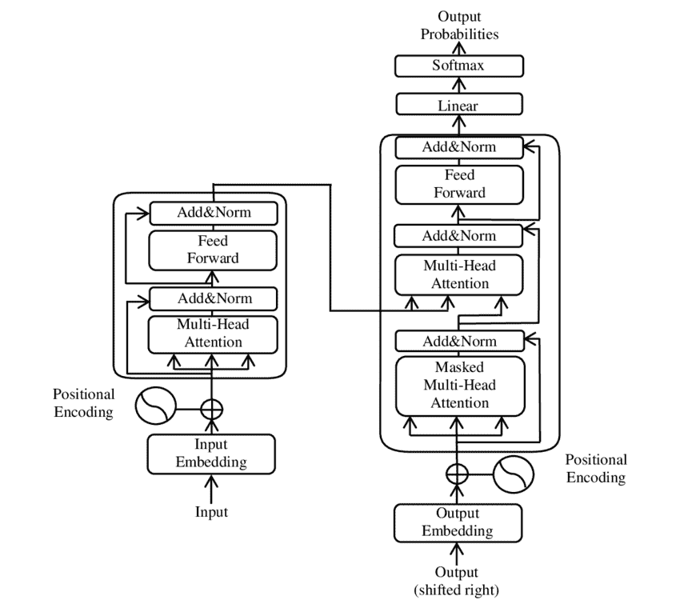

## Transformer 架构的革命

深度学习的出现使自然语言处理（NLP）领域取得了巨大的进展。其中，Transformer 架构已成为游戏规则改变者。它由 Vaswani 等人在 2017 年在开创性论文《注意力即一切》（Attention is All You Need）中提出，自此以后，Transformer 已成为许多 NLP 任务的事实标准。

在本节中，我们将深入研究 Transformer 架构，并探索它是如何彻底语言理解的。我们将讨论 Transformer 的核心组件，包括自注意力机制、前馈网络和层归一化。我们还将研究像 `BERT` 和 `GPT` 等模型如何利用 Transformer 在各种 NLP 任务中获得领先的结果。

## 自注意力机制：Transformer 的核心

Transformer 架构围绕自注意力机制构建，该机制允许它对输入标记（tokens）之间的复杂关系进行建模。与传统的循环神经网络（`RNN`）逐个元素处理序列不同，Transformer 并行处理整个输入序列。这使其在处理长序列时比 `RNN` 快得多且更具可扩展性。

自注意力机制的工作原理是首先将输入序列中的每个标记表示为向量。然后将这些向量相乘形成一组权重，用于计算输入标记的加权和。此过程会重复多次，并在每次迭代中根据输入标记调整权重。

## 前馈网络：Transformer 的线性组件

除了自注意力，Transformer 还使用前馈网络（`FFNs`）来建模输入标记之间的非线性交互。`FFNs` 由一个线性层、随后的 `ReLU` 激活函数以及残差连接组成。这使得网络能够学习输入和输出空间之间复杂的非线性映射。

## 层归一化：提高跨层泛化能力

为了提高跨层的泛化能力，Transformer 使用了层归一化。这涉及对序列中所有标记的每层激活值进行归一化。这有助于减少词表之外单词的影响并提高模型的整体性能。

## BERT 和 GPT：利用 Transformer 进行语言理解

两个最流行的 Transformer 模型是 `BERT` 和 `GPT`。`BERT`（基于 Transformer 的双向编码器表示）是一种预训练语言模型，在广泛的 NLP 任务（包括问答、情感分析和文本分类）中取得了领先的结果。`GPT`（生成式预训练 Transformer）是一种生成模型，使用 Transformer 架构生成连贯且上下文相关的文本。

`BERT` 通过多层双向 Transformer 编码器实现了惊人的性能，该编码器从正向和反向两个方向处理输入序列。这允许模型捕捉序列标记之间的局部和全局依赖。`BERT` 还使用池化层（pooler layer）来聚合每个标记的编码表示，创建一个固定大小的表示，可以针对特定任务进行微调。

另一方面，`GPT` 使用 Transformer 架构逐个标记地生成文本。模型从随机初始标记开始，然后根据之前标记提供的上下文生成后续标记。`GPT` 通过一种称为自回归解码的过程来实现，这涉及到在给定序列中之前标记的情况下计算每个标记的概率。

## 结论：Transformer 革命仍在继续

Transformer 架构改变了 NLP 中的语言理解。得益于捕捉输入标记之间复杂上下文关系的能力，`BERT` 和 `GPT` 等模型在广泛任务上展示了令人深刻目的性能。随着 NLP 领域的不断演进，Transformer 可能会一直是许多先进模型的关键组件。无论是通过微调预训练模型还是开发新架构，Transformer 革命都没有放缓的迹象。

# 多模态 NLP


## 语言与其他模态的交叉

语言与其他模态（如视觉、听觉和触觉）交叉的研究近年来已成为一个重要的研究领域。这一跨学科被称为多模态（multimodality），旨在理解不同模态在各种语境下如何交互和相互影响。在本节中，我们将探索同时处理文本和视觉信息的模型，这对于理解语言与其他感官输入之间的复杂关系至关重要。

多模态领域影响最大的理论之一是 Dunn 和 Palmer (2013) 提出的多模态传递理论（`MTT`）。`MTT` 假设意义是通过相互连接的模态网络构建的，每个模态都为整体意义构建过程贡献了独特的信息。根据该理论，对语言的解释不仅取决于语言学结构，而且涉及视觉、听觉和触觉信息的整合。例如，像“猫追着自己的尾巴”这样的句子，可以通过考虑环境中提供的视觉和听觉信息来消除歧义。

另一个重要模型是 Hood 及其同事 (2017) 开发的多模态认知动态模型（`DMMOC`）。`DMMOC` 假设多模态认知涉及跨时间、空间和注意力的各种模态动态整合。该模型强调了考虑多模态交互的时间和空间动态重要性，以及注意力在塑造语言和其他模态解释中的作用。例如，在阅读“狗快速地在街道上奔跑”这样的句子时，可以整合跑步狗的视觉信息和脚步声的听觉信息，以更好地理解句意。

除了这些理论外，还有一些实证研究调查了语言与其他模态的交叉。例如，研究表明，自症谱系障碍（`ASD`）个体通常在多模态整合方面存在困难，这会影响他们的语言处理能力（Klin 等人，2009）。这表明语言与其他模态的整合对于典型的语言发育和交流至关重要。

结论，语言与其他模态的交叉是一个复杂且动态的过程，涉及各种感官输入的整合。`MTT` 和 `DMMOC` 等模型为理解语言与其他模态如何交互以构建意义提供了宝贵的框架。实证研究还强调了在语言处理中考虑多模态整合的重要性，特别是在 `ASD` 个体中。该领域的进一步研究可以揭示多模态认知背后的神经机制，并最终可能为改善各种人群的交流干预措施提供参考。

# NLP 中的可解释人工智能

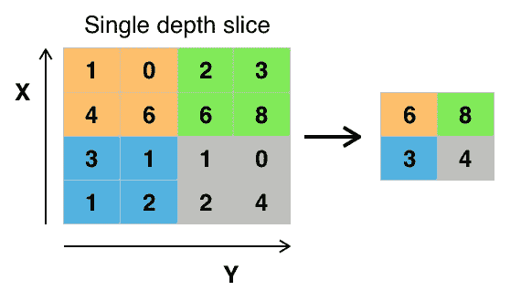

## NLP 模型中的可解释性


随着自然语言处理（NLP）模型变得日益复杂且无处不在，理解它们如何做出决策以及为什么会产生特定的输出至关重要。NLP 中的可解释性（Explainability）指的是解释和说明这些模型预测结果的能力。在本节中，我们将深入探讨 NLP 模型可解释性的重要性，讨论实现它的技术，并探索实施解释性方法时出现的一些挑战。

## NLP 模型中可解释性的重要性

1. **信任与问责**：可解释性通过提供对其决策过程的洞察，有助于建立对 NLP 模型的信任。这在医疗或金融等高风险应用中尤为关键，在这些领域，理解模型如何得出特定决策是必要的。
2. **提高模型性能**：通过理解 NLP 模型的工作原理及其产生特定输出的原因，开发者可以识别改进领域，从而构建更准确、有效的模型。
3. **监管合规**：在许多行业中，监管机构要求 NLP 模型必须具有透明且可解释性。可解释性有助于组织遵守这些法规，降低法律或伦理问题的风险。
4. **领域知识获取**：可解释性可以帮助领域专家更深入地理解 NLP 模型在其特定领域内的运行方式。这些知识随后可用于改进模型性能并增强整体系统性能。

## 解释和说明模型预测的技术

1. **特征归因（Feature Attribution）**：该技术涉及根据输入特征对预测输出的贡献为其分配重要性评分。特征归因有助于识别哪些输入因素对模型的决策过程影响最大。
2. **部分依赖图（Partial Dependence Plots）**：这些图表可视化了特定特征与预测结果之间的关系，提供了模型如何利用该特征进行预测的洞察。
3. **SHAP 值（SHapley Additive exPlanations）**：SHAP 值为给定预测的每个输入特征分配一个值，代表其对输出的贡献。这允许更全面地理解模型如何利用输入特征来生成输出。
4. **局部可解释模型无关解释（LIME）**：LIME 通过在特定实例周围生成局部可解释的模型，来对模型的预测生成解释，近似原始模型对该实例的行为。

## 实施可解释性方法的挑战

1. **计算复杂度**：某些解释性技术（如 `SHAP` 值和 `LIME`）对于大型数据集或复杂模型来说，计算开销可能非常大。
2. **模型架构复杂度**：随着 NLP 模型变得越来越复杂，解释其内部机制变得具有挑战性。这种复杂性使得识别驱动模型预测的因素变得困难。
3. **语言的歧义性**：自然语言本质具有模糊性和依赖上下文，这使得区分导致模型预测的各种因素变得困难。
4. **伦理考量**：解释性方法可能会引发伦理关注，例如在解释基于敏感数据的预测时的隐私担忧，或者解释提供方式中可能存在的偏差。

### 结论

可解释性是 NLP 模型的一个重要方面，使开发者能够理解这些模型如何工作以及为什么产生特定的输出。通过实施解释性技术，开发者可以提高模型性能、增加信任和问责，并符合监管要求。然而，实施解释性方法也面临挑战，例如计算复杂性和伦理考量。

## NLP 在行业中的应用

### NLP 在各行业的现实应用

自然语言处理（NLP）通过使计算机能够理解、解释和生成人类语言，彻底改变了许多行业。以下章节详细介绍了 NLP 在各个部门的现实应用：

## 医疗保健
NLP 可以帮助分析医学文本（如患者记录和临床试验报告），以识别可能导致更好诊断和治疗的模式和趋势。例如，NLP 算法可以从电子健康记录（`EHRs`）中提取患者症状、病史和药物使用信息，协助医生做出更准确的诊断。此外，NLP 可以帮助生成复杂医学文献的摘要，让医疗人员更容易跟上最新的研究和治疗。

## 金融
NLP 可用于分析金融文本（如新闻文章和社交媒体帖子），以识别市场趋势并做出明智的投资决策。例如，NLP 算法可以监控新闻新闻以实时检测情绪变化，使交易员能够此调整投资组合。此外，NLP 可以帮助自动化金融行业中的数据输入和文档审查等任务，让专业人员能够专注于更高价值的活动。

### 法律
NLP 可以协助法律专业人员分析大量的文本数据（如法庭笔录和合同），以识别相关信息和潜在问题。例如，NLP 算法可以帮助检测证人证词中的不之处，或发现合同语言中可能影响谈判策略的隐藏模式。此外，NLP 还可以辅助分析法律先例和法规，为法律论点和决策提供参考。

## 教育
NLP 通过分析学生的写作风格、理解水平和学习行为，支持为学生提供个性化的学习体验。例如，NLP 算法可以评估论文和其他书面作业，对语法、句法和内容组织提供反馈。此外，NLP 可以帮助识别学生需要额外支持或加强的领域，允许教育者根据其个人需求定制教学方案。

### 营销
NLP 可以通过分析来自社交媒体帖子、在线评论和其他来源的文本数据，帮助分析消费者情绪和偏好。例如，NLP 算法可以识别客户反馈中的趋势，为产品开发和营销策略提供信息支持。此外，NLP 可以帮助自动化情感分析和主题建模等任务，释放营销人员专注于更具创意和战略性的工作。

总的来说，NLP 的应用在各个行业中是非常广泛且多样的。随着技术的不断进步，我们预计未来会出现更多创新的用例。通过利用 NLP 的力量，组织可以解锁新的洞察，简化流程，并在各自的领域获得竞争优势。

## NLP 的未来趋势


### 自然语言处理的未来

当我们站在新一个十元的边缘时，自然语言处理（NLP）领域正准备着巨大的增长和创新。在本节中，我们将探索 NLP 潜在的进展、挑战和新兴趋势，为这项快速演进技术的未来可能的情况提供洞察。

### 进展
1. **改进语言理解能力**：NLP 最重突破之一是能够更准确、更细致地理解语言。随着机器学习算法的不断改进，我们可以期待更复杂的语言模型，它们能够更轻松地理解复杂的句子、成语和口语。


## 2. 增强型对话系统
预计对话式 AI 在未来几年将蓬勃发展。随着对话系统变得日益先进，它们将能够进行更自然的对话，从而增加人机之间的交互。

## 3. 扩展的应用
自然语言处理（NLP）将日益扩展到客户服务和语言翻译等传统领域之外。例如，NLP 可用于分析和生成社交媒体平台的内容、创建个性化的产品推荐，甚至辅助医疗诊断。

## 4. 深度学习的持续进步
深度学习的进步将继续驱动 NLP 的创新。注意力机制、Transformer 和多任务学习等技术将带来更准确、高效高效的模型。

## 挑战

### 1. 缺乏领域知识
随着 NLP 的不断进步，它可能会遇到某些领域缺乏领域知识的挑战。例如，在没有适当训练数据的情况下，语言模型可能难以理解专业术语或行话。

### 2. 偏见与伦理
随着 NLP 的广泛使用，人们对 AI 系统中的偏见和伦理问题日益关注。确保这些系统是公平且无偏见的，对于维护公众信任至关重要。

### 3. 安全风险
随着 NLP 更深入整合到各种应用程序中，它也可能受到安全风险的影响，例如数据投毒或对语言模型的恶意攻击。

### 4. 监管框架
NLP 的快速增长超过了监管框架的发展速度，导致在数据隐私和知识产权等领域缺乏清晰度。一个良好的法律框架对于确保该领域负责任的创新至关重要。

## 新兴趋势

### 1. 多模态语言处理
随着 NLP 与计算机视觉、语音识别和其他模态的整合，我们可以期待更复杂的多模态语言处理能力。这将使 AI 系统能够 地理解和解释人类的交流。

### 2. 可解释 AI
随着 AI 变得无处不在，NLP 对解释性的需求日益增加。开发能够提供语言模型决策过程洞察的技术，将有助于建立对这些系统的信任和信心。

### 3. 人机协作
随着 NLP 的进步，它将促进人类与 AI 系统之间更紧密的协作。这可能涉及开发更直观的界面，或设计能够从人类反馈中学习并相应调整行为的 AI 系统。

### 4. 伦理考量
随着 NLP 在各行业各的日益增加，对其开发和部署的伦理考量将变得更加迫切。确保 AI 系统透明、负责任并尊重文化敏感性，对于维护公众信任至关重要。

### 结论
自然语言处理的未来充满希望，进步、挑战和新兴趋势都指向一个更复杂、更集成的 AI 生态系统。在我们继续推向技术边界时，解决伦理考量和监管框架以确保 NLP 的负责任创新至关重要。

## 实战项目

### 
作为一名电子书作者，我深信开发和应用自然语言处理（NLP）知识的最佳方法是通过实战项目。通过从事解决现实世界语言理解挑战的实际项目，你可以建立对职业有益的宝贵技能。在本节中，我们将探索一些可以帮助你提升 NLP 技能的实战项目。

1. **情感分析**：使用机器学习算法构建情感分析工具来分析客户评论或社交媒体帖子。该项目将帮助你理解如何提取和处理文本数据、进行预处理，并训练模型来分类文本情感。
2. **语言翻译**：开发一种可以从一种语言翻译成另一种语言的机器翻译工具。该项目将让你接触各种机器学习技术，如基于规则的机器翻译、统计机器翻译和神经机器翻译。
3. **文本摘要**：创建一个可以将长文本压缩为较短摘要的摘要工具。该项目将帮助你学习如何使用关键词提取、句子压缩和词嵌入等技术来生成原始文本的摘要。
4. **命名实体识别**：开发一种命名实体识别（NER）工具，可以识别并分类文本中的命名实体，如人物、组织和地点。该项目将帮助你学习如何使用基于规则的方法和机器学习算法从文本中提取命名实体。
5. **对话系统**：创建一个可以以对话方式对用户输入生成响应的对话系统。该项目将让你接触各种技术，如基于模板的生成、统计语言建模和基于神经网络的生成。
6. **问答系统**：开发一种根据给定文本语料库为用户查询提供相关答案的问答系统。该项目将帮助你学习如何使用关键词提取、文档检索和机器学习算法生成答案。
7. **语言建模**：创建一个根据给定提示或输入生成连贯且上下文相关文本的语言模型。该项目将让你接触循环神经网络（RNN）、长短期记忆（LSTM）网络和 Transformer。
8. **文本生成**：开发一种根据给定提示或输入生成创意且连贯文本的文本生成工具。该项目将帮助你学习如何使用语言模型、生成对抗网络（GANs）和变分编码器（VAEs）。

通过完成这些实战项目，你将开发出可以应用于现实场景的 NLP 实用技能。

## NLP 资源与工具


### 自然语言处理（NLP）的资源与工具
作为一名 NLP 爱好者，获取正确的资源和工具对于增强你的学习和发展之旅至关重要。以下是一些非常推荐的书籍、课程和软件，可以帮助你将 NLP 技能提升到新的水平：

####籍
1. 《Natural Language Processing with Python》，Steven Bird, Ewan Klein 和 Edward Loper 著——本全面的指南涵盖了 NLP 的基础，包括文本处理、情感分析和主题建模。
2. 《Deep Learning for Natural Language Processing》，Yoav Goldberg 著——深入探讨了深度学习技术及其在 NLP 中的应用。
3. 《Hands-On Machine Learning with Scikit-Learn, Keras, and TensorFlow: Concepts, Tools, and Techniques to Build Intelligent Systems》，Aurélien Gérard 著——本书涵盖了机器学习和深度学习的基础，以及它们在 NLP 中的应用。
4. 《Natural Language Processing with R》，薛山和周琨 著——该书使用 R 编程语言对 NLP 技术进行了全面介绍。

#### 课程
1. 斯坦福大学提供的 Coursera 自然语言处理 (NLP) 专项课程（Natural Language Processing Specialization）-——该专项课程涵盖了 NLP 的基础，包括文本处理、情感分析和主题建模。


2. `MIT OpenCourseWare` 提供的 `edX Introduction to Natural Language Processing (NLP)` 课程 - 该课程介绍了 NLP 技术及其在各个行业中的应用。

3. `AI with Kirill Eremenko` 提供的 `Udemy Natural Language Processing (NLP) Masterclass`课程 - 该课程涵盖了 NLP 的基础知识，包括文本处理、情感分析和主题建模。

4. `DataCamp` 提供的 Natural Language Processing in Python` 课程 - 该课程使用 `Python` 编程语言对 NLP 技术进行了全面介绍。

## 软件

1. `SpaCy` - 一个用于 `Python` 的现代 NLP 库，提供高性能、流式的文本数据处理。
2. `NLTK` (`Natural Language Toolkit`) - 一个用于 `Python` NLP 任务的全面工具包，包括文本处理、分词和语义推理。
3. `TensorFlow Natural Language Processing (TFNLP)` - 一个使用 `TensorFlow` 构建 NLP 模型的开源库。
4. `Stanford CoreNLP` - 一个用于 NLP 的 `Java` 库，提供了广泛的文本处理工具，包括词性标注、命名实体识别和情感分析。

通过利用这些资源和工具，你可以提升自己的 NLP 技能，并将知识提高到新的水平。无论你是初学者还是经验丰富的实践者，在 NLP 世界中新新东西可以学习和探索。

## 面试准备

### NLP 面试问题与解答

作为一名 NLP 作者，我遇到过许多在 NLP 相关面试中经常被问的问题。在本部分，我将提供最流行的 NLP 面试问题及其解决方案的详细解释。

#### 1. 分词 (Tokenization)
分词是 NLP 中的一个基础问题，涉及将文本分解为单个单词或标记。分词有多种方法，包括：
- 词级分词：根据空格或其他分隔符将文本分解为单个单词。
- 字符级分词：将文本分解为单个字符，而不是单词。
- 子词级分词：将单词分解为子词，子词是单词内部连续的字符序列。

**解决方案：** 有多种分词算法，包括：
- 基于空格的分词：该算法根据空格或其他分隔符分割文本。
- Wordpiece 分词：该算法将单词分解为子词，然后将它们作为标记。
- 基于字符的分词：该算法将文本分解为单个字符，然后将它们作为标记。

#### 2. 命名实体识别 (NER)
命名实体识别涉及识别和分类文本中的命名实体，例如人物、组织和地点。解决方案包括：
- 传统的机器学习方法：涉及训练分类器，根据词性标注或句法依赖等特征来识别命名实体。
- 深度学习方法：涉及训练神经网络，根据输入文本中的模式来识别命名实体。

**解决方案：** 有若干种用于 NER 的深度学习架构，包括：
- 双向 LSTM-CRFs：该架构使用双向长短期记忆 (`LSTM`) 网络，后接条件随机场 (`CRF`)，用于对命名实体及其上下文的联合概率建模。
- 基于 BERT 的模型：该架构使用预训练语言模型（如 `BERT`）来编码输入文本并预测命名实体。

#### 3. 词性标注 (POS Tagging)
词性标注涉及识别句子中每个单词的词性（如名词、动词、形容词等）。解决方案包括：
- 传统的机器学习方法：涉及训练分类器，根据词形或形态信息等特征来识别词性。
- 深度学习方法：涉及训练神经网络，根据输入文本中的模式来识别词性。

**解决方案：** 有若干种用于词性标注的深度学习架构，包括：
- 双向 LSTM-CRFs：该架构使用双向 `LSTM` 网络，后接 `CRF`，用于对词性和上下文的联合概率建模。
- 基于 BERT 的模型：该架构使用预训练语言模型（如 `BERT`）来编码输入文本并预测词性。

#### 4. 依存句法分析 (Dependency Parsing)
依存句法分析涉及分析句子的语法结构并识别单词之间的关系，例如主-谓-宾关系。解决方案包括：
- 传统的机器学习方法：涉及训练分类器，根据词形或句法依赖等特征来识别依赖关系。
- 深度学习方法：涉及训练神经网络，根据输入文本中的模式来识别依赖关系。

**解决方案：** 有若干种用于句法分析的深度学习架构，包括：
- 双向 LSTM-CRFs：该架构使用双向 `LSTM` 网络，后接 `CRF`，用于对依赖关系和上下文的联合概率建模。
- 基于注意力机制的模型：该架构使用注意力机制在预测依赖关系时关注输入文本的特定部分，从而实现更准确的预测。

#### 5. 情感分析 (Sentiment Analysis)
情感分析涉及根据表达的情感将文本分类为积极、消极或中性。解决方案包括：
- 传统的机器学习方法：涉及训练分类器，根据词形或句法依赖等特征来识别情感。
- 深度学习方法：涉及训练神经网络，根据输入文本中的模式来识别情感。

**解决方案：** 有若干种用于情感分析的深度学习架构，包括：
- 双向 LSTM-CRFs：该架构使用双向 `LSTM` 网络，后接 `CRF`，用于对情感和上下文的联合概率建模。
- 卷积神经网络 (CNNs)：该架构使用 `CNNs` 从输入文本中提取特征并预测情感。

#### 6. 机器翻译 (Machine Translation)
机器翻译涉及使用机器学习算法将文本从一种语言翻译成另一种。解决方案包括：
- 传统的机器学习方法：涉及训练分类器识别输入文本中的模式并生成相应的翻译。
- 深度学习方法：涉及训练神经网络学习输入文本与翻译之间的映射关系。

**解决方案：** 有若干种用于机器翻译的深度学习架构，包括：
- 编码器解码器模型：该架构使用编码器网络编码输入文本，使用解码器网络生成翻译。
- 基于注意力机制的模型：该架构使用注意力机制在生成翻译时关注输入文本的特定部分，从而实现更准确的预测。

总之，NLP 面试问题涵盖了广泛的主，包括分词、命名实体识别、词性标注、句法分析、情感分析和机器翻译。这些问题的解决方案通常涉及深度学习架构，例如双向 LSTM-CRFs、基于注意力机制的模型和编码器解码器模型。理解这些解决方案可以帮助你准备 NLP 相关面试，并为你的 NLP 职业奠定坚实的基础。

### 结论


## 反思与未来方向


随着我完成了掌握自然语言处理（NLP）的旅程，我充满了成就感以及对未来的期待。在过去的几个月里，我在这个迷人的领域学习了许多知识，从文本预处理和特征工程的基础知识，到语言建模和对话系统等高级主题。

我从这段旅程中获得的收获之一是 NLP 跨学科方法的重要性。我意识到，NLP 不仅仅是计算机科学的一个分支，而是多个学科的汇汇，包括语言学、认知心理学和人机交互。通过整合这些领域的见解，我发现能够更好地理解语言的复杂性，并开发出更有效的 NLP 系统。

另一个重要的收获是，NLP 需要持续的迭代和改进。随着新数据的出现以及我们对语言理解的演变，我们必须不断完善和更新我们的模型，以确保它们的准确性和有效性。这需要一种终身学习的心态，以及在必要时调整和转变的意愿。

展望未来，我渴望继续探索目前正在开发的许多令人兴奋的 NLP 领域。我感兴趣的一个领域是 NLP 在低资源语言中的应用，那里对更健壮、更准确的语言模型的需求日益增长。我很兴奋深入探索 NLP 与其他领域（如社会科学、艺术和人文科学）的交叉，那里有很多跨学科合作和创新的机会。

总之，我掌握 NLP 的历程是一段收获丰颇且丰富的经历，为我的个人和职业发展都开启了新的可能性。当我为该领域的进一步探索规划路线时，我对未来可能出现的许多发现和突破充满了兴奋和期待。

# 术语表

### “机器学习、神经网络与 NLP”术语表

- **A** | 人工神经网络 (ANNs)：一种受人类大脑结构和功能启发的神经网络。
- **B** | 反向传播算法 (Backpropagation)：一种用于通过最小化网络预测值与实际值之间的误差来训练人工神经网络的算法。
- **C** | 卷积神经网络 (CNNs)：一种使用卷积层来处理具有网格拓扑结构数据（如图像）的神经网络。
- **D** | 深度学习 (Deep Learning)：机器学习的一个子领域，专注于开发具有多层的人工神经网络，以学习数据中复杂模式。
- **E** | 评估指标 (Evaluation Metrics)：用于评估机器学习模型性能的量化标准，如准确率、精确率、召回率和 F1 分数。
- **F** | 特征工程 (Feature Engineering)：将原始数据转换为更适合机器学习模型的特征的过程，通常涉及归一化、分箱和特征选择等技术。
- **G** | 生成对抗网络 (GANs)：一种由两个部分组成的的神经网络——生成器和判别器，它们通过相互竞争来生成与原始训练数据无法区分的新数据样本。
- **H** | 机器学习历史 (History of Machine Learning)：机器学习技术和算法的时间顺序发展史，包括对人工智能的早期尝试以及现代机器学习的演变。
- **I** | 神经网络入门 (Introduction to Neural Networks)：神经网络基本概念和组件的概述，包括 sigmoid 函数、激活函数和反向传播算法。
- **J** | 大语言模型 (LLM)：一种在大规模文本数据语料上训练的人工智能模型，用于生成连贯且自然的语言输出。
- **K** | K 近邻算法 (KNN)：一种机器学习算法，通过在训练集中找到 K 个最近邻并使用它们的标签来预测目标变量，从而对新数据点进行分类。
- **L** | 语言模型 (Language Models)：旨在处理和生成自然语言文本的机器学习模型，包括文本分类、情感分析、机器翻译和对话智能体。
- **M** | 模型部署 (Model Deployment)：将训练好的机器学习模型部署到生产环境中的过程，包括数据集成、模型服务和持续部署等考量。
- **N** | 神经网络优化技术 (Neural Network Optimization Techniques)：用于提高神经网络性能的方法，如正则化技术 (`L1/L2`)、梯度裁剪和权重衰减。
- **O** | 过采样 (Oversampling)：一种用于通过人工增加少数类实例数量，来平衡机器学习数据集中类别不平衡的技术。
- **P** | 精确率 (Precision)：机器学习模型进行的所有正类预测中，真正预测的比例。
- **Q** | 分位数回归器 (Quantile Regressors)：使用分位数而非平均值来预测连续目标的机器学习模型，比传统的回归模型提供了更具解释性的结果。
- **R** | 循环神经网络 (RNNs)：一种使用递归来处理序列数据（如时间序列或自然语言文本）的神经网络。
- **S** | 监督学习 (Supervised Learning)：一种机器学习范式，在标记数据上训练模型以预测目标变量。
- **T** | 迁移学习 (Transfer Learning)：将预训练的机器学习模型作为起点，在新的但相关的任务上进行训练，利用从原始任务中学习到的知识。
- **U** | 无监督学习 (Unsupervised Learning)：一种机器学习范式，在未标记数据上训练模型，以发现数据中的模式或结构。
- **V** | 词表 (Vocabulary)：在特定上下文（如文本分类或语言翻译）中使用的唯一单词或短语集。
- **W** | 嵌入 (Word Embeddings)：将单词表示为高维空间中密集向量的技术，允许机器学习模型捕捉词之间的语义关系。
- **X** | XGBoost：一种极端梯度提升算法，通过结合多个弱模型来创建一个强大的预测模型。
- **Y** | 产率 (Yield)：机器学习模型所做的所有可能预测中，真正预测的比例。
- **Z** | Z 分数 (Z-Scores)：将连续变量转换为标准比例的方法，其中平均值和标准差分别设置为 0 和 1。

# 附录

### 附录 - 机器学习、神经网络和自然语言处理的补充材料

在本附录中，我们提供了额外的资源和信息来补充书的核心内容。本部分涵盖了机器学习 (ML)、神经网络 (NN) 和自然语言处理 (NLP) 三主要领域的各种主题，包括伦理考虑、最新进展以及实践项目。

#### 1. 机器学习中的伦理考虑
- 关于 ML 模型中潜在偏见和公平性问题的讨论。
- 负责任 AI 开发的伦理框架和指南概述。
- NLP 应用中隐私关注和数据安全措施的审查。

#### 2. 机器学习、神经网络和自然语言处理的最新进展与趋势
- 深度学习技术和架构最新进展更新。
- 迁移学习、多模态 NLP 和可解释 AI 等新兴领域的探索。
- 大语言模型 (`LLMs`) 对 NLP 研究和应用的影响。

#### 3. 机器学习、神经网络和自然语言处理实践项目
- 从零开始构建 ML 模型和 NN 架构的逐步指南。


* 用于 NLP 任务的流行工具和库的演示，例如 `spaCy` 和 `transformers`
* 利用 `ML`、`NNs` 和 `NLP` 解决复杂问题的真实项目示例

## 4. 机器学习、神经网络和自然语言处理的额外资源

* 进一步学习的推荐书籍、文章和在线课程列表
* 针对 `ML` 和 `NN` 应用的精选开源项目、数据集和工具
* 对这三个领域未来趋势和挑战的讨论。

在本节中，我们提供了额外的见解和资源，以补充书中的主要内容。这些包括伦理考量、最新进展、实战项目以及针对三个主要领域的额外资源。通过探索这些主题，读者可以更深入地理解该领域及其潜在应用。

## 参考文献

《机器学习、神经网络与 NLP》的参考文献

本参考文献为想要深入研究书中所涵盖主题的读者提供了一份全面的资源列表。这里列出的书籍、研究论文和网站是机器学习、神经网络和自然语言处理领域最重要且最具影响力的作品。

### 书籍

1. 《Machine Learning》，作者：Andrew Ng (2018) - 这本书对机器学习进行了全面的介绍，涵盖了监督学习、无监督学习、深度学习和神经网络等主题。
2. 《Deep Learning》，作者：Ian Goodfellow, Yoshua Bengio 和 Aaron Courville (2016) - 这是一本关于深度学习技术的实战指南，包括卷积神经网络、循环神经网络和生成对抗网络。
3. 《Natural Language Processing with Python》，作者：Steven Bird, Ewan Klein 和 Edward Loper (2009) - 这本书涵盖了使用 Python 进行自然语言处理的基础知识，包括文本处理、统计语言模型和机器学习技术。
4. 《Hands-On Machine Learning with Scikit-Learn, Keras, and TensorFlow》，作者：Aurelien Geron (2017) - 这本书提供了使用 Python 运行机器学习算法的实践经验，包括 `scikit-learn`、`Keras` 和 `TensorFlow`。
5. 《Neural Networks and Deep Learning》，作者：Michael A. Nielsen (2015) - 这本书对神经网络和深度学习技术进行了深入介绍，包括神经网络基础、反向传播和卷积神经网络。

### 研究论文

1. 《Attention Is All You Need》，作者：Ashish Vaswani 等 (2017) - 这篇文章引入了 `Transformer` 架构，这是一种用于机器翻译和文本摘要等自然语言处理任务的流行深度学习技术。
2. 《ImageNet Classification with Deep Convolutional Neural Networks》，作者：Alex Krizhevsky 等 (2012) - 这篇文章证明了深度神经网络在图像分类任务中的强大，在 `ImageNet` 数据集上达到了先进的结果。
3. 《Word2Vec: Document-Level Semantic Embeddings》，作者：Tomas Mikolov 等 (2013) - 这篇文章引入了 `Word2Vec` 算法，这是一种根据上下文学习词向量的流行技术。
4. 《A Neural Probabilistic Language Model》，作者：Bengio 等 (2003) - 这篇文章引入了一种使用神经网络概率性生成文本的语言，展示了深度学习技术在自然语言处理任务中的潜力。
5. 《A Survey on Deep Learning for Natural Language Processing》，作者：Yue Zhang 和 Jun Zhu (2018) - 这篇综述概述了自然语言处理深度学习技术的最新进展，包括词嵌入、注意力机制和 transformer 架构。

### 网站

1. `Kaggle` - 该网站提供数据科学竞赛平台和数据集托管平台，以及一个用于共享知识和资源的社区。
2. `GitHub` - 该网站托管了大量与机器学习和自然语言处理相关的开源代码和项目。
3. `Stanford Natural Language Processing Group` - 该网站提供有关自然语言处理各个方面的资源和教程，包括文本处理、统计语言模型和机器学习技术。
4. `PyTorch` - 该网站专门用于 `PyTorch` 深度学习库，为用户提供教程、文档支持和社区支持。
5. `OpenNLP` - 该网站提供了用于自然语言处理任务的开源工具和资源集合，如文本处理、情感分析和机器翻译。

### 实战项目

1. 《Building a Simple Chatbot with Python》，作者：Sentdex (2020) - 该教程提供了使用 Python 和机器学习库（如 `scikit-learn` 或 `TensorFlow`）构建简单聊天机器人的逐步步骤说明。
2. 《Text Classification with TensorFlow and Keras》，作者：Siraj Raval (2018) - 该教程演示了如何使用 `TensorFlow` 和 `Keras` 构建文本分类器，涵盖了数据预处理、特征工程和模型评估等主题。
3. 《Image Captioning with Deep Learning》，作者：Andrew J. Mason (2018) - 该教程介绍了使用深度学习技术进行图像描述的知识，包括卷积神经网络和循环神经网络。
4. 《Natural Language Processing with TensorFlow》，作者：`TensorFlow` (2019) - 该教程全面介绍了使用 `TensorFlow` 进行自然语言处理的方法，涵盖了文本预处理、词嵌入和机器学习模型等主题。
5. 《Building a Chatbot with Python and NLTK》，作者：DataCamp (2020) - 该教程介绍了如何使用 Python 和自然语言工具包 (`NLTK`）构建聊天机器人，涵盖了文本处理、情感分析和机器学习技术等主题。

### 面试准备

1. 《Machine Learning Interview Questions》，作者：Edureka (2020) - 该资源为机器学习职位提供了全面的面试问题列表，涵盖了监督学习、无监督学习、深度学习和神经网络等主题。
2. 《Natural Language Processing Interview Questions》，作者：GeeksforGeeks (2020) - 该资源提供了自然语言处理岗位的面试问题列表，涵盖了文本处理、统计语言模型和机器学习技术等主题。
3. 《Deep Learning Interview Questions》，作者：DeepLearningAcademy (2019) - 该资源提供了深度学习岗位的面试问题列表，涵盖了卷积神经网络、循环神经网络和生成对抗网络等主题。
4. 《Python for Machine Learning》，作者：DataCamp (2020) - 该资源介绍了用于机器学习的 Python 编程，涵盖了用于构建预测模型的数据结构、库和框架。
5. 《Natural Language Processing with Python》，作者：PythonforNLP (2020) - 该资源介绍了使用 Python 进行自然语言处理的方法，涵盖了文本预处理、统计语言模型和机器学习技术等主题。

结论：


本参考文献为想要深入研究《ML、神经网络与 NLP》一书所涵盖主题的读者提供了全面的资源列表。此处列出的书籍、研究论文和网站为理解机器学习和自然语言处理的基础概念与技术，以及这些领域的最新进展奠定了基础。通过使用这些资源，读者可以更深入地理解书中涵盖的主题，并为在该领域更高级的学习和实际应用做好准备。

