# 物理网络中的模型驱动 DevOps：通过 DevOps 提高敏捷性和安全性


## 关于本电子书

ePUB 是一种开放的、行业标准的电子书格式。但是，对 ePUB 及其众多功能的支持在不同的阅读设备和应用程序之间有所不同。请使用您的设备或应用程序设置来自定义呈现方式，以符合您的喜好。您可以自定义的设置通常包括字体、字体大小、单列或双列、横向或纵向模式，以及可以点击或轻触以放大的图形。有关您的阅读设备或应用程序上的设置和功能的更多信息，请访问设备制造商的网站。

许多书名包含编程代码或配置示例。为了优化这些元素的呈现效果，请以单列横向模式查看电子书，并将字体大小调整为最小设置。除了以可重排文本格式呈现代码和配置外，我们还包含了模拟印刷书籍呈现效果的代码图像；因此，在可重排格式可能会影响代码清单呈现效果的地方，您将看到“单击此处查看代码图像”链接。单击该链接以查看印刷保真度的代码图像。要返回之前查看的页面，请单击设备或应用程序上的“后退”按钮。


*我将此书献给我美丽的妻子 Ana，以及我的孩子们 Renée、Michael、Andrew、Rita Maria、Therese、Emma 和 Dominic。我很幸运能有如此精彩的机会在与才华横溢的人才共事的公司工作，他们帮助我积累了本书中呈现的经验，并为我的家人提供了美好的生活。我的妻子和孩子们支持我、激励我并爱我。

我感谢上帝赐予他们以及他赐予我的一切。*

——Steven Carter

*我想将此书献给我的妻子 Erika、女儿 Julia 和儿子 Josh。这是* *老套的说法，但老实说，没有他们这一切都不会发生。事实证明，写书并非作者单独完成的个人努力，而是一项团队合作。团队中的每个人都需要做出牺牲，在我写书期间，我的家人确实做出了许多牺牲。我真诚地希望人们觉得这本书有用，因为 Erika 告诉我，这可能是我的最后一本书。这是出乎意料的，但我在写这本书的虚构部分时获得了巨大的满足感。谁知道呢？也许我能说服她，ACME Corp 的 Bob 不仅仅是一名成功的 DevOps 工程师，如果世界知道他那个惊人的秘密……*

——Jason King


## Chapter 2: Model-Driven DevOps

## Why Model-Driven DevOps?

## Network Infrastructure Is Different

## What Is Model-Driven DevOps?

## What Is a Data Model?

## Source of Truth

## DevOps as a Framework

## DevSecOps: Baked-In Security

## Summary

## Chapter 3: Consumable Infrastructure

## APIs

### Why API over CLI?

# Platforms

### Physical Hardware Provisioning

### Consolidated Control Point

### Northbound vs. Southbound APIs

### API and Feature Normalization

### Fabricwide Services

### Scalability

## Summary

## Chapter 4: Infrastructure as Code

# Why Infrastructure as Code?

## Source of Truth

### Data Models

### Common IaC Tools

## Organization

## Types of Source of Truth

## Code

## Data Flow

## Summary

## Chapter 5: Continuous Integration/Continuous Deployment

## CI/CD Overview

### Applications vs. Infrastructure

### CI/CD in Action

## Source Code Management

### Core Features

### Collaboration Features

## SCM Summary

# Continuous Integration Tools

## CI Engines

### How They Work

### Sample Workflow

## Infrastructure Simulation Tools

## Cisco Modeling Labs

## Test and Validation

## Linting

### Schema/Model Validation

### Functional Testing

### Test and Validation Summary

## Continuous Deployment

## Continuous Monitoring

## Summary

## Chapter 6: Implementation

# Model-Driven DevOps Reference Implementation

## The Goal

## DevOps Roadmap

## Architecture

### Network as an Application

### Consistency

## Simulation

## Automation

### Creating a Source of Truth

### Moving Data

### MDD Source of Truth

### Automation Tooling

## MDD Data

# Automation Runner

# Cisco Network Services Orchestrator

## Testing

## Linting

### Snapshotting the Test Network

### Data Validation and State Checking

#### Data Validation

#### Pushing Data to the Devices

#### State Checking

#### Restore

## Continuous Integration Workflow Summary

## Deployment

### Scale

### Starting Workflows

## Summary

## Chapter 7: Human Factors

## Culture and the Need for Change

## Start with the Why

## Organization

### Leadership

### Role Models

### Building a Team

### Break Down the Silos

### Community

### New Tools

### Summary of Organization-Level Changes

## Individual

### Programming vs. Automation

### Version Control Tools

### Data Formats

## APIs

### Templating

# Linux/UNIX

### Wait! Where Do I Fit In?

## Summary


## Preface

The Internet is built on network infrastructure. Many technologies, and by extension many economies and societies, are built on the Internet. Unfortunately, the way organizations deploy and maintain these critical networks has not changed meaningfully in 30 years. Network infrastructure operations is often a very human-intensive and manual process, making it prone to error and slow to react to business needs. The DevOps model promises to dramatically improve infrastructure operations using automation, tools, and processes designed to increase agility, scale, security, compliance, and reliability. Although DevOps has been used to great effect in applications development and management of cloud infrastructure, there has been no comprehensive, structured approach for applying DevOps to network infrastructure.

One primary way in which DevOps applied to network infrastructure differs from application DevOps is the number of elements managed and the amount of data on each of those elements. Essentially, this makes network infrastructure DevOps a data management problem. Networking vendors use data models to organize the data within each individual network element and to regularize their APIs, yet these data models are different between vendors and even between device families from the same vendor. Model-driven DevOps seeks to normalize the data models used to organize the data across the entire infrastructure as well as to normalize the code. In a sense, model-driven DevOps is intended to provide a repeatable, deterministic way to apply DevOps to network infrastructure and achieve the same benefits as DevOps applied to cloud infrastructure.

### Vision

This book represents a journey that the authors have taken over the last couple of decades. We all started our careers with our hands on a keyboard, running large networks and even supercomputers. Driven partly by the demands of the organizations that we have worked for and partly by laziness, we have leveraged some form of automation through it all. As we progressed throughout our careers, some of us went into consultancy, some development, and some management. We have been privileged to work with, and for, many amazing companies with many talented people. It was our vision that this book contains the distillation of what we have learned over the years and how we apply it to solving customer challenges today. Using this experience, we seek to provide a holistic approach to applying DevOps to infrastructure operations organizations. This book lays down an extensive foundation that helps developers and operators apply and tailor the detailed, prescriptive approach laid out for infrastructure DevOps. Furthermore, it addresses the human and organizational factors that, left unaddressed, cause many organizations to fail.


我们也希望本书易于接近且实用。我们认为，网络运维人员或网络工程师所需的技能已经发生了根本性变化。`API` 是新的 `CLI`。本书中的材料旨在帮助网络运维人员和工程师开始重塑技能，以按照同事操作云基础设施的方式来操作他们的基础设施。为了加强这种方法，我们添加了一个虚构的故事情节，根据我们的经验，该情节说明了组织在面临挑战并促使其做出这种改变时所遇到的问题。

最后，我们希望专注于成果，并提供大量代码以在您的组织中实现该成果。我们专注于行业标准工具和方法。在可能的情况下，我们使用开源或免费工具。当我们不得不选择供应商解决方案时，我们会以一种使其成为特定实现选择的方式进行选择。也就是说，为各种组件使用不同的供应商实现不会显著改变我们所呈现的原则、框架甚至代码。

### 谁应该阅读本书？

本书面向信息技术领域内运行物理网络的基础设施团队，尽管这些原则适用于任何基础设施团队。我们深入探讨了模型驱动的 DevOps，并通过我们的开源配套代码仓库中的用例和具体示例对其进行定义。除了 IT 基础设施团队，本书也适用于希望在基础设施的所有阶段构建安全性的网络安全团队。最后，人为因素部分面向个人贡献者以及希望了解与通过团队实现高质量结果相关的现代最佳实践的业务和技术领导者。

### 本书如何组织

本书的章节遵循逻辑进展。首先，我们探讨*为什么*网络基础设施运营需要改变，然后探讨*什么*需要改变，最后向您展示*如何*改变它。您的旅程包括模型驱动 DevOps 的参考实现，它将指导您如何应用所学的技术和概念。在建立坚实的技术基础后，我们以讨论在进行如此重大的运营变更时需要考虑的重大人为因素来结束旅程。

在此过程中，您将遇到练习，这些练习将让您获得实践经验，更好地理解技术细节，并测试您的知识。这些练习基于参考实现，并在全书中标识。

为了提供一些背景并帮助说明书中许多概念，每一章都以一个涉及名为 Bob 的网络工程师的虚构故事开头。Bob 为 ACME Corp 工作。ACME Corp 是一家故意设计的通用公司，拥有典型的组织结构，包括 CIO、各种 IT 孤岛和顾问。最重要的是，它以非常依赖人力、亲力亲为的方式运行网络基础设施。在 CIO 的指示下，Bob 正在踏上 DevOps 之旅。正是通过他的挑战、惊人的失败和最终的成功，我们才看到了传统运营模式的问题，以及自动化，最终是 DevOps，如何实现真正的业务转型。

### 书籍结构

本书中的每一章都旨在基于前一章构建。基础设施 DevOps 是一段旅程，章节的排列旨在引导您完成这段旅程。以下是每一章的简要摘要及其如何融入旅程。

*   **第 1 章，“灯泡亮了”：** 在本章中，我们说明为什么网络基础设施的传统运营模式需要改变，简要介绍 DevOps 如何解决传统模式中的许多问题，并探讨 DevOps 为何未被广泛采用于本地 IT 基础设施的原因。

*   **第 2 章，“更好的方式”：** 在本章中，我们定义业务转型的目标，开始讨论模型驱动 DevOps 的高级框架，并介绍事实来源和数据模型等概念。

*   **第 3 章，“可消费的基础设施”：** 如果网络基础设施要成为业务转型的推动者，我们需要摆脱逐个设备的 CLI 管理模式。本章论证了 `API` 是新的 `CLI`，并探讨了我们可以利用和扩展 `API` 的方式。

*   **第 4 章，“基础设施即代码”：** 虽然 `API` 使您能够以编程方式处理网络基础设施，但您不必是程序员才能利用它们。本章探讨了您如何使用数据模型、事实来源、配置管理工具和模板工具等概念将网络基础设施称为“代码”。这些工具共同使基础设施即代码成为可能，并让您像在“云”中一样操作网络基础设施。

*   **第 5 章，“持续集成/持续部署”：** 基础设施即代码非常强大，但像许多强大的事物一样，如果滥用，会带来巨大的风险。在本章中，我们探讨了版本控制系统、数据验证工具、模拟平台和 CI/CD 的概念。这些工具共同使大规模安全地使用基础设施即代码以及自动化合规性和安全性成为可能。

*   **第 6 章，“实现”：** 关于 DevOps 的书籍通常关注*为什么*和*什么*，但它们常常省略*如何*。在本章中，我们将前几章涵盖的概念和技术汇集在一起，并将其应用于参考实现。参考实现作为 GitHub 上的仓库发布，以便您可以获得模型驱动 DevOps 的实践经验，并修改或扩展代码以满足您自己的需求。

*   **第 7 章，“人为因素”：** 本书大部分内容都集中在实现模型驱动 DevOps 的技术方面。然而，技术挑战只是旅程的一部分。涉及打破组织孤岛、文化变革和技能差距的人为因素的重要性无论如何强调都不为过。本章概述了为什么不仅关注技术能力是不够的，还要关注实施 DevOps 的人性方面。

在 InformIT 网站上注册您的 `Model-Driven DevOps` 副本，以便在更新和/或更正可用时方便地访问。要开始注册流程，请访问 [informit.com/register](http://informit.com/register) 并登录或创建帐户。输入产品 ISBN (9780137644674) 并单击 Submit。在 Registered Products 选项卡上查找该产品旁边的 Access Bonus Content 链接，并按照该链接访问任何可用的奖励材料。如果您希望收到新版本和更新的独家优惠通知，请勾选接收我们电子邮件的框。

## 致谢


这本书确实是一项团队合作的成果。除了我们自身的经验外，书中的大量信息还源自多年来我们合作过的众多公司以及联邦、州和地方组织。很难将它们全部列出，但我们想感谢美国海军上尉凯尔·“切特”·图尔科（Captain Kyle “Chet” Turco），感谢他对本书内容的相关性支持。我们还要感谢思科系统公司（Cisco Systems）的李·范·金克尔（Lee Van Ginkel）和红帽公司（Red Hat）的杰拉尔德·戴克曼（Gerald Dykeman），感谢他们提供的协作与校对。此外，我们要感谢克雷格·希尔（Craig Hill）和斯蒂芬·奥尔（Stephen Orr）的指导与建议。最后，有一支系统架构师和开发人员团队，如果没有他们，本书支撑的大量代码将无法存在；特别是，我们要感谢史蒂文·莫舍（Steven Mosher）、蒂姆·托马斯（Tim Thomas）和米奇·米奇纳（Mitch Mitchner）。

## 关于作者

**Steven Carter** 拥有超过 25 年的行业经验，曾在大型大学、政府研发实验室和私营公司工作。他曾在多个行业会议上发表演讲，并在技术期刊上撰写过博客和文章。他曾担任系统管理员，运营世界上一些最大的超级计算机，并担任网络工程师，为能源部构建了世界上第一个 SDN 网络。此外，Steven 在网络领域拥有广泛的经验，包括运营、嵌入式软件开发和销售。过去 5 年，他一直在为红帽 Ansible 和思科系统公司工作，为世界上许多最大的组织提供咨询和编码服务，帮助他们通过融入 DevOps 来现代化和保障运营安全。他目前担任思科系统公司的首席 DevOps 工程师，为在安全和机密环境中部署云应用程序和网络基础设施创建 CI/CD 流水线。他拥有计算机工程学士学位、计算机科学硕士学位、MBA 以及路由和交换 CCIE 认证。

**Jason King** 是思科公司的解决方案架构师，支持公共部门社区。在思科的 11 年里，他专注于云、自动化、可编程性和高性能计算。在加入思科之前，他在劳伦斯利弗莫尔国家实验室花费了 10 年时间构建和调优世界上一些最大的高性能计算集群。他拥有计算机科学硕士学位和路由与交换 CCIE 认证。

## 关于贡献作者

**Josh Lothian** 在系统管理和 DevOps 领域工作了 20 多年。在他的职业生涯中，他支持过从学术部门到世界上最快的超级计算机的各种系统。他专注于如何通过自动化减轻员工负担，同时提高效率和可靠性。在思科担任高级云工程师和技术领导的 6 年里，他帮助构建了小型、高度协作的团队，利用 DevOps 原则取得了显著成果。他拥有计算机科学学士和硕士学位。

**Mike Younkers** 拥有 30 年的行业经验，曾为美国政府和私营公司工作。他曾是全球网络、网络安全能力和其他 IT 相关系统的运营商、工程师和架构师。多年来，他担任过各种领导职务，受到行业变化的影响，并带领多个团队经历了各种转型。他目前是思科美国联邦团队的系统工程高级总监，在那里他有幸与行业中一些最聪明、最敬业的人并肩工作。他拥有电气工程学士学位（BSEE）、计算机科学学士学位以及电信与计算机硕士学位。正是这种教育背景与多年经验的结合，激发了他积极参与这项工作的愿望。

# 第 1 章

## 灵光一现

DevOps 的价值在当今的 IT 领域并未被广泛理解，因为很少有将其有效应用于基础设施的案例。这就是本书存在的原因，也是其独特之处。本章阐述了 DevOps 应用于 IT 基础设施的价值。后续章节将为您提供将 DevOps 应用于 IT 基础设施所需的代码、工具和流程，并希望能让 DevOps 的“灵光一现”成为现实。

### 企业 IT 作为业务风险的来源

网络管理在过去 30 年里没有发生剧烈变化。它仍然主要是一个手动过程。当需要完成任务、修复问题或解决客户问题时，操作员会伸出双手，放在键盘上，开始输入。这种方法在过去曾奏效，但现在正在成为许多 IT 组织的瓶颈。客户现在要求更快地推出新功能和服务，这推动了更快速地开发软件和应用程序，进而推动了 IT 基础设施的快速虚拟化和云化。对快速变化的需求暴露了网络（尤其是物理网络）的缓慢和不灵活。网络在云中的虚拟化有助于提高那里的敏捷性，但大部分网络仍然是物理的。

除了缓慢之外，人类还会犯错。也就是说，人类操作员倾向于以不同于另一个人类操作员的方式实施用散文编写的操作方法（MOP）。这种运作方式的结果是创建了一个不规则的网络，增加了某处出现阻抗不匹配的可能性，这可能会影响其性能或可靠性。

今天，我们也倾向于对网络进行带外变更，且几乎没有或没有文档。这种缺乏文档的情况既成为运营问题，也成为潜在的合规性和安全性问题。

最后，在企业 IT 领域，变更传统上通过不频繁的变更窗口来管理，许多复杂的非自动化变更被打包在一个窗口中。因此，变更发生缓慢且容易干扰业务，这并不奇怪。结果，一个自我强化的循环出现了：变更窗口越来越不频繁，每个窗口中的变更越来越多，业务中断的风险也越来越大。

举例来说，考虑当今企业中典型的维护窗口案例。如果您在过去 30 年里参与过企业 IT 工作，那么您一定遇到过类似下一节中概述的场景。

### 令人生畏的维护窗口

Bob 是 ACME 公司的一名网络工程师。有一天，Bob 的经理 Jane 来找他，说：“Bob，你知道，我们的应用开发人员一直在呼吁在数据中心内对虚拟网络的配置和拆除具备更高的敏捷性。他们不断向我们的 CIO 投诉，说网络拖慢了他们的速度，给企业造成了金钱损失。在我们上次团队会议上，你表示，我们可以通过从传统的核心、分布和接入架构迁移到基于 VXLAN EVPN 覆盖网络的架构来提高运营敏捷性。我希望你在两个月后的下一次维护窗口之前，设计、规划并执行这次迁移。因为你是 ACME 公司的首席网络工程师，我对你充满信心。顺便说一句，你还记得上次维护窗口时，我们的团队让业务离线了六个小时吗？别再那样做了，否则他们就再也不让我们碰网络了。不要让我失望。”

经过几周的研究，Bob 基于虚拟可扩展局域网（VXLAN）以太网虚拟专用网（EVPN）提出了一种新的网络设计。他权衡了每种设计选择的利弊，考虑了现有硬件的注意事项，并创建了一种可以提高业务敏捷性的网络设计。如果他能成功实施新设计，他将成为英雄。


# Bob 的网络迁移计划

Bob 决定，他成功的最佳机会就是尽可能详细地记录迁移到新设计所需的步骤。如果做得好，这个计划应该能减少维护窗口期间出错的可能性。怀着这个计划，他来到了 ACME Corp 网络工程实验室，发现那里有一两台路由器、一两台交换机和一台旧防火墙。他想：“这不可能是对的。生产网络由成千上万台交换机和路由器组成。”他无法在类似于生产网络的网络上尝试这些步骤，那他该如何记录执行迁移的步骤呢？

Bob 来到 Jane 的办公室，想了解工程团队去年提交的那份为资助一个更接近生产网络的实验室网络而编写的提案发生了什么。当 Bob 询问提案的情况时，Jane 皱起眉头，开始长篇大论地讲述预算紧张、网络硬件昂贵，以及大部分预算都被网络工程师和运营商用来维持网络运行和业务正常运转。她直言不讳地表示，没有剩余资金购买大量昂贵的硬件用于实验室，他需要利用现有资源尽力而为。毕竟，其他 IT 功能不需要大量额外的基础设施来规划、开发和测试，那他为什么需要呢？

沮丧但并未气馁，Bob 开始利用现有资源编写最好的迁移计划。由于没有一个能代表生产网络的实验室环境，他只能对单个设备进行一些配置测试，但无法测试整个系统的功能。相反，他大量参考了产品文档、互联网上的最佳实践以及供应商网站上的“验证过的设计”。不幸的是，其中很多与 ACME Corp 的网络并不匹配。

Bob 花了接下来的几周时间，尽可能完整地记录迁移的所有步骤。这项工作既困难又耗时。他完成了迁移计划，其中包含每个更改的逐步说明，只剩下 48 小时的余裕。维护窗口即将到来，他在大日子到来之前需要对自己的工作进行一些同行评审。他将迁移计划提交给网络工程团队，以获得他们的认可。

团队一致认为，Bob 在当时的情况下为迁移计划做得非常出色。Bob 很高兴。这时 Larry 问道：“Bob，如果出了问题怎么办？你有回滚计划吗？”Bob 专注于让迁移取得成功，没有时间思考如果出现问题或故障该怎么办。推迟维护窗口已经太晚了，所以 Bob 迅速制定了一个回滚计划，即如果出了问题，就撤销所有用于 VXLAN 的配置。从理论上讲，这种方法应该能让网络恢复到之前的状态。

大日子终于到来了。是 Bob 和团队执行他们过去几个月一直在制定的计划的时候了。由于这是网络，网络中断会影响几乎所有其他 IT 功能，因此业务应用程序、计算、存储和安全方面的代表都必须在迁移期间参加电话会议，以便在迁移完成后测试他们的服务。对所有其他 IT 功能的潜在影响给 Bob 和其他网络工程师带来了巨大的压力，他们的手指将触摸键盘，并在网络中的各种路由器和交换机上进行这些手动命令行界面（`CLI`）更改。

当所有必要的利益相关者都到齐后，维护窗口就可以正式开始了。网络团队成员开始按照 Bob 的 VXLAN 迁移计划，通过手动逐台配置网络设备来使用 `CLI`。因为他们很聪明，Bob 和团队首先执行了所有非破坏性任务，以最大限度地减少停机时间。在所有非破坏性任务完成后，是时候开始迁移的破坏性部分了。这一步需要在多个不同设备上执行一系列 `CLI` 命令，并进行协调配合。在执行这些命令的过程中，网络将在不同时间不可用。在所有设备完成后，网络应该能够在新的 VXLAN 控制平面上运行并正常工作。团队开始按照迁移计划执行最后一系列破坏性的 `CLI` 更改。在网络中断约 20 分钟后，团队完成了所需的更改。Bob、网络团队和其他 IT 功能的代表们焦急地等待网络恢复。他们都在为各自的技术领域执行自己的测试。Bob 登录到几台设备的 `CLI`，以便验证网络是否按预期运行。但是，五分钟后，问题开始变得明显。端到端连接尚未恢复。电话会议上开始出现窃窃私语，并逐渐变成充满担忧的焦虑声音。Bob 正在按照迁移计划的验证步骤操作，但他打字速度有限。他变得紧张，擦去额头上的汗水。

在疯狂打字和低声咒骂了 15 分钟后，Bob 发现三台交换机的配置出了问题。出于某种原因，前缀列表在这三台交换机上没有被正确应用，导致关键控制平面流量被黑洞。他问是谁配置了这些交换机，Larry 慢慢举起了手。Larry 辩称他严格按照说明操作，一定还有其他问题。经过一番争论后，Bob 和 Larry 发现，Larry 在尝试复制粘贴配置时，可能漏掉了一行末尾的几个字符。虽然失望但庆幸找到了问题，Bob 和 Larry 将正确的配置复制粘贴到每台交换机中，然后屏息以待，等待网络恢复。

等待着。又过了五分钟。在电话会议上，原本只是担忧的声音正在转向公开的敌意。Bob 听到有人低声说：“这有多难？”此刻，Bob 和团队更加焦急，出汗比之前更多，他们继续进行故障排除。三十分钟后，他们将问题缩小到交换机软件版本之间的不兼容性。调试消息显示，由于验证错误，一些控制平面流量被丢弃，但仅发生在软件版本不同的交换机之间。也许如果 Bob 在实验室里同时拥有两种软件版本，他们本可以更早发现这个问题，但遗憾的是，没有。

大约在这个时候，Bob 在电话会议上听到了 CIO 的声音。所有其他谈话戛然而止。CIO 说：“我获悉业务已经离线一个半小时了。我不必告诉任何人这是不可接受的，对吧？让我们重新上线。现在。”Bob 开始想着明天清空办公桌并找一份新工作；然而，在他这么做之前，他首先需要恢复业务的连接。


鉴于迁移尝试进行得如此糟糕，他认为恢复服务的最快方法是执行回滚计划。Bob 回想起他仓促准备的回滚计划，不禁打了个寒颤。“希望这能奏效，”他自言自语道。团队开始通过 CLI 盒子逐个执行回滚计划。他们开始撤销 VXLAN 配置，15 分钟后，回滚计划已完成，但令人难以置信的是，连接性仍未恢复。又过了一段时间，Bob 发现他的回滚计划存在缺陷。先前配置所需的一个环回接口在回滚过程中被移除了。Bob 忘记了它是旧版和 VXLAN 配置都需要的共享资源。如果他能够正确验证自己的计划，本不该出现这个问题！团队迅速重新配置了所需的环回地址，5 分钟后，完整的网络连接得以恢复。其他 IT 功能验证了各自的服务，业务被宣布重新上线。当 CIO 离开电话会议时，她说：“我希望明天一上班就看到完整的事后分析报告放在我的桌上。”

Jane 留下来加班帮 Bob 为 CIO 撰写事后分析报告。两人精疲力竭、沮丧不已，开始列举所有出错的地方。Bob 说：“我们必须找到更好的方法。”Jane 回答说：“我同意。按这个速度，我们能再次获得维护窗口就算幸运了。”

## 列车失事观察

在前面的场景中，维护窗口延迟完成，未能成功，扰乱了业务，并浪费了资源。这个例子显然是为了说明当今网络运营中存在的许多问题而特意编造的。在正常情况下，所有这些问题不太可能同时发生并导致如此灾难性的后果。然而，这种情况发生得足够频繁，以至于网络工程师和运营人员发现自己处于不得不在生产环境中执行复杂变更、几乎没有或没有测试，且出错后果非常严重的不幸境地。接下来的章节将详细说明当今做法中存在的一些问题。

### 良好的架构并不足够

尽管 Bob 拥有一个经过深思熟虑的架构，这是多年培训和数月研究的成果，但他的架构仅仅是一个概念性网络图。他没有资源在测试环境中实例化该架构，这导致了两个问题：

*   他直到为时已晚才发现存在软件不兼容问题。

*   他无法测试回滚计划，也就无法发现删除环回接口（即共享资源）的问题。

Bob 的困境并不罕见。全球各地的网络团队都在同样的条件下工作，并遭受着同样的结果。准确测试变更并评估对生产环境的影响，对于降低风险至关重要。

### 人会犯错

即使 Bob 能够使用模拟生产环境的测试环境来验证他的迁移和回滚步骤，他仍然会遇到 Larry 在配置前缀列表时复制粘贴不正确的问题。原因在于，尽管我们怀有最好的意图，但人会犯错。导致此类错误的原因有很多，包括承受巨大压力、行动过快、感到无聊、分心，或者只是“状态不好”。我们都曾有过这样的经历，这些经历可能导致以下类型的错误：

*   输入错误

*   复制粘贴错误

*   程序中遗漏步骤

*   对书面说明的理解不同

这份列表显然并不详尽。在糟糕的日子里，似乎人类搞砸事情的能力是无穷无尽的。

### 人行动缓慢

即使通过某种魔法，人类不再犯错，仍然存在盒子逐个 CLI 管理的问题，以及阅读程序然后输入或复制粘贴命令所需的漫长时间。我们无法神奇地消除人为错误，这只意味着达到程序预期结果的时间会更长。由于人为错误，一切都变得更慢，包括配置变更、验证测试以及可能需要的任何故障排除。

### 缺乏自动化测试

网络与其他 IT 功能之间的一个区别在于，网络有可能干扰 *所有* 其他功能。如前面的场景所示，不幸的结果是，当对网络进行变更时，所有其他 IT 功能都成为利益相关者。在 Bob 的例子中，所有利益相关者在进行变更时都需要在场并可用，以便在工作完成后验证他们各自的服务。这种方法会造成巨大的浪费，主要原因是当今大多数 IT 功能都不使用任何形式的自动化测试。

这种方法之所以昂贵，有两个主要原因：

*   IT 功能是孤立的；例如，对存储、计算、应用程序或客户网络连接的任何验证，都意味着我们正在消耗这些领域的资源，以便在维护窗口期间可用。

*   人类正在执行手动验证步骤，正如我们已经看到的，这些步骤既缓慢又容易出错。

### 恶性循环

如前面的场景所示，由于 IT 基础设施的变更，存在业务中断的风险，而且这种风险往往是名副其实的。不幸的是，业务中断的风险会导致一个非良性循环。如果上次变更时业务中断了，那么管理层将非常抗拒安排未来的变更。在此期间，变更请求开始堆积，直到无法再推迟。这种情况确保了下次批准维护窗口时，将包含许多变更，这些变更会更加复杂，并且会带来更高的业务中断风险。结果是，变更被允许的频率更低，未来的变更也更有可能扰乱业务。

### 缺乏敏捷性

即使 Bob 能够在特定变更期间保证业务中断的风险最小，当今的运营模式也意味着他需要等到这些变更可以安排在维护窗口中。这种延迟使得业务对不断变化的需求反应迟钝，要想在当今竞争环境中蓬勃发展，企业将不得不找到一种更加敏捷的方式。

## DevOps 似乎是更好的方法

我们如何摆脱这个下行螺旋，让企业 IT 再次被视为业务转型的引擎，而不是重大风险的来源？通过安全地利用 DevOps 工具和流程的自动化能力。

自动化本身就能解决前一节中探讨的当今运营模式的许多问题。例如，自动化可以降低人为错误的可能性，并加快变更和验证程序的执行速度。除了速度之外，自动化还能实现超越人类手动键盘操作所能完成的规模。正是在这个规模上，我们发现了自动化的主要缺陷：当被滥用时，它允许 IT 操作员对业务造成广泛的中断。对造成大规模服务中断的恐惧，是自动化在当今企业 IT 中未被广泛使用的主要原因。


进入 DevOps。DevOps 庞大的应用程序安全自动化需求而产生。当您的应用程序需要扩展以支持数百万用户时，唯一的实现方式就是自动化。人类在键盘上敲打是行不通的。此外，当您的应用程序为数百万人提供服务时，错误的后果开始变得天文数字般严重。至少，大规模中断可能会造成数百万美元的损失，并可能对许多企业构成生存威胁。

## 什么是 DevOps？

就我们的目的而言，我们将 DevOps 定义为旨在实现以下目标的文化、工具和流程的组合：

* 加速新服务的交付
* 提高服务的规模
* 提高服务的质量
* 在做所有这些事情时降低风险

# 自动化

DevOps 的一个基本主题是自动化。让人类参与其中可能会产生许多不良结果，例如基础设施适应缓慢以及对业务的频繁中断。当今的企业 IT 部门通常有明确定义的指令，以便在对基础设施进行更改时降低中断风险。然而，这些流程通常写在 Word 文档中，并期望人类准确地遵循步骤。简而言之，DevOps 试图从变更请求到功能测试、安全测试、变更批准，最后部署到生产环境等每个阶段自动化这一过程。

# 基础设施即代码

DevOps 的另一个反复出现的主题是将基础设施表示为“代码”的概念。在实践中，基础设施即代码意味着使用 Ansible 或 Terraform 等工具，以人类可读的文本文件（通常是 HCL、JSON 或 YAML 等格式）描述您的基础设施，然后使用这些文件来配置特定应用程序所需的计算、存储、网络、安全等资源。这种方法的几个关键优势如下：

* 能够将基础设施表示为文本文件意味着您可以利用常见的版本控制工具（例如 Git）来跟踪更改、保留备份，并以可管理的方式与他人协作。
* 一般来说，用于描述基础设施即代码的格式旨在人类可读，允许人类通过直接编辑文件或以编程方式快速更改基础设施。
* 将基础设施描述为代码意味着它是可重复的。基础设施可以配置一次、两次或一千次，每次都会以相同的方式部署。

## CI/CD

持续集成/持续部署（CI/CD）是 DevOps 的一个核心流程，对于实现许多目标至关重要，包括加速交付、提高质量和降低风险。

持续集成（CI）是将对应用程序、服务或基础设施所做的更改持续集成到“主”分支或最新分支的过程。在基础设施即代码概念的基础上，自动化用于在测试环境中实例化应用程序、服务或基础设施的副本，并在检测到更改时运行一系列单元或功能测试。如果所有测试都通过，则将更改集成到当前的“主”分支；否则，将其拒绝。

持续部署（CD）将该过程进一步推进，在所有单元和功能测试成功完成后，自动将更改部署到生产环境。对于新应用程序或服务，通常先启用 CI，然后在对流程正常运行且测试足够全面达到一定信心水平后，再启用 CD。

## 应用程序与基础设施

有时有人认为，应用程序和基础设施差异如此之大，以至于 DevOps 可能无法有效地应用于基础设施。基础设施确实不同。特别是网络基础设施，通常由物理硬件组成。配置物理硬件不像在 AWS 中配置完全虚拟化的网络那样容易。

以 CI/CD 为例，在 Web 应用程序领域，使用基础设施即代码在云环境中实例化应用程序进行测试很容易。工具和平台支持动态配置，甚至支持按需动态重新配置基础设施。能够动态重新配置和重新布线物理网络拓扑是不可行的。这传统上一直是 CI/CD 未被应用于网络基础设施的主要原因之一。

然而，在过去几年中，该领域取得了重大改进。现在我们有像 Cisco Modeling Labs (CML) 这样的平台，允许我们动态配置任意网络拓扑并即时重新配置这些拓扑。此外，我们可以访问越来越多的虚拟网络功能（VNF），使我们能够以更高的保真度模拟网络拓扑。有了这些新功能，我们现在可以模拟网络拓扑，并开始考虑将真正的 CI/CD 应用于网络基础设施。如果 Bob 至少能够模拟生产网络，那么他在维护窗口期间发生中断的风险将大大降低。

## 利用大规模自动化

IT 基础设施团队传统上对自动化持怀疑态度，而且有充分的理由。现在可以通过自动化实现的速度和规模带来了巨大的好处，并为业务增加了真正的价值，但它们也增加了错误的后果，因此也增加了风险。换句话说，自动化使操作员比以往任何时候都更快、更彻底地搞砸 IT 基础设施。

请记住，DevOps 正是出于这个原因而创建的，目的是利用大规模自动化。Web 规模的应用程序需要自动化来实现所需的敏捷性和规模，但它们也需要稳定性、可预测性以及低风险地将变更注入环境。当我们将自动化与基础设施即代码相结合，并将其包装在 CI/CD 流程中时，我们就可以调和这两个相互竞争的需求，并开始为业务提供真正的价值。

## 为什么企业 IT 部门不采用 DevOps？

如果采用 DevOps 的理由如此充分，那么理应各地的 IT 部门都已经在使用它来更好地交付应用程序、服务和基础设施。现实是，许多 IT 部门刚开始在应用程序上尝试 DevOps，但大多数 IT 服务和基础设施仍然以过去 30 年来的相同方式运行。原因分为两类：人为因素和业务因素。接下来的章节将更详细地探讨每个因素。

# 人为因素

本节探讨可能限制企业 IT 中 DevOps 采用的人为因素。

# 惯性

IT 部门厌恶风险。原因在于他们负责保持业务运行、满足合规要求并保障业务安全，同时还要在错误后果严重的情况下运行。在这些条件下工作意味着他们具有很大的惯性。目前的运行状况良好，而改变运营模式意味着向环境中注入风险。如果变更有风险且风险不可接受，那么最佳行动方案就是维持现状。

DevOps 是实现速度、规模和敏捷性的关键，同时也能安全地做到这些事情。随着 IT 专业人员越来越意识到这一事实，DevOps 将被视为一种既能加速业务又能降低风险的方式。然而，即使这一理念被普遍理解且 IT 专业人员今天想要实施 DevOps，他们仍然会面临另一个大问题，即技能差距。

# 技能差距


DevOps 要求 IT 专业人员通过新技能来扩展其技能集。确实需要新技能，但问题是需要达到什么程度？DevOps 中使用的工具、流程和术语，对于没有软件开发背景的人来说可能令人望而生畏。例如，版本控制系统、自动化语言、编程语言、API、数据格式和构建服务器，这些都是典型软件开发人员会熟悉的东西，而 IT 运维人员则不然。

如果 IT 中的每个人都突然被要求成为程序员，那将是个问题。幸运的是，情况并非如此。是的，学习新技能将是必要的，但大多数人如果能掌握 DevOps 的术语，并掌握一些 API 和数据格式的技能，就会表现出色。你不需要从头开始构建 CI/CD 管道，仅仅为了以 YAML Ain’t Markup Language（YAML）格式修改基础设施即代码。因此，虽然需要一套新技能，但对于大多数 IT 员工来说，它们只会是典型“程序员”技能的一小部分子集。

以网络工程师为例，他们多年来发展起来的宝贵技能和知识并不会消失。对协议交互和简单网络变化的非线性反应的深入了解，是确保网络保持健康和强健的关键。程序员进行代码设计、开发和调试的方式，与网络工程师在活生生的网络上进行相同操作的方式截然不同。因此，我们希望演进现有的技能集和方法论，而不是取代那些在 IT 前线奋战的人。

## 业务因素

本节探讨了 DevOps 在企业 IT 中未被广泛采用的几个业务原因。

# 风险规避

遇到因风险而陷入瘫痪的 IT 部门并不罕见。你可能自己就身处其中。本章很大一部分内容致力于探讨企业变得规避风险的各种方式，以及当今的运营模式如何只会加剧这种情况。

DevOps 是走出这种情况的一种方式。以网络安全为例，想象一下，如果我们不再是被动地在坏事在生产环境中部署后才在网络中捕捉到它们，而是能够采用一种 CI/CD 主动模型，在某物部署到生产环境之前进行自动化安全验证，那会怎样？拥有一个自动化流程，在进行更改时插入一套详尽的安全测试和验证，将比当今的被动模型大幅降低风险。

# 短期思维

将短期思维作为不做某事的理由，当然并非 DevOps 所独有。当非常真实的成本现在就要发生，而投资回报不明确时，企业往往很难为未来进行投资。DevOps 属于这一类别。它不仅仅是运营模式的改变；它是技能集、文化、工具和流程的改变。简而言之，为了转型企业以迎接未来，今天需要做出一些牺牲。

不幸的是，今天很常见的是只专注于“保持系统运行”，考虑到使用当今劳动密集型运营模式保持系统运行的成本往往很高，就很清楚为什么几乎没有剩余资金用于投资新的运营模式。

### DevOps 理解不足

在正常情况下，只要企业能够正确理解并量化投资回报，它们往往会做出正确的投资。DevOps 价值主张理解不足的一个指标是，似乎总有“更重要”的事情要做。本书的观点是，当今 IT 中几乎没有什么比成功完成这次转型更重要了。对于许多企业来说，它们的生存将取决于此。

## 总结

本章概述了一些导致组织重新评估当前基础设施运营方式的驱动因素和情况。后续章节将拆解、探讨并提出解决这些问题的答案，然后提供具体的建议，甚至代码，使你能够在组织中应用这些原则。

# 第 2 章

## 更好的方式

既然你了解了使用当今方法运营 IT 基础设施所带来的一些挑战，让我们来探讨一种更好的方式。第 1 章，“灵光一闪”，介绍了使用 DevOps 运营基础设施的概念，并探讨了它未被广泛采用的一些原因。本章开始为如何将网络基础设施视为代码，并使用 DevOps 安全地利用自动化奠定技术基础。

### 每个好故事都有英雄

事实证明，许多 IT 运维团队都有一个英雄（或多个英雄）。这是每个人需要完成某事时都会去找的人。英雄很棒，但他们通常也伴随着一个标志性的弱点。不幸的是，IT 英雄也不例外。考虑以下场景。

回到 ACME 公司，CIO Haley 对将新业务应用程序引入环境所需的时间感到担忧。在过去几年中，她收到了应用程序开发人员的大量投诉，称 IT 基础设施团队在配置新资源或对现有资源进行更改方面速度缓慢。“业务迫切需要更多的敏捷性，”她心想。她主持过几次内部讨论，旨在找出这些低效率的根源，但 IT 团队似乎总是在满负荷运转。现在没有预算增加人员，而且很少有预算，因此她决定也许是时候引入外部顾问来分析 ACME 公司的 IT 运营了。也许他们能搞清楚这里发生了什么。

Haley 记得在最近的一次 IT 会议上听过一次演讲，演讲者是咨询公司 Lightspeed 的一位代表，他们介绍了一家知名财富 100 强公司在 IT 自动化方面的案例研究。他们大谈特谈了 DevOps 以及它如何正在彻底改变应用程序交付的方式。像所有优秀的 CIO 一样，她已经了解 DevOps 及其在应用程序交付方面的好处，例如提高速度、规模和质量。然而，这个案例研究是关于将 DevOps 应用于 IT 基础设施运营这一相对较新的概念。速度、规模和质量正是她目前所需要的，于是她拿起电话给 Lightspeed 打了电话。

经过一些初步讨论后，很明显，为了提供尽可能好的建议，Lightspeed 需要深入了解 ACME 公司的工具、流程和文化。Haley 同意让一名 Lightspeed 的顾问与她的 IT 员工一起工作一个月，以便他们能真正了解每个 IT 职位的“一天生活”。一个月结束时，顾问将提供一份调查结果和建议的报告。Lightspeed 指派了一位名叫 Rita 的资深顾问为 ACME 公司工作一个月。


周一早上，ACME Corp 的网络经理 Jane 召集员工开会，介绍 Rita，并告知他们 Rita 将在未来几周与他们一起工作。Jane 说：“Rita 来自 Lightspeed 咨询公司，她将在接下来的一个月里不定期跟随你们每个人。” 听到这个宣布，网络团队发出了普遍的呻吟声。“我希望你们每个人都尊重 Rita，并充分参与这次练习。” 虽然 Jane 知道自己需要配合 CIO 的计划，并在团队面前表现得热情洋溢，但她也在想这次咨询是否是浪费时间。这并非团队第一次花时间与顾问合作，结果却被告知需要“更聪明地工作，而不是更努地工作”。毕竟，Jane 知道解决他们许多问题的办法是自动化。只是似乎总有更重要的事情要做。而且，他们之前的自动化尝试进行得很糟糕，所以现在他们对此犹豫不决。

那周晚些时候，首席网络工程师 Bob 走向办公室时，看到 Rita 在门口等他。她说：“早上好，Bob！今天我想跟随你，看看当一天的 Bob 是什么感觉。你的同事都说，如果想在这儿把事情办成，就得找你！” Bob 叹了口气说：“是啊，有时候我`do`希望有两个我。进来吧，让我们看看今天有什么安排。” Rita 和 Bob 坐下，登录到 ACME Corp 的工单系统，查看 Bob 的待办事项。

在接下来的一个月里，Jane 开始清楚地发现，Rita 跟随 Bob 的时间比跟随其他任何网络员工都要多。有一天，Jane 在走廊遇到 Rita，问她为什么。Rita 笑着说：“嗯，我发现 Bob 几乎参与网络中发生的任何变更，无论他愿不愿意参与！” Jane 说：“他绝对是我合作过的最好的网络工程师之一。我一直知道他对我们的运营很重要，但我想我没意识到他对这里发生的一切是多么核心。” Rita 回答说：“Bob 绝对是一位优秀的工程师。你们能有他真是幸运。”

一个月结束时，Rita 收集了足够的数据，并详细记录了 ACME Corp 的 IT 流程，准备向 CIO 汇报她的发现。她开会时说：“总体而言，你们应该知道，ACME Corp 的 IT 员工是我作为顾问合作过的最好的团队之一。此外，现有的流程与我们通常在贵公司规模的组织中看到的流程一致。话虽如此，我想给你们举几个例子，说明我在与贵公司团队合作时目睹的一个普遍趋势。” Rita 接着开始概述三个不同的场景，以说明她的观点。

在第一个场景中，一名 ACME Corp 业务应用开发人员通过 IT 服务管理（ITSM）系统请求了一个新的虚拟网络。尽管新的虚拟网络请求在理论上可以由网络团队的任何人处理，但实际上总是 Bob 处理这些工单，因为他是维护`The Spreadsheet`的人。Rita 解释说，The Spreadsheet 实际上是 ACME Corp 网络信息的单一事实来源（SoT）。它是网络组织、分配和跟踪的方式。它实际上是由一个人手动维护的。“ACME Corp 通过 ITSM 管理创建、更新和删除流程做得很出色，”Rita 说，“但随后让该流程因等待人工更新电子表格而延迟，这远非理想。无论 Bob 维护该电子表格有多好，它都会在等待新网络分配期间阻塞许多其他任务。此外，还有一次，Bob 那天特别紧张，在分配新网络时在子网掩码中打了一个错字，导致部分网络离线。”

Rita 概述的第二个场景也始于一个工单请求。这次，一名应用所有者需要修改相关的安全策略，以允许流量访问云端的新 API 端点。当时 Rita 碰巧正在与一位年轻的网络工程师合作，他接手了这个工单。他有能力对防火墙进行更改，但他却把工单转给了 Bob。当 Rita 问他为什么时，他说：“在 ACME Corp，修改安全策略是一项非常高风险的活动。我曾按照应用所有者的要求修改过一个访问控制列表。第二天，我们的网络安全办公室的人来找我，指责我的策略更改导致了安全漏洞。从那以后，我就让 Bob 来做所有这些更改，因为他拥有所需的人际关系和对所有系统的了解。”

“我最后一个例子，嗯，有点尴尬，”Rita 说。“ACME Corp 的一位合作伙伴急需建立一个 B2B 网络连接。这些 B2B 连接的 BGP 配置很复杂，Bob 是唯一具备安全建立它们的技能和经验的人。Bob 是一名可靠的员工，通常可以在他的办公室找到他，但那天他的办公室门关着，也没有接手机。网络团队有点慌乱，但没有人想在没有 Bob 的情况下建立这个连接。出错的风险太大了。那天下午，Bob 闲逛进办公室，几乎被网络团队扑倒。‘你去哪儿了？我们一整天都在找你！’他们喊道。你知道他的回答是什么吗？”Rita 说。就在这时，Haley 开始感到有点恶心。“他说他在你的湖边别墅安装新的 Wi-Fi 系统，”Rita 解释道。“哦不，”Haley 悲叹道。“我真的需要在度假期间安装 Wi-Fi 才能访问 ACME Corp，以便参加一些重要会议。Bob 是我唯一能把事情做好、做快的选择。”

“我想我明白了你的意思，”Haley 说。“Bob 是我们许多 IT 运营的瓶颈。也许我应该解雇他？”两人都尴尬地笑了笑。“恰恰相反，Bob 是 ACME Corp IT 运营的英雄，”Rita 回答说。“以目前的运作方式，真正的风险是，如果 Bob 出了什么事，你们可能会看到业务的重大中断。我的建议是开始寻找更好地扩展 Bob 知识和专长的方法。自动化 Bob 成为瓶颈的那些任务将简化运营并提高业务敏捷性，从而让 Bob 能够为业务创造更多价值。”“听起来很棒。我`love`自动化 Bob，”Haley 说。“但我们过去试过一两次自动化，似乎造成的运营头痛比解决的更多。”Rita 点点头。“我同意，”她说。“你们处境中很多人都有过类似的经历，这就是为什么 DevOps 成为那些需要拥抱自动化，但又需要安全地进行自动化的组织的主要运营模式。这确实需要在工具、文化和技能组合上进行调整，但这是走出当前困境的出路。如果你们开始将基础设施视为代码，使用定义明确的模型，并开始捕获工程师积累的知识，那么就可以对环境中的变更应用真正的流程和严谨性。这将提高敏捷性、合规性和安全性，并最终从 IT 基础设施中释放巨大的业务价值。”Haley 思考了一会儿，然后说：“我同意了。告诉我更多关于如何过渡到这种基于模型的基础设施即代码和 DevOps 模式。”


Rita 和 Haley 几天后约定会面，以制定一项计划来转型 ACME Corp. 的业务。天色已晚，但 Haley 决定在离开时顺道去 Bob 的办公室，让他知道她多么感激他对业务的支持。当她走近 Bob 的办公室时，能听到他在电话里跟某人说话。她听到他说：“在我看来，这听起来像是一个绝佳的机会。这份工作的薪水是多少来着？”短暂停顿后，他说：“哇。这比我现在挣的多得多，而且我有时觉得，没人理解我在 ACME Corp. 的真正价值。让我想想，我再回电话给你。”Bob 挂断了电话。Haley 心想，她最好快点行动，同时给 Bob 提供更有趣工作的机会。她承诺立即开始这段旅程，并走进 Bob 的办公室，谈论基础设施自动化、DevOps 以及 ACME Corp. IT 运营即将迎来的激动人心的旅程。

# 目标：业务转型

任何项目的第一步都是问：“我们想要完成什么？”如果你的目标只是自动化一些事情来做点什么，那么你可能应该进一步细化目标，因为它过于模糊，难以实现，甚至无法实现。如果你没有具体目标，那么你的重点应该是 `business transformation`。也就是说，这项努力应该对你的业务产生实质性的积极影响。一个很好的起点是你的运营工作队列。例如，ACME Corp. 的 Bob 是工作队列中的核心人物。工作常常因为 Bob 而被耽搁。通常，会有容易识别的工作流程消耗你组织的大部分时间。在其中一项运营被自动化后，由此节省的时间可以用于关注更多工作流程。

## 基于约束的 IT

`theory of constraints` 指出：“除瓶颈之外的任何地方所做的改进都是幻觉”（Eliyahu M. Goldratt，2014）。这意味着，如果你自动化的流程并未减缓你的业务，那么你就没有对业务产生积极影响。整个努力可能是对时间和金钱的浪费。这就是为什么自动化应该从一个深思熟虑的过程开始，该过程识别基础设施的最重要输出，以及生成这些输出的当前瓶颈是什么（参见 Figure 2-1）。


FIGURE 2-1 Identifying the Bottleneck

一般来说，自动化将为你的业务带来两大改进：缩短价值交付时间和缩短修复时间（参见 Figure 2-2）。

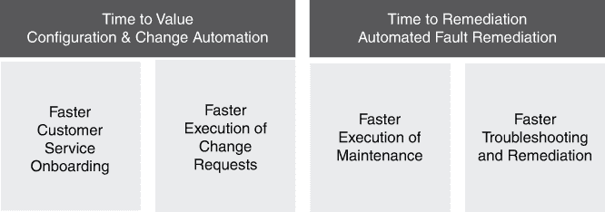

FIGURE 2-2 Benefits of Automation

当你的企业更快地产生客户价值（例如，为新客户办理入职手续和/或提供新服务）时，业务通常会带来更多收入。增加更快的修复时间（例如，减少维护并更快地解决问题）可降低运营成本并提高客户满意度。当做得正确时，这种强大的组合会为业务带来真实、切实的改进。

出于这个原因，重点必须放在自动化业务流程上，而不仅仅是自动化人类。事实上，自动化业务的最佳方式是 `remove` 流程中的人类，或者至少是从客户请求到交付该请求的价值链中移除人类。

## 业务转型

识别 IT 运营中的瓶颈是业务转型的第一步（也是最重要的一步）。然而，业务转型并非一蹴而就；它是一段旅程。将这段旅程视为由构建多个领域的专业知识组成的逐步演进是有用的（参见 Figure 2-3）。

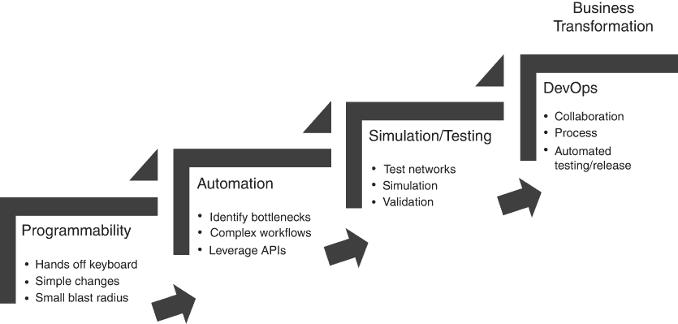

FIGURE 2-3 The Journey to Business Transformation

以编程方式（而非手动方式）更改设备上的设置，是从设备上移除人工操作的第一步。这里的重点是进行单次更改。通常，逐台设备进行此操作风险很小，但也产生很少的价值。理解基础设施中每个组件的编程能力非常重要，你的组织必须具备（或获得）行使这些能力的技能。

要真正加速工作流程，你需要利用编程能力来完成一系列任务。这就是自动化。通过自动化完整的工作流程，你可以实现有意义的改进，并证明转向 DevOps 范式的投资是合理的；然而，提高运营速度并不总是一件好事。例如，如果你自动化了糟糕的流程，你只会让糟糕的事情发生得更快。此外，如果你以糟糕的方式自动化了良好的流程，可能是因为代码中的错误，你可能会创造出比你从未自动化它时更多的问题。出于这个原因，模拟和测试你的自动化至关重要。

测试需要自动化，以便定期且严格地进行。DevOps 的成功高度依赖于你的测试覆盖率和准确性。如果你在发布前没有发现错误，你最终会得到一个不稳定的系统，它可能造成的损害比你试图解决的瓶颈更大。

如果发布或对生产网络的更改没有自动化，那么它就会成为系统中的瓶颈。请记住，正如 Goldratt 所说：“除瓶颈之外的任何地方所做的改进都是幻觉。”所以，如果你没有自动化对生产网络的更改，那么你为什么要自动化呢？

最后，每个发布的验证需要自动化，因为它是在错误影响客户（以及潜在的生命、财产或收入）之前捕捉错误的最后一道防线。

## DevOps 在行动

当组织考虑如何自动化业务流程时，重点必须放在缩短客户请求新服务到收到该服务之间的时间上。人类通常不是缩短此时间的最佳方式，这时应用程序编程接口就派上用场了。API 允许流程的每个步骤被自动化。

例如，当用户想要为新服务器添加防火墙例外时，用户可以进入自助服务门户提出该请求。然后请求可以经过审核流程，以确保其符合业务政策（希望是自动的）并得到适当批准。批准后，ITSM 通过 API 调用自动化框架来开始交付服务。这种方法的优势在于

*   它让网络团队脱离创建、检索、更新、删除（CRUD）流程。

*   它允许网络团队定义并设置检查，以规范网络更改的执行方式。

在 Figure 2-4 中请注意，客户将能够在没有人工参与的情况下请求复杂服务。DevOps 不仅仅是 `just` 自动化；它是提供服务的工件的开发、测试、部署和验证。虽然如果你愿意，仍然可以有人类 `near` 循环，但 DevOps 为你提供了安全自动化的工具。如果你正确地开发和测试自动化工件，你可以相当有把握地确保流程不会出岔子。此外，如果你对已部署的服务进行适当验证，如果有必要，你可以“快速失败”回到工件的先前版本。

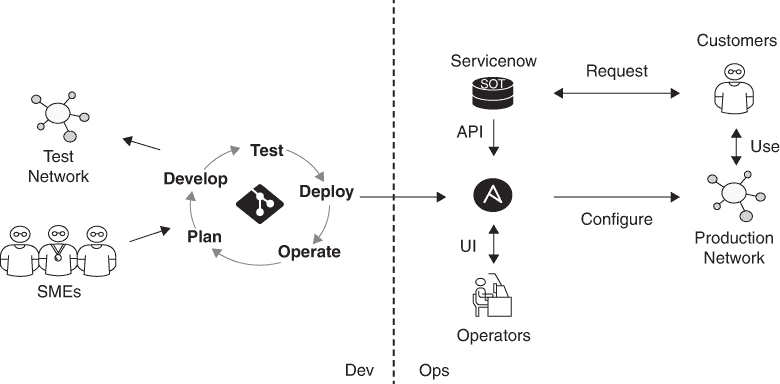

FIGURE 2-4 DevOps in Action

# 为什么要采用模型驱动的 DevOps？


# DevOps in Network Infrastructure

为了更好地交付和改进软件，组织需要采用某种形式的 DevOps。事实上，你每天使用的大部分软件（以及你可能正在用来阅读此内容的软件）都在使用这种模式推送代码更新。这一概念并不新鲜。然而，最近，行业开始将重点从软件转移到 IT 基础设施，包括网络。这种转变非常合理，因为如果用户无法访问你的应用程序，那么你为该应用程序实现 DevOps 的效果有多好都无关紧要。敏捷应用程序依赖于网络的事实意味着，你的网络需要像它所交付的软件一样敏捷和灵活。

## Network Infrastructure Is Different

如果网络需要敏捷和灵活是事实，那么为什么还没有广泛采用应用于网络的 DevOps 呢？嗯，事实证明，与应用程序和软件相比，将 DevOps 应用于网络要容易得多，原因有几点：

*   **A large blast radius:** 网络比大多数应用程序甚至运行应用程序的系统更加复杂和相互关联。一个网络元素（例如，交换机、路由器或防火墙）可以支持数百个系统的运行，而该网络元素上的一次更改可能轻易影响数百或数千个其他系统。因为基础设施中的单个错误具有如此大的 blast radius，所以速度并不总是一件好事。

*   **Inconsistent APIs or no APIs:** 由于大多数网络服务基于嵌入式系统，以编程方式配置它们所需的 API 开发和标准化花费了更长时间。此外，大多数基础设施包括无法更新以支持现代 API 的设备，使得命令行界面成为配置的唯一手段。虽然有方法可以调整自动化以使用这些旧接口，但交互效率较低，且更改不具确定性。

*   **Complex source of truth data requirements:** 源 of truth，或配置典型网络设备所需的键/值对集（例如，Ethernet1/2 的 IP 地址是 1.2.3.4/24），比应用程序甚至被管理的系统所需的要大得多。大型路由器或防火墙可能轻易拥有 10,000 多个构成该设备配置的信息片段。为了使这个问题更加复杂，给定网络的源 of truth 通常分布在多个系统中（IPAM、CMDB 等），并且通常以文档形式存在，这使得以编程方式访问信息变得困难。

*   **Predominantly physical networks:** 由于网络是所有虚拟事物的基础，它们需要是物理的。不幸的是，为物理网络构建测试网络更加困难，因为它们成本高且复杂。尽管在高保真 VNF（可以代表物理网络元素）方面取得了许多进步，但仍有领域只有物理元素才能准确表示完全测试所需的内容。

## What Is Model-Driven DevOps?

Model-driven DevOps 是一种简化将 DevOps 应用于网络过程的方法。它使用标准数据模型来组织复杂的配置，并从设备中提取键/值对，将它们放在集中式源 of truth 中。它使用虚拟网络功能来模拟环境，以便在生产环境中进行更改之前进行准确测试。Model-driven DevOps 是组织使其网络像它所交付的软件一样敏捷的一种方式。为了实现这一点，我们依赖以下原则：

*   Data models

*   Central source of truth

*   DevOps as a framework

## What Is a Data Model?

数据模型只是一种组织和结构化数据的方式。如前所述，将 DevOps 应用于网络时面临的一项重大挑战是每个设备或配置所需的数据量。在考虑网络自动化之前，提取这些大量数据并将其表示在标准化模型中是关键的第一步。

将数据模型视为建造房屋的蓝图。创建蓝图可以让你在施工开始前与建造者达成一致，并让所有相关人员都在同一页面上。房主知道预期的结果，并可以准确预算，而建造房屋的人知道使用什么材料，可以制定计划并开始施工。

### Data Models vs. Textual Configuration

对于一直在使用文本配置的人来说，使用由数据模型描述的数据可能看起来像是一个陌生的概念，但翻译相当简单。例如，如果你查看 Listing 2-1 中显示的 BGP 对等体的文本表示，你可以看到基于 Cisco IOS 的设备的典型 BGP 配置。

LISTING 2-1 Textual Representation of a BGP Peering

Click here to view code image

```
router bgp 65082
no synchronization
bgp log-neighbor-changes
neighbor 10.11.12.2 remote-as 65086
no auto-summary
```

如果用于设备配置的值被提取并作为数据结构中的键/值对分配，你可能会得到类似于 Listing 2-2 中显示的输出。

LISTING 2-2 YAML Representation of a BGP Peering

Click here to view code image

```
bgp:
  global:
    config:
      as: 65082
  neighbors:
    neighbor:
      - neighbor_address: 10.11.12.2
        config:
          peer_group: TST
          peer_as: 65086
```

Listing 2-2 显示了由 OpenConfig BGP 数据模型指定并以 YAML 呈现的 BGP 对等体的结构化数据表示。虽然有些人觉得这种表示不够直观，但它更有利于自动化。在这种格式下，可以轻松以编程方式操作，并根据模型定义和架构进行验证，以检查数据结构中的值。

### Standard Data Models

虽然数据模型有助于组织和结构化数据，但使用过多的数据模型可能会带来问题。例如，三个不同的供应商可能使用三个不同的模型通过 API 配置他们的设备。

为了适应这种不匹配，必须从标准数据模型转换为每个 API 使用的设备特定数据模型。这种转换通常会增加每个工作流的复杂性，每个添加到网络的独特设备都会进一步增加工作流的复杂性（参见 Figure 2-5

FIGURE 2-5 Transforming Data Between Different Models

# OpenConfig

解决这种复杂性并保持供应商中立的一种方法是为源 of truth 使用标准数据模型。有多种方法可以做到这一点，每种方法都有其自身的优缺点。

根据项目的规模和范围，你可以开发自己的数据模型，这使你能够支持你的即时需求。虽然这种方法牺牲了互操作性，但可以实现效率，从而提高项目的成功率，同时减少整体开发工作量。


对于支持大型网络的组织来说，使用标准数据模型（例如 `OpenConfig`）更有意义。虽然这不是唯一可用的标准数据模型，但它拥有最全面的受支持供应商列表，旨在解决实际运营需求。其中立性确实带来了一些限制，尤其是在支持供应商特定功能时，但随着采用率的提高，对供应商特定功能的有限支持应能通过开源贡献来克服。在此之前，某些 `OpenConfig` 模型需要通过供应商原生模型进行扩展。

如 图 2-6 所示，在确定标准模型后，可以大大简化数据在系统中的流动。

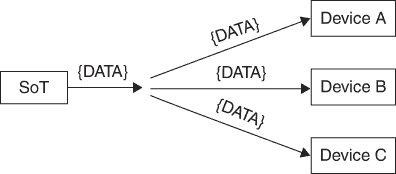

图 2-6 多个设备中使用相同的数据模型

如前所述，并非每个事实来源都使用 `OpenConfig`，也并非每个设备都接受 `OpenConfig`。虽然这是事实，但越来越多的网络设备确实接受 `OpenConfig`，并且你通常有灵活性以任何想要的方式存储事实来源。在不存在此情况的情况下，你必须进行翻译。

图 2-7 说明了一个具有灵活性以支持原生和非原生 `OpenConfig` 的模型。考虑 图 2-7 的两侧。在左侧，一个事实来源原生支持 `OpenConfig`，而另一个不支持。如你所见，以 `OpenConfig` 原生方式存储数据的事实来源可以直接与原生接受 `OpenConfig` 的设备一起使用。不支持原生 `OpenConfig` 的事实来源需要一个翻译函数（图中的 `Xlate`）来将事实来源数据转换为 `OpenConfig` 模型。在右侧，一个设备原生支持 `OpenConfig`，而另一个不支持。对于不支持的设备，我们引入一个平台，将 `OpenConfig` 模型数据转换为该非原生设备接受的模型。`Xlate` 和 `Platform` 函数允许在图中两侧都支持非原生 `OpenConfig` 功能，而不会失去利用 `OpenConfig` 模型的好处。

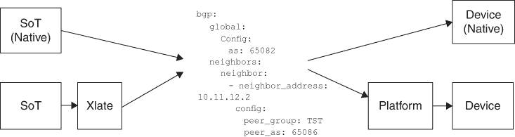

图 2-7 带有原生 OpenConfig 和带有翻译的事实来源

但是等等，这样做是为了避免翻译，对吧？是的，但这仅适用于所有内容都已原生支持 `OpenConfig` 的理想情况。但是，即使不是这种情况，将翻译推到数据流边缘仍然可以获得显著效率。首先，为所有工作流程进行一次翻译，比为每个单独的工作流程临时进行翻译要好。其次，如 图 2-8 所示，验证和合规性等常见操作要高效得多，因为它们只需针对单个数据模型执行一次。

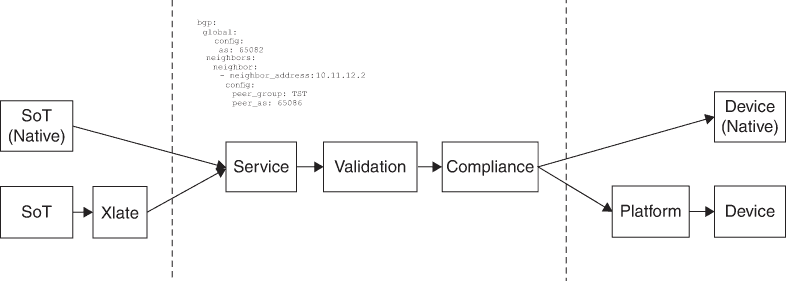

图 2-8 应用于单个数据模型的验证和合规性

例如，创建即使是简单的服务（如 `BGP` 对等）也需要为网络中存在的每种独特设备类型使用不同的配置或数据模型。但是，使用单个数据模型时，服务只需创建一次。这种简化会随着网络上的配置数量而倍增，并随着配置的复杂性而放大。验证和合规性也能带来进一步的效率，因为它们同样只需针对单个数据模型进行。

### 事实来源

到目前为止，我们多次提到事实来源，并将在书籍展开过程中继续深入探讨这一主题。简单来说，`SoT` 是配置网络所需的所有数据。拥有结构化、集中位置的事实来源对于模型驱动的 DevOps 至关重要，因为配置实际上是一个数据管理问题。如果数据得到妥善管理，那么将数据移动到网络设备以及用于执行此操作的工具将变得容易得多。

### DevOps 作为框架

最后，模型驱动的 DevOps 定义了一个用于实践 DevOps 的框架。该框架侧重于功能而非特定工具，其使用增加了结构，以鼓励从一开始就进行深思熟虑的设计，而不是自动化工具的临时集合（参见 图 2-9）。

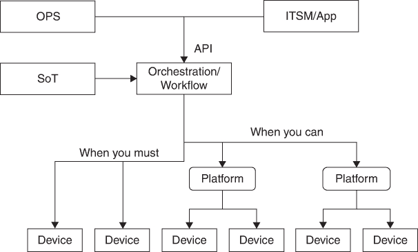

图 2-9 模型驱动的 DevOps 框架

框架的好处在于，各个部分可以在不需要更换整个系统的情况下发展，从而降低整体投资。这个框架为运营人员提供了使用现有工具或选择最能执行特定任务的工具的灵活性。此外，随着框架的发展，新功能可以相对容易地引入。

该框架的核心是编排和工作流。这一层为其上方的层提供北向 API，并从事实来源中提取信息以用于工作流。理想情况下，它调用平台提供的 API 来控制设备。如本书后面所述，平台是设备之上的一个功能，它将设备抽象为一个具有设备间一致功能级别的连贯 API。平台还将尽可能简化复杂服务的部署。

当编排/工作流层无法利用 API 或平台时，它必须直接访问每个单独的设备；但是，这样做会影响复杂性和可扩展性。复杂性增加是因为需要直接了解单个设备，并且编排/工作流层必须构建、协调和验证任何复杂服务。

最后，框架的顶部包括系统的刺激。工作流要么是从 ITSM 工具启动（当客户请求新服务或功能时），要么直接来自运营人员。

## DevSecOps：内置安全

最后但同样重要的是，敏捷并不意味着缺乏安全。恰恰相反，DevOps 所需的基础设施即代码为将安全集成到集成和部署的每个步骤提供了完美的通道。DevOps 的这一方面通常称为 `DevSecOps`，表示将安全集成到 DevOps 中。重要的是要理解，DevSecOps 与 DevOps 本身并无根本区别。它不仅适用于网络安全，而是强调以严谨的方式将安全纳入 DevOps，并将其应用于所有类型的基础设施。

集成安全通过三种方式实现：

*   当基础设施呈现为代码时，对基础设施的更改是确定性且完整的。这些更改可以立即集成到基础设施中，而不是将许多更改收集到更复杂的维护窗口中。

*   更改以协作方式进行，并在部署前进行审查。跨职能的 DevOps 团队包括来自所有学科的审查人员，尤其是安全人员。当更改推送时，网络安全团队的审查人员可以根据这些更改对网络安全态势的影响来接受或拒绝这些更改。

*   这些更改可以在集成的测试阶段与合规性要求进行检查，并与实时工具进行验证。例如，扫描工具可以用于模拟环境中的虚拟或物理防火墙实例，以测试任何更改是否会创建危及基础设施安全的漏洞。


但这难道不只是将瓶颈转移到基础架构安全团队，并造成“改善的错觉”，而没有任何实际改善吗？恰恰相反，通过将 DevOps 原则应用于基础架构，你可以看到我们如何显著帮助解决了基础架构安全的潜在瓶颈。考虑一个协作工作流，其中基础架构变更经过设计和测试，但在部署之前，必须由基础架构安全团队批准。任何时刻基础架构的一致、确定性且完全可见的状态，都是安全从业者的梦想。此外，能够直接从测试中审查工件和结果，为基础架构安全团队提供了做出高信心、低风险决策以批准变更所需的所有信息。最后，始终应用的合规性检查确保永远不会部署任何违反现有合规性策略的内容。通过将基础架构的 DevOps 融入所有利益相关者和批准或认证机构的整体工作流中，我们正在显著改善最大的瓶颈之一。

## 摘要

本章论证了网络基础架构需要像它所交付的应用程序一样敏捷和灵活，并介绍了模型驱动 DevOps 的概念作为实现这一目标的方法。此外，本章还讨论了 IT 英雄的概念，他们如何可能在你的运营中造成瓶颈，以及如何使用基于约束的 IT 的概念来识别他们。它还提供了实现业务转型的技术框架。

下一章基于这些概念，开始解决使能敏捷和灵活基础架构的一些技术细节。我们将介绍使用 API 和数据模型使网络基础架构可消费的概念。

# 第 3 章

## 可消费的基础架构

在前一章中，我们解释了模型驱动 DevOps 的强大功能和数据模型的使用。要开始模型驱动 DevOps 的旅程，你的基础架构必须以编程方式可消费。因此，在本章中，我们讨论可消费基础架构的概念。*可消费基础架构*，简单来说，就是通过 API 通过数据模型进行交互的基础架构。可消费基础架构通过 API 和基于平台的简化，快速响应组织的需求。正如我们稍后将探讨的，我们希望从消费服务和能力的角度来看待网络，而不仅仅是自动化特定任务。可消费基础架构大大降低了自动化的复杂性，并使其对运维人员更加易于访问，而不是要求深厚的编程专业知识。

### 自动化做事情

当我们上次提到 ACME Corp 的 Bob 时，他正在考虑竞争对手的新工作机会，而 CIO Haley 刚刚开始了解 Bob 对公司价值的真实程度。很明显，ACME Corp 当前的 IT 基础架构运营方法与企业更高敏捷性和更低风险的目标不一致。事实上，Haley 开始意识到，如果 Bob 离开去竞争对手那里，她面临着业务中断的巨大风险。

Haley 越来越相信，自动化她的 IT 基础架构并实施 DevOps 可以实现她提高敏捷性和降低风险的双重目标。她需要找一个像 Bob 这样的人，将他的知识转化为代码，同时转向 DevOps。她知道这项工作将是一项巨大的工作量，但她也知道这是正确的前进方向。她将立即开始。

当 Bob 周一走进办公室时，他的日历上有一个新会议，标题不祥地写着“网络自动化讨论”。Bob 在 ACME Corp 建立了自己的职业生涯，凭借他对网络设计和协议的知识，以及通过 CLI 将这些设计变为现实的能力。这就是他为公司带来的价值。

几年前，他曾兴奋地尝试使用脚本进行一些简单的自动化，该脚本会登录设备并发出几条命令。他的兴奋没有持续多久。他很快发现，试图解析一系列命令的输出远非简单。CLI 对人类来说很容易解析，但事实证明，机器理解配置更改的结果或 show 命令的输出要棘手得多。他必须编写代码来查找和解析输出中的某些语言。编写这段代码很困难，即使他能做到，他知道 ACME Corp 网络中每个设备的 CLI 都不同。为数百个甚至数千个单独设备编写独特的代码不是 Bob 有时间做的事情。这项努力从长远来看可能会有回报，但 Bob 有一个网络要运营。和许多在他之前的网络工程师一样，他没有投入所有时间在自定义语言解析代码上，而是回到了过去几十年来行之有效的方法：通过命令行单独管理每个设备。

回想起他之前的失败尝试，Bob 现在对自动化网络基础架构的概念感到担忧。会议开始时，Bob 的经理 Jane 向网络团队陈述了残酷的真相。她说：“我们的 CIO 相信 IT 基础架构自动化将提高我们的效率、敏捷性，并降低宕机的风险。”就像几乎所有涉及网络工程师的会议一样，当提到自动化一词时，爆发出一片集体的呻吟。Jane 听到诸如“过我的死尸！”和“在我看管下绝不！”之类的评论。Bob 表情沉重地说：“我们以前试过，根本行不通。”虽然，深下去，他知道自己工作过度且不开心，他参与了环境中的每一次关键变更，而且由于开发人员每天多次部署代码，关键变更正在成为常态。CIO 的自动化策略一定有些道理。Jane 用坚定的语气回答说：“好吧，我们今天所做的行不通。需要有所改变。有什么建议吗？”她与 Bob 进行了直接的眼神交流。他迅速回顾了自己过去的自动化失败，思考如何修复它。他知道 API 应该能帮助解决一些以前的问题，尽管他对学习新东西并不兴奋，Bob 还是提出了一个建议。“好吧，我们都在通过 CLI 脚本进行网络变更时遇到过问题。这，嗯，很痛苦。”他听到团队中传来附和的低语。他半笑了一下，继续说道，“那我们为什么不看看使用 API 来自动化我们的网络基础架构呢？我们的供应商总是在说 API 有多好。”“这是一个极好的建议，Bob！我希望你来牵头这项工作，”Jane 回答道。Bob 的笑容消失了。“这就是我张大嘴巴的下场，”他想。

一周后，Bob 接到了由管理 ACME Corp NTP 服务器的人提交的工单。由于数据中心基础架构发生变化，他们需要将 NTP 服务器迁移到新的 IP 寻址，这需要修改每个网络设备上的 NTP 服务器配置。过去几天里，他一直在研究如何通过 API 与网络设备交互，他认为这可能是一个运用新技能的好机会。

在使用名为 Postman 的工具进行了一些试错后，Bob 能够通过 API 在实验室中较现代化的设备上进行一次更改。他通过检查 API 返回代码验证了更改是否成功。“成功！”他喊道，举起双臂庆祝。然后他检查了生成的配置，发现他的更改只是将新服务器添加到列表中，而不是替换列表。这个过程比他想象的要复杂得多。


结果发现，诸如简单列表之类的东西，如果没有一些更复杂的逻辑来检查现有配置，自动化起来并不那么简单。经过多次尝试和错误后，他最终能够通过 API 脚本化地完成检索现有配置、调和旧列表与新列表，并仅将所需更改推送到设备的过程。

接着，他转向 ACME Corp 网络中一台较旧的设备，并很快发现该设备没有 API。它是一台仅支持 CLI 的设备。“糟糕，”他想。“看来我可能得用其他方式来自动化这台设备。”于是，他研究了另一种常用的网络基础设施自动化工具 Ansible，并发现有一个 Ansible 模块支持这台较旧的设备。经过与 Ansible 的多次尝试和错误后，Bob 能够编写一个剧本，在较旧的设备上实现相同的结果，但不幸的是，它使用的是完全不同的工具和完全不同的语法。“这会很糟糕，”Bob 想。“即使我设法找出如何使用适用于该设备的任何工具或语言来自动化所有不同的设备，我仍然需要找出如何验证每个操作的结果，并将所有这些不同的操作扩展到数千台网络设备。这会非常糟糕，”他又想。“一定有更好的方法。”

## APIs

应用程序编程接口（API）是两个应用程序相互交互的一种方式。相比之下，命令行界面是人类与应用程序交互以检索数据或进行配置更改的一种方式。在 IT 基础设施的背景下，API 交互通常是双向通信，其中一些数据从应用程序发送到设备或控制器平台，目的是检索操作信息或进行配置更改。

API 是模型驱动 DevOps 的关键组件。正如名称所暗示的那样，模型驱动 DevOps 大量使用数据模型。设备上的 API 软件获取数据，并使用数据模型来解读这些数据，以制造商预期的方式配置设备的各个组件。

当网络基础设施被视为一组 API 时，配置包括在这些 API 之间移动数据，通常以 JSON 或 XML 的形式。这种能力使网络操作更像云和应用程序开发。这种交互方式相较于传统的人机优化 CLI 交互是一项重大改进。

网络设备最常用的模型驱动 API 使用带有 YANG 数据模型的 NETCONF 协议。NETCONF 通过安全传输层推送编码为 XML 的数据模型，并相较于 CLI 提供多项操作优势，包括

* 用于配置数据的安装、操作和删除方法
* 多个配置数据存储（例如 candidate、running、startup）
* 配置验证和测试
* 配置数据与状态数据之间的区分
* 配置回滚

### 为什么选择 API 而不是 CLI？

几十年来，网络工程师一直使用 CLI 来配置网络设备。CLI 在很大程度上是一种有效的人机接口。然而，在自动化网络设备方面，CLI 是一种糟糕的计算机到网络设备接口。主要原因是大多数 CLI 旨在供人类阅读；因此，大多数 CLI 都具有类似语言的结构，这使得人类更容易使用。不幸的是，人类语言对计算机来说很难使用。

为了说明这一点，让我们先看一个在 Cisco IOS 设备上配置主机名的简单示例。我们使用 Ansible，因为它是自动化网络设备最流行的方式之一，但我们即将描述的问题存在于大多数基于 CLI 的自动化方法中。使用 Ansible 术语，我们描述特定设备主机名的期望最终状态。主机名是一个很好的用例，因为它是一个标量（即单个值）。要更改主机名，Ansible ios_config 模块会对配置进行简单的文本比较。要使用 Ansible 设置主机名，你会在剧本中使用以下 YAML：

Click here to view code image

```
- ios_config:
    lines:
      - hostname newname
```

如果 `hostname newname` 不存在，它会将该行发送到设备。即使目标设备上存在不同的主机名，因为主机名是标量，旧主机名会被期望的主机名替换。然而，正如 Bob 痛苦地发现的那样，NTP 服务器列表就更难处理了。假设你使用以下 YAML 将 NTP 服务器设置为 1.1.1.1：

Click here to view code image

```
- ios_config:
    lines:
      - ntp server 1.1.1.1
```

现在你想将 NTP 服务器更改为 2.2.2.2，所以你修改了 YAML：

Click here to view code image

```
- ios_config:
    lines:
      - ntp server 2.2.2.2
```

很简单，对吧？但问题是，你最终会在配置中得到两个 NTP 服务器：

Click here to view code image

```
ntp server 1.1.1.1
ntp server 2.2.2.2
```

原因是 Ansible ios_config 模块没有在配置中看到 `ntp server 2.2.2.2`，所以它发送了该行。但是，因为 `ntp server` 是一个列表，它会添加一个新的 NTP 服务器而不是替换现有的，从而给你两个 NTP 服务器（其中一个是你不想要的）。要使 2.2.2.2 成为唯一的 NTP 服务器，你需要知道 1.1.1.1 已经被定义为 NTP 服务器，并显式地将其删除。ACL、IP 前缀列表以及 IOS 中的任何其他列表也是这种情况。Ansible ios_config 模块（以及 cli_config 模块）没有原生方法来描述类似网络设备上的 NTP 服务器这样简单事物的期望最终状态，更不用说 OSPF、QoS 或组播这样更复杂的事物了。

显然有方法可以解决这种情况。例如，Ansible ios_config 模块可以改进，使其能够解析 IOS 语法并查找任何现有的 NTP 服务器配置并将其删除，就像人类所做的那样。然而，这种方法的一个问题是，这个功能更强大的模块将在 IOS 之外重新实现 IOS 解析规则。这意味着 IOS CLI 的供应商更改将需要对 ios_config Ansible 模块进行更改，从而产生一个可维护性问题，这通常会导致功能滞后。此外，这种方法需要针对每个可用的供应商和/或设备 CLI 采用，使得这种方法无法扩展。

更好的方法是使用 API。API 是专门为设备的编程配置而设计的。为了说明使用 API 的模型驱动方法的优势，让我们使用 netconf-console 实用程序来获取和设置 Cisco IOS-XE 设备上的 NTP 服务器。首先，让我们查看当前的 NTP 服务器列表。Listing 3-1 说明了如何使用 netconf-console 检索 NTP 配置。

LISTING 3-1 使用 netconf-console 检索 NTP 配置

Click here to view code image

```
# netconf-console –host <device IP> --port 830 –user admin –password admin –db running
–get-config –xpath /native/ntp
<data xmlns="urn:ietf:params:xml:ns:netconf:base:1.0"
xmlns:nc="urn:ietf:params:xml:ns:netconf:base:1.0">
  <native xmlns="http://cisco.com/ns/yang/Cisco-IOS-XE-native">
    <ntp>
      <server xmlns="http://cisco.com/ns/yang/Cisco-IOS-XE-ntp">
        <server-list>
          <ip-address>1.1.1.1</ip-address>
        </server-list>
        <server-list>
          <ip-address>2.2.2.2</ip-address>
        </server-list>
      </server>
    </ntp>
  </native>
</data>
```


虽然这个示例对相同配置的表述更为冗长，但它是确定性的。所有 NTP 服务器及其关联配置都组织在树的一个部分中。我们可以将其视为一个独立实体，而不是与其他配置信息混杂在同一层级。另外，请注意，我们能够向设备请求 `just` NTP 配置信息。无需解析。

现在让我们更改 NTP 服务器。首先，我们获取之前的输出，更改第二个 NTP 服务器的 IP 地址，并指定该操作应使用 `operation='replace'` 替换服务器部分。Listing 3-2 的内容通常会放入名为 `ntp.xml` 的文件中。

## Listing 3-2 XML to Change NTP Configuration

Click here to view code image

```
<native xmlns="http://cisco.com/ns/yang/Cisco-IOS-XE-native">
  <ntp>
    <server xmlns="http://cisco.com/ns/yang/Cisco-IOS-XE-ntp" operation='replace'>
      <server-list>
        <ip-address>1.1.1.1</ip-address>
      </server-list>
      <server-list>
        <ip-address>3.3.3.3</ip-address>
      </server-list>
    </server>
  </ntp>
</native>
```

然后我们可以使用 `netconf-console` 将 XML 负载推送到设备，如 Listing 3-3 所示。

## Listing 3-3 Using netconf-console to Change NTP Configuration

Click here to view code image

```
# netconf-console –host <device IP> --port 830 –user admin –password admin –db
running –edit-config ntp.xml
<ok xmlns="urn:ietf:params:xml:ns:8equire:base:1.0"
xmlns:nc="urn:ietf:params:xml:ns:8equire:base:1.0"/>
```

XML 响应中的 `ok` 表示设备接受了更改。现在让我们检索 NTP 配置并验证结果，如 Listing 3-4 所示。

## Listing 3-4 Using netconf-console to Verify Configuration Change

Click here to view code image

```
# netconf-console –host <device IP> --port 830 –user admin –password admin –db
running –get-config –xpath /native/ntp
<data xmlns="urn:ietf:params:xml:ns:netconf:base:1.0"
xmlns:nc="urn:ietf:params:xml:ns:netconf:base:1.0">
  <native xmlns="http://cisco.com/ns/yang/Cisco-IOS-XE-native">
    <ntp>
      <server xmlns="http://cisco.com/ns/yang/Cisco-IOS-XE-ntp">
        <server-list>
          <ip-address>1.1.1.1</ip-address>
        </server-list>
        <server-list>
          <ip-address>3.3.3.3</ip-address>
        </server-list>
      </server>
    </ntp>
  </native>
</data>
```

你可能首先注意到的一点是，仅仅更改 NTP 服务器就需要做这么多工作。正如人机接口对计算机来说并非最优一样，计算机与设备的接口对人类来说也并非最优。拥有一种机器友好、确定性且可重复的环境变更方式，是实现有效自动化的必要基础。将一系列可编程操作组装成更复杂的工作流，才是你开始看到真正效率优势的地方。

尽管计算机与设备的接口起初可能令人望而生畏，且对人类来说并非最优，但人类仍需理解它们，以便帮助计算机利用它们进行自动化。Figure 3-1 更深入地探讨了这一概念。这里我们从真值源获取数据（应配置的 NTP 服务器列表），根据数据模型将其编码为负载（NETCONF 的情况为 XML），并将负载发送到 API（本例中为 NETCONF）。


FIGURE 3-1 Encoding Data

这种通用工作流可以适应各种用例和 API。例如，我们可以通过简单地将编码更改为 JSON（但使用相同的数据模型）并将其发送到 RESTful 接口来使用 RESTCONF 接口。我们甚至可以将这一概念扩展到仅支持 CLI 的设备，即获取数据，将其编码为针对该设备定制的文本配置，并通过 SSH 交付。这产生了一个灵活的框架，如 Figure 3-2 所示，具有通过任何编码向任何设备使用任何 API 交付数据的灵活性。

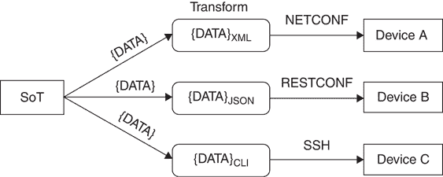

FIGURE 3-2 Encoding Data for Different APIs

这种方法适用于物理网络基础设施，也适用于云基础设施。例如，AWS CloudFormation 只是使用数据模型编码为 JSON 的真值源数据，并通过使用类似于 Python 的 `Boto3` SDK 的 API 交付。因此，以这种方式思考使你能够对整个 IT 基础设施使用相同的方法论。

# Platforms

在模型驱动 DevOps 的背景下，平台是网络中设备的整合和简化点。如果没有平台，你将需要逐个配置每台设备，这会使 IT 变得更加繁琐和耗时。平台的最佳示例是云基础设施提供商，如 AWS、Azure 和 Google。他们创建了提供抽象服务（如计算、存储或网络）的平台，供 IT 组织使用。组织不再需要考虑获取硬件、将硬件配置为支持应用程序的系统，以及长期维护该硬件。此过程全部抽象为服务并通过 API 提供。例如，客户不关心其计算服务使用什么类型的节点或如何配置它们；客户只希望服务能正常工作。平台有不同的形式和功能，但它们都旨在简化 IT，并且通常包含本章其余部分描述的许多属性。

### Physical Hardware Provisioning

平台的概念也扩展到物理本地网络。与云不同，在云中你不需要知道或关心物理硬件，而在本地基础设施中，这是一个重要问题。为了简化硬件的部署和配置，许多平台支持诸如“即插即用”或“零接触配置”等技术。这通常也被称为 `Day 0 provisioning`，其中最小配置会在物理硬件启动时自动应用，以便它可以与平台通信并获取更完整的（或 Day 1）配置。本书主要关注 Day 1 配置和 Day 2 操作，但了解大多数平台也简化了物理硬件的 Day 0 配置是有用的。

### Consolidated Control Point

无论是云还是本地，平台的主要优势都是集中控制点。网络中集中控制点的概念随着软件定义网络（SDN）的出现而变得突出。SDN 将网络的控制平面（决定将数据包发送到哪里的部分）与数据平面（执行数据包转发的部分）解耦。纯 SDN 网络中的设备几乎没有自主运行的能力，没有中央控制器就无法工作。然而，随着时间的推移，这种纯粹的方法在大多数情况下达到了平衡，即设备可以自主运行，也可以作为基于控制器的结构的一部分运行。一种更务实的 SDN 方法演变出来，即网络中的设备作为分布式控制平面的一部分运行，由集中式控制器管理网络配置和策略。这种方法采纳了纯 SDN（集中控制点）的最佳部分，并将其与分布式控制平面（可扩展性和弹性）的最佳部分相结合。在网络背景下，这种更务实的 SDN 控制器方法就是我们所说的平台。

### Northbound vs. Southbound APIs


# Chapter 3

## 平台 API：北向与南向

在 IT 基础架构领域，将平台 API 视为北向或南向通常很有用。典型的控制器平台会暴露一个“北向” API，旨在为其他应用程序提供功能。一个很好的示例是控制器本身的 UI。通常，控制器的 UI 会使用同一个北向 API 来检索数据并进行配置更改。当通过北向 API 收到请求，且控制器软件确定需要对一个或多个设备进行更改时，它会使用“南向” API 与各种设备进行通信。这些南向 API 特定于网络中设备所暴露的 API。不同设备供应商通常为其设备提供不同的 API。如 图 3-3 所示，控制器平台可以将许多不同供应商或设备的 API 整合为单一、统一的北向 API。

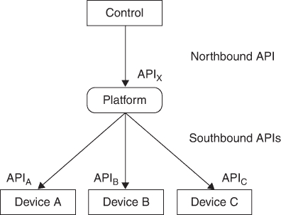

FIGURE 3-3 Northbound vs. Southbound APIs

### API 和功能标准化

平台可以发挥的一个重要作用是标准化一组异构设备之间的 API。从我们之前的示例来看，平台会在内部透明地执行任何数据转换，同时向用户呈现单一 API（参见 图 3-4）。

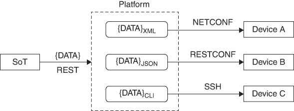

FIGURE 3-4 Platform API Normalization

这种标准化大大降低了网络自动化的复杂性，因为它允许自动化工具针对单一数据模型和单一 API 进行工作。如果没有这种规范化，工具就必须执行数据模型转换，然后为网络上可用的每种设备类型调用正确的 API。回想一下，当 ACME Corp 的 Bob 意识到网络上的每种设备都有不同的命令行，需要各自的自定义代码时，这似乎无法管理。具有将数据标准化为单一数据模型和单一 API 的平台解决了这个问题。

平台还通过标准化许多功能各异的异构设备的功能来提供帮助。例如，许多网络设备没有将配置更改回滚到先前状态的能力。如果向平台添加状态，则平台可以跟踪更改发生的过程，以便能够将设备的状态返回到更改发生前的配置。此外，在平台中存储状态允许比较设备的状态应该是什么，以防发生带外更改。如果设备与平台不同步，则可以采用或覆盖本地更改。

### 结构级服务

除了标准化之外，平台还可以为网络提供结构级服务。一种常见的结构级服务是以太网虚拟专用网络 (EVPN)。EVPN 用于在大型校园或站点之间通过第 3 层路由网络扩展以太网第 2 层服务。它被视为一种结构技术，因为它依赖于基于 BGP 的中央控制平面来分发 MAC 地址和其他信息，从而实现端节点之间的连接。如果没有控制平面，结构就无法正常工作，尽管各个设备可以自主运行。

平台可以提供网络的结构级视图以及运行该结构所需的服务（参见 图 3-5）。这些功能大大简化了网络，并实现了没有此中央功能就不可能实现的服务。

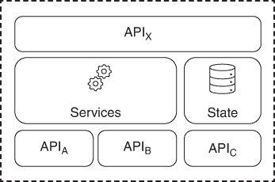

FIGURE 3-5 Fabricwide Services

# 可扩展性

平台还使网络自动化的规模更大。如果没有平台，用于自动化的控制节点需要直接与每个设备通信，而不是能够通过利用平台中的状态来优化通信（参见 图 3-6）。例如，让我们看看 Ansible 等工具如何对设备进行更改。Ansible 的目标是将设备带到所需的最终状态。为此，它需要检查设备的当前状态，将该状态与所需的最终状态进行比较，然后将更改发送到设备。此操作使控制节点与最终设备之间的通信加倍。为了进一步复杂化问题，许多操作仅在配置的离散部分上工作，这意味着需要多次操作才能完成一次更改。

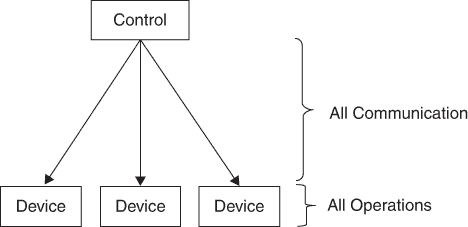

FIGURE 3-6 Scaling Control Communications

当我们引入平台时，平台与设备之间的通信可以减少到一组最小化的合并更改（参见 图 3-7）。

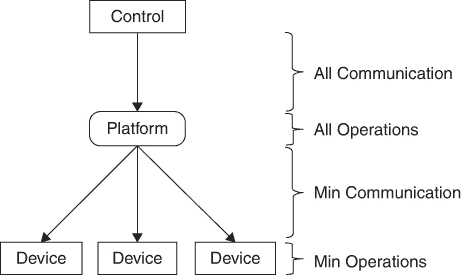

FIGURE 3-7 Better Scale Through Platforms

图 3-8 说明了这种架构如何在地理上进行扩展。对于地理上分散的网络，这些中间平台可以提供区域聚集和其他控制平面服务。

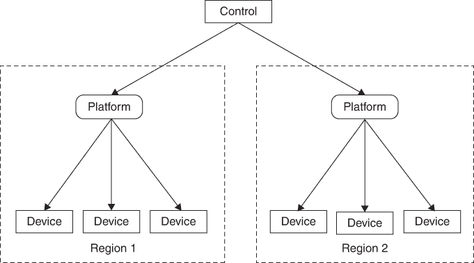

FIGURE 3-8 Scaling Platforms Geographically

## Summary

本章介绍了成功基础架构自动化的两个主要因素：API 和平台。我们定义了可消费的基础架构，并展示了前一章讨论的 API 与数据模型如何使其成为可能。此外，我们说明了 API 如何实现确定性且高效的机器对机器交互，并且对于成功的自动化至关重要。平台使您能够更好地扩展通过 API 进行的操作，配置物理硬件，并使您能够在基础架构之上构建更复杂的自动化服务。我们还研究了云平台为何如此强大，以及如何将相同的平台概念应用于本地基础架构。在接下来的章节中，我们将介绍如何将基础架构表示为代码，然后如何将您迄今所学的一些高级概念组装成一个用于大规模基础架构自动化的框架。

# Chapter 4

## 基础架构即代码

在前一章中，您学习了如何通过 API 和平台使基础架构可消费，以减少自动化的复杂性。以可消费的基础架构为基础，本章介绍了基础架构即代码 (IaC) 的概念，并说明它在很大程度上可以被视为数据移动、转换和验证练习，而不是编程练习。本章和下一章中的许多代码片段有助于说明我们所呈现的概念。它们是更完整的参考实现的简化版本，该实现将在 第 6 章 “实现”中介绍，也可通过 GitHub 获取。

### 合规性是个脏词

那是星期一，Bob 坐在 ACME Corp 的办公室里，盯着他的工单队列。队列又长又令人沮丧，于是他将思绪转向未来、CIO 的 DevOps 指令，以及这对网络团队意味着什么。他开始在这个领域形成一些想法，而且这些想法有些令人鼓舞。第一个想法是 API 确实是新的 CLI，第二个想法是他需要一个平台来帮助将 API 扩展到简单的测试用例之外。他迄今所学的内容令人鼓舞。然而，在这个阶段，团队似乎离实现真正的 DevOps 还很远。问题是，他不知道从哪里开始。沮丧之下，他将思绪转回工单队列以及那些需要他关注的看似无穷无尽的手动任务。


Bob groaned audibly as he read the title of the first ticket, “Prepare network infrastructure for audit.” ACME Corp was subject to several different IT compliance standards, such as PCI and ISO. Each year an audit was done to ensure ACME Corp met these standards. If the company did not, the consequences could be severe, ranging from fines to inability to operate. A failed audit could often lead to lost revenue and, potentially, a resume-generating event for people like Bob.

For Bob, `compliance` was a dirty word. The network infrastructure was notorious for being out of compliance. Like most organizations, ACME Corp documented its compliance standards as a series of CLI or GUI commands in a Microsoft Word document. People like Bob took the various standards such as PCI and ISO, interpreted them, combined them to achieve an “approved” compliant configuration, and then documented that configuration as a series of CLI commands or GUI instructions in a Word doc. A human was then required to follow the document and manually verify actual device configurations against the approved configurations. Because this was an incredibly time-consuming exercise, and therefore costly, it happened only once a year, just prior to an audit.

Bob understood the need for compliance, but he also knew that ACME Corp’s operating model meant that the network was almost immediately out of compliance the moment an audit was over. Because he and the rest of the network team are human, and they make changes by hand, they sometimes configured things differently from the standard, took shortcuts, or even made mistakes. When you added up all these factors, it meant that the actual network configuration could drift significantly from a “compliant” configuration, and the more time that went by between audits, the further it would drift.

Bob thought to himself, “What if, instead of writing our standards as a set of instructions for humans to follow, we could represent them in a more machine-readable format that could be more readily used for automation? It sounds great, but, what would that look like?” From his previous attempts at automation, he learned that CLI-based templates are difficult to create because the CLI is intended for human consumption, and they are difficult to maintain because the CLI is prone to change with OS upgrades. What he needed was something machine-readable and stable.

Although APIs provide some of the attributes he was looking for, his previous experience showed that each different device API required different structured data as input, which meant that he could not simply represent the ACME Corp compliance standards as one set of structured data suitable for input to an API. Instead, he needed a different set of structured data for each API, and this didn’t seem much different from having to maintain different CLI templates for each type of device.

Lately, there has been a lot of industry buzz around something called OpenConfig, which is supposed to solve this problem. After an hour of googling OpenConfig, Bob discovered that it is essentially a set of vendor-agnostic data models intended for network device configuration and monitoring. Another few hours of googling data models and Bob came to understand that a unified data model that could describe all common network configuration-related tasks was exactly what he was after. If he could define the ACME Corp compliance standards in terms of the OpenConfig data model, then, theoretically, he would have a set of structured data that he could use to automate the compliance check across the entire network.

Bob was starting to get excited about the notion of automating compliance, but, unfortunately, his excitement was short-lived. For OpenConfig to provide a way to configure the network using a common data model, all devices in the network would need to support OpenConfig. The good news was that many devices in the ACME Corp network `did` support it. The bad news was that some had only partial support. This sounded like a job for a platform. If Bob could use a platform to translate OpenConfig to his various devices that have no or only partial support for Open-Config, then the dream might still be alive. “Maybe, just maybe, this might work,” he thought to himself.

Later that day, Bob had lunch with Larry, one of his coworkers. Larry’s team was responsible for performing network compliance checks prior to an audit. Bob laid out his thoughts regarding models and automating the compliance check. “So, what do you think?” asked Bob. Larry, acutely aware of how painful the process is, answered, “I like the idea. After performing the compliance check by hand a few hundred times, I think we lose focus, and our accuracy starts to diminish rapidly after that. This approach would solve that problem and save us a ton of time. But where would all the data come from?”

“What data?”

“Your OpenConfig model is great for specifying the organization of the configuration data, but something has to supply values for things like interface IP addresses and VLAN IDs for each device. Normally, we keep that data in a spreadsheet and verify that what is configured on each device matches the values in the spreadsheet.”

“I see,” said Bob. “The spreadsheet data is what `really` defines that specific device. Without it, we have only a generic model. When we combine the spreadsheet data with the model, we get a configured device and, ultimately, a configured network.” Bob was starting to get it. This was really all about the data. Make the data compliant with the ACME Corp standards, and the resulting network would be compliant as well.

It occurred to Bob that a spreadsheet was probably not the best way to store the data that defined the network. To automate the process of transforming this spreadsheet data into network configuration, he would have to consider an alternative format that was more machine-readable. He thought this might be an opportunity for infrastructure as code. If he could convert the ACME Corp spreadsheet data into a machine-readable format and feed that into a platform presenting a unified device model for the network, he would be able to represent the entire network “as code.”

The notion of infrastructure as code is getting a great deal of attention lately in IT circles, and it was a phrase that the CIO often used when she talked about DevOps. Bob sensed an opportunity here. Infrastructure as code might not be DevOps, but it was a step in the right direction, and it solved a real business problem. For the first time in a long time, Bob was enthusiastic about his job again. He couldn’t wait to tell somebody about it.

As it happened, Jane, the network team manager, was in her office trying to figure out how to respond to the CIO DevOps mandate when Bob burst through her open door and said, “I have an idea!”

# Why Infrastructure as Code?

The term `infrastructure as code (IaC)` is a part of the automation and DevOps conversation, but what does it mean? Using the term to define itself, IaC is the process of rendering the provisioning and configuration of infrastructure as code. But why? How does rendering configuration as code enable DevOps? Remember that DevOps started as a way to enable more agile software development. The tools used in DevOps operate on “code,” so we need to render the infrastructure (that thing on which we are performing DevOps) as “code.” “Code” is in quotes because not all of what we create will be actual program code. Much of what we talk about, in fact, is how to represent network configuration data in textual form. Representing infrastructure in textual form is important because this allows the use of source code managers (SCMs) like Git; however, as you see later, not all network configuration data is stored in textual form. Instead, some configuration data is better kept in a traditional database, and we discuss the reasons for this later.


## SCM 在 IaC 语境下提供哪些好处？

首先，它用于跟踪网络状态的变更。如果你的网络期望状态定义为 IaC，那么 SCM 允许你跟踪对该期望状态的任何修改。此功能可让你知道发生了什么变更以及是谁变更的。此外，SCM 通过提供钩子来运行 CI/CD 流水线的各个阶段，从而实现持续集成和持续部署（CI/CD）。我们将在 第 5 章 “持续集成/持续部署”中更深入地探讨 CI/CD。

IaC 意味着我们需要将基础设施表示为代码，但通常什么“代码”定义基础设施呢？在模型驱动 DevOps 范围内，代码由自动化工具的代码（例如，Ansible Playbook、Jinja 模板、Python 代码）和包含描述网络数据的文本“代码”（例如，YAML 文件、JSON 文件）组成。此数据被称为真理源（SoT），如 图 4-1 所示。

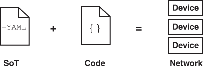

FIGURE 4-1 Infrastructure IaC

# 真理源

网络的真理源是配置网络以达到期望状态所需的所有信息的中央存储库。当构建得当时，你的真理源 `就是` 你的网络。如果你的网络被毁，你将能够从真理源重建整个环境。

不幸的是，`真理源` 在 DevOps 中是一个被误解的术语。有些人可能会争辩说网络本身就是真理源。如果是这样，那么进行 DevOps 将会很困难。如果网络是真理源，那么你如何检查真理源是否没有发生变更？那将需要验证没有设备被人为触碰或更改。然后我们需要一个中央状态存储库来与网络进行核对，对吧？那就是我们的真理源。许多运维人员从根本上理解这一原则，但正如 ACME Corp 的 Bob 所发现，这是一个难以实现的转变。

你的基础设施作为真理源的对立面是你的基础设施是不可变的。也就是说，你永远不会更改你的网络；你只是替换它。这种方法对于云原生基础设施（例如 Kubernetes）效果很好，在其中你会用更新的 Pod 替换现有的 Pod；然而，对于物理网络来说，它并不那么奏效，除非在故障情况下。一个原因是网络基础设施并不总是能很好地响应变更。有时更改访问控制列表（`ACL`）或路由会导致流量扰动。然而，如果设备已经失败或经历了影响网络的问题，那么通常更简单的做法是直接替换设备，推送配置，并在实验室中排查故障设备。

使用真理源对于在网络上配置新设备也很有用。显然，新设备无法持有自己的“真理”，因为它尚未配置。因此，配置必须完全从真理源创建。因此，新设备和因故障重建的设备都应来自真理源。事实上，所有操作只是将真理源数据全部或部分推送到设备中。部分推送的示例是，而不是将整个真理源推送到设备，你可能只想更新 NTP 服务器。在这种情况下，你只会推送该特定信息，而不是整个配置。然而，一般来说，建议你推送设备的所有数据，以便你可以完全测试和验证每次更改的所有数据。在大多数 API 中，平台或单个设备可以找出实际的变更并适当地应用它们。将所有自动化操作视为从真理源向基础设施推送数据，可以大大简化你的 IaC。

### 数据模型

配置基础设施需要大量信息。对于应用程序或服务器来说，真理源数据的规模和管理通常不那么重要。为什么？原因是构建单个系统是一个定义明确的程序，与其他系统的排列组合或相互依赖相对较少。此外，配置系统通常包括配置主机名、IP、DNS、AAA 和软件包等值。每个值都是一个键/值对（例如，`nameservers = 8.8.8.8, 8.8.4.4`），用于定义该系统的操作，而且这类值相对较少。

对于网络元素来说，情况并非如此。如果我们采用标准的 48 端口机架顶部（`ToR`）交换机，每个端口可能都有描述、状态、虚拟局域网（`VLAN`）、最大传输单元（`MTU`）等等。单个 `ToR` 可能有数百个键/值对来决定其运行。将其乘以数百甚至数千台交换机，键/值对的数量会迅速增长。集体而言，这些键/值对构成了你网络的真理源，而且数量可能非常多。事实上，庞大的真理源使得网络自动化成为一个数据管理和操作问题，而不是编程问题。

数据模型为我们提供了一种组织真理源的方法。数据模型组织定义网络的键/值对，并描述数据结构中键/值对的含义。键/值对的含义由其在结构中的相对位置定义。例如，让我们先看看如何使用数据模型来表示 BGP 配置。

图 4-2 考察了如何在 Cisco IOS 和 Juniper JunOS 的 CLI 上设置简单的 BGP 对等。基本上，我们有一堆值，并伴有一堆使用特定语法来描述这些值的单词。

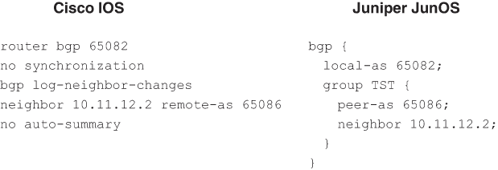

FIGURE 4-2 BGP Configuration in IOS and JunOS

但是，值（两个自治系统编号（`ASN`）和一个 IP 地址）才是真正重要的东西，而且它们在每个配置中都是相同的，如 图 4-3 所示。

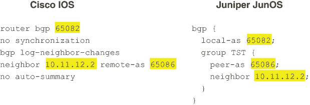

FIGURE 4-3 BGP Configuration Values

事实上，交换机硬件并不关心描述这些值的单词，因为它们无论如何都会存储在配置数据库中。单词是工程师提供给人类的，用于向硬件传达这些值的含义。毕竟，我们不能只指定两个 ASN，因为我们需要知道哪个是本地的，哪个是远程的。然而，我们可以通过顺序来传达它们的含义：例如，`<本地 ASN>`、`<对等 ASN>`、`<对等 IP>`。这基本上是一个小型数据模型。然而，BGP 变得 `复杂得多`，因此我们需要一个更强大的数据模型。图 4-4 是相同数据在 YANG OpenConfig（`OC`）数据模型中以 YAML 呈现的示例。

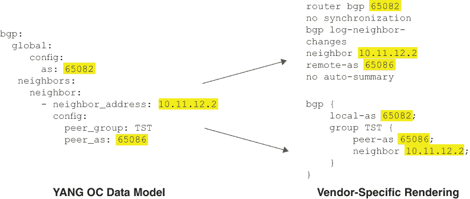

FIGURE 4-4 How a Generic OC Model Is Converted to Native CLI

左侧模型中的数据包含提供任何一种语法特定版本所需的信息——只需添加单词。是的，我们在模型中仍然有作为标签的单词，但它在供应商之间标准化了这些标签，并消除了指定值之间关系所需的语法。如果可以避免，我们不想重新添加单词。在将我们的通用数据模型发送到设备之前，我们首先需要将此数据编码为适合通过网络传输的格式。

# 数据模型编码格式


# 数据模型编码格式

数据模型编码格式能够将数据存储在文本文件中，并通过 API 发送数据。存在此类格式很多，但我们将从 IaC 的运维和编程两个方面，介绍最常见的格式。为了便于比较，我们将用每种描述的格式对相同的数据进行编码表示。

# JSON

JavaScript 对象表示法（`JSON`）是一种源自 JavaScript 的开放标准文件格式，尽管已被多种语言广泛采用用于存储和传输数据。`JSON` 使用冒号分隔的键/值对以文本形式表示数据。`JSON` 值可以是标量、布尔值、列表和其他 `JSON` 对象。由于轻量且易于序列化，`JSON` 常用于 API。尽管仍然非常易于人类阅读，但有时可能会显得繁琐，因为它使用括号来划分列表和对象，使其结构更符合程序员的习惯，如 清单 4-1 所示。

### 清单 4-1 以 JSON 呈现的 OC-System 片段

单击此处查看代码图片

```
{
   "openconfig-system:system": {
      "config": {
         "domain-name": "domain.com",
         "hostname": "router1"
      }
   }
}
```

# YAML

YAML 是一种人类可读的语言，常用于配置文件以及 Ansible 等许多 IaC 工具。它是 `JSON` 的超集，可以用于表示所有相同的数据。尽管它具有简洁、紧凑的表示形式，但也可能难以创建和调试，因为它使用空格来表示特定值的层级关系。例如，如果没有遵循正确的间距，值可能会与数据结构的错误部分关联，或者整个数据结构可能因违反 YAML 结构而无法读取。大多数非程序员倾向于偏好 YAML，因为它更易于阅读，且更贴近配置而非编程，如 清单 4-2 所示。

### 清单 4-2 以 YAML 呈现的 OC-System 片段

单击此处查看代码图片

```
---
openconfig-system:system:
  config:
    domain-name: 'domain.com'
    hostname: 'router1'
```

# XML

可扩展标记语言（`XML`）定义了一套规则，用于以人类可读的格式对文档进行编码，尽管它比 YAML 稍显繁琐。不过，它是可序列化的，并且在各种应用中已使用数十年。它是一种语言，而不仅仅是一种数据格式，并支持查询。由于其结构严格，`XML` 手动构建往往更加复杂，如 清单 4-3 所示。尽管广泛部署，但在 IaC 工具中很少使用；不过，我们在此列表中包含它以便熟悉，因为在使用 NETCONF 时，它常用于对数据进行编码。

### 清单 4-3 以 XML 呈现的 OC-System 片段

单击此处查看代码图片

```
<?xml version="1.0" encoding="UTF-8" ?>
<openconfig-system:system>
  <config>
    <domain-name>domain.com</domain-name>
    <hostname>router1</hostname>
  </config>
</openconfig-system:system>
```

# 数据模型描述语言

为了拥有标准的数据模型，我们需要一种标准的方式来描述模型，使得一个人可以根据模型创建数据结构，而另一个人可以读取相同的数据结构并得到第一个人所期望的数据模型。我们在此介绍 YANG 和 JSON Schema。这两种描述语言都可以用于创建数据模型，并验证数据结构是否符合该模型。

## YANG

又一种下一代（`YANG`）是一种用于建模配置数据、状态数据、远程过程调用和通知的数据建模语言，适用于网络管理协议（RFC 7950）。当通过 NETCONF 和 RESTCONF 等网络管理协议发送时，它在 API 用户和设备之间提供了一个契约，即如果你以特定格式提供数据，该设备将配置设备的相应部分。该数据建模语言可用于对网络元素的配置数据和状态数据进行建模。由于它与协议无关，`YANG` 可以转换为网络配置协议支持的任何编码格式（例如 XML 或 JSON）。

清单 4-4 展示了 `YANG` 的示例。具体来说，它是一组配置信息，包括我们稍后将使用的 OpenConfig System 片段的 leaf hostname、domain-name、login-banner 和 motd-banner。

### 清单 4-4 YANG 模型

单击此处查看代码图片

```
grouping system-global-config {
  description "system-wide configuration parameters";
 
  leaf hostname {
    type oc-inet:domain-name;
    description
      "The hostname of the device -- should be a single domain
      label, without the domain.";
  }
 
  leaf domain-name {
    type oc-inet:domain-name;
    description
      "Specifies the domain name used to form fully qualified name
      for unqualified hostnames.";
  }
 
  leaf login-banner {
    type string;
    description
      "The console login message displayed before the login prompt,
      i.e., before a user logs into the system.";
  }
 
  leaf motd-banner {
    type string;
    description
      "The console message displayed after a user logs into the
      system.  They system may append additional standard
      information such as the current system date and time, uptime,
      last login timestamp, etc.";
  }
}
```

`YANG` 描述定义了结构（即 hostname 是 config 的成员）以及该成员可以保存的数据类型。

## JSON Schema

JSON Schema 与 YANG 类似，可用于定义数据的结构。顾名思义，JSON Schema 特定于 JSON，使用起来也稍微不那么繁琐。不过，由于 JSON 和 YAML 可以互换，我们也可以在 YAML 中定义架构，并使用它们来验证以 YAML 呈现的数据。我们将在 第 6 章 中更详细地介绍 JSON Schema，届时我们将使用它来验证真值数据源。

# 常见 IaC 工具

我们将 IaC 分为真值数据源和代码。我们所介绍的数据模型描述和编码格式主要适用于真值数据源数据。以下工具适用于“代码”。

## Ansible

Ansible 是开源软件，用于以过程化方式进行资源配置、配置管理和应用程序部署。它是一种 IaC 工具，包含其自身以 YAML 呈现的声明式语言，可以与 Git 等源代码管理系统配合使用。它本质上是 Python 上的一层，使非程序员能够更轻松地编排工作流。它通常使用 SSH 作为传输方式，用于自动化本地安装了 Python 的系统。然而，对于网络设备，设备上通常没有 Ansible 可用的 Python 解释器，因此它使用连接插件通过 CLI、NETCONF 和其他协议进行通信。此外，Ansible 具有一个 URI 模块，可用于通用 RESTful API。

尽管 Ansible 是 Python 上更易于使用的抽象层，但这种易用性也带来了局限性。一般来说，Ansible 最适合广泛使用，而不一定是深度使用。当 Ansible 语法被超出其设计范围来处理复杂操作时，可能会变得更加困难，这种特性可能会限制其有效性。通常，这种复杂性最好在插件或 Jinja 中处理。

## Jinja2

Jinja 是一种使用类 Python 语法的模板引擎。尽管主要用于创建 HTML 或 XML 等标记文档，但也可以用于创建通过 API 配置设备的负载。它处理循环的能力远优于 Ansible，因此更适合处理设备接口、路由和 ACL 等内容。


Jinja 在 Ansible 中被大量使用，尤其是在其变量扩展和过滤器的使用方面。事实上，大多数使用 Ansible 的传统网络自动化方法往往更多是 Jinja2 而非 Ansible。Jinja2 模板用于创建负载，而 Ansible 模块用于交付这些负载。

## AWS CloudFormation

AWS CloudFormation 是最早被广泛采用的基础设施即代码（IaC）工具之一，至今仍被许多云运维人员大量使用。它只能与 AWS 及其虚拟网络一起使用；但是，由于其受欢迎程度，我们将其包含在内以确保完整性。它使 IaC 对非开发人员可用，因为它提供了一种方式，可以将云基础设施定义为由数据模型定义的数据，然后将该模型推送到一个服务中，该服务随后配置基础设施。

## Terraform

我们包含的另一个 IaC 工具是 Terraform，目的是确保完整性。Terraform 也是开源的，并且经常与 Ansible 配合使用。Terraform 本质上是声明式的（与过程式相对），通常用于配置基础设施，而 Ansible 主要用于配置。在撰写本书时，Terraform 配置物理网络基础设施的能力有限，但非常擅长配置虚拟网络，并支持多个云和虚拟化提供商。Terraform 与 CloudFormation 类似，因为它使 IaC 对非开发人员可用。

## Organization

源数据的组织非常重要。大多数设备的配置是结构化的，因此以类似的方式结构化源数据很有帮助。由于 OpenConfig 是为此操作用例开发的，因此它以这种方式结构化。每个模型涵盖设备的特定服务或子系统。例如，OpenConfig 系统模型定义设备级设置，如主机名、域名、DNS、日志记录和身份验证。其他服务（如接口）构建在系统设置之上，而 VRF 和路由等服务则构建在接口之上。Figure 4-5 说明了各种模型之间的关系。当所有这些服务合并在一起时，它们提供了整个设备配置。

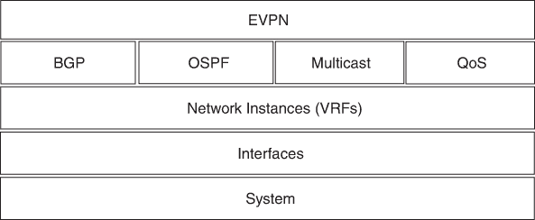

FIGURE 4-5 OpenConfig Model Relationships

源数据的另一个维度是设备的分层分组。在最细粒度级别，信息按设备组织。通常，设备将拥有与其关联的最多数据，因为它包括包含大量元素的信息组，例如接口、路由、ACL 和负载平衡规则。然后可以将设备分组为站点，站点分组为区域，区域分组为父组织，如 Figure 4-6 所示。这些分组中的每一个都包含特定于该分组的数据，并由该分组的子级继承（例如，站点包含其父区域的所有数据）。当同一数据存在于一个分组中时，子级的数据将覆盖父级的数据（例如，站点的 DNS 服务器将覆盖区域的 DNS 服务器）。这种继承和优先级关系允许数据合并。例如，不需要为站点中的每个设备指定 DNS 服务器。相反，设备将继承为其站点或区域指定的 DNS 服务器。理想情况下，数据只需在适当级别指定一次，以便于跟踪和更改。

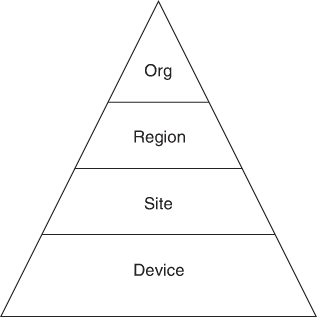

FIGURE 4-6 Inheritance Hierarchy

这种类型的组织也适用于 Ansible 的库存系统。Ansible 有一个灵活的库存系统，它从各种来源提取数据来为您的模型提供数据。其中一个来源可以是以 YAML 或 JSON 渲染的文本文件。这些文件存储在库存结构中，该结构使用 `host_vars` 和 `group_vars` 目录分别存储设备和组数据，如 Listing 4-5 所示。

LISTING 4-5 Ansible Inventory Directory Layout

Click here to view code image

```
org
├── group_vars
│   ├── all
│   │   └── system.yaml
│   ├── region2
│   │   └── system.yaml
│   └── site4
│       └── system.yaml
├── host_vars
│   └── device4
│       └── system.yaml
└── inventory.yaml
```

`group_vars` 目录是 `inventory.yaml` 中指定的层次结构的扁平化表示，如 Listing 4-6 所示。

LISTING 4-6 Ansible Inventory File

Click here to view code image

```
all:
  children:
    region1:
      children:
        site1:
          hosts:
            device1:
            device2:
        site2:
          hosts:
            device3:
            device4:
    region2:
      children:
        site3:
          hosts:
            device5:
            device6:
        site4:
          hosts:
            device7:
            device8:
```

此示例导致 Listing 4-7 中显示的层次结构。

LISTING 4-7 Output Showing the Ansible Inventory Hierarchy

Click here to view code image

```
$ ansible-inventory -i org --graph
@all:
  |--@region1:
  |  |--@site1:
  |  |  |--device1
  |  |  |--device2
  |  |--@site2:
  |  |  |--device3
  |  |  |--device4
  |--@region2:
  |  |--@site3:
  |  |  |--device5
  |  |  |--device6
  |  |--@site4:
  |  |  |--device7
  |  |  |--device8
  |--@ungrouped:
```

要配置的设备列表以及用于配置这些设备的数据被合并到每个设备上下文中的特定事实组中。库存中指定的每个设备和组的数据位于 `host_vars/<device name>.yaml` 或 `group_vars/<group name>.yaml` 中，其中 `group_vars/all.yaml` 提供组织级数据。

作为示例，让我们展示如何在这些不同级别设置 DNS 服务器。让我们在 `group_vars/all.yaml` 中将组织级 DNS 服务器 DNS1 和 DNS2 分别设置为 1.1.1.1 和 2.2.2.2。如果我们随后在 `group_vars/region_b.yaml` 中将区域 b 的 DNS2 覆盖为 3.3.3.3，并在 `group_vars/site_4.yaml` 中将站点 4 的 DNS2 覆盖为 4.4.4.4，则我们将得到 Listing 4-8 中的结果。

LISTING 4-8 Using Hierarchy to Override Source of Truth Data

Click here to view code image

```
$ ansible-inventory -i org --graph --vars
@all:
  |--@region1:
  |  |--@site1:
  |  |  |--device1
  |  |  |  |--{DNS1 = 1.1.1.1}
  |  |  |  |--{DNS2 = 2.2.2.2}
  |  |  |--device2
  |  |  |  |--{DNS1 = 1.1.1.1}
  |  |  |  |--{DNS2 = 2.2.2.2}
  |  |--@site2:
  |  |  |--device3
  |  |  |  |--{DNS1 = 1.1.1.1}
  |  |  |  |--{DNS2 = 2.2.2.2}
  |  |  |--device4
  |  |  |  |--{DNS1 = 1.1.1.1}
  |  |  |  |--{DNS2 = 2.2.2.2}
  |--@region2:
  |  |--@site3:
  |  |  |--device5
  |  |  |  |--{DNS1 = 1.1.1.1}
  |  |  |  |--{DNS2 = 4.4.4.4}
  |  |  |--device6
  |  |  |  |--{DNS1 = 1.1.1.1}
  |  |  |  |--{DNS2 = 4.4.4.4}
  |  |--@site4:
  |  |  |--device7
  |  |  |  |--{DNS1 = 1.1.1.1}
  |  |  |  |--{DNS2 = 4.4.4.4}
  |  |  |--device8
  |  |  |  |--{DNS1 = 1.1.1.1}
  |  |  |  |--{DNS2 = 4.4.4.4}
  |  |  |--{DNS2 = 4.4.4.4}
  |  |--{DNS2 = 4.4.4.4}
  |--@ungrouped:
  |--{DNS1 = 1.1.1.1}
  |--{DNS2 = 2.2.2.2}
```

这种可扩展的源数据组织方法允许将特定信息放在正确的位置，且重复最少。我们将在后续内容中基于这一概念进行构建。

## Types of Source of Truth

组织的源数据通常由多个不同的来源构成。这些来源通常分为两种类型：文本型和数据库型。

### Textual Source of Truth


文本事实来源，通常被归类为基础设施中的“代码”标签，是以某种文本形式指定的配置信息。在前面的示例中，我们创建了一个非常小的事实来源（仅限 DNS 服务器）。现在让我们来看一个使用 OpenConfig 的更完整的示例。由于 YAML 略具可读性，我们使用该格式，如 清单 4-9 所示。

### 清单 4-9 OpenConfig-System 数据

点击此处查看代码图片

```
openconfig-system:system:
  aaa:
    authentication:
      admin-user:
        config:
          admin-password: 'admin'
      config:
        authentication-method:
          - 'LOCAL'
    authorization:
      config:
        authorization-method:
          - 'LOCAL'
  clock:
    config:
      timezone-name: 'EDT -4 0'
  config:
    domain-name: 'domain.com'
    hostname: 'router1'
    login-banner: 'Go away!'
    motd-banner: 'Welcome!'
  dns:
    servers:
      server:
        - address: '1.1.1.1'
          config:
            address: '1.1.1.1'
        - address: '2.2.2.2'
          config:
            address: '2.2.2.2'
  ssh-server:
    config:
      enable: true
      protocol-version: 'V2'
```

此数据配置设备名称，以及管理员用户的密码，并启用 SSH。它使用 OpenConfig System YANG 模型，因此与厂商无关。此 YAML 可以放入 Ansible 库存文件中（例如，`oc-system.yaml`），并用于指定应推送到网络基础设施的系统配置。如果我们将此 YAML 放在组织级别（例如 `group_vars/all/oc-system.yaml`），所有设备都将继承它；但是，它包含需要特定于设备，并可能特定于区域或站点的信息。我们可以通过在工具中有选择地更改值，或者使用变量来替换适当的值来处理此场景。此外，我们可以利用 Ansible 对变量的惰性求值，在适当的级别插入正确的值。例如，我们可以将系统级配置块更改为 清单 4-10 中所示的内容。

### 清单 4-10 带有变量的 OC-System 片段

点击此处查看代码图片

```
config:
  domain-name: 'domain.com'
  hostname: '{{ inventory_hostname }}'
  login-banner: 'Banner'
motd-banner: 'MOTD'
```

此清单将 `hostname` 求值为 `'{{ inventory_hostname }}'`，从而生成一个具有特定设备主机名的负载。我们可以将此示例扩展到 DNS 服务，通过将 清单 4-9 中的 `dns` 块更改为使用 `DNS1` 和 `DNS2` 事实，如 清单 4-11 所示。

### 清单 4-11 在事实来源数据中使用变量

点击此处查看代码图片

```
dns:
  servers:
    server:
      - address: '{{ DNS1 }}'
        config:
          address: '{{ DNS1 }}'
      - address: '{{ DNS2 }}'
        config:
          address: '{{ DNS2 }}'
```

此方法生成一个单一的 OpenConfig 系统负载，该负载具有适当的区域级和站点级事实，如 清单 4-12 所示。

### 清单 4-12 特定设备的事实来源完整渲染

点击此处查看代码图片

```
$ ansible-playbook -i org sot.yaml --limit device8
ok: [device8] => {
    "hostvars[inventory_hostname]['openconfig-system:system']": {
        "aaa": {
            "authentication": {
                "admin-user": {
                    "config": {
                        "admin-password": "admin"
                    }
                },
                "config": {
                    "authentication-method": [
                        "LOCAL"
                    ]
                }
            },
            "authorization": {
                "config": {
                    "authorization-method": [
                        "LOCAL"
                    ]
                }
            }
        },
        "clock": {
            "config": {
                "timezone-name": "EDT -4 0"
            }
        },
        "config": {
            "domain-name": "domain.com",
            "hostname": "device8",
            "login-banner": "Go away!",
            "motd-banner": "Welcome!"
        },
        "dns": {
            "servers": {
                "server": [
                    {
                        "address": "1.1.1.1",
                        "config": {
                            "address": "1.1.1.1"
                        }
                    },
                    {
                        "address": "4.4.4.4",
                        "config": {
                            "address": "4.4.4.4"
                        }
                    }
                ]
            }
        },
        "ssh-server": {
            "config": {
                "enable": true,
                "protocol-version": "V2"
            }
        }
    }
}
```

此简单的事实来源使用 YAML 渲染为文本，这使我们能够利用应用程序 DevOps 中使用的相同类型的基础设施 DevOps 工具。将事实来源呈现为 YAML 或 JSON 既灵活又可扩展，但有时您的事实来源需要包含数据库平台。

## 数据库事实来源

数据库是组织数据的绝佳方式，许多组织已经将其事实来源的一部分存储在数据库中，例如配置管理数据库（CMDB）或 IT 服务管理（ITSM）平台。由于数据库通常不是可以签入并通过 SCM 跟踪的文本，因此其中包含的数据通常不被视为“代码”。对数据的更改跟踪以及回滚到早期版本的数据的能力需要由数据库处理。

我们介绍了两种从数据库中提取事实来源到 Ansible playbook 的方法：

*   作为动态库存脚本的一部分
*   临时调用以存储和检索特定信息

### NetBox

为了演示这两种方法，我们使用一个常用的数据库支持的事实来源，名为 NetBox。根据其开发者的说法，NetBox 是一种“基础设施资源建模（IRM）应用程序”，旨在通过提供网络的 *期望* 状态来赋能网络自动化。NetBox 是开源的，可扩展，并拥有强大的 API。NetBox 提供了一组功能强大的 Ansible 模块和插件，利用此 API。

让我们来看看 NetBox 的 Ansible 动态库存插件。要使用该插件，我们需要通过环境变量向其提供 API 端点和令牌：

点击此处查看代码图片

```
NETBOX_API=https://10.10.185.228
NETBOX_TOKEN=ad5fedecba150368c068fa3bbc90fe2d058fac2b
```

API 是 NetBox 设备的 IP 地址，令牌是通过 UI 生成的，方法是转到 **Profile > API Tokens > Add a Token**。我们创建一个具有所需访问权限的令牌，并将生成的令牌复制到 `NETBOX_TOKEN` 环境变量中。接下来，我们需要为插件创建配置文件，并将其放入库存目录中，如 清单 4-13 所示。

### 清单 4-13 NetBox Ansible 动态库存插件

点击此处查看代码图片

```
$ more org/netbox.yaml
plugin: netbox.netbox.nb_inventory
validate_certs: False
fetch_all: True
interfaces: True
group_names_raw: True
group_by:
  - sites
```


# 使用 Ansible 管理 NetBox 数据

这段代码告诉 Ansible 库存系统我们想要哪个插件，以及我们想要所有信息；它还告诉系统按原始组名对 Ansible 中的设备进行分组。要了解此插件提供的内容，让我们使用 playbook 来配置 NetBox。我们可以通过 GUI 完成此任务，但因为这是一章关于 IaC 的内容，让我们使用 Ansible 模块。Listing 4-14 中的代码添加了在 NetBox 中创建设备所需的最少信息。

## Listing 4-14 使用 Ansible 向 NetBox 添加数据

Click here to view code image

```yaml
- hosts: localhost
  gather_facts: no
  tasks:
    - name: Create manufacturer in Netbox
      netbox.netbox.netbox_manufacturer:
        netbox_url: "{{ lookup('env', 'NETBOX_API') }}"
        netbox_token: "{{ lookup('env', 'NETBOX_TOKEN') }}"
        data:
          name: RouterMaker
        state: present
        validate_certs: no

    - name: Create device role in netbox
      netbox.netbox.netbox_device_role:
        netbox_url: "{{ lookup('env', 'NETBOX_API') }}"
        netbox_token: "{{ lookup('env', 'NETBOX_TOKEN') }}"
        data:
          name: router
        state: present
        validate_certs: no

    - name: Create device type in netbox
      netbox.netbox.netbox_device_type:
        netbox_url: "{{ lookup('env', 'NETBOX_API') }}"
        netbox_token: "{{ lookup('env', 'NETBOX_TOKEN') }}"
        data:
          model: router9000
          manufacturer: RouterMaker
        state: present
        validate_certs: no

    - name: Create site in Netbox
      netbox.netbox.netbox_site:
        netbox_url: "{{ lookup('env', 'NETBOX_API') }}"
        netbox_token: "{{ lookup('env', 'NETBOX_TOKEN') }}"
        data:
          name: "{{ item }}"
        state: present
        validate_certs: no
      when: item.startswith('site')
      loop: "{{ groups.keys() }}"

    - name: Create device in Netbox
      netbox_device:
        netbox_url: "{{ lookup('env', 'NETBOX_API') }}"
        netbox_token: "{{ lookup('env', 'NETBOX_TOKEN') }}"
        data:
          name: router1
          device_role: router
          device_type: router9000
          site: site3
        validate_certs: no
        state: present
```

这个 playbook 从我们之前设置的环境变量中获取 NetBox API 信息，以查找并验证 NetBox 实例。它包含添加设备所需的一些虚构信息，并从在 Listing 4-6 中创建的 `inventory.yaml` 文件中提取站点列表，以在 NetBox 中创建 site1-4。在 playbook 调用时运行 NetBox 动态库存脚本时，数据将 `router1` 与 `site3` 在 Ansible 库存中关联，因为我们告诉动态库存插件按站点分组，如在 Listing 4-13 中所示。这个简单示例说明了如何从外部数据库获取库存信息，并将其与文件中静态指定的库存信息相结合。运行此 playbook 后，库存如 Listing 4-15 所示。

## Listing 4-15 结合 NetBox 和静态文件数据的库存

Click here to view code image

```
$ ansible-inventory -i org --graph --vars
@all:
  |--@region1:
  |  |--@site1:
  |  |  |--device1
  |  |  |  |--{DNS1 = 1.1.1.1}
  |  |  |  |--{DNS2 = 2.2.2.2}
  |  |  |--device2
  |  |  |  |--{DNS1 = 1.1.1.1}
  |  |  |  |--{DNS2 = 2.2.2.2}
  |  |--@site2:
  |  |  |--device3
  |  |  |  |--{DNS1 = 1.1.1.1}
  |  |  |  |--{DNS2 = 2.2.2.2}
  |  |  |--device4
  |  |  |  |--{DNS1 = 1.1.1.1}
  |  |  |  |--{DNS2 = 2.2.2.2}
  |--@region2:
  |  |--@site3:
  |  |  |--device5
  |  |  |  |--{DNS1 = 1.1.1.1}
  |  |  |  |--{DNS2 = 4.4.4.4}
  |  |  |--device6
  |  |  |  |--{DNS1 = 1.1.1.1}
  |  |  |  |--{DNS2 = 4.4.4.4}
  |  |  |--router1
  |  |  |  |--{DNS1 = 1.1.1.1}
  |  |  |  |--{DNS2 = 4.4.4.4}
  |  |--@site4:
  |  |  |--device7
  |  |  |  |--{DNS1 = 1.1.1.1}
  |  |  |  |--{DNS2 = 4.4.4.4}
  |  |  |--device8
  |  |  |  |--{DNS1 = 1.1.1.1}
  |  |  |  |--{DNS2 = 4.4.4.4}
  |  |  |--{DNS2 = 4.4.4.4}
  |  |--{DNS2 = 4.4.4.4}
  |--@ungrouped:
  |--{DNS1 = 1.1.1.1}
  |--{DNS2 = 2.2.2.2}
```

为了简洁，删除了部分输出，但请注意，在 NetBox 中定义的 `router1` 已添加到我们文本来源真理中指定的设备列表。此外，`router1` 还继承了设置的 DNS 服务器设置。

我们刚刚演示了如何将数据库来源真理数据作为动态库存脚本的一部分进行管理。现在让我们看看 ad hoc 调用方法，以了解如何在 playbook 本身中存储和检索来源真理中的信息（而不是作为库存的一部分拉取）。例如，让我们从网络中添加一个可用 IP 地址到 `router1`。首先，通过添加 Listing 4-16 中的任务到 playbook 来用网络对我们的来源真理进行预处理。

## Listing 4-16 使用 Ansible 在 NetBox 中创建前缀

Click here to view code image

```yaml
- name: Create prefix in Netbox
  netbox.netbox.netbox_prefix:
    netbox_url: "{{ lookup('env', 'NETBOX_API') }}"
    netbox_token: "{{ lookup('env', 'NETBOX_TOKEN') }}"
    validate_certs: no
    data:
      prefix: 172.30.1.0/24
    state: present
```

接下来，我们创建另一个 playbook，将接口 `GigbitEthernet1` 添加到 NetBox 中的 `router1`，并将其分配给我们刚刚创建的网络上的第一个可用 IP 地址，如 Listing 4-17 所示。

## Listing 4-17 从 NetBox 提取 IP 并将其分配给接口

Click here to view code image

```yaml
- hosts: localhost
  gather_facts: no
  tasks:
    - name: Create GigabitEthernet1 on router1
      netbox.netbox.netbox_device_interface:
        netbox_url: "{{ lookup('env', 'NETBOX_API') }}"
        netbox_token: "{{ lookup('env', 'NETBOX_TOKEN') }}"
        validate_certs: no
        data:
          device: router1
          name: GigabitEthernet1
          type: 10GBASE-T
        state: present

    - name: Attach a new available IP on 172.30.1.0/24 to GigabitEthernet1
      netbox.netbox.netbox_ip_address:
        netbox_url: "{{ lookup('env', 'NETBOX_API') }}"
        netbox_token: "{{ lookup('env', 'NETBOX_TOKEN') }}"
        validate_certs: no
        data:
          prefix: 172.30.1.0/24
          assigned_object:
            name: GigabitEthernet1
            device: router1
```

在这个示例中，我们演示了两个原则。首先，这个示例说明了如何在 Ansible play 中从来源真理存储和检索信息。虽然是一个简单的示例，但它展示了如何检索可用 IP 地址以分配给设备。其次，我们检索了可用 IP 地址，并将其分配给来源真理中的接口。也就是说，我们将来源真理更改为网络的期望状态。在这里，`router1` 尚未实际配置，但来源真理首先被更新，展示了涉及来源真理时的变更流程。当来源真理反映网络的期望状态时，该状态可以推送到网络，使网络的实际状态与期望状态保持一致。

使用类似 NetBox 的来源真理的优势在于，对于操作员来说更容易上手。不是每个人都会习惯于更新基于文本的来源真理，因此 NetBox 提供的 GUI 可能更受欢迎，并且有时更高效。

# 代码


事实来源的主要作用是数据管理，而代码的主要作用是数据移动和转换。模型驱动 DevOps 的目标是使代码尽可能简单且可重用。为此，本书中使用的大多数 Ansible playbook 只是将数据从事实来源移动到网络中。虽然我们在本书中使用 Ansible，但所介绍的原则可以用于任何语言。应特别强调从事实来源检索所有数据，而不要在自动化代码中硬编码。代码与事实来源之间的清晰划分使其更具可重用性。当代码不可重用时，会编写更多代码。编写的代码越多，就越需要维护更多代码。维护不当的代码会导致网络不规则和不稳定。

## Data Flow

让我们先概述一下 playbook 如何访问事实来源信息。当 playbook 启动时，可以使用我们之前介绍过的 Ansible 库存系统拉取事实来源信息（库存和数据）。图 4-7 说明了在 playbook 执行期间，如何从库存系统中获取数据并通过查询事实来源进行增强。

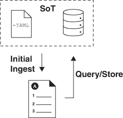

FIGURE 4-7 Augmenting Ansible Inventory from the Source of Truth Database

我们主要使用 Ansible 来编排数据从事实来源通过各种任务移动到网络的过程。然而，在此过程中，我们可能需要进行一些数据结构转换，特别是从已有自己的架构的数据库事实来源（例如 CMDB）转换到我们的 OpenConfig 模型。例如，让我们看看从 NetBox 获取的接口数据，如 清单 4-18 所示。请注意，`show-hostvars.yml` 是一个简单的 playbook，用于显示库存中特定主机的 hostvars（包含所有 Ansible 库存数据的数据结构）。此输出允许我们查看 NetBox 通过其动态库存插件提供的数据。

### LISTING 4-18 Output of Playbook to show hostvars from NetBox

Click here to view code image

```
$ ansible-playbook -i org show-hostvars.yml --limit router1
ok: [router1] => {
    "hostvars[inventory_hostname]['interfaces']": [
        {
            "cable": null,
            "cable_peer": null,
            "cable_peer_type": null,
            "connected_endpoint": null,
            "connected_endpoint_reachable": null,
            "connected_endpoint_type": null,
            "count_ipaddresses": 1,
            "description": "",
            "device": {
                "display_name": "router1",
                "id": 2,
                "name": "router1",
                "url": "https://172.16.185.228/api/dcim/devices/2/"
            },
            "enabled": true,
            "id": 6,
            "ip_addresses": [
                {
                    "address": "172.30.1.1/24",
                    "created": "2021-08-07",
                    "custom_fields": {},
                    "description": "",
                    "dns_name": "",
                    "family": {
                        "label": "IPv4",
                        "value": 4
                    },
                    "id": 6,
                    "last_updated": "2021-08-07T19:51:15.224269Z",
                    "nat_inside": null,
                    "nat_outside": null,
                    "role": null,
                    "status": {
                        "label": "Active",
                        "value": "active"
                    },
                    "tags": [],
                    "tenant": null,
                    "url": "https://172.16.185.228/api/ipam/ip-addresses/6/",
                    "vrf": null
                }
            ],
            "label": "",
            "lag": null,
            "mac_address": null,
            "mgmt_only": false,
            "mode": null,
            "mtu": null,
            "name": "GigabitEthernet1",
            "tagged_vlans": [],
            "tags": [],
            "type": {
                "label": "10GBASE-T (10GE)",
                "value": "10gbase-t"
            },
            "untagged_vlan": null,
            "url": "https://172.16.185.228/api/dcim/interfaces/6/"
        }
    ]
}
```

同样，此输出为了简洁而被截断，但我们可以看到 NetBox 为每个主机提供了一系列接口。问题是，数据是使用 NetBox 原生模型的，因此我们必须将其转换为我们的通用模型（OpenConfig）。在之前的示例中，我们通过 Ansible 变量扩展进行转换。这里的问题是，由于设备通常会有许多接口，因此 interfaces 是一个列表数据结构。在 Ansible 中原生处理这会很麻烦，但非常适合使用 Jinja。首先，让我们创建一个以 OpenConfig 系统模型为基础的 Jinja 模板，然后添加适当的逻辑来遍历来自 NetBox 的接口（如 图 4-8 中所示）以将其转换，如 清单 4-19 所示。

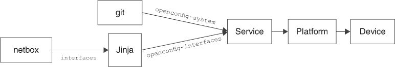

FIGURE 4-8 Data Flow from Source of Truth to Device

### LISTING 4-19 Jinja2 Template to Translate NetBox Data to OpenConfig Data

Click here to view code image

```
$ more templates/netbox-to-oc.j2
{
   "openconfig-interfaces:interfaces": {
      "interface": [

         {
            "config": {
               "description": "{{ interface.description }}",
               "mtu": "{{ interface.mtu | default('1500') }}",
               "name": "{{ interface.name }}",
               "type": "ethernetCsmacd",
               "ethernet": null,
               "config": {
                  "auto-negotiate": true,
                  "enable-flow-control": false
                },
               "hold-time": null,

               "subinterface": [
                  {
                     "config": {
                        "index": "0",
                        "ipv4": null,
                        "addresses": {
                           "address": [

                              {
                                 "config": {
                                    "ip": "{{ address_item.address.split('/')[0] }}",
                                    "prefix-length": "{{ address_item.address.split('/')[1] }}"
                                 }
                              },
{# for address_item in interface.ip_addresses #}
                           ]
                        },
                        "config": {
                           "dhcp-client": false
                        }
                     }
                  }
               ],
{# interface.ip_addresses is defined #}
               "enabled": "{{ interface.enabled }}"
            }
         },
{# for interface in interfaces #}
      ]
   }
}
```


Jinja2 是一个模板语言，因此我们本质上为 OpenConfig 接口数据创建了一个 JSON 模板。它是一个简化的模板，仅处理基本属性和 IP 地址，但它展示了 Jinja2 处理一个模型中的传入数据并将其转换为另一个模型的能力。模板中大部分静态部分要么是默认值，要么是用于数据的标签。请记住，我们并不是像使用 Ansible 中的 `set_fact` 那样创建内存数据结构。因为这是一个文本模板，我们创建了一个包含数据的 JSON 数据结构的文本表示。我们仍然需要以编程方式将其提供给 playbook。为此，我们在 playbook 中创建一个任务，该任务获取通过 Jinja 模板提取的 NetBox 数据并将其分配给一个 fact。由于 Ansible 处理 playbook 的方式，此文本数据会被反序列化为数据结构，仿佛是手动输入的一样。此 playbook 在 Listing 4-20 中演示。

LISTING 4-20 Simple Playbook to Convert Text from Template into a Variable

Click here to view code image

```
- hosts: all
  gather_facts: no
  tasks:
    - set_fact:
        oc_interfaces: "{{ lookup('template', 'netbox-to-oc.j2') }}"
    - debug:
        var: oc_interfaces
```

此 playbook 将 NetBox 数据以 OpenConfig 系统模型的形式生成，如 Listing 4-21 中所示。

LISTING 4-21 The Result of the Translation in an OpenConfig Data Structure

Click here to view code image

```
$ ansible-playbook -i org Source of Truth-xlate.yaml --limit router1
ok: [router1] => {
    "oc_interfaces": {
        "openconfig-interfaces:interfaces": {
            "interface": [
                {
                    "config": {
                        "config": {
                            "auto-negotiate": true,
                            "enable-flow-control": false
                        },
                        "description": "",
                        "enabled": "True",
                        "ethernet": null,
                        "hold-time": null,
                        "mtu": "",
                        "name": "GigabitEthernet1",
                        "subinterface": [
                            {
                                "config": {
                                    "addresses": {
                                        "address": [
                                            {
                                                "config": {
                                                    "ip": "172.30.1.1",
                                                    "prefix-length": "24"
                                                }
                                            }
                                        ]
                                    },
                                    "config": {
                                        "dhcp-client": false
                                    },
                                    "index": "0",
                                    "ipv4": null
                                }
                            }
                        ],
                        "type": "ethernetCsmacd"
                    }
                }
            ]
        }
    }
}
```

我们现在拥有了原本在 NetBox 原生数据模型中的数据，并将其翻译成了 OpenConfig。这些数据可以与其他数据库来源或 Git 仓库文本文件中的静态数据相结合，使我们能够将以不同方式描述和呈现的多个数据源融合为单一事实来源。当我们拥有完整的数据结构后，可以直接或通过平台将其推送到设备。为了为本书后面的实现做铺垫，我们使用 Cisco NSO 作为平台，通过其 RESTful API 将设备数据作为负载进行调用，如 Listing 4-22 中的任务所示。

LISTING 4-22 Pushing the Data Out Through a “Platform”

Click here to view code image

```
- name: OC Device test
  uri:
    url: "http://x.x.x.x:8080/restconf/data/tailf-ncs:devices/device={{ inventory_
hostname }}/mdd:openconfig"
    url_username: admin
    url_password: admin
    force_basic_auth: yes
    validate_certs: no
    status_code: [200,201,204]
    method: PUT
    headers: "{
      'Content-Type': 'application/yang-data+json',
      'Accept': 'application/yang-data+json'}"
    body_format: json
    body: "{{ oc_interfaces }}"
```

## Summary

本章演示了使用模型驱动原则构建 IaC 管道的基本构建块。具体来说，我们从两种事实来源（文本和数据库）中提取信息。文本事实来源以原生 OpenConfig 格式提供信息。由于数据库事实来源有其原生数据模型，我们使用 Jinja 将其转换为 OpenConfig。在这两种情况下，我们构建了一个 OpenConfig 服务（系统 + 接口），然后通过平台（例如 Cisco NSO）将其推送到设备，如 Figure 4-8 所示。

本章中的示例表明，网络自动化更多是数据管理和移动的问题，而非纯粹的编码问题。基本上，我们将配置数据从其来源移动到网络中。数据模型可以表示网络中所有可能的配置。因此，所有配置更改都可以通过类似的流程来处理。不再需要为每种可能的更改类型（如 DNS、NTP、接口、BGP）编写单独的 playbook 或脚本，一套即可满足需求。此外，编码被简化，因为我们不需要知道如何或以什么顺序配置各种服务。平台或终端设备会为我们处理这些。虽然我们确实使用了平台（在我们的示例中是 Cisco NSO），但任何完全原生支持 OpenConfig 的设备都会以相同的方式工作。此外，有多种选项可以满足这一需求。最后，许多新的网络平台（例如 AWS、Azure、Meraki、Mist）都内置了执行相同功能的平台。

在下一章中，我们将在 IaC 基础之上构建，并通过利用 CI/CD 原则来正确测试和验证基础设施的更改，在将其应用于生产环境之前更进一步地迈向真正的基础设施 DevOps。

# Chapter 5

## Continuous Integration/Continuous Deployment

在前一章中，我们解释了基础设施即代码的概念，以及它如何让你将基础设施描述为一组有组织的数据和人类可读的文件，这些文件可以在源代码管理器中使用版本控制进行管理。有了 IaC，你现在拥有大规模自动化网络基础设施的工具；然而，IaC 也带来了新的风险。在传统的操作模型中，命令行界面输入错误通常只影响单个节点或网络中的少数几个节点，而使用 IaC 时的一个简单错误可能会对整个网络产生重大且广泛的影响。自动化和 IaC 的规模扩大可能会显著放大错误的影响范围。本章探讨了持续集成/持续部署的概念，以及它如何帮助降低在自动化网络基础设施时出错的风险。

How to Crater Your Network Faster Than Ever Before


很久很久以来，Bob 第一次对自己在 ACME Corp 的角色以及公司发展的方向感到真正兴奋。虽然他最初对 CIO 的 DevOps 指令持怀疑态度，但他开始逐渐理解整个自动化的概念。是的，ACME Corp 在如何存储代表其网络的数据（即真理源，SoT）方面还有些工作要做，但他现在发现 ACME 已经为许多事情建立了真理源。使真理源对自动化有用可能涉及将文档或电子表格中的一些文本转换为以 `YAML` 或 `JSON` 等格式存储的结构化数据，但完成之后，它将更容易实现自动化。曾经只是文档中需要人类阅读、解释并转换为设备特定 CLI 配置的一些散文，现在可以以自动化的方式直接馈送到 API 中。将真理源以受版本控制并在整个网络中一致应用的方式存储的概念，是 Bob 在此次 DevOps 之旅之前从未想过可能实现的事情。

由于 Larry 负责 ACME Corp 的合规性，他和 Bob 制定了一项计划，将这些新获得的知识付诸实践，通过自动化部分合规性检查和后续修复工作。如果成功，该计划将大幅减少他们在合规性上花费的时间，并为公司节省大量资金。他们决定从小处着手，针对常见的系统服务，如 `DNS`、`NTP` 和 `AAA`。与其为这些系统服务创建自己的数据模型，他们决定使用 `OpenConfig` 数据模型。根据 Bob 之前的研究，这是唯一一种多供应商的网络配置数据结构方式，即使某个特定目标设备目前不支持 `OpenConfig`，未来也会支持。

首要任务是获取 Larry 的合规性标准文档，并将其中关于系统服务的部分转换为机器可读格式的 `OpenConfig` 结构化数据。Bob 和 Larry 决定为此任务使用 `YAML`，因为它比 `JSON` 更易于阅读。由于他们的目标是将其作为 `IaC` 的基础，那么人类可读性越高越好。由于从未做过此类事情，他们发现这个过程有点令人生畏，但经过一些努力，他们能够从 Larry 的合规性文档中为基本系统设置生成结构化数据。

此时，他们拥有了那些需要在 ACME Corp 网络中每台设备上配置的基本设置的结构化真理源数据。为了使用它，他们需要一种方式来获取数据并通过 API 将其发送到网络中的每台设备。

“好吧，现在怎么办？”Larry 说。

“这是个好问题。我们需要使用 API 将这些数据发送到我们的网络设备。”

Larry 叹了口气。“Bob，有件事你需要知道关于我的。”

“什么事？”

“我不是程序员！”

Bob 笑了。“那我们俩一样。我想我们会想要使用 `Ansible` 来完成这一步。”

Bob 摆弄过足够多的 `Ansible` 来知道它非常适合通过获取 `JSON` 或 `YAML` 数据、在必要时重新格式化，并将其发送到设备 API 来配置目标系统。毕竟，典型的 `Ansible` 清单数据已经以 `YAML` 存储。此外，`Ansible` 自带了一组模块，旨在使通过 API 与设备通信更加容易，而无需有人必然理解具体细节。在决定为他们的数据使用 `OpenConfig` 模型之前，Bob 对 `NETCONF` 和 `YANG` 进行了一些研究。`NETCONF` 协议结合 `YANG` 模型，是网络行业最接近跨供应商通用 API 的东西。因此，`NETCONF` 协议通过一组模块在 `Ansible` 中得到了很好的支持。理论上，他们应该能够将他们以 `YAML` 编写的 `OpenConfig` 格式数据直接馈送，无需重新格式化，到设备或一组设备，使用 `Ansible` 中的 `NETCONF` 模块。

Larry 和 Bob，这两位自称的非程序员，花了大约一个小时制作了一个 `Ansible` 清单文件和一个 playbook，以便与他们的系统服务数据一起使用。清单文件包含了与他们实验室中一台交换机通信所需的信息，而 playbook 只是使用一个 `NETCONF` 模块将他们的 `OpenConfig` 系统服务数据发送到交换机。大部分时间都花在熟悉 `YAML` 格式和 playbook 所需的一般结构上。但是，突然间，playbook 没有错误地运行了。

“这刚才做了我以为它做的事吗？”Larry 问道。

“我想是的！”Bob 喊道。Bob 登录到交换机并验证，确实，他们已使用他们的 `OpenConfig` 数据模型成功更改了交换机系统服务配置。

“你知道这意味着什么吗？”Larry 问道。

“也就是说，我们花了半天时间做一件手动只需五分钟就能完成的事？”Bob 回答。

“很有趣。这比那重要得多，你也知道。我们现在有了 ACME Corp 基础设施即代码的基础，并将能够以自动化的方式保持公司合规。这每年将为我和我的合规团队节省数百个小时。”

“所以，你是说管理层会喜欢我们，”Bob 说。“也许我们甚至能加薪。”

“我不会说得那么远。但至少我们可能能保住工作。”

在接下来的几周里，Bob 和 Larry 安排了一系列维护窗口，以在整个网络中应用他们的 `IaC`。完成后，他们能够确保每台设备的基本系统设置都符合 ACME Corp 标准。审计即将到来，这是一个巨大的胜利。受成功鼓舞，他们决定自动化更多的标准。

到目前为止，他们已经自动化了配置网络中断风险较低的事物。然而，剩余的合规性标准风险更大，因为它们适用于网络控制平面。其中一个标准是生成树协议（`STP`）。生成树配置或操作中的问题有可能导致广泛中断。Bob 知道，与任何控制平面协议一样，对待生成树需要谨慎。ACME Corp 在实验室里有几台交换机，他们经常用来测试新配置。这绝不是他们生产网络的代表，但这是他们最好的选择。Bob 使用实验室将他们的真理源数据模型扩展为配置生成树以符合 ACME Corp 标准所需的 `OpenConfig` 数据。

他们实施 `IaC` 的好处在于，Bob 甚至不需要修改 `Ansible` playbook。他所要做的就是将所需的生成树部分添加到他们基于 `YAML` 的真理源中，然后再次运行 playbook。当所有数据都正确时，他可以通过简单地更改真理源中的一些值来更改生成树拓扑。在他们的开发实验室中，更改生成树拓扑实际上只需几秒钟。对 Larry 和 Bob 来说，这是一种革命性的运作方式。

经过这次成功的测试，Larry 和 Bob 得到了绿灯，可以使用他们的 `IaC` 来确保网络生成树配置符合合规性标准。这项工作的批准维护窗口定在两周后。利用他在实验室中学到的知识，Bob 开始为生产网络创建真理源。不幸的是，网络已经严重偏离合规性，这意味着 *应该配置* 的内容往往与实际配置的内容不一致。Larry 和 Bob 决定这是一个创建真理源（按其应有状态）的好机会，而不是从已构建的网络中获取值。毕竟，已构建的网络不符合合规性。


当维护窗口终于到来时，Larry 和 Bob 对他们的自动化充满信心。他们在实验室中测试过多次。此时，只需运行 Ansible playbook 即可。所有的工作都在于创建真相源。

“我想，这对我们的真相源来说就是真理时刻了吧，Bob？”Larry 说。他们紧张地笑了笑。

“会出什么问题呢？”Bob 回答道，并执行了 playbook。

事情似乎在一分钟内进行得还不错，但随后一些系统管理员报告了系统变慢的情况，然后网络监控系统开始发出警报。Bob 的心沉了下去。做了这么多工作，他们所取得的成就只是以闪电般的速度让网络瘫痪。

“Bob？Bob！”Larry 急切地说。“我们得找出哪里出了问题，并且要快！”

Bob 从失望中回过神来。他和 Larry 疯狂地排查问题。大约 20 分钟后——感觉像是永恒一样——他们发现生成树拓扑结构不正确。数据中心网络的根交换机现在位于一个远程设施，通过慢速 WAN 连接连接的一台交换机上。这意味着他们所有的数据中心流量都要经过这个慢速连接。这可不是好事。

Bob 很快在他们的真相源中找到了那台远程交换机。扫描他们关于该交换机的数据，他立刻发现了问题。它的生成树优先级设置不正确。它被设置为 819，而应该是 8192。有人在创建真相源时输入错误的值，导致这台交换机的优先级值使其成为了网络的根。

“找到了！”Bob 叫道。他迅速用正确的值更新了真相源，并再次运行了 playbook。Larry 和 Bob 验证了远程交换机上的优先级已更改，并等待了几分钟，直到网络警报消失。

“好吧，好消息是自动化运行得完美无缺，”Larry 说。“坏消息是现在我们能比以往更快地让网络瘫痪了！”

“是啊，”Bob 说，“你知道，我们需要一种更好的方法，在将自动化和真相源数据投入生产之前对其进行测试。如果我们有一个更好的测试环境，本可能会发现这个问题。在一个与生产网络完全不具代表性的测试网络中开发自动化，显然不是个好主意。”

“总得有比现在更好的方法吧。”

“也许吧。但用硬件复制生产网络太昂贵了。你我都知道，管理层绝不会同意。”

“确实。”

“即使我们有了更好的测试网络，如果没有某种自动化方式来验证每台设备和整个网络的运行状态，我们可能仍然无法发现这个错误。”

“听起来我们还有更多工作要做。”

“是的，确实如此。不过，你必须承认，我们现在拥有的东西在网络运营和为公司增加价值方面是一个真正的突破。毕竟，一旦问题被发现，我们能够纠正真相源并迅速解决问题。”

“我同意。我以前不太理解 IaC 炒作的原因，但现在我明白了。”

“我们俩都一样。”

## CI/CD 概述

虽然 DevOps 是一种消除开发与运维之间摩擦的理念，但持续集成/持续部署是 DevOps 原则的一种具体应用，旨在提高环境变更的可靠性和速度。如 图 5-1 所示，CI/CD 是两个并行运行的持续操作过程。

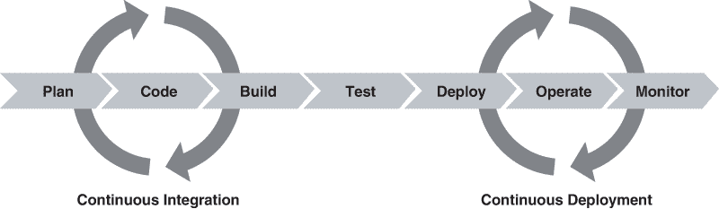

图 5-1 CI/CD 概述

在传统的应用程序开发中，构件（例如，为应用程序提供某个微服务的容器）在左侧开发，在右侧部署（即由客户使用）。构件必须通过测试阶段才能部署。测试连接了这两个过程，是 DevOps 的关键部分，可帮助您在向网络基础架构部署更改时避免问题。

### 应用程序与基础架构

应用程序 CI/CD 与网络基础架构 CI/CD 之间的一个区别在于构件的性质。通常，应用程序构件由二进制容器组成，例如 Docker 镜像或虚拟机 (VM) 镜像。这些构件可能包含源代码管理 (SCM) 工具中的代码，但并非直接使用该代码。在这种情况下，我们测试的是从该代码构建的构件（参见 图 5-2）。

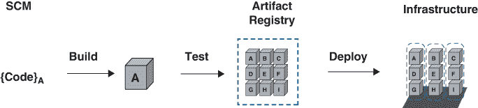

图 5-2 传统应用程序 CI/CD 管道

基于 IaC 的 CI/CD 不同之处在于，构件是代码（例如，`Ansible playbooks`、`Terraform files`）和真相源数据，后者通常表示为 `YAML` 或 `JSON`。两者都存储在 SCM 中，并直接从 SCM 使用。

应用程序 CI/CD 与基础架构 CI/CD 之间的另一个区别在于，在传统 CI/CD 管道中部署的应用程序直接向客户提供服务。在基础架构 CI/CD 的情况下，管道交付一个负载来配置设备（即交换机、路由器、防火墙），这些设备随后为最终用户提供服务（例如，连接性、安全性）（参见 图 5-3）。

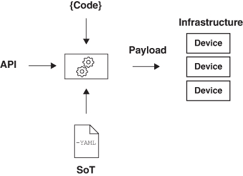

图 5-3 基础架构 CI/CD

### CI/CD 在行动中

现在您了解了高级 CI/CD 概念，让我们更详细地了解基础架构 CI/CD。图 5-4 说明了基础架构 CI/CD 的示例操作顺序。本示例中涉及的主要组件如下：

*   源代码管理器 (SCM)

*   持续集成 (CI) 工具

*   网络仿真平台

*   测试和验证工具

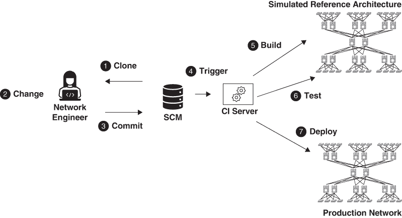

图 5-4 基础架构 CI/CD 操作顺序

每个组件将在本章后面部分更详细地介绍，但目前让我们通过一个示例来了解每个组件如何融入基础架构 CI/CD 管道。

1.  网络工程师（或操作员）执行“克隆”操作，将存储在 SCM 中的某些 IaC 或真相源数据的*本地*副本拉取到其本地计算机上。此数据通常存储在所谓的*仓库*（或简称 *repo*）中。

2.  工程师修改 IaC 或真相源数据的本地副本，通常使用文本编辑器。请记住，大多数 IaC 或真相源数据以人类可读的形式存在，例如 `YAML` 或 `JSON`。

3.  工程师将更改提交回 SCM。

4.  SCM 在发现已进行更改后，通知 CI 服务器已进行提交。

5.  CI 服务器遵循一组说明，通常存储为仓库中的文件，告诉它如何正确构建和测试更改。在某些情况下，构建测试环境可能不是必需的。如果测试只是确保更改的数据有效（例如，IP 地址格式正确），则无需构建测试环境。但是，如果需要功能测试（例如，端到端连接测试），则可能需要构建模拟参考架构。当模拟不可能时，它可能会将一组物理设备准备到已知参考状态。

6.  测试环境构建完成并合并新更改（如果需要）后，CI 服务器继续遵循其说明来测试和验证整个参考架构。验证结果将传回 SCM 并与提交一起存储。


7. 如果更改通过了所有针对参考架构的测试，CI 服务器随后可以将更改直接部署到生产环境。请注意，我们在此展示的是一个完全自动化的流水线，但在实际操作中，此步骤通常可能需要人工检查更改、验证测试结果，然后“批准”该更改以进行部署。此机制将在下一节中详细讨论。

现在你已经见识了基础设施 CI/CD 的实际运作，并对各组件如何协同工作有了一定了解，我们将在接下来的章节中详细讨论每个组件。

## 源代码管理

庞大且多样的源代码管理工具世界可能令人困惑，并充斥着各种重复的缩写词。就本书而言，我们将 SCM 广义定义为允许你管理代码生命周期的工具，具体指 IaC 和事实真相文件。良好的 SCM 是基础设施即代码的基础，因为，尽管你理论上可以创建所有所需代码，并将其简单地保存在服务器上的某个目录中，但正是 SCM 的版本控制、回滚和协作功能，大大提升了将基础设施作为代码保存的价值。这些功能将原本可能只是一段有用的自动化脚本，转变为一种全新的操作模式，这种模式相较于传统的逐个盒子的基于 CLI 的模式具有显著优势。换句话说，SCM 的核心功能和协作能力，正是我们最初希望将基础设施视为代码的原因。

### 核心功能

SCM 源于软件开发团队协作编写代码的需求。单个开发人员孤立工作，不一定需要 SCM，因为不太可能有另一个开发人员出现并修改代码或删除文件。然而，随着开发人员团队规模和软件应用复杂性的增加，在协作环境中强制执行关于代码如何创建、修改、删除和跟踪的规则变得至关重要。SCM 的以下基本功能使我们能够在协作环境中安全地管理代码的生命周期：

* 版本控制

* 变更日志

* 分支

# 版本控制

简而言之，版本控制是 SCM 管理两个或多个团队成员修改同一文件时冲突的基于规则的方式。实现这一点有多种方法，但基本上，SCM 维护文件的一个“权威”版本，当开发人员想要修改该文件时，他们会“检出”一个本地副本，对本地副本进行更改，然后将这些更改“提交”回由 SCM 维护的权威版本。如果第二个开发人员在此期间已经向权威版本提交了更改，那么第一个开发人员在尝试提交更改时会收到错误。第一个开发人员现在必须经历一个“合并”过程，以修复其更改与权威副本之间的任何冲突。解决任何冲突后，他们现在可以将文件提交到 SCM，SCM 随后会更新权威版本。这种检出-修改-提交-合并（如有必要）的过程，确保了文件的完整性，并大大提高了团队环境中的安全性和效率。

#### 变更日志

SCM 不仅存储文件的最新或权威版本，还存储所有先前版本。这意味着 SCM 记录了特定文件发生的每个更改，并可以生成文件不同版本之间的 `diff`，以便开发人员可以确切地看到版本之间的变化。此外，版本控制过程的一个附带好处是，在每次提交期间，开发人员都需要提供一段简短的文本描述，说明提交中的更改。当我们将提交消息与版本之间的 diff 结合起来时，我们就得到了一个详细的日志，记录了*谁*做了更改、*何时*做了更改、*为什么*做了更改，以及确切地*什么*发生了变化。

# 分支

检出-修改-提交-合并的版本控制过程对于维护存储在 SCM 中的文件的完整性非常有效。但是，如果许多开发人员正在处理同一文件并且每天进行多次提交，它也可能为每次提交增加相当大的开销。请记住，每次开发人员提交并更新文件的权威副本时，其他开发人员现在必须通过合并过程解决他们所做的任何更改，然后才能将更改提交回 SCM。这个合并过程可能很耗时，在这个示例中，我们可能需要为每次提交进行合并。“分支”的概念通过为每个开发人员提供带有其分支标识符的文件副本，帮助使此过程更加高效。现在，当开发人员检出文件时，他们是从自己的分支中检出。由于这个分支中没有（或很少）其他开发人员工作，当他们提交更改时，他们可能不会与在同一文件中工作的其他人产生任何冲突，并且不需要为每次提交都经历合并过程。分支让我们可以有效地进行一系列提交，然后一次性将所有这些提交合并回“主”分支（参见 图 5-5）。因此，我们不需要解决每次提交的冲突，而是在将我们的单独分支合并回主分支时只需进行一次。

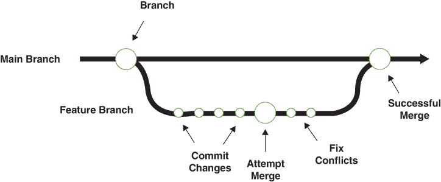

FIGURE 5-5 Branch-Commit-Merge Workflow

### 协作功能

Git 等 SCM 工具提供了前几节中描述的核心功能；但是，许多现代 SCM 平台，例如 GitHub 和 GitLab，通过一套社交和协作功能扩展了这些基本功能，这些功能有助于管理大型和/或基于社区的项目。

当今最大且最著名的平台是 GitHub。GitHub 作为软件即服务（SaaS）或本地部署提供，并提供以下对 DevOps 有用的附加功能：

* 访问控制

* 公共和私有仓库

* 问题跟踪

* 拉取请求

* 复刻

* CI 服务（GitHub Actions）

当与核心 Git 功能结合时，这组功能创建了一个能够支持从小型单开发人员项目到大型社区驱动开源项目的任何东西的平台。在接下来的章节中，我们将更详细地研究这些功能。

# 访问控制

在 Git 中，仓库是构成项目的文件集合。这些文件可以是从文档到代码再到二进制文件的任何东西；但是，Git 将由用户决定如何控制对这些文件的访问。在 GitHub 等平台中，访问控制定义得更加明确，权限在仓库所有者、协作者和所有人等各个级别分配。此外，对于基于团队的项目，还有“组织”的概念，带有额外的基于角色的访问控制选项。

#### 公共 vs. 私有仓库

除了基于用户的访问控制外，GitHub 还增加了公共 vs. 私有仓库的概念。公共仓库对任何人都可见，在 GitHub SaaS 产品的情况下，这意味着它对互联网可见。或者，私有仓库可以配置为仅对获批的个人或团队可见。

对于基于社区的开源项目，公共仓库是合理的。为了让社区有效协作，代码需要是公开的；但是，大多数涉及基础设施即代码的基础设施自动化场景可能会由一小群获批个人维护的私有仓库组成。在这些情况下，带有严格访问控制的私有仓库是最合理的，即使是在 GitHub 在本地运行的场景中也是如此。


### Issue Tracking

在 GitHub 中，issue 是一种用于跟踪错误报告、功能请求、文档错误等事项的方式。能够有效管理 issue 的生命周期对于大多数项目至关重要。在过去，此过程可能涉及大量手动操作，人工需要在几个不同的工具中输入信息，以便在 issue 通过其生命周期时更新其状态。例如，一个工具可能用于跟踪错误，另一个用于讨论错误，另一个用于记录工作，还有一个用于代码版本控制。当错误经历报告、讨论、修复和版本控制更新的生命周期时，人工需要访问多个不同的工具，并且很可能需要在工具之间重复信息，以便正确跟踪错误的生命周期。

将 issue 集成到 SCM 中，可以通过在平台的其他位置链接到 issue ID 的引用，以自动化方式管理此生命周期。因此，不再需要访问多个不同的工具并手动更新每个工具，issue 可以通过在每个步骤中使用带有井号的 issue ID（例如，#120）引用该 issue，从而从报告到讨论再到修复，最后合并到主分支。这种自动化生命周期能够实现更好的文档记录、合规性和效率。

### Pull Requests

在 Git 中，向仓库贡献代码的典型方式是通过分支-提交-合并过程。单靠此过程有助于保持代码受版本控制，并允许团队成员在代码的同一部分上并行工作。但是，它不允许团队成员在合并过程中进行任何讨论或协作。这时 GitHub 拉取请求（PR）就派上用场了。与分支-提交-合并不同，该过程变为分支-提交-PR。合并允许团队成员在无需批准或讨论的情况下直接将代码合并到主分支，而 PR 通常需要项目维护者进行审查和批准，并且可选地需要自动化 CI 流程的成功验证（本章后面会详细介绍）。此外，它还提供了一个有价值的场所，用于在更改合并到主分支之前讨论这些更改。

### Forks

对于任何给定的仓库，通常只有一小部分人被授权直接向仓库提交代码。该群体可以通过遵循典型的分支-提交-合并过程来向仓库贡献代码；但是，对于可能拥有数百甚至数千名贡献者的典型社区项目来说，试图有效控制谁可以创建分支并直接向仓库提交提交可能会变得难以管理。分支（fork）的概念解决了这个问题。当你 fork 一个仓库时，你实际上将目标仓库复制到你自己的账户中，现在你拥有该仓库的 fork 副本。此过程允许你在 fork 中开发增强功能或修复错误，而无需直接向原始仓库提交。

当你的增强功能或修复完成后，你从你的 fork 向原始仓库创建一个 PR。原始仓库的维护者可以选择接受、拒绝或请求修改你的 PR。通过这种方法，任何有增强功能想法或错误修复的人都可以向社区项目贡献代码，而无需项目维护者不断管理权限。

### CI Services

某些复杂的 SCM 还内置了某些 CI 服务。我们将在标题为“CI 引擎”的部分中更深入地讨论这一点。但是，目前请考虑，无论在 SCM 中如何进行更改，能够触发自动化测试并确保这些更改有效、符合合规性且不会使我们的基础设施崩溃，难道不是很酷吗？

## SCM Summary

SCM 是 IaC 的核心，最终也是 DevOps 的核心。它们使团队能够安全高效地协作编写代码，同时提供启动 CI 所需的测试和验证的所有必要工具或触发器。没有 SCM，IaC 将远没有那么有用。通过将你的基础设施称为“代码”，你解锁了使用 SCM 的所有好处。

# Continuous Integration Tools

有了功能齐全的 SCM 作为基础，我们现在可以开始探索持续集成工具的概念。如前所述，IaC 本身是一个重要的第一步，因为它使我们能够利用 SCM 的所有出色功能。现在我们已通过 SCM 管理 IaC，我们就拥有了 CI 所需的必要基础。

请回顾，常见的 SCM 工作流之一是分支-提交-合并过程，其中所有提议的更改都在功能分支中进行，并在获得批准后合并回主分支。在此工作流中，更改合并到主分支的“门禁”是拥有仓库正确权限的批准者。CI 为该过程增加了另一个门禁。使用 CI 时，在更改合并之前，它需要通过一系列测试来验证更改不会破坏任何内容。这些测试可以从安全扫描、数据验证、语法检查、样式检查，到在网络基础设施的情况下，甚至包括操作状态检查，以验证路由表和端到端连接等内容。测试和验证的选项将在本章后面标题为“测试和验证”的部分中更详细地介绍。

从本质上讲，CI 是一种自动化工作流，旨在安全地加速更改的集成。它确保只有经过测试和验证的更改才会集成到主分支。如前所述，主分支可用于构建应用程序工件（例如，库、容器或 VM），或者在网络基础设施的情况下，构建实际的网络本身。鉴于当今大多数网络更改都是由人类在命令行界面（CLI）上直接对生产网络进行更改，因此 CI 过程（即在每个提议的更改进入生产之前对其运行自动化测试）的概念将真正改变当今网络基础设施的运行方式，加快更改的速度，同时也增强了这些更改不会破坏关键服务的信心。在接下来的部分中，我们将更仔细地查看可用于 CI 的工具以及它们如何集成到 SCM 中。

## CI Engines

当今使用的 CI 引擎主要有两类：内置于 SCM 中的引擎和独立应用程序。在 CI 的早期，通常使用独立应用程序，例如 Jenkins。随着 SCM 平台的发展，它们开始提供必要的钩子以便与 CI 应用程序良好集成。这些钩子提供两个重要功能：

*   一种基于仓库状态变更（即提交、合并）触发 CI 工作流的方式

*   一种让 CI 应用程序将 CI 工作流的结果传回给 SCM 的方式

有了这些钩子，像 Jenkins 这样的工具就能以自动化方式与 SCM 集成，并为典型的 SCM 工作流增加价值。当开发人员准备提交新代码时，自动化工作流可以测试和验证每个更改，并向开发人员提供及时反馈，告知新更改是否可接受。此外，当需要将这些提交合并回主分支时，不再仅仅依赖人工审查更改，现在还可以要求新代码通过所有必要的自动化测试。


这个改进的流程催生了一种称为 `test-driven development` 的新开发方法，即在为特定更改创建任何新代码之前，先编写该更改的测试。这种方法解决了传统开发中的一个常见问题：过分强调尽快交付代码，导致编写新代码测试的步骤常常被跳过，从而使未经测试或部分测试的代码被合并到主分支。在自动化网络基础设施时，这是一个值得考虑的重要方法，因为如果自动化基础设施只是为了加快未经测试的更改进入环境的速度，那可能并不是你想要的结果。

现在许多开发者都已采用 CI 和测试驱动开发，GitHub 和 GitLab 等 SCM 平台开始将 CI 服务原生集成到其平台中。因此，与过去需要预置、维护并将 Jenkins 等独立 CI 服务器集成到 SCM 不同，现在你只需在仓库中包含适当的文件，指示 SCM 如何执行 CI 工作流，而无需维护自己的 CI 服务器的额外工作。

## 它们的工作原理

要了解 CI 服务器如何与 SCM 配合工作，有必要思考典型的 SCM 工作流在引入 CI 后如何变化。图 5-6 说明了 CI 引入到典型的分支-提交-合并 SCM 工作流时的样子。开发者的每次提交都会由 CI 进行测试。请注意，在开发者最初的几次提交中，CI 测试都会失败。只有在开发者提交了能通过 CI 的提交后，才能尝试将更改合并到主分支。在此场景中，主分支存在一些需要解决的冲突，但解决这些冲突且最后一次提交通过 CI 后，开发者便可尝试再次合并。审批人检查更改并确认所有测试均已通过后，批准合并，开发者的 `validated` 更改即被合并到主分支。

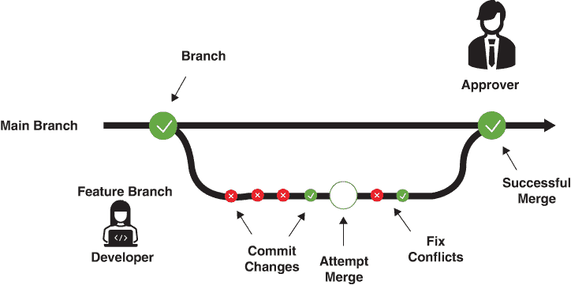

FIGURE 5-6 SCM Workflow with CI

请记住，要使这一切正常工作，需要两样东西：一种是触发 CI 工作流的方式，另一种是返回 CI 工作流结果的方式。CI 工作流可能以多种潜在方式触发，但最常见的是在提交和/或合并时触发工作流。如果你使用的是外部 CI 服务器（如 Jenkins），则可以配置 SCM，在每次提交或合并请求时向 Jenkins 执行 webhook。如果你使用的是 SCM 的原生 CI 服务，则通常在仓库的适当 CI 文件中指定工作流触发条件。

现在我们可以触发 CI 工作流，需要一种方式将工作流结果传回 SCM，以便用于开发者反馈、变更日志和合并审批流程。如果你使用的是平台的原生 CI 服务，则通常会自动将 CI 工作流反馈附加到每个提交，无需任何额外工作。如果你使用的是外部 CI 服务器，则大多数 SCM 平台都有 API，使 CI 服务器能够将 CI 工作流结果附加到特定提交。

尽可能使用 SCM 平台的原生 CI 功能更为简单。预置、维护和集成自己的 CI 服务器可能很耗时；然而，在某些情况下，这项额外工作可能是必需的。例如，安全策略/法规可能规定任何工作流执行都必须在内部资源上进行，而不是公共资源上。在这种情况下，维护自己的 CI 服务器可能更有优势。需要记住的是，无论你使用的是 SCM 的原生 CI 功能还是维护自己的 CI 服务器，工具和 API 都已就绪，以实现 CI 工作流。

## 示例工作流

清单 5-1 展示了使用 GitHub Actions 为仓库启用 CI 的示例。按照典型的 IaC 方式，GitHub Actions 工作流使用 YAML 编写，这使它们易于阅读和修改。在此示例中，当针对主分支（`branches: main`）提交拉取请求（`on: pull_request`）且更改特定文件（`paths: ['mdd-data/\*\*.yml', 'mdd-data/\*\*.yaml']`）时，我们触发 CI 工作流。

根据特定目录或文件更改限制工作流运行通常是有利的。CI 工作流可能会变得复杂且耗时，尤其是当你拥有完整的测试覆盖率时。在此，我们仅在更改存储在 `mdd-data` 目录中的 YAML 源数据时触发工作流。这样可以避免在修改不需要 CI 的文件时浪费资源。

可用于通过 `on` 触发工作流的其他常见事件包括

*   `push`: 当新提交推送到仓库时运行
*   `schedule`: 按固定计划运行
*   `release`: 当创建新版本时运行
*   `workflow-dispatch`: 通过 GitHub UI 或 API 手动运行

现在我们有了触发 CI 工作流的方式，可以指定工作流触发时要执行的操作。在 GitHub Actions 中，这被称为 `job`。作业使用 `jobs` 键指定。作业包含一系列按顺序执行的步骤。在 清单 5-1 中，我们创建了一个名为 `test` 的作业，用于执行此仓库中 CI 所需的所有测试，主要是通过确保源数据具有正确语法并符合合规标准来验证源数据，并对其进行干运行以应用到网络。CI 所需的详细步骤（如语法验证、数据验证和干运行）将在本章及后续章节中介绍。目前，了解 CI 工作流的基本结构即可。

清单 5-1 GitHub Actions 工作流用于 CI

单击此处查看代码图像

```
name: CI
on:
  pull_request:
    branches:
      - main
    paths:
      - 'mdd-data/**.yml'
      - 'mdd-data/**.yaml'
 
jobs:
  test:
    environment: mdd-test
    steps:
      - name: Checkout Inventory
        uses: actions/checkout@v2
      - name: Install PIP requirements
        run: pip install -r requirements.txt
      - name: Install Collections
        run: ansible-galaxy collection install -r requirements.yml
      - name: Create Vault Password File
        run: echo ${{ secrets.ANSIBLE_VAULT_PASSWORD }} > vault_pass.txt
      - name: Run YAMLLINT
        run: yamllint mdd-data
      - name: Validate Data
        run: ansible-playbook ciscops.mdd.validate_data --vault-password-file
vault_pass.txt
        env:
          NETBOX_API: ${{ secrets.NETBOX_API }}
          NETBOX_TOKEN: ${{ secrets.NETBOX_TOKEN }}
      - name: Run OC Update Dry Run
        run: ansible-playbook ciscops.mdd.nso_update_oc --vault-password-file
vault_pass.txt
        env:
          NETBOX_API: ${{ secrets.NETBOX_API }}
          NETBOX_TOKEN: ${{ secrets.NETBOX_TOKEN }}
```

需要注意的是，尽管此处展示的是 GitHub 语法，但所有 CI 服务器都有类似的结构，允许你运行由任意步骤序列组成的工作流。因此，尽管工作流的语法可能会有所不同，但这些概念在 SCM 和 CI 服务器之间大多是可迁移的。

# 基础设施模拟工具


正如你所见，测试是 CI 的一个重要组成部分。但我们究竟在哪里运行这些测试呢？在现代应用程序开发中，应用程序通常构建在 Kubernetes（本地或云端）、AWS、Azure、GCP 等平台之上。此外，它们通常使用 IaC 进行自动化部署。这些平台大大减轻了为 CI 实例化测试环境的负担，因为你可以简单地使用现有的 IaC 在同一或其他按需基础设施上部署应用程序的测试实例。对于许多应用程序，你可以通过在开发机器上部署应用程序的部分或甚至整个应用程序来完成开发工作，而无需任何外部基础设施。这种灵活性使每个开发人员能够为开发、测试和 CI 创建不同的应用程序实例。网络基础设施传统上与应用程序不同，原因如下：

*   网络基础设施通常非常大，包含大量互连节点。很多时候，拥有一个大型网络的微小测试表示既无用也不实际。低于某个大小，很难充分测试某些网络行为，例如冗余或故障转移。

*   虚拟网络功能（VNF），即路由器、交换机、防火墙和其他设备的虚拟版本，通常仅作为 VM 镜像交付。与大多数现代应用程序使用的容器相比，VM 非常耗费资源，需要大量的 CPU 和内存。这限制了在你的开发机器上（在许多情况下是笔记本电脑）可以有效地完成多少开发工作。

*   直到最近，许多网络节点类型的 VNF 才普遍可用。这意味着，要拥有一个具有代表性的测试网络，唯一的真正方法是购买额外的（昂贵的）硬件和软件机架，并将其专门用于测试环境。对于许多组织来说，这种支出是不可行的。

*   直到最近，用于部署模拟网络拓扑的平台（例如，Cisco Modeling Labs、GNS3、EVE-NG）的规模不足，API 支持有限，且缺乏 VNF 覆盖。这意味着它们很难自动化，并且无法模拟出足够保真度的网络以供使用。

幸运的是，许多这些问题已经得到解决。随着 IT 中 DevOps 工具需求的增长，行业和社区已做出回应，提供了具有功能强大的 API、广泛的 VNF 支持，并能扩展到包含数百个节点的大规模模拟的网络模拟平台。现代网络模拟平台现在能够实现常见的 DevOps 场景，即工程师团队中的每个人都可以在自己的网络参考架构实例上操作，而不会互相干扰。这种能力提高了敏捷性，并使团队能够更快地开发新的基础设施自动化。

此外，由于这些平台允许通过 API 动态重新配置网络拓扑，CI 的严谨性现在可以应用于网络中的许多不同类型的更改，而使用静态物理测试网络则难以或不可能实现，例如

*   动态添加或删除节点或站点

*   动态重新配置节点之间的链路

*   轻松测试拓扑与不同 OS 版本的兼容性

## Cisco Modeling Labs

现代网络模拟平台的一个示例是 Cisco Modeling Labs (CML)。CML 的核心是一个基于 KVM 的虚拟机监控程序，能够在单个实例上模拟数百个节点。使像 CML 这样的模拟平台与传统虚拟机监控程序不同的是管理层。UI 和 API 是为模拟网络拓扑所需的功能而构建和专注的，例如

*   图形拖放拓扑创建界面

*   在节点之间进行任意连接的能力

*   节点类型的创建-更新-删除

*   整个模拟或单个节点的启动-停止-擦除-删除

*   用于通过自动化创建和管理模拟的丰富 API

*   损坏连接以进行测试的能力（即，添加延迟、丢包、抖动）

### 部署选项

CML 可以部署在裸机服务器上，或作为 VMware 上的 VM 部署。将 CML 部署为 VM 是 *嵌套虚拟化* 的一个示例，其中虚拟机监控程序作为另一个虚拟机监控程序内部的 VM 运行（在此例中为 VMware 上的 KVM）。虽然 VM 部署对于小型或临时 CML 部署很有用，但嵌套虚拟化不是规模或性能的最佳选择。如果您的目标是充分利用硬件投资，裸机部署是最佳选择，因为您无需承担 VMware 的开销。模拟平台的关键作用以及本书设想的模拟规模通常意味着建议进行裸机安装。

### 规模考量

在像 CML 这样的模拟平台中，可以实现的网络模拟规模与服务器上可用的内存、CPU 和存储量直接相关。没有硬性规定来确定 CML 服务器的大小，因为每个不同的 VNF 都需要不同数量的 CPU、内存和存储。因此，对于给定的模拟，所需的资源在很大程度上取决于模拟中使用的 VNF 组合以及每个 VNF 的整体配置。话虽如此，我们的经验表明，一台配备 768GB 内存、40 个 CPU 核心和 2TB 存储的服务器可以在单台服务器上扩展到 300 个节点。如果这不够，可以使用多台服务器。

### 用户界面

CML UI 的核心是工作台（参见 图 5-7）。它允许您创建任意拓扑，例如所示的 SD-WAN 拓扑。从工作台，您可以

*   启动或停止整个模拟或单个节点

*   访问任何节点的控制台

*   编辑节点启动配置

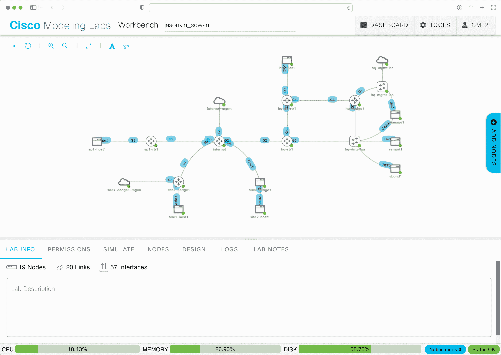

FIGURE 5-7 SD-WAN Simulation in CML Workbench

CML 预装了各种 Cisco 路由器、交换机、防火墙和无线 LAN 控制器的 VNF，这使得您可以立即开始构建拓扑。图 5-8 显示了“添加节点”选项卡中可用的一些 VNF，您可以通过将所需节点拖放到工作台区域将其添加到模拟中。

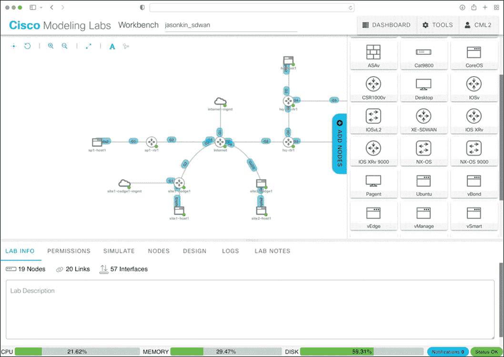

FIGURE 5-8 Adding Nodes in CML Workbench

将节点添加到模拟后，您可以在节点之间拖放链路并创建完整的网络拓扑。启动模拟后，如果您选择，可以连接到节点控制台并通过 UI 配置设备。CML Workbench 是一种很好的方式，允许人类使用拖放界面设计网络拓扑；但是，在使用 CI 自动化测试时，不希望需要人工来启动、停止或配置模拟中的设备。就本书而言，我们更感兴趣的是如何利用 IaC 来使用模拟平台。

### 灵活的 VNF 支持

虽然 CML 内置了对 Cisco VNF 的丰富支持，但该平台并不将您限制在仅使用 Cisco VNF。几乎任何能够在 KVM 虚拟机监控程序上运行的 VNF（或者任何 VM 镜像）都可以添加到 CML。例如，有时希望在 *模拟中* 而不是在专用虚拟化平台上运行网络管理平台或其他基础设施工具。这种方法的优势在于，模拟可以包含运行网络所需的一切，包括任何必要的管理或控制器平台，而无需在单独的基础设施上运行（和自动化）这些内容。对于类似 CI 的场景，这意味着在搭建测试环境时涉及的工作更少。

### 基础设施即代码工具


# CML 自动化与 IaC 集成

如前所述，为了在 CI 中正确利用 CML，我们需要能够通过 IaC 对其进行自动化。CML 可以通过多种方式实现自动化，包括 CLI (`cmlutils`)、Ansible 模块和 API。然而，使用 CML 实现 IaC 最简单的方法是利用其使用 YAML 文件创建模拟的功能，并结合 CML Ansible 模块。

## YAML 模拟文件

CML 允许你导出任何模拟文件，其中包括拓扑以及每个节点的配置，格式为 YAML。这意味着我们可以使用 CML Workbench 以可视化方式创建或修改网络拓扑，然后将其导出为 YAML 文件，如 清单 5-2 所示。

### 清单 5-2 CML YAML 文件

单击此处查看代码图像

```yaml
lab:
  description: ''
  notes: ''
  timestamp: 1618933269.4613173
  title: Test Simulation
  version: 0.0.4
nodes:
  - id: n0
    label: iosv-0
    node_definition: iosv
    x: -500
    y: -50
    configuration: ''
    image_definition: iosv-158-3
    tags: []
    interfaces:
      - id: i0
        label: Loopback0
        type: loopback
      - id: i1
        slot: 0
        label: GigabitEthernet0/0
        type: physical
      - id: i2
        slot: 1
        label: GigabitEthernet0/1
        type: physical
  - id: n1
    label: iosv-1
    node_definition: iosv
    x: -50
    y: -50
    configuration: ''
    image_definition: iosv-158-3
    tags: []
    interfaces:
      - id: i0
        label: Loopback0
        type: loopback
      - id: i1
        slot: 0
        label: GigabitEthernet0/0
        type: physical
      - id: i2
        slot: 1
        label: GigabitEthernet0/1
        type: physical
links:
  - id: l0
    i1: i1
    n1: n0
    i2: i1
    n2: n1
```

清单 5-2 显示了一个示例 CML YAML 文件，用于描述一个简单的双节点拓扑。此 YAML 文件中有三个主要块：

*   `lab`：包含标题和时间戳等内容的块。

*   `nodes`：包含拓扑中节点列表的块，以及它们的名称、节点类型和接口。在此示例中，我们有两个分别标记为 `iosv-0` 和 `iosv-1`、ID 为 `n0` 和 `n1` 的 IOSv 节点。

*   `links`：包含节点之间连接列表的块。在此示例中，我们有一个单个连接（id: 10），它将节点 `n0` 的接口 `i1` 连接到节点 `n2` 的接口 `i1`。

CML YAML 格式对人类和机器来说都相对容易操作。人类可以编辑此文件，且不需太多努力即可添加和删除节点和/或链接。机器可以完全从头生成此文件，可能使用某些描述网络（即真理源数据）的现有数据，或来自其他工具（例如 Microsoft Visio）的数据。无论 YAML 是如何生成的，现在都可以使用它来通过 IaC 自动化拓扑的模拟。

## Ansible 模块

CML Ansible 模块是创建、启动、停止和删除 CML 模拟的便捷方式。这些模块旨在从 YAML 文件（清单 5-2）在 CML 服务器上创建模拟，可选地向每个节点传递第 0 天配置，启动和停止节点，并删除模拟。清单 5-3 显示了一个相对简单的 Ansible playbook，用于创建模拟并启动模拟中的所有节点。

### 清单 5-3 Ansible Playbook

单击此处查看代码图像

```yaml
- name: Create the topology
  hosts: localhost
  gather_facts: no
  tasks:
    - name: Check for the lab file
      stat:
        path: "{{ cml_lab_file }}"
      register: stat_result
      delegate_to: localhost
      run_once: yes
 
    - name: Create the lab
      cisco.cml.cml_lab:
        host: "{{ cml_host }}"
        user: "{{ cml_username }}"
        password: "{{ cml_password }}"
        lab: "{{ cml_lab }}"
        state: present
        file: "{{ cml_lab_file }}"
      register: results
 
    - name: Refresh Inventory
      meta: refresh_inventory
 
- name: Start the nodes
  hosts: cml_hosts
  connection: local
  gather_facts: no
  tasks:
    - name: Start node
      cisco.cml.cml_node:
        name: "{{ inventory_hostname }}"
        host: "{{ cml_host }}"
        user: "{{ cml_username }}"
        password: "{{ cml_password }}"
        lab: "{{ cml_lab }}"
        state: started
```

将 CML YAML 文件（清单 5-2）和 Ansible playbook（清单 5-3）都签入版本控制，为我们提供了一种使用 IaC 构建测试环境并在 CI 中利用它的简便方法。

#### API

虽然在使用 CML 时，YAML 和 Ansible playbook 是通往 IaC 的最简单路径，但可能会有时你需要自动化当前 CML Ansible 模块不支持的内容。在这种情况下，CML 公开了一套功能齐全的 API，允许你创建模拟、动态添加节点和/或链接、更新节点类型等。GUI 中可执行的大多数操作也可以通过 API 实现。

# 测试与验证

CI/CD 流程中的一个关键步骤是在合并或部署之前测试更改。此外，我们越快发现更改中的缺陷，网络管理员就能越快修复该更改中的错误并提交更正后的请求。出于这个原因，我们通常执行几种不同类型的测试，并且我们按特定顺序执行这些测试，以便我们可以 `fail faster` 并提高测试效率。

## Linting

最简单的测试类型通常被称为 `linting`。在模型驱动开发的上下文中，当我们说 linting 时，是指检查代码和真理源的语法正确性。大多数语言都有某种形式的 linting 程序可用；你永远不应该自己编写。例如，`ansible-lint` 可用于 lint Ansible 数据，`jq` 可用于 JSON 数据，而 `yamllint` 对 YAML 数据也做同样的事情。这些程序检查 playbook、`.json` 文件或 `.yaml` 文件的结构，并报告发现的任何错误。通常错误是简单的事情，例如遗漏逗号或不正确的缩进。请考虑 清单 5-4 中显示的 OpenConfig YAML 输入。

### 清单 5-4 错误的 YAML

单击此处查看代码图像

```yaml
openconfig-system:
  system:
    dns:
      servers:
        - address: 192.168.0.2
          config:
            address: 192.168.0.2
            port 53
```

乍一看，这个示例可能看起来是一个有效的 YAML 文档，但让我们通过 linter 运行它以确保万无一失：

单击此处查看代码图像

```
$ yamllint bad.yaml
bad.yaml
  1:1       warning  missing document start “---”  (document-start)
  9:1        error    syntax error: could not find expected ‘:’ (syntax)
```

如您所见，我们的 YAML 存在一些问题。Linters 通常将问题分类为警告或错误。警告通常更多是样式问题，不会导致解析数据时出错，而错误会产生严格无效的文档。在此示例中，以“---”开头 YAML 文档是良好的做法，但即使没有它们也可以解析，而遗漏键和值之间的“:”会生成无法正确解析的文档。我们可以对 JSON 做同样的事情。请考虑 清单 5-5 中显示的 OpenConfig JSON 输入。

### 清单 5-5 错误 JSON 示例

单击此处查看代码图像


# 标题层级调整与格式优化

## JSON 示例

```
{
    "openconfig-system:system": {
        "dns": {
            "servers": {
                "server": [
                    {
                        "address": "192.168.0.2",
                        "config": {
                            "address": "192.168.0.2",
                            "port" 53
                        }
                    }
                ]
            }
        }
    }
}
```

当我们将此示例通过 linter 运行时，可以看到问题：

单击此处查看代码图片

```
$ jq -c . bad.json
parse error: Expected separator between values at line 11, column 0
```

一个优秀的 linter 会尽可能向你提供错误位置。许多组织在将数据和代码提交到仓库之前会运行 linter；它们运行速度通常非常快，因此是确保更改在语法上有效的一种简单方法。当你的更改的 `syntax` 被确认有效后，你可以继续确认更改的 `contents` 也是有效的。

## Schema/Model 验证

现在我们知道输入数据在语法上是正确的，测试的另一个重要部分是验证我们的模型数据。在此阶段，我们不仅可以验证我们的模型是否为有效的 OpenConfig 模型，还可以针对自定义 JSON Schema 进行验证。尽管有许多可用于架构验证的选项，但我们发现 JSON Schema 更可取，因为它在许多平台上实现，并支持广泛的语言和数据格式。它为我们提供了一个非常强大的工具，可用于强制执行本地策略、检查我们的真实来源以符合监管合规性，以及更多。

合规性是复杂计算机系统中日益重要的组成部分。组织要求采用安全技术实施指南 (STIGs)、美国国家标准与技术研究院 (NIST) 建议、支付卡行业数据安全标准 (PCI DSS) 等最佳实践，以确保计算系统满足基线信息安全态势。

虽然合规性活动通常侧重于检查运行网络上的活动设备配置，但我们可以使用 CI/CD 流程来确保不合规的配置根本不会进入设备。例如，假设我们的监管机构要求每个网络设备都有一个横幅，内容为“Only authorized users may access this system.”。我们可以编写一个 JSON Schema 来检查这是否是真实来源的一部分（请参阅 LISTING 5-6 JSON Schema to Check Banner）。

### LISTING 5-6 用于检查横幅的 JSON Schema

单击此处查看代码图片

```
{
  "$schema": "http://json-schema.org/draft-07/schema#",
  "title": "Network banner schema",
  "type": "object",
  "required": ["openconfig-system:system"],
  "properties": {
    "openconfig-system:system": {
      "type": "object",
      "required": ["config"],
      "properties": {
        "config": {
          "type": "object",
          "required": ["login-banner", "motd-banner"],
          "properties": {
            "login-banner": {
              "type": "string",
              "description": "Login banner",
              "pattern": "Only authorized users may access this system."
            },
            "motd-banner": {
              "type": "string",
              "description": "Login banner",
              "pattern": "Only authorized users may access this system."
            }
          }
        }
      }
    }
  }
}
```

在此示例中，我们断言 `login-banner` 和 `motd-banner` 都必须

*   存在于我们的真实来源中 (`"required": ["login-banner", "motd-banner"]`)

*   是字符串 (`"type": "string"`)

*   匹配字符串 "Only authorized users may access this system." (`"pattern": "Only authorized users may access this system."`)

为了可读性，本节中进一步的架构示例已压缩为仅包含相关部分。请参阅 LISTING 5-7 JSON for OpenConfig Banner 中显示的 OpenConfig 横幅 JSON。

### LISTING 5-7 OpenConfig 横幅的 JSON

单击此处查看代码图片

```
{
  "openconfig-system:system": {
  ...
    "config": {
      "domain-name": "domain.com",
      "hostname": "router1",
      "login-banner": "Only authorized users may access this system.",
      "motd-banner": "Only authorized users may access this system."
    },
...
}
```

如果我们根据给定的架构验证 JSON，它将无错误地通过验证。但是，如果我们向其提供一些不合规的 JSON 呢？请参阅 LISTING 5-8 JSON for Noncompliant OpenConfig Banner 中显示的不合规 OpenConfig 横幅 JSON。

### LISTING 5-8 不合规 OpenConfig 横幅的 JSON

单击此处查看代码图片

```
{
  "openconfig-system:system": {
    ...
 
    "config": {
      "domain-name": "domain.com",
      "hostname": "router1",
      "login-banner": "Go away!"
    },
    ...
}
```

将此 JSON 通过架构验证工具运行，可能会产生如 LISTING 5-9 Validating JSON for Noncompliant OpenConfig Banner 所示的输出。

### LISTING 5-9 验证不合规 OpenConfig 横幅的 JSON

单击此处查看代码图片

```
 {'domain-name': 'domain.com', 'hostname': 'router1', 'login-banner': 'Go away!'}:
'motd-banner' is a required property
Go away!: 'Go away!' does not match 'Only authorized users may access this system.'
```

在这里，我们看到输入 JSON 中有两个不同的错误。第一个是我们完全忘记放入 `motd-banner`。第二个错误是我们的 `login-banner` 与架构中指定的不匹配。通过对我们的数据运行此验证，我们确保了错误的配置永远不会被应用到我们的网络（稍后才会被审计人员标记）。

# 功能测试

在更改经过 lint 检查并针对模型和架构进行验证后，你可以进行功能测试。在此阶段，更改会在模拟平台（或如果无法模拟，则在物理硬件上）中针对系统的实际模型进行测试。由于网络通常太大且太复杂，无法在模拟平台中完全复制，因此我们通常会创建一个代表性模拟，以模拟网络的主要组件。例如，你可能会分别对网络核心、区域办公室和单个分支机构进行建模，然后针对任何给定的更改使用相应的模拟。

可以对网络应用许多可能的功能测试，从简单到复杂不等。可以应用于网络基础设施的一些常见功能测试如下：

*   `Ping`

*   `Traceroute`

*   网络状态验证（例如，`PyATS`）

*   吞吐量（例如，`iperf`、`TRex`）

*   安全扫描（例如，`Nessus`）

*   端到端应用程序测试（例如，`Cisco AppDynamics`）

这绝不是可能测试的详尽列表。事实上，任何你会在实时网络上运行以检查可达性、性能、可靠性或安全性的工具，都是可作为功能测试运行的候选工具。在接下来的章节中，我们将详细探讨一些更常见的测试。

### Ping


### Ping

Ping 是一个可能无需介绍的工具。它用于检查网络中的端到端可达性，几乎在所有网络设备和操作系统中都无处不在。虽然 ping 除了成功或无法到达特定目的地之外，几乎不提供其他信息，但其主要优势在于它几乎无处不在，并且几乎在每个自动化工具中都受到支持。例如，`ios_ping` 是一个 Ansible 模块，可让你轻松地从 Cisco IOS 设备 ping 一个目的地，并将结果（即，丢包率、rtt）作为结构化数据返回。这个模块使得创建一个功能测试来测试与关键主机或站点列表的可达性变得很容易。

## Traceroute

网络中设备上常见的另一个工具是 traceroute。与 ping 类似，traceroute 测试到特定目的地的可达性，但还记录到达该目的地的路径。常见的网络验证场景是检查，给定特定的源地址和目的地址集，是否采用了正确的网络路径。在当今的操作模型中，这通常意味着网络运维人员在通过网络中的各个位置发出 traceroute 命令后，验证更改后的可达性和路径信息。在 DevOps 中，我们可以使用 Ansible、PyATS 和 JSON Schema 的组合来自动化此过程。关于如何为 traceroute 执行此操作的详细示例将在本章后面展示。

## Network State Verification

除了 ping 和 traceroute 之外，许多当前的手动测试过程指示运维人员登录到特定设备，发出一系列 show 命令，然后将输出与过程文档中列出的有效数据进行验证。这些 show 命令的输出通常是我们所说的网络状态信息。我们可能关心的网络状态的一些示例是

*   路由表（例如，`show ip route`）

*   LLDP 邻居（例如，`show lldp neighbors`）

*   特定路由信息（例如，`show bgp 1.2.3.4`）

这些示例对人类来说是相对容易但耗时的任务；但是，请记住，CLI 是为人类使用而设计的，而不是为机器设计的。因此，以自动化方式验证状态信息可能是一项困难且容易出错的练习。幸运的是，我们有 PyATS 等工具，它们让我们将 CLI 状态信息转换为结构化数据，然后可以使用 JSON Schema 进行验证。

## Throughput

有时，端到端可达性测试和网络状态验证不足以确定特定更改是否安全。一个示例是 QoS 策略的更改。QoS 策略通常用于限制或整形特定类型流量的网络带宽，如果管理不当，可能会对网络性能和可靠性产生深远影响。在这种情况下，不仅希望验证网络状态和可达性，还希望验证测量带宽是否符合配置的策略。带宽测试可以使用 iperf 和 TRex 等工具进行自动化。

iperf 是一个相对简单的工具，多年来一直用于测试网络中的 TCP 和 UDP 带宽。默认情况下，它只是打开到远程系统的 TCP 或 UDP 连接，并以尽可能快的速度发送随机数据。它对于我们只想知道两个主机之间流量流动速度的场景很有用。

TRex 可作为 CML 中的节点使用，可用于生成模仿 HTTPS、BGP 和 OSPF 等典型协议的真实流量。此外，它还可以用于将先前的网络捕获重放到测试网络中。此功能在需要验证具有复杂流量流的已知业务关键服务的场景中很有用。我们可以从生产网络中捕获成功的流量流，然后将该流量重放到测试网络，以验证拟议的更改不会影响关键服务。

## Traceroute Example

现在让我们看一个如何使用 Ansible、PyATS 和 JSON Schema 验证 traceroute 命令的工作示例。我们已经详细介绍了 Ansible 和 JSON Schema，但 PyATS 是什么？PyATS 是一个开源工具，最初由 Cisco 开发用于内部自动化测试。回想一下，我们在任何自动化中遇到的困难之一是将人类可读的 CLI 转换为结构化的机器可读数据。PyATS 就是为了协助此过程而构建的，并包含许多用于不同平台 CLI 输出的解析器。

考虑在 Listing 5-10 中典型 traceroute 命令的人类可读输出。

### LISTING 5-10 traceroute 输出

点击此处查看代码图像

```
R1# traceroute 192.168.180.1 numeric
Type escape sequence to abort.
Tracing the route to 192.168.180.1
VRF info: (vrf in name/id, vrf out name/id)
  1 192.168.4.1 1 msec 1 msec 0 msec
  2 10.1.150.20 [MPLS: Labels 53/32 Exp 0] 3 msec 2 msec 2 msec
  3 10.200.50.63 [MPLS: Labels 40/32 Exp 0] 2 msec 2 msec 2 msec
  4 10.149.24.100 [MPLS: Labels 25/32 Exp 0] 2 msec 2 msec 2 msec
  5 192.168.18.78 [AS 1804] [MPLS: Labels 0/32 Exp 0] 2 msec 2 msec 2 msec
  6 192.168.18.187 [AS 1804] 2 msec 2 msec 2 msec
  7 192.168.18.33 [AS 65000] 2 msec *  3 msec
```

这个输出对人类来说足够容易阅读，但对机器来说更难以解释。现在考虑 Listing 5-11 中显示的 Ansible 任务。此任务使用 Ansible cli_parse 模块通过 CLI 运行 traceroute 命令（`traceroute 192.168.180.1`）并将输出发送到 PyATS 解析器（名称：`ansible.netcommon.pyats`）。

### LISTING 5-11 用于解析 CLI 的 Ansible 任务

点击此处查看代码图像

```
- name: Get the output via cli_parse and PyATS
  ansible.utils.cli_parse:
    command: "traceroute 192.168.180.1"
    parser:
      command: "traceroute"
      name: ansible.netcommon.pyats
  connection: network_cli
  register: cli_parse_results
 
- set_fact:
    parsed_output: "{{ cli_parse_results.parsed }}"
```

当我们执行使用此任务的 playbook 时，我们会将数据存储在 `parsed_output` 变量中（为可读性进行了缩写），如 Listing 5-12 所示。

### LISTING 5-12 parsed_output

点击此处查看代码图像

```
"parsed_output": {
    "traceroute": {
        "192.168.180.1": {
            "address": "192.168.180.1",
            "hops": {
                "1": {
                    "paths": {
                        "1": {
                            "address": "192.168.4.1",
                            "probe_msec": [
                                "1",
                                "0",
                                "0"
                            ]
                        }
                    }
                },
                "2": {
                    "paths": {
                        "1": {
                            "address": "10.1.150.20",
                            "label_info": {
                                "MPLS": {
                                    "exp": 0,
                                    "label": "53/32"
                                }
                            },
                            "probe_msec": [
                                "3",
                                "2",
                                "2"
                            ]
                        }
                    }
                },
                ...
            }
        }
    }
}
```

请注意，它包含传统 CLI 输出中看到的所有相同信息，但这里 PyATS 解析器生成了结构化 JSON 输出。现在我们有了 JSON 数据，可以编写 JSON Schema（参见 [Listing 5-13](#ch05.xhtml#ch5list13））来验证我们的 traceroute 命令，并确保第一跳是通过 192.168.4.1。

### LISTING 5-13 用于验证 Traceroute 的 JSON Schema


点击此处查看代码图像

```
"$schema": "http://json-schema.org/draft-07/schema#",
"title": "Traceroute validation",
"type": "object",
"required": ["traceroute"],
"properties": {
  "traceroute": {
    "type": "object",
    "required": ["192.168.180.1"],
    "properties": {
      "192.168.180.1": {
        "type": "object",
        "required": ["hops"],
        "properties": {
          "hops": {
            "type": "object",
            "required": ["1"],
            "properties": {
              "1": {
                "type": "object",
                "required": ["paths"],
                "properties": {
                  "paths": {
                    "type": "object",
                    "required": ["1"],
                    "properties": {
                      "1": {
                        "type": "object",
                        "required": ["address"],
                        "properties": {
                          "address": {
                            "type": "string",
                            "const": "192.168.4.1"
                          }
...
}
```

考虑到典型网络验证文档所需的所有工作，前面的 JSON Schema 不应该看起来太过繁琐。我们现在拥有一个人类和机器都可读的架构，它可以进行版本控制，并以机器速度和准确性验证环境中`每一次`变更的 traceroute，而不是编写仅供人类遵循的指令，然后以某种方式将其复制到自动化中。此外，我们可以利用 Jinja 模板动态填充架构的部分内容（例如第一跳 IP 地址），使用设备特定的值，使架构本身更加通用。

## 测试和验证摘要

本节重点介绍了一种使用 linting 进行语法验证、使用 JSON Schema 进行数据验证以及使用各种技术进行功能测试的方法论方法。这种方法的顺序很重要，因为当我们从 linting 和数据验证转向功能测试时，每个操作的资源密集度会迅速增加。如果我们能通过 linting 和数据验证捕获错误，就可以避免实例化网络仿真并运行所有功能测试这一资源密集型步骤。请记住目标：`快速失败`并提高效率。

## 持续部署

既然你已经拥有将持续集成应用于网络基础设施的工具，就可以实施 CI/CD 的第二部分，即持续部署。顾名思义，持续部署是指以持续的方式将变更引入网络的做法。也就是说，频繁推送变更且无需停机。这样做的一个要求是拥有强大且彻底的 CI 流程。没有 CI，CD 就不可能实现。话虽如此，我们基本上可以免费获得 CD。考虑一下拥有有效 CI 的含义：

1. 我们已经使用 IaC 来描述我们的基础设施。

2. 我们将 IaC 版本控制在 SCM 中。

3. 我们拥有自动化的 CI 流程。

4. 我们拥有完整的测试和验证覆盖（例如，linting、数据验证、功能测试）。

图 5-9 展示了我们利用现有工具集将 CD 添加到熟悉的分支-提交-合并工作流的一种方式。在此示例中，开发人员进行更改，并且该更改通过 CI 测试和验证后，可以请求将更改合并到主分支。合并获批后，我们触发一个 CD 工作流，将主分支的配置部署到生产网络。

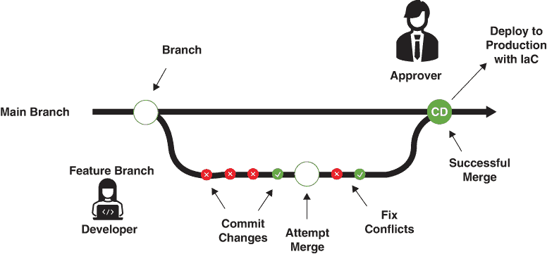

图 5-9 带有 CD 的 SCM 工作流

另一种常见的实施 CD 的方式是通过 SCM 中的 `release`。通常，release 是当前主分支的快照，并带有版本号（例如 v1.2）。图 5-10 展示了这如何允许我们将多个更改批量合并为一个 release，并一次性部署它们。在此方法中，每个更改都会持续集成到主分支中，但只有在审批人将其标记为 release 时（在此示例中为 v1.2）才会部署到生产环境。

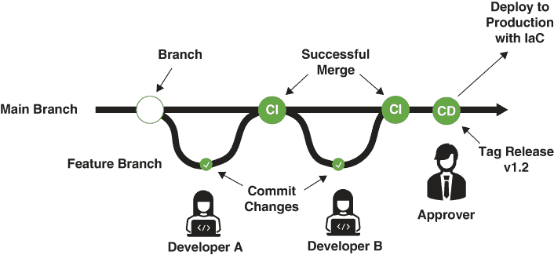

图 5-10 基于 release 的带有 CD 的 SCM 工作流

虽然前两个示例侧重于开发人员或网络工程师使用 DevOps 工具集对 IaC 进行更改，但常规更改自动化的更常见方式之一是通过 ITSM 平台（如 ServiceNow 或 BMC）。仅仅因为我们可能从 ITSM 而不是 SCM 触发更改，并不意味着我们就不能在此场景下进行适当的 CI/CD。因为大多数 SCM 都有通过 API 触发操作的方法，我们可以在 ITSM 中编写一个工作流，更新事实来源（无论是在 Git 中还是在外部数据库中），然后通过 API 在 SCM 中触发合并。这样，我们就可以利用面向客户的 ITSM 的所有优势，同时仍然保持 CI/CD 的严谨性。

## 持续监控

任何关于 DevOps 自动化的讨论如果不涉及监控都是不完整的；然而，有整本书涵盖监控和指标的所有方面，因此我们在此的讨论简短，并专注于模型驱动 DevOps 背景下的监控。

网络监控软件（NMS）解决方案，如 Nagios、Datadog 和 Zabbix，为生产网络提供了重要的洞察。除了提供网络问题的通知外，它们还可以用于收集指标，在某些情况下，还可以使用这些指标来预测问题。你可能会想知道这与模型驱动 DevOps 有何关系。传统上，NMS 监控两种类型的设备：明确指示监控的设备和在网络上发现的设备。这两种方法都有弱点。在明确方法中，网络管理员经常忘记添加新设备或删除旧设备。这种疏忽可能导致错过问题，或对不再存在于网络上的设备产生虚假警报。

基于发现的方法也可能存在问题。如果你的设备没有集中在特定的 IP 范围内，凭据与你的标准不同，或者在发现时处于关闭状态，它们可能会被遗漏，从而导致设备未被监控，问题未被发现。然而，如果我们使用模型驱动 DevOps 方法来监控我们的网络，我们可以利用事实来源来驱动监控配置，以及网络设备配置。正如网络设备提供用于配置的 API，许多 NMS 也可以通过 API 进行配置。因为我们可以使用 CI/CD 流水线配置交换机和路由器，我们可以简单地将 NMS 的配置集成到同一过程中。我们的事实来源甚至可能已经拥有配置 NMS 所需的所有数据！即使没有，修改它以携带所需数据通常也是一项简单的任务。不难想象这样一个场景：我们的 NMS 正在持续运行与我们的 CI 流水线相同的一些测试，例如前面的 traceroute 示例。

## 摘要


在本章中，你了解了 CI/CD。DevOps 的核心原则之一是，自动化和 `IaC` 是实现现代系统所需效率和规模的唯一方式，但使自动化广泛应用变得安全的是 `CI/CD` 的严谨性和流程。你看到 Bob 认识到 `IaC` 本身非常强大，但也引入了新的风险。为了应对这些新风险，你了解了版本控制和 `SCMs`、`CI` 服务器，以及将 linting、数据验证和功能测试应用于网络基础设施时所能实现的极其强大的组合。最后，你学习了如何利用同一套工具来实现 `CD`，并实现 DevOps 应用于基础设施时所能实现的规模、敏捷性和合规性的强大组合。

在下一章中，你将探索使用到目前为止所学的所有技术和工具来实现模型驱动 DevOps 的具体实现。我们不会只留给你概念和想法让你自行应用，而是会带你了解模型驱动 DevOps 在现实世界中的应用可能是什么样子。

# 第 6 章

## 实现

在前几章中，我们探索了模型驱动 DevOps 的技术和工具基础。在本章中，我们将为在你的组织中实施模型驱动 DevOps 原则提供一条路线图。为了帮助说明本书中的原则，我们使用路线图创建了一个参考实现，包括散文和代码，并基于实际部署。不过请记住，这只是本书中阐述的原则的众多可能实现之一。因为我们使用标准的 DevOps 管道，使用与你的组织用于应用程序开发的相同类型的工具，所以你很可能不需要从零开始。你可以根据组织的具体需求，选择采用全部或仅部分代码。此外，本章有时会深入细节。除非你想深入了解，否则不要陷入细节中。即使你不理解每一个细节，也应该能够了解为物理网络基础设施实施 DevOps 的整体流程。

### 开拓先河

Bob 和 Larry 坐在 ACME Corp 的休息室里，回顾着他们在 `IaC` 方面的成功与失败。他们都对 `IaC` 的可能性感到非常兴奋，但也意识到他们面临一些真正的挑战。Larry 说：“我们有实际可用的基础设施即代码，这太酷了。但如果我们迄今为止学到的一件事，那就是我们不能继续使用生产网络来开发和测试我们的基础设施即代码。我是说，看看我们第一次尝试时发生了什么。”

Bob 抿了一口咖啡，思考着 Larry 的担忧。他当然是对的；他们一直在使用生产网络来开发和测试他们的自动化。这不是现代应用程序开发人员开发 `IaC` 的方式。他们有能力使用云或本地资源以多种方式实例化测试环境。如果他和 Larry 要解决这个问题，他们需要找到一种方法来模拟他们的网络，以便安全地开发和测试他们的 `IaC`，但这不是他们唯一的问题。

Bob 回答说：“你说得对。我想如果我们想要采用 DevOps 流程，我们就需要采用相应的工具。我们需要一个版本控制系统、一种执行 `IaC` 的方法，以及一种运行测试的方法。所有这些都是一个很好的开始，但另一个重要的工具是一个用于实例化应用程序测试版本的平台，或者在我们的例子中，是网络基础设施。但是，我们还有另一个问题。”

“这是什么？”Larry 问道。

“ACME Corp 的网络非常庞大。它由数千个网络设备组成。即使我们有方法模拟我们的网络架构，我也怀疑它能模拟整个网络。”

“嗯，我没想到那个。如果我们把它分解成可以模拟的逻辑片段呢？你知道，比如 WAN 骨干网、LAN 核心网或分支办公室？”

“这是个好主意，Larry。这将允许我们将网络转换为一组代表网络区域的模块。这并不完美，但任何东西都比使用生产网络来开发自动化要好！”

“是啊，我再也不想那样做了。那么，假设我们将架构分解为模块，我们有方法模拟这些模块，并使用它来开发我们的自动化。然后呢？”

“嗯，我们需要能够利用我们的模拟能力和 `IaC` 在更改进入生产环境之前对其进行测试。”

“你说得好像很容易，”Larry 说。

“肯定不容易，但这对于实现 DevOps 的潜力至关重要。没有它，我们就又回到你和我手动运行测试，我们都见过那会出什么问题。”

“是啊，我有时候手笨。”Larry 咧嘴笑了笑。

想要弄清楚如何正确测试网络基础设施已经够难了，但现在他们还需要其他工具，例如版本控制系统、某种方式来自动化执行他们的 `IaC`，以及某种方式来自动化测试。Bob 被所有这些移动部件压得喘不过气来。这对于 Larry 和他自己来说太多了。

当天晚些时候，Bob 与他的经理 Jane 进行了定期的一对一会议。他向她解释了他对他们在 `IaC` 方面取得的进展有多么兴奋，但他也对为了建立 DevOps 所需的工具和流程而剩下的大量工作感到沮丧。Jane 说：“你知道，你应该和业务应用程序组的 Lisa 谈谈。我了解他们在这方面取得了一些重大进展，而她是推动这一进展的主要力量。”

Bob 来了精神。“真的？这听起来很有希望！”

“嗯，他们和我们一样，面临着 CIO 采用 DevOps 的压力，而且就像你一直跟我说的，将 `IaC` 应用于应用程序在很多方面比将其应用于网络基础设施要容易。”

“我确实觉得我们正在开拓先河。这不像我们可以买一本专门关于网络基础设施 DevOps 的书。”

当 Bob 和 Lisa 几天后能够联系上时，他们立即投缘。Bob 解释了他和 Larry 一直在研究的 `IaC`，包括源代码真实性、`YANG` 模型和 `Ansible` playbooks 等概念。他讲述了他们的成功和失败。Lisa 坐在那里听着 Bob 讲述他通往 `IaC` 的旅程，表示赞同。“是的，是的，是的！”她说。“这正是我希望你会说的话。网络基础设施对我们来说一直是个黑盒。`IaC` 将改变一切。顺便说一句，我们在我们的小组中规定，所有新应用程序都必须使用 `IaC` 部署，在版本控制中跟踪，并在 `CI/CD` 管道中包含全面的测试。”

“这意味着你们已经有版本控制系统和执行 `CI` 工作流的能力了吗？”Bob 问道。

“是的！”

“我们可以利用这个来为我们的网络基础设施 `IaC` 吗？”

Lisa 笑了。“我还以为你永远不会问呢。”

“Lisa，你让我今天开心了！”

对于 ACME Corp 可能无意中听到他们谈话的其他人来说，这就像 Bob 和 Lisa 在说着一种充满奇怪词汇的外语，但对他们来说，一切都说得通。在此之前，Bob 觉得业务应用程序组只是另一个 IT 孤岛，把每个问题都归咎于网络。但现在，他发现他们在如何看待 IT 运营的未来方面有很多共同之处。DevOps 最终会打破这些障碍，让团队走到一起吗？他当然希望如此。


Bob 知道他们正在为 DevOps 和 CI/CD 构建坚实的基础，但存在一些问题。虽然他非常希望帮助 CIO 实现采用 DevOps 模式的目标，但他很难决定自动化什么，因为他们没有具体目标，因此基本上试图自动化整个网络。此外，他又忍不住觉得，他们似乎是唯一试图将 DevOps 应用于网络基础设施的人。他向后靠在椅子上，叹了口气。网络团队需要的是一份 DevOps 路线图，以帮助他们避免一些这些陷阱。

# Model-Driven DevOps Reference Implementation

本章详细介绍了模型驱动 DevOps 框架的参考实现。为了最好地与大多数网络中常见的情况保持一致，我们以市场份额和行业标准为指导，选择了参考实现中使用的组件。在撰写本文时，思科系统（Cisco Systems）在路由器和交换机市场占据最大份额，并且通常占据绝大部分份额。此外，Cisco IOS 是这些设备上部署最广泛的网络操作系统，因此我们在参考实现中使用它。使用思科 IOS 设备的决定推动了参考实现中的其他选择，例如使用 Cisco Modeling Labs (CML) 进行网络仿真，以及使用 Cisco Network Services Orchestrator (NSO) 作为平台；然而，模型驱动 DevOps 中提出的方法论可以与任何供应商的设备一起使用。

除了这些产品之外，我们还使用 `Ansible` 作为自动化引擎，使用 `GitHub` 进行源代码管理，并使用 `GitHub Actions` 作为 CI 工作流运行器。但是，在所有情况下，我们都为这些选择中的每一个提供了其他可用选项，以强调 DevOps 和 CI/CD 的一个总体原则——即 DevOps 是一种实践，而 CI/CD 是该实践的一种实现。所使用的特定产品和工具的选择与实现正交。此特定实现在 `GitHub` 中提供，包括所使用的所有工具以及利用该工具的参考实现。

## Hands-on Code: Introduction

此参考实现的完整代码在以下 `GitHub` 仓库中提供：

[`https://github.com/model-driven-devops/mdd`](https://github.com/model-driven-devops/mdd)

在本章中，我们包含对仓库中练习的引用，这些练习允许你深入研究代码并在自己的环境中运行该代码。这些练习将帮助你更好地理解本章中引用的代码。对于此练习，请转到列出的仓库以熟悉其整体结构并查看可用的练习。`GitHub` 仓库还将拥有参考实现的最新版本，并允许你与作者和开发者沟通。

## The Goal

从运营人员的角度来看，此实现的目标是使网络操作看起来与云基础设施操作相同。例如，当云运营人员想要配置 AWS 云实例时，他们通常使用名为 `CloudFormation` 的 IaC 工具。描述所需云实例的所有数据都使用由 `CloudFormation` 服务的数据模型描述的数据结构写入文本文件。然后将此文件提交给 `CloudFormation` 服务，该服务验证数据并构建云实例（参见 `Figure 6-1`）。

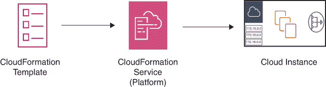

FIGURE 6-1 CloudFormation IaC Workflow

此实现说明了一种真正的 IaC 方法。使用模型驱动 DevOps，物理网络以类似的方式进行配置。具体来说，描述所需网络配置的所有数据都使用由数据模型（在此情况下为 `OpenConfig`）描述的数据结构写入文件。然后将此数据提交给平台（在此情况下为 `Cisco NSO`），该平台验证数据并配置网络。一个区别是网络情况中需要指定的大量数据，但流程仍然相同。

## DevOps Roadmap

通往 DevOps 的道路可能漫长而曲折，因此我们提供此路线图来指导你的旅程（参见 `Figure 6-2`）。我们根据在其他实现中发现成功的实践创建了它。虽然它无法解决你在途中遇到的所有问题，但它为你提供了一种经过验证的策略来实施 DevOps。

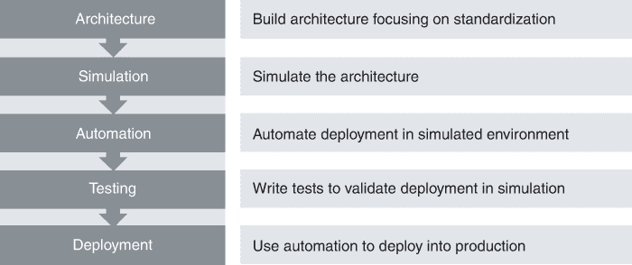

FIGURE 6-2 DevOps Roadmap

在接下来的章节中，我们将更详细地探讨每个步骤。

## Architecture

第一步是开发一个相对准确的架构，代表你试图自动化的内容。如果没有架构，自动化工作注定会失败。随着工作量的增加和复杂性的提高，专注于“易得之果”的简单方法不再可扩展。这种无法扩展的情况部分是由于通常采用的自动化零碎方法造成的。“快速胜利”最初是针对特定目标定制的易于自动化的工作流。当添加下一个工作流时，缺乏整体策略需要全新的脚本，这些脚本增加了代码库以及组织被迫采用的技术债务。大多数大型组织将需要数百个工作流，具体取决于其网络的大小和复杂性。随着工作流的增加，自动化工作很快变得难以管理。最初出于改变组织的愿望而开始的自动化工作，现在变成了一个半实施的项目，背负着无法克服的技术债务，使其进一步落后。

模型驱动 DevOps 提供了解决方案的一部分。也就是说，在数据移动的背景下查看网络的配置和生命周期。不要为特定任务创建单独的工作流，而要确保所需配置的数据包含在发送到设备的内容中。使用这种方法，一个工作流可以容纳大部分，如果不是全部，配置任务。

然而，即使有了模型驱动 DevOps，你仍然需要为自动化基础设施制定良好的总体架构。有时这种架构是显而易见的。例如，组织部署覆盖网络以将站点、云资源和远程工作者连接到单个网络的情况越来越常见。对于这种部署，覆盖网络将决定架构。这将是自动化的“绿地”方法。覆盖网络不会实现完全自动化，但它可能会通过提高专注于该网络层的操作效率来解决组织的当前痛点。

“棕地”方法适用于只需提高当前操作安全性和敏捷性的组织。他们无法等待部署新覆盖网络或进行重大技术刷新的需求。在这种情况下，你仍然有一个架构。你的架构部分是网络的物理布局，该布局可能在没有特别关注规律性和可扩展性的情况下有机生长。如果你没有完整的网络图景，现在是评估、优化和记录它的好时机。

现有网络也反映了它们运行的服务所体现的架构。每个网络都有身份验证、日志记录等所需的基本系统配置，但除此之外，网络上还有几种其他服务，用于路由、组播、分段等。当将其视为在网络上运行的单独应用程序时，架构的第二部分就会显现出来。

### Network as an Application


# 当我们说需要自动化网络上的所有内容时，我们如何开发架构？

要回答这个问题，我们需要回溯几章，了解如何组织我们的真理源，并将其与 DevOps 的起源：应用程序开发相结合。具体来说，我们将配置的每个部分（例如 BGP）视为一种服务或“应用程序”，并将其作为应用程序进行维护。

这些“应用程序”中的每一个都映射到一个 OpenConfig 数据模型。当将它们作为一个整体来看待时，这些应用程序配置了整个设备，如 图 6-3 所示。

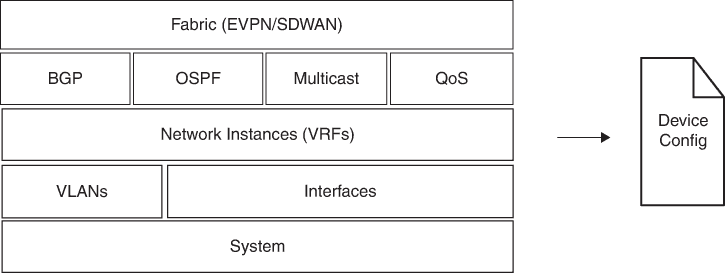

图 6-3 网络即应用程序

用略有不同的措辞来说，每个服务都可以被视为现代应用程序开发中使用的微服务。每个微服务都单独配置和运行，以向整体应用程序提供特定服务（例如路由）。然而，必须保持每个微服务同步，以便整体应用程序能够正常运行。我们将在本章后面介绍如何验证这些服务的数据。

将我们的架构定义为一组服务，是我们为参考实现创建架构的方法，因为许多组织都会面临同样的情况。我们从 图 6-4 所示的拥有总部和两个远程站点的企业网络物理架构开始；然后在此基础上叠加此服务架构，以开发我们的 CI/CD 管道。

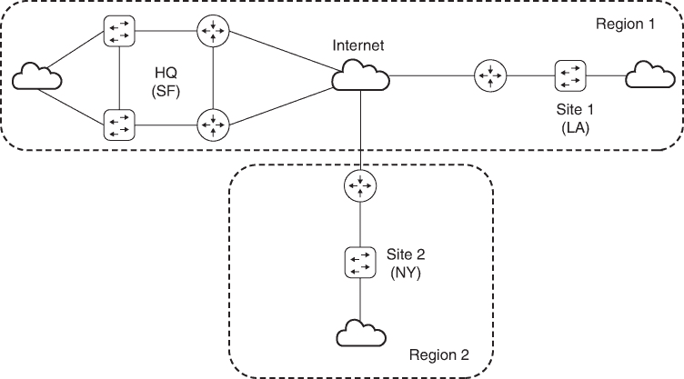

图 6-4 参考架构

此物理网络由 图 6-5 所示的站点和地理区域组织。

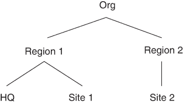

图 6-5 组织层次结构

此层次结构对于真理源数据的组织方式以及稍后需要放置特定信息的位置非常重要。

## 一致性

此拓扑代表了许多企业网络，只是规模较小。它有助于说明网络设计的一个重要方面，该方面使大规模自动化成为可能：一致性能够实现可扩展性。例如，即使在这个两站点拓扑中，将站点 1 与站点 2 配置不同也会使网络该部分的复杂性加倍。随着站点的增加，这种复杂性将继续增长。因此，创建站点模板非常重要，使每个站点都具有相同的配置，只是局部参数不同（例如网络地址）。在站点之间保持配置一致，可以更轻松地配置新站点，并使持续维护更加轻松。它还有助于仿真和测试，如本章后面所述。

## 仿真

我们旅程的下一个阶段是仿真。仿真很重要，因为它提供了一个用于开发自动化的网络。从更高层面来看，我们谈论的是对测试网络的需求。然而，正如我们在书中前面讨论的那样，在许多组织中，测试网络的成本可能是难以承受的。仿真提供了创建多个网络的能力，这些网络可以由不同的开发人员和/或不同的开发环境使用，而无需购买大量硬件。能够高保真地仿真生产网络对于自动化至关重要，但对于 CI/CD 来说尤其如此。图 6-6 显示了在 CML 中仿真的参考架构。

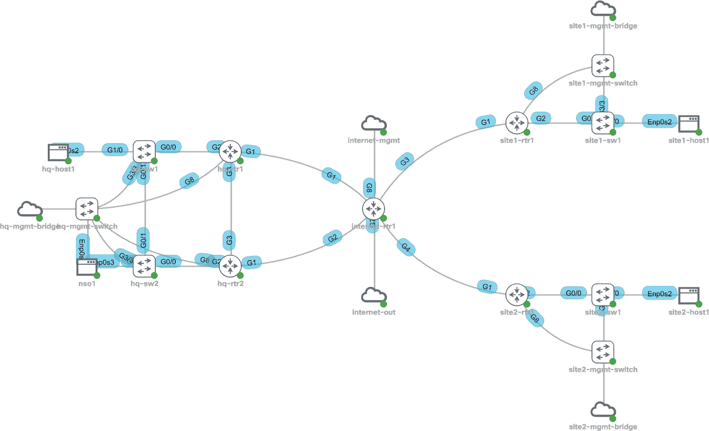

图 6-6 在 CML 中仿真的参考架构

然而，即使是仿真，在大规模下也可能很困难。虽然使用适当数量的资源可以仿真数百个元素，但如果没有非常大量的资源，仿真数千个或更多元素将变得非常困难。这就是架构一致性成为成功关键的地方。大型、分散网络最常见的原因是大型、分散的组织，需要连接许多站点。我们所接触的组织通常拥有数百个甚至数千个站点，总计数万台设备。这样的网络很难在其整体范围内进行仿真。

如果这些站点是从一个或少数几种基本类型（例如，小型、中型、大型）部署的，那么你只需要仿真这些基本类型。如果自动化利用了这种一致性，那么只需要针对这些基本类型进行开发和测试。

除了规模之外，仿真环境在代表某些类型的设备方面也可能存在不足。尽管虚拟化网络功能的普及和虚拟基础设施的采用大大增强了使用仿真环境进行开发和测试的能力，但仍有大量硬件难以以高保真方式表示。物理元素（如网络接入交换机和无线接入点）是有问题的。此外，为速度或可扩展性在硬件中实现特殊数据包处理的设备，也可能难以以现实的方式进行仿真。在这两种情况下，可以通过物理硬件来增强仿真开发和测试网络，以获得所需的保真度。但是，请记住，我们想要测试的大多数配置更改都涉及网络的控制平面。即使对于那些有问题的设备，控制平面通常也作为软件实现，很容易进行仿真。即使你无法通过仿真复制客户端的确切行为，你也可以准确地复制控制平面的行为。

即使面临这些挑战，仿真网络在开发 CI/CD 管道时也是一个重要工具。但是，我们需要确保构建仿真拓扑，使其可以用于自动化。例如，许多仿真依赖于访问控制台来配置拓扑中的设备。因为你试图使用与部署相同的工具进行自动化测试，所以你需要确保在仿真网络中设置管理接口，以便你可以从控制节点（即运行自动化工作流的节点）获得相同或类似类型的访问（例如 SSH、RESTCONF）。

## 实操代码：部署拓扑

转到以下 URL 中的“部署拓扑”练习：

[`github.com/model-driven-devops/mdd#exercises`](https://github.com/model-driven-devops/mdd#exercises)

此练习涵盖了 CML 拓扑文件和用于在工作流中部署测试环境的 Ansible playbook。根据您的环境，您可以使用 playbook 在 CML 中部署测试网络。

# 自动化

该过程的下一步是使用仿真测试网络自动化架构。具体操作方法可能因具体情况而异，但我们发现以下流程通常与网络自动化配合良好：

1. 如果您是从现有网络开始，请选择网络的一部分（希望能代表您的整个网络）作为起点。

2. 手动配置网络。

3. 验证其是否按预期运行。

4. 开发自动化以产生所需功能。

## 创建真理源


创建一个中心的、可通过编程方式访问的事实来源（source of truth）是任何 DevOps 工作中最重要的部分。之所以如此，有几个原因。首先，用于自动化配置设备的数据需要来自某个地方。无论该数据位于何处，都必须能够以编程方式处理（即，无需人工干预），否则就不再是自动化。在这种情况下，你只是在加速人工工作。这对你的组织可能有价值，但它无法带来 DevOps 所能提供的那种根本性业务转型。

其次，你的事实来源不应该是你现有的物理网络。这就是语义学发挥作用的地方。从技术上讲，你正在构建一个中心的、可通过编程方式访问的、*期望*的事实来源。运行在物理基础设施上的配置是你的*实际*事实来源。这两者不能相同。即使你的网络配置在某个时间点正是你所期望的，它也只能保持那样一段时间。如果你拥有一个分布在广阔地理区域的大型网络，该配置很可能会与你的期望事实来源产生偏差。此外，当配置数据集中存储时，更容易维护其安全性和一致性。如果某个站点发生导致现场信息完全丢失的情况，你可以从中心事实来源重建该站点的配置，从而重建该站点本身。虽然如果实际配置丢失，你可以集中备份配置，但你将费力构建一个你可能永远不会使用的事实来源。因此，与其创建一个次要的事实来源，不如构建一个能提供更多整体利益的主要事实来源。

最后，一个中心的、可通过编程方式访问的事实来源能够实现真正的 CI。当你想要在推送配置之前对其进行测试时，你拥有所需的所有数据。否则，你将不得不从现有网络中集中拉取所有数据，运行测试，然后再将其推送回去，每次想要测试更改时都要重复这一过程。同样，你不如创建并维护一个包含期望配置的中心事实来源，然后确保设备上的实际配置与你的事实来源一致。

## 移动数据

模型驱动 DevOps 主要是关于将数据从你的事实来源移动到你的网络中。图 6-7 显示了数据流的概览。


图 6-7 模型驱动 DevOps 数据流

第一步是构建服务，这仅仅是配置设备所需的所有数据。服务可以是像 SD-WAN 这样的高级构造，但通常只是用于配置网络基础设施的所有数据。这些数据由“简单”的服务（如 NTP、DNS 和横幅）以及接口和更复杂的内容（如 OSPF 和 BGP）组成。将所有这些服务汇总为一套完整的数据，就定义了你的整个网络基础设施。出于这个原因，我们采用网络“应用”方法，将每个服务视为微服务，并将一组微服务组装成一个配置整个网络基础设施的完整应用程序。

让我们看看如何在网络上定义各种应用程序。首先，让我们使用 OpenConfig 定义一个 NTP“服务”。一个简单的事实来源条目可能如下所示：

单击此处查看代码图像

```
openconfig-system:system:
  clock:
    config:
      timezone-name: 'EDT -8 0'
  ntp:
    config:
      enabled: true
    servers:
      server:
        - address: '1.us.pool.ntp.org'
          config:
            address: '1.us.pool.ntp.org'
            association-type: SERVER
            iburst: true
        - address: '2.us.pool.ntp.org'
          config:
            address: '2.us.pool.ntp.org'
            association-type: SERVER
            iburst: true
```

有几个问题需要注意，主要涉及此数据对各种设备的适用性。在这种情况下，NTP“服务”可能会配置在所有设备上。但是，其中一些数据适用于网络中的所有设备，而另一些则不适用。因为我们在两个不同时区的两个不同区域，所以需要根据区域适当设置时区。这意味着部分数据适用于组织级别，部分适用于区域级别。如何在区域和站点级别做到足够具体而又不重复所有内容？要回答这个问题，我们需要了解事实来源数据是如何构建的，以及工具如何收集和合并事实来源数据，以生成与特定设备相关的特定数据。

## MDD 事实来源

参考实现不使用 Ansible 清单作为其主要数据源。相反，它使用分层目录结构来增强 Ansible 清单数据。做出此决定有几个原因。首先，Ansible 清单系统会加载适用于设备及其所属所有组的数据，有时会产生不希望的结果。例如，我们的 Ansible 清单将交换机放入以下层次结构中（使用 `ansible-inventory --graph` 生成）：

单击此处查看代码图像

```
@all:
  |--@network:
  |  |--@org:
  |  |  |--@region1:
  |  |  |  |--@hq:
  |  |  |  |  |--hq-rtr1
  |  |  |  |  |--hq-rtr2
  |  |  |  |  |--hq-sw1
  |  |  |  |  |--hq-sw2
  |  |  |--@site1:
  |  |  |  |  |--site1-rtr1
  |  |  |  |  |--site1-sw1
  |  |  |--@region2:
  |  |  |  |--@site2:
  |  |  |  |  |--site2-rtr1
  |  |  |  |  |--site2-sw1
  |  |--@routers:
  |  |  |--@hq_routers:
  |  |  |  |--hq-rtr1
  |  |  |  |--hq-rtr2
  |  |  |--@internet_routers:
  |  |  |  |--internet-rtr1
  |  |  |--@site_routers:
  |  |  |  |--site1-rtr1
  |  |  |  |--site2-rtr1
  |  |--@switches:
  |  |  |--hq-sw1
  |  |  |--hq-sw2
  |  |  |--site1-sw1
  |  |  |--site2-sw1
```

动手代码：探索清单

转到以下 URL 的“探索清单”练习：

[`github.com/model-driven-devops/mdd#exercises`](https://github.com/model-driven-devops/mdd#exercises)

此练习将引导你了解参考实现的清单文件以及如何通过 Ansible playbook 与该清单进行交互。

每个设备都在两个不相交的组中：一个指定其物理位置，另一个指定其角色。这种配置使我们能够按物理位置（例如，HQ 的所有设备）或按角色（例如，网络中的所有路由器）运行 playbook。但是，在这种情况下，Ansible 无法确定特定设备的权威组是什么。例如，你可以将数据仅放在权威组中，但如果你想将数据应用于两个组的交集（例如，HQ 的所有交换机）怎么办？哪个数据优先？

其次，Ansible 将清单中的所有数据加载到内存中，这可能会影响可扩展性。MDD 既有用于配置设备的数据，也有用于验证数据和状态的 JSON Schema。将所有这些内容都用于 Ansible 清单系统会过于复杂并消耗资源。


最后，我们需要一种方法来合并各个层级的数据，并生成符合 OpenConfig 数据模型的数据。虽然 Ansible 可以合并库存中重叠的数据结构，但这并不是推荐的设置，并且由于其处理优先级的方式，其行为不利于 OpenConfig。我们仍然利用 Ansible 库存系统，但 MDD 的主要真实来源是一个目录层次结构中的文件集合，该结构的组织方式与我们的网络结构相同。参考实现中使用了以下目录层次结构：

Click here to view code image

```
.
└── org
    ├── region1
    │   ├── hq
    │   │   ├── hq-rtr1
    │   │   ├── hq-rtr2
    │   │   ├── hq-sw1
    │   │   └── hq-sw2
    │   └── site1
    │       ├── site1-rtr1
    │       └── site1-sw1
    └── region2
        └── site2
            ├── site2-rtr1
            └── site2-sw1
```

此层次结构为您提供了一个单一的权威结构，其中每个设备仅属于一组组。例如，仅搜索组 `org`、`region1` 和 `hq` 以查找适用于设备 `hq-rtr1` 的数据。要查找特定设备的适用数据，将搜索从最高级别（例如 `org`）到设备本身的直接路径中的所有目录，以查找具有特定模式（例如 `oc-\*.yml`）的文件。对于 `hq-rtr1`，该目录列表将是（根位于文件系统中的 `mdd_root`）：

Click here to view code image

```
{{ mdd_root }}/org
{{ mdd_root }}/org/region1
{{ mdd_root }}/org/region1/hq
{{ mdd_root }}/org/region1/hq/hq-rtr1
```

较低级别文件中找到的数据将覆盖较高级别文件中找到的数据，从而提供所需的数据优先级。让我们来看看如何使用 NTP 服务示例来实现这一点。要定义组织级别的默认值，请创建文件 `{{ mdd_root }}/org/oc-ntp.yml`，并包含以下数据：

Click here to view code image

```
---
mdd_data:
  openconfig-system:system:
    clock:
      config:
        timezone-name: 'EDT -8 0'
    ntp:
      config:
        enabled: true
      servers:
        server:
          - address: '1.us.pool.ntp.org'
            config:
              address: '1.us.pool.ntp.org'
              association-type: SERVER
              iburst: true
          - address: '2.us.pool.ntp.org'
            config:
              address: '2.us.pool.ntp.org'
              association-type: SERVER
              iburst: true
```

请注意，之前的 OpenConfig 数据被放置在不同的根 `mdd_data` 下。将数据放置在更高级别的数据结构中，不仅可以更轻松地在代码中处理它，还可以允许指定元数据（例如标签）。由于此数据在 org 级别指定，它适用于我们网络中的所有设备。要覆盖 region2 的时区，我们创建文件 `{{ mdd_root }}/org/region2/oc-ntp.yml`，并包含以下数据：

Click here to view code image

```
---
mdd_data:
  openconfig-system:system:
    clock:
      config:
        timezone-name: 'EST -5 0
```

我们不再指定 NTP 服务器信息，因为它是从 org 级别数据继承的。当构建 region2 中设备的数据时（例如 `site2-rtr1`），数据结构中的 clock 元素将被覆盖，其余数据将被保留。这是通过我们开发的 Ansible combine 过滤器的衍生品 `mdd_combine` 完成的，它以有利于 OpenConfig 数据模型的方式合并数据。当您对这两个文件中 `mdd_data` 包含的数据使用 `mdd_combine` 时，它将覆盖 `timezone-name` 并为 region2 中的任何设备生成以下内容：

Click here to view code image

```
---
mdd_data:
  openconfig-system:system:
    clock:
      config:
        timezone-name: 'EDT -5 0'
    ntp:
      config:
        enabled: true
      servers:
        server:
          - address: '1.us.pool.ntp.org'
            config:
              address: '1.us.pool.ntp.org'
              association-type: SERVER
              iburst: true
          - address: '2.us.pool.ntp.org'
            config:
              address: '2.us.pool.ntp.org'
              association-type: SERVER
              iburst: true
```

除了应用与设备物理位置相关的数据外，我们还希望根据设备的角色应用数据。为此，我们实现了一个标记系统。如果设备具有特定标记，则将应用与该设备标记相关的所有数据。为了演示这一点，以下是将数据仅应用于具有特定角色的设备的示例。文件 `{{ mdd_root }}/org/oc-vlan.yml` 指定了组织中的所有 VLAN（仅两个，为了简洁）。在 org 级别指定 VLAN 数据可以在整个组织中提供一致性，而无需使用任何协议来分发 VLAN。让我们来看看 `oc-vlan.yml` 的内容：

Click here to view code image

```
---
mdd_tags:
  - switch
mdd_data:
  openconfig-network-instance:network-instances:
    network-instance:
      - name: 'default'
        config:
          name: 'default'
          type: 'DEFAULT_INSTANCE'
          enabled: true
        vlans:
          vlan:
            - vlan-id: 100
              config:
                vlan-id: 100
                name: 'Corporate'
                status: 'ACTIVE'
            - vlan-id: 101
              config:
                vlan-id: 101
                name: 'Guest'
                status: 'ACTIVE'
```

值得注意的是，添加了元数据 `mdd_tags`，它允许我们指定此数据仅应应用于带有 `switch` 标记的设备。

## 实操代码：探索数据

转到以下 URL 中的“探索数据”练习：

[`github.com/model-driven-devops/mdd#exercises`](https://github.com/model-driven-devops/mdd#exercises)

此练习向您展示了包含数据配置的文件、它们在数据层次结构中的组织方式，以及它们如何组合以创建特定设备的配置数据。此外，您可以在您的环境中运行这些 playbook 并对其进行修改，以更好地了解它们的工作原理。

## 自动化工具

参考实现使用 Ansible，将其结构化为 Ansible collection 以用于所有工具。使用 Ansible collection 有助于保持一致且有版本的代码库，该代码库可以在 MDD 的许多不同应用中用于不同的组织。当为一个组织添加特定功能或特性时，其他组织将继承它（当然，经过适当测试后）。

Ansible Collection 结构化为执行管道各个阶段的角色，以及实现某些特定功能的各种 Ansible 插件。与所展示的管道阶段相对应的三个角色是 `data`、`validate` 和 `check`。

### data 角色

`ciscops.mdd.data` 角色实现了从真实来源构建配置数据的逻辑。然后，这些数据在设备的上下文中作为变量可用。该角色设计为在 playbook 开头调用，以便该 playbook 中的任务可以使用这些数据。例如，以下是一个简单的 playbook，用于显示设备的配置：

Click here to view code image

```
- hosts: network
  connection: local
  gather_facts: no
  roles:
    - ciscops.mdd.data
  tasks:
    - debug:
        var: mdd_data
```


数据不会被传送到设备；它仅在屏幕上打印，用于开发或调试目的。playbook 对库存中的每个主机都会执行一次，并且可以使用标准 Ansible 机制将 playbook 限制为特定的主机组。例如，使用 `--limit=routers` 调用 playbook 会将其适用范围限制为库存中 routers 组内的设备。这种粒度使得在每次调用工具时都能针对网络的特定部分进行更改。

## The validate Role

`ciscops.mdd.validate` 角色在本章“Testing”部分中有更详细的介绍，它实现了管道的验证部分。它假设设备的所有数据都已构建并在设备的上下文中可用。它还被实现为可以在 playbook 开头作为角色调用：

Click here to view code image

```
- hosts: network
  connection: local
  gather_facts: no
  ignore_errors: yes
  roles:
    - ciscops.mdd.data        # Loads the OC Data
    - ciscops.mdd.validate  # Validates the OC Data
```

运行时，此 playbook 构建所有数据，然后根据 MDD 数据目录中定义的架构验证这些数据。可以按原样运行它以仅验证数据，也可以添加特定任务来执行操作（例如，将数据推送到测试网络）。

## The check Role

最后一个主要角色 `ciscops.mdd.check` 使用方式略有不同，因为它检查活动状态数据，无论是作为 CI 测试的一部分还是在部署后。虽然 check 角色可以像其他角色一样在 playbook 开头执行，但将其作为单独任务调用更有用：

Click here to view code image

```
- hosts: network
  connection: local
  gather_facts: no
  tasks:
    - name: Run Checks
      include_role:
        name: ciscops.mdd.check
```

最后调用 check 角色可以在检查之前运行任务以准备环境，或者在检查之后运行任务以汇总和报告可能发生的各种故障。

## MDD Data

尽管每个角色的调用方式略有不同，但它们都使用 MDD 数据层次结构来存储文件，并使用类似的一组默认值。虽然它们在每个角色的 defaults 中指定，但可以在库存中覆盖（例如，`inventory/group_vars/all.yml`）：

Click here to view code image

```
---
# The root directory where the MDD Data is stored
mdd_data_root: "{{ lookup('env', 'PWD') }}/mdd-data"
# The directory items that make up the direct path
# from the highest level to the device specific level
mdd_dir_items: >-
  {{ ((regions + sites) | intersect(group_names)) +
  [ inventory_hostname ] }}
# The data directory for the particular device
mdd_device_dir: >-
  {{ mdd_data_root }}/{{ mdd_dir_items | join('/') }}
# The file pattern for files that specify OD Data
mdd_data_patterns:
  - 'oc-*.yml'
# The file pattern for files that specify state checks
mdd_check_patterns:
  - 'check-*.yml'
# default file location for JSON schemas
mdd_schema_root: "{{ lookup('env', 'PWD') }}/schemas"
# The file pattern for files that specify data validation
mdd_validate_patterns:
  - 'validate-*.yml'
```

变量 `mdd_data_root` 定义了存储所有规范文件的 MDD 数据目录的根目录。该目录在所有角色中都使用，尽管可以通过修改角色的代码使它们分开。`mdd_dir_items` 定义了构成特定设备层次结构的元素。层次结构由设备在 regions 和 sites 组中的成员身份定义。例如，我们在库存（`inventory/network.yml`）中定义了以下组：

Click here to view code image

```
sites:
  - hq
  - site1
  - site2
regions:
  - org
  - region1
  - region2
```

虽然从层次结构角度来说 sites 是扁平的，但 regions 是按从高到低的顺序列出的。然而，我们不能仅使用此信息来构建路径，因为这里有一些设备不是其成员的组。要找到设备是其成员的组，我们需要将此信息与设备作为 Ansible `group_names` 变量中指定的成员的组进行交集。此操作会产生按层次顺序排列的特定于设备的组。例如，对于 `hq-rtr1`，此交集将产生组 `org`、`region1` 和 `hq`。然后我们将特定设备附加到末尾。`mdd_device_dir` 只是将所有这些组连接起来，以便轻松查找特定于设备的信息。

有三个变量用于指定在 `mdd_data_root` 中为三个角色功能各自搜索的文件模式。此外，每个角色都在特定属性下查找数据。将不同的功能拆分为单独的文件比为任何操作读取所有数据更高效。默认文件模式为

Click here to view code image

```
# The file pattern for files that specify OC Data
mdd_data_patterns:
  - 'oc-*.yml'
# The file pattern for files that specify state checks
mdd_check_patterns:
  - 'check-*.yml'
# The file pattern for files that specify data validation
mdd_validate_patterns:
  - 'validate-*.yml'
```

最后是 `mdd_schema_root` 变量，它告诉角色在哪里查找相对架构文件引用。架构根目录可以与 MDD 数据目录相同；但是，我们为参考实现使用了不同的目录，以更好地组织文件。

这些角色中的每一个，以及其他功能，都作为角色内的 playbook 呈现。这些 playbook 在 runner 中作为管道的一部分被使用。

# Automation Runner

到此为止，playbook 和角色已定义，但如何在管道中使用它们？有两个主要问题：

*   如何运行各个步骤？
*   何时运行它们？

让我们将 runner 定义为执行管道各个阶段的机制。有许多可用于 runner 的选项。如果您的企业已经有正在进行 DevOps 的应用程序开发组织，那么利用相同的工具是有意义的。如果没有，您的选择将取决于可用性、熟悉度和成本。因为参考实现中使用了 Ansible，所以它可以用作 runner；但是，我们选择将 Ansible 用作编排工具，并将每个单独阶段实现为 Ansible playbook。这种方法允许我们使用更高级别、更灵活的 runner。例如，在某些其他工具（例如 Terraform）中执行 runner 中的某些操作可能比在 Ansible 中更容易。

参考实现使用 GitHub Actions 作为 runner。原因很简单：GitHub Actions 与 GitHub 整体集成良好，并且因为 GitHub 已经用作 SCM，所以简化了我们的整体工具集。请注意，为不同项目使用不同的 runner 并不特别困难，因为它们都很相似。例如，GitLab 作为 SCM 和 GitLab CI 作为 runner 的配置和工作方式与 GitHub 和 GitHub Actions 类似。

GitHub Actions 的集成还解决了如何启动管道的问题。以下是一个简化的 GitHub Actions 工作流文件示例，当用户提交拉取请求（PR）时启动 CI：

Click here to view code image


## CI

```yaml
---
name: CI
on:
  workflow_dispatch:
  pull_request:
    branches:
      - main
    paths:
      - 'mdd-data/**.yml'
      - 'mdd-data/**.yaml'
 
jobs:
  test:
    runs-on: self-hosted
    environment: mdd-dev
    concurrency: mdd-dev
    steps:
      - name: Checkout Inventory
        uses: actions/checkout@v2
      - name: Run YAMLLINT
        run: yamllint mdd-data
      - name: Save Rollback
        run: ansible-playbook ciscops.mdd.save_rollback
      - name: Validate Data
        run: ansible-playbook ciscops.mdd.validate
      - name: Deploy Changes
        run: ansible-playbook ciscops.mdd.update -e dry_run=no
 
      - name: Run Checks
        run: ansible-playbook ciscops.mdd.check
      - name: Load Rollback
        run: ansible-playbook ciscops.mdd.load_rollback
```

当系统用户提交 PR 时，他们正在请求将某个更改推送到网络中。此操作会启动 CI 流程以验证数据并测试更改。工作流文件指定，当提交更改 `main` 分支（我们在此保存生产版本的事实来源）的 `mdd-data` 目录中任何以 `.yml` 或 `.yaml` 结尾的文件的 PR 时，应运行该管道。也就是说，我们专门测试对事实来源的更改。我们可能还有其他工作流用于测试实际自动化代码。如果这是仓库中唯一的工作流文件，那么对于不符合这些条件的更改，管道将不会启动。不过，为大多数操作拥有多个工作流是很常见的。

在 `jobs` 部分下，我们指定特定的 GitHub 运行器。GitHub 提供基于云的运行器，但它们通常无法访问组织的内部资源。由于参考实现中使用的 CML 服务器位于组织边界内，因此使用了 GitHub“自托管”运行器。由于自托管运行器在逻辑上位于组织边界内，它可以访问 CML 服务器和管道所需的其他资源（参见 图 6-8）。`self-hosted` 指令表示工作流将在提供给该仓库或组织的自托管运行器之一上运行。

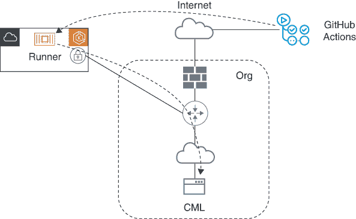

FIGURE 6-8 GitHub Self-Hosted Runner

接下来，`environment` 指令告诉 GitHub Actions 使用哪个可用环境。环境定义了区分测试环境所需的信息。在我们的情况中，它包括 CML 服务器、事实来源、访问资源的凭据等，并允许我们为不同场景拥有多个测试环境。密切相关的是 `concurrency` 指令，它允许我们定义是否可以在同一环境中同时运行多个测试。同时运行两个操作可能会污染结果，因此参考实现配置为限制并发性。并发性也可以更细粒度地应用于不同类型的操作。例如，你可以限制更改模型特定部分（例如系统、BGP、VLAN）的作业，但允许多个不会相互冲突的整体作业。可以为每个测试周期在 CML 中启动一个新的测试网络，但这样做会为大型架构增加大量开销。此外，测试环境通常会配备物理设备，这些设备比虚拟资源更难以配置和恢复到已知状态。

`jobs` 部分的其余部分执行管道的每个阶段，如 图 6-9 中直观描绘。


FIGURE 6-9 CI Pipeline

管道首先拍摄当前测试环境的快照。许多组织由于使用物理硬件而拥有长期存在的测试环境；因此，需要将测试网络维持在与生产网络相同或尽可能接近的状态。由于 PR 包含可能有效也可能无效，甚至可能被其他运营商拒绝的更改，你不希望在更改与 `main` 分支合并之前将其完全提交到测试网络。通过拍摄环境快照，你可以回到更改推送之前的时间点。

在保存当前网络状态后，管道执行先前描述的 Ansible Collection 角色 `data` 和 `validate`，用于管道的下两个阶段。数据验证后，将其推送到网络。此时，让我们稍作偏离，谈谈我们在环境中使用的平台，Cisco Network Services Orchestrator。

## Hands-on Code: Exercising the Runner

转到以下 URL 的“Exercising the Runner”练习：

[`github.com/model-driven-devops/mdd#exercises`](https://github.com/model-driven-devops/mdd#exercises)

在此练习中，我们向你展示指定工作流 GitHub Actions 配置的文件。如果你的 GitHub 帐户支持，你也可以 fork 仓库并在自己的环境中练习这些运行器。

# Cisco Network Services Orchestrator

本书的主要前提是，标准化单一数据模型大大简化了自动化。你选择哪个模型并不重要，只要它对所有设备都相同，无论模型或供应商如何。当我们调查最佳模型时，OpenConfig 是显而易见的选择，因为它的全面性和跨供应商支持。尽管大多数供应商都支持它，但每个供应商支持的全面性不同，并且几乎总是不完整的。因此，在决定使用 OpenConfig 时，我们知道我们需要在自动化和设备本身之间放置一些东西。我们在前几章中称其为“平台”。我们使用平台的主要原因是为了控制不同供应商和设备型号上 OpenConfig 模型的实现。如果供应商未实现 OpenConfig，我们可以自行实现并确保其满足我们的要求。

我们选择 Cisco Network Services Orchestrator (NSO) 作为参考实现的平台。主要原因是，在撰写本书时，Cisco 是企业和服务提供商领域占主导地位的网络供应商。因此，由于我们主要自动化 Cisco 设备，使用 Cisco 产品作为平台是合理的。选择 NSO 的另一个原因是它对第三方供应商有丰富的支持。事实上，其大部分用户群将其部署用于 Juniper。还有其他平台选项。例如，OpenDaylight 是一个开源 SDN 控制器，Juniper Contrail 是来自 Juniper Networks 的 SDN 控制器。这些解决方案本可以是可行的选择，尽管它们更偏向于更主动的 SDN 控制器功能（例如，在路由协议或分析中活跃）。我们只是想要一个呈现北向 API 抽象的东西，该抽象转换为本地设备特定的南向 API 或 CLI。尽管 NSO 可以做的不仅仅是 API 抽象，它还在简单性、功能性和对基础设施的适用性方面胜出。


参考实现主要使用 NSO 来为网络中的设备提供基于 OpenConfig 的 API 抽象；不过，它还提供了其他在运营上有用的功能。最有用的是其保持状态并回滚到设备配置先前版本的能力。虽然某些设备可以作为其 NETCONF 实现的一部分提供回滚功能，但这可能不一致。此外，回滚并非大多数 RESTCONF 和通用 REST 实现的一部分，而后者因其简单性而日益流行。将配置数据库作为平台的一部分，使我们能够标准化北向数据模型以及回滚功能。

最后，平台方法允许我们通过一个点聚合多个设备的通信（参见 图 6-10）。通过单点代理通信，使我们能够限制需要授予设备管理接口的访问权限。我们不需要允许中央自动化基础架构访问所有设备，而只需允许来自站点或区域平台实例的访问。此外，我们还可以减少中央自动化基础架构与设备之间的通信量，因为平台拥有端设备的状态。诸如干运行之类的操作永远不需要访问设备，从而使设备能够专注于在网络中执行其指定任务。

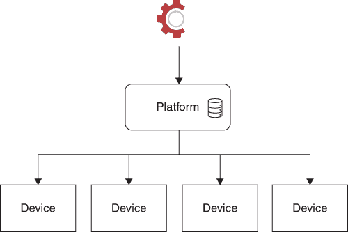

FIGURE 6-10 Platform Scale and Abstraction

有些人可能仍会提出异议，认为我们主张使用单一数据模型可以简化自动化所需的代码，但我们却要编写大量代码来实现用于 API 抽象和标准化的平台。虽然这是一个合理的论点，但这种复杂性集中在一个社区项目中，其代码可免费获取，并可轻松跨部署使用。也就是说，复杂性在部署之间分摊，其收益足够大，因此仍然值得去做。此外，我们应强调，利用模型驱动 DevOps 的好处并非必要。如果您的基础架构对 OpenConfig 或另一个统一模型有足够的支持，则可以直接访问设备或控制器平台。此外，您可以使用本书中介绍的方法配合多个数据模型，尽管这样做可能需要编写更多用于验证和检查的架构，并会导致数据可重用性降低。

# 测试

现在我们有了架构、模拟该架构的方法以及用于自动化的代码，下一步是确保建立了强大的 CI 流水线，以测试源代码或自动化代码中发生的任何更改。在上一节中，我们讨论了用于使用 JSON Schema 验证 OpenConfig 数据、使用 OpenConfig 配置网络以及使用 JSON Schema 验证结果网络状态所需的各种 Ansible 角色。图 6-11 说明了如何在 CI 流水线中使用这些角色来验证、配置和测试更改。

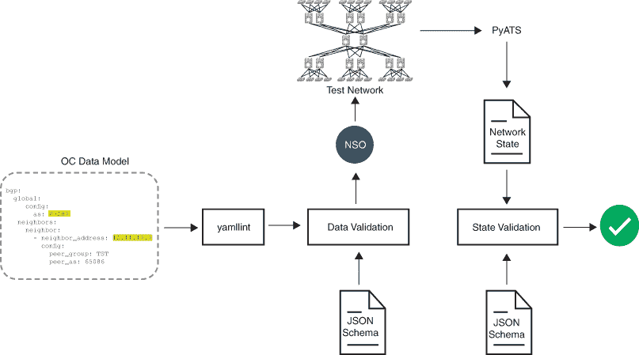

FIGURE 6-11 CI Pipeline

在接下来的章节中，我们将探讨 CI 流水线中每个步骤的详细信息。

## 代码检查

第 5 章，“持续集成/持续部署”，讨论了代码检查工具的概念以及它如何帮助确保代码具有正确的语法、正确的结构，并遵循所选语言的规则和最佳实践。参考实现使用 YAML 来存储源代码；因此，`yamllint` 是用于检查配置数据所需的工具。与 Python 等语言相比，YAML 的规范相对简单，因此我们真正检查的是数据的语法和结构是否遵循 YAML 规范。`yamllint` 不关心键和值的内容是什么，只关心它们是否具有正确的语法和结构。通过代码检查过程后，验证数据中实际键/值对是否符合合规规则和/或最佳实践将在后续的数据验证阶段进行。

## 测试网络快照

Cisco NSO 将回滚上一事务所需的命令作为回滚文件保存。这些回滚文件可以包含多个设备的数据，具体取决于更改的方式。在本参考实现中，我们每次对一个设备进行更改，因此最后一个回滚文件将包含最后更改的设备的数据。此外，所有回滚文件都是按顺序排列的。因此，如果您有一批更改，则需要执行该批更改创建的每个回滚文件。幸运的是，如果我们回滚到创建的第一个回滚文件，NSO 会为我们完成此操作。每个回滚文件都有一个 ID。当我们查询 NSO 获取最新回滚 ID 时，它会提供最后一批更改中最后一次更改的 ID。为了记住这一点，我们将该回滚 ID 放入一个文件中，以便流水线中后续阶段可以使用。

## 数据验证和状态检查

测试是 CI/CD 的关键部分。如果没有测试，自动化带来的速度很快就会使您的网络变得不稳定甚至无法操作。除了测试配置更改外，我们还验证用于进行配置更改的数据。数据验证使我们能够在数据被推送之前捕获可能导致网络故障的问题（例如，拼写错误的 IP 地址），并确保其符合策略或监管标准。在这两种情况下，我们都使用 JSON Schema。在数据验证的情况下，我们将为特定设备构建的数据应用于 JSON Schema。对于状态验证，我们从设备检索状态数据作为结构化数据，然后将该结构化数据应用于 JSON Schema。对于这两种操作，我们需要一种方法来确定针对哪些设备执行哪些验证和检查。

对于数据验证和状态检查，我们使用与构建配置数据时类似的机制。每个函数在 MDD 数据层次结构中都有特定的规范。在此实现中，我们将数据验证（`validate-*.yml`）与状态检查（`check-*.yml`）分开。对于这两种文件类型，与配置数据文件一样，可以将标签指定为元数据（使用 `mdd_tags` 属性）以定位特定操作的适用性。如果未指定 `mdd_tags` 属性，则假设适用于所有设备。

### 数据验证

数据验证特指在将数据推送到设备之前验证数据的正确性。正确性至少有两个方面。首先，我们不希望推送会被拒绝的数据。例如，不在正确范围内的 IP 地址或 VLAN 应该被拒绝。正确性的第二个方面是符合组织规范、安全标准或监管要求。例如，组织级验证文件 `{{ mdd_root }}/org/validate-local` 包含以下内容：

单击此处查看代码图片

```
---
mdd_tags:
  - all
mdd_schemas:
  - name: banner
    file: 'local/banner.schema.yml'
  - name: dns
    file: 'local/dns.schema.yml'
```

`mdd_schemas` 属性是架构文件的列表，附带描述性名称，应用于标签列表所适用的设备的数据。架构文件和设备数据被传递给 `ciscops.mdd.data_validation` 模块，该模块使用 Python `jsonschema` 包将 JSON Schema 应用于数据。列出的文件引用自清单中定义的 `mdd_schema_root`。例如，架构文件 `local/banner.schema.yml` 包含以下内容：

单击此处查看代码图片


### 网络横幅架构

```yaml
---
title: Network banner schema
type: object
required:
  - 'openconfig-system:system'
properties:
  'openconfig-system:system':
    type: object
    required:
      - config
    properties:
      config:
        type: object
        required:
          - login-banner
        properties:
          login-banner:
            type: string
            description: Login banner
            pattern: prohibited
```

你可能已经注意到，我们使用 JSON 架构，但以 YAML 编写它们。我们故意这样编写，是为了让架构文件的构建更易于阅读和编写，因为 YAML 需要的开销符号更少；但是，`ciscops.mdd.data_validation` 模块接受两种文件类型，因此如果你偏好，可以使用 JSON 格式。

无论格式如何，此架构定义了一个简单的检查，以确保单词 `prohibited` 出现在登录横幅中。横幅的更多部分，甚至整个横幅，都可以进行检查，尽管我们在此仅将其限制为一个单词以简洁起见。该架构应用于 OpenConfig 数据的以下部分：

单击此处查看代码图像

```yaml
openconfig-system:system:
  config:
    domain-name: 'mdd.cisco.com'
    hostname: "{{ inventory_hostname }}"
    login-banner: "Unauthorized access is prohibited!"
    motd-banner: "Welcome to {{ inventory_hostname }}"
```

如果数据不符合架构中的要求，测试将会失败。`validate` 角色会运行设备的所有架构，无论它们是否失败，并在最后报告任何失败。此外，该角色在最后失败，以便如果任何架构失败，验证阶段将失败。在本文中列举的管道的情况下，它将在将错误数据推送到设备之前停止。

有几点需要注意。首先，架构根植于 OpenConfig 数据树的顶部。`mdd_data` 元素未被引用，因为它是 MDD 工具的产物，与 OpenConfig 数据本身无关。其次，我们只是将此检查应用于配置树中的单个元素，不需要引用其他属性；但是，架构可以编写为包含 OpenConfig 数据的其他部分。尽管我们在此示例中仅显示了数据片段，但设备的完整呈现数据都会通过架构，以便可以检查其所有数据。最后，架构是在变量（例如 `inventory_hostname`）被解引用后应用于数据的。

## 动手代码：数据验证

转到以下 URL 的“数据验证”练习：

[`github.com/model-driven-devops/mdd#exercises`](https://github.com/model-driven-devops/mdd#exercises)

在此练习中，我们向你展示了指定用于数据验证的架构的文件，以及它们在数据层次结构中的结构。此外，你可以在你的环境中运行这些 playbook 并对其进行修改，以便更好地了解它们的工作原理。

## 将数据推送到设备

在数据得到正确验证后，是时候将其推送到测试网络了：

单击此处查看代码图像

```yaml
- name: Push OC Data to NSO
  hosts: network
  connection: local
  gather_facts: no
  roles:
    - ciscops.mdd.nso
    - ciscops.mdd.data
  vars:
    dry_run: true
  tasks:
    - include_role:
        name: ciscops.mdd.nso
        tasks_from: check_sync
 
    - name: Update OC Data
      include_role:
        name: ciscops.mdd.nso
        tasks_from: update_oc
```

这个 playbook 与其他阶段的 playbook 结构或多或少相同。最大的区别是，我们将使用 NSO 来推送数据。为了确保我们为要配置的设备定义了 NSO 服务器，以及拥有向 NSO 进行 API 调用所需的正确凭据，我们在角色的默认任务（`main.yml`）中有一个初始化函数。下一个角色是 `ciscops.mdd.data`，我们调用它来构建设备的 OpenConfig 数据。然后，该数据在随后的任务中使用。

我们调用的第一个任务是 `check_sync`，用于告诉 NSO 确保设备仍处于 NSO 上次配置它时的状态。如果不是，则意味着有人直接访问了设备并进行了更改。处理这种情况是一项策略问题。例如，如果发现设备与 NSO 不同步，可以为人工调查开一个工单。另一个选择是忽略本地更改，并推送真理源中的内容，后者 *应该* 是权威的。参考实现使用前一种选项；但是，你可以根据需要对工具的使用方式进行更改，以实现其他本地策略。

下一个任务推送数据。它只是使用 `cisco.nso.nso_config` Ansible 模块向 NSO 发出的单个 API 调用。值得注意的是，`dry_run` 变量用于告诉任务这是一次试运行还是实际更改。试运行会将数据推送到 NSO，NSO 将计算需要更改的内容，但更改不会推送到设备。试运行对于测试或在操作员进行更改之前向其展示网络中将发生的更改非常有用。当我们在管道中执行工作流的这一阶段时，我们包含 `--e dry_run=no` 指令，因为我们希望更改推送到网络。

## 动手代码：推送数据

转到以下 URL 的“推送数据”练习：

[`github.com/model-driven-devops/mdd#exercises`](https://github.com/model-driven-devops/mdd#exercises)

在此练习中，我们介绍了用于通过平台（Cisco NSO）将数据推送到设备的 playbook，并向你展示了它们如何在试运行模式和提交模式下使用。如果你的环境支持，你也可以运行这些 playbook 来查看它们的实际效果。

## 状态检查

在将数据推送到测试网络后，工作流的下一步是状态检查。尽管数据验证的目标是在数据推送之前阻止问题，但状态检查旨在在数据推送后捕获问题。状态检查可以采取多种形式。例如，我们可能希望检查特定路由是否出现在每个站点的路由表中，或者设备是否能够与指定的 NTP 服务器同步。在这两种情况下，配置必须推送到实际设备，并且协议必须允许收敛，然后我们才能知道更改是否对网络产生了所需的影响。

我们还使用 JSON 架构（以 YAML 呈现）来检查状态。区别在于，数据不来自真理源，而是来自设备本身。但是，要使 JSON 架构工作，数据必须是结构化的（即，不是 CLI 输出）。从设备获取结构化数据有两种方法：要么从提供结构化数据的 API 中拉取，要么将其作为非结构化数据拉取，然后对其进行结构化。当直接拉取结构化数据时，我们会遇到与最初在 OpenConfig 支持中遇到的相同问题。即，并非所有供应商都完全实现了 OpenConfig 数据模型的状态部分，以便我们可以依赖它来实现此用途。目前，我们选择在参考实现中不规范化此功能。

为了从设备获取结构化状态数据，我们使用 Cisco PyATS。PyATS 是一种可用于测试和网络自动化的免费工具。它对 Cisco 设备以及许多第三方设备具有良好的覆盖范围。尽管 PyATS 包含完整的测试框架，但参考实现仅使用它提供的解析器。这些解析器获取 CLI 命令的非结构化数据，并将其作为结构化数据返回。作为 PyATS 与 Ansible 协同工作的示例，以下任务运行命令 `show version`，解析输出，并打印软件版本号：

单击此处查看代码图像


```
- hosts: network
  connection: network_cli
  gather_facts: no
  tasks:
    - name: Run command and parse with pyats
      ansible.utils.cli_parse:
        command: "show version"
        parser:
            name: ansible.netcommon.pyats
      register: parser_output

    - debug:
        msg: >-
          Software Version
          {{ parser_output.parsed.version.version }}
```

运行时，此 playbook 产生如下输出：

单击此处查看代码图片

```
TASK [debug]*********************************************
ok: [hq-rtr1] => {
    "msg": "Software Version 17.6.1a"
}
```

请注意，我们从数据结构的成员中打印了软件版本的值（`parser_output.parsed.version.version`）。虽然这只是一个用于说明目的的简单示例，但相同的机制也可用于更复杂的数据。获取这些数据后，我们可以使用 JSON Schema 对其进行验证。与验证数据一样，我们也在 MDD 数据层次结构中使用定义文件来定义我们想要执行的状态检查。例如，文件 `{{ mdd_root }}/org/check-bgp-neighbor-status.yml` 定义了以下状态检查：

单击此处查看代码图片

```
---
mdd_tags:
  - bgp
mdd_checks:
  - name: BGP Neighbor Status
    command: 'show bgp neighbors'
    schema: 'pyats/bgp-neighbor-state.yml'
    method: cli_parse
```

与 OC 数据和数据验证定义文件一样，我们可以使用元数据来限制执行此测试的设备。在此示例中，我们在所有带有 bgp 标签的设备上运行 BGP 邻居状态测试。command 属性是要运行的特定命令，schema 属性定义了用于验证命令产生的数据的 schema。最后，method 属性指定了我们将如何收集和解析这些数据。在此示例中，我们指定希望直接从设备获取信息。还有一个 `nso_parse` 方法，它会收集非结构化数据并使用 PyATS 进行解析，但它会通过映射到该设备的 NSO 服务器执行命令，以便与终端设备的所有通信都可以通过单个点完成。

无论哪种情况，数据都将使用来自 `{{ mdd_schema_root }}/'pyats/bgp-neighbor-state.yml` 的以下 schema 进行验证：

单击此处查看代码图片

```
title: BGP Neighbor Check
type: object
required:
  - vrf
properties:
  vrf:
    type: object
    required:
      - default
    properties:
      default:
        type: object
        required:
          - neighbor
        properties:
          neighbor:
            type: object
            additionalProperties:
              type: object
              required:
                - session_state
                - shutdown
              if:
                properties:
                  shutdown:
                    type: boolean
                    const: false
              then:
                properties:
                  session_state:
                    type: string
                    const: Established
```

同样，我们将 JSON Schema 渲染为 YAML 以提高可读性。该 schema 锚定在 PyATS 提供的相对扁平的数据结构的根处。它首先列出了为了使此测试按编写方式工作，提供的数据中需要存在的属性：`session_state` 和 `shutdown`。由于 PyATS 解析器返回一系列对象，这些对象表示配置中邻居关系的状态数据，因此此解析器会检查所有 BGP 邻居，如果任何一个邻居会话的 `session_state` 未设置为 Established，则会失败。出于此原因，我们包含 `shutdown`，以便操作员可以指示某个 BGP 对等体应该处于关闭状态（即，通过 shutdown 指令专门将其关闭）。

在某些情况下，操作员可能希望检查层次结构中特定设备或带有特定标签的设备的状态数据，同时拉取用于该检查且与指定设备相关的特定数据。为了适应这种粒度级别，我们将 JSON Schema 作为 Jinja 模板进行处理，并提供要传入该模板进行检查的数据。例如，定义文件 `{{ mdd_root }}/org/check-site-routes.yml` 检查以确保特定路由存在于每个站点：

单击此处查看代码图片

```
---
mdd_tags:
  - router
mdd_checks:
  - name: Check Network-wide Routes
    command: 'show ip route'
    schema: 'pyats/show_ip_route.yml.j2'
    method: nso_parse
    check_vars:
      routes:
        - 172.16.0.0/16
        - 192.168.1.0/24
        - 192.168.2.0/24
```

在此示例中，我们在 org 级别将其应用于所有标记为路由器的设备，并检查提供的路由是否存在。我们通过运行命令 `show ip route` 并根据以下 schema 对其进行验证来实现这一点：

单击此处查看代码图片

```
type: object
properties:
  vrf:
    type: object
    properties:
      default:
        type: object
        properties:
          address_family:
            type: object
            properties:
              ipv4:
                type: object
                required:
                  - routes
                properties:
                  routes:
                    type: object
                    required: {{ check_vars.routes }}
```

此 schema 应用于 PyATS 提供的结构化数据。检查角色将文件作为 Jinja 模板进行处理，将 `check_vars.routes` 展开为定义文件中指定的路由。使用此方法，我们可以使用相同的 schema 根据特定设备的位置和角色检查不同的路由。

## 实操代码：状态检查

转到以下 URL 中的“状态检查”练习：

[`github.com/model-driven-devops/mdd#exercises`](https://github.com/model-driven-devops/mdd#exercises)

在此练习中，我们向您展示了指定网络中要执行的状态检查的文件、获取状态数据的位置以及用于验证状态的 schema。根据您的环境，您可能还能够运行这些 playbook 以查看其实际效果。

## 恢复

工作流中的最后一项是将测试网络恢复到推送更改之前的状态。如前所述，我们使用 NSO 的回滚功能将网络恢复到之前的状态。唯一的特殊之处在于，我们不希望简单地执行我们之前在工作流中存储的 ID 所引用的回滚文件。这样做会导致回滚最后一批更改的最后一个设备。相反，我们列出 NSO 中可用的回滚；然后选择紧随我们在文件中存储的 ID 之后的那个。这样，我们就回滚了我们为此测试所做的更改批次中的第一个设备（以及默认情况下的每个后续设备）上的更改。

## 持续集成工作流摘要


在这一点上，我们的持续集成工作流已完成。我们现在可以以高度自动化的方式验证和测试对网络的拟议更改，然后将其接受为权威的真理源。我们在此展示了管道的技术部分，但请牢记前面章节中提到的协作方面以及两者之间的关系。作为提交 PR 和合并代码过程的一部分，一支人类团队进行了协作，以确保变更有充分理由，对变更的方式达成一致，并且所有这些都已被跟踪和编目，以便在需要时进行未来审计。工具随后加速了过程的其余部分，并增加了一种原本无法实现的严谨性。既然 CI 管道已完成，是时候看看如何自动化部署了。

# 部署

我们 DevOps 之旅的最后一步是部署到生产网络。这是旅程中最重要的部分，因为这是实际业务价值交付给您组织的时刻。虽然最重要，但与旅程的其他部分相比，它可能有点单薄，原因很好：我们就是这么计划的。如前所述，您应该以部署的方式进行测试。这意味着，在本节之前的所有部分——规划架构、创建真理源、将部署自动化到测试网络——都用于部署到生产环境。主要区别在于规模，因为您的生产网络 presumably 比测试网络大得多，工作流可能需要更改。

## 规模

让我们开始研究如何适应测试网络和生产网络之间的规模差异。为此，我们需要分析系统的每个部分，看其可扩展性是否存在限制。首先，考虑真理源。我们使用 GitHub，一个商业级 SCM，来托管我们的真理源。许多其他生产级、高度可扩展的 SCM 也可以使用，因此我们在所呈现的真理源方面并没有真正的规模问题。您可能希望将其他来源添加到真理源中（例如，IPAM、ITSM），因此您需要确保它们足够可靠以满足您公司的需求，但总体而言，这不是整体框架的问题，正如您将看到的那样。

系统中下一个需要分析规模的部分是自动化运行器。参考实现使用 GitHub Actions，这是一个具有经过验证的可扩展性的可靠系统。我们使用托管在 Kubernetes 平台（AWS EKS）上的容器化本地运行器。使用此机制，您可以扩展每个实例以容纳更多运行器，并可以在地理上分布它们。

系统的最后一部分——也是与可扩展性最相关的部分——是平台。利用平台（`Cisco NSO`）可以标准化我们需要管理的各种设备的 API、数据模型和功能。平台还提供可扩展性。同样，使用平台来管理网络基础设施与运营商管理云基础设施的方式非常相似。要创建 CloudFormation 模板中定义的内容，CloudFormation 服务可能需要与许多（几十个甚至数百个）设备通信（或至少在某个层面上编排它们）。但是，这一切都是通过单个 API 调用完成的。无需担心 CloudFormation 模板的可扩展性，因为平台（在此情况下为 `CloudFormation Service`）会处理底层操作。如果平台可扩展，系统就可扩展。在我们的例子中，`Cisco NSO` 是一个非常可扩展的平台，因为它具有服务提供商血统。每个 NSO 实例可以管理数千个设备（在本书撰写时可达 10,000 个）。并且很容易超越单个 NSO 的规模，因为工具在真理源中使用设备到 NSO（或您正在使用的任何平台）的映射。因此，对于一次操作，工具只需与 10 个 NSO 服务器通信即可自动化 100,000 个设备。

规模的另一个方面是地理位置。如果您的设备分布在世界各地，您可能会遇到延迟和可靠性问题。我们有两种方法来解决这个问题。首先，我们可以在每个不同的地理区域放置一个平台实例。该方法将最大限度地减少延迟，并最大限度地提高承载大部分通信的路径的弹性，因为它正在与设备通信。这种方法可能会完全解决我们的问题，但使用此实现我们还有另一个选择。那就是，我们可以在不同的地理区域设置运行器，将运行工作流的运行器以及一些用于数值可扩展性的平台实例都放在同一个地理区域。

## 启动工作流

您启动工作流的方式也可能会改变。请考虑，您很可能是从少量人类逐个配置每个设备开始这段旅程的，如 `Figure 6-12` 所示。

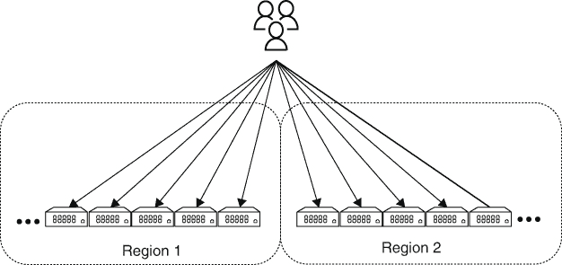

FIGURE 6-12 Legacy Operating Model

对于参考实现，我们的目标是一种简单的逐步设计，这与许多组织运营其云环境的方式非常相似。根据我们所展示的内容，您应该能够过渡到少量（可能比您开始时更少）的人类以更具可扩展性的方式管理相同或更多设备，如 `Figure 6-13` 所示。

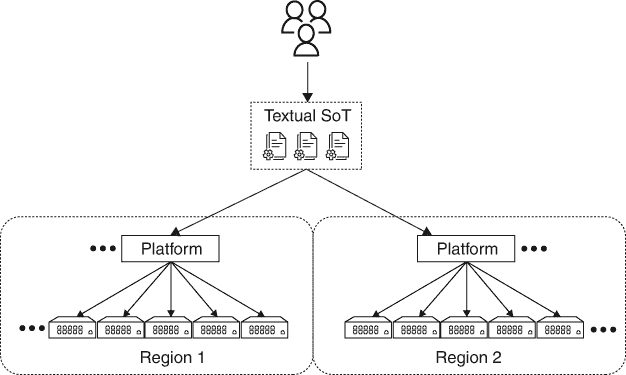

FIGURE 6-13 IaC Operating Model

但我们仍可以改进这一范式，为业务提供更多价值。当客户想要在此范式下请求服务时，我们仍然有人类操作员在循环中。这就是我们将外部数据源纳入真理源的地方。最常见的示例是像 Service Now 这样的 ITSM。例如，如果应用程序开发人员想要为新应用程序添加防火墙规则，您真的不想将人类放入该配置的循环中。我们使用 `Jinja` 处理数据文件，因此将 ACL 列表拉取并包含在这些数据文件之一中将相对容易，从而实现 `Figure 6-14` 所示的工作流。

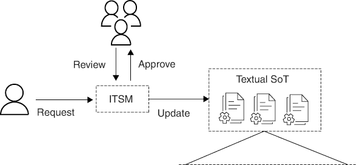

FIGURE 6-14 Integrating an ITSM into the Operating Model

在此场景中，客户通过 ITSM 请求添加 ACL，操作员审查并批准更改，然后将更改推送到网络。循环中仍然有人类，但他们更多是为了合规性而存在，而不是为了执行实际的自动化。因此，存在审计跟踪，但流程流动得更快，人为错误最少。如果用例或组织规范允许，您还可以移除人类审核员，从而实现客户请求服务到收到服务之间最快的周转时间。这就是真正的业务价值交付给您组织的地方。

## 总结

在本章中，我们将前几章中提出的原则付诸实践，并展示了一个可工作的参考实现，包含代码，您可以直接使用或作为贵组织特定实现的基础。然而，正如迈克·泰森曾经说过的，“每个人都有计划，直到被打在嘴上。” 所以，请牢记，我们的主要目的是展示一种整体方法，而非特定实现。


此实现反映了特定客户部署的情况，我们不得不演进自己的第一性原理，以满足当前行业状态和特定客户需求的要求。你无疑会面临同样的情况，可能需要对所呈现的内容进行重新排序或演进。在这种情况下，我们希望你考虑将这些改进贡献回社区仓库，以便其他人也能受益。我们希望并意图，围绕本书中提供的原则和工具形成一个社区，这样随着改进的进行，我们所有人都能受益。

在下一章，也是最后一章中，我们将从讨论模型驱动 DevOps 的技术应用转变为讨论这种重大变革所带来的文化和技能挑战。仅仅在组织中有一两个理解 DevOps 的人是不够的。要转变你的组织，你需要转变你的文化并解决技能差距。

# 第 7 章

# 人为因素

迄今为止，在本书中我们探讨了当前运营模式存在的问题，审视了为什么你应该考虑 DevOps，并详细介绍了将 DevOps 应用于网络基础设施的框架。如果在经历了所有这些之后，你确信 DevOps 是适合你组织的正确模式，你可能仍然会担心组织是否已准备好采用它。这是一个合理的担忧。回顾一下，我们将 DevOps 定义为文化、工具和流程的结合。鉴于文化是一群人的集体方式，因此要采用 DevOps 文化，你似乎自然需要解决人为因素。一位智者曾说过：“你无法改变文化；你只能改变定义你文化的行为。”然而，通过改变团队内部的行为，采用新工具、新流程和新模式，你可以改变其文化。

### 这不是魔法，而是科学

鲍勃坐在 ACME Corp 的办公室里，在最终将所有自动化组件拼凑在一起并看到结果后，他感到欣喜若狂。在自动化之旅开始时，鲍勃曾持怀疑态度。根据他以往的经验，尝试自动化网络基础设施容易出错，不值得付出努力。但现在，他不得不承认，情况不同了。API 的广泛支持、数据模型的演进以及 IaC 的使用改变了配置网络的方式，而版本控制系统和 CI/CD 管道同样改变了运营网络的方式。

最初，鲍勃的团队将努力集中在确保法规合规性上，但现在他们意识到，他们所构建的内容可以应用于几乎任何涉及网络的运营需求。有了 IaC，向网络添加新服务只需对真理源数据进行协调更新即可。需要在辛辛那提站点添加新的 VRF？使用适当的键/值对更新真理源。需要从洛杉矶数据中心到云端添加新路由？使用适当的键/值对更新真理源。不仅添加新服务变得容易，而且由于他们在变更部署周围建立了版本控制和 CI/CD 流程，他们对每个变更都是有效、经过测试并获得批准的充满信心。他和拉里现在所要做的就是坐下来，构思新的方法来利用他们所构建的内容。

海莉，ACME Corp 的首席信息官，正坐在走廊尽头的角落办公室里。她很沮丧。一方面，鲍勃和拉里构建了真正非凡的东西。他们似乎掌握了 DevOps 的力量，并能够获得将其付诸实践所需的技能。另一方面，他们是唯一理解其工作原理的人。对许多其他人来说，他们的努力看起来像魔法，这是一个问题。这是她必须解决的问题。

在 ACME Corp，在必要技能方面，鲍勃和拉里远远领先于其他所有人。海莉必须找到一种方法，让组织的其他人与他们一起前进。然而，当她询问鲍勃关于他们所构建内容的文档时，他回答说：“呃，它是基础设施即代码，是自文档化的，并且已签入版本控制。”她知道，期望没有适当技能的人阅读，更不用说使用 IaC，是行不通的。不，他们需要的不仅仅是代码本身的文档。另一方面，要求像鲍勃或拉里这样的人在 Word 文档中费力地输入文档并将其存储在文件服务器上，最好的结果是会拖慢他们的速度，最坏的结果是他们根本不会去做。

此外，海莉对团队日常工作的了解非常少。当然，她制定了高层战略方向，但她并不参与网络运营的日常工作。鲍勃和拉里正在进行的 DevOps 工作对她的转型战略至关重要。她对他们正在进行的 DevOps 工作非常感兴趣，但即使项目经理每周只收到一次更新，跟踪他们的工作也证明是极其困难的。

团队在开发 DevOps 所需的自动化方面做得不错，但海莉可以看出，这只能让他们走这么远。他们有了新的自动化工具，但他们试图用过去 20 年来使用的同一套文档和项目管理实践来管理这些工具。实现她的业务转型目标将意味着实施新的流程和工具。鲍勃和拉里已经接受了她的 DevOps 战略，因此她确信他们会适应新的流程和工具。然而，让鲍勃和拉里接受她的 DevOps 战略就已经足够具有挑战性了，那么她又如何才能让组织的其他人与他们一起踏上这段旅程呢？她知道她需要从根本上改变 ACME Corp 的文化。海莉叹了口气。她甚至不知道从哪里开始。

# 文化与变革的必要性

通往 DevOps 的旅程往往是艰难的。最好在踏上这段旅程时就知道它不会轻松，但这样做是值得的。行业转型正在发生。理解和接受它极具挑战性，但它也提供了转变你自己和你组织的机会。你必须踏上转变自身文化的道路。事先警告：任何组织的文化变革，尤其是在大型、复杂且根深蒂固的组织中，都是一段令人心碎、动摇信心、漫长而艰苦的旅程。

许多书籍都写过变革管理，大多数领导者都理解其理论。然而，当面对你的世界已被颠覆的现实时，即使你已经掌握了自己的技艺并且目前非常成功，也可能很难看出变革是必要的。挑战在于，你和你的同事在工作上非常出色；你可能已经达到了你角色的巅峰，并可能拥有重要的行业认证、奖项和荣誉。问题在于，特别是在网络行业，这些能力、这些技能以及多年积累的知识，当与当前的运营模式结合时，都不足以使现代组织保持竞争力、合规性和安全性。网络行业，以及我们这些自认为是该行业老兵的人，遗憾的是，在采用更好的做事方式方面总体上是滞后的。

## 从为什么开始


# 在这段旅程中，请牢记 Simon Sinek 的话，“从 Why 开始”！

为此，让我们退后一步。在 IT 行业整体范围内，正在发生的是数字化转型。企业、政府、非营利组织、学校和社区等，已经制定或正在制定数字化战略，并处于采纳这些战略的不同阶段。数字化转型使整个 IT 行业处于组织宗旨的核心。IT 不再是必须适应的麻烦事；事实上，它是成功定义、设计、部署和运营数字化战略的必要条件。

但是，数字化战略要求我们转变 IT 团队的构建方式、运作方式，以及 IT 系统的构建、部署和维护方式。所有这些都发生在执行这些数字化战略的业务和技术领导者的头脑中，也许更重要的是，发生在他们的内心中。任何在“云”中工作的人，在这场文化转变中都有明显的优势。为什么？因为他们从根本上将 IT 世界视为一组无处不在、可无限扩展的资源，可将这些资源结合起来以支持数字化战略。然而，我们生活在一个混合云世界中，这与主要云服务提供商希望你相信的恰恰相反。至少，始终需要连接到云，而这需要计算、存储和网络。

数字化战略与 DevOps 和网络有什么关系？简单来说，它是网络行业采纳 DevOps 转型背后的 why。要实施数字化战略，我们必须以不同的方式思考网络的设计、部署和维护。网络基础设施，比以往任何时候都更需要敏捷、可靠、安全和无处不在。IT 团队无法再像过去 20 年那样运营网络基础设施，因此，需要一种新方法。

# 组织

转向 DevOps 并推动文化变革的组织需要强有力的领导和一套新工具。以下各部分详细说明了组织领导、其榜样及其工具所需具备的条件。

# 领导力

虽然这条建议可能听起来显而易见，但组织内需要有人来领导向 DevOps 的转变。如此重大的变化不会自发发生。要改变组织的行为，你可能需要改变（或至少增加，如果你有幸能够逐步增加人员编制）组织的职能结构。要采纳 DevOps，你必须在团队中创建并填补一些目前可能不存在的新角色。如果你要领导这场文化转变，你就承担了最重要的角色之一，即创建一个清晰、引人注目且传播良好的未来愿景。创建该愿景并沿途消除障碍，是你作为领导者必须承担的两个重要角色。

当明确的愿景建立起来后，你的组织将需要合适的人来宣传、激励，并且坦率地说，在初期卷起袖子做艰苦的工作。最终，这项工作需要对组织各个层级的人进行一对一的激进化，以获得理解、信心、动力和规模。

### 榜样

不所有英雄都披着斗篷，人们常这么说。同样，我们说不所有领导者都带有经理头衔。这一点非常重要，因为单个工程师的行为改变不会仅仅因为经理试图命令式地推动这种改变而发生。团队中需要榜样。备受尊重的技术领导者对于向领导者提供建议、看到未来状态的愿景，以及激励组织内其他人采纳新的工作方式是无价之宝。在组织中找到这些拥护者，将他们安排到新角色，并给他们一个新头衔，例如基础设施 DevOps 首席架构师、DevOps 咨询解决方案架构师或 DevOps 工程师。然而，不要止步于此。将这些拥护者放在团队面前，将他们树立为榜样，在同事中认可和奖励他们，最重要的是，在他们引导你踏上这段旅程时倾听他们。倾听他们的挫折，找出阻碍他们的事物，然后尽可能快速且不留情面地移除所有此类障碍。

当然，找到这些人具有挑战性。他们拥有技术能力、远见卓识、实际动手经验以及引导他人进入未知领域所需的威信的罕见组合。他们在整个行业中需求量很大。但并非所有希望都丧失了。如果你在基础设施团队，那么你所在组织的其他部分很可能在 DevOps 之路上走得更远。深入了解组织内或行业内类似组织的 AppDev 团队。一旦你开始在正确的地方寻找，这些人可能会非常明显地出现在你面前。

最后提醒一点：不要低估或低估那些多年来在部署和维护网络方面积累经验的人。毕竟，网络是一项复杂的业务，你仍然需要懂得如何让网络运转的人。这些技能仍然急需且受到重视。如果可以，让其中一些队友加入这场转型之旅，将会非常有益。花些额外时间关心这个特定群体。就像不可思议的网络知识本身无法将你推向未来一样，忽视继续成长和发展这些网络知识的需求，同时学习通过新范式应用它们，也无法将你推向未来。

### 构建团队

在考虑这个新组织时，还有两个额外因素需要考虑。除了领导力，你还需要人来完成工作。如果你选对了拥护者，他们将在需要完成的工作中做出重大贡献；然而，一个关键且常被忽视的角色是有人来管理你对组织造成的所有混乱。在适当的“敏捷流程”中，有许多明确定义的角色，例如产品负责人、产品经理、Scrum 主管和发布工程负责人。为了改变行为以改变文化，你越快找到某人来帮助促进所有至关重要的（且不被充分重视的）协调、文档、问责制以及一路上急需的心理疏导，你就越有可能成功。

最后，不要低估你自己团队中已有的创造力、经验和知识。在每个组织中，潜在能力往往被浪费，仅仅是因为该能力不适用于某人的当前任务。不要让这些能力被浪费。有了新模型和一些用于可见性、协调和问责制的好工具，你可以轻松提高生产力并增加团队的专业满意度。为了更清楚地说明这一点，你肯定在现有团队中有人对这些新领域具有一定的知识和技能。他们的日常工作不是做 DevOps 相关的事情，但为什么不给他们一个机会参与进来，作为时间允许的伸展目标或学习任务，在他们当前日常任务之外找时间呢？我们所有人在工作中都有一些时间用于发展、成长或浪费。为什么不在团队中为这段时间提供一个有用的出口呢？

### 打破部门墙


# 通过一些新角色、一些新晋或提升的冠军，或许再增加一两个成员，应用 DevOps 团队即可开始采用新的组织模式

你很少有机会从根本上改变一个组织，而这次转型提供了这样的机会。充分利用它。考虑当前组织内部孤岛的设置方式并将其打破。找出流程或人员中的瓶颈，并找到消除这些障碍的方法。

# 社区

我们发现，社区驱动的方法（如许多开源项目的运作方式）具有巨大的力量。在社区中，全职和兼职贡献者通过某种总体目标进行协调，并伴有非常强大的协调和问责机制。这样的社区需要有意地采用和记录核心价值观，以定义社区所相信的内容及其运作方式。

例如，本书的作者属于一个名为 `CIDR` 的社区。`CIDR` 社区专注于基础设施 DevOps，并在其名称中体现了其核心价值观：社区、诚信、颠覆和相关性。这个社区有一个宏大的目标，即在网络行业内创建一个强大且活跃的网络基础设施 DevOps 群体。它由部署在思科、思科合作伙伴生态系统及其客户处的全职和兼职 DevOps 人员组成。作为一个社区运作意味着，问题和机会是协作处理的，目的是为了所有参与者的共同利益。

即使没有这样一个宏大的目标，在你自己的团队中，社区方法也很有力量。它提供了一个地方，以便就问题达成共同理解，并通过文档和代码共享最佳实践和解决方案。它也是针对先前描述的潜在能力的完美场所。毕竟，还有什么比释放潜在能力更好的方式呢？还有什么比将这种能力应用于社区的颠覆性和相关性问题更好的用途呢？

## 新工具

迄今为止，我们已经描述了为什么我们如此坚信这种转型，并解释了支持它所需的一些角色和人员。然而，仅仅改变行为不足以实现转型。你还需要采用一些新工具。

你必须能够记录项目，以便整个社区了解其愿景和目的。记录愿景、角色、流程和负责人，是向社区展示的一件强大的事情。你还必须将项目分解为在合理时间内可处理的工作量；让某人或某个团队负责该工作；并有一种方式来传达状态、障碍、同行评审和验收标准。最后，如果你要生成代码，你需要一种方式来管理源代码，并在社区内外共享完成的代码。这三个组件共同构成了组织级别所需的 DevOps 工具集。它们以互补的方式协同工作，以记录、执行和维护你的基础设施。

# 文档工具

大多数人都同意，文档是 IT 组织的生命线，但它往往不完整、过时，或者完全缺失。造成这种情况的一些原因是，文档通常是：

* 使用完全手动的流程完成
* 耗时，并且为了尽快完成事情而常常被跳过
* 使用不与 DevOps 工具集其余部分集成的过时工具创建
* 使用过时的方法存储

此外，许多 DevOps 团队在方程式的 Dev 方面花费了相当多的时间。我们直面现实吧：编写代码来解决问题是有趣的部分。通常，被困于该代码的维护工作并不光鲜，但坦率地说，这是 DevOps 的好处之一。显而易见，开发和操作代码的人会开发出更好的代码，因此他们更容易操作该代码。没有人喜欢在周六凌晨 2 点被叫醒，因为某个东西坏了。行业中一个很好的进展是，现在被叫醒的人很可能是最初创建 bug 的人！

话虽如此，最不光鲜的事情莫过于记录代码。不要让自己或你的团队陷入在没有适当的前期文档的情况下生产代码的陷阱。了解需求、验收标准、编写代码的原因、代码将如何开发、共享和维护，以及谁负责。许多人嘲笑前期需求文档的想法，借口是要敏捷。但是，敏捷开发并不免除与产品负责人、产品经理以及开发、测试和支持该产品的工程团队进行适当文档记录的需求。例如，没有适当的文档，你怎么可能知道自己是否达到了最小可行产品（`MVP`）呢？

采用 DevOps 意味着以不同的方式对待文档。首先，使用源自单一事实来源的 `IaC` 配置基础设施意味着，从许多方面来说，我们的基础设施是自我文档化的。并且，对于人类可读的 `IaC` 不足的情况，使用结构化数据（`YAML`、`JSON`、`JSON Schema` 等）意味着可以使用自动化构建面向人类的文档。其次，当自动化不可能时，现代文档工具可以简化文档创建过程，专注于团队协作，并轻松与其他 DevOps 工具集成。

#### 自动化文档

请记住，`IaC` 中的“代码”通常旨在以人类和机器都可读的格式编写，例如 `YAML`、`JSON` 或 `JSON Schema`。如果是这种情况，并且你的 `IaC` 存储在版本控制中，那么你的基础设施文档就在那里，任何人都可以在版本控制系统中查看。在许多情况下，这足以作为基础设施的文档。

但是，对于那些需要传统仅限人类的文档或报告的情况，`IaC` 使我们能够从结构化数据自动生成文档。一些常见示例包括：

* `docstrings`：Python 工具，用于直接从代码生成文档
* `Jinja2`：模板工具，可帮助从代码生成文档
* `JSON Schema-based generators`：从 `JSON Schema` 自动生成文档

# 平台

尽管我们希望自动化一切，但一些文档始终会手动完成。项目文档、入门指南、研究撰写和操作指南在 DevOps 模型中都是常见的需求。简而言之，这些文档是人们协作的方式。在过去几年中，基于团队的文档平台，如 `Confluence`、`SharePoint` 或开源的 `DocWiki`，极大地简化了手动创建文档的过程，并将该文档与其他工具（包括项目管理工具和版本控制系统）集成。

这些平台已摆脱了文件共享上的文档方法，采用基于平台或 SaaS 的方法，具有以下特征：

* 通过 WebUI 实时编辑文档
* 在文档和平台之间轻松链接（例如链接到问题跟踪和项目任务跟踪）
* 对整个平台进行广泛的搜索功能
* 变更通知
* 广泛的 API 支持
* 标记（人员、项目或群组）

综合起来，这些功能提供了一项关键能力，有助于减轻你的团队、你的 DevOps 社区，以及最终你的整个组织的文档负担。

# 项目管理工具


# 项目执行与敏捷开发

Now that you are properly documenting your projects, you need to execute on those projects. Project execution in the agile model, as with many things, often looks different from projects managed with a traditional planning process and resulting Gantt chart. Therefore, different tools are needed.

We recommend the adoption of an iterative approach to developing enterprise automation, rather than the more traditional infrequent and very large rollout of technology and services. This approach would establish a set of projects, or epics, each of which would have a set of prioritized `backlog` tasks that are deemed critical to the success of the project. Backlog tasks would be arranged in such a way that they are prioritized in order of delivering value early and often. Then work would be managed in a series of regular `sprints` (usually two or three weeks, not months) where the current highest priority backlog tasks are completed first. The backlog is a fluid thing. New tasks will come and go, and tasks can (and often will) have their priority adjusted. This process is known as `backlog grooming`.

Some common tools that support this kind of work include

*   `Jira`: Flexible tool for tracking epics, projects, issues, and backlogs

*   `Kanban`: Methodology built into many tools that focuses on work efficiency and visualization of work in progress

*   `Trello`: Easy-to-consume SaaS app for managing sprints

Figure 7-1 shows a sample Kanban board presenting tasks in a sprint at various stages of completion.

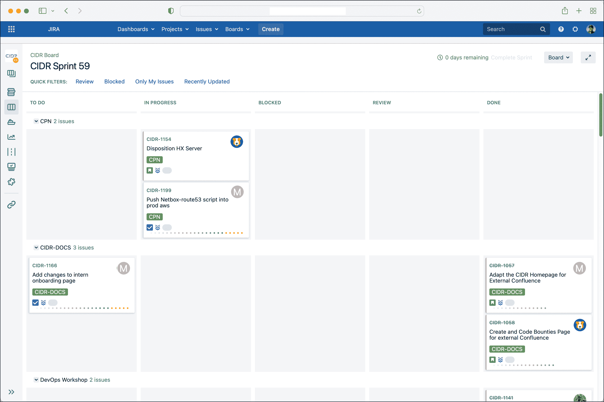

FIGURE 7-1 Example Kanban Board

It is important to understand that the agile method is not any one tool or process, but more a set of principles for managing work that can manifest themselves in any number of ways. The way in which your teams choose to self-organize and manage their work should be guided by the agile principles, but the actual workflow can take many forms and should be informed by your specific needs. The project management tools and processes outlined in this section are extremely flexible and can be adapted to virtually any workflow.

# 版本控制工具

The critical role that source code manager (SCM) systems play in DevOps has been reinforced throughout this book. An effective SCM is a critical requirement to track, test, and deploy IaC, but it should also integrate into our documentation and project management capability so that we can manage the complete lifecycle of work, from planning to execution to monitoring. The following are some examples of what this integration might look like:

*   Issues tracked in version control can be linked to work specified in project management.

*   Completed pull requests can automatically close out tasks in project management.

*   Commits can be automatically tracked in project management.

Essentially, these integrations eliminate many of the burdensome tasks of keeping information up to date across multiple tools, improve efficiency, and free up team members to get more work done.

## 组织层面变更总结

To change behaviors, and therefore change culture, you must accept the fact that things need to change organizationally. If you are a leader:

*   Accept your role as a leader.

*   Document and communicate the vision.

*   Promote or recruit the champions and role models you’ll need in your organization.

*   Understand the critical role that someone must play to align, coordinate, and document everything.

*   Tap into the latent capability within your own organization.

*   Put in place the tools that teams will need to succeed in the new model.

If you are an individual, understand that your leadership is undertaking a difficult transition, but that the result is worth the disruption. If you have the skills or the desire, raise your hand and help lead this exciting transformation.

# 个人层面

Just as the organization needs to evolve, so does the individual. Traditional network engineering is a highly specialized skillset requiring:

*   Knowledge of Layer 1 physical network design constraints

*   Knowledge of many industry-standard data plane and control plane protocols

*   Knowledge of many different CLI and Web UI interfaces

*   Ability to apply this knowledge to the design, maintenance, and troubleshooting of large, complex network topologies in high-pressure situations

As it happens, most of these skills are still required even when adopting a DevOps model. Designing networks will always involve understanding desired goals, the constraints imposed by the physical network, and the protocols in use. And, although machine learning will evolve to assist humans with troubleshooting, knowledge of data and control plane protocols will still be required when (not if) those systems fail.

The one skill most at risk in the new model is CLI knowledge. It might still be required in isolated troubleshooting scenarios, but, in most cases, humans typing at the CLI will be supplanted by automated workflows using APIs as the primary way that changes are made to infrastructure devices. That said, it is the contention of this book that not every network engineer or operator needs to be a software developer capable of programming to APIs. Those skills will certainly be needed, but many people will thrive in the DevOps model by augmenting their current network skills with the proper DevOps vocabulary, ability to learn the new tools, and knowledge of common data formats such as JSON and YAML. With that in mind, let’s explore some of the skills that will be needed.

# 编程与自动化

It is worth digging into the difference between programming and automation to better understand why not all engineers will need to be programmers. Programming and automation are often thought of as synonymous, but they are not. Programming (or “coding”) is generally understood to be writing code in a structured programming language according to the (usually fairly strict) syntax rules of the particular language (for example, Go, Python, Java, and C). Programming languages are extremely powerful and flexible. Just about anything that can be done on a computer can be done in one of these languages; however, that power and flexibility come at a cost. Some disadvantages of programming languages are that they

*   Require a significant investment in time to learn the proper syntax

*   Are more difficult to read, particularly for those who are not familiar with the syntax

*   Can take a significant effort to accomplish seemingly simple tasks

Automation tooling, at least in the IT infrastructure space, is generally designed to make common tasks easier by hiding some of the complexity. Using Ansible as an example, many common tasks related to automating IT infrastructure are available in the form of Ansible “modules.” Assembling a series of tasks into a playbook using Ansible modules is significantly less effort than trying to accomplish the same set of tasks in Python. Yes, programming is required to write the modules or packages that hide that complexity; however, if it takes you 5 minutes to write a playbook to accomplish a particular task and 30 minutes to write the Python code, use Ansible or some other high-level workflow tool. Some advantages of automation workflow tools are that they

*   Can make complex tasks easy

*   Are generally easier to read for those without programming skills

*   Cover many of the most common tasks that you will encounter


通常，最好使用自动化工具，直到编写编程语言中的逻辑更容易为止。这种方法并不少见。但是，同样，如果 90% 的任务可以使用自动化工具完成，而只有 10% 需要使用编程语言，那么请对 90% 的任务使用自动化工具，并为剩余的 10% 编写代码。在 Ansible 中，使用这种技术意味着使用 Python 为需要它的 10% 编写模块或多个模块。此外，一个不错的副作用是，你可以将模块贡献回社区，以便其他人可以从你的工作中受益。

# 版本控制工具

请记住，我们之所以想要采用 IaC，是因为源代码管理工具的强大功能和能力。它们使你能够了解基础设施变更的什么、为什么、谁和何时，并且它们还提供触发器，在某些情况下，还提供驱动自动化 CI/CD 管道所需的资源。这些核心功能使它们处于操作模型的中心，因此，操作员和工程师具备足够的技能来在 SCM 中导航至关重要。他们需要能够克隆仓库、创建分支、编辑文件、提交更改以及创建拉取/合并请求。使用 IaC 时最常见的工作流之一是克隆仓库、编辑存储在 YAML 或 JSON 中的某些源数据、提交该更改，并创建拉取/合并请求以启动 CI/CD 和审批流程。

以这种方式工作并不是编写代码，甚至不是编写自动化，尽管它确实使用了一些程序员可能会使用的相同工具。要对 IaC 进行更改，精通 SCM 很重要，同样重要的是能够读取、解释和修改常见的数据格式。

# 数据格式

在本书中，我们花了大量时间讨论结构化数据的重要性以及最常见、最易于人类阅读的两种数据格式：YAML 和 JSON。如果我们假设你将基础设施视为代码，你的源数据是指定在 YAML 或 JSON 中的一组结构化数据，并存储在版本控制中，那么对基础设施进行更改仅仅意味着更改版本控制中的结构化数据。这对典型的操作员或工程师意味着什么？这意味着他们需要能够解释和修改 YAML 或 JSON 格式中的结构化数据。幸运的是，这些格式的设计初衷就是易于人类阅读。随着我们采用 IaC，任何操作员或工程师的第一项也是最重要的生存技能就是他们需要能够读取和修改 YAML 和 JSON。在掌握这些数据格式后，理解 API 将变得容易得多。

#### API

如前几章所述，IaC 的先决条件之一是摆脱人类使用 CLI 在键盘上输入，转而使用 API。即使有自动化工作流工具可以让你在不了解 API 的情况下完成 90% 的 IaC 所需工作，但总会有那 10% 需要你具备读取 API 文档、组装适当的输入数据（通常是 JSON）以及在 Ansible、Python 等工具中发出 API 调用的技能。

学习 API 的一个选项是使用设备或平台的内置 API 探索器（如果有的话）。这些探索器通常是 HTML 页面，使你能够查看所有可用的 API 调用及其所需的输入数据，针对运行中的系统发出 API 调用，并检查返回的数据。

开始使用 API 的另一种好方法是使用 Postman（参见 图 7-2）。Postman 是一种工具，可让你测试 API 调用并构建一组 API 调用及其关联的输入数据。然后，当你的 API 和输入数据正常工作时，你可以将这些 API 调用导出为任意数量的格式，以便过渡到代码。

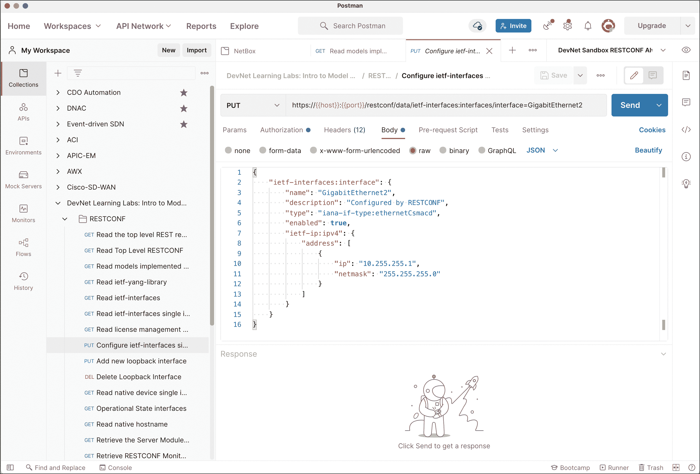

FIGURE 7-2 Postman API Tool

#### 模板

当你具备组装所需输入数据并发出 API 调用的技能后，你会发现接下来想要做的事情是将该输入数据模板化，以便你可以用变量替换某些值，或者在定义了某些值时有条件地包含某些值。

考虑在 IOS-XR 中添加静态路由的 JSON 输入数据，如 清单 7-1 所示。

LISTING 7-1 Adding a Static Route in IOS-XR

Click here to view code image

```
{
  "Cisco-IOS-XR-ip-static-cfg:vrf-prefix": [
    {
      "prefix": "9.9.9.9",
      "prefix-length": 32,
      "vrf-route": {
        "vrf-next-hops": {
          "interface-name": [
            {
              "interface-name": "Null0",
              "tag": 123
            }
          ]
        }
      }
    }
  ]
}
```

使用 Jinja2 中可用的逻辑，我们可以将其转换为模板，该模板将根据传递到模板中的变量扩展为任意数量的静态路由，如 清单 7-2 所示。

LISTING 7-2 Templating a Static Route Addition

Click here to view code image

```
{
  "Cisco-IOS-XR-ip-static-cfg:vrf-prefix": [

    {
      "prefix": 
      "prefix-length": ,
      "vrf-route": {
        "vrf-next-hops": {
          "interface-name": [
            {
              "interface-name": ,
              "tag": 
            }
          ]
        }
      }
    },

  ]
}
```

请注意，数据结构保持不变；我们只是遍历传入的路由对象列表（``）并替换所需值的变量（``、`` 等等）。

前面只是 Jinja2 中可用逻辑的一个示例；它支持各种循环、测试和过滤器。此外，大多数工作流工具和编程语言都支持使用 Jinja 模板，因此生成此类模板的工作可以在自动化工具集中重复使用。能够读取、修改和创建 Jinja 或其他模板将是工程师未来的关键技能。

# Linux/UNIX

为基础设施采用 DevOps 及其随附的所有工具意味着至少需要 `some` Linux/UNIX 技能才能生存。至少，你需要能够在典型的 UNIX shell（如 `bash` 或 `tcsh`）中导航。以下是你在自动化基础设施时会遇到 UNIX 的一些示例：

*   Linux 容器用于 CI/CD 构建/测试阶段。

*   Linux 容器在现代网络操作系统中得到广泛支持。

*   许多网络操作系统提供对 UNIX shell 的访问，用于在设备上进行 Python 脚本编写，等等。

*   Ansible 仅在基于 UNIX 的平台上运行。

*   现代云堆栈的大部分构建在 UNIX 之上。

有更多理由花时间了解 UNIX 操作系统的基础知识以及如何导航目录结构、更改文件权限、编辑文件、设置环境变量、运行可执行文件和创建简单的 shell 脚本。在 DevOps 中，你通常会发现自己只能使用 UNIX shell 对数据或代码进行更改，而无需使用你花哨的 GUI 文本编辑器。

#### 等等！我适合在哪里？

面对如此重大的颠覆，自然会对它对你的影响感到一些焦虑。当我们与许多组织中的人讨论 IaC、自动化和 DevOps 等概念时，不乏遇到怀疑它是否可行、担心会失去工作，以及彻底否认颠覆正在发生的情况。让我们逐一解决这些问题。


记住，即使是 ACME Corp 的 Bob 也曾怀疑 DevOps 的文化、工具和流程是否能应用于网络基础设施。Bob 之前的自动化经验让他觉得这太困难了，所需的时间和精力不值得。然而，网络行业对 API 和自动化等事物的零散和半心半意的支持已成为过去。当你将 API 支持与 IaC 的概念以及 DevOps 工具和流程的已证明价值相结合时，很难争辩说基础设施自动化无法实现。本书很大程度上是为了证明，事实上它 `can` 可以实现，同时也为你提供一个可供参考的实现，你可以根据自己的需求进行扩展。

即使我们成功说服你 DevOps 可以成功应用于基础设施，你可能仍在想这对你的工作意味着什么。难道所有这些自动化就不需要你的技能了吗？尽管过去 30 年 IT 领域发生了巨大变化，但我们管理以太网/IP 网络的方式在此期间并没有发生剧烈变化。这意味着许多网络工程师和运维人员可以学习其网络的 CLI，并且在数十年内基本保持不变。逐台设备的 CLI 网络管理方法确实正在改变。然而，请记住，物理网络、L2、L3、网络设计约束和故障排除技能的知识在未来仍然 `still` 是必需的。设计和故障排除的需求不会消失。在模型驱动的 DevOps 中，我们对事实来源进行更改以影响网络。从这个角度来看，需要做出的转变是从使用 CLI 特定语法转向在 JSON 或 YAML 中使用结构化数据。正如本书所阐述的，结构化数据并非魔法。对大多数人来说，读取和修改它实际上相当容易。是的，随着自动化接管一些更琐碎的任务，你的工作内容可能会发生一些变化，但网络工程师和运维人员仍然会被需要，正如 ACME Corp 的 Bob 所发现的那样，这种变化实际上可能对工作满意度有好处。

最后，还有人彻底否认我们管理网络的方式正在发生任何变化。这是谈论 VoIP 及其 20 年前在企业电信领域造成的颠覆的好地方。VoIP 相对于传统 TDM 系统有很多优势，但也面临一些需要克服的挑战，正是这些挑战导致了 TDM 领域工作人员的大量否认。然而，网络供应商对克服这些挑战的不懈关注最终导致 VoIP 在企业领域完全取代了 TDM。值得注意的是，TDM 工程师和运维人员确实完成了向 VoIP 的过渡，许多人甚至转向了网络工程，因为可靠的网络成为可靠电话服务的关键。否认不是应对颠覆的成功策略。

简而言之，拥抱变化。学习一些新技能，在这个颠覆时期蓬勃发展。对于愿意学习几项新技能的人来说，将会有很多、很多机会。

## 摘要

尽管本书大部分内容都致力于实现基础设施 DevOps 的技术方面，但在本章中，你探索了在组织中实施 DevOps 的人性方面。你了解到

* 改变文化，你需要改变行为。

* 需要强有力的领导来打破孤岛并消除障碍。

* 新流程需要新工具。

* 个人需要学习一些新技能才能在新模式中蓬勃发展。

颠覆为领导者和个人转变自己及其组织提供了巨大的机会。不要让机会从你身边溜走！

# 索引

## A

access control

ACLs (access control lists), 46

Git/GitHub, 84

ACLs (access control lists), 46

Add a Token command (NetBox API Tokens menu), 61

adoption of DevOps. `See` DevOps adoption

agile method, 157–158

agility, lack of, 8

Ansible, 9, 33, 51–52

combine filter, 126–127

in DevOps reference implementation, 128–130

check role, 129–130

data role, 128–129

validate role, 129

hostname configuration, 33–36

inventory system, 54–55, 123–124

modules, 33–36, 96–97

cli_config, 33–34

ios_config, 33–36

NetBox Ansible dynamic inventory plug-in, 60–65

ansible-inventory --graph, 123

ansible-lint, 98

API Tokens menu (NetBox), Add a Token command, 61

APIs (application programming interfaces), 97

advantages of, 33–37

CLI (command-line interface) versus, 33–37

definition of, 32–37

feature normalization and, 38–39

importance of, 32

inconsistency of, 21

NETCONF protocol for, 32, 49, 50, 75

northbound vs. southbound, 38

required skills in, 161

applications

infrastructure versus, 79

network as an application, 117–119

architecture, in DevOps reference implementation, 117, 119

ASNs (autonomous system numbers), 47

automation

APIs (application programming interfaces), 32–37, 97

advantages of, 33–37

CLI (command-line interface) versus, 33–37

definition of, 32–37

feature normalization and, 38–39

importance of, 32

inconsistency of, 21

NETCONF protocol for, 32, 49, 50, 75

northbound vs. southbound, 38

required skills in, 161

automated testing, lack of, 7

automation-at-scale, 10

benefits of, 9, 17–18

business transformation from, 18–19

in DevOps reference implementation, 121

automation runner, 131–134

automation tooling, 128–130

example of, 121

topology deployment exercise for, 121

of documentation, 156

focus on, 20


“green field” 方法，117

编程与，160

降低复杂性，30–32

测试，19

自治系统编号（ASNs），47

AWS，52，90

Azure，90

## B

backlog grooming，157

backlog tasks，157

带宽测试，103–104

BGP (边界网关协议) 配置，22–23，47–48

瓶颈，识别，17–18

分支，源代码管理，82–83

限制 DevOps 采用的业务因素

对 DevOps 理解不足，12

短期思维，12

业务风险，企业 IT 作为来源

案例研究，3–6

原因，2–3，6–8

业务转型，目标，17，18–19

## C

案例研究

CI/CD (持续集成/持续部署)，74–78

可消费基础设施，30–32

DevOps 实施，112–114

人为因素，150–151

风险，企业 IT 作为来源，3–6

事实来源，16

CD (持续部署)，45，107–109。*另请参见* `CI/CD (continuous integration/continuous deployment)`

变更管理，150–165

案例研究，150–151

变更日志，82

文化与变革需求，151–152

个人技能要求，159–164

APIs (应用程序编程接口)，161

数据格式，9，161

Linux/UNIX，164

克服对变革的抵制，164–165

编程与自动化，160

模板化，162–163

版本控制，161

变革动机，152

组织级变革

社区，154–155

领导力，153

榜样，153–154

打破孤岛，154

团队建设，154

工具，155–158

文档工具，155–157

需求，155

项目管理工具，157–158

版本控制工具，158，161

check 角色，在 DevOps 参考实现中，129–130

`check_sync`，141

CI/CD (持续集成/持续部署)，45。*另请参见* `implementation`

应用与基础设施，79

案例研究，74–78

持续部署，45，107–109

持续集成工具，86–90

CI 引擎，86–87

概述，86

示例工作流，88–90

源代码管理器工作流，87–88

持续监控，109

定义，9

Git/GitHub 服务，85

基础设施模拟工具

优势，90–91

CML (Cisco Modeling Labs)，90–97

操作顺序，80–81

概述，78–79

源代码管理，81

优势，81，86

分支，82–83

变更日志，82

Git/GitHub，83–85

版本控制，82

测试与验证，97–107

功能测试，102–107

目标，107

`iperf`，103

linting，98–99

`ping`，102

架构/模型验证，99–102

测试驱动开发，87

`traceroute`，103，104–107

TRex，104

CIDR 社区，155

Cisco IOS 设备

BGP (边界网关协议) 配置，47–48

主机名配置，33–36

推送数据，140–141

Cisco Modeling Labs。*另请参见* `CML (Cisco Modeling Labs)`

Cisco 网络服务编排器 (NSO)，135–136

Cisco PyATS，102，103，104，142，145

`cisco.nso.nso_config module`，141

`ciscops.mdd.check role`，129–130

`ciscops.mdd.data role`，128–129

`ciscops.mdd.data_validation module`，139

`ciscops.mdd.validate role`，129

CLI (命令行界面)

APIs (应用程序编程接口) 与，33–37

维护与，3–6

所需技能，159–160

`cli_config module`，33–34

CloudFormation，52，147

CMDB (配置管理数据库)，60

CML (Cisco Modeling Labs)，10，91–97

部署选项，92

IaC (基础设施即代码) 工具，94–97

Ansible 模块，96–97

APIs (应用程序编程接口)，97

YAML 模拟文件，94–96

概述，91–92

规模考量，92

用户界面，92–94


VNFs (virtual network functions), 91, 94

code, infrastructure as. *See* IaC (infrastructure as code)

collaboration features, Git/GitHub, 83–85

access control, 84

CI services, 85

forks, 85

issue tracking, 84–85

public versus private repositories, 84

pull requests, 85

combine filter (Ansible), 126–127

community-driven approach, to DevOps adoption, 154–155

compliance, attitudes toward, 42–44

concurrency directive, 134

configuration, 50–51. *See also* implementation

BGP (Border Gateway Protocol), 47–48

hostnames, on Cisco IOS devices, 33–36

NTP (Network Time Protocol) servers, 33–36, 123

configuration management database (CMDB), 60

Confluence, 156–157

consistency, in DevOps reference implementation, 119

consolidated control points, 37–38

constraints, theory of, 17

constraints-based IT, 17–18

consumable infrastructure

APIs (application programming interfaces), 32–37, 97

advantages of, 33–37

CLI (command-line interface) versus, 33–37

definition of, 32–37

feature normalization and, 38–39

importance of, 32

inconsistency of, 21

NETCONF protocol for, 32, 49, 50, 75

northbound vs. southbound, 38

required skills in, 161

case study of, 30–32

complexity of automation reduced by, 30–32

definition of, 30

continuous deployment. *See* CD (continuous deployment)

continuous integration tools, 86–90

CI engines, 86–87

overview of, 86

sample workflow for, 88–90

source code manager workflow with, 86–87

continuous integration/continuous deployment. *See* CI/CD (continuous integration/continuous deployment)

continuous monitoring, 109

CRUD (create, retrieve, update, delete) process, 20

culture, need for change in, 151–152

## D

data directory, in DevOps reference implementation, 130–131

data flow

in DevOps reference implementation, 122–123

source of truth and, 65–71

data formats. *See* encoding formats

data models, 22–25, 46–51

benefits of, 46–48

data model description languages, 50–51

JSON Schema, 51

YANG (Yet Another Next Generation), 47–48, 50–51

encoding formats, 46–48, 161

HCL, 9

JSON, 9, 48–49, 156, 161

XML, 32, 49–50

YAML, 9, 49, 156, 161

OpenConfig, 24–25

schema/model validation, 99–102

standard models, 23

textual configuration versus, 22–23

data role, in DevOps reference implementation, 128–129

data validation. *See* validation

database source of truth (SoT), 60–65

description of, 60

NetBox

showing hostvars from, 66–67

store and retrieve information from, 60–65

translating data into OpenConfig, 68–71

store and retrieve information from, 60–65

Datadog, 109

Day 0 provisioning, 37

“Deploying the Topology” exercise, 121

deployment, 92, 146

description languages, 50–51

JSON Schema, 51

YANG (Yet Another Next Generation), 47–48, 50–51

devices

BGP (Border Gateway Protocol) configuration on, 47–48

hostname configuration on, 33–36

pushing data to, 140–141

DevOps, definition of, 8

DevOps adoption, 42–44. *See also* implementation

apps versus infrastructure in, 10

attitudes toward compliance in, 42–44

automation

APIs (application programming interfaces), 32–37

automation-at-scale, 10

benefits of, 9, 17–18

business transformation from, 18–19

DevOps in action, 20

of documentation, 156

“green field” approach to, 117

programming versus, 160

of testing, 19

benefits of, 8, 21

business transformation from, 17, 18–19

case study of, 14–17

community-driven approach to, 154–155

constraints-based IT, 17–18

consumable infrastructure in. *See* consumable infrastructure

data models, 22–25, 46–51

benefits of, 46–48


# 数据模型描述语言
50–51

# 编码格式
32, 46–48

# OpenConfig
24–25

# 标准模型
23

# 文本配置与
22–23

# 定义
22

# DevSecOps
27–28

# 限制因素
10–12

# 惯性
11

# 对 DevOps 的理解不足
12

# 风险规避
12

# 短期思维
12

# 技能差距
11

# 框架
26–27

# 目标
17

# 人为因素
150–165

# 案例研究
150–151

# 社区
154–155

# 文化与变革的必要性
151–152

# 个人技能
159–164

# 惯性
11

# 领导力
153

# 变革动机与
152

# 风险规避
12

# 典范
153–154

# 孤岛，打破
154

# 技能差距
11

# 团队建设
154

# 基础设施即代码
*See* `IaC (infrastructure as code)`

# IT 英雄
14–17

# 变革动机
152

# 网络基础设施与
21

# 平台
37–40

# 集中控制点
37–38

# 定义
37

# 文档
156–157

# 交换机级服务
39

# 功能标准化与
38–39

# 北向与南向 API
38

# 物理硬件配置
37

# 可扩展性
40

# 安全性
27–28

# 事实来源 (SoT)

# 案例研究
16

# 代码与
65

# 数据流
65–71

# 数据要求
21

# 数据库
60–65

# 定义
45–46

# 期望值与实际值
122

# 在 DevOps 参考实现中
121–122, 123–128

# 重要性
24–25, 26

# 组织
52–56

# 文本
57–60

# 将数据转换为 OpenConfig
65–71

# 工具
155–158

# 文档工具
155–157

# 需求
155

# 项目管理工具
157–158

# 版本控制工具
158, 161

# DevOps 参考实现
*See* `implementation`

# DevSecOps
27–28

# Docker
79

# 文档字符串
156

# 文档工具
155–157

# 自动化
156

# 重要性
155–156

# 平台
156–157

# DocWiki
156–157

# `dry_run` 变量
141

## E

# 编码格式
46–48, 161

# HCL
9

# JSON
9, 48–49, 75, 156, 161

# XML
32, 49–50

# YAML
9, 49, 58, 75, 156, 161

# 引擎，持续集成
86–87

# 环境指令
134

# equire-console 实用程序
34–36

# 错误，人为
6–7

# EVPN (以太网虚拟专用网络)
3, 39

# “运行跑步机”练习
134

# “探索数据”练习
128

# “探索库存”练习
124

# 可扩展标记语言 (XML)
32, 49–50

## F

# 交换机级服务
39

# 功能标准化
38–39

# 分支，Git/GitHub
85

# 格式，编码
*See* `编码格式`

# 框架，DevOps
26–27

# 功能测试
102–107

# iperf
103

# ping
102

# traceroute

# 示例
104–107

# 概述
103

# TRex
104

## G

# GCP
90

# Git/GitHub
45, 51, 83–85

# 访问控制
84

# CI 服务
85

# 在 DevOps 参考实现中
131–134

# 分支
85

# 问题跟踪
84–85

# 作业
89

# 公共与私有仓库
84

# 拉取请求
85

# “绿地”自动化方法
117

## H

# HCL 格式
9

# 主机名配置，在 Cisco IOS 设备上
33–36

# 人为错误，影响
6–7

# 人为因素，在 DevOps 采用中
150–165
*See also* `工具`

# 案例研究
150–151

# 社区
154–155

# 文化与变革的必要性
151–152

# 个人技能要求
159–164

# API (应用程序编程接口)
161

# 数据格式
9, 161

# Linux/UNIX
164

# 克服对变革的抵制
164–165

# 编程与自动化
160

# 模板化
162–163

# 版本控制
161

# 惯性
11

# 领导力
153


# Index

## 动机
- 变革动机，152
- 风险规避，12
- 角色模型，153–154
- 孤岛，打破，154
- 技能差距，11
- 团队建设，154

## IaC (infrastructure as code)
- IaC (infrastructure as code)，9
  - 优点，45
  - 案例研究，42–44
  - 数据模型，22–25，46–51
    - 优点，46–48
    - 数据模型描述语言，47–48，50–51
    - 编码格式，9，32，46–49，156，161
    - OpenConfig，24–25
    - 架构/模型验证，99–102
    - 标准模型，23
    - 文本配置与，22–23
  - 事实来源 (SoT)
    - 案例研究，16
    - 代码与，65
    - 数据流，65–71
    - 数据要求，21
    - 数据库，60–65
    - 定义，45–46
    - 期望与实际，122
    - 在 DevOps 参考实现中，121–122，123–128
    - 重要性，24–25，26
    - 组织，52–56
    - 文本，57–60
    - 将数据转换为 OpenConfig，65–71
    - 工具，51–52
      - Ansible，9，33–36，51–52，96–97
      - APIs (application programming interfaces)，97
      - AWS CloudFormation，52
      - 在 CML (Cisco Modeling Labs) 中，94–97
      - Jinja2，52
      - Terraform，52
      - YAML 模拟文件，94–96
  - 实现
    - Ansible 集合用于，128–130
    - 检查角色，129–130
    - 数据角色，128–129
    - 验证角色，129
    - 架构用于，117，119
    - 自动化在，121
    - 自动化工具，128–130
    - 示例，121
    - GitHub 自动化运行器，131–134
    - 拓扑部署练习用于，121
    - 案例研究，112–114
    - 工具选择用于，114–115
    - Cisco Network Services Orchestrator (NSO)，135–136
    - 一致性在，119
    - 持续集成工作流摘要，146
    - 数据目录，130–131
    - 数据流在，122–123
    - 部署，146
    - 练习用于
      - 数据验证，140
      - 部署拓扑，121
      - 运行器练习，134
      - 探索数据，128
      - 探索库存，124
      - 推送数据，141
      - 状态检查，145
    - 完整代码用于，115
    - 目标，115–116
    - ITSM (IT Service Management) 集成，145
    - 网络即应用，117–119
    - 组织层次结构，119
    - 将数据推送到设备，140–141
    - 路线图，116
    - 规模考量，146–147
    - 模拟，119–121
    - 事实来源在，121–122，123–128
    - 启动工作流用于，147–149
    - 测试和验证，136–140
      - 数据验证，138–140
      - 代码检查，137
      - 测试网络恢复，141–145
      - 测试网络快照，137–138
      - 状态检查，141–145
  - 个人技能要求，159–164
    - APIs (application programming interfaces)，161
    - 数据格式，9，161
    - Linux/UNIX，164
    - 克服对变革的抵触，164–165
    - 编程与自动化，160
    - 模板化，162–163
    - 版本控制，161

## 基础设施
- 基础设施
  - 应用与，10，79
  - 作为代码。*参见* IaC (infrastructure as code)
  - 约束驱动 IT，17–18
  - 可消费
    - APIs (application programming interfaces)，32–37
    - 案例研究，30–32
    - 复杂性自动化减少由，30–32
    - 定义，30
    - 维护窗口用于
      - 业务中断由，3–6
      - 常见问题与，6–8
    - 作为业务风险来源
      - 案例研究，3–6
      - 原因，2–3，6–8
  - 基础设施即代码。*参见* IaC (infrastructure as code)
  - 基础设施资源建模 (IRM) 应用
    - 定义，60
    - NetBox，60–65
  - 基础设施模拟工具
    - 优点，90–91
    - CML (Cisco Modeling Labs)，91–97
    - 部署选项，92
    - IaC (infrastructure as code) 工具，94–97
    - 概述，91–92
    - 规模考量，92
    - 用户界面，92–94
    - VNF (virtual network function) 支持，94
- 惯性，DevOps 采用受限于，11


# 索引

## I

inventory system, Ansible, 54–55, 123–124

`ios_config` module, 33–36

IOS-XR, adding static route in, 162–163

iperf, 103

IRM (infrastructure resource modeling) applications

definition of, 60

NetBox, 60–65

issue tracking, Git/GitHub, 84–85

IT infrastructure. See infrastructure

ITSM (IT Service Management), 16, 60, 148

## J

JavaScript Object Notation. See JSON (JavaScript Object Notation)

Jinja2, 52, 68–71, 156

Jira, 157

jobs, GitHub, 89

jq, 98

JSON (JavaScript Object Notation), 9, 32, 48–49, 75, 156, 161

JSON Schema, 51

JSON Schema-based generators, 156

`jsonschema` package, 139

Juniper JunOS, BGP (Border Gateway Protocol) configuration on, 47–48

## K

Kanban, 157

key/value pairs, 47

Kubernetes, 46, 90, 147

## L

lab block, in YAML simulation files, 96

leadership, requirements for DevOps adoption, 153

links block, in YAML simulation files, 96

linting, 98–99, 137

Linux, required skills in, 164

logging, change, 82

## M

maintenance window, for IT infrastructure

business disruption from, 3–6

common problems with, 6–8

human error, 6–7

human speed, 7

lack of agility, 8

lack of automated testing, 7

lack of test environment, 6

self-reinforcing cycle, 7–8

maximum transition units (MTUs), 46–47

`mdd_combine`, 126–127

`mdd_data`, 126

`mdd_data_root`, 130

`mdd_device_dir`, 131

`mdd_root`, 125

`mdd_schema_root`, 131

`mdd_schemas`, 139

`mdd_tags`, 126–127

method of procedure (MOP), 2

minimum viable product (MVP), 156

models, data. See data models

modules, Ansible, 33–36, 96–97

monitoring, continuous, 109

motivation for change, 152

MTU (maximum transition units), 46–47

## N

Nagios, 109

nested virtualization, 92

NetBox

showing hostvars from, 66–67

store and retrieve information from, 60–65

translating data into OpenConfig, 68–71

`netbox-to-oc.j2` template, 68–71

NETCONF, 32, 49, 50, 75

network as an application, 117–119

network infrastructure, model-driven DevOps and, 21

network monitoring software (NMS), 109

Network Services Orchestrator (NSO), 135–136

Network Time Protocol. See NTP (Network Time Protocol) server configuration

NMS (network monitoring software), 109

nodes block, in YAML simulation files, 96

northbound APIs (application programming interfaces), 38

NSO (Network Services Orchestrator), 135–136

`nso_parse` method, 143

NTP (Network Time Protocol) server configuration, 33–36, 123

## O

OpenConfig, 24–25

organization of, 52–56

source of truth (SoT)

organization of data, 52–56

textual, 57–60

translating data into, 68–71

order of operations, CI/CD (continuous integration/continuous deployment), 80–81

organization

for DevOps reference implementation, 119

of source of truth data, 52–56

organizational-level changes

community, 154–155

leadership, 153

role models, 153–154

silos, breaking down of, 154

team building, 154

tools, 155–158

documentation, 155–157

need for, 155

project management, 157–158

version control, 158

organizations, DevOps adoption by. See DevOps adoption

## P

physical hardware provisioning, 37

ping, 102

platforms, 37–40

consolidated control points in, 37–38

definition of, 37

documentation, 156–157

fabricwide services, 39

feature normalization and, 38–39

northbound vs. southbound APIs, 38

physical hardware provisioning, 37

scalability of, 40

poor understanding of DevOps, adoption limited by, 12

Postman, 161–162

private repositories, Git/GitHub, 84

programming, automation versus, 160

project management tools, 157–158

provisioning, physical hardware, 37

public repositories, Git/GitHub, 84

pull requests

Git/GitHub, 85

triggering CI workflows with, 88–90

push requests, triggering CI workflows with, 89

pushing data to devices, 140–141

“Pushing the Data” exercise, 141


PyATS, 102, 103, 104, 142, 145

### Q-R

reference implementation. See implementation

releases, triggering CI workflows with, 89

repositories, Git/GitHub, 84

RESTCONF, 50

RESTful API, 71

restoration of test network, 146

risk

enterprise IT as source of

case study of, 3–6

causes of, 2–3, 6–8

risk aversion, DevOps adoption limited by, 12

role models, requirements for DevOps adoption, 153–154

roles, in Ansible collections

check, 129–130

data, 128–129

validate, 129

### S

SaaS (software as a service), 83

scale considerations

CML (Cisco Modeling Labs), 92

in DevOps reference implementation, 146–147

harnessing automation at scale, 10

platforms, 40

schedules, triggering CI workflows with, 89

schema/model validation, 99–102

SCM (source code management), 45, 158

benefits of, 81, 86

branches, 82–83

CD (continuous deployment) workflow, 107–109

change logging, 82

CI/CD (continuous integration/continuous deployment) and, 81

continuous integration tools and

sample workflow for, 88–90

source code manager workflow with CI, 87–88

Git/GitHub, 83–85

access control, 84

CI services, 85

forks, 85

issue tracking, 84–85

public versus private repositories in, 84

pull requests, 85

version control, 82

SDN (software-defined networking), consolidated control points in, 37–38

Secure Shell (SSH), 51

security, DevSecOps, 27–28

self-hosted directive, 133

self-reinforcing cycle, 7–8

servers, NTP (Network Time Protocol), 33–36, 123

Service Now, 148

`session_state` property, 144

SharePoint, 156–157

short-term thinking, DevOps adoption limited by, 12

show ip route command, 145

show version command, 142

show-hostvars.yml, 66–67

shutdown property, 144

silos, breaking down of, 154

simulation tools

benefits of, 90–91

CML (Cisco Modeling Labs), 91–97

deployment options, 92

IaC (infrastructure as code) tools, 94–97

overview of, 91–92

scale considerations, 92

user interface, 92–94

VNF (virtual network function) support, 94

for DevOps reference implementation, 119–121

Sinek, Simon, 152

skills gap, DevOps adoption limited by, 11

snapshotting of test networks, 137–138

software as a service (SaaS), 83

software-defined networking (SDN), consolidated control points in, 37–38

source of truth (SoT). See also data models; encoding formats

case study of, 16

code and, 65

data flow, 65–71

data requirements for, 21

database, 60–65

description of, 60

NetBox, 60–71

store and retrieve information from, 60–65

definition of, 45–46

desired versus actual, 122

in DevOps reference implementation, 121–122, 123–128

importance of, 24–25, 26

organization of, 52–56

textual, 57–60

translating data into OpenConfig, 65–71

southbound APIs (application programming interfaces), 38

Spanning Tree Protocol (STP), 76

sprints, 157

SSH (Secure Shell), 51

standard data models, 23

starting workflows, 147–149

state checking, 141–145

“State Checking” exercise, 145

static routes, 162–163

STP (Spanning Tree Protocol), 76

## T

team building, requirements for DevOps adoption, 154

templating, 68–71, 162–163

Terraform, 9, 52

test-driven development, 87

testing

automation of, 7, 19

CI/CD (continuous integration/continuous deployment), 97–107

functional testing, 102–107

goals of, 107

iperf, 103

linting, 98–99

ping, 102

schema/model validation, 99–102

test-driven development, 87

traceroute, 103, 104–107

TRex, 104

in DevOps reference implementation, 136–140

data validation, 138–140

linting, 137

restoration of test network, 146

snapshotting of test network, 137–138

state checking, 141–145

test environments, lack of, 6

textual configuration, data models versus, 22–23


# 索引

## T

- textual source of truth (SoT), 57–60
- theory of constraints, 17
- throughput testing, 103–104
- tools, 51–52, 155–158
- Ansible, 9, 33, 51–52
- hostname configuration, 33–36
- modules, 33–36
- AWS CloudFormation, 52, 147
- continuous integration, 86–90
- CI engines, 86–87
- overview of, 86
- sample workflow for, 88–90
- source code manager workflow with, 87–88
- documentation, 155–157
- automation of, 156
- importance of, 155–156
- platforms, 156–157
- infrastructure simulation
- benefits of, 90–91
- CML (Cisco Modeling Labs), 91–97
- Jinja2, 52
- need for, 155
- project management, 157–158
- Terraform, 52
- version control, 158, 161
- topology deployment exercise, 121
- ToR (top-of-rack) switches, 46–47
- traceroute
- example of, 104–107
- overview of, 103
- Trello, 157
- TRex, 104
- truth, source of
- case study of, 16
- data requirements for, 21
- importance of, 24–25, 26
- Tyson, Mike, 149

## U

- UNIX, required skills in, 164
- user interfaces, CML (Cisco Modeling Labs), 92–94

## V

- validate role, in DevOps reference implementation, 129
- validation
- CI/CD (continuous integration/continuous deployment), 97–107
- functional testing, 102–107
- goals of, 107
- iperf, 103
- linting, 98–99
- ping, 102
- schema/model validation, 99–102
- test-driven development, 87
- traceroute, 103, 104–107
- TRex, 104
- “Data Validation” exercise, 140
- in DevOps reference implementation, 136–140
- data validation, 138–140
- linting, 137
- snapshotting of test network, 137–138
- state checking, 141–145
- version control, 82, 158, 161
- Virtual Extensible LAN (VXLAN), 3
- virtual local-area networks (VLANs), 46–47
- virtual machines (VMs), 79
- virtual network functions (VNFs), 10, 91, 94
- virtualization, nested, 92
- VLANs (virtual local-area networks), 46–47
- VMs (virtual machines), 79
- VNFs (virtual network functions), 10, 91, 94
- VXLAN (Virtual Extensible LAN), 3

## W

- workbench, CML (Cisco Modeling Labs), 92–94
- workflow, source code management with continuous integration, 88–90
- workflow-dispatch, triggering CI workflows with, 89

## X

- Xlate, 24–25
- XML (Extensible Markup Language), 32, 49–50

## Y-Z

- YAML Ain’t Markup Language (YAML) format, 9, 49, 58, 75, 156, 161
- yamllint, 98, 137
- YANG (Yet Another Next Generation), 47–48, 50–51

## Code Snippets

Many titles include programming code or configuration examples. To optimize the presentation of these elements, view the eBook in single-column, landscape mode and adjust the font size to the smallest setting. In addition to presenting code and configurations in the reflowable text format, we have included images of the code that mimic the presentation found in the print book; therefore, where the reflowable format may compromise the presentation of the code listing, you will see a “Click here to view code image” link. Click the link to view the print-fidelity code image. To return to the previous page viewed, click the Back button on your device or app.

 

       

                      


              

                        

 

