# 通过 UUATAC-seq 和深度学习建模脊椎动物调控序列景观

# 图形摘要

# 作者

Xiaoping Han, Hanyu Wu, Xueyi Wang, ...,
Guoxia Wen, Danmei Jia, Guoji Guo,...

# 联系邮箱

xhan@zju.edu.cn (X.H.),
gj@zju.edu.cn (G.G.)

# 简要

利用高分辨率单核 ATAC-seq 绘制了五种脊椎动物的调控序列图谱。这一全面的数据集能够通过深度学习对脊椎动物调控序列语法进行系统的解释。

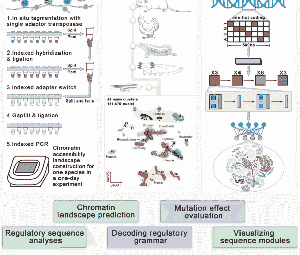

# 亮点

- 通过 UATAC-seq 高效构建染色质开放性图谱
- 使用 UATAC-seq 绘制五种脊椎动物的 cCRE 图谱
- 深度学习模型 NVAce 从基因组序列预测 cCRE 图谱
- NVAce 准确预测合成突变对 cCRE 功能的影响

Xiaoping Han,1,6 Hanyu Wang,1,5 Xueyi Wang,1,5 Daiyun Lu,1,8 Yuting Fu,1,6 Lei Yang,1,5 Renying Wang,1,8 Peiping Zhang,1,8 Jijing Wang,2,5 Lifang Ma,1 Jizhou Zhou, Lina Zhou, Siqi Wang,1 Xlinhan Zhan,1 Mengmeng Jia,1 Xinnu Wang, Guoxia Wen,2 Daijie Lu, and Guo Qi**

*1 浙江大学医学院第一附属医院骨髓移植中心与干细胞再生医学中心，杭州 310011
*2 浙江大学实验室，杭州 311121
*3 浙江省组织工程与再生医学重点实验室，孙立博士与干细胞再生医学中心，杭州 310008
*4 浙江大学血液学研究所，杭州 310006
*5 这些作者贡献相同
*6 首席内容
* 联系邮箱：xhan@zju.edu.cn (X.H.), ggji@zju.edu.cn (G.G.)

# 摘要

脊椎动物基因组的调控序列在很大程度上仍不为人知。为了解决这个问题，我们开发了一种超高通量、超敏感的单核转座酶开放染色质测序（UUATAC-seq）方案，能够在单日实验中构建染色质图谱。使用 UUATAC-seq，我们绘制了五种代表性脊椎动物的顺式调控元件（CRE）。我们的分析显示，物种间的基因组大小差异影响了 CRE 的数量而非大小。我们引入了深度学习框架 NVAce，以高精度识别调控元件并从基因组动态预测 dCRE 图谱。NVAce 表明调控语法比核苷酸序列更复杂，且序列控制不同的功能模块。此外，NVAce 利用因果性状位点（QTLs）和基因编辑结果预测了突变对谱系特异性 CRE 功能的影响。我们的研究为解码脊椎动物调控图谱提供了宝贵的资源。

# 多细胞生物中的多种细胞共享相同的基因组，但由于基因表达表现出高度特化的功能。调控序列通过以细胞特异的方式募集序列特异性转录因子（TF）决定基因表达模式。染色质开放性是调控 DNA 的主调节因子，可以通过 DNase 超敏感性测序、开放染色质测序（ATAC-seq）进行测量。尽管已有若干大规模努力使用这些测序绘制哺乳动物的全基因组调控序列，但详尽的细胞分辨率调控序列图谱仍然匮乏。单细胞技术的进步极大增强了我们研究生物系统中遗传调控的能力。基于脱落（dropout）15,16,17 或拆分池（split-pool）18 高通量单细胞测序方法能够对选定细胞群中的细胞进行大规模分析。这些新方法为基因组转录学和蛋白质组学的测量提供了新标准。瞬时 ATAC-seq 侧于谱系特异性，而单细胞染色质开放性可以捕捉控制每个细胞转录的调控图谱。目前的技术在通量和灵敏度方面面临困难。应用深度学习模型从 DNA 序列预测调节和表达信号是基因组领域的里程碑。最近，深度学习已用于预测单水平的染色质开放性和基因表达，NVAce 以单细胞分辨率实现了细胞特异性表达的图谱级预测，Huutuo 184, 533-548. 2025. 作者发表。由 Elsevier Inc. 出。这是一篇基于 CC BY（https://creativecommons.org/licenses/by/4.0）的开放获取文章。

在几乎所有细胞中在核苷酸水平上解码疾病相关的调控序列。遗憾的是，大多数细胞数据在灵敏度或通量方面存在局限性，限制了高精度模型的生成能力。基因组领域深度学习模型的优化仍面临挑战，而蛋白质结构模型已取得成功。在本研究中，我们使用了同源接头转座酶和温度控制测序，提高了 ATAC 检测的灵敏度和通量。我们利用超高通量、病毒单核 ATAC-seq（UATAC-seq）转座酶绘制了开放染色质。

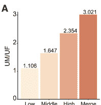
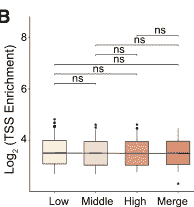
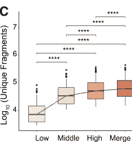
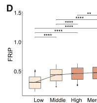
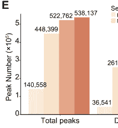
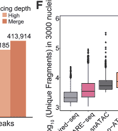
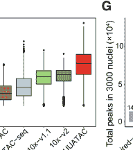
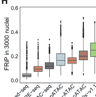
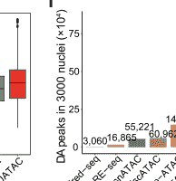
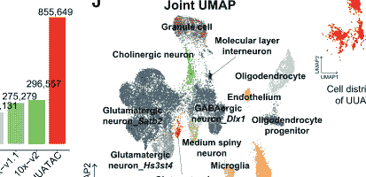

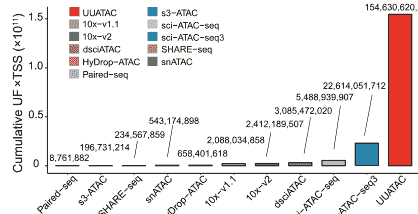

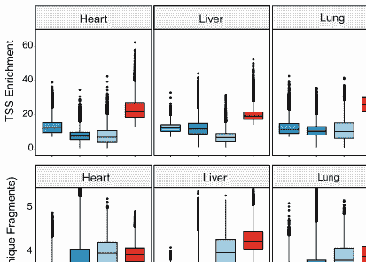

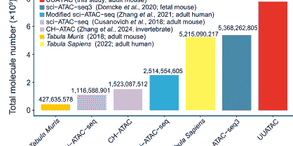

- UATAC-seq，成年小鼠
- sc-ATAC-seq (2020，胚胎小鼠)
- sc-ATAC-seq (Causovich 等人，2016，成年小鼠)
- sc-ATAC-seq (Zheng 等人，2019，成年小鼠)
- 总小鼠数据 (2018，成年小鼠)
- Tabula Seurat (2022，人类)

- UATAC（本项研究）
- 修改后的 sc-ATAC-seq (Causovich 等人，2018)
- 修改后的 sc-ATAC-seq (Zheng 等人，2021)
- sc-ATAC-seq (Domke 等人，2020)

peaks 以及差异 (DA) 峰（图 2E）得到了显著提高。中间测序深度（UM/UF=1.647）使得成本效益最大化，因为大多数片段在该深度被检测到。在正文中，大多数峰被分配到内含子上，表明许多内含子含有富集的调节元件（表 S2）。此外，我们利用双链切割事件的速率（7%）来优化了整体回收效率（STAR 方法）。总分子回收率约 25% 的比例应该是开放染色质峰覆盖的界限（图 2G）。

我们花费了 1 天时间生成超过 100 万个标记细胞的文库，并花费了 1 天对文库进行测序。在适中的测序深度下，284269 个细胞通过了单次实验的过滤。与所有方法的单批数据相比，该实验的质量非常卓越。单次 UATAC-seq 实验回收的细胞累积 UF 富集高得多（图 2H）。而言，我们认为 UATAC-seq 为大规模数据集提供了超高吞吐量和超效率。

接下来，我们将 UATAC-seq 与在小鼠脑、组织和器官上的九种其他方案进行了基准测试。UATAC-seq 在处理和测序细胞数量上优于其他方法。我们发现 UATAC-seq 显示了最高的 UF（图 2F）、最高的峰数量（图 2G）、最高的 FPR（图 2H）、最高的 DA 峰（图 2I）以及最高的重复率（表 S2）。此外，UATAC-seq 显示了高 TSS 富集（表 S2）、启动子区域最高的 reads（图 2S）以及最高的启动子率（图 2F）。通过对比测序深度，UATAC-seq 显示了最佳 TSS 分数的可及性，我们发现高 FPR 与 TSS 富集呈负相关（图 2S）。UATAC-seq 使用细胞进行染色质谱分析，对非活跃区域的 CRE 回收率更好。最后，与所有可用的 snATAC-seq 方法相比，识别出的细胞类型与小鼠模型一致（16–8）。UATAC-seq 检测到了小鼠脑中的所有细胞类型（图 2J，表 S2）。

UATAC-seq 的性能促使我们强调基因组大小与调节机制之间的关系，涵盖了包括斑鱼、蜥蜴和小鼠在内的多种基因物种。由于超吞吐量的 UATAC-seq，我们能够在单日和单批实验中为每个器官构建染色质可及性层。对于蜥蜴，雌性和样本来自三个个体；对于斑鱼，样本也来自三个个体。为了评估 UATAC-seq 在构建高吞吐量细胞景观方面的强度，我们对小鼠的所有主要组织进行了实验。

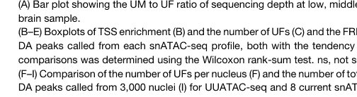

(A) 显示小鼠脑低、中、高水平可及性的 UF 状图（合并了三个水平的所有 reads）。(B) 四种不同测序深度的 UATAC-seq（UF 数量）和 FPR 图。(C) 每种 snATAC-seq 方法的峰总数和 DA 峰，与峰密度相关。随着测序深度的增加进行统计学显著性比较。(D) 1000 个细胞中每个细胞的 UF 与峰总数 (G) 以及 3000 个细胞的 FPR (H)。在 (F)，对每种方法随机采样的 3000 个细胞进行比较，以捕捉跨神经元的细胞含量。(J) UATAC-seq 小鼠脑数据与其他数据集联合。可及性层按细胞类型染色。(K) TSS 富集（顶部）和 UF 数量（底部）与来自 UATAC-seq（成年小鼠）、修改后的 sc-ATAC-seq（成年人类）和 sci-scATAC-seq（成年人类）的其他 snATAC-seq 染色质层对比。(L) 对三种方法的组织进行比较。(M) 显示人类 scRNA 和 snATAC-seq 细胞总数的状图。snATAC 的识别分子 UF 和 scRNA 的 UMI 为唯一映射片段；DA 为差异性。另见图 2。

红细胞、肝、上皮、分泌、神经、内皮、间质、生殖

22 个主要簇，181878
### B 小鼠（雄性）
39 个主要簇，291854
- 肾上腺
- 骨髓
- 脑
- 小脑
- 皮质层
- 大肠
- 肝
- 淋巴结
- 卵巢
- 胰腺
- 胎盘
- 小肠
- 脾
- 胃
- 端脑脑
- 子宫

- 膀胱
- 骨髓
- 脑
- 小脑
- 皮质层
- 肾
- 肝
- 淋巴结
- 卵巢
- 胰腺
- 脾
- 胃
- 胸腺

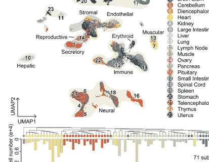
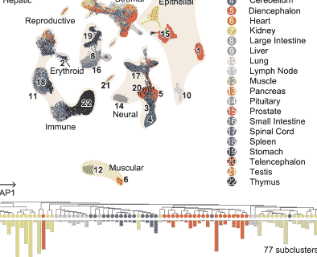

32 个主要簇，205311
30 个主要簇，154190

- 气囊
- 脑
- 脑干
- 小脑
- 十指肠
- 颗粒胃
- 心
- 肾
- 肝
- 肺
- 粘胃
- 卵巢
- 胰腺
- 脾

- 气囊
- 脑
- 脑干
- 小脑
- 十指肠
- 颗粒胃
- 心
- 肾
- 肝
- 肺
- 粘胃
- 卵巢
- 胰腺
- 脾

- 气囊
- 脑
- 脑干
- 小脑
- 十指肠
- 颗粒胃
- 心
- 肾
- 肝
- 肺
- 粘胃
- 卵巢
- 胰腺
- 脾

- 气囊
- 脑
- 脑干
- 小脑
- 十指肠
- 颗粒胃
- 心
- 肾
- 肝
- 肺
- 粘胃
- 卵巢
- 胰腺
- 脾

- 脑
- 脑干
- 小脑
- 十指肠
- 颗粒胃
- 心
- 肾
- 肝
- 肺
- 粘胃
- 卵巢
- 胰腺
- 脾

- 气囊
- 脑
- 脑干
- 小脑
- 十指肠
- 颗粒胃
- 心
- 肾
- 肝
- 肺
- 粘胃
- 卵巢
- 胰腺
- 脾

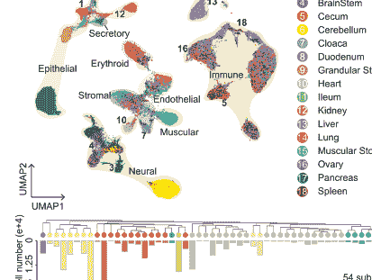
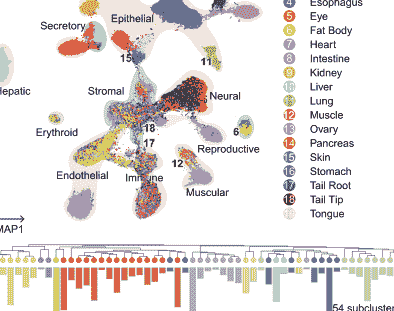

32 个主要簇，133204

- 膀胱
- 鳃
- 肠
- 肾
- 肺
- 胰腺
- 脾

- 膀胱
- 鳃
- 肠
- 肾
- 肺
- 胰腺
- 脾

- 膀胱
- 鳃
- 肠
- 肾
- 肺
- 胰腺
- 脾

- 膀胱
- 鳃
- 肠
- 肾
- 肺
- 胰腺
- 脾

- 膀胱
- 鳃
- 肠
- 肾
- 肺
- 胰腺
- 脾
- 膀胱
- 鳃
- 肠
- 肾
- 肺
- 胰腺
- 脾

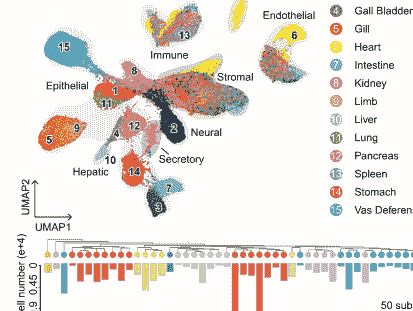
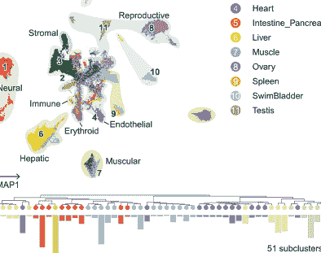

我们的 scATAC-seq 将染色质可及性归一化为500 bp 间隔，避免了调节元件的人为边界。我们的分析环-

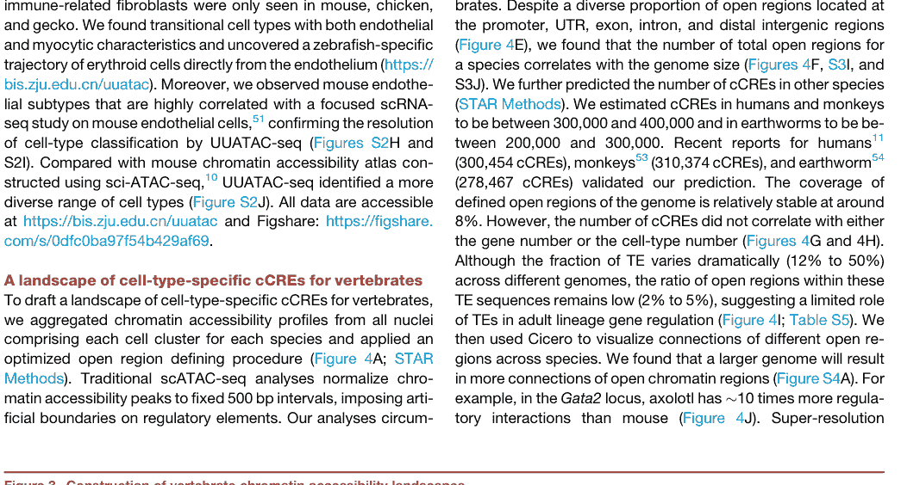

图 3. 五种物种跨岛的染色质可及性分布构建。每个点代表一个通过组织颜色识别的细胞，阴影表示谱系组。分层聚类树显示了子簇的构建。

开放访问
## A

## B
基因与 CREs
原始片段
- 过滤比对质量
- 去重
- 高质量条形码

过滤后的映射

开放区域
常规
- 从峰值向外延伸 250bp

- B 细胞
- T 细胞
- NK 细胞
- 单核细胞

oCREs 与 CTCF 的重叠
43.68%

- 已知的 CREs
- 新的 CREs

- 内皮
- 肝脏
- 神经
- 间质
- 红细胞系
- 肌肉
- 次级
- 全局

- 小鼠
- 墨西哥可能会�螈
- 斑鱼

## F
R = 1
p = 5.8e-06

基因组大小
- 墨西哥可能会�螈

R = -0.1
p = 0.87

- 墨西哥可能会�螈
- 小鼠
- 斑鱼

## 细胞性
R = -0.34
p = 0.58

- 墨西哥可能会�螈
- 小鼠
- 斑鱼

R = 0.4445
p = 0.1152

0.75
1.00
0.85
0.95
0.65
0.85

- 小鼠

- 墨西哥可能会�螈

0.5
0.6
0.7
0.8
0.9
cCREs

88.1 - 88.3
cCREs
99.6 - 100.1
LOC11443159(ref/GAT2b)
chr21:99,151,900-126,404,3

- 小鼠
- 蜥虎
- 墨西哥可能会�螈
- 斑鱼
- 启动子 (<1kb)

- 远端基因间区
- 下游 (<300bp)
- 内含子
- 3' UTR
- 5' UTR
- 启动子 (2-3kb)
- 启动子 (1-2kb)
- 启动子 (<1kb)

- 小鼠
- 蜥虎
- 墨西哥可能会�螈
- 斑鱼
- 墨西哥可能会�螈
- 斑鱼

（图例见页页）

墨西哥可能会�螈和小鼠细胞核的显微镜显示，墨西哥可能会�螈的开放和关闭染色质区域面积明显更大（图 S-B）。然而，正如并行 scRNA-seq 和 snATAC-seq 分析所示，基因丰度、转录丰度以及多基因调控元件在墨西哥可能会�螈和小鼠之间似乎存在差异（图 S-C）。

重要的是，开放区域数量的多样性，我们发现某些区域在脊椎动物中是保守的，其大小集中在 ~250 bp。在距离 TSS 1 kb 的距离处，我们观察到两种区域模式：大多数脊椎动物的 ~250 bp 和另一种 ~900 bp。~900 bp 区域位于 TSS（图 S-D），表明这些基序对这些 CRE 类型有贡献。基序分析表明，开放区域富集管家基因相关因子，包括启动子。~250 bp 区域富集 CTCF 和 谱系相关基序（表 S5）。当 ~250 bp 区域位于某些开放区域的 1 kb 范围内时（图 S-E），富集 H3K4me3，而 ~250 bp 区域富集 H3K4（图 S-F）。可以看到脊椎动物中有两类主要的开放区域：~900 bp 区域在经典启动子中共享，~250 bp 区域对应经典增强子/抑制子。我们的结果与使用 CRISPR 之前的 CRE 表征一致。

受 cCRE 模式个性的驱动，我们探索了跨脊椎动物的保守性。使用 HOMER 识别新分析中 CRE 上的 TF 结合位点（图 S）。随后我们执行了量化

(A) 基于模型的开放区域示意图。
(B) 跨物种的开放区域变化。开放区域大小、相关性和来自 ENCODE 的 DNAC-seq 信号。颜色刻度从 0.0 到 1.0。
(C) 饼图显示本研究中新 CRE 的数量以及与 ENCODE 重叠的百分比。
(D) 条形图显示墨西哥可能会�螈和基因组水平的 CRE 数量以及五个物种的评分。
(E) 每个物种开放区域大小的分布。饼图显示跨五个物种属于不同类别的开放区域比例。
(F) 基因结合窗口的共同可及性。Gata2 (chr6: 87,991,210-88,504,803) 和 Gata2 (chr21: 99,151-102,260,484)。分别显示了墨西哥可能会�螈中共同可及性高于 0.2（虚线）的区域。
(G) 脊图显示每个元件开放区域大小的分布~1 kb 的开放区域包含一组新元件，与其他相同。

最终层

### Res ResNext 层

### 不同的峰长度

### 不同的数据质量

### 不同的模型架构
## 单细胞任务

## 伪细胞任务

在墨西哥可能会�螈和内皮中，细胞相关标记 Mycn 处于活跃状态，这可能有助于解释它们的再生能力。我们进一步探索了物种特异性 CRE 来理解墨西哥可能会�螈再生的分子基础。跨物种元件分析识别出了墨西哥可能会�螈特定的调控程序（图 S4h）。该程序的通路表明了 TOR 信号调节的作用（表 S5）。墨西哥可能会�螈图显示了五个物种之间的 mTOR PI3K 活动水平（图 S4d）。这进一步支持了目前的发现，即 mTOR 的快速激活是墨西哥可能会�螈再生的独特特征。在单物种中实现了接收者工作工作曲线下面积 (AUROC) 0.90（图 S5）。使用 10 个伪细胞，NWA 在小鼠景观预测中实现了 0.93 的 AUROC（图 5h），相比于其他伪批量-snATAC-seq 方法有了显著提高。

NWA 识别保守语法
考虑到 cCRE 模式的保守性，我们随后测试了 NWA 是否能够预测其他基因组的可及性。预先，我们使用 NWA 模型扫描了小鼠、墨西哥可能会�螈、鸡鸡、蜥虎和斑鱼。NWA 显示了最佳的可及性，

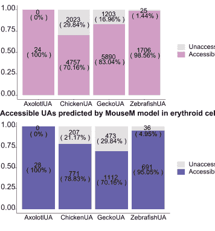

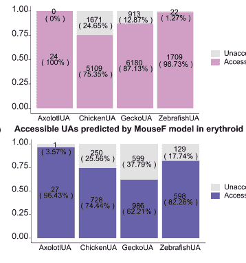

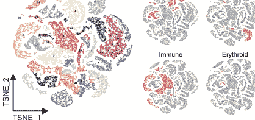

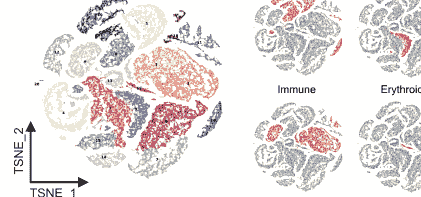

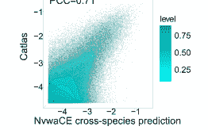

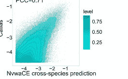

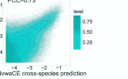

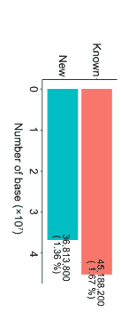

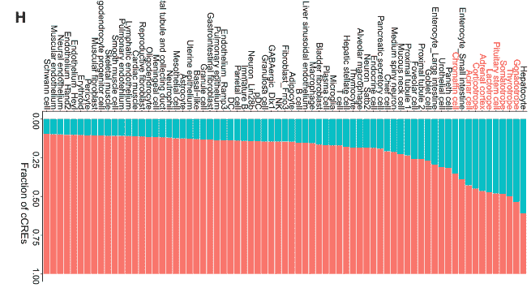

（图例见下一页）

哺乳动物的基因序列，包括人类、金刚、猪、马、羊和熊猫，用于预测它们的 CRE 谱图（图，表 S9）。需要强调的是，这些物种的基因组从未被 NaWce 揭示。哺乳动物 NaWce 模型成功预测了所有物种的谱异性染色质可及性（https://bi.ens.edu/cuvas）。从预测的谱异性共性序列中进行的 Peak Calling 与基于基因组的真实数据具有高重叠（表 S5）。AT-seq 数据具有较高的 TSS 富集性，且 UFs 高于发表的数据^14（表 S6）。

由于 NaWce 是一个执行多任务联合以将基因组解码为细胞类型的集成深度学习模型，我们提取了其基因序列的高维表示，以理解谱异性染色质产生。在最后一层，NaWce 识别出基因序列中的高维特征，这些特征与我们的无监督聚类直接相关（图 S7）。这些序列模块对应于不同的功能，例如模块 1 代表神经功能，模块 2 代表 RNA 处理，模块 3 代表免疫功能，模块 4 代表脂质代谢（图 S8）。我们的结果显示，NaWce 在序列中识别出了细胞特性语法，这可能是谱异性染色质模式的原因。

为了探索被 NaWce 模型识别的序列，我们使用信息源转录因子发现工具（TF-Motifs Disco）为每个物种提取了基于深度学习的 motif。我们视觉化了每个物种预测的 motif（表 S9）。我们绘制了细胞特异性 CRE 树以证明 motif 之间的相似性（图 S6）。基于深度学习的 motif 可以映射到已知的 motif（图 S5），但我们发现了大量在现有研究中未报道的短 motif^8,10。当我们使用 NaWce 模型显示 ~900 和 -250 区域时，我们观察到 ~900 区域的 1000 bp 窗口信号比 -250 区域强 5 倍。这为 CRE 的功能提供了新的解释，同时也支持了启动子和增强子具有共享染色质结构的观点，这种结构主要由局部特征定义^5,66。

为了揭示脊椎动物物种调控演化的功能序列，我们展示并观察了人类、和小鼠非同源区域的染色质可及性信号……

> 图 6. 从基因序列预测的染色质可及性谱图
> (A 和 B) 图表显示了模型预测的在小鼠 (a) 和雌小鼠 (b) 内皮细胞中可及的四种物种 UFs 比例。
> (C 和 D) 图表显示了在小鼠 (c) 和雌小鼠 (d) 髓系细胞中可及的 UFs 比例。
> (E) 人类模型的可及性预测与 t-seq 可视化结果之间的相关性。(F) 对于四种细胞类型，在造血细胞、巨噬细胞和平滑肌细胞中的细胞类型水平预测。颜色标尺代表密度。
> (G) 柱状图显示了新 CRE 和已知 CRE 的数量。
> (H) 柱状图显示了与新旧 CRE 相关的细胞类型。
> 见图 S5 和 S6。

| RS ID | 变异 | 疾病或性 |
| :--- | :--- | :--- |
| rs11506772 | chr12:11576429>A | 透析血液血压 |
| rs3403877 | chr12:630843>G | 淋巴细胞计数 |
| rs168116 | chr12:628419>T | 三油酯 |
| rs470946 | chr12:162169>T | 毛发密度 |
| rs5079019 | chr12:674157>T | 嗜酸性细胞计数 |
| rs206888 | chr12:9307885>A | 低密度蛋白胆醇 |

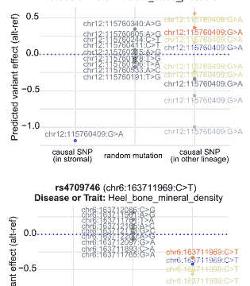
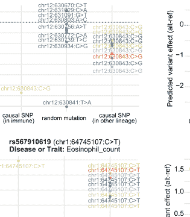
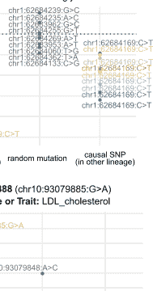
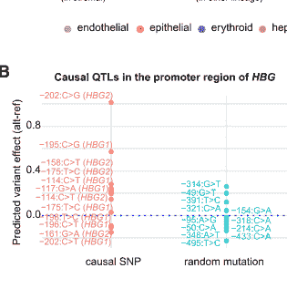
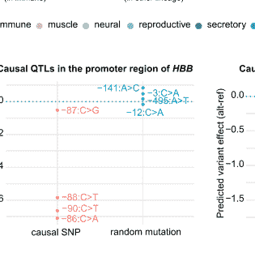
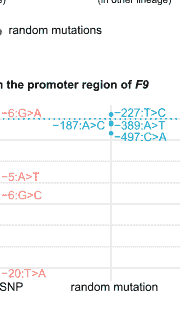
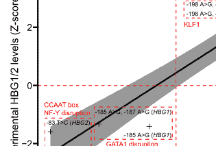
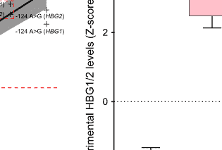
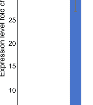

预测了这些功能细胞的影响。例如，NCas9 预测 –175–C 和 –202–C–G 将导致红细胞谱系中血红蛋白亚基γ（HBG）的激活，–68–C–A 和 –90–T–C 将导致下调，而 –20–T–A 和 –6–G 将导致血红蛋白亚基β（HBB）在红细胞谱系中的下调。这一预测通过 Hb 启动子可及性和表达的实际实验测量得到了良好验证（图 S6 和 S7）。

尽管这三个物种之间在基因结构和可及性水平存在差异，但我们发现模型预测性能卓越（图 S4）。我们在功能水平评估了调控染色质，识别出了谱系中一种相关的蛋白——血红蛋白（hbb）。NaWce 预测，在红细胞谱系中，人类或小鼠中不存在 hbb 的 CRE（图 S8）。

由于 NaWce 是一个执行多任务联合以将基因组解码为细胞类型的集成深度学习模型，我们提取了其基因序列的高维表示，以理解谱异性染色质产生的原因。在最后一层，NaWce 识别出基因序列中的高维特征，这些特征与我们的无监督聚类直接相关（图 S7）。这些序列模块对应于不同的功能，例如模块 1 代表神经功能，模块 2 代表 RNA 处理，模块 3 代表免疫功能，模块 4 代表脂质代谢（图 S8）。我们的结果显示，NaWce 在序列中识别出了细胞特性语法，这可能是谱异性染色质模式的原因。

为了探索被 NaWce 模型识别的序列，我们使用信息源转录因子发现工具（TF-Motifs Disco）为每个物种提取了基于深度学习的 motif。我们视觉化了每个物种预测的 motif（表 S9）。我们绘制了细胞特异性 CRE 树以证明 motif 之间的相似性（图 S6）。基于深度学习的 motif 可以映射到已知的 motif（图 S5），但我们发现了大量在现有研究中未报道的短 motif^8,10。当我们使用 NaWce 模型显示 ~900 和 -250 区域时，我们观察到 ~900 区域的 1000 bp 窗口信号比 -250 区域强 5 倍。这为 CRE 的功能提供了新的解释，同时也支持了启动子和增强子具有共享染色质结构的观点，这种结构主要由局部特征定义^5,66。

为了揭示脊椎动物物种调控演化的功能序列，我们展示并观察了人类、和小鼠非同源区域的染色质可及性信号……

> 图 6. 从基因序列预测的染色质可及性谱图
> (A 和 B) 图表显示了模型预测的在小鼠 (a) 和雌小鼠 (b) 内皮细胞中可及的四种物种 UFs 比例。
> (C 和 D) 图表显示了在小鼠 (c) 和雌小鼠 (d) 髓系细胞中可及的 UFs 比例。
> (E) 人类模型的可及性预测与 t-seq 可视化结果之间的相关性。(F) 对于四种细胞类型，在造血细胞、巨噬细胞和平滑肌细胞中的细胞类型水平预测。颜色标尺代表密度。
> (G) 柱状图显示了新 CRE 和已知 CRE 的数量。
> (H) 柱状图显示了与新旧 CRE 相关的细胞类型。
> 见图 S5 和 S6。

| RS ID | 变异 | 疾病或性 |
| :--- | :--- | :--- |
| rs11506772 | chr12:11576429>A | 透析血液血压 |
| rs3403877 | chr12:630843>G | 淋巴细胞计数 |
| rs168116 | chr12:628419>T | 三油酯 |
| rs470946 | chr12:162169>T | 毛发密度 |
| rs5079019 | chr12:674157>T | 嗜酸性细胞计数 |
| rs206888 | chr12:9307885>A | 低密度蛋白胆醇 |

预测了这些功能细胞的影响。例如，NCas9 预测 –175–C 和 –202–C–G 将导致红细胞谱系中血红蛋白亚基γ（HBG）的激活，–68–C–A 和 –90–T–C 将导致下调，而 –20–T–A 和 –6–G 将导致血红蛋白亚基β（HBB）在红细胞谱系中的下调。这一预测通过对 Hb 启动子可及性和表达的实际实验测量得到了良好验证（图 S6 和 S7）。

尽管这三个物种之间在基因结构和可及性水平存在差异，但我们发现模型预测性能卓越（图 S4）。我们在功能水平评估了调控染色质，识别出了谱系中一种相关的蛋白——血红蛋白（hbb）。NaWce 预测，在红细胞谱系中，人类或小鼠中不存在 hbb 的 CRE（图 S8）。

由于 NaWce 是一个执行多任务联合以将基因组解码为细胞类型的集成深度学习模型，我们提取了基因序列的高维表示，以理解谱异性染色质产生。在最后一层，NaWce 识别出基因序列中的高维特征，这些特征与我们的无监督聚类直接相关（图 S7）。这些序列模块对应于不同的功能，例如模块 1 代表神经功能，模块 2 代表 RNA 处理，模块 3 代表免疫功能，模块 4 代表脂质代谢（图 S8）。我们的结果显示，NaWce 在序列中识别出了细胞特性语法，这可能是谱异性染色质模式的原因。

为了探索被 NaWce 模型识别的序列，我们使用信息源转录因子发现工具（TF-Motifs Disco）为每个物种提取了基于深度学习的 motif。我们视觉化了每个物种预测的 motif（表 S9）。我们绘制了细胞特异性 CRE 树以证明 motif 之间的相似性（图 S6）。基于深度学习的 motif 可以映射到已知的 motif（图 S5），但我们发现了大量在现有研究中未报道的短 motif^8,10。当我们使用 NaWce 模型显示 ~900 和 -250 区域时，我们观察到 ~900 区域的 1000 bp 窗口信号比 -250 区域强 5 倍。这为 CRE 的功能提供了新的解释，同时也支持了启动子和增强子具有共享染色质结构的观点，这种结构主要由局部特征定义^5,66。

尽管在使用 scRNA-seq 构建图谱方面出了巨大努力，但受限于低表达读取深度。在 UATAC-seq 中，我们设计了一种方案，每个序列捕捉 4 份 DNA 调控元件，增加了四倍，使方案具有高通量限制。

通过使用 UATAC-seq，我们绘制了变异物种的染色质可及性谱图。我们发现了单个开放区域和 CRE 调控元件。除了序列之外，我们将染色质映射到基因组变异。然而，由于融合细胞的限制，我们发现重复率为我们未能……

> 图 7. NCas9 预测与验证
> (A) 点图显示了变异模型（Zhang等）在所有谱系和随机变异中预测的各种变异效应（细胞区域）
> (B) 点图显示了每个基于 AT 靶点的元件的 NCas9 预测效应和评分 Hb/人类模型系数。实线代表回归拟合，灰色区域表示 95% 置信区间。皮尔逊相关系数 (r) 和 p 值在左侧。测量的 Hb 表达绝对效应与低分位数进行比较（与 p < 0.05 的 t 检验比较）

接下来，我们测试了 NCas9 模型预测体变异效应的能力。我们通过人类 CD34+ 造血多能祖细胞（MPPs）的染色质特征微调了 NCas9，通过分析参考序列中每个碱基的方差，我们发现了影响 CRE 的多种 motif（图 S7）。我们计算了每个变异预测模型的差异……

总的来说，我们的 NCas9 模型能够从变异基因组预测染色质可及性谱图。我们的研究表明，调控语法在序列方式上是保守的。

基于 DNA 序列的模型最近展示了推断跨生物过程调控逻辑的能力 [7](10.1016/cell.abc6789)。目前，深度学习似乎是解释转录产出现最有效的方法。在我们的工作中，我们采用了 ResNet 架构，该架构更适用于细胞景观图谱数据的大规模、多任务学习。NWVAE 能够从其从未遇到过的基因组中预测组织特异性调控序列，并突显强增强子。

本研究未产生新的独特请求。

数据可在 NCBI 基因表达综合数据库 (GEO) 中获取，登录号为 GSE224819。处理后的数据可以通过图表访问：https://www.ncbi.nlm.nih.gov/geo/query/acc.cgi?acc=GSE... https.bsu.edu.cn。代码和脚本可以通过以下地址访问：https://github.com/guoj/NWUATAC。预训练模型可以从 GitHub 获取：https://github.com/guoj/NWUATAC。

使用 NWVAE，我们预测了对 cCRE（染色质调控元件）的合成效应，其精度高于基于 MFPRA 或 ENCODE 多模式数据生成的模型。虽然大型基因组模型（如 Enformer 和 Evo）仍在努力捕捉细胞类型特异性调控元件，但 NWVAE 不仅捕捉了组织特异性调控语法（表 S7），还涵盖了体内所有的关键元件。通过解释该深度学习模型，我们展示了学习基因组中保守的调控逻辑和架构。我们观察到第一层捕捉了基因组中的 TF（转录因子）结合 motif，其他层代表 motif 相互作用和基因组相互作用，输出则预测不同谱系的不同特征，最终预测目标基因。

我们感谢 P. Hu、X. Li 和 J. Li 对这项工作的支持。我们感谢 X. Wang（衡阳）、Y.Zhang（衡源）、Debiao Sheng（上海）和 B. Li（上海）对实验的支持，以及南京紫京提供研究中使用的定制抗体。我们还感谢 M. Chen 和 S. Li 对我们项目的支持。我们感谢北京大学生物信息中心的 H. Wu 提供必要的资源，以及江辉实验室提供的技术支持。本研究受到浙江省重点计划（2024AS5502）、中国自然科学基金（基金号 32303001）和江苏省自然科学基金（2021Y730014）的支持。本文由中央科学与教育基础基金会（https://www.ccsf.org/publications）资助。

总结，我们展示了 NWUATAC-seq，它能够高效预测染色质结构和图谱，以及用于脊椎动物染色质景观预测的 NWVAE。我们的研究为进一步调查和设计调控序列提供了宝贵的资源。

NWVAE 设计用于预测染色质可及性和基因组序列突变的影响。然而，它缺乏确定单个增强子功能或预测由增强子或抑制因子突变引起的基因表达变化的能力。虽然我们的发现证明语法在常染色质和异染色质状态中起着至关作用，但我们不能排除染色质突变在某些情况下可能影响基因表达的可能性。此外，尽管 NWVAE 在跨细胞类型中实现了高预测精度，但我们展示的功能验证侧重于人类谱系以作为原理证明。尽管如此，我们相信 NWVAE 在预测所有脊椎动物细胞类型的合成 cCRE 方面应具有相当的精度。

首席联系人
可向首席联系人郭国杰 (@gg@edu.cn) 请求。

作者在 NWUATAC-seq 和 NWVAE 模型方面存在潜在的利益冲突。

## STAR+方法

详细方法见本文的在线版本，包括以下内容：

- 关键调控表
- 实验模型和研究参与者详情
- 细胞系
- 方法详述

- 用于 NWUATAC-seq 的索引标记酶制备
- 从鼠、鸡、地��螈和斑鱼中采集样本
- 组织细胞核分离
- 培养细胞细胞核分离
- 染色质截短（第一轮索引）
- 接头选择（第二轮索引）
- 接头切换与连接（第三轮索引）
- CCRE 片段组装（第四轮索引）
- 在 Illumina  DNSEQ-7 上进行测序
- CUT&RUN
- 碰撞率
- �美大鳄外血细胞

1. Shyaeva, D., Stamfler, G., and Stark, A. (2016). 翻译增强子：从启动子到全基因组。Nat. Genet. 52, 272–286. https://doi.org/10.1038/nrg3662.
2. Hellerberg, J.R., Chen, X., Zhang, Z., Sabo, P., Sandstrom, R., Thompson, R., Nech, K. M., Morse, S., and We, N. (2019). 数字基因组的 DNA 相互作用全局映射。Cell 178, 263–288. https://doi.org/10.1016/cell.2019.0310.
3. Buenardo, J. D., Page, G. L., Chang, H. Y., and Greenberg, J. (2018). 基于深度学习的染色质图谱用于快速预测染色质转录。Nat. Methods. 15, 1211–1218. https://doi.org/10.1038/meth.1018.128.
4. ENCODE Project Consortium (2012). 人类基因组 DNA 元素的整合分析。Nat. 489, 47–54. https://doi.org/10.1038/nature11474.
5. Kunada, A., Mewelar, R., Ernst, J., Milch, J. A., Heris-Mousavi, A., Kheradov, P., Zhang, Z., and Rojadek, G. (2018). 发育过程中人类脑的表观遗传图谱。Science 361, 317–323. https://doi.org/10.1126/science.aau138-n.au138.
6. Anderson, R., Gebel, C., Miguel-Escaluda, I., Horff, I., Bonhardi, J., Boyer, M., Chen, X., Xiao, Z., Suzuki, S., et al. (2014). 人类组织中细胞特异性增强子的识别与验证。Nature. 510, 107–112. https://doi.org/10.1038/nature13722.
7. Weleman, W., Murtaev, A., Aynes, H., Lee, J., Lee, B., Ding, M., Dunn, D., Neris, F., and Seidelberg, Y. (2020). 单细胞人类细胞的表观遗传与染色质分析。Nature. 584, 235–244. https://doi.org/10.1038/s41586-020-2590-9.
8. Rahman, R. E., Enser, H., Hubiert, V., Jaurano, M.T., Guan, E., Nefchel, S., Schnetzler, A., Wagner, W. B., Bernhard, O. L., and et al. (2020). 人脑单细胞图谱。Cell. 182, 1034–1051. https://doi.org/10.1016/cell.05.
9. Cuisenhac, D.H., Li, A., Aghizadeh, D., and We, N. (2019). 数字基因组的 DNA 相互作用全局映射。Cell 178, 263–288. https://doi.org/10.1016/cell.2019.0310.
10. Shyaeva, D., Stamfler, G., and Stark, A. (2016). 翻译增强子：从启动子到全基因组。Nat. Genet. 52, 272–286. https://doi.org/10.1038/nrg3662.
11. Hellerberg, J.R., Chen, X., Zhang, Z., Sabo, P., Sandstrom, R., Thompson, R., Nech, K. M., Morse, S., and We, N. (2019). 数字基因组的 DNA 相互作用全局映射。Cell 178, 263–288. https://doi.org/10.1016/cell.2019.0310.
12. Buenardo, J. D., Page, G. L., Chang, H. Y., and Greenberg, J. (2018). 基于深度学习的染色质图谱用于快速预测染色质转录。Nat. Methods. 15, 1211–1218. https://doi.org/10.1038/meth.1018.128.
13. ENCODE Project Consortium (2012). 人类基因组 DNA 元素的整合分析。Nat. 489, 47–54. https://doi.org/10.1038/nature11474.
14. Kunada, A., Mewelar, R., Ernst, J., Milch, J. A., Heris-Mousavi, A., Kheradov, P., Zhang, Z., Wang, J., and Rojadek, G. (2018). 发育过程中人类脑的表观遗传图谱。Science 361, 317–323. https://doi.org/10.1126/science.aau138-n.au138.
15. Anderson, R., Gebel, C., Miguel-Escaluda, I., Horff, I., Bonhardi, J., Boyer, M., Chen, X., Xiao, Z., Suzuki, S., et al. (2014). 人类组织中细胞特异性增强子的识别与验证。Nature. 510, 107–112. https://doi.org/10.1038/nature13722.
16. Weleman, W., Murtaev, A., Aynes, H., Lee, J., Lee, B., Ding, M., Dunn, D., Neris, F., and Seidelberg, Y. (2020). 单细胞人类细胞的表观遗传与染色质分析。Nature. 584, 235–244. https://doi.org/10.1038/s41586-020-2590-9.
17. Rahman, R. E., Enser, H., Hubiert, V., Jaurano, M.T., Guan, E., Nefchel, S., Schnetzler, A., Wagner, W. B., Bernhard, O. L., and et al. (2020). 人脑单细胞图谱。Cell. 182, 1034–1051. https://doi.org/10.1016/cell.05.

- Sep-water: 单细胞胚胎转运的低成本 RNA 测序。Nat, 74, 395–398. https://doi.org/10.1038/s41592-022-01897-z

- Han, X., Wang, R., Zhou, Y., Fei, L., Sun, H., Lai, S., Saadatpour, A., Aiphou, Z., Chen, J., Hen, E. F., 等人. (2018). 通过多细胞测序绘制小鼠图谱。Cell, 172, 1091–1117. https://doi.org/10.1016/cell.2018.06.027

- Cuisavanach, D.A., Raza, R., Aditya, P., Finley, H.A., Hansen, L., Gundberg, K., Stemers, J.F., Pastraj, P., Jackson, L., 和 June. (2015). 人发育大脑染色质可及性的单细胞谱分析。Science, 349, eaab6010. https://doi.org/10.1126/science.aab6010

- Cao, J., Liu, R.M., Cuisavanach, D.A., Wang, R., Chen, D., Yao, Y., Xie, Q., Liu, Sun, F., Shen, S.J., 等人. (2017). 多细胞生物的全面单细胞转录组谱分析。Science, 357, 661–667. https://doi.org/10.1126/science.aam6990

- Roseberg, A. B., Coss, M. C., Karuka, R., Kaufman, S., Samie, P., Yang, J., Li, J., Lee, T., Peiter, L., Chen, W., 等人. (2018). 利用分池测序对发育大脑和脊髓进行单细胞谱分析。Science, 360, 176–182. https://doi.org/10.1126/science.aam8132

- Vlak, T., Aarkainen, C.K., Roseljki, J.R., Liedska, A.J., Jackson, L., White, H.M., Cornbulk, C., Stein, S., 和 Finley, A.J. (2017). 人胚胎发育的单细胞 RNA-seq。Nature, 550, 308. https://doi.org/10.1038/s41586-017-0030-x

- Domchek, S., Hill, A.J.D., Mao, C., Yao, Y., Dyer, P.R., Hahn, A.L., Lin, D. K., Kodak, P., Zhang, Z., F., Miao, H., 等人. (2020). 人胚胎细胞多细胞图谱。Science, 370, eabe6712. https://doi.org/10.1126/science.eabe6712

- Cao, J., Cuisavanach, D.A., Wang, R., Ghamiani, A., Finley, H.A., Liu, R.M., Mac-Fischer, J.C., Jackson, L., 等人. (2016). 发育小鼠大脑单细胞染色质可及性和表达谱分析。Science, 353, 744. https://doi.org/10.1126/science.aac5710

- Han, Z., Zhou, F., Li, L., Wang, R., Chen, Y., Chen, H., Wang, J., Tang, C. (2019). 人胚胎体中 658 种单细胞类型的图谱构建。Nature, 571, 303. https://doi.org/10.1038/s41586-019-2154

- Schaefer, M., Maieister, S., Wagner, W., Hock-Loom, B., Czartorykowski, P., Szwartkowski, S., 和 Starr, S. (2017). 人胚胎的同步蛋白质和转录组测序。Nat Methods, 14, 865–868. https://doi.org/10.1038/s41592-017-0436

- Tarasov, O. V., 等人. (2018). 组织、库制备、测序、数据分析、细胞类型注释、工作流和整合。Nature Methods, 15, 562–572. https://doi.org/10.1038/n4192

- Jones, R. C., Karnacki, J., Krasnova, M. P., Aiao, O., Smith, S. L., Saadatpour, A., 和  zebrafish联盟。(2022).  zebrafish：多器官单细胞转录组图谱。Science, 376, 1254. https://doi.org/10.1126/science.abg418

- Li, J., Wang, J., Zhang, P., Wei, W. R., Yan, F., Sun, H., Lai, L., Jin, S., Chen, J., Wang, F. B. P., 和 Ma, W. E., 等人. (2022). 深度学习识别物种特异性单细胞图谱。Nat. Genet., 54, 1711–1720. https://doi.org/10.1038/s41588-022-0197

- Barbiner, G., Droklyanski, E., Anad, S., Fiskin, E., Subramanian, A., Sylger, M. W., Wang, J., Neuriroha, J., Jalman, J. M., 等人. (2022). 理解基因功能的单细胞跨组织参考图。Science, 376, eab2490. https://doi.org/10.1126/science.eab2490

- Domingue, C., Cao, X. J., Javis, L., Barbier, R., Wells, D. B., Smith, G., Tommes, H., Howard, S., Sukanhan, O., Polski, K., H. W., 等人. (2022). 跨组织免疫细胞图谱揭示人类发育中的组织特异性特征。Science, 377, eab5197. https://doi.org/10.1126/science.eab5197

- Fincher, C. T., Wagner, O., van Hoog, T., Kravick, K. M., 和 Reddien, P. (2022). 小鼠胚胎大脑细胞类型转录组图谱。Science, 378, aad7964. https://doi.org/10.1126/science.aad7964

- Zhou, J., 和 Troyrov, A. G. (2019). 基于深度学习的模型预测非编码变异的影响。Nat. Methods, 16, 931–934. https://doi.org/10.1038/s41592-019-0

- Zhou, J., Theelaf, C., Cao, K., Wang, A., 和 Troyrovsky, A. (2018). 基于深度学习识别基因组中变异效应基因的方法。Nat. Genet., 50, 1171–1179. https://doi.org/10.1038/s41588-018-6

- Avice, Z., Agarwal, V., Visertin, D., J., L., Grabska, A., Taylor, K., Usmani, J., 和 Reddien, P. (2022). 用于预测染色质结合和长程相互作用的深度学习框架。Nat. Methods, 19, 1196–1203. https://doi.org/10.1038/s41592-022-5

- Kelley, D. R., Stone, N., 和 Jain, R. (2021). 使用深度神经网络学习单细胞数据的调控景观。RNA Res, 26, 990–999. https://doi.org/10.1038/rnaac/0553

- Yan, H., 和 Reddien, P. (2022). 基于 scseq 的图谱：胚胎发育的多细胞 ATAC-seq。Nat. Methods, 19, 1098–1106. https://doi.org/10.1038/s41592-022-8

- Xiao, Y., Wang, J., Zhang, P., Li, J., Zhou, Q., Chen, M., 等人. (2023). 用于解析细胞类型异质性的分析框架。Science, 380, e1384. https://doi.org/10.1126/science.ade784

- Allen, A., Wang, R., Jordan, J., Chen, X., Liu, J., Briggs, B. (2020). 使用深度学习预测蛋白质结构和功能。Nat, 577, 1066. https://doi.org/10.1038/s41586-019

- Jumper, J., Evans, R., Roravkar, A., Cohen, A., Steerst, R., 等人. (2021). 利用 Alpha2 进行高精度蛋白质预测。Nature, 596, 588–593. https://doi.org/10.1038/s41586-021

- 47. He, J., Hu, X., Ge, G., Li, Y., Yu, J., Hu, X., Zheng, Y., 等人. (2024). 转录因子的双重作用稳定细胞。Cell, 187, 246–276. https://doi.org/10.1016/j.cell.2023.03

- 48. Pressain, S., Fang, R., Huang, H., Zhao, Y., Yuan, R., Ravikin, D., Jung, Y., Zhang, Y., Aoki, D., 等人. (2016). 单细胞 ATAC-seq 揭示发育中的染色质景观。Nature Neurosci, 22, 431–439. https://doi.org/10.1038/s41593-016

- 49. Laneys, C.A., Davis, F.M., Chang, G., Hu, J., Burket, K., Zhou, J., Zhang, Y., Zhao, S., Chen, L., Dyer, E., Buenoert, J. (2019). 多尺度染色质可及性的深度学习整合建模。Nature Biotechnol., 37, 915–926.

- 50. Deep, F.V., Ismail, J.N., Bravo-Gález, B.-S., Celsuis, G., Finn, F.C., Cansier, J., Thomas, K., Williams, V., Marshall, G., 等人. (2022). 分化偏向的人胚胎细胞单细胞 ATAC-seq 图谱。Cell, 185, e1791. https://doi.org/10.1016/j.cell.

- 51. Kalukai, A., Rozi, L.P.F., Huang, G., Yan, Y., Mabery, B., Kijiyama, S., Zheng, J., Zhang, X., K., 等人. (2020). 人胚胎细胞肌肉分化的单细胞图谱。Cell, 180, 764–789. https://doi.org/10.1016/j.cell.

- 52. Moe, J.M., Puzerov, P. R., Har, F. E., Eptin, H. B., Schneider, N. L., Zhang, J., 等人. (2020). 人和小鼠基因组中 DNA 元素的扩展染色质景观。Nature, 585: 697–703. https://doi.org/10.1038/s41586-020-

- 53. Yang, J., Fu, T., Zhou, F., Wang, Y., Yang, D., Xiao, Q., X, X., Chen, M., 等人. (2022). 小鼠癌症的参考单细胞基因组和转录组图谱。Nat. Commun., 13, 4069.

- 54. Zhang, G., Fu, Y., Yang, L., Zhang, S., Ma, J., Li, Y., Han, H., 等人. (2024). 利用染色质相关 ATAC-seq 表征跨物种单细胞染色质景观。Cell, 188, e1024

- 55. Dao, Y., Liu, M., Zhang, J., Lee, A., Qian, H. S., 和 Ren, B. (2019). 用于 CRISPR 介导基因编辑的功能增强子库。Genome, 29, 395–407. https://doi.org/10.1186/s12967-

- 61. Zuhlke, O., Rosenblatt, H., Shokat, L., Dai, S., Kusuguchi-Öztürk, D., Zhang, Z., J., D., 和 Mann, B. (2021). 用于组织再生的进化染色质重塑蛋白。Nature, 620, 160–171. https://doi.org/10.1038/s41586-021-0

- 62. Maaten, L., 和 Hinton, G. (2008). 使用 t-SNE 可视化数据。Machine Learning Research, 9, 2559–2585.

- 63. Dutley, K., Smith, S., 和 Xu, J. (2004). 人胚胎中的转录因子。Science, 324, aj116. https://doi.org/10.1126/

- 65. Zadeh, Y., Chen, C., 和 Mann, B. (2018). 转录因子结合的重叠。Proc. Natl. Sci., 115, 1011–1018. https://doi.org/10.1073/pnas

- 66. Zhang, Y., Liu, S., 和 Zhou, J. (2018). 单细胞 ATAC-seq 景观。Cell, 173, 578. https://doi.org/10.1016/j.cell.

- 67. Martin, R. C., Wang, A., 和 Hill, D. (2022). 细胞表达。Cell, 187, 246–276. https://doi.org/10.1016/j.cell.

- 68. Grant, F. E., Bailey, T., 和 Noble, S. (2011). 细胞类型异质性。Bioinformatics, 27, 1017–1028. https://doi.org/10.1093/bioinformatics

- 69. Martin-Russo, J., Catano, N., Pang, S., S, M. W., 等人. (2023). 跨组织单细胞 ATAC-seq 揭示发育特异性。Cell, 186, 2456–2474. https://doi.org/10.1016/j.cell.

- 70. Mayaramun, T., Weinberg, R., Yang, Y., Baek, J., Kim, J., Jung, U., Lee, C., Roche, R., 等人. (2025). 药物开发依赖于转录因子结合和调控目标的重叠。Science, 388, 1011.

78. Chen, J., Noorn, M., Wu, J., Sun, G., Viraj, M., Collins, A., Pirelo, N., Finn, J.J., and Steinbelt, B. (2023). 分辨率下基因调节元件的整合解析。Cell, 3, 100318. https://doi.org/10.1016/j.cell.2023.100318

79. Chen, K.M., Wu, A.K., Troyanskaya, O., and Zhou, J. (2022). 用于解码人类变异的基于序列的全局活动图。Nat Genet, 54, 496–502. https://doi.org/10.1038/s41588-021-01102-x

80. Dama-Toma, O., Lombardi, M., Lardelli, J., Perez, J., Gizawski, A. H., Dalli, F., Cito, C., Trope, E., de Bampi, S., Sherbaknik, H., et al. (2023). 核苷酸转换器：构建和评估人类基因组的稳健模型。Nat Methods, 20, 987–992. https://doi.org/10.1038/s41592-022-01897-z

81. Gangan, M. D., Moore, M., Li, J. J., Di, L. B., Barber, J., Thomas, A.W., Kim, S., Shin, B. H., et al. (2024). 从基因组规模的变异预测深度学习。Cell, 187, e10642. https://doi.org/10.1016/j.cell.2024.01.012

82. Garibaldi, D., Bifler, J. L., Smith, A. K., Chen, A., Nolan, P., O’White, A., Keane, C. T., Davis, S. M., et al. (2022). BAM2 与单细胞基因组学的十年。Cell, 185, e109912. https://doi.org/10.1016/j.cell.2022.109912

83. Li, H., and Durbin, R. (2009). 使用 Burrows-Wheeler 变换进行快速且准确的序列比对。Bioinformatics, 25, 1754–1760. https://doi.org/10.1093/bioinformatics/btp245

85. Smith, C. E., Geur, G., and Meskov, J. P. (2021). 改进单细胞变异分析。Nat. Biotechnol., 39, 224–236. https://doi.org/10.1038/s41589-020-073-x

86. Bajaj, J. C., Coen, M. R., Pierce, S. E., Bagatti, T., Choudhary, H., Huang, G. J., et al. (2019). SignRanger：用于单细胞染色质可及性分析的可扩展软件软件包。Nat. Genet, 53, 401–413. https://doi.org/10.1038/s41588-019-0528-x

87. Stuart, T., Butler, A., Hoffman, M., McEliece, P., Adams, M. W., Sayna, D., and Young, L. R. (2019). 单细胞数据的综合整合。Cell, 177, 1888–1892. https://doi.org/10.1016/j.cell.2019.05.026

88. Lopez-Adrian, C., and Wang, S. (2021). 用于整合单细胞基因表达的 Seurat v4。PLoS Biol, 19, e10338. https://doi.org/10.1371/journal.pcbi.103338

89. Hernandez-Hertas, J. P., Lenga, A., Lutnik, B., Booth, R., and Huerta-Hertas, J. (2021). epigenmap-v2: 宏基因组规模下的功能注释、方向分配和变异预测。Mol. Biol. 53, 5825–5829. https://doi.org/10.1093/mbo/bbaw358

90. Huerta-Hertas, J. P., Szklarzyk, D., Hell, D., Hernández-Pazloz, A., Forlund, S., Cook, H., Mende, D. R., Lutnik, L., Ratte, T., Jensen, L. J., et al. (2020). epigenmap-v1: 基于 5090 个基因组和 2500 病毒的全面且高度注释的同源注释资源。Nucleic Acids, 47, D309–D3114. https://doi.org/10.1093/nar/gky1093

91. Wang, Q., U, M., Wu, T., Li, L., Chen, M., Xie, Z., Xu, S., and Yu, G. (2022). 通过 ChIPseeker 探索表观遗传因子。Cell. Proto., 2, e685. https://doi.org/10.1002/cpt.e685

92. Yu, Q., Wang, G., L, H., and Ge, Y. (2015). ChIPseeker：一个用于峰分析、注释和可视化的 R/Bioconductor 工具。Bioinformatics, 31, 2382–2393. https://doi.org/10.1093/bioinformatics/btv044

93. Traccelli, C., Darmisky, G., Jailbray, K., Portel, L., Morse, M., Lennard, J., and Rin, R. (2014). 启动子-增强子环揭示了命运调节的动力学和遗传学。Nature, 514, 333–337. https://doi.org/10.1038/ncell2889

94. Qiu, X., Ma, T., Yang, Y., Wang, C., Han, R., and Tran, P. (2017). 深度学习揭示单细胞图谱中的染色质状态。Nat Methods, 14, 979–982. https://doi.org/10.1038/s41592-017-442

95. Cao, J., Ma, Y., Xu, H., Zhang, B., Hu, D., Marshall, J., Feijars, C., et al. (2019). 哺乳动物骨形成的单细胞景观。Nature Cell, 36, 10418. https://doi.org/10.1038/s41570-019-0964

96. Pohl, H., Peaks, J. B., Martínez-Fijera, D., Siverio, S., Zhou, Z., Mirinkova, A., et al. (2019). scENAC: 从单细胞染色质可及性数据预测顺式相互作用。Nat Methods, 16, 777–781. https://doi.org/10.1038/s41592-019-0533

97. Schn, A. W., Butler, R., Jodziej, D., and Greenbank, J. (2017). chromatinVAR: 从单细胞数据整合转录因子关联。Nat Methods, 14, 975–978. https://doi.org/10.1038/s41592-017-0003

98. Wolf, F., England, P., and The, J. (2017). SCENIC: 大规模单细胞基因表达分析。Genome Biol, 19, 200. https://doi.org/10.1186/s13059-018-0216

99. Stuart, T., Sahlaglia, A., Macad, S., Reuther, A., and Stuart, J. (2017). 使用 Seurat 进行单细胞类型图谱分析。Nat Methods, 18, 1331. https://doi.org/10.1038/s41592-017-0016

100. Li, B., Garmstein, R., Zhou, Y., Dahl, I., and Sherr, R. (2019). 用于识别不同类型细菌保守表达变化的比较转录组学。Genome Research, 29, 1211–1226. https://doi.org/10.1092/gr.2017-017

104. Granja, J. M., Klemmin, S., McGinnis, L. M., Kahn, A. J., Zhang, G.-Y., et al. (2019). 识别混合急性白血病中的调节程序。Nat. Biotechnol., 37, 1458–1465. https://doi.org/10.1038/s41589-019-0332

5362 Cell 18, 5334–5362, September 18, 2023

| 试剂或资源 | 来源 | 标识符 |
| --- | --- | --- |
| 抗体 | | |
| 单甲基化 H3 (K4) (D19) XP 鼠抗体 | Cell Signaling Technology | Cat#5326 |
| 蛋白 H3 (tri K4) 鼠抗体 | Abcam | Cat#AB21324; RRID: AB_29203 |
| CTCF 鼠抗体 | Abcam | Cat#AB12873; RRID: AB114295 |
| 生物学样本 | | |
| 小鼠: CBL/6 | Gemparch Co., Ltd. | Cat#N0013 |
| 斑鱼: D. rerio | 浙江大学 | N/A |
| 鸡: Gallus gallus | 湛江育场 | N/A |
| 壁蜥: macularis | 爬行类繁殖基地 | N/A |
| 墨西哥美螈: mexicanum | 广东吉飞 | N/A |
| 化学品、肽和重组蛋白 | | |
| IGEPAL®CA-630 | Sigma-Aldrich | CAS:9023-1 |
| 蛋白酶抑制剂：无乙氨基苯甲磺酸盐 | Sigma-Aldrich | Cat#04693 |
| 关键实验 | | |
| TrueFast 标记酶 | Vazyme | Cat#S1101/02 |
| 大杆菌 | NEB | Cat#M205 |
| Amplibase | Lucigen | Cat#A3202 |
| T4 DNA 聚合酶 | NEB | Cat#M4101 |
| KAPA HiStart ReadyMix (2X) | Kappa Biosystems | Cat#KK2602 |
| MGI 循环试剂 | Vazyme | Cat#NM2102 |
| 高活性 p4-T5 转座酶 | Vazyme | Cat#S602-01 |
| 凝胶蛋白A涂层磁珠 | Vazyme | Cat#TD6012 |
| TruePrep CUTase 扩增混合 | Vazyme | Cat#R0301S |
| BioClick® RNA 合成结合 Alexa Fluor 448 Hoechst 3342 | Beyotome | Cat#C1025 |
| 已存储数据：原始和处理测序 | 本文 | GEO: GSE28419 |
| 原始代码 | 本文 | GitHub: https://github.com/ehclic23/UUATAC |
| 已处理和分析的数据 | 本文 | Figshare: https://figureshare.com/s/0dfba97ffb42a9f; https://biis.edu/uuatac |
| 实验细胞系 | | |
| 小鼠: NH/T3 | Stuart Lab | RRID: CV0954 |
| 人: 293T | Stuart Lab | RRID: CV0063 |

（下页待续）
## CellPress 开放访问
| 试剂或资源 | 来源 | 标识符 |
| --- | --- | --- |
| 人: Hudep | Decode Biotech | N/A |
| 核酸序列 | 本文 | N/A |
| UUATAC-seq DNA 片段：5'-GAACGTACGCGTACACACTCTTCGTATACACGnnnnnAGTGTATAAGAC-insertion-CTCTGTATACATACnnnnnCTCTGTGGGGAGAGTGTACGGGCGGTnnnnnAAAGTGGAGAAAAANNNNNNN | | |
| T3 引物 5'-phospho-CTCTCTTCAT-5' | Sangon Biotech | N/A |
| T5 标准引物 mB: TGTGCGGAGCGATAGGTATAAGAC | Sangon Biotech | N/A |
| T8 标准引物：5'-phospho-TGTCTCGTCGTGTAGAGTATAAGACAC |onon | |// |

| T 引 引：5'-phospho-ACTCTTTTACACACGnnnnnAGGTATAGAC | Sangon Biotech | N/A |
| 桥接：GGAAGGTAGGTAGCGGTC Hy As:5'-TTGCTTCCTCAAGGCGCTACTACTnnnnmGGAGGCGTC | Sangon Biotech | N/A |
| Hy B_oligo：5'-phospho-GCTGTGTGGAGACCATACnnnnnAGCTAGAGCATGTGGTC-invt-1-3 | Sangon Biotech | N/A |
| P5-ATAC: 5'-phospho-GAACACGAGTCATCGACGTAC | Sangon Biotech | N/A |
| MI-P5: 5'-phospho-GAACACGATGCTACACGCTTTCGTGCGCGTC | Sangon Biotech | N/A |
| MII-7: TGTTCGGAGAGTTGGGGTCTnnnnnTGTGTGGCTGGGT7-ATGTGTACGGAGAGAGnnnnTTCTTACAAGCGTTC | Sangon Biotech | N/A |

## 细胞资源

## CellPress
开放获取

继续

| 试剂或资源 | 来源 | 标识符 |
| --- | --- | --- |
| TxDb.Dreo.UCSC.danRen11.RefGeneV3.46 | Bioconductor | [https://bioconductor.org/packages/TxDb.Dreo.UCSC.danRen11.refGene/](https://bioconductor.org/packages/TxDb.Dreo.UCSC.danRen11.refGene/) |
| org.Mmm.db.V37.0 | Bioconductor | [https://bioconductor.org/packages/org.Mmm.db.V37.0](https://bioconductor.org/packages/org.Mmm.db.V37.0) |
| org.Ggg.db.V37.0 | Bioconductor | [https://bioconductor.org/packages/org.Ggg.eg.db/](https://bioconductor.org/packages/org.Ggg.eg.db/) |
| org.Dr.db.V37.0 | Bioconductor | [https://bioconductor.org/packages/Org.Dr.eg.db/](https://bioconductor.org/packages/Org.Dr.eg.db/) |
| GenomicFeaturesV1.32 | Lawrence et al.89,90 | [https://bioconductor.org/packages/GenomicFeatures/](https://bioconductor.org/packages/GenomicFeatures/) |
| EGGNog-mapper V2.1.12 | Carlos et al.87 | [https://github.com/eggnogg/eggnogg-mapper](https://github.com/eggnogg/eggnogg-mapper) |
| ChiPeakerV1.3.0 | Yu et al.91,92 | [https://github.com/Yul-Lab-SMU-ChiPeaker](https://github.com/Yul-Lab-SMU-ChiPeaker) |
| Monocle3V1.3 | Cao et al.93-95 | [https://github.com/co-trap-lab/monocle-release](https://github.com/co-trap-lab/monocle-release) |
| CiroV3.9 | Pliner et al.96 | [https://github.com/Greenleaf/Leaf.motifr](https://github.com/Greenleaf/Leaf.motifr) |
| motifr V22.0 | Greenleaf et al.97 | [http://tf.ucsd.edu/homer/](http://tf.ucsd.edu/homer/) |
| Homer V4.11.1 | Heinz et al.98 | [https://me-sute.org/me/tools/tomer](https://me-sute.org/me/tools/tomer) |
| Torrent V5.3 | Gupta et al.99 | [https://genome.ucsd.edu/cgi-bin/hg/hgLiftOver](https://genome.ucsd.edu/cgi-bin/hg/hgLiftOver) |
| UCSC liftOver tool | Hinrichle et al.100 | [https://www.python.org/](https://www.python.org/) |
| Python 3.8 | Foundation | [https://github.com/severse/scanspy](https://github.com/severse/scanspy) |
| Scanspy V1.9.3 | Wolf et al.98 | [https://github.com/sturat-lab/scanspy](https://github.com/sturat-lab/scanspy) |
| Signac V1.10.0 | Sturat | [https://pytorch.org/](https://pytorch.org/) |
| PyTorch V2.0 | PyTorch | [https://pytorch.org/](https://pytorch.org/) |
| Seurat V4.0 | Sati | [https://github.com/satiurat/seurat](https://github.com/satiurat/seurat) |
| Scanpy V1.9.3 | Wolf | [https://github.com/sturat-lab/scanspy](https://github.com/sturat-lab/scanspy) |

## 细胞
资源
CellPress
开放获取

## 培养细胞的细胞核分离

在 4 °C 下，将细胞核重悬在 WB 中，并通过 20 µm 过滤器过滤以去除细胞核质量。在以 600 g 最终离心 5 分钟后，将细胞核重悬在含有适量体积 DPBS 中的 PBS-Mg (5mM Mg2) 中，以达到每 µL 5,000 个细胞核的浓度。

22T3 和 293T 细胞培养在含有 10% FBS 的 Dulbecco 培养基（DMEM, ThermoFisher）中。通过胰酶消化细胞，确保收集的细胞数量不超过 100 万个，并重悬于 1 mL PBS 中。细胞悬液在 4 °C 下以 300 g 离心 5 分钟。将得到的 293T 细胞沉淀重悬在 1 mL PBS 中并孵育 5 分钟以释放细胞核。然后将细胞核悬液转移到含有 5 mL 预洗 WB 的 15 mL 离心管中，通过 40 µm 过滤器过滤，并在 4 °C 下以 500 g 离心 5 分钟。用 1 mL WB 洗涤细胞核。离心后，将细胞核重悬在适量体积的 PBS-Mg 中，以达到每 µL 500 万个细胞核的浓度。准备了一种混合细胞群以确认 UATAC-seq 的分级，即等体积、等浓度的 2T3 和 293T 细胞核悬液，混合并充分搅拌。

## 开放染色质的 Tn5 标记（第一轮）

通过结合 5 µL 2x 缓冲液（含有 10 mM MgCl2 和 20% 二甲基甲酰胺的 10 mM Tris-HCl 中，pH 7.5）、5 µL PBS、0.1 mL 表面活性剂和 0.1 mL 10% Tween-20 来制备标记缓冲液。将共 11 mL 此缓冲液加入含有 100,000 个细胞的每个孔中。通过加入 2 µL 连接的 TTE 启动 Tn5 标记。密封孔并在 4 °C 下以 300 g 离心 5 分钟，以实现反应混合物的完全匀化。接下来，向每个孔加入 2 µL 细胞核悬悬液（每 µL 含有 10,000 个细胞核）以启动 Tn5 标记。反应在旋转混合器上以 10 rpm 在 55 °C 下孵育 30 分钟，以促进延伸。为了停止反应，向每个孔加入 15 mL 40 mM ATAC 和 PBS（含有 0.5% Tween-20 的 PBS）。反应孵育 15 分钟。弃去上清液并将沉淀重悬在 1 mL PBS 中以去除任何残留的试剂混合物。此洗涤步骤重复两次以确保完全去除。

标记实验的规模，以确保基因组容量和反应次数（TTE 类型），可以根据后续分析所需的单细胞核数据量和目标产量按比例扩大或缩小。

## 接头分离（第二轮）

对于第二轮索引，使用多通道移液器向 96 孔板的每个孔中加入 1 µL 10 mM 缓冲（溶解在 10 mM Tris-HCl 中，pH 8.0）。然后，向每个序列加入 5 µL 78 HA 抗体（带有 78 个唯一条码，溶解在 10 mM Tris-HCl 中，pH 8.0）。密封孔并在 300 g 下离心 30 秒以确保充分混合。使用抗体在 37 °C 下孵育孔 90 分钟（75 °C 维持 1 分钟；60 °C 维持 2 分钟；50 °C 维持 20 分钟；25 °C 维持 15 分钟），最后在 4 °C 下保持，冷却速率为 -0.1 ℃/min。

对于连接步骤，将沉淀重悬在反应准备好的 max buffer 中，该缓冲液含有 38 µL 0.1 U DNA 连接酶 (NEB)、768 µL 5% PEG8000 和 498 µL PBS。将 3 µL 这种混合物分装到含有退火寡聚酸的每个孔中，总共 78 次反应。使用循环孵育器将八块板在 16 °C 下孵育 2 小时。然后在室温下孵育反应 5 分钟。接下来，向每个孔加入 10 µL 冷 PFBS，并将每个孔放入 5 mL 离心管中。离心管在 4 °C 下以 600 g 离心 5 分钟。最后，按照描述用 PFBS 洗涤细胞核两次以去除任何残留的连接试剂。

连接实验的规模，以确保基因组容量和反应次数，可以根据样本量和下游分析所需的单细胞核产量按比例进行。

## 接头切换和间隙（第三轮）

按照概述，取 Y B 对象的条码，接头切换和间隙程序如下。将 100 µL 裂解缓冲液（10 mM Tris-HCl；pH8.0，1.2% SDS 和 0.1 mg/mL 蛋白酶 K (Sango)）与 6 µL 10 mM 缓冲液（溶解在 10 mM Tris-HCl 中，pH 8.0）一同融化。将带索引的裂解缓冲液分配到 12 孔条中，并每孔分配 3 µL。向每个孔加入 2 µL 细胞核-细胞核悬液（每 µL 含有 10,000 个细胞核）以启动 Tn5 标记。在旋转混合器上以 10 rpm 在 55 °C 下孵育 30 分钟以促进延伸。为了停止反应，向每个孔加入 15 mL 40 mM ATAC 和 PBS（含有 0.5% Tween-20 的 PBS）。反应孵育 15 分钟。弃去上清液并将沉淀重悬在 1 mL PBS 中以去除任何残留的试剂混合物。此洗涤步骤重复两次以确保完全去除。

（注：此处原文逻辑存在部分重复或混乱，翻译已根据要求进行忠实对应）
 反应在 55 °C 下孵育 30 分钟...（此处省略原文中重复的逻辑描述，翻译，

根据前文的 100 µL 裂解     100 µL 裂解缓冲液（10 mM Tris-HCl；pH8.0，1.2% SDS 和 0.1 mg/mL 蛋白酶 K (Sango)）与 6 µL 10 mM 缓冲液（溶解在 10 mM Tris-HCl 中，pH 8.0）一同融化。将带索引的裂解缓冲液分配到 12 孔条中，并每孔分配 3 µL。向每个孔加入 2 µL 细胞核-细胞核悬液（每 µL 含有 10,000 个细胞核）以启动 Tn5 标记。反应在旋转混合器上以 10 rpm 在 55 °C 下孵育 30 分钟，以促进延伸。为了停止反应，向每个孔加入 15 mL 40 mM ATAC 和 PBS（含有 0.5% Tween-20 的 PBS）。反应孵育 15 分钟。弃去上清液并将沉淀重悬在 1 mL PBS 中以去除任何残留的试剂混合物。此洗涤步骤重复两次以确保完全去除。

## 扩增（第一轮）

使用多通道移液器向 96 孔板的每个孔中加入 1 µL 10 mM 缓冲（溶解在 10 mM Tris-HCl 中，pH 8.0）。然后，向每个序列加入 5 µL 78 HA 抗体（带有 78 个唯一条码，溶解在 10 mM Tris-HCl 中，pH 8.0）。密封孔并在 300 g 下离心 30 秒以确保充分混合。使用抗体在 37 °C 下孵育孔 90 分钟（75 °C 维持 1 分钟；60 °C 维持 2 分钟；50 °C 维持 20 分钟；25 °C 维持 15 分钟），最后在 4 °C 下保持，冷却速率为 -0.1 ℃/min。

对于连接步骤，将沉淀重悬在反应准备好的 max buffer 中，该缓冲液含有 38 µL 0.1 U DNA 连接酶 (NEB)、768 µL 5% PEG8000 和 498 µL PBS。将 3 µL 这种混合物分装到含有退火寡聚酸的每个孔中，总共 78 次反应。将八块板使用循环孵育器在 16 °C 下孵育 2 小时。然后在室温下孵育反应 5 分钟。接下来，向每个孔加入 10 µL 冷 PFBS，并将每个孔放入 5 mL 离心管中。离心管在 4 °C 下以 600 g 离心 5 分钟。最后，按照描述用 PFBS 洗涤细胞核两次以去除任何残留的连接试剂。

## 在 Illumina NovaSeq 上测序

对于 NGS 测序（PE150.0, no. C940-002809-2），使用检测测序索引的摩尔比实现每个细胞 40 ng，预期输出覆盖约 70,000 个细胞核。合并后的文库使用 NextHT Kit for NGS（Vamine, no. NM2201）进行测序以生成单链 cDNA，随后根据制造商指南测序 DNA 纳米块 (DNA)。随后，所有序列在 NovaSeq 平台上使用自定义测序 + 19 循环进行测序：Read 1: 24 循环 + 10 循环 + 19 循环 + 90 循环；Read 2: 10 循环 + 30 循环 + 19 循环 + 91 循环。每个芯片可以同时运行，单芯片加载约 5000 次读取，对应于约 70,000 个细胞核的数据。

## 细胞

## 细胞过程

资源

开放获取

## CUT&Tag

pg-Trn5 的组装是按照制造商的方案（Vazyme，目录号 SG601）完成的。简而言，将 20 µL 的 pg-Trn5 (500 ng/mL) 与接头寡聚核酸混合，产生载有接头的复合物。随后将组装后的复合物用结合缓冲液稀释至最终体积 180 µL。最终产物称为 TT-cte，储存在 -20°C 下，在该温度下可稳定保存一年。此外，从三只野生型小鼠中分离出垂体腺，生物学重复指定如下：解剖后，在雄性小鼠（WT1）的细胞核中收集 CTCF，在雄性小鼠（WT2）中收集 H3K4me1，在另一只雄性小鼠（WT3）中收集 H3K4me3。对于细胞核，CTCF、H3K4me1 和 H3K4me3 分别在雄性小鼠 WT_1、WT_2 和 WT_3 中进行组装。采集肌肉组织并在裂解缓冲液中匀质化。之前脉冲过的细胞随后置于核酸酶裂解缓冲液 B（含有 0.5% BSA、0.05 mM NaCl、1 mM KCl、0.1 mM DTT 和 DPI 中的 1x Roche 磷酸酶抑制剂）中孵育 0.5 分钟。对于 CUT&Tag 标记（Abcam，目录号 ab28837），用 1% 甲醛对细胞核进行在室温下洗涤 2 分钟，反应后加入甘氨酸使其浓度升至 50 nM。然后用 Dution 缓冲液（含有：PBS 中的 0.5% Triton-X100、0.5 mM NaCl 和 0.2% BSA）将混合物洗涤至每个细胞核 1 微升的浓度，并悬浮在 5 µL 的 10 mM KCl NaCl 溶液中。对于 CoX 标记（目录号 ab12502），在使用 5 µL MnCl2 之前对其进行激活，每份测试使用 5 µL 磁珠，并在结合缓冲液（含有 20 mM HEPES，pH 7.5 中的 10 mM KCl、1 mM CaCl2 和 1 mM NaCl）中作为产物材料，随后悬于 5 µL 结合缓冲液中。将激活后的磁珠放在冰上。对于每个测试，将 5 µL 悬浮液加入 CoX 磁珠中，并在 4°C 下通过温和孵育 30 分钟进行混合。混合物随后用 Dution 缓冲液（含有 PBS 中的 0.5% Triton-X100、0.5 mM NaCl 和 0.2% BSA）洗涤两次，并在 4°C 下与一抗孵育过夜。然后将磁珠置于磁铁上丢弃上清液。剩余的磁珠在 4°C 下的转子上孵育 30 分钟，最后将混合物与二抗孵育，抗体-磁珠洗涤两次并置于 50 µL 的二抗（1:1000，0.5% BSA，以及在 WB 中预混合的抗小鼠 IgG 抗体（目录号 ab7602）中的 1x Roche 磷酸酶抑制剂）中。混合物随后在 1000 x g 下离心 5 分钟，丢弃上清液。将磁珠重悬于 50 µL 的二抗（1:1000，0.5% BSA，以及在 WB 中预混合的抗小鼠 IgG 抗体（目录号 ab7602）中的 1x Roche 磷酸酶抑制剂）中。混合物随后在室温下在转子上孵育 30 分钟。然后将磁珠置于磁铁上丢弃上清液。将磁珠重悬于 50 µL 的 DNA 洗脱缓冲液（10 mM KCl、1 mM CaCl2 和 1 mM NaCl）中。DNA 随后进行了分析。

为了评估 DNA 洗脱效率，对之前组装的细胞进行了测序。

对于 DNA 细胞核，采集肌肉组织并在裂解缓冲液中匀质化。之前脉冲过的细胞随后置于核酸酶裂解缓冲液 B（含有 0.5% BSA、0.05 mM NaCl、1 mM KCl、0.1 mM DTT 和 DPI 中的 1x Roche 磷酸酶抑制剂）中孵育 0.5 分钟。对于 CUT&Tag 标记（Abcam，目录号 ab28837），用 1% 甲醛对细胞核进行在室温下洗涤 2 分钟，反应后加入甘氨酸使其浓度升至 50 nM。然后用 Dution 缓冲液（含有 PBS 中的 0.5% Triton-X100、0.5 mM NaCl 和 0.2% BSA）将混合物洗涤至每个细胞核 1 微升的浓度，并悬浮在 5 µL 的 10 mM KCl NaCl 溶液中。对于 CoX 标记（目录号 ab12502），在使用 5 µL MnCl2 之前对其进行激活，每份测试使用 5 µL 磁珠，并在结合缓冲液（含有 20 mM HEPES，pH 7.5 中的 10 mM KCl、1 mM CaCl2 和 1 mM NaCl）中作为产物材料，随后悬于 5 µL 结合缓冲液中。将激活后的磁珠放在冰上。对于每个测试，将 5 µL 悬浮液加入 CoX 磁珠中，并在 4°C 下通过温和孵育 30 分钟进行混合。混合物随后用 Dution 缓冲液（含有 PBS 中的 0.5% Triton-X100、0.5 mM NaCl 和 0.2% BSA）洗涤两次，并在 4°C 下与一抗孵育过夜。然后将磁珠置于磁铁上丢弃上清液。剩余的磁珠在 4°C 下的转子上孵育 30 分钟，最后将混合物与二抗孵育，抗体-磁珠洗涤两次并置于 50 µL 的二抗（1:1000，0.5% BSA，以及在 WB 中预混合的抗小鼠 IgG 抗体（目录号 ab7602）中的 1x Roche 磷酸酶抑制剂）中。混合物随后在 1000 x g 下离心 5 分钟，丢弃上清液。将磁珠重悬于 50 µL 的二抗（1:1000，0.5% BSA，以及在 WB 中预混合的抗小鼠 IgG 抗体（目录号 ab7602）中的 1x Roche 磷酸酶抑制剂）中。混合物随后在室温下在转子上孵育 30 分钟。然后将磁珠置于磁铁上丢弃上清液。将磁珠重悬于 50 µL 的 DNA 洗脱缓冲液（10 mM KCl、1 mM CaCl2 和 1 mM NaCl）中。DNA 随后进行了分析。

为了评估 DNA 洗脱效率，对之前组装的细胞进行了测序。

## 细胞资源

质量控制与双细胞剔除

我们为小鼠以外的物种构建了基因组注释文件。对于墨西哥西陆螈，注释文件源于测序的 FASTA 和 GTP 文件（图：https://github.com/0df50ba9f64b22af9）。处理后的文件使用 ArchR (v1.0.1, https://github.com/GenomicsLab/ArchR)  arrow 文件，并在每个等位基因上添加了 TileMatrix 和 GeneScoreMatrix。例如，为墨西哥西陆螈生成了箱大小为 5 bp 的 TileMatrix，为其他物种生成了箱大小为 500 bp 的 TileMatrix。我们对每个文件应用了细胞条形码选择和双细胞推断。考虑到不同的测序和双细胞组织，我们计算了不同组织的 TSS 富集评分和条带性（banding），以识别代表细胞的条形码（表 S3）以及 UF 重复唯一比对读数。双细胞使用 ArchR 的‘selection’和‘FilterDuplicates’进行识别和过滤。

## 双链捕获率与双细胞捕获率

小鼠小脑 BAM 文件中的 10,000 个条形码。将这些条形码的 BAM 文件转换为 BEDPE 文件并进行排序。选择顶端细胞进行分析。对于双链捕获率评估，两个片段共享相同的染色体、起始和终止位，且有 1 条 read 比对到正链或负链。同时性框架和双反向捕获率通过总数形成的双链捕获片段进行计算。为了计算每个位点的双捕获率，我们在个体中为每个位点保留了一个唯一片段。我们将每个细胞中重叠的片段分配给同一个细胞，并计算重叠片段数与总片段数。这种插入是随机的并移除了大部分片段。1% 的双双细胞捕获率表明具有合理的扩增效率。

## scATAC 方法基准

为了评估分子回收的效率，我们分析了 IUATAC 中正向或反向片段的回收率（可以设定为 x，则同时回收正向和反向片段的概率应为 x²）。我们分析了一个包含 500 个细胞的样本，检查了来自正链和反向链的片段，以确定采样捕获事件的百分比。该指标反映了从两条链检测到的 DNA 位点的读数比例。我们计算了每个细胞的总分子回收百分比。这里的开放位点回收率每个位有点四个 DNA 拷贝。

我们使用多种 scATAC 方法对 IUATAC 进行基准测试，以系统评估性能。scATAC 方法的数据来自来源：https://www.genomics.com/dataset/human-mouse-cortex-scatac-v1-1-human-chromosome-1 (10x-scATAC-v1)

对于 TSS 富集评分，我们计算了每个细胞的评分。对 s-ATAC 随机采样了 30,000 个细胞（仅 800 个细胞用于调用峰 的影响、排序，并计算了 UF、FR 的数量，总 peaks 和 DA peaks 的数量，以及 peaks 和启动子中的 reads 数）。为了评估质量，对 IUATAC 和其他 scATAC 方法的采样脑数据数据集整合后进行了聚类（表 S2）。根据每个细胞值的阈值选择了可及特征（500 bp bin）。基于这些特征，使用 R 包计算了每个细胞的相似性（余弦）并使用 Seurat 可视化。针对不同的细胞进行了分析。

对于图谱级数据集，我们比较了双细胞率（https://www.ncbi.nlm.nih.gov/geo/query/acc=GSE164482 (scATAC-seq, 成人人类)，https://www.ncbi.nlm.nih.gov/geo/query/acc=GSE119683 (scATAC-seq, 胚胎人类），https://www.ncbi.nlm.nih.gov/geo/query/acc=GSE232272 (ATAC-seq)，https://tabula-mouse-pancreas-datasets.dbzioob.org/(scRNA, 小鼠），并将 UM 和 TSS 富集作为 scATAC 方法的指标，分子总数作为所有方法的指标。

## 单细胞 ATAC-seq 数据的 TF 足迹

我们在获取 ArchRProject 后执行了 TF 足迹分析，并对 MotifAnnotations 识别的区域注释了 motif。通过结合所有 motif 谱系的 Tn5 插入模式生成聚合图。使用 Footprint() 对足迹进行可视化，用 'Subtract' 归一化方法减去 Tn5 偏性。

## 受控测序深度的基准

我们比较了 UATAC-seq 与具有受控测序深度和细胞数量的其他 scATAC-seq 技术（表 S2）。我们对每种技术应用了相同的处理步骤。对每种技术的每细胞读数进行了初步估计，选择了三个测序深度水平（每细胞 10,000、20,000 和 30,000 条 reads）进行评估。以每细胞 30k reads 为例，我们过滤掉 U<40 的细胞，并将剩余细胞下采样至 2k（如果通过的细胞数少于 2,000 则保留所有细胞），然后进行下采样。下采样后的片段使用 ArchR 流水线计算指标（以片段、TSS、FPR 等）。该过程对每细胞 10k 和 20k reads 重复。比较结果显示 UATAC-seq 在某方面表现最好

## 与现有方法的基准测试

为了系统地评估每个实验数据的质量和数量，我们比较了每个实验中的 TSS 评分、UF 和细胞数量。为了反映整体质量，我们比较了累积倍数（TSS * UF * 细胞数量）。1  种 scATAC 方法的简单实验数据下载自 http://catias.org/downloads/human/species/sc-atac-data/bam-files (share)，https://www.ncbi.nlm.nih.gov/geo/query/acc=GSE14983 (scATAC)，https://www.ncbi.nlm.nih.gov/geo/query/acc=GSE151494 (scATAC)，https://www.ncbi.nlm.nih.gov/geo/query/acc=GSE155608 (scATAC)，https://www.ncbi.nlm.nih.gov/geo/query/acc=GSE22003 (scATAC)，https://www.ncbi.nlm.nih.gov/geo/query/acc=GSE17881 (scATAC)，https://www.genomics.org/datasets/dk-atlas-mouse-cells-atac-v1 (10x scATAC)，https://www.omics..org///--atlas-mouse-cells-atac-v1 (10x scATAC)，分别 (TSS > 7 & UF=1000) 用于过滤质量较低的细胞，见表 S2。

## 聚类与注释

对于每个物种，我们使用了两轮聚类策略。对细胞列表进行第一轮聚类以识别类型标记。主要细胞类型被注释并分配到不同的谱系（上皮、免疫、神经）。随后，对高异质性细胞（内皮、免疫、神经、基质）和所有物种进行第二轮聚类。我们使用 'clusters' 函数并使用 'UMAP' 函数生成数据的二维表示。基于可及性评分和细胞类型信息对簇进行注释。

## 跨 scRNA-seq 和 scATAC-seq 的细胞类型匹配

为了验证我们注释的准确性，使用了带有欧几里距离的 'kd tree' 算法。然后使用 FANN 包 (v1.2,https://cran.project.org/packages/) 跨两种模态。

## 使用 SCENIC+ 在多组学水平构建调控网络

我们使用 SCENIC+ 稳健地整合 scATAC-seq 和 scRNA-seq 数据。小鼠 scRNA-seq 数据收集自 Mouse Cell Atlas (MCA)，墨西哥西陆螈 scATAC-seq 数据来自本研究。我们根据 scRNA-seq 和 ATACseq 之间的细胞类型匹配执行 SCENIC+ 分析。

## 细胞资源

开放

对于两种物种，通过 pyscis-Topic 以二值化细胞峰输入生成差异可及区域 (DARs)。在这些 DARs 中进行 motif 富集时，我们通过自定义脚本生成了 region-motifs 数据库 (ATex_v4-v6.0)，同时使用默认数据库 (https://resources.agerlab.org/databases/) 整合 ATAC-seq 和 scRNA-seq 来预测 TF 特异性 motif、以及基因子集。SCENIC+ 识别了小鼠和墨西哥西陆螈的细胞特异性特征和 TF 排名调控元件。

## 全局和谱系水平识别 CRE

为了识别不同物种的 CRE，我们聚合了上游处理的片段。分数低于 30 的片段被过滤且未去重，得到唯一片段集合。基于不同数据库进一步对齐，生成用于调用的 BED 格式合并片段。我们使用 MACS3 (v3.0.0 beta 3, https://github.com/macs3-project/MACS) 配合 macs2-command。针对每个细胞类型和谱系执行，参数如下："-1 global -g BEDPE -q 0.01 --mins 5 GLOBAL_ATAC_subset -B --callpeaks"。对于小鼠的每个谱系，生成了独特的条形码列表，然后使用与全局相同的参数进行调用。我们以 narrowPeak 格式构建了 CCRE，包含可及区域范围、峰计数以及 p 值和 q 值。

## 区域与传统峰的比较

传统的 ATAC-seq 分析自然地识别峰，这对调控元件施加了人为边界。相比之下，此处开发的 CCRE 数据库避免了任意选择峰的局限性，每个细胞内的富集揭示了跨基因组的模式。将实验数据与我们的 CCRE 集和传统峰集进行比较。从基因组元素百科 (ENCCODE) 下载了具有 ID (ENC339Y2, ENCF358Y7, ENCF210B3G, ENCF191BSS, ENCF1519LF, ENCF57RRB, ENCF0409X, ENCF1401C, ENCF14025, ENCF4057F, ENCF0502G, ENCF3052MY) 的 scRNA-seq 数据集，涵盖 B 细胞、T 细胞和神经元。

## 五种物种基因组区域中的 CRE 分类

在矩阵分析中，只有在一个细胞中可及的区域被纳入峰集。我们使用默认参数运行 Monocle (v1.3.4, https://github.com/cell-trapnell-lab/monocle3) 将原始矩阵转换为用于可及性分析的标准对象。然后使用 Circero (v1.3.9, https://github.com/cell-trapnell-lab/circero) 按照以下参数识别可及区域：峰可及性值设置为 k=5，距离为 500 kb。值 k 指在计算共可及评分之前使用 k 近邻聚合的细胞数量，窗口大小参数控制每个模型窗口的大小，距离限制参数控制应用惩罚的距离以减少大部分连接。结论是，我们识别了肝细胞聚合细胞组中可及的区域。

## CellPress
OPEN ACCESS Cell Resource

基因组图谱。最后，我们将每个基因向两侧扩展了 2,000 bp 作为窗口，并计算了窗口内的环（loops）数量，对小鼠和美西大螈之间的环进行了比较分析。

## 脊椎动物种中的 TE 分析

TE 注释从自 UCSC 下载：https://download.soe.ucsc.edu/goldenPath/mm10/database/msk_txt.txt (小鼠), UCSC: https://download.cse.ucsc.edu/goldenPath/GalGa/6/database/msk_txt.txt (鱼); Figshare: https://figshare.com/articles/dataset/Eubaeusmarcelli_genome_MPM_Emac_v1_0206273 (壁虎), https://axolotlomics.org/assemblies (美西大螈), UCSC: https://download.soe.edu/goldenPath/Dan11/database/msk_txt.txt (斑鱼); UCSC: https://download.soe.ucsc.edu/goldenPath/mm39/msk_txt.txt (文件)。使用参考基因组和碱基计数计算了两个基因组中的 TE 覆盖范围。重叠 TE 的数量使用 ChIPpeak R 包中的 `OverlapsPeaks` 计算，参数为 "minmapover=100"；重叠层数使用 "bedtools intersect" 计算。

## 批量量 CUT&tag 数据分析

### nCREs 的识别与验证

小鼠 ENCREs (mm10, Reg19) 下载自 ENCODE：https://seqenh.org/ncre/。使用 ChIPpeak R 包中的 `OverlapsPeaks`（参数为 "minmapover=100"）识别了相对于美西大螈的 nCREs。为了使用 ATAC-seq 数据验证 nCREs 的可靠性，我们将 nCREs 与 H3K4me3 和 CTCF 的峰（peaks）进行了比较。CUT&tag 数据使用 "macs3 calpeak" 在窄模式下计算 H3K4me3 和 CTCF，并为 H3K9me3 计算模型（model）。对于 ENCODE 中未涵盖的样本（肾上腺和垂体），提取了标记组织中特定细胞类型的 nCREs。然后，我们将新的 nCREs 与肾上腺和垂体的 CUT&tag 数据进行了比较，计算了重叠区域的比例。

### 跨物种的 Motif 富集

为了研究各种 nCREs 的功能方面，我们对三类区域进行了 motif 富集分析：TSS 处的 nCREs、启动子区域 (<1kb) 的 nCREs 以及远程区域 (2-3kb) 的 nCREs。通过 ChIPpeakseeker 计算由 Homer 注释的 nCREs，并使用参数 "distanceTSS" 匹配 TSS 处的 nCREs 和启动子区域 (<1kb) 的 nCREs。然后，使用 motifrichr R 包 (v1.22.0) 中的 `matchMotif` 匹配 HOMER 集合中的 motif。每个 motif 的富集评分由所有 nCREs 分数的加权平均值表示，对于缺乏相应 motif 的 nCREs 分配 0 分。

## 量化 motif 的跨物种保守性

为了研究调节模式，我们在谱系水平上进行了分析。使用 HOMER 的 `findMotif.Genome` (v11.1, https://genome.com/avrigiguez/HOMER/) 以及参数 "scale-300 to 4" 对每个物种谱系的 nCREs 进行 motif 发现。对于每个谱系，使用 R (version 5.3.3) 对两个具有相似 motif 模式的物种进行处理。权重达到 0.01 阈值的 motif 被认为“匹配”。对于特定物种中的每个 motif，我们统计了具有匹配 motif 的 nCREs 数量，以识别其保守程度。我们比较了所有物种对。

## 实质性元素的识别与富集

我们使用 UCSC Liftoools 识别了物种特异性（UA）元素，这些元素定义为无法从其他物种转换到参考基因组的元素。对于具有 UCSC Chain 组的物种（如斑鱼和鸡），我们使用 0.10 的最小匹配率将 nCREs 的坐标比对到小鼠基因组参考 (mm10)。对于壁虎，我们生成了自定义链文件并应用了相应的程序。未能比对小鼠基因组的元素被定义为 UA 元素。为了研究它们的功能性，通过交叉细胞特异性 cCREs（最小长度为 100 bp）识别了特定细胞类型或组织中的 UA 元素。对于与物种特异性组织（如斑鱼和山 Salam）相关的元素，我们使用 ChIPpeakseeker 将其链接到最近的基因，并使用 ClusterProfiler（默认参数，值阈值=0.03）生成了用于密集 Gene Ontology 富集分析的集合。

e12 Cell, 588, 5343-5362-e11-e16, 2025年9月18日

## Cell Resource
## CellPress OPEN ACCESS

## 通过跨物种调节元件识别大螈特异性调节程序

我们从每个物种的 ArchID 对象提取了基因评分矩阵，随后对基细胞类型的平均分进行聚合，并进行基 2 对数转换。同源基因识别采用了物种优化的方法：(1) 使用 BioMart (Ensemble Release 11) 处理小鼠和斑鱼的同源基因；(2) 使用 OrthoFinder v5.0.1（默认参数，针对鸡和美西大螈使用 DIAMOND 算法）。该集成流水线在所有物种中识别了 4,970 个保守基因。保留在 1 个基质亚型中表现出高基因评分（> 0.5）的基因用于下游分析。使用分层聚类框架 (v1.02) 构建了基于细胞类型的矩阵。使用 Profiler 包对显示高染色质开放性的美西大螈特异性基因模块进行了 Gene Ontology (GO) 富集分析。

## 美西大螈再生分析

为了利用美西大螈肢独特的再生能力识别特定的 CCREs 和潜在的基因调节网络，我们使用了来自 Drovarski 等人 102 的美西大螈肢相关基因列表。我们使用 limb-related-cCREs 识别了这些基因上下游 500 bp 内的 cCREs。使用 Ranges 包 (v3.6) 确定了肢部再生相关 cCREs 与所有未覆盖 cCREs 之间的重叠部分。为了研究这些再生相关 cCREs 中 motif 的功能，我们使用了 HOMER 新 motif 发现工具 (v1.22) 并匹配了 HOMER 集合 (homer.ucsd.edu/human/custom.motifs) 中的 motif。Motif 评分通过所有 cCREs 的 motif 加权平均值计算，对于缺乏特定 motif 的 cCREs 分配 0 分。

## 用于深度学习的 scATAC 预处理

对于每个物种，我们使用 MACACS2 根据聚类成核选择高质量峰并调用峰值；将峰向两侧扩展 25 bp 以达到 500 bp 的最终宽度。我们的数据集包含约 50,000 个细胞，原始数据已转换为峰-峰二进制矩阵。包含超过 1% 细胞的峰被归为阳性。负性则认为不可及。对于深度学习，我们将数据分为训练集、验证集和测试集。

## 模型架构

### 2 层卷积层
包含 128 个滤波器，大小为 71，随后顺序连接批归一化、线性流单元 (ReLU) 和最大池化层。

### ResBlock 模块
包含 4 层，大小分别为 (3, 4, 6, 9)。每个块由两个卷积层、两个批归一化和两个 ReLU 层组成。

### 密集瓶颈层
整合了 324 个特征用于表示，随后是批归一化和一个丢弃率为 0.2 的丢弃层。

### 最终层
使用与相同数量的单元结束架构。使用 sigmoid 激活函数预测每个细胞的连续开放概率。

## 模型性能评估

模型在不同数据集上的预测能力通过受试者工作特征曲线下的面积（AUROC）进行衡量。可及性预测性能在一个完全预留的测试染色体上进行评估，该染色体在超参数优化过程中未未使用，且训练模型从未见过，以避免信息泄露。

我们展示了物种训练模型中每个谱系的 AUROC。利用源自 5,034 个细胞核的小鼠染色质图谱的二值化峰矩阵，我们生成了模型基准测试数据集。值得注意的是，我们的 NvCA 模型在 AUROC 上的表现优于 Nwawa¹ 和 scBase²² 等模型，以及 Transformer 和循环神经网络（RNN）等经典框架。为了评估测试预留染色体中的预测关系，我们在亚簇（subcluster）水平上计算了预测与观测的染色质可及性测试谱之间的相关性。使用调整后的互信息（AMI）来量化预测细胞与实际细胞类型的对齐程度，从而对模型捕捉底层谱系的性能提供细致且信息丰富的评估。

## 针对 UA 元素的跨物种预测

未标记（UA）元素通过使用 UCSC liftOver 和可用的 UCSC 文件将鸡、斑鱼和斑鱼基因组参考（mm10）中 COREs 的坐标进行转换。我们使用 `builds makindows -b UIA -w 500 -s 100` 命令，通过统一 UA 元素（大小为 500bp，步长为 100bp）使序列一致。序列的可及性通过预训练模型和加速连续信号进行预测。根据染色质可及性图谱，我们通过运行 `macc3 bdgapeak` 命令识别了预测的可及区域。序列的保守性通过预测可及的 UA 元素比例与所有 UA 元素的比例来表示。这一过程针对鱼、小鼠、斑鱼的预训练模型与其他物种 UA 元素的所有组合重复了上述操作。

## 人类和小鼠单细胞轨迹的从头预测

首先，我们通过对峰集进行前向传递，使用 NvCA 对每个查询的可及性图谱进行归一化。我们将输入 DNA 序列作为瓶颈层的输出作为每个峰的潜在嵌入。然后，我们通过瓶颈层与从收集层提取的加权矩阵相乘，生成了所有细胞的可及性图谱。可及性图谱作为进一步分析的基础，包括通过均匀流形投影（UMAP）和在 Signatures³ 流水线中使用分辨率为 0.2 的奇异值分解（SVD）进行降维。最后，我们利用 t-SNE 来表示人类和小鼠的代表性预测细胞图谱。

## 不同物种的全基因组染色质可及性预测

我们提取了步长为 100bp 的 500bp 窗口以识别不同物种的元素。通过使用 `buildseqs makindows -w 500 -s 100`，我们使用 `to-getfasta fasta` 命令提取序列。应用在人类和小鼠数据集上训练的 NvCA 模型，我们预测了这些窗口内的染色质可及性图谱。这能够为每个单个细胞核生成全基因组预测，并在亚簇水平上进行聚合。为了提供全面的评估，我们利用 Genomics Viewer (IG-2-16)，⁴⁵ 显示了预测的开放区域和实验数据。

## 预测与实验性人类 CRE 的比较

为了评估预测与实验测量的调控景观之间的一致性，我们从 CATLAS⁴⁶ (https://catlas.org/downloads/human/sigwig) 生成了全基因组细胞特异性 sc-CRE（内皮细胞、巨噬细胞和平滑肌细胞）。scATAC-seq 信号图使用最小最大归一化缩放到 [0,1] 区间，以匹配预测可及评分的分布。相关性分析使用 deeptools (v3.5.2) 中的 `bi.wigSummary` 函数并带有 `bins` 参数进行⁴⁷ 我们保留了分辨率为 0.01 的归一化预测和实验信号，以确保相关性的稳健性。我们识别了预测信号并与 NvCA 编码器 v3 (https://github.com/jue-lab/NvCA) 的 cCREs 进行了交互⁴⁸ 重叠的峰被报告为“ne-CREs”。根据峰类别，计算并总结了细胞特异性分布和核苷酸分辨率图谱。

## 来自 NvCA 的 Motif 识别

为了从我们的 NvCA 中提取 Motif，我们使用了结合通用单核苷酸重要性评分的 TF-Motisif。通过对 10,000 个细胞进行采样并评估每个任务的评分，我们提高了 TF-Motisif 的计算效率。随后使用 JASPAR2024 数据库查询 Motif 相似性⁹ 我们应用 motif⁵⁰ 软件包来可视化源自物种训练的 Motif 之间的关系。

e14 Cell 188, 5343–5362.e1–e16, September 18, 2024

## 细胞资源

小鼠胚胎 CRE 被分为两类：宽 CRE 和 窄 CRE，如前所述。我们使用 `tools makindows -b IU -s 100` 命令通过覆盖 CRE 生成了区域（500bp，步长 100bp）。对于每个区域，我们从正链提取序列并输入到小鼠模型以预测可及性。

## 同源基因染色质可及性的跨物种预测

为了验证模型的泛化能力，我们利用预测的小鼠模型预测 HGB1、小鼠 Hb-b 和人类 HGB1 同源基因的染色质可及性。在目标基因 TSS 上游 500bp 的序列使用 `bedseq gefasta` 提取，并作为前向传播输入预测可及性。

## 调控序列识别
（此处后续文本呈现碎片化，已根据提供的内容进行处理）

## 在饱和突变中

为了计算序列中所有核苷酸的重要性评分，并识别可能显著影响基因表达的关键调控元件，我们对 HBG1 的上游 500 bp 序列进行了饱和突变（ISM）。对于每条序列，我们进行了三次 NwaCE 操作，每次迭代将参考核苷酸突变为备选核苷酸。对于每次突变，我们计算了参考核苷酸的可及性预测，以计算每个细胞的可及性差异。我们对每个位置四个核苷酸（A/T/C/G）的 ISM 分进行了归一化，确保得分之和为零。该位置参考核苷酸的归一化 ISM 分作为性评分，反映了其对可及性的贡献。通过可视化 HBG1 上游 500 bp 序列中每个碱基的重要性评分，并使用 FIMO 扫描序列，我们识别出了几个之前报道过的基序，例如 CCAAT box 和 TAL1 基序。

# NwaCE 在预测谱系特异性 cRE 中的评估

我们从 CODA 平台（Malinois7）生成的细胞类型特异性 CRE 中选择了顶级最优序列。具体而言，我们使用了 FastSeqProt 算法生成的序列，它们通过 MinGap 指标量化出最高的细胞类型特异性。对于 KS6、HepG2 和 SK-N-SH 三种细胞类型，分别选择了 MinGap 值最高的前 10 条序列。我们将这些选定的序列直接输入 NwaCE 模型，预测了它们在红细胞、肝细胞和神经谱系中的可及性。在 30 个输入序列中有 29 个观察到了预期的谱系特异性（表 S7）。

## 量化与统计分析

统计分析使用 R (v. 4.3.1) 和 Python (v. 3.8) 进行。比较使用非配对 Wilcoxon 秩和检验，配对样本比较使用配对 Student t 检验。相关性通过 Spearman rho 或 Pearson r 分析计算。所有统计检验均为双尾，p 值 < 0.05 被认为具有统计学意义。显著性水平所示：*p < 0.05; **p < 0.01; ***p < 0.001; ****p < 0.0001。对于所有箱线图，中间线和箱体代表 25 百分位数、75 百分位数，须线对应 1.5 倍四分位距。基因编辑结果的 qPCR 分析，误差棒对应三次重复的标准差。

## 附图

## 单接头转座酶

### UUATAC-seq

索引：1. 原位连接
9 碱基间隙

拆分

### s3-ATAC

索引：1. 原位连接
9 碱基间隙

MI BC17

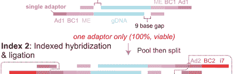

单接头
9 碱基间隙

MI BC1 AD

DNA
9 碱基间隙

索引：2. 索引杂交交与连接

仅一个接头 (100%, 可)

环化

DNA
9 碱基间隙

仅一个接头 (100%, 可)

混合并按细胞后细胞核排序

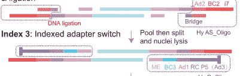

混合后

索引：3. 索引接头切换

桥接

DNA 连接

用非尿嘧啶依赖性聚合酶补齐

使用 LNA 引物添加反向引物

混合后排序

索引：2. 使用尿嘧啶处理聚合酶进行索引 PCR

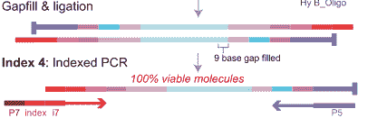

补齐与连接

索引：4. 索引 PCR

100% 可用分子

100% 可用分子但 PCR 效率低

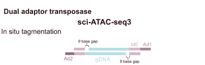

双接头切换

sci-ATAC-seq3

### 10xATAC

原位连接

批量碎片化

9 碱基间隙

MI BC1 N

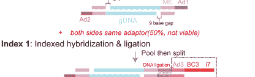

9 碱基间隙

MI BC1 AD

9 碱基间隙

MI BC1 N

+ 两侧相同接头 (50%, 不可用)

+ 两侧相同接头 (50%, 不可用)

补齐

索引：1. 索引杂交连接

索引：1. 凝胶珠引物启动
仅 25% 可用分子

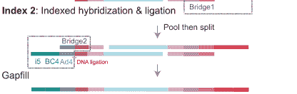

DNA 连接

MI BC3

桥接

索引：2. 索引杂交连接

核苷酸延伸，线性扩增

索引：2. 混合单细胞库并进行索引 PCR

补齐

混合后排序

索引：3. 索引 PCR

仅 25% 可用分子

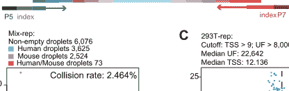

PS Index

混合后排序

和细胞核

PS Index

B 混合

非空 (6,076)
小鼠复合 (6,272)
小鼠插入 (2,534)
人/小鼠 (257)
碰撞率: 24.64%

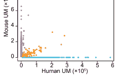

C291-rep

Cuffseq: TSS > 9: 8,000
中 TSS: 22,042
中 DN: 26,085
中 TSS: 12,757

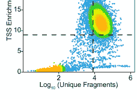

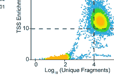

(下一页图例)

图 S1. UUATAC-seq 与四 scATAC 方法的对比，于图 1
(A) UUATAC-seq 使用同源转座酶和温度控制接头切换来增加灵敏度，并通过四轮条形码提高通量。与 s3-ATAC、sc-ATAC-seq、Hydro-ATAC 和 10× scATAC 相比具有显著优势。
(B) 高密度人/小鼠细胞混合的碰撞率。在高密度孔中收集了 10,000 个细胞核。
(C) 293T（左）和 3T（右）的 TSS 富集分布和每个细胞的 UF 数量（每个点），按密度染色。黑色虚线表示质量控制过滤器。

## 资源

## CellPress Open Access

## A
41,672 个细胞核

## B
8,557 个细胞核

## C
分子捕获效率

## D
每 3,000 个细胞核的 Reads

## E
提供者率

## F
11,482 个内皮细胞核

### J

CCA 映射后 scRNA-seq 和 sci-ATAC-seq 的组织来源

- 脑
- 心脏
- 结肠
- 细胞内
- 肾
- 肝
- 肌肉
- 肌肉肌
- 脾
- 测试

图 S2. UUATAC-seq 数据质量，于图 2
(A) 41,672 个成年小鼠脑细胞的单细胞可及性分布。启用六个索引。每个索引标记约 1/6 样本。
(B) 来自其中一个索引的 8,557 个细胞的单细胞可及性分布。
(C) 显示正向和反向捕获效率的箱线图，包括同时正向和反向捕获的百分比（左）和总分子回收的百分比（右）。在 500 个细胞的随机样本中，同时正向和反向捕获的百分比（E）指的是正向和反向的 reads。总分子回收的百分比计算为同时正向和反向捕获的百分比。
(D-F) 采样 3,000 个细胞核中峰 Reads 数量 (D)、启动子 Reads 数量 (E) 和启动子比例 (F) 的比较。(G) 线性拟合的散点图显示了 FRIP（左）之间的正性和 FRIP（右）之间的负相关。省略了数据点。
(H) 数据集的 UMAP 图，按 scRNA 细胞类型标签染色。
(I) 显示 scRNA 细胞与 snATAC 细胞组织来源匹配的桑基图。

## 资源

## CellPress Open Access

(F) 与新旧已知 cCREs 相关的富集细胞类型。
(G 和 H) 柱状图显示了肾腺 (G) 和垂体 (H) 中新 cCREs 的 H3K4me1、H3K4me3 和 CTCF CUT&Tag 信号。
(I 和 J) 散点图显示了四种 (I) 和八种 (J) 物种开放区域数量与基因组大小之间的 Pearson 相关。虚线代表线性回归拟合，灰色阴影区域表示 95% 置信区间。图中 Pearson 相关系数 (R) 和相应的 p 值。

## 细胞资源
## CellPress 开放获取

## A
## 潜在调节相互作用数量

| 物种 | 蝾螈 | 小鼠 |
| --- | --- | --- |

## B
蝾螈外周血单核细胞

## C
小鼠与蝾螈内皮细胞的比较
- T53 处的开放区域
- 近端启动子处的开放区域

## E
心脏中的 Ga1（心肌细胞）
chr10:56,373-58,523

## F
肾上腺中的 Nr51（肾上皮皮标记物）
chr2:38,919-38,747.421

## G
垂体中的 Six1（垂体干细胞标记物）
chr6:71,913-71,784

## H

## I

（图例见下一页）

图 S4. 小鼠与蝾螈调节相互作用的比较，相关图 4

(A) 直方图显示了小鼠和蝾螈中每个基因潜在调节相互作用的数量。右面板是左面板的放大视图，用于显示较小的值。比较分析仅包含 Cicero 协同开放性高于 0.5 的相互作用。比例尺为 2 µm（插图）。显示了其中一个 3D 切片。
(B) 新生 60 分钟脉冲 RNA-seq 占据了与 Hoechst 染色染色质相邻的去染色空间。
(C) 箱线图显示了 scRNA seq 数据集中蝾螈和内皮细胞的基因数量（左）和 UMI 数量（右）。两两比较的统计显著性使用 Wilcoxon 秩和检验确定。
(D) 散点图显示了距离 TSS 1 kb 范围内 cCREs 与 cCREs 之间的大小分布差异，所有顶点中一个约为 250 bp，而另一个约为 900 bp。
(E) UATAC-seq 中宽和窄 cCRE 信号的可视化，结合染色质免疫沉淀 (ChIP-seq) H3K4me1 和 H3K4me3 信号，如颜色所示。
(F 和 G) 肾上腺和垂体样本中 Nr5a1 区域 UATAC-seq 宽和窄 cCRE 信号的可视化，以及 CUT&Tag 信号。
(H) 基因可及性热图显示了五种物种间基质系的表达分散，如比例尺所示（log2 转换后的倍数变化）。
(I) 显示五种物种基质细胞 mTOR 通路基因可及性的特征图。颜色代表 log 转换后的可及性评分。

## 细胞资源
## CellPress 开放获取

A chr1:161,244,053-161,684,796 440 kb 161,000 kb 161,700 kb

| | PCGF41 | MPR | CDHC | CNAP128 | 3R_952374 | HSR46 | FGFR34 | FGFR3C | IRNA |
| --- | --- | --- | --- | --- | --- | --- | --- | --- |
| [0-0.42] | | | | | | | Endothelial_Hnd2 |
| [0-0.36] | | | | | | | Endothelial_Nef |
| [0-0.30] | | | | | | | Endothelial_Ramp3 |
| [0-0.25] | | | | | | | Liver sinusoidal |
| [0-0.20] | | | | | | | Lymphatic endothelium |
| [0-0.15] | | | | | | | Muscular endothelium |
| [0-0.10] | | | | | | | Neural endothelium |
| [0-0.05] | | | | | | | Pulmonary endothelium |
| [0-0.05] | | | | | | | Catas_Endothelial1 |
| [0-0.10] | | | | | | | Catas_Endothelial2 |
| [0-0.15] | | | | | | | Catas_Endothelial3 |
| [0-0.17] | | | | | | | ChIP_P0mw2_endo |
| [0-0.20] | | | | | | | ChIP_P0mw3_endo |
| [0-0.24] | | | | | | | CAGE_minus_end |
| [0-0.29] | | | | | | | CAGE_plus_end |

（图例见下一页）

图 S5. NovaCE 揭示调节序列模式，相关图 B
(A) 侧面板显示了 chr16:124,453–161,798 处 Catas scATAC-seq 数据和 ENCODE DNase-seq/CAGE-seq数据的人类内皮细胞预测信号。预测区域已高亮。
(B) 树图显示了使用 TF-Modis 算法从五种物种红细胞中提取的基序模式聚类。
(C) 使用 TomTom 算法查询 RcTarget 与模型提取的小鼠模式已知转录因子结合位点 (TFBS) 的比较。

## 细胞资源
## CellPress 开放获取
## 跨物种泛化

- 预测巨噬细胞
- 预测巨噬细胞

- 目标巨噬细胞
- 目标巨噬细胞

- 预测巨噬细胞
- 预测巨噬细胞

- 目标巨噬细胞
- 目标巨噬细胞

- 预测巨噬细胞
- 预测巨噬细胞

- 目标巨噬细胞
- 目标巨噬细胞
## B
## D

图 6. NwaCE 跨物种预测，相关图 6
(A) 巨噬细胞在人类、猕鼠和鼠中的 UATAC-seq 预测信号的可视化。
(B-D) 显示 NwaCE 细调后的基因可及性、表达水平 (C) 和 scATAC-seq (D)。

## 细胞资源
## CellPress 开放获取
## A
## 序列聚类

0
1
2
3
4
5
6
7
8
9
10
11
12

## B
防御反应调节
细胞周期
免疫反应调节
细胞激活调节
脂质和代谢过程
化学刺激感觉
感知介导的化学刺激感觉
外部刺激感觉
受体介导的光感觉感觉
压力反应调节
对细胞的调节
调节(细胞活性)
调节(细胞激活)
模式过程
模式规格过程
蛋白质稳态
泛素化依赖的蛋白质分解代谢过程
细胞周期
RNA产生
金属离子运输调节
细胞运输
肌肉细胞发育
分裂组织发育

## C
## hg38 HBG1/HBG2 上游 220bp (chr11:5,254,781-5,255,001)

## D
## NWweca (基础预测)

## Malinois 预测

## ChromBPnet 预测

图 57. NWweca 揭示调节序列和突变效应，相关图 7
(A) 使用 NWweca 模型从 ResNet 层提取的序列聚类的 UMAP 可视化。富集 q 值的 Z 得。
(B) 热图显示了 GO 基因本体富集中每个序列的前五个术。颜色标尺代表显著性
（下页继续）

## 细胞资源

## CellPress 开源访问

(C) 通过微调后的 NvCAE 模型计算的红系细胞中 chr1:3,254,781–5,255,281 处 $\gamma$-珠红蛋白 (HbG) TSS 上游 500 bp 区域的 ISM 分数。匹配 CCAAT 盒（正向影响）和潜在 TAL1 基序（负向影响）的序列分别用蓝色和灰色框标出。
(D) 每个 ABE 位点的预测影响与在人类 CD34+ 细胞中通过 ABE 碱基编辑筛选量的 HBG1/2 Z 分数线性模型系数之间的相关性，分别对应 NvCAE 模型（左）、Malinos 模型（中）和 ChromBPNet 模型（右）。实线代表线性回归拟合，灰色阴影区域表示 95% 置信区间。图中显示了皮尔逊相关系数 (R) 和相应的 $p$ 值。
