# 
应用数学在密码学和信息安全中的实践


Version 1.0

All trademarks are trademarks of their respective owners. Rather than put a trademark symbol after every occurrence of a trademarked name, we use names in an editorial fashion only, and to the benefit of the trademark owner, with no intention of infringement of the trademark. Where such designations appear in this book, they have been printed with initial caps.

McGraw-Hill Education eBooks are available at special quantity discounts to use as premiums and sales promotions or for use in corporate training programs. To contact a representative, please visit the Contact Us page at [www.mhprofessional.com](http://www.mhprofessional.com).

Information has been obtained by McGraw-Hill Education from sources believed to be reliable. However, because of the possibility of human or mechanical error by our sources, McGraw-Hill Education, or others, McGraw-Hill Education does not guarantee the accuracy, adequacy, or completeness of any information and is not responsible for any errors or omissions or the results obtained from the use of such information.


*This book is dedicated to the men and women working in military and intelligence agencies who implement cryptography, work with cryptanalysis, and apply cryptography to computer security.*

#### **About the Author**

**Chuck Easttom** has more than 20 years of experience working in various aspects of the computer industry. For the past 15 years, he has focused primarily on computer security. He has wide experience in security, penetration testing, and forensics, but his favorite security topic is cryptography. Easttom has taught cryptography to U.S. government personnel, Department of Defense–related personnel, and friendly foreign governments. Of his six computer science patents, one is a method of distributed steganography. He has published papers on cryptography, and his various computer security books always include chapters on cryptography. He is a frequent speaker on cryptographic topics including RSA encryption, cryptographic backdoors, and cryptanalysis.

Easttom’s security-related background includes 30 industry certifications, work with various vendors in the creation or revision of their certification tests, years of hands-on direct experience, and extensive teaching experience.


    **3.**  下列哪种方法使用了带有文字缠绕的圆柱？

         **A.**  维纳尔密码

         **B.**  杰斐逊磁盘

         **C.**  密码磁盘

         **D.**  Scytale

    **4.**  什么是仿射密码？

         **A.**  任何形式的 ax + b (mod m) 的密码

         **B.**  仅单字母替换密码

         **C.**  任何单字母替换密码

         **D.**  多字母密码

    **5.**  混合字母替换的关键特征是什么？

         **A.**  使用多个替换字母表。

         **B.**  同一平文字母可能有多种密文表示。

         **C.**  密文在音调上与明文相似。

         **D.**  它结合了替换与转位。

### 答案

    **1.**  A

    **2.**  C

    **3.**  D


## 4
A

## 5
B

#### Endnotes

1. Bruce Schneier, “The Strange Story of `DUAL_EC_DRBG`,” [`www.schneier.com/blog/archives/2007/11/the_strange_sto.html`](http://www.schneier.com/blog/archives/2007/11/the_strange_sto.html).

2. Merriam-Webster Dictionary, [`www.merriam-webster.com/dictionary/cryptography`](http://www.merriam-webster.com/dictionary/cryptography).

3. Columbia University “Introduction to Cryptography” course, [`www.cs.columbia.edu/~hgs/teaching/security/slides/crypto2.pdf`](http://www.cs.columbia.edu/~hgs/teaching/security/slides/crypto2.pdf).

4. For more about 更多关于单词和字母频率的信息，请参见“`Puzzle Barron’s Cryptograms`,” [`www.cryptograms.org/letter-frequencies.php`](http://www.cryptograms.org/letter-frequencies.php); “Cornell University Letter Frequency: “Letter Frequencies in English,” [`www.letterfrequency.org/`](http://www.letterfrequency.org/).

5. Suetonius, `Lives of the Caesars` (Oxford University Press, 2009).

6. Ken Harthun discusses the use of `ROT 13` in the Windows Registry in “`How to Use the Windows Registry for Cyber Forensics: Part 2`,” at [`http://itknowledgeexchange.techtarget.com/security-corner/how-to-use-the-windows-registry-for-cyberforensics-part-2/`](http://itknowledgeexchange.techtarget.com/security-corner/how-to-use-the-windows-registry-for-cyberforensics-part-2/).

7. Tap codes were discussed in “`Return with Honor`,” an episode of `American Experience` on PBS television. For information on the POWs’ use of the tap code, see [`www.pbs.org/wgbh/amex/honor/sfeature/sf_tap.html`](http://www.pbs.org/wgbh/amex/honor/sfeature/sf_tap.html).

8. Jim and Sybil Stockdale, `In Love and War: The Story of a Family’s Ordeal and Sacrifice During the Vietnam Years` (Harper & Row, 1984).

9. From Plutarch’s `Parallel Lives`, “The Life of Lysander”: [`http://penelope.uchicago.edu/Thayer/E/Roman/Texts/Plutarch/Lives/Lysander*.html`](http://penelope.uchicago.edu/Thayer/E/Roman/Texts/Plutarch/Lives/Lysander*.html).

## 2  

## History of Cryptography from the 1800s

## In this chapter we will cover the following:

 `Playfair cipher`

 `Two-square and four-square ciphers`

 `Hill cipher`

 `ADFGX and ADFGVX ciphers`

 `Bifid ciphers`

 `Gronsfeld cipher`

 `Vernam cipher`

 `Enigma`

 `Historical figures in cryptography`

In Chapter 1, you were introduced to several relatively simple ciphers that were widely used for many centuries. Beginning in the 1800s, the art of cryptography entered an age of growth as more complex ciphers were developed. In this chapter we will look at the end of the classical (pre-computer) days of cryptography and continue on to the 20th century. The ciphers in this chapter are, for the most part, more complex than those of Chapter 1. You may find yourself having to reread the descriptions of some. If you have any difficulty with a cipher, I urge you to take a pencil and paper and experiment with it until you are comfortable.

### Cryptography Marches On

Although these ciphers are more complex than those in Chapter 1, they are still not adequate for the modern computer age, so it would be an egregious mistake to attempt to implement one of these, perhaps via computer code, and then presume your data is secure. Modern computers can utilize brute-force methods, and, in fact, noncomputerized cryptanalysis methods have been developed to attack many of these ciphers. I examine those methods in Chapter 17, when we explore cryptanalysis in general.

**Tip**

Most people have some level of difficulty with cryptography when they first encounter it. In this chapter, as well as the rest of this book, keep in mind that some topics will require some hands-on practice and others will require reading the text more than once. But make sure you fully understand a topic before moving on to the next topic.

### Playfair Cipher

The `Playfair cipher` was invented in 1854 by Charles Wheatstone, but it was popularized by Scottish politician and scientist Lord Playfair, thus it bears his name. This cipher works by encrypting pairs of letters, also called `digraphs`, at a time. Although it was first rejected by the British government as being too complex, it was actually used by the British military in World War I and to some extent in World War II. It was also used by the government of New Zealand as late as the early 1940s for non-military communications.

**Note**

Charles Wheatstone (1802–1875) was an accomplished inventor and scientist. Among his various contributions to science was the `Wheatstone bridge`, an electrical circuit that is used to measure electrical resistance. The original bridge was invented by Samuel Hunter Christie, but Wheatstone improved it. Wheatstone also made a number of contributions to our knowledge and application of electricity.

The `Playfair cipher` depends on a 5-by-5 table, or matrix, that contains a keyword or key phrase. To use the `Playfair cipher`, you need to memorize that keyword and four rules. Any square of 5-by-5 letters can be used. You first fill in the keyword, and then start, in order, adding in letters that did not appear in the keyword. Note that the letters `I` and `J` are combined. You can see this in the table below. In this example the keyword is `falcon`.

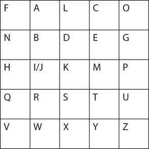

Since the 5-by-5 matrix is created by starting with a keyword, and then filling in letters that did not appear in the keyword, the matrix will be different when different keywords are used.

The next step is to divide the plain text into digraphs (combinations of two letters). In this case, `Attack at dawn` becomes `At ta ck at da wn`. If the final digraph is incomplete (a single letter), you can pad it with a letter `z`. If there are any duplicate letters, replace the second letter with an `x`. For example, `puppet` would be `pu px et`. `Playfair` does not account for numbers or punctuation marks, so you must remove any punctuation from the plain text and spell out any numbers.

Next, you look at the plain text digraph—in our case `At ta ck at da wn—` and find the pairs of letters in the table. Look to the rectangle formed by those letters. In our example, the first two letters, `AT`, form the rectangle in the table as shown next, with `A` in the upper-left corner and `T` in the lower-right corner.

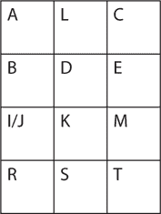

Use the letters at the opposite ends of the rectangle to create the cipher text. The letter `A` is in the upper-left corner, so you replace it with whatever appears in the upper-right corner, which in this case is the letter `C`. The letter `T` is in the lower-right corner, so you replace it with the letter in the lower-left corner, which is `R`. So the letters `AT` are enciphered as `CR`.

Just to make sure you’re clear, let’s continue with a few more examples. The next digraph is `TA` and will form the same rectangle in the table. However, since `T` is the first letter of the plain text, `R` will be the first letter of the cipher text, yielding `RC`. Next we have `CK`. Those letters form the rectangle shown here:


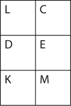

*C* 变成 *L*，*K* 变成 *M*，所以加密后的字母是 *LM*。如果你继续把这段明文加密到底，


会得到


是的，这种密码需要一些练习才能掌握。

注意，这种密码通过加密双字母（digraphs）而不是单个字母，破坏了单字母替换密码中常见的字母和词频。

### Two-Square Cipher

*Two-Square Cipher*（也称为双 Playfair）之所以得名，后面会说明。它和 Playfair 一样，以双字母（digraphs）为单位工作。有两种变体：水平式和垂直式，指的是表格的两个方块如何排列。在水平方式中，两个方块并排放置；在垂直式中，两个方块上下堆叠。每个方块需要一个关键词，因此 Two-Square Cipher 同时使用两个关键词和两个矩阵。

让我们用关键词 *falcon* 和 *osprey* 的垂直 Two-Square Cipher 来举例：

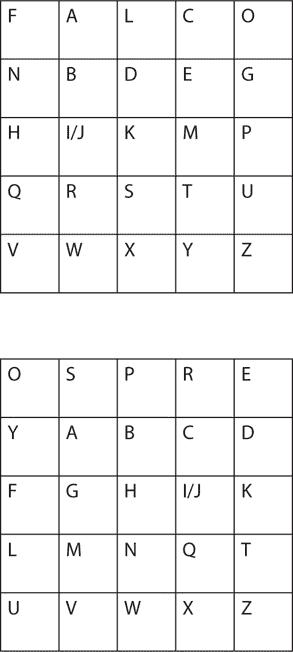

和 Playfair 类似，明文先被分成双字母。例如 *Attack at dawn* 变为 *At ta ck at da wn*。

接下来，像 Playfair 那样形成一个矩形，但这个矩形横跨两个表格。找到明文第一个字母在上表中的位置，第二个字母在下表中的位置。在此例中，*A* 在上表，*T* 在下表，形成如下所示的矩形：

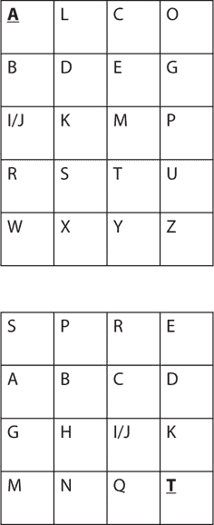

* A* 位于上表的左上角，因此用上表右上角的字母替换，即 *O*。  
* T* 位于下表的右下角，因此用下表左下角的字母替换，即 *M*，得到密文 *OM*。

如果你把整段明文按此过程加密，得到的密文如下：

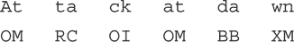

注意：如果双字母在两个表中位于相同的列（即对齐），则密文与明文相同。若使用水平 Two-Square Cipher，则当两个字符在同一行时也适用此规则。

### Four-Square Cipher

从字面上可以推测，*Four-Square Cipher* 是将 Playfair 概念扩展为使用四个方块。该密码由法国人 **Félix Marie Delastelle**（1840–1902）发明，他还发明了 bifid、trifid 以及四方格密码。

**Note**  
Delastelle 在 1800 年代对密码学的贡献很多。他仅用 11 个月就完成了《Elementary Treatise on Cryptography》（*Traité Élémentaire de Cryptographie*）一书，这本书在 1902 年 4 月他去世后 3 个月出版。值得注意的是，Delastelle 是一位业余密码学家，没有数学正式训练。

要构造四方格密码，首先需要创建四个 5×5 的字母矩阵；通常要么省略 *Q*，要么把 *I* 与 *J* 合并，以凑齐 26 个字母。下面的矩阵示例中，有的省略了 *Q*，有的合并了 *I* 与 *J*。还要注意，字母在矩阵中可能有序也可能无序。在本密码中，两个大写矩阵用于密文，两个小写矩阵用于明文。因此，两个大写矩阵的顺序不一定是字母表顺序。

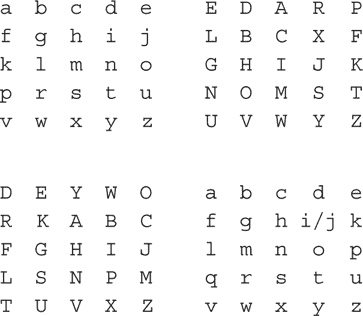

随后，将信息分成双字母，例如 *Attack at dawn* 变为 *at ta ck at da wn*。

下面的步骤可能看起来有点复杂，请仔细跟随。首先，在左上角的明文矩阵中找到第一个字母。这里 *a* 位于第一行。然后，在右下角的明文矩阵中找到第二个字母。这里 *t* 位于第四列。这两个字母以粗体并加下划线标出：

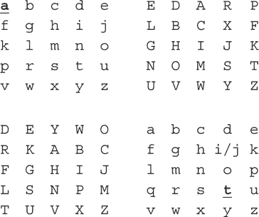

由于我们处理的是双字母，需要分别对 *a* 与 *t* 进行加密。要得到密文的第一个字母，使用上左矩阵的第一字母所在行（这里 *a* 在第 1 行）以及下右矩阵中第二字母所在列（*t* 在第 4 列）。在上右密文矩阵中找到对应的字母——第 1 行第 4 列是 *R*，这就是密文的第一个字母。

得到第二个字母的方法是：使用第二字母的行（*t* 在第 4 行）和第一字母的列（*a* 在第 1 列）。在下左密文矩阵中找到对应的字母——第 4 行第 1 列是 *L*。可以在下面的四个矩阵中看到，明文字母以粗体显示，密文字母以粗体并加下划线显示。

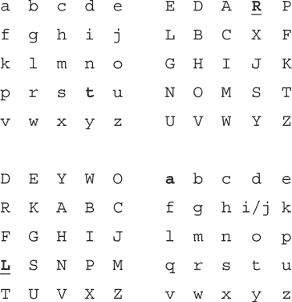

因此，明文的前两个字母 *at* 变为密文 *RL*。你会继续对整段明文进行同样的操作，得到如下密文：

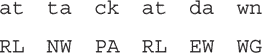

### Hill Cipher

*Hill Cipher* 由数学家 **Lester S. Hill** 在 1929 年发明。它比我们之前学过的其他密码更为复杂，基于线性代数，使用矩阵运算。加密时，明文被分成一个由 *n* 个字母组成的块（称为 *n*‑component vector）。每个字母用数字表示（a = 1，b = 2，c = 3，以此类推），数字映射不影响结果——例如，有些实现从 a = 0 开始。代表明文块的数字矩阵乘以一个可逆的 *n*‑by‑*n* 矩阵，再对 26 取模（mod 26）。（如果你对数学不熟悉，这可能会让人望而却步——别担心，下面会全部解释清楚。）

**Note**  
Lester Hill 是一位数学家，1911 年从哥伦比亚大学获得学士学位，1926 年在耶鲁大学获得博士学位。他在包括普林斯顿大学和耶鲁大学在内的多所院校任教。其研究兴趣包括将数学应用于通信，这正是 Hill Cipher 所体现的。他还致力于寻找电报通信中的错误。

用于该密码的矩阵即为密钥。它应随机选择并对 26 取模（26 对应英文字母表；其他字母表则需相应调整）。下面给出我们讨论时使用的矩阵示例：

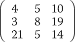

**Note**  
虽然我展示的是 3×3 矩阵，但只要是方阵即可使用任何大小。

对于不熟悉矩阵运算的读者，我只提供足够的说明来理解 Hill Cipher。第 4 章和第 5 章将为密码学提供更系统的数学入门。

为了让大家更直观地理解矩阵乘以向量，下面给出一个例子（使用字母）：

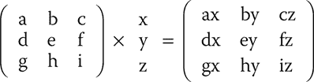

每一行的矩阵分别乘以向量中的每个元素，得到结果矩阵。

在 Hill Cipher 中，向量就是代表明文块的数字。下面的转换假设 1 = a，2 = b，以此类推：


得到

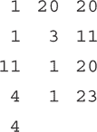

接下来，将明文分成三字符块：


对每个向量与密钥矩阵相乘。例如，第一行的计算如下：

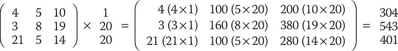

得到的向量 (304, 543, 401) 需要对 26 取模，得到


Next, you convert these numbers back to letters. The letters `ATT` in plain text encrypts to `TXM` (if we assume a = 1). Repeat this process for each block of letters until the entire message is encrypted. To decrypt a message, you need to convert the letters of the cipher text back to numbers, and then, taking blocks of cipher text, multiply them by the inverse of the key matrix.

### ADFGX and ADFGVX Ciphers

The `ADFGVX cipher` is an improvement on a previous cipher, the `ADFGX`. We will look at both ciphers.

ADFGVX was invented by Colonel Fritz Nebel in 1918 and was used by the German Army during World War I. It is essentially a modified Polybius square combined with a columnar transposition. (Recall from Chapter 1 that you can combine ciphers to create a new cipher.) It is interesting to note that ADFGVX was designed to work well when transmitted by Morse code.

Let us start by examining the first cipher, the ADFGX cipher.

First, create a modified Polybius square. Rather than number coordinates, however, the letters `A, D, F, G`, and `X` are used (the letter `V` is not used to create the modified Polybius square).

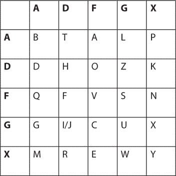

Notice that the letters are not in alphabetic order in the Polybius square. This is a common variation to help make the cipher more secure. Again, the letters `I` and `J` are combined in one square.

The next step is to encrypt the message using this modified Polybius square. Let’s assume the message is `Attack at dawn`. As with the traditional Polybius square, each letter is represented by its coordinates, in this case by two letters:


Next, you write out the message in columns under some keyword; let’s again use `falcon` as our keyword:

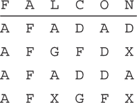

Next, we re-sort the columns after rearranging the letters of the keyword in alphabetic order, so `FALCON` becomes `ACFLNO`, like so:

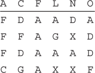

To create cipher text, write down each column in sequence:

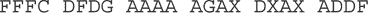

Obviously, you can use any transposition keyword of any size. In practice, longer keywords were frequently used to make the ciphers more secure.

In 1918, the ADFGX cipher was expanded to add the letter `V`, making a 6-by-6 cipher, which allowed for all 26 letters of the English alphabet (no need to combine `I` and `J`) and the digits `0` to `9`. Otherwise, the ADFGVX works exactly the same as the ADFGX cipher.

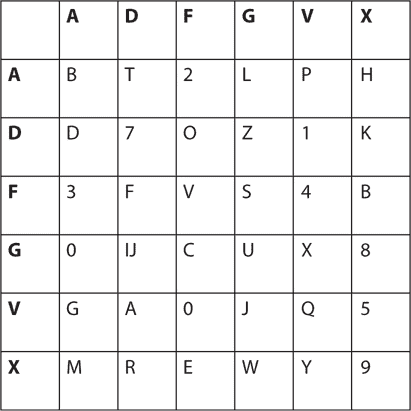

Compared to various classical ciphers, and prior to the computer age, the ADFGVX was a very strong cipher and difficult to break. A French army officer, Lieutenant Georges Painvin, worked on analyzing this cipher and was eventually able to break it. However, his method required large amounts of cipher text to cryptanalyze. This was a forerunner to modern cipher text–only attacks that we will examine in Chapter 17.

### Bifid Cipher

The `bifid cipher` is another cipher that combines the Polybius square with a transposition cipher. It was invented in 1901 by Félix Delastelle (who also created the four-square cipher, discussed earlier in the chapter).

The first step is, of course, to create a Polybius square, as shown here:

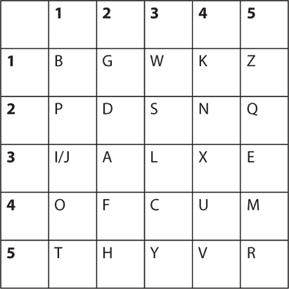

As you can see, the letters in the square are not necessarily in alphabetical order.

The coordinates are written down, as with the traditional Polybius cipher, except each coordinate is written vertically in a column. With this cipher, the phrase `Attack at dawn` is written in 12 columns in two rows, like so:

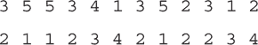

When the numbers are spread out, much like a rail fence cipher, you create the following stream of numbers:

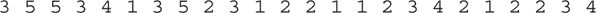

Next, those numbers are paired and converted back to letters:


To decrypt a message, the process is reversed.

### Gronsfeld Cipher

The `Gronsfeld cipher` is a variant of the Vigenère cipher discussed in Chapter 1. It uses 10 different alphabet orderings that correspond to the numbers `0` to `9`. The numbers can be picked at random, which is more secure but more difficult to remember, unless the numbers had some significance to the sender and recipient.

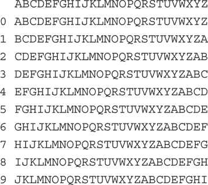

For this cipher, you select each letter of plain text and substitute it for the cipher text corresponding to the appropriate alphabet. So you’d use alphabet 0 for the first letter, then alphabet 1 for the next letter, then alphabet 2, and so on. After you use alphabet 9, you start over with alphabet 0.

To encrypt the plain text `Attack at dawn`, you find the letter corresponding to `A` in alphabet 0, yielding `A` as the cipher text. Then you find the letter corresponding to `T` in alphabet 1, yielding `U` as the cipher text. Then you find the second `T`, and the third alphabet (alphabet 2) yields `V`. Continuing this process move down the rows of alphabets until


is encrypted as


As an interesting historical note, as late as 1892, the Gronsfeld cipher was still being used: the French government arrested several anarchists who were using it for communications.

### Vernam Cipher

The `Vernam cipher` is a one-time pad cipher, in which the plain text is somehow altered by a random string of data so that the resulting cipher text is truly random. Gilbert Vernam (1890–1960) first proposed a stream cipher that would be used with teleprinters (teletype machines). It would combine character-by-character a prepared key that was stored on a paper tape, with the characters of the plain text used to produce the cipher text. The recipient would apply the same key to read the plain text.

In 1919, Vernam patented his idea (U.S. Patent 1,310,719). In Vernam’s method he used the binary XOR (exclusive OR) operation applied to the bits of the message. (We will be examining binary operations, including XOR, in Chapter 3.) (Note that Vernam also patented three other cryptographic inventions: U.S. Patent 1,416,765; U.S. Patent 1,584,749; and U.S. Patent 1,613,686.)

To be a true one-time pad, by modern standards, a cipher needs two properties. The first is suggested by the name: the key is used only once. After a message is enciphered with a particular key, that key is never used again. This makes the one-time pad quite secure, but it is also very impractical for ongoing communications, such as those encountered in modern e-commerce. The second property is that the key be as long as the message, which prevents any patterns from emerging in the cipher text.

**Note**

One-time pads are used for communications today, but only for the most sensitive communications. The keys must be stored in a secure location, such as a safe, and used only once for very critical messages. The keys for modern one-time pads are simply strings of random numbers sufficiently large enough to account for whatever message might be sent.

* * *

**Edgar Allen Poe**

Although Edgar Allen Poe is most known for his literary works, he also was an accomplished amateur cryptographer. In 1841, Poe wrote an essay entitled “A Few Words on Secret Writing” that was published in *Graham’s Magazine*. In addition, in his short story “The Gold-Bug,” cryptography plays a central role in the plot. Poe is not known to have researched cryptography, nor did he create any ciphers, but he did play a key role in increasing public interest in the field of cryptography. In fact, cryptographer William Friedman (1891–1969) credited his interest in cryptography to Poe’s “The Gold-Bug.” Friedman was the director of research for the Army Signals Intelligence Service in the 1930s and is credited with coining the term *cryptanalysis*.


在 1839 年 12 月，普欧在《亚历山大周刊信使》上发表了一个挑战。在该挑战中，他声称自己能够解读读者提交的任何单字符换密码。他的挑战写道：

> 它绝对不会是徒劳无功去展示破译谜题有多大程度的严格方法。这听起来可能很奇怪；但这并不比众所周知的事实更奇怪——即确实存在规则，能够轻松破译任何种类的象形文字，也就是说，在字母表字母之外，随意使用各种符号的书写方式。例如，把 A 用%或其他任意字符代替，把 B 用*，等等。让整个字母表以这种方式构建，然后用这个字母表对任何书写内容进行编码。这种书写可以通过正确的方法进行阅读。让我们把它付诸实践。让任何人向我们寄一封使用这些字符的信，我们承诺立即阅读它——无论使用的字符多么不寻常或随意。^(1)

从 1839 年 12 月到 1840 年 5 月，普欧能够解读读者提交的所有密码——除了一个。此后，各分析人员确定该密码仅仅是一串随机字符，而不是真正的密码文本。

* * *

### 加密艺术兴起

19 世纪到 20 世纪初期使用的各种密码，显然比早期的密码更为复杂。但它们仍然是可以通过铅笔和纸张手动解密的密码。20 世纪，密码学转向了与设备相关的加密及替代加密方法。

#### Enigma

与流行误解相反，`Enigma` 并非单一机器，而是一系列机器。第一个版本由德国工程师阿瑟·舍布希于第一次世界大战结束前发明。它还被多个军队使用，而不仅仅是纳粹德国。

一些军事文本使用了 Enigma 的一种版本，这些文本由波兰密码分析家 Marian Rejewski、Jerzy Różycki 和 Henryk Zygalski 破解。这三位基本逆向工程出一个可工作的 Enigma 机器，并开发了破解 Enigma 密码的工具，其中包括一种称为 `cryptologic bomb` 的工具。

`rotors`（转子）是 Enigma 机器的核心——圆形排列的包含 26 个字母的圆盘，多个转子可以对齐。基本上，每个转子代表一种不同的单字符换密码——你可以把 Enigma 看作一种机械化的多字母替换密码机。当操作员输入明文信息后，Enigma 会根据不同的替换字母表为每个字母提供不同的密文。接收方输入密文即可获取明文，前提是两台 Enigma 机器的转子设置相同。Figure 2-1 展示了一台 Enigma 机器。

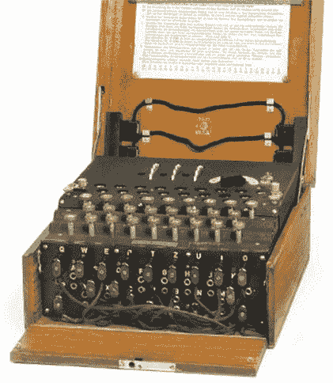

* * *

**FIGURE 2-1    An Enigma machine**

##### Enigma Variations

Enigma 系列包括以下变体：

   Enigma A，第一台公开的 Enigma

   Enigma B

   Enigma C

   Enigma B，被英国、日本、瑞典等国使用

   Navy Cipher D，由意大利海军使用

   Funkschlüssel C，由德国海军自 1926 年起使用

   Enigma G，由德国陆军使用

   Wehrmacht Enigma I，是对 Enigma G 的修改，德国军队广泛使用

   M3，1930 年为德国军队引入的改进型 Enigma

其他系统要么来源于 Enigma，要么概念相似，包括美国密码学家代号 GREEN 的日本系统、SIGABA 系统、NEMA 等。

##### Alan Turing

如果不提及阿兰·图灵，就无法讲述 Enigma 的故事。图灵因率领团队破解德国海军在二战期间使用的 Enigma 版本而闻名，这个故事被《Alan Turing: The Enigma》一书和电影《The Imitation Game》永载史册。二战期间，图灵在政府密码与密码学校（Government Code and Cipher School）工作，该学校位于距伦敦西北 50 英里的布莱切利公园（Bletchley Park）。这座庄园及其 58 英亩土地是由 MI6（英国情报局）购买，用于容纳密码与密码学校。布莱切利公园的著名人员包括数学家 Derek Taunt 和 Max Newman，以及国际象棋冠军 Hugh Alexander。

图灵对密码学领域的影响深远。他率领负责破解德国海军 Enigma 的英国团队，并致力于改进二战前波兰机器以寻找 Enigma 设置。他成功了，MI6 能够解读德国海军的密码信息。此工作高度机密，他们担心如果德国人发现 Enigma 被破解，他们会改变通信方式。因此，图灵团队获得的情报被严格保密，需要与其他人员（如军事指挥官）共享时，会提供掩护故事来说明信息来源。许多来源声称，图灵在布莱切利公园的工作至少缩短了两年战争，挽救了数百万人的生命。

**Note**

阿兰·图灵是一位数学家，同时也是资深马拉松跑者。他也是计算机科学发展的关键人物。其最著名的成就之一是提出了判断机器是否具有 sentience 的 `Turing Test`。

布莱切利公园的工作历来严格保密，战后数十年许多细节被解密并向公众公开。图灵团队并非布莱切利公园唯一的工作团队。园区的各个“小屋”（huts）用于不同目的。图灵及其团队在 Hut 8 处研制海军 Enigma。在 Hut 6，一支团队负责军队和空军 Enigmas。Hut 7 专注于日本密码和情报。其他小屋用于情报工作和支援工作（如通信、工程），Hut 2 则是休闲小屋，让布莱切利公园的工人可以喝啤酒、茶并放松。

Hut 8 的工作重点在于使用 `bombe`，一种电 electromechanical 设备，用于确定 Enigma 机器的当前设置。最初在布莱切利公园使用的设计由图灵提出，后由如英国数学家戈登·韦尔曼（Gordon Welchman）等人进行改进。

布莱切利公园的工作被绝密，战后大量设备和文档被销毁。甚至亲属也不知道其家人在布莱切利公园做了什么。如今，这里设有一座博物馆，展示密码学历史，包括 Enigma 机器。

##### SIGABA

`SIGABA` 是二战期间美国军队以及 1950 年代使用的加密机，专门研发以克服 Enigma 等转子系统的弱点。你可以在当今找到该机器的详细规格，但其部分工作原理直到 2000 年才解密。SIGABA 于 1944 年 12 月 15 日专利（6,175,625），但该专利在 2001 年才解除机密。Figure 2-2 展示了 SIGABA 机器的图片。

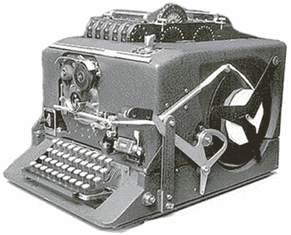

* * *

**FIGURE 2-2    SIGABA machine**


-   在 20 世纪中叶，多种类似设备被使用，包括英国空军部的`Mercury`设备，该设备在 1960 年代初期使用。`Mercury`由`E.W. Smith`和`F. Rudd`设计，并于 1950 年在英国军队中广泛使用。其他基于转子的机器也广泛使用，包括`M-325`或`SIGFOY`（美国专利 2,877,565），该设备于 1940 年代初期由美国外交服务使用。法国政府在 1950 年代也使用了一个转子机器`HX-63`，该设备由瑞士通信设备制造商`Crypto AG`设计。1940 年代，美国陆军使用名为`M-228`或`SIGCUM`的设备加密通信。该设备由`William Friedman`设计，后他担任陆军信号情报服务研究主任。

##### Lorenz Cipher

The `Lorenz cipher` is actually a group of three machines—`SZ40`, `SZ42A`, and `SZ42B`—that were used by the German Army during World War II. These machines were rotor stream cipher machines. They were attached to standard teleprinters to encrypt and decrypt messages sent via teleprinter.

* * *

**Navajo Code Talkers**

Although code talkers are not considered ciphers, they are important to include in any history of cryptography. `Phillip Johnston` was raised on a Navajo reservation and was one of the few non-Navajo people who spoke the Navajo language. At the beginning of World War II, he proposed to the U.S. Marine Corps that the Navajo language be used to encode important tactical messages—very few non-Navajo knew the language, and it was an unwritten language, making it difficult for someone to learn it.

`Johnston`’s system was tested and proved that Navajo men could encode, transmit, and decode a three-line message in 20 seconds or less. Time was a critical factor—the machines being used at the time required 30 seconds for the same steps to be accomplished, and in the heat of battle, time is of the essence.

In both World Wars I and II, hundreds of Navajo code talkers were used for secure communications by the U.S. military, specifically by the Marines in World War I. Indigenous code talking was pioneered by Cherokee and Choctaw code talkers during World War I.

* * *

##### IFF Systems

*Identify Friend or Foe*, or `IFF`, was developed during World War II. These systems allowed a friendly aircraft to be identified and thus differentiated from an enemy, or foe. As aircraft have become faster and missile systems reach further, waiting for visual confirmation of friend or foe status is no longer feasible. Most modern systems use cryptographic functions to identify friendly aircraft.

Britain was the first to work out an IFF system. The most primitive of these systems simply sent a prearranged signal at specific intervals. With the advent of radar, it was important to identify what aircraft the radar system had detected. The IFF Mark I was first used in 1939. It was an active transponder that would receive a query (called an interrogation) from the radar system. The query consisted of a distinctive pulse using a specific frequency. The transponder would then respond with a signal that used a steadily increasing amplitude, thus identifying the aircraft as friendly.

By 1940, the Mark III was in use by Western Allies and continued to be used throughout World War II. The Mark III expanded the types of communications that could be accomplished, including a coded Mayday response.

In Germany, IFF systems were also being developed. The first widely implemented system was the `FuG 25a`. Before a plane took off, two mechanical keys were inserted, each with 10 bits. These provided the keys to encode the IFF transmissions. British scientists, however, were able to build a device that would trigger a response from any `FuG 25a` system within range, thus revealing the position of German planes flying at night.

Since World War II, IFF systems have been used for a variety of purposes, operating in four primary modes:

``   Mode 2 is used for landings on aircraft carriers.

``   Mode 3 is a standard system used by commercial (non-military) aircraft around the world to communicate their position for air traffic control.

``   Mode 4 is encrypted and thus secure.

In modern times, secure IFF systems are a part of military air defense operations. Cryptography is critical in ensuring that these systems are secure and reliable.^(2) In some cases, the cryptographic key used is changed daily. These systems represent one very practical application of cryptography, whose primary goal is to ensure that friendly aircraft are not shot down.

#### The NSA: The Early Years

It is impossible to discuss the history of cryptography without including the history of the U.S. National Security Agency (NSA). A large organization, the NSA is often reported to be the single largest employer of mathematicians in the world. The history of cryptography in the latter half of the 20th century, and beyond, is closely intertwined with the history of the NSA.

Although the NSA formally was founded in 1952, it had many precursors. As early as 1919, the U.S. Department of State created the Cipher Bureau, often simply called the “Black Chamber,” which operated in an office in Manhattan. Its main purpose was to crack communications of foreign governments. The operation persuaded Western Union to allow it to monitor telegraphs transmitted by Western Union customers. Although the group had significant initial successes, it was shut down in 1929 by Secretary of State Henry Stimson, who felt that spying was not a gentlemanly or honorable activity.

In 1924, the U.S. Navy formed its Radio Intelligence office with the purpose of developing intelligence from monitoring radio communications. By 1942, the U.S. Army renamed its Signal Intelligence Service to Signal Security Service. At this time, each military branch had its own initiatives on communications, radio intelligence, and cryptography, and cooperation was at a minimum.

In 1949, various military agencies coordinated cryptology activities with a new, centralized organization named the Armed Forces Security Agency, which was part of the Department of Defense rather than a specific branch of the military. In 1951, President Harry Truman set up a panel to investigate the shortcomings of the AFSA, including its failure to predict the outbreak of the Korean War. From this investigation came the National Security Agency. President Truman issued a classified directive entitled “Communications Intelligence Activities” that, among other things, established the NSA.

For much of its early history, the existence of the NSA was not acknowledged, and those who did know of it jokingly referred to the NSA as “No Such Agency.” Obviously, the history of any intelligence agency is not completely public, but let’s examine some highlights that are.

After World War II, Soviet encryption was unbreakable and thus posed a significant issue for U.S. intelligence agencies. This fact, coupled with the discovery of Soviet spies in various western governments, led to a renewed emphasis on signals intelligence (SIGINT) and cryptanalysis.

The NSA had two primary roles, the first being to monitor and decipher the communications of other nations to gather important intelligence. The second role was the protection of U.S. communications from other eavesdropping nations. This led the NSA to develop a standard now known as TEMPEST, an acronym for Transient Electromagnetic Pulse Emanation Standard. This standard applies both to equipment used and deployment and configuration of communications equipment.


During the Cold War, the NSA grew and had some significant successes. As one prominent example, in 1964 the NSA intercepted and decrypted communications regarding China’s first nuclear weapons test. There were many other important communications captured by the NSA, and some are still classified today. In 2013, the *Washington Times* reported that NSA programs have foiled terrorist plots in more than 20 different countries.^(3)

We will revisit the NSA in later chapters, particularly when we study modern cryptographic ciphers such as DES and AES in Chapters 6 and 7, and then when we discuss cryptographic backdoors in Chapter 18.

#### Conclusions

In this chapter you were introduced to more complex ciphers, many of which used tables and matrices to encrypt and decrypt text. You saw variations of the Polybius square you learned about in Chapter 1. The Hill cipher introduced you to the basics of matrix algebra, which you will see more of in Chapter 5. You also learned about contributions to cryptography made by historical figures such as Edgar Allen Poe and Allen Turing.

We examined some significant developments in the history of cryptography, including the famous Navajo code talkers and IFF systems that are critical to air traffic control and air defense. We ended the chapter with a discussion of the history of the National Security Agency and its impact on the history of cryptography.

#### Test Your Knowledge

A few questions are provided here to aid you in testing your knowledge before you proceed.

    **1.**  The \_\_\_\_\_\_\_\_\_\_ is based on using a matrix as the key and using *n*‑letter groups.

    **2.**  Which of the following is a variation of Vigenère that uses ten alphabets, one for each decimal numeral 0 through 9?

         **A.**  Playfair

         **B.**  Hill

         **C.**  Bifid

         **D.**  Gronsfeld

    **3.**  What was Edgar Allen Poe’s main contribution to cryptography?

         **A.**  Popularizing cryptography

         **B.**  Creating the Hill cipher

         **C.**  Creating SIGABA

         **D.**  Breaking the Hill cipher

    **4.**  What did Alan Turing work on?

         **A.**  Breaking the German Naval Enigma

         **B.**  Breaking the German Army Enigma

         **C.**  Breaking all Enigma variations

         **D.**  Breaking the SIGABA system

    **5.**  The \_\_\_\_\_\_\_\_\_\_ cipher works by modifying a Polybius square. Rather than number coordinates, letters are used.

##### Answers

    **1.**  Hill cipher

    **2.**  D

    **3.**  A

    **4.**  A

    **5.**  ADFGVX

#### Endnotes

    **1.**  This citation was included in the article “Edgar Allen Poe and Cryptography,” by R. Morelli, at [www.cs.trincoll.edu/~crypto/historical/poe.html](http://www.cs.trincoll.edu/~crypto/historical/poe.html).

    **2.**  In 2009, General Dynamics awarded a $37 million contract for a modern IFF system: [www.generaldynamics.com/news/press-releases/detail.cfm?customel_dataPageID_1811=6123](http://www.generaldynamics.com/news/press-releases/detail.cfm?customel_dataPageID_1811=6123). In addition, a paper written in 2010 by E.A. El-Badawy, W.A. El-Masry, M.A Mokhtar, and A.S. Hafez, “A secured chaos encrypted mode-S aircraft identification friend or foe (IFF) system” (DOI 10.1109/ICSPCS.2010.5709756), discussed a new technique for IFF.

    **3.**  Kimberly Dozier, “NSA programs broke plots in 20 nations,” [www.washingtontimes.com/news/2013/jun/16/nsa-programs-broke-plots-20-nations-officials/](http://www.washingtontimes.com/news/2013/jun/16/nsa-programs-broke-plots-20-nations-officials/).

### 3  

**Basic Information Theory**

**In this chapter we will cover the following:**

     Information theory basics

     Claude Shannon’s theorems

     Information entropy

     Confusing and diffusion

     Hamming distance and hamming weight

     Scientific and mathematical theories

     Binary math

In this chapter we are going to explore the fundamentals of information theory, which is very important to modern cryptography. Of course, entire books have been written on the topic, so in this chapter we’ll provide just enough information to help you understand the cryptography we will discuss in subsequent chapters. For some readers, this will be a review. We will also explore the essentials of mathematical and scientific theories. This chapter also provides an introduction to basic binary mathematics, which should be a review for most readers.

Although information theory is relevant to cryptography, that is not the only application of information theory. At its core, information theory is about quantifying information. This will involve understanding how to code information, information compression, information transmission, and information security (that is, cryptography).

#### The Information Age

It is often stated that we live in the “information age.” This would clearly make information theory pertinent not only to understanding cryptography, but also to understanding modern society. First, however, we must be clear on what is meant by the phrase “information age.” To a great extent, the information age and the digital age go hand-in-hand. Some might argue the degree of overlap, but it is definitely the case that without modern computers, the information age would be significantly stifled. Claude Shannon, who is considered the father of information theory, wrote his famous paper, “A Mathematical Theory of Communication,” in 1948—long before digital computers even existed.

From one perspective, the information age is marked by the information itself, which has become a primary commodity. Obviously, information has always been of value, but it was historically just a means to a more concrete end. For example, even prehistoric people needed information, such as locations for finding food and game. However, that information was peripheral to the tangible commodity of food. In this example, the food was the goal—the actual commodity. In the information age, the information itself is the commodity.

If you reflect on this even briefly, I think you will concur that in modern times information itself is a product. Consider, for example, this book you now hold in your hands. Certainly the paper and ink used was not worth the price of the book. It is the information encoded on the pages that you pay for. In fact, you may have an electronic copy and not actually have purchased any pages and ink at all. If you are reading this book as part of a class, you paid tuition for the class. The commodity you purchased was the information transmitted to you by the professor or instructor (and, of course, augmented by the information in this book). So, clearly, information as a commodity can exist separately from computer technology. The efficient and effective transmission and storage of information, however, requires computer technology.


# 信息时代的另一种视角是信息的泛滥

几十年前，新闻指的是每日报纸，或者也许是一段 30 分钟的晚间新闻广播。如今，新闻全天候在多个有线电视台和各类互联网站上发布。在我的童年时期，研究意味着去当地图书馆，查阅有限数量的书籍，希望这些书籍不超过十年旧闻。如今，只需点击鼠标按钮，即可获得学术期刊、研究网站、年鉴、词典、百科全书——信息的洪流。因此，我们可以把信息时代视为大多数人能够轻松获取广泛信息的时代。

那些成长于互联网和手机环境、沉浸在海量即时信息中的年轻读者，可能不完全理解信息爆炸的规模。一旦你领悟到信息爆炸的巨大程度，便更能体会**信息理论**的必要性。为了让你对当代文明中正在传输和消费多少信息有一个直观的认识，请参考以下事实：早在 2003 年，专家估计人类在整个历史进程中累计产生了**12 艾字节**（exabytes）的数据。21 世纪的前两年，磁性存储、印刷和胶片等现代媒介仅产生了**5 艾字节**的数据。2009 年，研究人员声称在**单一年份**，美国人消费了**超过 3 兆字节**（zettabytes）的信息。^(1) 截至 2013 年，世界万维网据说存储着**4 兆字节**（4,000 艾字节）的数据。

## 测量数据

如此巨大的数字对大多数人而言难以理解。大多数读者熟悉千字节、兆字节和吉字节，但你可能不太熟悉更大的单位。下面是数据的各种大小：

`Kilobyte` = 1000 bytes  
`Megabyte` = 1,000,000 bytes  
`Gigabyte` = 1,000,000,000 bytes  
`Terabyte` = 1,000,000,000,000 bytes  
`Petabyte` = 1,000,000,000,000,000 bytes  
`Exabyte` = 1,000,000,000,000,000,000 bytes  
`Zettabyte` = 1,000,000,000,000,000,000,000 bytes  

这些惊人的数据规模虽然难以把握，但足以说明**信息理论**为何如此重要。它也直观地展示了，无论是按我们获取的信息量度，还是把信息本身视为商品来衡量，我们确实处于信息时代。

### Claude Shannon

在深入探讨信息理论时，不可或缺的是**克劳德·香农**（Claude Shannon），他常被誉为**信息理论之父**。他是一位数学家和工程师，生于 1916 年 4 月 30 日，逝世于 2001 年 2 月 24 日。香农在数学的电气应用以及密码学方面做了大量工作。他的研究兴趣包括运用**布尔代数**（我们将在第 5 章详细讨论各种代数）和**二进制数学**（本章稍后将介绍）与电磁继电器结合使用。电气开关与二进制数字、布尔代数的配合构成了数字计算机的基础。

**Note**

二战期间，香农在贝尔实验室（Bell Labs）为国防项目工作。其工作的一部分涉及密码学和密码分析。这并不奇怪，因为他最著名的成果——信息理论——已被应用于现代密码技术的发展。1943 年，香农认识了**艾伦·图灵**（Alan Turing），图灵在我们的第 2 章中被提及。图灵在美国工作，为美国海军的密码分析努力提供了英国已有的方法。

信息理论于 1948 年由香农在其文章《A Mathematical Theory of Communication》中提出。他关注信息，特别是与信号处理操作相关的信息。信息理论如今涵盖了量化、存储、传输和保护信息的整个领域。香农的里程碑论文被扩展为一本名为*《信息的数学理论》*的著作，由他与**沃伦·韦弗**（Warren Weaver）合著。

在原始论文中，香农提出了一些看似极其基础的概念，对拥有工程或数学背景的读者来说显得很直观，但在当时，还没有人尝试量化信息或信息传递过程。下面列出的概念配以简要说明，阐释其在密码学中的意义：

` **信息源**（information source）产生消息。这是香农最基础的概念之一。一定有某个源产生给定的消息。在密码学语境下，该源将明文应用某种密码算法生成密文。`

` **发射器**（transmitter）对消息进行处理，生成可通过**信道**（channel）传输的信号。香农大部分工作都集中在发射器和信道上，即将（加密的）消息发送到目的地的机制。`

` **信道**是信号传输的介质，承载携带信息的信号。现代加密通信往往通过互联网进行，但加密的无线电和语音传输也常被使用。在第 2 章[¹]中，你已经了解了**识别友��（IFF）系统**。`

` **接收器**（receiver）将信号转换回原始消息以便传递。为了我们的目的，接收器还会解密消息，将密文转换为明文。`

` **目的地**（destination）可以是人或机器，为其准备消息。这很直观。你可能会猜到，有时接收器和目的地是同一实体。`

` **信息熵**（information entropy）是香农论文中引入的全新概念，后续章节会专门展开讨论。`

除了上述概念，香农还提出了一系列重要定理，对信息通信具有重要意义，虽然这些定理主要针对电子通信，但也与密码学有关。

#### Theorem 1: Shannon’s Source Coding Theorem

*如果压缩后的代码率低于源信息的香农熵，几乎必然会导致信息丢失。*

在信息理论中，熵是随机变量不确定性的度量，后文将详细阐述。该定理指出，若压缩方式使得编码速率低于源信息内容，则极大概率会丢失部分信息。压缩常与加密一起使用，以减少传输时间和带宽。香农的编码定理在数据压缩时尤为重要。

#### Theorem 2: Noisy Channel Theorem

*对于任何给定的信道噪声程度，都可以通过信道以可计算的最大速率，将离散数据（数字信息）几乎无误地传输。*


This 定理 解决了在给定信道上噪声的问题。无论是无线电信号还是通过扭绞线传输的网络信号，信号传输中通常会涉及噪声。该定理本质上指出，即使存在噪声，你也可以通信数字信息。然而，存在计算信息的最大速率，这个速率是可计算的，并且与信道中的噪声量相关。

#### 密码学的核心概念

信息论的某些关键概念对于你学习密码学至关重要。你已经获得了信息论的简要概述，这些概念与密码学有一定的相关性。在本节中，你将学习对密码学至关重要的核心概念。

##### 信息熵

香农认为信息熵是信息理论的一个重要主题。他的里程碑论文包含了一个名为“Choice, Uncertainty and Entropy”的章节，对该主题进行了严谨的探讨。这里我们只介绍足够的信息熵内容，以便你继续深入密码学的学习。

*Entropy* 在信息理论中含义与物理中不同。在信息语境下，熵是衡量信息内容的一种方式。人们在掌握这一概念时通常会遇到两个困难。第一个困难在于混淆*信息熵*与你在基础物理课程中可能接触过的*热力学熵*。在物理课程中，熵通常被描述为“系统混乱程度的度量”。这通常会引发对热力学第二定律的讨论，即“在封闭系统中，熵倾向于增加”。换句话说，如果没有能量的添加，封闭系统会随时间变得更加混乱。然而，要理解信息熵，你需要确信信息熵和热力学熵是不一样的。因此，你可以暂时把你在大一物理课中获得的熵定义从脑海中清除——至少在此期间。

第二个可能困扰你的问题在于，许多文献对信息熵的定义各不相同，甚至有些看似矛盾。本节中，我将展示信息熵的常见描述方式，帮助你全面理解这些看似截然不同的解释。

在信息理论中，*熵*是给定信息的量。这很简单，易于理解，正如你将看到，它本质上与你可能遇到的其他定义是等价的。信息熵有时被描述为“通信信息所需的比特数”。因此，如果你想通信一条包含信息的消息，并将其以二进制格式表示，熵就是该消息包含的比特数。消息可能包含冗余，或者甚至是你已有的数据（按定义，这些不算信息），因此通信所需的比特数可能少于消息的总比特数。

**Note**

这正是无损数据压缩的基础。无损数据压缩旨在消除消息中的冗余以压缩消息。第一步是确定传达消息所需的最小比特数——换句话说，计算消息的信息熵。

许多文献将熵描述为“消息中不确定性的度量”。你可能会想，这两种定义如何能同时成立？实际上，它们说的是同一件事，我将加以解释。

让我们检查最可能让你困惑的定义：熵作为不确定性的度量。下面的思路或许有帮助：只有不确定性才能提供信息。例如，如果我告诉你“现在你正在阅读这本书”，这并不提供你任何新信息。你已经知道这一点，且关于此问题没有任何不确定性。然而，你即将阅读的剩余章节内容是不确定的，你不知道会遇到什么——至少不是完全确定。因此，存在一定程度的不确定性，从而也有信息内容。更直接地说，*不确定性本身就是信息*。如果你已经对某个事实确定，则没有信息传输给你。新信息必然需要不确定性，而该不确定性被该信息所消除。因此，消息中的不确定性度量即为消息中的信息度量。

现在我们来看更数学化的表达。假设 X 是某个随机变量。X 关联的熵（以比特为单位）通常用 H(X) 表示。我们进一步假设 X 是一个简单的“是/否”问题的答案。如果你已经知道答案，则没有信息。正是 X 的不确定性提供了信息。数学上，如果你已经知道结果，则 H(X) = 0。如果你不知道结果，则变量 X 将提供 1 比特的信息。这个比特可能是 1（是）或 0（否），因此 H(X) = 1。

希望你现在对信息熵的概念有了良好的掌握，我们来让它更正式，并引入概率概念。

**Note**

我有意避免在此讨论概率的严格处理。在你的密码学学习中，你会发现适时修读严谨的统计学课程是明智的。但这对于理解密码学的基础并非必要。

变量 X 的信息内容是多少？首先，我们知道 X 有若干可能的取值；我们称这个数量为 n。对于二进制变量，n = 2（取值为 0 或 1）。但如果你有超过 1 位，则 n > 2。例如，2 位有 n = 2²。让我们考虑 X 的每一个可能值为 i。当然，X 的所有可能值不一定概率相同，有些可能更可能。例如，如果 X 是邻居身高的变量（以英寸为单位），取值 69（5 英尺 9 英寸）的可能性远大于取值 89（7 英尺 5 英寸）。因此，考虑每个 i 的概率为 P[i]。我们可以编写一个方程，它在考虑 X 各可能值的概率时，计算变量 X 的熵（即其包含的信息）。该方程在 Figure 3-1 中给出。

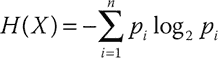

* * *

**FIGURE 3-1    The information entropy of X**

如前所述，本章节不会探讨证明。事实上，你可以将这里的数学直接视为已知。一些优秀的数学书籍和课程会深入探讨这些证明。Figure 3-1 中所示的方程提供了一种计算变量 X 的信息熵的方法，前提是你知道 X 各可能值的概率。如果你不知道这些概率，仍然可以使用 Figure 3-2 中所示的方程获得 X 所包含信息的范围。

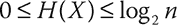

* * *

**FIGURE 3-2    Range of information contained in X**

该方程假设存在某种信息或不确定性，因此我们将下限设为大于零。希望这能让你对信息熵的概念有清晰的理解。

除了信息熵外，本章节还涉及几个紧密相关的概念，你应该了解它们：


 `联合熵` 这是两个变量或两条消息的熵。如果两条消息是真正独立的，它们的联合熵仅仅是两者熵之和。下面是方程：

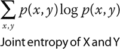

 `条件熵` 如果两个变量不相互独立，而是变量 Y 依赖于变量 X，那么而不是联合熵，你有 *条件熵*。

 `微分熵` 这是一个更复杂的话题，涉及将香农的熵概念扩展到连续随机变量，而不是离散随机变量。微分熵的方程如下：

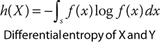

信息熵的基本概念，通常称为 `Shannon 熵`，对于密码学至关重要，你在本书后面会再次遇到它。`联合熵` 和 `微分熵` 是更高级的话题，这里为希望深入探讨、超出本书范围的读者而引入。

##### 量化信息

理解信息熵对于理解如何量化信息至关重要。如果你对熵的理解有疑问，请在继续之前重新阅读前一节。量化信息可能是一项困难的任务。对于新来的信息理论学习者，即使理解“量化信息”的含义也可能感到困难。通常在二进制信息（比特）的上下文中进行。事实上，尽管你可以在不同定义中找到关于“信息”是什么的许多不同解释，但在信息理论的范围内，我们将信息视为 `比特数据`。这与计算机科学非常契合，因为计算机存储数据为比特。比特只能取两个值：0 或 1，可以等同于“是”或“否”。当然，多个比特组合在一起可以包含多个“是”或“否”的值，从而积累更多信息。

一旦我们将信息定义为单个比特数据，接下来的问题是如何量化该数据。一种常用的解释方法是想象需要多少次猜测才能确定密封信封内的内容。让我为你演示这个有帮助的思想实验。

假设有人递给你一个密封信封，里面包含一条消息。你被禁止打开信封。相反，你必须通过提问一系列是非问题（二进制信息：1 表示“是”，0 表示“否”）来确定信封内的内容。准确识别信封内消息所需的最小提问次数是多少？

注意，这里问的是“平均需要多少次提问？”显然，如果不同的人提问，即使是针对同一条消息，所需的提问次数也会不同。我们可以将消息编号，用 `M[i]` 表示第 i 条消息，并用 `P[i]` 表示获得该特定消息的概率。这使我们面临的问题是：准确猜测特定消息的概率是多少？实际的方程让我们回到 Figure 3-1。计算给定消息的熵，就是量化该消息信息内容的过程。

##### 混淆与扩散

混淆（confusion）是密码学中由香农在 1948 年论文中提出的概念。一般来看，这个概念试图让密码文本的统计频率与实际密钥之间的关系变得尽可能复杂。换句话说，明文、密码文本和密钥之间的关系应该足够复杂，使得难以确定其关系。

如果混淆不足，那么有人可以仅仅通过检查一段明文及其对应的密码文本来推断密钥，进而解密使用该密钥加密的所有其他消息。

*扩散*（diffusion）的字面意思是“将明文中一个字符的变化影响到密码文本中的多个字符”。这与历史算法（如凯撒密码、阿特巴特、维杰内尔）不同，在历史算法中，每个字符的明文只影响一个密码文本字符。

香农认为混淆和扩散这两个概念都是创建有效密码所必需的：

> 两种方法（除理想系统外）自然而然地出现，用于混淆统计分析。我们称之为扩散和混淆的方法。在扩散方法中，明文 M 的统计结构（导致其冗余的部分）被“散播”到长距离统计中——即涉及密码文本中长组合字母的统计结构。其效果是：攻击者必须拦截大量材料才能锁定这种结构，因为这种结构只在由极小的单个概率组成的块中显现。此外，即使他拥有足够的材料，分析工作也会大幅增加，因为冗余已被散播到大量的单个统计中。^(2)

这两个目标通过复杂的代换和置换实现。虽然你在 第 1 章 和 第 2 章 中学习的历史密码不足以抵御现代密码分析，但我们可以用它们来举例。假设你有一个简单的凯撒密码，每个字母向右平移三位。这将提供一定程度的混淆，但没有扩散。现在假设你交换每三个字母。这个置换也会提供一定程度的混淆。随后，我们再应用第二次代换——这次是向右平移两位。这两次代换（中间夹杂一次置换）提供了极小的扩散。下面是一个示例：


让我们尝试只修改明文中的一个字母（这会导致明文单词拼写错误）。将 `attack at dawn` 修改为 `attack an dawn`：

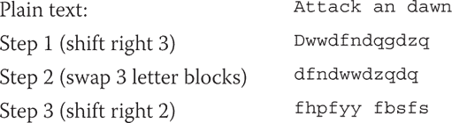

现在比较这段密码文本与原始生成的密码文本。你可以看到，只有最后一个字母发生了变化——原来的 `sfy` 变成了 `sfs`。这提供了极小的混淆，而且仍然没有扩散！缺少了什么？第一，从现代标准来看，这仍然不够复杂。它确实比基本凯撒密码有所提升，但仍然不足。第二，缺乏机制让明文中一个字符的变化影响多个密码文本字符。在现代密码中，操作在比特级而不是字符级。此外，现代密码中有机制可以传播变化，我们将在 第 6 章 中看到这些机制。不过，这个例子应该能让你对代换与置换的组合有一个大致的认识。

##### 扩散效应（Avalanche）

小的改变可以在输出上产生巨大的效果，就像山 avalanche（山崩）。这是 Horst Fiestel 对香农扩散概念的变体。Fiestel 的思想被应用于我们在 第 6 章 中探讨的许多块密码中。显然，高扩散效应是任何加密算法的理想属性。理想情况下，明文中 1 位的变化会影响密码文本的所有位。这被称为 `完整扩散`，但目前还没有在任何现有算法中实现。

##### 汉明距离

汉明距离是两个字符串之间不同字符的数量。可以表示为数学形式：

h(x, y)


Hamming 距离用于测量将一个字符串转换为另一个字符串所需的替换次数。在现代密码学中，我们通常处理二进制表示而非文本。在这种情况下，Hamming 距离可以定义为两个字符串异或（XOR）后 1 的个数。

`Note`

Hamming 距离的概念由 Richard Hamming 发展，他首次在论文 “Error Detecting and Error Correcting Codes” 中描述该概念。该概念广泛用于电信、信息理论和密码学。

Hamming 距离仅在被比较的字符串长度相同的情况下有效。一个应用是将明文与密文进行比较，以判断有多少字符发生了变化。然而，如果比较两个字符串长度不同的情况，则需要使用其他度量。其中一种度量是 *Levenshtein distance*，它衡量将一个单词转换为另一个单词所需的单字符编辑次数。编辑可以包括替换（如 Hamming 距离），也可以包括插入和删除。Levenshtein 距离最早在 1965 年由 Vladimir Levenshtein 首次描述。

### Hamming Weight

Hamming 权重（Hamming weight）的概念与 Hamming 距离紧密相关。它本质上是将字符串与全 0 的字符串进行比较。更简单地说，它是二进制表示中 1 的个数。一些来源称其为 *population count*，或 *pop count*。Hamming 权重在密码学以及其他领域都有许多应用。例如，计算某个指数 e 的模乘法次数需要 log2 e + hamming weight (e)。 (你将在 第 4 章 中看到模运算。稍后在本书中，当详细研究 RSA 算法时，你会发现 RSA 中的 e 值是由于其低 Hamming weight 而被选择的。)

`Note`

Richard Hamming 并不是第一个描述 Hamming 权重的学者。该概念最初由 Irving S. Reed 引入，尽管他使用了不同的名称。Hamming 后来描述了与 Reed 所描述的概念几乎相同的内容，而这一后者描述更为人知，因此 “Hamming weight” 这个术语更常用。

### Kerckhoffs’s Principle/Shannon’s Maxim

*Kerckhoffs’s principle* 是密码学中的一个重要概念。Auguste Kerckhoffs 在 19 世纪首次提出，表示 “密码的安全仅取决于密钥的保密性，而不取决于算法的保密性。” Shannon 重新表述为 “应假设敌人最终会完全熟悉这些系统。”^(3) 这被称为 *Shannon’s maxim*，其含义与 Kerckhoffs’s principle 本质相同。

让我尝试以更详尽、但希望更易理解的方式重述并阐述这一点。Kerckhoffs’s principle 与 Shannon’s maxim 都指出，唯一需要保密的就是密钥。算法本身不需要保密。事实上，后续章节将详细介绍大多数现代算法，这并不会削弱它们的安全性。只要密钥保密，无论我知道你使用 AES 256 位、Serpent、Blowfish 或你能想到的任何其他算法，都不影响安全。

我在此添加一个我自称为 *Easttom’s corollary*：

> 你应该非常警惕任何未发表且未经过彻底审阅的密码学算法。只有在经过广泛的同行评审后，才考虑使用任何密码学算法。

假设你刚刚创建了一种全新的算法。我并不冒犯，但最可能的情形是，你把无知误认为是新视角，你的算法可能存在严重缺陷。网络上有许多业余密码学家声称他们发明了令人惊叹的新算法。他们的“发现”往往不过是对第 1 章中学过的多表代码（polyalphabetic ciphers）的某种排列。即便你是经验丰富的密码学研究者，拥有 proven track record，也有可能出错。

为了说明这一点，考虑 Ron Rivest。你将在即将到来的章节中听到很多关于瑞夫博士（Dr. Rivest）的内容。他的名字是 RSA 中的 *R*，并且他参与了其他重要的密码学发展。他向 SHA-3 竞赛提交了一个算法（我们将在 第 9 章 中详细讨论）；然而，经过数月的进一步分析，缺陷被发现，他撤回了该算法的考虑。

出版算法的目的在于让领域内的专家进行审查、检查和分析。这正是同行评审过程的核心。算法发表后，其他密码学家可以对其进行审查。如果算法在相当长的时间（通常是数年）内能够经受住这种审查，那么才考虑将其用于实际。

`Note`

此问题具有严重的实际意义。2011 年 9 月，我接受 *CNN Money* 记者 David Goldman 的采访，他询问一家声称拥有“不可破解代码”的公司。记者还采访了 Symantec 和 Kaspersky 实验室的密码学专家。我们全部同意该 claim 是无稽之谈。该算法被保密，未公开供同行评审。

当然，还有一个非常显著的例外是不公开算法。美国国家安全局（NSA）将算法分为两组。Suite B 组的算法是公开的，其中包括高级加密标准（AES）。你可以在本书的 第 7 章 中找到该算法的完整细节。另一组，Suite A 组的算法是保密且不公开的。这似乎违背了 Kerckhoffs’s principle 和同行评审的精神。但请记住，NSA 是全球雇佣数学家人数最多的机构，这意味着他们可以通过内部人员 —  — 所有拥有机密材料访问权限的员工 —  — 对算法进行彻底的同行评审。

#### 科学与数学理论

我们讨论了信息理论，但尚未讨论在科学和数学领域什么构成理论。数学和科学紧密相关，但过程略有不同。我们将在这一节中探讨并比较两者。

许多词在特定情境下具有不同的含义。例如，“bug”通常指昆虫，但在编程中指程序缺陷。即使是简单常见的词 “love” 也可能在不同情境下含义不同 —  — 你可能 “love” 你最喜欢的电视节目，爱你的配偶，爱巧克力冰淇淋，但在这些情况下含义并不相同。定义术语时，必须考虑其使用的上下文。

这种情形在特定技术或专业语境中更为明显。各行各业对某些词有非常具体的定义，这些定义可能与日常用法不完全一致。以法律界为例，许多词在法律语境中具有专门含义，可能与日常用法截然不同。


它也是事实，科学家和数学家对他们使用的词语有非常具体的含义。`theory` 就是这样一个词。这个词在科学语境中的含义与日常用语大相径庭。在日常口语中，理论常常等同于猜测。例如，如果你最喜欢的运动队处于连败状态，你可能会有一个关于他们为何输球的理论。在这种情况下，`theory` 很可能只是指一个猜测。你可能有支持该理论的任何数据，甚至可能只是一种“直觉”。

然而，在科学和数学中，理论并不是猜测或直觉——它甚至不是一种受过教育的猜测。数学和科学中的理论实际上紧密相关，正如你将看到。

### 什么是数学理论？

数学中的理论源自公理。`axiom` 是一个被假设为真实而无需证明的单一事实。我认为这对所有读者来说都显而易见，只有最基本的事实才能在先验基础上作为公理被接受。

数学中有许多有趣的理论。例如，`graph theory` 研究用来表示物体及其之间关系的数学结构。它通过使用顶点（物体）和边（物体之间的连接）来实现。`Set theory` 研究对象的集合或集合。它涉及集合的组合、重叠、子集以及相关主题。

与科学不同，数学依赖于证明而非实验。因此，科学方法中适用的假设并不严格适用于数学。这就是为什么我们从公理开始。这些陈述是从公理推导出来的，其真实性可以客观地确定。这有时通过真值表来教授。

个别数学理论针对特定的系统。它们从一个基础开始，这仅仅是描述已知或假设的数据（即公理）。新概念从这个基础逻辑推导出来，并最终被数学证明。

正式数学课程将讨论 `first-order theories`、`syntactically consistent theories`、`deductive theorie`s 以及数学理论的其他细节。但本书专注于应用数学，更具体地说，是应用数学的一个狭窄子领域：密码学。我们不会深入探讨数学理论的微妙之处，也不会在本书中接触到证明。我们仅仅应用其他人已经严格证明的数学。

### 科学方法

科学方法主要关注实验。除非实验证明其为真，否则没有任何东西被认为是“真”。通常需要多次实验来确认某事确实为真。第一步是构建一个 `hypothesis`——一个可以被检验的受过教育的猜测。随后从该猜测中得出事实。关键在于，假设必须是 `testable` 的。事实上，不可测试的猜测在科学中根本没有位置。一旦你检验了假设，你就拥有了 `fact`。事实可能是测试结果确认或否定你的假设。通常，你会多次进行测试以确保结果不是错误。但即使是假设也远不止是盲目猜测或臆想。它是一个必须可检验的受过教育的估计。如果不可检验，它甚至不是假设。

检验、实验和构建假设都是科学方法的重要组成部分。然而，科学方法的巅峰是 `theory`。

> **Note**
> 
> 这并非一直如此。古代时，哲学家更倾向于仅凭有说服力的论证来阐述他们的观点，而不进行实验。托勒密在公元前 2 世纪是早期的实验支持者和所谓的“科学方法”的倡导者之一。13 世纪的罗杰·贝肯常被认为是现代科学方法的父辈。他的光学实验构成了现代科学方法的框架。

### 一个科学理论

你知道假设是一个可检验的猜测。你也知道，经过多次测试后，会确认一些事实。最终，越来越多的事实需要一些解释。对这些事实的解释被称为 `theory`。或者换句话说，

```
A theory is an explanation of a set of related observations or events based upon proven hypotheses and verified multiple times by detached groups of researchers. How does a scientific theory compare to a scientific law? In general, both a scientific theory and a scientific law are accepted to be true by the scientific community as a whole. Both are used to make predictions of events. Both are used to advance technology.^(4)
```

请再思考一下关于单词 `theory` 的定义：“A theory is an explanation.” 这正是定义的关键部分。在你积累数据后，你必须有一些解释。一系列没有联系、缺乏解释的事实是毫无用处的。这不仅适用于科学，也适用于其他领域。比如侦探的工作：任何人都可以注意到一系列事实，但侦探的任务是将这些事实组合成一个与所有事实一致的方式。这与科学家在尝试构建理论时的做法非常相似。科学家和侦探都必须让理论与所有事实相匹配。

对于非科学家来说，适应这个词 `theory` 的用法有时并不容易。普通词典通常包含多个定义，其中一些与 `guess`（猜测）同义。然而，即使像 Merriam-Webster 在线这样的标准词典也为单词 `theory` 提供了替代定义。适用于科学语境的这些定义如下：

```
1: 对一组事实之间关系的分析

3: 事实、科学或艺术的一般或抽象原则 <music *theory*>

5: 一个合理或科学上可接受的一般原则或原则体系，用于解释现象 <光的 *theory* of light>^(5)
```

由此可见，这三个定义并不等同于 `guess` 或 `gut feeling`。`Scientific American` 杂志提供了更好的理论解释：

```
许多人在小学里学到，理论位于某种某一层次的中间——在假设之上，在定律之下。但科学家并不使用这种方式。根据国家科学院（NAS），科学理论是“一个对自然世界某些方面的结构良好解释，它能够包含事实、定律、推论和经过验证的假设。”无论进行多少次验证，理论都不会变成定律，而定律是对自然的描述性一般化。因此，当科学家谈论进化论、原子理论或相对论时，他们并不是对其真实性表示怀疑。^(6)
```

需要记住的要点是，理论是一个解释模型。它解释了已知事实，并为扩展我们的知识提供了背景。尽管科学理论基于实验，数学理论基于证明和公理，但作为解释模型的这一属性对科学理论和数学理论是相同的。在信息论的语境下，理论提供了信息的概念模型，并为继续扩展我们对信息的了解提供了框架。

* * *

**Successful Scientific Theories: A Look**


-   [检查一般术语中理论是什么和不是可能并不能为所有读者提供足够的解释。因此让我们来看一个非常被接受的理论的具体例子——重力理论，以及它如何与具体事实相关联。艾萨克·牛顿观察到物体倾向于下落。以非常一般的方式，这正是他重力定律的核心：重力使物体向下落。当然，他用数学表达了这一定律，如下方程所示：

```
F = Gm[1]m[2]/d²
```

在本方程中，F 表示重力的作用力，G 是一个可以测量的常数（引力常数），m[1] 和 m[2] 是两个物体的质量（例如地球和掉落的苹果），d 是它们之间的距离。这一重力定律可以被测量和验证成千上万次，事实上它已经被验证了。

但这个定律本身是不完整的。它并不能解释为什么会发生这种情况。我们知道重力存在，我们都能感受到它的拉力，但它是什么？为什么重力按照这个公式运作？爱因斯坦的广义相对论是对重力存在原因的解释。他提出，物质会导致时空弯曲，就像一个放在拉伸的布料上的球会在布上产生弯曲。离球足够近的物体会倾向于朝向它下落，因为这种弯曲。

显然，爱因斯坦的理论解释了所有观测到的事实。但要将其定性为科学理论，还需要另一个关键要素：它必须做出一些预测。这里的“预测”并不指预知未来。我的意思是，如果该理论成立，那么你会期望其他事情也为真。如果这些预测不成立，那么爱因斯坦的理论必须被修正或拒绝。是修正还是拒绝取决于其预测的验证程度。如果准确率为 90%，你可能会尝试调整理论以匹配事实；但如果准确率不足 50%，你则可能直接拒绝该理论。

那么，从广义相对论中我们可以做出哪些预测？

 *重力可以弯曲光*。这一预测已被数百次、甚至更精确的实验重复确认。2003 年，卡西尼卫星再次确认了这一预测——这一 2003 年的实验仅是众多验证重力可以弯曲光的实验之一。

 *光在逃离引力场时会失去能量*。由于光的能量与其频率成正比，能量的降低意味着频率降低、波长变长。这导致出现“红移”，即波长向可见光谱的红端移动。这一现象在地球上使用伽马射线在杰弗逊塔物理实验室中得到验证。

 *光会受到引力的偏转*。广义相对论预测光会受到引力的偏转或弯曲。这一预测最初于 1919 年日食观测中得到确认，随后数十年的实验也一再证实了这一现象。

其他关于广义相对论的预测也已由数十甚至上百次独立实验得到验证。请注意“独立”这一词。这些实验由各方进行，他们没有特定的利益使爱因斯坦被证明正确，甚至在一些情况下，他们本想证明他错误。然而，在所有情况下，数据都证实了爱因斯坦的理论。要想在物理学家中找到不认同广义相对论有效性和真实性的人几乎是不可能的。有些人可能会认为它尚未完全完善，但没有人会否认它的真实性。数百项跨越数十年、数千名科学家的实验已经验证了广义相对论的每一个方面。现在该理论已被充分确立，可以用于指导未来的实验，并深入理解重力及相关主题。

* * *

#### 二进制数学

二进制数学本身并不是信息理论的一部分，但在后续章节中理解密码学时，它是你必须掌握的关键知识。许多读者可能已经熟悉二进制数学，这将是一次复习；但如果你的背景不包括二进制数学，本节将教你所需的基础知识。

定义二进制数学其实很简单：它是使用基 2 而非更常见的基 10 的数学。你觉得基 10（即十进制）更“自然”的唯一原因是大多数人有 10 根手指和 10 根脚趾。（至少大多数人有 10 根手指和脚趾——即使你拥有不同数量的手指和脚趾，你也知道 10 对人类而言是正常的。）

一旦我们引入 0 的概念，十进制系统就拥有 10 个数字：0、1、2、3、4、5、6、7、8、9。请记住，十进制系统中实际上并没有数字“10”，只有“1”在十位，“0”在个位。二进制（基 2）数也遵循同样的规律：实际上并没有数字“2”，只有“1”在 2 的位置，“0”在 1 的位置。下面的对比图可能会有所帮助：

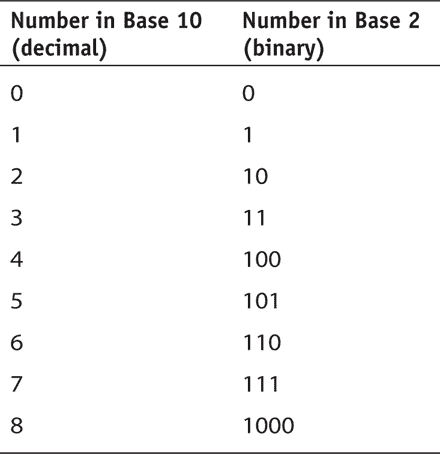

二进制数之所以重要，是因为这正是计算机最终理解的内容。你当然可以用任何你想要的系统来表示数字，数字系统可以基于任何整数。历史上，一些系统被广泛使用。十六进制（基 16）和八进制（基 8）在计算机科学中偶尔被使用，因为它们都是 2 的幂（2⁴ 和 2³），因此可以轻松转换为二进制。巴比伦人使用了基 60 的数字系统，这一系统至今仍体现在地理坐标系中表示度数的方式——例如，60 秒组成 1 分钟，60 分钟组成 1 度，你可以通过“45 度，15 分钟，4 秒”来指定方向。

**Note**

现代二进制数的概念可追溯至戈特弗里德·莱布尼茨，他在一篇题为《解释二进制算术》的文章中提出。莱布尼茨指出，中国《 I 我经》六爻卦象对应二进制数，范围从 0 到 1111111（即十进制的 0 到 63）。

##### 转换

由于人类习惯于十进制数，你经常需要在二进制与十进制之间转换，也可能需要进行相反的转换。常用的方法之一利用二进制数各个“位”的值是 2 的幂这一事实。请暂时考虑二进制数 10111001，并将其分解为 2 的幂次。如果某一位上是 1，则该位的值被计入；如果是 0，则该位的值为 0。例如，如果在 2⁷ 位上有 1，则该值为 128；如果没有，则为 0。

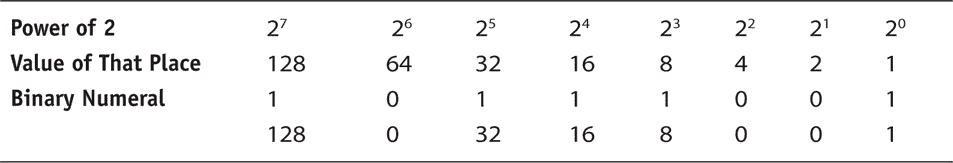

将这些值相加：128 + 32 + 16 + 8 + 1 = 185。

这可能不是最快的方法，但它可靠且易于理解。

##### 二进制运算

你可以像十进制数一样对二进制数进行所有数学运算。不过，在密码学中，你主要关注三个运算：AND、OR 和 XOR，它们相对容易理解。下面的例子将使用两个 4 位二进制数：1101 和 1100，来展示这三种运算的工作原理。

###### 二进制 AND

二进制 AND 运算按位将两个二进制数相结合，询问“是否在相同位置都有 1”。如果是，则结果位为 1；如果否，则结果位为 0。下面展示了两个 4 位二进制数的最右侧数字的比较：

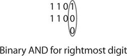


# Essential Number Theory and Discrete Math

## In this chapter we will cover the following:

 Number systems

 Prime numbers

 Important number theory questions

 Modulus arithmetic

 Set theory

 Logic

 Combinatorics

Number theory is an exciting and broad area of mathematics. Although it is considered pure mathematics, there are applications for number theory in many fields. When you read Chapters 10 and 11 concerning asymmetric cryptography, you will find that all asymmetric algorithms are simply applications of some facet of number theory. This leads us to the question, What is number theory? Traditionally, *number theory* is defined as the study of positive, whole numbers. The study of prime numbers is a particularly important aspect of number theory. The Wolfram MathWorld web site ([`mathworld.wolfram.com/NumberTheory.html`](http://mathworld.wolfram.com/NumberTheory.html)) describes number theory as follows:

> Number theory is a vast and fascinating field of mathematics, sometimes called “higher arithmetic,” consisting of the study of the properties of whole numbers. Primes and prime factorization are especially important in number theory, as are a number of functions such as the divisor function, Riemann zeta function, and totient function.

#### Conclusions

In this chapter you were introduced to a number of concepts that will be critical for your understanding of modern ciphers, particularly symmetric ciphers, which we begin studying in Chapter 6. Information entropy is a critical concept that you must understand. You were also introduced to confusion and diffusion, Hamming distance, and Hamming weight. These concepts are frequently used in later chapters. You also learned about mathematical and scientific theory. The chapter ended with a basic coverage of binary math.

#### Test Your Knowledge

1. The difference in bits between two strings X and Y is called ______.

2. If you take 1110 XOR 0101, the answer is ______.

3. A change in 1 bit of plain text leading to changes in multiple bits of cipher text is called ______.

4. The amount of information that a given message or variable contains is referred to as ______.

5. ______ refers to significant differences between plain text, key, and cipher text that make cryptanalysis more difficult.

##### Answers

1. Hamming distance

2. 1011

3. diffusion

4. information entropy

5. Diffusion

#### Endnotes

1. Roger Bohn and James Short, “How Much Information?” [`hmi.ucsd.edu/pdf/HMI_2009_ConsumerReport_Dec9_2009.pdf`](http://hmi.ucsd.edu/pdf/HMI_2009_ConsumerReport_Dec9_2009.pdf).

2. Claude Shannon, “Communication Theory of Secrecy Systems,” [`netlab.cs.ucla.edu/wiki/files/shannon1949.pdf`](http://netlab.cs.ucla.edu/wiki/files/shannon1949.pdf).

3. Kerckhoffs’s principle is discussed at Crytpo-IT, [`www.crypto-it.net/eng/theory/kerckhoffs.html`](http://www.crypto-it.net/eng/theory/kerckhoffs.html).

4. Bohn and Short, “How Much Information?”

5. Merriam-Webster, [`www.merriam-webster.com/`](http://www.merriam-webster.com/).

6. John Rennie, “Answers to Creationist Nonsense,” *Scientific American*, June 2002.


如果您已经在数学方面有坚实的基础，您可能会问自己这一章如何能涵盖该主题。毕竟，关于数论和离散数学已有大量完整教材。事实上，甚至只针对子主题（如质数、集合论、逻辑、组合论等）也编写了完整的书籍。那么，我又如何能在一章中涵盖这些内容呢？请允许我让您安心。首先，请记住本章的目标并不是让您成为数学家（虽然如果阅读完本章后，您感到有动力进一步阅读数学或甚至在大学选修数学课程，我绝不会感到失望）。相反，目标是提供足够的数论和信息，帮助您理解后续章节讨论的现代密码算法。因此，我没有包含数论通常涉及的某些内容。最明显的例子是**证明**——您在这一章中不会看到数学证明的讨论。有无数本写得很好的书籍专门讲解证明，包括对本章涵盖的概念和陈述的证明。如果您想深入探讨这些数学证明，您将不会遇到资源获取的困难。

**Note**

这些主题当然可以更深入地探讨，我当然鼓励您这么做。例如，如果您是以大学课程的身份阅读此书，我希望它能激励您修读基础数论或离散数学课程（如果您尚未修读的话）。

如果您在数学方面有坚实的基础，本章提供了简要回顾。如果您缺乏这样的基础，正如著名作者道格拉斯·亚当斯所说，“不要慌”。您将能够理解本章的内容。此外，本章足以让您继续深入研究密码学。如果这些主题对您而言是全新的，那么本章（以及第 5 章）可能是最难理解的章节。您可能需要阅读多遍。

**Note**

我在本章中提供了一些学习技巧，指引您到一些外部资源，这些资源提供对特定主题的更深入覆盖，包括书籍和网站。虽然所有网站可能并不总是可用，但它们对您来说既免费且易于访问。如果某个 URL 已经不再可用，我建议您使用您喜欢的搜索引擎搜索该主题。

#### 数字系统

研究数论的第一步是获得对数字系统的扎实理解。虽然数论关注的是正整数，但一些数字集合还包括其他数。我在此列出了所有数字集合，但本章其余部分将专注于与数论相关的那些。您可能在小学阶段就已经接触过数字系统。

##### 自然数

*自然数*，也称为计数数，之所以称为自然数，是因为它们是自然的——即，这是儿童最初学习数字的方式。例如，如果您查看您的书桌并数出有多少支铅笔，您可以使用自然数来完成这一任务。许多来源只计算正整数：1、2、3、4、……，不包括 0；其他来源则包括 0。我通常不把 0 视为自然数，尽管并非所有人都同意（例如，*The Nature and Growth of Modern Mathematics* 的作者 Edna Kramer 认为 0 应该被包括在自然数中。尽管我与这位备受尊敬的作者在如此微小的观点上存在分歧，我仍高度推荐该书作为一段数学史之旅。）

**Note**

数字 0（零）拥有有趣的历史。虽然对现代人而言，零的概念似乎显而易见，但实际上它在数学中的发展是重要的。一些迹象指向巴比伦人，他们可能对零有一定概念，但通常归功于九世纪的印度，他们在计算中使用了 0。如果您稍作沉思，就会发现 0 作为数字而非仅仅占位符，在古代埃及人和希腊人中并不存在。

##### 负数

最终，自然数需要扩展。虽然负数对您和我来说似乎很合理，但在古代它们是未知的。负数首次出现在中国汉代的一本书中（约 260 年），该书的数学家刘徽（约 225–295）描述了负数加减的基本规则。在印度，负数最早在第四世纪出现，并被用于表示财务中的债务，到第七世纪已被常规使用。

负数的知识传播到阿拉伯国家，到至少第十世纪，阿拉伯数学家已经熟悉并使用负数。著名著作 *Kitab al-jabr wa l-muqabala*（约 825 年，作者 Al-Khwarizmi）没有包含任何负数（[www.maa.org/publications/periodicals/convergence/mathematical-treasures-al-khwarizmis-algebra](http://www.maa.org/publications/periodicals/convergence/mathematical-treasures-al-khwarizmis-algebra)）。

##### 有理数和无理数

数字系统的演变是为了响应某些数学问题的需求。负数在前一节中讨论，是为了应对从较小的整数减去较大的整数（如 3 – 5）。*有理数* 是任何可以表示为两个整数之商的数。与数学早期的许多进步一样，有理数的形式化是由实际问题驱动的。有理数最早被发现于除法的结果（4/2 = 2，或 4 ÷ 2 = 2）。（注意，现代小学和中学教学中最常用的两个除法符号是 ÷ 和 /，但这并非数学上严谨的定义，也不是设计之初。）

 eventually，数的除法导致了无法表示为两个整数之商的结果。经典的例子来自几何学。如果您尝试表示圆的周长与其半径的比值，结果是一个无限不循环的数。它常被近似为 3.14159，但小数继续延伸且不重复。如果一个实数不能表示为两个整数的商，则它被归类为*无理数*。

##### 实数

*实数* 是有理数和无理数的全集。实数集是无限的。除非您从事某些数学或物理领域，否则您日常遇到的几乎所有数字都是实数。很长一段时间，实数被认为是唯一存在的数。

##### 虚数

虚数是为了解决特定问题而发展的。您显然知道，负数乘以负数得到正数（–1 × –1 = 1）。但如果考虑负数的平方根，情况便不同。正数的平方根是正数（√4 = 2，√1 = 1，以此类推）。那么负 1 的平方根是多少？如果您回答负 1，这行不通，因为两个负 1 相乘会得到正 1。这一难题促成了*虚数*的发展，其定义为：i² = –1（或者对应地 √–1 = i）。因此，任何负数的平方根都可以表示为某个整数乘以 i。实数与虚数的组合称为*复数*。

**Note**


从古希腊时期起，似乎就有概念认为需要一个数字系统来表示负数的平方根。但直到 1572 年，Rafael Bombelli 才首次正式确立复数乘法的规则。

# 素数

尽管前文讨论的各种数字在密码学方面很有趣，但要找到比素数更相关的数字集合并不容易。素数是大于 1 的自然数，且其正因数只有自身和 1。（注意，数字 1 本身不被视为素数。）数论中的许多事实、猜想和定理都与素数相关。

算术的基本定理指出，每个正整数都可以唯一地表示为质数的乘积，其中质因数按大小递增的顺序排列。基本上，这意味着任何整数都可以分解为其质因数。这可能是你在小学时就必须做的任务，尽管当时只涉及小整数。如果你稍作思考，就会发现它是许多指示之一，说明素数的重要性。

欧几里得（公元前 328–283 年）首先证明了无穷多个质数存在。（随后欧拉和高尔德巴赫等数学家也构建了许多其他证明。）在给定范围内找到质数的数量是一个更难的问题。例如，1 到 10 之间有四个质数（2, 3, 5, 7），11 到 20 之间也有四个（11, 13, 17, 19）。然而，30 到 40 之间只有两个质数（31, 37）。事实上，随着我们通过正整数推进，质数变得越来越稀疏。（已被证明，“小于 x 的质数个数大约为 x/ln(x)。” 以 10 为例，ln(10)约为 2.302，10/2.302 = 4.34，而我们已经看到 1 到 10 之间有四个质数。）

**Note**

欧几里得著名的作品《元素》，约于公元前 300 年撰写，其中对质数有重要讨论，包括关于质数无限多的定理。

## 查找质数

正如你稍后会发现，质数是 RSA 等密码算法的关键组成部分。如何生成质数？最直观的想法是先想一个数，然后检查它是否有因数。如果没有因数，它就是质数。你可以通过尝试用该随机数 n 除以所有小于等于√n 的整数来进行检查。例如，如果我问你 67 是否为质数，你首先尝试除以 2，然后是 3，接着是 4，以此类推。几个步骤后，你就会确定 67 是质数。（这不算难。）使用计算机，你可以更快地完成这一过程。

遗憾的是，像 RSA 等密码算法需要非常大的质数。现代 RSA 密钥至少为 2048 位长，需要两个质数来生成，而这两个质数必须非常大。单纯随机生成一个数并手动检查是不可行的，即使使用计算机也会耗时很久。因此，人们一直在尝试制定一些能够持续且高效地生成质数的算法。让我们看看其中几种算法。

### Mersenne Prime（梅森质数）

法国神学家马里·梅森（1588–1648）在声学和音乐理论以及数学方面做出了重要贡献。他提出公式 2^p – 1 可以产生质数。研究表明，当 p = 2, 3, 5, 7, 13, 17, 19, 31, 67, 127, 257 时，该公式会产生质数；而对于诸如 p = 4, 6, 8, 9, 10, 11 等数值则不然。他的猜想导致形式为 2^p – 1 的质数被称为*梅森质数*。到 1996 年，已知的梅森质数有 34 个，其中最后八个是在超级计算机上发现的。显然，该公式能生成质数，但并非总是如此。任何形式为 2^p – 1 的数被称为梅森数。如果 p 是合数，则 2^p – 1 也是合数。如果 p 是质数，则 2^p – 1 *可能* 是质数。梅森最初认为所有形式为该数的数 *都* 是质数。

### Fermat Prime（费马质数）

数学家皮埃尔·德·费马（1601–1665）在数论方面做出了许多重要贡献。他还提出了一个公式，他认为该公式可以用于生成质数：

2^((2n)) + 1

下面可以看到，若干此类数——特别是前几个 2 的幂——确实是质数：

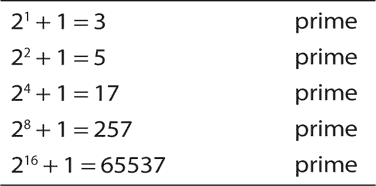

遗憾的是，与梅森质数一样，并非所有费马数都是质数。

### Sieve of Eratosthenes（埃拉托斯特尼筛法）

在某些情况下，目标不是生成质数，而是判断已知数是否为质数。要判断一个数是否为质数，我们需要比简单尝试除以该数的平方根之前的所有整数更快的方法。埃拉托斯特尼筛法（Sieve of Eratosthenes）就是一种这样的方法。埃拉托斯特尼（约公元前 276–195 年）曾任亚历山大图书馆的馆员，同时也是数学家和天文学家。他发明了一种至今仍在使用的寻找质数的方法，即埃拉托斯特尼筛法。它的工作原理是通过筛选出合数整数，只留下质数。

该方法实际上非常简单。要通过埃拉托斯特尼的方法找出所有不超过给定整数 n 的质数，你需要执行以下步骤：

**1.** 创建一个从 2 到 n 的连续整数列表：(2, 3, 4, …, n)。

**2.** 初始时，令 p 等于 2，即第一个质数。

**3.** 从 p 开始，以 p 为步长在列表中标记大于 p 本身的每个数。这些数是 p 的倍数：2p, 3p, 4p, 等等。注意，有些可能已经被标记过。

**4.** 在列表中找到第一个大于 p 且未被标记的数。如果不存在这样的数，则停止。否则，令 p 等于这个数（这就是下一个质数），并回到步骤 3。

下面是一个示例，我们只考虑 100 以内的数字：

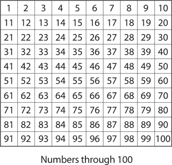

为了演示，我们可以使用如下的表格：

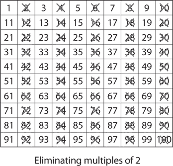

首先，划掉数字 2，因为它是质数，然后划掉所有 2 的倍数，因为它们是合数，如下所示：

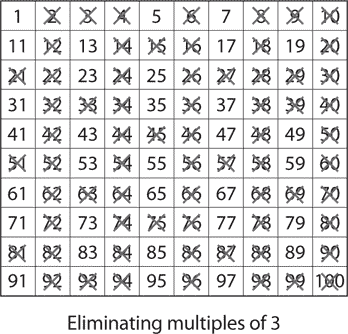

接下来，对 3（也是质数）进行同样的操作，划掉所有 3 的倍数，如下所示：

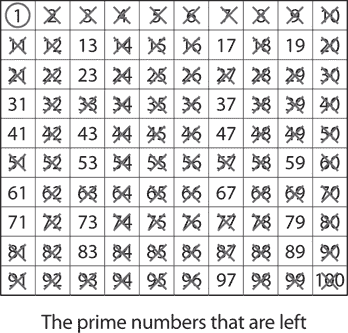

注意，你已经划掉了许多这些数，因为它们也是 2 的倍数。你可以跳过 4，因为它是 2 的倍数，直接转到 5 及其倍数。有些数（例如 15）也是 3 的倍数或 2 的倍数（例如 10, 20），因此已经被划掉。你可以跳过 6, 8, 9，因为它们是之前使用过的数的倍数，这留下了 7 及其倍数。由于我们只到 100，使用 11 及其倍数即可完成筛法。在划掉 5, 7, 11 的倍数后，只剩下质数。（记住 1 不是质数。）如下所示：

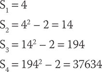

这个过程可能很繁琐，通常通过程序实现。如果你要处理超过 100 的数字，只需继续使用下一个质数及其倍数（13, 17, 等等）。

### 其他筛法


-   [更多现代筛选系统已被开发，包括 2003 年由 Arthur O.L. Atkin 和 Daniel J. Bernstein 开发的筛选器以及 1930 年代由数学家 S.P. Sundaram 开发的筛选器。](https://wiki.example.org/feynmans_learning_method) 的灵感源于诺贝尔物理奖获得者**Richard Feynman**，即**理查德·费曼**。

1.  运用费曼技巧，你只需花上`20 min`就能深入理解知识点，而且记忆深刻，*难以遗忘*。

```
if (condVar > someVal) {console.log("xxx")}
```

# 1. Start with a list of integers from 1 to some number n.

# 2. Remove all numbers of the form i + j + 2ij. The numbers i and j are both integers with 1 ≤ i < j and i + j + 2ij ≤ n.

# 3. Double the remaining numbers and increment by 1 to create a list of the odd prime numbers below 2n + 2.

## Lucas-Lehmer Test

The Lucas-Lehmer test is used to determine whether a given number n is a prime number. This deterministic test of primality works on Mersenne numbers—that means it is effective only for finding out if a given Mersenne number is prime. (Remember a Mersenne number is one of the form 2^p – 1.) In 1856, French mathematician Édouard Lucas developed a primality test that he subsequently improved in 1878; then in the 1930s, American mathematician Derrick Lehmer provided a proof of the test.

**Note**

Throughout the study of cryptography you will encounter the terms “probabilistic” and “deterministic” in reference to primality tests, pseudo-random number generators, and other algorithms. The meanings of these two terms is fairly simple: A probabilistic algorithm has a *probability* of giving the desired result, and a deterministic algorithm *will* give the desired result. In reference to primality testing, a probabilistic test can tell you that a given number is probably prime, but a deterministic test will tell you that it is or is not definitely prime.

A Lucas-Lehmer number is part of a sequence of numbers in which each number is the previous number squared minus 2. So, for example, if you start with 4, you would get the sequence shown here:


The test is as follow:

              For some p ≥ 3, which is itself a prime number, 2^p – 1 is prime if and only if S[p–1] is divisible by 2^p – 1. Example: 2⁵ – 1 = 31; because S[4] = 37634 and is divisible by 31, 31 must be a prime number.

**Note**

At this point, you may be tempted to question the veracity of a claim I made regarding the reliability of the Lucas-Lehmer test. As I stated at the beginning of this chapter, I will not be demonstrating mathematical proofs. You can spend some time with this test, using various values of S to see for yourself that it does, indeed, work. That is certainly not the same as working out a proof, but it could give you some level of comfort that the test really works.

#### Relatively Prime, or Co-prime, Numbers

The concept of prime numbers and how to generate them is critical to your study of cryptography. You should also be familiar with the concept of numbers that are *relatively prime*, often called *co-prime* numbers. The concept is actually pretty simple: Two numbers x and y are relatively prime (co-prime) if they have no common divisors other than 1. So, for example, the numbers 8 and 15 are co-prime. The factors of 8 are 1, 2, and 4, and the factors of 15 are 1, 3, and 5. Because these two numbers (8 and 15) have no common factors other than 1, they are relatively prime.

Lots of interesting facts are associated with co-prime numbers, many of which were discovered by Euler, who asked a few simple questions such as this: Given an integer n, how many numbers are co-prime to n? That number is called Euler’s totient, the Euler phi function, or simply the totient. The symbol for the totient of a number is shown here:

*φ*(*n*)

The term used for integers that are smaller than n and that have no common factors with n (other than 1) is *totative*. For example, 8 is a totative of 15. To check this easily yourself, you will see that 1, 2, 4, 7, 8, 11, 13, and 14 are all co-prime (or relatively prime) with 15. However, 3, 5, 6, 9, 10, and 12 all have common factors with 15.

**Note**

Euler introduced this function in 1763. There was no practical use for it until modern asymmetric cryptography. This is a great example of pure mathematics that is later found to have very important practical applications.

The next question Euler asked was this: What if a given integer, n, is a prime number? How many totatives will it have (that is, what is the totient of n)? Let’s consider a prime number—for example, 7. Given that 7 is prime, we know that none of the numbers smaller than 7 have any common factors with 7. So 2, 3, 4, 5, and 6 are all totatives of 7. And since 1 is a special case, it is also a totative of 7, so we find that six numbers are totatives of 7. It turns out that for any n that is prime, the Euler’s totient of n is n – 1. So if n = 13, then the totient of n is 12.

And then Euler asked yet another question about co-prime numbers: Assuming we have two prime numbers, m and n. We already know that the totient of each is m – 1 and n – 1, respectively. But what happens if we multiply the two numbers together? So m × n = k; what is the totient of k? You could simply test every number less than k and find the answer. That might work for small values of k, but it would be impractical for larger values. Euler discovered a nice shortcut: If you have two prime numbers (m and n) and multiply them to get k, the totient of k is the totient of m × the totient of n. Put another way, the totient of k is (m – 1)(n – 1).

Let’s look at an example. Assume we have two prime numbers, n = 3 and m = 5.

   **1.**  Multiply n × m: 3 × 5 = 15.

   **2.**  The totient of n is n – 1, or 2.

   **3.**  The totient of m is m – 1, or 4.

   **4.**  2 × 4 = 8

   **5.**  The totient of k (15) is 8.

The totient, 15, is a small number so we can test it. The factors of 15 (other than 1) are 3 and 5, which means that 15 has common factors with any multiple of 3 or 5 smaller than 15: 3, 6, 9, 12 and 5, 10. So with what numbers does 15 not have common factors? 1, 2, 4, 7, 8, 11, 13, and 14. If you take a moment to count those, you will see that there are eight numbers. Of course, Euler relied on rigorous mathematical proofs, which we are foregoing in this chapter, but hopefully this example provides you with a comfort level regarding calculating totients.

Now all of this may sound rather obscure, or even unimportant. However, these facts are a very big part of the RSA algorithm that we will be examining in some depth in Chapter 10. In fact, when you first see the RSA algorithm, you will notice several elements discussed in this section.

#### Important Operations

Some mathematical operations are critical even to a basic understanding of modern cryptographic algorithms. Those of you with a solid foundation in mathematics should already be familiar with these operations, but in case you are not, I will briefly introduce you to them in this section.

##### Divisibility Theorems

You should be aware of some basics about divisibility that define some elementary facts regarding the divisibility of integers. The following are basic divisibility theorems that you will see applied in later chapters in specific cryptographic algorithms. I recommend that you commit them to memory before proceeding.

For integers a, b, and c, the following is true:

     If a | b and a | c, then a | (b + c). Example: 3 | 6 and 3 | 9, so 3 | 15. (Note that | means *divides*, so in this statement, if a divides b and a divides c, then a will divide b + c.)

     If a | b, then a | bc for all integers c. Example: 5 | 10, so 5 | 20, 5 | 30, 5 | 40, …

     If a | b and b | c, then a | c. Example: 4 | 8 and 8 | 24, so 4 | 24.

##### Summation


您可能已经熟悉求和符号，∑，它经常出现。如果没有，在本书后面会看到它。它基本上是一种将一系列数字相加以得到它们的和的方法。使用求和符号比直接写出一系列数值的求和更为便利。在序列的任何位置的中间结果称为部分和（有时称为运行总和或前缀和）。要相加的数字通常被称为加数或有时称为被加数。它们可以是任何数字，但在密码学中，我们通常关注的是整数的求和。

求和的基本例子在 Figure 4-1 中展示。

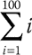

* * *

**FIGURE 4-1    A summation**

图中表明我们处理的是某个整数 i。我们从 i 的值设为 1 开始。将 i 的值从 1 累加到 100。求和符号右侧的字母是我们正在处理的变量。求和符号下方的数字是该变量的初始值。最后，求和符号上方的数字（通常用 n 表示）是停止点。如果您愿意，可以手动计算这些数字的和，即 1 + 2 + 3 + 4 … 100；但是，您可以使用公式来计算这个求和：

(n(n+1))/2

在我们的例子中，这等于

(100(101))/2 = 5050

**Note**

在 Figure 4-1 中看到的符号通常被称为“资本 Sigma 符号”，因为 ∑ 是希腊字母 sigma 的符号。

您可以使用乘法符号 π 进行类似的运算。。这个符号的工作方式与资本 Sigma 符号完全相同，只是它用于乘积而不是求和——即，它用于将一系列数值相乘得到一个乘积。

##### 对数

对数在非对称密码学中扮演着非常重要的角色。整个非对称算法类别都是基于所谓的离散对数问题而建立的。大多数读者在中学时就已经接触过对数。

一个数的对数是某个固定值（称为底数）必须被提升到的指数，以产生该数。让我们假设底数为 10，并询问 10,000 的对数是多少，也就是说，10 需要被提升到多少次方才能得到 10,000？答案是 4，因为 10⁴ = 10,000。大多数人对底数为 10 的对数很熟悉，这在数学中被称为常用对数。然而，我们可以使用任意底数。例如，如果我们想知道 16 在底数 2 中的对数，即 log2，这意味着 2 需要被提升到多少次方才能得到 16？答案是 4，因为 2⁴ = 16。

###### 自然对数

自然对数记作 ln，在数学和科学中被广泛使用。自然对数使用无理数 e（约为 2.718）作为底数。某个数 x 的自然对数通常写作 ln x，也可以写作 log[e] x。与任何对数一样，自然对数表示 e 必须被提升到多少次方才能得到某个特定数。

自然对数的基本概念由 Grégoire de Saint-Vincent 和 Alphonse Antonio de Sarasa 在 17 世纪早期发展，他们正在研究涉及双曲扇形的问题。

**Tip**

如果您对对数和/或自然对数不熟悉，可能需要参考两个教程来了解更多： “The Common and Natural Logarithms” 在 [`www.purplemath.com/modules/logs3.htm`](http://www.purplemath.com/modules/logs3.htm) 和 “Demystifying the Natural Logarithm (ln)” 在 [`betterexplained.com/articles/demystifying-the-natural-logarithm-ln/`](http://betterexplained.com/articles/demystifying-the-natural-logarithm-ln/)。

###### 离散对数

现在您已经对对数及自然对数有了基本了解，我们可以转向讨论离散对数。它们在我们将在 Chapter 10 和 11 中探讨的算法中发挥重要作用。

要理解离散对数，请记住对数的定义：某个底数必须被提升到的指数，以得到另一个数。离散对数则是在有限群的范围内提出这个问题。更正式地说，离散对数是某个整数 k，它满足方程 x^k = y，其中 x 和 y 都是有限群的元素。

计算离散对数是一项非常困难的任务，这也是为什么离散对数是某些现代加密算法的基础。我们将在 Chapter 10 再次讨论该主题，在我们讨论具体算法之前，先讨论群在 Chapter 5。在此之前，请注意，离散对数本质上是有限群中的对数。

**Tip**

Khan Academy 网站提供了非常好的离散对数入门： [`www.khanacademy.org/computing/computer-science/cryptography/modern-crypt/v/discrete-logarithm-problem`](https://www.khanacademy.org/computing/computer-science/cryptography/modern-crypt/v/discrete-logarithm-problem)。

##### 模运算

*模运算* 在密码学中非常重要，尤其是在 RSA 中。让我们从最简单的解释开始，然后深入细节。要使用模运算符，只需将 A 除以 N 并返回余数。例如，

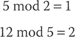

**Note**

这里我没有使用全等符号 (≡)，因为我讨论的不是全等，而是指出如果你将 5 除以 2，余数是 1；如果你将 12 除以 5，余数是 2。这对程序员来说是标准的，但对数学家来说可能有点奇怪。在许多编程语言中，% 符号用于执行模运算。

这说明了如何使用模运算符，在很多情况下，这已经是许多教材能达到的程度。但这仍然留下了一个问题：什么是模？一种思考模运算的方式是想象进行您通常进行的任何整数运算，但将您的答案绑定在某个数上。教科书中常用的经典例子是时钟，它包含数字 1 到 12，因此任何运算的结果都必须是 12 或更小。例如，如果现在是 4 点，我问您 10 小时后见，简单的数学会说我要在 14 点见您，但这在我们的时钟上是不可能的，因为时钟只到 12 点！找到答案很简单：使用模运算，模数为 12，查看余数：

14 mod 12 = 2

所以，我实际上是在问您几点见，答案是 2 点。（是上午还是下午取决于最初的 4 点，但这对于理解模运算概念并不重要。）这是模运算的一个日常应用示例。

**Note**

虽然模运算的基本概念可以追溯到欧几里得，他在他的书 *Elements* 中就讨论了它，现代模运算的方法最早由 Carl Friedrich Gauss 在 1801 年的 *Disquisitiones Arithmeticae* 中发表。

###### 同余

在模运算中，同余是一个非常重要的主题，您在现代密码算法中会经常看到它的应用。数学中使用 ≡ 符号来表示同余。

如果两个数 a 和 b 是“模 n 同余”，则有：

(a mod n) = (b mod n) → a ≡ b(mod n)


-   如果两个数模 n 同余，则 a 与 b 之间的差是 n 的某个倍数。为了更清晰地说明这一点，让我们回到钟表类比，其中 14 与 2 模 12 同余。可以看出，14 与 2 的差是 12，是 n（1 × 12）的倍数。我们也知道，14，或者说在 24 小时钟上是 1400 小时，实际上是 2 点。因此，当我们说 14 与 2 模 12 同余时，我们的意思是在模 12 的意义下，14 与 2 是相同的。下面再举一个例子：17 与 5 模 12 同余。它们的差是 12。再用 24 小时钟来验证我们的结论，我们发现 1700 小时相当于 5 下午。

你需要了解同余的几个基本性质：

![image `a ≡ b (mod n)` if n|(a – b) `a ≡ b (mod n)` implies `b ≡ a (mod n)`

 `a ≡ b (mod n)` and `b ≡ c (mod n)` imply `a ≡ c (mod n)`

###### 同余类

一个 *同余类*，或称 *余数类*，是指所有对某个给定模数同余的数的集合。

考虑一个模数为 5 的例子。哪些数对 5 同余？我们先以 7 为例：`7 mod 5 ≡ 2`。接下来，我们询问还有哪些数的模 5 也等于 2，于是得到一个无限数列：12、17、22、27、32 …。这同样适用于相反方向（包括小于模数的整数，甚至负数）。我们知道 7 mod 5 ≡ 2，同时 2 mod 5 ≡ 2（即最近的 5 的倍数是 0；0 × 5，因此 2 mod 5 ≡ 2）。在完全理解为什么 2 mod 5 ≡ 2 之后，我们可以继续探讨负数。

我们再往后看，0 之后的下一个 5 的倍数（向后）是 –5（5 × –1）。因此 –3 mod 5 ≡ 2。我们现在可以把同余类的元素扩展为 –3、0、2、7、12、17、22、27、32 等等。

你也应该注意到，对于任意模数 n，都有 n 个同余类。如果你稍作思考，就会明白模数本身为算术操作设定了边界，因此同余类的数量不可能超过模数的整数值。

模数运算在非对称密码学算法中具有重要意义，这些算法我们将在 第 10 章 中探讨。务必在继续之前确保你对这些概念非常熟悉。

**Tip**

想了解更多模运算，请参考拉特格斯大学的教程 “Modular Arithmetic” 在 [`www.math.rutgers.edu/~erowland/modulararithmetic.html`](http://www.math.rutgers.edu/~erowland/modulararithmetic.html)，或观看 TheMathsters 的 YouTube 视频 “Modular Arithmetic 1” 在 [`www.youtube.com/watch?v=SR3oLCYoh-I`](http://www.youtube.com/watch?v=SR3oLCYoh-I)。

#### 著名数论家及其贡献

在学习新主题时，回顾其历史常常很有帮助，尤其是通过研究该领域的重要人物。数论中有许多杰出的人物。本节我仅简要介绍与密码学最相关的数学家的生平。

##### 菲波纳奇

Leonardo Bonacci（1170–1250），即菲波纳奇，是一位意大利数学家，对数学作出了重要贡献。他最著名的是斐波纳奇数列，这是一个有趣的数字序列：

1, 1, 2, 3, 5, 8, 13, 21, …

该序列的每一项等于前两项之和。用数学形式表示：

`Fn = Fn–1 + Fn–2`

例如，2 = 1 + 1，3 = 2 + 1，5 = 3 + 2，8 = 5 + 3，以此类推。

该序列是无限的。虽然这些数早在印度就已知，但在欧洲直到菲波纳奇重新发现它们才被认识。他于著作 *Liber Abaci* 中发表了这一概念。尽管该数列有许多有趣的应用，对于我们而言，最重要的应用是其在伪随机数生成器中的使用，我们将在 第 12 章 中探讨。

菲波纳奇是富商之子，旅行经验丰富。他在地中海地区向多位阿拉伯数学家学习。其书 *Liber Abaci* 还介绍了阿拉伯数字，这些数字至今仍被广泛使用。

##### 费马

Pierre de Fermat（1601–1665）接受过律师培训，是业余数学家，尽管他对数学作出了重要贡献。他涉猎解析几何和概率，但最著名的是数论中的若干定理，我们将简要讨论。

费马小定理指出：如果 p 是质数，则对任意整数 a，数 a^p – a 是 p 的整数倍。它的含义是什么？我们来看一个例子：假设 a = 2，p = 5。则 2⁵ = 32，32 – 2 = 30，确实是 p（5）的倍数。这实际上可以用作 primality test（质数判定）。如果你认为 p 是质数，则可以通过检查 a^(p–a) 是否为 p 的整数倍来进行判定。如果不是，则 p 不是质数。

让我们用已知的合数进行测试。取 p = 9：2⁸ – 2 = 256 – 2 = 250，250 不是质数。这说明数论的某些看似纯理论的性质可以实际应用于解决问题。

**Note**

该定理常以模运算的形式表述，但我们尚未讨论模运算，因此在此暂不使用该符号。

费马于 1640 年首次表述该定理，原文如下：

p divides a^(p–1) – 1 whenever p is prime and a is co-prime to p

费马最著名的可能是费马大定理（有时称为费马猜想，实际上已不再是猜想）。该定理指出：对于任何 n > 2，不存在正整数 (x, y, z) 使得 x^n + y^n = c^n。换句话说，若 n > 2，则不存在整数的 n 次方等于另外两个整数的 n 次方之和。费马于 1637 年在《Arithmetica》一书的边注中首次提出，声称自己有不容纳于边注的证明，但该证明至今未被发现。随后，斯坦福大学教授安德鲁·怀利在 1994 年证明了该定理。

##### 欧拉

瑞士数学家及物理学家 Leonhard Euler（1707–1783）是数学和数论历史上的重要人物。欧拉（发音 *oy‑ler*）被认为是有史以来最伟大的数学家，也是 18 世纪数学的巅峰。

欧拉的父亲是一位教区牧师。作为孩子，欧拉与伯努利家族（包括著名数学家约翰·伯努利）是朋友。欧拉的贡献跨越代数、数论、物理和几何等多个领域。你在小学微积分课程中可能已经遇到过的常数 e（约 2.7182），即自然对数的底数，便是以欧拉命名的，同时也与欧拉-Mascheroni 常数关联。

欧拉负责发展无穷小计算（微积分）并为费马小定理提供了证明，还发明了前文提到的欧拉 φ 函数。他还在图论方面作出了重要贡献。图论在本章后面会在离散数学的语境中讨论。

##### 高尔德


Christian Goldbach (1690–1765) 是一位律师出身，但他主要因在数论方面的贡献而被铭记。据报道，他与多位著名数学家（包括欧拉）进行过讨论和交流。虽然他对数论作出了其他贡献，但他最为人熟知的还是**Goldbach 猜想**，截至本文撰写时，这仍是一个未解决的数学问题。猜想的表述非常简单：

每个大于 2 的整数都可以表示为两个质数之和。对于小数，这很容易验证（虽然数字 3 立即带来问题，因为数学家通常不认为 1 是质数）：

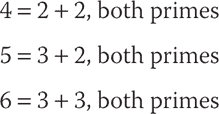

尽管这对于非常大的数是成立的，且至今未发现例外，但它尚未被数学证明。

## 离散数学

正如你在数论讨论中所学到的，有些数是连续的。例如，实数是连续的——也就是说，它们之间没有明显的界限点。例如，考虑 2.1 和 2.2，它们可以进一步细分为 2.11、2.12、2.13……2.2，甚至 2.11 和 2.11 也可以进一步细分为 2.111、2.112、2.113……2.12。这种过程可以无限进行下去。微积分处理的是连续数学。微积分中最基本的运算之一——极限——是连续数学的一个很好的例子。

*离散数学* 关注的是具有明确（即离散）边界的数学构造。你可能已经猜到，整数是离散数学的主要部分，但图和集合也是。

### 集合论

集合论是离散数学的重要组成部分。一个 *集合* 是一组称为该集合的 *成员* 或 *元素* 的对象。如果我们有一个集合，我们可以说某些对象属于（或不属于）这个集合，或者说它们在集合中（或不在集合中）。我们也说集合由其元素组成。

与数学的大部分领域一样，术语和符号至关重要。因此，我们以类似的方式开始学习，从简单到复杂的概念逐步构建。我能想到的最简单的方法是定义集合中的一个元素：我们说 x 是集合 A 的成员。这可以表示为


集合通常用方括号列出。例如，所有小于 10 的奇整数的集合可以表示为：

A = {1, 3, 5, 7, 9}

集合中的一个成员可以表示为：


否定可以用斜线符号表示：

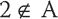

在本例中，2 不是集合 A 的元素。

如果集合是无限的，可以用省略号表示。例如，所有奇数的集合（而不仅仅是小于 10 的奇数）可以表示为：

A = {1, 3, 5, 7, 9, 11, …}

你也可以用方程或公式来表示集合，定义其成员资格。

集合之间可以相互关联，最常见的关系简要描述如下：

 **并集** 与两个集合 A 和 B，属于 A、B 或两者的元素构成 A 和 B 的并集，记作 A ∪ B。

 **交集** 与两个集合 A 和 B，属于 A 和 B 同时的元素构成 A 和 B 的交集，记作 A ∩ B。如果集合 A 和 B 的交集为空（即两个集合没有共同元素），则这两个集合被称为 *离散* 或 *互斥*。

 **差集** 与两个集合 A 和 B，属于一个集合但不同时属于两个集合的元素构成 A 和 B 的差集，记作 A \\ B。

 **补集** 与两个集合 A 和 B，如果 B 没有元素也在 A 中，则 B 是 A 的补集，记作 B = A^c。

 **双补集** 一个集合的补集的补集就是该集合本身。换句话说，A^c 的补集是 A。这在第一次阅读时可能看起来有点奇怪，但只要回想集合的补集定义就能明白。集合的补集是该集合中没有元素的集合。因此，要成为集合的补集的补集，必须拥有该集合中的所有元素。

这些是集合的基本关系。接下来是一些关于集合的事实：

 **顺序无关** {1, 2, 3} 与 {3, 2, 1}、{3, 1, 2} 或 {2, 1, 3} 是相同的。

 **子集** 集合 A 可以是集合 B 的子集。例如，如果集合 A 是所有小于 10 的奇数的集合，集合 B 是所有小于 100 的奇数的集合，那么集合 A 是集合 B 的子集。这表示为 A  B。

 **幂集** 集合可以有子集。例如，集合 A 是所有小于 10 的整数，集合 B 是集合 A 的子集，包含小于 10 的所有质数。集合 C 是集合 A 的子集，包含小于 10 的所有奇数。集合 D 是集合 A 的子集，包含小于 10 的所有偶数。我们可以继续做这种练习，构造任意子集，例如 E = {4, 7}，F {1, 2, 3}，以此类推。给定集合的所有子集的集合称为该集合的 *幂集*。

集合也有性质，这些性质规范了集合之间的相互作用。最重要的性质如下：

 **交换律** 集合 A 与集合 B 的交集等于集合 B 与集合 A 的交集。联结也如此。换句话说，当考虑集合的交集和联结时，集合的呈现顺序无关紧要。这可以表示为：

      (*a*) *A* ∩ *B* = *B* ∩ *A*

      (*b*) *A* ∪ *B* = *B* ∪ *A*

 **关联律** 如果你有三个集合，且这三个集合之间的关系全是并集或全是交集，那么顺序不重要。这可以表示为：

      (*a*) (*A* ∩ *B*) ∩ *C* = *A* ∩ (*B* ∩ *C*)

      (*b*) (*A* ∪ *B*) ∪ *C* = *A* ∪ (*B* ∪ *C*)

 **分配律** 这条规律与关联律有所不同，顺序不重要。集合 A 与集合 B 和 C 的交集的并集等于集合 A 与集合 B 的并集与集合 A 和 C 的并集的交集。这可以表示为：

      (*a*) *A* ∪ (*B* ∩ *C*) = (*A* ∪ *B*) ∩ (*A* ∪ *C*)

      (*b*) *A* ∩ (*B* ∪ *C*) = (*A* ∩ *B*) ∪ (*A* ∩ *C*)

 **德摩根定律** 这些定律处理并集、交集及其补集之间的问题。它们比前面讨论的规律更为复杂。基本上，集合 A 和集合 B 的交集的补集等于集合 A 的补集与集合 B 的补集的并集。德摩根定律的符号表示如下：

      (*a*) (*A* ∩ *B*)^(*c*) = *A*^(*c*) ∪ *B*^(*c*)

      (*b*) (*A* ∪ *B*)^(*c*) = *A*^(*c*) ∩ *B*^(*c*)

这些是集合论的基本要素。在继续前进之前，你应该已经熟悉它们。

### 逻辑

逻辑是数学、科学和哲学的重要话题。在离散数学中，*逻辑* 是一个明确定义的规则集合，用于建立（或否定）给定陈述的真值。虽然我在这本书中不会深入数学证明，但如果你选择继续研究密码学，你将在某个点需要检查证明。逻辑的正式规则是理解数学证明的第一步。

逻辑是一种用于从少数明确陈述的前提（或假设、公理、事实）中推导知识的形式语言。我们在本节中将研究的逻辑规则可能看起来有些奇怪或反直觉。请记住，逻辑关注的是论证的结构，而非内容本身。

在开始之前，我将定义几个基本术语：


 `Axiom` 一个公理（或 `premise` 或 `postulate`）是被假设为真的东西。本质上，你必须从某处开始。现在你可以像哲学家笛卡尔那样开始说：“我思故我在”（`Cogito ergo sum`），但这在大多数数学目的上并不实用。因此，我们从一些由定义本身就是真的公理开始。例如，任何只能被它本身和 1 整除的整数被认为是质数。

 `Statement` 这是一个简单的声明，表示某事为真。例如，“3 是质数”是一个声明，而“16 是 3 的立方”也是一个声明——它是错误的，但仍然是一个声明。

 `Argument` 一个论证是一系列声明的集合。其中一些声明，即前提，被假设为真并作为接受论证中另一个声明（即结论）的基础。

 `Proposition` 这是最基本的声明。命题是一个要么为真要么为假的声明。例如，如果我告诉你我要么是男性要么是女性，这是一个命题。如果我接着说我不是女性，这是另一个命题。如果你遵循这两个命题，你就会得出结论：我是男性。有些陈述没有真值，因此不能是命题。例如，“停止做那事！”没有真值，因此不是命题。

形式逻辑的令人兴奋之处在于，如果你从一个为真且忠实遵循逻辑规则的前提开始，那么你会得出一个为真的结论。从公理推导出结论是 `deductive reasoning`（演绎推理），这是数学证明中常用的推理方式。`Inductive reasoning`（归纳推理）是从前提进行概括。归纳推理可能因过度概括而出错。本书将专注于演绎逻辑。

###### Propositional Logic（命题逻辑）

你读过命题的定义，可能会回想到数学逻辑关注的是论证的结构，而非内容。这导致了教科书中常用的呈现方式——即忽略实际陈述，用字符代替。通常，`p` 和 `q` 用作占位符，它们可以代表你想要表达的任何命题。例如，`p` 可能表示“本书作者有灰色胡须”，而 `q` 可能表示“本书作者没有面部毛发”。在这两个命题的基础上，很可能有

              Either `p` or `q` is true.

              It is impossible that `p` and `q` are both true.

              It is possible that not `p` is true.

              It is possible that not `q` is true.

可以为这些陈述（以及你想要表达的其他陈述）使用符号。重要的是，你要熟悉基本逻辑符号。Table 4-1 提供了演绎逻辑中最常用符号的说明。

**TABLE 4-1    Symbols Used in Deductive Logic**

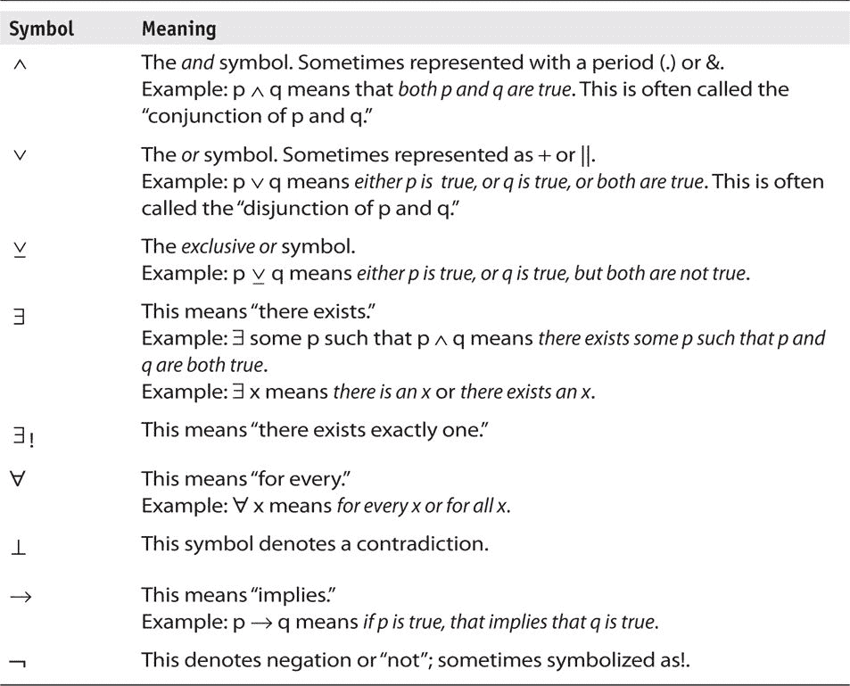

Table 4-1 并非逻辑符号的完整列表，但这些是最常用的符号。在继续本节的其余部分之前，请确保你熟悉这些符号。

其中一些符号被称为 `connectives`（连接词），这意味着它们用于连接两个命题。下面给出了一些关于连接词的基本规则，如同 Table 4-2 所示。

**TABLE 4-2    Connectives**

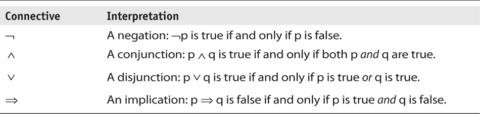

以下是关于连接词的一些基本事实：

   `Expressions`（表达式）在连接词两侧被称为 `conjuncts`（合取数） (`p ∧ q`)。

   `Expressions`（表达式）在连接词两侧被称为 `disjuncts`（析取数） (`p ∨ q`)。

   在蕴含 `p ⇒ q` 中，`p` 被称为 `antecedent`（前件），`q` 被称为 `consequence`（后件）。

   与连接词的优先级顺序是：括号、否定、合取、析取、蕴含。

###### Building Logical Constructs（构建逻辑构造）

现在你已经熟悉了演绎逻辑的基本概念，并掌握了必要的符号，让我们练习将一些文本陈述转换为逻辑结构。这是应用逻辑以判断陈述真伪的第一步。考虑以下示例句子：

              Although both John and Paul are amateurs, Paul has a better chance of winning the golf game, despite John’s significant experience.

我们现在用演绎逻辑的语言来重述这句话。首先，我们需要将这段长句拆解为单独的命题并为每个命题分配变量：

              `p`: John is an amateur

              `q`: Paul is an amateur

              `r`: Paul has a better chance of winning the golf game

              `s`: John has significant golf experience

我们现在可以用符号表达这个句子：

`(p ∧ q) ∧ r ∧ s`

这个句子不容易直接推导出真值，但它很好地展示了如何将句子转换为逻辑符号。

###### Truth Tables（真值表）

一旦你掌握了命题和连接词的基本概念，下一步就是熟悉真值表。真值表提供了一种可视化命题真值的方法。

下面是一个简单的例子。请记住，实际陈述本身并不重要，重要的是结构。但如果这有助于你理解概念，`P` 可以是命题“你正在阅读这本书”。

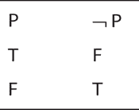

这个表告诉我们，如果 `P` 为真，那么 `¬P` 不可能为真。同时，如果 `P` 为假，那么 `¬P` 为真。这个例子很简单，甚至有点琐碎。这个真值表只是形式化、直观地告诉你：要么你在阅读这本书，要么你不在，两者不能同时为真。

虽然这个例子看似微不足道，你可能会想，为什么还要用真值表来展示这么明显的事实？实际上，你可能不会用真值表来展示这个例子。不过，由于大多数人很容易理解“某事要么为真要么为假”这一事实，这成为学习真值表的良好起点。几分钟后你将看到一些不那么平凡的表格。

接下来，我们来看一个稍微复杂一些的真值表，它引入了合取（`∧`）的概念。具体命题的内容并不重要。这个真值表说明了只有当 `p` 为真且 `q` 为真时，`p ∧ q` 才为真。

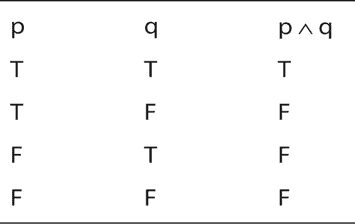

下面是一个关于析取（`∨`，即“或”）运算符的真值表。

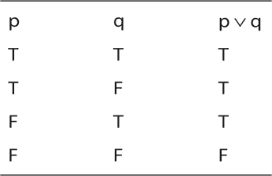

你可以看到，这个表清楚地表明了前面关于“或”（析取）连接词的描述。

`exclusive or`（异或）运算也很有趣，可以用真值表观察。回顾我们之前说明：要么 `p` 为真，要么 `q` 为真，但不能同时为真。

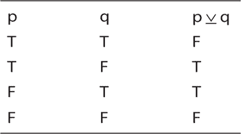

接下来，我们来看蕴含（`→`）的真值表。考虑 `p → q`。这读作“`p` 蕴含 `q`”。

**Tip**

在逻辑中，术语 `implies`（蕴含）比日常用语更强。这里它的意思是：如果你拥有 `p`，那么你必然拥有 `q`。

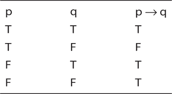

前面的真值表虽然看似显而易见，不需要详细解释，但这一个表可能需要一点讨论：

   `The first row`（第一行）应该对你有意义。如果我们在陈述“`p` 蕴含 `q`”，并且发现 `p` 为真且 `q` 为真，那么我们的陈述“`p` 蕴含 `q`”是真。

   `The second row`（第二行）也很明显。如果 `p` 为真但 `q` 为假，那么“`p` 蕴含 `q`”就不可能为真。


-   [关于最后两行呢？](https://example.org)

 我们正在陈述 p 蕴含 q；然而，在第三行中我们看到 q 为真但 p 为假。因此，非 p 蕴含 q，所以我们的“p 蕴含 q”陈述不成立。

 在第四行中，如果既不 p 也不 q，那么 p 蕴含 q 仍然为真。p 为假且 q 为假并不能否定我们的“p 蕴含 q”陈述。

**Tip**

有几个来源可以帮助你进一步了解数学逻辑。一个很好的来源是 Stan Gibilisco（McGraw-Hill Education，2005）所著的书 `Math Proofs Demystified`。

### Combinatorics

*Combinatorics* 顾名思义，就是关于如何组合各种集合的数学：它是处理如何从四种颜色中为六个房间进行涂色的数学，以及如何排列四个花盆的数学。

你可能已经猜到，*在粗略形式下*，组合学是非常古老的。希腊历史学家普鲁塔克提到了组合问题，尽管他没有使用当今我们使用的数学语言。印度数学家马哈维拉在九世纪实际上提供了处理组合和排列的具体公式。不清楚他 invent 了这些公式，还是仅仅记录了他从其他数学家那里学到的内容。

组合学用于解决一般性问题，包括 *存在性问题*（询问是否存在某种特定的物体排列），以及 *计数问题*（关注在某些要求下找出物体的各种可能排列）。*优化问题* 关注找到最有效的排列。

让我们从一个简单的组合学问题开始。假设你正在阅读这本作为密码学大学课程的一本教科书。假设你的班级有 30 名学生，其中 15 名是计算机科学专业学生，另外 15 名是其他专业学生——我们称这些学生为“其他”。

显而易见，从班级中选择一名计算机科学专业学生有 15 种方式，选择一名其他专业学生也有 15 种方式。这给出了 15 × 15 种从班级中选择一名学生的方式。但如果你需要选择一名学生，且该学生是计算机科学专业学生 *或* 其他专业学生，那么你有 15 + 15 种选择一种学生的方式。你可能会想知道为什么一种方法使用乘法，另一种方法使用加法。你将在组合学中学习的第一两条规则是 *乘法规则* 和 *加法规则*：

 **乘法规则** 假设你有一系列 r 个事件，我们称之为事件 E1、E2 等。特定事件可以有 n 种发生方式。事件的发生方式不依赖于前一个事件。这意味着你必须将可能的事件相乘。在我们的例子中，事件是从学生中选择一名，无论其专业。你可能从计算机科学专业中选择一名，或者从其他专业中选择一名。乘法规则有时被称为 *顺序计数规则*。

 **加法规则** 现在假设有 r 个事件 E1、E2 等，每个事件有 n 种可能的结果，并且进一步假设没有两个事件可以同时发生。这意味着你将使用加法规则，也称为 *离散计数规则*。之所以叫这个名字，是因为加法规则指出，如果集合 A 和集合 B 是不相交的集合，那么使用加法。

当一个主题对某人来说是新的，查看多个例子通常有助于完全理解该主题。让我们再看几个从群体中选择的例子，展示加法规则（有时称为 *求和规则*）和乘法规则（有时称为 *乘积规则*）。

当你需要从多个群体中选择时，假设你即将旅行，想要带上一些阅读材料。你有 5 本历史书、3 本小说和 3 本传记。你需要从每个类别中选择 1 本书。有 5 种方式选择一本历史书，3 种方式选择一本小说，3 种方式选择一本传记。总的可能组合数是 5 + 3 + 3。为什么这里使用了加法？因为每次选择只能进行一次。你有 5 本历史书可供选择，但一旦你选择了一本，就不能再选择更多。现在你有 3 本小说可供选择，但一旦你选择了一本，就不能再选择更多。

现在让我们看一个使用乘法或积规则的例子。假设你有 3 个房间需要粉刷，以及 4 种颜色的油漆。对于每个房间，你可以使用任何一种颜色，无论它之前是否被使用过。因此，你有 4 × 4 × 4 种可能的选择。为什么使用乘法而不是加法？因为每次选择都可以重复。假设你的 4 种颜色是绿色、蓝色、黄色和红色。你可以选择所有 3 个房间都使用绿色，或者只在 1 个房间使用绿色，或者根本不使用绿色。

如果选择被移除，乘法规则会被修改。假设一旦你选择了一种颜色，就不能再次使用。在第一个房间你有 4 种颜色可供选择，但在下一个房间只有 3 种，在第三个房间只有 2 种颜色。因此，可能的组合数是 4 × 3 × 2。

移除选择实际上非常常见。这里是另一个例子：假设你想为一张照片排列 5 个人。显而易见，你不能重复使用同一个人。一旦你排好了 5 个人，就没有更多的人可供选择。因此，你的可能组合数是 5 × 4 × 3 × 2 × 1。

### 排列

*排列* 是事物的有序排列。因为顺序被考虑在内，包含相同元素但顺序不同的排列被视为不同的。当一个排列只包含给定集合中的一些元素时，它被称为 *r-排列*。这在组合学中意味着集合中元素的顺序是重要的。考虑集合 {a, b, c}。如果顺序重要，有六种组合方式：

 a b c

 a c b

 b a c

 b c a

 c a b

 c b a

在集合 {a, b, c, d} 中，有 24 种可能的组合：


幸运的是，你不需要每次都写出所有可能性来确定给定排列有多少种组合。答案是 “n!”。对于不熟悉 n! 符号的人，它是阶乘符号。n! 表示 n × (n-1) × (n-2) × (n-3) … 的乘积。例如，4! 是 4 × 3 × 2 × 1。

考虑从一个集合中排序一个子集。如果你有一个包含 n 个对象的集合，并且你选择 r 个对象（0 < r < n），那么你称每种可能的选择为从集合中选取的 *r-排列*。如果我们有一个包含三个字母 {a, b, c} 的集合，并且想要选择两个字母，也就是说从字母集合中选取一个 r-排列，有多少种 r-排列是可能的？六种：


如果我们的原始集合是四个字母 {a, b, c, d}，并且想要选择一个两字母的 r-排列，你会有 12 种可能性：


这些例子应该说明，从 n 个对象的集合中获得 r-排列的数量是 n!/(n-r)!。


-   为了验证这一点，让我们回到我们第一个循环排列的例子。我们有一个包含 3 个元素的集合，想要选择 2 个。3! 是 3 × 2 × 1 = 6。除数 (n – r)! 是 (3 – 2)!，即 1。因此我们有 6 种循环排列。在第二个例子中，n = 4。4! = 4 × 3 × 2 × 1 = 24。除数 (n – r)! 是 (4 – 2)!，即 2。因此我们有 12 种循环排列。

-   显然，我们可以继续探索组合学，深入研究组合子集和集合的各种组合方式。但在此，你应该已经掌握组合学的基本概念。该领域在密码学中有多种方式相关，尤其是在优化算法方面。（顺便提一下，我发现组合学是离散数学中一个令人着迷的分支，具有众多实际应用。）

**Tip**

组合学是一个非常有趣的主题。由 V. K. Balakrishnan（Dover Publications，2010）所著的 *Introductory Discrete Mathematics* 提供了本章的良好章节，并讨论了本章涵盖的许多其他主题。

##### Graph Theory

*Graph theory* 是离散数学的一个非常重要的部分。它是一种数学上考察对象及其之间关系的方式。形式上，有限图 G(V, E) 是一个 (V, E) 的对，其中 V 是有限集合，E 是 V 上的二元关系。

现在让我们用更易读的方式来审视这个定义。图由顶点或节点（我之前称之为 *objects*）开始，这些对象可以是任何东西。边是连接顶点的线条。图有两种类型：有向图和无向图。在有向图中，边有方向；在无向图中，边没有方向。边是有序对，不一定是对称的。这意味着两个顶点之间的连接可能是单向的，也可能是双向的。

下面是一个例子。考虑两位朋友 John 和 Mike。他们之间的关系在 [Figure 4-2 中是对称的：他们互为朋友：


* * *

**FIGURE 4-2    Symmetrical graph**

如果我们用图来表示学生与教授之间的关系，则该关系不对称，如 Figure 4-3 所示：


* * *

**FIGURE 4-3    Asymmetrical graph**

Figure 4-3 所示的图是 *directed graph*，即顶点之间的关系存在方向。根据研究内容，方向可以是任意的。例如，如果你想描绘从教授到学生的知识传播，则箭头会指向学生，并且可能会包含多个学生。

你已经看到了 *vertex* 和 *edge* 的定义。在继续之前，我需要定义几个其他术语：

     **Incidence**    边（有向或无向）与其端点之一相邻的顶点称为 *incident*。

     **Degree of a vertex**    顶点的 *degree* 是与该顶点相邻的边的数量。有向图中的顶点也可以称为 *in degree* 和 *out degree*。入度是指向顶点的边的总数，出度是指向顶点的边（如 Figure 4-3 所示）。

     **Adjacency**    两个顶点通过一条边相连时，它们是 *adjacent*。

     **Directed graph**    有向图（也称为 *digraph*）是边有方向的图。

     **Weighted digraph**    这是一类有“成本”或“权重”属性的有向图，即每条边（即每种关系）都有强弱之分。

     **A complete graph**    这是一张每对顶点之间都有边的图。若有 N 个顶点，则会有 N × (N – 1) 条边。

一旦你理解了图的基本概念以及顶点与边的关系，接下来自然的问题是：如何遍历给定的图？这个问题可以通过多种方式回答。让我们考虑 Figure 4-4 所示的图，它包含五个顶点和七条边。


* * *

**FIGURE 4-4    Traversing a graph**

你可以通过三种基本方式遍历图：

     **Path**    在路径中，顶点不能重复——例如，a-b-c-d-e。你可以重复边，但不能重复顶点。

     **Trail**    路径的相反概念：边不能重复——例如，a-b-c-d-e-b-d。

     **Walk**    没有限制。例如，a-b-e-d-b-c。

无论使用哪种遍历方法，如果你在起点和终点相同，则该遍历被视为 *closed*。例如，如果你从顶点 b 开始并结束于 b，则无论使用路径、路径还是步行，这都是闭合的。遍历的长度仅为你需要跨越的边数。

有两种特殊的遍历类型：

     **Circuit**    闭合路径（例如，a-b-c-d-b-e-d-a）

     **Cycle**    闭合路径（例如，a-b-c-d-a）

由此引出几个其他术语：

     **Acyclic**    图中不存在循环的图

     **Tree**    连通且不含循环的图

     **Rooted tree**    带有“根”或“ distinguished”顶点的树；树的叶子是根树中的终端节点

     **Directed acyclic graph (DAG)**    无环的有向图

现在你对图的基本概念及其类型有了初步了解。与其继续深入抽象的图论概念，我更想回答你此时可能在思考的问题：图有什么用途？

图论有许多应用。例如，它们可以帮助你确定两个顶点/节点之间的最短（或最长）路径，或最小权重（而非最小长度）的路径。如果你只花一瞬间思考这两个问题，就会看到它们在计算机网络中有明确的应用。图论也用于研究网站结构和连接客户端。旅行问题显然也通过图论来解决。还有在粒子物理、生物学，甚至政治学中的应用。

**Tip**

学习离散数学的初学者的一个极佳资源是 Steven Krantz 所著的 *Discrete Mathematics Demystified*（McGraw-Hill Education，2008）。

#### Conclusions

本章介绍了你在后续章节理解密码算法所需的基本数学工具。本章主要介绍了数字系统，最重要的是对质数的深入介绍，包括如何生成质数。相对质数（co-prime）的概念也已涵盖。这些都是你应该深入理解并应用于 RSA 算法的重要主题。


你也看到了一些基本的数学运算，例如求和和对数，并被介绍了离散对数。模运算的讨论对于理解非对称算法至关重要。本章以离散数学的介绍结束，包括集合论、逻辑、组合论和图论。本章简要涵盖了这些主题；如果你能够深入且全面地理解本章所讨论的内容，那么继续学习密码学就足够了。关键是要确保在继续深入之前，你已经彻底、完全地理解本章内容。如有需要，可以重新阅读本章，并参考文中提供的各种学习辅助材料。

### 测试你的知识

    **1.**  Two vertices connected by an edge are `adjacent`.

    **2.**  The statement “Any number *n* ≥ 2 is expressible as a unique product of 1 or more prime numbers” describes what?

    **3.**  `log[3]27 = 3`

    **4.**  A circuit is a closed `trail`.

    **5.**  Are the numbers 15 and 28 relatively prime?

    **6.**  A `congruence class` is a group of numbers that are all congruent for some given modulus.

    **7.**  `The Lucas-Lehmer test` is a deterministic test of primality that works on Mersenne numbers.

    **8.**  `Discrete logarithms` are logarithms in respect to a finite group.

    **9.**  Set B is the `complement` of set A if B has no elements that are also in A. This is symbolized as B = Ac.

  **10.**  `Permutations` are ordered arrangements of things.

### 答案

    **1.**  `adjacent`

    **2.**  `The fundamental theorem of arithmetic`

    **3.**  `3`

    **4.**  `trail`

    **5.**  `Yes`

    **6.**  `congruence class`

    **7.**  `The Lucas-Lehmer test`

    **8.**  `Discrete logarithms`

    **9.**  `complement`

  **10.**  `Permutations`

#### 尾注

    **1.**  Edna E. Kramer, *The Nature and Growth of Modern Mathematics*, (`Princeton University Press, 1983`).

### 5  

**Essential Algebra**

**In this chapter we will cover the following:**

     `Groups`, `rings`, and `fields`

     `Diophantine equations`

     `Basic matrix algebra`

     `Algorithms`

     `The history of algebra`

Certain aspects of algebra are very important to the cryptographic algorithms you will be exploring later in this book. Those of you with a solid background in mathematics might be wondering how I could cover such a broad topic in a single chapter. Those of you without a solid background in mathematics might be wondering if you can learn enough and grasp enough of the concepts to apply them to cryptography later on.

Let me address these questions before you continue reading. As I did with Chapter 4, in this chapter I’m going to focus only on the basic information you need to help you understand the cryptographic algorithms covered later. Certainly, each of these topics could be given much more coverage. Entire books have been written on abstract algebra, matrix mathematics, and algorithms—in fact, some rather large tomes have been written just on algorithms! But you don’t necessarily need all those details to understand what you will encounter in this book. I would, however, certainly recommend that you explore these topics in more depth at some point. In this chapter, as with the last, I won’t delve into mathematical proofs. This means that you must accept a few things simply on faith—or you can refer to numerous mathematical texts that do indeed provide proofs for these concepts.

Those of you with a less rigorous mathematical background should keep in mind that, although you’ll need to have a firm grasp of the concepts presented in this chapter, you don’t need to become a mathematician (though I would be absolutely delighted if this book motivated you to study mathematics more deeply). It might take a mathematician to create cryptographic algorithms, but anyone can understand the algorithms I’ll present here. The ultimate goal of this book is to help you understand existing cryptography. I will provide links to resources where you can get additional information and explanations if you need it.

#### Abstract Algebraic Structures

If you think of algebra only as solving linear and quadratic equations, as you probably did in secondary school, these first algebraic concepts might not seem like algebra at all. But solving such equations is only one application of algebra. A far more interesting topic, and one more pertinent to cryptography, is the study of *sets* and operations you can perform on those sets. This is the basis for *abstract algebra*. Mathematics students frequently struggle with these concepts, but I will endeavor to make them as simple as I can without leaving out any important details.

Special sets of numbers and the operations that can be accomplished on those numbers are important to abstract algebra, and `groups`, `rings`, and `fields` are simply sets of numbers with associated operations.

Let’s begin with some examples. Think about the set of real numbers, which is an infinite set, as you know. What operations can you do with numbers that are members of this set in which the result will still be within the set? You can add two real numbers, and the answer will always be a real number. You can multiply two real numbers, and the answer will always be a real number. What about the inverse of those two operations? You can subtract two real numbers and the answer will always be a real number. You can divide two real numbers and the answer will always be a real number (of course division by zero is undefined). At this point, you may think all of this is absurdly obvious, and you might even think it odd that I would spend a paragraph discussing it. However, let’s turn our attention to sets of numbers in which all of these facts are *not* true.

The set of all integers is an infinite set, just like the set of real numbers. You can add any two integers and the sum will be another integer. You can multiply any two integers and the product will be an integer. So far, this sounds just like the set of real numbers. So let’s turn our attention to the inverse operations. You can subtract any integer from another integer and the answer is an integer. But what about division? There are an infinite number of scenarios in which you cannot divide one integer by another to arrive at another integer. For example, dividing 6 by 2, 10 by 5, 21 by 3, or infinitely more examples, gives you an integer. But divide 5 by 2, or 20 by 3, and the answer is *not* an integer; instead, it’s a *rational number*. And there are infinitely more examples like this. Therefore, if I want to limit myself only to integers, I cannot use division as an operation.


让我们先举几个例子，帮助演示这些概念。想象一下，你想把数学限制在一个人工世界中，在这个世界里只有整数存在。（暂时不要考虑为什么要这么做，只专注于这个思想实验。）在这个你创造的“人工世界”中，加法运算存在并且一如既往地运作，减法（加法的逆运算）也一样。乘法运算也像你预期的那样运作。然而，在这个虚构的世界里，除法根本不存在，因为它有可能产生非整数答案，而在这种“只有整数”的虚构世界中，这样的答案是不存在的。

再举一个最后的假设情境，帮助澄清这些基本点。如果你只限制自己为自然数（计数数字），即只使用自然数，你可以将任意两个自然数相加，结果始终是自然数。你也可以将任意两个自然数相乘，确保乘积仍是自然数。你也可以对自然数进行减法，结果也是自然数——但情况并非总是如此。例如，如果你尝试从 5 中减去 7，结果是负数，而负数 *不是* 自然数。事实上，每当你尝试用一个较大的自然数减去一个较小的自然数时，结果都不会是自然数。此外，除法在自然数中同样棘手。在无数情况下，答案也不是自然数。在这个“只有自然数”的虚构世界中，加法和乘法正常运作，但它们的逆运算——减法和除法——根本不存在。

抽象代数研究的是这类结构。这些结构（群、环、域等）由一组数字和在该数字上可以执行的特定运算组成。在一个给定结构中，只允许那些运算结果仍落在预定数字集合内的运算。你在 第 4 章 中已经接触到类似概念，例如模运算，其中使用的数字是受模限制的整数。

不要过度担心 *抽象代数* 这个术语。一些来源称其为 *现代代数*，但鉴于它已有几个世纪的历史，这可能是一个误称。当我们在本书后面讨论非对称密码学——特别是在 第 11 章——你会看到这些结构的多个实际应用。即使是对称算法——高级加密标准 (AES)，你将在 第 7 章 中学习，也会应用这些结构的一部分。

### 群

一个 *群* 是一种代数结构，包含一个集合、一个身份元素、一个运算以及其逆运算。 *身份元素* 是集合中一个数，当与集合中另一个数在某些运算中结合时，不会改变该数。数学上，身份元素 I 可以表示为：

a \* I = a

其中 \* 可以是任何你指定的运算（不一定是乘法）。

对于加法运算，0（零）是身份元素。你可以向集合中任何成员加上 0，结果仍然是该成员本身。对于乘法，1 是身份元素。任何数乘以 1 仍保持不变。

每个群必须满足四个性质：封闭性、关联性、身份性和可逆性：

- **封闭性**（Closure）：任何在集合成员上的运算结果仍属于该集合。  
   *Closure* 是这些性质中最简单的。正如本章前面讨论过的，封闭性意味着对集合中的任意元素进行运算，结果仍然是集合的成员。

- **关联性**（Associativity）：在同一集合上的运算中，元素的排列方式不会改变结果。例如 (2 + 2) + 3 = 7，若改写为 2 + (2 + 3)，答案仍是 7。

- **身份性**（Identity）：前面已讨论过。

- **可逆性**（Invertibility）：给定集合中元素的运算可以被逆运算“撤销”。减法是加法的逆运算；除法是乘法的逆运算。

回想我们整数的例子。整数构成一个群。首先有身份元素 0。还有一个运算（加法）及其逆运算（减法）。此外，整数满足封闭性：任何整数加上任何其他整数，结果仍是整数，属于同一集合。

### 阿贝尔群

阿贝尔群（亦称交换群）是一个附加 *交换*（commutative）性质的群：如果运算是加法，则 a + b = b + a；如果运算是乘法，则 ab = ba。交换性意味着群运算的顺序不影响结果——即你可以以任何顺序对集合成员应用群运算。

 trivial 例子：考虑整数集合与加法运算。顺序不影响：

4 + 2 = 2 + 4

因此，整数集合在加法下是一个阿贝尔群。

**Tip**

显然，减法和除法不可能用于阿贝尔群，因为元素的顺序会改变运算结果。

### 循环群

循环群（Cyclic group）的元素全部是某一元素的幂。例如，若以元素 x 为起点，则循环群的成员为

x^(–2), x^(–1), x⁰, x¹, x², x³, …

当然，循环群仍需满足前面讨论的所有群的性质。基本元素 x 被称为 *生成元*（generator），也叫 *原始元*（primitive element）。整数可以被视为一个循环群，其中 1 是生成元（即生成器）。所有整数都可以表示为 1 的幂。虽然这看似是一个 trivial（ trivial ）的例子，但它易于理解。

### 环

一个 *环* 是一种代数结构，包含一个集合、一个身份元素、两个运算以及第一个运算的逆运算。形式上，环的定义是：一个集合配备两个运算（通常是加法和乘法），其中加法构成一个阿贝尔群，乘法是一个可结合的二元运算，并且乘法对加法有分配律。若仅考虑前面的例子，这两个运算通常是加法和乘法，而减法是加法的逆运算。

环本质上是一个阿贝尔群再加上一个运算。我们已经看到，整数集合在加法下形成一个阿贝尔群；如果再加上乘法，整数集合就构成了一个环。

### 体（域）

一个 *体*（field）是一种代数结构，包含一个集合、每个运算的身份元素、两个运算以及它们各自的逆运算。体类似于群，但有两个运算而非一个，并且对每个运算都有逆元。体也是环的特例，但并非所有环都是体。例如，整数集合是一个环，但不是体（因为乘法的逆运算可能产生非整数结果）。体允许除法（乘法的逆运算），而群则不允许。


一个经典的例子是有理数领域。每个数都可以写成比值（分数），例如 `x/y`（x 和 y 可以是任意整数），其加法逆元为 –`x/y`，乘法逆元为 `y/x`。

### Galois Fields

Galois fields 也称为 `finite fields`。你将在本章的“History Highlights”（历史亮点）部分了解到 Évariste Galois 本人。这些域在密码学中非常重要，后续章节中也会用到它们。因为它们的元素个数是有限的，所以被称为有限域。如果你回想我们之前讨论的若干组、环和域，你会发现它们都是无限的。整数、有理数和实数集合都是无限的，但 Galois fields 是有限的。

在 Galois field 中，存在一些整数 n，使得 n 重复相加等于零。换句话说，场有一个边界，使其有限。满足条件的最小 n 是一个质数，称为该域的 `characteristic`（特征）。你常常会看到 Galois field 定义为：

`GF(p^n)`

在此，`GF` 并不表示函数，而是指含有质数 `p`（如前所述的特征）且包含 `p^n` 元素的 Galois field。因此，Galois field 是一个有限的数集合（从 0 到 `p^n`–1），以及定义在该集合上的数学运算（通常是加法和乘法），以及这些运算的逆元。

你可能立刻会问，如何可能存在有限域？如果域是有限的，难道加法和乘法操作的结果不可能落在域之外吗？为了理解这一点，请回顾 第 4 章 中讨论的模运算。实际上，运算会在模数周围“回绕”。以时钟为例，任何结果超过 12 就会回绕。Galois field 中的情况相同：任何结果超过 `p^n` 都会回绕。

让我们看一个例子——虽然它很 trivial，但能说明问题。考虑 Galois field `GF(3¹)`。首先，你应该意识到 `3¹` 等于 3——大多数教材会直接写作 `GF(3)`。因此，我们有一个由 3 定义的 Galois field。无论如何，只要加或乘的结果超过 3，就需要回绕。这个例子之所以容易处理，是因为它只有三个元素：1、2、3。对于这些元素的运算，以下加法示例不成问题：

1 + 1 = 2  
1 + 2 = 3  

然而，有些情况会出问题：

2 + 2 = 4  
但在 Galois field 中，类似模运算，2 + 2 = 1（在 3 处回绕）。同样，2 + 3 = 2。

乘法同样遵循回绕规则（在两种情况下都以 3 为界）：

2 × 2 = 1  
2 × 3 = 0  

在密码学中，我们处理的 Galois field 远比这个 trivial 例子更复杂，但原理完全相同。

### Diophantine Equations

在 Diophantine 方程中，我们只关心整数解。因此，线性 Diophantine 方程是形如 `ax + by = c` 的线性方程，其中系数 a、b、c 均为整数，且我们只寻找整数解。

Diophantine 方程有两种类型：`Linear Diophantine` 方程的项度数为 1 或 0；`Exponential Diophantine` 方程至少有一项的指数大于 1。

“Diophantine” 这个词来源于 Diophantus of Alexandria，第三世纪公元初的数学家，他研究过这类方程。你可能已经见过 Diophantine 方程，只是未曾意识到。例如，若只关注整数解，传统的勾股定理（勾股定理）可以成为 Diophantine 方程。

最简单的 Diophantine 方程是线性方程，形式为：

`ax + by = c`

其中 a、b、c 均为整数。该方程有整数解当且仅当 c 是 gcd(a, b)（a 与 b 的最大公约数）的倍数。例如，Diophantine 方程 3x + 6y = 18 有整数解，因为 gcd(3,6) = 3，而 3 确实能整除 18。

### Matrix Math

`matrix` 是行列排列的数字矩形阵列。行水平，列垂直。矩阵的维度记作 `m × n`，其中 m 为行数，n 为列数。下面是一个示例：


本节示例将聚焦 2 × 2 矩阵，但矩阵可以有任意行列数，不必是方阵。向量可以视为 1 × m 的矩阵。在前面的矩阵示例中，你可以有一个竖向的向量，如 5、3、–5，或一个横向的向量，如 5、0、2、–2。竖向的向量称为列向量，横向的称为行向量。

矩阵的不同类型：

`Column matrix` 一列的矩阵  
`Row matrix` 一行的矩阵  
`Square matrix` 行列数相同的矩阵  
`Equal matrices` 维度相同且所有对应元素完全相同的两个矩阵  
`Zero matrix` 全为 0 的矩阵  

#### Matrix Addition and Multiplication

若两矩阵尺寸相同，可通过对每个对应元素相加来进行矩阵加法。例如：


从第一矩阵的第一行第一列（值为 1）加到第二矩阵的第一行第一列（值为 3），在和矩阵中该位置的值为 1 + 3 = 4。其余位置同理。

减法同理：


矩阵乘法较为复杂。若要将矩阵与标量（单个数）相乘，只需将标量乘到矩阵的每个元素：


两矩阵相乘需要满足：第一矩阵的列数等于第二矩阵的行数。乘法时，第一矩阵的每一行元素分别与第二矩阵的每一列元素相乘，然后累加得到结果矩阵的对应元素。

概念示例：


乘积为


若仍不清楚，可参考具体示例：


我们从


开始，最终得到


这说明只有当第一矩阵的列数等于第二矩阵的行数时，才能进行矩阵乘法。

需要记住的是，矩阵乘法不满足交换律，即 `A × B ≠ B × A`（不像标量乘法）。例如：


若交换乘积顺序，结果会完全不同：


这段示例说明了一个相当重要的事实：矩阵乘法不具有交换性。

# Tip

如果你想要在矩阵乘法方面多练习一点，可以尝试访问 [`FreeMathHelp.com`](http://FreeMathHelp.com) 或 [`www.freemathhelp.com/matrix-multiplication.html`](http://www.freemathhelp.com/matrix-multiplication.html)。

## Matrix Transposition

矩阵 `transposition` 简单地将行和列的顺序颠倒。虽然我们主要关注 2×2 矩阵，但转置操作最容易通过一个行列数不同的矩阵来观察。请参考下面所示的矩阵。


要对矩阵进行转置，需要将行和列交换，从而得到一个 2×3 矩阵。第一行现在变成了第一列。你可以在下面的示意图中看到这一点。


## Submatrix

一个 `submatrix` 是任意矩阵的一部分，即在删除任意数量的行或列后保留下来的矩阵。请参考下面的矩阵：


如果你删除第二列和第二行，


你剩下的就是下面所示的矩阵：


这个矩阵是原始矩阵的子矩阵。

## Identity Matrix

一个 `identity matrix` 其实非常简单。回想一下群的单位元性质。单位矩阵的作用是使得矩阵乘以它自身后保持不变。要构造一个单位矩阵，需要将主对角线上的元素全部设为 1，其余元素设为 0。请参考下面所示的矩阵（见 Figure 5-1）。


* * *

**FIGURE 5-1    A 2×2 matrix**

现在考虑单位矩阵。它必须是行列相等的矩阵，其主对角线上的元素全部为 1，其余元素全部为 0。你可以在下面看到单位矩阵（见 Figure 5-2）。


* * *

**FIGURE 5-2    The identity matrix**

如果你将原始矩阵（见 Figure 5-3）与单位矩阵相乘，结果将与原始矩阵相同。这一点在下面的图中有所体现。


* * *

**FIGURE 5-3    The product of a matrix and its identity matrix**

**Note**

在这些例子中，我不仅关注方阵、2×2 矩阵，还涉及仅包含整数的矩阵。矩阵可以包含有理数、实数，甚至函数。但由于本节旨在介绍矩阵代数的概念，我并未深入探讨这些细节。

矩阵代数的一个应用是线性变换。一个 *linear transformation*，有时也称为 *linear mapping* 或 *linear function*，是两个向量空间之间的映射，它保留了加法和标量乘法的运算。

**Note**

Wolfram MathWorld ([`mathworld.wolfram.com/VectorSpace.html`](http://mathworld.wolfram.com/VectorSpace.html)) 定义向量空间如下：“向量空间 V 是一个在有限向量加法和标量乘法下封闭的集合。”换句话说，向量空间是由我们称之为向量的对象（这里是整数）组成的集合，这些向量可以相加，也可以被（所谓的）标量（数）缩放。

考虑矩阵乘法（无论是与标量相乘还是与另一个矩阵相乘），这个过程会把第一个矩阵中的每个元素映射到第二个矩阵中的某个元素。这很好地是一个线性变换的例子。该过程在物理、工程和密码学中有许多实际应用。

**Tip**

关于矩阵代数的通用教程，网站 S.O.S. Mathematics 提供了有用的教程，网址为 [`www.sosmath.com/matrix/matrix.html`](http://www.sosmath.com/matrix/matrix.html)。

## Algorithms

从本节起，你将研究各种算法。那些已经学习过计算机科学的人很可能已经修过数据结构和算法课程。本节将介绍一些算法概念，随后在排序算法的背景下讨论一般算法分析。本节结束时，我们将研究一个非常重要的算法。

### Basic Algorithms

一个 *algorithm* 只是一种系统化解决问题的方法。如果你遵循该过程，就能得到预期的结果。算法是计算机编程的常规部分。通常，算法研究的重点是排序算法。排序列表是一个非常常见的任务，因此也是算法研究的常见主题。

同时，我们需要有一种清晰的方法来评估算法的有效性。对于任何算法，如果能够得到期望的结果，那么显然该算法是可行的。但真正的问题是，它工作得有多好？如果你对只有 10 个元素的列表进行排序，排序耗时并不特别关注。但如果列表包含 1 百万个元素，排序耗时（即你选择的算法）就至关重要。类似的问题也出现在现代加密算法的评估上。显然，它们必须工作（即是安全的），而且必须高效。例如，如果用于电子商务的加密算法效率不佳，电子商务就不会如此普及。

幸运的是，有很好的方法来分析任何算法。分析算法时，我们通常关注 *asymptotic* 上下界。渐近分析是用来衡量计算机算法性能的过程。这种性能通常以 *computational complexity*（通常指时间或所需资源（内存）的度量）来衡量。算法通常可以为时间或资源进行优化，但不能同时两者兼得。渐近上界是给定算法的最坏情况场景，而渐近下界是最佳情况。

有些分析者更倾向于使用平均情况；然而，了解最好和最差情况在某些情况下可能很有用。简单来说，渐近上界和下界必须落在你所解决的问题的参数范围内。你必须假设最坏情况会在某些情况下发生。

之所以上界和下界之间存在差异，是因为集合的初始状态。如果你将排序算法应用于信息熵最大（即最混乱）的集合，那么算法的运行时间将达到渐近上界。相反，如果集合已经非常接近有序，则算法可能接近或达到渐近下界。

评估算法有效性的最常用方法是 *Big O notation*。该方法衡量算法的执行情况，通常是根据问题规模 n（在排序算法中，n 为待排序的元素数量）所需的迭代次数。表示 f(n) = O(g(n)) 意味着它小于某个常数倍的 g(n)。换句话说，“f of n 是 Big O of g of n”。如果一个算法是 2n，意味着它需要执行列表中两倍的元素数量。Big O 记号本质上测量函数的渐近上界，并且是最常用的分析方法。

Big O 记号最早由德国数学家 Paul Bachmann 在 1894 年的著作 *Analytische Zahlentheorie*（分析数论）中引入，该书是关于解析数论的工作。随后，德国数学家 Edmund Landau 将其推广，该记号有时被称为“Landau 符号”。


Omega 记法是 Big O 记法的相反形式。它是算法的渐近下界，给出了该算法的最佳情况。它提供了算法的最小运行时间。


Theta 记法结合了 Big O 和 Omega，用于提供算法的平均情况（在此情况下为算术平均值）。在我们的分析中，我们将主要关注 Theta，也常被称为 Big O 运行时间。这种平均时间能更真实地反映算法的执行情况。

**Note**

当来源指的是的不是 Theta 的“Big O 运行时间”时会很令人困惑。我在网上找到了几个来源，它们使用了“O 记法”，但实际上提供的正是 。也有可能两者给出的答案相同。

现在你已经了解如何分析和评估算法的复杂性和效能，让我们来看几种常见的排序算法，并应用这些分析工具。

##### 排序算法

排序算法常用于向初学者介绍算法研究，因为它们易于理解且非常常见。由于我们尚未探索现代密码学算法，我将使用排序算法来说明算法分析的概念。

Merge sort 的某些简单实现会使用三个数组——一个用于数据集的一半，一个用于存储最终排序后的列表。虽然存在非递归版本的 merge sort，但它们并未在大多数机器上提供显著的性能提升。事实上，几乎所有 merge sort 的实现都是递归的，即它会不断调用自身直到列表排序完成。

其名称来源于列表被分割、分别排序，然后合并的过程，且该过程是递归应用的。如果你有一个极其庞大的列表，并且能够将两个子列表分别放在不同处理器上，那么 merge sort 的效能将显著提升。

###### 快速排序

*快速排序* 是一种非常常用的算法。和 merge sort 一样，它也是递归的。有些书籍将快速排序描述为比 merge sort 更有效的版本。实际上，快速排序的时间复杂度与 merge sort 相同（n ln n），但其平均情况也是最佳情况（即最低渐近下界）。然而，它的最坏情况是 O(n²)，这表明其最差情况效率较低。对于非常大的列表，最差情况可能不被接受。

该递归算法包含三个步骤（与 merge sort 相似）：

1. 选择数组中的一个元素作为基准点（pivot）。
2. 将数组分为两部分。分割点即为基准点。一部分包含大于基准点的元素，另一部分包含小于基准点的元素，其中一部分应包含基准点本身。
3. 递归地对原数组的两部分重复执行该算法。

一个非常有趣的点是，算法的效率受基准点选择的影响很大。快速排序的最坏情况发生在列表已排序且选择左端元素作为基准点时，此时复杂度为 O(n²)。如果数据待排序不随机，建议随机选择基准点而非使用左端元素。只要基准点是随机选择的，快速排序的算法复杂度即为 O(n log n)。

###### 冒泡排序

*冒泡排序* 是最老且最简单的排序算法。从程序实现的角度来看，它非常容易实现。遗憾的是，它也是最慢的。其复杂度为 O(n²)，这意味着对于非常大的列表，它可能会过于缓慢。与大多数排序算法一样，它的最佳情况（即最低渐近下界）是 O(n)。

冒泡排序的工作方式是比较列表中的每个元素与其相邻元素，并在需要时进行交换。算法会重复此过程，直到它在一次完整的遍历中没有进行任何交换（即所有元素已经有序）。这导致较大的值“冒泡”到列表末尾，较小的值“下沉”到列表开头，因此得名“冒泡排序”。

冒泡排序通常被认为是常用中最无效的排序算法。在最佳条件下（列表已排序），冒泡排序的复杂度可接近常数级 n 的复杂度。一般情况是 O(n²)。

尽管它是较慢的算法之一，但冒泡排序因实现简单而常被使用。许多缺乏对算法效率和分析深入理解的程序员依赖冒泡排序。

现在我们已经介绍了三种常见的排序算法，你应该已经对算法和算法分析有了基本理解。接下来我们将关注一个在密码学中重要的算法：欧几里得算法。

###### 欧几里得算法

*欧几里得算法* 是一种用于求两个整数的最大公约数的方法。这听起来像是一个相当琐碎的任务，但在处理较大数字时并非如此。它也在你稍后学习的若干密码学算法中发挥作用。欧几里得算法通过一系列步骤进行，每一步的输出被用作下一步的输入。

下面是一个示例：让 k 表示算法的步数，从 0 开始。因此，初始步对应 k = 0，下一步对应 k = 1，然后是 k = 2、k = 3，以此类推。除第一步外，每一步都从上一步得到的两个余数 r[k–1] 和 r[k–2] 开始。你会发现，每一步的余数都小于上一步的余数，即 r[k–1] < r[k–2]。这是有意为之，也是算法运作的核心。第 k 步的目标是找到一个商 qk 和余数 r[k]，使得满足以下等式：

r[k–2] = qk r[k–1] + r[k]

其中 r[k] < r[k–1]。换句话说，用较小的数 r[k–1] 的倍数从较大的数 r[k–2] 中减去，直到余数小于 r[k–1]。

让我们看一个例子。

设 a = 2322, b = 654

2322 = 654·3 + 360（360 是余数）

这告诉我们，最初两个数的最大公约数 gcd(2322, 654) 等于 gcd(654, 360)。这些数值仍然有点笨拙，我们继续执行算法。

654 = 360·1 + 294（余数是 294）

这告诉我们，gcd(654, 360) 等于 gcd(360, 294)。

在随后的步骤中，我们继续此过程，直到无法继续：


因此，gcd(2322,654) = 6。

这个过程很有用，可以用于求任何两个数的最大公约数。如前所述，它在你稍后学习的密码学中也将发挥作用。

**Tip**

如果你需要更多关于欧几里得算法的信息，网上有非常有用的资源。康奈尔大学有一个简洁的页面，[www.math.rutgers.edu/~greenfie/gs2004/euclid.html](http://www.math.rutgers.edu/~greenfie/gs2004/euclid.html)，丹佛大学也有类似资源，[www-math.ucdenver.edu/~wcherowi/courses/m5410/exeucalg.html](http://www-math.ucdenver.edu/~wcherowi/courses/m5410/exeucalg.html)。

###### 设计算法


设计算法是一种形式化过程，它提供了解决问题的系统性方法。因此，这并不令人惊讶的是存在系统化的算法设计方法。本节我们将研究其中一些方法。

“分治”算法设计方法是常用的方法，事实上，它可以被认为是最常用的方法。它通过递归地将问题分解为同类型的子问题，直到这些子问题变得足够简单以直接求解。一旦子问题被解决，解决方案便被组合以提供原始问题的解决方案。简而言之，你不断将问题细分，直到找到可管理的可解部分，然后解决这些较小、更易处理的部分，最后将这些解决方案组合起来解决原始问题。

当你面对难题，例如经典的汉诺塔谜题时，分治方法通常是唯一可行的解法。分治方法往往产生的算法不仅有效，而且高效。

分治方法的效率可以通过子问题的数量来评估。如果拆分问题和组合部分解的工作量与问题规模 n 成正比，那么在每个阶段会生成有限个大小约为 n/p 的子问题。此外，如果基准情况需要 O（即常数时间的）时间，则分治算法的复杂度为 O(n log n)。这在排序问题中常用于将复杂度从 O(n²) 降低。O(n log n) 的复杂度对于大多数排序算法来说已经相当不错。

除了帮助你为复杂问题设计高效算法外，分治方法还非常适合在多处理器机器上执行。子问题可以分配给不同处理器，使每个处理器专注于不同的子问题。这使得子问题能够并行求解，从而提高整体过程的效率。

第二种方法是*贪心方法*。教材 *An Introduction to Algorithms*，由 Thomas Cormen、Charles Leiserson、Ronald Rivest 和 Clifford Stein（MIT Press，2009）定义为：贪心算法是一种在给定情境下选择看似最优解的算法。换句话说，选择的解在特定情境下是理想的，但可能不是更广泛问题类别的最佳解。贪心方法用于优化问题。要精确描述贪心范式，我们首先需要更详细地描述优化问题通常发生的环境。大多数优化问题包括以下要素：

 一个候选集合——集合、列表、数组或其他数据结构。其在内存中的存储方式与否无关。

 一个已使用过的候选集合。

 一个用于测试给定候选集合是否提供高效解的谓词解。它不检查这些候选集合是否提供最优解，只检查它们是否提供可行解。

 另一个谓词解（可行性），用于测试候选集合是否可以扩展为解。

 一个选择函数，用于从未使用过的候选集合中选择某个候选。

 一个为解分配值的函数。

本质上，优化问题涉及从候选集合 C 中找到子集 S，使其满足特定标准。例如，标准可能是“由 S 优化函数的解”。优化可能表示多种因素，如最小化或最大化。贪心方法的特点在于选择函数为每个候选集合 C 赋予数值，并选择使

`SELECT( C )` 取最大或最小的候选。

所有贪心算法都具有相同的一般形式。针对特定问题的贪心算法通过描述谓词和选择函数来指定。因此，贪心算法在优化问题上往往非常容易设计。

贪心算法的一般形式如下：

function `select` (C : candidate_set) returncandidate;

function `solution` (S : candidate_set) returnboolean;

function `feasible` (S : candidate_set) returnboolean;

**Tip**

*An Introduction to Algorithms* 是学习算法的极佳资源。它常被用作大学课程教材。如果你寻找关于算法的深入讨论，我推荐这本书。

##### P vs. NP

你可能已经听说过这个问题，即使没有严格的数学背景，它也经常被提及，甚至出现在电视剧 *Elementary* 的一集中。它涉及对密码学有重大影响的问题。

许多数学问题可以通过一些*多项式*方程求解，但并非所有问题都能这样解决。那些不能被这样解决的问题被称为 *NP*，即*不多项式*（也称为*非确定性多项式时间*或*无法在多项式时间内求解*）。在复杂性理论中，*NP-完全*（NP-C）问题是最难求解的，因为它们没有多项式时间的解。这个概念应该足够简单。*P* 是*多项式*，更准确地说，*P* 表示*在多项式时间内可求解的问题*。那么“P 对 NP”这一问题具体指什么？

该问题涉及这样一个事实：到目前为止，还没有人证明不存在任何 NP-完全问题的多项式解。如果有人能为任意 NP-完全问题提供多项式解，这将证明所有 NP-完整问题都有多项式解（简言之，将证明不存在 NP-完全问题）。换句话说，据我们所知，可能存在某些 NP 问题的多项式时间解，但尚未证明它们不能在多项式时间内求解。

**Tip**

当我说“证明”时，指的是提供数学证明。

本质上，问题分为三类：*P* 问题可以在多项式时间内求解。*NP* 问题无法在多项式时间内求解，但可以验证给定解的正确性。*NP-C* 问题根本无法在多项式时间内解决。

一个 NP-C 问题的例子是子集和问题，其概括如下：给定一个有限整数集合，判断是否存在非空子集使其和为零。验证一个 proposed 答案是否正确很容易；然而，到目前为止，还没有人找到比遍历所有可能子集更快的解法，这非常低效。

目前，所有已知的 NP-C 问题算法都需要超多项式时间的运行，即输入规模的多项式之外的时间。换句话说，任何 NP-C 问题都没有多项式解。因此，求解 NP-C 问题通常采用以下方法：

 **近似**：使用一个算法快速找到一个在已知范围内的次优解。即，找到一个近似解。

 **概率**：使用一个算法，它能保证在给定问题实例分布下，具有良好的平均运行时间。


 `Special cases` 使用一种算法，如果问题实例属于特定的特殊情况，则该算法被证明是快速的。换句话说，只有在问题的某些特定情况中才能找到最优解。

 `Heuristic` 一个在许多情况下表现良好的算法，但没有证明它总是快速的。启发式方法也被视为`经验法则`。

我们以一般方式考察了 NP-完全问题，但现在让我们看一个正式的定义。一个问题 `C` 是 NP-C 当且仅当

`它属于 NP`

并且

`NP 中的所有其他问题都可以归约到它`。

在此情况下，`归约` 意味着对于每个问题 `L`，存在一种多对一多项式时间归约，这是一种确定性算法，它将问题 `l` ∈ `L` 的实例转换为问题 `c` ∈ `C` 的实例，使得 `c` 的答案为“是”当且仅当 `l` 的答案为“是”。

作为这一方定义的结果，如果你有一个多项式时间算法用于 `C`，你就可以在多项式时间内解决 NP 中的所有问题。这意味着，如果有人 ever 找到 NP-C 问题的多项式解，那么所有问题都可以在多项式时间内得到解，正如我 earlier 所提到的。

在 `An Introduction to Algorithms` 中，NP-C 问题通过展示一个可以用多项式时间算法解决的问题，以及相关的 NP-C 问题来说明。例如，求最短路径是多项式时间算法，而求最长路径是 NP-C 问题。

这一正式定义由计算机科学家 Stephen Cook 在 1971 年提出，他同时证明了布尔可满足性问题是 NP-C。

**Note**

布尔可满足性问题的细节与我们当前的讨论并不相关。如果你对更多细节感兴趣，请参阅计算机协会 (ACM) 关于该主题的论文：[`cacm.acm.org/magazines/2014/3/172516-boolean-satisfiability/fulltext`](http://cacm.acm.org/magazines/2014/3/172516-boolean-satisfiability/fulltext)。

自 Cook 的原始结果以来，成千上万的其他问题都通过从其他已知为 NP-C 的问题进行归约来证明是 NP-C；许多这些问题都收录在 Michael Garey 和 David Johnson 的书 `Computers and Intractability: A Guide to the Theory of NP-Completeness` (W.H. Freeman, 1979) 中。

这与密码学有什么关系呢？实际上关系非常大。正如你将在 Chapters 10 和 11 中看到，现代公钥密码学基于数学问题，这些问题非常难以求解；它们是 NP 问题（无法在多项式时间内求解）。如果有人证明这些 NP 问题实际上可以在多项式时间内求解，那么这将严重削弱现代公钥密码学的安全性。正如你也会看到，公钥密码学是许多现代技术（包括电子商务）的关键。

**Note**

P 与 NP 的问题（P versus NP）是数学与现实生活之间的一个绝好的例子，说明看似抽象的数学可以产生非常实际的影响。

#### History Highlights

在本节中，我将提供关于代数历史的几个重要节点的概述。代数的发展经历了三个阶段：

 `Rhetorical` 没有使用符号，仅用语言描述

 `Syncopated` 使用缩写词

 `Symbolic` 使用符号，这是当今通用的方式

`Rhetorical stage`（修辞阶段）之所以得名，是因为它不使用现代符号，而是用文字描述代数问题。正如你可能想象的，这对代数的发展是一个严重的障碍。考虑一下你在中学代数课程中的经历，想象如果没有符号，你会有多难学习！早期的巴比伦和埃及数学家使用修辞代数。希腊人和中国人也使用这种方式。

Diophantus，你在本章前面提到的数学家，是第一个使用 `Syncopated` 代数的人，他在他的书 `Arithmetica` 中使用了缩写而非完整单词。

大约在 1500 年，符号开始取代修辞和缩写代数。到 17 世纪，符号成为进行数学的主要方式。但即便如此，当时使用的符号也与你现在最熟悉的符号并不完全相同。

代数分为两种：

 `Classical algebra` 方程求解——即你在中学可能学过的代数类型。它关注的是寻找特定问题的解，例如二次方程。

 `Abstract/modern algebra` 研究群，或一类数及其运算的专门集合——如本章前面提到的群、环和域。

单词 `algebra` 的词源很有趣。它来源于阿拉伯数学家 Mohammed ibn-Mūsā al-Khwārizmī 使用的单词 `jabr`。在他的书 `The Compendious Book on Calculation by Completion and Balancing`（约公元 820 年）中，他使用了 `jabr` 这个词来表示将减去的项移到方程的另一边——这就是你在中学第一次学到的“消去”操作。最终，`al-jabr` 这个词演变成了 `algebra`。

我们现代的代数概念经过多年的发展——事实上，经过几个世纪——并受到了许多文化的影响。

##### 古代地中海代数

古代埃及数学家主要关注线性方程。一个重要的文档是 Rhind Papyrus（也称为 Ahmes Papyrus），它写于约 1650 B.C.E.，看起来像是对更早文档的转录，记录了古代埃及数学。Rhind Papyrus 包含线性方程。

巴比伦人使用修辞代数，并且已经在思考二次和立方方程，这表明他们的数学比古代埃及人更先进。

古希腊人最关注几何问题，他们的代数方法也反映了这一点。他们使用“面积法”来解方程，这是一种利用几何代数的方法，详见 Euclid 的 `Elements`。随后，希腊人也扩展了这种方法。在 Nicomachus（60–120 C.E.）的 `Introductio Arithmetica` 中，描述了一种叫做“Thymaridas 的绽放”方法，用于处理同时线性方程。希腊人也开始研究数论，从 Pythagoras 开始，继续由 Euclid 和 Nicomachus 发展。

尽管古希腊在几何方面的工作至关重要，但他们在代数方面存在严重限制。他们不承认负数解，并拒绝了负数。他们认识到无理数的存在，但只是回避了它们，认为它们不是数。

##### 古代中国代数

至少可以追溯到 300 B.C.E.，中国人也在发展代数。`The Nine Chapters on the Mathematical Art` 包含 246 道题目，也涉及线性方程的求解，包括负数解。

##### 古代阿拉伯代数

阿拉伯人对数学的贡献很多。特别值得注意的是 Al-Karaji（约 953–1029 年），他被一些人描述为现代我们所熟悉的代数运算的第一个采用者。Al-Karaji 首先定义了单项式 `x`、`x`²、`x`³ 以及它们的分数：1/`x`、`1/x`²、`1/x`³ 等等。他还给出了这些项相乘的规则。Al-Karaji 开始了一个在几百年内繁荣的代数学派。


奥马·哈伊姆（1048–1131 C.E.）是另一位杰出的阿拉伯数学家、诗人和天文学家，他完成了以截面截线相交为几何方法的立方方程完整分类。他还在他的著作《鲁巴亚特》中写道，希望在书中对立方方程的代数解法给出完整的描述：

> 如果有机会出现且我能够成功，我将以这十四种形式、所有其分支和情形，以及如何区分可能与不可能，编写一篇在本艺术中极具实用价值的论文。^(1)

印度及其他文化的数学家也对代数研究作出了重要贡献。在西方世界，数学停滞至 12 世纪，当时各种阿拉伯语和拉丁语作品的译本在欧洲出现，重新激发了人们对数学的兴趣。

### 重要数学家

为了让你对代数史有更全面的理解，本节将讨论几位重要的数学家，并提供简要的生平概述。完整覆盖所有相关数学家将需要多卷书。

#### 狄奥芬特斯

在讨论狄奥芬特斯方程时，你已经简要了解了狄奥芬特斯，这位三世纪的数学家。狄奥芬特斯是第一位把分数视为数字的希腊数学家，并引入了省略式代数。遗憾的是，关于他的生活知之甚少。有趣的是，下面这段文字是希腊 Anthology（约公元 500 年由 Metrodorus 编纂）中以修辞形式写成的代数题：

> 他的童年持续了他一生的 1/6。

> 他婚后过了 1/7 的时间。

> 他的胡须长出后过了 1/12 的时间。

> 他的儿子出生后 5 年。

> 他的儿子活到了他父亲年龄的一半。

> 父亲在他儿子之后死了 4 年。

解得：他结婚时 26 岁，死于 84 岁。

#### 塔塔利亚

Niccolo 塔塔利亚（约 1499–1557）是一位意大利数学家和工程师。他运用数学研究炮弹的发射及其运动轨迹，被认为是 ballistics（炮弹学）之父。他的第一项数学贡献是对欧几里得《几何原本》的翻译，出版于 1543 年，这是该作品首次被翻译成任何现代欧洲语言。他还出版了原创作品，最著名的是 1556 年的《General Trattato di Numeri et Misure》（《数与度量的通用论述》），被认为是 16 世纪最重要的数学著作之一。

塔塔利亚因解决立方方程而闻名。他将解法交给同僚数学家杰罗拉莫·卡萨诺（Gerolamo Cardano），并要求卡萨诺保密。多年后，卡萨诺公开了塔塔利亚的解法，给予他充分的认可。（这并未平息塔塔利亚的愤怒。）

#### 笛卡尔

René 笛卡尔（1596–1650）或许最为人熟知的是他在哲学方面的工作，但他也是一位数学家，使用了象征性代数。他用字母表末尾的小写字母（x, y, z）表示未知数，用字母表首的小写字母（a, b, c）表示常数。学生在小学或中学阶段学习的笛卡尔坐标系就是以笛卡尔命名的，他常被称为“分析几何之父”，即把代数方法应用于几何的结合。他的工作还为莱布尼茨和牛顿后来发明微积分奠定了基础。

#### 伽罗瓦

法国数学家 Évariste 伽罗瓦（1811–1932）对数学作出了诸多重要贡献。或许其中两项最重要的，尤其是在我们当前研究代数的背景下，是他对群论（即伽罗瓦域，我们已讨论过）和伽罗瓦理论的贡献。（伽罗瓦理论的细节在此不作展开，但它为抽象代数提供了结合群论与域论的重要进展。）有趣的是，1828 年他参加了巴黎著名的数学学院 École Polytechnique 的口试，却失败了，随后进入声望不那么显赫的 École Normale。一年后，他发表了第一篇关于连分数的论文。

**注意**

大众常把数学家描绘成安静、害羞、只在公式和证明中工作的群体。伽罗瓦是许多反例之一，说明这一认知并不总是成立。他的生活多彩且有时甚至 violent，充满了激烈的政治抗议。1831 年，伽罗瓦辞学业加入军事炮兵单位，该单位后来因几名军官被指企图推翻政府而被解散（他们最终被无罪释放）。伽罗瓦以激烈的言论和极端的政治示威闻名，曾在举杯时举起匕首向路易十四国王致意，这一行为被解读为对国王生命的威胁，他因此被捕但后来获释。伽罗瓦在巴士底日（Bastille Day）因身穿已被解散的炮兵制服、手持步枪、匕首和多把手枪参与抗议而被捕，关押了数个月。1832 年 5 月 30 日，他在一场决斗中被枪击，随后因伤重去世。

### 结论

我们在本章探讨了群、环、域等代数结构，尤其是伽罗瓦域在密码学中的重要性。在继续阅读 第 6 章 之前，请确保你对这些概念非常熟悉。狄奥芬特斯方程在代数中非常常见，至少要对它们有一个基本的了解也是重要的。

随后我们学习了矩阵代数；矩阵并不复杂，正如本章开头所解释的那样。你应该对矩阵及其基本运算感到舒适，这些运算在某些密码算法中被使用。

本章还介绍了算法。掌握排序算法的细节并不像掌握算法的概念和分析重要，但理解算法及其分析是必不可少的。最后，我们对代数史的基础也作了介绍。正如 第 3 章 和 第 4 章 所述，本章的主题是基础性的，是后续章节理解的必要前提。

**注意**

本章涵盖的每个主题都是整本专著的主题。本章仅提供了基础介绍——足以帮助你理解本书后续关于密码学的讨论。如果你想更深入地研究密码学，可以进一步阅读本章提到的文献以及其他相关文本。

#### 检验你的知识

**1.** A \_\_\_\_\_\_\_\_\_\_\_\_\_\_\_\_\_\_ is any equation for which you are interested only in the integer solutions to the equation.

**2.** A matrix that has all 1’s in its main diagonal and the rest of the elements are 0 is called what?

- **A.** Inverse matrix  
- **B.** Diagonal matrix  
- **C.** Identity matrix  
- **D.** Reverse matrix  

**3.** Omega notation is \_\_\_\_\_\_\_\_\_\_\_\_\_\_\_\_\_\_.

- **A.** the asymptotic upper bound of an algorithm  
- **B.** the asymptotic lower bound of an algorithm  
- **C.** the average performance of an algorithm  
- **D.** notation for the row and column of a matrix  


## 6  
### Feistel 网络  

**本章我们将覆盖以下内容：**  

```  
 加密密钥  
 Feistel 函数  
 伪哈达马德变换  
 MDS 矩阵  
 S 盒和 P 盒  
 对称算法  
 提高对称算法的方法  
```  

本章是关于对称密码的两章中的第一章。在深入本章主题之前，Feistel 网络，你需要理解什么是对称密码以及对称密码的不同类型。对称密码是一种使用相同密钥对消息进行加密和解密的算法，如 图 6-1 所示。


* * *

**图 6-1　对称密码学**

过程相当直接，解密密钥的作用类似于物理门的钥匙——即用于锁定门的相同钥匙用于解锁它。这可能是最易于初学者学习的密码学模式。对称密码相较于 *非对称* 密码学（我们将在 第 10 章 和 第 11 章 中探讨）具有显著优势。例如，对称密码比非对称密码更快，且安全性相当，尽管使用的密钥更短。

虽然在第 1 章和第 2 章中讨论的经典密码学可以被视为对称密码，但本讨论仅限于现代密码。基于此，对称算法可分为两大类：**块密码**和**流密码**。块密码一次性加密数据块——常见的是 64 位块，但某些算法使用更大的块（例如 AES 使用 128 位块）。流密码按位流加密数据，1 位一次。

现代块密码使用**置换**和**转位**的组合来实现混淆和扩散（请回顾这些概念在 第 3 章）。请记住，*置换* 是将明文的某部分替换为对应的密文部分。例如，凯撒密码和阿特巴斯密码是简单的置换密码。*转位* 是密文块的交换。例如，对于文本 *I like icecream*，可以每三个字母为一组进行转位或交换，得到 *ikeI l creiceam*。（当然，现代块密码在比特或比特块层面进行置换和转位，而此示例使用字符。但该示例说明了概念。）

本章的两大块密码类型是：**Feistel 网络**（如数据加密标准 DES）和**置换-转位网络**（如高级加密标准 AES）。本章我们将探讨若干 Feistel 密码。其中，如 DES 将被详细讨论；其他则仅作概略说明。第 7 章 也会涉及置换-转位网络以及流密码。

**不必** 必须记住本章中每个算法的完整细节，即使它们被详细描述。不过，强烈建议你**特别关注 DES 和 Blowfish**，然后仅学习其他算法以了解它们与 DES 和 Blowfish 的区别。本章的目标是为你提供扎实的 Feistel 密码理解。

**注意**

与前几章一样，我也会提供更多信息来源，如书籍和网站。我知道网站不一定总是可用，但它们也是免费且易于访问的。如果某个 URL 已经不可用，我建议你使用喜欢的搜索引擎搜索相关主题。我的网站 [www.cryptocorner.com/](http://www.cryptocorner.com/) 将始终包含相关链接，供你进一步探索。

### 加密密钥  

在研究 Feistel 密码之前，你需要基本了解加密密钥及其用途。所有块密码都有两种密钥：**密钥**和**轮密钥**。

**密钥** 是一段随机的比特字符串，由想要相互发送加密消息的各方生成并交换。当有人说某算法具有特定的密钥长度时，指的就是这个密钥。例如，DES 使用 56 位密钥。其交换方式在此不作讨论。稍后在章节中，当我谈及非对称密码学以及安全套接层/传输层安全（SSL/TLS）时，你会了解密钥交换的细节。

**注意**

密钥实际上是伪随机数，但我们将在 第 12 章 中详细讨论。目前，只需了解密钥是由某些算法生成的数值，且至少有一定程度的随机性。随机性越强，效果越好。

除了密钥外，所有块密码还有一个称为**密钥调度**（key schedule）的算法，它从密钥中为每一轮生成唯一的**轮密钥**（round key）。例如，DES 使用 56 位密钥，但为其 16 轮生成 48 位轮密钥。密钥调度通常相对简单，主要涉及位移。使用密钥调度，发送方（加密方）和接收方（解密方）基于相同的密钥作为起点，并使用相同的密钥调度，因此它们会生成相同的轮密钥。  


为什么要这样做？如果你想要每轮都有不同的密钥，为什么不直接生成那么多密钥呢？例如，为什么不生成 16 个 DES 密钥？有两个答案。第一个涉及所需的时间。使用伪随机数生成器生成密钥在计算上比大多数密钥调度算法更为密集，因而要慢得多。而且还有密钥交换的问题：如果你生成多个密钥，就必须交换所有这些密钥。直接生成一个密钥，交换该密钥，然后再从该密钥衍生出轮密钥要容易得多。

#### Feistel 函数

在大多数区块密码的核心是 `Feistel 函数`，也称为 `Feistel 网络` 或 `Feistel 密码`。由于这种区块密码类别是众多对称密码的基础，它是对称区块密码中最具影响力的发展之一。

它以其发明者、德国出生的物理学家和密码学家 Horst Feistel 命名。虽然他最著名的贡献是 DES，Feistel 还作出了其他重要的密码学贡献。他发明了 `Lucifer` 密码，它是 DES 的前身。他还为美国空军的“辨识朋友或敌人”（IFF）设备工作。Feistel 拥有麻省理工学院的学士学位和哈佛大学的硕士学位，均为物理专业。

Feistel 函数的简化视图如 Figure 6-2 所示。如果一步一步理解，过程并不难掌握；但如果一次性想明白全部过程，对于初次接触者可能会感到困难。


* * *

**FIGURE 6-2    Feistel—simple view**

**Note**

教学密码学时，我常在每一步后停下来询问课堂是否理解，你在阅读本节时也可以这样做。你可以将这种技巧应用于之后本书的所有算法。

函数首先将明文块分为两部分，传统上称为 L[0] 和 R[0]。明文块的具体大小因算法而异：64 位和 128 位是许多区块密码中常用的尺寸。如果使用 64 位块，则 L[0] 和 R[0] 各 32 位。下标 0 表示这是初始轮次。下一轮是 L[1] 和 R[1]，随后是 L[2] 和 R[2]，以此类推，取决于该密码使用的轮数。

分割明文后，对其中一半执行圆函数 F（即 Feistel 循环中的 *round function*）。圆函数 F 的具体实现因实现而异，通常是简单的函数以提高算法速度。现在把它当作“黑盒”处理；我在后续对 DES、Blowfish 等具体算法的圆函数进行详细说明。

在圆函数中，圆键会在某点与输入的文本块进行异或运算——这通常是圆函数的第一步。

圆函数 F 的输出随后与另一半（未参与圆函数的那一半）异或。也就是说，例如 L[0] 先经过圆函数 F，结果再与 R[0] 异或。随后两半互换位置：L[0] 移至右侧，R[0] 移至左侧。

该过程会重复指定的轮数。不同的 Feistel 函数的主要区别在于圆函数 F 的具体形式以及迭代次数。你可以在 Figure 6-3 中看到该过程。


* * *

**FIGURE 6-3    Feistel function process**

这种基本结构可为密码学提供非常稳健的基础。两半的交换保证了无论圆函数内部做了什么，都会发生位置转换。Feistel 函数是 DES、CAST-128、Blowfish、Twofish、RC5、FEAL（Fast data Encipherment ALgorithm）、MARS、TEA（Tiny Encryption Algorithm）等算法的基础，最初在 IBM 的 Lucifer 算法（DES 前身）中使用。

**Note**

如何让 Feistel 变得安全？著名的计算机科学家 Michael Luby 和 Charles Rackoff 分析了 Feistel 结构，并表明：如果圆函数是安全的伪随机函数，则三轮足以使块密码成为伪随机置换，四轮则足以使其成为“强”伪随机置换。

##### 不平衡 Feistel

不平衡 Feistel 网络是 Feistel 网络的一种变体，其中 L[0] 与 R[0] 长度不相等。例如，L[0] 可能是 32 位，R[0] 为 64 位（构成 96 位明文块）。这种变体用于 Skipjack 算法。你可以在 Figure 6-4 中看到该过程。


* * *

**FIGURE 6-4    Unbalanced Feistel function**

#### 伪哈达马德变换

伪哈达马德变换（PHT）是多种对称密码中使用的技术。它的原理很简单：PHT 是对位串进行的变换，旨在实现位串的扩散。位串长度必须是偶数，因为它会被分成两等份——例如，64 位串分为两个 32 位半。计算 *a* 的变换：a + b（mod 2^n）。计算 *b* 的变换：a + 2*b（mod 2^n）。这里的 n 为每个半的位数——在本例中为 32。下面是更正式的数学表达：


关键是该变换是可逆的，如下所示：


PHT 简单且计算快速，因而受到密码学应用的青睐。

#### MDS 矩阵

MDS（Maximum Distance Separable）矩阵表示一种函数，并在多种密码算法中使用，包括 Twofish。下面是对 MDS 矩阵的简化定义：“在有限域上，m × n 矩阵如果是线性变换的变换矩阵，则称其为 MDS 矩阵。” 这足以让你理解 Twofish 等算法的设计思路。如果需要更数学严谨的定义，可参考以下引用：

> MDS 码在域上是一种线性映射，将字段元素映射到 b 个域元素，生成由 a+b 个元素组成的复合向量，且任意非零向量中非零元素的最小数量至少为 b+1。换句话说，任意两个不同向量的距离（即不同元素的数量）至少为 b+1。可以证明没有其他映射能提供更大的最小距离，因此称为 maximum distance separable。MDS 映射可以用 a × b 元素的 MDS 矩阵表示。^(1)


-   Lucifer 密码是第一个采用费尔曼（Feistel）结构的密码。Horst Feistel 的原始描述中，使用了 48 位密钥对 48 位块进行加密。还有变体，最广为人知的变体使用 128 位密钥并对 128 位块进行操作。另一个变体使用 64 位密钥对 32 位块。无论密钥或块大小如何，Lucifer 都与费尔曼结构完全相同：48 位明文块被分成两个 64 位块（L 和 R），R 块经历圆函数处理。与 DES 不同，Lucifer 没有初始或最终置换（我在 DES 章节中会讨论这些）。

-   圆函数只有几个相对简单的步骤。密钥调度算法为每一轮生成 64 位子密钥（通常称为 `subkey`），以及 8 位称为 `interchange control bits`（`ICB`s）。64 位块被视为 8 字节的序列。`ICB` 的 8 位与 64 位块的每个字节匹配。如果 `ICB` 的第一位是 0，则该块第一个字节的左半段和右半段会互换；如果第一位是 1，则保持不变。接下来，如果 `ICB` 的第二位是 0，则对第二个字节的两个半段进行互换。这个过程会遍历 `ICB` 的全部 8 位和块的全部 8 字节。由于 `ICB` 每轮都随子密钥生成而变化，这使得圆函数中的置换是基于密钥的。置换完成后，输出位再次与子密钥进行异或（XOR）。随后，结果送入 **S‑box**（ substitution boxes），它们根据输入产生相应的输出，即实现输入的替换。

**Note**  
多个区块密码具有密钥依赖的功能。例如 Lucifer 只是决定是否执行基本的置换；其他算法则使用子密钥生成 S‑box。密钥依赖能够使算法对某些密码分析方式更具抵抗力。

-   密钥调度算法很简单。每一轮，128 位密钥在移位寄存器中左移。左 64 位成为子密钥，右 8 位成为 `ICB`。每轮结束后，128 位整体左移 56 位。

**Note**  
一些资料称费尔曼最初提出了 DEMONSTRATION 密码的简化名称，随后缩写为 DEMON，从而演变为 Lucifer 密码的名称。

-   虽然 Lucifer 相对简单，但其内部实际发生了大量变化。首先，明文字本的每个字节根据 `ICB` 进行半段（4 位）互换；随后结果与子密钥异或；最后再经过 S‑box 替换。这三步同时实现了置换和多次替换。最广为人知的 128 位密钥、128 位块变体使用 16 轮，因此上述置换和替换会在明文块上重复执行 16 次。

-   为了直观感受这种变化的效果，我们可以考虑一个简化的例子：不使用 S‑box，仅进行置换和异或操作。假设我们有一个单词的明文：

  

  假设我们有一个 8 位随机密钥（本例不随轮次变化），密钥如下：

  

  为了让示例更接近 Lucifer 但更简化，我们对每两个字节进行半段互换，并且一次性处理整个文本而非分块。于是第一轮如下：

  - 明文：`01000001 01110100 01110100 01100001 01100011 01101011`  
  - 互换后：`00010100 01110100 01000111 01100001 00110110 01101011`（仅对每两个块进行互换）

  - 与密钥异或后得到：

    

  - 转换为 ASCII 后：

    

  查阅 ASCII 表（如 [www.asciitable.com/](http://www.asciitable.com/)) 可将这些数值转换为实际字符，得到：

  - 199 = 一个符号，既不是字母也不是数字  
  - 66 = B  
  - 148 = 一个符号，既不是字母也不是数字  
  - 87 = W  
  - 229 = 一个符号，既不是字母也不是数字  
  - 93 = ]

  这仅是一次（过于简化的）圆处理的结果，足以说明加密的有效性。

#### DES

-   数据加密标准（DES）是密码学史上的经典。它于 1976 年被美国国家标准暨技术局（National Bureau of Standards）选为联邦信息处理标准（FIPS）之一。尽管如今被认为过时且不推荐使用，但在多年内它是主要的区块密码，值得深入研究。其主要不安全原因是密钥长度太短，尽管算法本身相当稳健。许多教材和大学课程以 DES 作为区块密码的基础模板。我们也将对其给予更多关注。

**Tip**  
想了解 DES 的技术细节，可参考官方标准文档：U.S. Department of Commerce/National Institute of Standards and Technology FIPS Publication 46‑3（[`csrc.nist.gov/publications/fips/fips46-3/fips46-3.pdf`](http://csrc.nist.gov/publications/fips/fips46-3/fips46-3.pdf)）。若想观看简洁的 DES 动画，可访问 [`kathrynneugent.com/animation.html`](http://kathrynneugent.com/animation.html)。

-   DES 采用 56 位密钥对 64 位块进行加密。实际上密钥长度为 64 位，但每字节的最低位用于错误校正，实际用于加密的只有 56 位。

-   DES 是一种费尔曼结构的密码，包含 16 轮，每轮使用 48 位子密钥。正如前文所述，子密钥是根据主密钥在每轮通过密钥调度算法生成的。DES 的整体流程是将 64 位块分成两个 32 位的半块（这是一个非不平衡的费尔曼结构），对其中一个半块应用圆函数，然后将其结果与另一半块异或。

-   首先讨论密钥调度：子密钥是如何从原始 56 位密钥中每轮生成的？思路是对 56 位密钥进行轻微置换，使每轮使用略有不同但仍基于原始密钥的子密钥。生成子密钥的过程如下：将 56 位密钥拆分为两个 28 位半段，每轮对这两个半段分别进行循环左移 1 位或 2 位，从而得到不同的子密钥。下面的表格展示了每轮需要的移动位数：

  


一旦为当前轮生成了圆键，下一步是处理将作为输入到轮函数的原始块的一半。请记住，这两个半块各为 32 位，而圆键为 48 位。这意味着圆键的大小与将要应用的 32 位半块的大小不匹配。（你不能真的把 48 位的圆键与 32 位的半块进行异或运算，除非简单地忽略圆键的 16 位。如果这样做，你实际上会使圆键变短，从而降低安全性，这显然不是个好选项。）因此，32 位的半块在与圆键异或之前必须先扩展为 48 位。通过复制某些位实现这一过程：32 位部分被分成 4 位的段（共八个 4 位段）。两端的位被复制，增加 16 位，使原本的 32 位变为 48 位。请记住，两端的位被复制，因为在后续的轮函数中这点非常重要。

也许这个例子能帮助你理解当前的操作过程。假设有 32 位，如下所示：


将其分成八个 4 位的段，如下所示：


现在，每个段的两端位被复制，如下所示：


得到的 48 位字符串随后与 48 位圆键进行异或运算。这就是每一轮中使用的圆键的全部。随后该圆键被弃用，下一轮将从 56 位密钥的两个 28 位半段派生出另一个 48 位圆键。

现在，48 位异或结果被分成八个 6 位的段。对于本说明的其余部分，我将专注于其中一个 6 位段，但请记住，同样的过程也适用于全部八个段。

6 位段作为 S 盒的输入。DES 使用的 S 盒随后公开——第一个如 Figure 6-5 所示。


* * *

**FIGURE 6-5    The first DES A-box**

注意，Figure 6-5 仅仅是一个查找表。最左侧的两位在左侧列中显示，中间的四位在上方行中显示。它们交叉匹配，得到的结果即为 S 盒的输出。例如，使用前面的示例数值，我们的第一个块是 111111。因此，你需要在左侧找到 1xxxx1，在上方找到 x1111x，得到的结果是十进制的 13 或二进制的 1101。

**Note**

请记住，在扩展阶段我们复制了最外侧的位，因此在进入 S 盒阶段并去掉最外侧位时，不会丢失数据。正如你将在 第 8 章 看到的，这叫做“压缩 S 盒”，设计起来很困难。

在此之后，你将得到 32 位的输出，即轮函数的结果。遵循 Feistel 结构，这 32 位将与未输入轮函数的 32 位进行异或，然后两个半块进行交换。DES 是 16 轮 Feistel 密码，意味着这个过程会重复 16 次。

现在，关于 DES 还有两个需要讨论的内容：初始置换（IP）和最终置换，它是 IP 的逆运算，如 Figure 6-6 所示。（该图摘自《联邦信息处理标准第 46-3 号》。^(2))


* * *

**FIGURE 6-6    DES overview from FIPS 46-3**

如前所述，初始置换（IP）仅仅是对 64 位明文块中的位进行转置。它在 DES 轮的执行之前进行，随后在 DES 执行完毕后进行逆转置换。具体来说，第 58 位移动到第一位，第 50 位移动到第二位，第 42 位移动到第三位，以此类推。具体过程如 Figure 6-7 所示。


* * *

**FIGURE 6-7    DES initial permutation**

如前几章，我们研究了一个非常简化的 Lucifer 密码，发现它对明文的影响很大。很明显，DES 的效果至少与 Lucifer 相当。唯一导致 DES 不再被认为安全的原因是其密钥长度较短。此外，DES 是最广泛研究的对称密码，也是最常被引用的 Feistel 密码。在继续本章的其余部分之前，确保你完全理解这个密码至关重要。你可能需要重新阅读本节几次，以确保完全掌握 DES 的细节。

##### 3DES

显然，DES 已不再安全。美国联邦政府开始寻找替代加密算法的竞赛。但在此期间，3DES（Triple DES）被创建为一种临时解决方案。它本质上是三次 DES，使用三个不同的密钥。Triple DES 使用一个“密钥包”，由三个 DES 密钥（`K1`、`K2`、`K3`）组成。每个密钥都是标准的 56 位 DES 密钥。也有一些变体会使用相同的密钥为 `K1` 和 `K3`，但三个独立密钥被认为是最安全的。

#### S-Box 和 P-Box

S 盒（substitution box）是一个表格，用于将某输入替换为相应的输出；它定义了每个输入位如何被映射为新的位。P 盒（permutation box）是 S 盒的变体。与使用查找表的 S 盒不同，P 盒的输入位也会被转置或置换——即部分位会被交换，部分位保持不变。例如，一个 6 位的 P 盒可能交换第 1 位和第 4 位，交换第 2 位和第 3 位，但保留第 5 位不变。S 盒和 P 盒在 第 8 章 中有详细说明。

### GOST

GOST 是苏联和俄罗斯政府在 1970 年代开发的类 DES 算法。它最初分类，于 1994 年公开发布。这是一个 32 轮 Feistel 密码，使用 64 位块和 256 位密钥。（GOST 的缩写为 *gosudarstvennyy standart*，即“国家标准”。官方编号为 GOST 28147-89。）

GOST 设计为 U.S. DES 算法的替代，并与 DES 有一些相似之处。它使用 64 位块和 256 位密钥，共 32 轮。像 DES 一样，GOST 使用 S 盒；不同之处在于原始 S 盒被分类。GOST 的轮密钥相对简单：向块中添加一个 32 位子密钥（模 2³²），然后将结果送入 S 盒。S 盒的输出向左平移 11 位。

密钥调度如下：将 256 位密钥拆分为八个独立的 32 位密钥。每个密钥将被使用四次。

每个 S 盒为 4×4，且实现依赖——这意味着它们是通过伪随机数生成器生成的，例如。由于 S 盒未被标准化，使用 GOST 的各方必须确保对方使用相同的 S 盒实现。每个 S 盒接收 4 位输入并产生 4 位输出，这与 DES 不同，DES 的 S 盒接收 6 位并产生 4 位输出。

轮函数非常简单，为弥补这一点，GOST 的设计者使用了 32 轮（是 DES 的两倍）以及秘密且实现特定的 S 盒。虽然 S 盒的多样性可以使某些类型的密码分析更困难，但这也意味着实现 GOST 的人员必须在创建 S 盒时非常小心。

#### Blowfish


Blowfish 是一种对称块加密算法，于 1993 年由 Bruce Schneier 发布，他表示 Blowfish 无专利，并在所有国家均保持此状态。他将算法置于公共领域，供任何人自由使用，这使得 Blowfish 在开源工具中广受欢迎。

**Note**

Schneier 是一位广为人知的美国密码学家，因在 Blowfish 和 Twofish 加密算法上的工作以及对多种密码的深入密码分析而著称。他还撰写了书籍 `Applied Cryptography: Protocols, Algorithms, and Source Code in C`（Wiley, 1996）。Schneier 维护安全博客，广泛撰写关于网络安全和密码学相关主题的文章。

Blowfish 加密算法的设计初衷是作为 DES 的替代。与 DES 类似，它是一个 16 轮的费 istel 网络，工作块大小为 64 位。然而，与 DES 不同，它支持从 32 位到 448 位不等的可变密钥长度。在密码的早期阶段，密钥会被展开。密钥展开将最多 448 位的密钥转换为若干子密钥数组，总计 4168 字节。

该算法本身是费 istel 网络，因此第一步是将块分为两半。例如，64 位块被分为 L[0] 和 R[0]。随后进行 16 轮处理。

S-盒是依赖于密钥的（如本节后面所示）。这意味着它们并非像 DES 那样固定标准，而是根据密钥计算得出。共有四个 S-盒，每个 32 位大小，包含 256 个条目：

`s1/0`, `s1/1`, `s1/2`...`s1/255`

`s2/0`, `s2/1`, `s2/2`...`s2/255`

`s3/0`, `s3/1`, `s3/2`...`s3/255`

`s4/0`, `s4/1`, `s4/2`...`s4/255`

Blowfish 使用多个子密钥（也称为轮密钥）。密码的第一步是从原始密钥生成这些子密钥。这始于名为 `P-数组` 的数组。P-数组的每个元素初始化为 π 的十六进制数字，仅保留小数点后的数值。每个 P-数组元素为 32 位。以下是 π 的前几位十进制数值：


以下是相同数值的十六进制表示：


P-数组共有 18 个元素，每个 32 位。它们分别标记为 P1、P2 … 到 P18。四个 S-盒同样为 32 位，也初始化为 π 的数字。随后，前 32 位密钥与 P1 异或，接下来的 32 位密钥与 P2 异或，以此类推，直到整个 P-数组都与密钥的片段异或完毕。此时，P-数组的每个元素都等于 π 的十六进制数字与密钥片段异或后的结果。

下一步可能看起来有些困惑，请仔细关注。你取一个全零字符串，使用刚才生成的子密钥（即 P-数组）对其进行 Blowfish 加密。然后将 P1 和 P2 替换为该加密结果。再次使用 Blowfish 加密该结果，这次使用已修改的密钥（P1 和 P2 已在上一步中被更新）。将该加密结果替换 P3 和 P4。此过程持续进行，直至 P-数组的所有条目以及四个 S-盒全部被当前不断演变的 Blowfish 算法的输出所取代。^(3)

尽管密钥调度复杂，但轮函数本身相当简单：

**1.** 将 32 位的一半分为 4 个字节，分别记为 a、b、c、d。

**2.** 然后应用下面的公式。^(4)

F 函数为：`F(xL) = ((S1,a + S2,b mod 2³²) XOR S3,c) + S4,d mod 2³²` 该过程可在 Figure 6-8 中看到。


* * *

**FIGURE 6-8    Blowfish round function**

#### Twofish

Twofish 是 AES 竞赛的五个最终候选者之一（我们将在后续章节详细探讨），它与 Blowfish 加密算法相关，Bruce Schneier 曾参与该团队的工作。Twofish 是一种费 istel 网络，块大小为 128 位，支持 128、192 和 256 位密钥长度，同样拥有 16 轮，如同 DES。由于它不受专利保护且处于公共领域，任何人均可自由使用。

与 Blowfish 类似，Twofish 使用密钥依赖的 S-盒，且拥有相当复杂的密钥调度。共有四个 S-盒，每个为 8 位×8 位。密钥被分为两半：一半作为密钥使用，另一半用于修改密钥依赖的 S-盒。

Twofish 采用密钥漂白（key whitening），即生成一个二次密钥并将其与块进行异或。该过程可在加密前或加密后进行。在 Twofish 中，输入漂白和输出漂白均在加密前后各进行一次。输入和输出漂白均使用 128 位密钥材料。

Twofish 具备其他费 istel 密码所不具备的特性，首先是“循环”概念。每两轮被视为一个循环。Twofish 的设计使得在一个完整循环（两轮）中，明文的每一位都被修改一次。

明文被分为四个 32 位单词。在输入漂白之后，进行 16 轮 Twofish。每轮中，左侧的两个 32 位单词作为圆函数的输入（所有费 istel 密码均将明文分割，仅将一部分提交给圆函数）。这两个 32 位单词送入依赖于密钥的 S-盒，随后通过 MDS 矩阵混合。随后，结果通过伪哈达马德变换（pseudo‑Hadamard transform）组合。完成后，结果与右侧的两个 32 位单词（之前未参与运算的）异或，并为下一轮交换位置。

关于左右两部分异或的细节有一点需要注意：右侧的两个 32 位单词在异或前会分别进行轻微旋转。一个单词左旋 1 位，另一个右旋 1 位。

Twofish 的概览如 Figure 6-10 所示。注意，该图为 Schneier 等人在其 Twofish 论文中最初发表的示意图。^(5)


* * *

**FIGURE 6-10    The original Twofish diagram**

如果想更深入了解 Twofish，建议阅读 Schneier 本人撰写的 Twofish 论文（见本章末尾的脚注）。也可参考书籍 `The Twofish Encryption Algorithm: A 128-Bit Block Cipher` 由 Kelsey、Whiting、Wagner、Ferguson 作者，Wiley 于 1999 年出版。

**Note**

Neils Ferguson 是一位知名的密码学家，他参与了 Twofish 的研发，同时也参与了 Helix 密码。Ferguson 与 Schneier 在 Yarrow 和 Fortuna 伪随机数生成器等多个项目上合作。我们将在 Chapter 12 中详细探讨这两者。2007 年，Ferguson 与 Dan Shumow 发表了一篇关于 Dual_EC_DRBG 伪随机数生成器潜在密码学后门的论文。随后，爱德华·斯诺登（前 CIA 承包商，泄露机密信息者）的披露证实了 Dual_EC_DRBG 确实存在后门。相关问题将在 Chapter 18 中讨论。

#### Skipjack


Skipjack 算法由美国国家安全局（NSA）开发，专为 clipper 芯片设计。虽然该算法最初被分类，但随后被解密并公开发布。clipper 芯片内置了加密功能；然而，解密密钥的复制会保存在密钥托管（key escrow）中，以便在执法机构需要在未获设备所有者同意的情况下解密数据时使用。这一特性使得该方案引发了极大争议。Skipjack 设计用于语音加密，而 clipper 芯片则用于安全电话。

Skipjack 使用 80 位密钥加密或解密 64 位数据块。它是一种不平衡的费斯托尔网络，包含 32 轮。Skipjack 的轮函数对 16 位字进行操作。它使用两种不同类型的轮，分别称为 A 轮和 B 轮。在原始规范中，A 轮和 B 轮被称为“步进规则”。首先对 A 轮执行 8 轮，再对 B 轮执行 8 轮，随后重复该过程，总计 32 轮。

Skipjack 采用一种有趣的 S 盒。文档将其称为“G 函数”或“G 置换”。它以 16 位字为输入，并配合 4 字节子钥。该 G 置换包含一个固定字节 S 表，在 Skipjack 文档中被称为“F 表”。

A 轮的实现方式是取 16 位字（记作 W1），将其输入 G 盒。新的 W1 通过先将 G 盒的输出与计数器异或，再与 W4 异或得到。W2 与 W3 向右移动一位寄存器，分别成为 W3 与 W4。如同 Figure 6-11 所示，该过程直接来源于 NIST 对 Skipjack 的规范文档。^(6)


* * *

**FIGURE 6-11    Skipjack A round**

B 轮的实现方式相似，只是有细微差别，如同 Figure 6-12（同样来源于规范文档）所示。


* * *

**FIGURE 6-12    Skipjack B round**

尽管 Skipjack 被认为是强健的算法，但因钥匙托管的问题，许多民用供应商认为不 acceptable，担心美国政府能随意窃听使用 Skipjack 加密的通信。因此，Skipjack 并未获得广泛接受和使用。

#### CAST

CAST 有两个知名版本：CAST-128 和 CAST-256。CAST-256 是 AES 竞赛的候选算法，基于早期的 CAST-128。CAST-128 在部分 PGP（Pretty Good Privacy）版本中使用。该算法由 Carlisle Adams 和 Stafford Tavares 研发。CAST-128 可使用 12 或 16 轮，处理 64 位块。密钥长度以 8 位为步长，范围从 40 位到 128 位，仅限 8 位增量。CAST-128 的 12 轮版本用于密钥长度小于 80 位的情况，而 16 轮版本用于密钥长度 80 位或更长。CAST-128 包含 8 个 S 盒，每个 S 盒大小为 32 位。

#### FEAL

FEAL（Fast data Encipherment ALgorithm）由 Akihrio Shimizu 和 Shoji Miyaguchi 于 1987 年设计并发表。虽然 FEAL  cipher 有多种变体，但所有变体均使用 64 位块并基本相同的轮函数。FEAL-4 使用 4 轮，FEAL-8 使用 8 轮，FEAL-N 使用 N 轮，由实现者自行选择。该算法在密码分析方面表现不佳，因多处弱点被发现，故不被视为安全。

#### MARS

MARS 是 IBM 向 AES 竞赛提交的候选算法，最终入围前五名之一。它由包括 Don Coppersmith（参与 DES 创建并研究 RSA 密码分析等多项工作的数学家）在内的密码学家团队设计。MARS 使用 128 位块，密钥长度可在 128 到 448 位之间，步长为 32 位。

MARS 将输入划分为四个 32 位单词 A、B、C、D，用于轮函数。算法分为三个阶段：前 8 轮进行前向混合，随后 16 轮为核心阶段，最后 8 轮进行后向混合。

MARS 的整体概览如同 Figure 6-13 所示。


* * *

**FIGURE 6-13    General overview of MARS**

如前所述，MARS 可使用 128 到 448 位密钥，划分为四至十四个 32 位单词。其密钥调度（key schedule）将用户提供的密钥扩展为包含 40 个 32 位单词的密钥数组。

MARS 使用一个巨大的单一 S 盒，包含 512 个 32 位单元，所有运算均基于此表。MARS 的原始规范^(7) 完全以图片形式描述，如同 Figure 6-14 所示。


* * *

**FIGURE 6-14    MARS in detail**

如 Figure 6-14 所示，A、B、C、D 为 32 位输入单词，R 与 M 为算法中的中间步骤。大部分算法由位移（`>>>` 与 `<<<` 符号）和异或（XOR）组成。S 代表 S 盒（或其部分）。尽管未在 AES 竞赛中被选中，MARS 与其他五个最终候选算法一样，是安全的算法，值得信赖使用。

#### TEA

TEA（Tiny Encryption Algorithm）由 David Wheeler 和 Roger Needham 于 1994 年首次公开发表。该算法实现简单，易于在代码中实现。它是一种费斯托尔密码，使用 64 轮（虽然这是建议值，实际可使用更少或更多轮），且轮数必须为偶数，因为实现时以“循环”（cycles）的形式成对进行。

TEA 使用 128 位密钥处理 64 位块，并使用一个常数，定义为 2³² 除以黄金比例。该常数记作 `Delta`，在每轮中使用其倍数。^(8) 128 位密钥被划分为四个 32 位子钥 K[0]、K[1]、K[2]、K[3]。与 XOR 不同，TEA 使用模 2³² 的加法与减法。块被分为两半 R 与 L，R 进入轮函数。

轮函数对 R 进行左移 4 位，随后将结果与 K[0] 相加（所有加法均在模 2³² 下进行）。再加上 Delta，随后右移 5 位并加入 K[1]。这就是轮函数的全部过程。依据费斯托尔密码的工作原理，轮函数的结果与 L 异或，随后 L 与 R 互换用于下一轮。

**Note**

如果您不熟悉黄金比例（也称 `golden mean` 或 `divine proportion`），它是一个非常有趣的数值。两个数量在黄金比例下的比率等于它们的和与较大数的比率，即 (a + b)/a = a/b。该比值约为 1.6180339887……，是无理数，出现在包括 Salvador Dali 画作在内的众多场合。自古以来，像 Pythagoras 与 Euclid 这样的数学家就对黄金比例感到着迷。

TEA 作为简单的费斯托尔密码，常被用于教学，因为实现相对容易。您可以在网络上找到大量用 Java、C 与 C++ 等语言实现的 TEA 示例。

#### LOKI97

LOKI97 是 AES 竞赛的另一候选算法，由 Lawrie Brown 开发。LOKI  cipher 还有其他版本，即 LOKI89 与 LOKI91。早期版本使用 64 位块。


LOKI97 使用 16 轮（类似 DES）和 128 位块，支持 128、192 或 256 位密钥（同 AES）。它使用一个不平衡的费 istel 密码作为密钥调度，算法公开可用。

密钥调度被视为四个 64 位词：K4[0]、K3[0]、K2[0]、K1[0]。根据所用的密钥大小，这四个 64 位词可能需要从提供的密钥中生成。也就是说，如果密码密钥小于 256 位，则不足以构成四个 64 位词，但 192 位和 128 位密码密钥缺失的材料会被生成。密钥调度本身使用 48 轮来生成子密钥。

圆函数可能是费 istel 密码中最为复杂的一个，肯定比本章讨论过的算法更为复杂。更多细节可在 1998 年 Lawrie Brown 和 Josef Pieprzyk 撰写的论文 “Introducing the New LOKI97 Block Cipher” 中找到。

Camellia 是一种日本密码，块大小为 128 位，密钥大小为 128、192 或 256 位（同 AES）。128 位密钥使用 18 轮，192 位或 256 位密钥使用 24 轮（这两种轮数都是 6 的倍数）。每六轮应用一次称为 “FL function” 的转换层。Camellia 使用四个 S‑box，并在输入和输出上使用密钥漂白。

**Note**  
一些浏览器（如 Chrome）倾向于使用 Camellia 进行加密。它们会尝试与服务器协商，如果服务器支持 Camellia，浏览器会优先选择它而非 AES。

ICE（Information Concealment Engine）于 1997 年开发，类似 DES，但在其圆函数中使用了依赖于密钥的位置置换。ICE 使用 64 位块、64 位密钥和 16 轮。该算法公开且不受专利保护。更快的 Thin‑ICE 变体仅使用 8 轮。

Simon 实际上是一组块密码。其特点是由 NSA 在 2013 年发布。它有很多变体，例如 32 位块配 64 位密钥、32 轮的变体。若使用 64 位块，可选 96 位或 128 位密钥，以及 42 或 44 轮。最大的 128 位块尺寸可使用 128、192 或 256 位密钥，并对应 68、69 或 72 轮。

**Symmetric Methods**  
可以用于改变对称密码工作方式的多种方法，其中一些旨在提高密码的安全性。

**ECB**  
电子代码本（ECB）模式是最基本的加密模式，消息被分块，每个块独立加密。其问题是若提交相同的明文多次，总会得到相同的密文，这为攻击者提供了分析点，以尝试推导密钥。换句话说，ECB 直接使用密码，而不进行任何安全增强。

**CBC**  
在密码块链（CBC）模式下，每个明文块在加密前会与前一个密文块进行异或（XOR）。这大幅增加了最终密文的随机性，使其比 ECB 更安全，也是最常用的模式。下图展示了该过程（Figure 6-15）。


* * *

**FIGURE 6-15    Cipher-block chaining mode**

**Tip**  
如果通信双方都支持 CBC，几乎没有理由使用 ECB。CBC 能有效抵抗已知明文攻击，是本文将在 Chapter 17 中探讨的密码分析方法。

CBC 的唯一问题是首个块没有前一个密文块可供异或。通常会使用初始化向量（IV）作为第一个块的前置，使其拥有可异或的内容。IV 本质上是一个伪随机数，类似于密钥。通常 IV 只使用一次，被称为 *nonce*（number only used once）。CBC 模式历史悠久，IBM 在 1976 年引入。^(9)

**PCBC**  
传播式密码块链（PCBC）模式设计用于使加密/解密时的微小变化在密文中无限传播。该模式有时被称为明文密码块链。PCBC 是 CBC 模式的变体，但尚未被正式公布为联邦标准。

**CFB**  
在密码反馈（CFB）模式中，前一个密文块先被加密，得到的密文再与明文异或，生成当前密文块。这种方式形成循环，提高密文的随机性。CFB 与 CBC 非常相似，但其目的略有不同：将块密码转化为流密码。还有输出反馈（OFB）模式用于将块密码转为同步流密码，后文将在 Chapter 7 中详细说明。

**Conclusions**  
本章介绍了不同类型的对称密码，并深入研究了费 istel 结构。完全理解一般费 istel 结构至关重要，且在进入下一章之前，需对 DES 与 Blowfish 有扎实掌握。本章还介绍了其他算法。虽然不必记住每一个算法，但了解越多越好。

本章还学习了新的数学概念，如伪哈达马德变换。同样重要，我们也看到通过密码块链等技术对对称密码的改进。

**Test Your Knowledge**  

**1.**  \_\_\_\_\_\_\_\_\_\_ has an 80-bit key and is an unbalanced cipher.  

**2.**  \_\_\_\_\_\_\_\_\_\_ is a Feistel cipher using variable length key sizes from 32 bits to 448 bits.  

**3.**  The following formulas describe the \_\_\_\_\_\_\_\_\_\_.  

         **A.**  a\` ≡ a + b (mod 2^n)  

         **B.**  b\` ≡ a + 2b (mod 2^n)  

**4.**  Which of the following is a Russian cipher much like DES?  

         **A.**  Blowfish  

         **B.**  CAST  

         **C.**  FEAL  

         **D.**  GOST  

**5.**  What is the proper term for the algorithm used to derive subkeys (round keys) from the cipher key?  

         **A.**  Key algorithm  

         **B.**  Sub key generator  

         **C.**  Key schedule  

         **D.**  Round key generator  

**6.**  Which algorithm described in this chapter was an unbalanced Feistel cipher used with the clipper chip?  

**7.**  \_\_\_\_\_\_\_\_\_\_\_ used input whitening and output whitening as well as a pseudo-Hadamard transform.  

**8.**  \_\_\_\_\_\_\_\_\_\_\_ divides the input into the round function into four 32-bit words labeled A, B, C, and D, and then uses three phases: the 16-round phase that is the core of the algorithm, and pre- and post-phases of forward and backward mixing.  

**9.**  With a 128-bit key, Camellia uses \_\_\_\_\_\_\_\_\_\_\_ rounds, but with the 192- or 256-bit key it uses \_\_\_\_\_\_\_\_\_\_\_ rounds.  

**10.**  With \_\_\_\_\_\_\_\_\_\_\_, each block of plain text is XOR’d with the previous cipher text block before being encrypted.


## 2
Blowfish

## 3
pseudo-Hadamard transform

## 4
D

## 5
C

## 6
Skipjack

## 7
Twofish

## 8
MARS

## 9
18 and 24

## 10
cipher-block chaining

#### Endnotes

1 Lan Luo, Zehui Qu, and Chaoming Song, “Precise Transformation of Feistel to SP Fuse into LFSR,” [`image.sciencenet.cn/olddata/kexue.com.cn/upload/blog/file/2010/4/2010421154425312167.pdf`](http://image.sciencenet.cn/olddata/kexue.com.cn/upload/blog/file/2010/4/2010421154425312167.pdf).

2 FIPS, Federal Information Processing Standards Publication: Data Encryption Standard (DES), [`csrc.nist.gov/publications/fips/fips46-3/fips46-3.pdf`](http://csrc.nist.gov/publications/fips/fips46-3/fips46-3.pdf).

3 For more information on Blowfish and the variable-length key, 64-bit block cipher, see “Fast Software Encryption,” by Bruce Schneier, at [www.schneier.com/paper-blowfish-fse.html](http://www.schneier.com/paper-blowfish-fse.html).

4 For more information on the equation, see “Blowfish,” by Kevin Allison, Keith Feldman, and Ethan Mick at [www.cs.rit.edu/~ksf6458/cryptography/Final.pdf](http://www.cs.rit.edu/~ksf6458/cryptography/Final.pdf).

5 B. Schneier, J. Kelsey, D. Whiting, D. Wagner, C. Hall, and N. Ferguson, “Twofish: A 128-Bit Block Cipher,” 1998, [www.schneier.com/paper-twofish-paper.pdf](http://www.schneier.com/paper-twofish-paper.pdf).

6 NIST Skipjack and KEA Algorithm Specifications, 1998, [`csrc.nist.gov/groups/ST/toolkit/documents/skipjack/skipjack.pdf`](http://csrc.nist.gov/groups/ST/toolkit/documents/skipjack/skipjack.pdf).

7 C. Burwick, D. Coppersmith, E. Avignon, R. Gennaro, S. Halevi, C. Jutla, S. Matyas, L. O’Connor, M. Peyravian, D. Safford, and N. Zunic, “The MARS Encryption Algorithm,” 1999, [`citeseerx.ist.psu.edu/viewdoc/download?doi=10.1.1.35.5887&rep=rep1&type=pdf`](http://citeseerx.ist.psu.edu/viewdoc/download?doi=10.1.1.35.5887&rep=rep1&type=pdf).

8 D. Wheeler and R. Needham, “TEA, a Tiny Encryption Algorithm,” [www.cix.co.uk/~klockstone/tea.pdf](http://www.cix.co.uk/~klockstone/tea.pdf).

9 The CBC mode was introduced by IBM in 1976. (US Patent 4074066. W. Ehrsam, C. Meyer, J. Smith, and W. Tuchman, “Message verification and transmission error detection by block chaining,” 1976, [www.google.com/patents/US4074066](http://www.google.com/patents/US4074066).

### 7  

**Substitution-Permutation Networks**

**In this chapter we will cover the following:**

   Advanced Encryption Standard

   Serpent algorithm

   SAFER ciphers

   Stream ciphers

A *substitution-permutation network* (SPM) is a series of operations linked together. The most notable difference between an SPM and a Feistel cipher is that in SPM, the plain text block is not split in half but is operated on as a whole. The block is subjected to alternating rounds or layers of operations, including substitution or permutation boxes (S-boxes or P-boxes), in order to generate the cipher text.

#### Replacing DES

DES (Data Encryption Standard) is a solid cipher with a robust algorithm, but with a key that was too small. Certainly in the late 1970s and early 1980s it was adequate, but, eventually, as computing power increased, it became clear that a replacement was needed for DES. A contest was undertaken spanning from 1997 to 2000 to find a replacement for DES.

On January 2, 1997, when the National Institute of Standards and Technology (NIST) announced the contest, the search was on to find a replacement for DES. However, it was not until September 12 of that year that NIST announced the general criteria: Contestant algorithms had to be block ciphers that supported a block size of 128 bits as well as key sizes of 128, 192, and 256 bits. For the next several months, 15 different algorithms were submitted from a variety of countries: CAST-256, CRYPTON, DEAL (Data Encryption ALgorithm), DFC (Decorrelated Fast Cipher), E2, FROG (Frequency-Resolved Optical Gating), HPC (Hasty Pudding Cipher), LOKI97, MAGENTA (Multifunctional Algorithm for General-purpose Encryption and Network Telecommunication Applications), MARS (Multivariate Adaptive Regression Splines), RC6, Rijndael, SAFER+, Serpent, and Twofish. Many of these, while not ultimately selected, were solid algorithms. In Chapter 6 we examined MARS and CAST-256. In this chapter you will learn about a few of the others, though our primary focus will be on AES itself.

The algorithms where subjected to a variety of tests, including common cryptanalysis attacks. The ES1 Candidate Conference was held in August 1998 and the AES2 was in March 1999. In August 1999 the process had narrowed down the candidate list to five algorithms: MARS, RC6, Rijndael, Serpent, and Twofish. These are often referred to in the literature as the AES finalists. All five of these are robust algorithms and are widely used today. Then in October 2000, the NIST announced that the Rijndael cipher had been chosen. In computer security literature, you will see the same algorithm referred to as Rijndael or AES, but cryptography literature usually refers to Rijndael.

#### Advanced Encryption Standard

The Advanced Encryption Standard (AES), the Rijndael block cipher, was ultimately chosen as a replacement for DES in 2001 after a five-year process. AES is designated as Federal Information Processing Standard (FIPS) 197. The importance of AES cannot be overstated. It is widely used around the world and is perhaps the most widely used symmetric cipher. Of all the algorithms discussed in this chapter, AES is the one you should give the most attention to.

AES can have three different key sizes: 128, 192, or 256 bits. The three different implementations of AES are AES 128, AES 192, and AES 256. The block size can also be 128, 192, or 256 bits. The original Rijndael cipher allowed for variable block and key sizes in 32-bit increments; however, the U.S. government uses these three key sizes with a 128-bit block as the standard for AES.

This algorithm was developed by two Belgian cryptographers, Vincent Rijmen and Joan Daemen. Rijmen helped design the Whirlpool cryptographic hash (which we will study in Chapter 9) and worked on ciphers such as KHAZAD, Square, and SHARK. Daemen has worked extensively on the cryptanalysis of block ciphers, stream ciphers, and cryptographic hash functions.

##### Rijndael Steps

Rijndael uses a substitution-permutation matrix rather than a Feistel network. The Rijndael cipher works by first putting the 128-bit block of plain text into a 4-by-4–byte matrix. This matrix is termed the *state*, and it will change as the algorithm proceeds through its steps. The first step is to convert the plain text block into binary, and then put it into a matrix, as shown in Figure 7-1.


* * *

**FIGURE 7-1    The Rijndael matrix first step**

The algorithm consists of a few relatively simple steps that are used during various rounds.

**1.**  **AddRoundKey**    Each byte of the state is combined with the round key using bitwise XOR. This is where Rijndael applies the round key generated from the key schedule.


2. `SubBytes` 在此非线性替换步骤中，每个字节都根据查表替换为另一个字节。这是将矩阵内容放入 S‑box 的位置。每个 S‑box 为 8 位。

3. `ShiftRows` 在此转置步骤中，状态的每一行会循环向左移动一定的字节数。第一行保持不变。第二行的每个字节向左移动 1 字节（最左侧的字节环绕到末尾）。第三行的每个字节向左移动 2 字节，第四行的每个字节向左移动 3 字节（同样循环）。如下图所示。请注意，字节仅用行号和字母标记，例如 1a、1b、1c、1d。


4. `MixColumns` 一个混合操作作用于状态的列，组合每一列中的 4 个字节。每一列都会与一个固定多项式相乘。每一列（记住我们处理的是矩阵）在 Galois 域（2⁸）中被视为一个多项式。结果再乘以固定多项式 c(x) = 3x³ + x² + x + 2，并在 x⁴ + 1 之 modulo 下进行运算。该步骤也可以看作是在有限域 GF(2⁸) 中的特定矩阵乘法。下图通常以矩阵乘法的形式展示。换句话说，你取这 4 个字节与矩阵相乘，得到全新的 4 个字节：


##### Rijndael Outline

在考虑上述步骤后，以下信息展示了这些步骤在 Rijndael 密码中的执行方式。对于 128 位密钥，有 10 轮；192 位密钥有 12 轮；256 位密钥有 14 轮。

**Key Expansion** 子轮钥匙是通过 Rijndael 密钥调度（key schedule）从原始密钥导出的，后文会有更详细说明。

**Initial Round** 初始轮执行 `AddRoundKey` 步骤——仅对状态进行异或（XOR）操作，使用当前轮密钥。初始轮只执行一次，随后的轮次依次进行。

在 `AddRoundKey` 步骤中，子钥匙与状态进行异或。对后续每一轮，子钥匙由主密钥通过 Rijndael 密钥调度导出，且每个子钥匙的大小与状态相同。

**Rounds** 该阶段按以下顺序执行多个步骤：

1. `SubBytes`

2. `ShiftRows`

3. `MixColumns`

4. `AddRoundKey`

**Final Round** 该轮包含 rounds 阶段的全部步骤，但不包含 `MixColumns`：

1. `SubBytes`

2. `ShiftRows`

3. `AddRoundKey`

##### Rijndael S-Box

Rijndael 的 S‑box 很值得研究。（我们将在 第 8 章 更深入地探讨 S‑box，但这里简要说明即可。）S‑box 通过在 GF(2⁸) = GF(2)[x]/(x⁸ + x⁴ + x³ + x + 1) 中求给定数的乘法逆元来生成。零没有逆元，因此被设为零。换句话说，S‑box 是基于数学公式构造的。事实上，标准 Rijndael S‑box 有变体，但它们仍然像其他 S‑box 一样，接收比特输入并输出替换后的比特。标准 Rijndael S‑box 可见 Figure 7-2。


* * *

**FIGURE 7-2    Rijndael S-box**

##### Rijndael Key Schedule

与我们之前研究的其他密码一样，Rijndael 使用密钥调度生成子轮钥匙。密钥调度结合了三个操作来创建子轮钥匙：

**Rotate**    第一个操作是将 32 位词（十六进制）左旋 8 位（1 字节）。

**Rcon**    这是 Rijndael 文档中用来表示 2 的指数化的术语。该操作并非在普通整数上进行，而是在 Rijndael 的有限域中完成。多项式形式下，2 = 00000010 = 0·x⁷ + 0·x⁶ + 0·x⁵ + 0·x⁴ + 0·x³ + 0·x² + 1·x + 0。

**Inner loop**    密钥调度的内层循环包含以下步骤：

1. 输入是一个 32 位词以及迭代次数 i，输出也是一个 32 位词。

2. 将输入复制到输出。

3. 对输出执行前面描述的左旋 8 位操作。

4. 对输出中四个单独字节分别应用 Rijndael 的 S‑box。

5. 仅对输出词的最左侧字节，将其与 2 的 (i‑1) 次方（即 rcon）相异或。换句话说，使用 i 作为 rcon 的输入，将 rcon 结果与输出词最左侧字节异或。

Rijndael 的密钥调度是对称加密中最复杂的密钥调度之一。由于 128 位、192 位和 256 位密钥的密钥调度非常相似，仅有少量常数不同，下面给出相关常数：

n 的值为 16（128 位密钥），24（192 位密钥），32（256 位密钥）。

b 的值为 176（128 位密钥），208（192 位密钥），240（256 位密钥）（与 AES 128 位区块相同，较大块尺寸的 Rijndael 变体相应更大）。

有了适当的常数后，Rijndael 密钥调度的步骤如下：

1. 扩展密钥的前 n 字节即为加密密钥。

2. 将 rcon 迭代值 i 设为 1。

3. 当达到所需的 b 字节扩展密钥时，执行以下操作以生成额外的 n 字节扩展密钥：

4. 创建 4 字节的扩展密钥块：

   A. 创建一个 4 字节的临时变量 t。

   B. 将扩展密钥中前 4 字节的值赋给 t。

   C. 在 t 上执行密钥调度核心（如前所述），使用 i 作为 rcon 迭代值。

   D. 增加 i 并将 t 与扩展密钥中距离新块 n 字节的 4 字节块异或，得到扩展密钥的下一 4 字节块。

5. 接下来三次重复以下操作以生成后续的 12 字节扩展密钥：

   A. 将扩展密钥中前 4 字节的值赋给 t。

   B. 将 t 与距离新块 n 字节的 4 字节块异或，得到扩展密钥的下一 4 字节块。

6. 若处理 256 位密钥，则执行以下步骤生成额外的 4 字节扩展密钥：

   A. 将扩展密钥中前 4 字节的值赋给 t。

   B. 对 t 中的每个字节应用 Rijndael 的 S‑box。

   C. 将 t 与距离新块 n 字节的 4 字节块异或，得到扩展密钥的下一 4 字节块。

7. 若处理 128 位密钥，则跳过以下步骤。若处理 192 位密钥，则执行上述步骤两次；若处理 256 位密钥，则执行三次：

   A. 将扩展密钥中前 4 字节的值赋给 t。

   B. 将 t 与距离新块 n 字节的 4 字节块异或，得到扩展密钥的下一 4 字节块。

#### Serpent Algorithm

Serpent 算法由 Ross Anderson、Eli Biham 和 Lars Knudsen 发明，虽在 AES 竞赛中未被选中（因为其性能慢于 AES），但随着近年来计算能力的显著提升，一些专家开始重新考虑在现代系统中使用 Serpent。


Anderson 与 `Biham` 合作设计了 `Tiger` 密码散列及其他算法，并设计了 `PIKE` 流加密算法。`Biham` 是一位以对密码学做出广泛贡献而闻名的以色列密码学家，他与 `Adi Shamir` 共同发明了微分密码分析（我们将在 第 17 章 中研究微分密码分析）。

## Note
在这本书中，你会阅读对在密码学领域做出重要贡献者的简短传记。建议你在有空的时候，花更多时间深入研究文中提到的人物传记。他们能为密码学领域提供重要的洞察。

`Serpent` 的块大小为 128 位，密钥长度可以是 128、192 或 256 位，与 `AES` 类似。该算法也是一种替换-置换网络，类似于 `AES`。它使用 32 轮，每轮处理四个 32 位字的块。每轮并行应用八个 4 位到 4 位的 S‑box，共 32 次。`Serpent` 的设计使得所有操作都可以并行执行。^(1)

### Serpent S‑Box 和密钥调度
`DES` 的发明者在原始提案中表示，最初考虑使用 `DES` 的 S‑box，因为这些 S‑box 已经被深入研究。但他们最终放弃了这一想法，转而使用针对现代处理器优化的 S‑box。

共有 33 个子键（轮键），每个子键长度为 128 位。虽然密钥长度本可以是可变的，但在 `AES` 竞赛中，密钥长度被固定为 128、192 和 256 位。

### Serpent 算法
`Serpent` 算法从初始置换（IP）开始，类似于 `DES`。随后有 32 轮，每轮包括关键混合（即把轮键与明文异或）、S‑box 置换和线性变换（最后一轮除外）。在最后一轮，线性变换被关键混合步骤取代。随后进行最终置换（FP）。IP 与 FP 没有实际的密码学意义，仅用于优化 cipher。

该算法每轮使用一个 S‑box，因此在 R[0] 时使用 S[0]，在 R[1] 时使用 S[1]，以此类推。由于只有八个 S‑box，每个 S‑box 会被使用四次，所以 R[16] 会重新使用 S[0]。

很明显，`Serpent` 与 `Rijndael`（即 AES）在某些方面相似。下面的表格展示了两者的对比。


显然，`Serpent` 的轮数多于 `Rijndael`，但两者的轮函数差异足够大，单纯拥有更多轮数并不必然意味着 `Serpent` 更安全。

## Square
`Square` 密码是 `Rijndael` 的前身，由 `Joan Daemen`、`Vincent Rijmen` 和 `Lars Knudsen` 发明，并于 1997 年首次发表。^(2) 它使用 128 位块大小和 128 位密钥，并在八轮中工作。由于 `AES` 的成功，`Square` 密码基本上已沦为密码学史的佚事。

你在本书早前已经认识了 `Rijmen` 和 `Daemen`。`Lars Knudsen` 是一位知名的丹麦密码学家，长期致力于区块密码、密码散列和消息验证码的分析。他于 1994 年从 `Aarhus University` 获得博士学位。

## SHARK
`SHARK` 由包括 `Rijmen`、`Daemen`、`Bart Preneel`、`Antoon Bosselaers` 和 `Erik De Win` 在内的密码学家团队发明。^(3) `SHARK` 使用 64 位块和 128 位密钥，运行六轮（原始 `SHARK` 也是六轮）。它与 `Rijndael` 相似，包括使用基于 GF(2⁸) 的 S‑box。记得 GF 是由特定质数的某些幂定义的 Galois 域。与 `Rijndael`（不同于 `DES`）一样，S‑box 的输入和输出位数相同。（回顾 `DES` 的 S‑box 是 6 位输入 4 位输出。）

原始 `SHARK` 论文描述了两种生成子键的方法（子键生成器将密钥生成轮键）。第一种方法取 n 位的轮输入并与 n 位密钥进行异或，得到轮键。第二种方法使用仿射变换。

## Note
仿射变换是一种保持点、直线和平面的函数，常用于几何，也适用于矩阵数学。更多关于仿射变换的信息，可参考《矩阵代数与仿射变换》章节，该章节来自克利夫兰大学：[`people.cs.clemson.edu/~dhouse/courses/401/notes/affines-matrices.pdf`](http://people.cs.clemson.edu/~dhouse/courses/401/notes/affines-matrices.pdf)。

`SHARK` 使用的仿射变换如下：设 K[i] 为一个基于 GF(2^m) 的可逆 (n × n) 矩阵。其操作如图所示：


`SHARK` 算法的整体流程如 Figure 7-3 所示，这是原始 `SHARK` 论文中的图。


* * *

**FIGURE 7-3    The SHARK cipher from the original paper**

## SAFER Ciphers
`SAFER`（Secure And Fast Encryption Routine）是由包括 `James Massey`（`IDEA` 这类块密码的创建者之一）在内的团队发明的密码家族。旧版本包括 `SAFER K` 和 `SAFER SK`，新版本为 `SAFER+` 和 `SAFER++`。第一个 `SAFER` 发表于 1993 年，密钥长度为 64 位，命名为 `SAFER K-64`。还有一个 128 位版本叫 `SAFER K-128`。

密码分析发现原设计在密钥调度上存在弱点，因此设计了改进的密钥调度，相应的变体命名为 `SAFER SK-64` 和 `SAFER SK-128`。（SK 代表 Safer Key schedule）

`SAFER+` 发表于 1998 年，并参与了 `AES` 竞赛。一些 `Bluetooth` 实现使用 `SAFER+` 生成密钥和作为消息验证码，但不作为流量加密。

`SAFER` 的密钥长度取决于所用的具体变体。轮数可从 6 到 10 之间变化，轮数越多通常对应密钥越长。所有 `SAFER` 变体使用相同的轮函数，但不同之处在于密钥长度、密钥调度和总轮数。

### 轮函数
64 位明文被分成八个 8 位块，每轮先与轮键异或，然后送入 S‑box，最后再与另一轮键异或。此过程在 Figure 7-4 中示意。


* * *

**FIGURE 7-4    The SAFER round function**

异或和 S‑box 之后，文本经过三次伪哈达马德变换，如 Figure 7-5 所示。


* * *

**FIGURE 7-5    The SAFER pseudo-Hadamard transforms**

### 密钥调度
每个 `SAFER` 变体都有不同的密钥调度算法。例如，`SAFER+` 将 16、24 或 32 字节的密钥展开为 272、400 或 528 字节的子键（单位为字节，而非位）。`SAFER` 结构的概览如 Figure 7-6 所示，取自原始 `SAFER` 论文。


* * *

**Note**

你可以在 [James Massey 的原始 `SAFER K-64` 论文](http://citeseerx.ist.psu.edu/viewdoc/download?doi=10.1.1.3.4781&rep=rep1&type=pdf) 中找到该论文。

## KHAZAD


The KHAZAD algorithm was designed by `Rijmen` (one of the creators of the Rijndael cipher) and `Paulo Barreto`. The name is not an acronym but is derived from a fictional Dwarven kingdom from J.R.R. Tolkien’s books called Khazad-dûm. KHAZAD uses eight rounds on a 64-bit block, applying a 128-bit key. This algorithm is not patented and is free to anyone who wants to use it.

#### NESSIE

In Europe, a project similar to the AES competition, named NESSIE (New European Schemes for Signatures, Integrity, and Encryption), lasted from 2000 to 2003, with the goal of not only finding a new standard symmetric cipher, but also finding secure cryptographic primitives. Cryptographic primitives are discussed frequently in this book.

**Note**

Cryptographic primitives are basic cryptographic algorithms used to build cryptographic protocols. Cryptographic hashes, symmetric algorithms, and asymmetric algorithms all qualify as cryptographic primitives. These primitives are combined to create cryptographic protocols such as Secure Sockets Layer (SSL) and Transport Layer Security (TLS), which you will study in Chapter 13.

Several algorithms of various types were selected in the competition, including the block ciphers `MISTY1`, `Camellia`, `SHACAL-2`, and `AES/Rijndael`. `RSA` was also one of the three asymmetric algorithms selected. For cryptographic hashes and message authentication codes, `HMAC` and `SHA` were chosen as well as `Whirlpool`.

#### Stream Ciphers

A stream cipher is a special type of symmetric cipher. Both Feistel ciphers and SPMs break the plain text into blocks and then encrypt each block. Stream ciphers take each bit of plain text and encrypt it with the key stream to produce the cipher text stream. The combination is usually done via XOR operations.

There are two types of stream ciphers: synchronous and self-synchronizing. In a synchronous stream cipher (sometimes called a binary additive stream cipher), the key is a stream of bits produced by some pseudo-random number generator. The production of this key stream is completely independent of the plain text. The key stream is XOR’d with the plain text to produce the cipher text. This is called a *synchronous cipher* because the sender and receiver need to be in synch. If digits are added or removed from the message during transmission (such as by an attacker), that synchronization is lost and needs to be restored.

Self-synchronizing ciphers use parts of the current cipher text to compute the rest of the key stream. In other words, the algorithm starts with an initial key stream, like an initialization vector, and then creates the rest of the key stream based on the cipher text already produced. These types of ciphers are sometimes called cipher text autokeys. The idea was patented in 1946, long before the advent of modern computer systems. With self-synchronizing ciphers, if digits are added or removed in transit, the receiving end can still continue to decrypt.

##### LFSR

There are multiple ways to create the pseudo-random key stream. One of these is to use *linear feedback shift registers* (`LFSR`s). A shift register is a type of register found in digital circuits—basically a chain of flip-flops that shifts the data stored in it by 1 bit, thus the name. `LFSR`s are chosen because they are easy to implement in hardware. An `LFSR` uses its previous state to form the input for the current state.

Usually a linear function is used to modify the data in each round, and most often an XOR is used. The `LFSR` is given an initial value, or seed. Then the register will shift that value and then XOR it with the previous value. Consider this rather simplified example:

Input: `0101110`

First, it is shifted by the `LFSR`:


Then that value is XOR’d with the previous state:


This can be repeated with yet another shift and another XOR operation. You will see `LSFRs` used later in the book when we discuss pseudo-random number generators.

##### RC4

RC4, designed by `Ron Rivest`, is a widely known and used stream cipher, perhaps the most widely known. The `RC` stands for `Ron`’s cipher or `Rivest` cipher. `Ron Rivest` is a name that is very familiar in cryptography. He is the *R* in *RSA*, which we will explore in Chapter 10. RC4 is widely used in many security situations, including WEP (Wired Equivalent Privacy) and TLS. However, the algorithm was designed in 1987, and some experts have expressed concerns about its security. Some speculate that it can be broken, and many people recommend no longer using it in TLS. Nevertheless, it is the most widely known of stream ciphers and has a similar place in the history and study of stream ciphers as DES has in block ciphers.

###### RC4 Key Scheduling

The key scheduling algorithm is rather simple. It begins with an internal state that is denoted by a capital *S*. This state is a 256-*byte* array. (Although most of what you have seen so far involves bits, not bytes, this is not a typo.) There are two indexes, usually named i and j. These indexes are used to point to individual elements in the array. The key scheduling algorithm involves shuffling this array.

The first step in this algorithm involves initializing the state with what is termed the *identity permutation*. This means that the first element is initialized to 0, the second element to 1, the third to 0, and so on. Now, obviously, this is not very random at all, and in fact it is the antithesis of randomness. So the next step consists of shuffling, which involves iterating 256 times, performing the following actions:

   **1.**  Compute `j = j + S[i] + key[i mod keylength]`.

   **2.**  Swap `S[i]` and `S[j]`.

   **3.**  Increment i.

After 256 iterations of this, the array should be shuffled well. If you happen to have some programming experience, the following pseudo-code may assist you in understanding the shuffling:


You may argue that this is too predictable, because it would generate the same key each time. And if the algorithm stopped here, you would be correct. This is generating a state that will be used to create the key stream. But we are not done yet.

The rest of the algorithm allows for the generation of a key stream of any size. The goal is to create a key stream of the same size as the message you want to encrypt.

The first step is to initialize the two pointers i and j, and then generate the key stream 1 byte at a time. For each new byte, the algorithm takes the following steps:

   **1.**  Compute new value of i and j:

        `i := (i + 1) % 256`

        `j := (j + S[i]) % 256`

   **2.**  Swap `S[i]` and `S[j]`.

   **3.**  Retrieve the next byte of the key stream from the S array at the index:

        `S[i] + S[j] % 256`

Again, if you have some background in programming, you may find it easier to understand this using pseudo code:


Once you have generated the key stream, you XOR it with the plain text to encrypt, or XOR it with the cipher text to decrypt. One of the security issues with RC4 is that it does not use a *nonce* (a number only used once) along with the key. This means that if a key is being used repeatedly, it can be compromised. More modern stream ciphers, such as eSTREAM, specify the use of a nonce.

In 1994, Rivest published RC5 and then later, working with Matt Robshaw, Ray Sidney, and Yiqun Yin, he released RC6. However, both RC5 and RC6 are block ciphers, not stream ciphers. In fact, RC6 was designed for the AES competition.

##### FISH

The FISH (FIbonacci SHrinking) algorithm was published by the German engineering firm Siemens in 1993. It is a software-based stream cipher using a *Lagged Fibonacci generator* along with a concept borrowed from the shrinking generator ciphers.


A Lagged Fibonacci generator (LFG) 是一种特定类型的伪随机数生成器。它基于斐波那契数列。请回顾斐波那契数列本质上是：

`F[n] = F[n–1] + F[n–2]`

这可以推广为：

`X[n] = X[n–l] + X[n–k] (mod m) where 0 < k < l`

在大多数密码学应用中，`m` 通常是 2 的某些幂。Lagged Fibonacci generators 的最大周期为 `(2^k – 1)*2^(m–1)`。这引出了伪随机数生成器（PRNG）周期的主题。对于任何 PRNG，如果使用相同的种子，就会得到相同的序列。PRNG 的周期是循环序列的最大长度。

**Note**

Ross Anderson 的论文《On Fibonacci Keystream Generators》([`www.cl.cam.ac.uk/~rja14/Papers/fibonacci.pdf`](http://www.cl.cam.ac.uk/~rja14/Papers/fibonacci.pdf)) 对斐波那契基于密钥生成提供了非常好的讨论。

###### PIKE

PIKE 算法由 Ross Anderson 在一篇改进 FISH 的论文中发表。在该论文中，Anderson 展示了 FISH 易受已知明文攻击。PIKE 比 FISH 更快且更安全。PIKE 的名称并非缩写，而是对 FISH 的幽默式文字游戏，pike 是一种鱼类。

##### eSTREAM

eSTREAM 项目是一个欧洲寻找新流加密算法的项目，运行于 2004 年至 2008 年之间。它最初列出了四十个加密算法，并通过三个阶段将列表缩减至七个算法。四个用于软件实现（HC-128、Rabbit、Salsa20/12、SOSEMANUK），三个用于硬件实现（Grain v1、MICKEY v2、Trivium）。下面简要描述其中一些算法：

###### SNOW

SNOW 1.0 提交给 NESSIE 项目，随后被 SNOW 2.0 和 SNOW 3G 取代。SNOW 密码工作于 32 位字，可使用 128 位或 256 位密钥。它使用线性反馈移位寄存器（LFSR）以及有限状态机（FSM）。

###### Rabbit

Rabbit 由 Martin Boesgaard、Mette Vesterager、Thomas Pederson、Jesper Christiansen 和 Ove Scavenius 设计。它是一种流加密算法，使用 128 位密钥和 64 位初始化向量（IV）。内部状态为 513 位，由八个 32 位大小的变量、八个 32 位计数器以及 1 位计数位组成。变量用 `x[j,i]` 表示子系统 j 在第 i 步的状态。计数器变量用 `c[j,i]` 表示。

**Note**

整个算法在原始论文《The Stream Cipher Rabbit》中描述，可在线阅读 [`cr.yp.to/streamciphers/rabbit/desc.pdf`](http://cr.yp.to/streamciphers/rabbit/desc.pdf)。^(4)

###### HC-128

HC-128 由 Hongjun Wu 发明。它使用 128 位密钥和 128 位初始化向量。HC-128 包含两个秘密表，每个表包含 512 个 32 位元素。每一步会用非线性反馈函数更新表中的一个元素。每 1024 步，两个表的全部元素都会更新。每一步会从非线性输出过滤函数生成一个 32 位元素。

**Note**

该算法详细描述在论文《The Stream Cipher HC-128》([`www.ecrypt.eu.org/stream/p3ciphers/hc/hc128_p3.pdf`](http://www.ecrypt.eu.org/stream/p3ciphers/hc/hc128_p3.pdf))。2004 年，Wu 发布了 HC-256，使用 256 位密钥和 256 位初始化向量。

###### MICKEY

MICKEY（Mutual Irregular Clocking KEYstream）生成器由 Steve Babbage 和 Mathew Dodd 发明。它使用 80 位密钥和可变长度的初始化向量（最长 80 位）。

###### MISTY1

MISTY1（Mitsubishi Improved Security Technology）由 Matsue Mitsuru、Ichikawa Tetsuya、Sorimachi Toru、Tokita Toshio 和 Yamagishi Atsurhio 发明（他们的首字母也拼写出 MISTY）。这是一个专利算法，但可免费用于学术目的。MISTY1 采用 64 位块和 128 位密钥的 Feistel 网络。其轮函数是三轮 Feistel 网络，即在 Feistel 内部再嵌套一个 Feistel。

##### A5

A5/1 是一种流加密算法，曾用于 GSM（全球移动通信系统，也称为 2G）手机。它最初是机密的，后来公开。A5/2 是为出口目的特意设计得更弱的变体。

**Note**

美国法律禁止出口强度超过一定水平的加密工具。

KASUMI 算法用于 A5/3，也用于 UMTS（通用移动通信系统，也称为 3G）。2010 年 1 月，Orr Dunkelman、Nathan Keller 和 Adi Shamir 发布了一篇论文，展示他们可以利用相关密钥攻击破解 KASUMI——尽管该攻击对 MISTY1 并不有效。

**Note**

您可以阅读他们的论文《A Practical-Time Attack on the A5/3 Cryptosystem Used in Third Generation GSM Telephony》，网址为 [`eprint.iacr.org/2010/013.pdf`](https://eprint.iacr.org/2010/013.pdf)。

#### One-Time Pad

*If used properly*，一时垫片是唯一真正不可破解的加密技术。只要使用得当，这一点才成立。该概念最初在 1882 年被描述，后来在 20 世纪初被重新发现并专利。在该技术中，使用一段与消息长度相同的随机密钥。如果密钥足够随机，密钥中不会出现重复段，而密钥中的重复段常被用于密码分析。该技术的第二个方面体现在名称中：密钥仅用于单条消息，随后被废弃且永不再次使用。即使加密被破解且密钥泄露（此前从未发生），损害也会很小，因为该密钥不会再次使用。

该专利版本由 1917 年在 AT&T 工作的 Gilbert Vernam 发明。它于 1919 年获得专利（U.S. Patent 1,310,719），被称为 Vernam 密码。它使用当时的电传打字技术，将消息中的每个字符与纸带密钥中的对应字符相加。

一时垫片常被描述为“信息理论安全”。这是因为密文不提供关于明文的任何信息。信息论之父 Claude Shannon 表示一时垫片提供“完美 secrecy”。

然而，一时垫片面临实际问题：每条消息都需要新密钥。正如您将在 Chapter 12 看到，生成随机数可能计算密集，并且存在密钥交换的问题。想象一下，如果安全的网站流量使用一时垫片，每个数据包都需要为浏览器与服务器之间的每个包生成并交换密钥。开销会使通信不切实际。因此，一时垫片仅在高度敏感的通信中使用，安全需求超过了密钥生成和交换的繁琐。

#### Conclusions

在本章中，您学习了置换-置换网络（substitution-permutation networks）以及流加密算法。最值得深入了解的算法是 AES/Rijndael。其他算法虽有趣，但重点在于 AES，因为它在全球广泛使用，并且在美国被定为国家标准。

伪随机数生成器（PRNG）也被讨论，以用于流加密的构建。PRNG 将在 Chapter 12 中得到更详细的覆盖。

#### Test Your Knowledge

    **1.**  AES using a 192-bit key uses \_\_\_\_\_\_\_\_\_\_\_ rounds.

    **2.**  What happens in the rotate phase of the Rijndael key schedule?


## 3
`\______` 是一种使用 128、192 或 256 位密钥的 32 轮置换-置换矩阵算法。

## 4
`\______` 算法是西门子开发的流加密算法，利用拉格朗日循环生成器生成随机数。

## 5
流加密算法有两种类型：同步式和自同步式。

## 6
`\______` 使用 64 位块，密钥长度为 128 位，并运行六轮。

## 7
在 `\______` 中，共有 33 个子键或轮密钥，每个子键长度为 128 位。

## 8
`\______` 的密钥调度算法以名为 `state` 的 256 字节数组开始。

## 9
请简要描述 Rijndael 的 Shift Rows 步骤。

## 10
以下哪个步骤不在 Rijndael 的最终轮中执行？

**A.** `SubBytes`

**B.** `ShiftRows`

**C.** `MixColumns`

**D.** `AddRoundKey`

### 答案

## 1
`12`

## 2
旋转操作将 32 位词（十六进制）向左旋转 8 位。

## 3
`Serpent`

## 4
`FISH`

## 5
`synchronous and self-synchronizing`

## 6
`SHARK`

## 7
`Serpent`

## 8
`RC4`

## 9
每行的状态被循环左移一定数量的字节。第一行保持不变，第二行左移 1 字节，第三行左移 2 字节，第四行左移 3 字节。

## 10
`C`

#### 尾注

## 1
更多信息请参阅 “Serpent: A Proposal for the Advanced Encryption Standard”，作者 Anderson、Biham、Knudsen，网址为 [www.cl.cam.ac.uk/~rja14/Papers/serpent.pdf](http://www.cl.cam.ac.uk/~rja14/Papers/serpent.pdf)。

## 2
更多信息请参阅文章 “The Block Cipher SQUARE”，网址为 [`citeseerx.ist.psu.edu/viewdoc/summary?doi=10.1.1.55.6109`](http://citeseerx.ist.psu.edu/viewdoc/summary?doi=10.1.1.55.6109)。

## 3
请参阅 “The Cipher Shark”，网址为 [www.cosic.esat.kuleuven.be/publications/article-55.pdf](http://www.cosic.esat.kuleuven.be/publications/article-55.pdf)。

## 4
M. Boesgaard, M. Vesterager, T. Christensen, and Erik Zenner, “The Stream Cipher Rabbit,” [`cr.yp.to/streamciphers/rabbit/desc.pdf`](http://cr.yp.to/streamciphers/rabbit/desc.pdf)。


S-box 设计通常是新密码设计时的最重要任务。这是因为 S-box 是密码中唯一的非线性元素，整个密码的安全性都依赖于它。研究人员不断开发新的攻击方法，因此 S-box 设计应始终领先于这些攻击，以确保密码的安全。<sup>2]</sup>

### 修改 S-Boxes

最终，一些组织，主要是政府机构，希望确保像 Advanced Encryption Standard (AES) 等知名算法的安全性，同时希望其实现仅对本组织保密。在某些情况下，这可能是有益的，因为它提供了额外的安全层。如果外部人员获取正在使用的对称密钥并将其应用于使用标准 Rijndael 密码的拦截密文，则消息将无法解密。随着对密码后门的认识提升，尤其是在用于生成 AES 等算法密钥的随机数生成器中使用后门时，对该主题的兴趣有所增加。我们将在 第 18 章 中详细研究密码后门。

在 2[2013]2013 年，前 CIA 雇员爱德华·斯诺登释放了机密文件，表明美国国家安全局 (NSA) 在某些随机数生成器中植入了后门。这引发了对广泛使用的随机数生成器可靠性的担忧。一些政府考虑简单地重新设计 AES 的 S-box，使得其特定实现不成为标准，这样即使密钥是从后门生成的，攻击者仍需了解该组织的 AES 实现细节才能破坏其安全。

### 关于 S-Boxes 的一般事实

大多数块密码（包括 Blowfish、AES、DES、Serpent、GOST 等）的核心是 S-box。S-box 提供了给定加密算法非线性的来源。其他算法特征通常只是各种交换机制和异或 (XOR) 操作。特别是，XOR 操作在生成的密文中既不提供扩散也不会产生混淆（回顾这些概念在 第 3 章 中讨论过）。事实上，微分密码分析的基础正是 XOR 操作保留了明文到密文之间的特征。我们将在 第 17 章 中深入研究微分密码分析。

根据 Grocholewska-Czurylo 的说法，<sup>3</sup> “S-box 设计通常是新密码设计时的最重要任务。这是因为 S-box 是密码中唯一的非线性元素，决定了整个密码的安全性。” 尽管 S-box 的其他方面显然会影响块密码的安全性和效率，但 S-box 是安全的核心。因此，正确的 S-box 设计至关重要。

### S-Box 的类型

S-box 可分为两类： substitution boxes（替换盒）和 permutation boxes（置换盒）。 *substitution* box 将输入位映射为输出位。 *permutation* box（有时称为 P-box）则对位进行转置。通常，密码学家使用“S-box”来指代这两种类型。

让我们先考虑一个简单的 3 位 S-box，它执行替换。每 3 位输入被映射到 3 位输出。该 S-box 如 Figure 8-1 所示。输入的第一位在左侧，第二、三位在上方。通过匹配，你可以确定输出位。


* * *

**FIGURE 8-1    A 3-bit S-box**

例如，使用该 S-box，输入 110 将产生输出 100。输入 100 将产生输出 101。该 S-box 非常简单，不执行任何转置。（注意，输出值是随机选择的。）

A P-box 是一种对输入位进行转置（置换）的 S-box，它可能也执行替换。 Figure 8-2 展示了一个 P-box。


* * *

**FIGURE 8-2    A P-box**

当然，在置换过程中，位也会被替换。例如，如果输入中最低有效位被转置到其他位，那么输出中最低有效位很可能也发生了变化。在文献中，你常常会看到“S-box”一词既指代替换盒也指代置换盒。这很合理，因为无论哪种类型，输入都是一些位，输出则是不同的位。因此，在本章其余部分，我将使用“S-box”来指代替换盒或置换盒。

无论是 S-box 还是 P-box，都有三种子类别：直型（straight）、压缩型（compressed）和扩展型（expansion）。直型 S-box 接收一定数量的位并输出相同数量的位。这是 Rijndael 密码中使用的设计方法，也是最常见且最易实现的形式。

*compression* S-box 输出的位数少于输入的位数。 DES 中的 S-box 是一个典型例子，每个 S-box 接收 6 位但只输出 4 位。需要注意的是，在 DES 算法中，在轮函数的早期会进行位扩展阶段。此时，32 个输入位被扩展为 48 位。因此，当八个 6 位的输入被送入每个 DES S-box，仅产生 4 位时，差值为 16（8 × 2）。即被丢弃的位是之前已添加的位。你可以在 Figure 8-3 中看到一个压缩 S-box。


* * *

**FIGURE 8-3    A compression S-box**

与压缩 S-box 类似的还有扩展 S-box。该类 S-box 输出的位数多于输入的位数，可以通过简单复制部分输入位来实现。这在 Figure 8-4 中所示。


* * *

**FIGURE 8-4    An expansion S-box**

压缩和扩展 S-box 都面临重要问题。第一个问题是可逆性（或解密），因为这两种 S-box 都改变了位的总数，逆过程较为困难。设计此类算法时必须非常小心，否则解密将失败。第二个问题是信息丢失，特别是在压缩 S-box 中。在 DES 中，S-box 之前某些位被复制，因此压缩步骤丢失的是重复位，不丢失信息。总体而言，使用压缩或扩展 S-box 会在 S-box 设计中引入显著复杂性。因此，直型 S-box 更为常见。

### 设计考量

无论正在创建何种类型或类别的 S-box，它必须满足某些特性才能有效。你不能随意组合任何替换方案并称其为好 S-box。仅仅进行替换是不够的，S-box 还必须提供混淆和扩散。S-box 的效能通常通过以下三个安全标准来衡量：严格扩展标准（SAC）、平衡性和位独立性标准（bit independence criterion）。

### 严格扩展标准

严格扩展标准（SAC）是 S-box 的重要特性。<sup>4</sup> 请回顾 第 3 章，其中 *avalanche* 表示当明文中 1 位改变时，密文中多位也会改变。考虑以下示例：

**1.**  我们从明文 10110011 开始。


2. 然后，在我们应用密码后，我们得到 11100100。

但是，如果在加密明文之前，我们只改变其中 1 位——例如，从左数第三位，那么我们就有 10010011。在没有雪崩效应的密码中，生成的密文只会改变 1 位，也许是 11100101。这表明，明文中仅 1 位的改变只导致密文中 1 位的改变。这叫作没有雪崩效应。然而，如果我们的算法具有雪崩效应，那么将明文从


改为


将会在密文中改变不止 1 位。在此更改之前，请记住我们的密文是


如果我们的密码具有雪崩效应，我们期望密文中出现不止 1 位的改变，也许是 2 位：


请注意，第二位和最后一位不同。因此，明文中 1 位的改变导致密文中 2 位的改变。理想情况下，我们希望得到比这更大的雪崩效应，即让单个明文位的改变影响密文的一半位。如果没有一定程度的雪崩效应，密码分析人员可以通过观察输入变化和相应的输出变化来预测密钥。因此，任何密码必须至少表现出一定的雪崩效应是至关重要的。

在大多数区块密码中，实现雪崩效应的主要方法是使用 S 盒。SAC 是衡量这一现象的一种方式；它要求对于任何输入位，输出位应该以 0.5 的概率发生变化。换句话说，如果你改变任意一个输入位，对应的输出位有 50% 的概率会改变。

严格雪崩标准的一个测量指标是汉明重量。请回顾 第 3 章，特定二进制向量的汉明重量，记作 hwt(x)，是该向量中 1 的数量。因此，如果你有一个 8 位的输入，其中有三个 1，而输出是四个 1，则输出的汉明重量为 4。仅仅比较输入和输出的汉明重量即可判断 SAC 是否满足。这是一个简单的测试，你应该对任何 S 盒进行。

##### 平衡

平衡在有效 S 盒设计中也很重要。各种论文对平衡提供了略有不同的定义。^(5) 然而，在当前语境下，也许最好的定义是：当输入遍历所有可能值时，每个输出符号应该出现相同的次数。一些来源处理输入和输出不相等的 S 盒，但可以说，输入位数为 n，输出位数为 m，且 m < n 的 S 盒是平衡的，如果每个输出出现 2^(n–m) 次。因此，一个具有 6 位输入和 4 位输出的 S 盒需要每个输出出现四次（2^(6–4)）。

##### 位独立性标准

位独立性标准（BIC）是 S 盒设计的第三个标准。^(6) 位独立性标准指出，当任何单个输入位 i 被翻转时，输出位 j 和 k 应该独立变化，对于所有 i、j 和 k 都成立。输出位之间相互独立。当然，它们依赖于输入位。

##### S 盒设计方法

当前正在使用多种 S 盒设计方法：

 一种方法是为 S 盒的每个条目使用伪随机数生成器。然而，这种方法的缺点是，你无法预测你的 S 盒是否真正满足三个有效 S 盒的标准。相反，你必须进行广泛测试。

 第二种方法是人工设计方法，即由某人（或某些人）手动选择 S 盒的值——希望是基于合理的标准。这个方法用于 DES，而且 DES 的 S 盒设计细节并不公开。虽然 DES 的实际 S 盒是公开的，但设计方法不公开。这些 S 盒是与 NSA 合作设计的。

 另一种方法是使用一些数学方法生成 S 盒的值。这是 AES 使用的方法。

##### DES S 盒

正如 第 6 章 所讨论的，NSA 参与了 DES 的创建——特别是 S 盒的设计。事实上，IBM 的设计师 Alan Konheim 说：“我们把 S 盒送到了华盛顿，它们回来时全部不同。”^(7) 这让许多相信 DES S 盒中可能隐藏了一个密码后门，使 NSA 能够轻松破解 DES 加密通信。然而，经过多年的研究和分析，仍未发现任何此类后门。

DES S 盒提供了对微分分析的抵抗能力，我们将在 第 17 章 中研究此方法。事实上，即使对 DES S 盒进行微小的修改，也会显著削弱其对微分分析的抵抗力。微分分析在 DES 被发明时是未知的（至少公开地由 Eli Biham 和 Adi Shamir 在 1980 年代后期提出）。有趣的是，Biham 和 Shamir 都注意到 DES 对微分分析非常强。^(8) 因此，很可能 NSA 在公开知晓微分分析之前就已经知道，并且在创建 DES 时就使其具有对该攻击的抵抗力。

#### DES S 盒的实际内容

尽管 DES S 盒的设计选择本身并未公开，我们可以通过研究它们来获得一些知识。据公开信息，这些 S 盒并非来源于数学公式，如 AES 的 S 盒那样。似乎每个替换都是具体且手动选择的。 Figure 8-5 展示了 DES S 盒 1 到 8。


* * *

**FIGURE 8-5    S-boxes 1 through 8**


-   [关于 DES S-box 设计的公开披露情况](https://wiki.example.org/des_sboxes) 尚不存在。正如所述，抵抗微分密码分析似乎发挥了重要作用。然而，另一个因素是这些 S-box 的压缩属性。设计一个既使用压缩又不丢失数据的 S-box 很困难。在 DES 的情况下，这可能是因为算法的前一步对位进行了扩展。 DES 中至少一些设计选择与在不丢失数据的前提下实现压缩有关。

#### The Rijndael S-Box

鉴于 AES 的突出地位，Rijndael S-box 是分析的良好候选项。事实上，这可能是本章最重要的部分。在深入探讨 Rijndael 的 S-box 之前，让我们先看一下其设计背后的数学。实际的 Rijndael S-box 如 Figure 8-6 所示。


* * *

**FIGURE 8-6  Rijndael S-box**

##### The Irreducible Polynomial

Rijndael S-box 基于特定的不可约多项式，在特定的 Galois 域中：

GF(2⁸) = GF(2)\[*x*\]/(*x*⁸ + *x*⁴ + *x*³ + *x* + 1)

十六进制表示为 11B，二进制为 100011011。

**Note**

不可约多项式不能分解为两个其他多项式的乘积；换句话说，它不能被简化。这里所考虑的不可约多项式是指特定的域——我们所讨论的 Galois 域 GF(2⁸)。更正式地说，若多项式在 GF(p) 上不可分解，则其在 GF(p) 上是不可约的；否则，它是可约的。

为什么选择了这个特定的不可约多项式？它是否具有某种特殊性，使其更适合密码学？为了回答这个问题，让我们参考 Rijndael 的发明者的话：“用于 GF(2⁸) 乘法的多项式 m(x)（‘11B’）是不可约多项式列表中的第一个。”^(9) 换言之，他们在特定文本的不可约多项式列表中选取了第一个。这点值得注意。任何合适大小的不可约多项式均可使用。

Daemen 和 Rijmen 参考的不可约多项式列表出自 *Introduction to Finite Fields and Their Applications*，作者 Rudolf Lidl 和 Harald Niederreiter（Cambridge University Press，1986 年，1994 年修订）。您可以查阅与 Rijndael 发明者所引用的同一来源。以下是该列表中的几个不可约多项式（二进制形式，您也可以将其转换为多项式或十六进制形式）：


您可能已经注意到，这些不可约多项式以及为 Rijndael 选定的多项式都有九位。为什么使用度 8（九位）—是否过多？根据算法规范，“显然，结果将是一个低于 8 位的二进制多项式。与加法不同，字节层面没有简单的操作。”

使用不可约多项式而非任意多项式（或原始多项式）的原因是，Rijndael 试图构建一个非线性置换函数，该函数具备扩散性，能够以非线性方式将输入位扩展到输出位。

##### Multiplicative Inverse

在数学中，数 x 的倒数（乘数逆元）是与 x 相乘得到 1 的数。例如，实数的倒数是 1/x。为避免使用集合特定的符号来表示倒数，通常用 x^(–1) 表示。

然而，在 Galois 域中进行乘法运算需要更繁琐的工作。假设 f(p) 和 g(p) 是在 GF(pn) 中的多项式，而 m(p) 是一个度数至少为 n 的不可约多项式（即不能分解的多项式）。我们希望 m(p) 的度数至少为 n，以便两个多项式的乘积不超过 11111111 = 255，因为结果需要以字节形式存储。若 h(p) 表示乘积，则

h(p) ≡ (f(p) \* g(p))(mod m(p))

而 f(p) 的乘数逆元 a(p) 满足

(f(p) \* a(p))(mod m(p)) ≡ 1

计算两个多项式的乘积以及多项式的乘数逆元都需要对系数进行模 p 归一化，并对多项式进行模 m(p) 归一化。多项式的归一化可以通过长除法轻松实现，而计算乘数逆元的最佳方法是使用扩展欧几里得算法。关于 GF(2⁸) 中计算细节的最佳说明在下面的示例中。

有限域乘法比加法更为复杂，实现方法是将两个元素对应的多项式相乘，并收集同类幂次的 *x*。由于每个多项式的幂次最高可达 7，乘积的幂次最高可达 14，已无法容纳在单字节内。

此情况通过使用特殊的八次不可约多项式的余式来处理，即 Rijndael 所使用的

*m*(*x*) = *x*⁸ + *x*⁴ + *x*³ + *x* + 1

有限域元素 {00000010} 表示多项式 *x*，即乘以该元素会使所有 *x* 的幂次加 1。这相当于将字节表示向左移动 1 位，使第 *i* 位的比特移动到第 *i*+1 位。如果移位前最高位已置位，则会产生 *x*⁸ 项，需要通过加入模多项式来消除该溢出位，从而使结果仍然在单字节范围内。

例如，将 {11001000} 与 *x*（即 {00000010}）相乘，初始结果为 1{10010000}。溢出位随后通过异或 1{00011011}（模多项式）将其消除，得到最终结果 {10001011}。不过，您无需手动计算乘数逆元。Figure 8-7 中的表格已提供乘数逆元。


* * *

**FIGURE 8-7  Multiplicative inverses**

##### Affine Transformation

该概念源自图形处理，同样用于图形的变换。沿某一方向移动像素的方式与在矩阵中移动数值的方式非常相似，因此该概念被应用于矩阵（如 AES 中）。在几何中，仿射变换（affine transformation）或仿射映射（affine map）是指在两个向量空间（确切地说是两个仿射空间）之间的线性变换后加上平移的组合。一般而言，仿射变换由线性变换（旋转、缩放或剪切）和平移（或位移）组成。为了我们的目的，它仅仅是一个线性变换的统称。

##### Generating the S-Box

Rijndael S-box 可以通过一系列位移操作生成；事实上，这正是其在编程中通常实现的方式。这些位移操作在本质上与矩阵乘法完成相同的过程。

矩阵乘法的计算算法如下：

   **1.**  将输入数的乘数逆元存储在两个 8 位无符号临时变量 `s` 和 `x` 中。

   **2.**  将 `s` 向左旋转 1 位；如果 `s` 的最高位（从右数第八位）为 1，则将 `s` 的最低位置 1；否则最低位置 0。

   **3.**  将 `x` 与 `s` 的值异或，结果存入 `x`。

   **4.**  重复步骤 2 和 3 共三次，总共进行四次迭代。

   **5.**  此时 `x` 的值即为乘法的结果。


After the matrix multiplication is complete, XOR the resultant value by the decimal number 99 (the hexadecimal number 0x63, the binary number 1100011, and the bit string 11000110 representing the number in least significant bit first notation). This value is termed the `translation vector`. This last operation, the final XOR, is meant to prevent any situation wherein the output is the same as the input—in other words to prevent S-box(a)=a.

### An Example Generating the S-Box

It may be helpful for you to see an actual example generating the S-box.

1. Take a number for GF(2⁸)—let’s pick 7. Looking at the multiplicative inverse table gives us `d1` in hex or 11010001 in binary.

2. Now we need to do four iterations of the process of affine transformation. We start by putting the multiplicative inverse into two variables `s` and `x`:

   ``` 
   s = 11010001
   x = 11010001
   ```

3. Now we simply rotate `s` (10001101) to the left = 00011010

    If the high bit is 1 make the low bit 1

    Else low bit is 0

4. In this case, the high bit was 1, so we change the low bit, thus

   ``` 
   s = 00011011
   ```

5. XOR that number with `x` so 00011011 XOR 10001101 = 10010110

   ``` 
   s = 00011011; x = 10010110
   ```

6. Next rotate `s` (00011011) to the left = 00110110.

   A. If this still gives us 00110110, XOR with `x`, so

       00110110 XOR 10010110 = 10100000

       s = 00110110; x = 10100000

7. Next rotate `s` (00110110) to the left = 01101100.

   A. If this still gives us 01101100, XOR with `x`, so

       01101100 XOR 10100000 = 11001100

       s = 01101100; x = 11001100

8. Next rotate `s` (01101100) to the left = 11011000.

   A. If this still gives us 11011000, XOR with `x`, so

       01101100 XOR 11001100 = 00010100

       s = 11011000; x = 00010100

9. Now `x` (00010100) gets XOR’d with decimal 99 (hex x63 binary 1100011) = 1110111 or 77.

Remember the output of the matrix multiplication (which we have accomplished via shift operations) is finally XOR’d with the translation vector (decimal 99). This process allows you to create the Rijndael S-box, and it is in fact how that S-box is often created in code.

### Changing the Rijndael S-Box

After studying the previous section, you should realize that there are three factors in generating the AES S-box. The first is the selection of the irreducible polynomial—in this case it was P = *x*⁸ + *x*⁴ + *x*³ + *x* + 1, which is 11B in hexadecimal notation, or 100011011 in binary numbers. As I mentioned previously, the creators of the Rijndael cipher stated clearly that this number was chosen simply because it was the first on the list of irreducible polynomials of degree 8 in the reference book they chose. That means that you could choose other irreducible polynomials.

In fact, you can choose from a total of 30 irreducible polynomials of degree 8, and this gives you 29 alternatives to the traditional S-box for AES, each with well-tested security. For more details on this alternative, you can look into Rabin’s test for irreducibility (see [`math.stackexchange.com/questions/528552/rabins-test-for-polynomial-irreducibility-over-mathbbf-2`](http://math.stackexchange.com/questions/528552/rabins-test-for-polynomial-irreducibility-over-mathbbf-2)). In their paper “Random S-Box Generation in AES by Changing Irreducible Polynomial,” Das, Sanjoy, Subhrapratim, and Subhash^(10) demonstrated an equally secure variation of the Rijndael, by changing the chosen irreducible polynomial. You can use any of the 30 possible irreducible polynomials; each of these is equally secure to the original Rijndael cipher S-box.

**Note**

Altering the Rijndael S-box is practical only if you have the ability to ensure that all parties to encrypted communication will be using your modified S-box. If you simply modify the S-box on your end, you would render communication with other parties impossible. Even though those other parties will have the same key and the same algorithm (AES), they will be using standard S-boxes. This is why altering AES S-boxes is primarily an issue for government entities that want to have secure communication with a limited number of involved parties.

A second option, one that may be the simplest to implement, is to change the translation vector (the final number you XOR with). Obviously, there are 255 possible variations. Rather than use 0x63, you can use any of the other possible variations for that final byte. Although simple to implement, it may be more difficult to test. Some variations might adversely affect one of the three criteria that you are attempting to maintain. In fact, selecting the wrong translation vector may lead to no change at all when it is applied to the product of the preceding matrix multiplication.

The third method is to change the affine transform, and this can be more difficult to implement but safe if you simply alter parameters within the existing transform. Section 5.2 of Sinha and Arya’s paper “Algebraic Construction and Cryptographic Properties of Rijndael Substitution Box”^(11) discusses this in detail. According to Cui, et al.,^(12) the choice of affine transformation matrix or irreducible polynomial has no significant impact on the security of the resultant cipher text.

#### Conclusions

The S-box (or in some cases, S-boxes) is a critical part of most block ciphers. To understand any block cipher fully, you need to have some understanding of S-box design. S-boxes fall into two main categories: substitution and permutation. Either of these can be divided into three subcategories: straight, compression, and expansion.

In addition to S-boxes in general, the Rijndael S-box warrants particular attention. In addition to the standard Rijndael S-box commonly used, three relatively simple methods can be used to alter the S-box used in the Rijndael cipher. This will lead to permutations of Rijndael that are equal, or very nearly equal, in security to the original cipher. Using such permutations can lead to private versions of the AES algorithm, which can be useful for certain governmental and military applications.

If you want to delve into S-box design beyond the scope of this chapter, unfortunately there are no books on S-box design. As mentioned, many cryptography texts avoid this topic altogether or provide cursory coverage. You may, however, find a few sources useful (beyond those cited in the chapter endnotes), which can be found online using a Google search:

 Dawson and Tavares, “An Expanded Set of S-box Design Criteria Based on Information Theory and Its Relation to Differential-Like Attacks.”

 Adams and Tavares, “The Use of Bent Sequences to Achieve Higher-Order Strict Avalanche Criterion in S-Box Design.”

#### Test Your Knowledge

1. In mathematics, the _\_\_\_\_\_\_\_\_\_\_\_\_ of a number x_ is the number that, when multiplied by _x_, yields 1.

2. What is the irreducible polynomial used in standard AES?

3. What is the strict avalanche criterion in S-box design?

4. What is the bit independence criterion in S-box design?

5. What is the value of the Rijndael translation vector?

6. How many irreducible polynomials are there for the generation of the Rijndael S-box?

7. What is the primary advantage that DES S-boxes convey on the DES cipher?


# 8. 一个`\_\_\_\_\_\_\_\_\_\_\_`为给定的加密算法提供非线性来源。

# 9. 一个位元转换的 S 盒被称为`\_\_\_\_\_\_\_\_\_\_\_`。

# 10. 使用压缩 S 盒有哪两个顾虑？

### 答案

# 1. `乘法逆元`

# 2. `*x*⁸ + *x*⁴ + *x*³ + *x* + 1`

# 3. S 盒必须产生至少 50%的扩散效应。

# 4. 生成的比特必须相互独立。

# 5. 十进制 99、十六进制 x63 或二进制 1100011

# 6. `30`

# 7. 差分密码分析的抗性

# 8. `置换盒`

# 9. `置换盒`

# 10. 数据丢失以及无法解密加密消息的能力

#### 尾注

# 1. Petr Tesař, “A New Method for Generating High Non-linearity S-Boxes,” (p. 1), 2010, [www.radioeng.cz/fulltexts/2010/10_01_023_026.pdf](http://www.radioeng.cz/fulltexts/2010/10_01_023_026.pdf).

# 2. A. Grocholewska-Czurylo, “Cryptographic Properties of Modified AES-Like S-Boxes,” *Annales UMCS Informatica, AI XI*(2), (2011): 37–48.

# 3. 同一篇。

# 4. 关于扩散效应的更多信息，请参见 E. Biham 和 A. Shamir 的《DES 类似系统的差分密码分析》，网址为[`zoo.cs.yale.edu/classes/cs426/2012/bib/biham91differential.pdf`](http://zoo.cs.yale.edu/classes/cs426/2012/bib/biham91differential.pdf)。

# 5. 一篇提供平衡 S 盒密码函数信息的文章是“Improving the Strict Avalanche Characteristics of Cryptographic Functions”，作者 J. Seberry、X. Zhang 和 Y. Zheng，网址为[www.uow.edu.au/~jennie/WEBPDF/1994_09.pdf](http://www.uow.edu.au/~jennie/WEBPDF/1994_09.pdf)。

# 6. 关于 BIC 的更多信息，请参见“Good S-Boxes Are Easy to Find”，作者 Carlisle Adams 和 Stafford Taveres，发表在《密码学杂志》第 3 卷第 1 期（1990 年），页码 27–41。

# 7. Bruce Schneier, *Applied Cryptography* (Wiley, 1996), p. 280.

# 8. Biham 和 Shamir, [`zoo.cs.yale.edu/classes/cs426/2012/bib/biham91differential.pdf`](http://zoo.cs.yale.edu/classes/cs426/2012/bib/biham91differential.pdf).

# 9. J. Daemen 和 V. Rijmen, “AES Proposal: Rijndael,” 1999, [`csrc.nist.gov/archive/aes/rijndael/Rijndael-ammended.pdf`](http://csrc.nist.gov/archive/aes/rijndael/Rijndael-ammended.pdf).

# 10. I. Das, R. Sanjoy, N. Subhrapratim, and M. Subhash, “Random S-Box Generation in AES by Changing Irreducible Polynomial,” 2012. 您可以从 IEEE Xplore 数字图书馆购买并下载该文档([`ieeexplore.ieee.org/Xplore/home.jsp`](http://ieeexplore.ieee.org/Xplore/home.jsp))。

# 11. S. Sinha 和 C. Arya, “Algebraic Construction and Cryptographic Properties of Rijndael Substitution Box,” 2012, [`publications.drdo.gov.in/ojs/index.php/dsj/article/viewFile/1439/605`](http://publications.drdo.gov.in/ojs/index.php/dsj/article/viewFile/1439/605).

# 12. J. Cui, L. Huang, H. Zhong, C. Chang, and W. Yang, “An Improved AES S-Box and Its Performance Analysis,” 2011, [www.ijicic.org/ijicic-10-01041.pdf](http://www.ijicic.org/ijicic-10-01041.pdf).


Consider the following example, which is trivial and for demonstrative purposes. It would not suffice as a secure cryptographic hash. We will call this the `trivial hashing algorithm` (THA):

`1.` If the input is less than 64 bits, pad it with 0’s until you achieve 64 bits. If it is greater than 64 bits, divide it into 64-bit segments. Make sure the last segment is exactly 64 bits, even if you need to pad it with 0’s.

`2.` Divide each 64-bit block into two halves.

`3.` XOR the left half of each block with the right half.

`4.` If there is more than one block, start at the first block, XOR’ing it with the next block. Continue this until you reach the last block. The output from the final XOR operation is your hash. If you had only one block, the result of XOR’ing the left half with the right half is your hash.

**Note**

I cannot emphasize enough that this would not be secure. It is very easy to envision collisions occurring in this scenario—quite easily, in fact. However, this does illustrate a rather primitive way in which the input text can be condensed (or padded) to reach a specific size.

Third, *there should be few or no collisions*. That means if you hash two different inputs, you should not get the same output. Why “few or no” rather than no collisions, when the preference is for no collisions? If you use SHA-1, then you have a 160-bit output, and that means about 1.461 × 10⁴⁸ possible outputs. Clearly, you could have trillions of different inputs and never see a collision. For most people, this qualifies as “no collisions.” In the interest of being accurate, however, I cannot help but note that it is at least theoretically possible that two inputs could produce the same output, even though that has never yet occurred and the possibility is incredibly remote. Thus the caveat “few or no collisions.”

#### How Are Cryptographic Hashes Used?

Cryptographic hashes can be used in many ways, and this section discusses some of the most common uses. Each will depend on one or more of the three key properties of a cryptographic hash, as discussed in the previous section. Reading this section should help you understand the importance of cryptographic hashes in computer security.

##### Message Integrity

One common use of hashing algorithms is to ensure message integrity. Obviously, messages can be altered in transit, either intentionally or accidentally. You can use hashing algorithms to detect any alterations that have occurred. Consider, for example, an e-mail message. If you put the body of the message into a hashing algorithm—say, SHA-1—the output is a 160-bit hash. That hash can be appended at the end of the message.

**Note**

Another term for *hash* is *message digest*, or just *digest*.

When the mail is received, the recipient can recalculate the cryptographic hash of the message and compare that result to the hash that was attached to the message. If the two do not match exactly, this indicates that some alteration in the message has occurred and that the message contents are no longer reliable.

Cryptographic hashes are also used in file integrity systems. For example, the popular Tripwire product (both the open source Linux version and the Windows version) creates a cryptographic hash of key files (as designated by the Tripwire administrator). At any time, a hash of the current file can be compared to the previously computed cryptographic hash to determine whether there has been any change in the file. This can detect anything from a simple edit of a file such as a spreadsheet to an executable that has been infected with a Trojan horse.

**Note**

A Trojan horse is a program or file that has malware attached to it. Often, attackers use wrapper programs to tie a virus or spyware to a legitimate program. A user who executes the legitimate program may inadvertently launch the malware.

##### Password Storage

Cryptographic hashes also provide a level of security against insider threats. Consider the possibility, for example, that someone with access to a system, such as a network administrator, has malicious intentions. This person may simply read a user’s password from the database, and then use that user’s login credentials to accomplish some attack on the system. Then, should the attack become known, it is the end user who will be a suspect, not the administrator who actually perpetrated the breach. One way to avoid this is to store passwords in a cryptographic hash. When the user logs into the system, whatever password is typed in is hashed and then compared to the hash in the database. If they match exactly, the user is logged into the system.

Given that the database stores only a hash of the password, and hashes are not reversible, even a network administrator or database administrator cannot retrieve the password from the database. If someone attempts to type in the hash as a password, the system will hash whatever input is placed into the password field, thus yielding a hash different from the one stored in the database. The storing of passwords as a hash is widely used and strongly recommended.

Hashing is, in fact, how Windows stores passwords. For example, if your password is `password`, then Windows will first hash it producing something like this:


That hash will be stored in the Security Accounts Manager (SAM) file in the Windows System directory. When you log on, Windows cannot “un-hash” your password. Instead, it hashes whatever password you type in and compares that result with what is stored in the SAM file. If they match (exactly), then you can log in.

##### Forensic Integrity

When you conduct a forensic examination of a hard drive, one of your first steps is to create an image of the drive and perform the analysis on the image. After creating an image, you must verify that the imaging process was accurate. To do this, you create a hash of the original and a hash of the image and compare the two. This is where the “variable-length input produces fixed-length output” and “few or no collisions” comes in. If you have a terabyte drive, for example, and you image it, you must ensure that your image is an exact copy. The fact that the hash is only a fixed size, such as 160 bits for SHA-1, is very useful. It would be quite unwieldy if the hash itself was the size of the input. Comparing terabyte-sized hashes would be problematic at best.

If you make a hash of the original and the image, and then compare them, you can verify that everything is copied exactly into the image. If the variable-length input produced a fixed-length output, then you would have hashes that were humongous and that took forever to compute. Also, if two different inputs could produce the same output, you could not verify that the image was an exact copy.

#### Merkle-Damgård

Before we delve into specific hashing algorithms, it is worthwhile to examine a function that is key to many commonly used cryptographic hashes. A `Merkle-Damgård function` (also called a `Merkle-Damgård construction`) is a method used to build hash functions. Merkle-Damgård functions form the basis for MD5, SHA1, SHA2, and other hashing algorithms.

**Note**

To read more about Merkle-Damgård functions, see the article “Merkle-Damgård Revisited: How to Construct a Hash Function,” at [`http://www.cs.nyu.edu/~puniya/papers/merkle.pdf`](http://www.cs.nyu.edu/~puniya/papers/merkle.pdf).


计算机科学家拉尔夫·梅克尔共同发明了密码散列，并在其 1979 年博士论文中发表了研究成果。该函数首先应用某种填充函数，生成一个特定大小的输出（如 256、512 或 1024 位，以此类推）。具体大小因算法而异，但 512 位是许多算法中常用的大小。随后，该函数按块处理输入，将新块与前一轮的块结合（回顾之前 THA 示例，即将一个块的输出与下一个块结合）。换句话说，如果将一个 1024 位消息分为四个 256 位块，则先处理第 1 块，将其输出与第 2 块结合后再处理第 2 块；随后，该输出与第 3 块结合后处理第 3 块；最后，该输出与第 4 块结合后处理第 4 块。Merkle-Damgård 常被称为“压缩函数”，因为它将整个消息压缩为一个单一的输出块。

该算法以一种特定于实现的初始值或初始化向量（initialization vector）开始。最终消息块始终会被填充到适当的大小（256、512 位等），并包含一个 64 位整数，表示原始消息的长度。

### 具体算法

您可以使用多种具体算法生成密码散列。请记住，要成为可行的密码散列，算法必须满足三个属性：

**1.** 可变长度输入会产生固定长度的输出  
**2.** 极少或不存在碰撞  
**3.** 不可逆  

美国以及世界许多地区广泛使用的 MD5 和 SHA 算法满足这三个条件，因此本章节将重点介绍它们。

#### 校验和（Checksums）

校验和是一种比密码散列要简单得多的算法，同样可以用于检查消息完整性。术语“校验和”常作为特定算法实际输出的统称。相关算法通常被称为“校验和函数”或“校验和算法”。

###### 长距离奇偶校验（Longitudinal Parity Check）

最简单的校验和算法是长距离奇偶校验。它将数据分割为若干段（称为词），每个词拥有固定的比特数。随后，算法计算所有词的异或（XOR），最终得到一个单词或校验和。下面是一个示例：假设一段文字是“this”，则先将其转换为 ASCII 码，再转换为二进制：


随后将二进制转换为 ASCII 码：


假设一个 2 字节（16 位）的词，则该文字被划分为九个词（用方括号分隔）：


下一步是将第一个词与第二个词进行异或：


随后，将上一步的结果与下一个词进行异或：


此过程会一直进行，直到完成所有词的异或运算，最终得到的结果称为“长距离奇偶校验”。

此类校验和（以及其他类型）适用于错误检测。校验和可附加于消息中，接收方重新计算校验和并与原始校验和进行比较。校验和通常比密码散列更快，但仍可能出现碰撞（不同输入产生相同输出）。

###### Fletcher 校验和

Fletcher 校验和是一种用于计算位置依赖校验和的算法。它由约翰·G·弗莱彻（John G. Fletcher）于 20 世纪 70 年代末在劳伦斯·利弗莫尔实验室（Lawrence Livermore Labs）提出，旨在提供与循环冗余检查（CRC）相似的错误检测能力，但计算开销更低，类似于求和技术。Fletcher 校验和通过将输入分割为词，并对这些词求模运算的和来工作。可以使用任意模数进行模运算。校验和会附加在原始消息后，接收方重新计算校验和并与原始值进行比较。

#### MD5

该 128 位散列由 RFC 1321 规定。该算法由 Ron Rivest 于 1991 年设计，用于取代和改进 MD4 散列函数，生成 128 位散列（或“消息摘要”）。早在 1996 年，就发现了 MD5 的缺陷，并于 2004 年证明其不具备抗碰撞性。

MD5 算法的第一步是将待处理消息划分为 512 位段，每段包含十六个 32 位单词。如果最后一段不足 512 位，则进行填充以达到 512 位。最后 64 位表示原始消息的长度。

由于 MD5 最终生成 128 位输出，它以 128 位状态（由四个 32 位单词 A、B、C、D 组成）进行处理。这些 32 位单词初始化为固定常数。算法包含四个轮，每轮包含若干旋转和二进制操作，每轮使用不同的轮函数。由于 MD5 是 Merkle-Damgård 函数，对每个 512 位块执行以下步骤：如果消息超过 512 位，前一个块的输出会与下一个块结合，直到处理完最后一个块。

**1.** 第一轮：B 与 C 进行异或，结果与（非 B 异或 D）的结果进行或运算。

**2.** 第二轮：B 与 D 进行异或，结果与（C 异或非 D）的结果进行或运算。

**3.** 第三轮：B 与 C 进行异或，结果再与 D 进行异或。

**4.** 第四轮：C 与（B 的结果）进行异或，再与（非 D）进行或运算。

**注意**

这些轮函数通常记作 F、G、H、I，其中 F 对应第一轮，G 对应第二轮，H 对应第三轮，I 对应第四轮。

如图 9-1 所示，A–D 块已如上说明。图 9-1 中的 F 代表当前轮的轮函数（F、G、H 或 I，取决于所在轮次）。消息字节记为 M[i]，K[i]为常数。<<<表示向左二进制移位 s 位。经过所有轮处理后，A、B、C、D 四个单词包含原始消息的散列（即哈希值）。


* * *

**图 9-1    MD5 算法**

#### SHA

安全散列算法（SHA）如今或许是使用最广泛的散列算法，拥有多个被认为安全且抗碰撞的版本：

   **SHA-1**    该 160 位散列函数类似于早期的 MD5 算法，由国家安全局（NSA）设计，用于数字签名算法（DSA）。

   **SHA-2**    这两种散列函数功能相似，但块大小不同，分别称为 SHA-256 和 SHA-512。它们的区别在于字长：SHA-256 使用 32 字节（256 位）字，SHA-512 使用 64 字节（512 位）字。SHA-224 和 SHA-384 是 SHA-2 的截断版本，同样由 NSA 设计。

   **SHA-3**    SHA 的最新版本于 2012 年 10 月正式采用。

###### SHA-1

与 MD5 类似，SHA-1 使用填充和 512 位块。最终块由 448 位组成，随后是一个 64 位无符号整数，表示原始消息的长度。SHA-1 同样是 Merkle-Damgård 函数，每个 512 位块按步骤处理（稍后详细说明）。如果消息超过 512 位，前一个块的输出会与下一个块结合，直到处理完最后一个块。


与 MD5 相比，SHA1 使用五个块，通常记作 h1、h2、h3、h4、h5，这些块会被初始化为某个常数值。待哈希的消息会被转换为字符并转换为二进制格式。消息会被填充，以便能够均匀地分成 512 位的段，并在末尾附加 64 位的原始消息长度。

每个 512 位段被分成十六个 32 位的字。准备消息后的第一步是从这十六个在块中的字生成 80 个词，这需要一个循环，直到满足给定的条件为止。首先，将 512 位块中的十六个词放入 80 词数组的前十六个位置。其余的词通过对前面的词进行异或（XOR）运算并左移 1 位来生成。

然后，你会循环 80 次执行以下过程：

1. 计算基于当前轮次的 SHA 函数和常数 K，两者均基于当前轮次。
1. 将单词 E = D，单词 D = C，单词 C = B，并在 B 上左旋 30 位；单词 B = 1，单词 A = 旋转左 5 位的 A + SHA 函数 + E + K + 单词 [i]，其中 i 为当前轮次。
1. 将最终哈希值拼接为 A、B、C、D、E；这五个最终词（每个 32 位）构成了结果，而 MD5 只有四个，因为 MD5 产生 128 位的消息摘要，而 SHA-1 产生 160 位的消息摘要。

该过程如下图 Figure 9-2 所示。


* * *

**FIGURE 9-2    The SHA-1 algorithm**

请注意 Figure 9-2 中的轮函数。与 MD5 相比，SHA-1 的轮函数在每轮中略有变化：

变体 1：f(t;B,C,D) = (B AND C) OR ((NOT B) AND D) (0 ≤ t ≤ 19)

变体 2：f(t;B,C,D) = B XOR C XOR D (20 ≤ t ≤ 39)

变体 3：f(t;B,C,D) = (B AND C) OR (B AND D) OR (C AND D) (40 ≤ t ≤ 59)

变体 4：f(t;B,C,D) = B XOR C XOR D (60 ≤ t ≤ 79)

**Note**

此时，你可能会觉得 MD5 和 SHA-1 都有些复杂，这没关系。请记住，目标是实现一个不可逆的算法。因此，这些复杂的步骤仅仅是为了混淆消息，使其无法被逆向解密。

如果你有编程背景，或者仅仅熟悉算法分析，下面的伪代码可能会对你理解 SHA-1 有所帮助：


###### SHA-2

SHA-2 在结构和功能上与 SHA-1 相似，也是基于 Merkle-Damgård 构造。但它支持多种长度，最常见的有 SHA-256（使用 32 位字）和 SHA-512（使用 64 位字）；此外还有 SHA-224 和 SHA-384。在美国，FIPS PUB 180-2 定义了 SHA-2 为标准。

尽管 SHA-1 仍是当今最广泛使用的哈希算法之一，SHA-2 在 Pretty Good Privacy (PGP)、Secure Sockets Layer (SSL)、Transport Layer Security (TLS)、Secure Shell (SSH)、IPsec 等安全协议中被广泛使用。某些 Linux 发行版，如 Debian，使用 SHA-2 变体来验证软件包，而一些比特币实现也使用 SHA-2 来验证交易。

###### SHA-3

SHA-3 是一个有趣的算法，因为它并非设计用来取代 SHA-2。（SHA-2 尚无已知重大缺陷，但 MD5 存在明显问题，SHA-1 至少在理论上也有 concerns。）SHA-3 是一次比赛的结果，旨在寻找新的哈希算法。原始算法家族名为 Keccak，由 Guido Bertoni、Joan Daemen、Michaël Peeters 和 Gilles Van Assche 开发。美国国家标准技术研究院 (NIST) 发布了 FIPS 202，^(2)，标准化了 SHA-3 的使用。

与使用 Merkle-Damgård 构造的 SHA-1 和 SHA-2 不同，SHA-3 采用 *sponge construction*（也称为 sponge function），这是一种利用内部状态、能够处理任意长度输入并产生固定长度输出的算法类型。这使得它非常适合需要处理可变长度输入并生成固定长度输出的密码散列函数。

任何海绵构造（sponge construction）都包含三个组件：一个固定大小的内部状态（通常记作 S），一个转换函数（f），以及一种填充函数，用于确保输出长度正确。

内部状态通常分为两部分，记作 R 和 C。R 表示比特率（bitrate），C 表示容量（capacity）。比特率是算法的基本块大小。就像 Merkle-Damgård 构造可能使用 512 位块一样，海绵构造也有一个基准块大小，输入必须是该大小的倍数。填充函数的作用是确保输入满足这一要求。

海绵函数的工作流程如下：

1. 将状态（S）初始化为 0。
1. 使用填充函数对输入进行填充。
1. 将 R 与填充输入的第一个 *r*-bit 块进行异或（XOR）。
1. 用函数 F 替换状态 S。函数 F 取决于具体的海绵函数。
1. 再将 R 与填充输入的下一个 *r*-bit 块进行异或（XOR）。
1. 重复步骤 4 和 5，直到处理完所有输入；输出如下：
   A. 状态的 R 部分的前 *r*-bit 是输出的前 *r*-bit。
   B. 如需更多输出位，则用 F 替换状态 S。
   C. 状态的 R 部分的下一个 *r*-bit 是输出的下一个 *r*-bit。

**Note**

这是对海绵构造的通用概述；实际实现可能会有变体。函数 F 的具体实现会因具体算法而异。在 SHA-3 中，状态由 5 × 5 的 64 位词数组组成，总计 1600 位。作者声称在 Intel Core 2 CPU 上每字节约需 12.5 个周期。在硬件实现中，它明显优于其他最终候选者。NIST 批准的 SHA-3 变体包括 224、256、384 和 512 位输出。

##### RIPEMD

RACE Integrity Primitives Evaluation Message Digest（RIPEMD）是比利时的一项 160 位散列算法，由 Hans Dobbertin、Antoon Bosselaers 和 Bart Preneel 开发。该算法有 128、256 和 320 位三个版本，分别称为 RIPEMD-128、RIPEMD-256 和 RIPEMD-320。

RIPEMD-160 取代了原始 RIPEMD，因为原始版本存在碰撞问题。更大的比特长度使其比 MD5 或 RIPEMD-128 更安全。RIPEMD-160 是欧洲 RIPE 项目的一部分，并被德国安全局推荐。算法作者描述如下：

              RIPEMD-160 是一个针对 32 位架构软件实现进行优化的快速密码散列函数。它源自 1990 年由 Ron Rivest 引入的 256 位 MD4 扩展。其主要设计特点是两条独立且平行的链，每次调用压缩函数后，这两条链的结果会在末尾合并。^(3)

RIPEMD-160 的实现速度慢于 SHA-1，但据一些专家称可能更安全（至少根据他们的观点）。其总体算法使用两条并行的处理线，每条线包含五轮和十六步。

**Note**

由于五轮是并行的，一些来源将 RIPEMD 描述为使用十轮。无论哪种说法都是准确的，取决于你的视角。

与许多其他散列算法一样，RIPEMD 也处理 512 位的输入块。它首先需要填充，使得最终块为 448 位加上 64 位的原始消息长度。（你可能已经注意到，填充是许多散列算法的共同步骤。）


-   [Tiger]是基于 Merkle-Damgård 构造设计的密码散列函数，生成 192 位散列值。该密码散列函数由`Ross Anderson`和`Eli Biham`于 1995 年发明。

**Note**

您在第 7 章中已经了解过`Ross Anderson`和`Eli Biham`。这两位著名的密码学家个人成就显著，且经常在研究中合作。`Anderson`目前是剑桥大学密码学负责人及安全工程教授。`Biham`是一位突出的以色列密码学家，在对称密码、散列算法和密码分析方面进行了大量工作。

其单向压缩函数处理 64 位字，维护三个状态字，并处理八个数据字。^(4) 共有 24 轮，采用混合运算（XOR、加减法）、旋转、S 盒查找以及复杂的密钥调度算法，从八个输入字推导出 24 轮密钥。

### HAVAL

`HAVAL`是一种密码散列函数。与 MD5 不同，但与大多数现代密码散列函数类似，`HAVAL`可以生成不同长度的散列值——128、160、192、224 和 256 位。`HAVAL`允许用户指定用于生成散列的轮数（三、四或五轮）。`HAVAL`由`Yuliang Zheng`、`Josef Pieprzyk`和`Jennifer Seberry`于 1992 年发明。

**Note**

`Yuliang Zheng`目前是北卡罗来纳大学的教授，同时也参与了`SPEED`和`STRANDOM`伪随机数生成器的研发。`Josef Pieprzyk`是澳大利亚昆士兰科技大学的教授，以在`LOKI`家族块密码方面的工作而闻名。`Jennifer Seberry`目前是澳大利亚乌邦根大学的教授，她不仅在密码学领域有建树，还是澳大利亚首位计算机科学女教授。她还参与了`LOKI`家族密码以及`Py`流加密算法的研发。

### Whirlpool

`Whirlpool`由`Paulo Barreto`和`Vincent Rijren`发明，是 NESSIE 项目（见第 7 章）的一部分，并被国际标准化组织（ISO）采纳为标准。`Whirlpool`的特点在于它是一种改进的块密码，常见做法是从块密码构造散列算法。本文使用了 Square 密码（Rijndael 的前身）作为基础。`Whirlpool`生成 512 位散列值，可接受长度最高达 2²⁵⁶ 位的输入。^(5) 该算法不受专利保护，可免费使用。

**Note**

`Vincent Rijren`是`Rijndael`密码的创建者之一，`Rijndael`被选为`AES`。`Paulo Barreto`是一位巴西密码学家，也参与了`Anubis`和`KHAZAD`密码的研发，并与`Rijren`合作发表过关于椭圆曲线密码学的论文，详见第 11 章。

### Skein

`Skein`密码散列函数是 NIST 竞赛的五个最终候选者之一，曾作为候选者参与 SHA-3 标准的竞争，但输给了`Keccak`。`Skein`由`Bruce Schneier`、`Stefan Lucks`、`Niels Ferguson`、`Doug Whiting`、`Mihir Bellare`、`Tadayoshi Kohno`、`Jon Callas`和`Jesse Walker`共同创建，基于`Threefish`块密码，采用 Unique Block Iteration（UBI）链模式压缩，并提供可选的低开销参数系统以提升灵活性。

**Note**

`Bruce Schneier`和`Niels Ferguson`是著名的密码研究者。`Stefan Lucks`主要以密码分析工作闻名。`Mihir Bellare`是加州大学圣地亚哥分校的教授，发表过多篇密码学论文，并获得 2003 RSA 第六届会议奖，表彰其在数学领域的杰出贡献。`Jon Callas`主要参与 IETF 制定 OpenPGP 等标准。`Whiting`也参与了`Twofish`算法的研发。`Tadayoshi Kohno`是华盛顿大学的兼职教授，发表过多篇计算机安全相关论文。`Jesse Walker`发表了大量密码学论文，并多次受邀作为演讲嘉宾进行讲解。

### FSB

快速对称基于痕（FSB）散列函数族于 2003 年由`Daniel Augot`、`Matthieu Finiasz`和`Nicolas Sendrier`引入。^(6)

**Note**

`Daniel Augot`是法国研究者，在密码学及代数编码理论方面有建树。`Matthieu Finiasz`发表了大量涵盖多种密码学主题的论文。`Nicolas Sendrier`是法国研究者，在密码学和计算机安全领域拥有丰富的出版物。

`FSB`的特点在于它可以在一定程度上被证明是安全的。破解 FSB 至少相当于解决一个 NP 完全问题——Regular Syndrome Decoding。这意味着 FSB 是可证明安全的。 (关于 NP 完全问题的内容请参见第 5 章。)

安全性与效率常常是矛盾的目标，可证明安全的算法往往稍慢。因此，你可能会期待 FSB 比许多传统散列函数更慢，并且使用大量内存。FSB 有多个版本，其中一个版本曾提交到 SHA-3 竞赛，但被拒绝。

### GOST

该散列算法最初在俄罗斯国家标准 GOST R 34.11-94（信息技术—密码学—散列函数）中定义。GOST 算法生成固定长度的 256 位输出。输入消息被分割为 256 位块。如果最后一个块不足 256 位，则对消息进行填充，使其长度达到 256 位。随后用之前所有已散列块的 256 位整数加和填充剩余位，并生成一个 256 位整数，表示原始消息的长度（位数）。该算法基于 GOST 块密码周期。

#### 对散列的攻击

如何对散列进行攻击？尤其关注用于密码存储的散列。最常见的攻击是**preimage attack**（正向攻击），通常通过**rainbow table**（彩虹表）来实现，该方法逆向散列函数。

1980 年，Martin Hellman 描述了一种利用预计算数据以降低攻击时间的密码分析技术，该技术在 1982 年前被 Rivest 改进。基本上，这类密码破解工具会预先计算所有可能字符空间（如 a-z、a-zA-Z、a-zA-Z0-9 等）的密码对应散列值，并在查找表中寻找给定散列对应的明文，从而确定输入文本。

[
"]


A rainbow table 可能会非常大，速度也会很快。假设密码必须限制在键盘字符集内，这包括 52 个字母（26 大写和 26 小写），10 个数字，以及大约 10 个符号，总计约 72 个字符。正如你可以想象的，即使是六个字符的密码也有大量的可能组合。（回顾第 4 章的组合数学讨论。） rainbow 表有大小限制，这也是为什么更长的密码比更短的密码更安全。

**Note**

从实际角度来看，一些实用工具被设计用于在 Linux 启动盘上破解包含 rainbow 表的 Windows 密码。该工具会启动 Linux 系统，然后尝试获取 Windows SAM 文件（其中存储密码的哈希），并将这些哈希通过 rainbow 表进行破解以获取密码。这也是为什么更长的密码是一个良好的安全措施的原因。

#### Salt

在哈希中，术语 *salt* 指的是用作哈希输入之一的随机位。基本上，盐是与要哈希的消息混合在一起的。考虑以下密码示例：


在二进制中，它是


盐算法会周期性地插入位。假设每四位插入一次位，我们得到以下结果：


如果将其转换为文本，则得到


使用 rainbow 表尝试推导盐密码的人将得到错误的密码，无法登录系统。盐数据使得 rainbow 表的实现更加困难。rainbow 表必须同时考虑盐算法和哈希算法。

#### MAC and HMAC

正如你所知，哈希算法常用于确保消息完整性。如果在传输过程中消息被修改，接收方可以将收到的哈希与计算出的哈希进行比较，从而检测传输错误。但如果消息被有意修改呢？如果有人有意修改消息，删除原始哈希，并重新计算一个新的哈希，简单的哈希算法无法应对这种情况。消息验证码（MAC），具体来说是关键哈希消息验证码（HMAC），可以检测消息的有意修改。MAC 也常被称为关键密码散列函数，^(7) 其名称已经说明了它的工作原理。

假设你使用 MD5 来验证消息完整性。为了检测拦截方有意修改消息，发送方和接收方必须事先交换一个适当大小（在此例中为 128 位）的密钥。发送方会对消息进行哈希，然后将该哈希与密钥进行异或（XOR）运算。接收方会对收到的内容进行哈希，然后再将计算出的哈希与密钥进行异或。随后，两方交换这些哈希值。如果拦截方仅重新计算哈希，他将没有密钥来进行 XOR 操作（甚至可能根本不知道需要进行 XOR），因此他生成的哈希值与接收方计算的不一致，拦截行为将被检测出来。

另一种常见的实现 MAC 的方式是密码块链 MAC（CBC-MAC）。在这种情况下，使用块密码（任何密码都可以）而不是哈希函数。该算法在 CBC 模式下工作，只使用最后一个块作为 MAC。你可以选择任何你喜欢的块密码。

**Note**

请回顾 CBC 模式中，密文块会在加密前与下一个块的密文进行异或（XOR）操作。

#### Conclusions

本章提供了对密码散列的广泛概述。你应该绝对记住的三个重要标准是：密码散列算法必须满足的三个条件。你还应该熟悉密码散列的实际应用。

你也已经接触过多种密码散列算法，程度各有不同。SHA 家族的散列算法使用最广泛，因此对你来说最重要。本章中介绍的其他算法同样广泛使用，值得深入研究。你可以在 Internet 上找到大量信息，包括研究论文。

#### Test Your Knowledge

**1.**  \_\_\_\_\_\_\_\_\_\_ is a message authentication code that depends on a block cipher wherein only the final block is used.

    **1.**  CBC-MAC

**2.**  The \_\_\_\_\_\_\_\_\_\_ works by first dividing the input into words and computing the modular sum of those words.

    **2.**  Fletcher checksum

**3.**  What hashing algorithm that uses a modified block cipher was chosen as part of the NESSIE project?

    **3.**  Whirlpool

**4.**  What algorithm was ultimately chosen as SHA-3?

    **4.**  Keccak

**5.**  What are the three properties all cryptographic hash functions must exhibit?

    **5.**  a) Variable-length input produces fixed-length output; b) no collisions; c) not reversible

**6.**  What is the compression function used as a basis for MD5, SHA1, and SHA2?

    **6.**  Merkle-Damgård

**7.**  \_\_\_\_\_\_\_\_\_\_ was developed in Europe and is recommended by the German Security Agency.

    **7.**  RIPEMD-160

**8.**  Which algorithm discussed in this chapter was published in 1995 and produces a 192-bit digest?

    **8.**  Tiger

**9.**  \_\_\_\_\_\_\_\_\_\_ was one of the five finalists in the SHA-3 competition (but did not win) and is based on the Threefish block cipher.

  **9.**  Skein

**10.**  Which hash functions introduced in this chapter have provable security?

    **10.**  Fast Syndrome-Based (FSB) hash functions


# 非对称密码

## 10  

### 常见算法  

**本章我们将讨论以下内容：**

 什么是非对称加密？

 RSA

 Diffie-Hellman

 ElGamal

 MQV

 同态加密

 应用

本章我们将讨论非对称加密，包括其概念和用途，以及对常见非对称算法的深入探讨。你将应用在 第 4 章 和 第 5 章 中学到的数学知识。

**注意**

如有需要，我会简要回顾本书前面部分所涵盖的数学原理。但是，如果那些章节对你来说是新的或者困难的，你可能需要在继续本章之前先复习它们。

### 什么是非对称加密？

在非对称加密中，顾名思义，使用一把钥匙加密消息，而使用另一把（但相关）钥匙解密它。这一概念常常让初学者和网络安全课程的学生感到困惑：怎么可能一把用于加密的钥匙不会用于解密呢？当我们研究几个算法并看到实际的数学原理后，这将变得更加清晰。为此，我们先把这个问题搁置一旁，直接接受一种情况：一把钥匙用于加密，却无法解密消息；另一把钥匙用于解密。

非对称加密之所以强大，是因为对称加密（你在 第 6 章 和 第 7 章 中学习过) 存在一个严重问题——密钥交换及其可能被破坏。让我们通过一个例子来说明。不论出于什么原因，所有密码学和安全书籍倾向于使用虚构人物 Alice、Bob 和 Eve 来解释非对称加密的工作原理，我也将继续这一传统。

假设 Alice 想向 Bob 发送消息。但 Alice 担心 Eve 可能会窃听（因此她的名字！）通信内容。我们进一步假设他们没有非对称加密——只有对称密码（你在 第 6 章 和 第 7 章 中学习过)。此外，Bob 和 Alice 不住在同一地点，那么它们如何交换密钥以便加密消息呢？除非通过受信任的快递手动把密钥送到两方，否则任何其他方法都有极大被破坏的风险。（如果每次需要安全通信就需要快递交换密钥，那么在线银行、电子商务以及许多其他有用技术就不可能实现。）

在公钥/非对称加密中，Alice 会获取 Bob 的公钥并使用它加密她发送给 Bob 的消息。如果 Eve 拦截消息并获取 Bob 的公钥，这没关系，因为该公钥无法解密消息。只有 Bob 的私钥才能解密，而他会妥善保管私钥。你可以在 图 10-1 中看到这一过程。


* * *

**图 10-1** Alice 使用非对称加密向 Bob 发送消息。

如果 Bob 想回复 Alice，他会执行相反的操作：获取 Alice 的公钥并用它加密一条消息给她——只有她的私钥才能解密。

非对称加密解决了密钥交换的问题。即使全世界的每个人都拥有 Bob 和 Alice 的公钥，这也不会影响安全，因为这些公钥只能用于加密给 Bob 和 Alice 的消息（分别），而不能解密它们。只要 Bob 和 Alice 保持私钥秘密，安全通信即可在无密钥交换问题的情况下实现。

两把钥匙的基本概念——一把公钥、一把私钥——正是 *公钥加密* 之所以被称为 *公钥加密* 的原因。也正因为这两把钥匙不相同——它们不是对称的——所以也称之为 *非对称加密*。遗憾的是，许多安全课程在解释非对称加密时止步于此——但我们将深入研究实际算法。

## RSA

RSA 可能是使用最广泛的非对称算法，也是最为人熟知的。该公钥方法于 1977 年由三位数学家——Ron Rivest、Adi Shamir 和 Leonard Adleman——共同开发。RSA 名称取自三位数学家姓氏的首字母。该算法基于质数以及将大数分解为质因数的困难。

**注意**

RSA 的三位发明者都是著名且受人尊敬的密码学家。Ron Rivest 是麻省理工学院的教授，发明了包括 RC2、RC4、RC5、MD2、MD4、MD5 和 MD6 在内的多个算法。Adi Shamir 是以色列密码学家，也是微分密码分析的发明者之一。Leonard Adleman 在使用 DNA 作为计算系统方面做出了重要贡献。

在密码学历史的常见情形中，类似的系统早在英国就已出现，但当时被分类。1973 年，克利福德·考克斯（Clifford Cocks）开发了一套系统，直到 20 世纪 90 年代末才解密。考克斯曾为英国政府——具体来说是政府通信总部（GCHQ）——工作。随后他开发了其他非分类的密码创新。2001 年，他发明了基于数论的早期身份加密方法之一。

### RSA 算法

要创建公钥/私钥对，首先需要生成两个大约相同大小的随机大质数 `p` 和 `q`。

接着，计算 `n`：

Let `n` = `pq`

随后，计算欧拉的 totient（欧拉函数）：

Let `m` = (`p` – 1)(`q` – 1)

`m` 即为 `n` 的欧拉 totient 值。

接下来，我们需要选择另一个数 `e`，使其与 `m` 互质。通常选择一个质数作为 `e`，这样如果 `e` 不能整除 `m`，则可以确信 `e` 与 `m` 互质，因为 `e` 没有其他因子需要考虑。

**注意**

许多 RSA 实现使用 `e` = 2¹⁶ + 1 = 65537。该值既足够大以有效，又足够小以保持高速。

此时，我们几乎完成了密钥对的生成。接下来，我们需要找到一个数 `d`，使得 `d * e` % `m` = 1。换句话说，`d` 与 `e` 乘积后取模等于 1（模运算返回两数相除的余数，例如 8 % 3 = 2）。

Find `d`, such that `de` % `m` = 1


-   你将 `e` 和 `n` 公布为公钥。保留 `d` 作为私钥。加密时，你只需将消息的 `e` 次方后取模 `n`。

`C = M^e % n`

解密时，你取密文并将其提升到 `d` 次方后取模 `n`。

`P = C^d % n`

###### RSA 示例 1

让我们通过一个例子更好地理解它。当然，RSA 通常使用非常大的整数，但为了便于跟随数学过程，这里使用小整数。（注意，此示例来自维基百科。）

**1.** 选择两个不同的质数，例如 p = 61 和 q = 53。

**2.** 计算 n = pq，得到 n = 61 × 53 = 3233。

**3.** 计算乘积的欧拉商作为 φ(n) = (p – 1)(q – 1)，得到 φ(3233) = (61 – 1) × (53 – 1) = 3120。

**4.** 选择任意一个 1 < e < 3120 且与 3120 互质的数。选择一个质数作为 e 后，我们只需检查 e 不是 3120 的因数。设 e = 17。

**5.** 计算 d，即 e 的模数乘法逆元，得到 d = 2753。

公钥是 (`n = 3233`, `e = 17`)。对于加密的明文消息 m，加密函数是 m¹⁷ (mod 3233)。

私钥是 (`n = 3233`, `d = 2753`)。对于加密的密文 c，解密函数是 c²⁷⁵³ (mod 3233)。

###### RSA 示例 2

对于初次接触 RSA 或密码学的读者，再看一个例子会更有帮助，使用更小的数字。

**1.** 选择质数：p = 17 和 q = 11。

**2.** 计算 n = pq = 17 × 11 = 187。

**3.** 计算 ø(n) = (p – 1)(q – 1) = 16 × 10 = 160。

**4.** 选择 e：gcd(e,160) = 1；选择 e = 7。

**5.** 确定 d：de = 1 mod 160 且 d < 160。值为 d = 23，因为 23 × 7 = 161 = 10 × 160 + 1。

**6.** 公布公钥 (7 和 187)。

**7.** 保持私钥 23 秘密。

如果你对 RSA 密钥生成的概念感到困惑，建议你先通过这两个示例进行练习。因为完整的过程和答案都已提供，你可以轻松检查自己的工作。你也可以尝试解决更多示例。从任意两个足够小的质数开始，以便进行可行的计算。

###### 因数分解 RSA 密钥

你可能在想，有人能否利用公钥对 RSA 私钥进行因数分解？理论上可以。然而，实际上将非常大的数分解为其质因数是极其困难——更技术性的描述是，它在计算上不可行，因为没有高效的算法可以完成。当我说“很大的数”时，RSA 可以使用 1024、2048、4096、8192 位及更大的密钥——这些都是极其巨大的数字。以下是一个 2048 位数的十进制表示示例：


在大多数现代实现中，截至本文写作时，2048 位是使用的最小 RSA 密钥长度。花时间反思上面那个巨大的数字，思考尝试分解它的可行性。

存在数学技术可以改进分解过程，但并没有使得对这类巨大数字进行因数分解变得可行的方法。当然，如果有人发明了一种能够将大数高效分解为质因数的算法，RSA 将彻底失效。

确实曾发生过因数分解小 RSA 密钥的情况。2009 年，Benjamin Moody 在 73 天内因数分解了一个 512 位 RSA 密钥。2010 年，研究人员成功因数分解了一个 768 位 RSA 密钥。由于这些因数分解技术的进步，现代 RSA 实现采用更大的密钥尺寸。^(1) 在 第 17 章 我们将探讨用于 RSA 的密码分析技术。

**Tip**

本节提供了 RSA 的基础介绍。深入了解 RSA 的绝佳资源是书籍 *Cryptanalysis of RSA and Its Variants* by M. Jason Hinek (Chapman and Hall/CRC, 2009)。你可能还会觉得阅读 Dan Boneh 和 Hovav Shacham 的论文 “Fast Variants of RSA” 很有兴趣，网址为 [`cseweb.ucsd.edu/~hovav/dist/survey.pdf`](https://cseweb.ucsd.edu/~hovav/dist/survey.pdf)。

#### Rabin 加密系统

该算法于 1979 年由以色列密码学家 Michael Rabin 创建，他因图灵奖而闻名。你可以将 Rabin 加密系统视为一种 RSA 加密系统，其中 e 和 d 的值是固定的。

e = 2 和 d = 1/2

加密为 C ≡ P² (mod n)，解密为 P ≡ C^(1/2) (mod n)。

以下是一个极其简单的例子来说明其思想：

**1.** Bob 选择 p = 23 和 q = 7。

**2.** Bob 计算 n = p × q = 161。

**3.** Bob 公布 n；他保留 p 和 q 私有。

**4.** Alice 想发送明文消息 M = 24。注意 161 和 24 互质；24 在所选群体 Z[161]\* 中。

加密：C ≡ 24² mod 161 = 93，Alice 将密文 93 发送给 Bob。

**Note**

该算法不如 RSA 或 Diffie-Hellman 广泛使用，但我在此提供它以便你了解其他非对称算法的概览。

* * *

**图灵奖**

图灵奖是计算机科学领域的最高荣誉，由计算机协会（ACM）每年颁发给一位计算机科学家，表彰其贡献持久且具有重大影响。有人称其为计算机科学的诺贝尔奖。该奖项以阿兰图灵命名。值得注意的获奖者包括 Edgar F. Codd，他因发明关系数据库而获奖；Niklaus Wirth，他开发了多种编程语言，包括 Pascal 和 ALGOL-w；以及 Alan Kay，他为面向对象编程的工作做出贡献，包括领导团队开发 Smalltalk 语言。

* * *

#### Diffie-Hellman

尽管一些教材声称 RSA 是“第一个非对称算法”，但这并不准确。事实上，Diffie-Hellman 是首个公开描述的非对称算法。该密码协议允许两方在不安全的信道上建立共享密钥。换句话说，Diffie-Hellman 常用于让双方通过某些不安全的渠道（如互联网）交换对称密钥。它由 Whitfield Diffie 和 Martin Hellman 于 1976 年开发。

**Note**

正如你在 RSA 中所见，密码学工作的很多是机密的。你可能会花费多年创造出惊艳的成果，却无法向任何人展示。更糟的是，多年后其他人可能独立开发出类似的方法并公开发布，从而获得全部信用。这正是 Diffie-Hellman 的情况。事实证明，类似的方法早在几年前就被英国情报局的 Malcolm J. Williamson 开发，但被分类了。

该系统有两个参数：p 和 g。参数 p 是一个质数，参数 g（通常称为 *generator*）是一个小于 p 的整数，具有以下性质：对于每个介于 1 到 p-1 之间的数 n，存在一个 k 的 g 的幂，使得 n = g^k mod p。

让我们重新回到熟悉的 Alice 和 Bob 来展示这个过程：

**1.** Alice 生成一个随机私有值 a，Bob 生成一个随机私有值 b。a 和 b 均取自整数集合。

**2.** 他们利用参数 p 和 g 以及私有值派生公共值。Alice 的公共值是 g^a mod p，Bob 的公共值是 g^b mod p。

**3.** 他们交换公共值。

**4.** Alice 计算 g^(ab) = (g^b)^a mod p，Bob 计算 g^(ba) = (g^a)^b mod p。

**5.** 由于 g^(ab) = g^(ba) = k，Alice 和 Bob 现在拥有共享秘密键 k。

该过程在 Figure 10-2 中显示。


* * *

**图 10-2    Diffie-Hellman 过程**

#### ElGamal


-   [Taher ElGamal 于 1984 年由埃及密码学家首次描述，ElGamal 基于 Diffie-Hellman 密钥交换算法，并在某些版本的 Pretty Good Privacy (PGP) 中使用。ElGamal 算法包含三个组成部分：密钥生成器、加密算法和解密算法。]

1. [Alice 生成一个乘法循环组 G，阶为 q，生成元为 g 的高效描述。]

Note
你需要记住来自 [第 5 章 的群。循环组由单个元素生成——在这里，就是生成元 g。对于乘法循环组，每个元素可以表示为 g 的某些幂。]

2. [Alice 从集合 {0, …, q – 1} 中选择一个随机数 *x*。]

3. [随后，Alice 计算 h = g*^x*。请记住，g 是组的生成元，而 x 是组内的随机数。]

4. [h、G、q 和 g 是公钥，而 *x* 是私钥。]

5. [如果 Bob 想用 Alice 生成的公钥加密消息 m，则以下过程发生：]

A. [Bob 生成一个从 {0, …, q – 1} 中选择的随机数 *y*，Y 常被称为 *临时键*。]

B. [接下来，Bob 计算 c1：c1 = g*^y*。]

C. [然后，计算共享密钥，s = h*^y*，s 是公钥的一部分。]

D. [消息 m 转换为 G 中的 m′。]

E. [Bob 必须计算 c2：c2 = m′ \* s。]

F. [Bob 现在可以发送 c1 和 c2 作为加密文本。]

6. [要使用 Alice 首次生成的公钥解密消息 m，则以下过程发生：]

A. [接收方计算 s = c1*^x*。]

B. [接收方计算 m′ = c2 \* s^(–1)。]

C. [最后，m′ 转换回明文 m。]

Note
[此结构应与 Diffie-Hellman 相似。]

#### MQV

与 ElGamal 类似，MQV (Menezes–Qu–Vanstone) 是一个基于 Diffie-Hellman 的密钥协商协议。它于 1995 年由 Alfred Menezes、Minghua Qu 和 Scott Vanstone 首次提出，并于 1998 年进行了修改。MQV 已被纳入公钥标准 IEEE P1363。HQMV 是其改进版本。具体算法与椭圆曲线相关，我们将在 [第 11 章 中详细讨论。]

Note
[Alfred Menezes 是加拿大滑铁卢大学数学系的教授，并著有多本密码学著作。]

#### 最佳非对称加密填充

OAEP (Optimal Asymmetric Encryption Padding) 于 1994 年由 M. Bellare 和 P. Rogaway 引入，并在 RFC 2437 中标准化。OAEP 在对称加密前对明文进行处理。当与 RSA 等算法一起使用时，它提供了一个能抵御 chosen plaintext 攻击的安全方案。

OAEP 达到了以下两个目标：

    [为确定性加密方案（如 RSA）添加随机性，使其转变为概率性方案。]

    [防止部分解密或其他信息泄漏，确保攻击者在未能逆转陷阱门单向置换 *f* 前无法恢复明文的任何部分。]

#### Cramer-Shoup

[Cramer-Shoup 系统是由 Ronald Cramer 和 Victor Shoup 于 1998 年开发的非对称加密算法，它是 ElGamal 加密系统的扩展，并且是第一个被证明能抵御自适应密文攻击的高效算法。]

#### 应用

[到此为止，你应该对几种非对称算法有了基本了解，并且对 RSA 和 Diffie-Hellman 有非常深入的理解。现在我们将深入探讨非对称算法的常见应用。]

##### 密钥交换

[对称算法比非对称算法快得多，且使用更小的密钥即可达到相同安全级别。然而，非对称算法解决了密钥交换的问题。因此，非对称算法常用于密钥交换目的。例如，在 Secure Sockets Layer (SSL) 和 Transport Layer Security (TLS) 中，非对称算法（如 RSA）用于交换对称密钥（如 AES，高级加密标准）。这是使用非对称算法的常见方式。]

##### 数字签名

[你肯定 familiar with the term “digital signatures”，但你是否知道它们是什么以及它们是如何工作的？请记住，加密算法主要用于保护机密性，确保只有 intended recipient 才能阅读消息。数字签名本质上是逆向非对称加密，以保护完整性。数字签名使用发送者的私钥对整个消息或部分（如签名块）进行加密，这样只有拥有发送者公钥的人才能解密。数字签名验证发送者的身份，是消息安全的重要方面。]

[假设你的老板给你发一封电子邮件，告诉你你做得很好，他觉得你下周应该带薪休假。你可能会想确认这封邮件是否真实，是否真的是他发的，还是恶作剧。数字签名的作用是使用发送者的私钥对整个消息或部分（如签名块）进行加密。任何拥有发送者公钥的人都可以解密。让我们回到 Alice 和 Bob 来看看这是如何工作的。]

Bob 想要给 Alice 发送消息并确保她知道这是他发的，所以他用自己的私钥对其进行签名。当 Alice 使用 Bob 的公钥解密时，她可以阅读消息。假设 Bob 实际上并没有发送这条消息。相反，Eve 假装是 Bob。由于 Eve 没有 Bob 的私钥，她只能使用其他密钥来签署消息。当 Alice 尝试用 Bob 的公钥解密（即验证签名）时，她会得到乱码和废话，如 [Figure 10-3 所示。]


* * *

**[FIGURE 10-3    Without having the appropriate key, all you get is gibberish.]**

[总之，要实现消息的完全安全，需要执行以下步骤：]

1. [使用哈希、消息验证码 (MAC) 或哈希 MAC (HMAC) 对消息进行处理，并将结果放在消息末尾。]

2. [使用自己的私钥对消息（通常是哈希值或签名块）进行数字签名。]

3. [使用接收方的公钥对消息进行加密。]

这个过程在 [Figure 10-4 中有所描述。]


* * *

**[FIGURE 10-4    Message security with digital signatures]**

[接收方则执行以下步骤来逆转过程：]

1. [使用接收方的私钥解密消息。]

2. [使用发送者的公钥验证签名。]

3. [重新计算哈希、MAC 或 HMAC 并与收到的结果进行比较，以确保传输过程中没有错误。]

[不止一种类型的数字签名存在。我刚才描述的类型是最常见的，称为 *direct digital signature*。另一种类型是 *arbitrated digital signature*，它与前述过程类似，但由受信任的第三方对消息进行数字签名，以证明发送者的身份。]


-   [盲签名](https://wiki.example.org/feynmans_learning_method) 也存在一种第三类数字签名——`blind signature`。基本上，发送者让签名者对消息 `m` 进行签名，而不需要知道 `m`；因此，这被视为盲签名。盲签名可以通过发送者和签名者之间的两方协议实现，该协议具有以下属性。

``  为了对消息 `m` 进行签名（由签名者完成），发送者使用模糊化过程，从 `m` 和 `m*` 生成，而 `m` 在未知秘密的情况下无法从 `m*` 获得，并将 `m*` 发送给签名者。

``  签名者对 `m*` 进行签名，得到签名 `s[m*]`（即 `m*` 的签名），并将 `s[m*]` 发送给发送者。签名方式使得发送者随后可以使用解模糊化过程，从签名者的签名 `s[m*]` 中计算出对 `m*` 的签名 `s[m]`（即 `m` 的签名）。

这使得仲裁者可以在不了解消息内容的情况下，对消息进行签名，确认该消息是在特定日期由特定发送者创建的。

###### 数字签名算法

数字签名可以使用任何非对称算法实现；然而，有些算法是专门为数字签名而设计的。数字签名算法（DSA）描述于美国专利 5,231,668，该专利于 1991 年 7 月 26 日提交，并归属于 David W. Kravitz。该算法于 1993 年被美国政府采用，作为 FIPS 186。实际算法的实现步骤如下：

**1.**  选择哈希函数（传统上使用 SHA1，但哈希强度越高越好）。

**2.**  选择密钥长度 L 和 N。

    注意，原始数字签名标准将 *L* 限制为 64 的倍数且在 512 到 1024 之间。现在推荐使用 2048 长度。美国政府文档现在指定 L 与 N 的长度组合为 (1024,160)、(2048,224)、(2048,256) 和 (3072,256)。

**3.**  选择一个小于或等于哈希输出长度的质数 q。

**4.**  选择一个质数 p，使得 p – 1 是 q 的倍数。

**5.**  选择 g，该数必须是其在 p  mod q 的乘数阶为 q 的数。

**6.**  选择一个随机数 x，其中 0 < x < q。

**7.**  计算 y = g^x mod p。

    公钥是 (p, q, g, y)。

    私钥是 x。

使用 DSA 对消息进行数字签名的步骤如下：

**1.**  设 H 为哈希函数，m 为消息。

**2.**  为每条消息生成随机值 k，其中 0 < k < q。

**3.**  计算 r = (g^k mod p) mod q。

**4.**  计算 s = (k^(–1)(H(m) + x*r)) mod q。

**5.**  如果 r 或 s = 0，则重新计算以获得非零结果（即选择不同的 k）。

**6.**  签名是 (r, s)。

DSA 是广泛使用的数字签名算法。在 第 11 章 中，你将看到 DSA 的椭圆曲线变体。

##### 数字证书

数字证书是一份数字文档，包含证书持有者的信息，如果是 X.509 证书，则还包含验证该信息的可信第三方的方法。数字证书是网站向终端用户分发其公钥的方式，也是网站进行身份验证的方式。

最常见的证书类型是 X.509。在深入此主题之前，你应先了解 X.509 证书的内容：

``  **版本**  该 X.509 标准使用的版本。

``  **证书持有者的公钥**  使用数字证书的原因之一是让接收方获得证书持有者的公钥。如果你访问使用 SSL/TLS 的网站（本章后面讨论），你的浏览器会从该网站的数字证书中获取其公钥。

``  **序列号**  标识具体的证书。

``  **证书持有者的 distinguished name**  用于唯一标识证书持有者，通常是电子邮件地址或域名。

``  **证书的有效期**  证书的有效期限。

``  **证书发行者的唯一名称**  前面的项目标识证书、证书持有者，并提供证书持有者的公钥。但如何确认该证书真的属于声称的持有者？如何确认它不是假的？你需要通过受信任的证书颁发机构（如 Verisign）来验证证书。

``  **颁发者的数字签名**  为了证明该证书是由受信任的颁发机构签发的，该机构对证书进行数字签名。

``  **签名算法标识**  指示颁发机构使用的数字签名算法。

例如，当你访问使用 SSL/TLS 的网站时，浏览器首先获取该网站的证书。然后，它记录证书发行者的唯一名称。浏览器随后从颁发机构处获取该机构的公钥，以验证数字签名。如果验证通过，安全通信即可进行。你可以在 图 10-5 中看到该过程。


* * *

**FIGURE 10-5    Retrieving a digital signature**

以下是一些与数字证书相关的通用术语，你应当熟悉：

``  **PKI (public key infrastructure)**  利用非对称密钥对，结合软件、加密和服务，提供保护业务通信和交易安全的手段。

``  **PKCS (Public Key Cryptography Standards)**  由 RSA 制定，用于确保互联网上统一管理证书。

``  **CA (certification authority)**  一种被用户或多个用户信任的实体，用于发行和管理证书。

``  **RA (registration authority)**  在证书发行前处理验证工作，卸载 CA 的负担。RA 充当用户和 CA 之间的代理——接收请求、验证后转发给 CA。

``  **X.509**  国际标准，规定数字证书的格式和包含的信息。X.509 是全球最常见的数字证书类型，是一种数字文档，包含由受信任的第三方（证书颁发机构）签名的公钥。

``  **CRL (certificate revocation list)**  由 CA 发行但已不再有效的证书列表。CRL 的分发方式主要有两种：推送模型，即 CA 自动定期发送 CRL；拉取模型，即用户下载 CRL 以验证证书。

``  **Online Certificate Status Protocol (OCSP)**  一种用于获取 X.509 数字证书撤销状态的 Internet 协议，定义于 RFC 2560，属于 Internet 标准跟踪。它被设计为 CRL 的替代方案，以解决在 PKI 中使用 CRL 时遇到的某些问题。OCSP 可即时验证证书的真实性。


-   [X.509 证书](https://wiki.example.org/x.509_certificates) 是最常见的证书类型，但它们并非唯一的类型。通常网站会使用 X.509 证书，但对于电子邮件，一些人使用 PGP（Pretty Good Privacy），这是一种提供加密和完整性的软件。PGP 由 Phil Zimmerman 于 1991 年创建。PGP 软件定义自己的证书。它没有 CA 用于签发证书，因此无法对证书持有者的身份进行第三方验证。但 PGP 证书可以用于交换公钥。以下是大多数 PGP 证书中常见的基本字段：

`` `PGP 版本号`

`` `证书持有者的公钥`

`` `证书持有者的信息`

`` `证书所有者的数字签名`

`` `证书的有效期`

`` `用于密钥的首选对称加密算法`

PGP 证书的关键问题是它们不包含任何受信第三方验证。因此，它们不适用于需要此类验证的应用场景，例如电子商务。不过，PGP 常用于加密电子邮件。

#### SSL/TLS

Chapter 13 完全覆盖了 SSL 和 TLS。本节是对该主题的基础介绍。如果您曾使用安全的网站——例如，检查银行账户、在 [Amazon.com](http://Amazon.com) 购物，或进行任何形式的电子商务——则您已使用 SSL/TLS。Secure Sockets Layer 是一种通过公钥加密实现传输层安全的技术。目前大多数网站使用 TLS（SSL 的后续版本），但“SSL”这一术语仍然流行，许多人将其用来指代 SSL 或 TLS。SSL/TLS 协议由 Netscape 开发，用于通过 Internet 传输私人文档。要求 SSL 连接的 URL 以 *https:* 开头，而不是 *http:*。SSL/TLS 通过使用 X.509 证书，使浏览器能够获取 Web 服务器的公钥，然后该公钥用于交换对称密钥。截至本文撰写时，已有多个版本：

`` `未发布的 v1 (Netscape)`

`` `版本 2，于 1995 年发布，存在许多缺陷`

`` `版本 3，于 1996 年发布，RFC 6101`

`` `标准 TLS1.0，RFC 2246，于 1999 年发布`

`` `TLS 1.1 定义于 RFC 4346，于 2006 年 4 月发布`

`` `TLS 1.2 定义于 RFC 5246，于 2008 年 8 月发布，基于早期 TLS 1.1 规范`

`` `TLS 1.3 截至 2014 年 7 月，TLS 1.3`

建立 SSL/TLS 连接的过程实际上相当直接：

`**1.**` `当客户端浏览器首次遇到指示使用 SSL/TLS 的网站时，客户端向服务器发送客户端的 SSL 版本号、加密套件（即客户端能支持的算法）以及一些会话特定的数据。`

`**2.**` `服务器向客户端响应，返回类似的信息：服务器的 SSL 版本号、加密套件以及会话特定的数据。服务器还发送其 X.509 证书。如果使用双向身份验证，或客户端请求需要客户端身份验证的服务器资源，服务器会请求客户端的证书。`

`**3.**` `客户端浏览器首先使用服务器的 X.509 证书对服务器进行身份验证。如果服务器无法验证，用户会被警告并告知无法建立加密且经过身份验证的连接。如果服务器验证成功，客户端继续下一步，使用从 X.509 证书中获取的服务器公钥。`

`**4.**` `基于手 shake 过程中生成的所有数据，客户端创建会话的预主密钥。然后，客户端使用服务器的公钥加密该预主密钥并将加密后的预主密钥发送给服务器。`

`**5.**` `在可选步骤中，如果服务器请求客户端身份验证，客户端会发送其自身的 X.509 证书，以便服务器对客户端进行身份验证。服务器尝试验证客户端。如果客户端无法验证，会话结束。如果客户端成功验证，服务器使用其私钥解密预主密钥，然后执行一系列步骤生成主密钥。这些正是客户端在预主密钥上执行的步骤，用于在客户端生成相同的主密钥。`

`**6.**` `客户端和服务器都使用主密钥生成会话密钥，这些是对称密钥（使用客户端和服务器商定的算法）。从这一步骤之后，客户端与服务器之间的所有通信都使用该会话密钥进行加密。`

`**7.**` `客户端向服务器发送消息，告知其后续消息将使用会话密钥加密，并发送消息指示手 shake 的客户端部分已完成。服务器回复类似消息，告知客户端所有后续消息将由服务器加密，并表示手 shake 的服务器部分已完成。`

这一手 shake 过程虽然看似复杂，但具有多重目的。首先，它允许客户端验证服务器并获取服务器的公钥。随后，客户端和服务器共同生成相同的对称密钥，并使用该密钥加密双方的所有通信，从而提供一种非常强大的安全通信方式。

#### Homomorphic Encryption

*Homomorphic encryption* 是指在数据仍加密的状态下，对其进行数学运算的能力。换言之，可以在密文本本身上进行分析，而无需先将其解密。在深入探讨实现方式之前，您可能会发现了解其背后的动机有用。在某些情况下，您可能希望让第三方计算关于数据的某些值，而不向其暴露实际的明文数据。在这种情况下，同态加密是解决方案。

同态加密在云计算中扮演重要角色，它使公司能够在公共云中存储加密数据，同时仍能使用云提供商的分析工具。云提供商可以在不解密数据的前提下，分析数据的各个方面。

Pallier 加密系统是同态加密的一个例子。该非对称算法由 Pascal Paillier 在 1999 年发明，是现代同态加密算法之一。

#### Conclusions

本章提供了非对称密码学的概览。RSA 是您在本章中需要理解的最重要算法，因此本章展示了 RSA 的两个不同示例。在进入下一章之前，您必须完全理解 RSA。次重要的算法是 Diffie-Hellman。其他算法虽有趣，但若您进一步深入密码学，必然会更深入研究它们。

本章还介绍了密码学的应用。数字证书和 SSL/TLS 使用广泛，您在继续前进前需要对这些应用有扎实的理解。同态加密是一个相对新颖的主题，目前您只需对其有一个总体认识。

#### Test Your Knowledge

`**1.**` `哪种基于 Diffie-Hellman 的算法最早在 1984 年被描述，并以其发明者命名？`


## 2. U.S. Patent 5,231,668 于 1991 年 7 月 26 日提交，并归属于 David W. Kravitz。`\_\_\_\_\_\_\_\_\_\_` 于 1993 年被美国政府采用，编号为 FIPS 186。

## 3. `\_\_\_\_\_\_\_\_\_\_` 可被视为一种 RSA 加密系统，其中 e 和 d 的值固定：e = 2，d = 1/2。

## 4. 解释 Diffie-Hellman（包括基本数学）的基本设置（密钥生成）。

## 5. 解释 RSA 密钥生成。

## 6. RSA 加密公式是什么？

## 7. `\_\_\_\_\_\_\_\_\_\_\_\_` 由 Bellare 和 Rogaway 引入，并在 RFC 2437 中标准化。

## 8. PKCS 代表什么？

## 9. 最广泛使用的数字证书标准是什么？

## 10. X.509 证书包含的数字签名是针对谁的？

### 答案

## 1. ElGamal

## 2. 数字签名算法 (DSA)

## 3. Rabin 加密系统

## 4. 该系统有两个参数，p 和 g。p 是质数，g（通常称为生成器）是小于 p 的整数，满足：在 1 到 p – 1 之间的每个数 n 都存在一个指数 k，使得 n = g^k mod p。公钥是 g^a 和 g^b。

## 5. 设 n = pq。设 m = (p – 1)(q – 1)。选择一个小的、与 m 互质的数 e。  

（注：两个数互质意味着它们没有公因数。）找到 d，使得 de % m = 1。公开 e 和 n 作为公钥。保留 d 和 n 作为私钥。

## 6. C = M^e % n

## 7. OAEP（Optimal Asymmetric Encryption Padding）

## 8. 公钥加密标准 (Public Key Cryptography Standards)

## 9. X.509

## 10. 证书颁发者

#### 尾注

## 1. 更多信息请参阅“768 位 RSA 模数的分解”，作者 Kleinjung、Aoki、Franke 等，网址为 [`eprint.iacr.org/2010/006.pdf`](https://eprint.iacr.org/2010/006.pdf)。

### 11  

**椭圆曲线密码学 (Elliptic Curve Cryptography)**

**本章将涵盖以下内容：**

 椭圆曲线的基本数学

 椭圆曲线群作为密码学基础

 ECC 变体

椭圆曲线可能是你在本书或任何入门密码学书籍中遇到的最数学上挑战性的算法。如果你对自己的数学能力感到不确定，可能需要回顾 第 4 章 和特别是 第 5 章。本章贯穿始终，通过简短的提醒帮助你掌握关键数学概念。如果你的目标是与密码学相关的职业，你必须掌握这部分内容。但如果你只想了解密码学的概览，重点放在计算机/网络安全上，那么你将在这一章获得椭圆曲线密码学的广泛概述。

**Note**

由于该主题对许多读者来说较为困难，本章（虽然较短）专门讨论此主题。此外，在某些情况下，关键概念会以略有不同的表述重复解释，以帮助你更好理解。

椭圆曲线密码学 (ECC) 对许多入门者来说难以学习，因为很少有人在学校学过椭圆曲线和离散对数。如果你将 ECC 与 RSA 进行比较，差异很明显。大多数人在基础教育中接触过质数、因数分解、幂运算以及基本算术，但很少有人接触过椭圆曲线和离散对数。

#### 总体概览

椭圆曲线在密码学应用之外已被研究了超过一个世纪。与其他非对称算法一样，其数学基础源自数论和代数，早在被应用于密码学之前就已存在。正如你在第 10 章 中看到 那样，许多非对称算法依赖于代数群。有多种方式构建有限群，包括椭圆曲线，因此它们适用于密码学目的。

椭圆曲线群有两种类型。最常见的两种（也是用于密码学的）是基于 Fp（p 为质数）的椭圆曲线群，以及基于 F2^m 的椭圆曲线群。F 是本章所使用的域。我们使用域是因为我们在描述有限域。ECC 是一种基于有限域上椭圆曲线的公钥密码技术。

有两种椭圆曲线群。最常见的两种（用于密码学的）是基于 Fp（p 为质数）的椭圆曲线群和基于 F2^m 的椭圆曲线群。F 是本章所使用的域。我们使用域是因为我们在描述有限域。ECC 是一种基于有限域上椭圆曲线的公钥密码技术。

**Tip**

记住，*域* 是由一组元素组成的代数结构，每个操作都有身份元素，以及对应的逆运算。 *有限域*，也称为 *有限域（Galois field）*，是元素数量有限的域。该数量称为 *域的阶*。

使用椭圆曲线进行密码学的最初描述出现在 1985 年，由 Victor Miller（IBM）和 Neal Koblitz（华盛顿大学）提出。ECC 的安全性基于这样一个事实：在公开已知的基点与随机或任意椭圆曲线元素之间计算离散对数极其困难，以至于实际上难以实现。^(1)

**Note**

Neal Koblitz 是华盛顿大学数学教授，且是知名的密码学研究者。除了在 ECC 方面的贡献外，他还在数学和密码学领域发表了大量论文。Victor Miller 是美国纽约普林斯顿的国防分析研究所的数学家，他曾在压缩算法、组合论以及密码学的多个子领域进行研究。

##### 什么是椭圆曲线？

椭圆曲线是满足特定数学方程的点的集合。请注意，椭圆曲线并不等同于椭圆，也不应与其一同混淆。椭圆曲线的方程大致如下：

y² = x³ + Ax + B

你可以在 图 11-1 中看到该方程的图形表示。虽然还有其他表示方法，但 图 11-1 是最常见且最易理解的表示方式。


* * *

**图 11-1 椭圆曲线的图形**

**Note**

椭圆曲线不等于椭圆。

另一种描述椭圆曲线的方式是：它是满足一个二次和三次方程的两个变量的点的集合。观察 图 11-1 中的曲线，你会发现其在 x 轴上的水平对称性。曲线上的任意点关于 x 轴的反射不会改变曲线的形状。

在他的著作 *Elliptic Curves: Number Theory and Cryptography* 中，马里兰大学的华盛顿大学教授 Lawrence Washington 对椭圆曲线作了更正式的描述：


一个椭圆曲线 E 是形如 `y`² = `x`³ + `Ax` + `B` 的方程的图形，其中 `A` 和 `B` 是常数。这被称为椭圆曲线的韦伊拉斯方程。我们需要指定 `A, B, x` 和 `y` 所属的集合。通常，它们被取为域的元素，例如实数 ℝ、复数 ℂ、有理数 ℚ、有限域 F[p]（=Z[p]）对于质数 p，或有限域 F[q]，其中 q = p^k 且 k ≥ 1。

**Note**

本章节仅提供椭圆曲线密码学的概述。华盛顿的书是获取更多细节的极佳来源。他的书有两个版本；我都有，并且强烈推荐它们。然而，该书假设读者具备比本书更高的数学素养。

椭圆曲线使用的运算是加法（请记住，群的定义要求一组由一组元素和一个运算组成）。因此，椭圆曲线构成加法群。

* * *

**代数中群定义的回顾**

一个 `group` 是由一组元素、一个单位元、一个运算以及其逆运算组成的代数系统。`abelian group`（或交换群）在加法运算下满足 a + b = b + a 的附加公理，在乘法运算下满足 ab = ba。`cyclic group` 是指所有元素都是某一元素的幂的群。

* * *

##### 椭圆曲线上的基本操作

椭圆曲线的域元素是椭圆曲线上的整数点。你可以在椭圆曲线上对点进行加法运算。在本章节以及椭圆曲线文献的大部分内容中，会考虑两个点：P 和 Q。点 P 的负（-P）是其关于 x 轴的反射：即 -P 为 (xP, -yP)。注意，对于椭圆曲线上的每一个点 P，点 -P 也在曲线上。假设 P 和 Q 是椭圆曲线上的两个不同点，且 P 不仅仅是 Q 的逆元。要将 P 和 Q 相加，需画一条通过这两点的直线。这条直线会在椭圆曲线上与第三个点 -R 相交，而 -R 关于 x 轴的反射即为点 R。椭圆曲线群中加法的规则是 P + Q = R。

通过 P 和 -P 的直线是垂直线，不会与曲线相交第三个点；因此 P 和 -P 不能像之前那样相加。正因于此，椭圆曲线群包含点于无穷（O）。根据定义，P + (–P) = O。因此，P + O = P 在椭圆曲线群中成立。O 被称为椭圆曲线群的加法单位元；所有椭圆曲线都有加法单位元。Figure 11-2 展示了一条椭圆曲线的图形。


* * *

**FIGURE 11-2    P + (–P)**

要将点 P 加到自身上（即计算 2P），需在点 P 处绘制切线。如果 yP 不为 0，切线会与曲线相交恰好一个其他点 -R，该点关于 x 轴的反射即为 R。此操作称为“点 P 的 doubling”，如 Figure 11-3 所示。


* * *

**FIGURE 11-3    Doubling the P**

当 yP = 0 时，P 处的切线总是垂直的。

如果点 P 满足 yP = 0，则切线为垂直线，且不会与曲线相交其他点。根据定义，对于满足 yP = 0 的点 P，有 2P = O。

请回顾，有限域 Fp 使用 0 到 p-1 的数字，计算结果通过取模 p（即除法余数）完成。例如，在 F[23] 中，域由 0 到 22 的整数组成，该域内的任何运算结果也在 0 到 22 之间。

若椭圆曲线的底域为 Fp，则可通过在 Fp 中选择变量 a 和 b 来构成椭圆曲线。该曲线包含所有满足椭圆曲线方程（mod p）的点 (x, y)，其中 x 和 y 均为 Fp 中的数。例如：y² mod p = x³ + ax + b mod p 在 a 和 b 都属于 Fp 时，其底域为 Fp。

**Note**

在本章节中，有时我使用大写 A 和 B，有时使用小写。在这种情况下，字母大小写无关紧要，文献中两者都会出现。因此此处同时使用两者，以让你适应这一事实。

如果 x³ + ax + b 不含重复因子，则该椭圆曲线可用于构成群。椭圆曲线群在 Fp 上由对应的椭圆曲线上的点以及一个特殊点 *O*（即点于无穷）组成。此类椭圆曲线上的点是有限的。

每个密码系统的基础是一个难以计算解决的数学问题。离散对数问题是许多密码系统（包括椭圆曲线密码学 ECC）的安全基础。更具体地说，ECC 依赖于*椭圆曲线离散对数问题*（ECDLP）的难度。

我们之前讨论了在某些椭圆曲线群上定义的两种几何操作：点加法和点加倍。通过选择椭圆曲线群中的一个点，你可以对其进行加倍得到点 2P。随后，你可以将点 P 加到点 2P 上，得到点 3P。这种通过重复加法得到点 nP 的过程称为*标量乘法*（scalar multiplication）。ECDLP 基于标量乘法的不可计算性。

在乘法群 Zp\*，离散对数问题是这样的：给定群中的元素 r 和 q 以及质数 p，求一个数 k 使得 r = qk mod p。如果椭圆曲线群使用乘法记号，则椭圆曲线离散对数问题是这样的：给定群中的点 P 和 Q，求使得 kP = Q 的数 k，此时 k 被称为点 Q 相对于点 P 的*离散对数*。当椭圆曲线群使用加法记号时，椭圆曲线离散对数问题是这样的：给定群中的点 P 和 Q，求使得 Pk = Q 的数 k。

下面是一本教材、论文和网页中常用的一个例子。它使用较小的数字，便于手工计算，但并不足以用于实际密码应用；它仅用于帮助你理解 ECC 的工作原理。

在由

y² = x³ + 9x + 17

 over F23

定义的椭圆曲线群中，点 Q = (4,5) 相对于基点 P = (16,5) 的离散对数 k 是多少？

一种方法是计算 P 的倍数，直到找到 Q。P 的前几个倍数为

P = (16,5)  2P = (20,20)  3P = (14,14)  4P = (19,20)  5P = (13,10)  

6P = (7,3)  7P = (8,7)  8P = (12,17)  9P = (4,5)

由于 9P = (4,5) = Q，因此 Q 相对于 P 的离散对数为 k = 9。

在实际应用中，k 会足够大，使得通过此方式计算 k 变得不可行。这就是 ECC 的本质。在实际部署 ECC 时，我们显然使用更大的域—— mucho más grande。

**Tip**

如果你仍在努力理解椭圆曲线的概念，在线教程“A (Relatively Easy to Understand) Primer on Elliptic Curve Cryptography”做得很好，能够解释这些概念。你可能会发现先阅读该教程，再回到本节，有助于加深理解。参见[`http://arstechnica.com/security/2013/10/a-relatively-easy-to-understand-primer-on-elliptic-curve-cryptography/`](http://arstechnica.com/security/2013/10/a-relatively-easy-to-understand-primer-on-elliptic-curve-cryptography/)。

#### The Algorithm


在前面的章节中，我们讨论了椭圆曲线的一般概念；在本章节中，我们将讨论其在密码学中的具体应用。在密码学应用中，椭圆曲线与某个在无穷点处的特殊点一起，结合椭圆群的运算，形成一个阿贝尔群，无穷点作为该群的单位元。该群的结构继承自其底层代数多态的分子群。

为了密码学目的，我们将限制在一个固定范围内的数值——只允许整数。同时，你还需要选择一个最大值。如果你选择的最大值为质数，则该椭圆曲线被称为“质量曲线”，并可用于密码学应用。

使用 ECC 时，所有参与方必须一致同意定义椭圆曲线的所有元素——即方案的域参数。在质数情况中，域由 p 定义；在二进制情况中，由 m 和 f 的组合定义。为了专注于质数情况（即更简单的情况），域由某个质数 p 定义。椭圆曲线由方程中的常数 A 和 B 定义：

y² = x³ + Ax + B

最后，循环子群由其生成元（即基点） G 定义。

椭圆曲线是由前面方程定义的点集合，额外加上一个点 O，即“无穷点”——请记住，点 O 是该群的单位元。^(3)

给定点 P = (x,y) 和正整数 n，你定义 \[n\]P = P + P + ... + P（n 次）。点 P = (x,y) 的*阶*是最小的正整数 n，使得 \[n\]P = O。

你用 < P > 表示*由 P 生成的群*。换句话说，< P > = {O, P, P+P, P+P+P, …}。

现在，你已有一个由椭圆曲线定义的群，椭圆曲线密码学的安全性由 ECDLP 提供：给定一个定义在 F[θ] 上的椭圆曲线 C 和两个曲线 C 的元素 P、Q，求一个整数 x 使得 Q = xP。

* * *

**离散对数回顾**

要理解离散对数，请记住对数的定义：某个底数必须被提升到的指数，以得到另一个数。离散对数在有限群的语境下提出同样的问题。更正式地说，离散对数是某个整数 k，它满足方程 x^k = y，其中 x 和 y 都是有限群的元素。离散对数本质上就是有限群中的对数。

* * *

在前面的章节中，你见识了椭圆曲线上的基本数学运算，特别是加法。你可以选择椭圆曲线上的任意两个点，并生成另一个点。这个过程并不复杂。首先，你有两个点 P1 和 P2，它们被定义为：

P1 = (x1, y1)

P2 = (x2, y2)

曲线本身用 E 表示，由你已经看到的方程给出：y² = x³ + Ax + B。

现在，要定义一个新点，你称之为 P3，并画一条通过 P1 和 P2 的直线（记为 L）。你可以看到，无论 P1 和 P2 位于何处，这条直线 L 都会与 E（椭圆曲线）相交于第三个点 P3，如图 11-4 所示。


* * *

**FIGURE 11-4    Line intersecting curve E**

你可以在 x 轴上做对称（即改变 y 坐标的符号），从而得到 P3。

正如你所知道的，椭圆曲线是满足特定数学方程的点集合，还包含一个无穷点。这意味着，为方程中的 a 和 b 赋予不同的值，会得到不同的椭圆曲线。

椭圆曲线的大小决定了求离散对数的难度，从而决定了实现的安全性。RSA 系统中使用大模数所提供的安全级别，可以通过一个显著更小的椭圆曲线群来实现。这也是 ECC 引起如此大兴趣的一个强烈原因。

美国国家安全局（NSA）已批准 ECC 算法，并允许其用于保护最高机密级别（top secret）的信息，使用 384 位密钥。这很重要，因为 384 位密钥的长度远小于 RSA 密钥。ECC 能够提供与 RSA 相同或更高的安全级别，但密钥长度几乎与对称算法（如 AES）一样短。

#### ECC 变体

如前几节所示，椭圆曲线构成群，这些群可以像其他任何代数群一样被使用。实际意义是，你可以将各种算法适应椭圆曲线群。椭圆曲线密码学有许多变体，包括以下几种：

     椭圆曲线 Diffie-Hellman（用于密钥交换）（ECDH）

     椭圆曲线数字签名算法（ECDSA）

     椭圆曲线 MQV 密钥协商协议

     椭圆曲线集成加密方案（ECIES）

本节将重点介绍其中两种。

##### ECC Diffie-Hellman

Diffie-Hellman 是你在第 10 章中学习的最古老的密钥交换协议。自然可以将其改造为椭圆曲线版本。椭圆曲线 Diffie-Hellman（ECDH）是一种密钥交换或密钥协商协议，用于通过不安全的通道建立共享秘密。该共享秘密随后可以直接使用，或作为派生其他密钥的基础。在 ECDH 中，公钥和私钥对是基于椭圆曲线的。

     **公钥**：椭圆曲线和曲线上的点 (x,y)

     **秘密**：艾丽丝的 A 和鲍勃的 B

        艾丽丝计算 A(B(x,y))

        鲍勃计算 B(A(x,y))

        两者相同，因为 AB = BA。

     **公钥**：曲线 y² = x³ + 7x + b（mod 37）和点 (2,5) ⇒ b = 3

     **艾丽丝的秘密**：A = 4

     **鲍勃的秘密**：B = 7

        艾丽丝发送给鲍勃：4(2,5) = (7,32)

        鲍勃发送给艾丽丝：7(2,5) = (18,35)

        艾丽丝计算：4(18,35) = (22,1)

        鲍勃计算：7(7,32) = (22,1)

**注意**

更多细节请参阅 NIST 文档 800-56A Revision 2，网址为 [`nvlpubs.nist.gov/nistpubs/SpecialPublications/NIST.SP.800-56Ar2.pdf`](http://nvlpubs.nist.gov/nistpubs/SpecialPublications/NIST.SP.800-56Ar2.pdf)。

##### 椭圆曲线数字签名算法

数字签名算法（DSA）是专门用于数字签名消息的。当然，你可以使用任何非对称算法对消息进行签名，但 DSA 是专门为此目的设计的。正如我提到的，它有一个基于椭圆曲线的变体。

为了说明其工作方式，我们再次考虑虚构的鲍勃和艾丽丝。首先，双方必须同意一些参数：曲线 E；椭圆曲线的基点/生成元 G；以及 G 的阶（一个整数），记为 n。要签署消息，艾丽丝执行以下步骤：

   **1.**  选择一个小于 n 的随机整数 k（即 k > 1；k < n）。

   **2.**  计算 kG = (x[1], y[1])，并令 r = x[1] mod n。如果 r = 0，则回到步骤 1。

   **3.**  计算 k^–1 mod n。

   **4.**  计算 e = SHA-1(m)。大多数数字签名算法使用哈希函数；在此例中，哈希函数通常是 SHA-1。因此，这表示计算消息的 SHA-1 哈希值。

   **5.**  计算 s = k^(–1){e + d[A] . r} mod n。


6. 如果 s = 0，则转到步骤 1。换句话说，保持重复，直到 s! = 0。这通常不会耗时太长，并且可能在第一次尝试时就发生。

7. Alice 的消息 m 的签名是 (r, s)。

为了验证 Alice 的签名 (r,s)，Bob 将执行以下步骤：

1. 验证 r 和 s 是否为整数且在 [1, n – 1] 范围内。

2. 计算 e = SHA-1(m)。

3. 计算 w = s^(–1) mod n。

4. 计算 u[1] = ew mod n 且 u[2] = rw mod n。

5. 计算 (x[1], y[1]) = u[1]G + u[2] Q[A]。

6. 计算 v = x[1] mod n。

7. 仅当 v = r 时接受签名。

这与传统的 DSA 非常相似，只是使用了椭圆曲线群。ECDSA 相当安全。

**Note**

ECDSA 曾出现几次实施漏洞的报告，但这些都是由于实现错误，而非算法本身存在缺陷。例如，2011 年 3 月，研究人员在 IACR（International Association of Cryptological Research）的一篇论文中展示了可以利用 OpenSSL 的定时攻击获取服务器私钥的方法。OpenSSL 使用二进制域上的 ECDSA 进行验证。然而，该漏洞已在后续的 OpenSSL 版本中修复，属于实现问题，而非算法缺陷。

#### Conclusions

本章我们探讨了椭圆曲线群在密码学中的应用。这可能是整本书中数学难度最大的章节。对于大多数安全应用，您只需了解各种椭圆曲线算法的通用描述即可。如果您想更深入地研究密码学，本章为您提供了入门。本章还推荐了多种资源，供您进一步深入研究 ECC。

#### Test Your Knowledge

1. 下列哪个方程最与椭圆曲线密码学相关？

A. M^e % n

B. P = C^d % n

C. C^e % n

D. y² = x³ + Ax + B

2. 哪种 ECC 变体需要使用 SHA？

3. 什么是代数群？

4. 什么是离散对数？

5. ECC DH 产物是什么类型的密钥？

##### Answers

1. D

2. ECDSA

3. 代数群是由一个集合、一个身份元素、一个运算以及其逆运算组成的代数结构。

4. 离散对数是某个整数 k，满足方程 x^k = y，其中 x 和 y 都是有限群中的元素。

5. 临时密钥

#### Endnotes

1. 如需更多关于 ECC 的信息，请阅读 Vivek Kapoor、Vivek Sonny Abraham 和 Ramesh Singh 的论文 “Elliptic Curve Cryptography”，网址为 [`csis.bits-pilani.ac.in/faculty/murali/netsec-10/seminar/refs/abhishek3.pdf`](http://csis.bits-pilani.ac.in/faculty/murali/netsec-10/seminar/refs/abhishek3.pdf)。

2. Lawrence C. Washington，《Elliptic Curves: Number Theory and Cryptography, Second Edition》（Chapman and Hall/CRC, 2008）。

3. 如需更多关于 ECC 的信息，请参阅 Darrel Hankerson、Alfred Menezes 和 Scott Vanstone 的《Guide to Elliptic Curve Cryptography》（Springer Professional Computing, 2004）。


 `计算不可区分性` Any subsection of numbers taken from the output of a given PRNG should not be distinguishable from any other subset of numbers in polynomial time by any efficient procedure. The two sequences are indistinguishable. That does not, however, mean they are identical—it means there is no efficient way to determine specific differences.

### 随机性测试

如何判断 PRNG 是否“足够随机”？你可以对任何算法的输出应用各种测试，以确定随机性的程度，从而判断该算法是否适合密码用途。让我们先从相对简单的测试开始，这些测试可以轻松执行。然后我将提供更高级统计测试的概述。

#### 1-D 测试

1-D 频率测试是一个简单的初步测试。换句话说，仅通过 1-D 测试并不意味着算法适合密码用途。但如果 PRNG 失败 1-D 测试，则无需进一步测试。

想象一条从 0 到 1 的数轴，中间有小数点。使用随机数生成器在该数轴上绘制随机点。首先，将数轴分成若干“桶”，每个桶的大小可任意。下面的图中有四个桶，每个桶的大小为 0.25：


当随机数（0 到 1.0 之间）被生成时，统计每个桶中有多少个数落入。如果桶填充均匀，这表明随机分布良好。如果某个桶明显优于其他桶，则 PRNG 不够随机，存在偏差；无需进一步测试即可判断其不适合密码用途。

#### 等距分布

等距分布测试（也称为 `Monobit 频率测试`）用于判断 PRNG 输出中 1 和 0 是否均匀分布。它验证序列的算术平均值是否趋近 0.5。可以对 PRNG 的全部输出或某一段落进行测试，但段落越大，测试意义越大。算术平均值离 0.5 越远，算法的偏差越明显，因而越不适合密码用途。

下面是美国国家标准技术研究所（NIST）对该测试的描述：

> 该测试的焦点是整个序列中 0 和 1 的比例。其目的是判断序列中的 1 和 0 的数量是否大约等同于真正随机序列中会出现的数量。测试评估 1 的比例与 0 的接近程度，即序列中的 1 和 0 数量应大致相等。所有后续测试都依赖于本测试的通过；没有证据表明被测序列非随机。^(1)

此测试（有时也仅称为频率测试）与 1-D 测试相似，其目的是判断 PRNG 输出是否存在偏差。测试的焦点是整个序列中 0 和 1 的比例。

**注意**

在本章节中，我将使用名为 CrypTool 的工具来演示 PRNG 及随机性测试。这是一个免费开源工具，可下载自 [`https://www.cryptool.org/en/`](https://www.cryptool.org/en/)。

#### 运行测试

一个 *run* 是一段 uninterrupted（不间断）的相同位元序列。运行测试的焦点是序列中 run 的总数量。长度为 k 的 run 由恰好 k 个相同位元组成，并在其前后分别由相反值的位元界定。运行测试的目的是判断 1 和 0 的不同长度的 run 数量是否符合随机序列的预期。该测试判断 0 与 1 之间的振荡是过快还是过慢。

快速振荡出现时，变化频繁，例如 `010101010`，每一位都在交替。


**注意**

p 值是统计检验的一个指标。通常 p 值 ≤ 0.05 表示对原假设有强有力的证据，从而拒绝原假设；p 值越大（> 0.05），对原假设的证据就越弱，因而不拒绝原假设。

你可以在 CrypTool 中对数字序列执行运行测试。随机性测试的各种选项可在 `Analysis | Analyze Randomness` 中选择，如 Figure 12-1 所示。


* * *

**FIGURE 12-1    CrypTool 随机性分析**

如前面所示的输出（11001001000011111101101010100010001000010110100 01100001000110100110001001100011001100010100010111000），这是一段看似随机的 1 和 0 序列。要对其执行运行测试，首先需要选择一些测试参数，如 Figure 12-2 所示。对于此示例，直接使用默认参数即可。测试时，选择 `Analysis | Analyze Randomness | Runs Test`。


* * *

**FIGURE 12-2    运行测试参数**

如前面所示的输出（Figure 12-3），结果相对简单易解——在此案例中，该数字序列在运行测试的关键部分未通过。如果后续测试也对所使用的算法产生疑虑，则应毫不犹豫地予以拒绝。


* * *

**FIGURE 12-3    运行测试结果**

#### 最长 1 运行测试

该测试与运行测试非常相似，它针对给定 PRNG 输出中最长的连续 1 系列进行测试。其目的是判断最长 1 运行的长度是否符合在随机序列中预期的最长 1 运行长度。

#### 扑克测试

扑克测试基于一系列数字中特定数字重复出现的频率。我们先考虑一个简化的例子——三位数。三位数只有三种可能：

`` `三位数全部相同。`

`` `三位数全部不同。`

`` `有一位数与其他两位不同。`

扑克测试实际上针对五位数序列（扑克手包含五张牌）。这些五位数被分析以判断是否有任何序列出现频率异常。这是一个相当原始的测试。使用 CrypTool 执行该测试时，需要选择几个简单的参数。我们在此使用默认设置。结果如 Figure 12-4 所示。


* * *

**FIGURE 12-4    扑克测试**

#### 卡方统计检验

许多统计测试可以应用于数字序列，以判断其随机性。

**卡方检验**    卡方检验是一种常用的统计检验，用于检验抽样分布。它常用于将观测数据与根据特定假设应得到的预期数据进行比较。

**注意**

我的目的并非评估所有可能的测试，而是提供如何将常用统计检验应用于判断 PRNG 输出的随机性的 insight。如果你不熟悉统计检验，请参考任何基础统计学教材。


进入`/path/to/xxx`目录，找到


当模数是质数时，最大周期 `m^k` – 1 是可能的。然而，更常见的是使用一个模数是 2 的幂，`m` = 2^p，其中 p 是某个质数。在这种情况下，最大周期为


任何 LFG 必须用序列的最初 k 个元素进行初始化。

###### Lehmer Algorithm

该随机数生成器以 D.H. Lehmer 命名（有时也被称为 Park-Miller 随机数生成器，以 S.K. Park 和 K.W. Miller 命名）。它是线性同余生成器的经典示例。该算法使用标准的线性同余生成器格式生成数字序列 {X[n]}：

X[n+1] = (a × X[n] + c) mod m

下面是一个相对简单的例子：


然而，由于 m 较小，你会期望在某些点出现重复，确实如此：

X[5] = (7 × 1 + 0) mod 32 = 7/32; Q = 0, R = 7

哎呀！

X[6] = 显然，我们又回到了 X[2] 的同一点。

该序列的周期为 4，这显然是不可接受的。让我们考虑一下可以做些什么来使其变得可接受。对于范围 0 < m < 2^m 的 m 个数值，函数应在重复之前生成所有小于 2^m 的数值。因此，m 的大值非常重要。即使算法本身很好，但如果输入选择不当，仍会产生糟糕的结果。

##### Mersenne Twister

原始的 Mersenne Twister 不适合用于密码学目的，但其变体适用。该随机数生成器由 Makoto Matsumoto 和 Takuji Nishimura 发明。它拥有非常大的周期，2¹⁹⁹³⁷–1，这大于许多其他生成器。其名称来源于其周期长度被选为 Mersenne 素数。

最常用的 Mersenne Twister 算法版本基于 Mersenne 素数 2¹⁹⁹³⁷–1，使用 32 位字词。它通常被称为 MT 19937。还有一个 64 位字词的版本，称为 MT 199937-64。Mersenne Twister 被广泛使用，并在 PHP、MATLAB、^ 3 Microsoft Visual C++、^ 4 和 Ruby。^ 5 中实现。

算法本身描述可能有些复杂，但下面的伪码可以帮助你理解，即使你只有基础的编程背景：


##### Blum Blum Shub

该算法于 1986 年由 Lenore Blum、Manuel Blum 和 Michael Shub 提出。

**注意**

Lenore Blum 是卡内基梅隆大学计算机科学教授。Manuel Blum 是 1995 年图灵奖得主，因他在复杂度理论方面的工作而获奖。Michael Shub 是一位数学家，以他在动态系统和实数算法复杂性方面的研究而闻名。

Blum Blum Shub 的格式如下：

X[n+1] = X[n]² mod M

M = pq 是两个大质数 p 和 q 的乘积（这应该让你想起 RSA 算法）。在算法的每一步中，从 Xn+1 中导出一些输出。预测 Blum Blum Shub 输出的主要困难在于“二次剩余问题”：给定一个合数 n，判断 x 是否为 n 的完全平方模 n。已被证明，这与破解 RSA 公钥加密系统（即分解一个大合数）同样困难。因此，Blum Blum Shub 是一种相当有效的伪随机数生成器。

##### Yarrow

该算法由 Bruce Schneier、John Kelsey 和 Niels Ferguson 发明。与 Schneier 的所有发明一样，该算法是专利-free 且开源的。Yarrow 已不再由其发明者推荐，已被 Fortuna 取代。^ 6 但是，它仍然是一个值得研究的算法，因为它通常易于实现，并且能够生成足够随机的数字。Yarrow 的整体结构相对简单易懂。它包含四个部分：

   **An entropy accumulator**    收集来自多种来源的半随机样本并将其累积到两个池中

   **A generation mechanism**    生成伪随机数输出

   **Reseed mechanism**    定期用新条目从熵池中重新种子密钥

   **Reseed control**    决定何时进行重新种子

这两个池分别称为 *fast pool* 和 *slow pool*。 fast pool 顾名思义，用于频繁重新种子密钥，而 slow pool 提供保守的、周期性的重新种子。两个池都包含迄今为止所有输入的哈希，并且都使用 SHA-1（安全哈希算法），因此产生 160 位的哈希输出。简单来说，每个池会接收一些半随机来源，然后将其放入哈希函数。随着新数据被输入池中，哈希会被更新。这样，就有一个不断变化的哈希值，可以作为密钥使用。

SHA-1 的输出用于创建 3-DES 的密钥。3-DES 的输出是伪随机数。重新种子机制会定期返回熵累积器，获取新的 SHA-1 哈希，以便为 3-DES 算法使用新的密钥。基本上，该算法包括累积半随机输入、对该输出进行哈希，并将哈希作为块密码（这里是 3-DES）的种子/密钥。

研究该算法的一个原因是，相同的概念可以很容易地进行修改。让我用一个简单但有效的变体来说明：

   **1.**  Begin with a poor PRNG such as mid-square. Use that to generate a pool of semi-random numbers. You can seed the PRNG with any value, even a current date/time stamp.

   **2.**  Subject each number in the pool to a hashing algorithm of your choice (SHA-1, RIPEMD, and so on).

   **3.**  From that pool, select two hashes: one will be the seed, the other will be the input or plain text value subjected to a cipher.

   **4.**  Use a block cipher of your choice (Blowfish, AES, Serpent, and so on) in cipher-block chaining mode. The output of that cipher is your random number.

这提供了一个如何利用现有的加密函数组合来生成足够随机的数字以用于密码学目的的示例。

##### Fortuna

Fortuna 实际上是一组随机数生成器，实现者可以选择多种选项。它包含三个主要组件（这与 Yarrow 类似）：

   A *generator*，它会被种子并生成伪随机数据

   The *entropy accumulator*，它从多种来源收集随机数据并用于重新种子生成器

   The *seed file*，它包含初始种子值

算法使用基于任意良好块密码（如 DES、AES、Twofish 等）的生成器。算法以计数模式运行。生成器仅是块密码的计数模式。计数模式生成随机数据流，这将是 Fortuna 的输出。由于序列可能会重复，建议定期更换块密码使用的密钥。

**Note**

计数模式通常用于将块密码转换为流密码。它通过对连续的计数值进行加密来生成下一个密钥流块。

在每次生成一个数字后，算法会生成全新的密钥，用于下一个随机数生成。这样，如果攻击者 compromise 了随机数生成器并获取了在生成某个随机数时的状态，这将不会影响该算法之前或之后生成的数字。


Reseeding the algorithm is done with some arbitrary string. A hashing algorithm is often used for this purpose, because it produces a somewhat random number itself, making it an excellent seed for Fortuna.

###### Dual_EC_DRBG

The Dual Elliptic Curve Deterministic Random Bit Generator became well known outside of cryptographic circles when Edward Snowden revealed that the algorithm contained a backdoor inserted by the National Security Agency. The algorithm itself is based on elliptic curve mathematics and was standardized in NIST SP 800-90A.

According to John Kelsey, the possibility of the backdoor by carefully chosen P and Q values was brought up at a meeting of the ANSI X9.82 committee. As a result, a way was specified for implementers to choose their own P and Q values.

In 2007, Bruce Schneier’s article, “Did NSA Put a Secret Backdoor in New Encryption Standard?” appeared in *Wired Magazine.* It is based on an earlier presentation by Dan Shumow and Niels Ferguson.

Given that Dual_EC_DRBG is clearly not secure, the details of the algorithm are not important; however, the story of this algorithm illustrates an important point about the relationship between cryptography and network security. Most network security professionals learn only the most elementary facts about cryptography. Major industry security certifications such as the Certified Information Systems Security Professional (CISSP from ISC2), Certified Advanced Security Practitioner (CASP from the Computer Technology Industry Association), and even many university security textbooks contribute only a surface view of cryptography. This is dramatically illustrated by the story of Dual_EC_DRBG. When Snowden revealed, in 2013, that there was a backdoor in this algorithm, the network security community was stunned. However, the cryptography community had been discussing this possibility for many years. This is, in fact, one of the major purposes of this book you are reading now—to present the world of cryptography in a manner that even general security practitioners can understand.

#### The Marsaglia CD-ROM

As mentioned earlier in this chapter, you can use tables of pseudo-random numbers as sources for random numbers. George Marsaglia produced a CD-ROM containing 600 MB of random numbers. These were produced using various dependable pseudo-random-number generators, but they were then combined with bytes from a variety of random sources or *semi-random* sources to produce quality random numbers.

The theory behind combining random numbers to create new random numbers can be described as follows: Suppose X and Y are independent random bytes, and at least one of them is uniformly distributed over the values 0 to 255 (the range found in a single byte when expressed in decimal format). Then both the bitwise exclusive-or of X and Y, and X+Y mod 256, are uniformly distributed over 0 to 255. If both X and Y are approximately uniformly distributed, then the combination will be more closely uniformly distributed.

In the Marsaglia CD-ROM, the idea is to get the excellent properties of the pseudo-random-number generator but to further “randomize” the numbers by disrupting any remaining patterns with the combination operation.

##### Improving PRNGs

There are a number of ways to improve any given PRNG algorithm. You might think that simply creating new PRNG algorithms would be the ideal way to improve randomness; however, that approach can be difficult. You’d then need to subject the new algorithm to lengthy peer review to ensure that a new problem had not been introduced. Furthermore, the more complex an algorithm, the more computationally intensive it will be. So in some cases it is desirable to take an existing algorithm and simply improve it. A few simple methods can be applied to any PRNG to improve randomness.

##### Shuffling

One of the simplest methods for improving a PRNG is to shuffle the output. Consider the following example:

**1.** Start with an array of 100 bytes (you can actually use any size, but we will use 100 for this example).

**2.** Fill that array with the output of the PRNG algorithm you are trying to improve.

**3.** When a random number is required, combine any two random numbers from the array.

This combination, as described earlier in reference to specific PRNGs, will increase the randomness. You can make it even more random by combining nonsequential elements of the array.

##### Cryptographic Hash

This method is sometimes used to generate a reasonably secure random number from a PRNG that is not cryptographically secure—such as a simple mid-square method. The methodology is quite simple. You use the PRNG output as the input to a well-known cryptographic hash such as SHA-1. The output should be reasonably random.

#### Conclusions

In this chapter you were introduced to pseudo-random-number generators. We have looked at specific algorithms, the desirable properties of a PRNG, and specific tests for randomness. It cannot be overstated how important PRNGs are in the creation of cryptographic keys for symmetric algorithms and in the creation of initialization vectors. Even if you use a secure algorithm, if the PRNG used to create the key is not sufficiently random, it will weaken the cryptographic implementation.

#### Test Your Knowledge

**1.** What does K3 of the German standard for PRNG state?

**2.** What is the basic formula for a linear congruential generator?

**3.** Briefly describe the 1-D test?

**4.** What is shuffling?

**5.** Provide a general overview of Yarrow (the major steps).

##### Answers

**1.** Given any stream of bits in the output, you cannot predict previous or subsequent bits.

**2.** x[n]+[1] = P[1]x[n] + P[2]  (mod N)

**3.** In the 1-D test, you take 0 to 1.0 and divide it into “bins” and fill the bins with output from the PRNG and see if they fill evenly.

**4.** In shuffling, you mix the output of a PRNG in some fashion to increase entropy.

**5.** 1) Generate a seed from semi-random sources; 2) hash the output (SHA-1); and 3) feed that output into 3DES.

#### Endnotes

**1.** NIST Special Publication 800-22, [`csrc.nist.gov/groups/ST/toolkit/rng/documents/SP800-22b.pdf`](http://csrc.nist.gov/groups/ST/toolkit/rng/documents/SP800-22b.pdf).

**2.** S. Aluru, “Lagged Fibonacci Random Number Generators for Distributed Memory Parallel Computers,” *Journal of Parallel and Distributed Computing* 45 (1997), 1–12.

**3.** MathWorks Random Number Generator, [www.mathworks.com/help/matlab/ref/randstream.list.html](http://www.mathworks.com/help/matlab/ref/randstream.list.html).

**4.** Microsoft Developer Network, [`msdn.microsoft.com/en-us/library/bb982398.aspx`](https://msdn.microsoft.com/en-us/library/bb982398.aspx).

**5.** PHP Manual, [`php.net/manual/en/function.mt-srand.php`](http://php.net/manual/en/function.mt-srand.php).

**6.** B. Schneier, J. Kelsey, and N. Ferguson, “Yarrow-160: Notes on the Design and Analysis of the Yarrow Cryptographic Pseudorandom Number Generator,” [www.schneier.com/paper-yarrow.pdf](http://www.schneier.com/paper-yarrow.pdf).

### 13  

**Secure Sockets Layer/Transport Layer Security Protocol**

**In this chapter we will cover the following:**

Digital signatures

Digital certificates

The Public Key Infrastructure (PKI)


`SSL/TLS basics`

The preceding 12 chapters have covered the algorithms used in cryptography, including symmetric key cryptography, asymmetric key cryptography, cryptographic hashes, and generating random numbers. In this chapter, as well as the next two chapters, we will be focusing on practical applications of cryptography. Chapter 14 will discuss virtual private networks, and Chapter 15 will cover military applications of cryptography. In this chapter, the primary focus is on Secure Sockets Layer and Transport Layer Security (SSL/TLS) Protocols. However, in order to cover this topic adequately, I will first cover digital signatures, digital certificates, and the Public Key Infrastructure (PKI), all of which are needed for SSL/TLS.

The importance of applied cryptography cannot be overstated. Without modern protocols such as SSL/TLS, modern e-commerce, online banking, and similar technologies would not exist. Although it is certainly important that you understand the mathematics behind cryptography and the actual algorithms being implemented, it is also important that you understand how all of this is used for secure communications.

#### Digital Signatures

I briefly touched on digital signatures when I discussed asymmetric cryptography in Chapter 10. The concept involves simply reversing some asymmetric algorithm process. A piece of data is encrypted with the sender’s public key. Anyone can access the sender’s public key and decrypt/verify that message.

There are primarily two types of digital signatures: direct and arbitrated. Each has its own strengths and weaknesses and is thus used in different situations. The question is not which type of signature is best, but rather which is better for a specific situation.

##### Direct Signature

A direct signature involves only two parties (the sender/signer and the receiver). The signature is usually done in one of two ways: either the entire message is encrypted with the sender’s private key, or a cryptographic hash, message authentication code, or HMAC is created that is then encrypted with the sender’s private key. In either case, the recipient will obtain the sender’s public key to decrypt/verify the message.

With a direct signature, there is no third-party verification of the sender’s identity. This type of signature is often used in e-mail communications. Verification is assumed based on the sender’s e-mail address and the fact that the recipient used the alleged sender’s public key to verify the message and it worked. If the e-mail was spoofed (that is, it was not really the purported sender, but rather someone else faking the sender’s e-mail address), then the message signature was actually done with some key other than the purported sender’s key, and thus verification would fail. The basic process is shown in Figure 13-1.


* * *

**FIGURE 13-1**`Direct digital signature process`

A typical direct signature process involves the following steps:

**1.**`Write the message.`

**2.**`Create a hash of the message.`

**3.**`Sign the hash with the sender’s private key.`

**4.**`Encrypt the message with the recipient’s public key.`

**5.**`Send the message.`

This multi-step process ensures message integrity with the hash, verifies the identity of the sender with the digital signature, and provides message confidentiality with the encryption. This is diagrammed in Figure 13-2. Note that, in the diagram, H(M) means the cryptographic hash function of the message M: H is the hashing function and M is the input, or message. The S(H(M)) has similar meaning, with S denoting the digital signature of the hash of the message M.


* * *

**FIGURE 13-2**`Typical signature process`

##### Arbitrated Digital Signature

An arbitrated digital signature works similarly to a direct signature, but the entity signing the message is not the sender and is instead a third party that is trusted by both sender and receiver. The rest of the process is the same. This sort of digital signature is often used to provide even more assurance that the sender is indeed who they claim to be. A common implementation of this process is shown in Figure 13-3.


* * *

**FIGURE 13-3**`Arbitrated digital signature`

###### Blind Signatures

The blind signature adds a nuance to the process of arbitrated digital signatures. The signer simply signs a message verifying that the sender did indeed send it, but the signer has no idea what the content of the message is. This allows the signer to verify the origin of the message but not the content.

Think about it like this: Assume you observe a person writing a note, putting it in an envelope, and then sealing the envelope. You then sign the envelope, verifying that the person did indeed write it and place it in the envelope. You can attest to the identity of the sender, but you have no idea what the contents are.

A blind signature is a great option when the privacy of the data being sent is of paramount importance, such as in voting situations or when using private digital currency. Blind signatures provide the enhanced validation of the sender via arbitrated digital signatures, but they protect the privacy of the data.

#### Digital Certificates

In Chapters 10 and 11 I discussed asymmetric key cryptography, also known as public-key cryptography. The strength of asymmetric cryptography is that there is no issue with key exchange. It is perfectly acceptable for anyone, and indeed everyone, to have access to the public keys of both the sender and receiver. However, this does not answer the question of how such public keys are disseminated. The first step in that process is a *digital certificate*, a digital document that contains some information about the certificate holder and the certificate holder’s public key. There are two major types of digital certificates: X.509 and PGP.

##### X.509

X.509 is an international standard for the format and information contained in a digital certificate. X.509 is the most common type of digital certificate in the world. It is a digital document that contains a public key signed by a trusted third party known as a certificate authority (CA). The X.509 standard was released in 1988. It has been revised since then, with the most recent version being X.509 version 3, specified in RFC 5280.^(1) This system supports not only obtaining information about the certificate holder, but also verifying that information with a trusted third party. This is key to secure protocols such as SSL and TLS, as you will see later in this chapter.

The content of an X.509 certificate is listed here:

`Version``The version of X.509 being used (as of this writing, version 3).`

`Certificate holder’s public key``The public key of the certificate holder—this is how public keys are disseminated.`

`Serial number``A unique identifier that identifies this certificate.`

`Certificate holder’s distinguished name``A distinguished, or unique, name for the certificate holder; usually a URL for a web site or an e-mail address.`

`Certificate’s validity period``Most certificates are issued for one year, but the exact validity period is reflected in this field.`

`Unique name of certificate issuer``Identifies the trusted third party that issued the certificate. Public CAs include Thawte, VeriSign, GoDaddy, and others.`


 `数字签名` `确认该证书确实是由它声称的证书颁发机构颁发的。`

 `签名算法标识符` `签名者的公钥和用于验证签名的算法。`

还有其他可选字段，但这些是必需字段。请注意，最后三项内容涉及验证。X.509 数字证书的一个优势是其验证持有者的机制。这是安全通信的关键，不仅用于加密传输，还用于验证相关方的身份。下面的流程概览在 Figure 13-4 中给出。


* * *

**FIGURE 13-4** `验证 X.509 证书` `Verifying X.509 certificates`

这就提出了一个重要问题：为什么要信任证书颁发机构来验证持有者的身份？证书由受众信任的许多第三方的受信任机构（CA）发布。主要的 CA 包括 `Symantec`、`GoDaddy`、`DigiCert`、`Global Sign` 和 `Comodo`，它们均被视为可信供应商。

**Note**

公司和其他组织有时会发布其自己的数字证书，但这些证书仅在组织内部网络内有效。由于公司的 CA 不被其他网络信任，由该 CA 发布的证书在其他网络中不可信。

数字证书有不同的级别，每个级别对持有者身份验证的深度不同。验证越充分，证书越贵：

 `Class 1` `适用于个人，用于电子邮件`

 `Class 2` `适用于组织，需要身份证明；大多数网站使用 Class 2 证书`

 `Class 3` `适用于服务器和软件签名，由颁发 CA 进行独立的身份和权限验证`

 `Class 4` `适用于公司之间的在线业务交易`

 `Class 5` `适用于私人组织或政府安全`

##### PGP

另一种证书类型是 Pretty Good Privacy（PGP）证书。PGP 方法结合了散列、非对称加密和对称加密，以实现安全通信。每个公钥都与用户名和/或电子邮件地址绑定，因此 PGP 常用于电子邮件加密。PGP 通过使用证书工作，但使用的是自签名数字证书。这意味着不存在 CA，也没有第三方对发送者身份的验证。因此 PGP 证书不用于网页/电子商务。PGP 证书包含以下信息：

 `PGP 版本号` `使用的 PGP 版本。`

 `证书持有者的公钥` `证书持有者的公钥。使用数字证书的目的之一是传播公钥。`

 `证书持有者的信息` `标识证书所属人，内容可能比 X.509 证书更详尽。`

 `证书所有者的数字签名` `由于不存在 CA，证书所有者对证书进行数字签名。`

 `证书的有效期` `证书的有效期限。`

 `用于密钥的首选对称加密算法` `在使用非对称加密后，证书持有者偏好使用的对称算法类型。`

PGP 由 `Phillip Zimmerman` 在 1991 年创建。第一个版本使用他自行开发的对称算法。随后版本采用多种知名对称算法。

**Note**

`Phillip Zimmerman` 在密码学领域声名显赫。他的 PGP 产品广泛用于电子邮件加密，并且他还参与了 VoIP 加密协议的开发。他拥有计算机科学学士学位。PGP 的最初发布引发了美国政府的出口管制调查，因为它允许加密强度超出美国政府允许的出口范围（详见 Chapter 15 更多关于出口法的说明）。该案于 1996 年被驳回。Zimmerman 因其工作获得了显著认可，包括被纳入 `Internet Hall of Fame`、被 `PC World` 评为 `Top 50 Tech Visionaries` 之一，以及获得 `Louis D. Brandeis Privacy Award`。

#### Public-Key Infrastructure X.509

公钥基础设施（PKI）是创建和分发数字证书所需的基础设施。由于数字证书是非对称算法公钥的传播方式，PKI 是任何非对称加密实现的重要组成部分。

PKI 的一个角色是通过 CA 将公钥与用户的身份绑定。换句话说，仅仅将公钥广泛公开是不够的；还需要一种机制来验证特定公钥是否对应特定用户。PKI 通过 CA 完成此验证。

PKI 包含多个部分。每个证书颁发者必须被其他颁发者信任，证书才能相互交换。考虑访问在线银行网站的过程：该网站拥有一张由某 CA 发行的数字证书，该 CA 必须是您和银行都信任的。随后，您可能访问电子商务网站，它可能使用完全不同的 CA，但也必须是您信任的。

CA 负责发行和管理证书。^(2) 这包括撤销证书，撤销可通过以下两种方式实现：

 `CRL (Certificate Revocation List)` `已撤销证书的列表。发布方式有两种：推送模型，CA 定期自动发送 CRL；拉取模型，用户主动从 CA 下载 CRL 以验证证书。两种模式均不提供即时、实时的更新。`

 `状态检查` `鉴于 CRL 不是实时的，已引入在线证书状态协议（OCSP）来验证证书是否有效。OCSP 定义于 RFC 6960，使用 HTTP 进行通信，并在 Internet Explorer 7、Mozilla Firefox 3 和 Safari 中得到支持。`

CA 通常由注册机构（RA）协助，RA 负责验证请求数字证书的个人或实体的身份。一旦身份得到验证，RA 会通知 CA 可以发行证书。

`Public-Key Infrastructure X.509 (PKIX)` 是 IETF 成立的工作组，负责开发公钥基础设施的标准和模型，并负责更新 X.509 标准。该工作组由全球的专家组成，每位成员均为标准贡献力量。

`Public-Key Cryptography Standards (PKCS)` 是 RSA 及其它公司（如 Microsoft 和 Apple）自愿制定的标准集。截至本文撰写，已有 15 项 PKCS 标准：

 `PKCS #1: RSA Cryptography Standard`

 `PKCS #2: Incorporated in PKCS #1`

 `PKCS #3: Diffie-Hellman Key Agreement Standard`


`PKCS #4`: 包含在 `PKCS #1` 中

`PKCS #5`: 基于密码的密码学标准

![<unk><unk><unk><unk><unk><unk><unk><unk><unk><unk><unk><unk><unk><unk><unk><unk><unk><unk><unk><unk><unk><unk><unk><unk><unk><unk><unk><unk><unk><unk><unk><unk><unk><unk><unk><unk><unk><unk><unk><unk><unk><unk><unk><unk><unk><unk><unk><unk><unk><unk><unk><unk><unk><unk><unk><unk><unk><unk><unk><unk><unk><unk><unk><unk><unk><unk><unk><unk><unk><unk><unk><unk><unk><unk><unk><unk><unk><unk><unk><unk><unk><unk><unk><unk><unk><unk><unk><unk><unk><unk><unk><unk><unk><unk><unk><unk><unk><unk><unk><unk><unk><unk><unk><unk><unk><unk><unk><unk><unk><unk><unk><unk><unk><unk><unk><unk><unk><unk><unk><unk><unk><unk><unk><unk><unk><unk><unk><unk><unk><unk><unk><unk><unk><unk><unk><unk><unk><unk><unk><unk><unk><unk><unk><unk><unk><unk><unk><unk><unk><unk><unk><unk><unk><unk><unk><unk><unk><unk><unk><unk><unk><unk><unk><unk><unk><unk><unk><unk><unk><unk><unk><unk><unk><unk><unk><unk><unk><unk><unk><unk><unk><unk><unk><unk><unk><unk><unk><unk><unk><unk><unk><unk><unk><unk><unk><unk><unk><unk><unk><unk><unk><unk><unk><unk><unk><unk><unk><unk><unk><unk><unk><unk><unk><unk><unk><unk><unk><unk><unk><unk><unk><unk><unk><unk><unk><unk><unk><unk><unk><unk><unk><unk><unk><unk><unk><unk><unk><unk><unk><unk><unk><unk><unk><unk><unk><unk><unk>![image`PKCS #6`: Extended-Certificate Syntax Standard`PKCS #7`: Cryptographic Message Syntax Standard

`PKCS #8`: Private-Key Information Syntax Standard

`PKCS #9`: Selected Attribute Types

`PKCS #10`: Certification Request Syntax Standard

`PKCS #11`: Cryptographic Token Interface Standard

`PKCS #12`: Personal Information Exchange Syntax Standard

`PKCS #13`: Elliptic Curve Cryptography Standard

`PKCS #14`: Pseudorandom Number Generators

`PKCS #15`: Cryptographic Token Information Format Standard

#### SSL and TLS Protocol Basics

The Secure Sockets Layer (`SSL`) protocol has been supplanted by Transport Layer Security (`TLS`). Both protocols use `X.509` certificates for the exchange of<unk><unk><unk><unk><unk><unk><unk><unk><unk><unk><unk><unk><unk><unk><unk><unk><unk>`Replaced MD5 and ShAQ with SHA-256`

`Supported advanced modes of AES encryption`

**Note**

As of this writing, `TLS 1.3` is still in draft and has not been released.

##### The Handshake Step-by-Step

The process of establishing an `SSL/TLS` connection is rather complex. The specific steps are described here:^(5, 6)

1. Communication begins with the client sending a hello message (see the “Handshake Initiation” sidebar), which contains the client’s `SSL` version number, cipher settings (the algorithms the client supports), session-specific data, and other information that the server needs to communicate with the client using `SSL`.

2. The server responds with a server hello message, which contains the server’s `SSL` version number, cipher settings, session-specific data, and other information that the client needs to communicate with the server over `SSL`. The server also sends the client the server’s `X.509` certificate. The client can use this to authenticate the server and then use the server’s public key. In some optional configurations, client authentication is required. In that case, part of the server hello message is a request for the client’s certificate.

3. The client uses the server’s `X.509` certificate to authenticate the server by retrieving the public key of the CA that issued this `X.509` certificate and using that to verify the CA’s digital signature on the certificate. Assuming authentication works, the client can proceed with confidence with the server.

4. Using all data generated in the handshake thus far, the client creates the premaster secret for the session, encrypts it with the server’s public key (obtained from the server’s certificate in step 2), and then sends the premaster secret to the server.

5. If the server is configured to<unk><unk><unk><unk><unk><unk><unk><unk><unk><unk><unk><unk><unk><unk><unk><unk><unk>

* * *

**FIGURE 13-5** `SSL/TLS` handshake process

**Note**

Client authentication is not generally used in e-commerce, because it would require each and every client to have an `X.509` certificate from a well-known and trusted CA. I suspect that most of you do not have such a certificate. If e-commerce sites did request such a certificate, it might reduce online fraud, but it would also add an extra burden and cost to consumers, who would have to purchase a certificate at an average cost of `$19.95` per year.

The `SSL/TLS` process is very important. If you have ever purchased a product online, checked your bank statement online, or used any secure web site, you have already participated in this process. It is the basis for secure web traffic. Once the handshake is completed, you will notice that your browser URL changes from `http` to `https`, indicating that `HTTP` is secured by `SSL/TLS`. Many browsers also display a small visual indicator that the site communications are now secure, as shown here.


Microsoft `Internet Explorer` displays the indicator at the end of the URL text field, and `Mozilla Firefox` and `Google Chrome` display the indicator just before the URL, but both use a padlock indicator.

* * *

**Handshake Initiation**

The hello messages sent from client to server were discussed in “Handshake Step-by-Step.” The client hello contains the following elements:

**`Protocol version` `Indicates if this is SSL version 3, TLS version 1.1, and so on.`


 随机数 A 32 字节的随机数；前 4 字节是当天的秒数，后 28 位是随机数；用于防止重放攻击。

 会话 ID A 32 字节的数字，用于标识 SSL/TLS 会话。

 压缩算法 如果在传输中使用压缩，这里提供具体的算法。

 密码套件 客户端可使用的加密算法列表；通常包括像 Blowfish、AES 等对称加密算法，也可能包含客户端支持的散列或消息验证码算法，以确保消息完整性。

服务器握手类似，包含以下元素：

 协议版本 指示这是 SSL 版本 3、TLS 版本 1.1 等。

 随机数 32 字节的随机数。前 4 字节是当天的秒数，后 28 位是随机数；用于防止重放攻击。

 会话 ID 32 字节的数字，用于标识 SSL/TLS 会话。

 压缩算法 服务器从客户端指示的可支持的算法中选择一个。

 密码套件 服务器从客户端指示的可支持的算法中选择一个。

* * *

在握手过程中以及整个 SSL/TLS 通信过程中，客户端和服务器会相互发送若干特定的错误消息。其中最关键的消息如 表 13-1 所示。

**表 13-1 SSL/TLS 消息**


##### SSL/TLS 应用

如前所述，安全的 Web 通信依赖于 SSL/TLS。如果你使用 Web 进行电子商务、在线银行、安全社交媒体或其他安全通信，你就在使用 SSL/TLS。显然这是一项关键技术。

###### OpenSSL

OpenSSL 是一个流行的开源 SSL/TLS 实现。它使用 C 语言编写，广泛用于 SSL/TLS。OpenSSL 项目成立于 1998 年，至今仍被大量使用，成千上万的 Web 服务器运行在 OpenSSL 上。^(7, 8)

OpenSSL 支持广泛的加密算法。对称加密算法包括 DES、AES、Blowfish、3DES、GOST、CAST 128、IDEA、RC2、RC4、RC5、Camellia、SEED。散列算法包括 MD2、MD4、MD5、SHA-1、SHA-2、RIPEMD-160、GOST、MDC-2。非对称算法包括 Diffie-Hellman、RSA、DSA 和椭圆曲线密码学。

* * *

**OpenSSL 和心脏出血漏洞（Heartbleed Bug）**

任何关于 OpenSSL 的讨论都离不开臭名昭著的心脏出血漏洞。Heartbleed 问题归结为一个简单的缓冲区读取超出边界的缺陷。该漏洞因未正确检查边界而导致攻击者可以读取超过 OpenSSL 应该能够读取的数据量。该缺陷于 2011 年 12 月 31 日在 OpenSSL 源代码仓库中实现，并于 2012 年 3 月 14 日随 OpenSSL 版本 1.0.1 发布。

工作流程如下：连接一端的计算机会发送心跳请求消息，仅包含一个 16 位整数，请求确认另一端是否仍在线。接收方会返回相同的负载（16 位）。该漏洞允许攻击者设置任意返回长度（最多 64KB 的数据）。借助此漏洞，攻击者可以请求内存中已存在的任意数据，最多 64KB。对于服务器，这 64KB 的数据可能包含其他用户的密钥、信用卡信息或其他敏感信息。该漏洞已修复，OpenSSL 仍被广泛使用。

* * *

###### VoIP

当今 VoIP（互联网协议语音）已广泛应用。通过 IP 网络进行电话通话的能力正在迅速取代传统电话，对许多人来说尤其如此。VoIP 主要依赖两个协议：会话发起协议（SIP）用于建立会话/电话通话；实时传输协议（RTP）用于传输数据。在许多情况下，安全实时传输协议（sRTP）用于保护数据。sRTP 使用 AES 加密。然而，这仍然使初始的 SIP 通信不安全。

一些 VoIP 实现首先建立 SSL/TLS 连接，然后通过该加密通道进行 SIP 和 RTP 通信。这为整个通信会话提供了完全的安全性。

###### 电子邮件

电子邮件通常使用简单邮件传输协议（SMTP）发送，使用邮局协议版本 3（POP3）或互联网消息访问协议（IMAP）接收。这些协议在传输电子邮件方面非常有效，但本身并不安全。为保障这些协议的安全，可添加 SSL/TLS。SMTPS（使用 SSL/TLS 的 SMTP）使用 465 端口，可通过加密通道发送电子邮件。IMAPS（使用 SSL/TLS 的 IMAP）使用 993 端口，可通过加密通道从服务器检索电子邮件。

###### Web 服务器

显然，SSL/TLS 用于加密 Web 流量。事实上，这可能是 SSL/TLS 最常见的应用。最常用的两个 Web 服务器是 Apache Web 服务器和 Microsoft Internet Information Services（IIS）。下面分别介绍为这两个常用服务器配置 SSL/TLS。

**Apache Web 服务器**

Apache 服务器默认在许多 Linux 发行版中自带。你也可以在 [www.apache.org](http://www.apache.org) 下载适用于 Linux 或 Windows 的 Apache。它是开源产品，免费下载。这与其易用性相结合，使其成为极受欢迎的 Web 服务器。

取决于所使用的 Apache 版本，配置文件（httpd.conf）可能位于以下任一位置：

 /etc/apache2

 /etc/httpd

你可以通过修改 httpd.conf 文件，让服务器接受安全连接，甚至只接受安全连接。例如，如果你想让服务器仅接受 SSL 版本 3：


图 13-6 显示自 httpd.conf 示例文件的片段。该片段来自 [Apache.org](http://Apache.org) 网站。^(9)


* * *

**图 13-6 配置 Apache 中的 SSL/TLS**

**注意**

访问 [Apache.org](http://Apache.org) 网站，查找其他可能的配置。如你所见，为 Apache 启用 SSL/TLS 并不复杂。

**Internet Information Services**

Microsoft IIS 完全通过 GUI 进行配置，虽然过程较长。与 Apache 不同，它没有配置文件可供编辑。不过，步骤相对简单，本节提供逐步指南。

首先，转到控制面板，然后选择管理工具。此过程在 Windows Vista、7、8、8.1、Server 2003、2008、2012 等所有版本中相同。在管理工具下，应能看到 Internet Information Services，如图所示。


如果未看到此选项，需要添加它。在 Windows 客户端操作系统（如 Windows 7、8）中，可通过控制面板，然后选择程序，打开 Windows 功能，如下图所示。


**注意**

IIS 是所有 Windows 版本的一部分，可在任何 Windows 服务器或客户端上打开或添加。对于服务器，只需使用“添加角色”功能即可，而不是“打开功能”。


一旦启用 IIS，你可以在“管理工具”中使用 IIS 管理器来配置 IIS。 IIS 管理实际上分为两个部分：第一部分是针对 IIS 服务器全局的，第二部分是针对特定站点的。在按照这些步骤操作时，如果未看到提到的选项，你大概是在查看 IIS 管理器的错误方面。你可以在 Figure 13-7 中看到服务器设置的圆圈。


* * *

**FIGURE 13-7    IIS server settings**

在服务器设置中，你需要选择“服务器证书”，如下图所示。


在“服务器证书”界面的右侧是“操作”菜单，如下图所示，你可以在此创建自签名证书、创建证书请求、创建域证书或导入已有证书。


为了测试，你可能需要创建一个自签名证书。

要将此证书应用到特定站点，请从服务器设置导航到特定站点的设置，并选择“SSL 设置”，如 Figure 13-8 所示。注意，Windows 在实际上使用的是 TLS，而非 SSL，只要使用现代版本的 Windows。


* * *

**FIGURE 13-8    Site SSL Settings**

这些设置允许你决定是否要求 SSL。这意味着客户端只能通过 SSL/TLS 连接到该站点，而不是可选。如果选择此选项，客户端不能使用 http:// 连接到你的站点，必须使用 https://。你还可以选择如何响应客户端证书。这些设置如下所示。


最后，为该站点设置绑定。当你导航到特定站点时，绑定选项位于屏幕右侧，如下图所示。


为特定端口（通常是 443）绑定 HTTPS，并选择要用于该站点的证书。如 Figure 13-9 所示。


* * *

**FIGURE 13-9    Finalizing HTTPS bindings**

#### Conclusions

SSL 和 TLS 协议是现代安全通信的基石。这些协议依赖于其他技术，如 X.509 证书、数字签名以及前几章讨论的对称和非对称算法。对 SSL/TLS 有充分理解对于将加密应用于实际问题至关重要。阅读完本章节后，你应该熟悉数字证书以及 SSL/TLS 握手过程。

你也看到 SSL/TLS 加密通信在诸多技术中具有重要意义，包括 VoIP、电子邮件和网页流量。你已经了解了如何使用 Apache 和 IIS 为网页流量设置 SSL/TLS。

#### Test Your Knowledge

    **1.**  在一般 términos 中，描述数字签名的工作原理。

    **2.**  简要描述盲签名的概念。

    **3.**  X.509 支持什么 PGP 证书不支持？

    **4.**  X.509 证书由谁数字签名？

    **5.**  SSL/TLS 握手过程中，包含客户端可支持的加密套件的部分是哪一部分？

    **6.**  如果用于 SSL/TLS 的证书在 CRL 上，会发送什么消息？

    **7.**  安全 IMAP 默认使用哪个端口？

    **8.**  什么是受信任签名？

    **9.**  语音邮件安全吗？

  **10.**  PGP 最常用于何处？

##### Answers

    **1.**  私钥用于加密消息（通常是消息的哈希值），接收方使用公钥进行验证。

    **2.**  当 A 需要向 B 发送消息时，受信任的第三方 C 必须签名以确认数据确实由 A 发送，但 A 不希望 C 查看消息内容。

    **3.**  第三方认证

    **4.**  证书颁发者

    **5.**  Client Hello

    **6.**  certificate_revoked

    **7.**  993

    **8.**  签名来自受信任的第三方，而非消息发送者。

    **9.**  不，SIP 和 RTP 本身不具备安全性，需要使用 sRTP 等协议来提供安全。

  **10.**  电子邮件加密

#### Endnotes

    **1.** IETF, RFC 5280, “Internet X.509 Public Key Infrastructure Certificate and Certificate Revocation List (CRL) Profile,” May 2008, [www.rfc-editor.org/info/rfc5280](http://www.rfc-editor.org/info/rfc5280).

    **2.**  Microsoft Developer Network, “Public Key Infrastructure,” [`msdn.microsoft.com/en-us/library/windows/desktop/bb427432(v=vs.85).aspx`](https://msdn.microsoft.com/en-us/library/windows/desktop/bb427432\(v=vs.85\).aspx).

    **3.**  Microsoft TechNet, “What Is TLS/SSL?” [`technet.microsoft.com/en-us/library/cc784450(v=ws.10).aspx`](https://technet.microsoft.com/en-us/library/cc784450\(v=ws.10).aspx).

    **4.**  IETF RFC 5246, “The Transport Layer Security (TLS) Protocol Version 1.2,” [`tools.ietf.org/html/rfc5246`](https://tools.ietf.org/html/rfc5246).

    **5.**  IBM Knowledge Center, “An Overview of the SSL or TLS Handshake,” [www-01.ibm.com/support/knowledgecenter/SSFKSJ_7.1.0/com.ibm.mq.doc/sy10660\_.htm?lang=en](http://www-01.ibm.com/support/knowledgecenter/SSFKSJ_7.1.0/com.ibm.mq.doc/sy10660_.htm?lang=en).

    **6.**  Microsoft TechNet, “SSL/TLS in Detail,” [`technet.microsoft.com/en-us/library/cc785811(v=ws.10).aspx`](https://technet.microsoft.com/en-us/library/cc785811\(v=ws.10).aspx).

    **7.**  Netcraft, “April 2014 Web Server Survey,” [`news.netcraft.com/archives/2014/04/02/april-2014-web-server-survey.html`](http://news.netcraft.com/archives/2014/04/02/april-2014-web-server-survey.html).

    **8.**  BuiltWith, “OpenSSL Usage Statistics: Websites Using OpenSSL,” [`trends.builtwith.com/Server/OpenSSL`](http://trends.builtwith.com/Server/OpenSSL).

    **9.**  Apache HTTP Server Version 2.0, “SSL/TLS Strong Encryption: How To,” [`httpd.apache.org/docs/2.0/ssl/ssl_howto.html`](http://httpd.apache.org/docs/2.0/ssl/ssl_howto.html).


虚拟专用网络（VPN）是另一种非常常见的密码学应用。VPN 设计用于在两个站点之间或在远程工作者与站点之间提供安全连接。它们提供的连接方式与您在物理上连接到网络时拥有的相同，因此得名：它是虚拟的专用网络连接。本章我们将探讨一些通用概念以及与 VPN 相关的具体技术。我们还将查看一些虽不是严格意义上的 VPN，但属于安全远程连接的相关技术。

《计算机和互联网术语词典》将 VPN 定义为“一种通过 Internet 使用安全特性防止未经授权访问的网络”。^(1) 这只是一个相当典型的定义，类似于任何计算机词典中会有的，但不够详细。

VPN 的思想是模拟实际的物理网络连接，这意味着 VPN 必须提供与实际物理网络相同的访问权限和安全性。为了模拟专用点对点（PTP）链路，数据会被封装或包装一个提供路由信息的报头，以便它可以通过 Internet 传输并到达目的地。这创建了两点之间的虚拟网络连接。随后，数据被加密，从而使该虚拟网络变得私有。

那么，如何实现创建 VPN 所需的认证和加密呢？有多种技术可以帮助建立 VPN，它们的工作方式略有不同。本章将逐一介绍这些技术。尽管协议在细节上有所差异，但最终目标相同。首先，认证用户以确保该用户确实是其声称的身份。然后交换加密信息，例如使用哪些算法。最后，建立两方可以用来保护数据的对称密钥。

### 认证

认证是验证某个实体（无论是用户、系统还是程序）确实是其声称的身份的过程。最直观的认证例子是终端用户输入用户名和密码。密码理论上验证用户的身份。然而，随着安全 breaches 变得更加普遍，单凭用户名和密码已不足以提供足够的安全性。因此，出现了其他类型的认证方式：

`  **Type I, something you know**  Passwords, PINs, and passphrases are classic examples of Type I authentication. They all have the same weakness, however: they can be easily guessed or stolen.`

`  **Type II, something you have**  These are physical items, such as a debit card used with ATMs, smart cards, and smart keys. This type of authentication cannot be guessed, but it can certainly be stolen.`

`  **Type III, something you are**  Biometrics, including fingerprints, retinal scans, facial recognition, even handwriting, all constitute Type III authentication. This is the most secure type of authentication, because it cannot be guessed and cannot be stolen (at least not easily!).`

**Note**

这三种是主要的认证手段，但还有其他方法。例如，出站（out-of-band，OOB）认证要求用户从多个数据源提供信息，这些信息通常只为真实用户所知。当您在线查询信用报告时，许多系统会要求您提供如社会安全号码（Type I 认证）以及诸如每月信用卡付款额和当前余额等信息。后两项信息属于 OOB 信息。

Type I 认证可用于 VPN 并且常被使用。Type II 也可以使用。最佳方案，通常称为“强认证”，是结合 Type I 与 Type II 认证。例如，使用 ATM 时必须持有借记卡（Type II）并输入 PIN（Type I）。一些 VPN 解决方案同样要求密码以及数字证书（参见 第 13 章 以获取关于数字证书的详细讨论），或在客户端机器上使用智能卡。在大多数情况下，Type III 认证不适用于 VPN（仅在政府控制的机密系统中例外）。其成本、开销和复杂度使得生物特征认证对 VPN 不具吸引力。

除了考虑使用哪种认证方式外，还必须关注认证数据以及加密信息的传输方式。这由 VPN 协议负责处理。每个协议都有自己的认证方法以及加密数据交换方式。

由于所有 VPN 协议都包含认证和加密，您需要对认证协议有良好的理解。本书在讨论了多种加密和散列算法后，发现相较于这些算法，认证过程相对简单。认证的目的仅是验证给定实体是否为其声称的身份。现代认证协议还能防止会话劫持等高级攻击。

**Note**

会话劫持发生在攻击者在用户认证到系统后等待，然后接管该会话。各种方法可以实现此攻击，且都至少属于中等复杂度。会话劫持的关键在于攻击者不必获得用户的密码；攻击者在用户提供密码后接管会话。

### CHAP

Challenge Handshake Authentication Protocol（挑战握手认证协议）专门用于防止会话劫持。其过程相对简单：

`**1.**  客户端发送用户名和密码到服务器（在 CHAP 文档中常称为“验证器”。）**

`**2.**  服务器/验证器随后请求客户端计算一个加密散列并将其发送到服务器。`

`**3.**  在随机间隔的时间里，服务器/验证器会请求客户端重新呈现该加密散列。其目的是检测会话劫持并，如有必要，终止该连接。`

该过程在 Figure 14-1 中示意。


* * *

**FIGURE 14-1  The CHAP process**

**Note**

Microsoft 创建了自己的 CHAP 变体，称为 MS‑CHAP。虽然 MS‑CHAP 符合一般描述，但其变体对我们讨论 VPN 没有直接关系。例如，MS‑CHAP v2 支持双向认证，即双方相互验证身份。

### EAP

Extensible Authentication Protocol（可扩展认证协议）顾名思义是一个可以被修改或扩展的框架，用于多种目的。EAP 标准最初在 RFC 2284 中指定，随后被 RFC 3748 取代，并最终由 RFC 5247 更新。EAP 的各种变体在认证材料的交换方式上有所不同。这里我们只看几个常见的变体。

###### LEAP

Lightweight Extensible Authentication Protocol（轻量可扩展认证协议）由 Cisco 开发，广泛用于无线通信。LEAP 受到许多 Microsoft 操作系统（包括 Windows 7）的支持，并使用了 MS‑CHAP 的修改版。

###### EAP‑TLS

Extensible Authentication Protocol‑Transport Layer Security（可扩展认证协议‑传输层安全）使用 TLS（参见 第 13 章）来保护认证过程。大多数 EAP‑TLS 实现使用 X.509 数字证书（同样在 第 13 章 中讨论）进行用户认证。

###### PEAP


Protected Extensible Authentication Protocol 使用已验证的 TLS 隧道加密身份验证过程。PEAP 由包括 Cisco、Microsoft 和 RSA Security 在内的联盟共同开发。它最早在 Microsoft Windows XP 中被加入。

###### EAP-POTP

Protected One-Time Password 是 RFC 4793 中描述的 EAP 的一种变体。它使用一次性密码令牌生成认证密钥，可用于单向或双向认证（客户端向服务器验证，服务器也向客户端验证）。

一次性密码（OTP）仅使用一次，随后即失效。它常与设备一起使用，例如生成 OTP 的钥匙扣。钥匙扣与服务器使用相同的算法，并结合当前时间戳在两端生成相同的 OTP。通常这与传统密码一起使用。

##### Kerberos

Kerberos 是一种网络认证协议，旨在通过使用对称加密为客户端/服务器应用提供强认证。它最初在 MIT 在“Project Athena”项目下开发。协议名为希腊神话中的 Kerberos（或 Cerberus），哈迪斯的可怕三头守护犬。

Kerberos 被广泛使用，并已在从 Windows 2000 到当前（截至本文撰写时为 Server 2012）以及 Red Hat Enterprise Linux、FreeBSD、IBM AIX 等操作系统的版本中得到实现。

你应该熟悉若干 Kerberos 相关术语：

 **Principal**  Kerberos 可为其分配票据的服务器或客户端

 **Authentication server (AS)**  为主体授权并将其连接到票据颁发服务器的服务器

 **Ticket-granting server (TGS)**  为提供票据的服务器

 **Key distribution center (KDC)**  为提供初始票据并处理 TGS 请求的服务器；通常同时运行 AS 和 TGS 服务

 **Ticket-granting ticket (TGT)**  在认证过程中颁发的票据

 **Ticket** 用于向服务器进行身份验证；包含客户端身份、会话密钥、时间戳和校验和，并使用服务器的密钥加密

 **Session key**  临时加密密钥

该过程本身被有意设计得复杂，以防止会话劫持攻击并确保更稳健可靠的认证机制。根据实现不同，过程会有变体，但大致如下：

**1.** 客户端向认证服务器（也称为服务器或服务）发送用户名和密码。用户名和密码用于生成服务器用于该会话向客户端发送消息的会话密钥。认证服务器/服务（AS）通常与票据颁发服务（TGS）共置在关键分发中心（KDC）服务器上。通常 KDC 包含 AS 和 TGS。

**2.** AS 在验证完客户端后，指示 TGS 生成票据颁发票据（TGT）。这包括，例如，客户端 ID、客户端网络地址、客户端会话密钥和有效期。所有这些信息都使用只有 TGS 拥有的对称密钥加密——即客户端无法解密该票据。

**3.** 当客户端想要访问特定服务时，会向 KDC 发送包含 TGT 和请求服务 ID 的消息。同时还会发送一条包含客户端 ID 和时间戳的第二条消息，并使用会话密钥加密。

**4.** 如果一切检查通过，KDC 会向客户端发送会话票据，该票据可用于访问相关服务。

**5.** 以上信息用于向服务进行身份验证，客户端据此访问该服务。

基本过程（不考虑一些细节）如 Figure 14-2 所示。


* * *

**FIGURE 14-2** Kerberos 基本过程

Kerberos 中看到的复杂性是有意设计的。持续的加密票据交换和信息校验使得会话劫持变得非常困难。会话密钥与 TGT 的组合意味着攻击者需要破解两个强加密密钥才能妥协系统。

##### NTLM

NTLM（NT LAN Manager）不常用于现代 VPN，但在 Microsoft 产品中用于提供认证及其他安全服务，你应该熟悉它。尽管 Microsoft 推荐将 Kerberos 作为首选认证协议，但许多实现仍使用 NTLM。

NTLM 是一个三步过程：

**1.** 客户端连接到服务器，然后发送 NEGOTIATE_MESSAGE 以宣传其能力。

**2.** 服务器响应 CHALLENGE_MESSAGE。这用于建立客户端的身份。

**3.** 过程以客户端向服务器响应挑战的 AUTHENTICATE_MESSAGE 结束。

NTLM 通过发送密码哈希来实现认证。NTLM 版本 1 使用基于 DES 的 LanMan 哈希。NTLM 版本 2 使用 MD4 加密哈希。

NTLM 易受 pass-the-hash 攻击，攻击者获取用户密码的哈希并将其发送给服务器。攻击者不需要知道实际密码，只需拥有该哈希。这可能发生在用户为本地密码使用相同密码时，攻击者可从 Windows 安全帐户管理器（SAM）文件中获取该哈希。也可能通过包 sniffing 获得。有时哈希会在机器上缓存，攻击者从缓存中获取。一旦攻击者拥有哈希，她就可以执行 pass-the-hash 攻击并以该用户身份登录，而无需知道用户的密码。

#### PPTP

Point-to-Point Tunneling Protocol 是一种较老的方法，其标准最早在 1999 年以 RFC 2637 发表。规范并未明确定义具体的加密或认证模式，而是由 PPTP 实现自行决定。该协议自 Windows 95 起在所有 Windows 版本中得到支持。最初，Microsoft 实现的 PPTP 使用 MS-CHAP 进行认证，使用 DES 进行加密。

PPTP 基于更早的 Point-to-Point Protocol（PPP），使用 TCP 端口 1723 来建立连接。连接建立后，PPTP 创建 Generic Routing Encapsulation（GRE）隧道。GRE 协议由 Cisco 开发。

##### PPTP vs. PPP

由于 PPTP 基于 PPP，简要描述 PPP 是必要的。PPP 设计用于通过串行点对点链路传输数据报。它通过在两台计算机之间建立的物理链路（串行电缆）发送数据包。PPP 用于建立和配置通信链路及网络层协议，同时还用于封装数据报。PPP 包含多个组件，实际上是由多个协议组成，每个协议负责过程的不同部分。PPP 最初是为在点对点链路中传输 IP 流量而开发的封装协议。PPP 还为一系列相关任务（如从一台计算机向另一台计算机传输数据）建立了标准。


PPP 通过提供可扩展的链路控制协议（LCP）和一系列网络控制协议（NCP）来支持这些功能，用于协商可选的配置参数和设施。除了 IP 之外，PPP 还支持其他协议。但现在所有主流网络都使用 TCP/IP，这不再是优势。PPTP 创建时，Novell 使用 IPX/SPX，Apple 使用 AppleTalk，UNIX 使用 TCP/IP。如今，这些以及 Windows 都使用 TCP/IP。

PPTP 支持两种通用的隧道类型：自愿和强制。在自愿隧道的情况下，远程用户连接到标准 PPP 会话，从而能够登录到提供商的网络。用户随后启动 VPN 软件，建立回到中心网络中 PPTP 远程访问服务器的 PPTP 会话。此过程称为 `自愿隧道`，因为用户发起并决定是否建立 VPN 会话。尽管不建议，用户仍可仅使用标准 PPP 连接而不利用 VPN 的优势。

在强制隧道设置中，主机网络仅通过 VPN 进行连接。不存在普通 PPP 连接——只有完整的 PPTP 连接，强制用户使用安全连接。从安全角度看，这是首选选项。

##### PPTP 身份验证

连接到远程系统时，加密数据传输只是安全的一个方面。你还必须验证用户。PPTP 支持两种独立的技术实现此目的：EAP 和 CHAP。这两种技术在本章节前面已有描述。

##### PPTP 加密

PPP 负载使用 Microsoft Point-to-Point Encryption（MPPE）协议进行加密。MPPE 专为 PPTP 设计，采用 RC4 并支持 128 位、56 位或 40 位密钥。显然，128 位密钥最强。MPPE 的一个优势是加密密钥经常更换。^(2) 在 MPPE 的初始协商和密钥交换过程中，会设置一个位指示使用哪种 RC4 强度：

- 128 位加密（S 位设置）
- 56 位加密（M 位设置）
- 40 位加密（L 位设置）

#### L2TP

L2TP 通过用户数据报协议（UDP）传输其整个数据包（包括负载和头部）。L2TP 隧道的端点称为 L2TP 访问集线器（LAC）和 L2TP 网络服务器（LNS）。LAC 发起隧道并连接到 LNS。初始连接建立后，通信双向进行。与 PPTP 类似，L2TP 可工作在自愿或强制隧道模式，但还支持一种用于 L2TP 多跳连接的第三种选项。

L2TP 与 PPTP 的主要区别包括：

- L2TP 具备 PPTP 的功能，但可在除 IP 网络之外的其他网络（如 ATM、帧中继等）上工作；PPTP 仅支持 IP 网络。
- L2TP 支持多种远程访问协议，如 TACACS+ 和 RADIUS，而 PPTP 不支持。

尽管 L2TP 拥有更多连接选项，它并不指定特定的加密协议。L2TP 负载使用 Internet Protocol Security（IPSec）进行加密。RFC 4835 指定使用 Triple DES（3DES）或 AES 加密。IPSec 的安全性远优于 PPTP 的认证和加密方式。^(3)

# IPSec

IPSec 可能是当今使用最广泛的 VPN 协议。与 PPTP 和 L2TP 不同，IPSec 提供完整解决方案，包含内置的认证和加密功能。IPSec 是在 IP 之上使用的安全技术，为 TCP/IP 通信添加安全性和隐私性。IPSec 与 Microsoft 系统以及许多其他系统一起集成。例如，Windows XP 随带的 Internet Connection Firewall 的安全设置允许用户开启 IPSec 传输。IPSec 由 IETF（Internet Engineering Task Force）开发，用于支持安全的数据包交换，已被广泛部署以实现 VPN。

IPSec 有两种加密模式：传输模式和隧道模式。传输模式仅加密数据包的数据，但保留源地址、目的地址及其他头部信息未加密。隧道模式则加密头部和数据，比传输模式更安全，但可能运行速度更慢。接收端的 IPSec 兼容设备会对每个数据包进行解密。为使 IPSec 正常工作，发送端和接收端必须共享密钥，这表明 IPSec 是一种对称加密技术。它还包含两个除前述两种模式之外的协议：Authentication Header（AH）和 Encapsulated Security Payload（ESP）。

AH 用于提供数据包的认证和完整性。它包含以下信息：负载长度、完整性检查值（ICV）、序列号和安全参数索引（SPI）。AH 头部格式如 Figure 14-3 所示。


* * *

**FIGURE 14-3    The Authentication Header**

ESP 除提供认证和完整性外，还提供机密性。ESP 头部包含与 AH 相似的某些字段，两者的职责有重叠。你可以在 Figure 14-4 中看到其头部。


* * *

**FIGURE 14-4    The ESP header**

IPSec 的整体步骤如下：

1. **某方决定启动 IPSec VPN**，这启动了 Internet Key Exchange（IKE）过程。

2. **在 IKE 第一阶段**， peers（对端）进行身份验证并协商安全关联（SA）。

3. **在 IKE 第二阶段**，协商安全关联参数，从而完成 IKE 过程。


在第二次交换中，两个对等方生成用于两端生成秘密键的密钥材料。这与您在 第 13 章 中看到的 SSL/TLS 过程类似。

**Note**

IPSec 标准允许使用 `HMAC`、`SHA1` 和 `SHA2` 进行身份验证，`3DES` 和 `AES`（均采用链式块加密）用于加密。

第三次交换涉及每个对等方验证对方的身份。在此交换结束时，两个对等方应拥有相同的安全关联（SA），并在两个对等方之间建立安全通道。

###### Aggressive Mode

Aggressive mode 本质上将主模式的过程压缩为更少的交换。整个过程仅涉及三个数据包。所有用于安全关联（SA）的信息均由发起方传递。responding peer 然后在下一个数据包中发送提案、密钥材料和标识，并验证会话。发起方随后通过验证会话来回复。此时 IKE 阶段 1 完成。

##### IKE Phase 2

您可能认为在 IKE 阶段 1 完成后，就没有什么需要做的了。然而，IPSec 会采取额外步骤以确保通信安全并进行身份验证。IKE 阶段 2 只有一种模式，称为快速模式（quick mode），它在 IKE 阶段 1 完成后立即进行。

阶段 2 负责协商共享的 IPSec 政策，并派生用于 IPSec 安全算法的秘密键材料。阶段 2 还交换非 ces（Numbers Only used oNCE），这些非 ces 用于防范各种攻击，包括重放攻击。非 ces 还用于生成新的秘密键材料，以防止重放攻击。IKE 阶段 2 还可以在 IPSec SA 生命周期届满但对等方未终止通信时用于重新协商新的 SA。

这些阶段的基本流程如 Figure 14-5 所示。


* * *

**FIGURE 14-5    IKE phases 1 and 2**

**Note**

在 IPSec 政策的建立过程中，如果 IPSec 政策中指定了 Perfect Forward Secrecy（完美前向保密）设置，则在 IKE 阶段 2 快速模式的每次迭代中都会执行一次新的 Diffie-Hellman 交换。这意味着每次 IKE 阶段 2 执行时都会使用新的密钥材料。

虽然 IKE 是设置 SA 的最常用方法，但还有其他方法，包括 IPSECKEY DNS 记录和 Kerberized Internet Negotiation of Keys（KINK）。

#### SSL/TLS

一种新型防火墙使用 Secure Sockets Layer（SSL）或 Transport Layer Security（TLS）通过 Web 门户提供 VPN 接入。基本上，TLS 和 SSL 是用于保护网站的协议。以 HTTPS 开头的 Web 站点 URL 表示该站点的流量通过 SSL 或 TLS 加密。

在某些 VPN 解决方案中，用户只需登录到一条受 SSL 或 TLS 保护的网站，然后即可获得 VPN 访问权限。需要注意的是，仅访问一条使用 SSL 或 TLS 的网站并不意味着您已在使用 VPN。一般而言，大多数网站（如银行网站）仅提供有限的数据访问权限，例如账户余额。VPN 则提供对网络的访问权限——与您在物理上在该网络上的访问权限相同或相似。

连接、验证和建立 VPN 的过程与 第 13 章 中描述的相同。区别在于，终端用户获得的是对其网络的 VPN 连接，而不是仅获得对银行或电子商务网站等网站的安全访问。

#### Other Secure Communications

许多其他安全通信方式不被视为 VPN，但它们使用身份验证和加密来提供与某些终端的安全通信。例如，SSL/TLS 与安全网站的通信（见 第 13 章）是此类通信最常见的例子。在本节中，我们将探讨几种其他通信方法。

##### SSH

网络管理员常需使用安全通信通道访问服务器。Telnet 长期被用于此目的；然而，Telnet 会以明文传输数据，因此是不安全的。唯一安全化 Telnet 的方法是先建立 VPN，然后通过 VPN 进行 Telnet 连接。SSH 提供了一个安全的替代方案，无需先建立 VPN。

UNIX 和 UNIX 基于系统（如 Linux）使用 SSH 连接到目标服务器。SSH 标准使用非对称密码学对远程计算机进行身份验证，并在需要双向身份验证时对客户端进行身份验证。SSH 最初于 1995 年发布，由赫尔辛基工业大学的 Tatu Ylonen 开发，其目标是替代诸如 Telnet、Remote Shell（RSH）和 rlogin 等不安全的协议。SSH 版本 1 以免费软件形式发布。到 1999 年，OpenSSH 已发布并至今仍是非常流行的 SSH 版本。

SSH 版本 2 具有内部结构，包含负责特定功能的特定层：

     **Transport layer**    负责密钥交换和服务器身份验证。密钥通常在 1 小时的时间过去或 1GB 数据传输后重新交换。这种密钥重新协商是 SSH 的重要优势。

     **User authentication layer**    负责验证客户端，通常通过密码和公钥实现。密码方法验证用户的密码。公钥方法使用 Digital Signature Algorithm（DSA）或 RSA 密钥对验证客户端身份，并可支持 X.509 证书。

Generic Security Service Application Program Interface（GSSAPI）认证是 SSH 认证的一种变体，允许使用 Kerberos 或 NTLM 进行身份验证。虽然并非所有 SSH 版本都支持 GSSAPI，但 OpenSSH 支持。

SSH 可用于通过 Secure Copy Protocol（SCP）、SSH File Transfer Protocol（SFTP）和 Files transferred over Shell Protocol（FISH）提供安全文件传输。

SSH 可配置为使用多种对称加密算法，包括 AES、Blowfish、3DES、CAST-128 和 RC4。具体算法由每个 SSH 实现配置。

##### Wi-Fi Encryption

加密的一个显著应用是加密无线通信。Wi‑Fi 现已无处不在。北美、欧洲、日本以及世界许多地区的大多数家庭都使用无线 Internet。免费 Wi‑Fi 可在酒吧、咖啡店、机场、快餐店和其他场所找到。付费情况下，您甚至可以在许多航空公司的飞行中使用 Wi‑Fi。Wi‑Fi 的普及使得保护无线通信的安全变得至关重要。

###### WEP

Wired Equivalent Privacy 于 1999 年发布。它使用 RC4 对数据进行加密，并使用 CRC‑32 校验和进行错误检查。标准 WEP 使用 40 位密钥（即 WEP‑40）与 24 位初始化向量（IV）组成 64 位加密；128 位 WEP 使用 104 位密钥与 24 位 IV。

由于 RC4 是流加密，同一流密钥绝不能重复使用。IV（以明文传输）的作用是防止重复，但 24 位 IV 长度不足以在繁忙网络中确保这一点。IV 必须永不重复（即“数字只用一次”）。

在 2001 年 8 月，Scott Fluhrer、Itsik Mantin 和 Adi Shamir 发表了对 WEP 的密码分析，指出由于 RC4 实现不当以及 IV 重复使用，WEP 可以相对容易被破解。


WEP 除非没有其他选择，否则今天绝对不要使用。然而，WEP 的故事揭示了更多安全专业人员需要理解密码学的原因（因此我写了本书）。WEP 由一家计算机公司联盟创建，各公司都派出工程师参与标准制定。显然这些工程师在网络通信方面技术娴熟——但他们缺乏足够的密码学知识，这导致了一个不安全的无线加密标准。

## WPA

Wi‑Fi Protected Access 于 2003 年推出，作为中间步骤，用于在 802.11i（WPA2）完整实现之前解决 WEP 的问题。WPA 相较 WEP 的一个优势是采用了 Temporal Key Integrity Protocol（TKIP），这是一种每个数据包 128 位的密钥，能为每个数据包生成新的密钥。这种密钥的重新生成使得 WPA 比 WEP 强得多。

## Note

802.11 是 IEEE 无线通信标准。如果你拥有一个“N” 路由器，实际上拥有的是符合 802.11n 无线标准的路由器。802.11i 是 IEEE 无线安全标准。

WPA 采用两种模式：

 WPA‑Personal 也称为 `*WPA-PSK*`（预共享密钥）模式，WPA‑Personal 适用于家庭和小型办公室网络，不需要身份验证服务器。每个无线设备通过相同的 256 位密钥与接入点进行身份验证。

 WPA‑Enterprise 也称为 `*WPA-802.1x*` 模式，WPA‑Enterprise 面向企业网络，需要 RADIUS 身份验证服务器。使用 EAP 进行身份验证，EAP 包含多种实现，如 EAP‑TLS 和 EAP‑TTLS。

## WPA2

WPA2 是唯一完全实现 IEEE 802.11i 标准的 Wi‑Fi 加密协议。它采用一组强大的加密算法。保密性通过使用 CBC（密码块链）模式的 AES 实现。完整性通过消息验证码（MAC）保护。

WPA2 可选使用 Pairwise Master Key（PMK）缓存和机会性 PMK 缓存。在 PMK 缓存中，无线客户端和无线接入点（WAP）缓存 802.1X 身份验证的结果，从而加快接入时间。

可选的预认证功能允许 WPA2 无线客户端在其覆盖范围内的其他无线接入点上进行 802.1X 身份验证，即使它仍然连接到当前 WAP。这也能加速连接。

在现代 Wi‑Fi 系统中，除非有强烈理由使用其他 Wi‑Fi 协议，否则应始终选择 WPA2。在某些情况下，可能需要支持那些无法使用 WPA2 的旧系统。

#### Conclusions

本章及前一章的目的在于展示本书所学习的密码学在实际中的常见应用。密码学有两个方面：一是对用于保护通信的数学和算法的理解；二是对实现这些密码算法的协议的实际操作知识。

本章探讨了若干常见的密码学应用，特别是 VPN。你必须理解所介绍的身份验证方法和 VPN 协议。最重要的是 CHAP、Kerberos、L2TP 和 IPSec。你还被介绍了其他密码学应用，如安全壳（SSH）和 Wi‑Fi 加密。这两者都是你在本书前面章节中已经学习的密码算法的常见应用。

#### Test Your Knowledge

1. 什么是 Kerberos principal？

2. NTLM 特别容易受到哪种攻击？

3. IPSec 标准描述了三种用于完整性的算法，它们分别是什么？

4. 哪个 IPSec 阶段涉及非 ces 的交换？

5. PPTP 使用哪些身份验证协议？

6. 哪种认证方法基于周期性地请求客户端的哈希值？

7. 攻击模式（aggressive mode）中 IKE 阶段 1 包含几步？

8. PPTP 使用哪种加密算法？

9. WEP 的主要弱点是什么？

10. 哪种 Wi‑Fi 加密协议完全实现 802.11i？

1. Any user or computer to whom tickets can be assigned  
2. Pass-the-hash  
3. HMAC, SHA1, and SHA2  
4. IKE phase 2  
5. CHAP and EAP  
6. CHAP  
7. Three  
8. MPPE  
9. Reusing initialization vectors  
10. WPA2  

#### Endnotes

1. D. Downing, M. Covington, and C. Covington, *Dictionary of Computer and Internet Terms*, 10th Ed. (Barron’s Educational Series, 2009).

2. G. Pall and G. Zorn, “Microsoft Point-to-Point Encryption (MPPE) Protocol,” RFC 3078, [www.ietf.org/rfc/rfc3078.txt](http://www.ietf.org/rfc/rfc3078.txt).

3. IVPN, “PPTP vs. L2TP/IPSec vs. OpenVPN,” [www.ivpn.net/pptp-vs-l2tp-vs-openvpn](http://www.ivpn.net/pptp-vs-l2tp-vs-openvpn).

### 15  

**Military Applications**

**In this chapter we will cover the following:**

 NSA and cryptography

 U.S. cryptography laws

 How do other nations use cryptography

 Cryptography and malware

 The Onion Router

It may seem a bit odd to some readers to include a separate chapter specifically for military applications of cryptography. After all, isn’t the military the primary user of cryptography? Prior to the Internet and the advent of e-commerce, that was undoubtedly true. However, for the past several decades, banks, e-commerce web sites, and individuals sending e-mail or securing their hard drives all use cryptography. In fact, the civilian applications for cryptography are quite numerous. Most of the cryptography I have discussed thus far in this book is used for civilian purposes, although some of it (such as AES and GOST) is also used for military purposes.

In this chapter, we will specifically examine applications of cryptography that are exclusively (or nearly so) the domain of militaries, governments, and intelligence agencies. Although civilian organizations certainly have a need for secure communications, the need is more pressing in military and intelligence applications for two reasons. First, the stakes are much higher. Rather than money being lost or embarrassing data being leaked, lives might be lost. In the event of armed conflict, a breach of security could provide the opponent with a tactical or even strategic advantage. Second, the nature of the persons attempting to breach government security is far more serious. Militaries are not worried about solo hackers or similar threats so much as concerted efforts by trained intelligence personnel to breach their communication systems.

**Note**


-   [军事与执法之间的界限有时会模糊，尤其是在处理恐怖组织时。其活动既由执法机构追查，也由军事和情报机构追查。国际犯罪组织同样属于情报机构和执法机构的管辖范围。在本章后半部分，我将讨论一些既属于刑事范畴又属于恐怖主义范畴的项目。]

#### NSA 和密码学

-   要讨论密码学的军事应用，就不可能不提及美国国家安全局（NSA）。在第 2 章中，你读到过 NSA 在冷战时期的简要历史。本节首先讨论 NSA 的现代密码学作用。

* * *

**安全分类**

-   本章中，你会看到标记为“秘密”或“绝密”的项目。理解这些术语的含义很重要。每个国家都有自己的安全分类体系，甚至美国的某些机构也有自己的分类体系。本章使用的术语指的是美国国防部的分类标准。

-   根据美国的分类层级，“秘密”和“绝密”有特定含义。最低分类是*confidential*，即信息若泄露可能会损害国家安全。 *Secret* 信息若泄露可能会造成严重损害国家安全。 *Top secret* 信息若泄露可能会导致特别严重的损害国家安全。此外还有一个等级：*Top Secret SCI*，即 *Sensitive Compartmented Information*。每种清单级别要求的调查程度不同。

-   对于 *secret* 清单，申请人需要进行完整的背景调查，包括刑事记录、工作经历和信用历史，并需向多个国家机构（如国土安全部、移民局、国务院等）进行检查。此类检查称为 National Agency Check with Law and Credit（NACLC）。就业背景调查会覆盖申请人过去七年的生活经历，并可能包括多次体检（polygraph）。

-   *top secret* 清单要求更为严格。申请人需要进行 Single Scope Background Investigation（SSBI），这包括对申请人及其配偶的完整 NACL，调查期限至少十年。还需要由受过训练的调查员进行专题面谈。还需直接核实工作经历、受教育情况、出生和国籍，并提供至少四位参考人，其中至少两位会被调查员面谈。还需要进行多次体检。SSBI 每五年重复一次。

-   *SCI* 清单仅在完成完整的 SSBI 后才会分配。 SCI 可能有自己的评估访问流程，因此无法提供标准化的说明。

-   在任何清单调查中，若出现问题，调查范围会扩大以解决这些问题。例如，若某项问题涉及申请人的受教育背景，但该教育经历已过去二十年，调查将被扩展以处理此问题。

* * *

##### NSA 加密标准

-   自 NSA 早期成立以来，该局一直负责美国政府的密码学工作。NSA 以两种方式定义密码算法：四种加密产品类型（编号 1 至 4）以及两种算法套件 —  — Suite A 和 Suite B。^(1)

> **Note**  
> 本章讨论的是受限设备和算法，但仅限于公开可得的内容。因此，你可能会发现这里的算法描述比书中前面章节的算法要模糊。出于显而易见的原因，书中无法在公开出版物中提供受限算法的完整描述。

###### Type 1 产品

-   Type 1 产品是 NSA 认证用于机密用途的设备。通常包括受限制的硬件和算法，但在某些情况下，受限制硬件可能使用非受限的算法。

-   **HAIPE** —  — HAIPE（High Assurance Internet Protocol Encryption）设备可使用 Suite A 和 Suite B 算法。它常作为安全网关连接两个站点。HAIPE 本质上是政府增强版的 IPSec。

-   HAIPE 基于 IPSec，并加入了若干增强功能。其中一种增强是能够提前共享密钥，从而加密组播数据。IPSec 使用安全关联（SA）建立安全隧道，而 HAIPE 则使用内部安全策略数据库。

-   **HAVE QUICK** —  — HAVE QUICK 是一种频率跳变算法，最初用于地面与空中 ultra high frequency（UHF）无线电通信。军用无线电通过跳频来规避干扰，使其非常难以被拦截。要使用 HAVE QUICK，双方必须事先同步准确的时间（Time of Day，TOD），并常用 Word of the Day（WOD）作为传输密钥。此外，双方还使用 NET 号来选择特定网络。HAVE QUICK 本身并不提供加密，但常与加密系统配合使用，以实现机密性并防止干扰。

-   **SINCGARS** —  — Single Channel Ground and Airborne Radio System（SINCGARS）是一套 VHF FM 波无线电，频率范围 30 ~ 87.975 MHz。美国军队及多个其他国家均在使用。它既支持单频模式，也支持频率跳变模式。早期 SINCGARS 设备未内置加密功能，需外接加密模块；后续版本则集成了内置加密单元。

-   产品系列从 1988 年的 RT‑1439 开始，随后还有 RT‑1523G、RT‑1730C（海军专用）以及 RT‑1702G（供步兵携带）。下图展示了其中一个系统示例 Figure 15-1。


* * *

**FIGURE 15-1    SINCGARS system**

###### Type 2 产品

-   Type 2 产品是 NSA 认证用于“敏感但非机密”用途的设备。典型的 Type 2 算法包括 Key Exchange Algorithm（KEA）非对称对数和 Skipjack 块加密；典型的 Type 2 硬件例子包括 Fortezza、CYPRIS 等。

-   **Fortezza Plus** —  — Fortezza Plus 卡（也称 KOV‑14 卡）是一种 PC 卡，提供密码功能和密钥，用于安全终端设备的语音和数据加密。原始 Fortezza 加密卡包含安全令牌，每位用户均发放配有私钥的 Fortezza 卡，用于访问敏感数据。原始卡片采用 Skipjack 算法。

-   Fortezza Plus 采用受限算法，用于安全终端的语音和数据加密。更为现代的改进是 KSV‑21，它向后兼容 Fortezza Plus 卡。下图展示了 Fortezza Crypto CardFigure 15-2。


* * *

**FIGURE 15-2    Fortezza Crypto Card**

###### Type 3 和 Type 4 产品

-   Type 3 产品为非受限（公开）产品。书中迄今讨论的许多算法属于此类，包括数据加密标准（DES）、高级加密标准（AES）以及 SHA 等。


-   **Suite A**  
    Suite A algorithms are unpublished, classified algorithms used for highly sensitive systems. Suite A algorithms include `MEDLEY`, `SAVILLE`, `BATON`, `WALBURN`, `JOSEKI`, and `SHILLELAGH`.  
    **`SAVILLE`**    The `SAVILLE` algorithm is often used in voice encryption. Although its details are classified, some indications suggest it may have a 128-bit key.  
    **`BATON`**    The `BATON` algorithm is classified. However, the publicly available standard `PKCS#11` has some general information about `BATON`. Public-Key Cryptography Standard (PKCS) 11 defines an API for cryptographic tokens such as those used in smart cards. `BATON` is a block cipher that uses a 128-block with a 320-bit key. It can also be used in electronic codebook (ECB) mode with a 96-bit block.  
    **Note**  
    Although this was mentioned earlier in this book, it is worth mentioning again that the NSA using classified documents is not in conflict with Kerckhoffs’s principle. To begin with, the NSA is the largest employer of mathematicians and cryptographers in the world. They can subject an algorithm to internal peer review that is quite exhaustive. Furthermore, Kerckhoffs teaches us that the security of a cryptographic mechanism should depend on only the secrecy of the key, not the secrecy of the algorithm. The key word being *depend*. The Suite A algorithms do not depend on the secrecy of the algorithm for security, but they do add a bit of additional security.  

    ###### Suite B  
    Suite B algorithms are published, and `AES` is a perfect example of a Suite B.^(2) Suite B includes many algorithms you have already studied in previous chapters, which are all publicly available:  
       **Advanced Encryption Standard**    If using a 128-bit key, `AES` is considered secure enough for secret information. If using a 256-bit key, `AES` is considered secure enough for top-secret information.  
       **Elliptic Curve Digital Signature Algorithm** (`ECDSA`)  
       **Elliptic Curve Diffie-Hellman** (`ECDH`)  
       **Secure Hash Algorithm 2** (`SHA-2`, 256, 384, and 512)  
       **Elliptic curve cryptography**    With a 384-bit key, `ECC` is considered secure enough for top-secret information.  

    ##### The Modern Role of the NSA  
    The NSA has been involved in encrypted communications for military purposes since its inception. This involves developing and approving cryptography for U.S. government use, but also attempting to compromise the cryptographic communications of other countries.  
    In the past several years, NSA involvement in cyber-espionage has increased. The Office of Tailored Access Operations (`TAO`) is a cyber-warfare and intelligence gathering unit within the NSA. One of its goals is to infiltrate foreign systems. Edward Snowden revealed that the `TAO` has a suite of software tools used specifically for breaking into these systems.  
    Despite the NSA expanding into areas of cyber-espionage and cyber-warfare, its primary role is still to provide secure communications. The NSA leads the U.S. government in creating and approving cryptography. For example, for the past few years, the NSA has been recommending moving from RSA to `ECC`. And many U.S. government agencies are now using a variation of `ECC`, including `ECDSA` and `ECDH`. Data mining and similar roles involve heavy use of both mathematics and computer science, so it is only natural that the NSA be involved in those activities.  

    #### U.S. Cryptography Laws and Regulations  
    Export laws regarding cryptography were quite strict until the turn of the 21st century. In fact, U.S. cryptography export laws have undergone gradual changes since the 1990s.  
    One of the first changes came in 1992, when 40-bit `RC2` and `RC4` became available to export and was no longer governed by the State Department, but was instead managed by the Commerce Department. When Netscape developed Secure Sockets Layer (`SSL`), this required a reexamination of cryptographic export laws. The U.S. version of `SSL` used `RSA` with key sizes of 1024 bits and larger, along with Triple DES (`3DES`) or 128-bit `RC3`. The international version used 40-bit `RC4`.  
    There were various legal challenges to cryptography export rules throughout the early 1990s. The expansion of e-commerce and online banking also required some rethinking of these export laws. Prior to 1996, the U.S. government regulated most cryptography exports under the auspices of the Arms Export Control Act and the International Traffic in Arms Regulations. Cryptography was treated much like weapons and ammunition. In 1996, President Bill Clinton signed an executive order that moved commercial cryptography off of the munitions list, and since then it has been treated as standard commerce. In 1999, regulations were again relaxed to allow export of 56-bit symmetric keys (`DES`) and 1024-bit `RSA`.  
    Currently, the following technologies are exempt from any export controls:^(3)  
       Software or hardware specifically designed for medical use  
       Cryptography specifically used for copyright or intellectual property protections  
    As of this writing, exporting cryptographic products from the United States to other nations requires a license from the U.S. Department of Commerce. For the most part, prior restrictions have been relaxed—for example, `McAfee Data Protection Suite`, which includes encryption, has been granted an ENC/Unrestricted license exception by the Department of Commerce.  
    When exporting any software that includes cryptographic functions, one must check with the appropriate government entity within one’s country. In the United States, if you export such software without obtaining proper licensure, you can be fined. For example, in 2014, `Wind River Systems` (a subsidiary of `Intel`) was fined $750,000 for exporting encryption to several countries, including China, Russia, and Israel.^(4)  
    In the United States, cryptography (as well as many other items) for use in government systems is regulated by the Federal Information Processing Standard. Civilian use of cryptography is not regulated (except for the export of cryptography).  

    #### Cryptography in Other Nations  
    Although the NSA is an obvious starting point for examining government-sponsored cryptography, it is not the only place to look. Clearly, other nations develop their own cryptographic systems and standards. In some cases the cryptography developed is applied to military and/or classified purposes. In this section we will take a brief look at how other nations deal with cryptography.  
    This information is very important for a few reasons. First, you may not reside within the United States. Or you may travel abroad and be subject to the cryptography laws of the nations you visit. And should you be involved in the creation, design, or sale of cryptographic products, a knowledge of international laws is important.  

    ##### International Regulations and Agreements  


-   各国政府对加密设备和软件的进出口进行监管。出口问题可能更为明显，因此我们先从中谈起。如果一个国家拥有高度安全的加密软件或硬件，该政府可能希望限制其出口到其他国家。政府并不希望向其他国家提供保护通信的手段。进口限制可能并不那么明显，但一个主要原因是担心加密后门（参见 [第 18 章）。基本上，担心如果从外国进口的产品可能包含后门，从而削弱安全性。

###### COCOM 和瓦塞纳协议

一直有尝试监管和标准化被视为战略军事价值的产品的出口，包括武器和加密产品。最早的一次尝试是协调双边出口控制委员会（COCOM），成员包括澳大利亚、比利时、加拿大、丹麦、法国、德国、希腊、意大利、日本、卢森堡、荷兰、挪威、葡萄牙、西班牙、土耳其、英国和美国。其他国家没有加入委员会，但与其设定的标准保持合作：奥地利、芬兰、匈牙利、爱尔兰、新西兰、波兰、新加坡、斯洛伐克、南韩、瑞典、瑞士和台湾。

1991 年，COCOM 决定允许出口大众软件中实现加密的版本。1995 年，COCOM 的继任者——瓦塞纳出口控制协议（Wassenaar Arrangement on Export Controls for Conventional Arms and Dual-Use Goods and Technologies，简称“瓦塞纳协议”）成立。^(5)

**Note**

协议名称来源于 1995 年达成的原始协议所在城镇。瓦塞纳是荷兰海牙的一个郊区。截至本文撰写时，已有 41 个国家签署了瓦塞纳协议。

瓦塞纳协议大体遵循 COCOM 的建议，但在大众和公共领域加密软件的使用上设有专门例外。它还包括个人使用例外，允许出口供个人使用的产品（例如用于加密笔记本电脑硬盘的产品）。

1998 年，瓦塞纳协议进行了修订，允许以下内容：

     所有使用最多 56 位密钥的对称加密产品的出口

     所有使用最多 512 位密钥的非对称加密产品的出口

     使用最多 112 位密钥的椭圆曲线非对称产品的出口

     使用最多 64 位密钥的大众软件和硬件的出口

**Note**

2000 年，瓦塞纳协议取消了大众加密产品的 64 位限制。

###### 特定国家的监管

欧盟（EU）依据《第 1334/2000 号理事会条例（设立双用途物品和技术出口控制社区制度）》监管加密产品的出口。欧盟基本上遵循瓦塞纳协议，但有一些例外：

     成员国之间的出口放宽，唯一的例外是加密分析产品。

     对加密分析产品的出口可以受限于特定国家，如加拿大、澳大利亚、日本和美国。

澳大利亚通过《国防与战略物品清单》监管加密产品的出口。该清单值得注意的地方是，它对公共领域软件提供了专门豁免。2001 年，澳大利亚通过《网络犯罪法 2001》，其中包含一条规定：如果法院下令，必须提供加密密钥或对数据进行解密。2012 年，澳大利亚通过《国防贸易控制法》，定义了“双用途物品”（兼具军事和民用用途的产品），并涵盖了电子和电信领域。但其对加密的规定并不清晰，有人担心这可能导致对加密教学的刑事化。^(6)

中国于 1999 年实施了《商业密码管理规定》，要求在政府发牌许可后才能进出口带有加密功能的产品。2000 年，中国政府进一步澄清该规定，表明该规定针对以加密功能为核心的产品。移动电话和网页浏览器等加密功能仅为附属的产品被豁免。

一些国家要求获得使用加密通信的许可。伊朗要求对任何通信使用加密都必须获得许可。以色列要求政府许可才能出口或进口加密产品。巴基斯坦要求政府批准加密产品的销售或使用。

印度根据《信息技术法 2000》，不需要发牌，但任何组织或个人必须配合政府任何机构，协助在请求时解密数据。

尽管俄罗斯已签署瓦塞纳协议，其法律在某些方面更为严格。进口非俄罗斯制造的加密产品需要发牌。出口加密产品也需获得政府批准。

白俄罗斯对加密产品的进出口有严格规定。设计、生产、销售、维修和运营加密产品均需发牌。与其他国家一样，白俄罗斯可能不承认个人使用例外。

**Tip**

许多我们在个人电脑上使用加密硬盘。如果你计划出国旅行，出发前务必查阅你将途经的国家法律，确认是否需要遵守特定法规。可能需要携带一台不带加密的独立笔记本电脑。

2000 年，比利时通过《信息科学犯罪法》，其中第 9 条允许法院对被怀疑拥有“特殊知识”的加密服务提供者下令提供信息，以帮助执法部门解密数据。这意味着，如果嫌疑人有加密数据，法院可以要求加密产品的供应商协助解密。不遵守可判处 6 至 12 个月监禁。

**Note**

目前，关于如何处理被怀疑从事犯罪行为的加密证据，仍有大量争论。美国目前没有法律强制任何人透露加密数据或协助解密，虽然已讨论过制定此类法律的提案，并且该法律已在其他多个国家实施。

#### 加密与恶意软件

即使是加密恶意软件，也可能与本章的军事应用显得无关。随着网络战成为现实，利用加密的恶意软件已成为政府及其他实体的常见武器。

有时“密码病毒学”（cryptovirology）用于描述加密与恶意软件相结合的研究。恶意软件利用加密的一个应用是使用加密保护病毒以规避检测，这被称为“盔甲病毒”。^(7) 最初的盔甲病毒是“Cascade”病毒，它在 80 年代末被发现。这表明，利用加密增强病毒并非新鲜技术。

恶意软件的加密不仅用于防止被发现，还用于使分析更加困难。要使用加密，恶意软件至少需要三个组件：


 实际恶意代码（已加密）

 执行加密/解密的模块

 密钥

Cryptoviral extortion，即勒索软件，是密码学应用的另一种形式。`Ransomware` 是一种恶意软件，一旦感染目标机器，就会加密该机器上的敏感文件。随后，攻击者会向用户发送勒索信息，要求支付金钱以解密文件。2007 年首次报告的 One_Half 病毒会加密特定文件，但不索要赎金。^(8) PGPCoder（或 GPCode（Virus.Win32.Gpcode.ag））使用 660 位 RSA 加密特定文件，然后索要赎金。若赎金支付，受害者会收到解密文件的密钥。

臭名昭著的 CryptoLocker 是 2013 年首次发现的最广为人知的加密病毒之一。CryptoLocker 使用非对称加密锁定用户的文件。该病毒的多种变种已被发现，包括首次于 2014 年 8 月发现的 CryptoWall。^(9) 它的行为和外观与 CryptoLocker 非常相似，但除了加密敏感文件外，它还会与命令控制服务器通信，甚至拍摄受感染机器的屏幕截图。2015 年 3 月，CryptoWall 的一个变种被发现，该变种捆绑了间谍软件 TSPY_FAREIT.YOI，除了劫持文件外，还会窃取感染系统的凭据。^(10)

**Note**

文中提到的病毒仅为使用加密的病毒样本之一。本章的目的并非教育您了解病毒，而是说明病毒与密码学之间的界限日益模糊。正如您所见，密码学可用于恶意软件中，用于创建新型恶意软件（勒索软件）以及增强病毒（盔甲病毒）。

##### 武器化恶意软件

如前所述，我们可以预期在“美国情报界全球威胁评估”报告中提到的恶意软件攻击和国家支持的间谍软件将会有更多案例，因为多个国家已被证实或强烈疑似参与此类活动。大多数分析人员认为，Stuxnet 和 Flame 病毒是专门用于对伊朗政府进行网络间谍或破坏的。^(12)

###### Stuxnet 病毒

作为通过恶意软件感染实现网络战的首个例子，请考虑 Stuxnet 病毒。Stuxnet 首先通过受感染的 USB 随身碟传播；但一旦感染机器，它会在整个网络乃至互联网内扩散。Stuxnet 会搜索特定类型的可编程逻辑控制器（PLC），即西门子 STEP 7 软件。一旦发现目标 PLC，病毒会加载自身的特定动态链接库（DLL）来监控 PLC 并修改其功能。它的目标是针对伊朗铀浓缩计划中使用的离心机控制器。^(13) 显然这是一种有针对性的攻击，但它的传播范围超出了预期目标。虽然许多报道称 Stuxnet 未造成显著损害，但在伊朗核反应堆之外，它在大量机器上被检测到。尽管 Stuxnet 的定位显然不足，但其设计属于典型病毒设计。Stuxnet 包含三个模块：执行攻击相关例程的蠕虫、用于传播蠕虫副本的链接文件，以及负责隐藏文件和进程的根 kit，旨在使检测 Stuxnet 的存在更加困难。

**Note**

本章的目的并非深入探讨 Stuxnet 的细节。相反，Stuxnet 被介绍为国家支持恶意软件攻击的典型案例，也是对此类攻击的尝试。

###### Flame 病毒

Flame 病毒最早在 2012 年 5 月于伊朗被发现。^(14) 它是一种间谍软件，能够记录键盘输入和网络流量，拍摄屏幕截图，甚至被报告称会记录 Skype 对话。它还会将受感染的电脑转变为蓝牙信标，尝试从附近的蓝牙设备下载信息。

Kaspersky Labs 报告称，Flame 文件的 MD5 哈希值仅出现在中东地区的机器上，这表明病毒作者可能意图将攻击限定在特定地理区域。Flame 病毒似乎还具备“自毁”功能，可接受指令删除其所有痕迹。这两点表明作者试图对该恶意软件进行定位，但与 Stuxnet 类似，定位的效果并不理想。

##### 网络战

网络战似乎与密码学话题相距甚远。虽然本文的范围不包括对网络战的完整讨论，但简要介绍仍然合适。正如您已经看到，武器化恶意软件是网络战的一部分，密码学在其中也扮演角色。

我们先来定义网络战。根据兰德公司（Rand Corporation）的说法，“网络战是国家或国际组织发动并试图损害另一国计算机或信息网络的行为，例如通过计算机病毒或拒绝服务攻击。”^(15) 网络战并非科幻情节。以下是一些真实案例：

 2008 年，中央司令部（CENTCOM）遭到间谍软件感染。CENTCOM 是负责中东及中亚地区指挥与控制的美国陆军实体，这意味着在伊拉克和阿富汗冲突期间，间谍软件在关键军事系统上感染了至少一段时间。

 2009 年，无人机视频流被篡改。在阿富汗，一名未知攻击者成功窃听美国无人机的视频流。

 2010 年 12 月 4 日，自称巴基斯坦网军的团体入侵印度中央调查局（CBI）网站。

 2009 年 12 月，黑客入侵计算机系统并窃取美国和韩国的秘密防御计划。当局推测可能是朝鲜负责。被盗信息包括在韩朝战争爆发时韩国和美国部队的作战计划概述，尽管攻击来源被追溯至中国 IP 地址。

 安全公司 Mandiant 追踪到七年之久的多个高级持续性威胁（APT），全部源自中国，具体为上海及浦东地区。这些 APT 被命名为 APT1、APT2 等。攻击活动与中国军队第 61398 部队有关。中国政府将该部队的活动视为机密，但很明显，进攻性网络战是其任务之一。仅 APT1 一个小组就曾在 20 个不同行业的 141 家企业上进行攻击。APT1 平均能够在受害网络中保持访问 365 天，个别案例长达 1764 天。APT1 在 10 个月内窃取了单个组织 6.5  terabytes 的信息。


每个这些事件表明，网络战和网络间谍活动确实是现实。然而，它们进一步表明密码学在至少一些网络战中扮演的角色；例如，在 2008 年的无人机事件中，可能以某种方式被破坏了与无人机的加密通信。至少，这些事件表明需要强大且安全的通信。

##### TOR

TOR，即洋葱路由器，可能不像密码学的军事应用那样显得突出，但本章有两个原因需要涵盖该主题：

   TOR 项目基于美国海军早期开发的洋葱路由协议，最初是专为军事用途设计的。因此，TOR 是将军事技术适应民用的一个例子。

   TOR 每天被隐私倡导者使用，同时也被恐怖组织和有组织犯罪团体使用。

TOR 由全球数千个志愿中继节点组成。每个中继节点使用加密来隐藏其起源和最终流量目的地址。每个中继节点只能解密一层加密，从而揭示路径上的下一个节点。只有最终中继节点知道目的地址，而第一个中继节点知道起点。这使得追踪网络流量几乎不可能。

洋葱路由的基本概念在 1990 年代中期由美国海军研究实验室开发，随后由防务先进研究项目署（DARPA）进一步完善。其目标是提供安全的在线情报通信。

洋葱路由器使用传输层安全（TLS，参见 第 13 章）和一次性密钥进行通信。一次性密钥仅用于特定用途并立即销毁。在 TOR 中，通常使用 128 位 AES 作为对称密钥。^(16)

尽管 TOR 网络是维护隐私的非常有效工具，它也已成为隐藏非法活动的途径。TOR 网络上的某些市场专门用于出售和分发非法产品和服务，被盗信用卡号和其他财务数据是 TOR 市场的常见商品。下面的截图展示了其中一个市场（参见 图 15-3）。


* * *

**FIGURE 15-3    TOR 上的被盗财务数据市场**

更严重的非法活动也可在 TOR 上找到，包括儿童色情、武器以及像 Hitman Network 这类连锁杀手组织，甚至声称提供暗杀服务。与军事和情报行动更为密切相关的是，多个恐怖组织被报告使用 TOR 进行通信和招募。TOR 的匿名性使其成为恐怖组织通信的理想场所。TOR 上的非法活动也为恐怖组织的筹款提供了渠道。

**Note**

2015 年，丝绸路（Silk Road）的创始人罗斯·乌尔布里奇（Ross Ulbricht）被判终身监禁。许多新闻媒体称此判决过于严厉，且可以肯定对任何判决的适宜性都有争议。但请允许我提供一些思考的食材。丝绸路不仅仅是隐私场所，或甚至仅仅是大麻交易的平台；它成为大规模毒品交易的中心，涉及海洛因、古柯、甲毒和其他严重毒品。它也被用于武器走私、 stolen credit cards、儿童色情和雇佣谋杀。乌尔布里奇所创建的平台成为数千起极其严重的犯罪行为的中心。

#### Conclusions

本章我们审查了密码学在军事和政府领域的各种应用。我们查看了国家安全局（NSA）对密码学的分类以及具体的军事应用。同时，我们也考察了美国及其他国家关于密码学的相关法律。

密码学与恶意软件的研究涵盖了密码病学（cryptovirology）和武器化恶意软件。随着网络战的日益普及，密码病学很可能成为网络战中首选的武器之一。

#### Test Your Knowledge

    **1.**  NSA 将哪套算法定义为机密？

    **2.**  哪些 NSA 产品仅用于机密目的？

    **3.**  哪些 NSA 产品用于机密但未分类的用途？

    **4.**  被认为足够用于顶级机密信息的椭圆曲线加密（ECC）密钥长度是多少？

    **5.**  被认为足够用于顶级机密信息的 AES 密钥长度是多少？

    **6.**  哪个政府机构目前规管美国出口密码学？

    **7.**  COCOM 的继任者是什么？

    **8.**  ______ 是研究密码学与恶意软件如何结合的学科。

    **9.**  只在支付费用后提供解密密钥的加密数据软件被称为 \_\_\_\_\_\_\_\_\_\_\_。

  **10.**  TOR 使用哪种对称算法？

##### Answers

    **1.**  Suite A

    **2.**  Type 1

    **3.**  Type 2

    **4.**  384 bits

    **5.**  256 bits

    **6.**  商务部

    **7.**  The Wassenaar Arrangement

    **8.**  Cryptovirology

    **9.**  ransomware

  **10.**  AES


9. Dell SecureWorks, “CryptoWall Ransomware,” [www.secureworks.com/cyber-threat-intelligence/threats/cryptowall-ransomware/](http://www.secureworks.com/cyber-threat-intelligence/threats/cryptowall-ransomware/).

10. Antony Joe Melgarejo, “CryptoWall Ransomware Partners with FAREIT Spyware,” [`blog.trendmicro.com/trendlabs-security-intelligence/cryptowall-3-0-ransomware-partners-with-fareit-spyware/`](http://blog.trendmicro.com/trendlabs-security-intelligence/cryptowall-3-0-ransomware-partners-with-fareit-spyware/).

11. James R. Clapper, February 26, 2015, “Worldwide Threat Assessment of the US Intelligence Community,” [www.dni.gov/files/documents/Unclassified_2015_ATA_SFR_-_SASC_FINAL.pdf](http://www.dni.gov/files/documents/Unclassified_2015_ATA_SFR_-_SASC_FINAL.pdf).

12. R. Langner, “Stuxnet: Dissecting a Cyberwarfare Weapon,” IEEE Security & Privacy, vol. 9, no. 3 (2011).

13. David E. Sanger, “Obama Order Sped Up Wave of Cyberattacks Against Iran,” The New York Times, June 1, 2012, [www.nytimes.com/2012/06/01/world/middleeast/obama-ordered-wave-of-cyberattacks-against-iran.html](http://www.nytimes.com/2012/06/01/world/middleeast/obama-ordered-wave-of-cyberattacks-against-iran.html).

14. Ellen Nakashima, Greg Miller, and Julie Tate, “U.S., Israel developed Flame computer virus to slow Iranian nuclear efforts, officials say,” Washington Post, June 19, 2012, [www.washingtonpost.com/world/national-security/us-israel-developed-computer-virus-to-slow-iranian-nuclear-efforts-officials-say/2012/06/19/gJQA6xBPoV_story.html](http://www.washingtonpost.com/world/national-security/us-israel-developed-computer-virus-to-slow-iranian-nuclear-efforts-officials-say/2012/06/19/gJQA6xBPoV_story.html).

15. Rand Corporation, “Cyber Warfare,” [www.rand.org/topics/cyber-warfare.html](http://www.rand.org/topics/cyber-warfare.html).

16. R. Dingledine, N. Mathewson, and P. Syverson, “Tor: The Second-Generation Onion Router,” [www.onion-router.net/Publications/tor-design.pdf](http://www.onion-router.net/Publications/tor-design.pdf).

### 16  

**Steganography**

**In this chapter we will cover the following:**

 Steganography basics

 The history of steganography

 Modern methods and algorithms

 Tools for steganography

 Steganalysis

 Distributed steganography

Strictly speaking, steganography is not cryptography, but the topics are often covered in the same course or textbook, as they are here, because both technologies seek to prevent unwanted parties from viewing certain information. Cryptography attempts to accomplish this by applying mathematics to make the message undecipherable without a key. Steganography attempts to secure data by hiding it in other innocuous media. In this chapter, we will examine how steganography works, the history of steganography, methods and tools used in steganography, and how to detect the use of steganography.

#### Steganography Basics

Steganography is the art and science of writing a hidden message in such a way that no one, apart from the sender and intended recipient, suspects that the message exists; it’s a form of security through obscurity. Often the message is hidden in some other file, such as a digital picture or audio file, to defy detection.

The advantage of steganography over cryptography alone is that messages do not attract attention to themselves. If no one is aware that the message exists, then no one will try to decipher it. In many cases, messages are encrypted and also hidden via steganography.

The most common implementation of steganography uses the least significant bits (LSBs) in a file to store data. By altering the LSB, you can hide additional data without altering the original file in any noticeable way.

There are a few basic steganography terms you should know:

 Payload The data to be covertly communicated—in other words, the message you want to hide

 Carrier The signal, stream, or data file into which the payload is hidden

 Channel The type of medium used, such as still photos, video, or sound files

The most common way steganography is accomplished today is by manipulating the LSBs in a graphics file. Every graphics file includes a certain number of bits per unit of the file. For example, an image file in Windows has 24 bits per pixel—8 bits for red, 8 bits for green, and 8 bits for blue. If you change the least significant of those bits, then the change is not noticeable with the naked eye. And you can hide information in the LSBs of an image file.

Let’s walk through the basic concept of altering the LSB. Consider the cover of this book, shown in Figure 16-1.


* * *

**FIGURE 16-1** This book’s cover

Let’s select a single pixel—in this case, it’s located in the lower-right part of the image, circled in white in Figure 16-2. You can see the RGB (Red, Green, and Blue) settings in the figure: Red 91, Green 16, and Blue 10.


* * *

**FIGURE 16-2** Selecting a single pixel

Let’s change the color red by just 1 bit—the LSB. Decimal value 91, when converted to binary, is 1011011. So let’s change that last bit, resulting in 1011010, which would be 90 in decimal. Figure 16-3 shows the difference that occurs by changing 1 bit of that pixel. As you can see, it is impossible to tell a difference.


* * *

**FIGURE 16-3** One bit changed in a picture

Given that the average picture is made of tens of thousands of pixels, you could change the LSB of thousands of these pixels, and in those LSBs, you could store some covert message. That message would be undetectable to the human eye. This is the basic concept behind modern steganography.

#### Steganography History

In modern times, steganography involves the digital manipulation of files to hide messages. However, the concept of hiding messages is nothing new, and many methods have been used to do this throughout history.

For example, in ancient China, message senders wrapped notes in wax and the messenger swallowed them for transport. If the messenger was intercepted in transit, no matter how thoroughly he was searched, the message could not be found. In ancient Greece, a messenger’s head might be shaved, a message written on his head, then his hair was allowed to grow back. Obviously, this method had some significant drawbacks—in particular, it took a long time to prepare a message for transport. This method was reported by the Greek historian Herodotus, who claimed that this method was used to warn Greece of the impending Persian invasion.

Another method used by ancient Greeks was to scrape the wax off of a wooden folding table, and then write on the wood. New wax was then applied to cover up the message. The recipient needed to remove the wax to see the message. This was reportedly used by a Greek named Demaratus, who warned the Spartans of the impending invasion by Xerxes.

In the fourth century B.C.E., the Greek Aeneas Tacitus wrote about the art of war and is considered one of the first to provide a guide for secure military communications. Among his writings on secure military communications is this:


-   雇佣叛徒的人必须知道他们该如何发送信息。请按下面的方式派遣他们。让一个人公开承载关于其他事项的信息。将信件秘密地插入到他凉鞋的鞋底中并缝合，以防止泥水侵蚀，将其写在打碎的锡纸上，这样文字就不会被水擦除。当他到达目的地并休息过夜时，这个人应该取出凉鞋的针脚，取出并阅读信件，并秘密书写另一封信，然后派遣该人，带着公开的回复并给他一些公开携带的东西。这样，除了信使本人，没有其他人会知道信息。<sup>[1</sup>

  Among Aeneas’s innovations was the astragal, a hollow sphere with holes representing letters. String was threaded through the holes, and the order of the strings that passed through various holes spelled out words.

  In 1499, Johannes Trithemius (1462–1516) wrote a three-volume book entitled *Steganographia*, which included the first known use of the term “steganography.” The book is about the occult, but hidden within the text is a message concerning cryptography and steganography.

  **Note**

  Trithemius was a Benedictine abbot, but also a cryptographer who was involved in the occult, particularly regarding contacting spirits to communicate over long distances. He wrote extensive histories, but it was later discovered that he had inserted several fictional portions into his historical works.

  Another interesting form used to hide messages was the Cardan grille, invented by Girolamo Cardano (1501–1576). Essentially, after a message is written on paper, a grille containing strategically placed holes is laid over the paper, revealing certain letters that combine to form the hidden message. You can see an example of this technique in Figure 16-4.

  

  * * *

  **FIGURE 16-4    An example of a Cardan grille**

  **Note**

  Cardano was known for significant contributions to mathematics, especially for his contributions to algebra. He also wrote about physics, philosophy, medicine, and other topics and was well-known as both a gambler and chess player.

  During WWII, the French Resistance sent messages written on the backs of couriers using invisible ink. If the courier was intercepted, even a strip search would not reveal the message. When the courier reached his or her destination, the message was retrieved.

  *Microdots*, text or images reduced to the size of a typewriter period and embedded in innocuous documents, were said to be used by spies during the Cold War. A very close examination of a document using a magnifying class might reveal the microdot, but the detection process was so tedious that detection was highly unlikely. Also during the Cold War, the U.S. Central Intelligence Agency used various devices to hide messages. For example, they developed a working tobacco pipe that included a small space in which to hide microfilm.

  #### Steganography Methods and Tools

  As stated earlier, using the LSB is the most common method for performing steganography. However, it is not the only method. As you know, a number of steganography methods predate computers. Even in this digital age, there are alternative ways to hide data and different carrier files. Most books and tutorials focus on hiding data in an image, but you can also hide data in a sound file (Waveform Audio File Format, or .wav), a video file, or in any sort of digital file.

  Whatever the technique used for steganography, issues of *capacity* (the amount of information that can be hidden) and *security* (how well the data is hidden) exist. Obviously, there is a relationship between the size of the carrier file and the size of data that can be hidden in that file. And security is measured by the ease with which the hidden message can be detected using steganalysis techniques, which we will examine later in this chapter.

  A number of tools are available for implementing steganography. Many are free or at least offer a free trial version. The sections that follow examine a few such tools. As you will see, some tools do a better job of providing security than others. First, let’s look at some of the classes of steganography.

  ##### Steganographic Methods

  Although the LSB is the most common method used in steganography, it is one of three general classes of steganographic methods: injection-based methods, substitution-based methods, and generation-based methods.

  **Injection-based methods** These methods hide data in sections of a file that are not processed by the processing applications—such as in comment blocks of an HTML file. Using this method changes the file size.<sup>2</sup>

  **Substitution-based methods** These methods literally substitute some bits of the data to be hidden for some bits of the carrier file. This replaces bits in the carrier file and does not increase file size. The LSB method is the most obvious example of a substitution method.

  **Generation-based methods** Using these methods, the file that is to be hidden is altered to create a new file. There is no carrier file. Obviously, there are limits to what one can do with generation-based techniques.

  In addition to classifying steganography by the techniques used to hide data, we can categorize steganographic techniques based on the medium used. As stated earlier, hiding files within images is the most common technique, but literally any medium can be used.

  ###### Discrete Cosine Transform

  The discrete cosine transform (DCT) is referenced throughout the literature on steganography. It has been applied to image steganography, audio steganography, and video steganography, so it is important that you be familiar with this technique.

  A DCT expresses a finite sequence of data points in terms of the sum of cosine functions oscillating at different frequencies. It expresses a function or a signal in terms of a sum of *sinusoids* with different frequencies and amplitudes.

  **Note**

  A sinusoid is a curve similar to the sine function but possibly shifted in phase, period, amplitude, or any combination thereof.<sup>3</sup>

  DCTs work on a function only at a finite number of discrete data points. They use only cosine functions. Variations of the DCT are simply termed DCT-I, DCT-II, DCT-III, DCT-IV, DCT-V, DCT-VI, DCT-VII, and DCT-VIII (that is, DCT 1 through 8).

  **Note**

  DCTs are a type of Fourier-related transform that are similar to the discrete Fourier transform (DFT). DFTs can use cosine or sine functions to convert a list of samples of a function that are equally spaced into a list of coefficients ordered by their frequencies. This is a somewhat simplified definition; a full explanation is beyond the scope of this text, but you can consult one of these resources for more information: [www.dspguide.com/ch8.htm](http://www.dspguide.com/ch8.htm), [www.robots.ox.ac.uk/~sjrob/Teaching/SP/l7.pdf](http://www.robots.ox.ac.uk/~sjrob/Teaching/SP/l7.pdf), or [`mathworld.wolfram.com/DiscreteFourierTransform.html`](http://mathworld.wolfram.com/DiscreteFourierTransform.html).

  It is not imperative that you master DCTs to understand steganography. However, having a general understanding of the concept will be helpful, because DCTs are frequently used to implement steganography. If you aspire to develop your own steganographic tools or techniques, you’ll need a deep understanding of DCTs.

  ###### Steganophony


-   [隐藏音频](https://example.org/steganophony) 中，消息隐藏在声音文件中。可以使用 LSB 方法或其他方法，如 `echo hiding`，它在音频文件中的回声里添加额外的声音，从而隐藏信息。

-   音频隐藏技术可以使用 LSB 方法对隐藏数据进行编码。通常，MP3 或 `.wav` 等音频文件足够大，足以隐藏数据。MP3 文件常用于移动音乐设备，通常大小为 4MB 到 10MB，提供大量字节，可供 LSB  manipulation 使用。例如，如果从 6MB 文件开始，仅使用该文件的 10% 字节在 LSB 中存储数据，则可容纳约 600KB，即 75,000 字节的隐藏数据。为了获得数据量的参考，一个 20 多页的 Word 文档占用的空间远小于 75,000 字节！

-   另一种用于隐藏音频的方法是 `parity coding`，它将信号分为独立的样本，并将秘密信息嵌入到奇偶校验位中。相位编码也可以用于编码数据，虽然更为复杂，但非常有效。

-   在论文 “Information Hiding Using Audio Steganography–A Survey” 中，Jayaram、Ranganatha 和 Anupam 描述该方法如下：

    -   相位编码通过将初始音频段的相位替换为代表秘密信息的参考相位来实现。其余段的相位则调整，以保持相邻段之间的相位关系。在信号噪声比方面，相位编码是最有效的编码方法之一。当每个频率分量之间出现剧烈的相位变化时，会出现明显的相位分散。但只要相位修改足够小，即可实现不可听的编码。该方法基于人耳对声音相位的感知不如对噪声敏感。

    -   相位编码的实现步骤如下：

        -   **A.** 将原始声音信号分割为大小相同的若干段，以便与要编码的信息长度相匹配。

        -   **B.** 通过离散傅里叶变换 (DFT) 创建相位矩阵。

        -   **C.** 计算相邻段之间的相位差。

        -   **D.** 相邻段的相位变化容易被检测到，这意味着我们可以改变段的绝对相位，但相邻段之间的相位差必须保持不变。因此，秘密信息仅在第一个信号段的相位向量中插入。

        -   **E.** 使用第一段的新相位创建新的相位矩阵，并保留原始相位差。

        -   **F.** 通过使用新相位矩阵和原始幅度矩阵进行逆离散傅里叶变换 (IDFT) 重建声音信号，然后将音频段重新拼接在一起。

    -   接收端必须知道段长以从音频文件中提取秘密信息。随后，接收端可以使用 DFT 获取相位并提取秘密信息。^(4)

-   ###### Video Steganography

    -   信息也可以通过多种方法在视频文件中隐藏，包括 LSB。^(5) DCT 常用于视频隐藏，该方法通过四舍五入修改单个帧的特定数值来实现。

-   ##### Steganographic Tools

    -   网络上提供大量免费或低成本的隐写工具。下面列出其中一些。

-   ###### QuickCrypto

    -   原名 QuickStego，该软件多年来一直免费提供下载 ([`quickcrypto.com/download.html`](http://quickcrypto.com/download.html))。更名为 QuickCrypto 后，加入了新功能。主界面如 Figure 16-5 所示，隐写选项已被高亮显示。

    

    * * *

    **FIGURE 16-5    QuickCrypto main screen**

    -   点击顶部的 “Hide” 或底部的 “Stego”（均在 Figure 16-5 中高亮），即可显示原始 QuickStego 界面，如 Figure 16-6 所示。

    

    * * *

    **FIGURE 16-6    QuickStego original screen**

    -   在该界面中，您可以输入想要隐藏的文本，或打开文本文件以导入要隐藏的文本。假设您已输入消息并点击 “Open File” 以在 Figure 16-7 所示的窗口中选择载体文件。

    

    * * *

    **FIGURE 16-7    Selecting a carrier file with QuickStego**

    -   接着点击 “Hide Data” 按钮。在载体文件所在的文件夹中，会生成一个新文件，名为 `carrierfilename 2`。如果您将原文件和新文件并排查看，将看不出任何差别。QuickStego 只能隐藏文本文件，不能隐藏其他图片。由于此限制，隐藏数据与载体文件的比例非常大，检测难度更高。

-   ###### Invisible Secrets

    -   可在 [www.invisiblesecrets.com/download.html](http://www.invisiblesecrets.com/download.html) 下载 Invisible Secrets 隐写工具的试用版。该工具包含多种功能，包括加密和隐写。主界面如 Figure 16-8 所示，隐写选项已被高亮显示。

    

    * * *

    **FIGURE 16-8    Invisible Secrets main screen**

    -   以下是使用 Invisible Secrets 隐写图像数据的基本步骤：

        -   点击 Figure 16-8 中高亮的 “Hide Files” 区域。这将打开 Figure 16-9 所示的界面，您可以选择要隐藏的文件。请注意，隐藏文件与载体文件的比例越小，检测越容易。例如，若在一个 JPEG 载体文件中隐藏五张 JPEG 图片，检测概率很高。此演示仅选择一份文本文件。

        

        * * *

        **FIGURE 16-9    Selecting files to hide with Invisible Secrets**

        -   点击 “Next” 按钮后，系统会提示您选择载体文件。Invisible Secrets 的优势之一是提供多种载体文件类型，包括 HTML 或 `.wav`（音频）文件，如 Figure 16-10 所示；在此演示中，我选择了一张 JPEG 图像文件。

        

        * * *

        **FIGURE 16-10    Selecting a carrier file with Invisible Secrets**

        -   选择载体文件后，可以输入密码以解锁隐藏文件。您还可以选择使用对称加密算法（如 AES 和 Blowfish）对隐藏文件进行加密，如 Figure 16-11 所示。

        

        * * *

        **FIGURE 16-11    Password and encryption with Invisible Secrets**

        -   最后，您需要为生成的文件（即携带隐藏文件的载体文件）命名。由于最终文件类型与先前选择的载体文件相同，这里无法选择文件类型。如 Figure 16-12 所示。

        

        * * *

        **FIGURE 16-12    Naming the resulting file with Invisible Secrets**


The Internet is replete with free or low-cost steganography tools. However, Invisible Secrets is relatively sophisticated, supports multiple carrier types, and integrates encryption, making it one of the better low-cost tools.

###### MP3stego

You can use MP3stego to hide data in MP3 files. Download it for free from [www.petitcolas.net/steganography/mp3stego/](http://www.petitcolas.net/steganography/mp3stego/). From the MP3stego readme file are the following instructions on how to encode or decode data into a .wav or .mp3 file:

     **encode -E data.txt -P pass sound.wav sound.mp3**    Compresses sound.wav (the carrier file) and hides data.txt. This produces the output called sound.mp3. The text in data.txt is encrypted using the password “pass”.

     **decode -X -P pass sound.mp3**    Uncompresses sound.mp3 into sound.mp3.pcm and attempts to extract hidden information. The hidden message is decrypted, uncompressed, and saved into sound.mp3.

This is a very simple program to use. It is used entirely from the command line and works only with sound files as the carrier file. Given the ubiquitous nature of sound files, this tool is a good choice for hiding data in a secure manner.

###### OpenStego

OpenStego is a simple, easy-to-use tool that you can download for free from [`openstego.sourceforge.net/`](http://openstego.sourceforge.net/). On the main screen shown in Figure 16-13, you select the file to hide, the carrier file, the resulting file, and a password. Then click the Hide Data button.


* * *

**FIGURE 16-13    OpenStego**

###### Other Tools

A simple Internet search will reveal a host of free or low-cost steganography tools. Some are general purpose tools, much like Invisible Secrets, while others have narrowly defined functionality. With so many easy-to-use tools available, you need not have an understanding of steganographic methods or of programming to use steganography.

A few other widely used tools include the following:

     **SNOW**    ([www.darkside.com.au/snow/](http://www.darkside.com.au/snow/)) Hides data in the white space of a document.

     **Camouflage**    ([`camouflage.unfiction.com/Download.html`](http://camouflage.unfiction.com/Download.html)) Adds the option to hide a file to the context menu (the menu available by right-clicking) in Windows (though it does not work in Windows 8). Although Camouflage is no longer supported, you can still find the product on the Web and use it to increase your understanding of steganography.

     **BMP Secrets**    ([www.download32.com/bmp-secrets-software.html](http://www.download32.com/bmp-secrets-software.html)) Works primarily with BMP files.

     **Hide4PGP**    ([www.heinz-repp.onlinehome.de/Hide4PGP.htm](http://www.heinz-repp.onlinehome.de/Hide4PGP.htm)) Hides data in BMP, WAV, or VOC files.

#### Current Uses of Steganography

Steganography is a powerful tool for hiding data. For this reason it is widely used today, both for innocuous as well as nefarious purposes. As early as 2001, there was speculation that terrorists were using steganography to communicate.^(6) A 2015 paper from the SANS Institute has this to say about terrorists using steganography: “Using image files to transfer information is the method that first comes to mind.”^(7) Many newspapers have reported that some U.S. officials and foreign officials experts have claimed that terrorist groups are hiding maps and photographs of terrorist targets and posting instructions for terrorist activities on sports chat rooms, pornographic bulletin boards, and other web sites. Confessions from actual terrorists have verified that Al-Qaeda used steganography to hide operations details, as well as training materials, in pornographic material.^(8)

Steganography is not used only by international terrorists. Some criminals find it necessary to hide their communications—in particular, more technically savvy child pornographers have been known to use steganography to hide their illicit images in innocuous carrier files.^(9) This poses a significant issue for forensics analysts.

Steganography has also been used in industrial espionage cases. In one case, for example, an engineering firm suspected one of its employees of stealing intellectual property. Investigators found that this employee had sent out e-mails with pictures attached, all seemingly innocuous, but actually containing data hidden in them via steganography.^(10)

These are just a few nefarious purposes that have used steganography. The wide proliferation of steganography tools, discussed earlier in this chapter, means that this technology is available to anyone who can use a computer, regardless of whether or not they understand the principles of steganography. Many forensics tools are now including functionality that attempts to detect steganography, and we should expect to see the use of steganography increase in the coming years.

Of course, not all uses of steganography involve illicit intent. One good example is watermarking, which embeds some identifying mark or text into a carrier file to identify copyright protected materials. For example, an artist who generates digital versions of his or her art may embed a watermark within the image to identify it should someone use that image without the artist’s permission.

#### Steganalysis

If you can hide data in images or other carrier files, is there some way to detect it? Fortunately there is. *Steganalysis* is the attempt to detect steganographically hidden messages or files within carrier files. Note, however, that any attempt to detect steganography is simply a best effort, because there is no guarantee of success. One of the most common methods is to analyze close-color pairs. By analyzing changes in an image’s close-color pairs, an analyst can determine whether it is likely that LSB steganography was used. Close-color pairs consist of two colors whose binary values differ only in their LSB. Of course, you would expect a certain number of pixels to vary only in the LSB, but if the number of pixels that meet this criteria is greater than the analyst expects, steganography may have been used to hide data.

A related method is the Raw Quick Pair (RQP) method, which is essentially an implementation of the close-color pair concept.^(11) The RQP method is based on statistics of the numbers of unique colors and close-color pairs in a 24-bit image. RQP analyzes the pairs of colors created by LSB embedding.

Another option uses the chi-squared method from statistics. Chi-square analysis calculates the average LSB and builds a table of frequencies and a pair of values. Then it performs a chi-square test on these two tables. Essentially, it measures the theoretical versus calculated population difference.

**Note**

The details of chi-square analysis are beyond the scope of this text. However, any introductory university text on statistics should provide a good description of this and other statistical techniques.

In their paper “Practical Steganalysis of Digital Images – State of the Art,” Fridrich and Goljan provide an overview of various steganalysis methods:


Pfitzman 和 Westfeld 介绍了一种强大的统计攻击方法，这种方法可以应用于任何一种隐写技术，其中固定的一组值对（PoVs）被相互翻转以嵌入消息位。例如，PoVs 可以由像素值、量化 DCT 系数或 LSB 差异的调色板索引组成。在嵌入消息之前，在原始图像中每一对值的分布是不均匀的。嵌入消息后，每一对值的出现次数会倾向于相等（这取决于消息长度）。由于交换一个值到另一个值并不会改变图像中两种颜色出现次数的总和，因此可以利用这一事实设计一种统计卡方测试。我们可以检验两个值在每一对中的出现次数相同这一事实的统计显著性。如果隐写技术在从左上角开始，按顺序将消息位嵌入后续的像素/索引/系数中，那么在我们遇到消息结束时，统计证据会出现突变。<sup>12</sup>

更高级的统计方法也可以使用——例如，马可夫链分析已被应用于隐写分析。马可夫链是一组随机变量 {X_t} 的集合，它们在状态之间进行转换，当前状态不依赖于之前事件的序列。这有时被称为“记忆无关状态”。它以著名的俄罗斯数学家和统计学家安德烈·马尔科夫（1856–1922）命名。根据文章“Steganalysis for Markov Cover Data with Applications to Images”（Sullivan 等人）所述，

在本文中，我们进一步迈向计算更准确性能基准的方向，将封面数据建模为马可夫链（MC）。马可夫模型的优势在于其分析的可操作性，即检测性能的基准可以明确表征并直接计算。<sup>13</sup>

另一种隐写分析方法是比较相似的文件。例如，如果多个 MP3 文件都来源于同一张光盘，分析人员可以寻找压缩不一致、统计异常等现象，以判断是否有文件与其他文件不同，这可能暗示隐写的存在。

#### Distributed Steganography

多种技术已被用于在多个载体文件之间分布隐藏负载。我的第一项专利，美国专利号 8,527,779 B1 “Method and apparatus of performing distributed steganography of a data message”，正是此类技术，下面将对其进行描述。

> **Note**  
> 该发明专为潜在执法人员和情报机构的伪装通信而设计。遗憾的是，它也可以用于恶意通信，尽管其原意是实现几乎不可检测的通信通道，用于敏感的执法及类似活动。

隐写的目的，无论实现方式如何，都是隐藏某些隐藏信息，使观察者 unaware 该信息的存在。这在伪装通信中尤为有用，尤其是在情报界。大多数隐写变体关注的是如何将信息（文本、图像、视频或音频）嵌入载体文件。例如，SNOW 等变体甚至利用文本文件末尾的空白来隐藏信息。但我的发明关注的是如何将消息碎片化并分散隐藏在不同的载体和封面文件中，使得检测整个消息变得极其困难，接近于不可能。

如 U.S. Patent 8,527,779 所述，分布式隐写技术会将消息分布在多个载体信号或来源上，以完全隐藏消息。例如，单个文本消息会被分块，每个块分别隐藏在不同的图像中。需要注意的是，块的大小可以不固定，且块之间不一定保持顺序；这意味着块的排列会被应用，第一个载体文件不一定包含消息的第一段。当然，通信双方必须能够重新排序这些块以恢复原始顺序。

考虑使用 8 位块对消息 “Steganography is cool.” 的例子。每个字符代表 8 位，因此每 8 个字符构成一个独立块。请记住，空格也以 8 位表示，因此该消息会分为五个块，分别存储在五张不同的图像中，如 Figure 16-14 所示。


* * *

**FIGURE 16-14  Distributing payload across multiple carrier files**

接下来的显而易见问题是如何检索这些块。这需要知道总共有多少块、每个块的顺序（例如，这是第 2 个块，共 4 个；或是第 3 个块，共 7 个），以及从哪个载体文件中获取块。本发明解决了这三个问题。

##### Total Blocks and Block Order

在该方法中，每个存储在图像中的块会在其后追加 2 字节（16 位）的块指针信息。第一个字节指示该块是第几块（例如第 3 块，共 9 块），第二个字节存储消息总共包含的块数（例如 9 块）。

因为 8 位可以表示 0 到 255 的十进制数，这意味着消息最多只能分成 255 个块。块的大小由原始消息长度除以 255 决定。

也可以使用额外的字节来存储块编号信息。例如，使用 2 字节（16 位）来存储当前块号，再使用 2 字节（16 位）来存储总块数，这将使消息能够分成 65,535 个块。若使用 4 字节（64 位）来存储当前块号和 4 字节（64 位）来存储总块数，则可分成 4,294,967,295 个块，这适用于在音频或视频信号中隐藏的视频或音频消息。这些用于标识块号和总块数的额外字节称为 *block pointers*。

块编号的用法类似于 TCP 数据包在网络传输中的编号方式，例如 “packet 2 of 10”。本方法同样采用此思路，将数据块隐藏在多种图像中。

这要求分布式隐写技术必须拥有一把密钥，类似于加密所用的密钥。但该密钥包含以下信息：

  块大小

  块指针的大小（用于指示块编号的字节数）

首选的方式是将查找隐藏信息图像位置的信息加入到密钥中。该信息可以是 IP 地址或 URL（如果图像存储在不同位置），也可以是图像名称（如果所有图像位于同一存储设备上）。如 Figure 16-15 所示：


* * *

**FIGURE 16-15  Distributed steganography key**

图像可以存储在网页、文件服务器或 FTP 服务器上，这意味着实际消息可能被碎片化并分散存储于 Internet 的各个位置。在某些情况下，消息可能存储在第三方服务器上且该服务器并不知情。此外，强烈建议使用不同类型的载体文件，以便将隐藏信息的不同部分存储在不同类型的文件中，例如将一部分隐藏在 JPEG 图像中，另一部分隐藏在音频或视频文件中。


也可以实现分布式隐写术，使得数据隐藏的位置可以预先确定。例如，消息可以总是隐藏在特定图像的预定位置中；因此，接收这些消息的人只需定期检查这些图像。这显然会降低安全性。

消息可以使用任何标准的隐写技术进行编码，例如使用最小比特（LSB）或离散余弦变换（DCT）来存储隐藏消息。在使用分布式隐写术隐藏消息之前，建议先使用加密算法对消息进行加密。同样建议至少对隐写密钥进行加密。

**Note**

将加密与隐写术结合是一种非常强大的数据保护方式。我们在本章中研究的工具之一，如 Invisible Secrets，提供了在 carrier 文件中加密并隐藏数据的选项。

#### Conclusions

在本章中，我们研究了隐写术，这是一个有趣的数据安全领域。最常见的隐写术实现方式是通过 LSB 方法。然而，本章提供了其他方法的简要概述。你应该熟悉隐写术的概念，以及本章中提到的至少一个隐写术工具。

你还被介绍了隐写分析（steganalysis），并获得了关于常见隐写检测方法的简要描述。本章以对分布式隐写术专利方法的良好描述而结束。

#### Test Your Knowledge

1. 最常见的隐写术方法是什么？

2. 单词“steganography”最早出现在哪里？

3. 使用卡片或面具覆盖纸张以仅显示隐藏消息的方法是什么？

4. \_\_\_\_\_\_\_\_\_\_\_ 隐藏数据在处理应用未处理的文件部分中。

5. \_\_\_\_\_\_\_\_\_\_\_ 用一些位替换文件中的一些位以隐藏数据。

6. \_\_\_\_\_\_\_\_\_\_\_ 将有限序列的数据点表示为在不同频率振荡的余弦函数之和。

7. 奇偶校验通常与哪种隐写术一起使用？

8. 最常见的隐写分析方法之一是 \_\_\_\_\_\_\_\_\_\_\_。

9. \_\_\_\_\_\_\_\_\_\_\_ 是一种统计测试，可用于检测隐写术。

10. 隐藏数据的文件被称为什么？

```
1. LSB (least significant bit)

2. A book by Johannes Trithemius entitled *Steganographia*

3. Cardan grille

4. Injection-based techniques

5. Substitution-based techniques

6. Discrete cosine transform (DCT)

7. Steganophony

8. the close-color pair

9. The chi-squared test

10. The carrier file
```


这引出了密码分析：什么是它？`Cryptanalysis` 涉及使用技术（除暴力攻击外）来尝试推导密钥。请记住，任何尝试破解任何非平凡的密码算法都不过是一项尝试。无论任何方法是否有效，它都可能需要漫长而繁琐的过程。这很有道理，因为如果破解加密是一项平凡的过程，加密就会毫无意义。

事实上，密码分析是一项十分繁琐且有时令人沮丧的工作。你完全可能工作几个月，最终只得到加密某条消息所使用的密钥的少量更多信息。电影中展示的，加密在几小时或几分钟内被破解的情节完全不现实。

谁需要理解密码分析？当然，某些情报收集机构和军事人员需要对密码分析有扎实的工作知识——这超出了本章所提供的内容。在某些情况下，执法人员和取证分析人员需要至少了解密码分析，以便知道什么是可行的，什么是不可行。不常见的是，嫌疑人会使用加密来隐藏证据不被当局发现。此外，密码分析技术常用于测试算法。如果提出新算法或旧算法的变体，你可以通过适当的密码分析技术对其进行测试。

**Note**

对密码分析进行彻底探讨需要超过一章的书籍篇幅。事实上，许多入门级密码学书籍甚至完全忽略该主题。本章的目标仅是让你熟悉密码分析的基础知识。如果你想更深入地学习该主题，本章应提供坚实的基础。你也会在此处找到进一步学习的链接和建议。如果你不想进一步学习密码分析，本章为大多数安全专业人员提供了足够的信息。

#### Classic Cryptanalysis Methods

回顾，本书最初通过研究经典密码来帮助你熟悉密码学概念，然后再深入现代算法。与密码一样，密码分析的学生往往更容易先理解经典密码分析方法，再转向研究现代方法。本节将探讨仅对经典密码有效的方法。这些方法无法帮助你破解 RSA、AES 或类似的密码，但可能帮助你更全面地理解密码分析的概念。

##### Frequency Analysis

频率分析是破解大多数经典密码的基本工具。在自然语言中，字母表中某些字母出现频率更高。通过分析这些频率，你可以推断所使用的密钥的一些信息。该方法对诸如凯撒密码、维吉尼亚密码等经典密码非常有效。但对现代方法则效果大打折扣。事实上，在现代方法中，最可能的结果是你只能获得密钥的一些基本信息，而无法得到完整的密钥。请记住，在英语语言中，最常见的三个字母词是 `the` 和 `and`，最常见的单个字母词是 `I` 和 `a`。如果你看到单词中有双字母，它们最可能是 `ee` 或 `oo`。

下面是一些对英语作为明文的有用一般性事实：

`   `T 是单词的最常见首字母。

`   `E 是单词的最常见末字母。

`   `The 是最常见的词。

`   `非常常见的两字母组合有 `he`、`re`、`an`、`th`、`er` 和 `in`。

`   `非常常见的三字母组合有 `ent`、`ing`、`ion` 和 `and`。

如前所述，这些方法对本章讨论的经典密码（见 第 1 章 和 第 2 章）非常有效，但对现代密码则不奏效。当我在教授基础密码学课程时，我常组织实验室课程来演示这一点。在这些实验中，我让每位学生写一段简短的文字，选择一个替换移位（如 +1、-2、+3 等），然后将该单字符替换密码应用于他们的消息。本质上，他们是在应用凯撒密码。随后，我让学生们将得到的密文与同学交换。每位学生随后使用频率分析尝试破解密码。我在数年内多次进行过此实验，通常发现约有一半的学生在 10 到 15 分钟内就能破解密码，这些学生通常没有密码学或密码分析的先前背景。该实验具有多重目的：它向学生介绍基础密码分析，并说明经典密码已不足以满足现代密码学的需求。

让我们尝试一个例子。下面是一段使用单字符替换密码生成的密文：


请注意其中的三个两字词：


此外，`qh` 这个组合在密文中出现了两次。虽然英语中有很多两字词，但 `an` 和 `of` 是其中最常见的两个。如果你假设 `qh` 代表 `of`，那么 `q` 就是 `o`，`h` 就是 `f`。

接下来，我们来看三字词：`qpg` 和 `vig`。继续我们的假设，即 `q` 是 `o`，`h` 是 `f`，那么 `qpg` 就是一个以 `o` 开头的三字词。以 `o` 开头的三字词有很多：oil、oak、one、off、ohm 等等。如果你对消息的主题有了解，你可能会判断像 `oak` 或 `oil` 这样较少见的词是否可能；如果没有，你可以选择一个非常常见的词——比如 `off` 或 `one`。如果你猜 `one`，那么 `q` 是 `o`，`h` 是 `f`，`p` 是 `n`，`g` 是 `e`。我们能从中得到什么信息呢？


在所有情况下，假设我们猜对了，密文比明文多了 +2。如果你将这个 +2 应用于整段密文，并将每个字母减去 2，你将得到：


你已经破译了这段话。如果你的猜测导致不同的移位（比如有些是 +2，有些是 +3），那么你要么猜错了，要么这是一个多字符替换密码。

##### Kasiski Examination

`Kasiski examination`（也称为 `Kasiski’s Test` 或 `Kasiski’s Method`），由 Friedrich Kasiski 在 1863 年开发，是一种攻击多字符替换密码（如维吉尼亚密码）的方法。你可以利用该方法推断出用于多字符替换密码的密钥长度。一旦你发现了密钥长度，就可以将密文按 `n` 列排列，其中 `n` 是密钥长度。然后，每一列可以视为单字符替换密码，并使用简单的频率分析来破解。该方法的核心是寻找密文中的重复字符串——密文越长，该方法越有效。

**Note**

Friedrich Kasiski（1805–1881）是一名德国军官和密码学家。他于 1863 年出版了《Die Geheimschriften und die Dechiffrir-Kunst（秘密书写与破译艺术）》一书。

#### Modern Methods

当然，破解现代密码技术并非易事。事实上，任何尝试的最可能结果是失败。但只要有足够的时间和资源（如计算能力、样本密文和明文等），它 `is` 可能。

下面是一些可以用于尝试破解现代密码的攻击技术：


 `**已知明文攻击**` 使用此技术，攻击者获取若干明文/密文配对。利用这些信息，攻击者尝试推导正在使用的密钥。要取得成功，攻击者必须拥有大量的明文/密文配对。

 `**已知明文攻击**` 此类情况下，攻击者获取的是他自行选择的明文对应的密文。这使得攻击者能够尝试推导所用密钥，并解密使用该密钥加密的其他消息。这虽然困难，但并非不可能。

 `**密文‑仅有攻击**` 在此，攻击者仅拥有密文集合。若能够推导出对应的明文（或更好、密钥），则该攻击完全成功。能够获取关于底层明文的任何信息都算成功。此方法比已知明文攻击更有可能成功，但也是最困难的方法。

 `**相关密钥攻击**` 该攻击与已知明文攻击类似，但攻击者可以获取在两个不同密钥下加密的密文。如果攻击者能够获得明文和对应的密文，则该攻击非常有用。

已知明文攻击和密文‑仅有攻击常常让初学者在密码分析中感到困惑。他们会问：如何获取明文和密文样本？不能直接要求目标提供这些样本，对吗？其实并不困难。例如，许多人在电子邮件中使用签名块。你向目标发送邮件并收到回复，签名块即为明文示例。随后拦截该目标的加密邮件，你已可以将加密文本与邮件末尾的签名块进行匹配。这只是一个简单的获取明文/密文配对的例子。

更为数学化、更为复杂的方法也可以使用，包括线性、微分、积分和模 n 分析。其中一些是已知明文攻击或已知明文攻击的应用。

### 线性密码分析

日本密码学家松井三郎（Mitsuru Matsui）发明的此技术是一种已知明文攻击，利用线性近似来描述块加密的行为。给出足够多的明文‑密文配对后，你可以获取若干关于密钥的位信息。显而易见，明文‑密文配对越多，成功的可能性越大。线性密码分析基于寻找对加密操作的仿射近似。它常用于块密码。

**注意**

松井三郎不仅因发现线性密码分析而闻名，还在其他密码分析问题上发表了大量文章。^(1)

请记住，密码分析是破解密码学的尝试。例如，使用 56 位 DES 密钥，暴力破解可能需要高达 2⁵⁶ 次尝试。线性密码分析则需要 2⁴⁷ 个已知明文样本。^(2) 这比暴力破解更好，但仍在大多数情况下不切实际。松井首先将线性密码分析应用于 FEAL（Fast Data Encipherment Algorithm）密码，随后又应用于 DES。然而，针对 DES 的应用需要 2⁴⁷ 个已知明文样本，这同样不切实际。

**注意**

FEAL 被提出为 DES 的替代方案，并有多个修订版本。遗憾的是，它易受多种密码分析攻击。

在线性密码分析中，线性方程表达两个由二进制变量（通过异或运算）组成的表达式相等。例如，在 Figure 17‑1 中，方程异或了第一和第三段明文比特，而第一段密文比特等于密钥的第二位。


* * *

**FIGURE 17‑1  线性密码分析的基本原理**

你可以使用线性密码分析逐步重建使用的密钥。对每一位进行此操作后，你会得到形如 Figure 17‑2 所示的方程。


* * *

**FIGURE 17‑2  线性密码分析的形式**

随后，你可以使用松井的算法 2，利用已知明文‑密文配对来猜测参与近似的密钥位的值。方程右侧是部分密钥（目标是推导部分密钥的若干位）。统计该近似在所有已知明文‑密文配对中成立的次数，记为 *T*。使得 *T* 值最大且与配对总数的一半差距最大的部分密钥被判定为最可能的密钥位集合。通过这种方式，你得到一个可能的部分密钥。

### 差分密码分析

由 Eli Biham 与 Adi Shamir 发明的 *差分密码分析* 是一种适用于对称密钥算法的密码分析方法。根据 Christopher Swenson 的说法，“差分密码分析关注的是输入位的变化导致输出位变化之间的关系”。^(3) 它最初仅适用于已知明文的选择式攻击，但后续研究发现它同样适用于已知明文‑密文或仅密文的攻击。

差分密码分析的攻击者检查两段明文输入之间存在某个恒定差值的配对。通常通过异或（XOR）来定义差值，但也可以使用其他方法。攻击者计算这些明文对应的密文的差值，并寻找统计规律。这些差值被称为 *微分*。基本思想是：通过分析选取的明文及其对应的密文差值，可以恢复密钥的一些属性。

差分密码分析测量两个值之间的异或差。微分常用符号 Ω 表示，例如 Ωa 和 Ωb。一个 *特征* 由两个匹配的微分组成；例如，输入的微分 Ωa 会产生输出的微分 Ωb。特征表明，输入的特定微分会导致输出的特定微分。差分密码分析同样关注概率。于是我们要问的是：输入微分 Ωa 导致输出微分 Ωb 的概率是多少？

在大多数情况下，差分分析从 substitution box（S‑box）开始。因为几乎所有对称密码都使用 S‑box，这自然是入手的便利且便捷的起点。例如，假设输入 X1 产生输出 Y1，输入 X2 产生输出 Y2，则 X1 与 X2 的差（即 X1 ⊕ X2）产生 Y1 与 Y2 的差，记作：


接下来需要考虑输入微分与输出微分之间的关系。为此，需要遍历所有可能的 Ωi，并观察它们如何影响 Ωo 的值。对于每一个可能的 X1、X2 与 Ωi，测量 Y1、Y2 与 Ωo 的变化，并记录这些信息。

**注意**


-   [微分密码分析](https://en.wikipedia.org/wiki/Differential_cryptanalysis)在 1980 年代被公开发现，但基于 DES S-box 的结构，DES 对微分密码分析具有抵抗力。由于 DES S-box 是由国家安全局（NSA）构建的部分，因此可以推断 NSA 在 1970 年代就了解微分密码分析。

# Higher-Order Differential Cryptanalysis

-   1994 年，Lars Knudsen 开发了一种改进的微分密码分析方法。*高阶微分密码分析*关注的是普通微分密码分析中会发现的差分与差分之间的差异。该技术已被证明比普通微分密码分析更强大。具体而言，它被应用于一种被称为 KN-cipher 的对称算法，该算法之前被证明对标准微分密码分析具有免疫性。高阶微分密码分析也已应用于其他多种算法，包括 CAST。

# Truncated Differential Cryptanalysis

-   普通微分密码分析关注两个文本之间的完整差异以及 resulting cipher text（加密文本），而*截断微分密码分析*则只分析部分差异。^(4) 通过考虑部分差异，可以在同一明文/密文对中使用两个或多个差异。顾名思义，该技术仅关注预测部分位的值，而不是整个块。它已被应用于 Twofish、Camellia、Skipjack、IDEA 和其他块密码中。

# Impossible Differential Cryptanalysis

-   换句话说，标准微分密码分析关注的是通过密码传播的差异，其概率高于预期。 *不可能微分密码分析* 则寻找在算法的某个点上概率为 0 的差异。这已被用于对 Camellia、ARIA、TEA、Rijndael、Twofish、Serpent、Skipjack 和其他算法进行攻击。

## Integral Cryptanalysis

-   *积分密码分析*最初由 Lars Knudsen 描述。这种攻击对基于置换-置换网络（substitution-permutation networks）的块密码特别有用。虽然微分分析关注的是仅差 1 位的输入对（其他位相同），积分分析则对于块大小 b，会保持 b – k 位恒定，并对其他 k 位进行所有 2k 种可能性的测试。因此 k = 1 仅是微分密码分析；k > 1 则是新技术：积分密码分析。

## Mod *n* Cryptanalysis

-   *模 n 密码分析*可用于块密码或流密码。该方法于 1999 年由 John Kelsey、Bruce Schneier 和 David Wagner 开发。以下摘录来自该技术的原始论文，提供了良好的概述：

    > 近乎所有现代统计攻击产品密码工作，都是通过学习如何区分最后几轮的输出与随机置换。在线性攻击中，明文与最后一轮输入之间存在轻微相关性；在微分攻击中，一对输入到最后一轮的关系并非完全随机。分区攻击、高阶微分攻击、微分攻击和相关密钥攻击都符合此模式。

    > 模 n 密码分析是此类攻击的另一种形式。我们展示，在某些情况下，最后一轮输入的模 n 值与明文的模 n 值是相关的。在这种情况下，攻击者可以利用这种相关性收集关于最后一轮子密钥的信息。那些能够有效抑制基于其他统计效应（如线性逼近、微分特征等）的统计数据的密码，并不一定免受模 n 相关性的影响。^(5)

## Asymmetric Cryptanalysis and RSA

-   到目前为止，我们主要关注对称密码，特别是块密码。然而，非对称密码也存在已知弱点。由于 RSA 是最广泛使用的非对称密码，我将在此专注于它。本节将介绍几个 RSA 的问题；更多信息请参阅本节中引用的其他来源。

-   最近的研究发现 RSA 可能存在潜在缺陷。Heninger 和 Shacham^(6)发现，使用较小模数的 RSA 实现易受密码分析攻击。在他们的研究中，他们考虑了使用较小指数的 RSA 实现。较小的模数有时用于提高 RSA 算法的效率。然而，模数的大小也可以用于减少可能的因子集合，从而缩短分解公钥所需的时间。事实上，许多 RSA 实现使用 e = 2¹⁶ + 1 = 65537。因此，攻击者已经拥有公钥，知道 e 和 n，而 n 相对较小，使得通过大量计算和时间可以推导私钥。该研究的作者明确展示了可以推导私 RSA 密钥，这将使该特定 RSA 加密实现失效。

-   在他们的方法论中，Heninger 和 Shacham 制定了一系列线性方程，这些方程会逐步逼近 RSA 私钥。这些逼近基于公钥的分解。该技术与对称密钥算法的线性密码分析方法非常相似。^(7, 8)

-   Zhao 和 Qi^(9)也使用了较小模数的实现。该研究的作者应用模运算（数论的一个子集）来分析 RSA 的弱点。许多 RSA 实现使用较短的模数运算符以提高算法执行速度。与 Heninger 和 Shacham 一样，Zhao 和 Qi 表明，由于 RSA 算法中元素的数学关系，效率提升（来自更小的模数）也会降低 RSA 实现的有效性。

-   在他们的研究中，Zhao 和 Qi 使用了一个栅格矩阵攻击来尝试分解公钥并推导私钥。具体的数学方法细节与本讨论无关；重要的是，研究人员使用了与 Heninger 和 Shacham 不同的方法，但对使用小模数的 RSA 应用实现了相同的结果。

-   Aciiçmez 和 Schindler¹⁰检查了 RSA 算法在安全套接层（SSL）中的实现。鉴于 RSA 和 SSL/TLS 用于在线银行和电子商务，任何协议实现的安全性都是重要议题。Aciiçmez 和 Schindler 想确定是否存在可以被不受意外第三方利用的实现缺陷。他们解释了如何利用一种特定的密码分析技术破坏这种 RSA 实现。该分析依赖于数论的基本要素。


在研究使用 RSA 的 SSL 时，Aciiçmez 和 Schindler 研究了该特定 RSA 实现中用于模运算操作的时间。这最终导致了一种因公钥而进行因式分解的方法，从而获得了该 RSA 实现中使用的私钥。该方法之所以重要，是因为常规公钥因式分解方法完全不切实际（Swenson, 2008）。因此，有必要获取 RSA 实现的额外信息，以尝试更实际的因式分解方法。通过运用数论，特别是模运算的功能，研究人员大幅降低了公钥因式分解所需的时间。这些发现显然具有重要意义，并揭示了某些 RSA 实现存在的重要问题。

这些研究仅仅是针对 RSA 已知攻击向量的一个样本。许多此类攻击依赖于小模数。你已经看到，许多 RSA 实现使用相同的小模数（e = 2¹⁶ + 1 = 65537）。随着计算能力的提升，这些攻击以及暴力破解 RSA 的尝试也会变得更加可行。迄今为止，密码学社区的应对方式是使用越来越大的 RSA 密钥尺寸。看起来，将需要一种全新的非对称算法。但在此之前，在实现 RSA 时，请确保不仅使用大密钥尺寸，而且避免使用过小的模数值。

### 一般密码分析规则

无论使用何种技术，所有密码分析都需要三种资源：

**时间** —— 必须执行的“原始操作”数量。这个概念比较宽泛；原始操作可能是基本的计算机指令，如加法、XOR、移位等，也可能是整个加密方法。

**内存** —— 执行攻击所需的存储容量。

**数据** —— 所需的明文和密文的数量。

拥有无限的时间、内存和数据，任何密码都可以被破解。当然，没有人拥有无限资源，而且资源通常非常有限——尤其是时间。如果要破解军事通信的加密，并在几周后才发现攻击，那破解本身就失去了意义。信息只有在及时获取时才有价值。

> **注意**

在一般情况下，政府实体在密码分析中的主要优势是**内存**资源。超级计算机，甚至高端服务器集群，能够比单个个人电脑拥有更多的资源来破解密码。即便如此，破解现代密码仍然并非易事，它仍然是一项资源密集、且成功并非确定的艰巨任务。而使用个人电脑破解现代密码根本不可行。

在任何密码分析攻击中，可能实现的成功程度有多种：

**总破** —— 攻击者推断出秘密密钥。

**全局推理** —— 攻击者发现一个与加密/解密功能等价的算法，但未获取密钥。

**实例（局部）推理** —— 攻击者发现之前未知的额外明文（或密文）。

**信息推理** —— 攻击者获取关于未知明文（或密文）的香农信息。

**区分算法** —— 攻击者能够区分密码和随机置换之间的差异。

仔细研读此列表。总破可能是你最初设想的唯一成功类型，但它只是成功密码分析的一种定义——而且也是最不太可能的结果。通常，如果你的密码分析产生的信息多于之前已知的密钥信息，即被视为成功。

### 彩虹表

许多密码以加密散列方式存储，这防止网络或数据库管理员直接读取密码。请回顾第 9 章，加密散列是不可逆的——这不仅仅是计算上困难或不切实际的“反散列”，而是数学上不可能。因此，似乎破解由加密散列保护的密码是不可能的。然而，事实并非如此。

*彩虹表* 是一 precomputed（预计算）的散列表。最原始的构建方式是预计算所有可能密码的散列，针对给定长度。假设使用标准英文键盘，有 26 个大写字母、26 个小写字母（共 52 种可能），10 个数字，以及约 8 个特殊字符（#、!、$ 等），大约 70 种可能的字符值（70 只是一个粗略估计，用来说明概念）。单个字符的密码可能有 70 种可能值，两个字符的密码则有 70²，即 4900 种可能值。即使是 8 个字符的密码，也可达 576,480,100,000,000 种可能值！因此，为长度在 5 到 10 个字符之间的所有密码生成预计算表会非常耗费计算资源且需要大量存储空间。

由于上述方法非常原始，使用**散列链**可以使过程更高效，并显著降低所需存储空间。要构建散列链，需要使用一个**还原函数 R**，它把散列值映射回明文值。这并不是对散列的“反散列”或逆转，而是一种更快预计算散列的手段。

更高级的做法是用一系列相关的还原函数 R[1]…R[k] 替代单一的还原函数。实现难点在于如何处理这一过程。例如，Microsoft Windows 将密码散列存储在安全帐户管理器（SAM）文件中。要查找密码，你需要先获取目标机器的 SAM 文件，然后通过彩虹表在该文件中搜索匹配项。图 17-3 展示了 Ophcrack 界面的实际截图，部分信息已为安全目的被遮挡。


* * *

**图 17-3　Ophcrack 界面**

> **注意**

彩虹表体积巨大。截至本文撰写时，没有可便携的彩虹表能返回超过 12 到 14 个字符的密码。因此，更长的密码有助于抵御此类攻击。

### 生日悖论

如果上述方法都不奏效，而你只能依赖暴力破解，那么找到密钥的时间可能比你想象的要短。以 DES 为例，它使用 56 位密钥，意味着有 2⁵⁶ 种可能的密钥，即十进制的 72,057,594,037,927,936 种可能。即使你能以每秒 1 百万次的速度尝试密钥，也需要 72,057,594,037 秒，约 2285 年——时间远远超出实际可行范围。你应该意识到，你不需要尝试所有可能的密钥；也许在前 100 次尝试中，你就能碰巧猜中正确密钥，尽管这种可能性远远超乎常理！一旦你通过所有可能密钥的一半（约在 1142 年的标记点），你以后的每一次尝试成功的可能性会显著提升。但这仍然并不实用。


有一个数学谜题叫做`birthday paradox`（有时也称为`birthday problem`），它可以提供帮助。基本思想是：在一个房间里，你需要多少人才能有很强的可能性让 2 个人有相同的生日（月份和日期，年份不考虑）？显然，如果你把 367 个人放进房间，至少有 2 个人的生日必然相同，因为一年只有 365 天（加上闰年的一天）。然而，我们并不是在问如何*保证*出现匹配，而是在问如何产生强烈的概率。巧合的是，仅有 23 个人在房间里，就有 50%的概率让 2 个人生日相同。

这可能吗？如此少的人数怎么可能实现？这种低数字是如何起作用的？基本概率告诉我们，当事件相互独立时，所有事件同时发生的概率等于各事件发生概率的乘积。因此，第一个人不与之前任何人共享生日的概率是 1.0，即 100%，因为此时没有之前的人：这可以写作`365/365`。第二个人只有 1 个人在前，他/她的生日与第一个人不同的概率是`364/365`。第三个人不与前两个人生日相同的概率是`363/365`。由于这些都是独立的，我们可以如下计算概率：

`365/365 \* 364/365 \* 363/365 \* 362/365 … \* 342/365`

（342 是第 23 个人与之前某人生日相同的概率。）让我们将这些转换为小数（保留到小数点后第三位）：

`1 \* 0.997 \* 0.994 \* 0.991 \* 0.989 \* 0.986 \* … 0.936 = 0.49 or 49%`

这 0.49，即 49%，是 23 个人中没有任何人生日相同的概率，这意味着 23 个人中有 2 人生日相同的概率为 0.51，即 51%（超过 50%的概率）。

为了参考，如果有 30 个人参与，2 人生日相同的概率是 0.706，即 70.6%。当有 50 个人时，概率升至 0.97，即 97%，这已经相当高了。这当然不只适用于生日，概念同样适用于任何数据集，并且常用于密码学和密码分析。

在密码散列函数的语境下，目标是找到两个不同的输入，它们产生相同的输出。当两个输入产生相同的散列输出时，这被称为`collision`。从任意*n*个元素的集合中，获得大于 0.5（即 50%）概率的匹配或碰撞所需的样本数量是`1.174 √*n*`。回到前面的生日问题，`1.174 √365 = 22.49`。

你也可以将其应用于其他密码学问题。让我们回到 DES 算法。回顾它拥有 72,057,594,037,927,936 种可能的密钥。为了保证找到正确密钥，你可能需要检查所有 72,057,594,037,927,936 种可能性。然而，如果你只需要大于 50%的概率就能找到正确密钥，你可以尝试`1.774 √72,057,594,037,927,936`种可能的密钥——仅 476,204,499 种。这远比管理起来更为可行。事实上，回到 DES 的前面例子，如果你每秒可以尝试 1 百万个密钥，你就有 50%的概率在 7.9 分钟内找到正确密钥。虽然 1 百万个密钥/秒超出了普通个人电脑的能力，但这在超级计算机甚至计算集群的能力范围内。

生日悖论之一是为什么更大的密钥尺寸是必要的。如果我们从 DES 转向 AES 128 位密钥，大约有`3.402 * 10³⁸`种可能的密钥。应用生日悖论，我们需要尝试`1.774 √(3.402 * 10³⁸)`，即 32,724,523,986,760,744,567，才能有 50%的概率找到匹配。这个数字足够大，以至于即使使用生日悖论，通过暴力破解也在计算上是不可行的。

**Note**

想要更详细了解这个数学问题及其在密码学中的应用，可以参考第 2 章的《现代密码分析：高级代码破解技术》（Wiley, 2008），该章节对生日悖论提供了更详细的覆盖。丹·鲍恩教授（Professor Dan Boneh）也制作了一个很好的视频，可在[www.youtube.com/watch?v=ZZovSCFZffM](http://www.youtube.com/watch?v=ZZovSCFZffM)观看。

#### 其他方法

密码分析是一种正式的过程，通过应用特定技术来尝试破解密码学。但正如你在本章中所看到的，完全破解密码的能力是有限的。在许多情况下，最好的结果是获取关于目标密钥的额外信息。在很多情况下，破解密码耗时太长，且成功破解密钥的概率极小，以至于密码分析并没有实际意义。换句话说，密码分析是测试给定密码安全性的优秀工具，但通常不够高效，无法在需要在短时间内破解密码的情况下使用。例如，执法机构如果需要破解硬盘上的加密数据，不太可能找到有用的密码分析技术。然而，使用其他破解密码的方法可能会提供更即时的结果。这些方法都依赖于密码学实现中的某些缺陷。

##### 其他密码

特别是在电子邮件和硬盘加密方面，用户通常需要知道某个密码才能解密并访问信息。例如，Microsoft BitLocker（随 Windows 7 推出）使用 128 位密钥的 AES。

一些开源硬盘加密工具使用 256 位密钥的 AES。破解这个密钥根本不可行。然而，用户可能在其他地方（如电子邮件账户或 Windows 密码）使用了相同的密码（或高度相似的变体），因此你可以检查这些来源以获取密钥。你甚至可以在 Windows 电脑上使用 Ophcrack 并尝试这些密码（及其变体）来解密加密分区或电子邮件。

事后，许多人并不意识到他们的电子邮件密码已经被破解。一些网站维护着被 breached（入侵）的电子邮件账户列表，包括[haveibeenpwned.com](http://haveibeenpwned.com)和[PwnedList.com](http://PwnedList.com)。

**Note**

如果你是一名执法人员，试图入侵嫌疑人的加密硬盘，你可以检查这些网站，看看嫌疑人的电子邮件账户是否已被 breached。如果是，你可以使用该电子邮件密码及其变体来尝试解密硬盘。

##### 相关数据

人们通常选择对自己有意义的密码，这使得记忆变得容易。我经常建议取证分析师尽可能多地了解嫌疑人，拍摄或录像电脑被没收的地点也很有价值。例如，如果嫌疑人是某支特定体育队的狂热粉丝，其纪念品在家或办公室中大量展示，这类信息可能有助于破解加密硬盘、手机和电子邮件。至少合理地推测，该个体的密码可能与其喜爱的体育队有关。

##### 间谍软件


窥视用户输入密码是破解加密最简便的方法，这通常通过间谍软件实现。对于情报收集机构而言，这是可行的选择；对于执法机构，则只能在拥有搜查令的情况下进行；而对于普通民众，这根本不可行。

### 侧信道攻击

侧信道攻击难度更高。它们基于对加密系统的物理组件进行研究，寻找与密码学密钥相关的线索。例如，用于实现虚拟专用网络（VPN）的网关路由器可能会被检查以研究其功耗或时间特性，或查看是否存在电磁泄漏，这些泄漏可为密码分析提供线索。

以下是该攻击的变体，包括：

 `Timing attacks` 攻击通过测量各种计算所需的时间来进行。

 `Data remanence` 攻击获取在数据被删除后仍残留在内存中的敏感数据或部分数据。

 `Electromagnetic attacks` 攻击基于泄漏的电磁辐射。

电磁辐射特别引人注目的是最常见的网络线缆 —  — 无屏蔽双绞线（UTP）。你可以尝试检测通过 UTP 线缆传输的信号并从中提取信息。正如你可能猜测的，这并非易事。事实上，针对此问题，美国国家安全局（NSA）制定了 TEMPEST 标准，禁止用于传输机密数据的线缆与传输非机密数据的线缆保持一定距离，以防止信息“泄漏”。

### 资源

正如本章开头所述，本章的目标是让你熟悉密码分析的概念。如果你需要更具体的信息，甚至密码分析的教程，我建议你先掌握本章内容，然后考虑以下资源：

 “A Tutorial on Linear and Differential Cryptanalysis,” by Howard M. Heys, Memorial University of Newfoundland, [www.engr.mun.ca/~howard/PAPERS/ldc_tutorial.pdf](http://www.engr.mun.ca/~howard/PAPERS/ldc_tutorial.pdf)。

 “Differential Cryptanalysis Tutorial,” The Amazing King web site, [www.theamazingking.com/crypto-diff.php](http://www.theamazingking.com/crypto-diff.php)。该来源并非典型的学术资源，提供易于理解的信息。

 “Linear Cryptanalysis Tutorial,” The Amazing King web site, [www.theamazingking.com/crypto-linear.php](http://www.theamazingking.com/crypto-linear.php)。

 “A Self-Study Course in Block-Cipher Cryptanalysis,” by Bruce Schneier, [www.schneier.com/paper-self-study.pdf](http://www.schneier.com/paper-self-study.pdf)。

 “A Tutorial on Linear and Differential Cryptanalysis,” by Howard M. Heys. *Cryptologia* 26, 3 (July 2002), 189–221, [`dx.doi.org/10.1080/0161-110291890885`](http://dx.doi.org/10.1080/0161-110291890885)。

 “Cryptography and Network Security” video, by Prof. D. Mukhopadhyay, [www.youtube.com/watch?v=xcBqraHhcJU](http://www.youtube.com/watch?v=xcBqraHhcJU)。

### 结论

本章提供了密码分析的广泛总体介绍。你应该非常熟悉频率分析等经典技术，并理解生日悖论的概念及其在密码学问题中的应用。

对于线性密码分析和差分密码分析等现代方法，你应对概念有基本了解，并对其应用有一定掌握。虽然不必能够实际运用这些技术，但你应当具备 rainbow tables（彩虹表）的工作知识。

### 测试你的知识

1. 什么是暴力破解？

2. 根据生日悖论，为了在 *n* 个可能密钥中有 50% 的概率找到匹配，你需要尝试多少个密钥？

3. 在英文语言中，_______ 是单词中最常见的首字母。

4. ______ 是英文语言中最常见的单词。

5. 使用 ______，攻击者获得若干明文/密文对。

6. ______ 基于寻找密码动作的仿射近似。

7. 使用 ______，攻击者发现先前未知的额外明文（或密文）。

8. 在 ______，攻击者发现一个功能等价的加密和解密算法，但不了解密钥。

9. ______ 实质上是一张预先计算的哈希表。

10. 密码链的概念是使用 ______（我们称之为 R），它 ___。

### 答案

1. 尝试所有可能的密钥以猜出正确的那个

2. 774√*n*

3. T

4. the

5. 已知明文攻击

6. 线性密码分析

7. 实例（局部）推理

8. 全局推理

9. 彩虹表

10. 还原函数，将哈希值映射回明文值

#### Endnotes

1. 要查看三桥村松的出版物列表，请参阅 [www.cryptographersworld.com/a.php?a=64](http://www.cryptographersworld.com/a.php?a=64)。

2. M. Matsui, “Linear Cryptanalysis Method for DES Cipher,” 1999, [www.cs.bgu.ac.il/~beimel/Courses/crypto2001/Matsui.pdf](http://www.cs.bgu.ac.il/~beimel/Courses/crypto2001/Matsui.pdf)。

3. C. Swenson, *Modern Cryptanalysis: Techniques for Advanced Code Breaking* (Wiley, 2008).

4. J. Kelsey, B. Schneier, and D. Wagner, “Mod *n* Cryptanalysis, with Applications Against RC5P and M6,” 1999, [www.schneier.com/paper-mod3.pdf](http://www.schneier.com/paper-mod3.pdf).

5. N. Heninger and H. Shacham, “Reconstructing RSA Private Keys from Random Key Bits,” *Advances in Cryptology Lecture Notes in Computer Science*, 1 (1) (2009).

6. B. Su, W. Wu, and W. Zhang, “Security of the SMS4 Block Cipher Against Differential Cryptanalysis,” *Journal of Computer Science and Technology*, 26(1), 130–138 (2011).

7. A. Alekseychuk, L. Kovalchuk, and S. Pal’chenko, “Cryptographic Parameters of s-Boxes that Characterize the Security of GOST-like Block Ciphers Against Linear and Differential Cryptanalysis,” *Zakhist Inform*, 2, 12–23 (2007).

8. Y. Zhao and W. Qi, “Small Private-Exponent Attack on RSA with Primes Sharing Bits,” *Lecture Notes in Computer Science*, 4779, 221–229 (2007).


9. O. Aciiçmez and W. Schindler, “A vulnerability in RSA implementations due to instruction cache analysis and its demonstration on OpenSSL,” Proceedings of the 2008 Cryptographer’s Track at the RSA conference on topics in cryptology, [`portal.acm.org/citation.cfm?id=1791688.1791711&coll=DL&dl=GUIDE&CFID=9605139&CFTOKEN=26457223`](http://portal.acm.org/citation.cfm?id=1791688.1791711&coll=DL&dl=GUIDE&CFID=9605139&CFTOKEN=26457223).

### 18  

## Cryptographic Backdoors  

## In this chapter we will cover the following:  

What are cryptographic backdoors?  

General concepts of cryptographic backdoors  

Specific examples of cryptographic backdoors  

Prevalence of cryptographic backdoors  

Countermeasures  

In 2013 Edward Snowden released classified documents that demonstrated that the U.S. National Security Agency (NSA) had placed a cryptographic backdoor into a particular pseudo-random-number generator (PRNG), the DUAL\_EC\_DRBG, or Dual Elliptic Curve Deterministic Random Bit Generator (some sources cite it as DUAL\_ECC\_DRBG, emphasizing the elliptic curve cryptography). This made quite a bit of news in the computer security world. Suddenly everyone was talking about cryptographic backdoors, but few people knew what such a backdoor was or what it meant. Did it mean the NSA could read your e‑mail as easily as reading the *New York Times*? Did it mean you were vulnerable to hackers exploiting that backdoor? In this chapter we are going to address these questions.  

This chapter provides a general overview of cryptographic backdoors, including how they function and the specific types. We will also discuss a few general countermeasures for defeating cryptographic backdoors. Although these details are quite interesting, the most important part of this chapter is the general concepts. By the end of this chapter, you should have a working understanding of what a cryptographic backdoor is and how it affects security.  

### What Are Cryptographic Backdoors?  

The concept of a “backdoor” is borrowed from computer security and computer programming. In computer programming, a backdoor is a defect or feature of a computer system that provides a way for someone to bypass normal authentication. A backdoor is usually included in the application code by the programmer, often for benign purposes, such as the ability to circumvent the normal authentication process (which may be cumbersome) for testing purposes. It is important that these backdoors be removed from the code before the final product is distributed, however. In security, a backdoor can allow an attacker to circumvent the normal authentication for a target computer. An attacker might send a Trojan horse that contains some remote desktop software to a victim machine, such as Timbuktu, or he may use a tool such as Netcat to open a reverse command shell. Then the attacker could circumvent normal authentication methods and directly access the target computer.  

**Note**  

Netcat is a popular tool with network administrators and with hackers that provides a robust set of networking tools. Most relevant to the current discussion is the fact that Netcat allows the administrator or hacker to set up remote command-line connections with a target computer.  

The concept of a cryptographic backdoor is not exactly the same, but it is related. A software backdoor provides unfettered access to the intruder. A cryptographic backdoor makes the encrypted message more susceptible to cryptanalysis—in other words, some element of a cipher is susceptible to an attack. For example, if the PRNG used to generate a key for a symmetric cipher contains a backdoor, then that key is not really random.  

Author Nick Sullivan describes the issue in the following way:  

              TrueCrypt, like most cryptographic systems, uses the system’s random number generator to create secret keys. If an attacker can control or predict the random numbers produced by a system, they can often break otherwise secure cryptographic algorithms. Any predictability in a system’s random number generator can render it vulnerable to attacks. …It’s absolutely essential to have an unpredictable source of random numbers in secure systems that rely on them.^(1)  

### General Properties  

A *kleptographic attack* occurs when an attacker uses cryptographic algorithms that resemble the original or actual algorithms to provide an advantage in cracking encrypted messages. In both cryptographic backdoors and kleptography, some basic properties are necessary for success:  

       **Output indistinguishability**    If you compare the output of the standard algorithm without the backdoor to the output of the algorithm with the backdoor, no difference is discernible.^(2) Without output indistinguishability, anyone with even moderate cryptographic skills could simply compare the output of your algorithm implementation with the backdoor to other algorithm implementations and discover the existence of the backdoor.  

       **Confidentiality**    If a cryptographic algorithm has a backdoor, that backdoor should not generally reduce the security of the cipher. In other words, the vulnerability should be available only to the person who created the backdoor. A random attacker, unaware of the existence of the backdoor, should not have an increased chance to break the cipher.  

       **Ability to compromise the backdoor**    Obviously, the backdoor must provide a means whereby the person who created the backdoor can compromise the cipher. This is, indeed, the entire purpose of having a cryptographic backdoor. As mentioned, however, that should not make the cipher more susceptible to general attacks.  

Bruce Schneier described three other properties that he believed a successful cryptographic backdoor should possess:  

       **Low discoverability**    The less the backdoor affects the normal operations of the program and the smaller the backdoor, the better. Ideally, the backdoor should not affect functionality and should just look like regular functional code. For example, an e‑mail encryption backdoor that appends a plain‑text copy to the encrypted copy is much less desirable than a backdoor that reuses most of the key bits in a public initialization vector.  

       **High deniability**    If the backdoor is discovered, it should look like a mistake—such as a change in the operation code, a “mistyped” constant, or an “accidental” reuse of a single‑use key multiple times. According to Schneier, “This is the main reason I am skeptical about _NSAKEY_ as a deliberate backdoor, and why so many people don’t believe the DUAL\_EC\_DRBG backdoor is real: they’re both too obvious.”  

       **Minimal conspiracy**    A good backdoor should be known to very few people. Says Schneier, “That’s why the \[2013\] described potential vulnerability in Intel’s random number generator worries me so much; one person could make this change during mask generation, and no one else would know.”  

In general, a cryptographic backdoor needs to, first and foremost, allow the attacker to subvert the security of the backdoored cipher.^(4) It must also be relatively easy to use. Preferably, it would compromise a wide number of ciphers, giving the attacker the greatest range of potential access.  

### Examples of Backdoors  


**Note**

It is not critical that you memorize the backdoor techniques discussed in this section, but you should understand the general concepts.

###### Dual_EC_DRBG

The Dual Elliptic Curve Deterministic Random Bit Generator (Dual_EC_DRBG) was promoted as a cryptographically secure PRNG (CSPRNG) by the National Institute of Standards and Technology (NIST). This PRNG is based on the elliptic curve discrete logarithm problem (ECDLP) and is one of the four CSPRNGs standardized in NIST SP 800-90A. As early as 2006, cryptography researcher Gjøsteen suggested that the algorithm had significant security issues.^(5) In 2007, researchers Brown and Gjøsteen discovered issues with the efficiency of Dual_EC_DRBG^(6) and questioned why the government would endorse such an inefficient algorithm. Then, in 2007, Shumow and Ferguson published an informal presentation suggesting that Dual_EC_DRBG might have a cryptographic backdoor.^(7)

In 2013, the *New York Times* reported that internal NSA memos leaked by Edward Snowden suggest that an RNG generated by the NSA that was used in the Dual_EC_DRBG standard does indeed contain a backdoor for the NSA.^(8) Given that there had been discussions regarding the security of Dual_EC_DRBG for many years, this revelation was not a particular shock to the cryptographic community. However, it generated a great deal of surprise in the general security community.

**Note**

The following section is much easier to understand if you have a good understanding of elliptic curve cryptography in general. You might review Chapter 11 before proceeding.

**Details**    The Dual_EC_DRBG algorithm specification specifies an elliptic curve, which is basically just a finite cyclic group G. The algorithm also specifies two group elements, P and Q. The NIST standard for Dual_EC_DRBG provides no insight into how P and Q are chosen. Normally you would expect these to be chosen randomly, but in the case of Dual_EC_DRBG, they were selected by the NSA. It is the choice of P and Q that forms the basis for the backdoor.

The following information provides insight into the backdoor within Dual_EC_DRBG.

In the simplified algorithm, the state of the PRNG at time t is some integer s. To run the PRNG forward one step, you would do the following:

   **1.**  Compute sP and produce the result as an integer labeled r.

   **2.**  Compute rP and produce the result as an integer s ′ (this will become the new state in the next step).

   **3.**  Compute rQ (remember we started with two points, P and Q) and output it as this step’s output from the PRNG.

It should be obvious that P = eQ for some integer e. Not knowing e makes it completely impractical to compute P from Q. However, since the NSA chose the values P and Q, it could have chosen them by picking Q randomly, picking e randomly, and setting P = eQ. In particular, the NSA could have chosen them so that they know e.

Thus, it is this number e that functions as a backdoor and facilitates someone breaking the PRNG. You can observe one output from the PRNG—namely, rQ. This can be multiplied by e, to get erQ. Note that erQ = r(eQ) = rP = s ′. So the attacker can infer what the next state of the PRNG will be and predict the state of the PRNG and thus the next random number produced by the PRNG. If this PRNG is being used to generate keys, the attacker could consider the first key generated and predict subsequent keys that would be generated by that PRNG.

Recall in Chapter 12 the discussion of German standards for a PRNG; one of the desirable properties for a PRNG is that no one should be able to predict future states of a PRNG from the current state. By placing a backdoor in Dual_EC_DRBG, this standard is violated.

###### RSA Backdoor

The RSA backdoor involves compromising the generation of keys for RSA. This example is based on an example by Yung & Young RSA labs.^(9) The specific steps are similar to the usual method of generating RSA keys, but slightly modified.

Before we delve into the steps of the backdoor version of RSA, it might be useful for you to refresh your memory regarding the typical RSA process. RSA key generation is accomplished with the following steps:

   **1.**  Generate two large random primes, p and q, of approximately equal size such that their product n = pq is of the required bit length (such as 2048 bits, 4096 bits, and so on).

   **2.**  Let n = pq.

   **3.**  Let m = (p–1)(q–1).

   **4.**  Choose a small number e, co-prime to m. (Note: Two numbers are co-prime if they have no common factors.)

   **5.**  Find d, such that de % m = 1.

   **6.**  Publish e and n as the public key. Keep d and n as the secret key.

To encrypt with RSA,

C = M^e % n

where M is the message and C is the cipher text.

To decrypt with RSA:

P = C^d % n

Now the backdoor steps are as follows:

   **1.**  Choose a large value x randomly that is of the appropriate size for an RSA key (such as 2048 bits, 4096 bits, and so on).

   **2.**  Compute the cryptographic hash of this x value, denoted as H(x). We will call that hash value p.

   **3.**  If the cryptographic hash of x, the value p, is either a composite number or if p–1 is not relatively prime to e, then repeat step 1 until p is a prime. Then proceed to step 4. (Note that you may need to repeat this step several times to find a suitable H(x), so this entire process is not particularly efficient.)

   **4.**  Choose some large random number we will call R.

   **5.**  Encrypt the value of x with the attacker’s own private key. Denote this value as c. Essentially c is the digital signature of x, signed by the attacker. (Note that this is yet another flaw in this particular approach. You have to ensure you generate a public/private key pair just for this purpose. If you use a private/public key pair that you use for general communication, you will have just signed your backdoor.)

   **6.**  Now you solve for (q,r) in (c || R) = pq + r.

   **7.**  Much like computing H(x), if it turns out that q is composite or q–1 is not co-prime to e, then go back to step 1.

   **8.**  Next, output the public key (n = pq,e) and the private key p.

The victim’s private key can then be recovered in the following manner:

   **1.**  The attacker obtains the public key (n,e) of the user. Let u be the 512 uppermost bits of n.

   **2.**  The attacker sets c[1] = u and c[2] = u + 1. (c[2] accounts for a potential borrow bit having been taken from the computation.)

n = pq = (c || R) – r

   **3.**  The attacker decrypts c[1] and c[2] to get s[1] and s[2], respectively

   **4.**  Either p[1] = H(s[1]) or p[2] = H(s[2]) will divide n.

Only the attacker can perform this operation since only the attacker knows the needed private decryption key.

###### Compromising a Hashing Algorithm

Some researchers have even been exploring methods for compromising cryptographic hashing algorithms. Several cryptographers created a cryptographic backdoor for SHA-1 and then wrote the following:


SHA-1 作为目标，因为它（据称）是使用最广泛的哈希函数，并且因为它的背景是由 NSA/NIST 设计的。我们利用 SHA-1 四个 32 位轮常量的自由度，高效构造 1 块碰撞，使得两个合法的可执行文件在恶意的 SHA-1 下发生碰撞。如果在哈希函数的每一步都使用新的常量，这种后门可以轻易被添加。然而，SHA-1 在其 80 步中仅使用了四种不同的 32 位轮常量，这显著降低了添加后门的自由度。实际上，我们的攻击最多修改 80（平均 40）位的常量中的 128 位。^(10)

他们方法的细节对我们当前的讨论并不重要。重要的是，这又是一个破坏加密算法的途径——不仅包括对称加密和非对称加密，也包括密码散列。

#### 其他破坏加密的方式

密码散列中的后门是破坏加密的显而易见方式，显然对任何研究加密的人都有兴趣。但其他机制也可能被利用。经常，密码的实现是有缺陷的，无论是故意还是无意。这意味着算法本身没有被篡改，但加密可以被绕过。

##### Heartbleed 漏洞

Heartbleed 漏洞是一个典型的此类漏洞，它在 2011 年 12 月被发现于 OpenSSL 软件中，并于 2014 年 4 月公开披露。该漏洞涉及 TLS 的 Heartbeat 扩展，该扩展用于 OpenSSL，允许客户端和服务器验证对方是否仍在线（是否仍有心跳）。实现方式是客户端发送一个包含 16 位载荷的心跳请求，服务器则返回 16 位从内存中复制的数据。除非这 16 位数据对客户端有意义，否则无法提供任何有价值的信息，除了表明服务器仍在运行。漏洞的根源是未进行边界检查，攻击者可以窃取服务器最多 64 KB 的内存。

此问题尤为严重，因为 OpenSSL 在电子商务服务器上被广泛使用。64 KB 的数据很可能包含其他用户的密码密钥、信用卡信息以及其他敏感数据。

这是一个经典案例：加密算法本身未被破解，也未通过密码分析破解密钥，而是保护数据的内容被暴露。本章讨论的意义在于，情报机构（如 NSA）似乎知晓此漏洞，但未公开披露。换句话说，这些机构并未创建此后门，而是发现并利用了它。

##### 密钥保管（Key Escrow）

另一个漏洞涉及密钥保管。要理解此漏洞，首先需了解密钥保管的概念。想象一家公司，所有员工都发放数字证书以便交换加密信息。每位员工的私钥存储在个人机器上。最终，某台机器会崩溃，导致该用户的私钥丢失。为防止这种情况，许多公司建立密钥保管服务器，该服务器保存所有人的私钥副本。显然，这本身就是一个安全风险。

正确设置密钥保管服务器需要满足以下要求：

 服务器的唯一功能是存储密钥。

 没有人能够单独访问密钥。例如，一个人可以拥有机器本身的访问权限，另一个人拥有加密文件夹的密码，而这两个人必须协作才能取出保管中的密钥。这样可使恶意活动更加困难。

 该服务器应不在网络中。必须亲自前往服务器以取回丢失的密钥。

 服务器本身及其所在房间必须得到高度安全保护。

如果未遵循上述所有措施，攻击者可能入侵保管服务器并获取所有人的私钥。例如，若该服务器上安装了间谍软件，这也是绕过加密而不破解算法或密钥的另一例子。

#### Backdoors 的普遍性

虽然密码散列中的后门可能是一个严重的安全问题，但其发生频率并不高。实施密码后门所需的资源相当大。正如本章前面所述，算法本身并不困难，但攻击者如何说服目标组织使用包含后门的密码、伪随机数生成器、密钥生成器或哈希函数？显然，有两种主要途径：政府方法和私人方法，下面我们分别探讨这两种方式。

##### 政府方法

政府机构要么在标准中实现后门（如 DUAL_EC_DRBG），要么与公司合作将后门嵌入其产品。此方法始终面临被发现的风险。即使是最安全的情报机构，在与外部供应商合作时，也可能因操作安全漏洞而被暴露。

以一个例子说明。该例子并非真正的后门，而是警方在拥有令状的情况下，可以获取用于安全语音通信的对称密钥的方法。Skipjack 对称加密算法被实现到 Clipper 芯片中。然而，公众对联邦政府可能窃听安全通信的可能性产生了负面反应，导致该项目未能推进。

根据 Schneier 的说法：

> FBI 在 1990 年代中期试图在 AT&T 安全电话系统中植入后门。Clipper 芯片包含一个称为 LEAF（Law Enforcement Access Field）的字段：它是加密通话的密钥，本身又用一个仅 FBI 知道的特殊密钥加密，并在通话过程中随通话一起传输。FBI 窃听者可以截获 LEAF，解密它，然后使用解密后的数据窃听通话。

Snowden 也指控称，Cisco 与 NSA 合作在其产品中植入后门。具体而言，Snowden 说，专为出口（非美国使用）的 Cisco 路由器内置了监控工具。他进一步声称，这一方案在 Cisco 方面并未得到知晓。InfoWorld 的一篇文章称：“Cisco 生产的路由器、交换机和服务器都装有监控设备，这些设备拦截并复制这些设备处理的流量，并将其发送到 NSA 网络。”^(12)

在其他案例中，政府机构可能获得技术公司的全面合作。多位来源声称，密码安全公司 RSA 收取了 NSA 1000 万美元，使其在 BSAFE 加密工具包中将 Dual_EC_DRBG 设为默认。^(13, 14)

##### 私人公民/团体方法

看起来密码后门似乎是仅由情报机构或情报机构相关的政府机构才能使用的工具，但事实并非如此。小型团体，甚至个人，也可能实施密码后门，虽然我目前并未看到真实案例，但这完全可能。下面列出了个人或小团体实现密码后门的三种方式。显然，这使得此类后门成为严重的安全隐患。


 `PRNG string` People often select third-party products to generate random numbers for cryptographic keys. Any competent programmer with a working knowledge of cryptographic backdoors could create a product that generated random numbers/keys with a backdoor. Such a product could then be released as freeware, or via a web site, guaranteeing a significant number of people might use the PRNG.

 `Product tampering` Any individual working in a technology company, if that individual works in the appropriate section of the company, could potentially introduce a backdoor without the company being aware of it.

 `Hacking` Although this is more difficult and thus less likely to occur, there is always the potential of someone hacking into a device and compromising its cryptography. For example, a router with VPN capabilities must generate new keys for each VPN session. Theoretically, someone could hack that router and alter its key generation. Such a task would be difficult, however.

**Note**

Although I indicate that I have not yet heard of individuals or small groups creating cryptographic backdoors, that may be due simply to a lack of skills on their part. The primary purpose in my writing this book was to provide a real understanding of cryptography. The same lack of knowledge about the details of cryptography also permeates the hacking community.

#### Countermeasures

Detecting cryptographic backdoors is a very difficult task. As you have seen earlier in this chapter, one of the goals of a cryptographic backdoor is to be undetectable. You could, of course, subject any random number generator or cipher to extensive cryptanalysis to determine if a backdoor is likely, but that process is very time-consuming and beyond the capabilities of most organizations. And waiting until some researcher discovers a likely backdoor is inefficient. You could be using that backdoor cipher for quite a few years before some researcher discovers the backdoor.

The first issue is key generation. There is always a risk when you rely on a third party for key generation. The best solution, assuming you have the necessary skills in programming and basic mathematics, is to write code for your own key generation. For symmetric keys, I recommend implementing Blum, Blum, Shub, Yarrow, or Fortuna. Crépeau and Slakmon state the following: “This suggests that nobody should rely on RSA key generation schemes provided by a third party. This is most striking in the smartcard model, unless some guarantees are provided that all such attacks to key generation cannot have been embedded.”^(15)

For many, writing code for key generation is not a viable option. For example, many programmers who write applications for Microsoft Windows rely on the Microsoft CryptoAPI for key generation. A simple mechanism, at least for generating symmetric keys, would be to take that API (or any other) and subject it to a cryptographic hash that has the appropriate sized output, and then use that output as the key. An even simpler approach would be to generate two random numbers, and then XOR them together using the resulting number as the key. Either technique will essentially bury the cryptographic backdoor in another operation. The cryptographic hashing technique is the more secure and reliable of the two methods.

There have been some attempts in the industry to address this issue as well. The Open Crypto Audit Project is an attempt to detect cryptographic flaws, including backdoors, in open source software. The group includes a number of respected cryptographers. Its web site (`https://opencryptoaudit.org/`) lists the organization’s charter:

 `Provide technical assistance to free open source software (“FOSS”) projects in the public interest`

 `Coordinate volunteer technical experts in security, software engineering, and cryptography`

 `Conduct analysis and research on FOSS and other widely used software in the public interest`

 `Contract with professional security researchers and information security firms to provide highly specialized technical assistance, analysis, and research on FOSS and other widely used software in the public interest`

#### Conclusions

This chapter provided an introduction to cryptographic backdoors. Since the Snowden revelations of 2013, this topic has become very widely discussed in the security community. Cryptographic researchers have been exploring backdoors for many years before those revelations, however.

You need not know the details of the specific implementations discussed in this chapter; however, the general concepts of output indistinguishability, confidentiality, and so on, are critical, and you should have a solid working knowledge of these topics. It is also important that you have some knowledge of the countermeasures discussed in this chapter.

#### Test Your Knowledge

1. `With regard to cryptographic backdoors, what is output indistinguishability?`

2. `With regard to cryptographic backdoors, what is confidentiality?`

3. `What made the Clipper chip relevant to backdoors?`

4. `\_\_\_\_\_\_\_\_\_\_\_\_ is a colloquial term for creating cryptographic algorithms that resemble the original/actual algorithms, but provide the creator an advantage in cracking encrypted messages.`

5. `In simple terms, the backdoor in Dual_EC_DRBG is based on what?`

##### Answers

1. `With output indistinguishability, you cannot distinguish the backdoor version of a cipher from the traditional version of the cipher.`

2. `The cipher with the backdoor should still be secure from attackers who don’t know about the backdoor.`

3. `It was designed so that all cryptographic keys would be kept in an escrow that would be available to law enforcement.`

4. `Kleptography`

5. `The selection of P and Q`

1. `N. Sullivan, “How the NSA (may have) put a backdoor in RSA’s cryptography: A technical primer,” 2014, [`arstechnica.com/security/2014/01/how-the-nsa-may-have-put-a-backdoor-in-rsas-cryptography-a-technical-primer/`](http://arstechnica.com/security/2014/01/how-the-nsa-may-have-put-a-backdoor-in-rsas-cryptography-a-technical-primer/).`

2. `A. Young and M. Yung, “Kleptography: Using Cryptography Against Cryptography,” 2002, [`cryptome.org/2013/09/klepto-crypto.pdf`](http://cryptome.org/2013/09/klepto-crypto.pdf).`

3. `B. Schneier, “Defending Against Crypto Backdoors,” 2013, [www.schneier.com/blog/archives/2013/10/defending_again_1.html](http://www.schneier.com/blog/archives/2013/10/defending_again_1.html).`

4. `B. Schneier, M. Fredrikson, T. Kohno, and T. Ristenpart, “Surreptitiously Weakening Cryptographic Systems,” 2015, [`eprint.iacr.org/2015/097.pdf`](https://eprint.iacr.org/2015/097.pdf).`

5. `K. Gjøsteen, “Comments on Dual-EC-DRBG/NIST SP 800-90, Draft December 2005,” 2006, [www.math.ntnu.no/~kristiag/drafts/dual-ec-drbg-comments.pdf](http://www.math.ntnu.no/~kristiag/drafts/dual-ec-drbg-comments.pdf).`


-   6. D. Brown 和 K. Gjøsteen，“NIST SP 800-90 椭圆曲线随机数生成器的安全分析”，2007，[`eprint.iacr.org/2007/048.pdf`](http://eprint.iacr.org/2007/048.pdf)。

-   7. D. Shumow 和 N. Ferguson，“在 NIST SP800-90 Dual Ec Prng 中可能存在后门的可能性”，2007，[`rump2007.cr.yp.to/15-shumow.pdf`](http://rump2007.cr.yp.to/15-shumow.pdf)。

-   8. M. Scott，“NIST 椭圆曲线中的后门”，2013，[www.certivox.com/blog/bid/344797/Backdoors-in-NIST-elliptic-curves](http://www.certivox.com/blog/bid/344797/Backdoors-in-NIST-elliptic-curves)。

-   9. A. Young 和 M. Yung，“恶意密码学：克里普托格拉菲的方面”，2005，[`citeseerx.ist.psu.edu/viewdoc/download?doi=10.1.1.120.6265&rep=rep1&type=pdf`](http://citeseerx.ist.psu.edu/viewdoc/download?doi=10.1.1.120.6265&rep=rep1&type=pdf)。

-   10. A. Albertini, J. Aumasson, M. Eichlseder, F. Mendel 和 M. Schläffer，“恶意哈希：Eve 的 SHA-1 变体”，2014，[`malicioussha1.github.io/doc/malsha1.pdf`](https://malicioussha1.github.io/doc/malsha1.pdf)。

-   11. Schneier，2013。

-   12. B. Snyder，“Snowden：NSA 在思科产品中植入后门”，InfoWorld，2014，[www.infoworld.com/article/2608141/internet-privacy/snowden--the-nsa-planted-backdoors-in-cisco-products.html](http://www.infoworld.com/article/2608141/internet-privacy/snowden--the-nsa-planted-backdoors-in-cisco-products.html)。

-   13. J. Menn，“独家：与安全行业先驱 RSA 有密钥合同”，2013，[www.reuters.com/...](http://www.reuters.com/article/2013/12/20/us-usa-security-rsa-idUSBRE9BJ1C220131220)。

-   14. A. Glaser，“在 NSA 后门之后，安全专家离开 RSA 参加可信会议”，2014，[www.eff.org/...](http://www.eff.org/deeplinks/2014/01/after-nsa-backdoors-security-experts-leave-rsa-conference-they-can-trust)。

-   15. C. Crépeau 和 A. Slakmon，“RSA 密钥生成的简单后门”，2003，[`link.springer.com/chapter/10.1007%2F3-540-36563-X_28#page-2`](http://link.springer.com/chapter/10.1007%2F3-540-36563-X_28#page-2)。

### 19  

# The Future of Cryptography

## In this chapter we will cover the following:

 Cryptography and the cloud

 Homomorphic cryptography

 Quantum cryptography

In the preceding 18 chapters, you have learned about the development of cryptography from ancient times (Scytale, Caesar, Atbash, and so on) through modern times (AES, Serpent, RSA, ECC, and so on). But what does the future hold for cryptography? It is always difficult to predict the future trends in any scientific or technological discipline. However, several emerging issues today can offer a glimpse at what is likely to be occurring in the next few decades. In this chapter we will explore these issues.

### Cryptography and the Cloud

It is impossible today to avoid discussions of the cloud. Although most people misunderstand what the cloud is, that does not impede conversations about it. Clearly, a great deal of data is being stored in the cloud, and that means that data must be secured. In some cases, the traditional encryption methods that you have read about in previous chapters are adequate for security, but in other cases they may not be. Here we will explore cryptographic solutions that are uniquely suited for the cloud.

#### What Is the Cloud?

Before we can meaningfully explore cryptographic solutions in the cloud, you need to have a firm understanding of what “the cloud” is. To begin with, there really is no such thing as “the cloud”; there are, in fact, many clouds. A brief discussion of the evolution of data storage that has culminated in cloud storage might help explain this.

When most of us think of data storage, a simple server comes immediately to mind. And for many years, this was the primary storage modality (and still is for very small organizations). However, this modality eventually became impractical for larger data storage needs: the first problem was the need for more storage capacity than a single server could provide, and second was the need to maintain data access, even if a server was offline. So two different, but quite similar and overlapping, approaches were developed.

The first approach was the *storage area network* (SAN), which connects multiple servers and network storage devices via high-speed connections such as fiber-optics. In a SAN, there is redundancy—so, for example, three servers might store data, but each server has a duplicate server on the SAN. In this way, should a server go down, data access is not interrupted. The SAN is presented to the primary network as a single, monolithic storage device—but, in fact, it is an entirely separate network of servers, as shown in Figure 19-1.


* * *

**FIGURE 19-1    The SAN**

A SAN provides a very resilient, high capacity storage solution. The failure of one or more servers does not render the data inaccessible; in fact, such a failure would not even be noticed by the end users.

Closely related to the SAN is the *cluster*, a grouping of servers that includes redundant copies of other servers that can be accessed either locally or over the Internet.

Both the SAN and the cluster solutions provide a high degree of resiliency, along with easily expandable storage capacity. A weakness with both solutions, however, can be seen if a problem occurs at the location where the SAN or cluster is stored—something as simple as interrupted connectivity to that location or as disastrous as a fire, earthquake, hurricane, or other natural disaster can render the network inoperable.

This brings us to *cloud storage*, which spreads the concepts of clustering and SAN over a diverse geographic area. If, for example, one cluster (or SAN) exists in Paris and a duplicate cluster (or SAN) is located in London, and both appear as a single storage area to end users, this is a cloud. You can see this in Figure 19-2.


* * *

**FIGURE 19-2    Basic cloud**

The cloud concept is actually rather simple. By having data replicated across diverse geographical areas, the only disaster that would wipe out all the data would be of such an enormous magnitude as to make accessing data an irrelevant issue. Essentially, as long as modern civilization is intact, the data will be accessible in the cloud.

In addition to there being numerous clouds, there are different types of clouds. There are actually three types of clouds: public, private, and community.

 *Public clouds* are defined by the National Institute of Standards and Technology (NIST) as clouds that offer their infrastructure or services to either the general public or a large industry group.

 *Private clouds* are used specifically by a single organization without offering the services to an outside party. Hybrid clouds combine the elements of a private and public cloud, but these are essentially private clouds that have some limited public access.


  *Community clouds* are a midway point between private and public. These are systems wherein several organizations share a cloud for specific community needs. For example, several computer companies might join to create a cloud devoted to common security issues.

Regardless of the type of cloud, the structure is the same: geographically dispersed, replicated data. And the issues of securing that data are the same.

# Cryptography Options for the Cloud

You might think that cryptography in the cloud is no different from encrypting any file or hard drive, but that would be a mistake. Certainly you can use traditional algorithms such as `Blowfish` or `AES` to encrypt files or folders that are stored in the cloud. The issue arises when cloud customers want to have data that is encrypted in such a way that the cloud vendor cannot access it.

One of the options for cryptography in the cloud is *homomorphic cryptography*, which we will explore later in this chapter. For now, just keep in mind that homomorphic encryption is important to cloud computing because it allows the cloud vendor to perform some limited mathematical operations on the cipher text without first decrypting it or even having the key.

Proof of storage (PoS) is another option for the cloud. Proof of storage is a mechanism whereby the user can get proof that the vendor has not tampered with the data. There are a number of ways of doing this, many of which involve the use of hashing algorithms (see Chapter 9). However, proof of storage has evolved beyond simply maintaining a hash of your data to become an interactive protocol that allows a client to verify that the server possesses the original data without retrieving it.

Other related concepts include provable data possession (PDP) or proof of retrievability (POR). With both terms, the idea is the same: The data owner does not have a copy of all the data in the cloud; however, the owner wants to make sure their data is still available in the cloud. One simple solution is to sign data digitally and to check the signature when needed.

According to the Microsoft Research web site,

              Using a proof of storage (also known as a proof of data possession or a proof of retrievability) a client can verify whether the cloud operator has tampered with its data. In particular, this can be done without the client storing a local copy of the data and without it having to retrieve any of the data. In fact, the work for the client is negligible no matter how large the data is.^(1)

Of course, there is a simpler option. Each customer keeps its own cryptographic keys in its own network and is responsible for key management. The problem with this approach, however, is that it leads to a wide range of different levels of security within the same cloud, because customers may be adept or not so adept at key management. Invariably, some end user may lose his or her key and expect the cloud vendor to be able to recover it. But if each customer is responsible for its own key management, there is nothing the vendor can do. Also, the vendor is unable to perform any operations with the encrypted data (see the next section, “Homomorphic Cryptography”).

## Homomorphic Cryptography

Homomorphic encryption is a fascinating branch of cryptography that enables someone to carry out computations on cipher text without first decrypting the message. In other words, you can perform math on the encrypted data without actually decrypting the data. It must be stressed, however, that the entity performing the operation on the encrypted data has no idea what the actual data is. The entity cannot see the plain text, since it doesn’t have access to the encryption key. This is particularly interesting in cloud environments because it allows the cloud vendor to perform some operations on the encrypted data without having access to the encryption key.

In *Wired* magazine, Andy Greenberg described homomorphic encryption, as well as its uses, as follows:

              A homomorphically encrypted search engine, for instance, could take in encrypted search terms and compare them with an encrypted index of the web. Or a homomorphically encrypted financial database stored in the cloud would allow users to ask how much money an employee earned in the second quarter of 2013. But it would accept an encrypted employee name and output an encrypted answer, avoiding the privacy problems that usually plague online services that deal with such sensitive data.^(2)

Craig Gentry described the first plausible homomorphic encryption process, which supported both addition and multiplication on cipher text, without first decrypting the cipher text. Several algorithms are either partially homomorphic (that is, they allow one operation to be done homomorphically) or fully homomorphic (they allow addition and multiplication).

**Note**

Craig Gentry is an American computer scientist who won a MacArthur Fellowship in 2014. He also invented the first plausible construction for a fully homomorphic encryption scheme. The MacArthur Fellowship, often referred to as the “Genius Grant,” is awarded each year to several individuals who show exceptionally creative work. The prize is currently $625,000 awarded over five years in quarterly installments. An anonymous group nominates potential MacArthur Fellows; there are no applications.

Although homomorphic encryption has uses beyond the cloud, it has been specifically lauded as a solution to cloud issues. In a 2011 *MIT Technology Review* article, author Erica Neone specifically described Gentry’s innovations as follows: “Craig Gentry is creating an encryption system that could solve the problem keeping many organizations from using cloud computing to analyze and mine data: it’s too much of a security risk to give a public cloud provider such as Amazon or Google access to unencrypted data.”^(3)

**Note**

When the first papers on homomorphic encryption were published, it was an impractical, theoretical technology. However, in the past several years it has moved from the theoretical to the practical and applied. For example, as early as 2011, researchers at Microsoft developed a practical, applicable homomorphic approach.^(4) In 2011, Gentry and Shai Halevi published a methodology for implementing Gentry’s original homomorphic process.^(5)

## RSA

RSA in textbook format (that is, not modified) can be used homomorphically. Here’s an example. Assume that the public key is modulus `m` and exponent `e`. You encrypt any message by `x^e mod m`. You can certainly perform some mathematical operations on the encrypted data by simply encrypting that data and applying the operation to the two encrypted texts. For example, let’s use `E` to represent the encryption operation of RSA: `E(x[1]) * e(x[2]) = x[1]^e x[2]^e mod m`, which is, in turn, equal to `E(x[1] * x[2])`. Basically multiplying two cipher texts together is the same as multiplying two plain texts and then encrypting them. Not all ciphers lend themselves to this sort of operation, but RSA does. ElGamal can also be used in a homomorphic manner.

## Goldwasser–Micali

Goldwasser–Micali is an asymmetric cipher developed by Shafi Goldwasser and Silvio Micali in 1982. It was the first probabilistic public key algorithm that is provably secure. This algorithm has not gained wide use because the cipher texts are far larger than the initial plain text—as much as several hundred times larger. However, this algorithm supports homomorphic properties.

**Note**


Shafi Goldwasser 是一位出生于纽约市的以色列计算机科学家。她在麻省理工学院和以色列魏茨曼科学院担任过教授职位。Silvio Micali 是麻省理工学院计算机科学教授，并进行了大量密码学研究。

Benaloh 密码是 Goldwasser–Micali 密码的扩展，由 Josh Benaloh 在 1994 年创建。它允许一次加密更长的明文段落。由于它是 Goldwasser–Micali 的扩展，Benaloh 也具有同态性质。

**Note**

Josh Benaloh 拥有耶鲁大学计算机科学博士学位，并在 Microsoft 工作。

##### Paillier

也许最广为人知的同态系统是 Paillier 系统。该概率性非对称算法由 Pascal Paillier 在 1999 年发明。其数学比我们在这本书中学习的其他算法要复杂一些。

**Note**

Pascal Paillier 是一位法国数学家，在密码学方面发表了大量论文，并且拥有若干密码学专利。

整个算法如下，但如果你不完全理解它，只要对整体概念有良好的理解即可：

**1.** 算法的开头类似 RSA，需要选择两个大的质数 `p` 和 `q`，且满足最大公约数 (pq, (p–1)(q–1)) = 1。

**2.** 计算 `p * q`，通常记作 `n = pq`。

**3.** 还需要计算 `(p–1)` 与 `(q–1)` 的最小公倍数，记作 `λ`（lambda），公式为：

`λ = lcm(p–1, q–1)`

> **Note**  
> 这也是所谓的 Carmichael 函数（Robert Carmichael 是一位美国数学家，以研究现在称为 Carmichael 数的费马伪素数子集而闻名）。

**4.** 选择一个随机整数 `g`，其位置如图所示（图片未显示）。

> **Note**  
> 一个数被描述为 n‑th 余数（mod n²）当存在某个 `g` 使得 `z = g^n mod n²`。

**5.** 确保 `n` 除以 `g` 的阶，方法是检查模逆元是否存在，公式如下：

`μ = (L(g^λ mod n²))^(–1) mod n`

> **Note**  
> `L` 本身是一个函数，定义为：

`L(u) = (u – 1) / n`

公钥用于加密，为 `(n, g)`；私钥用于解密，为 `(λ, μ)`。

加密步骤如下：

**1.** 设 `m` 为明文消息。

**2.** 选择随机 `r`（图片未显示）。

**3.** 密文 `c` 计算公式为：`c = g^m · r^n mod n²`。

解密公式为：

**1.** 设 `c` 为待解密的密文。

**2.** 计算明文 `m = L(c^λ mod n²) · μ mod n`。

Paillier 加密是可加同态的，这意味着可以在不解密的情况下直接对数据进行相加。

**Note**

如前所述，Paillier 系统的数学比其他算法更为复杂。如果对公式感到困难，请不要过度担心，关键是掌握整体概念。

如果你有编程背景，看到下面的开源代码可能会有帮助。马里兰大学提供了以下代码（开源、免费使用）^(6)，这是一个完整的示例，可让程序员实现同态系统。


你也可以参考以下资源：

   Google Homomorphic Code Project: [`code.google.com/p/thep/`](http://code.google.com/p/thep/)

   IBM Homomorphic research: [`researcher.watson.ibm.com/researcher/view_group.php?id=1548`](http://researcher.watson.ibm.com/researcher/view_group.php?id=1548)

#### Quantum Cryptography

*Quantum cryptography* 是加密学的下一项创新，但它具体指什么呢？在密码学中，可以用量子力学的多种方式来实现。最明显的两种是量子密钥分发和利用量子计算机攻击密码实现。在我们深入探讨这些问题之前，先简要回顾量子力学的基本概念。

##### 什么是量子力学？

量子力学描述的是亚原子层面的物理现象。在这个尺度上，事物的行为与我们日常世界大相径庭。术语 *quantum* 源于亚原子层面事物是以离散量而非连续变化的。大学化学课程中常见的例子是电子围绕原子核的轨道。电子只能出现在离散的能量状态中，而不会出现在中间状态。换句话说，它们处于特定的量子态。

**Note**

显然，一章或一节的内容无法全面覆盖如此复杂的主题。但仅仅了解量子力学的概要就足以理解量子密码学。

另一个令人惊讶、反直觉的量子力学方面是 *波粒二象性*。这也是量子力学被发现的重要因素之一。19 世纪末至 20 世纪初，物理学界曾争论光是作为粒子还是波。结果发现，光在不同情境下表现出粒子性和波动性，同样，所有粒子既是波也是粒子。

量子力学中有两个特别与量子密码学相关的方面。第一个是 *量子纠缠*，指两个粒子（或两组粒子）在生成或相互作用时变得纠缠。即使将这些粒子分离，对其中一个的任何改变都会在另一个上立即产生相关的影响。例如，


The most practical use of quantum cryptography, and the one most likely to be implemented in the foreseeable future, is `quantum key distribution`. The issue of key distribution is at the heart of many algorithms such as Diffie-Hellman and Menezes–Qu–Vanstone, or MQV (recall both algorithms were discussed in Chapter 10). How do two parties exchange a key in such a way that a third party cannot intercept it? If the key is encoded as quantum bits, then the Heisenberg uncertainty principle provides security for key transmission. Any attempt to read the key will in fact alter the key.^(7)

It is also possible to use quantum entanglement for key exchange. If a set of particles is entangled and then separated, the party on one end can encode bits as properties (such as spin) on the particles. By changing the property on the sender’s side, the bits of the key are instantly transmitted to the receiving side. Because there is no known communication medium, it is impossible for someone to intercept the key transmission.

##### Breaking Quantum Code

Quantum computing is still in a nascent stage, a very long way from practical implementation. But the possibilities could radically change cryptography. Current digital computers maintain data in states of bits, a 1 or 0. A quantum computer maintains data in qubits. These qubits can use a 1, a 0, or a superposition of these states. This allows quantum computers to store much more data and to process data much faster.

What this means in practical terms is that a quantum computer would have immensely more computational power than any digital computer. Consider the asymmetric algorithms you’ve studied in this book. They were all based on some problem being infeasible to solve, such as factoring a composite number into its prime factors (as seen in RSA), or solving a discrete logarithm problem (as in elliptic curve cryptography). If quantum computers become a practical reality, these problems will no longer be impractical to solve. In fact, they will be solvable in a reasonably short period of time, thus undermining the basis for all asymmetric algorithms.

Symmetric cryptography will not be safe from the onslaught of quantum computing either. Consider that keys such as the AES 256-bit key are essentially immune from brute-force attacks using current methods; a quantum computer could try far more keys in a shorter period of time, making brute-force attacks far more practical.

Currently there are no working quantum computers, so these issues are only hypothetical at this point. But given the attention and resources committed to quantum computing, it seems likely that we will eventually face these problems. Right now, the only solution is to use much larger keys, but this is only a stopgap solution, not a permanent one. Quantum computing will require an entirely new approach to cryptography—one that has not yet been developed.

#### Conclusions

Cryptography is evolving, and new issues are on the horizon. Currently one of the more immediate issues in cryptography is that of homomorphic encryption, which allows an entity to perform operations on encrypted data without first decrypting the data, and indeed without even having the capability to decrypt the data. Homomorphic encryption has applications in electronic voting, e-commerce, and cloud computing. Cloud computing itself poses cryptographic challenges, and homomorphic cryptography is one of the primary solutions to those challenges.

Quantum mechanics has not only revolutionized physics, but it could revolutionize computing and cryptography as well. Quantum key exchanges is perhaps the most immediate issue in cryptography and could solve secure key exchange issues. Code-breaking could also be enhanced dramatically by quantum computing.

#### Test Your Knowledge

    **1.**  \_\_\_\_\_\_\_\_\_\_ is a mechanism whereby the user can get proof that the vendor has not tampered with the data.

    **2.**  Briefly describe homomorphic encryption.

    **3.**  Who invented the first plausible construction for a fully homomorphic encryption scheme?

    **4.**  \_\_\_\_\_\_\_\_\_\_\_\_ was the first probabilistic public key algorithm that is provably secure.

    **5.**  What is the most widely known homomorphic system?

    **6.**  What is (currently) the most practical application of quantum mechanics to cryptography?

    **7.**  What property of quantum mechanics makes it impossible to tamper with a key being transmitted with quantum bits?

##### Answers

    **1.**  Proof of storage

    **2.**  Homomorphic encryption allows an entity to carry out computations on cipher text, without first decrypting the message.

    **3.**  Craig Gentry

    **4.**  Goldwasser–Micali

    **5.**  Paillier system

    **6.**  Quantum key distribution

    **7.**  The Heisenberg uncertainty principle

#### Endnotes

    **1.**  “Cloud Security & Cryptography,” [`research.microsoft.com/en-us/projects/cryptocloud/`](http://research.microsoft.com/en-us/projects/cryptocloud/).

    **2.**  A. Greenberg, “Hacker Lexicon: What is Homomorphic Encryption?” *Wired*, 2014, [www.wired.com/2014/11/hacker-lexicon-homomorphic-encryption/](http://www.wired.com/2014/11/hacker-lexicon-homomorphic-encryption/).

    **3.**  E. Naone, “Homomorphic Encryption: Making Cloud Computing More Secure,” *MIT Technology Review*, 2011, [www2.technologyreview.com/article/423683/homomorphic-encryption/](http://www2.technologyreview.com/article/423683/homomorphic-encryption/).

    **4.**  K. Lauter, M. Naehrig, and V. Vaikuntanathan, “Can Homomorphic Encryption be Practical?” Microsoft Research, 2011, [www.msr-waypoint.com/pubs/148825/ccs2011_submission_412.pdf](http://www.msr-waypoint.com/pubs/148825/ccs2011_submission_412.pdf).

    **5.**  C. Gentry and S. Halevi, “Implementing Gentry’s Fully-Homomorphic Encryption Scheme,” in *Advances in Cryptology – EUROCRYPT 2011 Lecture Notes in Computer Science*, vol. 6632, 2011, 129–148, [`link.springer.com/chapter/10.1007%2F978-3-642-20465-4_9#page-2`](http://link.springer.com/chapter/10.1007%2F978-3-642-20465-4_9#page-2).

    **6.**  You can download the Paillier code from [www.csee.umbc.edu/~kunliu1/research/Paillier.html](http://www.csee.umbc.edu/~kunliu1/research/Paillier.html).

    **7.**  S. Selvan, R. Rajan, and S. Tamilenthi, “An overview of new trends in cryptography,” *Recent Research in Science and Technology* 2012, 4(6), 38–42.

### A  

**Implementing Cryptography**

This appendix provides brief tutorials for several cryptography products, including those for file/drive and e-mail encryption. It also includes tools to aid in learning cryptography that can provide you with options for implementing cryptography to secure your data. If this book is used as a textbook, the tutorials can be used as labs for the class.

#### Hard Drive/File Encryption


This section includes tutorials regarding how to use some common tools for encrypting hard drives or individual files. Clearly, government agencies and many businesses store confidential data on computers. The need to encrypt data is not limited to large corporations and government entities, however. Most computer users have some data on their computer that they want to keep confidential, such as financial records or tax returns. Using the following tools, you’ll find that encrypting a file or an entire partition is a very easy task. A variety of drive/file encryption solutions are available, including many free and open source tools.

##### VeraCrypt

VeraCrypt has the advantage of being available for Macintosh, Linux, and Windows. It is based on the earlier product, TrueCrypt 7.1a. VeraCrypt is open source, and you can download the source code from [`https://veracrypt.codeplex.com/`](https://veracrypt.codeplex.com/). VeraCrypt can use AES, Serpent, Twofish, or cascade cryptographic algorithms. For hashing, it can use SHA-256, SHA-512, RIPEMD-160, or Whirlpool.

**Note**

TrueCrypt was once one of the most widely used open source drive/letter encryption tools available. However, it is no longer supported, so any new security issues are not being patched. VeraCrypt works exactly like TrueCrypt, however, and it can even mount TrueCrypt-encrypted drives.

VeraCrypt has an easy graphical user interface that enables you to create an entire encrypted volume or a specific file. The initial interface is shown in `Figure A-1`.


* * *

**FIGURE A-1    VeraCrypt main screen**

To create a volume, click the Create Volume button to launch the Select A VeraCrypt Volume screen, shown in `Figure A-2`.


* * *

**FIGURE A-2    Select a VeraCrypt volume from this screen.**

As you go through the process, you will be presented with three options regarding what you wish to create:

     *Create an encrypted file container.* This is recommended for new users.

     *Encrypt a non-system drive.* This is a very common option if you want to encrypt a USB external drive.

     *Encrypt the system partition.* This is not recommended for new users. If an error is encountered, the system drive could be rendered unusable.

Select the first option. Then, in the Volume Type screen, choose to create a standard volume or a hidden volume, as shown in `Figure A-3`. Then click Next.


* * *

**FIGURE A-3    Choose a hidden or standard volume.**

Next, in the Volume Location screen, select a file for the encrypted volume, as shown in `Figure A-4`. Notice that each screen of the encryption wizard includes instructions detailing what a specific step entails. Then click Next.


* * *

**FIGURE A-4    Select a volume file.**

In the next screen of the wizard, the Encryption Options screen, shown in `Figure A-5`, select the specific cryptographic algorithms you want to use. Then click Next.


* * *

**FIGURE A-5    Choose a cryptographic algorithm.**

Next, in the Volume Size screen shown in `Figure A-6`, select the size of the partition you want to create. The amount of free space on the existing partition is displayed to help you choose an appropriate-sized encrypted partition. Then click Next.


* * *

**FIGURE A-6    Choose a volume size.**

The final step is to type in a password, as shown in `Figure A-7`.


* * *

**FIGURE A-7    Type a password.**

The last step is the most critical step in any drive or file encryption, because this is the weakest point in your drive/file encryption. No matter how secure the cryptographic algorithm, or how robust the pseudo-random-number generator (PRNG) used to generate cryptographic keys, if the password you select is easily bypassed, the rest of the security measures become moot points.

**Note**

Of course, you must select a password that you can remember. I often suggest that people use passwords that are phrases that they can easily remember, with some letters changed to numbers or symbols. For example, you might select “I like cheeseburgers from burger king,” since that is 32 characters long, but change it like so:

!l!k3ch33s3burg3rsfromburg3rk!ng

This is a very strong password that should be resistant to any attempts to break it.

* * *

**VeraCrypt PRNG**

As you know from this book, the selection of a pseudo-random-number generator to generate keys is a critical element in implementing cryptographic solutions. VeraCrypt provides extensive details on their PRNG implementation. According to the VeraCrypt documentation:

      The VeraCrypt random number generator (RNG) is used to generate the master encryption key, the secondary key (XTS mode), salt, and keyfiles. It creates a pool of random values in RAM (memory). The pool, which is 320 bytes long, is filled with data from the following sources:

              Mouse movements

              Keystrokes

              Mac OS X and Linux: Values generated by the built-in RNG (both `/dev/ random` and `/dev/urandom`)

              MS Windows only: MS Windows CryptoAPI (collected regularly at 500-ms interval)

              MS Windows only: Network interface statistics (NETAPI32)

              MS Windows only: Various Win32 handles, time variables, and counters (collected regularly at 500-ms interval)

            Before a value obtained from any of the above-mentioned sources is written to the pool, it is divided into individual bytes (e.g., a 32-bit number is divided into four bytes). These bytes are then individually written to the pool with the modulo 28 addition operation (not by replacing the old values in the pool) at the position of the pool cursor. After a byte is written, the pool cursor position is advanced by one byte. When the cursor reaches the end of the pool, its position is set to the beginning of the pool. After every 16th byte written to the pool, the pool mixing function is automatically applied to the entire pool (see below).

      **Pool Mixing Function**

      The purpose of this function is to perform diffusion.^(\[2\]) Diffusion spreads the influence of individual “raw” input bits over as much of the pool state as possible, which also hides statistical relationships. After every 16th byte written to the pool, this function is applied to the entire pool.

      *Description of the pool mixing function:*

      1.  Let R be the randomness pool.

      2.  Let H be the hash function selected by the user (SHA-512, RIPEMD-160, or Whirlpool).

      3.  l = byte size of the output of the hash function H (i.e., if H is RIPEMD-160, then l = 20; if H is SHA-512, l = 64)

      4.  z = byte size of the randomness pool R (320 bytes)

      5.  q = z / l – 1 (e.g., if H is Whirlpool, then q = 4)

      6.  R is divided into l-byte blocks B0…Bq.

      For 0 ≤ i ≤ q (i.e., for each block B) the following steps are performed:

      1.  M = H (B0 || B1 || … || Bq) \[i.e., the randomness pool is hashed using the hash function H, which produces a hash M\]

      2.  Bi = Bi ^ M

      3.  R = B0 || B1 || … || Bq

      For example, if q = 1, the randomness pool would be mixed as follows:

      1.  (B0 || B1) = R

      2.  B0 = B0 ^ H(B0 || B1)

      3.  B1 = B1 ^ H(B0 || B1)

      4.  R = B0 || B1


-   [密码池的内容永远不会直接导出（即使 VeraCrypt 命令 RNG 生成并导出一个值）]，因此，即使攻击者获得 RNG 生成的值，也无法在会话期间确定或预测（利用该值）RNG 期间生成的其他值（无法从 RNG 生成的值中确定密码池的内容）。<sup>1</sup>

-   该详细描述为您提供了足够的信息，以评估 PRNG 是否足够随机以满足您的安全需求。VeraCrypt 提供的在线文档包含更详细的信息。

##### Windows EFS

-   鉴于 Windows 是最常用的操作系统，有必要检查加密文件系统（EFS），它于 Windows 2000 introduced。当时它在所有 Windows 版本中均可用。自 Windows XP 起，EFS 仅在 Windows Professional 或更高版本中可用。

-   EFS 的原始（Windows 2000）过程由 Howard Wright 在 SANS Institute 研究文档中描述：

    >   第一次加密文件时，EFS 为账户分配公钥/私钥对。如果可用证书服务，它将生成密钥对。对于独立系统，EFS 将生成自签名证书。加密文件时，EFS 会生成一个称为文件加密密钥（FEK）的随机数。FEK 用于使用数据加密标准（DESX）加密文件内容。DESX 是增强版 DES，基本上使用三个不同的密钥对数据进行三次处理。FEK 存储在系统中，并使用 RSA 公钥加密算法对其进行加密。<sup>2</sup>

-   加密的 FEK 存储在加密文件的 $EFS 交替数据流中。要解密文件，EFS 使用与加密文件对应的 EFS 数字证书的私钥，解密存储在 $EFS 流中的对称密钥。过程实际上很简单：

    ```
    1. 右键单击要加密的文件或文件夹，然后选择“属性”打开属性对话框（如 Figure A-8 所示）。
    
    ```

    ```
    2. 单击“高级”按钮，在“高级属性”窗口中，勾选“加密受保护数据”复选框（如 Figure A-9 所示），然后单击“确定”。
    
    ```

**FIGURE A-8    EFS File Properties dialog**

**FIGURE A-9    Encrypting the EFS file**

-   文件名随后在 Windows 资源管理器中显示为绿色。

**Note**

-   重要的是，您必须备份 EFS 密钥。如果不备份，系统崩溃时，您将无法恢复密钥并解密文件，导致加密的数据永久丢失。幸运的是，Microsoft 提供了易于遵循的备份密钥的说明，网址为 [`windows.microsoft.com/en-us/windows/back-up-efs-certificate#1TC=windows-7`](http://windows.microsoft.com/en-us/windows/back-up-efs-certificate#1TC=windows-7)。

##### BitLocker

-   微软在 Windows 7 扩展了 EFS 的概念，并加入了 BitLocker，可加密整个驱动器。它仅在 Windows Professional 版本或更高版本中可用。它使用 CBC 模式的 AES，用户可选择 128 位或 256 位密钥。BitLocker 位于“控制面板”>“系统和安全”下，如 Figure A-10 所示。


**FIGURE A-10    Windows BitLocker**

-   加密驱动器的过程很简单：用户选择“打开 BitLocker”选项，如 Figure A-11 所示。


**FIGURE A-11    Turning on BitLocker**

**Note**

-   与 EFS 类似，备份 BitLocker 密钥并将其存储在安全位置很重要。Microsoft 提供了多种备份密钥的选项，网址为 [`technet.microsoft.com/en-us/library/dd875529(v=ws.10).aspx`](https://technet.microsoft.com/en-us/library/dd875529\(v=ws.10\).aspx)。

##### AxCrypt

-   AxCrypt 仅限 Windows，但它是开源产品，可在 [www.axantum.com](http://www.axantum.com) 下载。它与 EFS 有些相似，但包含 EFS 未提供的功能。例如，AxCrypt 允许用户创建自解密文件，仅凭密码即可解密。AxCrypt 支持使用 AES 128 位进行加密，并使用 SHA1 128 位进行密码散列。

-   AxCrypt 安装后，右键单击任何文件或文件夹，AxCrypt 菜单会显示多个选项，如 Figure A-12 所示。


**FIGURE A-12    AxCrypt menu options**

-   选择“加密”选项后，会提示您输入用于解密文件的密码。该密码必须足够长且复杂，以阻碍猜测或破解，但也要易于记忆。密码对话框如 Figure A-13 所示。


**FIGURE A-13    AxCrypt encryption passphrase dialog**

-   加密文件的扩展名改为 .axx，以表明其已使用 AxCrypt 加密。生成可执行文件的选项与加密文件的方式相同，但会生成一个可发送给他人的可执行文件。接收方只需密码即可解密文件。AxCrypt 可加密整个文件夹以及单个文件。

##### FileVault

-   FileVault 是 Mac OS 附带的加密工具，大致相当于 Microsoft BitLocker。它于 Mac OS X 10.3 首次引入，使用 256 位 AES 密钥加密数据。它易于使用，并在 Apple 在线文档 [`support.apple.com/en-us/HT204837`](https://support.apple.com/en-us/HT204837) 中详细说明。

-   与 BitLocker 类似，用户只需打开 FileVault（如 Figure A-14 所示），即可加密该用户的文件目录。每个 Macintosh 用户可以选择是否使用 FileVault。虽然 FileVault 不像 BitLocker 那样提供完整的驱动器加密，但它易用，并会加密用户的所有文件，包括敏感文件。


**FIGURE A-14    Turning on FileVault**

##### AES Crypt

-   AES Crypt 是免费开源软件，可在 Windows、Linux、Macintosh 以及一些移动设备操作系统上运行。Java 和 C# 库使开发人员能够将 AES Crypt 集成到程序中。AES Crypt 使用 256 位 AES 加密文件。

-   安装 AES Crypt 后，右键单击任何文件，将显示“AES 加密”选项，如 Figure A-15 所示。


**FIGURE A-15    AES Crypt options**

-   选择 AES Crypt 后，会提示您输入文件的密码（如 Figure A-16 所示）。与其他驱动器/文件加密工具一样，密码的选择很重要，因为它可能是加密安全的薄弱环节。


**FIGURE A-16    AES Crypt Password dialog**

-   AES Crypt 有两个问题：它仅加密文件，不加密文件夹；并且会复制文件并对复制件进行加密。您需要删除未加密的原始文件。

#### E-mail Encryption


大多数人偶尔需要发送包含机密信息的电子邮件。如果唯一的问题是机密附件，那么你可以使用前面描述的文件加密工具在附加之前对文件进行加密。然而，如果电子邮件本身需要加密，则这是一个不同的挑战。在本节中，你将学习几种不同的电子邮件加密选项。

总体而言，大多数电子邮件选项围绕 PGP（Pretty Good Privacy）展开，该内容在本书前面已有详细说明。如果你使用不同的电子邮件客户端，并且发现本节讨论的所有解决方案都不适用于你，你只需在 Internet 上搜索 “PGP” 和你的电子邮件客户端的名称即可。几乎可以肯定，你的电子邮件软件会有 PGP 解决方案。

##### 在 Outlook 中加密

Microsoft Outlook 提供了一些内置的加密支持。这并非基于 PGP，而是依赖于用户拥有数字证书，通常是 X.509 证书。在你能够发送加密消息之前，你和接收方都需要拥有一个数字证书以便进行交换。使用以下步骤加密电子邮件。

1. 首先，打开你想要发送的消息，点击消息屏幕顶部的 **Options** 选项卡。会出现 **Options Ribbon**。点击 **More Options** 旁边的箭头，如下图所示：


2. 在属性对话框中，点击 **Security Settings** 按钮，如下图所示：


3. 在 **Security Properties** 对话框中，选中 **Encrypt Message Contents And Attachments** 复选框并点击 **OK**。这将打开 **Signing Data With Your Private Exchange Key** 对话框。点击 **Close** 后，消息被加密、数字签名并准备发送。

##### 使用 gpg4o 加密

gpg4o 是一个电子邮件插件，为 Microsoft Outlook 提供 PGP 加密功能。你可以免费试用或在 [www.giepa.de/products/gpg4o/?lang=en](http://www.giepa.de/products/gpg4o/?lang=en) 购买该产品。安装时，你会被提示使用机器上已有的密钥对（非对称加密）或生成新的密钥对，如图 A-17 所示。


* * *

**FIGURE A-17    gpg4o 配置**

注意，你可以拥有多个密钥对。例如，如果你有多个电子邮件账户，可能会希望为每个账户使用不同的密钥对。配置过程中，会向你发送一封测试电子邮件。安装 gpg4o 后，Outlook 会提供一个额外选项，用于配置 gpg4o，包括生成和管理密钥，如图 A-18 所示。


* * *

**FIGURE A-18    gpg4o 密钥管理**

在创建密钥对时，gpg4o 会要求你设置密码/短语以访问加密消息。随后，它会评估你的密码/短语的强度和安全性，如图 A-19 所示。


* * *

**FIGURE A-19    gpg4o 密码/短语强度**

你可以使用默认设置，即 RSA 4096 位密钥，也可以自行配置设置，如图 A-20 所示。


* * *

**FIGURE A-20    gpg4o 加密学设置**

gpg4o 安装并配置后，创建新电子邮件时会提供多个选项：你可以选择不加密电子邮件、仅加密附件或加密整个电子邮件。你还可以选择是否数字签名，以及是否在界面中（如图 A-21 所示）向收件人发送你的公钥。


* * *

**FIGURE A-21    gpg4o 电子邮件选项**

随后，电子邮件会被加密，任何没有访问解密所需密钥的人都将无法阅读，如图 A-22 所示。


* * *

**FIGURE A-22    gpg4o 加密文本**

通常，你需要导入收件人的公钥才能对其加密消息。gpg4o 允许你发送你的公钥给你想要的任何人。该产品并非免费，试用期结束后必须购买以继续使用。它价格相对低廉，且正如你所见，使用非常简便。

#### CrypTool

一些软件工具可以帮助你更好地学习密码学，其中最广为人知的工具之一是 CrypTool，它在本书前面已简要介绍。

CrypTool 的主界面提供了多种选项。本教程将使用图 A-23 中所示的文本消息。


* * *

**FIGURE A-23    CrypTool 主界面和示例文本**

从 **Encrypt/Decrypt** 菜单中，你可以从中选择大量经典密码、现代对称密码和现代非对称密码，如下图所示：


无论你选择哪种密码类型，都可以尝试加密算法并观察输出结果。例如，如果你选择 **Encrypt/Decrypt | Symmetric (Classic) | Playfair**，生成的密文如下图所示：


如果你选择 **Encrypt/Decrypt | Symmetric (Modern)**，无论选择哪种算法，都需要以十六进制格式提供密钥，如下图所示：


为了测试和学习，密钥的随机性并不重要，你可以输入任何你想要的密钥，只需创建一个即可观察加密文本的产生。

下一个菜单 **Digital Signatures/PKI** 及其选项如下图所示：


该菜单中的大多数选项展示特定功能，但作为学习工具并不十分有用。最后一个选项 **Signature Demonstration (Signature Generation)** 对教育目的非常有用。它提供了数字签名过程的交互式演示，如图 A-24 所示。


* * *

**FIGURE A-24    CrypTool 数字签名演示**

每个步骤都交互进行。点击步骤后，你会被提示输入所需数据或做出选择（如选择哈希算法），然后进入下一步。这个有用的演示提供了数字签名过程的逐步教程。

**Indiv. Procedures** 菜单包含若干子选项，简要描述如下：

**Hash**    提供使用多种算法（包括 MD4、SHA1、SHA2、RIPEMD）计算哈希的工具。

**RSA**    除了生成 RSA 密钥和质数外，还提供 RSA 演示，允许你提供或生成质数，生成密钥，然后使用 RSA 加密文本。

**Protocols**    允许你尝试多种协议的演示，例如 Diffie-Hellman。Diffie-Hellman 演示也是交互式的，如图 A-25 所示。


* * *

**FIGURE A-25    CrypTool Diffie-Hellman 演示**

**中国余数定理**    该定理对数字因数分解感兴趣。该数学过程通过三个独立的演示选项进行展示。


`Visualization of Algorithms`  此选项对于学习密码算法非常重要。它包含 DES、维吉纳和 AES 等算法的可视化演示。Rijndael 动画尤其有趣且实用。它以 Flash 动画形式向用户展示整个 Rijndael 算法，你可以在 Figure A-26 中看到其中一帧动画。


* * *

**FIGURE A-26**`CrypTool Rijndael demonstration`

`The Secret Sharing`  这演示了一种生成共享密钥的选项。相比其他选项，它在教育性方面不够有用。

`Tools`  提供多种工具，包括随机数生成、压缩工具和密码质量评估。随机数生成器特别有用，因为它直观展示了多种伪随机数生成器（PRNG）。例如，随机数生成器在 Figure A-27 中有所展示。


* * *

**FIGURE A-27**`CrypTool random number generator`

最后两个工具提供游戏，帮助你学习基本数论概念。每个都可用于增强对数论中某些小元素的学习。

下一个主要菜单选项是“分析”菜单。这里包含多种分析工具。我将介绍几个最具教育意义的工具。

先使用 Figure A-23 中显示的样本文本，使用凯撒密码进行加密。然后选择 **Encrypt/Decrypt | Symmetric (Classic) | Cipher Text Only | Caesar**。你会看到多个屏幕出现，每个屏幕提供不同的分析。最终屏幕会给出工具对密钥的最佳猜测，并为你解密消息。像 Caesar 这样的密码，解密过程始终非常快速且高度准确。

另一个有用的分析工具是 **Analyze Randomness** 工具，它提供多种随机性测试，其中许多在本书前文已有描述。你可以在下面看到这些选项：


如你所见，CrypTool 是学习密码学的优秀资源。它包含多个演示工具，帮助你可视化算法、数字签名等。随机性分析工具在评估 PRNG（伪随机数生成器）时非常有用。

#### Endnotes

1`VeraCrypt, “Random Number Generator,” [`veracrypt.codeplex.com/wikipage?title=Random%20Number%20Generator`](https://veracrypt.codeplex.com/wikipage?title=Random%20Number%20Generator)`.

2`H. Wright, “The Encrypting File System: How Secure Is It?” 2001, [www.sans.org/reading-room/whitepapers/win2k/encrypting-file-system-secure-it-211](http://www.sans.org/reading-room/whitepapers/win2k/encrypting-file-system-secure-it-211)`.

### **Index**

*Please note that index links point to page beginnings from the print edition. Locations are approximate in e-readers, and you may need to page down one or more times after clicking a link to get to the indexed material*.

#### Symbols

≡ (congruence) symbol, 72

mod (modulus operator), 72–73

∑ (sigma) symbol, 71

#### A

A5/1, 158

abelian group, 94, 213

abstract algebra. *See* algebra

Aciiçmez, O., 320

ACM (Association for Computing Machinery), 198

Adams, Carlisle, 135

addends, 70

addition of matrices, 97

addition rule, 84

ADFGX and ADFGVX ciphers, 29–31

Adleman, Leonard, 195

Advanced Encryption Standard. *See* AES

AES (Advanced Encryption Standard). *See also* Rijndael S-box

        considerations about, 2

        development of, 144

        implementing LCGs in, 230

        military use of, 277

        Rijndael steps for, 144–145

        rounds for, 145–146

        Serpent vs., 149

        as Suite B algorithm, 282

AES Crypt, 367

affine ciphers, 7–8

affine transformation, 150, 172–173

Al-Karaji, 111

Al-Khwarizmi, Mohammed ibn-Musa, 63, 110

Alberti cipher disk, 14, 15

Alberti, Leon Battista, 14

*Alexander’s Weekly Messenger* (Poe), 33

algebra, 91–115. *See also* algorithms

        algorithms, 102–109

        ancient Arabic, 111

        ancient Chinese, 111

        ancient Mediterranean, 110–111

        applying in cryptography, 91

        concepts of abstract, 92–93

        contributors to, 111–113

        developmental stages of, 109–110

        Diophantine equations, 96

        fields, 95–96

        finite or Galois fields m, 212

        groups, 93–94, 213

        historical highlights of, 109–113

        matrix math, 97–101

        origin of name, 63, 110

        Rhind Papyrus, 110

        rings, 94–95

algorithmic generators, 221

algorithms, 102–109. *See also specific algorithms by name*

        about, 102–103, 113

        based on discrete logarithm problem, 71, 215

        creating cryptographic hashes, 181–189

        designing, 106–107

        developing for Caesar cipher, 5–6

        Euclidean, 105–106

        finding DES replacement, 143–144

        finding prime numbers, 65–68

        mathematics for Paillier system, 347

        NSA organization of, 51

        P vs. NP, 107–109

        probabilistic and deterministic, 68

        quick sort, 104

        salt, 90

        self-test and answers, 114–115

        sorting, 103–104

        suites used by NSA, 279, 281–282

        used by block ciphers, 118–119

        using pseudo-random-number generators, 221

        visualizing, 375–376

*Analytische Zahlentheorie* (Bachmann), 103

ancient Arabic algebra, 111

ancient Chinese algebra, 111


-   [古代地中海代数](https://part0013.xhtml#page_110)–111

-   [与](https://part0011.xhtml#page_57)的运算，57

-   [Anderson, Ross](https://part0016.xhtml#page_148)，156，157，187–188

-   测试答案

-   [Anupam, H.S.](https://part0027.xhtml#page_299)

-   [Apache 网页服务器](https://part0024.xhtml#page_253)–254

-   应用

-   [*Applied Cryptography* (Schneier)](https://part0015.xhtml#page_130)

-   [受保护的数字签名](https://part0020.xhtml#page_202)，243

-   [SSH 层架构](https://part0025.xhtml#page_272)

-   [论据](https://part0012.xhtml#page_79)

-   [*Arithmetica* (Diophantus)](https://part0013.xhtml#page_110)

-   [Arms Export Control Act](https://part0026.xhtml#page_283)

-   [Association for Computing Machinery (ACM)](https://part0020.xhtml#page_198)

-   [集合的结合律](https://part0012.xhtml#page_78)

-   [astragal](https://part0027.xhtml#page_296)

-   非对称密码学 208

-   [非对称密码学的优势](https://part0019.xhtml#page_193)–194

-   [Cramer-Shoup](https://part0020.xhtml#page_201)

-   [Diffie-Hellman](https://part0020.xhtml#page_198)–199

-   [数字证书](https://part0020.xhtml#page_204)–206

-   [ElGamal](https://part0020.xhtml#page_199)–200

-   [Goldwasser-Micali 密码](https://part0030.xhtml#page_346)

-   [同态加密](https://part0020.xhtml#page_207)–208

-   [关键交换算法对数](https://part0026.xhtml#page_280)

-   [关键交换](https://part0020.xhtml#page_201)

-   [MQV](https://part0020.xhtml#page_200)

-   [OAEP](https://part0020.xhtml#page_201)

-   [Rabin 密码系统](https://part0020.xhtml#page_198)

-   [使用数字签名的安全性](https://part0020.xhtml#page_201)–204

-   [自我测试和答案](https://part0020.xhtml#page_208)–209

-   [SSL/TLS](https://part0020.xhtml#page_206)–207

-   [非对称密码的弱点](https://part0028.xhtml#page_320)–321

-   [非对称图](https://part0012.xhtml#page_87)

-   [渐近分析](https://part0013.xhtml#page_102)

-   [Atbash 密码](https://part0009.xhtml#page_6)–7

-   [Atkin, Arthur O.L.](https://part0012.xhtml#page_67)

-   [Atsurhio, Yamagishi](https://part0016.xhtml#page_158)

-   攻击

-   [暴力攻击](https://part0009.xhtml#page_5)

-   [选定明文攻击](https://part0028.xhtml#page_316)

-   [密文仅知攻击](https://part0028.xhtml#page_316)

-   [对加密哈希的攻击](https://part0018.xhtml#page_190)

-   [成功度](https://part0028.xhtml#page_321)–322

-   [克里普托图](https://part0029.xhtml#page_330)–331

-   [已知明文攻击](https://part0028.xhtml#page_316)

-   [pass-the-hash](https://part0025.xhtml#page_266)

-   [相关密钥](https://part0028.xhtml#page_316)

-   [侧信道攻击](https://part0028.xhtml#page_326)

-   [音频隐写术](https://part0027.xhtml#page_298)–299

-   [Augot, Daniel](https://part0018.xhtml#page_189)

-   认证

-   [配置 SSH 用于](https://part0025.xhtml#page_272)

-   [电子商务客户端](https://part0024.xhtml#page_250)

-   [IPSec 头用于](https://part0025.xhtml#page_268)–269

-   [NTLM 用于](https://part0025.xhtml#page_266)

-   [OOB](https://part0025.xhtml#page_262)

-   [PPTP](https://part0025.xhtml#page_267)

-   [VPN 协议](https://part0025.xhtml#page_262)–271

-   [Authentication Header (IPSec)](https://part0025.xhtml#page_268)–269

-   [可用性在 CIA 三角形中](https://part0018.xhtml#page_177)

-   [avalanche](https://part0011.xhtml#page_49)，166

-   [AxCrypt](https://part0031.xhtml#page_364)–366

-   [公理](https://part0011.xhtml#page_52)，79

#### B

-   [Babbage, Steve](https://part0016.xhtml#page_158)

-   [Bachmann, Paul](https://part0013.xhtml#page_103)

-   [Bacon, Roger](https://part0011.xhtml#page_53)

-   [S 盒设计中的平衡](https://part0017.xhtml#page_167)

-   [Barreto, Paulo](https://part0018.xhtml#page_188)

-   [BATON 算法](https://part0026.xhtml#page_281)

-   [Bazeries, Étienne](https://part0009.xhtml#page_15)

-   [Beale 密码](https://part0009.xhtml#page_16)

-   [Beale, Thomas J.](https://part0009.xhtml#page_16)

-   [Beaufort 密码](https://part0009.xhtml#page_13)

-   [Bellare, M.](https://part0018.xhtml#page_188)，189，201

-   [Bellaso, Giovan Battista](https://part0009.xhtml#page_12)

-   [Benaloh 密码](https://part0030.xhtml#page_346)

-   [Benaloh, Josh](https://part0030.xhtml#page_346)

-   [Bernoulli, Johann](https://part0012.xhtml#page_75)

-   [Bernstein, Daniel J.](https://part0012.xhtml#page_67)

-   [Bertoni, Guido](https://part0018.xhtml#page_186)

-   [bifid 密码](https://part0010.xhtml#page_31)

-   [Big O 记号](https://part0013.xhtml#page_102)–103

-   [Big O 运行时间](https://part0013.xhtml#page_103)

-   [Biham, Eli](https://part0016.xhtml#page_148)，167–168，187–188，317

-   [二进制数学](https://part0011.xhtml#page_55)–59

-   [关于](https://part0011.xhtml#page_55)–56

-   [与运算](https://part0011.xhtml#page_57)

-   [从二进制转换为十进制数字](https://part0011.xhtml#page_56)–57

-   [或运算](https://part0011.xhtml#page_57)–58

-   [异或运算](https://part0011.xhtml#page_58)

-   [生日悖论](https://part0028.xhtml#page_323)–325

-   [bit independence criterion (BIC)](https://part0017.xhtml#page_167)

-   [BitLocker 为 EFS](https://part0031.xhtml#page_363)–364

-   [Bletchley Park](https://part0010.xhtml#page_35)–36

-   [blind digital signatures](https://part0020.xhtml#page_203)，244

-   block ciphers 117–118

-   [S 盒设计的重要性](https://part0017.xhtml#page_162)

-   [block types](https://part0015.xhtml#page_118)

-   [block pointers](https://part0027.xhtml#page_309)

-   [Blowfish](https://part0009.xhtml#page_2)，130–131，230

-   [Blum Blum Shub 算法](https://part0023.xhtml#page_234)

-   [availability in CIA triangle](https://part0018.xhtml#page_177)

-   [avalanche](https://part0011.xhtml#page_49)，166

-   [AxCrypt](https://part0031.xhtml#page_364)–366

-   [axioms](https://part0011.xhtml#page_52)，79

#### B

-   [Babbage, Steve](https://part0016.xhtml#page_158)

-   [Bachmann, Paul](https://part0013.xhtml#page_103)

-   [Bacon, Roger](https://part0011.xhtml#page_53)

-   [balance in S-box design](https://part0017.xhtml#page_167)

-   [Barreto, Paulo](https://part0018.xhtml#page_188)

-   [BATON algorithm](https://part0026.xhtml#page_281)

-   [Bazeries, Étienne](https://part0009.xhtml#page_15)

-   [Beale ciphers](https://part0009.xhtml#page_16)

-   [Beale, Thomas J.](https://part0009.xhtml#page_16)

-   [Beaufort cipher](https://part0009.xhtml#page_13)

-   [Bellare, M.](https://part0018.xhtml#page_188)，189，201

-   [Bellaso, Giovan Battista](https://part0009.xhtml#page_12)

-   [Benaloh cipher](https://part0030.xhtml#page_346)

-   [Benaloh, Josh](https://part0030.xhtml#page_346)

-   [Bernoulli, Johann](https://part0012.xhtml#page_75)

-   [Bernstein, Daniel J.](https://part0012.xhtml#page_67)

-   [Bertoni, Guido](https://part0018.xhtml#page_186)

-   [bifid cipher](https://part0010.xhtml#page_31)

-   [Big O notation](https://part0013.xhtml#page_102)–103

-   [Big O running time](https://part0013.xhtml#page_103)

-   [Biham, Eli](https://part0016.xhtml#page_148)，167–168，187–188，317

-   [binary math](https://part0011.xhtml#page_55)–59

-   [about](https://part0011.xhtml#page_55)–56

-   [AND operations](https://part0011.xhtml#page_57)

-   [converting from binary to decimal numbers](https://part0011.xhtml#page_56)–57

-   [OR operations](https://part0011.xhtml#page_57)–58

-   [XOR operations](https://part0011.xhtml#page_58)

-   [birthday paradox](https://part0028.xhtml#page_323)–325

-   [bit independence criterion (BIC)](https://part0017.xhtml#page_167)

-   [BitLocker for EFS](https://part0031.xhtml#page_363)–364

-   [Bletchley Park](https://part0010.xhtml#page_35)–36

-   [blind digital signatures](https://part0020.xhtml#page_203)，244

-   block ciphers 117–118

-   [importance of S-box design to](https://part0017.xhtml#page_162)

-   [types of](https://part0015.xhtml#page_118)

-   [block pointers](https://part0027.xhtml#page_309)

-   [Blowfish](https://part0009.xhtml#page_2)，130–131，230

-   [Blum Blum Shub algorithm](https://part0023.xhtml#page_234)


defined, `[43`](#part0011.xhtml#page_43)

Noisy Channel Theorem, `[44`](#part0011.xhtml#page_44)

side-channel attacks, `[326`](#part0028.xhtml#page_326)

CHAP (Challenge Handshake Authentication Protocol), `[263`](#part0025.xhtml#page_263)

checksums

algorithms used for cryptographic hashes, `[181`–`182`](#part0018.xhtml#page_181)

Fletcher, `[182`](#part0018.xhtml#page_182)

chi-square analysis, `[307`](#part0027.xhtml#page_307)

chi-squared statistical test, `[226`–`227`](#part0023.xhtml#page_226)

Chinese Remainder Theorem, `[375`](#part0031.xhtml#page_375)

chosen plain-text attacks, `[316`](#part0028.xhtml#page_316)

Christiansen, Jesper, `[157`](#part0016.xhtml#page_157)

Christie, Samuel Hunter, `[22`](#part0010.xhtml#page_22)

CIA triangle, `[177`](#part0018.xhtml#page_177)

cipher, Gronsfeld, `[32`](#part0010.xhtml#page_32)

cipher-block chaining (CBC) mode, `[139`–`140`], `[273`](#part0025.xhtml#page_273)

cipher block chaining MAC (CBC-MAC), `[191`](#part0018.xhtml#page_191)

cipher key, `[119`](#part0015.xhtml#page_119)

cipher text, `[3`](#part0009.xhtml#page_3)

cipher text-only attacks, `[316`](#part0028.xhtml#page_316)

ciphers. *See also* Feistel networks; substitution ciphers; transposition ciphers

ADFGX and ADFGVX, `[29`–`31`](#part0010.xhtml#page_29)

Beaufort cipher, `[13`](#part0009.xhtml#page_13)

bifid, `[31`](#part0010.xhtml#page_31)

block and stream, `[117`](#part0014.xhtml#page_117)

book, `[16`](#part0009.xhtml#page_16)

breaking, `[313`–`314`], `[321`](#part0028.xhtml#page_321)

combining types of, `[18`–`19`](#part0009.xhtml#page_18)

defined, `[3`](#part0009.xhtml#page_3)

designing symmetric, `[162`](#part0017.xhtml#page_162)

four-square, `[25`–`27`](#part0010.xhtml#page_25)

frequency analysis of, `[314`–`315`](#part0028.xhtml#page_314)

Gronsfeld, `[32`](#part0010.xhtml#page_32)

historical, `[1`], `[19`](#part0009.xhtml#page_19)

Kasissi examination of, `[315`–`316`](#part0028.xhtml#page_315)

Lorenz, `[37`](#part0010.xhtml#page_37)

modern methods of cracking, `[316`–`319`](#part0028.xhtml#page_316)

null, `[10`–`11`](#part0009.xhtml#page_10)

Playfair, `[22`–`24`](#part0010.xhtml#page_22)

SAFER, `[150`], `[151`–`152`], `[153`](#part0016.xhtml#page_153)

self-test and answers on, `[19`–`20`](#part0009.xhtml#page_19)

Square, `[149`](#part0016.xhtml#page_149)

stream, `[153`–`154`](#part0016.xhtml#page_153)

substitution, `[4`–`13`](#part0009.xhtml#page_4)

transposition, `[16`–`18`](#part0009.xhtml#page_16)

two-square, `[24`–`25`](#part0010.xhtml#page_24)

Vernam, `[32`–`33`](#part0010.xhtml#page_32)

Clinton, Bill, `[283`](#part0026.xhtml#page_283)

Clipper Chip, `[336`](#part0029.xhtml#page_336)

cloud computing

configurations of cloud computers, `[341`–`343`](#part0030.xhtml#page_341)

cryptographic solutions for, `[344`](#part0030.xhtml#page_344)

homomorphic cryptography and, `[344`–`351`](#part0030.xhtml#page_344)

illustrated, `[343`](#part0030.xhtml#page_343)

SANs in, `[342`](#part0030.xhtml#page_342)

clusters, `[342`](#part0030.xhtml#page_342)

co-prime numbers, `[69`–`70`](#part0012.xhtml#page_69)

Cocks, Clifford, `[195`](#part0020.xhtml#page_195)

COCOM (Coordinating Committee for Multilateral Export Controls), `[284`](#part0026.xhtml#page_284)

Codd, Edgar F., `[198`](#part0020.xhtml#page_198)

collisions, `[179`], `[324`](#part0028.xhtml#page_324)

columnar cipher, `[18`](#part0009.xhtml#page_18)

combinatorics, `[83`–`86`](#part0012.xhtml#page_83)

common logarithm, `[71`](#part0012.xhtml#page_71)

community clouds, `[343`](#part0030.xhtml#page_343)

commutative group, `[94`](#part0013.xhtml#page_94)

commutative law of sets, `[78`](#part0012.xhtml#page_78)

complement, `[77`](#part0012.xhtml#page_77)

complex numbers, `[64`](#part0012.xhtml#page_64)

compression S-box

about, `[164`], `[165`](#part0017.xhtml#page_165)

DES S-boxes as, `[169`](#part0017.xhtml#page_169)

compromising cryptographic code. *See also* attacks; cryptanalysis; cryptographic backdoors

ciphers, `[313`–`314`], `[321`](#part0028.xhtml#page_321)

Heartbleed Bug, `[252`–`253`], `[334`–`335`](#part0029.xhtml#page_334)

quantum code, `[353`](#part0030.xhtml#page_353)

vulnerabilities with key escrows, `[335`](#part0029.xhtml#page_335)

computational complexity, `[102`](#part0013.xhtml#page_102)

*Computers and Intractability* (Freeman), `[109`](#part0013.xhtml#page_109)

conditional entropy, `[47`](#part0011.xhtml#page_47)

confidentiality in CIA triangle, `[177`](#part0018.xhtml#page_177)

confusion, `[48`–`49`](#part0011.xhtml#page_48)

congruence in modulus operations, `[73`–`74`](#part0012.xhtml#page_73)

connectives, `[80`], `[81`](#part0012.xhtml#page_81)

Coppersmith, Don, `[135`](#part0015.xhtml#page_135)

copyrighted materials, `[306`–`307`](#part0027.xhtml#page_306)

Cormen, Thomas, `[106`](#part0013.xhtml#page_106)

counter mode, `[236`](#part0023.xhtml#page_236)

counting problem, `[84`](#part0012.xhtml#page_84)

Cramer-Shoup, `[201`](#part0020.xhtml#page_201)

CRL (certificate revocation list), `[205`](#part0020.xhtml#page_205)

cryptanalysis, `[33`], `[313`–`328`]

about, `[313`–`314`], `[327`](#part0028.xhtml#page_327)

birthday paradox, `[323`–`325`](#part0028.xhtml#page_323)

classic methods of, `[314`–`316`](#part0028.xhtml#page_314)

defined, `[3`](#part0009.xhtml#page_3)

differential, `[317`–`319`](#part0028.xhtml#page_317)

frequency analysis, `[314`–`315`](#part0028.xhtml#page_314)

further resources on, `[326`–`327`](#part0028.xhtml#page_326)

integral, `[319`](#part0028.xhtml#page_319)

Kasissi examination, `[315`–`316`](#part0028.xhtml#page_315)

linear, `[316`–`317`], `[318`](#part0028.xhtml#page_318)

mod *n*, `[319`](#part0028.xhtml#page_319)

modern methods of, `[316`–`319`](#part0028.xhtml#page_316)

other methods used than, `[325`–`326`](#part0028.xhtml#page_325)

rainbow tables, `[322`–`323`](#part0028.xhtml#page_322)

RSA and asymmetric, `[320`–`321`](#part0028.xhtml#page_320)

rules and success with, `[321`–`322`](#part0028.xhtml#page_321)

self-test and answers, `[327`–`328`](#part0028.xhtml#page_327)

side-channel attacks, `[326`](#part0028.xhtml#page_326)

spyware for, `[326`](#part0028.xhtml#page_326)

*Cryptanalysis of RSA and Its Variants* (Hinek), `[197`](#part0020.xhtml#page_197)

cryptographic algorithms. *See* algorithms; algebra

cryptographic backdoors, `[329`–`339`]

about, `[329`–`330`], `[338`](#part0029.xhtml#page_338)

altering S-boxes to secure against, `[163`](#part0017.xhtml#page_163)

compromising hashing algorithm, `[334`](#part0029.xhtml#page_334)

countermeasures for, `[337`–`338`](#part0029.xhtml#page_337)

Dual\_EC\_DRGB, `[133`], `[236`–`237`], `[329`], `[331`–`332`](#part0029.xhtml#page_331)

examples of, `[331`–`334`](#part0029.xhtml#page_331)

found in RSA, `[332`–`334`](#part0029.xhtml#page_332)

governmental approaches to, `[336`](#part0029.xhtml#page_336)

kleptographic attacks and, `[330`–`331`](#part0029.xhtml#page_330)

private citizens/groups creating, `[336`–`337`](#part0029.xhtml#page_336)

self-test and answers, `[338`](#part0029.xhtml#page_338)

suspected in DES S-boxes, `[167`](#part0017.xhtml#page_167)

use of, `[2`], `[133`](#part0015.xhtml#page_133)

cryptographic hashes, `[177`–`192`](#part0018.xhtml#page_177)


# 目录

- about, `[177`](`#part0018.xhtml#page_177`)–179, `[191`](`#part0018.xhtml#page_191`)
- algorithms to create, `[181`](`#part0018.xhtml#page_181`)–189
- attacks on, `[190`](`#part0018.xhtml#page_190`)
- checksum algorithms for, `[181`](`#part0018.xhtml#page_181`)–182
- CrypTool options for, `[375`](`#part0031.xhtml#page_375`)
- FSB, `[189`](`#part0018.xhtml#page_189`)
- GOST, `[129`](`#part0015.xhtml#page_129`)–130, `[189`](`#part0018.xhtml#page_189`), `[277`](`#part0026.xhtml#page_277`)
- HAVAL, `[188`](`#part0018.xhtml#page_188`)
- integrity support with, `[177`](`#part0018.xhtml#page_177`)
- MD5, `[182`](`#part0018.xhtml#page_182`)–183
- Merkle-Damgård function for, `[180`](`#part0018.xhtml#page_180`)–181
- precomputing rainbow tables of, `[322`](`#part0028.xhtml#page_322`)–323
- RIPEMD, `[187`](`#part0018.xhtml#page_187`)
- self-test and answers, `[191`](`#part0018.xhtml#page_191`)–192
- SHA, `[184`](`#part0018.xhtml#page_184`)–187
- Skein, `[188`](`#part0018.xhtml#page_188`)–189
- Tiger, `[187`](`#part0018.xhtml#page_187`)–188
- uses for, `[179`](`#part0018.xhtml#page_179`)–180
- using PRNG output in, `[238`](`#part0023.xhtml#page_238`)
- Whirlpool, `[188`](`#part0018.xhtml#page_188`)

cryptographic keys. *See* `keys`

cryptographic primitives, `[153`](`#part0016.xhtml#page_153`)

cryptographic products. *See also* implementing cryptography; steganography tools

- export challenges for, `[282`](`#part0026.xhtml#page_282`)–283
- lifting 64-bit limit on, `[284`](`#part0026.xhtml#page_284`)

“Cryptographic Properties of Modified AES-Like S-Boxes” (Grocholewska-Czurylo), `[162`](`#part0017.xhtml#page_162`)

cryptography. *See also* ciphers; future of cryptography

- ancient wartime uses for, `[9`](`#part0009.xhtml#page_9`)–10
- applications using SSL/TLS, `[251`](`#part0024.xhtml#page_251`)–258
- basics of, `[1`](`#part0008.xhtml#page_1`)–2, `[19`](`#part0009.xhtml#page_19`)
- classified work in field, `[199`](`#part0020.xhtml#page_199`)
- defined, `[2`](`#part0009.xhtml#page_2`)–4
- devices used for, `[13`](`#part0009.xhtml#page_13`)–16
- homomorphic, `[344`](`#part0030.xhtml#page_344`)–351
- international regulations and agreements for, `[283`](`#part0026.xhtml#page_283`)–286
- malware and cryptovirology, `[286`](`#part0026.xhtml#page_286`)–290
- national security and, `[236`](`#part0023.xhtml#page_236`)–237
- other methods for cracking, `[325`](`#part0028.xhtml#page_325`)–326
- steganography vs., `[293`](`#part0027.xhtml#page_293`)
- terms used for, `[3`](`#part0009.xhtml#page_3`)
- U.S. laws and regulations for, `[282`](`#part0026.xhtml#page_282`)–283
- use in modern wars, `[10`](`#part0009.xhtml#page_10`)
- use of algebra in, `[91`](`#part0013.xhtml#page_91`)

CryptoLocker, `[286`](`#part0026.xhtml#page_286`)

cryptologic bomb, `[34`](`#part0010.xhtml#page_34`)

cryptology, `[3`](`#part0009.xhtml#page_3`)

*Cryptanalysis of RSA and Its Variants* (Hinek), `[197`](`#part0020.xhtml#page_197`)

CrypTool

- generating random numbers from, `[230`](`#part0023.xhtml#page_230`)–231
- implementing, `[372`](`#part0031.xhtml#page_372`)–377
- testing PRNGs with, `[223`](`#part0023.xhtml#page_223`), `[224`](`#part0023.xhtml#page_224`)

cryptovirology, `[286`](`#part0026.xhtml#page_286`)–290

- about, `[286`](`#part0026.xhtml#page_286`)–287
- cyber-warfare, `[288`](`#part0026.xhtml#page_288`)
- weaponized malware, `[287`](`#part0026.xhtml#page_287`)

CryptoWall, `[286`](`#part0026.xhtml#page_286`)

cyber-warfare, `[282`](`#part0026.xhtml#page_282`), `[288`](`#part0026.xhtml#page_288`)

cycles of TEA rounds, `[136`](`#part0015.xhtml#page_136`)

cyclic group, `[94`](`#part0013.xhtml#page_94`), `[213`](`#part0021.xhtml#page_213`)

#### D

Daemen, Joan, `[144`](`#part0016.xhtml#page_144`), `[149`](`#part0016.xhtml#page_149`), `[171`](`#part0017.xhtml#page_171`), `[186`](`#part0018.xhtml#page_186`)

Dali, Salvador, `[137`](`#part0015.xhtml#page_137`)

DARPA (Defense Advanced Research Projects Agency), `[289`](`#part0026.xhtml#page_289`)

data. *See also* information theory; steganography

- cryptographic options for cloud, `[344`](`#part0030.xhtml#page_344`)
- distributing payload across multiple files, `[308`](`#part0027.xhtml#page_308`)–310
- effect of information entropy on, `[44`](`#part0011.xhtml#page_44`)–47
- options for hard drive/file encryption, `[355`](`#part0031.xhtml#page_355`)–367
- reviewing related personal, `[326`](`#part0028.xhtml#page_326`)
- sizes of, `[42`](`#part0011.xhtml#page_42`)–43

Data Encryption Standard. *See* `DES`

data encryption standard (DESX), `[362`](`#part0031.xhtml#page_362`)

DCTs (discrete cosine transforms), `[298`](`#part0027.xhtml#page_298`)

*De Cifris* (Alberti), `[14`](`#part0009.xhtml#page_14`)

De Morgan’s Laws of sets, `[78`](`#part0012.xhtml#page_78`)

De Win, Erik, `[149`](`#part0016.xhtml#page_149`)

decimal number conversions, `[56`](`#part0011.xhtml#page_56`)–57

deciphering, `[3`](`#part0009.xhtml#page_3`)

decrypting

- Caesar cipher, `[4`](`#part0009.xhtml#page_4`)–5
- defined, `[3`](`#part0009.xhtml#page_3`)
- email passwords, `[325`](`#part0028.xhtml#page_325`)

deductive reasoning

- building statements using, `[81`](`#part0012.xhtml#page_81`)
- defined, `[79`](`#part0012.xhtml#page_79`)
- symbols used in, `[80`](`#part0012.xhtml#page_80`)

Defense Advanced Research Projects Agency (DARPA), `[289`](`#part0026.xhtml#page_289`)

Delastelle, Félix Marie, `[25`](`#part0010.xhtml#page_25`)–26, `[31`](`#part0010.xhtml#page_31`)

Demaratus, `[296`](`#part0027.xhtml#page_296`)

DES (Data Encryption Standard)

- 3DES modification of, `[127`](`#part0015.xhtml#page_127`)
- algorithm used for, `[124`](`#part0015.xhtml#page_124`)–127
- cipher key for, `[118`](`#part0015.xhtml#page_118`)–119
- FEAL vs., `[317`](`#part0028.xhtml#page_317`)
- GOST alternative to, `[129`](`#part0015.xhtml#page_129`)–130
- linear cryptanalysis and, `[317`](`#part0028.xhtml#page_317`)
- permutations of, `[127`](`#part0015.xhtml#page_127`), `[128`](`#part0015.xhtml#page_128`)
- replacing with SPMs, `[143`](`#part0016.xhtml#page_143`)–144
- S-boxes, `[127`](`#part0015.xhtml#page_127`), `[167`](`#part0017.xhtml#page_167`)–169
- selecting, `[2`](`#part0009.xhtml#page_2`)

Descartes, René, `[112`](`#part0013.xhtml#page_112`)

destination, `[44`](`#part0011.xhtml#page_44`)

DESX (data encryption standard), `[362`](`#part0031.xhtml#page_362`)

deterministic algorithms, `[68`](`#part0012.xhtml#page_68`)

devices for cryptography, `[13`](`#part0009.xhtml#page_13`)–16

- Alberti cipher disk, `[14`](`#part0009.xhtml#page_14`), `[15`](`#part0009.xhtml#page_15`)
- Enigma machine, `[34`](`#part0010.xhtml#page_34`)–36
- export challenges for, `[282`](`#part0026.xhtml#page_282`)–283
- HAIPE, `[279`](`#part0026.xhtml#page_279`)
- Jefferson disk, `[14`](`#part0009.xhtml#page_14`)–15
- Lorenz cipher, `[37`](`#part0010.xhtml#page_37`)
- Scytale cipher, `[13`](`#part0009.xhtml#page_13`)–14
- SIGABA machine, `[36`](`#part0010.xhtml#page_36`)–37
- SINCGARS, `[279`](`#part0026.xhtml#page_279`)–280

devices for steganography

- astragal, `[296`](`#part0027.xhtml#page_296`)
- Cardan grille, `[296`](`#part0027.xhtml#page_296`)
- microdots, `[297`](`#part0027.xhtml#page_297`)

diagraphs, `[22`](`#part0010.xhtml#page_22`)

*Die Geheimschriften und die Dechiffrir-Kunst* (Kasiski), `[316`](`#part0028.xhtml#page_316`)

difference, `[77`](`#part0012.xhtml#page_77`)

differential cryptanalysis, `[317`](`#part0028.xhtml#page_317`)–319

- about, `[317`](`#part0028.xhtml#page_317`)–318
- DES S-boxes resistance to, `[167`](`#part0017.xhtml#page_167`)–168
- higher-order, `[318`](`#part0028.xhtml#page_318`)–319
- impossible, `[319`](`#part0028.xhtml#page_319`)
- NSA awareness of, `[318`](`#part0028.xhtml#page_318`)
- truncated, `[319`](`#part0028.xhtml#page_319`)

differential entropy, `[47`](`#part0011.xhtml#page_47`)

Diffie-Hellman

- as asymmetric algorithm, `[198`](`#part0020.xhtml#page_198`)–199


-   [CrypTool 选项] for, 375

-   [IKE 阶段 2] 对交换的 [影响] 270

-   [椭圆曲线置换] for, 218–219

-   [Diffie, Whitfield] 198

-   [扩散] 48–49

-   [数字证书]

-   [EFS 生成] 362

-   [公钥加密] and, 204–206, 244

-   [数字签名算法 (DSA)] 203–204, 219

-   [数字签名] 241–244

-   [可信第三方] 202, 243

-   [盲签名] 203, 244

-   [CrypTool’s] 374

-   [直接] 202, 242–243

-   [类型] 241–242

-   [使用] 201–204

-   [Diophantine 方程] 96

-   [Diophantus] 96, 110, 111–112

-   [直接数字签名] 202, 242–243

-   [有向图] 87

-   [离散余弦变换 (DCTs)] 298

-   [离散对数] 72, 215, 217

-   [离散数学] 76–88

-   [组合数学] 83–86

-   [定义] 76

-   [椭圆曲线离散对数问题] 71, 215

-   [图论] 86–88

-   [逻辑] 79–83

-   [自测与答案] 89

-   [集合论] 76–78

-   [分布式隐写术] 308–310

-   [集合的分配律] 78

-   [神圣比例] 37

-   [可整除性定理] 70

-   [整数除法] 92

-   [Dodd, Mathew] 158

-   [双重补码] 77

-   [DSA (数字签名算法)] 203–204, 219

-   [Dual_EC_DRGB (椭圆曲线确定性随机位生成器)]

-   [后门] 2, 133, 236–237, 329

-   [过程] 331–332

-   [Dunkelman, Orr] 158

#### E

-   [电子邮件] 367–372

-   [密码解密] for, 325

-   [加密选项] for, 367

-   [gpg4o 外接程序] for Outlook, 369–372

-   [Outlook 加密] for, 368–369

-   [使用 SSL/TLS] 253

-   [EAP (可扩展认证协议)] 263–264

-   [EAP-POTP (可扩展认证协议受保护一次性密码)] 264

-   [EAP-TLS (可扩展认证协议-传输层安全)] 264

-   [Easttom 的推论] 51

-   [ECB (电子代码本) 模式] 139

-   [ECDH (椭圆曲线 Diffie-Hellman)] 218–219, 282

-   [ECDLP (椭圆曲线离散对数问题)] 71, 215

-   [ECDSA (椭圆曲线数字签名算法)] 219, 282

-   [echo 隐藏] 298

-   [EFS (加密文件系统)] *See* Windows EFS

-   [802.11 IEEE 标准] 273

-   [Einstein, Albert] 55

-   [电子代码本 (ECB) 模式] 139

-   *[Elements] (欧几里得)] 64, 73, 110, 112

-   [ElGamal] 199–200

-   [ElGamal, Taher] 199–200

-   [椭圆曲线密码学 (ECC)] 211–220

-   [关于] 211–213, 220

-   [算法] for, 216–218

-   [离散对数] and, 215, 217

-   [Dual_EC_DRGB] 2, 133, 236–237, 329, 331–332

-   [ECC Diffie-Hellman] 218–219

-   [进一步阅读] for, 216

-   [插图] 212

-   [NSA 使用] 282

-   [椭圆曲线操作] 213–216

-   [起源] 212

-   [自测与答案] 220

-   [变体] 218–220

-   [椭圆曲线数字签名算法 (ECDSA)] 219, 282

-   [椭圆曲线离散对数问题 (ECDLP)] 71, 215

-   *[Elliptic Curves] (Washington)] 213

-   [Encapsulated Security Payload (IPSec)] 268–269

-   [加密] 3

-   [Encrypted File System (EFS)] *See* Windows EFS

-   [加密]

-   [AxCrypt 实现] for, 364–366

-   [CrypTool 实现] for, 372–377

-   [关于加密的法律要求] 286

-   [FileVault 实现] for, 366

-   [HAVE QUICK 算法] used with systems for, 279

-   [全同态] 207–208

-   [硬盘相关国际法律] 285

-   [Microsoft Outlook] 368–369

-   [PPTP] 267

-   [使用 gpg4o 电子邮件外接程序] 369–372

-   [病毒] using, 286–287

-   [使用 SSL/TLS 的 Web 服务器] 253–258

-   [熵] 45

-   [等分布测试] 223

-   [Eratosthenes 筛] 65–67

-   [间谍活动] *See* U.S. National Security Administration; cryptovirology

-   [eSTREAM] 157

-   [Euclid] 64, 73, 110, 137

-   [欧几里得算法] 105–106

-   [Euler, Leonhard] 64, 69, 75–76

-   [欧拉 φ 函数] 69, 195

-   [存在问题] 84

-   [扩展 S-box] 164–165

-   “[二进制算术] (Leibniz)” 56

-   [指数 Diophantine 方程] 96

-   [加密软件导出] 282–283

-   [Extensible Authentication Protocol (EAP)] 263–264

-   [Extensible Authentication Protocol Protected One-Time Password (EAP-POTP)] 264


Extensible Authentication Protocol-Transport Layer Security (EAP-TLS) 264

#### F

Fast data Encipherment ALgorithm (FEAL) 135, 317

Fast Syndrome-Based (FSB) cryptographic hashes 189

“Fast Variants of RSA” (Boneh and Shacham) 197

FEAL (Fast data Encipherment ALgorithm) 135, 317

Federal Information Processing Standard 186. *See* DSA

Federal Information Processing Standard 197. *See* AES

Federal Information Processing Standard 202. *See* SHA

Federal Information Processing Standards Publication 124, 127, 128

Feistel, Horst 49, 119, 122

Feistel networks 117–142

        Blowfish 130–131

        Camellia 138

        CAST 135

        cryptographic keys 118–119

        DES 124–127

        FEAL 135, 317

        GOST 129–130

        ICE 138

        illustrated 120, 121

        LOKI97 138

        Lucifer cipher 122–124

        MARS 135–136, 137

        MDS matrix 122

        methods for altering symmetric ciphers 139–140

        MISTY1 158

        process in 119–121

        pseudo-Hadamard transform (PHT) 121–122

        S-box and P-box 127, 129

        self-test and answers 40–141

        Simon 138–139

        Skipjack 133–135

        SPM vs. 143

        symmetric ciphers and 117–118

        TEA 136–138

        Twofish 132–133, 134

        Unbalanced Feistel cipher 121

Ferguson, Niels 133, 188, 189, 235

Fermat, Pierre de 65, 75

Fermat primes 65

“Few Words on Secret Writing, A” (Poe) 33

Fibonacci 74–75

fields

        finite 212

        Galois 95–96, 150, 170–171, 212

file encryption key (FEK) 362

FileVault 366

Finiasz, Matthieu 189

finite groups 72

FIPS (Federal Information Processing Standard) 186. *See* DSA

FIPS (Federal Information Processing Standard) 197. *See* AES

FIPS (Federal Information Processing Standard) 202. *See* SHA

FISH (FIbonacci SHrinking) 156

Flame virus 287

Fletcher, John G. 182

forensic integrity of cryptographic hashes 180

Fortezza Plus and Crypto cards 280, 281

Fortuna 235, 236

four-square cipher 25–27

free steganography tools 306

Freeman, W.H. 109

frequency analysis 5, 314–315

Fridrich, J. 307

Friedman, William 33, 37

FSB (Fast Syndrome-Based) cryptographic hashes 189

future of cryptography 341–354

        about 353

        homomorphic cryptography 344–351

        quantum cryptography 351–353

        self-test and answers 354

        solutions for cloud computing 341–344

#### G

Galois, Évariste 95, 112–113

Galois fields 150

        defined 95–96, 212

        irreducible polynomial in Rijndael S-box 170–171

GCHQ (British Government Communications Headquarters) 195

*General Trattato di Numeri et Misure* (Tartaglia) 112

generation-based steganography 297

generator 199

Generic Routing Encapsulation (GRE) 266

Generic Security Service Application Program (GSSAPI) 272

Gentry, Craig 345

geometric shape cipher 17

German Federal Office for Information Security (BSI) 227–228

Goldbach, Christian 64, 76

“Goldbug, The” (Poe) 33

golden ratio 137

Goldwasser-Micali asymmetric cipher 346

Goldwasser, Shafi 346

Goljan, M. 307

Google Homomorphic Code Project 351

geometric shape cipher 17

German Federal Office for Information Security (BSI) 227–228

Goldbach, Christian 64, 76

“Goldbug, The” (Poe) 33

golden ratio 137

Goldwasser-Micali asymmetric cipher 346

Goldwasser, Shafi 346

Goljan, M. 307

Google Homomorphic Code Project 351

GOST (*gosudarstvennyy standart*) 129–130, 189, 277

gpg4o e-mail add-in 369–372

graph theory 86–88

graphs, traversing 87–88

GRE (Generic Routing Encapsulation) 266

Great Cipher 9

Greenberg, Andy 345

Grocholewska-Czurylo, Anna 162

Gronsfeld cipher 32

groups

        defined 93–94, 213

        finite 72

GSSAPI (Generic Security Service Application Program) 272

#### H

hacking and backdoors 337

HAIPE (High Assurance Internet Protocol Encryption) devices 279

Hamming distance 49–50

Hamming, Richard 50

Hamming weight 50

handshake process for SSL/TLS 249–251, 252

hard drive/file encryption 355–367

        AES Crypt 367

        AxCrypt 364–366

        BitLocker for EFS 363–364

        FileVault 366

        VeraCrypt for 355–361

        Windows EFS 361–363

hardware generators 221


# 换言验证码 (HMAC)，2，191，242

# 哈希。 *See* 加密哈希

# HAVAL 加密哈希，188

# HAVE QUICK 算法，279

# Havlevi, Shai，345

# HC-128，157

# HC-256，157

# Heartbleed 漏洞，252–253，334–335

# Heisenberg 不确定性原理，352

# Hellman，Martin，198

# Heninger, N.，320

# Herodotus，295

# High Assurance Internet Protocol Encryption (HAIPE)，279

# higher-order differential cryptanalysis，318–319

# Hill 算法，27–29

# Hill, Lester S.，27，28

# Hinek, M. Jason，97，197

# 历史概览

        # ADFGX 和 ADFGVX 密码，29–31

        # 代数，109–113

        # 二书剪 (bifid cipher)，31

        # 设备，13–16

        # Enigma 机器，34–36

        # 四方密码 (four-square cipher)，25–27

        # Gronsfeld 密码，32

        # Hill 算法，27–29

        # IFF 系统，37–38

        # Lorenz 密码，37

        # 多字母替换，11–13

        # 国家安全局 (National Security Agency)，38–39

        # 纳瓦霍密码（Navajo code talkers），37

        # NSA，38–39

        # Playfair 密码，22–24

        # 自检及答案，19–20，40

        # SIGABA，36–37

        # 隐写术，295–297

        # 替换密码 (substitution ciphers)，4–11

        # 置换密码 (transposition ciphers)，16–18

        # 两方密码 (two-square cipher)，24–25

        # Vernam 密码，32–33

# HMAC (key-hashed message authentication code)，2，191，242

# 同态加密，344–351

        # Goldwasser-Micali，346

        # Microsoft 开发的，345

        # Paillier 系统，346–351

        # 使用 RSA 进行，345–346

# 同音替换密码 (homophonic substitution ciphers)，8–9

# 假设，53–55

## I

# IACR (国际密码学研究协会)，210

# ICE (信息隐藏引擎)，138

# Identify Friend or Foe (IFF) 系统，37–38

# 识别元素，93

# 识别矩阵，100–101

# IETF (Internet Engineering Task Force)，268

# IFF (Identify Friend or Foe) 系统，37–38

# IKE

        # 阶段 1，269–270

        # 阶段 2，270–271

# *Imitation Game, The*，35

# 实现加密，355–378

        # CrypTool，372–377

        # 电子邮件加密，367–372

        # 硬盘/文件加密，355–367

# 暗示，83

# impossible differential cryptanalysis，319

# 归纳推理，79

# 信息时代，41–42

# Information Concealment Engine (ICE)，138

# 信息熵，44–47

# “Information Hiding Using Audio Steganography” (Jayaram, Ranganatha, and Anupam)，299

# 信息源，43

# 信息论

        #  avalanche，49

        # 混乱与扩散，48–49

        # 遵循科学过程，53

        # Hamming 距离，49–50

        # Hamming 权重，50

        # 信息熵，44–47

        # Kerckhoffs’s Principle/Shannon’s Maxim，50–51，282

        # 量化信息，47–48

        # 自检及答案，59

        # Shannon 相关，41，43–44

# injection-based steganography，297

# input/output whitening，132–133

# integral cryptanalysis，319

# 完整性

        # 在 CIA 三角形中，177

        # 取证，180

        # 消息，179

# interchange control bits (ICBs)，122–123

# International Association of Cryptological Research (IACR)，210

# international cryptography regulations and agreements，283–286

        # 关于，283

        # COCOM 和 Wassenaar Arrangement，284，285

# International Traffic in Arms Regulations，283

# Internet Engineering Task Force (IETF)，268

# Internet Information Services (IIS)，254–258

# Internet Security Association and Key Management Protocol (ISAKMP)，269

# 交集，77

# “Introducing the New LOKI97 Block Cipher” (Brown and Pieprzyk)，138

# *Introductio Arithmetica* (Nicomachus)，110

# *Introduction to Algorithms, An* (Cormen et al.)，106，107，109

# *Introduction to Finite Fields and Their Applications* (Lidl and Niederreiter)，171

# invisible ink，297

# Invisible Secrets，301–305

# IPSec

        # IKE 阶段 1 主模式使用的认证协议，270

        # 使用，268–269

        # IKE 认证对等体，269–271

# irrational numbers，63

# irreducible polynomial in Rijndael S-box，170–171

# ISAKMP (Internet Security Association and Key Management Protocol)，269

#### J

# Jayaram, P.，299

# Jefferson disk，14–15

# Johnston, Phillip，37

# joint entropy，47

#### K

# Kahn Academy，72

# Kasiski examination，315–316

# Kasiski, Friedrich，12，315–316

# Kaspersky Labs，287

# KASUMI algorithm，158

# Kay, Alan，198

# KEA (Key Exchange Algorithm)，280

# Keccak，186，188


Keller, Nathan, `'[158']`

Kelsey, John, `'[235', '319']`

Kerberos, `'[264']`–266, `'[272']`

Kerckhoffs, Auguste, `'[50']`

Kerckhoffs’s Principle, `'[50']`–51, `'[282']`

Key Exchange Algorithm (KEA), `'[280']`

key schedules

        `about`, `'[119']`

        `DES`, `'[125']`

        `Lucifer`, `'[123']`

        `RC4`, `'[155']`–156

        `Rijnadael`, `'[146']`–148

        `SAFER cipher`, `'[152']`

        `Serpent`, `'[148']`–149

key space, `'[3', '5']`

keys. *See also* key schedules

        `about`, `'[118']`–119

        `backing up EFS`, `'[363']`

        `countermeasures for cryptographic backdoors in generating`, `'[337']`

        `creating key pairs in gpg4o`, `'[369']`–372

        `defined`, `'[3']`

        `deriving cipher`, `'[313']`–314

        `distributed stenography`, `'[310']`

        `exchange in asymmetric cryptography`, `'[194']`

        `factoring RSA`, `'[197']`

        `generating RSA`, `'[196']`–197

        `key exchange using asymmetric cryptography`, `'[201']`

        `public and private`, `'[194']`

        `quantum key distribution`, `'[352']`–353

        `securing and backing up BitLocker`, `'[363']`

        `use by symmetric ciphers`, `'[117', '118']`

Khayyám, Omar, `'[111']`

KHAZAD algorithm, `'[152']`

*Kitab al-jabr wa l-muqabala* (Al-Khwarizmi), `'[63']`

kleptographic attacks, `'[330']`

known plain-text attacks, `'[316']`

Knudsen, Lars, `'[148', '318', '319']`

Koblitz, Neal, `'[212']`

Kohno, Tadayoshi, `'[188', '189']`

Konheim, Alan, `'[167']`

Kramer, Edna, `'[62']`

Kravitz, David W., `'[203']`

#### L

L2TP (Layer 2 Tunneling Protocol), `'[267']`–268

Lagged Fibonacci Generators (LFGs), `'[231']`–232

Landau, Edmund, `'[103']`

Landau symbol, `'[103']`

law enforcement agencies, `'[277']`

law of gravity, `'[54']`–55

laws

        `international encryption`, `'[285']`

        `U.S. cryptography regulations and`, `'[282']`–283

LCGs (linear congruential generators), `'[229']`–230, `'[231']`–232

LCP (Link Control Protocol), `'[267']`

LEAF (Law Enforcement Access Field), `'[336']`

LEAP (Lightweight Extensible Authentication Protocol), `'[264']`

least significant bits (LSBs) stenography, `'[294']`–295, `'[298', '307'`

Lehmer algorithm, `'[232']`–233

Leibniz, Gottfried, `'[56']`

LFGs (Lagged Fibonacci Generators), `'[231']`–232

LFSR (linear feedback shift registers), `'[154']`

*Liber Abaci* (Fibonacci), `'[74']`–75

Lidl, Rudolf, `'[171']`

Lightweight Extensible Authentication Protocol (LEAP), `'[264']`

linear congruential generators (LCGs), `'[229']`–230, `'[231']`–232

linear cryptanalysis, `'[316']`–317, `'[318']`

linear Diophantine equations, `'[96']`

Liu Hui, `'[63']`

*Lives of the Caesars, The* (Suetonius), `'[6']`

logarithms

        `discrete`, `'[72']`

        `further reading`, `'[72']`

        `learning more about`, `'[72']`

        `natural`, `'[71']`

        `role in asymmetric cryptography`, `'[71']`

logic, `'[79']`–83

        `building logical constructs`, `'[81']`

        `propositional`, `'[79']`–81

        `symbols used in deductive`, `'[80']`

        `truth tables`, `'[81']`–83

LOKI ciphers, `'[199']`

LOKI97, `'[138']`

longitudinal parity check, `'[181']`–182

Lorenz cipher, `'[37']`

lossless data compression, `'[45']`

LSBs (least significant bits) stenography, `'[294']`–295, `'[298'`

Luby, Michael, `'[121']`

Lucas-Lehmer test, `'[68']`

Lucifer cipher, `'[122']`–124

Lucks, Stefan, `'[188']`

#### M

M16, `'[35']`

MAC (message authentication code), `'[2', '191']`

Mac OS

        `AES Crypt on`, `'[367']`

        `FileVault encryption for`, `'[366']`

malware and cryptovirology, `'[286']`–290

        `cyber-warfare`, `'[288']`

        `TOR`, `'[288']`–290

        `weaponized malware`, `'[287']`

Markov, Andrey, `'[308']`

Markov chain (MC) analysis, `'[308']`

MARS, `'[135']`–136, `'[137']`

Marsaglia CD-ROM, `'[237']`

Marsaglia, George, `'[237']`

mathematical notation

        `Caesar cipher`, `'[5']`–6

        `Vignère cipher`, `'[12']`

mathematical theories. *See* scientific and mathematical theories

“Mathematical Theory of Communication, The” (Shannon), `'[41']`

*Mathematical Theory of Communication, The* (Shannon and Weaver), `'[43']`

mathematics. *See* binary math; matrix math; mathematical notation; discrete mathematics

matrices, MDS, `'[122']`

matrix math, `'[97']`–101

        `addition and multiplication`, `'[97']`–99

        `identity matrix`, `'[100']`–101

        `submatrix`, `'[100']`

        `transposition in matrices`, `'[99']`

        `types of matrices`, `'[97']`

Matsui, Mitsuru, `'[316', '317']`

Matsumoto, Makoto, `'[233']`

Maximum Distance Separable (MDS) matrix, `'[122']`

MD5 cryptographic hash, `'[182']`–183

MDS (Maximum Distance Separable) matrix, `'[122']`

Menezes, Alfred, `'[200']`

Mercury, `'[36']`

Merkle-Damgård function, `'[180']`–181, `'[184', '[185', '[187']]–188`

Merkle, Ralph, `'[181']`

Merseene, Marin, `'[65']`

Merseene primes, `'[65']`


Mersenne Twister, 233–234

消息验证码 (MAC), 2, 191

Metrodorus, 112

Micali, Silvio, 346

MICKEY (Mutual Irregular Clocking KEYstream), 158

microdots, 297

Microsoft. *See also* Microsoft Windows 操作系统

        加密 Outlook, 368–372

        使用 Windows EFS 的文件加密, 361–363

        由...开发的同态方法, 345

        IIS, 254–258

        MPPE 协议, 267

        Windows 密码保护, 180

        Windows NTLM 身份验证, 266

Microsoft Internet Information Services, 254–258

Microsoft Outlook 加密

        关于, 368–369

        gpg4o 插件用于, 369–372

Microsoft Windows 操作系统

        AES 加密, 367

        EFS 用于, 361–363

        实现 BitLocker, 363–364

        用于验证的 NTLM, 266

        Windows 密码保护, 180

middle-square algorithm 用于伪随机数生成器, 228

军事应用, 277–291. *See also* 美国国家安全局

        关于, 277

        网络战争, 288

        恶意软件和密码学, 286–290

        NSA 的加密使用, 278–282

        安全分类, 278

        自测和答案, 290–291

        TOR, 288–290

        美国法律和法规, 282–283

Miller, K.W., 232

Miller, Victor, 212

MISTY1 (Mitsubishi Improved Security Technology), 158

Mitsuru, Matsue, 158

Miyaguchi, Shoji, 35

mobilis, 14

mod *n* 密码分析, 319

现代代数. *See* 代数

modular arithmetic, 73, 74

modulo, 196

mono-alphabet substitution (affine ciphers), 7–8

Moody, Benjamin, 197

MP3stego, 305

MPPE (Microsoft Point-to-Point Encryption) 协议, 267

MQV, 200

MS-CHAP, 263, 264

多字母替换

        关于, 11

        表格直角 (tabula recta), 11–12

        Vigenère 密码, 12–13

乘法

        矩阵乘法, 97–99

        乘法规则, 84

        实数乘法, 92

在 Rijndael S-box 中的乘法逆元, 171–172

Myskowski 变体, 18

#### N

NACLC (国家机构与法律与信用检查), 278

国家安全局. *See* 美国国家安全局

自然数, 62–63

*The Nature and Growth of Modern Mathematics, The* (Kramer), 62

Navajo 代码传 talkers, 37

NCPs (网络控制协议), 267

Nebel, Fritz, 29

Needham, Roger, 136

负数, 63

Neone, Erica, 345

NESSIE (New European Schemes for Signatures, Integrity, and Encryption), 152–153, 188

Netcat, 330

*Network Security Essentials* (Stallings), 177

“New Method for Generating Non-linearity S-Boxes, A” (Tesař), 161

Newman, Max, 35

Newton, Sir Isaac, 54

Nicomachus, 110

Niederreiter, Harald, 171

*Nine Chapters on the Mathematical Art, The*, 111

Nishimura, Takuji, 233

NIST (National Institute of Standards and Technology), 143, 186, 219, 227

Noisy Channel Theorem, 44

nomenclator 密码, 9

NP/NP-C 算法, 107–109

NSA. *See* 美国国家安全局

NTLM (NT LAN Manager), 266

null 密码, 10–11

数字系统, 62–64

        二进制数, 56

        从二进制转换为十进制数, 56–57

        虚数, 64

        自然数, 62–63

        负数, 63

        有理数和无理数, 63

        实数, 63

数论, 61–76. *See also* 数字系统

        关于, 61–62

        模运算中的全等, 73–74

        定义, 61

        可整除性定理, 70

        欧拉对数论的贡献, 75–76

        费马对数论的贡献, 75

        斐波那契对数论的贡献, 74–75

        对数, 71–72

        模运算, 72–74

        数字系统, 62–64

        质数, 64–68

        互质数, 69–70

        自测和答案, 89

        求和运算, 70–71

#### O

OAEP (Optimal Asymmetric Encryption Padding), 201

OCSP (Online Certificate Status Protocol), 206

Omega 记号, 103

“On Fibonacci Keystream Generators” (Anderson), 156

一次性口令表, 32, 33, 158–159

一向性属性, 177

1-D 测试, 222–223

Online Certificate Status Protocol (OCSP), 206

OOB (out-of-band) 身份验证, 262

Open Crypto Audit Project, 337

OpenSSH, 272

OpenSSL

        特性, 251–252

        使用 OpenSSL 修复 ECDSA 漏洞, 219

        Heartbleed 漏洞和, 252–253, 334–335

Ophcrack, 322, 323

Optimal Asymmetric Encryption Padding (OAEP), 201

优化问题, 84


# OR 操作，57–58

## P

P-box 替换

        关于，`[127`, `129`, `163`–164]

        插图，`[165`]

        S-box 设计 vs.，`[164`]

P vs. NP 算法，`[107`–109]

Paillier，Pascal，`[346`]

Paillier 系统，`[346`–351]

Painvin，Georges，`[31`]

Pairwise Master Key (PMK) 缓存，`[273`]

*Parallel Lives*（Plutarch），`[14`]

parity 编码，`[298`]

Park，S.K.，`[232`]

pass-the-hash 攻击，`[266`]

密码

        选择，`[360`]

        使用 Ophcrack 破解，`[322`, `323`]

        解密电子邮件，`[325`]

        导出盐化密码，`[190`]

        使用加密哈希保护，`[180`]

        相关信息泄露，`[326`]

        供应后会话劫持，`[263`]

        VPN 身份验证使用，`[262`]

专利密码技术，`[203`]

专利隐写技术，`[308`]

PCBC（propagating cipher-block chaining）模式，`[140`]

PEAP（Protected Extensible Authentication Protocol），`[263`–264]

Pederson，Thomas，`[157`]

Peeters，Michaël，`[186`]

置换盒。参见 P-box 替换

置换，`[85`]

PGP（Pretty Good Privacy），`[199`, `206`, `246`, `367`]

PGPCoder，`[286`]

分段线性函数，`[229`]

Pieprzyk，Josef，`[188`]

PIKE 算法，`[157`]

PKCS（Public Key Cryptography Standards），`[205`, `247`–248]

PKI（public key infrastructure）CA 协议，`[247`–248]

        定义，`[205`]

PKIX（Public-Key Infrastructure X.509），`[247`–248]

明文

        对明文的攻击技术，`[316`]

        定义，`[3`]

        明文中字母频率，`[314`]

Playfair 密码，`[22`–24]

Plutarch，`[14`, `84`]

PMK（Pairwise Master Key）缓存，`[273`]

Poe，Edgar Allen，`[33`]

点于无穷点，`[215`]

Point-to-Point Protocol（PPP），`[266`]

Point-to-Point Tunneling Protocol（PPTP），`[266`–267, `268`]

扑克测试，`[225`–226, `227`]

Polynomial 密码，`[9`–10, `31`]

*Polylgraphia*（Trithemius），`[11`]

VeraCrypt 用于混合池的函数，`[360`–361]

人口计数，`[50`]

幂集，`[78`]

PPP（Point-to-Point Protocol），`[266`]

PPTP（Point-to-Point Tunneling Protocol），`[266`–267, `268`]

“Practical Steganalysis of Digital Images”（Fridrich and Goljan），`[307`]

“Practical-Time Attack on the A5/3 Cryptosystem Used in Third Generation GSM Telephony, A”，`[158`]

从理论预测，`[55`]

Preneel，Bart，`[149`]

Pretty Good Privacy（PGP），`[199`, `206`, `246`, `367`]

质数，`[64`–68]

        定义，`[64`]

        Eratosthenes 筛，`[65`–67]

        Fermat 质数，`[65`]

        寻找，`[65`–68]

        Lucas-Lehmer 测试，`[68`]

        Mersenne 质数，`[65`]

        Atkin 和 Sundaram 筛，`[67`–68]

私有云，`[343`]

私有密钥，`[194`]

PRNGs（伪随机数生成器），`[221`–239]

        关于，`[221`, `238`]

        Dual_EC_DRBG 中的后门，`[2`, `133`, `236`–237, `329`]

        Blum Blum Shub，`[234`]

        卡方统计检验，`[226`–227]

        CrypTool 选项，`[376`–377]

        有效，`[222`]

        等距分布测试，`[223`]

        Fortuna，`[235`, `236`]

        使用后门实现，`[336`]

        改进，`[237`–238]

        Lagged Fibonacci Generators，`[231`–232]

        Lehmer 算法，`[232`–233]

        线性同余生成器，`[229`–230, `231`]

        Marsaglia CD-ROM，`[237`]

        Mersenne Twister，`[233`–234]

        中间平方算法，`[228`]

        1-D 测试，`[222`–223]

        扑克测试，`[225`–226, `227`]

        随机性测试，`[222`–227]

        运行测试，`[223`–225]

        自检和答案，`[238`]

        输出混淆，`[237`–238]

        标准，`[227`–228]

        STRANDOM，`[188`]

        与加密后门的易感性，`[330`]

        最长 1 连续位的测试，`[225`, `226`]

        类型，`[221`]

        在密码散列中使用输出，`[238`]

        VeraCrypt 的，`[360`–361]

        Yarrow，`[235`]

概率算法，`[68`]

乘积规则，`[84`]

产品篡改，`[337`]

可传性（POR），`[344`]

可存储性（PoS），`[344`]

propagating cipher-block chaining（PCBC）模式，`[140`]

命题逻辑，`[79`–81]

命题，`[79`]

Protected Extensible Authentication Protocol（PEAP），`[263`–264]

可证明数据占有（PDP），`[344`]

伪 Hadamard 变换（PHT），`[121`–122]

伪随机数生成器。参见 PRNGs Ptolemy，`[53`]

公有云，`[343`]

公钥加密

        定义，`[194`]


-   [数字证书](https://example.org)以及，204–206，244

Public Key Cryptography Standards (PKCS)，205，247–248

Public-Key Infrastructure. *See* PKI

Public-Key Infrastructure X.509 (PKIX)，247–248

Public-Key Infrastructure X.509 (PKIX) 工作组，247

Pythagoras，137

#### Q

Qi, W.，320

Qu, Minghua，200

quantum cryptography，351–353

关于量子力学，352

破解量子密码，353

量子密钥分发，352–353

量子纠缠，352，353

量子密钥分发，352–353

快速排序，104

QuickCrypto/QuickStego，299–301

#### R

RA（注册机构），205

Rabbit，157

Rabin 密码系统，198

Rabin，Michael，198

RACE 完整性原始数据消化（RIPEMD）密码散列，187

Rackoff，Charles，121

链式加密，16–17

彩虹表，322–323

随机数生成器。*See also* PRNGs

CrypTool 为，230–231

可靠性，163

线性同余生成器内置于，229–230，231

针对它的 S-box 设计方法，167

随机数，221

PRNGs 的随机性测试，222–227

卡方统计检验，226–227

等距分布测试，223

1-D 测试，222–223

扑克测试，225–226，227

运行测试，223–225

最长 1 的运行测试，225，226

RANDU LCG，229

Ranganatha，H.R.，299

勒索软件，286

有理数和无理数，63

Raw Quick Pair (RQP)  stenographic 方法，307

RC4，154–156，283

实数，63，92

接收方，44

Reed，Irving S.，50

注册机构（RA），205

规范同余解码，189

相关密钥攻击，316

互质数，69–70

逆序置换密码，16

RFC 2437，201

RFC 5280，244

RFC 5286，248

Rhind 纸草，110

Rijmen，Vincent，144，149，171，188

Rijndael S-box，170–175

用于它的仿射变换，172–173

更改，174–175

生成，173–174

示例，170

不可约多项式，170–171

其中的乘法逆元，171–172

环，94–95

RIPEMD（RACE 完整性原始数据消化）密码散列，187

Rivest，Ron，51，154，182，195

Rogaway，P.，201

Rossignol 家族，9

ROT 13 密码，8

转子，34

轮密钥，119，123，130–131

轮数

Serpent，149

用于 Rijndael 密码，145–146

RQP（Raw Quick Pair） stenographic 方法，307

RSA

关于，195

算法，195–197

非对称密码分析及，320–321

在其中的密码后门，332–334

CrypTool 选项，375

因式分解密钥，197

生成密钥，196–197

其中的质数，65

使用同态，345–346

*Rubáiyát, The*（哈菲兹），111

Rudd，F.，36

离散计数的规则，84

顺序计数的规则，84

运行密码，13

#### S

S-box 设计，161–176。*See also* AES; P-box substitution

关于，127，129，161，163，175

Rijndael S-box 中的仿射变换，172–173

改变，163

平衡，167

位独立性标准，167

更改 Rijndael S-box，174–175

压缩 S-box，164，165

DES S-boxes，167–169

功能及类型，163–165

生成 Rijndael S-box，173–174

示例，164

对块密码的重要性，162

不可约多项式，170–171

其中的乘法逆元，171–172

P-box vs.，164

用于随机数生成器，167

Rijndael S-box，170–175

安全特性，165–167

自检及答案，175–176

严格雪崩标准，166

S-box 替换。*See also* S-box design

关于，127，129，163

在 DES 中，127

Lucifer 的输出，123

Serpent，148–149

用于 Rijndael 密码，146，147

SA（安全关联），27，269

SAC（严格雪崩标准），166

SAFER（安全快速加密例行）密码，150，151–152，153


Saint-Vincent, Grégoire de, 71

盐, 190

Sarasa, Alphonse Antonio de, 71

SAVILLE 算法, 281

标量乘法, 214

Scavenius, Ove, 157

Scherbius, Arthur, 34

Schindler, W., 320

Schneier, Bruce, 2, 89, 130, 133, 188, 235, 319, 331, 336

SCI (Sensitive Compartmented Information) 保密分区信息 (SCI) 许可, 278

科学和数学理论, 51–58. *参见* 信息论; 数论

        关于, 53–55

        公理和数学理论, 52

        噪声信道定理, 44

        概述, 51–52

        Shannon’s Source Coding Theorem, 44

Scytale 密码, 13–14

Seberry, Jennifer, 188

秘密许可, 278

Secure And Fast Encryption Routine (SAFER) 密码, 150, 151–152

安全通信, 窃听, 336

Secure Hash Algorithm. *参见* SHA

Secure Sockets Layer. *参见* SSL/TLS

安全

        使用 SSL/TLS 的应用, 251–258

        分类, 278

        密码学和国家, 236–237

        Kerckhoffs’s Principle of cryptographic, 50–51, 282

        隐写术和消息, 297

        使用数字签名, 201–204

自检和答案

        算法, 114–115

        非对称密码学, 208–209

        密码, 19–20

        密码分析, 327–328

        密码后门, 338

        密码散列, 191–192

        椭圆曲线密码学, 220

        Feistel 网络, 40–141

        密码学的未来, 354

        密码学的历史, 19–20, 40

        信息论, 59

        军事应用, 290–291

        数论和离散数学, 89

        PRNGs, 238

        S-box 设计, 175–176

        SSL/TLS, 258–259

        隐写术, 311

        代换-置换网络, 159–160

        VPNs, 274

Sendrier, Nicolas, 189

Sensitive Compartmented Information (SCI) 保密分区信息 (SCI) 许可, 278

Serpent 算法, 148–149

会话劫持

        CHAP 过程防止, 263

        定义, 263

        Kerberos 过程防止, 264–266

集合

        关于集合论, 76–77

        事实, 78

        群和, 93–94

        身份元素, 93

        对密码学的重要性, 92

        集合之间的关系, 77–78

SHA (Secure Hash Algorithm), 2, 184–187

        关于, 184, 282

        SHA-1, 184–185

        SHA-2, 185–186

        SHA-3, 187

Shacham, H., 320

Shamir, Adi, 158, 167–168, 195, 317

Shannon, Claude, 41, 43–44, 159

Shannon’s Maxim, 50–51

Shannon’s Source Coding Theorem, 44

共享密钥, 376

SHARK, 149–150, 151

Shimizu, Akihiro, 135

Shub, Michael, 234

随机数生成器输出的洗牌, 237–238

Shumow, Dan, 133

侧信道攻击, 326

埃拉托斯特尼的筛, 65–67

SIGABA, 36–37

sigma (∑) 符号, 71

Silk Road, 290

Simon, 138–139

SINCGARS (Single Channel Ground and Airborne Radio System), 279–280

Single Scope Background Investigation (SSBI), 278

正弦曲线, 298

Skipjack, 133–135

Smith, E.W., 36

SNOW, 157

Snowden, Edward, 2, 133, 163, 236, 237, 329, 338

软件应用。 *参见* 军事应用

        CrypTool, 372–377

        出口挑战, 282–283

        提升 64 位限制的出口, 284

        使用 SSL/TLS, 251–258

        VeraCrypt, 355–361

排序算法, 103–104

SPEED 密码, 188

sponge construction, 186–187

间谍软件, 326

Square 密码, 149

SSBI (Single Scope Background Investigation), 278

SSH for VPNs, 271–272

SSL/TLS (Secure Sockets Layer/Transport Layer Security), 241–259

        关于, 241, 258

        使用, 251–258

        作为非对称密码学, 206–207

        RSA 和, 的密码分析, 320–321

        数字证书, 244–246

        数字签名, 241–244

        电子邮件使用, 253

        加密网络流量, 253–258

        握手过程, 249–251, 252

        协议历史, 248

        OpenSSL, 219, 251–252

        PGP, 199, 206, 246, 367

        通过, 提供 VPN 访问


# 公钥基础设施 X.509
self-test and answers
SSL 和出口法
TOR 使用 TLS
VoIP
stablis
Stallings, William
statements
“Statistical Testing of Random Number Generating Generators” (NIST)
steganalysis
*Steganographia* (Trithemus)
steganography
about
293–295, 311
cryptography vs.
current uses for
distributed
history of
methods for
null cipher as form of
self-test and answers
steganphony
terms relating to
steganography tools
free or inexpensive
Invisible Secrets
MP3stego
OpenStego
QuickCrypto
steganalysis
stepping rules for Skipjack
storage area network (SAN)
STRANDOM pseudo-random-number generator
Stream Cipher HC-128, The
Stream Cipher Rabbit, The
stream ciphers
about
Rabbit
use in SPMs
strict avalanche criterion (SAC)
Stunxnet virus
submatrix
subsets
substitution-based steganography
substitution box. *See* P-box substitution; S-box substitution; S-box design
substitution ciphers. *See also* multi-alphabet substitution
about
affine ciphers
Atbash cipher
Caesar cipher
homophonic
ROT 13
tabula recta
substitution-permutation networks (SPMs)
A5/1
about
AES
as block cipher
development of
eSTREAM
Feistel networks vs.
FISH
HC-128
KHAZAD algorithm
LFSR
MICKEY
MISTY1
NESSIE
one-time pad
PIKE algorithm
Rabbit
RC4
Rijndael key schedule
S-box substitution for Rijndael cipher
SAFER ciphers
self-test and answers
Serpent algorithm
SHARK
SNOW
Square
stream ciphers
Suetonius
Suite A algorithms (NSA)
Suite B algorithms (NSA)
Sullivan, Nick
sum rule
summands
summation operations
Sundaram, S.P.
Swenson, Christopher
symbols
connectives
indicating set relationships
used in deductive logic
symmetric ciphers
about
designing
importance of S-box design to
methods for altering
symmetric cryptography
applying differential cryptanalysis to
difficulties with
symmetrical graphs
#### T
table look-up generators
tabula recta
Tacitus, Aeneas
tap code
Tartaglia, Niccolo
Taunt, Derek
Tavares, Stafford
TEA (Tiny Encryption Algorithm)
Telnet
TEMPEST standard
terms
Kerberos-related
relating to graph theory
relating to steganography
used for cryptography
The Onion Router (TOR)
theories. *See also* scientific and mathematical theories
defined
divisibility theorems
Theory of General Relativity (Einstein)
thermodynamic entropy
Theta notation
3DES
Threefish block cipher
ticket-granting service (TGS)
ticket-granting ticket (TGT)
TLS. *See* SSL/TLS
tools. *See* implementing cryptography; steganography tools
top secret clearance
```if (condVar > someVal) {console.log("xxx")}
```


TOR (`The Onion Router`) 288–290

`Toru`, `Sorimachu` 158

`Toshio`, `Tokita` 158

`totative` integers 69

*`Traité Élémentaire de Cryptographie`* (`Delastelle`) 26

`Tranquillus`, `Gaius Suetonius` 4, 6

`translation vector` 173

`transmitter` 43

`Transport Layer Security`. *See* `SSL/TLS`

`transposition ciphers` 16–18

        `about` 117–118

        `columnar cipher` 18

        `geometric shape cipher` 17

        `Myskowski variation` 18

        `rail fence cipher` 16–17

        `reverse order` 16

`transposition in matrices` 99

`Triple DES (3DES)` 2

`Trithemius`, `Johannes` 11, 296

`trivial hashing algorithm (THA)` 178

`Trojan horse` 179

`TrueCrypt` 330, 355

`truncated differential cryptanalysis` 319

`truth tables` 81–83

`TSL` (`Secure Sockets Layer`) 206–207

`tunneling` 267

`Turing`, `Alan` 35, 36, 43

`Turing award` 198

`Turing test` 35

`two-square cipher` 24–25

`Twofish` 132–133, 134, 189

*`Twofish Encryption Algorithm, The`* (`Kelsey et al.`) 133

#### U

`UBI` (`Unique Block Iteration`) `chaining mode` 189

`UDP` (`User Datagram Protocol`) 267

`Ulbricht`, `Ross` 290

`union` 77

`U.S. Central Intelligence Agency` 297

`U.S. cryptography laws and regulations` 282–283

`U.S. National Security Agency (NSA)` 278–282. *See also* `cryptographic backdoors`

        `algorithm suites used by` 279, 281–282

        `awareness of differential cryptanalysis` 318

        `awareness of Heartbleed Bug` 335

        `Fortezza Plus and Crypto card` 280, 281

        `history of` 38–39

        `Kerckhoffs’s Principle and` 282

        `modern role of` 282

        `organization of algorithms by` 51

        `role in S-box design` 167–168

        `SHA-1 design by` 184

        `Type 1 products` 279–280

        `Type 2 products` 280

        `Type 3 and 4 products` 280

`U.S. Naval Research Laboratory` 289

`User Datagram Protocol (UDP)` 267

#### V

`Van Assche`, `Gilles` 186

`Vanstone`, `Scott` 200

`VeraCrypt` 355–361

        `choosing passwords for` 357, 360

        `creating hidden volumes` 357–359

        `PRNG implementation for` 360–361

        `user interface for` 355–356

`verification levels for X.509 certificates` 245–246

`Vernam cipher` 32–33

`Vernam`, `Gilbert` 32, 159

`Vesterager`, `Mette` 157

`video steganography` 299

`Vignère`, `Blaise de` 12

`Vignère cipher` 12–13

`virtual private networks`. *See* `VPNs`

`viruses`. *See* `cryptovirology`

`VoIP` (`Voice over IP`) 253

`voluntary tunneling` 267

`Von Neumann`, `John` 228

`VPNs` (`virtual private networks`) 261–275

        `about` 261, 274

        `authentication for` 262–263

        `CHAP` 263

        `EAP` 263–264

        `EAP-POTP` 264

        `EAP-TLS` 264

        `IKE phase 1` 269–270

        `IKE phase 2` 270–271

        `IPSec` 268–269

        `Kerberos` 264–266, 272

        `L2TP` 267–268

        `LEAP` 264

        `NTLM` 266

        `PEAP` 264

        `PPTP` 266–267

        `providing access with SSL/TLS` 271

        `self-test and answers` 274

        `SSH for` 271–272

        `Wi-Fi encryption protocols for` 272–274

#### W

`Wagner`, `David` 319

`Walker`, `Jesse` 189

`Washington`, `Lawrence` 213

`Wassenaar Arrangement` 284, 285

`watermarking` 306–307

`wave-particle duality` 352

`weaponized malware` 287

`Weaver`, `Warren` 43

`web servers using SSL/TLS` 253–258

`Welchman`, `Gordon` 36

`WEP` (`Wired Equivalent Privacy`) 154, 272–273

`Wheatstone`, `Charles` 22

`Wheeler`, `David` 136

`Whiting`, `Doug` 188

`Wi-Fi encryption protocols` 272–274

        `WEP` 154, 272–273

        `WPA` 273

        `WPA2` 273–274

`Wiles`, `Andrew` 75

`Williamson`, `Malcolm J.` 199

`Wind River Systems` 283

`Windows EFS` 361–364

        `about` 361–362

        `backing up EFS key` 363

        `implementing BitLocker for` 363–364

`Windows operating system`. *See* `Microsoft Windows operating system`

`Wirth`, `Niklaus` 198

`Wolfram MathWorld` 101

“`Worldwide Threat Assessment of the US Intelligence Community`” 287

`WPA` (`Wi-Fi Protected Access`) 273

`WPA2` 273–274

`Wu`, `Hongjun` 157

#### X

`X.509 certificates`

        `about` 204–205, 244–246

        `content of` 244–245

        `establishing SSL/TLS connections with` 207


## 验证级别，245–246
## SSL/TLS 握手过程和，249–251，252
## SSL/TLS 使用，248
## 验证，245
## 异或操作，58
## 对费 istel 密码的重要性，162

### Y
### Yarrow 算法，235
### Ylonen, Tatu，272

### Z
### Zhao, Y.，320
### Zheng, Yuliang，188
### Zimmerman, Phillip，246


