# 基于行为深度学习模型的创伤相关医生监控与提醒


# 1. Introduction

人们在不断扩大的全球人口中以显著的速度发展出慢性疾病。每日吸烟、使用酒精、过度压力、缺乏身体锻炼等因素是其主要原因 [1]。医疗保健是日常生活的关键组成部分。有了适当的护理，健康问题可以在早期阶段得到诊断和预防 [2]。利用 CT、MRI、PET 等多种诊断工具，很容易识别我们体内或皮肤下存在的异常。此外，某些罕见疾病，如心脏问题等的早期检测和预防也非常简单。心率、体温、血氧水平等是创伤性疾病中的关键因素。患者监测系统使医生能够同时监视多名患者 [3]。

在爆发流行的地区，使用远程健康监测技术来检查这些创伤受害者始终是一个更好的主意。当前的解决方案是基于物联网的健康监测系统 [4]。图 1 展示了物联网与机器学习交叉发展的技术 [5]。正在创建智能服务，利用机器学习快速分析和应用大量数据，以提供简单易用的用户体验并提高系统性能。这些服务利用物联网设备的各种传感器收集人类活动数据。

# 2. Literature review

这些融合技术主要引起医疗保健的兴趣。物联网技术可以改善患者护理，并允许传感器收集大量医疗数据和疾病数据 [6]。

由于机器学习可以从经验中自动学习并变得更有效，因此无需显式编程。人工智能正在此状态下使用。监督学习、无监督学习、半监督学习和强化学习是机器学习技术的常见类别 [7]。将 ML 与物联网设备集成后，医疗信息的监测、管理和分析变得更加简单。为了分析复杂的疾病，已经开发了许多深度学习方法。可以用以下类别对各种神经网络进行分类。具有前馈处理的网络 [8]、循环神经网络 (RNN) [9]、径向基函数神经网络 [10]、Kohonen 自组织神经网络 [11] 和模块化神经网络 [12]。深度神经网络以以下流行方式实现：稀疏自编码器 [13]、卷积神经网络 (CNNs 或 ConvNets) [14]、受限玻尔兹曼机 (RBMs) [15] 和长短期记忆 (LSTM) [16]。

数据科学，其中还包括统计学和预测建模，包含机器学习作为关键组成部分。机器学习在数据科学中的使用非常有利，因为它加快并简化了收集、分析和解释大量数据的过程。目前该领域尚无公认的方法能够有效跟踪人体创伤状况。因此，创伤患者无法在需要时获得适当的护理。为了识别生物和环境数据，所植入的众多传感器显示出高精度。Raspberry Pi 和 Arduino 模块可以将数据上传到云网络或云存储以供长时间使用。

结合物联网和深度学习的思想，研究更有效地提供了问题的解决方案。患者的严重程度是使用结合的 DL 方法预测的。由于物联网设备的数据聚合，系统可以继续与创伤受害者保持实时连接。通过使用患者身体的一些生物信息，如体温、心率等，它主要用于跟踪患者的整体健康状况并评估创伤病例的严重程度。研究结果表明，与现有方法相比，所提出的系统具有高监测和警报能力，能够为患者提供医疗保健和紧急医疗帮助。

Ru 等人 [17] 提出了一种新的算法，旨在将物联网技术与健康监测集成，创建特定的时间调整，并允许设备连接。所建议的技术旨在识别个人佩戴的各种健康监测设备以跟踪身体。健康监测系统是使用收集的信息和无线传感器建立的。实时监测是通过利用物联网进行连接、处理和计算并结合数据来实现的。温度使用温度计进行监测，监测系统计算平均值，这表明系统已被测试并确立为可靠和稳定。与医疗脉搏计的发现类似，ECG 和脉搏率测试也进行了。匹配系统、语义识别和相当准确的字符匹配系统用于获取生理信息。最后，研究发现基于物联网的人体监测系统为个人提供日常健康管理，并有助于提高医疗服务水平和质量。

Philip 等人 [18] 提出物联网作为家庭健康监测系统的新技术，以提高生活质量，同时减少住院需求和相关成本。该方法的目标是在三方面的帮助下改进：
- 1. 从关键角度检查基于物联网的家庭远程监测的开发和应用；
- 2. 基于物联网的家庭远程监测系统的最新设计和主要构建要素；
- 3. 未来预测，以及对未来各种家庭远程监测项目的建议。

作为性能评估的结果，隐私、可扩展性和安全系统都得到了改进。

Valsalan 等人 [19] 在此提出了一种新构建的利用物联网进行医疗保健监测的算法，并使用便携式生理测试框架。然后它持续捕获患者的温度、心率和其他基本房间数据。利用所建议的技术，使用持续监测和控制系统监测患者的状况，同时将患者信息存储用于基于服务器的远程通信。为了让授权用户访问存储在任何物联网平台上的个人数据，采用了远程健康监测系统。考虑到结果并从远处，医生使用该系统诊断疾病。

Islam 等人 [20] 提出使用物联网环境实时监测患者的生命体征和其当前房间的状态

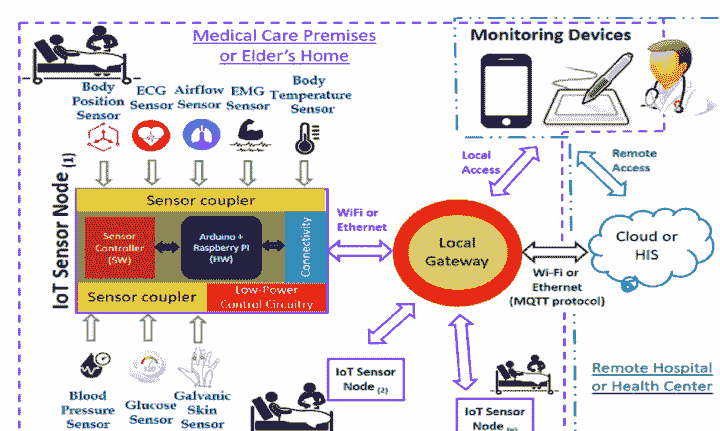

图 1. 物联网医疗保健监测系统的架构。


智能医疗保健。所提出的技术中使用了五种传感器：体温传感器、心跳传感器、室温传感器、CO2传感器和CO传感器，以收集医疗保健环境的信息。所开发系统的误差百分比在每种情况下均处于预定范围内。患者的健康状况通过网关传送给医务人员，以便他们处理并评估患者的当前状态。该系统的有效性证明了所构建的原型非常适合医疗保健监测。

Gómez等人[21]为了提高移动健康（MHealth）应用和电子健康（E-Health，由信息通信技术辅助的医疗保健）的效益，提出了一种利用物联网监测患者医疗保健的新方法。物联网使得集成能够连接到互联网、提供患者健康信息并发送给医疗专业人员的设备变得更加可行，这些专业人员随后可以援助患者。慢性疾病，包括糖尿病、心脏病和高血压等，无疑是全球经济和社会层面的重大问题。本文的目标是构建一个基于本体的架构，该架构能够跟踪慢性病患者的运动计划和健康检查建议。

Sheela和Varghese[22]提出并开发了一种基于机器学习的高级健康监测系统。它使医生能够远程监控患者并定期采取必要措施。通过使用可穿戴传感器，已经发现并配置了五个特征，包括压力、心电图（ECG）、脉搏率、温度和位置检测。该方法利用两个电路：接收电路（由医生或护士监视）和发送电路（随患者携带）。该技术使用机器学习算法来识别和预测疾病、选择会诊医师并查找医生。性能评估结果显示在实时监控网站上，并且还会向相关医生发送消息。

Godi等人[23]提出了一个物联网应用框架。机器学习（ML）方法与电子医疗保健监测系统（EHMS）结合使用，以创建先进的自动化系统。输入数据的实现。国家糖尿病研究所的EHMS糖尿病数据集是从Kaggle数据中心获得的。该系统将进行连接、跟踪并做出精确诊断的决策。

Ben Rajab等人[24]改进了监测系统，并提出了一种新算法以防止误报并保持高灵敏度。还正在构建一个针对具有相似病情的患者的通用模型，以及具有相似疾病的患者组。利用所开发的模型，将能够对新病例进行分类。为实现这一目标，将k-原型聚类方法与支持向量机的两种增量变体（即LASVM和ISVM方法）合并。第一个所提出的系统是KP-ISVM，它基于ISVM方法和k-原型。第二个被称为KP-LASVM，它通过最小化误报数量并选择最适合开始对新患者进行分类的模型，来最大化LASVM和k-原型的收益。本建议中定义了处理多个数据流和添加新患者。与以前的监测系统相比，并基于多项评估标准，将LASVM与k-原型相结合的KP-LASVM系统产生了最佳结果。通过利用真实医疗数据库对实验结果进行分析，证明了KP-LASVM的性能。

Dahan等人[25]首先通过传感设备从患者身体收集数据，信息通过网关或Wi-Fi传输并存放在医疗物联网（IoMT）云存储库中。提出了一种称为人工智能的新算法。为了增强收集到的数据，对存储的信息进行开发和预处理。利用高维线性判别分析（LDA）从预处理数据中提取特征，并使用多目标改进布谷鸟搜索算法（CSA）选择最优特征。使用混合ResNet 18和GoogleNet分类器（HRGC）完成异常/正常数据的预测。然后决定是否通知医院和医务人员。预期结果良好，参与者数据在线保存以供将来使用。性能研究结果表明了所提出方法的有效性。

Rahman等人[26]提出了一个名为“实时人工智能方法”的基于研究的项目。当发生紧急情况时，所提出的系统提供GSM短信、实时定位以及向医生发送电子邮件的能力。在医疗紧急情况下，基于人工智能（AI）的自动注射装置在医生不在场的情况下向患者分配剂量。心电图监测、SpO2水平检测、脉搏率测量和体温是护理计划中唯一重要的指标。在设置突然改变的情况下，专家将通过Blynk应用远程看到一些参数。救援队和家庭成员将通过物联网系统获知患者的位置。基于AI的系统将评估参数并在危急情况下提供剂量。表1显示了现有工作的比较分析。

# 3. 提出的方法

本研究中提出的健康监测系统通过基于云的网络提供访问，该系统结合了物联网组件和机器学习算法构建而成。系统的开发中使用了多种嵌入式传感器，以对创伤患者进行远程健康监测。同时，该系统还基于症状和当前生物数据开发了预测创伤病例严重程度的功能。

图2中的框图显示了所提出方法的体系结构。各个离散块分别代表系统的特定组件，可能由多种不同类型的设备组成，以实现所需功能。树莓派（Raspberry Pi）作为中央处理单元，负责维护患者、云网络和医疗专家之间的通信。深度学习（DL）技术用于在云网络中构建程序，以预测创伤疾病的存在。Arduino模块与各种嵌入式多传感器连接，然后连接树莓派。此外，树莓派还连接到触摸屏显示器和监控摄像头[27]。树莓派经过训练，使用算法和计算机视觉方法分析各种类型的数据。为了在此系统中创建树莓派应用，使用了OpenCV。医疗专家可以访问云网络，数据已在其中分析，并且他们还可以通过网络向患者提供适当的指导。

物联网健康系统的流程图如图3所示，该图描绘了整个过程中所执行流程的流程图。它显示了工作流程的顺序过程，包括启动、成功建立协议、正确读取传感器、向显示监视器提供数值，以及将传感器数据存储在云服务器上。

## 3.1. 传感器

如图4所示，ADC [28]用于将连接至Arduino控制器模拟引脚的体温传感器的模拟温度读数转换为数字值。控制器对该数字数据应用公式（1）以确定以摄氏度为单位的实际温度值：

temperature (°C) = [ raw ADC value × 5/4095 × (400/1000) ] × (19.5/1000)  (1)

心跳传感器依据光体积描记法原理工作。它记录流经任何人体器官的血液流量变化，这些变化会影响通过该器官的光量[29]。为了估算心率，数字脉冲被发送到一个微-


**表 1.** 现有工作的比较分析。

| 作者 | 方法 | 结果/优点 | 缺点 |
|---|---|---|---|
| Ru et al. (2021) | 基于物联网的人体健康监测系统 | 其准确率为 92% | 安全级别较低 |
| Islam et al. (2020) | 本研究提出了一种智能医疗保健系统，用于物联网（IoT）环境，可持续跟踪患者的生命体征及其当前房间的状态。 | 对于已建立的医疗系统的所有实例，观测数据与实际数据之间的成功百分比大致超过 95%。 | 未来的研究可以检查确定患者状况的关键额外参数，如糖尿病程度和呼吸监测。 |
| Gómez et al. (2016) | 创建一个利用本体来跟踪健康状况并为慢性病患者提供锻炼建议的系统。 | 该仪器产生的数据克朗巴赫 α 为 0.71 | 不适合大量数据集 |
| Sheela & Varghese (2020) | 创建基于机器学习的智能健康监测系统。 | 有助于使用机器学习算法找到咨询医生并准确识别和预测疾病。 | • 大型数据集不适合 SVM 算法。<br>• 当数据集中包含更多噪声时，SVM 表现不佳。 |
| Dahan et al. (2023) | 人工智能技术被用于电子医疗患者监测系统。 | 结果显示，与当前技术相比，建议方法的准确率最高，为 99.69%，而当前技术的准确率范围为 97.32% 至 98.71%。建议方法还提供了出色的精确度（98%）、召回率（98%）和 F1 分数（98.1%）。 | 不适合大量数据集 |

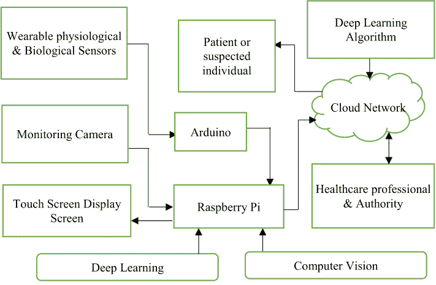

**图 2.** 所提方法的架构图。

微控制器 方程式（2）：

BPM(Beats per Minute) = 60 * f                                      (2)

其中脉搏率由湿度传感器感知、计算并报告的湿度和空气温度给出。测量湿度的传感器通过识别影响空气中温度或电流的变化来实现。下面的方程式（3）和（4）用于计算相对湿度。

voltage = ( ADC Value/1023.0 ) * 5.0;                                      (3)

Percent relative humidity = (voltage − 0.958)/0.0307;                                      (4)

## 3.2. 物联网服务器

传感器在创伤患者进入治疗中心区域后立即检测生理指标，然后这些体征被转换为电信号 [30]。然后，将存储在射频识别（RFID）中的高级电标志替换为基本电标志 [31]。Zigbee 协议是该框架的可接受标准，因为它允许将计算机化信息传输到本地服务器。更小且更节能的设备得到更高考虑。通过 WLAN，数据从附近服务器发送到治疗服务器 [32]。

当信息发送到创伤服务器时，首先验证创伤患者是否已添加医疗记录，然后服务器再将新信息发送给专家。如果患者没有过去的治疗记录，服务器将创建新的 ID 并将其数据保存在其数据库中 [33]。创伤专家会被告知此信息。图 5 显示了通过物联网的整个数据传输过程。

## 3.3. 医疗保健中的物联网

在远程医疗系统中，基于物联网的设备配备了身体传感器网络。传感器用于收集与房间通风过程相关的不同指标的数据，以便评估内部创伤患者的通风条件。这些设备包含一类特定的节点，可以识别患者数据中的周期性变化。温度、压力的信息变化范围，

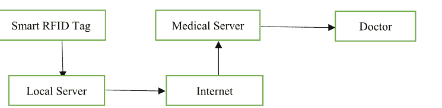

**图 5.** 使用物联网的数据传输。

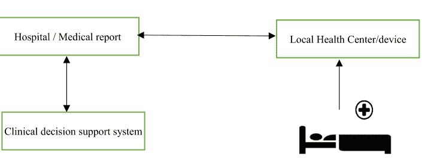

**图 6.** 医疗保健中物联网的结构。

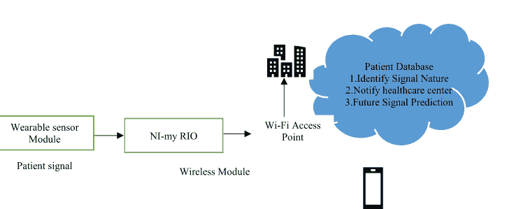

**图 7.** 正在考虑的基于深度学习网络的监测系统设计。

过滤方法并且是自相关的。因此，使用该精密传感器进行实时信号评估是可行的。使用了 BPL 的 12 通道 ECG 传感器模块来测量 ECG 信号。当信号分析需要连续采集时，该传感器连接到模拟输入引脚 2 以获取。

架构，包括来自传感器的输出分类，如图 8 所示。

### 3.4.2. 传输和数据可视化模块

用户的智能手机还显示测量的信号和信号未来的预测。图 9 显示了信号监测的数据流。为了计算监测单元处理的平均信号，日志时间戳在数据流中给出。使用物联网架构中的这种信号质量感知计算来检测信号误分类。

所有智能传感器都通过高速数据传输的 Wi-Fi 模块连接到 NI myRIO 形式，以帮助传输高速测量信号。它使用 Xilinx 制造的非常节能的 FPGA 处理器。对于发送和接收信号，该 RIO 处理器特别理想。在用户信号采集期间，其功耗为 16.5 mA。

创伤患者应用程序已用于数据可视化。Evo Things 应用接收来自 NI-myRIO 模块的通信。借助此程序还可使用基于网络的应用程序。此应用程序可在运行 Android 操作系统和 iOS 平台的智能手机上安装。通过使用此程序，创伤情况下的医疗保健提供者可以持续监测患者的必备生理信号。完整的监测和报警

## 3.5. 信号分类的深度学习模型

开发了 DCNN 以从传感器阵列中获取的信号中提取特征，以便学习收集的创伤病例、生理信号，并在基于云的物联网系统中进行分类。分数搜索技术使用使用标准信号输入训练的 DNN 结构。使用此方法利用评分函数查找基于约束的信号。

考虑双信号对应物的概率分布。贝叶斯定理的方程式（5）给出了由 BSN 计算的信号和标准数据值。

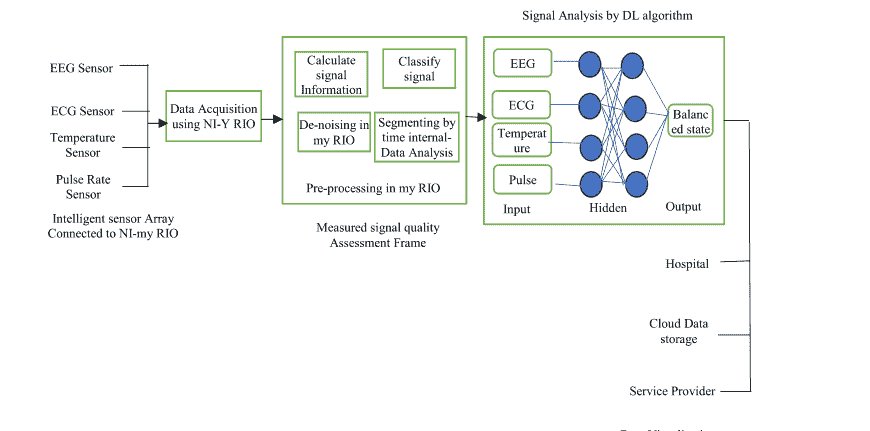

**图 8.** 具有来自传感器的输出分类的监测和报警架构。

P(M|N)= P(M ∩ N)/P(N) for P(N) ≠ 0 (5)

作为权重更新，此似然值被考虑在内。在似然比中，因子将这两个参数联系起来。因此考虑了方程式（1）中的三层反向传播模型。方程式（6）用于确定内部活动的输入-输出层权重关系。

Y_j = Σ_{i=1}^{n} W_{ij} X_i (6)

其中 W_{ij} 是连接节点的权重相关，X_i 表示权重，Y_j 是总体输出权重。由于处理所有输出，激活函数由 Y_{net}=f(Y_i) 提供。方程式（7）为建议结构提供了最大池化。此处提供了更新后的权重值和输出。

Y(n + 1)= Y(n) + η[t – y(n)] * X_i(n) (7)

采用随机下降策略训练该 DNN 以检测获取信号的异常。

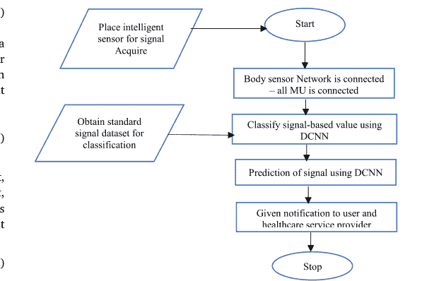

**图 9.** 所提出的健康监测信号日志系统数据流。

### 算法 1：所提 DCNN 的信号学习算法

```
Input: Initiate the sensor monitoring using EEG, ECG, Temperature, Pulse rate
Set Weight, number of hidden layer convolution and max pooling
1: while not converged do
2: for input I=1 to n
3: signal feed forward: compute Y output to each layer
4: Back propagation of error: update Network and bias B
5: Compute gradient
6: Estimate output Y using equation 7
7: end for
8: end while
9: return trained network output
```

算法 1 提供了所收集监测的学习方法。该方法使用梯度在每个位置查找标准值。此策略的好处是它可以预测新获取的信号。利用深度学习模型的建议算法的应用如图 10 所示。在图 10 中，它说明了具有隐藏层功能的输入层传感器的数量。

在收集新的测量信号后，使用三层反向传播学习规则生成类别。为了开发深度学习模型，使用了以下要求：第一层必须是线性可分的，第二层必须是完全

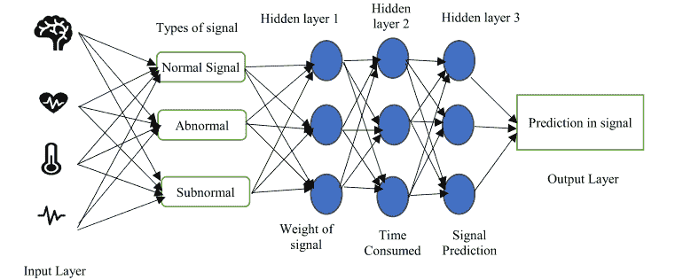

图 10. Proposed DCNN learning model for healthcare monitor and alerting.

linked, and the third layer must offer a linear activation function. Measurements were made of characteristics including signal strength and acquisition time. Thus, the suggested learning approach to create an IoT-based monitoring system is more beneficial.

the fall detection, the positive and negative data have been divided. Based on the conditional section, it is presumed that the individual is in a fall and non-fall state, with the fall represented by the initials "F" and the non-fall by the letters "NF". It is presumed to state 'EF' when the condition fails with a fall and an incorrect detection is made, and state 'ENF' when the condition fails with a non-fall and a mistaken detection is made.

# 4. 结果与讨论

Thus, by receiving the right care and receiving an early diagnosis, trauma illness, which is a leading cause of mortality worldwide, may be reduced. This internet-of-things project uses an Arduino and pulse rate sensor to capture real-time data from trauma patients, which is then reported using ThingSpeak. As a result, human trauma disorders were predicted using machine learning techniques.

## 4.1. 数据集

Machine learning techniques are employed with the patient data from the 40-sample collection. Following a real-time comparison of all algorithms, it primarily focused on Deep Convolutional Neural Network (CNN), RNN, and Artificial Neural Network (ANN).

## 4.2. 评估指标

According to the parallel, horizontal, and vertical categorization in

The issue is listed as follows.

- 1. Always Positive (AP) as count is predicted as state 'F' .
- 2. Always Negative (AN) as count is predicted as state 'NF' .
- 3. Partial Positive (PP) as count is predicted as state 'EF' .
- 4. Partial Negative (PN) as count is predicted as state 'ENF'.

The following metrics are used in Equations (8)–(12) to estimate how well the forecast performed.

精确度 = (AP + AN)/(AP + AN + PP + PN) (8)
错误率 = (PP + PN)/(AP + AN + PP + PN) (9)
精确率 = (AP / (AP + PP)) (10)
召回率 = (AP / (AP + PN)) (11)

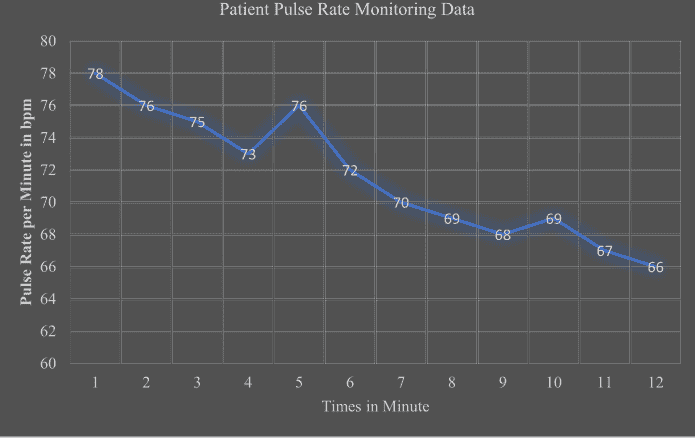

图 11. Pulse rate monitoring data.

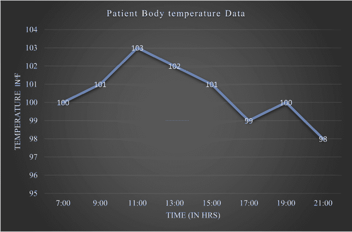

**图 12.** Body temperature data.

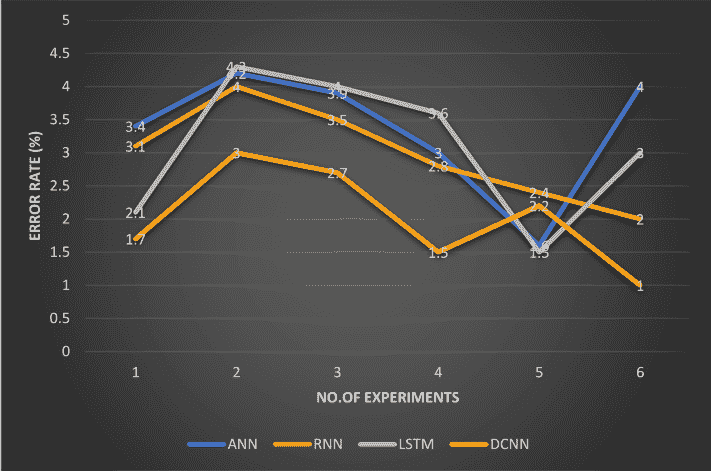

**图 13.** Error rate data.

```
$$F \sim \mathrm{Measure}=2\left(P \times \frac{R}{P+R}\right)$$
```

Database entries include sensor readings, particularly the body’s pulse rate. The patient’s state of health is also determined by taking into account various ranges of pulse rate data in **图 11**.

The database stores the sensor data, in particular the results from the body temperature sensor. As shown in **图 12**, the temperature range for body temperature is specified, and its membership function.

The number of experiments is shown on the X-axis in **图 13**, and the error rate prediction is shown on the Y-axis. The evaluation results represent low error rate and it is described with the help of proposed methods when compare it with existing methods.

The suggested approach has minimal processing time, as shown in **图 14**, when comparing the processing time for fall detection for the proposed Deep CNN system with the related techniques of ANN, RNN, LSTM, and DCNN.

LSTM, and DCNN.

**图 15** shows DCNN’s precision results compared to other approaches. The suggested Deep CNN gives higher recall results of 94.12%, whereas other approaches such as ANN, RNN, LSTM produces 90.12%, 91.21%, 92.12% and respectively. The proposed algorithm gives highest results than the existing methods.

**图 16** represents the outcomes of the suggested method DCNN were compared with the recall results of other known other approaches. The suggested Deep CNN gives higher recall results of 97.75%, whereas other approaches such as ANN, RNN, LSTM produces 95.15%, 96.12%, 97.55% and respectively. The proposed algorithm gives highest results than the existing methods.

**图 17** represents the outcomes of the suggested method DCNN accuracy results compared with different approaches. The suggested DCNN gives higher accuracy results of 95.21%, whereas other methods such as ANN, RNN, LSTM gives 88.16%, 92.15%, 93.12% and

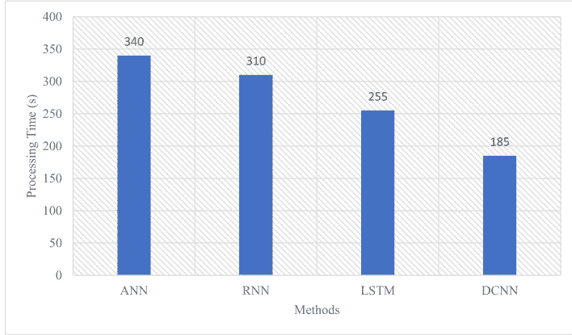

图 14. Processing time.

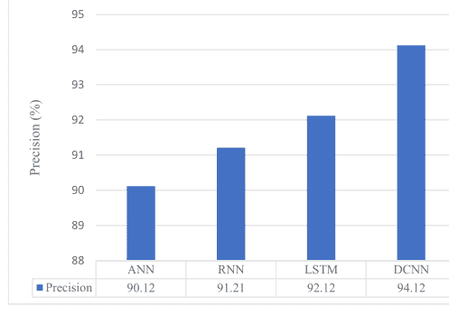

图 15. Comparison of precision metrics with proposed and existing methods.

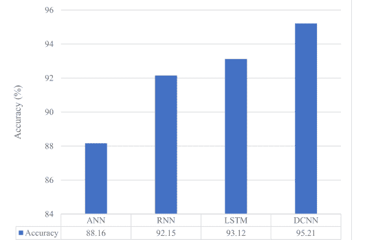

图 17. Comparison of accuracy metrics with proposed and existing methods.

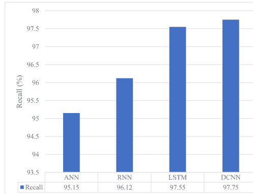

图 16. Comparison of recall metrics with proposed and existing methods.

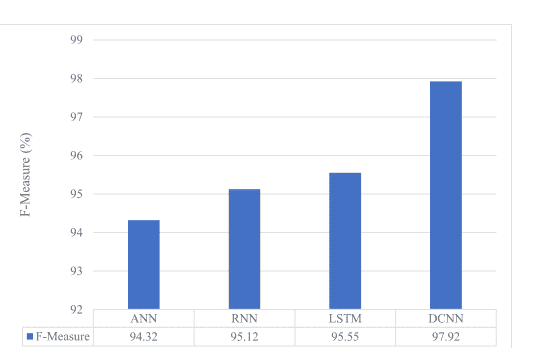

图 18. Comparison of F-measure metrics with proposed and existing methods.

respectively. The proposed algorithm gives highest results than the existing methods.

图 18 represents the F-Measure results of the suggested technique

DCNN were compared with different approaches. The suggested DCNN gives higher f-Measure results of 97.92%, whereas other methods such as ANN, RNN, LSTM gives 94.32%, 95.12%, 95.55% and respectively.

The proposed algorithm gives highest results than the existing methods.

# 5. 结论

This research demonstrates and provides better IoT in healthcare using Deep Learning (DL) technology. This study presents a trauma cases IoT-based healthcare platform that links with smart sensors linked to the human body for health monitoring for a daily check-up. This study offers the chance to continually monitor a patient utilizing the free and open-source Thing Speak cloud platform, which also includes remote monitoring and mobile messaging services that can differentiate between normal and abnormal situations predicted using DCNN algorithms. The proposed method improves the trauma case detection, improves the physician monitoring and alerting reduces the error rate and enhances the accuracy 95.21% and reduces the false detection. Classification metrics Accuracy, Recall, Precision, F-Measure and error has been evaluated and compared with proposed system and existing methods. Plan to gather larger and multicenter datasets for future work in order to do additional validations of all these models on other datasets. Prediction models become more reliable as a result. The research results are more accurate since looked into patients’ health issues over a shorter period of time. It could result in a quicker prognosis that more precisely directs medical care. The mortality rate was the only subject of this study. But efforts can also be made to forecast the patients’ functionality after a specified period of time. As it gives doctors more information, it results in better health care. Future research should include testing the findings on a large number of patients and determining the accuracy. To increases the trauma patient’s data collections, using high-end sensor to reduce the patients processing time and displeasure.

# 资助声明

There was no specific grant for the study from any funding organisation in the public, private, or nonprofit sectors.

# 竞争利益声明

The authors declare that they have no known competing financial interests or personal relationships that could have appeared to influence the work reported in this paper.

# 数据可用性

No data was used for the research described in the article.

# 参考文献

- [1] V. Yeri, D.C. Shubhangi, IoT based real time health monitoring, in: 2020 Second International Conference on Inventive Research in Computing Applications (ICIRCA), 2020, pp. 980–984.
- [2] H. Pandey, S. Prabha, Smart health monitoring system using IOT and machine learning techniques, in: 2020 Sixth International Conference on Bio Signals, images, and instrumentation (ICBSII), 2020, pp. 1–4.
- [3] S.H. Almotiri, M.A. Khami, M.A. Alhadhi, Mobile health (m-health) system in the context of IoT, in: 2016 IEEE 4th International Conference on Future Internet of Things and Cloud Workshops (FiCloudW), 2016, pp. 39–42.
- [4] G.J. Joya, R.M. Liaqat, A. Farooq, S. Rehman, Internet of medical things (IoMT): applications, benefits and future challenges in healthcare domain, J. Commun. 12 (4) (2017) 240–247.
- [5] H. Roh, S.S. Shin, J. Han, S. Lim, A deep learning-based medication behavior monitoring system, Math. Biosci. Eng. 18 (2021) 1513–1528.
- [6] N. Otmani, N. Qarmiche, M. Omari, H. Bourkikine, N. Tachfouti, S.E. Fakir, Artificial intelligence and machine learning in healthcare: application and challenges, J. Posit. Psychol. 6 (8) (2022) 1847–1853.
- [7] M. Mamoun-Ibn-Abdullah, M.H. Kabir, A healthcare system for internet of things (IoT) application: machine learning based approach, J. Comput. Commun. 9 (7) (2021) 21–30.
- [8] M. Gupta, M. Thirumalaisamy, S. Shamsher, A. Pandey, D. Muthiah, N. Suvarna, Patient health monitoring using feed forward neural network with cloud-based internet of things, in: 2022 2nd International Conference on Advance Computing and Innovative Technologies in Engineering (ICACITE), 2022, pp. 924–931.
- [9] H. Al-Askar, N. Radi, A. MacDermott, Recurrent neural networks in medical data analysis and classifications, in: Applied Computing in Medicine and Health, 2016, pp. 147–165.
- [10] C. Jiang, Y. Li, Health big data classification using improved radial basis function neural network and nearest neighbor propagation algorithm, IEEE Access 7 (2019) 176782–176789.
- [11] M. Zribi, Y. Boujelbene, I. Abdelkafi, R. Feki, The self-organizing maps of Kohonen in the medical classification, in: 2012 6th International Conference on Sciences of Electronics, Technologies of Information and Telecommunications (SETIT), 2012, pp. 852–856.
- [12] P. Melin, J.C. Monica, D. Sanchez, O. Castillo, Multiple ensemble neural network models with fuzzy response aggregation for predicting COVID-19 time series: the case of Mexico, Healthcare 8 (2) (2020) 181.
- [13] S.A. Eberloderh-Miyene, E. Senokoho, T.G. Swart, Integrating enhanced sparse autoencoder-based artificial neural network technique and SoftMax regression for medical diagnosis, Electronics 9 (11) (2020) 1963.
- [14] S.S. Yadav, S.M. Jadhav, Deep convolutional neural network based medical image classification for disease diagnosis, J. Big data 6 (1) (2019) 1–18.
- [15] P.R. Jeyaraj, E.R.S. Nadar, Deep Boltzmann machine algorithm for accurate medical image analysis for classification of cancerous region, Cognit. Computation Syst. 1 (3) (2019) 85–90.
- [16] N. Cheng, A. Kuo, Using long short-term memory (LSTM) neural networks to predict emergency department wait time, in: The Importance of Health Informatics in Public Health during a Pandemic, 2020, pp. 199–202.
- [17] L. Ru, B. Zhang, J. Duan, G. Ru, A. Sharma, G. Dhiman, G.S. Gaba, E.S. Jaha, M. Masud, A telemed research on human health monitoring system based on internet of things, Wireless Commun. Mobile Comput. (2021) 1–9.
- [18] N.Y. Philip, J.J. Rodrigues, H. Wang, S.J. Fong, J. Chen, Internet of Things for in-home health monitoring systems: current advances, challenges and future directions, IEEE J. Sel. Area. Commun. 39 (2) (2021) 300–310.
- [19] P. Valsalan, T.A.B. Baomar, A.H.O. Baabood, IoT based health monitoring system, J. crit. rev. 7 (4) (2020) 739–743.
- [20] M.M. Islam, A. Rahman, M.R. Islam, Development of smart healthcare monitoring system in IoT environment, SN Comput. Sci. 1 (2020) 1–11.
- [21] J. Gómez, B. Oviedo, E. Zuma, Patient monitoring system based on internet of things, Procedia Comput. Sci. 83 (2016) 90–97.
- [22] K.G. Sheela, A.R. Varghese, Machine learning based health monitoring system, Mater. Today: Proc. 24 (2020) 1788–1794.
- [23] B. Godi, S. Viswanadham, A.S. Muttapati, O.P. Samantray, S.R. Gadiraju, E-healthcare monitoring system using IoT with machine learning approaches, in: 2020 International Conference on Computer Science, engineering and applications (ICCSEA), 2020, pp. 1–5.
- [24] F. Ben Rajab, K. Nouira, A. Trabelsi, Health monitoring systems using machine learning techniques, in: Intelligent Systems for Science and Information: Extended and Selected Results from the Science and Information Conference 2013, 2014, pp. 423–440.
- [25] F. Dahan, R. Alrobaea, W. Alghamdi, M.K. Mohammed, F. Hajjej, K. Raahemifar, A smart IoMT based architecture for E-healthcare patient monitoring system using artificial intelligence algorithms, Front. Physiol. 14 (2023) 40.
- [26] M.Z.U. Rahman, A.H. Raza, A.A. Alsanad, M.A. Akbar, R. Riaquat, M.T. Riaz, L. AlSuwaidan, H.A. Al-AIshaikh, H.S. Alsagri, Real-time artificial intelligence-based health monitoring, diagnosing and environmental control system for COVID-19 patients, Math. Biosci. Eng. 19 (8) (2022) 7586–7605.
- [27] A.A. Ibrahim, Y. Muhamma, W. Zhuopeng, IOT patient health monitoring system, Int. J. Eng. Res. Appl. ISSN 2248 (9622) (2018) 77–80.
- [28] Y. Li, C. Liu, H. Zou, L. Che, P. Sun, J. Yan, W. Liu, Z. Xu, W. Yang, L. Dong, L. Zhao, Integrated wearable smart sensor system for real-time multi-parameter respiration health monitoring, Cell Rep. Phys. Sci. 4 (1) (2023), 101191.
- [29] K.R. Darshan, K.R. Anandakumar, A comprehensive review on usage of Internet of Things (IoT) in healthcare system, in: 2015 International Conference on Emerging Research in Electronics, Computer Science and Technology (ICERECT), 2015, pp. 132–136.
- [30] I. Hussain, S. Tahir, M. Humayun, M.F. Amrafulleh, N.Z. Jhanjhi, F. Qamar, Health monitoring system using internet of things (IoT) sensing for elderly people, in: 2022 14th International Conference on Mathematics, Actuarial Science, Computer Science and Statistics (MACS), 2022, pp. 1–5.
- [31] X. Tao, T.B. Shaik, N. Higgins, R. Gurujarah, X. Zhou, Remote patient monitoring using radio frequency identification (RFID) technology and machine learning for early detection of suicidal behaviour in mental health facilities, Sensors 21 (3) (2021) 776.
- [32] J. Dhanke, N. Rathore, M.S Vinnmathi, S. Janu Priya, S. Abidin, M. Tesfamarian, Smart health monitoring system with wireless networks to detect kidney diseases, Comput. Intell. Neurosci. (2022) 1–11.
- [33] P. Chavan, P. More, N. Thorat, S. Yewale, P. Dhade, ECG-Remote patient monitoring using cloud computing, Imper. J. Interdiscip. Res. 2 (2) (2016) 368–372.

