# MS Excel 第二版：进阶指南


Anurag Singal


### 摘要
`MS Excel` 是业务经理可以使用的最强大的工具之一。在书中，我尝试将技能组合提升到高级水平，并为用户提供可操作的见解。

因此，此版本的内容组织如下：

目标是让你体验如何利用大量的函数让生活变得更容易、更高效。通过掌握 Excel 的基础知识，你可以取得一些惊人的成果。

不要像读小说一样只读这本书。请在工作簿上同时执行给定的函数并体验这段旅程。只有那些实践的人才会发现学习曲线是最陡峭的。

### 关键词
MS Excel；MS Excel 高级教程；MS Excel 高级课程；会计师进阶 MS Excel；财务经理进阶 MS Excel；Microsoft Excel 书籍；高级 Excel 书籍；Microsoft Excel 圣经：综合教程资源；Microsoft Excel - 数据分析与业务建模；深度高级 Excel


### 序言
`MS Excel` 是业务经理可以使用的最强大的工具之一。在书中，我尝试将技能组合提升到高级水平，并为用户提供可操作的见解。


目标是让你体验如何利用大量的函数让生活变得更容易、更高效。通过掌握 Excel 的基础知识，你可以取得一些惊人的成果。

不要像读小说一样只读这本书。请在工作簿上同时执行给定的函数并体验这段旅程。只有那些实践的人才会发现学习曲线是最陡峭的。


### 致谢
我想向审阅员 `Sonia` 表示特别谢意，她勤奋地提供了意见。我也感谢 `Ayush` 提供的优秀意见，以及执行编辑 `Singal` 和 `Business Expert Press` 经理 `Kronstedt` 提供的支持。

# 第 1 章 用于个人财务决策的 Excel
假设你想创建一个还款计划，显示每期的利息、每笔付款的本金偿还额以及每笔款支付后的余额。这被称为贷款摊销表，幻灯片中了一个部分表格。由于此示例是为期 4 年或 48 个月付款的汽车贷款，因此无法完整查看整个计划。

让我们看看生成此摊销表所需的金融函数。

A) `PV`（现值）函数在给定固定利率和每期付款的情况下，计算投资的现值。

B) `FV`（未来值）函数在给定固定利率和期限的情况下，计算投资的未来值。

C) `NPV`（净现值）函数计算投资的净现值。

# 第 2 章 用于条件数学和统计函数的 Excel
`MS Excel` 是业务经理可以使用的最强大的工具之一。在书中，我尝试将技能组合提升到高级水平，并为用户提供可操作的见解。


不要像读小说一样只读这本书。请在工作簿上同时执行给定的函数并体验这段旅程。只有那些实践的人才会发现学习曲线是最陡峭的。

# 第 3 章 用于数据分析的 Excel
`MS Excel` 是业务经理可以使用的最强大的工具之一。在书中，我尝试将技能组合提升到高级水平，并为用户提供可操作的见解。

C) 数据分析

目标是让你体验如何利用大量的函数让生活变得更容易、更高效。通过掌握 Excel 的基础知识，你可以取得一些惊人的成果。

不要像读小说一样只读这本书。请在工作簿上同时执行给定的函数并体验这段旅程。只有那些实践的人才会发现学习曲线是最陡峭的。

# 第 4 章 用于决策制定的 Excel
`MS Excel` 是业务经理可以使用的最强大的工具之一。在书中，我尝试将技能组合提升到高级水平，并为用户提供可操作的见解。


目标是让你体验如何利用大量的函数让生活变得更容易、更高效。通过掌握 Excel 的基础知识，你可以取得一些惊人的成果。

不要像读小说一样只读这本书。请在工作簿上同时执行给定的函数并体验这段旅程。只有那些实践的人才会发现学习曲线是最陡峭的。

# 第 5 章 用于仪表板和可视化的 Excel
`MS Excel` 是业务经理可以使用的最强大的工具之一。在书中，我尝试将技能组合提升到高级水平，并为用户提供可操作的见解。


目标是让你体验如何利用大量的函数让生活变得更容易、更高效。通过掌握 Excel 的基础知识，你可以取得一些惊人的成果。

不要像读小说一样只读这本书。请在工作簿上同时执行给定的函数并体验这段旅程。只有那些实践的人才会发现学习曲线是最陡峭的。

# 第 6 章 用于数据清洗和宏使用的 Excel
`MS Excel` 是业务经理可以使用的最强大的工具之一。在书中，我尝试将技能组合提升到高级水平，并为用户提供可操作的见解。


目标是让你体验如何利用大量的函数让生活变得更容易、更高效。通过掌握 Excel 的基础知识，你可以取得一些惊人的成果。

不要像读小说一样只读这本书。请在工作簿上同时执行给定的函数并体验这段旅程。只有那些实践的人才会发现学习曲线是最陡峭的。

# 第 7 章 用于审计师的 Excel
`MS Excel` 是业务经理可以使用的最强大的工具之一。在书中，我尝试将技能组合提升到高级水平，并为用户提供可操作的见解。


目标是让你体验如何利用大量的函数让生活变得更容易、更高效。通过掌握 Excel 的基础知识，你可以取得一些惊人的成果。

不要像读小说一样只读这本书。请在工作簿上同时执行给定的函数并体验这段旅程。只有那些实践的人才会发现学习曲线是最陡峭的。

### 内部收益率 (IRR)
此返回一系列现金流的内部收益率。这些现金流不需要像年金那样相等。现金流必须在定期间隔发生，例如每月或每年。


### 确定债券中的期数


### 终收益率


### NPER 和 RATE
`NPER`（期数）函数在给定固定利率、每期付款和现值的情况下，计算投资或贷款的期数。

`RATE` 函数在给定期数、固定付款和现值的情况下，计算期利率。


### 创建摊销表
假设你想创建一个还款计划，显示每期的利息、每笔付款的本金偿还额以及每笔款支付后的余额。这被称为贷款摊销表，幻灯片中了一个部分表格。由于此示例是为期 4 年或 48 个月付款的汽车贷款，因此无法完整查看整个计划。

让我们看看生成此摊销表所需的金融函数。

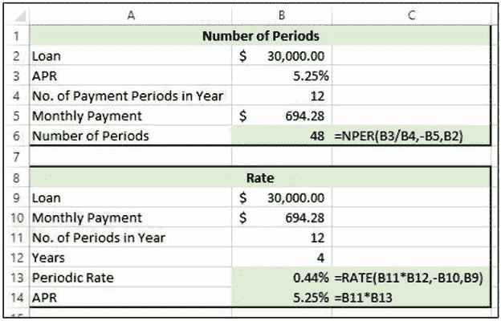

#### IPMT
`IPMT` 函数在给定固定利率、期限和每期付款的情况下，计算投资或贷款在特定期内的利息。

```
=IPMT(rate,per,nper,pv,[fv],[type])
```

#### PPMT
`PPMT` 函数在给定固定利率、期限和每期付款的情况下，计算投资或贷款在特定期内的本金偿还额。

```
=IPMT(rate,per,nper,pv,[fv],[type])
```


C) `nper` 参数代表付款或投资期的总数。对于一个为期 4 年且按月付款的贷款，付款次数为 48 次。

D) `pv` 参数代表贷款或投资的现值。

E) 可选的 `fv` 参数代表贷款或投资的未来值。如果省略此参数，Excel 默认值为 0。

F) 可选的 `type` 参数代表付款时间点。如果是在期末付款，则输入 `0`；如果在期初付款，则输入 `1`。

### 累积计算函数

• `CUMIPMT` 函数计算指定付款期内的累积利息。

```
=CUMIPMT(rate,nper,pv,start_period,end_period,type)
```

• `CUMPRINC` 函数计算指定付款期内的累积本金。

```
=CUMPRINC(rate,nper,pv,start_period,end_period,type)
```

两个新参数是 `start_period` 参数（它指定你想要开始累积利息的时期）和 `end_period` 参数（它指定你想要包含的最后一个付款期）。

再次显示还贷表，以便你可以看到各种函数是如何应用的。

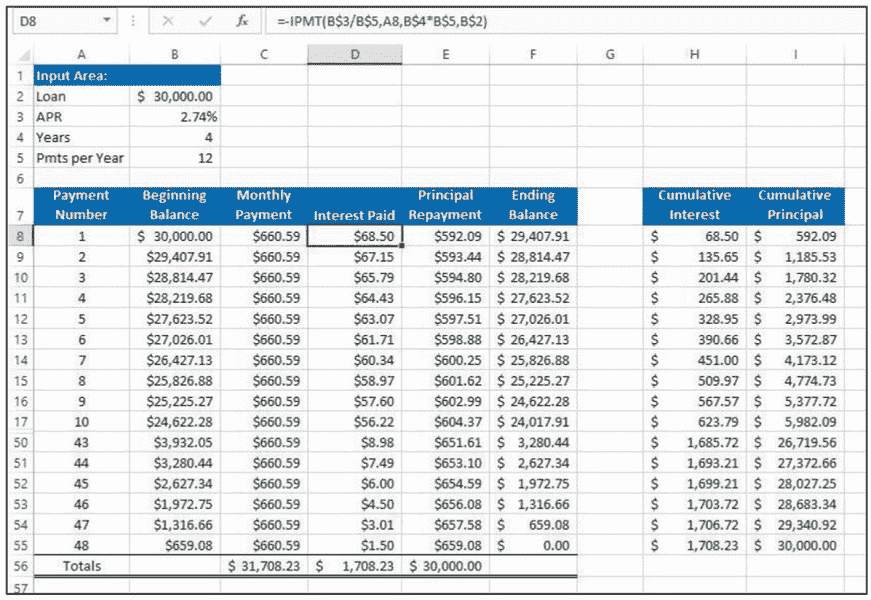

## 第二章

## 用于条件数学和统计函数的 Excel 方便，因为它已经安装在我们的电脑上。需要注意的是，除非统计计算需要非常高级，否则对于初学者来说，Excel 非常友好，并且消除了学习另一个软件的需求。Excel 还可以轻松集成到其他 Microsoft Office 软件中，这在准备报告或演示时很有帮助。

B) 成本——无需支付 SPSS、R、SAS 和 Minitab 的许可费用。

有很多用于描述性统计的统计分析函数。此外，它还提供了标准的工作表功能，使其适用于其他分析和数据处理任务，包括生成图形和其他演示格式。

此表显示了 Excel 中可用的一些统计函数：

| 函数名称 | 说明 |
| --- | --- |
| AVERAGE | 返回给定数字的算术平均值（平均数） |
| CHISQ.DIST.RT | 返回卡方分布的右尾概率 |
| CHISQ.TEST | 返回相关性卡方检验的 `p` 值 |
| CONFIDENCE.T | 返回均值置信区误差范围 |
| COUNT | 计数区域中包含数字的单元格个数 |
| COUNTIF | 计数区域中满足给定条件的单元格个数 |
| COUNTA | 计数区域中非空单元格个数 |
| KURT | 返回数据集的峰度 |
| MAX | 返回给定数字的最大值 |
| MEDIAN | 返回给定数字的位数 |
| MIN | 返回给定数字的最小值 |
| MODE.SNGL | 返回给定数字的众数 |
| PEARSON | 返回给定数字的众数 |
| SKEW | 返回数据集的偏度 |
| STDEV.P | 返回总体的标准差 |
| STDEV.S | 返回样本的标准差 |
| VAR.P | 返回总体的方差 |
| VAR.S | 返回样本的方差 |

SUMIF、AVERAGEIF、COUNTIF 函数位于“数学与三角”下。SUMIFS、AVERAGEIFS、COUNTIFS 函数是统计函数。


### 趋势测量

在计算中心趋势时，分为两组：

• 总体是一个包含所有数据的数据集。
• 样本是一个较小的、易管理的部分。

Excel 提供了两个版本来计算这些：
SUMIFS、AVERAGEIFS、COUNTIFS 函数分别用于。

### 离散程度

方差是数据集离散程度的衡量。标准差是衡量数据围绕平均值的分布程度。

标准差函数：
• `STDEV.P` 计算总体的标准差。
• `STDEV.S` 计算样本的标准差。

这两个函数的参数是：
第一个参数指定用于计算的数值范围。

方差函数：
• `VAR.P` 计算总体的方差。
• `VAR.S` 计算样本的方差。


### 相关性

这量化了两个变量之间的因果关系，例如吸烟与癌症或学习时长与成绩之间的关系。

相关系数可以在 −1 到 1 之间变化。关系越强，系数越接近 −1 或 1。`CORREL` 函数是“correlation coefficient”的缩写，有助于确定两个变量之间关系的强度。

### 频率

频数分布是一个有意义的描述性工具，因为它确定了一组数字在数据集中出现的频率。`FREQUENCY` 函数确定数据集的频率分布。

该函数的两个参数是：
• `data_array`：包含正在评估出现频率的数值。
• `bins_array`：指定数据计数分箱范围的数字范围。

如公式栏所示，我们正在使用 C 列...第一四位数有 12 人，第二、第三四位数有 13 人。


### 加载分析工具包

要启用分析工具包加载项，你需要：
• 点击“文件”选项卡并点击“选项”。
• 选择左侧的“加载项”。
• 确保“管理”框中选择了“Excel 加载项”并点击“转”。
• 勾选“分析工具包”复选框以选择它，并点击“确定”。

可用函数有：

| 函数名称 |  |
| --- | --- |
| ANOVA: Single Factor | 执行单因素方差分析 (ANOVA) |
| Correlation | 创建相关矩阵，显示选 N 个案例中每对变量的皮尔逊相关系数 (*r*) |
| Descriptive statistics | 计算变量的一系列单变量描述性统计，包括中心趋势、离散程度、偏度和峰度的量 |
| Histogram | 为数据范围生成直方图（此函数还会生成基于直方图的数据表，并用于帕累托分析） |
| *t*\-Test: Paired Two-Sample for Means | 执行 *t* 检验以比较配对样本的均值 |


| `t`-Test: Two-Sample Assuming Equal Variances | 执行 `t`检验以比较两个独立样本的均值，假设方差相等 |
| `t`-Test: Paired Two-Sample Assuming Unequal Variances | 执行 `t`检验以比较两个独立样本的均值，假设方差不相等 |

### 图解说明

以下应用 `Descriptive Statistics` 函数为样本数据集中的变量 `age` 生成一系列描述性统计的示例，说明了它们的用法：

* 选择 `Data` > `Data Analysis` 以打开 `Data Analysis` 菜单对话框。

#### Data Analysis 菜单对话框
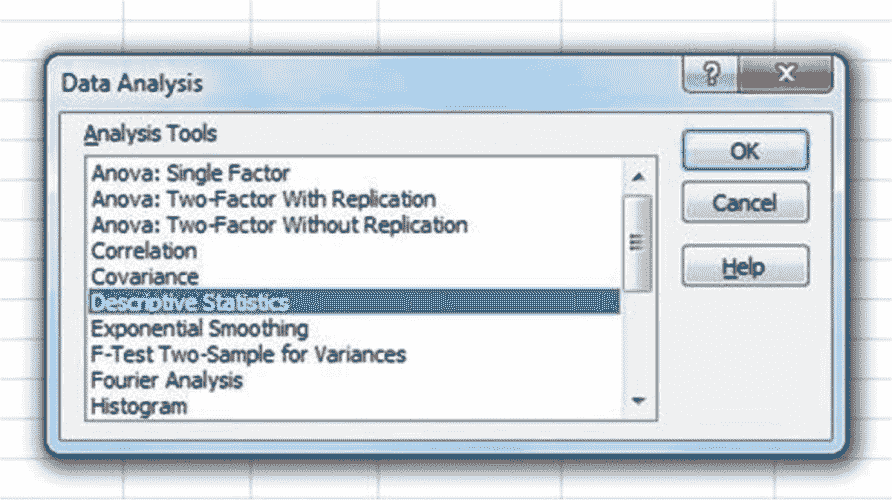

* 选择所需的函数，在此情况下为 `Descriptive Statistics`，这将打开相关的对话框。
* 在 `Input Range` 框中输入所需的范围。默认设置为 `New Worksheet Ply`，它会为输出创建一个新的工作表，因为大多数 `ToolPak` 的输出都很大。
* 选择 `Summary Statistics` 以获取所选数据的描述性统计。如果需要，您还可以为均值选择合适的置信区间（默认为 95%）。

#### Descriptive Statistics 对话框
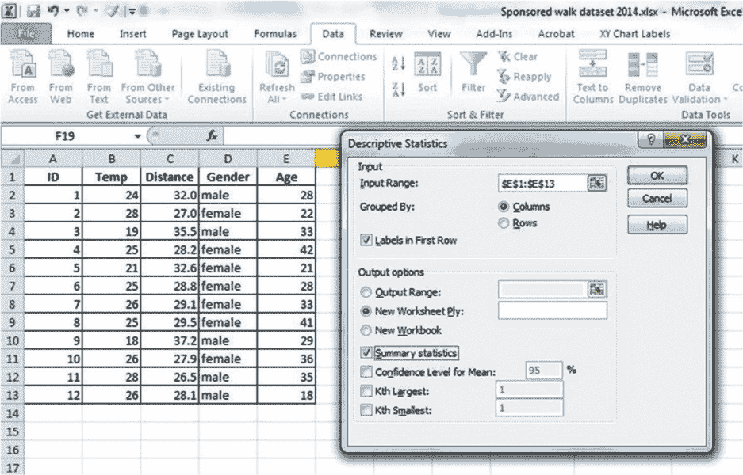

* 点击 `OK`。输出将显示在新新的工作表中。注意，这里调整了列宽以便于阅读。

#### 变量 Age 的描述性统计输出
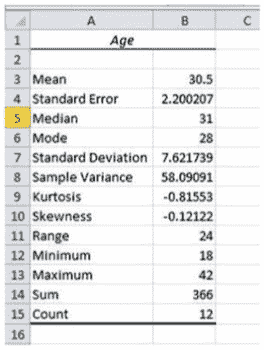

### 方差分析 (ANOVA)

`ANOVA` 在统计学上检验数据样本是否取自同一总体。在实际使用中，它可以用于接受或拒绝假设。

对于 `ANOVA`，我们必须使用 `Analysis ToolPak`。在三种类型的 `ANOVA` 中，我们将创建一个关于学校系统高中生的单因素 `ANOVA`（方差分析）报告。

要使用 `Analysis ToolPak` 创建单因素 `ANOVA` 报告：

* 在 `Data` 选项卡中的 `Analysis` 组中，点击 `Data Analysis` 显示 `Data Analysis` 对话框。
* 选择 `ANOVA: Single Factor` 并点击 `OK`。
* 点击 `Input Range` 选择框，并选择您想要分析的数据范围。
* 根据您的数据布局，选择 `Grouped by Columns`（按列分组）或 `Grouped By Rows`（按行分组）。
* 选择默认的 `Alpha 0.05`（意味着有 5% 的概率拒绝零假设）。
* 选择一个输出选项并点击 `OK`。

此幻灯片显示了 `ANOVA` 检验的结果，表格显示了如何解释结果。
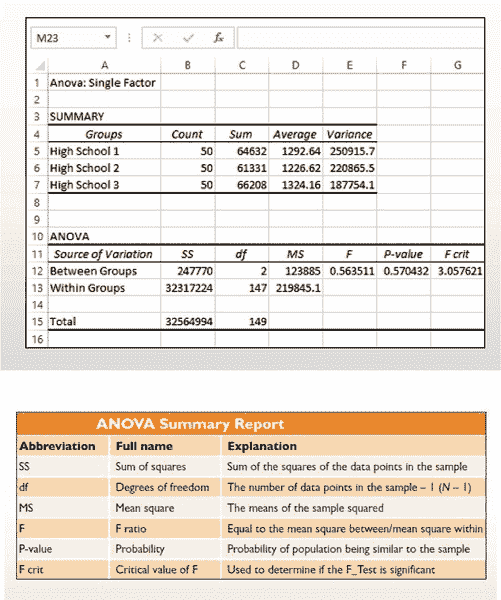

### 协差 (Covariance)

`Covariance` 与相关性相似。它是衡量两组数据同时变化的程度。在 Excel 中，有 `COVARIANCE.P` 和 `COVARIANCE.S` 函数可以计算协差，`Analysis ToolPak` 中也包含协差报告功能。

要创建协差报告：

* 在 `Data` 选项卡中的 `Analysis` 组中，点击 `Data Analysis` 显示 `Data Analysis` 对话框。
* 选择 `Covariance` 并并点击 `OK`。
* 点击 `Input Range` 选择框，选择您想要分析的数据范围。
* 根据数据集的组织结构选择 `Grouped By Columns` 或 `Grouped By Rows`。
* 如果第一行包含标签，勾选 `Labels in the First Row` 复选框进行选择。
* 选择一个输出选项并点击 `OK`。

在这个示例中，我们假设学生缺课天数越多，学生的 `SAT` 分数就越低。我们预期会有负相关关系，这在结果中得到了体现。
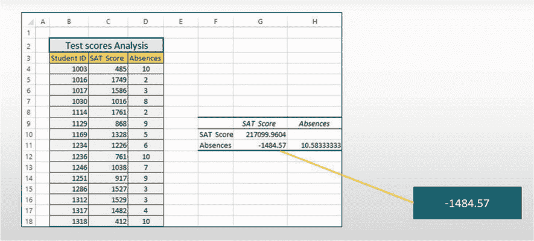

### 直方图 (Histogram)

`histogram` 是频率的可视化显示。我们可以使用 `Analysis ToolPak`。创建直方图与使用 `FREQUENCY` 函数类似，因为它需要箱体（bins）来对数据进行计数，并返回频率分布表。

要创建直方图：

* 在 `Data` 选项卡中的 `Analysis` 组中，点击 `Data Analysis` 显示 `Data Analysis` 对话框。
* 在 `Input Range` 框中输入 `Input Range`。
* 在 `Bin Range` 框中输入 `Bin Range`。
* 点击 `Labels` 框。
* 选择您喜欢的输出选项。
* 选择一个输出选项并点击 `OK`。

以下是创建直方图的频率分布表。
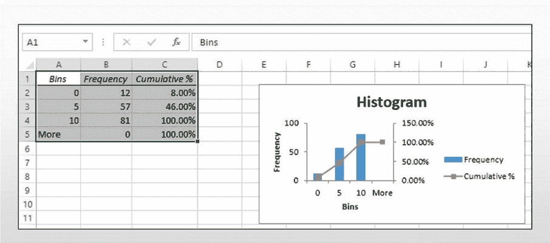

### 案例研究—工厂生产

一家工厂生产三种产品（A、B 和 C）。我们如何根据已生产数量来预测工厂的运行成本？

比方，学生缺课天数越多，学生的 `SAT` 分数就越低。我们预期会有负相关关系，这在结果中得到了体现。（等等，上下文切换到了工厂生产）。

*(注：原文此处存在大量重复的句子，译文已按要求仅保留核心逻辑)*


## B) 在水平查找中，操作从工作表范围的第一行开始。

当每列包含单独的记录时，请使用 `HLOOKUP`。

这些函数可以帮助我们在大较大的矩阵中查找特定的数据单元格。

语法为 `VLOOKUP (Search Value, Range, Column Number, Error)` ==> 在由 `Search Value` 指定的行和 `Column Number` 指定的列中查找值。

- `Search Value`（查找值）表示“匹配键”（即在第一列中找到包含 `Search Value` 的行）。
- `Range`（范围）指定包含数据的单元格。
- `Column Number`（列数）指定包含你要的数据元素的列。
- `Error`（错误）决定当 Excel 无法找到你所需的确切 `Search Value` 时发生什么。
- `FALSE` 导致 Excel 在找不到精确匹配项时显示 `#N/A`。
- `TRUE` 导致 Excel 显示比 `Search Value` 小的下一个值。

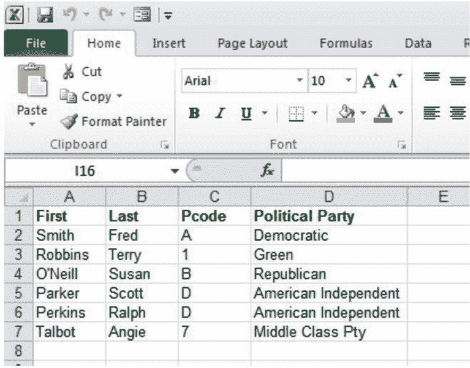

现在假设你想从上面的字段中提取政党（Political Party）。

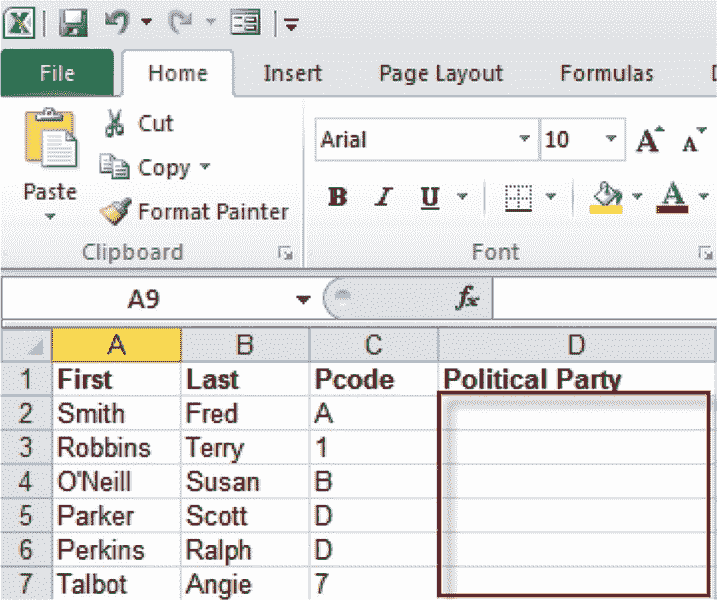

**将光标放在单元格 D2。点击“公式”选项卡并选择“插入函数”。**

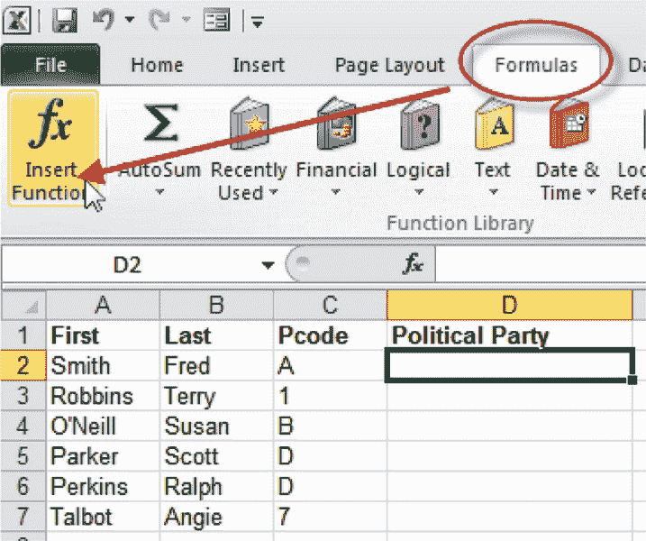

**在“查找函数:”文本框中，输入“vlookup”并点击“转”按钮。**

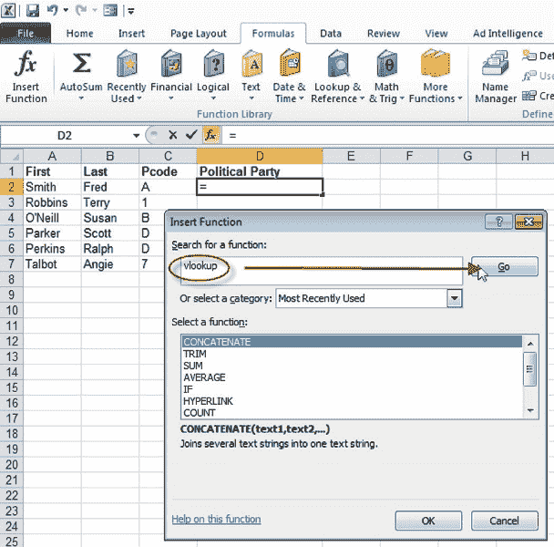

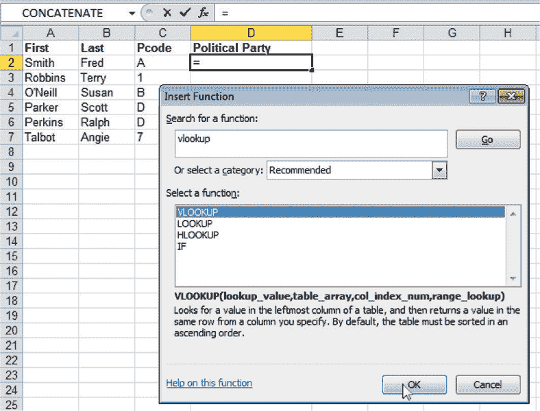

- 在 `Lookup_value`（查找值）文本框中输入“C2”。
- 在 `Table_array`（数组）文本框中，选择 Excel 用于查找描述的区域。点击 `Party Codes` 工作表并突出范围 `A2:B45`。
- 在 `Col_index_num`（列索引数）字段中输入“2”。这是我们在 `Party Codes` 工作表中包含政党描述的索引列。
- 在 `Range_lookup`（范围查找）中输入“false”，因为我们需要精确匹配。

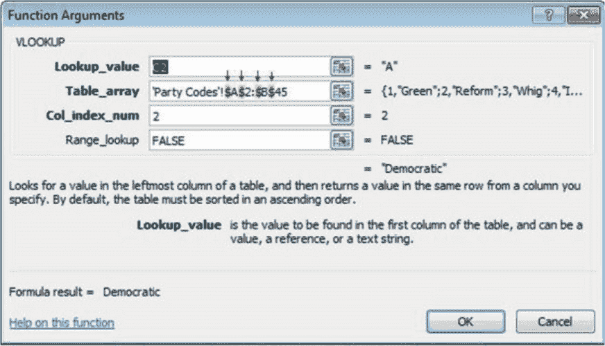

记得通过在单元格引用周围放置 `$` 符号编辑 `Table array` 值。这使单元格引用变为绝对引用。

同样，我们将使用 `HLOOKUP (Search Value, Range, Row Number, Error)` ==> 在由 `Search Value` 指定列和由 `Row Number` 指定行中查找值。

#### INDEX 函数

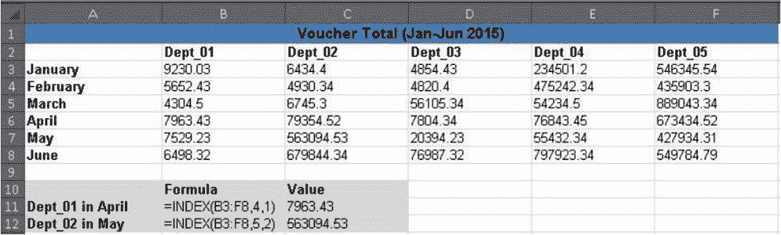

```
= INDEX (B3:F8, 4, 1)
```

选择单元格矩阵：表格（`B3:F8`）并指定行数和列数（即分别为 `4` 和 `1`）。这将获取 4 月份 `Dept_01` 的值。

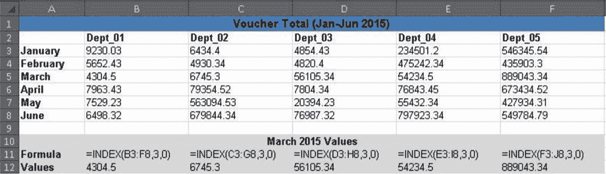

同样，你可以在行数中应用“3”来获取 3 月的值。

#### MATCH 函数

此函数识别特定参数在指定列表中的位置。

`MATCH` 函数在单元格范围内搜索指定项目，然后返回该项目在范围内的相对位置。例如，如果范围 `A1:A3` 包含值 5、25 和 38，则公式 `=MATCH (25, A1:A3, 0)` 返回数字 2，因为 25 是第二个项目。

当你需要范围中项目的位置而不是项目本身时，请使用 `MATCH` 代替 `LOOKUP` 函数之一。注意我们在语法中使用了参数“0”，因为我们需要精确匹配。

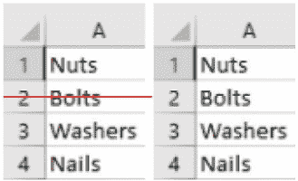

如果范围 `A1:A4` 包含 Nuts（螺母）、Bolts（螺栓）、Washers（垫圈）和 Nails（钉子），则公式 `=MATCH (“Bolts”, A1:A3, 0)` 返回数字 2，因为 `Bolts` 是范围内的第二个项目。`Washers` 将返回 3；`Nails` 将返回 4。

现在改用“1”试试——假设你想获取与给定值最接近的值。那么我们在语法中使用参数“1”。所以，如果我们使用 `MATCH (5000, D2:D16, 1)`，我们得到最接近 5,000 的值。返回信息是 7。记住，值必须按升序排列。

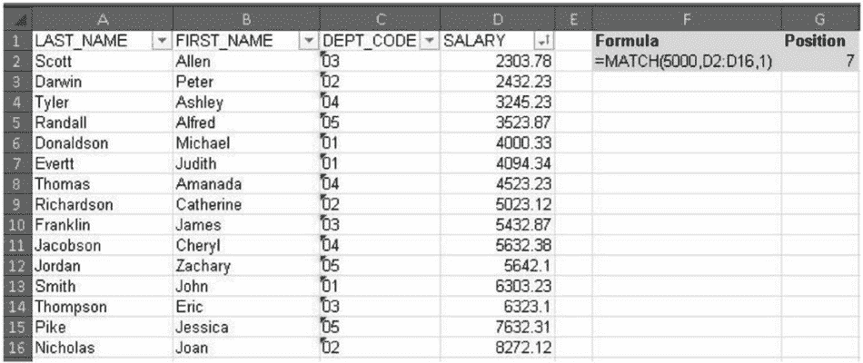

| Match_type | 行为 | 影响 |
| :--- | :--- | :--- |
| 1 或省略 | 查找小于或等于查找值的最大值。 | 矩阵中的值必须是升序的。 |
| 0 | 查找第一个完全等于查找值的值。 | |
| -1 | 查找大于或等于查找值的最小值。 | 矩阵中的值必须是降序的。 |

#### 结合 MATCH 的 INDEX

`INDEX` 函数与 `MATCH` 函数结合时，在查找**不在**表格左侧列的值时非常有用，此时无法使用 `VLOOKUP`。在下表中，你想查找代码编号为 `AA105` 的人的名字。


公式 `=INDEX (A1:D5, MATCH (“AA105”, D1:D5, FALSE), 1)` 将返回 Brown 的正确值。`INDEX` 函数内部的 `MATCH` 函数识别出表格中哪行包含 `AA105`（第 3 行）。然后 `INDEX` 函数能够将其交叉引用到表格的第 1 列。因此公式返回的是第 3 行和第 1 列的内容。

#### 结合 INDEX 的 VLOOKUP

`INDEX` 函数也可以用于 `VLOOKUP` 公式，以识别你想要返回返回值的列。在下面的示例中，使用 `MATCH` 函数来返回员工 Smith 的 `Salary`（工资）列（第 3 列）的内容。

```
=VLOOKUP (“Smith”, A1:D5, MATCH (“Salary”, A1:D1, FALSE), FALSE)
```


该公式将返回 £4,500。`MATCH` 函数返回 3（单词 `Salary` 在范围 `A1:D1` 中的位置）。然后 `VLOOKUP` 返回第 3 列的值。

### 数据透视表 (Pivot Table)

当查找不在表格左侧列的值时，`INDEX` 函数结合 `MATCH` 函数非常有用。数据透视表是一种强大的数据分析工具，它可以帮助我们在极短时间内从大型数据库中生成汇总信息。它可以帮助创建动态变化的表格。假设从总销售数据库中，我们正在查找客户分类的分类。数据透视表的主要功能如下：

A) 快速易用。
B) 可以通过拖拽字段、排序和过滤来处理数据。
C) 通过适当的表示创建洞察。
D) 还可以创建具有交互性的视觉报告。

#### 如何创建数据透视表

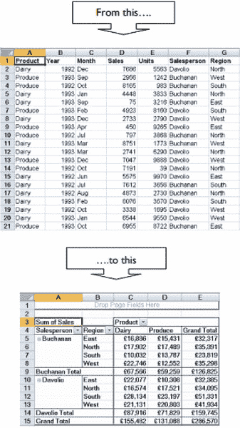

创建空白的数据透视表：

- 在“插入”选项卡的“表”组中，点击“数据透视表”。
- 选择要分析的数据（打开工作簿中的表格或范围或外部连接）。
- 选择放置数据透视表的位置：新工作表或现有工作表，然后确定。

Excel 在新工作表中创建数据透视表。在新工作表中，将显示数据透视表和“数据透视表字段”任务面板。该面板显示数据集中的字段以及创建布局的区域。这些区域用于按列、行、值来组织数据。

如右下角所示，有四个区域：

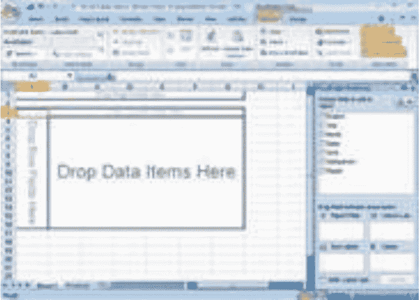

A) 筛选——在数据透视表上方显示顶级过滤器，以便根据你设置的特定条件显示结果。
B) 列——显示所选字段的汇总列。
C) 行——根据所选字段在第一列中分类数据。
D) 值——显示所选字段的统计数据（如总计或平均值）。

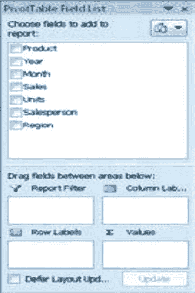

然后可以将字段从“选择字段”拖动到“数据透视表字段”列表底部的“报告筛选”、“列标签”、“行标签”和“值”框中。

#### 示例说明

你还可以使用数据透视表对数字进行分组——按年龄范围、价格范围或任何符合你数据的数值范围进行汇总。为了说明，假设我们有一份包含选民年龄的投票结果列表，你想按年龄组汇总结果。你的数据可能如下：

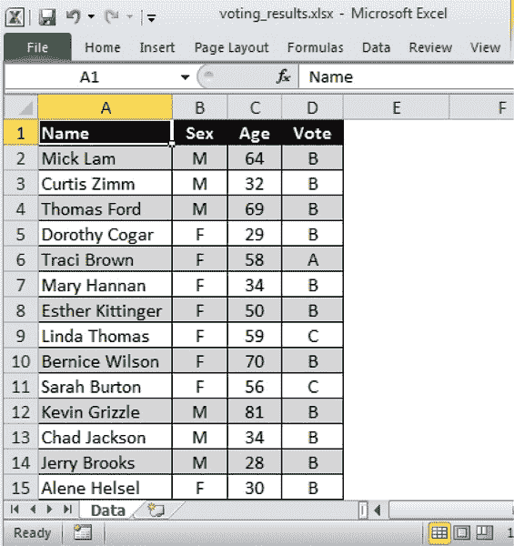


### 基础透视表

要开始按年龄对数据进行分组，请先正常程序创建透视表。接下来，将 `Age`（年龄）字段作为`行标签`，将 `Vote`（投票）字段作为`列标签`。最后，将 `Name`（名称）作为`值`。在示例中，我们还将“Grand Total”（总计）重命名为“Total”。此时，我们的透视表看起来如下：

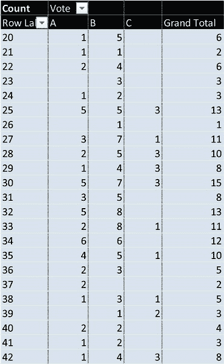

#### 按年龄分组

虽然这个透视表很有趣，但它并不 Practical 用，因为按实际年龄自动分组太细了。我们并不关心有五个 20 岁的人投了 B ——我们希望按年龄范围查看投票结果，例如 20 到 29 岁、30 到 39 岁等。这可以使用透视表内置的分组功能轻松实现。要按年龄对结果分组，右键点击 `Age` 字段中的任何值，并在菜单中选择 `Group`（分组）。

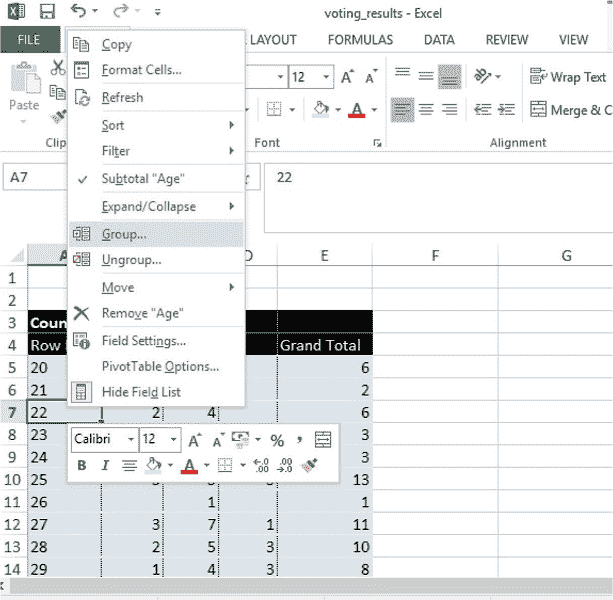

##### 指定间隔

当 `Grouping` 对话框出现时，在“By:”输入区域中输入任何有意义的间隔。在本示例中，我们将按 10 年一个间隔进行分组。

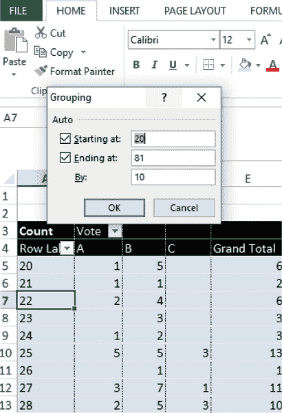

当你点击 `OK` 时，你将看到数据按 10 年一个间隔整齐地按年龄分组。

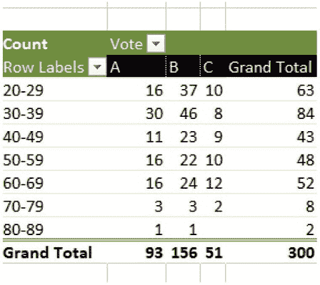

你可以使用相同的方法以许多有用方式对数值数据进行分组。你可以根据总销售额对客户分组，根据入时长对员工分组，根据温度对天气数据分组——这个列表是无尽的。

#### 修改透视表

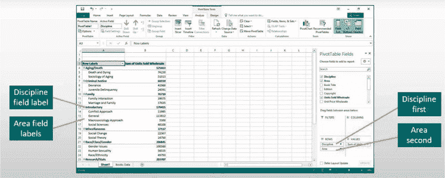

要将字段作为行添加，你可以执行以下步骤之一：

* 在 `Choose fields to add to report`（选择要添加到报告的字段）部分点击字段的复选框进行选择。
* 从 `Choose fields to add to report` 部分拖动字段，并将其释放到 `ROWS`（行）区域。
* 在 `Choose fields to add to report` 部分右键点击字段名，并选择 `Add to Row Labels`（添加到行标签）。

`ROWS`区域内字段的顺序决定了层级结构。在本示例中，我们希望在教科书列表中每个 `Discipline`（学科）下显示 `Areas`（区域）。要显示此层级，请在 `ROWS` 区域先列出 `Discipline` 字段，后列出 `Area` 字段。

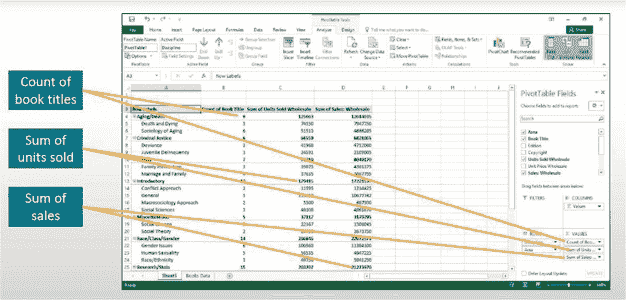

正如我们在 `Rows` 中看到的，要向透表中添加值，你可以执行以下步骤之一：

A) 在 `Choose fields to add to report` 部分点击字段的复选框进行选择。
B) 从 `Choose fields to add to report` 部分拖动字段，并将其释放到 `VALUES`（值）区域。
C) 在 `Choose fields to add to report` 部分右键点击字段名，并选择 `Add to Values`（添加到值）。

在本示例中，我们正在按标题（`Aging/Death`）统计书籍数量，查找销售数量（`Introductory` 中的 `179,415`）以及销售额（`Research/Stats` 中的 `273,970`）。

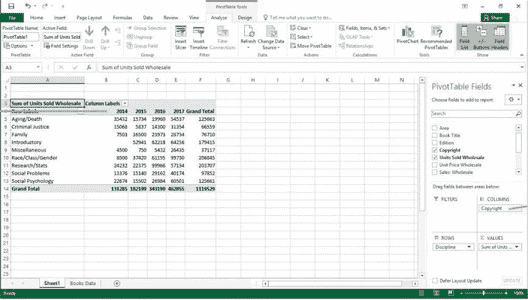

要将数据细分为列，从 `Choose fields to add to report` 部分拖动字段并将其释放到 `COLUMNS`（列）区域。此幻灯片显示了一个透视表，它使用 `Discipline` 字段作为行、`Units Sold` 字段的 `Sum` 作为值，以及 `Copyright` 字段作为列。每个学科标签和版权年份只出现一次。

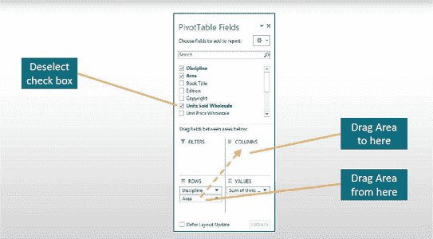

当你继续添加和排列字段时，透视表可能包含过多数据而无法使用，因此需要移除字段。你可以移除字段来减少数据量。要从透视表中移除字段，你可以执行以下步骤之一：

* 在 `Drag fields between areas below`（在下方区域之间拖动字段）部分点击字段名并选择 `Remove Field`（删除字段）。
* 点击 `Choose fields to add to report` 部分字段名旁边的复选框。
* 在 `Drag fields between areas below` 部分将字段名拖到 `PivotTable List`（透视表列表）之外。

要将字段从一个透视表区域移动到另一个，你可以执行以下步骤之一：

* 在 `Drag fields between areas below` 部分拖动字段。
* 点击区域内的字段箭头并选择 `Move to Filter`（移动到筛选）、`Move to Row Labels`（移动到行标签）或 `Move to Values`（移动到值）。

在本示例中，要移除 `Units Sold`，请取消选中它的复选框。要将 `Area` 从 `ROWS` 移动到 `COLUMNS`，请将其从一个区域拖动到另一个。

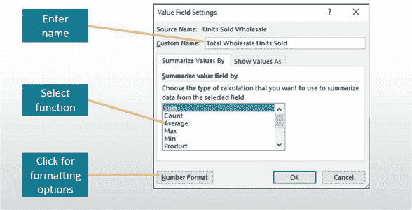

除了数值字段的 `SUM` 和文本字段的 `COUNT`，我们可能还想使用 `AVERAGE` 等其他函数。你还可以更改摘要上方显示的列标签，或者可能需要对聚合值进行格式设置。要修改这些设置中的任何内容，你可以：

* 点击透表中相应字段中的值，点击 `Analyze` 选项卡上 `Active Field`（活动字段）组中的 `Field Settings`（字段设置），显示 `ValueField Settings`（值字段设置）对话框。
* 在 `Custom Name` 框中输入想要作为列标签显示的名称。
* 选择你想要使用的摘要函数进行汇总。
* 格式。

如果你对数据源进行任何更改，透视表不会自动更新。要更新透视表，你需要

* 点击透视表。
* 点击 `Analyze` 选项卡。
* 点击 `Data` 组中的 `Refresh`（刷新）。

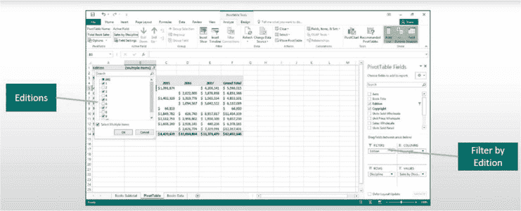

#### 筛选和切片透视表

透视表显示每个类别的聚合数据。然而，你可能希望通过 `FILTERS`（筛选）区域筛选特定字段来显示子集。要设置透视表筛选，你可以：

* 将字段 拖动到 `FILTERS` 区域。
* 点击透视表中的筛选箭头，并执行以下步骤：

 如果你想选择多个值，请勾选 `Select Multiple Items`。

 按值筛选透视表。

 如果列表很长且你想快速找到某个值，在 `Search` 框中输入值。

 点击 `OK`。

在本示例中，我们显示筛选了 1、2、5、7、9 版的版本。

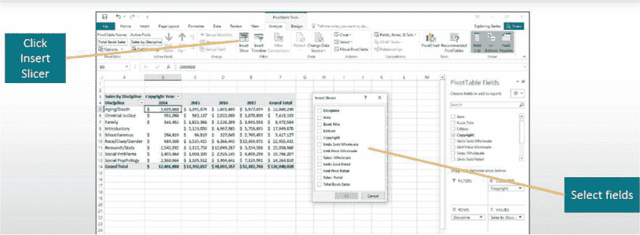

切片是一个包含字段每个唯一项目按钮的小窗口，可以快速筛选透视表。要插入切片，你需要

* 点击 `Analyze` 选项卡中的 `Filter` 组中的 `Insert Slicer`。
* 选中一个或多个字段复选框以显示一个或多个切片并点击 `OK`。

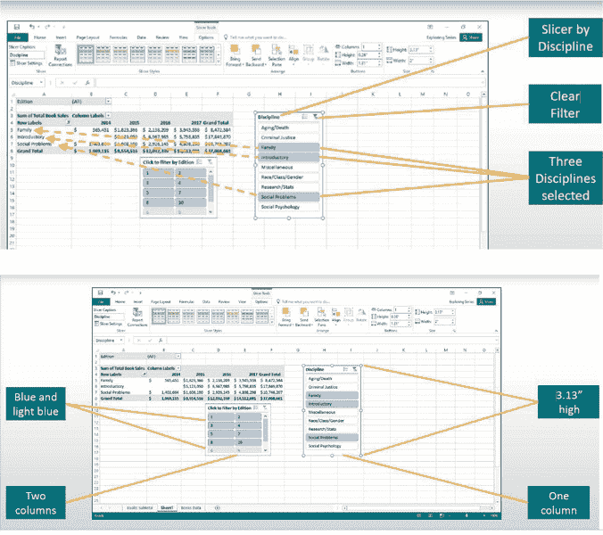

当你选择切片时，会显示 `Slicer Tools`（切片工具）选项卡以便你自定义切片。以下列表描述了 `Slicer Tools` 选项卡上的命令：

* `Slicer`——允许更改切片标题。
* `Slicer Styles`——通过指定筛选项的颜色为切片应用样式。
* `Arrange`——指定切片相对于其他组的位置。
* `Buttons`——定义所选切片中显示多少列以及切片内部每个按钮的高度和宽度。
* `Size`——设置切片窗口的高度和宽度。

在两个切片的示例中：

* `Edition` 切片中的活动筛选项显示蓝色，不可用项目显示浅蓝色。
* `Edition` 切片中有两列，`Discipline` 切片有一列。
* `Discipline` 切片的高度为 3.13”。

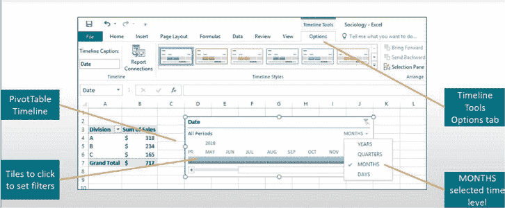

透视表时间轴根据所选日期范围筛选数据。透视表时间轴是一个从数据源的第一个日期到最后一个日期结束的小窗口，它包含可以点击的水平磁贴，按按、月、季度或年进行筛选。

要在透表中插入时间轴并在时间轴上筛选数据：


- 在 `Analyze` 选项卡中的 `Filter` 组中，点击 `Insert Timeline` 以打开 `Insert Timelines` 对话框。
- 点击一个字段的复选框并点击 `OK`。Excel 在工作表中显示一个时间轴，并出现 `Timeline Tools Options` 选项卡。
- 点击当前时间级别旁边的箭头，选择时间段：`YEARS`、`QUARTERS`、`MONTHS` 或 `DAYS`。
- 点击时间轴上的磁格来过滤数据。

在此示例中，磁格的级别为 2018 年的 `MONTHS`——从 1 月到 12 月。请注意 `Timeline` 窗口底部的水平滚动条，这是查看 1 月到 4 月所必要的。

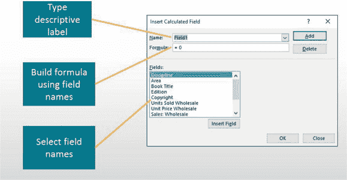

#### 创建计算字段

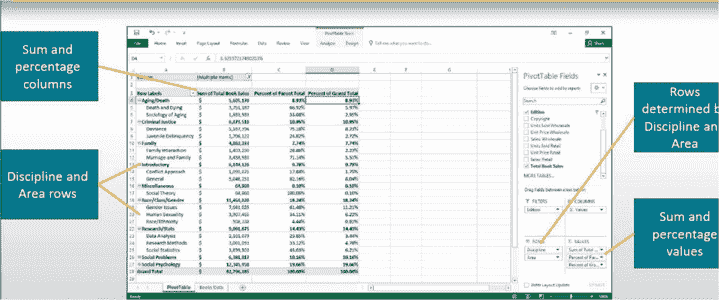

#### 更改透视表设计

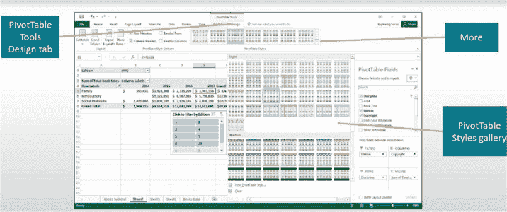

#### 数据透视图

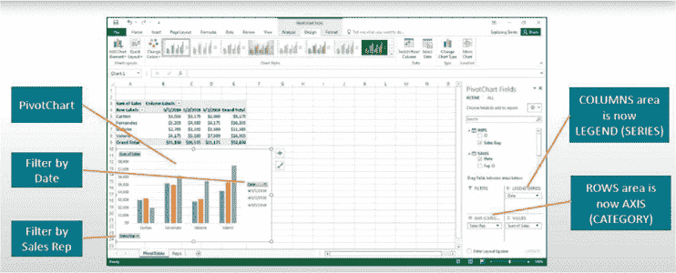

`Pivot Chart` 是 `Pivot Table` 的图形表示。它还提供了高度的灵活性，使我们能够提取确切的信息。

`PivotChart` 是 `PivotTable` 中数据的交互式图形表示，并直观地展示汇总数据。

要创建 `PivotChart`，您：
- 点击 `PivotTable` 内部。
- 在 `Tools` 组的 `Analyze` 选项卡上，点击 `PivotChart`。

`PivotChart` 包含允许您设置筛选器的元素。
- `ROWS` 区域被 `AXIS (CATEGORY)` 替换。
- `COLUMNS` 区域被 `LEGEND (SERIES)` 替换。
- 用于 `FILTERS` 区域的字段仍然用于过滤 `PivotChart` 内数据的字段。
- 在 `PivotTable` 中用于 `VALUES` 的字段仍然用于在 `PivotChart` 中构建绘图区域的字段。

Excel 根据当前的 `PivotTable` 设置创建 `PivotChart`，但您可以使用 `PivotChart Fields List` 更改设置。
- 点击 `FILTERS` 箭头并选择值以过滤图表。
- 点击 `AXIS (CATEGORY)` 箭头以对行中的类别和子类别进行排序或过滤。
- 点击 `LEGEND (SERIES)` 根据值过滤图表。

注意：您对 `PivotChart` 进行的任何更改也会影响相应的 `PivotTable`。

#### 使用 GETPIVOTDATA 函数

此查询可以根据现有透视表的结构检索特定数据。

要从透视表中的单元格中提取数据，可以输入普通的单元格链接，例如 `=B5`，或者可以使用 `GetPivotData` 函数，该函数专门设计用于从透视表中提取数据。

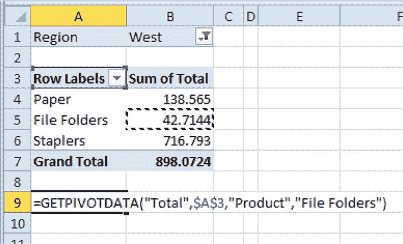

在前面的示例中，单元格 `A9` 中的公式是通过输入一个等号然后点击单元格 `B5` 创建的。它返回了文件文件夹的总计。

```
=GETPIVOTDATA (“Total”, $A$3,“Product”,“File Folders”)
```

## 第 4 章：用于决策的 Excel

### 目标查找命令

`What-If Analysis` 提供了一种对公式中基础数字进行试错循环的能力。

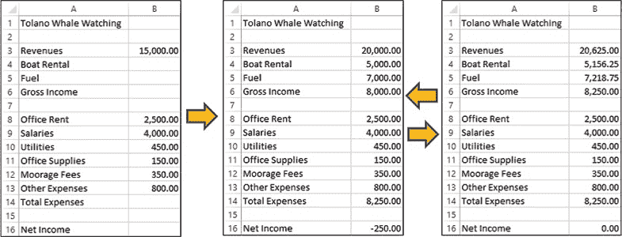

使用 `Goal Seek` 工具可以自动化更改一个变量并计算函数，以获得您想要的值。
- A) 设置单元格 (Set cell)：显示您尝试获取内容的单元格。它必须包含公式。
- B) 数值 (To value)：您想要的值。它必须是数字。
- C) 通过更改单元格 (By changing cell)：Excel 更改的单元格。

`Goal Seek` 是一个工具，而不是函数。

显示结果的单元格必须包含依赖于变量单元格的公式。您可以使用 `Undo` 撤销任何更改。

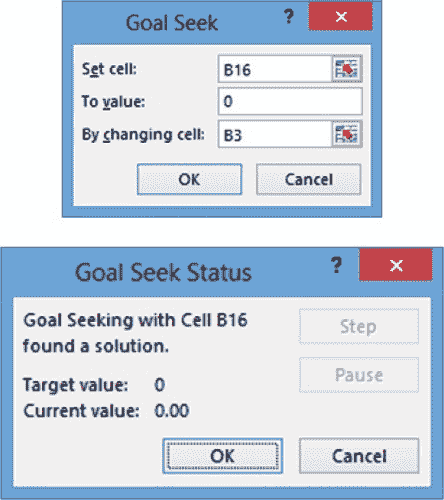

### 使用数据表进行敏感性分析

Excel 在计算方面非常强大。

假设您的贷款付款公式设定为 `PMT (rate, nPeriods, pValue)`

如果我们想看看随着参数的改变，我们的计算会发生什么变化？
我们有多个选择：
I. 我们可以手动调整值并尝试记住较早的结果。
II. 我们可以公式复制到许多单元格中，并为每个副本使用不同的输入。
III. 我们可以使用最好的方法：`Excel Data Table`（Excel 数据表）。

有两种不同类型的数据表：
- A) `One-way`（单向）数据表：允许您更改一个参数。
- B) `Two-way`（双向）数据表：允许您更改两个参数。

#### 创建单变量数据表

单变量数据表是一个结构区域，包含一个变量的不同值，以比较不同值如何影响一个或多个计算结果。例如，单变量数据表用于比较抵押贷款的每月付款额。在确定要操作的变量后，您需要指定替换值。替换值是替换数据表中变量原始输入值的值。您可以手动输入替换值，或使用 `Series` 对话框来帮助完成一系列值。

要使用 `Series` 对话框，您：
- 输入第一个替换值并保持该单元格为活动单元格。
- 在 `Home` 选项卡中的 `Editing` 组中，点击 `Fill` 然后选择 `Series` 以打开 `Series` 对话框。
- 点击 `Rows` 或点击 `Columns` 以选择替换值序列的方向。
- 在 `Step value` 框中输入值增量，在 `Stop value` 框中输入序列的结束值，并点击 `OK`。

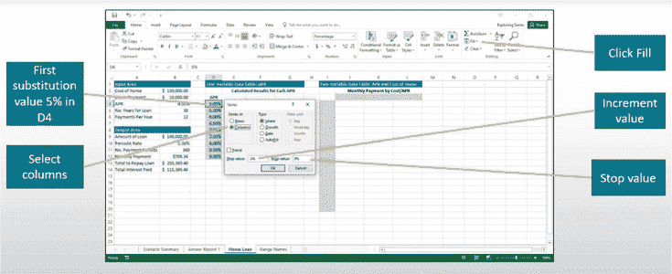

在此示例中，第一个替换值是 `D4` 中的 `5 percent`；点击了 `Columns`，因此替换值序列沿列向下排列，增量为 `0.5 percent`，停止值为 `9 percent`。

在将替换值添加到列中之后，必须添加与变量相关的公式。要完成单变量数据表，您：
- A) 选择数据表边界，从左上角的空白单元格开始。向下并向右拖动，如果有多于一列，选择最后一个替换值与公式引用交叉处的最后一个单元格。
- B) 在 `Data` 选项卡的 `Forecast` 组中，点击 `What-If Analysis` 并选择 `Data Table` 以打开 `Data Table` 对话框。
- C) 输入您正在替换的变量变量单元格引用。如果替换值在行中，则在 `Row input cell` 框中输入原始单元格引用。同样对于列，在 `Column input cell` 框中输入原始单元格引用。
- D) 点击 `OK`。

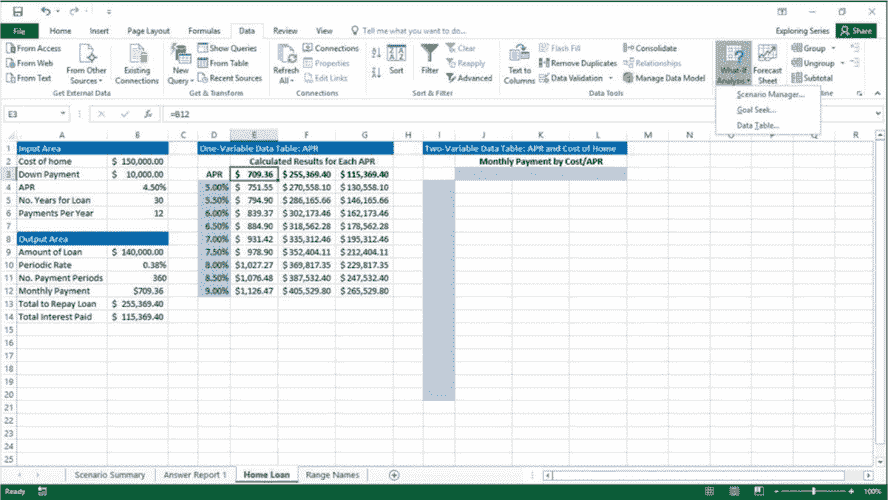

#### 示例：汽车贷款

让我们创建一个单向数据表：汽车贷款。我们向债权人借了 `$20,000` 来买车。年利率为 `5 percent`。我们计划在 `36 months` 内还清贷款。每月付款额可以通过 `PMT` 函数计算：

```
Monthly Payment = PMT (5/12, 36, 20000)
```

随着 `interest rate` 的变化，我们的付款会如何变化？

#### 双向数据表

`Excel Data Tables` 让我们看到参数变化的影响。`Two-way` 数据表：允许我们更改两个参数。

#### 创建双变量数据表

在情况下，您可能想根据两个变量来比较计算结果。双变量数据表是一个结构区域，包含两个变量的不同值，以比较这些不同的值如何影响一个计算结果。例如，您可能想比较各种利率和不同首付款的共同影响。创建双变量数据表的方法与单变量数据表的方法相似。对于双变量数据表，您使用顶行作为一个变量的替换值，使用第一列作为另一个变量的替换值。双变量数据表允许您使用两个变量，但您仅限于一个结果，而不是多个结果。在左上角的空白单元格中输入公式或原始公式的引用。例如，在 `D3` 单元格中输入每月付款的单元格引用 (`=B12`）。

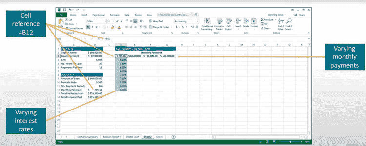


输入替换值并引用一个公式结果后，您就可以完成表格以查看结果了。

完成双变量数据表：

-   选择数据表边界，从数据表的左上角开始。
-   向下并向右拖动，选择列和行最后一个替换值交汇处的最后一个空白单元格。
-   在`Data`（数据）选项卡的`Forecast`（预测）组中，点击`What-If Analysis`（模拟分析），并选择`Data Table`（数据表）以显示数据表对话框。
-   在`Row input cell`框中输入包含第一行替换值原始值的单元格。在`Column input cell`框中输入包含第一列替换值原始值的单元格。
-   点击`OK`。

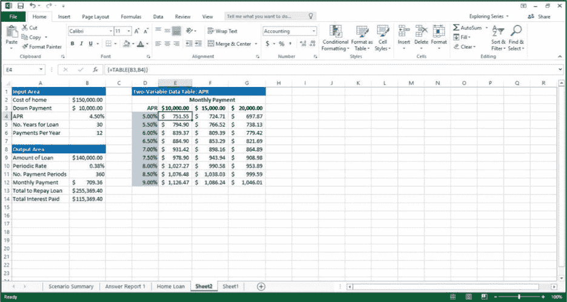

### 示例：汽车贷款还

让我们创建一个单向数据表：汽车贷款还

我们从债权人处借了 $20,000 用于买车。

年利率为 5%。

我们计划在 36 个月内还清贷款。

我们的每月还款额可以通过 `PMT` 函数计算：

`Monthly Payment = PMT (5/12, 36, 20,000)`

随着`interest rate and/or payment period`发生变化，我们的还款额会如何变化？

### 使用场景管理器进行敏感性分析

允许输入并比较多组模拟数据。

每组为一个场景。`Scenario Manager`通过名称跟踪每个场景。

每个场景都可以随时重新激活并更改。

局限性是所有场景都使用相同的单元格。

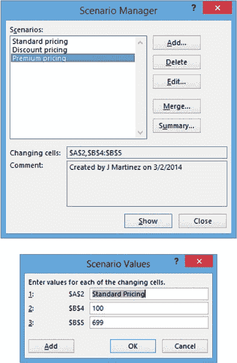

场景摘要报告对比各个场景。

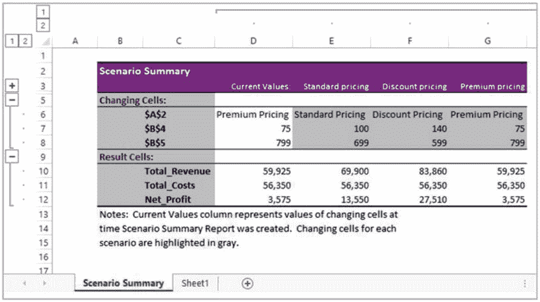

### 使用 Excel 求解进行优化

Excel 具有解决线性（通常是非线性）规划问题的能力。

#### Excel 中的 Solver 工具

A) 可用于求解线性是非线性优化问题。
B) 允许对决策变量设置整数或二进制限制。
C) 可用于解决具有最多 200 个决策变量的问题。

#### 为什么你需要了解这些

它允许您使用线性规划来寻找最佳输入，以实现某些所需的计算结果（例如，通过同时增加每日票量、扩大商店面积、提高单票销售额等来实现收入最大化）。

在以下情况下使用 `Solver` 而不是 `Goal Seek`：

-   您需要对输入变量设置约束（例如，商店每天营业时间不能超过 24 小时）。
-   涉及多个输入变量。
-   除了将计算设置为预设值外，您还希望最小化或最大化生成的计算结果。

### 加载 Solver 插件

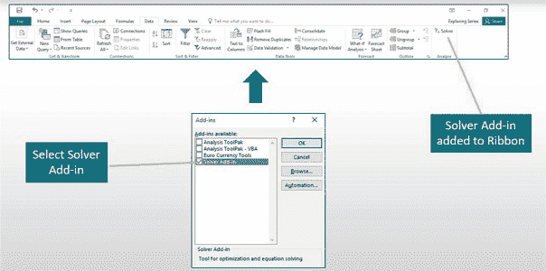

插件是可以添加到 Excel 中以提供增强功能的程序。`Solver` 是一个插件应用程序，它通过在您施加的限制内调整几个变量的值，寻找问题的最佳或最优解决方案。您可以使用 `Solver` 创建优化模型。优化模型通过调整所选变量的值，为某个特定结果找到最高、最低或确切值。

要加载 `Solver`：

1. 点击`File`（文件）选项卡并选择`Options`（选项）。
2. 点击`Add-ins`（加载项）查看活动和未活动的插件应用程序列表。
3. 点击对话框底部的`Manage`（管理）箭头，选择`Excel Add-ins`（Excel 加载项），然后点击`Go`（转到）打开加载项对话框。
4. 在可用加载项列表中勾选`Solver Add-in`并点击`OK`。

### 如何使用此功能

在电子表格上求解线性规划（LP）的关键在于：

-   `Objective cell`（目标单元格）——指定包含公式的单元格，该公式通过调整一个或多个变量的值来产生您想要优化的值（即最大化、最小化或设置为某个值）。
-   识别可以更改的决策变量。这些被称为`Changing Cells`（可更改单元格）。
-   识别包含目标函数的单元格作为`Target Cell`（目标单元格）。
-   识别约束并告诉 `Solver`求解该问题。
-   此时，我们问题的最优解将放置在电子表格上。

#### 案例 1—使用 Solver 确定最佳产品组合

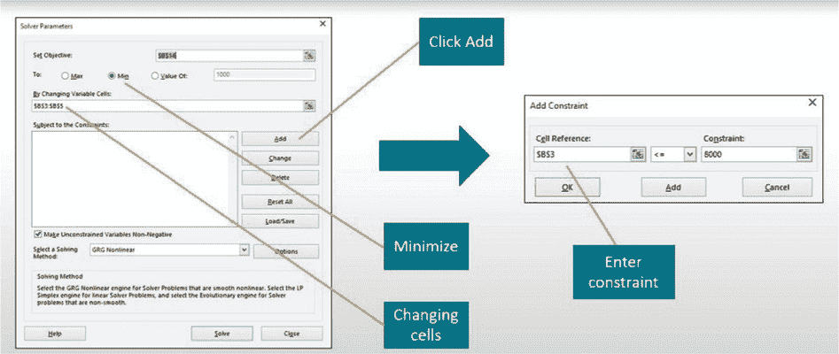

指定目标、更改单元格和约束，您需要：

-   点击`Data`选项卡上`Analyze`（分析）组中的`Solver`以打开 `Solver Parameters`（求解参数）对话框。
-   点击`Subject to`（约束）右侧的`Add`（添加）。
-   点击`OK`添加。。记住：
-   目标单元格将是支付的总利息
-   更改变量将是首付款和年数
-   约束可以是首付款在 $5,000 到 $8,000 之间。


要创建 Solver 报告，您需要：

-   在`Solver Parameters`对话框中点击`Solve`。当 Solver 完成迭代过程时，会出现`Solver Results`对话框。如果找到了解决方案，`Reports`列表将显示报告类型。如果 Solver 无法达到最优解，则没有可用报告。
-   点击`Keep Solver Solution`（保留求解结果）以保留更改的值，或点击`Restore Original Values`（恢复原始值）返回原始值。
-   从`Reports`列表中选择报告并点击`OK`。
注意：如果您保留了更改后的值，Excel 将对电子表格进行这些更改。


Solver 创建一个新的电子表格作为求解报告，包含四个主要部分：

-   第一部分显示报告信息。
第二部分显示目标单元格信息。具体而言，此部分显示原始和最终的目标单元格值。
第三部分显示变量单元格。具体而言，它显示单元格引用、变量名称、原始值和最终值。
第四部分列出约束。它显示每个定义约束的单元格引用、描述、新单元格值、公式、状态和松弛度。

保存 Solver 模型时，您保存的是目标值、更改的变量和约束。

要保存 Solver 设置，您需要：

1. 在`Solver Parameters`对话框中点击`Load/Save`。
2. 点击电子表格上放置第一个单元格。
3. 点击`Save`返回`Solver Parameters`对话框。

如果您想在使用新数据或更新的数据使用现有 Solver 模型，则必须返回之前的 Solver 模型。

要使用已保存的 Solver 模型，您需要：

1. 在`Solver Parameters`对话框中点击`Load/Save`。
2. 选择包含 Solver 数据的电子表格单元格。
3. 点击`Load`加载模型值，并返回求解参数对话框。

### 蒙特卡洛模拟简介

我们希望能够准确估算不确定事件的概率。例如，新产品现金流具有正净现值（NPV）的概率是多少？我们投资组合的风险是多少？蒙特卡洛模拟允许我们对存在不确定性的情况进行建模并在计算机上运行数千次。


蒙特卡洛模拟的名称来源于 20 世纪 30 年代和 40 年代期间进行的计算机模拟，这些模拟用于估计原子弹爆炸所需的链式反应能够成功的概率。参与这项工作的物理学家们都是赌博的大粉丝，因此他们将这些模拟代命名为“蒙特卡洛”。

### 在单元格中输入 =RAND() 会发生什么？

当你在单元格中输入公式 `=RAND()` 时，你会得到一个在 0 到 1 之间任何数值概率相等的数字。


由于 `RAND()` 被用作概率，刷新时会生成一个随机概率。


• 下，高亮我们想要放置 1,000 次迭代的区域。
• 选择 `数据` > `数据表`。
• 对于 `列输入单元格`：选择一个空白格。在下载文件中，选择了单元格 `D11`。
• 选择 `确定`。


一旦在上一步选择了 `确定`，就会插入一个表格并自动填充 1,000 次模拟。


模拟运行完成后，就是时候收集汇总统计数据了。

在这个示例中，我使用了 `COUNTIF()` 函数来确定亏损模拟的百分比，以及利润大于 100 万美元的可能性。


这是通过使用 `COUNTIF()` 函数统计小于零的模拟次数，并除以 1,000 次迭代得到的。

## 第 5 章

### Excel 用于数据仪表盘和可视化

### 什么是仪表盘？


商业智能是当今世界的一种热销商品，而仪表盘是提供此类信息最常用的方法。通过仪表盘，我们以分析和图表的形式汇总数据。这些内容应该完全适应在一个电脑屏幕上，以便一目了然地监控。

### 计划

在规划阶段，必须考虑以下内容：

• 为什么要创建仪表盘？
• 受众是谁？
• 你必须展示的 KPI（关键性能指标）有哪些？
• 时间段是多久，例如，一个月、一个季度或一年？
• 数据源是什么？
• 它的填充频率和交付模式（在线/离线）是什么？

在深入 Excel 之前，在纸上对你想要通过仪表盘展示的数据进行草图绘制可能是值得的。在这里花费的时间将节省你日后重新设计的几个小时时间。


### 设计的重要性

设计可以是数据仪表盘实用性的相当决定因素——它是能够快速快捷地传达你的信息，还是将其隐藏在像这些环形图和仪表盘之类的格式和图表杂质中？


虽然这个仪表盘初看起来可能很美观，但它由于过度使用格式和糟糕的图表选择而显得杂乱。一旦用户发现获取任何有意义的信息需要很长时间，它就会失去实用性。你需要在让它看起来引人注目（以吸引观众的注意力）与不要过于风格化而影响要展示的数据之间取得完美的平衡。采用 KISS（保持简单，愚蠢）的方法是最好的。


图表是通过图片传达信息的有用工具。也就是说，数据的形状包含了一种模式、趋势或异常。知道对你的数据和信息使用哪种图表是关重要的。

### 设计——少即是多


涉及仪表盘设计时，记住格言——“少即是多”。也就是说，更少的颜色、更字体和少的格式。远离 3D 效果、渐变填充、阴影和任何其他必要的格式。

如果你有两个图表显示相同的指标但背景不同，你可以给它们涂相同的颜色，告诉读者它们是相关的。就像之前的示例一样，底部前 10 表格中的柱状图仪表盘使用了相同的颜色，因为它们都显示访问人数，只是分组方式不同。

#### 比较类别——柱形图

当我们想要比较一个概念与另一个概念以及趋势时，这非常有用。


#### 折线图


这些图表确定了一段时间内的趋势。

#### 饼图

当你需要一个代表整体比例的图表时


#### 表格

当你有详细信息且难以通过图表或图形表示时，表格是非常棒的。


此表显示了按月份客户活动 | 总销售 | 百分比

### 使用新的图表类型

Excel 包含了现代图表类型，提供了根据你的需求进行丰富的工具。


#### 瀑布图
它是一种简单的视觉效果，显示例如预算利润与实际利润之间的变化。

#### 直方图
它显示频率分布。直方图将帮助你探索和分析分布。

#### 帕托图
在这里我们可以沿着水平轴关注影响最大的项目（柱形图）。

#### 箱线图
它显示分布，并提供关于范围、四分位数和离群值的关键洞察。

#### 树状
我们可以通过分级视图比较相似或竞争的产品。

#### 旭日图
在这里我们可以看到多层分级中的最大贡献部分。视觉布局非常直观，可以显示任何数量的分级。

### 颜色

填充颜色和字体颜色提供了预设颜色调色板。可以通过选择许多颜色或红绿蓝自定义组合获得更多颜色。


## 第 6 章

### Excel 用于数据清洗和宏的使用

Excel 广泛的功能可以通过会计师最重要的三个基本特征进行最佳判断：

A) 用户轻松转换和总结数千行原始数据，即使这些数据是从 SAP 等应用程序导入的
B) 灵活适应极短时间内的变化，从而缓解紧迫截止日的压力；以及
C) 公式/函数结构基于易遵循的逻辑步骤

### 将数据导入 Excel

从其他应用程序以 CSV、TXT 格式将数据导入 Excel 包括：

• 对可用数据进行更改和格式化
• 合并多个来源的数据
• 将数据汇总成表格

这里可以使用的一些函数：

`=TRIM()`：删除多余空格
`=PROPER()`：每个单词的首字母大写
`=CLEAN()`：从文本中删除所有不可打印字符
`=VALUE()`：将文本转换为数字
`=TEXT()`：将数字或文本转换为新格式
`=TRIM (PROPER ())`：删除多余空格并大写每个单词的首字母
`=VALUE (TRIM (CLEAN ()))`：将数字转换为文本并删除不可打印字符


结果如下所示。


现在，由于字段是由字符 `|` 分隔的，你可以使用“文本分列”向导。

• 选择数据并复制并粘贴值。否则，“文本分列”将把函数而非数据作为输入。


在位于功能区上的“数据”选项卡，点击“数据工具”组中的“文本分列”。

出现“文本分列向导——第 1 步，共 3 步”。

选择“分隔符号”。

点击“下一步”。


出现“文本分列向导——第 2 步，共 3 步”。

在“分隔符号”下，选择“其他”并输入字符 `|`。

点击“下一步”。


出现“文本分列向导——第 3 步，共 3 步”。

在此屏幕中，你可以在向导中选择数据的每一列，并设置该列的格式。

• 对于“目标”，选择单元格 `D3`。

• 你可以点击“高级”，并在出现的“高级文本导入设置”对话框中设置“小数分隔符”和“千位分隔符”。

• 点击“完成”。


你的数据已转换为列，并出现在 D、`E` 和 `F` 三列中。

将列标题命名为 `ProductID`、`Product_Description` 和 `Price`。


### 使用文本函数提取数据值

假设你数据中的字段既没有由字符分隔，也没有通过空格在列中对齐，你可以使用文本函数来提取数据值。即使字段有分隔符，你仍然可以使用文本函数来提取数据。

一些对此有用的文本函数包括：

- `LEFT`——返回文本值最左侧的字符
- `RIGHT`——返回文本值最右侧的字符
- `MID`——从你指定的位置开始，从文本字符串返回指定数量的字符
- `LEN`——返回文本字符串中的字符数

### 宏

如果你在 `Microsoft Excel` 中有重复执行的任务，可以录制宏来自动化这些任务。宏是你可以运行任意次数的动作或一组动作。当你创建宏时，你正在记录你的鼠标点击和按键输入。创建宏后，你可以对其进行编辑，对其工作方式进行细微更改。

假设你每个月都要为会计经理创建一个报告。你希望将逾期账户的名称格式化为红色，并应用加粗格式。你可以创建并运行一个宏，快速将这些格式更改应用到你选择的单元格上。


宏是一组指令，通过执行一系列命令来自动化重复或例行的任务。你可以使用“宏录制器”，也可以使用 `Visual Basic for Applications (VBA)` 编写指令，VBA 是一种可以在各种软件包内部使用的用于增强和自动化功能的编程语言。“宏录制器”会记录你的命令、按键输入和鼠标点击，并将 `Excel` 命令作为 `VBA` 代码存储在工作簿中。要使用宏录制，你必须先在功能区上安装它。

### 在功能区上显示“开发工具”选项卡：

• 点击“文件”选项卡并点击“选项”，打开“Excel 选项”对话框。
• 点击“自定义功能区”以显示“自定义功能区”选项。
• 在“主选项卡”列表中勾选“开发工具”以选中它，然后点击“确定”。

幻灯片显示已添加了“开发工具”选项卡。花些时间熟悉此选项卡上的组和按钮。注意：我们将在下一张幻灯片中讨论“录制宏”按钮。


录制宏非常简单：启动宏录制，按照常例执行一系列命令，然后停止录制。

### 录制宏：

• 在“开发工具”选项卡的“代码”组中，点击“录制宏”显示“录制宏”对话框。
• 在“宏名称”框中为宏输入一个有意义的名字。
• 如果需要，在“快捷键”框中为宏分配键盘快捷键。
• 点击“存储宏的位置”箭头并选择一个存储位置。
• 在“描述”框中输入宏的描述及其目的，点击“确定”开始录制宏。
• 执行你想要录制的命令。
• 在“开发工具”选项卡上点击“停止录制”。


录制宏的操作非常直观：启动宏录制，按照常例执行一系列命令，然后停止录制。

确定宏是否应该使用相对引用、绝对引用或混合引用是重要的，这在你录制宏时。默认情况下，当你录制宏时，它使用绝对引用。

### 运行宏：

• 选择要运行宏的单元。
• 在“开发工具”选项卡的“代码”组中，点击“宏”显示“宏”对话框。
• 从宏列表中选择宏并点击“运行”。

### 创建宏按钮

在工作簿中访问常用宏的最简单方法是将其将其分配到按钮上。这样，当你点击按钮时，宏就会运行。这种方法将宏分配到工作表上的按钮非常简单。


### 为工作表添加宏按钮：

• 在“开发工具”选项卡的“控件”组中，点击“插入”，然后在“控件”部分点击“按钮（表单控件）”。
• 拖动光标在工作表上绘制按钮。当你松开鼠标时，会显示“分配宏”对话框。
• 选择要分配的宏并点击“确定”。
• 右键点击按钮，选择“编辑文字”，为按钮输入更具描述性的名称。
• 点击工作表完成按钮。


我们看到 `ClearForm` 宏已分配到“Clear Form”按钮上，并放置在工作表下方。


两种采样方法都需要在抽样的计划、实施和评估过程中行使审计师的判断。

在某些情况下，统计抽样更为合适，因为它是可以衡量和控制的。

没有资源购买昂贵审计软件的公司可以考虑使用 `Excel` 来执行复杂的统计抽样方法。

### 随机抽样

随机抽样确保总体中的所有项目都有平等的被选机会。

通过手动在列表中勾选肉眼看到的任意“n”笔交易来进行随机选择，可能是非常不科学的。

Excel 提供了一个 `RAND()` 函数来生成随机数。

在加载项（Add-In）的支持下，它还提供了根据各种设置在给定范围内一次性生成多个随机数的功能。这些随机数基于计算机内置的随机表，因此效率更高。

使用 `RAND()` 函数或 `Analysis Toolpak > Random Numbers`。

### 在透视表中对数据进行分层

我们可以对数据进行分层并准备数据的频率分布。这既可以针对数值字段，也可以针对数据中的文本字段。数据分布可以为我们关于数据性质的重要信息，并帮助我们识别应该进行详细测试的领域。

它还可以帮助我们根据 `PARETO ANALYSIS`（帕累托分析）准备关键数据列表，该分析遵循 8020 法则。例如，20%的客户贡献了 80%的销售额。

我们可以使用 `COUNTIF()` 和 `SUMIF()` 函数或 `PIVOT TABLES`。

### 示例

我们可以使用 `NESTED IF` 对数据进行分层：

```
=IF (B4>1000, “3. Over $1000”, IF (B4>100, “2. Over $100 to $1,000”, IF (B4<=100, “1. Up to $100”)))
```

这将创建三个层：
1. $100 以下
2. $100 到 $1,000 之间
3. $1,000 以上

从高到低开始——Excel 会选择第一个匹配的项目。

### 特定应付账款测试

1. (内容) 汇总金额字段（借方或贷方的绝对值）的活动，以识别出现频率最高的金额。然后按供应商和识别出的前 25 次出现的金额汇总活动进行
2. (内容) 提取等于 10,000、100,000 和 1,000,000 整数倍倍的应付账款。
3. (时间) 提取在周末和节假日发布的交易。
4. (时间) 按天、月、年汇总活动。
5. (人员) 按用户和月份汇总活动。

### 计算平均 DPO


为发票日期小于到期日（DPO）创建一个计算字段——在数据或 `Pivot` 中。添加 `Invoice Amount` 的总和以及新计算字段的平均值。

# 识别输入供应商发票的最长时间长


### 审计极端值数据（离群值）

有时，审计所有处于极端的数据（离群值）具有审计意义。一旦我们决定了置信水平，可以使用 `Excel` 的 `Filter` 选项轻松识别。通常认为，位于 `MEAN ± (3 × STD DEV)` 之外的数据对于正态分布处于超过 99%的置信水平之外。一旦我们知道上述变量的值，就可以过滤出离群值。

我们可以使用 `Descriptive Statistics` 然后使用 `AutoFilter`。

### 散点图


散点图不用线连接单个数据点，而是表达趋势。这种趋势可以通过点的分布或通过添加趋势线/回归线来表示。其解释如下：


1—金额变化大且数量少（离群值）
2—合理的费用
3—不合理
4—正在发展的低效率

### 应收账款账龄

在审计中，我们经常必须计算应收账款年龄表。

### 第一步
标记以下单元格：
- `A1`: 客户
- `B1`: 订单号
- `C1`: 日期
- `D1`: 应收金额

在标题下方输入您的客户及其订单相应的信息。


### 第二步
为每列添加额外的标题，如：
- `E1`: 未未天数
- `F1`: 未到期
- `G1`: 0 到 30 天
- `H1`: 31 到 60 天
- `I1`: 61 到 90 天
- `J1`: >90 天


### 第三步
接下来，我们将为 `DaysOutstanding` 列输入公式，使我们知道该发票自到期日以来未支付了多少天。

在单元格 `E2` 中，输入以下公式：
```
= IF (TODAY ()>C2, TODAY ()-C2, 0)
```


拖动公式直到结束。从单元格 `E2` 拖动填充句直到最后一个客户。这将填充整个列公式，因此您不需要重复输入。


### 索引与参考

- `Bins_array` 参数, 13
- 箱须线图, 72
- 更改单元格, 57, 58
- `CHISQ.DIST.RT` 函数, 9
- `CHISQ.TEST` 函数, 9
- `CLEAN` 函数, 75
- 列号, 25, 28
- 条件数学和统计函数, 9–23
- 分析工具包插件, 14–19
- 方差分析 (ANOVA), 16–17
- `AVERAGEIFS`, 10–11
- 案例练习, 23
- 案例研究, 19–22
- 相关性, 12–13
- `COUNTIFS`, 10–11
- 协方差, 18
- 描述性统计, 15–16
- 频率分布, 13
- 直方图, 19
- 集中趋势测量, 11
- 标准差函数, 12
- `SUMIFS`, 10–11
- 方差函数, 12
- `CONFIDENCE.T` 函数, 10
- 文本分列向导, 77–79
- `CORREL` (相关系数) 函数, 13
- 相关性, 12–13, 14
- `COUNT` 函数, 10
- `COUNTA` 函数, 10
- `COUNTIF` 函数, 10, 11
- `COUNTIF()` 函数, 63–64
- `COUNTIFS` 函数, 10–11
- 协方差, 18
- `COVARIANCE.P` 函数, 18
- `COVARIANCE.S` 函数, 18
- `CUMIPMT` 函数, 6–7
- `CUMPRINC` 函数, 6–7

- 仪表板
- 柱状图, 68–69
- 定义, 65
- 设计, 66–73
- 填充颜色, 73
- 字体颜色, 73
- 折线图, 69
- 现代图表类型, 71–72
- 饼图, 70
- 规划阶段, 65–66
- 表, 71

- 数据分析
- `GETPIOTDATA` 函数, 48
- `HLOOKUP` 函数, 25–29
- `INDEX` 函数, 29
- 配合 `MATCH` 函数, 31
- `MATCH` 函数, 29–30
- 配合 `INDEX` 函数, 31
- 数据透视图, 47–48
- 数据透视表, 32–46
- `VLOOKUP` 函数, 25–29
- 配合 `INDEX` 的 `VLOOKUP`, 31–32
- 数据分析对话框, 15
- 数据导入, 75–79
- 数据表, 50
- 单向, 50–52
- 双向, 53–54
- `data_array` 参数, 13

- 决策
- 目标搜索命令, 49–50
- 单向数据表, 51–52
- 使用数据表的敏感性分析, 50–54
- 场景管理器, 54–55
- 双向数据表, 53–54
- 描述性统计对话框, 16
- 描述性统计函数, 14
- 插图, 15–18
- `End` 参数, 7
- 错误, 25, 28

- Excel
- 审计师, 85–93
- 条件数学和统计函数, 9–23
- 数据分析, 25–48
- 数据清洗, 75–79
- 仪表板和可视化, 65–73
- 决策, 49–64
- 导入数据, 75–79
- 生产, 19–22
- 个人决策, 2–4
- 使用文本函数提取值, 79–80
- 贷款摊款表, 5
- `IPMT` 函数, 6
- 未来值 (FV) 函数, 1
- 算栏, 13
- 频率分布, 13
- `FREQUENCY` 函数, 13, 19
- 内部收益率 (IRR) 函数, 2–4
- 保持简单傻 (KISS) 原则, 67
- `KURT` 函数, 10
- `LEFT` 函数, 79
- `LEN` 函数, 80
- 折线图, 69
- 宏
- 按钮创建, 83–84
- 定义, 80


- `recording`, 81–82
- `running`, 82
- `Macro Recorder`, 80
- `MATCH` function, 29–30
- with `INDEX` function, 31
- `MAX` function, 10
- `Measuring central tendencies, functions for`, 11
- `MEDIAN` function, 10
- `MID` function, 80
- `MIN` function, 10
- `Modern chart types`, 71–72
- `MODE.SNGL` function, 10
- `Monte Carlo simulation`, 61–64
- `NESTED IF`, 87
- `Net Present Value (NPV)` function, 1
- `Nonstatistical sampling`, 86
- `Number of PERiods (NPER)` function, 3–5
- `Objective cell`, 57, 58
- `One-variable data table`, 51–52
- `One-way Data Tables`, 50–52
- `Pareto`, 72
- `PARETO ANALYSIS`, 87
- `PEARSON` function, 10
- `Personal financial decisions`, 1–7
- `cumulative calculation functions`, 6–7
- `Future Values` function, 1
- `internal rate of return` function, 2–4
- `IPMT` function, 6
- `loan amortization table`, 5
- `Net Present Value` function, 1
- `NPER` function, 4–5
- `PPMT` function, 6
- `Present Value` function, 1
- `RATE` function, 4–5
- `Pie chart`, 70
- `PivotChart`, 47–48
- `PivotTable`, 32–46
- `basic`, 36–39
- `creation`, 33–35
- `design`, 46
- `features`, 32
- `filter`, 43–46
- `illustration`, 35
- `modify`, 39–42
- `slice`, 43–46
- `stratifying data in`, 87
- `PivotTable Field List`, 33–34
- `PMT` function, 50
- `PMT` function, 6
- `Present Value (PV)` function, 1
- `PROPER` function, 75
- `R`, 9
- `RAND ()`, 61, 86
- `Random sampling`, 86
- `Range`, 25, 28
- `RATE` function, 4–5
- `RIGHT` function, 79
- `Sampling`, 86
- `SAS`, 9
- `Scatter plots`, 89–90
- `Scenario Manager, for sensitivity analysis`, 54–55
- `Search Value`, 25, 28
- `Sensitivity analysis with Data Tables`, 50–54
- `Scenario Manager for`, 54–55
- `Single-factor ANOVA report`, 17
- `SKEW` function, 10
- `Slice, PivotTable`, 43–46
- `Solver tool`, 56–57
- `determining optimal product mix`, 58–60
- `Specific accounts payable tests`, 87
- `SPSS`, 9
- `Standard deviation function`, 11–12
- `start_period argument`, 7
- `Statistical sampling`, 86
- `STDEV.P` function, 10, 12
- `STDEV.S` function, 10, 12
- `Substitution value`, 51
- `SUMIF` function, 11
- `SUMIFS` function, 10–11
- `Sunburst`, 72
- `T-Test: Paired Two-Sample Assuming Unequal Variances`, 14
- `t-Test: Paired Two-Sample for Means`, 14
- `t-Test: Two-Sample Assuming Equal Variances`, 14
- `Tables`, 71
- `Target cell`, 57
- `TEXT functions, to extract data`, 79–80
- `Treemap`, 72
- `VALUE` function, 75
- `VALUE (TRIM (CLEAN())))`, 76
- `Two-variable data table`, 53–54
- `Two-way Data Tables`, 50, 53–54
- `Univariate Statistics`, 85–86

- `recording`
- `running`
- `Macro Recorder`
- `MATCH` function
- with `INDEX` function
- `MAX` function
- `Measuring central tendencies, functions for`
- `MEDIAN` function
- `MID` function
- `MIN` function
- `Minitab`
- `Modern chart types`
- `MODE.SNGL` function
- `Monte Carlo simulation`
- `NESTED IF`
- `Net Present Value (NPV)` function
- `Nonstatistical sampling`
- `Number of PERiods (NPER)` function
- `Objective cell`
- `One-variable data table`
- `One-way Data Tables`
- `Pareto`
- `PARETO ANALYSIS`
- `PEARSON` function
- `Personal financial decisions`
- `cumulative calculation functions`
- `Future Values` function
- `internal rate of return` function
- `IPMT` function
- `loan amortization table`
- `Net Present Value` function
- `NPER` function
- `PPMT` function
- `Present Value` function
- `RATE` function
- `Pie chart`
- `PivotChart`
- `PivotTable`
- `basic`
- `creation`
- `design`
- `features`
- `filter`
- `illustration`
- `modify`
- `slice`
- `stratifying data in`
- `PivotTable Field List`
- `PMT` function
- `PMT` function
- `Present Value (PV)` function
- `PROPER` function
- `R`
- `RAND ()`
- `Random sampling`
- `Range`
- `RATE` function
- `RIGHT` function
- `Sampling`
- `SAS`
- `Scatter plots`
- `Scenario Manager, for sensitivity analysis`
- `Search Value`
- `Sensitivity analysis with Data Tables`
- `Scenario Manager for`
- `Single-factor ANOVA report`
- `SKEW` function
- `Slice, PivotTable`
- `Solver tool`
- `determining optimal product mix`
- `Specific accounts payable tests`
- `SPSS`
- `Standard deviation function`
- `start_period argument`
- `Statistical sampling`
- `STDEV.P` function
- `STDEV.S` function
- `Substitution value`
- `SUMIF` function
- `SUMIFS` function
- `Sunburst`
- `T-Test: Paired Two-Sample Assuming Unequal Variances`
- `t-Test: Paired Two-Sample for Means`
- `t-Test: Two-Sample Assuming Equal Variances`
- `Tables`
- `Target cell`
- `TEXT functions, to extract data`
- `Treemap`
- `VALUE` function
- `VALUE (TRIM (CLEAN())))`
- `Two-variable data table`
- `Two-way Data Tables`
- `Univariate Statistics`
- `Variance`
- `VAR.P` function
- `VAR.S` function
- `Visual Basic for Applications (VBA)`
- `VLOOKUP (vertical lookup)` function
- `Waterfall`


### 图书列表

* 《数据可视化，第二卷：使用基础和新型工具揭示数据中的隐藏模式》，作者：Amar Sahay
* 《管理者的决策分析，第二版：做出更好个人和商业决策的指南》（Decision Analysis for Managers, Second Edition: A Guide for Making Better Personal and Business Decisions），作者：David Charlesworth
* 《开展调查研究：实用指南》（Conducting Survey Research: A Practical Guide），作者：John Fogli 和 Linda Herkenhoff

### 宣布 Business Expert Press 数字图书馆

#### 商务类学生课堂与研究所需的精简版电子书

#### 图书馆选项
您的图书馆也可以通过以下方式以电子书形式购买本书：
* 一次购买，
* 永久拥有，
* 支持多人同时阅读，
* 打印不受限制，且
* 可以从图书馆社区内部下载为 PDF。

我们的数字图书馆收藏是应对教科书成本不断上升的佳解决方案。电子书可以加载到课程管理系统或学生的电子书阅读器中。

`Business Expert Press` 数字图书馆价格非常亲民，且没有未来购买的义务。欲了解更多信息，请访问 [www.businessexpertpress.com/librarians](http://www.businessexpertpress.com/librarians)。在美国设置试用，请发送邮件至 sales@businessexpertpress.com。


