# 多模型与信号处理技术：量化金融应用

## 前言

随着电子市场的爆发以及量化模型在交易、订单执行和风险管理中的广泛应用，金融市场已从几十年前的低技术环境演变为如今市场参与者经常采用先进数据技术的环境。由于需要分析的海量数据带来的运营限制，产生了对智能数据和建模的需求。

与传统的组合理论工具（主要基于组合损失分布的静态分析）相比，基于随机过程的模型允许风险经理获得一个动态的、更真实的组合风险视角，并随着新信息的披露进行动态更新。然而，使用此类动态模型是有代价的：我们需要更先进的工具来对这些模型进行估计、模拟和分析。在工程领域已使用已久的工具（例如 `KF`），尽管某些风险管理专业人士并不熟悉，但在超越静态设置时，这些工具被证明是十分重要的。

同时，高维模型的使用带来了新的估计问题：在许多资产配置问题中，只有几年的时间（即数百个每日观测值）来估计描述数百甚至数千风险因子演变的参数。在这种背景下，传统的估计方法（如主成分分析和基础协方差分析）无法保持一致性，并产生意料之外（且有偏差的！）结果。随机矩阵理论等工具最初用于核物理中模拟复杂原子核能级，最近被用于探索此类估计偏差并提出克服它们的方法。

凭借作为具有深厚研究和技术背景的量化风险专业人士的双重身份，Serge Darolles、Patrick Duvaut 和 Emmanuelle Jay 出色地介绍了一系列优秀的高级信号处理工具和统计模型。这些工具以自成体系的方式解决了上述某些问题，其深度对于从事量化风险管理的学生和专业人士来说是易于理解的。

通过借鉴他们在量化建模方面的专业经验以达到适当的技术复杂程度，Serge、Patrick 和 Emmanuelle 成功涵盖了各种相关概念，且没有牺牲严谨实施所需的细节：多因子模型、基于随机矩阵理论的高级估计方法、用于识别潜在风险因素的滤波算法和正则化方法。这些工具在风险管理和资产配置中的应用，通过使用金融数据的示例得到了很好的说明。

我深信，作者们所付出的努力将造福学术和专业领域的广大读者，并激励读者去深入研究关于金融统计建模的海量研究文献。*阅读愉快！*

## 引言

### I.1. 数字社会与基金管理的新范式

从娱乐业到所有公共和经济领域，我们所有活动的大规模数字化标志着数字时代的到来。后者产生了海量数据，以西泽字节（`10²¹` 字节）为单位衡量。

这种被称为 `大数据` 的现象也影响着金融领域。基金管理公司需要处理所谓的“五 V”：体量（volume）、速度（velocity）、多样性（variety）、可视化（visualization）和价值（value）。此外，2008 年抵押贷款危机及其宏观影响产生了两个主要后果，使得基金经理的处境更加困难。首先，这些海量数据具有高度的`忙乱`（非平稳性），更加不可预测且噪声更大。其次，基金管理的范式已经从不计风险地追求“深奥收益的竞赛”，转变为能够在确保最低收益的同时，在最大透明度下控制风险（回撤）。

解决上述挑战性问题的一种方法是为基金经理提供市场驱动的、且“用户友好”的适当 `QUANT(ITATIVE)` 工具。这就是因子模型、统计信号处理（`SSP`）以及多因子模型和信号处理技术大显身手的地方。

### I.2. 金融领域的统计信号处理与因子模型

线性因子模型如今是投资组合管理理论和资产收益理解的基准，即使在收益可能具有高度非线性的对冲基金行业也是如此。其核心是将大量且多种收益与少数相关的`因子` 联系起来，并伴随无法仅通过因子描述的高斯误差。因此，因子驱动并简洁地解释了资产之间的`空间相关性`，而误差则是`每个资产特有的`。

首先需要选择和/或识别因子，然后必须估计并跟踪连接因子与资产的线性模型参数，例如 `alphas`（收益）和 `betas`（资产敞口）。基于市场数据驱动的线性回归，线性因子模型因此适用于上述所有关于用户友好、透明度和市场驱动的要求。

统计信号处理（`SSP`）方法使我们能够在一个极具噪声、高度不可预测且忙乱的环境中获取因子和模型参数。在过去的几十年里，当 `SSP` 方法被应用于医学诊断、核能电站、飞机、汽车的无损检测，以及提升手机的性能和稳健性时，它们在极度恶劣和多变的条件下证明了其人机工程学优势、效率和实用性，并在 4G 长期演进技术（`LTE`）标准中取得了一些卓越成就。

本书的目的是处理基金管理时，特别是在面对线性因子模型识别时，分享同样的经验。

### I.3. 多学科作者团队

三位作者具有互补的专业知识，以满足上述条件。首先，三位作者都具有学术和商业经验。其次，其中两位是经验丰富的基金经理，而第三位是公司高管。此外，三位作者作为 `QAMLab` 的伙伴已经合作多年。他们的专业知识涵盖从量化金融到 `SSP`。

### I.4. 本书定位与目标读者

本书面向全球三类读者。第一，商业、金融、管理专业的研究生（当然也包括 MBA 学生），他们希望理解 `SSP` 方法如何利用忙乱的数字社会。第二，`SSP` 专业的研究生，他们希望通过熟悉的最小二乘、卡尔曼滤波（`KF`）以及基于近期卡尔曼方法的更高级工具路径进入量化金融领域。第三，渴望为日常管理和实践增添内容的定性基金经理。

### I.5. 书籍结构

本书由四章组成。

第一章介绍了全书的因子模型基础、方程、符号、主要概念、起源、应用等。虽然熟悉基金管理的读者可以跳过大部分内容，但检查这些内容以掌握书中将使用的模型仍然非常有价值。

第二章介绍了选择因子的定性和量化方法。定性方法利用纯粹的市场知识，而量化方法则基于所谓的`特征因子`（eigenfactors），这些因子源自收益协方差矩阵的特征分解。书中还详细介绍了选择“最优”因子数量的统计方法。即使是 `SSP` 读者也可以通过理解特征方法与确定因子数量之间的联系来丰富自己的知识。

旨在估计因子模型中 $\alpha$ 和 $\beta$ 的最小二乘法和卡尔曼算法是第 3 章的重点。这两种方法的几何展示使我们能够以直观的方式理解其目标、用途、性能和局限性，特别是对于金融和商业背景的读者。`KF` 的完整推导过程在第 3 章附录中给出，同样采用几何方式。这两种方法是 `SSP` 中的基本工具。

第 4 章的内容从 `SSP` 的角度来看是最先进的，并分享了关于 `KF` 正则化相关研究（在本书编写时）的前沿结果，用以处理某些脉冲性和非高斯市场行为。与传统的 `KF` 相比，在市场数据上取得了显著的改进并在此进行了说明。

## 符号与缩写

| 符号 | 含义 |
| :--- | :--- |
| `a, b, etc.` | 列向量 |
| `A, B, etc.` | 矩阵 |
| `A′` | 矩阵 `A` 的转置 |
| `A^(*H*)` | 矩阵 `A` 的共轭转置 |
| `A^(−1)` | 矩阵 `A` 的逆矩阵 |
| `tr(A)` | 矩阵 `A` 的迹 |
| `∇x` | 梯度向量算子 |
| `0[*N*]` | `N` × `N` 零矩阵 |
| `I[*N*]` | `N` × `N` 单位矩阵 |
| `1[*N*]` | `N` 维全 1 向量 |
| `a, b, etc.` | 标量 |
| `t` | 时间 |
| `T` | 时间观测总数 |
| `t = 1, …, T` | 从 1 到 `T` 步长为 1 的时间步向量 |
| `N` | 资产数量 |
| `s[*i,t*]` | `t` 时刻资产 `i` 的价格 |
| `r[*t*]` | 资产在 `t` 时的收益率 |
| `r[*f*]` | 无风险资产的收益率 |
| `r[*i,t*]` | `t` 时刻资产 `i` 的收益率 |
| `r[*m,t*]` | `t` 时刻市场 `m` 的收益率 |
| `r[*t*]` | `t` 时刻的 `N` 维收益率向量 |
| `r[*k*]` | 资产 `k` 的 `T` 维收益率向量 |
| `R` | `N` 个观测资产的收益率矩阵 |
| `F` | 因子模型包含的 `K` 个因子收益率矩阵 |
| `f[*k*]` | `F` 的第 `k` 列 |
| `f[*t*]` | `F` 的第 `t` 行以及 `t` 时刻 `K` 维因子值向量 |
| `G = [1 F]` | 用相同行数的 1 向量扩展的矩阵 `F` |
| `g[*k*]` | `G` 的第 `k` 列 |
| `g[*t*]` | `G` 的第 `t` 行以及 `t` 时刻 `K + 1` 维值向量 |
| `α` | “Alpha”或资产相对于市场表现的特定收益 |
| `β` | “Beta”或资产对特定因子的暴露度 |
| `β` 或 `b` | “Betas”或资产对选定的 `K` 个因子的暴露度向量 |
| `θ` | 多因子模型未知参数的 `K + 1` 维向量 |
| `||·||_q` | $l^q$ 范数 |
| `1_{condition}` | 指示函数 |
| `â` | `a` 的估计值 |
| `i.i.d.` | 独立同分布 |
| `~` | 分布于 |
| `⫫` | 统计独立 |
| `IE(.)` | 统计期望 |
| `V(.)` 或 `Var(.)` | 方差 |
| `Cov(.)` | 协方差 |
| `N (μ, σ²)` | 均值为 `μ`、方差为 `σ²` 的高斯分布 |
| `N (μ, ∑)` | 均值向量 `μ`、协方差为 `∑` 的多元高斯分布 |
| `AIC` | 赤池信息准则 |
| `APT` | 套利定价理论 |
| `BIC` | 贝叶斯信息准则 |
| `CAPM` | 资本资产定价模型 |
| `FP` | 固定点 |
| `KF` | 卡尔曼滤波 |
| `LSE` | 最小二乘估计 |
| `MDL` | 最小描述长度 |
| `ML` | 最大似然 |
| `MMSE` | 最小均方误差 |
| `MSE` | 均方误差 |
| `MUSIC` | 多信号表征 |
| `NAV` | 净资产价值 |
| `OLS` | 普通最小二乘法 |
| `PCA` | 主成分分析 |
| `QAMLAB^©` | 量化资产管理实验室 |
| `rgKF` | 正则化卡尔曼滤波 |
| `RKF` | 稳健卡尔曼滤波 |
| `RMSE` | 均方根误差 |
| `RMT` | 随机矩阵理论 |
| `SCM` | 样本协方差矩阵 |
| `SSP` | 统计信号处理 |
| `SW-OLS` | 滑动窗口最小二乘法 |

# 因子模型与一般定义

## 1.1. 引言

旨在估计因子模型中 $\alpha$ 和 $\beta$ 的最小二乘法和卡尔曼算法是第 3 章的重点。这两种方法的几何展示使我们能够以直观的方式理解其目标、用途、性能和局限性，特别是对于金融和商业背景的读者。`KF` 的完整推导过程在第 3 章附录中给出，同样采用几何方式。这两种方法是 `SSP` 中的基本工具。

第 4 章的内容从 `SSP` 的角度来看是最先进的，并分享了关于 `KF` 正则化相关研究（在本书编写时）的前沿结果，用以处理某些脉冲性和非高斯市场行为。与传统的 `KF` 相比，在市场数据上取得了显著的改进并在此进行了说明。

## 1.2. 什么是因子模型？

### 1.2.1. 符号

我们首先考虑一组 $N$ 个风险资产，索引为 $i = 1, \dots N$。我们用 `s[*i,t*]` 表示 $t$ 时刻资产 $i$ 的价格，`r[*t*]` 表示相应的收益率（$t-1$）。这种收益率定义为：

```
r[i,t] = (s[i,t] - s[i,t-1]) / s[i,t-1]
```

如果是以每日（或每周）观测价格，那么 `r[*t*]` 代表每日（或每周）收益率。我们用 $\mu[*i*]$ 表示资产 $i$ 的期望收益，而 $\sigma^2[*i*]$ 是其方差：

```
Var(r[i,t]) = σ²[i]
```

方差（或波动率 $\sigma[*i*]$）通常被用来衡量相对于 $i$ 的风险。波动率越大，风险越大。资产 $i$ 和 $j$ 之间的协方差 $\sigma[*i,j*] = \text{Cov}(r[*i*], r[*j*])$ 对计算组合风险有用。

与风险资产相反，我们还考虑了一种产生收益 `r[*f*]` 的无风险资产（假设为常数）。在实践中，短期政府证券（如国债）被用作无风险资产的代理；这导致 `r[*f*]` 非常数。

期望超额收益（或风险溢价）是我们预期从资产 $i$ 获得的超过 `r[*f*]` 的收益，即


它是相对于投资资产 `i` 所承担风险的溢价。

根据马科维茨 [MAR 52] 的*均方效率*理论，投资者因此要求更高的风险资产提供更高的期望收益，并希望在他们愿意承担的风险水平内获得尽可能高的收益。一个组合被认为是均方有效的，如果我们无法创建另一个具有更高期望收益且相同收益率方差的组合（或者具有相同期望收益但更低方差的组合）。

[图 1.1] 展示了三个风险资产相对于无风险代理资产的时间序列演变。它们的均方权衡见[表 1.1]。

[Table 1.1.] 图 1.1 所示的四种金融工具在 2003 年 2 月至 2009 年 11 月之间计算的年化收益率（μ）、年化波动率（σ）以及风险收益比（夏普比率），并按风险水平从低到高排序。

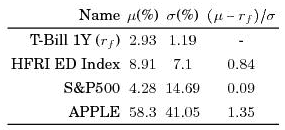

[Figure 1.1.] 四条时间序列的每月演变（以美元计，以 2003 年 1 月底的 $100 为基准），代表：(1) 投资于美国一年期国债，即一年期美国国债，被视为无风险资产的代理；(2) HFRI ED 指数的净资产值（NAV），事件驱动型（ED）对冲基金指数；(3) 标普 500 指数的价格，一个美国市场指数；以及 4) 苹果（APPLE）股票的价格（位于右轴）。

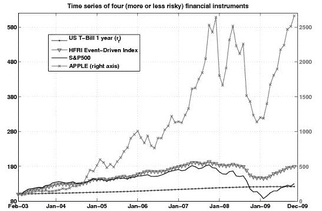

净资产值（NAV）反映了每项资产投资 $100 随时间的演变情况。我们可以通过算术收益率轻松计算出 NAV：

```
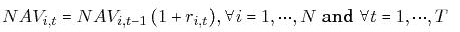
```

其中 `NAV[i,0]` = 100（2003 年 1 月底）。

### 1.2.2 因子表示

因子模型是一种多变量回归，它将一组风险资产的收益与若干因子联系起来。我们关注的是线性因子模型，即因子与收益之间的关系是线性的。

因子代表基本面数据、统计因子或特定的投资组合。基本面数据使用经济理论和对金融市场的认知来确定，包括宏观经济变量，如通胀率、失业率和国内总值。通常情况下，宏观经济变量之间是相关的。

为了选择不相关的因子，会对风险资产收益的协方差矩阵进行经验性降维技术，例如因子分析（FA）或主成分分析（PCA）。这产生了通过对协方差矩阵进行特征值分解得到的 `eigenfactors`（特征因子）。

然而，因子可以用特定的投资组合来替代，特别是当它们代表投资者可以低成本追求的不同策略时。因子代表了市场中投资者所面临的各种风险来源。

我们现在引入以下线性因子模型设定。假设索引为 `i` = 1, …,*, `N` 的 `N` 个风险资产的收益是广义平稳的，对于 `t` = 1, …,*, `T` 可以表示为：

```
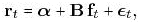
```

其中：

– `r[t]` = `[r[1],t], …,*, r[N,t]]′` 是 `t` 时风险资产收益的 `N` 维向量；
– `f[t]` = `[f[1,t], …,*, f[K,t]]′` 是 `t` 时 `共同风险因子` 数值的 `K` 维向量，其协方差矩阵为 `Σ[f]`；
`B` = `[b[1], …, b^K]` 是一个 `N × K` 矩阵，其中每个元素 `b[i,k]` 定义了资产 `i` 对风险因子 `k` 的暴露口（或敏感性）。资产 `i` 对 `K` 个因子的敏感性是 `K` 维行向量 `b[i]` = `[b[i,1], …,*, b[i,K]]`。它也被称为 `beta`；
– `α` = `[α[1], …, α[N]]′` 表示 `N` 维截距向量，称为 `alpha`；以及
– `[t]` = `[ε[1,t], …,*, ε[N,t]]′` 是 `N` 维均值为零的资产特定收益向量，其协方差矩阵为 `Σ[ε]`；


[Table 1.1.] 图 1.1 所示的四种金融工具在 2003 年 2 月至 2009 年 11 月之间计算的年化收益率（μ）、年化波动率（σ）以及风险收益比（夏普比率），并按风险水平从低到高排序。


[Figure 1.1.] 四条时间序列的每月演变（以美元计，以 2003 年 1 月底的 $100 为基准），代表：(1) 投资于美国一年期国债，即一年期美国国债，被视为无风险资产的代理；(2) HFRI ED 指数的净资产值（NAV），事件驱动型（ED）对冲基金指数；(3) 标普 500 指数的价格，一个美国市场指数；以及(4) 苹果（APPLE）股票的价格（位于右轴）。


净资产值（NAV）反映了每项资产投资 $100 随时间的演变情况。我们可以通过算术收益率轻松计算出 NAV：

```

```

其中 `NAV[i,0]` = 100（2003 年 1 月底）。

### 1.2.2 因子表示

因子模型是一种多变量回归，它将一组风险资产的收益与若干因子联系起来。我们关注的是线性因子模型，即因子与收益之间的关系是线性的。

因子代表基本面数据、统计因子或特定的投资组合。基本面数据使用经济理论和对金融市场的认知来确定，包括宏观经济变量，如通胀率、失业率和国内总值。通常情况下，宏观经济变量之间是相关的。

为了选择不相关的因子，会对风险资产收益的协方差矩阵进行经验性降维技术，例如因子分析（FA）或主成分分析（PCA）。这产生了通过对协方差矩阵进行特征值分解得到的 `eigenfactors`（特征因子）。

然而，因子可以用特定的投资组合来替代，特别是当它们代表投资者可以低成本追求的不同策略时。因子代表了市场中投资者所面临的各种风险来源。

我们现在引入以下线性因子模型设定。假设索引为 `i` = 1, …, `N` 的 `N` 个风险资产的收益是广义平稳的，对于 `t` = 1, …, `T`，可以表示为：

```

```

其中：

– `r[t]` = `[r[1,t], …, r[N,t]]′` 是 `t` 时风险资产收益的 `N` 维向量；
– `f[t]` = `[f[1,t], …, f[K,t]]′` 是 `t` 时 `共同风险因子` 数值的 `K` 维向量，其协方差矩阵为 `Σ[f]`；
– `B` = `[b[1], …, b^K]` 是一个 `N × K` 矩阵，其中每个元素 `b[i,k]` 定义了资产 `i` 对风险因子 `k` 的暴露口（或敏感性）。资产 `i` 对 `K` 个因子的敏感性是 `K` 维行向量 `b[i]` = `[b[i,1], …, b[i,K]]`。它也被称为 `beta`；
– `α` = `[α[1], …, α[N]]′` 表示 `N` 维截距向量，称为 `alpha`；以及
– `ε[t]` = `[ε[1,t], …, ε[N,t]]′` 是 `N` 维均值为零的资产特定收益向量，其协方差矩阵为 `Σ[ε]`；


其中：

- `r[t]` = `[r[1,t], …, r[N,t]]′` 是 `t` 时风险资产收益的 `N` 维向量；
- `f[t]` = `[f[1,t], …, f[K,t]]′` 是 `t` 时 `共同风险因子` 数值的 `K` 维向量，其协方差矩阵为 `Σ[f]`；
- `B` = `[b[1], …, b^K]` 是一个 `N × K` 矩阵，其中每个元素 `b[i,k]` 定义了资产 `i` 对风险因子 `k` 的暴露口（或敏感性）。资产 `i` 对 `K` 个因子的敏感性是 `K` 维行向量 `b[i]` = `[b[i,1], …, b[i,K]]`。它也被称为 `beta`；
- `α` = `[α[1], …, α[N]]′` 表示 `N` 维截距向量，称为 `alpha`；
- `ε[t]` = `[ε[1,t], …, ε[N,t]]′` 是 `N` 维均值为零的资产特定收益向量，其协方差矩阵为 `Σ[ε]`。

由于投资组合经理的下注是持续进行的，跟踪这些下注对短期组合表现的影响可能很有趣。战术性组合配置决策依赖于组合经理对风险溢价（对因子的下注）的短期预测，因此也可以使用线性因子模型进行捕捉，但具有随时间变化的敞口。由于信息是随机到达的，且战术性投注被假设是对新信息的响应，我们预计风险因素的敞口会随时间随机演变。在这种情况下，公式 1.4 变为：

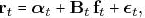

其中 `B[t]`（分别对应 `α[t]`）表示资产对因子（分别对应 alpha）随时间变化的敞口。风险因素敞口不是直接观测的，必须从 `r[t]` 中过滤出来。

让我们考虑一个对冲基金组合（或对冲基金基金）。接下来的章节将使用对冲基金来提供实证说明。尽管趋势非常明显有利于更高的透明度，但投资者并不能系统地获取对冲基金的完整组成及其随时间的演变。对冲基金经理本身并不总是拥有其底层投资风险因素敞口的完整视图，因此也无法完全了解他们隐式所做的下注。当底层基金的交易频率远高于其报告频率时（即嵌入风险可能与特定日期的显示风险大不相同），或者头寸的数量和多样性使得难以得出准确的聚合因子敞口时，情况更为如此。对冲基金经理所显式（在组合层面）和隐式（在底层层面）进行的战术性投注可能会相互累加或相互抵消。因此，使用基于收益的风格分析允许我们通过同时捕捉和评估这两种影响，缓解基于持仓的方法的主要缺点之一。

这个例子表明，这种基于收益的风格分析必须结合随时间变化的参数进行，以便从组合收益中过滤出长期和短期投注。

## 1.3.2. 最优组合配置

让我们考虑一个由 `N` 个风险资产组成的组合，其收益为 `r[i,t]`，`i = 1, …, N`，且 `N` 较大。根据马科维茨的 [MAR 52] 理论，通过对资产收益协方差矩阵 `Σ[r]` 求逆可以获得最优的多样化组合。该矩阵是未知的，我们必须通过观测值 `r[i,t]`，`i = 1, …, N`, `t = 1, …, T` 来估计它，例如使用经验协方差矩阵：

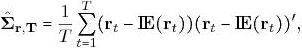

其中 `r[t]` = `[r[1,t], …, r[N,t]]` 是资产收益向量。如果维度 `t` 小于 `N`，则 `Σ[r]` 不是可逆的，无法计算最优的马科维茨组合。此外，即使在 `N` 小于 `T` 的情况下，该经验协方差矩阵的行列也可能接近零，当我们尝试用通常算法求逆时可能会遇到数值问题。特别是当 `N` 小于 `T` 时。

## 1.4. 如何构建因子模型？

### 1.4.1. 因子选择

因子选择问题在金融文献中并不新奇。主要问题涉及使用过多或过少因子的之间的微妙平衡。一方面，当我们使用公式 [1.4] 估计因子敞口时，增加过多的因子会降低回归因子的效率。另一方面，使用过少的因子也有错过相关性结构的重要风险。这引发了一个问题：是否可以构建一种因子选择方法，让我们只考虑适当的因子。

第一种解决方案是使用一组预定义的观测因子，这些因子在金融文献中已根据其解释收益截面的能力被记录。这些因子用于在 1.3.1 节的风格分析中构建长期和短期基准。在 1.3.2 节中，为大量风险资产计算最优组合配置时，它们也被用于降低协方差矩阵的维度。如果我们在风格分析中遗漏了一些风险因子，长期和短期基准都是错误的，组合经理的增值将无法正确计算。特别是，我们可能会将风险调整后的收益解释为经理的能力，而忽略了重要的风险敞口。在组合配置示例中，遗漏的因子意味着特异风险项之间存在相关性。由于在计算最优组合时没有考虑这些相关性，我们低估了组合风险，或者说，我们夸大了多样化效应。

另一种解决方案是使用统计方法从资产收益分布（特别是协方差矩阵）中过滤出能够解释收益截面的不可观测因子。尽管这种方法从统计角度来看很有吸引力，但从金融角度来看也有许多缺点。首先，通常很难给这些统计因子给出经济学解释。其次，因子表示不是唯一的，一组给定因子的任何线性组合都定义了一个等效的因子模型。第三，因子分解通常是随时间变化的，因此难以解释。这两种方法将在第 2 章中详细描述。

### 1.4.2. 参数估计

一旦选择了一组因素，参数估计就由计算因子暴露口的数值值组成。当参数不随时间变化时，可以根据残差属性使用最小二乘法（LS）来计算这些估计值。然而，无论是在 1.3.1 节的风格分析中还是 1.3.2 节的最优投资组合配置问题中，参数都可能随时间变化，必须使用更复杂的统计过滤方法（例如参见 [BOL 09, PAT 13]），如灵活最小二乘法 [KAL 89, MAR 04]、卡尔曼滤波（KF） [RON 08a, RON 08b, RAC 10] 或马尔可夫切换模型 [BIL 12]。

LS 估计量总可以在滚动窗口上计算，并在每次获取新数据时进行更新。这提供了一个估计量的时间序列，它们随后具有随时间变化的行为。然而，这种方法在参数随时间平滑变化时虽然是有用的，但在发生巨大变化时可能会产生误导。使用滚动窗口 LS 计算的风格分析可能会错过投资组合经理决定的突然风格转换。相反，当风格漂移较小和/或分步实施时，这种估计方法提供了非常好的结果。

KF 方法定义上更具反应性，理论上可以捕捉快速的风格转换。然而，这种方法只有在相关因素用于[方程 [1.4]](#c01.xhtml#eqn4) 时才效果良好。事实上，对残差收益统计行为所做的假设更具约束性，任何失败都会对过滤后的时间变化暴露产生巨大影响。例如，当残差收益不遵循高斯分布时。LS 和 KF 之间的共同点和差异在第 3 章中讨论，KF 的增强版本在第 4 章中讨论。

## 1.5. 历史视角

自从 Treynor [TRE 62]、Sharpe [SHA 64]、Lintner [LIN 65] 和 Mossin [MOS 66] 在 20 世纪 60 年代开发出资本资产定价模型（CAPM）以来，因子模型一直是实证金融领域研究的焦点。

### 1.5.1. CAPM 和 Sharpe 市场模型

CAPM 为所有现有因子模型奠定了基础。它给出了个体资产收益相对于市场收益之间应该发生的理论均衡关系。

它的概念基于两个基本的金融概念：如果需求量与供给量（由市场投资组合表示）平衡，就会发生市场均衡；其结果是市场投资组合的均方差效率。

给定无风险利率 `r[f]` 和市场投资组合 `m` 的风险 `σ[m]`，CAPM 规定我们预期的个体资产收益超过 `r[f]` 的部分与市场预期的超额收益成比例，如下：

[1.6] 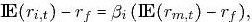

其中 `β[i]` 与 `i` 提供的风险量有关，其中 `γ[im]` 是 `r[i]` 和 `r[m]` 之间的协方差。`β[i]` 的值越大，对应资产 `i` 的预期收益和风险越高。项 `(IE(r[m,t]) - r[f])` 称为市场溢价。

在实践中，未知参数 `β[i]` 通过以下单变量回归进行估计，使用资产收益、市场投资组合和无风险利率的历史数据：

[1.7] 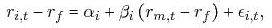

其中 `ε[i,t]` 满足 `IE(ε[i,t]) = 0`。额外参数 `α[i]` 是资产 alpha。[1.6] 的严格形式规定 alpha 必须为零，偏离零是临时不均衡的结果。当 [1.7] 中 `α[i] = 0` 时，该模型与 Sharpe 的市场模型一致。市场投资组合通常由主要的股票指数（如 S&P500）取代，因为 Black [BLA 72] 证明在市场均衡下，这种市值加权指数始终是有效的。参数 `α[i]` 可用于拟合性能分析。

CAPM 结果可以用所谓的证券市场线（SML）表示，如图 2 所示。`IE(r[m,t])` 是市场投资组合代理收益的均值，并且为 `β[i]` 选择了一些理论值。对于每个风险资产 `i`，`α[i]` 和 `β[i]` 通过 [1.7] 估计，`IE(r[i,t])` 是其收益的估计值。根据 CAPM，如果 `IE(r[i,t])` 不在 SML 上，则该资产定价错误。在实践中，未知参数 `β[i]` 受到若干批评（参见 Roll [77]）。首先，市场投资组合是不可观测的。标准股票指数通常替代它，但没有反映整个市场。其次，均方差方法仅取决于一阶矩，这太限制了。

```
(IE(r[m,t]) - r[f])
```

```
IE(ε[i,t]) = 0
```

```
α[i] = 0
```

```
β[i]
```

```
if IE(r[i,t]) 不在 SML 上，则该资产定价错误。
```

### 1.5.2. 套利理论 APT

Ross [ROS 76] 以及 Roll 和 Ross [ROL 77, 80] 开发了 CAPM 的替代套利模型，称为 APT 模型。APT 源于两个基本公理：

P1) 风险资产遵循 [1.4] 的因子结构，带有三个额外假设：A4) K << N；A5) IE(f[k]) = 0, k = 1, …, K 导致 IE(r[t]) = α；A6) ∃ s < ∞ 使得 `Σ[ε]` 的最大特征值有界。

P2) 纯套利是不可能的。纯套利是零成本的无风险收益：投资者可以在不承担风险且不投入净资金的情况下，从任何资产组合获得正收益。根据 P1 和 P2，APT 规定风险资产的溢价通过由因子敏感度 `b[i]` [1.4] 加权的因子价格线性组合给出：

[1.8] 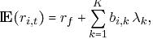

其中 `λ[k]` 定义了因子 k 的风险。完整的 APT 表达式通过将 [1.4] 中的 `α[i], i = 1, …, N` 替换为 [1.8] 得到。联合估计 K 维向量 `b[i]` 和 `λ = [λ[1], …, λ^K ]′` 不是易的。在实践中，可以使用两步法：首先通过 [1.4] 估计 `b[i]`（产生 `b[i]` 作为输入通过以下方式估计 `λ`：

```
(IE(r[m,t]) - r[f])
```

```
IE(ε[i,t]) = 0
```

```
α[i] = 0
```

```
β[i]
```

```
if IE(r[i,t]) 不在 SML 上，则该资产定价错误。
```

```
IE(f[k]) = 0
```

```
IE(r[t]) = α
```

```
∃ s < ∞
```

```
Σ[ε] 的最大特征值有界
```

```
λ[k]
```

```
b[i]
```

```
α[i]
```

```
λ = [λ[1], …, λ^K ]′
```


其中 `u[i,t]` 代表通常假设下的均值残差误差。与 `CAPM` 不同，`APT` 未提供关于 `K` 因子性质的任何信息。

## 1.6 术语表

### 波动率 (Volatility)

资产 `a` 的波动率 `σ` 指在特定时间跨度内连续复合收益率的标准差。波动率通常以年化形式表示：如果使用每日（或每周）收益率计算波动率 `σ`，且认为一年由 250 个工作日（或 52 周）组成，那么年化波动率将等于 `σ * sqrt(250)`（或 `σ * sqrt(52)`）。

### 风险 (Risk)

持有资产 `a` 的风险可以通过 `a` 的波动率来量化。

### 无风险利率 (Risk-free rate)

零风险投资的理论收益率；无风险利率通常表示为 `r[f]`，代表投资者在不承担任何风险的情况下对任何投资所期望的最低收益。这通常被认为是任何风险较高投资至少应获得的下限，因为承担任何风险的回报应该比无风险投资更高。

### 预期（超额）收益 (Expected (excess) return)

资产 `a` 的预期收益是未来预期的收益，通过 `IE(r[a])` 计算。预期超额收益是 `a` 的超过无风险利率（或任何其他市场指标）的预期收益：`IE(r[a]) - r[f]`。

### 风险溢价 (Risk premium)

资产 `a` 的风险溢价是 `a` 的超过无风险利率的预期收益，即 `IE(r[a]) - r[f]`。

### 零成本组合 (Zero-cost portfolio)

零成本组合是指权重和为零的组合。例如，资产 `a` 的超额收益 `IE(r[a]) - r[f]` 就是一个零成本组合。它将 100% 投资于 `a`，-100% 投资于无风险利率。以 `r[f]` 借入的资金被投资于 `a`。由于投资者必须支付以 `r[f]` 借款的利息，他/她期望其在 `a` 中的投资能获得高于 `r[f]` 的回报。

### 可交易组合 (Tradable portfolio)

如果一个组合是零成本组合，则称该组合是可交易的。

### 投资组合多元化 (Portfolio diversification)

组合多元化是指向组合中添加更多投资，以减少单项投资固有的风险。它增加了盈利的可能性，或至少避免损失。通常情况下，多元化程度越高，风险和收益就越低。为了多元化而向组合中添加更多投资涉及将组合细分为许多较小的投资。如果组合规模增加而不是保持不变，组合的风险可能不会减少，特别是当添加的资产之间不相关时。这是一个关于多元化对组合方差之益的非常简单的例子。如果组合中的 `N` 个资产互不相关且具有相同的方差 `σ²`，则通过以等比例 `1/N` 持有所有资产使组合方差最小。此时，组合方差等于 `σ²/N`，随 `N` 单调减少。因此，即使添加的资产是不相关的，组合方差也会降低。当组合中加入负相关资产时，多元化的益处会放大。现代多元化的理解可以追溯到 20 世纪 50 年代 Harry Markowitz [MAR 52] 的工作。

### 市场组合 (Market portfolio)

市场组合是一个完全多元化的组合，代表了整个市场的演变。在因子模型框架下，完全多元化的组合允许纯因子结构，即没有额外特异性风险的因子结构。

### 市场有效性 (Market efficiency)

如果市场中资产的价格反映了所有可用信息，则认为市场是有效的。

### 市场均衡 (Market equilibrium)

当需求量与供给量平衡时，发生市场均衡。在这种情况下，除非需求或供给发生变化，否则价格应该保持不变。

### 套利 (Arbitrage)

套利是指获得无风险利润的可能性。

### 市值 (Market capitalization)

市值，也称为 `MC` 或 `cap.`，是公司发行股数乘以价格。它衡量公司的规模。它每天变化（随 `P` 变化）。例如，在 2010 年 10 月，市值最大的六家公司是（`T$` 代表万亿，`B$` 代表十亿）：

1. 巴西电信 (Telecom Brasil)，市值为 `T$57` 和 `B$99`
2. 埃克森美孚 (Exxon Mobil)，市值为 `T$337.69` 和 `B$66.32`
3. 苹果 (Apple)，市值为 `T$282.77` 和 `B$309.52`
4. 中国石油 (PetroChina)，市值为 `T$229.20` 和 `B$125.23`
5. 宝拓 (BHP Billiton)，市值为 `T$224.83` 和 `B$80.81`
6. 微软 (Microsoft)，市值为 `T$219.97` 和 `B$25.42`。

# 第 2 章 因子选择

## 2.1 引言

建立因子模型时，需要确定因子的性质和数量。文献中可以区分两种方法：经验启发式方法和涉及子空间方法并产生所谓特征因子的统计学方法。

实证研究通常比较这两种方法（见 [CHE 93, CON 95, CHA 98, DAR 11]），并大多强调特征因子在预期属性（不相关因子）和其包含的解释百分比方面的优越性。然而，特征因子很难与观测宏观因子联系起来，这在某种程度上降低了它们对从业者的吸引力。

本章结构如下：2.2 节关注经验启发式方法，并介绍了文献中常用的三个参考模型。2.3 节中，我们介绍了统计方法。与需要观测数据先验知识的因子选择不同，纯统计方法从观测收益的时间序列中提取一组较小的隐含特征因子，这些因子解释了数据的大部分信息。问题变成了确定模型的阶。2.4 节描述了来自信息论的一些经典技术。2.5–2.7 节是补充章节，为该方法的相关问题提供一些讨论，例如数据的协方差估计、该方法与子空间方法的相似性以及该方法在大面板数据中的扩展。

## 2.2 定性知识

在经验启发式方法中，因子的性质和数量是根据对市场状况的先验考虑决定的。因子是观测的市场风险因子，通过主观选择纳入模型中。

文献中关于该主题已有大量研究，因此，在本节中，我们展示了三个主要的参考模型：Fama 和 French 的因子模型 [FAM 93]、Chen 等模型 [CHE 86] ——这两个模型是为解释美国股票市场风险开发的；以及 Fung 和 Hsieh 的基于风险的因子模型 [FUN 01, HSI]，这是一个为了解释趋势跟踪型对冲基金所承担风险而开发的模型。

### 2.2.1 Fama 和 French 模型

Fama 和 French 的三因子模型 [FAM 93] 是资本资产定价模型（`CAPM`）的扩展。Fama 和 French 观察到 `small caps` 和 `value` 股票经常优于市场，因此他们在 Sharpe 的市场模型中增加了两个因子：用于 `small minus big`（市值，`MC`）的 `SMB`，反映了小股相对于大股的相对表现；以及用于 `high minus low`（账面市值比）的 `HML`，反映了高价值相对于低价值股票的相对表现。`MC` 提供了有关公司规模的信息（等于股票价格乘以发行股数）。账面市值比与公司的会计价值相关（等于公司的 `MC` 除以该公司所有股票的会计价值）。

例如，`SMB` 因子可以在时间 `t` 按如下方式构建，针对长度为 `T` 的固定时期（从 `t – T` 到 `t`）：

- 考虑股票市场中一个巨大的股票池，例如取 `t` 时的罗素 2000 股票指数的成份股；
- 对于池中的每只股票，获取其从 `t – T` 到 `t` 的 `MC`；
- 对于每个日期，根据其相对 `MC` 对股票进行排序；
- 为了获得小股相对于大股的表现，为每个日期计算一个等权（或按市值加权）的组合，该组合由 `MC` 低于（相应地高于）特定值的股票组成；
- 然后计算 `SMB` 因子收益，即小 `MC` 组合与大 `MC` 组合之间的收益差。

该步骤与构建 `HML` 因子的过程相同，但基于股票的账面市值比值而非其 `MC` 值。

这种方法被晨星（Morningstar）等用于使用五星级网格对股票和共同基金进行评分¹。

Carhart 的四因子模型 [CAR 97] 是 Fama 和 French 三因子模型 [FAM 93] 的扩展，包含一个动量因子。该模型证明可以解释股票基金平均收益和风险调整后收益的持续性。

### 2.2.2 Chen 等模型

Chen 等 [CHE 86] 模型是套利定价理论（`APT`）框架下的一个特例。通过研究美国市场的股票，作者识别了一组对解释预期收益具有显著意义的经济状态变量：工业生产、风险溢价的变化、收益率曲线的扭曲、意外通胀的衡量标准，以及这些变量在波动期间通胀的变化。虽然市值加权股票指数解释了大部分收益，但它对市场的影响并不显著。

### 2.2.3 Fung 和 Hsieh 的基于风险的因子模型

Fung 和 Hsieh 的基于风险的因子模型 [FUN 01, HSI] 是为了解释趋势跟踪型对冲基金所承担风险的模型。与 Fama 和 French 模型不同，该模型仅包含宏观经济因子。Fung 和 Hsieh 的八个风险因子可在作者的网页上找到（参见 [HSI]），并从 1994 年 1 月起每月引用。表 2.1 提供了这些因子的某些基本统计。越来越多的文献致力于寻找准确的因子（参见 AGA 00, AGA 00b, AGA 04, AGA 09, SAD 10），其中最著名的模型之一是趋势跟踪模型：

1. 三个趋势跟踪风险因子是特定的组合，用于描述不同的资产类别：i) `PTFSCOM`，代表特定商品组合的收益；ii) `PTFSBD`，代表特定债券组合的收益；以及 iii) `PTFSFX`，代表特定外汇组合的收益；
2. 两个面向股票的风险因子基于股票指数：i) `SP500`，代表标准普尔 500 股票指数的总收益，以及 ii) `EquitySizeSpread` 代表美国股票中最小市值的表现，即大罗素 2000 指数总收益与 `SP500` 之间的差值；
3. 两个面向债券的风险因子代表债券市场：i) `Bond10y` 是 10 年期国债收益率的每月变化，以及 ii) `CreditSpread` 是穆迪 Baa 级收益率减 10 年期国债收益率的每月变化；
4. 最近新增的新兴市场因子：i) `MXEF`，代表摩根士丹利资本国际（`MSCI`）新兴市场指数的总收益。

Fung 和 Hsieh 的八个风险因子可在作者的网页上找到（参见 [HSI]），并从 1994 年 1 月起每月引用。表 2.1 提供了这些因子的某些基本统计。这些统计数据包括：年化收益、年化波动率、年化收益与年化波动率之比（称为夏普比率）、期间内的最小和最大月收益，以及收益分布的偏度和峰度。

作为说明，图 2.1 展示了如果在 1993 年 12 月在每个因子上都投资了 100，这些因子的演变情况；图 2.2 代表了根据 1994 年 1 月至 2012 年 12 月的每月因子收益计算出的这些因子之间的相关矩阵。可以区分出两组负相关因子：第一组由 `SP500`、`EquitySizeSpread`、`MXEF` 和 `Bond10y` 组成，它们与其他四个因子呈负相关。此外，在每组内部，我们观察到因子之间存在非常弱的（正或负）相关性，但两个基于股票的风险因子（正相关性约为 60%）以及两个与债券相关的风险因子（负相关性约为 45%）除外。

**图 2.2.** Fung 和 Hsieh 从 1993 年 12 月到 2012 年 12 月底的八个风险因子的经验相关矩阵（见彩色版章节）

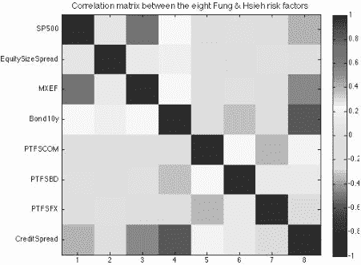

宏观经济因子天然具有相关性。为了避免不同资产类别因子收益之间的相关性，可以通过逐步回归技术 [AGA 00b] 来选择因子：根据因子的相对判别能力，一个接一个从模型中引入或移除因子。使用其上升式版本时，首先选择单一最佳因子，然后将其与每个其他变量配对，选择次优因子，依此类推。模型的阶数不断增加，直到添加新因子不再提高前一个模型的判别能力为止。使用其下降式版本时，初始模型包含所有预选因子，并一个接一个地移除最差的因子，直到移除剩余因子中的一个不再提高前一个模型的判别能力为止。

## 2.3 基于特征因子的定量方法

在本节中，我们用 `eigenfactors` 表示通过对收益协方差矩阵进行特征向量分解从观测中获得的因子。在实证量化金融的文献中，`eigenfactors` 可以被视为特殊的 `latent factors`（潜在因子），它们是通过收益线性组合得到的向量的子集。当对于可能驱动研究数据的经济因子没有先验知识时，通常会使用此类方法，并且具有显著的特性，即产生正交因子，特别是当使用子空间方法推导此类因子时。

在统计学文献中，最常用的方法是因子分析法（Factor Analysis）和主成分分析法（`PCA`）。此类方法主要用于降低观测矩阵的维度，它们使用相关矩阵的特征向量分解，并产生构建为收益线性组合的成分。最重要的结果是，通过仅保留少数选定的、关联特征值最高的特征向量，就可以以高准确率近似原始数据。因此，困难在于确定选择阈值。该问题的这部分将在 2.4 节中讨论。

### 2.3.1 符号

假设收益存储在 `T × N` 的矩阵 `R` 中，其中 `N` 列代表按规律频率采样的 `T` 个连续资产收益（例如，每日，……）：

```
[2.1] R = [r_1, r_2, ..., r_T]'
```

如果 `μ = IE(R) = [μ_1, μ_2, ..., μ_N]'` 表示 `N` 维均值向量，那么：

```
[2.2] r = R - 1_T * μ'
```

是 `R` 的中心化版本。

如果 `σ = [σ_1, σ_2, ..., σ_N]'` 表示 `N` 维标准差向量，`D` 为 `N × N` 的对角矩阵，且其对角线为 `σ`，那么：

```
[2.3] z = r * D^(-1)
```

是 `r` 的标准化版本，其方差为 1，均值为零。我们有：

```
[2.4] Σ_z = IE(z * z') = D^(-1) * Σ * D^(-1)
```

因此 `R` 的协方差矩阵 `Σ` 可以表示为：

```
[2.5] Σ = D * Σ_z * D
```

注意 `Σ` 是对称的。如果 `Σ` 是满秩的，则 `Σ` 是正定的；如果不是满秩的，它是半正定的。可以使用多种方法来估计协方差矩阵。样本协方差矩阵（`SCM`）和稳健估计方法在 2.5 节中介绍。

### 2.3.2 子空间方法

金融应用中，获取 `latent factors` 最常用的方法是主成分分析（`PCA`），它对协方差矩阵进行特征分解。在本节中，我们假设协方差矩阵是已知或通过任何方法估计的（如 2.5 节所示），并且我们使用符号：

```
Σ_z = U * Γ * U'
```

假设观测是标准化的，即我们使用 [2.4]。

其特征分解可以写为：

```
[2.6] Σ_z = U * Γ * U'
```

其中 `U = [u_1, u_2, ..., u_N]` 是 `N × N` 的矩阵，由对应于 `N` 个特征值的特征向量组成，`Γ` 是 `N × N` 的对角矩阵。我们假设最大的 `K` 个特征值存储在 `Γ_K` 中。

```
[2.7] Γ_K = diag(λ_1, λ_2, ..., λ_K)
```

以及

```
[2.8] U_K = [u_1, u_2, ..., u_K]
```

因此 [2.6] 可以很容易地重写为：

```
[2.9] Σ_z = U_K * Γ_K * U_K' + U_N * Γ_N * U_N'
```

在许多应用中，`K` 与模型阶数相关：假设观测来自 `K < N` 个源，剩余的 `N − K` 个源被认为是噪声。例如，`MUSIC` 算法（多信号分类算法）[STO 89, STO 97, TRE 02] 常用于确定天线阵的数量以及到达角度。由 `K` 个最大特征值定义的信号空间与噪声空间（`N − K` 个最小特征值）正交，因此将观测投影到信号空间上可以检测信号。

确定 `K`（即公共因子数量）是因子模型的关键任务之一。在对协方差矩阵估计进行特征值分解后，最简单的步骤是选取最大的 `K` 个特征值，因为存在各种测试来判断某个特征值是否足够：

1. 查看包含在 `λ_k` 中的总功率的百分比：
   ```
   [2.12] η_1 = (Σ_{i=1}^K λ_i) / (Σ_{i=1}^N λ_i)
   ```
2. 计算被声明为大的第 (`k` + 1) 个特征值与第 `k` 个特征值的比值：
   ```
   [2.13] η_2 = λ_{k+1} / λ_k
   ```

显然，这些测试的结果将取决于所选的 `η_1` 或 `η_2` 的值。更通用的标准可能有用，目前出现了两类标准：(1) 传统标准和 (2) 基于大面板数据定义的、更特定于因子模型识别的标准。

## 2.4 信息准则

用于检测 `K` 值的第一类测试被称为顺序假设 (`SH`) 检验或球性检验，源自统计学领域（参见 [AND 63]）。目标是找到 `N - K` 个最小特征值相等假设与仅 `N - K - 1` 个最小特征值相等假设之间的似然比。Anderson [AND 63] 显示，对于 `T > N`，`N - K` 个最小特征值聚集在一个小值 `s²` 附近，并证明充分统计量为：

```
[2.14] L(d) = (N - d) * ln( (1/(N-d)) * Σ_{i=d+1}^N λ_i / (Π_{i=d+1}^N λ_i)^(1/(N-d)) )
```

该比率使用了 `N - d` 个最小特征值的算术平均值与 `N - d` 个最小特征值的几何平均值的比。如果 `N - d` 个最小特征值相等，则 `L(d) = 0`。渐近地，统计量 [2.14] 对应于 `χ²((N - d)² - 1)` 分布，因此给定置信区间和顺序检验，可以确定 `d` 的值。

第二类测试在 `L(d)` 中增加了一个考虑模型自由度的惩罚函数。这产生了一个需要最小化的关于 `d` 的函数，经典的赤池信息准则 (`AIC`) 和最小描述长度 (`MDL`) 检验可以写成如下，即 `L(d) + p(d)` [TRE 02, RIS 78]。

### 2.4.1 赤池信息准则

Akaike [AKA 74] 引入了一种广为人知的基于信息论准则，即 `AIC`。该测试可以方便地写为：

```
[2.15] AIC(d) = -2 * ln(L(d)) + 2 * d
```

因此通过最小化 [2.15]，我们得到 `AIC` 估计值 `K_AIC`：

```
[2.16] K_AIC = argmin_d AIC(d)
```

已经证明 `AIC` 是不一致的，并且在渐近上倾向于高估源的数量。然而，对于较小的 `T`，与 `MDL` 获得的结果相比，`AIC` 通常具有更高的正确结果的概率。

### 2.4.2 最小描述长度

`MDL` 与 `AIC` 的区别在于添加到 Anderson 充分统计量 `L(d)` 中的惩罚函数值不同：

```
[2.17] MDL(d) = -ln(L(d)) + 0.5 * d * ln(T)
```

因此通过最小化 [2.17]，我们得到 `MDL` 估计值 `K_MDL`：

```
[2.18] K_MDL = argmin_d MDL(d)
```

与 `AIC` 相比，`MDL` 估计在维度上是一致的，即当 `T → ∞` 时，`MDL` 估计接近 `K`。在实践中，`MDL` 优于 `AIC` 和贝叶斯信息准则 (`BIC`)。

## 2.5 附录 1：协方差矩阵估计

子空间方法需要计算观测值的协方差矩阵，通常通过样本协方差矩阵 (`SCM`) 进行估计。`SCM` 是多元高斯假设下极大似然法的解，但在收益存在离群值的情况下缺乏稳健性。在本节中，我们首先给出样本均值和 `SCM` 的表达式及其属性，然后介绍一组稳健估计量，即 `M`-估计量。

**图 2.3.** 在确定一组大小为 `N = 72`、长度为 `T = 144` 的月收益的因子数量时，`AIC` 和 `MDL` 的比较。`MDL` 更清晰地指示了数据集中的截点（`K = 6` 个因子），而 `AIC` 是单调递减函数。

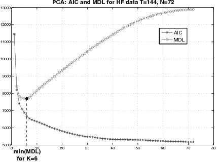

### 2.5.1 样本均值

样本均值提供了向量均值的无偏且一致估计，其通过其值的算术平均值计算：

```
[2.19] μ_hat = (1/T) * Σ_{t=1}^T r_t
```

其中 `1_T` 表示一个 `T` 维的全 1 向量。该估计量为：

```
μ_hat ~ N(μ, (1/T) * Σ)
```

如果观测向量是高斯向量，则它与极大似然估计量一致。

### 2.5.2 样本协方差矩阵

在高斯情况下，`Σ` 的极大似然估计 `Σ_hat_ML` 为：

```
[2.20] Σ_hat_ML = (1/T) * Σ_{t=1}^T (r_t - μ_hat)(r_t - μ_hat)'
```

该估计量为：

```
Σ_hat_ML = ((T-1)/T) * S
```

因此，如果我们定义 `S` 为所谓的 `SCM`，我们有：

```
[2.21] S = (1/(T-1)) * Σ_{t=1}^T (r_t - μ_hat)(r_t - μ_hat)'
[2.22] S = (1/(T-1)) * r' * r
[2.23] S = (T/(T-1)) * Σ_hat_ML
```

注释 1. 如果观测值为零均或均值向量 `μ` 已知，则协方差矩阵的极大似然估计 `Σ_hat_ML_known` 是无偏的。

一些渐近结果：

```
[2.24] sqrt(T) * (μ_hat - μ) -> N(0, Σ)
[2.25] (T-1) * S ~ W_N(T-1, Σ)
[2.26] T * Σ_hat_ML ~ W_N(T-1, Σ)
```

在 [2.25] 中，`r` 表示 `Σ` 的秩（如果矩阵满秩，则 `r = N`）。`T²(μ_hat - μ)' S^(-1) (μ_hat - μ)` 是参数为 `N` 和 `T - 1` 的 Hotelling 平方统计 [HOT 31]。由 Harold Hotelling 开发的 Hotelling 平方统计是 t 检验的推广，常用于多元假设检验。当随机变量 `T² ~ (N(T-1)/(T-N)) * F_{N, T-N}` 时，其中 `F_{p, n-p+1}` 是参数为 `p` 和 `n-p+1` 的 `F` 分布，也称为 Snedecor `F` 分布（见附录 A1.4 和 A1.5）。

高斯情况：如果观测值为多元高斯 `N(μ, Σ)`，则 `μ_hat` 和 `Σ_hat_ML` 通过最小化得到：

```
[2.27] L(μ, Σ) = (T/2) * ln|Σ| + (1/2) * Σ_{t=1}^T (r_t - μ)' Σ^(-1) (r_t - μ)
```

当 (`T` - 1) ≥ `N` 且 `V` = (`T` - 1)`S` 时。由于最后一项是正的，我们只需要最小化：

```
[2.28] ln|Σ| + tr(Σ^(-1) * S)
```

然后我们有：

```
[2.29] μ_hat = (1/T) * Σ r_t
[2.30] Σ_hat_ML = (1/T) * Σ (r_t - μ_hat)(r_t - μ_hat)'
[2.31] (T-1) * S ~ W_N(T-1, Σ)
```

其中 `W_n(n, A)` 表示参数为 `n` 和 `A` 的 Wishart 分布（详见附录 A1.6 或 [BIL 99]）。

当高斯假设未通过验证时，`SCM` 估计可能会受到离群值的影响并偏离最优性，因此应优先考虑使用鲁棒估计方法进行估计。估计器的鲁棒性可以通过稳定的估计结果来量化，即在相对较大的置信区间内，观测数据与假设模型有微小偏差时，估计结果保持稳定。关于鲁棒估计方法的文献非常丰富，可能最早由 John Wilder Tukey 在 20 世纪 60 年代提出 [TUK 60, TUK 62]。Peter J. Huber 在 [HUB 64] 和 [HUB 67] 中认为，在给定分布模型的前提下，真实分布位于该模型的邻域内，这可能描述了一种鲁棒性的理论方法。因此，引入了 `M`-估计器作为极大似然估计方法的推广，该方法考虑了所假设模型可能是错误的。同样，Huber 的 `粗误差模型` 假设在完全已知的分布 `G` 内部，某部分数据（例如 `0 ≤ ε ≤ 1`）来自未知分布 `H`，因此对数据的完整表征由分布 `F = (1 − ε) * G + ε * H` 给出。

在下一节中，我们将讨论所谓的 `M`-估计器族 [HUB 64, HUB 77, MAR 76]，它为经典的 `SCM` 提供了替代方案，并且同样来源于极大似然理论 [CON 02, GIN 02]。

## 2.5.3 鲁棒协方差矩阵估计：M-估计器

假设 `R` 的 `N` 列 `r_i` 是相互独立的，则 `Σ` 的 `M`-估计器被定义为以下方程的解：

```
[2.32] Σ_hat_M = (1/T) * Σ_{t=1}^T u(r_t' * Σ_hat_M^(-1) * r_t) * r_t * r_t'
```

其中函数 `u(.)` 可能满足以下条件 [MAR 76]：

1. `u(s)` 对于 `s ≥ 0` 是负的、单调递减且连续的；
2. 定义 `ψ(s) = s * u(s)`，对于所有 `s ≥ 0`，`ψ(.)` 是有界的，且 `K = sup_{s≥0} ψ(s)`；
3. `ψ` 是单调递增的，并在 `ψ < K` 的区间内严格递增；
4. 存在 `s_0` 使得 `ψ(s_0) > N`。

### 2.5.3.1 Huber 的 M-估计器

Huber 的 `M`-估计器针对特定的权重函数 `u` 定义：

```
[2.33] u(s) = -1, if s ≤ a²
         = -a²/s, if s > a²
```

其中 `I1(x)` 是指示函数，定义为如果 `x` 成立则 `I1(x) = 1`，否则为 0。

Huber 估计器是以下方程的解：

```
[2.34] Σ_hat_Huber = (1/T) * Σ_{t=1}^T u(r_t' * Σ_hat_Huber^(-1) * r_t) * r_t * r_t'
```

函数 [2.33] 如图 2.4 所示。参数 `a` 和 `β` 是可调的：`a` 允许我们控制被衰减的数据百分比，而 `β` 允许我们控制估计器的渐近值与其理论值之间的距离。如果 `a` 很大，则 Huber 估计器的行为类似于 `SCM`：这意味着被视为离群值或位于主分布之外的数据量是可以忽略不计的，因此所有样本都将考虑在估计中。另一方面，如果 `a` 较小，则 Huber 估计器趋向于固定点（`FP`）估计器。后者将在下文中进行描述。

**图 2.4.** 当 `a = 0.4` 且 `β = 0.5` 时，Huber M-估计器的权重函数 `u`


### 2.5.3.2 固定点（FP）估计器

所谓的 `FP` 估计 `Σ_hat_FP` 被定义为分布 `f` 的 `Σ`，使得：

```
[2.35] Σ_hat_FP = (1/T) * Σ_{t=1}^T (r_t * r_t') / (r_t' * Σ_hat_FP^(-1) * r_t)
```

## 2.6 附录 2：特征选择与 MUSIC 算法的相似性

如 2.3.2 节所述，`MUSIC` 算法 [STO 89] 使用与主成分分析相同的方法，即它是基于协方差矩阵的特征值分解。然而，`MUSIC` 算法用于由以下模型的数据：

```
[2.36] y[t] = A(θ) * x[t] + e[t]
```

其中 `A(θ)` 是一个 `m × n` 范德蒙德矩阵，`x[t]` 是表示观测信号 `y[t]` 的 `n` 维向量，而 `e[t]` 是均值为零的 `m` 维白高斯噪声。模型中，未知参数是 `θ` 中的 `n < m` 个到达角，因此问题是：(1) 估计源的数量 `n`，通常假设它是固定的；(2) 估计幅度：当向量 `θ` 估计出来后，使用极大似然估计 (`MLE`) 方法估计幅度；(3) 使用协方差矩阵的特征值分解来估计 `θ`。

`y` 的协方差矩阵因此：

```
[2.37] Σ_y = A(θ) * M_x * A(θ)^H + σ² * I_m
```

其中上标 `H` 是转置和共轭操作，`M_x = IE(x * x^H)` 是 `n × n` 信号自相关矩阵，`σ²` 是噪声方差。假设存在 `n < m` 个信号，那么与最大的 `n` 个特征值对应的 `n` 个特征向量定义了信号子空间 `U_s`。由于信号子空间与噪声子空间正交，最强频率对应于函数的峰值：

```
[2.38] P_MUSIC(θ) = 1 / (a(θ)^H * U_n * U_n^H * a(θ))
```

`MUSIC` 算法假设样本数 `m` 和源数是已知的，其效率通过最小方差（由 Cramér–Rao 下限 – `CRLB` 给出）[CRA 46] 与 `MUSIC` 估计方差的比率来衡量，即 `eff = Var[CRLB] / Var[music]`。

## 2.7 附录 3：大面板数据

在观测值数量 `T` 和资产数量 `N` 均很大的渐近情况下，Bai 和 Ng [BAI 02] 开发了一套计量经济理论来确定潜在因子数量。他们认为数据具有 `r` 因子表示形式：

```
[2.39] X = F * Γ' + e
```

其中 `X` 是 `T × N` 的观测数据矩阵，`F` 是 `T × r` 的因子矩阵，`Γ` 是 `N × r` 的因子载荷矩阵，`e` 是 `T × N` 的特异噪声矩阵。它可以写为每个资产 `i = 1, ..., N` 和每个日期 `t = 1, ..., T` 的形式如下：

```
[2.40] X_{it} = F_t' * Γ_i + e_{it}
```

在这种表示中，假设因子、其载荷和特异误差是不可观测的。他们的方法与为经典因子模型开发的理论不同，后者在 `N` 和 `T` 均趋于 `∞` 时不再适用。对 `r` 的推断理论上可以基于协方差矩阵估计的特征值，因为在 `r` 因子表示 [2.40] 中，前 `r` 个最大的总体特征值随着 `N` 趋于无穷大而发散，但第 `(r + 1)` 个特征值是有界的 [CHA 83]。而且可以证明所有非零样本特征值都随 `N` 的增加而增大，因此基于样本特征值的检验是不可行的。如果假设差噪声 `e_T` 服从高斯分布，则也可以使用似然比检验来选择因子数量。

作者通过渐近主成分法估计共同因子。真实的因子数量 `r` 是未知的但固定的。他们从任意数量 `k`（`k < min(N, T)`）开始，然后求解以下优化问题：

```
[2.41] min_{F^k, Γ^k} ||X - F^k * (Γ^k)'||_F^2
```

其中上标 `k` 表示迭代过程中模型当前的阶数。

优化问题 [2.41] 受限于 `(Γ^k)' * Γ^k / N = I_k` 的归一化。如果考虑后者，则求解 [2.41] 等于最大化 `tr((F^k)' * (X * X') * F^k)`。估计的因子矩阵由 `F^k` 表示，它是 `sqrt(T)` 乘以 `T × T` 矩阵 `X * X'` 最大的 `k` 特征值对应的特征向量。给定 `F^k`，则 `Γ^k = X' * F^k / T` 是对应的因子载荷矩阵。

### 2.7.1 大面板标准

当截面维度和时间维度同时增加时，`AIC`、`BIC` 和 `MDL` 并不是一致的。Bai 和 Ng [BAI 02] 为具有大面板数据的 Chamberlain 和 Rothschild [CHA 83] 的近似因子模型开发了渐近理论。这导致了一致估计量（所谓的 `IC_p` 和 `PC_p` 估计量），它们通过计算大于所选惩罚函数指定的阈值的特征值数量。Onatsi [ONA 06] 通过从特征值的经验分布计算阈值来修正这些估计量。在类似的背景下，Ahn 和 Horen [AHN 09] 提出了特征率 (`ER`) 和增长率 (`GR`) 估计量。随机矩阵理论（`RMT`）的最新进展提供了描述特征值分布的工具，也可用于此背景。

#### 2.7.1.1 `IC_p` 与信息准则（估计量）

让我们首先回想在存在 `k` 个因子时，公式 [2.23] 表示的残差平方和：

```
SSR(k) = tr((X - F^k * (Γ^k)')' * (X - F^k * (Γ^k)'))
```

估计因子数量相对于寻找一个惩罚函数 `g(N, T)`，使得如下形式的 `PC_p` 估计量能够一致估计 `K`：

```
PC_p(k) = SSR(k) + k * g(N, T)
```

同样，作者显示如下形式的 `IC_p` 准则：

```
IC_p(k) = ln(SSR(k)/(N*T)) + k * g(N, T)
```

能够一致估计 `K`（这在 [BAI 02] 中是讨论的）。

我们还要注意，经典的 `AIC` 和 `BIC` 准则也可以写为：

```
AIC(k) = ln(SSR(k)/(N*T)) + 2k/(N*T)
BIC(k) = ln(SSR(k)/(N*T)) + k * ln(N*T)/(N*T)
```

#### 2.7.1.2 特征值分布：随机矩阵理论

统计理论通常假设维度是常数，或者 `T/N → ∞`。数量 `q = T/N` 可以被解释为平均样本量。遗憾的是，当 `q` 较小时，即使 `T` 很大，大样本性质也会失效。随机矩阵理论（`RMT`）是处理这类高维数据的分支，主要关注随机生成矩阵的特征值。一个重要结果是，在独立同分布元素的假设下，特征值的分布收敛于特定法则，该法则不取决于矩阵元素的分布，而主要取决于 `q`。

由于 `SCM` [2.21] 是随机矩阵（见公式 [2.26] 和 [2.30]），`RMT` 的结果适用于正态分布数据。在数据为广义椭球分布的情况下，如果我们使用 `SCM`，`RMT` 的结果不再适用，但通过使用 `M`-估计器可能会发现一些证据。关于广义椭球分布和协方差矩阵估计器的结果可于 [TYL 83]、[TYL 87a] 和 [TYL 87b] 中找到，这些文献显示对于此类分布，`M`-估计器对应于 `M` 估计。

本节关注 `RMT` 的基础。读者可以参考 [FRA 04]、[POT 05]、[HAR 07] 和 [BAI 10] 获取更完整、更先进的描述。

假设我们在标准化收益率矩阵上计算 `SCM`，如公式 [2.4] 所示。所得估计协方差矩阵 `S` 具有假设方差为 `σ²` 的随机元素。那么，在 `T, N → ∞` 的极限下，保持 `q = T/N ≥ 1` 恒定，`S` 的特征值密度为：

```
[2.52] ρ(λ) = (1/(2πσ²qλ)) * sqrt((λ_max - λ)(λ - λ_min))
```

其中最大和最小特征值为：

```
[2.53] λ_max = σ²(1 + 1/sqrt(q))²,  λ_min = σ²(1 - 1/sqrt(q))²
```

且 `(x - a)_+ = max(0, x - a)`。密度 `ρ(λ)` 被称为 Marčenko–Pastur 密度 [MAR 67, PAS 11]。图 2.6 显示了不同 `q = T/N` 值下的 Marčenko–Pastur 密度形状。

**图 2.6.** `q = 1, 2, 5` 时的 Marčenko–Pastur 密度。

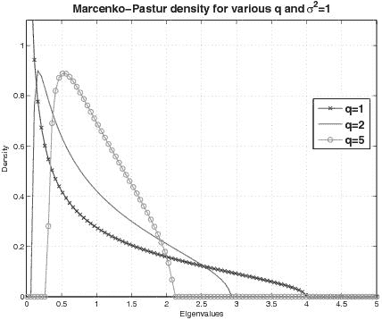

如图 2.7–2.9 所示，即使对于较小的矩阵，理论极限密度也能很好地逼近实际密度。在这三幅图中，比率 `q = T/N` 分别等于 5、2 和 1。

正如各项研究中所提到的，尽管密度具有肥尾特征，但 Marčenko–Pastur 密度是随机向量相关矩阵特征值密度的很好的近似。因此，问题在于如何选择显著特征值，然后确定模型的阶数或因子数量，并解释相应的特征向量。后者与观测数据有关，例如，有人指出，对应于最大特征值的特征向量代表了市场因子，因为它涵盖了收益率方差的大部分。其他特征向量可以像 [DAR 11] 中做的那样与市场中的观测时间序列进行比较。

**图 2.7.** 使用 i.i.d. 随机正态收益率通过 (`T = 5,000, N = 1,000`) 和 (`T = 500, N = 100`) 计算出的 `q = 5` 时 `SCM` 的特征值分布。相应的 Marčenko–Pastur 密度叠加在上。

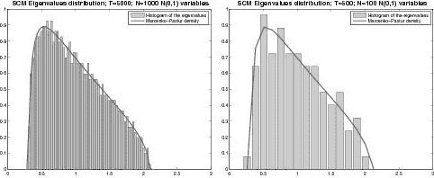

**图 2.8.** 使用 i.i.d. 随机正态收益率通过 (`T = 2,000, N = 1,000`) 和 (`T = 500, N = 250`) 计算出的 `q = 2` 时 `SCM` 的特征值分布。相应的 Marčenko–Pastur 密度叠加在上。

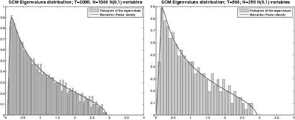

**图 2.9.** 使用 i.i.d. 随机正态收益率通过 (`T = 500, N = 500`) 和 (`T = 200, N = 200`) 计算出的 `q = 1` 时 `SCM` 的特征值分布。相应的 Marčenko–Pastur 密度叠加在上。

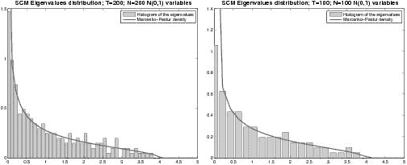

## 2.8 第 2 章重点

### 最佳因子模型

- Fama 和 French [FAM 93] 的三因子模型为 Sharpe 模型增加了两个额外因子：小市值 (`SMB`) 和高账面价值比率 (`HML`)。
- Carhart [CAR 97] 的四因子模型是 Fama 和 French 模型的扩展，增加了动量因子。
- Chen 等人 [CHE 86] 模型包含了几个解释美国股票收益的宏观因子。
- Fung 和 Hsieh [FUN 01] 的八因子模型旨在解释趋势跟踪对冲基金，包含了八个风险因子：投资于商品、债券和外汇的特定组合、两个股票型风险因子、两个债券型因子以及一个新兴股票指数。

### 样本估计

给定均值为 `μ` 协方差矩阵为 `Σ` 的 `T × N` 观测矩阵 `R`，`μ` 和 `Σ` 的一致无偏样本估计分别由：

```
μ_hat = (1/T) * Σ_{t=1}^T r_t
Σ_hat = (1/(T-1)) * Σ_{t=1}^T (r_t - μ_hat)(r_t - μ_hat)'
```

### Wishart 分布

Wishart 分布 `W_n(K, A)` 是 `Σ_{k=1}^K z_k * z_k'` 的分布，其中 `z_k` 服从均值为零协方差为 `A` 的高斯分布。

### M 估计

```
Σ_hat_M = (1/T) * Σ_{t=1}^T u(r_t' * Σ_hat_M^(-1) * r_t) * r_t * r_t'
```

### Huber M 估计

```
u(s) = -1, if s ≤ a²
     = -a²/s, if s > a²
```

### 固定点估计

```
Σ_hat_FP = (1/T) * Σ_{t=1}^T (r_t * r_t') / (r_t' * Σ_hat_FP^(-1) * r_t)
```

### 特征分解

```
Σ_z = U * Γ * U'
```

### 特征因子

```
F = U_K' * z
```

### Anderson 统计量

```
L(d) = (N - d) * ln( (1/(N-d)) * Σ_{i=d+1}^N λ_i / (Π_{i=d+1}^N λ_i)^(1/(N-d)) )
```

### 赤池信息准则

```
AIC(d) = -2 * ln(L(d)) + 2 * d
```

### 最小描述长度

```
MDL(d) = -ln(L(d)) + 0.5 * d * ln(T)
```

### 特征值遵循 Marčenko–Pastur 密度

当 `T → ∞` 且给定 `q = T/N ≥ 1` 时，`S` 的密度给出：

```
ρ(λ) = (1/(2πσ²qλ)) * sqrt((λ_max - λ)(λ - λ_min))
```


## 3.2 单位收益率因子模型

如果我们在大小为 `K + 1` 的向量 `g′[t] = [1 f[t,1] f[t,2] … f[t,K]]` 中聚合了 `K` 个因子 `f[t,k]`（1 ≤ `k` ≤ `K`），且其第一个分量等于 1，那么[方程 [3.1]](#c03.xhtml#eqn1) 可以被重写为更紧凑的形式，后文称为*单位收益率因子模型*或观测/测量方程：

[\[3.3\]](#c03.xhtml#eqn_3) 

（单位资产的）收益率 `r[t]`（用更通用的方式称为观测、测量或响应）是模型 [3.3] 的第一个输入。“因子” `g[t,k]`（0 ≤ `k` ≤ `K`，其中 `g[t,0] = 1`，`g[t,k] = f[t,k]` 对于 `k` ≠ 0）在线性回归框架中通常被称为回归变量，是单位资产模型的其他输入。

### 3.2.2 单位收益的 Alpha 和 Beta 估计

在本章中，假设 `K` 个因子 `f[t,k]`（1 ≤ `k` ≤ `K`）已通过选择。LSE（最小二乘法）和 KF（卡尔曼滤波）是众多方法，允许对给定的因子估计 `θ[t]`。这种估计表示为 `θ̂[t]`。

LSE 和 KF 有两个主要共同点：首先，它们共享相同的观测[方程 [3.3]](#c03.xhtml#eqn3)。其次，它们的优化准则和后续解可以用相似的方式进行解释，涉及特定的欧距离平方（“二阶”）。对于两者，几何意义有助于理解方法的工作原理以及如何推导出最优解。

LSE 和 KF 之间存在根本区别。得益于上述输入的“瞬时和递归处理”，KF 提供了一种递归估计 `θ̂[t|t]`，可以自然地表示为 `θ̂[t|t-1]` 的函数。与 KF 不同，LSE 的“跟踪能力”（*例如对冲基金等动态投资风格*）有限，因为它基于“块处理”且不产生递归估计。与瞬时处理相反，块处理需要访问多个（而不仅仅是一个）测量值和因子值来获得估计。

这些点在 3.3–7 节详细介绍了基于块处理的 LSE，3.8–12 节介绍了基于递归和瞬时处理的 KF。

# 3.3 LSE 设置

### 3.3.1 当前观测窗口和块处理

LSE 方法要求我们定义一个“当前观测”窗口，以限制块处理的时间索引。当前观测窗口表示为 `(t, h)`，其中 `t` 代表当前时刻（即窗口结束），`h` 是该窗口包含时刻数。我们有 `(t, h) = {l}`：`t − h + 1 ≤ l ≤ t`。我们将 `h` 称为窗口长度。

### 3.3.2 LSE 回归

由于 LSE 利用了响应 `r[l]` 和回归变量 `ĝ[l]`（`l ∈ (t, h)`）的块处理，LSE 隐式假设 Alpha 和 Beta 参数向量在观测窗口 `(t, h)` 上具有某个值 `θ[t,h]`。这允许根据[方程 [3.3]](#c03.xhtml#eqn3) 的所谓“LSE 回归”生成 `l ∈ (t, h)` 的测量值 `r[l]`：

[\[3.4\]](#c03.xhtml#eqn4) 

LSE 回归 [3.4] 可以以“块”的形式重写，因为它有助于定义 LSE 目标并推导其解：

[\[3.5\]](#c03.xhtml#eqn_5) 

在[方程 [3.5]](#c03.xhtml#eqn5) 中，我们有 `r[t,h]`、`G[t,h]` 和 `ε[t,h]`。LSE “块回归”聚合了 `h` 个收益过程 `r[l]` 实例。

**假设 3.1.** 假设窗口长度 `h` 远大于未知数量 `K + 1`，即 `h >> K + 1`，且 `[h, K + 1]` 矩阵 `G[t,h]` 是满秩的（等于 `K + 1`）。

# 3.4 LSE 目标和标准

LSE `θ̂[t,h]` 在所有可能的实值 `(K + 1)` 维向量 `ξ` 中实现了差异 `r[t,h] = G[t,h]ξ` 的欧范数平方 `||ε[t,h]||²` 最小：

[\[3.6\]](#c03.xhtml#eqn_6) 

项 `G[t,h]ξ` 可以被视为跨当前观测窗口 `(t, h)` 构建的响应向量 `r[t,h]` 的估计 `r̂[t,h]`。因此，如果我们表示 `g_k[t,h]` 1 ≤ k ≤ K+1，矩阵 `G[t,h]` 的 `K + 1` 个列向量（也称为列因子），项 `G[t,h]ξ` 可以重写为 `g_k[t,h]` 的线性组合，即：

[\[3.7\]](#c03.xhtml#eqn7) 

因此，正如 [3.6] 所定义的，LSE `θ̂[t,h]` 帮助我们构建 `g_k[t,h]` 的线性组合，在几何意义上最拟合测量值 `r[l]`。该解的几何解释在 3.6 节详细介绍。需要注意的是，LSE 优化标准并没有对解 `θ̂[t,h]` 任何限制，特别是 `θ̂[t,h]` 的幅度可能会很大，从而导致不可靠的响应 `r̂[t,h]`。在这种情况下，LSE 必须进行正则化（见第 4 章）。

# 3.5 LSE 如何工作（对于 LSE 用户和程序员）

如果 `G[t,h]` 是满秩的，那么 `G′[t,h]G[t,h]` 是可逆的，且 LSE 需要对整个观测窗口 `(t, h)` 进行块处理（见 [3.8] 的推导）。

根据 [3.8] 的显式形式，基于下一个观测窗口 `(t + 1, h)` 的计算需要经过整个块处理，即计算 `G′[t+1,h]G[t+1,h]` 和 `G′[t+1,h]r[t+1,h]` 这两个实体。后两个实体没有表现出任何递归属性，允许将 `θ̂[t+1,h]` 仅作为当前 LSE `θ̂[t,h]` 的函数。这实际上是 LSE 的一个主要局限性。

# 3.6 LSE 解的解释

### 3.6.1 偏差和方差

将 LSE 回归 [3.5] 代入 LSE 解 [3.8]，揭示了估计 `θ̂[t,h]` 与未知 `θ[t,h]` 之间的关系：

[\[3.9\]](#c03.xhtml#eqn_9) 

[方程 [3.9]](#c03.xhtml#eqn9) 证明是偏差和方差评估的关键。确实，根据 [3.9]，LSE `θ̂[t,h]` 的偏差 `B(θ̂[t,h])` 定义为零，因为观测噪声向量 `ε[t,h]` 为均值。这意味着平均而言，LSE 与真实参数重合。但偏差仅反映了 `θ̂[t,h]` 的一阶矩，随后显示了 LSE 质量的狭隘视角。

LSE 的可靠性还需要衡量其围绕真实值波动的幅度。如果 `θ̂[t,h]` 围绕 `θ[t,h]` 剧烈波动，那么 LSE 值 `θ̂[t,h]` 有很大概率远离 `θ[t,h]`，这使得 LSE 即使是无偏的也非常不可靠。创新向量的协方差矩阵 `S[t,h]` 有助于化这些波动。得益于 [3.9] 和观测噪声 `ε[t,h]` 的白性，其协方差矩阵等于 `σ²I_h`，我们有：

[\[3.10\]](#c03.xhtml#eqn_10) 

如果参数 `θ[t,h]` 是标量（一维），矩阵 `S[t,h]` 将与离散指标本身相等，即方差。此后，我们将 LSE `θ̂[t,h]` 围绕其平均值 `θ[t,h]` 的离散指数定义为 `S[t,h]` 的迹。强调的是，这个迹始终为正，因为 `S[t,h]` 是正定矩阵。记矩阵 `(G′ G)[t,h]` 的 `K` + 1 个（正）特征值为 `{λ^(i)[t,h] | 1 ≤ i ≤ K+1}`，并注意到迹也等于特征值的和，我们得到：

[\[3.11\]](#c03.xhtml#eqn_11) 

为了得到 [3.11]，可以使用矩阵逆的特征值等于特征值的倒数这一事实。等式 [3.9] 阐明了何时遇到真实值周围大离散的最坏情况。从 [3.9] 中可以直接得出 `tr[S[t,h]]` 的下界如下：

[\[3.12\]](#c03.xhtml#eqn_12) 

我们从 [3.12] 看到，如果 `(G′ G)[t,h]` 的最小特征值 `λ_min[t,h]` 相对于观测噪声方差 `σ²` 很小，LSE 在真实参数周围可能会表现出大离散。这可能发生在矩阵 `(G′ G)[t,h]` 虽然可逆但病态的情况下 `cond(G′G)[t,h] >> 1`。

### 3.6.2 LSE 的几何解释

如 3.4 节所述，项 `r̂[t,h]` 可以被视为收益或测量向量 `r[t,h]` 的 LSE `θ̂[t,h]`。与 3.4 节的解释一致，`r̂[t,h]` 代表列回归因子 `g_k[t,h]`（列因子）的线性组合，它们在几何和欧几里得意义上最拟合测量值（收益）`r[t,h]`。考虑到方程 3.8，我们有：

[\[3.13\]](#c03.xhtml#eqn_13) 

其中

[\[3.14\]](#c03.xhtml#eqn_14) 

矩阵 `Π_⊥,G[t,h]` 实际上是 `K` + 1 个列回归因子 `g_k[t,h]`（列因子）支撑空间的正交投影矩阵。事实上，很容易检查算子 `Π_G[t,h]` 将 `G[t,h]` 映射到自身，即 `Π_G[t,h]G[t,h] = G[t,h]`。该算子还满足投影算子的特性，即 `Π_G[t,h]² = Π_G[t,h]`。这有助于我们理解，根据 [3.13]，`r̂[t,h]` 的投影性质无非是收益向量 `r[t,h]` 在列因子空间 `col{G[t,h]}` 上的正交投影。在某种程度上，这种特征是预料之中的：LSE `θ̂[t,h]` 构建了 `r[t,h]` 的最佳几何和欧几里得近似，这是通过在“近似”空间（或时间窗口 `(t, h)` 的列因子空间）中对其进行正交投影实现的。该空间此后表示为 `col{G[t,h]}`，由矩阵 `G[t,h]` 的列支撑。图 3.1 从几何上说明了 `r̂[t,h]` 如何从 `r[t,h]` 获得。图 3.1 也说明了所谓的 LSE 原理。事实上，正交投影 `Π_G[t,h]` 的残差 `r[t,h] - r̂[t,h]` 正交于列因子空间。

## 3.7 LSE 解的推导

与方程 3.6 给出的问题描述一致，LSE 代价函数 `Ω[t,h](ξ)` 关于 `K` + 1 维实值向量 `ξ` 最小是差 `r[t,h] - G[t,h]ξ` 的平方欧几里得范数。我们有：

[\[3.21\]](#c03.xhtml#eqn_21) 

在正定矩阵 `(G′ G)[t,h]` 满秩（无消失特征值）的假设下，`Ω[t,h]` 是具有唯一最小值的凸函数。达到 `Ω[t,h]` 最小向量 `ξ^(op)` 因此是以下方程的解：

[\[3.22\]](#c03.xhtml#eqn_22) 

其中 `∇_ξ` 表示梯度向量算子，即 `∂/∂ξ`。直接计算得出：

[\[3.23\]](#c03.xhtml#eqn_23) 

将 [3.23] 等于 0，最终得到最优解 [3.8]。理解 LSE 代价函数在最优值附近的行为是很有趣的。二阶泰勒展开（由于最优性条件 [3.22]，一阶项为零）给出：

[\[3.24\]](#c03.xhtml#eqn_24) 

在 [3.24] 中 `H[t,h]` 表示 `K+1`、`K + 1` 海森矩阵，即 `∂²Ω/∂ξ²`。我们从 [3.22] 得到 `H[t,h] = 2 (G′G)[t,h]`。代入 [3.24] 得到：

[\[3.25\]](#c03.xhtml#eqn_25) 

由于 `H[t,h]` 当 `ξ` ≠ `ξ^(op)` 时正定且满秩，因此 `Ω[t,h](ξ) > Ω[t,h](ξ^(op))` 接近最优值。这证实了代价函数的凸曲率。

# 3.8 为什么选择 KF 以及哪种设置？

### 3.8.1 LSE 方法不提供递归估计

粗略而言（细节将在第 3.10 节介绍），LSE 和 KF 都利用与未知参数 `θ[t]` 连接的测量值 `r[t]`（见 [3.27]），根据最小平方距离准则找到其最佳估计 `θ̂[t]`。在限制在因子模型问题的范围内，`r[t]` 是任何资产的标量收益，`θ[t]` 是 `(K + 1)` 维列向量，收集了资产的 alpha 和暴露率（betas）（为了简单起见，去掉了指向资产的下标）。[3.27] 的另外两个部分与之前的部分相同。LSE 的一个问题是估计 `θ̂[t]` 缺乏递归性。我们所说的递归是指从上一个估计 `θ̂[t-1]` 显式更新新的估计 `θ̂[t]`。如 3.3.2 节所述，在滑动窗口 `(t, h)` 上运行 LSE 打开了一条允许实时更新估计的路径，但它本身并不是递归估计器。

估计的递归性具有优点。最重要的优势是估计及其准确性的跟踪能力。如果测量过程的主要驱动因素和真参数的演变从时间 `t − 1` 到时间 `t` 没有发生显著变化，那么新估计应该密切复制之前的估计，节省大量的处理负担。此外，如果真参数的新值和/或新的测量值与之前的情况偏离，则更新的估计应该立即反映这种变化。实时追踪，因此递归性在航空航天、自动监控和监测、汽车和火车控制、语音和图像（多媒体）处理 [FUK 90, BAR 93, KAY 93, DUV 94, KAY 98]、重症监护、计量经济学和定量金融等领域至关重要。

测量（方程 [3.27](#c03.xhtml#eqn27)）没有产生参数的递归性。因此，为了建立递归估计，KF 需要依赖一个驱动真参数演变的递归方程，而且该方程必须提前已知以便纳入估计推导中。估计的递归性将由未知真参数的递归性引起。这是 LSE 和 KF 设置之间的区别。

### 3.8.2 状态空间模型及其递归组件

该递归方程也称为状态方程，是微分方程的离散时间版本。它可以是“自然的”或“直观的”。如果是自然的，它来自著名的物理定律（力学、热力学、电磁学、光学等）和化学，这些定律通过微分方程描述了现象及其关键变量。我们邀请读者检查 [BAR 93, KAY 93, KAY 98, NOR 04] 中提供的许多示例。如果无法利用特定的定律，仍然可以对参数演变假设一个“直观的行为描述”，这是 KF 的基石。

#### KF 状态空间模型/设置

参数 `θ[t]` 的演变，状态递归方程：

[\[3.26\]](#c03.xhtml#eqn_26) 

测量–观测方程：

[\[3.27\]](#c03.xhtml#eqn27) 

没有特定的经济或金融定律可以产生 alpha 的递归方程。

[\[3.30\]](#c03.xhtml#eqn_30) 

[公式 [3.30]](#c03.xhtml#eqn30) 代表“创新性”（正交）属性：状态噪声的每次更新都为参数演化带来了纯粹的创新。如 3.11 节和 3.12 节所示，马尔可夫属性和创新属性共同驱动了卡尔曼滤波（KF）的架构。

# 3.10 KF 的目标是什么？


给定截至时间 `t` 的观测值 `{r[k], 1 ≤ k ≤ t}` 以及由[公式 [3.26]](#c03.xhtml#eqn26)和[公式 [3.27]](#c03.xhtml#eqn27)描述的状态空间设置（模型），KF 的目标是通过最小化均方误差（MSE），推导出不可观测状态或参数 `θ[t], t ≥ 1` 的*递归且线性*估计（关于线性性，请见后文的第二个和第三个注释）。`θ[t|q]` 的第二个下标 `q` 代表用于估计 `θ[t], t ≥ 1` 的观测空间 `R_t^q` 时间窗口的结束。如果问题限于 KF，则 `q = t`。对于本书未涉及的卡尔曼预测和平滑，我们分别会有 `q < t` 和 `q > t`。

### KF 目标

[公式 [3.31]](#c03.xhtml#eqn31) 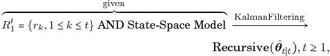

基于最小均方误差（MMSE）最优性准则：

[公式 [3.32]](#c03.xhtml#eqn32) 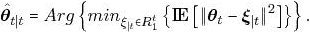

在[公式 [3.32]](#c03.xhtml#eqn32)中，`θ̂[t|t]` 表示由随机变量 `{r[1], …, r[t]}` 跨的观测空间 `R_t^1` 中的任何元素，MMSE 准则的几何和欧几里得解释请参见 3.14 节。

**注释 3.2.** 估计的递归性是由状态的递归[公式 [3.26]](#c03.xhtml#eqn26)和连续马尔可夫属性[公式 [3.29]](#c03.xhtml#eqn29)自然产生的。

**注释 3.3.** 为了简单以及方便初学者，我们将 KF 的目标设定为递归 MMSE 估计，从而将最优搜索限制在直观的“类距离”或类几何二阶准则（见 3.14 节）。几何路径跳过了基于条件概率密度的概率或贝叶斯呈现形式。概率推导需要冗长的介绍极大*后验*方法和正态条件概率 PDF 的详细属性，这将是以牺牲对 KF 结构、行为和性能的直观快速理解为代价的。

**注释 3.4.** 在概率（贝叶斯）方法和高斯假设下，估计相对于观测值和上一个估计的线性性是优化过程的结果。本章采用的基于 MMSE 的呈现需要说明估计的结构。此后限制在线性算子上，以便产生与概率推导完全相同的解。

# 3.11. KF 是如何工作的（针对用户和程序员）？

### 3.11.1. 算法摘要

3.10 节所述问题的解决在 3.14 节中详细介绍。此后，我们描述并解释 KF 解决方案的递归结构，这是 KF 用户和程序员都应该理解的。从时间 `t − 1` 到时间 `t`（`t ≥ 1`）的一个*完整递归 KF 步骤*包含两个部分。事实上，如图 3.2 所示，KF 完全步骤一方面更新（alphas 和 betas），从 `θ[t−1|t−1]` 到 `θ[t|t]`，另一方面更新相关的 KF“准确性”矩阵，从 `S[t−1|t−1]` 开始，被称为 *KF*(`n`/`q`) 创新，`ν[t]`。准确性矩阵无非当前 KF 创新的协方差矩阵。其动态范围的缩小跟踪了准确性的提高，从而使 KF 估计更接近目标参数 `θ[t]`。

**1) 初始化 `t = 0`**

KF 按照以下方式初始化：

[公式 [3.33]](#c03.xhtml#eqn33) 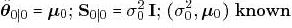

从时间 `t − 1` 到时间 `t`（`t ≥ 1`）：全递归处理分为 (1) 预测（称为先验更新）和 (2) 修正（称为后验更新），见图 3.2。

**2) 预测，从 (`t − 1|t − 1`) 到 (`t|t − 1`)**

预测是由递归状态模型[公式 [3.26]](#c03.xhtml#eqn26)驱动的 KF 唯一递归步骤。预测步骤分为预测滤波，计算新状态 `θ[t|t−1]` 来自上一个估计 `θ[t−1|t−1]`，以及预测准确性处理见[公式 [3.35]](#c03.xhtml#eqn35)，用于刷新准确性矩阵。

**3) 修正，从 (`t|t − 1`) 到 (`t|t`)**

修正由更新的观测值 `r[t]` 触发（见图 3.2）。在计算所谓的卡尔曼增益后（见[公式 [3.36]](#c03.xhtml#eqn36)），修正子步骤计算 `θ[t|t]`[公式 [3.37]](#c03.xhtml#eqn37)。修正准确性处理评估 `S[t|t]`。

### 3.11.2. KF 递归方程的初始化

与需要选择初始值的算法类似，估计准确性和算法收敛速度之间存在权衡。取决于初始值，递归算法将更快或更慢地收敛到真实值。

如[公式 [3.33]](#c03.xhtml#eqn33)所示，状态空间模型的参数需要初始化。向量 `θ[0|0]` 的初始值必须根据问题的知识以及该向量代表的内容进行设置。在因子模型的情况下，`θ` 代表投资组合对某些市场因子的暴露，因此其值大多在 -1 到 +1 之间。因此，将 `θ[0|0]` 初始化为零是非常合理的。

估计误差方差的初始值也与 `θ` 相关，且不应太小：如果是这样，卡尔曼增益也将很小，对于[方程 [3.37]](#c03.xhtml#eqn37)，`θ[t|t]` 的修正值将保持接近预测值 `θ[t|t−1]`。那么，如果 `θ` 的真实值不接近初始值，该算法将永远无法达到这些真实值，因为它始终会提议某些接近初始值的值。

此外，如果 `S[0|0]` 被初始化为一个过大的值，那么该算法收敛到真实值的速度将比将 `S[0|0]` 设置为更合适的值时要慢。

在我们的情况下，我们可以将 `S[0|0]` 设置为 1 或 1.5，因为我们希望从 0 达到潜在值范围的最低和最高边界（−1 和 +1）。

状态空间模型的另外两个参数 `Q` 和 `R` 应该是已知的。观测方程的方差 `R` 代表了模型所产生的误差幅度，因此它可以设置为观测收益方差的比例。方差 `Q` 影响预测精度处理[公式 [3.35]](#c03.xhtml#eqn35)，而且必须与状态变量的幅度和假设的变异性保持一致。

# 3.12. KF 更新的解释

所有的预测和修正更新方程都将在 3.14 节中基于简单的“几何和欧几里得方法”进行推导。之后，我们将对其中每一个方程给出直观的解释。这些定性原理在编程和/或使用 KF 时非常有用，特别是用于监控性能和调整 KF 输入。

## 3.12.1. 预测滤波，方程 [3.34]](#c03.xhtml#eqn34)

[方程 [3.34]](#c03.xhtml#eqn34) 基于 `θ[t−1|t−1]` 预测估计 `θ[t|t−1]`。根据第 3.10 节引入的符号，两个估计 `θ[t|t−1]` 和 `θ[t−1|t−1]` 都基于观测集中直到时间 `t − 1` 的相同测量（收益）样本，即 `R_t^1`。根据状态递归[方程 [3.26]](#c03.xhtml#eqn26)，`θ[t]` 和 `θ[t−1]` 之间的唯一区别是状态噪声 `w[t]`，由于“创新属性”（见第 3.9 节），它在统计学上与 `θ[t−1]` 是正交的（不相关）。此外，根据假设，`w[t]` 与观测噪声 `e[t]` 不相关。这意味着 `w[t]` 在统计上与测量集 `R_t^1` 正交。因此，`R_t^1` 中包含的任何样本都对 `w[t]` 的估计没有贡献。因此，在切换到 `θ[t|t−1]` 时，没有理由改变估计 `θ[t−1|t−1]`。

## 3.12.2. 预测精度处理，方程 [3.35]](#c03.xhtml#eqn35)

正如本节开头定义的，`S[n|q]` 是一个协方差矩阵，且因此是半正定的。为了解释的流畅性，我们假设 `S[n|q]` 是满秩的（其特征值全大于零）。因此，`S[t|t−1]` 的倒值是正定的。`S[t|t−1]` 的迹也是正的，这意味着 `S[t|t−1]` 的特征值都是正的。事实上，`S[n|q]` 的值越小，精度越高。如果 `S[n|q]` 为零，精度将变为无穷。考虑到 `S[n|q]` 倒值的迹等于其特征值的和，从方程 [3.35] 很容易推导出以下关系：

```
[3.38] 
```

[方程 [3.34]](#c03.xhtml#eqn34) 和 [3.39] 意味着预测步骤减少了误差，因为 `w[t]`（[方程 [3.26]](#c03.xhtml#eqn26)）在统计上是正交的。这并不令人意料：在预测步骤 `θ[t|t−1]` 没有发生变化，而之前的状态 `θ[t−1]` 经历了加性状态噪声。精度仅在修正步骤中受益于新的测量值 `r[t]`。

## 3.12.3. 修正滤波，方程 [3.36]–[3.37]](#c03.xhtml#eqn37)

通过注意方程 [3.37]](#c03.xhtml#eqn37) 中的 `H θ[t|t−1]` 是对当前测量 `r[t]` 的真实估计 `r[t|t−1]`，我们开始解释修正更新。因此，`ν[t] = r[t] − r[t|t−1]` 等于 `r[t] − H θ[t|t−1]` 是一个误差信号，后文中称为当前测量（收益）创新。此外，`ν[t]` 这种差值也可以被看作是观测噪声 `e[t]` 的估计。最后，我们得到了以下等式链，这对于理解方程 [3.37]](#c03.xhtml#eqn37) 的不同方面非常有意义：

```
[3.40] 
```

将上述等式中的第一个代入 [3.37]](#c03.xhtml#eqn37)，可以得到修正 KF 更新的简单形式：

```
[3.41] 
```

[方程 [3.37]](#c03.xhtml#eqn37) 和其更简洁的版本 [3.41] 清晰地表示了修正更新（即 `t|t−1 → t|t`）通过卡尔曼增益 `z[t]` 平衡了预测估计 `θ[t|t−1]`（基于预测滤波）的权重与测量（收益）估计误差（创新）`ν[t]` 的权重。根据方程 [3.36]](#c03.xhtml#eqn36)，对于给定的协方差矩阵 `S[t|t−1]`，当观测噪声方差 `R` 增加时，卡尔曼增益范数：

```
[3.42] 
```

减少，随后降低了最终更新中测量（收益）创新的权重 `z[t] ν[t]`。这种对纠正过程的自我调节实际上是符合预期的。当观测噪声很大时，测量估计是不可靠的，在整个更新过程中应该忽略相关的误差，以防止对当前估计的进一步污染。当对于给定的 `R`，协方差矩阵 `S[t|t−1]` 变得“小”（例如接近零矩阵）时，卡尔曼增益范数也会大幅降低。在这种情况下，由于滤波器已经收敛于解，增益消失，任何新的测量都不会显著提高估计。在后一种情况下，KF 的可靠性主要取决于预测分量 `θ[t|t−1]`

相反，当观测噪声的方差 `R` 降低时，更新 [3.37] 中的测量部分变得更加可靠，因此应该被更加强调，卡尔曼增益范数 [3.42] 随之增加正是这种情况。

## 3.12.4 修正精度处理，公式 [3.38]](#c03.xhtml#eqn38)

为了解释公式 [3.38] 中包含的精度更新，将卡尔曼增益替换为由公式 [3.36] 给出的显式形式是合适的。这样做，公式 [3.38] 变为：

[公式 [3.43]](#c03.xhtml#eqn43) 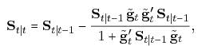

带有 `S[t|t−1]`此外（为了简单起见，假设矩阵 `S[t|t−1]` 是满秩），矩阵逆引理（见附录 3.16）产生：

[公式 [3.44]](#c03.xhtml#eqn44) 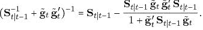

结合 [3.43]、[3.44] 和 [3.45] 得到以下更新链：

[公式 [3.45]](#c03.xhtml#eqn45) 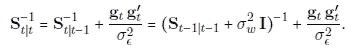

公式 [3.45] 在精度的程度方面很容易解释。事实上，公式 [3.38] 以及随后的 [3.45] 意味着修正步骤总是相对于预测步骤提高精度，因为 [3.45] 意味着：

[公式 [3.46]](#c03.xhtml#eqn46) 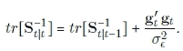

递归 [3.46] 显然意味着 `S[t|t] ≤ S[t|t−1]`修正步骤总是增加精度程度，只要量 `H^T R^−1 H` 足够大。这个可以被视为测量“因子与观测噪声比”的实体在观测噪声方差 `R` 急剧增加时变得微不足道，从而显著限制了精度增益。更新 [3.45] 的另一个优点来自于协方差矩阵逆的正定的“数值”传播 `S^−1[t|t]`。事实上，我们从 [3.45] 推导出，无论非零向量 `u` 是什么：

[公式 [3.47]](#c03.xhtml#eqn47) 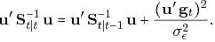

等式 [3.47] 导致：

[公式 [3.48]](#c03.xhtml#eqn48) 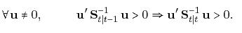

# 3.13 实践

本节是本章的应用部分。我们将研究三个不同的案例：

(1) 一个玩具示例，其中合成观测收益类似于两个观测已知因子（标普 500 指数和美国 10 年期债券）的线性组合；(2) 一个用于准确对冲特定投资组合系统风险的单因子模型（第 3.13.2 节），然后 (3) 一个用于分析和分解 Fung 和 Hsieh [FUN 01] 定义的趋势跟踪对冲基金对多种市场风险敞口的多因子模型（第 3.13.3 节）。

## 3.13.1 合成数据上的估计方法比较

### 3.13.1.1 数据描述

在这个示例中，我们根据 1997 年 9 月 10 日至 2012 年 12 月 19 日期间（约 15 年，`T = 3,986` 个每日数据），使用两个市场因子和考虑了 beta 的给定理论参数 `w[t]` 生成合成观测收益 `r[t]`。两个市场因子是：

– 微标普 500 指数第一个通用期货的每日收益，记为 `r_SP[t]`；– 美国 10 年期国债第一个通用期货的每日收益，记为 `r_US[t]`。

分段常数参数的估计结果所示图 3.6。总的来说，SW-OLS 和 KF 对参数 `w[t]` 的变化反应相当良好。需要注意的是，KF 的估计方差低于 SW-OLS，特别是当 SW-OLS 使用较小的窗口长度时。此外，正如预期的那样，SW-OLS 的估计值比 KF 的估计值更具滞后。

**图 3.6。** *对于方程 [3.51] 的合成和噪声收益率，SW-OLS (`h` = 21, 126, 252) 与 KF 的对比，该方程具有如 [3.52] 中定义的分段常数参数 `w[t]`（参见彩色版章节）*

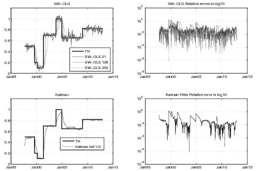

在实践中，投资组合经理不会如此剧烈地调整其组合。这种情况虽然是极端的，但凸显了 KF 在动态环境中的跟踪能力。它证实了人们对这类滤波技术的日益增长的兴趣，用于动态对冲投资组合，或估计对冲收益中的非线性和动态风险敞口。

下一个示例侧重于单因子模型，该模型用于对一个真实管理的多头印度股票组合进行动态对冲。目标是准确估计该管理组合相对于基准指数（Nifty 指数）的敞口。

## 3.13.2 基于单因子模型的市场风险对冲

让我们在本节中假设观测到的收益率 `r[t]` 是多头股票组合的收益率。投资组合经理选择一部分股票进行投资，并根据他/她自己的市场直觉或投资委员会的决定来定义配置。

多头股票组合的构建和管理通常是为了优于给定的股票指数，这通常会导致组合收益率与股票指数本身之间存在很强的历史相关性。此类投资的预期是提供比股票指数收益更高的表现，这可能归于经理选择股票的能力，这些股票能够带来优于基准收益的某些 `α`。

鉴于这种设定，我们可以观察到市场风险完全没有被对冲。多头策略并不预期会对市场中出现的任何风险进行对冲，而只是提供比给定基准更好的表现。

在必须对冲市场风险的情况下，我们必须回答：“投资组合对市场的依赖程度有多少？”

正如因子模型所解释的，如果存在单一的市场风险（基准股票指数），则可以使用单因子模型将组合收益率与市场联系起来：


其中`α[t]`是随时间变化的“Alpha”，`β[t]`是投资组合对单因子`f[t]`随时间变化的敞口，且`f[t]`具有前一节描述的属性。

在这一应用中，多头股票组合的收益率是由资产经理管理的印度股票组合的收益率。经理根据自由裁量方法，基于对公司资产负债表相关的基本数字进行深度分析以及一系列财务比率来选择部分股票。所选的名称主要是增长型公司，经理坚信这些公司被低估了并且具有高水平的未来增长。每只股票在组合中都会保留一段时间，从一个月到几个月不等。组合包含15到30只股票。该组合的净资产值（`NAV`）所示图3.7，其中设置的初始值为1000。收益已扣除所有费用（包括交易成本、管理费和绩效费），不包含任何现金。在图3.7中，也报告了BSE200指数的`NAV`。BSE200指数是由印度股票市场市值最大的200只股票组成的指数。

**图3.7。**多头印度股票组合价格及两个参考指数：BSE200指数和Nifty指数

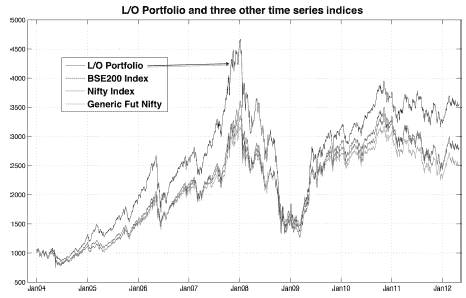

印度股票市场非常特殊：即使BSE200指数每日报价，但没有该指数的期货合约报价。只有最小Nifty指数的期货合约在交易，因此即使选择BSE200指数作为投资组合表现的基准参考，也不可能通过做空BSE200指数的期货合约来对冲组合。因此，单因子`f`是Nifty指数，用于计算模型参数的时间序列是通用Nifty指数期货的时间序列，这是一个经过展期调整的时间序列。

对冲程序呈现如下：

- 在每个计算时间`t`，使用方法M估计参数`α[t]`和`β[t]`，如有必要，使用固定窗口长度。
- 随后将估计的`β[t]`值用作反映组合过去收益率与因子过去收益率之间线性关系的参数：给定在`t`时对于`[t, t + 1]`期间需要对冲的组合的比例，我们将调整之前的做空期货合约数量`q[t-1,t]`。
- 在`t`时要做空的期货合约数量在`[t, t + 1]`范围内由`q[t,t+1] = Round(...)`给出，在此方程中，`Round()`将值取整为整数，`NAV[t]`表示`t`时的组合`NAV`，而`CV[t]`表示`t`期货合约的价值，等于其价格乘以该合约的一个点。

对冲程序在下文中所示：

取决于用于估计`β`值的方法，产生的对冲组合将具有不同的行为，考虑到估计可能是滞后的、动态的或带有离群值的。

**图3.8。**多头组合对所选市场因子Nifty期货估计敞口的对比：a)代表beta的动态估计，b)和c)展示了在使用`RKF`或`rgKF-1`（见第4节）时的估计峰值

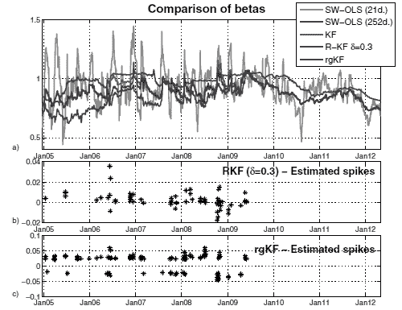

结果如图图3.10所示，并比较了通过比例Nifty指数期货进行对冲的纯多印度股票组合的净资产价值（NAV），这些期货价值由常数系数`OLS`、63天`SW-OLS`、`KF`、`RKF`或`rgKF`决定——详细介绍请参见第4章。

从实践角度来看，`KFs`更为受欢迎，因为它能够对参数进行动态估计。在时间`t`时，对过去的唯一认知被完全总结在`t − 1`时给出的上组信息中，且无需指定任何窗口长度。此外，`KF`的方程引入了模型参数的动态演化，这为我们实际不了解的事物提供了一些`a priori`（先验）信息。

图3.10.通过比例nifty指数期货进行对冲的纯多印度股票组合的净资产价值，其计算方法分别为：(1)整个期间的`OLS`，(2)窗口期为3个月的`SW-OLS`，(3)卡尔曼滤波（`KF`），(4)鲁棒卡尔曼滤波（`RKF`）以及(5)过滤掉异常值的卡尔曼滤波正则版本。经典的`KF`及其各种版本与组合对冲成本相比，似乎更为准确。

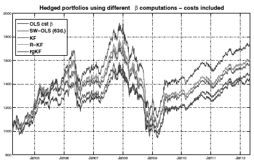

图3.10显示了`RKF`和`rgKF`的结果。`KF`方程假设状态和观测误差服从条件高斯分布，这在存在异常值时会失效。这些版本的`KF`考虑了观测方程中的异常值，`KF`递归方程经过正则化，因此对异常值具有鲁棒性。这些方法将在第4章介绍。

### 3.13.3 使用多因子模型的对冲基金分析

对冲基金（`HF`）行业的风险分析受到了关注，因为人们注意到，根据构造并公认`HF`收益具有非常特定的特征，例如肥尾和非对称分布、类期权收益以及动态风险敞口。

使用多因子模型允许我们通过一组被选为非线性相关的变量来分解观测收益，并带来多维度的见解。选择合适因子的粗略任务已在第2章讨论过。在该示例中，我们关注估计方法，并使用了八个Fung和Hsieh风险因子`[HSI]`。

#### 3.13.3.1 Fung和Hsieh风险因子

第2章描述的Fung和Hsieh的八个风险因子`[HSI]`以1994年1月至2012年12月的每月数据为频率，包括：

- 三个`趋势`风险因子：`PTFSBD`（基于债券的风险因子）、`PTFSFX`（基于货币的风险因子）和`PTFSCOM`（基于商品的风险因子）；
- 两个`股票型`风险因子：`SP500`（标准普尔500指数）和`EquitySizeSpread`（规模差异因子，表示为罗素2000指数每月总收益与`SP500`收益之间的差值）；
- 两个`债券型`风险因子：`bond10y`（10年期国债期限收益率的每月变化）和`CreditSpread`（穆迪Baa级收益率每月变化与`bond10y`之间的差值）；
- 一个`新兴市场`风险因子：`MXEF`（摩根士丹利国际新兴市场指数）。

这些因子存储在每个时间`t`的`f[t]`中，作为`[1.4]`的输入。

#### 3.13.3.2 对冲基金数据

Fung和Hsieh的八个风险因子最初是为了解释趋势跟踪型基金，因此我们选择了`方向性`对冲基金，例如`全球宏观`对冲基金。全球宏观对冲基金经理可能在货币、债务、股票或商品上采取方向性头寸，也可能选择结合`多头`与`空头`相互对冲的`相对价值`头寸。

我们说明了不同估计方法在一个名为Aequam Diversified Fund的趋势跟踪对冲基金上的表现，该基金自2010年12月17日起由Aequam Capital管理。该基金是一个系统的`HF`，对债券期货、股票指数期货、外汇期货和商品期货进行多头和空头操作。该基金自2012年6月起是一个UCITS IV基金，是一个每周审计的基金，管理资产规模（`AUM`）约为2000万美元。尽管该基金于2010年开放，但我们可以获取其自2004年以来的历史和回测表现。系统基金具有这种特殊性：回测表现是可靠的，因为商品交易顾问（`CTA`）和系统基金运行的设计流程与基金投入后运行的流程完全相同。此外，管理期货为基金提供了高流动性。

表3.2给出了八个风险因子以及Aequam Diversified Fund的基本统计数据。这些统计数据是使用每月（月末到）收益计算的。图3.11展示了以2003年12月的100为基准，Fung和Hsieh的八个风险因子以及Aequam Diversified Fund的演变情况。

#### 3.13.3.3 估计方法

在本节中我们比较了分别使用24个月的`SW-OLS`、`KF`和`rgKF`对Aequam Diversified Fund进行估计的结果。图3.12显示了该`HF`使用Fung和Hsieh因子的跟踪性能。`SW-OLS`、`KF`和`rgKF`实现了几乎相同的性能，而`SW-OLS`与观测时间序列相差甚远。

图3.13–3.15显示了分别使用24个月窗口的`SW-OLS`、`KF`和`rgKF`对Aequam Diversified Fund估计的随时间变化的敞口。

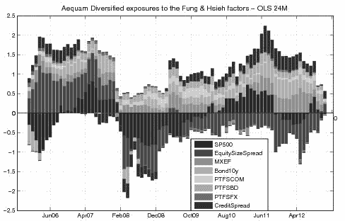

通过此示例获得的结果与该基金的管理风格一致：动态但平滑的敞口，以及与实际持位一致的敞口。作为下一章的初步结果，Aequam多元基金（Aequam Diversified Fund）似乎没有出现流动性问题或极端特定事件，因为`KF`和`rgKF`的结果相一致（未检测到异常值）。

**图3.14。**Aequam多元基金对Fung和Hsieh的八个风险因素的估计`KF`敞口（见彩色版部分）

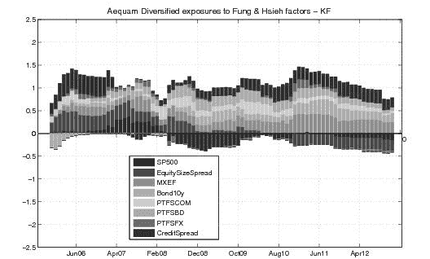

**图3.15。**Aequam多元基金对Fung和Hsieh的八个风险因素的估计`rgKF`敞口（见彩色版部分）

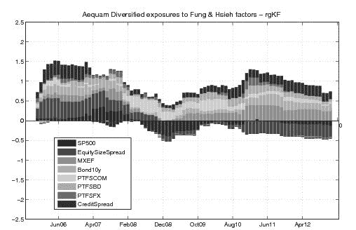

# 3.14. KF更新方程的几何推导

## 3.14.1. MSE准则与MMSE求解的几何解释

关于`KF`的介绍和推导在论文和书中随处可见。在本介绍章节，我们没有遵循依赖条件概率密度的概率或贝叶斯方法（这种方法通常会让想理解`KF`更新来源的初学者望而却步），而是建立了一个`KF`的完整几何基础，这更接近直觉和欧几里得知识，也是大多数研究生读者的共同常识。

为此，第一步是对问题陈述`[3.32]`和`t`−1时的`MMSE`准则给出几何解释。事实上，第3.11节给出的`KF`更新取决于`t`−1时的之前的估计值。

在图3.16中，平面代表观测空间，由随机变量{`r[1]`, …, `r[t]^(−1)`}跨越。任何向量元素都与线性相关，并由属于平面的虚箭头表示。通常，`t`−1时的状态`θ[t−1]`不属于观测平面，因此包含了一部分与随机变量{`r[1]`, …, `r[t−1]`}不相关（在统计上正交）的统计信息。

`MSE`，即，从几何上看可以看作图3.16中用虚线画的“差向量”的欧几里得范数平方，即。因此，最小的`MSE`与的最小几何平方范数相关，当元素`ξ[|t−1]`与`θ[t−1]`在观测平面上的正交投影重合时，如图3.16所示：

[[3.53]](#c03.xhtml#eqn_53)

**图3.16。**MMSE估计的几何解释


正交投影意味着向量实现了最小范数，且与观测平面正交，这意味着与随机变量{`r[1]`, …, `r[t]`}正交。

总结来说，`MSE`的可以看作是观测平面上`θ[t−1]`的正交投影`ξ[|t−1]`重合时实现的的最小几何平方范数。因此，最小的`MSE`对应于：

`MSE`准则在图3.16中的解释以及`[3.53]`是`KF`更新的关键要素。

## 3.14.2. 预测更新的推导

在本节中，我们推导了34。

**图3.17。**预测滤波插图

## 3.14.3. 预测更新的推导

在本节中，我们推导了35。

`56`](#c03.xhtml#56)

此外，`[30]`和`[56]`加上两个不相关向量和的协方差矩阵等于协方差矩阵之和，这完成了`[35]`的证明。

## 3.14.4. 修正滤波更新的推导

在本节中，我们同时推导了36和37。

### 3.14.4.1. 观测集的更新

修正滤波利用新的观测值`r[t]`，因此涉及到对扩大（更新后的）观测集的正交投影（见第3.14.1节）。由于`r[t]`不一定与之前的观测集正交，因此对的正交投影并不等于与`r[t]`投影之和（如果投影是在正交化的扩大观测集上操作，情况将会如此）。然而，修正滤波更新要求用用来表示。这通过“正交化”扩大观测集是可能的。

### 3.14.4.2. 更新观测集的正交分解

正交化扩大后的集包括将新的观测值`r[t]`分解为一个属于的分量和一个正交残差。这种正交分解可以直接从第3.14.1节描述的几何解释中推导出。

3.57

其中，根据构造，此外，状态空间模型的观测组件`[3.27]`允许我们写出：

[3.58]

投影算子的线性性质、`images`(img/e.gif)`t`与

最后，我们可以写出更新后的测量集被分为和新的测量创新，后者在构造上与正交：

3.60

在`[3.60]`中，符号`⊕`代表正交分解。

### 3.14.4.3. 基于新测量`r[t]`对预测估计值进行修正

从正交投影的角度来看，等式`[3.60]`有助于将`θ[t]`的投影划分到扩展的测量（返回）集中，使得：3.61

与图3.16中描述的不同估计值的几何解释保持一致，方程3.61可以重写，将新估计值表示为“预测估计值”加上由于新观测`r[t]`产生的“修正项”：

[3.62

修正项等于`Proj`，必须显式求值以获得`[3.36]`和`[3.37]`。图3.18从几何上说明了等式`[3.62]`。

图3.18.预测估计值由于新测量`r[t]`所经历的修正更新几何图，另参见方程3.59和3.62


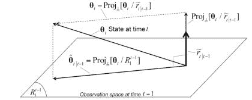

### 3.14.4.4. 修正组件 Proj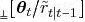 的评估

像任何投影一样，如图 3.18 所示，`θ``t`*在测量创新 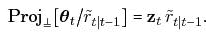

注意到，根据构造并与图 3.18 一致，“差异” 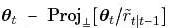在统计上与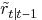正交，这允许我们推导出 `z`[`t`*的显式形式。事实上，统计正交性的定义结合[3.63]，得出了以下链：

[3.64] 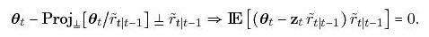

链[3.64]直接引向：

3.65 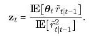

考虑到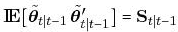以及方程 3.59 与*`t`*之间的正交性，这帮助我们写出 `z`[`t`*的分母为：

[3.66 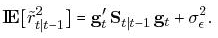

根据方程 3.60 和图 3.18，我们有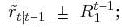，因此，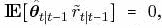结合[3.55]允许我们写出 `z`[`t`* [3.36]的不同分子形式为：

3.67 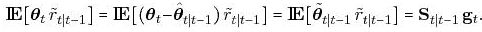

最后，方程 3.63 和 3.65–3.67 给出：

[3.68] 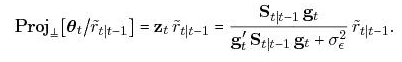

### 3.14.4.5. 修正滤波更新，3.36 和 3.37

我们从[3.59]、[3.62]和[3.68]推导出由于捕捉新测量 `r`[`t`*的修正滤波更新：

[3.69] 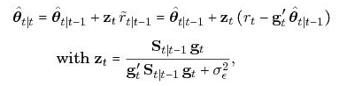

这与[3.36]和[3.37]一致，注意到 `z``t`*就是卡尔曼增益。

## 3.14.5. 修正精度的推导

在本节中推导方程 [3.38。从链[3.69]的第一个等式，我们有：

[3.70] 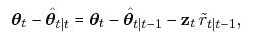

结合[3.59]和创新的定义 ，意味着：

[3.71] 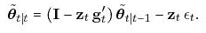

此外，由于正交性原理（即成立以下等式：

[3.72] 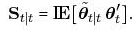

将[3.71]代入[3.72]以及的事实，得到：

[3.73] 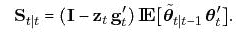

最后等式为：

[3.74] 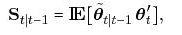

同样由于正交性原理(，参见图 3.17，将方程 3.38 转换为[3.73]，完成了其证明。

# 3.15. 要点

本节概述了涉及 LSE 和 KF 的章节中最重要的结果。

### 最小二法估计 (LSE)

LSE 隐含假设收益、因子、alpha 和 beta 之间存在线性回归，跨越特定的观测窗口 (t, h) = {l，使得 t – h + 1 ≤ l ≤ t}；这种回归称为 LSE“块”测量方程，如下：

3.75 

LSE 块回归的输入是：窗口内一个特定收益的值 以及包含在[h, K + 1]“因子矩阵”中的因子 ，带有。因子也被称为回归变量。LSE 回归的未知数或参数是假设在窗口内为常数的 alpha 和 beta。它们填充了列向量 `θ`[`t`,*h]`，其中`θ'`[`t`,*h]` = 。LSE 回归的残差为`ε`[`t`,*h]`，其带有。

LSE 最小化了测量（收益）向量 `r`[`t`,*h]`与其基于因子的线性近似（即 G[`t`,*h]` `ξ`）之间的差异（凸）平方欧几范数。假设[h, K + 1]矩阵 G[`t`,*h]`是满秩的，LSE 解是唯一的，我们有：

[3.76] 

LSE 是`θ`[`t`,*h]`的无偏估计，但当矩阵(G′ G)[[`t`,*h]`病态时，其方差可能会变得很大。这发生在其最小特征值变得太小时。在后一种情况下，LSE 必须进行“正则化”以限制的大小（该主题在第 4 章讨论）。

KF 结构具有两个启用特征，这些特征自然地导致了对参数向量 `θ`[`t*]`（其分量为 alpha 和 betas）的递归估计 。这两个关键特性在 LSE 模型中是欠缺的。

首先，与 LSE 不同，KF 结构利用了“瞬时”测量方程（涉及收益率、因子、alpha 和 betas）。KF 不需要像 LSE 那样对数据进行窗口处理：`LSE` [方程 \[3.75\]](#c03.xhtml#eqn75) 是块方程而不是瞬时测量方程。事实上，KF 观测（收益率）方程采用以下“瞬时”形式：

```
[\[3.77\]](#c03.xhtml#eqn_77) 
```

带有 和 。其次，KF 结构依赖于一个驱动 `θ`[`t*]` 动态演化的递归方程。这被称为状态递归方程（`θ`[`t*]` 是前一个值 `θ`[`t*−1]` 的函数）。LSE 模型中不存在的递归方程可以从物理学、计量经济学、金融学等定律推导出，也可以直观地假设。在后一种常见的情况下，其形式必须是简洁的。简单的直观“状态递归”方程如下：

```
[\[3.78\]](#c03.xhtml#eqn_78) 
```

其中 `w`[`t*]` 是零均值白高斯噪声。上述递归参数（即 alpha 和 betas）方程意味着时间 `t` 时刻参数的新“状态”等于时间 `t - 1` 的前一个“状态”加上另一个分量，即状态噪声 `w`[`t*]`，它在统计上正交（不相关）于前一个状态 `w`[`t*]` `θ`−1。鉴于 alpha 和 betas 的递归演化方程 \[3.78\] 以及遵循观测方程 \[3.77\]](#c03.xhtml#eqn75) 的收益率集合 ，KF 提供了一个递归（且线性）估计 ，它可以最小化 MSE（IE 表示期望值）。向量 `ξ`[`t]` 属于由收益率 {`r`[`k*]`，1 ≤ `k` ≤ `t`} 形成的空间 。由于 MSE 被视为特殊欧几里得范数的平方，KF 的优化准则与 LSE 欧几里得指标具有相同的（自然）几何解释。

（注：此处省略了重复内容）

### 卡尔曼滤波

KF 的优化准则与 LSE 欧几里得指标具有相同的（自然）几何解释，由于 MSE 被视为特殊欧几里得范数的平方 

### 卡尔曼滤波与更新

KF 提供更新 ，它可以最小化 MSE（IE 表示期望值）。

向量 `ξ`[`t]` 属于由收益率 {`r`[`k*]`，1 ≤ `k` ≤ `t`} 形成的空间 。由于 MSE 被视为特殊欧几里得范数的平方，KF 的优化准则与 LSE 欧几里得指标具有相同的（自然）几何解释 

### 过滤

 它在统计上正交（不相关）于前一个状态 `w`[`t*]` `θ`[`t*−1]`

### 过滤与更新

MSE 被视为特殊欧几里得范数的平方 

### 过滤与更新

KF 提供更新 ，它可以最小化 MSE（IE 表示期望值）。

向量 `ξ`[`t]` 属于由收益率 {`r`[`k*]`，1 ≤ `k` ≤ `t`} 形成的空间 。由于 MSE 被视为特殊欧几里得范数的平方，KF 的优化准则与 LSE 欧几里得指标具有相同的（自然）几何解释 

### 过滤与更新

KF 提供更新 


MSE 被视为特殊欧几里得范数的平方 

### 过滤与更新

`w`[`t*]` 在统计上正交（不相关）于前一个状态 `w`[`t*−1]`。

### 过滤与更新

KF 提供更新 ，它可以最小化 MSE（IE 表示期望值）。

### 过滤与更新

MSE 被视为特殊欧几里得范数的平方 

### 过滤与更新

`w`[`t*]` 是零均值白高斯噪声。

### 过滤与更新

递归参数（即 alpha 和 betas）方程意味着时间 `t` 时刻参数的新“状态”等于时间 `t - 1` 的前一个“状态”加上另一个分量，即状态噪声 `w`[`t*]`，它在统计上正交（不相关）于前一个状态 `w`[`t*]` `θ`[`t*−1]`。

### 过滤与更新

KF 提供更新 ，它可以最小化 MSE（IE 表示期望值）。

向量 `ξ`[`t]` 属于由收益率 {`r`[`k*]`，1 ≤ `k` ≤ `t`} 形成的空间 。由于 MSE 被视为特殊欧几里得范数的平方，KF 的优化准则与 LSE 欧几里得指标具有相同的（自然）几何解释 

### 过滤与更新

MSE 被视为特殊欧几里得范数的平方 

### 过滤与更新

KF 提供更新 ，它可以最小化 MSE（IE 表示期望值）。

### 过滤与更新

MSE 被视为特殊欧几里得范数的平方 

在跟踪或估计未观测过程的框架下（通常用 `KF` 或其扩展方法来求解），例如外生离群点被称为`加性离群点`（或 `AOs`） [FOX 72, RUC 10]，并发生在观测值中。可能影响状态方程创新的内生离群点被称为`新颖离群点`（或 `IOs`），它们超出了本书的讨论范围。递归最小二法可以通过对 `KF` 递归方程中的新颖误差应用 `Huber` 权重函数 [MAR 06] 来处理 `AOs`。我们还可以通过引入 `l¹` 或或 `l²` 正则化项来对 `KF` 进行惩罚。正则化通常能提供良好的结果，但需要确定引入的用于限制解的幅值的正则化参数。寻找最优正则化参数没有理想的解决方案，且每种现有方法（例如交叉验证、广义交叉验证 [CRA 79]、最大*后验*估计 [PAN 11]、伯努利-高斯假设或马尔可夫链蒙特卡洛 (MCMC) 方法 [AND 97]）都与研究的问题有关。正则化广泛应用于统计信号处理（例如基底追求、压缩感知、信号恢复和小波阈值处理）、统计学中的岭回归和最小绝对收缩与选择算子 (LASSO) 算法或融合 LASSO [TIB 96]，在在线码解码或地球物理问题中也非常有用。在金融领域，`l¹` 正则化也应用于投资组合优化的背景下 [JAG 03, BRO 08, DEM 09]。

在本章中，我们首先讨论了 [MAT 10] 中提出的鲁棒卡尔曼滤波 (RKF)，其性能取决于正则化参数的值，然后通过在 `KF` 的递归方程中引入离群点*检测*步骤，为正则化参数的选择提供了一种替代方法。首先检测出离群点的存在等同于隐式地选择正则化参数的值，并且即使在没有离群点的情况下依然有效。

本章的结构如下：第 4.3 节讨论了 [MAT 10] 中描述的 `RKF`。第 4.4 节讨论了我们引入的处理外生离群点的`检测与估计`算法族。第 4.5 节处理了我们的算法在检测对冲基金收益异常情况中的应用。

## 4.2. 前言：`KF` 递归方程的统计证据


# 4.2. 前言：`KF` 递归方程的统计证据

如果我们观察 `KF` 的递归方程（汇总在下表所示），可以清楚地意识到观测值 `r[t]`、未知且未观测的状态 `θ[t]` 以及创新都是高斯过程。如果在 `t` 处发生了巨大的误差测量值（通常被视为离群点），则观测值 `r[t]` 和创新项都会受到污染。这将导致错误的校正 ，而精度的矩阵 `S[t/t]` 和卡尔曼增益 `z[t]` 则不受影响。误差将沿着递归扩散，特别是当误差方差固定的情况下。


在这样的情况下，状态空间模型可以在观测方程中增加一个额外项进行扩展，该项将在递归估计中被考虑。下一节描述了如何处理这种扩展模型，并讨论了 `RKF`（参见 [MAT 10]）。

# 4.3. 鲁棒 KF

## 4.3.1. RKF 描述

`RKF` 的设置在 [3.27] 中引入了一个额外项，用于捕捉观测值中可能出现的离群点。扩展的状态空间模型如下 [MAT 10]：

```
4[1] 
4[2] 
```

基本假设与状态空间模型相同。在 [MAT 10] 中，`4[1] ` 和 `4[2] ` 的目标是捕捉观测值中可能出现的离群点。

```
4[1] 
4[2] 
```

# 4.4. 带有外生异常值检测和估计的 rgKF 算法

我们带有外生异常值检测和估计的 `rgKF` 算法 [JAY 11b] 可以总结为以下步骤：

```
4.12 
[4.13] 
[4.14] 
4.15 
[4.16] 
[4.17] 
[4.18] 
[4.19] 
[4.20] 
```

异常值估计

```
[4.21] 
4.22 
[4.23] 

[4.24] 
4.25 
4.26 
[4.27] 
[4.28] 
```

方程 4.12–4.15, 4.22 和 4.25–4.26 与 RKF 递归方程相似，因为 `RKF` 是 `rgKF` 的一个特例。

上述 OD 步骤 [4.18] 是一个经典的非高斯检验。它允许结合创新过程前两个矩（均值和方差）的递归预测和修正方程，因此具有保持原始 `KF` 递归特性的优势。

假设检验 [4.19] 和 [4.20] 的参数 `α` 通常在 3 左右，但也可以选择为高斯分布的 `α`-分位数。例如，如果我们的目标是在 1% 的置信区间内检测异常值，那么 `α` 使得 ，对应的 `α` = 2.5758（这些值可以在统计表中找到，如 [FOR 10]）。常用的值 `α` = 3 对应于 0.13% 的双侧置信区间。

在 `l¹`-正则化情况下（见方程 4.22），如果检测到异常值（如果 OD 检验 `H`[1] (`α`) 通过验证），则 `δ` 的值范围从 0 到 2。在实践中，`δ` 应该接近 0 且永远不会趋于其上限，而该上限是非常宽松的。如图 4.1 所示，`δ` 越小，二次形式的正则化程度越低，这允许估计潜在的极值。相反，`δ` 的高值会将异常值减至零，从而扩展了底层分布的支持域。OD 步骤绕过了选择合适正则化参数值的这一棘手问题。

在 `l²`-正则化情况下，异常值的估计值仍然取决于所选择的 `δ` 值。当需要推导 [4.23] 的闭式表达式（如在 [4.24] 中）并确保良好的数学性质（如可微且连续函数）时，文献中通常优选 `l²`-正则化。在本节中，我们主要关注 `l¹`-正则化，是因为用于表示尖峰收益的加性项 `v[t]` 具有稀疏性。

## 4.4.2 rgKF 性能

为了说明为什么在任何情况下都应该应用 `rgKF`，本节讨论了在故意被稀疏异常值污染的模拟数据上 `rgKF-l¹` 和 `l²` 的性能。模拟数据与 [3.51] 中的数据相似，即双因子模型（包括标普 500 股票指数和 10 年期美债）和分段常数参数 `w[t]`。

# 4.5 应用于对冲基金收益的异常检测

我们示例的目标是解释使用 `rgKF` 算法移除异常值的重要性。收益的多因子分解有助于我们理解收益的哪部分来自市场，哪部分是特定的（见表 4.2）。如果观测值中出现异常值且模型没有考虑它们，那么市场暴露估计值可能是完全虚假的。`rgKF` 算法通过简单过滤异常值避免了这些估计的污染。在实践中，投资组合经理可能会使用多因子方法来对冲特定或所有市场风险。错误的估计可能导致在做出最优对冲组合时做出某些不当决策。

本节涉及在真实的对冲基金数据上应用 `rgKF(NG, l¹)` 以检测离群值的可能出现。我们对“全球宏观”（`Global macro`）对冲基金的收益进行了分析。此类基金的经理在货币、债务、股票或大宗商品上建立方向性头寸，也可能选择结合多头和空头进行对冲的相对头寸。对冲基金数据来自对冲基金研究（HFR）数据库 `[RES]`。这些收益为月末收益，时间范围从 1998 年 1 月到 2010 年 6 月（即 150 个月）。

我们选择了由 Fung 和 Hsieh (F&H) `[HSI]` 的八个风险因子，这些因子由作者 `[FUN 01]` 选取并构建，用于解释趋势跟踪型对冲基金。这些因子现在被广泛应用于对冲基金分析的文献中。它们每月报价一次，并存储在每个月末 `t` 的 `f[*t*]` 中。读者可以参阅第 2.2.3 节获取这些因子的更详细描述。

**图 4.3** 展示了 `rgKG(NG,l¹)` 检测、估计和过滤观测收益时间序列中某些点的能力，这些点可能被视为对冲基金的特定事件、离群值、异常情况或流动性问题。如图 4.3 上方的图表所示，当离群值出现时，产生的 `β` 的 KF 估计值会跳跃到之前值的四或五倍，而市场并未发生特殊事件。

**图 4.3.** HFR 数据库中单个趋势跟踪型对冲基金（OSV Currency Fund）的离群值检测与估计。离群值对基金风险敞口的影响可以在上方图中观察到：KF 未过滤掉 `rgKF(NG,l¹)` 估计的峰值，并对市场风险给出了错误的估计（见色板部分）。


# 4.6. 结论

本章介绍了一类名为 `rgKFs` 的新算法，这些算法被用于检测和估计标准 KF 观测方程中可能出现的外源离群值。受 Mattingley 和 Boyd `[MAT 10]` RKF 的启发（该方法利用了 `l¹` 正则化步骤），我们在 RKF 的递归方程中引入了一个简单但高效的检测步骤。该解决方案是解决 `l¹` 正则化参数值适应的方法之一：当在 KF 的创新项中检测到离群值时，正则化参数的值将被设置为一个值，该值使基于 `l¹` 的优化问题能够估计出峰值的振幅。我们还测试了基于 `l²` 的正则化项，该项的解是闭式形式。

在合成数据上获得的结果显示，处理正则化参数选择的 `rgKF(NG,l¹)` 获得了最佳性能。在分析对冲基金收益的背景下，`rgKF(NG,l¹)` 可以帮助风险经理动态且准确地估计对冲基金的敞口，而对于这些基金除了观测收益外没有任何其他信息。通过将离群值解释为流动性问题，我们的算法将非常有助于根据“流动性质量”对基金进行分类，并从监管角度做出准确决策。

# 4.7. 章节亮点

## 扩展状态空间模型


对于经典的 KF 状态空间模型， 和  额外的 `v[*t*]` 是随机冲击过程，例如伯努利-高斯过程。

## 稳健卡尔曼滤波 (RKF)

RKF 算法包含以下步骤：


## 正则化卡尔曼滤波 (rgKF)

我们的 `rgKF` 算法 `[JAY 11b]` 具有外源离群值检测与估计，可以总结为以下步骤：


离群值检测非高斯检验：


离群值估计


# 附录

## 概率密度

### A1.1. 高斯分布

#### A1.1.1. 高斯向量（具有多元高斯密度）

如果一个 `N` 维随机向量 `x` 服从高斯分布，则其概率密度完全由它的前两个中心矩刻画，即其均值 `μ = IE[x]` 和满秩（可逆）协方差矩阵 ，其表达式如下：

```
[A1.1] 
```

其中 `|Σ` 表示协方差矩阵 `Σ`。

#### A1.1.2. 具有相同方差的白高斯向量

向量 `x` 被称为“白”的，如果其分量 `x[*k*]` (`1 ≤ k ≤ N`) 是独立的。这意味着随机变量之间是不相关的。如果一个高斯向量具有相同的方差，则其协方差矩阵正比于 `N` 单位矩阵。这表明 `x` 是白的。概率密度仅取决于 `N` 参数，即均值和方差。

#### A1.1.3. 高斯变量

当 `N = 1` 时，`A1.1` 变为高斯变量概率密度：

```
[A1.3] 
```

### A1.2. χ² 分布

#### A1.2.1. χ² 密度

随机变量 `x` 以 `ν` 为自由度服从 χ² 分布，当且仅当其概率密度给出：

```
[A1.4] 
```

其中 `Γ(**)` 是对复数 `z` 定义的：

```
[A1.5] 
```

特别地，我们有 `IE(x) = ν` 且 `V ar(x) = 2ν`。

#### A1.2.2. χ² 变量是高斯变量的和

如果我们考虑 `N` 个独立分布（i.i.d.）的高斯随机变量 `x[*i*]`，其均值为 `μ[*i*]`，方差为 `σ[*i*]`（`i = 1, …, N`），则：

```
[A1.6] 
```

根据中心极限定理，当 `N` 足够大（`N > 100`）时，随机变量 `y` 的分布可以用均值为 `N`、方差为 `2N` 的高斯分布近似。

### A1.3. t 分布

#### A1.3.1. t 分布

随机变量 `t` 的 t 分布由单一参数 `ν ≥ 0` 刻画并给出：

```
[A1.7] 
```


它通常记为 `t ~ t(ν)`。特别地，当 `ν > 1` 时 `IE(t) = 0`，`ν = 1` 时 `IE(t)` 未定义，`ν ≤ 2` 时为无穷。函数 `Γ(**)` 在[公式 \[A1.5\]](#Appendix.xhtml#eqn5) 中给出。

#### A1.3.2. t 变量是高斯分布变量与 χ²分布变量的比值


\[A1.8\] 

`α` 置信水平下对于 `x` 均值 `μ` 估计值（参见 [A1.3]，其中 `σ`² 未知且由 `s`² 估计）的置信区间为：

\[A1.9\] 

其中  是 Student `t` 变量 `t(N − 1)` 的  分位数。

# A1.4. Fisher（或 Fisher–Snedecor 或 Snedecor’s F）分布

## A1.4.1. Fisher（或 Fisher–Snedecor，或 Snedecor’s F）概率密度

该概率密度 `F` (`p, q`) 给出如下 ，对于 `p, q` ∈ `IN^∗`：

\[A1.10\] 

其中 (`a, b`) 是由下定义的 beta 函数：

\[A1.11\] 

特别地，对于 `ν`[[2]] > 2，我们有 ，images](images/Inline_161_6.jpg)

## A1.4.2. Fisher 变量是两个 χ² 变量之比


\[A1.12\] 

## A1.4.3. Fisher 变量的倒数是 Fisher 变量


## A1.4.4. Fisher 变量的平方可能是 Student-t 变量


## A1.4.5. Fisher 变量的平方可能是高斯变量


# A1.5. Hotelling’s t-squared 分布

参数为 `p` 和 `q` 的 Hotelling t-squared 概率密度记为 ，与 Fisher 概率密度 [A1.10] 相关如下：如果 则 

# A1.6. Wishart 分布

由 (`K, A`) 表示的 Wishart 分布是：

\[A1.13\] 

其中 `z[k]` 是均值为零且协方差为 `A` 的高斯分布的独立同分布 (i.i.d.)。

# A1.7. Marčenko–Pastur 分布

假设我们使用 公式 [2.4] 中描述的标准化收益矩阵  计算的样本协方差矩阵。因此，得到的估计协方差矩阵 `S` 具有假设方差为 `σ²` 的随机元素。那么，在极限 `T, N` → ∞，保持比例 `q = T/N` ≥ 1 固定，`S` 的特征值的密度给出：

\[A1.14\] 

其中最大和最小特征值为：

\[A1.15\] 

和 。密度 `ρ(λ)` 被称为 Marčenko–Pastur 密度 [MAR 67, PAS 11]。

# A1.8. Bernoulli–Gaussian 分布

Bernoulli–Gaussian 过程 `x` 满足：给定从集合 `I = {1, …, N*}` 中抽取的索引集 `S`，概率为 `p` 1，如果相应的索引不在集合 `S` 中，则 `x` 的每个元素恒为零；否则该元素是均值为 `μ` 且非零方差为 `σ²` 的斯分布。在给定支持集的情况下，`x` 的元素是独立同分布的。

支持集 `S` 的基等于 `K` 的概率给出 。如果 `x[S]` 表示由索引在集合 `S` 中的 `x` 元素组成的向量，那么向量 `x[S]` 服从独立同分布高斯分布，即 。因此，`S` 是信号向量 `x` 的支持集，其期望基 ，且 `x` 以高概率是稀疏的。

# 结论

如引言所述，我们的目标是将 `linear` 工具应用于 `noisy` 数据，我们在 `linear` 模型中已经表明，我们可以适应 `linear`。

# 参考文献

[BOL 09] BOLLEN N.P.B., WHALEY R.E., “对冲基金风险动态：对绩效评估的影响”, *Journal of Finance*, vol. 64, no. 2, pp. 987–1037, 2009.

[BRO 08] BRODIE J., DAUBECHIES I., MOL C.D., *et al.*., 稀疏且稳定的马维茨组合，欧洲中央银行工作论文 no. 936, 2008 年 9 月.

[BUR 09] BURASCHI A., KOSOWKI R., TROJANI F., “无处遁形：相关风险与对冲基金收益的截面”, *1st Annual Conference on Econometrics of Hedge Funds*, Imperial 学院工作论文, 2009.

[BUR 03] BURMEISTER E., ROLL R., ROSS S.A., 使用宏观经济因素控制投资组合风险, Working paper, BIRR Portfolio Analysis, Inc., 2003.

[CAM 97] CAMPBELL J., LO A.W., MACKINLAY A.C., *金融市场计量学*, 普林斯大学出版社, 1997.

[CAR 97] CARHART M.M., “论共同基金绩效的持续性”, *The Journal of Finance*, vol. 52, no. 1, pp. 57–82, 1997 年 3 月.

[CAT 66] CATTELL R.B., “因子数量的碎检验”, *Multivariate Behavioral Research*, vol. 1, pp. 245–276, 1966.

[CAU 02] CAUCHIE S., HOESLI M., ISAKOV D., 股票收益的决定因素：工业部门指数分析, Report, HEC-日内瓦大学, 2002.

[CHA 83] CHAMBERLAIN G., ROTHSCHILD M., “大型资产市场上的套利、因子结构和均方差分析”, *Econometrica*, vol. 51, no. 5, pp. 1281–1304, 1983.

[CHA 98] CHAN K.C., KARCESKI J., LAKONISHOK J., “因子的风险与收益”, *Journal of Financial and Quantitative Analysis*, vol. 33, no. 2, pp. 159–188, 1998.

[CHE 86] CHEN N.F., ROLL R., ROSS S.A., “经济力量与股票市场”, *Journal of Business*, vol. 59, no. 3, pp. 383–403, 1986.

[CHE 93] CHEN S.J., JORDAN B.D., “套利定价理论中的某些实证检验：宏变量与派生因子”, *Journal of Banking and Finance*, vol. 17, no. 1, pp. 65–89, 1993.

[CON 95] CONNOR G., “三类因子模型：其解释力的比较”, *Financial Analysts Journal*, pp. 42–46, 1995 年 5 月/6 月.

[CON 02] CONTE E., MAIO A.D., RICCI G., “复合高斯过程协方差矩阵的递归估计及其在适应 CFAR 检测中的”, *IEEE Transactions of Signal Processing*, vol. 50, no. 8, pp. 1908–1915, 2002 年 8 月.

[CRA 46] CRAMER H., *统计数学方法*, 普林斯大学出版社, 1946.

[CRA 79] CRAVEN P., WAHBA G., “用样条函数平滑噪声数据”, *Numerische Mathematik*, vol. 31, pp. 377–403, 1979.

[CRI 10] CRITON, G., SCAILLET O., “风险与对冲基金绩效的时变性分析：预测能力如何提高估计 Alpha”, 2010.

[CRO 05] CROWLEY P.M., LEE J., “业务周期协同运动的分解：欧元区增长周期的时频分析”, *Macroeconomics 0503015*, EconWPA, pp. 1075– 1080, 2005.

[DAR 10] DAROLLES S., GOURIÉROUX C., “条件拟合 Sharpe 性能及其对冲基金评分的应用”, *Journal of Banking and Finance*, vol. 34, no. 3, pp. 578–593, 2010.

[DAR 11] DAROLLES S., MERO G., “对冲基金收益与因子模型：截面方法”, *Bankers, Markets and Investors*, vol. 5 月–6 月, no. 112, pp. 34–53, 2011.

[DAR 12] DAROLLES S., VAISSIÉ M., “对冲基金组合增值的 Alpha 与 Omega”, *Journal of Banking and Finance*, vol. 36, no. 4, pp. 1067–1078, 2012 年 4 月.

[DEM 09] DEMIGUEL V., GARLAPPI L., NOGALES F., *et al.*., “投资组合优化的广义方法：通过约束改进性能”, *Management Science*, vol. 55, no. 5, pp. 798–812, 2009.

[DJU 03] DJURIĆ P.M., KOTECHA J., ZHANG J., *et al.*., “粒子滤波”, *IEEE Processing Magazine*, vol. 20, pp. 19–38, 2003.

[DRA 09] DRAKAKIS K., “信号处理在金融数据分析中的应用”, *IEEE Processing Magazine*, vol. 26, no. 5, pp. 156–160, 2009.

[DUV 94] DUVAUT P., *Traitement Concepts et Applications*, 1994.

[ELD 05] ELDERMAN A., RAO N.R., “随机矩阵理论”, *Acta Numerica*, vol. 14, pp. 233–297, 2005.

[FAM 73] FAMA E.F., MACBETH J., “风险、收益与均衡：实证检验”, *Journal of Political Economy*, vol. 81, pp. 607–636, 1973.

[FAM 92] FAMA E.F., FRENCH K.R., “预期股票收益的截面”, *Journal of Finance*, vol. 47, no. 2, 1992.

[FAM 93] FAMA E.F., FRENCH K.R., “债券收益中的共同因子”, *Journal of Financial Economics*, vol. 33, no. 1, pp. 3–56, 1993.


### 参考文献

[FOR 10] FORBES C., EVANS M., HASTINGS N., *Statistical Distributions*, 第 4 版, John Wiley & Sons, 2010.

[FOX 72] FOX A.J., “时间序列中的离群值”, *Journal of the Royal Statistical Society, Series B*, vol. 34, pp. 350–363, 1972.

[FRA 04] FRAHM G., 广椭圆分布：理论与应用, 博士论文, 科隆大学, 2004.

[FRE 03] FRENCH C.W., “交易林资本资产模型”, *Journal of Investment Management*, vol. 1, no. 2, pp. 60–72, 2003.

[FUK 90] FUKUNAGA K., *统计模式识别*, 第 2 版, Academic Press, 1990.

[FUN 01] FUNG W., HSIEH D., “对冲基金策略的风险：理论与实证”, *Review of Financial Studies*, vol. 14, no. 2, pp. 313–341, 2001.

[GEN 05] GENÇAY R., SELÇUK F., WHITCHER B., “对冲基金策略的风险：理论与实证”, *Journal of International Money and Finance*, vol. 24, pp. 55–70, 2005.

[GIN 02] GINI F., GRECO M.V., “相关尾部杂波中 CFAR 的协方差矩阵估计”, *Signal Processing*, vol. 82, no. 12, pp. 1844–1859, 2002 年 12 月.

[HAM 94] HAMILTON J.D., *时间序列分析*, 普林斯大学出版社, 1994.

[HAR 07] HARDING M.C., 计量经济学与随机矩阵理论, 博士论文, 麻理工学院, 2007 年 5 月.

[HAR 09] HARVEY A., KOOPMAN S.J., “经济与金融中的未观测模型”, *IEEE Control Systems Magazine*, vol. 29, no. 6, pp. 71–81, 2009 年 12 月.

[HOT 31] HOTELLING H., “Student 比例的泛化”, *Annals of Mathematical Statistics*, vol. 2, no. 3, pp. 360–378, 1931.

[HSI] HSIEH D. A., “数据库网页：对冲基金因子”. 可访问 `http://faculty.fuqua.duke.edu/%7Edah7/HFRFData.htm`.

[HUB 64] HUBER P.J., “位置参数的稳健估计”, *The Annals of Mathematical Statistics*, vol. 35, no. 1, pp. 73–101, 1964.

[HUB 67] HUBER P.J., “非标准条件下极大似然估计的性质”, *5th Berkeley Symposium on Mathematical Statistics and Probability*, vol. 1, pp. 221–233, 1967.

[HUB 77] HUBER P.J., *统计决策理论及相关领域的稳健协方差*, Academic Press Inc., 纽约, 1977.

[JAG 03] JAGANNATHAN R., MA T., “大型投资组合的风险降低：为什么实施错误的约束有帮助”, *Journal of Finance*, vol. 58, no. 4, pp. 1651–1684, 2003.

[JAY 03] JAY E., 非高斯环境下的检测，雷达检测中的应用, 博士论文, 塞西-蓬蒂大学/ONERA, 2003 年 6 月.

[JAY 11a] JAY E., DUVAUT P., DAROLLES S., *et al.*, “多因子模型：信号处理技术的潜力探讨”, *IEEE Signal Processing Magazine*, vol. 28, no. 5, pp. 37–48, 2011 年 9 月.

[JAY 11b] JAY E., DUVAUT P., DAROLLES S., *et al.*., “用于消除外部离群值的 Lq 正则卡尔曼滤波：对冲基金分析的应用”, *第 4 届多传感器自适应处理计算进展国际研讨会(CAMSAP)*, IEEE 信号处理学会, 2011 年 12 月.

[KAL 89] KALABA R., TESFATSION L., “通过灵活最小二法的时变线性回归”, *Computers and Maths with Applications*, 第 17 卷，第 8–9 期，页 1215–1245，1989。

[KAY 93] KAY S.M., *统计信号处理基础*, *第一卷：估计理论*, Prentice Hall, 1993.

[KAY 98] KAY S.M., *统计信号处理基础*, *第 2 卷：检测理论*, Prentice Hall, 1998.

[KEN 01] KENT D.D., HIRSHLEIFER D., SUBRAHMANYAM A., “过度自信、套利与均衡资产定价”, *Journal of Finance*, 第 LVI 卷，第 3 期，页 921–965，2001 年 6 月。

[LIN 65] LINTNER J., “股票投资投资组合和资本预算中的风险资产估值与风险投资选择”, *Review of Economics and Statistics*, 第 47 卷，第 1 期，页 13–37，1965。

[MAL 73] MALLOWS C.L., “对 Cp 的一些评论”, *Technometrics*, 第 15 卷，页 661–675，1973。

[MAR 67] MARČENKO V.A., PASTUR L.A., “某些随机矩阵集的特征值分布”, *Mathematics of the USSR Sbornik*, 第 1 卷，第 4 期，页 457–483，1967。

[MAR 52] MARKOWITZ H.M., “投资组合选择”, *Journal of Finance*, 第 7 卷，第 1 期，页 77–91，1952。

[MAR 04] MARKOV M., MOTTL V., MUCHNIK I., “非平稳回归估计原理：金融动态多因子模型的新方法”, 技术报告编号 2004-47, DIMACS, 罗塔格斯大学, Piscataway, NJ, 2004 年 10 月。

[MAR 76] MARONNA R.A., “多变量位置和散度的稳健 M 估计器”, *Annals of Statistics*, 第 4 卷，第 1 期，页 51– 67，1976。

[MAR 06] MARONNA R.A., MARTIN R.D., YOHAI V.J., *稳健统计学：理论与方法*, John Wiley & Sons, 2006.

[MAT 10] MATTINGLEY J., BOYD S., “信号处理中的实时凸优化”, *IEEE Signal Processing Magazine*, 第 27 卷，第 3 期，页 50–61，2010 年 5 月。

[MOS 66] MOSSIN J., “资本市场中的均衡”, *Econometrica*, 第 34 卷，第 4 期，页 768–783，1966。

[NOR 04] NORMAN S., *控制系统工程*, John Wiley & Sons, 2004.

[ONA 06] ONATSKI A., “根据特征值的经验分布确定因子数量”, 工作论文, 哥伦比亚大学，2006。

[OSB 00] OSBORNE M.R., PRESNELL B., TURLACH B.A., “关于 LASSO 及其对偶性”, *Journal of Computational and Graphical Statistics*, 第 9 卷，第 2 期，页 319–337，2000 年 6 月。

[PAN 11] PANAHI A., VIBERG M., “基于最大后验概率的正则化参数选择”, *IEEE 声学、语音与信号处理国际会议 (*ICASSP 2011*)*, IEEE, 页 2452–2455，2011 年 5 月。

[PAS 05] PASCAL F., FORSTER P., OVARLEZ J.P., *等*., “非高斯噪声中改进协方差矩阵估计器的理论分析：存在性与算法分析”, *第 30 届国际声学、语音与信号处理会议 (ICASSP’ 05)**, 第 IV 卷, Philadelphia, PA, 页 69–72,2005 年 3 月。

[PAS 06] PASCAL F., *非高斯环境下的检测与估计*, 博士论文, 南特大学/ONERA, 2006 年 12 月。

[PAS 08] PASCAL F., CHITOUR Y., OVARLEZ J.P., *等*., “复合高斯噪声下协方差结构的极大然估计：存在性与算法分析”, *IEEE Transactions of Signal Processing*, 第 56 卷，页 34–48，2008 年 1 月。

[PAS 11] PASTUR L., SHCHERBINA M., *大随机矩阵的特征值分布*, AMS, 2011.

[PAT 13] PATTON A.J., RAMADORAI T., “对冲基金风险敞口的高频动态性”, *Journal of Finance*, 第 68 卷，第 2 期，2013 年 4 月。

[POT 05] POTTERS M., BOUCHAUD J.P., “随机矩阵理论的金融应用：旧纽带与新碎片”, *Acta Polonica*, 第 36 卷，第 9 期，页 2767–2784，2005。

[RAC 10] RACICOT F., “使用卡尔曼滤波建模对冲基金：变量误差”, *Atlantic Economic Journal*, 第 38 卷，第 3 期，页 377–378，2010。

[RES] Hedge Funds Research (HFR), “HFR”. 可访问 `http://www.hedgefundresearch.com`.

[RIS 78] RISSEN J., “最短描述”, *Automatica*, 第 14 卷，页 465–471，1978。

[ROL 77] ROLL R., “对资产定价测试的批判：过去与潜力”, *Journal of Financial Economics*, 第 4 卷，第 2 期，页 129–176，1977。

[ROL 80] ROLL R., ROSS S.A., “套利定价的实证研究”, *Journal of Finance*, 第 35 卷，第 5 期，页 1073–1103，1980。

[RON 08a] RONCALLI T., TELETCHE J., “一种替代方法”, *Journal of Financial Transformation*, 第 24 卷，页 43–52，2008。

[RON 08b] RONCALLI T., WEISANG G., “跟踪问题、对冲基金复制与 beta”,2008。可访问 `http://www.guillaume-weisang.com/Assets/Download/Roncalli_Weisang-PF-20081224.pdf`.

[ROS 76] ROSS S.A., “资本资产定价的套利理论”, *Journal of Finance*, 第 13 卷，第 3 期，页 341–360，1976。

[RUC 10] RUCKSEL P., “最优稳健”, *Berichte des Fraunhofer ITWM*, 第 185 号, Fraunhofer, ITWM, 2010。

[SAD 10] SADKA R., “流动性风险与对冲基金收益”, *Journal of Financial Economics*, 第 98 卷，页 54–71，2010。

[SCH 05] SCHMID M., “带 L1 范数正则化的最小二乘优化”, 项目报告 CS42B, 阿尔伯塔大学，2005。

[SHA 64] SHARPE W.F., “资本资产价格：风险下的市场均衡理论”, *Journal of Finance*, 第 19 卷，第 3 期，页 425–442，1964。

[SHA 92] SHARPE W.F., “资产配置：管理风格与绩效衡量”, *Journal of Portfolio Management*, 第 18 卷，第 2 期，页 7–19，1992。

[STO 89] STOICA P., NEHORAI A., “MUSIC、极大似然与 Cramer-Rao 界”, *IEEE Transactions on Acoustics, Speech, and Signal Processing*, 第 37 卷，第 5 期，页 720–741，1989。

[STO 97] STOICA P., MOSES R., *光谱分析导论*, Prentice Hall, 1997.

[TIB 96] TIBSHIRANI R., “通过 LASSO 进行回归收缩与选择”, *Journal of the Royal Statistical Society, Series B*, 第 58 卷，页 267–288，1996。

[TRE 62] TREYNOR J.L., “风险资产市场价值理论”, 未出版手稿。最终版本于 1999 年发表 KORAJCZYK R.A., *资产定价与投资组合绩效：模型、策略与绩效指标*, Risk Books (编)，伦敦，页 15–22，1962。

[TRE 02] TREES H.L.V., *最优阵列处理：检测、估计与调制理论的第四部分*, John Wiley & Sons, 2002.

[TUK 60] TUKEY J.W., “污染分布采样调查”, *Contributions to Probability ans Statistics, Olkin and Others, Stanford University Press*, 页 448–485，1960。

[TUK 62] TUKEY J.W., “数据分析的未来”, *The Annals of Mathematical Statistics*, 第 33 卷，第 1 期，页 1–67，1962。

[TYL 83] TYLER D.E., “散度矩阵的稳健性与效率属性”, *Biometrika*, 第 70 卷，页 411–420，1983。

[TYL 87a] TYLER D.E., “多变量散度的无分布 M 估计器”, *The Annals of Statistics*, 第 15 卷，页 234–251，1987。

[TYL 87b] TYLER D.E., “球面上角中心高斯分布的统计分析”, *Biometrika*, 第 74 卷，页 579–589，1987。
