# 多模态数据阿尔茨海默病诊断的多模态交叉注意力网络

更直接地反映与大脑中阿尔茨海默病（AD）相关的生化变化，这些脑脊液（CSF）成分为 AD 的检测提供了宝贵信息。

目前已有许多关于 AD 辅助诊断的研究。只有极少数的研究利用了多模态数据，而涵盖多类诊断的研究更少。大多数研究将 AD 与正常对照组（CN）进行区分，而忽略了轻度认知障碍（MCI）阶段；但识别 AD、MCI 患者和健康老年人的多类诊断更为关重要。来自不同模态的生物标志物可以反映与 AD 各阶段相关的变化，为诊断提供全面信息，并进一步获得更可靠的结果。

- 2. 为了利用互补作用，引入了基于交叉注意力机制（`cross-attention mechanism`）的多模态模块，用于学习 CSF 和 PET 组件之间的相关性，以相互增强 AD 诊断。
- 3. 为了避免多模态数据之间的模态差异对 AD 诊断性能的影响，设计了一个包含模态对齐和分类损失的目标函数，以弥补不同模态之间的异质性并优化分类性能。
- 4. 我们使用公共数据集 `ADNI` 中的多模态数据评估了该方法的有效性，结果显示 `MCAD` 在 AD 相关任务中比现有方法取得了更理想的性能。捕捉交互的评估可以为 AD 诊断提供关键证据。

[14–17]。 尽管之前的方法已被证明有效，但基于多类数据的 AD 诊断仍面临一些挑战。首先，虽然多类方法是模态学习（即跨模态交互）的重要组成部分，但这些方法通过拼接不同模态的特征来结合不同模态的信息，对于利用跨模态的互补信息并非最优。其次，不同模态引起的差异极大影响了 AD 的特征和诊断，特别是 AD 的多类特性，这需要解决。多类数据中的 AD 诊断面临着至少三个关键挑战：(1) 在考虑不同的 AD 相关场景（包括二分类）时；(2) 如何充分利用模态之间的交互以更好地发挥它们的互补作用；(3) 减少模态之间的差异。

为了解决上述问题，我们提出了一种使用多模态数据（包括 CSF、PET 和 GF）进行 AD/MCI 诊断的多类框架。该框架为成像和非成像数据维护了两套编码器、一个多模态交互（MI）模块和一个分类模块。在该框架中，编码器被设计用于从不同模态中提取特征。例如，CSF 组件被有效地嵌入非成像数据中。由于大脑数据中受影响区域的大小以及不同模态的差异，每个编码器在相应的感受野内提取特征而不丢失信息。然后，我们引入了多模态交互模块，利用跨模态注意力来整合并融合模态（CSF、PET 和 GF）。最后，设计了一个目标函数来最小化多模态数据表示之间的差异，以指导 AD 诊断。分类任务包括 AD 二分类（AD vs. CN）、MCI 二分类（MCI vs. CN）以及多类分类。

本研究的主要贡献总结如下：

- 1. 我们提出了一种新颖的框架 `MCAD`，它可以更高效、更准确地从不同模态中学习用于 AD 诊断的互补信息。我们研究了包括 AD 相关二分类和多类分类在内的多种场景。

## 2. 相关工作

我们回顾了以往关于 AD 诊断的研究，特别是多模态生物标志物，这些被分为两类：1. 机器学习方法 [16–20] 和深度学习方法 [21–26]。

许多研究 [19] 证明了基于生物标志物的学习方法在 AD 诊断中的有效性，包括特征提取和分类两部分。例如，Lin 等人 [16] 使用多模态数据（MRI、PET 和 CSF）对 MRI、PET、GF 和基因进行分类。其他研究涉及疾病预测，包含了 AD 多类诊断。W. Waldhof 等人 [17] 开发了逻辑回归，利用 MRI 和 PET 数据进行 AD 诊断分类，同时结合对痴呆认知重要的标记。Kahn 等人 [29] 应用机器学习分类器对脑图像和遗传数据的特征进行分类。通过过滤器和特征选择的选择利用多种生物标志物实现 AD 诊断，增强了诊断准确性。

近年来，深度学习在利用卷积神经网络（CNN）学习特征方面付出了巨大努力。随着 CNN 的快速发展，各种神经网络被用于为 AD 诊断提供多种思路。在分类性能方面，深度学习通过各种技术显示了潜力 [22,23,31]。许多方法基于神经科学，例如用于 AD 诊断的 AD、MRI、PET 和 GF 功能磁共振成像（MRI） [23,25–27,39]，其中 CNN 用于提取高级图像表示，以捕捉手动特征提取的复杂性。现有的图像表示方法可以根据输入类型分为四类（像素级、方法级和决策级）。研究人员考虑添加不同的模态数据（如临床和生物标志标志物），为融合提供表示以实现更准确的综合诊断。例如，Spasov 等人 [17] 采用了一种基于 3D 表面分组卷积的多模态 AD 分类框架，将 SMRI、临床分析和通用指标作为输入。

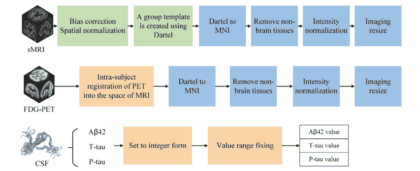

图 1. 数据集规模的说明。

Xu 等人 [40] 提出了一种解释性学习网络，从 sMRI、年龄、性别和类别标签的多模态数据中提取判别特征。Pan 等人 [23] 包含了来自 sMRI 的多形式特征并结合配准类 AD 分类。同样，Tong 等人 [41] 提出了一种非图融合框架，高效简化了 SMRI、CSF 和 PET 之间的融合以进行 AD 分类，性能达到 60.2%。Li 等人 [42] 提出了包含 AD 诊断和临床评分回归的多类任务，使用基于 CNN 的注意力机制利用 sMRI 和人口统计学信息。

表 1

人口统计学和临床评分摘要

| 诊断 | 受试者 | 扫描 | 年龄 | MMSE | CDR-SB |
|---|---|---|---|---|---|
| CN | 110 | 156 | 72.7(09) | 29.12(10) | 0.90(39) |
| MCI | 125 | 158 | 71.86(73) | 22.32(30) | 1.4(14) |
| AD | 129 | 157 | 73.7(77) | 18.5(05) | 4.82(02) |

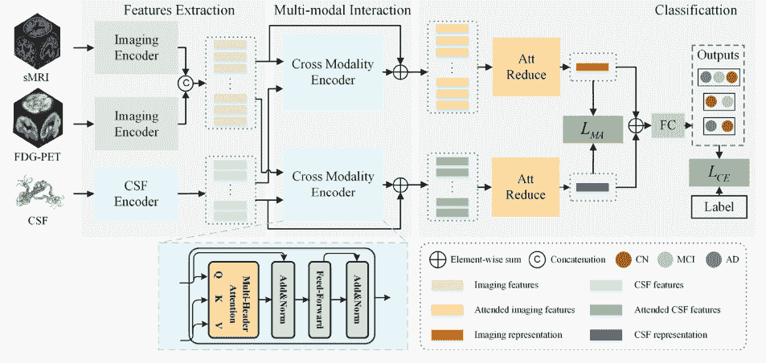

图 2. 所提框架的概述。

极极值归一化用于特征范围 [0, 1]。

根据数据集中脑脊液（CSF）生物标志物的数值分布，Aβ42、Tau 和 P-tau 的特征插入范围分别被设置为 170 到 200、0 到 1300 以及 0 到 120。在此基础上，我们分别为 Aβ42、Tau 和 P-tau 得到 1500、130 和 120，用于计算脑脊液（CSF）向量。

## 3. 3.2. 所提框架的概述

在本文中，我们提出了一种新型框架 `MCAD`，用于利用多模态数据解决阿尔茨海默病（AD）的诊断问题。如图 2 所示，所提框架 `MCAD` 包含三个部分：包括图像编码器和 CSF 编码器的特征提取（3.3 节）、用于管理图像和 CSF 之间交互的相互交互（MI）模块、分类模块（3.4 节）以及模态对齐（3.5 节）。基于这些图像和 CSF 的细粒度表示，交互模块旨在挖掘跨模态信息。具体而言，引入模态对齐是为了对齐图像和 CSF 不一致的特征分布，这可以进一步缩小特征级别的模态间差异，提高诊断性能。

### 3.3. 特征提取

由于 AD 被认为影响不同的大脑区域，MRI 扫描中的萎缩区域和 FDG 扫描中的代谢区域的大小各不相同。传统的 CNN 只能捕捉固定感受区域的信息，且由于池化操作，很难提取丰富的特征。

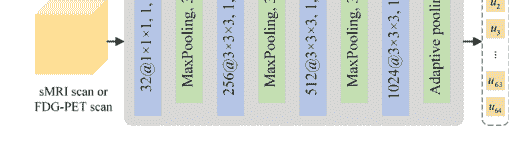

图 3. CD 模块的细节。空洞卷积为不增加参数数量和卷积核尺寸增大感受野提供了解决方案。然而，在没有空洞卷积的情况下表示特征对于 AD 诊断至关重要。因此，设计了级联 CD 模块以改进多尺度表示。使用三种不同尺寸（256, 512, 1024）的空洞卷积、实例归一化（IN），以及步长为 1 的 3x3 卷积层，可以在不增加计算开销的情况下检测形状和轮廓等特征。

#### 3.3.1. 图像编码器

使用 `MRI-feat` 扫描，通过池化层进行卷积产生一个 `$B=4 \times 1024$` 的向量，`U = {u_1, \dots, u_n}`，其中 `u_i \in \mathbb{R}^{1024}` 是每个图像特征的表示。受 `BERT` [51] 和 `Vision Transformer` [52] 的启发，通过线性投影将 `U` 转换为 `H` 维向量 `V` (768)。当 `V` 转换为 768 时，多模态交互模块内部的稠密连接可以转换如下：其中 `I` 和 `C` 分别表示图像和 CSF 表示。`W_Q^h` 和 `W_K^h` 是头 `h` 的变换矩阵，其中 `h` 是多模态交叉注意力的第 `h` 个头。在计算 `q, k,` 和 `v` 后，它们被用于多模态交叉注意力，其过程如下：

$$CA(I,C) = \text{softmax}\left(\frac{(W_Q^h I)^T (W_K^h C)}{\sqrt{d_k}}\right)W_V^h C$$

$$MCA(I,C) = [CA(I,C), CA(C,I), CA(I,I)]$$

其中 `CA_h` 是多模态交叉注意力的第 `h` 个头，`W_{CA}` 是特征融合的权重矩阵。

$$V = W^h U + b^h,$$

其中 `W^h` 和 `b^h` 是学习参数。MRI 和 PET-feat 图像拼接表示最终图像表示 `I = {i_k, \dots, i_n}`，其中 `n=128` 是输入的切片数。

#### 3.3.2. 编码器

CSF 测量包含三种类型：A42、Tau 和 P-tau。由于每个 CSF 代表不同的含义，且每个数值不同，我们需要某种尺寸归一化。通过使用位置编码 [59] 和注意力编码器，我们考虑使用正余弦函数来实现 A42、Tau 和 P-tau 的编码。每种类型 CSF 的编码过程为：

$$T(c_i) = \sin(i/10000^{2j/d})$$

$$T(c_i) = \cos(i/10000^{2j/d})$$

其中 `c` 代表来自 A42、Tau 和 P-tau 的值，`i=0, 1, \dots, d-1`  `j=0, 1, \dots, d/2-1`，其中 `d` 是模型的维度。

编码通过两个全连接层转换为 `H` 维向量（`h=768`）。通过此操作，编码的尺度和维度可以与图像表示保持一致。对于样本，我们将每种类型的 CSF 编码为向量，然后将其拼接形成非图像特征。

## 3.4. 多模态交互

对于 AD 诊断，多源数据可以提供更多信息和潜在关系。因此，必须融合图像和 CSF 特征以实现诊断性能。通过使用多模态交互（MMI）机制 [51]，它可以捕捉图像特征和 CSF 特征之间的交叉注意力，可以将非图像特征与图像及非图像表示融合。该模块聚焦于使用多头注意力融合图像特征和非图像特征。MMI 的结构不仅可以增强多模态表示的交互，还能保留之间信息的价值。

### (1) 分类损失

交叉熵是分类任务中广泛使用的目标函数，用于最小化多模态数据监督学习的 AD（阿尔茨海默病）分类损失：

```
$L_{CE} = -\sum_{i=1}^{N_L} \frac{1}{C} \sum_{c=1}^{C} y_{ic} \log(p_{ic})$
```

其中 `M` 是类别数，`y_{ic}` 是真实值。属于类别 `c` 的概率得分表示为 `p_{ic}`。

### (2) 模态损失

为了融合不同模态（sMRI 和 PET）以及 CSF 生物标志物的特征以共享相似性，利用 KL 散度通过转换不同领域来对 AD 和非 AD 模态的特征。表示 `I` 和 `C` 之间的 KL 散度定义为：

```
$D_{KL}(I||C) = \sum_{i=1}^{d} I_i \log\frac{I_i}{C_i}$
```

其中 `d` 是特征维度。在提出的 `MCAD` 中，进一步考虑了 MRI 和 CSF 特征之间的模态对齐损失以减少模态差异。模态损失 `L_M` 计算如下：

```
$L_M = D_{KL}(I||C) + D_{KL}(C||I)$
```

最后，为了学习领域不变判别特征，将分类损失和模态损失结合用于模型训练。损失函数定义为：

```
$L = \gamma_1 L_{CE} + \gamma_2 L_M$
```

其中超参数 `gamma_1` 和 `gamma_2` 是各部分代表性内容的比例，通过实验确定。

## 4. 结果

### 4.1. 实验设置

所有实验均使用 `Python 3.6` 和 `PyTorch` 库进行。模型在单块 `NVIDIA GeForce 3090 GPU` 上使用 `Adam` 优化器训练 100 个轮次（epochs），批大小为 32。学习率为为 0.0001，采用 1e-4 衰减策略。训练和测试策略采用随机划分。分类损失和模态损失的策略设置如下：`gamma_1=1.0` 且 `gamma_2=0.0005`。使用交叉验证策略评估 `MCAD` 的性能。该过程重复 5 次，对所有 5 次迭代的结果取平均值。

### 4.2. 评估标准

为了定量评估 AD 诊断的性能，平均敏感性（SEN）、特异性（SPEC）、准确率（ACC）、F1 分数（F1）和曲线下面积（AUC）作为评估标准，定义如下：

```
$SEN = \frac{T_P}{T_P + F_N}, \quad SPEC = \frac{T_N}{T_N + F_P}$
```

```
$ACC = \frac{T_P + T_N}{T_P + T_N + F_P + F_N}, \quad F1 = \frac{2T_P}{2T_P + F_P + F_N}$
```

AUC

```
$FI = \frac{T_P}{2T_P + F_N + F_P}$
```

- 多模态阿尔茨海默病检测 (DAD)：在方法 [58] 中，将 sMRI 和 FD-PET 图像融合到三维卷积网络中，通过丰富的特征和图像检测多模态任务进行 AD 诊断。
- 多模态级联卷积网络 (MCN)：一种基于 CNN 的新型模态分类算法 [59]，用于学习和融合 sMRI 和 FD-PET 的多级和多模态特征进行 AD 诊断。
- 级联 (Concatenation)：是一种结合多模态数据的方法，用于许多 AD 诊断的研究 [16, 24, 51]。
- 多模态瓶颈池化 (MBP)：首次在 [22] 中提出用于视觉问答。该方法通过产生乘积将视觉特征和文本特征结合到联合表示空间，从而促进不同模态之间的相互作用。在本文中，MBP 用于融合影像和非影像数据进行 AD 诊断。
- 自注意力 (SA)：SA 是一种学习输入中不同部分之间差异并确定哪些部分与任务相关的机制。在本文中，我们在融合模块中使用注意力机制来处理 AD 相关的任务。
- 门控融合 (Gated fusion)：门控融合 [62] 允许机制通过聚合互补数据来整合多模态属性。使用权重图来学习信息的门，然后使用来自单个模块的门控内容来解释表示。
- 双模型递归网络 (BBFN)：BBFN 是一种从多个模态收集信息进行模态情感注意力的方法。BBFN 在 Transformer 架构中使用门控控制机制来提高性能。在本文中，我们使用 BBFN 整合影像和非影像特征进行 AD 诊断。J. Zhang 等在 AD 相关任务中与其他方法的比较。

| 分类 | 方法 | MCAD | MCCN | Concation | Gated | BBFN | MCAD |
|---|---|---|---|---|---|---|---|
| AD vs CN | MCI | 89.72 | 88.78 | 94.79 | 92.38 | 87.36 | 89.79 |
| | | 89.19 | 88.48 | 94.29 | 87.80 | 87.25 | 91.78 |
| | | 89.61 | 82.24 | 94.26 | 85.51 | 85.50 | 93.36 |
| AD vs CN | MCI | 93.07 | 92.65 | 94.02 | 94.23 | 93.53 | 93.18 |
| | | 92.68 | 93.35 | 93.35 | 88.58 | 92.33 | 93.75 |
| | | 93.45 | 93.12 | 94.55 | 91.63 | 94.58 | 92.48 |
| MCI vs CN | AD | 66.75 | 66.30 | 76.58 | 68.78 | 69.34 | 64.05 |
| | | 69.49 | 63.10 | 68.58 | 63.53 | 71.32 | 64.57 |
| | | 65.42 | 65.17 | 74.58 | 65.25 | 76.45 | 65.06 |
| MCI vs CN | AD | 81.03 | 80.92 | 86.56 | 84.11 | 86.01 | 85.38 |
| | | 80.66 | 59.18 | 91.13 | 61.33 | 83.67 | 61.38 |
| | | 85.04 | 79.18 | 95.07 | 88.19 | 81.12 | 80.77 |
| AD vs MCI | CN | 75.96 | 76.12 | 83.33 | 80.56 | 81.11 | 80.27 |
| | | 77.55 | 56.23 | 71.12 | 58.83 | 57.67 | 54.40 |

表 1：配对检验结果显示了建议方法与竞争方法的评估。

| 方法 | AD vs CN | MCI vs CN | AD vs MCI vs CN |
|---|---|---|---|
| | p-value | p-value | p-value | p-value | p-value | p-value |
| | (AUC) | (F1) | (AUC) | (F1) | (AUC) | (F1) |
| MCAD and MCAD | 0.003 | 0.013 | 0.006 | 0.008 | 0.006 | 0.016 |
| MCAD and MCAN | 0.017 | 0.010 | 0.002 | 0.014 | 0.016 | 0.034 |
| MCAD and Concation | 0.027 | 0.028 | 0.029 | 0.030 | 0.039 | 0.068 |
| MCAD and DA | 0.051 | 0.071 | 0.119 | 0.138 | 0.207 | 0.215 |


| MCAD and Gated | 0.032 | 0.039 | 0.019 | 0.032 | 0.035 | 0.034 |

| MCAD and BBFNN | 0.097 | 0.092 | 0.017 | 0.118 | 0.301 | 0.482 |

| MCAD and DF | 0.016 | 0.004 | 0.004 | 0.004 | 0.036 | 0.037 |

| MCAD and SA | 0.016 | 0.016 | 0.006 | 0.006 | 0.047 | 0.036 |

| MCAD and SE | 0.031 | 0.034 | 0.008 | 0.009 | 0.018 | 0.025 |

| MCAD and BBFN | 0.035 | 0.044 | 0.011 | 0.013 | 0.043 | 0.024 |

AD vs CN：由于几个原因，该分类被认为是 AD 相关任务中最重要的。首先，与健康组相比，AD 患者的 MRI 扫描显示出较低的值、显著的范围和更高的对比度。AD 患者在谷氨酸中葡萄糖代谢异常，这可以通过 PET 扫描检测到。其次，大脑的细胞外空间，它可以揭示 AD 患者与健康人脑部中存在的生物化学变化。这有助于深度学习网络更有效地学习 AD 特征。如表 2 的 AD vs CN 所示，我们建议方法的分类优于所有竞争方法。如表 3 所示，我们的 MCAD、Concation、DC 和 Gated 方法相对于竞争方法（MCAN、MCCN、SA 和 BBFNN）在 p 值方面存在显著差异（p < 0.05）。MCAD 与竞争方法之间的差异可以学习不同模块之间的细粒度相互作用，并探索区域与生物标志物之间的潜在一致性和互补性，为 AD 诊断提供关键信息。


**图4.** 分类方法的 ROC 曲线：(A) AD vs CN。(B) MCI vs CN。

 对患者生命的影响，使得 AD 诊断变得困难。换句话说，准确诊断 AD 需要丰富的专家经验。神经网络学习 MCI 和 CN 之间的区分性特征是困难的。然而，从 AD vs CN 的性能来看，我们可以看到所提方法可以显著提高 MCI 任务的诊断性能。具体而言，ACC 值分别达到 64.30% 和 61.85%，比其他方法高出 2.95% 和 3.08%。

所提方法在决策层融合和门控方法方面明显显示出优势，例如，MCD 优于门控方法，分别提高了 2.57% 和 1.28% 的平均值。这可能是由于我们的方法通过多模态交互减少了 MCI 和 AD 数据之间的模态差异所解释的。此外，所提方法的 t 检验（95% 置信水平）将我们的方法与所有竞争方法在 AD vs CN 任务中比较。实验结果证明了我们的方法在基于多模态数据识别 AD 患者方面的有效性。此外，AD 和 CN 受者是异质的。早期 MCI 患者的病变更类似于 CN，而晚期 AD 患者则更严重，使得多分类问题具有挑战性。

实验结果表明所提方法是有效的。通过多模态特征提取，我们获得了全面的诊断结果。多模态方法优于通过拼接获得的方法。交叉注意力机制捕捉不同模态之间的关系，从而有效探索 AD 诊断的潜在信息。

如表 2 所示，可以得出几点优势：首先，MCI 方法在 MCI vs CN 和多分类任务中达到了竞争性性能。其次，所提方法的决策层融合方法

## 4.4. 消融实验

### 4.4.1. 特征提取任务的消融

在所提方法中，编码器基于计算注意力构建以获取多尺度信息。为了研究编码器从 3D MRI 数据提取特征进行 AD 诊断的有效性，我们使用 ResNet-50 [6]、Inception 网络 [6] 和标准 CNN 进行了一组实验。我们分别使用这些模型作为编码器，然后测试“ResNet”、“Inception”和“PPT”三个变体。结果如图 5 所示。

从图 5 可以看出，所提方法的性能优于其他。在多分类任务中，相对于“ResNet”、“Inception”和“PPT”，其优越性尤为明显。例如，MCI 获得的平均结果 ACC 为 60.33%、76.6%，F1 为 61.85%，分别比“ResNet”（p < 0.05，配对检验）高出 2.15% 和 3.27%。在方法之间的配对 t 检验（95% 显著性水平）中，我们的方法比“PPM”（p < 0.05，配对检验）高出 0.62% 和 2.17%。p 值小于 0.05 表明我们的方法显著更好。原因可能是不同的 MCD 通过融合局部和距离信息学习了更好的多尺度信息表示，而传统的 CNN 只能捕捉固定感受野的信息。由于受疾病影响的大脑区域较小且多变，通过融合提取丰富的特征是困难的。我们的方法通过卷积层中的分解学习丰富的表示，且没有额外的开销，这对 AD 诊断至关重要，可以有效提高学习能力和性能。超参数设置为 $t_1 = 1.0$ 和 $t_2 = 0.0005$，所提 MCD 可以获得良好的性能，配对检验的 p 值小于 0.05。

从图 5 中，我们可以观察到 MCD 在多模态关联分类方面优于其他方法（即 $t_i = 0$）。相比之下，所提框架将方法提高了（2.25% ACC、2.02% ACC 和 0.32% F1），在分类方面实现了显著改进（95% 显著水平下使用配对检验，$p < 0.05$）。多分类诊断提高了（1.70% ACC、0.41% ACC 和 0.19% F1）（$p < 0.05$，配对检验）。强调了多模态融合的重要性，以减少融合多模态数据的冗余，结果表明融合分类和多模态关联都能有效提高 AD 诊断的性能。这些结果共同表明了一种用于使用多模态数据进行 AD 诊断的高效学习策略。

### 4.4.2. 目标函数的消融实验

本文采用目标函数来优化生成器算法、分类损失和融合损失，以控制分布对齐学习多模态依赖并寻找损失函数的最佳组合。我们通过对诊断性能关于 $t_1$ 和 $t_2$ 的消融实验进行研究。具体而言，$t_1$ 设置为 1.0，调整 $t_2=0.005$ 以评估具有不同分类损失和对齐损失相对系数的所提 MCD。我们将 $t_2$ 的范围设置为 0.0001 到 0.1，作为调整步骤。实验结果报告在图 6 中。

正如预期，ACC、AUC 和 F1 值随着 $t_2$ 的增加大致遵循 U 型曲线。当 $t_2$ 较小时，模型性能逐渐提高，模型开始对齐图像和非图像模态。当 $t_2$ 增加时，性能在某种程度上会下降，因为模型对分类损失的注意力不足；换句话说，模型对多模态数据的分布对齐施加了过多的约束。为了研究交互方法的影响，我们进行了消融实验以移除 MI（标记为“w/o MI”）。实验结果如图 7 所示。

我们可以观察到 MI 可以有效提高 AD 诊断的性能。相比之下，没有 MI 的 MCD 在 AD vs CN 任务中的 ACC 提高了 1.36%，F1 提高了 1.54%（95% 显著水平下使用配对检验，$p < 0.05$）。在 AD vs MCI 任务中，所提方法优于没有 MI 的变体，ACC 提高了 2.76%，F1 提高了 2.86%（95% 显著水平下使用配对检验，$p < 0.05$）。

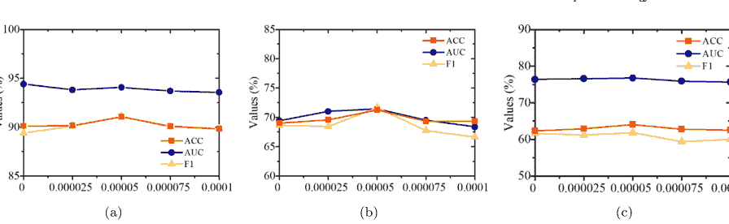

**图 6. 使用不同组合方法的性能。(a) AD vs. CN。(b) MCI vs. CN。(c) AD vs. MCI vs. CN.**

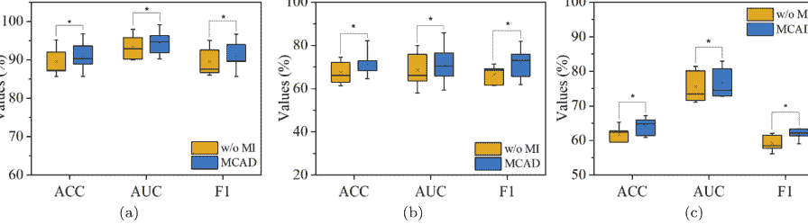

**图 7. AD 相关诊断任务中交叉验证结果的箱线图。每个箱中间的线代表当前评估指标下箱的平均值。* 表示显著性差异。(a) AD vs. CN。(b) MCI vs. CN。(c) AD vs. MCI vs. CN.**

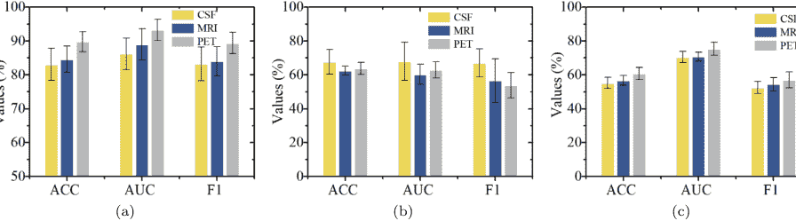

**图 8. 基于单模态数据的结果对比。（误差条代表标准差。）(a) AD vs. CN。(b) MCI vs. CN。(c) AD vs. MCI vs. CN.**

模态。对于 CSF 标志物，使用随后的两层的 CSF 编码器进行分类，而添加了图像层用于整合数据。使用单模态标志物进行 AD 诊断的结果如如图 8 所示。

如图 8(a) 所示，采用 MRI 和 FD-PET 特征的 AD 诊断在 ACC、AUC 和 F1 分方面显著更高，这强调了多模态标志物在 AD 诊断中的性。

如图 8(a) 所示，在 AD 分类中，来自 MRI 和 FD-PET 的性能在 ACC、AUC 和 F1 方面显著更高，增长了 2.77%（从 75.23% 增加到 78.00%）。我们还发现 FD-PET 的性能相对比 MRI 更好，这与 [68, 6] 中的发现一致。这是因为海马体标志物在 AD 早期可以更早地检测到。我们的 Gray 方法获得了可行的结果，平均 ACC 为 89.78%，AUC 为 93.92%，F1 为 89.39，比使用 MRI 和 CSF 高出 5.14%、4.30% 和 3.35%，在 AD 分类中比使用 CSF 高出 6.71%、7.08% 和 6.13%。此外，FD-PET 达到了平均 ACC 91.07%、SEN 91.03%、SPE 91.07%、AUC 94.07% 和 F1 91.11，而单模态的性能仅为 84.63% (ACC)、81.43% (SEN)、87.76% (SPE) 和 84.49 (F1)。多模态的性能分别达到 90.41% (ACC)、91.66% (SEN)、93.95% (SPE) 和 90.28% (F1)。在 MCI vs. CN 分类中，在多个标志物的辅助下，性能比仅使用 MRI 数据分别增长了 8.67%、19.34% 和 15.06%（对应 ACC、SEN 和 F1）。对于多类分类，性能随数据模态（从 M 到 MPC）在 ACC、SEN、SPE 和 F1 上呈单调增加。显著改进出现在 F 和 EPI 中，它们分别增加了 4.94%（从 M 到 MPC）和 3.26%，总计达到 73.00%。当利用所有三种模态时，达到了最佳性能。这表明多个标志物可以从不同视角和互补信息捕捉疾病相关信息，从而增强分类性能。

所有评估指标在所有折叠中的总体标准差（最小为 1.80%）。二分类分类中的 ROC 曲线用于评估单模态数据进行 AD 诊断的性能，如图 9 所示。

## 5.2. 诊断标志物的分布

我们研究了融合标志物对 AD 诊断性能的影响。实验是在三项 AD 相关诊断任务中逐一添加不同标志物进行的。也就是说，比较来自不同模态的融合性能，正如报告所示

图 10 强调，在所有实验中，使用如 MP 和 MRI 等多模态数据的方法的诊断性能优于使用如 MRI 等单模态数据，MPC 的诊断性能远好于 MP。例如，区分 AD 和 CN 时，我们带有 MPC 的 Gray 方法

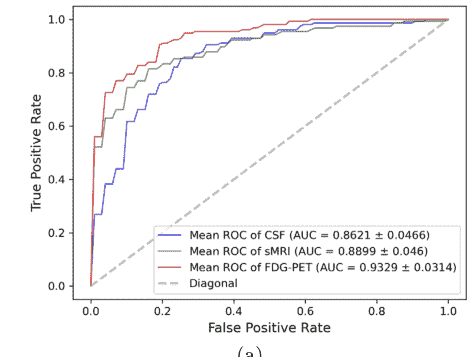

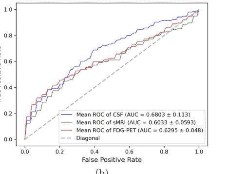

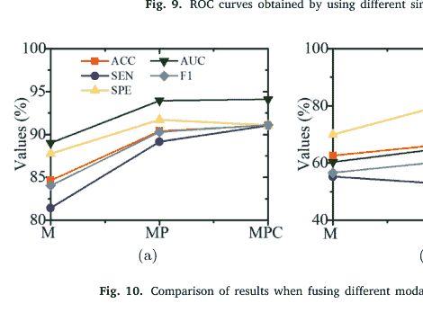

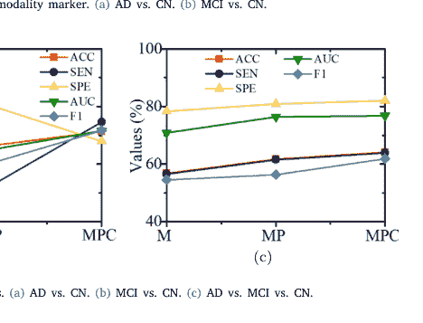

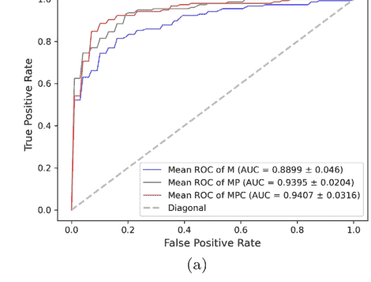

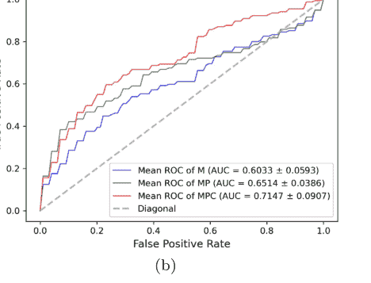

图 9. 使用单模态标志物获得的 ROC 曲线。(a) AD vs. CN。(b) MCI vs. CN。

图 10. 使用不同方法论的结果对比。(a) AD vs. CN。(b) MCI vs. CN。(c) AD vs. MCI。

图 11. 不同方法论实现的 ROC 曲线。(a) AD vs. CN。(b) MCI vs. CN。

## 5.3. 注意力削减方法的讨论

在提出的 MCAD 中，采用了带有双层多层感知机（ReLU-Dropout-Dropout）的注意力削减

### 表 4

AD 相关诊断中注意力削减模块中 ReakyReLU 和 Leaky ReLU 的性能对比。

| 分类 | 指标 (%) | Leaky ReLU (u = 0.01) | Leaky ReLU (u = 1/5.5) | ReLU |

|---|---|---|---|---|

| AD vs. CN | AUC | 90.7 | 93.8 | 91.7 |

| | AUC | 94.9 | 94.2 | 94.4 |

| | F1 | 70.4 | 91.1 | 91.7 |

| MCI vs. CN | AUC | 70.4 | 70.9 | 71.7 |

| | AUC | 73.8 | 77.4 | 74.9 |

| | F1 | 73.8 | 71.1 | 71.7 |

| AD vs. CN | AUC | 90.7 | 93.8 | 91.7 |

| | AUC | 94.9 | 94.2 | 94.4 |

| | F1 | 70.4 | 91.1 | 91.7 |

| MCI vs. CN | AUC | 70.4 | 70.9 | 71.7 |

| | AUC | 73.8 | 77.4 | 74.9 |

| | F1 | 73.8 | 71.1 | 71.7 |

*(注：原文表格内容存在重复，翻译已按要求保留格式)*

在本研究中，我们提出了一种名为 MCAD 的新方法，旨在利用 sMRI、FD-PET 和 CSF 生物标志物等多模态数据区分阿尔茨海默病（AD）和认知正常（CN）。由于 MRI 和 FD-PET 扫描中疾病相关的差异较小且尺寸不一，我们利用了基于空洞细粒度表示的编码器来学习多尺度特征。同时，CSF 编码器可以捕捉更丰富的信息表示。为了有效利用 AD 的跨模态相关信息，我们在基于图像块和 CSF 的细粒度表示的互信息（MI）中对模态交互进行建模。我们设计了一个确保模态对齐的目标函数，旨在从特征层面学习 AD 特征，这有助于多模态特征的有效融合并提高 AD 的诊断性能。在 ADNI 数据集上的实验结果表明，与其他竞争方法相比，我们的方法在 AD 分类任务中表现更好。广泛实验证明，学习多模态之间的细粒度交互为 AD 提供了关键信息。

作者声明没有可能影响本文报道工作的竞争性财务利益或关系。

本文的研究得到了成都市重大科技应用示范项目（2019-YF09-0012-SN0）的支持。

- 1. S. Swartz, V. Atharthi, A. Kaushik, A. Yardt, M. Nair, 阿尔茨海默病：发机制、诊断与治疗. Int. Nature Neurology (2014) 15:149-154.

- 2. L. Zhan, J. Jiao, W. Wang, Y. Zhou, J. Jahansadi, G. Prasad, J. M. C. Liu, C. Chen, Y. Zhang, Y. Wang, and G. Sheng, 深度学习用于阿尔茨海默病异常脑网络的检测. Front. in Neurology (2019) 10:668.

- 3. K. Zhang, Y. Wang, H. Li, J. Chen, G. Wang, and S. Dong, 用于识别阿尔茨海默病的多视图分类, 见阿尔茨海默病和认知障碍国际研讨会, 2021.

- 4. L. Lange, 阿尔茨海默病事实与数据, Alzheimer’s Medicine (2020) 16:100662.

- 5. V. G. Vaslagner, 脆弱的脑与网络-77: 老龄人类脑网络的结构变化. Nature Neurology (2013) 20:227-238.

- 6. H. Ha, J. Liu, L. Nguyen, J. Marshall, et al., 与 K. Riverter, G. Green, D. Green 相关疾病，阿尔茨海默病和衰老中的相关蛋白, Nature Res. (2020) 6:709-713.

- 7. J. White, E. Thieullen-Serre, M. Dias-Mera, J. Sanchez-Gutiérrez, A. Routier, S. Boutin, C. Meyer, S. Danis, S. Darrington, and N. Nicolas, 基于图的关联网络识别阿尔茨海默病的分类: International Medical Exp. Eval. (2016) 63:555.

- 8. M. Chen, 基于深度学习的阿尔茨海默病和轻度认知障碍的分类与预测: 综述, Curr Alzheimer Res. 17 (3) (2022) 297-309.

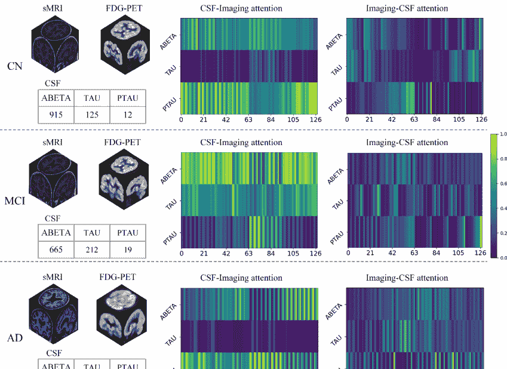

- [10] Wang, L., B. Liu, J. Shen, S. Wu, A. Di; 基于 2D 卷积网络的多模态多集成学习架构用于阿尔茨海默病诊断, Biol. Med. 126 (2021) 106420

- [11] A. Drazga, D. Altomare, C. Festari, J. Arbizu, S. Ortiz, E. Kerholz, P. Nester, F. Agosto, F. Nobilli, et al.; 18F-FDG PET 用于高风险患者阿尔茨海默病的预测, Eur. J. Nucl. Med. Imaging. 95 (2018) 1487–1496

- [12] S. Karakas, A. Volcker, V. Myrkers, et al.; 阿尔茨海默病生物标志物的识别, Acta Neurolrol. 117 (3) (2017) 591–607


- [13] A. Ashbery, F. Fisher, K. Chen, N. Aartveld, L. Lopez, T. Quicker, R. Caseli, P.N. Talbot, E.M. Reiman; 临床前痴呆的研究与预测, Nat. Aging Res. 9 (7) (2021) 791–798
- [14] X. Ma, B. Li, H. Hu, Y. Wang; 基于聚类进化融合结果的阿尔茨海默病多模态数据分析, IEEE J J. Bioinf. Inf Health. 24 (2020) 107512
- [15] W. Lin, Q. Ma, D. Wang; 多中心基于结构 MRI 分析的阿尔茨海默病诊断, Front. Hum. 8 (2021) 66933
- [16] S. Spavano, L. Dammag, A. Pian, N. Tocci, A.D., et al.; 用于阿尔茨海默病分类的参数高效深度学习方法, NeuroImage. 253 (2022) 11903
- [17] K. Wajid, A. Feijoo, J. Mervey, E. Fenema-Notte, D. Habler; MRI、PET 和 CSF 的模态融合用于阿尔茨海默病的诊断, J. Alzheimers Dis. 19 (3) (2022) 340–357
- [18] Y. Wang, and J. Liu; 阿尔茨海默病和轻度认知障碍的多模态分类, Neurosciences. 55 (5) (2022) 851–865
- [19] C. Zhang, and Y. Wang; 使用集成学习对 MRI、CSF 和 APOE 生物标志物进行多模态融合, Scientific Reports. 12 (2022) 5333
- [20] F. Sabahi, M. Ahmed; 基于深度学习的阿尔茨海默病早期诊断, Medical Science. 30 (2022) 10652
- [21] X. Liu, and Y. Wang; 基于模型的阿尔茨海默病多模态预测, 2021 IEEE International Conference on Data Mining (ICDM), pp. 1270–1275
- [22] Y. Zhang and Y. Wang; 使用多模态融合的阿尔茨海默病诊断, Comput. Biol. Med. 148 (2022) 10391
- [23] Y. Chen, J. Wang, E. Cao, H. Meijer, D. Hajler; 用于真实应用的阿尔茨海默病鲁棒深度学习预测模型, 2022, arxiv preprint:2213.0964
- [24] C. Himerowicz, V. Singh, G. Xu, S. Johnson, A.; 用于人群的多模态深度学习以进行阿尔茨海默病早期诊断, Neurosciences. 95 (2022) 5711–5729
- [25] D. Kushain, Y. Yan, P. Habib, L. Sen, Y. Chen, A. Wu, T. Agra, R., J. Wang.; 使用循环网络和深度学习的阿尔茨海默病早期诊断, IEEE/Trans. Comput. Biol. 2 (2022)
- [35] C. Han, L. Liu, J. Shen, D. Xu; 用于结构 MRI 联合注意和阿尔茨海默病诊断的高层次卷积网络, IEEE Trans. Neural. Learn. Math. 32 (4) (2020) 880–893
- [36] J. Zheng, X. Heng, X. Xu, Y. Li, J. Wang, A.; 用于阿尔茨海默病早期诊断的多模态注意力卷积网络, J. Neural. Eng. 19 (4) (2022) 04630
- [37] Q. Wang, Y. Chen, J. Li, Q. Hu, Y. Wang, A.; 用于阿尔茨海默病早期诊断的注意力增强网络, Biomarkers. 12 (11) (2022) 4215
- [38] Q. Sun, P. Joshi, M. Liu, C. Xu, X. Zhou, K. Karajardi, G. Chang, A. S, B. Byer, D. Shu, et al.; 用于阿尔茨海默病分类的卷积网络的评估与验证, Nature Communications. 11 (2020) 1920–1923
- [39] X. Ma, Y. Guo, L. Chen, R. Duan, A., et al.; 使用局部注意力网络的阿尔茨海默病多模态分类, Fusion 67 (2023) 53–67
- [40] C. B. Jack, Jr., M. A. Bertolotti, N. Fox, T. Ganderbauer, D. Harvey, R. B. Johnson, P. Birn, L. White, C. Ward, et al.; 阿尔茨海默病影像倡议: Res. J. Soc. Res. 27 (6) (2008) 685–691
- [41] Y. R. Jung, Z. Gu, B. Kim, Y. Lee, et al.; 用于阿尔茨海默病早期诊断的多模态深度学习, Scientific Reports. 11 (2021) 15543
- [42] K. Bashmakter, M. Han, L. Y. Yang, et al.; 使用多模态数据的阿尔茨海默病分类深度学习方法, Scientific Reports. 11 (2021) 15544
- [43] E. Fernandez, B. Gullot, J. Sampler-Ganzier, J. Wen, S. Bertani, A., M. Barcoux, T. Fagnani, A. Villard, M. Godinger, D. Habler, R.; 第21 届国际医学成像研讨会 (ISBI), pp. 189–193
- [44] Y. Wang, J. Liu, and R. Richardson; 用于自动检测阿尔茨海默病的卷积神经网络设计, Machine Learning for Health 11, 2020
- [45] K. Zhang and Y. Wang; 多模态自注意力网络用于痴呆, 2023
- [46] A. Doshoyts, L. Bayer, A. Kolokoliev, V. Semenin, X. Zaitsev, T. Unterterich, D. Medinhint, M. Godinger, G. Gelley, et al.; 用于阿尔茨海默病分类的注意力网络, 2020, arxiv preprint:2019.0961
- [47] A. Vawanna, N. Senrath, N. Parmar, J. Jha, et al.; 用于阿尔茨海默病分类的深度交叉编码网络, Adv. Neural. Med. Phys. 30 (2021) 073
- [48] T. Han, M. Bansal; 用于阿尔茨海默病分类的深度交叉编码网络, 2019, arxiv preprint:1912.0648
- [49] D. J. Kim, B. Park; 基于多模态生成对抗网络的阿尔茨海默病早期诊断, IEEE J. Bioinf. Health. 25 (2023) 7119–7128
- [50] J. Chen, M. Zheng, W. Xu, Y. Li, T. Wang, B. Zhou; 用于阿尔茨海默病诊断的多模态深度卷积网络, Neuroimage 168 (2023) 119552
- [51] J. Wang, S. Wang, Y. Yang, W. Wang, D. Treichler, R. Multihler; 用于视觉问答和定位的多模态双线性池化学习, 2023, arxiv preprint:2316.0184
- [52] V. Thomas, M. El-Ahmed, M. Hassandadeh, M. Wang; 用于阿尔茨海默病早期检测的多模态深度学习模型, Sci. Rep. 11 (1) (2021) 1–13
62. Chen, Q., O, J., Liu, H., Chen, J., Peng, X., 鲁棒的多模态肿瘤分割解耦与融合分析, 2020, arXiv:2002.09078.
63. Wan, H., Hen, C., A. Gulikhah, A. Zadeh, L. Mencory, S. Poria, 双模注意力控制的多模态分割分析, 收录于2021 年多模态交互国际会议, 2021, pp. 77–84.
64. Zhou, X., Li, H., Sun, J., 一种用于 AD 诊断中联合回归与分类的新型基于秩的损失函数, Neuroradiology 104 (2021) 91–105.
65. Song, Y., Lin, Y., Jia, P., Semant, R., Reed, D., Anguelle, E., Erhan, V., Vaninck A, 卷积的深层化, 收录于 IEEE 计算机视觉与模式识别会议集, 2016, pp. 77–85.
66. Zhao, J., Shi, X., Qi, X., Wang, J., FPN场景网络: 用于多尺度目标检测的特征金塔网络, 收录于 IEEE 计算机视觉与模式识别会议集, 2017, pp. 2881–2890.
67. C.B. Jack, J.D., Smith, M., Wang, J.J., Jagat, M.S., Shaw, A.P., Miles, W. E., Elsner, 以及 T. Trojanjakowski, 阿茨海默病病理级联动态的双模模型, Lancet Neur. 9 (1) (2010) 119–128.
68. J. Rosner, A. Gauthier, J. Ruillier, M. Macci, J. Wen, 等, 阿尔茨海默病分类方法的评估：框架及其在 MRI 和 CT 数据的应用, 收录于 IEEE 医学影像国际会议, 2009, pp. 1–10.
69. L. Moscotti, S. Sorbi, M.J., De Leon, Y., Bacciardi, N. Musci, P. Myung, W. Tsui, A. Ginetroni, V. Besti, M. Fayyaz, 等, 临床前阿尔茨海默病中代谢功能减退超过萎缩, Neuroimaging 22 (17) (2006) 1778–1786.
71. V. Vogt, M.L. Grothe, M. Ewers, S. Tejped, A.DN. Initiative, 等, 临床前和痴呆性阿尔茨海默病中低代谢与萎缩的模式, Neurobiol. Age 35 (9) (1994) 1973–1981.
72. A. Ma, S. Ayn, Y. Ng, 等, 用于神经网络声学模型的鲁棒多层结构, 收录于 ICML 论文集, 第13卷, 亚特兰亚佐治亚, 2003, 美国, 319–326.
73. B. Na, W. Tang, H. Chen, LJ, 卷积网络中接收激活的评估, 2017, arXiv:1605.05883.
74. J.H. Sadyadi, C. Elgadi, S. F. Guuzman, M.H., Short, 用于卷积神经网络和时间序列分析的长期遗忘网络, Energy 175 (2015) 365–379.
75. C. Banerjee, T. Mukerji, E. Paulino, 利用残差卷积神经网络进行早期 AD 检测的特征表示, Brain Imaging 128 (2019) 10933.
76. J. Feng, S. Lu, 神经网络中各种激活函数的性能, 物理学会议集, 1027, 123
77. H.H. Strickland, H.D. Dodge, N.M. Dowling, S.D. Han, E.A. Erosaeva, W.J. Jagat, 脑淀粉样蛋白厚度：对阿尔茨海默病级联的影响, Brain Behavior 6 (4) (2002) 599–609.
78. A.S. Gray, J. Steele, M. Eichenberg, A. Apostolos, V. Lenzen, F. Thomas, S. Young, R. Buckner, 阿茨海默病患者 FDG 和 CSF 生物标志与认知表现的相关性, J Alzheimer’s Dis. 5 (2009) 397–406.
79. K. Karavola, D. Borghetti, L. Kaifner, G. Giotoni, A. Giorgetti, D. Negli, N. Sani, F. Pasquini, 等, 阿尔茨海默病中 CSF Tau 和 Aβ 与脑糖代谢 PET 扫描的相关性, Brain Res. Vol 77 (1-2) (2006) 80–84.
80. C. Schiaclini, A. Montan, S. Tor.ck, Y. Tomse, D. Diago, B. Pietro, O. Schillaci, 阿尔茨海默病中 Tau-P、Tau-T 和 Abeta-42 脑脊液淀粉样蛋白水平的功能相关性：18F-FDG/PET CT 扫描, Med. Neuroimaging 122 (2015) 1033–1040.
81. M. Troit, P. Tomse, U. Rot, M. Gremek, L. Jansterle, R. Berlot, V. Kavick, M. Kranenberger, Z. Petauk, 轻度认知功能障碍中 CSF 和 FDG-PET 神经退行影像标志物的相关性, 第10卷, 2014.
