# 区块链技术在人工智能与物联网应用中的多学科功能

- **姓名**：`Niaz Chowdhury`（英国开放大学，米尔顿凯恩斯），`Ganesh Chandra Deka`（印度技能发展与创业部，新德里）

本书探讨了`区块链技术`在各种应用领域中，利用`AI`和`IoT`设备促进大数据分析的前景。

在当今的数字世界中，组织拥有海量信息，因此需要对围绕收集、分析和存储数据的新兴方法和工具进行持续研究。“数据挖掘与数据库管理进展”（ADMDM）系列旨在汇信息检索、数据分析、数据仓库及相关领域的研究，成为这些领域工作和学习人员的理想资源。IT 专业人员、软件工程师、学者和高年学生将发现 ADMDM 书丛中的著作对于了解数据挖掘和数据库管理领域新兴研究、理论和应用的动态特别有用。

Alessandro Fiori（Candiolo 癌症研究所 – FPO, IRCCS, 意大利）

David Taniar（蒙纳什大学，澳大利亚）和 Wenny Rahayu（拉罗伯大学，澳大利亚）

马宗敏（南京航空航天大学，中国）和李岩（南京航空航天大学，中国）

Shalin Hai-Jew（堪萨斯州大学，美国）

Gurjit Kaur（德里科技大学，印度）和 Pradeep Tomar（高特姆·布达达大学，印度）

孙昭豪（巴布亚新新几亚技术大学，巴布亚新新几亚）

Sultan Ceren Öner（伊斯坦布尔技术大学，土耳其）和 Oya H. Yüregir（丘库鲁绍瓦大学，土耳其）

T. Revathi（Mepco Schlenk 工程学院，印度）K. Muneeswaran（Mepco Schlenk 工程学院，印度）以及 M. Blessa Binolin Pepsi（Mepco Schlenk 工程学院，印度）

Rashmi Agrawal（Manav Rachna 国际研究与学习学院，印度）和 Neha Gupta（Manav Rachna 国际研究与学习学院，印度）

Siddhartha Bhattacharya（RCC 信息技术，印度）

S. Dash（奥里萨大学，印度）和 B.K. Tripathy（VIT 大学，印度）

Surafel Luleseged Tilah（祖鲁兰大学，南非）和 Jean Medard T. Ng（夸祖鲁-纳塔尔大学，南非）

Muhammad Usman（谢希德·齐富基尔·阿里科学技术大学，巴基斯坦）和 M. Usman（PASTIC，巴基斯坦）

Richard S. Segall（阿肯色州大学，美国）和 Jeffrey S. Cook（独立研究员，美国）

Drazena Gaspar（莫塔尔大学，波斯尼亚黑塞维哥）和 Ivica Coric（Hera 公司，波斯尼亚黑塞维哥）

Nilanjan Dey（Techno 技术学院，印度）

Michael Voskoglou（西部高等教育学院，希腊）

A.V. Krishna Prasad（K.L. 大学，印度）

S. Karthik（SNS 技术学院，安纳大学，印度）Anand Paul（庆州国立大学，韩国）和 N. Karthikeyan（Mizan Tepi 大学，埃塞俄比亚）

Hari Seetha（维洛尔理工学院，安得拉拉邦，印度）M. Narasimha Murty（印度科学学院，印度）和 B. K. Tripathy（VIT 大学，印度）

Theodosia Prodromou（新英大学，澳大利亚）

Aarti Singh（Guru Nanak 女学院，雅姆纳纳加尔，印度）Nilanjan Dey（Techno 技术学院，印度）Amira S. Ashour（塔塔大学，埃及 & 太夫大学，沙特阿拉伯）和 V. Santhi（VIT 大学，印度）

Narendra Kumar Kamila（C.V. Raman 工程学院，印度）

G. Sreedhar（Rashtriya 梵文大学，认定大学，印度）

Siddhartha Bhattacharya（RCC 信息技术，印度）Sourav De（库奇贝哈政府工程学院，印度）Indrajit Pan（RCC 信息技术，印度）和 Paramartha Dutta（维斯-巴拉蒂大学，印度）

Veljko Jeremic（贝尔格德大学，波斯尼亚黑塞维哥）Zoran Radojicic（贝尔格德大学，波斯尼亚黑塞维哥）和 Marina Dobrota（贝尔格德大学，波斯尼亚黑塞维哥）

## A.V. Senthil Kumar（印度，Hindusthan 艺术科学学院）

## 社交媒体数据提取与内容分析

## 基于数据挖掘与分析的协同过滤

Information Science Reference • 版权 2017 • 493 页 • 平装本 (ISBN: `9781522506485`) • 美元 $225.00 (我们的价格)

## Vishal Bhatnagar（印度，阿米比巴德先进通信技术与研究）

Information Science Reference • 版权 2017 • 309 页 • 平装本 (ISBN: `9781522504894`) • 美元 $195.00 (我们的价格)

## 刑事科学与调查中的数据挖掘趋势与应用

## Omowunmi E. Isafiade（南非，开普大学）与 Antoine B. Bagula（南非，西开普省大学）

Information Science Reference • 版权 2016 • 386 页 • 平装本 (ISBN: `9781522504634`) • 美元 $210.00 (我们的价格)

## Numan Celebi（土其，萨卡里大学）

## 云计算中的大数据管理与处理

## 创新数据库查询处理技术研究手册

## 李岩（中国，南京航空航大学）

## Noor Zaman（沙特阿拉伯，金法赛尔大学）、Mohamed Elhassan Seliaman（沙特阿拉伯，金法赛尔大学）、Mohd Fadzil Hassan（马来西亚，普罗纳斯科技大学）与 Fausto Pedro Garcia Marquez（西班牙，雷亚尔大学 ETSII 校园）

## Muhammad Usman（巴基斯坦，沙希德·齐菲卡·阿里·布特托科技学院）

## Soora Rasouli（荷兰，埃因霍芬科技大学）与 Harry Timmermans（荷兰，埃因霍芬科技大学）

## Shafiq Alam（新西兰，奥克兰大学）、Gillian Dobbie（新西兰，奥克兰大学）、Yun Sing Koh（新西兰，奥克兰大学）与 Saeed ur Rehman（新西兰，Unitec 技术学院）

## Vishal Bhatnagar（印度，阿米比巴德先进通信技术与研究）

## Pethuru Raj（印度，IBM）与 Ganesh Deka（印度，劳动力就业部）

## 王忠（中国，哈尔滨工业大学）

## Alessandro Fiori（意大利，卡拉里亚大学）

## William H. Hsu（美国，堪斯州立大学）

## Davy Janssens（比利，哈塞尔特大学）、Ansar-Haque Y（比利，哈塞尔特大学）与 Luk Knapen（比利，哈塞尔特大学）

## Wen-Chen Hu（美国，北达科达大学）与 Naima Kaouch（美国，北达科达大学）

## Mao Lin（澳大利亚，悉尼科技大学）、Weidong Huang（澳大利亚，CSIRO）

## Vishal Bhatnagar（印度，阿米比巴德先进通信技术与研究）

## Hakikur Rahman（葡萄牙，米尔托大学）与 Isabel Ramos（葡萄牙，米尔托大学）

## Zhongyu（Joan Lu，英国，哈德堡大学）

## Andrea Tagarelli（意大利，卡拉里亚大学）、Sherif Sakr（澳大利亚，新南威尔士大学）与 Eric Pardede（澳大利亚，拉特罗大学）

## 医疗服务提供者质量的文本挖掘技术排名比较方法

Patricia Cerrito（美国路易斯维尔大学）


- Hany Atlam，英国德比大学电子、计算与数学系
- Seifedine Kadry，黎巴嫩贝贝鲁特阿拉伯大学
- Shiho Kim，韩国延世大学综合技术学院
- Suyel Namasudra，印度帕特纳国家技术学院
- Md SadekFerdous，孟加拉国西莱特沙贾拉尔科学技术大学计算机科学与工程系
- Roberto Moro Visconti，意大利圣心大学
- Malaya Dutta Borah，印度西尔查尔国家技术学院计算机科学与工程系

## 引言

“华为”与“牛津经济研究”联合市场调查报告预测，到 2025 年，数字经济可能占全球 GDP（国内生产总值）的 24.3%，约为 23 万亿美元（Xu & Cooper, 2017）。同样，David Reinsel、John Gantz 和 John Rydning 于 2018 年 11 月发布的 IDC 白皮书《从边缘到核心的世界数字化》指出，“全球数据空间规模到 2025 年将增长到 175 ZB”。“每个连接起来的人每 18 秒钟至少会有一次数据交互，全球近 30%的数据需要实时处理”（Reinsel, Gantz, & Rydning, 2018）。

机器学习（ML）是计算机科学中发展最快的研究领域之一，旨在从海量数据形成精确决策。机器学习技术具有强大的数据分析能力。新型先进数据模型利用区块链技术的安全去中心化特性。机器学习与区块链技术的使用可以提供一个稳健的分布式机器学习网络，处理许多复杂问题。

可解释人工智能（XAI）是 AI 算法的一个新趋势，为 AI 的决策提供解释。区块链为 XAI 系统提供了关键特性，如透明度和可见性、不可篡改性、可追溯性和不可否赖性（Nassar, Salah, Ur Rehman, 2019）。AI、ML 与区块链技术的融合有望构建稳健、可持续的 IT 生态系统。

本书名为《区块链技术在人工智能和物联网应用中的多学科功能》，共分 10 章，由知名研究人员贡献，书中清晰地论述了在供应链管理和联邦学习（在线学习）中将区块链与人工智能、物联网以及机器学习相结合。

书中涵盖的话题非常精彩。这本书确实值得一。

- Nassar, M., Salah, K., Ur Rehman, M. H., & Svetinovic, D. (2019). Blockchain for explainable and trustworthy artificial intelligence. WIREs Data Mining and Knowledge Discovery , 10(1). 在线优先出版。doi:10.1002/widm.1340
- Reinsel, D., Gantz, J., & Rydning, J. (2018 年 11 月). The Digitization of the World From Edge to Core. Seagate - Maximize data’s](https://www.seagate.com/our-content/trends/idc-whitepaper.pdf)
- Xu, W., & Cooper, A. (2017). Digital Spillover-Measuring the true [Huawei - Fully Connected,](https://www.huawei.com/minisite/gci/en/digital-spillover/files/data-mining.pdf) (注：原文链接原文处.为/digital-spillover/files/data-mining.pdf)

## 贡献者

- Ganesh Chandra Deka，印度新德里技能发展与创业部
- Niaz Chowdhury，英国米尔顿凯斯开放大学

在过去的几十年里，人工智能（AI）、物联网（IoT）以及区块链技术在个人和专业环境中的各种物理、机械、电子设备已进入主流计算。物联网承诺许多应用，使生活更加舒适、安全和智能。区块链技术被定义为互联网之后最好的发明之一。这项技术允许在不需要中央机构的情况下进行价值交换，并通过其去中心化的架构确保信任。如此，物联网的使用和人工智能的兴起从这种提供数据安全、去中心化、问责制和可靠认证的技术中极大获益。

拟议的 10 章将论述利用人工智能和物联网区块链技术的前景。本书的主要读者是。

次要读者包括：

- 研究人工智能、物联网、区块链技术和人工智能应用的学者
- 在人工智能和物联网基础设施及区块链领域的专业人士

区块链是去中心化的、分布式的且通常是公共系统。人工智能在信任性、可解释性和隐私方面存在问题，而区块链在安全、扩展性和效率方面存在局限。将两者结合可以互补对方的缺点并使系统更高效。第一章《集成区块链与人工智能》讨论了将区块链与人工智能相结合的各种用途。它还简述了区块链在改进人类和机器思维方面的用途。

在物联网中，信息的安全始终是一项挑战性任务。安全是物联网最重要的支柱。随着连接设备数量的增加，实施物联网的风险因素也相应增加。第二章《物联网风险分析研究》是对物联网安全挑战的分析研究。

农业供应链由许多参与者，如生产者（农民）、消费者（购买并消费产品的人）、批发商和零售商。该系统包含许多层中间商，他们有不同的佣金政策。由于参与者之间没有维护中央记录，这导致了许多严重问题。为了解决上述问题，必须采取整体方法。在这里，基于区块链的解决方案可以实现追溯性（追踪产品的位置和来源）、透明度（建立信任感）、公平性（消除中间商）以及食品安全和价格的保障。第三章《利用区块链技术的农食品供应链管理》探讨了农业供应链管理。

我们对解决谜题和模式深着着迷。其中一个复杂且充满不可预测性的领域就是股市。第四章标题为“谷歌股票波动：基于 LSTM 网络的时间序列研究”，探讨了如何使用长短期记忆（`LSTM`）网络预测股市价格。

随着家庭自动化、`医疗保健`（Healthcare）、`健身`（Fitness）、`汽车`、`物流`、`智慧城市`和工业自动化的日益普及，联网设备（物联网（`IoT`））已进入了我们生活的每一个角落。在过去的几十年里，农业经历了多种技术变革。农民利用各种`智能农业设备`（Smart Farming Devices）对牲畜饲养和作物种植过程有了充分的控制。第五章标题为“农业中的物联网（`IoT`）”，讨论了将`区块链`（Blockchain）整合到农业中的优势。末尾包含了案例研究，供读者参考。

第六章标题为“虚拟世界中的物联网与区块链技术自适应贸易系统：通过创建全球虚拟同伴”，提出了利用人工人工智能和自然智能技术来提高电子商务和创业效率的理念。

机器学习是一种计算机利用一组方法根据数据集进行预测、改进预测和基于行为预测的技术。第七章标题为“机器学习技术的分析性研究”，探讨了机器学习技术的应用及其伦理问题。

第八章标题为“基于区块链的联邦学习：概念与应用”，讨论了联邦学习（`FL`）技术和`MIT Media lab`的`Split Neural networks`（拆分神经网络），以及`区块链`如何解决`医疗保健`、`金融`、`安全`、`物流`、`治理`和`制造业`等领域的数据隐私和监管问题。

第九章标题为“区块链在医疗和农业中的机器学习展望”，是对学习类型的分析性研究，即`监督学习`（Supervised）、`无监督学习`（Unsupervised）、`半监督学习`（Semi-supervised）和强化学习。为了方便理解，文中简要讨论了一些常用的`ML`算法，如`决策树`（`DT`）、`K 最近邻`（`KNN`）、`支持向量机`（`SVM`）、`朴素贝斯`（Naïve Bayes）、`K 均值`（K-Mean）、`Q 学习`。最后，介绍了机器学习与区块链在医疗和农业领域的应用。

第十章作为结束章，标题为“利用 AI 技术支持对外汉语口语能力教学”，探讨了如何利用 AI 技术支持对外汉语教学。传统上，非母语学习者只能与教师互动并完全依靠老师进行口语练习。然而，随着 AI 技术的进步，学习者可以使用 AI 技术进行交互式口语能力培养。在本章中，学习者被指示在`https://m.wandoujia.com/apps/6790950`下载一个应用程序。支持其口语能力发展的这项 AI 技术的准备过程可以通过`https://sites.google.com/site/gohyi141/assignments/projectinteractivespeakingapp`访问。通过使用这项 AI 技术，结果显示人们对该技术的使用具有极大的积极反应。因此，应该鼓励在对外汉语教学以及所有语言口语能力培养中积极利用 AI 技术。

因此，这本合著是关于`ML`、`IoT`和`AI`的优秀章节汇，涵盖了`IoT 安全问题`、`农业`、`供应链管理`（农业）、`预测性分析`（股市）以及`自然语言处理`（`学习汉语`）等领域。我们希望这本书对目标读者有所帮助。

衷心感谢所有章节贡献者和评审者的卓越贡献。

# 第一章

- **Radha Madhu Seekar Vedula**

  印度格瓦利尔，阿塔尔·比哈里·瓦杰帕伊印度信息技术与管理学院

- **Robin Singh Bhadoria**

  

  印度机器智能实验室（MIR）

- **Manish Dixit**

  印度马达夫理工学院

### 摘要

人工智能（AI）和`区块链`的发展从根本上重塑了我们的工作、学习和生活方式。尽管这两个领域的研究帮助我们了知识，但通过`区块链`来实现更具优势。`区块链`是去中心化的、分布式的且通常是公共系统。思维从上定义为基于某些前提进行理性推理，这是`AI`的核心概念，因此受到了欢迎。由于两者都不完善，`AI`在信任度、可解释性和隐私方面存在问题，而`区块链`在安全性和可扩展性方面存在问题。将两者结合可以互补并提高系统效率。本章讨论了`区块链`与`AI`集成的各种应用，并简述了利用`区块链`改进人类和机器思维。

# 1. 引言


区块链和人工智能的发明带来了许多技术突破。加密货币的支付自动化通过区块链（Morris, 2016）实现，而决策和智能通过`AI`赋予机器。区块链通过引入智能合约（Morris, 2014）使得治理成为可能，不再需要信赖。这两项技术都在以极快的速度进步，并在其他领域提供了帮助并创造了更多可能性。我们无法否认这些技术具有不同程度的复杂性。此外，关于区块链去中心化且不受控制的想法可能有些夸大，因为它仍然需要许多开发者来开发，因此容易产生错误。

这导致了对去中心化人工智能的研究。这就是`Blockchain`引入AI的开始（Team N.A., 2018）。尽管`Blockchain`并不完美，但它是一个去中心化的系统。去中心化AI通过对数据进行数字签名和使用安全共享，对此前在区块链上交易和存储的数据进行处理和决策制定，从而消除了对受信任第三方或其他中间介的需求（Dinh & Thai, 2018）。因此，这里发生的实际上是：能够处理和处理大量数据的AI正在使用存储在区块链上的数据。由于区块链上数据的安全性，区块链适用于这一过程。`smart contracts`的使用可以进一步推进其应用，因为它可以对区块链进行编程，使其能够管理用于决策的数据，并在参与者之间生成和访问数据（Wood, 2014）。目前有许多研究正在如何改进区块链和AI，但都是以孤立的方式进行的。最近的研究表明，区块链与AI的结合可以引发许多革命，并有助于改进这两个领域。

将这两者结合的另一个重要且有趣的应用是区块链思维（Swan, 2015）。它专门涉及将思维本身公式化为一种区块链过程。研究人员声称，这不仅有助于AI，还能通过整合两者来增强人类的思维。区块链思维主要被用作一种具有I/O单元和处理系统的计算系统。区块链思维可以催生自矿生态生态系统和智能证明模型。虽然区块链在普通应用中用于重新分配加密货币，但区块链思维可以帮助重新分配“脑力”，例如思想和潜力。区块链思维可以帮助近远未来，进一步促进人类智能和机器智能的进步，以及两者在数字世界中的共存。

# 2. 背景

本节给出了区块链和AI的介绍，随后给出了关于思维的理论介绍，以便更好地理解区块链与AI的结合。

## 2.1. 区块链

在实践中，区块链是网络节点之间的一种开源、不可篡改的分布式公共账本（Nakamoto, 2019）。在理论上，一个基础区块链由`blocks`链组成，这些区块反过来构成了整个账本。简单来说，区块链是面向网络用户的一种不可更改的、分布式的数字账本。它是网络用户之间所进行的数据和交易的永久记录（Salah, Alfalasi, & Alfalasi, 2019）。它始于一种名为`Bitcoin`的加密货币，现在该货币可能用于许多行业。为了理解区块链的工作原理，让我们看看它在`Bitcoin`和`Ether`等加密货币中最重要的应用是如何运作的。

在这两种货币中，区块链将网络用户之间交易的每一个细节都存储在一个名为`blocks`的数据块中。两者都被认为是工作量证明（`POW`）区块链。在`POW`中，用户（或技术上称为`miners`）通过解决一个计算困难的问题来创建一个新的`block`。他们之所以被称为`Miners`（矿工），是因为他们在挖掘数据。成功挖掘的人将创建`block`并获得交易费。创建`block`所付出的努力取决于所获得的奖励，即加密货币。由于新的区块链正在使用一种名为权益证明（`POS`）的协议。在这种情况下，没有像`POW`那样的能量消耗。特定用户对`block`的创建取决于他们可用作质押的代币（货币）。

在`Bitcoin`中，每个`block`的最大大小为一兆字节。此外，一个主要的缺点是数字货币的验证在`Bitcoin`系统中进行。这一问题通过引入`Smart Contracts`概念得到了解决。`smart contract`可以处理有关执行预定义条款和条件的交易验证。总的来说，它是一个自动化程序。这些程序通常由参与区块链挖掘的`nodes`执行。通过这种方式，不再每次都验证加密货币，而是由`miners`自身执行、验证并最终存储数据（Salah, Rehman, Nizamuddin, & Al-Fuqaha, 2019）。

因此，通过在上述系统中融入机器学习，它们可以变得自主并能够学习和适应未来的变化，做出准确且可信的决策。然后，这些决策可以由网络中所有的`miners`验证。借助区块链的帮助以及这些`smart contracts`的引入，上述决策无法被推翻，并且可以追溯。随后，网络的所有参与者（或用户）都可以对它们进行验证。

`Ethereum`系统是一个提供智能合约编程功能的开源平台。`Ether`是`Ethereum`交易中使用的加密货币。每个参与者获得一个`EA`，并且每笔交易都由智能合约委托。

## 2.2. 人工智能

智能被定义为逻辑思维、理解、学习以及获取知识和技能的能力。通常，它可以被定义为感知和/或推理信息并将其存储为知识，并在需要时在未来应用的能力。智能本身可以分为群体和个人智能。因此，AI可以被定义为人工诱导或人工制造的智能。AI被领域父辈定义为机器或程序的任何需要智能的任务或行动（Dinh, & Thai, 2018）。

AI系统的研究被定义为对智能系统/代理的研究，这些设备能够感知其拥有的参数，并尝试通过智能，更确切地说通过之前给定或处理的信息，以最大可能的成功率来实现目标。尽管AI最初是一场旨在让系统自主思考的革命，但由于阻碍生物脑智能的复杂性和许多未知因素，它不断地被拉回到当前的AI系统中，而这些系统使用相关的数据库来做出决策。研究人员仍在努力开发出在某些领域能够做出正确决策的真正的人工智能系统。现在显而易见，AI系统是中心化的。正如所见，决策程序中的大部分过程都取决于数据集。如果对这些数据进行未经授权的修改或篡改，可能会导致AI系统的决策产生错误结果。

我们需要一个系统，能够存储AI算法在学习数据之前、之后、甚至过程中使用的记录，并在训练后做出所需的决策。这可以通过使用去中心化的AI系统来实现，AI与区块链的集成使其成为可能。可以让系统访问安全且共享的数据、日志平台。存储中甚至可以包含系统生成的知识和决策（Panarello, Tapas, Merlino, Longo, & Puliafito, 2018）。

# 3. 集成

这两个系统都有其自身的复杂性，将两者整合可能是一个困难的过程，但随着当今技术的进步，这并非不可能。尽管区块链看起来完美，但它也有自己的弱点，如可扩展性、效率和安全性。同样，AI在信誉、可解释性和隐私方面也存在弱点。考虑到这两个领域的优势和劣势，合理假设将这两者结合可以调出一杯完美的咖啡，因为它们似乎互补了对方的弱点。AI通过引入机器学习原理，可以为区块链带来安全性、可扩展性以及更好的治理和个性化。另一方面，区块链可以为AI系统带来信誉、可解释性和更好的隐私保护。

## 3.1. 区块链驱动的AI

区块链的应用可以通过去中心化系统和协调平台为AI系统提供动力。因此我们可以安全地说，区块链可以让AI变得可信、可解释且透明。这里唯一的问题是，AI必须提供用户的安全和隐私保护，因为区块链上可能全部或大部分数据都是公开的，这可以被当前的AI系统轻松处理。

AI的主要漏洞来自于其学习、推理和决策所需的数据安全性较低。篡改这些数据可能导致错误结果以及AI前所未有的行为和决策。因此，建议我们必须从安全可靠的源获取数据。这就是区块链集成到AI中的重要性。区块链可以作为一个分布式账本，数据可以在其上存储并供其使用（Salah, Rehman, Nizamuddin, & Al-Fuqaha, 2019）。区块链上的数据在处理过程中应该被所有矿工接受、签名和验证。我们知道区块链的不可篡改性。因此，它无法被篡改。机器学习算法的问题在于它们具有争议性且信任度较低。智能合约的引入可以使其变得可信且无可争议。因此，将区块链引入AI可以使AI从安全的、不可篡改的去中心化点对点存储系统中学习、推理并做出决策。在实践中，这些数据可以来自各种来源，例如IoT设备、建筑、机器人等，这些设备被认为是区块链中的矿工。在这一特定集成中引入云可以使系统更加高效、可行且具有高度的实用性和价值。AI系统由于区块链集成而经历的一些变化如下所示。

### 3.1.1. 数据安全

如前所述，AI的主要缺点是用于训练、学习和推理以做出决策的数据安全性。区块链可以用作高度安全的无盘数据存储。写入区块链每个区块的数据必须经过签名。由于数据经过了数字签名，唯一需要保持安全的是私钥（Marr, 2018）。我们知道区块链的不可篡改性。因此它无法被篡改。这使得AI从高度安全的不可篡改的数据存储中进行训练、学习和推理。

### 3.1.2. 信誉

AI算法提供的决策和数据无法获得用户的信任。用户对AI失去信任的主要原因是提供的数据可能被篡改过。区块链在本质上是不可篡改的。不可篡改性让用户确信数据没有被篡改。对于大多数AI算法，学习过程从未停止，因此训练后的决策必须被存储，算法需要通过这些决策再次学习。一旦决策展示给用户，AI将在用户的接受下存储数据，这解决了用户对未来的交易和决策获得更多信任。此外，通过在区块链上记录AI的决策过程有助于提高用户的信任，因为整个过程是公开的（Campbell, 2018）。这也使得第三方审计决策变得不再必要，因为去中心化可以让网络中的任何矿工或用户成为其自身目的的审计员。

### 3.1.3. 决策制定

AI的决策现在必须在多个设备的环境或生态系统中进行协调。如果决策是集体的，结果会更好；为了在共享系统中实现目标，每台机器都应该协调地达成特定的决策（Ferrer, 2016; Brambilla, Ferrante, Birattari & Dorigo, 2013; Strobel, Castelló Ferrer & Dorigo, 2018）。这被称为协作/集体决策制定。区块链的去中心化可以帮助AI进行这种集体决策，而且这消除了对中心权威的需求。在实践中，生态系统中的每台机器都是网络中的标识用户。对于集体决策，每个机器人都在区块链上对特定决策投票，并根据多数规则做出决策。这里的投票被视为一种交易，因为区块链在事务中运行，过程将重复直到所有机器对某个决策达成共识。去中心化可以为生态系统提供民主结构，而不需要由中心系统单独运行周围的决策。

AI中心化带来的问题在于，当中心系统或中央权威被篡改时，整个系统可能会发生异常。如前所述，引入`blockchain`可以为系统提供去中心化。这种去中心化不仅局限于数据存储和安全。`Blockchain`还能诱导`AI`，即去中心化智能的概念。决策过程的去中心化可以从整体提高系统性能。例如，在系统需要做出高层决策的情况下，可以将算法拆分为若干部分，分配到通过相同训练数据连接到系统的各种机器上。不同的机器可以执行该过程的不同步骤并运行决策过程，最终通过所有系统的协作得出结论。这通过对整个过程进行去中心化，可以减少所有系统的工作负载，并使决策更加精确，因为在过程中，如果少数决策似乎超出了控制范围，可以重新运行该程序。考虑到网络中所有系统的个体安全性，安全性可以在网络底层系统的代理节点之间进行完全协调，以实现更高层次的安全性（Brambilla, Ferrante, Birattari & Dorigo, 2013; Janson, Merkle & Middendorf, 2008）。

### 3.1.5 效率

当用于决策过程需要处理和训练的数据过多时，此类`AI`方案的效率可能会较低。当必须做出的决策具有多个参数时也是如此。通过将`AI`与`blockchain`整合，效率可以指数级增长。`smart contracts`可以使`AI`更高效。考虑这样一种方案：数据和程序需要由双方（如个人用户、独立的`IoT`设备甚至不同的组织）授权，由于每个方都需要接受交易或程序，效率低的问题会增加。这可以通过集成`AI`和`blockchain`来解决以提高效率，因为这种集成可以开发出名为`Decentralized Autonomous Agents`（去中心化自治代理）的设备，这些设备可以在无需中央权威干预的情况下，评估不同用户或利益相关者之间的数据、价值或资产转账（Magazzeni, McBurney & Nash, 2017）。

### 3.2 AI变革的区块链

`blockchain`的结构和运行为了实现其目标，必须在安全性、可扩展性、治理和个性化之间进行权衡。在`blockchain`中集成`AI`可以提高治理水平和性能，同时将安全性、机密性和隐私概念引入链中。以下是`AI`集成对区块链可以做的几项改进。

#### 3.2.1 安全性

`Blockchains`几乎对攻击免疫。只有当对手拥有最高算力时，对`blockchain`的攻击才会发生。如果我们认为对手确实拥有最高算力，那意味着他就是大部分`blockchain`的设计者。这是因为每个用户的算力取决于他所做的交易数量以及他在`blockchain`中能够构建的区块数量。正如我们在上一节中讨论的`proof-of-stake`（权益证明）利益相关者概念。如果有人认为这让`blockchain`变得安全，那么他们错了。尽管`blockchain`的结构和程序看起来是安全的，但问题出现在`blockchain`的基础和构建区块上，这些区块并不安全。

这种场景的最典型例子是`Ether`的漏洞，这是一种基于区块链的加密货币。它曾经最大的众筹加密货币之一，曾发生过5000万美元被盗（Myers, Bazinet & Cummings, 2008）。黑客能够操纵`smart contract`使其重复交易，并从交易中提取更多资金。`smart contracts`以及其他用于构建`blockchain`的构建区块并不十分安全，因此容易被利用。

这类问题可以通过追溯发生的交易并验证交易来解决。此外，人们必须在此类情况发生时尽快停止，或者移除发生异常的特定区块。问题的困难在于，我们无法手动追溯`blockchain`上发生的每一笔交易。这就是`AI`大显用场的地方。随着`machine learning`的出现，目前的`AI`机器如果我们能开发出由`AI`治理的`blockchain`，那么检测和防御区块链中此类异常情况就可能是可能的。即使损害不可避免，人们也可以公平地从`blockchain`中移除当前区块，因为丢失一个区块不会影响`blockchain`，而区块链的其他部分可以免受攻击。

#### 3.2.2 可扩展性

除了安全性之外，`blockchain`的另一个重要缺点是它不具可扩展性。上述系统不仅对于提高系统的安全性很有用，对其进行细微更改也可以让`blockchain`具有可扩展性和健壮性。正常的`blockchain`有指定的或恒定的区块创建速率。通过引入一个智能系统来治理`blockchain`，在高交易率期间，治理机器可能足够智能以增加区块的创建速率，从而提高整体吞吐量。虽然这可能会导致更长的确认时间，但区块和交易的创建将完成。由于只是交易成功的确认，较长的确认期对`blockchain`没有太大影响，无法与区块链可扩展的优势相比。

#### 3.2.3 隐私与个性化

隐私和个性化是相互关联的。更准确地说，人们越关注隐私，获得的个性化体验就越少。例如，社交网络、电子商务和流媒体网站及服务会根据你的喜好、朋友的喜好以及之前的搜索和观看记录来个性化推荐。个性化的实现之所以是因为你的隐私数据存储在服务器端。如果我们希望隐私完全不可妥协，那么结果将是没有推荐或不相关的推荐。可以使用`blockchains`来控制个人数据。这使用用户的个人数据尽可能私密化，但这是以失去个性化过程为代价的。那么，理想系统应该是具有最好的隐私和最高程度的个性化的系统。哲学认为，大多数理论上的理想系统在实践中是不可能的。

为了解决这个问题，人工智能与区块链的结合似乎是必要的。针对这一特定应用，内容选择模型的创建应运而生。让我们考虑这种可能性并将其命名为去中心化内容提供者。最好的例子是区块链上的社交网络网站。其理念是利用用户端的AI对网站内容进行个性化。在用户设备上运行AI算法存储习惯和行为，分析这些数据并进行个性化。在普通的社交网络中，数据将存储在每个用户的服务器上并推送到用户设备显示。但在当前方案中，AI将从服务器端提取数据并展示给用户。唯一需要注意的是，用户的系统在进行运行，因此此类网站的硬件要求可能高于目前社交网络网站的要求。因此，用户的个人数据永远不会离开其设备。整个过程和AI决策将在客户端而非服务器端完成，从而维护了用户的隐私同时也为用户提供了个性化服务。当前社交网络中的问题，如内容提供者对用户的过滤导致了许多隐私问题。上述方案也可以减少此类问题。

### 3.2.4 高级智能合约

智能合约是决定谁赢得交易的程序或代码段。在区块链中，交易期间，区块链不同用户之间的合约解决目前由这些智能合约决定。这展示了机器治理复杂任务（如合约）解决规则的能力。尽管机器似乎进步到可以治理此类复杂事务的程度，但最重要的一点是，这些仅仅是一些预定义的简单合约，且合约参数大多是预先定义的。

为了推进这些智能合约并将机器推向更高维度，将AI集成到智能合约中可能被视为一种性。目前正极速发展的AI可能很快就能处理高度复杂的情况。人们甚至可能无需进入法庭就能链上解决某些争议（Nummenmaa, Glerean, Hari & Hietanen, 2014）。AI的进步以及将其整合到智能合约过程中可以使之成为可能。凭借某些证据和文件，与智能合约链接的AI可能能够以公正的方式消除争议。由于我们区块链优良不可篡改属性，证据和文件无法被篡改。所做的决策完全是数据驱动的，因此可以被认为是合理的且一致的。

### 3.3 区块链的演进

区块链的演进被分为几个阶段。每个阶段在增加功能的同时，都控制了前一阶段的缺点。良好了解演进有助于理解将思维整合到整个区块链过程背后的基本思想。

#### 3.3.1 区块链1.0


区块链的出现是将分布式账本解释为虚拟货币或币，被称为`Bitcoin`（Nakamoto, 2019）。这种新货币被称为互联网现金或加密货币，允许用户在不同的媒介下进行金融交易。被称为加密货币的原因是因为遵循了签名和验证的加密程序。每个币由发送者使用私钥签名，由接收者使用私钥进行验证。它提议使用有限状态自动机作为账本，其中每个状态代表用户的所有权，用户之间所有的交易都是状态之间的交易（`auth`）。

区块链 1.0 成功提供了一个交易成本更低的电子支付通道，同时确保了交易的安全性、匿名性和度，且货币供应有限。优点与缺点并存，`Bitcoin` 也是如此。由于增加了优点，与其他通道相比，交易的确认速度较慢，而且由于匿名性和缺乏第三方，`Bitcoin` 必须经历各种欺骗方案和矿工骗局（Hajdarbegovic, 2014）。当时被认为仅仅是一种加密货币，将 AI 与区块链整合的想法并未被考虑。

## 区块链 2.0

2013 年`Ethereum`作为区块链货币引入（Buterin, 2014），解决了`Bitcoin`的众多问题，导致了区块链整体的首次演进，并增加了一个名为智能合约的新功能。同样，在当时`Bitcoin`也无法解决区块链向去中心化转移的问题。`Bitcoin`的能力有限，无法满足去中心化的需求，这产生了构建通用平台的必要性。这一需求可以被认为是区块链演进和`Ethereum`引入的最重要因素，它内置了图灵完备编程语言（Srivastava, Bhattacharya, Singh, Mathur, 2018）。

与前身不同，`Ethereum`在保持智能合约优势的同时仍保持在较快的一侧，智能合约是可解释的脚本，使得它们运行速度更快。智能合约看起来非常有用，但其并非只有优点。从编写和实现智能合约的困难开始，存在许多漏洞，如重入攻击、交易顺序依赖、异常和时间戳检测漏洞（Natoli, Gramoli, 2016; Luu, Chu, Olickel, Saxena, Hobor, 2016）。此外，一旦执行开始，修改或取消智能合约在实践上是困难且不可行的；由于去中心化的结构，匿名人士利用智能合约的可行性以及交易隐私和信任问题，导致了该技术的使用有限（Juels, Kosba, Shi, 2016）。

智能合约的引入和模型的去中心化可以被认为是区块链与各领域结合成为可能并盈利的主要原因。其中一个领域就是 AI。在 AI 中整合去中心化和智能合约的优势在上面已讨论。区块链的安全性加上智能合约的额外收益以及系统的去中心化，可以进化 AI 以及 AI 在各种系统中的应用。

## 区块链 3.0

由于微额交易大量使用智能合约，`Ethereum`的速度已不再足够。这导致了去中心化的进一步增加，互联网开始转向整合开放标准平台和数据存储的去中心化系统。这导致了`DApp`（去中心化应用）的发展。这些系统的后端运行在区块链网络上，使得前端可以使用任何语言开发，前提是它能够调用后端的区块链。这类应用的开发可以导致去中心化自治组织（`DAO`）的创建（Green, 2016）。此类组织的利润在所有用户之间共享。

由于现阶段区块链高度的去中心化结构，单点故障不再存在，中心权威的位置也变得不再必要。同样，由于去中心化，交易速度提升了约百倍（Srivastava, Bhattacharya, Singh, Mathur, 2018）。另一方面，更新任何错误修复需要更长的时间，因为它必须更新系统中的每一个节点。AI 的集成对于解决这个问题变得至关重要，这反过来也能如上所述帮助改进 AI。此外，人们也可以说，AI 是随着区块链共同演化的，因为区块链演进的每一个方面都为 AI 本身的改进提供了帮助。

既然我们已经了解了 AI 和区块链彼此可以产生什么作用，以及我们如何通过整合这两种技术来改进我们的技术，让我们讨论区块链在思维过程本身中的应用。

# 通过区块链进行思考

随着区块链的所有改进以及该技术适用范围的增加，该技术在未来的重要应用之一可能是在思维领域本身（Swan, 2015）。思维领域的改进不仅可以提升 AI，还能增强人类。区块链思维将在接下来的章节中作为 IPO 模型进行解释。该领域的研究和通过区块链对思维的改进可以在人类与 AI 的融合方面带来不可思议的进步。这可以帮助人类将大脑中的数据作为文件上传到人工智能环境中，甚至可以理解“友好的 AI”的概念。后续章节将专门解释思维过程以及区块链如何帮助改进思维。

## 思维

在开始讨论区块链如何帮助改进思维之前，让我们简要回顾一下被称为“思维”的过程。心理学中的思维被定义为一种心理过程，在其中人们对现实世界的实体形成模型和心理假设。此外，它被视为操纵信息并此做出决策的艺术。在 AI 领域或任何研究展望，思维被认为是一个计算过程。从根本上说，可以将思维定义为通过处理输入来获取输出的过程。这就是为什么我们要通过集成区块链，将思维表化为`IPO`（输入-处理-输出）模型。除了计算方面外，完全调查和理解思维过程还需要其他功能性需求。这些可以通过将区块链应用于该过程来实现。在此背景下，我们将假设涉及认知和心理、处理、理解以及思维的情况，不仅限于人类，也包括机器。

在思维的情况下，正如我们上面所讨论的，思维过程被视为一个`IPO`模型，其中输入既来自系统外部，也来自系统内部。系统的内存是主要的内部数据，而感官数据等可以被视为外部数据。数据的处理发生在系统内部并进行存储，以实现我们的输出。这些输出可以是任何内容，例如需要执行的动作、存储数据、完成交易或选择当前交易的获胜者。输出是我们感兴趣的，而输入可能是提供的，也可能已经存在于内存中。在我们深入研究`IPO`架构之前，让我们看看将区块链与思维集成的任务愿景。

## 愿景

我们在这里讨论的目标是在区块链上实例化思维。也就是说，我们正利用区块链的架构来构建思维机器。从更广泛的角度来看，这可以导致人类和 AI 的改进。在两个领域中，区块链的去中心化结构都可以导致自由、表达、实现化、现实、自由意志、可能性等许多领域的扩张（Swan, 2015）。让我们考虑一些区块链思维可以蓬勃发展的领域。

### 个人思维链

这将是区块链思维的应用之一，如果不是最重要的应用的话。在不久的将来，一个人的大脑可以作为文件或一组文件上传到系统中，这种可能性可能会改变我们技术的基本结构，并将其推到远超现状的水平。与数字思维文件一起工作的区块链可以实现这一未来。个人思维链是存储在某些存储设备中的压缩格式数据，其中编码了一个人的所有思维。因此，在使用脑机接口或某些跟踪设备等方法存储这些数据时，我们可以为存储在区块链中的交易或特定数据创建日志。这使得区块链构成了一个人的思维过程，甚至是这个人的意识。现在，由于所有数据都存储在区块链中，我们可以对数据进行交易，并利用该人的思维为某些问题做出决策，其方式就像本人可能做出一样。这也可以用于在人的记忆可能需要恢复时恢复数据。

目前还没有实践这些个人思维链的原因是由于个人记忆或思维存储的隐私性问题。区块链的引入可以确保安全性得到很好的解决，因为所存储的思维或意识将处于不可篡改的存储中，并且显然可以设计成这种状态，即只有本人能够看到区块链中发生了什么。因此，区块链不仅可以追踪一个人的思考过程，还将帮助理解医学领域的健康状况，并主要用于理解一个人的心理健康。

### 个人基因组文件

区块链的另一个用途可能是创建和维护个人基因组文件。个人基因组文件，更准确地说，包含个人基因组文件和电子健康记录的个人连接组文件（connectome files），可以使用区块链创建和维护（Swan, 2015）。这种`PCF`无非是大脑的结构和功能映射。该领域的研究将持续很长时间，因为感觉和情感等经历还没有计算和数学决策。此外，关于将区块链应用于这些`PCF`的另一个主张是，区块链不会存储所有数据；相反，它存储的是每个人的`PCF`的位置，而`PCF`则存储在本人或统一的安全存储中。有人声称，这些思维文件和个人基因组文件不仅用于备份，还可以提供给人的后代，让他们了解祖先的生活和经历。

### 区块链倡导

如前所述，区块链的智能合约既是福，，也是祸。如果我们能够提高智能合约的安全性，它们可能会管理我们的未来。它们可能成为我们独立的个人倡导者，开辟前所未有的未来。它们可以被编写成特定的方式，以代表我们发声。在数字法庭听证和谈判的情况下，区块链上的“思维文件”可以利用智能合约来代表我们进行辩护。通过此类区块链等技术实现思维数字化，可以实现这样一个未来：机器、人类与数字化人类共同并存，并实现其各自的各种。

既然我们已经看到了由区块链增强的思维能带我们走向何方，以及它可能如何重塑我们的未来，现在让我们在下一节中讨论在思维领域实现区块链的理论架构。

## 架构

我们已经看到了区块链思维在未来可能揭示的各种可能性，但尚未讨论此类系统的架构。由于该系统的实际完善架构尚未开发出来，我们将介绍一个可能的 set 架构和理念，这可以帮助研究人员进一步开发它。区块链能够处理思维增强的主要原因之一是内置的问责机制和追踪功能。网络中的所有用户，无论是网络中的个人、智能合约还是机器代码，都可以在任何时间访问这些数据。该架构如前所述，是一个 IPO 模型，即输入、处理和输出模型，其中`Memory`、`storage`和`file-serving`作为输入，`utility functions`等作为处理单元和输出，此处对此简要说明（Swan, 2015）。

### 输入

思维的基本要求是记忆。记忆通常是独立的。让我们考虑记忆被分为若干单元，并且所有独立的记忆单元都被编码并存储在某处。在记忆单元重叠的情况下，它们可以作为独立的独立单元存储。就像任何数字文件都有任意多个副本一样，记忆也将在不同地方存储任意多个副本。根据系统运行情况，动态地优化这些存储副本的数量和位置。这是区块链思维的关键步骤。尽管记忆尚未被拆分为单元或所谓的模块，但在数字领域和生物领域，正在进行各种研究。让我们看看区块链思维中的记忆架构是怎样的。

区块链思维需要前面章节中提到的`IPFS`。它是一个实现多种功能的化的系统，如`GitHub`的版本控制、点对点文件传输系统，以及区块链的唯一标识符和哈希功能。`IPFS`尝试为连接到互联网的系统中可能的任何文件请求向用户提供服务。`IPFS`系统的可能性来自于互联网定义的架构，其中每个文件都存储在特定的存储器中供访问。一旦请求请求，文件会被分成数据包，然后这些数据包发送给用户并在用户端重新组装。

`Torrent`系统改变了这种基础架构。它开启了一个点对点传输系统，每个文件在多个用户处都有多个副本，任何愿意且拥有该文件的人都可以向请求者共享数据包，而来自不同地方的数据包的组装在用户端完成。`IPFS`遵循相同的点对点交换系统。尽管`IPFS`遵循了这一点，但`IPFS`的功能比普通的 torrent 客户端高级得多且更复杂。与仅共享音乐、视频和游戏的 torrent 不同，`IPFS`会根据请求从任何对点向任何其他对点共享任何文件。任何数字文件都可以上传到区块链中。利用分布式特性，用户可能会从不同的源获取同一个文件的数据包。

torrent 系统的主要问题之一是，收到的数据包可能是不安全的。网络上的某人可能修改包并在其中添加某些病毒。在`IPFS`的这种点对点交换方案中引入`Blockchain`可以解决这个问题。区块链的不可篡改性在此发挥作用，任何下载它的用户都无法操纵。此外，区块链的引入将使交易和传输变得容易验证。由于`IPFS`能够整合 torrent 和`git`，`git`中的资源可用性可能会增加并且比现在更容易访问。这使得`IPFS`成为存储记忆文件以及处理所需先决条件的最佳选择。

既然我们知道了记忆存储在哪里以及如何，关于人类还有一点重要的被遗忘了：人是有偏见的。对我们来说，他们偏向什么并不重要，但对我们来说，我们需要无偏见的记忆来让机器正确做出决策。因此，在确定机器基于人的记忆和经验出的决策是正确的之前，应该检查一个人的偏见性。另一方面，如果我们正在讨论一个记忆被访问以进行决策的特定人在特定情况下会如何反应，那么区块链也应该存储该人的偏见性。这说起来做起来难。区块链中的记忆可以作为输入来评估人的偏见性，另一方面实施智能合约并根据相应的决策进行调整。

### 处理

处理是我们区块链思维架构的下一步。区块链和互联网的去中心化有助于以比假设更多的方式进行处理。去中心化处理可以帮助这一步骤的执行速度比通常在单系统中执行更快。这是去中心化下任何过程的特性。此外，它有助于消除过程中的冗余。在区块链中，我们可以利用这种去中心化并将其应用到思维中。去中心化处理通常会将数据分成包，在不同节点进行处理并重新组合输出。在我们的案例中，必须处理包化的思维。数字化思维本质上是数据和代码的集合。对于数字化思维者来说，思维打包并不困难。因此我们可以将思维者作为去中心化处理节点的集合，并在所有单元处理完成后组装数据。

目前的超级计算机可以通过结构相似的可并行计算节点来实现这种数据包分式的处理。如果我们仅仅考虑处理所需的计算能力，AI 应用本应该已经达到了人类智能的水平。但事实并非如此，因为智能不等同于计算能力。关于人类之所以是智能的某些领域仍然是未被开发的。尽管超级计算机的计算能力比人类更快，但由于这个原因，它们仍然不能被认为是智能的。此外，数字系统可能永远无法像人类一样智能，因为我们的身体像具有许多模拟参数的模拟系统一样工作。对于一个数字思考者来说接近人类的智能和思维，它可能需要模拟处理和非线性架构，并且是复杂的。一些试图模拟人脑思维的研究和算法可能会接近，但它们仍然离人类智能还太远了。`Blockchain`可以帮助这些研究，通过添加去中心化处理技术来降低复杂性，并更高效地利用资源。

`smart contracts`的引入可以帮助此类超级计算机分解任务。`Blockchain`可能有助于解决超级计算机可能面临的复杂任务问题，并提高超级计算机能够解决的问题水平。复杂问题可以转换为某种格式，通过挖矿来解决，以减轻资源的负载，并利用超级计算机原本浪费的计算周期。此外，与其使用`proof of stake`，我们可能会实施一些心理证明，如`proof of intelligence`，将其在`blockchain`中数字化以用于挖矿过程。`proof of intelligence`可以判断出智能水平最高的矿工，并赋予该矿工决策优先权，就像普通的`blockchain`将交易交给质押量最高的矿工一样。

### 输出

输出是我们几乎任何过程所需要的。对于我们的架构，可以有多种输出。它们可能是已经采取的的或需要采取的行动、反馈或通知，甚至是为了未来的某些`smart contracts`。我们的数字化思考者可能需要将数据写入文件，或将文件写入存储器，甚至必须执行交易。最重要的输出之一可以是对系统的评估、一个`utility function`或某些必须包含在系统中的其他高阶目标。`smart contracts`可以帮助跟踪、排序、监控和精调此类操作、目标和目的。该架构的断言是，无论是哪种数字处理或思考，`blockchain`都可以协调和治理它们（Swan, 2015）。之前提到的高层目标特别是为了改进这些`smart contracts`的`utility functions`。这些函数可能成为各种`blockchain thinkers`的宪法设置的一部分，但将始终专门用于思考特定的操作。

目前提到的`utility functions`并不容易理解或实现。一种选择是使用复杂科学的数学来定义和推导这些函数。此外，这些`blockchain thinkers`、`utility functions`和`smart contracts`的实现可以导致友好 AI（Friendly AI）的发展，即对人类有益的 AI。`Blockchain`可能会实现友好 AI 的概念。

## 工业 4.0 与区块链 4.0


数字工业革命被认为是第四次工业革命或`Industry 4.0`（Lasi, Fettke, Kemper, Feld, Hoffmann, 2014），是指跨机器收集和分析数据的能力。与以前时代不同，这些是以快速、灵活且高效的方式处理的。这些变化使得生产成本比以前更低。大数据和分析、自主机器人、仿真、系统集成，`Industry 4.0`（Lasi, Fettke, Kemper, Feld, Hoffmann, 2014）是指跨机器收集和分析数据的能力。与以前时代不同，这些是以快速、灵活且高效的方式处理的。这些变化使得生产成本比以前更低。大数据和分析、自主机器人、仿真、系统集成，`Industry 4.0`（Lasi, Fettke, Kemper, Feld, Hoffmann, 2014）是指跨机器收集和分析数据的能力。与以前时代不同，这些是以快速、灵活且高效的方式处理的。这些变化使得生产成本比以前更低。大数据和分析、自主机器人、仿真、系统集成，`Industry 4.0`（Lasi, Fettke, Kemper, Feld, Hoffmann, 2014）是指跨机器收集和分析数据的能力。与以前时代不同，这些是以快速、灵活且高效的方式处理的。这些变化使得生产成本比以前更低。大数据和分析、自主机器人、仿真、系统集成，`Industry 4.0`（Lasi, Fettke, Kemper, Feld, Hoffmann, 2014）是指跨机器收集和分析数据的能力。与以前时代不同，这些是以快速、灵活且高效的方式处理的。这些变化使得生产成本比以前更低。大数据和分析、自主机器人、仿真、系统集成，`Industry 4.0`（Lasi, Fettke, Kemper, Feld, Hoffmann, 2014）是指跨机器收集和分析数据的能力。与以前时代不同，这些是以快速、灵活且高效的方式处理的。这些变化使得生产成本比以前更低。大数据和分析、自主机器人、仿真、系统集成，`Industry 4.0`（Lasi, Fettke, Kemper, Feld, Hoffmann, 2014）是指跨机器收集和分析数据的能力。与以前时代不同，这些是以快速、灵活且高效的方式处理的。这些变化使得生产成本比以前更低。大数据和分析、自主机器人、仿真、系统集成，`Industry 4.0`（Lasi, Fettke, Kemper, Feld, Hoffmann, 2014）是指跨机器收集和分析数据的能力。与以前时代不同，这些是以快速、灵活且高效的方式处理的。这些变化使得生产成本比以前更低。大数据和分析、自主机器人、仿真、系统集成，`Industry 4.0`（Lasi, Fettke, Kemper, Feld, Hoffmann, 2014）是指跨机器收集和分析数据的能力。与以前时代不同，这些是以快速、灵活且高效的方式处理的。这些变化使得生产成本比以前更低。

数字系统可能永远无法像人类一样智能，因为我们的身体像具有许多模拟参数的模拟系统一样工作。对于一个数字思考者来说接近人类的智能和思维，它可能需要模拟处理和非线性架构，并且是复杂的。一些试图模拟人脑思维的研究和算法可能会接近，但它们仍然离人类智能太远了。`Blockchain`可以帮助这些研究，通过添加去中心化处理技术来降低复杂性，并更高效地利用资源。

`smart contracts`的引入可以帮助此类超级计算机分解任务。`Blockchain`可能有助于解决超级计算机可能面临的复杂任务问题，并提高超级计算机能够解决的问题水平。复杂问题可以转换为某种格式，通过挖矿来解决，以减轻资源的负载，并利用超级计算机原本浪费的计算周期。此外，与其使用`proof of stake`，我们可能会实施一些心理证明，如`proof of intelligence`，将其在`blockchain`中数字化以用于挖矿过程。`proof of intelligence`可以判断出智能水平最高的矿工，并赋予该矿工决策优先权，就像普通的`blockchain`将交易交给质押量最高的矿工一样。

输出是我们几乎任何过程所需要的。对于我们的架构，可以有多种输出。它们可能是已经采取的或需要采取的行动、反馈或通知，甚至是为了未来的某些`smart contracts`。我们的数字化思考者可能需要将数据写入文件，或将文件写入存储器，甚至必须执行交易。最重要的输出之一可以是对系统的评估、一个`utility function`或某些必须包含在系统中的高阶目标。`smart contracts`可以帮助跟踪、排序、监控和精调此类操作、目标和目的。该架构的断言是，无论是哪种数字处理或思考，`blockchain`都可以协调和治理它们（Swan, 2015）。之前提到的高层目标特别是为了改进这些`smart contracts`的`utility functions`。这些函数可能成为各种`blockchain thinkers`的宪法设置的一部分，但将始终专门用于思考特定的操作。

目前提到的`utility functions`并不容易理解或实现。一种选择是使用复杂科学的数学来定义和推导这些函数。此外，这些`blockchain thinkers`、`utility functions`和`smart contracts`的实现可以导致友好 AI（Friendly AI）的发展，即对人类有益的 AI。`Blockchain`可能会实现友好 AI 的概念。

数字工业革命被认为是第四次工业革命或`Industry 4.0`（Lasi, Fettke, Kemper, Feld, Hoffmann, 2014），是指跨机器收集和分析数据的能力。与以前时代不同，这些是以快速、灵活且高效的方式处理的。这些变化使得生产成本比以前更低。大数据和分析、自主机器人、仿真、系统集成，`Industry 4.0`（Lasi, Fettke, Kemper, Feld, Hoffmann, 2014）是指跨机器收集和分析数据的能力。与以前时代不同，这些是以快速、灵活且高效的方式处理的。这些变化使得生产成本比以前更低。

数字系统可能永远无法像人类一样智能，因为我们的身体像具有许多模拟参数的模拟系统一样工作。对于一个数字思考者来说接近人类的智能和思维，它可能需要模拟处理和非线性架构，并且是复杂的。一些试图模拟人脑思维的研究和算法可能会接近，但它们仍然离人类智能太远了。`Blockchain`可以帮助这些研究，通过添加去中心化处理技术来降低复杂性，并更高效地利用资源。

`smart contracts`的引入可以帮助此类超级计算机分解任务。`Blockchain`可能有助于解决超级计算机可能面临的复杂任务问题，并提高超级计算机能够解决的问题水平。复杂问题可以转换为某种格式，通过挖矿来解决，以减轻资源的负载，并利用超级计算机原本浪费的计算周期。此外，与其使用`proof of stake`，我们可能会实施一些心理证明，如`proof of intelligence`，将其在`blockchain`中数字化以用于挖矿过程。`proof of intelligence`可以判断出智能水平最高的矿工，并赋予该矿工决策优先权，就像普通的`blockchain`将交易交给质押量最高的矿工一样。

输出是我们几乎任何过程所需要的。对于我们的架构，可以有多种输出。它们可能是已经采取的或需要采取的行动、反馈或通知，甚至是为了未来的某些`smart contracts`。我们的数字化思考者可能需要将数据写入文件，或将文件写入存储器，甚至必须执行交易。最重要的输出之一可以是对系统的评估、一个`utility function`或某些必须包含在系统中的高阶目标。`smart contracts`可以帮助跟踪、排序、监控和精调此类操作、目标和目的。该架构的断言是，无论是哪种数字处理或思考，`blockchain`都可以协调和治理它们（Swan, 2015）。之前提到的高层目标特别是为了改进这些`smart contracts`的`utility functions`。这些函数可能成为各种`blockchain thinkers`的宪法设置的一部分，但将始终专门用于思考特定的操作。

（注：此处原文存在重复的 Industry 4.0 定义）是指跨机器收集和分析数据的能力。与以前时代不同，这些是以快速、灵活且高效的方式处理的。这些变化使得生产成本比以前更低。

数字系统可能永远无法像人类一样智能，因为我们的身体像具有许多模拟参数的模拟系统一样工作。对于一个数字思考者来说接近人类的智能和思维，它可能需要模拟处理和非线性架构，并且是复杂的。一些试图模拟人脑思维的研究和算法可能会接近，但它们仍然离人类智能太远了。`Blockchain`可以帮助这些研究，通过添加去中心化处理技术来降低复杂性，并更高效地利用资源。

`smart contracts`的引入可以帮助此类超级计算机分解任务。`Blockchain`可能有助于解决超级计算机可能面临的复杂任务问题，并提高超级计算机能够解决的问题水平。复杂问题可以转换为某种格式，通过挖矿来解决，以减轻资源的负载，并利用超级计算机原本浪费的计算周期。此外，与其使用`proof of stake`，我们可能会实施一些心理证明，如`proof of intelligence`，将其在`blockchain`中数字化以用于挖矿过程。`proof of intelligence`可以判断出智能水平最高的矿工，并赋予该矿工决策优先权，就像普通的`blockchain`将交易交给质押量最高的矿工一样。

输出是我们几乎任何过程所需要的。对于我们的架构，可以有多种输出。它们可能是已经采取的或需要采取的行动、反馈或通知，甚至是为了未来的某些`smart contracts`。我们的数字化思考者可能需要将数据写入文件，或将文件写入存储器，甚至必须执行交易。最重要的输出之一可以是对系统的评估、一个`utility function`或某些必须包含在系统中的高阶目标。`smart contracts`可以帮助跟踪、排序、监控和精调此类操作、目标和目的。该架构的断言是，无论是哪种数字处理或思考，`blockchain`都可以协调和治理它们（Swan, 2015）。之前提到的高层目标特别是为了改进这些`smart contracts`的`utility functions`。这些函数可能成为各种`blockchain thinkers`的宪法设置的一部分，但将始终专门用于思考特定的操作。

（注：此处原文存在重复的 Industry 4.0 定义）是指跨机器收集和分析数据的能力。与以前时代不同，这些是以快速、灵活且高效的方式处理的。这些变化使得生产成本比以前更低。

## 5. 未来方向

从上述章节，几乎可以确定有许多未来的机会。事实上，章节中的大部分讨论都涉及未来方向以及可能发生的情况及其如何解释。通过阅读本章可以获得各个领域的未来方向。让我们列出一些可能的预见挑战：

- `Blockchain`与 AI 的集成仍然尚未完善，有许多未定义的变量和问题需要检查，例如，用于 AI 训练的公开区块链账本导致隐私问题。在这种情况下，隐私必须根据数据和应用进行控制。

- `smart contracts`仍如上述所示尚未完善。`Ethereum`的问题就是一个例子。随着普通人计算能力的增加，确保`smart contracts`的安全性将是一个巨大的挑战。

- `IPFS`系统尚未完全开发。点对点服务虽然看起来相同，但接收到的数据包可能是一个担忧，必须检查数据包操纵。

- 到`blockchain`思维，在`blockchain`中存储记忆或在`blockchain`中存储记忆的位置带来了关于如何数字化记忆和思维的开放挑战。这不仅是数字环境中的挑战，而且还需要生物学进步来实现数字形式的记忆和思维。

- 上述讨论的通过区块链进行思考过程的 IPO 模型仅仅是一个高层架构，在输入、处理和输出这三个步骤中都面临许多挑战。

- 这可能像是在洞察遥远的未来，但设计模拟机器和处理模拟数据的挑战可能是所有挑战中最大的，并且包含许多未被开发的领域。在这一领域取得成功，可能使“AI 接近人类智能”的想法变为现实。

- 将区块链应用于超级计算机以获得额外的处理速度、实现超级计算机的去中心化并提高其性能，仍然是一个充满机会的研究领域。

- 友好 AI（Friendly AI）虽然在章中仅有提及，但仍然是一个不确定因素，在开发此类系统之前必须确保这一点，因为这些系统可能会指数级地改善人类生活，也可能彻底毁灭它。

## 6. 结论

AI 已成为数字行业中最重要的技术进步，并且在几乎所有行业中都被大量研究和使用。尽管 `Blockchain` 在很大程度上仍处于未知领域，但将其与 `AI` 整合的这一概念，与两者各自的作用相比，可以取得巨大进展。此外，这两者的整合可以开启许多尚未研究和探索的其他路径。在本章中，探讨了 `AI` 和 `blockchain` 的基础知识，以及它们在整合时如何相互帮助。`Blockchain thinking`（区块链思考）——即在 `blockchain` 内部应用思考过程的理念，源于 `AI` 和 `blockchain` 整合的想法，这种整合可以彻底改变机器和人类智能的进展。本章还涵盖了什么是思考、`blockchain` 如何帮助改进思考，并展示了如何使用 `blockchain` 将思考实现为一种过程，同时介绍了未来如何执行 `blockchain thinking` 过程的超高架构。在整合这两者的同时进行研究，甚至有助于解决在整合后两个系统中可能仍然存在的问题，因为它们似乎是互补的。尽管本章专门讨论了 `AI` 和 `blockchain` 如何改善未来，但仍有许多未来挑战需要解决，其中一些在上述章节中提到，这些挑战可以实现人工智能与人类共存的梦想未来。

Baynham-Herd, Z. (2017). 引入 `blockchain` 以增强保护工作。`Nature`, 548(7669), 523–523. doi:10.1038/548523c

Benet, J. (2014). `Ipfs 内容寻址、版本化、p2p 文件系统`。`arXiv preprint arXiv:1407.3561`

Brambilla, M., Ferrante, E., Birattari, M., & Dorigo, M. (2013). 群机器人：从群工程角度出发的回顾。`Swarm Intelligence`, 7(1), 1–41. doi:10.1007/s11721-012-0075-2

Buterin, V. (2014). `以太坊白皮书：下一代智能合约与去中心化应用平台`。版本，53。

Campbell, D. (2018). 结合 `AI` 和 `Blockchain` 以推向医疗边界。可用：https://www.macadamian.com/2018/03/16/combining-ai-and-blockchain-in-healthcare

Dinh, T. N., & Thai, M. (2018). `AI 与区块链：一种破坏性的整合`。`Computer`, 51(9), 48–53. doi:10.1109/MC.2018.362097

Fahimi, F. (2009). 自主机器人。建模、路径规划与控制。

Ferrer, E. (2016). `blockchain`：机器人系统的新框架。可用:https://arxiv.org/abs/1608.00695

Green, H. (2016). 介绍 `DAO`：该组织将终结公司。City AM, 3。

Hajdarbegovic, N. (2014). `比特币矿工放弃对 51% 攻击的恐惧`。Academic Press。

EOS (2017). `EOS 技术论文`。（访问于 12 月 18 日）https://github.com/EOS/Documentation

Janson, S., Merkle, D., & Middendorf, M. (2008). 一种应用于多群网络的群智能去中心化方法。`International Journal of Intelligent Computing and Cybernetics`。

Juels, A., Kosba, E. (2016, 10 月). 盖盖斯环：调查智能合约的未来。在 2016 ACM SIGSAC 计算机安全会议论文 (pp. 283-295)。10.1145/2976749.29782

Kahneman, D. (2011). 思考，快与慢。Macmillan。

Kaku, M. (2015). 心灵的未来：理解、增强和赋能的科学追求。Anchor Books。

Lasi, H., Fettke, P., Kemper, H., Feld, T., & Hoffmann, M. (2014). 工业 4.0。`Business & Information Engineering`, 6(4), 239–242. doi:10.1007/s12599-014-0334-4

Lin, C., He, D., Huang, X., Choo, K. R., & Vasilakos, A. (2018). 一种基于区块链的具有细粒度访问控制的工业 4.0 安全相互认证。`Journal of Network and Computer Applications`, 116, 42–52. doi:10.1016/j.jnca.2018.055

Luu, L., Chu, D., Saxena, P. (2016, 10 月). 制作智能合约。在 2016 ACM SIGSAC 计算机通信安全会议论文中 (pp. 254-269)。10.1145/2976749.29783

Magazzeni, D., McBurney, P., & Nash, W. (2017). 智能合约的验证与确认：研究议程。`Computer`, 50(9), 50–57. doi:10.1109/MC.2017.357104


Mamoshina, P., Ojomoko, L., Yanovich, Y., Ostrovski, A., Botezatu, A., Prikhodko, P., & Ogu, I. O. (2018). 整合区块链与下一代人工智能技术以去中心化并加速生物医学研究和医疗保健。`Oncotarget`, 9(5), 5665–5690. `doi:10.18632/oncotarget.22345`

Marr, B. (2018). 人工智能与区块链：结合这两种大趋势的三大主要优势。`Forbes`。

Maxmen, A. (2018). AI 研究人员采用比特币技术以共享医疗数据。`Nature`, 555(7696), 293–294. `doi:10.1038/d41586-018-02641-7`

Morris, D. (2014). 比特币不仅仅是数字货币。它是金融界的 Napster。`Fortune`, 21。

Morris, D. Z. (2016). 无领导的基于区块链的风险投资基金募资了 1 亿美元。`Fortune`, 5-23.

Myers, D. S., Bhattacharya, P., Singh, A., & Mathur, A. (2008). 扩展 Grid 计算范围：结合 Globus 和 BOINC 系统。`Grids for Bioinformatics and Computational`, 71-85.

Nakamoto, S. (2019). 比特币：一种点对点电子系统。`Manubot`。

Natoli, C., & Gramoli, V. (2016, 10 月). 区块链异常。在 2016 IEEE 第 15 次网络计算与应用研讨会 (NCA) 中。`10.1109/NCA.2016.777835`

Panarello, A., Tapas, N., Merlino, G., Longo, F., & Puliafito, A. (2018). 区块链与物联网的集成：一次性综述。`Sensors (Basel)`, 18(8), 2575. `doi:10.3390/s18082575`

Rothblatt, M. (2014). 虚拟人类：数字永生的承诺与危险。`Macmillan`。

Salah, K., Alfalasi, A., & Alfalasi, M. (2019, 4 月). 基于区块链的在线评论系统。在 IEEE INFOCOM 2019 计算机通信研讨会 (INFOCOM WKSHPS) 中 (pp. 853-858)。`10.1109/INFCOMW.2019.8845186`

Srivastava, A., Bhattacharya, P., Singh, A., & Mathur, A. (2018). 关于区块链代演变的系统综述。`Academic Press`。

Swan, M. (2014). 区块链 AI：共识作为培养“友好”AI 的机制。`Institute for Ethics and Emerging Technologies`。

Swan, M. (2015). 区块链思考：大脑作为去中心化自治公司[评论]。`IEEE Technology and Society Magazine`, 34(4), 41–52. `doi:10.1109/MTS.2015.2494358`

- Swan, M. (2015). 区块链：新经济的蓝图 . `O'Reilly Media, Inc.`

- Team, N. A. (2018). NEBULA AI (NBAI)—去中心化人工智能区块链白皮书. `Academic Press`.

- Vaidya, S., Ambad, P., & Bhosle, S. (2018). 工业 4.0——概览. `Procedia Manufacturing`, 20, 233–238. `doi:10.1016/j.promfg.2018.02.034`

- Wood, G. (2014). 以太坊：一种安全的去中心化通用交易账. 以太坊项目黄皮, 151(2014), 1-32.

- Zhang, G., Li, T., Li, Y., Hui, P., & Jin, D. (2018). 基于区块链的 AI 驱动网络运营数据共享系统. `通信信息网络期刊`, 3(3), 1–8. `doi:10.1007/s41650-018-0024-3`

- Salah, K., Rehman, M. H. U., Nizamuddin, N., & Al-Fuqaha, A. (2019). 区块链：回顾与开放研究挑战. `IEEE Access: 实用创新，开放解决方案`, 7, 10127–10149. `doi:10.1109/ACCESS.2018.2890507`

- Swan, M. (2015). 区块链思维：作为去中心化自治组织的大脑[评论]. `IEEE 技术与社会杂志`, 34(4), 41–52. `doi:10.1109/MTS.2015.2494358`

- Zheng, Z., & Dai, H. N. (2019). 区块链智能：当区块链遇到人工智能. `arXiv` 预印本 `arXiv:1912.06485`

# 第 2 章

Manoj Kumar Srivastav


Champdani Adarsh Sharmik Vidyamandir, India

## 摘要

物联网（IoT）是指一个由物理对象组成的网络，这些对象能够收集和共享电子信息。物联网将与可以通过互联网访问的物理对象连接。通常情况下，物联网是世界上所有事物的集合，这些事物应该通过互联网连接。但在任何技术中，都存在某些损害组织性能的风险因素。在物联网中，信息安全始终是一项挑战性任务。安全是互联网的重要支柱，也是物联网面临的最重大挑战。随着连接设备数量的增加，风险因素的正负面影响将影响物联网的实施。风险分析是对与特定事件或行动相关的风险进行审查。在本章中，讨论了安全挑战和风险分析，以减少问题。

## 1.0 引言

风险分析是一种识别和分析与组织产生负面影响相关问题的机制。它用于从定量和定性的角度研究与信息技术相关的安全问题的不同方面。组织总是会处理与安全问题、项目和信息技术风险相关的管理问题。风险分析是风险管理的一个组成部分。风险管理是一个允许系统获得最小风险和最大利润的过程（Aven, 2015）。物联网或 IoT 是指全球范围内连接到互联网的数十亿物理设备，它们现在都在收集和共享数据。物联网是一种先进的自动化和分析系统。它基于网络、自动化和分析系统。当物联网被应用于任何行业或系统时，它会提高性能。通常，物联网通过将嵌入了电子软件和传感器的日常物品连接到互联网，在没有人工干预的情况下收集和交换数据。物联网中的“事物”术语是指生活中通过互联网访问或连接的任何事物物。

在物联网中，所有连接到互联网的事物可以分为三类：

1. `收集信息并发送信息的物体。`
2. `接收信息并采取行动的物体。`
3. `两者兼顾的物体。`

通过从外部源收集信息，物联网可以做出一些智能决策。例如，温度等传感器可以从环境中收集信息。在物联网中，机器可能会接收信息并对其采取行动。例如，打印机接收到一个文档并将其打印。物联网运行的最重要特征是连接性、分析、集成、感知和实现终端参与等。物联网为商业领域的日常生活中提供了多种优势，例如高效的资源利用、最少的人力以及节省时间。尽管物联网具有许多优点，它也创造了安全和隐私等重大挑战（Mohammeda et. Al, 2017）。由于物联网系统是互连并通过网络通信的，因此存在与各种网络攻击相关的安全挑战和数据隐私风险。在对物联网风险分析的研究期间，需要分别进行识别风险、分析风险、评估风险、处理风险以及监控和审查风险。需要揭示、识别和描述风险。

## 2.0 未来物联网面临的安全挑战

### 2.1 过时的硬件和软件

随着物联网设备的使用增加，生产和制造公司正专注于制造新设备。他们对安全的关注较少。随着时间的推移，硬件和软件需要更新，但大多数公司对更新没有主要关注。安全功能方面存在挑战，当黑客发现某些漏洞或安全问题时，它容易受到攻击。（Shah,2019)

物联网可以基于抽样进行更新。某些物体随着时间的推移需要更新，而某些物体则不需要。抽样概念可以应用于硬件和软件的更新。从个体特征角度检查的对象集合称为总体。样本是总体的子集。选择样本的过程被称为抽样。样本元素的数量是样本量。对于有限总体，有两种随机抽样类型：

- `有回随机抽样`
- `不放回随机抽样。 (Gupta & Kapoor, 2001)`

#### 定义

- **有回抽样**：有回抽样用于计算有回的概率。也就是说，你想计算某个事件的概率，其中包含数量球、卡片或其他物体，并且你每次选择时都将其放回去。
- **不放回抽样**：不放回抽样是一种计算不放回概率的方法。也就是说，在选择第二个之前，你不放回第一个的物品。这会极大地改变选择样本的概率。

有回随机抽样是一种随机抽样类型，逐个抽取单位并在下一次选择或抽取之前将其返回总体。

不放回随机抽样是一种随机抽样类型，单位逐个抽取，且在下一次选择或抽取之前不返回总体。有必要预测基于 IoT 的设备的服务状况。例如，硬件和软件应该随着时间的推移进行更新，而无需等待机器故障；生产线上的 IoT 传感器可以追踪热量、湿度、振动、油粘度和其他数据点需求。提前预警允许公司发出维护警报，公司将根据设备需求准备安排维修。有必要收集有关基于 IoT 技术性能的数据，以便制造商在设备需要维护时提供指导，这将节省制造商的维护成本。但与传感器的可靠性方面存在一些挑战。当传感器发生故障且未能触发维护警报时，可能会损害成品的质量。硬件和软件的定期更新一直是 IoT 系统安全中关注的重点。安全性是 IoT 的至关重要的因素。需要更新硬件和软件；否则可能会发生数据泄露，不仅影响客户，也影响制造商。抽样在 IoT 设备的研究中起着重要作用。抽样有助于理解哪些硬件或软件需要进行更改。随着时间的推移，某些 IoT 设备应进行微小修改。

## 2.2 弱密码和默认凭据的使用

许多 IoT 系统设计不当。许多 IoT 公司向消费者销售设备时提供默认凭据。黑客只需要用户名和密码即可攻击设备。当他们知道用户名时，会进行暴力破解攻击。消费者在获取设备后应尽早更改默认凭据。通常，制造商不提供更改默认凭据的指导。不进行更新将使所有设备暴露在攻击之下。通常，对 IoT 设备的生命周期维护提供有限的指导。为了安全目的，应维护以下事项：

### 密码管理

密码在任何安全功能中都起着重要作用。通常密码有两种：(i) 弱密码和 (ii) 强密码。弱密码在任何攻击中都起着主要作用。某些应用程序不强制密码复杂度，导致用户使用如 `name@123`、手机号、`abc@123` 或 `123` 等简单密码。弱密码并不总是意味着使用的字符很少，如果密码长度非常小，可能会被暴力破解是可能的的。有必要开发强密码。

任何系统的安全性通常从验证用户（通常通过用户名和密码）开始。密码可以是文本形式、指纹识别、ATM 卡等。为了安全目的，密码应该是强有力的。如果系统使用弱密码，可能会被暴力破解发现。(Nagpal, 2014)

### IoT 系统运行设计

IoT 系统的设计应以适当的方式进行。有时 IoT 系统以默认方式允许访问系统/程序。应避免这种 IoT 设计。IoT 身份验证过程应遵循良好。IoT 技术和业务流程的缺乏会导致安全风险。IoT 组件未定义审计和日志标准。为了安全目的，应维护审计和日志系统标准。应该关注意识以及实现 IoT 系统安全的方法。

## 2.3 免受恶意软件和勒索软件的影响

勒索软件已成为这些最严重的网络威胁之一。所有 IoT 设备用户都希望免受加密病毒的影响。IoT 勒索软件比传统的勒索软件更危险。IoT 勒索软件会加密你的数据。流行的加密病毒如 `Locky` 和 `Cerber` 会锁定机器上的重要文件。受害者被迫为了获取解密密钥或在没有备份的情况下丢失数据或文件。通常，假设文件和重要数据具有金钱价值。黑客希望通过攻击 IoT 设备盈利。通过锁定某些文件，IoT 病毒可能会锁定并获得许多设备甚至网络的完全控制权。IoT 恶意软件可能会停止车辆、断开电源，甚至停止生产线。此类程序会造成更大的伤害，因此黑客可能会索要大量的赎金。

尽管没有通用解决方案，但许多专家认为遵守某些指南和方法可以帮助组织和制造商更好地保护其 IoT 系统免勒索软件的影响。

### 升级智能设备的固件

需要开发一种系统，对智能设备进行升级以确保系统安全。升级过程应该是简单、安全的。

### 可靠认证

可靠的认证机制是另一个重要的保护措施。当大多数设备在没有任何认证的情况下连接到互联网时，可能会面临不安全状态。这为欺骗铺平了道路。如果缺乏认证变成一种现象，可能会禁用数百万设备。当连接数百万机器的服务器被感染时，欺骗特别危险。为了避免整个危险局面，需要在系统中建立可靠的认证过程。(Khurana 2014)

## 2.4 预测和防止攻击

IoT 对象的安全预测可以通过统计方法或经典方法实现。随着时间的推移，IoT 设备的发展使得网络攻击变得不可预测。攻击和攻击者使用现代方法破坏安全，这是几乎每个人的关注点。有必要找到 IoT 设备网络组合中的所有弱点以防止攻击。设备安全是一个长期关注的问题。重复实验和对 IoT 设备的工作频率进行观察将有助于预测 IoT 系统中的安全弱点。有利的结果将有助于 IoT 系统。AI 驱动的监控和其他分析工具无疑有助于预测安全问题，但采用此类技术也是复杂的。这是因为在 IoT 中，连接设备需要即时处理数据，而这些数据会被这些过程阻碍。[Broder et al, 2012]。

## 2.5 难以发现设备受影响

物联网是一项快速发展的技术，旨在将所有设备连接到现有的互联网基础设施。物联网（具有传感器并被编程以特定方式运行的设备连接在一起以实现特定结果）。在实践中，无法从安全威胁和泄露中实现 100%的安全。许多用户不知道他们的设备已被黑客攻击。(Cheruvu et.al, 2019)

用数学形式表示，让我们设定：如果设备通过网络连接，且 `A[ij]` 代表设备 `Ai` 通过互联网网络连接到设备 `Aj`，则存在以下两个条件——

- 如果网络上连接的设备工作正常，则 `Aij = 1`。
- 如果网络上连接的设备工作异常或任何设备被黑客攻破，则 `Aij = 0`。

当连接设备数量较少时，可能理清这些问题；但当连接设备数量增加并变成大规模时，要对所有设备进行监控就变得非常困难。这是因为 `IoT` 设备需要应用程序、服务和协议协议来进行通信。

## 2.6 数据保护与安全挑战

数据保护和安全挑战是一个大问题。从网络角度来看，连接设备产生的数据量可能很高。这需要 `AI` 工具和自动化技术。`IoT` 管理员需要制定新的规则和方法来解决这个问题。

相关性意味着关联——更准确地说，它是衡量两个变量之间相关程度的指标。相关性研究有三种可能的结果：正相关、负相关和不相关（Ross, 2010）。正相关是两个变量之间的关系，两个变量以相同的方向移动。因此，当一个变量随着另一个变量的增加而增加，或者一个变量减少而另一个变量也减少时，即如此。例如，当 `IoT` 设备系统采取适当的风险和安全措施时，`IoT` 系统的性能将会提高。负相关是两个变量之间的关系，一个变量的增加与另一个变量的减少相关。例如，当 `IoT` 设备工作异常，但组织在未采取安全措施的情况下使用大量 `IoT` 设备时，`IoT` 设备的性能将会下降。当两个变量之间没有关系时，则存在零相关。相关性理论的概念可以应用于 `IoT` 风险分析研究中。适当使用安全措施将有助于应对安全挑战。

## 3. IoT 风险分析过程的步骤

### 3.1 进行风险评估调查

调查（Survey）被定义为一种研究方法，用于从预定义的受访者组收集数据，以获得对感兴趣的各种主题的信息和见解。需要收集数据并对基于 `IoT` 的组织或系统的安全性或威胁进行评估。风险评估调查是开始记录每个设备内部特定风险或威胁的一种方式。（Rouse 2020）

### 3.2 识别风险

在基于 `IoT` 的系统在使用软件、硬件、数据和员工期间，有必要识别不同类型的风险。风险评估将有助于评估 `IoT` 中不同类型设备的工作潜力。

### 3.3 分析风险

一旦识别出风险，就需要对可用信息进行调查，以识别危害并估算风险。风险分析过程应该确定每个风险发生的概率，以及与每个风险相关的后果，以及这些后果可能如何影响项目目标。

### 3.4 制定风险管理

风险管理是选择和实施安全对策措施的过程，以便以可接受的成本达到可接受的风险水平。必要研究设备的工作方法，这可能会减少那些负面影响 `IoT` 系统的设备的影响。

### 3.5 实施风险管理计划

风险评估的最终目标是实施措施来消除或减少风险。根据风险评估的结果以及风险经理/管理员做出的决策，在 `IoT` 中实施风险管理策略。

| 图 1. 显示风险实施的图 |
| --- |
| 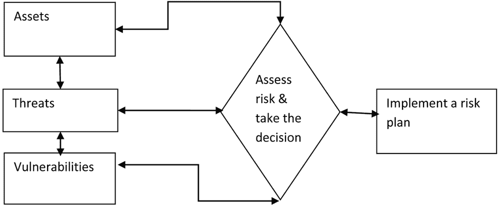 |
| --- |

### 3.6 监控风险

识别、处理和管理风险的持续过程应该是任何风险分析的重要部分。为了对 `IoT` 进行持续监控，以准确发现攻击、识别漏洞并分析网络连接设备的行为。

## 4. IoT 中的定性与定量风险分析

`IoT` 风险分析的两种主要方法是定性和定量分析。（Goodrich）

### 4.1 定性风险分析

定性风险分析是一种用于量化与危害相关风险的技术。风险评估用于产生多种结果并可能产生重大后果的不确定事件。定性风险分析通常意味着根据主观性质及其可能产生的影响评估风险发生的概率。

`IoT` 的定性风险分析技术：

#### 4.1.1 观察技术

观察可以被定义为一种分析和记录 `IoT` 设备行为的系统方法。它是处理 `IoT` 设备在不适当或不受控情况下的显性行为的技术。

#### 4.1.2 清单

清单由公司/组织准备的物品列表组成。清单用于记录 `IoT` 设备的存在、缺失或发生频率。

#### 4.1.3 评分量表

评分量表记录 `IoT` 响应的意见或判断程度或数量。评分意味着人员或系统对任何设备的判断。

#### 4.1.4 累计记录

累计记录是单个设备的记录。它作为衡量组织服务引导 `IoT` 设备增长有效性的综合指标。


#### 4.1.5 问卷

问卷是由一系列与`IoT`设备或系统相关的问题组成的设备。它是经过科学和系统分类、智能总结和分析的。问卷是获取`IoT`设备特定质量和实践的重要研究工具。

### 4.2 IoT 定量风险分析技术

定量风险分析是对风险对项目目标（如成本和进度目标）整体影响的数值估算。结果提供了项目成功概率的见解，并用于开发备用金。

* **最坏情况**：所有基于物联网的技术运行组织所需的成本较高，但从成本角度来看，系统性能或产出最低。结果是亏损。
* **最佳情况**：所有基于物联网的技术以最低的成本运行组织，且从成本角度来看，系统性能或产出最高。结果是获得最大利润。
* **最可能的情况**：所有基于物联网的技术运行组织所付出的成本与资金产出大致相当。

# 定量风险评估工具与技术

定量风险分析的工具和技术包括但不限于：

## 4.2.1 三点估算法

一种使用乐观、最可能和悲观值来确定最佳估计值的技术。三点估算法考虑了三个值：

* 最乐观估计值 (`O`)，
* 最可能的估计值 (`M`)，以及
* 悲观估计值（最不可能估计值 (`L`)）。

三点估计值 (`E`) 基于简单平均值并遵循三角形分布。

```
E = (O + M + L) / 3
```

| 图 2. `O,M,L` 的三角形形式表示。 |
| --- |
| 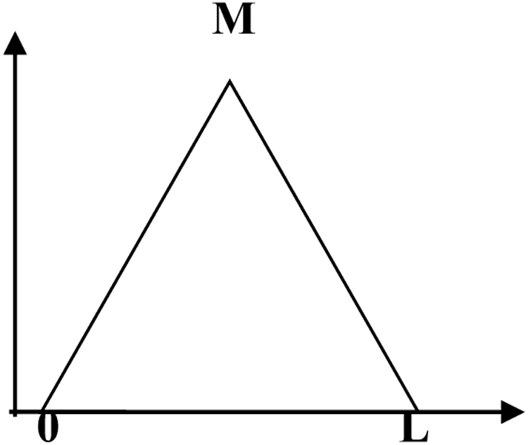 |

在三角形分布中，

```
Mean = (O + M + L) / 3
Standard Deviation = √ [((O − E)² + (M − E)² + (L − E)²) / 2]
```

### 三点估计步骤

* **步骤 1** — 获取工作分解结构 (WBS)
* **步骤 2** — 对于每项任务，找到三个值：最乐观估计值 (`O`)、最可能的估计值 (`M`) 和悲观估计值 (`L`)。
* **步骤 3** — 计算这三个值的平均值。

  ```
  Mean = (O + M + L) / 3
  ```

* **步骤 4** — 计算任务的三点估计值。三点估计值即为平均值。因此，

  ```
  E = Mean = (O + M + L) / 3
  ```

* **步骤 5** — 计算任务的标准差。

  ```
  Standard Deviation (SD) = √ [((O − E)² + (L - E)²)/2]
  ```

* **步骤 6** — 对 WBS 中的所有任务重复步骤 2、3、4。
* **步骤 7** — 计算整个项目的三点估计值。

  ```
  E (Project) = ∑ E (Task)
  ```

* **步骤 8** — 计算项目的标准差。

  ```
  SD (Project) = √ (∑SD (Task)²)
  ```

## 将项目估值转换为置信水平

通过上述方法计算出的三点估计值 (`E`) 和标准差 (`SD`) 用于将项目估值转换为“置信水平”。

该转换基于如下：

* `E` +/– `SD` 的置信水平大约为 68%。
* `E` 值 +/– `1.645` × `SD` 的置信水平大约为 90%。
* `E` 值 +/– `2` × `SD` 的置信水平大约为 95%。
* `E` 值 +/– `3` × `SD` 的置信水平大约为 99.7%。
* `E` 值 +/– `2` × `SD` 的置信水平大约为 95%。

### 4.2.2 决策树

一种显示选择一个或多个替代方案影响的图。决策树是用于识别、量化和解释不确定性的工具。决策树是由节点和分支组成的视觉模型。

## 4.2.2 期望货币价值 (EMV)

用于为项目建立应急储备的方法。期望货币价值是指你可以预计从某些情况中获得的金额。

## 4.2.3 蒙特卡洛分析

使用蒙特卡洛模拟进行定量分析的更好方法。在蒙特卡洛模拟中，不确定的输入使用称为概率分布的可能值范围表示。概率分布描述结果。

## 4.2.4 敏感性分析

用于确定哪些风险对项目影响最显著的技术。敏感性分析是一种财务模型，用于确定目标如何受变量变化的影响。它也被称为“如果...会怎样”（what-if）或模拟。

## 4.2.5 失效树分析 (FMEA)

对结构化图的分析，用于识别导致系统故障的要素。这是一种演绎程序，用于确定硬件软件故障以及人为错误的组合，这些组合可能导致系统层面的意外事件（顶层事件）。

## 4.3 物联网中定性与定量风险分析的区别

定量数据是关于数量和数字的信息，而定性数据是描述性的，涉及可以观察但无法测量的现象。

### 表 1. 定性风险分析与定量风险分析的对比

| 定性风险分析 | 定量风险分析 |
| --- | --- |
| 定性风险分析通常根据主观质量和预定义的排名标准来评估风险发生的概率及其可能产生的影响。这是必须执行的。 | 定量风险分析尝试为不利事件分配特定的金额，代表如果事件发生对组织可能造成的潜在成本，以及该事件在特定一年内发生的概率。这是可选的。 |

物联网（IoT）一术是指在现有互联网基础设施中具有唯一标识的设备之间的互连。简单来说，这是一个连接互联网的设备和传感器之间相互通信以执行指定任务的环境。物联网设备的设计旨在帮助消费者节省资金、减少能量并消除日常生活中的某些烦恼等其他益处。对物联网进行风险分析的研究将为用户带来收益。以下是一些优势：

## 客户角色的改进

通过对物联网中的风险进行定期监控，客户日益期望其物联网设备能与不同设备安全地连接。风险分析将帮助客户理解物联网设备的功能。客户将学会如何以正确的方式访问其设备。

## 技术的改进

使用更新的技术和数据进行风险分析评估将提升客户体验。技术的改进将有助于人们对技术的信任。基于物联网的技术使用正在逐日增加。它有助于以简单的方式处理复杂任务。以安全的方式改进物联网设备将增加其在组织中的应用。

## 减少浪费

风险分析将帮助管理层以恰当的方式使用物联网。这有助于组织内部更有效地利用资源。物联网使改进领域变得清晰。目前的分析仅带给我们表面浅浅的见解，但物联网提供了真实世界的信息，从而实现更有效的资源管理。

## 增强的数据收集

现代数据收集受限于其局限性且设计用于被动使用。对物联网风险分析的评估将帮助找到人类想要分析我们世界的精确空间和地点。

## 6 结论

安全性是组织中的重要关注问题。物联网在不同组织中的应用正在迅速增长。组织必须有效且理解与其使用的物联网设备相关的风险，以保护其资产。风险分析可以从多个方面帮助组织提高安全性。有必要识别基于物联网技术的系统中风险的整体影响。需要识别安全漏洞并采取必要步骤来消除弱点并加强安全。组织中应实施改进后的安全策略。对物联网风险分析的研究将有助于在组织中实施相关措施时做出正确决策。通过提供适当的指导，员工能够理解不同的安全措施和风险。对物联网风险分析的研究将成为管理与风险相关成本的重要工具和技术。物联网应用给人类生活带来了巨大变化。如今，物联网已用于并整合到许多行业和个人生活中。物联网应用旨在通过协调各项工作，最大限度地减少组织中的延迟、中断和生产瓶颈等问题点。但目前物联网（IoT）的快速增长将导致物联网设备网络攻击和安全挑战的显著增加。由于物联网中存在众多弱点，其安全措施尤为关键。由于市场上存在不同类型的设备，数据保护和安全正落后。寻找更好的物联网安全的第一步是风险分析。风险分析是对特定事件或行为相关风险的审查。在本章中，将尝试研究物联网中不同类型的安全挑战。物联网的安全挑战有助于减少问题。物联网的使用每天面临风险。风险管理至关重要，这一过程始于风险评估。适当的风险分析过程有助于减少组织的负面因素。实施风险分析过程适当步骤将给物联网带来重大变化。通常，风险是基于定量和定性分析的。对物联网定性和定量风险分析的研究将有助于处理系统中不同的挑战性问题。风险分析将有助于通过物联网安全保护我们的价值。可靠性、隐私和安全性是安全性的三大支柱。通过接受和解决不同类型的安全挑战将有助于克服物联网的安全问题。基于物联网的网络安全对于所有情况都是不同的。小型办公室只需要基础安全，而大型企业将需要高维护以及先进的软件硬件来防止黑客攻击和垃圾邮件的恶意攻击。找到不同类型安全挑战问题的解决方案将有助于系统的平稳运行。风险分析中的定性和定量方法将有助于将组织中的风险因素降至最低。

## 参考文献

- Aven, T. (2015). Risk Analysis. John Wiley & Sons Ltd . doi:10.1002/9781119057819
- Aven, T. (2015). Risk assessment and risk management: Review of recent advances on their foundation. European Journal of Operational Research , 1–13. doi:10.1016/j.ejor.2015.12.023
- Boeckl, K., Fagan, M., Fisher, W., Lefkovitz, N., Megas, K. N., Nadeau, E., & Piccarreta, B. (2018). Draft NIST Internal Report 8228: Considerations for Managing Internet of Things (IoT) Cybersecurity and Privacy Risks . Applied Cybersecurity Division, Information Technology Laboratory. doi:10.6028/NIST.IR.8228-draft
- Broder, J. F., & Tucker, E. (2012). Risk analysis and security Survey (4^(th)). doi:10.1016/C009-6385-1
- Chauhan, S., & Panda, N. (2019). Demystifying Internet of Things: Successful IoT Device/Edge Security. Apress.
- Khurana, R. (2014). Operating System . Vikas Publishing House Pvt Ltd.
- Kulshrestha, A. K. (2003). Teaching of mathematics. R. Lall Book Dept.
- Mohammeda, Z. K. A., & Ahmedb, E. S. A. (2017). Internet of Things Applications, Challenges and Related Future Technologies. World Scientific News, 67(2), 126-148.
- 蒙特卡洛模拟。（n.d.）。`RxJS`, `ggplot2`, `Python Data Persistence`, `Caffe2`, `PyBrain`, `Python Data Access`, `H2O`, `Colab`, `Theano`, `Flutter`, `KNime`, `Mean.js`, `Weka`, `Solidity`。https://www.tutorialspoint.com/modelling_and_simulation/modelling_and_simulation_monte_carlo_simulation.htm
- Nagpal, D. P. (2014). 数据通信与网络。S. Chand & Company Pvt. Ltd.。
- Palisade. (n.d.). 什么是蒙特卡洛？蒙特卡洛模拟：它是什么以及如何工作?-Palisade。https://www.palisade.com/risk/monte_carlo_simulation.asp
- Pereira, T., & Santos, H. (2014). 信息安全保护面临的挑战。会议论文：第 13 届欧洲网络战争与安全会议 (ECCWS-2014)。皮拉埃大学。
- Reuven, Rubinstein, & Kroese. (2016). 模拟与蒙特卡洛方法。DOI:doi:10.1002/9781118631980
- 风险管理：风险管理流程的 7 个步骤。（2019，10 月 3 日）。iEduNote.com。https://www.iedunote.com/risk-management
- RMstudy-风险管理认证课程。（n.d.）。http://www.rmstudy.com/rmdocs /Identify%20Risks.pdf
- Roman, Najera, & Lopez. (2011). 安全物联网。IEEE Computer, 44, 51-58。
- Ross, S. (2010). 概率论初级。Pearson 出版。
- Rouse, M. (2020). 什么是风险分析。https://searchsecurity.techtarget.com/ definition/risk-analysis
- 敏感性分析。（2003，11 月 26 日）。Investopedia。https://www.investopedia.com/terms/s/sensitivityanalysis.asp
- Shah, V. (2019). 物联网（IoT）未来的 9 大主要安全挑战。https://readwrite.com/2019/09/05/9-main-security-challenges-for-the-future-of-the-internet-of-things-iot/
- Singh, D., Singh, N., & Sharma, D. (n.d.). NCERT 解决方案书籍模拟测试卷问题 PDF。https://ncerthelp.com/
- 风险管理流程的 5 个步骤是什么？（2018，6 月 26 日）。持续职业发展。https://continuingprofessionaldevelopment.org/risk-management-steps-in-risk-management-process/
- 什么是物联网？|IoT 技术。(n.d.）。SAP。https://www.sap.com/india/trends/internet-of-things.html

# 第 3 章

* Niranjan Dandekar

  印度比尔拉理工与科学学院，比拉尼

* Amit Dua

  印度比尔拉理工与科学学院，比拉尼

* Manik Lal Das

  印度迪鲁鲁拜·安姆贝尼信息与通信学院

* Viral A. Shah

  印度迪鲁鲁拜·安姆贝尼信息与通信学院

### 摘要

农业供应链由许多参与者组成，生产者（通常是农民）、消费者（购买并消费产品的人）、批发商和零售商。该系统还包含许多级别的中介机构，他们有不同的佣金政策。由于这些政策的差异，生产者无法获得公平的价格份额。由于价格波动，消费者也遭受损失，因为他们无法以合理的价格获得优质的产品。参与者之间的交易没有维护中央记录，这可能导致许多严重问题。为了解决上述问题，我们需要一种能够为大多数问题提供解决方案的整体方法。在这里，可以使用基于区块链的解决方案来实现追溯性（我们可以追踪产品所在地、来源等）、透明性（从而建立信任感）、公平性（通过消除中间环节）、食品安全和定价保障（使无人承担损失）。

# 1. 引言

## 1.1 区块链简述

区块链是一种不可更改的账本，对特定系统的所有参与者共享并可见。

### 1.1.1 数据结构

链表可以被视为一组通过下一个地址链在一起的节点列表。下面的图显示了一个单链表。在这里，元素以线性方式存储，但与数组不同，这些元素是不连续的。例如，图中的节点 A 位于 `100`，而下一个节点 B 位于 `900`。

| 图 1. 链表 |
| --- |
| 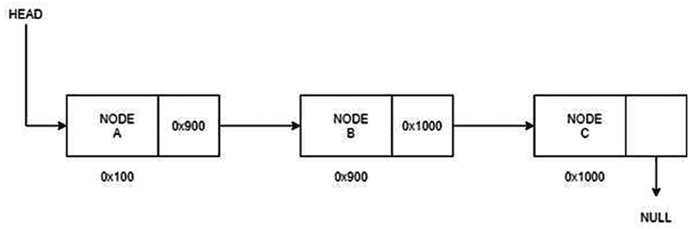 |

### 1.1.2 加密

密码学用于保护信息（无论何种类型），以便只有目标人员才能以有意义的形式访问信息。这种保护是通过使用被称为“隐藏写法”的技术完成的。在这里，使用代码将信息转换为世界上其他地方看来没有意义的东西，但通过正确使用名为`KEY`的工具，目标人员可以将这些信息转换回有意义的信息 (Stallings, 2013)。


数据的安全性基本上取决于三个主要支柱：机密性、完整性和可用性。机密性基本上意味着必须防止未经授权的访问。同样，完整性意味着信息需要保护免受未经授权的修改。可用性正如其名所示，意味着信息对于用户必须始终是可用的。为了实现上述支柱，使用了多种加密技术。在本节中，我们关注的是哈希（Hashing）在区块链中的实现。哈希使用哈希函数将任何形式的数据转换为固定大小的输出，这被称为`Message Digest`或数据指纹。使用这种方法的优势是，即使输入的`1`位数据发生了变化，其`Message Digest`也会完全不同。另一个优势是两个消息具有相同`Message Digest`的概率极低，即抗碰撞性（collision resistance）。

## 1.2 博弈论

加密货币中博弈论的基本目标是将人类的推理建模到网络中，然而它不需要人工干预，并且每次都能产生积极的结果。这基本上意味着加密货币需要在没有第三方存在的情况下运行。让我们通过比特币的例子来更清楚地理解这个概念。在这里，矿工应该使用他们的算力来保护比特币网络，作为回报，他们获得了比特币。

比特币的创建者还必须确保所有玩家遵循某些协议和规则。这些协议被用于惩罚或奖励玩家的行为。在比特币中，这种协议通过使挖掘过程变得极其困难且低效来实现。为了提议区块，矿工需要解决哈希难题并附加其解决方案，这消耗了大量的计算资源。这是比特币为了确保系统共识而实现的机制，即`PoW`。其他使用此类激励机制的机制也应用于其他加密货币。

## 1.3 共识与冗余

- **共识**：正如我们在上一节看到的，每种加密货币都实现了共识机制。现在的问题是共识是什么以及它为什么如此重要，将在本节中回答。共识基本上是一种容错机制，用于计算机科学中达成特定的值或网络状态。这种过程只用于加密货币等去中心化系统，因为在中心化系统中，值或状态可以通过中心实体获得，因此如果该实体未损坏，就可以保证是相同的。因此，保持系统一致性是一个重要方面，以便所有玩家获得相同的值或状态。
- **复制**：正如其名所示，复制是创建任何和所有数据的副本，并通过网络发送到系统中的每个其他节点。

因此，结果是网络中进行的任何交易，无论多小，都会反映在整个网络中。让我们举一个例子来理解复制在区块链中的作用。比特币由两种主要的节点组成：全节点和轻节点。正如其名所示，全节点是存储整个区块链的节点，而轻节点是不存储整个区块链的节点。

## 1.4 Merkle 树

如上一节所示，检查整个列表不是一个可行方案。因此，我们使用 Merkle 树，对于验证，我们只需要检查树的一部分。为了更好地理解，让我们看看二叉树的例子。

| 图 2 Merkle 树 |
| --- |
|  |

现在考虑一种情况，你必须检查例如`2`年前的数据。现在，使用 Merkle Tree，我们只需要检查树的根，如果不匹配，说明数据被更改了。它提供的另一个显著优势是，它可以高效地映射海量数据并识别对任何数据进行的微小更改。我们从上述讨论中获得的另外一点是，树的根可以被用作指纹。

## 1.5 数字签名

数字签名是一种提供数据真实性和完整性的加密方法。在这里数据可以是任何软件、图像、视频。通过上述服务，它还提供了另一项重要服务——不可否认性，这在我们之前是未知的（Stallings, 2013）。用通俗的话说，不可否认性意味着如果我向人 X 发送了文档，一段时间后我无法否认发送过该文档。

数字签名分为三个部分：密钥生成算法、签名算法和签名验证算法。上述数字签名的基本功能是提供真实性、完整性和不可否认性。通过以下步骤理解数字签名的过程：

1. 首先，我们计算要签名数据的哈希。所使用的哈希函数在数字签名信息中提到，因为接收者也会使用。
2. 然后我们使用我们的私钥（也称为签名密钥）对该哈希进行加密。加密后的哈希以及其他信息就是该数据的数字签名。它被附加到数据上并发送。
3. 接收者接收带有数字签名的数据。数据本身是加密的，但我们现在不谈这个。
4. 接收者使用发送者的公钥解密数字签名并获得数据的哈希。
5. 然后使用信息中提到的算法，接收者计算发送数据的哈希。如果此哈希与解密获得的哈希匹配，我们就可以保证数据没有被更改。

## 区块链的类型

### 许可区块链（Permissioned Blockchains）

也称为私有区块链，它们是一个封闭的生态系统，访问仅限于特定人群。这些人员进行的交易对外部世界不可见。通常，这类区块链用于组织内部，该组织认为数据过于敏感，不宜公开。要验证此类区块链中进行的交易，你需要获得控制该区块链的中央机构的权限。因此，由于中心实体的存在，这些区块链在本质上更加中心化（Nadir, 2019; Medium, 2020）。Ripple 可以被认为是许可区块链的完美示例。此外，Hyperledger 和 Corda 也是私有区块链。使用私有区块链具有某些优势，如下：

- 与公共区块链相比，这些区块链具有更高的可扩展性。
- 由于中心机构的存在，可以根据特定组织的规则实施不同层级或步骤的治理。
- 显然，由于参与者较少，整个区块链网络的速度较快，因此性能更高。

### 无许可区块链（Permissionless Blockchains）

也称为公共区块链，是区块链的开源变体，允许任何人作为全节点、轻节点、社区成员等参与。在这里，所有进行的交易在本质上都是完全透明的。外部世界的任何人都可以查看交易。这些区块链与私有区块链不同，在本质上是完全去中心化的，没有任何中心机构控制它们。由于缺乏中心机构，这些区块链需要某种代币（该区块链的货币）来激励和奖励参与者。公共区块链的某些特征如下：

- **货币/代币需求**：如前所述，公共区块链需要激励或奖励，因为没有中心实体，验证部分仅由参与者完成。引入代币的一个目的是可以在区块链网络中建立信任。
- **透明性**：这一属性意味着参与者可以了解系统中的每一个细节。让我们以比特币为例来理解其透明性。要访问任何比特币账户，你需要拥有关联的私钥（与每个账户相关），否则将无法访问。因此，我们可以将其视为一种默认配置，在任何情况下都必须提供给用户。但这里的透明性使用户还能获取地址（账户地址）并看到到目前为止所进行的所有交易。
- **去中心化的存在**：如前所述，此类区块链中不存在中心实体。因此，从理论上讲，要修改任何协议、对网络进行任何更改或进行任何恶意活动，需要 51% 的用户同意，这在实践中是非常困难的。

现在，我们已经看到了这两种区块链（公共和私有）的主要特征/优势，它们也存在一些缺点。从上述点我们可以看出，我们不仅从私有或许可区块链中需要隐私，还需要从公共区块链中获得透明安全性。因此，为了结合上述优点，就有了混合区块链。混合区块链的完美示例是 Dragon-chain。它为企业提供了巨大的灵活性。

## 3. 提议的 AGRI-CHAIN 系统

在本节中，我们将查看系统的详细工作原理，包括所有算法。它还提供了系统中不同参与者之间发生流程的基本概念。

如图所示，系统中的各种参与者包括农户（商品生产者）、批发商、终端消费者、零售商和 APMCs（I.E.S, 2016）。在这里，APMCs 是政府任命的委员会，根据政府颁发的法律对某些产品进行交易。在这里，交易由以下实体定义：

`Transaction = { Transaction[id], Product[id], Product[type], Product[Qty], Seller[ID],Seller[Signature], Buyer[id], Buyer[signature], Product[Status], PreviousBlock[Number],Product[Details], Price }`

- `Transaction[id]`：交易 ID
- `Product[id]`：产品 ID
- `Product[type]`：产品类型
- `Product[Qty]`：产品数量
- `Seller[ID]`：卖家身份
- `Seller[Signature]`：卖家的签名
- `Buyer[id]`：买家身份
- `Buyer[Signature]`：买家的签名
- `Product[Status]`：产品状态
- `PreviousBlock[Number]`：该交易的上一个区块
- `Product[Details]`：其他产品详情
- `Price`：正在交易的商品的价格

我们将所有这些实体之间的通信过程分为三个主要部分：

1. 农户 - APMC 流程
2. APMC - 批发商流程
3. 卖家 - 买家流程

我们将从农户 - APMC 流程开始。

| 图 3. 农户-APMC 流程 |
| --- |
| 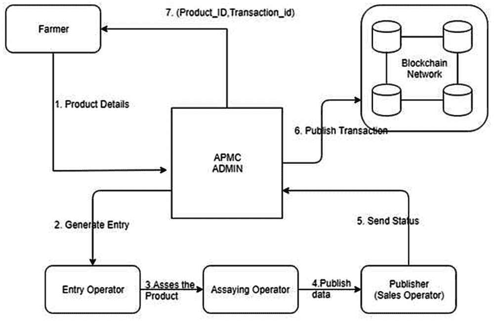 |

这部分描述了农户与 APMC 管理员之间的通信，以及与 APMC 中其他实体的通信，包括发布者（Publisher）、检测员（Assaying Operator）和录入员（Entry Operator）。

### 算法 1 发送产品详情

输入：`Product[Type],Product[Qty],Farmer[id]`
输出：`Transaction txn`

```
1 Transaction txn = new Transaction(Product[Type],Product[Qty],Farmer[id]);

2 Sigsk f id;

3 Send txn to APMC Admin;
```

在这里，每当农户想要发布他的产品以便购买时，他需要通过向 APMC 管理员发送详情来广告。这是通过`Sending Product details`算法实现的。在这里，农户提供与产品相关的所需信息，如产品类型、产品数量和农户 ID。这被转换为一个交易并使用农户 ID 进行数字签名。我们已经见过什么是数字签名以及它是如何使用的。然后将其发送给 APMC 管理员（Viral Shah, n.d.）。

### 算法 2. 发送录入

输入：`Transaction txn`
输出：`Transaction updated_txn`

```
1 if Farmer id is registered && Signature is valid then

2 txn.Product Status = "New";

3 Sig[sk admin] (txn);

4 Send txn to Entry Operator;

5 else

6 txn.Product Status = "Rejected";

7 return Error;

8 end
```

现在，一旦农户发送了他想要出售的产品详情，就需要进行验证。这是为了避免任何欺诈交易。因此，APMC 管理员执行此算法来验证交易。APMC 管理员检查提供的 ID 是否注册以及签名是否有效，如果两者都通过，管理员将交易标记为“新”并将其发送给录入员。如果 ID 未注册或签名无效，则交易被拒绝并返回错误。结果是，产品未录入，交易无效。如前所述，这是抑制恶意活动的必要预防（Viral Shah, n.d.）。

### 算法 3. 生成录入

输入：`Transaction txn`
输出：`Product id`

```
1 if Signatures are valid then

2 Product[id] = SHA[256] (Farmer id, Product Type, Product Qty, timestamp);

3 txn.Product[Status] = "Generated";

4 SigskEO;

5 Send txn to Assaying Operator;

6 else

7 txn.Product Status = "Rejected";

8 return Error;

9 end
```

现在，一旦交易通过验证发送到`Entry Operator`（入口运营），`Entry Operator`将执行必要的步骤，如车辆入场管理（针对农民的实际车辆）、农民身份验证。随后，`Entry Operator`将生成一个`Product ID`（产品 ID），该 ID 将作为唯一标识与产品关联。`Product ID`是产品详情和农民 ID 的哈希值。这里使用了`SHA[256]`。然后将相关状态与产品关联。如果操作成功，`Entry Operator`的签名将标记在交易上，然后交易转发给`Assaying Operator`（检测运营）（Viral Shah, n.d.）。

### 算法 4. 评估产品

输入：`Transaction Product id txn`
输出：`Product Quality Results`

```
1 if Product id is valid then

2 if results is in ranges then

3 txn.product quality = results;

4 txn.Product Status = "Verified";

5 SigskAO;

6 Send txn to Sales Operator;

7 else

8 txn.Product Status = "Rejected";

9 return Error;

10 end

11 else

12 txn.Product Status = "Rejected";

13 return Error;

14 end
```

当`Assaying Operator`从`Entry Operator`处接收产品时，他需要检查产品质量，以确保产品符合质量指南。为此，`Assaying Operator`将获取产品样本并在 APMC 场所亲自进行所需的测试。将所得数值与预定义的接受范围进行比较。如果从样本中获得的数值在预定义范围内，则被接受并更新`Quality`（质量）和`Status`（状态）等必要参数。此处状态更新为“Verified”（已验证）。然后，为了证明`Assaying Operator`是真实的，他的签名也会记录在交易中。随后该交易被转发给`Sales Operator`（销售运营）（Viral Shah, n.d.）。

### 算法 5. 销售审批

输入：`Transaction[Productid]txn`
输出：`Transaction[Productid]updated_txn`

```
1 if Signatures are valid then

2 Get the weight of the product;

3 Get the current price for Product;

4 txn.price = price;

5 txn.ProductStatus = "Approved";

6 Generate sales agreement;

7 SigskSO;

8 Send txn to APMC Admin;

9 else

10 txn.ProductStatus = "Rejected";

11 return Error;

12 end
```

一旦`Sales Operator`从`Assaying Operator`处接收到交易，`Sales Operator`将计算产品重量并获取价格详情。这些信息将更新到交易中。然后产品状态将更新为“Approved”（已批准）。状态更新后，将在产品买家和卖家之间生成一份协议。再次为了验证操作者的身份，他的签名被采集到交易中。然后该交易被发送到`APMC Admin`（APMC 管理）进行审批。如果之前流程中的其余签名无效，则交易将被“Rejected”（拒绝）（Viral Shah, n.d.）。

### 算法 6. 发布交易

输入：`Transaction[Productid]txn`
输出：`Transaction[Productid]txn, Transaction[id]`

```
1 if (Signatures are valid) && (Sales Agreement is valid) then

2 txn.transaction[id] = SHA256(txn);

3 txn.Product[Status] = "Available";

4 Sigsk admin;

5 Add Transaction to Block(txn);

6 Send (Product[id], Transaction[id]) to Farmer[id];

7 else

8 txn.Product[Status] = "Rejected";

9 return Error;

10 end
```

完成上述所有步骤后，APMC 接收到包含`Sales Agreement`（销售协议）在内的所有细节交易。`APMC Admin`验证所有实体的签名。它还会验证在上一个算法中生成的`Sales Agreement`。如果所有细节无误，`APMC Admin`将产品交易更新为“Available”（可用）并对交易进行签名。然后这被添加到区块中，最终被添加到区块链中。最后交易状态将发送给农民（Viral Shah, n.d.）。

现在来看 APMC - 批发商的流程，

| 图 4. APMC-批发商流程 |
| --- |
| 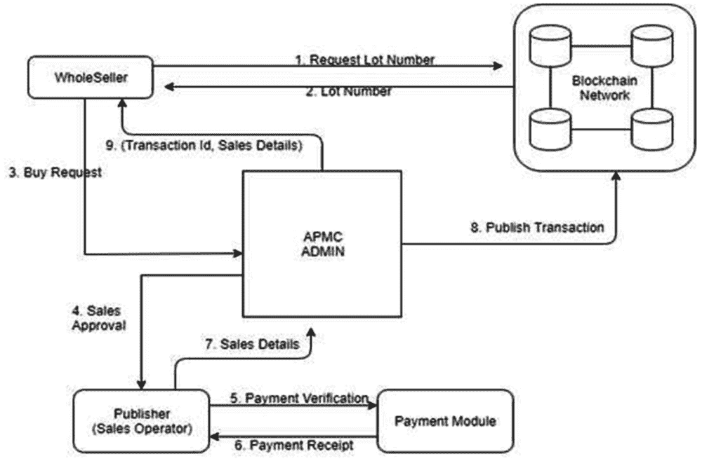 |

这部分算法概述了从 APMC 到想要购买产品的批发商之间的基本流程。为了实现这一点，可以从区块链获取详细信息。然后生成一个`buy request`（购买请求）。该过程的逐步解释将通过实现其相应功能的算法给出。算法的名称将足够直观，类似于上一小节中提到的算法。

### 算法 7. 购买请求

输入：`Product[id]`
输出：`Transaction txn`

```
1 Transaction txn = new Transaction(Product[Id]);

2 txn.previous[block] = Get-BlockNumber(Product[id]);

3 Sigsk buyer;

4 Send (txn) to APMC Admin;
```


如介绍所示，为了购买产品，批发商需要从区块链中获取数据。为此，批发商提供`product ID`（产品 ID）作为输入并创建一个新交易。然后在区块链中搜索该产品并将其详情发送给`APMC admin`。按照惯常做法，交易将由买家签名（Viral Shah, n.d.）。

### 算法 8. 销售运营审批

输入：`Transaction[Productid]txn`

```
1 if txn is valid and Sig[sk buyer] is valid then
2 send txn to Sales Operator;
3 else
4 return Error;
5 end
```

现在`APMC admin`将接收来自上一个算法的新创建交易，验证买家（批发商）的签名并将其发送给`Sales Operator`（Viral Shah, n.d.）。

### 算法 9. 销售运营验证

输入：`Transaction[Productid]txn`

输出：`Transaction[Productid]updated_txn`

```
1 if Product[id status] is "Available" then
2 receipt = Payment-Verification(Product[id], Buyer[id]);
3 if receipt is valid then
4 txn.payment - receipt = receipt;
5 txn.Product[Status] = "Approved for Sale";
6 SigskSO;
7 send txn to APMC Admin;
8 else
9 txn.ProductStatus = "Rejected";
10 return Error;
11 end
12 else
13 txn.ProductStatus = "Rejected";
14 return Error;
15 end
```

该算法的主要目的是验证支付真实有效。为了验证，`Sales Operator`将调用支付模块并获取支付收据。现在如果支付通过，运营人员将将其更新到交易中。运营人员还将交易状态更改为“Approved for Sale”（允许销售）。现在运营人员的签名包含了之前的算法，然后发送到`APMC Admin`（Viral Shah, n.d.）。

### 算法 10. 支付验证

输入：`Product[id], Buyer[id]`

输出：`Payment - Receipt`

```
1 if Product[id status] is "Available" then
2 calculate Price for the Product[id];
3 Get Payment from Buyerid;
4 if Payment is successful then
5 Generate Payment - Receipt;
6 send Payment - Receipt to Sales Operator;
7 else
8 return ERROR;
9 end
10 else
11 return ERROR;
12 end
```

这就是在上一个算法中提到的支付验证模块。该算法的输入将是`Product[id]`和`Buyer[id]`。该模块首先检查产品的可用性，并在市场获取产品的当前价格。然后从买家账户中扣除金额并生成收据。该收据将发送给`APMC Admin`，它将将其用于验证（Viral Shah, n.d.）。

在执行“销售运营验证”算法后，它会将签名的交易发送到`APMC Admin`。管理员将验证交易中包含的所有签名，并将交易状态更改为“SOLD-TO-WHOLESALER(ID)”。该交易将由`APMC Admin`签名，然后添加到区块链。交易详情将发送给买家（Viral Shah, n.d.）。

现在来看买卖双方流程，

正如算法的最后几个小节所述，产品现在已由批发商提供。在这里，批发商是直接与产品生产者接触的人。此后，批发商可以将产品供应给任何人，从零售商到将其作为原材料的工业。为了做到这一点，买家需要从区块链获取产品详情。交易的双方参与者之间签署了一份《共同协议》（Mutual Agreement）。该共同协议将包含在交易本身中。算法的下一个小节将描述这些过程是如何的。

| 图 5. 买卖双方流程 |
| --- |
| 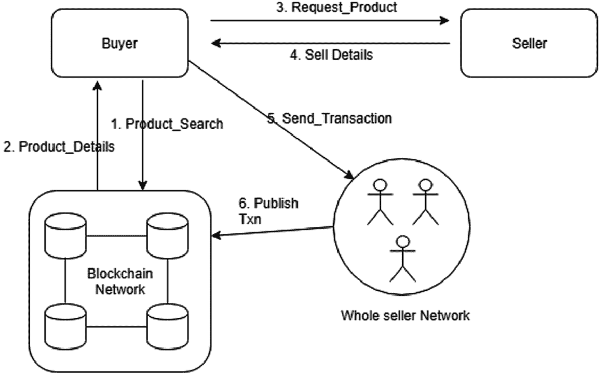 |

### 算法 12. 买家购买请求

输入：`Product [id]`

输出：`Transaction txn`

```
1 Transaction txn = new Transaction(Product[id], Buyer[id], Seller[id]);
2 Sig[sk bid] (txn);
3 Send txn to Seller S[id] ;
```

如上所述，为了购买产品，买家将从区块链获取产品详情。因此，该算法的输入将是`Product[id]`。现在如算法所述，将创建一个新交易，包含产品、买家和卖家的详情。该交易还将包含买家的签名。该交易将进一步发送给卖家（Viral Shah, n.d.）。

### 算法 13. 卖家响应

输入：`Transaction txn`

输出：`Transaction updated_txn`

```
1 if Signature is valid & Product[id] is available then
2 txn.price = price txn.status = "Available to Sell" Sig[sksid] (txn);
3 Send txn to Buyer S[id] ;
4 else
5 txn.status = "Not Available";
6 end
7 Send txn to Buyer B[id] ;
```

当卖家收到上一个交易转发的请求时，它将根据市场当前价格更新产品价格。随后，它还将产品状态更新为“Available to Sell (Buyer ID)”。交易还将包含卖家的签名，并发回买家（Viral Shah, n.d.）。

### 算法 14. 买家确认

输入：`Transaction txn`

输出：`Transaction updated_txn`

```
1 if Signature is valid & agreed on the details then
2 txn.status = "Available With Seller[id] "
3 Sig[sk bid] (txn);
4 Send txn to Wholesaler Network;
5 else
6 Update the details;
7 send back to Seller S[id] ;
8 end
```


买家从卖家处收到产品相关详情后，买家将对详情进行验证。如果它们与交易中提到的内容匹配，则执行该交易。

## 4 实现

在上一节中我们看到了所有的算法。现在我们来详细讨论它们。首先，我们将使用 `Hyperledger Fabric`，如前所述，这是一个私有区块链。使用 `Hyperledger Fabric` 的主要目标是将网络限制在参与者。

### 4.1 Hyperledger Fabric

`Hyperledger Fabric` 是由 Linux Foundation 开发的开源系统。作为部署和运行区块链的模块化可扩展系统，根据我们对许可区块链的需求，将使用该平台。这是一个易用平台，提供了多种模块和功能，无需重新实现。因此，这允许这些特性的易复用以及现有功能的集成。

为了理解基本功能，让我们考虑一个由背书节点、背书策略、客户端、排序节点和提交者组成的示例。提议的交易（如购买产品）提交给背书节点。满足所需的背书数量后，客户端将交易发送到排序节点。现在交易在区块中分组并发送给提交者。提交者验证背书策略执行以及是否存在冲突交易。一旦完成检查，交易将提交到账本。

### 4.2 Hyperledger Composer

`Hyperledger Composer` 是一个开源开发框架，有助于在 `Hyperledger Fabric` 环境之上开发区块链应用程序。它还帮助通过包含参与者、资产和业务规则的业务网络（称为交易）来实现这一理念。

如上所述，我们可以使用 `Hyperledger Composer` 提供的建模语言（`CTO`）来定义参与者、资产和业务规则。`Composer` 为每个参与者分配一个唯一身份，该身份由公钥和私钥组成，以便与系统及其中的其他参与者交互。

业务网络卡是系统中的重要组件，因为访问区块链的唯一可能方式是通过有效的业务网络卡。为了简单起见，我们可以业务网络卡比作政府批准的身份证明，例如驾驶执照。正如有效的政府 ID 允许参与者享受各种服务一样，业务网络卡允许参与者连接到网络。根据此卡片，将为参与者决定访问控制规则。管理员负责为每个参与者创建关联的业务卡。当卡片首次使用时，会与卡片关联一个公钥和一个私钥，以对每个参与者进行唯一标识。业务网络存档由模型、交易、权限和事件文件组成。

### 4.4 系统方法论

本节将结合上述所有组件，并详细说明系统在使用上述所有组件时所遵循的步骤。

- 最初，需要安装 `Hyperledger Fabric` 以及所有必要的 docker 镜像，使得组织、节点、`Couch DB`、排序器（`orderer`）等所有模块都就绪。所有这些组件将在后台运行，并初始化 `Hyperledger composer`。
- `composer` 将包含一个 `model.cto` 文件，用于定义参与者（`Participants`）、交易（`Transactions`）和资产（`Assets`）。
- 我们系统的参与者包括农民、`APMC`（农产品市场委员会）、入口员、检测员、销售员、批发商、零售商和客户。
- 资产将是产品（`Products`）、货运（`Shipments`）和订单合约（`OrderContract`）。
- 交易根据每个算法的需要进行定义。
- 完成上述步骤后，将部署业务网络，并创建一个业务网络存档文件，它是业务网络的完整包。
- 在建立网络后，我们需要为 fabric 连接创建一个连接文件，并为管理员用户识别公钥和私钥。通过这种方式，我们为管理员创建一个业务卡，负责为所有参与者创建网络卡。此管理员卡通过 `import` 命令注册到网络中。
- 最终，根据 `APMC`、批发商等的信誉，可以将管理员角色移交给他们。因此，一旦在系统中添加了新参与者，管理员将向该用户发放身份标识。身份包括分配公钥和私钥。
- 根据系统中分配给参与者的角色，他们执行某些任务。在执行这些任务过程中创建的每笔交易都会使用交易 ID 和时间戳永久存储在账本中。

## 5 结论

在本章中，我们讨论了传统农业供应链系统的问题，并展示了区块链如何克服与现有供应链相关的问题。为了更多地了解区块链技术，我们提供了理解区块链技术如何工作所需的基础知识的概述。透明度、可追溯性和公平性是现有农业供应链面临的最突出的挑战。我们提出了一种区块链赋能的 `Agri-chain` 系统，并提供了详细的操作流程，以及与系统涉及的各种交易和参与者实体相关的算法。我们提供了所提系统的实现细节。

## 参考文献

- Androulaki, E. (2018). Hyperledger Fabric: A Distributed Operating System for Permissioned Blockchains. Academic Press.
- Buterin, V. (n.d.). A next-generation smart contract and decentralized application platform. https://github.com/ethereum/wiki/wiki/White-Paper
- Composer, H. (2019). Welcome to hyperledger composer. https://hyperledger.github.io/composer/latest
- Nakamoto, S. (2008). Bitcoin: A peer-to-peer electronic cash system.

# 第 4 章：使用 LSTM 进行时间序列研究

### 摘要

人类倾向于对未来事件做出预测，无论概率如何。我们对解决谜题和模式深着迷。这样一个令许多人感兴趣、充满复杂性和不可预测行为的领域之一就是股市。在过去的十几年里，我们一直试图通过稳健的计算系统来寻找模式并理解股市的行为。

## 引言

即使在当今技术高度发达的世界里，股市预测也相当复杂。通常，人们说，随机挑选的股票表现可能比通过复杂算法选择的股票表现更好。

近年来，我们见证了股市行为动态的改变。由于涉及股市波动的各种因素，股市正变得更加不可预测，这反过来引起了对投资者和研究人员用于预测股市行为的方法的关注。

## 文献综述

在 (Lee, 2015) 中，作者提到加密证券市场不需要对传统股市进行任何改变，但加密证券的 `Blockchain`（区块链）理念可以作为一种替代方案。根据作者的观点，可能需要两种系统并行。在 (Yoo, 2017) 中，作者通过韩国等其他国家的案例分析了 `Blockchain` 技术，并得出从客户认证领域的 `Blockchain` 技术是合适的结论。作者还表示，在使用该技术之前，应首先分析其安全性、安全稳固性以及实施成本。在 (Lee et al., 2019) 中，作者分析认为，不同研究人员之前建立的模型都是针对单一国家的，他们没有考虑全球市场。作者提出了一个使用人工神经网络考虑全球市场的模型，并获得了更好的结果。在 (Janková & Dostál, 2019) 中，作者利用人工智能对美国股市进行了分析。通过考虑投资者影响、经济乐观情绪、政治稳定指数以及市场中其他情绪，创建了一个模糊模型。他们获得的结果显示对金融市场有良好的控制和监督。在 (Lussange et al., 2019) 中，作者使用了多智能体系统模型进行投资组合管理。遵循了用于价格预测和股票交易的长期纯股权自动强化学习策略。结果显示，通过贪婪智能体，代理破产率降低了很大比例。

这就是机器学习和神经网络大显身用场的地方 (De Oliveira et al., 2013)。神经网络擅长像人类大脑一样学习，而且与人类大脑相比，它们甚至在大规模尺度上表现出色。

## GOOGL 股价预测

`Googl` 自 1998 年以来在技术领域已经建立，并以闪电之速进化。像 `Googl` 这样的科技巨头的股票价格在短时间内波动很大，这使得预测变得更加困难 (Fama, 1965)。

在这里，我们使用了 `LSTM` 神经网络（一种循环神经网络）对 `Googl` 股票 (`GOOGL`) 数据进行训练并预测未来价格 (Finance, n.d.) (Shah et al., 2018)。`LSTM` 更擅长从大量数据中学习，并产生一个可持续的模型来预测股价。

### RNN: 简述

如上述，`LSTM` 网络是图 1 所示的特殊类型 `Recurrent Neural` 网络 (Rather et al., 2015)。在简单的循环神经网络中，有一组重复单元。网络将数据从起始单元传递到结束单元，即所有单元都是相互连接的。最初 `RNN` 在从语音识别到文本分类的所有问题上表现良好，但后来研究人员发现，与基准相比，其结构存在缺陷 (Yoshihara et al., 2014)。

| 图 1 简单 RNN 的结构 |
| --- |
|  |
| --- |

在这个网络中：

-  神经网络的一个单元
-  神经网络单元的输入
-  这些单元的输出

#### RNN 中的主要问题

- 短期记忆 - 当传递步骤过多时，`RNN` 通常会丢弃之前的可用信息，这在某些领域（例如文本分类）是一个巨大的缺陷。
- 梯度消失 - 梯度用于调节给定神经网络的权重，如果它太小，网络就会忽略未来的学习 (LeCun et al., 1998)。
- 梯度爆炸 - 梯度消失的相反面，即对梯度的过度关注。

| 图 2 LSTM 网络的结构 |
| --- |
| 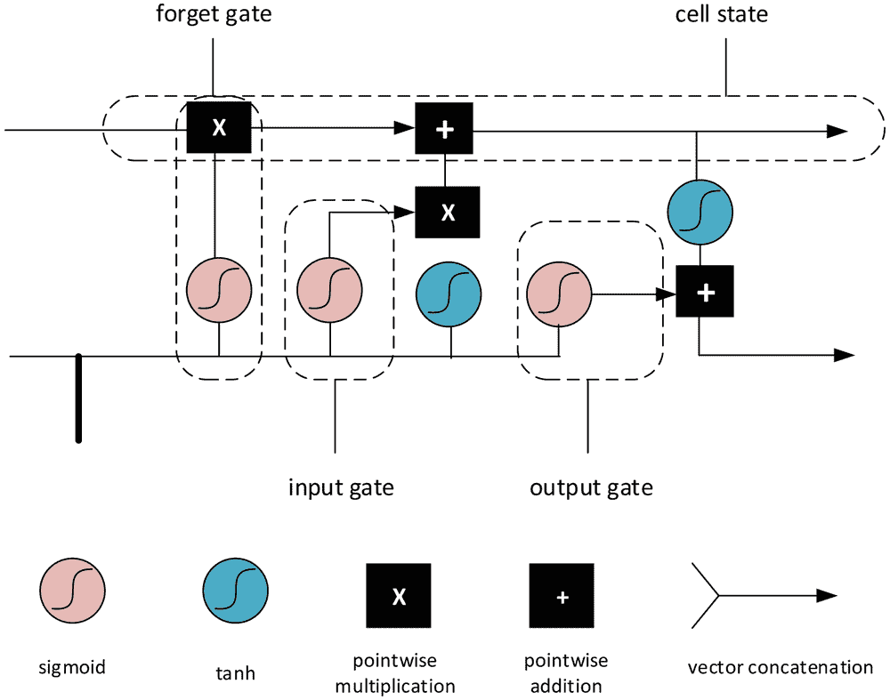 |
| --- |

### 解决方案：长短期记忆

`LSTM` 和 `RNN` 的工作原理相似，都会将数据传递给后续单元，但 `LSTM` 具有改进的特征——门：有助于决定是否获取信息 (Hochreiter & Schmidhuber, 1997)。

#### LSTM 的组件

- 单元状态（`Cell State`）：作为传递序列信息的中继。
- 遗忘门（`Forget Gate`）：单元间信息传递的选择。
- 输入门（`Input Gate`）：通过决定保留哪些信息来控制单元状态。
- 输出门（`Output Gate`）：选择激活下一个隐藏状态。

如图 3 所示，训练数据集中给出了股票交易日期、开盘价（`Open`）、当日最高价（`High`）、当日最低价（`Low`）、当日收盘价（`Close`）、调整后收盘价（`Adj Close`）以及股票交易量（`Volume`）。

| 图 3. 训练数据集样本数据 |
| --- |
| 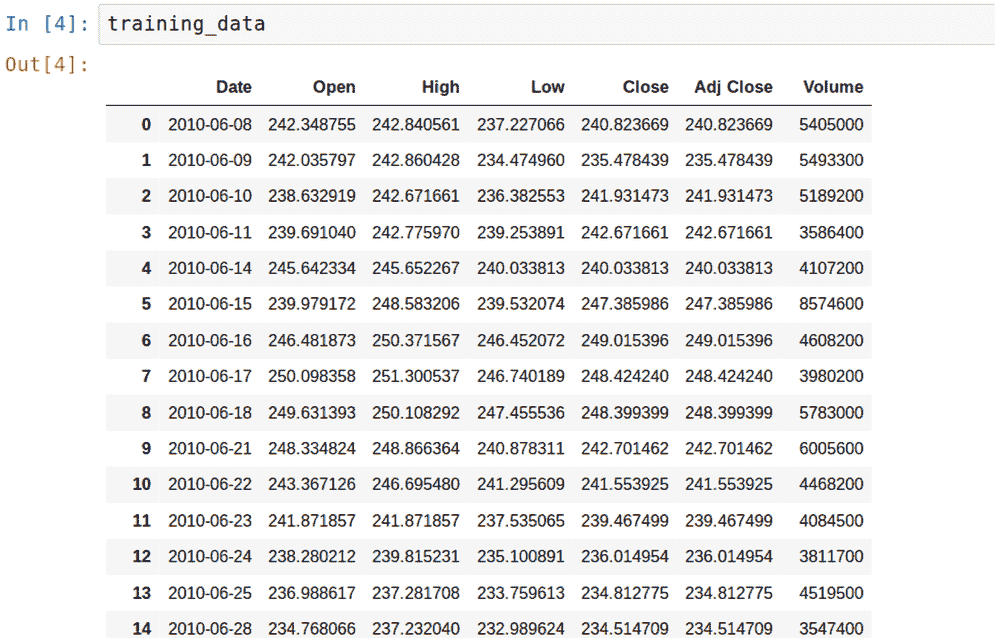 |
| --- |

## 训练方法论

### 步骤 1：导入所需的库并加载训练数据集

这里有两个 csv 文件：1) 用于模型训练的 `training_set.csv` 和 2) 用于模型测试的 `testing_set.csv`。图 3 显示了训练数据集的样本数据。

`training_set` 包含了从 `08/06/2010` 到 `08/06/2015` 的五年股票走势数据。对于测试阶段，我们提取了从 `09/06/2015` 到 `09/06/2017` 的两年数据。

### 步骤 2：绘制数据点

在图中，我们可以看到数据点在多年间的分布情况。初始图比较了给定日的 `Opening`、`Closing`、`High`、`Low` 和 `Adjusted Closing Price`。下方的图（图 4）代表了这些参数。

| 图 4. 显示 GOOGL 股票价格随时间变化的图 |
| --- |
| 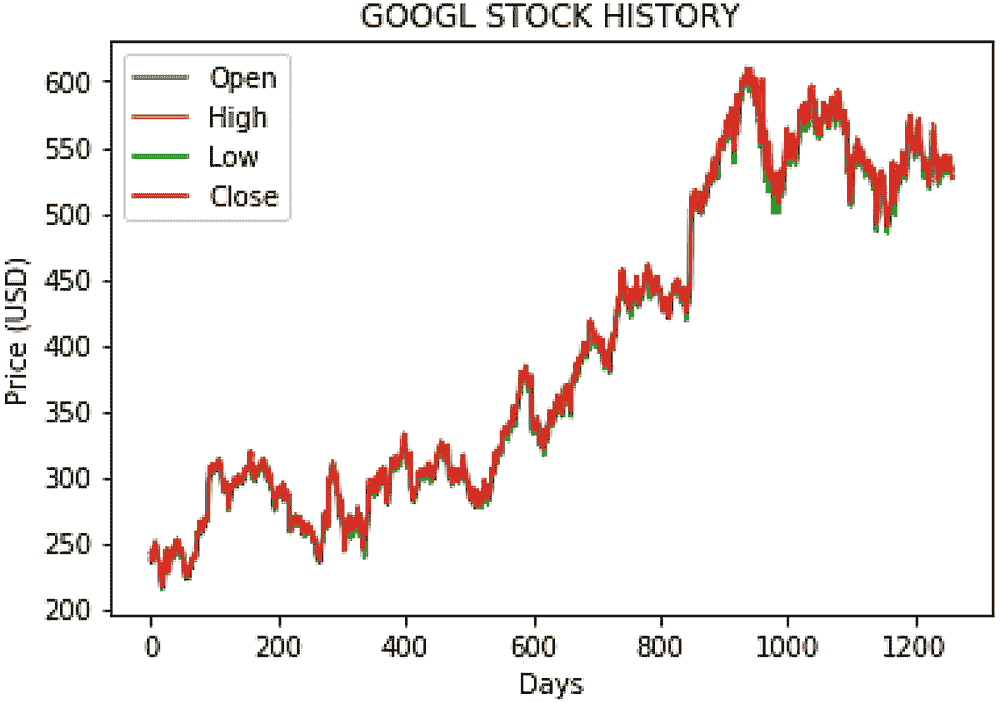 |
| --- |

观察可见，Y 轴代表股票价格，X 轴代表日期。从图中清楚地看出，任何给定日的各种价格都非常接近，这表明价格在特定日期的波动非常微小。

但还有一点需要注意，价格在几天到几周时间范围内的波动是非常随机的，很难观察到规律模式。该图也验证了股票走势的随机性。

接下来是成交量图，显示了某一天交易的股票总数，图 5。

| 图 5. 显示给定日交易股票数量的图 |
| --- |
| 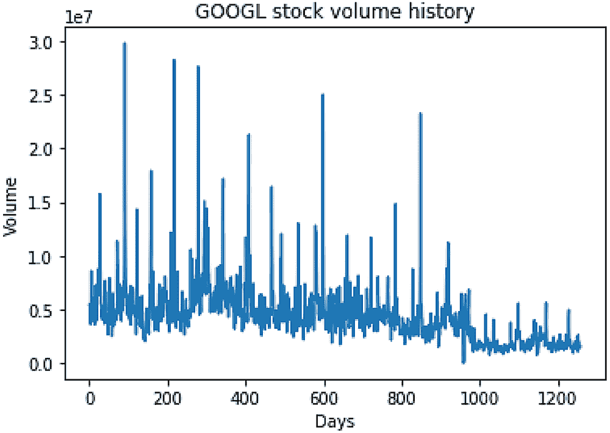 |
| --- |

该图在决定预测策略时可能有用。因为图中存在一些高值，这表明在特定一天内有大量的股份在来回交易。

### 步骤 3：训练集的归一化

这些股票价格从 240 变到可能高达 470 等；因此，处理这些数据点有点杂乱，为了更清晰且易于处理，我们需要将其归一化到 `0` 到 `1` 的范围内。这对于计算和训练阶段会更好。图 6 显示了未归一化与归一化的数据样本。

| 图 6. 未归一化 vs. 归一化数据 |
| --- |
| 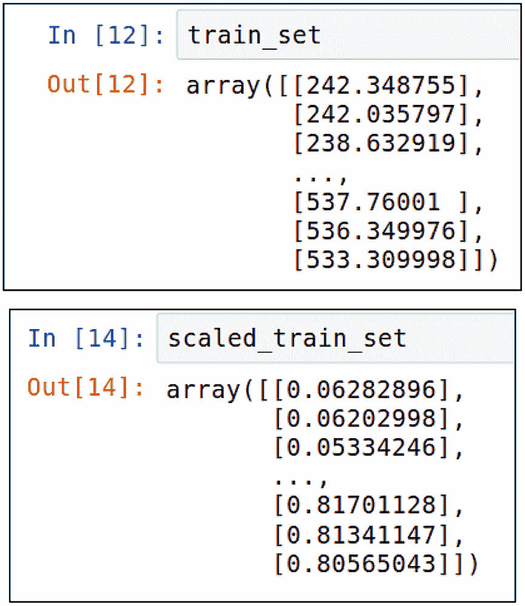 |
| --- |

### 步骤 4：创建时间戳

如前所述，`timestamp` 取决于之前的信息，我们需要设置 `timestamp` = `60`。

### 步骤 5：开发模型

在我们的模型中：

1. `Sequential` 层 - 用于初始化
2. `LSTM` - 用于网络
3. `Dropout` - 用于网络
4. `Adam` 优化器 - 用于网络
5. `Output` 层 - 用于网络

下图（图 8）展示了 `Batch size = 40` 和 `Epochs = 100` 下的训练和测试结果。

| 图 8. batch size 过大时学习效果差 |
| --- |
| 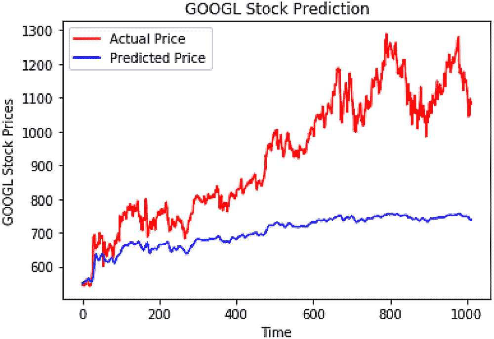 |
| --- |

由于 batch size 较大，学习曲线变得平坦，模型在训练数据上的表现非常差（图 8），这完全是因为当批通过模型时，它会改变新批次的偏置值，如果 batch size 太大，数据集的处理速度过快，从而导致结果糟糕。

即使我们尝试使用非常小的 batch size，它也会有自己的缺点，导致模型的学习率变得非常缓慢，因此很难达到最优值，此外另一个威胁是过拟合。

总体而言，batch size 应该处于相当且中等的水平，这样才不会影响学习并获得良好的结果。

`Epochs` 也必须合理选择，以避免对数据集的过拟合或训练不足。

## 结论

对于我们的训练模型来说，超参数的选择至关重要。在多次运行中，我们尝试了不同的隐藏层大小、batch size 以及 epoch 数量，另一个起作用的因素是 `Dropout rate`：用于处理过拟合问题（Merity et al., 2017）。当我们将 dropout rate 增加到 30%，并将 `LSTM` 层大小调整为每层 50 个神经元时，我们得到了更好的结果；对于 `batch size` 24 和 65 个 `Epochs`，我们获得了 0.0020 的准确率，在测试数据上的表现也良好。下图（图 9）显示了最终结果：

| 图 9. 训练良好的模型性能 |
| --- |
| 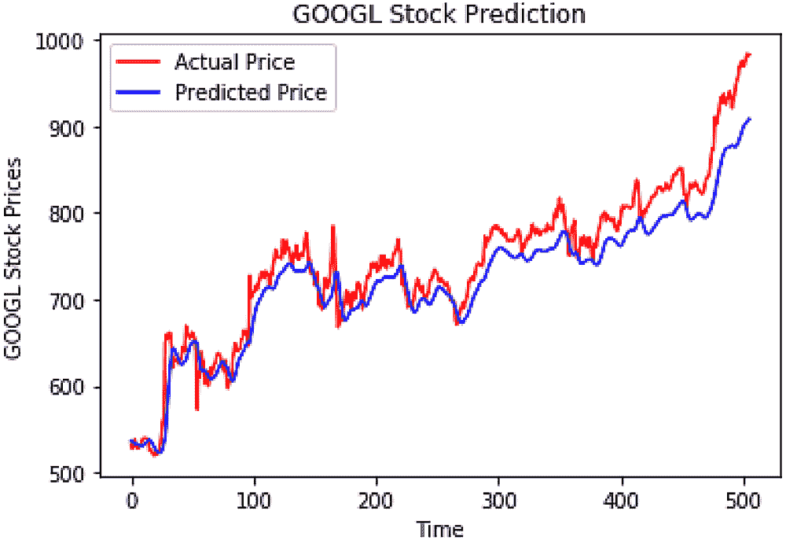 |
| --- |

总之，模型获得的结果很好，但并非完全准确，因为仍然存在过拟合的可能性，而且完全根据历史数据预测股价将是非常幼稚的。

使用 `LSTM` 网络是迈向复杂模型的第一步，该模型将更准确并适用于各种公司。股市的波动是多种因素共同的结果，包括国家的经济状况、贸易法规、公司政策和股东行为等。

该模型可以结合情感分析以及对其他市场指标的研究，如基本面分析、技术分析等（Li et al., 2014）。为了使模型更准确，我们需要为模型寻找更好的超参数，并调整网络架构以寻找是否有改进空间。

所提工作涉及 Google 股票数据的时间序列分析。在这项研究中，我们研究了历史波动，并仅根据之前提供的股价预测了未来价格。

此外，所提工作的结果为预测预测模型奠定了基础。需要考虑的方面如下：

- 基本面和技术方面：公司的基本面、公司运营情况、公司治理、公司领导以及股票的技术分析可以帮助提高准确性。
- 最新新闻的情感分析：新闻在日常生活中起着至关重要的作用。分析与不同国家贸易交易的新闻、公司进展新闻以及竞争对手的相关信息可以帮助构建优化模型。情感分析（B et al., 2015）有助于评估针对特定股票的走势和市场观点。
- 跨股票分析：虽然两家公司的股票似乎相互独立，但分析同一板块的股票有助于判断该板块的表现，以及整体市场如何受到近期新闻和一般事件的影响。这些方面可能有助于构建更复杂的股票模型。

## 参考文献

Srivastava, N., Hinton, G. E., Krizhevsky, A., Sutskever, I., & Salakhutdinov, R. R. (2014). Dropout: A simple way to prevent neural networks from overfitting. Journal of Machine Learning Research , 15, 1929–1958.

Yoo, S. (2017). Blockchain based financial case analysis and its implications . Asia Pacific Journal of Innovation and Entrepreneurship. doi:10.1108/APJIE-12-2017-03

Yoshihara, A., Fujikawa, K., Seki, K., & Uehara, K. (2014). Predicting Stock Market Trends by Recurrent Deep Neural Networks. In PRICAI 2014: Trends in Artificial Intelligence, vol. 8862 of Lecture Notes in Computer Science (pp. 759–769). Springer International Publishing. doi:10.1007/978-3-319-13560-1\_60

# 第 5 章

- **Muralidhar Kurni**
  
  印度，贾瓦哈拉尔·内赫鲁科技大学，安纳塔普尔姆

- **Somasena Reddy K.**
  印度，贾瓦哈拉尔·内赫鲁科技大学，安纳塔普尔姆

### 摘要

随着物联网（`IoT`）的日益普及，连接设备已触及我们生活的方方面面，从家居自动化、健康健身、汽车、物流到智慧城市以及工业`IoT`。因此，`IoT`（事实上的连接设备）和自动化技术在农业领域的应用是顺理成章的，并极大地增强了农业的几乎每一个方面。在过去的几十年里，农业经历了各种技术变革，变得更加工业化并由技术提供动力。通过使用各种智能农业设备，农民们对牲畜养殖和作物种植过程获得了有效的控制和效率。在本章中，作者讨论并分析了在农业中使用`IoT`的优势。他们提出了用于实现智能农业的`IoT`系统架构。本章还涵盖了将区块链整合到农业领域的优势。结尾包含了案例研究供您参考。

## 1. 引言

物联网（`IoT`）领域是一项显著的标准，它通过互联网在各种传感器和电子设备之间建立连接，以辅助我们生活的进步。`IoT`通过智能设备和互联网，为全球范围内政府机构（包括公共部门和私营组织）以及多家企业面临的若干问题和挑战提供了创新的解决方案（Sfar et al., 2017）。

`IoT`的快速增长使其成为我们日常活动的重要组成部分，甚至我们已经意识到它的存在无处不在。简单来说，`IoT`可以定义为一种现代技术，它由广泛的智能设备、架构、传感器和各种智能设备组成（图 1）。此外，`IoT`利用了纳米技术和量子技术，这在存储空间、感知能力和处理速度方面提供了可靠的收益，而这些在最初是未被想到的（Gatsis & Pappas, 2017）。

随着`IoT`技术和设备的参与日益增加，我们可以感知到日常生活活动发生了显著变化。通过扩展生产价值链中的可用信息，`IoT`技术提供了通过网络传感器重构农业、制造业、能源建设和分发的增强机会。`IoT`在技术和我们生活的各个方面的可能性是巨大的。尽管如此，一个重大挑战是解决数据/信息安全问题并装备使其更具优势。尽管如此，`IoT`在管理与数据/信息安全相关的担忧方面做出了最佳实践努力。

### 1.1 什么是物联网？

“物联网”（`IoT`）这一术语由英国技术专家 Kevin Ashton 于 1999 年首次提出，用于解释一种现实世界物体通过互联网连接传感器的模型（Lee & Lee, 2015）。如今，`IoT`是一个显著的术语，用于解释那些包含互联网连接性，并扩展到各种设备、物体、传感器和日常用品的计算能力的框架。

| 图 1. 物联网概览 |
| --- |
| 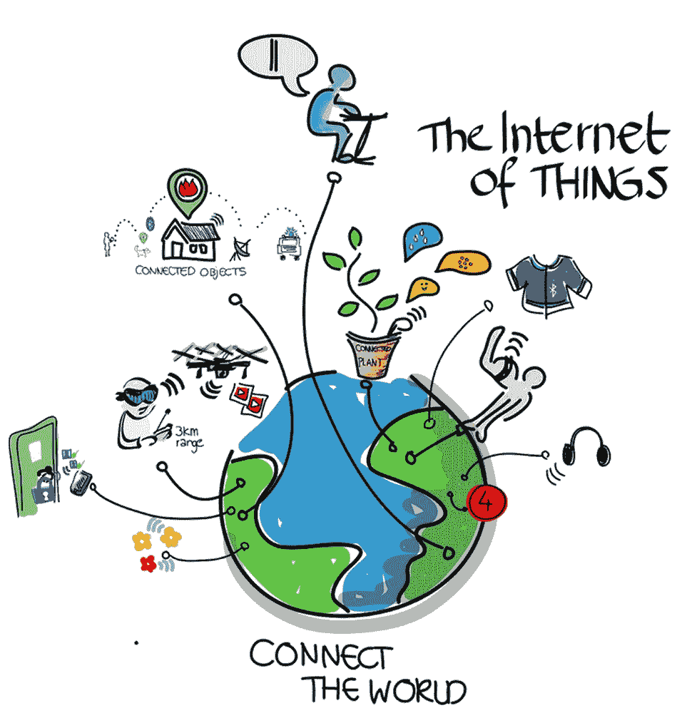 |
| --- |

在 IT 领域，`IoT`是一个快速发展的模型。`IoT`可以总结为一种技术，通过与任何特定设备建立连接，该设备具有用于互联网连接的`ON/OFF`开关以及它与其连接的其他联动设备。物联网（`IoT`）是一个巨大的网络，大量大小和形状各异的设备与人们相互连接，其中每个物体都收集数据并在它们以及连接的环境之间分配数据。这些物体范围可以从旨在预定时间内自动烹饪食物的微波系统，到具有复杂传感器以识别行驶路径的自动驾驶汽车，再到收集个人健康数据（如心率、运动记录、每天步数、压力水平等许多数据）的可穿戴智能健身设备，并利用这些数据相应地建议运动计划。还可能通过应用程序跟踪足球的各个方面，以根据踢球速度来理解足球的运动、距离和轨迹。这些信息和统计数据可以用于未来训练球员。

### 1.2 定义 IoT

尽管全球对物联网的热度很高，但尚未有一个全球通用的`IoT`的定义。因此，许多小组以多种方式定义了`IoT`，以促进对物联网及其主要特征有更广泛的观点（Madakam et al., 2015）。

### 1.3 IoT 对组织的优势

`IoT`为组织带来了许多优势。这些优势可以分类为特定行业的优势，其中一些也适用于许多行业。`IoT`的一些惯性优势有助于企业：

- 观察其完整的业务流程
- 增强消费者体验（`cx`）
- 节省金钱和时间
- 提高员工效率
- 融合并调整各种可用业务模型
- 生成增强的业务解决方案
- 产生更大的利润

物联网（`IoT`）的出现为公司重新审视其业务经营方法铺了道路，并为增强业务计划提供了必要的工具。由于`IoT`利用传感器和各种`IoT devices`，`IoT`的应用在许多组织中非常丰富，例如制造业、公用事业和运输业；但`IoT` 在农业、家庭自动化和基础设施等行业也展现了优势，这为这些行业的数字化转型提供了空间。`IoT` 帮助从事农业的农民通过自动化耕作方法轻松完成工作，通过传感器收集温度、湿度、降水量、土壤含量及其他方面的各种环境数据，从而实现更高效的收获。

### 1.4 物联网在实时领域的应用

物联网（`IoT`）为组织提供了大量的实时应用，例如用于管理的工业物联网（`IIoT`），同时也适用于个人消费者。`IoT` 的应用延伸到能源、电信和汽车等更广泛的领域。智能手机和电脑可以实现自动化，访问智能家居中的各种设备，其中包括包含智能温控器、家电器、照明、加热的连接设备，以及消费领域的电子设备。这通过包含传感设备和软件的可穿戴设备为各种用户提供了更佳的舒适度，这些软件负责收集和评估用户数据，并将其转发给其他各种技术以优化结果。此类设备也可用于确保公共安全，例如，在紧急情况下通过提供通往目标位置的最佳路线，或在威胁生命的情况下追踪消防员或建筑人员的关键指示，来缩短响应时间。

与其他重要部门一样，`IoT` 在医疗保健领域也扩展了支持并提供了巨大的优势。预期的收益包括对患者进行密切观察、监控其护理工作流程、机器间通信、医疗器械库存管理等。智能建筑可以使用`IoT`感应会议厅、家庭或办公室的温度水平，并根据房间内的人数自动开启/关闭空调。在智能城市的案例中，`IoT devices`和传感器的部署将有助于减少交通、节能、观察和呈现环境中的各种挑战以及改善卫生。在农业领域，基于`IoT`的智能农业系统将非常有用。它们可以通过收集温度、湿度、土壤含水量、光照等各种环境数据来支持对农田的监控。`IoT` 还有助于灌溉系统的自动化。

## 2. 农业及其重要性

在历史上，人们一直尝试通过各种现代化技术，用更少的资源和人力提高农业产量。然而，由于人口增长率迅速，需求和供给从未匹配。预计到 2050 年，世界人口将超过 98 亿，这比目前的人口增长了近 25%（Affairs, 2020）。为了满足不断增长的人口消费需求，粮食生产必须增加一倍（Un, 2009），（`B22B-01: 国家范围内提高作物生产中的氮水管理 (邀请)`，2020）。此外，作物生产对粮食生产同样重要，因为橡胶、棉花、树胶等某些作物的作用对多个国家的经济做出了贡献。确保粮食安全也至关重要，因为在生产生物能、生物燃料和其他许多工业需求中需要。这些需求可能导致可用农业资源的稀缺。

遗憾的是，由于气候、温度和土壤质量等限制，只能利用地球的有限部分。此外，经济、政治、人口增加、城市化等其他因素在过去几年面临着严峻挑战（Bruinsma, 2017）。因此，近期对粮食的需求存在不一致性。

此外，调查报告显示，每个农田都具有不同的特征，必须进行独立评估。土壤类型、养分可用性、灌溉流量和抗虫性是决定特定作物收获能力的一些重要特征。在许多情况下，单个可耕地内存在许多差异，尽管该土地每季都种植同一种作物。因此，需要针对特定田地的评估来满足这些需求，并以更少的人力产生更高的产量。

### 2.1 智能农业的必要

通过传统的耕作程序，农民必须经常监督农田里生长的作物，以清晰了解状况。为了了解作物状况，约 70%的时间浪费在监督作物上，而不是实地作业。这使得对智能农业产生了需求（Navulur et al., 2017）。

使用传感设备和通信的现代技术允许农民无需亲临现场即可监控农田。这可以被称为“田间之眼”能力，即远程观察农田。无线传感器可以以更高的准确性持续观察作物，并能够及早识别不理想状态。

这就是为什么当代农业方法利用智能套件和工具，负责从播种到收获的整个生命周期，并为储存和运输这些作物提供支持。各种传感器被用于实时报告数据，这促进了数据分析的整体过程并提供了准确的监督能力。

目前，物联网（`IoT`）已影响到健康、制造、通信、能源、农业等多个领域和行业，降低了它们的局限性并提高了各个市场的效率（Sisinni et al., 2018)(Ayaz et al., 2018)(Lin et al., 2017)(Shi et al., 2019)(Elijah et al., 2018)。显而易见，`IoT`技术将在农业行业使用的许多应用中发挥至关重要的作用。这种可能性的原因是，`IoT`技术凭借其丰富的通信基础设施通过互联网将智能系统（即传感器、智能手机、车辆等）连接起来，并通过依赖云的、智能数据分析（本地或远程数据）以及决策的自动化的用户界面提供各种服务，从而增强了农业流程。`IoT`技术的能力可以改变农业部门，该部门目前被认为是我们价值链中能力较低的领域之一。

为了鼓励农业中的智能化解决方案，农业领域进行了大量的研究。世界各地的工程师和研究学者提出了各种方法和架构，在考虑作物类型和农田的情况下，推荐不同类型的设备来观察和收集作物在不同阶段的状态数据。各种顶尖行业提供了各种传感器、机器人、无人机、通信设备和其他其他重型机械，以对收集的数据提供适当的分析。为了利用技术管理和监测环境及食品安全措施，多个政府机构和委员会正在为农业和食品行业制定标准和政策（COGECA, 2018)(Monitor, 2017)(King et al., 2017)(Blockchain & Safety, 2020）。`IoT`通过调查农业中的各种问题/障碍并提供最佳解决方案，改变了农业行业及其环境。

## 3 农业中的物联网

通过在农业实践中应用`IoT`技术，传统农业实践每个方面都可以进行基础性的改进。现在有多种`IoT`应用程序用于构建高效资源，以提高农业生产力。下面分析了农业中使用的`IoT`应用及其优势。

### 3.1 农业中主要的物联网应用

#### 3.1.1 气候监测

气候条件对农业至关重要。对气候了解不足可能会极大降低作物产量的质量和数量。然而，可以通过`IoT`解决方案了解天气状况（Talavera et al., 2017）。各种传感设备可以放置在农田内外，以收集环境数据，并帮助农民选择在该特定气候下可以种植哪些特定作物。`IoT`的整个生态系统由各种传感器组成，旨在实时理解温度、湿度、降雨等天气状况。为了预测这些环境参数，适当配置了各种传感器以匹配智能农业的需求。此类传感器观察作物状况以及周围的天气。传感器可以预测糟糕或不适当的天气，并通过信息立即发送警报。`IoT`技术提供的这种设施避免了农民对状况的物理监测，最终提高了产量，在农业中获得更大的收益。

`Grofit` 提供了一种在 200 米范围内通过蓝牙工作的气候感应和报告设备，可以放置在整个收获区域。这种设备收集的数据可以节省高达 30 天的工作量，涉及对气温、湿度和太阳辐射的实时观察，种植者可以使用（`Grofit`, 2020）。

有多种`IoT`应用程序可用于智能农业预测气候变化。一种名为 `allMETEO` 的设备包含 `Meteoshield` 以及 `Smart City` 智能天气传感器，可提供（Stokes, 2018）对作物的智能处理以及警示标志，以便采取适当的预防措施并拯救植物。事实上，这种智能管理系统的引入显著增强了精准农业方法的能力。

#### 3.1.2 精准农业

精准农业也可以称为精细农业（Khanna & Kaur, 2019），涉及通过控制和精确的方式种植作物和饲养牲畜。精准农业方法利用信息技术以及传感设备、机器人、控制系统、自动车辆、变率技术和自动化硬件提供精确处理的信息。智能手机、无断高速互联网访问以及用于定位和图像采集的可靠卫星在精准农业中起着重要作用。

`CropMetrics` 是一个采用精准农业的组织，旨在为精准农业管理提供创新和潮流解决方案。`CropMetrics` 为农业提供各种和服务产品，如土壤湿度探、`virtual optimizer PRO`、`VRI` 等。变率灌溉（`VRI`）优化通过提供土壤或地形差异的关键信息增加了灌溉土地的收益，从而提高了产量。土壤湿度探技术提供季节性和当地农业支持和指导，以完美利用水资源。`virtual optimizer PRO` 为水管理提供了一个集中的、云端的且稳定的用户界面，供农民和咨询人员利用精准农业的优势。

#### 3.1.3 智能温室

智能温室是一种提高水果、作物、蔬菜等生产力的技术。温室通过人工监测或比例控制机制来控制环境参数。由于人工监测会导致生产力、能源和劳动力成本的各种损失，这种技术是不可行的。为了解决这些问题，利用`IoT`设备建立了智能温室（Ibrahim et al., 2019），配备了气候控制传感器，从而消除了对人工的需求，并提供了精度更高的成本效益流程。

为了管理模拟智能温室的环境，使用了各种传感设备来理解不同植物的需求。可以构建一个连接`IoT`的云服务器来远程访问系统。云服务器允许处理实时数据并在温室内建立比例控制方法。该模型具有成本效益，并在较少人工监测的情况下为农业提供了最佳解决方案。

### Illuminum 温室

`Illuminum Greenhouses` 是一家滴灌式农业科技温室机构，利用最新的创新技术提供优化的服务。随着太阳能驱动的 `IoT` 传感器的出现，这些系统构建了创新且成本效益的智能温室。连接到 `IoT` 的传感设备可以监测温室的当前状态，并监测用水情况，并通过在线门户通过 `SMS` 向农民发送警报。此类智能温室还能实现自动作业。配备 `IoT` 技术传感器的智能温室可提供温度、湿度、压力和光的信息。此类传感设备通过 `Wi-Fi` 信号自动控制执行器执行各种功能，例如开关灯、开启风扇或喷雾、控制加热器的温度水平、打开窗户等。

作为智能农业中 `IoT` 应用的代表，`Farmapp` 为农民提供了一个具有追踪功能、传感器和熏蒸功能的集成病虫害管理平台。具体而言，它包含一个侦测应用，配备卫星地图、对比地图、图表和报告，以便快速记录并执行必要的步骤。此外，通过直接访问卫星图像和算法计算，可以实时获取天气土壤状况数据。此外，`Farmapp` 的功能还允许监测植物耗水量，以实现最佳灌溉。

`Growlink` 实现了实时监控，提高了温室的质量和产量效率。特别是，这种 `IoT` 农业解决方案侧重于运营数据的自动化工作，包括规划、管理、追踪和监测。因此，农民获得了一个产生尽可能最佳长期结果的绝佳机会。

### 农业无人机

农业无人机是农业领域现代技术和创新的结晶。目前，无人机被广泛应用于农业领域，以提供各种益处并改进传统的农业实践（Giacomo & David, 2017）。空中和地面农业无人机被用于耕作、作物监测、作物喷药、评估作物健康状况、评估农田、土壤评估以及播种。

将无人机引入农业提供了多种优势，例如 `GIS` 绘图，它能提供作物健康图像采集、耗时更短、易于操作使用，并提高生产力。农业领域的无人机技术系统地收集实时数据，并通过结构化规划对其进行处理，从而提高了农业作业的质量。

`PrecisionHawk` 是一家利用农业无人机通过各种传感器收集敏感信息的公司，传感器捕捉图像、绘制农田和感兴趣区域的地图并对农田进行测量。此类无人机能够执行室内飞行追踪和监测。农民的角色是选择需要调查哪块农田，并选择无人机的高度以获得清晰的地面分辨率。

利用无人机收集的数据，我们可以收集有关植物健康状况、植物数量、产量预测、植物高度、冠层覆盖映射、侦测报告、田间积水制图、库存测量、小麦氮含量、叶绿素测量、排水映射、杂草压力映射等观察结果。无人机还收集土地的热能、多光谱和视觉图像。简单来说，农业无人机将管理从种子到收获的作物整个生命周期。

### 牲畜监测

拥有较大农场的农民可以使用无线 `IoT` 应用收集有关牲畜地理位置、数量、健康状况等信息（Zhang et al., 2016）。这些数据支持农民预测哪些动物生病并将它们与其他动物隔离，以避免疾病传播。这种方法减少了所有者的人工劳动成本，他们可以通过基于 `IoT` 的传感器来识别它们。

`JMB North America` 是一家为牲畜主提供牛只监测解决方案的公司。这些解决方案支持牲畜主监测怀孕和即将临产的牛，让农民更加关注牛的健康方面。`Allflex SCR` 提供牛、挤奶和群组智能服务。这些服务涉及监测每个群参与者的所有信息（发情、安全和营养）、优化挤奶过程（简化和流程化），并将数据收集到可以执行的集成群组增长计划中。`Cowlar` 是一家解决优化挤奶、最大化效率、降低人工成本和提高繁殖的公司。

此外，为了解决长期动物健康追踪的问题，`Symphony Link` 是一种防止网格网络并有效完成完全集成任务的应用。作为农业 `IoT` 世界的突破性创新，它将广域 `IoT` 网络与模块（包括 `RXR-27`）、网关和导体连接。

### 数据分析

`IoT` 传感器收集的数据需要较大的空间，但传统的数据库模型并不具备那么多空间。云端数据存储和端到端 `IoT` 环境在现代智能农业系统中发挥着重要作用（Elijah et al., 2018）（在附录 B 可以找到有关著名的开源和其他流行的 `IoT` 云平台的简要）。此类系统被预见将发挥重要作用，因为它们能够提供最佳性能。事实上，传感器是收集大量数据的主要来源。数据分析工具用于评估和重构大量信息。数据分析支持评估天气、牲畜和植物状况。从各种来源收集的数据帮助我们做出最佳决策。通过 `IoT` 设备的支持，可以从传感器数据了解实时作物状况。这为通过预测分析做出最佳决策提供了对状况的更好理解。通过数据分析可以对未来的天气状况和作物收获细节进行评估。在农业领域引入 `IoT` 技术有助于农民管理作物质量以及土地生产力，进一步提高了产品的数量和质量。

### 整个供应链管理

与物流结合，农业中引入 `IoT` 技术支持利用 `RFID`、`GPS` 和其他基于位置的传感设备来限制植物的仓储和运输。在这种情况下，整个供应链可以增加其有效性，意味着提高了消费者意识（准确来说，在食品安全方面）和透明度。

端到端农场管理系统是农业行业 `IoT` 软件增长的一个领域。在这种背景下，有可能添加传感器和软件，为分析、报告和会计提供数据。`FarmLogs` 和 `Cropio` 是该领域具有某些精确解决方案。

`FarmLogs` 为农业部门提供工具，以促进有关食品作物的营销决策。具体而言，它包含一个构建营销计划所需的工具包（携带未售作物的价值、联系人列表和目标设定），以及对盈利能力的观察。农民可以订购营销报告、活动自动记录、作物健康图像和降雨追踪等具体产品。

对于 `Cropio` 而言，该方法适用于现场管理功能和植物控制系统。特别是，它促进了对各种农田状态的监控，提供了所需变化的实时数据，并辅助进行预测。在其主要功能中，提供农田历史、即时警报、植被图表、土壤湿度和收获预测的能力令人印象深刻。

### 3.2 物联网在农业中的优势

`IoT` 技术在农业中应用的主要优势列举如下：

- 应用于村庄和城市的社区农业受益于现有软件和硬件资源对海量精确数据的可用性。
- 食品支持生产过程中的物流和主观美味易感性，通过在决策中使用实时信息，支持降低成本并防止投入物资的浪费。
- 在农业背景下生成业务模型（Dolci, 2017），能够与客户建立明确的连接。
- 植物监控以及防止机器盗窃。
- 自动农场系统（Kaewmard & Saiyod, 2014）通过获取传感器的输入值来运行。这些数据会自动收集有关环境参数（如温度、湿度、土壤湿度等），用于进一步的处理和评估。
- 海量数据将使用决策支持系统进行评估，以提高作物产量以及执行的操作效率（Nandyala & Kim, 2016）（Cambra et al., 2017）。

### 3.3 物联网在农业中应用的无限可能

`IoT` 在农业中起什么作用和意义？遗憾的是，无法对这个问题提供一个令人满意的答案。为了提高行业舒适度并进行测试以了解其用途，农民们正在尝试各种应用。更常见的是，提供害虫管理、监督动物、限制水资源利用及其他各种用例的应用已在全球范围内实施。随着现代智能耕作方法和 `IoT` 技术的出现，可以在不需要过多人工监控的情况下提高生产力、节省资金以及许多其他因素。

在 `IoT` 领域，农业技术进步和创新的概率是巨大的。这种 `IoT` 技术提供了农民以前未看到的许多可能性。得益于现代先进的传感器、摄像头和其他各种设备，农民可以获得其农用土地的全面视图，并通过实时监控诊断一切。此外，`IoT` 技术能够立即适应变化并调整其操作以实现有益的结果。对于农民来说，他们的主要目标是提供新鲜健康的产品，而不仅仅是利润。

农业工作非常艰苦，但现代技术允许智能耕作方法，通过提供重要信息的访问来简化农业流程，并确保与 `IoT` 的更平滑统一。

## 4. 农业物联网系统架构

本节概述了用于智能农业的 `IoT` 系统架构。根据 (Elijah et al., 2018)，`IoT` 架构包含四个重要组件，即 `IoT` 设备、通信技术、互联网、数据存储和处理组件。所提 `IoT` 模型的架构如图 2 所示。

| 图 2. 农业物联网系统架构 |
| --- |
| 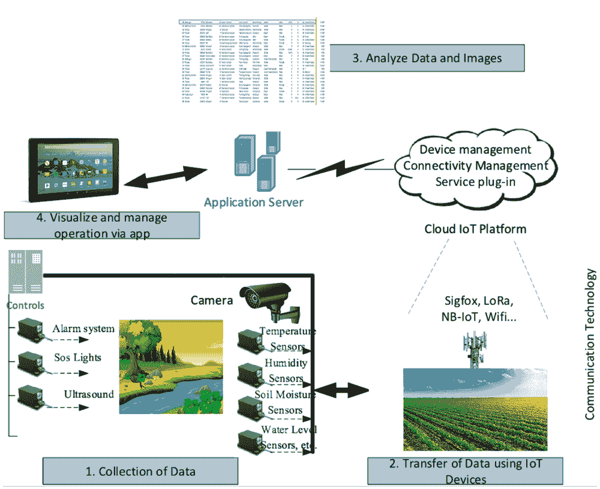 |
| --- |
| *(Elijah et al., 2018).* |

### 4.1 IoT 设备

`IoT` 系统中的设备包含一个嵌入式系统，该系统通过无线链路与传感设备和执行器通信。`IoT` 系统中的此类设备偶尔被称为 `IoT` 设备。`IoT` 系统中的系统包含微处理器或 `FPGA`（现场可编程门阵列）、存储单元、`I/O` 单元和通信模块。`IoT` 传感器的作用是监控和测量各种环境参数，如温度、湿度、水分等影响生产力的因素。各种传感器用于收集数据，例如电化学、机械、光学传感器（Li et al., 2010）。这些 `IoT` 传感器收集空气温度、土壤深度、降雨预测、叶片湿度、露点、风向、太阳辐射、大气压力和相对湿度，使其适用于各种农业需求。`IoT` 设备的一些特征是计算有效性、电源、移动性、持久、覆盖范围和成本。

### 4.2 通信技术

为了成功实施 `IoT` 系统，通信技术至关重要（Feng et al., 2019）。提供无缝连接的改进被认为是在农业领域部署 `IoT` 系统的胜利。如果没有跨多个对象的保护连接，绝对目标是不可能的。通信工程师在农业领域起着关键作用。为了在农业中大规模执行 `IoT` 技术，我们需要建立适当的架构。在选择通信媒介之前，我们需要考虑覆盖范围、成本、能量利用和可靠性等关键组件。低功耗网络只能在区域建立连接，通常无法为需要转发数据到农场管理系统（`FMS`）的地方提供服务。根据扩展性、可用性和应用需求，必须整合多种通信模式。适用于大规模可用技术包括 `Zigbee`、`蓝牙`、蜂窝链路、`Sigfox`、`LoRa` 等。

### 4.3 互联网

通过互联网连接，`IoT` 设备确保数据随时随地可用。建立互联网连接的目的是构建一个中央网络层，通过路由在各个子网络之间传输和共享网络信息。由于智能手机、无线通信系统和泛在服务的出现，产生了对广泛互联网连接的需求。尽管如此，通过互联网传输数据需要足够的实时数据支持、安全访问功能。因此，云计算是一种通过互联网建立的解决方案，用于存储和处理大量的采集数据。

`IoT` 中件和链路协议建立是为了通过互联网连接实现设备与异构系统的连接（Al-fuqaha et al., 2015）。`IoT` 中件的一些示例包括基于云的 `IoT` 中件、基于参与的 `IoT` 中件和面向服务的架构（`SOA`）。实现这些是为了为 `IoT` 系统提供足够的支持。各种基于 `IoT` 的传输协议在农业领域得到了广泛应用。

为了在未来几年实现更好的评估，农户需要保存有关作物的数据，并在不同季节利用这些数据来提高产量。数据驱动的农业需要收集大量的、复杂且具有地理位置的信息，这些信息需要存储和进一步处理。数据的复杂性从有方法的（结构化）信息到无方法的（非结构化）信息，可以是图像、文本、音频或视频。同样，数据的范围可以涵盖基于市场、直播、企业、历史或传感器的数据。

基于云计算的 `IoT` 环境的出现使我们能够将从各种传感器收集的海量数据存储在云空间中（Pavón-Pulido et al., 2017）。这还包含了应用托管，用于建立服务并端到端控制 `IoT` 架构。目前，`IoT` 的新兴技术如雾计算或边缘计算已被提出，它们与网关和 `IoT` 设备配合工作完成计算和评估，以降低需求性应用的延迟，从而降低成本并提高服务质量（`QoS`）（Chen et al., 2018），（Premsankar et al., 2018）。

各种农业 `MIS`（管理信息系统）已经先进到可以控制不同形式的数据（Yan-E, 2011）。一些示例包括 `Cropx`、`Farmobile`、`Onfarm` 系统、`KAA`、`Easyfarm`、`Farmx`、`Farmlogs` 等。这些环境的重要性在于实现数据的存储、控制和数据分析。

## 5 智慧农业区块链技术

`IoT` 技术已作为一种成熟的技术不断进步，可以应用于今天的每一个智能应用，并表现为未来互联网世代的可靠实体。与 `IoT` 技术类似，`Blockchain` 技术也作为一种可行方案不断演进，`Blockchain` 中的每个节点都包含一个分布式账本，提高了数据的透明度和安全性（Bhadoria et al., 2020）。由于具有这种执行智能合约和同意的能力，在 `Blockchain` 网络中，非法用户无法通过缺陷合约访问数据（Bhadoria & Agasti, 2019）。为了提高应用的实时效率，`IoT` 技术可以与 `Blockchain` 技术集成（Bhadoria & Nimbalkar, 2020）。

`IoT` 和 `Blockchain` 技术的整合重构了食品和农业部门，使农户、生产者以及商户受益。通过一种简单且清晰的方法，`Blockchain` 技术帮助农业实施一种持续流程，彻底改变水、化肥、劳动力等多种资源的使用方式。这里解释了将 `Blockchain` 引入农业领域的少数优势（Production, 2019）（Koshy et al., 2018）。

### 5.1 改进食品质量控制

区块链技术帮助农户废除低效的方法，并为质量控制提供最佳状况。例如，全球各农户面临的主要挑战之一是恶劣天气，即降水分布不均、天气波动。`IoT` 设备使农户能够监控植物生长的各种因素，即病虫害、土壤质量和耕作。这些因素的值频繁更新，并通过将 `IoT` 设备连接到 `Blockchain` 账本，在智能手机上进行实时可视化。由于 `IoT` 和 `Blockchain` 技术集成带来的这种便携性，农户可以验证这些组件，如果发现错误，将立即收到警报进行修改。`Blockchain` 技术的应用还为在食品安全疫情期间提供了快速识别问题性质的可能。

### 5.2 提高供应链透明度

`Blockchain` 技术的应用使客户能够了解食品的新鲜度、产地、谁种植了食品等。食品供应链清晰度的提高无疑将对减少欺诈、虚假标签和消除中间人产生巨大影响，从而确保食品生产者为他们的价值工作获得丰厚利润，并让客户了解他们所支付内容的知识。同样，提高向农户提供的供需透明度将帮助他们使用安装在智能手机上的移动应用程序来完全控制食品作物，通过该程序他们可以记录、更新植物的当前状况，监控整个耕作过程，了解食品产品的当前状态，了解即将到来的需求并根据需要进行适当修改。

### 5.3 农户的有效访问性

现代技术允许许多农户利用各种软件应用程序、电子表格和注释来记录数据并控制其操作。但是，将这些数据发送给其他各种服务提供商是复杂的，需要各种努力才能完成。`Blockchain` 技术使农户能够将所有数据存储在一个中心位置，以便任何需要访问该数据的人都可以方便地访问，从而简化了整体操作，节省了能量和时间。使用一个集中应用程序进行监控而非多种应用程序/方法，提供了操作的透明度并消除了信息丢失的风险。

### 5.4 农产品的合理价格

如今，农户在获得食品产品回报方面面临着巨大挑战。有时，需要几周才能收回出售产品的全部资金。由于传统的支付机制，他们的很大一部分收入损失了。利用 `Blockchain` 技术的智能合约工作一旦特定的交付根据消费者先设的履行条件完成，将会自动提示付款，从而抛弃了高昂的交易费用。这种技术允许农户在交付产品后立即获得支付，并消除了传统支付机制所需的时间。农户在市场上以有利可的价格销售货物时经常遇到困难，在许多情况下，中间人付出的努力少却获得更多。这些困扰通过智能合约解决，智能合约直接将农户与零售商连接起来，使农户获得公平利润。

## 6. 案例研究

`IoT` 技术赋予了对技术的正确理解，使农户能够对植物做出及时决策以提高生产力和利润。本节介绍了关于定制 `IoT` 技术以适应当地需求的各种案例研究，特别是针对印度中小型农户的灌溉情况进行调整，以提高作物产量并监测病虫害。介绍了三个案例研究，第一个是关于为花生户提供种植建议，第二个是关于甘实作物疾病的早期迹象，最后一个是关于水的有效利用。

### 6.1 案例研究一 - 为花生生产者提供种植建议

印度安德拉普拉什政府提出了一项名为“转型议程中的农业、收入和灌溉协调信息”的新项目（Koshy et al., 2018），旨在合并农业的收入、灌溉和农业这三个重要部门。简单来说，该项目被描述为 `HARITA`，旨在确保决策过程的稳定性、生产力和准时性。该项目主要旨在引入最新技术，特别是基于传感器的技术，来收集灌溉和农业的实时数据，从而为统一水管理和个性化农业扩张解决方案建立高效的系统。

继 `HARITA` 项目之后，开发了该项目的一个实验性应用——`HARITA-PRIYA`（一种精准农业技术），旨在通过无线传感器网络（`WSN`）从农田中发现微气候状况，并向农民发布个性化和地理特定的建议。

为了方便理解，农民通过其母语特卢固语的短信（`SMS`）接收农业建议，特别是作为早期预警提醒他们病虫害或疾病，并根据通过 `WSN` 技术在农民农田上收集的微气候数据，为花生安排最佳灌溉条件。在安德拉普拉什邦（`AP`）安纳塔普尔县（`Anantapur District`）的 5 个不同村庄以及一个农业科学中心（`KVK`），在参与 2015 年秋季（`Kharif`）花生作物生产的农民农田内，共设置了 74 个包含传感器的物联网节点（`WSN`）和 6 个 `WSN` 网关。该模型监测了约 450 英亩可耕地的疾病和病虫害，并在 2015 年秋季期间为相关村庄的约 710 名农民提供了适当建议。

无线传感器节点实时收集微气候季节植物冠层水平的相对湿度、温度、土壤水分、土壤温度和叶片湿度五个环境参数，并通过安装在农田的配备互联网连接的无线传感器网关将这些信息持续传输到远端服务器。每个村庄，支持 `WSN` 架构的各种无线传感器节点通过无线连接到中央无线传感器网关。每个村安装的 `WSN` 节点数量在 5 到 20 个之间，取决于花生种植地的实际水平。在服务器端，实施了决策支持建议模型，以访问农田数据并在早期阶段对病虫害发出警告。根据该模型产生的警报信息，市政农业办公室（`MAO`）通过特卢固语短信（`SMS`）向农民转发有关作物的个性化建议。

注意的是，在 2015 年 7 月至 10 月的秋季期间，关于叶斑病流行的 41 次早期预警指示支持了安德拉普拉什邦农业部门向这些村庄的花生农民发送及时的建议警报。`HARITA` 的试点实施模型 `HARITA-PRIYA` 模型进一步帮助农业官员通过个性化建议触达大量农民。据记录，在上述秋季期间，这些村庄的每个农民平均收到了 18 条 `SMS` 建议，而在实施该系统之前，农业官员仅向农民通知 2 到 3 条 `SMS` 警告。总体而言，截至目前，建议的模型已为注册农民产生了约 3500 条 `SMS` 建议，确保了农民与农业部门之间的良好沟通。

在认定的村庄安装了各种无线传感器（`WSN`）节点，每个间距约 200 米。根据对收集的数据和无线传感器节点产生的警报的评估，注意到微气候状况期间没有发现太多变化，因为降雨覆盖区域的播种窗口较窄，因此这种方法可以考虑用于未来几年。考虑到农业专家已经制定或正在开发的决策政策，可以减少无线传感器的数量，仅代表重要作物。所提议模型产生的这些建议警报也可以提供给邻近村庄，通过应用新技术使农业部门在经济上变得可行。

### 6.2. 案例研究 II - 甘油籽作物疾病早期预警模型的开发

为了开发疾病早期预警模型，与海得拉巴的印度油籽种子与研究所（`IIOR`）合作（Koshy et al., 2018），实施了基于无线传感器网络的方法，以识别甘油籽作物中常见的“灰霉病”疾病。开发该模型的主要目标是提出一种强大的疾病建议系统，能够在测试期间为农民提供可能发生疾病流行的建议。在特伦甘纳邦（`Telangana`）确定了四个主要种植甘油籽的地方。在这些地方，安装了 12 个无线传感器（`WSN`）节点和 24 个冠层传感器单元。

安装在作物冠层附近的传感设备收集相对湿度、温度和叶片湿度等数据。在作物种植期间植物生长的几个阶段计算疾病的传播速率。此外，这些数据与从传感器收集的微气候数据相结合，以计算发病率（`PDI`）。计算出的 `PDI` 可根据决策政策结合局部情况建立疾病早期预警系统，为农民采取预防措施提供充分的时间。

在 2017 年秋季（`Kharif`）和冬季（`Rabi`）期间，进行了农田测试，并将其扩展到 2018 年秋季和冬季评估。这些测试在特伦甘纳邦涵盖三个不同地区的四个地点进行，以建立一个广泛甘油籽种植的早期预警系统。每个田地安装了三个无线传感器节点和六对传感器。在这些田地中，两个属于认定村庄的农民，另外两个是位于帕莱姆（`Palem`）和海得拉巴的研究田地。这四个地方平均距离约 100 公里，以记录各种天气状况和土壤特征。在六对传感器中，三对安装在海得拉巴的一个温室内，以建立受控环境来监测疾病。一旦作物季节开始，将疾病引入温室内的植物中。对植物的发展情况结合传感器数据进行评估，以获得 `PDI` 计算结果。这些测试仅在四个地点进行，对这些地点观察到的数据进行了评估以供进一步分析。

### 6.3 案例研究 III - 连接牛油果场的用水量

为了生产一磅牛油果，农民大约需要 70 加仑的水，而在深受旱灾严重影响的加州，产了全美国约 95%的牛油果。一位名叫库特·班特尔（`Kurt Bantle`）的加州牛油果农场决定在他的农田里利用`IoT`技术进行试验，以检查是否可以通过节水来种植他的 900 棵牛油果树，从而节省水和成本（Study, n.d.）。

因此，他将整个农场分为 22 个灌溉区块，并在每个区块安装了两个土壤测量设备。放置在牛油果树附近的土壤湿度传感器收集的数据被传输到云端空间，如果牛油果树需要水，它会自动开启喷器，为每棵树获取合适的土壤湿度。一旦达到合适的湿度水平，喷器将关闭。这些通过`IoT`技术连接的树木将在昼夜期间接受持续监控。

该系统产生了惊人的结果。在对其农场实施这项`IoT`技术之前，他每年需要花费约 47,336 美元的费用为 900 棵牛油果树浇水。在实施`IoT`技术后，他的年度费用减少了约 75%，他仅需支付 11,834 美元。他还在六个月内收回了硬件投资。

## 结论

本章描述了农业领域中的`IoT`。关于`IoT`在农业中的应用，已对许多领域进行了深入探讨。`IoT`技术可用于提高农场、牲畜、运营性能和生产力。虽然`IoT`有望为农业部门带来许多益处，但仍有几个问题需要解决，以便让中小型农民负担得起。安全和成本是主要的关注点。随着农业领域竞争的加剧和优惠政策的引入，预计`IoT`在农业中的采用率将相应增加。然而，如果过去是未来的指标，农民可以继续通过创新寻找更好的作物种植方法。

## 参考文献

- B22B-01 : Improving Nitrogen and Water Management in Crop Production on a National Scale (Invited). (2020). December 2018, 346794.
- Affairs, S. (2020). Department of Economic and Social Affairs World population projected to reach 9 . 8 billion in 2050, and 11. Academic Press.
- Al-fuqaha, A., Member, S., Guizani, M., Mohammadi, M., & Member, S. (2015). Internet of Things : A Survey on Enabling. Academic Press.
- Ayaz, M., Ammad-Uddin, M., Baig, I., & Aggoune, E. H. M. (2018). Wireless sensor’s civil applications, prototypes, and future integration possibilities: A review. IEEE Sensors Journal , 18(1), 4–30. doi:10.1109/JSEN.2017.2766364
- Ayaz, M., Ammad-Uddin, M., Sharif, Z., Mansour, A., & Aggoune, E. H. M. (2019). Internet-of-Things (`IoT)-based smart agriculture: Toward making the fields talk. IEEE Access: Practical Innovations, Open Solutions , 7, 129551–129583. doi:10.1109/ACCESS.2019.293209
- Bhadoria, R. S., & Agasti, V. (2019). The Paradigms of Blockchain Technology: Myths, Facts & Future. International Journal of Information Systems and Social Change , 10(2), 1–14. doi:10.4018/IJISSC.20190401
- Bhadoria, R. S., Arora, Y., & Gautam, K. (2020). Blockchain Hands-on for Developing Genesis. In Kim, S., & Deka, G. (Eds.), Advanced Applications of Blockchain. Studies in Big Data . doi:10.1007/978-981-13775-3
- Bhadoria, R. S., Nimbalkar, A., & Saxena, N. (2020). On the Role of Blockchain in the Internet of Things. In Kim, S., & Deka, G. (Eds.), Advanced Applications of Blockchain. Studies in Big Data . doi:10.1007/978-981-13775-6
- Blockchain, H., & Safety, F. (2020). How Blockchain and `IoT` Tech will Guarantee Food. Academic Press.
- Bruinsma, J. (2017). World agriculture: Towards 2015/2030: An FAO Study. 10.4324/978131508358
- CambraC.Sendra.Lloret.Garcia. (2017). An `IoT` service-oriented system for agriculture. IEEE International Conference on Communications, May. 10.1109/ICC.2017.799640
- Chen, X., Shi, Q., Yang, L., & Xu, J. (2018). ThriftyEdge: Resource-Efficient Edge Computing for Intelligent `IoT` Applications. IEEE Network , 32(1), 61–65. doi:10.1109/MNET.2018.170015
- Dolci, R., & David, G. (2017). EU of conduct on data sharing by contractual agreement. 2, 384–385. -11. https://cema-agri.org/sites/default/EU_pdf
- Elijah, O., Rahman, T., Orikum, I., Leow, C. (2018). 2019. An Overview of Internet of Things (`IoT`) for Precision Farming. Artificial Intelligence in Digital. 5, 2017.
- Feng, X., Yan, F., & Liu, X. (2019). Evolution of Internet of Things (`IoT`) and its significant impact in the field of. Smart Communications , 10(3), 1785–1802. doi:10.1007/s42452-019-7
- Gatsis, K., & Pappas, G. (2017). Power, security and `IoT`: 2017 IEEE/ACM Conference on Internet-Things Design and Implementation, 106–112. 10.1109/ICWISE.2014.7042
- Khanna, A., & Kaur, S. (2019). Internet of Things (`IoT`) in agriculture.
- King, T., Cole, M., Farber, J., Eisenberg, G., Fox, E., & Hill, J. (2017). Food safety for food security: Relationship between global megatrends and developments in food safety. Trends in Food Science & Technology , 68, 160–175. doi:10.1016/j.tifs.2017.08.014
- Koshy, S. S., Sunnam, V., Rajgarhia, P., Chinnusamy, K., Ravulapalli, D. P., & Chunduri, S. (2018). Application of the internet of things (`IoT`) for smart farming: A case study on groundnut and castor pest and disease forewarning. CSI Transactions on ICT , 6(3–4), 311–318. doi:10.1007/s40012-018-0213-0
- Lee, I., & Lee, K.2015). The Internet of Things (`IoT`): Applications, investments, and challenges for enterprises. Business Horizons , 58(4), 431–440. doi:10.1016/j.bushor.2015.03.008
- Li, S., Simonian, A., & Chin, B. A. (2010). Sensors for agriculture and the food industry. The Electrochemical Society Interface , 19(4), 41–46. doi:10.1149/2.F05104if
- Lin, J., Yu, W., Zhang, N., Yang, X., Zhang, H., & Zhao, W. (2017). A Survey on Internet of Things: Architecture, Enabling Technologies, Security and Privacy, and Applications. IEEE Internet of Things Journal , 4(5), 1125–1142. doi:10.1109/JIOT.2017.2683200
- Madakam, S., Ramaswamy, R., & Tripathi, S. (2015). 物联网 (IoT)：文献综述。Journal of Computer and Communications , 03(05), 164–173. doi:10.4236/jcc.2015.35021
- Monitor, D. T. (2017). 农业：关注 IoT 方面农业：关注 IoT 方面。Academic Press。
- Nandyala, C. S., & Kim, H. K. (2016). 绿色物联网农业与医疗应用 (GAHA)。International Journal of Smart Home , 10(4), 289–300. doi:10.14257/ijsh.2016.10.4.26
- Navulur, S., Sastry, A. S. C. S., & Prasad, M. N. G. (2017). 通过无线传感器和物联网进行农业管理。10.11591/ijece.v7i6.pp3492-3499
- Pavón-Pulido, N., López-Riquelme, J. A., Torres, R., Morais, R., & Pastor, J. A. (2017). 精准农业的新趋势：一种用于实现数据存储和农业任务规划与自动化的新型云系统。Precision Agriculture , 18(6), 1038–1068. doi:10.1007/s11119-017-9532-7
- Premsankar, G., Di Francesco, M., & Taleb, T. (2018). 物联网的边缘计算：案例研究。IEEE Internet of Things Journal , 5(2), 1275–1284. doi:10.1109/JIOT.2018.2805263
- Production, F. (2019). 农业中的区块链——改进农业技术。Academic Press。
- SfarA. R.ChtourouZ.ChallalY. (2017). 物联网安全的系统性和认知视角：军事实兵仿真和安全挑战的案例研究。2017 年智能、监控和受控城市国际会议，SM2C 2017, 101–105. 10.1109/SM2C.2017.8071828
- Shi, X., An, X., Zhao, Q., Liu, H., Xia, L., Sun, X., & Guo, Y. (2019). 保护性农业中的先进物联网。Sensors (Switzerland) , 19(8), 1833. 在线出版。doi:10.3390/s19081833
- Sisinni, E., Saifullah, A., Han, S., Jennehag, U., & Gidlund, M. (2018). 工业物联网：挑战、机会与方向。IEEE Transactions on Industrial Informatics , 14(11), 4724–4734. doi:10.1109/TII.2018.285249
- Stokes, P. (2018). 农业中的物联网应用：智能农业在当前阶段的潜力。Data Driven Investor, 1–8. https://medium.com/datadriveninvestor/iot-applications-in-agriculture-the-potential-of-smart-farming-on-the-current-stage-2750f946
- Study, C (n.d.). Spirent。https://www.spirent.com/blogs/2016/june/cutting-costs-with-iot-connected-avados
- Talavera, J. M., Tobón, L. E., Gómez, J. A., Aranda, M., Garreta, L. E (2017). 农工业和环境领域物联网应用综述。Computers and Electronics in Agriculture , 142(September), 283–297. doi:10.1016/j.compag.2017.09
- Un (2009). 联合国：粮食产量到 2050 年必须翻倍以满足世界增长的人口需求，专家告诉第二委员会需要对抗饥饿的创新策略。第二委员会，小组会议 (AM) GA/3242, 64–5.https://www.un.org/News/Press/docs/2009/gaef342.htm
- Yan-E, D (2011). 基于物联网的智能农业管理系统设计。论文集 - 第四个智能计算与自动化国际会议，ICICTA 2011, 1, 1045–1049
- Zhang, Y., Chen, Q., Liu, G., Shen, W. (2016). 基于物联网的智能农业管理系统设计。IEEE Internet of Things Journal , 5),907

## 附录 A

### 智能农业中的物联网设备

无线传感器在智能农业中发挥着关键作用，对于数据收集和现代农业应用至关重要。

- 无线传感器
- 在智能农业中发挥着关键作用
- 数据收集和现代农业应用
- 表 1. 某些传感器在农业中的可能用途及环境 (2016)

| 序号 | 传感器 | 可能用途 | 环境 |
| :--- | :--- | :--- | :--- |
| 1 | AQM | 位置跟踪 | 天气 |
| 2 | B-102 | 位置跟踪 | 设备 |
| 3 | DEERE 300 | 湿度 | 设备 |
| 4 | DEX-65 | 湿度 | 天气 |
| 5 | DE70 | 湿度 | |
| 6 | |00 | 尺寸 | 植物 |
| 8 | 8000 | 湿度 | 设备 |
| 10 | POGO | 湿度 | 土壤 |

## 附录-B

### 物联网云平台

物联网云应用为远程服务器提供了便利，例如实时数据收集、可视化、数据分析、决策、系统管理等。农业和种植行业正随着许多云服务提供者的出现而变得流行。在这里你可以找到一些著名的开源平台（`Kaa` 和 `ThingSpeak`）以及其他平台。`Kaa` 和 `ThingSpeak` 是开源且免费的，非常适合自定义应用程序。

#### 1. ThingSpeak

`ThingSpeak` 是一个开源的基于云的物联网数据平台。它可以帮助你在 `MATLAB` 中分析和显示数据，而无需购买 Mathworks 许可。它允许你收集并存储云数据并创建物联网应用程序。适用于 `Arduino`、`Particle Photon` 以及 `Electron`、`ESP826 Wifi 系统`、`BeagleBone Black`、`Raspberry Pi`、手机和 Web 应用程序，通过 `Facebook`、`Twilio` 和 `MATLAB` 向 `ThingSpeak` 发送传感器信息。

#### 2. Kaa

`KAA` 是一个用于开发智能、无线和端到端物联网应用程序的开源多功能物联网框架。它实现了连接设备之间的数据交换、处理、可视化和物联网云服务。`KAA` 主要任务是收集设备规格、执行设备准备、配置、促进跨系统通信并允许分布式固件更新。它提供了后端功能，以运行大规模物联网解决方案，包括数据保护、准确性、互操作性和数据管理，使用嵌入开发者芯片或计算机的 `SDK`。`KAA SDK` 内存占用小，至少需要 10 KB RAM 和 40 KB ROM。`SDK` 收集数据端点，提供配置文件并允许端点消息。

#### 3. Mainflux

`MainFlux` 是一个基于云的物联网平台，它是开源、现代、可扩展、稳定且免专利费的。它完全使用编程语言 `Go` 构建。它为物联网技术、应用和产品开发提供了一个强大的平台支持。`MainFlux` 具有处理大规模安装和大规模交易的强大能力。后端云基础设施和 `API` 的配置提供了简单的应用访问，无需进行任何更改即可为终端用户节省时间，并在仪表板上提供快速的数据视化和分析工具。与其他物联网平台不同，该框架支持所有协议——`MQTT`、`WebSockets`、`CoAP` 和 `REST API`。

#### 4. Open Remote

作为一种开源的物联网中间件解决方案，`OpenRemote` 允许用户使用 iOS、Android 或 Web 浏览器等可用工具集成任何系统协议和设计。通过使用 `OpenRemote` 提供的云服务，用户可以设计软件来开发完全定制的应用程序，这些应用程序可以使用从 `Wi-Fi` 到 `ZigBee` 的系列协议进行集成。`OpenRemote` 不向设计师收取费用，而熟练的设计师将按使用收取 `range` 费用。

#### 5. Plotly

`Plotly` 是一个用于公共数据可视化的流行云服务提供商。`Plotly` 为普通或物联网应用提供个人、技术和业务数据的收集、可视化和分析工具。使用 Excel、CSV 和 XML 文件格式将数据上传到云服务器。`Plotly` 实现了基于 Python、R、MATLAB 和 Julia 的 API。可视化由 `ggplot2`、`matplotlib`、MATLAB 图表转换等图形库提供。其他文件格式 HDF5、SAS、SPSS、MS Access 和 ZIP 用于在上传到云端之前临时存储数据。这为导出矢量 Pdf、svg 和 eps 提供了便利。`Plotly` 极受欢迎的另一个支柱是 LDAP 和目录集成。Node.JS 辅助的 3D 地图可视化使用户能够恰地解读来自 `Arduino`、树莓派和 Electric Imp 等硬件设备的数据。

#### 6. Thinger.io

`Thinger.io` 提供了一个连接设备的灵活云平台。使用他们的 `REST API`，你可以通过运行管理控制或将其集成到项目逻辑中来轻松处理它们。它支持各种极客开发板，如树莓派、Intel Edison 和 ESP8266。`Thinger` 可以与 IFTT 集成，并在漂亮的仪表板上实时提供数据。

# 第 6 章：在全球范围内创建虚拟伙伴

Vardan Mkrttchian
澳大利亚 HHH 大学

### 摘要

本章介绍了人工智能和自然智能技术。作为虚拟世界数字经济计划的一部分，旨在提高电子商务和创业的效率；中华人民共和国领导层也设定了类似的任务。目前，虚拟世界和中国的思维方式正在发生根本性变化，同时，数字经济中贸易政策及其工具的发展方法论也在随之转型。正是这些情况决定了本研究的意义，其研究结果将在本章中给出。其目标是基于使用 `blockchain` 技术进行知识的虚拟交换以及多链开源平台的实现，开发出用于提高虚拟世界和中国电子商务及创业效率的基础性基础。所有知识领域科技进步的加速提升了确保终生专业技能持续增长的任务。

### 虚拟世界与传统贸易流程中的引言

本章展示了作者关于使用人工智能和自然智能技术的观点。作为虚拟世界数字经济计划的一部分，旨在提高电子商务和创业的效率；中华人民共和国领导层也设定了类似的任务。目前，虚拟世界和中国的思维方式正在发生根本性变化，同时，数字经济中贸易政策及其工具的发展方法论也在随之转型。正是这些情况决定了本研究的意义，其结果将在本章中给出。研究目标：基于使用 `blockchain` 技术和 `Multi chain Open Source Platform` 进行知识的虚拟交换，开发用于提高虚拟世界和中国电子商务及创业效率的基础性基础。所有知识领域科技进步的加速提升了确保终生专业技能持续增长的任务。

在传统贸易过程中，从签署合同到进口交付还有几个步骤。这非常困难，相关机构必须处理大量数据，而且这项工作应该是。银行业务日，伴随着大量的人工审核和纸质文件，导致效率和安全性降低，并存在信用证欺诈和信用证条件宽松等风险。这导致了信用证使用的逐渐减少。`smart contract` 是通过信息方式进行分发和测试的一种目标。

在过去的几年里，信息技术能够创建一个独特的环境，为全球数字贸易的发展提供资源，允许就贸易问题进行远程通信。这一现象在公民被迫隔离的情况下变得尤为重要。这一事实的证明是新冠病毒 `COVID-19`的影响。

现代信息技术允许买卖双方在远程实时进行互动。`E-mail`、即时通讯工具、`Wi-Fi` 以及用于开发热门贸易应用和技术的软件硬件已成为热门服务市场的重要领导者。

VR 技术从 20 世纪 50s 年代的首次实验到 21 世纪 20s 年代的现代虚拟现实头戴设备，已经走了很远的路。VR 系统的形成主要有两种方法：虚拟房间和可穿戴设备。可穿戴 VR 设备包括头戴式设备和虚拟现实眼镜。目前，虚拟设备市场由以下厂商组成：`Epson BT-200`、`Google Glass`、`Oculus Rift`、`HTC Vive`、`Microsoft Hololens`、`Lumus dk-32`、`Samsung GearVR`、`Facebook`、`Sony`、`Nokia`等。这些公司的出版和专利活动可以将制造商分为四类：VR 领域新知识的增长中心、可持续研究中心、动态发展的研发部门以及研究工程师。该领域的领先国家是来自美国（知识产权市场占 46%）、中国（知识产权市场占 34%）、日本（知识产权市场占 19%）和韩国（知识产权市场占 13%）的研究人员。全球虚拟贸易领域的虚拟技术和模拟器市场整体代表广泛。

智能合约允许消除第三方的存在。执行信任交易。这些交易是可追踪且不可逆的。得益于智能合约技术，传统银行的信用中介功能被转移到智能合约，并通过智能合约执行。验证功能使用计算机程序快速判断交易合同的条款，下一步是监控交易过程。正如进口商和出口商之间典型的智能合约交易过程所示：在区块链网络中创建基于智能合约的商业合同，进口商向金融机构提供押金，金融机构实时向区块链网络注册担保支付。支付押金后，出口商将发送货物，运输方将发送货物。当智能合约、运输单据和商业销售同时同时，下载到区块链网络。在相同的支付条件下，向金融机构发出财务指令，金融机构可以为进口商计算付款。得益于有效的区块链技术，消除了劳动效率低和延迟的问题，可以实现全天候频交易，通过智能合约消除人为因素。

## 研究课题

现代世界中的中华人民共和国通过创建全球范围内的虚拟助手，其区块链形式主要分为公有链联盟。区块链联盟链是完全私有的区块链（全私有），公有链指的是世界上任何时候，任何人都可以阅读。任何人都可以发送交易，交易可以被确认，任何人都可以参与。区块链过程，联盟链意味着其协调过程由预选节点控制。区块链，完全私有的区块链，是指其写权限仅由区块链组织共同掌握的区域。其中，联盟链技术的选择更适合为一带一路贸易创建信息技术。为了展览的需求，联盟链节点是预选的，且预选方法是有效的。消除不良的、不可信的节点，以保护区块链免受诸如`51% Impact of point attack`。此外，联盟链不是完全去中心化的，其共识模型为了控制联盟，这将有助于未来共识机制的现代化和扩展。它也有助于领先组织对系统的控制。

## 虚拟世界背景与传统交易流程

在技术作为新金融理念催化剂的环境下，区块链技术可以无成本地集成到现有金融系统中。目前，物联网和人工智能已成为现代互联网金融的主要形式，因此未来的区块链无疑向`blockchain + IoT + artificial intelligence`的方向发展。随着物联网呈几何级增长，中心化服务的计算资源、存储和宽带成本将使运营公司无法负担，而区块链技术可以为物联网提供直接数据传输，而无需创建和管理物联网。其次，需要解决物联网隐私保护问题。因为中心化的物联网架构通过中央处理器存储和传输所有信息和信号，数据过度集中会导致信息被窃后发生大规模隐私泄露。根据区块链技术，由于客户端数据不受单一云服务公司控制，没有人可以通过加密数据传输过程来窃数据，这使得客户隐私更加安全。第三，为物联网创造了新的业务模式。根据目前的物联网架构，客户无法使用另一个物联网进行网络交易，只能在一个网络或受信网络上进行金融交易。这一限制显著降低了物联网的商业价值。区块链技术消除了信任交易实现直接交易，例如由`IBM`和`Samsung`共同开发的“中心间自主远程控制”系统。该系统使用分布式网络，确保访问系统的物联网设备可以直接通信并实现复杂的业务逻辑。

随着人工智能技术的不断进步，其在金融领域的应用正变得广泛，包括开户、分析和交易等重要活动。因此，人工智能的安全性和可靠性正受到越来越多的关注。

区块链可以通过以下方面实现对人工智能的“友好”：

- **首先**，区块链技术可以提高人工智能的信誉。区块链技术可以依靠智能合约的形式，确保在交易过程中，系统会自动创建电子合同并留下不可篡改的痕迹。
- **其次**，区块链的共享机制将使人工智能更加友好。在区块链上进行的任何交易都必须经过双方确认，因此一次只有两台智能机器可以确认交易。如果一方由于任何原因无法确认，交易将自动取消。
- **第三**，区块链技术将为人工智能提供更准确的信息。区块链系统可以利用其自身的投票机制对互联网上的信息进行科学分类：第一级是垃圾信息，第二级是信息推荐，第三级是信息合规。区块链仅通过评分系统向人工智能发送一致的信息，以评估并提高其准确性。
- **第四**，区块链技术将改进人工智能的安全机制。例如，设备可以在区块链中注册，利用设备注册信息进行各种分级评估，为不同的设备提供不同的功能，防止智能设备被滥用，从而更好地行使共同所有和设备使用权（Wenbin, 2015）。

自古以来，人类社会的进步经济的发展受益于工具的使用和创造，各种工具不断被创造出来。科学科技的最初驱动力是不言而疑的。在市场经济中，会出现周期性的生产过剩，甚至影响到人们的生活方式。而意识形态带来的根本性变化是科学技术大规模工业应用的结果。

自 21 世纪初以来，它基于互联网、移动互联网以及云计算大数据等信息技术的快速发展和成熟，这些技术是由阿里巴巴、腾讯、京东、百度、亚马逊、Facebook、苹果、微软和华为所创造的。大量世界顶尖企业涌现了许多为人知的成功企业家，显著提高了社会经济运行的效率和可行性。

然而，科学技术的发展永远不会停止。目前，各种新技术正在经历爆发性的诞生和发展。应用科技工业化的业务逻辑也正在发生根本性变化，即从中心化的信息交互。如果你能将人工智能、物联网、大数据、云计算和区块链等新技术结合在一个创新的项目形式中，将形成最有效的经济活动形式。

未来，我们将进入真正的数字经济时代，数字经济的实现是这些新技术融合的结果。社会结构的变化至少将完全改变商人的行为。我想，我担心这些新技术将在各种业务场景中被“组织和整合”。市场上有一种观点，甚至可以写为`“一个可预测的未来 = (人工智能 + 物联网 + 大数据) × 区块链””。这个公式表明括号中的三项主要技术是“数据”，即深度数据挖掘、海量数据的实时采集与传输以及数据挖掘，而`block chain`提供了数据保护并对其信任。价值交易的回报机制和手段允许你在业务环境中安全使用括号内三项技术所需的价值数据。该公式的右侧实际上表达了“区块链技术”与“虚拟市场”的乘积。

## 文章核心焦点

### 问题、争议、挑战

在上述公式的右侧，人工智能处于领先地位，因为技术本质上体现了一种“能力”，即一种让智能机器（计算机智能系统）学习和模拟人类思维的能力。同时，引擎训练模型的结果和运行模型可以存储在区块链上，这确保了模型不会被黑客攻击，进一步降低了商业应用遭受恶意攻击的风险（Li & Ren, 2016）。人工智能技术可以利用海量的历史数据和实时观测洞察未来，而物联网将提供大量的实时数据以及大数据，为人工智能提供充足且高效的“燃料”。

各种系统传感器产生的数据自然会有一些实时数据所有者，但某些数据是暂时不需要的，因此数据所有者可以对这部分暂时不需要的数据进行脱敏。将其获取并与其他数据开发者或开发者共享，可以解决数据流失问题并产生显著收益，抵消数据创建过程的成本，并实现共赢。

对于项目创始人来说，拥有足够的数据来训练 AI 或 ML 模型将是一项无休止的挑战。客观来说，只有拥有大量用户的大型中心化科技公司才能获得大规模数据集。然而，在去中心化模式下，向人工智能社区添加数据集非常方便，这意味着物联网设备将在现实业务场景中为教学人工智能所需的数据集发挥重大的作用。目前，已有许多优秀的研究团队正致力于收集训练数据以及最实用的研究算法，并将这些算法应用于区块链。

另一个问题：我们如何利用市场上分布的大量空闲算力来启动 AI 或 ML 计算模型？答案是区块链技术可以使数据市场更加公平、高效。当前市场环境中最大的不公之处是人们倾向于忽视少数派，但机器学习中最需要的正是少数派。数据，即属于少数派的数据将变得更有价值，正如我在之前的文章《数学是区块链+AI 技术的基石，数学可以解释所有业务实践的价值》中所提到的，如果将机器学习模型的准确率从 90% 提高到 99%，你需要的不是已经研究过的数据，而是少数个人应该拥有的与之前不同的数据。

例如，商业和技术逻辑，结合 Ketai 结构空洞技术智能生态网络投资和结构隧道融资系统，是`(人工智能 + 物联网 + 大数据）× 区块链`，这将人工智能（诸如认知计算、智能管理(IoT)、大数据和区块链与人们在连接设备上的分工参与相结合，通过管理数据和这些设备可以执行的操作共同产生，创造出第一个能够“思考”并用于风险投资市场商业目的创新智能系统）。我们坚信，多中心、去中介、自组织、数据交换和网络协同是可靠的，“智能生态系统”将根据这种新的业务和技术逻辑，从现有的传统行业中进行重构。这就是未来数字经济时代所需的（Li & Ren, 2016）。

## 解决方案与建议

### 1. 共识机制与性能

共识协议用于实现分布式系统的可用性和一致性。这是区块链的一项关键技术，其主要指标包括：典型协议包括 `PBFT` 提出的 `BFT` 共识、`PoW` / `PoS` 提出的 Nakamoto 共识，以及新的混合共识。目前，共识协议面临的最大挑战是在如何在安全性和效率之间取得平衡。

在保证安全的前提下，提高生产力有四种方式：

1. **提高硬件和计算能力**，从 `CPU`、`GPU`、`FPGA` 到 `ASIC`，矿机设备不断更新，计算机处理能力的通用水平也在快速发展。根据 `OpenAl` 的分析，自 2012 年以来，教学人工智能的任务所使用的算力呈指数级增长，其目前的速度每 3.5 个月翻一倍（与每 18 个月翻一倍的摩尔定律相比）。如果计算算力超过某个临界点，区块链的性能问题可能不再是问题；
2. **共识协议系统的改进**尚未改变。代表性方法包括减少区块的生成间隔、增加区块的大小、采用双层链结构、引入闪电网络、改变区块+链的基础结构以及减少区块。
3. **数据与高级算法**
4. **新数据结构**，例如使用有向无环图 (`DAG`) 数据结构，典型项目有 `10TA` 和 `ByteBall`；
5. **新的一致性协议**，例如研究人员提出的 `PoW` 机制的 `Thunder Ella` 算法、`Algorand` 协议以及 `PoS` 机制的 `Ouroboros` 算法，基于 `Sleepy` 模型和空间证明的 `PoS` 共识。

### 2. 跨链

目前存在各种链：公链、联盟链和私链。公链为公众服务，联盟链限于一个联盟，私链仅为一个私人组织服务。从私链到联盟链到公链是一个去中心化过程，而从公链到联盟链到私链则是一个中心化过程。

在这些转换过程中，会出现针对私有网络、联盟和政府网络的各种区块链产品。当不同组织之间进行业务交互时，不同链之间如何交互变成了一个大问题。目前有三种跨链技术：

- 证人方案 (Notary Schemes)
- 侧链 / 中继 (Side Chains / Relays)
- 哈希锁技术 (Hash Lock Technology)

跨链技术是区块链未来发展的中心。此外，目前的私有网络存在一个博弈问题，即谁加入，每个人都希望他们加入自己的区块链系统。尽管 `BaaS`（后端服务）可以复用底层平台，但关键在于不同业务系统和用户之间的数据交换，以及系统之间的协作。如果系统之间没有连接，就无法复用客户、资产和数据等核心资源。

解决这个问题有两种方法：

1. 政府或标准化组织推动区块链技术的标准化，并改进不同系统之间的交互；
2. 政府创建公共服务平台。例如，由香港管理局支持的 `HKTFP` 就是典型的例子。这种模式的优点是基于公共利益的平台可以更好地解决建设主体与管理机制之间的争议，并开放用户和场景。公共服务实现资源整合，也便于政府监管，提高监管效率。

### 3. 控制机制

由于区块链本身是一个包含更改验证节点或更新自身规则所需逻辑的自然投票系统，且投票结果可以自动化，链上投票机制自然成为了区块链生态系统。目前主流的控制机制有很多链上投票机制，如 `EOS`、`NEO`、`Lisk` 以及权益证明 (`DPOS`) 机制中的其他系统，通过链上投票来决定控制网络运行的超级节点。通过投票决定 `Essence` 燃气限制或对协议更新进行投票。

当前链上投票机制的缺点：

1. 投票参与度低导致了两个问题：首先，投票结果仅反映了极少数人的意见，难以获得普遍认同；其次，攻击者可以以低成本进行投票。
2. 可能存在类似于小册式的少数人链管理模式，这对普通用户的利益是有害的。

此外，完全依赖链上管理仍然无法解决区块链生态系统中主代理体的问题，还需要链上监管的支持，例如法律监督和声誉机制。

政府现在已开始采取行动。例如，国家互联网信息办公室近期发布了《区块链信息服务管理办法（征求意见稿）》并公开征求了意见。当然，这属于系统层面的构建。从技术角度来看，如何改进链管理机制是区块链技术研究的下一步。

### 4. 身份管理

区块链使主权身份成为可能。它本身可以被用作去中心化的公钥基础设施（`PKI`），使公钥权威更具实用性且安全。区块链可以被视为一个去中心化的认证机构，将认证支持映射到公钥。

智能合约还可以添加复杂的逻辑，实现注销和恢复，并减轻终端用户在密钥管理的负担。这些技术将身份所有权从中心化服务推向人与之间的端到端服务，并使身份本身变得可用。这被称为自主性。这种方法将数据和计算分散并转移给每个个体，这对黑客来说经济效益较低，因为逐个攻击许多人需要花费精力。

在联盟链中，不同的节点必须被分配不同的权限并满足特定的控制。为了做到这一点，必要创建一个安全有效的认证和身份管理机制。

- 可以使用基于生物识别技术的认证机制，或生物识别与密码学的有效结合；
- 还可以使用基于标识符/属性的高效实用的密码方案，实现对节点/用户详细的访问控制/权限管理。

### 5. 隐私保护

在公链中，必须保护隐私信息（如交易数据、地址、身份等），同时允许会计节点验证交易的合法性；对于联盟链，在构建隐私保护方案时，必须考虑授权的控制/跟踪。

交易身份保护和内容机密性可以通过加密原语和方案来实现，例如有效的零知识证明、承诺和不可区分证明。例如：`Zkash` 使用 `zk-SNARK` 来实现隐私机制。

基于环签名、群签名等加密方案的隐私机制，以及基于分级证书机制的隐私保护机制也是可选的。例如：

- `Montero` 使用环签名方案来实现隐私保护机制。`Hyper ledger Fabric` 使用分级证书机制来实现隐私保护机制。

交易内容的机密性保护也可以通过高效同态加密方案或安全多方计算方案来实现。例如：

- `Ripple` 为交易通道引入了隐私保护，了一种安全用户计算解决方案。

简单的代币保护机制也可以提供简单的隐私保护。

### 6. 数字钱包

目前，数字钱包正尝试从纯钱包服务转向数字资产的生态门户，希望获得更多市场份额并开发更丰富的资产管理服务，主要涵盖资产管理、资产交易、信息聚合、DApp 分发等领域。

资产管理可以分为增值生产、增值管理、资产管理、资产收集等。资产交易主要包括数字资产的去中心化交易所和法币交易所；信息聚合——这主要是项目信息的交换和聚合；DApp 分发类似于小型软件商店。

尽管不同钱包的入口和开发路径各不相同，且各有千秋，但不同增值钱包的功能存在重叠，因为彼此的长期目标正在逐渐趋同。随着数字资产行业的持续发展和环境的不断改进，数字钱包的场景功能将变得越来越重要。

其未来发展有三个方面：

1. 确保钱包的安全、开放性和便利性；
2. 创建基于资产增值需求的数字资产管理平台，为用户提供丰富的金融产品并提高用户转化率；
3. 第三点是开启数字资产与现实世界的连接，丰富数字资产场景并创建数字资产生态。

安全性是基础。软件技术可以使用无密钥加密算法（标准白盒方案或创建新的白盒加密算法）和代码混淆方法，防止攻击者提取基础加密算法和密钥信息，或者使用密码、身份因素加密算法（如个性和生物识别）来加密并存储密钥。

硬件方面可以基于 `TEE`（可信执行环境）或 `SE`（安全环境）安全模块，以及有助于配置终端设备的技术解决方案，这是保护数字钱包的重要额外方向之一。

### 7. 智能合约与自组织业务模型

智能合约具有透明性、可靠、自动执行和强制合规等优点。一旦部署在区块链上，程序的代码和数据就是公开透明的，无法伪造，且必须按照预定义的逻辑执行以获得预期结果，合约的执行过程将被记录。

应该说，区块链技术与其商业应用是相互促进的。基于智能合约的自组织业务应用可以帮助区块链技术增值，并扩展加密经济模型的范围。

尽管从技术角度来看，智能合约只是代码的一部分，本质上承载了大量的业务逻辑，甚至智能合约本身就是一个具有无限想象空间的业务模型。相反，自组织业务模型的实现也需要智能合约的精细开发，还需要技术措施的支持，如提高生产力、增强安全保护隐私。换之，这既是业务模型的创建，也是技术系统的开发。

智能合约的安全性至关重要。由于智能合约的开放性，其代码和内容可以通过开放方法获取，允许黑客分析合约并攻击漏洞。一旦攻击成功，将导致重大损失。因此，迫切需要复杂的智能合约检测技术在合约上链之前进行检测、分析和消除漏洞。

有很多智能合约检测工具或在线测试网站，但这些测试仍然基于经验，对于未知的合约漏洞仍然无能为力。

形式化检查方法是一种可能的解决方案，通过创建一个合适的模型，来精确确定程序是否能够按照开发者的预期进行运行。然而，智能合约的形式化验证非常困难，目前尚未找到合适的解决方案，仍需进一步研究。

在应用智能合约时，一方面有必要从法律层面明确使用智能合约的可能性；另一方面，由于智能合约具有天然的确定性且不具备普通合同的灵活性和选择性，在特定场景下，需要建立一种干预机制，允许代码暂停或停止执行。

## 未来研究方向

- **与其他技术的集成**：人们常说云计算、大数据、人工智能、区块链技术等，本质上它们都是“算法+数据”的体现，没有优劣之分。既然本质相同，互相互整合是不可避免的。

例如，资产证券化场景需要从多个业务系统持续披露信息，还需要大规模的分布式文件存储。

区块链技术通过交易签名、共识算法和跨链技术，确保交易双方分布式账本的一致性，并确保交易实时执行且自动完成实时信息披露以确保账实一致。账实一致极大提高了交易产品的信誉度并显著降低了成本，这使得信息用户能够实时获取有关企业活动的全球信息。获取全球信息意味着信息的规模化增长，而存储和检索信息价值的最佳方式正成为链的关键。

因此，区块链技术与分布式文件系统、大数据分析、云计算、人工智能等技术的集成是未来发展的重要方向。

## 结论

在本章中，解决了以下任务：对俄罗斯和中国的商品及和服务进行了分析；概述了主要政策指南及其对全球化和区域整合的影响；阐述了区块链技术在国际贸易中的发展前景及其对全球金融业的影响；论证了区块链技术在全球经济发展中的作用。

阐述了以下研究领域：

1. **基于创新智能技术的国际合作发展**
   - a. 以“一带一路”为例的国际合作的前提。“一带一路”项目的历史需求。
   - b. “一带一路”背景下中国银行业指标。
   - c. 区块链技术——国际多边金融贸易合作的最强有力推动力。
   - d. 跨境资本流动：交易效率、风险管理、对手信誉审查

2. **在国家经济系统数字化过程中创造互利共赢的贸易关系**
   - a. “一带一路”倡议背景下区块链技术在国际贸易中的应用。
   - b. 一带一路联盟联盟愿景。
   - c. 区块链技术可以与更多技术相结合。

3. **应用于区块链技术、大数据分析和知识虚拟交换的反思适应软件开发。**

阐述了区块链技术的未来方向：共识机制与性能、跨链、控制机制、身份管理、隐私保护、数字钱包、智能合约和自组织业务模型。

## 参考文献

- Li, Z., & Ren, X. (2016). Analysis of the impact of blockchain on the Internet finance and its prospects. `Economics and Management Studies`, 10, 75–78.
- Technology illuminates the future - when blockchain technology and adaptive security enter social management and economic life. (n.d.). Retrieved October 02, 2019, from `http://blog.sina.com/cn/s/67804b9a0102`
- The fusion of artificial intelligence and blockchain technology represents the future of the digital economy. (n.d.). Retrieved May 14, 2019, from `http://www.sohu.com`
- Wenbin, U. (2015). Principles, models and proposals of trading. `Hebei University`, 6.

## ADDITIONAL READING

- Chang, J., Berg, M., (2,,..2004).). of of. `Journal of ` Association`, 1(2), 104–112.
- Li, S., Wang, G., & Yang, J. (2019). Survey on cloud model based similarity measure of uncertain concepts. `CAAI Trans Technol`, 4(4), 223–230.
- Lin, Q., Yan, H., Huang, Z., Chen, W., Shen, J., & Tang, Y. (2018). An ID-based-based ID-based linearly homomorphic signature scheme and its application in Blockchain. `IEEE Access: Practical Innovations, Open Solutions`, 6, 20632–20640.
- Ming, Z., Jun, C., Yuqing, W., Yuanfei, L., Yongqi, Y., & Jinyue, D. (2017). The primarily research for multi module cooperative autonomous mode of energy internet under blockchain framework. `Zhongguo Dianji Gongcheng Xuebao`, 37(13), 3672–3681.
- Haber, S., & Stornetta, W. (1991). How to time-stamp a digital document. `Journal of Cryptology`, 3(2), 99–111.
- Huang, G., Lau, J. S., & Mak, K. L. (2003). The impacts of sharing production information on supply chain dynamics: A review of the literature. `International Journal of Production Research`, 41(7), 1483–1517.
- Hwang, J., Choi, M., Lee, T., Jeon, S., Kim, S., Park, S., & Park, S. (2017). Energy prosumer business model using blockchain system to ensure transparency and safety. `Energy Procedia`, 141, 194–198.
- Conoscenti Martin, J., Kshetri, N. (2017). Cybersecurity in India: Regulations, governance, institutional capacity and market mechanisms. `Asian Research Policy`, 8(1), 64–76.
- Namasudra, S. (2017). 一种面向云计算数据安全的改进基于属性加密的技术. Concurr Comput Pract Exer., doi:10.1002/cpe.4364
- Namasudra, S. (2018). 基于 DNA 的安全模型分类法。在 Namasudra, S., & Deka, G. C. (编.), 密码学中的 DNA 计算进展 (pp. 53–68). Springer. doi:10.1201/9781351011419-3
- Namasudra, S. (2018). 云计算：新时代。J Fundam Appl Sci , 10(2), 113–135.
- Namasudra, S., Chakraborty, R., Majumder, A., & Moparthi, N. R. (2020). 在云计算环境中使用基于 DNA 的加密保护多媒体.ACM T Multi Comput Commun Appl.
- Namasudra, S., & Deka, G. C. (2018). 密码学中的 DNA 计算进展。Taylor & Francis. doi:10.1201/9781351011419
- Namasudra, S., & Deka, G. C. (2018). 密码学中 DNA 计算简介。在 Namasudra, S., & Deka, D. C. (编.), 密码学中的 DNA 计算进展 (pp. 27–34). Springer. doi:10.1201/9781351011419-1
- Namasudra, S., Deka, G. C., & Bali, R. (2018). DNA 计算的应用与未来趋势。在 Namasudra, S., & Deka, G. C. (编.), 密码学中的 DNA 计算进展 (pp. 181–192). Taylor & Francis. doi:10.1201/9781351011419-9
- Namasudra, S., Devi, D., Choudhary, S., Patan, R., & Kallam, S. (2018). 安全、隐私、信任与匿名性。在 Namasudra, S., & Deka, G. C. (编.), 密码学中的 DNA 计算进展 (pp. 153–166). Taylor & Francis. doi:10.1201/9781351011419-7
- Namasudra, S., Devi, D., Kadry, S., Sundarasekar, R., & Shanthini, A. (2020). 云计算环境下的基于 DNA 的数据安全。Computer Communications , 151, 539–547. doi:10.1016/j.comcom.2019.12.041
- Namasudra, S., & Roy, P. (2016). 云计算环境下的安全高效数据访问控制：综述。Multiagent Grid Sys Int J , 12(2), 69–90. doi:10.3233/MGS-160244
- Namasudra, S., & Roy, P. (2017). 云计算中数据访问的省时协议。IET Communications , 11(10), 1518–1565. doi:10.1049/iet-com.2016.0777
- Namasudra, S., & Roy, P. (2018). PpBAC：面向云计算的热基于访问控制模型。Journal of Organizational and End User Computing , 30(4), 14–31. doi:10.4018/JOEUC.20181002
- Namasudra, S., Roy, P., Vijayakumar, P., Audithan, S., & Balusamy, B. (2017). 云计算环境中一种高效且安全的基于 DNA 的访问控制模型。Future Generation Computer Systems , 73, 90–105. doi:10.1016/j.future.2017.017
- Sarkar, M., Saha, K., Namasudra, S., & Roy, P. (2015). 一种高效且省时的基于 Web 的 Android 应用。SSRG Int J Comput Sci Eng , 2(8), 18–21.
- Swan, M. (2015). 区块链：新经济的蓝图。O’Reilly Media.
- Williams, A. (2016). IBM 新加坡区块链创新中心，在金融和贸易中创建新市场。The Straits Times Singapore Holdings Ltd.
- Wood, G. (2014). 以太坊：一种去中心化的通用账本。Yellow Paper.
- Xia, Q., Sifah, E., Asamoah, K., Gao, J., Du, X., & Guizani, M. (2017). 通过区块链实现云服务提供者之间的无信任数据共享进展。IEEE Access, 5, 14757–14767. doi:10.1109/ACCESS.2017.273084
- Xue, T., Hongbin, S., & Qinglai, G. (2016). 基于区块链的电力交易与拥塞管理。Power Syst Technol , 40(12), 3630–3638.
- Zhao, X., Li, R., & Zuo, X. (2019). QoS 感知的 Web 服务选择与组合进展。CAAI Trans Intell Technol , 4(3), 159–174. doi:10.1049/trit.2019.0018
- Zheng, Z., Xie, S., Dai, H., & Wang, H. (2016). 区块链的挑战与机遇：综述。International Journal of Web and Grid Services , 14(4), 314–335.

### 关键术语定义

**区块链**：根据某些规则构建信息的连续区块链（链表）。

**数字经济**：专注于数字和电子技术的经济活动。这包括电子业务以及其产生的商品和服务。该定义涵盖了在互联网上使用数字通信技术进行的所有业务、文化和社会操作。

**EDI（电子数据交换）**：根据特定规定和格式在组织之间传输结构化数字信息的系列标准和公约。

**电子商务**：通过互联网和私有通信网络进行的金融交易和交易，涉及商品买卖以及资金转移。

**知识资本**：特定人的知识、技能和生产经验，以及专利、数据库、软件、商标等无形资产，这些被有效地用于利润最大化和其他技术成果。

# 第 7 章

- **Law Kumar Singh**
  [](https://orcid.org/0000-0002-7073-6852)
  印度 Sharda 大学
- **Pooja**
  印度 Sharda 大学
- **Hitendra Garg**
  印度 GLA 大学
- **Munish Khanna**
  印度印度斯坦科技学院
- **Robin Singh Bhadoria**
  [](https://orcid.org/0000-0002-7073-6852)
  印度 Bhimtal 比拉应用科学学院 (BIAS)

### 摘要

过去的几个月里，机器学习领域的研究和深度学习取得了显著扩张。机器学习是一种计算机使用一组方法基于数据集进行预测、改进预测和行为预测的技术。学习技术可以分类为监督学习和无监督学习。重点是监督机器学习，它涵盖了所有具有已知结果数据集的预测问题。某些算法如 `naive bayes`、`linear regression`、`SVM`、`k-nearest neighbor`、`neural network` 在该领域取得了增长。机器学习的分类器完全不受统计假设的限制，因为它们适用于复杂数据。作者们展示了机器学习技术的应用及其伦理问题。

## 1. 引言

机器学习是人工智能的一个分支，它根据被称为“簇”的相似模式集合来分析和响应数据，这有助于分析和响应数据。它就像一个空白的人脑，通过物理结构或从过去经验获得的数据来理解任何图像（Smola and Vishwanathan, 2008）。

### 机器学习的主要特征

- 它将数据转换为信息，其中数据可以是图像、视频、文本、`CSV` 等形式。
- 它是一个解决问题的工具。
  - 例如：`n 皇后`、`8 皇后`、`旅行推销员`等
- 它是计算机科学、工程学和统计学的结合，其中计算机科学意味着执行编程工作；工程学意味着应用不同类型的应用程序；统计学意味着数学计算的应用。
- 它解释数据并采取行动，意味着它获取数据并分析数据、学习数据，并根据这些学习结果执行行动。
- 它利用历史信息优化性能标准。

例如，在金融领域，通过给机器提供历史数据和算法，它可以检测到合法与欺诈活动之间的区别，如果发生了非法交易，机器可以轻松地检测到。

在电子商务领域：通过计算之前的记录，机器可以了解客户的兴趣和卖家的状况，并通过使用数学算法，为卖家提供利润最大的结果。

## 2. 机器学习的类型

图 1 显示了机器学习类型的详细框图。

- 监督学习
- 无监督学习
- 半监督学习
- 强化学习

| 图 1. 机器学习的类型 |
| --- |
| 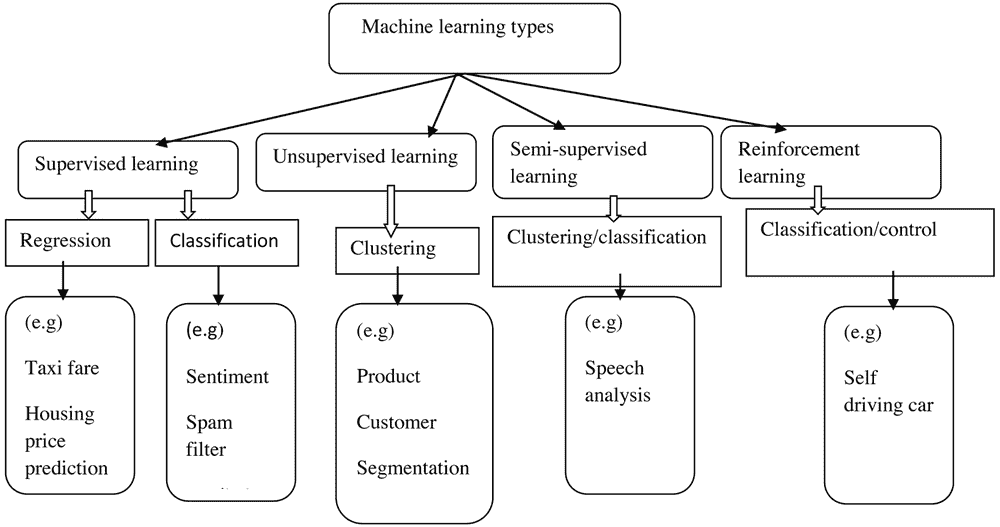 |
| --- |

### 2.1 监督学习

监督学习也被称为关联学习，其中模型是在教师和监督者的存在下进行训练的。它将每个输入向量与目标向量配对，目标向量代表预期的输出，而输入向量与显示预期输出的目标向量密切相关。在这类训练方法中，我们为模型提供输入，这将产生一个输出向量（Pearl and Stevers, 2012）。这些输出向量在目标值之间进行比较。如果我们发现这些目标值与实际值存在差异，那么模型的结果就会产生一种错误，必须根据错误值计算突触权重调整，以使实际值与目标值匹配。这种训练方法在模式分类网络、模式关联网络和多层神经网络中执行非线性映射，如图 2 所示。

| 图 2. 机器学习算法模型 |
| --- |
| 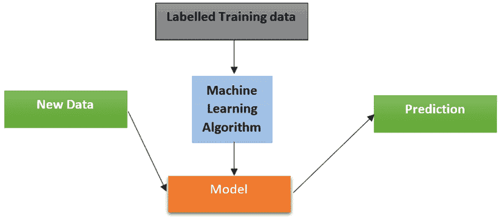 |
| --- |

#### 监督学习中用到的一些算法

- 朴素贝叶斯
- 神经网络
- 线性回归
- 支持向量机 (SVM)
- K-近邻算法
- 决策树

#### 2.1.1 朴素贝叶斯

它是机器学习中的一种贝叶斯网络模型，其中变量类 `C` 是必须预测的根，而这些属性变量是叶子。之所以被称为朴素贝叶斯模型，是因为它假设属性在条件上是相互不同的。这种算法是机器学习算法的一种，被用于分类问题。朴素贝叶斯主要用于文本分类，这可能涉及高维训练数据集。朴素贝叶斯算法有许多示例，如垃圾邮件过滤、情感分析和新闻文章分类。这种算法也被称为“朴素”算法，因为它假设某个特定特征的出现与其他特征是独立的。

#### 2.1.2 神经网络

神经网络是由大量称为神经元的处理元素组成的高度互连网络。其架构灵感源于大脑；神经网络可以是大规模并行的，因此被认为表现出并行分布式处理。神经网络可以学习执行复杂任务，并且具有内在的容错性。在神经网络中，神经元连接到摘要，摘要提供了来自其他神经元的输入，内部又为其他神经元提供输出和输入。神经网络有两种类型：

- 人工神经网络：人工神经网络处理信息的速度最快；它们以顺序模式运行，即传统计算机中一个指令接一个指令的操作。它具有输入层、隐藏层和输出层，如图 3 所示。

| 图 3. 人工神经网络中的数据提取 |
| --- |
| 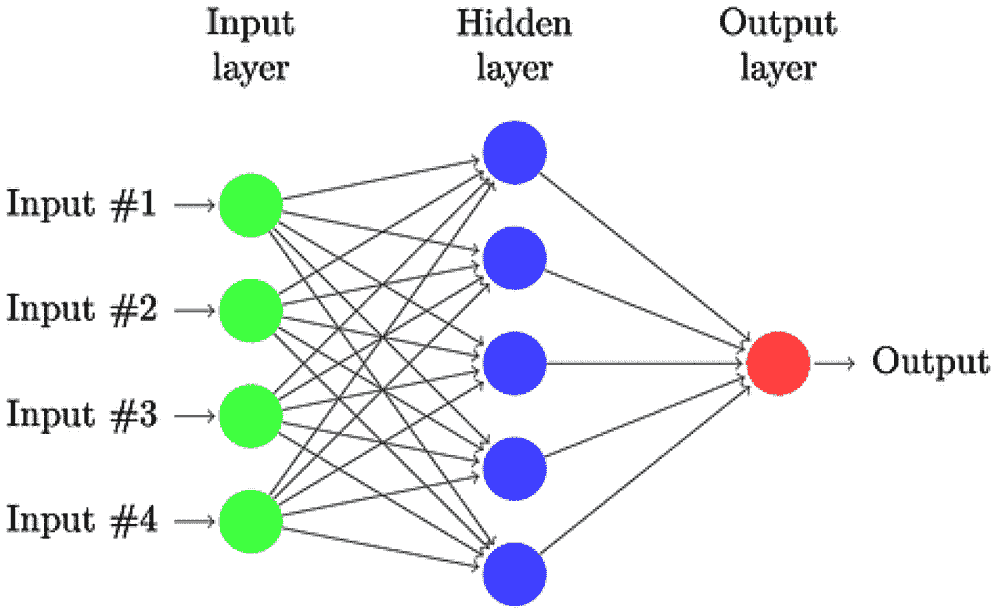 |
| --- |

#### 2.1.3 线性回归

线性回归是一种依赖监督学习的机器学习算法，它执行所有的回归任务。回归模型依赖于进行目标预测的自变量。这通常用于计算变量与预测之间的关系。有不同类型的回归模型，它们基于因变量和自变量之间的关系类型。线性回归执行预测因变量值 `y` 的任务，`y` 取决于给定的自变量 `x`。因此，在这一回归技术中，我们找到了 `x`（输入）与 `y`（输出）之间的线性关系。

| 图 4. 线性回归图 |
| --- |
| 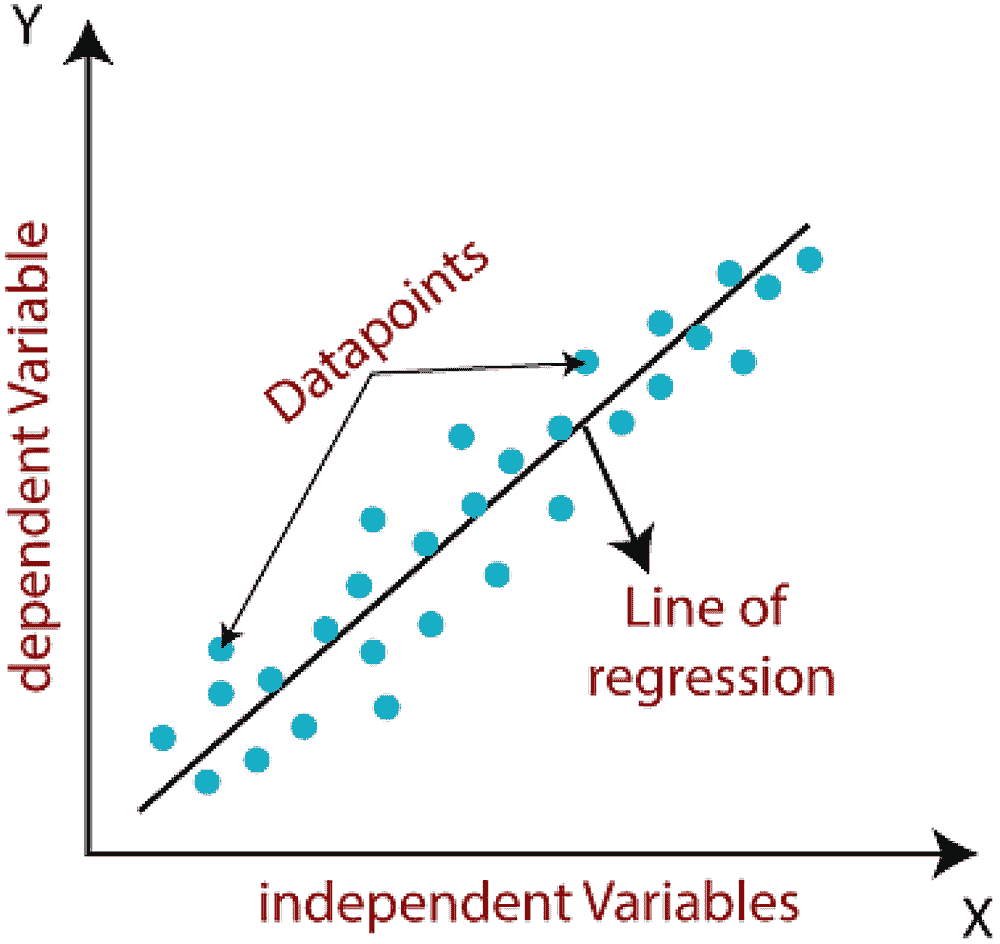 |
| --- |


其中 `b=斜率=速率` 是 `y` 数的谓词，表示 `x` 每增加一个单位时 `y` 的增量。截距 = `x` 为 0 时 `y` 的水平。

#### 2.1.4 支持向量机 (SVM)

它是一种同时使用回归和分类的监督学习类型，如图 5 所示。我们也可以将支持向量机作为机器学习中的支持向量网络。SVM 具有通过算法进行关联学习的监督学习模型。当我们谈论分类时，支持向量机被分为各种向量机，这些分类又可分为三类：

- 相关向量机 (RVM) – 具有相同函数形式的支持向量机机称为相关向量机；它提供概率分类，因此是完全等价的。
- 最小二法支持机 (LS-SVM) - 监督学习版本的最小二法支持机
- 结构化支持机 (S-SVM) – 用于分类的结构化支持机

| 图 5. 支持向量机 |
| --- |
| 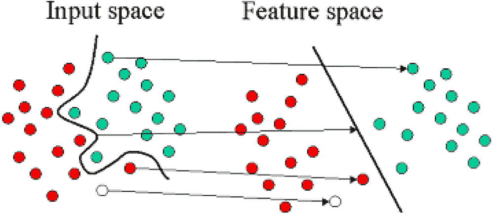 |
| --- |

#### 2.1.5 K-近邻算法

K-近邻算法基本上用于分类和回归过程；这种算法是完全无参数的。在分类和回归两种情况下，输入变量总是具有最近的训练示例，这些示例是从特征空间中深度提取的。它使用欧式距离寻找连续变量的距离，对于离散变量可以使用汉明距离等不同指标。这种多数投票算法的主要缺点是类别分布的偏斜，这在分类期间发生。如果在专门算法中完成距离度量的学习，可以稍微提高 KNN 的分类准确率。

| 图 6. KNN (K-近邻) |
| --- |
| 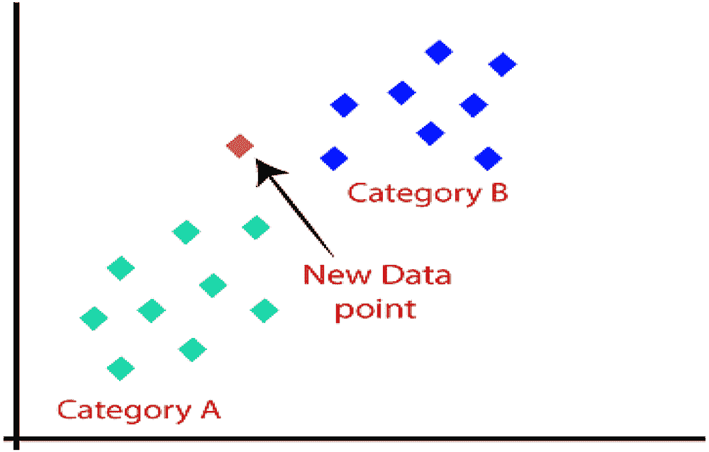 |
| --- |

| 图 7. 无参数 k-近邻分类器 |
| --- |
| 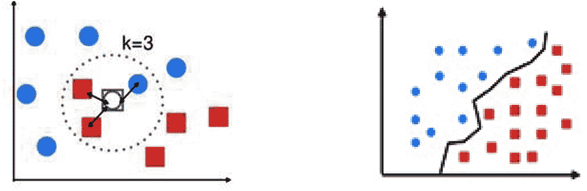 |
| --- |

在图 7 中，KNN 算法有两种基本的参数选择，它们是最近邻分类器和加权最近邻算法。

#### 2.1.6 决策树算法

决策树算法的过程是描述输入和输出，即输入是什么？或者训练数据中对应的输出是什么？决策树是监督机器学习算法的一种，其中通过连续遵循某些参数对输入数据进行划分或分解，如图 8 所示。这棵树可以使用两个实体来描述：决策节点和叶子；这里，叶节点意味着最终结果或决策，而决策节点的含义是被拆分的数据。

| 图 8. 机器学习中的决策树过程 |
| --- |
| 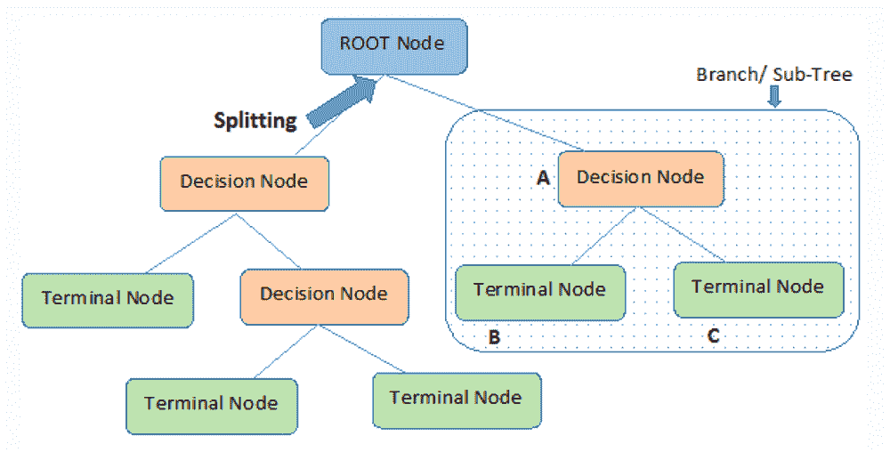 |

### 2.2 无监督学习

在这类学习中，输出单元被训练为对来自给定输入的整个聚类模式做出响应，并采用了自组织模式（Zheng and Liu, 2007）。在这种情况下，同类型的向量输入被组合在一起，而没有使用训练数据集来指定每组的典型成员应该什么样，或者这些组成员属于哪一类。在训练期间，神经网络获取其模式，这些模式是从输入中获得的，并将所有这些模式分类到类别中。当模式的新输入被应用时，神经网络会给出新的输出响应，从而确定该组成员所属的类别。分组可以基于颜色、形状以及对象的所有其他属性进行。这是一种机器学习方法，通过该模型对观测值进行拟合来完成。

无监督学习中使用的不同类型的算法所示如下：

- 隐马尔可夫模型 (HMM)
- K 均聚类 (K-mean Clustering)

#### 2.2.1 隐马尔可夫模型 (HMM)

隐马尔可夫模型包含一组状态，这些状态由转移概率和概率分布组成。HMM 是一种模型，它是马尔可夫模型的新扩展，模型的这些状态不需要与观测状态任何对应关系。将可观测符号序列作为输出的过程被称为 HMM。

#### 2.2.2 K 均聚类

在这种类聚类中，聚类在不知道类别层级的情况下识别数据对象。在这里，聚类对数据集的给定属性没有先验知识。K 均聚类仅通过对输入数据的分组来完成，因为输出不是预先定义的，如图 9 所示。

| 图 9. 机器学习中的 K 均聚类 |
| --- |
| 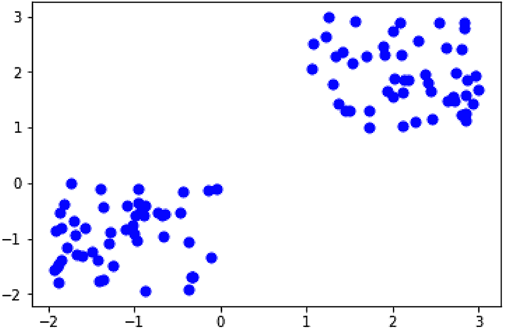 |

#### 2.2.3 半监督学习 (Semi-supervised Learning)

这是一种机器学习方法，在训练期间，它将极少量的标记数据与大量的未标记数据结合起来。这种学习介于无监督学习（不包含任何标记训练集数据）与监督学习（由纯标记训练数据集组成）之间。

#### 2.2.4 强化学习 (REINFORCEMENT LEARNING)

这是科学领域的一种学习类型，根据行为给予奖励和惩罚（Sutton and Barto, 1998）。强化算法通过采用通用的最优控制方法来实现，该方法与动态规划相关。这项工作已被观察到，这些奖励用于学习环境的最优策略。

### 2.3 机器学习的应用

机器学习在自动化方面有各种应用，如图 10 所示（Kononenko and Matjaž, 1997）。

| 图 10. 机器学习的应用 |
| --- |
| 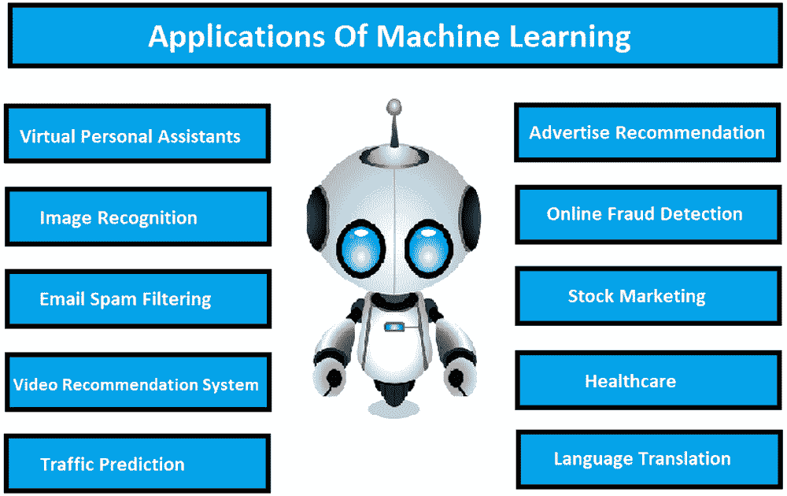 |

#### 2.3.1 虚拟个人助手

虚拟助手使用自然语言处理 (NLP) 将用户的文本或语音输入与可执行命令关联并匹配。这种过程通过使用人工智能技术进行反复学习，其中包括机器学习 (ML) (Kepuska & Bohouta, 2018)，以便通过语音启动虚拟助手；可以使用唤醒词。这取决于具体的命令和问题。虚拟个人助手使用软件代理，为个人执行任务和提供。

#### 2.3.2 图像识别

图像识别是一种系统和软件用于识别物体、人、地点以及图像中所有动作的方法。图像识别始终使用人工智能内部的机器视觉技术，并利用摄像系统训练用于识别图像的算法。全人类都能识别并区分所有对象的不同特征。这是因为我们的大脑以前已经使用类似的图像集接受过训练，导致了在图像识别中能够轻而易举地区分事物的能力。数值被放入数组集中并寻找数字图像中的模式。它可以以静态图、视频、图形的形式存在，甚至可以是实拍的，用于识别和区分所有图像的关键特征。计算机视觉使用图像处理算法来分析和理解来自单幅图像或图像序列的视觉信息。

生物识别是计算机视觉最重要的领域之一。在其中，我们捕捉人的生物特征。之后，应用预处理技术和过滤技术来增强捕捉到的图像。我们提取增强图像的特征，为了在识别方面的进一步处理，机器学习技术也有帮助（Singh, L. et al.）

机器学习支持在线欺诈检测，因为它可以管理更详细的问题，如虚假索赔、重复索赔和夸大维修费用。机器学习还有助于为医疗索赔和医疗保健创建反欺诈解决方案、电子商务中的防欺诈解决方案、银行和信用卡支付中的欺诈检测、防止贷款申请欺诈以及用于反洗钱的机器学习。

图 12 显示了`machine learning algorithm`，它能够很好地识别模式，但它使用的是可以迭代的`datasets`。

| 图 12. 欺诈检测流程 |
| :--- |
|  |

#### 2.3.8 股票营销

众所周知，`machine learning` 变得每个领域变得非常流行，并且它可以预测未来（Reza et al., 2011）。如果我们谈论`stock market`，可以说`machine learning` 能够准确地预测`emotions` 和趋势。

#### 2.3.9 医疗保健

医疗领域的`machine learning` 很有前景（Simon et al., 2017）。`machine learning` 能够处理`large datasets` 并提供`results`。这种市场价值的提高归功于`data`的进步。

| 图 13. 机器学习在医疗保健中的应用 |
| :--- |
|  |

#### 2.3.9 青光眼诊断的应用

这是`optical tomography`（`OCT`）和`machine learning`诊断青光眼的应用（Omodaka et al., 2019）。`machine learning` 用于从`early stage`中提取`features` 和`results`。`machine learning` 能够分析`emotions` 和`data`（Singh et al., 2020）。

#### 2.3.10 机器学习的商业应用

`machine learning` 芯片最近开始发挥作用。像 `Google`、`IBM` 和 `Amazon` 等许多巨头正致力于此。`machine learning chip` 市场分为：

- 组件：`Software Tools`、`Services`
- 应用：`Marketing & Advertising`、`Fraud Detection & Risk Analytics`、`Predictive Maintenance`、`Augmented Reality`、`Network Analytics` & `Automated Traffic Management`
- 组织规模：`Small & Medium Enterprises`、`Large Enterprises`
- 最终用户：`Education`、`Banking & Financial Services`、`Insurance`、`Automation & Transportation`、`Healthcare`、`Defense`、`Retail and E-Commerce`、`Media & Entertainment`、`Telecom`、`Government`、`Aerospace`

芯片包括：

- `neuromorphic chips`
- `Graphics Processing Unit`（`GPU`）芯片
- `Flash based chips`
- `Field Programmable Array`（`FPGA`）芯片

采用这些的国家包括 `U.S.`、`France`、`U.K.`、`Germany`、`Canada` 和 `India`。

### 2.4 机器学习的伦理方面

为了理解`machine learning`的所有重要性、现状和全部，我们还必须考虑`machine learning` 技术的伦理方面。有很多例子展示了当前场景下`machine learning` 的伦理方面（kumar et al., 2016）。

#### 2.4.1 执行数据自动可视化的能力

普通人和贸易行业每天通过数据显性关系的可视化产生海量数据（Alemu 等人，2014）。贸易活动无法仅单自身就做出最佳决策，但它可以建立信心。机器学习提供了许多工具，能够为给定的数据集提供丰富的片段，这些片段既可用于非结构化数据集，也可用于结构化数据集。

通过在机器学习技术中辅助用户友好的自动数据可视化平台，交易可以在增强生产力流程的努力中获得新的洞察健康。

#### 2.4.2 自动化的极致

自动化是机器学习中最重要的伦理方面之一，它被用于重复性任务的自动化，这就是为什么它能提高组织的生产力（Niranjan and Shin, 2008）。许多机构已经将机器学习用于文书工作和电子邮件自动化。例如，在金融领域，性能需求通常涉及大量重复的、重度的数据和可预测的任务，因此，这些部门使用不同类型的机器学习解决方案来获得卓越收益。机器学习使得任务变得更快、更具洞察力且更准确。某些方面可以通过机器学习来解决，例如使用聊天机器人解决金融查询问题。它可以进行预测、安排支出、简化发票以及自动银行对账。

#### 2.4.3 前所未有的客户参与

对于任何类型的业务，客户会议是最重要的方式之一，它通过在目标客户中触发有意义的对话，促进了最大的诚实，并建立了长期且持久的客户关系；在此过程中，机器学习发挥着重要作用，允许企业和品牌在客户参与过程中引发非常重要的对话。这种机器学习技术可以发现特定的短语、词汇、句子、成语和内容格式，通过这些内容与某些听众成员产生共鸣。他们可以考虑到成功利用机器学习为用户提供个性化建议的兴趣。这种技术利用技术源对用户将感兴趣的内容进行处理；它是基于他们已经固定的目标。

#### 2.4.4 与物联网结合将效率提升新水平的能力

当与物联网（`IoT`）结合时，机器学习支持人类向更高水平发展，并随着产生越来越多的智能设备而变得日益流行。`IoT`被指定在具有战略意义的领域，已有许多公司存在并致力于此，新来者也启动了试点项目，以衡量`IoT`在业务运营内容中的重要性。对于提供`IoT`咨询服务和平台的人，为了获得成功，需要明确确定通过实施`IoT`策略将发生改变的领域。许多此类行业未能解决这个问题。在这种情况下，这种学习技术是最好的，用于达到最高水平的效率。通过将机器学习与`IoT`帮助相结合，可以提升整个`IoT`生产过程的效率（Meidan 等人，2017）。

#### 2.4.5 改变抵押贷款的能力

这是一个真实的情况，培养是最积极的信用评分之一，这通常需要一些纪律和大量的财务规划，并拥有大量客户（Stephens, 2015）。每当我们谈论贷款人时，在信誉方面，客户信用评分是最大的衡量之一，包含了许多因素，包括还款历史、债务总和、信用历史长度等；但尽管如此，如果他们能使用机器学习发现任何样本和最佳衡量方法，那么贷款人就能以新的方式获取全面的消费者画像，并且他们根据对其消费转折点的理解，预测客户是属于低消费者还是高消费者；在此之外，所有抵押贷款和金融机构始终使用与对不同类型客户贷款相似的技巧。

#### 2.4.6 准确的数据分析

从逻辑和传统角度来看，数据分析一直是在试错法的基础上增加的，这种方法在处理海量异构数据集时会变得非常不切。在多次实例之后，机器学习通过提供有效的替代方案为所有这些问题提供了更优的解决方案（Berg and Hagersten, 2004）。通过使用快速且高效开发的算法分析海量数据集，它们还管理着驱动数据，并同时让模型处理实时数据集。机器学习算法能够从分析中生成准确的结果和结论。

#### 2.4.7 顶尖或最佳的商业智能

机器学习的特征表明，当大型数据集与分析工作结合时，机器学习能够产生高水平的商业智能，并帮助各种不同的行业进行战略启动，涵盖从所有经济服务零售到医疗等更多领域。机器学习技术拥有提升业务运营最高效率的技术；它为商业智能支持所需的关键决策做出了重大贡献。作为最关键和核心的趋势技术之一（Reshi and Khan, 2019）。

## 参考文献

- Aghababaeyan, Khan, & Siddiqui. (2011). Forecasting the Tehran Stock Market by artificial neural network. International Journal of Advanced Computer Science and Applications, 13-17.
- An, G., Omodaka, K., Hashimoto, K., Tsuda, S., Shiga, Y., Takada, N., Kikawa, T., Yokota, H., Akiba, M., & Nakazawa, T. (2019). Glaucoma diagnosis with machine learning based on optical coherence tomography and color fundus images. Journal of Healthcare Engineering, 2019, 2019. doi:10.1155/2019
- BergE.HagerstenE. (2004, March). StatCache: a probabilistic approach to efficient and accurate data locality. In IEEE International Symposium on-ISPASS Performance of Systems and Software, 2004 (pp. 20-27). 10.1109.
- Kepuska, V., & Bohouta, G. (2018, January). Next-generation of virtual personal assistants (microsoft cortana, apple siri, amazon alexa and google home). In 2018 IEEE 8th Annual Computing and Communication Conference (CCWC) (pp. 99-103).
- Kononenko, I., Bratko, I., & Kukar, M. (1997). Application of machine learning to medical diagnosis. Machine Learning and Data Mining: Methods and Applications, 389, 408.
- KumarN.KharkwalN.KohliR.ChoudharyS. (2016, February). Ethical aspects and future of artificial intelligence. In 2016 International Conference on Innovation and Challenges in Cyber Security (ICICCS-INBUSH) (pp. 111-114). 10.1109.
- Liu, H., & Setiono, R. (1997). Feature selection via discretization. IEEE Transactions on Knowledge and Data Engineering, 9(4), 642–645.
- Mathews, S., Golden, S., Demski, R., Pronovost, P., & Ishii, L. (2017). Advancing health care quality and safety through action learning. Leadership in Health Services, 30(2), 148–158.
- MeidanY.BohadanaM.ShabtaiA.GuarnizoJ. D.OchoaM.TippenhauerN. O.EloviciY. (2017, April). ProfilIoT: a machine learning approach for IoT device identification based on network traffic analysis. In Proceedings of the symposium on applied computing (pp. 506-509).
- Pearl, L., & Steyvers, M. (2012). Detecting authorship deception: A supervised machine learning approach using author writeprints. Literary and Linguistic Computing , 27(2), 183–196. doi:10.1093/llc/fqs003
- Reshi, Y. S., & Khan, R. A. (2014). Creating business intelligence through machine learning: An Effective business decision making tool. In Information and Knowledge Management (Vol. 4, No. 1, pp. 65-75). Academic Press.
- Singh, L. K., & Garg, H. P. (2020b). Automated Glaucoma Type Identification Using Machine Learning or Deep Learning Techniques. In Advancement of Machine Intelligence in Interactive Medical Image Analysis (pp. 241-263). Springer.
- Singh, L. K., Khanna, M., & Garg, H. (2020c). Multimodal Biometric Based on Fusion of Ridge Features with Minutiae Features and Face Features. International Journal of Information System Modeling and Design , 11(1), 37–57. doi:10.4018/IJISMD.2020010103
- Singh, L. K., Pooja, , Garg, H. (2020a). Detection of Glaucoma in Retinal Images Based on Multiobjective Approach. International Journal of Applied Evolutionary Computation , 11(2), 15–27. doi:10.4018/IJAEC.2020040102
- Smola, A., & Vishwanathan, S. V. N. (2008). Introduction to machine learning. Cambridge University.
- Stephens, M. (2007). Mortgage market deregulation and its consequences. Housing Studies , 22(2), 201–220. doi:10.1080/02673030601132797
- Sutton, R. (1998). S. and Barto, Andrew G. Reinforcement Learning: An Introduction . MIT.
- Sutton, R. S., & Barto, A. G. (1998). Introduction to reinforcement learning (Vol. 135). MIT Press.
- ZhaoZ.LiuH. (2007, June). Spectral feature selection for supervised and unsupervised learning. In Proceedings of the 24th international conference on Machine learning (pp. 1151-1157). 10.1145/1273496.1273641

# 第 8 章：概念与应用

- **Ankit Khushal Barai**: 计算机科学与工程系，印度信息技术学院，纳格普尔，印度
- **Robin Singh Bhadoria**:  计算机科学与工程系，印度斯坦科学科技学院，印度
- **Jyotshana Bagwari**: 计算机科学与工程系，北塔坎理工大学，印度
- **Ivan Perl**: ITMO 理工大学，俄罗斯

### 摘要

传统的机器学习（`ML`）需要集中化的训练数据存在于特定的机器或数据中心。医疗、金融等禁止数据共享的机构需要一种在安全架构中训练机器学习模型的方法。近期，诸如联邦学习（`FL`）、麻省理工实验室的切分神经网络（`Split Neural networks`）、区块链等技术，旨在解决数据隐私和合规问题。然而，联邦学习的设计原则与医疗、金融等机构的需求之间存在差异，这需要一种区块链编排的联邦学习，它具有以下特征：带有其本地数据的客户端可以对其数据定义访问策略，并使用区块链技术定义在工作者和聚合器之间如何加密更新后的权重，同时还准备网络内进行的审计日志，并保持实际参与者列表隐藏。这有望消除医疗、金融、安全、物流、治理、运营和制造在内的多个领域的障碍。

### 1 引言

监督深度学习（LeCun et al., 2015）算法为各种图像分类任务提供了非常优的性能。这些任务的典型方法包括 3 个步骤：

1. 建立一个大型数据仓库。
2. 为这些数据获取真值标注（标签），以及
3. 利用真值标注训练用于分类的深度学习（`DL`）网络。

然而，这种方法面临着重大的实际挑战。特别是数据隐私和安全问题为创建用于训练的大型中央数据仓库带来了困难。两年前，Google 提出了一种去中心化的`联邦学习`（Yang et al., 2019）技术，可以在不共享敏感信息的情况下，跨多个数据源训练深度学习模型。

尽管联邦学习与中心化学习相比具有显著优势，但联邦学习也存在多个缺点：

1. 所有参与的客户端拥有相同的最终模型。这对于贡献更多数据的客户端是不公平的。例如，一个客户端可能声称拥有良好的数据，但可能只想要最终模型。这在最坏的情况下被视为 `DL` 模型盗窃，在最好的情况下被视为搭车者。
2. 客户端可能会引入后门（通过恶劣的和/或精心设计的对抗数据）来破坏最终模型（Bagdasaryan et al., 2018）。

近期，麻省理工提出了一种新的联邦学习方法，称为切分神经网络`SplitNN`，它可以解决上述问题。在`SplitNN`中，最终的深度学习模型并不是所有客户端共享——没有单一的深度学习模型。每个客户端计算自己的模型，但仍共享来自其他客户端的“知识”。通过`SplitNN`，每个客户端训练到特定的层，称为切分层。其余层由每个客户端计算。

区块链是解决医疗、金融等不受控环境中隐私和信任的技术。联邦学习与区块链的结合可以解决底层问题。区块链是一种通过哈希链接彼此的顺序数据结构。链的大小没有限制，因此随着新区块的添加，链会变得更大。`b[i]`的任何更改都需要更改`b[i]`之后的所有区块，这为区块链增加了安全性。在不被其他利益相关发现的情况下，修改这么多区块是不可能的。这种分布式账本在所有节点中复制。区块链最初用于加密货币，但很快开始应用于需要信任的许多领域。区块链是一种跨共享系统的计算机去中心化记录，是相互链接且持续扩展的列表。

联邦学习与区块链融合解决的挑战有：

1. **隐私问题**：如何在不披露数据的情况下训练。
   - a. 影响问题：第三方可以影响 AI 模型的行为。
2. **经济问题**：如何正确激励第三方贡献知识。
3. **透明度问题**：AI 模型的行为是否对所有方可见。
4. **延迟问题**：中心化 AI 对于需要与真实世界实时交互的应用场景是不合适的。

## 2 联邦学习

### 2.1 问题公式

接受的组合学习问题包括从存储在数十到大量远程设备上的数据学习一个单一的全局模型。我们计划在设备本地存储并处理、仅与服务器定期共享更新的情况下获得该模型。具体而言，目标通常是最小化等公式 1 和 2 所示的目标函数：

```


min F(w), where  (1)

```
其中`m`是设备总数，`Fk`是第 k 个设备的本地目标函数，`pk`指定每个设备的相对影响，满足
```

`pk³0` and . (2)


联邦学习包括在分布式设备（如手机）或分布式场所（如医院）上进行机器学习（Alpaydin 等人，2020）或深度学习模型的训练，同时将数据保留在分布式设备内部。在多变且可能巨大的网络中进行训练引入了新的挑战，这要求我们必须跳出大规模机器学习的典型方法。本章涵盖了联邦学习的新颖特性和挑战，并对现有方法进行了全面总结，还概述了与不同研究小组相关的未来工作的一若干指南。手机、可穿戴设备和自动驾驶车辆只是每天产生大量信息的尖端分布式系统中的几个。由于这些设备的计算强度不断提高，联邦学习可以利用这种计算能力在本地训练模型，然后将训练好的模型权重与服务器共享，从而保护了数据隐私。

联邦学习的需求是：

* 1. 需要隐私保护（联邦学习并非所有解决方案）
* 2. 带宽或功耗是待考虑的问题
* 3. 数据传输成本高
* 4. 你的模型随数据增多而改进

联邦学习的关键特征是：

* 1. 性能随数据增多而提高。
* 2. 模型可以有意义地合并。
* 3. 节点可以参与训练，而不仅仅是在推理期间。

随着分布式系统内部设备容量和计算能力的发展，可以使用每个设备改进后的邻域资源。这激发了人们对联邦学习日益增长的热情，它研究如何在远程设备上直接准备可衡量的模型。我们在这里研究了联邦学习的一些用例：

* 1. 手机：可以构建联邦模型以提供个性化的 AI 模型，例如下一个词预测、人脸检测。此外，客户端体验不能受到影响，因此联邦学习可以在手机充电且不使用时进行训练，而不会降低客户体验或泄露私有数据。
* 2. 组织：从联邦学习的角度来看，协会或组织也可以被视为“设备”。例如，诊所是包含大量患者信息的协会，用于提供预见性医疗服务。
* 3. 物联网：例如，自动驾驶车辆网络可能需要一个现代交通、建筑或行人行为模型以确保安全工作。联邦学习技术可以帮助准备能够适应这些框架变化的模型，同时保持客户端安全。

## 2.2 联邦学习过程

联邦学习涉及的步骤简要描述如下：

多次重复步骤 (1) 到 (8)

* 1. 节点网络与服务器共享模型，而非训练数据
* 2. 服务器拥有一个未训练的模型

| 图 1. 服务器有一个未训练的模型 |
| --- |
| 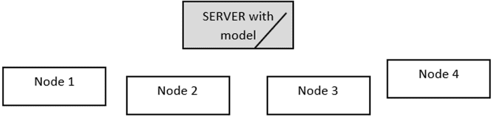 |
| --- |
* 3. 它将该模型的副本发送给节点

| 图 2. 服务器将该模型的副本发送给节点 |
| --- |
| 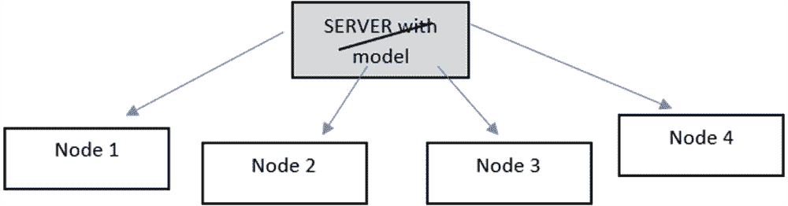 |
| --- |
* 4. 节点现在也拥有了未训练的模型

| 图 3. 所有节点现在也拥有了未训练的模型 |
| --- |
| 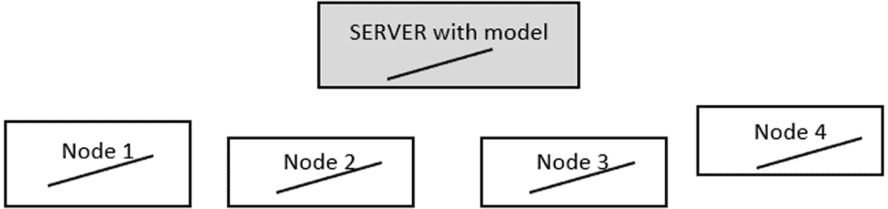 |
| --- |
* 5. 节点拥有用于训练其模型的数据

| 图 4. 节点拥有用于训练其模型的数据 |
| --- |
| 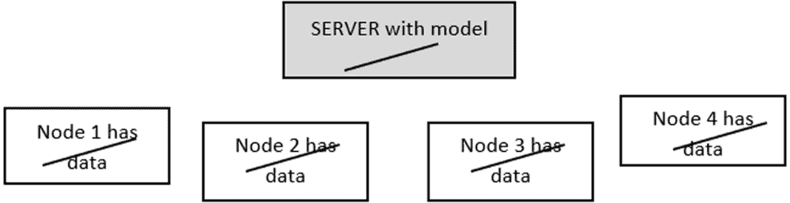 |
| --- |
* 6. 节点利用其数据训练其模型

| 图 5. 节点利用其数据训练其模型 |
| --- |
| 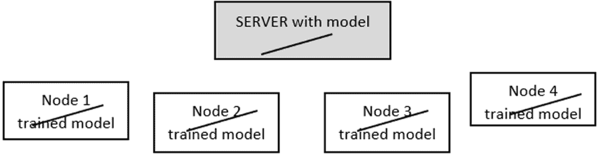 |
| --- |
* 7. 节点将其训练好的模型发送回服务器

| 图 6. 节点将其训练好的模型发送回服务器 |
| --- |
| 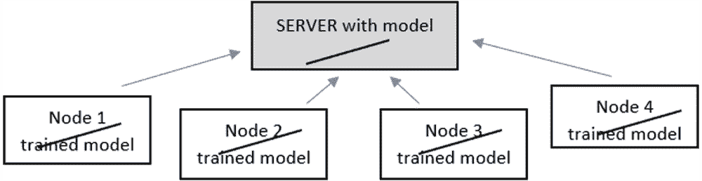 |
| --- |
* 8. 服务器通过平均合并合并这些模型

| 图 7. 服务器通过平均合并这些模型 |
| --- |
| 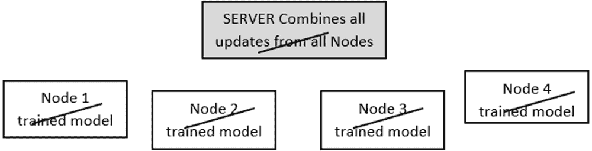 |
| --- |
* 9. 服务器现在拥有了训练好的模型
* 10. 联邦学习过程完成

| 图 8. 服务器现在拥有了训练好的模型 |
| --- |
| 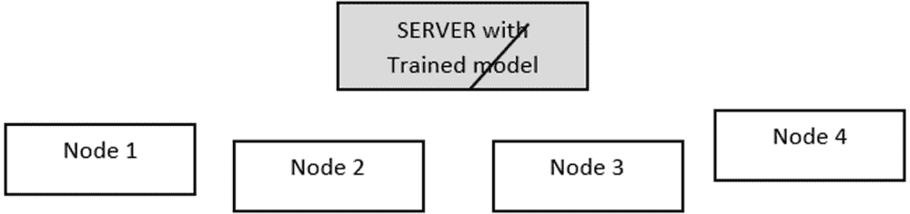 |
| --- |

## 2.3 联邦学习面临的挑战

### 2.3.1 通信成本

在联邦学习中，通过发送小规模更新而非完整数据集来缓解由于数据传输带来的隐私担忧（Bonawitz 等人，2019）是非常必要的。通信时间可能大于计算时间。

一些解决方案包括：

* 1. 减少消息的次数。
* 2. 减少消息的大小。

### 2.3.2 系统异构性

分布式系统中的设备容量在 CPU、内存、连接方面存在差异。此外，由于网络大小和电力限制，联邦学习中的每个设备可能是不稳定的，例如设备可能会在某个周期内掉线（Konecny 等人，2016）。

开发的联邦学习技术必须以以下方式工作：

* 1. 可视化低程度的参与度。
* 2. 适应不同的硬件。
* 3. 对故障具有鲁棒性。

### 2.3.3 统计异构性

设备之间的数据量可能存在显著差异，并且可能存在某种基础结构捕捉了设备及其相关分布的关系（Geyer 等人，2017）。分布式系统中的独立同分布（I.I.D.）假设增加了偏移的可能性，并包含了不确定性（Bonawitz 等人，2017）。

## 3 分割神经网络

分割学习是由 MIT Media Lab Camera culture 小组开发的一种新技术，允许在不共享任何原始数据的情况下训练 ML 模型。联邦学习也允许在不共享原始数据的情况下进行训练，但联邦学习存在一些缺点：

* • 所有客户端都拥有相同的模型，这对于贡献数据最多的客户端是不公平的。
* • 当使用故意设计的无用数据进行训练时，可能会发生对抗后门攻击，这会降低模型性能。

在划分学习（Split learning）中，并不是将完整模型下载到客户端机器，而是将模型的部分下载到客户端（Vepakomma et al., 2018）。在卷积神经网络（CNN）的某些初始层会被下载到特定的层，称为`cut layer`（切割层）。客户端使用原始数据运行模型到`cut layer`的前向传播，然后将这些激活值发送到服务器，服务器上的模型剩余层将使用这些`cut layer`的激活值作为输入；同样，在梯度的反向传播过程中，梯度也会从服务器传回到`cut layer`以更新权重。

划分神经网络（SplitNN）有几种变体，其中一种被称为`Folded-SplitNN`（折叠划分神经网络），服务器上包含一些中间层，而标签也位于客户端的本地机器中。这些如图 9 所示。SplitNN 克服了联邦学习的缺点，如下：

- 所有的客户端没有相同的模型，但所有客户端模型之间共享某些智能。
- 对抗性后门攻击是不可行的，因为因为它对恶意用户本身的影响最大。

| 图 9. SplitNN 架构的变体 |
| --- |
| 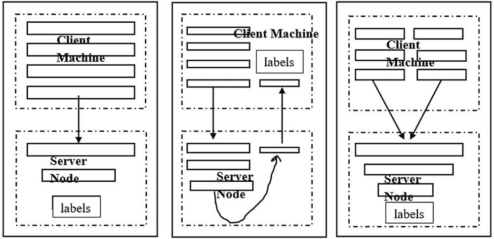 |
| --- |

# 4. 区块链

区块链技术的创建是作为名为`bitcoin`（比特币）的加密货币背的基础创新。2008 年次贷危机降低了人们对当前预算框架的信任。此时，一个名为中本聪（Satoshi Nakamoto）的个人或团体编写了一份包含`bitcoin technology`（比特币技术）的白皮书，该技术利用适当的共识机制来注册计算。（Zheng et al., 2018）`bitcoin`协议的设计目的是消除传统货币机构的中介，作为鼓励直接点对点（P2P）交易的方法。自从网络引入以来，一直有创建虚拟货币标准的尝试，但这些尝试由于“双重花费”问题而失败，特别是计算机资源（例如货币）可能会被花费两次的风险（Lin et al., 2017）。解决双重花费问题的当前方案是通过引入“信任中介”，例如银行。在任何情况下，区块链技术的使用使得在不需要此类信任中介的情况下解决双重花费问题成为可能，从而促进了在网络上安全地进行虚拟货币等资产交易（Crosby et al., 2016）。这一思想可以扩展到非货币领域，这就是区块链创新的保证。区块链中的区块链如图 10 所示。

| 图 10. 区块链中的区块链 |
| --- |
| 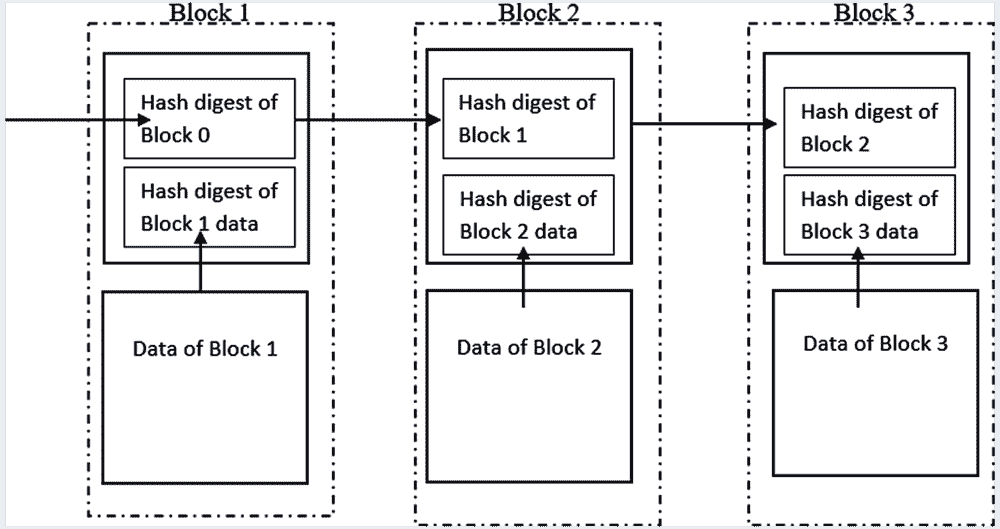 |
| --- |

区块链是一种顺序数据结构，包含存储在区块中的数据，这些数据通过哈希（Hashing）相互链接。链的大小没有限制，因此随着新区块的添加，链可以变得更大。区块 `b[i]` 中的任何更改都需要更改 `b[i]` 之后的所有区块，这为区块链增加了安全性。在几乎不被其他利益相关者察觉的情况下，更改如此数量的区块几乎是不可能的。这种分布式账本在所有节点上复制，即所有节点都拥有账本的副本。最初，区块链用于加密货币，但很快它就开始在许多需要信任的领域找到应用（Tastanattakol et al., 2018）。区块链是一种计算机、去中心化的（分布式）记录，跟踪在共享系统上发生的所有交易。它是一个相互链接且持续扩展的记录列表，安全地存储在各种互连框架之上。这使得区块链技术非常灵活，因为系统没有单点故障。此外，每个区块都与过去的区块有趣地相关联。这种区块链中的 1 链 111，中的区块链的。

## 4.1. 区块链是如何工作的？

### 4.1.1. 数据

区块链是一种顺序数据结构，其中数据被存储在通过哈希相互链接的区块中。

### 4.1.2. 区块链（通过哈希）

链的大小没有限制，因此随着新区块的添加，链可以变得更大。区块 `b[i]` 中的任何更改都需要更改 `b[i]` 之后的所有区块，这为区块链增加了安全性。在几乎不被其他利益相关者察觉的情况下，更改如此数量的区块几乎是不可能的。这种分布式账本在所有节点上复制，即所有节点都拥有账本的副本。最初，区块链用于加密货币，但很快它就开始在许多需要信任的领域找到应用（Tastanattakol et al., 2018）。区块链是一种计算机、去中心化的（分布式）记录，跟踪在共享系统上发生的所有交易。它是一个相互链接且持续扩展的记录列表，安全地存储在各种互连框架之上。这使得区块链技术非常灵活，因为系统没有单点故障。此外，每个区块都与过去的区块有趣地相关联。这种区块链中的 1 链 111，中的区块链的。

### 4.1.3. 签名（哈希）

加密哈希对于相同的输入始终产生相同的输出，但对于不同的输入则产生不同的输出。这种加密哈希被区块链用于提供签名的安全性。存在大量的哈希函数，但区块链使用的哈希函数是 SHA-256。

### 4.1.4. 挖掘的 Nonce

挖掘一个区块不仅仅是使用哈希函数计算签名，它还需要产生一个符合某些限制的签名，例如，签名必须以固定数量的零开头。由于交易信息和元数据等保持不变，每个区块都添加了一个微小的显式信息，除了反复更改它以找到合适的签名。

### 4.1.5. 这如何使区块链变得不可篡改？

假设攻击者修改了一个交易区块，并正尝试为生成的区块确定新的签名，以便让其余部分承认其更改。他面临的问题是，其余部分也在为新区块确定签名。即使攻击者更改了区块 1，区块 2 的签名也会改变，这意味着与区块 3 的签名不匹配。由于计算签名所需的计算成本和时间，更改 `i` 将是不可能的，在此期间某些区块会被添加到网络中。

### 4.1.6. 区块链的治理

只有最长的链被认为是有效的。区块链

## 4.2. 特性

1. **去中心化**：区块链不受任何中央机构的控制。
2. **透明性**：任何节点都可以验证交易，且交易是公开可见。
3. **不可篡改性**：一旦进入区块链，该区块就永远无法删除。
4. **安全性**：即使攻击者黑入网络中的某一台计算机并修改了那里的信息，网络也不会受到影响。因为区块链是分布式的。

## 4.3. 公有区块链与私有区块链

根据参与许可范围，区块链系统可以是开放的也可以是私有的。开放区块链和私有区块链之间的基本区别在于，前者在分布式开放条件下运行，对加入系统的数量没有限制；而后者则在受控制实体特征的限制范围内运行。一个简单的相似之处是 Web 与内网的区别。虽然组织化电脑的特征性创新持续如故，但封闭组织（例如，家庭系统）与开放组织（例如，Web）在元素和用途方面存在巨大差异。诚实地说，这种区别取决于如何激励“节点”成为组织的一员。这里的核心思想是，在开放式区块链中，共识机制是基于奖励每个成员以留存在系统中的。在私有区块链中，不存在产生这种激励的需求。真正的简单公共账本的民主化理念可能对于已知的协会或企业系统没有用，因为他们对哪些可以参与系统以及参与何种交易已有明确的理解。普遍共识是，虽然开放区块链在特定应用（例如，加密货币交易 `bitcoin`）方面运行良好，但区块链技术作为企业安排的更大规模应用，只有在私有区块链环境相关的扩展管理控制下才是可能的。注意，该技术仍处于初期阶段。随后，其各种应用正在不断且迭代地发展。开放与私有区块链系统的课题不可避免将由一种生物系统处理，即不同的私有区块链通过一个开放传输的网络相互关联。对该问题的回答可能不是可用选项之间的简单决策；它可能仅处于一个共同环境中，开放和私有区块链协同工作，就像私有系统（受防火墙保护）与 Web 协作一样。

## 5. 联邦学习中的区块链

在本节中，我们考虑分析联邦学习中区块链的关键要点。

### 5.1. 联邦学习面临的挑战及区块链的解决方案

1. 如何在没有中央权威的情况下训练模型？
2. 如何在不信任中心方的情况下使用训练好的模型？
3. 如何在深度学习模型的生命周期内验证并执行不同方之间的信任？
4. 如何为数据科学家的训练、测试和模型构建建立激励机制？
5. 如何为贡献数据集的方建立激励机制？
6. 如何抑制网络中的恶意行为？

解决方案是基于令牌的区块链智能合约，如图 11 所示。

| 图 11. 基于区块链的 AI 架构 |
| --- |
| 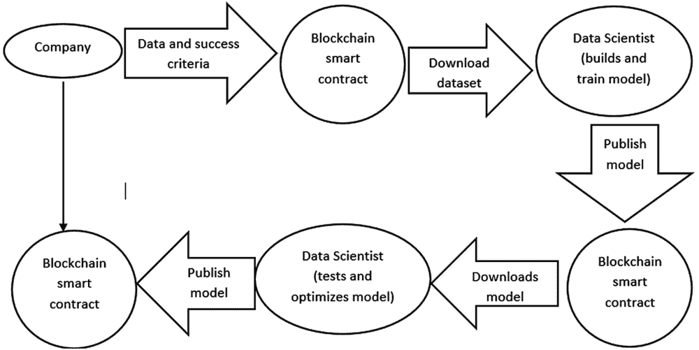 |
| --- |

### 5.2. 多方数据检索

由于大部分信息是敏感的，信息共享是危险的（`Zhu et al., 2018`）。许可链区块链的使用为没有共同信任的不同群体建立了一个受保护工具。

### 5.3. 数据共享策略

现有策略对信息进行加密。任何情况下，在共享场景下，如果没有智能合约对于信息持有者来说是危险的。

### 5.4. 安全性分析

| 图 12. 在 VGG 上训练 CIFAR-10 时每个客户端消耗的资源对比 |
| --- |
| 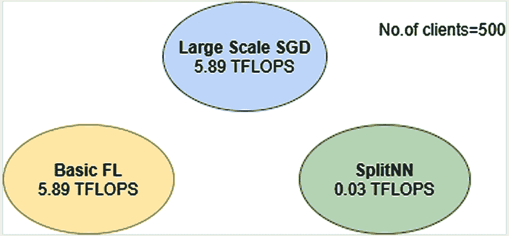 |
| --- |
| *来源: (Vepakomma, 2018)* |

| 图 13. 在 VGG 上训练 CIFAR-10 时每个客户端消耗的带宽对比 |
| --- |
| 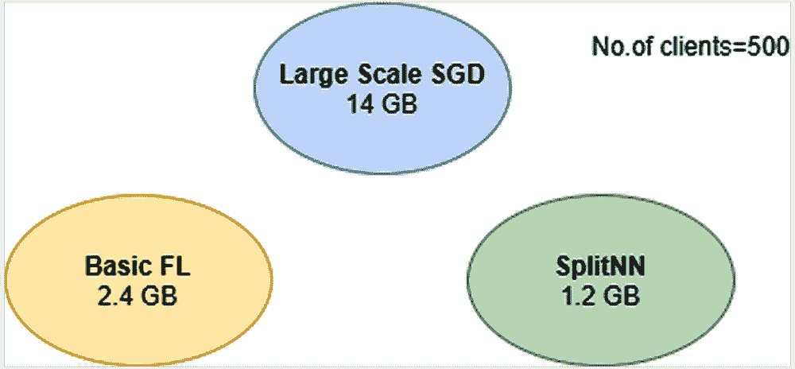 |
| --- |
| *来源: (Vepakomma, 2018)* |

图 12 和 13 显示了 FL 和 SplitNN 在大规模 SGD（`Stochastic Gradient Descent`）之上的性能效率。我们将联邦学习协调到许可链的智能合约中，以解决前面提到的安全风险。表 1 给出了各种公有和私有区块链平台的对比。

1. 实现差分保护：不同的技术利用用于确定残差的训练策略，只是与信息无关的任务，且不会暴露任何隐私数据。
2. 消除集中化信任：没有中央信任权威。
3. 确保共享信息的性质
4. 安全性：许可链利用椭圆曲线加密来确保信息的安全性。

表 1. 四个示例区块链平台的核心特征

| | Bitcoin | Ethereum | Hyperledger Fabric | Corda |
| --- | --- | --- | --- | --- |
| 加密货币 | `BTC` | `ETH` | 无内置货币 | 无内置货币 |
| --- | --- | --- | --- | --- |
| 访问策略 | 公开 | 公开 | 私有 | 私有 |
| 验证策略 | 无许可 | 无许可 | 许可 | 许可 |
| 共识协议 | 工作量证明 | 工作量证明 | 基于投票的算法 (`Apache Kafka`) | 有效共识，唯一性共识 |
| 交易处理时间（平均） | ~ 10 分钟 | ~ 15 分钟 | 几乎瞬间 | 几乎瞬间 |
| 最大交易率 | ~ 7 TPS | ~ 20 TPS | 3500+ TPS | ~ 170 TPS |
| 智能合约语言 | `Bitcoin Script` | `Solidity`, `Serpent`, `低级 Lisp 类语言 (LLL)`, `Mutan` | `Go` | `JVM` 编程语言如 `Kotlin`, `Java` |
| 图灵完备性 | 否 | 是 | 是 | 是 |

## 6. 结论与未来的研究方向

本章展示了如何将区块链技术与去中心化人工智能相结合，以解决人工智能在信息敏感领域（如金融行业、医院数据）应用中的重大问题，这种结合将联邦学习引入了许可区块链。本章还展示了基于区块链的智能合约如何通过将每次数据访问作为交易记录在不可篡改的账上，从而执行数据隐私。通过将联邦学习集成到许可区块链的智能合约中，提高了信息共享方案的效率。联邦学习与区块链的这种融合在工业物联网（IoT）中非常有帮助。一些基本问题包括：如何通过应用区块链策略高效地确保信息保护仍然是一个开放性问题；如何提高从原始信息映射出的信息模型的效用。此外，设备资源的受限也带来了新的困难。这一主题在近期取得了显著进展。大型科技公司正在生产环境中部署联邦学习解决方案，并能够应对隐私和数据挑战。

发现联邦学习为研究人员带来了前所未有的机遇和挑战。联邦学习允许分布式数据集通过分布式数据进行建模和研究，而这些数据可能因为隐私原因无法共享。未来的研究范围包括开发新的联邦数据集并改进现有的数据集。研究人员还需要解决与公平性相关的挑战。需要研究来应对基于设备类型、位置和本地数据集大小等考虑的新型偏差源，以检查这些大量的采样限制在多大程度上影响结果模型的公平性。还需要研究来检查联邦学习（FL）其他部分的局限性，如模型压缩。在传统的机器学习（ML）中训练公平分类器已有大量研究，例如约束优化和分布鲁棒优化。研究人员还需要找出（如果有的话）使得这些方法适用的额外假设。

## 参考文献

Alpaydin, E. (2020). Introduction to machine learning . MIT Press.

Bagdasaryan, E., Veit, A., Hua, Y., Estrin, D., & Shmatikov, V. (2018). How to backdoor federated learning. arXiv preprint arXiv:1807.00459

Bonawitz, K., Eichner, H., Grieskamp, W., Huba, D., Ingerman, A., Ivanov, V., . . . Van Overveldt, T. (2019). Towards federated learning at scale: System design. arXiv preprint arXiv:1902.01046

BonawitzK.IvanovV.KreuterB.MarcedoneA.McMahanH. B.PatelS.SethK. (2017, October). Practical secure aggregation for privacy-preserving machine learning. In Proceedings of the 2017 ACM SIGSAC Conference on Computer and Communications Security (pp. 1175-1191). 10.1145/3133956.3133982

Crosby, M., Pattanayak, P., Verma, S., & Kalyanaraman, V. (2016). Blockchain technology: Beyond bitcoin. Applied Innovation , 2(6-10), 71.

Geyer, R. C., Klein, T., & Nabi, M. (2017). Differentially private federated learning: A client level perspective. arXiv preprint arXiv:1712.07557

Gupta, O., & Raskar, R. (2018). Distributed learning of deep neural network over multiple agents. Journal of Network and Computer Applications , 116, 1–8. doi:10.1016/j.jnca.2018.05.003

Kim, H., Park, J., Bennis, M., & Kim, S. L. (2018). On-device federated learning via blockchain and its latency analysis. arXiv preprint arXiv:1808.03949

Konečný, J., McMahan, H. B., Yu, F. X., Richtárik, P., Suresh, A. T., & Bacon, D. (2016). Federated learning: Strategies for improving communication efficiency. arXiv preprint arXiv:1610.05492

LeCun, Y., Bengio, Y., & Hinton, G. (2015). Deep learning. Nature, 521(7553), 436-444.

Lin, I. C., & Liao, T. C. (2017). A survey of blockchain security issues and challenges. International Journal of Network Security , 19(5), 653–659.

Nasr, M., Shokri, R., & Houmansadr, A. (2018). Comprehensive privacy analysis of deep learning: Stand-alone and federated learning under passive and active white-box inference attacks. arXiv preprint arXiv:1812.00910

TasatanattakoolP.TechapanupreedaC. (2018, January). Blockchain: Challenges and applications. In 2018 International Conference on Information Networking (ICOIN) (pp. 473-475). IEEE. 10.1109/ICOIN.2018.8343163

TruexS.BaracaldoN.AnwarA.SteinkeT.LudwigH.ZhangR.ZhouY. (2019, November). A hybrid approach to privacy-preserving federated learning. In Proceedings of the 12th ACM Workshop on Artificial Intelligence and Security (pp. 1-11). 10.1145/3338501.3357370

Vepakomma, P., Gupta, O., Swedish, T., & Raskar, R. (2018). Split learning for health: Distributed deep learning without sharing raw data. arXiv preprint arXiv:1812.00564

Weng, J., Weng, J., Zhang, J., Li, M., Zhang, Y., & Luo, W. (2019). Deepchain: Auditable and privacy-preserving deep learning with blockchain-based incentive. IEEE Transactions on Dependable and Secure Computing , 1. doi:10.1109/TDSC.2019.295233

Yang, Q., Liu, Y., Chen, T., & Tong, Y. (2019). Federated machine learning: Concept and applications. ACM Transactions on Intelligent Systems and Technology , 10(2), 1–19. doi:10.1145/329881

Zheng, Z., Xie, S., Dai, H. N., Chen, X., & Wang, H. (2018). Blockchain challenges and opportunities: A survey. International Journal of Web and Grid Services , 14(4), 352–375. doi:10.1504/IJWGS.2018.09564

ZhuX.LiH.YuY. (2018, December). Blockchain-based privacy preserving deep learning. In International Conference on Information Security and Cryptology (pp. 370-383). Springer.

目前，机器学习（ML）技术已引起了广泛关注，在各个领域和应用中的兴趣日益增长。医疗保健、农业和生物信息学是借助机器学习进行研究最受认同的领域。本章介绍了机器学习的基本原理，如数据、模型、机器学习的基础数学细节以及学习的类型。机器学习的一个重要方面是“如何教机器”。本章重点关注学习的类型：监督学习、无监督学习、半监督学习和强化学习。为了理解，简要讨论了一些常用的机器学习算法，如决策树（`DT`）、k-最近邻（`KNN`）、支持向量机（`SVM`）、朴素贝叶斯、k 均值、q-learning 等。最后，作者介绍了机器学习与区块链的应用，这正在将传统的医疗保健和农业部门重塑为更可靠的手段。

# 1. 引言

目前，机器学习是应用于广泛应用领域中以解决各种复杂问题的突出技术之一。机器学习是人工智能（AI）的一个分支，它赋予计算机系统在没有显式程序编程的情况下自动学习的能力。海量数据是机器学习概念的基础，能够设计出专家系统。由于大量的连接设备和应用程序，这些数据正以指数级增长。机器学习使我们能够处理传统程序难以解决的困难且具有挑战性的任务。机器学习是对计算机算法的训练，这些算法通过知识和观察自动学习、扩展和进化。医疗保健、农业、人脑、生物信息学等是借助机器学习支持最受认同的研究领域。机器学习领域围绕基本原理展开：

* 收集数据
* 数据预处理
* 使用训练数据和算法学习模型
* 测试模型的准确性。

机器学习中的“学习”是指使用给定的训练数据集确定模型参数。机器学习有四类：监督学习、无监督学习、半监督学习和强化学习，这些学习被用于在各个领域和行业中保持竞争力。

机器学习的基本原理包括：数据、计算机算法和数学。有了数学知识，就可以轻松理解机器学习。因此，理解专门应用于机器学习的数学概念非常重要。机器学习包含线性代数、多元微积分、矩阵分解、优化、概率和统计（Deisenroth, Faisal, & Ong, 2020）。将人工智能与区块链及物联网（IoTs）相结合的现有倡议正在重塑世界。这将在许多领域创造新机会，如智能健康、农业、零售、绿色能源、供应链管理、智慧城市以及个性化的终端用户应用。区块链具有潜力，特别是在与人工智能整合时。通过区块链技术，患者可以连接到其他医院、诊断中心并自动积累他们的医疗数据（Yoon, 2019）。这些医疗数据经过机器学习的精炼，也可以帮助患者进行疾病预测和治疗建议。

本章的主要贡献是介绍应用于机器学习的数学概念概述。作者将涵盖主要的机器学习算法类型；解释每种算法的优点和应用。

本章的其余部分分为不同的章节。第二节阐述了机器学习中使用的术语。第三节介绍了机器学习的数学背景。第四节讨论了机器学习的类型及其应用。第五节给机器学习与区块链的应用。未来的工作方向总结了本章。

# 2. 机器学习中使用的背景和术语

目前，机器学习是应用于广泛应用领域以解决各种复杂问题的突出技术之一。机器学习是人工智能（AI）的一个分支，它赋予计算机系统在没有显式程序编程的情况下自动学习的能力。海量数据是机器学习概念的基础，能够设计出专家系统。由于大量的连接设备和应用程序，这些数据正以指数级增长。机器学习使我们能够处理传统程序难以解决的困难且具有挑战性的任务。机器学习是对计算机算法的训练，这些算法通过知识和观察自动学习、扩展和进化。医疗保健、农业、人脑、生物信息学等是借助机器学习支持最受认同的研究领域。机器学习领域围绕基本原理展开：

* 收集数据
* 数据预处理
* 使用训练数据和算法学习模型
* 测试模型的准确性。

机器学习中的“学习”是指使用给定的训练数据集确定模型参数。机器学习有四类：监督学习、无监督学习、半监督学习和强化学习，这些学习被用于在各个领域和行业中保持竞争力。

机器学习的基本原理包括：数据、计算机算法和数学。有了数学知识，就可以轻松理解机器学习。因此，理解专门应用于机器学习的数学概念非常重要。机器学习包含线性代数、多元微积分、矩阵分解、优化、概率和统计（Deisenroth, Faisal, & Ong, 2020）。将人工智能与区块链及物联网（IoTs）相结合的现有倡议正在重塑世界。这将在许多领域创造新机会，如智能健康、农业、零售、绿色能源、供应链管理、智慧城市以及个性化的终端用户应用。区块链具有潜力，特别是在与人工智能整合时。通过区块链技术，患者可以连接到其他医院、诊断中心并自动积累他们的医疗数据（Yoon, 2019）。这些医疗数据经过机器学习的精炼，也可以帮助患者进行疾病预测和治疗建议。

在机器学习中，计算机使用大量数据集。根据亚瑟·塞缪尔（Arthur Samuel）：“机器学习是一种不需要显式编程的人工智能分支”。然而，汤姆·米切尔（Tom Mitchell）提供了一个更现代的定义：“计算机程序如果在任务 T 和性能指标 P 上从经验 E 中学习，如果性能提高，则称学习。”

* 任务 T：机器学习的正式定义，一些常见的机器学习是分类、回归、聚类等。
* 性能指标 P：为了评估机器的能力，必须衡量性能。
* 经验 E：用于提高性能的经验。

## 2.1 数据、模型和算法

机器学习被称为从数据中自动提取信息的算法设计。有三个主要概念被应用于机器学习的核心：数据、模型和学习（Deisenroth, Faisal, & Ong, 2020），如图 1 所示。

| 图 1. 机器学习的核心 |
| --- |
|  |

机器学习从根本上说是数据驱动的。数据可以是未经解释和分析的原始事实、文本、音频、图像或视频。数据是机器学习最重要的部分。没有数据，模型训练是不可能的。数据被用于模型的训练、验证和测试。模型被认为是从数据中学习的。模型包含了从数据学习学习模式和关系的最终目标是寻找泛化良好的更好的模型。学习可以定义为通过改进模型参数自动发现数据模式和结构的方法。

* 机器学习算法：各种机器学习算法可用于构建模型。机器学习算法是包含数学逻辑的程序。算法在接触更多数据时会自我修改。
* 训练数据集：用于训练模型的子集。训练数据是学习机器和进行预测最重要的数据。总数据的 70%以上用于训练模型。

示例：考虑每个组织的物理特征（输入特征），如 `breast_cancer.csv` 中的 `mean radius`、`mean texture`、`mean perimeter`、`mean area`，该文件在`sklearn`库的数据集文件夹中免费提供（Pedregosa et al., 2011）。将这些数据的 70%馈给机器学习算法（`classification`），它将学习一个平均特征与其质量之间相关性的模型。

* 测试数据集：用于测试已训练模型的子集。测试数据用于检查机器在训练的基础上预测新结果的能力。

示例：将你作为测试数据（剩余的 30%数据）提取的组织特征并输入到机器学习技术中。它将使用之前计算的模型来预测该组织是“恶性”还是“良性”。算法可以是 `DT`、`KNN`、`SVM` 等。如果用于测试的所有样本数据预测的输出与实际目标类别相同，则测试准确率被认为是 100%。

# 3. 机器学习的数学基础

数学为计算机科学提供了坚实的基础。人工智能（AI）是关注让计算机像人类一样行动的分。机器学习（ML）和深度学习都是人工智能的子集。观察发现，机器学习依赖于必要的数学概念，如`线性代数`、`统计学`、`概率`、`微积分`、`熵`等，如图 2 所示。线性代数对于理解机器学习的概念至关重要。统计学和微积分也需要线性代数的先验知识。这些数学概念和原理用于模型构建、验证和置信度接受。

| 图 2. 机器学习中使用的数学概念 |
| --- |
| 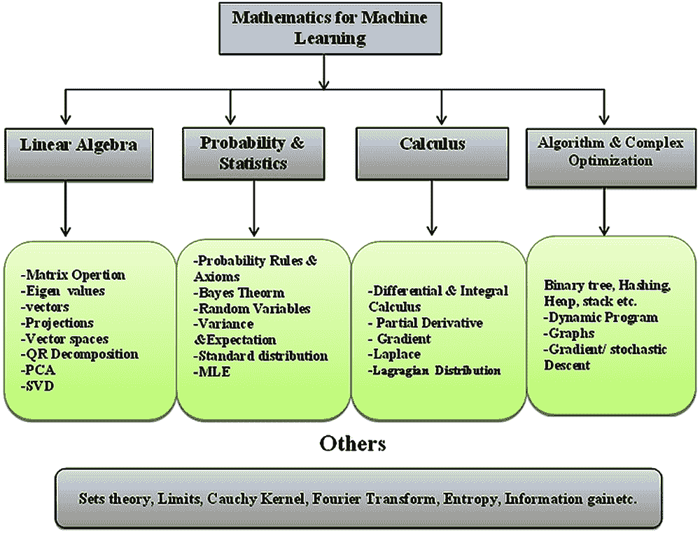 |
| --- |

## 3.1 线性代数

线性代数是机器学习中使用的核心数学原理。它的概念对于理解机器学习的基本概念，特别是深度学习算法非常重要。为了理解和使用机器学习工具，必须具有线性代数和优化理论的良好背景（Gallier & Quaintance, 2019）。线性代数对于数据变换上的线性变换紧凑表示非常有价值。这提供了降维技术，如主成分分析（`PCA`）。线性代数在机器学习中的应用如下：

- 1. `损失函数`
- 2. `正则化`
- 3. `协方差矩阵`
- 4. `支持向量机分类`

## 3.2 统计与概率

概率和统计学是数学中相互关联的领域，用于研究事件发生的比较。概率和统计学的基本区别在于：概率处理未来事件发生的可能性，而统计学包括对过去事件发生频率的分析。统计学是一个数学领域，通常被认为是深入理解机器学习的前提。统计学有两个视角：第一是描述性统计，包括均值、中位数、方差等；另一个视角是推断统计。“推断”意味着从证据和推理中得出或演绎某些东西。统计学在机器学习中的应用是：

- 1. 将数据点聚类或分类。
- 2. 对未见数据进行预测
- 3. 模型比较——比较数据集的不同统计模型以确定最佳拟合模型。
- 4. 参数估计

各种机器学习技术依赖于贝叶斯定理。它是一个建立事件概率的公式，该概率取决于关于可能与事件相关的先先验知识。如果我们已知条件概率，可以使用贝叶斯定理求出反概率。贝叶斯定理还用于在给定一组属性时预测目标类别标签的概率。图 2 展示了机器学习需要的一些基本统计学和概率理论。

## 3.3 微积分

多变量微积分是另一个有助于理解输入和输出变量之间关系的重要领域。矩阵微积分用于理解深度神经网络的训练（Parr & Howard, 2018）。微积分对于以梯度下降的形式优化人工神经网络（`ANN`）非常重要，其中误差项会被减少。机器学习使用积分微积分来定义事件的概率，例如，在贝叶斯模型中寻找后验，或根据纽曼-皮尔逊引理在顺序决策中限制误差。积分微积分、偏导数、向量值函数、梯度、拉普拉斯和格朗日分布是机器学习包含的一些基本课题。

## 3.4 算法与复杂优化

理解机器学习算法的计算效率和可扩展性对于利用数据集中的稀疏性至关重要。机器学习算法基于海量数据和复杂的指令集。因此，使用优化来提高程序的执行速度性能。优化方法对机器学习的各个领域有显著影响。随机优化方法也可以应用于马尔可夫链蒙特卡洛（`MCMC`）采样以提高效率（Sun et al., 2019）。

# 4. 机器学习（ML）的类型

机器学习算法的最终目的是超越训练样本进行泛化，即有效地推断数据。机器学习中的算法在两个不同的视角下使用。在一个视角下，机器学习算法用于根据输入数据做出预测，也称为“预测器”。在第二个视角下，机器学习算法调整预测器的某些内部参数，使其在未来的隐藏输入数据上表现良好。有许多不同机器学习算法，可以分为四类：监督学习、无监督学习、半监督学习和强化学习，如图 3 所示。

| 图 3. 机器学习的类型 |
| --- |
| 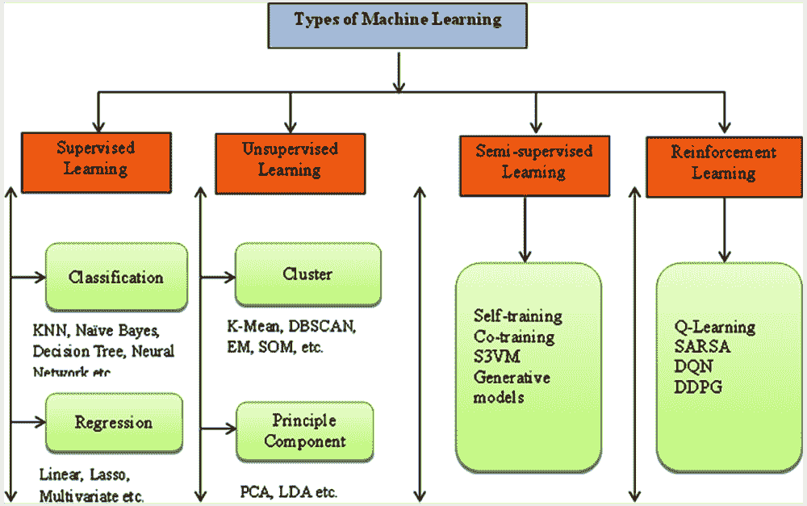 |
| --- |

这种划分基于“学习风格”，如监督学习或无监督学习或两者的结合。每种类型的机器学习算法包含以下组件，如图 4 所示。

- 表示：一组基于树、实例和网络结构的分类器（例如树、超平面、图等）。
- 评估：估估计模型在未来未见数据上的性能或准确性的目标（例如精确率、召回率、平方误差等）。
- 优化：一种改进程序性能指标的方法，如优化搜索等。

| 图 4. 机器学习的组件 |
| --- |
| 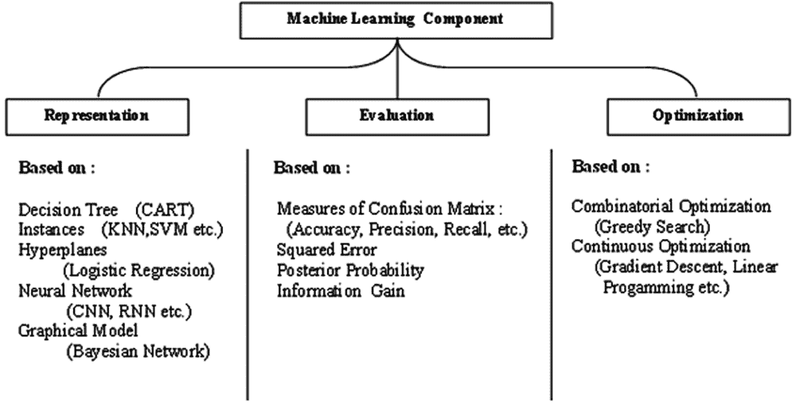 |
| --- |

## 4.1 监督学习

监督学习数据基于标记数据。也可以说目标类别标签已对应输入给出。监督学习是在老师帮助下的学习。训练数据就像老师，教模型关于特定输入的正确类别标签，以便在以后遇到新数据时做出准确决策。一旦模型训练完成，将用测试集进行测试并找到模型的准确率。整体工作如图 5 所示。数据预处理用于将原始数据转换为合适且高效的格式。数据预处理包括：数据清洗、数据转换和数据归约（Han, 等, 2011）。分类准确率是正确预测数与输入样本总数的比例。


当每个类别的样本数量相等时，准确率最佳。`KNN`、`决策树`、`SVM`、`逻辑回归`、`神经网络`、`朴素贝斯`等都是监督学习的一些知名算法。

| 图 5. 监督学习的过程 |
| --- |
| 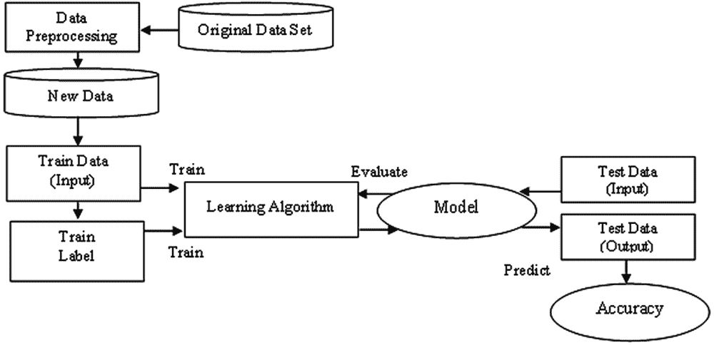 |
| --- |

### 4.1.1 决策树

决策树是一种基于树的结构。每个内部节点代表对属性的“测试”，每个分支表示测试结果，每个叶子节点表示类别标签。迭代二分分类器（`ID3`）、`C5.0`和分类回归树（`CART`）是一些基于决策树的一些知名算法。决策树可以用于解决分类和回归问题。

重要概念：`熵`和`信息增益`。

熵（Entropy）：它被用于衡量数据集的纯度或随机性，如图 6 所示。

 (1)

在 (1) 中，`p[i]` 是类别 `i` 的概率，其计算方法为类别 `i` 在集合中的比例。

| 图 6. 纯度表示 |
| --- |
| 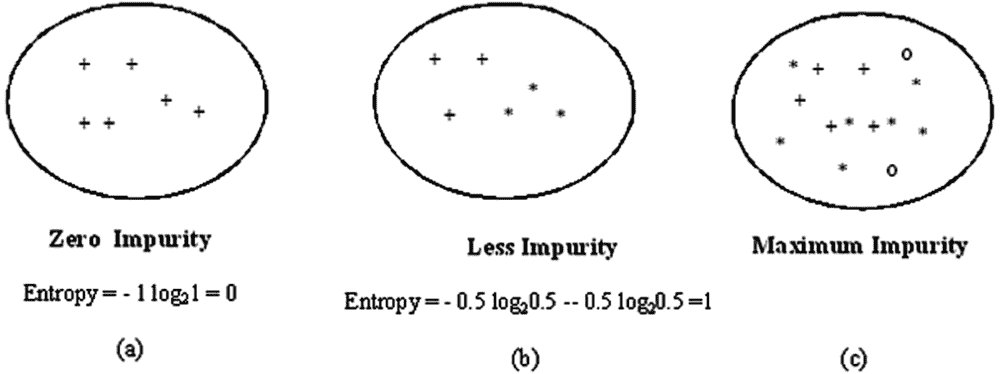 |
| --- |

信息增益（Information Gain）：用于选择最佳特征作为根节点，首先使用每个描述性特征并根据这些描述性特征的值划分数据集，然后按照 (2) 所示计算数据集的熵。

```


`IG (feature) = Entropy (Dataset) - Entropy (feature) (2)`

**优点（Advantage）**：不需要对数据进行归一化。决策树可以在不进行缩放的情况下实现。

**缺点（Disadvantage）**：需要更多的内存和时间来完成数学计算。

**应用（Application）**：远程医疗服务（Chern, 2019）、医疗保健（Khan, Zardar, & Bhatti, 2018）、废物管理（Dubey et. al., 2020）。

### 4.1.2 k-近邻（KNN）

`KNN` 是一种简单且非参数的技术，用于分类和回归。`KNN` 存储所有现有案例，并根据它们的相似性量对新案例进行分类。相似性量基于距离函数（欧几里得距离、曼哈顿距离等）计算两个对象之间的相似程度。距离越大意味着相似度越低，距离越小意味着两个对象之间的相似度越高。相似性的范围在 `[0, 1]` 之间。最近邻代表单或多维特征向量，用于根据相似性量定义样本。相似性可以是特征向量的欧几里得距离（Singh & Agrawal, 2018）。

**重要概念（Important Concept）**：距离函数，如欧几里得、曼哈顿、闵夫斯基、余弦指数等（Prasatha et..al, 2017）。两点 `(x1, y1)` 和 `(x2, y2)` 之间的各种距离函数如图 7 所示，由（3a、3b 和 3c）表示。

```text
D[manhatton] = |x[1] – x[2]| + |y[1] – y[2]| (3a)
```

```text
D[euclidean] =  (3b)
```

```text
D[minkowski] =  (3c)
```

| 图 7. 距离表示 |
| --- |
| 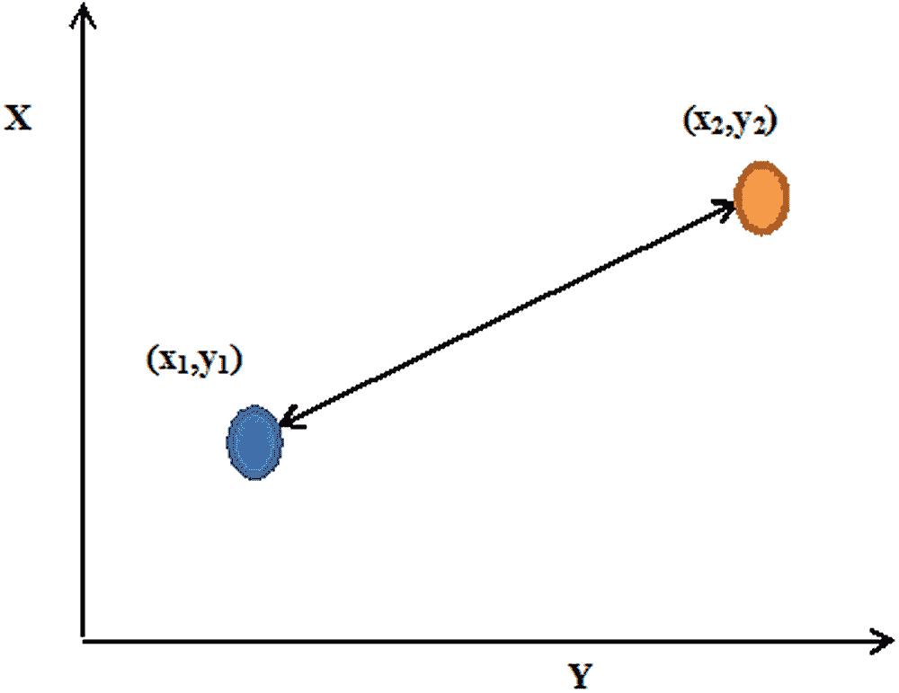 |
| --- |

**优点（Advantage）**：实现非常简单。对于搜索空间具有鲁棒性。

**缺点（Disadvantage）**：`KNN` 不适用于高维数据。

**应用（Application）**：`GDP` 预测（Priambodo. al, 2019）、忠诚度预测（Singh & Agrawal, 2018）、客户留存（Singh & Agrawal, 2019）、大数据（Saadat al., 2020）以及废物管理（Dubey, 2020）。

### 4.1.3 朴素贝叶斯（Naïve Bayes）

朴素贝叶斯分类器是基于（4）所示贝叶斯定理构建的分类算法集合，其中预测变量之间具有独立性。朴素分类器假设预测变量 `P` 的值对特定类别标签 `C` 的影响独立于其他预测变量的值。

```text
 (4)
```


`P(I)` 是预测变量的先验概率，`P(C)` 是先验类别。`P(I|C)` 是指定目标类别时输入特征 `I` 的似然概率。后验 `P(C|I)` 是输入特征 `I` 属于输出类别 `C` 的概率。

**重要概念（Important Concept）**：贝叶斯定理和概率。

**优点（Advantage）**：对于大量的训练和查询，它具有更高的速度。

**缺点（Disadvantage）**：需要计算先验概率。

**应用（Application）**：典型应用包括过滤垃圾邮件（Rusland al., 2017）、文档分类（Adetun, 2018）、情感分析（Hasan, 2018）。

### 4.1.4 支持向量机 (SVM)

支持向量机（SVM）是一组监督学习方法，用于分类、预测。它在高维空间中是有效的。通过直线可以完美地划分两个类别并最大化类别之间的间隔。这些点被称为支持向量，如图 8 所示。

| 图 8. 支持向量 |
| --- |
| 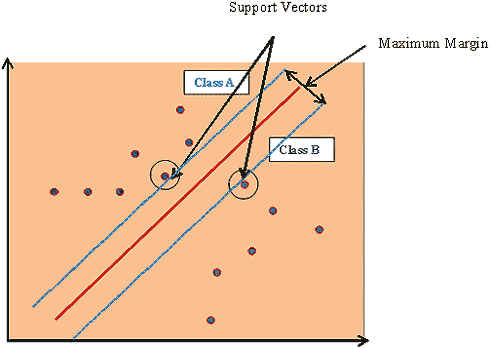 |

**优点（Advantage）**：当存在完美间隔时 SVM 非常有效。

**缺点（Disadvantage）**：SVM 不适用于大数据集。

**应用（Application）**：医疗保健（Shahid, 2019）、手写识别（Hamid, 2017）、生物信息学。

### 4.1.5 神经网络 (Neural Network)

神经网络是由输入层、隐藏层和输出层组成的神经元网络。神经网络接收输入，并通过激活函数将其传递到下一层。通常，神经网络是前向的，这意味着信号从输入层流向输出层。某些网络是循环的，信号可以返回到之前的层。神经网络通过反向传播算法来调整其权重，以最小化误差。

| 图 9. 神经网络模型 |
| --- |
| 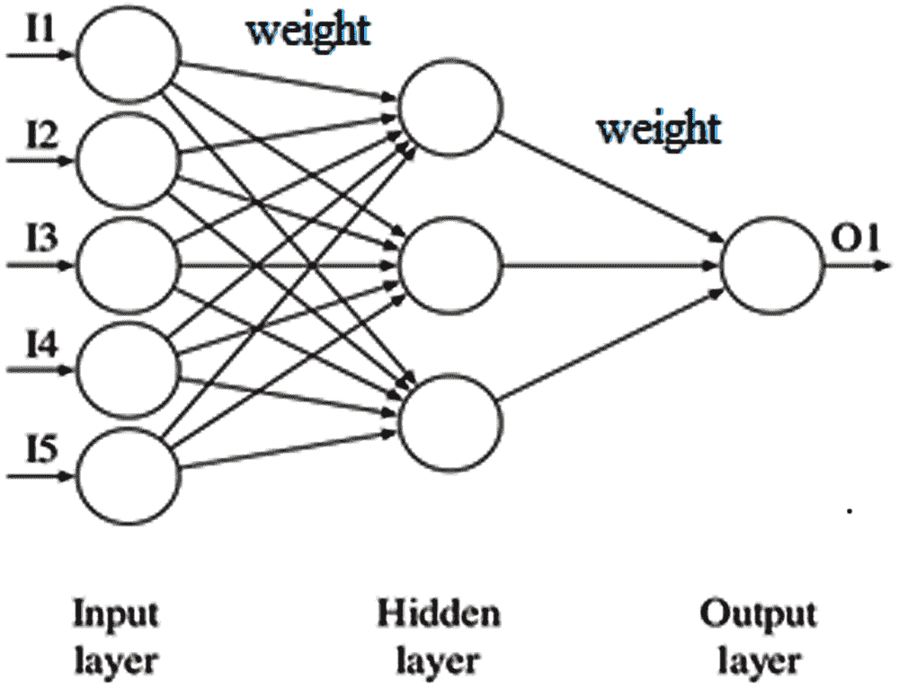 |

神经网络是一种神经元网络。

| 激活函数 | 公式 | 形状 |
| --- | --- | --- |
| 线性 |  | |
| Sigmoidal |  | |
| 正切 |  | |
| ReLU |  | |
| Softmax |  | |

**重要概念（Important Concept）**：网络拓扑结构。*Hebbian 学习规则、Delta 学习规则、竞争学习规则。* 激活函数。

| 图 10. 神经网络类型 |
| --- |
| 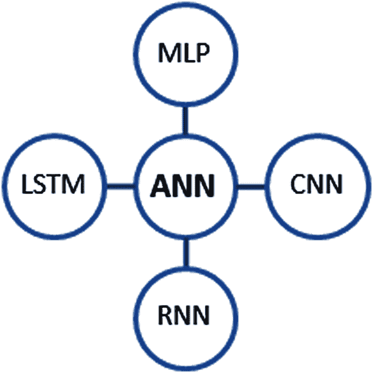 |

神经网络的类型包括：多层感知机 (MLP)、卷积神经网络 (CNN)、循环神经网络 (RNN) 和长短期记忆网络 (LSTM)，如图 10 所示。

监督学习有两种变体，即分类和回归。分类被定义为预测事件的类别或离散类标签输出。分类器有两种：`Binary classifier`（二分类器）和`multi-class classifier`（多分类器）。`Binary classifier` 是只有两个类的分类，例如，根据血糖值等输入特征，判断患者患有“高血糖”还是“低血糖”属于分类（Agrawal, Singh, & Sneha, 2019）。`Multi-Class classifier` 被定义为具有两个以上离散类别的分类，例如用户类型，即非常忠诚、忠诚、普通和近期用户（Singh & Agrawal, 2018）。各种分类应用包括：

- 医疗保健：用于疾病诊断与预测、药物发现、治疗建议等。
- 生物信息学：基因分类、蛋白质结构预测（Singh & Singh, 2020）等。
- 邮件分类、自然语言处理（NLP）、人脸检测、事故预测等。

回归被定义为预测事件的连续数值类标签输出。它提供了关于“多少”以及“多少个”节点患病的响应。请参考表 2 以更好地理解。

### 表 2. 分类与回归的区别

| 序号 | 分类 | 回归 |
| --- | --- | --- |
| 1. | 在分类情况下，属性的性质是类别的或离散的。 | 在回归情况下，属性的性质是连续的。 |
| 2. | 例如，如果你将学生信息交给分类，它会预测为“通过”或“不通过”类。 | 例如，如果你将学生信息交给回归，它会预测学生的成绩（百分比）。 |
| 3. | 常见的分类算法有 `DT`、`KNN`、`ANN` 等。 | 常见的回归算法有线性回归、回归树、lasso 回归和多元回归（Bhatia, 2018）。 |

回归算法试图评估从输入变量到数值或连续输出变量的映射函数。因此，回归预测问题通常是数量或大小。一些流行的回归算法类型如图 11 所示。

| 图 11. 回归算法类型 |
| --- |
| 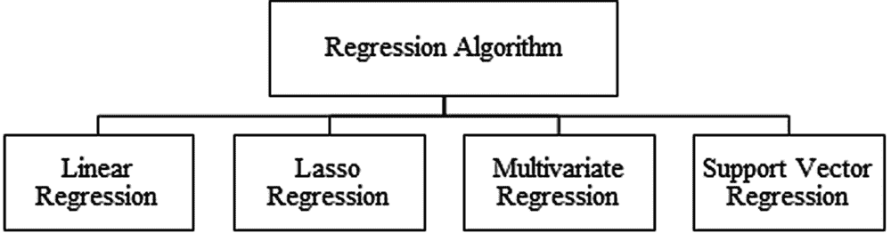 |

以下是回归算法的应用：

1. `Lasso regression` 算法广泛应用于金融网络和经济学。
2. `Lasso-based regression` 算法用于企业风险框架的评估。
3. `logistic regression` 在房地产业务（例如：预测房价）、保险行业（例如：客户生命价值）的应用。
4. `SVR regression` 算法已广泛应用于油气行业、图像分类和股价预测（Rustam, Z., & Kintandani, 2019）。
5. `Multivariate Regression` 算法被广泛应用于零售业。

“Logistic Regression”（逻辑回归）这一术语名称中仅包含“Regression”（回归），但它并不是回归算法。为了更好地理解，表 3 给出了逻辑回归与线性回归之间的区别。

### 表 3. 线性回归 vs 逻辑回归

| 序号 | 线性回归 | 逻辑回归 |
| --- | --- | --- |
| 1. | 它捕捉两者之间的关系。 | 它预测值。 |
| 2. | 用于二分类。 | 用于二分类。 |
| 3. | 输出是连续的。 | 输出是离散的。 |
| 4. | 估计因变量。 | 估计因变量。 |

“Logistic Regression”（逻辑回归）这一术语名称中仅包含“Regression”（回归），但它并不是回归算法。为了更好地理解，表 3 给出了逻辑回归与线性回归之间的区别。

# PCA

PCA 是一种用于高维数据集的降维方法，它保留了原始数据集至关重要的结构和关系，因此机器学习模型仍能从中学习并用于做出正确的预测。

**基本概念：** 特征值、协方差、相关性和正交。

**优点：** PCA 改进了相关特征并提升了算法的性能。

**缺点：** 独立变量的可解释性降低，且有时会遭受信息损失。

**应用：** 人脸识别（Chen, 2017）、计算机视觉和图像压缩。

## 4.3 半监督学习

半监督学习结合了标记数据和未标记数据以创建一个合适的模型。自训练、`Co-training`、生成模型、半监督支持向量机（`S3VM`）和基于图的算法是半监督学习的已知算法（Zhu, 2007），如图 14 所示。

| 图 14. 半监督学习的类型 |
| --- |
| 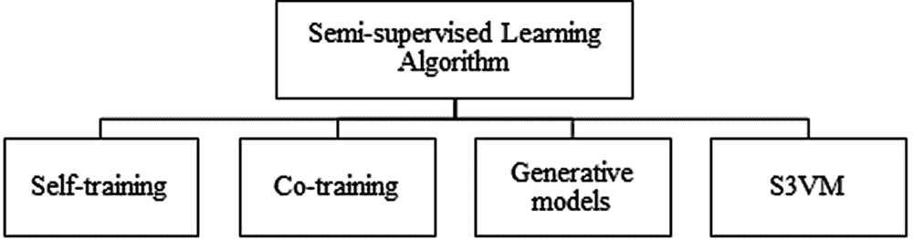 |

### 4.3.1 自训练

在自训练中，首先在标记数据上训练分类器。之后，使用该分类器对所有未标记数据进行分类。预测置信度最大的未标记数据被包含在训练集中。对分类器进行再次训练。

**优点：** 半监督学习方法中最简单的形式。

**缺点：** 错误可能会自我强化。

**应用：** 自然语言处理、多项服务的分类和回归。

### 4.3.2 协同训练 (Co-Training)

`Co-Learning` 使用两个不同的学习器以及这两个学习者的所有特征。一个高置信度学习器的数据点用于训练另一个学习器。每个分类器的高置信度数据点对于另一个分类器都是 IID 样本。

**优点：** 当一个分类器正确标记了另一个分类器误分类的数据时，这种效果最好。

**缺点：** 如果不存在自然的特征划分，则需要将特征随机分成两部分。

**应用：** 人脸识别、人体动作识别（Liu et al., 2015）等。

## 4.4 强化学习

强化学习建立在奖励和惩罚或反馈系统之上。学习通过与动态环境进行反复的试错交互来完成任务，在没有人工干预的情况下最大化任务的奖励。有一些描述强化学习的关键术语，如图 15 所示。

- **环境：** 智能体（Agent）在称为环境的物理世界中运行。
- **状态：** 智能体的当前位置
- **奖励/惩罚：** 智能体从环境中获得正反馈（奖励）和负向反馈（惩罚）。
- **策略：** 用于将智能体的状态映射到动作的方法。

| 图 15. 强化学习 |
| --- |
| 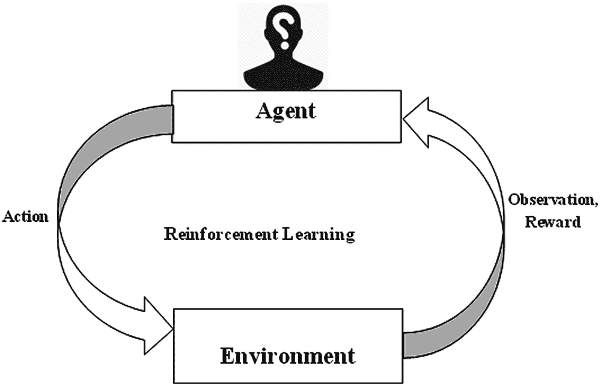 |

强化学习有四种算法类型：`Q-Learning`、深度 Q 网络（`DQN`）、状态-动作-奖励-状态-动作（`SARSA`）和深度确定性策略梯度（`DDPG`），如图 16 所示。`Q-learning` 和 `SARSA` 是最为人知的强化学习。

| 图 16. 强化学习的类型 |
| --- |
|  |

`Q-Learning` 是离线策略（off policy），`SARSA` 是在线策略（on policy）。`Q-Learning` 和 `SARSA` 的局限性在于两者都无法。这种局限性通过使用 `ANN` 的 `DQN` 克服。`DDPG` 是无模型的且基于策略的。强化学习的各种应用包括疾病预测（Singh et al., 2020）、基于 `DQN` 的视频游戏（Torrado et al., 2018）、基于 `DQN` 的自动驾驶（Vitelli & Nayebi, 2016）等。

## 5. 机器学习与区块链的应用

机器学习模型可以任何包含海量数据的领域。区块链并非例外。区块链是一个公共账本，记录交易且不可篡改。区块链的设计专门为了激励和简化交易验证过程。通过使用去中心化系统为任何类型的资产提供透明系统。当机器学习与区块链结合时，机器学习的能力加速了海量数据的分析。医疗需要安全可靠的数据传输（Singh & Singh, 2020）。区块链可以匿名跟踪医疗记录和药物，然后使用 AI/ML 查看健康之间的关系。目标是提供一个集成区块链和人工智能的平台，用于电子健康记录管理、有效的数据集成和一致的辅助诊断（Wehbe, Zaabi & Svetinovic, 2018）。农业 4.0 是区块链、物联网、人工智能和大数据的集成（Clercq, 2018）。机器学习将有助于作物预测和产量预测，区块链将确保数据以透明的方式分布。智能合约 `OurSQL` 是区块链特性之一，可以作为种子公司与农民之间的实际协议（Surasak, 2019）。

## 6. 未来的研究方向

目前的机器学习算法识别复杂数据集中的统计规律，并经常应用于医疗、农业、生物信息学、股票市场和目标广告等广泛领域。但这些应用缺乏鲁棒性、准确性、透明度和泛化能力（Greenwald, & Oertel, 2017）。为了准确性，深度学习作为机器学习的一个子领域已广泛用于医学影像。

机器学习目前非常热门，在与区块链和物联网结合后，未来十年将是研究热点。医疗和农业部门可能会获得基于新兴技术的集成服务平台。

## 7. 结论

在本章中，作者讨论了机器学习（ML）的基本原理。机器学习基于数据、学习算法和基础数学。数学是机器学习的核心，因为它为学习算法的实现提供了手段。简要讨论了每种机器学习算法的优点、缺点以及相关的应用领域。机器学习技术提供了许多好处，并解决了现实生活中的问题，特别是医疗保健和农业领域。在与区块链和物联网（IoT）等新兴技术整合时，机器学习自身的增长速度提高了数倍。

## 参考文献

- Adetunji, A. B., Oguntoye, J. P., Fenwa, O. D., & Akande, N. O. (2018). Web Document Classification Using Naïve Bayes. `Journal of Advances in Mathematics and Computer Science`, 1-11.
- AgrawalV.SinghP.SnehaS. (2019, April). Hyperglycemia Prediction Using Machine Learning: A Probabilistic Approach. In `International Conference on Advances in Computing and Data Sciences` (pp. 304-312). Springer. 10.1007/978-981-13-9942-8\_29
- Bhatia, R. (2018). Regression Algorithms Used In Analytics & Data Mining. `Analytics India Magazine`.
- Chen, J., & Jenkins, W. K. (2017, August). Facial recognition with PCA and machine learning methods. In `2017 IEEE 60th International Midwest Symposium on Circuits and Systems (MWSCAS)` (pp. 973-976). IEEE. 10.1109/MWSCAS.2017.8053088
- Chern, C. C., Chen, Y. J., & Hsiao, B. (2019). Decision tree–based classifier in providing telehealth service. `BMC Medical Informatics and Decision Making`, 19(1), 104. doi:10.1186/s12911-019-0825-9
- De Clercq, M., Vats, A., & Biel, A. (2018). Agriculture 4.0: The Future of Farming Technology. `Proceedings of the World Government Summit`, 11-13.
- Deisenroth, M. P., Faisal, A. A., & Ong, C. S. (2020). Mathematics for machine learning. Cambridge University Press. doi:10.1017/9781108679930
- DubeyS.SinghM. K.SinghP.AggarwalS. (2020). Waste Management of Residential Society using Machine Learning and IoT Approach. `2020 International Conference on Emerging Smart Computing and Informatics (ESCI)`, 293-297, 10.1109/ESCI48226.2020.9167526
- Dubey, S., Singh, P., Yadav, P., & Singh, K. K. (2020). Household Waste Management System Using IoT and Machine Learning. `Procedia Computer Science`, 167, 1950–1959. doi:10.1016/j.procs.2020.03.222
- Ezenkwu, C. P., Ozuomba, S., & Kalu, C. (2015). Application of `K-Means` algorithm for efficient customer segmentation: a strategy for targeted customer services. Academic Press.
- Fayjie, A. R., Hossain, S., Oualid, D., & Lee, D. J. (2018, June). Driverless car: Autonomous driving using deep reinforcement learning in urban environment. In `2018 15th International Conference on Ubiquitous Robots (UR)` (pp. 896-901). IEEE.
- Gallier, J., & Quaintance, J. (2019). Linear A lgebra for Computer Vision . Robotics, and Machine Learning.
- Greenwald, H. S., & Oertel, C. K. (2017). Future directions in machine learning. `Frontiers in Robotics and AI`, 3, 79. doi:10.3389/frobt.2016.00079
- Hamid, N. A., & Sjarif, N. N. A. (2017). Handwritten recognition using `SVM`, `KNN` and neural network. `arXiv preprint arXiv:1702.00723`
- Han, J., Pei, J., & Kamber, M. (2011). Data mining: concepts and techniques . Elsevier.
- Hasan, A., Moin, S., Karim, A., & Shamshirband, S. (2018). Machine learning-based sentiment analysis for twitter accounts. `Mathematical and Computational Applications`, 23(1), 11. doi:10.3390/mca23010011
- Jose, J. T., Zachariah, U., Lijo, V. P., Gnanasigamani, L. J., & Mathew, J. (2017). Case Study on Enhanced `K-Means` Algorithm for Bioinformatics Data Clustering. `International Journal of Applied Engineering Research`, 12(24), 15147–15151.
- Jung, A. (2018). Machine learning: Basic principles. `arXiv preprint arXiv:1805.05052`
- Khan, R. S., Zardar, A. A., & Bhatti, Z. (2018). Artificial Intelligence based Smart Doctor using Decision Tree. `arXiv preprint arXiv:1808.0184`
- Leahy, R. M., Clackoyle, R., & Noo, F. (2009). Computed tomography . `The Essential Guide to Image Processing` (pp. 741–776). doi:10.1016/B978-0-12-3744-9
- LiX.ZhongZ.YangY.LinZ. (2019). Expectation-maximization networks for semantic segmentation. In `Proceedings of the IEEE International Conference on Computer Vision` (pp. 9167-76).
- Liu, W., Li, Y., Tao, D., & Wang, Y. (2015). A general framework for co-training and applications. `Neurocomputing`, 167, 112–121. doi:10.1016/j.neucom.2015.087
- Lundervold, A. S., & Lundervold, A. (2019). An overview of deep learning in medical imaging. `Zeitschrift fur Medizinische Physik`, 29(2), 81–127. doi:10.1016/j.zemedi.2018.002
- Milković, D. (2017, May). Brief review of self-organizing maps. In `2017 40th International Convention on Information and Technology, Electronics and Microelectronics (MIPRO)` (pp. 1061-1066). 10.2391/MIPRO.2017.793
- Parr, T., & Howard, J. (2018). The matrix calculus you for deep learning. `arXiv preprint arXiv:1802.0528`
- Pedregosa, F., Varoquaux, G., Gramfort, A., Thirion, B., Grisel, O., ... Vanderplas, J. (2011). `Scikit-learn`: Machine learning in Python. `The Journal of Machine Learning Research`, 12, 2825-2830.
- Prakash, R. M., & Kumari, R. S. (2018). Modified Expectation Maximization Method for Automatic Segmentation of MR Images. Conference: MRINS13, Japan.
- Prasatha, V. S., Alfeil, H. A., Hassan, A. B., Lasassme, O., Tarawneh, A. S., & Salmane, H. S. (2017). Effects of Distance Choice on `KNN` Classifier. `arXiv preprint arXiv:1708.04321`
- Priambodo, B., Rahayu, S., Naf’an, E., Handriani, I., Putra, Z. P., Nseaf, A. K., & Jumaryadi, Y. (2019, December). Predicting GDP of Indonesia Using K-Nearest Neighbour Regression. `Journal of Physics: Conference Series`, 1339(1), 012040. doi:10.1088/1742-6596/1339/1/012040
- Rusland, N. F., Wahid, N., Kasim, S., & Hafit, H. (2017, August). Analysis of Naïve Bayes algorithm for email spam filtering across multiple datasets. `IOP Conference Series: Materials and Engineering`, 226(1), 012091. doi:10.1088/1757-899X/226/1/012091
- Rustam, Z., & Kintandani, P. (2019). Application of Support Vector Regression in Indonesian Stock Price Prediction with Feature Selection Using Particle Swarm Optimisation. `Modelling and Simulation in Engineering`, 2019, 2019. doi:10.1155/2019/8962717
- Sadiktar, H., Khosravi, S., Joloudari, J. H., Mosavi, A., & Shamshirband, S. (2020). A New `K-Nearest Neighbors` Classifier for Big Data Based on Efficient Data Pruning. `Mathematics`, 8(2), 286. doi:10.3390/math8020286
- Shahid, N., Rappon, T., & Berta, W. (2019). Applications of artificial neural networks in health care organizational decision-making: A scoping review. `PLOS One`, 14(2), e0212356. doi:10.1371/journal.pone.0212356
- Sidey-Gibbons, J. A., & Sidey-Gibbons, C. J. (2019). Machine learning in medicine: A practical introduction. `BMC Medical Research Methodology`, 19(1), 64. doi:10.1186/s12874-019-0681-4
- Singh, N., Singh, P., Singh, K. K., & Singh, A. (2020a). (in press). Diagnosing of Disease using Machine Learning, accepted for Machine Learning & Internet of medical things in healthcare. Elsevier Publications.
- Singh, P., & Agrawal, R. (2018). A customer centric best connected channel model for heterogeneous and IoT networks. `Journal of Organizational and End User Computing`, 30(4), 32–50. doi:10.4018/JOEUC.201810013
- Singh, P., & Agrawal, R. (2018). Prospects of Open Source Software for Maximizing the User Expectations in Heterogeneous Network. `International Journal of Open Source Software and Processes`, 9(3), 1–14. doi:10.4018/IJOSSP.201807011
- Singh, P., & Agrawal, V. (2019). A Collaborative Model for Customer Retention on User Service Experience . In `Advances in Computer Communication and Computational Sciences` (pp. 55–64). Springer. doi:10.1007/978-981-13-6861-5\_5
- Singh, P., & Singh, N. (2020). (中中). 数据挖掘技术在生物信息学中的作用. International Journal of Applied Research in Bioinformatics , 11(6).
- Singh, P., & Singh, N. (2020). 结合物联网与人工智能的区块链：农业与医疗健康综述. International Journal of Applied Evolutionary Computation, 11(4).
- Sun, S., Cao, Z., Zhu, H., & Zhao, J. (2019). 从机器学习视角看优化方法综述. IEEE Transactions on Cybernetics . 线上预优先发表. doi:10.1109/TCYB.2019.2950779
- Surasak, T., Wattanavichean, N., Preuksakarn, C., & Huang, S. C. H. 基于区块链和物联网的泰国农业产品追溯系统. System, 14, 15.
- TorradoR. R.BontragerP.TogeliusJ.LiuJ.Perez-LiebanaD. (2018, 8 月). 用于通用视频游戏人工智能的深度强化学习. 在 2018 IEEE 计算智能与游戏会议 (CIG) (pp. 1-8). IEEE. 10.1109/CIG.2018.8490422
- Usama, M., Qadir, J., Raza, A., Arif, H., Yau, K. L. A., Elkhatib, Y., Hussain, A., & Al-Fuqaha, A. (2019). 用于网络的无监督机器学习：技术、应用与研究挑战. IEEE Access: 实际创新，开放解决方案 , 7, 65579–65615. doi:10.1109/ACCESS.2019.2916648
- Vitelli, M., & Nayebi, A. (2016). Carma: 一种用于自动驾驶的深度强化学习方法. 技术报告.斯坦福大学.
- Wehbe, Y., Al Zaabi, M., & Svetinovic, D. (2018, 11 月). 用于医疗记录管理的区块链人工智能框架：约束目标模型. 在 2018 第 26 届电信论坛 (TELFOR) (pp. 420-425). IEEE.
- WintrodeJ.BuiN.StepinskiJ.ReedC. (2017, 6 月). 用于流式文本语言表性的在线期望最大化. 在国际网络工程会议上 (pp. 200-208). Springer.
- Xu, Y., Yao, H., & Lin, K. (2018). 用于药物发现的神经网络概述及其使用的输入. 药物发现领域的专家意见 , 13(12), 1091–1102. doi:10.1080/17460441.2018.1547278
- Yin, B., Balvert, M., van der Spek, R. A., Dutilh, B. E., Bohte, S., Veldink, J., & Schönhuth, A. (2019). 在基于基因型预测运动神经侧索硬化的深度神经网络设计中利用基因组数据结构. Bioinformatics (英国牛津) , 35(14), i538–i547. doi:10.1093/bioinformatics/btz369
- Yoon, H. J. (2019). 区块链技术与医疗健康. 医疗健康研究 , 25(2), 59. doi:10.4258/hir.2019.25.2.59
- Zhu, X. (2007, 6 月). 半监督学习教程. 在国际机器学习会议 (ICML) (pp. 1-135). Academic 出版社.

# 第 10 章

Goh Ying Yingsoon


马来西亚玛玛大学 (Universiti Teknologi MARA)

### 摘要

对外汉语教学可以通过利用人工智能技术提供支持。传统上，非母语学习者只能与教师互动，并完全依赖他们进行口语练习。然而，随着人工智能技术的进步，学习者可以使用人工智能技术进行交互式口语能力培养。在研究中，学习者被指示下载了一个位于 `https://m.wandoujia.com/apps/6790950` 的应用程序。准备这项人工智能以支持其口语能力发展的过程可以通过 `https://sites.google.com/site/gohyi141/assignments/projectinteractivespeakingapp` 访问。通过使用这项人工智能技术，结果显示对该技术的使用具有极大的积极反馈。因此，应该鼓励在对外汉语教学以及更一般的各种语言口语能力培养中积极利用人工智能技术。

# 1. 引言

人工智能 (AI)、深度学习、机器学习和神经网络代表了极其令人兴奋且强大的基于机器学习的技术，用于解决许多现实世界中的问题 (Castrounis, 2017)。它是计算机科学的一个领域，强调创建能够像人类一样工作和反应的智能机器。人工智能计算机旨在设计的某些活动包括：知识、规划、问题解决。它也是一个旨在创建智能机器的计算机科学分支，并已成为研究的重要组成部分。它只会变得越来越重要且无处不在，其中包含了物联网 (IoT)。如今，物联网早期被定义为机器间 (M2M) 通信，已成为 ICT 和研究社区的重点关注点 (Abdul-Qawy, 等，2015) 以及人工智能领域。在 ICT 创新和经济发展中，重点已转向相关技术 (Lee, 和 Lee, 2015)。在物联网中，不同的设备和智能对象被纳入互联网扩展并变得可访问且唯一标识 (Weber, 2015)。

对外汉语教学可以通过利用人工智能技术提供支持。传统上，非母语学习者只能与教师互动，并完全依赖他们进行口语练习。然而，随着人工智能技术的进步，学习者可以使用人工智能技术进行交互式口语能力培养，例如使用人工智能机器人 (Lomas, 2016, Medhi, Menon, Magapu, Subramony & O’Neill, 2017)、物联网 (Hoffman, Donna, Novak, & Thomas, 2016; Ng, Irene, Wakenshaw, & Susan, 2017) 等。它已获得用户广泛接受，人工智能技术的忠实追随者数量剧增 (D’Onfro, 2015)。人工智能技术正在塑造和改变世界，包括语言的学习和练习方式 (华尔街日报, 2017)。通过接触物联网世界并旨在理解和参与其发展，人工智能技术和应用的进展无疑非常令人期待！

## 2. 背景与文献综述

### 2.1 使用该技术优于传统方法的优势

人工智能的进步为语言教学与学习带来了新的可能性和挑战 (Popenici & Kerr, 2017)。在语音识别、书面文本识别等方面，AI 的准确率已超过 90% (Tang & Wei, 2019)。因此，AI 技术的应用将增强外语的教学与学习。然而，目前存在研究空白，这证明了需要进行新的研究，以为该领域进一步研究的设计、实施和报告提供参考。虽然已有许多识别和优先考虑研究空白的现有工作正在投入实际使用，但针对语言学习应用的研究仍然缺乏。

AI 技术已应用于汉语作为外语教学的各个方面。这些包括词汇教学（Yu & Xie, 2018）、写作、教学（Zhao, 2018）、翻译应用（Xu, 2018; Yang, 2017）等。然而，有必要进一步探索 AI 在普通话学习中的应用，AI 可以作为一种实用的教育技术工具，来丰富汉语教学（Chen, Sha, He & Wang, 2017）。

## 2.2 AI 技术的典型示例

AI 技术的典型示例可以是聊天机器人的使用 (Przegalinska, Ciechanowski, Stroz, Gloor, & Mazurek, 2019)。这种聊天机器人是通过听觉或文本方式进行对话的软件。在本章中，重点将是听觉方式的使用。此类程序通常设计用于真实地模拟人类作为对话伙伴的行为。这对于为外语学习者提供对话机会至关重要。聊天机器人也经常用于商业领域，以促进各种流程，特别是与客户服务和个性化相关的流程。对于语言教学而言，由于学生是教育行业的客户，因此提供对话练习服务和个性化的口语练习机会以利用 AI 技术增强他们的口语能力也是很好的。

AI 技术可以成为有效的教学助手 (Maderer, 2016)。在语言课上，教授口语技能时，学生通常会发现自己没有足够的说话机会，因为课堂时间通常限制了每个学生在教室内的交流时长。此外，一些学生可能觉得在老师面前和同学面前用他们正在学习的语言说话非常尴尬。因此，AI 技术对于提供个人口语练习和提升非常有帮助。

通过以对话的方式使用自然语言与机器进行交流 (Dale, 2016)，它为语言课堂开启了口语训练。学生不再仅仅依赖于其教师来参与对话式练习。带有 AI 技术元素的人机交互实现了对话式的互动。很快，我们将处于这样一个世界：其中某些对话伙伴我们知道是人类，另一些我们知道是机器人，而可能还有一些我们既不知道是哪种，甚至可能不在乎，只要它能够保持口语技能教学的有效性 (Dale, 2016)。

## 2.3 对用户的理解

对用户的理解至关重要。用户的预期与对话代理的真实体验之间始终存在鸿沟 (Luger & Sellen, 2016)。因此，必须持续使用各种方法进行研究，包括定量设计、定性设计和混合模式。研究重点还必须考虑对话代理对非母语外语学习者所带的外口音的理解程度如何。

因此，AI 技术具有开发基于人工智能的评估系统的潜力 (Luckin, 2017)。这将确保提供一种更客观的基于智能的评估。可以消除教师在口语技能评估中的主观性。从心理学上说，学生可能会发现与智能体而非人类交谈更有信心、更舒适 (Stuart, 2017)。在情感上，他们会更放松。随后，他们将更频繁地与 AI 练习。

本研究的受访者包括 76 名一级学生、65 名二级学生和 22 名三级学生，总共 163 名受访者。他们是玛拉大学（MARA University of Technology）登嘉楼校区的学生，将汉语作为外语课程学习。

学生使用了 `Wandoujia` 两周来准备他们的口语项目。他们必须使用这个 `Wandoujia` 对话进行截图，并在学期末提交 CD。他们还需要回答一份自开发的问卷。该问卷分为五个部分，以衡量与本研究相关的五个领域。每个部分都有五个与特定领域相关的问题。使用 `SPSS` `20` 版本对描述性统计和推断统计进行分析。

| 图 2. 豆荚截图 |
| --- |
|  |

学生随后将录制他们与该智能体对话的视频。之后，他们对这种基于 AI 技术的应用程序支持其口语能力发展的有效性提供了反馈。

# 5. 发现与讨论

通过使用这种 AI 技术，研究结果显示对这种 AI 技术的使用具有极大的积极响应。因此，应该鼓励在对外汉语教学以及更而言的所有语言口语能力的发展中积极利用 AI 技术。

总而言之，对于三个层级的学生，他们在使用 `Wandoujia` 支持对话过程中对感兴趣领域的口语发展方面表现非常积极，包括：使用系统进行对话过程的兴趣（一级平均值：4.48，二级平均值：4.36，三级平均值：4.18）、系统的易用性（一级平均值：4.23，二级平均值：4.43，三级平均值：4.49）、口语对话支持（一级平均值：4.55，二级平均值：4.31，三级平均值：4.14）以及与 `Wandoujia` 智能体对话的自信心（一级平均值：4.57，二级平均值：4.23，三级平均值：4.15）。然而，在对系统的理解方面，回答处于中立或较不积极（一级平均值：3.93，二级平均值：3.07，三级平均值：3.05）。

通过 `ANOVA` 分析发现，在所有研究的方面均没有显著差异。这意味着三个层级的学生对所研究的五个领域的感知基本相似。

表 1. 学生使用 `Wandoujia` 支持学习的回答描述性统计

| 课程级别 | 对话过程的兴趣 | 系统的易用性 | 口语对话支持 | 对话自信心 | 对话的理解 |
| --- | --- | --- | --- | --- | --- | --- |
| 等级 1 | 平均值 | 4.48 | 4.23 | 4.55 | 4.57 | 3.93 |
| N | 76 | 76 | 76 | 76 | 76 |
| 标准差 | .620 | .743 | .746 | .711 | .728 |
| 等级 2 | 平均值 | 4.36 | 4.43 | 4.31 | 4.23 | 3.07 |
| N | 65 | 65 | 65 | 65 | 65 |
| 标准差 | .633 | .756 | .825 | .514 | .829 |
| 等级 3 | 平均值 | 4.18 | 4.49 | 4.14 | 4.15 | 3.05 |
| N | 22 | 22 | 22 | 22 | 22 |
| 标准差 | .733 | .590 | .774 | .800 | .999 |
| 总计 | 总体平均值 | 4.21 | 4.31 | 4.37 | |
| N | 163 | | | | |
| 标准差 | .650 | .704 | .718 | |

表 2. 学生使用豆荚支持学习的回答 ANOVA 分析

| | 平方和 | df | 方 | F | Sig. |
| --- | --- | --- | --- | --- | --- |
| 对话过程的兴趣 | 组间 | .355 | 2 | .178 | .614 |
| | 组内 | 33.032 | 161 | | |
| 总计 | 33.388 | 163 | | |
| 系统的易用性 | 组间 | .979 | 2 | .490 | .403 |
| | 组内 | 40.971 | 161 | | |
| 总计 | 41.950 | 163 | | |
| 口语对话支持 | 组间 | 2.140 | 2 | 1.070 | .125 |
| | 组内 | 38.610 | 161 | | |
| 总计 | 40.750 | 163 | | |
| 对话自信心 | 组间 | .309 | 2 | .154 | .798 |
| | 组内 | 52.679 | 161 | | |
| 总计 | 52.988 | 163 | | |
| 对话的理解 | 组间 | .527 | 2 | .264 | .500 |
| | 组内 | 29.023 | 161 | | |
| 总计 | 29.550 | 163 | | |

然而，由于这是一个免费的基于 AI 技术的应用程序，使用次数有限制。在使用几次后，它会显示已完成次数限制的消息（如图 3 所示）。因此，学生必须在第二天再次使用，或者卸载重新安装。

| 图 3. 表明用户已完成使用限制的应用截图 |
| --- |
|  |

开放式问题的回答也揭示了用户在使用在使用应用程序时遇到的一些障碍。如表所示。基本上，学生遇到了两个领域的问题，即技术问题和语言问题。这些问题的解决方案在表 3 中解释。

表 3. 用户在使用应用程序时遇到的障碍

| | 问题 | 解决方案 |
| --- | --- | --- |
| 技术 | • 安装过程困难。<br> 熟悉应用程序。<br> 使用应用程序运行任务。 | • 在课堂时间讲解。<br> 个人关注、指导和帮助。<br> 同伴协助。 |
| 语言 | • 界面是中文。<br> 无法理解输入是否正确，特别是对于学习过程中使用拼音或罗马化汉语的学生。<br> 无法理解智能体给出的回复。 | • 提供通用说明。<br> 显示系统截图并向学生进行解释。<br> 提供个人指导。<br> 帮助检查输入。<br> 引导学生使用教材检查输入。<br> 引导学生使用教材或在线翻译系统检查智能体的回复。 |

6\. 建议与未来研究方向

在系统理解方面，响应处于中性或较不积极的状态（等级 1 平均值：3.93，等级 2 平均值：3.07，等级 3 平均值：3.05）。这是由于语言能力的限制，特别是对于那些初级学者而言。他们的听力理解能力仍然薄弱。仅提供汉字文字回答对这些初级学者来说仍然困难，因为他们对汉字的掌握仍然不足。因此，建议为了改进系统，应该提供对话的翻译文本，以便于用户理解他们的输入以及智能实体的响应（Gao & Zhang, 2018）。对 AI 技术的界面设计进行改进、审查、评估和反馈，对于完善 AI 技术利用至关重要（Klopfenstein, Delpriori, Malatini, & Bogliolo, 2017; Masche & Le, 2018; Radziwill & Benton, 2017）。AI 技术需要改进的另一个方面是其响应系统。到目前为止，系统能够回答向 AI 口语代理提出的问题。然而，AI 口语代理仅停留在这一水平，即能够回答但不能提问。这是系统未来改进的领域，使其能够像人类一样运作，其中问与答是对话过程的一部分。在正常对话中，仅仅回答而不反问被认为是奇怪的。

考虑到非母语学习者所带有各种口音带来的感知语言复杂性，以及所遇到的技术问题（当然包括使用的多个平台）（Kavaler, Sirovica, Hellendoorn, Aranovich, & Filkov, 2017; Mayo, 2017），这无疑会在语言课堂实际使用 AI 技术增强口语能力方面产生负面影响。特别是当这种 AI 技术用于移动学习模式时，多平台的问题尤为明显。因此，需要支持性行动来帮助学习者现实地处理这些障碍。教师在不给予适当指导和建议的情况下让学习者独自面对 AI 技术是不明智的。

人工智能（AI）正通过执行各种任务日益重塑服务，成为创新的主要来源，同时也威胁着人类的就业（Huang & Rust, 2018; Acemoglu & Restrepo, 2017）。在引入 AI 技术的热情中，必须记住这些对话代理不会取代教室里教师的角色，它们仅仅充当口语练习的辅助工具角色。不应该出现语言教师失去工作的问题。在语言课堂上正确使用 AI 技术，是为了确保它可以为所有语言学习者提供自适应个性化的口语练习机会（Chung, Wedel, Rust, & Roland, 2016）。挑战仍然在于语言教师的准备程度以及接受程度，以是否能为这些 AI 技术的辅助和支持留出空间（Colby, & Mithas, 2016）。需要采用整合 AI 技术以支持口语能力的合适且恰当的策略（Huang & Rust, 2017）。

为了鼓励积极有效地利用 AI 技术来支持口语能力的发展，应该有一个适当的开发战略计划（（U.S. National Science and Technology Council, 2016）。其目的是确保 AI 技术的成本效益利用。因此，对 AI 技术利用的影响在未来的研究中必须进一步探讨。影响是一个多维度的概念。某些定义侧重于对影响非常精确的理解，而另一些则涵盖了更广泛的范围。如何定义和使用影响，对这些 AI 技术利用中开发计划的设计、管理和评估具有显著影响。这些 AI 技术利用中的开发计划应该与不同的利益相关者就如何使用和理解影响进行明确对话，以达成共识。影响的六个维度以及引导性问题有助于利益相关者澄清他们的解释，并对这些 AI 技术利用计划的实施达成共识，包括：应用、使用范围、应用引起变化的主体和水平、影响程度、变化的即时性、速率和持久性，最后是收益的均匀性（Cameron, Mishra, & Brown, 2015）。这六个维度中的每一个对于衡量什么、何时以及多频繁地衡量变化都有特定的含义，并以确定使用影响是否值得付出努力。

引入其他免费的基于 AI 技术的在线系统，如 `cleverbot` (`https://www.cleverbot.com/?say=hi`) 和基于商业 AI 的技术型产品，如 `Tmall Genie R` (`天猫精灵方糖 R`)。其目的是让学生接触个人口语能力发展的其他选择。他们也有机会尝试和比较不同的系统、应用程序和产品。因此，通过比较使用这些基于 AI 技术的应用程序改进口语能力的有效性，也开启了未来的研究机会和方向，同时开启了商业性的 AI 辅助教育工具（Zhai, 2019）。

这看起来是一个及时的认可，即早期 AI 技术系统采取的方法具有需要超越的局限性，并且这是一个重新审早期对话系统研究中开发的某些观点如何影响实际发展的绝佳机会（Dale, 2016）。如果我们想与机器进行更好的对话，我们应该从更多关于语言课堂实际利用 AI 技术的更佳研究中获益。对于未来的更深层次研究，可以采用定性研究设计，例如访谈（Pereira & Díaz, 2018a, b）。这是为了确保在利用 AI 支持语言教学的开放创新中扩大范围。通过这种方式，我们将能够如何充分挖掘利用 AI 技术帮助学生增强口语能力的潜力。将真实对话与人工智能进行比较也是很有趣，关于人人对话与人机对话比较的研究可以进行（Hill, Ford, & Farreras, 2015）。用户可以决定创建并参与活动、发表评论、使用聊天功能与朋友聊天并获得口语能力。通过此类研究，我们能够确保人机技术可以像真实的人人对话一样，甚至比后来的对话模式更好。

总结，利用 AI 支持语言学习的研究空白和/或研究优先级仍需要。确定研究优先级是一个持续的过程，以增强 AI 在语言教学中的利用。

## 7. 结论

然而，在语言课堂中应用和引入 AI 技术的极大热情，教师仍然需要记住所有的 AI 技术都应该经过测试（Gibney, 2017）。AI 技术应该处于支持教师的位置而不是取代他们（Yang, 2018; Wang, 2018）。这是为了确保基于 AI 技术的应用程序提供的响应是体面的语言并适用于口语能力的发展，并符合 AI 技术赋能的智能自学口语练习环境建设（Marinova, Ko, Huang, Meuter, & Challagalla, 2017; Soucy, 2016）。

## 致谢

该研究由马拉西亚科技大学（MARA University of Technology）的研究管理部门支持。

## 参考文献

- Abdul-Qawy, A. S. (2015). 物联网 (IoT): 概述。《国际工程研究与应用期刊》。访问地址：www.ijera.com
- Acemoglu, D., & Restrepo, P. (2017). 机器人与工作：来自美国劳动力市场的证据。《NBER 工作论文集》。可访问：http://www.nber.org/papers/w23285
- Augello, A., Gentile, M., Weideveld, L., & Dignum, F. (2016). 社交聊天机器人模型。在 Bankins, S. & Formosa, P. (2019). 当 AI 遇到 PC：探索职场社交机器人和人机心理合约的影响。《欧洲工作与组织心理学杂志》。doi:10.1007/978-3-319-39345-2_57
- Cameron, D. B., Mishra, A., & Brown, A. N. (2015). 国际发展影响评估的增长：我们学到了什么？《发展效能杂志》。
- Castrounis, A. (2017). 人工智能、深度学习和神经网络解析。Kdnuggets.com。可访问：http://www.kdnuggets.com/2016/10/artificial-intelligence-deep-learning-neuralnetworks-explained.html
- Chen, K.Q., Sha, J.H., He, Y., & Wang, X.F. (2017). 探索 AI 的使用。《远程教育杂志》，2017(5)。
- Chung, T. S., Wedel, M., & Rust, R. T. (2016). 基于社交网络的自适应个性化。《市场营销科学学院杂志》，44(1), 66–87。doi:10.1007/s11747-015-0441-x
- Colby, C. L., & Mithas, S. P. A. (2016). 服务机器人：消费者采纳的准备程度如何？哪些因素驱动了接受？2016 年服务前沿会议，挪威卑尔根。
- Corti, K., & Gillespie, A. (2016). 与人工智能对话代理共同构建主体间性：人们更倾向于与表现为人类的代理发起误解的修复。《人类行为》，58, 431–442.doi:10.1016/j.chb.2015.039
- Onfro, J. (2015). 微软在中国创建了一个像电影《她》(Her)一样拥有数百万忠实粉丝的聊天机器人。《Business Insider UK》。访问地址：http://www.businessinsider.in/Microsoft-created-a-chatbot-in-China-that-has-millions-of-loyal-followers-who-talk-to-it-like-in-the-movie-Her
- Dale, R. (2016a). 行业观察聊天机器人的回归。《自然语言工程》，22(5), 811–817.doi:10.1017/S13512491600243
- Daniel, G., Cabot, J., Deruelle, L., & Derras, M. (2019). 多平台聊天机器人建模与部署 框架。在 Giorgini, P. & Weber, B. (编辑)，计算机科学讲义：卷 1183. CAiSE 2019。Springer.doi:10.1007/978-3-030-21290-2
- De Pietro, G., Howlett, R., & Jain, L. (编辑)，智能交互多媒体系统与服务。在 SIST (卷 55, 页 637–647)。Springer.doi:10.1007/978-3-319-39345-2
- Gao, G.F., & Zhang, J. (2018). AI 翻译。《外国英语杂志》，2018。
- Gibney, E. (2017). 谷歌秘密测试 AI。《自然·人类》，541(7636), 142.doi:10.1038/nature.2017.2153
- Hill, J., Ford, W. R., & Farreras, I. (2015). 与人工智能的真实对话：人与人与人与机器人对话的比较。《人类行为》，49, 245–250.doi:10.1016/j.chb.2015.026
- Hoffman, D. L., Novak, & Thomas, P. (2016). 物联网中的消费者与物体体验：一种组合。工作论文，消费者中心，乔治华盛商学院。
- Huang, M. H., & Rust, R. T. (2017). 技术驱动的服务。《市场营销学院杂志》，45(6), 906–924.doi:10.1007/s11747-017-0545
- Huang, M. H., & Rust, R. T. (2018). 服务中的人工智能。《服务研究杂志》，21(2), 155–172.doi:10.1177/109467051775249
- Kavaleridis, S., Hellendoorn, V., Anovich, R. (2017). GitHub 讨论中的感知语言复杂度对问题解决的影响。第 32 次 ASE 会议（页 72–83）。IEEE10.1109/ASE.2017.811520
- Klopfenstein, L. C., Malatini, S., Bogliolo, A. (2017). 机器人的崛起：对话界面与范式的综述。第 12 次 DIS 会议（页 555–565）。ACM10.1145/306463.306467
- Lee, I., & Lee, K. (2015). 物联网 (IoT): 应用、投资与挑战。《业务视界》，58(4)。
- Lomas, N. (2016). 微软正式外包另一个名为 Zo 的聊天机器人。访问地址：https://techcrunch.com/2016/12/14/microsoft-officially-outs-another-chatbot-called-zo
- Luckin, R. (2017). 向基于人工智能的评估系统迈进。《自然·人类》，1(28).doi:10.1038/s41562-016-0028
- Luger, S. (2016). “感觉糟糕”：用户对对话代理的预期与体验之间的差距。CHI 2016 会议。10.1145/285803.28588
- Mader, J. (2016). 人工智能创建 AI 助教。佐治亚科技新闻。http://www.news.gatech.edu/2016/05/09/artificial-intelligence-course-creates-ai-teaching-assistant
- Marinova, D., Ko, R., Huang, M. H., Meuter, M., & Challagalla, G. (2017). 变得聪明：从技术中学习。《服务研究杂志》，20(1), 29–42.doi:10.1177/109467051775249
- Masche, J., & Le, N. T. (2018). 行业观察聊天机器人的回归。在 Mikkonen, T., Nguyen, N., & Hernández, J. (编辑)，ICWE 2017。LNCS (卷 10845,页 129–135)。Springer.doi:10.1007/978-3-319-91662-0
- Pereira, J., Díaz, Ó. (2018a). 电影《她》中关注的聊天机器人维度。在第 33 次 SAC 会议（页 2144–2150）。ACM10.1145/3167132.316736
- Pregalinska, A., Ciechanowski, L., St, A., Gloor, P., & Mazurek, G. (2019, 11 月–12 月). 我们信任机器人：一种新的机器人性能衡量方法。《业务视界》，62(6), 785–797.doi:10.1016/j.bushor.2019.08.005
- Tang, Q. & Wei, M. (2019). 探索人工智能在对外教学中的应用。《武汉语英管理学院杂志》，2019(1)。
- 美国国家科学技术委员会. (2016). 《国家人工智能研究与发展战略计划》。网络与信息技术研发分委员会。
- 王，Y.B. (2018). AI 时代外语教师的地位。《吉林广播电视大学学》, 2018(11)。
- Weber, R. H. (2015). 物联网：隐私问题的重新审视。《计算机法与安全评论》, 31(5)。
- XuA.LiuZ.GuoY.SinhaV.AkkirajuR. (2017). 一种用于社交媒体客户服务的新型聊天机器人。第 35 届 CHI 会议论文集，第 3506–3510 页。ACM. 10.1145/3025453.3025496
- Xu, Y. P. (2018). AI 在翻译领域的应用分析。《合作经济与技术杂志》, 2018(19)。
- Yang, Y. (2018). AI 时代的外语教师。《知识时代杂志》, 2018(27)。
- Yang, Z.L. (2017). 对 AI 翻译的思考。《校园英语杂志》, 2017(52)。
- Yu, H. & Xie, H. J. (2018). 外国汉语词汇智能教学系统的分析与设计研究。《汉字文化》, 3。
- Zhai, Y.Y. (2019). AI 翻译职业的影响及建议。《现代商务工业杂志》, 2019(09)。
- Zhao, S. (2018). AI 用于写作指导。《教育技术杂志》, 2018(9)。

# 核心术语与定义

**人工智能 (AI)**：指机器对人类智能过程的模拟，特别是计算机系统。这些过程包括学习、推理和自我纠正。`AI` 的应用包括专家系统、语音识别和机器视觉。

**智能智能体 (IA)**：指的是一种自主实体，它通过传感器观察环境并使用随后的执行器进行行动，引导其活动以实现目标（即它是一个智能体），并且具有智能性。

**智能计算机辅助语言学习 (ICALL)，或智能计算机辅助语言教学 (ICALI)**：涉及将计算技术应用于第二语言或外语的教学与学习。

**口语技能**：指在任何时间、任何情况下说话的能力。

**语音处理**：是对语音信号及其信号处理方法的研究。信号通常以数字形式进行处理，因此语音处理可以被数字信号处理的一个特例，应用于语音信号。

**语音识别**：使计算机能够识别并响应人类语音中产生的声音的过程。

**豆豆家**：一种基于 AI 技术的应用，可以下载用于交互式对话。

10 Yoshihara, A., Fujikawa, K., Seki, K., & Uehara, K. (2014). 通过循环深度神经网络预测股市趋势。收于 PRICAI 2014：人工智能趋势，《计算机科学讲义》第 8862 卷，第 759–769 页。Springer International Publishing。doi:10.1007/978-3-319-13560-1_60

11 LeCun, Y., Bottou, L., Bengio, Y., & Haffner, P. (1998). 基于梯度的学习应用于文档识别。《IEEE 学报》， 86(11), 2278–2323。doi:10.1109/5.726791

12 Hochreiter, S., & Schmidhuber, J. (1997). 长短期记忆网络。《神经计算》, 9(8), 1735–1780。doi:10.1162/neco.1997.9.8.1735

13 Srivastava, N., Hinton, G. E., Krizhevsky, A., Sutskever, I., & Salakhutdinov, R. R. (2014). 丢弃：一种防止神经网络过拟合的简单方法。《机器学习研究杂志》, 15, 1929–1958。

14 Janocha, K., & Czarnecki, W. (2017). 深度分类中深度神经网络的损失函数。ArXiv, abs/1702.05659

15 Kingma, D. P., & Ba, J. (2014). Adam：一种随机优化方法。发表于第 3 届国际表示学习会议，加利福尼亚州圣亚哥。

16 Ruder, S. (2016). 梯度下降优化算法概述。

17 Loshilov, I. Hutter, F. (2016). 用于超参数优化的 CMA-ES。表示学习国际会议。

18 Merity, S., Keskar, N., & Socher, R. (2017). 正则化 LSTM。学术出版社。

19 Li, X., Huang, X., Deng, X., & Zhu, S. (2014). 结合市场新闻和股票价格增强日内收益预测。《神经计算》, 142, 228–238。doi:10.1016/j.neucom.2014

20 Bhardwaj, A., Narayan, Y., Dutta, M. (2015). 基于 ARIMA 的印度股市预测。《计算机科学系列论文》, 70, 85–91.doi:10.1016/procs.2015

21 Lee, L. (2017). 区块链如何重塑股市。《太平洋创新与创业杂志》。

22 Yoo, S. (2018). 区块链技术。《太平洋创新与创业杂志》, 12。

23 Gao, Z. (2020). 人工智能在投资中的应用。《物理学杂志》, 1453。doi:10.1088/1742-6596

24 Lee, J., Kim, R., & Kang, J. (2019). 使用深度 Q 网络图表进行股票价格预测。《IEEE Access》, 7, 1672–1677。

25 Janková, Z., & Dostál, P. (2019). 交易者心理对市场的中尺度影响。在《Acta Universitatis et Silviculturae》。

26 Lussange, J., Palminteri, S., Bourgeois, B. (2019). 机器学习。arXiv 预印:1910.1009

2 Fama, E. (1965). 股市随机游走行为。《商业杂志》, 38(1), 34–105。doi:10.1086/294743

7 Finance. (n.d.). https://in.finance.yahoo.com/

8 Shah, D., Campbell, W., & Zulkernine, F. (2018). LSTM 和 DNN 用于股市预测的比较研究。10.1109/BigData.2018.862246

9 Rather, A. M., Agarwal, A., & Sastry, V. N. (2015). 循环神经网络和混合模型预测股票收益。《专家系统应用》, 42(6), 3234–3241。doi:10.1016/j.eswa.2014.12.003

3 Abdul-Qawy, A. S. (2015). 物联网 (IoT)：概述。《国际工程与应用杂志》。访问自 www.ijera.com

4 Acemoglu, D., & Restrepo, P. (2017). 机器人与工作：美国劳动力市场的证据。NBER 工作论文系列。访问自 http://www.nber.org/papers/w23285

5 Affairs, S. (2020). 经济和社会事务部世界人口预计到 2050 年将达到 98 亿，以及 11。学术出版社。

Aghababaeyan, Khan, & Siddiqui. (2011). 利用人工神经网络对德黑兰股市进行预测。国际高级计算机科学与应用期刊, 13-17.

Agrawal V. Singh P. Sneha S. (2019, 4 月). 使用机器学习预测高血糖：一种概率方法。收于计算与数据科学进展国际会议 (pp. 304-312)。Springer. 10.1007/978-981-13-9942-8\_29

Al-fuqaha, A., Member, S., Guizani, M., Mohammadi, M., & Member, S. (2015). 物物联网：赋能技术综述。学术出版社。

Alpaydin, E. (2020). 机器学习导论. MIT Press。

Androulaki, E. (2018). Hyperledger Fabric：一种用于许可链区块链的分布式操作系统。学术出版社。

An, G., Omodaka, K., Hashimoto, K., Tsuda, S., Shiga, Y., Takada, N., Kikawa, T., Yokota, H., Akiba, M., & Nakazawa, T. (2019). 基于光学相干层扫描和彩色眼底图像的青光眼诊断。医疗保健工程期刊，2019, 2019. doi:10.1155/2019/4061313

Augello, A., Gentile, M., Weideveld, L., & Dignum, F. (2016). 社交聊天机器人模型。收于 Bankins, S. & Formosa, P. (2019). 当 AI 遇到 PC：探索职场社交机器人的人机心理合同的影响。欧洲工作与组织心理学杂志。doi:10.1007/978-3-319-39345-2\_57

Aven, T. (2015). 风险分析. John Wiley & Sons Ltd . doi:10.1002/9781119057819

Aven, T. (2015). 风险评估与风险管理：近期基础进展综述。欧洲运筹研究杂志，1–13. doi:10.1016/j.ejor.2015.12.023

Ayaz, M., Ammad-Uddin, M., Baig, I., & Aggoune, E. H. M. (2018). 无线传感器的民用应用、原型和未来集成可能性：综述。IEEE Sensors Journal，18(1), 4–30. doi:10.1109/JSEN.2017.2766364

Ayaz, M., Ammad-Uddin, M., Sharif, Z., Mansour, A., & Aggoune, E. H. M. (2019). 基于物联网 (IoT) 的智能农业：迈向农田“说话”。IEEE Access: 实际创新，开放解决方案，7, 129551–12953. doi:10.1109/ACCESS.2019.293260

B22-01: 在国家尺度上提高作物生产中的氮和水管理（受邀）。(2020). 2018 年 12 月,34679Bagdasaryan, E., Veit, A., Hua, Y., Estrin, D., & Shmatikov, V. (2018). 如何进行联邦学习。arXiv preprint arXiv:1807.00459Baynham-Herd, Z. (2017). 招募区块链以保护。Nature，548(7669), 523.10.1038/5483Benet, J. (2014). Ipfs 地址、内容、版本系统。arXiv preprint arXiv:1407.3561Berg Hagersten E. (2004, 3 月). 统计：一种高效且准确的数据概率方法。收于 IEEE 系统性能分析国际会议 (pp. 20-27)。IEEE.10.1109/ISPASS.

Bhadoria, R. S., & Agasti, V. (2019). 区块链的范式：神话、事实与未来。国际信息系统杂志，10(2), 1–14.10.4018/IJISSC.20190401Bhadoria, R. S., Arora, Y., & Gautam, K. (2020). 区块链实战。收于 Kim, S. & Deka, G. (编), 大数据中的区块链应用。10.1007/978-981-13-8775Bhadoria, R. S., Nimbalkar, A., & Saxena, N. (2020). 区块链在物联网中的作用。收于 Kim, S., & Deka, G. (编), 大数据中的区块链应用。10.1007/978-981-13-8775Bhatia, R. (2018). 用于数据挖掘的回归算法。印度分析杂志。Blockchain, H., & Safety, F. (2020). 区块链和物联网技术将保障食品。学术出版社。

Boeckl, K., Fagan, M., Fisher, W., Lefkovitz, N., Megas, K., Nadeau, E., & Piccarreta, B. (2018). NIST 内部报告 8228：物联网 (IoT) 网络安全与隐私风险。应用安全部门，信息实验室。10.6028/NIST.IR.8228-draft

Bonawitz, K., Eichner, H., Grieskamp, W., Huba, D., Ingerman, A., Ivanov, V., . . Overveldt, T. (2019). 大规模联邦学习：系统设计。arXiv preprint arXiv:1902.01046Bonawitz K. Ivanov V. Kreuter B. Marcedone A. McMahan H. B. Patel S. Seth K. (2017, 10 月). 保护机器学习的实用聚合。收于 2017 ACM SIGSAC 计算机与通信安全会议 (pp. 1175-1191)。10.1145/3133956.3133982Brambilla, M., Ferrante, E., Birattari, M., & Dorigo, M. (2013). 群体机器人：从群工程角度的综述。群智能，7(1), 1–41.10.1007/s11721-012-0075-2Broder, J. F., & Tucker, E. (2012). 风险分析与安全（第 4 版）。Butterworth-Heinemann.10.1016/C2009-0-63855-1Bruinsma, J. (2017). 世界农业：展望 2015/2030：FAO 研究。世界农业：展望 2015/2030：FAO 研究。10.4324/9781315083858Buterin, V. (2014). 以太坊白皮书：下一代智能合约与去应用平台。第一版，53.

Buterin, V. (无日期). 下一代智能合约和去中心化应用平台。https://github.com/ethereum/wiki/wiki/White-Paper

Cambra C. Sendra S. Lloret J. Garcia L. (2017). 一种用于农业监测的面向服务的物联网。IEEE 国际通信会议，5 月。10.1109/ICC.2017.7996640Cameron, D. B., Mishra, A., & Brown, A. (2015). 影响评估的增长：我们学到了什么？发展杂志，2017(5).

Chen, X., Shi, Q., Yang, L., & Xu, J. (2018). ThriftyEdge：用于智能物联网应用的资源高效边缘计算。IEEE 网络，32(1), 61–65.10.1109/MNET.2018.1700145Chen, C. C., Chen, Y. J., & Hsiao, B. (2019). 提供远程医疗服务的基于决策树的分类器。BMC 医学信息与决策杂志，19(1), 104.10.1186/s12911-019-0825-9Cheruvu, S., Kumar, A., Smith, N., & Wheeler, D. (2019). 解密物联网安全：成功的物联网设备/边缘和平台安全部署。Apress.

Chung, T. S., Wedel, M., & Rust, R. T. (2016). 使用社交网络进行自适应个性化。营销科学杂志，44(1), 66–87.10.1007/s11747-015-044-xCOGECA. C. (2018). 基于合同协议农业数据共享的欧盟准则。Copa Cogeca，1–11.https://cema-agri.org/sites/default/files/publications/EU\_Code\_2018\_web\_version.pdf

# 参考文献列表

- Corti, K., & Gillespie, A. (2016). 与人工智能对话代理共同构建主观主体性：人们更倾向于对表现为人类的代理发起误解的修复。`Comput. Human Behavior`, 58, 431–442. doi:10.1016/j.chb.2015.12.039
- Crosby, M., Pattanayak, P., Verma, S., & Kalyanaraman, V. (2016). 区块链技术：超越比特币。`Applied Innovation`, 2(6-10), 71.
- D’Onfro, J. (2015). 微软在中国创建了一个拥有数百万忠实粉丝的机器人，他们像电影《她》中一样与它聊天。`Business Insider`, UK. 访问于 `http://www.businessinsider.in/Microsoft-created-a-chatbot-in-China-that-has-millions-of-loyal-followers-who-talk-to-it-like-in-the-movie-Her/articleshow/48312697.cms`
- Dale, R. (2016a). 行业观察：机器人的回归。`Natural Language Engineering`, 22(5), 811–817. doi:10.1017/S1351324916000243
- Daniel, G., Cabot, J., Deruelle, L., & Derras, M. (2019). 使用 Jarvis 框架进行多平台聊天机器人建模与部署。 Giorgini, P., & Weber, B. (编)，`Lecture Notes in Computer Science`: Vol. 11483. 高级信息系统工程. CAiSE 2019 . Springer. doi:10.1007/978-3-030-21290-2_12
- De Clercq, M., Vats, A., & Biel, A. (2018). 农业 4.0：农业技术的未来。`Proceedings of the World Government Summit`, 11-13.
- 决策树. (2003,5 月 23 日). 维基百科，自由的全书。检索于 2020 年 5 月 30 日，`https://en.wikipedia.org/wiki/Decision_tree`
- Deisenroth, M. P., Faisal, A. A., & Ong, C. S. (2020). 机器学习数学。剑桥大学出版社。 doi:10.1017/9781108679930
- 定量风险分析与定性风险分析的区别。(2020,5 月 23 日). Projectcubicle. `https://www.projectcubicle.com/difference-between-quantitative-and-qualitative-risk-analysis/`
- Dinh, T. N., & Thai, M. T. (2018). AI 与区块链：一种破坏性的整合。`Computer`, 51(9), 48–53. doi:10.1109/MC.2018.3620971
- Dolci, R. (2017). 精准农业与食品制造的 IoT 解决方案：数字食品中的人工智能应用。`Proceedings - International Computer Software and Applications Conference`, 2, 384–385. 10.1109/COMPSAC.2017.157
- Dubey S. Singh M. K. Singh P. Aggarwal S. (2020). 使用机器学习和 IoT 方法的住宅社区废物管理。2020 年国际新兴智能计算与信息学会议 (ESCI), 293-297, 10.1109/ESCI48226.2020.9167526
- Dubey, S., Singh, P., Yadav, P., & Singh, K. K. (2020). 使用 IoT 和机器学习的家庭垃圾管理系统。`Procedia Computer Science`, 167, 1950–1959. doi:10.1016/j.procs.2020.03.222
- Elijah, O., Rahman, T. A., Orikumhi, I., Leow, C. Y., & Hindia, M. N. (2018). 物联网 (IoT) 与数据分析在农业中的概述：优势与挑战。`IEEE Internet of Things Journal`, 5(5), 3758–3773. doi:10.1109/JIOT.2018.284496
- 估算技术 - 三点法。(n.d.). `RxJS`, `ggplot`, `Python`, `Caffe`, `Colab`, `Flutter`, `Weka`, `Solidity`. `https://www.tutorialoint.com/estimation_techniques/three_point`
- Ezenkwu, C., Ozuomba, S., & Kalu, C. (2015). `K-Means` 算法在高效客户细分中的应用：目标策略。学术出版社。
- Fabric, H. (2019). 业务网络。`https://hyperledger.github.io/composer/v0.16/playground`
- Fahimi, F. (2009). 自主机器人。建模、路径规划与控制。
- Fayjie, A. R., Hossain, S., D., & Lee, D. (2018,6 月). 无人汽车：城市环境中使用深度强化学习的自动驾驶。`2018 第 15 届国际无处机器人会议 (UR)` (pp. 896-901)。
- Feng, X., Yan, F., & Liu, X. (2019). 物联网无线通信技术研究。`Personal Communications`, 108(3), 1785–1802. doi:10.1007/s11277-019-06497
- Ferrer, E. C. (2016). 区块链：机器人系统的新框架。可用:`https://arxiv.org/abs/1608.00695`
- Gallier, J. & Quaint, J. (2019). 计算机视觉与机器学习的线性代数。
- Gao, G.F., & Zhang, J. (2018). AI 在翻译中的影响。`Journal of English`
- Gats, K., & Pappas, G. (2017). 物联网控制：电力与安全。`2017 IEEE/ACM 第二次物联网设计`, 10.1145
- Geyer, R., Klein, T., & Nabi, M. (2017). 差异隐私联邦学习。`arXiv:1712.0755`
- Gibney, E., David, G. (2014). 无人系统 (UAS) 引入。`Nature`, 541
- Goodrich, B. (n.d.). 定性风险分析 vs 定量风险分析。PMP 概念. doi:10.1016/j.jnca.2018
- Greenwald, H., & Oertel, C. (2016). 深度学习的未来。`Frontiers in Robotics`, 3. doi:10.3389/frobt.0079
- Gupta, S. C., & Raskar, R. (2018). 基于机器学习的推情感分析。`Mathematical and Computational Applications`, 23(1), 11. doi:10.3390/mca2301011
- Gupta, S., & Kapoor, V. (2001). 统计学基础。Sultan Chand 出版社。
- Hajdarovic, N., & Sjarif, N. (2014). 比特币矿工对 51% 攻击的恐惧。学术出版社。
- Hamid, N., & A, A. (2017). 使用 `SVM`、`KNN` 和神经网络进行手写识别。`arXiv:1702.0723`
- Han, J., Pei, J., & Kamber, M. (2011). 数据挖掘：概念与技术。Elsevier。
- Hasan, A., Moin, S., Karim, A., & Shamshir, S. (2018). 基于推特的情感分析。`Computers in Human Behavior`, 49, 245.

Ibrahim, H., Mostafa, N., Halawa, H., Elsalamoun, M., Daoud, R., Amer, H., Adel, Y., Shaarawi, A., Khattab, A., & ElSayed, H. (2019). 用于温室监控和远程控制的分层 IoT 架构。`SN Applied Sciences`, 1(3), 1–12. doi:10.1007/s42452-019-0227-8

物联网 (IoT). (2020,4 月 6 日). Mobio Solutions. https://mobiosolutions.com/internet-of-things-iot/

IO. E. (2017). EOS. IO 技术白皮书。EOS. IO (访问于 2017 年 12 月 18 日) https://github com/EOSIO/Documentation

Janson, S., Merkle, D., & Middendorf, M. (2008). 一种应用于多群 PSO 的网络群智能算法去中心化方法。国际智能计算与网络控制学杂志。

Jose, J. T., Zachariah, U., Lijo, V. P., Gnanasigamani, L. J., & Mathew, J. (2017). 用于生物信息学数据聚类的增强 K-Means 算法案例研究。`国际应用工程研究杂志`, 12(24), 15147–15151。

Juels A. Kosba A. Shi E. (2016,10 月). 吉盖斯环：调查犯罪智能合约的未来。在 2016 年 ACM SIGSAC 计算机与通信安全会议论文集中 (页 283-295)。10.1145/2976749.2978362

Jung, A. (2018). 机器学习：基本原理。arXiv 预印 arXiv:1805.05052

Kaewmard, N., & Saiyod, S. (2014). 使用智能手机和无线传感器网络进行智能农场的蔬菜作物传感器数据采集和灌溉控制。ICWiSe 2014 - 2014 IEEE 无线传感器会议, 106–112.10.1109/ICWISE.2014.7042670

Kahneman, D. (2011). 思考，快与慢。麦克林出版社。

Kaku, M. (2015). 心灵的未来：理解、增强和赋予心灵能力的科学追求。锚书。

Kamiński, B., Jakubczyk, M., & Szufel, P. (2017). “决策树敏感性分析框架”。`中欧运营研究杂志`, 26(1), 135–159. doi:10.1007/s10100-017-0479-6

Kavaler D. Sirovica S. Hellendoorn V. Aranovich R. Filkov V. (2017). GitHub issue 讨论中的感知语言复杂性及其问题解决的影响。在第 32 次 ASE 会议论文集中, (页 72–83)。IEEE. 10.1109/ASE.2017.811520

Kepuska, V., & Bohouta, G. (2018,1 月). 下一代虚拟助手 (`cortana`, `siri`, `google home`)。在 2018 IEEE 第 8 届计算与会议会议 (CCWC) 上 (页 99-103)。

Khan, R. S., Zardar, A., & Bhatti, Z. (2018). 基于决策树的人工智能智能医生。arXiv 预印 arXiv:1808.4

Khanna, A., & Kaur, S. (2019). 物联网 (IoT) 的进化及其对精准农业领域的重大影响。`农业计算机与电子`, 157, 218–231. doi:10.1016/j.compag.2018.

Khurana, R. (2014). 操作系统。Vikas 出版社。

Kim, H., Park, J., Bennis, M., & Kim, S. L. (2018). 基于区块链的设备联邦学习及其延迟。arXiv 预印 arXiv:1808.394

King, T., Cole, M., Farber, J. M., Eisenbrand, G., Zabaras, D., Fox, E. M., Hill, J. P. (2017). 食品安全保障食品安全：全球趋势与发展之间的关系。`食品科学与技术趋势`, 68, 160–175. doi:10.1016/j.tifs.2017.

Klopfenstein L. C., Bogliolo, A. (2017). 机器人的崛起：对话界面、模式和范式的综述。在第 12 次 DIS 会议上 (页 555–565)。10.1145/3064

Konečný, J., McMahan, H., Yu, F., Richtrik, P., Suresh, A. (2016). 用于通信的联邦学习。arXiv 预印 arXiv:1610

Kononenko, I., Bratko, I., & Kukar, M. (1997). 用于医学诊断的机器学习。`数据挖掘与应用`, 389, 408

Koshy, S., Sunnam, V., Chunduri, K., Ravulapi, D. (2018). 物联网的应用：案例研究。花生和病虫害预警。`IoT 杂志`, 4(3), 311–318. doi:10.1007/s40012-

Kumar, N., Kharkwal, R., Choudhary, S. (2016,2 月). 人工智能的伦理方面。在 2016 年创新安全会议上。10.1109/ICCS.-

Lasi, H., Fettke, P., Kemper, H. (2014). 工业 4.0。`医学物理学杂志`, 29(4), 239–242.

Leahy, R. (2009). 通过离散化的特征选择。图像处理必备指南 (页 741-776)。

LeCun, Y., Bengio, Y., Hinton, G. (2015). 深度学习。`Nature`, 521(755), 436–444

Lee, I., Lee, K. (2015). 物联网 (IoT)：应用。`商业趋势`, 58.

Lee, I., Lee, K. (2015). 物联网 (IoT)：应用。`商业趋势`, 58(4), 431–440.10.1016/j.bushor.2015.

Li, X., Zhong Z., Wu J., Yang Y., Lin Z. (2019). 用于语义分割的期望极大注意力网络。在 IEEE 计算机视觉会议论文集中 (页 9167-9176)。IEEE。

Li, Z., Ren, X. (2016). 区块链对在线金融的影响分析。`技术经济与管理`, 10, 75–78

Lin, W., Tao, D., Wang, Y., Zhao, H. (2017). 物联网综述：架构、关键技术与隐私。`国际网络杂志`, 19

Lin, H., Setiono, R. (1997). 通过离散化的特征选择。`知识与数据工程 IEEE Transactions`, 9(4), 642–645. doi:10.1109/6

Lomas, N. (2016). 微软正式推出了另一个聊天机器人，Zo。访问 https://techcrunch.com/2016/12/14/microsoft-officially-outs-another-chatbot-zo/

Luckin, R. (2017). 通向基于人工智能的评估系统。`自然人类行为`, 1(28). doi:10.1038/s41562-016-028

Luger E., Sellen A. (2016). “像是有个糟糕的 PA”：用户预期与对话代理体验之间的差距。CHI 2016 会议集。10.1145/2858036.2858288

Lundervold, A. S., Lundervold, A. (2019). 医学影像中深度学习概述，侧重于磁共振（MRI）。医学医学物理杂志, 29(2), 102–127. doi:10.1016/j.zemedi.2018.11.002

Luu L., Chu D. H., Olickel H., Saxena P., Hobor A. (2016,10 月). 让智能合约更智能。在 2016 年 ACM SIGSAC 计算机与通信安全会议论文集中 (页 254-269)。

## 参考文献

- Madakam, S., Ramaswamy, R., & Tripathi, S. (2015). 物联网 (IoT): 文献综述。Journal of Computer and Communications , 03(05), 164–173. doi:10.4236/jcc.2015.35021
- Maderer, J. (2016). 人工智能课程创建 AI 教学助手。Georgia 科技新闻中心。http://www.news.gatech.edu/2016/05/09/artificial-intelligence-course-creates-ai-teaching-assistant
- Magazzeni, D., McBurney, P., & Nash, W. (2017). 智能合约的验证与确认：研究议程。Computer , 50(9), 50–57. doi:10.1109/MC.2017.3571045
- Malik S. Dedeoglu V. Kanhere S. S. Jurdak R. (2019). TrustChain: 块链与物联网支持的供应链中的信任管理。2019 年 IEEE 区块链国际会议 (Blockchain), 184-193. 10.1109/Blockchain.2019.00032
- Mamoshina, P., Ojomoko, L., Yanovich, Y., Ostrovski, A., Botezatu, A., Prikhodko, P., & Ogu, I. O. (2018). 融合区块链与下一代人工智能技术以去中心化并加速生物医学研究与医疗保健。Oncotarget , 9(5), 5665–5690. doi:10.18632/oncotarget.22345
- Marinova, D., Ko, R., Huang, M. H., Meuter, M., & Challagalla, G. (2017). 智能化：从技术赋能的前线互动中学习。Journal of Service Research , 20(1), 29–42. doi:10.1177/1094670516679273
- Marr, B. (2018). 人工智能与区块链：结合这两个大趋势的三个主要优势。福布斯。
- Masche, J., & Le, N. T. (2018). 对话系统技术综述。在 Le, N.-T., Van Do, T., Nguyen, N. T., & Thi, H. A. L. (编辑.), ICCSAMA 2017. AISC (Vol. 629, pp. 212–225). Springer. doi:10.1007/978-3-319-61911-8_19
- Mathews, S., Golden, S., Demski, R., Pronovost, P., & Ishii, L. (2017). 通过行动学习提升医疗保健质量与安全。Leadership in Health Services , 30(2), 148–158. doi:10.1108/LHS-10-2016-0051
- Maxmen, A. (2018). AI 研究人员采用比特币技术以共享医疗数据。Nature , 555(7696), 293–294. doi:10.1038/d41586-018-0264-7
- Mayo, J. (2017). 编程微软框架：构建的跨平台方法。微软出版社。
- Medhi, T., Menon, N., Subramony, M., & ONeill, J. (2017). 你想要什么样的机器人？一项关于城市的研究。在人机交互 - INTERACT 2017 中。Lecture Notes in Computer Science, vol.10513.
- Meidan, Y., Bohadana M., Guarnizo J., Elovici Y. (2017, 四月). IoT：基于流量分析的设备识别。在应用计算论文集中 (pp.506-509)。10.1145/301962.
- Miljković, D. (2017, 五月). 自组织地图的简要回顾。在 2017 年第 40 届信息、技术与微电子国际会议 (MIPRO) 中 (pp.1061-1066)。10.2391/MIPRO.2017.7973
- Mohammed, Z. K., & Ahmed, E. S. (2017). 物联网的应用、挑战与未来。World News , 67(2), 126-148.
- Monitor, D. (2017). 农业：关注物联网。农业：关注物联网。Academic Press。
- 蒙特卡洛模拟 (无日期). RxJS, ggplot, 数据持久化, Caffe, PyBrain, 数据访问, H2O, Colab, Flutter, KNime, Weka, Solidity。https://www.tutorialspoint.com/modelling_and_simulation/modelling_and_simulation.htm
- Morris, D. (2014). 比特币就是数字货币。福布斯。
- Morris, D. (2016). 无领导的区块链风险投资基金筹集了 1 亿亿美元。福布斯, 5-23.
- Myers, D. S., Bazinet, A. L., & Cummings, M. P. (2008). 扩展网格计算范围：基于 Globus 和 BOINC 的系统。用于生物信息学与计算生物学, 71-85.
- Nadir, R. M. (2019). 许可链区块链解决方案的比较研究。2019 年创新计算国际会议 (ICIC), 1-6. 10.1109/ICIC48496.2019.89673
- Nagpal, D. P. (2014). 数据通信与网络。S. Chand & Company Pvt. Ltd.
- Nakamoto, S. (无日期). 比特币：点对点现金系统。https://bitcoin.org/bitcoin.pdf
- Nakamoto, S. (2019). 比特币：点对点现金系统。Manubot。
- Nandyala, C. S., & Kim, H. K. (2016). 绿色物联网与医疗应用 (GAHA)。International Journal of Smart Home , 10(4), 289–300. doi:10.14257/ijsh.2016.10.4.26
- Nasr, M., Shokri, R., & Houmansadr, A. (2018). 深度学习的隐私分析：被动和主动白盒攻击下的联邦学习。arXiv preprint arXiv:1812.00910
- Natoli, C., & Gramoli, V. (2016, 十月). 块链异常。在 2016 年 IEEE 第 15 届网络计算与应用国际会议 (NCA) 中 (pp.310-317)。IEEE. 10.1109/NCA.2016.7778635
- Navulur, S., Sastry, A. S. C. S., & Prasad, M. N. G. (2017). 通过无线传感器和物联网进行的农业管理。10.11591/ijece.v7i6.pp3492-3499
- Ng, I., & Wakenshaw, S. Y. L. (2017). 物联网：回顾与研究方向。International Journal of Research in Marketing , 34(1), 3–21. doi:10.1016/j.ijresmar.2016.11.003
- Palisade. (无日期). 什么是蒙特卡洛模拟？蒙特卡洛模拟：它是什么以及如何工作-Palisade。https://www.palisade.com/
- Panarello, A., Tapas, N., Merlino, G., Longo, F., & Pulia, A. (2018). 块链与物联网集成：系统性综述。Sensors , 18(8), 2575. doi:10.3390/s18082575
- Pedregosa, F., Varoquaux, G., Gramfort, A., Michel, V., Thirion, B., ... Vanderplas, J. (2011). Scikit-learn: Python 中的机器学习。The Journal of Machine Research, 12, 2825-2830.
- Pereira, T., & Santos, H. (2014). 信息安全中的挑战。在会议：第 13 届欧洲网络战争与安全会议 (ECCWS)。比雷斯大学。
- Pereira, J., Díaz, Ó. (2018a). Facebook Messenger 最流行机器人的质量分析。在第 33 届 SAC 研讨会集中 (pp.2144–2150)。ACM 10.1145/3167132.316732
- Pereira, J., Díaz, Ó. (2018b). 重要的机器人维度：来自战场的经验。在 Mikkonen, T., Klamma, R., & Hernández, J. (编辑.), ICWE 2018。LNCS (Vol. 10845, pp.129–135). Springer. doi:10.1007/978-3-319-91662-0_19

- Premsankar, G., Di Francesco, M., & Taleb, T. (2018). 物联网边缘计算：案例研究。`IEEE Internet of Things Journal`, 5(2), 1275–1284. doi:10.1109/JIOT.2018.2805263
- Priambodo, B., Rahayu, S., Naf’an, E., Handriani, I., Putra, Z. P., Nseaf, A. K., & Jumaryadi, Y. (2019, 12 月). 使用 K 近邻回归预测印度尼西亚 GDP。`Journal of Physics: Conference Series`, 1339(1), 012040. doi:10.1088/1742-6596/1339/1/012040
- 公共区块链与私有区块链简析。](https://medium.com/coinmonks/public-vs-private-blockchain-in-a-nutshell-c9fe284fa39f#:~:text=Public%20blockchains%20are%20decentralised%2C%20no,Blockchain%20is%20a%20permissioned%20blockchain) (n.d.)
- Production, F. (2019). 农业中的区块链——改进农业技术。学术出版社。
- Przegalinska, A., Ciechanowski, L., Stroz, A., Gloor, P., & Mazurek, G. (2019, 11 月–12 月). 我们信任机器人：聊天机器人性能衡量量的新方法。`Business Horizons`, 62(6), 785–797. doi:10.1016/j.bushor.2019.08.005
- Radziwill, N. M., & Benton, M. C. (2017). 评估聊天机器人和智能对话代理的质量。`arXiv preprint arXiv:1704.04579`
- Reshi, Y. S., & Khan, R. A. (2014). 通过机器学习创建商业智能：一种有效的业务决策工具。在`Information and Knowledge Management` (第 4 卷，第 1 期，页码 65-75)。学术出版社。
- Reuven, Rubinstein, & Kroese. (2016). 模拟与蒙特卡洛方法。DOI:doi:10.1002/9781118631980
- 风险管理：风险管理过程的 7 步骤。(2019, 10 月 3 日)。`iEduNote.com`。https://www.iedunote.com/risk-management
- RMstudy-风险管理认证课程。(n.d.)。http://www.rmstudy.com/rmdocs/Identify%20Risks.pdf
- Roman, Najera, & Lopez. (2011). 物联网安全。`IEEE Computer`, 44, 51-58.
- Ross, S. (2010). 概率论初级。皮尔逊出版社。
- Rothblatt, M. (2014). 虚拟人类：数字永生的承诺与危险。麦米林出版社。
- Rouse, M. (2020). 什么是风险分析。https://searchsecurity.tech.com/risk-analysis
- Rusland, N. F., Wahid, N., Kasim, S., & Hafit, H. (2017, 8 月)。用于多数据集邮件过滤的朴素贝叶算法分析。`Materials Science and Engineering`, 226(1), 012091. doi:10.1088/1757-899X/226/1/012091
- Rustam, Z., & Kintani, P. (2019). 使用群优化的特征选择在印度尼西亚股票预测中支持向量回归的应用。`Modelling and Simulation in Engineering`, doi:10.1155/2019/89217
- Saadatfar, H., Khosravi, S., Joloudari, J., Mosavi, A., & Shamshir, S. (2020). 基于高效剪枝的大数据新型 K 近邻分类器。`Mathematics`, 8(2), 286. doi:10.3390/math8020286
- Salah, K., Alfalasi, A., & Alfalasi, M. (2019, 4 月)。基于区块链的在线消费者评论系统。在`IEEE INFOCOM 2019-计算机通信会议 (INFOCOM WKPS)` (页码 853-858)。IEEE。doi:10.1109/INFCOMW.2019.884586
- 敏感性分析。(2003, 11 月)。Investopedia。https://www.investopedia.com/terms/sensitivityanalysis
- Sfar A. R., Chtourou, Z. (2017)。 物联网的系统化和认知视角：实时模拟与安全的案例研究。`2017 International Conference on Smart, Monitored and Controlled Cities, SM2C`, 101–105. doi:10.1109/SM2C.2017.807182
- Shah, V. (2019). 物联网未来的 9 个主要安全挑战。https://readwrite.com/2019/09/9-main-security-challenges-for-future-of-internet-things/
- Shah, V. (2019)。 AgriChain：基于区块链的食品管理。(硕士论文)。DA-IICT, Gandhinagar.
- Shahid, N., Rappon, T., & Berta, W. (2019)。 神经网络在医疗保健中的应用。`PLoS One`, 14(2), e021256. doi10.1371/pone.021256
- Shi, X., An, X., Zhao, Q., Liu, H., Xia, L., Guo, Y. (2019)。 受保护农业的物联网现状。`Sensors (Switzerland)`, 19(8), 1833.在线出版。doi10.3390/s19081833
- Sidey-Gibbons, J. A., & Sidey-Gibbons, C. (2019)。 医学中的机器学习。`BMC Medical Research`, 19(1), 64. doi10.1186/s12874-019-4
- Singh, D., Singh, N., & Sharma, D. (n.d.)。 NCERT 解答题。https://ncerthelp.com/
- Singh, L. K., & Garg, H. (2020b)。 使用机器学习或深度学习进行青光眼识别。在`Advancement of Machine Intelligence in Interactive Image Analysis` (页码 241-263)。Springer。
- Singh, P., & Singh, N. (2020)。 区块链与人工智能：农业与医疗保健的综述。`International Journal of Applied Computation`。
- Singh, L. K., Khanna, M., & Garg, H. (2020c)。 基于脊特征与细节特征融合的多模态生物识别。`International Journal of Information System Modeling and Design`, 11(1), 37–57. doi10.4018/IJISMD.202001013
- Singh, L. K., Pooja, & Garg, H. (2020a)。 基于多目标方法的视网膜青光眼检测。`International Journal of Applied Evolutionary Computation`, 11(2), 15–27. doi10.4018/IJAEC.202004012
- Singh, N., Singh, P., Singh, K. K., & Singh, A. (2020a)。 使用机器学习进行疾病诊断。`Machine Learning & Internet of medical things in healthcare`。Elsevier Publications。
- Singh, P., & Agrawal, R. (2018)。 异构网络的以客户为中心连接模型。`Journal of Organizational and End User`, 30(4), 32–50. doi10.4018/JOEUC.201807
- Singh, P., & Agrawal, V. (2019)。 最大化用户体验的开源软件前景。`International Journal of Open Source and Processes`, 9(3), 5–14. doi10.4018/IJOSSP.201901
- Singh, P., & Singh, N. (2020)。 数据挖掘技术在生物信息学中的作用。`International Journal of Applied Research`, 11(6)。
- Sisinni, E., Saifullah, A., Han, S., Jennehag, U., & Gidlund, M. (2018)。 工业物联网：挑战、机会与方向。`IEEE Transactions on Industrial Informatics`, 14(11), 4724–4734. doi10.1109/TII.2018.285249
- Smola, A., & Viswanathan, S. V. (2008)。 机器学习导论。剑桥大学。
- Soucy, P. (2016, 7 月 7 日)。 自学习智能搜索。`KM World`,页 S34。
- Srivastava, A., Bhattacharya, P., Singh, A., & Mathur, A. (2018)。 区块链代演变的综述。学术出版社。
- Stallings, W. (2013)。 密码学与网络安全：原理与实践（第 6 版）。普伦汀出版社。
- Stephens, M. (2007)。 抵押贷款市场去监管及其后果。`Housing Studies`, 22(2), 201–220. doi10.1080/02673030601132797
- Stokes, P. (2018)。 农业中的物联网应用：智能农业在当前阶段的潜力。`Data Driven Investor`,1–8。https://medium.com/datadriveninvestor/iot-applications-in-agriculture-the-potential-of-smart-farming-on-the-current-stage-275066f946d8
- Strobe, V., Castelló Ferrer, E., & Dorigo, M. (2018, 7 月)。 在群机器人集体决策场景下通过区块链技术管理拜占庭机器人。在`Proceedings of the 17th International Conference on Autonomous Agents and MultiAgent Systems` (页码 541-549)。International Foundation for Autonomous Agents and Multiagent Systems.

- Stuart, S. (2017). 你感觉如何？Affectiva 的 AI 可以读懂。PC Magazine. 访问于 `https://www.pcmag.com/news/349956/how-do-you-feel-affectivas-ai-can-tell`
- Study, C. (n.d.). Spirent IoT. `https://www.spirent.com/blogs/wireless/2016/june/cutting-costs-with-iot-connected-avocados`
- Sun, S., Cao, Z., Zhu, H., & Zhao, J. (2019). 从机器学习视角看优化方法综。IEEE Transactions on Cybernetics . 提前出版。doi:10.1109/TCYB.2019.2950779
- Surasak, T., Wattanavichean, N., Preuksakarn, C., & Huang, S. C. H. 基于区块链和物联网的泰国农产品溯源系统。System, 14, 15.
- Sutton, R. (1998). S. and Barto, Andrew G. 强化学习：导论。MIT.
- Sutton, R. S., & Barto, A. G. (1998). 强化学习导论（第 135 ）。MIT Press.
- Swan, M. (2014). 区块链 AI：共识作为促进“友好”AI 的机制。伦理与新兴技术协会。
- Swan, M. (2015). 区块链思维：作为去中心化自治公司的脑[评论]。IEEE Technology and Society Magazine , 34(4), 41–52. doi:10.1109/MTS.2015.2494358
- Swan, M. (2015). 区块链：新经济蓝图。O'Reilly Media, Inc.
- Talavera, J. M., Tobón, L. E., Gómez, J. A., Culman, M. A., Aranda, J. M., Parra, D. T., Quiroz, L. A., Hoyos, A., & Garreta, L. E. (2017). 农工业和环境领域物联网应用综述。Computers and Electronics in Agriculture , 142(9 月), 283–297. doi:10.1016/j.compag.2017.09.015
- Tang, Q. & Wei, M. (2019). 探索人工智能在对外汉语教学中的应用。武汉学院管理学院杂志，2019(1)。
- Tasatanattakool P. Techapanupreeda C. (2018, 1 月). 区块链：挑战与应用。2018 年 国际信息网络会议 (ICOIN) (pp. 473-475)。IEEE. 10.1109/ICOIN.2018.8343163
- Team, N. A. (2018). NEBULA AI (NBAI)—去中心化 AI 区块链白皮书。学术出版社。
- 技术点亮未来 - 当区块链技术和自适应安全技术进入社会管理和经济生活时。(n.d.). 检索于 2019 年 10 月 2 日，`http://blog.sina.com/cn/s/67804b9a0102gn.html`
- 人工智能与区块链技术的融合代表了数字经济的未来。(n.d.). 检索于 2019 年 5 月 14 日，`http://www.sohu.com/a/3138766_998568=pcqq`
- 华尔街日报。(2017)。人工智能将如何改变一切。访问于 `https://www.wsj.com/articles/howintelligencewillchange1488563`
- Torrado, R. R. Bontrager P. Togelius J. (2018, 8 月). 通用深度强化学习。2018 年 IEEE 计算智能会议 (CIG) (pp. 1-8)。
- True S. Baracaldo N. Steinke T. Zhang Y. (2019, 11 月). 一种隐私保护的联邦学习混合方法。第 12 次 ACM 人工智能与安全会议论文集 (pp. 1-11)。10.1145/3338507
- U.S. 国家科学技术委员会。(2016)。国家人工智能研究与发展计划。联合国 (2009)。粮食生产必须在 2050 年前翻倍以满足需求。第二委员会，小组讨论 (AM) GA/3242, 64–5。`https://www.un.org/News/Press/docs/2009/ga3242.doc`
- Usama, M., Qadir, J., Raza, A., Yau, K., Elkhatib, Y., Al-Fuaha, A. (2019). 网络无监督机器学习：技术与应用。IEEE Access: Practical Innovations，7, 65579–65615。doi:10.1109/ACCESS.2019.295232
- 风险管理流程 5 个步骤是什么？(2018, 6 月 26 日)。职业持续发展。`https://continuingprofessionaldevelopment.org/risk-management-steps-in-risk-management-process/`
- 什么是物联网？IoT 技术。(n.d.). SAP。`https://www.sap.com/india/trends/internet-of-things.html`
- Wintrode J. Bui N. Stepinski J. Reed C. (2017, 6 月). 流式文本特征化的在线期望最大化。国际 Web 工程会议 (pp. 200-208)。Springer。
- Wood, G. (2014)。以太坊：安全的去中心化通用交易账本。以太坊项目黄皮，151(2014), 1-32。
- Xu A., Liu Z., Guo Y., Sinha V., Akkiraju R. (2017)。用于社交媒体客服的新聊天机器人。第 35 次 CHI 会议论文集 (pp. 3006-3010)。
- Xu, Y. P. (2018)。人工智能的使用分析。合作经济杂志，2018。
- Xu, Y., Yao, H., & Lin, K. (2018)。药物发现神经网络概述。药物发现专家意见，13(12), 1091–1102。doi:10.1080/1746041.2018
- Yin, B., Balvert, M., van der Spek, R. A., Dutilh, B. E., Bohte, S., Veldink, J., & Schönhuth, A. (2019)。 在用于从基因型预测运动侧索硬硬化的深度神经网络设计中使用基因组数据结构。Bioinformatics (Oxford, England) , 35(14), i538–i547.doi:10.1093/bioinformatics/btz369
- Yoon, H. J. (2019)。区块链技术与医疗保健。Healthcare Informatics Research，25(2), 59。doi:10.4258/hir.2019.25.2.59
- Yu, H. & Xie, H. J. (2018)。对外汉语词汇智能教学系统的设计研究。汉字文化，3.

## 参考文献

- Zhai, Y.Y. (2019). AI 翻译职业的影响与建议.《现代商业杂志》, 2019(09).
- Zhang, G., Li, T., Li, Y., Hui, P., & Jin, D. (2018). 基于区块链的 AI 驱动网络数据共享系统.《通信与信息网络》, 3(3), 1–8. doi:10.1007/s41650-018-0024-3
- Zhang, Y., Chen, Q., Liu, G., Shen, W., & Wang, G. (2016). 畜牧建筑中无线传感网络的环境参数控制.《国际分布式传感器网络杂志》, 2016(5), 9079748. 在线出版. doi:10.1155/2016/9079748
- Zhao, S. (2018). AI 用于写作指导.《教育技术杂志》, 2018(9).
- Zhao Z. Liu H. (2007, June). 监督学习与无监督学习的谱特征选择. 在第 24 次国际机器学习会议 (pp. 1151-1157). 10.1145/1273496.1273641
- Zheng, Z., Xie, S., Dai, H. N., Chen, X., & Wang, H. (2018). 区块链的挑战与机遇：综述。《国际 Web 与网格服务杂志》, 14(4), 352–375. doi:10.1504/IJWGS.2018.095647
- Zhu, X. (2007, June). 半监督学习教程.在国际机器学习会议 (ICML) (pp. 1-135). Academic Press.
- Zhu X. Li H. Yu Y. (2018, December). 基于区块链的隐私深度学习.在信息安全与密码学国际会议 (pp. 370-383). Springer.

## 个人简介

### Ganesh Chandra Deka

Ganesh Chandra Deka 是印度政府技能发展与创业部 (DGT) 的副局长。他的研究兴趣包括大数据分析、NoSQL 数据库和区块链技术。截至目前，他已在他感兴趣领域编辑了 19 本书籍。他出版了 4 期期刊特刊（《应用演化计算国际杂志》(IJAEC)，IGI Global, 美国（第 8 卷第 1 期：计算与通信技术的新兴研究趋势）；《组织与终端用户计算杂志》(JOEUC)，第 29 卷第 4 期（特刊：商业、医疗与治理中的大数据分析）；第 30 卷第 4 期（特刊：物联网：问题、挑战与机遇）。

### Jyotshana Bagwari

Jyotshana Bagwari 在于特拉坎德技术大学（Uttarakhand Technical University）获得计算机科学与工程学技术学士学位（带荣誉）和工程技术硕士学位。她在各种知名的国际 SCI/ISI 索引期刊和会议（包括 IEEE 国际会议）上发表了多篇研究论文。

### Ankit Barai

Ankit Barai 于 2020 加入 Reliance Jio 的 AI/ML 卓越中心担任实习生。他正在印度信息理工学院纳格尔（Indian Institute of Information Technology）攻读计算机科学工程学学士学位。他是研究社区的活跃贡献者，并在高性能计算、软计算：理论与应用等会议上，以及如《欧亚利亚医学与肿瘤学杂志》等各种期刊上发表了他的工作。他的研究兴趣包括 AI/ML、深度学习、区块链和物联网。他还是 ACM 学生会员，并曾在班加罗尔印度科学学院和哈拉格普印度理工学院进行过研究访问。

### Robin Bhadoria

Robin Bhadoria 于 2018 年 1 月从印度马德亚普拉拉什邦的印度理工学院 (IIT) 印多尔计算机科学与工程学科获得博士学位。他分别于 2011 年和 2008 年在印度马德亚普拉拉什邦的拉吉夫·甘迪技术大学 (RGTU) 完成计算机科学的工程硕士学位（M.Tech）和工程学士学位（B. Eng.）。他在硕士学习期间荣获金牌。他目前的兴趣领域是大数据分析、服务面向架构和物联网。

### Manish Dixit

Manish Dixit 担任印度甘瓦利奥尔 MITS 计算机科学系教授。他在图像处理、数据挖掘、无线传感网络、Web 技术方面拥有 24 年的丰富学术和研究经验。他在国内和国际上发表了许多文章。

### Amit Dua

Amit Dua 活跃于安全和区块链技术领域。他为智能电网、医疗保健提出了各种架构和机制。作为其学院项目的一部分，他开发了通过软件定义网络实现节能的控制器高效数据结构。他的工作已发表在 IEEE Transactions 等高影响期刊上。Amit Dua 积极担任多个 IEEE Transactions、Elsevier 和 Springer 期刊的审稿人。

### Hitendra Garg

Hitendra Garg 在阿拉哈巴德莫蒂拉尔·内赫鲁国立理工学院获得博士学位（计算机科学），并在 BITS-Pilani 获得硕士（软件系统）。他目前在马图拉 GLA 大学的计算机工程与应用系担任副教授。他在学术/研究领域拥有 18 年的总经验。他在国际期刊上发表了 30 多篇研究论文。他的研究领域是图像处理、密码学、3D 数据处理。

### Somasena Reddy K

Somasena Reddy K 目前担任安纳塔普拉姆 JNTUACEA 计算机科学系的助理教授（临时）。他从安纳塔普拉姆的 JNTUCEA 获得计算机科学硕士学位。他拥有超过 10 年的教学经验，其中包括丰富的行政经验。他指导了许多本科生和研究生项目。他的研究兴趣包括区块链、物联网、软件定义网络、人工智能和机器学习。

### Munish Khanna

Munish Khanna 目前是印度马图拉亨得斯坦科学与技术学院计算机科学与工程系的副教授兼系主任。他拥有超过 17 年的教学经验，并成功在印度法里达巴德的 YMCA 科学技术大学完成了博士学位（Ph.D）。他在 SCI、ESCI 和 Scopus 索引期刊上发表了许多论文。他是 CSI 和 IEEE 等专业技术协会成员。他的研究兴趣包括算法、软件测试、自动机理论、人工智能以及软计算技术在计算机科学中的应用。

# Muralidhar Kurni

Muralidhar Kurni 是印度 EduRefine 机构的教学精炼独立顾问。他目前是印度安纳塔尔普拉姆 `JNTUA` 的研究学者。此前，他曾担任印度安德拉普德邦安纳塔尔普拉姆 Anantha Lakshmi 技术与科学学院计算机科学与工程系的助理教授，以及印度安德拉普德邦卡达帕圣 Sai 技术与管理学院（Sri Sai College of Technology & Management）计算机应用系的主任。Muralidhar Kurni 先生在 `S. K. University` 获得计算机科学硕士学位（`M.Sc.`），并在印度安德拉普德邦安纳塔尔普拉姆 `JNTUA` 获得计算机科学与工程硕士学位（`M.Tech.`）。他拥有超过 19 年的教学经验。他是 `IUCEE` 和 `IGIP` 认证的国际工程教育者和研究人员。他有多许多学术出版物。他在各种国家和国际会议及期刊上发表了约 30 篇论文，其中 4 篇论文获得了最佳论文奖，并在 2 篇论文中获得了 `IEEE` 会议最佳论文奖。他曾担任包括 `SCIE` 和 `Scopus` 索引期刊在内的各种国际会议和期刊的审稿人。他曾担任 `IGI Global` 期 `IJWNBT` 第 8 卷第 2 期（2019 年 7 月-12 月）“IoT 安全、隐私与信任”特刊的客座编辑，`ISSN: 2155-6261`, `eISSN: 2155-627X`, `doi:10.4018/IJWNBT.20190701`。他的研究兴趣包括区块链、数字教学、设计思维、教学精炼和工程教育研究。近期，他与 `Springer` 签署了合同，出版一本名为《学习分析初学者指南》的作品。

# Vardan Mkrttchian

Vardan Mkrttchian 毕业于亚美尼亚国立工程大学（`State Engineering University of Armenia`）机电学系，获得电子工程师学位，并在原苏联莫斯科国立莫夫国立大学（`Lomonosov Moscow State University`）获得控制系统工程学博士学位（`Doctorate of Sciences (Engineering)`）。Vardan Mkrttchian 博士曾在俄罗斯联邦阿斯特拉汗州立大学（`Astrakhan State University`）教授本科和研究生的控制系统、信息科学与技术课程，并在该校担任了六年信息系统教授（`www.aspu.ru`）。他是彭萨州立大学（`Penza State University`，`www.pnzgu.ru`）CAD 与经济系的教授。他目前是澳大利亚 `HHH University` 的首席执行官以及国际学术（`www.hhhuniversity.com`）的团队负责人。他还担任 `HHH Technology Incorporation` 的执行董事。Vardan Mkrttchian 教授撰写了 400 多篇同行评审出版物。他是 `IGI Global` 出版的 20 多本书的作者，其中包括十本在 IT、控制系统、数字经济和教育技术领域被 `SCOPUS` 索引的书，以及在 `SCOPUS` 中有 41 部作品，在 `WoS` 中有 17 部作品。他还是《国际生物信息学应用研究杂志》（`International Journal of Applied Research in Bioinformatics`，`IJARB`）的主编。

# Ivan Perl

Ivan Perl 拥有计算机科学博士（`PhD`）。在十多年时间里，他一直在摩托罗拉（`Motorola`）和后来的甲骨文公司软件开发行业工作。近四年的工程职业致力于物联网（IoT）相关大规模企业解决方案的设计与开发。毕业于圣彼得堡物理机械与光学大学（`Saint-Petersburg University of Fine Mechanics and Optics`，现名为 `ITMO University`，2009 年硕士学位，2012 年博士）。专注于应用数学和数学建模的研究。主要研究项目课题包括高效地球遥感（`RES`）和高效云系统动态建模（`sdCloud` 项目）。

# Pooja

Pooja 是印度国立技术学院（`National Institute of Technology`）的计算机科学与工程博士（`Ph.D`）。十多年来，她在摩托罗拉和后来的甲骨文从事软件开发工作。在国立技术学院获得了 2019 年的第一项专利，并在 `Scopus` 和 `SCI` 期刊上发表了 80 多项成果。她专注于深度学习、机器学习、图像处理、自然语言处理、遗传算法以及数据挖掘等领域，并在 `ABV-IIITM` 教学了 15 多年，负责本科生和研究生课程。

# Viral Shah

Viral Shah 于 2019 年从 `DAIICT` 完成硕士学位，目前在 `Tekion` 从软件开发人员。他在 `DAIICT` 拥有 2.5 年的经验，专注于区块链技术。

# Narendra Singh

Narendra Singh 是印度格勒诺伊德拉的 L. 巴贾尔管理与研究学院（`L. Bajaj Institute of Management`）营销领域的助理教授。他拥有 15 年的教学和研究经验。他在北方德拉普德邦技术大学（`Uttar Pradesh`）获得博士学位（`Ph.D`），并在北方德拉普德邦 A.P.J. 阿布杜勒·卡拉姆技术大学（`Dr. A.P. Abdul Kalam University`）获得管理学硕士（`MBA`）。他的研究领域包括消费者行为、客户关系管理、电子商务、营销系统和物联网。他在 `Emerald` 和 `Inderscience` 等国际期刊上发表了 14 项研究成果。他曾在 `IITR` 和 `IITK` 等地参加过各类国家会议、研讨会和教师发展计划。

# Pushpa Singh

Pushpa Singh 是印度德里技术学院校区（`Delhi Technical campus`）计算机科学与工程系的副教授。她拥有 16 多年教学本科和硕士生的经验。她在勒克纳克的安德拉普德邦技术大学（`AKTU`）获得了计算机科学硕士（`MCA`）和博士（`Ph.D`）。她目前的研究领域包括无线网络性能评估、机器学习和密码学。她在国际期刊和会议上发表了 29 篇论文，出版了 4 本书并贡献了书稿章节。她还是印度计算机学会（`CSI`）的成员。

# Law Singh

Law Singh 正在沙达大学（`Sharda University`）攻读计算机科学与工程博士（`Ph.D.`），并在印度科技学院（`Hindustan college of Technology`）担任助理。

# Radha Madhu Seekar Vedula

Radha Madhu Seekar Vedula 目前正在格瓦利尔的阿塔尔·比哈里·瓦杰伊印度信息技术管理学院（`ABV-IIITM`）攻读信息安全硕士。他主要对数学和计算机安全领域感兴趣。他渴望成为上述领域的优秀作者，并希望尽可能为这些领域做出进一步贡献。

# J. K. Verma

J. K. Verma 是加尔戈提亚大学（`Galgotias University`）计算科学工程学院的助理教授。他于 2017 年获得新里德贾瓦哈尔·内鲁大学（`JNU`）博士学位（`PhD.`），2013 年获得 `JNU` 硕士学位（`M.Tech`），并在 2008 年获得安德拉普德邦苏尔塔普姆坎拉·内赫鲁技术学院（`KNIT`）计算机科学与工程学士学位（`B.Tech`）。他在`C. P. Katti`教授的指导下完成了硕士和博士的研究工作。在他短暂的职业生涯中，他在同行评审的国际期刊上发表了若干论文，并参加了各种国家和国际会议及研讨会。他是德国联邦教育与研究部（`BMBF`）资助的优秀 `DAAD` “通印度新之路”奖学金获得者（2015-16），通过学术交流在德国维尔茨堡朱利斯-马克西米连大学（`JULIUS-MAXIMILIAN UNIVERSITY OF WÜRZBURG`，14 位诺贝尔奖主的所在地）进行国际合作和研究访问。他的研究兴趣包括云计算、移动云、机器学习、软计算和模糊系统。

Goh Ying Soon（吴英顺）是一位高级讲师，目前在马来西亚玛拉大学（MARA University of Technology）向非母语学习者教授第三语言汉语。他是国际汉语教学协会成员。他在小学、中学和高等教育阶段拥有超过 25 年的汉语教学经验。他活跃在国内外各类学术会议上发表论文。

他的研究方向包括教育技术在汉语教学与中的应用、网络化教学、翻译等。

更新后的简历：

- 点击此处
- Google Scholar 记录
- `researchgate`
- `academia.edu`
- `cnki`
- `scopus` (作者 ID: `25925392000`)
- 出版情况
- `http://www.researcherid.com/rid/U-7238-2017`
- `http://orcid.org/0000-0002-6654-2887`
- `http://myrid.gov.my/2014-1221-3221`
