# 深度学习应用：多模态成像卷1

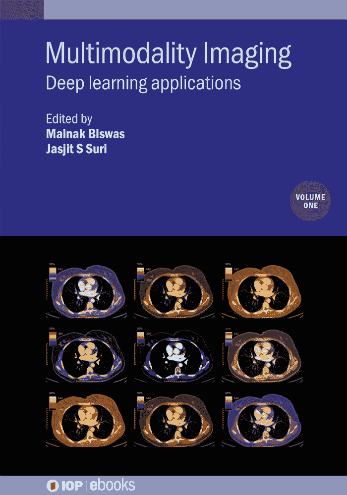

Edited by  

Mainak Biswas  

Vignan’s Foundation for Science, Technology and Research, India  

Jasjit S Suri  

AtheroPoint(TM), Roseville, CA, USA  

IOP Publishing, Bristol, UK  

Mainak Biswas and Jasjit S Suri have asserted their right to be identified as the editors of this work in accordance with sections 77 and 78 of the Copyright, Designs and Patents Act 1988.

To my late parents, and to my wife and daughter.  

—Mainak Biswas  

To all my collaborators around the world.  

—Jasjit S Suri  

## Preface

### 2.2.1 Deep belief networks

受限玻尔兹曼机（RBM）是 DBN 网络用于回归、特征提取和挖掘的基础 \[35\]。RBM 是一个双层结构系统，第一层是输入/可见层，第二层是隐藏/隐含层，如图 2.2（\[2.2\]）所示。Gibb’s energy function 用于在可见/隐藏节点上定义概率分布函数，公式为

$$p\left( {\mathbf{v},\mathbf{h}} \right) = \frac{1}{Z}e^{- E{({\mathbf{v},\mathbf{h}})}},$$  

(2.1)

其中函数 `E(v,h)` 定义为

$$E\left( {\mathbf{v},\mathbf{h}} \right) = \sum\limits_{i = 1}^{m}{\sum\limits_{j = 1}^{n}{w_{ij}h_{i}v_{j}}} - \sum\limits_{j = 1}^{n}{b_{j}v_{j} - \sum\limits_{i = 1}^{m}{c_{i}h_{i}}},$$  

(2.2)

`w[i]` 表示可见节点 `v[j]` 与隐藏节点 `h[i]` 之间的权重值，`Z` 是归一化常数，`b[j]` 和 `c[i]` 是与可见节点和隐藏节点相关的偏置项。由于节点内部未连接，因此使用“受限”一词。因此，如果提供输入节点值，则隐藏节点变量是自治的，反之亦然。这允许对一层中变量的状态进行联合采样。Gibb’s sampling 块定义了基于 `p(hv)` 和 `p(v|h)` 的条件概率对隐藏节点和可见节点的新状态进行采样。这在数学上表示为

$$p\left( {\mathbf{h} \mid \mathbf{v}} \right) = \prod\limits_{i = 1}^{m}p\left\lbrack h_{i} \mid \mathbf{v}\right\rbrack$$  

(2.3)

and

$$p\left( {\mathbf{v} \mid \mathbf{h}} \right) = \prod\limits_{j = 1}^{n}p\left\lbrack v_{j} \mid \mathbf{h}\right\rbrack.$$  

(2.4)

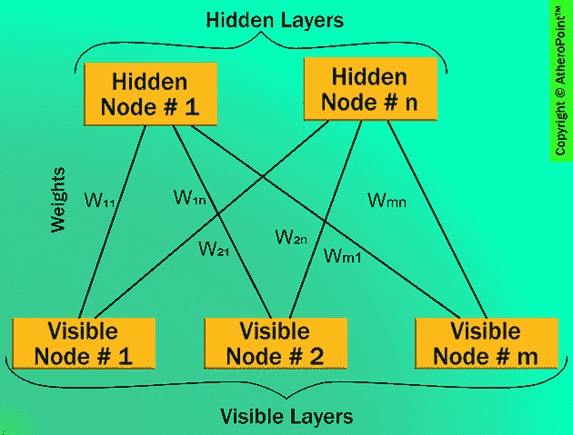

**Figure 2.2.** A two-layer restricted Boltzmann machine.

概率分布函数 `p(v)` 被测量为参数 `θ∈{W,b,c}` 的似然函数，给定输入 `v`。该参数也写为 `p(v, θ)`，它会改变每个输入的似然性。`p(v, θ)` 通常用作梯度下降方法的对数似然函数，给出为

$$\theta\left( {n + 1} \right) = \theta\left( n \right) + b \times {\left( {- \frac{\partial\quad\ln{p\left\lbrack\mathbf{v},\theta\right\rbrack}}{\partial\theta}} \right).}$$  

(2.5)

DBN 是 RBM 的堆栈。图 2.3 说明了该模型，包含一个具有 `i` 个节点的单个可见层、`q` 个隐藏层，以及 `m[1]`, `m[2]`, …, `m[q]` 个节点。提出了不同的策略来进行有效训练：

*   i. DBN 按层进行训练。

*   ii. 使用反向传播网络进行微调。

由于 DBN 中数据的概率遵循归一化常数（也称为配分函数），因此很难评估其泛化能力。估计此常数有助于控制 DBN 的泛化能力和复杂性。

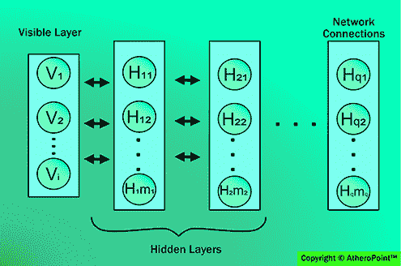

**Figure 2.3.** A multilayer DBN.

### 2.2.2 Autoencoder

自动编码器是一种用于图像恢复、噪声去除、分割等的无监督深度学习网络 \[36\]。在自动编码器中，输入节点和输出节点的数量相等，如图 2.4 所示。隐藏层的数量取决于应用类型。如果隐藏层节点少于输入/输出层，则网络学习输入图像的压缩形式。在这种网络中，图像元素模式之间的有趣关系是已知的。如果隐藏层节点多于输入/输出层节点，则可以通过采用稀疏约束 \[37\] 来了解重要特征。从数学上讲，具有 a–b–a 结构的自动编码器可以概括为一个九元组 [*a*, *b*, *m*, **P**, **Q**, **R**, **S**, **X**, δ]，其中：

1. `R` 和 `S` 是集合。

2. `a` 和 `b` 是正整数。

3. `R` 是从 **P**^(*a*) 到 **Q**^(*b*) 的函数类。

4. `S` 是从 **Q**^(*b*) 到 **P**^(*a*) 的函数类。

5. **A** = {*c*[1],*c*[2],…,*c*[*m*]} 是 **P**^(*a*) 中的 *m* 个训练向量集合。如果存在外部目标，则 **B** = {*d*[1],*d*[2],…,*d*[*m*]} 表示 **P**^(*a*) 中相应的目标向量集合。

6. `δ` 是定义在 **F**^(*a*) 上的不相似性函数。

给定任何输入，自动编码器将给定的输入向量 `c[n] ∈ P^(*a*)` 转换为输出向量 **R** ⋅ **S**(`c[n]`) *ϵ**P**^(*a*)。优化涉及找到合适的提名函数，即 `r ∈ R` 和 `s ∈ S`，以最小化由以下指定的不相似性函数 `δ`：

$$\min G\left( {\mathbf{R},\mathbf{S}} \right) = \min\limits_{\mathbf{R},\mathbf{S}}\ \sum\limits_{i = 1}^{m}{G\left\lbrack c_{i}\right\rbrack} = \min\limits_{\mathbf{R},\mathbf{S}}\ \sum\limits_{i = 1}^{m}{\delta\left\lbrack\mathbf{R} \cdot \mathbf{S}\left( c_{i} \right),c_{i}\right\rbrack,}$$  

(2.6)

其中 `G` 是失真函数。这里自动编码器近似相似性函数，其中输出与输入相似。输入和输出的最小化函数给出为


$$\\min\\ E\\left( {\\mathbf{R},\\mathbf{S}} \\right) = \\min\\limits\_{\\mathbf{R},\\mathbf{S}}\\ \\sum\\limits\_{i = 1}^{m}{E\\lbrack c\_{i},d\_{i}\\rbrack} = \\min\\limits\_{\\mathbf{R},\\mathbf{S}}\\ \\sum\\limits\_{i = 1}^{m}{\\delta\\lbrack\\mathbf{R} \\cdot \\mathbf{S}\\left( c\_{i} \\right),d\_{i}\\rbrack.}$$

Autoencoders have been helpful in object recognition and image restoration.

## 2.2.3 Convolutional neural networks

最受欢迎的基于 DL 的模型是卷积神经网络（CNN），在生物医学影像社区中被广泛使用。其设计灵感来源于 VC 的架构，其中神经元是层级排列的，并对微小细节敏感。CNN 利用了 VC 在空间上利用视觉图像内的局部相关性的能力。CNN 通过在相邻层之间强制模式的局部连接，使用三个重复函数——`conv()`、`relu()` 和 `pool()`——来实现其目标。卷积层会对输入图像应用一组滤波器，点向相乘对应的像素以生成特征图。特征图中的每个点代表输入图像相邻像素之间的空间关系。数学上，卷积表示为

```
$$f\\left( {x,y} \\right) = {Img}\\left( {x,y} \\right)ʘW\\left( {x,y} \\right) = \\sum\\limits\_{p = - \\frac{m}{2}}^{\\frac{m}{2}}\\sum\\limits\_{q = - \\frac{m}{2}}^{\\frac{m}{2}}{Img}\\left( {x + p,y + q} \\right) \\times W\\left( {x,y} \\right),$$
```

其中，图像 `Img` 与滤波器 `W` 卷积，输出特征值 `f`，`ʘ` 符号表示卷积过程。`f(x,y)` 表示特征图上的坐标，是卷积滤波器与相邻像素乘积的和值。

滤波器的内容在每次迭代中会更新，这代表了 CNN 的学习过程。卷积产物的输出随后会传入 `ReLu` 层，以去除负值，防止消失梯度问题。池化过程用于降维。池化输出要么保留特征图中最相关的部分（最大池化），要么对其进行平均。这三个函数——卷积、`ReLu` 和池化——会反复应用，以挖掘最相关的特征。挖掘出后，会附加一个全连接网络（多层感知器）进行特征表征。还有一种 CNN 的适应形式，它不使用全连接层，而是使用上采样和跳过层。这种网络也称为完全卷积网络（`FCN`），用于分割目的。上采样层是卷积的逆运算，利用滤波器将特征图转换为高维表示。跳过层用于融合 `CNN` 相邻层的特征图与上采样层的特征图。这专门用于在下采样阶段丢失的空间信息被保留。最终，使用对应的真实标签进行像素到像素的表征，生成平滑的分割图。这种分割也称为语义分割。

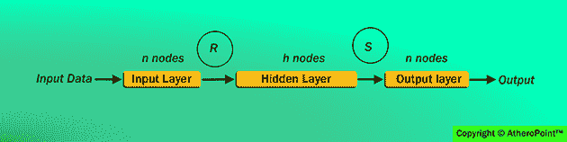

**Figure 2.4.** A generic `n`–`h`–`n` autoencoder model.

## 2.2.4 Deep residual network

DL 模型的性能在深层层数超过一定点后不再提升，甚至会迅速下降。这是因为 DL 网络的浅层参数因消失梯度问题而无法自我更新。深度残差网络（`ResNets`）提供了一种解决方案，使得浅层的训练误差保持不变。模型的工作方式如下。假设 `G(i)` 是两个相邻层的期望输出，如图 2.5(a) 所示，则中间层的残差映射为 `G(i) = F(i) – i`，如图 2.5(b) 所示。也可以重新表述原映射，即 `G(i) = F(i) + i`，如图 2.5(c) 所示。这种映射虽然不能降低训练误差，但也不会增加它，从而使得层数增加时性能不会退化。

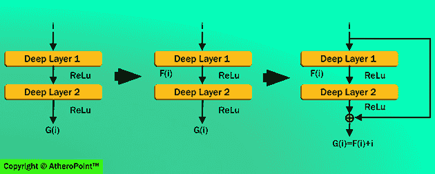

**Figure 2.5.** Deep residual network conceptual model.

## 2.3 DL based biomedical imaging systems

DL 在生物医学影像发表的快速增长归因于多种因素：快速泛化、更好性能、高可扩展性、鲁棒性等。DL 工具相较于机器学习工具的主要优势在于其即插即用特性，无需任何中间阶段。`ML` 算法的特征挖掘阶段在 `DL` 架构内部完全集成，为所有类型图像提供统一的接口。`DL` 已被用于生物医学影像的两个目的：(i) 特征表征（图 2.6）和 (ii) 分割。本节将介绍使用 `DL` 模型对多种疾病进行表征的情况。生物医学图像的分割是一个复杂的操作。基于 `DL` 的分割要么是单阶段，要么是双阶段。单阶段采用 `FCN` 基于的语义分割或补丁特征表征。双阶段模型中，第一阶段通常是全局感兴趣区域（`ROI`）检测，采用 `ML/DL` 范式。下一阶段是另一个 `ML/DL` 范式，用于在 `ROI` 内部划定边界（图 2.7）。在接下来的几节中，我们将介绍多种生物医学领域中 `DL` 在影像领域的不同应用。

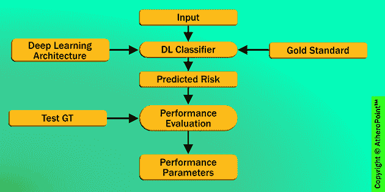

**Figure 2.6.** Generalized classification model in the DL framework.

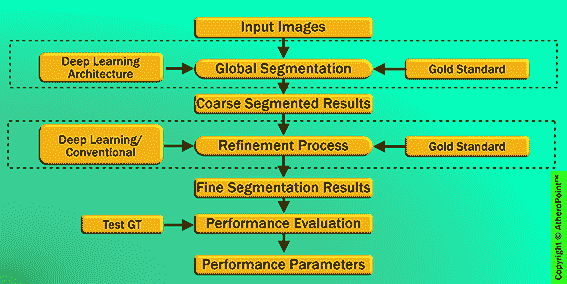

**Figure 2.7.** Generalized two-stage segmentation models in the DL framework.

## 2.3.1 Cardiovascular application

`DL` 在心血管领域的表征和分割方法有重要应用。`DL` 已被用于左心室（`LV`）分割和斑块表征。以下讨论了不同的应用。

### 2.3.1.1 左心室内膜（endocardium）在 US 数据中的跟踪

心血管健康可以通过多种参数监测，如区域壁运动和射血分数测量。从 `US` 扫描中跟踪左心室（`LV`）内膜可以提供这些信息。科学家们曾尝试使用该方法来确定大小和轮廓，但每种方法都有其局限性 \[32\]。这些模型依赖于轮廓和形状的高斯分布，且未考虑时间因素，如壁运动导致的变异。因此，应用了基于 `DBN` 的模型来捕获壁运动的所有变化 \[39\]。该 `DL` 网络通过考虑当前图像的过去分割轮廓来实现分割。在此 regard，当前图像被视为由收缩（`systole`）和舒张（`diastole`）心脏功能定义的过去状态集合。因此，给定心脏相位和轮廓后，形状的概率模型表示为

`p[Img[t] | k[t], c[t]] ≈ p[k[t], c[t] | Img[t] p[Img[t]]]`

where `p[Img[t]]` is constant and `p[k[t], c[t] | Img[t]]` can be described as a combination of affine detection `p(k[t] | θ, Img[t])`, non-rigid probabilistic segmentation `p[c[t] | θ, k[t], Img[t]]`, and the prior of affine parameters `p[θ | Img[t]]`:

`p(k[t], c[t] | Img[t]) = ∫ p(k[t] | θ, Img[t]) p[c[t] | θ, k[t], Img[t]] p[θ | Img[t]] dθ`

where `θ` represents the parameters of the affine transformation, `k[t]` symbolizes the cardiac phase, and `c[t]` denotes the LV contour at time stamp `t`. The affine transformation is marginalized using prior information in order to estimate the segmentation and cardiac phase. The segmentation of the heart is performed in two stages by two different sets of `DBN`s, as shown by equations (2.9) and (2.10). The initial rough contour is determined by the first `DBN` and then smoothening of the LV shape is carried out. The primary stage is implemented by a cascade of three `DBN`s trained on three different priors, i.e. systole, diastole, and non-LV. The second stage produces an improved delineation using a principle component analysis based shape model. The LV borders were traced by four cardiologists and one technician. All the `DBN`s were trained using the same ground truth. The parameters of performance considered for the experiment were average error (`AV`), mean absolute distance (`MAD`), Jaccard distance (`JD`), and average perpendicular error (`AVP`), which were be 0.83, 0.91, 0.95, and 0.83, respectively. The results were better compared to previous models \[40, 41\]. The process model and output images are shown in figures 2.8 and 2.9, respectively.

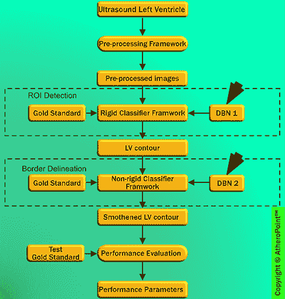

**Figure 2.8.** DBN based LV contour tracking model.

![Figure 2.9. Output of DBN based segmentation of the LV. The auto-detected outline is shown in yellow, COM \[40\] is outlined in magenta, multiple model data association \[41\] is outlined in cyan, and the ground truth outline is displayed in blue. (Reproduced with permission from \[39\]. Copyright 2013 IEEE.)](images/bk978-0-7503-2244-7ch2f9_online.jpg)

**Figure 2.9.** Output of DBN based segmentation of the LV. The auto-detected outline is shown in yellow, COM \[40\] is outlined in magenta, multiple model data association \[41\] is outlined in cyan, and the ground truth outline is displayed in blue. (Reproduced with permission from \[39\]. Copyright 2013 IEEE.)

## 2.3.1.2 Automatic segmentation of the left ventricle in cardiac MRI

There are several limitations to conventional LV segmentation models, i.e. leakage, shrinking, and initialization. Therefore, a combination of deep learning along with conventional models, i.e. deformable methods, is proposed to resolve the issues of a lack of data and lower accuracy. The issue of restricted data size is tackled using data augmentation techniques and better design. In this section LV segmentation from an MRI dataset is considered \[42\].


The dataset is derived from the MICCAI 2009 dataset challenge and consists of 45 MR cardiac images. Initially, a binary mask was obtained using a CNN deep learning model. The binary mask was used to generate the ROI within the MR dataset. The parameters of the CNN model were trained using an autoencoder. The ROI was applied to the MR images to obtain an initial LV shape `ξ^([0])` using an autoencoder architecture. Thereafter, the conventional technique of the deformable model was applied to delineate the final LV shape. Finally, a 3D model of the LV contour was obtained. The equation is

```
ξ* = arg_min[δ]E[ξ],   (2.11)
```

where `ξ*` denotes the contour shape and `E` represents the energy function. The final contour shape was obtained iteratively using the gradient descend method, which is given as

```
ξ[i+1] = ξ[i] + η dξ/dt,   (2.12)
```

where `η` denotes the step size, `i` represents successive iterations, and `dξ/dt` represents the change in `ξ` with respect to time.

The process model, and 2D and 3D segmentation outputs are displayed in figures 2.10, 2.11(a) and (b), respectively. The performance parameters of the Dice metric, APD, and conformity are 0.94, 1.81, and 0.86, respectively. Although the proposed model performance was better compared to conventional models, the hardware used was a CPU, and therefore slow. The DL models used were one or two layers deep and hence cannot reach generalization for a larger corpus.

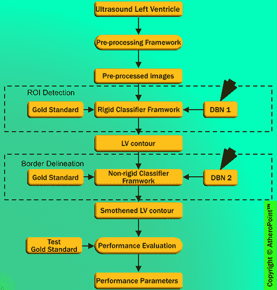

**Figure 2.10.** DL based LV contour tracking model for MRI images.

![Figure 2.11. (a) Example of outputs from the DL based LV segmentation. The auto-detected LV contour is shown in red-black as indicated by arrow ‘a’, while the ground truth contour is displayed in green as indicated by arrow ‘b’. (b) Inferred 3D shape from the given model with side, top, and bottom cross-sections. (Reproduced with permission from \[42\]. Copyright 2016 Elsevier.)](images/bk978-0-7503-2244-7ch2f11_online.jpg)

**Figure 2.11.** (a) Example of outputs from the DL based LV segmentation. The auto-detected LV contour is shown in red-black as indicated by arrow ‘a’, while the ground truth contour is displayed in green as indicated by arrow ‘b’. (b) Inferred 3D shape from the given model with side, top, and bottom cross-sections. (Reproduced with permission from \[42\]. Copyright 2016 Elsevier.)

Feature 采矿在基于机器学习的算法中处理 3D 图像时较为复杂，因为系统试图捕获 3D 平移、取向和异构缩放中的特征/参数。因此，特征采矿的最终搜索空间为 9D，这在当代模型中难以考虑。针对这一点，提出了一种边缘空间深度学习模型（MSDLM）\[43\]，该模型能够递增学习特征从而确定左心室（LV）轮廓的形状。MSDLM 包含两个阶段，第一阶段用于检测感兴趣区域（ROI），第二阶段用于划分 LV 边界。ROI 的定位采用基于深度学习的分类器（DLCs）实现。DLC 通过最大化利用平移、取向和尺度空间来迭代学习 LV 轮廓的位置、取向和尺度，以提高局部概率。公式如下：


$$\\left( \\hat{\\overset{\\rightarrow}{\\mathbf{T}},\\ }\\hat{\\overset{\\rightarrow}{\\mathbf{R}}},\\ \\hat{\\overset{\\rightarrow}{\\mathbf{S}}} \\right) = {\\arg\\ }\\max\_{\\overset{\\rightarrow}{\\mathbf{T}},\\overset{\\rightarrow}{\\mathit{R}},\\overset{\\rightarrow}{\\mathbf{S}}}\\left( {\\overset{\\rightarrow}{\\mathbf{T}},\\overset{\\rightarrow}{\\mathbf{R}},\\overset{\\rightarrow}{\\mathbf{S}} \\mid \\mathbf{I}} \\right),$$

(2.13)

where *T* 表示平移，*R* 表示取向，*S* 表示尺度空间。训练了三个 DLC 来预测位置、取向和尺度。第一个 DLC 负责预测位置，第二个 DLC 通过输入第一个 DLC 的结果来预测取向，第三个 DLC 通过输入前两个 DLC 的结果来预测尺度。在第二阶段，采用基于深度学习的主动形状模型对 LV 形状进行变形。为防止过拟合，采用了 dropout。数据集由 869 名患者的 2891 个 3D 体积组成。所提深度学习 MSDLM 模型在与未使用深度学习组件的传统系统相比表现更好。比较结果如表 2.1 所示。相应的过程模型和生成的图像分别显示在图 2.12 和 2.13。

**Table 2.1.** Comparison of the MSDLM and the conventional MSM model.

| Accuracy parameters || DL based MSDLM || Conventional MSM |
| --- | --- | --- |
| Position error || 1.47 mm || 3.12 mm |
| --- | --- | --- |
| Corner error || 2.80 mm || 0.42 m |

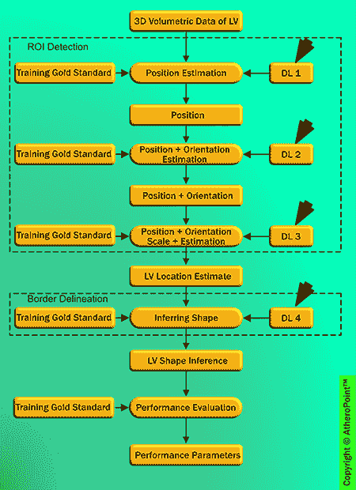

**Figure 2.12.** Deep classifier based 3D LV segmentation model.

![Figure 2.13. Deep classifier based 3D LV segmentation model outputs. The auto-detected bounding box is shown in green while the ground truth bounding box is shown in yellow. (Reproduced with permission from \[43\]. Copyright 2016 IEEE.)](images/bk978-0-7503-2244-7ch2f13_online.jpg)

**Figure 2.13.** Deep classifier based 3D LV segmentation model outputs. The auto-detected bounding box is shown in green while the ground truth bounding box is shown in yellow. (Reproduced with permission from \[43\]. Copyright 2016 IEEE.)

## 2.3.1.4 Vessel mining from x-ray angiograms

全球范围内，心血管疾病（CVD）每年导致超过 1700 万人死亡。冠状动脉疾病（coronary artery disease）是主要 CVD 之一，也是死亡的主要原因（见图 2.14）。传统方法，即跟踪和滤波方法，因分辨率低、噪声存在以及与感兴趣区域相近的类似强度器官增加复杂度，无法提供更高的准确性。本文采用基于深度学习的卷积神经网络（CNN）模型对 X 射线血管造影图像中的血管区域进行检测\[44\]。实验中收集了 44 张图像。图像通过顶帽变换预处理以提升对比度。采用补丁采矿方法，从训练和测试 CNN 时共采集了 1 040 000 个补丁。CNN 包含两层卷积、两层最大池化以及两层全连接层（500 个神经元），输出 vessel 和 not‑vessel 两类的概率。模型实现了 93.5% 的准确率，显著优于以往方法。即使在噪声、低分辨率和复杂背景的条件下，结果仍然优秀。然而，所使用的 CNN 仅有六层，建议在更深层的模型上进行训练/测试，以获得更好的结果、可靠性以及临床应用。分割结果如图 2.15 所示。

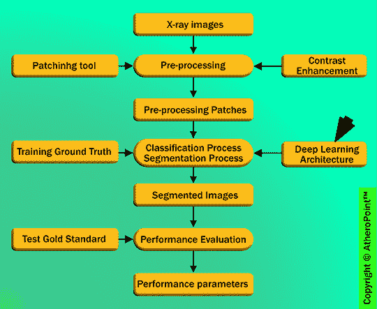

**Figure 2.14.** Segmentation of x-ray images using CNNs.

![Figure 2.15. Row one shows five input images. Row two shows the corresponding ground truth of the row one images. Row three shows analogous images for segmentation outputs using CNN. (Reproduced with permission from \[44\]. Copyright 2016 IEEE.)](images/bk978-0-7503-2244-7ch2f15_online.jpg)

**Figure 2.15.** Row one shows five input images. Row two shows the corresponding ground truth of the row one images. Row three shows analogous images for segmentation outputs using CNN. (Reproduced with permission from \[44\]. Copyright 2016 IEEE.)

## 2.3.1.5 Plaque characterization

脆性斑块识别是 CVD 检测的重要环节，有助于早期风险评估和治疗方案制定。但斑块检测面临多项挑战：体积小、形态多样、伴随斑点噪声，导致分割困难，使得斑块表征成为复杂任务。为解决此问题，提出了一种自动化深度学习 CNN 模型用于斑块表征\[45\]。该 CNN 包含四层卷积、四层 ReLu 激活以及三层全连接层，采用 softmax 分类技术。训练时使用交叉熵损失函数，并将模型结果与单尺度和多尺度支持向量机（SVM）进行比较。

实验使用了 56 例超声心动图（CCA）图像。采用补丁采矿策略，从超声图像中共采集了 90 000 个补丁，并将其标注为三类：脂肪核、纤维和钙化，作为 CNN 学习的真值。表 2.2 列出了 DL 模型与传统机器学习模型的对比结果，显示 DL 模型在准确率上大幅超越了传统模型。模型的处理流程及分割结果分别展示在图 2.16 和 2.17。

**Table 2.2.** Comparison of the DL and conventional models for plaque characterization \[45\].

| Model || Accuracy |
| --- | --- |
| --- | --- |
| DL based CNN || 78.5% |
| --- | --- |
| Single-scale SVM || 14.3% |
| Multi-scale SVM || 7.2% |

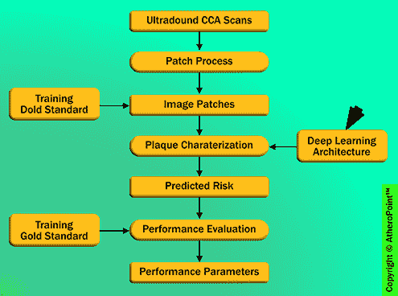

**Figure 2.16.** Global diagram for plaque characterization.

![Figure 2.17. Row one shows the input images, row two is the corresponding ground truth, and row three is the equivalent characterization output for the given method. Here red represents the lipid core, yellow represents fibrous tissue, and green represents calcified tissue. (Reproduced with permission from \[45\]. Copyright 2016 IEEE.)](images/bk978-0-7503-2244-7ch2f17_online.jpg)

**Figure 2.17.** Row one shows the input images, row two is the corresponding ground truth, and row three is the equivalent characterization output for the given method. Here red represents the lipid core, yellow represents fibrous tissue, and green represents calcified tissue. (Reproduced with permission from \[45\]. Copyright 2016 IEEE.)

## 2.3.2 Neurology application

Here we discuss various DL applications in the field of neurology imaging.

## 2.3.2.1 Brain lesion segmentation

In an emergency, precise localization of a brain lesion from injury is necessary for successful treatment and saving lives. However, several complexities make accurate estimation of a brain lesion’s location and size difficult, such as multiple sites, varying shape and size, and an intensity profile matching unaffected brain regions. Different conventional models have been developed but show limited performance. To address this, a two-pathway deep learning (DL) model was proposed for accurate lesion estimation and segmentation \[46\]. In this model, two separate CNN architectures were designed for each pathway. Each pathway processed different dimensions and scales of the same input images, which were later combined to provide an accurate boundary and size estimate of the lesion. The initial pathway received the original 3D images, while the second pathway received down‑sampled images. The initial pathway captured the detailed shape of the lesion, whereas the second pathway captured its location. The output feature maps of the second pathway were up‑sampled to the original size and combined with the first pathway’s output to achieve overall lesion segmentation. The joint output was then fed into a fully connected conditional random field (CRF) network for final estimation.

The input images of traumatic brain injuries were collected from 66 patients and participated in the ISLES‑SISS challenge. The Dice similarity coefficient was 0.59. The method outperformed the random forest method by a large margin. Although it performed better than previous methods, the DL model’s performance is considered low for clinical significance. The model’s process and segmented images are shown in Figures 2.18 and 2.19, respectively.

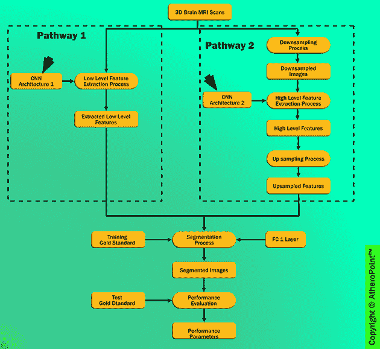

**Figure 2.18.** Deep neural network for brain lesion segmentation.

![Figure 2.19. Row one and two show the fluid-attenuated inversion recovery and diffusion weighted imaging sequences from the dataset, row three shows the ground truth, row four shows the corresponding output of DeepMedic, and row five shows the analogous output of DeepMedic + CRF (conditional random field). (Reproduced with permission from \[46\]. Copyright 2017 Elsevier.)](images/bk978-0-7503-2244-7ch2f19_online.jpg)

**Figure 2.19.** Row one and two show the fluid-attenuated inversion recovery and diffusion weighted imaging sequences from the dataset, row three shows the ground truth, row four shows the corresponding output of DeepMedic, and row five shows the analogous output of DeepMedic + CRF (conditional random field). (Reproduced with permission from \[46\]. Copyright 2017 Elsevier.)

## 2.3.2.2 Brain tumor segmentation

Several classification methods exist for brain tumors. Among brain tumors, gliomas have the highest fatality rate. Gliomas are further divided into low‑grade and high‑grade (LGG and HGG). The high‑grade type is more aggressive. Accurate segmentation and classification of gliomas into LGGs and HGGs are critical for treatment planning, follow‑up, and monitoring. Due to its invasive nature, biopsy is risky and dangerous, so non‑invasive imaging is preferred. However, manual glioma segmentation is error‑prone and tedious. MR images present challenges such as intensity variation, inhomogeneity, and scanner artifacts. Consequently, automated brain tumor segmentation techniques are preferred. In \[47\] a deep learning–based CNN model was proposed for tumor segmentation from MR images. Experts categorized the tumors into necrosis, edema, non‑enhancing, and enhancing classes. Before training the CNN, the pre‑processed images were used for dataset normalization.

Two CNN models of different depths were trained separately for LGGs and HGGs. The LGG model consisted of four convolutional layers, two max‑pooling layers, and three fully connected layers. The HGG model had six convolutional layers, two max‑pooling layers, and three fully connected layers. The shallower LGG model did not improve by increasing depth. Two datasets were used: the first contained 65 MR scans, and the second contained 274 MR scans. Patch‑based segmentation was employed, yielding 335,000 patches for LGG and 450,000 patches for HGG, which were used to train and test the respective CNN models. Three segmentation schemes were evaluated: complete, core, and enhancing. The Dice similarity scores were 0.88, 0.83, and 0.77, respectively. The model’s process and segmentation results are shown in Figures 2.20 and 2.21, respectively.

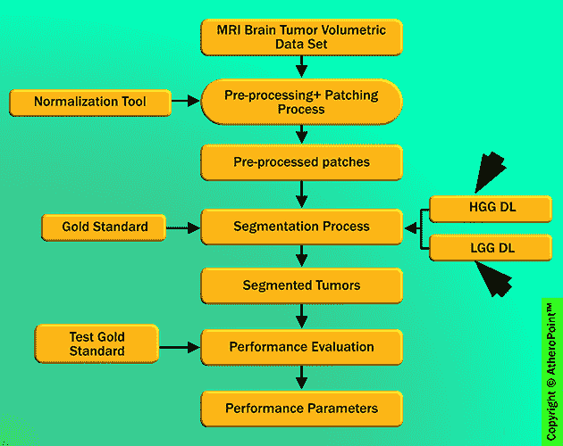

**Figure 2.20.** DL based system for brain tumor segmentation.

![Figure 2.21. The segmentation of HGGs is shown in row one and the segmentation of LGG is shown in row two. The different MRI sequences from left to right are T1, T1c, T2, and FLAIR. The right‑most image in row one indicated by biomedical arrow ‘a’ is a HGG segmented image and the right‑most image in row two indicated by biomedical arrow ‘b’ is an LGG segmented image. The colors represent tumor types: green—edema; blue—necrosis; yellow—non‑enhancing tumor; and red—enhancing tumor. (Reproduced with permission from \[47\]. Copyright 2016 IEEE.)](images/bk978-0-7503-2244-7ch2f21_online.jpg)

**Figure 2.21.** The segmentation of HGGs is shown in row one and the segmentation of LGG is shown in row two. The different MRI sequences from left to right are T1, T1c, T2, and FLAIR. The right‑most image in row one indicated by biomedical arrow ‘a’ is a HGG segmented image and the right‑most image in row two indicated by biomedical arrow ‘b’ is an LGG segmented image. The colors represent tumor types: green—edema; blue—necrosis; yellow—non‑enhancing tumor; and red—enhancing tumor. (Reproduced with permission from \[47\]. Copyright 2016 IEEE.)

## 2.3.3 Mammography application

This section provides a glimpse of a DL based application in the area of mammography. We discuss two recent DL applications in the area of breast cancer research.

## 2.3.3.1 Mitosis detection in breast cancer

The occurrence of mitotic cells in histology images is a precursor to breast cancer. These mitosis processes represent the complex transformations that the cell nucleus undergoes. Although similar structures of same intensity, shape, and size exist, only a very few are mitotic cells and therefore require extensive evaluation using deep learning models. In this study, DL based CNN models were applied to characterize mitotic and non-mitotic cells \[48\]. An ensemble classifier based on two separate CNN models was developed. The first CNN consisted of 13 layers (input + five convolution + five max-pooling + two fully connected layers) and the second CNN consisted of 11 layers (input + four convolution + four max-pooling + two fully connected layers). The outputs were later pooled in the ensemble version. The ensemble DL based classifier was trained and tested using 50 images taken from the MITOSIS dataset. The performance parameters of precision and F1 score were 0.88 and 0.78, respectively. The process model and the outputs are shown in figures 2.22 and 2.23, respectively. Although the results were better compared to others in the ICPR2012 challenge, a greater number of training images would have led to better generalization.

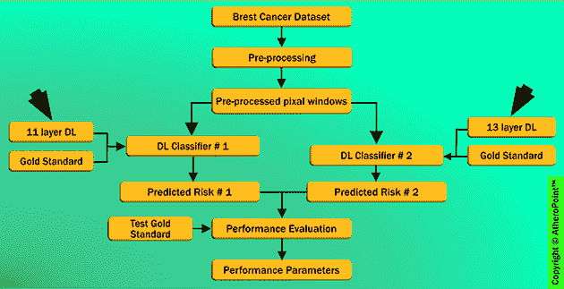

**Figure 2.22.** DL based breast cancer detection.

![Figure 2.23. The left-most image show by arrow (a) represents the image with three dotted areas. The three dotted areas are displayed in detail as indicated by arrows (b), (c), and (d). Mitosis detected by the system is shown in green, red represents a false positive, and cyan signifies mitosis not detected by the given approach. (Reproduced with permission from \[48\]. Copyright 2013 Springer.)](images/bk978-0-7503-2244-7ch2f23_online.jpg)

**Figure 2.23.** The left-most image show by arrow (a) represents the image with three dotted areas. The three dotted areas are displayed in detail as indicated by arrows (b), (c), and (d). Mitosis detected by the system is shown in green, red represents a false positive, and cyan signifies mitosis not detected by the given approach. (Reproduced with permission from \[48\]. Copyright 2013 Springer.)

## 2.3.3.2 Digital mammographic tumor classification

The conventional model of breast cancer diagnosis involves feature mining and application of statistical modeling for predicting malignancy. In \[49\] CNN transfer learning is used for categorization of breast lesions from mammography images. Further, this study also compared the features mined from a deep learning model and hand crafted lesion features. The CNN model used in the work was first trained in general object recognition, which is entirely different from breast cancer data. Finally, the trained CNN model was tested on the mammography images. It is hypothesized that models trained in a general setting are able to recognize minute details of specialized biomedical images such as breast cancer. Here, the dataset constituted 219 breast lesions from digital mammography images. A total of 607 ROIs were mined. AlexNet, a popular CNN model, was used for feature mining. The AlexNet model consisted of five convolution layers and three fully connected layers. Another set of features was mined using analytically mined handmade features. Two SVM classifiers were trained separately on the two sets of features: deep features (process P1) and handmade features (process P2). The classification outputs were combined from both P1 and P2 to make the ensemble classifier (P1 + P2). It can be seen that the performance of the ensemble classifier AUC was better than that of P2 (an AUC of 0.86 versus an AUC of 0.81). The process model and analogous output images are shown in figures 2.24 and 2.25, respectively.

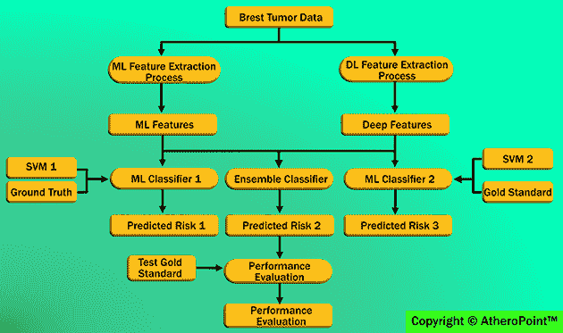

**Figure 2.24.** DL based breast tumor detection.

![Figure 2.25. The outputs of different layers of AlexNet are shown: (a) the ROI input; (b) the output of pooling layer one; (c) the outputs of pooling layer two; (d) the output of convolution layer four; and (e) the output of pooling layer five. These are fed into conventional methods for characterization. (Reproduced with permission from \[49\]. Copyright 2016 Society of Photo‑Optical Instrumentation Engineers.)](images/bk978-0-7503-2244-7ch2f25_online.jpg)

**Figure 2.25.** The outputs of different layers of AlexNet are shown: (a) the ROI input; (b) the output of pooling layer one; (c) the outputs of pooling layer two; (d) the output of convolution layer four; and (e) the output of pooling layer five. These are fed into conventional methods for characterization. (Reproduced with permission from \[49\]. Copyright 2016 Society of Photo‑Optical Instrumentation Engineers.)

## 2.3.4 Microscopy applications

The applications of deep learning in microscopy are discussed in here.

### 2.3.4.1 Analysis of individual cells in a live-cell imaging experiment

In cellular biology, a powerful research technique is dynamic live-cell imaging experiments. Cells are cultivated manually for hours for proper identification. Automated techniques such as deep learning can provide faster and more accurate results in both segmentation and accuracy. In \[50\] a DL based model was employed for automated segmentation and characterization. Several CNNs were employed to track the growth of bacterial cells and individual mammalian nuclei without manual intervention. The patching methodology was applied, where the patches were mined from the image and annotated with their respective class. This process of patching and annotating was repeated for all the images. Thereafter, the classifier was trained and tested to characterize each patch. After classification all the labelled patches were combined to give the segmented image. The cost function applied for the function is


```
C = - \sum_{i} \log \left( \frac{e^{label}}{\sum_{l}e^{l}} \right) + \tau \sum_{w \in \mathbf{W}} w^{2},
```

(2.14) graphic style="width:38.8125em;" xlink:href="bk978-0-7503-2244-7ch2eqn46.gif" position="float"/

where `C` is the cost function, `i` is the images, `l` is the labels, `w` is the weights, `τ` is the regularization parameter, and `W` represents all the weights. The weights are updated as per the formula

```
w_{i + 1} = w_{i} - \eta \frac{\\partial C}{\\partial w},
```

(2.15) graphic style="width:38.8125em;" xlink:href="bk978-0-7503-2244-7ch2eqn47.gif" position="float"/

where `i` denotes the iterations, `η` represents the learning rate, and `$\\frac{\\partial C}{\\partial w}$` inline-graphic style="height:1.75em;" xlink:href="bk978-0-7503-2244-7ch2ieqn48.gif" is the gradient of cost with respect to weight. The mammalian cells were categorized into five types. In each image there were approximately 300 nuclei, 500 nuclei, and 100 mammalian cells. The images were pre-processed and artificially augmented using rotation. The Jaccard index and Dice metric for the operation were 0.89 and 0.94, respectively. Model parallelism was achieved using GPUs. The process model and segmented output are shown in figures 2.26 and 2.27, respectively.

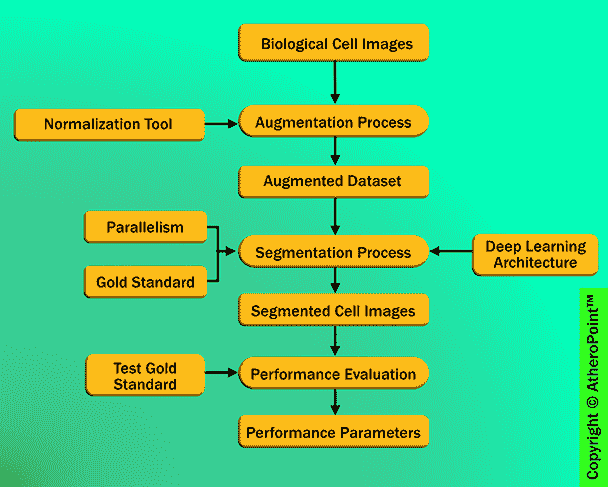

**Figure 2.26.** Model depicting the segmentation of individual cells using DL.

![图 2.27. 相位对比输入图像在最左侧显示，并用 (a) 和 (d) 标记。相应的分割输出用 (b) 和 (c) 标记。(经第 \[50\] 许可复制)](images/bk978-0-7503-2244-7ch2f27_online.jpg)

**图 2.27.** 相位对比输入图像在最左侧显示，并用 (a) 和 (d) 标记。相应的分割输出用 (b) 和 (c) 标记。(经第 \[50#Chapter_2.xhtml#bk978-0-7503-2244-7ch2bib50\] 许可复制)

#### 2.3.4.2 显微镜图像的分类与分割

在第 \[51#Chapter_2.xhtml#bk978-0-7503-2244-7ch2bib51\] 条文中，提出了一种将多实例学习 (`MIL`) 与深度学习 `CNN` 用于目标检测的方法。`MIL` 不仅针对单个实例，而是从一组实例中学习。本文利用了 `CNN` 池化层的相似性以及 `MIL` 的聚合函数，其中 `CNN` 特征对应 `MIL` 实例特征。`CNN` 通过多实例池化层对不同形状和尺寸的图像进行特征化。输出节点的 `softmax` 激活通过反向传播传递到 `CNN` 网络，生成用于分类的雅可比图。随后，对网络输入通道的雅可比图之和进行阈值化，得到分割面具。采用循环信念网络 (loopy belief network) 改善定位前景 (参考第 \[10\] 条文在 \[51#Chapter_2.xhtml#bk978-0-7503-2244-7ch2bib51\])。`CNN` 模型包含七层卷积、四层池化、一层多实例池化以及一层全连接层。数据集由微细 `MFC-7` 乳腺癌细胞图像组成，其中 300 张用于训练，40 张用于测试。还使用了绿色荧光蛋白酵母数据集，其中 2200 张用于训练，280 张用于测试。为验证目的，采用 `MNIST` 数据集，其中 50 张用于训练，10 张用于测试。`MFC-7` 与酵母数据集的准确率分别为 0.97 和 0.96。测试错误为 0%。模型及分割输出过程如图 \[2.28#Chapter_2.xhtml#bk978-0-7503-2244-7ch2fig28\] 和 \[2.29#Chapter_2.xhtml#bk978-0-7503-2244-7ch2fig29\] 所示。

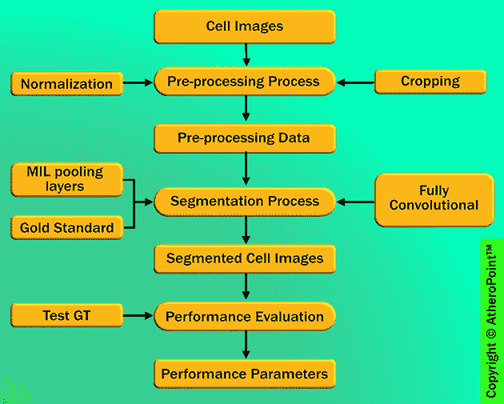

**图 2.28.** 深度多实例学习模型示意图。

![图 2.29. 采用 FCN-MIL 池化方法进行分割。(a) 雅可比图，(b) 阈值化，(c) 采用循环 bp 的去噪，(d) 分割轮廓。(经第 \[51\] 许可复制)](images/bk978-0-7503-2244-7ch2f29_online.jpg)

**图 2.29.** 采用 `FCN-MIL` 池化方法进行分割。(a) 雅可比图，(b) 阈值化，(c) 采用循环 `bp` 的去噪，(d) 分割轮廓。(经第 \[51#Chapter_2.xhtml#bk978-0-7503-2244-7ch2bib51\] 许可复制)

### 2.3.5 皮肤科应用

全球有相当比例的人受皮肤癌影响。本小节提供皮肤恶性黑色素瘤识别的深度学习 (`DL`) 应用指南。

#### 2.3.5.1 基于 `DL` 的黑色素瘤识别

在所有皮肤癌类型中，黑色素瘤的致死率最高。若能早期发现，黑色素瘤是可以治愈的。基于机器学习的自动化技术在生物医学图像中进行黑色素瘤检测时性能有限，因为它们依赖于一个中间的手动特征挖掘阶段。在第 \[52#Chapter_2.xhtml#bk978-0-7503-2244-7ch2bib52\] 条文中，深度学习被用于从生物医学图像中检测黑色素瘤。`DL` 架构受 `UNet`、`CNN` 和 `ResNets` 的启发 \[53#Chapter_2.xhtml#bk978-0-7503-2244-7ch2bib53\]。模型的两个主要组成部分是分割和分类。网络包含三层卷积和池化，随后是三层去卷积和上采样。在卷积与去卷积的中间层使用跳跃 (skip) 操作，合并特征图以恢复下采样过程中丢失的空间信息。数据集来源于 `ISIC2016` 竞赛，其中 900 张图像用于训练，379 张用于测试。最终，分割输出通过 `SVM` 进行分离。系统准确率为 76.0%，而八位皮肤科医生的平均表现为 70.5%。这表明基于深度学习的自动诊断系统表现更好。模型过程和分割输出如图 \[2.30#Chapter_2.xhtml#bk978-0-7503-2244-7ch2fig30\] 与 \[2.31#Chapter_2.xhtml#bk978-0-7503-2244-7ch2fig31\] 所示。

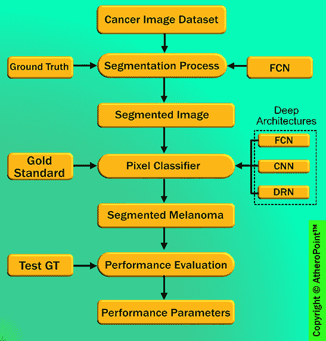

**图 2.30.** 黑色素瘤的分割与分类。

![图 2.31. 使用 FCN-UNet 对九位患者的黑色素瘤进行分割。第一行显示输入图像，第二行是对应的地面真值，第三行是相应的分割输出。(经第 \[52\] 许可复制)](images/bk978-0-7503-2244-7ch2f31_online.jpg)

**图 2.31.** 使用 `FCN-UNet` 对九位患者的黑色素瘤进行分割。第一行显示输入图像，第二行是对应的地面真值，第三行是相应的分割输出。(经第 \[52#Chapter_2.xhtml#bk978-0-7503-2244-7ch2bib52\] 许可复制)

### 2.3.6 胃肠学应用

深度学习已被用于肝癌检测及风险评估，用于医学 `CT` 影像的诊断及治疗计划准备。

#### 2.3.6.1 肝癌肿块的分割

WHO 最近的一份报告指出，肝癌是所有癌症死亡的第二大主因。肝病灶在 `CT` 图像中的表现模糊且异质，密度、形状和大小各不相同，导致检测困难。在第 \[54#Chapter_2.xhtml#bk978-0-7503-2244-7ch2bib54\] 条文中，深度学习被用于从肝 `CT` 图像中分割肿瘤病灶。采用了基于补片的方法进行特征描述。`CNN` 模型包含两层卷积、两层最大池化以及一层 `softmax`。实验使用了 30 张 `CT` 图像数据集。最初，补片被预处理，若补片中包含 >50% 病灶则标记为阳性，否则标记为阴性。还对比了三种机器学习方法：`AdaBoost`、随机森林和 `SVM`。结果表明，`DL` 方法在 `DM` 系数上表现更好，达到 80.06%（`SVM` = 79.78%，随机森林 = 79.47%，`AdaBoost` = 75.67%）。模型过程和分割输出如图 \[2.32#Chapter_2.xhtml#bk978-0-7503-2244-7ch2fig32\] 与 \[2.33#Chapter_2.xhtml#bk978-0-7503-2244-7ch2fig33\] 所示。

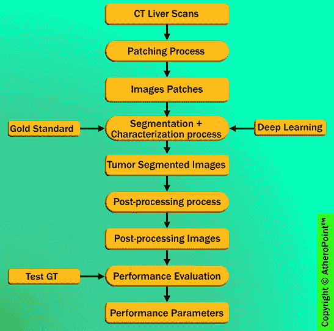

**图 2.32.** 肝 `CT` 肿瘤的分割。

![图 2.33. 使用 AdaBoost (紫色)、随机森林 (绿色)、SVM (蓝色) 和 CNN (红色) 对四位患者的肝 CT 肿瘤进行分割。所有行的地面真值均以黄色显示。(经第 \[54\] 许可复制)](images/bk978-0-7503-2244-7ch2f33_online.jpg)

**图 2.33.** 使用 `AdaBoost` (紫色) 对第一行患者的肝 `CT` 肿瘤进行分割，随机森林 (绿色) 对第二行，`SVM` (蓝色) 对第三行，`CNN` (红色) 对第四行进行分割。所有行的地面真值均以黄色显示。(经第 \[54#Chapter_2.xhtml#bk978-0-7503-2244-7ch2bib54\] 许可复制)

### 2.3.7 肺部应用

-   [肺癌](https://wiki.example.org/feynmans_learning_method)以小结节的形式出现，这些结节难以检测和诊断。本节讨论肺癌检测中的一个深度学习（`DL`）应用。

#### 2.3.7.1 lung disease characterization

恶性肺癌的五年生存率低于 10%，因此如果不及时诊断，就会危及生命。即使进行活检，小肺结节也很少是恶性的，而且 `CT-PET` 扫描无法可靠地区分它们。针对这一点，应用了两种 `DL` 模型进行肺癌分类，即 `CNN` 和 `DBN` \[55\]。肺结节的形状可以初步判断其恶性程度。此外，内部组成（如液体、钙化和脂肪）也能提供线索。`CT` 扫描来自 1010 名患者。结果见表 \2.3。模型的处理流程见图 \2.34。

| Parameter | CNN | DBN |
| --- | --- | --- |
| Sensitivity | 73.3% | 73.4% |
| Specificity | 78.7% | 82.2% |


**Table 2.3.** DL 应用于肺癌检测的结果分析 [55].

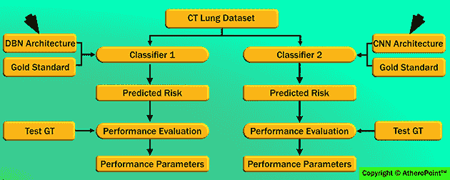

**Figure 2.34.** CT 肺癌的特征化。

## 2.4 Discussion

计算系统的出现促使科学家开发算法，以模拟智能行为 [56]。早期的算法是基于命题逻辑的、针对特定任务的简单知识工具。因此，任务变更时，整个算法必须被适配。于是，对通用算法的需求出现，推动了机器学习（ML）的发展。ML 是一个两阶段过程：第一阶段是特征挖掘，第二阶段是实际的统计模型用于特征表征和分割。然而，特征挖掘仍使用手工工具，因此仍是任务特定的，导致性能有限，难以实现广泛应用所需的泛化。这促使了基于深度学习（DL）的工具发展，这些工具是单阶段的，并内置特征挖掘能力。DL 网络的深度使其能够学习图像中的更内在的模式关系。DL 网络可以处理任何成像模态的图像，如超声、MRI、CT、X 光等，从而能够更快速地实现 DL 模型的泛化和可扩展性，相比于其他智能方法。本章展示了心血管学、神经学、乳腺癌学、显微镜学、皮肤学、胃肠学和肺部成像等不同领域的应用。DL 还被应用于脑室窝 [57]、白质分割 [58]、脂肪肝病检测 [59]、蛋白质结构预测 [66–74]、基因表达调控 [75–79]、蛋白质分类 [80–82]、异常分类 [83, 87–89] 和脑解码 [84–86]。

### 2.4.1 Graphics processing unit and open-source software for deep learning

深度学习模块包含数百万个训练参数。这些参数代表学习过程的记忆，并持续演变直至收敛。当前的多核 CPU 系统不适合 DL 计算。GPU 提供了更好的替代方案。GPU 拥有数千个核心，能够并行处理。因此，操作系统可以在多个滤波线程中调度数千项计算。GPU 的速度比多核 CPU 快数十到数千倍，能更快实现收敛 [8]。

`Python` 是 DL 开发者最常用和接受的编程语言。大多数 DL 包都是基于某种版本的 `Python`，如 `TensorFlow` [60]、`Theano` [61]、`Keras` [62]、`CAFFE` [63] 和 `Torch` [64]。`Deeplearning4j` [65] 源自 Java 编程语言，面向 Java 开发者。

**References**

[1] LeCun Y, Bengio Y and Hinton G 2006 Deep learning *Nature* [**521** 436–44](http://dx.doi.org/10.1038/nature14539)

[2] Ciregan D, Meier U and Schmidhuber J 2012 Multi-column deep neural networks for image classification *Computer Vision and Pattern Recognition* (Piscataway, NJ: IEEE) pp 3642–9

[3] Wawrzynski P 2015 Control policy with auto correlated noise in reinforcement learning for robotics *Int. J. Mach. Learn. Comput.* [**5** 91–5](http://dx.doi.org/10.7763/IJMLC.2015.V5.489)

[4] Mnih V, Kavukcuoglu K, Silver D, Graves A, Antonoglou I, Wierstra D and Riedmiller M 2013 Playing Atari with deep reinforcement learning, arXiv: [1312.5602](http://arxiv.org/abs/arXiv:1312.5602)

[5] Du T and Vijay K S 2009 Deep learning for natural language processing *Eecis. Udel Edu.* 1–7 [`www.eecis.udel.edu/∼vijay/fall13/snlp/lit-survey/DeepLearning.pdf`](https://www.eecis.udel.edu/~vijay/fall13/snlp/lit-survey/DeepLearning.pdf)

[6] Hadsell R, Erkan A, Sermanet P, Scoffier M, Muller U and LeCun Y 2008 Deep belief net learning in a long-range vision system for autonomous off-road driving *Proc. Intelligent Robots and Systems* pp 628–33

[7] Rosenblatt F 1958 The perceptron: a probabilistic model for information storage and organization in the brain *Psychol. Rev.* [**65** 386](http://dx.doi.org/10.1037/h0042519)

[8] Raina R, Madhavan A and Ng A Y 2009 Large-scale deep unsupervised learning using graphics processors *Proc. of the 26th Annual Int. Conf. on Machine Learning* (New York: ACM) pp 873–80

[9] Najafabadi M M, Villanustre F, Khoshgoftaar T M, Seliya N, Wald R and Muharemagic E 2015 Deep learning applications and challenges in big data analytics *J. Big Data* [**2** 1](http://dx.doi.org/10.1186/s40537-014-0007-7)

[10] McCulloch W S and Pitts W 1943 A logical calculus of ideas immanent in nervous activity *Bull. Math. Biophys.* [**5** 115–33](http://dx.doi.org/10.1007/BF02478259)

[11] Bebis G and Georgiopoulos M 1994 Feed-forward neural networks *IEEE Potentials* [**13** 27–31](http://dx.doi.org/10.1109/45.329294)

[12] Hopfield J J 1984 Neurons with graded response have collective computational properties like those of two-state neurons *Proc. Natl Acad. Sci. USA* [**81** 3088–92](http://dx.doi.org/10.1073/pnas.81.10.3088)

[13] Hinton G E 2009 Deep belief networks *Scholarpedia* [**4** 5947](http://dx.doi.org/10.4249/scholarpedia.5947)

[14] Smolensky P 1986 Information processing in dynamical systems: foundations of harmony theory *Research Paper* NO. CU-CS-321-86 Department of Computer Science, Colorado University at Boulder

[15] Hinton G E, Osindero S and Teh Y-W 2006 A fast learning algorithm for deep belief nets *Neural Comput.* [18] 1527–54 (http://dx.doi.org/10.1162/neco.2006.18.7.1527)

[16] Hinton G, Simon O, Max W and Teh Y-W 2006 Unsupervised discovery of nonlinear structure using contrastive backpropagation *Cogn. Sci.* [30] 725–31 (http://dx.doi.org/10.1207/s15516709cog0000_76)

[17] Sutskever I and Geoffrey H 2007 Learning multilevel distributed representations for high-dimensional sequences *Proc. Mach. Learn. Res.* 2 548–55

[18] Taylor G W, Hinton G E and Rowels S 2007 Modeling human motion using binary latent variables *Advances in Neural Information Processing Systems* vol 19 (Cambridge, MA: MIT Press) pp 1345–52

[19] Bengio Y 2009 Learning deep architectures for AI *Found. Trends Mach. Learn.* [2] 1–127 (http://dx.doi.org/10.1561/2200000006)

[20] Krizhevsky A, Sutskever I and Hinton G E 2012 ImageNet classification with deep convolutional neural networks *Advances in Neural Information Processing Systems* vol 12 (Cambridge, MA: MIT Press) pp 1097–105

[21] Szegedy C, Liu W, Jia Y, Sermanet P, Reed S, Anguelov D, Erhan D, Vanhoucke V and Rabinovich A 2015 Going deeper with convolutions *Proc. of the IEEE Conf. on Computer Vision and Pattern Recognition* pp 1–9

[22] Krizhevsky A, Sutskever I and Hinton G E 2012 ImageNet classification with deep convolutional neural networks *Commun. ACM* [60] 84–90 (http://dx.doi.org/10.1145/3065386)

[23] Russakovsky O, Jia D, Hao S, Jonathan K, SanjeevSatheesh, Sean M and Zhiheng H 2015 ImageNet large scale visual recognition challenge *Int. J. Comput. Vision* [115] 211–52 (http://dx.doi.org/10.1007/s11263-015-0816-y)

[24] He K, Xiangyu Z, Ren S and Sun J 2016 Deep residual learning for image recognition *Proc. of the IEEE Conf. on Computer Vision and Pattern Recognition* pp 770–8

[25] Herman G T 2009 *Fundamentals of Computerized Tomography: Image Reconstruction from Projections* (Berlin: Springer)

[26] Rinck P A 2014 *Magnetic Resonance in Medicine: A Critical Introduction* (Norderstedt: Books on Demand) p 21

[27] Sanches J M, Laine A F and Suri J S 2012 *Ultrasound Imaging: Advances and Applications* (Berlin: Springer)

[28] Wu D H, Shaffer A D, Thompson D M, Yang Z, Magnotta V A, Alam R and Mayr N 2008 Iterative active deformational methodology for tumor delineation: evaluation across radiation treatment stage and volume *J. Magn. Reson. Imaging* [28] 1188–94 (http://dx.doi.org/10.1002/jmri.21500)

[29] Molinari F, Kristen M, Meiburger U, Acharya R, Zeng G, Paulo S, Rodrigues, Saba L, Nicolaides A and Suri J S 2011 CARES 3.0: a two stage system combining feature-based recognition and edge-based segmentation for CIMT measurement on a multi-institutional ultrasound database of 300 images *Annual Int. Conf. of the IEEE Engineering in Medicine and Biology Society* (Piscataway, NJ: IEEE) pp 5149–52

[30] Acharya U R, Sree S V, Kulshreshtha S, Molinari F, Koh J, Saba L and Jasjit S S 2014 GyneScan: an improved online paradigm for screening of ovarian cancer via tissue characterization *Technol. Cancer Res. Treat.* [13] 529–39 (http://dx.doi.org/10.7785/tcrtexpress.2013.600273)

[31] Acharya U R, Sree S V, Krishnan M M R, Molinari F, Ÿnik W Z, Bardales R H, Witkowska A and Suri J S 2014 Computer‐aided diagnostic system for detection of Hashimoto thyroiditis on ultrasound images from a Polish population *J. Ultrasound Med.* [33] 245–53 (http://dx.doi.org/10.7863/ultra.33.2.245)

[32] Saba L *et al* 2014 Semi-automated analysis of carotid artery wall thickness in MRI *J. Magn. Reson. Imaging* [39] 1457–67 (http://dx.doi.org/10.1002/jmri.24307)

[33] Suri J S, Liu K, Singh S, Laxminarayan S N, Zeng X and Reden L 2002 Shape recovery algorithms using level sets in 2-D/3-D biomedical imagery: a state-of-the-art review *IEEE Trans. Inf. Technol. Biomed.* [6] 8 (http://dx.doi.org/10.1109/4233.992158)

[34] Powell S, Magnotta V A, Johnson H, Jammalamadaka V K, Pierson R and Andreasen N 2008 Registration and machine learning-based automated segmentation of subcortical and cerebellar brain structures *Neuroimage* [39] 238–47 (http://dx.doi.org/10.1016/j.neuroimage.2007.05.063)

[35] Nair V and Hinton G E 2010 Rectified linear units improve restricted Boltzmann machines *Proc. of the 27th Int. Conf. on Machine Learning* pp 807–14

[36] Baldi P 2012 Autoencoders, unsupervised learning, and deep architectures *Proc. of ICML Workshop on Unsupervised and Transfer Learning* pp 37–49

[37] Ng A 2011 Sparse autoencoder *Lecture Notes* CS294A Stanford University, CA pp 1–19

[38] Hubel D H and Torsten N W 1962 Receptive fields, binocular interaction and functional architecture in the cat’s visual cortex *J. Physiol.* [160] 106–54 (http://dx.doi.org/10.1113/jphysiol.1962.sp006837)

[39] Carneiro G and Jacinto C N 2013 Combining multiple dynamic models and deep learning architectures for tracking the left ventricle endocardium in ultrasound data *IEEE Trans. Pattern Anal. Mach. Intell.* [35] 2592–607 (http://dx.doi.org/10.1109/TPAMI.2013.96)

[40] Georgescu B, Zhou X S, Comaniciu D and Gupta A 2005 Databased-guided segmentation of anatomical structures with complex appearance *Conf. Computer Vision Pattern Rec.*

[41] Nascimento J C and Marques J S 2008 Robust shape tracking with multiple models in ultrasound images *IEEE Trans. Imag. Proc* [17] 392–406 (http://dx.doi.org/10.1109/TIP.2007.915552)

[42] Avendi M R, Kheradvar A and Hamid J 2016 A combined deep-learning and deformable-model approach to fully automatic segmentation of the left ventricle in cardiac MRI *Biomed. Image Anal.* [30] 108–19 (http://dx.doi.org/10.1016/j.media.2016.01.005)

[43] Ghesu F C, Krubasik E, Georgescu B, Singh V, Zheng Y, Hornegger J and Comaniciu D 2016 Marginal space deep learning: efficient architecture for volumetric image parsing *IEEE Trans. Biomed. Imaging* [35] 1217–28 (http://dx.doi.org/10.1109/TMI.2016.2538802)

[44] Nasr-Esfahani E, Samavi S, Karimi N, Soroushmehr S M R, Ward K, Jafari M H, Felfeliyan B, Nallamothu B and Najarian K 2016 Vessel extraction in X-ray angiograms using deep learning *38th Annual Int. Conf.Engineering in Medicine and Biology Society* (Piscataway, NJ: IEEE) pp 643–6 (http://dx.doi.org/10.1109/EMBC.2016.7590784)

[45] Lekadir K, Galimzianova A, Betriu À, del Mar Vila M, Igual L, Rubin D L, Fernández E, Radeva P and Napel S 2016 A convolutional neural network for automatic characterization of plaque composition in carotid ultrasound *IEEE J. Biomed. Health Inform.* [21] 48–55 (http://dx.doi.org/10.1109/JBHI.2016.2631401)

[46] Kamnitsas K, Ledig C, Newcombe V F J, Simpson J P, Kane A D, Menon D K, Rueckert D and Glocker B 2017 Efficient multi-scale 3D CNN with fully connected CRF for accurate brain lesion segmentation *Biomed. Image Anal.* [36] 61–78 (http://dx.doi.org/10.1016/j.media.2016.10.004)

[47] Pereira S, Pinto A, Alves V and Carlos A S 2016 Brain tumor segmentation using convolutional neural networks in MRI images *IEEE Trans. Biomed. Imaging* [35] 1240–51 (http://dx.doi.org/10.1109/TMI.2016.2538465)

[48] Cireşan D C, Giusti A, Gambardella L M and Schmidhuber J 2013 Mitosis detection in breast cancer histology images with deep neural networks *Int. Conf. on Biomedical Image Computing and Computer-assisted Intervention* (Berlin: Springer) pp 411–8

[49] Huynh B Q, Li H and Maryellen L G 2016 Digital mammographic tumor classification using transfer learning from deep convolutional neural networks *J. Biomed. Imaging* [3] 034501 (http://dx.doi.org/10.1117/1.JMI.3.3.034501)

[50] Van Valen *et al* 2016 Deep learning automates the quantitative analysis of individual cells in live-cell imaging experiments *PLoS Comput. Biol.* [12] e1005177 (http://dx.doi.org/10.1371/journal.pcbi.1005177)

[51] Kraus O Z, Ba J L and Frey J F 2016 Classifying and segmenting microscopy images with deep multiple instance learning *Bioinformatics* [`32` i52–9](http://dx.doi.org/10.1093/bioinformatics/btw252)

[52] Codella N C F, Nguyen Q, Pankanti S, Gutman D, Helba B, Halpern A and Smith J R 2016 Deep learning ensembles for melanoma recognition in dermoscopy images *CoRR abs/1610* **04662** 153–65

[53] von Eicken T, Basu A, Buch V and Vogels W 1995 U-Net: a user-level network interface for parallel and distributed computing *ACM SIGOPS Operating Syst. Rev.* [**29** 40–53](http://dx.doi.org/10.1145/224057.224061)

[54] Li W, Jia F and Hu Q 2015 Automatic segmentation of liver tumor in CT images with deep convolutional neural networks *J. Comp. Commun.* [**3** 146](http://dx.doi.org/10.4236/jcc.2015.311023)

[55] Hua K-L, Hsu C-H, Hidayati S C, Cheng W-H and Chen Y-J 2015 Computer-aided classification of lung nodules on computed tomography images via deep learning technique *OncoTargets Ther.* [**8** 2015–22](http://dx.doi.org/10.2147/OTT.S80733)

[56] Giraldi G, Rodrigues P, Suri J and Singh S 2011 Dual active contour models for biomedical image segmentation *Image Segmentation* (Rijeka: InTech)

[57] Ghafoorian M, Karssemeijer N, Heskes T, Bergkamp M, Wissink J, Obels J and Platel B 2017 Deep multi-scale location-aware 3D convolutional neural networks for automated detection of lacunes of presumed vascular origin *NeuroImage: Clin.* [**14** 391–9](http://dx.doi.org/10.1016/j.nicl.2017.01.033)

[58] Ghafoorian M, Karssemeijer N, Heskes T, Uden I W, Sanchez C I, Litjens G and Platel B 2017 Location sensitive deep convolutional neural networks for segmentation of white matter hyperintensities *Sci. Rep.* [**7** 5110](http://dx.doi.org/10.1038/s41598-017-05300-5)

[59] Biswas M, Kuppili V, Edla D R, Suri H S, Saba L, Marinhoe R T, Sanches J M and Suri J S 2018 Symtosis: liver ultrasound tissue characterization and risk stratification in optimized deep learning paradigm *Comp. Methods Prog. Biomed.* [**155** 165–77](http://dx.doi.org/10.1016/j.cmpb.2017.12.016)

[60] Abadi M, Ashish A, Paul B, Eugene B, Zhifeng C, Craig C and Greg S C 2016 Tensorflow: large-scale machine learning on heterogeneous distributed systems, arXiv:`[1603.04467]`(`http://arxiv.org/abs/arXiv:1603.04467`)

[61] Bergstra J, Breuleux O, Lamblin P, Pascanu R, Delalleau O, Desjardins G, Goodfellow I, Bergeron A, Bengio Y and Kaelbling P 2011 Theano: deep learning on GPUs with Python *NIPS 2011, BigLearning Workshop, (Granada, Spain)* 3

[62] Chollet F *et al* 2015 Keras: deep learning library for Theano and Tensorflow 7 T1

[63] Jia Y, Shelhamer E, Donahue J, Karayev S, Long J, Girshick R, Guadarrama S and Darrell T 2014 Caffe: convolutional architecture for fast feature embedding *Proc. of the 22nd Int. Conf. on Multimedia* (New York: ACM) pp 675–8

[64] Collobert R 2008 Torch *NIPS Workshop on Machine Learning Open Source Software*

[65] [`https://deeplearning4j.konduit.ai/`](https://deeplearning4j.konduit.ai/)

[66] Lyons J, Dehzangi A and Heffernan R 2014 Predicting backbone Cα angles and dihedrals from protein sequences by stacked sparse auto‐encoder deep neural network *J. Comput. Chem.* [**35** 2040–6](http://dx.doi.org/10.1002/jcc.23718)

[67] Heffernan R, Paliwal K and Lyons J 2015 Improving prediction of secondary structure, local backbone angles, and solvent accessible surface area of proteins by iterative deep learning *Sci. Rep.* [**5** 11476](http://dx.doi.org/10.1038/srep11476)

[68] Spencer M, Eickholt J, Cheng J and Deep A 2015 Learning network approach to ab initio protein secondary structure prediction *IEEE/ACM Trans. Comput. Biol. Bioinform.* [**12** 103–12](http://dx.doi.org/10.1109/TCBB.2014.2343960)

[69] Nguyen S P, Shang Y and Xu D 2014 DL-PRO: A novel deep learning method for protein model quality assessment *Int. Joint Conf. on Neural Networks* (Piscataway, NJ: IEEE) pp 2071–8

[70] Baldi P, Brunak S and Frasconi P 1999 Exploiting the past and the future in protein secondary structure prediction *Bioinformatics* [**15** 937–46](http://dx.doi.org/10.1093/bioinformatics/15.11.937)

[71] Baldi P, Pollastri G and Andersen C A 2000 Matching protein beta-sheet partners by feedforward and recurrent neural networks *Proc. of the 2000 Conf. on Intelligent Systems for Molecular Biology (La Jolla, CA)* pp 25–36

[72] Sønderby S K and Winther O 2014 Protein secondary structure prediction with long short term memory networks, arXiv:`[1412.7828]`(`https://arxiv.org/abs/arxiv:1412.7828`)

[73] Lena P D, Nagata K and Baldi P 2012 Deep architectures for protein contact map prediction *Bioinformatics* [**28** 2449–57](http://dx.doi.org/10.1093/bioinformatics/bts475)

[74] Baldi P and Pollastri G 2003 The principled design of large-scale recursive neural network architectures–DAG-RNNs and the protein structure prediction problem *J. Mach. Learn. Res.* **4** 575–602

[75] Leung M K, Xiong H Y and Lee L J 2014 Deep learning of the tissue-regulated splicing code *Bioinformatics* [**30** i121–9](http://dx.doi.org/10.1093/bioinformatics/btu277)

[76] Lee T and Yoon S 2015 Boosted categorical restricted Boltzmann machine for computational prediction of splice junctions *Int. Conf. on Machine Learning (Lille, France)* pp 2483–92

[77] Zhang S, Zhou J and Hu H 2015 A deep learning framework for modeling structural features of RNA-binding protein targets *Nucl. Acids Res.* [**44** gkv1025](http://dx.doi.org/10.1093/nar/gkv1025)

[78] Mainak B, Venkatanareshbabu K, Luca S, Damodar R E, Elisa C G, Tato M R and Andrew N 2019 State-of-the-art review on deep learning in medical imaging *Front. Bioscience-Landmark* **24** 380–406

[79] Denas O and Taylor J 2013 Deep modeling of gene expression regulation in an erythropoiesis model *Int. Conf. on Machine Learning Workshop on Representation Learning (Atlanta, GA)*

[80] Asgari E and Mofrad M R 2015 Continuous distributed representation of biological sequences for deep proteomics and genomics *PLoS One* [**10** 0141287](http://dx.doi.org/10.1371/journal.pone.0141287)

[81] Hochreiter S, Heusel M and Obermayer K 2007 Fast model-based protein homology detection without alignment *Bioinformatics* [**23** 1728–36](http://dx.doi.org/10.1093/bioinformatics/btm247)

[82] Sønderby S K, Sønderby C K and Nielsen H 2015 Convolutional LSTM networks for subcellular localization of proteins, arXiv:`[1503.01919]`(`https://arxiv.org/abs/arxiv:1503.01919`)

[83] Fakoor R, Ladhak F and Nazi A 2013 Using deep learning to enhance cancer diagnosis and classification *Proc. of the Int. Conf. on Machine Learning*

[84] Freudenburg Z V, Ramsey N F and Wronkeiwicz M 2011 Real-time naive learning of neural correlates in ECoG electrophysiology *Int. J. Mach. Learn. Comput.* [**1** 269](http://dx.doi.org/10.7763/IJMLC.2011.V1.40)

[85] An X, Kuang D, Guo X and Deep A 2014 Learning method for classification of EEG data based on motor imagery *Intelligent Computing in Bioinformatics* (Berlin: Springer) pp [`2013–210`](https://doi.org/10.1007/978-3-319-09330-7_25)

[86] Li K, Li X and Zhang Y 2013 Affective state recognition from EEG with deep belief networks *Int. Conf. on Bioinformatics and Biomedicine* (Piscataway, NJ: IEEE) pp [`305–10`](https://doi.org/10.1109/BIBM.2013.6732507)

[87] Huanhuan M and Yue Z 2014 Classification of electrocardiogram signals with deep belief networks *IEEE 17th Int. Conf. on Computational Science and Engineering* pp [`7–12`](https://doi.org/10.1109/CSE.2014.36)

[88] Wulsin D, Gupta J and Mani R 2011 Modeling electroencephalography waveforms with semisupervised deep belief nets: fast classification and anomaly measurement *J. Neural Eng.* [**8** 036015](http://dx.doi.org/10.1088/1741-2560/8/3/036015)

[89] Turner J, Page A and Mohsenin T 2014 Deep belief networks used on high resolution multichannel electroencephalography data for seizure detection *2014 AAAI Spring Symp. Series*

# 第二部分

## 脑部深度学习

IOP 出版社

多模态成像，第 1 卷

深度学习应用

Mainak Biswas 和 Jasjit S Suri

# 第三章 人工智能在脑肿瘤分类和分割中的回顾

Mainak Biswas 和 Jasjit S Suri

根据世界卫生组织（WHO）的数据，亚洲大陆因脑癌或中枢神经系统癌症而导致的死亡人数最多。

脑癌通过及时诊断和正确治疗，如果在最早期被发现，是可以治愈的。

脑癌治疗计划的一个关键方面是准确、精确地对肿瘤类型进行分级。传统的分级过程涉及侵入性的活检手术，这既危险又昂贵且耗时。因此，开发自动化、非侵入性的脑肿瘤诊断方法是必要的。本综述讨论了三个方面。第一部分阐述脑癌的病理生理学。第二部分介绍用于脑部扫描的各种成像模态，如磁共振（MR）成像、计算机断层扫描（CT）等。本综述的最后部分讨论了脑癌诊断和分级中已有的自动化技术，特别是深度学习（DL）领域。此外，本研究还比较了其他脑部异常（如帕金森病和阿尔茨海默病）之间的关联，以及医学影像和机器学习（ML）及深度学习（DL）等自动化方法的视角。

## 3.1 介绍

根据 2018 年世界卫生组织（WHO）报告，亚洲的脑癌死亡率最高 [1]. 头痛、情绪波动、言语不清、癫痫和记忆力丧失都是脑癌的征兆。脑肿瘤是中枢神经系统（大脑和脊髓）中最常见的癌症类型 [2]. 脑肿瘤的起源、生长速度和进展阶段已有详细记录并分类为多个类别 [3]. 脑肿瘤根据其起源分为两类：直接出现在脑内的，即原发性肿瘤；以及因其他器官（如胃部、肺部）癌症转移而来的，即转移性肿瘤。根据生长速度，脑肿瘤分为良性和恶性。良性细胞生长缓慢，通常不侵袭健康细胞，边界清晰，例如垂体瘤和星形细胞瘤。相反，恶性细胞会主动攻击中枢神经系统中的相邻健康细胞，生长迅速，边界模糊（也称为胶质母细胞瘤或高级别星形细胞瘤）。世界卫生组织根据生长速度将脑肿瘤分为四个等级（I–IV） [2, 5, 9]。它们还根据进展阶段（0–4 期）进行分类。0 期时，肿瘤细胞异常但不侵袭周围细胞。在后期（1、2、3 期）癌细胞迅速扩散。4 期时癌症遍布全身，生存率极低，因此早期发现至关重要。

标准的癌症检测程序是活检，即在脑部或脊髓进行小型侵入性手术以获取肿瘤样本，供实验室检查以进行诊断。非侵入性程序则包括体检以及通过 CT、MR 等成像技术研究脑部扫描。脑部扫描的研究是手术规划的重要部分。放射科医生会对肿瘤的形态、大小、进展程度及其他关键方面提供结论性意见 [10]，并在手术前进行变异性测试 [11]。计算机硬件成本的下降和人工智能的新创新推动了医疗诊断领域计算机辅助工具（CAT）的快速发展。CATs increasingly 基于机器学习（ML）和深度学习（DL）等智能学习技术。接下来我们将探讨在脑肿瘤诊断、分割、特征描述和分级领域使用这些技术的各种方法。

本章结构如下：脑癌病理生理学在 3.2 节讨论；成像模态在 3.3 节讨论；肿瘤分级在 3.4 节讨论；检测方法在 3.5 节讨论；特征描述方法在 3.6 节讨论；不同脑部异常在 3.7 节讨论；讨论与结论在 3.8 节讨论。

## 3.2 脑癌病理生理学

脑癌病理生理学在下面两个小节中讨论。3.2.1 节讨论细胞层面的结构，3.2.2 节讨论脑肿瘤与基因的关联。

### 3.2.1 细胞层面的结构

人体的基本单位是细胞，它执行所有器官的必需活动，如废物管理、氧气流动等。每个细胞的细胞核中含有 23 对染色体，细胞核中包含数百万个基因。每个基因的指令在其 DNA 结构中编码，决定其行为。基因的蛋白质作为细胞间及细胞内的信使。传递的信息 3D 结构代表了基因 [12, 13]. 基因在健康细胞的复制以及 worn-out（衰老）细胞的死亡中起着关键作用。该系统的任何异常操作都可能导致癌症。DNA 序列因突变而改变可能导致基因功能障碍，这是无控制细胞发育的主要原因，最终导致癌症。

负责基因被分为三类。每类的定义如下：

- `Tumor suppressors` 是控制细胞死亡循环，即凋亡的基因类别 [14]. 存在两条信号通路。第一条通路指示细胞自我毁灭，第二条通路指示细胞从邻近细胞接收死亡信号。如果其中一条通路因突变而减慢，细胞死亡就会减慢并最终停止；如果突变同时影响两条通路，则会出现无控制的细胞增殖 [14, 15]. 最常见的肿瘤抑制基因是 `RB1`、`PTEN` 等 [16].

- `Repair genes` 负责修复 DNA。任何其工作出现故障都会导致癌症。最常见的修复基因是 `MGMT` 和 `p53` 蛋白。

- `Proto-oncogenes` 是负责细胞分裂和生长过程的基因，从而抑制标准的细胞死亡循环 [17, 18]. `Protein` 信号被 `proto-oncogenes` 用于调控细胞分裂循环。这些信号遵循一种称为信号转导级联的途径，构成一系列步骤。图 3.1 描绘了该途径。信号经由 `proteins` 从细胞经胞质传递到核仁。当细胞核收到信号时，会激活细胞分裂所需的转录基因。`RAS` 是一个 `proto-oncogene`，在细胞分裂期间会在“开”和“关”之间切换 [19]. 任何突变都可能导致转变为癌基因，使其可能无法关闭细胞分裂过程，进而导致不可控制的生长，最终引发癌症。

![Figure 3.1. Cell cycle proliferation. (Image courtesy of AtheroPoint™. Reproduced with permission from [109].)](images/bk978-0-7503-2244-7ch3f1_online.jpg)

**Figure 3.1.** 细胞周期增殖。（图片由 AtheroPoint™ 提供，经许可复制自 [109].）

如果癌症来源于中枢神经系统的这三种原因之一，则为原发性肿瘤，攻击其邻近细胞。但如果癌症通过血管形成，则为二次肿瘤/转移瘤 [20]。转移瘤需要氧气、营养和血液供应以生长，这由一些负责建立血管网络的基因所检测，该过程称为 `angiogenesis` [21]。相关基因及其功能细节见表 3.1。

**Table 3.1.** 脑肿瘤中基因组学的重要性。`RB1`: 视网膜母细胞瘤 1；`EGFR`: 表皮生长因子受体；`1p` 和 `19`: 共删除；`ATRX`: *α*-地中海贫血-精神 X 连锁精神障碍综合征；`GBM`: 胶质母细胞瘤；`RKT`: 受体酪氨酸激酶；`BRAF`: B-`Raf` 癌基因；`TP53`(`p53`): 肿瘤蛋白 53；`PTEN`: 磷酸酶和 tensin 同分子；`HGG`: 高级别胶质瘤；`ID1/DH2`: 异柠檬酸脱氢酶 1/2；`MGMT`: O6-甲基鸟嘌呤 DNA 甲基转移酶。（经许可复制自 [109].）

| 基因 | 任务 | 基因突变的影响 | 基因与脑肿瘤的关联（突变程度） |
| --- | --- | --- | --- |
| `TP53` (`p53`) [26] | DNA 修复 | 开启凋亡；基因不稳定性；凋亡减少；血管生成；更多与高级别胶质瘤（HGG）相关 | 脑肿瘤（80%） |
| `RB1` [26] | 抑制剂 | 阻断细胞周期进展；未受控的细胞周期进展 | 胶质母细胞瘤（GBM）相关；脑肿瘤（75%） |
| `EGFR` [27] | 跨膜受体，属于 RTK 家族 | 增加细胞增殖；增加肿瘤细胞存活 | 主要胶质母细胞瘤（约 40%） |
| `PTEN` [27] | 抑制剂 | 增加细胞增殖；减少细胞死亡 | 主要胶质母细胞瘤（15–40%）；GBM（最高 80%） |
| `ID1` 和 `DH2` [28] | 控制柠檬酸循环 | 抑制酶的功能 | `ID1`：主要胶质母细胞瘤（5%）；GBM 二级–三级（70%–80%）；ID1 延长生存。`ID2`：与小胶质瘤相关 |
| `1p` 和 `19q` [29] | 疾病预后或治疗评估 | 不良预后 | 小胶质瘤（80%）；异柱性小胶质瘤（60%）；小胶质星形瘤（30%–50%）；异柱性小胶质星形瘤（20%–30%） |
| `MGMT` [30] | DNA 修复预测患者生存 | 细胞增殖 | GBM（35%–75%） |
| `BRAF` [26] | 癌基因 | 细胞增殖；凋亡 | 滑膜样星形胶质瘤和星形母细胞瘤（65%–80%）；多形异型星形胶质瘤和缓性淋巴细胞瘤（25%） |
| `ATRX` [26] | 基因重复沉积 | 生殖器异常；肌张力低下；智力障碍；轻度至中度贫血；继发于 *α*-地中海贫血 | 与小胶质瘤相关 |

大约 15% 的全球癌症是由病毒引起的，病毒感染细胞并突变 DNA，将 `proto-oncogenes` 转化为 `oncogenes` [22]. `Viruses` 负责 15% 的恶性肿瘤，但仅有少数已被识别。此外，这些病毒根据导致基因改变的类型分为两类：`DNA` 病毒和 `RNA` 病毒。`Epstein–Barr`、`肝炎 B`、`人乳头瘤病毒` 和 `人乳头瘤病毒` 是四种致癌 `DNA` 病毒。`Hepatitis C` 和人淋巴细胞性淋病毒 1 型（HTLV-1）是致癌 `RNA` 病毒。其他环境和行为因素，如 X 射线、紫外线辐射、吸烟、污染以及日常用品中的致癌物质也可能导致癌症。例如，阳光可通过突变抑癌基因引发癌症，而烟草烟雾可通过改变肺细胞导致肺癌 [23]。

肿瘤细胞在不同阶段具有独特的分子特性 [24]。增生、增殖、异型化、异质化和肿瘤形成是不同阶段的表现。异常生长始于增殖期，此时细胞仍看起来正常。增生期后为变形期，细胞开始呈现异常。在异型化期，细胞失去其区分特征，而在异质化期，细胞变得异常且侵袭性。异型化是主要的高风险阶段，肿瘤细胞迅速感染邻近健康细胞或进入血液，导致转移 [25]。这些细胞的物理变化可以通过下文讨论的高分辨率成像模式进行可视化。

### 3.2.2 脑肿瘤与基因的关联

在前一节中，我们讨论了脑肿瘤的类别以及基因突变的程度，详见表 3.1。蛋白 `TP53` 参与 DNA 修复和凋亡的启动。高级别胶质瘤脑肿瘤的 `TP53` 水平异常。该基因在 80% 的肿瘤中出现突变。肿瘤抑制基因视网膜母细胞瘤（`RB1`）的突变在胶质母细胞瘤中非常常见，占脑肿瘤的 75% [26]。`EGFR` 基因属于酪氨酸激酶家族，是跨膜受体。`EGFR` 的突变导致细胞周期加速和肿瘤存活增加。它与胶质母细胞瘤相关，约 40% 的突变发生在该基因中。同样，`PTEN`，一种抑制剂基因，在胶质母细胞瘤中占 15%–40% 的突变，甚至可能高达 80% [27]。酶 `ID1` 和 `ID2` 的突变抑制其调节柠檬酸循环的功能。

[IDH1 突变](https://wiki.example.org/feynmans_learning_method)在高级胶质母细胞瘤（70%–80%）中比原发性胶质母细胞瘤（5%）更为常见。IDH2 突变在内皮胶质瘤中更为常见 `28`。1p 和 19q 染色体的缺失，这有助于治疗和预后评估，表明肿瘤为内皮胶质瘤性质，常见于内皮胶质瘤（80%）、内皮星形胶质瘤（30%–50%）、异位内皮胶质瘤（60%）和异位内皮星形胶质瘤（20%–30%） `29`。MGMT 蛋白（负责 DNA 修复）的异常出现在 35%–75% 的胶质母细胞瘤中 `30`。另一种癌基因 BRAF 参与细胞增殖、治疗评估和凋亡，BRAF 突变导致异型星形胶质瘤（80%）、星形胶质瘤（65%–80%）和星形细胞瘤（约 25%） `26`。另一基因 α‑thalassemia X‑linked mental disability syndrome（ATRX）编码的蛋白参与 TP53 和 IDH1 突变，常用于预示 IDH1 突变的存在，并用于区分内皮胶质瘤 `26`。

## 3.3 Imaging modality

MR、CT、X 光和超声成像是非侵入性的方式，可视化内部器官并研究其行为，而无需进行侵入性手术。不同的成像模态在肿瘤的检测、诊断和分级方面表现不同。图像扫描还能帮助决定治疗反应、患者诊断和手术计划。功能成像和结构成像是观察癌症行为的两种技术 `31, 32`。结构成像关注肿瘤的结构、位置、损伤及其他异常。功能成像则与代谢变化、病灶和大脑活动的检测相关，这些变化在影像片上有所反映。与其他成像模态相比，MRI 的运动伪影更小，但其获取时间更长。

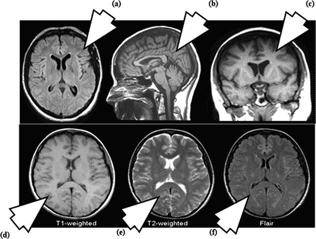

**Figure 3.2.** (a) Axial, (b) sagittal, and (c) coronal views, and (d) T1, (e) T2, and (f) FLAIR images of MRI. Reproduced with permission from [`casemed.case.edu/clerkships/neurology/webpercent20neurorad/mripercent20basics.htm`](http://casemed.case.edu/clerkships/neurology/webpercent20neurorad/mripercent20basics.htm).

### 3.3.1 Computed tomography imaging

CT 检查被医生用于观察脑部的各种异常，如肿瘤、出血和血栓。CT 使用集中在颅骨特定部位的 X 射线，从不同角度捕获一系列图像。每个角度用于生成 2D 横断面图像，随后组合成受检器官的 3D 图像。另一种 CT 变体 —— 正电子发射断层扫描（PET） —— 在将对比剂注入体内后进行 CT，以突出受影响的器官。CT 检查的一个问题在于其离子辐射会损伤健康细胞并可能导致癌症。研究表明，CT 辐射的强度是普通 X 射线的数百倍 `35`。

### 3.3.2 Magnetic resonance imaging

MRI 是 CT 的更佳替代方案，因为它不使用辐射。MRI 利用轴位、矢状位和冠状位来成像大脑。由于对比度更高，MRI 能够提供更清晰的血管自主和中枢神经系统图像。MRI 的不同变体包括 T1‑加权、T2‑加权和 FLAIR `36`。T1‑加权 MRI 能够高质量地区分大脑的灰质和白质。T2‑加权 MRI 对水分含量敏感，因此在存在组织水肿的脑部疾病中，T2‑加权 MRI 常用于捕捉图像。T1‑加权和 T2‑加权均可用于检测脑脊液，而在 T1‑加权中脑脊液呈暗色，而在 T2‑加权中呈亮色。FLAIR 类似于 T2‑加权，但其获取协议不同，常用于区分脑组织与脑脊液（CSF）的异常。FLAIR 通过抑制水信号，从而清晰显示脑室周围的高信号病灶。

下图提供了三种方法的视觉对比 `3.2`。另一种 MRI 序列 —— 差分加权成像（DWI）用于检测大脑内水分分子的随机运动。DWI 在急性脑卒中时表现为 bright signal，因为水分运动受限。血流检测常用血流加权 MRI（PWI）。扩散张量 MRI（DTMRI）利用显微图像检测水分子，有助于脑肿瘤的手术切除。大脑在某些区域比其他区域更活跃，消耗更多氧气。通过观察大脑的神经活动并监测脑部氧化水平，功能 MRI（fMRI）能够将这些精神过程与连续的活动相关联 `38`。与 CT 的运动伪影相比，MRI 的伪影更小，但仍难以精确识别脑损伤和急性出血。与其他成像模态相比，MRI 的数据获取耗时更长。

**Figure 3.2.** (a) Axial, (b) sagittal, and (c) coronal views, and (d) T1, (e) T2, and (f) FLAIR images of MRI. Reproduced with permission from [`casemed.case.edu/clerkships/neurology/webpercent20neurorad/mripercent20basics.htm`](http://casemed.case.edu/clerkships/neurology/webpercent20neurorad/mripercent20basics.htm).

### 3.3.3 Biopsy

诊断脑肿瘤的金标准仍是活检。对组织样本中细胞核的颜色、形状和大小进行观察。此处采用 hematoxylin and eosin 染色进行活检样本分析。病理细胞学是研究细胞结构、功能和化学的病理学分支。为了更好地了解组织蛋白，进行免疫荧光成像。对微小细胞的肉眼观察耗时且易出错，因此需要计算工具以实现可扩展性和精确性。将病理学家的经验与计算机化病理图像分析相结合，可取得更佳的诊断结果 `39`。

### 3.3.4 Hyperstereoscopy imaging

在肿瘤进展阶段，肿瘤会积极侵袭邻近细胞，肉眼难以区分其复杂性。在切除手术中出现的不准确可能损伤健康组织，导致患者生存率下降 `40, 41`。低渗透性、非离子化的全息光谱成像（HSI）用于此目的，能够捕捉更广泛的色彩变化，从而提供更可辨识的受影响区域特征 `41, 42`。

#### 3.3.5 磁共振光谱（MRS）

磁共振光谱（MRS）的核心是检测大脑中的代谢变化。每种肿瘤类型都与一组不同的代谢物相关联。这一现象有助于在脑组织中识别肿瘤、中风和癫痫。氨基酸、乳酸、丙氨酸、脂质等代谢物具有独特的特征，用于特征化它们 [44]。因此，每个肿瘤等级都有其独特的特征。神经科医生利用这些变化通过映射每种代谢物的频率来区分恶性组织和健康组织。MRS 图像被用于训练/测试脑肿瘤诊断的深度学习模型 [45]。采用了三类正常、低级别和高级别肿瘤样本。在另一项研究中，作者使用了 MRS 进行肿瘤分级模型 [46]。研究表明，使用短和长回声时间（TEs）可以实现更高的准确率。还使用了基于机器学习的模型对肿瘤进行良恶性分类 [47]。使用了四种机器学习模型：支持向量机（SVM）、随机森林、局部加权学习（LWL）和多层感知器。随机森林的 AUC 为 0.91，LWL 的灵敏度为 86.1%。

有时，不同的成像模态会被结合起来，以减少单个医疗数据的冗余和随机性。对这些融合数据集应用统计模型，以获得更好的诊断。图像模态的融合基于不同参数，如形态学、小波、模糊逻辑以及不同的知识领域 [48]。

## 3.4 WHO 肿瘤分级指南

WHO 提供了一系列关于脑肿瘤分级的指南。医疗从业者使用这些指南制定治疗方案并提高患者生存率。自 1979 年以来已有五次修订，列于表格 3.2。1979 年的修订包括凋亡活性、侵袭性和坏死用于肿瘤分级。1993 年的修订包括免疫组化，2000 年的修订包括遗传特征，2007 年的修订包括组织学变异和遗传特征。最后，2016 年的修订精确定义了肿瘤细胞，有助于更好地表征 [49]。

**表 3.2.** WHO 在不同版本中的肿瘤评估建议。（经许可复制自 [109]。）

| 版本 | 年份 | 肿瘤评估建议参数 |
| --- | --- | --- |
| I | 1979 | 凋亡活性、坏死和侵袭 |
| II | 1993 | 免疫组化（IHC） |
| III | 2000 | 遗传特征 |
| IV | 2007 | 遗传特征和组织学变异 |
| V | 2016 | 分子特征和病理学 |

研究已明确证明，肿瘤等级和分组可以通过分子特征精确定义 [50]。WHO 分级的四个基本参数为微血管增生、坏死、核异型和凋亡 [51]。分级从 I–IV，代表侵袭性递增 [49–52]，其中 I 级看起来最正常且生长最慢。II 级肿瘤细胞异常，进展缓慢，可能侵袭邻近健康组织。I 级和 II 级细胞可通过治疗治愈。III 级细胞会轻易攻击邻近健康细胞。IV 级细胞最具侵袭性，生长速度快于其他等级。显微镜下的细胞分级极为困难且对病理学家具有挑战性，因为其结构和边界模糊。

## 3.5 脑肿瘤检查

在对患者进行医学检查时，医生会检查视力、听力、肌肉力量、反射和警觉性。同时也会检查眼睛，以寻找是否有肿胀迹象。随后，进行扫描、活检和生物标志物检测以确认并分级癌症。基于结果和症状，医师会判断肿瘤的恶性程度。以下章节详细介绍这些检查。

### 3.5.1 生物标志物检测

基因突变是癌症的根本原因，通过生物标志物检测计算基因突变的程度。相关基因已在表 3.1 中讨论。生物标志物检测可确认或决定癌症的类型和等级，有助于估计肿瘤生长、治疗方案以及响应 [53]。

### 3.5.2 活检

脑癌诊断的基础检查是活检 [54]。这是一项侵入性手术。手术时，会取脑肿瘤的一部分进行切除。对活检样本进行多种实验室测试，以根据细胞模式确定等级。由于低级别和高级别胶质瘤结构相似，准确诊断困难。对肿瘤的正确等级和类型进行准确诊断可导致合适的治疗方案。鉴于这些研究的重要性，它们会接受组织病理学家知识的 inter-reader variability 测试 [55]。

特征提取阶段采用专门的数学模型，基于纹理、对比度、亮度等图像属性提取特征。不同提取算法的特征结合，以实现更有效的表征。若特征数量庞大，则会应用**维度减少算法**，仅保留最相关的特征。机器学习的不同统计模型包括 `k-nearest neighbors (kNN)` [63], `support vector machines (SVMs)` [64], `artificial neural networks (ANNs)` [65] 等。`kNN` 是一种**懒惰学习分类算法**，将未标记实例的类别赋予其 `k` 个最近邻中最频繁的类别。`SVM` 绘制两类之间最大的分隔超平面。若类别不可分离，则使用 `kernels` 将类别映射到高维空间，使其在该空间内可线性分离。`ANNs` 是由节点层级构成的**层级网络**，能够学习。`ANN` 学习模型的变体取决于隐藏层数量、激活函数、架构等。常见的 `ANN` 模型包括 `extreme learning machines (ELMs)` [66], `recurrent neural networks (RNNs)` [67], `restricted Boltzmann machines (RBMs)` [68] 等。`ELMs` 是**单隐藏层前向神经网络**，而 `RNNs` 采用反馈机制，`RBMs` 使用随机学习规则。

`DL` 网络是对 `ANNs` 的适应，拥有**大量隐藏层**。层数增多使网络能够学习数据中的更复杂关系，从而实现更高的性能和鲁棒性。此类网络称为**深度学习模型** [69]。最常见的 `DL` 模型包括 `CNNs` [70], `autoencoders` [71], `deep belief networks` [72]。

### 3.6.1 机器学习

最常见的 `ML` 模型包括 `kNN`、`SVMs`、`决策树`、`naïve-Bayes classifiers`、`random forest` 等。这些技术曾分别或结合使用于脑部图像分析，并在表格 3.4 中讨论。相关应用如下。

#### 3.6.1.1 基于遗传特征的 `ANN` 脑肿瘤分类

提出了一种基于 `ANN` 的脑部图像特征化方法，用于将脑肿瘤分为三类：**正常、良性、恶性** [57]，如图 3.4 所示。

![Figure 3.4. 脑部 MR 图像：(a) 正常大脑，(b) 良性肿瘤（七点钟方向箭头），(c) 恶性肿瘤（七点钟方向箭头）。经授权复制自 [57].](images/bk978-0-7503-2244-7ch3f4_online.jpg)

**Figure 3.4.** 脑部 MR 图像：(a) 正常大脑，(b) 良性肿瘤（七点钟方向箭头），(c) 恶性肿瘤（七点钟方向箭头）。经授权复制自 [57].

收集了 100 张 MR 图像（35 正常 + 35 良性 + 30 恶性）。通过半自动过程提取感兴趣区域 (ROI)。采用小波基方法进行特征提取。应用了三种特征选择算法，即**遗传算法、PCA、顺序算法**。最终使用**三层 `ANN`** 进行特征表征。可看出，**遗传算法提取的 29 个特征**准确率最高，达到 **98%**。过程模型如图 3.5 所示。

![Figure 3.5. `ANN` 分类模型的流程图。(Reproduced with permission from [57].)](images/bk978-0-7503-2244-7ch3f5_online.jpg)

**Figure 3.5.** `ANN` 分类模型的流程图。(Reproduced with permission from [57].)

#### 3.6.1.2 多模型脑肿瘤特征化系统

为脑部 MR 图像特征化，分别使用了两种机器学习模型：**`kNN`** 与 **`ANN`** [73]。为此收集了 70 张 MR 图像（60 病变 + 10 正常）。**DWT** 与 **PCA** 分别用于特征提取 [74] 和特征选择 [75]。`ANN` 算法采用**反向传播**更新网络参数 [76]。`ANN` 实现 **97%** 的准确率，`kNN` 实现 **98%** 的准确率。流程模型如图 3.6 所示。

![Figure 3.6. 脑癌特征化混合系统。(Reproduced with permission from [73].)](images/bk978-0-7503-2244-7ch3f6_online.jpg)

**Figure 3.6.** 脑癌特征化混合系统。(Reproduced with permission from [73].)

#### 3.6.1.3 人工智能脑肿瘤特征化与分级系统

在 [77] 中，提出使用普通 MR 图像及扩散 MRI 所得的 rCBV 图来实现脑肿瘤特征化与分级。模型将胶质瘤分为三级（II、III、IV）。为此使用了 102 张 MR 图像。该数据集之前已使用**线性判别分析 (LDA) 结合主成分回归**进行分析，但准确率有限 [78]。本文提取了**肿瘤形状、图像强度、Gabor 特征**作为特征。随后应用**基于排名的特征选择**和**SVM 递归特征选择**，选取重要特征。随后使用 **`SVM`** 进行分类。对于高级别胶质瘤和低级别胶质瘤，准确率分别为 **91.7%** 与 **90.0%**；对于 **II 级胶质瘤** 与转移瘤的区分准确率约 **97.8%**；最低准确率出现在 **II 级与 III 级胶质瘤** 的区分（准确率 75%）。该模型如图 3.7 所示。

![Figure 3.7. 使用 SVM 的分级方法的流程图。(Reproduced with permission from [77].)](images/bk978-0-7503-2244-7ch3f7_online.jpg)

**Figure 3.7.** 使用 SVM 的分级方法的流程图。(Reproduced with permission from [77].)

#### 3.6.1.4 多参数组织特征化系统

本文将 **ML** 模型应用于**肿瘤组织、健康组织、肿瘤、水肿**四类组织的特征化 [79]。为此从 14 名患者的数据中提取了**体素强度特征**。使用 **`SVM`** 与 **贝叶斯分类器** 进行分类 [80–82]。贝叶斯分类器在**水肿（97.03%）**、**增强肿瘤（96.39%）**和**非增强肿瘤（93.05%）**的分类中表现最佳。`SVM` 在**脑脊液（CSF）**（91.34%）的分类中表现最佳。流程模型如图 3.8 所示。

![Figure 3.8. `SVM` 基于分级估计方法的流程图。(Reproduced with permission from [77].)](images/bk978-0-7503-2244-7ch3f8_online.jpg)

**Figure 3.8.** `SVM` 基于分级估计方法的流程图。(Reproduced with permission from [77].)

#### 3.6.1.5 极端学习机

本节讨论极端学习机(ELM)，与更计算密集的算法相比，它更轻量。ELM 是一种单隐藏层前馈神经网络。输入到隐藏层的权重是随机初始化的。隐藏到输出层的权重使用摩尔-彭罗斯逆形式[82]计算。该网络的特性使得权重可以在一次通过中训练，从而降低复杂度和所需时间，并提高准确性[83, 84]。ELM 的模型示例如图 3.9。

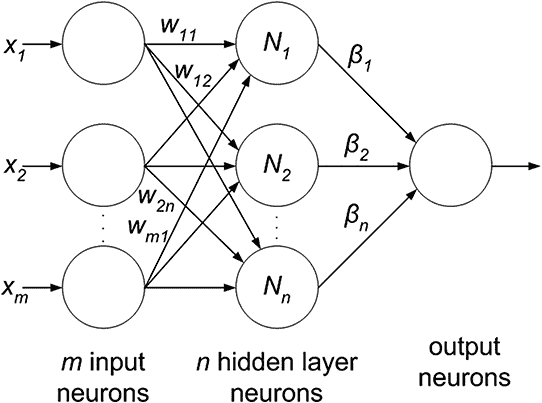

**Figure 3.9.** 极端学习机。(图片由 AtheroPoint™提供。经第 109 章授权复制。)

### 3.6.2 深度学习

深度学习的出现彻底改变了医学影像行业。深度学习与机器学习不同，它是单阶段的。它能够直接从图像中提取特征并将其特征化为单一阶段。在所有深度学习模型中，CNN 是最流行的，用于特征提取和分割。CNN 通过重复使用三种独特操作来提取特征：卷积、ReLu [85]，以及池化（如前面章节所述）。最后，它会附加全连接层用于特征提取或上采样层用于分割。一个包含全连接网络的 CNN 网络示例如图 3.10。

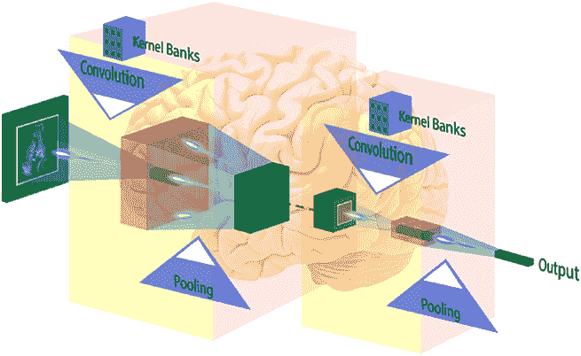

**Figure 3.10.** CNN 架构。(图片由 AtheroPoint™提供。经第 109 章授权复制。)

### 3.6.3 使用深度学习进行脑部图像分析

在脑部影像中，深度学习在准确描述脑肿瘤、以及分割水肿、增强和非增强肿瘤区域、阿尔茨海默病以及中风病灶方面发挥了重要作用[86]。在接下来的子节中，我们将学习深度学习在脑肿瘤检测、描述和分割中的应用。

#### 3.6.3.1 多机构脑肿瘤分割的深度学习

在[87]中，提出了一种基于 CNN 的自动脑分割模型。利用多机构数据，使用了三个独立的 CNN。每个 CNN 包含六层（四个卷积层和两个全连接层）。共收集了 68 张医学影像。采用补丁作为分割方法，补丁过程包括提取大小相等的小块。这些块由经验丰富的放射科医生标注为正常、增强、异常、FLAIR 异常和坏死区域。地面真实图像和所有类别的描述在图 3.11 中给出。初始 CNN 在来自第 1 机构的数据集上应用，随后的 CNN 在来自第 2 机构的数据集上应用。训练/测试的交叉验证协议采用十倍交叉验证。性能指标为 Dice 相似系数（DSC）和 Hausdorff 距离。可以看出，当 CNN 模型在不同数据集上训练和测试时，性能会下降。不同机构数据的 DSC（Dice 系数：0.68 ± 0.19 和 0.59 ± 0.19）与同一机构数据的 DSC（Dice 系数：0.72 ± 0.17 和 0.76 ± 0.12）存在显著差异。整个过程模型示例如图 3.12。

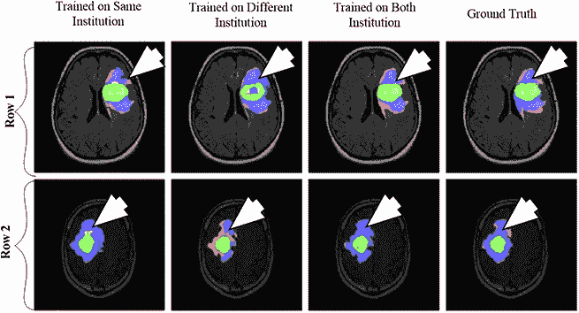

**Figure 3.11.** 两名独立患者的分割结果。类 1 为地面真实；类 2（增强区域）为绿色；类 3（坏死区域）为黄色；类 4（T1 上除增强和坏死区域外的低强度异常区域）为红色；类 5（FLAIR 上除类 2-4 外的异常区域）为蓝色。经第 87 章授权复制。

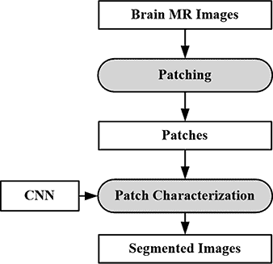

**Figure 3.12.** 分割过程模型。(经第 87 章授权复制。)

#### 3.6.3.2 两路径 CNN 用于脑肿瘤分割

本节介绍两路径模型用于脑肿瘤分割[88]。脑肿瘤在 MRI 图像中被分为低级别和高级别胶质瘤。路径分为本地和全局分割，用于定位和定位脑肿瘤。本地路径使用小卷积核，而全局路径使用大卷积核。最终，将路径的分割特征融合以得到整体分割图。为此，创建并串联了三个深度学习网络：MF 级联 CNN、输入级联 CNN 和本地级联 CNN。输入级联 CNN 的性能更好，Dice 相似度为 0.89。过程模型和分割输出结果示例如图 3.13 和 3.14。

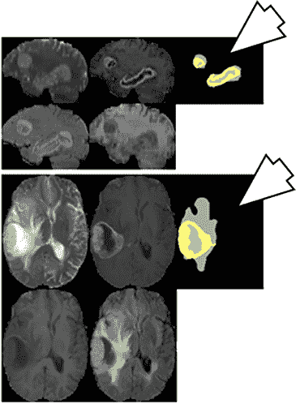

**Figure 3.13.** 两名独立患者的分割结果。绿色表示水肿，黄色表示增强肿瘤，粉色表示坏死，蓝色表示非增强肿瘤。经第 88 章授权复制。

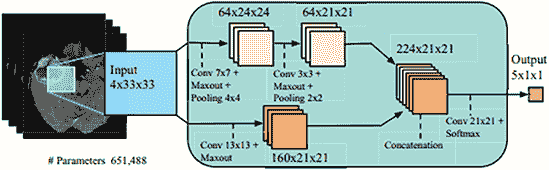

**Figure 3.14.** 模型架构。(经第 88 章授权复制。)

## 3.6.4 脑癌分类的可信解决方案

大脑肿瘤最常见的是胶质瘤。胶质瘤进一步分为低级和高级。低级胶质瘤进一步分为 I 级和 II 级，高级胶质瘤分为 III 级和 IV 级，依据 WHO 分类。虽然低级和高级胶质瘤的分类容易，但进一步细分为相应等级则较为困难。因此，利用物理属性（如形状、核大小、细胞分布）来估计恶性程度或相应等级是必要的，因为这决定了靶向治疗的方法和预后评估。尽管活检是理想的金标准，但医疗从业者更倾向于使用成像模态（如 MRI，包括 FLAIR、T1 和 T2）来定位肿瘤，因为对比度更好且无辐射。大脑肿瘤的侵袭性在大多数检查中均有估计。检测和估计的效果取决于医疗从业者的专业水平和经验，结果因此会出现变异，需要通过交叉验证测试以获得更准确的结果。计算机辅助工具正在逐步获得关注，有助于提高准确性。

多个自动化模型曾被提出，用于基于 MRI 图像对脑肿瘤进行特征分析，这些模型基于智能范式 [77, 89, 90]. 深度学习（DL）在该领域的文献量不断增加，表现出越来越好的效果。基于机器学习（ML）和深度学习（DL）范式的肿瘤分级可行方案如图 3.15 所示（后文讨论）。

![Figure 3.15. A plausible solution for brain tumor grading. (Reproduced with permission from [109].)](images/bk978-0-7503-2244-7ch3f15_online.jpg)

**Figure 3.15.** A plausible solution for brain tumor grading. (Reproduced with permission from [109].)

## 3.7 脑癌及其他脑部疾病

### 3.7.1 中风

中风有两种类型：出血性和缺血性 [91]. 出血性中风是由血管受损或不规则血管结构引起，而缺血性中风是由血流中断引起。尽管一些专家探讨了脑癌与中风之间的联系，但两者在类型和起源上截然不同。一项研究调查了中风患者中脑癌的发生情况 [92]. 该研究纳入了 35 例恶性肿瘤患者，有和没有中风病史。中风患者随时间发展脑癌的风险较高，危险比为 3.09，95%置信区间为 1.80–5.30。另一项重要发现是，40 至 50 岁的女性以及老年中风患者，在获得脑癌的风险更高。

### 3.7.2 阿尔茨海默病

阿尔茨海默病（AD）是一种神经退行性疾病，影响大脑。主要影响老年人，导致症状加重，如记忆力丧失、语言结巴、自我照料能力下降 [92]. 研究表明，AD 与脑癌之间存在反向关系。在一项平均随访 10 年的研究中，癌症幸存者患 AD 的风险降低了 33%，而 AD 患者患癌症的风险降低了 61%。

### 3.7.3 帕金森病

帕金森病（PD）是一种运动神经元疾病，主要导致四肢僵硬、颤抖和运动迟缓，尽管也有少数病例出现动作和行为改变。PD 与脑肿瘤之间的关联为阳性 [93]. 在一项包含 8 组共 329,276 名患者的研究中，帕金森病诊断患者的脑癌发生率相对较高（比值 1.55，95%置信区间 1.18 ± 2.05），这比非帕金森病诊断患者（比值 1.21，95%置信区间 0.93 ± 1.58）更具统计学显著性。

### 3.7.4 脑白质病变（Leukoaraiosis）

脑白质病变是指侧脑室附近的白质改变，主要影响老年人，标志着宾克斯病（Binswanger’s disease）的开始 [94]. 脑癌与脑白质病变之间没有直接关联。

### 3.7.5 多发性硬化（Multiple sclerosis）

多发性硬化（MS）涉及脊髓和大脑，免疫系统攻击神经纤维的髓鞘，阻碍大脑与身体其他部位之间的通信。神经损伤的程度决定 MS 的严重程度。MS 的症状包括语言不清、刺痛、行动困难等。最近的研究发现，MS 患者易患脑癌 [95, 96].

### 3.7.6 威尔森病

威尔森病（WD）是一种遗传性疾病，代代相传。体内铜的积累同时影响大脑和肝脏。患者可能出现颤抖、性格改变、焦虑等脑相关症状。肝脏病变的表现包括无力、体液积聚、颤抖、僵硬、黄疸和瘙痒 [97]. 图 3.16 中比较了不同脑部疾病。

![Figure 3.16. Comparison of a brain tumor with other brain disorders. Reproduced with permission from (a) AtheroPoint™; (b) [98]; (c) Wikipedia; (d) [100]; (e) [101]; (f) [102]; (g) [103]; (h) [104].](images/bk978-0-7503-2244-7ch3f16_online.jpg)

**Figure 3.16.** Comparison of a brain tumor with other brain disorders. Reproduced with permission from (a) AtheroPoint™; (b) [98]; (c) Wikipedia; (d) [100]; (e) [101]; (f) [102]; (g) [103]; (h) [104].

## 3.8 讨论

计算机辅助脑肿瘤研究既困难又耗时。预处理、分类和后处理是三个主要阶段。每个阶段都会带来其自身的复杂性和障碍，进一步增加工作难度。目前尚无能够准确判断恶性肿瘤存在及脑肿瘤分级的技术。因此，癌症的最佳检测方法是侵入性的活检，该操作既危险又耗时 [54, 55]。病理学家在显微镜下检查活检组织是否有异常，并对结果进行同质性测试。细胞数字病理图像（DPI）分析已成为研究热点，因为组织实验室分析样本是一项困难的任务。为了量化恶性程度，DPI 研究会评估细胞和细胞核的大小和形状以及细胞分布。区分良性与恶性细胞更为容易。然而，由于细胞形成的不对称性，子类别的分类更为复杂，构成了挑战。外部因素如噪声、使用不同扫描仪以及颜色变化也可能导致错误解读。另一个难点是 DPI 基于整片图像（WSI）扫描仪，这些扫描仪仅产生二维图像并忽略深度，而深度是确定组织类别的关键因素。这一问题将通过 3D WSI 扫描仪的持续发展得到解决 [105]。

脑部图像分析包括登记、必要时的增强、特征提取、选择以及最终的特征描述。图像分析质量受多种因素影响，包括相似度测量、变换、图像内容、优化和实现。图像登记是分析的关键阶段，因为该阶段的任何异常都会影响后续整个流程。噪声、因器官动态导致的模糊以及其他不规则性都是影响因素。低对比度也会降低图像质量。

常见的图像增强技术包括高斯滤波、直方图均值化和对比度提升等。当创建庞大的特征库时，特征描述会变得计算上困难。此时需要选择关键特征。PCA、线性判别分析和遗传算法是最常用的特征选择技术。在特征选择阶段，kNN、贝叶斯分类器和人工神经网络（ANN）等机器学习模型用于特征描述。这些都是统计模型，基于前一阶段选择的特征工作。该阶段的挑战在于数据内部存在的多样性。深度学习（DL）模型因其更高的准确率和输出质量而日益流行，原因是 DL 系统生成的特征图具有平移不变性，对变形更稳定，从而对小幅变化具有更强的鲁棒性。因此，DL 模型的特征描述和分割远优于传统 ML 模型。在此背景下，我们讨论了图 3.15 中展示的模型。用于肿瘤特征描述和分级的建议 DL 模型由四个 CNN 组成。肿瘤被分割，脑部图像进行预处理。CNN1 将肿瘤分类为恶性、良性或正常。如果肿瘤为恶性，第二个 CNN 将其分类为低级或高级。CNN3 将低级肿瘤分类为 I 级或 II 级，CNN4 将高级肿瘤分类为 III 级或 IV 级。由于 DL 模型计算需求大，不适合在台式计算机上使用。这些计算还需要大量存储空间，增加了额外开销。在 GPU 环境中，DL 模型表现更好，因为 GPU 可利用数千个核心进行并行计算。此外，发现 DL 模型的深度增加不一定会提高准确率。

### 3.8.1 关于癌症检测生物标志物的注释

脑脊液（CSF）也可用于检测神经系统中癌症的转移。提取过程称为腰椎穿刺/脊髓穿刺 [107]。脑脊液中可检测到多种脑部生物标志物 [108]。对肿瘤样本进行测试，以识别与肿瘤相关的蛋白质、基因和细胞。这些生物标志物帮助医生确认肿瘤的类型和分级，并选择治疗方案。医生可根据生物标志物的检测结果启动初始治疗。应用 ML 和 DL 技术对生物标志物进行评估，可提高准确率并降低成本。脑肿瘤特征描述和分割的 ML 系统基准测试在表 3.5 中给出。

**表 3.5.** 脑肿瘤分类方法概述。（经许可复制自 [109]。）

| 参考文献 | 组织类别 | MRI 子类型 | 数据规模 | 特征处理 | 特征降维 | 分类架构 | 最高性能 |
| --- | --- | --- | --- | --- | --- | --- | --- |
| Sasikala *et al* (2008) [57] | N, ABN, B, M | T2W | 100（N = 35, B = 35, M = 30） | DWT | GA | ANN | ACC = 98%，SEN = NA，SPC = NA，AUC = NA |
| Verma *et al* (2008) [79] | 癌症、水肿和健康组织 | DWI, B0, FLAIR, T1, GAD | 14（G III = 8, G IV = 7） |  |  | 贝叶斯和 SVM | ACC = NA，SEN = 91.84，SPC = 99.57，AUC = NA |
| Zacharaki *et al* (2009) [77] | 转移、脑膜瘤、胶质瘤（G II–III），GBM | T1W, T2W, FLAIR, rCBV | 102（转移 = 24，脑膜瘤 = 4，胶质瘤 G II = 22，胶质瘤 G III = 18，GBM = 34） | SVM, RFE | 特征排名 | LDA, kNN, NL-SVM | ACC = 97.8%，SEN = 100%，SPC = 95%，AUC = 98.6% |
| El-Dahshan *et al* (2010) [73] | N, ABN | T2W | 60（N = 60, ABN = 10） | DWT | PCA | FP-ANN, kNN | ACC = 98.6%，SEN = 100，SPC = 90，AUC = NA |
| Ryu *et al* (2014) [106] | 胶质瘤（G II, III, IV） | DWI, ADC | 42 个胶质瘤（G II N = 8，G III N = 10，G IV N = 22） | GLCM |  | 熵、直方图 | ACC = 84.4%，SEN = 81.8%，SPC = 90%，AUC = 94.1% |
| Skogen *et al* (2016) [90] | LGG（G II），HGG（G III–IV） | T1W, T2W, FLAIR | 95（LGG = 27（G II）；HGG = 68（G III = 34 和 G IV = 34）） | 统计分析 | 标准差 |  | ACC = 84.4%，SEN = 93%，SPC = 81%，AUC = 91% |

GLCM：灰度共发生矩阵；NL-SVM：非线性 SVM；MDF：最具歧视性因子；LDA：线性判别分析；ADC：自变量扩散系数；GA：遗传算法；DWT：离散小波变换；SVM：支持向量机；RFE：递归特征消除；N：正常；ABN：异常；GBM：胶质母细胞瘤；LGG：低级胶质瘤；HGG：高级胶质瘤；B：良性；M：恶性；T1W：T1 加权；T2W：T2 加权；FLAIR：液体衰减反转恢复；rCBV：相对脑血流量；G：分级；ANN：人工神经网络；FP-ANN：前向传播、反向传播 ANN；ACC：准确率；SEN：灵敏度；SPC：特异性；AUC：曲线下面积；ROC：接收机运算特性。

## 3.9 结论

在本综述中，我们重点讨论了脑肿瘤分析和特征化的各个方面。我们详细阐述了脑肿瘤的病理生理学、不同的成像模态、WHO 关于肿瘤分级、活检以及计算机辅助工具（如机器学习和深度学习）的指南。还讨论了不同脑部异常及其与脑癌之间的关系。我们还指出，深度学习凭借其自动特征提取技术和更高的准确性，正逐渐取代机器学习模型。基于智能的方法（如机器学习和深度学习）可以提供非侵入性、快速、成本效益高且诊断更准确的方法，帮助挽救无数生命。

**Funding:** 本研究未获得外部资助。

**Conflicts of interest:** 作者声明不存在利益冲突。

## 参考文献

[1] International Agency for Research on Cancer `Global Cancer Observatory` [`gco.iarc.fr/`](https://gco.iarc.fr/)

[2] Brain Tumor Basics [`thebraintumorcharity.org/`](https://thebraintumorcharity.org/)

[3] American Cancer Society `Cancer A–Z` [`www.thebraintumourcharity.org/`](https://www.thebraintumourcharity.org/)

[4] American Society of Clinical Oncology `Brain Tumor: Diagnosis` ([`cancer.net/cancer-types/brain-tumor/diagnosis`](https://cancer.net/cancer-types/brain-tumor/diagnosis))

[5] World Health Organization `WHO Statistics on Brain Cancer` [`who.int/cancer/en/`](http://who.int/cancer/en/)

[6] Shah V and Kochar P 2018 Brain cancer: implication to disease, therapeutic strategies and tumor targeted drug delivery approaches `Recent Pat. Anti-Cancer Drug Discov.` [**13** 70–85](http://dx.doi.org/10.2174/1574892812666171129142023)

[7] Ahmed S, Iftekharuddin K M and Vossoug A 2011 Efficacy of texture, shape, and intensity feature fusion for posterior-fossa tumor segmentation in MRI `IEEE Trans. Inf. Technol. Biomed.` [**15** 206–13](http://dx.doi.org/10.1109/TITB.2011.2104376)

[8] Behin A, Hoang-Xuan K, Carpentier A F and Delattre J 2003 Primary brain tumors in adults `Lancet` [**361** 323–31](http://dx.doi.org/10.1016/S0140-6736\(03\)12328-8)

[9] Deorah S, Lynch C F, Sibenaller Z A and Ryken T C 2006 Trends in brain cancer incidence and survival in the United States: surveillance, epidemiology, and end results program, 1973 to 2001 `Neurosurg. Focus` [**20** E1](http://dx.doi.org/10.3171/foc.2006.20.4.E1)

[10] Mahaley M S Jr, Mettlin C, Natarajan N, Laws E R Jr and Peace B B 1989 National survey of patterns of care for brain-tumor patients `J. Neurosurg.` [**71** 826–36](http://dx.doi.org/10.3171/jns.1989.71.6.0826)

[11] Hayward R M, Patronas N, Baker E H, Vézina G, Albert P S and Warren K E 2008 Inter-observer variability in the measurement of diffuse intrinsic pontine gliomas `J. Neuro-Oncol.` [**90** 57–61](http://dx.doi.org/10.1007/s11060-008-9631-4)

[12] Griffiths A J F, Wessler S R, Lewontin R C, Gelbart W M, Suzuki D T and Miller J H 2005 `An Introduction to Genetic Analysis` (New York: Macmillan)

[13] Shinoura N, Chen L, Wani M A, Kim Y G, Larson J J, Warnick R E, Simon M, Menon A G, Bi W L and Stambrook P J 1996 Protein and messenger RNA expression of connexin43 in astrocytomas: implications in brain tumor gene therapy `J. Neurosurg.` [**84** 839–45](http://dx.doi.org/10.3171/jns.1996.84.5.0839)

[14] Evan G I and Vousden K H 2001 Proliferation, cell cycle and apoptosis in cancer `Nature` [**411** 342](http://dx.doi.org/10.1038/35077213)

[15] Burch P R 2012 `The Biology of Cancer: A New Approach` (New York: Springer)

[16] Song M S, Salmena L and Pandolfi P P 2012 The functions and regulation of the PTEN tumor suppressor `Nat. Rev. Mol. Cell Biol.` [**13** 283](http://dx.doi.org/10.1038/nrm3330)

[17] Rak J, Filmus J, Finkenzeller G, Grugel S, Marme D and Kerbel R S 1995 Oncogenes as inducers of tumor angiogenesis `Cancer Metastasis Rev.` [**14** 263–77](http://dx.doi.org/10.1007/BF00690598)

[18] Yarden Y, Kuang W-J, Yang‐Feng T, Coussens L, Munemitsu S, Dull T J, Chen E, Schlessinger J, Francke U and Ullrich A 1987 Human proto‑oncogene c‑kit: a new cell surface receptor tyrosine kinase for an unidentified ligand `EMBO J.` [**6** 3341–51](http://dx.doi.org/10.1002/j.1460-2075.1987.tb02655.x)

[19] Greenberg M E, Greene L A and Ziff E B 1985 Nerve growth factor and epidermal growth factor induce rapid transient changes in proto‑oncogene transcription in PC12 cells `J. Biol. Chem.` [**260** 14101–10](http://dx.doi.org/10.1016/S0021-9258\(17\)38689-1)

[20] Sneed P K *et al* 2002 A multi-institutional review of radiosurgery alone vs radiosurgery with whole brain radiotherapy as the initial management of brain metastases `Int. J. Radiat. Oncol. Biol. Phys.` [**53** 519–26](http://dx.doi.org/10.1016/S0360-3016\(02\)02770-0)

[21] Bertram J S 2000 The molecular biology of cancer `Mol. Asp. Med.` [**21** 167–223](http://dx.doi.org/10.1016/S0098-2997\(00\)00007-8)

[22] Liao J B 2006 Cancer issue: viruses and human cancer `Yale J. Biol. Med.` **79** 115

[23] Golemis E A, Scheet P, Beck T N, Scolnick E M, Hunter D J, Hawk E and Hopkins N 2018 Molecular mechanisms of the preventable causes of cancer in the United States `Genes Dev.` [**32** 868–902](http://dx.doi.org/10.1101/gad.314849.118)

[24] Swartling F J, Čančer M, Frantz A, Weishaupt H and Persson A I 2015 Deregulated proliferation and differentiation in brain tumors `Cell Tissue Res.` [**359** 225–54](http://dx.doi.org/10.1007/s00441-014-2046-y)

[25] Montes-Mojarro I, Steinhilber J, Bonzheim I, Quintanilla-Martinez L and Fend F 2018 The pathological spectrum of systemic anaplastic large cell lymphoma (ALCL) `Cancers` [**10** 107](http://dx.doi.org/10.3390/cancers10040107)

[26] Mabray M C, Barajas R F and Cha S 2015 Modern brain tumor imaging `Brain Tumor Res. Treat.` [**3** 8–23](http://dx.doi.org/10.14791/btrt.2015.3.1.8)

[27] Hegi M E, Murat A, Lambiv W L and Stupp R 2006 Brain tumors: molecular biology and targeted therapies `Ann. Oncol.` [**17** 191–7](http://dx.doi.org/10.1093/annonc/mdl259)

[28] Yan H *et al* 2009 IDH1 and IDH2 mutations in gliomas `N. Engl. J. Med.` [**360** 765–73](http://dx.doi.org/10.1056/NEJMoa0808710)

[29] Hu N, Richards R and Jensen R 2016 Role of chromosomal 1p/19q co-deletion on the prognosis of oligodendrogliomas: a systematic review and meta-analysis `Interdiscip. Neurosurg.` [**5** 58–63](http://dx.doi.org/10.1016/j.inat.2016.06.008)

[30] Lee E, Yong R L, Paddison P and Zhu J 2018 Comparison of glioblastoma (GBM) molecular classification methods `Seminars in Cancer Biology` (New York: Academic)

[31] Amyot F *et al* 2015 A review of the effectiveness of neuroimaging modalities for the detection of traumatic brain injury `J. Neurotrauma` [**32** 1693–721](http://dx.doi.org/10.1089/neu.2013.3306)

[32] Pope W B 2018 Brain metastases: neuroimaging `Handb. Clin. Neurol.` [**149** 89–112](http://dx.doi.org/10.1016/B978-0-12-811161-1.00007-4)

[33] Morris Z *et al* 2009 Incidental findings on brain magnetic resonance imaging: systematic review and meta-analysis `Brit. Med. J.` [**339** b3016](http://dx.doi.org/10.1136/bmj.b3016)

[34] Lagerwaard F, Levendag P C, Nowak P J C M, Eijkenboom W M H, Hanssens P E J and Schmitz P M 1999 Identification of prognostic factors in patients with brain metastases: a review of 1292 patients `Int. J. Radiat. Oncol. Biol. Phys.` [**43** 795–803](http://dx.doi.org/10.1016/S0360-3016\(98\)00442-8)

[35] Smith-Bindman R, Lipson J, Marcus R, Kim K, Mahesh M, Gould R, de González A B and Miglioretti D L 2009 Radiation dose associated with common computed tomography examinations and the associated lifetime attributable risk of cancer `Arch. Intern. Med.` [**169** 2078–86](http://dx.doi.org/10.1001/archinternmed.2009.427)

[36] Dong Q, Welsh R C, Chenevert T L, Carlos R C, Maly‑Sundgren P, Gomez‑Hassan D M and Mukherji S K 2004 Clinical applications of diffusion tensor imaging `J. Magn. Reson. Imaging` [19] 6–18 (http://dx.doi.org/10.1002/jmri.10424)

[37] Khoo M M Y, Tyler P A, Saifuddin A and Padhani A R 2011 Diffusion-weighted imaging (DWI) in musculoskeletal MRI: a critical review `Skelet. Radiol.` [40] 665–81 (http://dx.doi.org/10.1007/s00256-011-1106-6)

[38] Savoy R L 1999 Functional magnetic resonance imaging (fMRI) `Encyclopedia of Neuroscience` (Charlestown, MA: Elsevier)

[39] Gurcan M N, Boucheron L, Can A, Madabhushi A, Rajpoot N and Yener B 2009 Histopathological image analysis: a review `IEEE Rev. Biomed. Eng.` [2] 147 (http://dx.doi.org/10.1109/RBME.2009.2034865)

[40] Fabelo H *et al* 2018 An intraoperative visualization system using hyperspectral imaging to aid in brain tumor delineation `Sensors` [18] 430 (http://dx.doi.org/10.3390/s18020430)

[41] Petersson H, Gustafsson D and Bergstrom D 2016 Hyperspectral image analysis using deep learning—a review `Proc. of the IEEE 2016 6th Int. Conf. on Image Processing Theory Tools and Applications (Oulu, Finland)` 12–15 December pp [1–6] (http://dx.doi.org/10.1109/IPTA.2016.7820963)

[42] Lu G and Fei B 2014 Medical hyperspectral imaging: a review `J. Biomed. Opt.` [19] 010901 (http://dx.doi.org/10.1117/1.JBO.19.1.010901)

[43] Halicek M, Lu G, Little J V, Wang X, Patel M, Griffith C C, El-Deiry M W, Chen A Y and Fei B 2017 Deep convolutional neural networks for classifying head and neck cancer using hyperspectral imaging `J. Biomed. Opt.` [22] 060503 (http://dx.doi.org/10.1117/1.JBO.22.6.060503)

[44] Nelson S J 2003 Multivoxel magnetic resonance spectroscopy of brain tumors `Mol. Cancer Ther.` 2 497–507

[45] Olliverre N, Yang G, Slabaugh G, Reyes-Aldasoro C C and Alonso E 2018 Generating magnetic resonance spectroscopy imaging data of brain tumors from linear, non-linear and deep learning models `Int. Workshop on Simulation and Synthesis in Medical Imaging` (Cham: Springer) pp 130–8

[46] Hamed S A I and Ayad C E 2017 Grading of brain tumors using MR spectroscopy: diagnostic value at short and long `IOSR J. Dental Med. Sci.` [16] 87–93 (http://dx.doi.org/10.9790/0853-1610078793)

[47] Ranjith G, Parvathy R, Vikas V, Chandrasekharan K and Nair S 2015 Machine learning methods for the classification of gliomas: initial results using features extracted from MR spectroscopy `Neuroradiol. J.` [28] 106–11 (http://dx.doi.org/10.1177/1971400915576637)

[48] James A P and Dasarathy B V 2014 Medical image fusion: a survey of the state of the art `Inf. Fusion` [19] 4–19 (http://dx.doi.org/10.1016/j.inffus.2013.12.002)

[49] Louis D N, Perry A, Reifenberger G, Von Deimling A, Figarella-Branger D, Cavenee W K and Ellison D W 2016 The 2016 World Health Organization classification of tumors of the central nervous system: a summary `Actaneuropathologica` [131] 803–20 (http://dx.doi.org/10.1007/s00401-016-1545-1)

[50] DeAngelis L M 2001 Brain tumors `N. Engl. J. Med.` [344] 114–23 (http://dx.doi.org/10.1056/NEJM200101113440207)

[51] Louis D N, Ohgaki H, Wiestler O D, Cavenee W K, Burger P C, Jouvet A, Scheithauer B W and Kleihues P 2007 The 2007 WHO classification of tumors of the central nervous system `Actaneuropathologica` [114] 97–109 (http://dx.doi.org/10.1056/NEJM200101113440207)

[52] Collins V P 2004 Brain tumors: classification and genes `J. Neurol. Neurosurg. Psychiatry` [75] ii2–11 (http://dx.doi.org/10.1136/jnnp.2004.040337)

[53] Ludwig J A and Weinstein J N 2005 Biomarkers in cancer staging, prognosis and treatment selection `Nat. Rev. Cancer` [5] 845–56 (http://dx.doi.org/10.1038/nrc1739)

[54] Sharma H, Alekseychuk A, Leskovsky P, Hellwich O, Anand R S, Zerbe N and Hufnagl P 2012 Determining similarity in histological images using graph-theoretic description and matching methods for content-based image retrieval in medical diagnostics `Diagn. Pathol.` [7] 134 (http://dx.doi.org/10.1186/1746-1596-7-134)

[55] Bardou D, Zhang K and Ahmad S M 2018 Classification of breast cancer based on histology images using convolutional neural networks `IEEE Access` [6] 24680–93 (http://dx.doi.org/10.1109/ACCESS.2018.2831280)

[56] Xu Y, Jia Z, Wang L B, Ai Y, Zhang F, Lai M and Chang C 2017 Large scale tissue histopathology image classification, segmentation, and visualization via deep convolutional activation features `BMC Bioinform.` [18] 281 (http://dx.doi.org/10.1186/s12859-017-1685-x)

[57] Sasikala M and Kumaravel N 2008 A wavelet-based optimal texture feature set for classification of brain tumors `J. Med. Eng. Technol.` [32] 198–205 (http://dx.doi.org/10.1080/03091900701455524)

[58] Haykin S S 2009 *Neural Networks and Learning Machines* vol 3 (Upper Saddle River, NJ: Pearson)

[59] Nasrabadi N M 2007 Pattern recognition and machine learning `J. Electron. Imaging` [16] 049901 (http://dx.doi.org/10.1117/1.2819119)

[60] Wernick M N, Yang Y, Brankov J G, Yourganov G and Strother S C 2010 Machine learning in medical imaging `IEEE Signal Process Mag.` [27] 25–38 (http://dx.doi.org/10.1109/MSP.2010.936730)

[61] Erickson B J, Korfiatis P, Akkus Z and Kline T L 2017 Machine learning for medical imaging `Radiographics` [37] 505–15 (http://dx.doi.org/10.1148/rg.2017160130)

[62] Vasantha M, Subbiah Bharathi V and Dhamodharan R 2010 Medical image feature, extraction, selection and classification `Int. J. Eng. Sci. Technol.` 2 2071–6

[63] Altman N S 1992 An introduction to kernel and nearest-neighbor nonparametric regression `Am. Stat.` [46] 175–85 (http://dx.doi.org/10.1080/00031305.1992.10475879)

[64] Cortes C and Vapnik V 1995 Support vector machine `Mach. Learn.` [20] 273–97 (http://dx.doi.org/10.1007/BF00994018)

[65] Yegnanarayana B 2009 *Artificial Neural Networks* (New Delhi: PHI Learning)

[66] Huang G-B, Zhu Q-Y and Siew C-K 2006 Extreme learning machine: theory and applications `Neurocomputing` [70] 489–501 (http://dx.doi.org/10.1016/j.neucom.2005.12.126)

[67] Grossberg S 2013 Recurrent neural networks `Scholarpedia` [8] 1888 (http://dx.doi.org/10.4249/scholarpedia.1888)

[68] Hinton G E 2012 A practical guide to training restricted Boltzmann machines `Neural Networks: Tricks of the Trade` (Berlin: Springer) pp [599–619] (http://dx.doi.org/10.1007/978-3-642-35289-8_32)

[69] LeCun Y, Bengio Y and Hinton G 2015 Deep learning `Nature` [521] 436 (http://dx.doi.org/10.1038/nature14539)

[70] Krizhevsky A, Sutskever I and Hinton G E 2012 ImageNet classification with deep convolutional neural networks *Advances in Neural Information Processing Systems (Nevada)* vol 25 pp 1097–105

[71] Hinton G E and Salakhutdinov R R 2006 Reducing the dimensionality of data with neural networks `Science` [313] 504–7 (http://dx.doi.org/10.1126/science.1127647)

[72] Hinton G E 2009 Deep belief networks `Scholarpedia` [4] 5947 (http://dx.doi.org/10.4249/scholarpedia.5947)

[73] El-Dahshan E S A, Hosny T and Salem A B M 2010 Hybrid intelligent techniques for MRI brain images classification `Dig. Signal Process.` [20] 433–41 (http://dx.doi.org/10.1016/j.dsp.2009.07.002)

[74] Yang G, Nawaz T, Barrick T R, Howe F A and Slabaugh G 2015 Discrete wavelet transform-based whole-spectral and subspectral analysis for improved brain tumor clustering using single voxel MR spectroscopy `IEEE Trans. Biomed. Eng.` [62] 2860–6 (http://dx.doi.org/10.1109/TBME.2015.2448232)

[75] Jolliffe I 2011 Principal component analysis *International Encyclopedia of Statistical Science* (Berlin: Springer) pp [1094–6] (http://dx.doi.org/10.1007/978-3-642-04898-2)

[76] Rumelhart D E, Hinton G E and Williams R J 1985 Learning internal representations by error propagation No. ICS-8506 OCLC Number 20472667 Defense Technical Information Center, VA, California University San Diego, La Jolla Institute for Cognitive Science

[77] Zacharaki E I, Wang S, Chawla S, Yoo D S, Wolf R, Melhem E R and Davatzikos C 2009 MRI-based classification of brain tumor type and grade using SVM-RFE IEEE Int. Symp. on Biomedical Imaging: From Nano to Macro pp [1035–8](http://dx.doi.org/10.1109/ISBI.2009.5193232)

[78] Barker M and Rayens W 2003 Partial least squares for discrimination J. Chemometr. J. Chemometr. Soc. 17 166–73 http://dx.doi.org/10.1002/cem.785

[79] Verma R, Zacharaki E I, Ou Y, Cai H, Chawla S, Lee S, Melhem E R, Wolf R and Davatzikos C 2008 Multiparametric tissue characterization of brain neoplasms and their recurrence using pattern classification of MR images Acad. Radiol. 15 966–77 http://dx.doi.org/10.1016/j.acra.2008.01.029

[80] Murphy K P 2006 Naive Bayes Classifiers vol 18 (Vancouver, BC: University of British Columbia)

[81] Leung K M 2007 Naive Bayesian Classifier (New York: Polytechnic University Department of Computer Science/Finance and Risk Engineering)

[82] John G H and Langley P 1995 Estimating continuous distributions in Bayesian classifiers Proc. of the Eleventh Conf. on Uncertainty in Artificial Intelligence (Montreal, QC, Canada) 18–20 August (San Francisco, CA: Morgan Kaufmann) pp 338–45

[83] Huang G B, Zhu Q Y and Siew C K 2004 Extreme learning machine: theory and applications. extreme learning machine: a new learning scheme of feedforward neural networks Proc. of 2004 IEEE Int. Joint Conf. on in Neural Networks pp 985–90

[84] Kuppili V, Biswas M, Sreekumar A, Suri H S, Saba L, Edla D R, Marinhoe R T, Sanches J M and Suri J S 2017 Extreme learning machine framework for risk stratification of fatty liver disease using ultrasound tissue characterization J. Med. Syst. 41 152 http://dx.doi.org/10.1007/s10916-017-0797-1

[85] Biswas M, Kuppili V, Edla D R, Suri H S, Saba L, Marinho R T, Sanches J M and Suri J S 2018 Symtosis: a liver ultrasound tissue characterization and risk stratification in optimized deep learning paradigm Comput. Methods Prog. Biomed. 155 165–77 http://dx.doi.org/10.1016/j.cmpb.2017.12.016

[86] Litjens G, Kooi T, Bejnordi B E, Setio A A A, Ciompi F, Ghafoorian M, van der Laak J A W M, Ginneken B and Sánchez C I 2017 A survey on deep learning in medical image analysis Med. Image Anal. 42 60–88 http://dx.doi.org/10.1016/j.media.2017.07.005

[87] AlBadawy E A, Saha A and Mazurowski M A 2018 Deep learning for segmentation of brain tumors: impact of cross-institutional training and testing Med. Phys. 45 1150–8 http://dx.doi.org/10.1002/mp.12752

[88] Havaei M, Davy A, Warde-Farley D, Biard A, Courville A, Bengio Y and Larochelle H 2017 Brain tumor segmentation with deep neural networks Med. Image Anal. 35 18–31 http://dx.doi.org/10.1016/j.media.2016.05.004

[89] Erickson B J, Korfiatis P, Akkus Z, Kline T and Philbrick K 2017 Toolkits and libraries for deep learning J. Dig. Imaging 30 400–5 http://dx.doi.org/10.1007/s10278-017-9965-6

[90] Skogen K, Schulz A, Dormagen J B, Ganeshan B, Helseth E and Server A 2016 Diagnostic performance of texture analysis on MRI in grading cerebral gliomas Eur. J. Radiol. 85 824–9 http://dx.doi.org/10.1016/j.ejrad.2016.01.013

[91] Kreisl T N, Toothaker T, Karimi S and DeAngelis L M 2008 Ischemic stroke in patients with primary brain tumors Neurology 70 2314–20 http://dx.doi.org/10.1212/01.wnl.0000314648.82924.6f

[92] Burns A and Iliffe S 2009 Alzheimer’s disease Brit. Med. J. 338 b158 http://dx.doi.org/10.1136/bmj.b158

[93] Ye R, Shen T, Jiang Y, Xu L, Si X and Zhang B 2016 The relationship between Parkinson disease and brain tumor: a meta-analysis PLoS ONE 11 e0164388 http://dx.doi.org/10.1371/journal.pone.0164388

[94] Wardlaw J M, Sandercock P A G, Dennis M S and Starr J 2003 Is breakdown of the blood brain barrier responsible for lacunar stroke, leukoaraiosis, and dementia Stroke 34 806–12 http://dx.doi.org/10.1161/01.STR.0000058480.77236.B3

[95] Plantone D, Renna R, Sbardella E and Koudriavtseva T 2015 Concurrence of multiple sclerosis and brain tumors Front. Neurol. 6 40 http://dx.doi.org/10.3389/fneur.2015.00040

[96] Bahmanyar S, Montgomery S M, Hillert J, Ekbom A and Olsson T 2009 Cancer risk among patients with multiple sclerosis and their parents Neurology 72 1170–7 http://dx.doi.org/10.1212/01.wnl.0000345366.10455.62

[97] Reitan R M and Wolfson D 1985 The Halstead-Reitan Neuropsychological Test Battery: Theory and Clinical Interpretation vol 4 (Tucson, AZ: Reitan Neuropsychology)

[98] Cahalane A M, Kearney H, Purcell Y M, McGuigan C and Killeen R P 2017 MRI and multiple sclerosis––the evolving role of MRI in the diagnosis and management of MS: the radiologist’s perspective Irish J. Med. Sci. 187 781–7 http://dx.doi.org/10.1007/s11845-017-1714-9

[99] Terroni L et al 2015 The association of post-stroke anhedonia with salivary cortisol levels and stroke lesion in hippocampal/parahippocampal region Neuropsych. Dis. Treat. 11 233 http://dx.doi.org/10.2147/NDT.S73722

[100] Nakano K et al 2014 Leukoaraiosis significantly worsens driving performance of ordinary older drivers PLoS One 9 e108333 http://dx.doi.org/10.1371/journal.pone.0108333

[101] Islam J and Zhang Y 2018 Brain MRI analysis for Alzheimer’s disease diagnosis using an ensemble system of deep convolutional neural networks Brain Inform. 5 2 http://dx.doi.org/10.1186/s40708-018-0080-3

[102] Heim B, Krismer F, De Marzi R and Seppi K 2017 Magnetic resonance imaging for the diagnosis of Parkinson’s disease J. Neural Transm. 124 915–64 http://dx.doi.org/10.1007/s00702-017-1717-8

[103] Bandmann O, Weiss K H and Kaler S G 2015 Wilson’s disease and other neurological copper disorders Lancet Neurol. 14 103–13 http://dx.doi.org/10.1016/S1474-4422\(14\)70190-5

[104] Villanueva-Meyer J E, Mabray M C and Cha S 2017 Current clinical brain tumor imaging Neurosurgery 81 397–415 http://dx.doi.org/10.1093/neuros/nyx103

[105] Madabhushi A and Lee G 2016 Image analysis and machine learning in digital pathology: challenges and opportunities Med. Image Anal. 33 170–5 http://dx.doi.org/10.1016/j.media.2016.06.037

[106] Ryu Y J, Choi S H, Park S J, Yun T J, Kim J H and Sohn C H 2014 Glioma: application of whole-tumor texture analysis of diffusion-weighted imaging for the evaluation of tumor heterogeneity PLoS One 9 e108335 http://dx.doi.org/10.1371/journal.pone.0108335

[107] Lynch H T, Lynch J F, Shaw T G and Lubiński J 2003 HNPCC (Lynch syndrome): differential diagnosis, molecular genetics and management—a review Hered. Cancer Clin. Pract. 1 7 http://dx.doi.org/10.1186/1897-4287-1-1-7

[108] Gopal S T et al 2019 A review on a deep learning perspective in brain cancer classification Cancers 11 111 http://dx.doi.org/10.3390/cancers11010111

# IOP Publishing

## Multimodality Imaging, Volume 1

### Deep learning applications

Mainak Biswas and Jasjit S Suri

# Chapter 4 MRI based brain tumor classification and its validation: a transfer learning paradigm

Luca Saba, Gopal S Tandel, Mainak Biswas, Michele Porcu, N N Khanna, Monica Turk, Christopher K Asare, Annabel A Ankrah and Jasjit S Suri

Biopsy 被视为肿瘤确认和分级的金标准。然而，该手术对患者具有侵入性、复杂性以及危及生命的风险。此外，在治疗计划中，快速且准确地诊断并分级肿瘤，使用 3D 标准化成像模态（如磁共振成像 MRI）显得尤为重要。在此背景下，提出了一种基于深度学习（DL）的新框架，能够准确且自动地将 MRI 脑体积中的肿瘤分类为不同等级。

该设计包含两个阶段：第一阶段涉及脑部分割，第二阶段负责肿瘤特征化。在脑部分割的协议中，去除颅骨以提取脑区域；而在第二阶段，肿瘤特征化采用八层卷积神经网络（CNN）模型实现。

对 T2 加权 2D MRI 轴位切片的 K5 与 K10 交叉验证协议进行了性能比较。利用包含 79 名患者的数据库（包括三种肿瘤：40 例 astrocytoma（II 级 65% 和 III 级 35%）、16 例 oligodendroglioma（II 级 56% 和 III 级 43%）以及 23 例 glioblastoma（仅 IV 级）），DL 模型的平均表现如下：准确率（98.33% ± 1.42%），灵敏度（97.88% ± 3.06%），特异度（98.47% ± 1.72%），阳性预测值（97.90% ± 2.27%），阴性预测值（98.71% ± 1.61%），以及曲线下面积（0.98，*p* < 0.0001）。该系统相较于多种机器学习（ML）分类器，提升了 13.86%。此外，模型还使用了肿瘤分离指数（TSI）进行验证，该指数通过统计分析 CNN 所学得的特征实现。CNN 还利用标准化面部生物特征数据进行验证，显示出 99% 的准确率。

## 4.1 Introduction

国际癌症研究署（IARC）报告称，2018 年全球新增癌症病例达 1810 万例，死亡人数达 960 万例 [1]. 报告进一步显示，全球每五名男性中就有一人、每六名女性中就有一人终生会患癌，而每八名男性和每 11 名女性会死于癌症。原发性脑肿瘤的年发病率约为每 10 万人中 3.7 例（男性）和 2.6 例（女性），发达国家高于发展中国家 [2]. 美国癌症协会（ACS）近期（2019）报告称，美国成年人中有 23820 人被确诊为原发性脑肿瘤或脊髓膜瘤，其中男性 13410 人、女性 10410 人 [3]. 世界卫生组织（WHO）亦报告了类似的统计数据 [4].

胶质瘤（glioma）是最常见的脑肿瘤，可能进一步分为 astrocytoma、oligodendroglioma 和 glioblastoma。肿瘤等级是基于癌细胞生长速率定义的，世界卫生组织（WHO）将 gliomas 从低到高划分为四个等级（I、II、III、IV） [5–8]。此外，脑肿瘤还根据以下属性进行分类：（i）侵袭性质，（ii）起源，（iii）生长速率，（iv）进展或分级阶段 [4]。主要有两个阶段：良性或恶性。良性脑肿瘤细胞很少侵袭邻近健康组织，与健康组织有明确边界，进展缓慢；而恶性细胞则容易攻击邻近脑部或脊髓组织，边界模糊，进展迅速。从起源角度看，脑肿瘤细胞分为原发性和转移性两类：原发性肿瘤直接位于脑内，转移性肿瘤则是源自身体其他部位（如肺、胃等）的癌症转移至脑部的肿瘤 [9]10。

准确的胶质瘤诊断对疾病预后和制定合适治疗至关重要。磁共振成像（MRI）主要用于初步肿瘤诊断，能够提供脑部结构的详细三维视图，并帮助精准定位肿瘤。组织活检仍是肿瘤分级的金标准，但属于侵入性手术。活检时，首先通过切口采集组织样本，随后送至病理学家进行显微镜检查，整个过程可能需要数天至数周。由于其侵入性，活检存在多种风险，包括视力丧失、中风、感染、脑水肿、血栓、癫痫、出血以及对麻醉的反应等，尤其是脑肿瘤手术风险更高。显微镜下的组织结构观察工作繁琐，且易受不同观察者的主观差异影响。因此，需要结合计算机辅助诊断（CAD）工具，利用影像技术实现快速且准确的诊断。

由于精准诊断和分期对癌症治疗规划至关重要 [11]，核心问题是：在指定的医学影像模态（如 MRI 或 CT）下，如何最佳地检测并分类脑肿瘤的感兴趣区域。机器学习（ML）基于范式是目前最成功的肿瘤分期或分级方法，其核心思想是利用训练数据集离线提取图像特征，然后在线测试数据集通过这些特征预测癌症类型 [12–14]. 多项研究已发表优秀的特征提取方法 [15–17]，包括小波型 [18]、基于遗传算法的方法 [19, 20] 以及分类调节器 [21].

值得注意的是，尽管 ML 方法宣称准确率更高，但其基本设计仍面临固有挑战。由于提升准确性和特异性是 ML 方法的首要目标，研究者往往关注在训练和测试阶段计算大量特征 [22]. 特征数量越多，训练 ML 系统所需的时间也越长。

虽然可以认为主成分分析（PCA）能够解决特征减少的问题，但它仍需离线系统的设计 [23, 24]. 这引发了一个疑问：是否存在一种能够同时实现特征力度与特征选择的方案？ML 模型的第二个挑战是对输入数据变化的适应能力差，导致性能灵敏度低。

随着深度学习（DL）范式和大数据 [25] 的发明，最近观察到 ML 模型所暴露的弱点可以被克服。DL 模型是具有多个隐藏层的人工神经网络（ANN）的变体。具有单个隐藏层的 ANN 可以理解简单的模式，如不同角度的简单线条。随着隐藏层的增加，ANN 可以理解图像特征之间的复杂关系模式，非常类似于人脑的功能。最近，DL 技术在自动组织表征中表现出非凡的性能 [26–28]。我们的目标是利用 DL 技术开发一种 CAD 工具，以自动检测肿瘤并精确、一致地确定脑肿瘤的等级（或分类）。已有系列研究通过成像方法用于 CAD 和脑肿瘤分类 [16, 29–31]。

通过下一节中提供的综合文献调查，我们得出结论：在该主题上开展的工作非常有限，且所有研究的主要重点均集中在高级别胶质瘤（HGG）与低级别胶质瘤（LGG）的分类上。除少数研究外，现有工作尚未得到适当的交叉验证。没有人认真尝试验证或确认这些模型。因此，我们研究的主要目标和子目标如下：

1. 开发一种基于 CAD 的非侵入性脑肿瘤分级系统（TGS）。

2. 基于先进的 DL 状态（如迁移学习），将脑肿瘤星形胶质瘤和少突胶质瘤分类为其亚等级，同时进行 LGG 与 HGG 分类。

3. 对比 DL 方法与常规 ML 技术在 TGS 中的表现。

以下是子目标：

1. 使用一种称为肿瘤分离指数（TSI）的新方法验证假设。

2. 使用离线生物特征人脸数据验证软件和系统设计。

3. 进行详尽的数据分析并理解不同的分区协议，以优化系统。

在本研究中，我们设计了一个两阶段脑肿瘤分类系统（见图 4.1）：第一阶段涉及脑部分割，第二阶段包括肿瘤表征。作为脑部分割协议的一部分，去除颅骨以提取脑区域，而在第二阶段，使用八层卷积神经网络（CNN）模型实现肿瘤表征。为了优化协议，我们在 T2 加权 2D MRI 轴位切片上采用 K5 和 K10 交叉验证协议。利用包含 79 名患者的数据库，包括三种肿瘤：40 例星形胶质瘤（II 级：65% 和 III 级：35%）、16 例少突胶质瘤（II 级：56% 和 III 级：43%）和 23 例胶质母细胞瘤（仅 IV 级），我们的 DL 模型产生以下平均性能：准确率（98.33% ± 1.42%）、灵敏度（97.88% ± 3.06%）、特异度（98.47% ± 1.72%）、阳性预测值（97.90% ± 2.27%）、阴性预测值（98.71% ± 1.61%）以及曲线下面积（0.98；*p* < 0.0001）。该系统针对 ML 系统进行了基准测试，显示出 13.86% 的提升。为了验证模型，我们设计了一个基于统计分析方法的独特参数，名为肿瘤分离指数（TSI）。此外，该模型通过标准化生物特征人脸数据进行了验证。

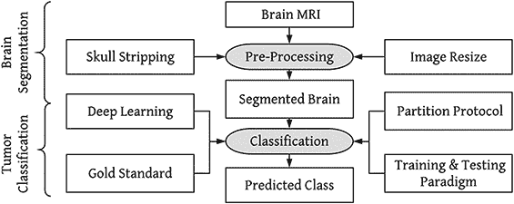

**Figure 4.1.** Global architecture showing the two-stage system: stage I (brain segmentation) and stage II (DL method for grading the tumor).

本文的其余部分组织如下。背景文献综述见 4.2 节。患者人口统计学和数据准备在 4.3 节中讨论。4.4 节介绍工程方法。在 4.5 节中，我们介绍实验协议、结果和性能评估。肿瘤分级系统的验证和确认见 4.6 节。详细讨论和基准测试见 4.7 节，论文在 4.8 节结束。

## 4.2 Background literature survey

本节的目标是回顾肿瘤分级领域的背景文献，主要涉及机器学习和深度学习范式的应用。由于肿瘤分级系统包括影像体积的预处理、感兴趣区域的分割以及最终的肿瘤分级（所谓的分类）等组件，我们尝试在标准来源（PubMed、IEEE）上搜索与我们的目标相关的文献。

如上所述，脑活检风险很高，样本的显微镜检查耗时且容易出错。自动数字组织病理学图像分析 [32–34] 是解决此问题的一种方法，可减轻病理学家的工作量。然而，该技术仍然具有风险，因为它需要高度侵入性的程序来收集肿瘤样本。MRI 等成像技术提供系统性 3D 脑部结构的图像，有助于定位脑肿瘤。通常，医生通过一般观察影像体积来初步检测脑肿瘤。如果受试者数量较多（例如超过 100），则该过程变得繁琐且人为错误风险增加。因此，结合 CAD 工具不仅减轻了工作量，而且为自动脑肿瘤分级提供了替代方案。因此，使用人工智能（AI）技术进行脑肿瘤检测和等级估计在放射科医生和神经外科医生的工作流程中起着至关重要的作用。

在分析影像体积时，预处理、分割和肿瘤的自动分类是三个主要挑战。由于 MR 采集协议固有的低信噪比、低对比度噪声比以及运动伪影，图像分辨率可能会降低 [35, 36]，因此预处理成为必要，以防止在分割和分类阶段传播错误。标准解决方案，如对比度调整、强度调整、直方图均衡化、二值化和形态学操作，被用于预处理 [37, 38]。本节主要介绍使用 ML 和 DL 范式的肿瘤分割和肿瘤分类。

- MRI 是常规用于筛查多种神经系统疾病（如阿尔茨海默病、脑肿瘤、癫痫、多发性硬化（MS）和精神分裂症）的常规检查。感兴趣区域是大脑，因此脑部 MRI 分割是图像分析的重要且关键的过程，其中为每个 2D MR 图像（由 3D 体素构成）的每个像素分配标签。手动分割是金标准流程 [39]，其中标签是手动为每个像素分配的。此外，分类需要预测特定图像区域或整张图像所分配的正确标签集。为 2D MRI 切片分配标签是一个高度繁琐且易出错的过程，因为会出现人为错误。研究人员已经大量努力开发用于脑部 MRI（如灰质、白质或异常组织）的经典分割算法。

- 最近，结合智能的新范式开始渗透该领域。不久前，传统的机器学习技术被提出用于自动脑肿瘤分割 [40–45] 和分类 [6]。

- MRI 是常规用于筛查多种神经系统疾病（如阿尔茨海默病、脑肿瘤、癫痫、多发性硬化（MS）和精神分裂症）的常规检查。感兴趣区域是大脑，因此脑部 MRI 分割是图像分析的重要且关键的过程，其中为每个 2D MR 图像（由 3D 体素构成）的每个像素分配标签。手动分割是金标准流程 [39]，其中标签是手动为每个像素分配的。此外，分类需要预测特定图像区域或整张图像所分配的正确标签集。为 2D MRI 切片分配标签是一个高度繁琐且易出错的过程，因为会出现人为错误。研究人员已经大量努力开发用于脑部 MRI（如灰质、白质或异常组织）的经典分割算法。

- 最近，结合智能的新范式开始渗透该领域。不久前，传统的机器学习技术被提出用于自动脑肿瘤分割 [40–45] 和分类 [6](#Chapter_4.xhtml#b)。

## 4.3 Demographics and data preparation

### 4.3.1 Patient demographics

本研究基于 MRI 数据 [59, 60]，取自 79 名患有不同脑肿瘤类型（肿瘤等级）的患者。脑肿瘤患者年龄范围为 15 至 89 岁，平均年龄为 47.5 岁。患者的平均生存期为 47 个月。脑肿瘤类型分为三类，对应的患者人数如下：(i) 星形胶质瘤（astrocytoma）40 人，(ii) 少突胶质瘤（oligodendroglioma）16 人，(iii) 多形胶质母细胞瘤（glioblastoma-multiform）23 人。表 4.1 总结了不同脑肿瘤等级。

图 4.2 展示了各肿瘤类型不同等级的代表性例子，图中患者编号和切片编号分别为每张图像的索引。肿瘤类型的真实标签通过活检确认。虽然完整数据集包含多种 MRI 协议（如 T1W、T2W、FLAIR、扩散加权成像（DWI）及其子类），但我们选择 T2W 进行研究，因为围绕肿瘤的水肿区域在 T2W 上呈现高信号，从而形成聚焦研究范式。切片在专家监督下手动选取。若 MRI 切片中可见肿瘤病灶，则该切片视为阳性样本；若无此类区域，则视为阴性样本。

**Table 4.1.** 脑肿瘤类型及不同等级

| 肿瘤类型 | 等级 | #患者 |
| --- | --- | --- |
| 星形胶质瘤 (AST) | 二级 (g2) | 26 |
| 三级 (g3) | 14 |
| 少突胶质瘤 (OLI) | 二级 (g2) | 9 |
| 三级 (g3) | 7 |
| 多形胶质母细胞瘤 (GBM) | 四级 (g4) | 23 |
| 总患者数 | **79** | |

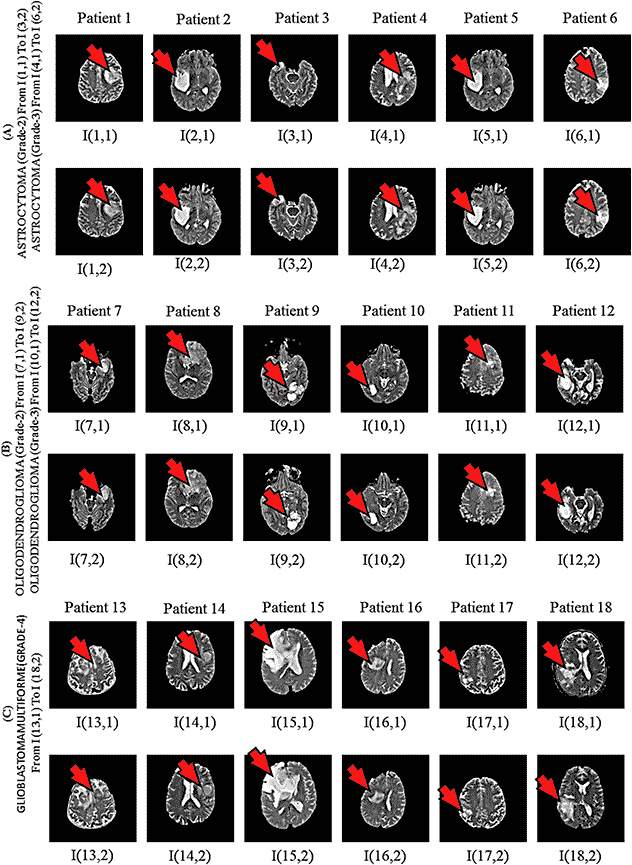

**Figure 4.2.** (a) 星形胶质瘤 (g2) 从 I(1,1) 到 I(3,2) 以及 (g3) 从 I(4,1) 到 I(6,2)，(b) 少突胶质瘤 (g2) 从 I(7,1) 到 I(9,2) 以及 (g3) 从 I(4,1) 到 I(12,2)，(c) 多形胶质母细胞瘤 (g2) 从 I(13,1) 到 I(15,2) 以及 (g3) 从 I(16,1) 到 I(18,2)。

### 4.3.2 数据准备

本实验使用的脑切片遵循数字成像和通信在医学（DICOM）标准。每个脑体积通过 `MRIcron` 软件 [61] 转换为 Neuroimaging Informatics Technology Initiative（NIfTI）文件格式（`*.nii`），随后转为二维图像进行头颅去除。本实验采用轴位 T2W MRI，因其在白质与灰质之间的对比度良好。头颅去除是提升脑部图像分类准确率的重要步骤，涉及从每张脑切片中去除头颅。

`Brain Suite18a` 软件 [62]（加州大学洛杉矶分校）用于此应用。完整的数据准备流程如下：

1. 加载脑体积（图 4.3(a)）。

2. 采用 `BSE`（脑面提取）程序进行完整的头颅去除，过程半自动：在高质量脑部 MRI 中能够自动检测大脑（灰质），但在低质量的下方 MRI 中可能失效，此时可手动调整参数。我们通过皮层对话框（图 4.4）选择头颅去除（`BSE`），并手动设置以下五个参数用于灰质选择：(i) 自动迭代；(ii) 扩散迭代；(iii) 扩散常数；(iv) 边缘常数；(v) 侵蚀大小。

3. 当找到合适的参数并完成过程时，`BSE` 程序结束，如图 4.3(b) 和 (c) 所示；否则可返回调整参数（尤其是扩散常数和边缘常数），重复直至出现满意的叠加效果。头颅去除的最终阶段如图 4.3(d) 所示。


```
if (condVar > someVal) {console.log("xxx")}
```


卷积层（称为 `Conv`）通过在合适的滤波器与输入图像之间进行卷积运算，从图像中提取关键特征。滤波器是一个 `n × n` 数组，包含参数或权重，要么是 0 要么是 1。`ReLU` 是一种激活函数，用于在系统中引入非线性，主要是为了避免过拟合。`ReLU` 用函数 `Max(x, 0)` 表示，其中 `x` 为输入参数。池化是网络中的一种特殊操作，通常在卷积操作之后应用，以在训练过程中减少参数数量和计算量。`max-pooling` 和 `average pooling` 是两种流行的操作。在 `max-pooling` 中，从滤波器大小的特征向量中选择最大值；在 `average pooling` 中，选择特征向量的平均值并转发到前馈网络。`softmax` 分类器用于全连接层，通过类别得分（介于 0 到 1 之间）进行概率标签分类。

许多深度学习网络，如 `AlexNet`、`ResNet`、`GoogLeNet` 等，使用著名的 CNN 模型。它们在 ImageNet Large Scale Visual Recognition Challenge (`ILSVRC`) 年会上被介绍 \[70\]。这些网络在超过一百万张图像上进行训练，能够对超过 1000 种对象（如鼠标、铅笔、动物等）进行分类。人们认为这些模型在图像分类方面显著提升了性能，优于其他非深度学习方法。

为医学图像分类选择合适的深度网络层是一项挑战性且繁琐的工作，因为需要进行大量的试错迭代来找到合适的网络。传递学习是一种特殊方法，其中已有的训练好的深度网络可以被重用。在这个概念中，早期训练好的模型（包括层和学习权重）被用作新任务的起点。这种安排避免了为合适网络设计所需的开销。因此，我们选择了一个预训练的 (`CNN`) 网络，以在适度的训练时间内实现更高的分类性能。

### 4.4.2 AlexNet 架构

`AlexNet` \[70\] 首次在 `ILSVRC 2012` 中被提出，并以 15.3% 的前五错误率赢得竞争，超越了第二名（26.2% 前五错误率）。它是一个八层的 `CNN`，如图 4.6 所示，包含五个卷积（`Conv`）层和三个全连接（`FC`）层。网络要求输入为三通道（红‑绿‑蓝）图像，尺寸为 (227 × 227 × 3)。`AlexNet` 的层级细节在表 A1（附录 A）中描述。该模型的主要亮点如下。

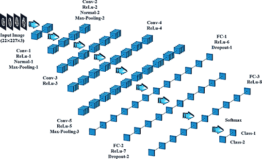

**Figure 4.6.** `AlexNet` 架构，展示了总共八层。 (图片由 AtheroPoint™ 提供。)

为了在模型中加入非线性，`AlexNet` 首次引入 `ReLU`（*f*(*a*) = max(0,*a*)) 作为激活函数，目的是加快训练速度。此前，`tanh` 函数（*f*(*a*) = (1 + *e*^(−*a*))^(−1)）被广泛使用。`ReLU` 的运行速度是 `tanh` 的数倍，并有助于降低前五错误率。此外，由于显存受限，`AlexNet` 设计为能够在两块 GPU 上同时运行，卷积操作的核被分成两条路径。因此，前一和前五错误率分别降低了 1.7% 和 1.2%。`AlexNet` 还使用了局部响应归一化，这加速了训练过程直至收敛，并进一步将前一和前五错误率降低了 1.4% 和 1.2%。作为替代方案，提出了重叠池化概念，它在同一核中对相邻组的输出进行汇总，而传统的相邻池化则不支持这种重叠。使用此技术，前一和前五错误率分别降低了 0.4% 和 0.3%。过拟合是一个严重问题，网络在已知样本上表现良好，但在未知样本上却难以识别。为了克服过拟合，引入了数据增强和丢弃（dropout）技术。数据增强通过平移、旋转、反射以及改变样本图像的强度来实现。在丢弃技术中，被选中的神经元在前向和反向传播时不能传递信息。该模型在两个全连接层（`FC-6`、`FC-7`）上将每个隐藏神经元的丢弃概率设为 0.5（丢弃率），并在此处应用。

在名为 ImageNet `LSVRC` 的竞赛中，提出了多个深度学习网络，如 `GoogleNet` \[71\]、脑出血分类 \[75\] 以及糖尿病视网膜病变诊断系统 \[76\]。虽然 `GoogLeNet` 的层数比 `AlexNet` 深，但由于其嵌入结构，参数更少，这可以降低过拟合风险 \[28\]，这可以优化模型的分类准确率。传递学习通过之前任务的训练获得的知识，使模型在分类时更具泛化性 \[78\]。事实证明，预训练模型的表现与从零训练模型相当，即使早期学到的知识完全不同 \[29\]。因此，我们重用了在数百万自然图像上预训练的 `AlexNet`，将其用于脑肿瘤图像分类。传递学习的工作原理如图 4.7 所示。预训练的特征/权重/知识被转移到新模型，并作为新模型的初始权重。新模型的结构与 `AlexNet` 相同，除了最后的全连接层被修改为两类脑肿瘤（即两类脑肿瘤）的分类。虽然 `GoogLeNet` 的层数比 `AlexNet` 深，但由于其嵌入结构，参数更少，这可以降低过拟合风险 \[29\]。

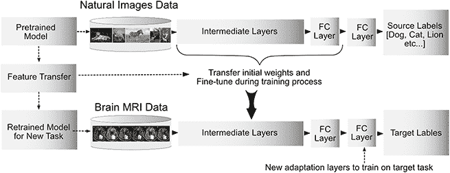

**Figure 4.7.** 传输学习范式。(图片由 AtheroPoint™ 提供。)

### 4.4.4 权重优化

梯度下降（GD）是神经网络中权重优化最流行的技术 \[79\]。GD 算法的基本目标是在训练过程的不同迭代中最小化损失函数。损失函数是预测输出与实际输出之间的差值。如图 4.8 所示，网络权重在每次迭代循环中被更新，目标是最小化误差或损失函数。损失函数作为训练过程的指南，引导模型朝正确方向移动并达到全局最小值 \[80\]。通常有三种 GD：(a) 批量梯度下降，(b) 随机梯度下降（SGD）\[81\]，以及 (c) 小批量梯度下降。

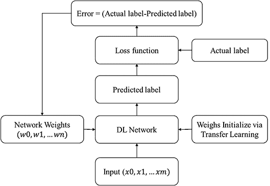

**Figure 4.8.** 权重优化过程。

在批量 GD 中，每次训练迭代都使用整个数据集。然而，由于需要用所有数据来减小平均误差，当数据量较大时会出现问题。在 SGD 中，每次迭代只从整个数据集中随机选取少量样本。由于 AlexNet 之前已在数百万幅自然数据样本上进行训练，因此选择随机梯度下降算法 \[82\] 进行权重优化。SDG 使用训练数据集中的示例来估计模型当前状态的误差梯度，然后通过反向传播算法更新模型权重，该算法简称为反向传播 \[83\]。训练过程中权重更新的量称为步长或“学习率”。学习率控制模型适应问题的速度。较小的学习率需要更多的训练时代才能使学习有效，而较大的学习率则会导致快速变化并需要更少的训练时代。学习率过大会使模型过快收敛到次优解，学习率过小则可能导致过程停滞。因此，学习率和时代的选择是时间与精度之间的权衡，具有挑战性。于是，我们在模型中将最佳学习率设为 0.0001，以实现更好的权重优化，优于其他最先进的方法（请参阅基准表 4.5）。

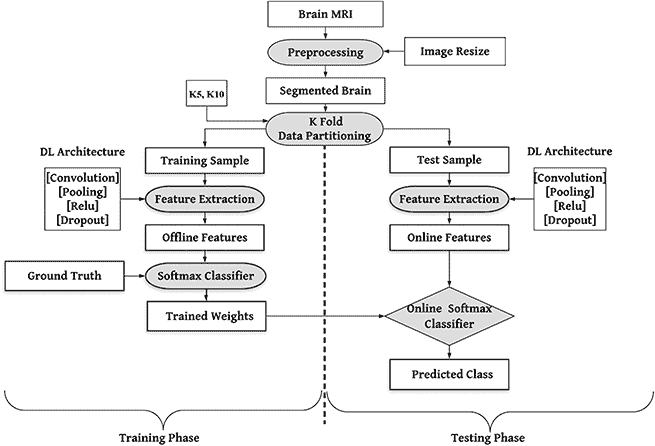

**Figure 4.9.** 基于深度学习的肿瘤分类系统。

### 4.5 实验协议、结果和性能评估

本文使用公开的大脑肿瘤数据集（REMBRANDT）\[60\] 进行实验。对给定的真实标签，对 AST、OLI 和 GBM 三种脑肿瘤类型进行子分级，使用八层 CNN（AlexNet）实现。数据集中每位患者的 2D MRI 切片平均数量为 50 幅。切片（样本）在专家监督下手动选取。若切片中可见肿瘤病灶，则该切片被视为阳性样本；若不可见此类病灶区域，则被视为负性样本。在测试后，对脑部图像的真阳（TP）、真负（TN）、假阴（FN）和假阳（FP）值进行评估。系统性能以百分比形式给出。计算的性能指标包括准确率（ACC）、灵敏度（SE）、特异性（SP）、阳性预测值（PPV）、负预测值（NPV）以及接收机器特征曲线（ROC）下的曲线下面积（AUC）。每组的平均性能（AVG）和标准差（SD）分别计算。

#### 4.5.1 参数选择与模拟

参数选择是微调模型关键且敏感的步骤。数据划分协议、时代数、学习率和批量大小等参数对模型性能影响显著。与现有最先进的方法相比（请参阅基准表 4.5），我们设定的理想参数如下：

*   `划分协议`。实验采用五折和十折交叉验证（K5 和 K10 CV）协议。交叉验证检验模型对未见数据的预测能力，从而减少过拟合。在 K5 CV 协议中，设计了五个不同的集合，每个集合随机选取 80% 的样本用于训练，20% 用于验证。而在 K10 CV 协议中，创建了十个不同的随机集合，每个集合中 90% 的样本用于训练，10% 用于验证。

*   `时代数`。一个时代是指网络中所有层完整通过一次。每次迭代结束后，计算实际标签与预测标签之间的差值，该差值作为损失并在网络中反向传播以更新权重。同时，训练数据在每次迭代中随机打乱，使训练更具鲁棒性。时代数越多，模型性能越好，但训练时间也相应增加。为一般性做法，我们在实验中保持了适度的 1000 时代，这远高于其他现有最先进的方法。

*   `批量大小`。批量大小是每次迭代中传递的数据样本子集，用于在网络中更新权重。批量大小的范围是 1 到数据集中最大样本数之间。批量大小与每个时代的迭代次数成反比：批量大小越大，每个时代的迭代次数越少，反之亦然。整个实验过程中，我们决定保持相同的批量大小 128，该数值由 AlexNet 的开发者使用 \[70\]。

*   `学习率`。深度学习神经网络使用随机梯度下降（SGD）进行训练。该方法通过在每次迭代中反向传播错误/损失来更新权重。权重变化的速率称为学习率。学习率范围在（0–1）之间，较小的学习率需要更多的时代才能使学习有效，反之亦然。在我们的情况，学习率被设定为 0.0001。

`[模拟]`。Matlab（对公众开放）提供了一个平台，我们可以使用应用程序（如 Deep Network Designer）创建、修改和可视化深度学习（DL）架构。因此，实现项目目标非常方便。此外，当使用 TensorFlow、PyTorch 和 MxNet 等框架时，它会自动标记数据（包括图像、视频和音频数据），并利用 GPU 自动加速算法。我们使用了 Matlab2019a 的免费试用版。进一步，所有实验均在配备 2.5 GHz Core i3 CPU 和 4 GB RAM 的机器上进行。深度学习模拟在 MatlabR2019a 中使用预训练的 AlexNet 卷积神经网络进行，该包从 [`www.mathworks.com`](https://www.mathworks.com) 下载。为检验显著性，使用 MedCalc（版本 19.1）软件（比利时）进行 `t-test`。

#### 4.5.2 结果

如前所述，脑肿瘤主要分为三类： (i) 胶质瘤（AST），(ii) 胶质母细胞瘤（OLI），(iii) 胶质母细胞瘤多形（GBM）。AST 和 OLI 仅出现在二级（g2）和三级（g3）中，而 GBM 也表现为四级（g4）。我们的目标是开展三项肿瘤特征研究，包括： (i) AST（g2 对 g3），(ii) OLI（g2 对 g3），(3) 低级别胶质瘤与高级别胶质瘤分类。这些研究基于脑肿瘤患者的现有真实标签，如下所述。

`Study 1: Astrocytoma (g2 versus g3) 分类`

本研究纳入 40 名 AST 患者，其中 26 名为 g2，14 名为 g3。共使用 557 份脑肿瘤样本（2D 脑部 MRI 切片），其中 356 份为 g2，201 份为 g3。K5 与 K10 的性能在图 4.10 中比较。

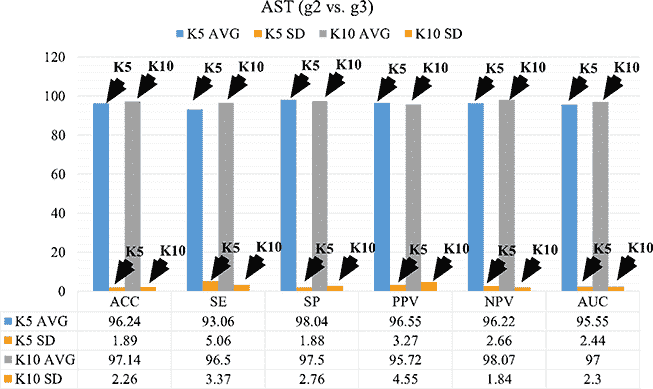

**Figure 4.10.** Comparison of K5 versus K10 CV protocols for AST (g2 versus g3) classification.

`Study 2: Oligodendroglioma (g2 versus g3) 分类`

本研究包括 16 名患者，其中 9 名为 g2，7 名为 g3。共手动选取 219 份样本，包括 128 份 g2 和 91 份 g3。K5 与 K10 的性能在图 4.11 中比较。

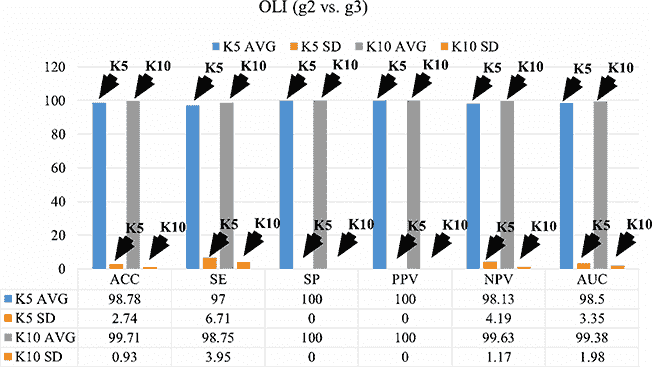

**Figure 4.11.** Comparison of K5 versus K10 CV protocols for OLI (g2 versus g3) classification.

`Study 3: Low-grade glioma versus high-grade glioma classification`

本研究纳入所有 79 名患者（AST：40 名，OLI：16 名，GBM：23 名）进行低级别胶质瘤（LGG）与高级别胶质瘤（HGG）分类。LGG 包含 g2 的 AST 和 OLI 样本，HGG 包含 g3 的 AST 和 OLI 样本以及 4 级 GBM。实验使用了 1115 份样本，其中 484 份为 LGG，631 份为 HGG。K5 与 K10 的比较性能在图 4.12 中显示。

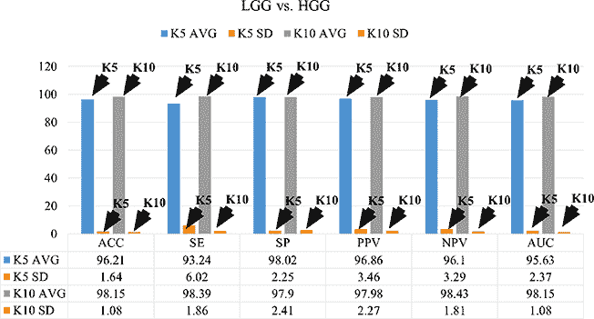

**Figure 4.12.** Comparison of K5 versus K10 CV protocols for LGG versus HGG classification.

所有三项研究在表 4.2 中对 K5 与 K10 交叉验证协议的整体性能进行了比较。观察到 K10 CV 的性能优于 K5 CV，且 K10 的标准差显著更低。各分类的平均性能如下：ACC（98.33% ± 1.42%），SE（97.88% ± 3.06%），SP（98.47% ± 1.72%），PPV（97.90% ± 2.27%），NPV（98.71% ± 1.61%），AUC（0.98；`p` < 0.0001）。此外，分类性能最高的肿瘤类型是 OLI（g2 对 g3），具体数据如下：ACC（99.71% ± 0.93%），SE（98.75% ± 3.95%），SP（100.00% ± 0.00%），PPV（100.00% ± 0.00%），NPV（99.63% ± 1.17%），AUC（99.38% ± 1.98%）。为验证实验的显著性，进行 `t-test`，所有组合的 `p`‑值均 ≤ 0.0001。

**Table 4.2.** AST (g2 对 g3)、OLI (g2 对 g3) 和 LGG 对 HGG 分类的总体性能比较。

|   | AST (g2 对 g3) |   | OLI (g2 对 g3) |   | LGG 对 HGG |   |
|---|----------------|---|----------------|---|------------|---|
| K5 | K10 | K5 | K10 | K5 | K10 |
| AVG | SD | AVG | SD | AVG | SD | AVG | SD | AVG | SD | AVG | SD |
| ACC | 96.24 | 1.89 | 97.14 | 2.26 | 98.78 | 2.74 | 99.71 | 0.93 | 96.21 | 1.64 | 98.15 | 1.08 |
| SE | 93.06 | 5.06 | 96.50 | 3.37 | 97.00 | 6.71 | 98.75 | 3.95 | 93.24 | 6.02 | 98.39 | 1.86 |
| SP | 98.04 | 1.88 | 97.50 | 2.76 | 100.00 | 0.00 | 100.00 | 0.00 | 98.02 | 2.25 | 97.90 | 2.41 |
| PPV | 96.55 | 3.27 | 95.72 | 4.55 | 100.00 | 0.00 | 100.00 | 0.00 | 96.86 | 3.46 | 97.98 | 2.27 |
| NPV | 96.22 | 2.66 | 98.07 | 1.84 | 98.13 | 4.19 | 99.63 | 1.17 | 96.10 | 3.29 | 98.43 | 1.81 |
| AUC | 95.55 | 2.44 | 97.00 | 2.30 | 98.50 | 3.35 | 99.38 | 1.98 | 95.63 | 2.37 | 98.15 | 1.08 |
| `p` | < 0.0001 | < 0.0001 | < 0.0001 | < 0.0001 | < 0.0001 | < 0.0001 |   |   |   |   |   |   |

#### 4.5.3 性能评估

深度学习分类器的性能与最流行的机器学习（ML）分类器（基于第一阶和第二阶统计特征：均值、方差、标准差、偏度、库尔托斯、对比度、能量熵、相关性、均匀度）进行了比较。这些特征从现有的肿瘤图像中提取。相关的数学表达式列于附录 A 中的表 A2。常用的 ML 分类器包括支持向量机（SVM）、线性回归、`k`‑最近邻、决策树和集成方法。实验使用了 MatlabR2019a 自带的 ML 分类工具。所有 ML 分类器的性能在表 A3 中给出。最高肿瘤分类准确率为 84.4%，由带立方核的 SVM 分类器实现。ML 与 DL 方法的性能对比在表 4.3 中给出，DL 分类器相较于 ML 分类器在准确率上提升了 13.86%。两者还通过 ROC（AUC）曲线比较，如图 4.13 所示。

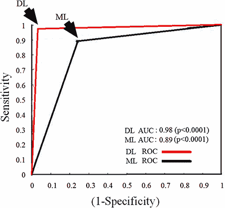

**Table 4.3.** ML 与 DL 方法的性能比较。

| Cross-validation protocol | DL (CNN: AlexNet) | ML (SVM) | 平均 DL 性能相对平均 ML 的提升 (%) |
|---|---|---|---|
| AST (g2 对 g2) | AST (g2 对 g2) | OLI (g2 对 g2) | LGG 对 HGG |
| Mean ACC (%) | Mean AUC | Mean ACC (%) | Mean AUC |
| K10 CV | 98.33 ± 1.42 | 0.98 ± 0.17 (`p` < 0.0001) | 84.7 ± 6.00 | 0.89 ± 0.10 (`p` < 0.0001) | 13.86 |
| K5 CV | 97.07 ± 2.09 | 0.97 ± 0.20 (`p` < 0.0001) | 84.4 ± 5.75 | 0.89 ± 0.10 (`p` < 0.0001) | 13.05 |

**图 4.13.** ML 与 DL 方法在肿瘤分类中的 ROC（AUC）对比。

### 4.6 模型验证与验证

#### 4.6.1 假设验证

DL 网络在训练时通过合适的滤波器学习特征。低层特征通过前几层累积，高层特征则通过后几层获得。卷积层使用合适的多 2D 数组（通道）形状的滤波器在卷积操作后将学习到的特征向前传递给后续层。全连接层汇聚前几层学习到的高层特征的所有组合。由于 DL 的工作机制不透明，它被视为黑盒。然而，学习到的特征可以使用 MATLAB 函数 `deepDreamImage` 进行可视化。在我们的实验中，训练期间最后全连接层（图 4.6 中的 FC-3 层）所学习的特征以图 4.14 形式展示。这些图像在视觉上区分高低级肿瘤及其组合。进一步观察这些图像可知，每种肿瘤类型及其等级均有所不同。但这可以通过对这些图像的特征分析得到解释。因此，为了理解网络学习的内容并验证用于高低级肿瘤分类的 CNN 模型，我们提出了一种基于肿瘤分离指数（TSI）的独特统计测试，用于科学验证。TSI 定义为两类之间的分离程度（以百分比计）。计算 TSI 时，分别对每个等级的上述特征的均值和标准差进行计算。两类之间的 TSI 是公式 (4.1) 的数学表达，其中 `a` 与 `b` 分别为通过 `K` 折交叉验证协议（此处 `K` = 5、10）在训练期间 CNN 学习到的所有特征的均值。

$${TSI} = \\frac{a - b}{a} \\times 100.$$  

(4.1) graphic style="width:38.8125em;" xlink:href="bk978-0-7503-2244-7ch4eqn12.gif" position="float"/

K5 与 K10 交叉验证（AST（g2 对 g3）、OLI（g2 对 g3）以及 LGG 对 HGG）的 TSI 在表 4.4 中给出。CNN 学习到的特征以图像形式（K10 的一次完整循环）显示在图 4.14。实验表明，K10 交叉验证的分类准确率高于 K5，并且有趣的是，K10 交叉验证中 TSI 差值最大。K10 交叉验证的平均 TSI 分别为 AST（g2 对 g3）14.23%、OLI（g2 对 g3）27.32%、LGG 对 HGG 21.42%。

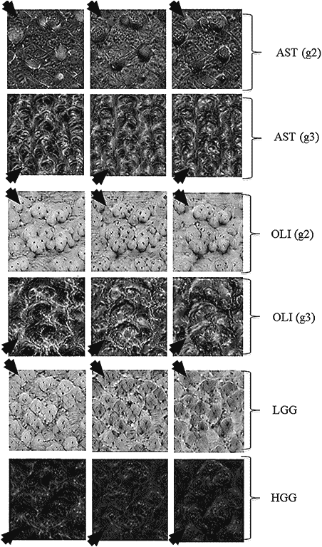

**Figure 4.14.** CNN 最后全连接层学习到的特征，来自不同肿瘤分类的训练样本。

**Table 4.4.** 肿瘤分离指数：深度学习特征的统计分析测试。

|  | AST (g2 对 g3) | OLI (g2 对 g3) | LGG 对 HGG |
| --- | --- | --- | --- |
| TSI, K5 CV | 13.56% | 26% | 17.54% |
| --- | --- | --- | --- |
| TSI, K10 CV | 14.23% | 27.32% | 21.42% |

#### 4.6.2 软件验证

为验证所选分类器（AlexNet）的合理性，我们选用了知名的人体生物数据集（Face95）\[85\]，该数据集已能够实现高分类准确率。数据集包含 72 名受试者，其中 58 名男性、14 名女性。每位受试者包含 20 张图像。使用相同的模型（AlexNet）和相同的实验条件对男性与女性图像进行分类，条件与肿瘤分类相同。总计 1440 张图像样本，其中男性 1160 张、女性 280 张，我们使用了这些样本。尽管男性和女性类别的样本数量存在巨大差异，但我们的模型仍获得了令人惊叹的平均性能：ACC（99.86% ± 0.31%），SE（100% ± 0.00%），SP（99.91% ± 0.00%），PPV（99.43% ± 2.00%），NPV（100.00% ± 0.00%），AUC（100.00% ± 0.00%）且 `p` ≤ 0.0001。

### 4.7 讨论

由于脑肿瘤位于深部，活检有时会危及生命。然而，它们是金标准，始终是验证肿瘤分级过程的必要手段。MRI 因其能够以高分辨率显示软组织特征而成为脑成像中最常用的方法。但由于切片数量庞大，手动轮廓和分类（分级过程）既繁琐又易出错，并且会引入操作者间及内部的变异性。以往的分段和分级方法基于传统机器学习工具，这些工具不够稳健，或需要大量计算并进行自定义本地参数化。在此，我们采用了结合自动特征选择与深度学习范式的自动化方案。本研究使用了一种特殊的 CNN，AlexNet，用于肿瘤分级，它提供了更稳健且更准确的解决方案。据我们所知，本研究是首次设计一种能够将 AST 和 OLI 两种肿瘤类型细分为其子等级 g2 与 g3 的分级方案，并将肿瘤划分为低级和高级胶质瘤类别。为更好地理解分级方案，我们尝试开发一种创新的方法，以在深度学习范式的训练过程中理解肿瘤等级的分离。我们称之为肿瘤分离指数（TSI）。TSI 帮助我们验证科学假设，即深度学习方案优于传统机器学习方案。

`A special note on CNN/AlexNet`

从零开始设计合适的 CNN 是一项挑战性任务。该过程需要大量的试错迭代，并且对合适层的选择具有高昂的计算成本 \[58\]。因此，利用已有的知名模型（如 LetNet、VGGNet、AlexNet、GoogLeNet 等）进行分级机制是明智之举。同时，医学数据有限也是一个严重问题，DL 网络的分类任务往往缺乏足够数据。我们通过使用经过预训练的网络并结合迁移学习技术来克服这些挑战。迁移学习已被证明能够将从大规模自然数据集中学习到的特征知识迁移到医学任务上 \[78\]。此外，文献报道预训练网络在分类性能上优于从零开始设计并优化的网络 \[29\]。因此，我们选择使用经过预训练的 CNN 并结合迁移学习，以提升肿瘤分类的准确性。如前所述，LetNet、VGGNet、AlexNet、GoogLeNet 等已在图像分类中展现出卓越性能，能够识别 1000 多种对象。研究表明，更深的网络如 GoogLeNet 相比更浅的网络表现更好 \[29\]。但这在计算成本上代价高昂。在计算资源受限（仅有 CPU）的情况下，我们选择 AlexNet（八层 CNN），它是中等深度网络，性能几乎与 GoogLeNet 相当。

`Challenges of deep learning and their solutions`

尽管深度学习在图像分类方面表现更好，但该方法也面临许多挑战。在 DL 设计中，选择合适的层与合适的数据之间的权衡是时间与准确性之间的权衡。如果 DL 模型在有限数据上训练，过拟合是另一个严重的问题。在过拟合的情况下，模型在现有数据上表现出最高准确率，但无法识别未见数据，也无法将问题概括，导致在未见数据上表现不佳。我们的方法通过使用迁移学习、`dropout` 参数以及 K5/K10 CV 协议来降低过拟合。迁移学习和 K5/K10 CV 协议在前文已有讨论。`dropout` 参数需要在网络设计阶段固定，`dropout` 率是指在网络顶层随机断开节点的程度，以避免过拟合。AlexNet 包含两个 `dropout` 层，丢弃率为 50%，即在全连接层中随机断开 50% 的节点。


# A special note on Big-O complexity

深度学习架构的时间复杂性问题并不新鲜。深度学习模型是由许多组件和子组件组成的复杂架构，推导整体的 Big-`O` 复杂度非常困难，因为特征尺寸、组件和子组件的数量随层而变化。此外，硬件（H/W）组件（如具有多核心和并行计算能力的 GPU）对时间复杂度的影响显著，相比于用于估算 Big-`O` 时间复杂度的单核 CPU，GPU 的影响更大。此外，在多核心 GPU 上将任务分布的额外开销也影响了期望的可扩展性，因此未能实现所需的可扩展性。然而，基于某些经验基准 \[[86\]，已在微观和宏观层面提出了一些理论。我们所使用的 AlexNet 的时间复杂度依赖于以下属性：(i) 使用的激活函数：ReLU；(ii) 使用的损失函数：交叉熵损失函数；(iii) 使用的批量大小：输入数量 (`B`)；(iv) CNN 特征，如 (a) 矩阵尺寸——训练数据的大小；(b) 核大小——滤波器大小 (`K`[1])；(c) 核的数量——(`P`)；(d) 步长——滤波器必须移动的次数 (`s`)；以及 (v) 池化特征，如核大小——池化核的大小 (`K`[2])。在卷积操作中，若 `I` 为输入图像，`O`[`c`] 为输出，则有

```
O[c] = B × (s × P × (K[1]×I)),
```

其中 `P`、`B`、`s` 均为常数，而 `O`[`c`] 的大小取决于输入图像的大小、核大小和步长。对于单核 CPU，Big-`O` 复杂度依赖于输入图像的数量（记为 `n`）以及每张图像的大小。灰度图像深度为 2，彩色图像深度为 3（RGB）。在此情况下，Big-`O` 时间复杂度为 `n` × `R`，其中 `R` 表示图像的大小。根据图像尺寸，操作次数可从 `O`(`nxy`) 变化到 `O`(`nxyz`)，其中 `x`、`y`、`z` 分别表示图像的长、宽和高。池化操作的输出可记作 `O`[`p`]，给出公式

```
O[p] = K[2] × (O[c]).
```

池化操作的 Big-`O` 复杂度与前一操作相同，范围从 `O`(`nxy`) 到 `O`(`nxyz`)。若将深层数量视为变量 `l`，则总网络的复杂度从 `O`(`lnxy`) 变化到 `O`(`lnxyz`)。损失函数和反向传播的复杂度为二维灰度图像的 `O`(`n`²)，彩色图像则为 `O`(`n`³) \[88\]。总体估算的时间复杂度不应超过 `O`(`nxyz`)。不过，也有其他理论。一种理论利用贝蒂数 \[89\] 估计深度网络的时间复杂度为 `O`(2^(`h`))，其中 `h` 为隐藏神经元的数量。另一种理论利用 VC 维度 \[90\] 来确定深度网络的时间复杂度，为 `O`(`w` log`w`)，其中 `w` 表示深度网络的权重数量。总之，关于深度网络时间复杂度的理论已有多种，但文献中没有明确指出其精确性，因为实际时间受硬件和软件的差异影响。

# Strengths, weaknesses, and extensions


我们的研究考虑了一个相对适度的深度网络，在计算成本与准确性之间取得了平衡。如前文所述，迁移学习的预训练具有许多内在优势，能够为我们的最先进的方法增添价值。网络可以以慢学习率和高 epoch 数进行更好地微调特征，因此我们自豪地声明保持了慢学习率（0.0001）和高 epoch（1000），确保模型能够稳健地表征脑肿瘤类别。尽管所提系统稳定、强健且准确率高，但仍存在一些局限性。

(i) 由于缺乏脑肿瘤 `MRI` 的标注数据，我们的研究局限于单院脑肿瘤分类。这可以进一步扩展到使用相同标签的多中心数据。可能存在一个网站作为数据收集的主机，人们可以在此测试方法并上传数据。随着时间推移，更多数据集将被收集。因此，可以使用多中心数据集开发比较性论文。

(ii) 另一个关注点涉及样本选择。在本实验中，所有肿瘤的二维 `MRI` 切片均由手动从 `MRI` 体素中选择，但由于肿瘤大小不可预测，个体相邻切片的肿瘤面积存在差异，这可能导致错误的标签预测。该问题可以通过选择约似大小的肿瘤感兴趣区域（`ROI`）切片来解决，方法是通过（`CS` ± `n`），其中 `CS` 为 `MRI` 切片的中心，`n` 为中心切片前后的切片数量。`n` 的值将通过人工观察仔细选择。此技术可能提高分类准确率。另一种解决方案是使用 3D `CNN` 对 3D `MRI` 体素进行肿瘤分类。

- 系统性能在诸多方面均可提升，这将作为未来工作。此处仅使用轴向（axial）视图的 `T2W MRI`。多视图（轴向、矢状、冠状）和多协议 `MRI`（`T1W`、`T2W`、`FLAIR`）可提供更系统的肿瘤特征。因此，通过引入多视图和多协议 `MRI`，系统的性能可以得到提升。此外，代谢和遗传学数据以及大脑的解剖学属性也可以纳入系统，以实现更准确的肿瘤分级。

### Benchmarking

本小节对我们提出的方法与已有的先前技术进行对比。文献调查表明，针对脑肿瘤分级的方法非常有限。这主要是由于脑肿瘤分类的困难、缺乏适当的医学数据集以及缺乏金标准（ground truth）信息所致。因此，我们将本方法与表 `Table 4.5` 中列出的有限的现有专注研究进行比较。

**Table 4.5.** Benchmarking: a comparison between existing state-of-the-art techniques.

| C1 | C2 | C3 | C4 | C5 | C6 | C7 | C8 | C9 |
| --- | --- | --- | --- | --- | --- | --- | --- | --- |
| Pan *et al* (2015) [54] | BRATS 2014 | 2 | NA | Augmentation | `CNN`<br>`ANN` | NA | H/W: NA<br>TP: 5-NA<br>P&V: NA | SE = NA<br>SP = NA |
| Mohsen *et al* (2018) [90] | Harvard Medical School website | 4 | T2W | Segmentation (fuzzy C-means)<br>feature reduction (`PCA`) | `DNN` (seven-layer) | NA | H/W: NA<br>TP: K7 CV<br>P&V: NA | ACC = 96.97%<br>Recall = 97%<br>Precision = 97%<br>F-measure = 97%<br>AUC = 98.4% |
| Ari and Hanbay (2018) [16] | Kwan R K S *et al* [4] | 2 | NA | Image enhanced | `ELM`<br>`CNN`<br>`GW`<br>`SF` | NA | H/W: CPU<br>TP: NA<br>P&V: NA | ACC = 97.18%<br>SE = 96.80%<br>SP = 97.12% |
| Ge *et al* (2018) [57] | BraTS 2017<br>Mayo Clinic in the USA | 3 | `T1W`<br>`T2W`<br>`FLAIR` | Augmentation image enhanced | `CNN` (seven-layer) | Epochs = 50<br>LR = 0.0001<br>BS = NA | H/W: CPU<br>GPU<br>TP: NA<br>P&V: NA | ACC = 90.87% |
| Anaraki *et al* (2018) [58] | REMBRAND TTCGA | 2 | T1W | Raw image | `CNN-1` (seven-layer)<br>`CNN-2` (eight-layer) | Epochs = 100<br>LR = 0.0001<br>BS = NA | H/W: NA<br>TP: NA<br>P&V: NA | Study 1 ACC = 90.9%<br>Study 2 ACC = 94.2% |
| Yang *et al* (2018) [28] | REMBRANDT | 3 | T1W | ROI patching | `Alxnet` (eight-layer)<br>`GoogLeNet` (22-layer) | Epochs = 30<br>LR = 0.1<br>BS = 50 | H/W: CPU<br>TP: K5 CV | V. ACC = 86.7%<br>T. ACC = 90.9%<br>AUC = 93.9% |
| Proposed method | REMBRANDT | 2 | T2W | Skull stripping | `CNN`<br>`AlexNet` (eight-layer) | Epochs = 1000<br>LR = 0.0001<br>BS = 128 | H/W: CPU<br>TP: K5/K10 CV<br>P&V: Yes | ACC = 99.71% ± 0.93%<br>SE = 98.75% ± 3.95%<br>SP = 100.00% ± 0.00%<br>PPV = 100.00% ± 0.00%<br>NPV = 99.63% ± 1.17% and<br>AUC = 99.38% ± 1.98% |

`RN`: row no; `RF`: reference; `DS`: data source; `C`: classes; `P`: MRI protocol; `N`: no. of patients; `PP`: pre-processing; `CT`: classification technique; `ES`: experimental set-up; `HP`: highest performance; `R#`: row no.; `C#`: column no.; `T1W`: T1 weighted; `T2W`: T2-weighted; `FLAIR`: fluid-attenuated inversion recovery; `ACC`: accuracy; `SE`: sensitivity; `SP`: specificity; `AUC`: area under curve; `DSC`: Dice coefficient; `ANN`: artificial neural network; `DWT`: discrete wavelet transform; `DNN`: deep neural network; `GW`: Gabor wavelets; `SF`: statistical, feature-based method; `NA`: not available; `H/W`: hardware; `TP`: training protocol; `P&V`: performance and validation; `TPar`: training parameters.

### 4.8 Conclusion

本研究提出了一种基于深度学习模型（`CNN`）的自动脑肿瘤分级工具的新方法。采用转移学习实现了卓越性能。预训练模型使我们能够在样本较少的新问题上重用已学习的特征图，并提高了准确率。此外，转移学习通过在早期任务中获得的知识（权重）使模型更具泛化性。本章选用了预训练的 `CNN` 模型 `AlexNet` 进行肿瘤分类。本文使用的脑部 `MRI` 数据集包含 79 名患者，涉及三种脑肿瘤类型：胶质瘤（`AST`）、奥利戈细胞瘤（`OLI`）以及多形性胶质母细胞瘤（`GBM`）。`AST` 和 `OLI` 可分为二级（`g2`）和三级（`g3`），而 `GBM` 仅提供四级（`g4`）样本。本章进行了三项肿瘤分类实验，包括（i）`AST`（`g2` 与 `g3`）分类，（ii）`OLI`（`g2` 与 `g3`）分类，以及（iii）低级别胶质瘤（`LGG`）与高级别胶质瘤（`HGG`）分类。分类性能在 `K5` 和 `K10` 交叉验证方案上进行了测试。模型在 `K10` 方案下对 `OLI`（`g2` 与 `g3`）分类表现最佳，结果如下：`ACC`（99.71% ± 0.93%）、`SE`（98.75% ± 3.95%）、`SP`（100.00% ± 0.00%）、`PPV`（100.00% ± 0.00%）、`NPV`（99.63% ± 1.17%）以及 `AUC`（99.38% ± 1.98%），且 `p` < 0.0001。此外，`CNN` 分类器的性能还与使用相似数据的第一阶和第二阶统计特征的不同机器学习分类器进行了比较。`CNN` 分类器在准确率上比 `SVM`（支持向量机）分类器提升了 13.86%。模型还通过肿瘤分离指数（`TSI`）和面部生物特征进行了验证。

**Funding:** 本研究未获得外部资金。

**Conflicts of interest:** 作者声明没有利益冲突。

## Appendix A

**Table A1.** `AlexNet` architecture.

| Layer # | Layer initial | Layer | Remarks |
| --- | --- | --- | --- |
| 1 | Data | Image input | 227 × 227 × 3 images with ‘zero center’ normalization |
| 2 | `conv1` | Convolution-1 | 96 11 × 11 × 3 convolutions with stride [4 4] and padding [0 0 0 0] |
| 3 | `Relu1` | ReLu-1 |  |
| 4 | `Normal1` | Normal-1 | Cross-channel normalization with five channels per element |
| 5 | `Pool1` | Max-pooling-1 | 3 × 3 max-pooling with stride [2 2] and padding [0 0 0 0] |
| 6 | `Conv2` | Convolution | 256 5 × 5 × 48 convolutions with stride [1 1] and padding [2 2 2 2] |
| 7 | `Relu2` | ReLu |  |
| 8 | `Normal2` |  | Cross-channel normalization with five channels per element |
| 9 | `Pool2` | Max-pooling | 3 × 3 max-pooling with stride [2 2] and padding [0 0 0 0] |
| 10 | `Conv3` | Convolution | 384 3 × 3 × 256 convolutions with stride [1 1] and padding [1 1 1 1] |
| 11 | `Relu3` | ReLu |  |
| 12 | `Conv4` | Convolution | 384 3 × 3 × 192 convolutions with stride [1 1] and padding [1 1 1 1] |
| 13 | `Relu4` | ReLu |  |
| 14 | `Conv5` | Convolution | 256 3 × 3 × 192 convolutions with stride [1 1] and padding [1 1 1 1] |
| 15 | `Relu5` | ReLu |  |
| 16 | `Pool5` | Max-pooling | 3 × 3 max-pooling with stride [2 2] and padding [0 0 0 0] |
| 17 | `fc6` | Fully connected | 4096 fully connected layers |
| 18 | `Relu6` | ReLu |  |
| 19 | `drop6ʹ` | Dropout | 50% dropout |
| 20 | `fc7` | Fully connected | 4096 fully connected layers |
| 21 | `Relu7` | ReLu |  |
| 22 | `drop7ʹ` | Dropout | 50% dropout |
| 23 | `Modified1` | Fully connected | 2 fully connected layers |
| 24 | `Modified2` | Softmax |  |
| 25 | `Modified3` | Classification output | Cross entropy |

**Table A2.** Texture feature expressions.

| Feature | Expression | Feature | Expression |
| --- | --- | --- | --- |
| `Mean (m)` | `$m = \\frac{1}{N}{\\sum\_{i = 1}^{n}{\\sum\_{j = 1}^{n}{I{(i,j)}}}}$` | `Contrast (*C*)` | *`C`* = ∑[*i*, *j*] ∣ *`i`* − *`j`*‖² × `p`(*i*, *j*) |
| `Variance (var)` | `${var} = \\frac{\\sum{i}}{\\sum{j{(I{(i,j)} - m)}^{2}}}}{N}$` | `Energy (E)` | *`E`* = ∑[*i*, *j*]*`P`(*i*, *j*)² |
| `Standard deviation (std)` | `${std} = \\sqrt{\\frac{\\sum i\\sum j{(I{(i,j)} - m)}^{2}}{N}}$` | `Entropy (etp)` | *`e`*⁂*`t`*p* =  − ∑[*i*, *j*]*`P`(*i*, *j*) × log2) |
| `Skewness (skw)` | `${skw} = \\frac{1}{N}\\frac{\\sum i\\sum j{(I{(i,j)} - m)}^{3}}{{std}^{3}}$` | `Correlation (cor)` | `${cor} = {\\sum\_{i,j}\\frac{{(i - m)(j - m)} \\times P{(i,j)}}{{std\_{i} \\times {std\_{j}}}}` |
| `Kurtosis (kts)` | `${kts} = \\frac{1}{N}\\frac{\\sum i\\sum j{(I{(i,j)} - m)}^{4}}{{std}^{4}}$` | `Homogeneity (*H*)` | `$H = {\\sum\_{i,j}\\frac{P{(i,j)}}{1 + {\\mid {i - j} \\mid}}}$` |

**Table A3.** Performance of different machine learning classifiers using texture features.

| Classifier | Kernel | Accuracy |
| --- | --- | --- |
| `Tree` | `Fine` | 68.6% |
| `Tree` | `Medium` | 67.1% |
| `Tree` | `Curse` | 64.5% |
| `Linear discriminant` |  | 81.5% |
| `Logistic regression` |  | 83.3% |
| `SVM` | `Linear` | 70.7% |
| `SVM` | `Quadratic` | 81.9% |
| **`SVM`** | **`Cubic`** | **84.7%** |
| `KNN` | `Fine` | 80.1% |
| `KNN` | `Medium` | 71.5% |
| `KNN` | `Corse` | 64.6% |
| `KNN` | `Cosine` | 75.9% |
| `KNN` | `Cubic` | 71.3% |
| `KNN` | `Weighted` | 77.6% |
| `SVM` | `Fine Gaussian` | 77.2% |
| `SVM` | `Medium Gaussian` | 69.3% |
| `SVM` | `Coarse Gaussian` | 63.9% |
| `Ensemble` | `Boosted tree` | 72.7% |
| `Ensemble` | `Bagged tree` | 77.7% |
| `Ensemble` | `Subspace discriminant` | 80.6% |
| `Ensemble` | `Subspace KNN` | 59.8% |
| `Ensemble` | `RUS boosted trees` | 73.8% |

## References

[1] *Latest Global Cancer Data* [`www.who.int/news-room/fact-sheets/detail/cancer`](https://www.who.int/news-room/fact-sheets/detail/cancer)

[2] Ngulde S I *et al* 2015 Improving brain tumor research in resource-limited countries: a review of the literature focusing on West Africa *Cureus* [**7** 1–7](http://dx.doi.org/10.7759/cureus.372)

[3] American Society of Clinical Oncology 2019 *Brain Tumor: Statistics* [`cancer.net/cancer-types/brain-tumor/statistics`](https://www.cancer.net/cancer-types/brain-tumor/statistics)

[4] The Brain Tumor Charity *Brain Tumor Basics* [`thebraintumourcharity.org/`](https://thebraintumourcharity.org/)

[5] Louis D N *et al* 2016 The 2016 World Health Organization classification of tumors of the central nervous system: a summary *Acta Neuropathol.* [**131** 803–20](http://dx.doi.org/10.1007/s00401-016-1545-1)

[6] Louis D N *et al* 2014 International Society of Neuropathology-Haarlem consensus guidelines for nervous system tumor classification and grading *Brain Pathol.* [**24** 429–35](http://dx.doi.org/10.1111/bpa.12171)

[7] Gurcan M N, Boucheron L E, Can A, Madabhushi A, Rajpoot N M and Yener B 2009 Histopathological image analysis: a review *IEEE Rev. Biomed. Eng.* [**2** 147–71](http://dx.doi.org/10.1109/RBME.2009.2034865)

[8] Collins V P 2004 Brain tumours: classification and genes *J. Neurol. Neurosurg. Psych.* [**75** ii2–11](http://dx.doi.org/10.1136/jnnp.2004.040337)

[9] Behin A, Hoang-xuan K, Carpentier A F and Delattre J 2003 Primary brain tumours in adults *Lancet* [**361** 323–31](http://dx.doi.org/10.1016/S0140-6736\(03\)12328-8)

[10] Ainsworth N L *et al* 2016 Quantitative and textural analysis of magnetization transfer and diffusion images in the early detection of brain metastases *Magn. Reson. Med.* [**77** 1987–95](http://dx.doi.org/10.1002/mrm.26257)

[11] McClure P *et al* 2014 In-vitro and in-vivo diagnostic techniques for prostate cancer: a review *J. Biomed. Nanotechnol.* [**10** 2747–77](http://dx.doi.org/10.1166/jbn.2014.1990)

[12] Acharya U R, Faust O, Sree S V, Molinari F, Garberoglio R and Suri J S 2011 Cost-effective and non-invasive automated benign and malignant thyroid lesion classification in 3D contrast-enhanced ultrasound using combination of wavelets and textures: a class of ThyroScan™ algorithms *Technol. Cancer Res. Treat.* [**10** 371–80](http://dx.doi.org/10.7785/tcrt.2012.500214)

[13] Acharya U R, Faust O, Sree S V, Molinari F and Suri J S 2012 ThyroScreen system: high resolution ultrasound thyroid image characterization into benign and malignant classes using novel combination of texture and discrete wavelet transform *Comput. Methods Programs Biomed.* [**107** 233–41](http://dx.doi.org/10.1016/j.cmpb.2011.10.001)

[14] Pareek G *et al* 2013 Prostate tissue characterization/classification in 144 patient population using wavelet and higher order spectra features from transrectal ultrasound images *Technol. Cancer Res. Treat.* [**12** 545–57](http://dx.doi.org/10.7785/tcrt.2012.500346)

[15] Acharya U R *et al* 2013 Effect of complex wavelet transform filter on thyroid tumor classification in three-dimensional ultrasound *Proc. Inst. Mech. Eng. H* [**227** 284–92](http://dx.doi.org/10.1177/0954411912472422)

[16] Ari A and Hanbay D 2018 Deep learning based brain tumor classification and detection system *Turkish J. Electr. Eng. Comput. Sci.* [**26** 2275–86](http://dx.doi.org/10.3906/elk-1801-8)

[17] Tandel G S *et al* 2019 A review on a deep learning perspective in brain cancer classification *Cancers* [**11** 111](http://dx.doi.org/10.3390/cancers11010111)

[18] Sasikala M and Kumaravel N 2008 A wavelet-based optimal texture feature set for classification of brain tumours *J. Med. Eng. Technol.* [**32** 198–205](http://dx.doi.org/10.1080/03091907.2007.1067724)

[19] Prasad H, Martis R J, Acharya U R, Min L C and Suri J S 2013 Application of higher order spectra for accurate delineation of atrial arrhythmia *2013 35th Annual Int. Conf. of the IEEE Engineering in Medicine and Biology Society* (Piscataway, NJ: IEEE) pp 57–60

[20] Araki T *et al* 2016 PCA-based polling strategy in machine learning framework for coronary artery disease risk assessment in intravascular ultrasound: a link between carotid and coronary grayscale plaque morphology *Comput. Methods Programs Biomed.* [**128** 137–58](http://dx.doi.org/10.1016/j.cmpb.2016.02.004)

[21] Acharya U *et al* 2012 Evolutionary algorithm-based classifier parameter tuning for automatic ovarian cancer tissue characterization and classification *Ultraschall Med.—Eur. J. Ultrasound* [**35** 237–45](http://dx.doi.org/10.1055/s-0032-1330336)

[22] Shrivastava V K, Londhe N D, Sonawane R S and Suri J S 2016 Computer-aided diagnosis of psoriasis skin images with HOS, texture and color features: a first comparative study of its kind *Comput. Methods Programs Biomed.* [**126** 98–109](http://dx.doi.org/10.1016/j.cmpb.2015.11.013)

[23] Saba L *et al* 2017 Plaque tissue morphology-based stroke risk stratification using carotid ultrasound: a polling-based PCA learning paradigm *J. Med. Syst.* [**41** 98](http://dx.doi.org/10.1007/s10916-017-0745-0)

[24] Araki T *et al* 2017 Stroke risk stratification and its validation using ultrasonic echolucent carotid wall plaque morphology: a machine learning paradigm *Comput. Biol. Med.* [**80** 77–96](http://dx.doi.org/10.1016/j.compbiomed.2016.11.011)

[25] J S S Ayman El-Baz 2019 *Big Data in Multimodal Medical Imaging* 1st edn (Boca Raton, FL: CRC Press)

[26] Tajbakhsh N *et al* 2016 Convolutional neural networks for medical image analysis: full training or fine tuning? *IEEE Trans. Med. Imaging* [**35** 1299–312](http://dx.doi.org/10.1109/TMI.2016.2535302)

[27] Shin H C *et al* 2016 Deep convolutional neural networks for computer-aided detection: CNN architectures, dataset characteristics and transfer learning *IEEE Trans. Med. Imaging* [**35** 1285–98](http://dx.doi.org/10.1109/TMI.2016.2528162)

[28] Yang Y *et al* 2018 Glioma grading on conventional MR images: a deep learning study with transfer learning *Front. Neurosci.* [**12** 1–10](http://dx.doi.org/10.3389/fnins.2018.00804)

[29] Pan Y *et al* 2015 Brain tumor grading based on neural networks and convolutional neural networks *2015 37th Annual Int. Conf. of the IEEE Engineering in Medicine and Biology Society (EMBC)* (Piscataway, NJ: IEEE) pp 699–702

[30] Khawaldeh S, Pervaiz U, Rafiq A and Alkhawaldeh R 2017 Noninvasive grading of glioma tumor using magnetic resonance imaging with convolutional neural networks *Appl. Sci.* [**8** 27](http://dx.doi.org/10.3390/app8010027)

[31] Chang P *et al* 2018 Deep-learning convolutional neural networks accurately classify genetic mutations in gliomas *Am. J. Neuroradiol.* [**39** 1201–7](http://dx.doi.org/10.3174/ajnr.A5667)

[32] Yonekura A, Kawanaka H, Prasath V B S, Aronow B J and Takase H 2017 Glioblastoma multiforme tissue histopathology images based disease stage classification with deep CNN *6th Int. Conf. on Informatics, Electronics and Vision and 2017 7th Int. Symp. in Computational Medical and Health Technology* **vol 2018** January pp 1–5

[33] Xu Y *et al* 2017 Large scale tissue histopathology image classification, segmentation, and visualization via deep convolutional activation features *BCM Bioinform.* [**18** 281](http://dx.doi.org/10.1186/s12859-017-1685-x)

[34] Salvado O, Hillenbrand C, Suri J and Wilson D L 2004 MR coil sensitivity inhomogeneity correction for plaque characterization in carotid arteries *Medical Imaging 2004: Image Processing Proc. SPIE* vol 5370 [`doi.org/10.1117/12.535958`](https://doi.org/10.1117/12.535958)

[35] Suri J and Laxminarayan S 2005 *Handbook of Biomedical Image Analysis* (New York: Springer)

[36] Abiwinanda N, Hanif M, Hesaputra S T, Handayani A and Mengko T R 2019 Brain tumor classification using convolutional neural network *IFMBE Proc.* [**68** 183–9](http://dx.doi.org/10.1007/978-981-10-9035-6_33)

[37] Joshi D M, Rana N K and Misra V M 2010 Classification of brain cancer using artificial neural network *ICECT 2010—Proc. 2010 2nd Int. Conf. Electron. Comput. Technol.* pp 112–6

[38] Akkus Z, Galimzianova A, Hoogi A, Rubin D L and Erickson B J 2017 Deep learning for brain MRI segmentation: state of the art and future directions *J. Digit. Imaging* [**30** 449–59](http://dx.doi.org/10.1007/s10278-017-9983-4)

[39] Ryu Y J, Choi S H, Park S J, Yun T J, Kim J H and Sohn C H 2014 Glioma: application of whole-tumor texture analysis of diffusion-weighted imaging for the evaluation of tumor heterogeneity *PLoS One* [**9** e108335](http://dx.doi.org/10.1371/journal.pone.0108335)

[40] Abdel-Maksoud E, Elmogy M and Al-awadi R 2015 Brain tumor segmentation based on a hybrid clustering technique *Egypt Inform. J.* [**16** 71–81](http://dx.doi.org/10.1016/j.eij.2015.01.003)

[41] Veta M, Van Diest P J, Kornegoor R, Huisman A, Viergever M A and Josien P W 2013 Automatic nuclei segmentation in H & E stained breast cancer histopathology images *PLoS ONE* [**8** e70221](http://dx.doi.org/10.1371/journal.pone.0070221)

[42] Balafar M A, Ramli A R, Saripan M I and Mashohor S 2010 Review of brain MRI image segmentation methods *Artif. Intell. Rev.* [**33** 261–74](http://dx.doi.org/10.1007/s10462-010-9155-0)

[43] Lavanyadevi R, MacHakowsalya M, Nivethitha J and Niranjil Kumar A 2017 Brain tumor classification and segmentation in MRI images using PNN *Proc. 2017 IEEE Int. Conf. Electr. Instrum. Commun. Eng.* (Piscataway, NJ: IEEE) pp 1–6

[44] Greenspan H, Ruf A and Goldberger J 2006 Constrained Gaussian mixture model framework for automatic segmentation of MR brain images *IEEE Trans. Med. Imaging* [**25** 1233–45](http://dx.doi.org/10.1109/TMI.2006.880668)

[45] Zacharaki E I *et al* 2009 Classification of brain tumor type and grade using MRI texture and shape in a machine learning scheme *Magn. Reson. Med.* [**62** 1609–18](http://dx.doi.org/10.1002/mrm.22147)

[46] Abdullah N, Chuen L W, Ngah U K and Ahmad K A 2011 Improvement of MRI brain classification using principal component analysis *Proc. 2011 IEEE Int. Conf. on Control System, Computing and Engineering* (Piscataway, NJ: IEEE) pp 557–61

[47] Zacharaki E I *et al* 2009 Classification of brain tumor type and grade using MRI texture and shape in a machine learning scheme *Magn. Reson. Med.* [**62** 1609–18](http://dx.doi.org/10.1002/mrm.22147)

[48] Verma R *et al* 2008 Multiparametric tissue characterization of brain neoplasms and their recurrence using pattern classification of MR images *Acad. Radiol.* [**15** 966–77](http://dx.doi.org/10.1016/j.acra.2008.01.029)

[49] Liberman G *et al* 2013 Automatic multi-modal MR tissue classification for the assessment of response to bevacizumab in patients with glioblastoma *Eur. J. Radiol.* [**82** E87–94](http://dx.doi.org/10.1016/j.ejrad.2012.09.001)

[50] Stoyanov D, Taylor Z and Hutchison D 2018 *Understanding and Interpreting Machine Learning in Medical Image Computing Applications* **vol 11038** (Cham: Springer)

[51] Biswas M *et al* 2019 State-of-the-art review on deep learning in medical imaging *Front. Biosci.* **24** 380–406

[52] Erickson B J, Korfiatis P, Akkus Z and Kline T L 2017 Machine learning for medical imaging *Radiographics* [**37** 505–15](http://dx.doi.org/10.1148/rg.2017160130)

[53] Pan Y *et al* 2015 Brain tumor grading based on neural networks and convolutional neural networks *Proc. Annu. Int. Conf. IEEE Eng. Med. Biol. Soc.* (Piscataway, NJ: IEEE) pp 699–702

[54] Mohsen H, El-Dahshan E-S A, El-Horbaty E-S M and Salem A-B M 2018 Classification using deep learning neural networks for brain tumors *Futur. Comput. Inform. J.* [**3** 68–71](http://dx.doi.org/10.1016/j.fcij.2017.12.001)

[55] Kuppili V *et al* 2017 Extreme learning machine framework for risk stratification of fatty liver disease using ultrasound tissue characterization [**41** 152](http://dx.doi.org/10.1007/s10916-017-0797-1)

[56] Ge C, Gu I Y-H, Jakola A S and Yang J 2018 Deep learning and multi-sensor fusion for glioma classification using multistream 2D convolutional networks *2018 40th Annual Int. Conf. of the IEEE Engineering in Medicine and Biology Society* (Piscataway, NJ: IEEE) pp 5894–7

[57] Kabir Anaraki A, Ayati M and Kazemi F 2019 Magnetic resonance imaging-based brain tumor grades classification and grading via convolutional neural networks and genetic algorithms *Biocybern. Biomed. Eng.* [**39** 63–74](http://dx.doi.org/10.1016/j.bbe.2018.10.004)

[58] Clark K *et al* 2013 The Cancer Imaging Archive (TCIA): maintaining and operating a public information repository *J. Digit. Imaging* [26 1045–57](http://dx.doi.org/10.1007/s10278-013-9622-7)

[59] Scarpace L, Flanders A E, Jain R, Mikkelsen T and Andrews D W 2015 Public data (REMBRANDT). Data From REMBRANDT *The Cancer Imaging Archive* 10 k9

[60] NeuroImaging Tools and Resources Collaboratory [`nitrc.org/projects/mricron`](https://www.nitrc.org/projects/mricron)

[61] Shattuck D W and Leahy R M 2002 BrainSuite: an automated cortical surface identification tool *Med. Image Anal.* [6 129–42](http://dx.doi.org/10.1016/S1361-8415\(02\)00054-3) BrainSuite2018a

[62] Saba L *et al* 2019 The present and future of deep learning in radiology *Eur. J. Radiol.* [114 14–24](http://dx.doi.org/10.1016/j.ejrad.2019.02.038)

[63] Biswas M *et al* 2019 Deep learning fully convolution network for lumen characterization in diabetic patients using carotid ultrasound: a tool for stroke risk *Med. Biol. Eng. Comput.* [57 543–64](http://dx.doi.org/10.1007/s11517-018-1897-x)

[64] Biswas M *et al* 2018 Symtosis: a liver ultrasound tissue characterization and risk stratification in optimized deep learning paradigm *Comput. Methods Programs Biomed.* [155 165–77](http://dx.doi.org/10.1016/j.cmpb.2017.12.016)

[65] Pereira S, Pinto A, Alves V and Silva C A 2016 Brain tumor segmentation using convolutional neural networks in MRI images *IEEE Trans. Med. Imaging* [35 1240–51](http://dx.doi.org/10.1109/TMI.2016.2538465)

[66] Saba L *et al* 2015 Is there an association between cerebral microbleeds and leukoaraiosis? *J. Stroke Cerebrovasc. Dis.* [24 284–9](http://dx.doi.org/10.1016/j.jstrokecerebrovasdis.2014.07.035)

[67] Ayman El-Baz J S S 2020 *Neurological Disorders and Imaging Physics: Application to Autism Spectrum Disorders and Alzheimer’s* (Bristol: IOP Publishing)

[68] Manuel J S S, Casanova F and El-Baz A S 2013 *Imaging the Brain in Autism* (New York: Springer) p 387

[69] Krizhevsky A, Sutskever I and Hinton G E 2012 2012 AlexNet *Adv. Neural Inf. Process. Syst.* 1–9

[70] Szegedy C *et al* 2015 Going deeper with convolutions *2015 IEEE Conf. on Computer Vision and Pattern Recognition* 7–12 June (Piscataway, NJ: IEEE) pp 1–9

[71] Schaetti N 2018 Character-based convolutional neural network and res: Net 18 for Twitter author profiling: notebook for PAN at CLEF 2018 *CEUR Workshop Proc.* **vol 2125**

[72] He K, Zhang X, Ren S and Sun J 2016 Deep residual learning for image recognition *2016 IEEE Conf. on Computer Vision and Pattern Recognition* December (Piscataway, NJ: IEEE) pp 770–8

[73] Ragab D A, Sharkas M, Marshall S and Ren J 2019 Breast cancer detection using deep convolutional neural networks and support vector machines *Peer J.* [**2019** 1–23](http://dx.doi.org/10.7717/peerj.6201)

[74] Dawud A M, Yurtkan K and Oztoprak H 2019 Application of deep learning in neuroradiology: brain haemorrhage classification using transfer learning *Comput. Intell. Neurosci.* [**2019** 4629859](http://dx.doi.org/10.1155/2019/4629859)

[75] Mansour R F 2018 Deep-learning-based automatic computer-aided diagnosis system for diabetic retinopathy *Biomed. Eng. Lett.* [**8** 41–57](http://dx.doi.org/10.1007/s13534-017-0047-y)

[76] Taylor M E and Stone P 2009 Transfer learning for reinforcement learning domains: a survey *J. Mach. Learn. Res.* **10** 1633–85

[77] Pan S J and Yang Q 2010 A survey on transfer learning *IEEE Trans. Knowl. Data Eng.* [**22** 1345–59](http://dx.doi.org/10.1109/TKDE.2009.191)

[78] Bottou L 1991 Stochastic gradient learning in neural networks *Proc. Neuro-Nımes* **91**

[79] A S El-Baz, U R Acharya and M Mirmehdi 2011 *Multi Modality State-of-the-Art Medical Image Segmentation and Registration Methodologies* **vol 12** (New York: Springer)

[80] Saba L *et al* 2016 Automated stratification of liver disease in ultrasound: an online accurate feature classification paradigm *Comput. Methods Programs Biomed.* [**130** 118–34](http://dx.doi.org/10.1016/j.cmpb.2016.03.016)

[81] Krizhevsky A, Sutskever I and Hinton G E ImageNet classification with deep convolutional neural networks *Advances in Neural Information Processing Systems 25 (NIPS 2012)*

[82] El-Baz A, Gimel’farb G and Suri J S 2015 *Stochastic Modeling for Medical Image Analysis* (Boca Raton, FL: CRC Press)

[83] Matlab [`in.mathworks.com/solutions/deep-learning.html`](https://in.mathworks.com/solutions/deep-learning.html)

[84] Data: Face95 [`cmp.felk.cvut.cz/~spacelib/faces/faces95.html`](https://cmp.felk.cvut.cz/~spacelib/faces/faces95.html)

[85] Justus D, Brennan J, Bonner S and McGough A S 2018 Predicting the computational cost of deep learning models *2018 IEEE Int. Conf. on Big Data* (Piscataway, NJ: IEEE) pp 3873–82

[86] Qian Y, Dong J, Wang W and Tan T 2015 Deep learning for steganalysis via convolutional neural networks *Proc. SPIE* [**9409** 94090J](http://dx.doi.org/https://doi.org/10.1117/12.2083479)

[87] Schmidhuber J 1992 A fixed size storage O( n³) time complexity learning algorithm for fully recurrent continually running networks *Neural Comput.* [**4** 243–8](http://dx.doi.org/10.1162/neco.1992.4.2.243)

[88] Bianchini M and Scarselli F 2014 On the complexity of neural network classifiers: a comparison between shallow and deep architectures *IEEE Trans. Neural Networks Learn. Syst.* [**25** 1553–65](http://dx.doi.org/10.1109/TNNLS.2013.2293637)

[89] Sontag E D 1998 VC dimension of neural networks *NATO ASI Ser. F Comput. Syst. Sci.* **168** 69–96

[90] Mohsen H, El-Dahshan E-S A, El-Horbaty E-S M and Salem A-B M 2017 Classification using deep learning neural networks for brain tumors *Futur. Comput. Inform. J.* [**3** 68–71](http://dx.doi.org/10.1016/j.fcij.2017.12.001)

¹[`www.nitrc.org/projects/mricron`](https://www.nitrc.org/projects/mricron)

---

# **IOP** Publishing

## Multimodality Imaging, Volume 1

## Deep learning applications

## Mainak Biswas and Jasjit S Suri

---

## Chapter 5

## Magnetic resonance based Wilson’s disease tissue characterization in an artificial intelligence framework using transfer learning

Siva Skandha, Luca Saba, Suneet K Gupta, Vijaya K Kumar, Amer M Johri, Narendra N Khanna, Sophie Mavrogeni, John R Laird, Gyan Pareek, Petros P Sfikakis, Athanasios Protogerou, Monica Turk, Aditya M Sharma, Andrew Nicolaides, George D Kitas, Klaudija Viskovic, Tomaz Omerzu and Jasjit S Suri

Wilson’s disease (`WD`) is a rare disease which occurs in one in 30 000 people. The main cause of `WD` is excess copper accumulation in the liver and brain, and most of the diagnosis of this disease has been through non-imaging methods. However, magnetic resonance imaging (`MRI`) of `WD` brains shows white matter hyperintensity (`WMH`), but suffers from the challenge that the intensity changes in `WD` are not much greater than in the control. We hypothesize that transfer learning (`TL`) will be able to classify and characterize `WD` versus control.

In the proposed study, five different kinds of optimized `TL` architectures are developed and validated for characterization and classification of `WD`.

我们提出五种优化的转移学习（`TL`）架构，分别为 `AlexNet`、`InceptionV3 (IV3)`、`XceptionNet`、`DenseNet 169` 和 `ResNet50`，用于特征提取和分类。`TL` 模型的性能通过使用 `K10` 交叉验证协议（从 1× 到 6× 变化增强折数）进行分析。此外，最佳优化的 `TL` 架构的性能还与一种新型架构 `SivaSuriNet` 进行了比较。`SivaSuriNet` 基于 `UNet`，采用可分离卷积层，并具有不同数量的滤波器。

特征提取的假设通过基于人工智能的均值特征强度（`MFS`）和基于信号处理的更高阶谱（`HOS`），即双谱（bispectrum），得到验证。

我们在 `K10` 组合中实现了最佳准确率 97.82% ± 1.52%（来自 `IV3`），平均最佳准确率为 91.83% ± 2.81%，`AUC` 为 0.918（`p` < 0.0001）。对于 `SivaSuriNet`，我们实现了最佳准确率 98.43% ± 1.45%，平均最佳准确率为 90.96% ± 4.63%，`AUC` 为 0.91（`p` < 0.0001），使用 `K10` 组合，且比 `IV3` 高 0.62%。我们将拟议模型的性能与已有工作在 `WD` 上进行比较，结果表明我们的模型优于现有工作 2.45%。我们通过 `MFS` 表征 `WD`，发现 `WD` 高于对照组 21.57%。利用信号处理技术 `HOS`，验证了假设，结果显示 `WD` 高于对照组 9.24%。

### 5.1 Introduction

`Wilson's disease (WD)` 是一种罕见疾病，据国家罕见病组织（`NORD`）发布的报告，全球每 30,000 至 40,000 人中约有 1 人患病。`WD` 的主要原因是肝脏和大脑中铜的过度沉积 [1]。根据 2005 年一项研究，美国约有 9,000 人受 `WD` 影响 [2]。诊断 `WD` 的方法包括血液检测和组织学检查，但这些方法速度慢且不可靠 [3, 4]。也可以通过在基因分析中查找 `ATP7B` 基因来诊断 `WD` [5]。大多数用于 `WD` 识别的方法都是非成像且耗时的 [6]。然而，早期诊断 `WD` 可降低疾病严重程度并提高生存率 [7]。因此，需要设计基于图像的 `WD` 诊断，例如 `MRI` 分析。`MRI` 分析显示出有前景，因为它能够检测白质高信号（`WMH`） [8, 9]。然而，`MRI` 作为 `WD` 的成像工具存在观察者间差异，且 `WD` 与对照组之间 `WMH` 的细微差异会导致诊断困难。因此，需要开发一种基于人工智能的计算机辅助诊断（`CAD`）系统来识别 `WD`。过去二十年里，研究人员一直在医学影像领域应用先进的 `AI` 技术解决复杂的计算机视觉问题 [10–20]。机器学习（`ML`）是 `AI` 的子集，在分类问题上表现出效率，但因需要手工构建特征而可靠性有限 [21–26]。因此，`ML` 模型的性能高度依赖于所选特征。该限制通过深度学习（`DL`）得到解决，因为特征在模型训练过程中自动提取。`DL` 在放射学 [27]、中风 [28–37]、糖尿病 [38–42]、冠心病 [10, 15, 39, 43–47]、肝脏 [13, 48–50]、肺 [51–53] 和 `COVID-19` [54–57] 成像中表现出有希望的结果。

深度学习在计算机视觉问题上表现出有希望的结果，但实现 `DL` 模型需要大量计算资源，且训练时间也较长。为了避免这些问题，出现了另一种技术——转移学习（`TL`）。转移学习可以缩短训练时间并降低对硬件资源的依赖 [6, 58–60]。在 `TL` 框架中，我们使用预训练权重（即预训练模型）对目标变量进行微调。由于权重转移，模型训练时间缩短，且不需要高端硬件资源。

我们需要在 `AI` 模型中考虑三个关键特性：速度、准确性和可靠性。`ML` 技术更快且准确，`DL` 技术更准确且可靠，`TL` 技术更快且可靠，且 `TL` 的性能与 `DL` 相当。当对医学图像进行特征化时，如果有两项特性更优且第三项相当，则该模型可用于特征化。因此，我们假设 `TL` 的训练速度优于 `DL`，且 `WD` 的白质高信号（`WMH`）高于对照图像。

本文旨在对 `WD` 组织进行特征化和分类，区分对照组和病变组，并且 `WMH` 强度在 `WD` 中高于对照组。我们还通过信号处理技术验证了该假设。本文使用五种 `TL` 架构，并在增强折数从 1× 到 6× 的范围内进行优化，以实现最佳性能。我们使用 `K10` 交叉验证协议（即 90% 训练 10% 测试）实现所有架构的实现，并利用新提出的均值特征强度（`MFS`）对 `WD` 进行特征化，同时使用双谱进行验证。我们与已有系统以及一种名为 `SivaSuriNet` 的新架构进行了基准比较。

本文结构如下。背景文献部分介绍当前关于 `WD` 分类和特征化的研究现状。方法部分说明患者人口学特征、预处理技术、`TL` 架构以及 `SivaSuriNet`。结果部分展示 `TL` 和 `SivaSuriNet` 的优化结果。特征化部分阐述使用 `MFS` 和高阶谱（`HOS`）对 `WD` 进行特征化的研究。最后，讨论部分涵盖基准比较、claims、优势与局限以及未来扩展。

### 5.2 Background literature

大多数用于 `WD` 的诊断方法是非成像的，`AI` 在 `WD` 分类方面未取得令人印象深刻的结果。在文献调查中，我们同时考虑基于 `AI` 和非 `AI` 的 `WD` 分类技术。过去二十年，血清和尿液等生物标志物被用于 `WD` 诊断 [1, 3, 61]。这些方法包括 24 小时尿液或血清实验室检测以识别 `WD`。Ferenci *et al* [61] 提出了一种利用 Kayser–Fleischer 环、神经症状和低铜血浆浓度来检测 `WD` 的诊断方法。其他 `WD` 检测方法包括基于血液的实验室检测和基因代码检测。Vrabelova *et al* [62] 通过检测欧洲人中 `ATP7B` 的 `H1069Q` 突变来识别 `WD`。Rosencrantz 和 Schilsky *et al* [4] 利用 `ATP7B` 突变分析、神经系统障碍、Kayser–Fleischer 环、尿液和肝脏铜水平升高以及肝脏组织病理变化来检测 `WD`。

上述所有 `WD` 检测技术均为非成像方法，且耗时。由于最近 `MRI` 技术的进步，医生现在可以通过可视化大脑中的 `WMH` 轻松识别 `WD` [63]。此外，`WMH` 还可用于检测其他疾病，如中风 [64]、威利斯配置 [65] 和情绪障碍 [66]。Kim *et al* [67] 使用了儿科患者的 T2 加权 `MRI` 图像，并根据初始 `MRI` 发现将其分为三组，观察到 `WMH` 在尾状核、丛状核、间脑、脑干和脑桥中呈高信号。最近 `AI` 的进展引入了通过在 `fMRI` 上应用 `AI` 架构来检测 `WD` 的方法。Hu *et al* [68] 对 `WD` 患者的频率依赖通道在低频功能幅度中的研究。Kaden *et al* [69] 使用支持向量机和参数化广义学习向量量化（`PGLVQ`）对 `WD` 进行分类，分别实现了 87.5% 和 90.1% 的准确率。Jing *et al* [70] 研究了 30 名患者的 `MRI` 扫描用于 `WD` 分类，他们使用独立组件分析（`ICA`）提取特征。提取特征后，Jing *et al* 应用 `SVM` 并获得 0.94 的 `AUC` 和 89.4% 的准确率。Agarwal *et al* [71] 使用 `WD` 患者的 `MRI` 扫描进行分类和特征化，采用“改进的卷积神经网络”，并在增强折叠上进行优化，实现了 98.28% 的准确率和 0.99 的 `AUC`。他们还利用 `AI` 基于 FMS 和双谱分析对 `WD` 进行特征化。

可以看出，`WD` 分类和特征化的 `AI` 研究在文献中较少。我们的研究是首个采用迁移学习范式对 `WD` 的特征化和分类进行研究。

### 5.3. Methodology

#### 5.3.1 Patient demographics

本研究分析了来自 46 名患者（平均年龄：40.73 ± 11.3 岁，男女比例均衡）于 2011 年至 2015 年间收集的 `T2W-TSE MRI` 扫描数据（伦理委员会批准，Azienda Ospedaliero Universitaria (`AOU`)，Cagliari，意大利）。采用 1.5 特斯拉超导磁体（Philips，Best，荷兰）配合头部线圈，按照标准化协议进行影像检查。每位受试者均进行常规扩散加权成像（`DWI`），采用单次射击回声序列，在横断面上使用两个扩散敏感值（0 和 1000 s mm^(−2)）进行检查。在常规脑部协议中，还采集了轴位和矢状位 2D `FLAIR` 图像（`TR/TE/TI`：10000/140/2200 ms；矩阵：512 × 512；视野：240 × 240 mm²；层厚：5 mm）。此外，还获取了轴位自旋回声 T1 加权图像（`TR/TE/激发`：500–600/15/2）和快速自旋回声 T2 加权图像（`TR/TE/激发`：2200–3200/80–120/1,2；turbo factor，2），层厚与上述相同。

#### 5.3.2 Data augmentation

初始 `MRI` 数据由放射科医师团队手动分类，随后准备用于进一步处理。由于队列包含 37 名对照和 9 名 `WD` 患者，导致两类图像数量不均。每位患者的 `MRI` 研究包含 12–13 层，这导致 458 张对照图像和 115 张 `WD` 图像。为应对不平衡数据集，我们对 `WD` 类别使用 `Python` 的 `augmentor` API 进行增强，结果增加了 343 张 `WD` 图像。由于深度卷积神经网络（`DCNN`）需要大量图像以保证训练和表现，我们对两类图像分别进行了 2 倍、3 倍、4 倍和 5 倍的放大，并训练和测试系统以确定哪种增强输入效果最佳。为避免在增强过程中产生不现实的脑部 `MRI` 图像，我们遵循可接受的协议，随机将图像旋转 −10 至 10 度。这将防止水平或垂直翻转或更大角度旋转等方法。

#### 5.3.3 Pre-processing: skull and background removal

预处理是分类过程的关键组成部分，有助于从 `MRI` 图像中提取感兴趣区域（`ROI`）。预处理包含两个重要步骤：(i) 去除颅骨区域；(ii) 去除黑色背景，以便为分割 `ROI` 做准备。为进行背景去除和脑部分割，我们使用了两种流行的工具：`BrainSuite` [35] 和 `VolBrain` [36]。`BrainSuite` 用于读取转换为 `.nii` 文件的 `DICOM` 图像（`.nii` 文件格式主要与 Neuroimaging Informatics Technology Initiative 的 `NIfTI-1` 数据格式关联），并生成去除了颅骨的脑部灰度图像。`VolBrain` 用于创建脑部面具，以便从原始 `MRI` 灰度图像中去除颅骨。预处理完成后，将结果图像传递至分割模块以去除背景。图 5.1 展示了一对 `WD` 患者与对照患者的样本图像。`WD` 分割脑部图像在大脑沟回区（黄色虚线框内）呈现更亮的区域（更高 `WMH`），而对照图像则较暗。图 5.2 和图 5.3 分别展示了六名患者（三名对照、三名 `WD`）的分割 `MRI` 扫描样本。

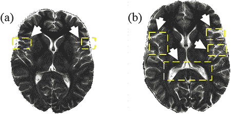

**Figure 5.1.** Control (left) and WD (right). Both images show the skull with the removal of background.

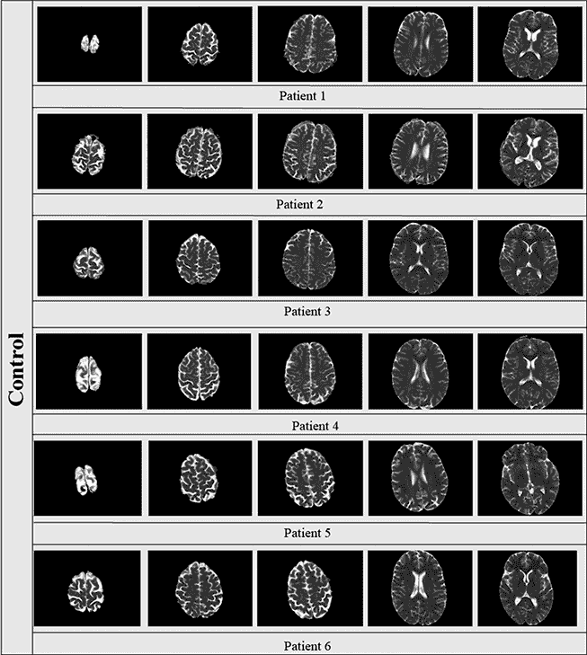

**Figure 5.2.** Samples of the segmented MRI scans of six patients from the control dataset.

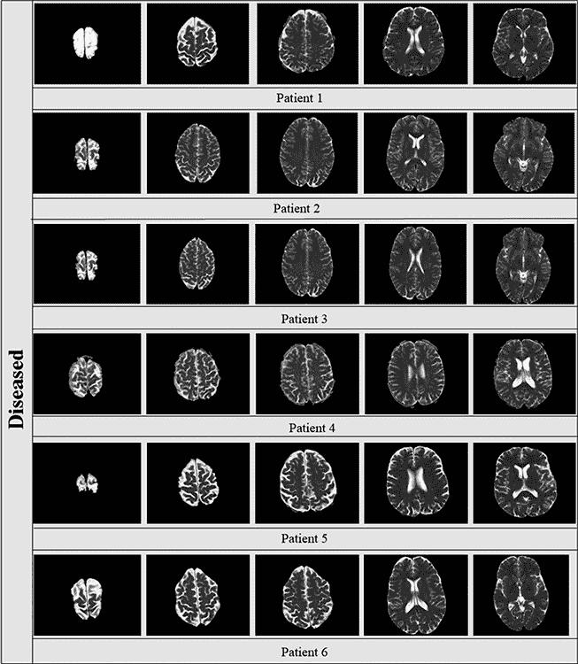

**图 5.3.** 来自病变数据集的六名患者的分割 MRI 扫描样本。

### 5.4 全局架构：转移学习

我们开发了用于 `WD` 特征描述和分类的 `TL` 全局架构。图 5.4 展示了 `TL` 框架的全局架构。我们同样使用类似的模型对中风 [12, 35–37, 47, 72–74]、内皮-介质厚度 [75–77]、肝脏 [13, 48–50] 和糖尿病 [39, 78, 79] 使用深度学习和机器学习架构。本研究是首次采用转移学习范式对 `WD` 分类进行研究。本文使用了四种转移学习架构，`AlexNet` [80]、`ResNet` [81]、`InceptionV3` [82] 和 `DenseNet121` [83]，它们在 `ImageNet` 挑战中取得了最佳性能。

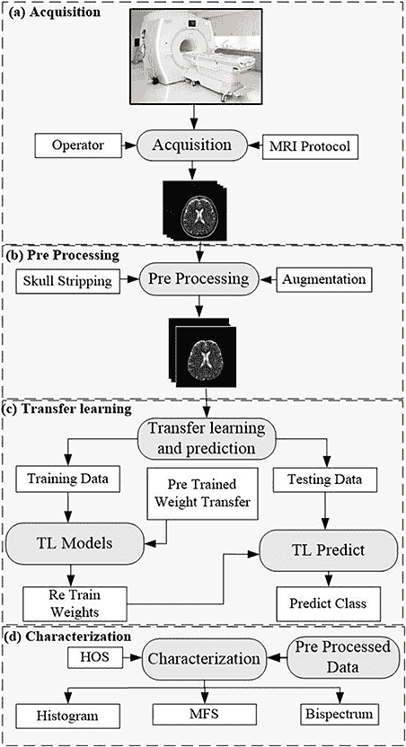

**图 5.4.** 我们研究的全局架构。(MRI：磁共振成像；TL：转移学习；HOS：高阶谱；MFS：均值特征强度。)

#### 5.4.1 AlexNet

`AlexNet` 是首个为使用深度卷积神经网络对 `ImageNet` 进行分类而设计的智能模型。该架构由 Krizhevsky *et al* [80] 在 2012 年提出，用于在 `ImageNet` 挑战中对 1000 类、120 万张高分辨率图像进行分类。`AlexNet` 在 `ImageNet` 挑战中获得了第一名。该架构结合卷积和最大池化，输入图像尺寸为 224 × 224，实现了 15.3% 的前五名错误率。`AlexNet` 的架构示意图如图 5.5 所示。


**图 5.5.** `AlexNet` 架构。

在转移学习范式中，我们使用 `AlexNet` 模型的预训练权重初始化和中间层。我们将 `WD` 群体输入到 `FC6` 层进行微调，以用于 `WD` 分类。此外，在 `FC6` 和 `FC7` 之间添加了一个 50% 丢弃率的额外 `dropout` 层，并将输出层的节点数从 1000 改为 2，因为我们的群体只有两类。

#### 5.4.2 ResNet50

He *et al* [81] 构建了 `ResNet` 架构，并在顶 5% 上实现了 3.57% 的错误率。该模型还赢得了挑战，作者提出了从 20 层到 1202 层不等的多种 `ResNet` 架构。在我们的研究中，实验选用了 `ResNet50`。`ResNet50` 包含 50 层、25 个残差块以及一个全连接网络（`FCN`），后接 `softmax` 层。我们在转移学习范式下实现该模型，通过冻结预训练在 `ImageNet` 上的 `ResNet` 权重来冻结所有层权重。我们在第一个 `FCN` 之后添加了 `dropout` 层，然后再添加一个全连接层和 `softmax` 层。我们从第一个 `FCN` 开始使用 `WD` 群体重新训练模型。这里我们也将输出层的节点数从 1000 改为 2，因为 `WD` 群体只有两类。`ResNet` 的架构在图 5.6 中展示。


**图 5.6.** `Resnet50` 架构。

#### 5.4.3 DenseNet161

`DenseNet` 是另一种流行的架构，它在 `CVPR` 2017 获得了最佳论文奖。Huang *et al* [83] 提出了密集连接卷积神经网络，用于解决消失梯度问题并通过较少的训练参数实现更好的特征传播。该架构包含密集块，会将当前块和前一个块的特征拼接。与 `ResNet` 不同，`DenseNet` 会融合所有特征，而非像 `ResNet` 那样将特征与前一个块相加。他们提出了从 32 到 48 个特征图、深度从 121 到 161 的一系列架构。该模型在 `ImageNet` 2017 挑战中实现了 6.15% 的顶 5% 错误率。

在我们的研究中，我们选择 `DenseNet161`，该模型包含 161 层，并在转移学习框架中实现。为使 `DenseNet` 适配转移学习框架，我们冻结了从 `ImageNet` 2017 获得的初始到中间层的所有权重。随后，我们通过在 `DenseNet161` 末端添加 `dropout` 层和 `dense` 层来修改末端层架构。修改后的 `DenseNet` 架构在图 5.7 中展示。

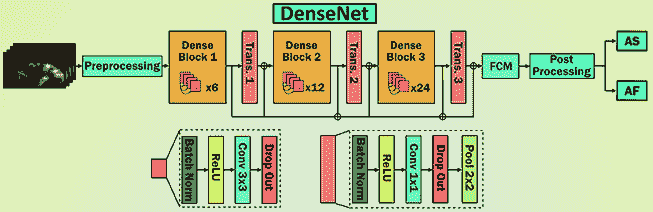

**图 5.7.** `DenseNet161` 架构。

#### 5.4.4 XceptionNet

`XceptionNet` 由 Google 开发，是另一种用于图像分类的流行架构，基于 `InceptionNet` [84]。此外，`XceptionNet` 引入了修改后的深度可分离卷积技术用于 `ImageNet` 分类，并在顶一精度上实现了 0.790 的错误率，顶五精度上实现了 0.945 的错误率。

在我们的研究中，我们在转移学习范式下使用 `XceptionNet`，通过冻结初始层并修改末端层，使用 `WD` 群体进行微调以进行分类。`XceptionNet` 的修改后架构如图 5.8 所示。

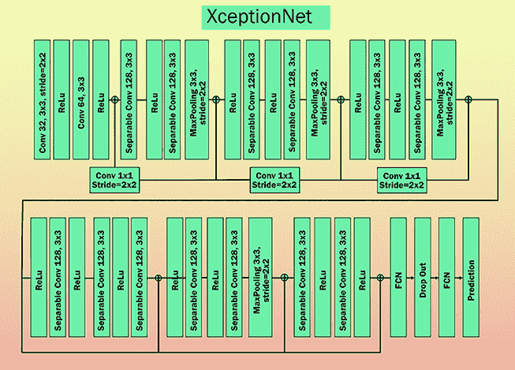

**图 5.8.** 拟议的 `XceptionNet` 架构。

#### 5.4.5 InceptionV3

Szegedy *et al* [82] 开发了 `InceptionV3` 用于解决计算机视觉问题，如标签平滑和将标签信息深度传播到神经网络。作者提出了 `Inception` 家族的一系列架构，其中 `InceptionV3`（`IV3`）在顶 1% 上实现了 4.2% 的最低错误率。

我们在转移学习范式下考虑了 `IV3`，通过将预训练在 `ImageNet` 上的 `IV3`（最初训练于 `ImageNet`）权重从初始层到中间层转移。我们修改了末端层，即从 `FCN` 到输出层，并在 `FCN` 之间添加了两个 50% 丢弃率的 `dropout` 层，输出层的节点数为 2。我们在 `FCN` 处输入 `WD` 群体，对目标标签进行模型微调。`InceptionV3` 的架构在图 5.9 中展示。

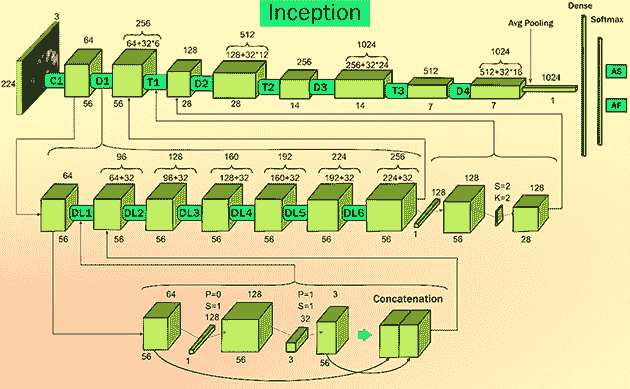

**图 5.9.** `InceptionV3` 的修改后架构。

#### 5.4.6 SivaSuriNet

- 提议的 `TL` 架构的性能与一种新型 `DL` 架构 `SivaSuriNet` 进行了比较。`SivaSuriNet` 使用可分离卷积神经网络，并在每个层组合后使用最大池化层。最初使用 32 个滤波器，随后增加到 256 个。架构形状像漏斗，如图 5.10 所示。`SivaSuriNet` 的训练参数详情见表 5.1。

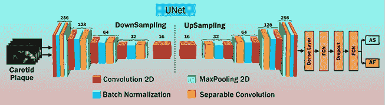

**Figure 5.10.** `SivaSuriNet` architecture.

**Table 5.1.** `SivaSuriNet` architecture parameters.

| Layer type | Shape | Parameter # |
| --- | --- | --- |
| Convolution 2D | 128 × × 128 × 32 | 896 |
| Batch normalization | 128 × 128 × 32 | 128 |
| Separable convolution 2D | 128 × 128 × 64 | 2400 |
| Batch normalization | 128 × 128 × 64 | 256 |
| Max-pooling 2D | 64 × 64 × × 64 | 0 |
| Separable convolution 2D | 64 × 64 × 128 | 8896 |
| Batch normalization | 64 × 64 × 128 | 512 |
| Max-pooling 2D | 32 × 32 × 128 | 0 |
| Separable convolution 2D | 32 × 32 × 256 | 34176 |
| Batch normalization | 32 × 32 × 256 | 1024 |
| Max-pooling 2D | 16 × 16 × 256 | 0 |
| Separable convolution 2D | 16 × 16 × 64 | 18752 |
| Batch normalization | 16 × 16 × 64 | 256 |
| Max-pooling 2D | 8 × 8 × × 64 | 0 |
| Separable convolution 2D | 8 × 8 × 128 | 8896 |
| Batch normalization | 8 × 8 × 128 | 512 |
| Max-pooling 2D | 4 × 4 × 128 | 0 |
| Separable convolution 2D | 4 × 4 × 256 | 34176 |
| Batch normalization | 4 × 4 × 256 | 1024 |
| Max-pooling 2D | 2 × 2 × 256 | 0 |
| Flatten | 1024 | 0 |
| Dense | 1024 | 1049600 |
| Dropout | 0.5 | 0 |
| Dense | 512 | 524800 |
| Dropout | 0.5 | 0 |
| Dense (softmax) | 2 | 1026 |
| **Total trainable parameters** | **1 687 330** |  |

### 5.5 Results

#### TL optimization

我们通过使用六种 `TL` 架构，并对增强折叠从 1× 到 6× 进行优化，实现了 `TL` 框架的性能优化，并在 `IV3` 中取得了最佳准确率。图 5.11 展示了 `TL` 和 `SivaSuriNet` 的 3D 优化及对应数值，详情见表 5.2。我们对所有 `AI` 架构采用了 `K10` 交叉验证协议（90% 训练，10% 测试），在 `IV3` 中实现了最佳准确率 97.82% ± 1.52%，平均准确率为 91.83% ± 2.23%。

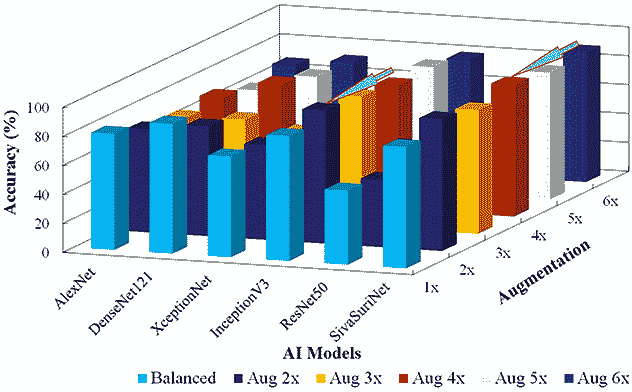

**Figure 5.11.** Optimization of TL and SivaSuriNet with augmentation.

**Table 5.2.** 3D optimization of TL architectures and SivaSuriNet (asterisks represent the highest and second highest accuracy values).

| Model | Balanced | Aug 2× | Aug 3× | Aug 4× | Aug 5× | Aug 6× | Mean ± SD |
| --- | --- | --- | --- | --- | --- | --- | --- |
| AlexNet | 79.98 ± 4.18 | 71.10 ± 32.60 | 67.21 ± 63.63 | 69.81 ± 47.52 | 62.49 ± 4.10 | 68.05 ± 3.25 | 71.94 ± 2.71 |
| DenseNet121 | 89.36 ± 17.76 | 75.766 ± 33.29 | 68.39 ± 46.16 | 81.41 ± 40.50 | 74.47 ± 15.50 | 72.39 ± 25.12 | 78.74 ± 4.70 |
| XceptionNet | 69.30 ± 17.78 | 65.33 ± 42.60 | 62.1 ± 35.01 | 61.87 ± 30.04 | 57.81 ± 15.56 | 52.72 ± 25.52 | 64.67 ± 3.05 |
| InceptionV3 | 85.98 ± 4.06 | **91.83 ± 2.23*** | 89.40 ± 2.53 | 85.41 ± 2.13 | 86.23 ± 1.13 | 79.51 ± 3.25 | 88.16 ± 1.74 |
| ResNet50 | 50.86 ± 4.18 | 46.35 ± 2.70 | 48.24 ± 3.41 | 53.90 ± 2.48 | 50.34 ± 5.35 | 51.55 ± 5.45 | 49.84 ± 1.79 |
| SivaSuriNet | 83.57 ± 4.03 | 90.79 ± 2.76 | 85.23 ± 6.35 | **90.96 ± 4.63*** | 87.49 ± 5.35 | 89.58 ± 2.58 | 87.64 ± 2.28 |
| Mean+SD | 76.45 ± 7.71 | 73.53 ± 8.90 | 70.10 ± 8.11 | 73.89 ± 8.51 | 67.81 ± 8.56 | 67.52 ± 6.25 |  |

我们使用 `K10` 交叉验证协议比较了 `TL` 性能与 `SivaSuriNet`，`SivaSuriNet` 实现了 98.43% ± 1.45% 的最佳准确率，平均准确率为 90.96% ± 4.63%。`SivaSuriNet` 在最佳准确率组合中提高了 0.62%，且平均准确率相当。我们还计算了所有 `AI` 架构的曲线下面积（`AUC`），结果如图 5.12 所示。

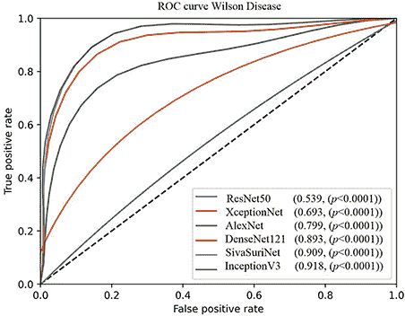

**Figure 5.12.** ROC analysis of six AI models.

### 5.6 Characterization

我们假设白质高信号（`WMH`）在 `WD` 中高于对照组，为验证该假设，我们使用了两种策略：(i) `AI` 基于的特征强度（`MFS`）和 (ii) 基于更高阶谱（`HOS`）的信号处理技术，即双谱（bispectrum）。

#### 5.6.1 Mean feature strength

`AI` 基于的 `MFS` [37] 是一种新颖的技术，用于计算 `DL` 模型在每一层学习到的特征的强度。`MFS` 仅从 `DL` 模型中计算，因为 `TL` 模型在初始和中间层使用 `ImageNet` 特征，因此不适合计算特征强度。因此，我们使用了经过训练的 `SivaSuriNet` 权重来计算 `MFS`。这里我们对最佳准确率组合的所有训练图像进行处理，并在每一层计算每张图像的特征强度。计算完特征强度后，我们计算了所有训练图像在每一层的特征强度的平均值。图 5.13 展示了 `SivaSuriNet` 的 `MFS`，并表明 `WD` 的 `MFS` 高于对照组 21.57%，因此我们得出结论 `MFS` (`WD`) > `MFS` (control)。

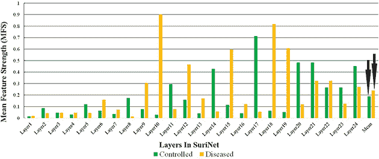

**Figure 5.13.** Mean feature strength of SivaSuriNet.

#### 5.6.2 Higher-order spectrum

为验证 `MFS`，我们选择了一种非 `AI` 技术，即通过计算相同的组合（用于计算 `MFS` 的组合）的 bispectrum（`B`）来进行信号处理。这里我们对每张图像在 0° 到 180° 之间以 15° 的步长随机旋转，计算了每张图像的平均 `B` 值。图 5.14(a) 展示了训练图像在 0° 到 180° 之间每个角度的平均 `B` 值，步长为 15°。图 5.14(b) 展示了 `WD` 在最佳角度 60° 时的 `HOS`。`HOS` 的结果与 `MFS` 类似，`WD` 的双谱高于对照组 9.24%。


**Figure 5.14.** (a) Mean bispectrum analysis. (b) Higher-order spectra of WD.

### 5.7 Discussion

在本节中，我们讨论了与现有工作的对比。首先介绍了 `WD` 的特征描述，然后讨论我们的主张、所提工作的优势和劣势，最后给出结论和未来工作。

我们的研究是首个在 `WD` 分类中使用优化的 `TL` 范式并结合增强学习进行的工作。我们将其性能与新型架构 `SivaSuriNet` 进行了比较。两种架构的性能相似，但 `IV3` 的表现比 `SivaSuriNet` 高 0.94%。

#### Benchmarking

我们对当前的 `TL` 范式与现有工作进行了对比，如表 5.3 所示。我们发现，除我们的团队外，其他现有工作均未进行任何分类。本研究是首次在与 `SivaSuriNet` 相比的 `TL` 优化方面对 `WD` 分类进行研究。基准表包含第一作者的姓名、年份、应用和模态、用于该应用的技术，以及在表 5.3 中以面积-曲线下（`AUC`）显示的准确率。

**表 5.3.** 与现有系统的对比。


| 作者, 年份, 参考文献 | 应用 | 模态 | 技术 | AI | ACC (%) (AUC) |
|---|---|---|---|---|---|
| Kaden *et al* (2015) [69] | WD | MRI | SVM 和 PGLVQ | ML | **90.1** |
| Suk *et al* (2017) [85] | AD | MRI (ADNI) | DBN + NN | DL | **85.91** (0.91) |
| Abiwinanda *et al* (2018) [86] | BT | MRI | CNN | DL | **84.19** |
| Zhang *et al* (2019) [87] | MCI | fMRI | SSGSR | ML | **88.50** (0.965) |
| Abrol *et al* (2018) [88] | MCI 对比 ALZ | MRI | ResNet | DL | **82.7** (0.89) |
| Jing *et al* (2019) [70] | WD | fMRI | SVM 和 ICA | ML | **89.4** (0.94) |
| Richhariya *et al* (2020) [89] | MCI | MRI | SVM | ML | **90** |
| Liu *et al* (2020) [90] | MCI | MRI | SVM | ML | **88.5** (0.90) |
| Saba *et al* (2020) [6] | CNN | MRI | VGG-19 | DL | 95.46 (0.954) |
| Agarwal *et al* (2020) [71] | iDCNN | MRI | CNN | DL | 98.28 (0.990) |
| **拟议工作** | **CNN** | **MRI** | **优化 InceptionV3** | **TL** | **优化组合: 97.82, 91.83 (0.918)** |
| **拟议工作** | **CNN** | **MRI** | **SivaSuriNet** | **DL** | **优化组合: 98.43, 90.96 (0.91)** |

ALZ: 阿尔茨海默病; BT: 脑肿瘤; MCI: 轻度认知障碍。

*关于 WD 表征的简短说明*

我们使用人工智能方法（即 MFS）和非人工智能方法（即双谱）对 WD 进行表征。基于人工智能方法的表征依赖于输入数据。然而，我们的队列最初呈不平衡，且控制类样本更多。双谱基于像素强度。两种表征技术均适用于我们的数据集，且需要大量数据才能在该范式下加强验证。

*功效分析*

我们还进行了功效分析，以确定本研究所需的样本量，并使用以下公式进行样本量计算：

$${sample}\\ \\operatorname{size} = \\frac{2 \\times \\left( {Z\\_{\\alpha} + Z\\_{1 - \\beta}} \\right)^{2} \\times \\sigma^{2}}{\\Delta^{2}}.$$  

(5.1)

```
graphic style="width:38.8125em;" xlink:href="bk978-0-7503-2244-7ch5eqn1.gif" position="float"/
```

这里我们选择 *Z*[*α*] = 3.2905 用于类型 1 错误（1%），*Z*[1*−β*] = 1.6449 用于类型 2 错误（1%）。这里 *σ*（标准差）= 2.53，*Δ*（均值差）= 0.627。将这些值代入公式 (5.1)，得到 793 个样本用于拟议研究。此外，队列中的样本数为 916（平衡类别），比所需样本量高出 13.42%。

*优势、劣势和扩展*

本研究是首次使用优化的 TL 架构对 WD 的分类和表征进行研究。所有 TL 都通过改变增强和架构进行优化。此外，我们还将所有优化的 TL 模型性能与一种新型架构 SivaSuriNet 进行了比较。我们通过基于 AI 的 MFS 和基于信号处理的 HOS 进行验证，两者均对 WD 的表征提供了相似的结果。

尽管本研究取得了令人印象深刻的结果，且样本量充足，支持模型用于研究更复杂的模式，但由于原始队列中控制类样本更多、WD 类样本较少，我们通过增强对每类样本数量进行平衡。该系统可以扩展到融合两个或多个架构（即混合架构）以研究 WD。此外，我们还可以将此工作扩展到多中心数据，以获得更大的训练集。

### 5.8 结论

本研究是首次使用 TL 框架对 WD 的分类和表征进行研究。我们在 IV3 中实现了最佳优化组合，准确率为 97.82% ± 1.52%。此外，我们还将 TL 的性能与一种新型 DL 架构 SivaSuriNet 进行了比较。SivaSuriNet 在增强 4 与 K10 折叠下实现了最佳准确率 98.43% ± 1.45%。分类后，我们还能够利用基于 AI 的 MFS 和基于信号的双谱对 WD 进行表征，并得出结论：WD 的值高于对照组 21.57%。使用双谱，WD 的值高于对照组 9.24%。我们使用广泛接受的心脏和肺数据对系统进行了验证。

章节 5.3.1、5.3.2 和 5.3.3 包含经 71 许可复制的摘录。版权所有 (2021) Springer。

## 参考文献

[1] Dusek P, Litwin T and Czlonkowska A 2015 Wilson disease and other degenerations with metal accumulations *Neurol. Clin.* [**33** 175–204](http://dx.doi.org/10.1016/j.ncl.2014.09.006)

[2] Brewer G J and Askari F K 2005 Wilson’s disease: clinical management and therapy *J. Hepatol.* [**42** S13–21](http://dx.doi.org/10.1016/j.jhep.2004.11.013)

[3] Medici V, Rossaro L and Sturniolo G 2007 Wilson disease—a practical approach to diagnosis, treatment, and follow-up *Dig. Liver Dis.* [**39** 601–9](http://dx.doi.org/10.1016/j.dld.2006.12.095)

[4] Rosencrantz R and Schilsky M 2011 Wilson disease: pathogenesis and clinical considerations in diagnosis and treatment *Seminars in Liver Disease* (Stuttgart: Thieme Medical)

[5] Saba L *et al* 2019 Wilson’s disease: a new perspective review on its genetics, diagnosis and treatment *Front. Biosci.* [**11** 166–85](http://dx.doi.org/10.2741/e854)

[6] Saba L *et al* 2020 Brain MRI-based Wilson disease tissue classification: an optimised deep transfer learning approach *Electron. Lett.* [**56** 1395–8](http://dx.doi.org/10.1049/el.2020.2102)

[7] Roberts E A and Schilsky M L 2003 A practice guideline on Wilson disease *Hepatology* [**37** 1475–92](http://dx.doi.org/10.1053/jhep.2003.50252)

[8] Parekh J R and Agrawal P R 2014 Wilson’s disease: ‘face of giant panda’ and ‘trident’ signs together *Oxford Med. Case rep.* [**2014** 16–7](http://dx.doi.org/10.1093/omcr/omu005)

[9] Yousaf M *et al* 2009 Atypical MRI features involving the brain in Wilson’s disease *Radiol. Case Rep.* [**4** 312](http://dx.doi.org/10.2484/rcr.v4i3.312)

[10] Banchhor S K *et al* 2017 Well-balanced system for coronary calcium detection and volume measurement in a low resolution intravascular ultrasound videos *Comput. Biol. Med.* [**84** 168–81](http://dx.doi.org/10.1016/j.compbiomed.2017.03.026)

[11] Radeva P and Suri J S 2019 *Vascular and Intravascular Imaging Trends, Analysis, and Challenges* **vol 2** (Bristol: IOP Publishing)


- [Jamthikar A et al 2020 超声心电图基于 Framingham 风险评分和 ASCVD 风险评分的“整合血管年龄”而非“年龄”进行卒中/心血管风险分层的多族裔研究 (Asian Indian, Caucasian, Japanese cohorts) *Cardiovasc. Diag. Ther.* [10] 939](http://dx.doi.org/10.21037/cdt.2020.01.16)
- [Biswas M et al 2017 Symtosis: 优化深度学习范式下的肝脏超声组织特征表征与风险分层 *Comput. Methods Programs Biomed.* **155** 165–77](https://doi.org/10.1016/j.cmpb.2017.01.001)
- [Maniruzzaman M et al 2019 结肠微阵列基因表达数据的统计特征与分类，使用多种机器学习范式 *Comput. Methods Programs Biomed.* **176** 173–93](http://dx.doi.org/10.1016/j.cmpb.2019.04.008)
- [Araki T et al 2015 基于形状的冠状动脉钙化病灶体积测量在血管内超声成像中的方法及其与颈动脉内皮-间皮层厚度的关联 *J. Ultrasound Med.* **34** 469–82](http://dx.doi.org/10.7863/ultra.34.3.469)
- [Jamthikar A D et al 2019 类风湿性关节炎与动脉粥样硬化成像及心血管风险评估的机器学习组织特征化 *Vascular and Intravascular Imaging Trends, Analysis, and Challenges* vol 2 (Bristol: IOP Publishing) pp 4-1–29](http://dx.doi.org/10.1016/j.cdt.2019.01.001)
- [Acharya U R et al 2013 超声颈动脉扫描中斑块组织特征与分类：整合血管特征的范式 *IEEE Trans. Instrum. Meas.* **62** 392–400](http://dx.doi.org/10.1109/TIM.2012.2217651)
- [Acharya U R et al 2012 卵巢肿瘤特征与分类：GyneScan 系统类 *2012 Annual Int. Conf. of the IEEE Engineering in Medicine and Biology Society* (Piscataway, NJ: IEEE)](http://dx.doi.org/10.1109/IEMBS.2012.6352545)
- [Saba L et al 2013 完全自动化 cIMT 测量软件（AtheroEdge）的观察者间及观察者内一致性分析及其与商业超声扫描仪和专家读片者的对比 *Comput. Biol. Med.* **43** 1261–72](http://dx.doi.org/10.1016/j.compbiomed.2013.06.012)
- [Molinari F et al 2018 高效数据挖掘框架，利用二维经验模态分解技术对颈动脉斑块进行症状性与无症状性特征表征 *Med. Biol. Eng. Comput.* **56** 1579–93](http://dx.doi.org/10.1007/s11517-018-1792-5)
- [Banchhor S K et al 2017 基于壁面测量特征的机器学习范式，结合斑块纹理特征提升 IVUS 冠状动脉风险评估 *Comput. Biol. Med.* **91** 198–212](http://dx.doi.org/10.1016/j.compbiomed.2017.10.019)
- [Singh B K et al 2017 2D 超声心电图基于混合特征选择的机器学习范式进行乳腺病变风险分层 *Measurement* **105** 146–57](http://dx.doi.org/10.1016/j.measurement.2017.01.016)
- [Sharma A M et al 2015 颈动脉超声斑块组织特征与中风风险分层的机器学习框架综述 *Curr. Atheroscler. Rep.* **17** 55](http://dx.doi.org/10.1007/s11883-015-0529-2)
- [Shrivastava V K et al 2015 利用全面特征空间在机器学习范式下，实现皮肤病像图像的可靠准确分类 *Expert Syst. Appl.* **42** 6184–95](http://dx.doi.org/10.1016/j.eswa.2015.03.014)
- [Schurisch Schuster S et al 2018 蜂蜜蜂寄生虫检测图像分析的初步研究 *Image Analysis and Recognition* (Cham: Springer)](http://dx.doi.org/10.1007/978-3-319-93328-8_12)
- [Saba L et al 2017 颈动脉超声斑块组织形态学基于中风风险分层：聚合主成分分析学习范式 *J. Med. Syst.* **41** 98](http://dx.doi.org/10.1007/s10916-017-0745-0)
- [Saba L et al 2019 深度学习在放射学中的现状与未来 *Eur. J. Radiol.* **114** 14–24](http://dx.doi.org/10.1016/j.ejrad.2019.02.038)
- [Acharya U R et al 2013 通过图像组织特征表征动脉粥样斑块的症状性 *Comput. Methods Programs Biomed.* **110** 66–75](http://dx.doi.org/10.1016/j.cmpb.2012.09.008)
- [Acharya U R et al 2013 结合离散小波变换和纹理特征对冠状动脉血管壁进行特征表征的初步研究 *Proc. Inst. Mech. Eng. H* **227** 643–54](http://dx.doi.org/10.1177/0954411913480622)
- [Acharya U R et al 2013 利用左心室超声心动图灰度特征，自动分类冠状动脉疾病患者 *Comput. Methods Programs Biomed.* **112** 624–32](http://dx.doi.org/10.1016/j.cmpb.2013.07.012)
- [Acharya U R et al 2012 颈动脉超声组织特征的机器学习风险分层策略 *Ultrasound Med. Biol.* **38** 899–915](http://dx.doi.org/10.1016/j.ultrasmedbio.2012.01.015)
- [Acharya U R et al 2013 2D 超声颈动脉纵向扫描的斑块组织特征表征与自动分类，用于中风风险评估 *Med. Biol. Eng. Comput.* **51** 513–23](http://dx.doi.org/10.1007/s11517-012-1019-0)
- [Acharya U R et al 2011 Atheromatic™：结合 HOS、DWT 和纹理特征对颈动脉超声斑块进行症状性与无症状性分类 *2011 Annual Int. Conf. of the IEEE Engineering in Medicine and Biology Society* (Piscataway, NJ: IEEE)](http://dx.doi.org/10.1109/IEMBS.2011.6050256)
- [Acharya U R et al 2012 精确且通用的颈动脉超声扫描斑块表征方法，涵盖 346 例扫描 *IEEE Trans. Instrum. Meas.* **61** 1045–53](http://dx.doi.org/10.1109/TIM.2011.2174897)
- [Saba L et al 超声颈动脉内膜增厚特征的深度学习范式，用于心血管疾病/中风风险评估系统 *Int. J. Cardiovasc Imaging* **35** 1–18](http://dx.doi.org/10.1007/s10554-017-1234-5)
- [Saba L et al 2021 多中心研究：利用六种深度人工智能模型对颈动脉斑块组织特征进行分类与风险评估，用于中风应用 *IEEE Trans. Instrum. Meas.* **70** 1–12](http://dx.doi.org/10.1109/TIM.2021.3052577)
- [Skandha S S et al 2020 3D 优化人工智能范式，用于颈动脉超声斑块的分层与表征，Atheromatic™ 2.0 *Comput. Biol. Med.* **125** 103958](http://dx.doi.org/10.1016/j.compbiomed.2020.103958)
- [Saba L et al 2019 糖尿病队列中颈动脉狭窄测量与风险分层的深度学习范式 *Cardiovasc. Diagn. Ther.* **9** 439–61](http://dx.doi.org/10.21037/cdt.2019.09.01)
- [Banchhor S K et al 2017 自动冠状动脉钙化体积与手动冠状动脉腔体积、血管体积及斑块体积之间的关系，日本糖尿病队列 *J. Clin. Diagn. Res.: JCDR* **11** TC09](http://dx.doi.org/10.7860/JCDR/2017/26336.10030)
- [Khanna N N et al 2019 10 年超声图像基于中风/心血管风险计算器的性能评估，对比十个传统风险计算器，糖尿病队列 *Comput. Biol. Med.* **105** 125–43](http://dx.doi.org/10.1016/j.compbiomed.2019.01.002)
- [Kabir C S, Haq M M and Cader F A 2017 孟加拉国接受经皮冠状动脉介入治疗的糖尿病与非糖尿病患者冠状动脉直径差异，两年回顾性分析 *Bangladesh Heart J.* **32** 23–8](http://dx.doi.org/10.3329/bhj.v32i1.34166)
- [Biswas M et al 2018 深度学习策略用于准确测量颈动脉内皮-间皮层厚度，日本糖尿病队列超声研究 *Comput. Biol. Med.* **98** 100–17](http://dx.doi.org/10.1016/j.compbiomed.2018.05.014)

[43] Jamthikar A D *et al* 2019 Wall quantification and tissue characterization of the coronary artery *Vascular and Intravascular Imaging Trends, Analysis, and Challenges* **vol 2** (Bristol: IOP Publishing) pp 3-1–36

[44] Jamthikar A D *et al* 2019 Risk of coronary artery disease: genetics and external factors *Vascular and Intravascular Imaging Trends, Analysis, and Challenges* **vol 2** (Bristol: IOP Publishing) pp 2-1–38

[45] Araki T *et al* 2016 PCA-based polling strategy in machine learning framework for coronary artery disease risk assessment in intravascular ultrasound: a link between carotid and coronary grayscale plaque morphology *Comput. Methods Programs Biomed.* [**128** 137–58](http://dx.doi.org/10.1016/j.cmpb.2016.02.004)

[46] Araki T *et al* 2016 A new method for IVUS-based coronary artery disease risk stratification: a link between coronary and carotid ultrasound plaque burdens *Comput. Methods Programs Biomed.* [**124** 161–79](http://dx.doi.org/10.1016/j.cmpb.2015.10.022)

[47] Jamthikar A D *et al* 2020 Multiclass machine learning vs conventional calculators for stroke/CVD risk assessment using carotid plaque predictors with coronary angiography scores as gold standard: a 500 participants study *Int. J. Cardiovasc. Imaging* **37** 1–17

[48] Kuppili V *et al* 2017 Extreme learning machine framework for risk stratification of fatty liver disease using ultrasound tissue characterization *J. Med. Syst.* [**41** 152](http://dx.doi.org/10.1007/s10916-017-0797-1)

[49] Acharya U R *et al* 2012 Data mining framework for fatty liver disease classification in ultrasound: a hybrid feature extraction paradigm *Med. Phys.* [**39** 4255–64](http://dx.doi.org/10.1118/1.4725759)

[50] Saba L *et al* 2016 Automated stratification of liver disease in ultrasound: an online accurate feature classification paradigm *Comput. Methods Programs Biomed.* [**130** 118–34](http://dx.doi.org/10.1016/j.cmpb.2016.03.016)

[51] Sanagala S S *et al* 2019 A fast and light weight deep convolution neural network model for cancer disease identification in human lung(s) *18th IEEE Int. Conf. on Machine Learning And Applications* (Piscataway, NJ: IEEE)

[52] Alakwaa W, Nassef M and Badr A 2017 Lung cancer detection and classification with 3D convolutional neural network (3D-CNN) *Lung Cancer* [**8** 409](http://dx.doi.org/10.14569/IJACSA.2017.080853)

[53] Skourt B A, El Hassani A and Majda A 2018 Lung CT image segmentation using deep neural networks *Procedia Comput. Sci.* [**127** 109–13](http://dx.doi.org/10.1016/j.procs.2018.01.104)

[54] Agarwal M *et al* 2021 A novel block imaging technique using nine artificial intelligence models for COVID-19 disease classification, characterization and severity measurement in lung computed tomography scans on an Italian cohort *J. Med. Syst.* [**45** 1–30](http://dx.doi.org/10.1007/s10916-021-01707-w)

[55] Suri J S *et al* 2021 A narrative review on characterization of acute respiratory distress syndrome in COVID-19-infected lungs using artificial intelligence *Comput. Biol. Med.* [**130** 104210](http://dx.doi.org/10.1016/j.compbiomed.2021.104210)

[56] Mallio C A *et al* 2021 Deep learning algorithm trained with COVID-19 pneumonia also identifies immune checkpoint inhibitor therapy-related pneumonitis *Cancers* [**13** 652](http://dx.doi.org/10.3390/cancers13040652)

[57] Saba L *et al* 2021 Six artificial intelligence paradigms for tissue characterisation and classification of non-COVID-19 pneumonia against COVID-19 pneumonia in computed tomography lungs *Int. J. Comput. Assist. Radiol. Surg.* [**16** 423–34](http://dx.doi.org/10.1007/s11548-021-02317-0)

[58] Singh M *et al* 2021 Transfer learning based ensemble support vector machine model for automated COVID-19 detection using lung computerized tomography scan data *Med. Biol. Eng. Comput.* **59** 825–39

[59] Apostolopoulos I D and Mpesiana T A 2020 Covid-19: automatic detection from x-ray images utilizing transfer learning with convolutional neural networks *Phys. Eng. Sci. Med.* [**43** 635–40](http://dx.doi.org/10.1007/s13246-020-00865-4)

[60] Lam C *et al* 2018 Automated detection of diabetic retinopathy using deep learning *AMIA Jt. Summits Transl. Sci. Proc.* **2017** 147–55

[61] Ferenci P 2006 Regional distribution of mutations of the ATP7B gene in patients with Wilson disease: impact on genetic testing *Human Genet.* [**120** 151–9](http://dx.doi.org/10.1007/s00439-006-0202-5)

[62] Vrabelova S *et al* 2005 Mutation analysis of the ATP7B gene and genotype/phenotype correlation in 227 patients with Wilson disease *Mol. Genet. Metab.* [**86** 277–85](http://dx.doi.org/10.1016/j.ymgme.2005.05.004)

[63] Brickman A M *et al* 2011 White matter hyperintensities and cognition: testing the reserve hypothesis *Neurobiol. Aging.* [**32** 1588–98](http://dx.doi.org/10.1016/j.neurobiolaging.2009.10.013)

[64] Saba L *et al* 2018 Volumetric distribution of the white matter hyper-intensities in subject with mild to severe carotid artery stenosis: does the side play a role? *J. Stroke Cerebrovasc. Dis.* [**27** 2059–66](http://dx.doi.org/10.1016/j.jstrokecerebrovasdis.2018.02.065)

[65] Saba L *et al* 2017 Relationship between white matter hyperintensities volume and the circle of Willis configurations in patients with carotid artery pathology *Eur. J. Radiol.* [**89** 111–6](http://dx.doi.org/10.1016/j.ejrad.2017.01.031)

[66] Porcu M *et al* 2018 Clinical neuroimaging markers of response to treatment in mood disorders *Neurosci. Lett.* [**669** 43–54](http://dx.doi.org/10.1016/j.neulet.2016.10.013)

[67] Kim T *et al* 2006 MR imaging of the brain in Wilson disease of childhood: findings before and after treatment with clinical correlation *Am. J. Neuroradiol.* **27** 1373–8

[68] Hu X *et al* 2017 Frequency-dependent changes in the amplitude of low-frequency fluctuations in patients with Wilson’s disease: a resting-state fMRI study *Metab. Brain Dis.* [**32** 685–92](http://dx.doi.org/10.1007/s11011-016-9946-3)

[69] Kaden M *et al* 2015 Border-sensitive learning in generalized learning vector quantization: an alternative to support vector machines *Soft Comput.* [**19** 2423–34](http://dx.doi.org/10.1007/s00500-014-1496-1)

[70] Jing R *et al* 2020 Altered large-scale functional brain networks in neurological Wilson’s disease *Brain Imaging Behav.* [**14** 1445–55](http://dx.doi.org/10.1007/s11682-019-00066-y)

[71] Agarwal M *et al* 2021 Wilson disease tissue classification and characterization using seven artificial intelligence models embedded with 3D optimization paradigm on a weak training brain magnetic resonance imaging datasets: a supercomputer application *Med. Biol. Eng. Comput.* [**59** 511–33](http://dx.doi.org/10.1007/s11517-021-02322-0)

[72] Jamthikar A *et al* 2020 Cardiovascular/stroke risk prevention: a new machine learning framework integrating carotid ultrasound image-based phenotypes and its harmonics with conventional risk factors *Indian Heart J.* [**72** 258–264](http://dx.doi.org/10.1016/j.ihj.2020.06.004)

[73] Jamthikar A *et al* 2019 A low-cost machine learning-based cardiovascular/stroke risk assessment system: integration of conventional factors with image phenotypes *Cardiovasc. Diag. Ther.* [**9** 420](http://dx.doi.org/10.21037/cdt.2019.09.03)

[74] Jamthikar A *et al* 2020 Ultrasound-based stroke/cardiovascular risk stratification using Framingham Risk Score and ASCVD Risk Score based on “Integrated Vascular Age” instead of “Chronological Age”: a multi-ethnic study of Asian Indian, Caucasian, and Japanese cohorts *Cardiovasc. Diag. Ther.* **10** 939

[75] Suri J S 2014 System and method for creating and using intelligent databases for assisting in intima-media thickness (IMT) *US patent* 8805043

- [Molinari F et al 2012 超声 IMT 测量在多民族和多机构数据库上的回顾及经验：使用四种完全自动化和一种半自动化方法 *Comput. Methods Programs Biomed.* **108** 946–60](http://dx.doi.org/10.1016/j.cmpb.2012.05.008)
- [Jamthikar A et al 2019 低成本基于机器学习的心脑血管/中风风险评估系统：结合传统因素与图像表型 *Cardiovasc. Diagn. Ther.* **9** 420–30](http://dx.doi.org/10.21037/cdt.2019.09.03)
- [Biswas M et al 2019 基于深度学习的全卷积网络用于糖尿病患者颈动脉超声图像中血管腔特征的研究：中风风险工具 *Med. Biol. Eng. Comput.* **57** 543–64](http://dx.doi.org/10.1007/s11517-018-1897-x)
- [Beswick A D et al 2008 *A Systematic Review of Risk Scoring Methods and Clinical Decision Aids Used in the Primary Prevention of Coronary Heart Disease (Supplement)* (London: Royal College of General Practitioners)]
- [Krizhevsky A, Sutskever I and Hinton G E 2017 使用深度卷积神经网络在 ImageNet 上进行分类 *Commun. ACM* **60** 84–90]
- [He K et al 2016 深度残差学习用于图像识别 *Proc. of the IEEE Conf. on Computer Vision and Pattern Recognition* (Piscataway, NJ: IEEE)]
- [Szegedy C et al 2016 重新思考用于计算机视觉的 Inception 架构 *Proc. of the IEEE Conf. on Computer Vision and Pattern Recognition* (Piscataway, NJ: IEEE)]
- [Huang G et al 2017 密集连接卷积网络 *Proc. of the IEEE Conf. on Computer Vision and Pattern Recognition* (Piscataway, NJ: IEEE)]
- [Chollet F 2017 Xception：使用深度分离可卷曲卷积进行深度学习 *Proc. of the IEEE Conf. on Computer Vision and Pattern Recognition* (Piscataway, NJ: IEEE)]
- [Suk H-I et al 2017 使用稀疏回归模型的深度集成学习用于脑病诊断 *Med. Image Anal.* **37** 101–13](http://dx.doi.org/10.1016/j.media.2017.01.008)
- [Abiwinanda N et al 2019 基于卷积神经网络的脑肿瘤分类 *World Congress on Medical Physics and Biomedical Engineering 2018* (Berlin: Springer)]
- [Zhang Y et al 2019 强度和相似性引导的组级脑功能网络构建用于轻度认知障碍（MCI）诊断 *Pattern Recognit.* **88** 421–30](http://dx.doi.org/10.1016/j.patcog.2018.12.001)
- [Abrol A et al 2020 深度残差学习用于神经影像学：用于预测阿尔茨海默病进展 *J. Neurosci. Methods* **339** 108701](http://dx.doi.org/10.1016/j.jneumeth.2020.108701)
- [Richhariya B et al 2020 使用通用支持向量机递归特征消除（USVM-RFE）诊断阿尔茨海默病 *Biomed. Signal Process. Control.* **59** 101903](http://dx.doi.org/10.1016/j.bspc.2020.101903)
- [Liu J et al 2020 通过结合多视图信息增强多模态 MRI 数据的特征表示，用于 MCI 分类 *Neurocomputing.* **400** 322–32](http://dx.doi.org/10.1016/j.neucom.2020.03.006)

## Part III

## Deep learning in cardiovascular imaging

IOP Publishing

Multimodality Imaging, Volume 1

Deep learning applications

Mainak Biswas and Jasjit S Suri

## Chapter 6

## 人工智能基于超声图像的颈动脉斑块组织特征化和分类

Luca Saba, Sanagala S Skandha, Suneet K Gupta, Anudeep Puvvula, Vijaya K Koppula, Amer M Johri, Narendra N Khanna, Sophie Mavrogeni, John R Laird, Gyan Pareek, Martin Miner, Petros P Sfikakis, Athanasios Protogerou, Durga P Misra, Vikas Agarwal, Aditya M Sharma, Vijay Viswanathan, Vijay S Rathore, Monika Turk, Raghu Kolluri, Klaudija Viskovic, Elisa Cuadrado-Godia, George D Kitas, Vijay Nambi, Deepak L Bhatt, Andrew Nicolaides and Jasjit S Suri

手动分析动脉粥样斑块具有困难、易出错且耗时的特点。本研究采用深度学习（DL）框架和超级计算机，自动将颈动脉斑块分类为有症状和无症状两种形式。

在超声图像中，有症状颈动脉斑块表现为（a）低灰度中位值，原因是组织学上大的脂质核以及相对较少的胶原和钙化，（b）灰度分布更为混乱（异质），原因是其构成成分。

方法包括构建名为 Atheromatic 的人工智能（人工智能）深度学习模型，该模型采用经典卷积神经网络（CNN），包含 13 层，在超级计算机上实现。该模型使用交叉验证协议估计分类准确率（ACC）和曲线下面积（AUC）。

本研究使用了 346 例颈动脉超声定义斑块（196 例有症状，150 例无症状，平均年龄 69.9 ± 7.8 岁，女性占 39%），经过几何变换后得到 2312 例斑块（1191 例有症状，1120 例无症状）。采用 K10（90% 训练，10% 测试）交叉验证深度学习技术。验证了以下两个假设：（a）平均特征强度（MFS）和（b）曼德布拉特分形维数（FD）用于评估混沌行为，构成了深度学习特征化系统。我们发现，与无症状斑块相比，有症状斑块的 MFS 和 FD 分别提高了 64.15% ± 0.73%（`p`-value < 0.0001）和 6% ± 0.13%（`p`-value < 0.0001）。基准测试显示，使用增强的深度学习（ACC: 89.7%；AUC: 0.91，`p`-value < 0.0001）比先前发表的机器学习方法（ACC: 83.7%）提高了 6.0%。Atheromatic 在测试患者上运行时间少于 2 秒。

### 6.1 引言

每年 1790 万人死于心血管疾病（CVD），其中美国有 647 000 人死亡 [1, 2]，即每 37 秒就有一人死亡 [3]。动脉粥样硬化斑块形成于血管内，如冠状动脉和颈动脉 [4]，是 CVD 的主要原因。当斑块破裂或溃疡时，会阻断血流并导致心肌梗死 [5] 或中风 [5]。本研究仅关注颈动脉中动脉粥样斑块的特征和分类。斑块通过多种医学成像模态可视化，最常用的是磁共振成像（MRI）[6]、计算机断层扫描（CT）[7]和超声（US）[8]。超声已成为不仅在有症状患者中作为一线诊断手段，而且在无症状人群中作为强大的筛查工具，在过去十年中广泛应用 [9]。它是一项成本低廉[10]、安全、操作简便、占地面积小且无辐射的检查[11]。此外，超声血管成像分辨率小于 0.2 mm 可用于检查斑块纹理并判断其是否稳定或不稳定 [12–14]。由于观察者间差异较大，超声检查所见的颈动脉斑块纹理肉眼难以分类 [15]。与无症状斑块[16–18]相比，有症状斑块会出现显著狭窄，且更为低回声。其在腔内近端区域有大面积黑色区域且无明显回声盖，同时在高回声区域出现离散的白色斑块。这些结果来源于对有症状和无症状患者的横断面检查以及对无症状人群的大型前瞻性研究，并通过将组织学结果与*in vivo* 超声成像进行对比得到验证 [18]。由于空间超声图像的像素数据量大且模糊，计算机在处理斑块分布的线性和非线性波动方面具有更强的学习能力，因此人工智能（AI）被用于定义和分类斑块 [19]。该机器学习（ML）技术需要手动计算灰度特征 [20–25]，随后使用分类器进行离线训练以生成签名和模式，再将其应用于测试模式以预测其风险类别 [26, 27]。此类基于 ML 的方案具有临时性、效率低下、非通用性，甚至不可靠且不稳定 [27]。

深度学习（DL）技术在全球范围内迅速发展，尤其在放射影像领域 [28–30]。DL 技术为 ML 技术提供了更好的替代方案。它能够自动构建原始图案的下采样表示（即所谓的特征图），并通过 DL 架构的神经网络层动态调整灰度对比度变化 [31]。Lekadir *et al* [32] 构建了一个 CNN 模型，用于对 50 个*in vivo* 超声图像斑块组分中的 90 000 个补片进行分类，相关系数为 0.90。观察到有症状斑块的组织特征具有变异性，如（a）因大脂质核、低钙化或斑块出血而表现为低灰度中位值（GSM）的低回声区域；（b）在超声检查中呈现更为混乱（异质）的表现 [13, 14, 25]。这主要由于血管新生频繁交替出现于胶原或脂肪区域。另一方面，无症状斑块通常回声较高，灰度中位值增高，主要由于大量扩散的胶原、高钙化和小脂质核。我们开发了一套新的基于 DL 的颈动脉斑块组织特征化和分类系统。该设计解决了 ML 的多项缺陷，如（i）需人工提取特征；（ii）分类仅限于单层。采用 K10 交叉验证方法（90% 训练、10% 测试）评估分类系统的准确性。斑块通过（a）在不同 DL 层中确定平均特征强度（MFS）以及（b）使用分形维度（FD）量化斑块图像的随机性 [33, 34] 进行特征化。随后，我们将该 DL 系统与在相同队列上构建的先前 ML 系统进行对比，并利用超级计算机框架优化系统速度。本章节的结构如下。实验方法和新 DL 架构设计在章节 6.2 中介绍。章节 6.3 报告分类结果、基于 DL 框架的斑块特征化以及假设验证。章节 6.4 展示 DL 方法与 ML 范式的对比。研究发现总结在章节 6.5。

### 6.2 Methodology

#### 6.2.1 Patient demographics

专家检测到 346 名转诊患者的颈动脉内叶（ICA）狭窄程度为 50%–99%（平均年龄 69.9 ± 7.8 年，女性占比 39%），已获得机构伦理委员会（St Mary’s Hospital, Imperial College, London, UK）的批准。其中 150 人为无症状患者，即无神经症状。其余 196 人出现颈动脉粥样硬化相关的同侧大脑半球症状（晕厥失语（AF）、短暂性缺血发作或恢复良好的中风）。总共有 196 例分布，包括 88 例中风、70 例短暂性缺血发作（TIA）和 38 例晕厥失语（AF）。神经学家记录了患者的病史和体格检查 [17]。此前，这些患者数据已用于我们的机器学习研究 [20, 35]。

#### 6.2.2 Exclusion criteria

患有心源性栓塞症状或长期症状（六个月）的患者被排除在试验之外。欧洲颈动脉手术协作组（ECST）揭示，手术可降低患有 70%至 99%狭窄的患者的总体中风风险。手术对轻度狭窄（0%–29%）的患者有害（European Carotid Surgery Trialists’ Collaborative Group 1991），而对患有 30%–49%或 50%–69%狭窄的患者则影响甚微（European Carotid Surgery Trialists’ Collaborative Group 1996）。欧洲颈动脉手术协作组 1998 年建议对大多数 80%狭窄的患者进行颈动脉内膜切除术。我们早期研究发现，70%至 99%狭窄的患者手术效果显著，50%至 69%狭窄的患者效果较好（20, 35）。中风很少与导致小于 50%狭窄的颈动脉斑块相关。如果将这些斑块纳入，将引入噪声和偏见。我们根据这些数据排除了狭窄小于 50%的斑块。超声技师并不了解斑块的分类或特征，因为他们常规检查狭窄的存在并评估斑块。然而，处理图像的人员对分类保持盲视，因此他们不知道斑块是否具有症状性。

#### 6.2.3 超声数据获取与预处理

超声检查在英国伊丽莎白女王医院心血管研究与诊断实验室进行。使用的设备是 ATL HDI 3000（Advanced Technology Laboratories, Seattle, WA, USA），配备双频扫描仪和 4–7 MHz（多频率）线性宽带探头，分辨率为 20 像素/毫米。

为实现满意的图像标准化（如我们先前研究所述），满足以下条件：（i）超声束在血液中传播时未受衰减，因此使用动态范围；（ii）帧进行平均处理；（iii）在动脉腔内垂直放置斜向组织的时间增益补偿曲线。这样可确保前后壁的 adventitia 都呈现高亮度。（iv）调整增益，（v）在后处理时使用线性传递曲线，（vi）将超声束与动脉壁保持 90 度角，（vii）选择最低深度，使斑块占据图像相当大的部分，（viii）将探头校准以识别斑址旁的 adventitia 为高亮区域，用于数据标准化。队列来源于十年前，但机器分辨率自那时起有所提升。然而，如果探头方向保持一致，机器学习更有可能获得更好的结果。随着特征更分散，分离指数（APSI）将得到改善。在深度学习（DL）中，架构更有可能得到改进，因为要达到相同性能需要更小的层数。

#### 6.2.4 斑块轮廓划定

与早期研究一致（20, 35），使用 Plaque Texture Analysis 软件（Iconsoft International Ltd, Greenford, London, UK）进行标准化和斑块 ROI 选择。标准化后血液的中位灰度强度范围为 0–5，而 adventitia 层的范围为 180–190，与我们早期研究一致（20, 35）。在标准化图像中，斑块通过使用鼠标勾绘并保存为新文件（在 ROI 选择的情况下）。软件允许用户选择斑块的前壁或后壁。在选择钙化斑块时，未考虑声影。图 6.1 展示了这些切除部分。

![Figure 6.1. Left: Symptomatic. Right: Asymptomatic. Rows 1, 3, 5, and 7 are original carotid plaque scans. Rows 2, 4, 6, and 8 are pre-processed plaque delimited cut sections by the vascular surgeon (AN%). (Reproduced with permission from \[49\]. Copyright 2021 Springer.)](images/bk978-0-7503-2244-7ch6f1_online.jpg)

**Figure 6.1.** Left: Symptomatic. Right: Asymptomatic. Rows 1, 3, 5, and 7 are original carotid plaque scans. Rows 2, 4, 6, and 8 are pre-processed plaque delimited cut sections by the vascular surgeon (AN%). (Reproduced with permission from \[49\]. Copyright 2021 Springer.)

#### 6.2.5 超声斑块数据增强

我们采用标准化的“数据增强”方法，因为深度学习系统通常需要更大的数据库（数万至数百万）。这需要对已划定的斑块进行随机几何变换，如（i）倾斜和（ii）旋转。原始队列包含 346 例斑块，其中 196 例为症状性，150 例为无症状。根据上述增强方法，新建队列包含 2311 例斑块，其中 1191 例为症状性，1120 例为无症状。196 例症状性斑块被转换为 1191 例（804 例为新增且提升至 1000，然后原始 196 例被加入，总计 1196 例）。因图像失真和不适当被消除 5 幅图像，最终得到 1191 例。对于无症状斑块的扩增，采用类似方法。因此，在 150 例斑块上叠加使总数达到 1000 例，再加入 150 例原始斑块，总计 1150 例。有 30 例倾斜图像被认为不满意并从最终统计中移除，剩余 1120 例无症状斑块。

#### 6.2.6 超算机规格

我们的深度学习模型在 NVIDIA-DGX v100-1 Tesla 上实现，如图 6.2(a) 所示，这是一款突破性的系统。它在深度学习训练方面具有无与伦比的性能。它配备八个 NVIDIA Tesla V100 图形处理单元（GPU）加速器，通过 NVIDIA NVLink 相连。如图 6.2(b) 所示，所有 GPU 均连接至立方网格网络。这便于 GPU 负载共享过程。利用高性能 NVLink GPU 接口，深度学习训练（36）更具可扩展性。

![Figure 6.2. Global ML architecture. (Reproduced with permission from \[49\]. Copyright 2021 Springer.)](images/bk978-0-7503-2244-7ch6f2_online.jpg)

**Figure 6.2.** Global ML architecture. (Reproduced with permission from \[49\]. Copyright 2021 Springer.)

#### 6.2.7 深度学习架构

创建理想的 DL 体系结构用于组织特征化和斑块分类是我们所提议系统的基本独特性。卷积神经网络（CNN）的层数和层类型在 DL 体系结构中受数据集的复杂性以及结合时的超参数影响显著。我们的实验室之前已构建了最高 22 层的 DL 体系结构，这些体系结构通常用于接受大样本量（几百）和更大的图像尺寸（W × H）38。我们采用了 13 层 CNN 体系结构，包含五个卷积层（CLs）、五个平均池化层（APLs）、两个全连接层（DenL-1、DenL-2）以及一个丢弃层，如图 6.2(c)所示 6.2。该体系结构的选择是基于我们的队列规模和图像尺寸均为合理（即 346 张图像，尺寸范围从 55 × 43 像素²到 593 × 107 像素²，未进行增强；或 2311 张图像，已进行增强）。通过调整层数、丢弃率、动量率和学习率，我们能够精细调节超参数。软 max 层计算二元交叉熵损失函数（E）的类别交叉熵，用于区分有症状和无症状两类，数学表达式如下：

$$E = -(y * \log(p)) + [(1-y) * \log(1-p)]，$$

(6.1)

其中 `p` 是 DL 估计的特定类别斑块的预测概率，`y` 是观测类别的二元指示，`*` 表示乘积。方程(6.2)给出卷积过程的输出特征数量 33，方程(6.3)给出平均池化特征映射（APFM）的输出特征数量：

$$n\_{out} = \\left\\lbrack \\frac{n\_{in} + (2*P) - M}{S} \\right\\rbrack + 1$$

(6.2)

$$a\_{out} = {\\left( \\frac{w - f\\quad}{S} \\right) + 1,}$$

(6.3)

其中 `n_in` 表示每个卷积层（CL）的输入特征数， `n_out` 表示输出特征数， `M` 是卷积核大小， `P` 是卷积填充大小， `S` 是步长（即核的移动距离）， `a_out` 表示平均池化层（APL）的输出特征数， `w` 是输入特征图的宽度，`f` 是核大小。表 6.1 列出了层名称、特征图尺寸以及每个时代的训练参数（三列）。

输入尺寸必须相同，系统才能工作。因此，我们使用零填充将裁剪后的图像转换为相同尺寸，但确保这些填充在 DL 过程中的使用。此外，我们使用与裁剪部分相同尺寸的“掩码图像”，仅考虑这些裁剪部分的灰度像素。掩码图像用于确保 DL 仅利用裁剪部分的灰度像素。

**表 6.1.** CNN 13 层结构（不包括丢弃层）的可训练参数。 (经 Springer 许可复制 49。版权所有 2021 Springer.)

| C1 | C2 | C3 |
| --- | --- | --- |
| 2D 卷积层 1 | (240, 240, 256) | 7168 |
| 2D 平均池化层 1 | (120, 120, 256) | 0 |
| 2D 卷积层 2 | (120, 120, 128) | 295 040 |
| 2D 平均池化层 2 | (60, 60, 128) | 0 |
| 2D 卷积层 3 | (60, 60, 64) | 73 792 |
| 2D 平均池化层 3 | (30, 30, 64) | 0 |
| 2D 卷积层 4 | (30, 30, 32) | 18 464 |
| 2D 平均池化层 4 | (15, 15, 32) | 0 |
| 2D 卷积层 5 | (15, 15, 16) | 4624 |
| 2D 平均池化层 5 | (7, 7, 16) | 0 |
| 1D 展开 | 784 | 0 |
| 1D 全连接 1 | 128 | 100 480 |
| 丢弃层 | 128 | 0 |
| 1D 全连接 2 | 2 | 258 |
| 总可训练参数 | 499 826 | |

#### 6.2.8 实验协议

我们的实验技术采用 K10 方法，通过交叉验证（CV）范式（90% 训练，10% 测试）来评估分类准确率。我们在两个数据集上进行了 CV，以展示增强（默认 346 斑块，增强后 2311 斑块）的潜力。在 DL 系统的训练和测试过程中，考虑了以下因素：10 000 总时代、0.001 学习率、32 批量大小、0.001 正则化（L2）以及 0.5 丢弃率，Adam 为优化器。根据我们实验室的经验 39，单个组合在训练过程中可能有 10 000 到 20 000 次迭代。我们选择 10 000 时代作为可靠值，因为图像尺寸适中。学习率和正则化值通常为 0.001 和 0.001，分别符合行业惯例。整个 K10 协议的十组数据总大小为 311（346 的 90%）或 2080（2311 的 90%），因此训练批量大小设为 32。使用 MEDCALC 17.0 评估最终预测类别值，并计算接收机操作特征（ROC）和曲线下面积（AUC）。

#### 6.2.9 基准机器学习

我们通过比较文本特征、AUC 和准确率，评估 DL 模型与机器学习（ML）模型的表现。图 6.26.2 展示了 ML 模型的整体架构。ML 模型的有效性取决于所提取和选择的特征。我们收集了直方图、Haralick 和 Hu‑moment 特征，并将其输入线性判别分析（LDA）、k 最近邻（`k`‑NN）以及 K10 交叉验证协议 40、41。

#### 6.2.10 DL 与 ML 方法的性能参数

若 `η_K10^DL(c)` 表示使用 K10 协议的 DL 方法在组合 `c` 中的准确率，则 $\overline{\eta}_{K10}^{DL}$ 为 `C` 个组合的平均值，σ\[K10]^(\*D\*L\*) 则为对应的标准差，则可表示为：

$${\\overline{\\textit{η}}}\_{K10}^{\\text{DL}} = \\frac{\\sum\\limits\_{c = 1}^{C = 10}\\eta\_{K10}^{DL}\\text{(}c\\text{)}}{C}$$

(6.4)

$$\\sigma\_{K10}^{DL} = \\sqrt{\\frac{\\sum\\limits\_{c = 1}^{C = 10}\\left\\lbrack \\eta\_{K10}^{DL}\\text{(}c\\text{)} - {\\overline{\\eta}}\_{K10}^{DL} \\right\\rbrack^{2}}{C - 1}}.$$

(6.5)

对于基于 ML 的策略，我们可以以类似的方式计算平均值和标准差：

$${\\overline{\\eta}}\_{K10}^{\\text{ML}} = \\frac{\\sum\\limits\_{c = 1}^{C = 10}\\eta\_{K10}^{ML}\\text{(}c\\text{)}}{C}$$

(6.6)

$$\\quad\\sigma\_{K10}^{ML} = \\sqrt{\\frac{\\sum\\limits\_{c = 1}^{C = 10}\\left\\lbrack \\eta\_{K10}^{ML}\\text{(}c\\text{)} - \\quad{\\overline{\\eta}}\_{K10}^{\\text{ML}} \\right\\rbrack^{2}}{C - 1}}.$$

(6.7)

This process was repeated for two different kinds of validation datasets and performance evaluated.

### 6.3 结果

第一步是使用交叉验证技术评估我们的深度学习系统（PE）性能，随后基于两个假设对斑块特征进行表征。PE 在章节 6.3.1 中显示，特征表征在章节 6.3.2 中讨论。最后，我们使用最广泛使用的面部生物特征数据集来评估我们的深度学习架构。

#### 6.3.1 深度学习数据分析及与机器学习的对比

##### 6.3.1.1 深度学习分类准确率（有无增强）

如图 6.3 所示，我们使用 13 层卷积神经网络（CNN）构建深度学习架构，最后一层为 softmax 层。输出层分别估计了风险属于有症状或无症状两组的可能性（二分类）。未使用增强时，K10 协议的准确率最高，AUC（使用 MEDCALC 17.0 计算）为 86.17% 和 0.86（`p`-value < 0.0001），而使用增强后准确率为 89.7% 和 0.91（`p`-value < 0.0001）。我们在 500 步结束时计算每种组合的实时准确率，以更全面地了解模型性能。

![Figure 6.3. The conceptual view of the deep learning architecture consisting of five CLs, five APLs, two DenLs, and one flattened layer. The dotted line in the middle shows the missing three CLs and three APLs. (Reproduced with permission from \[49\]. Copyright 2021 Springer.)](images/bk978-0-7503-2244-7ch6f3_online.jpg)

**Figure 6.3.** The conceptual view of the deep learning architecture consisting of five CLs, five APLs, two DenLs, and one flattened layer. The dotted line in the middle shows the missing three CLs and three APLs. (Reproduced with permission from \[49\]. Copyright 2021 Springer.)

##### 6.3.1.2 深度学习与机器学习的对比实验

对比实验的协议是将深度学习系统与机器学习系统在相同数据集上进行比较。我们还将我们创新的深度学习系统与使用相同斑块数据的已报道机器学习系统进行对比 [20, 35]. 图 6.4 展示了使用 K10 交叉验证技术对两种 AI 算法的结果。机器学习系统的准确率为 84.05%，而深度学习系统在未使用增强时为 86.17%，使用增强后为 89.7%（如图 6.4(a) 所示）。AUC 方面，机器学习系统为 0.83（`p`-value < 0.0001），未使用增强的深度学习系统为 0.86（`p`-value < 0.0001），使用增强后为 0.91（`p`-value < 0.0001）。需要记住的关键点是，与深度学习系统不同，机器学习系统的设计与实现过程涉及精确的阶段。特征必须手动计算，离线训练系统需随时监控以进行优化。在讨论章节中，我们将详细阐述这些显著差异。

![Figure 6.4. (a) Bar charts showing the accuracy comparison between (i) machine learning (light grey), (ii) deep learning without augmentation (DL w/o Aug) (dark grey), and (iii) deep learning with augmentation (DL w/ Aug) (black). (b) ROC curves showing the AUC comparison: ML (0.83, p-value < 0.0001) versus DL w/o Aug (0.86, p-value < 0.0001) systems showing an improvement of 3.61%. (c) ROC curves showing the AUC comparison: ML (AUC: 0.83, p-value < 0.0001) versus DL w/ Aug (AUC: 0.91, p-value < 0.0001) showing an improvement of 8%. (Reproduced with permission from \[49\]. Copyright 2021 Springer.)](images/bk978-0-7503-2244-7ch6f4_online.jpg)

**Figure 6.4.** (a) Bar charts showing the accuracy comparison between (i) machine learning (light grey), (ii) deep learning without augmentation (DL w/o Aug) (dark grey), and (iii) deep learning with augmentation (DL w/ Aug) (black). (b) ROC curves showing the AUC comparison: ML (0.83, *p*-value < 0.0001) versus DL w/o Aug (0.86, *p*-value < 0.0001) systems showing an improvement of 3.61%. (c) ROC curves showing the AUC comparison: ML (AUC: 0.83, *p*-value < 0.0001) versus DL w/ Aug (AUC: 0.91, *p*-value < 0.0001) showing an improvement of 8%. (Reproduced with permission from \[49\]. Copyright 2021 Springer.)

##### 6.3.1.3 功效分析

功效分析用于检验招募样本量的有效性。在 95% 置信区间（CI）和 5% 误差范围内，所需样本量为 183 份。因此，我们实际招募的样本量（346 份扫描）约比所需的多出 47%。功效分析的计算公式为

$$n = \\left\\lbrack {\\left( z^{\*} \\right)^{2} \\times \\left( \\frac{\\widehat{p}\\left( {1 - \\widehat{p}} \\right)}{{MoE}^{2}} \\right)} \\right\\rbrack,$$

(6.8)

其中 `z*` 是 `z`‑score，`MoE` 为误差范围，`\\widehat{p}` 则是数据比例。

##### 6.3.1.4 使用生物面部数据（BFD）集对深度学习和机器学习系统进行验证

斑块照片的金标准依赖于临床医生的经验以及图像拍摄时的光照条件。因此，我们使用最广泛使用的“生物面部数据” [42](#Chapter_6.xhtml#bk978-0-7503-2244-7ch6bib42) 并配备强类别金标准，以进一步测试深度学习架构。该数据库包含 1440 张照片，分为 72 类，每类 20 份样本。补充材料 A 包含该数据集的样本照片。我们将深度学习模型的输出层调整为 72 个节点，以适应 BFD 实验，因为原输出层仅有两类。使用 K10 方法时，准确率为 99.84%，AUC 为 0.99（`p`-value < 0.0001）。机器学习系统用于基准，结果为准确率 97.9% 和 AUC 0.95（`p`-value < 0.0001），与深度学习方法几乎相同。我们使用诊断 odds ratio（DOR）来验证模型的性能；深度学习的 DOR 大于机器学习。

#### 6.3.2 深度学习框架中的斑块特征表征

- Plaque 特征描述需要确定斑块面积的 (a) 强度分布和 (b) 粗糙度（或混乱行为）。与无症状斑块相比，症状斑块的图像 (i) 更暗（低回声），(ii) 表现出更分散（混乱）的灰度表现。在特征描述过程中，我们必须根据这一前提观察并证明这两个属性，并检查这些属性是否能区分症状和无症状斑块。利用我们的深度学习（DL）架构，必须在分类准确率方面确认这种区分。我们的计算表明，症状斑块的 GSM（25.67 ± 26.27）比无症状斑块的 GSM（3.53 ± 10.38；置信区间 24.33–29.91，`p`-值 < 0.0001）高出 86%。由于标准差更大，需要使用自动化深度学习方法来描述斑块。本节重点在于建立假设的两个最重要组成部分。

##### 6.3.2.1 假设 1：强度分布

CNN 由 13 层组成，前八层为低层特征（CL-1、APL-1、CL-2、APL-2、CL-3、APL-3、CL-4、APL-4）。由于无症状斑块含有更多胶原/钙（高回声）成分，前八层必须捕捉明亮表面的纹理斑块。低层特征（LLFs）则会漏掉症状斑块的高脂肪低钙（低回声）特征。CNN 应能在高层特征中检测出症状斑块的高脂肪低钙（低回声）方面。强度分布是斑块类型的真实表征，使用特征图的强度（症状 vs 无症状）来描述。这些强度本质上是斑块特征的映射，因此称为“特征图”。我们分别为症状和无症状数据集计算这些特征图，以在深度学习框架中表示。通过传统 CNN 方法，在症状和无症状特征图的所有层输出点处确定强度。

##### 6.3.2.2 在不同 DL 阶段量化特征图

我们认为 DL-2 层会提供模型的特征图强度。图 [6.5(a) 展示了我们模型在 K10 协议下各输出层的特征图强度。对于剩余两个 DL 层，二维特征图（FM）会转换为一维 FM。每个类别为所有图像（症状和无症状）生成向量，向量长度用于比较两类的强度。两类之间的差异在图 6.5(b) 中可见。

![Figure 6.5. (a) 每个 13 层 CNN 模型输出层的平均特征强度。 (b) CNN 模型最后输出层 DenL-2 的最终特征图强度（MFS）。注意已排除丢弃层。(Reproduced with permission from \[49\]. Copyright 2021 Springer.)](images/bk978-0-7503-2244-7ch6f5_online.jpg)

**Figure 6.5.** (a) 每个 13 层 CNN 模型输出层的平均特征强度。(b) CNN 模型最后输出层 DenL-2 的最终特征图强度（MFS）。注意已排除丢弃层。(Reproduced with permission from \[49\]. Copyright 2021 Springer.)

##### 6.3.2.3 为症状斑块更高的 MFS 与无症状斑块 MFS 的合理性

通过分析这些斑块直方图的峰值分布来合理化 MFS（症状）> MFS（无症状）。症状和无症状直方图如图 6.6(a)(b) 所示，症状斑块有峰值 A1 和 A2，无症状斑块有峰值 B1 和 B2。值得注意的是，在计算主要峰值面积时，也会计入次要峰值。因此，峰值 A1 的灰度范围为 0–200，峰值 A2 的范围为 200–255。B1 和 B2 的峰值范围同理。表 6.2 列出了症状峰值 A1、A2 以及 A1+A2 的面积，以及无症状峰值 B1、B2 和 B1+B2 的面积。观察到症状峰值区域比无症状峰值区域分别大 32.86%、31.05% 和 32.73%。这解释了为何 DL 模型能够表明症状类的 MFS 高于无症状类。在 CNN 层数方面，这也进一步确认了深度学习架构的设计。值得注意的是，症状斑块与无症状斑块的比例为 196:150。计算每个斑块的峰值面积（如行 R5 所示），症状斑块比无症状斑块多出 32.73%，验证了我们的预测。

![Figure 6.6. (a) 症状类和 (b) 无症状类的直方图分布。(Reproduced with permission from \[49\]. Copyright 2021 Springer.)](images/bk978-0-7503-2244-7ch6f6_online.jpg)

**Figure 6.6.** 症状类和无症状类的直方图分布。(Reproduced with permission from \[49\]. Copyright 2021 Springer.)

**Table 6.2.** 症状与无症状斑块峰值强度的面积对比。(Reproduced with permission from \[49\]. Copyright 2021 Springer.)

| 症状斑块面积 | | 无症状斑块面积 | | 量化 |
| --- | --- | --- | --- | --- |
| 峰值 | Bin 范围 | 面积 (pix²) | 峰值 | Bin 范围 | 面积 (pix²) | 差异 |
| A1 | 0–200 | 4 256 297 | B1 | 0–200 | 2 857 284 | 32.86% |
| A2 | 200–255 | 341 801 | B2 | 200–255 | 235 670 | 31.05% |
| A1+A2 | 所有 bins | **4 598 098** | B1+B2 | 所有 bins | **3 092 954** | 32.73% |
| 斑块面积 | 所有 bins | **23 459** | 斑块面积 | 所有 bins | **20 619** | 32.73% |

##### 6.3.2.4 使用未增强数据的视觉特征图可视化示例

加载训练权重文件并训练模型后，计算每层的特征图。我们取了所有滤波器（RGB）的三个通道的平均输出。图 6.7(b) 和 (c) 展示了层 3 中 64 个滤波器的样本特征图。图中展示了 4 行 16 列（16 × 4 = 64）的滤波器输出网格，如图 6.7(b) 和 (c) 所示。我们使用训练集的全部图像（症状 176 张，无症状 135 张）计算平均值。症状和无症状类别的平均特征图视图分别计算。图中紫色块为经过滤波的图像，青色代表模型在第 3 层学习到的特征，这些特征是灰度图像的纹理特征（图 6.7）。

![Figure 6.7. (a) DL 架构的层次，(b) 症状类样本特征图，(c) 无症状类样本特征图。(Reproduced with permission from \[49\]. Copyright 2021 Springer.)](images/bk978-0-7503-2244-7ch6f7_online.jpg)

``` 
if (condVar > someVal) {console.log("xxx")}
``` 


**图 6.7.** (a) 深度学习（DL）架构的层级，(b) 症状性类的特征图示例，(c) 无症状性类的特征图示例。(经授权复制自\[49\]. 版权所有 2021 Springer.)

##### 6.3.2.5 假设 2：混沌分布

正如绪言所述，第二个假设是：症状性个体的斑块表现出比无症状个体更大的不可预测性（混沌或异质）。一种直接量化斑块随机性的方法是将其描述为一种混沌行为，使用曼德布罗特的基本混沌测量方程——分形维度（FD），记作 `D`。我们依据此假设，分别计算症状性和无症状性群体的 FD。若症状性的 FD 高于无症状性的 FD，则假设成立，说明斑块特征假设成立，深度学习（DL）分类是有效的。利用曼德布罗特方程，我们对两类群体分别使用标准化方程和方法计算 `D`，结果如图 6.8 所示：

$$D = \\frac{\\log{(N)}}{\\log{(r)}}\\quad$$  

(6.9) graphic style="width:38.8125em;" xlink:href="bk978-0-7503-2244-7ch6eqn31.gif" position="float"/>

其中 `D` 为无量纲的自相似物体数目，`N` 表示覆盖该图案的方框数量，`r` 表示放大倍数。需要注意的是，对数使用以自然数 e 为底的 Napier 对数。症状性和无症状性的 `D` 值分别为 1.45（基于 176 张照片）和 1.36（基于 135 张图像），均在置信区间 (CI: 0.05 到 0.09) 范围内，验证了 `D`（症状性）> `D`（无症状）。

![Figure 6.8. Fractal dimension (D) analysis of (a) the symptomatic class and (b) the asymptomatic class. (Reproduced with permission from \[49\]. Copyright 2021 Springer.)](images/bk978-0-7503-2244-7ch6f8_online.jpg)

**图 6.8.** 症状性类和无症状性类的分形维度（`D`）分析。(Reproduced with permission from \[49\]. Copyright 2021 Springer.)

##### 6.3.2.6 使用深度学习的动脉粥样斑块分离指数（APSI）

该指标的目标是评估深度学习（DL）如何区分症状性与无症状性患者。因此，训练数据集被送入 DL 系统，计算其先前描述的平均特征强度（MFS）。动脉粥样斑块分离指数（APSI）\[20\] 根据症状性与无症状性数据集之间的百分比差异进行计算。90% 的分类准确率进一步得到该差异的支撑。APSI 采用机器学习（ML）和深度学习（DL）技术计算，如表 6.3 所示，数学表达式为：

$${APSI}\_{K10}^{AI\\ model}\\left( \\% \\right) = \\left( \\frac{\\mid{MFS}\_{AF} - {MFS}\_{AS}\\mid}{{MFS}\_{AF}} \\right)\*100.$$  

(6.10) graphic style="width:38.8125em;" xlink:href="bk978-0-7503-2244-7ch6eqn32.gif" position="float"/>

其中 AI model 代表 ML 或 DL，K10 为交叉验证（CV）协议，`MFS`[*A**F*] 与 `MFS`[*A**S**] 分别表示症状性和无症状性的平均特征强度。

**表 6.3.** 使用 ML 和 DL 系统的动脉粥样斑块分离指数（APSI）。(Reproduced with permission from \[49\]. Copyright 2021 Springer.)

| 人工智能类型 | 症状性（AF）平均特征强度 | 无症状性（AS）平均特征强度 | 动脉粥样斑块分离指数（APSI） |

| --- | --- | --- | --- |

| 深度学习 | 56.89 ± 25.80 | 20.39 ± 25.80 | |

| `APSI[K10]^(DL)` **= 64.15%** |

| (*p*‑value < 0.0001; CI: 0.48 to 0.23) |

| 机器学习 | 72.38 ± 25.93 | 35.7 ± 25.93 | |

| `APSI[K10]^(ML)` **= 50.67%** |

| (*p*‑value < 0.0001; CI:0.67 to 0.38) |

|  |  |  |  |

表 6.3 显示，DL 模型的 APSI 高于 ML 模型。深度学习范式下两类特征学习更为平衡，而机器学习则不然。

### 6.4 讨论

本研究是首次利用深度学习架构对症状性与无症状性斑块进行分类。与机器学习相比，我们的模型在准确率和 AUC（曲线下面积）上均更高，准确率比已发表工作提升了 6.0%（*p*-value < 0.0001） \[20, 35\]。我们通过在一组面部生物特征数据集\[42\]上运行算法，验证了 DL 系统，结果显示准确率为 99%。随后，我们使用广为认可的动物数据集（ASSIRA）\[45\]进一步验证 DL 系统，准确率达 97.56%。

#### 6.4.1 关于症状性与无症状性斑块的数据集不平衡

我们的数据集包含两类斑块：症状性（196 张图像）和无症状性（150 张图像），类别规模存在轻微不平衡。这是因为这些图像均来源于定期进行超声检查的个体。为避免过拟合，我们采用了两种替代策略：(i) 在 DL 系统的全连接层中使用 L2 正则化；(ii) 在控制层中使用丢弃（dropout）层的概率。为防止过拟合，丢弃层的概率被固定为 0.5，这有助于保持 DL 系统各层的权重均衡。

#### 6.4.2 与文献中已有技术的对比

表 6.4 总结了我们的 DL 模型与文献中已有分类方法的对比 \[21, 35, 46–48\]。

**表 6.4.** 与文献中已有分类方法的对比表。(Reproduced with permission from \[49\]. Copyright 2021 Springer.)

| 作者, 年份^# | 斑块 | 数据规模 | 特征提取 | 分类器类型 | ML 与 DL 对比 | 准确率 (%) | AUC (*p*-value) |

| --- | --- | --- | --- | --- | --- | --- | --- |

| Christodoulou *et al* (2003) | 仅斑块 | 230（-） | 纹理 | SOM *k*‑NN | ML | 73.1 68.8 | 0.753 0.738 NG |

| Acharya *et al* (2011) | 仅斑块 | 346（Cyprus） | 纹理 | SVM | ML | 83 | NG (*p* = 0.0000) |

| Acharya *et al* (2012) | 仅斑块 | 346（Cyprus） | DWT | SVM | ML | 83.7 | NG (*p* < 0.0001) |

| Acharya *et al* (2013) | 仅斑块 | 146（Portugal） | 痕迹变换与模糊纹理 | 模糊分类器 | ML | 93.1 | NG (*p* < 0.0001) |

| 346（UK） | SVM with RBF | ML | 85.3 | NG (*p* < 0.0001) |

| Gastounioti *et al* (2014) | 仅斑块（无切片） | 56（US 图像） | FDR | SVM | ML | 88.0 | 0.90 NG |

| 提出的 DL（无增强） | 仅斑块 | 346（Cyprus） | DL 自动特征 | CNN（13 层） | DL | **86.17** | **0.86 (*p* < 0.0001)** |

| Proposed DL with augmentation || Plaque only || 2318 (Cyprus augmented) || DL automated features || CNN (13 layers) || DL || **89.7** || **0.91 (*p* < 0.0001)** |

FDR: Fisher discrimination ratio; DWT: discrete wavelet transformation; #: chronological order; NG: not given.

#### 6.4.3 A special note on the comparison of supercomputer hardware to a local machine

The impact of hardware resources on the in-depth learning approach was investigated. The speed of training on a supercomputer was compared to the speed of training on a local computer. The DL training on the supercomputer (with eight GPUs) takes 2 min for each epoch, whereas it took 28 min on the local PC.

#### 6.4.4 Strengths, weaknesses, and extensions

Using 13 layers of CNN architecture, we were able to successfully classify symptomatic and asymptomatic plaque. This is the first study of its kind to use a supercomputer to differentiate between symptomatic and asymptomatic plaque pictures. Two well-known datasets were used to test the system. We were able to employ six of the eight GPUs available while running our procedures because our university has numerous investigators accessing the supercomputer. Despite the system’s virtues, there are also drawbacks. Due to the enormous number of iterations (or epochs) required, the training mechanism for a DL framework is always difficult. It was difficult to arrange these activities on a shared supercomputer because there were ten different combinations and three different types of datasets. The outcomes of the pilot study seem promising. More types of AI models can be exploited and tested in this framework because the AI field is always changing. Because the dataset was not particularly large, it was possible to enhance accuracy even more by augmenting it. Furthermore, AI systems based on transfer learning could be modified to eliminate the need for repetitive training.

### 6.5 Conclusion

This is the first study of its kind to use a deep learning model and a supercomputer to define and classify carotid plaques into symptomatic and asymptomatic groups. The accuracy and AUC of the deep learning system were 89.7% and 0.91 (*p* < 0.0001), respectively, indicating a 6.0% improvement over earlier methods. We exhibited tissue characterisation utilising (a) the mean strengths of the feature map and (b) Mandelbrot’s fractal dimension, based on the notion that symptomatic plaque is heterogeneous and has a more chaotic representation in ultrasound. To demonstrate the class separation, we employed the atheromatic separation index. During the online test patient prediction, the system took less than two seconds per image and was constructed on a supercomputer with eight GPU configurations. The DL architecture was validated against two well acknowledged datasets, yielding consistent results.

###### Disclosure/Conflict of interest

Dr Jasjit S Suri is a stroke/cardiovascular imaging expert at AtheroPoint™.

Dr Vijay Nambi has the following relationships: (i) site PI research sponsored by Merck (completed), Amgen (to begin); (ii) a provisional patent with Roche and the Baylor College of Medicine for the use of biomarkers in heart failure prediction; and (iii) he is supported by a VA MERIT grant.


Dr Deepak L Bhatt discloses the following relationships—Advisory Board: Cardax, Cereno Scientific, Elsevier Practice Update Cardiology, Level Ex, Medscape Cardiology, PhaseBio, PLx Pharma, Regado Biosciences; Board of Directors: Boston VA Research Institute, Society of Cardiovascular Patient Care, TobeSoft; Chair: American Heart Association Quality Oversight Committee; Data Monitoring Committees: Baim Institute for Clinical Research (formerly Harvard Clinical Research Institute, for the PORTICO trial, funded by St Jude Medical, now Abbott), Cleveland Clinic (including for the ExCEED trial, funded by Edwards), Duke Clinical Research Institute, Mayo Clinic, Mount Sinai School of Medicine (for the ENVISAGE trial, funded by Daiichi Sankyo), Population Health Research Institute; Honoraria: American College of Cardiology (Senior Associate Editor, Clinical Trials and News, ACC.org; Vice-Chair, ACC Accreditation Committee), Baim Institute for Clinical Research (formerly Harvard Clinical Research Institute; RE-DUAL PCI clinical trial steering committee funded by Boehringer Ingelheim; AEGIS-II executive committee funded by CSL Behring), Belvoir Publications (Editor in Chief, Harvard Heart Letter), Duke Clinical Research Institute (clinical trial steering committees, including for the PRONOUNCE trial, funded by Ferring Pharmaceuticals), HMP Global (Editor in Chief, Journal of Invasive Cardiology), Journal of the American College of Cardiology (Guest Editor; Associate Editor), Medtelligence/ReachMD (CME steering committees), Level Ex, MJH Life Sciences, Population Health Research Institute (for the COMPASS operations committee, publications committee, steering committee, and USA national co-leader, funded by Bayer), Slack Publications (Chief Medical Editor, Cardiology Today’s Intervention), Society of Cardiovascular Patient Care (Secretary/Treasurer), WebMD (CME steering committees); Other: Clinical Cardiology (Deputy Editor), NCDR-ACTION Registry Steering Committee (Chair), VA CART Research and Publications Committee (Chair); Research Funding: Abbott, Afimmune, Amarin, Amgen, AstraZeneca, Bayer, Boehringer Ingelheim, Bristol-Myers Squibb, Cardax, Chiesi, CSL Behring, Eisai, Ethicon, Ferring Pharmaceuticals, Forest Laboratories, Fractyl, Idorsia, Ironwood, Ischemix, Lexicon, Lilly, Medtronic, Pfizer, PhaseBio, PLx Pharma, Regeneron, Roche, Sanofi Aventis, Synaptic, The Medicines Company; Royalties: Elsevier (Editor, Cardiovascular Intervention: A Companion to Braunwald’s Heart Disease); Site Co-Investigator: Biotronik, Boston Scientific, CSI, St Jude Medical (now Abbott), Svelte; Trustee: American College of Cardiology; Unfunded Research: FlowCo, Merck, Novo Nordisk, Takeda.

## Appendix

**Table A1.** Symbol table.

| Symbol | Description |
| --- | --- |
| `E` | Categorical cross-entropy |
| `p` | Predicted probability of a class in DL |
| `y` | Binary indicator |
| `n_in` | Number of input features to CL |
| `n_out` | Number of output features from CL |
| `K` | Convolution kernel size |
| `P` | Convolution padding size |
| `S` | Stride size |
| `a_out` | Number of output features from APL |
| `W` | Width of the input feature map to APL |
| `F` | Size of the kernel |
| `η_K10^DL(c)` | Accuracy of DL at `c` |
| `C` | Number of the combinations in K10 protocol |
| `η̄_K10^DL` | Mean accuracy of the DL |
| `η_K10^ML(c)` | Accuracy of ML at `c` |
| `η̄_K10^ML` | Mean accuracy of ML |
| `σ_K10^DL` | Standard deviation of DL |
| `σ_K10^ML` | Standard deviation of ML |
| `D` | Fractal dimension |
| `N` | Number of boxes that covering the pattern |
| `r` | Magnification |
| `APSI_K10^AImodel` | Atheromatic plaque separation index |
| `MFS_AF` | Mean feature strength for AF class |
| `MFS_AS` | Mean feature strength for AS class |

**Table A2.** Abbreviation table.

| Abbreviation | Description |
| --- | --- |
| DL | 深度学习 |
| ML | 机器学习 |
| AI | 人工智能 |
| AUC | 曲线下面积 |
| ROC | 接收机特征曲线 |
| CNN | 卷积神经网络 |
| AF | 症状性斑块 |
| AS | 无症状性斑块 |
| MFS | 平均特征强度 |
| CVD | 心血管疾病 |
| USA | 美利坚合众国 |
| MRI | 磁共振成像 |
| CT | 计算机断层扫描 |
| US | 超声 |
| ICA | 颈内动脉 |
| TIA | 短暂性缺血发作 |
| GPU | 图形处理单元 |
| CL | 卷积层 |
| CLFM | 卷积层特征图 |
| APL | 平均池化层 |
| APFM | 平均池化特征图 |
| DenL | 全连接层 |
| LDA | 线性判别分析 |
| BFD | 生物面部数据 |
| 2D FM | 二维特征图 |
| 1D FM | 一维特征图 |
| RGB | 红、绿、蓝 |
| FD | 分形维度 |
| APSI | 粥样斑块分离指数 |
| k‑NN | k‑邻近邻居 |
| CV | 交叉验证 |
| SOM | 自组织映射 |
| SVM | 支持向量机 |
| FDR | Fisher 判别比率 |
| PCA | 主成分分析 |

## References

1. Benjamin E J, Muntner P and Bittencourt M S 2019 心脏病和中风统计学—2019 更新：来自美国心脏协会 *Circulation* [**139** e56–528](http://dx.doi.org/10.1161/CIR.0000000000000659)
2. Fryar C D, Chen T-C and Li X 2012 *Prevalence of Uncontrolled Risk Factors for Cardiovascular Disease: United States, 1999–2010* (Washington, DC: US Department of Health and Human Services, Centers for Disease Control and Prevention, National Center for Health Statistics)
3. Heron M P 2017 死亡：2015 年主要死因，国家健康统计中心（美国）。国家统计中心（U.S.）Division of Vital Statistics *National vital statistics reports vol 66 no. 5 DHHS publication no. (PHS) 2018–1120* URL: [`stacks.cdc.gov/view/cdc/50010`](https://stacks.cdc.gov/view/cdc/50010)
4. Suri J S, Kathuria C and Molinari F 2010 *Atherosclerosis Disease Management* (Berlin: Springer)
5. Sirimarco G *et al* 2013 颈动脉粥样斑块与在外科患者中出现的冠状动脉事件之间的关系 *Stroke* [**44** 373–9](http://dx.doi.org/10.1161/STROKEAHA.112.673129)
6. Liu Y *et al* 2019 颈动脉内部斑块出血大小与急性缺血性中风：中国动脉粥样斑块风险评估研究 *J. Cardiovasc. Magn. Reson.* [**21** 36](http://dx.doi.org/10.1186/s12968-019-0548-1)
7. Chien J D *et al* 2013 通过计算机断层扫描成像的颈动脉粥样斑块特征的人群学 *J. Neuroradiol.* [**40** 1–10](http://dx.doi.org/10.1016/j.neurad.2012.05.008)
8. Seabra J and Sanches J 2012 *Ultrasound Imaging: Advances and Applications* (New York: Springer)
9. Aichner F *et al* 2009 无症状颈动脉狭窄患者的高心血管事件率：REACH 登记 *Eur. J. Neurol.* [**16** 902–8](http://dx.doi.org/10.1111/j.1468-1331.2009.02614.x)
10. Viswanathan V *et al* 2020 低成本颈动脉超声筛查在糖尿病患者中的应用 *Front. Biosci.* [**25** 1132–71](http://dx.doi.org/10.2741/4850)
11. Saba L *et al* 2014 *Multi-modality Atherosclerosis Imaging and Diagnosis* (Berlin: Springer)
12. Kotsis V *et al* 2018 用于糖尿病患者动脉粥样斑块风险分层的回声异性特征 *Diabetes Res. Clin. Pract.* [**143** 322–31](http://dx.doi.org/10.1016/j.diabres.2018.07.028)
13. Nicolaides A N *et al* 2005 图像标准化对颈动脉斑块分类及侧脑缺血事件风险的影响：来自无症状颈动脉狭窄和中风风险研究 *Vascular* [**13** 211–21](http://dx.doi.org/10.1258/rsmvasc.13.4.211)
14. Nicolaides A N *et al* 2002 超声斑块特征、遗传标志及风险 *Pathophysiol. Haemos. Thromb.* [**32** 371](http://dx.doi.org/10.1159/000073603)


[15] Hussain M A *et al* 2018 降脂药物使用与颈动脉回复血运后的心血管事件关联 *J. Am. Heart Assoc.* [**7** e009745](http://dx.doi.org/10.1161/JAHA.118.009745)

[16] Nicolaides A N *et al* 2010 无症状颈动脉狭窄及脑血管风险分层 *J. Vasc. Surg.* [**52** 1486–96](http://dx.doi.org/10.1016/j.jvs.2010.07.021)

[17] Kakkos S K *et al* 2013 超声图像中无症状颈动脉斑块的近端低回声区域大小预测中风发生 *J. Vasc. Surg.* [**57** 609–18](http://dx.doi.org/10.1016/j.jvs.2012.09.045)

[18] Paraskevas K I, Nicolaides A N and Kakkos S K 2020 无症状颈动脉狭窄与中风风险（ACSRS）研究：我们学到了什么？ *Ann. Trans. Med.* [**8** 1271](http://dx.doi.org/10.21037/atm.2020.02.156)

[19] Sharma A M *et al* 2015 颈动脉超声粥样组织特征及机器学习框架中的中风风险分层综述 *Curr. Atheroscler. Rep.* [**17** 55](http://dx.doi.org/10.1007/s11883-015-0529-2)

[20] Acharya U R *et al* 2012 利用纹理特征的颈动脉斑块风险分层策略 *Ultrasound Med. Biol.* [**38** 899–915](http://dx.doi.org/10.1016/j.ultrasmedbio.2012.01.015)

[21] Acharya U R *et al* 2012 利用 LBP、Laws 纹理能量和壁变异性的颈动脉远端壁特征化方法：一种新型的粥样系统 *2012 Annual Int. Conf. of the IEEE Engineering in Medicine and Biology Society* (Piscataway, NJ: IEEE)

[22] Acharya U R *et al* 2012 颈动脉超声症状性斑块特征化：一种新型的粥样系统 *2012 Annual Int. Conf. of the IEEE Engineering in Medicine and Biology Society* (Piscataway, NJ: IEEE)

[23] Acharya U *et al* 2013 结合离散小波变换和纹理特征的颈动脉壁斑块特征化：一项初步研究 *Proc. Instit. Mech. Eng. H* [**227** 643–54](http://dx.doi.org/10.1177/0954411913480622)

[24] Acharya U R *et al* 2013 通过基于图像的组织特征化来理解粥样斑块的症状性 *Comp. Methods Prog. Biomed.* [**110** 66–75](http://dx.doi.org/10.1016/j.cmpb.2012.09.008)

[25] Araki T *et al* 2017 利用超声回声异性颈动脉壁斑块形态进行中风风险分层及其验证：机器学习框架 *Comp. Biol. Med.* [**80** 77–96](http://dx.doi.org/10.1016/j.compbiomed.2016.11.011)

[26] Araki T *et al* 2016 基于主成分分析的聚合策略在血管内超声中用于冠状动脉疾病风险评估的机器学习框架：颈动脉与冠状动脉灰度斑块形态的关联 *Comp. Methods Prog. Biomed.* [**128** 137–58](http://dx.doi.org/10.1016/j.cmpb.2016.02.004)

[27] Saba L *et al* 2017 基于斑块组织形态的颈动脉超声中风风险分层：基于聚合的主成分分析学习范式 *J. Med. Syst.* [**41** 98](http://dx.doi.org/10.1007/s10916-017-0745-0)

[28] Saba L *et al* 2019 放射学中深度学习的当前与未来 *Eur. J. Radiol.* [**114** 14–24](http://dx.doi.org/10.1016/j.ejrad.2019.02.038)

[29] Khanna N N *et al* 2019 颈动脉粥样硬化成像及心血管风险评估使用机器学习和深度学习基于组织特征 *Curr. Atheroscler. Rep.* [**21** 7](http://dx.doi.org/10.1007/s11883-019-0766-x)

[30] Biswas M *et al* 2019 深度学习在医学影像中的最新进展综述 *Front. Biosci.* [**24** 392–426](http://dx.doi.org/10.2741/4725)

[31] Huang X *et al* 2017 基于灰度超声图像的累积概率分布积分法评估颈动脉斑块回声强度 *PloS One* [**12** e0185261](http://dx.doi.org/10.1371/journal.pone.0185261)

[32] Lekadir K *et al* 2016 基于卷积神经网络的颈动脉超声斑块成分自动特征化 *IEEE J. Biomed. Health Inform.* [**21** 48–55](http://dx.doi.org/10.1109/JBHI.2016.2631401)

[33] Liu B *et al* 2019 卷积神经网络特征生成用于点击率预测 *The World Wide Web Conf.* 1119–29

[34] Yasar F and Akgunlu F 2005 牙科 X 射线的分形维度和空隙度分析 *Dentomaxillofac. Radiol.* [**34** 261–7](http://dx.doi.org/10.1259/dmfr/85149245)

[35] Acharya U R *et al* 2011 一种准确且通用的方法，用于在 346 例颈动脉超声图像中对斑块进行特征化 *IEEE Trans. Instrum. Measur.* [**61** 1045–53](http://dx.doi.org/10.1109/TIM.2011.2174897)

[36] Nvidia 2017 NVIDIA DGX-1 采用 Tesla V100 系统架构，是深度学习领域最快的平台 Nvidia Whitepaper WP-08437-002_v01 p 43

[37] Monkam P *et al* 2018 CNN 模型用于从 CT 图像中区分肺微结节和非结节 *Biomed. Eng.* [**17** 96](http://dx.doi.org/10.1186/s12938-018-0529-x)

[38] Biswas M *et al* 2018 Symtosis：在优化深度学习范式中，用于肝脏超声组织特征化和风险分层 *Comp. Methods Prog. Biomed.* [**155** 165–77](http://dx.doi.org/10.1016/j.cmpb.2017.12.016)

[39] Sanagala S S *et al* 2019 一种快速轻量级深度卷积神经网络模型，用于人类肺部癌症疾病识别 *18th IEEE Int. Conf. on Machine Learning and Applications (ICMLA)* (Piscataway, NJ: IEEE)

[40] Acharya U R *et al* 2011 利用 HOS、DWT 和纹理相结合的方法，对颈动脉超声斑块的有症状与无症状进行分类 *2011 Annual Int. Conf. of the IEEE Engineering in Medicine and Biology Society* (Piscataway, NJ: IEEE)

[41] Than J C *et al* 2017 利用 Riesz 和 Gabor 变换的融合在机器学习框架中进行肺病分层 *Comp. Biol. Med.* [**89** 197–211](http://dx.doi.org/10.1016/j.compbiomed.2017.08.014)

[42] Rujirakul K, So-In C and Arnonkijpanich B 2014 PEM-PCA：一种并行期望最大化 PCA 面部识别架构 *Sci. World J.* [**2014** 1–16](http://dx.doi.org/10.1155/2014/468176)

[43] Kurosaki Y *et al* 2017 无症状颈动脉 T1-高信号斑块作为后续脑缺血性事件的风险因素 *Cerebrovasc. Dis.* [**43** 250–6](http://dx.doi.org/10.1159/000455973)

[44] Ho S S Y 2016 颈动脉超声在动脉粥样硬化中的当前应用 *Quan. Imaging Med. Surg.* [**6** 285](http://dx.doi.org/10.21037/qims.2016.05.03)

[45] Golle P 2008 机器学习攻击 Asirra CAPTCHA *Proc. of the 15th ACM Conf. on Computer and Communications Security*

[46] Acharya U R *et al* 2013 在 2D 超声颈动脉长轴扫描中对斑块组织特征进行特征化，以实现自动分类：一种用于中风风险评估的范式 *Med. Biol. Eng. Comput.* [**51** 513–23](http://dx.doi.org/10.1007/s11517-012-1019-0)

[47] Gastounioti A *et al* 2014 一种新型的电脑工具，利用动脉壁的运动特征对颈动脉粥样硬化风险进行分层 *IEEE J. Biomed. Health Inform.* **19** 1137–45

[48] Christodoulou C I *et al* 2003 基于纹理的动脉粥样斑块分类 *IEEE Trans. Med. Imaging* [**22** 902–12](http://dx.doi.org/10.1109/TMI.2003.815066)

[49] Saba L 2021 超声基于颈动脉内腔斑块的深度学习范式在超级计算机上的特征化：一种用于心血管疾病/中风风险评估的系统 *Int. J. Cardiovasc. Imaging* [**37** 1511–28](http://dx.doi.org/10.1007/s10554-020-02124-9)

# Multimodality Imaging, Volume 1

**IOP Publishing**

*Deep learning applications*

Mainak Biswas and Jasjit S Suri

---

## Chapter 7: Quantification of plaque volume using a two-stage deep learning paradigm

*Mainak Biswas and Jasjit S Suri*

### 7.1 Introduction

Throughout the world cardiovascular diseases (CVDs) kill more people than any other disease. Early diagnosis and treatment can save lives. CVD risk prognosis can be performed if atherosclerotic plaque volume quantification can be performed. Such quantification is currently manual and time-consuming, and is not inspired by knowledge-based systems, i.e. artificial intelligence (AI). In this chapter an AI based model, a class of AtheroEdge™ systems, for quantification of plaque volume is presented. The plaque volume is represented as carotid intima–media thickness (cIMT) and total plaque area (TPA). The model applied two independent AI based models in two stages to quantify plaque volume from ultrasound common carotid artery (CCA) images. Initially, the images are divided into rectangular small patches of equal sizes. The first stage AI based deep learning model characterizes the patches into wall and non-wall segments. The wall patches of every image form the region-of-interest (ROI), which is again fed into the second stage. In the next stage, another DL based model is tested on the mined ROI, to demarcate the far-wall segment. Finally, the media–advential (MA) and lumen–intima (LI) boundaries are delineated, and then the cIMT and TPA quantification is performed. The database consists of 250 CCA scans. The mean cIMT bias error is 0.0935 ± 0.0637 mm and the mean TPA bias error is 2.7939 ± 2.3702 mm². The correlation coefficient between the gold standard and AI based results for cIMT and TPA are 0.99 (`p` < 0.0001) and 0.89 (`p` < 0.0001), respectively. The strategy appears to be unique, in that it provided plaque volume measurement in the form of both cIMT and TPA measurement with improved performance.

### 7.1 Introduction

心血管疾病（CVD）每年全球导致超过 1760 万人死亡，其中 85% 是由心肌梗死引起的 [1, 2]。CVD 主要是由动脉炎症引起的，即动脉粥样硬化 [3]。粥样斑块形成过程始于内皮功能障碍，导致血液中低密度脂蛋白（LDL）胆固醇和巨噬细胞通过受损动脉壁扩散 [4–6]。这些物质随时间在动脉壁内聚集，导致血管变窄和硬化。此外，糖尿病、吸烟、饮酒、同型半胱氨酸浓度升高等因素会加剧动脉壁内复杂病变的形成。随着年龄增长，血液中的巨噬细胞和淋巴细胞进入动脉壁，形成坏死核心 [7–10]。持续的病理变化导致在薄纤维盖下形成脂质核和坏死组织（如图 7.1 所示）[7.1]。随着时间的推移，纤维盖破裂，导致血栓形成、血流阻塞，最终引发中风。

![Figure 7.1. The development of plaque in the common carotid arteries’ common and bulb regions. (Reproduced with permission of AtheroPoint™. Reproduced with permission from [84]. Copyright 2020 Elsevier.)](images/bk978-0-7503-2244-7ch7f1_online.jpg)

**Figure 7.1.** 动脉粥样斑块在颈动脉的常见和瓣状区域的发育过程。（经 AtheroPoint™ 授权。经 [84] 许可复制。版权所有 © 2020 Elsevier。）


一般来说，血液检测（如 C-反应蛋白）和心脏导管活检血管造影被视为动脉粥样硬化的金标准用于诊断，但这些检查具有侵入性，伴随常规风险。相反，非侵入性检查如影像学可以在不带来侵入性风险的前提下提供对这些病变的可视化和测量。影像学有多种模式，包括磁共振（MR）、计算机断层扫描（CT）\[11\] 和超声波 \[12\]。其中，超声波被认为是最安全的，它无创、无辐射、便携且比其他影像学模式更经济。本文讨论了颈动脉疾病管理的两种范式：测量颈动脉斑块（CP）体积和表征其形态 \[13–15\]。斑块负荷的测量通常用于捕获颈动脉内膜-中膜厚度（cIMT）以及斑块面积（总斑块面积 TPA）\[4\]。因此，cIMT 和 TPA 测量统称为颈动脉斑块累计评估（cWT）和颈动脉壁厚度（cWT）。本文采用两阶段系统，先分割 CP 区域，然后计算 cIMT 和 TPA。斑块体积的计算在颈部两侧进行，但由于图像数据有限，TPA 仅在介质-外膜（MA）与腔-内膜（LI）壁之间的总面积上计算（如图 7.1 所示）。

过去，斑块负荷的估算依赖于低层次图像处理方法，如边缘识别和阈值估计 \[16, 17\]。随后，基于模型的范式出现，利用模型基方法对颈动脉（CCA）图像中的斑块进行分割 \[18, 19\]。进一步发展了尺度空间模型，用于分割 CP \[20\]。近期，人工智能的兴起显著提升了斑块自动分割的性能和速度。机器学习（ML）和深度学习（DL）是 AI 在分类和分割中广泛使用的两种范式。在一项关于腔径测量的研究中，采用了 13 层全卷积网络（FCN）进行分割 \[21\]。这 13 层用于特征图提取，随后通过三层上采样到与真值（GT）相同的尺寸，实现像素到像素的特征描述。深度学习分割技术分为全图分割和补片分割。本文采用补片分割技术来量化斑块负荷（详见方法部分）。采用了两阶段深度学习方法，其中第一阶段检测感兴趣区域（ROI），第二阶段轮廓化 CP 边界。第一阶段的两阶段系统用于检测包含斑块的图像补片，这些补片位于远壁区域。远壁被划分为若干补片。AI 模块在第一阶段的卷积神经网络（CNN）中用于将补片分类为壁区和非壁区 \[22\]。随后，壁区补片被合并，如图 7.2 的流程图所示。再次提醒读者，第一阶段用于 ROI 检测 \[23\]，第二阶段用于实际轮廓化 CP 边界。第二阶段使用全卷积网络（FCN）对从第一阶段提取的 ROI 图像轮廓化 LI 和 MA 边界 \[24, 25, 26\]。LI 和 MA 边界检测完成后，应用多边形距离测量算法计算 cIMT \[27\]。在边界内的面积被估算以得到 TPA。需注意，两个阶段独立使用不同的深度学习模型和分割/特征化范式。该两阶段过程基于“更好的定位将带来更高的准确性和性能”这一假设。

![Figure 7.2. Two-stage DL design for quantifying carotid area (cWT+CP) estimation. (Reproduced with permission from \[84\]. Copyright 2020 Elsevier.)](images/bk978-0-7503-2244-7ch7f2_online.jpg)

**Figure 7.2.** 两阶段深度学习设计用于量化颈动脉区域（cWT+CP）估计。（经 \[84\] 许可复制。版权所有 © 2020 Elsevier。）

文献综述、数据获取和方法论分别在章节 7.2、7.3 和 7.4 中提供。实验协议、结果和统计分析分别在章节 7.4、7.5 和 7.6 中提供。最后，章节 7.7 包含讨论，章节 7.8 为结论。

## 7.2 背景

前几代的斑块分割技术涉及低层次图像处理，包括边缘检测/阈值组合或两者兼有。这些技术基于人类对图像的感知，无法推广应用。它们属于第一代技术。随着对医学成像的更好理解以及新一代技术的出现，分割技术向像素特征和可变形模型方向发展。在这些进步下，颈动脉壁的分割在精度及其他性能指标方面也得到了提升。这些模型属于第二代技术。最近对两代技术的文献综述已提供 \[18, 19\]。在第三代中，尺度空间技术被用于颈动脉壁检测 \[14, 28, 29\]。该方法使用更高阶高斯导数进行边缘检测，采用称为“stretcher”的高斯标准差函数捕获斑块，边缘在零交叉点被捕获。这一技术在超声风险评估领域堪称革命性 \[28\]，并依据图像恢复原理进行验证 \[30\]。基于此技术构建了多种变体，如 CALEX \[31\]、CARES \[32\]、CAMES \[28\]、CLAUDLES \[33\] 和 FOAM \[18, 34\]。所有讨论的系统都为商用 AtheroEdge™ 系统的开发铺平了道路，该系统被研究界广泛用于斑块分割 \[35\]。所讨论模型的通用架构可分为两个阶段：(i) ROI 识别和 (ii) 分割。ROI 识别包括检测远壁区域，分割则包括描绘 LI 与 MA 边界。斑块面积（PA）以及颈内膜厚度（cIMT）也被越来越多地作为新型中风风险指标使用 \[36\]。尽管第一代和第二代技术对 PA 的使用较少，第三代技术则更加强调 PA 与 cIMT \[37\]。目前讨论的方法属于 AtheroEdgeLink™ 类别 \[38, 39\]。这一类别具有许多有益方面。其一是了解图像基因型与其他当代风险参数之间的关系，包括 (a) SYNTAX 评分、踝踝指数以及血管硬化患者的风险分层 \[40–43\]；(b) 斑块的研究 \[35\]；(c) 壁面变异与中风风险的相关性 \[44–47\]；以及 (d) 新型风险估计器的发展，如 AECRS 2.0 \[48, 49\] 及其与传统中风风险参数的比较分析 \[39, 50\]。迄今为止的研究已验证了其在变异性分析和可重复性方面的表现 \[51–53\]。形态学研究如回声缺失（echolucency）也已在 Atheromatic™ 的框架下进行 \[50\]，同时也在 Atheromatic™ 与 AtheroRisk™ 应用中进行 \[51, 52\] 与 \[53\]。随着基于人工智能的系统出现，Suri 及其团队开发了新的智能模型，能够根据 ROI 的灰度特征动态学习并调整参数 \[21, 54, 55\]。颈动脉成像的人工智能模型可分为两类。第一类基于形态特征对斑块进行表征，第二类则通过分割斑块区域来估计 cIMT 与 TPA。形态特征分类至今主要采用机器学习（ML）技术 \[43–45\]。ML 范式分为两个阶段。第一阶段计算各种图像参数，如纹理和频率参数；第二阶段在提取的参数上训练学习模型以实现特征表征 \[56\]。最常用的 ML 算法包括 *K* 最近邻（KNN）\[57\]、支持向量机（SVM）\[58\]、决策树（DTs）\[59\]、人工神经网络（ANNs）\[60\] 和极端学习机（extreme learning machines）\[61\]。深度学习（DL）方法的工作流程是将特征提取与图像特征表征合并在一个阶段完成。最常见的 DL 系统包括 CNN \[22\]、FCN \[24\]、深度信念网络（DBNs）\[62\]、自动编码器（autoencoders）\[63\]、残差神经网络（RNNs）\[64\] 等。近期，已有一些基于 DL 的颈动脉体积计算实现。Rosa *et al* \[65\] 使用自动编码器来提取特征。Shin *et al* \[66\] 采用 CNN 从 CCA 的运动视频帧中测量 cIMT。最近，Biswas *et al* \[21\] 与 Maria *et al* \[67\] 均使用语义分割，利用 FCN 来测量 cIMT。然而，这些模型均使用全尺度图像，这可能导致诸如颈静脉等回声缺失特征被混入，从而引入检测和测量偏差。FCN 与 CNN 在层结构上（如卷积、池化）相似，但在输出上有所不同：CNN 使用全连接网络（如 ANN）进行特征表征，而 FCN 则采用上采样层将特征图上采样到像素级，以实现分割。接下来的章节将讨论实现分割 DL 网络的具体方法。

## 7.3 数据获取

一名拥有十五年经验的超声技师使用超声扫描仪进行检查。从 204 名个体中共获得了 408 例左侧和右侧 CCA 的扫描，其中一张左侧 CCA 图像缺失。由于手动描绘的费用较高，本研究使用了 250 张人工 CCA 照片进行此试点调查。队列的平均年龄为 69.11 岁。其中 92 人吸烟。日本东北大学的伦理委员会（IRB）提供了伦理批准。患者数据如表 7.1 所示。

**表 7.1.** 患者基线参数。(经授权复制自\[84\]。版权所有 2020 Elsevier。

| 参数 | 值 |
| --- | --- |
| 平均血红蛋白(HbA1c) | 5.8 ± 1.0 *d**L*inline-graphic style="height:1em;" xlink:href="bk978-0-7503-2244-7ch7ieqn1.gif"/^(−1) |
| 平均葡萄糖 | 108 ± 31 *d**L*inline-graphic style="height:1em;" xlink:href="bk978-0-7503-2244-7ch7ieqn2.gif"/^(−1) |
| 平均低密度脂蛋白胆固醇 | 99.80 ± 31.30 *d**L*inline-graphic style="height:1em;" xlink:href="bk978-0-7503-2244-7ch7ieqn3.gif"/^(−1) |
| 平均高密度脂蛋白胆固醇 | 50.40 ± 15.40 *d**L*inline-graphic style="height:1em;" xlink:href="bk978-0-7503-2244-7ch7ieqn4.gif"/^(−1) |
| 平均总胆固醇 | 174.6 ± 37.7 *d**L*inline-graphic style="height:1em;" xlink:href="bk978-0-7503-2244-7ch7ieqn5.gif"/^(−1) |

## 7.4 方法论

本研究采用两阶段深度学习模型，用于估计斑块体积（cIMT + CP 面积），如图 7.2 所示。第一阶段是补丁特征化，随后的阶段基于此进行分割，从而实现 LI–MA 边界的划定。补丁处理过程在两阶段特征化之前进行，具体描述如下。

**补丁处理过程**

背景信息（如文本信息、患者数据、非灰度区域以及放射科医师备注）通过 AtheroEdge™（已获 FDA 批准的软件）进行去除。裁剪操作将血管腔置于灰度图像的中心（如图 7.3(b)所示）。标准流程已被广泛使用并在多项研究中发表\[20, 68, 69\]。在裁剪完成后，CCA 图像水平等分为相等的两半（图 7.3(c)）。下半部分包含腔、远壁和组织区域。该下半部分再水平等分为相等的两半，上半部分包含腔和远壁，下半部分包含组织区域（图 7.3(d)）。在此情形下，上半部分即为后续阶段的 ROI（感兴趣区域），它将作为下一阶段的基准真值。下半部分即为组织区域。补丁处理在此阶段开始，ROI 和非 ROI 区域在竖直方向上被划分为八部分，每部分产生 16 个补丁（图 7.3(e)）。从 250 张 CCA 图像中共生成了 4000 个补丁。从此后，组织补丁被称为非 ROI 补丁。ROI 和非 ROI 补丁均输入两阶段深度学习模型进行分割与特征化。在线学习模块如图 7.4 所示。特征化与分割模块将在下文讨论。

**阶段 1：特征化组件**

采用了两种比较策略：一种使用数据增强，另一种不使用。数据增强是通过几何变换扩大数据集规模的方法：(i) 旋转 30°，(ii) 长宽平移 0.1，(iii) 剪切范围 0.2，(iv) 缩放范围 0.2，(v) 水平翻转。数据增强后总补丁数达到 24 000 张，其中原始补丁 4000 张，增强补丁 20 000 张。对 ROI 和非 ROI 补丁采用 K10 交叉验证（90%训练、10%测试）将补丁划分为训练集和测试集。分别为“有增强”和“无增强”两套训练/测试系统被使用。输出补丁随后送入深度学习架构\[70\]，该架构包含 22 层（两层卷积 + 九层 Inception 层 + 一层线性层）。深度学习网络如图 7.5 所示。经过特征化后，ROI 补丁被重构为壁区域，随后送入第二阶段（分割阶段）。

![Figure 7.5. 阶段 1 深度学习网络用于分类。(图片来源自 AtheroPoint™，经授权复制自\[84\]，版权所有 2020 Elsevier.)](images/bk978-0-7503-2244-7ch7f5_online.jpg)

**Figure 7.5.** 阶段 1 深度学习网络用于分类。(图片来源自 AtheroPoint™，经授权复制自\[84\]，版权所有 2020 Elsevier.)

![Figure 7.6. 阶段 1 深度学习模块输出的壁区与非壁区补丁分类结果。(经授权复制自\[84\]，版权所有 2020 Elsevier.)](images/bk978-0-7503-2244-7ch7f6_online.jpg)

**Figure 7.6.** 阶段 1 深度学习模块输出的壁区与非壁区补丁分类结果。(经授权复制自\[84\]，版权所有 2020 Elsevier.)

**阶段 2：分割组件**

- [LI 和 MA 边界由合格放射科医生使用 ImgTracer™ 软件描绘和标出，该软件支持缩放和标记功能，可精确勾画 LI 和 MA 边界的具体位置。ImgTracer™ 曾在多项研究中使用](https://wiki.example.org/ImgTracer™) \[20, 26, 53, 71, 72\] 软件，支持缩放和标记功能，可精确勾画 LI 和 MA 边界的具体位置。ImgTracer™ 曾在多项研究中使用 \[29, 46, 51, 52, 73–75\]。

- 从补丁构建的 ROI 片段连同二值 GT 同时输入第 2 阶段分割模块。相应的 ROI 片段图像及其 GT 对照图像如图 7.7 和 7.8 所示。与第 1 阶段相同，采用 K10 交叉验证协议将数据集划分为训练集和测试集。图像及其 GT 对照输入 FCN。FCN 由两部分组成：编码器和解码器。编码器包含 13 层卷积层和 5 层池化层，也称为收缩路径，因为高层特征在下采样过程中被采集并降采样。解码器称为扩张路径，包含 3 层上采样层。解码器将编码器中提取的特征图上采样至原始图像尺寸，并通过对应的二值 GT 进行像素到像素的表征。FCN 使用两层跳过层将编码器和解码器中间层的特征合并，以恢复下采样过程中丢失的空间信息。总体而言，输入图像映射出的歧视性特征图通过上采样和跳过层实现上采样，从而实现像素的表征。FCN 模型如图 7.9 所示。最后，从分割图像中提取 LI 和 MA 边界，并使用距离法（PDM） \[72\] 计算 cIMT 和 TPA。

![Figure 7.7. Patch combination for input to the segmentation module. (Reproduced with permission from \[84\]. Copyright 2020 Elsevier.)](images/bk978-0-7503-2244-7ch7f7_online.jpg)

**Figure 7.7.** Patch combination for input to the segmentation module. (Reproduced with permission from \[84\]. Copyright 2020 Elsevier.)

![Figure 7.8. Binary GT images analogous to low, medium, and high-risk patients. (Reproduced with permission from \[84\]. Copyright 2020 Elsevier.)](images/bk978-0-7503-2244-7ch7f8_online.jpg)

**Figure 7.8.** Binary GT images analogous to low, medium, and high-risk patients. (Reproduced with permission from \[84\]. Copyright 2020 Elsevier.)

![Figure 7.9. Stage 2 segmentation DL network. (Reproduced with permission from AtheroPoint™. Reproduced with permission from \[84\]. Copyright 2020 Elsevier.)](images/bk978-0-7503-2244-7ch7f9_online.jpg)

**Figure 7.9.** Stage 2 segmentation DL network. (Reproduced with permission from AtheroPoint™. Reproduced with permission from \[84\]. Copyright 2020 Elsevier.)

![Figure 7.10. The low risk patients are shown in row 1 (a) and (b), medium risk patients are shown in row 2 (c) and (d), and the high-risk patients are shown in row 3 (e) and (f). The red and green lines represent the DL LI and MA boundaries, respectively. The DL output is depicted in a yellowish-green hue. (Reproduced with permission from \[84\]. Copyright 2020 Elsevier.)](images/bk978-0-7503-2244-7ch7f10_online.jpg)


**Figure 7.10.** The low risk patients are shown in row 1 (a) and (b), medium risk patients are shown in row 2 (c) and (d), and the high-risk patients are shown in row 3 (e) and (f). The red and green lines represent the DL LI and MA boundaries, respectively. The DL output is depicted in a yellowish-green hue. (Reproduced with permission from \[84\]. Copyright 2020 Elsevier.)

### Workflow of the AI architecture

本文采用两阶段人工智能模型，每个阶段使用两个独立模型。方法采用补丁策略：首先从原始图像中生成图像补丁。该策略的原因是更好地检测感兴趣区域（ROI），并通过降低 cIMT 和 TPA 偏差误差来提高分割精度。初始阶段使用 CNN 模型对补丁进行分类，随后阶段为实际斑块分割。补丁生成过程包括去除背景信息，并将原始 CCA 图像划分为靠近腔和远离腔两个区域。远离腔区域进一步水平划分为 ROI 区域和非 ROI 区域。ROI 与非 ROI 区域再垂直划分为八个相等部分，共生成 16 个图像补丁。训练/测试时采用两种策略：一种不使用增强，另一种使用增强。增强策略对图像补丁进行几何变换（如旋转、翻转、缩放等），人工扩充数据集以提升训练效果。随后，利用 K10 交叉验证将补丁划分为训练集和测试集，输入第一阶段 AI 模型。第一阶段 AI 模型由 CNN 组成，用于将输入补丁特征化为 ROI 和非 ROI 补丁。CNN 通过多层卷积和池化层从 CCA 图像中提取高层特征。卷积的目的是将原始图像像素与滤波器（核矩阵）相乘，得到特征图（feature map），该特征图通过池化层降采样，尺寸减小。为生成高层特征，卷积与池化操作按层递归进行。特征随后送入全连接网络进行表征。在 ROI 补丁被识别后，将它们组合成 ROI 片段。该 ROI 片段随后输入第二阶段用于分割和边界划分。第二阶段采用 FCN，其结构类似 CNN，但不包含完全连接层，而是使用跳过层和上采样层实现密集特征表征。FCN 包含两部分：编码器和解码器。编码器为 13 层的 CNN，输出特征图。解码器阶段将特征图上采样并与编码器中间层的特征图合并，最终得到分割或分叉化的输出。LI 和 MA 墙体被划分，并据此计算 cIMT 和 PA 值。

## 7.5 Experimental protocol and results

采用 K10 交叉验证将图像数据集划分为训练集和测试集。K10 协议规定两阶段 AI 模型均采用 90% 训练和 10% 测试。K10 是 AI 系统全球通用的标准协议。在该协议中，图像被随机划分为十个块，其中九个块用于训练，一个块用于测试。每个块轮流作为测试集，其余块用于训练。每个训练/测试阶段的结果汇总，生成最终结果。

特征模块在初始阶段对有和没有增强的情况均运行了 16 000 次迭代。输出图像如图 7.11 所示。没有增强时，第 1 阶特征模块的准确率为 89%。然而，使用增强后，准确率达到了压倒性的 99%。准确率随迭代的变化曲线如图 7.12 所示。因此，输入第 2 阶的数据使用了增强。经过 ROI 区域补丁的特征化和集成后，ROI 片段被送入第 2 阶进行分割以及 LI 和 MA 边界的描绘。cIMT 偏差误差为 0.0935 ± 0.0637 mm，TPA 偏差误差为 2.7939 ± 2.3702 mm²。回归图显示，cIMT（0.99，*p*-value < 0.0001）和 TPA（0.89，*p*-value < 0.0001）均呈现高度相关性。图表分别如图 7.13(a) 与 (b) 所示。

![Figure 7.11. The two-stage DL based system outputs with magnified outlined borders. The dashed yellow lines indicate the GT LI and MA borders. The red and green lines represent the DL based LI and MA boundaries, respectively. (Reproduced with permission from AtheroPoint™. Reproduced with permission from \[84\]. Copyright 2020 Elsevier.)](images/bk978-0-7503-2244-7ch7f11_online.jpg)

**Figure 7.11.** The two-stage DL based system outputs with magnified outlined borders. The dashed yellow lines indicate the GT LI and MA borders. The red and green lines represent the DL based LI and MA boundaries, respectively. (Reproduced with permission from AtheroPoint™. Reproduced with permission from \[84\]. Copyright 2020 Elsevier.)

![Figure 7.12. Stage 1 classification: accuracy versus iterations using and not using augmentation. (Reproduced with permission from \[84\]. Copyright 2020 Elsevier.)](images/bk978-0-7503-2244-7ch7f12_online.jpg)

**Figure 7.12.** Stage 1 classification: accuracy versus iterations using and not using augmentation. (Reproduced with permission from \[84\]. Copyright 2020 Elsevier.)

![Figure 7.13. (a) cIMT and (b) TPA regression plots. (Reproduced with permission from \[84\]. Copyright 2020 Elsevier.)](images/bk978-0-7503-2244-7ch7f13_online.jpg)

**Figure 7.13.** (a) cIMT and (b) TPA regression plots. (Reproduced with permission from \[84\]. Copyright 2020 Elsevier.)

### Bias error statistics

根据绝对 cIMT 偏差误差图，90% 的图像集合的偏差误差 < 0.19 mm。带符号的 cIMT 偏差误差图证实，90% 的照片的偏差误差 < 0.18 mm，而 90% 的图像集合的偏差误差 > −0.13 mm。图 7.14(a) 和 (b) 分别展示了 cIMT 的绝对和带符号偏差误差图。TPA 方面，90% 的图像的绝对偏差误差 < 5.75 mm²。带符号的 TPA 偏差误差图显示，90% 的图像的偏差误差 < 4.75 mm²，90% 的图像的 TPA 偏差误差 > −4.5 mm²。绝对和带符号的 TPA 偏差误差图分别显示在图 7.14(c) 与 (d)。

![Figure 7.14. Two-stage DL based method for (a) absolute cIMT bias error, (b) signed cIMT bias error, (c) absolute TPA bias error, and (d) signed TPA bias error. (Reproduced with permission from \[84\]. Copyright 2020 Elsevier.)](images/bk978-0-7503-2244-7ch7f14_online.jpg)

**Figure 7.14.** Two-stage DL based method for (a) absolute cIMT bias error, (b) signed cIMT bias error, (c) absolute TPA bias error, and (d) signed TPA bias error. (Reproduced with permission from \[84\]. Copyright 2020 Elsevier.)

### Benchmarking

本工作与早前基于 DL 的 cIMT 估计应用 \[21\] 进行了比较。对 250 张 CCA 图像进行了 cIMT 偏差误差、回归、偏差误差分析等方面的对比分析。早前的应用使用了两套金标准（GT1 和 GT2），而本工作使用的金标准仅称为 GT。当前工作的 GT 偏差误差为 0.0935 ± 0.0637 mm，优于使用 GT1 的早前实现 20%（0.1164 ± 0.1122 mm），优于使用 GT2 的早前实现 18%（0.1146 ± 0.0940 mm）。GT1 和 GT2 的回归图如图 7.15 所示。当前工作的相关系数 0.99（*p* < 0.0001）优于 GT1 的 0.83（*p* < 0.0001）和 GT2 的 0.87（*p* < 0.0001）。与之前的工作相比，当前工作在绝对偏差误差上，90% 的图像（GT < 0.19 mm）表现优于 GT1（< 0.24 mm）和 GT2（< 0.23 mm）。详细信息见表 7.2，偏差误差图如图 7.16 所示。对于带符号偏差误差，当前工作中 90% 的图像（GT −0.13 mm < signed error < 0.18 mm）表现优于 GT1（−0.15 mm < signed error < 0.18 mm）和 GT2（−0.15 mm < signed error < 0.19 mm）的早前技术。相应的图表如图 7.17 所示。

![Figure 7.15. 预测与实际 cIMT 值的相关性图（a）GT1 和(b）GT2，基于[21]和[84]（经 Elsevier 许可复制，版权归 2020 Elsevier 所有）](images/bk978-0-7503-2244-7ch7f15_online.jpg)

**Figure 7.15.** 预测与实际 cIMT 值的相关性图（a）GT1 和（b）GT2，基于[21](Chapter_7.xhtml#bk978-0-7503-2244-7ch7bib21)和[84](Chapter_7.xhtml#bk978-0-7503-2244-7ch7bib84)，版权归 2020 Elsevier 所有。

**Table 7.2.** 基于 DL 的比较分析中，绝对相关系数（CC）[21](Chapter_7.xhtml#bk978-0-7503-2244-7ch7bib21)，（经 Elsevier 许可复制，版权归 2020 Elsevier 所有）。

| 方法 | CC | CC 改善 | 90% 图像的 cIMT 误差小于 | CDF cIMT 偏差误差改善 |
| --- | --- | --- | --- | --- |
| 两阶段 DL 模型（GT） | 0.99（*p* < 0.0001）<br> |  | 0.19 mm |  |
| DL 模型（GT1）[21](Chapter_7.xhtml#bk978-0-7503-2244-7ch7bib21) | 0.83（*p* < 0.0001）<br> | 19% | 0.24 mm | 21% |
| DL 模型（GT2）[21](Chapter_7.xhtml#bk978-0-7503-2244-7ch7bib21) | 0.87（*p* < 0.0001）<br> | 14% | 0.23 mm | 17% |

![Figure 7.16. 采用拟议方法对 GT1 和 GT2 的 CDF 绝对 cIMT 偏差图（基于[21]）](images/bk978-0-7503-2244-7ch7f16_online.jpg)

**Figure 7.16.** 采用拟议方法对 GT1 和 GT2 的 CDF 绝对 cIMT 偏差图（基于[21]），版权归 2020 Elsevier 所有。

![Figure 7.17. 采用拟议方法对 GT1 和 GT2 的 CDF 有符号 cIMT 偏差图（基于[21]）](images/bk978-0-7503-2244-7ch7f17_online.jpg)

**Figure 7.17.** 采用拟议方法对 GT1 和 GT2 的 CDF 有符号 cIMT 偏差图（基于[21]），版权归 2020 Elsevier 所有。

### cIMT 与 TPA 的相关性

cIMT 与 TPA 之间的关联在图 7.18 的回归图中给出。DL 方法对应的图为 7.18(a)，GT 对应的图为 7.18(b)。两幅图均显示出正相关，DL 为 0.19（*p* = 0.03），GT 为 0.18（*p* = 0.006）。


**Figure 7.18.** 采用 DL 和 GT 的 TPA 与 cIMT 回归图（a）DL，（b）GT，版权归 2020 Elsevier 所有。

## 7.6 统计检验

两阶段 DL 系统的 Bland–Altman、Mann–Whitney 和 Wilcoxon 图分别显示在图 7.19、7.20 和 7.21 中。Mann–Whitney 和 Wilcoxon 检验的*p*值分别为 0.2798 和 0.0005，均具有统计学显著性。对应的统计数据分别列于表 7.3 和 7.4。


**Figure 7.19.** DL 与 GT 的 Bland–Altman 图，版权归 2020 Elsevier 所有。


**Figure 7.20.** Mann–Whitney 检验，版权归 2020 Elsevier 所有。


**Figure 7.21.** Wilcoxon 检验，版权归 2020 Elsevier 所有。

**Table 7.3.** Mann–Whitney 检验参数（经 Elsevier 许可复制，版权归 2020 Elsevier 所有）。

| 参数 | 值 |
| --- | --- |
| 第一组均值排名 | 257.4840 |
| 第二组均值排名 | 243.5160 |
| Mann–Whitney *U* | 29504.00 |
| 大样本检验统计量 *Z* | 1.081 |
| 双侧概率 | *p* = 0.2798 |

**Table 7.4.** Wilcoxon 检验参数（经 Elsevier 许可复制，版权归 2020 Elsevier 所有）。

| 参数 | 值 |
| --- | --- |
| 大样本检验统计量 *Z* | 3.464797 |
| 双侧概率 | *p* = 0.0005 |
| 正差数 | 102 |
| 负差数 | 148 |

### ROC 分析


一项包含 7865 名女性和 6349 名 45–64 岁男性的研究发现，当女性 `cIMT` 值大于 `1.0 mm` 时，心血管疾病（`CVD`）风险增加，危险比为 `8.5`（参考[76]）。男性的危险比为 `3.6`。另一项包含 4476 名受试者的研究[77]显示，当 `cIMT` 小于 `0.87 mm` 时风险较低；但当 `cIMT` 超过 `1.18 mm` 时，`CVD` 发生率上升。本研究选取 `0.85 mm` 和 `0.90 mm` 的风险阈值来表征高危患者。`ROC` 曲线见图[7.22]（a）和（b）。阈值 `0.85 mm` 和 `0.90 mm` 的 `AUC` 分别为 `0.85` 和 `0.87`，验证了基于 `DL` 的临床审查系统的有效性。


**Figure 7.22.** ROC 曲线：(a)风险阈值 0.85 mm（AUC: 0.85）和(b)风险阈值 0.90 mm（AUC: 0.87），版权归 2020 Elsevier 所有。

## 7.7 讨论

在本工作中，我们开发了一种用于检测 `ROI` 并对斑块进行分割的两阶段人工智能模型。最初，`CCA` 被分割为补丁并输入第一阶段。第一阶段从非 `ROI` 补丁中特征化 `ROI` 补丁，将 `ROI` 补丁组合后送入第二阶段。第二阶段，`DL` 网络从 `ROI` 中分割出斑块区域。从分割的斑块中划定 `LI` 和 `MA` 边界，并计算 `cIMT` 和 `TPA`。正如前文所述，给定 `GT` 的 `cIMT` 偏差误差为 `0.0935 ± 0.0637 mm`，远低于 `GT1`（即 `0.1164 ± 0.1122 mm`）的 `20%`，以及 `GT2`（即 `0.1164 ± 0.1122 mm`）的 `18%`。`TPA` 偏差误差为 `2.7939 ± 2.3702 mm²`。`AI` 与 `GT` 的回归图对 `cIMT` 和 `TPA` 均显示高相关性，分别为 `0.99`（`p-value < 0.0001`）和 `0.89`（`p-value < 0.0001`）。当前方法的 `cIMT` 回归 `CC` 值为 `0.99`（`p-value < 0.0001`），优于 `GT1`（`0.83`（`p < 0.0001`））和 `GT2`（`0.87`（`p < 0.0001`））。性能提升归因于更好的 `ROI` 检测、排除相似的高亮结构以及降低噪声，这些因素在之前的实现中影响了输出准确性。这在绝对偏差误差的改善上表现为相对于基准真值 `GT1` 和 `GT2` 分别下降了 `21%` 和 `17%`。本研究的一个关键收获是使用增强学习（`augmentation`），它将第一阶段的表征准确率从 `89%` 提升至 `99%`。所采用的交叉验证协议为 `K10`，已在多项其他研究中使用 `[21, 54, 70, 78]`。

### Benchmarking

基准测试如表 7.5 所示。

**Table 7.5.** 基准测试。（`BEP`: bulb edge point.）（经 Elsevier 授权重印 `[84]`。版权所有 2020 Elsevier。）

| 参考文献 | 数据规模 | 方法 | cIMT 偏差误差 (mm) |

| --- | --- | --- | --- |

| Molinari *et al* (2012) \[30\] | 200 | 形态图像处理，层次集合 | 0.144 ± 0.179 mm |

| Molinari *et al* (2014) \[79\] | 665 | CALEX 1.0 | 0.191 ± 0.217 mm |

| Molinari *et al* (2011) \[32\] | 647 | CARES | 0.172 ± 0.222 mm |

| Molinari *et al* (2011) \[28\] | 657 | CAMES 1.0 | 0.154 ± 0.227 mm |

| Molinari *et al* (2011) \[33\] | 630 | CAUDLES | 0.224 ± 0.252 mm |

| Molinari *et al* (2011) \[80\] | 665 | FOAM | 0.150 ± 0.169 mm |

| Ikeda *et al* (2017) \[81\] | 649 | BEP 检测 | 0.0106 ± 0.00310 mm |

| Rosa *et al* (2014) \[65\] | 55 | 自动编码器和人工神经网络 | 0.0499 ± 0.0498 mm |

| Maria *et al* (2019) \[67\] | 331 | FCN | 0.02 mm |

| Biswas *et al* (2018) \[21\] | 396 | FCN 基于 (使用 GT1) | 0.126 ± 0.134 mm |

| Biswas *et al* (2018) \[21\] | 396 | FCN 基于 (使用 GT2) | 0.124 ± 0.100 mm |

| **Proposed** | 250 | 人工智能 | 0.093 ± 0.0637 mm |

### Patch process 的优势与劣势

在对整张图像进行分割时，类似的高亮结构（如颈静脉）和噪声会影响特征模块的性能。因此，准确的 `ROI` 检测成为必然。在这方面，两阶段模型能够准确排除噪声和相似结构，从而提升准确性和整体性能。因此，基于 `DL` 的研究在性能方面更为出色。然而，`DL` 网络由数百万个学习参数组成的多层结构需要大量计算时间才能收敛，导致延迟和成本上升。`GPU` 拥有数千个核心，可显著缩短计算时间，但也会提高整体成本。因此，需要在时间与成本之间取得适当平衡。人工智能也可应用于大数据 `[82]` 及其他领域 `[83]`。`CVD` 风险估计是基于 `DL` 的一个重要问题，目前已通过机器学习方法进行研究 `[48]`。

## 7.8 结论

本文采用了一种新颖的两阶段模型，用于从超声 `CCA` 图像中计算斑块体积（`cIMT` 和 `TPA`）。初始阶段用于 `ROI` 检测，后续阶段用于分割和边界划定。`ROI` 检测基于补丁，能够排除颈静脉等相似高亮结构以及噪声。两阶段模型使用两个独立的 `DL` 模型进行 `cIMT` 测量。结果表明，补丁基的两阶段 `DL` 模型在所有以往模型中表现更佳。

## 参考文献

[1] World Health Organization *Cardiovascular diseases (CVDs)* [`www.who.int/news-room/fact-sheets/detail/cardiovascular-diseases-(cvds)`](https://www.who.int/news-room/fact-sheets/detail/cardiovascular-diseases-\(cvds\))

[2] Benjamin E J, Blaha M J, Chiuve S E, Cushman M, Das S R, Deo R, Floyd J, Fornage M, Gillespie C and Isasi C 2017 Heart disease and stroke statistics—2017 update: a report from the American Heart Association *Circulation* [**135** e146–603](http://dx.doi.org/10.1161/CIR.0000000000000485)

[3] Suri J S, Kathuria C and Molinari F 2010 *Atherosclerosis Disease Management* (Berlin: Springer)

[4] Luca S, Jamthikar A, Gupta D, Khanna N N, Viskovic K, Suri H S, Gupta A, Mavrogeni S, Turk M and Laird J R 2019 Global perspective on carotid intima-media thickness and plaque: should the current measurement guidelines be revisited? *Int. Angiol.* [**38** 451–65](http://dx.doi.org/10.23736/S0392-9590.19.04267-6)

[5] Saba L, Sanches J M, Pedro L M and Suri J S 2014 *Multi-modality Atherosclerosis Imaging and Diagnosis* (Berlin: Springer)

[6] Ross R 1999 Atherosclerosis—an inflammatory disease *New Engl. J. Med.* **340** 115–26 [http://dx.doi.org/10.1056/NEJM199901143400207]

[7] Jonasson L, Holm J, Skalli O, Bondjers G and Hansson G K 1986 Regional accumulations of T cells, macrophages, and smooth muscle cells in the human atherosclerotic plaque *Arteriosclerosis* **6** 131–8 [http://dx.doi.org/10.1161/01.ATV.6.2.131]

[8] Das P, van de Berg Bentz D and Becker A 1989 Atherosclerotic lesions in humans. In situ immunophenotypic analysis suggesting an immune mediated response *Lab Invest.* **61** 166–70

[9] Tedgui A and Mallat Z 2006 Cytokines in atherosclerosis: pathogenic and regulatory pathways *Physiol. Rev.* **86** 515–81 [http://dx.doi.org/10.1152/physrev.00024.2005]

[10] Falk E, Shah P K and Fuster V 1995 Coronary plaque disruption *Circulation* **92** 657–71 [http://dx.doi.org/10.1161/01.CIR.92.3.657]

[11] Suri J S and Laxminarayan S 2003 *Angiography and Plaque Imaging: Advanced Segmentation Techniques* (Boca Raton, FL: CRC Press)

[12] Seabra J and Sanches J 2012 *Ultrasound Imaging: Advances and Applications* (New York: Springer)

[13] Delsanto S, Molinari F, Giustetto P, Liboni W, Badalamenti S and Suri J S 2007 Characterization of a completely user-independent algorithm for carotid artery segmentation in 2-D ultrasound images *IEEE Trans. Instrum. Meas.* **56** 1265–74 [http://dx.doi.org/10.1109/TIM.2007.900433]

[14] Molinari F, Zeng G and Suri J S 2010 Intima-media thickness: setting a standard for a completely automated method of ultrasound measurement *IEEE Trans. Ultrason. Ferroelectr. Freq. Control* **57** 1112–24 [http://dx.doi.org/10.1109/TUFFC.2010.1522]

[15] Acharya U R, Faust O, Sree S V, Molinari F, Saba L, Nicolaides A and Suri J S 2011 An accurate and generalized approach to plaque characterization in 346 carotid ultrasound scans *IEEE Trans. Instrum. Meas.* **61** 1045–53 [http://dx.doi.org/10.1109/TIM.2011.2174897]

[16] Peters S, Den Ruijter H, Palmer M, Grobbee D, Crouse J III, O’Leary D, Evans G, Raichlen J, Lind L and Bots M 2012 Manual or semi‑automated edge detection of the maximal far wall common carotid intima–media thickness: a direct comparison *J. Iint. Med.* **271** 247–56 [http://dx.doi.org/10.1111/j.1365-2796.2011.02422.x]


[17] Polak J F and O’Leary D H 2015 Edge‑detected common carotid artery intima–media thickness and incident coronary heart disease in the multi‑ethnic study of atherosclerosis *J. Am. Heart Assoc.* **4** e001492 [http://dx.doi.org/10.1161/JAHA.114.001492](http://dx.doi.org/10.1161/JAHA.114.001492)

[18] Molinari F, Meiburger K M, Saba L, Acharya U R, Ledda G, Zeng G, Ho S Y S, Ahuja A T, Ho S C and Nicolaides A 2012 Ultrasound IMT measurement on a multi-ethnic and multi-institutional database: our review and experience using four fully automated and one semi-automated methods *Comput. Methods Programs Biomed.* **108** 946–60 [http://dx.doi.org/10.1016/j.cmpb.2012.05.008](http://dx.doi.org/10.1016/j.cmpb.2012.05.008)

[19] Molinari F, Zeng G and Suri J S 2011 Inter-greedy technique for fusion of different segmentation strategies leading to high-performance carotid IMT measurement in ultrasound images *Atherosclerosis Disease Management* (Berlin: Springer) pp 253–79

[20] Kumar P K, Araki T, Rajan J, Saba L, Lavra F, Ikeda N, Sharma A M, Shafique S, Nicolaides A and Laird J R 2017 Accurate lumen diameter measurement in curved vessels in carotid ultrasound: an iterative scale-space and spatial transformation approach *Med. Biol. Eng. Comput.* **55** 1415–34 [http://dx.doi.org/10.1007/s11517-016-1601-y](http://dx.doi.org/10.1007/s11517-016-1601-y)

[21] Biswas M, Kuppili V, Araki T, Edla D R, Godia E C, Saba L, Suri H S, Omerzu T, Laird J R and Khanna N N 2018 Deep learning strategy for accurate carotid intima-media thickness measurement: an ultrasound study on Japanese diabetic cohort *Comput. Biol. Med.* **98** 100–17 [http://dx.doi.org/10.1016/j.compbiomed.2018.05.014](http://dx.doi.org/10.1016/j.compbiomed.2018.05.014)

[22] Krizhevsky A, Sutskever I and Hinton G E 2012 ImageNet characterization with deep convolutional neural networks *Adv. Neural Inf. Process. Syst.* **60** 84–90 [http://dx.doi.org/10.1145/3065386](http://dx.doi.org/10.1145/3065386)

[23] Molinari F M, Meiburger K, Zeng G, Acharya U R, Liboni W, Nicolaides A and Suri J S 2012 Carotid artery recognition system: a comparison of three automated paradigms for ultrasound images *Med. Phys.* **39** 378–91 [http://dx.doi.org/10.1118/1.3670373](http://dx.doi.org/10.1118/1.3670373)

[24] Long J, Shelhamer E and Darrell T 2015 Fully convolutional networks for semantic segmentation *Proc. of the IEEE Conf. on Computer Vision and Pattern Recognition* 3431–40 [https://doi.org/10.1109/CVPR.2015.7298965](https://doi.org/10.1109/CVPR.2015.7298965)

[25] Molinari F, Meiburger K M, Saba L, Acharya U R, Ledda M, Nicolaides A and Suri J S 2012 Constrained snake vs conventional snake for carotid ultrasound automated IMT measurements on multi-center data sets *Ultrasonics* **52** 949–61 [http://dx.doi.org/10.1016/j.ultras.2012.03.005](http://dx.doi.org/10.1016/j.ultras.2012.03.005)

[26] Molinari F, Meiburger K M, Saba L, Zeng G, Acharya U R, Ledda M, Nicolaides A and Suri J S 2012 Fully automated dual‑snake formulation for carotid intima‑media thickness measurement: a new approach *J. Ultrasound Med.* **31** 1123–36 [http://dx.doi.org/10.7863/jum.2012.31.7.1123](http://dx.doi.org/10.7863/jum.2012.31.7.1123)

[27] Saba L, Molinari F, Meiburger K, Piga M, Zeng G, Rajendra U A, Nicolaides A and Suri J 2012 What is the correct distance measurement metric when measuring carotid ultrasound intima-media thickness automatically? *Int. Angiol.* **31** 483–9 [http://dx.doi.org/10.7863/jum.2012.31.7.1123](http://dx.doi.org/10.7863/jum.2012.31.7.1123)

[28] Molinari F, Pattichis C S, Zeng G, Saba L, Acharya U R, Sanfilippo R, Nicolaides A and Suri J S 2011 Completely automated multiresolution edge snapper—a new technique for an accurate carotid ultrasound IMT measurement: clinical validation and benchmarking on a multi-institutional database *IEEE Trans. Image Process.* **21** 1211–22 [http://dx.doi.org/10.1109/TIP.2011.2169270](http://dx.doi.org/10.1109/TIP.2011.2169270)

[29] Molinari F, Zeng G and Suri J S 2010 A state of the art review on intima–media thickness (IMT) measurement and wall segmentation techniques for carotid ultrasound *Comput. Methods Programs Biomed.* **100** 201–21 [http://dx.doi.org/10.1016/j.cmpb.2010.04.007](http://dx.doi.org/10.1016/j.cmpb.2010.04.007)

[30] Molinari F, Krishnamurthi G, Acharya U R, Sree S V, Zeng G, Saba L, Nicolaides A and Suri J S 2012 Hypothesis validation of far-wall brightness in carotid-artery ultrasound for feature-based IMT measurement using a combination of level-set segmentation and registration *IEEE Trans. Instrum. Meas.* **61** 1054–63 [http://dx.doi.org/10.1109/TIM.2011.2174901](http://dx.doi.org/10.1109/TIM.2011.2174901)

[31] Meiburger K M, Molinari F, Acharya U R, Saba L, Rodrigues P, Liboni W, Nicolaides A and Suri J S 2011 Automated carotid artery intima layer regional segmentation *Phys. Med. Biol.* **56** 4073 [http://dx.doi.org/10.1088/0031-9155/56/13/021](http://dx.doi.org/10.1088/0031-9155/56/13/021)

[32] Molinari F, Acharya U R, Zeng G, Meiburger K M and Suri J S 2011 Completely automated robust edge snapper for carotid ultrasound IMT measurement on a multi-institutional database of 300 images *Med. Biol. Eng. Comput.* **49** 935–45 [http://dx.doi.org/10.1007/s11517-011-0781-8](http://dx.doi.org/10.1007/s11517-011-0781-8)

[33] Molinari F, Meiburger K M, Zeng G, Nicolaides A and Suri J S 2011 CAUDLES-EF: carotid automated ultrasound double line extraction system using edge flow *J. Digital Imag.* **24** 1059–77 [http://dx.doi.org/10.1007/s10278-011-9375-0](http://dx.doi.org/10.1007/s10278-011-9375-0)

[34] Molinari F, Liboni W, Pantziaris M and Suri J 2011 CALSFOAM-completed automated local statistics based first order absolute moment’ for carotid wall recognition, segmentation and IMT measurement: validation and benchmarking on a 300 patient database *Int. Angiol.* **30** 227–41

[35] Molinari F, Meiburger K M, Saba L, Acharya U R, Famiglietti L, Georgiou N, Nicolaides A, Mamidi R S, Kuper H and Suri J S 2014 Automated carotid IMT measurement and its validation in low contrast ultrasound database of 885 patient Indian population epidemiological study: results of AtheroEdge® software *Multi-modality Atherosclerosis Imaging and Diagnosis* (Berlin: Springer) pp 209–19

[36] Spence J D, Eliasziw M, DiCicco M, Hackam D G, Galil R and Lohmann T 2002 Carotid plaque area: a tool for targeting and evaluating vascular preventive therapy *Stroke* [**33** 2916–22](http://dx.doi.org/10.1161/01.STR.0000042207.16156.B9)

[37] Cuadrado-Godia E, Maniruzzaman M, Araki T, Puvvula A, Rahman M J, Saba L, Suri H S, Gupta A, Banchhor S K and Teji J S 2018 Morphologic TPA (mTPA) and composite risk score for moderate carotid atherosclerotic plaque is strongly associated with HbA1c in diabetes cohort *Comput. Biol. Med.* [**101** 128–45](http://dx.doi.org/10.1016/j.compbiomed.2018.08.008)

[38] Puvvula A, Jamthikar A D, Gupta D, Khanna N N, Porcu M, Saba L, Viskovic K, Ajuluchukwu J N, Gupta A and Mavrogeni S 2020 Morphological carotid plaque area is associated with glomerular filtration rate: a study of South Asian Indian patients with diabetes and chronic kidney disease *Angiology* [**71** 520–35](http://dx.doi.org/10.1177/0003319720910660)

[39] Khanna N N, Jamthikar A D, Gupta D, Araki T, Piga M, Saba L, Carcassi C, Nicolaides A, Laird J R and Suri H S 2019 Effect of carotid image-based phenotypes on cardiovascular risk calculator: AECRS1.0 *Med. Biol. Eng. Comput.* [**57** 1553–66](http://dx.doi.org/10.1007/s11517-019-01975-2)

[40] Ikeda N, Gupta A, Dey N, Bose S, Shafique S, Arak T, Godia E C, Saba L, Laird J R and Nicolaides A 2015 Improved correlation between carotid and coronary atherosclerosis SYNTAX score using automated ultrasound carotid bulb plaque IMT measurement *Ultrasound Med. Biol.* [**41** 1247–62](http://dx.doi.org/10.1016/j.ultrasmedbio.2014.12.024)

[41] Ikeda N, Araki T, Sugi K, Nakamura M, Deidda M, Molinari F, Meiburger K M, Acharya U R, Saba L and Bassareo P P 2014 Ankle–brachial index and its link to automated carotid ultrasound measurement of intima–media thickness variability in 500 Japanese coronary artery disease patients *Curr. Atheroscler. Rep.* [**16** 393](http://dx.doi.org/10.1007/s11883-013-0393-x)

[42] Saba L, Ikeda N, Deidda M, Araki T, Molinari F, Meiburger K M, Acharya U R, Nagashima Y, Mercuro G and Nakano M 2013 Association of automated carotid IMT measurement and HbA1c in Japanese patients with coronary artery disease *Diabetes Res. Clin. Pract.* [**100** 348–53](http://dx.doi.org/10.1016/j.diabres.2013.03.032)


[43] Araki T, Ikeda N, Molinari F, Dey N, Acharjee S, Saba L and Suri J 2014 Link between automated coronary calcium volumes from intravascular ultrasound to automated carotid IMT from B-mode ultrasound in coronary artery disease population *Int. Angiol.* **33** 392–403
[44] Acharya U R, Sree S V, Molinari F, Saba L, Nicolaides A and Suri J S 2015 An automated technique for carotid far wall characterization using grayscale features and wall thickness variability *J. Clin. Ultrasound* [**43** 302–11](http://dx.doi.org/10.1002/jcu.22183)
[45] Saba L, Mallarini G, Sanfilippo R, Zeng G, Montisci R and Suri J 2012 Intima media thickness variability (IMTV) and its association with cerebrovascular events: a novel marker of carotid therosclerosis *Cardiovasc. Diagn. Ther.* **2** 10
[46] Saba L, Meiburger K M, Molinari F, Ledda G, Anzidei M, Acharya U R, Zeng G, Shafique S, Nicolaides A and Suri J S 2012 Carotid IMT variability (IMTV) and its validation in symptomatic versus asymptomatic Italian population: can this be a useful index for studying symptomaticity? *Echocardiography* [**29** 1111–9](http://dx.doi.org/10.1111/j.1540-8175.2012.01763.x)
[47] Lucatelli P, Raz E, Saba L, Argiolas G M, Montisci R, Wintermark M, King K S, Molinari F, Ikeda N and Siotto P 2016 Relationship between leukoaraiosis, carotid intima-media thickness and intima-media thickness variability: preliminary results *Eur. Radiol.* [**26** 4423–31](http://dx.doi.org/10.1007/s00330-016-4296-4)
[48] Khanna N N, Jamthikar A D, Araki T, Gupta D, Piga M, Saba L, Carcassi C, Nicolaides A, Laird J R and Suri H S 2019 Nonlinear model for the carotid artery disease 10‑year risk prediction by fusing conventional cardiovascular factors to carotid ultrasound image phenotypes: a Japanese diabetes cohort study *Echocardiography* [**36** 345–61](http://dx.doi.org/10.1111/echo.14242)
[49] Khanna N N, Jamthikar A D, Gupta D, Nicolaides A, Araki T, Saba L, Cuadrado-Godia E, Sharma A, Omerzu T and Suri H S 2019 Performance evaluation of 10-year ultrasound image-based stroke/cardiovascular (CV) risk calculator by comparing against ten conventional CV risk calculators: a diabetic study *Comput. Biol. Med.* [**105** 125–43](http://dx.doi.org/10.1016/j.compbiomed.2019.01.002)
[50] Cuadrado-Godia E, Jamthikar A D, Gupta D, Khanna N N, Araki T, Maniruzzaman M, Saba L, Nicolaides A, Sharma A and Omerzu T 2019 Ranking of stroke and cardiovascular risk factors for an optimal risk calculator design: logistic regression approach *Comput. Biol. Med.* [**108** 182–95](http://dx.doi.org/10.1016/j.compbiomed.2019.03.020)
[51] Saba L, Montisci R, Molinari F, Tallapally N, Zeng G, Mallarini G and Suri J S 2012 Comparison between manual and automated analysis for the quantification of carotid wall by using sonography. A validation study with CT *Eur. J. Radiol.* [**81** 911–8](http://dx.doi.org/10.1016/j.ejrad.2011.02.047)
[52] Saba L, Banchhor S K, Araki T, Viskovic K, Londhe N D, Laird J R, Suri H S and Suri J S 2018 Intra-and inter-operator reproducibility of automated cloud-based carotid lumen diameter ultrasound measurement *Indian Heart J.* [**70** 649–64](http://dx.doi.org/10.1016/j.ihj.2018.01.024)
[53] Saba L, Banchhor S K, Suri H S, Londhe N D, Araki T, Ikeda N, Viskovic K, Shafique S, Laird J R and Gupta A 2016 Accurate cloud-based smart IMT measurement, its validation and stroke risk stratification in carotid ultrasound: a web-based point-of-care tool for multicenter clinical trial *Comput. Biol. Med.* [**75** 217–34](http://dx.doi.org/10.1016/j.compbiomed.2016.06.010)
[54] Biswas M, Kuppili V, Saba L, Edla D R, Suri H S, Sharma A, Cuadrado-Godia E, Laird J R, Nicolaides A and Suri J S 2019 Deep learning fully convolution network for lumen characterization in diabetic patients using carotid ultrasound: a tool for stroke risk *Med. Biol. Eng. Comput.* [**57** 543–64](http://dx.doi.org/10.1007/s11517-018-1897-x)
[55] Saba L, Biswas M, Suri H S, Viskovic K, Laird J R, Cuadrado-Godia E, Nicolaides A, Khanna N, Viswanathan V and Suri J S 2019 Ultrasound-based carotid stenosis measurement and risk stratification in diabetic cohort: a deep learning paradigm *Cardiovasc. Diagn. Ther.* [**9** 439](http://dx.doi.org/10.21037/cdt.2019.09.01)
[56] Saba L, Dey N, Ashour A S, Samanta S, Nath S S, Chakraborty S, Sanches J, Kumar D, Marinho R and Suri J S 2016 Automated stratification of liver disease in ultrasound: an online accurate feature characterization paradigm *Comput. Methods Programs Biomed.* [**130** 118–34](http://dx.doi.org/10.1016/j.cmpb.2016.03.016)
[57] Cover T and Hart P 1967 Nearest neighbor pattern characterization *IEEE Trans. Inf. Theory* [**13** 21–7](http://dx.doi.org/10.1109/TIT.1967.1053964)
[58] Cortes C and Vapnik V 1995 Support-vector networks *Mach. Learn.* [**20** 273–97](http://dx.doi.org/10.1007/BF00994018)
[59] Quinlan J R 1986 Induction of decision trees *Mach. Learn.* [**1** 81–106](http://dx.doi.org/10.1007/BF00116251)
[60] Majumder M 2015 Artificial neural network *Impact of Urbanization on Water Shortage in Face of Climatic Aberrations* (Berlin: Springer) pp 49–54
[61] 丁 S，赵 H，张 Y，徐 X 和聂 R 2015 极速学习机器：算法、理论和应用 *Artif. Intell. Rev.* [**44** 103–15](http://dx.doi.org/10.1007/s10462-013-9405-z)
[62] Hinton G E 2009 深信网络 *Scholarpedia* [**4** 5947](http://dx.doi.org/10.4249/scholarpedia.5947)
[63] Baldi P 2012 自动编码器、无监督学习和深度架构 *Proc. of ICML Workshop on Unsupervised and Transfer Learning* 第 37-49 页
[64] He K，张 X，Ren S 和 Sun J 2016 深度残差学习用于图像识别 *Proc. of the IEEE Conf. on Computer Vision and Pattern Recognition* 第 770-8 页
[65] Menchón-Lara R-M 和 Sancho-Gómez J-L 2015 基于机器学习的超声常见颈动脉图像的完全自动分割 *Neurocomputing* [**151** 161–7](http://dx.doi.org/10.1016/j.neucom.2014.09.066)
[66] Shin J，Tajbakhsh N，Todd Hurst R，Kendall C B 和 Liang J 2016 使用卷积神经网络自动化颈动脉内膜中位厚度视频解释 *Proc. of the IEEE Conf. on Computer Vision and Pattern Recognition* 第 2526-35 页
[67] del Mar Vila M，Remeseiro B，Grau M，Elosua R，Betriu À，Fernandez-Giraldez E 和 Igual L 2020 使用 DenseNets 进行颈动脉斑块语义分割以及 CIMT 估计 *Artif. Intell. Med.* [**103** 101784](http://dx.doi.org/10.1016/j.artmed.2019.101784)
[68] Suri J S，Liu K，Reden L 和 Laxminarayan S N 2002 白血细胞和黑血细胞体积血管造影过滤：椭圆形尺度空间方法 *IEEE Trans. Inf. Technol. Biomed.* [**6** 142–58](http://dx.doi.org/10.1109/TITB.2002.1006302)
[69] Suri J S 2001 使用几何蛇形（模糊可变形模型）进行白质/灰质边界分割 *Int. Conf. on Advances in Pattern Recognition* (Berlin: Springer) 第 333-40 页
[70] Biswas M，Kuppili V，Edla D R，Suri H S，Saba L，Marinhoe R T，Sanches J M 和 Suri J S 2018 Symtosis：在优化深度学习范式中，肝脏超声组织特征化和风险分层 *Comput. Methods Programs Biomed.* [**155** 165–77](http://dx.doi.org/10.1016/j.cmpb.2017.12.016)
[71] Banchhor S K，Araki T，Londhe N D，Ikeda N，Radeva P，Elbaz A，Saba L，Nicolaides A，Shafique S 和 Laird J R 2016 五种多分辨率技术用于冠状动脉 IVUS 视频中的钙量测量：比较方法 *Comput. Methods Programs Biomed.* [**134** 237–58](http://dx.doi.org/10.1016/j.cmpb.2016.07.009)
[72] Saba L，Banchhor S K，Londhe N D，Araki T，Laird J R，Gupta A，Nicolaides A 和 Suri J S 2017 基于超声的颈动脉腔内径和狭窄程度的精确测量：多中心临床试验中中风风险评估的临床工具 *Comput. Biol. Med.* [**91** 306–17](http://dx.doi.org/10.1016/j.compbiomed.2017.10.022)
[73] Araki T，Ikeda N，Shukla D，Londhe N D，Shrivastava V K，Banchhor S K，Saba L，Nicolaides A，Shafique S 和 Laird J R 2016 一种基于 IVUS 的冠状动脉疾病风险分层新方法：颈动脉和冠状动脉斑块负荷之间的联系 *Comput. Methods Programs Biomed.* [**124** 161–79](http://dx.doi.org/10.1016/j.cmpb.2015.10.022)
[74] Araki T，Ikeda N，Shukla D，Jain P K，Londhe N D，Shrivastava V K，Banchhor S K，Saba L，Nicolaides A 和 Shafique S 2016 基于 PCA 的聚类策略在机器学习框架中用于颈动脉和冠状动脉灰度斑块形态的冠状动脉疾病风险评估：颈动脉和冠状动脉灰度斑块形态之间的联系 *Comput. Methods Programs Biomed.* [**128** 137–58](http://dx.doi.org/10.1016/j.cmpb.2016.02.004)
[75] Suri J S，Haralick R M 和 Sheehan F H 2000 贪婪算法用于从低对比度心室图像中自动生成边界的偏差校正 *Pattern Anal. Appl.* [**3** 39–60](http://dx.doi.org/10.1007/s100440050005)


[76] Chambless L E，Folsom A R，Clegg L X，Sharrett A R，Shahar E，Nieto F J，Rosamond W D 和 Evans G 2000 颈动脉壁厚度预测事件性卒中：Atherosclerosis Risk in Communities (ARIC)研究 *Am. J. Epidemiol.* [151] [478–87](http://dx.doi.org/10.1093/oxfordjournals.aje.a010233)

[77] O’Leary D H，Polak J F，Kronmal R A，Manolio T A，Burke G L 和 Wolfson S K Jr 1999 颈动脉内膜和内襟厚度作为老年人心肌梗死和卒中的风险因子 *New Engl. J. Med.* [340] [14–22](http://dx.doi.org/10.1056/NEJM199901073400103)

[78] Kuppili V，Biswas M，Sreekumar A，Suri H S，Saba L，Edla D R，Marinhoe R T，Sanches J M 和 Suri J S 2017 用于脂肪肝疾病风险分层的超声组织特征化的极速学习框架 *J. Med. Syst.* [41] [152](http://dx.doi.org/10.1007/s10916-017-0797-1)

[79] Molinari F，Acharya U R，Saba L，Nicolaides A 和 Suri J S 2014 通过组合水平集分割和注册，验证颈动脉超声中远壁亮度作为特征的 IMT 测量假设 *Multi-Modality Atherosclerosis Imaging and Diagnosis* (Berlin: Springer) 第 255-67 页

[80] Molinari F 和 Suri J S 2011 颈动脉内膜-内襟厚度的自动测量 *Ultrasound and Carotid Bifurcation Atherosclerosis* (Berlin: Springer) 第 177-92 页

[81] Ikeda N，Dey N，Sharma A，Gupta A，Bose S，Acharjee S，Shafique S，Cuadrado-Godia E，Araki T 和 Saba L 2017 使用多台扫描仪的颈动脉超声中薄/厚斑块及存在球形结节的自动分段 IMT 测量：中风风险评估 *Comput. Methods Programs Biomed.* [141] [73–81](http://dx.doi.org/10.1016/j.cmpb.2017.01.009)

[82] El-Baz A 和 Suri J S 2019 *Big Data in Multimodal Medical Imaging* (Boca Raton, FL: CRC Press)

[83] Sinha G 和 Suri J S 2020 认知科学、信息学和建模的介绍 *Cognitive Informatics, Computer Modelling, and Cognitive Science* (Amsterdam: Elsevier) 第 1-12 页

[84] Biswas M *et al* 2020 两阶段人工智能模型，用于颈动脉超声中动脉壁厚度和斑块负荷的联合测量：心血管/中风风险评估的筛查工具 *Comput. Biol. Med.* [123] [103847](http://dx.doi.org/10.1016/j.compbiomed.2020.103847)

# IOP Publishing

## Multimodality Imaging, Volume 1

### Deep learning applications

#### Mainak Biswas and Jasjit S Suri

## Chapter 8

### Stenosis measurement from ultrasound carotid artery images in the deep learning paradigm

#### Mainak Biswas and Jasjit S Suri

[中风](https://wiki.example.org/feynmans_learning_method)每年影响全球 1500 万人，导致 500 万人死亡，另外 500 万人因残疾而生活。包括颈动脉评估在内的预防措施，可制定有效的治疗方案，从而挽救全球大量生命。然而，这类临床评估具有侵入性、成本高昂且风险大。因此，非侵入性方法，例如超声（US），更受青睐。近年来，机器学习（ML）和深度学习（DL）等人工智能范式已用于图像特征分析。这些工具已用于鉴别疾病，并从不同成像模态中分割受影响区域。本章提出一种新的 DL 模型，用于从颈部超声（US）扫描中测量狭窄。使用三位放射学家制定的三套基准真值（GTs）训练了三个 DL 网络实例。基准真值是手动标注超声扫描中血管内膜–内皮（LI）和血管壁–外膜（MA）的边界。每个训练好的 DL 网络从原始颈部扫描中划定边界，并测量狭窄。实验中，收集了来自颈部两侧的 407 幅超声扫描，涉及 204 名患者（一侧扫描缺失）。三套数据的血管腔径平均误差偏差分别为 0.19 ±inline-graphic style="height:0.8125em;" xlink:href="bk978-0-7503-2244-7ch8ieqn106.gif"/ 0.27 mm（*p* < 0.001)inline-graphic style="height:1.1875em;" xlink:href="bk978-0-7503-2244-7ch8ieqn107.gif"/ 0.23 ±inline-graphic style="height:0.8125em;" xlink:href="bk978-0-7503-2244-7ch8ieqn108.gif"/ 0.23 mm（*p* < 0.001)inline-graphic style="height:1.1875em;" xlink:href="bk978-0-7503-2244-7ch8ieqn109.gif"/ 0.21 ±inline-graphic style="height:0.8125em;" xlink:href="bk978-0-7503-2244-7ch8ieqn110.gif"/ 0.19 mm（*p* < 0.001)inline-graphic style="height:1.1875em;" xlink:href="bk978-0-7503-2244-7ch8ieqn111.gif"/，分别为 0.19 mm（*p* < 0.001)inline-graphic style="height:1.1875em;" xlink:href="bk978-0-7503-2244-7ch8ieqn111.gif"/。

训练得到的三个 DL 系统的业绩指标（精度）分别为 GT1、GT2、GT3 的 96.7%、96.1% 和 96.4%。对应的曲线下面积（AUC）分别为 0.90、0.94 和 0.86。DL 网络在提供稳定、可靠的 SSI（狭窄指数）计算方面表现更好。

### 8.1 介绍

每年全球约有 1500 万人受中风影响，导致 500 万人死亡，另有 500 万人因残疾而生活 \[1\]。

美国每年约有 795 000 人中风，平均每 40 秒就有一名美国人中风。这导致直接经济成本约 330 亿美元，间接成本约 206 亿美元 \[2\]。

中风的主要原因之一是狭窄，即脑部血管的狭窄。狭窄是由于颈动脉壁内斑块的积聚引起的，如图 8.1 所示。斑块形成的主要原因是一种称为动脉粥样硬化的炎症性疾病 \[3, 4\]。动脉粥样硬化导致上皮功能失调，进而引起单核细胞、巨噬细胞以及脂肪和其他脂质在动脉壁内的积聚。随着时间的推移，斑块逐渐增大，形成含有坏死核心和薄纤维盖的结构。最终纤维盖破裂，导致血栓形成、血流阻塞，进而引发中风 \[5, 6\]。

动脉粥样硬化的多种原因中，遗传因素居首 \[7–9\]，年龄居次 \[10, 11\]，肥胖 \[12\]，饮食 \[13\]，吸烟 \[14\]，糖尿病 \[15\]，酒精消费、体育锻炼不足 \[16\]，高血压 \[17\]，空气污染 \[18\] 等。

![Figure 8.1. The anatomy of the common carotid artery and the stenosis caused by plaque development. (Image courtesy of AtheroPoint™, Roseville, CA. Reproduced with permission from \[66\].)](images/bk978-0-7503-2244-7ch8f1_online.jpg)

**Figure 8.1.** 颈动脉的解剖结构及由斑块发展引起的狭窄。（图片提供方：AtheroPoint™，Roseville, CA。经授权复制自 \[66\]。）

多种成像模态可用于颈动脉成像，包括超声（US）\[19\]、磁共振成像（MRI）\[20\]、计算机断层扫描（CT）\[21, 22\]。

虽然 MRI 能够捕获软组织信息，但存在几个缺点，如机器舱体尺寸大，且对体内金属异物（如起搏器）患者的扫描受限 \[23\]。

CT 会产生非离子辐射，对组织有害，甚至可能导致癌症，因此应避免使用 \[23\]。

在此情境下，超声提供了无辐射、成本低、非侵入且便携的颈动脉成像工具 \[24–26\]。

超声成像主要分为彩色多普勒成像和 B 模式成像。多普勒成像测量血压和血流，用于诊断血栓和血管阻塞等问题 \[26\]。

多普勒成像的缺点包括对血流速度、动脉壁弹性的依赖，以及因流体与血管壁阻抗不匹配而导致的分辨率低下 \[27–32\]。

B 模式超声根据组织的声阻抗生成二维图像。由于采用了谐波成像和复合成像，B 模式超声图像的分辨率非常高，因此相比多普勒成像，B 模式更受青睐，因为不同组织具有独特的声阻抗，成像更清晰 \[33, 34\]。

在颈动脉成像自动诊断领域进行了多项工作。其中大多数是关于颈动脉的识别和血管腔径（LD）的量化（[35, 36）以及内膜-中膜复合体（37, 38），以及基于组织形态的特征描述（39, 40）等。一些研究还将颈动脉斑块负荷与踝臂指数（41）、糖化血红蛋白（42）和冠心病风险评分（43）之间的关系联系起来。本研究提出采用基于深度学习的机制，实现（a）远近血管-内膜边界的划分，（b）狭窄的测量，以及（c）风险特征的评估。狭窄按照 NASCAT 标准（44–46）进行测量。

以往在颈动脉腔径特征化和管理方面已有多项工作（47, 48）。大多数研究遵循相似的路径。基于图像纹理、亮度和对比度的特征被收集用于腔径计算，并据此进行狭窄测量。然而，这些特征挖掘算法是手工构建的，无法在所有场景下通用。此外，颈动脉扫描可能包含噪声，导致结果出现偏差。上述腔径和狭窄测量方法缺乏智能化方案。任何智能方案都需要记忆和学习，这涉及训练和测试。过去十年深度学习（DL）在医学影像领域获得青睐，DL 在医学图像的特征描述和分割方面提供了显著提升。DL 模型不同于传统模型，能够同时完成内部特征挖掘和特征描述。DL 由多层模拟大脑的神经网络组成，能够学习图案内部的复杂关系。因此，本文提出一种基于深度学习的腔径识别和狭窄测量方案。狭窄测量的 DL 模型包含四个阶段：第一阶段对颈动脉扫描进行裁剪，去除非组织区域并进行尺寸降低以加快处理；第二阶段使用全卷积网络（FCN）进行腔径特征化（49）；第三阶段从特征化结果中提取远近 LI 边界并上采样回原始尺寸；第四阶段进行风险分析和性能估计。整体流程如图 8.2 所示。

![Figure 8.2. Pre-processing, lumen identification, LI near/far border mining system, stenosis measurement system, and performance evaluation comprise the global DL system. Reproduced with permission from \[66\].](images/bk978-0-7503-2244-7ch8f2_online.jpg)

**Figure 8.2.** Pre-processing, lumen identification, LI near/far border mining system, stenosis measurement system, and performance evaluation comprise the global DL system. Reproduced with permission from \[66\]。

本文其余部分的组织方式如下。第 8.2 和第 8.3 节分别提供患者人口学信息和方法；第 8.4、第 8.5 和第 8.6 节提供结果、统计分析和讨论；最后在第 8.7 节得出结论。

### 8.2 患者人口学信息和图像采集

本实验共纳入 204 名患者，其中男性 157 人，女性 47 人。所有患者的平均年龄为 69 ± 11 岁。收集了 407 幅 B‑mode 超声图像，用于右、左颈动脉（右颈动脉扫描不可用）。经 Toho 大学伦理委员会批准数据收集，且在采集前已取得所有患者的知情同意。患者的其他详细信息见表 8.1。其中 92 名患者吸烟，93 名患者使用他汀，84 名患者有肾素-血管紧张素系统异常。使用的设备为 Toshiba Inc. 的 Aplio XV、Aplio KG、Xario 扫描仪，探头频率为 7.5 MHz，用于检查左、右颈动脉。扫描由经验丰富的超声技师（15 年经验）完成。平均像素分辨率为 0.05 ± 0.01 mm/像素。

**Table 8.1.** 患者人口学详情。（Reproduced with permission from \[66\].）

| 参数 | 值 |
| --- | --- |
| 性别（男性） | 77.0% |
| 平均年龄 | 69 ± 11 年 |
| 低密度脂蛋白胆固醇 | 99.80 ± 31.30 mg dl^(–1) |
| 高密度脂蛋白胆固醇 | 50.40 ± 15.40 mg dl^(–1) |
| 总胆固醇 | 174.6 ± 37.7 mg dl^(–1) |
| HbA1c | 5.8 ± 1.0 mg dl^(–1) |
| Cr | 1.6 ± 2.1 mg dl^(–1) |
| CKD 期 | 3.1 ± 0.9 |
| eGFR | 45.4% |
| 心血管疾病病史 (%) | 12.1% |
| 吸烟者 | 45.1% |
| 总患者中出现脂质异常的比例 | 57.3% |
| 总患者中使用他汀的比例 | 45.6% |

### 8.3 方法论

为追踪颈动脉壁，三位放射科医师使用了 ImgTracer™，这是一款用户友好的软件（50）。追踪在靠近边界的 15–25 个端点上进行，并贯穿整个颈动脉。为更好地可视化，ImgTracer™ 提供缩放功能。输出为一组（*x*, *y*）坐标点的边界数组。下面我们介绍本文的 AI 方法学，如图 8.2 所示。本研究的方法分为三个阶段——第一阶段：多尺度；第二阶段：腔径检测；第三阶段：LI 与 MA 边界划分；第四阶段：狭窄估计与预后。整体系统如图 8.3 所示，局部系统如图 8.4 所示。在多尺度阶段（51, 52）输入图像会先进行非组织区域去除的预处理。预处理包括四个步骤：图像裁剪、二值化、降噪（去除）以及下采样。裁剪任务用于去除除组织区域外的所有背景信息。二值化将追踪边界图转换为二值基准真。组织信息的左、右边缘因探头形状而出现噪声，探头中心提供最佳分辨率。因此，第三步在每侧去除 10% 的组织进行降噪。最后一步对每幅图像进行 50% 的下采样，以加快计算。


**Figure 8.3.** Stenosis estimation global model.

![Figure 8.4. The training and testing paradigm of the DL based stenosis measurement model. (Reproduced with permission from \[66\].)](images/bk978-0-7503-2244-7ch8f4_online.jpg)

**Figure 8.4.** The training and testing paradigm of the DL based stenosis measurement model. (Reproduced with permission from \[66\].)


The DL system consists of two phases: the encoder and the decoder \[53\]. The encoder is used for higher-level feature mining. The decoder takes these features as input and performs lumen segmentation through feature enhancement and merging (discussed later). Deeper layers help better understand and learn complex relationships within the data. The encoder, once trained, generates features that represent a miniature predicted segmentation output. The decoder up-samples this output to the same dimension as the ground truth using up-sampling and merging operations. The predicted and the actual GTs are compared pixel-to-pixel, and based on the loss function parameters of the DL networks, they are modified until they reach convergence. Our model is inspired by FCNs \[54\]. FCNs are convolutional neural networks that use upsampling and skipping layers instead of fully connected layers for semantic segmentation \[55\]. The DL-based encoder–decoder model is shown in figure 8.5. A detailed analysis of the model follows. Feature mining is performed by a model similar to the first 13 layers of the VGG16 network \[49\], known as the encoder.

![Figure 8.5. The DL architecture employed for stenosis measurement. (Reproduced with permission from \[66\].)](images/bk978-0-7503-2244-7ch8f5_online.jpg)

# Figure 8.5. The DL architecture employed for stenosis measurement. (Reproduced with permission from \66​.)

The layers have been discussed in previous chapters. We used the first 13 layers of the VGG16 network and removed the fully connected part. One advantage of the VGG16 network is that it uses small filter sizes, thereby retaining better-quality features than other CNN models. The weights of the VGG16 network are initialized using pre-trained weights. The decoder consists of three up-sampling layers and uses two intermediate skipping layers. The up-sample layers restore the size of features extracted during the encoder phase to the same dimension as the GT. The skipping layers, on the other hand, merge features from intermediate encoder layers.

This helps recover structural data lost during the encoder phase. Then, a pixel-to-pixel comparison occurs with the GT using the loss function specified by

$$\partial\_{L}(\\beta\_{1},\\beta\_{2}) = \\frac{1}{\\mid N \\mid}\\sum\\limits\_{n \\in N}\\sum\\limits\_{l \\in C}{\beta\_{2}}\_{n}\\left( l \\right)\\ \\log\\ {{\\beta\_{1}}\_{n}{(l)},}$$  

(8.1) graphic style="width:38.8125em;" xlink:href="bk978-0-7503-2244-7ch8eqn112.gif" position="float"/

where *β*[1]inline-graphic style="height:1.1875em;" xlink:href="bk978-0-7503-2244-7ch8ieqn113.gif"/ is the prediction, *β*[2]inline-graphic style="height:1.1875em;" xlink:href="bk978-0-7503-2244-7ch8ieqn114.gif"/is the GT, *L*inline-graphic style="height:0.9375em;" xlink:href="bk978-0-7503-2244-7ch8ieqn115.gif"/ is the label, *C*inline-graphic style="height:0.9375em;" xlink:href="bk978-0-7503-2244-7ch8ieqn116.gif"/ is the total number of classes, and *N*inline-graphic style="height:0.9375em;" xlink:href="bk978-0-7503-2244-7ch8ieqn117.gif"/ is the quantity of images. Once the loss is determined, it is used to update the network weights. A 50% dropout strategy is used to avoid overfitting \[56\]. After the training/testing phase is completed, the LI far and near walls are automatically delineated from the segmented image. Finally, the NASCET criterion is applied to compute the stenosis severity index (SSI), which is the ratio of the LD minimum to LD normal. This is specified by

$$\text{SSI}\\left( \\% \\right) = \\left( {1 - \\frac{LD\_{minimum}}{LD\_{normal}}} \\right)\\quad \\times 100.$$  

(8.2) graphic style="width:38.8125em;" xlink:href="bk978-0-7503-2244-7ch8eqn118.gif" position="float"/

## 8.4 Experimental protocol, performance parameters, and results

The cross-validation protocol used here is the K10 protocol (90% images for training + 10% images for testing). The mechanism follows partitioning the dataset into ten sets. Training and testing the model therefore happens ten times for full overall learning. In this work, three tracers were employed for preparing the GT. Hence, three models of the same architecture were trained independently for the three GTs. The predicted boundary lines were derived separately for the three GTs, and performance parameters were collected. The different performance and measurement parameters, in addition to SSI, are specified below. The first performance parameter is the precision of merit (PoM) for the SSI or *P**O**M**[*S**S**I*]inline-graphic style="height:1.125em;" xlink:href="bk978-0-7503-2244-7ch8ieqn119.gif"/ which is specified by

$${Po}M\_{SSI}(\\%) = 100 - \\left\\lbrack \\left( \\frac{\\sum\\limits\_{i = 1}^{N}\\frac{\\mid {{SSI}\_{{dl}{(i)}} - {SSI}\_{{gt}{(i)}}} \\mid}{{SSI}\_{{gt}{(i)}}}}{N} \\right) \\times 100 \\right\\rbrack,$$  

(8.3) graphic style="width:38.8125em;" xlink:href="bk978-0-7503-2244-7ch8eqn120.gif" position="float"/

where *N*inline-graphic style="height:0.9375em;" xlink:href="bk978-0-7503-2244-7ch8ieqn121.gif"/ is the number of images in the cohort, and *i* is the image number. We have computed *P**O**M**[*L**D*] inline-graphic style="height:1.125em;" xlink:href="bk978-0-7503-2244-7ch8ieqn122.gif"/for *L**D*[*d**l*(*i*)]inline-graphic style="height:1.25em;" xlink:href="bk978-0-7503-2244-7ch8ieqn123.gif"/ and *L**D**[*g**t*(*i*)] inline-graphic style="height:1.25em;" xlink:href="bk978-0-7503-2244-7ch8ieqn124.gif"/ which is specified by

$${Po}M\_{LD}\\left( \\% \\right) = 100 - \\left\\lbrack \\left( \\frac{\\sum\\limits\_{i = 1}^{N}\\frac{\\mid {{LD}\_{{dl}{(i)}} - {LD}\_{{gt}{(i)}}} \\mid}{{LD}\_{{gt}{(i)}}}}{N} \\right) \\times 100 \\right\\rbrack.$$  

(8.4) graphic style="width:38.8125em;" xlink:href="bk978-0-7503-2244-7ch8eqn125.gif" position="float"/


The polyline distance metric (PDM) is used for computing the stenosis and LD error bias. Let the LI far and LI near borders be denoted as `C[1]` and `C[2]`, respectively. Let the reference point on `C[1]` be vertex `R[1]` and the segment in `C[2]` be defined by vertices `R[2]` and `R[3]`. Let the distance between `R[1]` and `R[2]` be `d[1]` and the distance between `R[1]` and `R[3]` be denoted as `d[2]`. Let `D(R[1], L)` be the PD between vertex `R[1] : (x[1], y[1])` on `C[1]` and line segment `L` formed by two points `R[2] : (x[2], y[2])` and `R[3] : (x[3], y[3])`. Let `δ` be the distance of the reference point `R[1]` towards the line segment `L`. The perpendicular distance between the line segment `L` and the reference point, `R[1]`, is specified by `d[p]`. Then, the polyline distance `D(R[1], L)` can be defined as

```
$$D(R\_{1},L) = \\left\\{ \\begin{array}{l} \\begin{array}{lc} {\\mid d\_{p}\\mid} & {0 < \\delta < 1} \\\\ \\end{array} \\\\ \\begin{array}{lc} {\\min(d\_{1},d\_{2})} & {\\delta < 0,\\delta > 1} \\\\ \\end{array} \\\\ \\end{array} \\right.,$$
```

(8.5)

where

```
$$d\_{1} = \\sqrt{\\left( {x\_{1} - x\_{2}} \\right)^{2} + \\left( {y\_{1} - y\_{2}} \\right)^{2}}$$
```

(8.6)

```
$$d\_{2} = \\sqrt{\\left( {x\_{1} - x\_{3}} \\right)^{2} + \\left( {y\_{1} - y\_{3}} \\right)^{2}}$$
```

(8.7)

```
$$\\delta = \\frac{\\left( {y\_{3} - y\_{2}} \\right)\\left( {y\_{1} - y\_{2}} \\right) + (x\_{3} - x\_{2})(x\_{1} - x\_{2})}{\\left( {x\_{3} - x\_{2}} \\right)^{2} + \\left( {y\_{3} - y\_{2}} \\right)^{2}}$$
```

(8.8)

and

```
$$d\_{p} = \\frac{\\left( {y\_{3} - y\_{2}} \\right)\\left( {x\_{2} - x\_{1}} \\right) + (x\_{3} - x\_{2})(y\_{1} - y\_{2})}{\\sqrt{\\left( {x\_{3} - x\_{2}} \\right)^{2} + \\left( {y\_{3} - y\_{2}} \\right)^{2}}}.$$
```

(8.9)

The process to obtain `D(R[1], L)` is repeated for the remaining points of the outline `C[j]` and is specified by

```
$$D\\left( {C\_{1},C\_{2}} \\right) = \\sum\\limits\_{i = 1}^{N}{D(R\_{i},S\_{C\_{2}}),}$$
```

(8.10)

where `N` represents all points on `C[1]` and `S[C[2]]` is the section on outline of `C[2]`. This algorithm is recurring in reverse, where `C[2]` becomes the reference outline and `C[1]` becomes the segment outline. The reverse is symbolized as `D(C[2], C[1])`. Finally, by combining both `D(C[1],C[2])` and `D(C[2], C[1])`, we obtain the PDM which is specified by

```
$$\\quad D\_{PDM}\\left( {C\_{1}:C\_{2}} \\right) = \\frac{D\\left( {C\_{1},C\_{2}} \\right) + D(C\_{2},C\_{1})}{(\\#{points} \\in C\_{1} + \\#{points} \\in C\_{2})}.$$
```

(8.11)

## Results for LD

For the first DL1, the corresponding PoMs for stenosis and the LD error bias are specified in tables 8.2 and 8.3, respectively. Similarly, the stenosis and LD error bias tables for DL2 and DL3 are shown in tables 8.4 and 8.5 and tables 8.6 and 8.7, respectively. The corresponding plots for DL1, DL2, and DL3 are shown in figures 8.6, 8.7, and 8.8, respectively. Each of the DL systems was trained for 4000 iterations.

**Table 8.2.** Mean PoM stenosis (%) of DL1 w.r.t. GT1. (Reproduced with permission from [66].)

| # Images | Mean DL1 stenosis (%) | Mean GT1 stenosis (%) | Mean PoM1 (stenosis) (%) |
| --- | --- | --- | --- |
| 10 | 57.2 | 57.2 | 93.7 |
| 50 | 42.1 | 40.8 | 94.6 |
| 100 | 35.2 | 33.1 | 95.6 |
| 150 | 31.2 | 28.9 | 96.1 |
| 200 | 28.4 | 26.0 | 96.3 |
| 250 | 26.1 | 23.8 | 96.2 |
| 300 | 24.2 | 21.9 | 96.4 |
| 350 | 22.5 | 20.3 | 96.5 |
| 407 | 20.5 | 18.6 | 96.7 |

**Table 8.3.** LD 绝对平均误差偏差（毫米）和 PoM（%）计算在 DL1 与 GT1 之间（经许可复制自 [66]。）

| 范围（毫米） | 与 GT1 的图像数量 | 与 DL1 的图像数量 | 使用 GT1 计算的平均 LD（毫米） | 使用 DL1 计算的平均 LD（毫米） | LD 绝对平均误差偏差（毫米） | 与 LD 误差偏差的卡方检验 | PoM1（LD）（%） |
| --- | --- | --- | --- | --- | --- | --- | --- |
| <8.5 | 406 | 406 | 6.07 ±0.91 | 6.09 ±0.94 | 0.19 ±0.27 | `p` < 0.001 | 96.71 |


|  |  |  |  |  |  |  |  |
|---|---|---|---|---|---|---|---|
| <8.0 | 399 | 396 | 6.00 ±0.85 | 6.04 ±0.87 | 0.20 ±0.27 | `p` < 0.001 | 96.73 |
| <7.5 | 382 | 377 | 5.90 ±0.78 | 5.96 ±0.80 | 0.19 ±0.27 | `p` < 0.001 | 96.76 |
| <7.0 | 346 | 341 | 5.82 ±0.70 | 5.82 ±0.71 | 0.19 ±0.27 | `p` < 0.001 | 96.73 |
| <6.5 | 282 | 278 | 5.61 ±0.61 | 5.63 ±0.63 | 0.18 ±0.27 | `p` < 0.001 | 96.72 |
| <6.0 | 190 | 200 | 5.31 ±0.49 | 5.38 ±0.55 | 0.20 ±0.31 | `p` < 0.001 | 96.32 |
| <5.5 | 113 | 110 | 5.01 ±0.42 | 5.07 ±0.51 | 0.21 ±0.37 | `p` < 0.001 | 95.71 |
| <5.0 | 49 | 45 | 4.64 ±0.37 | 4.71 ±0.54 | 0.27 ±0.53 | `p` < 0.001 | 94.15 |

**Table 8.4.** `DL2` 相对于 `GT2` 的平均 `PoM` 狭窄率（%）。（经许可复制自 \[66\]。）

| 图像数量 | `DL2` 平均狭窄率（%） | `GT2` 平均狭窄率（%） | 平均 `PoM2`（狭窄）率（%） |
|---|---|---|---|
| 10 | 48.9 | 54.6 | 92.8 |
| 50 | 37.4 | 39.7 | 94.1 |
| 100 | 31.0 | 32.2 | 95.0 |
| 150 | 26.9 | 27.9 | 95.6 |
| 200 | 24.1 | 25.1 | 95.9 |
| 250 | 21.9 | 22.8 | 96.0 |
| 300 | 20.2 | 21.0 | 96.0 |
| 350 | 18.7 | 19.4 | 96.1 |
| 407 | 17.0 | 17.7 | 96.1 |

**Table 8.5.** `DL2` 与 `GT2` 之间的 `LD` 绝对平均误差偏差（毫米）和 `PoM`（%）。（经许可复制自 \[66\]。）

| 范围（毫米） | 与 `GT2` 的图像数量 | 与 `DL2` 的图像数量 | 使用 `GT2` 计算的平均 `LD`（毫米） | 使用 `DL2` 计算的平均 `LD`（毫米） | `LD` 绝对平均误差偏差（毫米） | 与 `LD` 误差偏差的卡方检验 | `PoM2`（`LD`）（%） |
|---|---|---|---|---|---|---|---|
| <8.5 | 406 | 406 | 5.91 ±0.88 | 6.05 ±0.91 | 0.23 ±0.23 | `p` < 0.001 | 96.09 |
| <8.0 | 403 | 400 | 5.89 ±0.84 | 6.01 ±0.85 | 0.23 ±0.23 | `p` < 0.001 | 96.08 |
| <7.5 | 387 | 384 | 5.81 ±0.77 | 5.93 ±0.78 | 0.23 ±0.23 | `p` < 0.001 | 96.04 |
| <7.0 | 364 | 354 | 5.72 ±0.70 | 5.82 ±0.70 | 0.23 ±0.23 | `p` < 0.001 | 95.90 |
| <6.5 | 311 | 293 | 5.56 ±0.60 | 5.64 ±0.62 | 0.24 ±0.24 | `p` < 0.001 | 95.76 |
| <6.0 | 230 | 203 | 5.31 ±0.51 | 5.38 ±0.54 | 0.25 ±0.25 | `p` < 0.001 | 95.31 |
| <5.5 | 130 | 113 | 4.98 ±inline-graphic style="height:0.75em;" xlink:href="bk978-0-7503-2244-7ch8ieqn66.gif"/ 0.42 | 5.08 ±inline-graphic style="height:0.75em;" xlink:href="bk978-0-7503-2244-7ch8ieqn67.gif"/ 0.51 | 0.26 ±inline-graphic style="height:0.75em;" xlink:href="bk978-0-7503-2244-7ch8ieqn68.gif"/ 0.28 | `p` < 0.001inline-graphic style="height:1.0625em;" xlink:href="bk978-0-7503-2244-7ch8ieqn69.gif"/ | 94.72 |
| <5.0 | 54 | 45 | 4.59 ±inline-graphic style="height:0.75em;" xlink:href="bk978-0-7503-2244-7ch8ieqn70.gif"/ 0.38 | 4.71 ±inline-graphic style="height:0.75em;" xlink:href="bk978-0-7503-2244-7ch8ieqn71.gif"/ 0.50 | 0.31 ±inline-graphic style="height:0.75em;" xlink:href="bk978-0-7503-2244-7ch8ieqn72.gif"/ 0.33 | `p` < 0.001inline-graphic style="height:1.0625em;" xlink:href="bk978-0-7503-2244-7ch8ieqn73.gif"/ | 93.23 |

**Table 8.6.** Mean `PoM` stenosis (%) of `DL3` w.r.t. `GT3`. (Reproduced with permission from \[66\].)

| \# Images | Mean `DL3` stenosis (%) | Mean `GT3` stenosis (%) | Mean `PoM3` (stenosis) (%) |
|---|---|---|---|
| 10 | 58.4 | 52.6 | 91.2 |
| 50 | 43.6 | 38.3 | 93.7 |
| 100 | 36.3 | 32.2 | 95.4 |
| 150 | 32.2 | 28.5 | 95.7 |
| 200 | 29.3 | 26.0 | 95.7 |
| 250 | 26.9 | 23.9 | 95.9 |
| 300 | 25.0 | 22.2 | 96.1 |
| 350 | 23.3 | 20.7 | 96.2 |
| 407 | 21.3 | 19.0 | 96.4 |

**Table 8.7.** `LD` absolute mean error bias (mm) and `PoM` (%) computed between `DL3` and `GT3`. (Reproduced with permission from \[66\].)

| Range (mm) | \# Images w.r.t. `GT3` | \# Images w.r.t. `DL3` | Mean `LD` using `GT3` (mm) | Mean `LD` using `DL3` (mm) | `LD` absolute mean error bias (mm) | Chi-squared test w.r.t. `LD` error bias | `PoM3` (`LD`) (%) |
|---|---|---|---|---|---|---|---|
| <8.5 | 406 | 406 | 6.00 ±inline-graphic style="height:0.75em;" xlink:href="bk978-0-7503-2244-7ch8ieqn74.gif"/ 0.90 | 6.01 ±inline-graphic style="height:0.75em;" xlink:href="bk978-0-7503-2244-7ch8ieqn75.gif"/ 0.94 | 0.21 ±inline-graphic style="height:0.75em;" xlink:href="bk978-0-7503-2244-7ch8ieqn76.gif"/ o.19 | `p` < 0.001inline-graphic style="height:1.0625em;" xlink:href="bk978-0-7503-2244-7ch8ieqn77.gif"/ | 96.40 |
| <8.0 | 401 | 400 | 5.97 ±inline-graphic style="height:0.75em;" xlink:href="bk978-0-7503-2244-7ch8ieqn78.gif"/ 0.85 | 5.97 ±inline-graphic style="height:0.75em;" xlink:href="bk978-0-7503-2244-7ch8ieqn79.gif"/ 0.89 | 0.21 ±inline-graphic style="height:0.75em;" xlink:href="bk978-0-7503-2244-7ch8ieqn80.gif"/ 0.21 | `p` < 0.001inline-graphic style="height:1.0625em;" xlink:href="bk978-0-7503-2244-7ch8ieqn81.gif"/ | 96.38 |
| <7.5 | 387 | 380 | 5.90 ±inline-graphic style="height:0.75em;" xlink:href="bk978-0-7503-2244-7ch8ieqn82.gif"/ 0.79 | 5.88 ± inline-graphic style="height:0.75em;" xlink:href="bk978-0-7503-2244-7ch8ieqn83.gif"/0.81 | 0.22 ±inline-graphic style="height:0.75em;" xlink:href="bk978-0-7503-2244-7ch8ieqn84.gif"/ 0.21 | `p` < 0.001inline-graphic style="height:1.0625em;" xlink:href="bk978-0-7503-2244-7ch8ieqn85.gif"/ | 96.33 |
| <7.0 | 350 | 349 | 5.76 ±inline-graphic style="height:0.75em;" xlink:href="bk978-0-7503-2244-7ch8ieqn86.gif"/ 0.69 | 5.77 ± inline-graphic style="height:0.75em;" xlink:href="bk978-0-7503-2244-7ch8ieqn87.gif"/0.74 | 0.21 ±inline-graphic style="height:0.75em;" xlink:href="bk978-0-7503-2244-7ch8ieqn88.gif"/ 0.20 | `p` < 0.001inline-graphic style="height:1.0625em;" xlink:href="bk978-0-7503-2244-7ch8ieqn89.gif"/ | 96.34 |
| <6.5 | 293 | 292 | 5.58 ±inline-graphic style="height:0.75em;" xlink:href="bk978-0-7503-2244-7ch8ieqn90.gif"/ 0.60 | 5.59 ±inline-graphic style="height:0.75em;" xlink:href="bk978-0-7503-2244-7ch8ieqn91.gif"/ 0.66 | 0.21 ±inline-graphic style="height:0.75em;" xlink:href="bk978-0-7503-2244-7ch8ieqn92.gif"/ 0.20 | `p` < 0.001inline-graphic style="height:1.0625em;" xlink:href="bk978-0-7503-2244-7ch8ieqn93.gif"/ | 96.31 |
| <6.0 | 209 | 207 | 5.31 ±inline-graphic style="height:0.75em;" xlink:href="bk978-0-7503-2244-7ch8ieqn94.gif"/ 0.50 | 5.33 ±inline-graphic style="height:0.75em;" xlink:href="bk978-0-7503-2244-7ch8ieqn95.gif"/ 0.58 | 0.22 ±inline-graphic style="height:0.75em;" xlink:href="bk978-0-7503-2244-7ch8ieqn96.gif"/ 0.21 | `p` < 0.001inline-graphic style="height:1.0625em;" xlink:href="bk978-0-7503-2244-7ch8ieqn97.gif"/ | 95.92 |
| <5.5 | 127 | 119 | 5.01 ±inline-graphic style="height:0.75em;" xlink:href="bk978-0-7503-2244-7ch8ieqn98.gif"/ 0.41 | 5.02 ±inline-graphic style="height:0.75em;" xlink:href="bk978-0-7503-2244-7ch8ieqn99.gif"/ 0.51 | 0.20 ±inline-graphic style="height:0.75em;" xlink:href="bk978-0-7503-2244-7ch8ieqn100.gif"/ 0.18 | `p` < 0.001inline-graphic style="height:1.0625em;" xlink:href="bk978-0-7503-2244-7ch8ieqn101.gif"/ | 95.98 |
| <5.0 | 50 | 56 | 4.60 ±inline-graphic style="height:0.75em;" xlink:href="bk978-0-7503-2244-7ch8ieqn102.gif"/ 0.35 | 4.67 ±inline-graphic style="height:0.75em;" xlink:href="bk978-0-7503-2244-7ch8ieqn103.gif"/ 0.42 | 0.19 ±inline-graphic style="height:0.75em;" xlink:href="bk978-0-7503-2244-7ch8ieqn104.gif"/ 0.15 | `p` < 0.001inline-graphic style="height:1.0625em;" xlink:href="bk978-0-7503-2244-7ch8ieqn105.gif"/ | 95.97 |

![Figure 8.6. Stenosis plot for DL1 and GT1. (Reproduced with permission from \[66\].)](images/bk978-0-7503-2244-7ch8f6_online.jpg)

**Figure 8.6.** Stenosis plot for `DL1` and `GT1`. (Reproduced with permission from \[66\].)

*Estimation of `LD/SSI` when trained using `GT1`*


约40%的图像显示存在狭窄，且与真实标注无关，这验证了深度学习（DL）的准确性。如表`8.2`所示，407幅图像的平均狭窄率在DL1和GT1分别为20.5%和18.6%。DL1与GT1之间的平均管腔直径（LD）误差偏差为0.19 ±`0.8125em` style="height:0.8125em;" xlink:href="bk978-0-7503-2244-7ch8ieqn170.gif"/ 0.27 mm（*p* < 0.001）`inline-graphic style="height:1.1875em;" xlink:href="bk978-0-7503-2244-7ch8ieqn171.gif"`，如表`8.3`所示。图`8.6`展示了狭窄曲线图，其中最初20–25名患者出现高度狭窄。DL1曲线在380名患者处上升至GT1曲线之上，并最终在末端与之重合。PoM值为96.7%。

### 使用GT2训练时的LD/SSI估计

表`8.4`显示DL2和GT2的狭窄率分别为17.0%和17.7%。PoM值为96.1%。DL2与GT2之间的平均LD误差偏差为0.23 ±`0.8125em` style="height:0.8125em;" xlink:href="bk978-0-7503-2244-7ch8ieqn172.gif"/ 0.23 mm（*p* < 0.001）`inline-graphic style="height:1.1875em;" xlink:href="bk978-0-7503-2244-7ch8ieqn173.gif"`，如表`8.5`所示。图`8.7`中的狭窄曲线显示DL2和GT2之间存在很强的相似性。

![Figure 8.7. Stenosis plot for DL2 and GT2. (Reproduced with permission from \[66\].)](images/bk978-0-7503-2244-7ch8f7_online.jpg)

**Figure 8.7.** DL2和GT2的狭窄曲线图。（经\[66\]许可复制。）

### 使用GT3训练时的LD/SSI估计

- DL3和GT3的平均狭窄率分别为21.3%和19.0%，如表`8.6`所示。PoM值为96.4%。表`8.7`提供了平均LD错误偏差为0.21 ±`0.8125em` style="height:0.8125em;" xlink:href="bk978-0-7503-2244-7ch8ieqn174.gif"/ 0.19 mm（`p` < 0.001）`inline-graphic style="height:1.1875em;" xlink:href="bk978-0-7503-2244-7ch8ieqn175.gif"`。DL3和GT3在图`8.8`中的狭窄曲线显示出强相关性。

![Figure 8.8. Stenosis plot for DL3 and GT3. (Reproduced with permission from \[66\].)](images/bk978-0-7503-2244-7ch8f8_online.jpg)

**Figure 8.8.** DL3和GT3的狭窄曲线图。（经\[66\]许可复制。）

结果表明，204名受试者的队列出现轻度狭窄和亚临床动脉粥样硬化。进行内皮切除术或支架置入术的高狭窄范围通常在60%–80%之间 \[57, 58\]。

### 结果：基于DL的狭窄与GT狭窄的相关系数

DL和GT的三个实例回归图分别在图`8.9`(a)、(b)和(c)中显示。所有图的相关系数（CC）均为0.93、0.94和0.93，分别对应三个实例。总体而言，结果足以表明DL系统在预测狭窄时相当准确。

![Figure 8.9. (a) Regression plot for DL1 and GT1, (b) regression plot for DL2 and GT2, and (c) regression plot for DL3 and GT3. (Reproduced with permission from \[66\].)](images/bk978-0-7503-2244-7ch8f9_online.jpg)

**Figure 8.9.** (a) DL1和GT1的回归图，(b) DL2和GT2的回归图，(c) DL3和GT3的回归图。（经\[66\]许可复制。）

### 结果：DL狭窄与GT狭窄的Bland–Altman图

Bland–Altman图分别展示了DL1与GT1、DL2与GT2、DL3与GT3的对比，如图`8.10`(a)、(b)和(c)所示。相应的偏差值为−1.8、0.2和−1.9，GT显示出最小偏差。

![Figure 8.10. (a) Bland–Altman plot for DL1 and GT1, (b) DL2 and GT2, and (c) DL3 and GT3. (Reproduced with permission from \[66\].)](images/bk978-0-7503-2244-7ch8f10_online.jpg)

**Figure 8.10.** (a) DL1和GT1的Bland–Altman图，(b) DL2和GT2的Bland–Altman图，(c) DL3和GT3的Bland–Altman图。（经\[66\]许可复制。）

## 8.5 统计检验、变异性与误差偏差分析以及风险特征

统计工具是数据分析的重要组成部分。分析中使用的检验包括Wilcoxon、Mann–Whitney、配对*t*-test、ANOVA、Kruskal–Wallis和Friedman。我们还进行了操作员间变异性分析。整体性能分析在文末讨论。Wilcoxon和配对*t*-test的*p*-值均低于0.0001，与DL和GT的具体数值无关。Mann–Whitney的*p*-值分别为三组DL的0.0005、0.0012`inline-graphic style="height:1.125em;" xlink:href="bk978-0-7503-2244-7ch8ieqn176.gif"`、0.0017`inline-graphic style="height:1.125em;" xlink:href="bk978-0-7503-2244-7ch8ieqn177.gif"`，因此Mann–Whitney的原假设表明DL1、DL2和DL3的数据分布无法保持。

Wilcoxon、配对*t*-test和Mann–Whitney检验的箱线图分别在图`8.11`(a)–(c)、`8.12`(a)–(c)和`8.13`(a)–(c)中显示。对应的数值也分别列于表`8.8`、`8.9`和`8.10`。

进一步，ANOVA和Kruskal–Wallis检验也已执行。ANOVA的*p*-值分别为DL1、DL2和DL3的*p* < 0.001`inline-graphic style="height:1.125em;" xlink:href="bk978-0-7503-2244-7ch8ieqn178.gif"`、*p* < 0.001`inline-graphic style="height:1.125em;" xlink:href="bk978-0-7503-2244-7ch8ieqn179.gif"`和*p* < 0.001`inline-graphic style="height:1.125em;" xlink:href="bk978-0-7503-2244-7ch8ieqn180.gif"`，均显著。Kruskal–Wallis的*p*-值为DL1、DL2和DL3的*p* < 0.466956`inline-graphic style="height:1.1875em;" xlink:href="bk978-0-7503-2244-7ch8ieqn181.gif"`、*p* < 0.448880`inline-graphic style="height:1.1875em;" xlink:href="bk978-0-7503-2244-7ch8ieqn182.gif"`和*p* < 0.449992`inline-graphic style="height:1.1875em;" xlink:href="bk978-0-7503-2244-7ch8ieqn183.gif"`，均接受原假设。

Friedman检验的*p*-值为DL1、DL2和DL3的*p* < 0.00001`inline-graphic style="height:1.125em;" xlink:href="bk978-0-7503-2244-7ch8ieqn184.gif"`、*p* < 0.00001`inline-graphic style="height:1.125em;" xlink:href="bk978-0-7503-2244-7ch8ieqn185.gif"`和*p* < 0.00001`inline-graphic style="height:1.125em;" xlink:href="bk978-0-7503-2244-7ch8ieqn186.gif"`，均拒绝原假设。相关结果列于表`8.11`、`8.12`和`8.13`。

![Figure 8.11. (a) Wilcoxon box plot for DL1 and GT1, (b) DL2 and GT2, and (c) DL3 and GT3. (Reproduced with permission from \[66\].)](images/bk978-0-7503-2244-7ch8f11_online.jpg)

**Figure 8.11.** (a) DL1和GT1的Wilcoxon箱线图，(b) DL2和GT2的Wilcoxon箱线图，(c) DL3和GT3的Wilcoxon箱线图。（经\[66\]许可复制。）

![Figure 8.12. (a) Paired *t*-test box plot for DL1 and GT1, (b) DL2 and GT2, and (c) DL3 and GT3. (Reproduced with permission from \[66\].)](images/bk978-0-7503-2244-7ch8f12_online.jpg)

**Figure 8.12.** (a) DL1和GT1的配对*t*-检验箱线图，(b) DL2和GT2的配对*t*-检验箱线图，(c) DL3和GT3的配对*t*-检验箱线图。（经\[66\]许可复制。）

![Figure 8.13. (a) Mann–Whitney test box plot for DL1 and GT1, (b) DL2 and GT2, and (c) Mann–Whitney DL3 and GT3. (Reproduced with permission from \[66\].)](images/bk978-0-7503-2244-7ch8f13_online.jpg)

**Figure 8.13.** (a) DL1和GT1的Mann–Whitney检验箱线图，(b) DL2和GT2的Mann–Whitney检验箱线图，(c) DL3和GT3的Mann–Whitney检验箱线图。（经\[66\]许可复制。）

**Table 8.8.** Wilcoxon检验参数。（经\[66\]许可复制。）

| 参数 | DL1 | DL2 | DL3 |
| --- | --- | --- | --- |
| 大样本检验统计量*Z* | −8.165608 | −6.319204 | −7.882409 |
| 双尾概率 | *p* < 0.0001 | *p* < 0.0001 | *p* < 0.0001 |
| 正向差异数 | 278 | 271 | 267 |
| 负向差异数 | 129 | 136 | 140 |

**Table 8.9.** 配对*t*-检验参数。（经\[66\]许可复制。）

| 参数 | DL1 | DL2 | DL3 |
| --- | --- | --- | --- |
| 平均差异 | 1.9223 | 1.9224 | 2.0314 |
| 差异标准差 | 4.8163 | 4.8832 | 4.8928 |
| 平均差异标准误 | 0.2387 | 0.2472 | 0.2425 |
| 95%置信区间 | 1.4530至2.3916 | 1.5388至2.3544 | 1.5547至2.5082 |
| 检验统计量*t* | 8.052 | −0.406 | 8.376 |
| 自由度（DF） | 407 | 407 | 407 |
| 双尾概率 | `p` < 0.0001 | `p` < 0.0001 | `p` < 0.0001 |

**Table 8.10.** Mann–Whitney检验参数。（经\[66\]许可复制。）

| 参数 | DL1 | DL2 | DL3 |
| --- | --- | --- | --- |
| 第一组平均排名 | 378.7445 | 389.2162 | 381.5774 |
| 第二组平均排名 | 436.2555 | 433.7838 | 433.4226 |
| Mann–Whitney *U* | 71121.00 | 71312.00 | 72274.00 |
| 检验统计量*Z*（纠正了ties） | 3.489 | 3.451 | 3.146 |
| 双尾概率 | `p` = 0.0005 | `p` = 0.0012 | `p` = 0.0017 |

**Table 8.11.** ANOVA参数。（经\[66\]许可复制。）

| 参数 | DL1 | DL2 | DL3 |
| --- | --- | --- | --- |
| 平方和 | 37096.4027 | 38596.4637 | 38749.5063 |
| 自由度 | 406 | 406 | 406 |
| *F*-比值 | 3.405 | 310.764 | 2.581 |
| 显著性 | `p` < 0.001 | `p` < 0.001 | `p` < 0.001 |

**Table 8.12.** Kruskal–Wallis参数。（经\[66\]许可复制。）

| 参数 | DL1 | DL2 | DL3 |
| --- | --- | --- | --- |
| 检验统计量 | 405.6928 | 405.9889 | 405.9087 |
| 纠正了ties的*H*[t] | 405.6930 | 405.9889 | 405.9088 |
| 自由度 | 404 | 403 | 403 |
| 显著性水平 | `p` = 0.466956 | `p` = 0.448880 | `p` = 0.449992 |


# Table 8.13. Friedman 参数

(经第 66 章的许可复制。)

| 参数 | DL1 | GT1 | DL2 | GT2 | DL3 | GT3 |
| --- | --- | --- | --- | --- | --- | --- |
| N | 407 | 407 | 407 | 407 | 407 | 407 |
| 最小值 | 5.3298 | 4.0761 | 3.8359 | 5.323 | 5.2161 | 5.0032 |
| 25th percentile | 13.063 | 11.416 | 10.705 | 10.597 | 13.698 | 12.126 |
| 中位数 | 18.114 | 15.893 | 14.548 | 15.086 | 18.391 | 16.8 |
| 75th percentile | 24.88 | 22.16 | 21.434 | 21.398 | 25.231 | 22.562 |
| 最大值 | 52.644 | 53.519 | 54.808 | 52.663 | 53.611 | 52.189 |
| `F` | 60.9085 | 49.0025 | 40.8077 | | | |
| 显著性 | `p` < 0.00001 | `p` < 0.00001 | `p` < 0.00001 | | | |

## Inter-operator variability

Inter-operator variability analysis 对 DL 与 GT 的预测进行了比较。对应的回归图分别在图 8.14(a)、(b) 和 (c) 中显示。DL1 与 DL2、DL1 与 DL3、以及 DL2 与 DL3 的 CC 值分别为 0.93、0.93 和 0.92。同时，GT1 与 GT2、GT1 与 GT3、以及 GT2 与 GT3 的 CC 值分别为 0.95、0.96 和 0.95。


**Figure 8.14.** (a) DL1 与 DL2, (b) DL2 与 DL3, (c) DL2 与 DL3 的回归图。(经第 66 许可复制。)

## 性能评估

图 8.15 中的 CDF 图清晰显示，90% 的患者的狭窄误差偏差小于 10%。此外，70% 的患者的狭窄误差偏差小于 5%。DL1、DL2 和 DL3 的 CDF 图分别在图 8.16(a)、(b) 和 (c) 中展示。DL1 中，90% 的患者的狭窄误差偏差小于 8% 且大于 -5%。DL2 中，90% 的患者的狭窄误差偏差小于 5% 且大于 -5%。DL3 中，90% 的患者的狭窄误差偏差小于 9% 且大于 -5%。所有数值表明，DL 系统稳健且已准备好用于临床试验。


**Figure 8.15.** DL1、DL2 和 DL3 的狭窄误差偏差 CDF 图。(经第 66 许可复制。)


**Figure 8.16.** (a) DL, (b) DL2, (c) DL3 的有符号狭窄误差偏差 CDF 图。(经第 66 许可复制。)

## 风险分类和 ROC 研究

根据狭窄程度，患者被分为低、中、高风险。队列中最高狭窄程度为 70%。因此，低风险患者的狭窄程度小于 25%，中风险患者的狭窄程度在 25% 至 50% 之间，高风险患者的狭窄程度 >50%。DL1、DL2 和 DL3 的 ROC 图在图 8.17 中展示。详细分析在讨论部分。


**Figure 8.17.** DL1、DL2 和 DL3 的 ROC 图。(经第 66 许可复制。)

## LD、狭窄和风险基准测试

早期模型使用了多种图像特征，如纹理、亮度、对比度和颜色，用于划分边界。在这方面，El Barghouty *et al* \[[59\] 使用了灰度中位数（GSM）来描述低风险和高风险。在另一项工作中，Acharya *et al* \[40\] 使用基于机器学习的模型来估算血栓图像中的风险。该论文首次提出了基于深度学习的狭窄风险调查。关于血管腔检测和基于狭窄的中风风险分析，已有一些工作完成，分别列于表格 8.14 和 8.15。

### 表 8.14. LD 错误基准表

(经 \[66\] 许可复制。)

| 作者 | 方法 | 图像数量 | LD 错误偏差 (mm) | PoM (%) |
| --- | --- | --- | --- | --- |
| Saba *et al* (2015) \[60\] | 高斯滤波 + 谱分析 (GSA) | 404 | | |
| | GSA1: 0.25 ± 0.24 | | | |
| | GSA2: 0.27 ± 0.26 | | | |
| Araki *et al* (2016) \[47\] | 基于区域 (RB) | 300 | | RB: 97.9 |
| Araki *et al* (2016) \[47\] | 基于边界 (BB) | 300 | | BB: 85.2 |
| Araki *et al* (2016) \[61\] | 谱分析 | 404 | | |
| | SA1: 0.26 ± 0.28 | | | |
| | SA2: 0.27 ± 0.26 | | | |
| Krishna *et al* (2017) \[35\] | 尺度空间 | 404 | | |
| | SS1: 0.25 ± 0.24 | | | |
| | SS2: 0.27 ± 0.25 | | | |
| | SS1: 95.9 | | | |
| | SS2: 95.1 | | | |
| Saba *et al* (2017) \[48\] | 级联 + 区域 + 边界 (LSRB) | 100 | | LSRB: 96.2 |
| 提出的 | 深度学习 | 407 | | |
| | DL1: 0.19 ± 0.27 | | | |
| | DL2: 0.23 ± 0.23 | | | |
| | DL3: 0.21 ± 0.19 | | | |
| | DL1: 96.7 | | | |
| | DL2: 96.1 | | | |
| | DL3: 96.4 | | | |

### 表 8.15. 狭窄基准表

(经 \[66\] 许可复制。)

| 作者 | 方法 | 患者数量 | 狭窄阈值 |
| --- | --- | --- | --- |
| Bruno *et al* (2001) \[62\] | 手动 | 22 | |
| | 风险: SSI < 50% | | |
| Nicholaidas *et al* (2005) \[63\] | 手动 | 1115 | |
| | 低风险: SSI <30% | | |
| | 轻度风险: 30%< SSI < 49% | | |
| | 高风险: SSI >50% | | |
| Kakkos *et al* (2008) \[64\] | 手动 | 821 | |
| | 风险: 60%<SSI<99% | | |
| Schieneider *et al* (2010) \[65\] | 手动 | | |
| | 风险: 60%<SSI<99% | | |
| 提出的 | 深度学习 | 204 | |
| | 低风险: SSI <25% | | |
| | 轻度风险: 25%< SSI <50% | | |
| | 高风险: SSI >50% | | |

## 8.7 结论

本文介绍了基于深度学习的血栓检测和狭窄测量的若干新方面。还进行了心血管风险分析。研究表明，基于深度学习的血管腔检测是估算狭窄和进行风险分析的有力工具。未来，基于深度学习的工具可以在诊断中心用于临床诊断和预后。这些工具可以帮助临床医生更快、更准确地做出决策，并制定治疗方案，促进快速康复并避免心血管疾病。

## 参考文献

[1] Virani S S, Alonso A, Benjamin E J, Bittencourt M S, Callaway C W, Carson A P, Chamberlain A M, Chang A R, Cheng S and Delling F N 2020 Heart disease and stroke statistics—2020 update: a report from the American Heart Association *Circulation* [E139–596](http://dx.doi.org/10.1161/CIR.0000000000000757)

[2] [`www.cdc.gov/nchs/hus/data-finder.htm?&subject=Heart%20disease`](https://www.cdc.gov/nchs/hus/data-finder.htm?&subject%3DHeart%20disease)

[3] Suri J S, Kathuria C and Molinari F 2010 *Atherosclerosis Disease Management* (Berlin: Springer)

[4] Saba L, Sanches J M, Pedro L M and Suri J S 2014 *Multi-modality Atherosclerosis Imaging and Diagnosis* (Berlin: Springer)

[5] Spence J D 2015 Management of asymptomatic carotid stenosis *Neurol. Clin.* [**33** 443–57](http://dx.doi.org/10.1016/j.ncl.2014.12.008)

[6] Carr S, Farb A, Pearce W H, Virmani R and Yao J S 1996 Atherosclerotic plaque rupture in symptomatic carotid artery stenosis *J. Vasc. Surg.* [**23** 755–66](http://dx.doi.org/10.1016/S0741-5214\(96\)70237-9)

[7] Orho‐Melander M 2015 Genetics of coronary heart disease: towards causal mechanisms, novel drug targets and more personalized prevention *J. Int. Med.* [**278** 433–46](http://dx.doi.org/10.1111/joim.12407)

[8] Prabhakaran D, Jeemon P and Roy A 2016 Cardiovascular diseases in India: current epidemiology and future directions *Circulation* [**133** 1605–20](http://dx.doi.org/10.1161/CIRCULATIONAHA.114.008729)

[9] Pandey A K, Blaha M J, Sharma K, Rivera J, Budoff M J, Blankstein R, Al-Mallah M, Wong N D, Shaw L and Carr J 2014 Family history of coronary heart disease and the incidence and progression of coronary artery calcification: Multi-Ethnic Study of Atherosclerosis (MESA) *Atherosclerosis* [**232** 369–76](http://dx.doi.org/10.1016/j.atherosclerosis.2013.11.042)

[10] Saba L, Mallarini G, Sanfilippo R, Zeng G, Montisci R and Suri J 2012 Intima media thickness variability (IMTV) and its association with cerebrovascular events: a novel marker of carotid therosclerosis? *Cardiovasc. Diag. Ther.* **2** 10

[11] Molinari F, Zeng G and Suri J S 2010 A state of the art review on intima–media thickness (IMT) measurement and wall segmentation techniques for carotid ultrasound *Comput. Methods Programs Biomed.* [**100** 201–21](http://dx.doi.org/10.1016/j.cmpb.2010.04.007)

[12] Ayer J, Charakida M, Deanfield J E and Celermajer D S 2015 Lifetime risk: childhood obesity and cardiovascular risk *Eur. Heart J.* [**36** 1371–6](http://dx.doi.org/10.1093/eurheartj/ehv089)

[13] D’Alessandro A and De Pergola G 2015 Mediterranean diet and cardiovascular disease: a critical evaluation of a priori dietary indexes *Nutrients* [**7** 7863–88](http://dx.doi.org/10.3390/nu7095367)

[14] Critchley J A and Capewell S 2003 Mortality risk reduction associated with smoking cessation in patients with coronary heart disease: a systematic review *JAMA* [**290** 86–97](http://dx.doi.org/10.1001/jama.290.1.86)

[15] Keating S T, Plutzky J and El-Osta A 2016 Epigenetic changes in diabetes and cardiovascular risk *Circ. Res.* [**118** 1706–22](http://dx.doi.org/10.1161/CIRCRESAHA.116.306819)


[16] Haskell W L, Lee I-M, Pate R R, Powell K E, Blair S N, Franklin B A, Macera C A, Heath G W, Thompson P D and Bauman A 2007 Physical activity and public health: updated recommendation for adults from the American College of Sports Medicine and the American Heart Association *Circulation* [**116** 1081](http://dx.doi.org/10.1161/CIRCULATIONAHA.107.185649)

[17] Hyman L, Schachat A P, He Q and Leske M C 2000 Hypertension, cardiovascular disease, and age-related macular degeneration *Arch. Ophthalmol.* `118` 351–8 [`dx.doi.org/10.1001/archopht.118.3.351`](http://dx.doi.org/10.1001/archopht.118.3.351)

[18] Newby D E, Mannucci P M, Tell G S, Baccarelli A A, Brook R D, Donaldson K, Forastiere F, Franchini M, Franco O H and Graham I 2015 Expert position paper on air pollution and cardiovascular disease *Eur. Heart J.* `36` 83–93 [`dx.doi.org/10.1093/eurheartj/ehu458`](http://dx.doi.org/10.1093/eurheartj/ehu458)

[19] Sanches J M, Laine A F and Suri J S 2012 *Ultrasound Imaging* (Berlin: Springer)

[20] Das K, Singh P, Chawla Y, Duseja A, Dhiman R K and Suri S 2008 Magnetic resonance imaging of brain in patients with cirrhotic and non-cirrhotic portal hypertension *Dig. Dis. Sci.* `53` 2793–8 [`dx.doi.org/10.1007/s10620-008-0383-y`](http://dx.doi.org/10.1007/s10620-008-0383-y)

[21] Saba L and Suri J S 2019 *Multi-Detector CT Imaging Handbook* (Boca Raton, FL: CRC Press)

[22] El-Baz A and Suri J S 2011 *Lung Imaging and Computer Aided Diagnosis* (Boca Raton, FL: CRC Press)

[23] Saba L and Suri J S 2013 *Multi-Detector CT Imaging: Principles, Head, Neck, and Vascular Systems* `vol 1` (Boca Raton, FL: CRC Press)

[24] Seabra J and Sanches J 2012 *Ultrasound Imaging: Advances and Applications* (New York: Springer)

[25] Saba L, Acharya U R, Guerriero S and Suri J S 2014 *Ovarian Neoplasm Imaging* (Berlin: Springer)

[26] Suri J S 2008 *Advances in Diagnostic and Therapeutic Ultrasound Imaging* (Boston, MA: ArtechHouse)

[27] Jensen J A 1996 *Estimation of Blood Velocities using Ultrasound: A Signal Processing Approach* (Cambridge: Cambridge University Press)

[28] Mehra S 2010 Role of duplex Doppler sonography in arterial stenoses *J. Indian Acad. Clin. Med.* `11` 294–9

[29] Jones S, Leclerc H, Chatzimavroudis G P, Kim Y, Scott N and Yoganathan A P 1996 The influence of acoustic impedance mismatch on poststenotic pulsed-Doppler ultrasound measurements in a coronary artery model *Ultrasound Med. Biol.* `22` 623–34 [`dx.doi.org/10.1016/0301-5629(96)00025-7`](http://dx.doi.org/10.1016/0301-5629(96)00025-7)

[30] Mitchell D G 1990 Color Doppler imaging: principles, limitations, and artifacts *Radiology* `177` 1–10 [`dx.doi.org/10.1148/radiology.177.1.2204956`](http://dx.doi.org/10.1148/radiology.177.1.2204956)

[31] Bjällmark A, Lind B, Peolsson M, Shahgaldi K, Brodin L-Å and Nowak J 2010 Ultrasonographic strain imaging is superior to conventional non-invasive measures of vascular stiffness in the detection of age-dependent differences in the mechanical properties of the common carotid artery *Eur. J. Echocardiogr.* `11` 630–6 [`dx.doi.org/10.1093/ejechocard/jeq033`](http://dx.doi.org/10.1093/ejechocard/jeq033)

[32] Benthin M, Dahl P, Ruzicka R and Lindström K 1991 Calculation of pulse-wave velocity using cross correlation—effects of reflexes in the arterial tree *Ultrasound Med. Biol.* `17` 461–9 [`dx.doi.org/10.1016/0301-5629(91)90182-V`](http://dx.doi.org/10.1016/0301-5629(91)90182-V)

[33] Tole N M and Ostensen H 2005 *Basic Physics of Ultrasonographic Imaging* (Geneva: World Health Organization)

[34] Londhe N D and Suri J S 2016 Superharmonic imaging for medical ultrasound: a review *J. Med. Syst.* `40` 279 [`dx.doi.org/10.1007/s10916-016-0635-x`](http://dx.doi.org/10.1007/s10916-016-0635-x)

[35] Kumar P K, Araki T, Rajan J, Saba L, Lavra F, Ikeda N, Sharma A M, Shafique S, Nicolaides A and Laird J R 2017 Accurate LD measurement in curved vessels in carotid ultrasound: an iterative scale-space and spatial transformation approach *Med. Biol. Eng. Comput.* `55` 1415–34 [`dx.doi.org/10.1007/s11517-016-1601-y`](http://dx.doi.org/10.1007/s11517-016-1601-y)

[36] Biswas M, Kuppili V, Saba L, Edla D R, Suri H S, Sharma A, Cuadrado-Godia E, Laird J R, Nicolaides A and Suri J S 2019 Deep learning fully convolution network for lumen characterization in diabetic patients using carotid ultrasound: a tool for stroke risk *Med. Biol. Eng. Comput.* `57` 543–64 [`dx.doi.org/10.1007/s11517-018-1897-x`](http://dx.doi.org/10.1007/s11517-018-1897-x)

[37] Molinari F, Meiburger K M, Saba L, Zeng G, Acharya U R, Ledda M, Nicolaides A and Suri J S 2012 Fully automated dual‑snake formulation for carotid intima‑media thickness measurement: a new approach *J. Ultrasound Med.* `31` 1123–36 [http://dx.doi.org/10.7863/jum.2012.31.7.1123]

[38] Biswas M, Kuppili V, Araki T, Edla D R, Godia E C, Saba L, Suri H S, Omerzu T, Laird J R and Khanna N N 2018 Deep learning strategy for accurate carotid intima-media thickness measurement: an ultrasound study on Japanese diabetic cohort *Comput. Biol. Med.* `98` 100–17 [http://dx.doi.org/10.1016/j.compbiomed.2018.05.014]

[39] Acharya U R, Faust O, Sree S V, Molinari F, Saba L, Nicolaides A and Suri J S 2011 An accurate and generalized approach to plaque characterization in 346 carotid ultrasound scans *IEEE Trans. Instrum. Meas.* `61` 1045–53 [http://dx.doi.org/10.1109/TIM.2011.2174897]

[40] Acharya U R, Krishnan M M R, Sree S V, Sanches J, Shafique S, Nicolaides A, Pedro L M and Suri J S 2012 Plaque tissue characterization and classification in ultrasound carotid scans: a paradigm for vascular feature amalgamation *IEEE Trans. Instrum. Meas.* `62` 392–400 [http://dx.doi.org/10.1109/TIM.2012.2217651]

[41] Ikeda N, Araki T, Sugi K, Nakamura M, Deidda M, Molinari F, Meiburger K M, Acharya U R, Saba L and Bassareo P P 2014 Ankle–brachial index and its link to automated carotid ultrasound measurement of intima–media thickness variability in 500 Japanese coronary artery disease patients *Curr. Atheroscler. Rep.* `16` 393 [http://dx.doi.org/10.1007/s11883-013-0393-x]

[42] Saba L, Ikeda N, Deidda M, Araki T, Molinari F, Meiburger K M, Acharya U R, Nagashima Y, Mercuro G and Nakano M 2013 Association of automated carotid IMT measurement and HbA1c in Japanese patients with coronary artery disease *Diabetes Res. Clin. Pract.* `100` 348–53 [http://dx.doi.org/10.1016/j.diabres.2013.03.032]

[43] Ikeda N, Gupta A, Dey N, Bose S, Shafique S, Arak T, Godia E C, Saba L, Laird J R and Nicolaides A 2015 Improved correlation between carotid and coronary atherosclerosis SYNTAX score using automated ultrasound carotid bulb plaque IMT measurement *Ultrasound Med. Biol.* `41` 1247–62 [http://dx.doi.org/10.1016/j.ultrasmedbio.2014.12.024]

[44] Fox A J 1993 How to measure carotid stenosis *Radiology* `186` 316–8 [http://dx.doi.org/10.1148/radiology.186.2.8421726]

[45] Beebe H G, Salles-Cunha S X, Scissons R P, Dosick S M, Whalen R C, Gale S S, Pigott J P and Seiwert A J 1999 Carotid arterial ultrasound scan imaging: a direct approach to stenosis measurement *J. Vasc. Surg.* `29` 838–44 [`dx.doi.org/10.1016/S0741-5214(99)70211-9`](http://dx.doi.org/10.1016/S0741-5214(99)70211-9)

[46] Nicolaides A N, Kakkos S K, Kyriacou E, Griffin M, Sabetai M, Thomas D J, Tegos T, Geroulakos G, Labropoulos N and Dore C J 2010 Asymptomatic internal carotid artery stenosis and cerebrovascular risk stratification *J. Vasc. Surg.* `52` 1486–96 [http://dx.doi.org/10.1016/j.jvs.2010.07.021]

[47] Araki T, Kumar P K, Suri H S, Ikeda N, Gupta A, Saba L, Rajan J, Lavra F, Sharma A M and Shafique S 2016 Two automated techniques for carotid LD measurement: regional versus boundary approaches *J. Med. Syst.* `40` 182 [http://dx.doi.org/10.1007/s10916-016-0543-0]


[48] Saba L, Banchhor S K, Londhe N D, Araki T, Laird J R, Gupta A, Nicolaides A and Suri J S 2017 Web-based accurate measurements of carotid LD and stenosis severity: an ultrasound-based clinical tool for stroke risk assessment during multicenter clinical trials *Comput. Biol. Med.* 91 306–17 <http://dx.doi.org/10.1016/j.compbiomed.2017.10.022>

[49] Simonyan K and Zisserman A 2014 Very deep convolutional networks for large-scale image recognition, arXiv: [1409.1556](https://arxiv.org/abs/1409.1556)

[50] Saba L, Banchhor S K, Suri H S, Londhe N D, Araki T, Ikeda N, Viskovic K, Shafique S, Laird J R and Gupta A 2016 Accurate cloud-based smart IMT measurement, its validation and stroke risk stratification in carotid ultrasound: a web-based point-of-care tool for multicenter clinical trial *Comput. Biol. Med.* 75 217–34 <http://dx.doi.org/10.1016/j.compbiomed.2016.06.010>

[51] Molinari F, Pattichis C S, Zeng G, Saba L, Acharya U R, Sanfilippo R, Nicolaides A and Suri J S 2011 Completely automated multiresolution edge snapper—a new technique for an accurate carotid ultrasound IMT measurement: clinical validation and benchmarking on a multi-institutional database *IEEE Trans. Image Process.* [\[21\] 1211–22](http://dx.doi.org/10.1109/TIP.2011.2169270)

[52] Molinari F, Meiburger K M, Saba L, Acharya U R, Ledda G, Zeng G, Ho S Y S, Ahuja A T, Ho S C and Nicolaides A 2012 Ultrasound IMT measurement on a multi-ethnic and multi-institutional database: our review and experience using four fully automated and one semi-automated methods *Comput. Methods Programs Biomed.* [\[108\] 946–60](http://dx.doi.org/10.1016/j.cmpb.2012.05.008)

[53] Teichmann M, Weber M, Zoellner M, Cipolla R and Urtasun R 2018 Multinet: real-time joint semantic reasoning for autonomous driving *2018 IEEE Intelligent Vehicles Symp.* (Piscataway, NJ: IEEE) pp 1013–20

[54] Long J, Shelhamer E and Darrell T 2015 Fully convolutional networks for semantic segmentation *Proc. of the IEEE Conf. on Computer Vision and Pattern Recognition* pp 3431–40

[55] LeCun Y, Bengio Y and Hinton G 2015 Deep learning *Nature* [\[521\] 436–44](http://dx.doi.org/10.1038/nature14539)

[56] Srivastava N, Hinton G, Krizhevsky A, Sutskever I and Salakhutdinov R 2014 Dropout: a simple way to prevent neural networks from overfitting *J. Mach. Learn. Res.* **15** 1929–58

[57] Abbott A L and Nicolaides A N 2015 Improving outcomes in patients with carotid stenosis: call for better research opportunities and standards *Am. Heart Assoc.* [\[46\] 7–8](http://dx.doi.org/10.1161/STROKEAHA.114.007437)

[58] Craig D, Meguro K, Watridge C, Robertson J, Barnett H and Fox A 1982 Intracranial internal carotid artery stenosis *Stroke* [\[13\] 825–8](http://dx.doi.org/10.1161/01.STR.13.6.825)

[59] El-Barghouty N, Nicolaides A, Bahal V, Geroulakos G and Androulakis A 1996 The identification of the high risk carotid plaque *Eur. J. Vasc. Endovasc. Surg.* [\[11\] 470–8](<http://dx.doi.org/10.1016/S1078-5884(96)80184-5>)

[60] Saba L, Than J C M, Noor N M, Rijal O M, Kassim R M, Yunus A, Ng C R and Suri J S 2016 Inter-observer variability analysis of automatic lung delineation in normal and disease patients *J. Med. Syst.* [\[40\] 142](http://dx.doi.org/10.1007/s10916-016-0504-7)

[61] Araki T, Kumar A M, Krishna Kumar P, Gupta A, Saba L, Rajan J, Lavra F, Sharma A M, Shafique S and Nicolaides A 2016 Ultrasound-based automated carotid LD/stenosis measurement and its validation system *J. Vasc. Ultrasound* [\[40\] 120–34](http://dx.doi.org/10.1177/154431671604000302)

[62] Randoux B, Marro B, Koskas F, Duyme M, Sahel M, Zouaoui A and Marsault C 2001 Carotid artery stenosis: prospective comparison of CT, three-dimensional gadolinium-enhanced MR, and conventional angiography *Radiology* [\[220\] 179–85](http://dx.doi.org/10.1148/radiology.220.1.r01jl35179)

[63] Nicolaides A, Kakkos S, Griffin M, Sabetai M, Dhanjil S, Tegos T, Thomas D, Giannoukas A, Geroulakos G and Georgiou N 2005 Severity of asymptomatic carotid stenosis and risk of ipsilateral hemispheric ischaemic events: results from the ACSRS study *Eur. J. Vasc. Endovasc. Surg.* [\[30\] 275–84](http://dx.doi.org/10.1016/j.ejvs.2005.04.031)

[64] Kakkos S K, Sabetai M, Tegos T, Stevens J, Thomas D, Griffin M, Geroulakos G and Nicolaides A N 2009 Silent embolic infarcts on computed tomography brain scans and risk of ipsilateral hemispheric events in patients with asymptomatic internal carotid artery stenosis *J. Vasc. Surg.* [\[49\] 902–9](http://dx.doi.org/10.1016/j.jvs.2008.10.059)

[65] Schneider P A and Naylor A R 2010 Asymptomatic carotid artery stenosis—medical therapy alone versus medical therapy plus carotid endarterectomy or stenting *J. Vasc. Surg.* [\[52\] 499–507](http://dx.doi.org/10.1016/j.jvs.2010.05.063)

[66] Saba L 2019 Ultrasound-based carotid stenosis measurement and risk stratification in diabetic cohort: a deep learning paradigm *Cardiovasc. Diagn. Ther.* [\[9\] 439](http://dx.doi.org/10.21037/cdt.2019.09.01)

---

IOP Publishing

# Multimodality Imaging, Volume 1

## Deep learning applications

### Mainak Biswas and Jasjit S Suri

---

# Chapter 9

## A systematic review of conventional and deep learning models for the measurement of plaque burden

### Mainak Biswas and Jasjit S Suri

Cardiovascular diseases (CVDs) are the primary cause of death in the world. CVDs are mainly caused by an artery inflammation disease called atherosclerosis. The degree of arterial damage can be assessed by two major image phenotypes, namely, carotid intima–media thickness (cIMT) and plaque area (PA). Previously image segmentation techniques were based on conventional image processing and semi-automated digital imaging solutions. These methods are unreliable, tedious, slow, and not robust. In this study we look into artificial intelligence (AI) based automated technologies for cIMT and PA measurement.

Machine learning (ML) and deep learning (DL) technologies are AI techniques generally used in the area of cIMT and PA measurement from ultrasound images. ML and DL are supervised learning techniques where learning takes place from learned sample data. In this review we look into several factors such as (i) the impact of AI based learning of cIMT and PA measurement, (ii) the formal definition of ML/DL models, and (iii) plaque segmentation techniques for cIMT/PA measurement using (a) ROI detection and (b) lumen–intima and media–adventitia border estimation.

### 9.1 Introduction

心血管疾病在 2016 年全球导致了近 1760 万死亡，这比 2006 年高出近 14.6% [1]. 心血管疾病死亡人数的增加可以归因于烟草使用增加、缺乏运动、肥胖、高血压、糖尿病、关节炎、冠状动脉疾病等因素。这导致了医疗费用的增加。美国在 2014-15 年估计的直接和间接总成本为 3512 亿美元，已调整通货膨胀因素 [1, 2]. 动脉粥样硬化是动脉炎症性疾病，是 CVD 的主要原因 [3, 4]. 动脉粥样硬化始于内皮功能障碍 [4, 5], 即血管内表面的薄细胞层受损。这导致血液代谢物进入薄动脉壁，引起炎症 [1, 6–8]. 多项研究显示动脉粥样硬化在颈动脉的进展。在一项针对 68 名无症状、狭窄超过 50%的患者的研究中，发现血管壁面积每年增加 2.2%，持续 18 个月 [9]. 另一项针对 250 名狭窄 40%–99%的患者的研究显示，脂质百分比高，脑梗死风险高（危险比=4.4） [10]. 这些研究都证实了动脉存在一个倒计时炸弹的现象，在一定时间后，动脉无法承受斑块负荷，首先导致纤维帽破裂，随后形成血栓，最后导致中风 [11–13]（如图 9.1 所示）。动脉粥样硬化还与多种神经疾病相关，如痴呆 [14]、阿尔茨海默病 [17]、关节炎 [20]、冠状动脉疾病 [21]、白质病变 [15, 16]、肾脏疾病 [18, 19].

![Figure 9.1. (i) Atherosclerosis progression consisting of (a) endothelium dysfunction and lesion initiation, (b) formation of a fatty streak, (c) formation of a fibrous plaque underlying a fibrous cap, and (d) rupture and thrombosis. (ii) Ultrasound scanning of the carotid artery. (Both images courtesy of AtheroPoint™, Roseville, CA, USA. Reproduced with permission of Springer from \[162\]. Copyright 2021 Society for Imaging Informatics in Medicine.)](images/bk978-0-7503-2244-7ch9f1_online.jpg)


**Figure 9.1.** (i) Atherosclerosis progression consisting of (a) endothelium dysfunction and lesion initiation, (b) formation of a fatty streak, "a" "b" "c" "d" "rupture" "thrombosis" "Ultrasound scanning" "carotid" "artery" "Both" "images" "courtesy" "AtheroPoint™" "Roseville" "CA" "USA" "Reproduced" "permission" "Springer" "2021" "Society" "Imaging" "Informatics" "Medicine" "(" "162" ")" 

量化动脉粥样硬化的标准流程是测量颈动脉内膜-中膜厚度（cIMT）和斑块面积（PA）。该过程也被称为动脉粥样硬化疾病监测或血管筛查 [22]. cIMT 是介于介质-外膜（MA）和光滑-内膜（LI）边界之间的测量距离 [23, 24]. 这两条边界之间的区域称为 PA [25–32]. 最近，cIMT 和 PA 的测量被用于计算综合风险评分。传统的风险评分未包含这些影像生物标记，即 Framingham [33], ASCVD [34], Reynolds 风险评分（RRS）[35], 英国医药研究理事会糖尿病研究（UKPDS56）[36], UKPDS60 [37], QRISK2 [38], 以及英国联合医学会（JBS3）[39], 等等。新时代风险预测器如 AtheroEdge 综合风险评分（AECRS 1.0）[20] 由 Suri 及其团队开发。AECRS 1.0 采用基于形态的心血管疾病预测工具，既包括传统的也包括基于影像的表型，如 cIMT 和 PA。这些基于影像的表型是基于 2D B-模式超声扫描颈动脉段（如常见颈动脉（CCA）、颈动脉瓣或颈内动脉）获得的 [5, 40, 41]. Suri 及其团队基于传统的血液生物标记和影像表型开发了另一种十年风险计算器 AECRS 2.0。由于基于影像的表型正逐渐成为这些新时代计算器的组成部分，要更好地理解其演变，需要深入了解人工智能（AI）背景下自动化 cIMT/PA 测量技术的发展。多个研究团队在自动化 cIMT/PA 测量方面作出了贡献。这些团队使用了各种 cIMT/PA 测量技术。这些团队在 cIMT 影像的不同方面开展工作，即从静态（图像）到动态（视频）。这些模型从基本的形态阈值方法发展到当前的深度学习（DL）范式。研究团队的成果可按 ROI 分割和 LI/MA 边界划分技术的三代进行分类 [42]. 第一代是基础图像处理技术，用于检测 LI/MA 边界，然后使用卡尺方案计算平均距离。第二代使用轮廓基础方法，包括参数/几何曲线。许多这些技术是半自动的 [43–46]. 信号基础方法，如尺度空间和可变模型，也属于 AtheroEdge™ 模型类别下的这一代。这些模型是完全自动化的，并且可商业使用 [47, 48]. 第三代技术基于机器学习（ML）和深度学习（DL）的人工智能范式用于 cIMT/PA 测量 [49, 50]. 所有代都使用相同的距离测量技术，如豪斯多夫距离 [51] 和 Suri 的多边形距离方法（PDM）[52]. 在本综述中，我们研究了第三代基于 AI 的 cIMT/PA 测量学习的各个方面。

第 9.2 节详细介绍了所有代的 cIMT/PA 技术。第 9.3 节专注于基于 AI 的自动化技术，涵盖 ML 和 DL 相关应用。第 9.4 节提供量化技术。本章节在 9.5 部分结束。

### 9.2 综合生成的颈动脉区域分割与 cIMT 测量

cIMT 是颈动脉/动脉疾病的替代生物标记，如前所述 [53]. 首代开发了多种技术用于低层次的 cIMT/PA 测量分割任务。这些技术包括动态编程（DP）[54], Hough 变换（HT）[55], Nakagami 混合建模 [56], 主动轮廓 [57], 边缘检测 [58] 和基于梯度的技术 [59]. 所有这些技术均归类为计算机辅助诊断的范畴 [40, 60, 61–66]. DP 方法的成本函数是对局部估计的回声强度、强度梯度和边界连续性的加权求和。每个 polyline 边界点都被考虑。Hough 变换将一条直线映射为 (`s`, `θ`) 平面中的一点，所有点映射到同一位置，从而用于通过不同边缘点寻找线段。多边形距离方法用于从边界顶点计算 cIMT [54]. Hough 变换被多个工作使用，如 Golemati *et al* [67], Stoitis *et al* [68], Petroudi *et al* [69]. 在另一项由 Destrempes *et al* [56] 完成的工作中，Nakagami 分布和运动估计被用于估计 cIMT。第一代技术使用信号处理方法，如尺度空间来检测 LI–MA 边界 [46, 70]. 第二代技术有时在第一代技术基础上进行增强以提高性能 [24, 71–73].

Active contour models evolved in the second-generation techniques which involved fitting the contour as per local image data. Snakes is considered as an example of the active parametric contours used for LI/MA estimation and consecutively cIMT measurement [14, 74]. Curve fitting models were another legacy cIMT estimation method [75]. Level sets also belong to this generation where they propagate zero-level curves to settle at the interfaces at the LI and MA borders [76]. The first- and second-generation techniques have also been fused together for achieving better performance [46, 70]. Several second-generation techniques used augmented versions of first-generation techniques [24, 71–73]. The edge detection techniques of the second generation use a variation of gray levels and image gradient to delineate the LI and MA borders [77, 78]. In another work by Elisa *et al* [27] an automated software AtheroEdge™ system was used to delineate the LI and MA borders. The software [19, 66, 79] is based on scale-space for computing the cIMT and PA after LI and MA delineation. The third generation is based on intelligence based techniques such as ML [49] and DL [50] methods which are mainly based on neural network models. The ML models are a two-stage process where manually selected features are extracted in the first phase while the actual statistical model is applied in the second stage. The DL models on the other hand are single-stage systems where feature extraction and characterization occurs together. Both ML and DL technologies have been instrumental in developing numerous CVD risk systems with high diagnostic accuracy [80, 81]. All the generations of cIMT and PA estimation techniques are shown in figure 9.2. A detailed discussion of ML and DL technologies is provided next.

![Figure 9.2. Three generations of cIMT/PA measurement evolution (color image). (Image courtesy of AtheroPoint™, Roseville, CA, USA. Reproduced with permission of Springer from [162]. Copyright 2021 Society for Imaging Informatics in Medicine.)](images/bk978-0-7503-2244-7ch9f2_online.jpg)

**Figure 9.2.** Three generations of cIMT/PA measurement evolution (color image). (Image courtesy of AtheroPoint™, Roseville, CA, USA. Reproduced with permission of Springer from [162]. Copyright 2021 Society for Imaging Informatics in Medicine.)

**Table 9.1.** The three generations of cIMT regional segmentation. (Reproduced with permission of Springer from [162]. Copyright 2021 Society for Imaging Informatics in Medicine.)

| SN | Attributes | First generation | Second generation | Third generation |
| --- | --- | --- | --- | --- |
| 1 | Fields of engineering | Conventional image processing, signal processing combined with image processing | Signal processing combined with image processing | Knowledge based engineering |
| 2 | Computer vision methods or fusion of methods | Dynamic programming, Hough transform | Parametric (snakes) curves, geometric curves (level sets), scale-space, conventional classifiers | Machine learning and deep learning |
| 3 | Distance measurement methods or cIMT measurement methods | Vertical, shortest distance along with the columns of the image | Polyline distance method, centerline distance method | Polyline distance method, centerline distance method |

### 9.3 ML Application for cIMT and PA Measurement

[机器学习技术概述](https://appendix A##Chapter_9.xhtml#Chapter_9.xhtml#ST234) 在此提供。图 9.3 展示了各种人工智能方法，相关描述在表 9.2 中给出。该方法分为三类：传统、机器学习和深度学习。本节将介绍用于从 CCA 照片中进行 cIMT 分割和测量的各种机器学习方法。如前所述，在使用机器学习模型之前必须提取特征。部分特征用于训练模型，例如训练数据（`X[t r]`），其余用于测试模型，例如测试数据（`X[t s]`）。

**表 9.2.** 不同 cIMT 区域分割方法的对比（针对给定属性）。（经 Springer 授权复制，见 [162]. 版权所有 2021 Society for Imaging Informatics in Medicine.）

| 属性 | 传统方法 (1.1) | 机器学习 (1.2.1) | 深度学习 (1.2.2) |
| --- | --- | --- | --- |
| 类型 | 主动轮廓、级集、边缘检测、动态编程 (1.1.*) | **监督 (1.2.1.1)**：几何：人工神经网络、支持向量机 (1.2.1.1.1)；逻辑：决策树 (1.2.1.1.2)；概率：贝叶斯 (1.2.1.1.3)<br>**无监督 (1.2.1.2)**：`K`-means 聚类 (1.2.1.2.1) | **监督 (1.2.2.1)**：卷积神经网络、全卷积网络 (1.2.2.1.*)<br>**无监督 (1.2.2.2)**：自动编码器、深度信念网络 (1.2.2.2.*) |
| 描述 | 利用成像特征和处理进行 cIMT 区域分割。 | 两阶段智能范式：先提取图像特征，再将特征用于机器学习模型的训练和测试，以识别 cIMT 区域。 | 模仿人眼皮层，通过多层神经元层次结构直接从图像中提取高层特征，实现 cIMT 区域识别。 |
| 优势 | 1. 与其他方法相比，最快，因为无需训练和测试。<br>2. 简单。 | 1. 通过从经验/训练中学习并应用于未知实例，使用智能。<br>2. 部分泛化，可应用于相似领域的实例。<br>3. 比深度学习更快。 | 1. 与特征提取算法无关。<br>2. 可扩展至识别/特征化数百万张图像。<br>3. 可泛化并在多个领域使用。 |
| 劣势 | 1. 任务特定，难以泛化。<br>2. 精度较低。 | 1. 依赖特征质量以获得更高精度。<br>2. 当实例数量增多时，精度曲线下降。 | 1. 计算时间和内存成本高。<br>2. 易过拟合，需采用防止过拟合的技术。 |

模型参数在训练阶段根据错误进行调整，错误基于已知的真实输出。训练过程会一直进行，直到模型参数收敛或不再变化，此时训练视为完成。随后，参数已学习的模型用于预测未知结果。当模型输出可用后，将其与实际输出比较，以评估模型性能。心律失常 [90] 和糖尿病 [91] 是两个利用离线和在线系统概念的机器学习应用示例。我们称它们为监督学习，因为它们在交叉验证时都使用真实标签，并且在 cIMT 和 PA 从 CCA 图像中进行计算时也广泛使用。Rosa *et al* [92, 93] 和 Molinari *et al* [23] 在 cIMT 区域从超声心动图 CCA 图像中分割时有两种不同的思路（SOTs）。在应用机器学习范式进行 cIMT 分割之前，两种 SOTs 都会先提取感兴趣区域（ROI）。以下是它们的描述。

#### 9.3.1 ANN 模型用于 cIMT 区域检测

Rosa *et al* [92] 从 60 张 B 模式超声心动图 CCA 图像中获取 cIMT 数值，分三步完成。第一步是预处理，用于提取 ROI；第二步是基于人工智能的分类步骤，将 cIMT 区域像素与非 cIMT 区域像素二分；第三步是从二值图像中确定 LI 和 MA 边界。预处理阶段给出的下限为后壁，通过 CCA 的 watershed 变换 [94–96] 来检测腔隙。最终 ROI 的上限设定为二值腔隙最高点上方 0.6 mm，下限设定为二值面具最低点下方 1.5 mm。如图 9.4(i)所示，一旦 ROI 被识别，其尺寸即被记录并从原始图像中检索。检索到的 ROI 随后用于在下一阶段划定 cIMT 边界。下一阶段采用四个人工神经网络（ANN）的集合 [97] 来区分 cIMT 与非 cIMT 区域的像素。如图 9.4(ii)所示，ANN 采用三层感知机结构：输入层、隐藏层和输出层。计算由 ANN 模型中的节点完成，而“学习经验”编码在隐藏层与输出层之间的权重中。这些权重通常随机初始化，并在错误反向传播的反馈下收敛到稳定值。总体而言，算法会将权重乘以输入值，然后应用 sigmoid 函数 $\left( \alpha = \frac{1}{1 + e^{- x}} \right)$，

```
f̂(x) = α(β^j y + W^j y (α(β^i j + W^i j))),  
(9.1)
```


其中 `i` 和 `j` 分别表示隐藏‑输入层与隐藏‑输出层之间的权重。权重值 `w[i j]` 通过梯度 $\\left( \\frac{\\mathrm{\\Delta}\\varepsilon}{\\mathrm{\\Delta}w} \\right)$ 为每一次误差传播进行优化，

$$w_{\\mathit{ij}} = w_{\\mathit{ij}} - \\eta\\frac{\\mathrm{\\Delta}\\varepsilon}{\\mathrm{\\Delta}w},$$  

(9.2)

`η` 是学习参数。由核过程生成的像素强度作为每个人工神经网络（ANN）的输入模式。对每个图像，对 `3 × 3`、`7 × 7` 和 `11 × 11` 大小的三个核分别按像素逐一移动，以收集邻近像素强度的上下文信息。卷积是另一种称呼，图 9.4 (iii) 展示了使用 `3 × 3` 核的工作方式。地面真实是通过手动分割 CCA 图像并标注每个像素是否代表 cIMT 边界来获取的像素类别信息。因此，输入分别通过三个 ANN 进行训练和测试。每个 ANN 产生一个二进制图像作为输出。随后，这三个二进制图像合并，再对合并后的图像应用一个 `3 × 3` 大小的核，再送入第四个 ANN 生成最终的二进制面具。图 9.4 (iv) 展示了完整过程的一个典型模型。最后阶段涉及识别 LI 和 MA 边界（如图 9.4 (v) 所示）并计算 cIMT。像素距离、平均绝对距离和中心距分别为 `0.03670 ± 0.02429` mm、`0.03763 ± 0.02518` mm 和 `0.03683 ± 0.02450` mm。

![Figure 9.4. (i) ROI extraction, (ii) ANN, (iii) convolution operation, (iv) stage 2 ANN ensemble network, (v) outputs of \[92\]. ((i)–(iv) Reproduced with permission of Springer from \[162\]. Copyright 2021 Society for Imaging Informatics in Medicine. (v) Reproduced with permission of Springer from \[92\]. Copyright 2013 International Federation for Medical and Biological Engineering.](images/bk978-0-7503-2244-7ch9f4_online.jpg)

**Figure 9.4.** (i) ROI extraction, (ii) ANN, (iii) convolution operation, (iv) stage 2 ANN ensemble network, (v) outputs of \[92\]. ((i)–(iv) Reproduced with permission of Springer from \[162\]. Copyright 2021 Society for Imaging Informatics in Medicine. (v) Reproduced with permission of Springer from \[92\]. Copyright 2013 International Federation for Medical and Biological Engineering.

#### 9.3.2 Extreme learning machine radial basis neural network model for cIMT region detection

Rosa `et al` \[93\] 使用径向基神经网络（RBNN）\[98\] 从 25 个超声波 CCA 图像中估计 cIMT 区域。RBNN 是一种前向神经网络，包含一个输入层、一个隐藏层和一个输出层，隐藏层的数量仅限于一层，这是其与普通 ANN 的根本区别之一。RBNN 的基本工作原理是将 `r` 个训练点 `x^(*r*)` 对应的目标变量 `y^(*r*)` 进行插值。输入 `x^(*t**s*)` 的输出函数为

$$

\\widehat{f}\\left( x \\right) = \\sum\\limits\_{r = 1}^{N}{w\_{r}\\varphi\_{r}\\left( {\\parallel {x^{ts} - x^{r}} \\parallel} \\right),}

$$

(9.3)

其中 `φ[r]` 是隐藏层实现的高斯径向基函数，`w[r]` 是隐藏层到输出层的权重，`φ[r]` 是径向基函数，给出为

$$

\\varphi\\_{r}\\left( {\\parallel {x^{ts} - x^{r}} \\parallel} \\right) = \\exp\\ \\left( \\frac{{\\parallel {x^{ts} - x^{r}} \\parallel}^{2}}{2\\vartheta^{2}} \\right)

$$

(9.4)

其中 `ϑ` 表示宽度。方程 (9.3) 可化为矩阵形式，

**W**`φ` = `T`，

(9.5)

其中 **T** 为目标向量。未知的权重可通过标准矩阵求反得到，

**W** = `φ^(−1)T`，

(9.6)

采用经过最优剪枝的极端学习机（OP-ELM）\[99, 100\]，用于初始化隐藏节点的高斯参数（隐藏节点数量、中心点以及每个径向单元的偏差）。根据子节 9.3.1 中描述的技术，恢复了 25 幅 CCA 图像的真实信息和感兴趣区域（ROI）。核生成输入模式，与前文技术相同 \[92\]。实验使用了从 3 到 23 的核尺寸范围，优化后的核窗口大小为 `19 × 19`。经验丰富的放射科医生手动描绘地面真实。对每幅 CCA 图像，分别评估 LI 边界上的像素、LI 与 MA 边界之间的像素以及 MA 墙上的像素。最终，如图 9.4(vi) 所示，各类像素被恢复并在原始图像上定位。本次实验的 cIMT 偏差为 `0.065 ± 0.046` mm。

#### 9.3.3 Fuzzy *K*‑means classifier for cIMT region extraction

Molinari `et al` \[23\] 提出了无监督模糊 K 均值聚类（FKMC）的概念 \[101\]，用于将 CCA 图像分为三部分：斑块区域以及 LI 和 MA 边界。FKMC 也称为 CULEXia。FKMC 是无监督的，因为像素没有真实标签。FKMC 算法与 K‑means 算法相似 \[102\]，即初始化 K 个随机点作为 K 个聚类中心，然后根据最近均值将数据集中的所有点分配到相应的 K 个簇中。每个簇的所有点的均值用 `c[j]` 表示，并伴随对应的链接 `bk978-0-7503-2244-7ch9ieqn56.gif`。每个点 `a[i]` 也以 inline‑graphic 形式出现，链接为 `bk978-0-7503-2244-7ch9ieqn57.gif`，其成员函数 `b[i**j]` 则以 `bk978-0-7503-2244-7ch9ieqn58.gif` 链接表示，用于决定它在每个簇 `c[j]` 中的隶属度：

```math
b_{\\mathit{ij}} = \\frac{1}{\\left( {\\sum\\limits\_{k = 1}^{K}\\frac{\\parallel {a_{i} - c_{j}} \\parallel}{\\parallel {a_{i} - c_{k}} \\parallel}} \\right)^{\\frac{2}{m - 1}}}\\quad 0 \\leqslant b_{\\mathit{ij}} \\leqslant 1,
```  

(9.7)

其中 `m` 是控制模糊性的超参数，以 `bk978-0-7503-2244-7ch9ieqn61.gif` 链接引用。

ROI 通过在每幅 CCA 图像上沿 MA 墙进行描绘得到，MA 墙是从图像底部开始，在每一列中找到最亮的局部最大值。图 9.5(i) 展示了 ROI 的上下限，分别为 MA 墙上下 1.25 mm 和 0.625 mm。随后，在 ROI 的每一列中，对三类像素——管腔、LI 墙和 MA 墙——进行进一步研究。利用 FKMC 方法，这些列中的像素会自动分配到相应的簇中。个别墙的轮廓通过每一列的 LI 与 MA  centroid 序列标记，如图 9.5 (ii) 所示。对 200 幅超声 CCA 图像，该方法被重复使用。该方法的 cIMT 错误为 0.054 ± 0.035 mm。文中简要提到的机器学习模型仅涉及 cIMT 测量，未考虑斑块面积，直到 Elisa `et al` 的 DL 工作（2018） \[103\]，以及 Biswas `et al` 的同时测量 cIMT 与 PA 的工作（2020） \[104\]。下一节将快速概述 DL 在 cIMT 与 PA 测量中的应用。

![Figure 9.5. (i) Far wall detection and (ii) segmentation of the LI (white) and MA (black) boundaries \[23\]. (Reproduced with permission of Springer from \[162\]. Copyright 2021 Society for Imaging Informatics in Medicine. Reproduced with permission from \[23\]. Copyright 2010 IEEE.)](images/bk978-0-7503-2244-7ch9f5_online.jpg)

**Figure 9.5.** (i) Far wall detection and (ii) segmentation of the LI (white) and MA (black) boundaries \[23\]. (Reproduced with permission of Springer from \[162\]. Copyright 2021 Society for Imaging Informatics in Medicine. Reproduced with permission from \[23\]. Copyright 2010 IEEE.)

### 9.4 Deep learning application for cIMT and PA extraction

CNNs \[50\], DBNs \[106\], autoencoders \[107\], residual neural networks \[108\], and other DL approaches are employed for image classification and segmentation \[82, 105\]. The fully convolutional network (FCN) \[109\] is a CNN variant that excludes the fully connected layers and is used solely for segmentation. Three distinct state‑of‑the‑art (SOT) methods work on ultrasound CCA images for cIMT measurement. Before applying ANNs to delineate LI and MA boundaries, Rosa `et al` \[110\] used autoencoders for feature extraction. Suri and his colleagues employed an FCN for cIMT and PA measurement on both whole \[111\] and patch \[104\] CCA ultrasound images, whereas Del Mar `et al` \[112\] used an FCN for full CCA images to estimate cIMT. The following subsections detail these works for plaque burden measurement on CCA images.

#### 9.4.1 ANN autoencoder based cIMT region segmentation


Rosa `et al` \[110\] employed artificial neural networks to characterize LI and MA pixels in 55 ultrasonography CCA images. To extract features from the LI‑MA interface, the authors used trained autoencoders \[107\]. Autoencoders are neural networks programmed to replicate the input. They are commonly used for unsupervised learning to uncover complex relationships in images. Given an input  ∈ \[0,1\]^(*d**x*)inline-graphic style="height:1.3125em;" xlink:href="bk978-0-7503-2244-7ch9ieqn63.gif"/, using one or more hidden layers, the autoencoder converts it to a compressed representation `Y` ∈ \[0,1\]^(*d**y*)inline-graphic style="height:1.3125em;" xlink:href="bk978-0-7503-2244-7ch9ieqn64.gif"/, with the mapping function similar to equation 9.3. Finally, the compressed image is resized back to its original dimensions. This is done to understand the basic structures and relationships of the input vector and to enable training for regeneration. The characteristics are represented by a compressed representation of neighboring pixels. Figure 9.6(i) shows a representation of the autoencoder. The ROI extraction method is similar to that used by \[92\]. The authors used five ground‑truth images to train two autoencoders. The two autoencoders were trained on the neighborhood pixels of the LI and MA interfaces. Two ANNs for pixel characterization were trained using the LI and MA characteristics. Finally, the LI and MA boundaries were extracted from the offline CCA images, and superfluous LI and MA pixels were removed via post‑processing. The classification’s cIMT bias was 0.0499 ± 0.0498 mm. The model is shown in figure 9.6 (ii) while the outcomes are shown in figure 9.6(iii).

![Figure 9.6. (i) An autoencoder, (ii) process model, and (iii) image outputs. ((i) and (ii) Reproduced with permission of Springer from \[162\]. Copyright 2021 Society for Imaging Informatics in Medicine. (iii) Reproduced with permission from \[110\]. Copyright 2015 Elsevier.)](images/bk978-0-7503-2244-7ch9f6_online.jpg)

(i) 一个自动编码器， (ii) 过程模型， (iii) 图像输出。 ((i) 和 (ii) 经 Springer 许可复制 162。版权所有 2021 Society for Imaging Informatics in Medicine。 (iii) 经 Elsevier 许可复制 110。版权所有 2015 Elsevier。

## 9.4.2 全卷积网络用于 cIMT 区域估计

Biswas *et al* \[111\] 从 396 份超声心动图 CCA 图像中，通过三步恢复 LI 和 MA 边界。两位经验丰富的放射科医生使用通用追踪软件 AtheroEdge™ \[66, 113, 114\] 对 LI 和 MA 边界进行描绘，生成的二值图作为基准真值。图像在第一个多尺度阶段的每侧各裁剪 10%，以确保低对比度和无关部分不影响第二阶段的学习。这通常是由于显影剂不足或抓取时探头与颈部接触不良造成的。第二阶段采用全卷积网络（FCN）将 cIMT 区域与图像其余部分分离。FCN 系统由两个子系统组成：编码器和解码器，如图 9.7 (i) 所示。编码器包含 13 层卷积（两层 64（窗口大小 = 3×3）+ 两层 128（窗口大小 = 3×3）+ 三层 256（窗口大小 = 3×3）+ 三层 512（窗口大小 = 3×3）+ 三层 512（窗口大小 = 3×3）），以及五层最大池化层，用于生成图像的下采样特征图。Rosa *et al* \[92\] 在子章节 9.3.1 中阐述卷积过程，该子章节对卷积核在像素级应用于图像，以提取上下文信息和位置不变性属性。每个最大池化步骤之前使用 1×1 卷积压缩特征图为单图。解码器包含三个上采样层、两个中间跳跃操作以及一个 `softmax` 层，用于像素与像素的比较与基准真值。卷积运算数学定义如下：

```math
h(a,b) = I(a,b) ⊗ k(a,b) = Σ_{s = -m/2}^{m/2} Σ_{t = -m/2}^{m/2} I(a + s, b + t) × k(a,b),
```

其中 `h` 为输出，`I` 为图像，`k` 为大小为 `m` × `m` 的卷积核，(`a`, `b`) 表示像素位置，`s`、`t` 为占位变量。最大池化通过保留每块图像中最重要的信息来实现下采样。图 9.7 (i) 展示了所使用的 FCN 模型。为获得原图 1/32 大小的特征图，编码器执行 13 层卷积（红框所示）和五层最大池化（蓝框所示），如图 9.7 (i) 所示。解码器通过三个上采样层（灰色框）和中间跳跃操作（绿色框）实现像素级的密集 `softmax` 分类（橙色框），并与基准真值进行比较。上采样是卷积的逆运算，作用于编码器末端的特征图。为恢复图像至原始尺寸，使用三个上采样层。跳跃连接将编码器的压缩层特征图与解码器的中间层特征图结合，以恢复下采样过程中丢失的空间信息。对于像素级特征，交叉熵损失函数为：

```math
θ_{class}(α_1,α_2) = (1/|N|) Σ_{n∈N} Σ_{l∈L} α_2_n(l) log(α_1_n(l)),
```

其中 `α[1]` 表示预测，`α[2]` 表示金标准（GT），`L` 为类别总数，`N` 为图像总数。`softmax` 层用于最终特征，将像素分配给概率最高的类别，公式如下：

```math
P(z_i) = e^{z_i} / Σ_{j=1}^{N} e^{z_j},
```

其中 `z[i]` 表示第 `i` 类实例的归一化得分。将 DL 迭代次数固定为 20 000，可得到分割图像。最后，第三阶段利用校准和矩阵逆运算 \[115\] 对 MA 边界进行细化。图 9.7 (ii) 展示了 LI 和 MA 边界以及其基准真值。两个基准真值的 cIMT 偏差分别为 0.126 ± 0.134 mm 和 0.124 ± 0.10 mm。

![Figure 9.7. (i) FCN 模型，(ii) 使用 FCN 的 IMT 输出，(iii) 使用 FCN 的 TPA 输出。((i) 经 Springer 许可复制 [162]。版权所有 2021 Society for Imaging Informatics in Medicine。 (ii) 经 Elsevier 许可复制 [111]。版权所有 2018 Elsevier。 (iii) 经 Elsevier 许可复制 [103]。版权所有 2020 Elsevier.)](images/bk978-0-7503-2244-7ch9f7_online.jpg)

**Figure 9.7.** (i) FCN 模型，(ii) 使用 FCN 的 IMT 输出，(iii) 使用 FCN 的 TPA 输出。((i) 经 Springer 许可复制 162。版权所有 2021 Society for Imaging Informatics in Medicine。 (ii) 经 Elsevier 许可复制 111。版权所有 2018 Elsevier。 (iii) 经 Elsevier 许可复制 103。版权所有 2020 Elsevier。)

## 9.4.3 用于 PA 测量的 FCN

进入`/path/to/xxx`目录，找到`xxx.json`。

在表达式`cvar = avar + bvar`中，加法运算符（`+`）将`avar`与`bvar`相加，得到它们的和`cvar`

在`List.of(arg0, arg1, arg2)`中，`List`接口的工厂方法`of()`接受一系列的元素，返回包含它们的只读列表。

之后我们这样调用`cmd`命令：`cmd arg0 arg1 arg2`。

```
if (condVar > someVal) {console.log("xxx")}
```

## 9.4.4 Two-stage patching based AI model for cIMT and PA measurement

Biswas *et al* \[104\] recently used a two-stage DL based network to measure cIMT and PA. A CNN was employed in the first stage to extract the ROI, and an FCN identical to \[111\] was employed in the second stage to delineate the LI and MA boundaries and assess cIMT. A CNN differs from an FCN in that it uses a fully connected neural network for classification, whereas a trained FCN merely uses convolution and then up-sampling to build a feature map that represents semantic segmentation of the real image. Figure 9.8 (i) depicts a typical diagram of the two-layer CNN model. The image was finally characterized using the `softmax` classification function (equation 9.10). The scientists employed 22 deep layers \[116\] to extract high-level characteristics from the images in their study. The diabetic cohort initially had 250 CCA images collected. The AtheroEdge™ (AtheroPoint™, Roseville, CA) system was used to crop the image to remove background information and guarantee that the lumen region was in the center of the cropped CCA image. The cropped CCA image was split horizontally into two parts as a result. The bottom half of the image, which included the far wall, was removed and split horizontally. The wall information is in the upper half of the bottom half, while the tissue information is in the lower half. Both the upper and lower splits were separated into sixteen equal-sized patches on a column basis. The patches were used as input to the DL based two-stage system. To categorize the input images into wall and non-wall patches, an independent 22-layer CNN network \[116\] was used in the first stage. The accuracy of the CNN’s characterization performance was 99.5%. After the patches had been defined, the ROI segment was created by combining the wall patches patient by patient. Figure 9.8 (ii) depicts the preprocessing and DL stage 1 inputs and outputs. The second stage DL is trained using these ROI segments and their binary ground facts. The second stage DL system divides the ROI segment into plaque and non-plaque regions after it has been trained.

![Figure 9.8. (i) A CNN model, (ii) patching and reconstruction process, and (iii) outputs of the two-stage DL model. ((i) and (ii) Reproduced with permission of Springer from \[162\]. Copyright 2021 Society for Imaging Informatics in Medicine. (iii) Reproduced with permission from \[104\]. Copyright 2020 Elsevier.)](images/bk978-0-7503-2244-7ch9f8_online.jpg)

**Figure 9.8.** (i) A CNN model, (ii) patching and reconstruction process, and (iii) outputs of the two-stage DL model. ((i) and (ii) Reproduced with permission of Springer from \[162\]. Copyright 2021 Society for Imaging Informatics in Medicine. (iii) Reproduced with permission from \[104\]. Copyright 2020 Elsevier.)


Following that, the plaque region’s LI and MA borders are identified, and cIMT and TPA are computed, as shown in figure 9.8 (iii). 0.0935 ± 0.0637 mm, 21.5794 ± 7.9975 mm², and 2.7939 ± 2.3702 mm² were found to be the cIMT error, PA, and PA error, respectively. With a cIMT mean error of 0.02 mm, a similar technique [112] was applied to the entire CCA images using DenseNet [108] for all 331 photos. Although DL techniques are more accurate, resilient, and scalable than ML techniques, they have substantially greater storage and compute costs. The multiple layers of neurons necessitate a massive number of concurrent computations that may not be achievable with desktop CPU architectures but require graphic processing units (GPUs). Furthermore, storing intermediate values necessitates a large amount of memory. As a result, machine learning is better suited to tiny systems where speed is more important than accuracy. DL, on the other hand, is best suited for industrial medical imaging applications with enormous patient volumes and shows excellent accuracy.

## 9.5 Discussion

在本研究中，我们研究了近年来用于 cIMT 和 PA 估计的不同最先进的 AI 算法，这些算法采用颈部超声图像的形式。尽管 AI 是一个相对新的概念，但其鲁棒性和准确性对医学成像领域产生了显著影响。从训练图像中学习是由机器学习（ML）方法引入的，近年来这些方法被深度学习（DL）技术所取代。即使未来的深度学习系统优于早期系统，也会在硬件或处理时间方面产生成本。需要在速度、准确性、队列大小以及颈部扫描分辨率的变异性方面进行更全面的比较，并且要分别针对 CCA 和 bulb 两个部分。先前的研究表明，噪声或冗余信息会显著削弱深度学习在各种应用中的效果，例如在肝脏中使用 DL [117]。因此，采用了裁剪以实现显著的性能水平。无论交叉验证方法如何，训练数据的数量对训练表现有显著影响。大规模训练池始终有利于训练 DL 模型，因为它能够捕捉数据池的更多细节和复杂性，并在应用于未知数据时提升性能。此外，本文还考察了 cIMT/PA 的三代发展，并对直接从颈部超声图像中计算 cIMT 和 PA 值的几种主要 ML 和 DL 范式进行了详细研究，这些范式无需人工交互即可直接输出数值。本研究未涉及 cIMT/PA 的动态图像，因为范围限定在静态（或冻结）超声图像上。传统（非 AI）方法在心脏循环的选定帧中用于解释斑块迁移 [118–120]。图 9.9 展示了 AtheroEdge™（专利软件 [121]）、尺度空间方法 [46]以及基于 AI 的模型（Biswas et al [111]）在 LI 和 MA 边界上的视觉对比。((a)和(b)经许可复制自 [121]。(c)和(d)经 Springer 许可复制自 [162]。版权所有 2021 Society for Imaging Informatics in Medicine。(e)和(f)经许可复制自 [111]。版权所有 2018 Elsevier.)

Figure 9.9. 比较 AtheroEdge™（((a)和(b) [121]）、SS（((c)和(d) [46]）和 AI（((e)和(f) [111]）在 LI 和 MA 边界上的轮廓划分。((a)和(b)经许可复制自 [121]。(c)和(d)经 Springer 许可复制自 [162]。版权所有 2021 Society for Imaging Informatics in Medicine。(e)和(f)经许可复制自 [111]。版权所有 2018 Elsevier.)

### 9.5.1 Benchmarking

- Molinari et al [122] 已经简要详细说明了第一代和第二代方法。表 [9.3] 列出了过去两十年中在这一领域使用的第一代、第二代和第三代方法的基准测试表。

第一代技术首先被讨论。Liang et al [123] 使用 DP 量化 2000 年的 50 张照片中的 cIMT。Stein et al [124] 和 Faita et al [125] 分别采用边缘检测方法，从 50 张和 150 张 CCA 图像中计算 cIMT，cIMT 错误分别为 0.012 ± 0.006 mm 和 0.010 ± 0.038 mm。

Ikeda et al [48] 采用球形边缘点检测方法，从 649 张图像中估计 cIMT，预测值与地面真值之间的偏差为 0.0106 ± 0.00310 mm。

随后，将讨论第一代和第二代方法的结合。Molinari et al [72] 使用层次集合和形态学图像分析的混合方法，从 200 张照片中估计 cIMT，cIMT 错误为 0.144 ± 0.179 mm。

Molinari et al 开发了 CARES [126]、CAMES [24]、CAUDLES [127] 和 FOAM [128]，这些都是用于 cIMT 估计的融合式专利方法。从 647、657、630 和 665 张照片中，cIMT 错误分别为 0.172 ± 0.222 mm、0.154 ± 0.227 mm、0.224 ± 0.252 mm 和 0.150 ± 0.169 mm。

一些第二代技术现在被讨论。Gutierrez et al [129] 在 2002 年创建了一个活动轮廓模型，用于从 180 张照片中测量 cIMT。Molinari et al [130] 创建了基于蛇形的模型，用于从 200 张照片中估计 cIMT。Molinari et al [131] 开发了 CALEX 1.0 新模型，用于 2014 年从 665 张照片中计算 cIMT。活动轮廓、蛇形和 CALEX 1.0 的 cIMT 错误分别为 0.090 ± 0.060 mm、0.01 ± 0.01 mm 和 0.191 ± 0.217 mm。

Rosa et al [92] 采用人工神经网络（ANN）作为机器学习模型，基于 60 张超声心动图 CCA 图像，使用三个指标（均值、Suri 的多边形、中心线）来计算 cIMT 错误，平均值分别为 0.03763 ± 0.02518 mm、0.03670 ± 0.02429 mm 和 0.03683 ± 0.02450 mm。

Rosa et al [93] 还使用 RBNN 计算 cIMT 错误，结果为 0.065 ± 0.046 mm，数据库包含 25 张 CCA 图像。

Molinari et al [23] 使用无监督的 FKMC 方法，从 200 张超声心动图 CCA 扫描中计算 cIMT，得到的 cIMT 错误为 0.054 ± 0.035 mm。

Rosa et al [110] 通过混合机器学习（ANN）和深度学习自动编码器，计算 55 张超声心动图照片的 cIMT，平均 cIMT 错误为 0.0499 ± 0.0498 mm。

Biswas et al [111] 使用 396 张颈动脉图像的数据库，展示了结合两位观察者的真实值的 FCN 深度学习范式用于 cIMT 计算。在评估两种真实值时，cIMT 错误分别为 0.126 ± 0.134 mm 和 0.124 ± 0.100 mm。

基于相同的 FCN 方法，Elisa et al [103] 使用两套地面事实，分别得到 TPA 为 20.52 mm² 和 19.44 mm²。

Biswas et al [104] 进一步展示了如何利用两阶段（CNN + FCN）深度学习方法计算 250 张超声心动图 CCA 图像的 cIMT。第二阶段采用补丁提取策略从第一阶段提取感兴趣区域（ROI），并轮廓标出 LI 和 MA 边界。cIMT 错误为 0.0935 ± 0.0637 mm。由于两个阶段均为深度学习阶段，补丁方法是一种独特的策略。

FCN 在 331 张颈动脉超声心动图扫描上被使用，Del Mar et al [112] 在这项研究中获得了累计 cIMT 错误为 0.02 mm。

Table 9.3. 基准测试表，展示了用于 cIMT 和 PA 测量的机器学习和深度学习方法。 (经 Springer 授权复制 [162]. 版权所有 2021 Society for Imaging Informatics in Medicine.)

| SN | Generation | Author, reference | Method | Cross-validation protocol | Data size | cIMT/PA error | Performance (cIMT error and PA errors) |
| --- | --- | --- | --- | --- | --- | --- | --- |
| 1 | First | Liang et al [123] | Dynamic programming | NA | 50 | cIMT | 0.042 ± 0.02 mm |
| 2 | | Stein et al [124] | Edge detection | NA | 50 | cIMT | 0.012 ± 0.006 mm |
| 3 | | Faita et al [125] | Edge detection | NA | 150 | cIMT | 0.010 ± 0.038 mm |
| 4 | | Ikeda et al [48] | Bulb edge point detection | NA | 649 | cIMT | 0.0106 ± 0.00310 mm |
| 5 | First + second | Molinari et al [72] | Level set, morphological image processing | NA | 200 | cIMT | 0.144 ± 0.179 mm |
| 6 | | Molinari et al [126] | CARES | NA | 647 | cIMT | 0.172 ± 0.222 mm |
| 7 | | Molinari et al [24] | CAMES 1.0 | NA | 657 | cIMT | 0.154 ± 0.227 mm |
| 8 | | Molinari et al [127] | CAUDLES | NA | 630 | cIMT | 0.224 ± 0.252 mm |
| 9 | | Molinari et al [128] | FOAM | NA | 665 | cIMT | 0.150 ± 0.169 mm |
| 10 | Second | Gutierrez et al [129] | Active contours | NA | 180 | cIMT | 0.090 ± 0.060 mm |


| 序号 | 作者 | 方法 | 训练协议 | 图像数 | 特征 | 结果 |
|---|---|---|---|---|---|---|
| 11 | Molinari et al | `Snakes` | NA | 200 | `cIMT` | 0.01 ± 0.01 mm |
| 12 | Molinari et al | `CALEX 1.0` | NA | 665 | `cIMT` | 0.191 ± 0.217 mm |
| 13 | Third, Rosa et al | `ANN \|\| 60% training, 40% testing` | 60 | `cIMT` | 0.03763 ± 0.02518 mm (mean) 0.03670 ± 0.02429 mm (polyline) 0.03683 ± 0.02450 mm (center) |
| 14 | Rosa et al | `RBNN` | Jack-knifing (leave one out) | 25 | `cIMT` | 0.065 ± 0.046 mm |
| 15 | Molinari et al | `FKMC` | K13 (92% training, 8% testing) | 200 | `cIMT` | 0.054 ± 0.035 mm (polyline) |
| 16 | Rosa et al | `ANN + autoencoder` | K2 (50% training, 50% testing) | 55 | `cIMT` | 0.0499 ± 0.0498 mm |
| 17 | Biswas et al | `FCN` | K10 (90% training, 10% testing) | 396 | `cIMT` | 0.126 ± 0.134 mm (DL1)<br>0.124 ± 0.10 mm (DL2) |
| 18 | Elisa et al | `FCN` | K10 (90% training, 10% testing) | 396 | `TPA` | 20.52 mm² (DL1)<br>19.44 mm² (DL2) |
| 19 | Biswas et al | `CNN + FCN` | K10 (90% training, 10% testing) | 250 | `cIMT, TPA value, TPA` | 0.0935 ± 0.0637 mm (cIMT error), 21.5794 ± 7.9975 mm² (DL TPA), 2.7939 ± 2.3702 mm² (PA error) |
| 20 | Del Mar et al | `FCN` | K10 (90% training, 10% testing) | 331 | `cIMT error` | 0.02 mm |

#### 9.5.2 A short note on cardiovascular risk assessment

The use of intelligence paradigms such as ML and DL to measure or stratify cardiovascular risk can aid in both monitoring and reducing CVD risk. Many studies [20, 79, 89, 132] have found a substantial link between covariates such blood biomarkers and traditional risk variables including age, grayscale median values, and stroke risk. Behavioral patterns such as smoking, eating, and other image based phenotypes such as cIMT and PA values can be linked with blood biomarkers to improve stroke risk assessment.

#### 9.5.3 A note on the clinical impact of AI methods on `cIMT/PA` techniques

It is worth noting that DL has just recently begun to permeate the vascular field, particularly vascular ultrasound. Prototypes have been tried lately, and our group has been at the forefront of this field. While we may go over the designs, they have not yet made it to the stage of clinical application, unlike our non-AI based models, which are now in use (see AtheroEdge™ 2.0, AtheroPoint™, Roseville, CA, USA [79, 89, 132–135]). However, we expect that as time goes on, more transfer learning (TL), DL, and reinforcement learning (RL) applications will reach the clinical world, and the diagnostic ultrasonography community will begin to use them. Some scientific validation can be performed by applying registration procedures to match the plaque regional information between cross modalities [136].

#### 9.5.4 A note on inter- and intra-observer variability analysis on the evaluation of AI models

- [内观和观察者的变异性]是评估 cIMT/PA 系统有效性时显而易见的重要因素。我们使用 AtheroEdge™ 1.0 和 2.0 系统，对 cIMT 及其他应用进行了变异性分析[137–139]。Biswas 等 [140]使用深度学习系统展示了观察者间变异的影响。作者使用了 407 张超声扫描的三组手绘轮廓，以展示深度学习系统在血管壁检测和性能评估方面的观察者间变异。手绘轮廓用于训练每个深度学习系统，随后进行交叉验证以进行训练和测试协议。使用 Suri 的多边形距离度量，三个深度学习系统在 407 张 US 图像上的精度分别为 99.61%、97.75%和 99.89%。深度学习分割区域的 Jaccard 指数与三个金标准（GT）区域分别为 0.94、0.94 和 0.93，而 Dice 相似度为 0.97、0.97 和 0.97。三个深度学习系统的 AUC 分别为 0.95、0.91 和 0.93。所提方法在文献中超越了传统方法。变异性分析采用了另一项基于补丁方法的深度学习方法中两位血管放射科医生取得的两条手绘轮廓[141]。该 AI 系统的绝对 cIMT 误差为 0.0935 ± 0.0637 mm（即比以往方法[111]少 20%），在使用 GT1（即 0.1164 ± 0.1122 mm）时，误差降低了 20%；在使用 GT2（即 0.1146 ± 0.0940 mm）时，误差降低了 18%。

#### 9.5.5 10 年风险估计中 `cIMT` 和 `PA` 的简要说明

CIMT 和 PA 水平在众多研究中与糖尿病及心血管风险相关[79]。计算 10 年风险时，已研发出许多风险指标和计算器。作为年龄、PA 和传统 GSM 的函数，提出了一种新的度量——年龄调整灰度中位（AAGSM）[28]。图 9.10 展示了 HbA1c、AAGSM 和 GSM 之间的关系，男性 HbA1c 与 GSM 的相关系数（CC）为-0.05（`p` = 0.36），男性 HbA1c 与 AAGSM 的 CC 为-0.09（`p` = 0.10），女性 HbA1c 与 GSM 的 CC 为-0.09（`p` = 0.372），女性 HbA1c 与 AAGSM 的 CC 为-0.29。这些关联对于将糖尿病患者划分为低、中、高风险组别至关重要。

![Figure 9.10. (i) GSM versus HbA1c for male; (ii) AAGSM versus HbA1c for male; (iii) GSM versus HbA1c for female; and (iv) AAGSM versus HbA1c for female. (Image courtesy of AtheroPoint™. Reproduced with permission of Springer from [162]. Copyright 2021 Society for Imaging Informatics in Medicine.)](images/bk978-0-7503-2244-7ch9f10_online.jpg)

**Figure 9.10.** (i) GSM versus HbA1c for male; (ii) AAGSM versus HbA1c for male; (iii) GSM versus HbA1c for female; and (iv) AAGSM versus HbA1c for female. (Image courtesy of AtheroPoint™. Reproduced with permission of Springer from [162]. Copyright 2021 Society for Imaging Informatics in Medicine.)

在另一项研究中，cIMT[133]被用于使用逻辑回归计算糖尿病队列的风险。另一种风险评分“AtheroEdge Composite Risk Score 1.0”（AECRS 1.0[10yr]）[89]通过整合传统心血管风险因子，计算了颈动脉影像表型的 10 年风险，并报告了最高 AUC 为 0.927。

#### 9.5.6 统计功效分析和诊断比值

训练样本量通过统计功效分析得到验证。若 `z*` 是 z 表中的标准化值，`p` 是数据比例，`MoE` 为误差范围，则所需样本数为 $n = \left\lbrack {\left( z^{*} \right)^{2} \times \left( \frac{\widehat{p}\left( {1 - \widehat{p}} \right)}{{MoE}^{2}} \right)} \right\rbrack$。在 95%置信区间、5%误差范围、0.5 数据比例的情况下，这用于样本量验证。近年来若干 AI 研究使用功效分析来验证训练数据规模[142–144]。诊断比值（`DOR`）[145〕用于元分析诊断结果。`DOR` 由

$$\left. {DOR} = \left( \frac{{sens}.}{1 - {sens}.} \right)/\left( \frac{1 - {spec}.}{{spec}.} \right), \right.$$  

(9.11)

其中‘sens.’和‘spec.’分别指研究的灵敏度和特异度。了解诊断工具的假阴性率（即 II 型错误）也是评估其能力的重要指标[146]。若β表示假阴性率，则 1‑β表示研究的统计功效。

### A short note on graphical processing units

GPU 的可用性推动了 AI 的发展。我们的研究发现，AI 通常涉及数以百万计的复杂计算，若在多核 CPU 上按顺序执行，往往需要很长时间（甚至数小时）才能收敛。GPU 则把大问题划分为成千上万的小问题，并分布在成千上万的核心上并行求解，最后再汇总。

因此，GPU 的收敛速度显著快于 CPU。GPU-S 的收敛速度快于 CPU-S 和 CPU-L，在对 ImageNet8 进行比较时[147]，在 MXNet 实现中也表现出类似趋势。该比较涉及多个深度学习库，包括 MXNet[148]、SINGA[149]和 Omnivore[147]。在 CPU-S（9 核心）、CPU-L（33 核心）和 GPU-S（36 GPU）集群平台上，Omnivore 在 CPU-S 上比其他库快 2.3 倍，在 GPU-S 上比 CPU-S 快 4.8 倍，在 CPU-L 上快 3.2 倍；而 SINGA 在性能上优于其他库，但在 CPU-L 或 GPU-S 上未实现。

### 9.6 结论

研究讨论了三代 `cIMT/PA` 测量系统，从传统方法到基于机器学习和深度学习的智能方法。能够进行更深入的数值计算以提取复杂信息，从而提高系统的准确性、可靠性和稳定性，是推动这一进步的关键动力。改进的结果也表明，这些系统具有巨大的临床潜力。医学影像受 GPU 驱动的深度学习极大影响，开辟了自动化诊断和治疗的新前景。


## Appendix A Mathematical representations of the ML and DL paradigms

The term learnability evolved from the general tendency of humans and machines to improve performance based on experience. In recent times, computational models such as AI have shown the ability to discover patterns from unstructured data and infer logic and make decisions. AI models such as `ML` and `DL` have been used in the area of medical imaging to make life saving diagnostic decisions [82, 150–152]. Here we give a brief mathematical discourse on the `ML` and `DL` models for better understanding.

### Machine learning: a mathematical representation

The mathematical approach is given as follows [153, 154]: let us say that the instance space is denoted as `X` = {x[1], x[2], …, x[i]} and label space as `L` = {l[1], l[2], …, l[j]}. The characterization job is therefore denoted as f̂_X: `X` → `L`, where f̂_X(x[i]) denotes the estimate of the desired function f_X(x[i]), that represents the true label of x[i]. In general, the difference between f_X and f̂_X is used as a feedback to fine-tune the `ML` model. The least square model is the most common loss model to compute the difference between the desired and actual output and given by

$$\varepsilon = \frac{1}{n}\parallel f(\mathbf{X}) - \hat{f}(\mathbf{X}) \parallel^{2},$$

(A.1)

where f_X(X) is the input to the `ML` model and f̂_X(X) is the predicted output. Different loss models are applied by different `ML` models. Although label estimation forms a major part of supervised learning, there are other paradigms of learning such as regression, where function approximation is performed. If R ∈ real_numbers, `X` = R, `X` = R, and `Y` = R, then f̂_X: `X` → `Y` is an approximation function mapping from `X` to `Y`. In another form of learning, instead of label outputs, probability is generated for each label for a test instance, i.e. f̂_X: `X` → [0,1]^(|`Y`|).

Any instance is represented by the feature or independent variables, where the instance automatically becomes the dependent variable. The instance space is therefore defined as g[k]: `X` → `I`[k] where, g[k] is defined as the mapping from instance space `X` to feature space `I`[k]. Therefore, the instance space `X` can be defined as the Cartesian product of k domains `X` = `I`[1] × `I`[2] × … × `I`[k].

As stated previously, `ML` models are two-stage systems where the features are extracted which are generally statistical information. As per the nature of features, they are categorized into quantitative, ordinal, and categorical. For images, the features are generally quantitative in nature, which basically deals in orientation, direction, scale, texture etc. `ML` models on the other hand can be categorized into probabilistic, logical, or geometric with the latter most commonly used with respect to medical images. The geometric models use lines, distances, curves, arcs etc. These models work by drawing a hyper-plane between two labeled clusters. The most common geometric `ML` models are K-nearest neighbors [155], support vector machines (SVMs) [156], artificial neural networks (ANN) [157], etc. The probabilistic models consider the most probable class of an instance by computing the maximum posterior probability, i.e. using a Bayesian classifier [158]. Logical models follow rule based constructs to build models such as decision trees [159]. The training and testing paradigms of the `ML` and `DL` models are the same, although the feature extraction part is done earlier for the former. The training and testing data are different for both cases. The models are trained to learn the mapping from instances to labels from labeled instances in the training phase. After learning, the performance of training is judged from testing the trained mode on unknown test instances. The training and testing paradigm is shown in figure 9.3 (i).

### Deep learning: a mathematical representation

DL 模型受到大脑视觉皮层工作方式的启发。与机器学习（ML）不同，DL 模型是单阶段模型，能够直接从实例生成特征，从而消除了中间特征提取阶段的需求。特征空间是对实例空间的抽象表示，因此也称为表示学习。DL 网络由多层核（kernel）组成，这些核通常执行重复的功能。这些核通常生成实例空间的下采样版本，也称为特征图。将特征图 `F[i]` 从实例 `x[i]` 中学习的方法如下：

`F[i]` = `An)))…)))`

(A.2) 其中 `x[i]` ∈ `X`，`A`、`B`、`C` 是对实例 `x[i]` 重复应用的不同核。`F[i]` 是经过 `n` 次 `A`、`B`、`C` 应用后输出的特征向量。在卷积神经网络（CNNs）[84]的情况下，核滤波器值通过反向传播规则[160]在损失函数（如最小平方模型）的指导下进行优化。全卷积网络（FCNs）[109]是另一种受监督的 DL 模型，最常用于图像的语义分割。另一种学习方式是无监督学习，其中没有标记的实例[161]。无监督学习采用不同的方法，从无结构数据中提取或发现有趣的模式。K-means 聚类[1.1

[20] Khanna N N, Jamthikar A D, Gupta D, Piga M, Saba L, Carcassi C, Giannopoulos A A, Nicolaides A, Laird J R and Suri H S 2019 Rheumatoid arthritis: atherosclerosis imaging and cardiovascular risk assessment using machine and deep learning-based tissue characterization *Curr. Atheroscler. Rep.* [**21** 7](http://dx.doi.org/10.1007/s11883-019-0766-x)

[21] Boi A, Jamthikar A D, Saba L, Gupta D, Sharma A, Loi B, Laird J R, Khanna N N and Suri J S 2018 A survey on coronary atherosclerotic plaque tissue characterization in intravascular optical coherence tomography *Curr. Atheroscler. Rep.* [**20** 33](http://dx.doi.org/10.1007/s11883-018-0736-8)

[22] Liu K and Suri J S 2005 Automatic vessel indentification for angiographic screening *US Patent* WO/2003/008989

[23] Molinari F, Zeng G and Suri J S 2010 Intima-media thickness: setting a standard for a completely automated method of ultrasound measurement *IEEE Trans. Ultrason. Ferroelectr. Freq. Control* [**57** 1112–24](http://dx.doi.org/10.1109/TUFFC.2010.1522)

[24] Molinari F, Pattichis C S, Zeng G, Saba L, Acharya U R, Sanfilippo R, Nicolaides A and Suri J S 2011 Completely automated multiresolution edge snapper—a new technique for an accurate carotid ultrasound IMT measurement: clinical validation and benchmarking on a multi-institutional database *IEEE Trans. Image Process.* [**21** 1211–22](http://dx.doi.org/10.1109/TIP.2011.2169270)

[25] Herder M, Johnsen S H, Arntzen K A and Mathiesen E B 2012 Risk factors for progression of carotid intima-media thickness and total plaque area: a 13-year follow-up study: the Tromsø Study *Stroke* [**43** 1818–23](http://dx.doi.org/10.1161/STROKEAHA.111.646596)

[26] Moreno P R, Falk E, Palacios I F, Newell J B, Fuster V and Fallon J T 1994 Macrophage infiltration in acute coronary syndromes. Implications for plaque rupture *Circulation* [**90** 775–8](http://dx.doi.org/10.1161/01.CIR.90.2.775)

[27] Cuadrado-Godia E, Maniruzzaman M, Araki T, Puvvula A, Rahman M J, Saba L, Suri H S, Gupta A, Banchhor S K and Teji J S 2018 Morphologic TPA (mTPA) and composite risk score for moderate carotid atherosclerotic plaque is strongly associated with HbA1c in diabetes cohort *Comput. Biol. Med.* [**101** 128–45](http://dx.doi.org/10.1016/j.compbiomed.2018.08.008)


[28] Kotsis V, Jamthikar A D, Araki T, Gupta D, Laird J R, Giannopoulos A A, Saba L, Suri H S, Mavrogeni S and Kitas G D 2018 Echolucency-based phenotype in carotid atherosclerosis disease for risk stratification of diabetes patients *Diabetes Res. Clin. Pract.* [**143** 322–31](http://dx.doi.org/10.1016/j.diabres.2018.07.028)

[29] Saba L, Banchhor S K, Londhe N D, Araki T, Laird J R, Gupta A, Nicolaides A and Suri J S 2017 Web-based accurate measurements of carotid lumen diameter and stenosis severity: an ultrasound-based clinical tool for stroke risk assessment during multicenter clinical trials *Comput. Biol. Med.* [**91** 306–17](http://dx.doi.org/10.1016/j.compbiomed.2017.10.022)

[30] Baradaran H, Ng C R, Gupta A, Noor N M, Al-Dasuqi K W, Mtui E E, Rijal O M, Giannopoulos A, Nicolaides A and Laird J R 2017 Extracranial internal carotid artery calcium volume measurement using computer tomography *Int. Angiol.* [**36** 445–61](http://dx.doi.org/10.23736/S0392-9590.17.03811-1)

[31] Saba L, Than J C, Noor N M, Rijal O M, Kassim R M, Yunus A, Ng C R and Suri J S 2016 Inter-observer variability analysis of automatic lung delineation in normal and disease patients *J. Med. Syst.* [**40** 142](http://dx.doi.org/10.1007/s10916-016-0504-7)

[32] Saba L, Bhavsar A, Gupta A, Mtui E, Giambrone A, Baradaran H, Lavra F, Laird J, Nicolaides A and Suri J 2015 Automated calcium burden measurement in internal carotid artery plaque with CT: a hierarchical adaptive approach *Int. Angiol.* **34** 290–305

[33] Lloyd-Jones D M, Wilson P W, Larson M G, Beiser A, Leip E P, D’Agostino R B and Levy D 2004 Framingham risk score and prediction of lifetime risk for coronary heart disease *Am. J. Cardiol.* [**94** 20–4](http://dx.doi.org/10.1016/j.amjcard.2004.03.023)

[34] Preiss D and Kristensen S L 2015 The new pooled cohort equations risk calculator *Can. J. Cardiol.* [**31** 613–9](http://dx.doi.org/10.1016/j.cjca.2015.02.001)

[35] Ridker P M, Buring J E, Rifai N and Cook N R 2007 Development and validation of improved algorithms for the assessment of global cardiovascular risk in women: the Reynolds Risk Score *JAMA* [**297** 611–9](http://dx.doi.org/10.1001/jama.297.6.611)

[36] Stevens R J, Kothari V, Adler A I, Stratton I M, Holman R R 2001 Group UKPDS: the UKPDS risk engine: a model for the risk of coronary heart disease in Type II diabetes (UKPDS 56) *Clin. Sci.* [**101** 671–9](http://dx.doi.org/10.1042/CS20000335)

[37] Kothari V, Stevens R J, Adler A I, Stratton I M, Manley S E, Neil H A and Holman R R 2002 UKPDS 60: risk of stroke in type 2 diabetes estimated by the UK Prospective Diabetes Study risk engine *Stroke* [**33** 1776–81](http://dx.doi.org/10.1161/01.STR.0000020091.07144.C7)

[38] Tillin T, Hughes A D, Whincup P, Mayet J, Sattar N, McKeigue P M, Chaturvedi N and Group S S 2014 Ethnicity and prediction of cardiovascular disease: performance of QRISK2 and Framingham scores in a UK tri-ethnic prospective cohort study (SABRE—Southall And Brent REvisited) *Heart* [**100** 60–7](http://dx.doi.org/10.1136/heartjnl-2013-304474)

[39] Board J B S 2014 Joint British Societies’ consensus recommendations for the prevention of cardiovascular disease (JBS3) *Heart* [**100** ii1–67](http://dx.doi.org/10.1136/heartjnl-2014-305693)

[40] Seabra J and Sanches J 2012 *Ultrasound Imaging: Advances and Applications* (New York: Springer)

[41] Suri J S and Laxminarayan S 2003 *Angiography and Plaque Imaging: Advanced Segmentation Techniques* (Boca Raton, FL: CRC Press)

[42] Molinari F M, Meiburger K, Zeng G, Acharya U R, Liboni W, Nicolaides A and Suri J S 2012 Carotid artery recognition system: a comparison of three automated paradigms for ultrasound images *Med. Phys.* [**39** 378–91](http://dx.doi.org/10.1118/1.3670373)

[43] Molinari F, Meiburger K M, Acharya U R, Zeng G, Rodrigues P S, Saba L, Nicolaides A and Suri J S 2011 CARES 3.0: a two stage system combining feature-based recognition and edge-based segmentation for CIMT measurement on a multi-institutional ultrasound database of 300 images *2011 Annual Int. Conf. of the IEEE Engineering in Medicine and Biology Society* (Piscataway, NJ: IEEE) pp 5149–52

[44] Wendelhag I, Liang Q, Gustavsson T and Wikstrand J 1997 A new automated computerized analyzing system simplifies readings and reduces the variability in ultrasound measurement of intima-media thickness *Stroke* [**28** 2195–200](http://dx.doi.org/10.1161/01.STR.28.11.2195)

[45] Cheng D-c, Schmidt-Trucksäss A, Cheng K-s and Burkhardt H 2002 Using snakes to detect the intimal and adventitial layers of the common carotid artery wall in sonographic images *Comput. Methods Programs Biomed.* [**67** 27–37](http://dx.doi.org/10.1016/S0169-2607\(00\)00149-8)

[46] Kumar P K, Araki T, Rajan J, Saba L, Lavra F, Ikeda N, Sharma A M, Shafique S, Nicolaides A and Laird J R 2017 Accurate lumen diameter measurement in curved vessels in carotid ultrasound: an iterative scale-space and spatial transformation approach *Med. Biol. Eng. Comput.* [**55** 1415–34](http://dx.doi.org/10.1007/s11517-016-1601-y)

[47] Ikeda N, Gupta A, Dey N, Bose S, Shafique S, Arak T, Godia E C, Saba L, Laird J R and Nicolaides A J U 2015 Improved correlation between carotid and coronary atherosclerosis SYNTAX score using automated ultrasound carotid bulb plaque IMT measurement *Ultrasound Med. Biol.* [**41** 1247–62](http://dx.doi.org/10.1016/j.ultrasmedbio.2014.12.024)

[48] Ikeda N, Dey N, Sharma A, Gupta A, Bose S, Acharjee S, Shafique S, Cuadrado-Godia E, Araki T and Saba L 2017 Automated segmental-IMT measurement in thin/thick plaque with bulb presence in carotid ultrasound from multiple scanners: stroke risk assessment *Comput. Methods Programs Biomed.* `[141]` `http://dx.doi.org/10.1016/j.cmpb.2017.01.009`

[49] Han J, Pei J and Kamber M 2011 *Data Mining: Concepts and Techniques* (Amsterdam: Elsevier)

[50] LeCun Y, Bengio Y and Hinton G 2015 Deep learning *Nature* `[521]` `http://dx.doi.org/10.1038/nature14539`

[51] Eggleston H G 1950 A property of Hausdorff measure *Duke Math. J.* `[17]` `http://dx.doi.org/10.1215/S0012-7094-50-01743-1`

[52] Saba L, Molinari F, Meiburger K, Piga M, Zeng G, Rajendra U A, Nicolaides A and Suri J 2012 What is the correct distance measurement metric when measuring carotid ultrasound intima-media thickness automatically? *Int. Angiol.* `[31]` `http://dx.doi.org/10.7863/jum.2012.31.7.1123`

[53] Bartels S, Franco A R and Rundek T 2012 Carotid intima-media thickness (cIMT) and plaque from risk assessment and clinical use to genetic discoveries *Persp. Med.* `[1]` `http://dx.doi.org/10.1016/j.permed.2012.01.006`

[54] Gustavsson T, Liang Q, Wendelhag I and Wikstrand J 1994 A dynamic programming procedure for automated ultrasonic measurement of the carotid artery *Computers in Cardiology 1994* (Piscataway, NJ: IEEE) pp 297–300

[55] Ballard D H 1987 Generalizing the Hough transform to detect arbitrary shapes *Readings in Computer Vision* (Amsterdam: Elsevier) pp 714–25

[56] Destrempes F, Meunier J, Giroux M-F, Soulez G and Cloutier G 2011 Segmentation of plaques in sequences of ultrasonic B-mode images of carotid arteries based on motion estimation and a Bayesian model *IEEE Trans. Biomed. Eng.* `[58]` `http://dx.doi.org/10.1109/TBME.2011.2127476`

[57] Giraldi G, Rodrigues P, Suri J and Singh S 2011 Dual active contour models for medical image segmentation *Image Segment.* `[129]` `http://dx.doi.org/10.5772/15044`

[58] Suri J S, Haralick R M, Sheehan F and Jamin V 1997 Effect of edge detection, pixel classification, and classification-edge fusion over LV calibration: a two stage automatic system *SCIA’97: 10th Scandinavian Conf. on Image Analysis (Lappeenranta)* 9–11 June pp 197–204

[59] Hill P R, Canagarajah C N and Bull D R 2003 Image segmentation using a texture gradient based watershed transform *IEEE Trans. Image Process.* `[12]` `http://dx.doi.org/10.1109/TIP.2003.819311`


[60] El-Baz A and Suri J S 2011 *Lung Imaging and Computer Aided Diagnosis* (Boca Raton, FL: CRC Press)

[61] Radeva P and Suri J S 2019 *Vascular and Intravascular Imaging Trends, Analysis, and Challenges: Plaque Characterization* **vol 2** (Bristol: IOP Publishing)

[62] Molinari F, Zeng G and Suri J S 2010 Carotid wall segmentation and IMT measurement in longitudinal ultrasound images using morphological approach *Int. Symp. on Biomedical Imaging (Rotterdam)*

[63] Molinari F, Meiburger K M, Saba L, Acharya U R, Ledda G, Zeng G, Ho S Y S, Ahuja A T, Ho S C and Nicolaides A 2012 Ultrasound IMT measurement on a multi-ethnic and multi-institutional database: our review and experience using four fully automated and one semi-automated methods *Comp. Methods Prog. Biomed.* `[108]` `http://dx.doi.org/10.1016/j.cmpb.2012.05.008`

[64] Patel A K, Suri H S, Singh J, Kumar D, Shafique S, Nicolaides A, Jain S K, Saba L, Gupta A and Laird J R 2016 A review on atherosclerotic biology, wall stiffness, physics of elasticity, and its ultrasound-based measurement *Curr. Atheroscler. Rep.* `[18]` `http://dx.doi.org/10.1007/s11883-016-0635-9`

[65] Kumar P K, Araki T, Rajan J, Laird J R, Nicolaides A and Suri J S 2018 State-of-the-art review on automated lumen and adventitial border delineation and its measurements in carotid ultrasound *Comput. Methods Programs Biomed.* `[163]` `http://dx.doi.org/10.1016/j.cmpb.2018.05.015`

[66] Molinari F, Meiburger K M and Suri J 2011 Automated high-performance cIMT measurement techniques using patented AtheroEdge™: a screening and home monitoring system *Annual Int. Conf. of the IEEE Engineering in Medicine and Biology Society* (Piscataway, NJ: IEEE) pp 6651–4

[67] Golemati S, Stoitsis J, Sifakis E G, Balkizas T and Nikita K S 2007 Using the Hough transform to segment ultrasound images of longitudinal and transverse sections of the carotid artery *Ultrasound Med. Biol.* `[33]` `http://dx.doi.org/10.1016/j.ultrasmedbio.2007.05.021`

[68] Stoitsis J, Golemati S, Kendros S and Nikita K 2008 Automated detection of the carotid artery wall in B-mode ultrasound images using active contours initialized by the Hough transform *2008 30th Annual Int. Conf. of the IEEE Engineering in Medicine and Biology Society* (Piscataway, NJ: IEEE) pp 3146–9

[69] Petroudi S, Loizou C P and Pattichis C S 2010 Atherosclerotic carotid wall segmentation in ultrasound images using Markov random fields *Proc. of the 10th IEEE Int. Conf. on Information Technology and Applications in Biomedicine* (Piscataway, NJ: IEEE) pp 1–5

[70] Suri J S, Liu K, Reden L and Laxminarayan S 2002 A review on MR vascular image processing algorithms: acquisition and prefiltering: part I *IEEE Trans. Inform. Technol. Biomed.* `[6]` `http://dx.doi.org/10.1109/TITB.2002.804139`

[71] Delsanto S, Molinari F, Giustetto P, Liboni W and Badalamenti S 2006 CULEX-completely user-independent layers extraction: ultrasonic carotid artery images segmentation *2005 IEEE Engineering in Medicine and Biology 27th Annual Conf.* (Piscataway, NJ: IEEE) pp 6468–71

[72] Molinari F, Krishnamurthi G, Acharya U R, Sree S V, Zeng G, Saba L, Nicolaides A and Suri J S 2012 Hypothesis validation of far-wall brightness in carotid-artery ultrasound for feature-based IMT measurement using a combination of level-set segmentation and registration *IEEE Trans. Instrum. Meas.* `[61]` `http://dx.doi.org/10.1109/TIM.2011.2174901`

[73] Molinari F, Liboni W, Pantziaris M and Suri J 2011 CALSFOAM-completed automated local statistics based first order absolute moment’ for carotid wall recognition, segmentation and IMT measurement: validation and benchmarking on a 300 patient database *Int. Angiol.* `30` 227–41

[74] Kass M, Witkin A and Terzopoulos D 1988 Snakes: active contour models *Int. J. Comput. Vision* `[1]` `http://dx.doi.org/10.1007/BF00133570`

[75] Molinari F, Zeng G and Suri J S 2010 An integrated approach to computer‑based automated tracing and its validation for 200 common carotid arterial wall ultrasound images: a new technique *J. Ultrasound Med.* `[29]` `http://dx.doi.org/10.7863/jum.2010.29.3.399`

[76] Suri J S, Liu K, Singh S, Laxminarayan S N, Zeng X and Reden L 2002 Shape recovery algorithms using level sets in 2-D/3-D medical imagery: a state-of-the-art review *IEEE Trans. Inf. Technol. Biomed.* `[6]` `http://dx.doi.org/10.1109/4233.992158`

[77] Liguori C, Paolillo A and Pietrosanto A 2001 An automatic measurement system for the evaluation of carotid intima-media thickness *IEEE Trans. Instrum. Meas.* `[50]` `http://dx.doi.org/10.1109/19.982968`

[78] Molinari F, Zeng G and Suri J S 2011 Inter-greedy technique for fusion of different segmentation strategies leading to high-performance carotid IMT measurement in ultrasound images *Atherosclerosis Disease Management* (Berlin: Springer) pp 253–79

[79] Khanna N N, Jamthikar A D, Gupta D, Araki T, Piga M, Saba L, Carcassi C, Nicolaides A, Laird J R and Suri H S 2019 Effect of carotid image-based phenotypes on cardiovascular risk calculator: AECRS1. 0 *Med. Biol. Eng. Comput.* `[57]` `http://dx.doi.org/10.1007/s11517-019-01975-2`

-   [Than M P, Pickering J W, Sandoval Y, Shah A S, Tsanas A, Apple F S, Blankenberg S, Cullen L, Mueller C and Neumann J T 2019 机器学习预测急性心肌梗死 `Circulation` [`140` 899–909](http://dx.doi.org/10.1161/CIRCULATIONAHA.119.041980)]

-   [Ambale-Venkatesh B, Yang X, Wu C O, Liu K, Hundley W G, McClelland R, Gomes A S, Folsom A R, Shea S and Guallar E 2017 机器学习预测心血管事件：多民族动脉粥样硬化研究 `Circ. Res.` [`121` 1092–101](http://dx.doi.org/10.1161/CIRCRESAHA.117.311312)]

-   [Biswas M, Kuppili V, Saba L, Edla D R, Suri H S, Cuadrado-Godia E, Laird J, Marinhoe R, Sanches J and Nicolaides A 2019 深度学习在医学影像中的最新进展 `Front. Biosci.` [`24` 392–426](http://dx.doi.org/10.2741/4725)]

-   [Bishop C M 2006 `Pattern Recognition and Machine Learning` (Berlin: Springer)]

-   [Krizhevsky A, Sutskever I and Hinton G E 2012 使用深度卷积神经网络在 ImageNet 中进行分类 `Adv. Neural Inform. Process. Syst.` [`60` 84–90](http://dx.doi.org/10.1145/3065386)]

-   [Naik V, Gamad R and Bansod P 2013 超声图像中颈动脉血管分割及内膜-中膜厚度测量 `BioMed Res. Int.` [`2013` 1–10](http://dx.doi.org/10.1155/2013/801962)]

-   [Spence J D, Eliasziw M, DiCicco M, Hackam D G, Galil R and Lohmann T 2002 颈动脉斑块面积：一种用于定位和评估血管预防治疗的工具 `Stroke` [`33` 2916–22](http://dx.doi.org/10.1161/01.STR.0000042207.16156.B9)]

-   [Spence J D 2002 超声颈动脉斑块测量作为冠心病的替代结局 `Am. J. Cardiol.` [`89` 10–5](http://dx.doi.org/10.1016/S0002-9149\(01\)02327-X)]

-   [Mathiesen E B, Johnsen S H, Wilsgaard T, Bønaa K H, Løchen M-L and Njølstad I 2011 颈动脉斑块面积和颈动脉内膜-中膜厚度在预测首次缺血性卒中中的作用：10 年随访 6584 名男女的 Tromsø 研究 `Stroke` [`42` 972–8](http://dx.doi.org/10.1161/STROKEAHA.110.589754)]

-   [Khanna N N, Jamthikar A D, Gupta D, Nicolaides A, Araki T, Saba L, Cuadrado-Godia E, Sharma A, Omerzu T and Suri H S 2019 通过与十个传统心血管风险计算器比较，评估基于 10 年超声图像的中风/心血管（CV）风险计算器的性能：一项糖尿病研究 `Comput. Biol. Med.` [`105` 125–43](http://dx.doi.org/10.1016/j.compbiomed.2019.01.002)]

-   [Martis R J, Acharya U R, Prasad H, Chua C K, Lim C M and Suri J S 2013 应用高阶统计量对心律失常进行分类 `Biomed. Signal Process. Control` [`8` 888–900](http://dx.doi.org/10.1016/j.bspc.2013.08.008)]

-   [Maniruzzaman M, Kumar N, Menhazul Abedin M, Shaykhul Islam M, Suri H S, El-Baz A S and Suri J S 2017 比较机器学习范式中糖尿病数据的分类方法 `Comput. Methods Programs Biomed.` [`152` 23–34](http://dx.doi.org/10.1016/j.cmpb.2017.09.004)]

-   [Menchón-Lara R-M, Bastida-Jumilla M-C, Morales-Sánchez J and Sancho-Gómez J-L 2014 使用神经网络自动检测常见颈动脉血管的内膜-中膜厚度 `Med. Biol. Eng. Comput.` [`52` 169–81](http://dx.doi.org/10.1007/s11517-013-1128-4)]

-   [Menchón-Lara R-M and Sancho-Gómez J-L 2014 基于机器学习的超声图像处理，用于颈动脉内膜-中膜厚度的完全自动评估 `12th Int. Workshop on Content-Based Multimedia Indexing (CBMI)` (Piscataway, NJ: IEEE) pp 1–4]

-   [Meyer F 1994 地形距离和水岭线 `Signal Process.` [`38` 113–25](http://dx.doi.org/10.1016/0165-1684\(94\)90060-4)]


- [Elnakib A, Gimel’farb G, Suri J S and El-Baz A 2011 医学图像分割：简要综述 `Multi Modality State-of-the-Art Medical Image Segmentation and Registration Methodologies` (Berlin: Springer) p 1–39]

- [Suri J S 2000 过去 50 年来左心室分割的计算机视觉、模式识别和图像处理 `Pattern Anal. Appl.` [**3** 209–42](http://dx.doi.org/10.1007/s100440070008)]

- [Yegnanarayana B 1994 人工神经网络用于模式识别 `Sadhana` [**19** 189–238](http://dx.doi.org/10.1007/BF02811896)]

- [Schwenker F, Kestler H A and Palm G 2001 辐射基函数网络的三个学习阶段 `Neural Netw.` [**14** 439–58](http://dx.doi.org/10.1016/S0893-6080\(01\)00027-2)]

- [Huang G-B, Zhu Q-Y and Siew C-K 2006 极限学习机器：理论与应用 `Neurocomputing` [**70** 489–501](http://dx.doi.org/10.1016/j.neucom.2005.12.126)]

- [Miche Y, Sorjamaa A, Bas P, Simula O, Jutten C and Lendasse A 2009 OP-ELM：最优削减极限学习机器 `IEEE Trans. Neural Networks` [**21** 158–62](http://dx.doi.org/10.1109/TNN.2009.2036259)]

- [Dunn J C 1973 一个模糊的 ISODATA 过程的相对数及其在检测紧凑且分离良好的聚类中的应用 `Journal of Cybernetics` [**3** 32–57](http://dx.doi.org/10.1080/01969727308546046)]

- [Hartigan J A and Wong M A 1979 算法 AS 136：k-means 聚类算法 `J. R. Stat. Soc.` C [**28** 100–8](http://dx.doi.org/10.2307/2346830)]

- [Cuadrado-Godia E, Srivastava S K, Saba L, Araki T, Suri H S, Giannopolulos A, Omerzu T, Laird J, Khanna N N and Mavrogeni S 2018 几何总斑块面积是颈动脉内膜-中膜厚度的等效强效表型，用于中风风险评估：基于深度学习的方法 `J. Vasc. Ultrasound` [**42** 162–88](http://dx.doi.org/10.1177/1544316718806421)]

- [Biswas M `et al` 2020 两阶段人工智能模型，用于联合测量颈动脉血管壁厚度和斑块负荷，作为心血管/中风风险评估的筛查工具 `Comp. Biol. Med.` **123** 103847]

- [Saba L `et al` 2019 深度学习在放射学中的现状与未来 `Eur. J. Radiol.` [**114** 14–24](http://dx.doi.org/10.1016/j.ejrad.2019.02.038)]

- [Hinton G E 2009 深信网络 `Scholarpedia` [**4** 5947](http://dx.doi.org/10.4249/scholarpedia.5947)]

- [Baldi P 2012 自动编码器、无监督学习和深度架构 `Proc. of ICML Workshop on Unsupervised and Transfer Learning` pp 37–49]

- [He K, Zhang X, Ren S and Sun J 2016 深度残差学习用于图像识别 `Proc. of the IEEE Conf. on Computer Vision and Pattern Recognition` [**2016** 770–8](http://dx.doi.org/10.1109/CVPR.2016.90)]

- [Long J, Shelhamer E and Darrell T 2015 全卷积网络用于语义分割 `Proc. of the IEEE Conf. on Computer Vision and Pattern Recognition` (Piscataway, NJ: IEEE) pp 3431–40]

- [Menchón-Lara R-M and Sancho-Gómez J-L 2015 基于机器学习的超声颈动脉图像完全自动分割 `Neurocomputing` [**151** 161–7](http://dx.doi.org/10.1016/j.neucom.2014.09.066)]

- [Biswas M, Kuppili V, Araki T, Edla D R, Godia E C, Saba L, Suri H S, Omerzu T, Laird J R and Khanna N N 2018 深度学习策略用于精确测量颈动脉内膜-中膜厚度：一项针对日本糖尿病队列的超声研究 `Comput. Biol. Med.` [**98** 100–17](http://dx.doi.org/10.1016/j.compbiomed.2018.05.014)]

- [del Mar Vila M, Remeseiro B, Grau M, Elosua R, Betriu À, Fernandez-Giraldez E and Igual L 2020 使用 DenseNets 进行语义分割，用于颈动脉斑块分割和 CIMT 估计 `Artif. Intell. Med.` [**103** 101784](http://dx.doi.org/10.1016/j.artmed.2019.101784)]

[113] Molinari F, Meiburger K M, Saba L, Acharya U R, Famiglietti L, Georgiou N, Nicolaides A, Mamidi R S, Kuper H and Suri J S 2014 Automated carotid IMT measurement and its validation in low contrast ultrasound database of 885 patient Indian population epidemiological study: results of AtheroEdge® software `Multi-modality Atherosclerosis Imaging and Diagnosis` (Berlin: Springer) pp 209–19

[114] Saba L, Molinari F, Meiburger K M, Acharya U R, Nicolaides A and Suri J S 2013 Inter-and intra-observer variability analysis of completely automated cIMT measurement software (AtheroEdge™) and its benchmarking against commercial ultrasound scanner and expert readers `43` [10.1016/j.compbiomed.2013.06.012](http://dx.doi.org/10.1016/j.compbiomed.2013.06.012)

[115] Suri J S, Haralick R M and Sheehan F H 2000 Greedy algorithm for error correction in automatically produced boundaries from low contrast ventriculograms `3` [10.1007/s100440050005](http://dx.doi.org/10.1007/s100440050005)

[116] Biswas M, Kuppili V, Edla D R, Suri H S, Saba L, Marinhoe R T, Sanches J M and Suri J S 2018 Symtosis: a liver ultrasound tissue characterization and risk stratification in optimized deep learning paradigm `155` [10.1016/j.cmpb.2017.12.016](http://dx.doi.org/10.1016/j.cmpb.2017.12.016)

[117] Carvalho D D, Akkus Z, van den Oord S C, Schinkel A F, van der Steen A F, Niessen W J, Bosch J G and Klein S 2014 Lumen segmentation and motion estimation in B-mode and contrast-enhanced ultrasound images of the carotid artery in patients with atherosclerotic plaque `34` [10.1109/TMI.2014.2372784](http://dx.doi.org/10.1109/TMI.2014.2372784)

[118] Gastounioti A, Golemati S, Stoitsis J and Nikita K 2010 Kalman-filter-based block matching for arterial wall motion estimation from B-mode ultrasound `IEEE Int. Conf. on Imaging Systems and Techniques` (Piscataway, NJ: IEEE) pp 234–9

[119] Ilea D E, Duffy C, Kavanagh L, Stanton A and Whelan P F 2012 Fully automated segmentation and tracking of the intima media thickness in ultrasound video sequences of the common carotid artery `60` [158–77](http://dx.doi.org/10.1109/TMI.2014.2372784)

[120] Araki T, Ikeda N, Molinari F, Dey N, Acharjee S M, Saba L, Nicolaides A and Suri J S 2014 Effect of geometric-based coronary calcium volume as a feature along with its shape-based attributes for cardiological risk prediction from low contrast intravascular ultrasound `4` 255–61

[121] Molinari F, Zeng G and Suri J S 2010 A state of the art review on intima–media thickness (IMT) measurement and wall segmentation techniques for carotid ultrasound `100` [201–21](http://dx.doi.org/10.1016/j.cmpb.2010.04.007)

[122] Liang Q, Wendelhag I, Wikstrand J and Gustavsson T 2000 A multiscale dynamic programming procedure for boundary detection in ultrasonic artery images `19` [127–42](http://dx.doi.org/10.1109/42.836372)

[123] Stein J H, Korcarz C E, Mays M E, Douglas P S, Palta M, Zhang H, LeCaire T, Paine D, Gustafson D and Fan L 2005 A semiautomated ultrasound border detection program that facilitates clinical measurement of ultrasound carotid intima-media thickness `18` [244–51](http://dx.doi.org/10.1016/j.echo.2004.12.002)

[124] Faita F, Gemignani V, Bianchini E, Giannarelli C, Ghiadoni L and Demi M 2008 Real‑time measurement system for evaluation of the carotid intima‑media thickness with a robust edge operator `27` [1353–61](http://dx.doi.org/10.7863/jum.2008.27.9.1353)

[125] Molinari F, Acharya U R, Zeng G, Meiburger K M and Suri J S 2011 Completely automated robust edge snapper for carotid ultrasound IMT measurement on a multi-institutional database of 300 images `49` [935–45](http://dx.doi.org/10.1007/s11517-011-0781-8)

[126] Molinari F, Meiburger K M, Zeng G, Nicolaides A and Suri J S 2011 CAUDLES-EF: carotid automated ultrasound double line extraction system using edge flow `24` [1059–77](http://dx.doi.org/10.1007/s10278-011-9375-0)

[127] Molinari F and Suri J S 2011 Automated measurement of carotid artery intima-media thickness `Ultrasound and Carotid Bifurcation Atherosclerosis` (Berlin: Springer) pp 177–92

[128] Gutierrez M A, Pilon P E, Lage S, Kopel L, Carvalho R and Furuie S 2002 Automatic measurement of carotid diameter and wall thickness in ultrasound images `Computers in Cardiology` (Piscataway, NJ: IEEE) pp 359–62

[129] Molinari F, Liboni W, Giustetto P, Badalamenti S and Suri J S 2009 Automatic computer-based tracings (ACT) in longitudinal 2-D ultrasound images using different scanners `9` [481–505](http://dx.doi.org/10.1142/S0219519409003115)

[130] Molinari F, Acharya U R, Saba L, Nicolaides A and Suri J S 2014 Hypothesis validation of far wall brightness in carotid artery ultrasound for feature-based IMT measurement using a combination of level set segmentation and registration `Multi-Modality Atherosclerosis Imaging and Diagnosis` (Berlin: Springer) pp 255–67


[131] Khanna N N, Jamthikar A D, Araki T, Gupta D, Piga M, Saba L, Carcassi C, Nicolaides A, Laird J R and Suri H S 2019 Nonlinear model for the carotid artery disease 10‑year risk prediction by fusing conventional cardiovascular factors to carotid ultrasound image phenotypes: a Japanese diabetes cohort study `36` [345–61](http://dx.doi.org/10.1111/echo.14242)

[132] Cuadrado-Godia E, Jamthikar A D, Gupta D, Khanna N N, Araki T, Maniruzzaman M, Saba L, Nicolaides A, Sharma A and Omerzu T 2019 Ranking of stroke and cardiovascular risk factors for an optimal risk calculator design: logistic regression approach `108` [182–95](http://dx.doi.org/10.1016/j.compbiomed.2019.03.020)

[133] Jamthikar A `et al` 2020 Artificial intelligence framework for predictive cardiovascular and stroke risk assessment models: a narrative review of integrated approaches using carotid ultrasound 104043

[134] Jamthikar A D, Puvvula A, Gupta D, Johri A M, Nambi V, Khanna N N, Saba L, Mavrogeni S, Laird J R and Pareek G 2020 Cardiovascular disease and stroke risk assessment in patients with chronic kidney disease using integration of estimated glomerular filtration rate, ultrasonic image phenotypes, and artificial intelligence: a narrative review `2` [150–64](http://dx.doi.org/10.23736/s0392-9590.20.04538-1)

[135] Narayanan R, Kurhanewicz J, Shinohara K, Crawford E D, Simoneau A and Suri J S 2009 Enhanced measurement MRI-ultrasound registration for targeted prostate biopsy `IEEE Int. Symp. on Biomedical Imaging: From Nano to Macro` (Piscataway, NJ: IEEE) pp 991–4

[136] Saba L, Banchhor S K, Araki T, Viskovic K, Londhe N D, Laird J R, Suri H S and Suri J S 2018 Intra-and inter-operator reproducibility of automated cloud-based carotid lumen diameter ultrasound measurement `70` [649–64](http://dx.doi.org/10.1016/j.ihj.2018.01.024)

[137] Saba L, Than J C M, Noor N M, Rijal O M, Kassim R M, Yunus A, Ng C R and Suri J S 2016 Inter-observer variability analysis of automatic lung delineation in normal and disease patients `40` [142](http://dx.doi.org/10.1007/s10916-016-0504-7)

[138] Zhang S, Suri J S, Salvado O, Chen Y, Wacker F K, Wilson D L, Duerk J L and Lewin J S 2005 Inter-and intra-observer variability assessment of in vivo carotid plaque burden quantification using multi-contrast dark blood MR images `113` [384–93](http://dx.doi.org/10.1016/j.shct.2005.06.008)

[139] Biswas M `et al` 2019 Deep learning fully convolution network for lumen characterization in diabetic patients using carotid ultrasound: a tool for stroke risk `57` [543–64](http://dx.doi.org/10.1007/s11517-018-1897-x)

- [Biswas M, Saba L, Chakrabartty S, Khanna N N, Song H, Suri H S, Sfikakis P P, Mavrogeni S, Viskovic K and Laird J R 2020 两阶段人工智能模型，用于联合测量颈动脉超声图像中的颈动脉壁厚度和斑块负荷，作为心血管/中风风险评估的筛查工具 `Comput. Biol. Med.` [`123` 103847](http://dx.doi.org/10.1016/j.compbiomed.2020.103847)]

- [Jamthikar A, Gupta D, Saba L, Khanna N N, Araki T, Viskovic K, Mavrogeni S, Laird J R, Pareek G and Miner M 2020 心血管/中风风险预测计算器：统计模型与机器学习模型的比较 `Cardiovasc. Diag. Ther.` [`10` 919](http://dx.doi.org/10.21037/cdt.2020.01.07)]

- [Jamthikar A, Gupta D, Khanna N N, Saba L, Laird J R and Suri J S 2020 心血管/中风风险预防：一种新型机器学习框架，集成颈动脉超声图像基于表型及其谐波与传统风险因子 `Indian Heart J.` [`72` 258–64](http://dx.doi.org/10.1016/j.ihj.2020.06.004)]

- [Viswanathan V `et al` 2020 低成本预防性筛查，利用颈动脉超声在糖尿病患者中的应用 `Front. Biosci.` `25` 1132–71]

- [Glas A S, Lijmer J G, Prins M H, Bonsel G J and Bossuyt P M 2003 诊断比值（Diagnostic Odds Ratio）是评估检测性能的单一指标 `J. Clin. Epidemiol.` [`56` 1129–35](http://dx.doi.org/10.1016/S0895-4356\(03\)00177-X)]

- [Kadam P and Bhalerao S 2010 样本量计算 `Int. J. Ayurveda Res.` [`1` 55](http://dx.doi.org/10.4103/0974-7788.59946)]

- [Hadjis S, Zhang C, Mitliagkas I, Iter D and Ré C 2016 Omnivore：用于在 CPU 和 GPU 上进行多设备深度学习的优化器 `arXiv`:`[1606.04487](https://arxiv.org/abs/1606.04487)`]

- [Chen T, Li M, Li Y, Lin M, Wang N, Wang M, Xiao T, Xu B, Zhang C and Zhang Z 2015 Mxnet：用于异构分布式系统的灵活高效机器学习库 `arXiv`:`[1512.01274](https://arxiv.org/abs/1512.01274)`]

- [Ooi B C, Tan K-L, Wang S, Wang W, Cai Q, Chen G, Gao J, Luo Z, Tung A K and Wang Y 2015 SINGA：分布式深度学习平台 `Proc. of the 23rd ACM Int. Conf. on Multimedia` pp 685–8]

- [Saba L, Tiwari A, Biswas M, Gupta S K, Godia-Cuadrado E, Chaturvedi A, Turk M, Suri H S, Orru S and Sanches J M 2019 坦津病：遗传学、诊断和治疗的新视角综述 `Front. Biosci.` [`11` 166–85](http://dx.doi.org/10.2741/e854)]

- [Tandel G S, Biswas M, Kakde O G, Tiwari A, Suri H S, Turk M, Laird J R, Asare C K, Ankrah A A and Khanna N 2019 从深度学习角度看脑癌分类的综述 `Cancers` [`11` 111](http://dx.doi.org/10.3390/cancers11010111)]

- [Sharma A M, Gupta A, Kumar P K, Rajan J, Saba L, Nobutaka I, Laird J R, Nicolades A and Suri J S 2015 颈动脉超声斑块组织特征综述及机器学习框架中的中风风险分层 `Curr. Atheroscler. Rep.` [`17` 55](http://dx.doi.org/10.1007/s11883-015-0529-2)]

- [Flach P 2004 机器学习中 ROC 分析的多种面貌 `ICML Tutor.` `20` 538–46]

- [Flach P A 2001 机器学习当前的技术状况：个人综述 `Artif. Intell.` [`131` 199–222](http://dx.doi.org/10.1016/S0004-3702\(01\)00125-4)]

- [Cover T and Hart P 1967 最近邻图案分类 `IEEE Trans. Inf. Theory` [`13` 21–7](http://dx.doi.org/10.1109/TIT.1967.1053964)]

- [Cortes C and Vapnik V 1995 支持向量机 `Mach. Learn.` [`20` 273–97](http://dx.doi.org/10.1007/BF00994018)]

- [Majumder M 2015 人工神经网络 `Impact of Urbanization on Water Shortage in Face of Climatic Aberrations` (Berlin: Springer) pp 49–54]

- [Resnik P and Hardisty E 2010 给未熟悉者的 Gibbs 抽样 `Maryland University College Park Institute for Advanced Computer Studies`]

- [Quinlan J R 1986 通过决策树 `Mach. Learn.` [`1` 81–106](http://dx.doi.org/10.1007/BF00116251)]

- [LeCun Y, Touresky D, Hinton G and Sejnowski T 1988 反向传播的理论框架 `Proc. of the 1988 Connectionist Models Summer School: 1988 CMU` (Pittsburgh, PA: Morgan Kaufmann) pp 21–8]

- [Barlow H B 1989 无监督学习 `Neural Comput.` [`1` 295–311](http://dx.doi.org/10.1162/neco.1989.1.3.295)]

- [Alsabti K, Ranka S and Singh V 1997 高效 k-均值聚类算法 `Proc. First Workshop High Performance Data Mining`]

- [Biswas M `et al` 2021 两阶段人工智能框架，用于超声图像中颈动脉内膜中间厚度和斑块面积的联合测量，用于心血管/中风风险监测 `J. Digit. Imaging` [`34` 581–604](http://dx.doi.org/10.1007/s10278-021-00461-2)]

- `IOP` Publishing

- `Multimodality Imaging, Volume 1`

- `Deep learning applications`

- `Mainak Biswas and Jasjit S Suri`

- `Chapter 10`

- `Ultrasound fatty liver disease risk stratification using an extreme learning machine framework`

- `Mainak Biswas and Jasjit S Suri`

- 肝细胞中脂肪的积累导致脂肪肝疾病（FLD），这可能引发包括肝癌在内的危及生命的状况。在这方面，基于机器学习（ML）的众多 FLD 检测和表征模型已被广泛使用。这些 ML 算法利用大量超声图像的灰度特征，采用特征选择方法挑选最佳特征，并使用多种训练/测试组合。因此，由于灰度特征类型与所用分类器之间的不匹配，这些方法计算成本高、运行缓慢，且不保证卓越性能。

- 因此，本文提出了一种基于极端学习机器（ELM）的新组织分类方法（属于 Symtosis 系统），用于超声肝脏图像的风险分层。ELM 是一种单隐藏层神经网络。输入层到隐藏层的参数是随机生成的，而隐藏层到输出层的参数仅进行训练，且仅在一次传递中完成（无需迭代），使得 ELM 比传统的机器学习方法更快。

- 我们在四种不同的 K 折交叉验证方法（K = 2、3、5、10）下，对三种不同数据规模（S0 表示原始数据、S4 表示四分数据、S8 表示八分数据，共计 12 个实例）以及 46 种灰度特征，使用 ELM 对超声肝脏图像进行脂肪肝疾病（FLD）分层，并将其与支持向量机（SVM）结果进行比较。

- 我们的研究表明，ELM 在所有交叉验证协议（K2、K3、K5、K10）以及所有超声数据类型（S0、S4、S8）中均优于 SVM。以 K10 交叉验证方法对 S8 数据集进行评估时，ELM 的准确率达 96.75%，而 SVM 为 89.01%；AUC 分别为 0.97 和 0.91。进一步测试表明，ELM 分类器的平均速度比 SVM 快 40%。我们使用两类生物特征验证了 Symtosis 系统。我们使用了两类公开的面部生物特征数据集对 Symtosis 方法进行了测试，结果显示 100% 精确率。

## 10.1 Introduction

过去两个十年里，肝脏相关死亡率一直位于死亡原因前 12 大原因之一，且在 45–54 岁人群中是第四大死亡原因。[1] 肝脂肪肝疾病（FLDs）是由肝细胞中脂肪含量过多引起的。脂肪肝（steatosis）是肝细胞中脂肪的积累，可由代谢综合征、酒精摄入、胰岛素抵抗导致的肥胖以及其他多种原因引起 1, 2。FLDs 分为两类：酒精性和非酒精性。非酒精性肝脂肪肝（NAFLD）影响了西方国家大多数患病人群 3。FLD 可能导致显著的并发症，如脂肪性肝炎、肝硬化和肝癌。早期诊断时该病是可治疗的，早期发现的患者更有可能活得更长久。与更严重的肝脏疾病治疗相比，FLD 的检测成本更低。目前，肝活检仍是检测 FLD 的金标准。活检操作不便，易出现样本错误，且具有侵入性 4。FLD 可通过多种非侵入性影像技术检测，如计算机断层扫描（CT）和磁共振成像（MRI）。CT 的辐射问题有关 5，而 MRI 只能检测极少量的脂肪 6。在检测脂肪渗透时，MRI 表现优异 1, 7。超声（US）图像广泛用于 FLD 成像，是这些模态的替代方案 8。机器学习（ML）被用于分类 US 肝脏图像，特异性和敏感性均超过 80%9。因此，US 是 FLD 检测中最常用的扫描技术之一 10。


在文献中，已提出两种肝脏疾病特征化策略：(a) 机器学习（ML）和 (b) 信号处理。Suri 及其团队构建了组织特征化系统，采用离散小波变换（DWT）12、高阶谱（HOS）13 和纹理特征 14，这些特征基于 US 肝脏图像计算并输入决策树（DT）分类器，实现 93.3% 的准确率。Acharya *et al* 建议使用模糊分类器识别甲状腺图像中的哈希莫托氏甲状腺炎，利用波形变换 18 并在 2014 年实现 84.6% 的准确率。Subramanya *et al* 19 使用支持向量机（SVM）分类器在 2014 年对 US 肝脏扫描实现 84.9% 的准确率。Ma *et al* 在 2015 年建立了一种基于曲率的扫描方法，用于 US 肝脏图像的 FLD 识别和分级，准确率为 81.2%。Suri 及其同事（Saba *et al* 21）采用十层隐藏层的反向传播神经网络（BPNN），通过六种特征挖掘算法从 US 肝脏图像中提取 128 个特征，准确率达 97.6%。

SVM 22 是一种流行的监督机器学习方法。为分层，SVM 采用两大策略：首先，使用核函数将问题从原始输入空间转换到特征空间，从而在高维空间中实现训练样本不同类别的线性分离；其次，寻找最佳超平面将两类分开。这些 ML 算法依赖于大量超声灰度特征、特征选择的池化方式以及多种训练/测试组合。由于灰度特征与分类器类型的差异，它们计算成本高、速度慢，且不一定能保证卓越性能。我们提出了极端学习机（ELM）23, 24 范式，它兼顾计算速度和数据规模的性能。ELM 是一种单隐藏层前馈神经网络（SLFFNN），其输入到隐藏层的参数随机初始化。ELM 仅使用最小二乘损失模型，并通过摩尔–彭罗斯泊松逆矩阵生成闭式解来训练隐藏层到输出层的参数 25，误差以最小二乘方式最小化，往往比迭代神经网络模型更准确或至少相当 21。此外，ELM 提供一站式训练参数管理，预测其速度可能快于 SVM，能够在一次通过中实现最小平方误差，无论训练数据量多少。与其他神经网络架构不同，ELM 是单层结构，资源管理开销小，且可能表现更好。因此，我们相信 ELM 将为 FLD 风险分类提供比传统 ML 系统更优的方法。

在本研究中，我们使用美国肝脏数据集对两种方法进行完整分析。如图 10.1 所示，我们创建了一种基于计算机的技术，用于检测并分层 FLD 受影响（患病）和 FLD 受未受影响（对照或正常）肝脏图像。在送入组织特征化模块之前，输入的超声图像会被处理并分割。在将数据集投入之前，会对四种交叉验证（*K* = 2、3、5、10）进行子采样。我们还将原始照片（S0）子采样为四部分（S4）和八部分（S8），因为我们的数据受限。组织特征化模块随后基于真实情况（即活检报告）和交叉验证类型生成风险预测。最终，预测的风险与实际风险进行比较，得出性能参数。图 10.1 展示了整个系统的完整结构。利用伽马滤波器（Gabor filter）、灰度共现矩阵（GLCM）和灰度走长矩阵（GRLM），系统生成 46 个特征。我们仅限于在没有特征选择范式的情况下进行特征挖掘，因为本章的目标是仅理解并利用 ELM，并与 SVM 和 BPNN 进行基准比较。使用 K10 协议在三种数据集（S0、S4、S8）上得到的系统准确率分别为 92.4%、94.8% 和 96.7%，而基于 SVM 的系统准确率分别为 86%、87.9% 和 89%。值得注意的是，随着 *K*（交叉验证折数）和子采样的增加，准确率值也随之上升。与 SVM 相比，我们实现了 40% 的加速度。我们还将我们的架构与 BPNN \[21\] 进行比较，该架构同样基于神经网络（NN）系统，具有相似的准确率以及高效的结构和良好的速度。

![Figure 10.1. The overall Symtosis system using the ELM based risk assessment system. (Reproduced with permission from \[54\]. Copyright 2017 Springer.)](images/bk978-0-7503-2244-7ch10f1_online.jpg)

**Figure 10.1.** The overall Symtosis system using the ELM based risk assessment system. (Reproduced with permission from \[54\]. Copyright 2017 Springer.)

ELM 基于组织特征化系统在生物特征面部数据集上进一步测试，并实现了 100% 的准确率，展示出比当前机器学习算法（如 SVM）具有更高的泛化能力。

数据集的人口统计学和美国超声图像的采集过程在章节 10.2 中讨论。章节 10.3 介绍了几种特征挖掘策略，并构建了 ELM 范式的数学基础。章节 10.4 提供实验技术并报告结果，结果在章节 10.5 中呈现。章节 10.6 将我们的结果与传统 SVM 方法进行比较，章节 10.7 则分析我们的发现。

## 10.2 数据人口统计、采集与准备

*人口统计、伦理批准与金标准*。葡萄牙里斯本大学技术学院（IST）获得了所有受试患者的书面知情同意，共 63 名患者（37 例异常，26 例正常），其数据在伦理委员会（IRB）批准后被收集。对图像进行了回顾性分析。决定选择体重正常（BMI 正常）的患者。图 10.2 展示了正常和异常超声扫描图像。通过取肝活检并送至组织病理实验室进行检查，确定了每位患者（正常或异常）的金标准或真实标签 \[11\]。

*肝脏超声扫描、数据收集与准备*。医疗专家协助进行患者的超声扫描和分析。扫描图像使用 Philips CX 50 超声机拍摄。超声机的频率范围为 1–5 MHz，配备 160 个曲面压电组件。灰度图像的分辨率为 1024 × 1024 像素，每像素 8 位。输入时，制造商提供标准计算机接口，我们利用该接口获取患者的图像数据。在接收照片前，我们会双重检查超声机的设置和校准。标准化按照 Qayyum *et al* \[27\] 的方法进行。具体而言，超声扫描在 20 名肝脏正常且体重正常（BMI 18.5–24.9）的患者身上进行。随后对图像结果进行检查。标准化基于这些发现。实验采用 15 cm 图像深度和 3.5 MHz 频率的超声设备。图像包含两个聚焦区域，中心区域长 7.5 cm。动态范围固定为 70 dB，但根据患者体质类型调整增益。为消除此可变参数，我们在所有扫描图像的中心位置建立了时间增益补偿（TGC）。固定中心位置有助于协助协议的标准化。为获取肝脏的解剖标志，根据患者体质类型使用了多种探头角度和方向。为避免患者大幅运动，患者在仰卧、舒适的姿势下接受扫描。肝脏分为两叶，一叶位于上腹部，另一叶位于右季肋区 \[26\]。FLD 疾病的影响可在肝脏和脾脏上观察。我们选用了右叶肝脏的扫描图像，因为它是肝脏最重要的区域。每张图像被沿中轴线划分为 128 × 128 像素的感兴趣区域（ROI）。

![Figure 10.2. Top row: ordinary liver images; bottom row: abnormal liver images. (Reproduced with permission from \[54\]. Copyright 2017 Springer.)](images/bk978-0-7503-2244-7ch10f2_online.jpg)

**Figure 10.2.** Top row: ordinary liver images; bottom row: abnormal liver images. (Reproduced with permission from \[54\]. Copyright 2017 Springer.)

### 10.2.1 US 数据集的子采样（S4 和 S8）

由于 ELM 基于 Symtosis 的学习速度更快时，训练样本数量应增加，因此训练样本应增加。于是，我们将原始 DICOM 图像子采样为两个数据集：S4 和 S8。我们将原始数据集（S0）划分为四部分和八部分，分别得到 S4 和 S8 肝脏数据集。图 10.3 和图 10.4 分别展示了 S4 和 S8 图像的示例。

![Figure 10.3. S4 datasets. Top two rows: ordinary liver images; bottom two rows: abnormal liver images. (Reproduced with permission from \[54\]. Copyright 2017 Springer.)](images/bk978-0-7503-2244-7ch10f3_online.jpg)

**Figure 10.3.** S4 datasets. Top two rows: ordinary liver images; bottom two rows: abnormal liver images. (Reproduced with permission from \[54\]. Copyright 2017 Springer.)

![Figure 10.4. S8 datasets. Top two rows: ordinary liver images; bottom two rows: abnormal liver images. (Reproduced with permission from \[54\]. Copyright 2017 Springer.)](images/bk978-0-7503-2244-7ch10f4_online.jpg)

**Figure 10.4.** S8 数据集。上两行：普通肝脏图像；下两行：异常肝脏图像。（经许可转载自 \[54\]. 版权所有 2017 Springer.)

## 10.3 方法论

Symtosis 系统中的分类器的功能已被考察。获取数据集中支持向量的计算开销是使用 SVM 的主要障碍。使用核函数在高维空间获得线性解用于非线性可分数据会增加数学负担 \[28\]。ELM 在一次迭代中解决分类问题，消除了迭代技术的需求。图 10.5 展示了 Symtosis 系统 ELM 基于组织分类的内部架构，它使得 SLFFNN 能够在一次通过中训练和优化。可以看出，ELM 与训练目标一起使用广义伪逆矩阵激活函数来在一次迭代中获得最优的隐藏到输出参数，从而降低系统的计算成本。激活函数由输入特征和随机输入到隐藏层参数的组合构成，如下所示。在此工作中，使用了肝脏 US 图像来挖掘特征，并提出了一种基于 ELM 的 CADx 系统用于 FLD 病识别和风险特征分析 \[23, 24, 29\]。Gabor、GLCM 和 GRLM 特征 \[30–34\] 是我们基于纹理的三种特征挖掘算法。Gabor 特征挖掘基于图像中像素分布的尺度和方向。最终，GRLM 矩阵确定参考像素的相邻像素，GLCM 挖掘二阶统计特征后，GRLM 矩阵生成纹理特征。ELM 架构和数学基础在章节 10.3.1 中详细探讨，而组织特征化算法在章节 10.3.2 中给出。章节 10.3.3 详细描述了特征挖掘算法的细节。

![Figure 10.5. The design of the ELM paradigm using SLFFNN in the Symtosis class for liver tissue stratification. (Reproduced with permission from \[54\]. Copyright 2017 Springer.)](images/bk978-0-7503-2244-7ch10f5_online.jpg)

**Figure 10.5.** ELM 范式使用 SLFFNN 在 Symtosis 类别中实现肝脏组织分层的设计。（经许可转载自 \[54\]. 版权所有 2017 Springer.）

### 10.3.1 三层 ELM 架构

如前所述，ELM 是一种 SLFFNN，可以一次性训练，这使其比当前机器学习技术更快。SLFFNN 包含三层神经元（或节点），从输入层到隐藏层的参数随机初始化后不再迭代，仅需学习从隐藏层到输出层的参数。ELM 之所以能迅速达到全局最优，是因为它在一次通过中学习参数。图 10.5 展示了 ELM 架构，它是一种三层结构。输入由第一层接受，然后传递到隐藏层。

设训练图像的数量用向量 **P**[*t**r**g*] 表示，测试图像用 **P**[*t**s**t*] 表示。对应的目标向量分别为 **L**[*t**r**g*] 和 **L**[*t**s**t*]。设 *W* 为输入到隐藏层的权量向量。令 *Q* 为对输入数据应用激活函数后的输出。令 ***δ*** 为训练参数的隐藏到输出层向量。则最小二乘解给出为

```
${\\parallel {\\mathbf{Q}\\widehat{\\mathbf{\\delta}} - \\mathbf{L}\_{trg}} \\parallel} = \\min\\limits\_{\\mathbf{\\delta}}\\ {\\parallel {\\mathbf{Q}\\mathbf{\\delta} - \\mathbf{L}\_{trg}} \\parallel}$
```

其中 ***δ*** 是满足 **Q****δ** = **L**[*t**r**g*] 的最小二乘解。

对于更大的训练数据集，最小范数的最小二乘解表示为

```
$\\widehat{\\mathbf{\\delta}} = \\mathbf{Q}^{\\dagger}\\mathbf{L}\_{trg},\\quad$
```

其中 **Q**^† 是 Moore–Penrose 广义逆矩阵 \[35\]。

完整的符号及其意义在表 B.2 中给出。

### 10.3.2 使用 ELM 和 SVM 框架进行组织特征化和风险分层

组织特征化和风险分层系统基于传统的机器学习（ML）系统设计，数据被划分为训练集和测试集以创建交叉验证协议。图 10.6 说明了这一过程。系统由两部分组成：训练阶段和测试阶段，分别对应图 10.6 的左半部分和右半部分。训练阶段生成训练参数或系数，而测试阶段预测标签类别。

![Figure 10.6. Tissue characterization and risk prediction system in ELM and SVM frameworks. (Reproduced with permission from \[54\]. Copyright 2017 Springer.)](images/bk978-0-7503-2244-7ch10f6_online.jpg)

**Figure 10.6.** ELM 和 SVM 框架中的组织特征化与风险预测系统。（经许可转载自 \[54\]. 版权所有 2017 Springer.）

测试阶段与训练阶段基本相同，唯一区别是训练阶段使用真实标签和从训练用 US 图像中计算的灰度特征生成训练参数；测试阶段则利用训练参数对测试特征进行转换，从而预测测试图像的类别。值得注意的是，ELM 和 SVM 都使用相同的特征计算协议。ELM 基于组织特征化系统采用 SLFFNN，该网络由三组神经元集合通过加权连接构成。输入到隐藏层的参数随机选取，而隐藏层到输出层的参数必须学习。输入神经元的数量等于挖掘的图像特征数量。隐藏层神经元的数量估计约为二百个，且隐藏神经元与所有输入神经元相连。

在所使用的激活函数中，sigmoid、sine 硬限制、三角基函数和径向基函数是 ELM 中最常见的形式。在我们的实验中选择了 sigmoid 函数作为激活函数。输出神经元的数量取决于分类问题的类型。输出层神经元与每个隐藏神经元相耦合。最小二乘解可以通过下面伪代码所示的符号转换为算法步骤。请注意，如果在图 10.6 中修改 SVM，则在训练阶段从 SVM 生成的支持向量中找出最大边界超平面。

## 10.3.3 特征挖掘

特征挖掘的目标是在与 SVM 相比的同时，计算出少量特征以把握 ELM 的潜力。我们实验中使用的特征挖掘方法——Gabor、GLCM 和 GRLM——在此讨论。使用的方向、尺度以及纹理重复性用于选择这些特征 \[36\]。

### 10.3.3.1 Gabor 基于方向特征

Gabor 滤波器是一种边缘检测滤波器，它结合了高斯函数和复平面波。通过这种组合，它在空间域和频率域中都能降低不确定性。该函数的膨胀和旋转产生相似的 Gabor 滤波器。它有助于对可调尺度的边缘和线条进行对齐和识别。它有助于将图像扩展并在空间频率表示中保持其包含。可以用正弦波来表示 Gabor 变换的脉冲响应（不同频率且对齐的 2D Gabor 的平面波）。其表达式为

```
$$f\\left( {p,q} \\right) = \\exp\\left\\{ {- \\frac{1}{2}\\left\\lbrack {\\left( \\frac{p}{\\sigma\_{p}} \\right)^{2} + \\left( \\frac{q}{\\sigma\_{q}} \\right)^{2}} \\right\\rbrack} \\right\\}\\ \\exp\\ \\left\\lbrack {j2\\pi\\left( {\\mathit{Up} + \\mathit{Vq}} \\right)} \\right\\rbrack,$$
```

(10.1) graphic style="width:38.8125em;" xlink:href="bk978-0-7503-2244-7ch10eqn12.gif" position="float"/

其中 (*p*, *q*) 表示直线空间域坐标，(*U*, *V*) 表示复杂正弦的特定 2D 频率点，(*σ*[*p*], *σ*[*q*]) 则表示 *f* 的空间范围和带宽。

Figure 10.7 展示了用于特征挖掘的 Gabor 滤波器。

![Figure 10.7. Gabor filter representation at different orientations. (Reproduced with permission from \[54\]. Copyright 2017 Springer.)](images/bk978-0-7503-2244-7ch10f7_online.jpg)


**Figure 10.7.** Gabor filter representation at different orientations. (Reproduced with permission from \[54\]. Copyright 2017 Springer.)

## 10.3.3.2 灰度共发生矩阵

灰度共发生矩阵（GLCM）是一种著名的纹理挖掘技术 \[37–41\]。GLCM 描述相邻像素之间的空间关系。它计算在一系列方向上，特定灰度或强度的像素与其邻居出现的频率。利用像素强度的统计分布来计算特征。GLCM 基于特征挖掘使用二阶统计量。从共发生矩阵中得到的纹理特征不会直接用于分析。利用灰度共发生矩阵计算灰度水平 `i`、`j` 在距离 `d`、方向 `θ` 之间的两像素出现的概率 `p(i, j∣d, θ)`。

概率用 `p(i, j∣d, θ)` 表示。角 `θ` 和距离 `d` 用于说明空间关系。我们基于计算出的可能性来计算特征。

## 10.3.3.3 灰度运行长度矩阵

灰度运行长度矩阵（GRLM）是一组在同一方向上具有相同灰度的像素的集合。GRLM 的主要作用是从给定方向的灰度强度像素中挖掘纹理特征，并计算参考像素。运行长度表示为 `S(i, j∣d, θ)`，是在给定方向中具有相同灰度强度的像素数量。

## 10.4 实验协议

我们采用交叉验证（CV）方法评估每种方法的概括能力。在 10.4.1 节中讨论了四种交叉验证技术对分层准确率的影响，适用于三种数据集。在 10.4.2 节中，利用不同的交叉验证协议，研究了数据集尺寸百分比对子采样数据对系统准确率的影响。本实验比较了 ELM 与 SVM 的耗时，因为 ELM 是单通道方法。ELM 与 SVM 算法的时间对比分析在 10.4.3 节中呈现。

### 10.4.1 实验 1：四种 CV 协议对训练数据规模对准确性的影响

本实验的目标是确定训练数据规模对风险分层性能的影响。我们可以通过交叉验证过程调整训练数据集中患者的数量。我们使用了四种不同的交叉验证协议：K2、K3、K5 和 K10，分别代表两折、三折、五折和十折。数据集包含每一折。K2 交叉验证中，数据集被等分为两部分，一部分用于训练，另一部分用于测试。

### 10.4.2 实验 2：子采样策略下训练集规模的影响

理解训练数据规模如何影响 ELM 架构至关重要。由于 ELM 不需要像 NN 或 BPNN 那样进行迭代，训练数据规模对 ELM 系统的性能影响更大。因此，我们将原始数据库（S0）子采样为两类数据集：S4 和 S8。图 10.3 和图 10.4 分别展示了将图像划分为四份和八份的情形。所有 CV 协议（即 K2、K3、K5、K10）必须对 S0、S4 和 S8 进行。

### 10.4.3 实验 3：ELM 与 SVM 的时间复杂度

ELM 的核心优势在于学习速度极快，因此需要计算 ELM 系统在训练和测试阶段的时间复杂度。这要求对所有 CV 协议（即 K2、K3、K5、K10）以及三种数据集（即 S0、S4、S8）进行计算，总计 12 次时间比较。

## 10.5 结果

在 ELM 框架下对美国肝脏数据集进行的三项实验的结果如下。使用四种 CV 协议，10.5.1 节展示了训练数据规模的影响。10.5.2 节展示了使用子采样技术考察训练集规模影响的结果。时间分析结果在 10.5.3 节中报告。

### 10.5.1 实验 1：四种 CV 协议对训练数据规模对准确性的影响

If `η[s]y[s]inline-graphic style="height:1.125em;" xlink:href="bk978-0-7503-2244-7ch10ieqn14.gif"` is the system accuracy, `k` represents the cross-validation method, i.e. K2, K3, K5, and K10, `t` represents the index of trial numbers, `T` represents the total number of trials, `i` represents the index of data size, and `N[L]inline-graphic style="height:1.0625em;" xlink:href="bk978-0-7503-2244-7ch10ieqn15.gif"` represents the total size of the liver dataset, then the average accuracy for each cross-validation protocol, `k`, of the system can be mathematically expressed as

```math
\\eta\_{sys}\\left( k \\right) = \\frac{\\sum\\limits\_{t = 1}^{T}\\sum\\limits\_{i = 1}^{N\_{L}}{\\eta\\left( k,i,t \\right)}}{T \\times N\_{L}}.
```  

(10.2)graphic style="width:38.8125em;" xlink:href="bk978-0-7503-2244-7ch10eqn16.gif" position="float"/

`T` = 20 trials are carried out in total. Table 10.1 shows the average accuracy, sensitivity, specificity, and timing for all methods. It is worth noting that the same formula applies to the Symtosis systems based on the SVM and ELM. For all cross-validations, it is evident that the ELM outperforms the SVM. With K10 cross-validation, the ELM achieves 92.4% accuracy, whereas the SVM achieves just 86.42%. When compared to the SVM, the ELM has a greater average specificity and sensitivity. Tables B.1 and B.2 in appendix B provide the results for the S4 and S8 datasets, respectively.

**Table 10.1.** The ELM and SVM performance comparison for the S0 dataset. (Reproduced with permission from \[54\]. Copyright 2017 Springer.)

| **CV**^(\*)  || **Accuracy** (%) || **Sensitivity** (%) || **Specificity** (%) || **AUC** |

| --- | --- | --- | --- | --- |

| Classifier || ELM || SVM || ELM || SVM || ELM || SVM || ELM || SVM |

| --- | --- | --- | --- | --- | --- | --- | --- | --- |

| K2 || 81.70 || 76.14 || 85.10 || 84.90 || 78.52 || 74.52 || 0.82 || 0.76 |

| K3 || 82.70 || 75.40 || 85.70 || 76.80 || 84.66 || 75.40 || 0.81 || 0.74 |

| K5 || 89.00 || 83.50 || 87.16 || 80.16 || 87.42 || 85.40 || 0.89 || 0.83 |

| K10 || 92.40 || 86.42 || 91.30 || 88.20 || 92.10 || 86.30 || 0.92 || 0.86 |

\*CV: Cross-validation protocol.

#### 10.5.2 Experiment 2: the effect of the training data size in parts during the CV protocols

We perform the experiment with different data sizes to see how the training dataset size affects the ELM architecture. In this investigation the S0, S4, and S8 datasets were used. As the quantity of the training dataset grew larger, so did the accuracy. For all training data sizes the S4 outperforms the S0, whereas the S8 surpasses both the S4 and the S0. Figure 10.8 shows the accuracy gained for the SVM and ELM with various dataset sizes for each cross-validation.

![Figure 10.8. Accuracy analysis for (a) K2, (b) K3, (c) K5, and (d) K10 cross-validations for different data sizes. (Reproduced with permission from \[54\]. Copyright 2017 Springer.)](images/bk978-0-7503-2244-7ch10f8_online.jpg)

**Figure 10.8.** Accuracy analysis for (a) K2, (b) K3, (c) K5, and (d) K10 cross-validations for different data sizes. (Reproduced with permission from \[54\]. Copyright 2017 Springer.)

#### 10.5.3 Experiment 3: time comparison between ELM and SVM

In terms of training and testing time, the ELM performs better. Tables 10.2, 10.3, and 10.4 show the time evaluation between the ELM and SVM classifiers for S0, S4, and S8. The training period for K2 is shorter than for K10, however, the testing duration is the opposite. This occurs when the data size for training grows from K2 to K10, whereas the data size for testing reduces from K2 to K10. In all three datasets, the SVM takes longer for training and testing for all forms of cross-validations. For K10 cross-validation for S0, the ELM design uses 2.1 milliseconds (ms) for testing and 9.3 ms for training. The amount of time spent testing is almost non-existent. For S0, the average speed improvement for the ELM is more than the SVM by 31%. For K10 cross-validation with the ELM the testing time for S4 is 3.0 ms and the training time is 10.3 ms. The maximum testing time for K2 is 4.6 ms, whereas the ELM classifier takes 4.6 ms. For ELM and SVM the time increased from S0 to S4, although it was still minimal. In K10 cross-validation the SVM training takes 16.0 ms. For S4 the increase in speed for the ELM compared to the SVM is approximately 47%. When using the S8 dataset the SVM takes up to 19.5 ms to train, while the ELM takes only 15.3 ms. The performance of the ELM over the SVM for S8 is increased by 41%. Overall, the ELM outperforms the SVM by about 40% on average. Our claim is further validated using biometric face data (appendix A).

**Table 10.2.** ELM and SVM time comparison for S0*.* (Reproduced with permission from \[54\]. Copyright 2017 Springer.)

| **Training and testing time**  || **CV**^(\*) || **ELM** || **SVM** || **Speed increase (%)**^(\*\*\*) |

| --- | --- | --- | --- | --- |

| **Average training time (ms^(\*\*))** || K2 || 2.1 || 7.2 || 70.8 |

| --- | --- | --- | --- | --- |

| K3 || 4.3 || 7.9 || 45.6 |

| K5 || 7.4 || 9.6 || 22.9 |

| K10 || 9.3 || 13.3 || 30.1 |

| **Average testing time (ms^(\*\*))** || K2 || 2.7 || 3.6 || 25.0 |

| K3 || 2.3 || 3.1 || 25.8 |

| K5 || 2.2 || 2.9 || 24.1 |

| K10 || 2.1 || 2.2 || 4.5 |

\*CV: cross-validation protocol; \*\*ms: milliseconds; \*\*\*speed increase = ∣TimeSVM−TimeELM∣TimeSVM×100.

**Table 10.3.** ELM and SVM time comparison for S4. (Reproduced with permission from \[54\]. Copyright 2017 Springer.)

| **Training and testing time**  || **CV**^(\*) || **ELM** || **SVM** || **Speed increase (%)**^(\*\*\*) |

| --- | --- | --- | --- | --- |

| **Average training time (ms^(\*\*))** || K2 || 7.1 || 14.5 || 51.0 |

| --- | --- | --- | --- | --- |

| K3 || 8.0 || 14.8 || 46.0 |

| K5 || 9.7 || 15.1 || 35.8 |

| K10 || 10.3 || 16.0 || 35.6 |

| **Average testing time (ms^(\*\*))** || K2 || 4.6 || 8.4 || 45.2 |

| K3 || 4.1 || 8.0 || 48.8 |

| K5 || 3.6 || 7.5 || 52.00 |

| K10 || 3.0 || 7.1 || 57.8 |

CV: cross-validation protocol; ms: milliseconds; speed increase = ∣TimeSVM−TimeELM∣TimeSVM×100.

**Table 10.4.** ELM and SVM time comparison for S8. (Reproduced with permission from \[54\]. Copyright 2017 Springer.)

| **Training and testing time**  || **CV**^(\*) || **ELM** || **SVM** || **Speed increase (%)**^(\*\*\*) |

| --- | --- | --- | --- | --- |


**Average training time (ms)**

| CV protocol | `S0` | `S4` | `S8` |
| --- | ---: | ---: | ---: |
| `K2` | 8.7 | 17.5 | 50.3 |
| `K3` | 10.1 | 17.9 | 43.6 |
| `K5` | 13.2 | 18.1 | 27.1 |
| `K10` | 15.3 | 19.5 | 21.5 |

**Average testing time (ms)**

| CV protocol | `S0` | `S4` | `S8` |
| --- | ---: | ---: | ---: |
| `K2` | 5.3 | 9.8 | 45.9 |
| `K3` | 5.0 | 9.3 | 46.2 |
| `K5` | 4.8 | 8.6 | 44.2 |
| `K10` | 4.1 | 7.8 | 47.4 |

\*CV: cross-validation protocol; \*\*ms: milliseconds; \*\*\*speed increase = `|TimeSVM−TimeELM|/TimeSVM×100`.

### 10.6 Performance evaluations

The performance of the ELM system is determined by plotting the area-under-the-curve (AUC) and receiver operating characteristic (ROC) curve for each set of CV protocols. The performance characteristics, including accuracy, sensitivity, and specificity, which are detailed in section 10.6.1, are also recorded. In section 10.6.2 the stability and dependability analyses are assessed.

#### 10.6.1 ROC curves

The ELM’s performance was calculated using ROC curves for all three types of datasets: `S0`, `S4`, and `S8`. We used four different cross-validation techniques for each dataset: `K2`, `K3`, `K5`, and `K10`. We show the 12 ROC curves in figures 10.9(A)–(C). The ROC curves were generated using the ELM and SVM for each permutation of `K` and `S`. Tables 10.1, B.1, and B.2 exhibit the AUCs for the `S0`, `S4`, and `S8` datasets. For each dataset (`S0`, `S4`, and `S8`), `K10` performed best among the four CV protocols, and the ELM showed better performance than the SVM (0.97 versus 0.91).

![Figure 10.9. ROC curves for (a) `K2`, (b) `K3`, (c) `K5`, and (d) `K10` cross-validations using the `S0` dataset. (Reproduced with permission from [54]. Copyright 2017 Springer.)](images/bk978-0-7503-2244-7ch10f9a_online.jpg)

**Figure 10.9.** ROC curves for (a) `K2`, (b) `K3`, (c) `K5`, and (d) `K10` cross-validations using the `S0` dataset. (Reproduced with permission from [54]. Copyright 2017 Springer.)

#### 10.6.2 Reliability and stability analysis

The dependability and stability of the ELM are examined in this section. This evaluation is critical because it shows how the system operates under varied settings and under recurring conditions. This demonstrates that the outcomes are regular and reproducible. The basis of the reliability index (RI) depends on the divergence of the accuracy with respect to its average as the data size increases [33]. The reliability index `ζ[N[L]]` (%) is specified as

```latex
\zeta_{N_{L}}\,(\%) = \left(1 - \frac{\mu_{N_{L}}}{\sigma_{N_{L}}}\right) \times 100,
```

(10.3)

where `μ[N[L]]` is the average accuracy and `σ[N[L]]` represents the standard deviation for all US liver images, `N[L]`.

The stability evaluation examines how the system responds to repeated situations. We accomplish this by employing a control-theory approach to dynamics [34]. To begin, a 5% variation stability requirement is established, i.e. the system is deemed unstable if it varies by more than 5%. The standard deviation (SD) is then calculated for each calculation using varying data sizes. We can say that the system is stable if the SD < 5%. The RIs for all four `K`-fold protocols in Table 10.5 are greater than 0.95, showing that the ELM classification system is quite reliable. We used second-class biometric facial data to further confirm our ELM and SVM categorization (appendix A).

**Table 10.5.** ELM reliability index for varying data sizes using different `K`-fold cross-validations. (Reproduced with permission from [54]. Copyright 2017 Springer.)

| Data size (Images) | Normal/abnormal | Reliability index (`K2`) | Reliability index (`K3`) | Reliability index (`K5`) | Reliability index (`K10`) |
| --- | --- | ---: | ---: | ---: | ---: |
| 64 | 27/37 | 99.7 | 98.9 | 100.0 | 99.9 |
| 252 | 104/148 | 99.6 | 98.9 | 99.4 | 99.8 |
| 4032 | 1664/2368 | 99.8 | 99.9 | 100.0 | 99.9 |

**Table 10.6.** Benchmarking. (Reproduced with permission from [54]. Copyright 2017 Springer.)

| Authors | Data type | Classifier type | Types of features | No. of features | Data size | Accuracy (%) |
| --- | --- | --- | --- | ---: | ---: | ---: |
| Acharya *et al* (2012) [11] | Liver | Decision tree | HOS, texture, DWT |  | 100 | 93.3 |
| Acharya *et al* (2014) [29] | Thyroid | FC | Wavelet transform | 40 | 526 | 84.6 |
| Subramanya *et al* (2014) [19] | Liver | SVM | FOS, Gr, MI, GRLM, GLCM, Laws | 636 | 53 | 84.9 |
| Saba *et al* (2016) [21] | Liver | BPNN | BG, Fourier, DCT, Harlick, Gupta, Gabor | 128 | 62 | 97.6 |
| Liu *et al* (2017) [42] | Liver | SVM | CNN based features | 500 | 91 | 89.2 |
| Proposed work |  | ELM |  | 46 | 64 | 92.4 |
| Proposed work |  |  |  | 46 | 252 | 94.8 |
| Proposed work |  |  |  | 46 | 4032 | 96.7 |

FC: Fuzzy Classifier; FOS: First Order Statistics; Gr: Gradient based features; Laws: Laws texture features; BG: Basic geometric

### 10.7 Discussion

This study presented a reliable and rapid tissue characterization system (a type of Symtosis system) based on the ELM for FLD disease stratification in US liver imaging. The SLFFNN was taught using the ELM. The parameters from the input to hidden layers were initialized at random to save time and money. The parameters from the hidden to output layers were the only ones to be trained, and this was done in one pass (without iteration), making the ELM quicker than the SVM model. A previously established SVM-based characterization system was compared with an ELM-based characterization system. It is worth noting that the ELM and SVM systems have the same set of features. GRLM, GLCM, and Gabor were the three most popular grayscale features. The study’s major goal was to contrast the ELM with the SVM. We compared the ELM to the BPNN since the ELM is an NN-based system. The ELM was shown to have equal accuracy and speed when the number of features was reduced by one third and the number of hidden layers was reduced by one third (as proved by the BPNN [21]). The scientific validation was carried out by utilizing the biometric facial datasets listed in appendix A.

#### 10.7.1 Benchmarking

CADx 基于系统在肝脏诊断和风险评估方面的研究并不多。Suri 及其同事使用决策树（DT）对 US 肝脏数据集 [11] 进行分类，并使用模糊分类器诊断哈希莫托甲状腺炎 [25]（如表 10.6 所示）。在此工作中，生成了三组特征，并使用基于 DT 的分类器对其进行应用。基于像素分布非线性的思想，创建了高阶谱（HOS）纹理和离散小波变换（DWT）。纹理在捕捉 US 照片中的多样颗粒结构方面表现出色。在特征缩减后，使用基于 DT 的分类器，实现了 93.3% 的准确率。Acharya *et al* [29] 在 2014 年提出了一种模糊分类器（FC），用于从 US 肝脏影像中识别哈希莫托甲状腺炎。该方法利用小波变换提取特征，并在 526 张 US 图像上进行测试，获得 84.6% 的准确率。Subramanya *et al* [19] 在 2014 年使用 53 张 US 肝脏图像，将其分为四类：12 张正常，14 张轻度，14 张中度，13 张重度。生成的六种特征类型包括一阶统计（FOS）、基于梯度（Gr）、相互信息（MI）、GRLM、GLCM 以及拉法纹理（Laws’ texture）。采用 SVM 实现了 84.9% 的准确率。Suri 及其团队 [21] 最近使用 BPNN 对 US 肝脏扫描进行处理，并实现了 97.6% 的准确率。下一节简要评估 BPNN 与 ELM 的表现。

ELM 被用于将患病患者从 `S0`、`S4` 和 `S8` 数据集中分类，准确率分别为 92.4%、94.8% 和 96.7%。在所有交叉验证中，`K10` 的表现优于 `K2`、`K3` 和 `K5`。表 10.1 显示，对于所有交叉验证方法（以及 `K10`），ELM 的准确率高于 SVM（81.70%、82.70%、89.00% 和 92.40%，对应 SVM 的 76.14%、75.40%、83.50% 和 86.42%）。

表 10.2、10.3 和 10.4 进一步表明，ELM 相较于 SVM 的平均速度提升约 40%，验证了 ELM 确实比 SVM 更快。表 10.5 中的稳定性研究显示，ELM 是一个非常可靠且稳定的系统。可以看到，随着数据规模的增大，ELM 的准确率也在提升。

#### 10.7.2 ELM 与 BPNN 的比较

ELM 和 BPNN 都是基于神经网络（NN）的技术。Suri 对 BPNN 的改进实现了 97.6% 的准确率，而 ELM 实现了 96.7% 的准确率。这些结果（如表 10.6 所示）表明 BPNN 在准确率上优于 ELM，说明 BPNN 是更强的分类器。另一方面，ELM 的优势远超 BPNN。由于 ELM 是单层前馈网络（SLFNN），其网络复杂度远小于 BPNN，后者可包含更多的隐藏层和神经元（最多十层，见 [21]）。其次，BPNN 的收敛速度远慢于 ELM，因为 BPNN 的每个参数都需要逐次更新。由于 ELM 只进行矩阵乘法且仅有一个隐藏层，它在一次迭代中即可达到与 SVM 相当的准确度。此外，与 BPNN 相比，ELM 只需使用四分之三的特征即可达到与 BPNN 精度相差不足 1%（0.9%）的效果（使用 46 个常规特征，即 128 个特征）。总体而言，这些优势充分证明了在与 BPNN 和 SVM（均属于机器学习方法）相比时，采用 ELM 更为合适。


#### 10.7.3 ELM 与 SVM 的特别说明

SVM 训练分为两个阶段。第一阶段，特征通过非线性映射函数（或核函数）被映射到更高维空间；第二阶段，使用优化方法寻找两类数据在该特征空间中的最大分离超平面，同时最小化训练误差。由于优化问题呈二次且凸形，求解相对简单。ELM 使用单层前馈网络（SLFNN）分两步训练：特征映射和线性参数求解。隐藏层参数在第一步随机初始化，以利用 sigmoid 非线性函数将输入数据映射到特征空间。随后，通过最小化误差在第二步求解隐藏层到输出层的参数，采用 Moore–Penrose 伪逆 \[25, 34\] 来最小化损失。ELM 在单一步骤中学习隐藏层到输出层的参数，即直接用激活函数输出的 Moore–Penrose 伪逆与目标值相乘。对于小于隐藏神经元数量的数据集，ELM 的时间复杂度与隐藏神经元数量成正比 \[27\]。与 SVM 不同，ELM 的输入到隐藏层的参数无需修改。ELM 在回归、二分类和多类分类中的最小二乘解仅依赖于输入数据和训练样本数量 \[44\]。由于仅需一次矩阵乘法即可得到隐藏层到输出层的参数，ELM 的计算复杂度低于 SVM。因此，对于较小的数据集，ELM 的时间复杂度与隐藏节点数量成比例，需要一步前向传播即可完成。对于不可线性分离的数据，SVM 的计算成本上升，因为必须在高维空间使用核函数进行求解。SVM 的核函数根据应用场景不同而异，而 ELM 提供了更通用的分类解决方案。随着训练数据规模增大，SVM 计算变得更复杂，因为需要从整个数据集中找到更多支持向量。尽管 ELM 与 SVM 使用相同的损失函数，但 ELM 的优化约束松弛程度更大；SVM 通过最小二乘模型优化，而 ELM 则采用最大边界技术。实验表明，ELM 由于输入到隐藏层的参数保持不变，仅需学习隐藏到输出层参数，这相当于学习线性模型 \[44, 45\]。实验表明，使用随机隐藏节点的 ELM 可比 SVM 快上至十倍。基于此分析，可以适当得出结论：ELM 的表现优于 SVM。

为降低误差，ELM 采用受约束最小二乘模型。它在一次遍历整个特征空间时，使用错误的梯度下降导数来实现最小训练误差 \[46–48\]。SVM 使用所有特征，这使得存在噪声数据，从而阻碍其收敛到单一最优分离超平面。因此，SVM 必须识别特征类别，并使用特征选择方法去除噪声特征以提高精度。若缺乏特征选择技术，我们可以确信 ELM 在精度上优于 SVM。

#### 10.7.4 Strengths, weaknesses, and future work

显而易见，ELM 比 SVM 更快更准确；然而，为了确定其在大数据应用中的真实优势，仍需对 ELM 进行评估 \[49\]。ELM 还需在腹部 \[50\] 以及其他医学影像应用 \[51\] 上进行测试。还需与近期深度学习 \[52\] 技术进行比较。实验中仅使用了简单的特征挖掘方法。我们计划在未来采用基于主成分分析、判别分析或互信息的改进特征选择技术。为提高分类器精度，建议使用更大的训练数据集以实现高效分类。本研究中基本 ELM 的高分类准确率值得进一步研究多种 ELM 版本在 US 肝脏影像分类中的应用。

### 10.8 Conclusions

本研究使用 ELM 提出一种更佳的 FLD 分类策略，并将其与 SVM 进行比较。ELM 是一种 SLFFNN，其输入到隐藏层的参数随机生成以节省时间，隐藏到输出层的参数仅训练一次。与 `[cmd]` `[arg0 arg1 arg2]`

[6] Saadeh S, Younossi Z M, Remer E M, Gramlich T, Ong J P, Hurley M, Mullen K D, Cooper J N and Sheridan M J 2009 The utility of radiological imaging in nonalcoholic fatty liver disease *Gastroenterology* `[123]` 745–50 (http://dx.doi.org/10.1053/gast.2002.35354)

[7] Wang D, Fang Y, Hu B and Cao H 2012 B-scan image feature mining of fatty liver *Sixth Int. Conf. Internet Computing for Science and Engineering* pp 188–92

[8] Yajima Y, Ohta K, Narui T, Abe R, Suzuki H and Ohtsuki M 1983 Ultrasonographical diagnosis of fatty liver: significance of the liver–kidney contrast *Tohoku J. Exp. Med.* `[139]` 43–50 (http://dx.doi.org/10.1620/tjem.139.43)

[9] Mathiesen U L, Franzen L E, Aselius H, Resjö M, Jacobsson L, Frydén A and Bodemar G 2002 Increased liver echogenicity at ultrasound examination reflects degree of steatosis but not of fibrosis in asymptomatic patients with mild/moderate abnormalities of liver transaminases *Dig. Liver Dis.* `[34]` 516–22 (http://dx.doi.org/10.1016/S1590-8658\(02\)80111-6)

[10] Mendler M H, Bouillet P, Le Sidaner A, Lavoine E, Labrousse F, Sautereau D and Pillegand B 1998 Dual-energy CT in the diagnosis and quantification of fatty liver: limited clinical value in comparison to ultrasound scan and single-energy CT, with special reference to iron overload *J. Hepatol.* `[28]` 785–94 (http://dx.doi.org/10.1016/S0168-8278\(98\)80228-6)

[11] Acharya U R, Sree S V, Ribeiro R, Krishnamurthi G, Marinho R T, Sanches J and Suri J S 2012 Data mining framework for fatty liver disease classification in ultrasound: a hybrid feature mining paradigm *Med. Phys.* `[39]` 4255–64 (http://dx.doi.org/10.1118/1.4725759)

[12] Shensa M J 1992 The discrete wavelet transform: the discrete wavelet transform: wedding the atrous and Mallat algorithms *IEEE Trans. Signal Process.* `[40]` 2464–82 (http://dx.doi.org/10.1109/78.157290)

[13] Bruce L M, Koger C H and Li J 2002 Dimensionality reduction of hyperspectral data using discrete wavelet transform feature mining *IEEE Trans. Geosci. Remote Sens.* `[40]` 2331–8 (http://dx.doi.org/10.1109/TGRS.2002.804721)

[14] Manjunath B S and Ma W Y 1996 Texture features for browsing and retrieval of image data *IEEE Trans. Pattern Anal. Mach. Intell.* `[18]` 837–42 (http://dx.doi.org/10.1109/34.531803)

[15] Ishibuchi H, Nakashima T and Murata T 1999 Performance evaluation of fuzzy classifier systems for multidimensional pattern classification problems *IEEE Trans. Syst. Man Cybern.* B `[29]` 601–18 (http://dx.doi.org/10.1109/3477.790443)

[16] Kuncheva L 2000 `Fuzzy Classifier Design` (Berlin: Springer)

[17] Uebele V, Abe S and Lan M-S 1995 A neural-network-based fuzzy classifier *IEEE Trans. Syst., Man, Cybernet.* `[25]` 353–61 (http://dx.doi.org/10.1109/21.364829)

[18] Antonini M, Barlaud M, Mathieu P and Daubechies I 1992 Image coding using wavelet transform *IEEE Trans. Image Process.* `[1]` 205–20 (http://dx.doi.org/10.1109/83.136597)

[19] Subramanya M B, Kumar V, Mukherjee S and Saini M A 2015 CAD system for B-mode fatty liver ultrasound images using texture features *J. Med. Eng. Technol.* `[39]` 123–30 (http://dx.doi.org/10.3109/03091902.2014.990160)

[20] Ma H Y, Zhou Z, Wu S, Wan Y L and Tsui P H 2016 A computer-aided diagnosis scheme for detection of fatty liver in vivo based on ultrasound kurtosis imaging *J. Med. Syst.* `[40]` 33 (http://dx.doi.org/10.1007/s10916-015-0395-z)

[21] Saba L, Dey N, Ashour A S, Samanta S, Nath S S, Chakraborty S, Sanches J, Kumar D, Marinho R and Suri J S 2016 Automated stratification of liver disease in ultrasound: an online accurate feature classification paradigm *Comput. Methods Programs Biomed.* `[130]` 118–34 (http://dx.doi.org/10.1016/j.cmpb.2016.03.016)

[22] Vapnik V N 1999 An overview of statistical learning theory *IEEE Trans. Neural Networks* `[10]` 988–99 (http://dx.doi.org/10.1109/72.788640)

[23] Huang G-B, Zhu Q-Y and Sie C-K 2006 ELM: theory and applications *Neurocomputing* `[70]` 489–501 (http://dx.doi.org/10.1016/j.neucom.2005.12.126)

[24] Huang G-B, Zhu Q-Y and Siew C-K 2004 ELM: a new learning scheme of feedforward neural networks *Proc. 2004 IEEE Int. Joint Conf. Neural Networks* **2** 985–90

[25] Rao C R and Mitra S K 1971 `Generalized Inverse of Matrices and its Applications` (New York: Wiley)

[26] Kadah Y M, Farag A A, Zurada J M, Badawi A M and Youssef A M 1996 Classification algorithms for quantitative tissue characterization of diffuse liver disease from ultrasound images *IEEE Trans. Med. Imaging* `[15]` 466–78 (http://dx.doi.org/10.1109/42.511750)

[27] Qayyum A 2009 MR spectroscopy of the liver: principles and clinical applications *Radiographics* `[29]` 1653–64 (http://dx.doi.org/10.1148/rg.296095520)

[28] Chorowski J, Wang J and Zurada J M 2014 Review and performance comparison of SVM- and ELM-based classifiers *Neurocomputing* `[128]` 507–16 (http://dx.doi.org/10.1016/j.neucom.2013.08.009)

[29] Acharya U R, Sree S V, Krishnan M M, Molinari F, ZieleŸnik W, Bardales R H, Witkowska A and Suri J S 2014 Computer‑aided diagnostic system for detection of Hashimoto thyroiditis on ultrasound images from a Polish population *J. Ultrasound Med.* `[33]` 245–53 (http://dx.doi.org/10.7863/ultra.33.2.245)

[30] Mohanty A K, Beberta S and Lenka S K 2011 Classifying benign and malignant mass using GLCM and GLRLM based texture features from mammogram *Int. J. Eng. Res. Appl.* **1** 687–93

[31] Mohanaiah P S, Sathyanarayana P and GuruKumar L 2013 Image texture feature mining using GLCM approach *Int. J. Sci. Res. Publ.* **3** 1

[32] Herman P 2008 Comparative analysis of spectral approaches to feature mining for EEG-based motor imagery classification *IEEE Trans. Neural Syst. Rehabil. Eng.* `[16]` 317–26 (http://dx.doi.org/10.1109/TNSRE.2008.926694)

[33] Anuradha K 2013 Statistical feature mining to classify oral cancers *J. Global Res. Comp. Sci.* **4** 8–12

[34] Barbu T 2010 Gabor filter-based face recognition technique *Proc. Roman. Acad.* **11** 277–83

[35] MacAusland R 2014 The Moore–Penrose inverse and least squares *Advanced Topics in Linear Algebra* Math 420 University of Puget Sound, Tacoma, WA

[36] Mirmehdi M 2008 `Handbook of Texture Analysis` (London: Imperial College Press)


[37] Acharya U R, Mookiah M R, Sree S V, Afonso D, Sanches J, Shafique S, Nicolaides A, Pedro L M, Fernandes J F and Suri J S 2013 Atherosclerotic plaque tissue characterization in 2D ultrasound longitudinal carotid scans for automated classification: a paradigm for stroke risk assessment *Med. Biol. Eng. Comput.* `[51]` 513–23 (http://dx.doi.org/10.1007/s11517-012-1019-0)

[38] Acharya R U, Faust O, Alvin A P, Sree S V, Molinari F, Saba L, Nicolaides A and Suri J S 2012 Symptomatic vs asymptomatic plaque classification in carotid ultrasound *J. Med. Syst.* `[36]` 1861–71 (http://dx.doi.org/10.1007/s10916-010-9645-2)

[39] Acharya U R, Faust O, Sree S V, Molinari F, Saba L, Nicolaides A and Suri J S 2012 An accurate and generalized approach to plaque characterization in 346 carotid ultrasound scans *IEEE Trans. Instrum. Meas.* `[4]` 1045–53 (http://dx.doi.org/10.1109/TIM.2011.2174897)

[40] Shrivastava V K 2016 Computer-aided diagnosis of psoriasis skin images with HOS, texture and color features: a first comparative study of its kind *Comput. Methods Programs Biomed.* `[126]` 98–109 (http://dx.doi.org/10.1016/j.cmpb.2015.11.013)

[41] Shrivastava V K, Londhe N D, Sonawane R S and Suri J S 2015 Reliable and accurate psoriasis disease classification in dermatology images using comprehensive feature space in machine learning paradigm *Expert Syst. Appl.* `[42]` 6184–95 (http://dx.doi.org/10.1016/j.eswa.2015.03.014)

[42] Liu X, Song J L, Wang S H, Zhao J W and Chen Y Q 2017 Learning to diagnose cirrhosis with liver capsule guided ultrasound image classification *Sensors* `[17]` 149 (http://dx.doi.org/10.3390/s17010149)

[43] 列昂·勒库恩、亚尼·本吉奥和金特·欣顿 2015 年《自然》深度学习 *Nature* [`521` 436–44](http://dx.doi.org/10.1038/nature14539)

[44] 黄 G‑B 胡 2012 年 ELM 用于回归和多类分类 `IEEE Trans. Syst. Man Cybern.` B [`42` 513–29](http://dx.doi.org/10.1109/TSMCB.2011.2168604)

[45] 朱 Q‑Y 2005 年演化 ELM *Pattern Recognit.* [`38` 1759–63](http://dx.doi.org/10.1016/j.patcog.2005.03.028)

[46] 毛 L、张 L、刘 X、李 C 和杨 H 2014 年改进的极端学习机及其在图像质量评估中的应用 *Math. Probl. Eng.* [`2014` 426152](http://dx.doi.org/10.1155/2014/426152)

[47] 唐 J、邓 C 和黄 G‑B 2016 年 ELM 用于多层感知器 `IEEE Trans Neural Netw. Learn. Syst.` [`27` 809–21](http://dx.doi.org/10.1109/TNNLS.2015.2424995)

[48] Demuth H B、Beale M H、De Jess O 和 Hagan M T 2014 *Neural Network Design* (Stillwater, OK: Martin Hagan)

[49] El‑Baz A 和 Suri J S 2018 *Big Data in Medical Imaging* (Boca Raton, FL: CRC Press)

[50] El‑Baz A S、Saba L 和 Suri J S 2014 *Abdomen and Thoracic Imaging* (Berlin: Springer)

[51] El‑Baz A、Gimel’farb G 和 Suri J S 2015 *Stochastic Modeling for Medical Image Analysis* (Boca Raton, FL: CRC Press)

[52] Esses S J、Lu X、Zhao T、Shanbhogue K、Dane B、Bruno M 和 Chandarana H 2017 年利用深度学习架构对 T2‑加权肝脏 MRI 进行自动化图像质量评估 *J. Magn. Reson. Imaging* [`47` 723–28](http://dx.doi.org/10.1002/jmri.25779)

[53] Spacek L Face94 数据库 [`http://cswww.essex.ac.uk /mv/allfaces /faces94.html`](http://www.essex.ac.uk)

[54] Kuppili V 2017 用于脂肪肝疾病分层风险的超声组织特征深度学习框架 `J. Med. Syst.` [`41` 1–20](http://dx.doi.org/10.1007/s10916-017-0797-1)

## `IOP` Publishing

## Multimodality Imaging, Volume 1

## Deep learning applications

## Mainak Biswas and Jasjit S Suri

## Chapter 11

## Symtosis: deep learning based liver ultrasound tissue characterisation and risk stratification

## Mainak Biswas and Jasjit S Suri

Fatty liver disease (FLD) is caused by build-up of fat within liver cells which, if left untreated, may lead to life-threatening diseases such as cancer. Machine learning (ML) modules implicitly depend on features extracted manually from ultrasound images, therefore their accuracy is essential for the integrity of healthcare systems.

In this work a deep learning convolutional neural network (CNN) model for FLD detection from ultrasound images is proposed under the class `Symtosis`. The proposed CNN model is 22 layers deep and consists of four types of layers: convolution, pooling, rectified linear unit, and dropout. The DL model uses a special operation called inception which is an amalgamation of multiple convolution filters in one layer which leads to better performance without increasing complexity. The DL based system is compared to the conventional ML models of the support vector machine (`SVM`) and extreme learning machine (`ELM`).

The dataset consists of ultrasound images from 63 patients of which 27 were normal and 36 diseased. The CV protocol for learning was K10 cross-validation, i.e. 90% training and 10% testing. The performance of the DL model was better than that of the ELM and SVM, the performance was 100%, 92%, and 82%, respectively. In the same order the AUC were 1.0, 0.92 and 0.79, respectively.

The DL system shows a better performance for FLD diagnosis and risk characterisation compared to the contemporary ML models of ELM and SVM.

### 11.1 Introduction

Fatty liver disease (FLD) has been identified as one of the top reasons for liver-related deaths among adults in the age group of 45–54 years in the United States in the last two decades `1`. Steatosis is the build-up of fat in liver cells. FLD can be caused by a multiplicity of factors, including metabolic syndrome, alcohol intake, and obesity owing to insulin resistance `1`, `2`. Non-alcoholic FLD (NAFLD) is a frequent cause of chronic liver disease in the Western world, accounting for 19%–46% of all liver illnesses `2`. The classification of FLD tissue has been studied in a number of ways. A dual energy CT (DECT) based technique was used by Lamb *et al_ `3` for categorisation of computed tomography (CT) images. Artificial neural networks (ANNs) were employed for the categorisation of magnetic resonance imaging (MRI) liver images `4`. In 2012 Suri and his team `5` created a computer-assisted liver data classification model for ultrasound (US). For the classification, they used a logical machine learning (ML) model, i.e. decision tree `6`, with 93.3% accuracy. In 2016 Suri and his team `7` proposed the Levenberg–Marquardt back propagation neural network (BPNN) `8` under the class of `Symtosis`^(TM). Ultrasound liver images with FLD are frequently hypoechoic, preventing statistical classifiers from achieving 100% accuracy. There is a strong demand for appropriate tissue feature classification by ML algorithms. Furthermore, during training, CV protocols necessitate several trials per combination, which is time consuming. Convolutional neural networks (CNNs) have recently become popular in classification `9`. Figure `11.1` shows an instance of a CNN model. The CNN uses a series of rectilinear units (ReLus) and pooling operations for feature mining. A convolution kernel is used on an input image to perform a multiplication of the image pixel by the kernel weights block-by-block, and then adding the results to generate feature maps. The ReLu is frequently used in conjunction with convolution. The ReLu performs rectification on feature maps to diminish the issue of vanishing gradient. The down-sampling of input data is accomplished through pooling. CNN now plays a role in a variety of real-world applications that have been buffered with optimisation techniques `10`.

```
![Figure 11.1. The basic deep learning CNN model. (Reproduced with permission from \[40\]. Copyright 2018 Elsevier.)](images/bk978-0-7503-2244-7ch11f1_online.jpg)
```

**Figure 11.1.** The basic deep learning CNN model. (Reproduced with permission from `\[40\]`. Copyright 2018 Elsevier.)

在这项工作中，使用了一个基于深度学习（DL）的卷积神经网络（CNN）模型，用于在 Symtosis^(TM) 系统下自动检测低回声 FLD 并分类正常与异常的超声肝脏图像。这是首次尝试比较三种基于机器学习的分类方法：支持向量机（SVM）\[11\]、极端学习机（ELM）\[12\] 和 CNN 模型。此外，我们还研究了一种专门的操作——Inception。Inception 操作利用维度缩减原理，将不同尺寸的卷积核组合在一起，然后将这些卷积通道拼接，以降低 Symtosis^(TM) 系统的计算成本。Inception 使得深度学习（DL）的层数增加，更深的网络能够提取更高层次的特征，从而提高系统的准确率。最终，在我们的深度学习 CNN 模型中，用于组织分类和风险评估的 GPU 计算框架被研究。SVM、ELM 和 DL 的曲线下面积（AUC）分别为 0.79、0.92 和 1.0，使用 K10 交叉验证（CV）协议对优化的超声肝脏图像时，达到 100% 的准确率。图 11.2 展示了 DL 模型的整体架构。首先，对去除边框的超声肝脏图像进行预处理，以获得最佳的 DL 分层准确度，这为后续所有数据分析奠定了基础。此外，还使用了生物特征面部数据来验证我们的系统。


![Figure 11.2. Symtosis™ system using deep learning. (Reproduced with permission from \[40\]. Copyright 2018 Elsevier.)](images/bk978-0-7503-2244-7ch11f2_online.jpg)

**Figure 11.2.** Symtosis™ system using deep learning. (Reproduced with permission from \[40\]. Copyright 2018 Elsevier.)

本章的结构如下。患者参数和采集在章节 11.2 中讨论，DL 系统的方法论和另外两种传统分类算法在章节 11.3 中阐述。章节 11.4、11.5 和 11.6 分别展示结果、性能评估和讨论。最后，结论位于章节 11.7。

## 11.2 患者人口学和采集

为此，我们从葡萄牙里斯本圣玛丽亚医院胃肠病科（已获得伦理批准）选取了 63 名患者 \[13\]，这些患者此前已在我们的早期研究中使用 \[5, 7\]。在美国使用 DICOM（数字成像与通信医学）格式的 Philips Medical Systems CX c 50 扫描仪获取了图像。扫描图像的位深为 8 位，尺寸为 1024 × 1024 像素。该设备使用曲阵探头 C5–1，包含 160 个压电元件，共振频率范围为 1–5 MHz。在 63 名患者中，36 名被诊断为 FLD，剩余 27 名为正常。医院的专业超声操作员采集了正常和脂肪肝的原始图像。根据实验室活检报告的指标，结果被分类为正常或异常。这些分类后的照片构成了我们实验的基准真值（GT）。肝脏由小左叶和大右叶组成，右叶的扫描使其成为主要组成部分。在超声图像中，肝脏实质的回声强度与皮质相似，而在脂肪肝的超声图像中，肝实质的回声强度显著高于肾皮质 \[14, 15\]。在每张图像的感兴趣区域（ROI）沿中轴方向去除了一个 128 × 28 像素的中间区域。图 11.3 展示了原始肝脏图像，第一行是正常图像，第二行是异常图像。

![Figure 11.3. Normal liver images (top row) and abnormal liver images (bottom row). (Reproduced with permission from \[40\]. Copyright 2018 Elsevier.)](images/bk978-0-7503-2244-7ch11f3_online.jpg)

**Figure 11.3.** Normal liver images (top row) and abnormal liver images (bottom row). (Reproduced with permission from \[40\]. Copyright 2018 Elsevier.)

## 11.3 方法论

在 CNN 的训练过程中，如图 11.1 所示，低层特征被转化为高层特征。为了学习这些从原始图像中得到的特征集合，CNN 会反复应用卷积和池化操作。在简单的 CNN 模型中，第一个挑战是过拟合，导致分类测试精度和准确率下降。第二个挑战是需要更多的层，因为更多的层能够生成更好的特征图，但这也会增加深度学习系统的计算复杂度。`dropout` 策略通过随机限制隐藏层权重的数量来解决第一个挑战。Inception 模型则通过降低计算成本来解决第二个问题。这两种架构集成到 CNN 基本模型中，是本系统在肝脏病变分层方面的创新之处。图 11.4 展示了该架构。该深度学习架构包含两套、九个 Inception 点、五个池化层、一个 `dropout` 层、一个线性层和一个 `softmax` 层。

![Figure 11.4. The proposed CNN model. (Reproduced with permission from \[40\]. Copyright 2018 Elsevier.)](images/bk978-0-7503-2244-7ch11f4_online.jpg)

**Figure 11.4.** The proposed CNN model. (Reproduced with permission from \[40\]. Copyright 2018 Elsevier.)

### 11.3.1 风险分层模型

在肺\[17\]、肝炎\[5\]、前列腺\[18\]和卵巢\[19\]疾病方面，基本的风险模型可以通过 Suri 及其团队创建的传统文献方法来表征。与以往的机器学习（ML）应用的主要区别在于，本文对深度学习（DL）挖掘、特征维度降低以及神经网络（NN）权重训练进行了修改，与传统方法形成对比。新系统流程如图\11.5 所示。由于 DL 因卷积产生大量特征，必须在感兴趣区域（ROI）内进行嵌入式特征挖掘，ROI 仅包含组织数据，而不包含冗余的背景组织或噪声。因此我们采用裁剪（`cropping`）协议去除背景数据。在此裁剪方法之后，采用与标准机器学习系统相同的交叉验证（CV）协议（*K*‑fold CVs：K = 2、3、5、10）。K2 交叉验证将数据集划分为两等份，包含两个学习轮次——训练和测试，每种组合均进行一次。同样，K3 将数据划分为 A、B、C 三份，即三等分，其中一份用于测试，另外两份混合用于训练；这与 K2 相同，每种组合也有三个训练/测试轮次。

![Figure 11.5. DL tissue characterisation system using Symtosis™. (Reproduced with permission from \[40\]. Copyright 2018 Elsevier.)](images/bk978-0-7503-2244-7ch11f5_online.jpg)

**Figure 11.5.** DL tissue characterisation system using Symtosis™. (Reproduced with permission from \[40\]. Copyright 2018 Elsevier.)

对于 K5 和 K10 的交叉验证，采用相似的概念。Suri 将该概念扩展到多个器官，包括颈动脉\[20\]、心脏\[21\]、肝脏\[7, 22\]、乳腺\[23, 24\]以及前列腺\[25\]，取得了较高的成功率。最近，Suri 的小组利用贝叶斯分类器对皮肤病变进行分类，已在四种不同类别中得到验证\[26\]。

### 11.3.2 CNN architecture

在卷积中，特征图通过各种卷积核（也称为卷积滤波器）生成。系统的数据流如图\11.6 所示。该 DL 架构包含 22 层（见表\11.1 提供了 DL 层数据流的详细信息。表中‘# 1 × 1’表示为降低维度而对图像应用的 1×1 卷积数量。‘Reduce # 3 × 3 CF by 1 × 1 CF’（卷积滤波器）指在使用 3×3 卷积滤波器之前先使用 1×1 卷积滤波器/核。同理，‘Reduce # 5 × 5 CF by 1 × 1 CF’也如此。此外，池化后的降维数量表示池化操作后使用 1×1 滤波器/核的数量。最后一列表示需要训练的权重数量。

![Figure 11.6. DL data flow. (Reproduced with permission from \[40\]. Copyright 2018 Elsevier.)](images/bk978-0-7503-2244-7ch11f6_online.jpg)

**Figure 11.6.** DL data flow. (Reproduced with permission from \[40\]. Copyright 2018 Elsevier.)

**Table 11.1.** DL architecture table showing different layers. (Reproduced with permission from \[40\]. Copyright 2018 Elsevier.)

| Type || Patch size/stride || Output size || Depth || #\*\* 1 × 1 || Reduce # 3 × 3 CF\* by 1 ×1 CF || # 3 × 3 conv. || Reduce # 5 × 5 CF by 1 × 1 CF || #\*\* 5 × 5 conv. || Reduce pool || Number of weights |

| --- | --- | --- | --- | --- | --- | --- | --- | --- | --- | --- |

| Convolution || 7 × 7/2 || 112 × 112 × 64 || 1 ||  ||  ||  ||  ||  ||  || 2.7 × 10³inline-graphic style="height:1.0625em;" xlink:href="bk978-0-7503-2244-7ch11ieqn1.gif"/ |

| --- | --- | --- | --- | --- | --- | --- | --- | --- | --- | --- |

| Max pool || 3 × 3/2 || 56 × 56 × 64 || 0 ||  ||  ||  ||  ||  ||  |

| Convolution || 3 × 3/1 || 56 × 56 × 192 || 2 || 64 || 192 ||  ||  ||  || 112 × 10³inline-graphic style="height:1.0625em;" xlink:href="bk978-0-7503-2244-7ch11ieqn2.gif"/ |

| Max pool || 3 × 3/2 || 28 × 28 × 192 || 0 ||  ||  ||  ||  ||  |

| Inception (3a) ||  || 28 × 28 × 256 || 2 || 64 || 96 || 128 || 16 || 32 || 32 || 159 × 10³inline-graphic style="height:1.0625em;" xlink:href="bk978-0-7503-2244-7ch11ieqn3.gif"/ |

| Inception (3b) ||  || 28 × 28 × 480 || 2 || 128 || 128 || 192 || 32 || 96 || 64 || 380 × 10³inline-graphic style="height:1.0625em;" xlink:href="bk978-0-7503-2244-7ch11ieqn4.gif"/ |

| Max pool || 3 × 3/2 || 14 × 14 × 480 || 0 ||  ||  ||  ||  ||  |

| Inception (4a) ||  || 14 × 14 × 512 || 2 || 192 || 96 || 208 || 16 || 48 || 64 || 364 × 10³inline-graphic style="height:1.0625em;" xlink:href="bk978-0-7503-2244-7ch11ieqn5.gif"/ |

| Inception (4b) ||  || 14 × 14 × 512 || 2 || 160 || 112 || 224 || 24 || 64 || 64 || 437 × 10³inline-graphic style="height:1.0625em;" xlink:href="bk978-0-7503-2244-7ch11ieqn6.gif"/ |

| Inception (4c) ||  || 14 × 14 × 512 || 2 || 128 || 128 || 256 || 24 || 64 || 64 || 463 × 10³inline-graphic style="height:1.0625em;" xlink:href="bk978-0-7503-2244-7ch11ieqn7.gif"/ |

| Inception (4d) ||  || 14 × 14 × 528 || 2 || 112 || 144 || 288 || 32 || 64 || 64 || 580 × 10³inline-graphic style="height:1.0625em;" xlink:href="bk978-0-7503-2244-7ch11ieqn8.gif"/ |

| Inception (4e) ||  || 14 × 14 × 832 || 2 || 256 || 160 || 320 || 32 || 128 || 128 || 840 × 10³inline-graphic style="height:1.0625em;" xlink:href="bk978-0-7503-2244-7ch11ieqn9.gif"/ |

| Max pool || 3 × 3/2 || 7 × 7 × 832 || 0 ||  ||  ||  ||  ||  |

| Inception (5a) ||  || 7 × 7 × 832 || 2 || 256 || 160 || 320 || 32 || 128 || 128 || 1072 × 10³inline-graphic style="height:1.0625em;" xlink:href="bk978-0-7503-2244-7ch11ieqn10.gif"/ |

| Inception (5b) ||  || 7 × 7 × 1024 || 2 || 384 || 192 || 384 || 48 || 128 || 128 || 1388 × 10³inline-graphic style="height:1.0625em;" xlink:href="bk978-0-7503-2244-7ch11ieqn11.gif"/ |

| Avg. pool || 7 × 7/1 || 1 × 1 × 1024 || 0 ||  ||  ||  ||  ||  |

| Dropout || 40% || 1 × 1 × 1024 || 0 ||  ||  ||  ||  ||  |

| Linear ||  || 1 × 1 × 1000 || 1 ||  ||  ||  ||  || 1000 × 10³inline-graphic style="height:1.0625em;" xlink:href="bk978-0-7503-2244-7ch11ieqn12.gif"/ |

| Softmax ||  || 1 × 1 × 2 || 0 ||  ||  ||  ||  ||  |

## 11.4 Results

-   [风险分层结果](https://wiki.example.org/feynmans_learning_method)可通过分析深度学习系统的最终性能并与其他标准机器学习系统（SVM 和 ELM）进行对比来总结，如图 11.2 所示。结果体现在两个方面：(i) 图像裁剪以去除背景，以及 (ii) 评估数据规模的影响。

### 11.4.1 图像预处理（针对 DL、ELM 和 SVM）

在使用交叉验证（CV）方法（如图 11.5 所示）评估测试数据的正确性之前，必须先去除背景信息。因此，对超声肝脏图像进行边缘剥离处理，以消除背景，确保仅保留感兴趣区域的组织。对于输入 Symtosis^(TM) 系统的图像以及使用 K10 CV 协议的 SVM、ELM 和 DL 架构，分层精度分别为 SVM 82%、ELM 92%、DL 100%。图 11.7 展示了边缘剥离百分比与准确性在 63 名患者中的关系曲线，表明在 K10 交叉验证程序中，15% 的背景剥离可达到最高精度。图 11.8 展示了相应的精度柱状图。我们的研究表明，SVM 和 ELM 的背景敏感性低于 DL。在 DL 情形中，可能的原因是它在初始轮次过度适配，且没有任何迭代。图 11.8 中，(a)、(b) 和 (c) 分别对应 SVM、ELM 和 DL 的研究架构，显示 15% 裁剪图像的对应柱状图。对于 K10 交叉验证的 15% 拉伸超声肝脏图像，表 11.2 给出了准确率、AUC、灵敏度、特异度和阳性预测值（PPV）的平均值。DL 的结果在准确率、灵敏度、特异度和 PPV 方面比 SVM 和 ELM 高出 100%。AUC 达到完美的 1.0，高于 SVM 和 ELM。深度学习在裁剪技术方面表现出稳健的性能，我们的实验已证明这一点。裁剪功能用于去除背景噪声信息。在 15% 边缘区削减时，深度学习可实现 100% 的准确性。然而，进一步增加裁剪会去除肝脏 FLD 数据，导致准确率下降，从而使优化收获值降低。这表明 FLD 组织信息并不总是集中在图像中。当区域边缘剥离至 15% 时，初始模型即可取得有效结果，原因是在此情形下肝脏组织表现最佳且噪声特性较低。值得注意的是，在典型的学习机器系统（如 SVM 或 ELM）中，这些高级功能并不存在。

![Figure 11.7. Accuracy versus cropping percentage of background borders. The accuracy was calculated using the K10 protocol in the (a) SVM, (b) ELM, and (c) DL frameworks. (Reproduced with permission from \[40\]. Copyright 2018 Elsevier.)](images/bk978-0-7503-2244-7ch11f7_online.jpg)

**Figure 11.7.** Accuracy versus cropping percentage of background borders. The accuracy was calculated using the K10 protocol in the (a) SVM, (b) ELM, and (c) DL frameworks. (Reproduced with permission from \[40\]. Copyright 2018 Elsevier.)


![Figure 11.8. Accuracy bar chart. (Reproduced with permission from \[40\]. Copyright 2018 Elsevier.)](images/bk978-0-7503-2244-7ch11f8_online.jpg)

**Figure 11.8.** Accuracy bar chart. (Reproduced with permission from \[40\]. Copyright 2018 Elsevier.)

**Table 11.2.** Comparative performance of three models using the K10 cross-validation protocol: SVM versus ELM versus DL. (Reproduced with permission from \[40\]. Copyright 2018 Elsevier.)

| Classifier type | Average ACC* (%) | Average sensitivity (%) | Average specificity (%) | Average PPV (%) | Average AUC |
|---|---|---|---|---|---|
| SVM | 82.08 | 64.21 | 93.56 | 86.31 | 0.79 |
| ELM | 92.22 | 93.33 | 90.83 | 84.58 | 0.92 |
| DL | 100.00 | 100.00 | 100.00 | 100.00 | 1.00 |

\* Accuracy.

#### 11.4.2 数据规模对分层准确率的影响

了解训练和测试过程中数据规模对 DL 模型的影响至关重要，并需与 SVM 和 ELM 技术进行比较。Symtosis^(TM) 系统采用图 11.5 所示的方法，使用四套交叉验证（`K2`、`K3`、`K5`、`K10`）实现。图 11.9 展示了结果。结果表明，DL 模型在准确率方面优于 SVM 和 ELM。

![Figure 11.9. Accuracy bar chart for all CV protocols. (Reproduced with permission from \[40\]. Copyright 2018 Elsevier.)](images/bk978-0-7503-2244-7ch11f9_online.jpg)

**Figure 11.9.** Accuracy bar chart for all CV protocols. (Reproduced with permission from \[40\]. Copyright 2018 Elsevier.)

#### 11.4.3 使用“肝脏分割指数”进行分层分析

在 SVM、ELM 和 DL 三种范式中，理解 Symtosis^(TM) 类别特征的表现至关重要。核心思想是提取特征、标准化，并计算区分正常与异常肝脏患者的指数。我们定义该指数为肝脏分割指数（LSI），公式如下：

$$\text{LSI} = \frac{|\mu_{Nor} - \mu_{Abnor}|}{\mu_{Nor}} \times 100$$

其中，\(\mu_{Nor}\) 和 \(\mu_{Abnor}\) 分别为正常和异常特征的平均值，给出为

$$\mu_{Nor} = \frac{\sum_{j = 1}^{P_{Nor}}\sum_{i = 1}^{N}x_{i}^{j}}{P_{Nor} \times N};\quad\mu_{Abnor} = \frac{\sum_{j = 1}^{P_{Abnor}}\sum_{i = 1}^{N}x_{i}^{j}}{P_{Abnor} \times N},$$

(11.1)

其中 \(P_{Nor}\) 和 \(P_{Abnor}\) 分别表示正常和异常/患病特征的数量，\(N\) 表示特征总数。表 11.3 显示了利用三类正常与两类异常策略计算的特征平均值；表 11.4 则展示了相应的 LSI 值。值得注意的是，DL 与 ELM/SVM 架构之间存在重要区别：SVM/ELM 采用 Gabor、GLRM 和 GLCM [5] 特征图，而 DL 则通过特征图的划分实现更高精度。

**Table 11.3.** Average feature values for normal and abnormal patients. (Reproduced with permission from \[40\]. Copyright 2018 Elsevier.)

*异常患者：*

| 特征 | 平均异常肝值 | SD* 异常 |
|---|---|---|
| Gabor | 0.500 | 0.506 |
| GLRM | 0.295 | 0.258 |
| GLCM | 0.486 | 0.287 |
| Deep features | 0.259 | 0.247 |

*正常患者：*

| 特征 | 平均正常肝值 | SD 正常 |
|---|---|---|
| Gabor | 0.462 | 0.380 |
| GLRM | 0.321 | 0.396 |
| GLCM | 0.504 | 0.284 |
| Deep features | 0.285 | 0.246 |

\* 标准差.

**表 11.4.** 肝分离指数。(经授权自 \[40\]. 版权所有 2018 Elsevier.)

| 分类器 | 特征 | 肝分离指数 (LSI) (%) |
|---|---|---|
| ELM/SVM | Gabor | 7.65 |
| ELM/SVM | GLRM | 8.81 |
| ELM/SVM | GLCM | 3.66 |
| DL | 深度学习特征 | 9.86 |

表 11.4 清楚显示，DL 特征的 LSI 值高于 ML 特征的 LSI 值。图表见图 11.10 (i) 显示 LSI (%) 与深度特征的关系。可以看到 LSI 值随特征数量增加而逐渐上升（箭头 (a)），当特征数量达到 800 时（箭头 (b)），随后上升明显（箭头 (c)）。

![Figure 11.10. (i) LSI (%) 与特征数量的关系，使用 DL 框架。(ii) (a) SVM、(b) ELM、和 (c) DL 使用 K = 10 ROC 曲线。(Reproduced with permission from \[40\]. Copyright 2018 Elsevier.)](images/bk978-0-7503-2244-7ch11f10_online.jpg)

**Figure 11.10.** (i) LSI (%) 与特征数量的关系，使用 DL 框架。(ii) (a) SVM、(b) ELM、和 (c) DL 使用 `K = 10` ROC 曲线。(Reproduced with permission from \[40\]. Copyright 2018 Elsevier.)

### 11.5 性能评估：ROC、可靠性和时间分析

交叉验证 (CV) 技术用于测试 DL 架构。ROC 分析在章节 11.5.1 中提及。可靠性分析为各种交叉验证的 `K` 折叠包含在章节 11.5.2，时间分析在章节 11.5.3 中呈现。

#### 11.5.1 ROC 分析

图 11.10(ii) 展示了 SVM、ELM 和 DL 的 ROC 曲线。DL 的 AUC 相较于 SVM 和 ELM 有了更大的提升。

#### 11.5.2 可靠性分析

可靠性分析针对所有 `K` 折叠的交叉验证进行。可靠性指数 (RI) `ζ[N[L]]`(%) 以下公式给出：

$$\zeta_{N_{L}}\left( \% \right) = \left( {1 - \frac{\mu_{N_{L}}}{\sigma_{N_{L}}}} \right) \times 100,$$

(11.2)

其中 `μ[N[L]]` 是 `N[L]` 肝图像的准确率平均值，`σ[N[L]]` 是准确率的标准差。图 11.11 展示了可靠性分析的柱状图。柱状图清晰地表明 DL 架构的可靠性优于 SVM 和 ELM。

![Figure 11.11. 可靠性指数的柱状图。(Reproduced with permission from \[40\]. Copyright 2018 Elsevier.)](images/bk978-0-7503-2244-7ch11f11_online.jpg)

**Figure 11.11.** 可靠性指数的柱状图。(Reproduced with permission from \[40\]. Copyright 2018 Elsevier.)

#### 11.5.3 时间分析

DL 架构的时间分析与 SVM、ELM 相比在表 11.5 中给出。可以看到 DL 架构的平均训练时间和测试时间均高于 SVM 和 ELM。此外，为了衡量综合性能，我们计算了分类精度乘积和测试时长作为 PE 指数（表 11.5）。

**表 11.5.** 时间分析。(Reproduced with permission from \[40\]. Copyright 2018 Elsevier.)

| 分类器类型 | 平均训练时间 (ms) | 平均测试时间 (ms) | PE 指数测试 |
|---|---|---|---|
| SVM | 0.029 016 | 0.002 262 | 0.188 269 |
| ELM | 0.007 020 | 0.001 560 | 0.143 868 |
| DL | 1.300 937 | 0.002 476 | 0.247 600 |

ms: 毫秒。

### 11.6 讨论

本研究的目标是使用 Symtosis^(TM) 系统，结合深度学习方法，以及 SVM 和 ELM 等机器学习基准模型，对 FLD（也称为肝脂肪变性）进行分类。以往的标准机器学习方法包括 SVM [11]、BPNN [8]、PNN [27]、模糊分类器 (FC) [26, 28] 和决策树 (DT) [6]。标准机器学习方法的局限性在于肝图像的低声强特征和分层结构，这限制了特征图的精度。此外，样本量较小且动态拟合不同的情况 [5, 29–33] 可以用于机器学习方法。本章中，深度学习被用于诊断和分层 FLD。Symtosis^(TM) 系统通过生物特征数据进行验证，并被证明准确 [34, 35, 38, 39]。

#### 基准测试

在肝脏检测和风险分类方面，深度学习应用较少。因此，我们选择使用最新的机器学习模型，这些模型已应用于超声图像，以此作为我们深度学习方法的基准。表 11.6 展示了我们的基准测试结果。用于超声图像的机器学习方法，如肝、甲状腺和卵巢超声，主要来自几个大型组织。这一点至关重要。表 11.6 的核心是第 5 列，显示机器学习方法对特征图的修改。这些属性主要包括纹理、波长、Gabor、傅里叶和更高阶谱 (HOS) 特征。

**表 11.6.** 基准测试。(Reproduced with permission from \[40\]. Copyright 2018 Elsevier.)

| 参考文献 | 疾病 | 数据集 | 样本数量 | 特征开采 | 分类器类型 | 准确率 (%) |
|---|---|---|---|---|---|---|
| Acharya *et al* (2012) [5] | FLD | 肝超声图像 | 100 | HOS、纹理、DWT | DT | 93.3 |
| Acharya *et al* (2014) [36] | HT | 甲状腺超声图像 | 526 | 小波变换 | FC | 84.6 |
| Acharya et al (2014) [19] | OC | Transvaginal ultrasound images | 2600 | HIM, Gabor, entropies | PNN | 99.8 |
| Saba et al (2016) [7] | FLD | Liver ultrasound images | 62 | Harlick, Fourier, Gabor | BPNN | 97.6 |
| Liu et al (2017) [37] | LC | Liver ultrasound images | 91 | DET + T-CNN | SVM | 89.2 |
| Proposed method | FLD | Liver ultrasound images | 63 | CNN | `Softmax` | 100.0 |

FLD: fatty liver disease; LC: liver cirrhosis; OC: ovarian cancer; HT: Hashimoto thyroiditis; CNN: convolution neural networks; T-CNN: trained CNN; DET: detection of liver capsule; HIM: Hu’s invariant moments; HOS: high order spectra; DWT: wavelet packet decomposition; SVM: support vector machine; BPNN: back propagation neural network; PNN: probabilistic neural network; FC: fuzzy classifier; DT: decision tree.

In 2012 Suri and his team [5] reached a precision of 93.3% in the liver stratification with a combination of high quality spectra, texture, and the breakdown of wavelets with a decision tree (DT) classification. In 2014 Suri and his team again tried a similar strategy using fuzzy classification and the use of the wavelet transform function [36], giving 84.6% precision in ultrasound thyroid photos. Suri and his team work were applied in [19] a neural network approach to ovarian images utilising a mixture of Hu’s invariant times, Gabor features, and entropy based features, and a probabilistic 99.8% neural network classifier. In recent years, Suri and his team [7] have published a ultrasound liver neural network propagation classifier with characteristics such as Harlick, Fourier, and Gabor, resulting to 97.6% accuracy. Liu *et al* [37] have recently employed a combination of liver capsule detection and a trained CNN model for extracting features and have used the SVM for an accurate classification of 89.2%. With stronger and optimistic findings about 100%, CNN gives better results, albeit with a fewer than 63 individuals. As the classification accuracy approached 100% the CNN exhibited a high AUC value of 1.0 for `K10`.

#### Strengths and weaknesses


The power to decompose images into small patches and then extract a bigger deck of maps allows neural networks to learn, generalize, and classify `FLD` properly. This DL approach can span a network from one layer to `22` layers, ensuring that refined functions are selected with the dynamic calculation of millions of weights. The classification paradigm provides a model with inherent strength. The use of the starting layer in figure 11.12 significantly strengthens the `CNN` model by combining a few convolution operations with the use of a concept of dimensional reduction in a single layer. This leads to an increase in the depth of the suggested DL model without increasing calculation costs. In addition, the DL based technique offers various applications and expandability because of the reduced dimensionality and concatenation power of the inception model, when applied in GPU frames.

```
![Figure 11.12. Inception layer showing the dimensionality reduction and concatenation process utilised in the DL architecture. (Reproduced with permission from [40]. Copyright 2018 Elsevier.)](images/bk978-0-7503-2244-7ch11f12_online.jpg)
```

**Figure 11.12.** Inception layer showing the dimensionality reduction and concatenation process utilised in the DL architecture. (Reproduced with permission from 40. Copyright 2018 Elsevier.)

Despite the above distinctive and unique advantages, several obstacles have to be tackled in the future. We have to generalize results on a large dataset using multiple deep learning layers. As it handles millions of common weights, unlike ELM which has only one layer, the system has longer convergence times. Although it achieved virtually 100% precision and intriguing results, our solution calls for additional work for the stabilisation and construction of robust, rapid, and universal systems.

### 11.7 Conclusion

We presented a Symtosis DL based approach for the characterisation of US images of liver tissues and for the risk classification of both hyper- and hypoechoic liver images. Without increasing the computing costs, our DL based Symtosis^(TM) system uses a basic model to reduce the dimensionality and speed in our DL network. The images were optimised by removing the backgrounds from the original liver images using border removal. With 15% background removal our results indicate perfect accuracy. The liver datasets were cross-validated (protocols K1, K3, K5 and K10) in comparison to common ML algorithms such as SVM and ELM. In addition, the findings of our experiment reveal that our Symtosis^(TM) DL based system is reliable and stable in all cross-validations compared to SVM and ELM. The characteristics retrieved from the ML and our Symtosis DL system revealed a considerable increase in the liver segregation index for the DL functionality in comparison to ML based functions. The technique has been validated using two freely available facial biometric datasets.

[11] Vapnik V N 1999 An overview of statistical learning theory *IEEE Trans. Neural Networks* `**10** 988–99` [http://dx.doi.org/10.1109/72.788640]

[12] Huang G B, Zhu Q Y and Siew C K 2006 Extreme learning machine: theory and applications *Neurocomputing* `**70** 489–501` [http://dx.doi.org/10.1016/j.neucom.2005.12.126]

[13] Ribeiro R, Marinho R T, Velosa J, Ramalho F, Sanches J M and Suri J S 2011 The usefulness of ultrasound in the classification of chronic liver disease *Ann. Int. Conf. IEEE Engineering in Medicine and Biology Society* pp 5132–5

[14] Gangadhar K, Chintapalli K N, Cortez G and Nair S V 2014 MRI evaluation of fatty liver in day to day practice: quantitative and qualitative methods *Egypt. J. Radiol. Nucl. Med.* `**45** 619–26` [http://dx.doi.org/10.1016/j.ejrnm.2014.05.015]

[15] Kadah Y M, Farag A A, Zurada J M and Badawi A M 1996 Classification algorithms for quantitative tissue characterization of diffuse liver disease from ultrasound images *IEEE Trans. Med. Imaging* `**15** 466–78` [http://dx.doi.org/10.1109/42.511750]

[16] LeCun Y, Bengio Y and Hinton G 2015 Deep learning *Nature* `**521** 436–44` [http://dx.doi.org/10.1038/nature14539]

[17] Noor N M, Than J C, Rijal O M, Kassim R M, Yunus A, Zeki A A, Anzidei M, Saba L and Suri J S 2015 Automatic lung segmentation using control feedback system: morphology and texture paradigm *J. Med. Syst.* `**39** 22` [http://dx.doi.org/10.1007/s10916-015-0214-6]

[18] McClure P, Elnakib A, El-Ghar M A, Khalifa F, Soliman A, El-Diasty T, Suri J S, Elmaghraby A and El-Baz A 2014 In-vitro and in-vivo diagnostic techniques for prostate cancer: a review *J. Biomed. Nanotechnol.* `**10** 2747–77` [http://dx.doi.org/10.1166/jbn.2014.1990]

[19] Acharya U R, Mookiah M R, Sree S V, Yanti R, Martis R J, Saba L, Molinari F, Guerriero S and Suri J S 2014 Evolutionary algorithm-based classifier parameter tuning for automatic ovarian cancer tissue characterization and classification *Ultraschall Med* 35 237–45

[20] Saba L *et al* 2017 Plaque tissue morphology-based stroke risk stratification using carotid ultrasound: a polling-based PCA learning paradigm *J. Med. Syst.* `**41** 98` [http://dx.doi.org/10.1007/s10916-017-0745-0]

[21] Araki T *et al* 2016 PCA-based polling strategy in machine learning framework for coronary artery disease risk assessment in intravascular ultrasound: a link between carotid and coronary grayscale plaque morphology *Comput. Methods Prog. Biomed* `**128** 137–58` [http://dx.doi.org/10.1016/j.cmpb.2016.02.004]

[22] Kuppili V, Biswas M, Sreekumar A, Suri H S, Saba L, Edla D R, Marinhoe R T, Sanches J M and Suri J S 2017 Extreme learning machine framework for risk stratification of fatty liver disease using ultrasound tissue characterization *J. Med. Syst.* `**41** 152` [http://dx.doi.org/10.1007/s10916-017-0797-1]

[23] Huang S F, Chang R F, Moon W K, Lee Y H, Chen D R and Suri J S 2008 Analysis of tumor vascularity using three-dimensional power Doppler ultrasound images *IEEE Trans. Med. Imaging* `**3** 320–30` [http://dx.doi.org/10.1109/TMI.2007.904665]

[24] Bikesh K S, Verma K, Thoke A S and Suri J S 2017 Risk stratification of 2D ultrasound-based breast lesions using hybrid feature selection in machine learning paradigm *Measurement* `**105** 146–57` [http://dx.doi.org/10.1016/j.measurement.2017.01.016]

[25] Pareek G *et al* 2013 Prostate tissue characterization/classification in 144 patient population using wavelet and higher order spectra features from transrectal ultrasound images *Technol. Cancer Res. Treat.* `**12** 545–57` [http://dx.doi.org/10.7785/tcrt.2012.500346]

[26] Shrivastava V K, Londhe N D, Sonawane R S and Suri J S 2017 A novel and robust Bayesian approach for segmentation of psoriasis lesions and its risk stratification *Comput. Methods Prog. Biomed.* `**150** 9–22` [http://dx.doi.org/10.1016/j.cmpb.2017.07.011]

[27] Specht D F 1990 Probabilistic neural networks *Neural Netw.* `**3** 109–18` [http://dx.doi.org/10.1016/0893-6080\(90\)90049-Q]

[28] Carse B, Fogarty T C and Munro A 1996 Evolving fuzzy rule based controllers using genetic algorithms *Fuzzy Sets Syst.* `**80** 273–93` [http://dx.doi.org/10.1016/0165-0114\(95\)00196-4]

[29] Saba L *et al* 2016 Carotid artery intra-plaque attenuation variability using computed tomography *Neurovasc. Imaging* `**2** 12` [http://dx.doi.org/10.1186/s40809-016-0023-4]

[30] Banchhor S K, Londhe N D, Araki T, Saba L, Radeva P, Laird J R and Suri J S 2017 Well-balanced system for coronary calcium detection and volume measurement in a low resolution intravascular ultrasound videos *Comp. Biol. Med.* `**84** 168–81` [http://dx.doi.org/10.1016/j.compbiomed.2017.03.026]

[31] Araki T *et al* 2016 PCA-based polling strategy in machine learning framework for coronary artery disease risk assessment in intravascular ultrasound: a link between carotid and coronary grayscale plaque morphology *Comp. Methods Prog. Biomed.* `**128** 137–58` [http://dx.doi.org/10.1016/j.cmpb.2016.02.004]


[32] Shrivastava V K, Londhe N D, Sonawane R S and Suri J S 2015 Reliable and accurate psoriasis disease classification in dermatology images using comprehensive feature space in machine learning paradigm *Exp. Syst. Appl.* `**42** 6184–95` [`http://dx.doi.org/10.1016/j.eswa.2015.03.014`](http://dx.doi.org/10.1016/j.eswa.2015.03.014)

[33] Acharya U R, Sree S V, Krishnan M M, Krishnananda N, Ranjan S, Umesh P and Suri J S 2013 Automated classification of patients with coronary artery disease using grayscale features from left ventricle echocardiographic images *Comp. Methods Prog. Biomed.* `**112** 624–32` [`http://dx.doi.org/10.1016/j.cmpb.2013.07.012`](http://dx.doi.org/10.1016/j.cmpb.2013.07.012)

[34] Spacek L Face94 Database [`cswww.essex.ac.uk/mv/allfaces/faces94.html`](http://cswww.essex.ac.uk/mv/allfaces/faces94.html)

[35] Spacek L Face95 Database [`cswww.essex.ac.uk/mv/allfaces/faces95.html`](http://cswww.essex.ac.uk/mv/allfaces/faces95.html)

[36] Acharya U R, Sree S V, Krishnan M M, Molinari F, ZieleŸnik W, Bardales R H, Witkowska A and Suri J S 2014 Computer‐aided diagnostic system for detection of Hashimoto thyroiditis on ultrasound images from a Polish population *J. Ultrasound Med.* `**33** 245–53` [`http://dx.doi.org/10.7863/ultra.33.2.245`](http://dx.doi.org/10.7863/ultra.33.2.245)

[37] Liu X, Song J L, Wang S H, Zhao J W and Chen Y Q 2017 Learning to diagnose cirrhosis with liver capsule guided ultrasound image classification *Sensors* `**17** 149` [`http://dx.doi.org/10.3390/s17010149`](http://dx.doi.org/10.3390/s17010149)

[38] Pang Y-H, Teoh A B J and Ngo D C L 2006 A discriminant pseudo Zernike moments in face recognition *J. Res. Pract. Inform. Technol.* 38 197

[39] Chitaliya N G and Trivedi A I 2010 An efficient method for face feature mining and recognition based on contourlet transform and principal component analysis using neural network *Int. J. Comput. Appl.* `**6** 28–34` [`http://dx.doi.org/10.5120/1066-1260`](http://dx.doi.org/10.5120/1066-1260)

[40] Biswas M *et al* 2018 Symtosis: a liver ultrasound tissue characterization and risk stratification in optimized deep learning paradigm *Comput. Methods Progr. Biomed.* `**155** 165–177` [`http://dx.doi.org/10.1016/j.cmpb.2017.12.016`](http://dx.doi.org/10.1016/j.cmpb.2017.12.016)

# Deep learning in COVID-19

IOP Publishing

Multimodality Imaging, Volume 1

Deep learning applications

Mainak Biswas and Jasjit S Suri

## Chapter 12

### Characterization of COVID-19 severity in infected lungs via artificial intelligence transfer learning

Sanagala S Skandha, Luca Saba, Suneet K Gupta, Vijaya K Kumar, Amer M Johri, Narendra N Khanna, Sophie Mavrogeni, John R Laird, Gyan Pareek, Petros P Sfikakis, Athanasios Protogerou, Monica Turk, Aditya M Sharma, Andrew Nicolaides, George D Kitas, Klaudija Viskovic, Tomaz Omerzu and Jasjit S Suri

COVID-19 是一个导致严重死亡率、恐惧和社会经济问题的严重流行病。及时检测 COVID-19 可以减轻其严重程度，但这需要一个可行的解决方案。人工智能（AI）为快速高效检测 COVID-19 组织提供了这样的机制。因此，我们假设人工智能迁移学习（TL）技术可以提供一种基于计算机断层扫描（CT）的高效检测机制。

我们提出了八个 AI 模型，其中一个基于深度学习（DL）（`SuriNet` 受 `UNet` 启发），另外七个使用 TL 机制（`AlexNet`、`DenseNet121`、`169`、`XceptionNet`、`ResNet50`、`InceptionV3`（`IV3`）和 `VGG16`），这些模型均用于控制组与 COVID-19 组之间的分类。队列包含 60 名患者（30 名 COVID-19，30 名对照）。此外，我们通过 `K10` 交叉验证（`CV`；90% 训练，10% 测试）协议，在增强折数从 `1×` 变为 `6×` 时优化了拟议 AI 模型的效率，用于性能评估和 `bispectrum` 分析。

我们提出的模型显示出 `DenseNet121` 的最高准确率为 89.75% ± 5.85%，AUC 为 0.902，`p` < 0.0001。与该模型相比，`IV3` 显示出 89.54% ± 4.56% 的准确率，AUC 为 0.895，`p` < 0.0001。基于 DL 的 `SuriNet` 显示出在所有 `K10` `CV` 组合中最高的准确率 85.75% ± 9.56%。

在本工作中，我们证明了我们的假设成立，TL 模型能够高效分类和特征化 COVID-19 感染组织。

## 12.1 Introduction

The novel coronavirus disease 2019, COVID-19, shook the world’s health and economy. SARS-CoV-2 is a high-grade (reproduction number, `Ro` = 3) infection. The world is still battling COVID-19 and its different mutated variants even after wide-spread vaccination. COVID-19 causes many complications such as respiratory problems, strokes, hyper-inflammation, and pneumonia, and sometimes it leads to multi-organ failure \[1\]. As of September 2022, nearly 622 million people have been infected by COVID-19, with nearly 6.5 million fatalities \[2\]. The majority of deaths occurred in eight countries: the United States, Brazil, India, Mexico, the United Kingdom, Italy, Russia, and France \[2\]. This novel coronavirus damages the respiratory system causing breathing problems. The symptoms include loss of taste, anosmia, a high fever, dry cough, vomiting, and diarrhea \[3, 4\]. The danger of COVID-19 is that asymptomatic patients can spread the disease to healthy people \[3\]. It mainly affects the lungs and pulmonary tissues and causes acute respiratory distress syndrome (`ARDS`) \[5\]. A significant number of patients with COVID-19 require ventilator support \[6\].

Many of the first COVID-19 victims in China were admitted to hospital because of the lower respiratory tract (`LRT`) abnormality \[3, 7\]. However, these symptoms varied greatly across individuals. Some individuals had no symptoms, whereas others had hypoxia as a result of `ARDS`. Within nine days \[7\], `LRT` turns into `ARDS` in some individuals \[8, 9\]. Effective diagnosis of infected lungs requires observation under computer tomography (`CT`) or ultrasound \[10–12\]. Generally, this observation was done using a real-time transcription-polymerase chain reaction (`RT-PCR`) test \[13\]. Researchers have shown that `CT` is a more sensitive COVID-19 screening approach than standard approaches \[14\]. Chest radiography was shown to be ineffective in detecting the opaque image characteristics of COVID-19 in a recent investigation \[15\]. Among all the existing imaging techniques, `CT` has proven to be the gold standard for the detection of COVID-19 infection in the lungs \[16\]. Many researchers are studying the diagnosis of COVID-19 using artificial intelligence techniques such as deep learning (`DL`), machine learning (`ML`), and transfer learning (`TL`). Initially, a group of researchers started studying the diagnosis of COVID-19 using lung `CT` images with weakly supervised `DL` \[17\]. Li *et al* \[18\] proposed an end-to-end computer-aided diagnosis system based on `DL` to predict COVID-19 severity using lung `CT` scans. Some researchers segmented the COVID-19 affected lungs from the `CT` scans using `UNet++` architectures for fast diagnosis \[19, 20\]. In addition, new approaches for identifying COVID-19 utilizing `TL` on lung `CT` images have been proposed in several studies \[21–24\]. `TL` gives a promising result within a short period \[25–28\]. In this study, we used six `TL` architectures, namely `AlexNet`, `ResNet50`, `DenseNet121`, `169`, `XceptionNet`, and `VGG16`. The performance of the `TL` framework is compared with the novel `DL` architecture `SuriNet`, inspired by the `UNet` architecture. We benchmarked our performance against existing works on COVID-19 detection in lung `CT`s for classification into diseased versus control. As part of the characterization, we used AI based mean feature strength (`MFS`), and validated it using the signal processing based higher-order spectrum (`HOS`), also called `bispectrum`. We optimized the performance of the seven models with varying augmentation folds.

In this chapter, section 12.2 described the methodology. It contains patient demographics, pre-processing, and a description of the models implemented in this study. Section 12.3 gives an overview of the 3D optimized results using the `K10` cross-validation protocol and area-under-the-curve (`AUC`) comparison. Section 12.4 describes the characterization techniques implemented in this study, i.e. `MFS` and `bispectrum` analysis. It also visually describes the `SuriNet` features. Finally, section 12.5 discusses the benchmarking, strengths, weaknesses, extensions, and conclusion.

## 12.2 Methodology

### 12.2.1 Patient demographics

We considered `CT` scans from 130 patients, 100 patients with COVID-19 and 30 patients without COVID-19. In the 100 COVID-19 patients, there were 68 male and 32 female patients with an age range of 17–93 and an age of 61.49 ± 16 years. In the non-COVID-19 patient group there were nine male and 21 female patients with an average age of 51.4 ± 2 years.

### 12.2.2 Data acquisition


The patients were placed in a deep inspiration breath-hold (DIBH) supine posture and were scanned with a Philips Ingenuity Core CT Scanner. No oral contrast or intravenous medications were provided to the patients. The CT scan was 120 kV, 225 mAs, with 1.08, 0.5 s, and 65 × 0.625 chosen as the spiral pitch factor, gantry rotation time, and detector configuration, respectively. A soft tissue kernel was used to rebuild 1 mm thick images using a 768 × 768 lung window and a 512 × 512 mediastinal window. Figures 12.1 and 12.2 provide the full scans of the COVID-19 and control classes.


**Figure 12.1.** Full scans of the COVID-19 class.


**Figure 12.2.** Full scans of the control class.

## 12.2.3 Baseline characteristics

Table 12.1 presents the baseline characteristics of the cohort. We used `MedCalc` for performing a *t*‑test and obtained a significant value of *p* < 0.05. Table 12.1 row 3 to row 6 represents the visual characteristics of lung CT data. In the table, non-COVID-19 patients are represented as NCoP and COVID-19 patients are represented as CoP. The ground-glass opacities (GGO), lung consolidations (CONS), and pleural effusion (PLE) show a significant difference between NCop and CoP with significant values of *p* = 0.000 01, *p* = 0.004 53, and *p* = 0.004 13, respectively. The common physiological symptoms of fever co-related with body temperature has a value of *p* = 0.003 13.

**Table 12.1.** Baseline characteristics of the patients divided into NCoP and CoP classes.

| Characteristic | Acronym | Description | NCoP (*N* = 30) | CoP (*N* = 100) | *p*‑values |
| --- | --- | --- | --- | --- | --- |
| Age |  |  | 51.4 | 61.49 | 0.021 31 |
| Gender |  |  | 0.68 | 0.3 | 0.438 40 |
| GGO | Ground-glass opacities | An area of hazy increased lung opacity through which vessels and bronchial structures may still be seen. | 1.77 | 4.42 | 0.000 01 |
| CONS | Consolidations | A pulmonary consolidation is a region of normally compressible lung tissue that has filled with liquid instead of air. | 2.53 | 3.07 | 0.004 53 |
| PLE | Pleural effusion | The build-up of excess fluid between the layers of the pleura outside the lungs. | 0.63 | 0.12 | 0.004 13 |
| LNF | Lymph nodes | A lymph node or lymph gland is a kidney-shaped organ of the lymphatic system and the adaptive immune system. | 0.2 | 0.19 | 0.362 80 |
| Cough |  |  | 0.4 | 0.62 | 0.038 34 |
| Sore throat |  |  | 0.06 | 0.09 | 0.670 40 |
| Dyspnoea |  | Shortness of breath. | 0.4 | 0.57 | 0.107 70 |
| Body temperature |  |  | 37.42 | 37.89 | 0.003 13 |

## 12.2.4 Segmentation

We used a freely available tool called `XMedCon` for lung segmentation \[29\]. The original images were converted from DICOM format to png format using a Python script, and the images were then fed to `XMedCon` for contrast enhancement and segmentation of the lung. Figure 12.3 represents the segmentation of the lung. The segmented region of the lung in the full scan is represented in RGB colors in figure 12.4.

![Figure 12.3. Segmentation of the lungs. (Reproduced with permission from \[31\]. Copyright 2021 Springer.)](images/bk978-0-7503-2244-7ch12f3_online.jpg)

**Figure 12.3.** Segmentation of the lungs. (Reproduced with permission from \[31\]. Copyright 2021 Springer.)

![Figure 12.4. Segmentation of the lungs with color representation. (Reproduced with permission from \[31\]. Copyright 2021 Springer.)](images/bk978-0-7503-2244-7ch12f4_online.jpg)

**Figure 12.4.** Segmentation of the lungs with color representation. (Reproduced with permission from \[31\]. Copyright 2021 Springer.)

## 12.2.5 Augmentation

The deep learning architectures require larger data samples for better training and performance, so we augmented the original cohorts into 2× to 6× folds using geometrical augmentation techniques such as flip random and rotate by 180 degrees. Table 12.2 presents the augmentation details of the cohort. We used these augmentation folds for 3D optimization. Figures 12.5 and 12.6 present the segmented lung samples of four patients.

**Table 12.2.** Details of augmentation folds.

| Augmentation folds | Size of the cohort |
| --- | --- |
| Balanced (original) | Control: 2800<br>COVID-19: 2800<br>**Total: 5600** |
| Augmentation fold 2× (Aug2×) | Control: 5600<br>COVID-19: 5600<br>**Total: 11 200** |
| Augmentation fold 3× (Aug3×) | Control: 8400<br>COVID-19: 8400<br>**Total: 16 800** |
| Augmentation fold 4× (Aug4×) | Control: 11 200<br>COVID-19: 11 200<br>**Total: 22 400** |
| Augmentation fold 5× (Aug5×) | Control: 14 000<br>COVID-19: 14 000<br>**Total: 28 000** |
| Augmentation fold 6× (Aug6×) | Control: 16 800<br>COVID-19: 16 800<br>**Total: 33 600** |


**Figure 12.5.** Sample of four patients in the control class.


**Figure 12.6.** Sample of four patients in the COVID-19 class.

## 12.2.6 Models

The global architecture of the proposed model is shown in figure 12.7. It contains four sections. The first one is acquisition. The second module is pre-processing. The third section is the main section showing the transfer learning paradigm adopted in this study. The fourth section describes the characterization and evaluation techniques used in the study.


**Figure 12.7.** The global architecture of the proposed model.

### `AlexNet`

We used the most popular model in deep learning, called `AlexNet`, for the classification of COVID-19. This architecture was introduced by Krizhevsky *et al* \[32\] in 2012 for solving the ImageNet challenge to classify high-resolution natural images into 1000 classes. `AlexNet` uses the standard pair of convolution and max-pooling techniques. It achieves an error rate of 15.3% in the top-five. Figure 12.8 presents the `AlexNet` architecture implemented in our study. We modified the end layer of `AlexNet` by adding a dropout layer (between `FC6`, `FC7`, and `FC8`) and one more dense layer. In the TL paradigm, we used ImageNet features in the top layers using the weight transfer method. We fed the target labels (COVID-19 labels) at `FC6` and re-trained the model using K10 cross-validation (CV) with 100 epochs.


**Figure 12.8.** `AlexNet` architecture.

### `ResNet50`

`ResNet` 是 2016 年 ImageNet 挑战中著名的架构，它在 top-five 精度上实现了 3.57% 的误差率。He 等人 \[33\] 提出了从 20 到 1202 层不等层数的多种模型。在本研究中，我们选择了 `ResNet50`，该模型包含 50 层和 25 个残差块。残差块是该架构中引入的新技术。此外，它还包含跳过网络连接，以降低训练时的内存需求。

在 TL 范式中，我们使用了预训练 `ResNet50` 的 ImageNet 权重。然后我们修改了最后的层并输入目标标签。首先，我们在原始 `ResNet50` 中添加了 dropout 层和 dense 层。然后，我们使用 K10 CV 以与 `AlexNet` 使用的相同的训练时代数来重新训练模型，使用目标标签。图 12.9 展示了 `ResNet50` 架构。


**Figure 12.9.** `ResNet50` 架构。

### `DenseNet`

我们考虑了多种深度学习架构的变体，其中之一是密集连接卷积神经网络（`DenseNet`）。Huang 等人 \[34\] 为 2017 年 ImageNet 挑战提出了该模型，以解决消失梯度问题，并且具有更好的特征传播和更少的训练参数。该架构由密集块组成，这些块结合了前一个块和当前块的特征。与 `ResNet` 不同，`DenseNet` 将所有特征融合，而不是总结前一个块。提议的架构的特征图范围从 32 到 48，深度范围从 121 到 161。在 ImageNet 2017 中，该模型在 top 5% 中实现了 6.15% 的误差率。

我们的当前研究，类似于之前的模型，使用了 TL 范式在 `DenseNet121` 和 `DenseNet169` 中进行初始权重转移，从 ImageNet 加载到初始层。然后，我们添加了 dropout 和 dense 层，以在目标标签上重新训练模型。结果，我们的 `DenseNet` 模型包含 129 和 161 层；添加新层后，层数变为 131 和 163。图 12.10 展示了拟议的 `DenseNet` 模型。


**Figure 12.10.** `DenseNet121` 和 `DenseNet161` 架构。

### `XceptionNet`


# 12.3 结果

Chollet 等人 \[35\] 于 Google 提出了基于 InceptionNet 的流行模型 XceptionNet，利用深度可分离卷积技术解决 2017 年 ImageNet 挑战。它在 top-1 精度上实现了 0.945 的 top-5 精度。XceptionNet 包含 36 层；我们在末尾添加了三个层（dense 层、dropout 层、dense 层）以在 TL 范式下重新训练模型。我们使用 K10 CV 重新训练 XceptionNet，使用来自 ImageNet 的初始权重。图 12.11 展示了拟议的 XceptionNet。


**Figure 12.11.** 拟议的 XceptionNet 架构。

*InceptionV3*

InceptionV3 由 Szegedy 等人 \[36\] 提出，用于解决计算机视觉问题，如标签平滑和将标签信息向下传播到神经网络。在 inception 模型类别中，作者提出了多种架构。InceptionV3（IV3）具有最低的误差率，在 top 1% 精度中误差率为 4.2%。在 TL 范式下，我们考虑了在 ImageNet 上预训练的 IV3，并使用相同的层数进行重新训练，针对 COVID-19 群体。此外，我们使用了 50% 的 dropout 率和 K10 CV 进行重新训练。图 12.12 展示了拟议的 IV3 模型。


**Figure 12.12.** 修改后的 InceptionV3 架构。

*VGG16*

最后，我们在 TL 范式下考虑了最流行的网络 VGG16，用于 COVID-19 分类。它最初由 Simonyan 等人 \[37\] 于 2014 年的 ImageNet 挑战中提出，用于解决视觉几何组（VGG）的问题。作者引入了 3 × 3 的滤波器以增加 CNN 的深度。因此，该模型在 top-5 误差率上实现了 7.0 的误差率。在我们的研究中，我们在 TL 范式下考虑了 VGG16，并使用来自 ImageNet 的初始权重。与我们之前对所有之前提出的模型的工作一样，我们添加了两个 dense 层和一个 dropout 层，以在目标标签（COVID-19）上使用 K10 CV 重新训练模型。图 12.13 展示了拟议的 VGG16 模型。


**Figure 12.13.** 修改后的 VGG16 架构。

*SuriNet*

建议的 TL 架构性能与新的 SuriNet 深度学习设计进行了比较。SuriNet 使用可分离和批量归一化神经网络。我们在每个层组之后使用了最大池化层。最初，我们使用了少量的滤波器，即 32，随后增加到 256。架构的形状像漏斗，如图 12.14 所示，SuriNet 的训练参数详情见表 12.3。与之前提出的 TL 模型一样，SuriNet 也使用 K10 CV 进行训练和测试，针对目标标签。


**Figure 12.14.** SuriNet 架构。

**Table 12.3.** SuriNet 架构参数。

| Layer type || Shape || # of parameters |
| --- | --- | --- | --- |
| Convolution 2D || 128 × 128 × 32 || 896 |
| Batch normalization || 128 × 128 × 32 || 128 |
| Separable convolution 2D || 128 × 128 × 64 || 2400 |
| Batch normalization || 128 × 128 × 64 || 256 |
| Max-pooling 2D || 64 × 64 × 64 || 0 |
| Separable convolution 2D || 64 × 64 × 128 || 8896 |
| Batch normalization || 64 × 64 × 128 || 512 |
| Max-pooling 2D || 32 × 32 × 128 || 0 |
| Separable convolution 2D || 32 × 32 × 256 || 34 176 |
| Batch normalization || 32 × 32 × 256 || 1024 |
| Max-pooling 2D || 16 × 16 × 256 || 0 |
| Separable convolution 2D || 16 × 16 × 64 || 18 752 |
| Batch normalization || 16 × 16 × 64 || 256 |
| Max-pooling 2D || 8 × 8 × 64 || 0 |
| Separable convolution 2D || 8 × 8 × 128 || 8896 |
| Batch normalization || 8 × 8 × 128 || 512 |
| Max-pooling 2D || 4 × 4 × 128 || 0 |
| Separable convolution 2D || 4 × 4 × 256 || 34 176 |
| Batch normalization || 4 × 4 × 256 || 1024 |
| Max-pooling 2D || 2 × 2 × 256 || 0 |
| Flatten || 1024 || 0 |
| Dense || 1024 || 1049 600 |
| Dropout || 0.5 || 0 |
| Dense || 512 || 524 800 |
| Dropout || 0.5 || 0 |
| Dense (softmax) || 2 || 1026 |
| **Total trainable parameters** || **1 687 330** || |

我们在所有提议的模型上，使用 K10 交叉验证（从 Aug1× 到 Aug6×）运行了所有模型，共使用了 7000 次（7 × 10 × 100）运行来寻找每个提议模型的优化点。图 12.15 展示了每个提议模型的优化情况，黑色箭头指示优化点。表 12.4 给出了对应的数值。在所有模型中，DenseNet121 的表现最佳，准确率为 89.75% ± 5.85%。同样，IV3 也表现出 89.54% ± 4.56% 的准确率。相比之下，基于深度学习的 SuriNet 表现为 85.75% ± 9.56%，但在 SuriNet 中有几种组合的准确率可达 98.75%。我们对图 12.16 中所示的所有模型计算了 AUC，通过绘制接收机特征曲线（ROC）得到。DenseNet121 的 AUC 最高，为 0.902（*p* < 0.0001），IV3 为 0.895（*p* < 0.0001），SuriNet 为 0.857（*p* < 0.0001）。


**Figure 12.15.** 3D-bar graph of proposed AI model optimization: (a) AlexNet, (b) DenseNet121, (c) DenseNet169, (d) XceptionNe, (e) InceptionV3, (f) ResNet50, and (g) SuriNet.

**Table 12.4.** 3D optimization of COVID-19 classification.

| AI model || Balanced || Aug2× || Aug3× || Aug4× || Aug5× || Aug6× |
| --- | --- | --- | --- | --- | --- | --- |
| AlexNet || 68.85 || 77.77 || 79.85 || 73.05 || 68.79 || 57.68 |
| DenseNet121 || 60.12 || 62.15 || 68.15 || 89.75\* || 75.84 || 75.41 |
| XceptionNet || 51.25 || 52.46 || 52.89 || 53.99 || 53.98 || 52.76 |
| InceptionV3 || 84.53 || 85.12 || 86.89 || 87.87 || 89.54\* || 86.54 |
| ResNet50 || 47.91 || 50.99 || 43.78 || 53.81 || 53.81 || 52.77 |
| SuriNet || 77.73 || 82.11 || 80.12 || 85.75\* || 82.63 || 80.72 |
| VGG16 || 72.52 || 68.54 || 53.81 || 64.4 || 59.37 || 58.15 |
| DenseNet169 || 51.12 || 63.12 || 64.54 || 65.62 || 68.11 || 64.52 |


**Figure 12.16.** ROC curve analysis.

*Power analysis*

我们通过功效分析（power analysis）验证了本研究，以确定所需的样本量。我们使用以下方程进行功效分析：

$$
{sample} {size} = \frac{2 \times \left( {Z_{\alpha} + Z_{1 - \beta}} \right)^{2} \times \sigma^{2}}{\Delta^{2}}.
$$

(12.1)

这里我们取 *Z*[*α*] = 3.2905（类型 I 错误为 1%），*Z*[1−*β*] = 1.6449（类型 II 错误为 1%），标准差 *σ* = 5.65，均值差 Δ = 0.727。将这些值代入方程 (12.1)，得到所需样本量为 2942.4。因此，平衡（原始）队列包含 5600 个样本，比所需样本量高出 47.45%。

*Cohen’s kappa analysis*

在本研究中，我们使用了八个 AI 模型，需要评估它们之间的评审一致性，因此采用了 Cohen’s kappa 分析 \[38\]。该指标用于评估评审者间的一致性。Kappa 值的含义如下：≤ 0 表示无一致性，0.01–0.20 为轻微一致，0.21–0.40 为一般一致，0.41–0.60 为适度一致，0.61–0.80 为显著一致，0.81–1.00 为评审者之间的完美一致。我们在模型的优化点计算每个模型的平均 kappa（*K*[a]）值。表 12.5 按升序列出了本研究的 Cohen’s kappa 分析结果。

**Table 12.5.** Cohen’s kappa analysis of proposed AI models.

| AI model || Kappa (*K*[a]) |
| --- | --- |
| DenseNet121 || 0.784 |
| SuriNet || 0.733 |
| InceptionV3 || 0.731 |
| DenseNet169 || 0.562 |
| AlexNet || 0.559 |
| XceptionNet || 0.096 |
| ResNet50 || −0.545 |

*Diagnostic odds ratio*

诊断优势比（DOR）是医学图像处理中常用的评估指标，用于衡量诊断测试的有效性。我们使用以下公式计算本研究中所有 AI 模型的 DOR：

DOR = (TP/FN) / (FP/TN)。

(12.2)

我们计算了真阳性（TP）、假阴性（FN）、假阳性（FP）和真阴性（TN）的平均值，并代入方程 12.2。表 12.6 按升序列出了模型在优化点的 DOR 值。

**Table 12.6.** DOR analysis of the proposed AI models.

| AI model || DOR |
| --- | --- |
| DenseNet121 || 254.45 |
| SuriNet || 135.78 |
| InceptionV3 || 128.79 |
| DenseNet169 || 63.63 |
| AlexNet || 6.16 |
| XceptionNet || 3.12 |
| ResNet50 || 0.77 |

# 12.4 Characterization

本节讨论了基于 AI 的手段强度（MFS）对 COVID-19 组织特征的表征，并通过信号处理的高阶谱——bispectrum 进行了验证。

*Mean feature strength (MFS)*

在所有提议的 AI 模型中，转移学习（TL）模型因其混合特征而不参与 MFS 计算，因为其初始特征来自 ImageNet，目标标签则不同。因此，我们选择 SuriNet 进行 MFS 计算。我们在 K10 交叉验证中使用每一种训练样本组合，计算了每个模型的特征强度。图 12.17 展示了每层的平均 MFS。可以看到，COVID-19 的 MFS 高于对照组 25.09%。


**Figure 12.17.** Mean feature strength.

*Higher-order spectrum*

我们使用信号处理领域的经典方法——高阶谱（bispectrum）来验证 AI 表征。我们计算了 K10 交叉验证中每一种训练样本组合的平均 B 值。我们将 radon 角度从 0 到 180 度进行变化。平均 B 值分别在图 12.18 和 12.19 中显示。观察到，COVID-19 的平均 B 值比对照组高出 2.83%。


**Figure 12.18.** Bispectrum analysis.


**Figure 12.19.** Higher-order spectrum of (a) control and (b) COVID-19.

*Visualization of the DL features*


我们考虑了 SuriNet 架构用于可视化学习到的特征。图 12.20 和图 12.21 展示了从控制图像和 COVID-19 图像中提取的特征。品红表示滤波器，黄色表示学习到的特征。图 12.20 和图 12.21 表明，在 SuriNet 的第十一层会产生 256 个滤波器，以 16 × 16 网格形式输出；在第十六层（在向量化之前）会产生 128 个滤波器，以 8 × 16 网格形式输出。滤波器输出网格中包含黄色和品红的混合。部分滤波器输出显示它们在考虑图像的背景信息。例如，在图 12.20 中，第一行第七个输出显示学习到的区域（黄色）是背景，与原图相似；在图 12.20 和图 12.21 中可以看到一些类似的情况。同样，肺部 CT 扫描的关键特征被提取出来，呈现为深黄色，位于肺部区域内，如图 12.20 中第一行第四个滤波器输出所示。此类滤波器输出在 COVID-19 类中比对照类更为常见。直观上，这表明 COVID-19 的特征提取效果优于对照。这些特征的量化由 MFS 表示。


**Figure 12.20.** Sample of control class visualization of SuriNet.


**Figure 12.21.** Sample of COVID-19 class visualization of SuriNet.

## 12.5 Discussion

### Benchmarking

我们将所提 AI 模型与现有工作进行了比较。表 12.7 展示了使用 AI 模型进行 COVID-19 研究的现有工作。第 3 列表示研究中使用的数据集，第 4 列表示使用的模型。第 5 列和第 6 列分别给出所取得的准确率和性能指标。Polsinelli *et al* \[39\] 提出了 SqueezeNet 架构，用于对 360 例肺炎和健康 CT 扫描进行分类，并实现了 0.83 的准确率和 0.85 的灵敏度。Hasan *et al* \[40\] 使用直方图阈值隔离 CT 扫描的背景，然后使用 Q-变形熵算法提取特征，并将提取的特征输入长短期记忆（LSTM）神经网络用于肺炎与健康的分类。作者实现了 99.68% 的准确率。Ahuja *et al* \[21\] 提出了基于转移学习的 ResNet18、50、101 以及 SqueezeNet 分类器，用于对分解为三层小波变换的 349 例 CT 扫描进行分类。在所有分类器中，ResNet18 实现了 0.99 的准确率。Singh *et al* \[41\] 研究了 COVID-19 对合并糖尿病的影响。作者使用了 344 例 COVID-19 受影响的 CT 扫描和 358 例非 COVID-19 受影响的 CT 扫描来提取特征，并将其输入集成学习（Bagging）与支持向量机（SVM）组合用于 COVID-19 与非 COVID-19 扫描的分类，取得了 0.957 的准确率以及 0.958 的 AUC。Purohit *et al* \[42\] 提出了一种使用多图像增强技术的 CNN 来分类 COVID-19 与非 COVID-19 CT 扫描，实现了 0.95 的准确率和 94.78% 的灵敏度。Agarwal *et al* \[31\] 提出了九种分类器（ANN、DT、RF、CNN、VGG16、Denesenet121、DenseNet169、DenseNet201、MobileNet），用于利用新型块成像技术将 CT 扫描分类为对照与 COVID-19，取得了 0.994 的准确率，分别来自深度卷积网络（DCNN）和随机森林（RF）。Saba *et al* \[30\] 提出了六种 AI 模型，用于利用 130 例肺部 CT 扫描对 COVID-19 与对照类进行分类。作者通过 bispectrum 表征 COVID-19 肺部，并使用改进的 CNN（修正 sigmoid 函数）分类器实现了 0.996 的准确率。

**Table 12.7.** Benchmarking table.

| 作者 || 数据集 || 模型 || 准确率 || 性能指标 |

| --- | --- | --- | --- | --- |

| Polsinelli *et al* (2020) \[39\] || 757 例 CT 扫描（COVID-19: 360，肺炎: 397） || SqueezeNet || 0.83 || F1 分数: 0.8333 |

| Hasan *et al* (2020) \[40\] || 321 例胸部 CT 扫描（COVID-19: 118，肺炎: 96，健康: 107） || LSTM || 1.00 || — |

| Ahuja *et al* (2020) \[21\] || 728 例肺部 CT 扫描（COVID-19: 349，非 COVID-19: 397） || ResNet18 || 0.99 || — |

| Singh *et al* (2020) \[41\] || 702 例肺部 CT 扫描（COVID-19: 344，非 COVID-19: 358） || 集成学习与 SVM || 0.957 || AUC: 0.958，F1 分数: 95.3% |

| Purohit *et al* (2020) \[42\] || 690 例肺部 CT 扫描（COVID-19: 345，非 COVID-19: 345） || 提出的 CNN || 0.95 || 灵敏度 94.78%，特异度 95.98% |

| Agarwal *et al* (2021) \[31\] || 60 名意大利患者的肺部 CT 扫描（对照: 30，COVID-19: 30） || CNN、RF || 0.994, 0.994 || 0.991, 0.998（*p* < 0.0001） |

| Saba *et al* (2021) \[30\] || 60 名意大利患者的肺部 CT 扫描（非 COVID-19: 30，COVID-19: 100） || iCNN || 0.996 || 0.99（*p* < 0.0001） |

| **本研究** || **5600 例（2800 对照，2800 COVID-19）** || **DenseNet121** || **89.75** || **0.902 AUC（*p* < 0.0001）** |

### Strengths, weaknesses, and extensions

我们使用基于 AI 的 MFS 和基于信号处理的 bispectrum 来表征 COVID-19 组织。我们使用 DenseNet121 实现了 89.75% ± 5.85% 的最高准确率。我们比较了转移学习模型与新型深度学习架构 SuriNet 的效率。本研究的主要弱点是，高效深度学习分类器需要更大量的样本。我们的队列规模适中，因此我们进行了增强。COVID-19  extensive dataset 有助于模型更好地理解复杂模式，并高效分类 COVID-19 CT 扫描。混合深度学习模型能够更好地理解队列中的复杂模式。大数据与混合模型相结合将为从 CT 扫描中检测 COVID-19 提供更多洞察。

### Conclusion

我们成功地使用转移学习和深度学习分类器对对照与 COVID-19 CT 扫描进行分类和特征化。DenseNet121 的最高准确率为 89.75% ± 5.85%，AUC 为 0.902（*p* < 0.0001）。与该模型相比，IV3 实现了 89.54% ± 4.56% 的准确率，AUC 为 0.895（*p* < 0.0001）。基于深度学习的 SuriNet 实现了最高 85.75% ± 9.56% 的准确率。在所有 K10 组合中，SuriNet 在少数情况下实现了 98.75% 的最高准确率。bispectrum 表明 COVID-19 的平均 B 值比对照高 2.85%，而基于 AI 的 MFS 则显示出 25.09%。

## References

[1] WHO 2020 *Coronavirus Disease (COVID-19) Situation Reports* [`who.int/emergencies/diseases/novel-coronavirus-2019/situation-reports`](https://www.who.int/emergencies/diseases/novel-coronavirus-2019/situation-reports)

[2] Gabutti G 等 2020 关于当前 COVID-19 疫情的更新 *Infect. Dis. Ther.* [9 241–53](http://dx.doi.org/10.1007/s40121-020-00295-5)

[3] Wang H-Y 等 2020 COVID-19 的潜在神经症状 *Therap. Adv. Neurol. Disorders* [13 10.1177/1756286420917830](http://dx.doi.org/10.1177/1756286420917830)

[4] Cascella M 等 2022 冠状病毒（COVID-19）的特征、评估和治疗 *StatPearls*

[5] Pan C 等 2020 COVID-19 相关急性呼吸窘迫综合征中的肺可扩展性：单中心观察研究 *Am. J. Respir. Crit. Care Med.* [201 1294–7](http://dx.doi.org/10.1164/rccm.202003-0527LE)

[6] Meng L 等 2020 疫情期间的插管和通气：武汉的经验 *Anesthesiology* [132 1317–32](http://dx.doi.org/10.1097/ALN.0000000000003296)

[7] Huang C 等 2020 2019 冠状病毒病患者在武汉，中国的临床特征 *Lancet* [395 497–506](http://dx.doi.org/10.1016/S0140-6736\(20\)30183-5)

[8] Devaux C A, Rolain J-M and Raoult D 2020 ACE2 受体多态性：易感 SARS-CoV-2、高血压、多器官衰竭以及 COVID-19 疾病结局 *J. Microbiol., Immunol. Infect.* [53 425–35](http://dx.doi.org/10.1016/j.jmii.2020.04.015)

[9] Zaim S 等 2020 COVID-19 与多器官反应 *Curr. Prob. Cardiol.* [45 100618](http://dx.doi.org/10.1016/j.cpcardiol.2020.100618)

[10] Saba L and Suri J S 2013 *Multi-Detector CT Imaging: Principles, Head, Neck, and Vascular Systems* vol 1 (Boca Raton, FL: CRC Press)

[11] El-Baz A and Suri J 2019 *Lung Imaging and CADx* (Boca Raton, FL: CRC Press)

[12] El-Baz A and Suri J S 2011 *Lung Imaging and Computer Aided Diagnosis* (Boca Raton, FL: CRC Press)

[13] World Health Organization 2020 *Use of Chest Imaging in COVID-19: A Rapid Advice Guide* (Portland, OR: Pacific Northwest Evidence-Based Practice Center, Oregon Health and Science University)

[14] Hatamabadi H 等 2020 冠状病毒相关肺炎患者的肺超声表现与胸部 CT 扫描的比较：一项试点研究 *Adv. J. Emerg. Med.* [5 e19](http://dx.doi.org/10.18502/fem.v5i2.5612)

[15] Revel M-P 等 2020 COVID-19 患者与放射科——来自欧洲放射学会（ESR）和欧洲胸部成像学会（ESTI）的建议 *Eur. Radiol.* [30 4903–9](http://dx.doi.org/10.1007/s00330-020-06865-y)

[16] Yan C 等 2020 肺超声与胸片在疑似肺炎儿童中的对比研究：回顾性队列研究 *Exp. Therap. Med.* [19 1363–9](http://dx.doi.org/10.3892/etm.2019.8333)

[17] Hu S 等 2020 基于 CT 图像的 COVID-19 感染检测和分类的弱监督深度学习 *IEEE Access* [8 118869–83](http://dx.doi.org/10.1109/ACCESS.2020.3005510)

[18] Li Z 等 2020 从社区获得性肺炎到 COVID-19：基于厚片 CT 扫描的深度学习定量分析方法 *Eur. Radiol.* [30 6828–37](http://dx.doi.org/10.1007/s00330-020-07042-x)

[19] Chen J 等 2020 基于高分辨率 CT 图像的 2019 冠状病毒肺炎检测深度学习模型 *Sci. Rep.* [10 1–11](http://dx.doi.org/10.1038/s41598-020-76282-0)

[20] Chaganti S 等 2020 胸部 CT 与 COVID-19 相关的放射学模式定量 *arXiv:* [2004.01279](http://arxiv.org/abs/2004.01279)

[21] Ahuja S 等 2021 基于肺部 CT 切片的深度迁移学习自动检测 COVID-19 *Appl. Intell.* [51 571–85](http://dx.doi.org/10.1007/s10489-020-01826-w)

[22] Maghdid H S 等 2020 使用深度学习和迁移学习算法从 X 光和 CT 图像诊断 COVID-19 肺炎，arXiv: [2004.00038](http://arxiv.org/abs/2004.00038)

[23] Jaiswal A 等 2020 使用 DenseNet201 深度迁移学习对 COVID-19 感染患者进行分类 *J. Biomol. Struct. Dyn.* [39 5682–9](http://dx.doi.org/10.1080/07391102.2020.1788642)

[24] Caldwell M and Griffin L D 2019 从照片图像数据向 X 光威胁检测迁移学习的局限性 *J. X-Ray Sci. Technol.* [27 1007–20](http://dx.doi.org/10.3233/XST-190545)

[25] Saba L, Sangala S S, Gupta S K, Koppula V K, Johri A M, Sharma A M, Kolluri R, Bhatt D L, Nicolaides A and Suri J S 2021 基于超级计算机的深度学习范式，对颈动脉斑块的超声特征进行特征化，用于心血管疾病/中风风险评估系统 *Int. J. Cardiovasc. Imaging.* [37 1511–28](http://dx.doi.org/10.1007/s10554-020-02124-9)

[26] Saba L 等 2021 多中心研究：使用六种深度人工智能模型对颈动脉斑块组织特征和分类进行研究，用于中风应用 *IEEE Trans. Instrum. Meas.* [70 1–12](http://dx.doi.org/10.1109/TIM.2021.3052577)

[27] Sanagala S S 等 2019 快速轻量深度卷积神经网络模型，用于人类肺部癌症病识别 *18th IEEE Int. Conf. On Machine Learning And Applications* (Piscataway, NJ: IEEE)

[28] Skandha S S 等 2020 3-D 优化分类和特征人工智能范式，用于基于颈动脉超声斑块的动脉粥样病风险分层：Atheromatic™ 2.0 *Comput. Biol. Med.* [125 103958](http://dx.doi.org/10.1016/j.compbiomed.2020.103958)

[29] Nolf E X 等 2003 开源医学图像转换工具包 *Eur. J. Nucl. Med.* 30 S246


[30] Saba L 等 2021 六种人工智能范式用于在 CT 肺部区分非 COVID-19 肺炎与 COVID-19 肺炎的组织特征和分类 *Int.J. Comput. Assist. Radiol. Surg.* [16 1–12](http://dx.doi.org/10.1007/s11548-021-02317-0)

[31] Agarwal M 等 2021 九种人工智能模型的新块成像技术，用于在意大利人群的肺部 CT 扫描中对 COVID-19 疾病进行分类、特征化和严重程度测量 *J. Med. Syst.* [45 1–30](http://dx.doi.org/10.1007/s10916-021-01707-w)

[32] Krizhevsky A, Sutskever I and Hinton G E 2012 使用深度卷积神经网络对 ImageNet 进行分类 *Commun. ACM* [60 84–90](http://dx.doi.org/10.1145/3065386)

[33] He K 等 2016 深度残差学习用于图像识别 *Proc. of the IEEE Conf. on Computer Vision and Pattern Recognition* [770–8](http://dx.doi.org/10.1109/CVPR.2016.90)

[34] Huang G 等 2017 密集连接卷积网络 *Proc. of the IEEE Conf. on Computer Vision and Pattern Recognition* [4700–8](http://dx.doi.org/10.1109/CVPR.2017.243)

[35] Chollet F 2017 Xception：使用深度可分离卷积的深度学习 *Proc. of the IEEE Conf. on Computer Vision and Pattern Recognition* [1251–8](http://dx.doi.org/10.1109/CVPR.2017.195)

[36] Szegedy C 等 2016 重新思考用于计算机视觉的 Inception 架构 *Proc. of the IEEE Conf. on Computer Vision and Pattern Recognition* [2818–26](http://dx.doi.org/10.1109/CVPR.2016.308)

[37] Simonyan K and Zisserman A 2014 非常深的卷积网络用于大规模图像识别，arXiv: [1409.1556](http://arxiv.org/abs/1409.1556)

[38] Anthony D 2010 用 SPSS 进行健康和护理的基础统计学 *Nurse Res.* 17 89

[39] Polsinelli M, Cinque L and Placidi G 2020 轻量 CNN 用于从胸部 CT 扫描中检测 COVID-19 *Pattern Recognit. Lett.* [140 95–100](http://dx.doi.org/10.1016/j.patrec.2020.10.001)

[40] Hasan A M 等 2020 使用 q-变形熵和深度学习特征对 CT 扫描中的 COVID-19 肺炎、肺炎和健康肺进行分类 *Entropy* [22 517](http://dx.doi.org/10.3390/e22050517)

[41] Singh A K 等人 2020 年《糖尿病与 COVID-19：流行率、病理生理、预后及实用考量》（*Diab. Metab. Synd.: Clin. Res. Rev.* [14 303–10](http://dx.doi.org/10.1016/j.dsx.2020.04.004)）

[42] Purohit K 等人 2022 年《基于多图像增强深度学习模型的胸部 X 光和 CT 扫描图像 COVID-19 检测》（*Proceedings of the Seventh International Conference on Mathematics and Computing*，Cham: Springer）第 395–413 页（http://dx.doi.org/10.1007/978-981-16-6890-6_30）
