# 多元统计与机器学习

v 只有当人类能够凝视动物，并在其亲缘之眼中看到自己的倒影时，声称对它们……以及对我们自己有任何理解才不会成为彻头彻尾的荒谬。
Daniel J. Denis 第 vi 页（空白）
xxiii
# 前言
本书始于 2018–23 年间为我的统计学课程准备的粗略讲义，并在 2023–24 年在蒙大拿大学的学术休假期间基本完成。
xxiv
# 致谢
我要感谢许多人，人数太多无法一一提及，包括我在蒙大拿大学自 2004 年春季开始任教以来二十多年里教授的班级中的所有学生。本书也离不开这些主题上优秀作者的影响和阅读，同样人数太多无法提及。从 Hays 第一次向我介绍集合论的那一天起，我就受到了他们的见解、知识和智慧的恩赐。感谢所有教给我如此多的学生和学者。
也感谢 Routledge 的所有人出版了本书。写这样一本书非常具有挑战性。*完成*这样一本书的难度呈指数级增长。我感谢 Adam Woods 最初承担了这个项目，也感谢 Georgia Thompson 后来接手。难以捉摸的完成线似乎越是努力完成就越远，我最感谢 Georgia 理解并容忍了完成这项写作项目所需的多次错过截止日期。朝着截止日期收敛，同时对质量的投入日益增加，在极限情况下可能使按时完成变得几乎不可能。*所有书籍都必须结束，以便新的故事开始*。
最后但绝非最不重要，自 2018 年以来始终排在第一位，我要感谢我心爱的狗 Odie，他在我撰写本书期间去世，但在我们一起在蒙大拿雪山上徒步度过最美好的那一年之前，他为我带来了宁静、祥和和完美的平衡。阳光和雪中的魔幻时刻。永远在我心中，谢谢 Odie，*谢谢*。
*致读者*
*本书在编写时已尽最大努力确保其内容精确且严谨。请通过* *daniel.denis@umontana.edu* *联系我报告任何勘误或您对本书的任何一般性反馈。我们将考虑您的意见，并可能在未来的印刷版或版本中加入修订，或在在线勘误文件中加入评论/更正。如需更新的勘误，请访问* [www.datapsyc.com](http://www.datapsyc.com)。
*Daniel J. Denis*
2025 年 10 月
1
# 第一部分 基础与准备
第 2 页（空白）
3
## 引言、动机、教学法与学习理念
DOI：[10.4324/9781003376941-2](https://doi.org/10.4324/9781003376941-2)
一切都变了，但与此同时许多东西仍然保持不变。过去，无论是自然科学还是社会科学的 aspiring scientists，都会在专业化的同时修读多门本科和研究生阶段的统计学和研究方法课程，课程内容从理论到应用不等，取决于课程的侧重点和教师的偏好。除了几乎所有本科生无论专业如何都必须修读的通常较为肤浅的入门统计学课程外，高年级本科生和研究生通常需要修读半个学期的基础课程（例如概率、假设检验等），进而学习方差分析（ANOVA），而学年的后半部分通常用于学习更高级的 ANOVA 模型以及简单线性回归和多元回归，甚至可能包括广义线性模型（例如逻辑回归和泊松回归）的概述。这种接触为学生提供了对应用统计学中*发生了什么*的基本理解，足以让他们踏入为论文和博士论文开展和解释自己分析的大门，或者至少更现实地，能够与能够*指导*他们开展和解释自己分析的人（例如导师）进行交流。在这样一年的课程序列之后，还可能开设多元分析课程，涵盖诸如*多元方差分析*（*MANOVA*）、*判别分析*、*主成分分析*（*PCA*）、*因子分析*等主题，对于社会科学及相关学科的学生，还可能包括*路径分析*和*结构方程模型*。上述课程在不同程度上都会使用软件，例如社会科学统计软件包（SPSS）、统计分析系统（SAS），以及更现代的 R，甚至可能是 Python。
## 0.1 范式转变：发生了什么变化


上面所描述的作为高级本科生或研究生初学者的典型学习课程现在已*过时*。*它已不再足够*。*它极其不完整*。*它已陈旧*。你明白了吧！在过去的 20–30 年里，尤其是 2000 年之后，发生了机器学习和数据科学的*库恩式范式转变*。在我们所处的时代，应用统计课程迫切需要一次*大改造*。它们需要一次重大的“更新”、大修和翻新，不一定是因为现代数据科学和机器学习的基础要素与典型科学课程中介绍的传统单变量和多变量基础要素相差*那么多*，而主要是因为我们更一般地称之为*数据分析*的东西的整个格局已经发生了变化。今天所称的“数据分析”比数据科学和机器学习革命之前要广泛得多，但与此同时，这些领域的根基往往可以在统计学中找到。对于应用科学家或从业者而言，4 接触不纳入数据科学和机器学习理论与概念的传统统计课程现在已*不完整*。

### 0.1.1 一个巨大的鸿沟

考虑当前的现实——完全有可能一名学生从应用科学项目毕业，修完了典型的统计学序列，却在毕业时对*机器学习*领域正在发生的事情一无所知，对*人工智能*是什么也知之甚少，尽管他们在统计课程中学到的许多概念和特征可以直接应用于这些领域的情况。事实上，统计学中研究的许多概念可以被视为这些现代领域的*基础*。因此，一名统计课程的学生与一名机器学习课程的学生坐下来共进午餐，很快就会意识到他们各自课程中学到的许多内容有很大重叠，在许多情况下甚至非常*相同*。他们开始分享笔记并比较各领域使用的术语，很快就意识到其课程作业的广泛*重叠*。他们显然来自不同的学科，却可能在谈论非常相似的东西！如果他们未能建立联系并意识到这一点，可能更多是由于各领域使用的*术语*不同，而非其他原因。

现在，以上内容并非要暗示术语本身就是区分这些领域的唯一因素。*远非如此*。机器学习，以及它那个表现不佳且过度承诺的父辈*人工智能*，是各自独立的领域，正如本书将展示的那样，它们已经为仍相对年轻的学科做出了巨大的进步和贡献。然而，重叠，尤其是在*基础*层面，是不可否认的。取决于个人的历史和哲学视角，有人甚至可能会说在许多情况下统计学催生了*诞生*这些领域。当一名机器学习的学生或研究者向刚从统计课程出来的学生谈论“学习器”时，好像这是一个“新”概念，统计或科学学生的反应不应是困惑和无知。相反，它应该是*认同*他们各自课程中学到的相似基础。当然，来自方差分析入门讲座的统计学生，例如，也刚刚经历过一个*统计学习者*，如果那名学生无法认同机器学习学生带到午餐桌上的概念，那将是一件遗憾的事。事实上，那些看似简单且“基础”的*t*\-检验本身在某种意义上、在最一般意义上也是一种“机器学习器”。翻译成哑变量编码的回归，权重会被优化，如果我们通过*t*\-检验或相应的回归“算法”输入更多数据，这些标量会得到进一步优化。*该简单模型基于经验进行学习*。统计学生需要理解机器学习学生所谈论的内容，反之，机器学习学生也最好与自己在统计理论中的根源建立联系。

## 0.2 统一的愿景：桥梁

尽管机器学习和人工智能是不同的领域，但对于社会和自然科学的学生来说，是时候对这些领域进行*统一的介绍和自上而下的概述*了。是时候构建一座*桥梁*了。对于统计或机器学习的*专家*而言，对这些桥梁的认识（或应该认识）早已是老生常谈。但对于新手或应用科学学生来说，没有路线图，要知道或甚至识别出*全貌*会变得异常困难。你甚至可能不知道自己身处哪片森林，这使得识别或导航其中的树木变得极其困难。

对这些领域的统一处理应包括对*单变量*、*双变量*、*多变量*、*机器学习*、*实验设计与分析*以及*测量理论*中选定主题的强有力的介绍和概述。就最后一点而言，在分析数据或设计 5the 下一个花哨的算法之前，人们应该对*我们实际测量的是什么*有着亲密的兴趣和投入。这无论是测量情绪智力，还是通过在线零售商测量产品偏好都适用。顾客可能因为*认为*自己更喜欢产品 *A* 而点击了产品 *A*，而不是产品 *B*，直到送货日到来时才意识到他们真正喜欢的是计算机屏幕上错误呈现的*图像*。最终，他们的偏好是对*图像*、*感知*、*理想化*、*感受*，而不是*产品*，然而该数据点却被宣传为记录了*对产品的偏好*。*测量机制已经失败*。因此，在那个令人印象深刻的 terabyte SQL 数据库中被测量的东西并不是我们最初认为的那样。它传达的不是你认为它传达的东西。测量问题在科学和研究中比比皆是，无论课程是面向社会科学家还是自然科学家，一个好的统计和机器学习课程都应在一定程度上解决这些问题。*测量是良好科学的第一原则*。分析这些测量的<|message|> 方法，本书的大部分内容都是关于此的，其次才是这一首要优先事项。

更进一步，现代统计和机器学习教材经常宣称该学科在某种程度上是“新颖的”，尽管当然它与传统和*经典*统计在单变量和多变量领域都有很大重叠。重申一下，一种忽略这一基础或在统计方面“敷衍了事”的机器学习介绍，使得研究生有可能修读计算机科学课程，例如，却未能意识到其中许多相同的奠基要素也可以在*经典统计*中找到，而且其*起源*往往也在那里。例如，“无监督学习”之名下的技术，如主成分分析，听起来“很新”，但实际上其起源可追溯到 1901 年卡尔·皮尔逊。它现在是一个*学习算法*，而过去它只是一个*统计技术*。哦，天哪，时代变了！如果我们告诉卡尔·皮尔逊他对平方垂直距离的最小化是一个“学习算法”，他会感到困惑。教育需要强调*历史*，这些东西来自何处，以及它们如何演变为今天的用语和术语。很少有什么是真正“新的”。大多数通常是历史要素和思想的混合。

## 0.3 数据科学和机器学习入侵：问答


数据科学、机器学习、人工智能都已以比 1960 年代披头士乐队还要更大的喧嚣席卷社会。即使对于精通传统统计学的人来说，当今新话题的氛围也会让经验丰富的专业人士在新量化语言的海洋中感到像新手一样。经常从学生和研究人员（以及互联网）那里出现的问题——在第一次接触这些领域时包括 – *机器学习到底是什么？机器学习中的“机器”是什么？它基本上与统计学相同吗？如果不是，它到底有什么不同？“大数据”在其中扮演什么角色？数据科学是什么？数据科学不就是带计算的统计学吗？数据科学与计算统计学相同或不同之处在哪里？数据科学是一种会很快过去的潮流吗？*

以上只是学生和研究人员关于这种新的量化环境以及如何将这些想法融入他们的工作和对当今 *数据分析* 更大范畴的一般理解所可能提出的问题中的几个。或者至少，能够遇到包含这类内容的文章，而不会像第一次阅读理论物理时那样感到像局外人。你手中的这本书旨在在一定程度上揭示这些方法的工作原理（而且综合来看，其水平相当 *相对* 浅显和肤浅），同时也提供对当今整体量化环境中 *正在发生的事情* 的“大局观”。

*最大的图景，从山顶俯瞰一切，提供最广阔的视角*。无限集合有无限多个子集，因此学习者应力求理解尽可能大的 6largest 结构。这可能是一个痛苦的过程！作为类比，爵士乐异常复杂，直到一个人看到更大的图景为止。然后所有“特殊情况”理论都只是细节，困难的细节，但终究是细节。构成更广阔视野的元素很重要，但看到整体框架对于理解和欣赏那些更小的部分至关重要。

## 0.4 谁应该阅读本书？

本书是为科学家或从业者撰写的多元统计 *和* 机器学习课程而写的。它也是为该领域的专家撰写的，他们可能会从关于主题如何呈现和关联的教学和见解中受益，以及连接各种方法论的“潜流”，读者在最初学习这些技术时可能并未意识到。本书是对这些领域的“*大局观*”视角。如果面向科学家的应用统计课程在第一间教室授课，而机器学习课程在第二间教室授课，那么本书就是两者之间的走廊。

### 0.4.1 教科书的困境

作为多元课程讲师近二十年，我在寻找能够反映当今 *多元*、*机器学习* 和 *数据科学* 混合的理想资源时感到沮丧。即使在传统多元统计教材的范围内，有些书籍讨论了因子分析和潜变量模型，而有些则没有。许多传统的多元分析教材在诸如 *主成分分析* 的发展上相当严谨，却忽略了这些重要的因子分析和潜变量模型的讨论，而在应用统计和心理测量学中都为此撰写了整本书和专著。另一方面，现代机器学习教材几乎有义务在更一般的 *流形学习* 框架下讨论因子分析模型。虽然教师在授课中使用几本不同的书籍并不罕见，但对于入门课程来说，仅因为一本书省略了重要且基础的方法论而突然从一本书切换到另一本书可能会很困难。就个人而言，我一直几乎不可能为我的更高级多元课程找到“合适的教材”。

目前的文本，或许不切实际地，试图在一定程度上“涵盖一切”，以便学生在完成本书后能够 *踏入* 统计学、机器学习、数据科学等这一“现代帝国”的大门。在学习完本书后，读者应对多元统计 *和* 机器学习中 *正在发生的事情* 有一个大致的了解，并有望将本书用作进入文献的切入点。本书也可作为对材料已有一定了解的研究人员的参考或复习资料。

提供了使用软件 (`R` 和 `Python`) 的演示，以帮助用户 *入门*（*仅入门*）将这些技术应用于他们自己的数据。大多数软件应用相对简单直接，直接改编自 `R` 包和 `Python` 来源，以便用户可以跟进这些资源以了解更多关于所引示例的信息。它们使用熟悉的“玩具”数据集，而不是一些晦涩难懂的数据集，后者不利于进一步学习、演示和探索。

通过展示改编自 `R` 包和在线 `Python` 来源的示例，希望能鼓励学生和读者更充分地“探索”这些来源的功能。在大多数情况下，我们在书中展示的示例只是“快照”，是对软件包或 `Python` 库能力的未完成演示，仅仅是为了让所谓的“球”开始滚动。这样一来，希望本书能作为进一步课堂学习或独立学习的“门户”，并引导学生朝着当今数据科学家所需技能的方向发展，其中包括几乎 *每天* 适应新的软件包和库。在遇到新颖的数据问题时，7“*我认为 `R` 或 `Python` 有一个软件包或库可以处理这个问题*”，成为解决当日电数据或研究问题的常见想法。*每天学习新事物就是数据工艺的全部*。

为了重申和强调，务必认识到这些演示和示例仅旨在再次为读者提供 *踏入* 这些应用的途径。代码只是通往更多 *可能* 性的一个简单门户。统计分析和机器学习不是 *菜谱*，历史上很少有教科书示例能够一对一地映射到 *实际研究* 中真正需要的东西。大多数 `R` 包的篇幅远超 100 页，有些甚至超过 300–400 页是有非常充分的理由的！数据科学家的技能在于能够做到 *富有创造力*、*灵活*，并具备敏锐的意识，知道在哪里“挖掘”以跟进本书和其他书籍中呈现的相当平凡的示例。*数据可能一团糟*。*对其建模可能更糟*。在实践中，每个数据集都是独特的，通常需要独特的方法。本书中的软件演示只是对计算方面的“glimpses”，并用于展示书中某些理论发展。

### 0.4.2 理论与应用与软件与“菜谱”


在统计教科书市场中，有大量种类不同的书籍出售。其中一些是对统计学理论及其数学要素的非常技术性的书籍，即所谓的 *数学统计学*。这些书籍通常几乎没有任何科学或软件应用。它们的重点主要在于统计学的理论方面和证明定理。乍一看，这些书籍可能显得“深刻”，但它们往往只在 *数学上* 深刻，而不在 *统计思想* 的发展上，尽管数学统计学家可能会说思想 *在* 数学之中，而在那个更高级的层面上这是完全正确的。另一方面，软件书籍给出的解释和理论很少，假定读者已经“知道自己在做什么”，就其理解材料而言。 例如，那些笨重的 SAS 手册传统上就是这种类型，它们“回顾”概念，然后向读者展示如何在软件中实现一种方法。最后，“菜谱”类书籍甚至更加不完整，因为这类书籍只是通过软件说明告诉读者 *做什么*，却不告诉他们 *为什么*。在入门水平上，最理想的书籍可能包含 *一些理论*、*一些应用* 和 *一些软件*。你手中的这本书包含了这种混合。

#### 0.4.2.1 稀释的统计学
对于大多数非志向量化专业人士的人来说，统计学的学习可能令人恐惧。对专家来说也令人害怕，唯一的区别是他们已经学会克服恐惧并每天在鲨鱼群中游泳。这一切都有充分的理由，*统计学很难*，其复杂性只有在开始使用统计公式并将其应用于数据，或阅读更高级的统计学文献时才会被完全认识到。例如，我最近被一位研究人员问到 Cohen 的 `d` 值是否可以在数据集之间进行比较。也就是说，我们能否说 `d` 等于 0.6 的一项研究比 `d` 等于 0.5 的另一项研究具有更大的效应？答案是，正如统计学中许多答案一样，*是也不是*，而且比初想的更复杂。在一项研究中对数据点进行几次扰动，效应可能会被逆转；标准差的轻微变化会对均值差的标准化的产生相当大的影响。所以，是的，它们可以在数据集之间进行比较，*但前提是对每个计算所涉及的内容有敏锐的认识并了解每个数据集*。统计学中许多答案都是这种性质，因此答案通常附带 *警告*，有时有很多。由于这些原因，当学生真正开始理解统计学时，它很少是黑白分明的，8and 灰色地带可以，嗯，让人感觉头脑里有蜜蜂。*看似简单的问题可能很快变得相当复杂*。*理解统计学以及它在数据上应该如何以及不应该如何应用和解释是困难的*。弄清楚最佳实验设计也可能极具挑战性。

那么，解决方案是什么？当然是让它更容易！任何人都可以写一本“简单”的统计学书籍，就像一个人可以 *完全歪曲该学科以及统计学和定量科学更广泛的固有复杂性* 一样容易。这类书籍畅销，卖给主要是根本不想学习统计学的人，他们只是寻找一个 *逃生路线*。因此，他们学习了“一些”统计学，但风险是被严重误解。知识浅薄是危险的。死记硬背均值“是集中趋势的度量”以及展示如何计算它的公式是危险的。为什么呢？首先，*算术平均数* 只是众多 *可能* 的平均数之一，而且它通常不能充分指示分布的中心！“不完整”的统计学书籍（例如软件和菜谱手册）对于已经了解统计学复杂性的人来说是可以的，因为他们可以绕过此类书籍中的不足，但如果将其用作教学中对首次进入该学科的学生的主要（而非 *次要*）来源，则无异于 *渎职*。如果不拆解并使用统计公式来真正理解它们揭示了什么以及没有揭示什么，统计教学更可能 *误导* 而不是正确 *教育*。通过教授“简单统计学”来缓解焦虑是不道德的，因为这种教学完全歪曲了该学科。*这些学生不是在学习统计学。他们在学习别的东西*。“简单书籍”在课程中当然可能有用，但绝不应取代 *主要* 且更严谨的资源。

### 0.4.3 阅读本书的前提条件
阅读本书的前提条件很适中。我们假设读者至少修过一门本科水平的入门统计学课程。最好，学生还修过大学水平的微积分和线性代数入门课程，或至少对这些领域有所 *接触*。统计学入门课程是强制性的，而微积分和线性代数课程是可选的但更受欢迎。必要的先修知识在 第 2 章 中进行了回顾，并在全书中根据需要进行，但速度比在这些学科的真正入门课程中更快。例如，我们可能会提醒读者为什么我们要取极限，但我们假设读者之前已经接触过极限和导数。同样，对于线性代数的概念，我们讨论概念背后的 *为什么* 并可能简要重新介绍，但如果读者之前见过该概念会更有益。从一般应用的角度来看，读者只需对所用数学在更大图景中的“位置”有一个概念，而不必像附录那样将数学作为单独主题呈现，或简单地将读者指向一本纯线性代数书籍，该书籍没有统计应用，例如。

## 0.5 教学方法与自上而下、自下而上学习的权衡
我们希望花一些时间论证本书中使用的教学方法，以及它与可能用于教授此类材料的其他方法有何相似和不同。我们还希望为教师和学生提供学习本材料和类似材料的想法。希望教师和学生都能在将自己的教学和学习情境化方面发现本讨论富有成效。以下内容无意对统计和机器学习方法应如何教授或吸收提出僵化或教条的要求。以下内容仅旨在作为探索和讨论这些方法的邀请。9

### 0.5.1 自上而下、自下而上学习


可以说学习多元统计和机器学习材料有两种方式（Deisenroth et al., 2020）。两种方法都存在固有风险。第一种方法我们称之为*自上而下的方法*，其中学生从最高、最概括的“概览”全局视角接受指导，了解这些方法实现什么以及如何使用。例如，在教授主成分分析时，可以告知学生 `PCA` 的设计目的是评估所分析变量的维度。该描述虽然部分正确，但同时也极不完整。另一方面，*自下而上的方法*则是从基础数学开始，例如向量、矩阵的基本概念，最重要的是线性组合，这很自然地导向了组件实际*是什么*的定义，即上述的*线性组合*。但如果没有融合上述自上而下的视角，关于从山顶俯瞰的“大局观”，即*降维*，同样是不完整的。

作为一名教师，鉴于我们与学生（或读者）相处的时间有限，我们希望他们带走最本质的*教训*，这些教训将伴随他们*一生*，并为他们提供一个*基础*，以便他们能够概括和扩展自己的能力和理解。我们不希望他们迷失在树木中而无法认识森林。关于 `PCA` 的自上而下方法（仅作为一种技术的例子）当然是不完整的，因为它忽略了将 `PCA`*情境化*为评估潜在维度的一种*技术*，而在这些技术中，它仅评估*线性维度*。将 `PCA` 置于适当情境下，它只是各种降维技术中的一种特例。所谓“cookbook”式统计和数据分析方法的危险在于，学生可能从多元统计课程中得出 `PCA` 是降维的*唯一*技术的结论，这显然是错误的。不仅剥夺了学生的学习，还会让他们在公开场合讨论或展示该方法时感到尴尬，如果他们被问及该方法到任何程度仍坚持认为 `PCA`*等同于*降维，而不仅仅是其一种*选择*。

因此，即使从自上而下的方法开始，无论是在教学还是学习中，都应迅速深入到“底部”以做出这些重要区分，而且我们越深入“底部”，就越涉及技术细节、差异和区别，直到必要的限定条件，例如*我们讨论的假设仅适用于实数*，作为一个例子。这可能走得太远了，但重点是学生在学习统计学和机器学习时应被教授正确的*情境*。

> *我们的大部分思维都植根于隐喻和替代符号的艺术，无论这些符号是词语、图像，甚至是音乐音调。*

同样，*自下而上方法*的问题在于可能花费太多精力在区分上，以至于学生可能永远无法把握更大的图景，即 `PCA`（以同一例子为例）首先是一种降维技术，以及它如何应用于解决科学问题。在一个学期的向量、矩阵和其他数学（可能包含证明，也可能不包含）之后，学生完全可能带着课程离开，却在任何全局意义上都不真正理解*what PCA is for*、*when it can (and cannot) be used*，以及*what the* *big picture* *is* 背后的内容。我有亲身经历，遇到过许多学生，他们学过微积分、线性代数、一些统计学，却无法讨论这些学科真正*关于*什么，因为他们太忙于吸收技术计算细节和 10solving 问题，或通过计划性和模式化的“习题集”进行机械的计算启发式方法，以至于他们从未真正把握自己在“做什么”的更大图景。*Zero insight into the bigger picture*。

本书采用的教学方法是对自下而上、自上而下的区别保持警惕，并且不因强调一方而过度牺牲另一方。

### 0.5.2 写书的方式：使其具有教学性而非晦涩

也许成为一夜成名的天才的最好方式就是写一本没人能懂的书，然后声称对知识拥有权威！这是一种写书的方法，尽管很糟糕且非常自负。另一种选择是写一本许多甚至大多数人都能理解的书，从而成为挑战性材料的伟大传播者。我们都遇到过“不可读”的数学文本，其唯一的读者就是作者的脑袋，同时我们也遇到过过于通俗、吸引面过广的书籍，以至于完全误解了主题。

数学（或至少数学*符号*）不应在这样的书中被回避，但同时故意使这种数学变得*晦涩*对任何人都没有好处。教学中不应回避严谨性，但学生应被指导了解*为什么*存在这种严谨性，以及区分概念的重要性，而不是用不完美的理解将其笼统化。学生应有机会欣赏为什么数学家或分析哲学家首先珍视严谨性。

### 0.5.3 站在巨人的肩膀上：高级文本的伴侣

除了本书作为多元统计和机器学习的独立入门教材和参考书之外，它也可以被视为理解基于相同或相似主题的其他文本的*伴侣*。作者的目标是使本文本自成一体，同时成为理解“下一级”书籍讨论内容的“门户”，以便读者可以从本书继续，并相对（或至少*更*）轻松地进入那些更高级的文本。

例如，如果你是统计学习的初学者，理解该领域的现有标准，如*统计学习要素*（Hastie et al., 2009）、*概率机器学习*（Murphy, 2022）或*模式识别与机器学习*（Bishop, 2006），至少是困难且令人望而生畏的，最多在没有好老师在身边的情况下是不可能的。本书的目标之一就是成为那位*伴侣*，那位*老师*，为那些更高层次书籍中讨论的概念提供解释。凭借我们对基础的强调，我们希望读者随后能够涉足更高级的资料，并在此基础上开始自行阅读研究文献。

### 0.5.4 让方程“说话”

入门统计中最简单的例子将说明我们整本书采用的风格。读者无疑会熟悉经典的 `z-score`：11

$$z = \\frac{y - \\mu}{\\sigma}$$


读者也可能记得曾被教导，将数据转换为 `z-scores` 可使分布标准化，使其均值为零，标准差等于一。或许这就是该概念被探讨的全部程度。然而，如果你更仔细地审视 `z`-score，它到底是 *什么*？我们看到它是一个 *比率*，即 `y` − `μ` 与 `σ` 的比率。但是 `y` − `μ` 是什么？它是一个 *偏差*，更精确地说，是相对于均值的偏差。`σ` 是什么？它也是另一个偏差，这个偏差是 *标准差*。因此，我们看到 `z`-score 是通过 *两个偏差* 的比率进行比较，一个是你基于 `y - μ` 计算的，另一个是数据中“平均”或“标准”的偏差，即 `σ`。因此，如果观测到的偏差大约与平均偏差一样大，则 `z` 约等于 1。如果它大得多，则 `z` 将远大于 1。这是对 `z`-score 实际传达内容的其中一种解释。

在全文中，在空间允许的范围内，我们力求 *拆解* 方程背后的含义，以理解它们所传达的内容。方程和公式毕竟是 *概念*，而概念应被全面探索其全部含义。

### 0.5.5 问题的力量
人们常说，在学习统计学等任何技术领域时，练习题目是掌握知识的途径。攻克问题并不是唯一的學習方式，但它确实有助于将精力集中在所学内容的各个要素上。人们可以无休止地阅读某个主题，但直到遇到需要花费时间、精力、头脑风暴和经验才能解决的问题，学习可能仍处于潜伏状态。也就是说，它尚未巩固，就像为生活中的某件事做准备，却要等到事件真正发生时才知道自己是否真的准备好了。我教过许多学生，他们大胆地认为自己理解了统计学，那就是直到在论文答辩中被要求解释甚至是基础统计学时为止。正如生活中一般所言，*现实是对一个人知识的真正考验*。“Training”只能带你走到一定程度，正如每个运动员都知道的那样。

书中每一章都包含一组简短的题目，其中大多数是开放性的，以便学生能够更全局地思考所学概念，看看它会带她走向何方。大多数属于“讨论型”。全书鼓励对思想进行智力探索，习题集也试图促进这一活动。问题的选择相对随意，我们鼓励教师根据所授课程的需求和范围扩展或定制现有问题。在作者自己的教学中，习题集通常是为每节讲座或课程即兴编排或定制的，我们也鼓励教师这样做。只要再加上几个要素，“开放性问题”很容易变成更严格的封闭式分析题。书中的问题应被视为启动讨论的良好“起点”而已，并且鉴于书籍的篇幅考虑，数量相对较少。如果读者或教师希望获得更多针对性更强、更具体的技术或分析类问题，他们应随时联系作者，作者将很乐意提供适合其特定课程需求的习题集。

### 0.5.6 计算语言
`R` 和 `Python` 目前是统计学、数据科学和机器学习领域使用的主要语言。因此，它们是本书中用于技术演示的语言。然而，应强调的是 *本书并非关于计算*，读者应认识到计算语言会来来去去，但 *基础* 通常是一致的。“Digging up code”在手册和互联网上（相对）很容易，即使它可能耗时且考验我们的耐心！理解 *为什么* 你想要挖掘这样的代码要困难得多，并且需要真正理解代码所基于的底层原理和概念。本书的重点是 *先理解*，*后计算*。12

由于本书涉及的主题数量庞大，我们并非对 *每个* 主题都提供代码。相反，我们是有选择性的，提供代码和示例作为一般性概述，说明 `Python` 和 `R` 如何用于各种应用。对于一种方法，我们可能会同时提供 `Python` 和 `R` 的代码示例，而对于其他方法，则可能仅提供 `Python` 或 `R` 中的一种。这不仅是为了保持书籍规模可控并聚焦于最重要的事项（即解释实际程序所完成的工作），也是因为某些程序更适合其中一种软件包而非另一种。`R` 在全书中比 `Python` 出现的频率稍高。作为使用本书的教师，他们应可自由跳过使用未采用的软件的示例。

### 0.5.7 本书使用的记号
阅读多元统计或机器学习书籍的一半战斗在于弄清所使用的记号。即使你在该领域经验丰富，你也可能花费大量时间试图弄清作者如何使用这种或那种记号。这是多么浪费时间！我们在本书中尽可能避免这种情况。数学本身就是一门美丽的学科，对于不喜欢它的人来说，它无疑是理解多元统计和机器学习的必要之恶，但数学的 *滥用* 却屡见不鲜；否则再好的文本也会因作者未解释数学的含义或描述数学时使用的符号而毁于一旦。我们尽力在本书中避免这些陷阱，尽管我们无疑做得并不完美。

我们在全文中故意不对下标保持一致。有时我们对 *变量* 使用下标，有时则不使用。为了说明这种方法的一个简单例子，`z`-score 可以定义为

$$z = \\frac{y - \\mu}{\\sigma}$$

或像这样，

$$z = \\frac{y\_{i} - \\mu}{\\sigma}$$

其中 `y` 现在被有意标示为变量，`y[i]`。在此上下文中，`y` 和 `y[i]` 都表示一个变量，并且这两种形式对于本文中出现的本统计量和其他统计量及方程都是可接受的。同样，矩阵 `A` 的转置可以表示为 `A^T`，也可以简单地表示为 `A′`。在某些地方使用 `A^T` 比 `A′` 更“自然”，而在其他地方则更喜欢 `A′`，因为它稍微不那么繁琐。随机变量与其 *实现* 之间的区分也不总是保持一致。例如，形式上，对于给定的随机变量 `X`，其一个实现可以记为 `x[i]`，使得 `X = x[i]`，然而我们在全文中使用大写字母会发现过于繁琐，总体上更喜欢使用较小的记号 `x` 或 `x[i]`，即使可能指的是随机变量。最后，在回归背景下，`βx` 或 `βx[i]` 通常被认为优于 `βX`，仅仅因为我们再次偏爱较小的 `x` 记号，无论 `x` 被视为固定还是随机。

## 0.6 没有人能学会百万件事：基础的重要性与学会学习


一位伟大的老师曾经说过，*天才们会把信息分块处理，这就是他们如此聪明的缘故*。与本科生（以及刚入学的研究生）常常对教授的看法相反，没有人，甚至那些拿着博士学位到处跑的人，能知道*一切*（有些人甚至知道得很少！）。但聪明的人*知道去哪里寻找*。他们知道打开并追寻哪一个“心理文件夹”。更为至关重要的是，他们会对自己是对还是错有一个感觉。他们也会对答案是否无法实现或不确定有所感知。达到这些里程碑所需的成熟度绝非易事，是通过经验获得的。本科生知道很多，但经验丰富的学者对自己的知识要谨慎得多。*知道自己不知道什么可能是所有知识中最重要的*。

本书采用的理念是，与其试图学习*一切*——正如前面提到的，对任何人来说都是不可能的——不如真正很好地学习和理解*少数几件事*要好得多。在当前统计学习等爆炸式发展的环境下，书作者可能会有诱惑去呈现一个方法“目录”，以及读者随时可以查阅的“事实”宝库。尽管正如前面提到的，这种方法有其存在的价值，并且已有许多优秀的书籍尝试这样做，但对于入门教材或大学课程来说，更好的做法是强调更常见且*基础性的原理*，其余内容都成为这些宏伟支柱领域的衍生、扩展或特例。这正是本书所采取的方法。尽管我们的方法总体上是“自上而下”的，因为我们寻求为读者提供统计学和机器学习领域的鸟瞰视角，但我们优先传达的是*基础*，大多数其他可能遇到的主题都是在此基础上“可学习”的。如果没有这些基础，人们对新事物的理解就无立足之地。*良好的教育始于坚实的基础*。

### 0.6.1 科学哲学与历史的本质

理解多元统计学和机器学习的数学是不够的。科学家还必须对使用这些工具的科学*背景*有扎实的把握。问问科学（或令人惊讶的是，甚至数学）领域的普通学生哲学是什么，你很可能会得到一种流行文化式的解释，类似于你问他们心理学本质时得到的回答（“哦，是的，我听说过弗洛伊德”）。然而，更接近真相且本书（以及我的其他书籍）所倡导的观点是，*哲学思考是所有其他知识被推导或创造的基础*。我们将在本书中看到的所有概念、统计和数学公式都有*基础*。这些基础是概念性的且非常深远。概念，即使是“严谨”的概念，也并非作为具体对象出现或演化。相反，它们最初是“模糊”的且不完美的。也许没有比微积分的演化和*极限*的概念更好的例子了。极限概念并非由牛顿或莱布尼茨“发明”的，而是经过了几千年的演化。伟大的发明家们（以及之后几位数学家）帮助“完成了工作”，但必须始终理解的是，他们完成的是一个已经进行很长时间的项目。即使是高级统计学和机器学习也是如此。这些“现代”工具的基础往往可以追溯到几个世纪前。知识是一个*渐进过程*，它通常不会在没有先前发展的情况下简单地“登场”。

为什么理解和欣赏科学哲学对科学家如此重要且相关？考虑因果关系的问题。统计分析永远无法揭示因果关系。因果关系，无论其最初意味着什么（几个世纪以来，哲学家们一直在争论这个问题），主要涉及*研究设计*，至少在实验科学中如此。此外，像神经网络这样的方法，至少在历史上，更专注于仅仅让预测和分类“正确”，而不需要知道“为什么”这些预测是准确的。使用神经网络的分析师或多或少对未知函数保持为“黑箱”状态感到满意。在许多领域，我们并不一定试图像在生物学中那样创建一个数学“因果”模型，而是简单地试图创建一个算法，使其能够成功预测或分类，并在过程中最小化错误和误分类。在解释预测因子至关重要的科学中，人们对预测方程是“黑箱”更为宽容。例如，理解哪些因素预测卫星轨道不仅仅是一个黑箱问题。我们必须知道“为什么”，才能理解轨迹的变化。

考虑一个学生在典型课程中如何学习统计学或机器学习。他们也许会选修相关课程，研究课程中使用的材料，然后很可能证明与这些对象相关的结果，或经常使用软件将这些对象应用于经验问题。 presumably，人们可以通过其公式化定义学习相关性*是什么*，就像人们可以在抽象代数中学习*群*是什么然后在解决问题中利用该概念一样。所有这些都很好，但通过研究它们的*历史*可以获得对这些主题更*透彻*和更*深入*的理解。皮尔逊相关系数不仅仅是教科书中的一个公式。理解相关性意味着欣赏和理解它来自何处，如何演变，以及最终如何革新了统计学和科学。这可以说适用于几乎所有统计和数学对象。

的确，当一个人开始质疑，就像一个孩子一样出现的那种似乎无限的倒退，最终会把人带到哲学和历史的探究中。你在教科书中通常看到的，包括你正在阅读的这本，是一个学科当前的“最先进水平”。但在那个最先进水平之下，是一个漫长的*思想*、*概念*、*争议*的历史，最终汇聚成你现在在教科书中看到的“抛光”对象。从实用角度看，需要在某个点切断这种追寻，但如果你进一步质疑你正在学习的对象，你最终会成为哲学家和历史学家，因为，简单地说，*没有其他地方可以去学习真正的根基*。正如我们将在整本书中强调的那样，*真正的理解存在于基础之中*，尽管我们远未深入考察历史和哲学根基。我们要表达的要点仅仅是让学生认识到在适当的历史和认识论*背景*下理解统计学和机器学习的重要性，并意识到如果选择的话，这些方向可以在本书之外得到进一步探索。

### 0.6.2 超越术语，超越炒作


我们认为教育的目的是透视“黑箱”内部，直至其最简单的原理，而不是将人们对数学工具的认知映射到关于该工具实际上 `is` 是什么以及它能做什么的一些复杂且夸大的想法上。几次 Google 搜索就能让“知情者”确信，人工智能和机器学习被持续宣传为神秘地复杂。任凭世人怎么想。学生和有志从业者的任务是学习这些事物实际上 `are` 是什么，剥离到最基本、最本质的根本原理。这才是“专业知识”真正的含义，是意识到 `perceived complexity` 的 `inside` 内部正在发生的事情，而不是成为拥有对工具的错误认知、误解和误导性美化的民众的一部分。

例如，考虑一下 `algorithm` 这个词。`algorithm` 的 `idea` 并非新事物。它是 `ancient`。`Algorithms have existed forever`。甚至巴比伦人也在使用算法（Knuth, 1972）。然而，如果不理解 `is` 算法到底是什么，新手可能会被当今的氛围误导，以为它们在某种意义上是“现代”的。人们甚至可能会使用算法这个词并自动将其与尖端技术联系起来。的确，现代算法是新的，但 `concept` 是古老的，并且意识到这一点可以帮助在当今的现代环境中去神秘化算法的本质。概念性理解不受标签限制，它通常无法被单一的词、短语或定义所概括。它更像是一种 `idea`。所有看似“精确”的 15definitions 都源于更 `fuzzier` 的概念。如果我们追溯算法等概念的源头，我们肯定会发现最早的人类实际上就是在进行算法性思考。`Modern ways of describing concepts or ideas do not necessarily imply those things or ideas are modern`。

## 0.7 类比与隐喻的力量与危险：理解的方式

每一种解释都是一种 `way of understanding something, no matter how near or distant the explanation may be`。起初这可能看起来像是一种激进的观点。理解什么是椅子可以通过理解什么是长凳来帮助，但研究长凳并不是“终极目标”。它也是一种理解事物的方式。“长凳”的概念难以捉摸，其定义只是 `approximation to understanding its nature`。我们越早意识到这一点，就越能接受类比和隐喻作为理解统计学和机器学习概念的工具，同时也欣赏到最真实的“形式”（姑且用柏拉图式的说法）并不存在于数学方程中。那些也是 `approximations`。

例如，假设一名学生修读线性代数课程以理解该学科的对象。假设他们想了解 `rank of a matrix` 到底是什么。矩阵的秩是矩阵中线性无关的行或列的最大数量。这就是理解秩的“终极目标”吗？不！它只是一个 `approximation`。不仅在数学中从不同角度构想秩的方式多种多样，秩存在的 `why` 原因要深刻得多。理解秩有一个更广阔的 `context`，正如理解任何其他事物一样，无论是在数学、统计学、机器学习还是英语文学中。

考虑以下可能有助于理解秩是什么的类比：

> `Rank is sort of an indication of whether the matrix under consideration contains overlapping “information.”`

当然，以上并非全部故事，但要点是它 `approximates` 完整故事，至少在某种程度上如此。“信息”作为列向量或行向量概括的概念是对列向量或行向量本身的一种弱概括，但类比有助于“概括”该概念，只要意识到关于该概念总有更多东西可学，它就发挥作用。

当然，危险在于所有形式主义都会丢失，剩下的只有不完美、不精确和不准确的类比。使用类比和隐喻的目的不是“稀释”材料；它只是更接近地逼近真实形式，将学生带入实际对象的 `neighborhood` 附近，在那里概括“真实”对象是有些难以捉摸的。将算术 `mean` 定义为 `where most of the data falls` 是一个糟糕的定义，也是同样糟糕的近似。在本科统计学中采用该定义是对学生造成极大的不公。因此，即使意识到所有定义，甚至最接近概念的定义，本质上也是类比/隐喻类型，即使乍一看不像，也必须非常谨慎地使用类比和隐喻。

在整本书中，我们在某些地方使用类比和隐喻，同时通常强调它们只是那样，`approximations to understanding the true concept`。它们是试图更 `closer` 接近对象的方式。只要理解这一点，这样的工具在理解上可能有帮助且有用。的确，过度关注精确性和形式主义的一个危险是概念可能会完全丢失。如前所述，概念是“模糊”的，它们存在于某种 16philosophical “云”中，在那里定义良好的对象可以在不失去其本质的情况下经历一定程度的解释。

### 0.7.1 知识的无限倒退：探究“理解”某事物的含义以及认识论为何重要

统计学、数据分析和机器学习是 `hard`。任何人都可以计算相关系数或让软件为他们计算。那不是困难的部分。困难的部分是使经验观察变得有意义，并应用分析数学方法来试图理解我们称之为 `reality` 的难以捉摸的东西。许多学生惊讶于统计问题在稍加思考后会变得多么困难。其他人只是认为我们故意使问题变得困难，永远学不会欣赏更细微的区分。严谨的统计咨询课程花费大量时间评估和讨论统计问题，这些问题最终可能具有非常复杂的解决方案，与典型的、过于简化的本科生解决方案大不相同，后者是通过查阅课程教科书来查看是否达到了“正确答案”而获得的。冰冷的冬季车道与将统计应用于数据时统计学可以有多“滑溜”相比相形见绌。仅仅以稍微不同的 `way` 看待数据，整个结论就可能被颠倒。

但这个叫做 `understanding` 的东西是如何运作的？根据我的经验，很多时候理解上的“突破”，那些“啊哈！”时刻，涉及学生以前被告知过的事情，也许多次，但现在它终于以更深、更深的方式被“重新”学习。它在更深的层次上被把握，似乎是第一次。技术理解与其他类型的理解相平行，例如如何在生活中导航以及为和平与成功而具备的正确心态。“`Life is what you make it`”是我们一直被告知的话，然而有一天我们终于“明白了”，并充分认识到该格言的真理和深度。我们第一次学习它，即使我们一生中都听过它。

理解通常不会以 `linearly` 的方式发生；它通常以 `leaps and bounds` 的方式发生，或通过“步骤”发生，就像 图 0.1 中的阶梯函数一样，有一天对材料的理解和把握似乎达到了一个全新的、意想不到的水平，似乎几乎在一夜之间。17


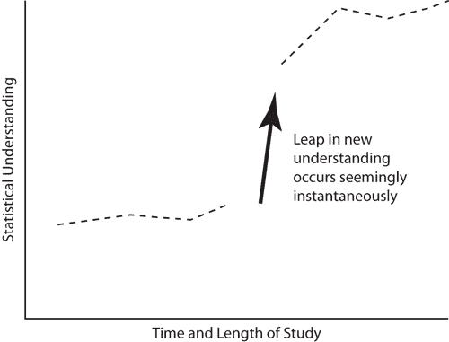

*图 0.1* 统计理解很少线性发生，而是在阶梯状函数所示的跳跃式进展中发生。向上箭头代表“顿悟”时刻，新理解似乎在瞬间的“飞跃”中发生。返回正文。⏎

作为你在学习统计学和机器学习时的实用建议，*不要试图一次理解所有内容*。在学习时允许“近似”和“迭代”。每次审视时都允许模糊性。*不要让完美成为* *好的敌人*，而是经常以新的视角研究这些事物，希望模糊性最终会被理解所取代。

在这方面，我们遵循 哈伯德和哈伯德 (2002) 在关于如何更一般地阅读数学方面的建议中提供的一般且优秀的观点：

> 阅读数学与其他阅读不同……理解一个定理有两个部分：理解陈述和理解证明。第一部分比第二部分更重要……。如果你仍然有困难，请跳到例子。这可能与你被告知的内容相矛盾——数学是顺序的，你必须在继续之前理解每一句话。事实上，虽然数学写作必然是顺序的，但数学理解并非如此：你（以及专家）永远不会完全理解到某一点而完全不理解其后内容。“其后”，理解仅是部分的部分，是“此时此地”动机和概念背景的重要组成部分。你可能会经常（也许通常）发现，当你回到之前只半懂的东西时，它会在你所学习的其他内容的启发下变得清晰，即使这些其他内容本身也很晦涩。”
>
> (第 2 页)

#### 0.7.1.1 认识论成熟度

本书的一个重点是将统计模型和其他 *思想* 置于更广阔的 *语境* 中。例如，集合论常被视为数学中最具统一性的领域之一（尽管许多人现在会说 *范畴论* 超越了这一观点）。统计及相关模型知识成熟度的一个标志是意识到并理解更 *全局结构*，而较小的结构是其特例。随着考虑更复杂的模型，这些全局结构可能更难以“看到”。然而，一个简单的例子将说明这一概念。

大多数熟悉方差分析的读者会 readily 知道被试间 `t`-test 可以被视为更广泛的被试间 ANOVA 模型的特例。这就是我们所说的 *成熟度*——一个人可以看到可以从中推导并定位其他事物的高阶结构。随着模型日益复杂，这一过程会继续进行。虽然起初许多统计方法使用者可能更喜欢“食谱式方法”来简单地为给定问题选择“正确”方法，但用户相对于统计学的成熟度在他们意识到分析数据永远不只有 *单一* 方法时变得明显。食谱式方法不一定总是 *错误*；它通常只是极其 *不完整*。

如果学生对统计学的理解超越了食谱书的水平，他们不仅会意识到分析数据时的不同可能性，他们解读研究发现的能力也会大幅提升。例如，学生不再假设 PCA 是 *等价于* 降维，因此当会议发言人报告说：“我们的 PCA 在我们分析的相关矩阵上没有揭示任何特征值大于 1 的成分，因此数据不适合降维”，有知识的研究者会立即意识到研究报告中的错误结论。*PCA 并未揭示线性降维，关于数据中是否存在潜在维度这一更大的问题尚未得到回答，甚至可能无法回答，因为潜在流形可能尚未被发现*。*维度的发现很大程度上取决于搜索中使用的工具*。这不是结论上的微不足道的差异，而是研究结果 *不正确* 与 *正确* 解释之间的区别。*这种区别很重要*。

以上是我们在本书中试图培养的层级思维的完美例子。统计学是滑溜的；你可能认为你懂它，你可能认为公式或数据说明了一件事，但支撑这一结论的是新的 *基础比率*，新的 *分母*，如果你没有意识到这一潜在基础，你就会得出结论说外面是冬天，因为你正站在步入式冷冻室里！比率 `2/4 = 0.5` 是确定的，直到我们将该分数相对于新的基数 5 考虑时，然后 `(2/4)/5 = 0.1`。我们在纳入新基数之前如此确信 `0.5` 是最终答案。上下文在统计学、数学以及更广泛的科学中至关重要。只看众多变量中的少数几个的狭隘视角会严重偏倚结论。当然，最优秀的数学家、统计学家、科学家和研究人员都知道这一点，这对他们来说是第二天性。但对于这些领域的学生来说，这是在学习中最重要的：*任何结论都有其语境*；*改变语境，结论通常也会改变*。

## 0.8 章节格式与组织

各章节概述如下：

* *第 1 章* 介绍了本书所涉及方法的哲学基础，以及统计学习和机器学习等更广泛的话题。

* *第 2 章* 概述了本书其余部分所需的数学和统计基础。我们讨论统计学和机器学习的“支柱”，即概率、统计学、线性代数、微积分。

* *第 3 章* 对 `R` 和 `Python` 软件进行了（非常）简短的介绍。全书中这两个软件包都用于提供技术的简短“片段”演示。

* *第 4 章* 标志着本书统计和机器学习部分的真正开始。我们从对熟悉的单变量 ANOVA 模型的讨论开始。

* *第 5 章* 综述了简单线性回归和多元线性回归模型、此类模型的效应量、中介和调节回归模型、主成分回归、偏最小二乘和典型相关分析。回归是许多统计和机器学习方法的基石，本章的大部分内容为本书后面讨论的材料奠定了基础。

* *第 6 章* 讨论了回归中的正则化。我们介绍了正则化的概念，然后讨论了正则化模型最常见的方法，包括岭回归、套索、弹性网络。我们还综述了最小角回归。

* *第 7 章* 讨论了非线性回归模型，包括多项式回归、分段多项式、核回归等。我们还将其中一些内容与本书后面讨论的神经网络联系起来。


- *第 8 章* 介绍了广义线性模型的讨论，其中包括流行的逻辑回归、泊松模型等。广义加性模型和判别分析也被讨论。我们以对非参数技术 `k`-最近邻的讨论结束本章。
- *第 9 章* 综述了支持向量机（SVMs）作为响应变量为二元时判别分析的竞争方法。我们讨论了线性可分情况和不可分情况的 SVM，后者将需要使用核方法以通过扩展特征空间来处理非线性。
- *第 10 章* 介绍了决策树和委员会机器的讨论，包括装袋、随机森林和提升。19
- *第 11 章* 介绍了降维技术，如主成分分析以及更广泛的流形学习。独立成分分析、概率 PCA 也被综述，此外还包括非线性降维技术如核 PCA。主曲线、多维缩放、自组织映射、局部线性嵌入、Isomap、SNE 和 `t`-SNE 也被讨论。
- *第 12 章* 综述了探索性因子分析方法，包括解释因子分析时众多的注意事项和潜在问题。独立因子分析、非线性因子分析以及因子分析的混合模型也被讨论。
- *第 13 章* 介绍了验证性因子分析、路径分析和结构方程模型的讨论。这些模型可以被解释为回归和探索性因子分析的扩展，并可被视为更广泛的降维或流形学习范式的特例。
- *第 14 章* 关于聚类分析和数据分割。我们综述了诸如 `k`-均值和聚类分析的层次方法，包括基于密度的聚类以及混合模型。
- *第 15 章* 综述了神经网络的方法。我们从回归的第一性原理出发构建神经网络，然后将神经网络置于诸如投影追踪等其他统计和机器学习方法相对的背景下进行说明。
20
# 1 第一性原理与哲学基础
DOI: [10.4324/9781003376941-3](https://doi.org/10.4324/9781003376941-3)
在本章中，我们介绍并综述与统计学和机器学习领域及演进相关的“大局”主题。这些研究领域，就像几乎所有探究领域一样，都建立在深层的 *哲学假设* 上。深入即哲学化。对不知情者而言，“哲学”一词可能会让人联想到某人随意质疑生命的意义或类似追求，无论是在大学课堂还是在周日下午的吊床上。更糟的是，对天真者而言，这个词可能会让人联想到如果你决心不就业会做的事情！然而对受过教育的人来说，哲学基础就是一切，是几乎所有知识的核心。*研究得足够深入、质疑得足够多、批判性评估得足够充分的任何事物，都会导向哲学假设和基础，进入“模糊”领域，在那里区分不是以数学中的符号等形式作出，而是在前符号形式中以往往难以操作化的“思想”作出。将“模糊”转化为“严谨”在许多情况下是极其困难的*。
## 1.1 科学、统计学、机器学习与人工智能
试图区分 *统计学*、*机器学习* 和 *人工智能* 究竟是什么，对有经验的研究者来说似乎是浪费时间的琐事。然而对于学生而言，对这些区别的评论，如果存在的话，非常重要，因为他们是第一次进入这些领域的人，没有从后视镜的视角看待事物的奢侈，以便指出哪些区别重要，哪些确实是琐碎的；也就是说，哪些特征是重叠的，哪些是各自领域独有的。
历史上，人们曾多次尝试定义 *是* 人工智能的究竟是什么，但没有一个真正令人满意。没有一个可以说真正“捕捉”到了这个概念，很大程度上是因为每当你试图如此精确地定义某物时，通常都会偏离目标，类似于试图在连续尺度上抓住单一观测值 – *你越是聚焦于它，它就显得越难以捉摸*。因此，就像大多数事物一样，人工智能是一个 *概念*，无法通过精确的定义和模糊的语言真正捕捉。甚至精确地定义数学是什么都可能耗费一篇论文！最好的做法是获得一个关于它是什么以及它不是什么的总体 *感觉*，然后在此基础上继续。尽管如此，我们或许可以接受以下不完美的定义：
> *人工智能是机器，通常是计算机，执行任务的科学，如果同样的任务由人类执行，通常需要被称为“智能”的东西。*21
人工智能（AI）几乎不能被视为实验室科学意义上的“科学”。*弱人工智能* 的支持者认为，如果我们能让机器执行复杂的任务，那么机器就是智能的。*强人工智能* 的支持者认为，人工智能是机器“模仿”人类智能的能力。当然，强人工智能甚至可能无法实现，但弱人工智能可能是可以实现的，尤其是在机器学习的兴起之下。
*机器学习* 通常被定义为计算机无需显式编程即可从数据中学习的能力。机器学习与人工智能相关，因为智能系统至少应该能够适应其环境的变化，而这正是机器学习算法所声称要做的事情。虽然机器学习在很大程度上与计算机科学相关联，但其历史很大程度上也可以在控制论和控制科学中找到。最近，机器学习的起源常与心理学家 Frank Rosenblatt 相关联，他本质上构想了一种学习机器，我们今天称之为基本的 *神经网络* (Fradkov, 2020)。真正引发现代对神经网络更具体兴趣的工作是 1980 年代对反向传播算法的研究，而当它最终与廉价的并行计算和内存可用性相结合时，为 2000 年代机器学习的“淘金热”奠定了舞台 (Fradkov, 2020)。
在这一切中 *统计学* 处于什么位置？机器学习与统计学有多密切相关？以下是该领域专家的几句引言，突出了统计学与机器学习的紧密联系：
> 机器学习本质上是一种应用统计学形式，更加强调使用计算机对复杂函数进行统计估计，而减少了对这些函数周围置信区间的证明的强调。
>
> (Goodfellow et al., 2016, p. 95)
> 如果统计学领域从一开始就将计算方法作为基本工具纳入，而不仅仅是方便应用现有工具的一种方式，那么许多其他数据相关领域 \[例如机器学习（ML）\] 就不需要存在——它们本应是统计学的一部分。
>
> (Friedman, 1997, p. 27)


然后还有*计算统计学*这一领域，它被描述为*统计学中的计算密集型方法*（Rizzo, 2019），并专注于诸如自助法和数值算法等技术，这些技术与机器学习的主体内容有很大重叠。有些人甚至区分*统计计算*与*计算统计学*，前者更强调数值方法和算法，而后者还包括探索性分析、数据划分等其他主题（Rizzo, 2019）。

当人们浏览统计学和机器学习的文献时，肯定会注意到差异。机器学习“感觉上”更关注*算法*而非*数据*。例如，在统计学中我们使用线性回归来建模数据，但在机器学习中我们研究的是线性回归与其他“算法”相比有多有效。计算机科学的视角是对算法的理论研究，它们如何表现、复杂程度如何、计算效率如何、能存储多少内存等，而统计学感觉上更侧重于将精确的科学模型拟合到数据上。当然，两者有很大重叠，但*风味*略有不同。然而我们始终应该记住，无论哪种情况，计算机只不过是加速计算的电子机器而已。计算机科学的很大一部分与计算机本身关系不大。它与数学和统计学息息相关，而计算机科学家为此做出了巨大贡献。22

正如我们在全书中将看到的那样，许多有效的机器学习算法都受到了用于*函数逼近*的古老数学思想的启发。的确，做机器学习根本不需要机器。被困在荒岛上的人（至少在*理论上*，有很多理论！）可以像高科技的计算机科学家一样执行简单的机器学习，只是没有自动化或电子机器的好处。“机器学习”只是一个名称，用来反映许多过程是由机器，即计算机*实现*的。但不要误会，机器学习本身，这个*概念*，古老得不能再古老了。是的，希腊人在人类“发明”它之前很久就在某种程度上做着“机器学习”。

### 1.1.1 数学、统计学与计算

有时非专业人士会认为“数学就是数学”，并且在某种意义上，发展这种数学几乎没有创造性。作者曾在学生委员会任职，那里对数学的看法是它*静止*的；*它就是它*，不受发明、创造、修改或重建的影响。当然，这种对数学的看法完全是错误的，因为数学中的创造性正是数学的全部。无论数学多么困难，数学本身完全（大部分）是逻辑性的，解法往往是正确或错误，至少在相对初级水平上如此。完成练习题的高中生会迅速翻到书后查看自己是否解对了。如果书后的答案与她得到的答案不匹配，她的答案就被视为错误，然后她必须弄清楚原因。对于初级练习题来说，解法很少有灵活性。“反馈回路”相对清晰直接。

我们越远离数学、数理统计等，就越会遇到明确且唯一的解法往往不存在的领域。相反，通常存在*多种可用的解法*，有些比其他的好，而且许多取决于从业者的偏好或分析风格。对于初次将数学和统计学应用于经验问题的新手来说，这通常是最令人沮丧的经历。“好的解法”并非唯一，通常需要从业者在寻求*最佳*解法的过程中注入方法论和哲学思考的混合。也就是说，数学解法只是*开始*；她现在必须在科学问题的背景下解释该解法*意味着*什么。这就是学生常常遇到困难的地方，苦于什么是最“最优”（在某种意义上）的解法。严谨的思考是好的，但在大多数事情中，你也必须在“灰色”区域允许妥协，并在一定程度上保持灵活。在*纯*数学中，大多数是相当严谨的，但前提是忽略了构成这种表面严谨性的基础的根本哲学问题。对数学的哲学假设进行更深入的研究，就不再是在做数学了。

### 1.1.2 数学系统作为理解的叙事

我认为，学生会被数学“吓退”的一个原因并不是因为该学科的难度。而是因为他们不欣赏也不理解数学实际上*是什么*。当人们不知道你要求他们做什么以及为什么时，很难激励他们去做某事。要求学生计算二次公式来解二次方程是一回事，但向他们解释*为什么*求根首先是如此重要又是另一回事。大多数学生擅长盲目地套用公式（基础算术真的*没那么*难），但理解这种机械操作之外的“为什么”要困难得多。

数学可以以多种方式被感知，但我们发现对学生最有用的看法是将数学视为一种*叙事*。它是一种*方式*的解释，就像其他叙事是 23ways 的解释其他事物一样。当然，数学的方式通常更*定义明确*、*精确*和*精确*。线性方程非常精确，而用英语描述你的一天过得如何则非常模糊。值得注意的是，并非我们描述的所有事物都适合用数学来描述。例如，一个人的灵魂气质可能不适合用数学描述。尽管心理学家努力测量此类事物，自概念可能也不适合用数学描述。

数学远不止早期的教学中仅仅是计算，它常被说成是关于*形式*、*结构*、*对称性*、*等价性*、*类比*等等。然而，这些属性并非数学独有。所有这些元素都存在于音乐、艺术、物理学甚至心理理论等领域中。这些中最后一种的唯一区别是严谨性更难实现，也就是说，“规则”远没有那么严格。使数学独特的是定义上的相对*简洁*（而非*复杂性*），这使得学科参与者之间能够实现严谨性和交流。例如，*函数*可以在数学中被清晰地定义。试图在哲学或心理学中定义灵魂可能会耗费一篇论文。

## 1.2 数据分析与数据科学的范围：无所不精的专业！


数据分析和数据科学领域很容易让人感到不知所措。为什么？*因为你需要知道一切！* 至少会让人有这种感觉。正如许多作者多次讨论过的那样，数据科学处于众多专业领域的交汇点或核心。例如，要理解深度学习，你必须对统计原理有坚实的把握。但支撑统计学的机器（不一定是*概念*）是数学，如果你深入探究数学本身更基础的问题，很快就会遇到哲学和历史问题，因此你也应在一定程度上了解这些领域。但我们还没完。远没完。你在一定程度上还需要成为一名计算机科学家，以便将所有这些理论应用到计算机上，了解你所进行计算的优势和局限性，并且对代码足够熟悉，能够在需要时改进或调整程序，或者至少知道它是否需要调整以及去哪里寻找答案。所以，到目前为止，你在一定程度上是一名*数学家*、*统计学家*、*哲学家*、*历史学家*和*计算机科学家*。这对任何人来说都是一项艰巨的要求。

但我们仍然没有结束。数据科学应用于实质性领域，如商业或科学（例如经济学、心理学、社会学、生物学、物理学、天文学），因此你需要在应用领域也具备一定程度的专业知识。如果你不熟悉该学科及其所寻求解决的问题，就很难知道如何以及在何处应用正在学习的专业技术元素。如果是科学领域，那么你还需要具备*研究设计*、*实验性* vs. *非实验设计*、*横截面*和*纵向模型*等方面的知识和经验，等等。事实上，正如我们在本书中将讨论的那样，机器学习的大多数甚至全部内容都没有提到设计问题，因此机器学习专家可能对*实验性* vs. *准实验设计*等重要区别缺乏足够认识，等等。这些设计问题在生物学和心理学等领域每天都会出现。将所有这些领域与心理学或经济学中涉及潜变量的测量问题结合起来，你还需要成为心理测量学或更一般意义上的测量理论方面的专家。所有这些都说明，成为一名优秀数据科学家所需的专业知识可能令人不知所措，几乎不可能实现。

### 1.2.1 理论统计与应用统计及专业化

存在一种*专业化悖论*，即如果你过于专注于某一领域而忽视其他领域，你就会失去平衡。例如，由于统计学和数据科学的数学基础 24statistics 很大程度上存在于线性代数、分析学和优化等领域，人们很容易被诱惑去深入研究这些领域，但研究得越多，你就越成为这些领域的专家，而以牺牲你所寻求成为的专业人士为代价。知识并没有自然的“层级”结构，以至于如果你研究某一领域的根基，就会自然成为其他领域的专家。*你专攻什么，就成为该领域的专家*。图 1.1 是众所周知的关于数据科学的维恩图的原型，显示了许多不同专业领域的交集。如果你想成为一名优秀的数据科学家，重要的是要始终关注三个圆的共同交集。向任何方向过度偏离，同时让你在特定专业上加深，实际上会削弱成为一名优秀数据科学家的目标。

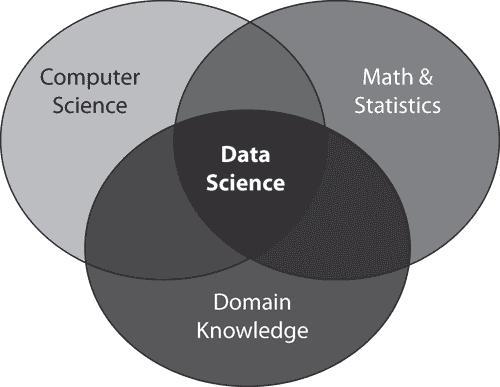

*图 1.1* 数据科学可以被认为处于各种技能和专业领域的交汇处。过度专攻某一领域而忽视另一领域会削弱对“数据科学”交集的专攻。返回正文。⏎

## 1.3 计算机的作用

计算机科学家是研究计算机计算能力、可以计算的极限以及计算相关所有细节的专业人士。然而，就我们的目的而言，计算可以被视为一种快速且自动化的完成工作的方式。计算机做我们告诉它们做的事，而且做得极好、极快且可靠（Guttag, 2013）。正如 Stillwell (2016)所指出的，计算一直是数学\[和统计学\]的一部分，但直到过去一个世纪（1900 年代）它才成为数学*概念*。

作为使用多元或机器学习方法的研究人员，计算是实现目标的重要元素。然而，在我们本书讨论的水平上，至少大多数需要计算的事情都可以被挖掘出来并搜索。如何通过计算机进行样条回归远不如理解进行样条回归的好处和局限性以及样条回归究竟*是什么*重要。在本书中，至少这种*理解*是至关重要的。从这个角度来看，计算被视为仅仅是完成工作的*实现目标的手段*。当然，如果你的工作涉及庞大无比的数据库，那么甚至能否对这些大型数据库进行计算就成问题了。虽然我们在本书中略微涉及这些领域，但*计算复杂性*并不是我们的主要关注点。25 在大多数情况下，我们假设你将处理的数据在计算规模上是合理的。本书不是关于*数据工程*的。它是关于统计学、科学和机器学习的。

### 1.3.1 算法的本质

在讨论当今计算机的作用时，现在是理想的时机指出当今统计学和机器学习的“Zeitgeist”似乎全都关于*算法*，几乎就像这些东西是新的，昨天才发明出来一样！事实上，*算法*这个词本身在学生中就带有“性感”的吸引力。

那么算法到底是什么？一个非常一般的定义是，它是*一种执行程序的方法或指令集*（Tanton, 2005）。根据这个一般定义，准备一顿饭是算法的例子，就像遛狗是算法一样。开车是算法，就像刷牙也是算法。写这本书是一个算法。算法存在于我们生活的几乎每个方面。定量上，算法可以像长除法一样简单，或者有人可能会争辩说甚至加两个数也是算法的例子。算法对现代数据科学来说是“新”的这种误解正是*误解*。

### 1.3.2 算法稳定性


正如我们所讨论的，机器学习的重点在数据上稍少一些，而在实际执行数据分析的算法上稍多一些。它们的稳定性如何？诸如回归之类的程序在相似或不同的样本中稳定吗？它的方差是否大到即使数据有轻微扰动也会导致截然不同的结果？这类问题都属于 *算法稳定性* 的一般范畴。稳定算法通常是指如果训练数据被轻微改变或扰动，算法的输出大致与数据扰动的程度相匹配，并且随着 `n` 的增大，这些变化最终会完全消失（Liu et al., 2017）。

*一致稳定性* 规定了两个样本在被认为稳定时不能超过的界限。更具体地说，如果一个学习算法在两个仅相差一个点的不同样本 `h[s]` 和 `h[s′]` 上训练的假设，其损失函数 `L` 的差异等于或小于常数 `β`，且概率等于 1，则该学习算法是均匀 `β-stable` 的。即

`p[(|L(h[S])−L(h[S′])|) ≤ β] = 1`

(1.1)

其中 `S` 是原始样本，`S′` 是扰动后的样本，而 `β` 是设定上限的 *稳定性系数*（Liu et al., 2017; Mohri et al., 2018）。

一个相关的关注点是算法或更一般地计算的速度或效率如何。如果基本步骤的数量可以用输入规模的多项式函数表示，则称计算在 *多项式时间* 内运行。在多项式时间内运行通常被认为是一个算法的有利特征。不能在多项式时间内运行的计算通常运行在 *指数时间*。

## 1.4 设计的重要性，无论是实验性的还是其他

从科学的角度来看，不考虑设计问题的统计学和机器学习是空洞的。事实上，使本书与其他多元分析和机器学习书籍不同的众多特点之一是贯穿始终的不断提醒，即 *从科学的角度来看，设计问题是最重要的*，而不是应用于 26the 数据的实际方法或算法。也就是说，如果你在做 *科学*，那么设计最重要。统计学、机器学习和计算排在第二位。

例如，你可以用你花哨的机器学习软件和算法执行聚类分析，但它永远不会告诉你“为什么”开本田的人会与开日产的人形成一个集群。它可能会告诉你与每个集群 *相关* 的是什么，但它可能不会告诉你 *为什么*。只有实验设计才能接近得出此类结论。因此，在整本书中，我们提醒读者，这样的统计或机器学习工具往往无法回答最感兴趣的更深层次的科学问题。只有良好的设计才能提供这些问题的近似答案。统计或机器学习模型无法告诉我们疫苗 A 在治疗 COVID-19 方面是否比疫苗 B 更好，但良好的实验设计可能可以。

## 1.5 归纳、演绎和其他逻辑

在哲学中，通常有两种广义的推理方式，即“求得真理”之类的，*归纳* 和 *演绎*。粗略地说，归纳逻辑是从 *具体到一般* 得出结论，而演绎逻辑则意味着从 *一般到具体* 得出结论。例如，如果我以前从未见过狗，却目睹了十只狗都有四条腿，我可能会根据我所见的观察押注 *所有狗都有四条腿*。这是一个归纳逻辑的例子，其中特殊的是我所见过的狗的集合，而一般的是所有狗，其中大多数我没有见过，也可能永远不会见过。更大的观察集合甚至可能是无限的。另一方面，如果我不知何故已经知道所有狗都有四条腿，那么推断出我遇到的下一只狗会有四条腿就是一件容易的事。在这种情况下，我们是从一般到特殊，这是一个演绎逻辑的例子。*布尔逻辑* 是演绎过程的一个例子；例如，像如果 `a` > `b` 且 `b` > `c`，则 `a` > `c` 这样的陈述，*传递性* 定律，是布尔逻辑中一个演绎“蕴含”陈述的例子（Lucci & Kopec, 2016）。经验科学必然是归纳的，因为在大多数情况下我们根本无法接触或观察所有事件，必须仅基于少数选定的事件得出结论。可以说科学有 *演绎嫉妒*，因为它希望是演绎的，但这在哲学上通常是不可能的。

从具体到一般进行概括通常是不完美的，并且会伴随误差。*统计推断* 是一种从具体到一般进行概括的方法，并且在很大程度上依赖于概率论。当我们看到十只四条腿的狗并推断出所有狗都有四条腿时，我们在这样的结论上做了一个“跳跃”。也就是说，我们并不知道所有狗都有四条腿；我们是基于当前观察“赌博”或“押注”它们确实如此。这就是科学通常的进行方式。*科学就是一场赌博*。事实上，*归纳学习* 是关于找到最能逼近未知函数的函数，这本质上就是 *统计学习* 所关心的。

还存在 *模糊逻辑*，它意味着一个命题可以是“有点真”。这与更广泛的 *模糊集合* 思想有关。在模糊逻辑中，人不是非死即生，而是死亡到一个 *程度* 的问题。同样，模糊集合理论按程度而非绝对地分配集合的成员资格。必须强调，归纳和演绎逻辑是我们生活和科学的重要组成部分；它们构成了我们对什么是“真”或“假”的许多思考的基础。希腊人很大程度上为我们提供了演绎逻辑的严谨性，例如，数学陈述只有在能够严格推导出来时才被视为 *真*。

更近些年，布尔和弗雷格等理论逻辑学家将逻辑提升为独立的数学学科。尽管逻辑有着悠久的历史研究，但必须强调，逻辑的“优良性”依赖于 *逻辑本身是正确* 的假设。如果我们关于 27the 这些逻辑的力量的假设有一天被证明是错误的（想必通过更进一步的逻辑思考！），那么数学的大部分如果不是全部就会崩塌，其他思维方式也会如此。也就是说，如果以下这样的基本 *论证* 有朝一日能够被驳斥（例如，通过被证明为假的真值表），或至少不再普遍被认为为真，它将在科学和一般思维中引发一场革命（用 *温和* 的说法）：

$$\\begin{array}{l} \\left. p\\rightarrow q \\right. \\\\ p \\\\ {\\therefore q} \\\\ \\end{array}$$

其中上面的内容读作如果 `p` 则 `q`，`p`，因此 `q`。当然，乍一看，上述 *假言推理* 作为得出 `q` 的方式实际上可能是错误的这一命题听起来完全不合理甚至愚蠢。更有可能的是，这些推理的基本基石将继续经受时间的考验。我们只是指出这种 *构建知识* 的本质，即其中如此之多都依赖于先前的假设，或基于更深层次假设的可证明假设，无论这些假设多么“令人信服”或“显而易见”。历史有时会给我们惊喜，正如我们将在参考哥德尔定理时很快讨论的那样。


我们可以在软件中演示简单的逻辑论证。例如在 `R` 中，逻辑论证可以相当容易地进行。例如，我们可以要求 `R` 将某些表达式求值为真或假：

```
> 1==5
[1] FALSE
```

其中在上面，`==` 被称为 *关系运算符* (Davies, 2016)。另一个例子如下：

```
> 5 == 4+2
[1] FALSE
```

由于逻辑包含对应真和假的“1”和“0”值，我们可以将逻辑值视为数字，如下所示，其中我们对“真”值进行求和：

```
> T + T + T
[1] 3
```

### 1.5.1 一致性与哥德尔不完备定理

欧几里得的 *《原本》* 被视为有史以来最著名的数学著作之一，尤其是在几何学方面。该文本的第五公设在数千年里一直被认为是公理，但在 1800 年代，人们证明了欧几里得几何并不是 *唯一* 可能的几何。人们可以构建 *非欧几何* 的大厦。这一事件有助于在数学中引入一场危机。

直到 19 世纪末（1800 年代），数学的大部分被认为基于逻辑，并且在此基础上，可以合理地期望数学的整个大厦本质上是一个 *封闭系统*，并且在逻辑上完全一致。在此，一致性指的是如果一个陈述为真，它就不能同时为假。更简洁地说，一个一致的系统是 free from *矛盾*。例如，如果 `p→q`，这里的矛盾，例如，28might conclude `q` 和 `¬q`（即非 `q`）*同时*。一个一致的系统不包含此类矛盾。

在 1600 年代微积分发明之后，发现微积分并没有建立在理论上坚实的基础之上。一群数学家试图使微积分严格化，并且在很大程度上取得了成功。新的学科被称为 *实分析*，或简称为 *分析*，并声称是微积分的严格化和更深入的版本。例如，在牛顿和莱布尼茨时代，连续性的概念相当不正式。实分析使连续性严格化并赋予其非常精确的定义。关于诸如连续性等概念的含义将不再有非正式的讨论。数学家为这些和其他关键的数学思想提供了严格的定义。数学以其严谨性、精确性和定义良好的陈述和定义为傲。

虽然将数学置于严格的逻辑基础上的尝试相对成功，但它能否 *完全* 建立在如此连贯和一致的基础之上这一想法受到了哥德尔的挑战。哥德尔证明了数学中存在一些陈述无法从 *系统内部* 的其他陈述中证明。哥德尔在证明这一点时提出的定理被称为他的 *不完备定理*。他的第二个定理本质上认为不可能用计算机回答所有数学问题。正如 Tantom (2005, p. 229) 所指出的，“哥德尔的工作粉碎了几个世纪以来寻找一组基本公理以建立全部数学的希望。”

上述惊讶只是重新构想数学的开始，不再将其视为不可逆真理的防弹大厦，而更像是一种 *构造*，就像许多其他事物一样，需要某些东西来启动构造。构造系统内的并非所有内容都可以被证明或证明。这正是哥德尔发现的，他提出数学，更确切地说 *皮亚诺算术公理化*，其中包含一些陈述无法参考系统来证明。也就是说，必须需要系统 *外部* 的某些东西才能证明系统的其余部分。换句话说，包含皮亚诺公理化的任何一阶理论“要么自相矛盾，要么对于推导出 *某些* \[emphasis added\] 算术陈述是不完备的” (Muggleton, 1991)。正如 Kline (1972, p. 1026) 所评论的那样：

> 数学的严格化可能满足了十九世纪的需求，但它也让我们了解了该学科的发展。新建立的逻辑结构 presum... 新建立的逻辑结构 presum... 新建立的逻辑结构 presum... 

> 数学的严格化可能满足了十九世纪的需求，但它也让我们了解了该学科的发展。新建立的逻辑结构 presum... 

> 数学的严格化可能满足了十九世纪的需求，但它也让我们了解了该学科的发展。新建立的逻辑结构 presum... 

Kline hits the nail on the head. *正中要害*。虽然分析为微积分提供了严格的“基础”，但它本质上仍然是对已经假定为真的思想的 *人类构造*。再次，这里经典的例子是连续性。连续性被假定为已经存在；数学家所做的一切只是为其提供更严格的描述或说明。这些贡献在性质上是 extraordinary 的，无疑，但其中许多贡献只是为已经假定存在而没有根据的概念提供了 justification。假设（以及正如 Kline 所说的直觉）仍然 *首先* 来。29

#### 1.5.1.1 哥德尔的关联性是什么？

读者可能会合理地问为什么这本书中任何关于哥德尔的讨论都相关。说实话，除了增加对统计和机器学习所基于的数学系统的认识之外，它并不相关。在我们将要调查的所有统计和机器学习原理和方法中，应该认识到这些本质上是 *人类构造*；它们不是写在石头上，也不是 *完全* 从一组更基本真理中推导出来的。学生们太常认为数学是僵硬的、枯燥的，并且超出了创造力的范围。没有什么比这更错误的了。数学，以及由此延伸的统计和机器学习，都是 *创造性事业*。它们是严谨的，但同样具有创造性。严谨并不意味着缺乏创造力；它只是要求对源于这种创造力而产生的新思想和原则提供更强的 justification。规则比音乐或艺术中的创造力“更僵硬”。当然，爵士乐中有“规则”，但最终，你可以演奏听起来“好”的东西。当更深入地反思时，可能会意识到 *我们在所有这些中制定规则*，包括数学、统计和机器学习，然而在后三者中对这些规则的问责制更多，因为大多数规则是 *逻辑* 的结果。

## 1.6 有监督与无监督学习

为了对统计和机器学习方法进行分类，经常会做出 *有监督* 与 *无监督* 的区分。我们首先讨论这种区分，然后解释为什么这种划分是不完整且不足的。正如对概念进行“分割”的许多方式一样，最初似乎清晰有用之物在更密切、更深入的哲学审视下会迅速变得“模糊”和“混浊”。正如我们将看到的那样，有监督与无监督之间的差异很快变得非常“模糊不清”。


据说，在 *监督学习* 中，我们在响应上具有事先确定的指定标签。监督学习有时被称为 *教师指导学习*，因为我们已经定义了我们试图预测的类别。例如，如果我们使用教育水平来预测薪资 *等于或大于* 与 *小于* $100,000，我们已明确确定标签 ≥100*k* 和 <100*k*；因此，该问题是监督的。诸如线性回归和判别分析等方法通常被视为监督学习。我们知道我们试图预测或建模的内容。

在 *无监督学习* 中，另一方面，我们没有事先建立的类别或标签。也就是说，我们并不试图预测或将数据分类到类别中，因为类别目前未知，或者至少未被使用。诸如 *主成分分析* *(PCA)* 或 *聚类分析* 之类的降维技术通常被视为无监督。无监督方法通常被认为比其监督对应方法更具 *探索性*。

还有第三类，即 *半监督学习*，即我们没有全部数据，并且可以通过利用未标记数据来减轻对标记数据的需求（Mohri 等，2018）。半监督学习方法超出了本书的范围。

### 1.6.1 模糊区分

尽管存在关于监督与无监督之间区别的传统论点，如果被迫对所有方法在这两者之间做出选择，我们很可能会得出结论，大多数技术在某种意义上都是 *监督* 的，而无监督技术实际上并不存在。要做到这一点，需要我们将“监督”的概念稍微推广到不仅仅是在响应上标注标签。这要求我们接受大多数如果不是全部方法，在某种程度上都是 *用户驱动* 的，即使在某些情况下程度很小。30

请考虑，一旦用户需要就方法做出任何决定，他或她就是直接或间接地监督该方法。以主成分为例，它通常被假定为无监督方法。正如我们在书中后面会看到的那样，进行 PCA 有许多不同的方法。在这些版本中进行选择是一种监督行为，就像关于是否对数据进行标准化以及将协方差或相关矩阵作为输入进行分析的选择一样。此外，一旦降维完成，决定保留多少个成分就是一个监督的 *行为*。在相关所谓的无监督方法 *因子分析* 中情况甚至更具监督性，在该方法中，用户通常必须在运行程序之前 *先验* 决定从协方差或相关矩阵中提取多少个因子。告诉计算机计算多少个因子是基于我们对监督含义的修订版本做出的极其“监督性”的决定。

作为另一个例子，考虑 *聚类分析*，另一种所谓的无监督技术。此类程序要求用户 *先验* 选择一个用于操作化距离的度量。一旦这些输入完成，我们就允许算法以非监督的方式“做它的事情”，但支配这些方法使用的选择与例如在监督学习环境中执行的回归类型所做的选择非常相似。用户应针对给定问题使用普通最小二乘还是加权最小二乘？最小角回归如何？因此，尽管监督与无监督之间的区别是有用的，但在更深入地考虑并对定义进行一些调整后，我们得出的结论是 *所有方法都是监督的，有些程度较低，有些则不那么明确*。

应强调的是，多元统计或机器学习中此类许多区别，在受到 *批判性挑战* 时变得相当 *模糊*，模糊到该区别难以成立的地步，姑且这么说。这完全没问题，并不意味着该区别没有用或错误；它只是意味着我们不应对这些定义中的任何一个想得太 *僵化*。此类定义是有用的，但在我们将它们放在显微镜下并稍作调整时，它们往往会减弱。永远不要 *死记硬背*。而要 *概念化*。

## 1.7 理论与经验证实

在哲学中，*理论* 与 *经验* 证实之间存在差异。我们用几个有力且近期的例子来说明这些差异。

### 1.7.1 飞机与海洋潜水器

飞机从跑道起飞是对 *飞机飞行* 的经验性证明。这只是该想法的其中一个证明。如果许多这样的飞机成功离地，我们对“飞机飞行”这一想法的信心就会增强。也就是说，飞机飞行的确定性源于经验证实，我们可以粗略地称之为经验“证明”。

以上与理论证实不同。理论证实来自分析论证，通常基于数学，在此背景下，飞机 *应该* 飞行。也就是说，如果基于精确的工程航空原理的飞行理论是正确的，那么飞机就应该飞行。在最大程度上，科学家应从分析上证实他们寻求观察的内容，甚至已经观察到的内容，*经验上*。

这为什么重要？请回想 2023 年的 OceanGate 探险。泰坦号海洋潜水器多次成功潜入海底探访 *泰坦尼克号*，从而让人认为它是进行此类探险的安全船只。然而，正如批评者在潜水器失踪后（后来发现因内爆而被毁）指出的那样，该船只适用性的理论证实是缺乏的。也就是说，该船只并未 *分析上 31 证实* 此类探险。经验主义可能揭示某事物“有效”几次，但只有 *理论证实* 才能让我们更有把握认为它在一般情况下对大量甚至无限次试验都有效。

### 1.7.2 如果数学失效，桥梁会不会倒塌？

理论与经验证实之间区别的经典例子或许是桥梁的建造。如果有一天导致建造坚固桥梁的数学被发现有缺陷，桥梁仍会屹立，还是会立即倒塌？当然，它很可能会屹立，*至少有一段时间，也许更长*。然而，我们通常依赖桥梁建造的理论证实来确保其长期可靠性和坚固性。理论，或理性论证，使桥梁所基于的知识更 *确定*；并非 *保证*，因为理论本身是暂定的，但只是更确定。

然而，理论和经验证实必须携手合作，并相互提供信息，但一个人绝不应仅凭几次经验演示来“证实”一个理论，而该理论尚未在独立于这些经验演示的情况下得到 *先验* 证实。这是健全的数学和证明的优势，或更一般地说，是严谨的 *哲学论证*。这充当了我们思考桥梁建造方式合理的理性“保证”。


关于 OceanGate 深海潜水器，或许在很大程度上其之前的成功是基于利用随机运气。没有理论依据，你所获得的经验或实例可能仅仅是 *幸运的实例*。潜水器成功访问 *泰坦尼克号* `n` 次的事实并不能保证第 (`n` + 1) 次访问成功。无论事故前有多少次成功航行，那些成功航行仍然是一个 *样本*，而且在这种情况下并非所有潜在航行的随机样本，因为潜水器结构失效的概率很可能随着它多次下潜前往 *泰坦尼克号* 而增加，这是由于船体结构疲劳不断加剧。观察到了一批成功的航行样本，但对潜在航行总体做出任何推断都需要某种猜测。*统计推断就是猜测。它是对这种猜测施加严格量化的艺术。*

## 1.8 分析层级问题

有些物理学家会声称他们的学科是“基本”的，意思是生物学、心理学等学科只是这种基本学科的特殊案例。让我们简要审视这可能意味着什么，以及它如何引入 *分析层级问题*。

姑且假设物理学家是对的，即所有科学最终都可还原为近乎无限小的粒子，即被认为构成宇宙的真正基本构件，一切皆由此构建。暂时我们称之为 *最深* 的分析层级。即使如此，发现练习正念与不练习者之间在心理健康上存在群体差异的心理学实验，也可以被视为对这些无限小粒子的更高层级分析（仅在 *自上而下* 的意义上）。粒子是否也符合这种群体差异结构，只是一个不同的 *视角*。关键在于，心理学实验在更高的“鸟瞰”层级揭示了群体差异，而这种群体差异与在较低层级分析原子一样有意义。*数据的表征处于不同层级，但所研究的现象可能本质上是相同的*。

因此，有志于科学的学者应意识到存在不同的 *分析层级*，并且它们都有助于理解。争论哪一个是最“基本”的分析单位是一场有趣的辩论，但不应妨碍对某一现象进行多种不同方法三角互证的研究。32

## 1.9 基率、共同分母与程度

研究中的许多一切都与 *基率* 有关。作为数据分析师或研究者，你在进行或开展研究时应始终意识到基率现象。没有这种意识，根本不可能正确地对研究进行情境化。关于 *泰坦号*，许多该领域的专家警告潜水器可能因其结构完整性或缺乏完整性而存在问题。初次听说潜水器存在担忧时，可能很容易将此信息解读为对该特定潜水器的 *独有* 情况。新闻报道让人联想到一艘具有显著弱点和危险的特定潜水器。然而，在听到这些报道后，批判性听众有必要考虑 *这些危险是否对所有潜水器都是独有的，而该潜水器的危险只是特例*。

我们上面提出的问题所指向的概念是 *基率*。表层知识可能非常具有误导性，而且太常是我们唯一“看到”的知识。任何知识通常都有基率，但太常是表层知识被错误地强调，而以背景或情境层为代价。现在事实证明，潜水器的问题 *独一无二* 地严重，很可能导致潜水器及其上所有人员的灭亡，但关键在于，当你了解到任何事物的异常或据称“独特”的问题时，始终要问自己这些东西是否真正独特于你所处理的物体，或者是否存在更深层的 *基率*，使得独特特征实际上比最初认为的更常见。仅仅因为一个事件被观察到，并不意味着该事件是 *你所处理的特定物体* 独有的，即使在表面上思维可以迅速将特征视为独特。

Gigerenzer (2003) 将这种对基率的意识称为一种 *思维工具*，所有研究者或任何消费研究的人都应在思维中实践和培养。2024 年对特朗普总统的（第一次）未遂暗杀据称是由“孤僻”型人物实施的。然而，许多人类都符合这一描述，而且更多的人类可能拥有比枪手心理指数级更黑暗的心理。仅仅因为我们观察到枪手的特征本身并不能解释行为。在这里意识到基率至关重要。当“警告信号”在比如 20–30% 的人口中具有特征时，它们就不再是警告信号了。*它们是人类本性的特征*。

相对性也在基率的考虑中发挥作用。人开始较少以 *类别* 思考，而更多以 *连续体上的程度* 思考。再一次提到 *泰坦号* 潜水器，内爆发生后有人说不应允许乘客进入实验性潜水器或事实上任何实验性交通工具，因为涉及的风险。但什么 *不是* 实验性的？很少有人会认为航空旅行是实验性的。由于其安全记录，它已被归入“非实验性”旅行的“类别”。然而，从科学哲学的角度来看，*航空旅行确实仍然是实验性的；* *它只是比冒险乘坐 OceanGate 潜水器实验性更低*。航空旅行仍然是一个相对较新的发明。相对于人类整个历史跨度，人们飞行飞机的时间非常短。将事件置于连续体上进行情境化，而不是给事件贴上“黑白”标签，在认识论上是富有成效的。对于许多旅客来说，他们明天的达美航班可能“实验性”风险足够大！

### 1.9.1 基率与脾脏肿块

未能考虑基率可能对决策产生严重后果。德国牧羊犬以非常聪明且大多性情温和、易于训练而闻名，这也是它们经常被警察部门雇佣为警犬并被主人视作家人深受喜爱的原因之一。然而，它们不幸也以健康问题著称，尤其是在衰老时。一种典型的健康问题是脾脏肿瘤，可能为良性或恶性（癌性）。尽管癌症当然有害，但脾脏肿块最糟糕的部分是它破裂进入腹腔并导致狗内出血的可能性。33


## 1.9.2 基础率思维
假设你对一只 11 岁的雄性德国牧羊犬进行一次选择性超声检查。超声显示脾脏有肿块。作为狗主人，你当然担心肿块可能会破裂，但你并不知道这个肿块实际上存在了多久。这个肿块当然是脾脏上的异常，意味着这只狗不太可能出生时就带着这个肿块。它在狗的生命中的某个时间点出现了，但具体是什么时候，你并不知道。你缺乏一个超声 *基线* 来与当前数据进行比较。它是脾脏上的异常，但对一只 11 岁的德国牧羊犬来说，它是异常吗？可能不是。请考虑最近报道的一项关于 6 至 13 岁金毛寻回犬随机样本中脾脏肿块患病率的数据，该数据发现，惊人的 52.8%的金毛寻回犬被发现患有脾脏肿块！此外，由于众所周知，脾脏肿块在老年德国牧羊犬中比年轻犬只更常见，因此老年犬（即 *条件分布*）携带脾脏肿块的比例可能接近 70–80%。因此，在这只 11 岁犬的超声检查中发现脾脏肿块最有可能是 *预期* 的发现，而不是 *异常*。这里的要点是，很可能有许多狗携带脾脏肿块，其中许多可能是良性的，且这些肿块从未造成问题，或狗死于其他原因。的确，你在街上散步时看到的下一只 11 岁（或更年长）的德国牧羊犬 *很可能患有脾脏肿块*。超声检查发现肿块并不意味着它是异常的；*发现肿块并对狗进行超声检查可能才是真正的异常*。这就是我们所说的 *基础率*。

## 1.10 统计规律与风险感知


## 1.10
为延伸上述讨论，*统计规律性*往往使极其冒险的行为看起来没那么冒险。例如，再次考虑航空旅行。航空旅行有风险吗？危险吗？当然是！在本质上仍是实验性舱体的东西中飞行超过 30,000 英尺是一项冒险的事业。然而，从统计角度来看，开车去超市更危险。我们对风险的评定取决于所采用的视角。以 65 英里每小时行驶在高速公路上的汽车比以 400 英里每小时在 30,000 英尺高空飞行的飞机风险更小，但不是*统计上*。

统计规律性以降低我们的*风险感知*而闻名，但这仅在过去行为的意义上如此。也就是说，如果一次航空航班与之前的大多数航班相似，那么从统计上看它风险很小。然而，尽管我们将今天的航班建模为来自过去航班的分布，但我们对当前事件一无所知。*它完全是新的*。完全有可能（尽管极不可能）从现在开始的大多数航班都会坠毁；我们 simply 不知道，因为我们尚未观察到这些新实例。我们唯一确定的只有概率，我们在*假设*这些数据是从与过去事件相似的概率分布中抽取的前提下将这些概率应用于新数据。

因此，有人可能会说，30,000 英尺的飞行在*绝对*意义上是有风险的，但从统计上看风险要小得多。用统计术语来说，飞行是*相对*无风险的，因为其成功的贝叶斯先验概率相当高（我们稍后会讨论贝叶斯统计）。然而，从哲学上讲，先验对实际的新物理事件一无所知。它仅在*假设*新事件是从由相似先前事件组成的分布中抽取的前提下对其概率进行建模。

### 1.10.1 贝克抑郁量表：你有多抑郁？
风险当然也普遍存在于临床障碍的诊断中。假设作为一名临床医生，你给一位新客户施测*贝克抑郁量表*（*BDI*），而该客户的得分处于轻度抑郁范围。BDI 是抑郁症的知名筛查工具。好的临床医生知道不应仅使用单一诊断标准来诊断客户。然而，高 BDI 分数意味着什么？*它并不意味着该障碍*。它只能表明该障碍的“征兆”，并且需要应用经典的贝叶斯推理来获得抑郁的实际概率。如果客户患该障碍的先验概率较低，那么高 BDI 分数可能不足以表明或诊断抑郁。这是对概率进行修正的基本原则，然而事实一次又一次表明，许多诊断医学和临床障碍的人并不理解或不重视这些基础。例如，由于 HIV 检测结果报告不准确，患者的生命被颠覆了。这不仅仅是琐事；这是至关重要的。*未能向客户群体妥善传达统计结果等同于医疗事故。患者和客户有权被告知准确的概率估计并获得如何解读它们的指导。*

## 1.11 决策、风险分析与优化
上述关于风险和决策的讨论自然地联系到数学和统计学中正式优化的思想。在本书介绍的许多方法中，从优化的角度来看，目标是*最小化*或*最大化*某个函数，这最终本质上被转化为以尽可能少的误差最小化做出错误决策的风险。被称为*风险分析*或相关领域*决策分析*的研究领域是迷人的学科，并渗透到许多应用实践领域。最终，许多统计分析都是以做出*好决策*为最终目标进行的。然而，几乎没有决策是无风险的。尽管有人可以争辩说在理论上存在完美的决策，但它们之所以“完美”，仅在于其经过严格思考和理性构思。它们都包含后果和错误带来的成本，至少在短期内如此。

我们每天都面临决策，并且在不完美的知识下做出决策。无论我们是否正式对这些决策进行决策分析，还是直觉上试图平衡做出错误决策的风险与做出正确决策的好处，这些决策任务都渗透到我们的生活中。关于风险心理学以及人类如何管理风险的文献非常丰富，有兴趣的读者应查阅此类文献。如果这些主题引起你的兴趣的话。现在，只需简单概述这一广泛而令人兴奋的研究领域的一些特征就足够了。

### 1.11.1 做出错误决策的风险
考虑以下假设情景——你刚刚还清了价值约$400,000 的房屋。虽然在法律上你在与银行签订抵押贷款时必须购买火灾房屋保险，但现在你完全拥有它后，就不再需要持有任何保险。你仔细思考是否仍应购买保险，还是把本应支付的保费存起来用于其他用途。真正解决这一决策问题的唯一方法是对竞争事件分配概率并评估*期望*或*效用*。如果保险价格为$1,000 per year，支付保费似乎是理所当然的，因为房屋因火灾损失的成本在财务上是毁灭性的，总损失为$400,000，即房屋的市场价值。然而，如果你很少离开家，火灾风险很小，那么花费在保险保费上的$1,000 最好花在别处。当然，大多数房主会支付保费，因为即使很小，失去房屋的风险也太大而不应防范此类事件。然而，在 presumably 无法容忍此类风险的同时，同一个人会定期自愿开车在一段非常危险的高速公路上兜风，其丧命的风险远大于房屋因火灾损失的风险。我们要说明的要点是，风险承受能力会因具体问题而大不相同，而风险的感知，无论理性还是非理性，都可能因情境和情况而变化。

### 1.11.2 统计生命与优化


风险的概念也延伸到统计生命的概念。回到前面讨论过的航空公司例子，航空公司寻求在伤亡和死亡方面将损失降到最低。但代价是什么？当然不是*任何*代价。飞机经常在雷暴和恶劣条件下着陆，尽管这些条件带来的风险比其他情况更大，但这种风险会*校准*于其他利益，例如通过及时着陆保持客户满意度、保持航班时刻表正常运行，以及机组人员因疲劳希望尽快完成航班的利益。这并不是说飞行机组会鲁莽地在极其危险的雷暴中着陆，但认为可容忍的风险量不存在且隐含在这些着陆中将是极其天真的。当这些校准开始过度施加，以至于有超出风险*阈值*的风险时，就会产生更危险的风险水平，可能导致事故。该阈值通常很可能根据具体情况主观确定。我们在这里要表达的要点仅仅 37to 说，没有任何行为是无风险的，而声称能够管理无风险飞行运营的航空公司根本就不诚实。*风险被最小化，但这种最小化受制约于限制和相互竞争的利益*。统计和机器学习中的优化算法也会进行优化，但通常不是*无条件*的。它们通常是在约束和条件下进行优化。

### 1.11.3 医疗决策制定与主导标准
在基本决策理论中，我们说如果一个决策基于选择性输入或信息而胜过竞争决策，则该决策会被一个或多个标准所*主导*。例如，再次考虑狗主人关于通过超声检测脾脏肿块的情况。它是良性的还是癌性的？当然，良性肿块不会扩散到身体其他部位，而恶性肿块更可能这样做。决策是是否通过手术切除脾脏。在这个例子中，人们可以花费大量时间和费用来尝试确定肿块是良性还是恶性，然而切除与否的决策可能被肿块出血或破裂的可能性所*主导*，这无论如何都可能危及狗的生命。可以对身体进行 CT 扫描以寻找微观转移；然而，这对是否进行手术的决策有什么价值？可能微乎其微，因为出血的可能性*主导*了手术决策。手术的决策据说被出血可能性所*主导*，而非肿块的性质（良性与恶性），因此无论肿块最终是良性还是恶性，都建议进行手术（不考虑基础率）。很多时候我们花费无数小时纠结于决策的输入，而最终这些输入并不重要，因为这些要素被其他标准所主导。

上述内容只是某些决策标准在特定情况下可能主导其他标准的例子之一。另一个例子是，你是否见过建造完美的房子，但位置不对？一座真正的宏伟住宅杰作，但位置如此糟糕！*房子卖不出去，因为位置决策主导了房屋的受欢迎程度*。

在统计学中，你在分析过程中做出的决策会主导其他决策。例如，如果你将整个分析建立在算术平均数作为集中趋势的基础之上，而事实上中位数才是对数据的更准确描述，即使分析非常复杂和详细，这一关键决策也会主导所有其他决策。如果你建立在可疑的基础之上，即使建筑物看起来很坚固，它也会结构不稳。基础先行！牛顿的物理学理论尽管令人印象深刻，但爱因斯坦发现其建立在不完整的基础之上。对基础的批判性问题才是导致科学及其他革命的原因。

## 1.12 所有知识，无论科学或其他，都是暂定的
作为我们对科学原则回顾的最后一点，我们应强调所有知识都是暂定的，取决于进一步的发展或发现。在科学领域，这一思想是众所周知的。也许最清晰的例子就是牛顿物理学。几年前它是“正确”的，但现在鉴于爱因斯坦的相对论，它已不再那么正确。同样，阿斯巴甜过去不被认为是一种致癌物，但最近才被归类为可能致癌。昨天在科学上为真，今天已不再为真。这就是科学运作的方式，也是常态。科学的“事实”总是基于进一步证据而*有条件地*或*暂时地*为真。

那么，统计和数学知识一定是无条件地永远为真，对吧？不！虽然乍一看这种知识似乎坚定不移，但历史向我们展示了不同的情况。这其中最令人震惊的例子可能是欧几里得几何以及非欧几何的发现。欧几里得几何在两千多年里*确定无疑*是唯一的几何学。如果那个“事实”没有被那些在所有人忙于在欧几里得几何的 38edifice 之上继续构建时却去调查基础的非常聪明的头脑所视为暂定的，我们永远不会知道欧几里得几何不是数学的“事实”。同样对于数学或统计学的定理，已证明的定理通常被认为真实且永恒，但证明中的错误经常被发现，使得它们几乎在一夜之间变得不那么确定和持久。

这里的寓意是，无论知识种类如何，都应始终将其视为*暂定*的，取决于更多信息。人们可以*行动*得好像这种知识是真的，同时如果新信息与其矛盾，也要保持开放态度以修正对这种知识的看法。地球目前已知大致是圆的，或如此，但如果明天的发现提供矛盾的信息，我们必须保持开放的心态，以便愿意修正我们的信念。同样，气候变化是一个理论，而不是事实。随着新证据进入方程，我们必须准备好修正我们对气候变化的信念。正如我们将看到的，这种思维方式具有非常强烈的贝叶斯意味。

## 1.13 奥卡姆剃刀
奥卡姆剃刀的观点是，如果存在竞争性的理论来解释数据，在每个竞争理论都能同样好地解释数据的前提下，应优先选择最简单的解释而非更复杂的解释。虽然该原则通常被认为基于直觉和合理性（即在理论构建方面听起来像是一个*合理*的立场），但该原则实际上可以得到更严格的理论辩护（Stoffi et al., 2022）。奥卡姆剃刀远非仅是统计或机器学习的概念，因为我们甚至可以非正式地将其原则应用于日常生活。

奥卡姆剃刀尤其适用的一个领域与机器学习模型有关，即在构建神经网络时，正如我们将看到的，用户面临的决策之一是网络中应包含多少个隐藏节点和层。在其他条件相等且竞争的神经网络结构产生大致相同的预测能力的情况下，奥卡姆剃刀要求在保持其良好泛化能力的同时尽可能保持模型简单。因此，如果一个具有单一简单隐藏层的神经网络与一个具有多个复杂层的神经网络表现一样好，则应优先选择更简单的模型。然而，正如爱因斯坦（和其他人）提醒我们的那样，*一切应尽可能简单，但不能更简单*。一个“过于简单”的解释或理论，如果阻碍了可解释性，也不是最优的。


理论解释在科学和工业中可能变得相当复杂。务实且简单的解释往往更好。为什么股票在股市中上涨？是的，我们可以考虑多维、多因素的经济影响和市场力量，然而在更具描述性、务实的层面上，股票上涨主要只有一个原因，也仅此一个原因：*买入的人多于不买的人*。当然，这并不是一个关于*为什么*更多投资者在买入该股票的理论，但它是有关于股票为何上涨的最简单、最实用的解释。

### 1.13.1 简约性与复杂性权衡

选择最简单的理论或模型并不是科学家或定量建模者的唯一优先事项。即使非常复杂的模型比更简单的模型更好地解释数据，也不一定意味着应该选择更复杂的模型。例如，在多元回归模型中，可以通过不断添加更多预测变量使模型变得任意复杂。如众所周知，随着预测变量数量的增加，模型的 `R²` 必然会增加，即使这些预测变量所解释的方差增量（大于零）可以忽略不计。因此，拥有 1,000 个预测变量的模型 `R²` 会高于拥有 100 个预测变量的模型，但解释的方差不应是我们模型选择的唯一标准，尤其是在目的为科学解释时。如果目标仅仅是原始预测，并且获取多变量数据的可用性很容易，那么选择拥有 1,000 个预测变量的模型就是正确的选择。这种情况的一个例子可能是 *Amazon* 从在线购买中收集大量预测变量，从而增强其预测你下一次购买的能力。鉴于亚马逊几乎无限的存储和极限计算能力可以轻松收集此类数据，选择更简单、更简约的模型并不是优先事项。

然而，如果我们试图解释候鸟的行为，例如，建立基于 1,000 个预测变量的理论可能既笨重又不可能。模型的复杂性过于丰富，因此简化模型，即使冒着降低预测能力的风险，也可能是必要的。从科学的角度来看，*建模的目标很少是生成完美拟合的模型，而是尽可能用最少的信息解释尽可能多的内容*。

这些思想促使使用 *惩罚* 模型拟合统计量，它们试图在提供良好拟合的同时最小化提供该拟合的预测变量数量。在本书中，我们将介绍一系列统计量的惩罚版本，并对其进行拆解以了解它们具体如何运作。

## 1.14 过拟合与欠拟合

在继续讨论理论和模型拟合时，我们注意到在将理论拟合到数据时存在 *过拟合* 与 *欠拟合* 之间的微妙平衡。过拟合的一般思想是当模型针对训练数据过于具体定制，并且很可能无法很好地推广到测试数据时。相反的极端，*欠拟合* 是指模型对训练数据不够具体。统计推断和机器学习的目标是 *泛化*，因此过拟合和欠拟合都有后果。毫不奇怪，这些后果的程度与用于此类泛化或缺乏泛化的样本量有关。如果样本量太小且假设类复杂性太丰富，过拟合几乎不可避免地会发生。相反，对于越来越大的样本量，模型缺乏复杂性更容易导致欠拟合。

考虑一个关于过拟合与欠拟合的非常简单的概念示例。假设你是一名治疗师，试图找出客户每日焦虑和心率升高的原因。在转介给医疗从业者后，你已成功排除任何生物学问题。然而，你怀疑“紧张”与客户的咖啡因摄入量有关。在要求客户在接下来的一段时间里改变咖啡因摄入量后，你推测他们的焦虑是每天喝恰好 4.357 杯咖啡的函数。也许在尝试了各种咖啡因摄入量后，你有充分的理由为这位 *特定客户* 推测出确切的数量。那就是，你的理论“拟合”客户极其良好，似乎可以解释他的行为。然而，作为一个一般理论，它的效果如何？假设你将结果推广到未来的客户，告诉他们，“你必须每天喝少于 4.357 杯咖啡。” 当然，常识告诉我们，基于特定个体的理论无法推广到未来的客户，至少推广得不会很好。

从理论角度来看，这里发生的事情是你 *过拟合了数据*。你对给定个体（样本数据）的 *具体细节* 给予了太多关注，并且可能利用了个体特定咖啡因敏感性中的随机噪声，因此当你试图推广到新客户时，该理论作为本质上的 *点预测* 惨败。如何改变理论使其更好地推广？你可以改为拟合诸如“适度的咖啡因摄入量可预测焦虑水平”之类的理论。该理论很可能会更好地推广到新个体（即新数据），因为它不再那么依赖于你正在处理的给定个体的具体细节。

在另一端，考虑在这种情况下 *欠拟合* 会是什么样子。假设你对客户测试的理论只是 *不喝热饮*。也就是说，你推测如果客户完全避免热饮，这将具有降低焦虑的效果。当然，这样的理论过于 *一般*；你必须使其更具体。你 *欠拟合* 了数据。Murphy (2022) 使用硬币翻转范式给出了一个更简单的例子。假设你抛硬币 20 次，得到 15 次正面。由此得出的最大似然估计将是未来抛掷为正面。但很明显，这在训练数据上 *过拟合*，因为最有可能的是所有未来抛掷都不会全是正面。也就是说，我们在太小的样本数据上过度拟合了理论。

上述示例可以很容易地推广到统计和机器学习问题。考虑 图 1.3 中的数据 (1)，一个点的双变量图。


*图 1.3* (1) `y` 关于 `x` 的第一个图是点的散点图。(2) 第二个图连接了所有点的点，是过拟合的一个实例。(3) 第三个图通过简单地绘制 `y` 的均值来欠拟合数据。(4) 第四个图是最佳拟合的近似线，是过拟合与欠拟合之间的折中。返回文本。⏎


考虑在这种情况下过拟合会是什么样子。我们可以简单地连接点（图 1.3，(2)）。也就是说，我们将理论（曲线）建模得过于贴近训练数据。欠拟合会是什么样子呢？假设我们只是对均值建模（图 1.3，(3)）。这是一个欠拟合的例子，因为它本质上忽略了数据的丰富性。一个不错的折中方案是最佳拟合线，通常是回归线（图 1.3，(4)）。回归线提供了一个*不精确*的拟合，但这里的理论足够通用，可能推广到新的测试数据。

在本書中提到的所有模型中，模型对数据的拟合越*具体*和*详细*，通常就越可能过拟合。*不要急于构建一个完美拟合（训练）数据的模型。任何这样的模型都可以很容易地构建！构建模型/理论的兴趣在于产生一个不仅能合理拟合当前数据，而且还能推广到新数据的模型*。

我们在本書中将研究的各种模型中，像神经网络这样的模型尤其容易过拟合。为什么？因为，正如我们将看到的，由于允许复杂的非线性关系，它们倾向于利用数据中的微小扰动，而这些扰动可能无法推广到新数据。这就是为什么，尽管统计学和机器学习文献中模型复杂性取得了迅猛的进步，经典线性模型在许多情况下仍然经常被优先于更复杂的模型。41

### 1.14.1 过拟合的解决方案

通常有多种方法来处理和应对过拟合。许多方法取决于所使用的具体方法。有时，简单地取对训练数据拟合的多个不同模型所做预测的平均值就足以最小化过拟合的影响。正如我们将在书中后面看到的那样，这种方法本质上是由诸如*bagging*之类的程序所倡导的。

或许最常见的应对过拟合的策略就是简单地*正则化*模型。正则化是一种通用技术，在其他条件相同的情况下，更简单的模型比更复杂的模型更受青睐，因此总体上符合奥卡姆剃刀的精神。这通常转化为在损失或经验风险函数中添加惩罚项。我们现在简要讨论正则化，然后在书的后面更深入地展开。

### 1.14.2 正则化的思想

*正则化*的思想渗透到统计学和机器学习中的多个模型中，我们将在整本书中定期看到这一原则的应用。*正则化原则*，或者说其*精神*，比其被使用的具体实例或所应用的单个方法要普遍得多。如果理解了这一原则，那么每当遇到正则化，即使形式不同，读者也能更容易地理解它，尽管在给定上下文中应用的具体细节各不相同。但正则化到底是什么？正则化最一般的想法可能是如下所述：

> *正则化简化模型以降低过拟合的概率。*

通过防止过拟合，*泛化误差*得以降低（Goodfellow 等，2016）。正则化有助于*稳定*模型，而稳定的学习器（或模型）不太可能过拟合。如果输入数据的微小变化导致结果发生巨大变化，如前所述，模型被视为*不稳定*。以人类的类比来说，良好的友谊可以经受动荡；也就是说，结果在面对不利事件时不会改变。友谊仍然保持牢固。较弱的友谊很容易因破坏友谊的输入而改变。

在实践中，正则化最常涉及在最大化或最小化的目标函数中添加惩罚项（Murphy，2022）。算法的提前停止也构成了一种尝试正则化模型的方法。有时，简单地收集更多用于模型应用的数据就是一个合适的解决方案。虽然多项式可能过拟合例如 20 个数据点，但它不太可能过拟合 200 或 2,000 个数据点，并且模型的泛化能力通常会提高。

## 1.15 测量问题

在算法精密且数据达到太字节的时代，很容易忽视对*数据实际包含的内容*的关注，即它们实际代表什么。当然，我们都希望有新颖的算法花样和现代的数据分析方法，*但如果数据并未代表我们想要测量的东西怎么办*？如果电子表格中的那个数字与我们认为它代表的内容不对应怎么办？如果数据点不代表我们想要测量的内容，任何精密的统计或机器学习算法都无法拯救它。数据点*是...的函数*很容易被视为理所当然，假设我们想要测量的东西实际上就是我们在测量的。这可能是一个非常危险的假设。在本节中，我们简要回顾与社会和自然科学中更大的测量问题相关的一些问题，并讨论一些关于测量尺度的更常见思考方式。然后我们非常简要地讨论李克特量表数据。

### 1.15.1 什么是数据？

为了开始讨论测量、可靠性和有效性，我们首先应该问自己*数据*到底是什么。在哲学层面，正如前面提到的，只要足够审视，几乎*一切*最终都会归结于此，数据只是*信息*。在计算机化数据分析的时代，我们当然会把一个数据点与电子表格中的一个数字联系起来，但应该认识到这种数据的数值表示只是数据*可能是什么*的更广泛可能性中的一个特例。例如，得知你的朋友不可信就是一个数据点。抬头看天空看到晴天是数据。你的互联网连接短暂中断也是另一个数据点。最早行走在地球上的是数据分析师，从我们现代的观点来看，他们可能不是很优秀，但他们确实是数据分析师。今天的数据分析师与几个世纪前相比的区别在于，今天我们在定义、存储和分析数据的方式上更加*系统*和*精确*。

### 1.15.2 测量的哲学与尺度

测量可以解释为通过一组规则将数字分配给对象的过程。粗略地说，如果我比你高很多，测量意味着我们有一个规则，说明我应该得到比你更高的数字（测量值），最好是在精确测量的单位上以明确定义的数量（例如英寸）为基准。测量的问题，在哲学层面，是我们实际测量的东西在多大程度上反映了我们想要测量的真实分数。不要弄错，我们用任何仪器获得的分数只是一个*测量值*。它并不是真实分数的*纯粹*反映。在测量理论中，真实分数 `T` 是观测分数 `O` 加上误差 `E` 的函数：

`T` = `O` + `E`

(1.2)

直截了当地说，像身高或体重这样的东西的测量包含更多 `O` 而非 `E`，而像人格或智力这样的东西的测量，很可能，或者至少*可以争辩*，包含更多 `E` 而非 `O`。 (1.2) 的关键在于，仅仅因为你测量了某样东西并不一定意味着你触及了真实分数。你的测量很大程度上可能只是*误差*。例如，用一个功能失调的温度计测量温度可能比实际温度包含更多误差。

### 1.15.3 可靠性


数据的测量好坏仅取决于该过程是否可靠且有效。信度通常指的是与日常用语中相同的“一致性”概念。非正式地说，从某种意义上讲，如果所考虑的属性未发生变化，重复测量会产生相同或至少 *相似* 的记录，则测量过程是可靠的。例如，今天测量你的身高，然后明天再测，应该提供相同的（或至少几乎相同）测量结果。如果确实如此，则认为该测量过程是可靠的。如果你的身高测量今天为 60 英寸，明天为 65 英寸，并且假设你一夜之间没有经历生长突增，则该测量过程将被认为相当不可靠。43

遵循 麦克唐纳（1999），我们假设 `T` 与 `E` 之间的总体相关系数 `ρ` 等于 0，即 `ρ[TE] = 0`。根据 *方差-和* *定律*，该定律指出不相关变量的方差可以相加，`Y` 的方差，即现在为观察分数，是 `T` 和 `E` 两者方差的总和，即

`σ[Y]² = σ[T]² + σ[E]²`

(1.3)

由 (1.3) 可推导出 `σ[T]² ≤ σ[Y]²` 且 `σ[E]² ≤ σ[Y]²`，这意味着

$$\\rho = \\frac{\\sigma\_{T}^{2}}{\\sigma\_{Y}^{2}} = \\frac{\\sigma\_{T}^{2}}{\\sigma\_{T}^{2} + \\sigma\_{E}^{2}}$$

(1.4)

并且可以很容易地证明 `ρ` 被限制在 0 到 1 之间，其中 `ρ` 被称为 `Y` 的 *信度系数*。信度有不同的形式。我们现在介绍其中最流行的一种，即内部一致性。

#### 1.15.3.1 系数 Alpha
折半信度是通过 Spearman-Brown 预测公式对测试的两个部分之间的相关性进行全长校正 (科尔蒂纳，1993)，

$$r\_{sh} = \\frac{2r\_{12}}{1 + r\_{12}}$$

(1.5)

其中 `r12` 是两个部分之间的皮尔逊相关系数。在假设项目标准差相等的情况下，克朗巴赫 α 等于所有折半信度的 *均值* (科尔蒂纳，1993；西茨马，2009)。包 `coefficientalpha` (张 & 袁，2023) 可在 R 中用于进行信度分析。包文档中的一个示例给出了十个项目的以下数据：

```
> library(coefficientalpha)
> data(example)
```

```
> head(example)
```

|  || item1 || item2 || item3 || item4 || item5 || item6 || item7 || item8 || item9 || item10 |

| --- | --- | --- | --- | --- | --- | --- | --- | --- | --- | --- |

| 1 || \-0.850 || \-0.503 || 0.617 || \-1.002 || \-0.861 || \-0.568 || \-1.847 || \-0.406 || \-1.437 || \-1.405 |

| --- | --- | --- | --- | --- | --- | --- | --- | --- | --- | --- |

| 2 || 1.123 || 0.077 || \-0.532 || 0.812 || 0.835 || \-0.795 || 0.910 || 0.577 || 1.504 || 1.036 |

| 3 || \-2.391 || \-0.364 || \-1.377 || \-0.610 || \-0.797 || \-0.927 || 0.056 || \-0.634 || \-0.863 || \-0.748 |

| 4 || \-2.455 || 1.947 || NA || \-2.484 || NA || \-1.520 || 0.764 || 2.049 || \-2.561 || 1.982 |

| 5 || \-0.472 || \-0.549 || \-0.360 || 0.110 || 0.253 || \-0.527 || 0.332 || \-0.218 || 0.200 || \-0.397 |

| 6 || 0.630 || 1.245 || 0.264 || 0.409 || 0.936 || \-1.086 || 0.745 || 0.583 || 1.228 || 0.338 |

```
> alpha(example)
The alpha is 0.915.44
```

我们看到 alpha 相对较高，为 0.915。一般来说，alpha 值在 0.80 或更高通常被认为是可以接受的。虽然 alpha 被经常使用，但在理论层面上该系数存在问题，并且特别容易被误解 (帕纳伊迪斯，2013；西茨马，2009)。

#### 1.15.3.2 测验-重测信度
测验-重测信度通常指的是测量在两个或多个时间点上的一致性或稳定性。它通常使用相关系数进行评估。例如，假设我们在 *时间 A* 进行一次测验，然后将其与 *时间 B* 的测验结果相关联。相关性越强，表明信度也同样成立。

通常不需要特殊的软件函数来评估测验-重测信度，因为它可以使用皮尔逊（或其他，如组内）相关系数轻松评估。

### 1.15.4 效度
测量工具的效度是对该工具是否测量其设计要测量的内容的评估。例如，报告正确轮胎压力的轮胎压力表是轮胎压力的有效测量。如果飞机上的飞行仪器报告速度、海拔等项目的正确读数，则是有效的。如果智商（IQ）测试实际上测量了被称为“智力”的东西，则被认为有效。

我们如何知道飞机上的海拔读数测量的是被称为 *高度* 的东西？我们知道是因为工程师将此类读数与已知用于测量高度的测量仪器的读数相关联。因此，当开发新的高度测量方法时，将其与众所周知的测量方法相关联是相当容易的。同样，对于温度计，如果你的旧可靠温度计也测得 36 psi，那么你就可以相当确信你的新温度计测得的轮胎压力为 36 psi（*磅每平方英寸*）。

IQ 或类似心理构念的测量并不容易得到验证，因为首先，人们不仅对 *如何* 最好地测量 IQ 没有共识，而且对是否存在被称为“智力”的东西也没有共识！对于速度、海拔或轮胎压力等没有公认标准的东西进行验证可能极其困难。心理科学曾试图严格定义 IQ，但此类定义最终归结为该领域的专家希望称之为 *智力* 的东西。当然，这些标准并非简单地“编造”或人为构造。远非如此。专家花费大量时间思考哪些类型的项目反映处理能力等，因此 IQ 测试通常基于相当强的理论基础。尽管如此，一些人认为用包含主观反应的心理测量测试来“捕捉” IQ 的本质是一项不可能完成的任务。然而，如果我们能同意将某个特定测试作为 *标准*，那么验证更新的仪器可以与原始标准相关联，就像前述的高度读数可以与更众所周知的读数相关联一样。

还应强调的是，在哲学层面上，像 IQ 这样的东西的标准和高度的标准 *总是* 人类的判断。我们是“发明”高度概念的人，就像我们是发明智力概念的人一样。当然，这可能有点夸大其词，但它只是要说 *构念总是被建构的*。只是碰巧有些构念被极度一致地认可，并且几个世纪以来几乎没有争议，而其他构念（如 IQ）则更具新颖性，其存在甚至受到质疑。

有不同种类的效度，它们或多或少都依赖于相关系数在某种形式上建立证据。例如，如果一种工具具有 *聚合效度*，它应与据称测量相同标准的其他测试高度相关，45 而如果工具具有 *区分效度*，则不应与据称测量不同构念的测试相关。有关于效度的优秀概述，请参阅 麦克唐纳（1999）。

### 1.15.5 测量尺度


史蒂文斯（1946） 提出四种测量尺度：*名义*、*顺序*、*区间* 和 *比率*。我们用 `o[i]` 表示我们希望测量的对象。测得的对象用 `m(o[i])` 表示，而真实对象用 `t(o[i])` 表示。名义尺度根本不是真正的测量，因为它们只是为每个对象分配不同的标签作为标识符而已。也就是说，`m(o[i])≠m(o[j])⇒t(o[i])≠t(o[j])`。名义尺度的经典例子是足球运动员背上的球衣号码。一个足球运动员的号码与另一个不同，只意味着他是不同的球员，仅此而已。数字分配绝不意味着一个足球运动员比另一个“更好”。

顺序测量也包含名义测量的含义，`m(o[i])≠m(o[j])⇒t(o[i])≠t(o[j])`，但现在增加了 *量级* 属性。也就是说，如果 `m(o[i]) > m(o[j])`，则意味着 `t(o[i]) > t(o[j])`。顺序测量是我们所认为的测量的第一个实例，而不是像名义情况那样简单地为不同对象分配数字。但请注意，`m(o[i]) > m(o[j])` 并不能说明 *多少* `t(o[i])` > `t(o[j])`，它只意味着 `o[i]` 具有比 `o[j]` *更多* 的量。因此，你在比赛中获得第一，我第二，我们的共同朋友第三，这并不能告诉我们第一名与第二名之间以及第二名与第三名之间的量级或距离有何不同。它只告诉我们顺序，因此得名 *顺序*。要假设对象之间的距离相等，我们需要区间测量，接下来我们将讨论它。

区间尺度的特征是它是顺序尺度，但增加了这样的质量：对于所有距离 `i`、`j`，`m(o[i]) > m(o[j]) = c`，其中 `c` 是某个量或常数，意味着 `t(o[i+1]) > t(o[j]+1) = c`。也就是说，对象之间的精确距离是区间尺度的特征。例如，在华氏温标上，0 到 10 之间的温度距离与 10 到 20 的温度变化相同 *量*，至少在可测量程度上是如此。

比率尺度具有区间尺度的所有属性，但有一个重要补充。比率尺度上的零意味着我们所处理的数量的 *零*。也就是说，`m(o[i]) / m(o[j]) = c` 意味着 `t(o[i]) / t(o[j]) = c`。要将尺度表达为与区间尺度不同的比率尺度，我们唯一需要做的调整就是将原点标记为 *真正的零点*。在区间尺度上，零只是一个任意点；也就是说，它只是尺度上的另一个点。它的零没有任何特殊含义。然而在比率尺度上，*零就是零*。

如果一个尺度是顺序的，那么它必然具有名义尺度的特征。如果一个尺度是比率的，它必然具有区间、顺序和名义尺度的特征，以此类推，适用于所有中间尺度。例如，区间尺度上的温度同时意味着一个比区间更弱的尺度，即 10 度的温度高于 5 度，这正是顺序尺度的特征。我们留给读者思考更多例子。将更原始的尺度（例如名义）视为更高级尺度（例如比率）的特例的想法通常被称为 *尺度折叠*。

### 1.15.6 李克特量表

李克特量表由 李克特（1932） 发明，旨在让个体在研究者任意构建的量表上提供主观测量。在心理学和社会学等科学中，测量感兴趣的属性可能极其困难；有些人甚至 46 说在许多情况下是不可能的。例如，我们如何衡量你有多喜欢披萨？我们可以通过跟踪你每天吃多少来观察你有多喜欢披萨，但这样做太耗时且干扰性强。一种更有效但有效性较低的方法可能只是 *问你* 你有多喜欢披萨并对你的回答进行数值化。这就是李克特量表的例子。

李克特量表是对我们想要测量的东西的有用尝试，但准确地说，它们实际上并不是在测量量表中的问题。相反，它们是在测量个体对问题的 *反应*。例如，当我们测量一个人对医疗保健整体质量的看法时，他们的真实看法可能与他们提供的回答不同。他们的 *反应* 和他们的 *真实看法* 并不是一一对应的保证。这是李克特量表数据的第一个问题。

其次，李克特量表的类型会对测量的准确性产生很大影响。很容易举出参与者在特定项目上过于 *乐观* 或 *悲观* 的例子。同样容易举出参与者可能故意在特定项目上误导的例子。人类并不总是诚实，即使是，也可能意识不到自己的偏见。大量心理学研究支持这一观点。询问参与者的焦虑程度是对其焦虑程度的 *主观表征*。*没有任何保证它就是他们的实际焦虑。* 这尤其如此，因为根本没有人真正确切地知道焦虑是什么！我们认为它 *存在*，但我们无法像身高或体重那样“指出”它。

因此，只要认识到李克特量表数据的弱点和缺点，它们就可以是有用的，但需要谨慎使用和解释。研究也已开展，以帮助确定李克特量表数据上的数值距离是否真正对应于心理测量。详情请参阅 Wakita 等人（2012）。

#### 1.15.6.1 李克特数据的统计模型

李克特数据应如何分析？关于任何数据，首先需要注意的是，数字并不知道它们来自何处，也不知道应如何处理。*测量尺度是我们强加给数据的观念*。因此，数据集可以用我们希望的任何方式进行分析，但分析只有在符合我们强加或假设的数据属性时才合理。

*分类数据方法* 通常最适用于名义水平的数据，因为名义尺度中的数字最常代表类别。卡方分析和对数线性模型非常适合这类数据。处于顺序测量水平的数据有更多分析选项。一方面，我们可以简单地将数据视为区间或比率，谨慎地得出结论。或者，我们可以采用专门针对顺序数据的方法，我们现在简要讨论。

#### 1.15.6.2 顺序及单调递增/递减数据的模型

对于两个变量，无论是否连续，`Spearman’s ρ`（读作“rho”）衡量变量之间的单调关系，其中关系可以是单调递增或单调递减。这与评估线性关系的经典 Pearson `r` 形成对比。如 图 1.4 所示，Spearman 的 `ρ` 只关心 `x` 上的数据是否随着 `y` 上的数据递增或递减，而不需要线性或其他任何参数结构。47

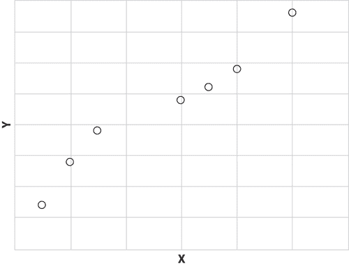


`Figure 1.4` 正单调递增关系。随着 `x` 上的值增加，它们与 `y` 上的递增值相关，然而该关系是单调的；它不必是线性或其他任何参数形式。返回文本。⏎

可用于有序响应变量的其他检验包括用于两组的 `Wilcoxon-Mann-Whitney` 以及作为参数 ANOVA 对应物的用于多组的 `Kruskal-Wallis` 检验。`sign test` 可用于名义或有序数据，而 `Friedman test` 也是重复测量数据的有用替代方法。这里没有空间讨论或演示这些检验。详情请参阅 Siegel 和 Castellan Jr (1988)，这是关于非参数检验的经典资源。对于更连贯的模型，可使用 `ordinal logistic` 和 `ordered probit model`。如果模型中的优势彼此成比例且仅相差一个常数，则会产生 `proportional odds model`。详情请参阅 Fox (2016，第 401–402 页）。

对单调数据的另一种建模方法是 `isotonic regression`，它与普通最小二乘回归不同，具体将数据建模为非递减近似。详情请参阅 Neykov (2019)。双变量情况下的等距回归，即 `bivariate isotonic regression`，可使用 R 包 `Iso` 进行 (Turner, 2023)。

## 1.16 统计与机器学习概念概述

在回顾了支撑科学、统计学和机器学习的一些基本哲学假设和思想之后，我们现在转向对统计和机器学习概念本身进行综述。这些概念中的许多在统计学中已有悠久历史，而其他概念则更现代，主要适用于机器学习。此处综述的主题是精选的；它们是读者为理解本书其余部分应熟悉的内容。

### 1.16.1 可能近似正确

`probably approximately correct` (`PAC`) 可学习性的概念源于统计学习理论，目的是识别假设类或 `sets`（通常具有无限性质），这些假设类实际上是可学习的并提供较低的泛化误差（Haussler, 1990；Valiant, 2013）。假设类本质上是几乎所有函数中可用于建模某种现象的 `could` 的子集。例如，假设我们选择一个在 48 个样本上最小化经验风险的假设。我们如何知道这样的假设也会最小化总体风险？如果假设类是所谓的 `PAC learnable`，那么我们就知道它很可能也会最小化总体风险。也就是说，`PAC learnability tells us that the selected function will, essentially, likely have low generalization error`。也就是说，PAC 模型将 `probably` 对新数据泛化良好。

更直接、更实用的理解 PAC 可学习性的方法是考虑假设或概念类将 `not` 预测得有多好。也就是说，任何严重错误的假设几乎肯定会在样本中经过少量示例或数据点后以高概率被“发现”，因为它（很快）会做出错误预测。因此，任何与足够大的训练示例集一致的假设都不太可能严重错误。也就是说，它已通过经验进行了“测试”，这意味着它必须是 `probably approximately correct`。任何返回可能近似正确假设的学习算法称为 `PAC learning algorithm`，这种指定有助于为各种学习算法提供性能界限。有关 PAC 可学习性的精确和技术性描述，请参阅 Mohri 等人（2018，第 11 页）。

### 1.16.2 无免费午餐定理

正如本书开头所述，区分机器学习范式与经典统计学的一个要素是对 `algorithm` 或 `method` 而非数据的更关注。这并不是说数据不重要；它们当然非常重要，但 `performance` 的算法或程序是研究的重点。“逻辑回归是否优于判别分析，如果是，在什么条件下？”等问题主导了当前的机器学习思潮。

鉴于对算法的这种强调，然后问一个算法是否主导所有其他算法是有意义的。也就是说，我们提出问题：

> `Is there a best universal learner?`

对此问题的答案包含在被称为 `No-Free-Lunch Theorem` 的内容中，其本质上认为 `there is no universal learner`。在所有条件下对所有数据都没有“最好”的算法。展开来说，这意味着对于任何学习算法，都存在一个它可能非常准确的数据集，以及另一个它表现很差的数据集。我们在一种实质性情境中带入的假设，通常称为 `inductive bias`，与另一个领域中的假设不同，因此在所有领域中都不存在通用学习器。当我们说一个学习算法是“好”的时，我们只是在量化其归纳偏差与我们当前处理的数据属性的匹配程度（Alpaydin, 2020）。然而，学习器在一个环境中可能再好，也总有一个任务它会失败。

作为一个简单的例子，线性回归在根据教育水平预测收入时可能效果极佳，但在预测 COVID-19 死亡概率时却可能惨败。对该定理的一个等价且更粗糙的解释是，对于任何人能设想的最复杂的算法，在所有可设想的任务上，其 `average` 性能与仅仅预测每个点都属于特定类别相同（Goodfellow, 2016）。为什么为建模特定情况而选择的算法的性能可能更好？因为我们会根据对数据的了解为手头的特定任务选择该算法。换句话说，我们不再在所有任务上取平均。我们是在选择特定任务并使用适合该任务的算法。

作为类比，对所有可能的理论分布建模智商是徒劳的，如果我们合并（或平均）所有分布，我们的智商模型会相当糟糕。幸运的是，我们并不使用所有分布；我们通常使用 `normal distribution`，因为它最好地近似了智商分布的 49 经验形状。`normal distribution` 并不是所有任务的“最佳”分布；它是对特定任务（如智商建模）而言最佳的。也就是说，我们通过对正在处理的任务做出 `assumptions` 从所有分布中“缩小范围”。这是在拟合统计分布时思考假设制定的有力方式——`assumptions help narrow down the search and selection of an algorithm`。

下次你选择的算法很好地拟合了给定数据集时，请记住这一点，并确保不要夸大你的算法实际上有多“好”。对于所有情况都没有 `best` 算法。算法和统计程序必须为每个任务明智地选择，这意味着不仅要了解数据，还要了解其所应用的实质领域。例如，线性回归永远不可能成为“最佳算法”。它只能与特定数据集结合时才是最好的（例如，表现出线性和方差齐性的数据集）。

## 1.17 V-C 维度和复杂性


瓦普尼克-切沃年基斯或“V-C”维数是衡量分类器性能的指标。它刻画了其*可学习性*。它是假设类能够“shattered”或更通俗地说是“分离”的点的最大数量。作为该理论的一个简单示例，请考虑以下图表（改编自 Hastie 等，2009，第 238 页），其中每个点轮流作为 `class = 1`（加粗方块）与 `class = 2`：


*图 1.5* 经 Springer Nature BV 许可使用，摘自 Trevor Hastie 等著《统计学习基础》，© 2009；许可通过 Copyright Clearance Center, Inc. 传达。

如上所示，我们可以看到线性函数能够在每种情况下“shatter”两组结构。因此，我们可以说上述线性函数类能够 shatter 三个点。

以上只是 V-C 维数的平凡示例，其理论要复杂得多。该定理的细节可在 瓦普尼克和切尔沃年基斯 (1971) 中找到。该定理有效地可以帮助提供一组算法的*乐观性*的上限（哈斯蒂等，2009），并告诉我们概念类的能力或容量，即该类*能够*做什么，例如上述直线 shatter 三个点的例子。一般来说，参数数量高的学习机器具有较高的 V-C 维数；然而，这并不总是必然如此。可能存在一条非常曲折的线，它能 shatter 许多点，但只有一个参数（参见 哈斯蒂等，2009， 中的示例）。

## 1.18 参数学习与非参数学习方法

几乎所有统计和机器学习方法都可以区分为参数与非参数，尽管实际上许多方法会落在这两个极端之间。参数与非参数方法的区别是什么？与统计学中的大多数事情一样，这一区别很快变得*模糊*，但我们将尽力[content]
瓦普尼克-切沃年基斯或“V-C”维数是衡量分类器性能的指标。它刻画了其*可学习性*。它是假设类能够“shattered”或更通俗地说是“分离”的点的最大数量。作为该理论的一个简单示例，请考虑以下图表（改编自 Hastie 等，2009，第 238 页），其中每个点轮流作为 `class = 1`（加粗方块）与 `class = 2`：


*图 1.5* 经 Springer Nature BV 许可使用，摘自 Trevor Hastie 等著《统计学习基础》，© 2009；许可通过 Copyright Clearance Center, Inc. 传达。

如上所示，我们可以看到线性函数能够在每种情况下“shatter”两组结构。因此，我们可以说上述线性函数类能够 shatter 三个点。

以上只是 V-C 维数的平凡示例，其理论要复杂得多。该定理的细节可在 瓦普尼克和切尔沃年基斯 (1971) 中找到。该定理有效地可以帮助提供一组算法的*乐观性*的上限（哈斯蒂等，2009），并告诉我们概念类的能力或容量，即该类*能够*做什么，例如上述直线 shatter 三个点的例子。一般来说，参数数量高的学习机器具有较高的 V-C 维数；然而，这并不总是必然如此。可能存在一条非常曲折的线，它能 shatter 许多点，但只有一个参数（参见 哈斯蒂等，2009， 中的示例）。

## 1.18 参数学习与非参数学习方法

几乎所有统计和机器学习方法都可以区分为参数与非参数，尽管实际上许多方法会落在这两个极端之间。参数与非参数方法的区别是什么？与统计学中的大多数事情一样，这一区别很快变得*模糊*，但我们将尽力[content]
瓦普尼克-切沃年基斯或“V-C”维数是衡量分类器性能的指标。它刻画了其*可学习性*。它是假设类能够“shattered”或更通俗地说是“分离”的点的最大数量。作为该理论的一个简单示例，请考虑以下图表（改编自 Hastie 等，2009，第 238 页），其中每个点轮流作为 `class = 1`（加粗方块）与 `class = 2`：


*图 1.5* 经 Springer Nature BV 许可使用，摘自 Trevor Hastie 等著《统计学习基础》，© 2009；许可通过 Copyright Clearance Center, Inc. 传达。

如上所示，我们可以看到线性函数能够在每种情况下“shatter”两组结构。因此，我们可以说上述线性函数类能够 shatter 三个点。

以上只是 V-C 维数的平凡示例，其理论要复杂得多。该定理的细节可在 瓦普尼克和切尔沃年基斯 (1971) 中找到。该定理有效地可以帮助提供一组算法的*乐观性*的上限（哈斯蒂等，2009），并告诉我们概念类的能力或容量，即该类*能够*做什么，例如上述直线 shatter 三个点的例子。一般来说，参数数量高的学习机器具有较高的 V-C 维数；然而，这并不总是必然如此。可能存在一条非常曲折的线，它能 shatter 许多点，但只有一个参数（参见 哈斯蒂等，2009， 中的示例）。

## 1.18 参数学习与非参数学习方法

几乎所有统计和机器学习方法都可以区分为参数与非参数，尽管实际上许多方法会落在这两个极端之间。参数与非参数方法的区别是什么？与统计学中的大多数事情一样，这一区别很快变得*模糊*，但我们将尽力


非参数方法在机器学习文献中有时被称为 `instance-based learning` 方法或 `memory-based learning`，这是由于它们在确定拟合时对数据的高度依赖。在计算层面，基于记忆的方法在对未来数据进行预测时会存储整个数据集或至少其中很大一部分。由于这种存储需求，这类基于记忆的方法通常训练速度很快，但在进行预测时可能较慢（Bishop, 2006）。

### 1.18.3 重新审视经典的非参数检验

如果读者修过经典的统计学课程，她可能会回忆起接触到非参数统计，至少在书的末尾通常只有一个章节。非参数统计检验包括诸如 Kruskal-Wallis 检验等以及大量其他检验。鉴于我们对非参数检验的上述最一般性描述，我们现在可以重新审视传统上和“经典地”教授的非参数检验的早期教学。是什么使得那些检验成为非参数的？根据我们上面的定义，正是它们 presumably 没有做出参数假设这一事实使它们成为非参数的。或者，至少做得 `fewer`。例如，Kruskal-Wallis 检验不假设观测值来自正态总体，而竞争的参数 ANOVA 检验则假设。这些非参数检验通常在 `ranks` 等上操作，因此通常对潜在总体做出最少，甚至没有假设。52

这种对非参数检验的描述的问题在于，精通机器学习的现代统计学家可能不会将那些“简单”的非参数检验视为当今非参数广阔领域的例子，这在很大程度上是由于计算能力的提高。今天的非参数方法似乎比统计学经典时代的那些更简单的非参数检验要广阔得多、更复杂得多、更“大”得多。当我们今天说“非参数”时，我们通常不是指那些更简单的检验，而是指诸如 `bootstrap`、`splines` 或其他使 `fewer assumptions about the underlying population` 的算法等，并且出于良好的实用原因，在当今“大数据”的许多情况下，我们在数据招募中更接近于能够近似整个总体。 当今非参数方法学的关键不在于不做出参数假设，尽管这仍然是其定义特征。当今非参数领域的“精神”是 `letting the data speak for itself`。它关乎将参数假设排除在外，并用现代计算能力取而代之。Efron and Hastie (2016) 总结了非参数方法新近的兴起：

> 两个词 \[parametric and nonparametric\] 解释了对参数模型的经典偏好：数学上的可处理性。在 `sliderules` \[sic\] 和缓慢的机械算术的世界里，数学表述在必要时成为首选的计算工具。我们新的计算丰富环境解除了数学瓶颈，为我们提供了更现实、更灵活、更广泛的统计技术体系。但经典的参数族在计算机时代的统计学中仍然发挥着重要作用，通常被组装成更大方法论中的小部分。

> 
> (p. 53)

如前所述，关于经典非参数检验的一个良好资源是 Siegel and Castellan Jr (1988)。

## 1.19 降维、距离和误差函数：建模中的共性

大多数过程或数据并没有数千个内在参数作为其基础。相反，通常只有少数几个参数在较低维度上起作用。较低维的结构据说被 `embedded` 在我们工作中遇到的高维空间中。也就是说，我们说存在一个 `manifold` 或 `subspace` “存在”于这个高维空间之内。降维寻求揭示或发掘该流形或子空间。

对本质维度的探索自其诞生以来以一种或另一种方式主导了科学。与其说有成千上万的“事情正在发生”，不如说表面之下可能只有少数几件事。乍一看，降维自然与诸如 `principal components analysis`、`factor analysis` 等技术相关联，但事实是，降维在我们处理的几乎每一种技术中都隐含存在。甚至基本的 `t`-test 及其转换（例如，线性对比、ANOVA）也可以被证明包含降维的基本原始概念，尽管在初级呈现层面这并不立即明显，也没有意义在入门课程中将 `t`-test 教为与降维技术相关。

### 1.19.1 降维：核心思想是什么？

降维的思想是将数据点 `project` 到较低维度上。降维提出的总问题如下：53

> `What would these data points look like if they existed in these lower dimensions?`

我们将在书中后面看到，这基本上就是 PCA 的全部内容，前提是潜在维度是线性函数。我们可能有 1000 个变量，但当我们将维度从 1000 降到例如 3 时，我们然后想知道这些 3 个维度上的得分 `would have been` 如何。这将通过将数据投影到那三个维度上然后计算 `component scores` 来回答，而 `component scores` 是在现在这三个维度上产生的得分。

作为我们所谈论内容的示例，并预览书中后面的内容，PCA 最一般地可以定义为

```
l[i] = a[1]y[1] + a[2]y[2] + ... + a[p]y[p]
```

(1.7)

其中 `l[i]` 是观测变量 `y[1]` 到 `y[p]` 的加权值的线性组合。即使数据并非真正位于线性流形上（我们将在书中后面定义“流形”；目前它可以被视为某种 `shape`），PCA 通常仍然有用，并且是对真实潜在流形的非常好的 `approximation`。PCA，正如我们后面将看到的，本质上是在寻求发现一个新的 `basis` 来投影数据。`basis`，正如我们在线性代数综述中将回顾的那样，是 `the maximum set of linearly independent vectors that spans the space`。当我们以原始形式收集数据时，它已经位于一个基上，但该基相对 `arbitrary`。例如，从这个角度来看，典型的笛卡尔平面是一个任意基，但受限于 90 度角。将数据转换到新的基上是 PCA 和许多其他技术所完成的工作。然后我们从该基投影数据，以了解数据从该 `vantage point` 看起来如何，该视点即为新基。PCA 情况下的基是特征分解（或奇异值分解）产生的正交特征向量集合。该基是标准正交的，这意味着正交且每个特征向量的长度等于 1。

我们的降维应是什么样的？这些较低维度的形式是什么？我们有两个一般可能性：`linear` 与 `nonlinear` 降维。虽然传统上线性降维一直是常态，但相对较新的技术已允许进行复杂的非线性降维，或更一般地称为 `nonlinear manifold learning`。虽然线性降维可能相对较好地捕捉一个过程，但在某些情况下，需要非线性流形来捕捉潜在流形的更多复杂性和细微差别。

### 1.19.2 维度灾难


鉴于许多方法最终都归结为降维，在此值得注意的是，维度可能极其难以 `tame`。非参数方法，如我们所讨论的，通常试图在非常 `local` 的层面上对数据进行建模。乍一看，这些方法似乎很适合处理维度问题。然而，随着维度的数量增加，对局部行为的建模变得难以处理。Hastie 等 (2009) 针对局部回归描述了 `curse of dimensionality`，局部回归是一种比普通最小二乘通常能够实现的更局部的水平来建模回归曲面的技术：

> 局部回归在远高于二维或三维的维度中变得不太有用……随着维度的增加，若不使总样本量呈指数增长，就不可能同时保持局部性（低偏差）和邻域内足够大的样本（低方差）……当维度与样本量之比不利时，局部回归 54 并不能帮助太多，除非我们愿意对模型做出一些结构性假设。
> 
> （第 200–201 页）

换句话说，`locality` 是一个相对的术语，而不仅仅是距离度量的函数。正如我们在讨论 `k`-nearest neighbors 时将再次回顾的那样，随着我们所处空间的维度增长，即使要捕捉到该较大维度下的相对局部邻域，也常常需要覆盖模型中变量(s) 的显著定量范围。换一种说法，随着维度的增长，几乎不可能考虑到多维矩阵中所有可能的“单元”，因此 `locality` 的定义本身变得意义不大，除非 `sample size` 大幅增长以应对空间体积的增加。

为了使用一个 `k`-nearest neighbor 类比，我们将在本书后面更详细地讨论该方法时再次提及，如果你的 `nearest neighbor` 在数学上是一颗火星上的房子，这就无法传达局部的真正精神。也就是说，很难说火星上的房子是你的邻居。它可能在 `mathematically` 上是邻居，但这只是因为问题的维度巨大，而样本量必然不足以涵盖从你家到火星上那栋房子的数据中的所有“单元”。换句话说，`that there is no house on the moon should not, by itself, make Mars, by default, a nearest neighbor`。火星成为邻居更多是所处空间维度的人为产物，而不是因为火星真正是邻居。增加样本量最终很可能会在月球上放置一栋房子，而月球现在将成为你的邻居，而不是火星。总之，随着问题维度的增加，说火星可能是你的“nearest neighbor”变得远不如真正以更 `locally` 的方式，即在更小的空间体积内，识别你的最近邻居那样有意义。

## 1.20 距离

也许本书中方法与模型的一个“统一者”甚至更为基础，那就是 `distance`。无论是多元统计还是机器学习，每种方法在某种程度上都会评估对象之间的距离（Johnson & Wichern, 2007）。例如，“模式”和“聚类”只有在我们能够衡量观测值之间的距离时才能被辨别。哪些对象相似？哪些不同？然而，有一点需要牢记：

> `Similarity, measured by a distance function, does not necessarily imply “alikeness.”`

例如，10 磅的重量与 10 英寸的身高相似，但仅在测量的距离方面相似，而非实质材料方面。正如大多数统计程序的情况一样，我们必须敏锐地意识到数据数值表示与数字背后材料的科学本质之间的区别。正如威廉·詹姆斯曾经说过的，`we must not confuse data with the abstractions we use to analyze them`。

我们在下一章关于数学基础的章节中进一步讨论距离的概念，并在其中强调最常见的距离度量，即 `Euclidean distance`。

## 1.21 误差最小化

误差最小化是本书大多数方法的又一个统一主题。在所有方法中，我们都在某种意义上力求尽可能直击要害并在此过程中最小化误差 55。最小化误差的这一思想几乎存在于每一种方法中，要么隐含存在，要么在幕后暗中进行。

例如，再次考虑主成分分析。尽管通常使用特征值分析或 `SVD` (`singular value decomposition`) 进行并重现变量中的全部原始方差，但 `PCA` 最受追捧的结果是一个单一成分解释全部方差。因此，目标可以被视为单一成分。误差函数是指我们需要其他成分来合理解释数据的程度，或者根据应用的不同，如果实质应用是图像压缩，则通过数据压缩重现给定图像。同样，在结构方程模型中，我们寻求重现协方差矩阵；我们无法 `exactly` 重现的程度就是我们出错的程度。`Minimizing error when imposing some kind of functional or near-functional form onto data is a goal of many statistical and machine learning methods`。

## 1.22 训练误差与测试误差

当我们考虑 `f(x)` 时，它被视为 `true` 未知函数。我们通常使用 `f̂(x)` 来估计 `f(x)`，其中 `f̂(x)` 是 `estimated function`。我们是否在乎函数是“黑箱”还是我们可以“拆解”并更好地了解的东西？如果是，我们希望确切知道 `f(x)` 是什么；如果不是，那么黑箱可预测性可能成为主要兴趣，而无需真正了解函数形式。也许 `Amazon.com` 只想知道你最有可能下一步购买什么产品；它可能不在乎 `why`；它只关心是哪一个。

当我们 `train` 一个模型时，我们将其拟合到样本数据上。然而，正如我们在本书后面将讨论的那样，`training error`（即拟合不足）通常不是主要关注点。相反，我们更希望知道模型在它尚未见过的数据上的拟合程度。这被称为 `test error`，通常是对模型拟合程度的最终裁决，至少对于将其拟合到样本数据的给定实例而言。一个有用的类比是拳击手为比赛训练；我们更少关心拳击手在陪练对手上的表现，而更关心他或她对阵新对手的表现。“比赛之夜”是拳击手技能的 `true test`，而不是为比赛做准备的训练课程。

## 1.23 交叉验证与模型选择

交叉验证是统计学习和机器学习的一个主要“主题”，它在某种程度上与过去的“经典”统计学有所区别。当我们遇到一篇研究论文应用统计方法于数据并报告拟合度量时，拟合统计量的大小通常是 `optimistic` 的，因为通过将模型拟合到样本数据，我们可能利用了随机或偶然因素。正如我们已经讨论过的，我们可能 `overfit` 了模型。也就是说，报告的 `R-squared` 比如 0.80，可能远高于模型拟合的现实评估。是的，它在 `training data` 上是准确的，但正如我们所强调的，我们更感兴趣的是模型在 `test data` 上的表现。


# 测试误差估计与交叉验证

`test error` 是使用统计学习方法预测新观测响应时产生的平均误差——即在训练该方法时未使用到的测量值。这一定义及其更广泛的概念在评估模型时至关重要。如前所述，`training error typically underestimates the test error rate`。然而，估计测试误差并没有看起来那么容易。理想情况下，我们会有专门的测试集观测值（比如原始数据集的 20–30%），我们可以直接将统计模型应用于其上以观察其表现。然而，通常我们没有这样的数据集可供使用，因此开发了许多 56techniques 来帮助仅使用可用训练数据来估计测试误差（例如，赤池信息准则（AIC））。

目前假设我们有足够的数据，可以将其中的一部分留作经验交叉验证之用。已经开发出不同的交叉验证新样本的方法。`validation set approach` 指定一个子集或 `holdout` 观测值用于测试（例如，20–30%）。`Leave-one-out cross-validation` 采用类似的理念，但只留出一个观测值进行预测，因此可以被视为验证方法的特例，其中 `n` = 1。测试观测值是 (`x` [1], `y` [1])，并且未用于拟合，因此 (`y`[1]−`ŷ`[1])² 提供了测试误差的近似无偏估计。它是无偏的，但高度可变，因为它只是一个观测值。所谓“高度可变”意味着如果我们使用不同的观测值，可能会得到相当不同的结果。因此，我们对所有观测值重复此过程，从而留一交叉验证对测试均方误差（MSE）的估计是所有 `n` 个测试误差估计的平均值：

$$CV\_{(n)} = \\frac{1}{n}{\\sum\\limits\_{i = 1}^{n}{MSE\_{i}}}$$

(1.8)

其中 `MSE` `[i]` 用于定量响应（对于离散或分类响应，通常使用其他误差度量）。留一交叉验证的偏差小于验证集方法。也就是说，它不太可能像验证方法通常会的那样高估测试误差。此外，与验证方法不同，该方法中没有随机性。由于我们使用了全部 `n`，随机抽样或划分为任意验证集的想法不存在。另一种方法是 `k-fold cross-validation`，它是验证集方法和留一方法之间的一种折中。K 折交叉验证产生的“折”数量大于留一情况下的 `n` = 1。请记住，当我们检查真实数据时，我们不知道真正的测试 MSE，因此我们无法 `fully` 确定交叉验证估计的准确性。在进行交叉验证时，有时我们想知道最小值的确切值，而有时我们只想知道哪种方法给出最低的最小值。

我们在全书中应用其选择方法时将重新讨论交叉验证。然而，我们需要提出一个重要的警告：交叉验证模型的过程可能导致通过 `grid searches` 以及其他探索性可视化工具模拟各种参数的相对复杂的练习，以寻求并得出就最小化误差而言的“最佳”模型或调优参数，但这些工具也应结合你所在领域的事物性问题一起解释。这样，“微调”模型通常并不像遵循这样或那样的计算交叉验证“常规”那样简单明了，而应在更广泛的科学背景下考虑。

此外，通过网格搜索尝试调优参数的 `ranges` 并改变其他设置，通常被推荐，而不是过分依赖一两个参数。例如，在诸如 `ridge` 和 `lasso` 回归等方法中，良好的交叉验证通常涉及使用不同输入参数范围的网格搜索，以确定使误差最小化的最佳值，而不仅仅是“在训练数据上进行调优”的一个或两个值。我们在本书中对交叉验证的选择性“snipet”讨论通常为了保持处理简洁和空间可管理而大大简化了这一过程。然而，这绝不意味着交叉验证的过程和得出最终模型因此就已完成。在实际数据分析中，`it may be just the beginning`。读者假设因为我们对交叉验证的讨论简短或经常省略，所以它对 57given 方法因此不必要或不重要，这将是一个错误。它最常见且肯定 `is`；然而，通过计算演示进行广泛的交叉验证会让我们远远超出我们在入门教材中想要达到的范围，该教材寻求在 `theory`、`method` 和 `practice` 之间取得理想平衡。在许多情况下，我们提供了必要的软件包参考，可以在其中寻求广泛的交叉验证指导。如本书前面所述，本书中的大多数软件示例仅旨在作为对计算方面的“入门”一瞥，在大多数情况下仅旨在选择性地 `demonstrate` 该技术；这些简单的演示并非旨在详尽无遗或以任何方式构成完整的“菜谱”或进行任何分析的必要彻底或详尽的步骤。

## 1.24 蒙特卡洛方法

蒙特卡洛方法以计算机辅助的重复迭代抽样为特征。请注意，我们不需要 `need` 计算机来进行此类抽样，但可以说，如果没有计算机的便利，几乎不可能进行广泛的抽样，因为计算机可以轻松、非常快速地自动化这一过程。只要一种方法以计算机进行某种重复抽样，则根据定义，它就是一种 `Monte Carlo method`。当然，计算机的演进和先进的计算速度使得重抽样的想法相对容易实现。然而，需要注意的是，尽管蒙特卡洛方法被宣传为执行 `random sampling`，但计算机的重抽样永远不可能 `truly` 随机。也就是说，一旦我们有一个算法选择下一个“随机”数，真正的随机性思想就永远丢失了。

该技术的常见用途之一是估计统计量的抽样分布，要么是因为抽样分布无法解析推导，要么只是因为我们想将蒙特卡洛方法与其解析对应物进行比较。当我们使用此类方法估计一个量及其抽样分布时，它通常被称为 `bootstrapping`。我们将在下一章介绍自助法。自助法是更一般的蒙特卡洛方法的特例，因为它具有重抽样。然而，请注意，自助法并不 `equivalent` 于蒙特卡洛方法。

蒙特卡洛方法还经常用于通过随机算法解决复杂的优化问题，因此经常用于统计和机器学习。此类方法也可以很容易地用于估计相对于竞争替代方案的统计功效。关于此的一个很好的例子，请参阅 Rizzo (2019)。

## 1.25 缺失数据

缺失数据绝不应被忽略，因为 `missingness` 通常是有原因的。个人在调查中未回答某个特定问题的事实并不是缺失数据；相反，它是 `extremely informative data`，可能预示着最重要的回答。也许个人不愿承认自己曾偷过东西？因此，问题“你是否曾偷过东西？”的回答就是不回答！那就是变得 `most interest` 的数据。`Never ignore missing data`。`Instead, get curious as to why it is missing`。


缺失数据有时在教科书中被归入更广泛的主题“数据清洗”之下讨论。*数据清洗*通常不仅指替换或插补缺失数据，还包括纠正错误条目并检测数据文件中的其他异常。对于这些后者的用途，数据清洗是可以的，但对于替换缺失数据，正如前面提到的，分析人员应谨慎行事。经验数据是*经验*；它是你在整个分析中至关重要的“东西”；它不应该被“清洗”太多。如果你发现自己花费大量时间“清洗”数据文件，你可能需要重新考虑你的数据是如何收集的。58

## 1.26 数据分析的定性方法

本书的主题来自统计学和机器学习，因此被视为*定量*或*数值*性质的。定量方法主导着科学。然而，*定性*方法同样有用，在某些情况下甚至更有成效。这类方法常用于社会科学以及人文学科（如历史、人类学等）。对“定性”与“定量”进行哲学上的区分的尝试通常很快就会变得模糊不清，最终方法之间相似之处多于差异（毕竟数字是*定性类别*）。正如本书前面所讨论的，从认识论的角度来看，分类可能是一件危险的事情。知识和语言的大多数形式最终都关乎对象之间的*模式*和*结构*，我们将其测量为定量还是定性已成为次要问题。定量方法通常被认为更严谨，因为数字和数学运算比其他认识论对象或结构具有更少的灵活性。

总体而言，定性传统更倾向于不将信息简化为数字。这是有充分理由的，因为如果使用不当，数字实际上可能会掩盖并削弱潜在过程。正如 Carrera-Fernández 等人 (2012) 所指出的，他们讨论了定性研究，

> 在其中，研究者更信任文本数据而非数值数据，并以文本形式分析这些数据，而不是将其转化为数字进行分析，其目的是理解人类行为的意义……不仅使用文本数据，还使用视觉、语言、身体、音频和空间数据……数据在其原始维度中被分析，而不事先转化为数字。
>
> （第 3 页）

当然，用定性方法来确定飞机起飞时襟翼的合适角度是不可能的，除非定性类别是精确的数值测量。数值准确性在这一研究领域至关重要。请注意它仍然是定性的，只是其定性本质是精确的数学类别。在数字可能无法代表潜在本质的研究中，例如诗歌、文学、或灵魂、历史等的研究，定量方法实际上可能会*削弱*这些潜在本质。定量方法，尤其是在社会科学中，大多被高估了。在某些领域，它们给人以*外表*的严谨，但数字之下往往基础薄弱。Rollo May 的《焦虑的意义》 (2015) 可能比这或那应用于测量不完善的焦虑数据的统计模型更能告诉我们关于焦虑及其*本质*的信息。这里的重要一点是保持开放的心态，不要仅仅因为它们不是“数学密集型”就否定定性方法。*并非一切都可以简化为数字*。然而，不采用这种还原主义哲学会使定性特征的传达变得困难得多。也许最终所需要的是在解释复杂现象时恰当地混合使用各种方法。59

## 1.27 章节复习练习

1. 通过在线互联网搜索，尝试区分*统计学*、*机器学习*、*数据* *科学*和*人工智能*。做出这种区分容易还是困难？为什么？*计算*在这些区分中处于什么位置？
2. 解释算法具有*稳定*性在概念上和技术上意味着什么。
3. 区分*归纳*与*演绎*逻辑。
4. 在 `R` 中，尝试计算 `5 = 5`，然后计算 `5 == 5`。在每种情况下输出有何不同？
5. 区分*监督*学习和*无监督*学习，并讨论为什么这种区分很快就会变得人为。
6. 区分*过拟合*和*欠拟合*，并在每种情况下给出一个例子，无论是拟合数据的模型，还是寻求解释经验事件的更一般理论或叙述。
7. 在可靠性理论中，在什么情况下会出现 `σ[Y]² = σ[T]²`？你认为在测量和科学总体上这种情况现实吗？为什么或为什么不？
8. 为什么在比率尺度上可测量的事物必然也在名义尺度上可测量？解释。
9. 区分*很可能近似正确*和*V-C 维*。
10. 区分*参数*与*非参数*统计和机器学习方法。在尝试区分它们时你会遇到任何困难吗？
11. *维度灾难*是什么？为什么它在降维方法中可能成为一个问题？
12. 区分*训练*误差与*测试*误差，并讨论交叉验证的概念在这两种误差之间“如何”契合。
13. 如果你必须将所有方法归并为定量或定性，你会选择哪一个？也就是说，定性方法能否被“包含”在定量方法之下，还是定量方法最好被包含在定性方法之下？解释。

60

# 2 数学与统计基础

DOI: [10.4324/9781003376941-4](https://doi.org/10.4324/9781003376941-4)

本章提供了理解本书其余部分所需的一般数学和统计背景概述。本书的大多数读者将拥有不同的背景；有些人可能在阅读本书之前已修过先前的数学、统计学和方法学课程，而其他人可能仅有最基本的入门的第一或第二年统计学课程作为准备，该课程很可能是在线性代数和微积分入门课程之后修读的，而他们可能理解也可能不理解。令人遗憾的是，在当今的环境下，学生能够通过微积分课程，例如，却在之后无法描述微积分到底是*关于*什么的，这非常常见；一个人可以对函数 `f(x) = 2x²` 应用幂次求导法则得到 `f'(x) = 4x`，但可能完全不理解刚刚完成的工作。 这里 `f'(x)` 意味着什么？ `4x` 应该如何解释？ 许多人指出，数学教育过多关注*计算*而非真正的*理解*。 对于那些在先前的课程中未被鼓励去*理解*的读者而言，本章所综述的部分或大部分材料可能并非“复习”，而是基本上首次介绍。 背景有限的读者被鼓励通过全书提供的参考文献以及章节末尾建议的阅读材料来补充对这些主题的学习。


正如前一章所述，统计学和机器学习的基础其实并不在数学中。数学只充当*载体*，借此传达此类概念。例如，在一个简单的线性回归问题中，“思想”是最小化预测误差。这就是*概念*。要将概念付诸实践，需要的不仅仅是文字或一般性想法；它需要*精确的符号定义和表示*，也就是*数学*。两者并非同一回事。而且，虽然统计学和数学本身就具有挑战性，但对于应用科学家而言，更重要的挑战是理解*为何*在给定情境下使用特定的数学方法。这有助于激发数学背后的大局观思想。

例如，*核*虽然在现代机器学习中非常流行，实际上它们相当古老，并非线性代数的全新事物，且可以在远超机器学习的多种情境中使用。但为何要使用它们呢？其使用的一般“主题”是什么？使用它们的总体大局观思想是既促进计算，同时也提供在更高维度中近似函数的简写。基础数学允许我们以*符号*形式定义其表现，但理解*如何*、*为何*和*何时*使用核才是更重要的“全局”图景，也是最需要把握的。“大局观”理解是最需要的，也是典型的本科*和*研究生课程中最常缺乏的，尤其是在面向应用科学家的定量课程中。学生需要被教导*为何*，而不仅仅是*如何*。一旦理解了“为何”，“如何”要么自行显现，要么可以挖掘出来。学习*如何*在 61expense 的*为何*是不具教育意义的，却不幸地常被鼓励在教学中出现。学生不是*机器人*；他们是*创造性头脑*，应作为这样的个体来培养。

统计学、多元统计学、机器学习以及更广泛的数据科学的技术“地下”通常存在于通常被视为数学三大“支柱”领域之中：*概率与统计*、*线性代数*和*微积分与优化*。事实上，对于统计学家或研究者而言，同时在一定程度上成为线性代数或微积分的“迷你专家”，甚至两者兼具，并不罕见，因为线性模型和多元建模的许多技术基础都建立在这些领域之上。例如，考虑*特征值*和*特征向量*这一主题。这些对象贯穿统计学和机器学习始终，但也可以脱离任何应用统计用途而独立研究。*它们本身就是数学对象*。正如本书开头所述，研究者或科学家，或更广义地，这些方法的“使用者”必须持续意识到应研究多少“子领域”，同时保持对研究主要领域的关注。例如，过度关注线性代数最终会分散其应用实验科学，无论该专业化是什么（例如，生物学、心理学、林业、化学等）。

## 2.1 数学预览 vs. “附录”方法

### 2.1.1 为何预览更好

过于频繁地，这类书籍中必备的数学基础要么被给出为脱节的基础回顾，要么作为附录。所有“好东西”都被打包放在附录中，供读者按需查阅。然而，这种方法是有局限性的，因为它未能将材料与文本中更实质性的部分联系起来。我们的方法是提供这些技术基础的概述，但最重要的是，*预览我们在全书中何时会再次见到它们*。这一点尤其重要。让读者学习或回顾一大堆看似“抽象”的数学，如果没有得到适当的*动机*，是毫无益处的。至少不是在*应用*意义上。当然，读者可能并不总是能立即完全领会预览，因为它是对新概念的不完整描述（如果对读者而言确实是新的）；然而，它仍然可以起到向读者介绍概念的作用，作为预览这些数学在统计学和机器学习中使用的用途。这些早期基础有助于使对统计学和机器学习支柱（概率、线性代数、微积分）的理解成为一个更*连续*的过程，而非*离散*的过程。在这种意义上，基础*就是*方法，但人们在很大程度上意识不到这一点，直到他们在本书后面学习方法时看到基础“在运动中”或“发挥作用”，然后再回到这些早期页面，更好地认识到正在被预览的联系。

例如，*线性组合*这一概念，若以抽象方式教授，可能显得晦涩且毫无意义的符号数学对象，直到人们意识到多元统计学和机器学习的许多内容都与这些对象有关。如果读者几乎没有任何先验经验来到本书，那么他们将无法欣赏我们对线性组合将在本书后面使用的预览。另一方面，如果他们带着此类先验经验来到本书，他们很可能会立即认识到这种联系，这可能有助于“联系”该读者的概念。

再举一个例子，理解回归问题中*线性相关*所带来的问题，只有在我们进入线性回归时才会真正有意义，即使线性相关的概念已在当前章节中引入并进行预览。这类书籍通常以或多或少线性的方式编写，但*对这些主题的理解并不总是线性的*。本书后面的章节可能会让早期章节中的某些内容“豁然开朗”，读者在教育上应对这类联系保持开放。62

### 2.1.2 关于证明

我们避免在本章及全书中使用形式证明。然而，这并不意味着基于我们所呈现的细节，基本的证明无法构建。证明往往比读者最初意识到的更“接近”读者的能力，尤其是如果他们真正掌握了材料。

例如，众所周知，皮尔逊相关系数被−1 和+1 的界限所约束。原因我们已在书中解释，尽管该解释不构成“形式证明”。然而，如果需要，可以从解释的片段构建证明，这通常是一个很好的练习。正如受人尊敬的教育家莫里斯·克莱因在谈到教授微积分时多次所说，理解对象背后的*直觉*比学习严格的证明更好，至少在首次阅读和接触时是如此。事实上，历史上物理学家和其他科学家在发明新概念时很大程度上依赖于这种方法。数学和统计专业社区对何为“形式证明”有正当的高且非常严格的标准（他们应因其对严谨性的欣赏而受到赞扬），但读者必须认识到，他们自己有时离那种“理想”的形式化证明并不遥远，至少在某些情况下是如此。*近似是可以接受的*，只要意识到它们并非包罗万象且可能缺乏形式性。只要近似能忠实于概念，你就没问题。如果近似使你偏离概念，那就是问题。


在结果非常重要时，我们提供必要的技术参考以供更正式的证明和论证。例如，从应用的角度来看，了解*中心极限定理*是什么以及它为什么有效是最重要的，但如果有人坚持通过正式证明来学习“为什么”，并且有决心去推敲它，则提供了选定的参考资料来进一步论证该定理。了解定理“被证明”的原因和方式，而非证明的细节，对于好奇的读者来说可能已足够。证明可能很复杂，但证明的*思想*（通常）并非如此。

证明到底是什么？Abbott 对著名数学家哈代的引述（2015，第 8–9 页）在这一点上很有帮助：

> 正如哈代所指出的，这类数学具有艺术性，可能容易也可能不容易，但这并不意味着发生了什么特别神秘的事情。证明有点像一篇论文。它是一组精心[content]
在结果非常重要时，我们提供必要的技术参考以供更正式的证明和论证。例如，从应用的角度来看，了解*中心极限定理*是什么以及它为什么有效是最重要的，但如果有人坚持通过正式证明来学习“为什么”，并且有决心去推敲它，则提供了选定的参考资料来进一步论证该定理。了解定理“被证明”的原因和方式，而非证明的细节，对于好奇的读者来说可能已足够。证明可能很复杂，但证明的*思想*（通常）并非如此。

证明到底是什么？Abbott 对著名数学家哈代的引述（2015，第 8–9 页）在这一点上很有帮助：

> 正如哈代所指出的，这类数学具有艺术性，可能容易也可能不容易，但这并不意味着发生了什么特别神秘的事情。证明有点像一篇论文。它是一组精心制作的指导，当遵循时，应使读者完全确信所讨论命题的真实性。为了实现这一点，证明中的步骤必须在逻辑上源于之前的步骤，或由其他商定的事实集来证实。除有效之外，这些步骤还必须连贯地组合在一起形成有力的论证。数学确实有专门的词汇，但这并不免除一篇好的证明免于用语法正确的英语书写。

因此，证明是证明数学陈述正确的一种方式；它是一种论证，正如在其他探究领域中也存在大量论证一样（例如，科学、历史、政治等）。然而，数学证明更加严谨，因为它们的对象是我们能够操作为特定数量和变量的对象。

在开始之前先做最后一点说明。显然，不可能在一章中涵盖统计或机器学习中使用的所有数学。甚至不可能在一本*书*、一系列书籍或百科全书中涵盖全部！你明白我的意思。我们的主要目标在这里只是简单地概述理解本书其余内容所需的、最为*常见*、*相关*和*基础重要*的先修数学和统计知识。63 相关目标是为可能已经对这些主题有初步了解的读者提供额外的见解，并帮助此类读者看到更大的整体。例如，读者是否曾意识到基本神经网络与其他统计方法有多相似？正如本书开头所述，主要目标之一是强调这种*联系*，以增强学生对这些更全局概念的理解。

## 2.2 基础概率与基本统计

概率论是对不确定性的量化，是大多数统计和机器学习思想的基础。正如 R.A. Fisher（1925，1935）——“统计之父”——所说，我们可能无法做出*确定*的预测，但我们通常可以严格量化我们*不确定*的程度。这是一个强大的思想，它从根本上改变了科学思想和结论的“包装”方式。我们可能不知道明天是否会下雨，但我们对是否会下雨的不确定性进行量化的程度，仍然为我们提供了知识并为问题提供了一个“抓手”。我们对*不确定性*变得相对*确定*。这是一个很大的思想。历史上，概率的发明或发现不仅在科学上，而且在日常交流中都是一种范式转变。

概率的思想和概念至少可以追溯到古希腊人，可能更早，就像大多数重要思想一样。然而，概率直到 17 世纪初才被数学正式系统化。大多数数学（和其他）发明的历史都是关键概念随着时间的推移而萌芽。很少有创新者真正独自工作，也很少有重要思想不受其他同样重要的思想的激励。在适当背景下考虑的概率的正式解释，更是几个世纪以来萌芽思想的*集大成*。

## 2.3 概率的解释

一般来说，概率有三种学派：*古典*、*频率学派*和*主观*。古典观点在很大程度上并不真正属于主流概率。掷骰子得到“1”的概率是 1/6，因为骰子有六个面，而且所有面*似乎*具有相等概率。这就是古典观点的例子。历史上，频率学派和主观观念主导了统计学，因而或多或少也主导了机器学习。

对于*频率学派*而言，概率是长期频率；也就是说，如果你想知道某事的概率，你需要*经历*该事件在重复试验中出现，并取事件发生的次数与总试验次数的比例。典型的经典且简单的例子是抛硬币。如果我们抛硬币 100 次得到 50 次正面，我们说正面的概率等于 50/100 = 0.5，即使从理论上讲这只是对真实概率的*近似*。0.5 不是真实概率。在这种方法下，要得到真实概率，我们需要抛硬币*无限*多次。从这个角度来看，真实概率只有在样本量无限增大时才*在极限*中得到，即

$$\\lim\\limits\_{N\\rightarrow\\infty}\\frac{n\_{H}}{N} = p\\left( H \\right)$$

(2.1)

不幸的是，“无限大”永远不可能成为现实，因此相对频率方法的弱点之一是获得如此大量的试验不过是幻想的想法，即使它作为定义概率的有用工作模型也很有用。许多学者正是基于此对概率的相对频率解释提出了批评。64

*主观主义者*，也 commonly known as the *贝叶斯*（因为贝叶斯主义者通常采用概率的主观观点），将概率视为一种*观点*、一种*信念程度*，因此不需要频率学派必须接受的、 unrealistic 且无法实现的无限次试验的想法。然而，正如我们稍后在回顾贝叶斯统计时将会看到，主观概率也有其问题。

到目前为止，从这场讨论中需要带走的关键点是，概率的本质在历史上一直存在争议，而且目前仍然如此。你正确地理解了这一点；*没有人知道概率到底是什么！* 唯一能提供的是概率的*解释*。哪种解释是正确的不是我们在这里要讨论的辩论，事实上，如果你研究并撰写了该主题的论文，你很可能会回到你开始的地方。也就是说，概率是一个相对难以捉摸的概念，我们能做的最好的事情就是简单地采用一种思考它的方法。频率学派和主观主义者的概率观念主导着现代科学。

## 2.4 数学概率


## 2.4 概率基础

无论采用何种概率解释，几乎所有概率理论家都同意概率的基本数学。即，虽然概率的本质（即频率学派 vs. 主观学派）已被争论了数个世纪，支撑基本概率的本质数学通常不受质疑，或许除了真正的叛逆者和非 conformists！因此，在我们下面对数学概率的简要介绍中，并不存在真正的“争论”。大多数人都“认同”这些基本概念和定义。现代概率很大程度上基于 *集合论*，我们在此不予回顾，除非它直接适用于我们所介绍的概念。

事件 `A` 的概率记为 `P(A)`，并且是一个介于 0 和 1 之间的数：

`0 ≤ P(A) ≤ 1`

(2.2)

`A` 的 *补集* 用 $\\overline{A}$ 表示，是 `A` 不发生的概率。整个样本空间的概率，根据定义（并且出于方便）必须等于 1，这意味着

$$P\\left( \\overline{A} \\right) = 1 - P\\left( A \\right)$$

(2.3)

*联合概率*，即 `A` 和 `B` 同时发生，记为

`P(A∩B)`

(2.4)

如果 `A` 和 `B` 不能同时发生，则

`P(A∩B) = 0`

(2.5)

我们说两个事件 `A` 和 `B` 是 *不相交* 或 *互斥* 的。互斥事件的例子包括单枚硬币抛掷时的“正面”和“反面”事件，因为在同一次抛掷中不可能同时得到正面和反面。

要判断两个事件是否互斥，必须了解问题的 *上下文* 或 *物理模型*。例如，“正面”和“反面”事件并非 *本质上* 且 *有机地* 互斥事件；它们仅在 *单次抛掷* 模型下才互斥。对于连续抛掷，它们通常不是互斥的。互斥事件唯一绝对必要的判据如 (2.5) 所述，即 `P(A∩B) = 0`，因此只要该条件 65is 满足，即使在抽象中，这两个事件也是互斥的。对所施加物理模型的时间条件的了解有助于我们判断该条件是否满足。

为什么这一点如此重要？为什么我们要反复强调？原因在于物理模型（其中包括 *时间序列* 作为特例）是更一般“现实世界”上下文的特例或情形。抽象数学（或哲学，顺便说一下）并不需要这样的现实基础。为了强调这一点，如果外星人有一天到来且对时间毫无概念，互斥性的概念仍然可以通过在纸上用文氏图画出 图 2.1 中的想法来“传达”。

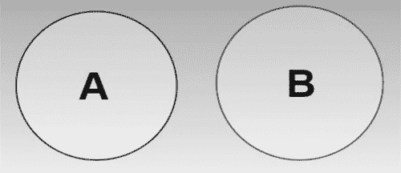

*图 2.1* 互斥事件的描绘，非重叠圆圈。返回正文。⏎

图 2.1 中的描绘就是互斥性 *是* 什么，至少从几何角度来看。互斥性是否适用于所研究的物体必须来自 *上下文*。如果只有一次抛硬币，正面和反面是互斥事件。如果有两次抛掷，则不是。*上下文很重要*。一切都发生在特定的上下文中；这包括科学、数学、统计和机器学习等方面。这个“主题”将在本书中一次又一次地出现，值得在此强调和重复：

> 上下文很重要！

### 2.4.1 事件的并集与交集

在给定试验中 `A` 或 `B` 发生的概率由它们的并集表示，

`P(A∪B)`

(2.6)

等于 `A` 和 `B` 概率之和减去它们的交集，

`P(A∪B) = P(A) + P(B) - P(A∩B)`

(2.7)

其中 `P(A∩B)` 定义交集的概率。

可以很容易看出，对于互斥事件，其中 `P(A∩B) = 0`，`A` 和 `B` 的并集等于 66

$$\\begin{array}{l} {P\\left( A \\cup B \\right) = P\\left( A \\right) + P\\left( B \\right) - P\\left( A \\cap B \\right)} \\\\ {\\,\\,\\,\\,\\,\\,\\,\\,\\,\\,\\,\\,\\,\\,\\,\\,\\,\\,\\,\\,\\,\\, = P\\left( A \\right) + P\\left( B \\right) - 0} \\\\ {\\,\\,\\,\\,\\,\\,\\,\\,\\,\\,\\,\\,\\,\\,\\,\\,\\,\\,\\,\\,\\,\\, = P\\left( A \\right) + P\\left( B \\right)} \\\\ \\end{array}$$

这有时被称为 *概率加法的特殊规则*，即交集等于 0 时，我们可以通过相加概率简单计算并集。为了安全起见，始终计划从相加中减去交集以确保自己没有重叠，这是一个很好的建议。显然并且可以很容易证明，若干集合的交集必须是其并集的 *子集*，因为重叠无论多大，都不可能大于所有集合之和。读者可能记得，*子集* 可以由整个集合组成，而 *真子集* 必须小于完整集合。

## 2.5 条件概率

科学中的大多数现象并不是关于概率的；而是关于 *条件概率*。我们很少关心事件发生的概率；我们更关心事件发生的概率，*给定其他事情已经发生*。这个“条件”陈述转化为对原始样本空间的缩小，与无条件概率估计的原始空间相比。癌症的概率很有趣，但癌症的概率 *给定你是否每天吸两包香烟* 就更有趣。几乎所有科学问题和发现，无论模型简单还是复杂或缺乏，都可以转化为条件概率的陈述。

条件概率为问题增加了上述“上下文”，因为无条件概率虽然本身往往准确，但可能极具误导性。顺便说一下，这正是有些人厌恶统计的原因，因为根据对问题施加的其他因素或条件，可以得出多种结论。例如，虽然死于 COVID-19 的概率可能是 0.05，但一个否则健康的 30 岁的人死亡的概率可能显著更低。无条件概率在某种意义上是跨对象和条件的“平均值”，正如我们稍后将讨论的，平均值可能极具误导性。条件概率是该谱系内的专门 *聚焦切片*。它们帮助我们缩小到最感兴趣的概率估计，并为问题提供必要的上下文。困难在于，在许多或大多数问题中，包含多少上下文在理论上没有限制，这使得在许多情况下得出“真实”的条件概率变得非常困难甚至不可能。最坏的情况下，缺乏上下文只会使概率估计变得毫无意义且极具误导性。人类当前正在吃婴儿配方奶粉的概率非常低。这是一个愚蠢的概率估计，因为我们没有对其进行年龄条件化，因此没有为问题提供适当的上下文。概率估计是准确的。对问题的缺乏上下文是愚蠢的，使无条件概率估计变得 *无趣*。


The concept of so-called *risk factors* also evolves from the general principle of conditional probabilities. For instance, when a practitioner asks about the past suicidality in your family as a way of estimating your own probability of suicide, she is attempting to narrow the sample space such as to ascribe past suicidality as a risk factor in estimating your own risk of suicide. The concept of risk factors plays a significant role in many branches of epidemiology and science in general. When you hear the word “risk factor,” think “conditional probability.”67

Mathematically, the conditional probability of `A` given `B` is defined as

$$P\\left( A \\middle| B \\right) = \\frac{P\\left( A \\cap B \\right)}{P\\left( B \\right)}$$

(2.8)

while the conditional probability of `B` given `A` is given by

$$P\\left( B \\middle| A \\right) = \\frac{P\\left( A \\cap B \\right)}{P\\left( A \\right)}$$

(2.9)

depending on which variable we are conditioning the other on. Using conditional probabilities and simple algebra, we can now define the aforementioned intersection between `A` and `B` more formally:

$$\\begin{array}{l} {\\,\\,\\, P\\left( B \\middle| A \\right) = \\frac{P\\left( A \\cap B \\right)}{P\\left( A \\right)}} \\\\ {P\\left( A \\cap B \\right) = P\\left( A \\right)P\\left( B \\middle| A \\right)} \\\\ {\\,\\,\\,\\,\\,\\,\\,\\,\\,\\,\\,\\,\\,\\,\\,\\,\\,\\,\\,\\,\\,\\, = P\\left( B \\right)P\\left( A \\middle| B \\right)} \\\\ \\end{array}$$

That is, the probability of `A` and `B` occurring simultaneously (i.e., `P(A∩B)`) is equal to the product of an unconditional probability – either `P(A)` or `P(B)` – with a conditional probability where it is also true that

`P(A)P(B|A)=P(B)P(A|B)`

### 2.5.1 Unconditional vs. Conditional Statistical Models

As emphasized in our discussion of unconditional vs. conditional probabilities, much of statistical modeling in the end is about conditional probabilities. In most cases, however, we do not evaluate such probabilities in a vacuum. Rather, we evaluate them relative to a particular *statistical model*. Hence, when we write the unconditional probability of `P(A)`, it will now be understood that we are assuming a statistical model, whether that statistical model is specified explicitly or not.

Referring to our previous example, the unconditional probability of cancer is, by itself, though useful, rather uninteresting, and would denote a much too simplistic statistical model similar to the idea of predicting overall suicide rates in a regression context based on no predictors would also be much too simple of a model. The *intercept-only model* is limiting. To enrichen the model, we should want to include *covariates* and variables to provide a meaningful *context* to the evaluation of the probability. This is the very essence of much of statistical modeling, to *provide a context for evaluating and estimating particular probabilities of most interest*. Many statistical models are, in the end, nothing more than generalizations of ideas of conditional probabilities. Of course, that’s a simplification, but it’s a good start to understanding statistical modeling.

Going from conditional probabilities to statistical models, we need to generalize our notation. Instead of speaking of the unconditional probability `P(A)`, we need to speak instead of the unconditional *model*, not simply *probability*. The conditional model is given by the following,68

`p(y|θ)`

(2.10)

where the response is now `y` and the parameter vector is now `θ`. The model is unconditional because there are no covariates. We now add a covariate `x` as follows:

`p(y|x,θ)`

(2.11)

which yields a conditional model where now `y` is “conditioned” on `x`, for which the parameters in `θ` will be estimated. Under the circumstance where `y` and `x` are independent, then `p(y|θ)=p(y|x,θ)`. Contrarily, when `y` and `x` are dependent, then it should be obvious that `p(y|θ)≠p(y|x,θ)`.

## 2.6 Probabilistic Independence

From the definition of conditional probability, we can quite easily obtain the concept of statistical or probabilistic independence. If `P(A)=P(A|B)`, then events `A` and `B` are said to be *independent*, which implies that knowing `B` has occurred tells us nothing about the probability of `A` occurring. Note that the qualifier “has occurred” implies a temporal dimension, but as was the case for mutual exclusiveness, we need not assume a temporal context at all. All we really require is a reduction in the sample space so that the event of interest is referenced to that *reduced space* instead of to the original wider space.

We can easily see from the rule for joint events that if `A` and `B` are independent, then

$$\\begin{array}{l} {P\\left( A \\cap B \\right) = P\\left( A \\right)P\\left( B \\middle| A \\right)} \\\\ {\\,\\,\\,\\,\\,\\,\\,\\,\\,\\,\\,\\,\\,\\,\\,\\,\\,\\,\\,\\,\\,\\, = P\\left( A \\right)P\\left( B \\right)} \\\\ \\end{array}$$

(2.12)

since if `A` and `B` are independent, then `P(B|A)=P(B)`. That is, if we can assume events `A` and `B` are independent, then we can simply multiply their unconditional probabilities in determining `P(A∩B)`. This is known as the *multiplication rule for independent events*. If we cannot assume they are independent, then we cannot simplify the rule and must always invoke the conditional probability `P(B|A)` rather than simply `P(B)` in the second term. That is, the more complete rule for computing the probability of the intersection is the first above, that of

`P(A∩B)=P(A)P(B|A)`

The multiplication of unconditional probabilities is simply a special case of the above more general rule. But how do you know if events `A` and `B` are independent or not? We discuss this issue next.

### 2.6.1 Everything Is about Independence vs. Dependence!

Whenever new concepts are introduced in statistics, they are often so fundamental that it is tempting to conclude that the whole discipline revolves around them. We just experienced this idea in our discussion of conditional probabilities, concluding that everything is about conditional probabilities. Even more fundamental is the idea of *independence versus dependence*. The unifying principle of these concepts cannot be overstated. It is what probability and thus virtually all statistics and science are about. On the one hand, statistically, probabilistic independence is at the heart of many probability calculations and often simplifies matters a great deal. On the other hand, in terms of real scientific empirical objects, establishing independence can be extremely difficult (and many times impossible) to demonstrate, and instead is often simply an *assumption* that 69must be (conveniently, and even unrealistically in many cases) made, often on reasonable grounds given the experts concluding the independence have knowledge of the system(s) they are working with. Determining empirically that two events are independent can often be next to impossible. Statistical modeling is about making *assumptions*, often lots of them.


作为我们所讨论内容的示例，请考虑一个飞机系统。概率独立性是在构思和制造飞机部件以及进行故障分析情景时所追求的目标。工程师有意设计飞机系统尽可能独立，以使 *一个系统的故障不会改变另一个系统故障的概率*。为什么这如此重要？好吧，考虑一下乘坐飞机时的可能性；如果一台发动机的故障概率增加了另一台发动机故障的概率，或者起落架收回的概率与液压系统工作的概率不独立，那将是一件可怕的事情。在这些情况下，只需一次故障就能影响其他故障，因此理论上一次故障可能通过连锁反应导致飞机坠毁。因此，尽可能地，飞机上的系统事件被设计为概率独立。例如，一台发动机故障的概率理想情况下不应影响飞机发生减压的概率。

但这些专家如何“知道”系统是独立的呢？他们不知道！好吧，至少不是 *确定* 的。然而，理性论证、一个 *合理的论证*、对所考虑系统的了解、不断增加的经验证据，以及做出与此类知识一致的假设，通常会使这些专业人士得出结论，例如机翼襟翼的操作与燃油箱保持燃油的能力相互独立，就像起落架无法收回的故障与飞机发动机产生动力的能力相互独立一样。当然，这些看起来像是“显而易见”的假设，但关键是它们往往仍然是 *假设*（在这种情况下，这些假设通常有越来越多的证据支持）。科学的目标是用新建立的经验证据来驳斥“显而易见”的假设，这些证据可能反驳或挑战现有的假设。

例如，曾一度认为一支简单的香烟永远不会造成任何伤害，就像曾一度认为油漆中使用的化学物质（例如苯）永远不会对我们的健康和宠物的健康构成威胁一样。社交媒体从未被认为与我们孩子的抑郁和焦虑有关。科学就是用证据打破“既定”的信念，这些证据表明这种“既定”应该被拒绝。牛顿力学曾一度被认为正确，直到爱因斯坦的“不太可能”的理论让我们相信不同。关键在于所有科学的“事实”都取决于新的证据和修正，概率独立性的概念也不例外。我们可以假设事件相互独立以便开展业务（例如飞行飞机），但我们必须始终允许它们可能不独立的可能性，取决于新的证据。曾一度认为机翼上薄薄的一层结冰永远不会影响飞机保持在空中的能力。我们现在知道情况并非如此，很大程度上是因为我们经历过（即数据）飞机因薄薄的一层冰而从天上坠落。这促使我们“更新”了对冰对机翼影响的信念，这就是为什么我们作为旅客如此不耐烦的那 20 分钟延误（在除冰设备清理机翼时）可能正在拯救我们的生命。20 分钟的延误是一件“好事”，并且是由之前的死亡和悲剧所启发的，也就是 *经验*。

## 2.7 边际分布 vs. 条件分布

正如我们所见，条件概率的概念对统计学和科学都至关重要。然而，我们也讨论过，条件概率通常应用于统计 *模型*，而非单个概率。有了这两个要素，我们可以将条件概率的概念 70 of 推广到 *联合* 和 *条件分布*。此外，对于连续分布，`y` 的所有可能取值上的边际 *概率密度函数*（PDF）可以通过从联合 PDF 中积分掉可能存在的其他 `p` 变量并对 `y` 的所有可能取值进行积分求和（通过积分）来获得，

`f(x) = ∫[-∞]^( +∞) f(x,y) dy`

(2.13)

PDF 积分为 1，即，

`f(x) = ∫[-∞]^( +∞) f(x,y) dy = 1`

(2.14)

在离散情况下，我们可以简单地想象沿着第二变量的 *类别* 对 2 × 2 表格进行上下求和。正如单个概率独立性规则的更简单情况一样，如果联合 PDF 等于边际 PDF 的乘积，则随机变量是 *独立* 的。如果联合 PDF 不等于边际 PDF 的乘积，则这两个随机变量被称为 *依赖* 的。

## 2.8 独立性意味着协方差为零，但协方差为零并不（必然）意味着独立性

正如我们稍后会更详细讨论的那样，变量之间的协方差是衡量一个变量的方差与另一个变量的方差 *线性* 相关程度的指标。协方差由下式给出

$$Cov\_{xy} = \\frac{\\left. {\\sum\\limits\_{i = 1}^{n}\\left( x\_{i} - \\overline{x} \\right.} \\right)\\left( y\_{i} - \\overline{y} \\right)}{n}$$

(2.15)

对于任何两个统计独立的变量，这必然意味着协方差等于 0。然而，逆命题不一定成立。也就是说，协方差等于 0 不一定意味着两个事件是独立的。它们可能最终是独立的，但协方差等于 0 并不足以证明这一点。这是因为两个变量之间的关系可能只是 *非线性* 的。*两个变量之间的协方差仅是线性关联或关系的度量*。因此，两个变量可能彼此强烈依赖或相关，但协方差（因此也 *相关*，尽管正如我们稍后会看到的，两者并不等价）仍等于 0。这就是为什么在不检查关联的散点图的情况下解释协方差或相关性的度量永远不应该做的其中一个原因。*始终绘制您的数据！* 这值得重复：

> **始终绘制您的数据！**

数值汇总永远不够。作为这一效应的极端实例和非常有见地的例子，我们参考 *Anscombe’s Graphs in Statistical Analysis*（Anscombe, 1973）中的 图 2.2，它包含三组不同的数据集，这些数据集产生相同的汇总统计量。71

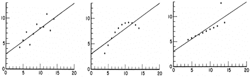

*图 2.2* 来自 Anscombe, F. J. (1973)。《统计分析中的图形》。美国统计学家。版权所有 © 1973 美国统计协会，经 Informa UK Limited 许可转载，交易 Taylor & Francis Group，https://www.tandfonline.com 代表美国统计协会。返回文本。⏎

值得注意的是，所有四个图在 `x` 和 `y` 上的均值相同（$\\overline{x} = 9.0$，$\\overline{y} = 7.5$），`y` 对 `x` 的回归（斜率为 0.5），回归方程 `y = 3 + 0.5x`，平方和 $x - \\overline{x} = 110.0$，回归平方和（27.50），残差平方和（13.75），估计标准误差（0.118），以及 *R*² = 0.667。如果这样的演示不能说服读者始终绘制他们的数据，那么什么都不能！


其他此类效应的例子比比皆是（参见 Murphy, 2022，第 42 页的示例）。简而言之，*可视化是进行良好数据分析和探索的必备条件，而非可选项*。换句话说；如果你在至少 *某种* 程度上没有可视化你的数据，你通常是在进行 *糟糕的数据分析*。确实存在可以绕过可视化的特殊情况，但关键在于可视化会告诉你关于数据的一些信息，而数值汇总永远无法提供。仅靠数值汇总永远无法提供最宽泛或最完整的数据图景或理解，而且正如我们到目前为止已经不厌其烦地反复说过，并且将在整本书中继续重复，所有变量都存在于其他变量更广阔的 *上下文* 中。可视化有助于描述该上下文，这就是为什么在统计学中投入大量精力来开发新的可视化技术。随着我们稍后关于流形学习的相关讨论将会看到，多变量可视化尤其具有挑战性和困难性，并且随着数据维度的增加，几乎变得不可能。

我们将很快更详细地重新讨论协方差和相关性。

## 2.9 敏感性和特异性：更多条件概率

条件概率在确定诊断测试的敏感性和特异性时也占有重要地位并被使用。诊断测试是一种 *征兆*。它是一段 *数据*。它是一个 *体验* 的瞬间。它并不是疾病或状况存在的确定性指示。这一点的经典且现代的例子是诊断 COVID-19。诊断测试可能会显示病毒的存在，但与之相关的是疾病不存在的概率。能够在疾病存在时检测出疾病的测试称为该测试的 *敏感性*。未能检测到不存在的疾病的测试称为该测试的 *特异性*。好的测试具有较强的敏感性和特异性，尽管两者很少，如果有的话，会完美或相等。

当然，我们希望任何测试都具有最大敏感性和最大特异性。这是我们追求的理想。诊断测试出现问题的地方在于，当病毒或状况不存在时，测试却显示病毒或状况存在。这被称为 *假阳性*，或在统计文献中更常见地称为假设检验中的 *I 型错误*。另一方面，当病毒存在时未能检测到病毒的测试犯了 *II 型错误*。72 哪个错误更糟？哪个错误的后果更大？当然，这再次取决于 *问题的上下文*。上下文很重要！再次强调！哪个更重要取决于科学家希望最小化哪种类型的错误。当然，我们不想误诊病毒。然而，与此同时，当病毒不存在时诊断出病毒可能导致许多问题，例如情绪困扰、财务成本、进一步检测的不便等。事实上，这一直是关于常规乳房 X 光检查的争议之一，例如；一些人认为由于所涉及的错误率，每年进行乳房 X 光检查可能弊大于利。当不存在疾病时诊断出疾病的风险是真实的，可能产生巨大后果。与此同时，当状况存在时遗漏该状况也可能产生严重后果。哪个错误后果更大在很大程度上取决于情况、上下文以及科学家或受试者的倾向。

## 2.10 贝叶斯定理与条件概率

也许没有比贝叶斯定理更好的或更重要的条件概率例子了。回想一下，我们在本章开头提到统计学中存在两个主要流派，即频率学派和主观视角。最大似然估计是最常用的参数估计方法，通常源于并受频率学派方法支配，其中评估的是在给定参数下数据的概率，即 `p(y|x)`，这里 `y` 是数据，`x` 是参数（在此讨论中用 `θ` 的记号代替）。条件概率 `p(y|x)` 在频率学派概率中被称为 *似然*。

在贝叶斯推理中，评估的则是给定数据下参数的概率，即 `p(x|y)`。贝叶斯定理将条件概率从 `p(y|x)` 逆转为 `p(x|y)`：

$$p\\left( x \\middle| y \\right) = \\frac{p\\left( y \\middle| x \\right)p\\left( x \\right)}{p\\left( y \\right)}$$

(2.16)

其中 `p(y|x)`，如前所述，被称为 *似然*，`p(x)` 是 *先验概率*，而 `p(x|y)` 是 *后验概率*。分母 `p(y)` 是数据的 *总概率*，或更一般地说是证据。

一种更有意义的解释贝叶斯定理的方法是用 `T`（理论）替换 `x`，用 `D`（数据）替换 `y`：

$$\\begin{array}{l} {\\, p\\left( x \\middle| y \\right) = \\frac{p\\left( y \\middle| x \\right)p\\left( x \\right)}{p\\left( y \\right)}} \\\\ {p\\left( T \\middle| D \\right) = \\frac{p\\left( D \\middle| T \\right)p\\left( T \\right)}{p\\left( D \\right)}} \\\\ \\end{array}$$

也就是说，`p(T|D)` 是给定证据或数据时理论的概率。贝叶斯定理的困难在于必须输入一个 *先验概率*，其性质可能相当主观。请注意，无论数据的强度如何，如果先验概率 `p(T)` 等于 0，则后验概率也将等于 0，因为，73

$$\\begin{array}{l} {p\\left( T \\middle| D \\right) = \\frac{p\\left( D \\middle| T \\right)\\left( 0 \\right)}{p\\left( D \\right)}} \\\\ {p\\left( T \\middle| D \\right) = 0} \\\\ \\end{array}$$

贝叶斯分析的核心思想是，与频率学派方法将参数视为固定常数不同，贝叶斯分析将参数视为 *随机变量*。

### 2.10.1 贝叶斯因子

在我们有两个竞争模型 `M[0]` 和 `M[1]` 的情况下，可以形成 *贝叶斯因子*，它是这两种假设条件下数据的似然比：

$$B = \\frac{p\\left( D \\middle| M\_{1} \\right)}{p\\left( D \\middle| M\_{0} \\right)}$$

(2.17)

其中 `p(D|M[1])` 是在备择假设 `M[1]` 条件下的数据的概率，而 `p(D|M[0])` 是在零假设 `M[0]` 条件下的数据的概率。如果两个似然相同，那么我们显然期望 `B` 等于 1，而如果 `M[1]` 比 `M[0]` 更受青睐，则我们期望 `B` > 1。贝叶斯因子为经典频率学派统计提供了一种竞争替代方案，后者侧重于 `p-value` 作为在两种状态之间做出决策的手段。根据 Jeffreys，贝叶斯因子大于 10 表示对 `M[1]` 的强证据，而贝叶斯因子大于 100 表示对 `M[1]` 的极强证据（Murphy, 2022）。然而，正如始终一样，比值的大小应至少部分相对于研究的上下文进行评估。在某些研究环境中，贝叶斯因子为 2 可能被认为相对较大，而在另一种研究环境中，贝叶斯因子为 10 可能被认为微不足道。我们之前是否提到过上下文很重要？

### 2.10.2 贝叶斯模型选择

假设我们运行了一系列竞争模型，并希望在某种意义上选择“最好”的一个。这里的限定词“在某种意义上”是必要的，因为选择“最好”的模型绝非 straightforward 任务，通常将取决于远不止一个选择标准。


通过贝叶斯方法，该模型应为使 `p(m|D)` 最大化的模型，其中 `m` 现在是模型，而 `D` 如前所述是数据：

$$p\\left( m \\middle| D \\right) = \\frac{p\\left( D \\middle| m \\right)p\\left( m \\right)}{\\sum\\limits\_{i = 1}{p\\left( D \\middle| m \\right)p\\left( m \\right)}}$$

(2.18)

我们在上面认识到量 `p(D|m)`，展开后等于

`p(D|m) = ∫p(D|θ,m)p(θ|m)dθ`

称为 *边缘似然* (Murphy, 2022)。如果 `p(D|m)` 在参数 `θ` 的不同设定下仍然很强，则 `m` 很可能被认为是一个合理的模型。边缘似然的关键在于对各种参数值 (`θ`) 进行求和（通过积分）。这就是为什么它被称为“边缘”，因为是对所有 `θ` 值进行的求和结果。如果是针对特定值 `θ = θ[i]`，那么它就是“条件”而非边缘。在两个竞争模型 `m[1]` 和 `m[2]` 的条件下，如果 `p(D|θ̂[1],m[1])` 和 `p(D|θ̂[2],m[2])` 都很大，奥卡姆剃刀要求我们选择最简单的模型。边缘似然随后帮助我们选择一个复杂度合适的模型，这与频率学派背景下的交叉验证和其他模型选择准则有相似之处（详见 Murphy, 2022，第 179–180 页）。然而，74 边缘似然在实践中可能难以计算，因为它们需要在整个参数空间上进行积分（Murphy, 2022）。*贝叶斯信息准则* (`BIC`) 可以被视为对对数边缘似然的一种近似，正如我们在书中后面会看到的，它在许多背景下被使用，包括回归和聚类密度估计等。

### 2.10.3 作为理性信念或理论化的贝叶斯定理

贝叶斯定理并非一个平凡的想法。远非如此。单独来看，贝叶斯定理告诉我们，作为 *理性主体*，在新的 `D` 出现时应如何更新我们对 `T` 的信念，其中 `T` 不过是一种信念或理论，而 `D` 不过是最广义上的经验。贝叶斯定理不是一个统计学上的想法；首先它是一个 *哲学* 上的想法。贝叶斯推断本质上告诉我们一个理性主体在新经验出现时 *应该* 如何更新其信念。“应该” 等同于 *理性*。它并不等同于人类 *实际上* 更新信念的方式。的确，已有大量心理学研究针对人类受试者进行，以证明人类远非贝叶斯式的。

正如人们所想象的那样，这一思想使贝叶斯不仅在统计学中居于核心地位，也在其他以理性行为研究为主要兴趣的领域中居于核心地位。无论是正式还是非正式地应用贝叶斯定理，都是一种关于更新信念的“智能”方式。*博弈论*、*信念心理学*、*经济理论* 等，都是最终研究人类行为的领域。这些领域的子专业对其感兴趣的是，人类是否以贝叶斯理论所规定的方式更新信念。*贝叶斯估计量* 告诉我们在 *理性* 行事时应采取何种行动以最小化做出错误决定的风险。然而，最大化期望并不总是等同于最大化 *效用*，因此贝叶斯决策理论通常会要求我们最大化后者而非前者，除非问题相对简单且期望与效用一致。效用，简单来说，是衡量某项行动对主体有多有益的指标，而不仅仅基于概率或数学期望来评估。不买那份疫情后价格过高的麦当劳汉堡可能会最大化预算约束，但因为它尝起来 *如此美味* 而买下它则最大化了效用。从财政上看是一个糟糕且不理性的选择，但对买家而言效用很大，因此从该角度看变得理性。效用理论是一个引人入胜的研究领域。欲了解精彩讨论，请参阅 Winkler (2003)。

虽然贝叶斯定理通常很有用，但应指出它可能在信念更新过程中引入偏见和歧视。例如，一个黑人犯下罪行的高概率可能通过引用贝叶斯定理得到证实，因为对于某项特定犯罪，过去的犯罪中可能出现了不成比例的黑人，导致先验概率飙升。贝叶斯定理是信念的理性更新，但在这种特定 *情境* 中使用它可能被视为歧视。同样，鉴于狗的年龄和品种，应用贝叶斯定理后狗身上肿块为癌症的概率可能很高。虽然贝叶斯定理在发挥作用，但一只狗因其品种而被安乐死且没有活检结果，这也可能令人恐惧。先验概率使癌症诊断更有可能，甚至高度可能，但如果这对狗而言是 *生死* 决定，基于“赌博”它就是癌症而将其安乐死是不明智的行为。*在此方面犯错的代价可能太高，即使后验概率极高*。*贝叶斯定理只能估计理论的概率；它本身无法告诉你如何行动*，*而且在大多数现实世界应用中，后验概率永远不会等于 1*。此外，必须始终记住，我们对当前事件一无所知；我们只知道 *过去事件*，而贝叶斯定理中的先验概率，即使估计正确，也与所考虑的当前事件无关。*毫无顾忌地计算贝叶斯定理，但使用它，最重要的是* 75***谨慎解读贝叶斯定理***。由于先验概率可能对后验产生压倒性的影响，人们已对所谓的 *非信息先验* 进行了研究（Bishop, 2006），顾名思义，它试图减少先验的影响。

我们将在本书中经常重访贝叶斯定理，例如在讨论 *判别分析* 时确定最优决策边界，或在考虑 *朴素贝叶斯* 作为分类的非参数替代方案时。将先验信息纳入模型这一想法并不新鲜，可以在统计学和科学的各个方面看到，以及在更现代的机器学习中看到。例如，机器学习中一个名为 *物理信息机器学习* 的新范式旨在利用物理相关的先验信息来告知机器学习模型（Pateras et al., 2023）。也就是说，模型或算法由对所建模对象或系统的先验知识所“告知”。

## 2.11 大数定律

大数定律是统计学中的一个基本定律，用话语来说本质上表示 *样本量越大，越接近事件的真实概率*。作为一个简单例子，在 10 次试验中得到 9 次正面，得到正面概率的估计值为 9/10 = 0.90。在这种情况下，正面概率的估计并不理想，因为它仅基于少数几次观察，即相对较小的样本。随着样本量 `n` 的增加，近似值会变得更好，直到在 `n`→∞ 的极限下，真实概率被知晓。在这种情况下，极限即无穷大 ∞，永远无法达到。真实概率，至少在这种频率学派视角下，将永远无法得知。我们真正拥有的只是估计值。一般来说，样本量越大，估计越好。


该定律可以如下形式化：对于样本均值 $\overline{y}$ 用作总体均值估计量的情况，`μ`：对于任意 `ε` > 0，$\overline{y} - \mu$ 这类偏差的概率随着 `n` 的增大而趋于 0，最终无界，即 `n`→∞。或者，我们也可以这样表述：对于任意 |`ε`|>0，$\overline{y} - \mu$ 介于  − `ε` 与 `ε` 之间的概率随着 `n`→∞ 而趋于 0。顺便提及，值得注意的是，无穷大 `∞` 在数学中并不被视为一个数，而只是一个 *概念*。在 `R` 中正无穷大的符号是 `Inf`。

该定律源于概率的相对频率解释，更实际地意味着 *如果你想知道某个事件的真实概率，一般来说，收集的数据越多，你对该概率的估计就越好*。请注意，这并不一定意味着收集更多数据总是明智的。一百万个数据点不会比一千个更差，除非当然收集这些额外观测的成本是 prohibitive 的，并且从最初的一千个样本中可以得出与从一百万个样本中一样多的知识。虽然大数定律要求我们收集更多数据，但它只是一个理论论证。现实中可能并不实用。我们所说的“现实世界”以及理论数学家所不愉快的干扰，往往会妨碍我们收集更多数据的能力，如果可以用更少的数据点得出相同的结论，那么收集更多数据可能只是浪费时间和资源。像上面这样的极限定理很有吸引力，但我们不能在牺牲实用、现实世界考虑的情况下迷失在它们的美中。

上述的一个含义是，统计 *功效曲线* 随着样本量的增加趋向于渐近水平，因此收集更多数据的成本可能根本不值得。在大数据时代以及能够收集大型数据集的便利性下，这些真理仍然成立，但由于在许多情况下收集数据现在可以相当便宜，这种成本不太可能阻止像 *Amazon* 这样的企业收集数 TB 的数据，从而完全忽略功效曲线。当“大数据”可用时，功效曲线就被抛在风中。在这种情况下，数据太容易获得，以至于不必担心功效曲线。

然而，在其他环境中，例如较小的实验环境，收集数据可能非常困难且成本高昂，建立需要多少信息才能得出 76conclusions 是一个非常值得的活动。例如，如果你的观测单位是一组患有某种罕见疾病的儿童，每个数据点都可能极其难以收集，而 20 次和 25 次观测之间的差异可能是一项巨大的工作。收集数据可能成本 prohibitive。20 世纪早期小样本统计的发展使得在不必抽取大量样本的情况下研究总体成为可能。这就是推断统计的馈赠。我们似乎在当前收集更大数据集在某些领域成为常态的气候下回到了起点，肯定不是全部，主要是由于这种数据可以方便地收集，即电子方式并易于存储。早期的推断统计程序最初就是为规避这一活动而设计的，并充分利用小数据。“小数据”的时代还会回来吗？让我们想象一下以下虚构的学术新闻报道标题可能是什么样子：

> 一种令人惊叹的新定量技术正在流行，只需要非常小的样本就能对更广泛的总体做出概括。我们称这个新的数据分析时代为 `SDA`，即“小数据分析”。

增加样本量也会对贝叶斯后验产生影响。例如，在选择模型时，对于小样本量，后验可能指示一种模型，而随着样本量的增长，由于信息量的增加，竞争模型可能具有更高的后验。`Weak` 与 `strong` 大数定律也可以区分，尽管本文未讨论。对于细节，请参阅 Shao (2023) 以获得清晰但相对理论性的讨论。 Casella and Berger (2002) 也提供了讨论（第 235 页）。

### 2.11.1 大数定律与委员会机器的思想

大数定律的一个间接应用，我们将在本书后面重新讨论，包含在 *平均预测函数收敛于期望预测函数* 的思想中。例如，十个预测函数在平均后，会让我们更接近真实的期望，即从长期概率的角度来看的预测函数，而不仅仅是任何单个预测函数。也就是说，*当我们组合许多弱学习器时，我们通常能获得比构成该组合的任何弱学习器能力更好的预测*。

一个体育类比是，一支弱球员组成的队伍会产生比任何单个队友更好的结果。间接地，平均律存在于这一陈述中，因为它意味着 `n` 越大，在这种情况下“`n`”是指预测函数的数量，球员的数量，我们就越能收敛到真实函数。将所谓的“弱学习器”组合起来产生更强学习器的思想通常属于 *委员会机器* 的一般范畴。

## 2.12 随机变量与概率密度函数

*随机变量* 是与概率分布相关联的数学变量。更精确地说，随机变量是从样本空间到实数的一个函数 (Casella & Berger, 2002)，使得对于任何“切片”或区间，即对于样本空间的任何子集称为一个 *事件*。该函数也必须是 *可测* 的 (Mohri et al., 2018)，尽管函数的可测性远超本文的范围。我们在这里只是提及“可测性”一词，以表示并非所有函数都是可测的，因此说随机变量是到实数上的函数是不完整的。更深入、更复杂的随机变量定义首先会区分 *可测* 与 *不可测* 函数，例如参见 Shao，2023。77

作为随机变量的一个例子，考虑变量 `x[i]` 具有值 0、1、2、3。变量 `x[i]` 目前通常被称为 *数学变量*。描述词“数学”通常是隐含的，但在统计学文本中，这样的变量通常被称为这样，只是为了将其与随机变量区分开来。正如读者所回忆的那样，它之所以是变量，是因为 `x[i]` 可以在集合中取不同的值。如果 `x[i]` 只能取一个单一值，例如 0 或任何其他值，它就不是变量而是 *常数*。当我们将概率与集合中的这些值相关联，使得它们之和为 1 时，它就成为 *随机* 变量。例如，下表中的上述 `x[i]` 现在是一个随机变量，其中 `x[i]` 的每个值都与 0.25 的概率相关联：

| `x[i]` || `p(x[i])` |
| --- | --- |
| 0 || 0.25 |
| --- | --- |
| 1 || 0.25 |
| 2 || 0.25 |
| 3 || 0.25 |
|  || `∑` = 1.0 |

请注意，`x[i]` 要成为随机变量，并不要求 `x[i]` 各取值上的概率相等。唯一的要求是概率之和等于 1.0。也就是说，我们完全可以同样地将概率分布为 0.20、0.40、0.30 和 0.10 来说明这一概念。

## 2.13 随机变量的收敛


随机变量“正在走向何方”通常具有理论上的兴趣。也就是说，我们通常希望知道随机变量在极限下*收敛到*什么值。随着样本量无界地增加到无穷大，即 `n→∞`，我们希望了解这种收敛的性质。

我们说一列随机变量*依概率收敛*于随机变量 `x`，如果：

$$\\lim\\limits\_{n\\rightarrow\\infty}p\\left\\lbrack \\middle| x\_{n} - x \\middle| \\geq \\varepsilon \\right\\rbrack = 0$$

(2.19)

顺便提及，我们上面使用了 *infinity* 这个词，并在本书的其他地方也使用它。虽然使用它似乎很方便，并且像 `n→∞` 这样的陈述所表达的精神很容易理解，但无穷大本身在历史上非常丰富，并伴随着许多哲学上的困难和挑战，其中许多至今仍在持续。我们在其中包含它绝不是为了淡化该对象的深度。事实上，题为 *《哲学与数学中无穷的历史与理论》* 的论文绝非易事！有人认为，无穷的概念与抽象和证明相结合，为高等数学打开了大门（Stillwell, 2016）。同样请不要误会，通过我们提及 *数学哲学*，我们绝不是在传达任何低于极其严谨的信息。对无穷的深入研究不仅需要更深的数学，还需要更深的哲学。这样的哲学是否使用符号（如数学一样）与调查此类主题所需的深度无关。

## 2.14 概率密度函数

一个*概率密度函数*是与连续随机变量 `x` 相关联的函数 `f`，并且其积分等于一：78

`p(a≤x≤b)=∫[a]^(b)f(x)dx=1`

在*连续概率密度*中，任何特定值的概率的极限值等于 0。也就是说，`p(x=x[i])=0`。连续性在数学中使用 epsilon-delta 定义被非常精确和严格地定义；然而，直观上，连续性可以被认为是不抬起铅笔从纸上画出一条曲线。因为它是一个概率密度函数，其 CDF 也被视为*绝对连续*，其中绝对连续意味着其他方面，我们可以对所有 `a`、`b` 的值进行积分。这里绝对连续与单纯连续之间的区别对我们当前书籍中的工作没有任何影响。然而，对于数学中的实分析家来说，这种区别非常重要。

乍一看，这似乎是一个奇怪的结果。*在连续分布中，任何特定值如何具有等于 0 的（极限）概率？* 为了使其更直观，考虑任意两个特定值 `a` 和 `b` 之间的概率等于大于 0 的数。随着距离 `a−b` 减小，该区间的概率变得越来越小，直到在极限中距离 `a−b` 是一个如此薄的切片，该薄切片的概率在理论上等于 0。数值上，可以将此视为用无限多位小数抓住一个数的不可行性；只能抓住一个数的*区间*；该区间中的任何特定数都是难以捉摸的。也可以将这个想法比作*芝诺悖论*，其中当一个人接近一个物体时，距离在通往该物体的途中不断“减半”，直到一个人非常接近该物体，人与物体之间的距离的极限值为零。

如果概率分布是*离散*而非*连续*变量，则通常被称为*概率质量函数*。在这种分布中，我们可以为随机变量的一个给定值分配正概率，`p(x=x[i])≠0`，除非当然 `x` 的特定值的概率实际上为零。然而，关键在于，任何特定值的概率*不需要*为零，就像连续分布的情况一样。在离散分布中，我们可以为特定事件分配概率。在连续分布中，我们只能为*区间*分配概率。也就是说，在连续密度中，“事件”实际上是沿实线的区间“切割”。

离散与连续概率分布的示例见于 图 2.3。79

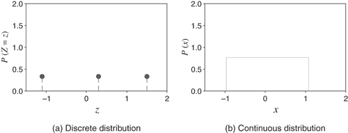

*图 2.3* (a) 离散分布的示例，其中 `z` 的每个值都可以分配一个唯一概率（即 `p(Z = z[i])`）。(b) 连续分布的示例，其中只有 `x` 的取值范围可以分配概率。经剑桥大学出版社许可使用，摘自 Marc Peter Deisenroth 等著《Mathematics for Machine Learning》，© 2019；经许可方通过 PLSclear 复制。返回文本。⏎

## 2.15 正态（高斯）分布

统计学中处处都有正态分布和密度。它们通常被称为“高斯”，因为其创新者 Friedrich Gauss。不仅许多物理现象近似正态，而且在理论上假设正态性在推导新的统计量和抽样分布时提供了极大的便利。单个变量的正态性被称为*单变量正态性*，两个变量为*双变量正态性*，大于两个变量为*多变量正态性*。我们将在下面介绍这些密度。

### 2.15.1 单变量高斯分布

单变量正态密度由下式给出

$$f\\left( x \\right) = \\frac{1}{\\sigma\\sqrt{2\\pi}}e^{- {(x - \\mu)}^{2}/2\\sigma^{2}}$$

(2.20)

单变量密度中有两个参数，即 `μ` 和 `σ²`，其中 `x` 只是“输入”值，而 `π` 和 `e` 是常数。正态分布下的密度（或粗略地，“面积”）积分等于 1，

$$\\int\\limits\_{- \\infty}^{\\infty}{N\\left( x \\middle| \\mu,\\sigma^{2} \\right)dx = 1}$$

如果我们设 `μ`=0 且 `σ²`=1，正态密度被称为*标准正态密度*，并且是出现在大多数初级统计教科书末尾的经典 `z` 分布，用于揭示曲线下的各种面积（比例）。拥有一个单一的“标准”分布作为参考，提供了一个单一的“尺度”，从该尺度出发，具有不同 `μ` 和 `σ²` 的其他分布可以通过 `z` 分数进行转换。当我们计算 `z` 分数时，

$$z = \\frac{x - \\mu}{\\sigma}$$

(2.21)

我们将给定的分布转换为均值等于 0 且标准差等于 1 的分布，其中 `(x−μ)²/σ² = (x−μ)(σ²)^(−1)(x−μ)`。因此，对于给定的 `μ` 和 `σ²`，单变量密度的“作用”是其指数的函数。如果我们取 `σ²` 的倒数，即 `1/σ²`，我们得到分布的*精度*（Bishop, 2006，第 24 页）。正如我们稍后会看到的，将指数写成 `(x−μ)(σ²)^(−1)(x−μ)` 的方式在从单变量到多变量维度转换时非常有用。


## z 变换

`z` 变换是 `linear transformation` 的一个例子（我们稍后会回顾其含义）。由于它是一个线性变换的例子，将数据转换为 `z` 不会改变原始数据分布的形状。这非常重要！乍一看，似乎将数据转换为 `z` 应该 `normalize` 分布，从而使其具有正态形状。但这种直觉是错误的，这是一个完美的例子，说明人们感觉 `should` 是正确的，实际上并非如此。直觉在数学和统计学中可能是一种福音，但有时也是危险的，这就是为什么在某个陈述被认为为真之前通常需要证明。80

### 2.15.2 高斯混合

混合模型是指在得出概率估计时，通常以 `linearly` 的方式组合不同分布的模型。通常这些单个分布是高斯分布，因此 `Gaussian mixture models` 相当常见。我们将高斯混合写为

$$p\\left( x \\right) = {\\sum\\limits\_{k = 1}^{K}\\pi\_{k}}N\\left( x \\middle| \\mu\_{k},\\Sigma\_{k} \\right)$$

(2.22)

混合模型的分量 `k` = 1 到 `K` 是被“混合”成单一分布的不同 `k` 个分布，每个分布都有自己的均值 `μ` 和协方差矩阵 ∑，其中 `π` 是为每个分布应用的混合参数或“权重”。综合起来，我们希望建模 `x` 的概率，`p`(`x`)。混合比例之和必须等于 1，即 ${\\sum\\limits\_{k = 1}^{K}\\pi\_{k}} = 1$ 且 0 ≤ `π`[`k`] ≤ 1。我们还可以在混合分布中施加等式约束，使得某些参数在不同分布之间相等，例如在多元设定中协方差矩阵相等（Goodfellow 等, 2016）。

高斯混合模型是一种 `universal approximator`，正如我们在回顾神经网络时将会看到的那样，这意味着在有足够分量的情况下，任何光滑函数（或密度）都可以以任意小的误差进行逼近（Goodfellow 等, 2016）。因此，在有足够多的分布混合的情况下，函数逼近变得确定无疑，就像神经网络一样；如果我们有足够的隐藏层和节点，它们也成为通用逼近器。混合模型正如我们将看到的那样，在从随机效应模型到聚类分析再到神经网络及更广泛的方法中也很有用，并且比仅仅混合正态密度要普遍得多。我们这里的例子仅限于正态密度，原因是我们目前正在研究正态分布。例如，离散变量的混合可能包括混合伯努利分布（Bishop, 2006）。

### 2.15.3 评估单变量正态性

已提出许多方法和技术来评估分布的正态性。也许最有用的是简单的图形和可视化技术；然而，也存在推断方法来估计当前样本分布来自正态总体分布的可能性。单变量正态性检验包括 `Kolmogorov-Smirnov test`、`Shapiro-Wilk test`、`Anderson-Darling test`，以及许多其他检验。根据 Bilodeau 和 Brenner (1999)，Shapiro-Wilk 检验被发现是 `best omnibus test`。我们假设读者对解释这些检验有一定经验，尤其是 Kolmogorov-Smirnov 检验和 Shapiro-Wilk 检验。更多细节可在 Denis (2021a) 中找到。

我们可以在 R 中非常容易地演示 Shapiro-Wilk 检验：

```
> shapiro.test(rnorm(100, mean = 5, sd = 3))
```

```
  Shapiro-Wilk normality test
```

```
data: rnorm(100, mean = 5, sd = 3)
W = 0.99085, p-value = 0.7331
```

零假设是样本数据所抽取的总体呈正态分布。由于 `p`-value 甚至远离传统的临界值，例如 `p` < 0.05（`p` = 0.7331），我们没有证据拒绝原假设。请注意，这绝不证实总体为正态，但它也没有给我们证据表明它 `not` 是正态的。81

在 R 中有许多方法和包可用于绘制各种密度。例如，我们可以通过以下方式轻松获得正态分布的图（图 2.4）：

```
> x <- seq(-3, 3, length = 100)
> y <- dnorm(x)
>plot(y)
```

### 2.15.4 多元高斯分布

正如我们刚才看到的，在单变量密度中，

$$f\\left( x \\right) = \\frac{1}{\\sigma\\sqrt{2\\pi}}e^{- {(x - \\mu)}^{2}/2\\sigma^{2}}$$

指数为  − (`x`-`μ`)²/2`σ`²。当我们将单变量高斯推广到多元设定时，我们用向量 `x` 替换观测值 `x`，用 `μ` 替换 `μ`，并用协方差矩阵 `Σ` 替换单个方差 `σ`²：

$$f\\left( x \\right) = \\frac{1}{\\left. \\left( \\sqrt{2\\pi} \\right)^{p} \\middle| \\sum \\right|^{1/2}}e^{- (x - \\mu)'\\Sigma^{- 1}(x - \\mu)/2}$$

(2.23)

对于 `μ` = 0 且 `Σ` = `σ`²`I`，其中 `σ`² = 1，这与标准正态分布的平行设定相对应，其中 `μ` = 0 且 `σ`² = 1，此时 `I` 为单位矩阵。那么 `Σ` = `σ`²`I` 究竟如何与 `σ`² = 1 相对应呢？回想一下，当 `Σ` = `I` 时，这意味着主对角线上的所有值都等于 1，其余位置都等于 0，表明所有变量之间没有成对协方差。这意味着当 `Σ` = `I` 时，多元密度中的所有方差都等于 `σ`²，在本例中 `σ`² = 1，就像在标准正态分布下单变量密度的 `σ`² = 1 一样。

我们可以轻松比较各自的单变量和多元密度。在单变量密度中，注意密度以 82 开始

$$\\frac{1}{\\sigma\\sqrt{2\\pi}}$$

在多元设定中，这被推广为

$$\\frac{1}{\\left. \\left( \\sqrt{2\\pi} \\right)^{p} \\middle| \\sum \\right|^{1/2}}$$

现在反映的是 `volume` 而不是单变量设定中的 `area`，这是由于多元密度占据的多维空间所致。原因在于我们现在工作在二维以上（例如，想想立方体或长方体，而不是正方形）。单变量分布通常被称为 `statistically` 的 `one-dimensional` 分布，但这指的是所研究的 `number of variables`，即一个。在纸上，`geometrically`，分布出现在 `two` 维中。

那么双变量密度呢？双变量密度只是多元密度在两个变量情况下的特例，因此我们更方便地将其视为多元密度。然而，它也可以写成以下形式：

$$f\\left( x\_{1},x\_{2} \\right) = \\frac{1}{2\\pi}\\frac{1}{\\sigma\_{1}\\sigma\_{2}\\left( 1 - \\rho^{2} \\right)^{\\frac{1}{2}}}\\exp\\left\\{ {- \\frac{1}{2\\left( 1 - \\rho^{2} \\right)}\\left\\lbrack {\\left\\lbrack \\frac{x\_{1} - \\mu\_{1}}{\\sigma\_{1}} \\right\\rbrack^{2} - 2\\rho\\left\\lbrack \\frac{x\_{1} - \\mu\_{1}}{\\sigma\_{1}} \\right\\rbrack\\left\\lbrack \\frac{x\_{2} - \\mu\_{2}}{\\sigma\_{2}} \\right\\rbrack + \\left\\lbrack \\frac{x\_{2} - \\mu\_{2}}{\\sigma\_{2}} \\right\\rbrack^{2}} \\right\\rbrack} \\right\\}$$

(2.24)

其中 `ρ`² 是变量 `x`[1] 和 `x`[2] 之间的相关系数平方。有关双变量密度的更多细节，请参阅 Johnson 和 Wichern（2007，p. 151）。


多元密度之所以重要有许多原因，其中大多数与单变量密度在统计学和更广泛的科学中受欢迎的原因相平行。然而，关于多元密度还有一个重要的额外特征，那就是，如果我们假设多元正态性，则可以确信*随机向量的任意线性组合* `X` *也服从正态分布*。虽然这似乎是一个直观的结果，但它对多元模型中的统计推断具有巨大的影响。该定理还意味着条件分布也将是多元正态的。

### 2.15.5 评估多元正态性

评估多元正态性比评估单变量正态性困难得多，因为它是一个更高维的问题。对于此类评估的最佳建议可能由 Johnson 和 Wichern（2007，p. 177）给出：

> 很明显，我们对正态性的研究将集中于观测值在一维或二维中的行为（例如，边缘分布和散点图）。正如预期的那样，由于可能出错的事情太多，构造一个在二维以上的联合正态性的“良好”整体检验已被证明是困难的。在某种程度上，我们必须为集中于单变量和双变量正态性检验付出代价：我们永远无法确定是否没有遗漏仅在更高维度中显现的某些特征……对于大多数实际工作，一维和二维的调查通常是足够的。幸运的是，在低维表示中为正态，但在高维中非正态的病态数据集在实践中并不经常遇到。83

仍然有一些检验可用于评估正态性，即使在多元域中也是如此。可以采用 Shapiro-Wilk 检验的推广，以及一种较新的检验，称为 *Henze-Zirkler 检验*。详情请参阅 Zhou and Shao (2014)。未确保多元正态性的后果是许多统计检验的渐近分布变得更加复杂（Bilodeau & Brenner, 1999）。请记住，渐近分布是在 `n`→∞ 时得到的分布。

在实践中，研究人员经常使用可视化和图形技术来验证单变量（例如，*Q-Q 图*、*直方图*等）和双变量正态性（例如，散点图），如果这些条件或多或少*近似*满足，他们就会做出推断上的“飞跃”，假设多元正态性也成立。然而，需要强调的是，虽然多元正态性意味着双变量和单变量正态性，但反之则不一定成立。也就是说，单变量和双变量正态性并不自动意味着多元正态性。因此需要上述“飞跃”。单变量和双变量正态性可能会增加多元正态性的概率，但并不一定意味着它。

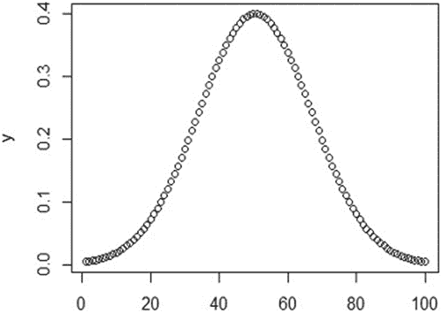

*图 2.4* 正态分布的图。返回文本。⏎

## 2.16 二项分布

当一个变量具有二元结果，例如通过与失败，并且其成功概率在一系列试验中保持恒定或*平稳*时，二项分布是建模此类数据的合理分布。随机变量 `x` 服从二项分布，如果 `x` 可以取两个二值数字之一。为方便起见，我们将这些数字记为 0 和 1；然而在理论上它们可以是任意两个数字。我们假设 1 以概率 `π` 出现，0 以概率 1 − `π` 出现，其中当然 `π` 受限于 0 和 1，如所有概率所应有的那样。

二项密度由下式给出

$$p\\left( x;n,\\pi \\right) = \\frac{n!}{x!\\left( n - x \\right)!}\\pi^{x}\\left( 1 - \\pi \\right)^{n - x}$$

(2.25)

其中 `x` 是我们建模的结果数，`n` 是试验总数，`π` 是任何给定试验中成功的概率。二项分布在实践中的经典例子是建模在公平硬币上得到 5 次抛掷中 2 次正面的概率（即“公平”意味着 `π` = 0.5）。该概率很容易计算，

$$\\begin{array}{l} {\\,\\, p\\left( x;n,\\pi \\right) = \\frac{n!}{x!\\left( n - x \\right)!}\\pi^{x}\\left( 1 - \\pi \\right){n - x}} \\\\ {p\\left( 2;5,0.5 \\right) = \\frac{5!}{2!\\left( 5 - 2 \\right)!}\\left( 0.5 \\right)2\\left( 1 - 0.5 \\right){5 - 2}} \\\\ {\\,\\,\\,\\,\\,\\,\\,\\,\\,\\,\\,\\,\\,\\,\\,\\,\\,\\,\\,\\,\\,\\,\\, = 0.3125} \\\\ \\end{array}$$

知道在公平硬币上 5 次抛掷得到 2 次正面的概率等于 0.3125，或约 31% 的时间，这可以帮助我们评估给定硬币公平的原假设。显然，如果硬币在 5 次抛掷中产生 2 次正面，这就不会给我们任何理由怀疑硬币*不公平*。另一方面，如果硬币产生了，比如说 5 次抛掷中 0 次正面，这样的概率将为 0.03125。也就是说，在公平硬币上 5 次抛掷得到零次正面的概率相当低。低到可能建议我们拒绝硬币公平的原假设并推断备择假设，即它不公平，或者至少，正面概率*不*等于 0.5。84

我们可以在 R 中非常容易地计算二项概率。对于 5 次抛掷中 2 次正面且平稳成功率设为 0.5 的情况，概率计算如下

```
> dbinom(2, 5, 0.5)
[1] 0.3125
```

二项分布的均值为 `nπ`，即试验次数乘以任何给定试验中成功的概率。对于上述数据，该数字为 5(0.5) = 2.5。也就是说，在 5 次抛掷中，我们预计平均有 2.5 次正面。当然，由于变量是离散的，这种解释应谨慎对待，因为不可能得到“分数”个正面。请记住，平均值不关心分数。每户家庭的人数平均数可能确实为 3.4，对于人类（或任何离散对象而言）来说，这个数字是不可能的。

二项随机变量的方差等于 `nπ(1−π)`。例如，概率为 `π` = 0.5 且如前所述 `n` = 5 的二项分布的方差等于 `nπ(1−π)` = 5(0.5)(1−0.5) = 2.5(0.5) = 1.25，标准差（平方根）等于 1.118。

### 2.16.1 对正态分布的近似

二项分布在试验次数很大时近似于正态分布，并在极限情况下收敛到正态分布。我们可以在 R 中轻松演示 `n` 增大如何近似正态性，通过 图 2.5 中的图。

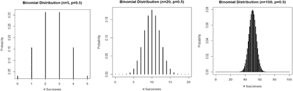

*图 2.5.* 二项分布；随着成功次数从 5 增加到 100，分布越来越呈现平滑且正态的形状。返回文本。⏎

请注意，随着 `n` 在相同概率 `p` = 0.5 下增大，分布越来越类似于平滑的正态分布。这只是统计中几乎所有分布如何相关的一个例子，也许是最简单、最容易演示的例子。在充分条件下，许多分布会收敛到其他分布。稍后将介绍的泊松分布，在极限情况下也收敛到正态分布。

## 2.17 多项分布

刚刚介绍的二项分布实际上是更一般的多项分布的特例：85


$$p\\left( x\\_{1},...,x\\_{k} \\right) = \\frac{n!}{x\\_{1}!x\\_{2}!...x\\_{k}{}\_{!}}\\pi\\_{1}^{x\\_{1}}\\pi\\_{2}^{x\\_{2}}...\\pi\\_{k}^{x\\_{k}}$$
(2.26)
其中现在 `π`[1]^(`x`[1])`π`[2]^(`x`[2])...`π`[`k`]^(`x`[`k`]) 是与单个事件 `x`[1]、 `x`[2]、`x`[`k`] 相关联的不同概率。也就是说，与二项式中离散变量只有两种可能性不同，变量现在有几种可能性，每种都有各自的相应概率，`π`[1]、 `π`[2]、 … `π`[`k`]。

## 2.18 泊松分布
泊松密度由下式给出
$$p\\left( x/\\mu \\right) = \\frac{e^{- \\mu}\\mu^{x}}{x!}$$
(2.27)
其中 `e` 是常数，`x` 是固定时间间隔内发生的事件数。泊松密度的期望值（即均值）及其方差都等于 `μ`。有关泊松密度的进一步细节，请参阅 Casella 和 Berger（2002，第 92 页）。

## 2.19 卡方分布
卡方密度由下式给出
$$f\\left( x \\right) = \\frac{1}{2^{v/2}\\Gamma\\left( v/2 \\right)}x^{\\lbrack(v/2) - 1\\rbrack}e^{- x/2}$$
(2.28)
其中 `Γ` 是伽马函数，`v` 是该密度的自由度。随机变量的卡方分布等于 `n` 个独立且正态分布的 `z`\-scores 的平方和（详见 费舍尔, 1922）：
$$\\chi\_{n}^{2} = {\\sum\\limits\_{i = 1}^{n}z\_{i}^{2}} = {\\sum\\limits\_{i = 1}^{n}\\frac{\\left( x\_{i} - \\mu \\right)^{2}}{\\sigma^{2}}}$$
关于统计分布和密度的最后一点思考。毫不奇怪，我们在此简要回顾中强调的分布远不止这些。大多数时候，你所建模的问题类型会很自然地决定或强烈建议你应使用哪种密度来建模给定现象。关键在于从你所面临的问题中识别出哪种统计分布可能最 `appropriate`。这种洞察可能很困难，并且通常依赖于个人在给定实质领域中的经验或专业知识。然而，分析人员花一些时间思考哪种密度最适合建模这种或那种现象并不罕见，尤其是在问题困难时。

## 2.20 期望与期望值
当我们在统计学中谈论“期望”时，我们通常指的是随机变量的长期平均行为。由于我们处理的是随机变量，这一概念必然涉及并暗示了 `probability` 概念。对于连续随机变量，函数 `g` 的期望值是该函数与其对应概率的乘积的和（或 86integral），
$$E\_{X}\\left\\lbrack g\\left( x \\right) \\right\\rbrack = {\\int\\limits\_{x}{g\\left( x \\right)p\\left( x \\right)dx}}$$
(2.29)
对于离散随机变量，期望为
$$E\_{X}\\left\\lbrack g\\left( x \\right) \\right\\rbrack = {\\sum\\limits\_{x}{g\\left( x \\right)p\\left( x \\right)}}$$
(2.30)
离散变量的期望与连续变量的期望不同，因为对于离散变量，我们可以为变量的值分配单独的概率并对乘积求和，`g`(`x`)`p`(`x`)。对于连续变量，乘积在技术上也进行求和，但它们需要积分微积分来进行求和，而不像离散情况那样简单使用 sigma。
我们可以像上面那样计算单个随机变量的期望值，但也可以计算向量和矩阵元素的期望值。随机矩阵的期望是其每个随机变量的期望，
$$E\\left( X \\right) = \\left\\lbrack \\begin{array}{l} {E\\left( x\_{11} \\right)\\,\\,\\,\\,\\, E\\left( x\_{12} \\right)\\,\\,\\,\\,\\, \\cdot \\cdot \\cdot \\,\\,\\,\\,\\, E\\left( x\_{1}{}\_{p} \\right)} \\\\ {E\\left( x\_{21} \\right)\\,\\,\\,\\,\\, E\\left( x\_{22} \\right)\\,\\,\\,\\,\\, \\cdot \\cdot \\cdot \\,\\,\\,\\,\\, E\\left( x\_{2}{}\_{p} \\right)} \\\\ {\\,\\,\\,\\,\\,\\, \\cdot \\,\\,\\,\\,\\,\\,\\,\\,\\,\\,\\,\\,\\,\\,\\,\\,\\,\\,\\,\\,\\, \\cdot \\,\\,\\,\\,\\,\\,\\,\\,\\,\\,\\,\\,\\,\\,\\,\\,\\,\\,\\,\\,\\,\\,\\,\\,\\,\\,\\,\\,\\, \\cdot} \\\\ {E\\left( x\_{n1} \\right)\\,\\,\\,\\,\\, E\\left( x\_{n2} \\right)\\,\\,\\,\\,\\, \\cdot \\cdot \\cdot \\,\\,\\,\\,\\, E\\left( x\_{n}{}\_{p} \\right)} \\\\ \\end{array} \\right\\rbrack$$
(2.31)
由于 `E`(`x`[11]) 直到 `E`(`x`[`n`][`p`]) 等于 `μ`[11] 到 `μ`[`n``p`]，我们可以写成：
$$E\\left( X \\right) = \\left\\lbrack \\begin{array}{l} {E\\left( x\_{11} \\right)\\,\\,\\,\\,\\, E\\left( x\_{12} \\right)\\,\\,\\,\\,\\, \\cdot \\cdot \\cdot \\,\\,\\,\\,\\, E\\left( x\_{1}{}\_{p} \\right)} \\\\ {E\\left( x\_{21} \\right)\\,\\,\\,\\,\\, E\\left( x\_{22} \\right)\\,\\,\\,\\,\\, \\cdot \\cdot \\cdot \\,\\,\\,\\,\\, E\\left( x\_{2}{}\_{p} \\right)} \\\\ {\\,\\,\\,\\,\\,\\, \\cdot \\,\\,\\,\\,\\,\\,\\,\\,\\,\\,\\,\\,\\,\\,\\,\\,\\,\\,\\,\\,\\, \\cdot \\,\\,\\,\\,\\,\\,\\,\\,\\,\\,\\,\\,\\,\\,\\,\\,\\,\\,\\,\\,\\,\\,\\,\\,\\,\\,\\,\\,\\, \\cdot} \\\\ {E\\left( x\_{n1} \\right)\\,\\,\\,\\,\\, E\\left( x\_{n2} \\right)\\,\\,\\,\\,\\, \\cdot \\cdot \\cdot \\,\\,\\,\\,\\, E\\left( x\_{n}{}\_{p} \\right)} \\\\ \\end{array} \\right\\rbrack = \\left\\lbrack \\begin{array}{l} {\\mu\_{11}\\,\\,\\,\\,\\,\\,\\,\\,\\,\\,\\,\\,\\mu\_{12}\\,\\,\\,\\,\\, \\cdot \\cdot \\cdot \\,\\,\\,\\,\\,\\mu\_{1}{}\_{p}} \\\\ {\\mu\_{21}\\,\\,\\,\\,\\,\\,\\,\\,\\,\\,\\,\\,\\mu\_{22}\\,\\,\\,\\,\\, \\cdot \\cdot \\cdot \\,\\,\\,\\,\\,\\mu\_{2}{}\_{p}} \\\\ {\\,\\,\\, \\cdot \\,\\,\\,\\,\\,\\,\\,\\,\\,\\,\\,\\,\\,\\,\\,\\,\\, \\cdot \\,\\,\\,\\,\\,\\,\\,\\,\\,\\,\\,\\,\\,\\,\\,\\,\\,\\,\\, \\cdot} \\\\ {\\mu\_{n1}\\,\\,\\,\\,\\,\\,\\,\\,\\,\\,\\,\\,\\mu\_{n2}\\,\\,\\,\\,\\, \\cdot \\cdot \\cdot \\,\\,\\,\\,\\,\\mu\_{n}{}\_{p}} \\\\ \\end{array} \\right\\rbrack$$
(2.32)

## 2.21 中心趋势度量
观察数据集中每个数据点，尤其是对于大型数据集，只能提供对该数据的薄弱概括，我们通常希望改用一两个在某种意义上“代表”数据的度量来概括数据。我们强调“在某种意义上”，因为没有任何单一度量能够 `perfectly` 概括任何数据。要理解相对于所使用的特定度量而言中心趋势意味着什么，必须深入理解该度量，即中心趋势可能意味着什么的抽象“思想”。当然，如果数据集仅包含例如 2–3 个数据点，那么逐点检查数据集是明智的，将此类数据简化为较小的汇总统计量意义不大。然而，通常我们的数集为中等大小到非常大，需要图形或数值摘要来了解我们的数据。
中心趋势度量是 `data reduction measures`；它们取一组观测值并将此类数据简化为单一度量。87

### 2.21.1 算术平均数（平均值）
算术平均数毫无疑问是最受欢迎的中心趋势度量。算术平均数由下式给出
$$\\overline{x} = \\frac{1}{n}{\\sum\\limits\_{n = 1}^{N}x\_{n}}$$
(2.33)
请注意，算术平均值包括对所有观测值求和，然后除以进入该和的数字个数。因此，均值通常被视为分布中的 `center of gravity`。由于它是重心，偏差之和等于 0 也是正确的；即，
$$\\left. {\\sum\\limits\_{i = 1}^{n}\\left( x\_{i} - \\overline{x} \\right.} \\right) = 0$$
(2.34)
均值偏差之和为零这一事实是为什么在计算方差或标准差时通常对这些偏差进行平方（或在某些情况下取绝对值）的原因之一。
对于随机变量，均值由下式给出
`μ` = ∫[ − ∞]^( + ∞)`x``f`(`x`)`d``x`


(2.35)

其中 `x` 表示变量的一个特定取值，而 `f(x)` 是该取值下曲线下的密度，对于离散随机变量，

$$\\mu = {\\sum\\limits\_{i = 1}^{n}x}p\\left( x \\right)$$

(2.36)

其中 `p(x)` 将是特定值 `x` 的概率，因为对于离散随机变量我们可以为 `x` 分配一个单独的概率，而对于连续变量请回想，我们不能。

算术平均值只是可以在一组数据上计算的众多平均值之一。其他平均值包括 *几何平均值* 和 *调和平均值*。几何平均值由下式给出

$${\\overline{x}}\_{g} = \\left( {\\prod\\limits\_{i = 1}^{n}x\_{i}} \\right)^{\\frac{1}{n}} = \\sqrt\[n\]{x\_{1} \\cdot x\_{2} \\cdot \\cdot \\cdot x\_{n}}$$

(2.37)

请注意，在几何平均值中，我们是对值进行乘积运算（通过乘积算子，$\\prod\\limits\_{i = 1}^{n}{}$），而不是像算术平均值那样求和，并且取的根等于观测次数 `n`（即 1/`n`）。

调和平均值由下式给出 88

$${\\overline{x}}\_{h} = \\frac{n}{\\frac{1}{x\_{1}} + \\frac{1}{x\_{2}} + \\cdot \\cdot \\cdot \\frac{1}{x\_{n}}} = \\frac{n}{\\sum\\limits\_{i = 1}^{n}\\frac{1}{x\_{i}}}$$

(2.38)

重要的是，当有人报告对一组数据计算平均值时，务必询问计算的是 *哪一种* 平均值。通常，当使用“平均值”一词时，它指的是算术平均值，但并非总是如此。在科学研究的报告中，如果报告的不是算术平均值，研究人员不指明所报告的是哪种平均值是不负责任的。此外，尽管算术平均值常被宣传为 *集中* 趋势的度量，它仅在 $\\sum\\limits\_{i = 1}^{n}{\\left( {x\_{i} - \\overline{x}} \\right) = 0}$ 的意义上揭示分布的中心，而在其他意义上则不然。在完全正态的分布中，平均值将位于分布的中心，两侧对称且面积相等。然而，在偏态分布中，平均值将不再位于分布的“中心”，而只是落在条件 $\\left. {\\sum\\limits\_{i = 1}^{n}\\left( x\_{i} - \\overline{x} \\right.} \\right) = 0$ 成立的位置。例如，请考虑算术平均值在 图 2.6 中的分布中的位置。


*图 2.6* 一个轻微正偏态的分布，其中平均值被较大的分数向分布的上端“拉动”，其中 $\\left. {\\sum\\limits\_{i = 1}^{n}\\left( x\_{i} - \\overline{x} \\right.} \\right) = 0$ 成立。需要注意的是，$\\left. {\\sum\\limits\_{i = 1}^{n}\\left( x\_{i} - \\overline{x} \\right.} \\right) = 0$ 并不一定意味着 $\\overline{x}$ 位于分布的几何“中间”，也不意味着满足此条件就必然表示分布呈正态形状。返回文本。⏎

请注意，平均值 *不* 在分布的中心，然而它仍然被定义为“集中趋势”的度量。如果你死记硬背“*平均值* = *集中趋势*”，你永远不会真正理解平均值！理解它的唯一方法是检查其结构并体会它实际 *做* 了什么。这对统计学和机器学习中的所有方程和公式都适用。*切勿依赖“口头”定义来描述它们；只有它们的方程和公式才揭示它们实际完成的工作*。

进行平均值的计算是一个很好的练习，可以在 R 或 Python 中用“长方法”计算平均值（尝试设计一个生成平均值的函数）。在 Python 中，我们可以使用 `numpy.mean()` 轻松计算平均值：89

```
import numpy as np
x = [10, 20, 30]
np.mean(x)
Out[56]: 20.0
```

观测值 10、20 和 30 的平均值，不出所料，等于 20。

#### 2.21.1.1 对案例的平均：为什么以平均值为思考方式可能是危险的

平均值和均值远不止上述计算。虽然平均化包含了所有偏离中心点的偏差，但它同时忽略了个体信息。如果将平均化作为指导行为的 *政策*，那么它自然而然且必然会忽略重要的个体案例。平均值的“精神”也不一定是数值性的；它可以完全是概念性的，如以下示例所示。

考虑犬类疫苗的案例。许多州要求所有狗每隔一到三年常规接种疫苗。然而，越来越多的证据，有些已发表，有些基于临床观察和经验表明，过量接种可能产生有害的健康影响。如果情况确实如此，那么为什么要对所有狗每隔一到三年接种疫苗的“一刀切”政策呢？答案很简单，因为 *方便以及对每个特定案例缺乏关注*。由于疫苗接种的目标不仅是保护任何一只个体犬，还要为所有人类提供保护，疫苗接种政策非常笼统。但这极大地忽略了个体案例。并非所有狗都相同，也并非所有狗的行为模式都相同。对于狗主人晚上 11 点不知道狗在哪里，因为狗在邻里游荡寻找麻烦并与可能患狂犬病的狐狸和浣熊搏斗的狗来说，一到三年的疫苗接种政策是好的！然而，对于主要为“室内犬”、只偶尔外出且由于主人高度警惕的监督而几乎没有感染疾病危险的狗来说，一到三年的政策对 *那只特定的狗* 来说是过度杀伤。平均化使事情变得“容易”并允许 *一刀切政策*，本质上歧视不符合需要该政策的案例。法律规定你的 11 岁老年犬需要接种疫苗，但科学可能表明这样做是个坏主意，因为狗年老、有医疗状况，而且很有可能之前的疫苗接种可能仍在提供免疫力（免疫力滴度测试可能是更好的选择）。鉴于此类风险因素，再次接种疫苗将是 somewhat 鲁莽的，然而通过“容易”且方便的平均政策，法律往往不考虑这些个体案例。

这个故事的寓意是，虽然以平均值为思考和计算方式可以是富有成效的，但也可能非常危险。*个体案例分析* 几乎总是更好，尽管这种分析可能更昂贵、耗时。*平均值和均值是平衡点，然而“平衡”往往不应是首要关注点*。当数据、资源和时间允许时，案例研究和更集中的分析应成为优先事项。事实上，这是对数值“汇总”统计研究的一般批评之一，即它过于关注 *普通人* 而非 *个体人*。在临床环境中，案例研究通常会摒弃平均值，而专注于个体。


平均值在解释数据时也可能很危险。例如，我们对均值的解释隐含地假设值之间存在 *线性插值*。例如，考虑两个数字 2 和 4 的均值。均值当然是 3。将 3 标记为“center of mass”意味着 2 到 3 以及 3 到 4 之间的距离和重要性相同，在本例中是线性的。一般而言，线性插值可能存在风险，因为中间值可能不是非线性，但出于方便往往被假设为如此。这是一个简单的想法，但在解释真实数据时可能产生剧烈且重要的后果。

### 2.21.2 中位数
另一个集中趋势度量是 *中位数*。中位数是将有序数据集恰好分为两等份的数据点。中位数的计算将取决于数据集中观测值的数量。例如，如果 `n` 为奇数，则中位数 `ỹ` 的位置等于 (`n`+1)/2，由此得到的中位数值为

$$\\widetilde{y} = y\_{(\\frac{n + 1}{2})}$$

(2.39)

如果 `n` 为偶数，则中位数的位置介于 (`n`/2) 与 (`n`/2) + 1 之间，由此得到的中位数为

`ỹ` = \[\[`y`[`n`/2]\]+\[`y`[( `n`/2)]+1\]\]/2

(2.40)

虽然可以说均值对极端观测值敏感，但中位数则不然。中位数以及其他类似中位数的统计量（如四分位数）被认为对极端或异常观测值具有 *稳健性*。因为中位数只考虑分布的“中间”值，所以可以在保留相同中位数的同时轻松更改数据集中的其他值。例如，数据集 9、10、11 的中位数是 10，而数据集 9、10、100 的中位数也等于 10。如果研究人员报告了其数据的中位数，请要求查看图表！抵制那种认为中位数（或就此而言均值）意味着正态分布的认知偏见。“Normality”是一个理论概念。经验上的正态性从未真正存在；它只能由理论理想来 *近似*，即由正态密度的数学定义来近似。

回想一下，算术均值对极端分数或异常值不具有稳健性。也就是说，由于均值是偏差的加权和，即使改变分布中的一个值也会改变均值。这是优点还是缺点？这取决于你希望该度量实现什么目的。科学家当然对数据感兴趣，但如果没有对施加于此类数据的函数（如均值、中位数等）*imposed* 的了解，基于该数据计算的统计量就会容易被误解和误读。

## 2.22 变异性度量
测量经验或理论分布中的变异性可以有多种形式，有些比其他形式更好，这取决于情况的背景和数据的特征。如 *range*、*interquartile range*，等于第 75 百分位数减去第 25 百分位数，*semi-interquartile range*，等于第 75 百分位数减去第 25 百分位数除以 2，以及其他度量，作为“median-like”变异性度量是有用的。作为中位数度量，它们对异常观测值不敏感且稳健，因此，如果在汇总数据集时不希望受此类影响，这些类型的度量高度推荐。然而，最常见的是，我们希望计算更敏感的度量，这些度量利用算术均值作为其位置或中心，从该中心取偏差。因此，方差和标准差在统计学中作为变异性度量占主导地位，我们现在对其进行回顾。91

### 2.22.1 方差与标准差
样本方差定义为

$$S^{2} = \\frac{\\left. {\\sum\\limits\_{i = 1}^{n}\\left( y\_{i} - \\overline{y} \\right.} \\right)^{2}}{n}$$

(2.41)

其中 $\\overline{y}$ 是分布的均值，`y`[`i`] 是该分布中的任意特定数据点。样本量由 `n` 给出。样本方差要求我们对均值的平方偏差求和并取其平均值。分母为 `n` 的样本方差是总体方差 `σ`² 的 *biased estimator*，

$$\\sigma^{2} = \\frac{\\left. {\\sum\\limits\_{i = 1}^{n}\\left( y\_{i} - \\mu \\right.} \\right)^{2}}{n}$$

(2.42)

其中现在 `μ` 是总体均值，用以替换上述样本方差中的 $\\overline{y}$。形式上，`S`² 是一个有偏估计量，因为其期望值不等于总体参数，`σ`²。更简洁地说，我们写成 `E`(`S`²) ≠ `σ`²。为了使其成为 *unbiased estimator*，我们可以通过减去一个 *degree of freedom* 来修正分母，由此得到，

$$s^{2} = \\frac{\\left. {\\sum\\limits\_{i = 1}^{n}\\left( y\_{i} - \\overline{y} \\right.} \\right)^{2}}{n - 1}$$

(2.43)

现在使得 `E`(`s`²) = `σ`² 成立。样本方差的正平方根是样本标准差 `s`，

$$s = \\sqrt{\\frac{\\left. {\\sum\\limits\_{i = 1}^{n}\\left( y\_{i} - \\overline{y} \\right.} \\right)^{2}}{n - 1}}$$

(2.44)

它提供了均值平均偏差的度量，不再像方差那样以平方单位表示。例如，如果一个分布的标准差计算为 5，我们可以得出结论，平均而言，分数与均值的偏差为五个单位。然而，如果不知道分布的特征以及它是否正态，我们就不能使用正态密度来计算曲线下的比例。也就是说，我们不能自动假设近似 68% 的案例落在 +1 或 −1 个单位之内（即零两侧的一个标准差）。我们需要更多地了解分布的 *shape* 才能做出此类陈述。

到目前为止讨论的方差和标准差适用于经验变量，而非理论随机变量。对于连续随机变量，方差由下式给出

`σ`[]² = ∫[ − ∞]^( + ∞)(`x`−`μ`)²`f`(`x`)d`x`

(2.45)

如果变量是 *discrete*，那么我们可以将概率 `p`[`i`] 与分布中任意特定值 `x` 关联起来，由此得到 92

$$\\sigma\_{}^{2} = {\\sum\\limits\_{i = 1}^{n}{\\left( x - \\mu \\right)^{2}p\_{i}\\left( x \\right)}}$$

(2.46)

在 Python 中，方差可以通过 `numpy.var()` 计算。在 R 中，`var()` 函数将返回方差。

### 2.22.2 平均绝对偏差
读者可能会想，为什么在计算标准差时要取 $\\left( y\_{i} - \\overline{y} \\right)^{2}$ 这类平方偏差。确实，我们必须对偏差取至少 *some* 函数，因为偏差之和 $\\sum\\limits\_{i = 1}^{n}\\left( y\_{i} - \\overline{y} \\right)$ 无论分布中存在多少变异或离散，始终会得到零值。也就是说，请回想一下，可以很容易地证明 ${\\sum\\limits\_{i = 1}^{n}\\left( y\_{i} - \\overline{y} \\right)} = 0$ 对任何可设想的分布都成立，这使得它成为一个糟糕的离散度度量。为什么我们总是得到零？原因在于，均值的偏差由正偏差和负偏差组成，在求和时它们会 *balance out*。通过对偏差求平方，我们消除了负号的差异，因此只有在分布中确实存在变异时才会得到大于零的值。如果没有变异，则 $\\left. {\\sum\\limits\_{i = 1}^{n}\\left( y\_{i} - \\overline{y} \\right.} \\right)^{2} = 0$ 将成立，但这只是因为确实没有变异，而不是因为它对我们可能考虑的任何数据分布都是常数。

对偏差求平方并不是消除负偏差的唯一运算。我们也可以取一个更简单的函数，即偏差的绝对值。也就是说，取绝对值偏差，

$$\\sum\\limits\_{i = 1}^{n}\\left| {y\_{i} - \\overline{y}} \\right|$$


也只会在分布存在变异的情况下产生大于零的值。那么为什么要取平方呢？为什么不取绝对偏差呢？事实证明，取平方偏差在数学上更易处理，并且比绝对值更容易进行微分。然而，应该强调的是，取绝对值偏差是允许的，并且在许多情境中都会使用，尤其是在分布中的异常值可能使平方和变得特别大的情况下。也就是说，对偏差进行平方会比取绝对值更大程度地放大其偏差。例如，偏差为 4 的平方值为 16，而其绝对值仅为 4。因此，如果你希望最小化异常数据的影响，那么在某些情况下取绝对偏差可能比取平方偏差更可取。关于在各种统计和机器学习方法中取绝对值偏差，已有大量文献。这种方法在线性模型背景下通常被称为 *最小绝对值（偏差）回归*。

## 2.23 偏度与峰度

分布的 *偏度* 是衡量该分布相对于典型钟形正态分布的总体形状的指标，且由 93 给出

$$\\gamma = \\frac{E\\left\\lbrack \\left( y\_{i} - \\mu \\right)^{3} \\right\\rbrack}{\\left( {E\\left\\lbrack \\left( y\_{i} - \\mu \\right)^{2} \\right\\rbrack} \\right)^{3/2}}$$

(2.47)

正偏的分布具有向右延伸的尾部（即，更高的分数），而负偏的分布具有向左延伸的尾部（即，更低的分数）。无偏的分布可能具有单一峰（即经典的正态分布）或可能具有多个峰（例如，双峰分布）。*分布中缺乏偏度不应自动与正态形状相关联或暗示正态形状*。例如，图 2.7 中的分布几乎没有偏度。

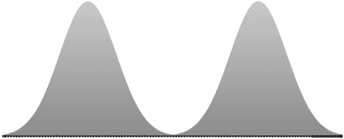

*图 2.7* 几乎没有偏度的双峰分布。假设无偏分布必然意味着单峰正态分布是错误的。返回文本。⏎

再次强调，听到分布没有偏度时，很容易想象出具有单一峰的正态分布。然而，这可能是错误的，正如 图 2.7 中的图所揭示的那样。*偏度的缺失并不必然意味着单一峰*。这也是为什么始终应绘制数据的又一个原因。数值汇总通常不足以对分布特征得出强有力的结论。

分布的 *峰度* 衡量该分布的总体“尾部特征” (Upton & Cook, 2014)，更简洁地说，是指分布尾部的行为，即尾部有多“重”，意味着尾部存在多少质量 (DeCarlo, 1997)。它由下式给出

$$k = \\frac{E\\left\\lbrack \\left( y\_{i} - \\mu \\right)^{4} \\right\\rbrack}{\\left( {E\\left\\lbrack \\left( y\_{i} - \\mu \\right)^{2} \\right\\rbrack} \\right)^{2}}$$

(2.48)

如果分布表现出与钟形曲线典型的峰度，则称其为 *中峰*，如果分布具有较轻的尾部并且与正态相比通常在分布中心更平坦，则称其为 *平峰*，如果分布表现出较重的尾部并且通常在分布中间更窄，通常使其比正态密度预期更“尖峰”，则称其为 *尖峰*。虽然分布的“尖峰程度”并不是峰度的正式定义，但尾部的重量在某种程度上（尽管绝对不是 *总是*）与分布在中心是更宽还是更窄相对应。然而，将峰度完全与分布的尖峰程度联系起来在很大程度上已被抛弃。94

## 2.24 变异系数

*变异系数* 是数据集中衡量离散度的又一指标，本质上用均值 `μ` 的值对标准差 `σ` 进行“缩放”。在此方面，了解一组数据（样本或总体）的标准差与其均值大小的关系是有用的。因此，如果我们报告标准差等于 2，知道均值是多少可以帮助我们评估标准差为 2 被认为“大”还是“小”的程度。

变异系数由下式给出

$$CV = \\frac{\\sigma}{\\left| \\mu \\right|}$$

(2.49)

其中 `σ` 是总体标准差，`|μ|` 是总体均值的绝对值。例如，对于 `σ = 5`，当 `μ = 5` 时的变异系数要小得多（即 1），而当 `μ = 1` 时则为 5。因此，在不纳入各自均值的情况下比较分布的标准差在某些情况下可能是误导性的，在比较分布变异性时，将变异系数纳入讨论也是一种有用的做法。

## 2.25 统计估计

经典（而且就贝叶斯而言）统计学完全是关于 *估计*。除非我们拥有整个总体，否则我们无法确定地知道这些总体的参数，而必须使用样本数据来估计它们。请记住，如果你拥有总体数据，就没有需要估计的东西，因为可以直接对感兴趣的参数计算描述性统计。这有时会被统计学新手误解，其中许多人在学习了显著性检验和 `p`-值后急于对遇到的每个数据情况进行此类检验，太自豪于报告 `p`-值了！然而，对总体参数的显著性检验除了观察参数本身之外并不能提供额外的见解。显著性检验只有在对样本数据进行并且我们希望了解样本数据 presumably 收集自的总体参数时才有意义。

我们说 `θ̂` 是总体参数 `θ` 的估计量。更准确地说，它是一个 *点估计量*，因为它试图估计参数 `θ` 的一个特定值。一般来说，*估计量是用于估计总体参数的样本数据的任何函数*。当我们将估计量应用于某些数据并获得其值时，例如应用均值估计量并获得数值均值，我们说该 *估计量* 产生了一个 *估计值*。点估计量几乎总是 *统计量*（因为它们是在样本上计算的），但统计量并不总是点估计量。例如，如果我们计算大学系的平均薪水，这种均值是对样本的描述性统计；然而，它不是点估计量，因为我们没有用它来估计任何参数。

估计量如果 `θ̂` 的期望等于 `θ`，则为 *无偏*，即

`E(θ̂) = θ`

(2.50)

相比之下，如果上述等式不成立，则估计量是有偏的，95

`E(θ̂) ≠ θ`

(2.51)

偏差的大小等于期望值与实际参数值之间的差：

Bias = `E(θ̂) − θ`(2.52)

许多估计量在样本中表现出偏差，但不是 *渐近* 有偏的。也就是说，随着样本量无限增长，偏差最终会消失。更简洁地说，如果随着样本量趋向无穷大，偏差趋向于零，则估计量是渐近无偏的。我们可以更正式地表达为，


$$\\lim\\limits\_{n\\rightarrow\\infty}\\left( {E\\left( \\hat{\\theta} \\right) - \\theta} \\right) = 0$$

上述中请回想 `E(θ̂) - θ` 是存在的偏差程度。随着 `n` 的增大，偏差逐渐消失，在极限情况下不存在。也就是说，在 `n`→∞ 的极限下，`E(θ̂) = θ`。

估计量的 *方差* 是衡量如果我们改变或扰动数据时估计值会变化多少的指标。也就是说，在重复抽样中，当我们经历样本数据的随机波动时，估计量的方差捕捉了由于这种波动导致估计值的变化程度。我们将估计量的方差定义为：

`Var[θ̂] = E(θ̂²) - (E(θ̂))²`

(2.53)

直观上似乎可以得出结论，有利的估计量是那些偏差最小或没有偏差，同时方差也最小的估计量。在大多数情况下，这就是我们追求的理想。然而，正如我们在书中后面会看到的那样，这样的估计量并不总是对所有情况都最有利。有时，故意允许估计量中存在偏差实际上是“好事”，如果它有助于降低方差的话。当然，最理想的情况是同时降低方差和降低偏差，但这通常是一个无法实现的目标。随着偏差的减小，我们通常会经历方差的上升，而随着方差的减小，偏差会上升。这种 *权衡* 在统计学界是众所周知的，毫不奇怪地被称为 *偏差-方差权衡*。存在偏差的估计量包括那些 *岭* 和 *套索*，它们将在书中后面详细说明。现在，我们更详细地剖析偏差-方差权衡。

## 2.26 偏差-方差权衡

我们刚刚提到，关于估计量，我们需要关心的两件事是其偏差和方差。我们可以将这一思想展开为以下基本恒等式：

`E(y[0] - f̂(x[0]))² = Var(f̂(x[0])) + [Bias(f̂(x[0]))]² + Var(ε)`

(2.54)

其中 `E(y[0] - f̂(x[0]))²` 是在预测变量 `x[0]` 取值处的期望测试均方误差 (`MSE`)。这里重要的是要认识到，在这种情况下，方差和偏差指的是 *统计学习方法或模型*，而不是数据。也就是说，在这种情况下，我们不关心样本数据的方差；我们感兴趣的是使用这样那样的统计 *方法论* 或 *模型估计* 所产生的方差。方差是指如果使用不同的训练数据集，或当前数据集被“扰动”，估计函数 `f̂` 会变化多少，而偏差是指学习方法在实际捕捉真实函数 `f(x[0])` 时“偏离”程度。方法越灵活，方差越高，而偏差越低。这两个量的相对变化会影响测试 `MSE`。随着灵活性的增加，偏差最初下降的速度比方差增加的速度更快（詹姆斯等人, 2013）。然而，在此初始状态之后，灵活性的增加对偏差的影响要小得多，而取而代之的是方差的增加，此时测试 `MSE` 也会相应增加。目标是尽可能同时具有低方差和低偏差；然而，偏差的降低通常会导致方差的增加，反之亦然。

### 2.26.1 不可约误差真的不可约吗？

通常认为统计方法的方差 `Var(f̂(x))` 可以被缓解或降低；然而，`Var(ε)` 被认为是一种 *不可约方差*，这意味着它无法被缓解，我们基本上只能“接受”它。也就是说，`Var(ε)` 有时被视为一个无法减小的 *常数*。但 `Var(ε)` 真的不可约吗？不！是的，我们可以找到更好的拟合函数，即 `f̂(x)` 以更好地逼近以 `f(x)` 形式存在的“真实”，这将使我们更接近 `E(y - f̂(x[0]))² = 0`，但我们也可以通过 *测量* 来降低 `ε`，或者至少使 `ε` 变得不那么 *可变*。它之所以“不可约”，只是因为它可能与拟合的函数无关，但在简单地降低总体平方误差的意义上，它并不是不可约的。也就是说，`ε` 的存在不仅仅是因为没有拟合“正确”的函数或使用更好的统计学习技术，而是可以通过 *测量* 的改进而简单地减小。降低 `Var(ε)` 成为一种现实的可能性。

我们在理论上是否能够使 `ε` 完全为零？可能不行，但这将取决于我们在更深层次的哲学层面上认为 `ε` 实际上“是什么”。如果一个人相信 *真实的随机性* 或 *真实误差*，那么将误差降至零可能是不可实现的，我们将始终至少存在 *一些* 波动。正如詹姆斯等人所指出的（2013, 第 19 页），“不可约误差将始终为我们对 `Y` 的预测准确性提供一个上限。这个界限在实践中几乎总是未知的。”虽然这是真的，我们的观点仅仅是，这没有考虑到误差是否 *理论上* 能够归零。更正式地，我们可以写成，

`lim[Var(ε) → 0] = E(y - ŷ)² = [f(x) - f̂(x)]²`

也就是说，随着 `Var(ε)`→0 在极限情况下，我们仅仅得到观测到的 `f(x)` 与估计的 `f̂(x)` 函数之间的平方差（注意我们去掉了 `Var(ε)`）。随着我们找到降低 `ε` 及其 `Var(ε)` 的方法，这种“理想”在理论上是可能的。虽然这在心理测量学和哲学层面上是一个极其有趣的话题，但我们在这里不会进一步探讨这个问题。

## 2.27 最大似然估计

从历史上看，最大似然法是估计各种统计模型和情境中参数的最常见方法。它主要归功于 费舍尔 (1922)，尽管至少在概念上，它的起源和萌芽可以追溯到费舍尔之前数百年 (斯蒂格勒, 1986)。最大似然的思想非常简单。假设你拥有以样本形式观测到的数据。最大似然提出的问题是：97

> *我们应该选择哪些参数值，才能使此类数据的似然函数最大化？*

请仔细注意，数据已经观测到。我们提出的问题是，感兴趣的参数值 *会使此类数据最有可能* 是什么？

作为一个简单的例子，考虑抛硬币十次并观察到五次正面。五次正面构成了观测数据。正面概率的参数值会使这一观测结果以“最大似然”出现？答案当然是正面概率等于 0.5，或者更简洁地说，`p(H) = 0.5`。像 `p(H) = 0.4` 这样的替代参数值会使数据比 `p(H) = 0.5` 时 *更不可能*，因此在这种情况下 `θ̂ = 0.5` 是最大似然估计量。参数值（例如 `p(H) = 0.5`）的估计被称为 *最大似然估计*。

更正式地，最大似然估计量，或 `MLE`，定义为

$$\\left. {\\hat{\\theta}}\_{mle} \\triangleq \\underset{\\theta}{\\arg\\max}p\\text{(}D \\middle| \\theta\\text{)} \\right.$$

(2.55)

这仅仅表示使数据 `D` 在给定参数值 `θ` 下最可能的自变量值（即 `argmax`）。也就是说，最大似然 (`ML`) 提供了使 `p(D|θ)`（*似然函数*）最可能的 `θ` 值。函数的对数是一个单调递增函数，这意味着在评估似然大小方面，取似然或取似然的对数本质上是等价的。出于技术原因和方便性，取对数是有用的，因此对数似然由下式给出

`log L(θ) = log p(D/θ)`

(2.56)


## 2.27

在实践中，通常是对数似然的负值进行 *最小化* 而不是对数似然进行最大化，

$${\\hat{\\theta}}\_{mle} \\triangleq \\underset{\\theta}{\\text{arg}\\min}\\text{-log}\\, p\\text{(}D/\\theta\\text{)}$$

(2.57)

这通常被称为 *误差函数*（Bishop, 2006）。

以上内容相当具有一般性。例如，我们可以针对多元情形具体展开这些要素，在该情形下我们希望得到最大似然估计量。因此，假设我们寻求 `μ` 的最大似然估计，即多元均值，以及 `Σ`，即协方差矩阵，以最大化数据的似然。在多元设定下，上述估计量由下式给出

$$\\hat{\\mu} = \\overline{y}$$

对于多元均值向量，以及 98

$$\\left. \\hat{\\Sigma} = \\frac{1}{n}{\\sum\\limits\_{i = 1}^{n}\\left( y\_{i} - \\overline{y} \\right.} \\right)\\left( y\_{i} - \\overline{y} \\right)'$$

这也可以表示为 $\\frac{n - 1}{n}S$，其中 `S` 为样本协方差矩阵。有关这些特定最大似然估计量的 justification，请参阅 Rencher 和 Christensen（2012，p. 99）。最大似然要求我们选择使在观测值处评估的联合密度 *最大化* 的参数（Johnson & Wichern, 2007）。如前所述，使其最大化的参数值被称为 *最大似然估计*。也就是说，`μ` 和 `Σ` 的最大似然估计是使似然函数 `L`(`μ`,`Σ`) 最大化的那些值，`μ̂` 和 `Σ̂`。在实践中，与单变量情形一样，通常会计算似然的对数负值。如前所述，最大化似然等价于最小化误差（Bishop, 2006）。

### 2.27.1 Why ML Is So Popular and Alternatives

最大似然估计量具有许多有利的性质。它是许多甚至大多数统计和机器学习问题的默认估计方法。例如，它在神经网络中被广泛使用（Goodfellow et al., 2016）。

尽管如此流行，最大似然绝不是统计建模和机器学习中估计的 *唯一* 方法。已提出了许多其他方法，以适应假设多元正态性不现实的数据情况。例如，*准最大似然* (`QML`) 是一种在结构方程模型中提出估计方法，具有二次效应等非线性项（Klein & Muthén, 2007）。*两阶段最小二乘* 对非线性 SEM 模型的估计也已被提出（Holst & Budtz-Jorgensen, 2020）。*自适应高斯求积* (`AGQ`) 也被提出用于估计 SEM 模型中的非线性。*矩方法* 是 ML 估计的一种替代方法，当解不可用或计算困难时（Murray, 2022）。*在线递归估计* 是另一种可能性（Murray, 2022）。所有这些估计方法都很复杂，对它们的讨论足以填满一整章甚至一本书。

本讨论的关键要点是，就估计方法而言，尽管最大似然可能是最流行的方法，但已经存在许多替代方法，并且在统计学和机器学习中还有其他方法正在开发。因此，当遇到“估计”一词时，应好奇地了解所指的 *类型* 的估计，因为它并不总是最大似然。

### 2.27.2 Estimation and Confidence Intervals

在经典统计学中，我们可以尝试估计分布中的特定点，例如算术均值，或者尝试估计一组 *区间* 值。理论统计告诉我们，样本均值的期望值 $\\overline{y}$ 等于总体均值 `μ`。即 $E\\left( \\overline{y} \\right) = \\mu$。然而，我们也知道“命中”总体均值精确值的概率的极限值为零。因此，我们通常寻求在样本估计量周围构建一组 *区间* 值，而不是寻求 *点预测*，我们将使用 *区间估计量*，其中最常见的是置信区间。

*均值的置信度* 由下式给出

$$\\overline{y} \\pm z\_{\\alpha/2}\\frac{\\sigma}{\\sqrt{n}}$$

(2.58)

其中 `z`[`α`/2] 是给定置信区间所需精度的 `z` 的临界值。对于 95% 区间，该值为 1.96，因此我们有 99

$$\\overline{y} \\pm 1.96\\frac{\\sigma}{\\sqrt{n}}$$

请记住，我们很少真正知道 `σ` 的值，而必须基于样本数据对其进行估计。当我们使用样本标准差 `s` 作为总体标准差 `σ` 的估计量时，均值不再服从 `z` 分布，而是服从 `t`\-statistic 分布，因此置信区间变为：

$$\\overline{y} \\pm t\_{\\alpha/2}\\frac{s}{\\sqrt{n}}$$

(2.59)

置信区间绝不限于均值。区间估计量可用于各种统计量。在许多情况下，解析解告诉我们如何构建此类区间的标准误差。在其他情况下，标准误差难以处理，难以甚至不可能计算。当我们无法直接计算标准误差时，一个选择是对观测值进行 *自助抽样* 并通过重复抽样确定区间界限。我们稍后将讨论自助法。

请注意，正如点估计量一样，区间估计量是随机变量。被估计的参数不是随机变量。虽然在实践中对置信区间有几种不同的解释方式，但最正确的方式是指计算此类区间的 *过程*，其中已计算出一个区间。因此，对数据计算得到的 95% 区间的最正确解释是

> *基于用于计算该区间的过程，给定区间覆盖参数的概率为 0.95。以这种方式重复计算区间的过程将导致其中 95% 覆盖真实参数。*

关于置信区间的正确解释以及研究人员 presumably 总是理解错误，存在大量文献。是的，这里形式很重要，但上述内容并不是置信区间概念化的唯一方式，尤其是在实际研究环境中。上述解释在解释实际研究时相当 awkward，但可以说是接近最理论上正确的解释。有关此点的简要讨论以及为什么竞争性的置信区间解释方式在实践中可能有用的简要论证，请参阅 Denis (2020)。

## 2.28 The Bootstrap: A Way of Estimating Nonparametrically

也许在所有统计技术中，自助法从计算机时代革命以及此类计算所提供的速度和便利中受益最大。尽管理论上自助法在没有计算机的情况下仍然可行，但它在计算上会如此繁琐和不切实际，以至于可以公平地说该技术很可能永远被放弃，永远不会声名鹊起。多亏了计算，自助法在统计学和机器学习领域已成为“家喻户晓的名字。”


自助法的起源通常归功于埃弗伦（1979），实际上它是通常被称为 `jackknife` 的一种特例，而 `jackknife` 早于它出现，但自助法比 `jackknife` 更具适用性和可推广性。`jackknife` 本身可以被视为一种 `linear expansion method`（称为 `delta method`）来近似自助法（埃弗伦，1979）。正如埃弗伦和哈斯蒂（2016）所指出的，“在计算机出现之前，应用统计学家需要成为泰勒级数专家，辛苦地追求即使是中等复杂统计量的准确性”（第 155 页）。`jackknife` 起源于 1957 年，是迈向标准误计算方法的第一步。

自助法的基本思想是利用计算能力从样本中反复抽样，而该样本在给定的自助场景中充当 `pseudo-population`。我们在这里的估计讨论中包含自助法，因为它又是估计分布参数的另一种方法；而我们刚刚回顾的方法是通过经时间检验的分析公式以 `parametrically` 的方式进行，自助法则是通过计算机重采样模拟进行 `nonparametric` 估计的方式。

更一般地说，自助法方法是更广泛的 `Monte Carlo methods` 家族的特例，而 `Monte Carlo methods` 是 `resampling` 的总称。需要明确的是，自助法绝不等同于蒙特卡洛方法，因为还有许多其他利用蒙特卡洛抽样的技术。然而，在应用统计和机器学习领域，自助法无疑是通用蒙特卡洛技术中最受欢迎的 `applications` 之一。由于自助法通常用于估计，我们在这里而不是在蒙特卡洛技术下对其进行了讨论，但将其纳入蒙特卡洛技术的一般讨论中也是正确的。

### 2.28.1 自助法的简单示例

正如所讨论的，`the bootstrapped sample is to the original sample as the original sample is to the population`。我们为什么要从样本中抽样？有几个原因，但主要原因之一是获得标准误等指标 `analytically` 有时不可行，在许多情况下实际上是不可能的。的确，我们知道均值的标准误，例如等于

$$\\frac{\\sigma}{\\sqrt{n}}$$

但我们不太确定，例如 `median` 的标准误（即中位数的标准误较不 `exact`）。也就是说，中位数的标准误 `analytically available` 程度较低。然而，多亏了自助法，我们可以“经验性地”评估中位数的标准差（即中位数的标准误）。这就是能够自助的主要好处之一，即能够通过重采样对没有分析抽样分布或推导此类抽样分布非常困难的统计量进行经验性“模拟”。理论上，我们明天可以“发明”一个没有已知抽样分布的新统计量，并简单地通过重采样对该统计量进行自助，以确定其长期“行为”。这或许就是自助法在统计学中如此“重要”的最大原因。

更正式地说，假设我们有一个 `training set`，表示为 `Z = (z[1],z[2],...,z[N])`，其中任意给定的 `z[i]` 对应于 `x`、`y` 的数据，即 `z[i] = (x[i],y[i])`。现在想象我们从 `Z` 中重采样总共 `B = 100` 个样本。我们将这些样本称为 `bootstrapped samples`。以标准误为例，我们将对每个自助样本计算标准差，并观察 100 个样本上的标准差行为。这将表示我们想要计算的标准误。然而，我们不一定非要计算标准误；我们可以在这些自助样本上计算几乎 `anything`。正如所提到的，自助法广泛适用于几乎任何统计量，即使是推导抽样分布不可能的统计量也是如此。

例如，我们可以在自助样本上计算线性回归并观察样本间线性方程的行为，或任何其他模型或统计量。这就是自助法和一般蒙特卡洛模拟的威力；`it allows us to resample repeatedly and build a distribution of functions of the data, whatever those functions may be`。就此而言，自助法非常灵活，应用广泛。它是 `nonparametric`，意味着它对总体没有任何假设，使其极具灵活性，非常适合针对您希望在重复样本上计算的任何内容进行的创造性尝试。自助法 `allows you to create an actual empirical distribution of computed statistics instead of deriving a theoretical one analytically`。

更正式地说，再次考虑 `Z = (z[1],z[2],...,z[N])`。假设我们在 `Z` 上计算某个量，即 `Z` 的某个函数，我们将其适当记为 `f(Z)`。假设该函数 `f(Z)` 是 `Z` 的方差，即 `Var(Z)` 定义为

$$f\\left( Z \\right) = Var\\left( Z \\right) = \\frac{\\sum\\limits\_{b = 1}^{B}\\left( Z\_{}^{{}^{\*b}} - {\\overline{Z}}^{\*b} \\right)^{2}}{B}$$

其中 `Z^{*b}` 是一个特定计算的自助样本，而 `${\\overline{Z}}^{\*b}$` 是所有自助样本的 `mean`。请仔细注意，这里 `Var(Z)` 只是一个普通方差，但是在 `B` 个自助样本上计算的。所有这些基于我们之前对<|message|> 方差的研究看起来都很熟悉。例如，如果我们希望使用更典型的估计量，我们可以在分母中使用 `B - 1` 而不是 `B`，

$$f\\left( Z \\right) = Var\\left( Z \\right) = \\frac{\\sum\\limits\_{b = 1}^{B}\\left( Z^{\*b} - {\\overline{Z}}^{\*b} \\right)^{2}}{B - 1}$$

由此不难看出，`Var(Z)` 给出了自助样本周围的方差度量。

### 2.28.2 为什么不自助一切？

正如我们所见，自助法相当通用，可以应用于许多不同的情境。的确，如果有充分理由，我们几乎可以对样本上的任何函数进行自助。它不必是熟悉的东西，例如均值、中位数或其他众所周知的统计量。这正是自助法的优势所在，因为它允许我们估计那些我们可能完全没有理论指导的统计量，并且在没有重采样的情况下可能永远无法了解其抽样分布。

那么，为什么自助法没有更频繁地使用？为什么我们不自助几乎 `everything`？原因是，除非假设被违反，否则分析推导的解可能比重采样产生更有利的结果。与永恒的分析推导相比，计算机模拟可能不精确。因此，当统计理论可用且分析解可行时，`classic formulas may dominate bootstrapped approaches`。关于是否自助的一般指导原则是，首先检查是否有分析解可用，如果它是一个在理论上得到强力支持的有效解，则使用它。其次，尝试自助。当然，同时尝试两种方法并比较结果永远不会有坏处。


自助抽样时，自然也会出现一个问题：需要多少次重复才能得到自助统计量分布的合理估计。尽管对此存在一些争议，但一般建议约为 `B = 50`，且很少超过 200 (Rizzo, 2019)。自助法也允许放回抽样，因此一个自助样本可能包含与另一个自助样本相同的抽样单元。数据点未被包含在样本中的概率等于 `1 - (1/n)`，这意味着给定数据点未被包含在 `n` 个样本中的概率等于 `(1-1/n)^(n)`，当 `n→∞` 时，这是一个众所周知的 `1/e` 的近似值 (Aggarwal, 2015)。

在 Python 中，自助法可使用 `SciPy` 轻松实现。在 R 中，自助法可通过多种方式实现。其中一种方法是使用 `bootstrap` 包 (Original et al., 2019)。

### 2.28.3 自助法的变体与扩展

自助法有许多变体。其中包括 *leave-one-out bootstrap*，其中实例的准确性是使用除该实例之外的数据计算的 (Aggarwal, 2015)。Kleiner et al. (2014) 提出了一种称为 *bag of little bootstraps* (`BLB`) 的子采样方法，以帮助处理可能太大而无法放入计算机内存或分析效率太低的大规模数据。在 `BLB` 方法中，从原始收集的数据集中每个样本抽取若干个给定大小的子样本。对于每个子集，选择若干个自助样本，并在这些子集上计算统计方法（例如，均值的计算）。这些因此是点估计。然后通过平均将这些度量组合起来，得出总体点估计和质量度量。

*fractional bootstrap*，也称为 *Bayesian bootstrap*，抽取随机权重，并不是将其应用于重采样单元，而是应用于实际数据。有关详细信息和 R 中的实现，请参阅 `fwb` 包 (Greifer, 2023)。

## 2.29 经典零假设显著性检验的元素

好与坏兼而有之，经典统计学很大程度上基于 *null hypothesis significance testing* 方法，简称为 “`NHST`”，它为在数据在假定模型下不太可能出现时拒绝假设提供了依据。这产生了经典的 “`p-value`”，科学家据此决定是否保留或丢弃原假设。零假设与误解相反，不一定是零结果或零效应的假设，也不一定是在两个总体比较情景下的相等假设。R.A. Fisher，方差分析的发明者，将零假设定义为如果观测数据与其矛盾则应被 *nullified* 的假设。更具体地说，如果在零假设下观测统计量的概率相对较小，则拒绝零假设并推断出 *statistical alternative* 假设。*statistical alternative* 中的 “统计” 这一限定非常重要。统计备择假设是对 “not the null” 的陈述，并且 *not* 是对研究者实质性备择假设的确认。经典零假设显著性检验，或实际上任何 *statistical* 理论，都没有证实研究假设的能力。对这一点的误解很容易导致对显著性检验结果的误解。

作为说明这一点的例子，假设我们提出一个零假设，即总体 IQ 的均值等于 100。也就是说，

`H[0]: μ = 100`

统计备择假设是均值不等于 100；也就是说，

`H[1]: μ ≠ 100`

但为什么它不等于 100 呢？也许是因为研究者用一种能提高 IQ 的神奇药丸治疗了该组。在这种情况下，那就是 *research alternative hypothesis*。请注意，*rejection of the null and inference of the statistical alternative hypothesis is not equivalent to inference of the research alternative*。零假设并不知道 “why” 它被拒绝；它只是基于检验统计量的低概率而被拒绝。因此，零假设的拒绝可能在许多条件下 “happen”，尤其是在研究或实验做得不好的情况下。如果在正确进行的实验下拒绝了零假设，那么对统计备择假设的推断自然会导向对研究备择假设的强推断，但这种 “leap” 并非自动的，而将其视为自动很容易导致对错误研究备择假设的推断。例如，在执行不佳的研究中，也许根本不是神奇药丸是有效因素；也许 IQ 的提高是由于季节变化导致阳光增加或参与者饮食变化所致，这模拟了 IQ 的提高，因为认知处理能力增强。

为了强调经典零假设显著性检验中存在的抽象性，我们可以将参数值（在多元模型的情况下为向量）表示为在零假设下属于特定参数空间 `Θ[0]`，参数值是该集合的成员，

`H[0]: θ ∈ Θ[0]`

(2.60)

与备择假设相对，参数值是备择集合的成员，

`H[1]: θ ∈ Θ[0]^c`

(2.61)

其中 `Θ[0]^c` 是 `Θ[0]` 的补集，其成员资格为 *not the null*。为什么要抽象？是为了让事情不必要地抽象和数学化吗？不！这种符号展示了零假设显著性检验的最 *general framework*，并强调零假设的补集 *is* 一个抽象。它不是 “concrete”。换句话说，拒绝零假设不一定意味着其他任何事情，只是根据抽象的参数空间推断零假设的补集！让这一思想深入人心将防止读者在拒绝零假设时做出各种领域专业人士习惯性做出的荒谬科学推断。拒绝零假设并不意味着研究备择假设；它仅仅在 *statistically*（而非 *substantively*）表明零假设的补集。

大多数科学研究中使用的经典显著性水平包括 0.05 和 0.01，尽管使用这些水平完全没有任何统计或哲学依据。Fisher 本人只是将 0.05 水平标记为在建立与零假设矛盾的证据时 “usual and convenient”。尽管如此，对 0.05 实际含义的误解由来已久，研究人员经常错误地将 0.05 视为实验中 *effect* 存在与否的 “yes” vs. “no” 决策，这是一种严重的误解。0.05 不仅不一定表示有意义效应的存在或不存在，而且 0.05 根本没有什么 “special” 之处。正如许多人之前指出的，上帝肯定和 0.05 一样爱 0.06 水平。确定适当的显著性水平应根据具体情况的背景，谨慎考虑犯 I 型错误和 II 型错误的容忍风险。再一次强调，*context matters*！


A rejection of the `null` does not necessarily imply that the `null` is false. Of course, logically, the `null` can be said to be false even before collecting the data. Do we really expect population means to ever be *exactly* equal? Hardly ever! Even with a rejection, we do not know if the `null` is false; we are simply using the available sample data to *hedge our bet*. Science is a gamble! A false rejection of the `null` is called a `type I error` and is indicated by the level at which we set our statistical test, that of `α`. A `type II error` is the error committed when we fail to reject a `null` hypothesis that is, in actuality, false. The probability of such an error is indicated by `β`. 104`Statistical power` is equal to the balance of the type II error rate, computed as 1 − `β`. Power is the probability of rejecting the `null` hypothesis given that it is false. Ideally, power for a study or experiment should be at least .80 or higher, where more power than not is usually a good thing if our goal is to reject a `null`.

### 2.29.1 单尾检验 vs. 双尾检验
A `one-tailed test` is when we commit all of our rejection region on one tail of the distribution and none on the opposite tail. A `two-tailed test` is when there are rejection regions on both ends of the sampling distribution. It is worth emphasizing that while typically two-tailed tests constitute an even “splitting up” of the alpha region, there is no requirement of such equality when performing a two-tailed test, so long as one adjusts their test appropriately. That is, one can allot 4% of the rejection region in one tail and 1% in the other if that is what substantive interest or theory indicates. In practice, however, for a 5% test, the researcher will usually allocate 2.5% to each tail. Since the event of the statistic falling in one tail or the other constitutes a sum of two `mutually exclusive events`, these areas can be added (i.e., `0.025 + 0.025`) to produce the overall type I error rate.

### 2.29.2 效应量
A `p-value` essentially tells us the probability of the data given the `null` hypothesis. Because the standard error of a statistic is influenced heavily by sample size, it is entirely possible to reject a `null` hypothesis simply as a function of sample size, where the “effect” is extremely small. This can be very easily illustrated in the case of a one-sample `z`:

$$z = \\frac{\\overline{y} - \\mu}{\\frac{\\sigma}{\\sqrt{n}}}$$

Note that as `n`→∞, `z`→∞. More formally,

$$\\lim\\limits\_{n\\rightarrow\\infty}z = \\infty$$

which reads that in the limit as `n`→∞, `z` will get increasingly larger and likewise go to ∞. Since its inception, it has long been argued that `p-values` do not tell the researcher or scientist what they actually want to know. What they want to know is a number characterizing the mean difference or the extent to which the independent variable “explains” variance in the dependent variable. *p-value 不会告诉你这些信息，无论它有多小！不要报告 p* < *0.05，认为它单独就能证明科学发现！只有效应量才会产生解释方差和对科学效应的真实表征。*

### 2.29.3 Cohen 的 `d` 效应量度量
Cohen’s `d` is a popular measure of effect size in either the one-sample case or two-sample case. Below is `d` for the one-sample case, where $\\overline{y}$ is the sample mean, `μ`[0] is the population mean under the `null` hypothesis, and `σ` is the population standard deviation,105

$$d = \\left| \\frac{\\overline{y} - \\mu\_{0}}{\\sigma} \\right|$$

(2.62)

Note that `d` is effectively a ratio of quantities, the ratio of one deviation, $\\overline{y} - \\mu\_{0}$ to another, `σ`. That is, the ratio answers the question “How large is the observed deviation relative to the *standard* deviation?” If the deviations are approximately the same, then `d` ≃ 1. Unlike `R²`, which is bound by 1, `d` does not have such an upper limit.

Note that `d` is not a function of sample size, as is the `p-value`. True, sample size `n` does appear in the denominator of `d` in the standard deviation,

$$\\sigma = \\sqrt{\\frac{\\left( y\_{i} - \\mu \\right)^{2}}{n}}$$

however, note that the standard deviation is not a function of `n` as is the standard error in the one-sample `z`-test for a mean, $\\sigma/\\sqrt{n}$. That is, `σ` will not necessarily increase or decrease simply as a function of `n` as is true of the standard error. Hence, though sample size appears in the denominator, it serves a different function. This is the precise difference between a `p-value` and an effect size: `p-values are a (partial) function of sample size; effect sizes are (generally) not`.

There are a whole host of effect sizes that can be computed in statistics. Sometimes the effect has to be gleamed from the research paper as the authors of the paper will not outwardly identify their effect size measure or mistakenly believe that the effect size is contained in the `p-value`. For example, they may report the odds of an effect occurring, which in itself serves as a useful effect size estimate, but will not identify the odds specifically as the effect size. It is up to the reader in many cases to understand and appreciate the nature of an effect size so they can identify it in the paper they are reading (and possibly compute or otherwise estimate it if it is omitted).

Transformations between effect sizes are well documented. For example, if a research paper reports a `d` statistic, one can convert from `d` to `r` via the following transformation:

$$r = \\frac{d}{\\sqrt{d^{2} + 4}}$$

(2.63)

The conversion of `d` into a log odds ratio is also easily obtained:

$$\\frac{d\\pi}{\\sqrt{3}}$$

(2.64)

For example, suppose Cohen’s `d` is equal to 0.22. As the reader may verify, this translates into an approximate log odds ratio of 0.40. A wealth of other transformations between effect sizes exists in the literature, including many “conversion” calculators online that aid in translating effect sizes from one form to another.

### 2.29.4 Are `P-values` That Evil?
As mentioned, the misconception behind `p-values`, historically, is nothing short of shameful. The legacy of misusing such indicators in the establishment of scientific evidence is nothing short of embarrassing, and what is perhaps worst, *it continues on today*! While effect sizes are being 106increasingly emphasized in research, there are still numerous studies across various fields that report `p-values` as a sole indicator in the establishment of scientific evidence, almost as if `p` < 0.05 is reason enough on its own to somehow establish evidence or success in an experiment or study. As we have emphasized, without the inclusion of an effect size, the reporting of scientific evidence based on `p-values` alone is incomplete. *Any good statistics course one takes should dramatically emphasize the distinction between p-values and effect sizes. From a scientific perspective, it is probably the most important piece of knowledge one can acquire in learning applied statistics.*

Based on this discussion, it may seem as though `p-values` are evil and should forever be avoided. Indeed, some have even argued for a ban on `p-values`. Meehl (1978) has even accused Fisher of almost purposely “beffudling” researchers into believing in `p-values`! However, `p-values` are really not that bad and serve a purpose. *Interpreting p-values incorrectly* is where the real problem lies.


The `p-value` 本身具有有用的功能。它允许基于拒绝原假设做出推断性陈述。这并不是坏事。尽管仅通过增大样本量 `n` 就能得到一个很小的 `p-value` 听起来近乎犯罪，但这也不是坏事。样本量增加导致 `p-value` 越来越小，意味着参数值的估计正在改善。也就是说，随着 `n` 的增加，反对原假设的证据强度应当增强。在极限情况下，随着 `n` 增加到无穷大，在假设至少存在 *某种* 效应时，拒绝原假设是保证且确定的。如果随着 `n` 的增加，我们基于估计序列得到的参数估计变得更好、更精确，则该估计量是 *一致的*。也就是说，一个一致的估计量是满足

$$\lim\limits_{n\rightarrow\infty}p\left(\middle|\hat{\theta} - \theta\middle| < \varepsilon \right) = 1$$

(2.65)

其中 `θ̂` − `θ` 是估计量 `θ̂` 与参数值 `θ` 之间的差值。估计量的一致性保证我们，随着距离 `θ̂` − `θ` 变小，小于某个任意小的数 `ε`，该距离小于 `ε` 的概率在 `n`→∞ 时等于 1。如 Casella 和 Berger (2002, p. 468) 所指出的，上述的等价表述是

$$\lim\limits_{n\rightarrow\infty}p\left(\middle|\hat{\theta} - \theta\middle| \geq \varepsilon \right) = 0$$

(2.66)

这本质上说了同样的话；在这种情况下，任何差值等于或大于某个小幅度 `ε` 的概率在 `n`→∞ 时等于 0。

`p-value` 是这种一致性的反映，因此随着 `n` 增加而变小正是 `p-value` *应该* 做的事情。*使用者* 不应该做的是将 `p-value` 的下降归因于对研究或科学备择假设的支持增加。那就是问题所在。将 `p-value` 从特定期刊中禁止的运动类似于因滥用而完全 100% 禁止枪支。在辩论的双方都可以提出论点，但枪（`p-value`）本身，安静地放在那里不伤害任何人，是无辜的。正如所有无辜的数学和统计学（以及枪支）一样，*需要人类才会真正搞砸它*。

### 2.29.5 效应量绝对大小与相对大小：情境很重要

`R²` 效应量为 0.10 在数值上是 *相对* 小的，因为理论上可达到的最大效应量是 1.0。然而，相对于给定的研究领域，0.10 可能相当大且令人印象深刻。效应量应在研究领域内进行情境化，以便更好地理解它们实际有多大或多小。Cohen (1988) 提供了社会研究中效应量的“经验法则”：0.2 为小，0.5 为中等，0.7 或更高为“大”。但应强调，这些不过是 *任意的指导原则* 而已，Cohen 可能最好根本不提供它们，因为研究人员太常将自己得到的效应量与这些任意指导原则进行比较，而不是与竞争性研究中的效应量进行比较。

`d` = 0.7 左右的效应有多大？这相当于 `R²` 大约为 0.11，这意味着我们仅解释了响应变量方差的大约 11%。这算“大”吗？在绝对意义上不算；它非常小，因为 `R²` 的理论上限为 1.0。但对于许多社会研究领域（Cohen 在发布其 0.2、0.5 等指导原则时所指的领域），解释 11% 通常相当不错，因为许多社会研究通常解释得更少。因此，在那种 *情境* 下，0.7 左右被认为相对较大。*但仅限于那种情境*。如果飞机飞行响应变量中升降襟翼的效应量如此之低，我们都会改坐公交车。在那种情境下，解释 11% 的方差是可笑的、可忽略的，而且 outright 危险。我们很容易设计出一个社会研究，其中 11% 也会是可忽略的，但我们也可以想象一个社会研究，其中 11% 是惊人地大且令人印象深刻。想象一下，如果人们是否微笑的方式解释了其寿命方差的 11%，那可能将被视为开创性且极其巨大的发现！然而，同样大小的效应量解释襟翼角度和飞行会导致飞机过于频繁地坠毁。

因此，除纯绝对意义外，脱离情境的效应量很难解释（例如，解释 11% 的方差比 0% 好，但距离最大方差 100% 仍有很长的路要走）。在 *绝对* 意义上，无论研究领域如何，11% 都是小的。或者，我们可以说，“相对于理论上可能的效应量范围，11% 是小的，因为理论最大值是 100%。我们在方差方面仅解释了理论上可解释的大约十分之一。”但当我们脱离抽象，说诸如“这种药物解释了血压方差的 30%”之类的话时，这可能具有巨大的 *实际价值* 并挽救许多生命，尤其是如果大多数其他药物仅解释到 5%。换句话说，该药物具有 *临床相关性*。它具有 *临床意义*。以这种方式，该药物的效应量极其令人印象深刻且很大，因为我们将其与研究领域进行比较，并考虑其实际意义。夏季轮胎与冬季轮胎可能解释了冬季交通事故死亡人数方差的合理比例，假设为 5%。这 5% 可能代表成千上万条生命得以拯救，并且可能是我们在冬季遏制交通事故死亡人数方面能做的最重要事情，因为所有其他“治疗”（如更亮的车头灯泡或其他替代方案）仅解释 0.3%，例如。因此，在特定领域，5% 的效应量非常大。我们要将其与 Cohen 的指导原则进行比较吗？不，因为他的指导原则特定于狭窄的研究领域，相对于其他领域充其量只是任意的。

### 2.29.6 跨研究效应量的可比性

经常会出现这样的问题：效应量是否可在实验和研究之间进行比较。简单的答案是某些效应量，如 Cohen 的 `d`，是可以比较的，但有很多 caveats。首先，比较很少甚至从不完美，因为每个研究的标准差可能因研究而异，以及使用了什么测量仪器、这些测量的可靠性等等。Cohen 的 `d` 是给定研究内的标准化均值差，但 *跨研究这些差异不一定是标准化的*。这是关键点。

例如，假设一项研究中 `d` = 0.5，而另一项研究中 `d` = 0.6。我们是有意选择这些效应量相对接近。第二个研究具有更高的效应量，但我们准备说第二个研究确实发现了更大的效应吗？也许一项研究的效应量更大或更小仅仅是变异性的函数，而非均值差。出于这个原因及其他原因，一些人（例如 Baguley, 2009）甚至建议报告不经标准化的 *简单效应量*。简单效应量不包含标准差，仅体现均值差。问题在于，即使只有少数异常值也会推高变异性，以至于分子中的均值差突然看起来没有那么令人印象深刻（因为我们除以一个越来越大的分母）。


出于上述原因，对于大多数效应量比较而言，最好的做法可能只是报告效应量的一般 *范围*，而较少关注 *具体* 的效应量，尤其是当所研究的材料也预期会表现出很大的测量误差时。例如，如果我们使用的是可靠且可重复到多位小数的高质量测量（例如发动机的速度或飞机下降的角度），那么 0.6 与 0.5 之间的差异会比例如社会测量更有意义，而社会测量可能更容易受到测量误差以及仅仅由于数据抽样方式而产生的误差的影响。当然，如果你怀疑可能影响效应大小的多个问题在各研究中或多或少是 *恒定* 的，那么你或许可以得出结论 *0.6 大于 0.5，我们假设所有可能影响这一差异的因素在各研究中是随机分布的或或多或少是等价的*，这就允许做出更笼统和一般的陈述。然而，除非存在这种等价性，否则可能有很好的理由解释为什么一项研究报告了 0.6 对 0.5，即使实际上两种效应量在事实上和所有目的上都几乎 *等价*。

Cohen 的 `d`，或任何其他效应量，都是其所依据特定数据的函数，因此从这个意义上说它对数据集是 *唯一* 的。如果第二个数据集表现出与第一个数据集相同（或非常相似）的数值特性，则 `d` 值会更具可比性。缩放差异也可能导致截然不同的效应量，以至于在比较 `d` 值时我们可能甚至不确定在比较什么。然而，如果一项研究的效果量为 3，另一项为 0.5，那么一般来说，我们可以相当有信心地认为第一项研究表现出比第二项更多的效应 *如果两项研究在许多特征上相似，包括缩放*。随着这种差异变得越来越小，得出此类结论的信心也会下降。如果研究人员报告 Cohen 的 `d` 值为 0.51 对 0.52 并得出结论：“因此，第二项研究（0.52）发现了更大的效应”，从数值上看确实如此，但每个效应量计算只是对真实潜在效应的估计，并且充满了计算过程中所涉及的所有测量误差和随机影响，其中最不重要的是研究变量的量表设置方式。1 到 7 的李克特量表在回答上可能引出与 1 到 3 的李克特量表截然不同的分布，即使在两种情况下测量的变量可能相同。这一问题涉及自变量或预测变量的 *操作化*，我们现在简要讨论它。

### 2.29.7 操作化预测变量

一个人如何选择操作化自变量或预测变量，可以显著影响在统计建模中是否会发现效应。例如，考虑来自方差分析的 `η²`。假设一项研究中 `η² = 0.80`，另一项研究中 `η² = 0.70`。这是否意味着第一项研究具有真正更大的效应量？如果不了解每项研究的更多细节，完全可能 `η² = 0.80` 更多地源于自变量的操作化方式，而非其他任何因素。应牢记以下原则：

> 每个实验或研究“来自何处”与选择用于对比和比较研究的数值度量一样重要，因为该数值度量（例如 Cohen 的 `d`、`η²` 等）是所有这些潜在影响的函数。109

以上是关键。当追溯 `d` 或 `η²` 等方程的根源时，就进入了数据的实际数字和特征。效应量不仅仅是 *汇总统计量*；它们是对 *数据* 的一般 *报告*。正如将一项研究中的样本均值与另一项研究中的样本均值进行比较取决于每个样本均值所包含的内容，效应量也是如此。为了强调这一点，请考虑以下陈述：“一个班级的平均成绩略高于另一个班级。” 这告诉我们什么？它告诉我们 *一个班级的平均成绩略高于另一个班级*！要进一步分析，就需要检查每个均值所包含的内容，等等，这是一项更深入的调查，在某些情况下甚至可能逆转效应的方向。这里的要点是，汇总统计量永远无法讲述完整的故事。更深的故事体现在实际数据点中，而 *更深的故事则体现在数据是如何获得和测量的*。 “学生的 GPA 为 4.0” 除非我们知道更多关于所修课程、课程评分方式、每门课程的难度等等，否则毫无意义。数据是 *经验*，除非你深入了解该经验，否则汇总统计量只能提供粗略的近似。

## 2.30 中心极限定理

在许多情况下，假设正态抽样分布有助于理论结果。例如，当我们获得样本均值并希望将其与均值的抽样分布进行比较时，我们需要假设抽样分布呈现正态（或至少 *近似* 正态）形状。如果我们抽样的原始总体分布已知为正态，则抽样分布也同样为正态。然而，在大多数情况下我们并不知道原始总体分布的形状，因此我们仍需要一种方法来确保抽样分布的正态性。 *中心极限定理*，或 CLT，允许我们了解抽样分布的形状，无论原始母总体的形状如何。

均值的 *单变量* 中心极限定理指出，如果我们令 `x[1]`、`x[2]`、...、`x[n]` 为来自均值为 `μ` 且有限方差为 `σ²` 的任意总体的独立观测，则 $\\sqrt{n}\\left( \\overline{x} - \\mu \\right)/\\sigma$ 具有近似正态分布，`N(μ,σ²)`，当样本量较大时。在极限情况下，随着样本量的增加，均值的抽样分布呈现出越来越正态的形状。

同样，我们可以更正式地表述 *多变量* 中心极限定理，即如果我们令 `X[1]`、`X[2]`、...、`X[n]` 为来自均值为 `μ` 且有限协方差矩阵为 `Σ` 的任意总体的独立观测，则 $\\sqrt{n}\\left( \\overline{X} - \\mu \\right)$ 具有近似正态分布，`Np`，当样本量较大时（Johnson & Wichern, 2007）。与单变量情况一样，如果母总体为正态，则样本的多变量分布将为正态。母总体正态的程度在样本量增加时加速了抽样分布正态化的过程。有关中心极限定理的更正式定义和表征，请参阅 Casella 和 Berger（2002，第 236 页）。请注意，一般而言，中心极限定理是关于 *随机变量* 的行为，而不仅仅是均值 `μ` 或均值向量 `μ`。从这个意义上说，中心极限定理有许多不同的“版本”。大多数学生在均值的行为背景下接触 CLT，但这不应暗示 CLT *唯一* 关于均值。

## 2.31 协方差与相关

数学 *关系*，或简单地 *关系*，是指两个变量的笛卡尔积的子集（图 2.8）。也就是说，如果在两个（或多个）变量之间给定的对应关系中某些配对未被表示，则按定义表示这两个（或多个）变量之间的关系。110

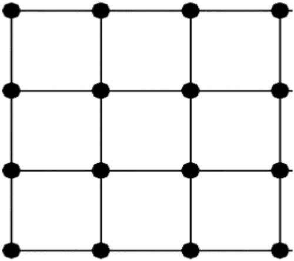


*图 2.8* 4 × 4 笛卡尔积的示例。任何点的子集都表示一个数学关系。返回正文.⏎

花点时间注意变量之间关系概念的普遍性和不具体性。*如果我们从全部配对中删除甚至一对，我们就展示了一个关系！* 为什么我们要强调这一点？其原因是，下次有人对你说，“*我的数据中 x 和 y 之间存在关系*，”时，应回答“*当然有，但更重要的是，这个关系是否有趣*？” 我们在这里要说明的要点是，在任何两个或多个变量之间，几乎 *总是* 存在一种在样本和总体中存在的相互关系。怎么可能没有呢？你真的认为在任何笛卡尔图中，任何 `x` 和 `y` 的经验配对的所有配对都能够被表示出来吗？当然不是！因此，*对两个或多个变量之间关系的命名通常是一个显而易见且无趣的陈述*。现在，通常，声称存在关系意味着更多。让我们考虑它现在 *可能* 意味着什么。

变量之间的关系可以有多种形式。对于两个连续变量，可以绘制无限多的曲线。换句话说，笛卡尔图上可能发生无限多的 *配对删除* 从而产生一个关系。最常引起兴趣（且方便）的是 *线性* 关系。*协方差* 和 *相关性* 都是衡量两个变量之间 *线性关联或关系* 的指标。

两个随机变量 `x` 和 `y` 之间的协方差由下式给出

*C**o**v*(`x`,`y`)=`E`\[(`x`[`i`]−`μ`[`x`])(`y`[`i`]−`μ`[`y`])\]  

(2.67)

这也可以表示为连续情况下面积的积分，

∫[ − ∞]^( + ∞)∫[ − ∞]^( + ∞)(`x`[`i`]−`μ`[`x`])(`y`[`i`]−`μ`[`y`])`f`(`x`[`i`],`y`[`i`])`d``x``d``y`  

(2.68)

and111

$$\\sum\\limits\_{x\_{i = 1}}^{n}{\\sum\\limits\_{y\_{i = 1}}^{n}{\\left( x\_{i} - \\mu\_{x} \\right)\\left( y\_{i} - \\mu\_{y} \\right)p\\left( x\_{i},y\_{i} \\right)}}$$  

(2.69)

对于离散随机变量。

变量 `x` 和 `y` 的样本协方差由下式给出

$$s\_{xy} = \\frac{\\left. {\\sum\\limits\_{i = 1}^{n}\\left( x\_{i} - \\overline{x} \\right.} \\right)\\left( y\_{i} - \\overline{y} \\right)}{n - 1}$$  

(2.70)

或者，更不常见地，也可以写成

$$s\_{xy} = \\frac{\\sum\\limits\_{i = 1}^{n}{x\_{i}y\_{i} - n\\overline{x}\\overline{y}}}{n - 1}$$

我们可以看到，协方差当然需要在 `x` 和 `y` 两者中都有变化，因为如果 $\\left( x\_{i} - \\overline{x} \\right)$ 或 $\\left( y\_{i} - \\overline{y} \\right)$ 等于 0，则

$$\\begin{array}{l} {s\_{xy} = \\frac{\\left. {\\sum\\limits\_{i = 1}^{n}\\left( x\_{i} - \\overline{x} \\right.} \\right)\\left( y\_{i} - \\overline{y} \\right)}{n - 1}} \\\\ {\\,\\,\\,\\,\\,\\,\\, = \\frac{0}{n - 1} = 0} \\\\ \\end{array}$$

也就是说，如果没有变化，就无法定量评估关系。如果样本中每个人的收入都相同，用年龄（以年为单位）与收入水平关联就不会奏效。统计关系与 *常数* 配合不佳。你需要在 *两个* 变量中都有 *变异性*。

协方差以 `x` 和 `y` 的自然或原始单位表示，因此小的或大的协方差主要反映了 `x` 和 `y` 测量的尺度。也就是说，在 `x` 或 `y` 或两者上变化很小的尺度可能反映出协方差很小的数据集，即使线性关系的程度相对较强。因此，标准化协方差是有用的。我们通过将协方差除以 `x` 和 `y` 的标准差之积来实现这一点。这样我们就得到了 *皮尔逊乘积矩相关系数*，`r`[`x``y`]，

$$r\_{xy} = \\frac{\\frac{\\sum\\limits\_{i = 1}^{n}{\\left( x\_{i} - \\overline{x} \\right)\\left( y\_{i} - \\overline{y} \\right)}}{n - 1}}{\\sqrt{s\_{x\_{i}}^{2} \\cdot s\_{y\_{i}}^{2}}} = \\frac{{cov}\_{xy}}{\\sqrt{s\_{x\_{i}}^{2} \\cdot s\_{y\_{i}}^{2}}}$$  

(2.71)

其理论范围从 −1，即完全负线性关系，到 +1，即完全正线性关系。`r`[`x``y`]=0 的值表示变量之间没有 *线性* 关系。再次强调“linear”这个词，因为完全可能变量之间仍然存在关系，只是它不是线性的。例如，图 2.9 中的散点图很可能产生接近 0 的相关性，但关系仍然相对明显。112

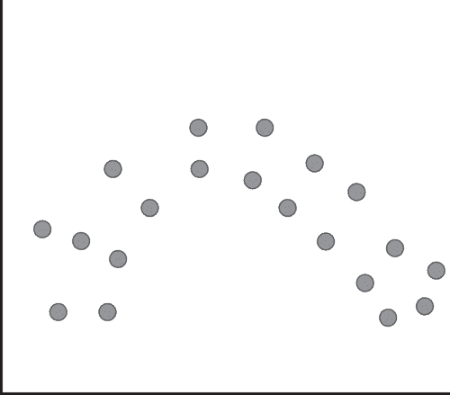

*图 2.9* Pearson 乘积矩相关性很可能接近 0 的数据图，但 x 和 y 之间仍然存在关系。“relationship”一词绝不应被理解为必然等同于或同义于“linear”。返回正文.⏎

也很容易看出，如果 `s`[`x`[`i`]]² 或 `s`[`y`[`i`]]² 或两者都等于 0，表示变量没有变化，则 `r`[`x``y`] 未定义。再次，同样适用于协方差，相关系数是变量 (标准化) 共 *变异* 的度量。如果一个或两个变量没有变化，相关系数就未定义。相关系数 `r`[`x``y`] 是一个 *一致* 的估计量，即 `r`[`x``y`]→`ρ` 当 `n`→∞。相关系数有多种解释方式。有关优秀讨论，请参阅 *Thirteen Ways to Look at the Correlation Coefficient* (Rodgers & Nicewander, 1988)。

### 2.31.1 为什么 `r`[`x``y`] 的取值范围为 −1 到 +1？

`r`[`x``y`] 的 −1 到 +1 的限制是由于分母中方差的乘积 `s`[`x`[`i`]]² ⋅ `s`[`y`[`i`]]² 造成的，这意味着分子 `c``o``v`[`x``y`[]] 的绝对值不可能大于分母 $\\sqrt{s\_{x\_{i}}^{2} \\cdot s\_{y\_{i}}^{2}}$。`r`[`x``y`] 中的分母本质上提供了可在分子中解释的最大“变异性”，因此分子 `c``o``v`[`x``y`] 的绝对值永远不可能大于分母。协方差的符号将指示 `r`[`x``y`] 为正还是负，但 `r`[`x``y`] 的大小不可能大于 |1|。对此更正式的证明可在 Casella 和 Berger (2002, 第 172 页) 中找到。

### 2.31.2 R 和 Python 中的协方差与相关性

我们可以通过 `cov()` 和 `cor()` 函数在 R 中相当容易地计算协方差和相关性。例如，考虑以下两个数据向量：113

```
> x <- c(0, 4, 7, 9, 10)
> y <- c(3, 4, 6, 7, 8)
> cov(x, y)
[1] 8.25
> cor(x, y)
[1] 0.9794398
```

上面我们看到这两个向量之间的协方差为 8.25，而标准化协方差，即 *相关性*，等于 0.979。请注意，协方差并不大，但相关性却有很大的幅度。这是由协方差的标准化造成的。*切勿仅因协方差相对较小（或较大）就认为相关性也会较小（或较大）*。*它们是不同的数值度量*。*大的协方差并不一定意味着同样大的相关性*。

在 Python 中，我们可以非常容易地计算相关性，其中我们首先使用 `scipy.stats` 生成关于 *口袋里硬币数量* 和 *银行账户里的钱* 的数据向量：


```
coins = [0, 3, 4, 5, 5, 6, 7, 10, 11, 12, 15, 20, 25, 28, 30, 35]
money = [20000, 30000, 40000, 45000, 55000, 60000, 80000, 100000, 130000, 150000, 200000, 230000, 250000, 300000, 350000, 400000]
import scipy.stats as stats
corr, _ = stats.pearsonr (coins, money)
corr
0.9923
```

`coins` 与 `money` 之间的皮尔逊相关系数估计为 0.9923。

### 2.31.3 相关线性组合

正如我们可以计算随机变量的协方差或相关性一样，我们也可以计算 *随机变量的线性组合* 的协方差或相关性。例如，考虑以下两个线性组合，

*z* = *a*′*x* = *a*[1]*x*[1] + *a*[2]*x*[2] +  ⋅  ⋅  ⋅  + *a*[*p*]*x*[*p*]

和

*w* = *b*′*y* = *b*[1]*y*[1] + *b*[2]*y*[2] +  ⋅  ⋅  ⋅  + *b*[*p*]*y*[*p*]

这些线性组合之间的协方差由下式给出

$$s\_{zw} = \\frac{\\sum\\limits\_{i = 1}^{n}{\\left( z\_{i} - \\overline{z} \\right)\\left( w\_{i} - \\overline{w} \\right)}}{n - 1}$$

(2.72)

同样，`z` 与 `w` 之间的样本相关系数为 114

$$r\_{zw} = \\frac{s\_{zw}}{\\sqrt{s\_{z}^{2}s\_{w}^{2}}}$$

(2.73)

为什么我们想要计算线性组合的协方差或相关性？原因与我们想要相关任何两个随机变量的原因相同。线性组合只是变量的 *复合*。什么是单个变量？它也是一个复合变量，*只是由自身构成的非常简单的复合*。为了说明这一点，再次考虑 `w` 的线性组合：

*w* = *b*′*y* = *b*[1]*y*[1] + *b*[2]*y*[2] +  ⋅  ⋅  ⋅  + *b*[*p*]*y*[*p*]

现在，简化 `w` 使其仅成为 `y[1]` 的函数，即 `w` = *b*′*y* = *b*[1]*y*[1]。如果 `b[1]` = 1，则 `b[1]`*y*[1] = *y*[1]，因此 `w` = *y*[1]。因此，线性组合只是由 `y[1]` 组成。也就是说，相关线性组合的动机与相关单个变量的动机相同，只是线性组合通常比单个变量更复杂；它们是由比单个随机变量更多的“东西”（即变量）“构成”的。然而，概念是相同的。许多多元方法以一种或另一种方式相关线性组合，尽管表面上可能并非如此。例如，方差分析和判别分析就是这样做的，它们都是称为 *典型相关* 的底层多元相关方法的一种版本。我们将在本书后面更详细地讨论典型相关。

### 2.31.4 协方差和相关矩阵

许多统计程序，例如主成分分析或因子分析，并不作用于单个变量。相反，它们作用于变量的 *矩阵*。也就是说，分析的对象不是变量而是 *矩阵*。例如，主成分分析直接对协方差矩阵进行（线性）降维。总体协方差矩阵由下式给出

$$\\Sigma = \\left( \\begin{array}{l} {\\sigma\_{11}\\,\\,\\,\\,\\,\\sigma\_{12}\\,\\,\\,\\,\\, \\cdot \\cdot \\cdot \\,\\,\\,\\,\\,\\sigma\_{1p}} \\\\ {\\sigma\_{21}\\,\\,\\,\\,\\,\\sigma\_{22}\\,\\,\\,\\,\\, \\cdot \\cdot \\cdot \\,\\,\\,\\,\\,\\sigma\_{2p}} \\\\ {\\,\\, \\cdot \\,\\,\\,\\,\\,\\,\\,\\,\\,\\,\\, \\cdot \\,\\,\\,\\,\\,\\,\\,\\,\\,\\,\\,\\,\\,\\,\\,\\,\\,\\,\\,\\, \\cdot} \\\\ {\\sigma\_{p1}\\,\\,\\,\\,\\,\\sigma\_{p2}\\,\\,\\,\\,\\, \\cdot \\cdot \\cdot \\,\\,\\,\\,\\sigma\_{pp}} \\\\ \\end{array} \\right)$$

(2.74)

其中 *σ*[12] 例如是变量 1 和 2 之间的协方差，而 *σ*[11] 是变量与其自身的协方差，即方差，因为

$$\\left. s\_{xy} = \\frac{\\left. {\\sum\\limits\_{i = 1}^{n}\\left( x\_{i} - \\overline{x} \\right.} \\right)\\left( y\_{i} - \\overline{y} \\right)}{n - 1}\\rightarrow\\frac{\\left. {\\sum\\limits\_{i = 1}^{n}\\left( x\_{i} - \\overline{x} \\right.} \\right)\\left( x\_{i} - \\overline{x} \\right)}{n - 1}\\rightarrow\\frac{\\sum\\limits\_{i = 1}^{n}\\left( x\_{i} - \\overline{x} \\right)^{2}}{n - 1} = s\_{x}^{2} \\right.$$

当然，和统计中一样，我们很少甚至从未接触到总体协方差矩阵，因此除了 `Σ` 之外，我们通常只有 `S`，即样本协方差矩阵，当用 `n`/`(n-1)` 校正时，它是 `Σ` 的无偏估计量。也就是说，$E\\left( {\\frac{n}{n - 1}S} \\right) = \\Sigma$。

样本相关矩阵是标准化协方差矩阵，由 115 给出

$$R = \\left( \\begin{array}{l} {1\\,\\,\\,\\,\\,\\,\\, r\_{12}\\,\\,\\,\\,\\, \\cdot \\cdot \\cdot \\,\\,\\, r\_{1p}} \\\\ {r\_{21}\\,\\,\\,\\,\\, 1\\,\\,\\,\\,\\,\\,\\, \\cdot \\cdot \\cdot \\,\\,\\, r\_{2p}} \\\\ {\\,\\, \\cdot \\,\\,\\,\\,\\,\\,\\, \\cdot \\,\\,\\,\\,\\,\\,\\,\\,\\,\\,\\,\\,\\,\\,\\,\\, \\cdot} \\\\ {r\_{p1}\\,\\,\\, r\_{p2}\\,\\,\\,\\,\\, \\cdot \\cdot \\cdot \\,\\,\\,\\, 1} \\\\ \\end{array} \\right)$$

(2.75)

协方差和相关矩阵都是 *对称* 矩阵，这一点正如我们在线性代数回顾中将看到的那样，意味着对于任意矩阵 `A`，

`A` = `A`^(`T`)

也就是说，原矩阵等于其转置矩阵，或者说，如果我们交换行和列、列和行，我们将得到相同的矩阵。为什么这个事实很重要？它很重要，因为对称矩阵具有特殊性质，包括 *特征向量仅在对应于不同特征值的对称矩阵中才保证成对正交* 的事实，这将对主成分等方法产生重大影响。对称矩阵也必然是方阵（即行数与列数相同），这使得可以在此类矩阵上执行特征分解，而对于非方阵和不对称矩阵，通常更喜欢更一般的 SVD（*奇异值分解*）。

## 2.32 *Z*-分数 和 *Z*-检验

回顾 `z`-分数，即 *标准化* 分数的定义，

$$z = \\frac{y\_{i} - \\mu}{\\sigma}$$

`z-`分数实际上是对两个偏差的比较，一个在分子中，`y[i]` − `μ`，一个在分母中，`σ`，即标准差。因此，可以将 `z`-分数解释为当前原始分数偏差有多大与我们在处理的给定分布中什么是“标准”的比较。`z`-分数为 0 仅在 `y[i]` − `μ` = 0 时出现，这意味着原始分数与均值完全没有偏差。如果分布没有离散，则 `σ` 将等于 0，`z-`分数将是 *未定义* 的。还值得注意的是，分子代表了 `y[i]` 的 *中心化*。也就是说，每当我们减去均值时，我们就在对给定的观测值进行中心化。因此，`z`-分数也可以定义为标准化的中心化观测值。中心化在统计建模中起着重要作用，并在本书中回顾回归分析和其他方法时将被重新讨论。很多时候，我们希望通过减去均值来中心化预测变量，以便预测变量在零处更有意义。中心化通常使模型的截距更易解释。

我们可以在 R 中轻松演示中心化和计算 `z`-分数。考虑以下原始分数分布：

```
> x <- c(0, 4, 8, 9, 10)
> mean(x)
[1] 6.2
```

我们现在通过减去均值来对分布进行中心化，

```
> x.center <- x – mean(x)
> x.center
[1] -6.2 -2.2 1.8 2.8 3.8
> mean(x.center)
[1] -1.775489e-16
```

116 请注意，新的中心化分布的均值等于 0（在舍入误差范围内）。为了生成 `z`-分数，我们可以然后除以标准差，同时确认新的 `z`-分数的均值等于 0 且标准差等于 1：

```
> z = (x-mean(x))/sd(x)
> z
[1] -1.4949527 -0.5304671 0.4340185 0.6751400 0.9162614
> mean(z)
[1] -2.218278e-17
> sd(z)
[1] 1
```


`Z` 分数构成了标准正态分布的基础，其均值等于 0，标准差等于 1。请注意这里的“standard”一词。大多数经验分布即使是正态的（或近似如此）也没有均值为 0 且标准差为 1。

### 2.32.1 `Z` 检验和 `T` 检验均值

回顾单样本 `z` 均值检验，

$$z\_{M} = \\frac{\\overline{y} - E\\left( \\overline{y} \\right)}{\\frac{\\sigma}{\\sqrt{n}}} = \\frac{\\overline{y} - \\mu\_{0}}{\\frac{\\sigma}{\\sqrt{n}}}$$

(2.76)

读者会从入门课程中回忆起，我们通常不知道均值的标准误差，$\\frac{\\sigma}{\\sqrt{n}}$，而是需要对其进行估计，

$${\\hat{\\sigma}}\_{M} = \\frac{s}{\\sqrt{n}}$$

(2.77)

当我们用 `s` 作为 `σ` 的估计值时，所得统计量不再是 `z` 统计量；它反而服从 `t` 分布，由此产生单样本 `t` 检验，

$$t = \\frac{\\overline{y} - E\\left( \\overline{y} \\right)}{\\frac{s}{\\sqrt{n}}}$$

(2.78)

数学统计的一个事实是，随着自由度的无界增加，`t-` 分布收敛于 `z` 分布。这是因为 `t` 的方差定义为

`σ[t]²` = `v`/`(v−2)`

(2.79)

因此当 `v`→∞ 时，上述比率趋于 1，即

$$\\lim\\limits\_{v\\rightarrow\\infty}\\left( \\frac{v}{v - 2} \\right) = 1$$

对于两个样本，均值的 `z` 检验由下式给出 117

$$z\_{M} = \\frac{E\\left( {\\overline{y}}\_{1} \\right) - E\\left( {\\overline{y}}\_{2} \\right)}{\\sqrt{\\frac{\\sigma\_{1}^{2}}{n\_{1}} + \\frac{\\sigma\_{2}^{2}}{n\_{2}}}} = \\frac{\\mu\_{1} - \\mu\_{2}}{\\sqrt{\\frac{\\sigma\_{1}^{2}}{n\_{1}} + \\frac{\\sigma\_{2}^{2}}{n\_{2}}}}$$

(2.80)

对标准误差中方差求和的理由是方差和定律，即如果 `y[1]` 和 `y[2]` 是均值为 `μ[1]` 和 `μ[2]`、方差为 `σ[1]²` 和 `σ[2]²` 的正态分布且相互独立的随机变量，则随机变量之差的均值等于 `μ[1]` − `μ[2]`，方差为 `σ[1]²` + `σ[2]²`。也就是说，均值差的标准误差等于，

$$\\sigma\_{{\\overline{y}}\_{1} - {\\overline{y}}\_{2}} = \\sqrt{\\frac{\\sigma\_{1}^{2}}{n\_{1}} + \\frac{\\sigma\_{2}^{2}}{n\_{2}}}$$

(2.81)

此外，由于中心极限定理，${\\overline{y}}\_{1} - {\\overline{y}}\_{2}$ 的抽样分布对于越来越大的样本近似正态，且对于 `n`→∞ 理论上是正态的。

对于单样本情况，我们很少甚至从不了解 `σ[1]²` 和 `σ[2]²` 的值，因此用 `s[1]²` 和 `s[2]²` 来估计它们，

$$t = \\frac{E\\left( {\\overline{y}}\_{1} \\right) - E\\left( {\\overline{y}}\_{2} \\right)}{\\sqrt{\\frac{s\_{1}^{2}}{n\_{1}} + \\frac{s\_{2}^{2}}{n\_{2}}}} = \\frac{\\mu\_{1} - \\mu\_{2}}{\\sqrt{\\frac{s\_{1}^{2}}{n\_{1}} + \\frac{s\_{2}^{2}}{n\_{2}}}}$$

(2.82)

对于不等样本量（而非不等方差），我们合并方差，这意味着我们需要估计的不是均值的标准误差，而是均值差的标准误差，

$$\\begin{array}{l} {{\\hat{\\sigma}}\_{diff} = \\sqrt{{\\hat{\\sigma}}\_{pooled}^{2}\\left( {\\frac{1}{n\_{1}} + \\frac{1}{n\_{2}}} \\right)}} \\\\ {\\,\\,\\,\\,\\,\\,\\,\\,\\,\\, = \\sqrt{\\frac{\\left( n\_{1} - 1 \\right)s\_{1}^{2} + \\left( n\_{2} - 1 \\right)s\_{2}^{2}}{n\_{1} + n\_{2} - 2}\\left( \\frac{n\_{1} + n\_{2}}{n\_{1}n\_{2}} \\right)}} \\\\ \\end{array}$$

(2.83)

`t` 检验的经典双侧原假设和备择假设为

`H[0]`: `μ[1]` = `μ[2]` `H[1]`: `μ[1]` ≠ `μ[2]`

使用合并方差估计量，`t` 检验变为

$$t = \\frac{E\\left( {\\overline{y}}\_{1} \\right) - E\\left( {\\overline{y}}\_{2} \\right)}{\\sqrt{\\frac{\\left( n\_{1} - 1 \\right)s\_{1}^{2} + \\left( n\_{2} - 1 \\right)s\_{2}^{2}}{n\_{1} + n\_{2} - 2}\\left( \\frac{n\_{1} + n\_{2}}{n\_{1}n\_{2}} \\right)}}$$

(2.84)

在 (`n[1]`−1) + (`n[2]`−1) 自由度上进行评估。需要注意的是，有时这些差值检验的分子在 `H[0]` 下会用差值的假设值 `D[0]` 表示，$E\\left( {\\overline{y}}\_{1} \\right) - E\\left( {\\overline{y}}\_{2} \\right) - D\_{0}$。至少在理论上，这允许研究者指定 `D[0]` 的值不同于 118 零；然而，除非有充分的实质性理由将其设为不等于零，否则通常会将零作为默认值。

## 2.33 不等方差：Welch-Satterthwaite 近似

回想一下，双样本 `t` 检验假设总体方差相等，即 `σ[1]²` = `σ[2]²`。如果有证据表明方差不相等，则可以使用近似方法。该近似方法对检验的自由度进行调整，其中自由度不再等于 (`n[1]`−1) + (`n[2]`−1)，而是按如下计算

$$df = \\frac{\\left( n\_{1} - 1 \\right)\\left( n\_{2} - 1 \\right)}{\\left( 1 - c \\right)^{2}\\left( n\_{1} - 1 \\right) + c^{2}\\left( n\_{2} - 1 \\right)}$$

(2.85)

其中，

$$c = \\frac{s\_{1}^{2}/n\_{1}}{\\frac{s\_{1}^{2}}{n\_{1}} + \\frac{s\_{2}^{2}}{n\_{2}}}$$

同样，近似置信区间可通过以下方式计算

$$\\left( {\\overline{y}}\_{1} - {\\overline{y}}\_{2} \\right) \\pm t\_{\\alpha/2}\\sqrt{\\frac{s\_{1}^{2}}{n\_{1}} + \\frac{s\_{2}^{2}}{n\_{2}}}$$

(2.86)

## 2.34 配对数据

在处理配对数据时，我们需要对 `μ[1]` − `μ[2]` 进行推断，就像独立样本 `t` 检验一样，只是现在观测值不是独立的；它们是匹配的或自然配对的。关于相对简单数据集的配对数据有趣之处在于，配对数据的概念可以推广到更复杂的模型（例如，复杂的纵向模型、区组设计和具有重复测量的多水平模型）。`t` 检验的分子保持不变，因为 $E\\left( {\\overline{y}}\_{1} - {\\overline{y}}\_{1} \\right)$ 仍然是 `μ[1]` − `μ[2]`。然而，均值差的标准误差纳入了样本配对的事实，等于

$$\\sigma\_{{\\overline{y}}\_{1} - {\\overline{y}}\_{2}} = \\sqrt{\\frac{\\sigma\_{1}^{2} + \\sigma\_{2}^{2} - 2\\sigma\_{1}\\sigma\_{2}\\rho}{n}}$$

(2.87)

其中 `ρ` 是变量 `y[1]` 和 `y[2]` 之间的相关性。注意，当 `ρ` = 0 时，根号下的分子只是 `σ[1]²` + `σ[2]²`，与未配对情况相同，即 `σ[1]²` + `σ[2]²` − 2`σ[1]` `σ[2]`(0) = `σ[1]²` + `σ[2]²`。然而，当 `ρ` ≠ 0 时，配对数据的标准误差的期望小于独立数据，因为 2`σ[1]` `σ[2]` `ρ` 从和 `σ[1]²` + `σ[2]²` 中减去。在实践中，`t` 检验通常采用计算列间均值差 $\\overline{d}$ 的形式，并且像独立样本 `t` 检验一样，减去原假设值 `D[0]`，由此得到，119

$$t = \\frac{\\overline{d} - D\_{0}}{s\_{d}/\\sqrt{n}}$$

(2.88)

所得的 `t` 在 `n`−1 自由度上进行评估，因为现在只有一个差异列，实际上它现在是一个单样本检验。均值差的置信区间可以计算为，

$$\\overline{d} \\pm t\_{\\alpha/2}\\frac{s\_{d}}{\\sqrt{n}}$$

(2.89)

其中 `s[d]` 是差值分数列的标准差。

本文结束了我们对通常在入门课程中教授的基础统计学的简要概述和回顾。如果本章中的任何信息对你来说完全是“新的”，建议你复习一本相对深入的入门统计学教材，以复习统计推断的基本内容。Ott 和 Longnecker (2016) 在这方面是非常好的选择。


我们现在转向统计学和机器学习中的第二个主要支柱，即线性代数。

## 2.35 复习练习

1. 1\. 精确定义 *频率学派* 对概率的方法。

2. 2.区分 *无条件* 和 *条件* 概率。

3. 3\. 区分 *统计独立性* 和 *互斥性*。两个独立的事件能否同时互斥？为什么或为什么不？

4. 4\. 讨论采用 *贝叶斯* 方法更新信念的一些益处和危险，具体参考 *贝叶斯定理*。

5. 5.讨论当 `σ²`→0 时正态密度会发生什么。在极限情况下，当方差等于 0 时，正态密度呈现什么形状？

6. 6\. 使用 R 中的 *Shapiro-Wilk 检验*，对均值等于 0 且标准差等于 1 的 10,000 个观测值的随机样本评估正态性原假设。

7. 7\. 将单变量密度与多变量密度进行比较。它们有何相似之处？有何不同？

8. 8\. 使用二项分布，计算据称公平的硬币翻转 10 次中得到 10 次正面的概率，其中“公平”意味着正面概率等于 0.5。

9. 9\. 在偏差-方差权衡中，当考虑测量时，*不可约误差* 如何变得 *可约*？误差的方差如何可以被降低？

10. 10\. 明确区分 *p 值* 和 *效应量*。

11. 11\. 区分 *协方差* 和 *Pearson 相关系数*。在什么条件下它们会相等？

## 2.36 线性代数与矩阵

线性代数几乎是所有多元统计和机器学习的核心。它在很大程度上是这些领域中许多概念得以传达和操作化的载体。没有线性代数，虽然我们理论上仍可以构想例如 *主成分* 或其他多元对象可能意味着什么，但我们将无法将其操作化或狭义地定义或 *精确* 地定义。在这种情况下，线性组合和线性代数中的其他对象使我们能够做到这一点。它们允许进行精确和严格的定义。通过线性代数的语言，我们可以精确地定义我们所指的众多统计对象。线性代数是多元统计和机器学习的大部分的技术“基石”。120

我们将相当迅速地进行，并回顾和总结线性代数中最相关的方面，以便对多元统计和机器学习有一个总体理解，并预览书中涉及的主题。先修过该学科课程的读者无疑会认出其中大部分，如果不是全部的话。这些材料。对该领域的新读者来说，这些主题具有信息量，但他们可能希望用一本或多本关于该主题的优秀书籍来补充本节，以便进行更缓慢、更包容的逐步介绍。正如所承诺的，我们不仅仅是提出一堆概念并期望读者稍后弄清楚其相关性。相反，我们非常注意预示和预览这些概念中的许多概念将在书中后面的部分找到其位置。

例如，*正交性* 的概念对线性代数专家本身是有意义的，但对于统计学和机器学习的学习者来说，认识到该概念如何在多元和机器学习模型中体现将是有帮助的。我们需要稍后调查实际模型才能充分欣赏其相关性，但对它（和其他概念）*将* 如何使用的预示将有助于使这些概念在某种程度上更“应用”，即欣赏它们在多元/机器学习大宇宙中的归属。

### 2.36.1 向量

向量是一个数字的数组或列表，其中以下是一个列向量，其元素为 `x[1]` 到 `x[n]`，

$$x = \\left\\lbrack \\begin{array}{l} x\_{1} \\\\ x\_{2} \\\\ x\_{3} \\\\ {\\,\\, \\cdot} \\\\ x\_{n} \\\\ \\end{array} \\right\\rbrack$$

因为我们是在实数中工作，所以我们用 `x` ∈ ℝ^(`n`) 表示，并且数字 `x[1]` 到 `x[n]` 的列表表示向量 `x` 的元素。在本书中，如果没有特别说明，可以假设我们是在 *实数* 域中工作，因此在未标明“`x` ∈ ℝ^(`n`)”的地方，可以普遍假设。本书中介绍的工作均未使用复数（`x` ∈ ℂ^(`n`)）。

在 R 中，我们可以通过以下方式创建一个简单向量：

```
> x <- c(0, 2, 5, 8, 10)
> x
[1] 0 2 5 8 10
```

在 Python 中创建相同的向量也同样简单：

```
import numpy as np
x = [0, 2, 5, 8, 10]
x
Out[294]: [0, 2, 5, 8, 10]
x_1 = [[0], [2], [5], [8], [10]]
x_1
Out[300]: [[0], [2], [5], [8], [10]]
```

#### 2.36.1.1 向量空间和域

*向量空间* 通常是一个空间，其中向量可以相加并且可以通过标量拉长或缩短，这意味着乘法并遵循涉及这两个操作的系列规则。也就是说，向量空间通常描述的是加法和乘法运算发生的空间。*域* 是一种代数结构，满足诸如 *交换* 和 *结合* 等加法定律以及许多其他性质的列表。许多代数结构在去掉某些性质时是其他结构的特例。就本书而言，许多支撑方法论的数学运算发生在向量空间中，因为它们涉及向量和矩阵运算。

#### 2.36.1.2 零向量、单位向量和独热向量

全为零的向量称为 *零向量*，而单位向量的长度或大小等于一。除了单个值为“1”之外，其余全为零的向量也称为 *独热向量*，该术语源于电气工程，其中电路要么“开”要么“关”。*独热编码* 也可指将文本状态更改为数字，例如“`red = 0`”，这本质上类似于虚拟编码变量。

#### 2.36.1.3 向量的转置

列向量的 *转置* 是通过将列写成行得到的，在以下情况下

$$x = \\left\\lbrack \\begin{array}{l} x\_{1} \\\\ x\_{2} \\\\ x\_{3} \\\\ {\\,\\, \\cdot} \\\\ x\_{n} \\\\ \\end{array} \\right\\rbrack$$

我们有

`x^T` = [`x[1]`,`x[2]`,`x[3]`,⋅⋅⋅,`x[n]`]

(2.90)

其中 `x^T` 表示 `x` 的 *转置*。通常（如本书记载），转置写为 `x'`。更正式地说，*矩阵* 的转置是通过交换矩阵中的行和列、列和行得到的。转置的一些性质包括 (`A^T`)^T = `A`, (`A B`)^T = `B^T A^T`, (`A+B`)^T = `A^T` + `B^T`, (`c A`)^T = `c A^T`, |`A^T`|=|`A`|，等等。

转置向量（正如我们将看到的，矩阵）是在计算机器学习中使用的许多统计量和数量时很有用的操作。首先，正如我们将看到的，它允许向量和矩阵的乘法。在 R 中，转置函数是 `t()`。在 Python 中，相关函数是 `numpy.transpose()`。

向量可以被视为如上所述的数字列表，这在计算机科学背景下通常很有用，在那里我们只想识别数字列表。然而，向量的几何或视觉表示通常非常有用，尤其是在科学或物理背景下。例如，考虑向量 `x'` = [3,2,1] 在 图 2.10 中的视觉表示。

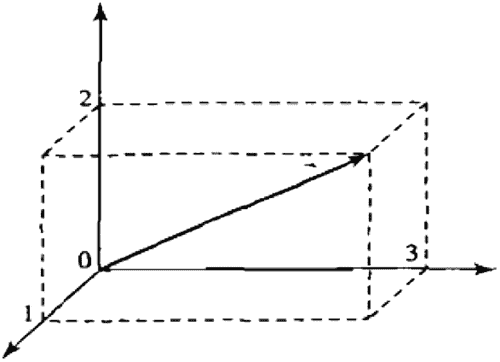

*图 2.10* 坐标为 3、2、1 (x, y, z) 的向量返回文本。⏎


请注意，向量的第一个元素 3 沿 `x`轴 绘制，第二个元素 (2) 沿 `y`轴 绘制，第三个元素 1 沿 `z`轴 绘制。由于向量被定义为空间中由其坐标确定的特定位置，在物理上下文中，向量通常被认为具有 *大小* 和 *方向*。

还值得注意的是，在 图 2.10 中对向量的绘制生成了一个新的几何对象，在本例中为 *长方体*。线性代数中的许多对象都有几何对应物。我们将在对行列式的综述中稍后回到这一点。

#### 2.36.1.4 向量加法和长度
只有相同维度的向量才能相加或相减。我们按元素逐个相加，

$$x + y = \\left\\lbrack \\begin{array}{l} x\_{1} \\\\ x\_{2} \\\\ {\\,\\, \\cdot} \\\\ x\_{n} \\\\ \\end{array} \\right\\rbrack + \\left\\lbrack \\begin{array}{l} y\_{1} \\\\ y\_{2} \\\\ {\\,\\, \\cdot} \\\\ y\_{n} \\\\ \\end{array} \\right\\rbrack = \\left\\lbrack \\begin{array}{l} {x\_{1} + y\_{1}} \\\\ {x\_{2} + y\_{2}} \\\\ {\\,\\,\\,\\,\\,\\,\\, \\cdot} \\\\ {x\_{n} + y\_{n}} \\\\ \\end{array} \\right\\rbrack$$

(2.91)

向量减法的类似操作也成立。向量的 *长度* 是平方项之和（或“components”）的平方根，

$$L\_{x} = \\sqrt{x\_{1}^{2} + x\_{2}^{2} + \\cdot \\cdot \\cdot + x\_{n}^{2}}$$

(2.92)

出于稍后会更清楚的原因，在许多情况下我们希望向量的长度为 1，这意味着平方和元素之和等于 1，即，123

$$L\_{x} = \\sqrt{x\_{1}^{2} + x\_{2}^{2} + \\cdot \\cdot \\cdot + x\_{n}^{2}} = 1$$

(2.93)

向量的长度也被称为 *欧几里得范数*，更一般地定义为该向量的 `l`[2] 范数，

$$\\begin{array}{l} \\left| \\middle| x \\middle| \\middle| {}\_{2} = \\sqrt{x\_{1}^{2} + x\_{2}^{2} + \\cdot \\cdot \\cdot + x\_{n}^{2}} \\right. \\\\ {\\,\\,\\,\\,\\,\\,\\,\\,\\,\\, = \\sqrt{\\sum\\limits\_{i = 1}^{n}x\_{i}^{2}}} \\\\ {\\,\\,\\,\\,\\,\\,\\,\\,\\,\\, = \\sqrt{x^{T}x}} \\\\ \\end{array}$$

(2.94)

其中 `x^(T)x` 是点积（稍后将回顾）。另一方面，`l`[1] 范数不是对平方求和，而是对 *绝对值* 求和，

$$\\left| \\middle| x \\middle| \\middle| {}\_{1} = {\\sum\\limits\_{i = 1}^{n}\\left| x\_{i} \\right|} \\right.$$

(2.95)

正如我们稍后会看到的，在诸如 *主成分分析* 等方法中，*特征向量* 通常会将其长度设置为（或 *受约束*）为 1。这主要是为了方便，使得分量所解释的方差不会仅仅作为其长度的函数而增长。将向量的长度设为 1 在许多其他统计方法中也是常见做法。现在重要的是，在许多这些程序中，最重要的是不是向量的实际长度，而是 *值之间的相对距离*。将向量“归一化”到单位长度不会破坏这些距离。也就是说，值之间的 *比率* 保持不变。

我们可以通过标量或常数 `c` 的乘法来拉长或缩短向量，如下所示，其中向量 `x`[1]、 `x`[2]、 `x`[3]、 ..., `x`[*n*] 的每个元素都乘以常数 `c`：

$$cx = \\left\\lbrack \\begin{array}{l} {cx\_{1}} \\\\ {cx\_{2}} \\\\ {cx\_{3}} \\\\ {\\,\\, \\cdot} \\\\ {cx\_{n}} \\\\ \\end{array} \\right\\rbrack$$

在 图 2.11 中，给出了一个将向量乘以常数 2 的例子，这会使向量变长（或“stretching”）。在同一幅图中，我们将向量乘以 ½（从原点开始），使其朝相反方向。

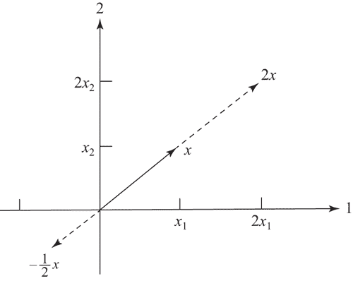

*图 2.11* 用常数 2 拉长或“stretching”向量并将向量乘以 ½。返回正文。⏎

在 R 中，我们可以轻松地相加两个向量：

```
> x <- c(0, 2, 5, 8, 10)
> y <- c(3, 6, 8, 10, 12)
> x + y
[1] 3 8 13 18 22
```

在 R 中乘以常数向量也很容易实现。例如，我们将分配 124

```
z = x + y and multiply by a constant c = 2:
```

```
> z = x + y
> 2*z
[1] 6 16 26 36 44
```

向量可以在 Python 中按如下方式相加：

```
import numpy
a = numpy.array([1, 2, 3])
b = numpy.array([4, 5, 6])
a + b
Out[7]: array([5, 7, 9])
```

我们可以轻松地通过以下方式将向量乘以常数：

```
x1 = np.array([1, 2, 3, 4])
x2 = 2 * x1
x2
Out[318]: array([2, 4, 6, 8])
```

#### 2.36.1.5 特征分析与分解
在这种抽象上下文中，常数乘法的想法似乎很平凡，但在多元设置中却非常重要，因为矩阵的许多变换都可以等同于向量的拉长。例如，在 *特征分析* 中，如我们稍后将看到的，矩阵与向量的乘积等同于通过常数乘法简单地拉长该向量，125

*A**x* = *λ**x*

(2.96)

其中 `A` 是某个矩阵，通常是协方差或相关矩阵，后乘以 `x`，即一个向量。该等式表明该乘积 `A x` 等于 `x` 被常数 `λ` 预乘。常数 `λ` 被称为该变换的 *特征值*，而 `x` 是相关的 *特征向量*。正如我们将看到的，特征向量仅在乘以常数方面是唯一的。许多看似复杂的 multivariate 方法以特征分析为核心，并体现了这种非常简单的将向量乘以常数的想法，在本例中该常数为变换的特征值。

为了解 `λ` 和 `x`，我们可以首先将 *A**x* = *λ**x* 重写为

(*A*−*λ**I*)*x* = 0

当我们将行列式设为 0 时，即 |*A*−*λ**I*|=0，我们就可以找到 `λ` 的值，然后求解 `x`。

例如，考虑以下矩阵以及在矩阵 `A` 上计算特征多项式以获得特征值：

$$\\left\\lbrack \\begin{array}{l} {3\\,\\,\\,\\,\\, 2\\,\\,\\,\\,\\, 1} \\\\ {1\\,\\,\\,\\,\\, 3\\,\\,\\,\\,\\, 2} \\\\ {1\\,\\,\\,\\,\\, 2\\,\\,\\,\\,\\, 3} \\\\ \\end{array} \\right\\rbrack$$

我们计算 |*A*−*λ**I*|：

$\\left| A - \\lambda I \\middle| = \\left\\lbrack \\begin{array}{l} {3\\,\\,\\,\\,\\, 2\\,\\,\\,\\,\\, 1} \\\\ {1\\,\\,\\,\\,\\, 3\\,\\,\\,\\,\\, 2} \\\\ {1\\,\\,\\,\\,\\, 2\\,\\,\\,\\,\\, 3} \\\\ \\end{array} \\right\\rbrack - \\left\\lbrack \\begin{array}{l} {\\lambda\\,\\,\\,\\,\\, 0\\,\\,\\,\\,\\, 0} \\\\ {0\\,\\,\\,\\,\\,\\lambda\\,\\,\\,\\,\\, 0} \\\\ {0\\,\\,\\,\\,\\, 0\\,\\,\\,\\,\\,\\lambda\\,\\,} \\\\ \\end{array} \\right\\rbrack = \\left\\lbrack \\begin{array}{l} {3 - \\lambda\\,\\,\\,\\,\\,\\,\\,\\,\\,\\, 2\\,\\,\\,\\,\\,\\,\\,\\,\\,\\,\\,\\,\\,\\, 1} \\\\ {\\,\\,\\, 1\\,\\,\\,\\,\\,\\,\\,\\,\\,\\,\\,\\, 3 - \\lambda\\,\\,\\,\\,\\,\\,\\,\\,\\, 2} \\\\ {\\,\\,\\, 1\\,\\,\\,\\,\\,\\,\\,\\,\\,\\,\\,\\,\\,\\,\\, 2\\,\\,\\,\\,\\,\\,\\,\\,\\,\\,\\, 3 - \\lambda\\,\\,} \\\\ \\end{array} \\right\\rbrack \\right.$ =  − (*λ*−6)(*λ*−2)(*λ*−1)

或以未因式分解的形式，仅仅是  − *λ*³ + 9*λ*² − 20*λ* + 12。相应的特征值为 6、2 和 1，因为它们是使 |*A*−*λ**I*|=0 成立的值。相应的特征向量，如读者可以验证，分别为 `v`[1] = (1,1,1)、 `v`[2] = (−3,1,1) 和 `v`[3] = (2,−3,2)。


读者可能会回忆起代数学基本定理指出 *每个次数为* `n` *的复系数多项式方程恰好有* `n` *个根在复数中*。该定理的证明通常归功于 高斯（1799）。如果一个数是非零多项式的根，且该多项式具有整数（或更一般地，*有理*）系数，则称该数为 *代数* 的。不是代数的数称为 *超越* 的。对于某些函数，求解方程的根并非易事。方程的根可以通过诸如 *牛顿法* 之类的技术进行 *近似*。更多细节请参阅 坦顿（2005） 和 哈伯德和哈伯德（2002）。

#### 2.36.1.6 点与向量
在离开向量这一主题之前，根据上述讨论和对向量的可视化，很容易得出向量不过是维空间中的一个点的结论。然而这是一种误解。*向量不等同于点*。点没有方向或大小，正如欧几里得曾经所说，“那没有宽度的东西” (坦顿, 2005)。126

区别在于，点通常表示空间中的 *位置*，而向量通常表示 *位移* 或 *增量*。点通常不会相互相加或相减，但向量经常会。哈伯德和哈伯德（2002, p. 37) 给出了两个点对应两个城市（例如波士顿和纽约）的例子，这样我们通常不会“相加”城市。然而，如果我们考虑从芝加哥到纽约的距离（即向量）和从纽约到波士顿的向量，那么将这些向量相加是有意义的。

## 2.37 矩阵
*矩阵* 是一个方形或矩形元素数组，可以被视为自身的一个对象，或者，有时最好将其视为向量的集合。正如向量一样，我们处理的矩阵都来自实数域。因此，如果 `A` 是一个矩阵，我们写 `A` ∈ ℝ^(m×n) 并用以下方式表示该矩阵

$$A = \\left\\lbrack \\begin{array}{l} {a\_{11}\\,\\,\\,\\,\\, a\_{12}\\,\\,\\,\\,\\, \\cdot \\cdot \\cdot \\,\\,\\,\\,\\, a\_{1n}} \\\\ {a\_{21}\\,\\,\\,\\,\\, a\_{22}\\,\\,\\,\\,\\, \\cdot \\cdot \\cdot \\,\\,\\,\\,\\, a\_{2n}} \\\\ {\\,\\, \\cdot \\,\\,\\,\\,\\,\\,\\,\\,\\,\\, \\cdot \\,\\,\\,\\,\\,\\,\\,\\,\\,\\,\\,\\,\\,\\,\\,\\,\\,\\,\\,\\, \\cdot} \\\\ {a\_{m1}\\,\\,\\,\\,\\, a\_{m2}\\,\\,\\,\\, \\cdot \\cdot \\cdot \\,\\,\\,\\, a\_{mn}} \\\\ \\end{array} \\right\\rbrack$$

矩阵的 *维数* 是 *行* 数乘以 *列* 数。如果有 `m` 行和 `n` 列，则矩阵的维数为 `m` x `n`。方阵有 `m` = `n`，即行数与列数相同。请注意，矩阵的维数与其实 *基* 的维数不是同一回事，后者是矩阵的最大线性无关行或列数的维度，将在后面讨论。我们注意到矩阵具有二维结构。如果将其增加到三维或更高，则该对象就成为 *张量* (墨菲，2022)。张量的研究远远超出了本书的范围。

在 R 中构建矩阵有几种方法。一种流行的方法是通过 `matrix()` 函数指定行数和列数：

```
> A <- matrix(data = c(1, 2, 3, 4, 5, 6), nrow = 2, ncol = 3, byrow=TRUE)
> A
```

|  || \[,1\] || \[,2\] || \[,3\] |

| --- | --- | --- | --- |

| \[1,\] || 1 || 2 || 3 |

| --- | --- | --- | --- |

| \[2,\] || 4 || 5 || 6 |

矩阵的维数由以下内容揭示，具有 2 行和 3 列 `(2 3)`：

```
> dim(A)
[1] 2 3
```

在 Python 中创建矩阵同样简单：

127

```
A = [[1, 4, 5],
[-5, 8, 9]]
A
Out[320]: [[1, 4, 5], [-5, 8, 9]]
```

请注意，在上述用 Python 构造的矩阵中（其中每一行都是一个 *列表*），`[[1, 4, 5], [-5, 8, 9]]` 对应于矩阵

$$\\left\\lbrack \\begin{array}{l} {\\,\\,\\,\\, 1\\,\\,\\,\\,\\, 4\\,\\,\\,\\,\\, 5} \\\\ {- 5\\,\\,\\,\\,\\, 8\\,\\,\\,\\,\\, 9} \\\\ \\end{array} \\right\\rbrack$$

稍后，当我们示例用于执行统计和机器学习应用的代码时，数据通常会按行出现，如上所示（即 `[[1, 4, 5], [-5, 8, 9]]`），但重要的是要意识到所传达的内容，这由上面的列表或矩阵所说明。如果数据只是单个行向量（或更一般地，列表），那么它将不使用内部方括号表示，如下所示：

```
[[1, 4, 5, -5, 8, 9]]
```

正如我们可以在 Python 中轻松验证的那样，

```
X = [[1, 4, 5, -5, 8, 9]]
X
Out[145]: [[1, 4, 5, -5, 8, 9]]
```

在 Python 中构建向量的更有效方法是使用 numpy：

```
import numpy as np
x = np.array([1, 4, 5, -5, 8, 9])
x
Out[125]: array([ 1, 4, 5, -5, 8, 9])
```

### 2.37.1 单位矩阵
*单位矩阵* 是一个在统计环境中多次出现的非常重要的 *方* 矩阵，其特征是主对角线上只有一系列“1”值，其余位置均为零。例如，考虑以下 3 × 3 单位矩阵：

$$I\_{3} = \\left\\lbrack \\begin{array}{l} {1\\,\\,\\,\\,\\,\\, 0\\,\\,\\,\\,\\,\\, 0} \\\\ {0\\,\\,\\,\\,\\,\\, 1\\,\\,\\,\\,\\,\\, 0} \\\\ {0\\,\\,\\,\\,\\,\\, 0\\,\\,\\,\\,\\,\\, 1} \\\\ \\end{array} \\right\\rbrack$$

其中 `I[3]` 表示具有 3 行和 3 列的矩阵。更一般地，单位矩阵 `I[n]` 有 `n` 行和 `n` 列。*零矩阵* 是矩阵中所有条目值均为 0 的矩阵。128

涉及单位矩阵的一个基本结果包括 `I A = A I`，其中 `A` 是与 `I` 维度相同的矩阵。

单位矩阵可以通过以下方式使用 `diag()` 函数在 R 中轻松构建：

```
> A <- diag(x = 5)
> A
```

|  || \[,1\] || \[,2\] || \[,3\] || \[,4\] || \[,5\] |

| --- | --- | --- | --- | --- | --- |

| \[1,\] || 1 || 0 || 0 || 0 || 0 |

| --- | --- | --- | --- | --- | --- |

| \[2,\] || 0 || 1 || 0 || 0 || 0 |

| \[3,\] || 0 || 0 || 1 || 0 || 0 |

| \[4,\] || 0 || 0 || 0 || 1 || 0 |

| \[5,\] || 0 || 0 || 0 || 0 || 1 |

在 Python 中，我们可以通过以下方式创建单位矩阵：

```
np.identity(5)
Out[321]:
array([[1., 0., 0., 0., 0.],
  [0., 1., 0., 0., 0.],
  [0., 0., 1., 0., 0.],
  [0., 0., 0., 1., 0.],
  [0., 0., 0., 0., 1.]])
```

### 2.37.2 矩阵的转置
矩阵的转置类似于向量的转置，我们用以下方式表示

`A^(T)` or `A'`

例如，再次考虑以下方阵 `A`：

$$A = \\left\\lbrack \\begin{array}{l} {a\_{11}\\,\\,\\,\\,\\, a\_{12}} \\\\ {a\_{21}\\,\\,\\,\\,\\, a\_{22}} \\\\ \\end{array} \\right\\rbrack$$

我们通过交换第一行与第一列、第二行与第二列来得到转置：

$$A^{T} = \\left\\lbrack \\begin{array}{l} {a\_{11}\\,\\,\\,\\,\\, a\_{21}} \\\\ {a\_{12}\\,\\,\\,\\,\\, a\_{22}} \\\\ \\end{array} \\right\\rbrack$$

我们通过 `t()` 在 R 中得到矩阵的转置：

```
> A <- matrix(data = c(1, 2, 3, 4, 5, 6), nrow = 2, ncol = 3, byrow=TRUE)
> A
```

|  || \[,1\] || \[,2\] || \[,3\] |

| --- | --- | --- | --- |

| \[1,\] || 1 || 2 || 3 |

| --- | --- | --- | --- |

| \[2,\] || 4 || 5 || 6 |

```
> t(A)
```

|  || \[,1\] || \[,2\] |

| --- | --- | --- |

| \[1,\] || 1 || 4 |

| --- | --- | --- |

| \[2,\] || 2 || 5 |

| \[3,\] || 3 || 6 |

在 Python 中，获得转置的方法有很多，例如以下：

```
import numpy as np
matrix = np.array([[1, 2, 3], [4, 5, 6]])
transposed_matrix = np.transpose(matrix)
print(transposed_matrix)
[[1 4]
[2 5]
[3 6]]
```

### 2.37.3 对称矩阵


对称矩阵在线性代数中具有根本重要性，因而也在统计学中构成了一组重要矩阵。 对称矩阵是指其 *矩阵的转置等于原始矩阵* 的矩阵。 也就是说，对称矩阵是指满足 `A` = `A`^(`T`) 的矩阵。 对称矩阵具有许多理想的性质，包括对称矩阵的逆也是对称的这一事实。 此外，如果矩阵不对称，则无法保证其特征向量正交。 因此，当我们在本书的上下文中谈论特征向量通常正交时，通常意味着我们正在处理对称矩阵。

统计学中两类非常重要的对称矩阵是 *协方差* 和 *相关* 矩阵，我们在对基本概率和统计的概述中已讨论过它们。

### 2.37.4 矩阵加法与乘法

对于任意两个相同维度的矩阵，与向量情况相同，我们按元素逐个相加和相减矩阵。 考虑以下两个矩阵 `A` 和 `B`，每个的维度均为 `m` × `n`：

$$A = \\left\\lbrack \\begin{array}{l} {a\_{11}\\,\\,\\,\\,\\, a\_{12}\\,\\,\\,\\,\\, \\cdot \\cdot \\cdot \\,\\,\\,\\,\\, a\_{1n}} \\\\ {a\_{21}\\,\\,\\,\\,\\, a\_{22}\\,\\,\\,\\,\\, \\cdot \\cdot \\cdot \\,\\,\\,\\,\\, a\_{2n}} \\\\ {\\,\\, \\cdot \\,\\,\\,\\,\\,\\,\\,\\,\\,\\, \\cdot \\,\\,\\,\\,\\,\\,\\,\\,\\,\\,\\,\\,\\,\\,\\,\\,\\,\\,\\,\\, \\cdot} \\\\ {a\_{m1}\\,\\,\\,\\,\\, a\_{m2}\\,\\,\\,\\, \\cdot \\cdot \\cdot \\,\\,\\,\\, a\_{mn}} \\\\ \\end{array} \\right\\rbrack\\,\\,\\,\\,\\, B = \\left\\lbrack \\begin{array}{l} {b\_{11}\\,\\,\\,\\,\\, b\_{12}\\,\\,\\,\\,\\, \\cdot \\cdot \\cdot \\,\\,\\,\\,\\, b\_{1n}} \\\\ {b\_{21}\\,\\,\\,\\,\\, b\_{22}\\,\\,\\,\\,\\, \\cdot \\cdot \\cdot \\,\\,\\,\\,\\, b\_{2n}} \\\\ {\\,\\, \\cdot \\,\\,\\,\\,\\,\\,\\,\\,\\,\\, \\cdot \\,\\,\\,\\,\\,\\,\\,\\,\\,\\,\\,\\,\\,\\,\\,\\,\\,\\,\\,\\, \\cdot} \\\\ {b\_{m1}\\,\\,\\,\\,\\, b\_{m2}\\,\\,\\,\\, \\cdot \\cdot \\cdot \\,\\,\\,\\, b\_{mn}} \\\\ \\end{array} \\right\\rbrack\\,$$

矩阵 `A` 和 `B` 的加法按元素逐个进行：130

$$A + B = \\left\\lbrack \\begin{array}{l} {a\_{11} + b\_{11}\\,\\,\\,\\,\\, a\_{12} + b\_{12}\\,\\,\\,\\,\\, \\cdot \\cdot \\cdot \\,\\,\\,\\,\\, a\_{1n} + b\_{1n}} \\\\ {a\_{21} + b\_{21}\\,\\,\\,\\,\\, a\_{22} + b\_{22}\\,\\,\\,\\,\\, \\cdot \\cdot \\cdot \\,\\,\\,\\,\\, a\_{2n} + b\_{2n}} \\\\ {\\,\\, \\cdot \\,\\,\\,\\,\\,\\,\\,\\,\\,\\, \\cdot \\,\\,\\,\\,\\,\\,\\,\\,\\,\\,\\,\\,\\,\\,\\,\\,\\,\\,\\,\\, \\cdot} \\\\ {a\_{m1} + b\_{m1}\\,\\,\\,\\,\\, a\_{m2} + b\_{m2}\\,\\,\\,\\, \\cdot \\cdot \\cdot \\,\\,\\,\\, a\_{mn} + b\_{mn}} \\\\ \\end{array} \\right\\rbrack$$

请注意，矩阵加法是 *可交换的*，使得 `A` + `B` = `B` + `A`。 请注意，这与标量代数相平行，其中对于两个数 `a` + `b` = `b` + `a`。 它也是结合的，这意味着对于矩阵 `A`、`B`、`C`，(`A`+`B`) + `C` = `A` + (`B`+`C`)。

我们在 Python 中按如下方式相加矩阵：

```
a
Out[330]:
array([[1, 2, 3],
  [4, 5, 6]])
b
Out[331]:
array([[1, 2, 3],
  [4, 5, 6]])
a + b
Out[332]:
array([[ 2, 4, 6],
  [ 8, 10, 12]])
```

要相乘矩阵 `A` `B`，我们沿第一行向下第一列计算，然后第一行第二列，等等，然后第二行第一列，然后第二行第二列，依此类推，如以下示例所示（Fox, 2016）：

$$\\begin{array}{l} {\\left\\lbrack \\begin{array}{lll} & \\Rightarrow & \\\\ 1 & 2 & 3 \\\\ 4 & 5 & 6 \\\\ \\end{array} \\right\\rbrack\\left\\lbrack \\begin{array}{llll} & 1 & 0 & 0 \\\\ \\Downarrow & 0 & 1 & 0 \\\\ & 0 & 0 & 1 \\\\ \\end{array} \\right\\rbrack} \\\\ {\\,\\,\\,\\,\\,\\,\\left( {2 \\times 3} \\right)\\,\\,\\,\\,\\,\\,\\,\\,\\,\\,\\,\\,\\,\\,\\,\\,\\left( {3 \\times 3} \\right)} \\\\ {\\,\\,\\,\\,\\,\\,\\,\\, = \\left\\lbrack \\begin{array}{lll} {1\\left\\lbrack 1 \\right\\rbrack + 2\\left\\lbrack 0 \\right\\rbrack + 3\\left\\lbrack 0 \\right\\rbrack,} & {1\\left\\lbrack 0 \\right\\rbrack + 2\\left\\lbrack 1 \\right\\rbrack + 3\\left\\lbrack 0 \\right\\rbrack,} & {1\\left\\lbrack 0 \\right\\rbrack + 2\\left\\lbrack 0 \\right\\rbrack + 3\\left\\lbrack 1 \\right\\rbrack} \\\\ {4\\left\\lbrack 1 \\right\\rbrack + 5\\left\\lbrack 0 \\right\\rbrack + 6\\left\\lbrack 0 \\right\\rbrack} & {4\\left\\lbrack 0 \\right\\rbrack + 5\\left\\lbrack 1 \\right\\rbrack + 6\\left\\lbrack 0 \\right\\rbrack} & {4\\left\\lbrack 0 \\right\\rbrack + 5\\left\\lbrack 0 \\right\\rbrack + 6\\left\\lbrack 1 \\right\\rbrack} \\\\ \\end{array} \\right\\rbrack} \\\\ {\\,\\,\\,\\,\\,\\,\\,\\, = \\left\\lbrack \\begin{array}{lll} 1 & 2 & 3 \\\\ 4 & 5 & 6 \\\\ \\end{array} \\right\\rbrack} \\\\ \\end{array}$$

回想一下，在基础代数中标量乘法中，`a` ⋅ `b` 得到的乘积与 `b` ⋅ `a` 相同。 然而，对于矩阵，`A` `B` 在大多数情况下不等于 `B` `A`。 也就是说，`A` `B` ≠ `B` `A`，这意味着与标量加法和减法相反，*矩阵乘法通常不是可交换的*。 也就是说，矩阵的乘法是 *非交换的*。 更重要的是，并非任意两个矩阵都可以相乘。 为了使矩阵适合相乘，第一个（左）矩阵的 *列* 数必须等于第二个（右）矩阵的 *行* 数。 有关矩阵乘法为何如此的直觉，请参阅 Fox (2016)。

### 2.37.5 矩阵的含义：矩阵作为数据和变换

首先，矩阵本身就是数学对象。 矩阵的数学处理实际上相当新近，其现代起源可追溯到 1800 年代。 当你想到这一点时，要意识到在数学史上，这几乎就像说矩阵的现代概念是 *昨天* 才发明的，因为数学史如此悠久。 在纯 131 数学中，矩阵是为其自身而研究的。 对于应用读者来说，理解为何要为其自身目的而研究它们可能具有挑战性，但这正是激励纯数学家（和哲学家）的东西：对抽象（但远非任意）对象的研究。

在更应用的背景下，矩阵通常用于表示两个思想。 第一个是 *变换*；第二个是 *数据*。 变换思想更接近纯线性代数，而数据思想更接近统计学。 事实上，可以证明任何矩阵都对应于一个线性变换，使得

`T`(`v`) = `A` `v`

(2.97)

其中 `T` 是从 ℝ^(`n`) 到 ℝ^(`m`) 的映射，`v` 是向量，`A` 是矩阵。 上述内容读作：对向量 `v` 的线性变换等价于用矩阵 `A` 预乘该向量。 在更简单的情况下，理论上 `v` 不是向量而是标量 `b`（或仅有一个元素的向量），那么我们将有，

`T`(`b`) = `A` `b`

这与向量情况相同，表明为了（线性地）变换标量 `b`，我们将其乘以矩阵 `A`。 如果 `A` 是一个非常简单的矩阵，比如只有一个元素，以至于我们也可以简单地称其为标量，那么上述内容简化为

`T`(`b`) = `a` `b`

也就是说，为了线性变换 `b`，我们将其乘以标量 `a`。

为了理解第二个解释，即矩阵作为 *数据矩阵*，请考虑以下矩阵，`A`：


$$A = \\left\\lbrack \\begin{array}{l} {a\_{11}\\,\\,\\,\\,\\, a\_{12}\\,\\,\\,\\,\\, \\cdot \\cdot \\cdot \\,\\,\\,\\,\\, a\_{1n}} \\\\ {a\_{21}\\,\\,\\,\\,\\, a\_{22}\\,\\,\\,\\,\\, \\cdot \\cdot \\cdot \\,\\,\\,\\,\\, a\_{2n}} \\\\ {\\,\\, \\cdot \\,\\,\\,\\,\\,\\,\\,\\,\\,\\, \\cdot \\,\\,\\,\\,\\,\\,\\,\\,\\,\\,\\,\\,\\,\\,\\,\\,\\,\\,\\,\\, \\cdot} \\\\ {a\_{m1}\\,\\,\\,\\,\\, a\_{m2}\\,\\,\\,\\, \\cdot \\cdot \\cdot \\,\\,\\,\\, a\_{mn}} \\\\ \\end{array} \\right\\rbrack = \\left\\lbrack \\begin{array}{l} x\_{1}^{'} \\\\ x\_{2}^{'} \\\\ {\\,\\, \\cdot} \\\\ {\\,\\, \\cdot} \\\\ x\_{n}^{'} \\\\ \\end{array} \\right\\rbrack$$
上述矩阵的每一列可能代表一个变量，例如 IQ、GPA 等，其中等号右侧为相应的变量 `x[1]'` 到 `x[n]'`，其中 ’ 表示转置。线性代数和矩阵代数很大程度上是对不同类型矩阵的研究以及它们在各种条件下的行为。我们将在本书中看到矩阵“在工作”。我们在此处和本书中介绍的矩阵，相对而言非常小。实际上，矩阵可以有成千上万甚至数百万行和列。事实上，在“大数据”时代，矩阵可能大到足以挑战现代计算能力的极限。

### 2.37.6 核（零空间）
线性变换的核或零空间是满足 `T(x) = 0` 的向量集合。例如，向量 `x132`
$$\\left\\lbrack \\begin{array}{l} {- 2} \\\\ {- 1} \\\\ {\\,\\,\\, 3} \\\\ \\end{array} \\right\\rbrack$$
是 $\\left\\lbrack \\begin{array}{l} {1\\,\\,\\,\\,\\,\\,\\,\\,\\, 1\\,\\,\\,\\,\\,\\,\\,\\,\\, 1} \\\\ {2\\,\\,\\,\\, - 1\\,\\,\\,\\,\\,\\,\\,\\,\\, 1} \\\\ \\end{array} \\right\\rbrack$ 的核或零空间中的向量，因为 $\\left\\lbrack \\begin{array}{l} {1\\,\\,\\,\\,\\,\\,\\,\\,\\, 1\\,\\,\\,\\,\\,\\,\\,\\,\\, 1} \\\\ {2\\,\\,\\,\\, - 1\\,\\,\\,\\,\\,\\,\\,\\,\\, 1} \\\\ \\end{array} \\right\\rbrack\\left\\lbrack \\begin{array}{l} {- 2} \\\\ {- 1} \\\\ {\\,\\,\\, 3} \\\\ \\end{array} \\right\\rbrack = \\left\\lbrack \\begin{array}{l} 0 \\\\ 0 \\\\ \\end{array} \\right\\rbrack$。也就是说，`T(x) = 0`。用文字来说，线性变换的核是映射该变换为零的向量集合。

### 2.37.7 矩阵的迹
矩阵 `A` 的迹，用 `tr(A)` 表示，是主对角线上元素的总和：
$$\\text{tr}\\left( A \\right) = {\\sum\\limits\_{i = 1}^{n}a\_{ii}}$$
(2.98)
其中 `a[ii]` 表示主对角线上的值。迹仅存在于方阵中。迹的性质包括以下内容：
$$\\begin{array}{l} {\\,\\,\\,\\,\\,\\,\\,\\,\\text{tr}\\left( A \\right) = \\text{tr}\\left( A^{T} \\right)} \\\\ {\\text{tr}\\left( A + B \\right) = \\text{tr}\\left( A \\right) + \\text{tr}\\left( B \\right)} \\\\ {\\,\\,\\,\\,\\,\\text{tr}\\left( {AB} \\right) = tr\\left( {BA} \\right)} \\\\ \\end{array}$$
矩阵乘以常数 `c` 的迹也等于该常数乘以矩阵的迹，我们写成，
`tr(cA) = c tr(A)`
所有这些关系都可以由读者轻松验证。迹在多元统计中发挥着重要作用。例如，有时我们只对矩阵主对角线上的值感兴趣，例如当我们希望仅考虑协方差矩阵中的方差而忽略非对角线上的协方差时。与其说“对矩阵的所有对角线条目求和以得到总方差”，我们只需说“计算矩阵的迹”。例如，在本书后面讨论多元检验统计量时，迹将被提及。
在 R 中，矩阵的迹可以通过 `sum(diag())` 得到。在 Python 中，`numpy()` 中的 `matrix.trace()` 将生成迹。

## 2.38 线性组合
如果有一个数学元素或对象几乎普遍存在于统计学和机器学习中，那就是线性组合，其定义非常简单，如 133
`l[i] = a[1]y[1] + a[2]y[2] + ... + a[p]y[p]`
(2.99)
以上非常通用。通常在统计学中我们会看到使用不同标识符的线性组合。我们使用符号 "`l[i]`" 表示“线性组合”。我们可以看出，线性组合实际上是乘积之和，`a[1]y[1]` 到 `a[p]y[p]`，取决于我们求和的变量数量。在求和中，`a[1]` 到 `a[p]` 是标量，通常是实数。我们可以看出，每个变量 `y[1]` 到 `y[p]` 都被给定的标量“加权”。我们在这里的第一印象可能是，权重更大的变量在某种意义上比权重更小的变量更“重要”。
我们在统计学和机器学习中在哪里看到线性组合？无处不在！例如，正如读者一定已经认识到的那样，回想一下简单线性回归模型，
`y[i] = β[0] + β[1]x[1] + ε`
(2.100)
我们可以看出，以上不过是一个线性组合，由截距 `β[0]` 组成，它是一个常数标量，以及一个由标量 `β[1]` 加权的变量 `x[1]`，然后加上误差项 `ε`。
线性组合在 ANOVA 型模型中也随处使用。考虑以下总体均值之间的线性组合，
$$C\_{i} = c\_{1}\\mu\_{1} + c\_{2}\\mu\_{2} + \\cdot \\cdot \\cdot + c\_{J}\\mu\_{J} = {\\sum\\limits\_{j = 1}^{J}{c\_{j}\\mu\_{j}}}$$
(2.101)
当我们施加权重 `c[1]` 到 `c[J]` 必须求和为 0 的约束时，线性组合变为线性对比，即
$$\\sum\\limits\_{j = 1}^{J}{c\_{j} = 0}$$
(2.102)
我们在统计学中看到线性组合的另一个地方是在主成分分析，或简称为“PCA”。事实上，主成分是一种如下的线性组合，
`y[i] = a[1]x[1] + a[2]x[2] + ... + a[p]x[p]`
正如我们将在本书后面看到的那样，系数 `a[1]` 到 `a[p]` 将是用于获得成分而进行的特征分解得到的特征向量的值，而 `x[1]` 到 `x[p]` 将是 PCA 所执行的变量。
一组向量的张成空间是向量空间中由这些向量的所有线性组合构成的向量集合，而一组向量的基是张成该空间的线性无关向量的数量，这意味着在空间中的所有向量中，基是本质上可以生成该空间的最小向量数。向量空间中通常有很多向量，但基向量是那些可以生成所有其他“不太重要”向量的向量。这就是为什么基向量如此重要。基向量本质上是向量空间的“老板”。
线性组合也在 `boosting` 的委员会机器中出现，其中通过标量对分类器进行加权，从一系列弱学习器中生成更强的学习器。我们将在本书后面介绍 boosting 的讨论。134

## 2.39 行列式
行列式在线性代数和统计学中发挥着核心作用。行列式仅对方阵定义。虽然行列式可以计算越来越大的矩阵，但它们最容易通过小矩阵来演示。例如，2 × 2 矩阵 `A` 的行列式可以很容易地计算如下：
$$\\begin{array}{l} \\left| A \\middle| = \\left\\lbrack \\begin{array}{l} {a\_{11}\\,\\,\\,\\,\\, a\_{12}} \\\\ {a\_{21}\\,\\,\\,\\,\\, a\_{22}} \\\\ \\end{array} \\right\\rbrack \\right. \\\\ {\\,\\,\\,\\,\\,\\,\\, = a\_{11}a\_{22} - a\_{12}a\_{21}} \\\\ \\end{array}$$
(2.103)


When would such a computation be useful in statistics? We note immediately that through the subtraction of the product `a[12]*a[21]`, the determinant becomes useful for matrices such as the covariance matrix in which we wish to consider variances in the product `a[11]*a[22]` but then subtract out the product of covariances in `a[12]*a[21]`. In the case where covariances are equal to 0, it follows that the determinant is computed simply as

`a[11]*a[22] - a[12]*a[21] = a[11]*a[22] - 0 = a[11]*a[22]`

As we will see shortly, this is one reason why the determinant is an ideal measure for constructing an overall “generalized” version of variance in a covariance matrix.

For 3 × 3 matrices and beyond, the computation of the determinant becomes increasingly unwieldy and is, not surprisingly, best left to a computer (even very higher-order determinant calculations can be time-consuming for computers). Still, there is intuition that can be gleamed from computing a determinant for a 3 × 3 matrix (we leave it to the reader to extract the algorithm):

$$\\begin{array}{l} \\left| A \\middle| = \\left\\lbrack \\begin{array}{l} {a\_{11}\\,\\,\\,\\,\\, a\_{12}\\,\\,\\,\\, a\_{13}} \\\\ {a\_{21}\\,\\,\\,\\,\\, a\_{22}\\,\\,\\,\\, a\_{23}} \\\\ {a\_{31}\\,\\,\\,\\,\\, a\_{32}\\,\\,\\,\\, a\_{33}} \\\\ \\end{array} \\right\\rbrack \\right. \\\\ {\\,\\,\\,\\,\\,\\,\\, = a\_{11}\\det\\left\\lbrack \\begin{array}{l} {a\_{22}\\,\\,\\,\\, a\_{23}} \\\\ {a\_{32}\\,\\,\\,\\,\\, a\_{33}} \\\\ \\end{array} \\right\\rbrack\\left( - 1 \\right)2 + a\_{12}\\det\\left\\lbrack \\begin{array}{l} {a\_{21}\\,\\,\\,\\, a\_{23}} \\\\ {a\_{31}\\,\\,\\,\\,\\, a\_{33}} \\\\ \\end{array} \\right\\rbrack + \\left( - 1 \\right)3 + a\_{13}\\det\\left\\lbrack \\begin{array}{l} {a\_{21}\\,\\,\\,\\, a\_{22}} \\\\ {a\_{31}\\,\\,\\,\\,\\, a\_{32}} \\\\ \\end{array} \\right\\rbrack\\left( - 1 \\right)4} \\\\ \\end{array}$$

(2.104)

Geometrically, we can also easily visualize the determinant in this case as the subtraction of shapes (areas). For example, consider the matrix `A` defined as

$$A = \\left\\lbrack \\begin{array}{l} {3\\,\\,\\,\\,\\, 2} \\\\ {1\\,\\,\\,\\,\\, 3} \\\\ \\end{array} \\right\\rbrack$$

The determinant of `A` is equal to (3)(3) – (2)(1) = 7. As described in Young (2023) and shown in 图 2.12, this subtraction can be visualized as the subtraction of corresponding areas (i.e., the larger area (3)(3) minus the smaller (2)(1)).135


*图 2.12* 行列式作为面积的减法。对于此矩阵，较小的面积 (2) 被从较大的 (9) 中减去。返回正文.⏎

图 2.12 is for the 2 × 2 case and hence the measure of *面积* is suitable for geometrical representation. In matrices of 3 × 3 or greater, we shall require a measure of *体积*, and hence, for the general case, we will typically speak of the *体积* of a matrix instead of that of area. From this geometrical interpretation, we see then that *行列式是矩阵体积增加或减少的因子*. A determinant equal to 0 corresponds to a *平行四边形* (in the 2 × 2 case) having zero area or *平行六面体* (in the 3 × 3 or higher case) having zero volume (Young, 2023). As an example, consider the 3 × 3 matrix in 图 2.13 with corresponding drawn parallelepiped.


*图 2.13* 行列式（因此体积）等于 0 的平行六面体。返回正文.⏎

We see that the parallelepiped has collapsed upon itself and contains no volume since the determinant of the corresponding matrix is equal to 0. These notions of area and volume are not of terrible interest in this abstract sense but will be very useful as we consider statistical measures that feature determinants later in the book. Certainly, in virtually every multivariate method, one will find determinants somewhere.

A few of the many properties of these measures have been established, which include the following: |`A`| = |`A`^(`T`) |, |`c`*`A`| = `c`^(`n`) |`A`| , |`A`*`B`| = |`A`| |`B`| . A determinant equal to 0 implies the matrix is not invertible, which means the matrix is *奇异的*. This has consequences for statistical procedures (such as regression) that typically require an inverse. The matrix is called *非奇异* if it is invertible and hence |`A`| ≠ 0. Determinants also have numerous relationships with other objects in linear algebra. For instance, the determinant of a *可对角化矩阵* is equal to the product of its eigenvalues, where diagonalizing a matrix, in this context, means transforming the matrix such 136that the values along the main diagonal are the eigenvalues of the matrix and all other values are equal to 0. More generally, a diagonal matrix is a matrix such that all entries off the main diagonal are equal to 0. Hence, a matrix with eigenvalues down its main diagonal and all other values in the matrix equal to 0 is a diagonal matrix.

Matrix decompositions include the *LR decomposition*, *Cholesky decomposition*, and *QR decomposition*, which are also used as efficient methods for computing determinants. For details, see Strang (1993).

Determinants in R can be easily computed. For example, the following computes the determinant of an identity matrix:

```
> A <- diag(x = 5)
> det(A)
[1] 1
```

In Python, we can compute the determinant of a matrix using `numpy()`:

```
import numpy as np
a = np.array([[1, 2], [3, 4]])
```

$$\\left\\lbrack \\begin{array}{l} {1\\,\\,\\,\\,\\,\\, 2} \\\\ {3\\,\\,\\,\\,\\,\\, 4} \\\\ \\end{array} \\right\\rbrack = 4 - 6 = - 2$$

```
np.linalg.det(a)
Out[336]: -2.0000000000000004
```

## 2.40 Means and Variances of Matrices

Recall that the goal of statistical inference is largely to estimate parameters. In a univariate context, we often wish to estimate the population mean, `μ`. A good estimator of `μ` is that of the sample mean, $\\overline{y}$, since recall that $\\overline{y}$ is an unbiased estimator of `μ`. That is, the expectation, `E`, of $\\overline{y}$ is that of `μ`, $E\\left( \\overline{y} \\right) = \\mu$. Likewise, we saw that `E(s²) = σ²`.

Vectors and matrices are simply larger objects than these comparative univariate counterparts, and hence it makes sense that we should want to estimate means and variances on these objects as well. Not surprisingly, the expectation of a mean vector, $\\overline{X}$, is that of a population vector, `μ`, and we write

$$E\\left( \\overline{X} \\right) = \\mu$$

(2.105)

However, contrary to simply estimating a variance, `s²` as we did in the univariate case, in the multivariate case we not only have variances, but also *协方差*. The variances and covariances you will recall are packaged up in the covariance matrix, `Σ`. As usual, we typically do not have the population covariance matrix at our disposal and need to estimate it. An unbiased estimator of `Σ` can be obtained as a function of the sample covariance matrix, `S[n]`:

$$E\\left( {\\frac{n}{n - 1}S\_{n}} \\right) = \\Sigma$$

(2.106)

It can easily be shown that the bias of the estimator, `S[n]`, is equal to  − (1/`n`)`Σ` (Johnson and Wichern, 2007, p. 121).137

## 2.41 Determinant as a Generalized Variance


由于协方差矩阵同时包含了方差和协方差，我们可以建立一个与单变量情形平行的广义方差版本。在多元设定中，常用来表示广义方差的度量是协方差矩阵的行列式，`|S|`。关于广义方差的可视化，参见 Johnson 和 Wichern（2007，第 125 页）。

应强调 `|S|` 仅提供方差的度量，并且与单变量情形中的 `s²` 一样，本身并不能提供关于数据模式或方向的任何信息。也就是说，在没有可视化的情况下，报告 `|S|` 只是让我们感受到空间的体积；它本身并不能告诉我们数据中哪些方向最为突出或被强调。这并不令人惊讶，因为正如前面提到的，单变量方差 `s²` 的报告本身也无法提供关于数据对象或点之间特定距离的信息；它只提供了这些（平方）距离的平均值。广义方差 `|S|=0` 意味着整个空间坍缩到自身，对应的体积等于 0。体积大于零由 `|S|>0` 表示。

除了协方差矩阵的行列式之外，我们还可以将总方差构想为主对角线上的单变量方差之和，

`s²[11] + s²[22] + ... + s²[pp]`

其中 `s²[11]` 直到 `s²[pp]` 是相应协方差矩阵中的方差。更简洁地说，这个版本的方差只是协方差矩阵的迹。请注意，这种解释不包括协方差，因此与广义方差 `|S|` 的精神相同，并不是真正的“多元”方差度量。

## 2.42 矩阵逆

矩阵的逆在矩阵代数中发挥着基本作用，并且与普通标量代数中逆的概念相平行。为了理解逆是什么，请考虑标量代数中的一个简单例子。数字 6 的逆是与 6 相乘后等于 1 的那个数字。当然，这个数字是 ⅙，因为 ⅙ 乘以 6 得到 1。

该概念在矩阵代数中是类似的。矩阵 `A` 的逆是满足 `A A^{-1} = I` 的矩阵 `A^{-1}`。对于两个矩阵 `B` 和 `A`，如果 `B A = I`，则 `B` 称为 `A` 的左逆。对于另一个矩阵 `C`，如果 `A C = I`，则 `C` 是 `A` 的右逆。可逆矩阵同时具有右逆和左逆（它们是相同的），因此在本书记述中，每当我们谈论矩阵的逆时，左逆与右逆之间的区别无关紧要。在本书中，矩阵的逆就是唯一且唯一的逆。

在数值线性代数中计算逆是“大生意”，一些数学家花费了大量时间来开发新的、更好的近似逆的算法。值得庆幸的是，对于简单矩阵，计算逆相对容易且直接。例如，考虑一般矩阵 `A`：

$$A = \\left\\lbrack \\begin{array}{l} {a\_{11}\\,\\,\\,\\,\\, a\_{12}} \\\\ {a\_{21}\\,\\,\\,\\,\\, a\_{22}} \\\\ \\end{array} \\right\\rbrack$$

`A` 的逆等于 138

$$A^{- 1} = \\frac{1}{a\_{11}a\_{22} - a\_{12}a\_{21}}\\left\\lbrack \\begin{array}{l} {a\_{22}\\,\\,\\,\\,\\, - a\_{12}} \\\\ {- a\_{21}\\,\\,\\,\\,\\, a\_{11}} \\\\ \\end{array} \\right\\rbrack$$

(2.107)

矩阵的逆存在的唯一条件是该矩阵的行列式不等于 0。如果行列式等于 0，则逆不存在。因此，对于上面简单的平方 2 × 2 矩阵 `A`，我们要求

$$\\begin{array}{l} {A = \\left\\lbrack \\begin{array}{l} {a\_{11}\\,\\,\\,\\,\\, a\_{12}} \\\\ {a\_{21}\\,\\,\\,\\,\\, a\_{22}} \\\\ \\end{array} \\right\\rbrack} \\\\ {\\,\\,\\,\\,\\, = a\_{11}a\_{22} - a\_{12}a\_{21} \\neq 0} \\\\ \\end{array}$$

逆矩阵的性质有很多。其中一些更重要的如下：

`(A^{-1})^{-1} = A`，矩阵的逆的逆是原矩阵。这与我们在简单标量代数中期望的一致，因为 1/`a` 的逆等于 `a`，因此 1/`a` 的逆的逆是 1/`a`。

`(A^{T})^{-1} = (A^{-1})^{T}`，转置的逆等于逆的转置。

`(A B)^{-1} = B^{-1} A^{-1}`，乘积的逆等于逆的乘积且顺序相反。

`|A^{-1}| = 1/|A|`，逆的行列式等于行列式的倒数。

在 R 中，我们可以通过函数 `solve()` 得到逆。例如，如果 `A` 是方阵，则逆计算为 `solve(A)`。在 Python 中，我们可以使用 `numpy.linalg.inv()` 计算逆：

```
a = np.array([[1, 2], [3, 4]])
np.linalg.inv(a)
Out[337]:
array([[-2. , 1. ],
[ 1.5, -0.5]])
```

如果 `A^{-1}` 不存在，例如对于矩形矩阵，可以使用一种称为 Moore-Penrose 逆的伪逆。详情请参见 Rencher 和 Christensen (2012)。

### 2.42.1 逆不存在与奇异性

为强调前面已经提到的一点，就我们的目的而言，逆的最重要性质（或“后果”）是，如果矩阵的逆不存在，则意味着该矩阵的行列式等于 0，因而被视为奇异。因此，在统计学中，矩阵不可逆通常是一个“大事”。另一个后果是，不可逆矩阵也意味着矩阵内部存在依赖性；也就是说，并非所有行和列都是线性无关的。我们稍后会讨论线性独立性和依赖性。简而言之，目前，奇异且具有线性相关列或行，甚至接近相关的矩阵在统计上通常被视为病态且不“表现良好”。不可逆矩阵在进行统计分析时会带来很多问题。139

## 2.43 二次型

二次型只不过是所有项（而不仅仅是部分项）均为二度的多项式。二次型的例子是 `y = x[]² + z[]²`。下面的多项式 `y = x[1] x[2] x[3]` 不是二次型，因为它涉及三次形式（Hubbard 和 Hubbard, 2002）。在向量和矩阵中，正如我们即将详细阐述的那样，一个重要的二次型是 `x' A x`，对于它，如果对所有向量 `x ≠ 0` 都有 `x' A x > 0`，则表明 `A`（对称）是正定的。我们将在本书中以一种或另一种方式遇到二次型，主要是隐式地且“在幕后”。

## 2.44 正定矩阵

参考上面二次型的矩阵表示 `x' A x`，不难看出对于 `x = 0`，有 `x' A x = 0`。现在，考虑 `x' A x ≥ 0` 的情况，其中 `A` 是对称非零矩阵（因为零矩阵按定义也是对称的）。正如在讨论二次型时已经指出的，如果 `x' A x ≥ 0` 成立等号的唯一方式是 `x` 为零向量，则称 `A` 为正定，这意味着二次型 `x' A x` 将为正，即 `x' A x > 0`。


上述结果具有重要且实用的含义。最实际地，就统计学和机器学习的应用而言，正定对称矩阵是指 *所有特征值都严格为正* 的矩阵。另一方面，*半正定* 矩阵具有某些（至少一个）特征值等于 0 而其余特征值均为正，而不定矩阵至少有一个特征值也为负。正定矩阵的进一步含义是此类矩阵的所有行和列向量都是线性无关的，这意味着矩阵是满秩的且因此是非奇异的，这等价于矩阵的行列式不为零。

## 2.45 内积

线性代数最重要基础方面之一是 *内积*，也通常被称为 *点积*。尽管这两个术语经常可以互换使用，正如我们在本书中也是如此，但它们并不完全相同。点积可以被视为更一般的欧几里得内积的 *特例*，其中点积通常限制在 ℝ² 或 ℝ³ 的有限欧几里得空间中，而 *欧几里得内积* 则可以推广到更高维度，包括无限维向量空间（Anton & Rorres, 2000, p. 163）。内积是线性代数中许多计算的核心，因此也在统计学和机器学习中被大量使用。例如，协方差和相关性完全基于点积的概念。支持向量机和其他算法中出现的 *核技巧* 也涉及内积，其中，正如我们将看到的，在数据点的原始维度中计算核推广到更高维度的内积空间。

内积定义为

`x′y = y′x = x[1]y[1] + x[2]y[2] + ⋅ ⋅ ⋅ + x[m]y[m]`

(2.108)

其中 `x′y = y′x` 表示交换性。内积也具有分配性，其中对于三个向量，`x ⋅ (y+z) = x y + x z`。一个向量空间连同内积被称为 *内积空间* (Roman, 2008)。

回想一下，向量 `x` 的 *长度* 可以表示为其内积的平方根，140

$$L_{x} = \sqrt{x_{1}^{2} + x_{2}^{2} + \cdot \cdot \cdot + x_{n}^{2}} = \sqrt{x'x}$$

对于两个随机向量 `x`、`y`，*柯西-施瓦茨不等式* 成立

`|⟨x′y⟩| ≤ ||x|| ||y||`

(2.109)

用文字来说，这表示内积 `x y` 的绝对值等于或小于各个长度的乘积 (Bilodeau & Brenner, 1999)。当 `x` 和 `y` 线性相关时（即标量倍数，因为只有两个向量）存在等号。关于该不等式的证明可以在 Garcia 和 Horn (2017, p. 93) 中找到。

在 Python 中，我们可以轻松计算内积：

```
a = np.array([1, 2, 3])
b = np.array([0, 1, 0])
np.inner(a, b)
Out[342]: 2
```

*希尔伯特空间* 是一个抽象的向量空间，具有内积，并且在由内积诱导的度量下是完备的 (Roman, 2008, p. 327)。这里的形式很重要，但我们可以使这个定义更实用。实际而言，就统计学和机器学习而言，希尔伯特空间本质上是一种特征空间 (Mohri et al., 2018)。这里内积的概念是关键，因为它构成了上述核函数或 *核技巧* 的基础。核技巧的想法是使用原始空间（称为输入或“数据空间”）中的原始数据计算给定的核，以便告诉我们有关更高“特征”空间中向量的内积的信息。也就是说，*数据空间中的核函数本质上再现了核希尔伯特空间*。这样，核函数的元素“存在于”更抽象的高维希尔伯特空间中，这使我们能够在低维计算核以告诉我们有关高维内积的信息，即在特征空间中。我们稍后将扩展对核技巧的讨论。

## 2.46 线性无关性

线性无关性的概念具有根本重要性，并在统计学和机器学习中具有广泛的含义。考虑两个向量 `x` 和 `y`，分别由标量 `c[1]` 和 `c[2]` 加权，

`c[1]x + c[2]y = 0`

如果 `c[1]` 和 `c[2]` 都等于 0，则等式很容易成立。这是 *平凡* 情况，因此不是很有趣。另一方面，如果我们能找到标量 `c[1]` 和 `c[2]` 都不等于 0 使得等式仍然成立，则向量 `x` 和 `y` 被称为 *线性相关*。这本质上意味着，*对于仅有两个向量的情况*，我们可以将一个向量写成另一个向量的 *标量倍数*。对于多于两个向量的情况，线性相关意味着我们可以将一个向量写成集合中其他向量的线性组合。如果我们找不到这样的标量集合（除零以外），则向量集合是 *线性无关* 的。

如前所述，上述示例仅涉及两个向量。我们可以将线性无关性和相关性的原理推广到更广泛的向量集合，确实是 `k` 个向量，141

`c[1]x[1] + c[2]x[2] + ⋅ ⋅ ⋅ + c[k]x[k] = 0`

如果存在标量 `c[1]` 到 `c[k]` 并非全部为零使得上述等式成立，则向量 `x[1]` 到 `x[k]` 被称为 *线性相关*。否则，向量集合是线性无关的。线性无关基本上意味着我们不能将一个向量写成集合中其他向量的线性组合，其中在集合中两个向量的特殊情况下，线性组合必然意味着标量倍数。需要注意的是，线性相关或无关仅相对于 *向量集合* 而言。例如，两个向量本身并不是 *本质上* 线性相关或无关，而不考虑它们所处的集合。也就是说，向量 (0, 2, 4) 本身既不是线性无关也不是线性相关；其状态必须 *相对于所引用的集合* 得出。如果该向量是集合中唯一的（非零）向量，则它仍被视为线性无关，但它只是 *相对于集合* 而言，而在这种情况下，集合中不包含其他向量。

## 2.47 矩阵的秩

矩阵的线性无关行或列的最大数量是矩阵的 *秩*。线性代数的一个基本（如果不令人惊讶）结果是 *行秩* 将始终等于 *列秩*，这也意味着矩阵 `A` 和 `A^(-1)`（如果存在）具有相同的秩。在我们对统计学的学习中，我们通常会关注 *满秩* 矩阵，这意味着列数或行数的总数包含在矩阵的秩中。

例如，如果我们有一个 3 × 3 矩阵并说它是“满秩”的，则意味着线性无关的行数（和列数）等于 3。如果我们说一个矩阵小于满秩，或“秩亏”，则表明矩阵的秩小于列数或行数。秩亏矩阵有一个或多个列（或行）是其他列（或行）的线性组合。例如，以下矩阵小于满秩：

$$A = \left[ \begin{array}{l} {1\, 2\, 3} \\ {1\, 2\, 5} \\ {1\, 2\, 6} \\ \end{array} \right]$$


它不是满秩，因为第二列只是第一列的标量倍。也就是说，第二列恰好是第一列的两倍。矩阵的秩为 2，因为只有两列（和行）是线性无关的。秩也等于具有非零行列式的最大子矩阵 `A`（即删除某些行和列）的维数（Izenman, 2008）。在应用意义上，矩阵的秩让我们了解矩阵中信息被“重复”的程度。满秩矩阵告诉我们每一行（或列）都提供了“唯一”的信息。秩小于满秩的矩阵告诉我们，在信息方面矩阵本质上存在“重叠”。尽管这是一种非严格的理解秩的方式，但在应用层面把握概念时仍然很有帮助。

作为在 Python 中计算矩阵秩的示例，我们可以使用 `numpy()`，下面矩阵的秩等于 1：

```
np.ones(4)
Out[345]: array([1., 1., 1., 1.])
from numpy.linalg import matrix_rank
matrix_rank(np.ones(4))
Out[347]: 1
```

142

## 2.48 正交矩阵

正交矩阵是指那些与其转置相乘后得到单位矩阵的方阵。例如，`X X^T = I = X^T X` 意味着 `X` 是正交矩阵。如果 `X² = X`，则该矩阵被视为 *幂等*（Izenman, 2008）。对于向量，我们可以更简单地将正交性定义为内积 `x y = 0` 时。正交性也意味着垂直性，用 `x⊥y` 表示。*标准正交* 向量是正交且长度等于 1 的；因此如果 `x` 与某个向量标准正交，则有 `||x||=1`。

## 2.49 核、核技巧与对偶表示

核在机器学习中发挥着重要作用，我们在诸如 *神经网络* 和 *支持向量* *机*（SVM）等技术中可以看到它们。事实上，随着对机器学习的深入研究，“核技巧”很快就会成为常见领域。一般来说，*核函数*（与前面关于矩阵提到的核不同）用于定义数据对象之间的 *相似性*。内积核通常被用来确定输入数据的相似性，以便线性分类器可以用来解决本质上是非线性问题。在支持向量机中，核技巧最早由 Boser 等人于（1992）提出。

尽管统计学很大程度上强调线性，但非线性问题遍布科学实践。例如，通过多项式变换或其他 *基函数变换* 来建模这种非线性，正如我们稍后将看到的那样，可能很复杂、耗时且在计算上不可行。然而，通过对输入数据取核，原本线性 *不可分* 的数据现在变得 *可分*，而无需在数学上真正进入那些更高维度。也就是说，核技巧允许我们在 2 维中保持不变，例如当数据仅在 3 维中可分时。本质上，*核技巧* 或 *核替代*（Bishop, 2006，第 292 页）允许将无限维问题简化为有限维问题（Hastie et al., 2009）。

核函数 `k` 定义为

`k(x,x′) = k(x′,x) = ϕ(x)′ϕ(x′)`  

(2.110)

其中内积 `x, x′` 是两个向量之间 *相似性* 的度量，因此核函数被视为数据“相似性”的度量。也就是说，核函数本质上衡量观测值彼此的相似程度。如 (2.110) 所示，此处的核函数也是对称的，使得 `k(x,x′) = k(x′,x)`。`k(x,x′)` 的计算在原始数据空间进行，但在特征空间中等价于内积 `ϕ(x)′ϕ(x′)`。

核的唯一关键要求之一是它们必须是 *正定* 的，因为可以证明正定核在希尔伯特空间中诱导出内积（Mohri, 2018）。读者可能记得，正定性确保了 `K` 的特征值（严格）为正，其中 `K` 在此情况下为 *核矩阵*。更进一步，*对于正定核，它总是会产生（或“关联”）* *一个半正定核矩阵*（Mohri et al., 2018，第 .108 页）。存在多种核，例如 *多项式核*、*高斯核*、*sigmoid 核* 等。关于核的重要一点是，它们不必在原始数据空间 `x, x′` 中实际作为内积计算，就能暗示特征空间中的内积 `ϕ(x)′ϕ(x′)`。*许多其他核是可能的，它们在计算上并不直接在数据空间中计算内积*。*重要的是，核在数据空间中表达了相似程度，从而在特征空间中诱导出内积空间*。

为了更好地说明核技巧，请考虑 图 2.14 中描绘的两个类别的数据。143

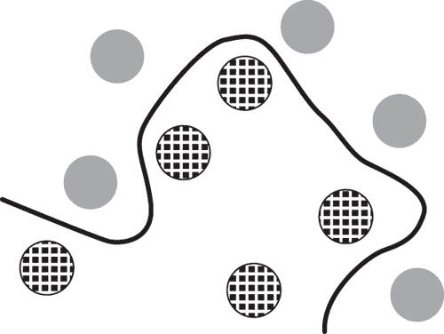

*图 2.14* 两个类别的数据，显然不是线性可分的。返回文本。⏎

当然，图 2.14 中的数据不是线性可分的；也就是说，我们需要一条弯曲的曲线来分隔这两个组。然而，通过计算数据的 *核*，*在其原始维度中*，我们本质上将这种非线性转化为特征空间中的线性可分问题。但为什么会这样工作？核技巧为什么能做到这一点？

核技巧之所以有效的原因与 *Mercer 定理*（1909）相关，它本质上得出以下非常重要的结果：

> *当已知函数存在时，即使对该函数是什么的知识不完整或未知，也可以使用核来近似函数*。

也就是说，核本质上包含丰富的关于更高维度（我们目前可能还不了解）的信息。我们可以在原始配置下或通过核来处理问题这一事实被称为 *对偶表示*（Bishop, 2006）。用文字来说，所谓的“核技巧”本质上传达的想法是：*你在更高维度中处理一个复杂问题，你可能甚至不知道那些维度是什么，甚至不知道可能有多少个，但如果你在现有的低维空间中计算核，你就可以在从未 ***显式*** 去过那里 的情况下了解很多关于那些更高维度的信息*。通过虚构的类比，核可能会让你留在并在此 3 维空间宇宙中计算，同时可能学习到关于另一个宇宙（例如可能在五维的宇宙）的一些东西。

如前所述，核的实用性基于我们处理的许多数据集不是线性可分这一事实。*应用核（希望）使数据线性可分，并且还允许得到一个凸解*（Goodfellow et al., 2016）。凸解（我们稍后会更详细讨论）是理想的，因为它们具有 *全局* 最小值，因此算法不会陷入 *局部* 最小值。也就是说，Mercer 条件的一个重要含义是它建立了支持向量机和类似算法的优化问题的凸性（Mohri et al., 2018）。因此，在优化中保证了全局最小值。


为了巩固核技巧的作用，记住以下内容是有帮助的：

> *原始数据空间中的非线性可分数据 + 核技巧* = *特征空间中的线性可分数据*144

Aggarwal (2015) 总结了核技巧在支持向量机方面的简洁表述；然而，以下引文适用于远超 SVM 的更广泛的统计和机器学习方法：

> 核技巧利用了这样一个重要观察：SVM 公式可以用成对数据点之间的点积（或相似性）完全求解。 无需知道特征值……所有计算都在原始空间中进行，只要已知核相似性函数，实际变换就不需要知道。

### 2.49.1 何时核方法有用？

基于上述讨论，可以推断核在处理数据空间中线性不可分的数据时最有用。 如果我们没有核技巧可用，我们就需要将数据映射到更高维度的非线性，即 *扩大特征空间以适应数据的复杂性*。 这可能耗时、复杂，有时甚至不可行。 通过使用核变换，我们完全不需要将数据映射到更高维度，而是可以简单地使用核技巧，这本质上意味着在问题的 *原始维度* 中计算核，而不是自己尝试扩大特征空间。 核函数通常，如前面所强调的，更关心数据点彼此之间的 *相似性*，而不是实际数据本身（Alpaydin, 2020）。

概念化核的另一种方式是，它们也可以被视为表达或“编码”先验知识的一种方式。 考虑如果在应用函数之前 `x[i]` 和 `x[j]` 相似，那么通常意味着这些观测值的函数 `f(x[i])` 和 `f(x[j])` 也相似。 的确，在许多程序中，指定 `kernel matrix` 本质上有点类似于指定一种“贝叶斯” *先验知识*。

## 2.50 方程组

统计建模中的许多问题在核心上归结为求解线性方程组。 在这种情况下“系统”是什么？ 系统只是一个 *方程集合*，我们寻求变量的解来 *同时* 求解该方程集合。 这里的 *集合* 概念，如读者可能已经熟悉的，是对象的集合，在本例中对象是 *方程*。 由两个方程组成的线性方程组的一个解集很可能与在该集合中加入第三个方程的相同两个方程的解集不同。 再次强调，*上下文很重要*。

一个简单的例子足以说明求解方程组原理。 考虑以下两个线性方程：

$$\\begin{array}{l} {4x\_{1} + 4x\_{2} = 5} \\\\ {2x\_{1} - 4x\_{2} = 1} \\\\ \\end{array}$$

当我们绘制这两个方程时，我们得到如图 图 2.15 所示的线性系统。145

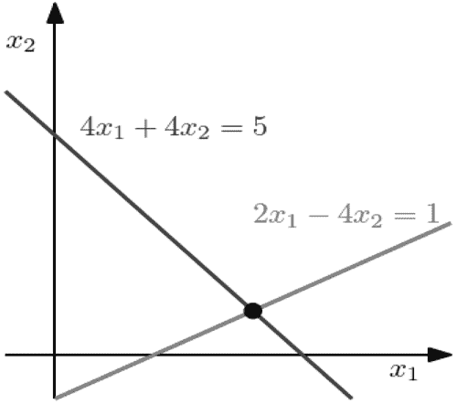

*图 2.15* 线性系统的解集是直线相交的地方。返回文本。⏎

*解集* 是两条直线之间发生 *相交* 的位置。 这种线性方程组可以使用 *高斯消元* 技术求解，其中矩阵被化简为所谓的 *行最简形*，从而可以轻松看到解。 我们在此不回顾高斯消元法，原因在于篇幅限制，也因为从应用统计的角度来看它并没有太大启发性。

我们可以在 R 中相当容易地求解线性方程组。 例如，考虑在 R 中设置的以下两个方程，其中首先我们在方程左侧指定 `x[1]` 和 `x[2]` 的两个系数：

```
> left_matrix <- matrix(c(5, 2, 4, 6), nrow=2)
> left_matrix
```

|  || \[,1\] || \[,2\] |

| --- | --- | --- |

| \[1,\] || 5 || 4 |

| --- | --- | --- |

| \[2,\] || 2 || 6 |

接下来，我们定义右侧的 `y` 值：

```
> right_matrix <- matrix(c(35, 36), nrow=2)
> right_matrix
```

|  || \[,1\] |

| --- | --- |

| \[1,\] || 35 |

| --- | --- |

| \[2,\] || 36 |

我们接下来求解方程：146

```
> solve(left_matrix, right_matrix)
```

|  || \[,1\] |

| --- | --- |

| \[1,\] || 3 |

| --- | --- |

| \[2,\] || 5 |

我们可以看到线性系统的解是 3 和 5。 也就是说，我们刚刚求解了方程

$$\\begin{array}{l} {5x\_{1} + 4x\_{2} = 35} \\\\ {2x\_{1} + 6x\_{2} = 36} \\\\ \\end{array}$$

当我们代入解 `x[1]` = 3 和 `x[2]` = 5 时，我们得到，

$$\\begin{array}{l} {5\\left( 3 \\right) + 4\\left( 5 \\right) = 35} \\\\ {2\\left( 3 \\right) + 6\\left( 5 \\right) = 36} \\\\ \\end{array}$$

在 Python 中，假设我们想求解以下方程组：

`24a + 4b = 35`

`8a + 4b = 94`

```
a = np.array([[24, 4], [8, 4]])
b = np.array([35, 94])
print(np.linalg.solve(a,b))
[-3.6875 30.875 ]
```

上述方程的解因此为 −3.6875 和 30.875。

求解线性方程组有多种有用方法，包括 *消元法*、*代入法* 和 *图解法*。 回归分析是求解方程组的一个例子，当精确解不可实现时需要 *近似*，通常是普通最小二乘法。 近似是必需的，因为方程太多而无法提供唯一解。 也就是说，方程组是 *超定* 的，意味着由于数据的离散性方程太多，因此可以拟合多条直线 *可能*。 然而，我们只希望拟合一条直线，这意味着需要近似权重 `β[0]`，截距，和 `β[1]`，斜率。

在考虑方程组时，很多时候一些方程是其他方程的结果。 也就是说，一个方程可能揭示与一个或多个其他方程相同的 *信息*。 例如，如果两个方程是彼此的标量倍数，那么一个方程，如前所述，本质上重复了第一个方程提供的“信息”。 这种情形可以用两条占据相同空间的直线（即重叠）来直观表示。 作为一个简单的例子，考虑以下两个方程：

$$\\begin{array}{l} {\\,\\,\\,\\,\\, x\_{1} + x\_{2} = y} \\\\ {2x\_{1} + 2x\_{2} = 2y} \\\\ \\end{array}$$

显然，第二方程只是第一个方程的标量倍数，因此对系统没有提供新的“信息”。 如前所述，就向量而言，这些方程被称为 *线性相关*。147

请注意，我们上面只讨论了线性方程。 使它们成为线性的原因是方程中每个项的幂都不高于一。 例如，

`x[1] + x[2] = y`

`x[1]`、`x[2]` 和 `y` 的幂都等于一。 相比之下，以下是一个 *非线性* 方程，因为至少有一个项的指数大于一：

`x[1]² + x[2] = y`

在许多应用问题中，方程组是 *非线性* 的。 *牛顿法* 是求解非线性方程的经典算法。 详情请参阅 Hubbard and Hubbard (2002)。

## 2.51 距离


几乎所有统计技术在某种程度上都是对距离度量的组织和重新组织。即使皮尔逊相关系数也可以被视为点之间距离的度量（我们挑战读者思考这一点）。

距离最常见的度量是 *欧几里得距离*，由下式给出

$$d\\left( O,P \\right) = \\sqrt{x\_{1}^{2} + x\_{2}^{2} + \\cdot \\cdot \\cdot + x\_{p}^{2}}$$

(2.111)

其中 *d* 是原点 *O* 与 *P* 之间的距离，其中 *x*[1]² 到 *x*[*p*]² 是观测值的坐标。欧几里得距离的一个优点是它们具有 *旋转不变性*，这意味着两点之间的直线距离不会随坐标轴系统的方向而改变（Aggarwal, 2015）。

虽然欧几里得距离是我们通常考虑距离时所想到的，但距离的定义还有很多，包括 *闵可夫斯基*、*城市街区（曼哈顿）* 等等。距离度量在聚类分析技术中尤其有用，该技术试图根据案例之间的相似性或距离从案例到案例生成 *组*（在某种意义上）。在本方法和其它方法中，我们将在全书中介绍多种距离度量。Python 中的简单距离可以使用 `numpy.linalg.norm(a−b)` 计算。

## 2.52 投影与基
读者最熟悉的投影无疑是线性回归，其中我们取向量 *y*，生成线性函数，并投影到 *x* 的张成空间上，从而得到一条新的直线，称为 *回归线*，包含预测值 *ŷ*。回归线对点群的拟合本质上是由于将 *y* 投影到 *x* 所“占据”的空间上。残差是 *y*[*i*] − *ŷ*。

当我们谈论 *正交投影* 时，这意味着对于子空间 *S*，*y*[*i*] − *ŷ* 与 *S* 正交。也就是说，残差与预测变量所“占据”的空间 *S* 垂直（正交）（通常称为 *列空间*）。换句话说，回归的参数估计（进而生成 *ŷ*）被选为使残差向量 *y*[*i*] − *ŷ* 与模型中预测变量所“生成”的空间正交（Hastie et al., 2009）。

正交性结合毕达哥拉斯定理进一步意味着我们可以按如下方式分解这些对象的平方范数，148

||*y*[*i*]|| ²\= ||*ŷ*||[2]+||*y*[*i*]−*ŷ*||²

(2.112)

或者更一般地，对于任意观测向量和拟合向量，其中 *v̂* 是向量的更一般拟合值，而上面的 *ŷ* 只是特例：

||*v*|| ²\= ||*v̂*||[2]+||*v*−*v̂*||²

(2.113)

上述恒等式很重要，因为它们本质上描述了回归和方差分析中发生的情况；也就是说，总平方和可以分解为处理引起的部分和误差引起的部分（Marden, 2015，p. 89）。“处理变异”由 ||*v̂*||² 表示，而误差由 ||*v*−*v̂*||² 给出。

在 *主成分分析* 中，目标是获得一个子空间，我们也将观测数据投影到该子空间上。投影后的数据是 *主成分得分*，而数据被投影的新的坐标是新的 *基向量*。原始基，或有时称为 *规范基*，是相互垂直的原始坐标。例如，在 ℝ³ 中，标准基向量如下：

$$e\_{1} = \\left\\lbrack \\begin{array}{l} 1 \\\\ 0 \\\\ 0 \\\\ \\end{array} \\right\\rbrack,e\_{2} = \\left\\lbrack \\begin{array}{l} 0 \\\\ 1 \\\\ 0 \\\\ \\end{array} \\right\\rbrack,e\_{3} = \\left\\lbrack \\begin{array}{l} 0 \\\\ 0 \\\\ 1 \\\\ \\end{array} \\right\\rbrack$$

标准基或任何其它基的轴不必相互垂直（Hubbard & Hubbard, 2002）。也就是说，从本体论的角度来看，并没有 *绝对* 要求上述向量 *e*[1]、*e*[2]、*e*[3] 必须相互垂直，*本体论*。历史上，对于大多数问题，选择基相互垂直很大程度上是出于 *方便*。笛卡尔在 17 世纪发明笛卡尔坐标系，使得代数可以用几何方式表达，其中每个轴都彼此垂直或正交。皮埃尔·德·费马（1607–1665）也发现了相同的坐标系，尽管他的著作在他死后才出版，因此笛卡尔通常与我们今天所知的传统坐标系相关联。数学家约翰·沃利斯（1616–1703）是第一个设想负坐标可能性的人之一（Tanton, 2005）。如果不从基向量的成对正交性开始，问题会变得极其复杂，因此与数学中的许多其它事物一样，在许多情况下从规范向量的正交性假设或约束开始是方便的。它是许多问题的方便而自然的起点，事实上，也是整个数学的很大一部分的起点。

在主成分情况下，新的基向量是 *特征向量*，并具有进行投影的有利性质。因此，在技术层面上，PCA 通常被视为一种 *基变换* 方法论，我们通过它来投影新的得分。它通常也被视为一种 *降维技术*，但这种降维是通过基变换实现的。

## 2.53 线性的含义
术语 *线性* 也许是统计和机器学习中最常用的词。但线性究竟意味着什么？线性变换 *T*，如前所述，是从 ℝ^(*n*) 到 ℝ^(*m*) 的映射，使得对于标量 *a* 和向量 *x* 和 *y*，以下条件成立：149

*T*(*x*+*y*) = *T*(*x*) + *T*(*y*)

(2.114)

和

*T*(*a**x*) = *a**T*(*x*)

(2.115)

也就是说，线性变换被认为保持向量加法和标量乘法。从几何角度来看，线性变换是 *仿射变换* 的一个例子。仿射变换及其相关几何也保持诸如点间距离之比等性质。例如，将摄氏度转换为华氏度是仿射变换的一个例子，因为例如 10 摄氏度和 20 摄氏度之间的相对变化在转换为华氏度时得以保持：

^∘*C* = ((^∘*F*)−32)(5/9)

如果绘制相应的图，就会看到摄氏度和华氏度之间的关系确实是线性的，且距离之比得以保持。

R 和 Python 中的线性变换非常简单执行。例如，在 Python 中，假设我们想确定 32.0 华氏度对应的上述摄氏温度：

```
F = 32.0
(F-32)*(5/9)
Out[16]: 0.0
```

或者，对于温度 F = 0，我们有

```
F = 0
(F-32)*(5/9)
Out[18]: -17.77777777777778
```

## 2.54 基与维数


我们已经非正式地讨论过基的性质。现在我们将该概念置于正式的框架下。`A basis is a set of linearly independent vectors in a vector space that spans the space`。从概念上讲，基本质上为子空间中的向量提供了一个“参考框架”。基的维数是构成该基的给定集合中线性无关向量的数量。更正式地说，基是一个`maximum linearly independent set`，如果我们再添加一个向量，该集合将不再线性无关。也就是说，如果在向量空间中存在一个包含 `n` 个向量的基，那么在该向量空间中就不可能存在包含超过 `n` 个向量的基（因为根据定义，基是 `maximum` 线性无关集）。这一最后的结果是 `Steinitz exchange lemma` 的推论（Stillwell, 2016）。等价地，基是一个最小生成集，如果我们去掉一个向量，它将不再张成给定的子空间（Hubbard & Hubbard, 2002）。150

### 2.54.1 正交基
回顾一下，坐标系的规范基向量生成了 `orthogonal basis`，并且由于每个向量的长度都等于 1，因此它同时也是一个 `orthonormal basis`。在许多程序中，目标是从可能尚未正交的基生成正交基。这是一个非常强大的思想，实际上解释了许多统计方法“在幕后”是如何运作的。

`Gram-Schmidt process` 是线性代数中用于寻找正交基的算法。程序的细节从应用的角度来看并不具有启发性。有关该方法的数学细节，请参阅几乎任何好的入门线性代数教材（例如，Anton & Rorres, 2000）。Gram-Schmidt 过程意味着 `if you have a finite inner product space, an orthonormal basis can be constructed in that space`（Garcia & Horn, 2017）。当我们回顾诸如主成分分析等方法时，这一结果将对我们大有裨益，在这些方法中，正如前面提到的，目标将是建立一组具有特殊属性的新基向量，并据此对观测数据进行投影。主成分分析本质上是将数据（线性）变换到新的基上。也就是说，它生成新的坐标以便可视化和解释原始数据。

基的非常概念或一般思想也可以变得更简单。远离矩阵和特征向量，并作为一个有帮助的不完美类比，考虑计算数字所依据的“基”。例如，表示数字 0.5 是相对于一个基（即“参考框架”），而将其表示为 ½ 是相对于另一个基（Hubbard & Hubbard, 2002）。

## 2.55 复习练习
1. 1\. 区分 `vector` 与 `vector space`。向量与矩阵有何不同？
2. 2\. 证明 (`A`+`B`) ^(`T`) = `A` ^(`T`) + `B` ^(`T`)。
3. 3\. 区分 `Euclidean norm` 与 `inner product`。它们有何不同？有何相似？
4. 4\. 解释 `eigen analysis` 的本质以及它为何构成诸如 `principal components analysis` 等降维技术的基石。
5. 5\. 精确定义 `linear transformation` 的含义。
6. 6\. 用文字描述 `linear combination` 的本质。如果您之前学习过统计方法，请解释线性组合如何成为方差分析、回归等许多统计技术的核心。
7. 7\. 证明行列式等于 0 在几何上对应于体积为零的物体。
8. 8\. 证明 (`A`*`B`) ^(−1) = `B` ^(−1) `A` ^(−1)。
9. 9\. 证明向量的长度等于其内积的平方根。
10. 10\. 讨论 `kernel trick` 的本质，至少直观地说明为何在寻求在更高维度中工作时它如此受重视。
11. 11\. 区分 `basis` 与 `orthogonal basis`，并说明基的概念为何与统计相关，特别是降维。

## 2.56 微积分与优化
微积分通常被视为人类最伟大的、如果不是最伟大的智力成就之一。尽管据推测牛顿和莱布尼茨独立发现了它，但正如 151Boyer (1959) 所展示的那样，在这两位数学巨人对概念（主要是 `limit` 概念）做出最后润色并发展出记号之前，类似微积分的思考早在几个世纪前就已经兴起。优化理论是统计学和机器学习的核心部分，使用微积分和其他数学来确定使函数最大化或最小化的值，也有着悠久的历史。

在我们关于基本统计学和数学回顾的这一最后部分，我们概述微积分和优化理论最重要的和最显著的元素，并预览这些元素在统计学和机器学习中的使用方式。

## 2.57 函数、近似与连续性
统计学和机器学习的大部分可以被视为 `approximating functions` 或其他数学对象的练习。但什么是近似？近似可以非常简单；例如，`π` = 22/7 是对 `π` 的近似，就像微积分中的微分和积分一样，正如我们将看到的，它们是近似过程的实现。当谈到近似时，我们才刚刚开始。很快就会意识到，统计学和机器学习中几乎所有东西，或者至少大多数东西都包含某种近似。

例如，当我们在某些数据上计算算术平均值时，这可以被视为对分布的中心趋势的近似，在某种意义上。当我们将该均值用作总体均值的估计量时，我们再次进行近似，在这种情况下是对某个参数的近似。拟合数据的最小二乘线或任何其他函数都是对真实潜在函数形式的近似。在实分析中，极限和收敛再次是近似出现的例子。例如，$\\lim\\limits\_{x\\rightarrow 5}f\\left( x \\right) = x + 3$ 表示极限为 8，但该数字只在 `in the limit` 出现。表达式 $\\lim\\limits\_{x\\rightarrow 5}f\\left( x \\right)$ 实际传达的是 `approximation` 的思想，即 `as x approaches 5, the value of the function goes to 8`。`We are converging on the value of 8 based on this limiting process.`

微积分的核心是寻找曲线的切线，其斜率称为 `derivatives`，以及通过积分找到曲线下面积的 `integrals`。回想一下，函数 `f`(`x`) 是将 `x` 输入规则或自变量后得到的结果集。对于一个规则要成为函数，对于 `x` 的每个值，`f`(`x`) 或 `y` 必须只有一个值。函数的定义域是给定函数可能的所有输入，而函数的 `codomain` 由所有理论上可产生的输出组成（即不仅仅是可能观察到的输出）。例如，对于简单的线性函数 `f`(`x`) = `x`，定义域和值域可以定义为实数集，记为 `ℝ`。

来自物理科学的函数示例包括牛顿定律等经典函数，`F` = `m` `a`，其中 `a` 是质量 `m` 在净外力 `F` 作用下的加速度，当然还有爱因斯坦的相对论，`E` = `m` `c`²，其中在光速 `c`² 恒定的情况下，能量 `E` 与物体质量 `m` 成正比。

### 2.57.1 连续性的定义
函数在给定点 `x` = `a` 处是 `continuous` 的，如果该函数在该点有定义且 `f`(`x`) 的极限在该点存在，并且两者相等。即，152


$$\\lim\\limits\_{x\\rightarrow a}f\\left( x \\right) = f\\left( a \\right)$$

(2.116)

其中我们再次回顾，函数的 *极限* 是函数所 *逼近* 的数，而不一定在该函数 *处* 定义。例如，在数列 0.9、0.99、0.999 中，数列的极限是 1，无论数列是否达到 1。具有极限的数列被称为 *收敛* 的。极限在 Python 中可以很容易地计算。示例请参见 Saha (2015)。

尽管我们上面把连续性描绘得很基础，实际上它是一个非常深刻的概念，数学家们花了数年时间才发展并使其严谨。在现代数学中，连续性通常使用 ε-δ 定义来概念化（参见 Denis, 2021a 以简要了解这些定义的工作方式）。当然，连续性首先并不是一个数学思想。它首先是一个 *概念*。人类意识中连续性的 *思想*，正如许多基本数学概念一样，很可能自人类诞生以来就已存在。想象早期文明基于一条路线的连续性来规划旅行路线，而不是选择一条会 *不连续* 且路线中存在“间隙”或“跳跃”的替代路线（也许需要跨越的河流）并不困难。数学家和哲学家使用精确的记号 *严格* 地定义这些概念这一事实，不应被理解为这些概念是“诞生”于数学的。如果说有什么的话，就像大多数事物一样，它们很可能诞生于早期的哲学“非专业”思考中。

## 2.58 导数

读者会从微积分中回忆起，要对函数 `f(x)` 求导，我们首先计算 `y` 的变化 (`δy`) 相对于 `x` 的变化 (`δx`)：

$$\\frac{\\delta y}{\\delta x} = \\frac{f\\left( x + \\delta x \\right) - f\\left( x \\right)}{\\delta x}$$

(2.117)

上述被称为 *差商*，表示函数的平均变化率。要得到 *导数*，我们按 (2.117) 计算函数相对于 `x` 的变化，但有一个非常重要的补充；我们将 `y` 的变化相对于 `x` 的变化取 *极限*，其中现在 `df` 对应于 `y` 的变化（或更一般地 *函数* 的变化），而 `dx` 对应于 `x` 的变化，现在在比值中由 `h` 表示（即 `h` = `δx`）：

$$\\frac{df}{dx} = f'\\left( x \\right) = \\lim\\limits\_{h\\rightarrow 0}\\frac{f\\left( x + h \\right) - f\\left( x \\right)}{h}$$

(2.118)

也就是说，导数 `f'(x)` 是差商的极限，当 `x` 的变化，由 `h` 表示，趋于零时。请务必注意，导数是一个 *斜率*，但它只是当 `h`→0 时极限下的斜率。换句话说，它是 *瞬时变化率*。如果没有“*当* `h`→0 时的极限”这一限定，导数就没有任何意义且未定义。微分学（以及积分学，同样如此）全部都关乎 *极限*。导数在二维中可通过 图 2.16 中的图形轻松可视化，其中我们看到曲线的切线以及近似的割线（稍后讨论）。153

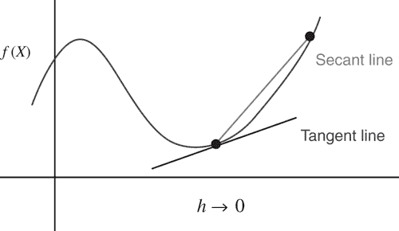

*图 2.16* 切线与极限概念相结合是导数的基础。导数有多种解释，其中之一是当 x 的变化趋于零时差商的极限（`h`→0）。导数的第二种解释是当 `h`→0 时割线的极限。两种解释都得到所关注特定点处曲线的切线，其中导数是该特定点处切线的斜率。返回文本。⏎

请注意，我们可以在给定点周围画出许多斜率，它们都与 图 2.16 中的斜率略有不同。在那个特定很小的点处，*切线* 如何定义？这再次是极限概念发挥作用的地方。对于 `h` > 0，我们可以拟合许多不同的割线（即与曲线相交越来越接近最终切线的直线）。然而，当 `h`→0 时，我们 *锁定* 到切线，其斜率我们称之为 *导数*。也就是说，*导数是当* `h`→0 时割线极限所定义的斜率*。就此而言，导数不仅仅是位于给定位置 *接触* 该点的线的斜率；它是 *接触该点的极限（割）线*，尽管在非正式描述导数时，我们经常简单地说“接触该点”或“切于该点”或“该点的斜率”。

可以断定，如果一个函数在 `x` 的某个区间上每一点的导数都等于 0，则该函数在此区间上是 *常数*。也就是说，如果 `f'(x)` = 0 在每一点成立，则意味着 `f(x)` = `c` 在每一点成立，其中 `c` 为常数。如果一个函数在给定点确实存在极限，则该极限是 *唯一* 的。在更高维度中，可视化要困难得多，取而代之的是 *切于* *曲线*，我们将有 *切于曲面的平面*。词汇发生了变化，但概念相同。更高维度可能令人望而生畏，但如果对低维概念有良好的理解基础，则会不那么可怕。

Hubbard and Hubbard (2002, p. 126) 精妙地总结了微分学的目标，为其目的提供了深刻的见解：

> 微分学的目的在于通过用线性变换代替它们来研究非线性映射：我们用线性方程代替非线性方程，用切平面代替弯曲曲面，等等。当然，这种线性化只有在你对线性对象有相当好的理解时才有用。此外，这种替换只是或多或少合理。局部地，在切点附近，弯曲曲面可能与它的切平面非常相似，但远离时则不然。微分学最困难的部分是确定何时用线性对象代替非线性对象是合理的……非线性是一个过于宽泛的类，难以考虑。将映射分为线性和非线性，就像把人分为左撇子大提琴手和所有其他人一样。

我们还可以将导数区分为左导数和右导数。左导数不出所料，是从左侧的极限，154

$$f\_{-}^{'}\\left( x \\right) = \\lim\\limits\_{h\\rightarrow 0^{-}}\\frac{f\\left( x + h \\right) - f\\left( x \\right)}{h}$$

(2.119)

其中右导数由下式给出

$$f\_{+}^{'}\\left( x \\right) = \\lim\\limits\_{h\\rightarrow 0^{+}}\\frac{f\\left( x + h \\right) - f\\left( x \\right)}{h}$$

(2.220)

可以证明，函数在某一点的导数存在的唯一条件是左右导数都存在且彼此相等。

在 Python 中，我们可以按如下方式求函数的导数：

```
from sympy import Symbol, Derivative
t = Symbol(‘t’)
St = 5*t**2 + 2*t + 8
Derivative(St, t)
Out[68]:
Derivative(5*t**2 + 2*t + 8, t)
```

```
d = Derivative(St, t)
d.doit()
```

```
Out[70]:
10*t + 2
```


也就是说，上述函数的导数，`f(x) = 5t² + 2t + 8` 如功率法则预期，`f'(x) = 10t + 2`，其中功率法则由 $\\frac{df}{dx}\\left( x^{n} \\right) = nx^{n - 1}$ 给出。

### 2.58.1 局部行为与近似
从对导数及其概念的视角可以获得很多见解，并且可以用来间接预示本书中的许多方法。首先，请注意一个显而易见的点：导数并不 *等于* 其被计算的曲线。我们可以将导数视为在该特定点对曲线的 *近似*。函数是非线性的，但在该局部水平上我们可以将其视为线性。那就是，*局部地，或“放大后”，非线性函数表现得非常像线性函数*。这种 *局部性* 的想法将在本书中一次又一次地出现。一些方法关注更 *全局* 的结构，而其他方法则关注更局部的行为。作为这种区别的预览，多项式回归是在曲线上计算的全局函数，而回归样条，作为一个例子，则在更局部水平上对数据进行建模。

微分学的大部分内容都是关于建立和使用微分法则，使其比使用上述“长形式”更容易。诸如 *乘积法则*、*商法则*、*和法则* 和 *链式法则* 之类的法则通常会被使用和推导。初等微积分的很大一部分在于练习使用此类简写法则在各种上下文中计算导数。我们假设读者至少对这些法则有所熟悉，或者在过去的某个时候遇到过它们。能够即兴执行它们并不是必要的，因为我们可以确信计算机将“知道”正确的法则（如果在计算中 überhaupt 使用简写的话）来实现并计算我们需要的导数。*是* 必要的的是知道导数 *是什么*，并且存在许多法则，所有这些法则在形式上都可以证明，以获得导数。155

尽管我们不深入讨论微分法则，但我们将提到一条法则，然而，这条法则对我们的目的尤其重要且相关，因为它在神经网络中使用，更具体地说是 *反向传播算法* 中，那就是 *微分的链式法则*。对于函数 `y = m(x) = f[g(x)]`，链式法则定义为，

`m'(x) = f'[g(x)] g'(x)`

(2.221)

链式法则处理 *复合函数*；我们取的是 *函数的函数*，也就是说，`f'[g(x)]` 是函数 `f()` 的函数 `g()`。内部的函数 `g` 被称为 *核心* 或 *内部函数*，并在外层函数之后应用。以上适用于两个函数，但我们可以推广到更多函数。也可以证明两个连续函数的复合本身是连续的。

正如我们在本书后面研究神经网络时将会看到的，从“大局”来看，理解反向传播与理解链式法则一样简单。事实上，大多数连续优化方法都采用微分学。读者应该知道，并非所有函数都是可微的，即使所处理的函数族是连续的。例如，绝对值函数在处处连续，但在函数的“尖点”处不可微（即函数底部带有尖锐边缘的位置）。

### 2.58.2 复合函数与基展开
在讨论复合函数时，除了预览神经网络的想法之外，也是突出并预示本书中将反复出现的另一个主题的恰当时机，那就是 *基展开* 的想法，正如我们将看到的，神经网络可以被视为此类展开的特例。考虑以下内容：

$$f\\left( x \\right) = {\\sum\\limits\_{i = 1}^{M}{\\beta\_{m}h\_{m}\\left( x \\right)}}$$

在上面，`h[m]` 被称为 *基函数*。通俗地说，它在我们用估计权重 `β[m]` 对 `hm` 加权之前为 `x` 提供一个“基”。这个想法如何与复合函数的想法联系起来？好吧，考虑 `h[m]` 是对 `x` 的函数进行操作，而 `β[m]` 然后应用于这个内部（或“核心”）函数。从非常一般的意义上说，这个过程可以被认为是在取 *函数的函数*，这按定义正是复合函数的核心思想。

注意当 `h[m] = 1` 时，

$$\\begin{array}{l} {f\\left( x \\right) = {\\sum\\limits\_{i = 1}^{M}{\\beta\_{m}h\_{m}\\left( x \\right)}}} \\\\ {\\,\\,\\,\\,\\,\\,\\,\\,\\,\\,\\,\\, = {\\sum\\limits\_{i = 1}^{M}{\\beta\_{m}\\left( 1 \\right)\\left( x \\right)}}} \\\\ {\\,\\,\\,\\,\\,\\,\\,\\,\\,\\,\\,\\, = {\\sum\\limits\_{i = 1}^{M}{\\beta\_{m}x}}} \\\\ \\end{array}$$

我们得到经典的回归模型式加权。现在的关键点是认识到基函数在由 `β[m]` 进行相关加权之前被应用于 `x` 中的观测值。理论上，我们可以在由 `β[m]` 进行相关加权之前用 `h[m]` 转换 `x` 的方式几乎没有限制。正如我们在本书中将会看到的，基函数是统一大量统计和机器学习模型的一个主题，我们在调查新方法时经常会重新审视这些想法。*理解基函数是理解许多统计和机器学习模型和方法“整体”的有力方式。*

## 2.59 偏导数
虽然前面出现的单值导数阐明了微分的概念，但在实践中，我们通常更感兴趣的是计算函数的 *偏导数*。偏导数是在保持其他变量 *常数* 的情况下对函数求导。多变量函数的偏导数集合通常被称为 *梯度*，尽管“梯度”一词也常用来表示两个变量之间的斜率。必须根据情况的上下文来解读其含义才能知道所指的内容。

函数 `f` 关于 `x[1]` 的偏导数，保持所有其他变量 `x[2]`、`x[3]`、...、`x[n]` 常数，由下式给出

$$\\frac{\\partial f}{\\partial x\_{1}} = \\lim\\limits\_{h\\rightarrow 0}\\frac{f\\left( x\_{1} + h,x\_{2},...,x\_{n} \\right) - f\\left( x \\right)}{h}$$

(2.222)

其中 ∂`x[1]` 表示我们求偏导的变量。所有其他变量保持常数。正如单变量导数的情况一样，偏导数只有在 `h → 0` 时才成立，即在极限情况下。

由于必然存在这些导数的“集合”，将它们分组为行向量很方便，

$$\\nabla\_{x}f = \\text{grad}f = \\frac{df}{dx} = \\left\\lbrack {\\frac{\\partial f\\left( x \\right)}{\\partial x\_{1}}\\,\\,\\frac{\\partial f\\left( x \\right)}{\\partial x\_{2}}\\, \\cdot \\cdot \\cdot \\,\\frac{\\partial f\\left( x \\right)}{\\partial x\_{n}}} \\right\\rbrack$$

(2.223)

其中此类向量通常被称为函数的 *梯度*，而 *雅可比矩阵* 是该函数的一阶偏导数向量（Deisenroth 等, 2020）。

## 2.60 优化与梯度


正如我们在本书中将要学习的那样，许多统计和机器学习方法乍看之下可能很复杂，其核心都是围绕着 `optimization` 的一般问题展开的，这大致可以理解为在结构框架或 `model` 内为给定函数寻找“最佳”权重，从简单到复杂。为了得到这些权重，通常需要对一个指定的函数（取决于具体方法）进行 `maximized` 或 `minimized`。最经典且最熟悉的例子是最小二乘法，我们希望最小化平方误差之和。一般原则是我们正在最小化一个 `objective function`，本例中的目标函数是均值周围的平方偏差或误差之和。当然，平方误差之和绝不是我们可能希望最小化的唯一目标函数，因此优化是一个非常普遍的想法，至少在理论上适用于大量函数。也就是说，损失 `L2=|y−y′|²` 是更一般的 `L[p]` 损失的特例，该损失由 157 定义

`Lp=|y−y′|^(p)`

(2.224)

其中 `p` 是一个大于或等于 1 的数。当目标函数被最小化时，通常被称为 `cost`、`loss` 或 `error` 函数（Goodfellow et al., 2016）。

一种称为 `gradient descent` 的技术及其推导和扩展（即将讨论）被使用，部分原因是闭式解析解并不总是存在，或者不如梯度下降提供的解优越或实用。梯度下降的起源通常归因于 Cauchy (1847)。请记住，`closed-form` 或 `analytical solution` 是基于方程求解的代数型解。通常，这些类型的“干净”解并不存在，我们反而需要使用迭代数值方法来近似解。多亏了计算机，迭代可以在几秒钟内完成，而在过去，即使相关算法已被发明，由于缺乏计算能力，实现起来也是不可行的。

例如，早在 1912 年就开发了早期的最大似然迭代算法（Fisher, 1922），但正如当时许多计算的情况一样，由于执行此类程序的计算复杂性，很难实现。这正是计算对现代算法如此重要以及各种算法的 `computational capacity` 本身就是一个领域并且是计算机科学主要研究领域的原因。梯度下降本身实际上是一个相当古老的算法，但由于计算能力的进步，它在相对最近变得越来越流行。认为今天经历的许多计算挑战即使在十年或二十年后也会显得微不足道，这并不算过分推测。计算机科学家和工程师赢得了他们的赞誉！

### 2.60.1 “最优”是什么意思？

在进一步考虑梯度下降的工作原理之前，花点时间讨论“最优”意味着什么是非常值得的，因为典型算法的目标将是寻找这种最优解。`Optimal implies that the weights (or more generally, solutions) are arrived at in such a way that they usually satisfy one or more conditions or constraints`。再次，一个读者无疑会认识到的典型例子是经典回归中的普通最小二乘法。回顾简单的线性回归 `model`：

`y[i]=β[0]+β[1]x[1]+ε[i]`

请记住，目标是估计权重 `β[0]` 和 `β[1]`。这些参数的哪些值被认为“最好”或“最优”？我们从最小二乘理论知道，它们将被选择以最小化回归线周围的平方误差之和。也就是说，“最优”值是满足最小二乘条件的那些值。

更一般和正式地说，我们可以说许多统计方法旨在估计使 `loss function` 最小化的参数：

$${\\hat{\\theta}}\_{mle} = \\underset{\\theta}{\\arg\\min}l\\left( \\theta \\right)$$  

(2.225)

其中 `l(θ)` 是给定问题的损失函数，`θ̂` 是参数向量的最大似然估计。在最小二乘的例子中，损失函数是平方误差之和。最大似然，如我们所见，是参数估计的一种流行方法，它选择使数据具有最高概率的参数，即 158

$${\\hat{\\theta}}\_{mle} = \\underset{\\theta}{\\arg\\max}p\\left( D \\middle| \\theta \\right)$$  

(2.226)

这里的要点是“最优”通常涉及 `constraints` 或 `conditions` 的思想，或更一般地，在计算值之前某种 `restrictions`，即使这些条件在算法本身中是隐含的。在最大似然中，只有使 `D` 的似然最大化的参数 `θ` 才会被选中；参数值并不是 `unconditionally` 选择的。它们是根据最大似然如何定义“最优”参数来选择的。

作为类比，考虑从工作回家最优的方式。它可能是在距离和 `time` 上最短的 `distance`，但在冬季，回家必须受制于路线安全且无冰的约束。`Constraints and conditions are all around us, rule our activities, human relationships, and likewise appear in the minimization or maximization of functions in mathematics, statistics, and machine learning`。

### 2.60.2 通过微积分求极小值和极大值

正如读者可能从微积分中回忆的那样，寻找函数的 `maxima` 或 `minima` 通常涉及将导数设为 0，以确定函数上斜率等于 0 的点。例如，考虑 图 2.17 中的函数。

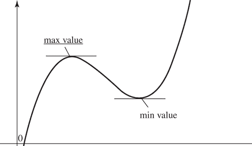

`Figure 2.17` 函数具有最小值和最大值，由导数等于 0 表示。返回文本。⏎

我们如何知道函数的最大值出现在那里？最小值呢？我们之所以能知道，是因为在那些位置，`the derivative is equal to 0`，而导数等于 0 意味着该点的斜率等于 0，因为导数是斜率（更准确地说，是在该点逼近函数的割线极限）。这对极小值也成立。也就是说，一般而言，对于开区间 (`a`,`b`) 上的可微函数，如果 `c` 是函数的最大值或最小值，则意味着 `f′(c)=0`。这一结果由分析中的 `Rolle’s theorem` 暗示，该定理本质上表明如果函数 `f` 在区间 [`a, b`] 上连续且在区间 (`a`, `b`) 上可微，并且 `f(a)=f(b)`，则在 (`a`, `b`) 之间至少存在一点 `c` 使得导数等于 0，即 `f′(c)=0`。Rolle 定理是 `mean value theorem` 的特例。详情请参阅 Bartle and Sherbert (2011)。因此，当我们令 `f′(x)=0` 时，我们可以确定斜率等于 0 的位置。目标函数的 `critical point` 对应于使目标函数导数在该点消失的参数估计。


图 2.18 是对 *全局最大值* 和 *全局最小值* 概念的视觉表示，以及 *局部最小值* 的概念。全局最小值或最大值适用于整个函数，而局部最小值或最大值仅在曲线的特定位置成立；也就是说，如果最小值或最大值是局部的，那么在曲线的其他地方完全可能存在其他最小值或最大值。159

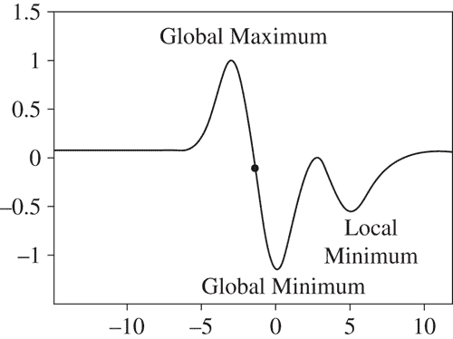

*图 2.18* 全局最小值和最大值与局部最小值。返回正文.⏎

### 2.60.3 凸函数与非凸函数及集合

确定最小值和最大值取决于函数的凸性。凸函数优于非凸函数，因为它们具有 *全局* 最小值，而非凸函数通常有多个 *局部* 最小值，这会妨碍找到全局最小值。具有局部最小值的优化问题很容易陷入局部性，或者更通俗地说，在局部“山谷”中“卡住”。

图 2.19 给出了凸性的几何解释。凸函数是指我们可以在线段之间画一条线（如图像所示），并且函数的值保证等于或小于该线。对于非凸函数，我们无法在不经过函数的其他线段的情况下画出这样的线。请注意，对于凸函数，将存在全局最小值。另一种说法是，对于凸函数，任何局部最小值也将是全局最小值（Goodfellow, 2020）。对于非凸函数，可能存在许多局部最小值。

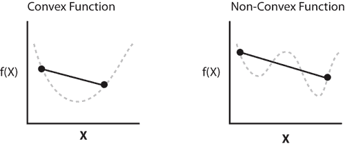

*图 2.19* 凸函数与非凸函数。凸函数具有全局最小值，而非凸函数可能具有许多局部最小值。返回正文.⏎

当我们在书中后面讨论流形学习时，线段或路径的广义概念——它们是两点之间的最短距离并且可以帮助指示流形中的凸性——将被称作 `geodesics`。不过，正如我们将看到的，测地线通常不是唯一的。160 定义在流形上的函数如果其 `Hessian` 为半正定则为凸，其中 Hessian 描述了多变量函数在二阶偏导数方面的局部曲率。因此，当 Hessian 为正定时，这意味着我们正在处理的曲面是凸的，这将使诸如梯度下降之类的算法更容易执行优化，因为存在确定的全局最小值。

## 2.61 梯度下降

梯度下降是一种常用的算法，用于在许多统计和机器学习应用中最小化目标函数以寻找全局或局部最小值。它是最常用的优化方法，例如在神经网络中，但也适用于许多其他机器学习和统计方法（Ruder, 2016）。它是一种 *迭代* 方法，其目标是最小化某个任意成本函数，该函数会因所采用的统计或机器学习方法而不同。对参数估计进行轻微更改的迭代会在算法收敛到成本函数的最小值时停止，此后不再期望或能够进一步降低成本函数。这就是目标：对参数估计进行轻微的迭代“更新”，直到达到局部最小值。虽然梯度下降有许多变体，但通常有三种最流行的方法：*批量梯度下降、随机梯度下降* 和 *小批量梯度下降*。

### 2.61.1 梯度下降如何找到最小值？

在寻找成本或误差函数 `E(θ[0])` 的最小值时，该函数受包含在向量 `θ[0]` 中的模型参数的更新约束，会采取与给定当前模型参数值的函数梯度的负值成比例的连续步骤。请仔细注意这意味着什么：我们从某些通常任意的参数值 `θ[0]` 开始，然后基于函数的梯度（即粗略地“*斜率*”，但实际上是偏导数向量），逐步向最小值移动。我们正在寻找最小值并沿 *负梯度* 方向移动，即

`θ[1] = θ[0] − η ⋅ ∇[θ]E(θ[0])`

(2.227)

其中 `η` 是步长或 *学习* 率，而 `∇[θ]E(θ[0])` 是梯度向量，包含误差或成本函数 `E(θ[0])` 的全部偏导数集合。因此，对于任意值 `η` ≥ 0，`E(θ[1])` ≤ `E(θ[0])`。也就是说，对于任何大于 0 的 `η` 值，`θ[1]` 处的函数（即更新后的参数向量）代表相对于在 `θ[0]` 处计算的原始成本函数的 *下降*。这样做时，我们正在 *收敛* 到最小值。参数集合 `θ[0]` 根据步长 `η` 进行优化，使得参数的新的“猜测” `θ[0 + 1] = θ[1]` 通过这种最小化方法得到。

从视觉上看，梯度下降可以如 图 2.20 所示，其中我们看到最终会收敛到中心处的局部或全局最小值，从而通过每次迭代迭代更新参数估计来最小化成本或误差函数。161

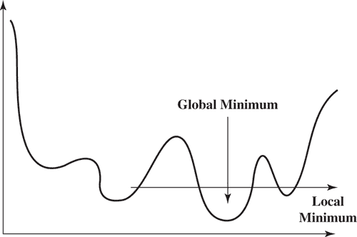

*图 2.20* 梯度下降背后的概念；连续的迭代最终导致最小化误差或成本函数。返回正文.⏎

我们迄今为止描述的内容通常被称为“原版”批量梯度下降（Bishop, 2006；Ruder, 2017）。梯度下降在接近最小值时可能相对较慢。其渐近收敛速率也可能不如其他方法（Deisenroth et al., 2020）。如果学习率 `η` 太快，真正的局部最小值可能会被“跳过”，因为算法试图最大化搜索此类最小值所需的最短时间。相反，如果学习率 `η` 太慢，梯度下降可能永远不会收敛，因为算法试图“太努力”地找到局部最小值。因此，选择合适的步长或学习率 `η` 很重要。梯度下降中存在一种“权衡”，即参数更新的准确性与进行此类更新所需的时间之间的权衡（Ruder, 2016）。一种有用的策略是具有随接近最小值而减慢的动态学习率，通常称为 *退火*（Ruder, 2016）。在梯度下降的各种方法中，批量梯度下降只要误差曲面是 *凸* 的，就保证收敛到 *全局最小值*；如果不是凸的，则保证收敛到 *局部* 最小值。

*随机梯度下降* 对 *每个* 训练数据点 `x[i]` 执行参数更新，而不是像批量梯度下降中的“批量”，

`θ[1] = θ[0] − η ⋅ ∇[θ]E(θ; x[i])`

(2.228)


其中 `x`[*i*] 是给定迭代处的数据点。随机梯度下降改进了批量梯度下降的冗余弱点，因此速度快得多，并且由于只需要梯度是真实梯度的无偏估计，因此并不绝对要求使用全部训练数据。由于更新频繁，在算法试图达到最小值时，它可能会导致相当高的方差。随机梯度下降可能会超调最小值，如果学习率过大；因此通常建议降低学习率。与梯度下降相比，该算法所需的计算资源也更少，原因在于它不会一次性使用所有数据，这对于大规模问题而言可能比梯度下降具有显著优势。确实，随机梯度下降已被证明在大规模机器学习中非常有效（Bottou 等，2018），并且本质上是大多数现代机器学习应用的“主力”。最后，当随机梯度下降应用于非凸函数时，没有收敛保证，并且可能对初始参数值非常敏感（Goodfellow 等，2016）。162

*迷你批量梯度下降* 通常被视为批量方法和随机方法之间的折中，使得算法对每个包含 `n` 个训练样本的“迷你批量”执行一次更新，

`θ[1]` = `θ[0]` − `η` ⋅ ∇[`θ`]`E`(`θ`;`x`^((`i`; `i` + `n`)))

(2.229)

其中现在 `i` + `n` 是在将 `θ[0]` 更新为 `θ[1]` 时加入的新“迷你批量”。然而，迷你批量并不总是能保证良好的收敛，选择合适的学习率可能具有挑战性。

*带动量的梯度下降* 是梯度下降的又一种变体，可帮助加速随机梯度下降。这些以及对梯度下降的其他修改和改进在 Ruder（2016） 中进行了总结。

## 2.62 积分学

而微分是关于求曲线切线的斜率，积分学是关于求曲线下的 *面积*。从历史上看，求矩形等物体的面积自古希腊以来就已为人所知，但求更一般形状和曲线下的面积则需要很长时间才能弄清楚。计算此类面积的早期尝试包括公元前 400–350 年的克尼多斯的欧多克索斯，他试图通过逐渐变小的矩形来计算曲线下的面积，如 图 2.21 所示。

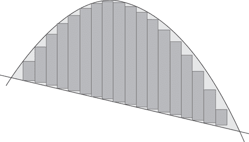

*图 2.21* 欧多克索斯的穷竭法（公元前 400–350 年），其中使用逐渐变小的矩形来近似曲线下的面积。返回文本。⏎

这种方法被称为 *穷竭法*。几个世纪对该问题的思考最终以牛顿和莱布尼茨（以及许多其他人）对微积分和积分的贡献达到顶峰，现在我们可以使用一种更复杂的求和方法——称为积分——来求曲线下的面积（图 2.22）。163

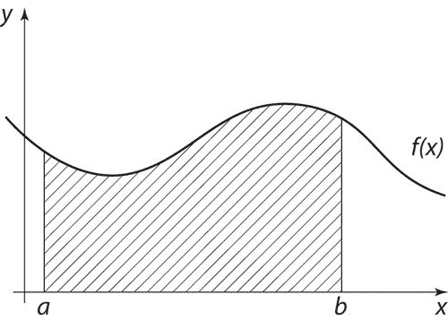

*图 2.22* 使用积分学计算曲线下的面积。返回文本。⏎

但我们如何求出此类“复杂”曲线下的面积呢？对于 `x` 的微小变化 `Δx`，读者可能会回忆起我们可以对这些面积求和，称为 *黎曼和*：

$$\\sum\\limits\_{i = 1}^{n}{f\\left( x\_{i} \\right)\\Delta x}$$

(2.230)

当 `n`→∞ 时，从 `a` 到 `b` 的定积分在极限中得到：

$${\\int\_{a}^{b}{f\\left( x \\right)dx}} = \\lim\\limits\_{n\\rightarrow\\infty}{\\sum\\limits\_{i = 1}^{n}{f\\left( x\_{i} \\right)\\Delta x}}$$

(2.231)

日常微积分中的积分由于伯恩哈德·黎曼（1826–1866）而被称为 *黎曼积分*。随后出现了勒贝格积分，它适用于比黎曼积分更广泛的一类函数。

积分通常也被称为 *反微分*，原因在于积分是微分的逆过程（即积分“撤销”了微分）。也就是说，如果已知一个导数并想知道该微分函数的原始函数，那么就是在寻求原函数，而原函数是通过积分得到的。*微积分基本定理* 概括了这一思想，即一种技术是另一种技术的逆。正如微分的情况一样，并非所有函数都是可积的。简而言之，对于一个函数来说可积，必须能够使面积或体积的块越来越小，并增加这些越来越小的块的数量。最重要的是，可以证明每个多项式在任何有限体积的集合上都是可积的（因为多项式是 *连续* 函数），因此对于统计和机器学习中处理的大多数函数来说，可积性不是一个问题。对积分学的更深入讨论将带我们进入 *测度论*，它正式地说明了可积性的条件。现代统计学很大程度上以某种方式基于测度论的基础。164

### 2.62.1 二重积分和三重积分

当然，在多元域中，上述定义是不够的，我们需要将这些概念扩展到多个维度。二重积分由下式给出

$$\\int{\\int\\limits\_{}{f\\left( x,y \\right)\\, dx\\, dy}}$$

其中，与对一个变量积分不同，我们是对两个变量（`x` 和 `y`）积分。例如，*双变量密度* 体现了两个变量之间的关系，需要二重积分，正如我们将在本书后面看到的那样。

从二重积分的下一步是三重积分，有助于现在在三维空间中积分，再次对应于空间的体积，但维度高于先前讨论的维度，

$$\\int{\\int{\\int\\limits\_{}{f\\left( x,y,z \\right)dx\\, dy\\, dz}}}$$

无论是关于微分还是积分，多个变量的微积分构成了 *多元微积分* 的主题。关于单变量和多元微积分的一个良好参考是 Salas 等。（1998）。

## 2.63 复习练习

1. 1. 描述微分学中 *导数* 的性质。为什么 *极限* 概念对于理解导数是必要的？

2. 2. 在 Python 中，计算函数 `f`(`x`) = 2`x`² + 10`x` 的导数。

3. 3. 讨论微积分中 *复合函数* 的性质。

4. 4. 什么是 *基函数*？写出一个使用基函数的回归方程。

5. 5. *偏导数* 与单值导数有何不同？

6. 6. 进行在线搜索并区分 *泰勒级数* 和 *泰勒多项式*。它们发挥什么作用？

7. 7. 描述微积分如何用于求函数的 *最小值* 和 *最大值*。

8. 8. 在梯度下降中寻求参数 `θ[0]` 的更新值（其中 `θ[1]` 是更新后的参数）时，*学习率* 的作用是什么？

9. 9. 对比 *积分* 与 *微分* 微积分。*微积分基本定理* 将这两个过程联系起来。头脑风暴一下两者可能如何相关。

10. 10. 为什么 *极限* 概念对积分学至关重要？如果没有极限概念，我们仍能计算曲线下的面积吗？如何？解释。

165

# 3 R 和 Python 软件

DOI: [10.4324/9781003376941-5](https://doi.org/10.4324/9781003376941-5)


计算机和计算能力的兴起至少从 20 世纪 80 年代初（如果不是更早）就开始彻底改变了统计学和数据分析。过去统计学家和科学家计算需要 *天* 的时间，现在几乎字面意义上只需要 *毫秒*。例如，在 1930 年代进行因子分析需要花费数 *小时*，而不是几秒钟。今天，只需按几下按钮（例如，使用社会科学统计软件包（SPSS）），即可在一秒钟内获得因子分析结果。虽然这显然有优势，但也带来了潜在的危险，即在进行数据分析之前可能忽视重要细节，例如数据的完整性、良好的理论化等，至少就科学领域而言如此。现在计算可以如此快速，以至于很容易对 *计算的是什么以及测量的是什么* 投入不足的关注。

例如在商业和医疗保健分析中，软件的强大功能使得能够分析庞大的数据库并发现数据中的模式，而在先进的计算和可视化出现之前这是不可能的。商业分析师可以相对快速地分析数 TB 的数据以了解新兴趋势，并建议管理层如何分配营销资源以最大化利润。然而，正如本书开头所强调的那样，所有这些令人惊叹的能力都并不排除确保适当的数据测量和质量的重要性。只有当数据本身质量良好并且触及所寻求的构念时，从数据中分析和得出模式才有意义。糟糕的测量或其它可疑的数据只能导致误导。人们是否认可你的产品？1 到 5 的评分量表表明大多数人可能会选择 4 或 5。然而，这些有限的数据并不能告诉你他们是否比你的产品更赞同其他产品。例如，也许你的产品在竞争产品的偏好点中处于最低，但你永远不会通过简单地询问人们对你的产品的认可程度来知道这一点。因此，了解你正在测量什么并将其置于适当的背景中，与“大数据”出现之前一样重要，甚至更重要。大数据等于大结论，这导致大决策，如果不仔细考虑，由于闪电般的计算速度和便利性，这些决策可能存在缺陷。

## 3.1. R 和 Python 的主导地位

虽然有许多软件包（例如 SAS、Matlab 等）可用于数据分析、数据科学、统计学和机器学习，但其中两个更受欢迎的程序是 R 和 Python。R 在 *基于统计的* 课程和应用中可能更受欢迎，而 Python 则更常在计算机科学系作为通用计算语言使用。两者各有优缺点。分析数据中也很受欢迎的其他程序包括 SAS 和 SPSS。两者在各自的功能上都很出色，但由于它们不如 R 和 Python 灵活，因此受到限制（然而，SAS 通常比 SPSS 强大得多）。在 R 和 Python 中，你可以比在 SPSS 和 SAS 等程序中更具创造性，并根据需要编程新事物。然而，SPSS（和 Excel）的优点是电子表格界面，这使得快速或常见的[content]
计算机和计算能力的兴起至少从 20 世纪 80 年代初（如果不是更早）就开始彻底改变了统计学和数据分析。过去统计学家和科学家计算需要 *天* 的时间，现在几乎字面意义上只需要 *毫秒*。例如，在 1930 年代进行因子分析需要花费数 *小时*，而不是几秒钟。今天，只需按几下按钮（例如，使用社会科学统计软件包（SPSS）），即可在一秒钟内获得因子分析结果。虽然这显然有优势，但也带来了潜在的危险，即在进行数据分析之前可能忽视重要细节，例如数据的完整性、良好的理论化等，至少就科学领域而言如此。现在计算可以如此快速，以至于很容易对 *计算的是什么以及测量的是什么* 投入不足的关注。

例如在商业和医疗保健分析中，软件的强大功能使得能够分析庞大的数据库并发现数据中的模式，而在先进的计算和可视化出现之前这是不可能的。商业分析师可以相对快速地分析数 TB 的数据以了解新兴趋势，并建议管理层如何分配营销资源以最大化利润。然而，正如本书开头所强调的那样，所有这些令人惊叹的能力都并不排除确保适当的数据测量和质量的重要性。只有当数据本身质量良好并且触及所寻求的构念时，从数据中分析和得出模式才有意义。糟糕的测量或其它可疑的数据只能导致误导。人们是否认可你的产品？1 到 5 的评分量表表明大多数人可能会选择 4 或 5。然而，这些有限的数据并不能告诉你他们是否比你的产品更赞同其他产品。例如，也许你的产品在竞争产品的偏好点中处于最低，但你永远不会通过简单地询问人们对你的产品的认可程度来知道这一点。因此，了解你正在测量什么并将其置于适当的背景中，与“大数据”出现之前一样重要，甚至更重要。大数据等于大结论，这导致大决策，如果不仔细考虑，由于闪电般的计算速度和便利性，这些决策可能存在缺陷。

## 3.1. R 和 Python 的主导地位

虽然有许多软件包（例如 SAS、Matlab 等）可用于数据分析、数据科学、统计学和机器学习，但其中两个更受欢迎的程序是 R 和 Python。R 在 *基于统计的* 课程和应用中可能更受欢迎，而 Python 则更常在计算机科学系作为通用计算语言使用。两者各有优缺点。分析数据中也很受欢迎的其他程序包括 SAS 和 SPSS。两者在各自的功能上都很出色，但由于它们不如 R 和 Python 灵活，因此受到限制（然而，SAS 通常比 SPSS 强大得多）。在 R 和 Python 中，你可以比在 SPSS 和 SAS 等程序中更具创造性，并根据需要编程新事物。然而，SPSS（和 Excel）的优点是电子表格界面，这使得快速或常见的[content]
计算机和计算能力的兴起至少从 20 世纪 80 年代初（如果不是更早）就开始彻底改变了统计学和数据分析。过去统计学家和科学家计算需要 *天* 的时间，现在几乎字面意义上只需要 *毫秒*。例如，在 1930 年代进行因子分析需要花费数 *小时*，而不是几秒钟。今天，只需按几下按钮（例如，使用社会科学统计软件包（SPSS）），即可在一秒钟内获得因子分析结果。虽然这显然有优势，但也带来了潜在的危险，即在进行数据分析之前可能忽视重要细节，例如数据的完整性、良好的理论化等，至少就科学领域而言如此。现在计算可以如此快速，以至于很容易对 *计算的是什么以及测量的是什么* 投入不足的关注。

例如在商业和医疗保健分析中，软件的强大功能使得能够分析庞大的数据库并发现数据中的模式，而在先进的计算和可视化出现之前这是不可能的。商业分析师可以相对快速地分析数 TB 的数据以了解新兴趋势，并建议管理层如何分配营销资源以最大化利润。然而，正如本书开头所强调的那样，所有这些令人惊叹的能力都并不排除确保适当的数据测量和质量的重要性。只有当数据本身质量良好并且触及所寻求的构念时，从数据中分析和得出模式才有意义。糟糕的测量或其它可疑的数据只能导致误导。人们是否认可你的产品？1 到 5 的评分量表表明大多数人可能会选择 4 或 5。然而，这些有限的数据并不能告诉你他们是否比你的产品更赞同其他产品。例如，也许你的产品在竞争产品的偏好点中处于最低，但你永远不会通过简单地询问人们对你的产品的认可程度来知道这一点。因此，了解你正在测量什么并将其置于适当的背景中，与“大数据”出现之前一样重要，甚至更重要。大数据等于大结论，这导致大决策，如果不仔细考虑，由于闪电般的计算速度和便利性，这些决策可能存在缺陷。

## 3.1. R 和 Python 的主导地位

虽然有许多软件包（例如 SAS、Matlab 等）可用于数据分析、数据科学、统计学和机器学习，但其中两个更受欢迎的程序是 R 和 Python。R 在 *基于统计的* 课程和应用中可能更受欢迎，而 Python 则更常在计算机科学系作为通用计算语言使用。两者各有优缺点。分析数据中也很受欢迎的其他程序包括 SAS 和 SPSS。两者在各自的功能上都很出色，但由于它们不如 R 和 Python 灵活，因此受到限制（然而，SAS 通常比 SPSS 强大得多）。在 R 和 Python 中，你可以比在 SPSS 和 SAS 等程序中更具创造性，并根据需要编程新事物。然而，SPSS（和 Excel）的优点是电子表格界面，这使得快速或常见的[content]
计算机和计算能力的兴起至少从 20 世纪 80 年代初（如果不是更早）就开始彻底改变了统计学和数据分析。过去统计学家和科学家计算需要 *天* 的时间，现在几乎字面意义上只需要 *毫秒*。例如，在 1930 年代进行因子分析需要花费数 *小时*，而不是几秒钟。今天，只需按几下按钮（例如，使用社会科学统计软件包（SPSS）），即可在一秒钟内获得因子分析结果。虽然这显然有优势，但也带来了潜在的危险，即在进行数据分析之前可能忽视重要细节，例如数据的完整性、良好的理论化等，至少就科学领域而言如此。现在计算可以如此快速，以至于很容易对 *计算的是什么以及测量的是什么* 投入不足的关注。

例如在商业和医疗保健分析中，软件的强大功能使得能够分析庞大的数据库并发现数据中的模式，而在先进的计算和可视化出现之前这是不可能的。商业分析师可以相对快速地分析数 TB 的数据以了解新兴趋势，并建议管理层如何分配营销资源以最大化利润。然而，正如本书开头所强调的那样，所有这些令人惊叹的能力都并不排除确保适当的数据测量和质量的重要性。只有当数据本身质量良好并且触及所寻求的构念时，从数据中分析和得出模式才有意义。糟糕的测量或其它可疑的数据只能导致误导。人们是否认可你的产品？1 到 5 的评分量表表明大多数人可能会选择 4 或 5。然而，这些有限的数据并不能告诉你他们是否比你的产品更赞同其他产品。例如，也许你的产品在竞争产品的偏好点中处于最低，但你永远不会通过简单地询问人们对你的产品的认可程度来知道这一点。因此，了解你正在测量什么并将其置于适当的背景中，与“大数据”出现之前一样重要，甚至更重要。大数据等于大结论，这导致大决策，如果不仔细考虑，由于闪电般的计算速度和便利性，这些决策可能存在缺陷。

## 3.1. R 和 Python 的主导地位

虽然有许多软件包（例如 SAS、Matlab 等）可用于数据分析、数据科学、统计学和机器学习，但其中两个更受欢迎的程序是 R 和 Python。R 在 *基于统计的* 课程和应用中可能更受欢迎，而 Python 则更常在计算机科学系作为通用计算语言使用。两者各有优缺点。分析数据中也很受欢迎的其他程序包括 SAS 和 SPSS。两者在各自的功能上都很出色，但由于它们不如 R 和 Python 灵活，因此受到限制（然而，SAS 通常比 SPSS 强大得多）。在 R 和 Python 中，你可以比在 SPSS 和 SAS 等程序中更具创造性，并根据需要编程新事物。然而，SPSS（和 Excel）的优点是电子表格界面，这使得快速或常见的[content]
计算机和计算能力的兴起至少从 20 世纪 80 年代初（如果不是更早）就开始彻底改变了统计学和数据分析。过去统计学家和科学家计算需要 *天* 的时间，现在几乎字面意义上只需要 *毫秒*。例如，在 1930 年代进行因子分析需要花费数 *小时*，而不是几秒钟。今天，只需按几下按钮（例如，使用社会科学统计软件包（SPSS）），即可在一秒钟内获得因子分析结果。虽然这显然有优势，但也带来了潜在的危险，即在进行数据分析之前可能忽视重要细节，例如数据的完整性、良好的理论化等，至少就科学领域而言如此。现在计算可以如此快速，以至于很容易对 *计算的是什么以及测量的是什么* 投入不足的关注。

例如在商业和医疗保健分析中，软件的强大功能使得能够分析庞大的数据库并发现数据中的模式，而在先进的计算和可视化出现之前这是不可能的。商业分析师可以相对快速地分析数 TB 的数据以了解新兴趋势，并建议管理层如何分配营销资源以最大化利润。然而，正如本书开头所强调的那样，所有这些令人惊叹的能力都并不排除确保适当的数据测量和质量的重要性。只有当数据本身质量良好并且触及所寻求的构念时，从数据中分析和得出模式才有意义。糟糕的测量或其它可疑的数据只能导致误导。人们是否认可你的产品？1 到 5 的评分量表表明大多数人可能会选择 4 或 5。然而，这些有限的数据并不能告诉你他们是否比你的产品更赞同其他产品。例如，也许你的产品在竞争产品的偏好点中处于最低，但你永远不会通过简单地询问人们对你的产品的认可程度来知道这一点。因此，了解你正在测量什么并将其置于适当的背景中，与“大数据”出现之前一样重要，甚至更重要。大数据等于大结论，这导致大决策，如果不仔细考虑，由于闪电般的计算速度和便利性，这些决策可能存在缺陷。

## 3.1. R 和 Python 的主导地位

虽然有许多软件包（例如 SAS、Matlab 等）可用于数据分析、数据科学、统计学和机器学习，但其中两个更受欢迎的程序是 R 和 Python。R 在 *基于统计的* 课程和应用中可能更受欢迎，而 Python 则更常在计算机科学系作为通用计算语言使用。两者各有优缺点。分析数据中也很受欢迎的其他程序包括 SAS 和 SPSS。两者在各自的功能上都很出色，但由于它们不如 R 和 Python 灵活，因此受到限制（然而，SAS 通常比 SPSS 强大得多）。在 R 和 Python 中，你可以比在 SPSS 和 SAS 等程序中更具创造性，并根据需要编程新事物。然而，SPSS（和 Excel）的优点是电子表格界面，这使得快速或常见的[content]
计算机和计算能力的兴起至少从 20 世纪 80 年代初（如果不是更早）就开始彻底改变了统计学和数据分析。过去统计学家和科学家计算需要 *天* 的时间，现在几乎字面意义上只需要 *毫秒*。例如，在 1930 年代进行因子分析需要花费数 *小时*，而不是几秒钟。今天，只需按几下按钮（例如，使用社会科学统计软件包（SPSS）），即可在一秒钟内获得因子分析结果。虽然这显然有优势，但也带来了潜在的危险，即在进行数据分析之前可能忽视重要细节，例如数据的完整性、良好的理论化等，至少就科学领域而言如此。现在计算可以如此快速，以至于很容易对 *计算的是什么以及测量的是什么* 投入不足的关注。

例如在商业和医疗保健分析中，软件的强大功能使得能够分析庞大的数据库并发现数据中的模式，而在先进的计算和可视化出现之前这是不可能的。商业分析师可以相对快速地分析数 TB 的数据以了解新兴趋势，并建议管理层如何分配营销资源以最大化利润。然而，正如本书开头所强调的那样，所有这些令人惊叹的能力都并不排除确保适当的数据测量和质量的重要性。只有当数据本身质量良好并且触及所寻求的构念时，从数据中分析和得出模式才有意义。糟糕的测量或其它可疑的数据只能导致误导。人们是否认可你的产品？1 到 5 的评分量表表明大多数人可能会选择 4 或 5。然而，这些有限的数据并不能告诉你他们是否比你的产品更赞同其他产品。例如，也许你的产品在竞争产品的偏好点中处于最低，但你永远不会通过简单地询问人们对你的产品的认可程度来知道这一点。因此，了解你正在测量什么并将其置于适当的背景中，与“大数据”出现之前一样重要，甚至更重要。大数据等于大结论，这导致大决策，如果不仔细考虑，由于闪电般的计算速度和便利性，这些决策可能存在缺陷。

## 3.1. R 和 Python 的主导地位

虽然有许多软件包（例如 SAS、Matlab 等）可用于数据分析、数据科学、统计学和机器学习，但其中两个更受欢迎的程序是 R 和 Python。R 在 *基于统计的* 课程和应用中可能更受欢迎，而 Python 则更常在计算机科学系作为通用计算语言使用。两者各有优缺点。分析数据中也很受欢迎的其他程序包括 SAS 和 SPSS。两者在各自的功能上都很出色，但由于它们不如 R 和 Python 灵活，因此受到限制（然而，SAS 通常比 SPSS 强大得多）。在 R 和 Python 中，你可以比在 SPSS 和 SAS 等程序中更具创造性，并根据需要编程新事物。然而，SPSS（和 Excel）的优点是电子表格界面，这使得快速或常见的数据任务变得极其方便。不应陷入“酷炫因素”的陷阱，即使用复杂的软件来做简单的[content]
计算机和计算能力的兴起至少从 20 世纪 80 年代初（如果不是更早）就开始彻底改变了统计学和数据分析。过去统计学家和科学家计算需要 *天* 的时间，现在几乎字面意义上只需要 *毫秒*。例如，在 1930 年代进行因子分析需要花费数 *小时*，而不是几秒钟。今天，只需按几下按钮（例如，使用社会科学统计软件包（SPSS）），即可在一秒钟内获得因子分析结果。虽然这显然有优势，但也带来了潜在的危险，即在进行数据分析之前可能忽视重要细节，例如数据的完整性、良好的理论化等，至少就科学领域而言如此。现在计算可以如此快速，以至于很容易对 *计算的是什么以及测量的是什么* 投入不足的关注。

例如在商业和医疗保健分析中，软件的强大功能使得能够分析庞大的数据库并发现数据中的模式，而在先进的计算和可视化出现之前这是不可能的。商业分析师可以相对快速地分析数 TB 的数据以了解新兴趋势，并建议管理层如何分配营销资源以最大化利润。然而，正如本书开头所强调的那样，所有这些令人惊叹的能力都并不排除确保适当的数据测量和质量的重要性。只有当数据本身质量良好并且触及所寻求的构念时，从数据中分析和得出模式才有意义。糟糕的测量或其它可疑的数据只能导致误导。人们是否认可你的产品？1 到 5 的评分量表表明大多数人可能会选择 4 或 5。然而，这些有限的数据并不能告诉你他们是否比你的产品更赞同其他产品。例如，也许你的产品在竞争产品的偏好点中处于最低，但你永远不会通过简单地询问人们对你的产品的认可程度来知道这一点。因此，了解你正在测量什么并将其置于适当的背景中，与“大数据”出现之前一样重要，甚至更重要。大数据等于大结论，这导致大决策，如果不仔细考虑，由于闪电般的计算速度和便利性，这些决策可能存在缺陷。

## 3.1. R 和 Python 的主导地位

虽然有许多软件包（例如 SAS、Matlab 等）可用于数据分析、数据科学、统计学和机器学习，但其中两个更受欢迎的程序是 R 和 Python。R 在 *基于统计的* 课程和应用中可能更受欢迎，而 Python 则更常在计算机科学系作为通用计算语言使用。两者各有优缺点。分析数据中也很受欢迎的其他程序包括 SAS 和 SPSS。两者在各自的功能上都很出色，但由于它们不如 R 和 Python 灵活，因此受到限制（然而，SAS 通常比 SPSS 强大得多）。在 R 和 Python 中，你可以比在 SPSS 和 SAS 等程序中更具创造性，并根据需要编程新事物。然而，SPSS（和 Excel）的优点是电子表格界面，这使得快速或常规的数据任务变得极其方便。不应陷入“酷炫因素”的陷阱，即使用复杂的软件来做简单的[content]
计算机和计算能力的兴起至少从 20 世纪 80 年代初起就彻底改变了统计学和数据分析。过去统计学家和科学家计算需 *天*，现在几乎只需 *毫秒*。例如 1930 年代做因子分析需数 *小时*。今天按几下按钮，如使用社会科学统计软件包 SPSS，就能在 1 秒内得到因子分析结果。这虽有优势，也带来忽视数据完整性、良好理论等重要细节的潜在风险。现在计算太快，很容易对 *计算的是什么以及测量的是什么* 关注不足。

在商业和医疗保健分析中，软件的强大使分析海量数据库并发现过去不可能的模式成为可能。商业分析师能较快分析 TB 级数据以发现趋势并建议营销资源分配。然而正如本书开头所强调，强大能力并不削弱确保测量适当和数据质量的重要性。只有数据质量好且触及目标构念时，分析才有意义。差的测量或可疑数据只会误导。人们是否认可你的产品？1 到 5 的量表显示多数人选 4 或 5。但这无法说明他们是否更认可其他产品。你的产品可能在竞争偏好中最低，却因只问单一问题而不知。因此了解测量内容并置于正确语境，比大数据出现前更重要。大数据等于大结论，导致大决策，若因计算极快而未审慎考虑则可能出错。

## 3.1. R 和 Python 的主导地位

虽有许多软件包如 SAS、Matlab 等用于数据分析、数据科学、统计和机器学习，R 和 Python 最受欢迎。R 在 *基于统计的* 课程和应用中更流行，Python 在计算机科学系作为通用计算语言更常用。两者各有优劣。SAS 和 SPSS 也很流行，两者各擅胜场但灵活性不如 R 和 Python，SAS 通常远强于 SPSS。在 R 和 Python 中可比 SPSS、SAS 更具创造性并按需编程。SPSS 和 Excel 的电子表格界面使其做快速或日常数据任务极方便。不应陷入“酷炫因素”，用复杂软件做可更快完成的简单分析。好处是即使任务变复杂，你已入门。软件生态庞大。例如 Python 中的 *Theano*（Bergstra et al., 2010）、*Caffe*（Jia et al., 2014）和 *Torch*（Collobert et al., 2010）是深度学习神经网络的有用库。

本章提供 R 和 Python 的非常 (*非常*) 简略的概述、能力选项及简单演示。我们介绍较快，因假设读者已有 *一些* 计算经验。本书重点是多元统计和机器学习，而非 *主要* 的计算。计算可很深，但本书不把计算当作学习目标，不鼓励死记 R 或 Python 函数，鼓励关注 *理解* 函数的作用。

本书讨论的所有 R 和 Python 函数均可查阅参考或在线手册。代码多改编自 R 包或 Python 官网。在研究中示例代码常需调整以适应具体情况，学生能获得的最多是熟悉和练习，而非死记。实施模型时，调试和修改代码对你不应是新事物。好的计算课程培养 *能力* 而非穷举所有可能计算。解决问题的经验最重要。需在 Python 中做 *递归神经网络*？找代码不难，但代码不会告诉你神经网络 *是什么*，只有理论书会。务必注意区别：

> *作为计算机科学家，你希望真正理解代码的底层运作。作为科学家，你需要理解代码起作用、为何起作用以及如何改编，但不必在语言层面深入理解代码。*

理解语言越多，编程越好，应用越灵活。但本书不涉及此。章节末尾提供 R 或 Python 的进阶学习建议和资源。

## 3.2 The R Project


R 基于 S 语言，而 S 语言是在 1970 年代由贝尔实验室开发的。R 在 1990 年代以 GNU 公共许可证发布，此后通过其 167many 库和包得到了广泛发展。R 不仅相对易于使用（但学习曲线相对陡峭），使其如此有用的是 *包* 和 *库*。实际上，地球上最好的统计和计算人才每天都在为 R 添加和修订包，这些包可以被用户下载并实现。这些包可以对数据执行非常特定的功能，在许多情况下，是预编程包（如 SPSS）无法执行的功能。这样，R 在互联网上是“活跃”的，并且不断更新。虽然起初这种好处可能看起来并不重要，但随着你越来越多地处理数据，你可能会开始欣赏它。你遇到的许多，也许甚至大多数分析和问题都需要偏离干净的“教科书”脚本或问题的解决方案，很快你就会寻找一个可能特别适合你要分析的数据的包。即使你已经接受了广泛的统计或计算培训，这也是常态。*每个数据问题和数据集都是不同的，可能需要独特的解决方案*。作为统计顾问，我发现问题可以很快变得复杂，常规的文本和代码通常必须以某种方式编辑和调整，以最好地解决手头特定的问题，以至于每个处理的问题最终似乎都像是学生习惯的安全和可预测的教科书型问题的 *例外*。那些教授“菜谱”统计的人可能不知道，许多问题需要相对定制的答案，而菜谱方法对学生理解和欣赏统计建模的本质和复杂性没有任何帮助。

### 3.2.1 安装 R

最新版本的 R 可以通过访问 R 项目网站安装：[www.r-project.org](http://www.r-project.org)。当你打开 R 时，你会到达以下屏幕：


提示符可以调整并命名为你喜欢的任何名称。例如，我们可以通过 `options` 命令将其命名为“R”，或我们想要的几乎任何其他名称，例如“Hello”：

```
> options(prompt=“R> “)
R>
R> options(prompt=“Hello> “)
Hello>
```

168 在编程时，我们经常希望包含注释以帮助跟踪我们正在做什么。注释可以用“#”表示。例如，考虑以下内容，我们平方数字 5 并包含注释来描述我们正在做什么：

```
> 5² # here, we are raising 5 to the second power
[1] 25
```

请注意，附加的注释不会被重现；只有计算结果会被显示。可以在 R 中通过编码 `help()` 来获取某个主题的帮助。例如，假设我们想要计算均值的帮助：

```
> help(mean)
```

上述操作将调出一个在线页面（未显示），其中包含关于算术平均值的 R 函数。也可以简单地编码 `?mean` 来获取帮助。编码 `??mean` 也会带来更多选项。还可以通过 `example()` 函数获取对象的示例。例如，假设我们想要计算算术平均值的示例：

```
> example(mean)
mean> x <- c(0:10, 50)
mean> xm <- mean(x)
mean> c(xm, mean(x, trim = 0.10))
[1] 8.75 5.50
```

可以通过 `q()` 退出 R。

### 3.2.2 使用数据

当然，我们希望使用数据！在这里，我们简要介绍如何在 R 中检查数据集。下面是我们在全书中使用的臭名昭著的 `iris` 数据集的前几条观测。`iris` 数据出现在 费舍尔 (1936) 撰写的题为 *分类学问题中多重测量的使用* 的论文中，包含三种植物物种（*setosa*、*virginica* 和 *versicolor*）以及每个样本测量的四个特征，即 *萼片长度* 和 *宽度* 以及 *花瓣长度* 和 *宽度*。函数 `head()` 将输出数据集的前几例：169

```
> data(iris)
> head(iris)
```

|  || Sepal.Length || Sepal.Width || Petal.Length || Petal.Width || Species |

| --- | --- | --- | --- | --- | --- |

| 1 || 5.1 || 3.5 || 1.4 || 0.2 || setosa |

| --- | --- | --- | --- | --- | --- |

| 2 || 4.9 || 3.0 || 1.4 || 0.2 || setosa |

| 3 || 4.7 || 3.2 || 1.3 || 0.2 || setosa |

| 4 || 4.6 || 3.1 || 1.5 || 0.2 || setosa |

| 5 || 5.0 || 3.6 || 1.4 || 0.2 || setosa |

| 6 || 5.4 || 3.9 || 1.7 || 0.4 || setosa |

要查看数据中最后几条观测，我们编码 `tail()`：

```
> tail(iris)
```

|  || Sepal.Length || Sepal.Width || Petal.Length || Petal.Width || Species |

| --- | --- | --- | --- | --- | --- |

| 145 || 6.7 || 3.3 || 5.7 || 2.5 || virginica |

| --- | --- | --- | --- | --- | --- |

| 146 || 6.7 || 3.0 || 5.2 || 2.3 || virginica |

| 147 || 6.3 || 2.5 || 5.0 || 1.9 || virginica |

| 148 || 6.5 || 3.0 || 5.2 || 2.0 || virginica |

| 149 || 6.2 || 3.4 || 5.4 || 2.3 || virginica |

| 150 || 5.9 || 3.0 || 5.1 || 1.8 || virginica |

`names()` 函数将显示数据集中的变量名：

```
> names(iris)
[1] “Sepal.Length” “Sepal.Width” “Petal.Length” “Petal.Width” “Species”
```

`summary()` 函数生成 `iris` 数据的一些描述性统计，包括四分位数、均值、中位数、最小值和最大值：

```
> summary(iris)
```

| Sepal. || Length || Sepal. || Width || Petal. || Length || Petal. || Width |

| --- | --- | --- | --- | --- | --- | --- | --- |

| Min. || :4.300 || Min. || :2.000 || Min. || :1.000 || Min. || :0.100 |

| --- | --- | --- | --- | --- | --- | --- | --- |

| 1st Qu. || :5.100 || 1st Qu. || :2.800 || 1st Qu. || :1.600 || 1st Qu. || :0.300 |

| Median || :5.800 || Median || :3.000 || Median || :4.350 || Median || :1.300 |

| Mean || :5.843 || Mean || :3.057 || Mean || :3.758 || Mean || :1.199 |

| 3rd Qu. || :6.400 || 3rd Qu. || :3.300 || 3rd Qu. || :5.100 || 3rd Qu. || :1.800 |

| Max. || :7.900 || Max. || :4.400 || Max. || :6.900 || Max. || :2.500 |

      Species
setosa :50
versicolor:50
virginica :50

要专门获取萼片宽度的數據，我们可以请求数据集中的第二个变量（`[2]`）：

```
> iris[2]
```

|  || Sepal.Width |

| --- | --- |

| 1 || 3.5 |

| --- | --- |

| 2 || 3.0 |

| 3 || 3.2 |

| 4 || 3.1 |

| 5 || 3.6 |

如果我们希望数据水平显示而不是垂直显示，我们编码双括号 `[[2]]`：170

```
> iris[[2]]
[1] 3.5 3.0 3.2 3.1 3.6 3.9 3.4
```

数据可以在 R 中使用 `sort()` 函数轻松排序，升序或降序。例如，以下将 `x` 从最小值排序到最大值：

```
> x <- c(0, 4, 2, 5)
> sort(x)
[1] 0 2 4 5
```

#### 3.2.2.1 构建数据框

本书中我们处理的大多数数据集已经是 R 的一部分或包含在特定包中，因此可以轻松加载到 R 中。然而，我们也可以使用 `data.frame()` 函数直接在 R 中构建数据框。以下，我们构建一个关于三个个体的數據框，记录他们的 `age` 和 `sex`：

```
> mydata <- data.frame(subject=c(“Bob”, “John”, “Louis”),
+ age=c(20, 25, 30),
+ sex=factor(c(“M”, “M”, “M”)))
> mydata
```

|  || subject || age || sex |

| --- | --- | --- | --- |

| 1 || Bob || 20 || M |

| --- | --- | --- | --- |

| 2 || John || 25 || M |

| 3 || Louis || 30 || M |

### 3.2.3 在 R 中安装包

如前所述，包是 R 软件的亮点之一，因为它们允许实现专家准备的特定函数，并且每天都在不断改进。R 中的包可以通过 `install.packages()` 函数安装。例如，在以下内容中，我们安装包 `car`：

```
> install.packages(“car”)
> library(car)
```


`library(car)` 函数将 `car` 包加载到工作区中，使其准备就绪并可供使用。 编码 `library()` 将显示当前工作区中已安装的哪些包（试试看）。 包由作者定期更新。 重新安装指定的包将确保您拥有最新、已更新的版本。 可以通过 `help(package = )` 函数获取特定包的帮助；例如，对于 `car` 包，应编码 `help(package = car)`。171

## 3.2.4 在 R 中编写函数
与数学不同，R 中的函数本质上并且最一般地说是一个用于执行某事的程序。 函数可以从简单到非常复杂。 作为编写简单函数的示例，请考虑以下情况，我们希望计算速度作为距离随时间变化的函数，其中时间为 2 小时，距离为 180 英里：
```
>speed <- function(d){
+ d/2
+ }
>print(speed(180))
[1] 90
```
因此速度等于每小时 90 英里。 当然，在 R 或其他软件中编写函数可能会变得非常复杂，通常需要大量的调试以及反复试验。

## 3.2.5 使用 R 进行数学和统计
计算机的主要好处不在于发明新的数学。 那几乎仍然需要由创造性智力来完成。 然而，计算机可以通过验证证明等帮助数学家知道自己是否走在正确的道路上。 更重要的是，一旦你知道需要计算什么以及计算后意味着什么，计算机在执行数学运算方面就非常有用。 与人类相比，计算机加快了任务速度且出错率更低。

例如，知道你需要在给定上下文中计算函数的导数以及它意味着什么，比手动计算导数更重要。 计算导数最好交给 R 等软件。 *人类会犯错*。 计算机通常更准确、更精确。 尽管相信计算机驾驶你的飞机可能会让人焦虑，但计算机通常比人类飞行员更值得信赖、更准确！

### 3.2.5.1 加法、减法、乘法和除法
在 R 中加减数字很直接。 例如，
```
> 5 + 10
[1] 15
> 10-5
[1] 5
```
我们也可以很容易地进行乘法和除法运算：
```
> 10/5
[1] 2
> 5*10
[1] 50
```

### 3.2.5.2 对数和指数
回想一下，*对数* 和 *指数* 互为逆运算。 逆函数是指 *x*\=*f* ^(\-1)(*y*) 当且仅当 *f*(*x*) = *y* 的函数。172

对数本质上是一个 *指数*。 对数是指需要将底数提高到该幂次才能得到我们取对数的特定数字的指数。 例如，考虑数字 4。 4 的对数是
```
> log(4)
[1] 1.386294
```
上述内容读作 1.38 是需要将底数提高到该幂次才能得到 4 的指数。 但这里的底数是什么？ 当我们在 R 中取 `log` 而不指定底数时，R 会自动将其与 *自然对数* 相关联，即以 `e` 为底。 回想一下，`e` 是一个常数，约等于 2.718，因此当我们计算 1.386294 的指数时，得到一个四舍五入后等于 4 的数字：
```
> exp(1.386294)
[1] 3.999999
```
我们可以通过以下方式轻松更改对数的底数，其中我们计算 `log(4)` 但以 10 为底，最终等于 0.60206：
```
> log(x = 4, base=10)
[1] 0.60206
```

### 3.2.5.3 向量和矩阵
要在 R 中创建向量，我们通过 `c()` “连接”向量的元素，如下所示，
```
> a <- c(0, 2, 7, 8, 10)
> a
[1] 0 2 7 8 10
```
要在 R 中创建矩阵，我们指定行数 (`nrow`) 以及列数 (`ncol`)：
```
> A <- matrix(data = c(1, 2, 3, 4), nrow = 2, ncol = 2)
> A
```
|  || \[,1\] || \[,2\] |
| --- | --- | --- |
| \[1,\] || 1 || 3 |
| --- | --- | --- |
| \[2,\] || 2 || 4 |
在数据管理和统计分析中，我们经常希望从矩阵中提取特定的给定行或列。 这是一项非常有用的任务。 我们可以通过 *索引* 给定列或行中的特定位置来实现这一点：
```
> A[, 1]
[1] 1 2
> A[1, ]
[1] 1 3
```
173
请注意，上文 `A[, 1]` 提取了第一列，而 `A[1, ]` 提取了第一行。

### 3.2.5.4 均值
以下内容在小型数据集中计算算术平均值：
```
> data <- c(1, 5, 8, 9, 10)
> mean(data)
[1] 6.6
```
上述数据的方差和标准差计算如下：
```
> sd(data)
[1] 3.646917
> var(data)
[1] 13.3
```
请注意，方差和标准差在分母中使用 `n` – 1 而不是 `n`（Davies, 2016，第 279 页）。 也就是说，R 假设我们计算这些统计量是为了作为其对应总体统计量的 *估计量*。 回想一下，分母中带有 `n` – 1 的这些统计量有时被称为方差和标准差的 *校正* 版本，而失去一个自由度使它们成为 *无偏估计量*。

### 3.2.5.5 协方差和相关性
对于以下两个向量，我们同时计算协方差和相关性：
```
> x <- c(0, 3, 7, 2, 8, 9)
> y <- c(3, 6, 8, 3, 8, 10)
> cov(x, y)
[1] 10.06667
> cor(x, y)
[1] 0.9576546
```
我们看到协方差等于 10.06，而相关性等于 0.95。 当然，我们也可以通过以下方式以长方法计算相关性，其中协方差除以标准差的乘积：
```
> r <- cov(x, y)/(sd(x)*sd(y))
> r
[1] 0.9576546
```
174

### 3.2.5.6 在 R 中有放回抽样
我们可以在 R 中轻松进行有放回抽样。 假设我们希望有放回地抽取 100 个观测值；我们计算：
```
> x = c(0:100)
> x = sample(y, 100, replace = T)
> x
```
| \[1\] || 14 || 2 || 2 || 68 || 98 || 48 || 26 || 93 || 45 || 98 || 16 || 29 || 47 || 38 || 56 || 3 || 26 |
| --- | --- | --- | --- | --- | --- | --- | --- | --- | --- | --- | --- | --- | --- | --- | --- | --- | --- |
| \[18\] || 42 || 37 || 23 || 24 || 53 || 88 || 67 || 0 || 56 || 86 || 60 || 17 || 91 || 3 || 47 || 6 || 44 |
| --- | --- | --- | --- | --- | --- | --- | --- | --- | --- | --- | --- | --- | --- | --- | --- | --- | --- |
| \[35\] || 98 || 24 || 27 || 53 || 46 || 100 || 80 || 25 || 84 || 18 || 100 || 47 || 68 || 15 || 97 || 17 || 55 |
| \[52\] || 100 || 5 || 82 || 57 || 41 || 93 || 32 || 6 || 93 || 99 || 32 || 55 || 69 || 85 || 76 || 58 || 7 |
| \[69\] || 48 || 14 || 75 || 21 || 90 || 81 || 22 || 41 || 59 || 89 || 59 || 16 || 30 || 14 || 87 || 46 || 33 |
| \[86\] || 82 || 14 || 72 || 14 || 29 || 18 || 44 || 77 || 77 || 53 || 94 || 46 || 95 || 0 || 12 ||  ||  |
代码 `x = c(0:100)` 中的第一行给出了我们想要抽样的值的范围。 如果我们不想放回，则指定 `replace = F` 而不是 `replace = T`。

### 3.2.5.7 可视化和绘图
与许多其他软件包（例如 SPSS）相比，使用 R（或 Python）的好处之一是其出色的、几乎无限的可视化能力。 随着数据收集的便捷性以及“大数据”时代数据量的庞大，可视化数据变得越来越重要，以便辨别模式和趋势。

我们可以在向量 a 和 b 中的数据上按如下方式在 R 中生成基本绘图（左图，图 3.1
*图 3.1* 数据的基本绘图（左）。 用线连接数据（右）。返回文本。⏎
```
> a <- c(0, 4, 8, 9, 10)
> b <- c(3, 7, 8, 9, 11)
> plot(a, b)
```
175
通过在绘图中指定 `type=`，我们可以做诸如连接线条等操作，如上文（右）所示：
```
> plot(a, b, type=“l”)
```

#### 3.2.5.7.1 箱线图


箱线图通过提供分布的中位数（中间条）和上下四分位数让我们对分布有一个概念。在 R 中创建箱线图非常容易。请考虑在给定数据向量上计算的 图 3.2 中的箱线图：

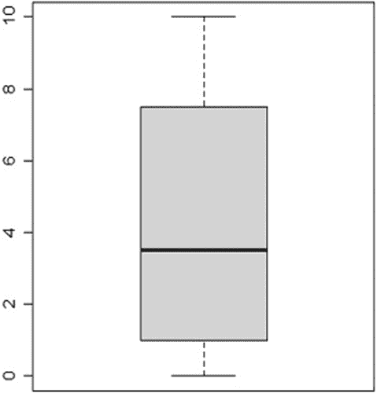

*图 3.2* 数据集 0, 3, 8, 1, 7, 4, 1, 10 的箱线图。返回正文。⏎

```
> x <- c(0, 3, 8, 1, 7, 4, 1, 10)
> boxplot(x)
```

对于 图 3.2 中的数据，我们可以看到分布向较高值倾斜，因为图中上部的值区域更多。也就是说，分布略微正偏。

### 3.2.6 进一步阅读和 R 资源

有许多关于 R 软件的优秀书籍和资源，从初学者到更高级，包括网上丰富的资料。尽管我们下面提到的两个资源都很优秀，但它们都不应被用于*专门*学习统计学或机器学习。它们与更理论性的文本结合使用时最有用。这是对本书前面强调的主题的提醒，即*计算*统计学与*学习*统计学并不相同。实际的统计学在于逻辑和数学，而计算虽然有助于*演示*这些概念，但绝不应被视为等同于它们。“计算环境”太常取代昨日的“统计环境”。长话短说，*思考必须始终先于计算，这意味着数学和统计学（以及对它们的推理）应先于计算。*176

*《R 编程艺术》*（Matloff, 2011）是关于 R 的较好的入门书籍之一，它超越了简单函数并向读者介绍了 R 语言的一些背景。因此，正如标题所暗示的那样，该书是对实际*编程*的介绍，而不仅仅是*使用* R。讨论的话题包括*数据框*、*编程结构*、*面向对象编程*，以及*调试*和性能提升，分别与程序和计算机的速度和内存有关。*《R 之书》*（Davies, 2016）是关于 R 中与统计相关的函数的精彩汇编和概述，包括方差分析中的建模以及简单线性回归和多元回归。

## 3.3 Python

与 R 相比，R 是专门为统计应用设计的编程语言，而 Python 是一种更*通用*的计算语言。因此，它常用于机器学习，而 R 可能更常用于统计学界。与 R 类似，Python 中有许多可用的包和库。包 `scikit-learn` 迄今为止是机器学习应用中最常见的包。一些在统计和机器学习问题中更受欢迎的包包括 `NumPy`、`SciPy`、`Matplotlib`、`pandas` 等。在大多数机器学习应用中，这些和其他库通常在导入实际执行所需机器学习算法的包之前导入。

### 3.3.1 安装 Python

Python 最容易通过 `Anaconda`（[www.anaconda.com](http://www.anaconda.com)）访问：


从那里，可以加载各种笔记本；`Jupyter` 和 `Spyder` 是常见选项。在本书中，我们选择使用 `Spyder`，因其便利性、界面以及数据分析应用的便利性。`Spyder` 也可以直接从 [www.spyder-ide.org](http://www.spyder-ide.org) 下载，而无需使用 `Anaconda`。177

### 3.3.2 Python 元素

与 R 情况相同，Python 操作于*对象*，其中对象可以是两种类型：*标量* vs. *非标量*。标量对象是不可分的，可以被视为该语言的“原子” (Guttag, 2013)。标量对象包括 `int` 用于整数，`float` 用于实数，`bool`，即布尔“真” vs. “假”值，以及 `None`，它只有一个值。作为一个简单示例 (Guttag, 2013，第 9 页)，4 + 2 是一个表达式，表示类型为 `int` 的对象 6，而表达式 3.0 + 7.0 表示类型为 `float` 的对象 10.0。

我们可以通过 `type()` 来询问 Python 以确认对象的类型：

```
type (3)
Out[195]: int
type(3.0)
Out[196]: float
```

Python 中的*变量*仅仅表示一个名称；它与数学中的含义不同。例如，以下是一个变量：

```
> pi = 3.14159
```

也就是说，我们已将 3.14159 与“`pi`”等同起来。当然，`pi` 实际上是一个*常量*，但重点是上面我们只是将 3.14159 与一个变量名 (`pi`) 等同起来。

正如我们在 R 中所做的那样，Python 中的注释可以用“#”表示，在执行代码时 Python 不会读取它们。例如，

```
# the following is an example of addition
2 + 3
Out[203]: 5
```

### 3.3.3 处理数据

正如我们在 R 中所做的那样，我们可以轻松地将 `iris` 数据（当然还有其他数据集）导入 Python 并仅打印几个案例：

```
from sklearn import datasets
iris = datasets.load_iris()
iris
Out[9]:
{‘data’: array([[5.1, 3.5, 1.4, 0.2],
  [4.9, 3. , 1.4, 0.2],
  [4.7, 3.2, 1.3, 0.2],
  [4.6, 3.1, 1.5, 0.2],
```

作为另一个示例，下面我们选择名为 `iq_data` 的数据集的 0 到 10 个案例：

```
iq_data[0:10]
Out[12]:
verbal quant analytic group
0  56.00\t56.00\t59.00\t.00
1  59.00\t42.00\t54.00\t.00
2  62.00\t43.00\t52.00\t.00
3  74.00\t35.00\t46.00\t.00
4  63.00\t39.00\t49.00\t.00
5  68.00\t50.00\t36.00\t.00
6  54.00\t54.00\t29.00\t.00
7  56.00\t52.00\t57.00\t.00
8  51.00\t46.00\t65.00\t.00
9  49.00\t39.00\t61.00\t.00
```

178

如果您完全不熟悉将数据导入 Python 并希望获得更全面的介绍和更多示例，请参阅 Denis (2021b) 或 Python 的 `scikit-learn` 网站上的说明。

### 3.3.4 Python 数据分析函数

`scikit-learn` 库是 Python 中机器学习的“首选”包。它是开源的并且在不断开发中。它还在 Python 网站上有专门的用户指南，并且可以通过 `Anaconda` 安装。Python 还提供许多预处理函数，这些函数是在实际进行分析之前应用于数据的函数。在统计和机器学习应用中，我们经常需要在实现算法或方法之前以某种方式转换数据。在统计术语中，这通常简单地称为*转换*数据，而在机器学习术语中，这通常称为*预处理*数据。Python 中有多种预处理数据的选项。

一个有用且流行的函数是 `MinMaxScaler()` 函数。该函数通过将每个特征缩放到给定范围（例如零到一之间）来转换特征。另一个流行的函数类别是 `pipeline()` 函数。`pipeline()` 函数减少了执行某项操作所需的代码，并将机器学习工作流程中的多个步骤串联起来，这样您无需拟合多个函数，只需拟合 `pipeline()` 函数即可。它也是将所有代码组织到一个函数中的一种方式，特别是如果您经常在不同的数据集上运行相同的编码步骤。`scikit-learn` 中的 `StandardScaler` 将数据转换为均值为 0 且标准差为 1 的*z-*分数。其他缩放选项包括 `RobustScaler()`，它会去除中位数并根据四分位距作为默认值对数据进行缩放。`Normalizer()` 将每个变量或向量缩放到欧几里得长度等于一。当然还有其他缩放选项，我们建议读者查阅 Python 文档或其他资源以探索它们。


使用 `sklearn`，我们可以使用 `train_test_split()` 函数将数据拆分为训练集和测试集。特征（即变量）通常用 `X` 表示，而标签用 `y` 表示。我们将在本章稍后重新讨论如何在软件中执行数据拆分。我们在全书中也会看到这些和其他函数的示例，因为我们将介绍 Python 在各种统计和机器学习方法中的具体应用。

### 3.3.4.1 Mathematics Using Python

与 R 一样，我们可以在 Python 中完成相当多的基本数学运算。例如，基本的数值运算非常简单：

```
2 + 5
Out[8]: 7
```

Python 还可以通过 `cmath` 轻松进行复数分析。请回忆，复数的共轭具有与该数相同的实部，但虚部的符号相反。例如，考虑以下复数：

```
z = 2 + 3j
```

复共轭的计算如下：

```
z.conjugate()
Out[12]: (2-3j)
```

也就是说，`2 + 3j` 的复共轭等于 `2-3j`。要获得一个数的绝对值，我们可以计算：

```
abs(-5)
Out[13]: 5
```

我们也可以直接在 Python 中使用列表（或在此上下文中的向量）：

```
l = [1, 2, 3]
l
Out[21]: [1, 2, 3]
for item in l:
print (item)
1
2
3
```

`enumerate()` 函数会检查列表并打印项目的有序索引号以及项目本身：

```
for index, item in enumerate(l):
print(index, item)
0 1
1 2
2 3
```

为了更清楚地看到上述内容，让我们更改列表的内容：

```
l = [14, 12, 100]
for index, item in enumerate(l):
print(index, item)
0 14
1 12
2 100
```

Python 中还存在无数其他编程函数，但由于篇幅限制，这里不予介绍。有兴趣了解更多内容的读者可以参考本章末尾推荐的资料。

数学运算也可以使用 `math` 模块进行。例如，在下面导入 `math` 后，我们将 π 除以 2：

```
import math
math.pi/2
Out[59]: 1.5707963267948966
```

### 3.3.4.2 Splitting Data into Train and Test Sets

有多种方法可以将数据集拆分为训练集与测试集。常见的方法是使用 `sklearn` 的 `train_test_split()` 函数：

```
import numpy as np
from sklearn.model_selection import train_test_split
```

为了演示该函数，我们首先生成一些数据：

```
X, y = np.arange(10).reshape((5, 2)), range(5)
X
Out[143]:
array([[0, 1],
  [2, 3],
  [4, 5],
  [6, 7],
  [8, 9]])
X_train, X_test, y_train, y_test = train_test_split(
... X, y, test_size=0.33, random_state=42)
```

上面，`test_size=0.33` 表示测试数据集的比例。执行上述代码后，我们得到 `X_train` 如下：

```
X_train
Out[151]:
array([[4, 5],
  [0, 1],
  [6, 7]])
```

而 `X_test` 如下：

```
X_test
Out[152]:
array([[2, 3],
  [8, 9]])
```

读者会注意到上面是数据的 0.40 而不是 0.33。这只是由于四舍五入造成的，因为只选择一个案例所占的比例仅为 0.20。我们可以通过调整 `test_size` 轻松调整测试集的大小：

```
X_train, X_test, y_train, y_test = train_test_split(
X, y, test_size=0.50, random_state=42)
X_test
Out[154]:
array([[2, 3],
[8, 9],
[4, 5]])
```

同样，比例被向上舍入。我们请求 `test_size=0.50`，但 3/5 是 0.60。我们还可以通过 `shuffle=True` 或 `shuffle=False` 选项选择是否对训练集和测试集进行洗牌。下面第一个例子不进行洗牌，第二个进行洗牌。请注意，根据此决策，拆分的值会有所不同：

```
train_test_split(y, shuffle=False)
Out[155]: [[0, 1, 2], [3, 4]]
train_test_split(y, shuffle=True)
Out[156]: [[4, 1, 2], [3, 0]]
```

## 3.3.5 Further Readings and Resources in Python

在学习 Python 方面有几本很棒的书。关于机器学习，其中较为流行的书籍有 Müller 和 Guido（2017）以及 Géron（2017）。许多 Python 编程内容可以通过在线资源找到，例如 Python 的 scikit-learn 网站：[`scikit-learn.org`](https://scikit-learn.org)。

## 3.4 Chapter Review Exercises

1. 在 R 中访问 `iris` 数据，计算 `summary(iris)`，并对输出进行评论。

2. 在 R 中请求 `iris` 数据的第一列。

3. 在 R 中生成一个包含两列的小数据集，为每列命名。

4. 在 R 中安装 `car` 包，并通过 `cran.r-project.org/web/packages/car/car.pdf` 访问其在线文档。

5. 在 Python 中导入数据集 `iris`，并描述第一行数字代表什么。

6. 在 Python 中生成一个包含十个数字的列表并打印该列表。

7. 在 Python 中导入 `math` 模块并计算 2 的平方根。为什么这个答案不令人满意？

# Part II Models and Methods

## 4 Univariate and Multivariate Analysis of Variance Models

DOI: [10.4324/9781003376941-7](https://doi.org/10.4324/9781003376941-7)

方差分析（ANOVA）模型在历史上一直是实验科学中应用统计方法的基石，例如生物学、心理学以及任何使用随机化和随机分配的地方。始于 R.A. Fisher 在 1925 年，ANOVA 模型被引入作为一种方便的方式来“打包”一般线性模型，该模型首先在 19 世纪末主要由 Yule 和 Pearson 在回归背景下开发，但其目的专门针对积极操纵自变量以观察其对因变量影响的实验者。尽管回归主要起源于 1890 年代，ANOVA 起源于 1920 年代，但两者之间当然存在广泛的重叠，其中 ANOVA 在大多数情况下可以被视为更广泛回归模型的“特例”，而回归可以被视为更广泛一般线性模型的特例。更进一步，一般线性模型可以被视为更广泛广义线性模型的特例。当同时对多个响应变量进行建模而自变量仍为分类时，就会产生多变量方差分析（MANOVA），将在本章后面介绍。线性判别分析，或简称为“LDA”，可以被视为 MANOVA 的“逆向”，正如我们将看到的那样，其中我们不是在某些变量的线性组合上评估组间差异，而是寻求了解导致此类差异的判别函数。

我们对经典 ANOVA 模型的回顾相对简短，一方面是因为我们假设读者至少在某种程度上已经熟悉 ANOVA，另一方面也是因为在需要撰写许多其他内容的书籍中篇幅有限。然而，我们的简要处理并不意味着 ANOVA 在理论上不深刻，或在历史上 somehow 不像曾经那样“重要”。事实上，从教学角度来看，深入理解“基础 ANOVA”（正如非量化人士所称）在理解统计方法整体方面大有裨益。所谓的“高级”方法，如多层建模，在其核心不过是对“基础”ANOVA 模型的概括和扩展，并结合了回归原理。因此，ANOVA 模型在更大的框架中可能被认为相对简单，但深入理解其概念绝非易事，尤其是对于相对新手而言。


ANOVA 在更深层次的理论层面研究的复杂性，可由诸如 Scheffé（1959） 的来源所证明，其彻底剖析了模型及其潜在的数学原理。有关 ANOVA 如何从基础构建、通过算术均值的简单偏差逐步形成经典 ANOVA 表的介绍，请参阅 Denis（2021a）。

## 4.1 经典 ANOVA 模型

在经典 ANOVA 中，我们寻求评估如下类型的零假设 186
`H[0]`: `μ[1]` = `μ[2]` = `μ[3]` = `μ[4]`
(4.1)
与备择假设相对，后者认为均值中某处至少存在一对差异；例如，
`H[1]`: `μ[1]` ≠ `μ[2]`, `μ[2]` = `μ[3]`, `μ[3]` = `μ[4]`
当然，通常我们并不知道 *总体均值*，因为在大多数情况下总体极其庞大。如果我们拥有总体，那么评估零假设就是一件简单的事情，只需查看总体均值是否相等即可，无需进行统计推断。这一点不应被忽视；如果你发现自己对 *总体* *均值* 进行显著性检验，那么你的统计推断理解就有问题！重申一下，如果你拥有总体参数，“游戏”就结束了；你只需观察总体上的汇总统计数据所说明的内容，并仅在此描述性基础上得出总体差异。

在更现实的情形下，我们只有样本数据时，任务是评估在零假设可成立或“为真”的假设下，观察到我们所观察到的那种样本差异的概率。作为一个简单示例，假设我们获得了以下四个样本均值：
$${\\overline{y}}\_{1} = 10,{\\overline{y}}\_{2} = 15,{\\overline{y}}\_{3} = 20,{\\overline{y}}\_{4} = 21$$
我们想要问的问题是，*在零假设的假设下，观察到这种均值差异的概率是多少*？更简洁地说，我们希望解决在零假设下数据的概率，即 `p(D/H[0])`。如果该概率很小（例如小于 0.05 为典型的显著性水平），则表明我们观察到的那种差异在零假设下不太可能发生，我们开始怀疑零假设的可成立性。我们可能怀疑到足以拒绝零假设，并推断出 *统计备择假设*（稍后会详细介绍），即在均值中某处有理由相信至少存在一对均值之间的差异。

ANOVA 程序的结果最终归结为确定用于评估 `p(D/H[0])` 的 `p-value`。正如读者可能回忆的那样，`p-value` 是通过在 ANOVA 中划分变异来源 *between* 和 *within* 确定的，从而产生这些来源的方差，即所谓的 ANOVA 的 *mean squares*。请注意，均方仅仅意味着某种平均值（即均值），其中平方和除以自由度，因此得名“均方”。由此，我们制定了方差 *between* 相对于组内方差 *within* 的比率（`F-ratio`）：
$$F = \\frac{\\sigma^{2}{}\_{Between}}{\\sigma^{2}{}\_{Within}}$$
(4.2)
`F` 的期望值大约等于 1.0。更精确地说，精确期望 `E` 等于 187
$$E\\left( F \\right) = \\frac{df\\,\\text{error}}{df\\,\\text{error} - 2}$$
其中 `df error` 是 ANOVA 汇总表中误差项的自由度，等于 `N - J`，其中 `N` 是数据点的总数，`J` 是自变量的组数或水平数。

如果 `σ²[Between]` > `σ²[Within]` 超出随机误差或偶然所期望的程度，则这被视为反对零假设的证据，我们拒绝它而支持统计备择假设。每个 ANOVA 都伴随着一个汇总表，显示各种平方和的划分以及均方的产生。表 4.1 是一个经典的汇总表，说明了经典 ANOVA 的划分。

*表 4.1* 经典单因素固定效应 ANOVA 表中平方和的划分返回正文。⏎

| 来源 || 平方和 || 自由度 || 均方 || `F-Ratio` || `p-Value` |
| --- | --- | --- | --- | --- | --- |
| 组间 || $\\sum\\limits\_{j}^{J}{n\_{j}\\left( {\\overline{y}}\_{j} - \\overline{y}. \\right)^{2}}$ || `J-1` || $\\frac{\\sum\\limits\_{j}^{J}{n\_{j}\\left( {\\overline{y}}\_{j} - \\overline{y}. \\right)^{2}}}{J - 1}$ || $\\frac{{\\sum\\limits\_{j}^{J}{n\_{j}\\left( {\\overline{y}}\_{j} - \\overline{y}. \\right)^{2}/}}J - 1}{\\sum\\limits\_{j = 1}^{J}{\\sum\\limits\_{i}^{n}{\\left( {y\_{ij} - {\\overline{y}}\_{j}} \\right)^{2}/\\left( {N - J} \\right)}}}$ || 将所得比率作为 `F`-stat 在 `J-1` 和 `N-J` 自由度上进行评估 |
| --- | --- | --- | --- | --- | --- |
| 组内 || $\\sum\\limits\_{j = 1}^{J}{\\sum\\limits\_{i}^{n}\\left( {y\_{ij} - {\\overline{y}}\_{j}} \\right)^{2}}$ || `N-J` || $\\frac{\\sum\\limits\_{j = 1}^{J}{\\sum\\limits\_{i}^{n}\\left( {y\_{ij} - {\\overline{y}}\_{j}} \\right)^{2}}}{N - J}$ || – || – |
| 总计 || $\\sum\\limits\_{j = 1}^{J}{\\sum\\limits\_{i}^{n}\\left( {y\_{ij} - \\overline{y} \\cdot} \\right)^{2}}$ || `N-1` || $\\begin{array}{l} {s^{2} = \\frac{\\sum\\limits\_{j = 1}^{J}{\\sum\\limits\_{i = 1}^{n}\\left( {y\_{ij} - \\overline{y} \\cdot} \\right)^{2}}}{N - 1}} \\\\ {\\left( {N - 1} \\right)\\left( s^{2} \\right) = {\\sum\\limits\_{j = 1}^{J}{\\sum\\limits\_{i = 1}^{n}\\left( {y\_{ij} - \\overline{y} \\cdot} \\right)^{2}}}} \\\\ \\end{array}$ || – || – |

在汇总表中，我们注意到变异来源被划分为 *between* 和 *within*。组间平方和等于
$$\\sum\\limits\_{j}^{J}{n\_{j}\\left( {\\overline{y}}\_{j} - \\overline{y}. \\right)^{2}}$$
是组均值 ${\\overline{y}}\_{j}$ 与数据整体或“总均值” $\\overline{y}.$ 的平方偏差之和，其中平方项前的 `n[j]` 仅为每组的观测数，在此假设为相等。偏差被平方是因为均值偏差之和必然等于零，即 $\\sum\\limits\_{j}^{J}{n\_{j}\\left( {\\overline{y}}\_{j} - \\overline{y}. \\right)}$ 将始终等于零，从而无法制定上述 `F-ratio`。通过平方偏差，我们允许 `nj²` 在组均值 ${\\overline{y}}\_{j}$ 与总体均值 $\\overline{y}.$ 不同时按幅度增加。因此，划分中的组间平方和对科学家最感兴趣，因为在其他条件相同的情况下，较大的值表明一个处理组与另一个处理组之间存在差异。188

第二项平方和（SS），即 SS 组内
$$\\sum\\limits\_{j = 1}^{J}{\\sum\\limits\_{i}^{n}\\left( y\_{ij} - {\\overline{y}}\_{j} \\right)^{2}}$$


## 4.1 ANOVA Overview
评估每个组内观测值 `y[i j]` 与对应组均值 ${\overline{y}}_{j}$ 之间存在的偏差程度。 由于这些观测值发生在同一组内，它们不可能由处理效应引起，而我们将其归因于随机误差以及模型中未包含的可能来源。 同样我们对偏差求平方和，以避免如果我们只是对偏差求和而不平方，总和总是等于零。 通常较大的 `within` 项并不是一个有利的结果，因为它表明数据中的相当一部分变异是由处理变量未解释的因素造成的。 例如，如果 `SS within` 等于 `SS between`，那么这就表明数据的变异与随机机会或噪声解释得一样好，而不是由组间差异解释。 因此对实验者有利的结果是 `SS between` 明显大于 `SS within`，这将表明在所研究的总体变异中，以 `SS total` 表示，$\sum\limits_{j = 1}^{J}{\sum\limits_{i = 1}^{n}\left( y_{ij} - \overline{y}. \right)^{2}}$，其中很大一部分可以由 `between` 组差异（即 `SS between`）来“解释”。 那么 `SS between` 与 `SS total` 的比率就很有意义，我们将很快将其命名为效应量度量，称为 `Eta-squared`。

### 4.1.1 Mean Squares
方差分析之所以得名，是因为它分析的是 `variances`，而不仅仅是平方和。 我们所考察的平方和并不是方差。 回想一下，正如简单样本方差的情况一样，要生成方差，我们需要除以自由度。 将每个变异来源，即 `between` 和 `within`，除以相应的自由度将产生上述的 `mean squares`，这只是方差的另一个名称。 `between` 的自由度等于 `J - 1`；也就是说，比自变量上的组数少一个。 `within` 的自由度等于 `N - J`，即观测总数减去组数。
将平方和除以自由度可生成 `between` 的 `mean squares`（`MS between`）和 `within` 的 `MS within`，然后我们可以比较 `MS between` 相对于 `MS within` 的大小。 这种通过比率进行的比较就是上述的 `F-ratio`。 回想一下，我们说在零假设下 `F` 的期望值大约等于 1。 如果存在处理效应，则我们期望 `MS between` 大于 `MS within`，因此 `F > 1`。 然而，远离 1.0 的微小偏差很容易归因于偶然或随机波动，因此我们将对 `F` 进行统计显著性检验，以确定在零假设为“真实”的假设（且 somewhat 不切实际）情况下观察到我们所获得的 `F` 的概率。 如果我们观察到的 `F` 的概率小于 0.05 等常规水平，则我们拒绝零假设并推断统计备择假设（不一定是实质性备择假设；我们稍后将讨论差异），即在总体均值中某处至少存在一对差异。189

### 4.1.2 Expected Mean Squares of ANOVA
在我们概述 ANOVA 的工作原理时，尽管我们逐步介绍了汇总表的逻辑，但我们并没有以任何方式为 `F-ratio` 实际上估计我们感兴趣的量进行辩护或证明。 换句话说，我们没有证明像我们所做的那样计算 `F-ratio` 实际上是有意义的，即使在算术上这样计算似乎很直观。 `MS between` 和 `MS within` 只是对样本数据进行的计算，但我们如何知道它们在总体中实际上估计的是什么？
回想一下，当我们对数据计算简单样本方差时，我们通过取其期望来证明其计算的合理性，并发现用 `n - 1` 作为分母时它产生了总体方差 σ 2 的无偏估计。 我们需要对 ANOVA 生成的方差提出类似的问题。 也就是说，`MS between` 和 `MS within` 的期望是什么？ 只有这样我们才会知道我们实际上是在估计能够证明随后 `F-ratio` 的量。
有关取期望的完整细节，请参阅 Denis (2021a)。 由于篇幅限制，我们在此仅总结最终结果。 在 `fixed-effects model` 中，`MS between` 的期望结果为
$$E\left( \text{MS\ Between)} = \frac{\sum\limits_{j}\left( {n_{j}\alpha_{j}^{2}} \right)}{J - 1} + \sigma_{e}^{2} \right.$$
(4.3)
而对于 within，`E(MS Within)=sigma_e²`。 如果没有处理效应，则 `alpha_j² = 0`，因此
$$\begin{array}{l} {E\left( \text{MS\ Between)\ =}\frac{\sum\limits_{j}\left( {n_{j}\left( 0 \right)_{j}^{2}} \right)}{J - 1} + \sigma_{e}^{2} \right.} \\ {\,\,\,\,\,\,\,\,\,\,\,\,\,\,\,\,\,\,\,\,\,\,\,\,\,\,\,\,\,\,\,\,\,\,\,\,\,\,\,\,\,\,\,\,\,\,\,\,\,\,\,\,\,\,\,\,\, = \sigma_{e}^{2}} \\ \end{array}$$
因此在这些方差上计算的 `F-ratio` 将产生大约等于 1.0 的比率，因为 `sigma_e²/sigma_e² = 1`。 `alpha_j² > 0` 的程度就是处理效应存在的程度，因此我们期望 $\sum\limits_{j}\left( {n_{j}\alpha_{j}^{2}} \right)$ 大于 0，导致 `E(MS Between)` 大于仅仅的 `sigma_e²`。 因此，在这些条件下，我们期望 `F` 统计量大于 1.0，使得在 `J - 1` 和 `N - J` 自由度上评估为 `F` 时如果足够大，我们会认为其 `statistically significant` 并拒绝零假设。
我们提到这是针对 `fixed-effects model` 的，读者可能已经熟悉。 在固定效应模型中，我们假设在实验的理论重复中，将使用自变量的相同水平。 例如，具有药物水平 0、1 和 2 mg 的固定效应 ANOVA 意味着这些特定水平是研究人员感兴趣的，如果我们重复进行实验，将再次使用它们。 这与 `random-effects model` 形成对比，在该模型中，每个实验都会从潜在水平的理论概率分布中随机抽样水平，这些水平可以根据某种概率模型（通常是随机抽样）选择。 理解固定效应模型可以从理解随机效应模型中获益很大，我们稍后将对其进行概述。
重申一下，以上内容的目的是简单地断言，通过取 `MS between` 除以 `MS within` 来计算固定效应方差分析的 `F-ratio` 是通过取期望值来证明的。 实际上，ANOVA 的使用者在每次进行该程序时并不是计算期望均方。 相反，她只是计算 `F`（或解释软件输出）并对 `H[0]` 做出决定。 上述期望均方 190 的目的只是提供理论证据，证明 `F-ratio` 在理论上由期望均方理论证明。 在经典单向 ANOVA 中，最初要求这种证明似乎是微不足道的。 然而，随机效应和混合模型理论中的更复杂模型表明，`MS within`（或“MS error”）并不总是评估 ANOVA 中各种项的零假设的最合适的分母。 我们将在本章稍后对这些模型进行概述。

### 4.1.3 Effect Sizes for ANOVA


拒绝 `ANOVA` 中的零假设仅表明在零假设下观察到的统计量相对不太可能或不太可能，因此有证据表明总体均值不相等。它本身并不能表明观察到的差异在任何意义上都是 *大*、*有意义*，或 *在科学上重要*。确实，检查 `ANOVA` 汇总表可知，在样本量 `N` 足够大的情况下，即使组均值与总均值的偏差很小，统计显著性以及由此拒绝零假设也是 assured。举例来说，考虑当 `N` 极大时，`SS within` 除以一个相当大的 `N` − `J` 项时会发生什么。分子 $\\sum\\limits\_{j = 1}^{J}{\\sum\\limits\_{i}^{n}\\left( y\_{ij} - {\\overline{y}}\_{j} \\right)^{2}}$ 被一个越来越大的数 `N` − `J` 除，比例变得越来越小，并且当 `N` 无界增长时，在极限情况下 `MS within` 最终趋于 0：

$$\\lim\\limits\_{N\\rightarrow\\infty}\\text{MS}\_{Within} = 0$$

分子除以越来越大的分母会产生越来越小的比例。随着 `MS[Within]` 变小，`MS[Between]` 相比之下显得很大，因此即使均值之间的实际距离极小，也可能出现统计显著的 `F`-比值。*因此，“`p` < `0.05`” 即使在均值差异可忽略且在实质上无意义或不重要 的条件下也可能发生*。如果某人天真地将陈述“`p` < 0.05”与实验必然在任何意义上揭示“重要”效应联系起来，这种结论可能对可能 otherwise 不了解 `p`-值是何种函数作用的读者造成极具误导性的影响。*不理解 p 值告诉你什么 vs. 它没有告诉你什么可能会导致结果的严重误传，这在许多专业甚至“高影响因子”期刊发表的研究结果中每天都在发生*。*将统计显著性与效应量混为一谈在科学界仍然非常常见，尽管几乎 100 年来一直在尝试纠正这些误解*。

由于 `p`-值不表示实验或研究中效应的强度，因此应始终与 `p`-值一起报告的度量是 *效应量*。一个好的效应量不会让其大小受到样本量简单增加或减少的影响。对于 `ANOVA`，一个经典的效应量是通过取 `SS between` 与 `SS total` 的比值获得的：

$$\\eta^{2} = \\frac{SS\\,\\text{Between}}{SS\\,\\text{Total}} = \\frac{\\sum\\limits\_{j}^{J}{n\_{j}\\left( {\\overline{y}}\_{j} - \\overline{y}. \\right)^{2}}}{\\sum\\limits\_{j = 1}^{J}{\\sum\\limits\_{i = 1}^{n}\\left( y\_{ij} - \\overline{y}. \\right)^{2}}}$$

(4.4)

`SS between` 相对于 `SS total` 大的程度就是总变异被“解释” 为处理效应的程度。可以很容易地证明 `η²` 的最大值为 1.0，最小值为 0。1.0 的值表示数据中 100% 的变异由 191treatment effects 解释，而 0 的值表示数据中 0% 的变异由处理效应解释，也意味着 `SS within/SS total` 等于 1.0，因为 `SS between` + `SS within` 必须等于 `SS total`。

*Eta-squared* 是作为效应量第一步报告的流行统计量；然而，它向上有偏，意味着它通常 *高估* 总体中的真实效应量。一种偏差较小的效应量是 *omega-squared*，`ω²`，其对应的估计量如下：

$${\\hat{\\omega}}^{2} = \\frac{SS\\, between - \\left( J - 1 \\right)MS\\, within}{SS\\, total + MS\\, within}$$

(4.5)

我们注意到 `ω²` 在其公式中包含了组间自由度 (`J` – 1)，使其比仅包含平方和的 Eta-squared 更具“推断性”。分子相对于分母大的程度就是 `ω²` 会更大的程度。与 `η²` 不同，`ω²` 可以为负 (Okada, 2017)，其中值为 1 表示响应中的 100% 方差由自变量上的均值差异解释。`ω²` 的另一种等价但不同的计算方法是

$$\\omega^{2} = \\frac{\\left( J - 1 \\right)\\left( F - 1 \\right)}{\\left( J - 1 \\right)\\left( F - 1 \\right) + nJ}$$

(4.6)

其中 `F` 是从 `ANOVA` 获得的，`n` 是每组的样本量，在此情况下假设自变量每个水平上的 `n` 相等。这种 `ω²` 的替代公式在研究人员或期刊文章可能不呈现 `ANOVA` 的完整汇总表而只提及 `F` 的情况下很有用。有关 `ω²` 的更多细节可在 Kirk (1995) 中找到。理想情况下，研究人员在总结 `ANOVA` 发现时应报告 *至少* `η²` 和 `ω²` 两者。还可计算将设计特征纳入其计算的这两种统计量的广义版本。详情请参阅 Olejnik and Algina (2003)。

### 4.1.4 对比和 *事后* 检验 for ANOVA

通常，研究人员对来自 `ANOVA` 的仅仅统计显著的 `F`-比值并不那么感兴趣，而更感兴趣的是自变量水平之间的特定组 *对比*。在双组 `ANOVA` 中，它只是单变量 `t` 的推广，只有一个对比需要进行，一组 vs. 另一组，而 `ANOVA` 或 `t`-检验已经完成了它。然而，在有三个或更多组的情况下，研究人员通常希望指定特定的成对组比较。例如，在三组问题中，研究人员可能希望将组 1 与组 2 和 3 的组合进行比较。也许组 1 是对照组，而组 2 和 3 是实验组。为此，可以计算一个 *总体比较* `C[i]`，

$$C\_{i} = c\_{1}\\mu\_{1} + c\_{2}\\mu\_{2} + \\cdot \\cdot \\cdot + c\_{J}\\mu\_{J} = {\\sum\\limits\_{j = 1}^{J}{c\_{j}\\mu\_{j}}}$$

(4.7)

其中 `c[1]` 到 `c[J]` 是权重，通常为整数，而 `μ[1]` 到 `μ[J]` 是总体均值。总体比较然后是一个 *加权总体均值的和*。如果我们选择权重 `c[1]` 到 `c[J]` 使这些权重之和为 0，则总体比较变为总体 192*线性对比*。在这种情况下，如果和 $\\sum\\limits\_{j = 1}^{J}{c\_{j}\\mu\_{j}}$ 与 0 存在任何偏差，这显然不是由于权重 `c[1]` 到 `c[J]` 的线性总和，而是必须是一个总体均值 `μ[1]` 到 `μ[J]` 不相等的功能。这正是选择权重 `c[1]` 到 `c[J]` 使其总和为 0 的精确原因，以便 `C[i]` 与 0 的偏差反映研究人员感兴趣的成对组比较（以定义的对比形式）。

作为一个涉及三个组（总体）的比较示例，我们有以下内容：

`C[i]` = `c[1]` `μ[1]` + `c[2]` `μ[2]` + `c[3]` `μ[3]`

假设研究人员假设 `μ[1]` 与 `μ[2]` 和 `μ[3]` 作为一个集合不同。此假设可反映在以下总体对比中：

$$\\begin{array}{l} {C\_{i} = c\_{1}\\mu\_{1} + c\_{2}\\mu\_{2} + c\_{3}\\mu\_{3}} \\\\ {\\,\\,\\,\\,\\,\\,\\, = \\left( 2 \\right)\\mu\_{1} + \\left( - 1 \\right)\\mu\_{2} + \\left( - 1 \\right)\\mu\_{3}} \\\\ \\end{array}$$

通过选择权重“2”和“−1”和“−1”使其总和为 0，我们看到上述成功比较了 `μ[1]` 与 `μ[2]` 和 `μ[3]` 作为一个集合。`C[i]` 与 0 的任何偏差只能由于 `μ[1]` 与 `μ[2]` 和 `μ[3]` 之间的差异。


通常，我们很少甚至从不了解 `μ[1]`、`μ[2]` 和 `μ[3]` 的值。相反，我们必须根据数据对其进行估计，通过计算相应的样本均值 ${\\overline{y}}\_{1},{\\overline{y}}\_{2},{\\overline{y}}\_{3}$：

$$\\begin{array}{l} {{\\hat{C}}\_{i} = c\_{1}{\\overline{y}}\_{1} + c\_{2}{\\overline{y}}\_{2} + c\_{3}{\\overline{y}}\_{3}} \\\\ {\\,\\,\\,\\,\\,\\,\\, = \\left( 2 \\right){\\overline{y}}\_{1} + \\left( - 1 \\right){\\overline{y}}\_{2} + \\left( - 1 \\right){\\overline{y}}\_{3}} \\\\ \\end{array}$$

这现在是一个 `estimated linear contrast`，可以更一般地表述为

$$\\begin{array}{l} {{\\hat{C}}\_{i} = c\_{1}{\\overline{y}}\_{1} + c\_{2}{\\overline{y}}\_{2} + \\cdot \\cdot \\cdot + c\_{J}{\\overline{y}}\_{J}} \\\\ {\\,\\,\\,\\,\\,\\,\\, = {\\sum\\limits\_{j = 1}^{J}{c\_{j}{\\overline{y}}\_{j}}}} \\\\ \\end{array}$$

(4.8)

对比的方差等于

$$\\sigma\_{{\\hat{C}}\_{i}}^{2} = MS\\, error{\\sum\\limits\_{j}\\frac{c\_{j}^{2}}{n\_{j}}}$$

(4.9)

且估计标准误等于方差的平方根，193

$$\\sigma\_{{\\hat{C}}\_{i}} = \\sqrt{\\sigma\_{{}\_{{\\hat{C}}\_{i}}}^{2}}$$

(4.10)

在估计标准误确定后，我们现在可以评估原假设 `C[i]` = 0：

`H[0]` : `C[i]` = 0

(4.11)

与备择假设相比，即真实对比值不等于 0：

`H[1]` : `C[i]` ≠ 0

(4.12)

对比的原假设通常作为来自整体 ANOVA 的 `N`−`J` 自由度上的 `t` 统计量进行评估，

$$t = \\frac{{\\hat{C}}\_{i} - C\_{i}}{\\sigma\_{{\\hat{C}}\_{i}}}$$

(4.13)

`Ĉ[i]` − `C[i]` 与估计标准误 `σ[Ĉ[i]]` 相比的程度有多大，就有多大的理由最终拒绝原假设并推断统计备择假设。也就是说，我们至少在给定实验中拥有证据，表明研究人员假设的特定均值差异存在于数据所抽取的总体中。

`Post-hoc tests` 试图控制比较或对比中 I 类错误率的膨胀。关于 `post-hoc` 检验的综述，请参阅 Ott 和 Longnecker (2016)。一个流行的检验是 Tukey HSD（“诚实显著差异”）。我们在某些虚构数据上的 ANOVA 之后执行它：194

```
> y <- c(5, 8, 2, 9, 4, 7, 2, 8, 20, 21, 23, 25)
> x <- c(0, 0, 0, 1, 1, 1, 2, 2, 2, 3, 3, 3)
> x.factor <- factor(x)
> model <- aov(y ~ x.factor)
> summary(model)
```

|  || 自由度 || 平方和 || 均方 || F 值 || Pr(>F) ||  |

| --- | --- | --- | --- | --- | --- | --- |

| x.因子 || 3 || 599.0 || 199.67 || 7.729 || 0.0095 || \*\* |

| --- | --- | --- | --- | --- | --- | --- |

| 残差 || 8 || 206.7 || 25.83 ||  ||  ||  |

```
---
Signif. codes: 0 ‘***’ 0.001 ‘**’ 0.01 ‘*’ 0.05 ‘.’ 0.1 ‘ ’ 1
```

```
> tukeyHSD <- TukeyHSD(model)
```

```
 Tukey multiple comparisons of means
  95% family-wise confidence level
```

```
Fit: aov(formula = y ~ x.factor)
```

```
$x.factor
```

|  || 差值 || 下限 || 上限 || p 调整 |

| --- | --- | --- | --- | --- |

| 1-0 || 1.666667 || \-11.6229870 || 14.95632 || 0.9766194 |

| --- | --- | --- | --- | --- |

| 2-0 || 5.000000 || \-8.2896536 || 18.28965 || 0.6409284 |

| 3-0 || 18.000000 || 4.7103464 || 31.28965 || 0.0106625 |

| 2-1 || 3.333333 || \-9.9563203 || 16.62299 || 0.8512024 |

| 3-1 || 16.333333 || 3.0436797 || 29.62299 || 0.0181554 |

| 3-2 || 13.000000 || \-0.2896536 || 26.28965 || 0.0551647 |

从输出中，我们可以看到组 3 与组 0 之间的差异在统计上显著（`p` = 0.0106625），而组 3 与组 1 之间的差异也具有统计显著性（`p` = 0.0181554）。组 3 与组 2 之间的差异是边缘显著的（`p` = 0.0551647）。

我们还演示了 Scheffé 检验，这是一种比 Tukey 更保守的检验，意味着它对 I 类错误有更强的保护作用（即，与更 `liberal` 的事后检验相比，使用 Scheffé 拒绝原假设更困难）：

```
> library(DescTools)
> ScheffeTest(model)
Posthoc multiple comparisons of means: Scheffe Test
95% family-wise confidence level
$x.factor
```

|  || 差值 || 下限.ci || 上限.ci || p 值 ||  |

| --- | --- | --- | --- | --- | --- |

| 1-0 || 1.666667 || \-12.827677 || 16.16101 || 0.9824 ||  |

| --- | --- | --- | --- | --- | --- |

| 2-0 || 5.000000 || \-9.494344 || 19.49434 || 0.7027 ||  |

| 3-0 || 18.000000 || 3.505656 || 32.49434 || 0.0170 || \* |

| 2-1 || 3.333333 || \-11.161010 || 17.82768 || 0.8832 ||  |

| 3-1 || 16.333333 || 1.838990 || 30.82768 || 0.0282 || \* |

| 3-2 || 13.000000 || \-1.494344 || 27.49434 || 0.0800 || . |

```
---
Signif. codes: 0 ‘***’ 0.001 ‘**’ 0.01 ‘*’ 0.05 ‘.’ 0.1 ‘ ‘ 1
```

我们可以看到差异 3-0 和 3-1 仍然具有统计显著性，但 `p` 值比 Tukey 时略大。3-2 的 `p` 值现在升高到 0.0800，而请回忆使用 Tukey 时它等于 0.055。

### 4.1.5 Python 中的 ANOVA

我们下面对 ANOVA 的演示非常简单，我们会快速进行，因为我们假设读者已经有拟合 ANOVA 模型和评估假设的经验。请参阅 Denis (2021b) 获取更多 Python 软件示例。

在 Python 中进行单因素方差分析有多种方法。下面我们使用 `SciPy` 库来评估均值温度在总体 1–4 中是否相同的原假设：

```
from scipy.stats import f_oneway
temperature1 = [89, 89, 88, 78, 79]
temperature2 = [93, 92, 94, 89, 88]
temperature3 = [89, 88, 89, 93, 90]
temperature4 = [81, 78, 81, 92, 82]
```

注意有四个组。第一组的数据值为 89、89、88、78 和 79。第二组的数据值为 93、92、94、89、88，依此类推，其他两组也是如此。我们使用 `f_oneway()` 进行 ANOVA：195

```
f_oneway(temperature1, temperature2, temperature3, temperature4)
Out[553]: F_onewayResult(statistic=4.625000000000002, pvalue=0.016336459839780215)
```

我们看到报告的 `F`-统计量为 4.625，其相关 `p` 值为 0.0163，这超过了 `p` < 0.05，因此在分析的假设得到满足的情况下，我们通常会拒绝总体均值相等的原假设。也就是说，在均值之间至少存在一个统计显著的均值差异。

还可以使用 `statsmodels` 进行 ANOVA，其中下面我们还建模了交互作用（交互作用将在后面讨论；然而，我们假设读者至少对其有所了解）：

```
import statsmodels.api as sm
from statsmodels.formula.api import ols
```

对于此示例，我们将加载 `Moore` 数据并改编 `statsmodels` 中的一个示例：

```
moore = sm.datasets.get_rdataset(“Moore”, “carData”,
cache=True)
data = moore.data
data
Out[11]:
```

|  || 配对状态 || 顺从性 || f 类别 || f 分数 |

| --- | --- | --- | --- | --- |

| 0 || low || 8 || low || 37 |

| --- | --- | --- | --- | --- |

| 1 || low || 4 || high || 57 |

| 2 || low || 8 || high || 65 |

| 3 || low || 7 || low || 20 |

| 4 || low || 10 || low || 36 |

| 5 || low || 6 || low || 18 |

我们将 `partner.status` 重命名为 `partner_status`：

```
data = data.rename(columns={“partner.status”:
“partner_status”})
data
Out[13]:
```

|  || 配对状态 || 顺从性 || f 类别 || f 分数 |

| --- | --- | --- | --- | --- |

| 0 || low || 8 || low || 37 |

| --- | --- | --- | --- | --- |

| 1 || low || 4 || high || 57 |

| 2 || low || 8 || high || 65 |

| 3 || low || 7 || low || 20 |

| 4 || low || 10 || low || 36 |

| 5 || low || 6 || low || 18 |

我们现在进行 ANOVA：

```
moore_lm = ols(‘conformity ~ C(fcategory, Sum)*C(partner_status, Sum)’,
data=data).fit()
```

196197

我们现在请求 ANOVA 汇总表的打印输出：

```
table = sm.stats.anova_lm(moore_lm, typ=2)
print(table)
```


|  || 平方和 || 自由度 || F || PR(>F) |
| --- | --- | --- | --- | --- |
| C(fcategory, Sum) || 11.614700 || 2.0 || 0.276958 || 0.759564 |
| --- | --- | --- | --- | --- |
| C(partner\_status, Sum) || 212.213778 || 1.0 || 10.120692 || 0.002874 |
| C(fcategory, Sum):C(partner\_status, Sum) || 175.488928 || 2.0 || 4.184623 || 0.022572 |
| 残差 || 817.763961 || 39.0 || NaN || NaN |

从上表可以看出，交互效应在统计上显著（`p` = 0.022572），以及其中一个主效应（`p` = 0.002874）也显著，而另一个主效应则不显著（`p` = 0.759564）。由于交互作用在统计上显著，应在主效应之前对其进行解释；如果对主效应进行解释，则应在解释中提及存在统计显著的交互作用。交互作用为主要效应提供了更广的*context*。结果表明，伴侣状态的均值差异取决于类别水平。

### 4.1.6 R 中的 ANOVA

与 Python 一样，在 R 中拟合 ANOVA 模型的方式有很多。我们以 *Plant Growth* 数据集为例，其中包含不同植物组的重量（下面打印了几个案例）：

```
> library(plotly)
> data <- PlantGrowth
> set.seed(123)
> head(PlantGrowth)
```

|  || 重量 || 组 |
| --- | --- | --- | --- |
| 1 || 4.17 || ctrl |
| --- | --- | --- | --- |
| 2 || 5.58 || ctrl |
| 3 || 5.18 || ctrl |
| 4 || 6.11 || ctrl |
| 5 || 4.50 || ctrl |
| 6 || 4.61 || ctrl |

```
> levels(data$group)
[1] “ctrl” “trt1” “trt2”
> res.aov <- aov(weight ~ group, data = data)
> summary(res.aov)
```

|  || 自由度 || 平方和 || 均方 || F 值 || Pr(>F) ||  |
| --- | --- | --- | --- | --- | --- | --- |
| 组 || 2 || 3.766 || 1.8832 || 4.846 || 0.0159 || \* |
| --- | --- | --- | --- | --- | --- | --- |
| 残差 || 27 || 10.492 || 0.3886 ||  ||  ||  |

```
---
Signif. codes: 0 ‘***’ 0.001 ‘**’ 0.01 ‘*’ 0.05 ‘.’ 0.1 ‘ ’ 1
```

我们看到存在组主效应（`p` = 0.0159）。现在我们可以进行多重比较以了解组差异所在：

```
> TukeyHSD(res.aov)
Tukey multiple comparisons of means
95% family-wise confidence level
```

```
Fit: aov(formula = weight ~ group, data = data)
```

```
$group
```

|  || 差值 || 下限 || 上限 || p 调整 |
| --- | --- | --- | --- | --- |
| trt1-ctrl || \-0.371 || \-1.0622161 || 0.3202161 || 0.3908711 |
| --- | --- | --- | --- | --- |
| trt2-ctrl || 0.494 || \-0.1972161 || 1.1852161 || 0.1979960 |
| trt2-trt1 || 0.865 || 0.1737839 || 1.5562161 || 0.0120064 |

我们看到处理 1 和 2 之间的差异在统计上显著，p 值为 0.012。其他成对差异均不显著。方差的相等性也可以进行评估。许多检验可用，我们选择 Bartlett 检验：

```
> bartlett.test(weight ~ group, data)
```

```
   Bartlett test of homogeneity of variances
```

```
data: weight by group
Bartlett’s K-squared = 2.8786, df = 2, p-value = 0.2371
```

我们没有证据拒绝方差相等的假设（`p` = 0.2371）。明智的做法是对同一数据进行各种方差相等性检验，以查看它们是否报告相似的发现。如果方差相等的假设被拒绝，虽然对数据进行转换是一个选项，但更重要的是要好奇违反的原因。为什么方差不相等？在从 *scientific* 角度好奇之前，请在 *statistically* 解决该问题（例如，使用转换）。轻微的违反通常不需要任何补救措施，因为 ANOVA 对假设的轻微违反相当稳健。然而，如果方差等假设的违反变得更加明显，尤其是在样本量不相等的情况下，应采取纠正措施，或者至少应附带必要的警告报告结果。非参数检验如 `Kruskal-Wallis` 可能是一个有用的选项。

我们假设读者已经对 ANOVA 有所了解，并且仅在软件中应用 ANOVA 方面略有涉猎。一个人应始终验证假设（例如，正态性），检查方差的相等性，并尽力确保观测值彼此独立。关于 ANOVA 的优秀理论资源包括 Hays (1994) 和 Kirk (1995)。 Denis (2021a) 更详细地介绍了 ANOVA，并在 R 和 SPSS 中提供了更多软件演示。 Denis (2021b) 也使用 Python 介绍了 ANOVA。

## 4.2 因子 ANOVA 与高阶模型

我们已经研究了单因素经典 ANOVA，其中只有一个自变量。因子 ANOVA 包含一个以上的自变量，通常以寻找 *interactions* 为目标，即一个变量的效果取决于一个或多个其他变量。198

例如，收入（响应变量）可能被发现是教育水平的函数，但该关系在统计上可能取决于我们考虑的年龄水平。因此，据说教育和年龄之间存在 *statistical interaction*。请仔细注意，仅凭这一结论并不能暗示年龄以任何方式“影响”教育，或年龄或教育“影响”收入。仅凭统计交互作用，我们没有证据做出任何“影响”陈述。甚至要*近似*这样的主张，也需要强有力的*research design*或具有这种自然“有机”联系的变量（例如，越来越冷的温度“影响”水结冰的速度）。

可视化交互作用是感受它们最好的方式。例如，在图 4.1 中，性别与药物剂量之间存在交互作用：

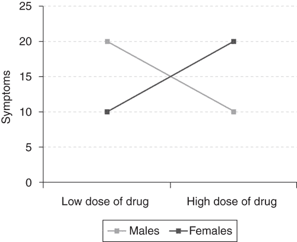

*图 4.1* 样本中性别与药物剂量之间的交互作用。返回文本。⏎

我们可以看到，从图中，对于女性，分数从低剂量增加到高剂量。然而，对于男性，效果相反。也就是说，分数在低剂量时开始较高，然后在高剂量时下降。这种交互作用相当明显；技术上要求交互作用的全部条件是线条*nonparallel*。*稍加思考就会发现，样本数据中的交互作用几乎总是存在的。真正的问题是，我们能否从数据采样的总体中推断出这种样本交互作用*。

### 4.2.1 Python 中的因子 ANOVA

作为 Python 中因子 ANOVA 的一个简单示例，我们改编了 Denis (2021b) 中的一个示例。首先，我们生成一些关于成就（`ac`）、`teach` 和 `text` 的数据。假设成就分数是课程中教师和教材使用的函数。`pd.DataFrame()` 函数创建数据框，其中“`pd`”是“pandas”：199

```
import pandas as pd
import statsmodels as sm
import statsmodels.api as sm
data = {‘ac’ : [70, 67, 65, 75, 76, 73, 69, 68, 70, 76, 77, 75, 85, 86, 85, 76, 75, 73, 95, 94, 89, 94, 93, 91],
‘teach’ : [1, 1, 1, 1, 1, 1, 2, 2, 2, 2, 2, 2, 3, 3, 3, 3, 3, 3, 4, 4, 4, 4, 4, 4],
‘text’ : [1, 1, 1, 2, 2, 2, 1, 1, 1, 2, 2, 2, 1, 1, 1, 2, 2, 2, 1, 1, 1, 2, 2, 2]}
df_2 = pd.DataFrame(data)
df_2
Out[19]:
```

|  || 成就 || 教师 || 教材 |
| --- | --- | --- | --- |
| 0 || 70 || 1 || 1 |
| --- | --- | --- | --- |
| 1 || 67 || 1 || 1 |
| 2 || 65 || 1 || 1 |
| 3 || 75 || 1 || 2 |
| 4 || 76 || 1 || 2 |
| 5 || 73 || 1 || 2 |
| 6 || 69 || 2 || 1 |
| 7 || 68 || 2 || 1 |
| 8 || 70 || 2 || 1 |
| 9 || 76 || 2 || 2 |
| 10 || 77 || 2 || 2 |

下面，我们拟合成就作为 `teach` 和 `text` 的函数，特征为 III 型平方和（`typ` = 3）：


```
from statsmodels.formula.api import ols
model_1 = ols(‘ac ~ C(teach) + C(text)’, data = df_2).fit()
print(table_1)
table_1 = sm.stats.anova_lm(model_1, typ = 3)
```

|  || 平方和 || 自由度 || F || PR(>F) |

| --- | --- | --- | --- | --- |

| 截距 || 23885.408333 || 1.0 || 1220.637252 || 1.051343e-18 |

| --- | --- | --- | --- | --- |

| C(teach) || 1764.125000 || 3.0 || 30.051216 || 2.029775e-07 |

| C(text) || 5.041667 || 1.0 || 0.257649 || 6.175816e-01 |

| 残差 || 371.791667 || 19.0 || NaN || NaN |

我们可以看到，从汇总表中，`teach` 和 `text` 均具有统计学显著性。我们现在将拟合交互项，即 `teach` 与 `text` 之间的交互：

```
import statsmodels.api as sm
from statsmodels.formula.api import ols
model_2 = ols(‘ac ~ C(teach) + C(text) + C(teach)*C(text)’, data = df_2).fit()
table_2 = sm.stats.anova_lm(model_2, typ = 2)
print(table_2)
```

|  || 平方和 || 自由度 || F || PR(>F) |

| --- | --- | --- | --- | --- |

| C(teach) || 1764.125000 || 3.0 || 180.935897 || 1.488709e-12 |

| --- | --- | --- | --- | --- |

| C(text) || 5.041667 || 1.0 || 1.551282 || 2.308781e-01 |

| C(teach):C(text) || 319.791667 || 3.0 || 32.799145 || 4.574415e-07 |

| 残差 || 52.000000 || 16.0 || NaN || NaN |

200 

我们可以看到，从上表可知，交互项具有统计学显著性（`p` = 4.574415e-07）。也就是说，教师与成绩在统计上相关，但这种关系取决于所使用的教科书（即基于交互作用的证据）。

## 4.3 随机效应和混合模型

正如我们所说，本章迄今为止所讨论的方差分析假设自变量上的水平是*固定*的。重申一下，在实验的理论重复中，假设每次使用的是相同的水平。这就是为什么它被称为*固定效应方差分析*。

当我们不假设水平是固定的，而是*随机样本*来自可能水平的总体时，因子不再是固定的而是*随机的*，由此产生*随机效应方差分析模型*。例如，如果某人对剂量对头痛症状的影响感兴趣，在固定效应模型中，可以有目的、有策略地选择 1 vs. 2 vs. 3 mg 药物的水平。这种方法的优点是一旦获得均值，我们就可以比较药物组之间的均值差异。这种方法的缺点是我们对药物其他可能水平的差异一无所知（例如 1.5 vs. 2.3）。头痛的变异是否也是这些其他水平的功能？在比较 1 vs. 2 vs. 3 mg 的固定模型下，我们根本不知道。均值比较不允许我们推断此类事物。然而，如果我们将药物指定为*随机效应*，并*随机*选择水平 1、2、3 或其他水平，那么如果因子被发现具有统计学显著性，我们就可以得出结论，不仅剂量 1、2 和 3 之间存在差异，而且*总体药物剂量*之间存在差异，这包括样本中未观察到的水平。这就是随机效应的好处；它们使我们能够得出结论，未在样本中出现的水平也与响应变量的*变异*相关。*随机效应允许做出更一般的陈述*。

当模型包含固定和随机因子的混合时，它被称为*混合模型*。线性混合模型的经典一般形式如下所示：

*Y* = *X**β* + *Z**U* + *ε*  

(4.14)

其中 `β` 是固定参数，`U` 是随机的，其中 `U` 和 `ε` 是独立的零均值随机向量。`U` 中的随机效应和 `ε` 都假定为正态分布。假设 `U` 为正态分布可能不现实，因此替代的非参数随机效应模型可能更合适。我们稍后在本节中会讨论这种可能性。有关参数和非参数随机效应和混合模型的优秀概述，请参阅 Nguéma 等 (2021)。

在模型 (4.3) 中，对于固定因子，均值比较是感兴趣的。对于随机因子，响应变量上的方差是被建模的。尽管这个简要总结听起来很简单，但混合模型在理论上变得非常复杂。事实上，书籍（和职业生涯）都致力于该主题。有关混合模型复杂性的专著，请参阅 Demidenko (2004)。201

### 4.3.1 固定与随机效应的含义

固定与随机效应的精确定义至关重要。正如我们稍后将讨论的，文献中有时存在一种误解，即随机效应是通过简单地拥有我们想要取平均值的众多统计量（如截距和斜率）来定义的。例如，考虑图 4.2，其中有许多截距，可能代表纵向研究中给定个体的轨迹的起点，以及许多斜率，强调随时间推移轨迹的差异。我们看到样本中截距和斜率都存在相当大的变异。

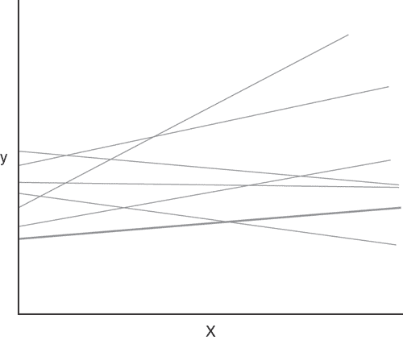

*图 4.2* 包含多个截距和斜率的图，可能代表纵向数据中不同个体的不同起点和轨迹。返回正文。⏎

在这种情况下，区分效应为随机或固定*并不是因为我们在样本数据中拥有许多截距或斜率*。事实上，即使对于不同个体有上千条不同的轨迹，我们仍然可以将斜率识别为固定效应。考虑它为随机可能更有意义，但*这种识别并不是由我们拥有众多斜率这一事实决定的*。*它是由我们将斜率视为从更广泛的斜率总体中随机抽样并且因此具有其自身概率分布这一事实决定的*。这是将效应视为随机的关键组成部分，而不是样本中变异的*量*。是否将效应视为固定或随机完全是一个*建模决策*，并且嵌入在我们为模型做出的假设中。它永远不会“隐含”在数据中，尽管数据不能“帮助”我们对如何建模效应做出决策。

### 4.3.2 固定效应模型实际上是固定的吗？对误差项的审视

读者可能还记得，标准线性模型假设误差项为正态分布且具有有限方差。也就是说，在标准线性模型中，`ε[i]` ∼ `N`(0,`σ[ε]`²) 且 `ε[i]`、`ε[i′]` 对于 `i` ≠ `i′` 是独立的。但误差项 `ε[i]` 真正是什么？它是一个随机效应！因此，当我们执行固定效应方差分析时，我们实际上是在执行一个*混合模型*。标准线性模型中的随机效应是 `ε[i]`，方差分量是 `σ[ε]`²，即 `V(ε[i])`。正如 Fox (2016, p. 701) 所说，“与标准线性模型不同，线性混合效应模型包含多于一个的随机变异来源——也就是说，多于一个随机效应。” 并且虽然从逻辑上讲这可能是正确的，但习惯上*不会*仅仅因为包含误差项就将固定模型称为混合模型。根据传统，混合模型被定义为除误差项之外具有固定和随机因子的混合。我们的观点仅仅是，如果我们以稍微深入的方式审视这些模型，我们就会意识到，除非我们固定误差项或完全将其排除在外，这相当于将其设为零，否则纯粹的固定效应模型实际上并不存在。

### 4.3.3 Python 中的混合模型


## Python 中的混合模型
我们可以在 Python 中使用 `statsmodels` 拟合混合模型。我们借鉴了来自 `statsmodels.org` 的以下示例，其中对猪的生长曲线进行建模。以下中的响应变量是每头猪的 `weight`，而预测变量是 `time`。因此，我们希望将 `weight` 建模为 `time` 的函数，但要认识到数据在每头猪内部是嵌套的（即相关）。也就是说，每头猪内部的测量值彼此之间会比不同猪之间的测量值更相似。因此，`pig`，我们在下面将其命名为“`group`”，是一个随机效应：

```
import statsmodels.api as sm
import statsmodels.formula.api as smf
data = sm.datasets.get_rdataset(“dietox”, “geepack”).data
data
Out[85]:
```

|  || Pig || Evit || Cu || Litter || Start || Weight || Feed || Time |

| --- | --- | --- | --- | --- | --- | --- | --- | --- |

| 0 || 4601 || Evit000 || Cu000 || 1 || 26.5 || 26.50000 || NaN || 1 |

| --- | --- | --- | --- | --- | --- | --- | --- | --- |

| 1 || 4601 || Evit000 || Cu000 || 1 || 26.5 || 27.59999 || 5.200005 || 2 |

| 2 || 4601 || Evit000 || Cu000 || 1 || 26.5 || 36.50000 || 17.600000 || 3 |

| 3 || 4601 || Evit000 || Cu000 || 1 || 26.5 || 40.29999 || 28.500000 || 4 |

| 4 || 4601 || Evit000 || Cu000 || 1 || 26.5 || 49.09998 || 45.200001 || 5 |

| .. || ... || ... || ... || ... || ... || ... || ... || ... |

| 856 || 8442 || Evit000 || Cu175 || 24 || 25.7 || 73.19995 || 83.800003 || 8 |

| 857 || 8442 || Evit000 || Cu175 || 24 || 25.7 || 81.69995 || 99.800003 || 9 |

| 858 || 8442 || Evit000 || Cu175 || 24 || 25.7 || 90.29999 || 115.200001 || 10 |

| 859 || 8442 || Evit000 || Cu175 || 24 || 25.7 || 96.00000 || 133.200001 || 11 |

| 860 || 8442 || Evit000 || Cu175 || 24 || 25.7 || 103.50000 || 151.400002 || 12 |

```
[861 rows x 8 columns]
```

```
md = smf.mixedlm(“Weight ~ Time”, data, groups=data[“Pig”])
```

上面我们指定了一个 `weight` 作为 `time` 的函数，但嵌套在 `pig` 内的模型（`groups = data["Pig"]`）。我们现在获取模型的摘要：

```
mdf = md.fit()
print(mdf.summary())
Mixed Linear Model Regression Results
========================================================
Model:  MixedLM Dependent Variable: Weight 
No. Observations: 861  Method:  REML 
No. Groups:  72  Scale:  11.3669
Min. group size:  11  Log-Likelihood:  -2404.7753
Max. group size:  12  Converged:  Yes
Mean group size:  12.0
--------------------------------------------------------
   Coef.  Std.Err.  z  P>|z| [0.025 0.975]
--------------------------------------------------------
Intercept  15.724  0.788  19.952  0.000 14.179  17.268
Time  6.943  0.033  207.939  0.000  6.877  7.008
Group  Var 40.394  2.149
========================================================
```

203

从输出结果可以看出，`time` 是猪 `weight` 的统计学显著预测因子（`p` < 0.001）。我们还可以看到，由于 `pig`（即 `group`）而产生的方差等于 40.394（`Group Var = 40.394`）。我们还可以从输出结果中看到，模型是通过 `REML`（`restricted maximum likelihood`）拟合的，这通常是许多模型估计的首选方法。

### 4.3.4 R 中的混合模型
我们现在使用 `lme4` 中的 `lmer()` 对猪数据运行相同的混合模型（Bates 等，2015）。`lme4` 包具有广泛的混合建模能力，并且对于所有混合模型相关内容都高度推荐。我们还加载了包含猪数据的 `geepack` 包（Hojsgaard 等，2006）：

```
> library(lme4)
> library(geepack)
> print(summary(lmer(‘Weight ~ Time + (1|Pig)’, data=dietox)))
```

请注意，指定 `(1|Pig)` 传达了数据的嵌套或层次结构，使得 `weight` 被建模为 `time` 的函数，但嵌套在 `pig` 内部，其中 `pig` 是一个随机效应，这意味着在这种情况下它是一个 2 级变量，我们希望对其残差的方差进行建模。也就是说，我们的输出应返回由于 `pig` 产生的方差，因为模型认为猪是从可能出现在样本中的更大潜在猪群中随机抽样的。

现在查看模型的输出：

```
Linear mixed model fit by REML [‘lmerMod’]
Formula: Weight ~ Time + (1 | Pig)
Data: dietox
REML criterion at convergence: 4810
Scaled residuals:
  Min  1Q  Median  3Q  Max
-4.712  -0.570  -0.094  0.488  4.773
Random effects:
Groups  Name  Variance  Std.Dev.
Pig  (Intercept)  40.4  6.36
Residual  11.4  3.37
Number of obs: 861, groups: Pig, 72
Fixed effects:
  Estimate Std.  Error  t value
(Intercept)  15.7235  0.7881  19.9
Time  6.9425  0.0334  207.9
Correlation of Fixed Effects:
  (Intr)
Time -0.275
```

204

我们注意到输出与我们在 Python 中获得的结果相同，只是 `group` 效应被列在其自己的随机效应类别下（即“`Pig`”），以及其下方的残差方差（11.4）。

`nlme` 包（Pinheiro 等，2023）也可以用于拟合混合模型，以及 `VCA` 包（Schuetzenmeister and Dufey, 2024）。使用这些及相关 R 包，R 拟合日益复杂的混合模型的能力几乎是无限的。

## 4.4 多层建模
通常由最小二乘回归估计的标准线性模型适用于独立观测，这意味着误差通常也是独立的。也就是说，假设 `ε[i]`、`ε[i′]` 在 `i` ≠ `i′` 时是独立的。当该假设被违反时，标准线性模型通常不适用，或者至少严重受损。

在应用环境中自然出现的一种依赖关系是聚类，其中 `ε[i]`、`ε[i′]` 在 `i` ≠ `i′` 时不是独立的。这种聚类或依赖关系的经典例子出现在学校内的教室中，学生可能共享同一位教师。我们说学生嵌套在教室内部。期望教室内部的误差不相关是不合理的。然而，这只是我们在层次结构中可能考虑的嵌套来源之一。教室存在于学校中，学校存在于州中。也就是说，同一州内的学校及其误差可能彼此不独立。随着我们从分数到群组构建嵌套层次结构，我们为观测值发展出多层结构，因此得名多层建模。多层建模允许处理在层次结构的每个层级中表现出的误差非独立性。

### 4.4.1 一团糟的术语
围绕随机、混合和多层建模的术语和词语混淆简直是惊人的。历史上，统计学一直难以在术语定义上保持一致，因为许多概念在不同的应用学科中独立出现。例如，混合模型可能在生态学中独立出现，同时也在社会学中被开发（或“重新发现”）。模型可能被赋予略有不同的名称，这使得初学者学习（和教学）它们变得非常困难。仿佛除了学习相当困难的方法之外，还必须敏锐地注意到词汇如何因专业领域而异。这不仅适用于混合模型，也适用于许多统计技术；术语很容易在学习它们时毁掉你的整天。

然而，在讨论这些模型时，关于我们所指的内容非常精确和准确却异常重要。多层模型经常被随意称为分层线性模型、随机效应模型、混合模型和其他标识符，对于这些模型的初学者来说，这可能会极大地造成混淆，以至于难以理解这些模型除了这些概括之外到底是什么。205


首先，我们需要在 *结构* 与 *模型* 之间做出区分。术语“多水平”是一个 *结构*，它实际上并不是一个“模型”，尽管在文献中（即 *多水平建模*）如此称呼，原因稍后会变得清楚。最好将“多水平”一词保留来描述结构，尽管在下文中我们有时也会采用惯用的短语“多水平建模”并且不做区分。只要一个人理解并欣赏这种区别，就不会有任何危害。然而，对于多水平模型的新手来说，如果不理解 *结构* 与 *模型* 有何不同，就会产生很大的困惑。正如我们将看到的，多水平结构可以通过多种不同的方式进行分析，其中只有一种是通过随机效应和混合效应。

其次，*一个多水平结构不一定意味着混合模型，也不一定需要包含任何随机效应*。它们 *通常* 确实包含此类随机效应，但多水平（结构）的定义并不绝对要求这一点。然而在阅读文献时，这些模型的新手很少被告知这一点。多水平模型被自动假定为由随机效应组成。这种隐含的关联并不是必要的。*正如我们将看到的，对于一个多水平模型来说，要有一个或多个随机效应（除了自然发生的误差项之外），这必须由研究者假设或强加*。*没有任何多水平结构本身必然意味着或必须包含随机效应*。

例如，再考虑经典的案例：五个班级，每个班级十名学生。学生嵌套在班级内，因为一个班级的学生更可能与另一个班级的学生相比共享特征或共同经历。他们比竞争班级的学生更 *相似*。在统计上，班级内学生的误差项彼此之间不会独立。*我们可以假设它们的误差是相关的*。在实践中，如果我们愿意，可以通过对每个班级分别计算回归来解释多水平 *结构*。然后我们可以通过计算包含班级的乘积项来比较这些回归。请注意，这里并没有暗示随机效应，但我们仍然处理的是多水平结构。*多水平结构仍然完整，而不需要任何随机效应*。这可能不是建模多水平结构的最“理想”解决方案，但要点是处理多水平结构并不 *必然* 意味着，也不要求，对随机效应的建模。

文献中经常给出或暗示的最纯粹或最准确的多水平模型定义是它 *允许在层级每个水平上进行残差分析*。虽然这是事实，但多水平 *结构* 中没有任何东西绝对要求这种水平的分析。重点应放在前一句中的“允许”，而不是“必然要求”。再次注意，我们完全可以很容易地按班级分别分析每个回归或均值结构，并在每个班级内部评估残差。我们这样做并不 *要求* 任何随机效应。然而，包含随机效应通常是一个非常好的主意，正如我们现在所讨论的。

### 4.4.2 为什么多水平模型经常包含随机效应？

如果多水平 *结构* 本身并不必然意味着包含随机效应，那么随机效应如何在多水平模型中出现呢？答案是研究者必须通过建模的假设将它们 *强加* 到多水平结构上。再次注意 *我们正在强加随机效应；它们并不必然隐含在多水平结构中*。再次，参考我们之前的例子，*在数据探索性分析中截距或斜率的观察到的方差不能单独作为将其建模为随机效应的理由*。

为了强调这一点，请考虑该领域主要领导者之一对多水平建模的精彩描述：206

> *鉴于截距和斜率系数在组间随机变化…*

以上完全正确，但它意味着什么？从以上内容需要认识到的关键点是，是 *我们* 决定这些系数是否“随机变化”。它们存在 *观察到的变异* 并不足够。我们必须根据我们对模型强加的 *假设* 来决定将截距和斜率建模为固定还是随机。如果没有观察到的变异，我们可能不会将它们建模为随机效应，但在理论上我们仍然可以。

考虑多水平模型的另一种典型表述：

> *因为多水平模型包含固定效应和随机效应的混合，它们有时被称为混合效应模型。*

上述问题的在于，正如前面提到的，多水平结构不仅 *不* 必然要求包含随机效应，而且即使它们确实需要，也 *不需要* 使用 *传统* 的混合效应建模方法进行建模。例如，结构方程建模方法同样可能富有成效。再次强调，*多水平结构不一定意味着固定、随机或混合模型*。

总之，在层级（或“嵌套”设计）中通常发现的截距和斜率并不知道它们“来自何处”。我们必须将这些决定作为我们对分析强加的假设的一部分。在关于多水平模型的著作中，作者太常暗示因为截距和斜率存在观察到的变异，就必然意味着相应的效应应被建模为随机效应。这根本不是事实。统计量的观察到的变异，无论它们是什么（例如，截距、斜率、均值、标准差等），都是建模为随机效应的不充分理由。将某物建模为随机效应的决定完全取决于观察到的实现被 *概念化为起源于何处以及在实验的理论重复中此类统计量可能如何表现*。这些是由研究者做出的决定。

> *多水平结构不一定意味着随机效应的存在。随机效应在这种结构中出现是因为研究者决定将它们（截距和斜率）建模为此类，但多水平结构不一定意味着包含这些效应。截距和斜率在理论上即使表现出很大变异，也可被估计为固定效应。*

### 4.4.3 先验与事后“嵌套”

关于多水平思想和嵌套，还有另一个重要且关键的区别需要做出。在理解多水平结构实际上 *是什么* 时，考虑多水平结构 *不是* 什么同样具有教学意义。考虑经典的单向随机方差分析设计，其中参与者（每个样本 `n = 5`，例如 `y[11]` 是样本 1 中的观测 1）被随机分配到处理（图 4.3）。207

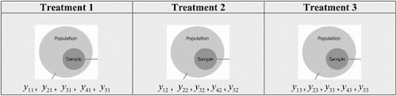

*图 4.3* 经典单向随机方差分析布局。每个样本均来自同一总体，且观测值被随机分配到不同的处理。返回文本。⏎


参与者是否嵌套在处理组内？处理组内的误差是否预期相关？*否*。由于随机分配到处理组，个体的得分*先验地*不会预期与任何其他个体的得分相关。这里限定词“*先验地*”为何至关重要？这是重要的，因为*在他们接受治疗之后*，我们确实可能会观察到它们的误差相关。例如，如果第一个处理组涉及摄入特定剂量的能量饮料，而其他组未接受任何能量饮料，我们当然会预期该第一组内的误差*相对于其他组*相关。饮用能量饮料的人会因所接受的治疗而变得更“相似”。它们现在由于接受治疗而成为一个“巢”。

然而，上述相似性仅在*之后*治疗被施加时才显现，而不是*之前*。在接受治疗之前，没有理由预期一个参与者的得分会与该组内第二个参与者的得分（和误差）相关。在这种情况下，参与者并非*先验地*嵌套，但一旦施加治疗，从某种意义上说，它们是*事后*嵌套的。但这种*事后*嵌套思想与多水平建模无关。它只有在我们决定在当前研究的基础上进行第二次研究并以处理组为起点时才会发挥作用。在这种情况下，饮用能量饮料的人将带着相关的误差开始新的研究。也就是说，接受治疗的人与未接受治疗的其他人相比会更“相似”。

本次讨论的关键要点是，要存在分层、多水平或嵌套结构，误差应在接受治疗*之前*被*预期*相关，而不是*之后*。由同一位教师授课的教室里的学生*预期*在接受任何治疗或干预之前就会有相关的误差。这就是我们在多水平结构中希望考虑的“相似性”。虽然经典的单向方差分析（例如）实际上可以被视为一种多水平结构（读者可能想思考其如何实现），但每个处理组内的误差预期是*独立*的，即使在施加治疗并进行测量后它们变得相关。对于此类建模决策而言，最重要的是误差在治疗*之前*的行为*期望*，而不是*之后*。

### 4.4.4 作为分层/多水平结构示例的区组

当研究者将观测值强制划分为区组时，所谓的*随机区组设计*，这就是多水平结构的一个例子和特例。*观测值嵌套在区组内*。这种嵌套是由研究者*诱导*或*创建*的。例如，如果我们把所有一年级学校 208 儿童放在一个区组中，所有二年级学生放在另一个区组中，那么可以认为每个相应区组内的观测值比跨区组的观测值更相似。观测值是一级单位，而区组是二级。对于这个原因，区组设计通常作为混合模型进行分析，其中区组因子被视为随机。对于可能对区组设计完全陌生的读者，Kirk (1995)提供了良好且深入的介绍。

### 4.4.5 非参数随机效应模型

大多数多水平模型至少包含一个随机效应，有助于处理观测值的嵌套结构和依赖性。在经典随机效应模型中，假设随机效应服从正态分布。然而，这一假设可能站不住脚，我们可能希望改用，如本书许多地方将要做的那样，一种*非参数*方法，该方法对随机效应的分布不做（或至少做更少）假设。*非参数随机效应模型*可以被视为更广泛的*潜在类别模型*的特例。随机效应回归模型也通常被称为*回归中的混合模型*，因为它结合了回归的混合，有助于处理群体的潜在异质性（Jiang and Guntuboyina, 2021）。

作为非参数随机效应模型的一个简单示例，并了解其与经典参数随机效应模型有何不同，首先考虑典型的（参数）随机截距模型，该模型不包含预测变量，

`g[E(y[i j])] = α[j]`

其中假设截距项 `α[j]` 服从正态分布，具有给定的均值和方差，即 `α[j] ∼ N(μ,σ²)`。传统上，我们希望估计这些截距的均值 `μ`，更重要的是它们的方差（`σ²`）。该方法是*参数*的，因为我们对截距施加了*概率模型*。在非参数方法中，我们假设 `α[j]` 的分布由未指定的离散混合分布的*潜在类别*索引，其中给定类别 `x` 相关的截距表示为 `α[x]`和给定类别的大小由 `P(x)` 给出，其中 `α[x]` 是位置而 `P(x)` 是给定节点或类别的“权重”。

简化后，非参数模型由下式给出

`g[E(y[i j]|,x)] = α[x]`

(4.15)

这仅仅是给定类别 `x` 的 `y[i j]` 的期望值，将受 `P(x)` 约束。包含预测变量的两水平模型是 (4.15) 的自然扩展，其中现在 `z[i j]` 表示预测变量纳入模型：

$$g\\left\\lbrack E\\left( y\_{ij} \\middle| z\_{ij},x \\right) \\right\\rbrack = \\alpha\_{x} + {\\sum\\limits\_{k = 1}^{K}{\\beta\_{k} \\cdot z\_{ijk}}}$$

(4.16)

需要指出的是，使模型成为非参数的并非 `z[i j]` 中预测变量的包含，而是与仅截距模型相同，`y[i j]` 是类别 `x` 的混合分布的函数这一事实。重申一下，`E(y[i j])` 在经典参数模型中是*概率分布*的函数，而在非参数对应模型中则是*混合分布*（类别）的函数。除了随机截距外，还可以包含随机斜率，从而产生完整的*多水平非参数随机效应模型*。209

多水平模型，如混合模型通常一样，最好使用 R（例如 `lme4`）软件而不是 Python 实现。`Latent Gold` 是一种可以估计潜在类别模型以及非参数随机效应模型的特例的软件程序。在 R 中，包 `npmlreg` (Einbeck et al., 2018) 也可用于拟合这类模型。

## 4.5 重复测量和纵向模型

在许多研究中，测量是在一系列天、周、月或年，甚至*时期*上进行的，就像试图估计今天的气温上升是否只是正常的长期温度变化还是人为气候变化的情况一样。涉及时间成分的模型通常被称为*重复测量模型*或*被试内设计*，或更一般地称为*纵向模型或时间序列*。然而，读者应注意，纵向模型可以包含大量模型和复杂性，其中可能包括混合效应成分以及结构方程模型的要素。如前所述，术语和行话在不同学科之间往往不一致，因此读者在遇到这些和类似术语时应谨慎，以了解作者或研究者确切的意思。对其含义做出假设通常只会导致误解！

### 4.5.1 经典重复测量模型


由于缺乏更好的术语，并且为了区分重复测量方法，我们将通常假设协方差矩阵具有 *球形结构* 的重复测量称为 *经典重复测量*。球形性假设本质上是指所有可能的被试内条件对之间差异的方差相等。更严格的假设是 *复合对称*，它假设被试内变量矩阵中的所有方差和协方差都相等。这两种假设都产生了我们所称的“经典”重复测量模型，以将其与更复杂的模型区分开来，例如随机效应、混合效应、结构方程纵向模型和生长曲线。*潜变量增长模型* 是更一般的 *结构方程模型* 的一种子类型，其中潜变量通常是截距和斜率等“产生”时间点的事物。

正如我们在经典方差分析中所做的那样，我们假设读者至少对在球形协方差矩阵假设下的基本重复测量有所了解。因此，我们快速推进，仅提供经典模型的期望均方。关于这些期望均方有很多理论和解释，对于不熟悉的读者，Hays (1994) 和 Denis (2021a) 是很好的资料来源，解释了这些期望均方是如何产生的，包括 `MS residual` 如何是下面组内相关系数 `ρ` 的函数。

经典加性“球形性”重复测量模型的期望均方因此如下：210

*E*(MS subjects) = *σ*[*e*]² + *K**σ*[*s**u**b**j**e**c**t**s*]²  

(4.17)

$$E\\left( \\text{MS}\\,\\text{treatment} \\right) = \\sigma\_{e}^{2} + \\frac{J{\\sum\\limits\_{j}\\alpha\_{j}^{2}}}{K - 1}$$  

(4.18)

*E*(MS residual) = *σ*[*e*]² = *σ*[*T*]²(1−*ρ*)  

(4.19)

其中 `J` 是被试的行数，`K` 是处理的列数，`ρ` 是组内相关系数，而 `σ[T]²` 和 `σ[e]²` 分别是总方差和误差方差。

在 R 中拟合重复测量模型有许多方法。R 中的 `aov()` 函数具有拟合此类模型的简易功能（详见 Denis, 2021a）。许多包也致力于拟合重复测量或纵向模型，例如 `mmrm` 包（Sabanes et al., 2024）。重复测量模型也可以在 Python 中以多种方式拟合。可能最简单的方法是通过 `statsmodels` 使用 `AnovaRM`。以下是基本单因素重复测量的示例代码（未显示输出），其中因变量为 y，被试变量为 person，重复测量为 time：

```
from statsmodels.stats.anova import AnovaRM
print(AnovaRM(data=df, depvar=‘y’, subject=‘person’, within=[‘time’]).fit())
```

## 4.6 多变量方差分析（MANOVA）

单变量方差分析允许一个以上的自变量或因子，但只允许一个反应或因变量。名称 *单变量* 源于此事实，即单一反应。当存在一个以上的反应变量时，我们进入 *多变量* 领域。多变量方差分析，或简称为“MANOVA”，定义为具有一个以上连续反应变量。

多变量关于均值向量的假设可以表述如下，

$$H\_{0}:\\left( \\begin{array}{l} \\mu\_{11} \\\\ \\mu\_{21} \\\\ \\mu\_{31} \\\\ {\\,\\, \\cdot} \\\\ {\\,\\, \\cdot} \\\\ {\\,\\, \\cdot} \\\\ \\mu\_{j1} \\\\ \\end{array} \\right) = \\left( \\begin{array}{l} \\mu\_{12} \\\\ \\mu\_{22} \\\\ \\mu\_{32} \\\\ {\\,\\, \\cdot} \\\\ {\\,\\, \\cdot} \\\\ {\\,\\, \\cdot} \\\\ \\mu\_{j2} \\\\ \\end{array} \\right) = \\left( \\begin{array}{l} \\mu\_{13} \\\\ \\mu\_{23} \\\\ \\mu\_{33} \\\\ {\\,\\, \\cdot} \\\\ {\\,\\, \\cdot} \\\\ {\\,\\, \\cdot} \\\\ \\mu\_{j3} \\\\ \\end{array} \\right)... = \\left( \\begin{array}{l} \\mu\_{1p} \\\\ \\mu\_{2p} \\\\ \\mu\_{3p} \\\\ {\\,\\, \\cdot} \\\\ {\\,\\, \\cdot} \\\\ {\\,\\, \\cdot} \\\\ \\mu\_{jp} \\\\ \\end{array} \\right)$$  

(4.20)

该假设与备择假设进行比较，备择假设认为均值向量集合中某处存在差异，例如一种可能性，即前两组之间均值向量的差异（此处不等式表述略显非正式），211

$$H\_{1}:\\left( \\begin{array}{l} \\mu\_{11} \\\\ \\mu\_{21} \\\\ \\mu\_{31} \\\\ {\\,\\, \\cdot} \\\\ {\\,\\, \\cdot} \\\\ {\\,\\, \\cdot} \\\\ \\mu\_{j1} \\\\ \\end{array} \\right) \\neq \\left( \\begin{array}{l} \\mu\_{12} \\\\ \\mu\_{22} \\\\ \\mu\_{32} \\\\ {\\,\\, \\cdot} \\\\ {\\,\\, \\cdot} \\\\ {\\,\\, \\cdot} \\\\ \\mu\_{j2} \\\\ \\end{array} \\right) = \\left( \\begin{array}{l} \\mu\_{13} \\\\ \\mu\_{23} \\\\ \\mu\_{33} \\\\ {\\,\\, \\cdot} \\\\ {\\,\\, \\cdot} \\\\ {\\,\\, \\cdot} \\\\ \\mu\_{j3} \\\\ \\end{array} \\right)... = \\left( \\begin{array}{l} \\mu\_{1p} \\\\ \\mu\_{2p} \\\\ \\mu\_{3p} \\\\ {\\,\\, \\cdot} \\\\ {\\,\\, \\cdot} \\\\ {\\,\\, \\cdot} \\\\ \\mu\_{jp} \\\\ \\end{array} \\right)$$  

(4.21)

### 4.6.1 MANOVA 的适用性

何时适合对 ANOVA 进行 MANOVA？答案不能简单地是“当存在一个以上的连续反应时”，尽管误导性的数据分析菜谱方法有时会建议这种糟糕的策略。事实上，对反应变量智商和过去一周车辆汽油消耗量进行性别差异分析意义不大，原因在于反应“变异数”，即反应侧变量的组合，在实质上几乎没有“意义”。可以分析吗？可以，但在应用层面，这不是我们可能感兴趣的假设。MANOVA 的关键不是同时分析多个反应；而是分析以某种方式“相互关联”以产生 *变异数* 的多个反应。同时分析阅读速度和平均绩点在应用环境中将是一个更有兴趣的变异数。或者，另一个例子可能是史前时代的颅骨测量（Anderson, 2003）。要点是，当将多个反应组合到单个模型中时，应有超出仅仅产生多变量模型之外的 *理由*。

在该实质性理由和警告的前提下，相对于多次 ANOVA 进行 MANOVA 有 *统计* 上的好处，其中包括控制膨胀的第一类错误率。例如，分别进行的三种不同的单变量 ANOVA 会带来越来越大的第一类错误率（例如，每次检验 0.05，`p` = 0.05）。在 `n` = 3 次检验每次设为 0.05 的情况下，犯 *无第一类错误*（`r` = 0）的概率是一个二项随机变量，

$$\\begin{array}{l} {\\,\\,\\,\\,\\,\\,\\,\\,\\,\\,\\,\\,\\,\\,\\, p\\left( r \\right) = \\left( \\begin{array}{l} n \\\\ r \\\\ \\end{array} \\right)p^{r}\\left( 1 - p \\right){n - r}} \\\\ {p\\left( 0,3,0.05 \\right) = \\left( \\begin{array}{l} 3 \\\\ 0 \\\\ \\end{array} \\right)\\left( 0.05 \\right)0\\left( 0.95 \\right)3 = 0.86} \\\\ \\end{array}$$  

(4.22)

因此，至少犯一次第一类错误的概率等于 1 − 0.86 = 0.14。更正式地，`k` 次检验中 *至少一次第一类错误* 的概率可以近似为

`p(type I error ≥1)` = 1 − (1−`α[PC]`) ^ (`k`)  

(4.23)


对三个响应变量同时进行一次 `MANOVA` 会使 I 型错误率保持固定在为该 `MANOVA` 设定的 `α`（例如，0.05）水平上。这是对执行 `MANOVA` 而非多个 `ANOVAs` 的统计学优势；然而，如果从实质上讲 `MANOVA` 没有意义，如前所述，仅出于统计原因进行 `MANOVA` 模型是没有意义的。这里科学或实质性的理由应优先于统计学理由。

### 4.6.2 扩展单变量模型：Hotelling’s T²
将单变量模型扩展到多变量模型最简单、最直接的方式是通过简单组间 `t`-检验并推广到 Hotelling 的 `T²`，它是多变量对应物，其中我们对多于一个连续响应变量进行建模。这本质上可以推广到更复杂的模型，但我们关注 `t`-检验，因为它强调了从单变量到多变量的转变中的核心原理。

回顾我们在基本统计回顾中讨论过的单变量 `t`-检验：212

$$\\begin{array}{l} {t = \\frac{E\\left( {\\overline{y}}\_{1} \\right) - E\\left( {\\overline{y}}\_{2} \\right) - \\delta\_{0}}{\\sqrt{\\frac{\\left( n\_{1} - 1 \\right)s\_{1}^{2} + \\left( n\_{2} - 1 \\right)s\_{2}^{2}}{n\_{1} - n\_{2} - 2}\\left( {\\frac{1}{n\_{1}} + \\frac{1}{n\_{2}}} \\right)}}} \\\\ {\\,\\,\\, = \\frac{\\mu\_{1} - \\mu\_{2} - \\delta\_{0}}{\\sqrt{\\frac{\\left( n\_{1} - 1 \\right)s\_{1}^{2} + \\left( n\_{2} - 1 \\right)s\_{2}^{2}}{n\_{1} - n\_{2} - 2}\\left( {\\frac{1}{n\_{1}} + \\frac{1}{n\_{2}}} \\right)}}} \\\\ \\end{array}$$

现在考虑将 `t` 平方时会发生什么，

$$t^{2} = \\frac{\\left( {\\overline{y}}\_{1} - {\\overline{y}}\_{2} \\right)^{2}}{\\frac{\\left( n\_{1} - 1 \\right)s\_{1}^{2} + \\left( n\_{2} - 1 \\right)s\_{2}^{2}}{n\_{1} - n\_{2} - 2}\\left( {\\frac{1}{n\_{1}} + \\frac{1}{n\_{2}}} \\right)}$$

接下来，我们将分母表示为逆，使其没有分母：

$$t^{2} = \\left( {\\overline{y}}\_{1} - {\\overline{y}}\_{2} \\right)\\left\\lbrack {\\frac{\\left( n\_{1} - 1 \\right)s\_{1}^{2} + \\left( n\_{2} - 1 \\right)s\_{2}^{2}}{n\_{1} - n\_{2} - 2}\\left\\lbrack {\\frac{1}{n\_{1}} + \\frac{1}{n\_{2}}} \\right\\rbrack} \\right\\rbrack^{- 1}\\left( {\\overline{y}}\_{1} - {\\overline{y}}\_{2} \\right)$$

最后，我们得到

$$T^{2} = \\frac{n\_{1}n\_{2}}{n\_{1} + n\_{2}}\\left( {\\overline{y}}\_{1} - {\\overline{y}}\_{2} \\right)'\\left( S^{- 1} \\right)\\left( {\\overline{y}}\_{1} - {\\overline{y}}\_{2} \\right)$$

(4.24)

对于单样本均值向量，对应的 `T²` 如下：

$$\\begin{array}{l} {T^{2} = \\left( \\overline{y} - \\mu\_{0} \\right)'\\left( {\\frac{1}{n}S} \\right)^{- 1}\\left( \\overline{y} - \\mu\_{0} \\right)} \\\\ {\\,\\,\\,\\,\\,\\,\\, = n\\left( \\overline{y} - \\mu\_{0} \\right)'S^{- 1}\\left( \\overline{y} - \\mu\_{0} \\right)} \\\\ \\end{array}$$

(4.25)

`T²` 的分布为 $\\frac{\\left( n - 1 \\right)p}{\\left( n - p \\right)}F\_{p,n - p}$，其中 `p` 和 `n - p` 为自由度，其中 `p` 为变量数，`n` 为样本量。有关似然比检验与 `T²` 关系的详细内容，请参阅 Johnson 和 Wichern（2007，第 217–218 页）。`T²` 和多变量总体的置信区域也可以计算（见 Johnson & Wicher，2007，第 220–221 页）。

### 4.6.3 多变量检验统计量
在单变量 `ANOVA` 设定中，只有一个 `F`-检验需要执行。在多变量设定中，由于响应变量的协方差在自变量组内可能以不同方式结构化，已开发出多种多变量检验，并在几乎所有软件中均可用。这些包括 `Wilk’s lambda`、`Pillai’s trace`、`Roy’s largest root` 和 `Lawley-Hotelling’s trace`。我们仅对多变量检验的多样性提供一个粗略的“一瞥”。有关这些检验如何产生的完整推导，请参阅 Johnson 和 Wichern (2007)。213

Wilk’s lambda，`Λ`，由下式给出

$$\\Lambda = \\frac{\\left| E \\right|}{\\left| H + E \\right|} = \\frac{\\left| E \\right|}{\\left| T \\right|}$$

(4.26)

在零假设下，

$$\\Lambda = \\frac{\\left| E \\right|}{\\left| 0 + E \\right|} = \\frac{\\left| E \\right|}{\\left| E \\right|} = 1.0$$

其中 `H` 是“假设”矩阵，`E` 是“误差”矩阵。请注意，Wilk’s 是一个逆准则，意味着如果没有效应，我们期望 `Λ` 等于 1.0。这与单变量 `ANOVA` 中的 `F`-比值不同，后者更偏好较大的 F 而非较小的。

在相反的极端情况下，如果 `H` 解释了所有变异，则，

$$\\Lambda = \\frac{\\left| 0 \\right|}{\\left| H + 0 \\right|} = \\frac{\\left| 0 \\right|}{\\left| H \\right|} = 0$$

Wilk’s lambda 也可以用 `E^(-1)H` 的特征值表示：

$$\\Lambda = {\\prod\\limits\_{i = 1}^{s}\\frac{1}{1 + \\lambda\_{i}}}$$

(4.27)

其中 `λ[i]` 是从分析中提取的特征值。

Pillai’s trace 定义为

$$V^{(s)} = {tr}\\left\\lbrack {\\left( E + H \\right)^{- 1}H} \\right\\rbrack = {\\sum\\limits\_{i = 1}^{s}\\frac{\\lambda\_{i}}{1 + \\lambda\_{i}}}$$

(4.28)

请注意，Pillai’s 使用所有特征值（通常称为“根”），`λ[i]`。如果我们仅使用其中最大的根，就会得到 `Roy’s largest root`。也就是说，Roy’s largest root 只是提取的最大特征值，因此仅代表数据背后最大的维度。Roy’s largest root 在一个维度主导所有其他维度时特别有用，这意味着一个特征值远大于其他特征值。当特征值的分布更分散时，Pillai’s 更合适，因为很可能不止一个维度是感兴趣的。

最后，Lawley-Hotelling’s trace 只是特征值的和，因此由下式给出

$$U^{(s)} = \\text{tr}\\left( E^{- 1}H \\right) = {\\sum\\limits\_{i = 1}^{s}\\lambda\_{i}}$$

(4.29)

### 4.6.4 评估协方差矩阵相等性：The Box-M Test
请回忆，在单变量 `ANOVA` 中，我们需要评估所有方差相等的假设。在多变量对应物中，我们不仅要处理方差；我们还要处理协方差。因此，假设现在包括自变量各水平（或单元格）之间的所有协方差相等，即 214

`H[0]`: `Σ[1]` = `Σ[2]` = `Σ[3]`... = `Σ[p]`

(4.30)

其中 `Σ[p]` 是自变量各水平下每个总体的 `p` 个协方差矩阵。

评估该假设有不同的方法。其中一种只是粗略的（但仍有用的）视觉方法，以了解协方差矩阵是否彼此相对相似，从而认为其总体对应物至少近似相等并继续进行 `MANOVA`。`Box-M test` 是另一种评估该假设的方法，可在 R 的 `biotools` 包中获得（da Silva, 2021），在 `boxM` 检验下，可直接从该包在 iris 数据上轻松演示：

```
> library(biotools)
> data(iris)
> boxM(iris[, -5], iris[, 5])
Box M-test for Homogeneity of Covariance Matrices
data: iris[, -5]
Chi-Sq (approx.) = 140.94, df = 20, p-value < 2.2e-16
```


在原假设下，总体协方差矩阵相等。对于这些数据，我们拒绝原假设（`p` = 2.2e-16）并推断备择假设，即至少有两个协方差矩阵不同。当协方差矩阵不同时，研究者有必要查看这些矩阵并考虑它们可能不同的实质性原因。*切勿在不仔细考虑该统计结果在科学上（而不仅仅是统计上）可能对数据意味着什么的情况下得出统计结果*。有关该检验的更多理论，请参阅 约翰逊和威彻恩 (2007)。

### 4.6.5 Python 中的 MANOVA

我们可以使用 statsmodels 在 Python 中进行基本的 `MANOVA`。下面我们对一些随机数据进行 `MANOVA`，其中我们生成 20 个样本（`n_samples = 20`）在五个响应（`n_dim = 5`）上，自变量有三个水平（`n_classes = 3`）：

```
import numpy as np
from statsmodels.multivariate.manova import MANOVA
n_samples = 20
n_dim = 5
n_classes = 3
```

我们使用 `np.random.randn()` 生成随机数据，其中 `X` 是方程中的自变量（或“外生”变量）部分，而 `y` 是响应变量（或“内生”变量）：

```
y = np.random.randn(n_samples, n_dim)
X = np.random.randint(n_classes, size=n_samples)
```

请注意，`X` 的类别数（即 0、2、0、0、0、0、1、2 等）被指定等于 `y` 中指定的 `n_samples` 大小，以便每个案例都被分配一个类别（我们仅打印 `y` 的少数几个案例）：215

```
y
Out[31]:
array([[-0.68321194, -1.17229168, 0.86179734, 1.26790702, 0.53352012],
  [-0.95366322, -1.06883607, 1.13404045, -0.71916984, -1.37089659],
  [ 0.18602881, -0.22453474, 0.02700791, 0.17279279, 0.13939027],
  [-1.45080321, -0.20265485, 0.57581133, -0.39974093, 0.93340395],
X
Out[33]: array([0, 2, 0, 0, 0, 0, 1, 2, 1, 0, 0, 0, 2, 1, 0, 1, 2, 1, 0, 0])
```

下面我们指定内生变量（即 *响应* 变量）以及外生变量（*自变量*）：

```
manova = MANOVA(endog=y, exog=X)
print(manova.mv_test())
```

| x0 || 值 || 分子自由度 || 分母自由度 || F 值 || Pr > F |

| --- | --- | --- | --- | --- | --- |

| 威尔克斯 lambda || 0.7224 || 5.0000 || 15.0000 || 1.1526 || 0.3765 |

| --- | --- | --- | --- | --- | --- |

| 皮莱迹 || 0.2776 || 5.0000 || 15.0000 || 1.1526 || 0.3765 |

| Hotelling-Lawley 迹 || 0.3842 || 5.0000 || 15.0000 || 1.1526 || 0.3765 |

| Roy 最大根 || 0.3842 || 5.0000 || 15.0000 || 1.1526 || 0.3765 |

我们看到没有任何多元检验拒绝原假设，其 `p` 值等于 0.3765，因此我们没有足够证据拒绝均值向量相等的原假设。

### 4.6.6 R 中的 MANOVA

在 R 中进行 `MANOVA` 可以通过多种包以多种方式完成。下面我们对鸢尾花数据进行 `MANOVA`。我们通过 *连接*（即，连接）鸢尾花特征来构建因变量“`variate`”，并将物种识别为自变量：

```
> data(iris)
> dv <- cbind(iris$Sepal.Length, iris$Sepal.Width, iris$Petal.Length, iris$Petal.Width)
> iv <- iris$Species
> manova <- manova(dv ~ iv, data = iris)
> summary(manova)
```

```
Df Pillai approx F num Df den Df Pr(>F)
iv 2 1.1919 53.466 8 290 < 2.2e-16 ***
Residuals 147
---
Signif. codes: 0 ‘***’ 0.001 ‘**’ 0.01 ‘*’ 0.05 ‘.’ 0.1 ‘ ’ 1
```

我们看到物种产生 *统计上*（不一定 *实质上*）显著的影响（`p` < 0.001）。216

为了获得效应量，我们可以使用 *effect size* 包（Ben-Shachar, 2020）来获得偏 eta 平方统计量：

```
> library(effectsize)
> effectsize::eta_squared(manova)
# Effect Size for ANOVA (Type I)
Parameter | Eta2 (partial) | 95% CI
-----------------------------------------
iv | 0.60 | [0.54, 1.00]
- One-sided CIs: upper bound fixed at [1.00].>
```

我们看到与 `iv` 相关的偏 Eta 平方为 0.60，这意味着物种解释了响应变量 `variate` 中大约 60% 的方差，即萼片长度、萼片宽度等的线性组合。接下来，我们对物种进行判别分析，这是一种对 `MANOVA` 的后续分析方式，用于生成判别函数：

```
> library(MASS)
> discrim <- lda(iv ~ dv, CV=F)
> discrim
```

指定 `CV=F` 表示不执行留一交叉验证（`CV = T` 将提供此类验证）。

```
Call:
lda(iv ~ dv, CV = F)
Prior probabilities of groups:
setosa versicolor virginica
0.3333333 0.3333333 0.3333333
Group means:
```

|  || dv1 || dv2 || dv3 || dv4 |

| --- | --- | --- | --- | --- |

| setosa || 5.006 || 3.428 || 1.462 || 0.246 |

| --- | --- | --- | --- | --- |

| versicolor || 5.936 || 2.770 || 4.260 || 1.326 |

| virginica || 6.588 || 2.974 || 5.552 || 2.026 |

```
Coefficients of linear discriminants:
```

|  || LD1 || LD2 |

| --- | --- | --- |

| dv1 || 0.8293776 || \-0.02410215 |

| --- | --- | --- |

| dv2 || 1.5344731 || \-2.16452123 |

| dv3 || \-2.2012117 || 0.93192121 |

| dv4 || \-2.8104603 || \-2.83918785 |

```
Proportion of trace:
LD1 LD2
0.9912 0.0088
```

217

我们可以看到，第一判别函数占迹的比例（0.9912）远大于第二判别函数（0.0088），这意味着第一个函数在统计上比第二个更“重要”，并且更好地区分了花卉群体（即该函数具有更大的特征值）。我们还给出了线性判别的系数。但为什么这里会出现判别分析？虽然我们将在本书后面更详细地介绍和讨论判别分析作为 *分类器*（如果你从未学习过判别分析，你可以选择现在跳到该部分），但我们有必要在此简要讨论判别分析如何可被视为多元方差分析的“逆”。

## 4.7 线性判别分析（作为 MANOVA 的“逆”）

线性判别分析模型（我们在 `MANOVA` 示例中刚刚简要看到的）具有二元或多分类的分类响应变量，其中寻求预测变量的线性组合以最大化响应上的组间差异。判别分析有时在数据挖掘文献中被称为 *过滤模型* 和 *特征选择方法*（阿格瓦尔, 2015）。乍一看，这可能对读者来说难以把握或“看到”整体情况，但 `LDA` 模型实际上可以被视为一个“枢纽”模型，即许多其他模型可以被视为 `LDA` 模型结构的 *扩展* 或 *缩小* 版本的模型。

首先，它可以以几种不同的方式实现，包括成为 `MANOVA` 模型的“相反”。这是我们在这里最感兴趣的解释，以补充我们对 `MANOVA` 的讨论，并理解 R 中由 `MANOVA` 后续分析或粗略地“*事后*”分析提供的上述输出（尽管它严格来说不是 *事后* *检验*，因为我们没有试图控制任何误差率，我们在这里使用“*事后*”一词纯粹是 *描述性地*）。`MANOVA` 和 `LDA` 通常被视为彼此的 *对立面*，并且多次，判别分析会作为 `MANOVA` 的后续分析进行，以帮助了解负责如此有效地分离组的底层函数（称为 *判别函数*）。

在上述输出中，我们通过 `MANOVA` 的 *事后* 分析遇到了一个判别函数集（从技术上讲，它们在我们用变量加权相应系数之前还不是判别 *函数*，这就是为什么 R 将它们称为 *线性判别*）：

```
Coefficients of linear discriminants:
```

|  || LD1 || LD2 |

| --- | --- | --- |

| dv1 || 0.8293776 || \-0.02410215 |

| --- | --- | --- |

| dv2 || 1.5344731 || \-2.16452123 |


| `dv3` || \-2.2012117 || 0.93192121 |
| `dv4` || \-2.8104603 || \-2.83918785 |

对判别函数是什么的全面理解要等到本书后面介绍判别分析时才能进行。然而，目前知道我们由于数据中存在三个组（即物种类型）而得到了两个判别函数就足够了。上面的 `LD1` 不过是一个线性组合（称为 *linear discriminant*，或更一般地称为加权变量后的 *linear discriminant function*），它以萼片长度、萼片宽度、花瓣长度和花瓣宽度（即 `dv1` 至 `dv4`）的值加权。由 `LD1` 生成的线性组合因此为：218

```
LD1 = 0.82(sepal length) + 1.53(sepal width) + (-2.20)(petal length) + (-2.81)(petal width).
```

在机器学习社区中，`LDA` 几乎从未被视为 `MANOVA` 的对立面，而只是简单地被视为组 membership 的“classifier”，并且是逻辑回归的类似且潜在的替代方案。然而，更一般地说，`LDA` 和 logistic 都可以被解释为更广泛模型——即 *generalized linear model*——的特例，我们将在本书后面讨论该模型。在这一框架下，`LDA` 是广义线性模型的一种应用，其中响应变量（通常）是二元的，但模型仍然是 *linear*。也就是说，在这种情况下，*link function* 仅仅是 *identity function*。这有助于将 `LDA` 模型与 logistic 模型进行对比，在 logistic 模型中 link function 是 *log of the odds*。对于有一定背景知识的读者来说，这可能完全说得通。然而，如果没有这种背景，我们刚才所说的内容将完全令人困惑，读者必须等到本书后面我们更详细地介绍判别分析和广义线性模型时再了解。她可能希望在那次讨论之后再回来看这一节。

我们将在本书后面“unpack” `LDA` 模型，在那里我们将更详细地将其作为分类器来处理。然而，现在我们只是想指出 `LDA` 与 `MANOVA` 的统一方面不容夸大。`MANOVA` 寻求找到均值向量差异，而 `LDA` 模型则寻求利用这些线性组合来区分组。这些模型的扩展和特例众多，从教学角度看，理解判别分析会产生多种相关模型。事实上，说我们如果愿意，可以因 `LDA` 的“hub”性质而将整本书命名为 *Linear Discriminant Analysis and Variations*，绝非夸张。

## 4.8 Chapter Review Exercises

1. 1. 描述或解释如何 *analysis of variance* (ANOVA) 得名。关于均值的零假设如何转化为方差的比较？
2. 2. 随着 `SS within` 的自由度增加，在其他条件相同的情况下，这对 ANOVA 中的后续 `F` 统计量有何影响？
3. 3. `n[j]` 在 ANOVA 中计算 `η²` 时起什么作用？它在计算 `F` 统计量时是否起相似或不同的作用？
4. 4. 提出一个 `contrast`，其中假设第一个均值与第二个和第三个均值不同。你将如何验证所选系数是否正确？
5. 5. 在 `R` 中，对鸢尾花数据进行方差分析，其中假设萼片长度是物种的函数。也就是说，萼片长度是响应变量，而物种是预测变量或自变量。以 .05 的显著性水平评估零假设。然后在 `Python` 中执行相同的分析并比较输出结果。
6. 6. 区分 *fixed-effects*、*random-effects*、*mixed* 和 *multilevel models*。它们有何相似之处？有何不同？请具体比较。
7. 7. *nonparametric* 随机效应模型与 *parametric* 随机效应模型有何不同？关键区别是什么？
8. 8. 如果每个检验使用的显著性水平为 .05，在六次检验中不犯 *no type I errors* 的概率是多少？
9. 9. 何时 `Pillai’s trace` 等价于 `Roy’s largest root`？
10. 10. 在 `Python` 中生成两个响应变量的随机数据，并进行 `MANOVA`，其中假设该线性组合具有三组结构。使用 0.05 的显著性水平。

219

# 5 Simple Linear and Multiple Regression Models (and Extensions)

DOI: [10.4324/9781003376941-8](https://doi.org/10.4324/9781003376941-8)

线性回归历史上一直是统计学的主力工具，至今仍是如此（Stigler, 1986）。更重要的是，今天使用的许多常见技术以某种方式都是基本线性回归模型的 *extensions* 或 *derivatives*。整本书和专著都写于线性回归，以及专门深入研究该主题的整门课程。这是有充分理由的；*regression is literally at the center of the universe of statistical modeling and that of machine learning algorithms*。仅关于回归分析的优秀教科书长度的资料包括 Fox (2016) 和 Draper and Smith (1998)。

回归思想和概念的历史可以追溯到古代（Stigler, 1986）。更近期的，最小二乘法的起源通常被认为始于 Legendre (1805)，并在同一世纪晚些时候由 Galton (1888), 提出，他将回归应用于遗传问题。回归的基本思想是在最小化预测误差的某个函数的同时，基于一个（或多个）其他变量对一个变量进行预测。最小二乘回归的核心在于利用两个或多个变量之间的相关性，目标是基于对其他变量的了解来减少预测误差。回归，这一 *concept*，是统计建模本质所在。

## 5.1 Simple Linear Regression – Fixed Predictor Case

最简单的线性回归模型包含一个预测变量，其值被视为预先固定。该经典的简单线性回归模型由下式给出

`y[i] = β[0] + β[1]x[i] + ε[i]`

(5.1)

其中 `y[i]` 是响应变量，`β[0]` 是回归线的截距，`β[1]` 是斜率，`x[i]` 是解释变量或自变量，而 `ε[i]` 是误差项，即 `y[i]` 中未被模型系统部分解释的那部分，且 `E(ε[i]) = 0`。截距有时被称为 *offset* 或 *bias* 项。这种术语在本书后面讨论的神经网络中很常见。

模型的系统部分为 `β[0] + β[1]x[i]`，因此 `y[i]` 的期望，即 `E(y[i]) = β[0] + β[1]x[i]` 等于 `β[0] + β[1]x[i]`。当 `x[i] = 0` 时，模型的期望为 `E(y[i]) = β[0]`，因为 220

$$
\begin{array}{l}
{E\left( y_{i} \right) = \beta_{0} + \beta_{1}x_{i}} \\
{\,\,\,\,\,\,\,\,\,\,\,\,\,\,\, = \beta_{0} + \beta_{1}\left( 0 \right)} \\
{\,\,\,\,\,\,\,\,\,\,\,\,\,\,\, = \beta_{0}} \\
\end{array}
$$

我们注意到该模型在参数 `β[0]` 和 `β[1]` 上是线性的。这就是线性回归中 *linear* 的含义。请注意，这种线性定义并不要求模型在输入变量 `x[i]` 上是线性的。因此，即使输入以平方项出现，以下模型仍然是线性模型：

`E(y[i]) = β[0] + β[1]x[i]²`


在我们 (5.1) 中的回归模型中，如前所述，我们假设我们的预测变量是 *固定* 的。也就是说，如果我们对新数据重新拟合模型从而复制实验，我们将在预测变量 `x[i]` 上使用相同的值。如果 `x[i]` 是随机的，我们很可能会使用不同的值，因为这些值 presum... 至少在理论层面上，是从概率分布中抽取的。下面我们发展的理论假设了固定效应模型。关于回归中随机效应的处理，参见 Fox (2016, p. 228)。

### 5.1.1 参数估计

请回想一下，我们通常不知道 `β[0]` 和 `β[1]` 的值，因此通常需要从样本数据中估计它们，

`ŷ = β̂[0] + β̂[1]x[i]`

(5.2)

应如何选择 `β̂[0]` 和 `β̂[1]` 的值？当然不是任意或随机的。正如大多数统计模型一样，参数估计的选择方式是为了实现某个目标，通常是 *最小化* 或 *最大化* 某个目标函数。在简单线性回归的情况下，这些估计值被选择以使简单线性回归中回归线周围的误差平方和以及多元回归中的回归 *曲面* 最小化。也就是说，我们希望最小化观测值与函数 `f̂(x[i])` 预测的值之间的差异：

$$
\begin{array}{l}
 {RSS = {\sum\limits_{i = 1}^{N}\left( y_{i} - \hat{f}\left( x_{i} \right) \right)^{2}}}
 \\\\
 {\,\,\,\,\,\,\,\,\,\,\,\, = {\sum\limits_{i = 1}^{N}\left( y_{i} - {\hat{\beta}}_{0} - {\sum\limits_{j = 1}^{p}{x_{ij}{\hat{\beta}}_{j}}} \right)^{2}}}
 \\\\
 \end{array}
$$

(5.3)

上述损失函数的一般形式为 (*a*−*h*)² 的类型，这是一个 *二次* 项，因此损失是一个 *二次损失*，通常被称为 *L2 损失*。回归本身绝不要求我们专门最小化 L2 损失。我们本可以，例如，最小化 L1 损失，即取差值的绝对值，|*a*−*h*|。最小化 L1 的回归通常被称为 *稳健回归*，原因是通过取绝对偏差，它对异常或更极端分数赋予较小的权重（即，与 L2 相比，它对这些极端情况更“稳健”）。这与 L2 损失形成对比，L2 损失通过平方放大极端偏差。与均值相比，偏离中位数也可以使回归更稳健。目前需要记住的要点是，可以选择的损失函数有很多。例如，另一个损失函数是 *Huber 损失*（详情参见 Murphy, 2022）。重点是，在经典回归中我们最小化 L2 损失这一事实绝不意味着这是 *唯一* 应该主导所有工作的损失函数。然而，它无疑是最 221 常见 among 损失函数，通常用作默认值。理想情况下，所选择的损失函数应取决于手头的问题。

`β̂[0]` 和 `β̂[1]` 的最小二乘估计是通过对残差平方和 RSS 关于 `β[0]` 和 `β[j]` 求导得到的，其解可以证明等于

$$
\hat{\beta}_{0} = \overline{y} - \hat{\beta}_{1}\overline{x}
$$

(5.4)

对于 `β̂[0]`，并且

$$
\hat{\beta}_{1} = \frac{\left. {\sum\limits_{i = 1}^{n}{\left( x_{i} - \overline{x} \right)\left( y_{i} - \overline{y} \right.}} \right)}{\sum\limits_{i = 1}^{n}\left( x_{i} - \overline{x} \right)^{2}}
$$

(5.5)

对于 `β[1]`。很容易看出，计算斜率需要 `x` 和 `y` 均有变异。例如，如果 `x` 没有变异，$\sum\left( x_{i} - \overline{x} \right)^{2}$ 等于 0，因此 `β̂[1]` 未定义。

在零截距的情况下，斜率也可以写成 `x` 和 `y` 的内积相对于 `x` 的内积，即，

$$
\hat{\beta}_{1} = \frac{\left\langle {x,y} \right\rangle}{\left\langle {x,x} \right\rangle}
$$

(5.6)

正如我们稍后在概述多元回归时将看到的那样，`β̂[1]` 的方差等于 (`X`^(`T`)*`X`)^(−1)*`σ`²，其中 `σ`² 的估计为

$$
\hat{\sigma}^{2} = \frac{1}{N - p - 1}{\sum\limits_{i = 1}^{N}\left( y_{i} - \hat{y}_{i} \right.}^{2}
$$

(5.7)

其中 `N` 是案例数，`p` 是模型中的预测变量数。为了对 `β̂[0]` 和 `β̂[1]` 进行显著性检验，我们当然需要标准误差，其标量形式可以从以下计算得到

$$
SE\left( \hat{\beta}_{0} \right)^{2} = \hat{\sigma}^{2}\left\lbrack {\frac{1}{n} + \frac{\overline{x}^{2}}{\left. {\sum\limits_{i = 1}^{n}\left( x_{i} - \overline{x} \right.} \right)^{2}}} \right\rbrack
$$

(5.8)

并且 222

$$
SE\left( \hat{\beta}_{1} \right)^{2} = \frac{\hat{\sigma}^{2}}{\left. {\sum\limits_{i = 1}^{n}\left( x_{i} - \overline{x} \right.} \right)^{2}}
$$

(5.9)

计算出标准误差后，我们可以很容易地计算 `β̂[0]` 和 `β̂[1]` 的置信区间，分别为 `β̂[0]` ± 2 ⋅ `SE`(`β̂[0]`) 和 `β̂[1]` ± 2 ⋅ `SE`(`β̂[1]`)。

检验斜率 `β[1]` 等于零的原假设的形式为，

`H[0]` : `β[1]` = 0

(5.10)

相对于统计备择假设，

`H[a]` : `β[1]` ≠ 0

(5.11)

为了评估原假设，我们计算一个 *t*\-统计量，

$$
t = \frac{\hat{\beta}_{1} - 0}{SE\left( \hat{\beta}_{1} \right)}
$$

(5.12)

在 `n` − 2 自由度上评估。

请回想一下，`x` 和 `y` 之间的相关系数 `r[yx]` 由下式给出

$$
Cor\left( x,y \right) = r_{xy} = \frac{\sum\limits_{i = 1}^{n}{\left( x_{i} - \overline{x} \right)\left( y_{i} - \overline{y} \right)}}{\sqrt{\sum\limits_{i = 1}^{n}\left( x_{i} - \overline{x} \right)^{2}}\sqrt{\sum\limits_{i = 1}^{n}\left( y_{i} - \overline{y} \right)^{2}}} = \frac{{cov}_{xy}}{s_{x}s_{y}}
$$

`r[yx]` 的平方，即 `r[yx]`²，是基于对 `x` 的了解而解释的 `y` 的方差比例。例如，对于 `r[yx]`² = 0.70，这意味着 `x` 解释了 `y` 方差的 70%。

请注意，刚才回顾的许多方程和公式都使用了 *标量代数* 而不是矩阵代数（尽管我们也稍微使用了矩阵）。这是因为在简单线性回归情况下，使用标量通常就足够了。然而，当我们很快转向多元回归时，我们将需要使用矩阵，在这种情况下，刚才回顾的所有标量代数同样可以很好地通过矩阵来表示。大多数回归书籍将理论用矩阵呈现，因为这些书籍旨在提供线性回归最广泛、最 *一般* 的呈现，而使用标量（例如简单线性回归）只是特例。

### 5.1.2 R 中的简单线性回归

在 R 中演示快速的简单线性回归非常容易。我们考虑 R 中的 `cars` 数据集，该数据集包含各种汽车的众多特征，包括 `mileage` 和 `price`。我们的回归将把 `mileage` 建模为 `price` 的函数。首先，我们加载数据并快速查看几个案例：

```
> data(cars)
> attach(cars)
> head(cars)
```

|  || 价格  || 里程 || 气缸数 || 车门数 || 定速巡航 || 音响 || 真皮 || 别克 || 凯迪拉克 || 雪佛兰 || 庞蒂亚克 || 萨博 || 塞特兰 |

| --- | --- | --- | --- | --- | --- | --- | --- | --- | --- | --- | --- | --- | --- |

| 1 || 22661.05 || 20105 || 6 || 4 || 1 || 0 || 0 || 1 || 0 || 0 || 0 || 0 || 0 |

| --- | --- | --- | --- | --- | --- | --- | --- | --- | --- | --- | --- | --- | --- |

| 2 || 21725.01 || 13457 || 6 || 2 || 1 || 1 || 0 || 0 || 0 || 1 || 0 || 0 || 0 |

| 3 || 29142.71 || 31655 || 4 || 2 || 1 || 1 || 1 || 0 || 0 || 0 || 0 || 1 || 0 |


| 4 || 30731.94 || 22479 || 4 || 2 || 1 || 0 || 0 || 0 || 0 || 0 || 0 || 1 || 0 |
| 5 || 33358.77 || 17590 || 4 || 2 || 1 || 1 || 1 || 0 || 0 || 0 || 0 || 1 || 0 |
| 6 || 30315.17 || 23635 || 4 || 2 || 1 || 0 || 0 || 0 || 0 || 0 || 0 || 1 || 0 |
|  || 可转换 || 轿跑 || 掀背 || 轿车 || 旅行车 |
| --- | --- | --- | --- | --- | --- |
| 1 || 0 || 0 || 0 || 1 || 0 |
| --- | --- | --- | --- | --- | --- |
| 2 || 0 || 1 || 0 || 0 || 0 |
| 3 || 1 || 0 || 0 || 0 || 0 |
| 4 || 1 || 0 || 0 || 0 || 0 |
| 5 || 1 || 0 || 0 || 0 || 0 |
| 6 || 1 || 0 || 0 || 0 || 0 |

### 5.1.2 使用 `lm()` 进行模型设定
我们现在通过 `lm()` 指定模型：

```
> model <- lm(Mileage ~ Price)
> summary(model)
```

```
Call:
lm(formula = Mileage ~ Price)
```

```
Residuals:
```

| 最小值 || 第一四分位数 || 中位数 || 第三四分位数 || 最大值 |
| --- | --- | --- | --- | --- |
| \-20814.9 || \-4769.1 || 856.8 || 5232.4 || 30662.0 |
| --- | --- | --- | --- | --- |

```
Coefficients:
    Estimate Std. Error t value Pr(>|t|)
(Intercept)  2.236e+04  6.815e+02  32.814  < 2e-16 ***
Price  -1.186e-01  2.898e-02  -4.093 4.68e-05 ***
---
Signif. codes: 0 ‘***’ 0.001 ‘**’ 0.01 ‘*’ 0.05 ‘.’ 0.1 ‘ ’ 1
Residual standard error: 8117 on 802 degrees of freedom
Multiple R-squared: 0.02046, Adjusted R-squared: 0.01924
F-statistic: 16.75 on 1 and 802 DF, p-value: 4.685e-05
```

我们从输出中可以看到 `Price` 在统计上显著（`p` < 0.001）。与 `model` 相关的多个 `R-squared` 为 0.02046，这意味着 `Price` 仅解释了 `Mileage` 方差的大约 2%。如果效应如此之小，为什么 `Price` 在统计上显著？这很可能由于数据的样本量所致。`cars` 数据共有 804 个观测值，因此拒绝原假设相对容易。请记住，`p`-值对样本量的敏感性是在解释统计检验时始终应牢记的事情。基于 `Price` 的统计显著性，很容易认为 `Price` 是 `Mileage` 的“重要”预测因子，但 `R-squared` 和 `Adjusted R-squared` 讲述了不同的故事，解释的方差如此之小。观察到的 `p`-值很可能之所以如此之小，仅仅是因为样本量很大。

### 5.1.3 Python 中的简单线性回归
存在多种在 Python 中进行线性回归的方法。例如，可以使用 `sklearn.linear_model` 或 `statsmodels`。以下是使用 `sklearn` 的简要演示：

```
from sklearn.linear_model import LinearRegression
from sklearn.model_selection import train_test_split
import mglearn
X, y = mglearn.datasets.make_wave(n_samples=60)
```

我们请求了总共 60 个样本，因此我们应该期望在 `X` 和 `y` 上看到 60 个值（尽管我们只显示前几个）：

```
X
Out[33]:
array([[-0.75275929],
   [ 2.70428584],
   [ 1.39196365],
   [ 0.59195091],
   [-2.06388816],
   [-2.06403288],
y
Out[34]:
array([-1.18073311, 0.50015912, 0.13772889, 1.17396178, -1.32035898,
    -2.37364735,-0.70117304, 1.20319981, 0.29262945, 0.44971554,
    -0.48647165, 1.39515571, 1.0738403 ,-1.30838148, -1.27708305,
    -0.94575843,-0.32691082, 0.26134393,-1.25635546, -0.74646948,
```

我们现在在 `X_train` 和 `y_train` 上拟合模型。我们将很快使用测试数据来在新数据上评估模型：

```
X_train, X_test, y_train, y_test = train_test_split(X, y, random_state=42)
lr = LinearRegression().fit(X_train, y_train)
```

我们可以通过 `lr.coef_` 请求模型的斜率，我们可以看到它等于 0.39：

```
lr
Out[338]: LinearRegression()
print(“lr.coef_:”, lr.coef_)
lr.coef_: [0.39390555]
```

为了获得截距以及训练集和测试集的分数，我们编写代码：

```
print(“lr.intercept_:”, lr.intercept_)
lr.intercept_: -0.031804343026759746
```

```
print(“Training set score: {:.2f}”.format(lr.score(X_train, y_train)))
Training set score: 0.67
```

```
print(“Test set score: {:.2f}”.format(lr.score(X_test, y_test)))
Test set score: 0.66
```

我们从上面可以看到回归方程的截距等于 −0.03。我们还看到训练集分数为 0.67，即 `R-squared`，与测试集分数 0.66 相似，表明模型未过拟合。测试集分数是什么？这是将模型在测试数据上运行后得到的分数，即模型尚未见过的“新数据”。由于两个分数相似，这意味着模型可能未过拟合。如果测试集分数远小于训练集分数，则很可能表明模型过拟合。

我们使用 `statsmodels` 演示一个简单的线性回归：

```
import pandas as pd
```

我们创建一些关于 `X` 和 `Y` 的数据：

```
data = {‘X’: [10, 12, 15, 13, 20],
‘Y’: [24, 21, 36, 12, 19]}
```

```
data
Out[347]: {‘X’: [10, 12, 15, 13, 20], ‘Y’: [24, 21, 36, 12, 19]}
```

```
df = pd.DataFrame(data)
df
Out[349]:
```

|  || X || Y |
| --- | --- | --- |
| 0 || 10 || 24 |
| --- | --- | --- |
| 1 || 12 || 21 |
| 2 || 15 || 36 |
| 3 || 13 || 12 |
| 4 || 20 || 19 |

我们现在提取变量并添加一个常数，它将由一列“1”值表示：

```
y = df[“Y”]
x = df[“X”]
import statsmodels.api as sm
x = sm.add_constant(x)
x
Out[359]:
```

|  || const || X |
| --- | --- | --- |
| 0 || 1.0 || 10 |
| --- | --- | --- |
| 1 || 1.0 || 12 |
| 2 || 1.0 || 15 |
| 3 || 1.0 || 13 |
| 4 || 1.0 || 20 |

```
model = sm.OLS(y, x).fit()
print_model = model.summary()
print(print_model)
```

| OLS 回归结果   |
| --- |
| \======================================================================= |
| --- |
| 因变量： || Y || R 平方： || 0.000 |
| 模型： || OLS || 调整后 R 平方： || \-0.333 |
| 方法： || 最小二乘 || F 统计量： || 5.515e-16 |
| 日期： || Fri, 15 Mar 2024 || Prob(F 统计量)： || 1.00 |
| 时间： || 11:48:49 || 对数似然： || \-17.406 |
| 观测数： || 5 || AIC： || 38.81 |
| 残差自由度： || 3 || BIC： || 38.03 |
| 模型自由度： || 1 ||  ||  |
| 协方差类型： || nonrobust ||  ||  |
| \======================================================================= |
|  || 系数 || 标准误 || t || P>|t| || \[0.025 || 0.975\] |
| \------------------------------------------------------------------------ |
| 常数 || 22.4 || 19.207 || 1.166 || 0.328 || \-38.725 || 83.525 |
| X || 8.88E-16 || 1.333 || 6.66E-16 || 1.000 || \-4.242 || 4.242 |
| \====================================================================== |
| Omnibus： || nan || Durbin-Watson： || 2.778 |
| Prob(Omnibus)： || nan || Jarque-Bera (JB)： || 0.331 |
| 偏度： || 0.556 || Prob(JB)： || 0.848 |
| 峰度： || 2.409 || 条件数： || 61.2 |
| \======================================================================= |

我们可以看到，上面的 `X` 的系数等于 8.882e-16，其关联的 `p`-值为 1.000。模型的 `R-squared` 为 0.000，在这种特殊情况下，解释的方差为零。

## 5.2 多元线性回归
在简单线性回归中只有一个响应变量和一个预测变量。在多元回归模型中，有多个预测变量，我们同时建模以预测单一响应。在 *多元多重回归* 中，不仅有多个预测变量，还有多个响应被同时建模。

多元线性回归模型由以下给出

*y*[i] = *β*[0] + *β*[1]*x*[1] + *β*[2]*x*[2] +  ⋅  ⋅  ⋅  + *β*[*p*]*x*[*p*] + *ε*[*i*]  

(5.13)

其中 *E*(*ε*[*i*]) = 0 因此期望等于

*E*(*y*[*i*]) = *β*[0] + *β*[1]*x*[1] + *β*[2]*x*[2] +  ⋅  ⋅  ⋅  + *β*[*p*]*x*[*p*]  

或当表示为条件于 *x* 时,

$$\\begin{array}{l} {y = E\\left( y \\middle| x\_{1},...,x\_{p} \\right)} \\\\ {\\,\\,\\,\\,\\, = \\beta\_{0} + {\\sum\\limits\_{j = 1}^{p}{x\_{j}\\beta\_{j}\\,}}} \\\\ \\end{array}$$


我们可以在更一般的情况下更简洁地将上述模型表述为一个函数 `f(x)`，

$$f\\left( x \\right) = \\beta\_{0} + {\\sum\\limits\_{j = 1}^{p}{x\_{j}\\beta\_{j}}}$$  

(5.14)

其中“`f(x)`”表示给定输入 `x` 的函数 `f`。求和 $\\sum\\limits\_{j = 1}^{p}{x\_{j}\\beta\_{j}}$ 允许我们将任意数量的预测变量纳入回归模型。

正如简单线性回归模型的情况一样，参数值 `β[0]`、`β[1]`、`β[2]`、...、`β[p]` 未知，必须从样本数据中估计；因此估计的多元回归模型为

`ŷ[i] = β̂[0] + β̂[1]x[1] + β̂[2]x[2] + ... + β̂[p]x[p]`  

(5.15)

参数值通过普通最小二乘法选择，这是一个最小化残差平方和的优化问题。最小二乘解如下，其中 `X` 是预测变量矩阵，`y` 是响应向量：

`β̂ = (X^T X)^(-1) X^T y`  

(5.16)

尽管多元回归的矩阵表示看起来比简单回归更复杂，但理解该解并不困难。回想一下，求逆在概念上等价于普通标量代数中的除法，因此如果我们要 `naïvely` 尽管在数学上不正确地以最“熟悉”的方式重新写出 (5.16)，可以将其表示为

$$\\begin{array}{l} {\\hat{\\beta} = \\left( XTX \\right){- 1}X^{T}y} \\\\ {\\,\\,\\,\\,\\, = \\frac{X^{T}y}{\\left( X^{T}X \\right)}} \\\\ \\end{array}$$  

我们现在很容易看出，分子以一般方式包含 `X` 与 `y` 的乘积，而分母仅包含 `X` 的乘积。因此，用文字来说，`β̂` 的解回答了 `X` 与 `y` 相对于仅 `X` 的“共同变化”程度的问题。如果 `X` 与 `y` 高度 `linearly` 相关 这里强调 `linear`，那么 `X^T y` 将远大于 `X^T X`，因此 `β̂` 的系数会更大。相反，在极端情况下，如果 `X` 与 `y` 线性相关性不大，则 `X^T y < X^T X`，并且 `X^T y` 仅为 `X^T X` 中存在的总“交叉变异”的一部分，在数量的假设除法中。注意，这个矩阵表示不过是对单变量情况的推广，即 228

$$\\hat{\\beta} = \\frac{Cov\_{xy}}{S\_{x}^{2}}$$  

其中在这种更简单的情况下，`Cov_xy` 在概念上至少类似于 `X^T y`，而 `S_x²` 类似于 `X^T X`。

项

`X† = (X^T X)^(-1) X^T`,  

(5.17)

即去掉 `y` 后，是非方矩阵 `X` 的左 `pseudo-inverse`（Murphy, 2022，p. 367）。因此，在逆不存在的情况下，伪逆可能是一个选择。这对于非方矩阵尤其有用，因为普通逆仅存在于方矩阵中。伪逆最好使用奇异值分解，或“`SVD`”（Murphy, 2022）计算。

### 5.2.1 最小化平方偏差与绝对偏差

回想一下，除了预测值的平方偏差外，还可以采用如下的最小绝对偏差

`|y[i] - ŷ[i]|`  

(5.18)

那么最小化 `(y[i] - ŷ[i])²` 与最小化 `|y[i] - ŷ[i]|` 之间有什么关系？与最小化 `(y[i] - ŷ[i])²` 相比，最小化 `|y[i] - ŷ[i]|` 对极端值的影响较小。也就是说，当我们对 `y[i] - ŷ[i]` 进行平方时，差异会因平方而放大。如果我们改为最小化 `|y[i] - ŷ[i]|`，则不会过度强调大偏差。

最小化 `|y[i] - ŷ[i]|` 出现在 `least-absolute-value regression` 中，简称为“`LAV`”回归。然而，历史上，在回归背景下，`(y[i] - ŷ[i])²` 通常是首选，因为平方在数学上通常比绝对值偏差更易处理（Fox, 2016）。

### 5.2.2 多元回归中的假设检验

多元回归模型中检验的原假设如下：

`H[0] : β[1] = β[2] = ... = β[p] = 0`  

(5.19)

与统计备择假设相对，后者认为至少有一个系数 `β[j]` 不等于 0。为了评估，正如我们在方差分析（ANOVA）中所做的那样，我们计算一个 `F-ratio`，但与 ANOVA 中的不完全相同，

$$F = \\frac{\\left( TSS - RSS \\right)/p}{RSS/\\left( n - p - 1 \\right)}$$  

(5.20)

该值在 `p` 和 `n - p` 自由度上进行评估，其中 `p` 是预测变量的数量，`n` 是数据点的数量。`TSS` 和 `RSS` 分别是总平方和与残差平方和。如果在 `ρ² = 0` 的原假设下 `F` 的概率很小，我们拒绝无效应的原假设，并得出从数据中抽取的总体中 `ρ² ≠ 0`。229

### 5.2.3 Python 中的多元线性回归

我们可以使用 `sklearn` 在 Python 中进行多元线性回归。例如，我们对 100 个数据点、四个特征进行回归拟合：

```
from sklearn.linear_model import LinearRegression
from sklearn.datasets import make_regression
import pandas as pd
X,y = make_regression(n_samples=100, n_features=4,
n_informative=3, noise=20, random_state=99)
df = pd.DataFrame(X,columns = [‘x1’,’x2’,’x3’,’x4’])
df[‘y’] = y
df
Out[73]:
```

|  || x1 || x2 || x3 || x4 || y |

| --- | --- | --- | --- | --- | --- |

| 0 || 0.755180 || \-0.154622 || \-0.069031 || 0.825647 || 3.974386 |

| --- | --- | --- | --- | --- | --- |

| 1 || \-0.062135 || \-0.256100 || 0.865294 || \-0.367090 || 21.401357 |

| 2 || \-1.966333 || \-0.389262 || 1.400000 || 2.171340 || \-20.381524 |

| 3 || 1.396620 || \-1.133224 || \-0.279086 || 0.032219 || \-15.004750 |

| 4 || 0.449099 || \-1.247421 || 0.065488 || \-0.683553 || \-56.170348 |

| ... || ... || ... || ... || ... || ... |

| 95 || 1.763478 || 1.700284 || \-0.528785 || \-1.121608 || 47.390283 |

| 96 || 0.199602 || 0.558044 || \-1.739733 || 1.360776 || \-34.496664 |

| 97 || \-0.331549 || 1.775028 || 1.026608 || 0.722101 || 77.484661 |

| 98 || \-0.257728 || \-0.838072 || 0.488592 || \-1.317476 || 21.973845 |

| 99 || 0.751760 || 1.313417 || \-0.597966 || \-0.415810 || 15.014818 |

```
mlr = LinearRegression()
mlr.fit(df[[‘x1’,’x2’,’x3’,’x4’]], y)
mlr.coef_
Out[40]: array([ 8.33369861, 29.1717497 , 26.6294007 , -1.82445836])
```

上面打印的是模型的系数，分别为 8.33、29.17、26.63、-1.82。接下来我们获得模型的多个 R 平方，约为 0.84：

```
mlr.score(df[[‘x1’, ‘x2’, ‘x3’, ‘x4’]], y)
Out[41]: 0.8465893941639528
```

使用 `statsmodels`，我们可以拟合与上面相同的回归：

```
import statsmodels.api as sm
from statsmodels.formula.api import ols
from statsmodels.stats.anova import anova_lm
lm = ols(‘y ~ x1 + x2 + x3 + x4’,df).fit()
lm.params
```

以下是参数估计：230

```
Out[42]:
```

| Intercept || \-0.740399 |

| --- | --- |

| x1 || 8.333699 |

| --- | --- |

| x2 || 29.171750 |

| x3 || 26.629401 |

| x4 || \-1.824458 |

```
dtype: float64
anova_table = anova_lm(lm)
anova_table
Out[44]:
```

|  || df || sum\_sq || mean\_sq || F || PR(>F) |

| --- | --- | --- | --- | --- | --- |

| x1 || 1.0 || 10394.554366 || 10394.554366 || 28.605241 || 6.110239e-07 |

| --- | --- | --- | --- | --- | --- |

| x2 || 1.0 || 113541.846572 || 113541.846572 || 312.460911 || 8.531356e-32 |

| x3 || 1.0 || 66267.787822 || 66267.787822 || 182.365304 || 7.899193e-24 |

| x4 || 1.0 || 298.584632 || 298.584632 || 0.821688 || 3.669804e-01 |

| Residual || 95.0 || 34521.039456 || 363.379363 || NaN || NaN |

我们可以看到，所有预测变量在统计上都显著（`p` < 0.001），除了 `x4`（`p` = 0.3669）。

### 5.2.4 R 中的多元线性回归


我们将对 `mtcars` 数据进行多元回归，该数据包含不同品牌汽车的特征。首先，对数据做一个简要查看：

```
> data(mtcars)
> attach(mtcars)
> head(mtcars)
```

|  || mpg || cyl || disp || hp || drat || wt || qsec || vs || am || gear || carb |
| --- | --- | --- | --- | --- | --- | --- | --- | --- | --- | --- | --- |
| Mazda RX4 || 21.0 || 6 || 160 || 110 || 3.90 || 2.620 || 16.46 || 0 || 1 || 4 || 4 |
| --- | --- | --- | --- | --- | --- | --- | --- | --- | --- | --- | --- |
| Mazda RX4 Wag || 21.0 || 6 || 160 || 110 || 3.90 || 2.875 || 17.02 || 0 || 1 || 4 || 4 |
| Datsun 710 || 22.8 || 4 || 108 || 93 || 3.85 || 2.320 || 18.61 || 1 || 1 || 4 || 1 |
| Hornet 4 Drive || 21.4 || 6 || 258 || 110 || 3.08 || 3.215 || 19.44 || 1 || 0 || 3 || 1 |
| Hornet Sportabout || 18.7 || 8 || 360 || 175 || 3.15 || 3.440 || 17.02 || 0 || 0 || 3 || 2 |
| Valiant || 18.1 || 6 || 225 || 105 || 2.76 || 3.460 || 20.22 || 1 || 0 || 3 || 1 |

我们将把 `wt` 建模为 `disp` 和 `hp` 的函数：

```
> fit <- lm(wt ~ disp + hp)
> summary(fit)
Call:
lm(formula = wt ~ disp + hp)
Residuals:
   Min    1Q     Median    3Q   Max
-0.78294 -0.32249        0.02302 0.28926 0.67179
Coefficients:
```

|  || 估计值 || 标准误差 || t 值 || Pr(>|t|) ||  |
| --- | --- | --- | --- | --- | --- |
| (Intercept) || 1.675818 || 0.195742 || 8.561 || 1.98e-09 || *** |
| --- | --- | --- | --- | --- | --- |
| disp || 0.007737 || 0.001089 || 7.108 || 8.04e-08 || *** |
| hp || \-0.001662 || 0.001968 || \-0.845 || 0.405 ||  |

```
---
Signif. codes: 0 ‘***’ 0.001 ‘**’ 0.01 ‘*’ 0.05 ‘.’ 0.1 ‘ ’ 1
Residual standard error: 0.4596 on 29 degrees of freedom
Multiple R-squared: 0.7936, Adjusted R-squared: 0.7793
F-statistic: 55.75 on 2 and 29 DF, p-value: 1.158e-10
```

我们从输出中可以看到 `disp` 在统计上显著（`p` = 8.04e-08），但 `hp` 不显著（`p` = 0.405）。整体模型解释了 `wt` 中大约 79% 的方差（即 multiple R-squared 等于 0.7936）。Adjusted R-squared 如预期略低，为 0.7793，因为它对模型进行了轻微惩罚（我们稍后讨论 adjusted R-squared）。

## 5.3 最小二乘的几何

一图胜千言，这对于可视化最小二乘的工作原理同样适用。图 5.1 是基于两个预测变量 `x[1]` 和 `x[2]` 的最小二乘线的投影示意图。

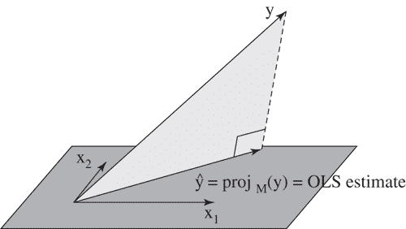

*图 5.1* 最小二乘回归的几何，其中响应变量 `y` 被投影到由预测变量 `x[1]` 和 `x[2]` 张成的空间。经 Springer Nature BV 许可使用，摘自 Alan J. Izenman 所著《Modern Multivariate Statistical Techniques》，© 2008；许可通过 Copyright Clearance Center, Inc. 传达。返回正文。⏎

我们可以将响应 `y` 及其估计值 `ŷ` 看作 `x[1]` 和 `x[2]` 的函数，即这些预测变量 *张成* 的空间。投影即为普通最小二乘估计。`x[1]` 和 `x[2]` 重叠的程度就是预测变量之间可能存在 *共线性* 的程度，因此它们占据相似的空间。这一概述仅触及了可视化回归的表面，目的只是激发读者的兴趣，以便在有意深入研究 *线性模型的几何* 这一有趣主题时有所启发。有关更优秀且详细的论述，请参阅 Fox, *线性模型的向量几何* (2016，第 10 章)。

## 5.4 高斯-马尔可夫定理：我们为何喜欢最小二乘估计

我们为何如此喜欢最小二乘估计量？它们有何吸引力？关于它们最重要的内容可以概括为 *高斯-马尔可夫定理*，该定理断言，当误差独立分布且期望为零、方差恒定时，参数 `a^T β̂` 的最小二乘估计在所有线性无偏估计量中具有最小方差（Fox, 2016，p. 212）。最小二乘估计量常被称为“BLUE”，意为 *最佳线性无偏估计量*。如前所述，`a^T β̂` 的最小二乘估计为

`a^T β̂ = a^T (X^T X)^{-1} X^T y`

(5.21)

其期望等于

$$\\begin{array}{l} {E\\left( a^{T}\\hat{\\beta} \\right) = E\\left( a^{T}\\left( XTX \\right){- 1}X^{T}y \\right)} \\\\ {\\,\\,\\,\\,\\,\\,\\,\\,\\,\\,\\,\\,\\,\\,\\,\\,\\,\\, = a^{T}\\left( XTX \\right){- 1}X^{T}X\\beta} \\\\ {\\,\\,\\,\\,\\,\\,\\,\\,\\,\\,\\,\\,\\,\\,\\,\\,\\,\\, = a^{T}\\beta} \\\\ \\end{array}$$

(5.22)

高斯-马尔可夫定理指出，对于任何其他期望为 `a^T β`（无偏）的线性估计量，例如 `E(w^T ŷ) = w^T y`，最小二乘估计 `a^T β̂` 的方差小于或等于 `w^T y` 的方差。有关该定理的证明，请参阅 Fox (2016，p. 213）。该定理的一个推论是，最小二乘估计量在所有无偏的线性估计量中具有 *最小的均方误差*（Hastie et al., 2009）。

### 5.4.1 无偏估计量总是最好吗？

正如我们稍后会看到的，在回归和其他方法中对无偏估计量的限制并不总是明智的。请记住，偏差-方差权衡在估计中始终起作用。大多数时候，我们希望最小化估计中的偏差。然而，有时为了降低方差而允许估计量带有一定的偏差可能是有益的。

有偏估计量例如 *岭回归* 中的 *岭估计量* 有时可能优于无偏估计量。当最小二乘估计 *不稳定* 时（Izenman, 2008），就是一个有偏估计量可能更优的情况。也就是说，如果 `(X^T X)^{-1} X^T y` 中的 `X` 的秩小于满秩，则会出现 *奇异性*，这意味着最小二乘估计将不再 *唯一*。当由于共线性或其他问题（例如相关误差）导致回归假设不成立时，必须寻求替代的估计解决方案。虽然完全共线性很少发生，但“几乎共线性”的变量根据研究背景经常出现。面对这些情况以及数据病态的情况，即估计量对数据微小变化相当敏感时，*有偏* 估计量可能是一个更好的选择（Izenman, 2008）。共线性和不稳定性往往齐头并进，因为共线性的影响可能产生过大正负估计系数，其符号在数据极其微小的变化下就会被逆转。标准误差也可能被严重夸大，从而导致非统计显著效应，而如果不存在共线性，这些效应可能就具有统计显著性。

除上述情况外，对于某些数据集，`X` 中的输入变量数量可能远大于数据中的观测数。在这种条件下，OLS 估计量仍然存在，但不是 *唯一* 的，因此在这种情况下有偏估计量可能有用。我们将在书中稍后讨论岭和 Lasso 等有偏估计量。

## 5.5 时间序列：相关误差的一个例子


标准线性模型假设误差独立且正态分布，但独立性假设在经验数据上很少（如果有的话）完全正确。就像统计学中的大多数事物一样，它通常是一个合理的 *近似*，然而。回想一下，近似正是统计建模的核心所在。很少，如果有的话，任何模型的任何假设都会被 *完全* 满足。

当测量跨越 *时间段* 进行时，独立误差的假设通常不成立。也就是说，当观测构成 *时间序列* 时，`ε[i]` 通常是 *相关的*。事实上，在这种时间依赖数据中，误差之间的依赖性可能非常强。

这种依赖性在线性模型中如何表示？回想一下经典线性模型，
`y = Xβ + ε`
其中 `ε ∼ N(0, Σ[ε ε])` 且 `Σ[ε ε]` 是误差的协方差矩阵，对称且半正定。然而，与典型的非时间序列最小二乘回归模型不同，`Σ[ε ε]` 的期望并不是对角线外为零的矩阵。相反，由于测量通常相关，我们期望在对角线外出现表示相关误差的 *非零对角元素*，这意味着 `Σ[ε ε]`将有 `n(n + 1)/2` 个不同的元素。时间序列模型中误差的依赖性要求我们纳入时间点之间的协方差，类似于我们在本书前面介绍的经典重复测量模型中所做的那样。

时间序列是一个庞大的主题，我们在这里仅做了初步概述，触及了表面，以举例说明数据中误差经常相关的情形。关于时间序列的书籍包括 Chatfield 和 Xing (2019) 和 Cryer 和 Chan (2008) 的著作。包 `timeseries` (Wuertz 等, 2024) 可用于 R 中的时间序列，尤其适用于金融时间序列。包 `pyts` 可用于在 Python 中拟合时间序列模型。其他包如 `sktime` 和 `tslearn` 也可使用。Fox (2016) 提供了关于时间序列的良好介绍，虽然有些技术性，但非常推荐。

## 5.6 回归中的模型选择：是否存在“最优”模型？

回归分析及相关模型中最大的问题之一是如何确定保留或维持哪个模型。*模型选择* 在统计学中一般而言是一个巨大问题，通常并不像仅使用统计标准来确定采用哪个模型那样简单。研究和科学标准应始终进入讨论。研究人员太常采用“厨房水槽”方法（即把除了厨房水槽以外的所有东西都扔进去）进行变量选择，这往往导致模型过于复杂、共线性问题以及测试数据的泛化性差。

在统计方法中，通常有两种常见的策略用于选择模型。回想一下，在选择模型时，我们感兴趣的不是使 *训练误差* 最小的模型；而是使 *测试误差* 最小的模型。评估测试误差的最直接方法是采用 *交叉验证* 方法。例如，我们可以将模型拟合到 80% 的数据上，并在 20% 上进行测试。这给出了测试误差的直接估计，因为它告诉我们模型在新数据上的表现如何，即模型尚未“看到”的数据。这是一个 234first 选择模型的策略，即在测试数据上评估拟合模型以了解其表现。

然而，出于许多原因，我们可能不想遵循上述直接交叉验证方法。其中一些原因包括历史上数据可能昂贵且有时在特定领域收集非常不便，因此在少于完整数据集的情况下训练模型有时根本不可行。的确，在计算机出现之前，通过快速计算预留数据进行测试的想法当然甚至不是一个选项。因此，如果我们决定不预留测试数据，而只想在训练数据本身上估计测试误差，即使是不完美的呢？由于我们只有训练数据，幸运的是我们可以 *调整* 训练误差率，至少对于某些度量而言，更好地反映测试误差。我们接下来考虑这些选项。

## 5.7 效应大小、模型选择与训练误差率的调整

粗略地说，回归中对零假设的拒绝表明回归预测优于随机。然而，仅凭统计显著的 `p-value` 并不能必然告诉我们更多，除非我们当然对计算 `p-value` 的输入有具体了解，例如样本量、方差等等，以帮助理解给定数据集的 `p-value` 发现。正如显著性检验通常的情况一样，完全有可能拒绝回归的零假设，但其却是 *微不足道* 的科学效应。当样本量极大时这种情况经常发生，因此即使极微小的效应也会导致我们拒绝零假设。这并非新事物，因为我们在本书的许多其他地方讨论过样本量对计算 `p-value` 的影响。如常，需要的是 *效应大小* 的度量。好的效应大小不依赖样本量。然而，效应大小的问题在于，如果我们仅在训练数据上计算它，那么我们通常会得到过于 *乐观* 的效应大小。这并不令人惊讶，并且与我们对模型拟合训练数据通常过于乐观的理解一致。

在下文中，我们首先考虑训练数据的效应大小，然后概述一些衡量效应大小的策略以及 *模型选择度量*，这些度量更好地评估统计模型的简约性，并且在某些情况下（例如，*赤池信息准则*），也有助于我们更好地估计测试误差。

### 5.7.1 R²、调整后 R²、C[p]、AIC、BIC

回想一下，回归中的 `R²` 给出为

$$R^{2} = \\frac{\\sum\\limits\_{i = 1}^{n}\\left( y\_{i}^{'} - \\overline{y} \\right)^{2}}{\\sum\\limits\_{i = 1}^{n}\\left( y\_{i} - \\overline{y} \\right)^{2}}$$

(5.23)

分母，$\\sum\\limits\_{i = 1}^{n}\\left( y\_{i} - \\overline{y} \\right)^{2}$ 只是实际数据值相对于 $\\overline{y}$ 的平方和。这个量会大或小，仅仅取决于当前数据集中有多少变异。然而，更仔细地看分子，$\\sum\\limits\_{i = 1}^{n}\\left( y\_{i}^{'} - \\overline{y} \\right)^{2}$；该项表示预测值 `y[i]'` 与数据均值 $\\overline{y}$ 之间的距离。如果该距离为零，则 235$\\sum\\limits\_{i = 1}^{n}\\left( y\_{i}^{'} - \\overline{y} \\right)^{2}$ 等于 0 且 `R²` 将等于 0。随着该距离增大，`R²` 变大，且平方和的二次（即平方）性质放大了幅度，尤其对于远离均值的偏差。因此乍一看，这个 `R²` 统计量似乎是我们选择模型所需的一切，即 *值越大* `R²` *模型越好*。但这种逻辑是有问题的，因为在几乎所有情况下，随着进入模型的预测变量数量增加，`R²` 在数学上必然会增加。因此，具有更多预测变量的模型会导致更大的 `R²` 值。`1 - R²` 的值将给我们一个通常称为 *表观误差率* 的度量。我们真正想知道的是 *实际误差率*。

解决这一困难的一种方法是解释，而不是 `R²`，一个 *调整* 的 `R²` *统计量* 由以下给出：

$$R\_{adj}^{2} = 1 - \\left( 1 - R^{2} \\right)\\left( \\frac{n - 1}{n - p} \\right)$$

(5.24)


这里的“`p`”是指模型中的参数个数，包括截距项。由 (5.24) 可见，当 `p` 相对于稳定的 `R²` 增加时，`R_adj²` 反而会下降，而不是像 `R²` 那样自动增加。因此，`R_adj²` 本质上是对用户“惩罚”那些对提高 `R²` 并“物有所值”的预测变量的纳入。

`C_p` 统计量（“Mallow’s `C_p`”）是惩罚模型拟合的另一种方法，

$$C\_{p} = \\frac{1}{n}\\left( RSS + 2d{\\hat{\\sigma}}^{2} \\right)$$  
(5.25)

其中，如前所述，`n` 是案例或观测值的数量，`RSS` 是训练数据上的残差平方和，`d` 现在是预测变量的数量（请回忆 `p` 是 `R_adj²` 中的参数个数），而 `σ̂²` 是使用全部预测变量对误差方差的估计，通常为 MS 残差。`C_p` 中的惩罚体现在 `2*d*σ̂²` 上。`C_p` 值越小越好，因为较小的 `RSS` 意味着更好的拟合模型。然而，这会被 `2*d*σ̂²` 所抵消，其中 `d` 的增加会使 `2*d*σ̂²` 增加。因此，`C_p` 如果能说话，会说：“恭喜你把 `RSS` 降下来了，但这种下降会因实现它所需的 `d` 的数量而受到惩罚。如果你的任何 `d` 对 `RSS` 观察到的下降贡献不足，你可能应考虑将其移除，而不是因纳入它们而受到惩罚。”

与 `C_p` 相似且更受欢迎的统计量是 AIC（`Akaike’s Information Criterion`）统计量，

$$AIC = \\frac{1}{n{\\hat{\\sigma}}^{2}}\\left( RSS + 2d{\\hat{\\sigma}}^{2} \\right)$$  
(5.26)

其逻辑与 `C_p` 非常相似：唯一的区别是乘数 $\\frac{1}{n{\\hat{\\sigma}}^{2}}$ 而不是 `C_p` 中的 $\\frac{1}{n}$。然而，惩罚仍然等于 `2*d*σ̂²`。在此表述中，值越小越好。以下是 AIC 的另一个版本，即 Akaike 于 (1974) 提出的原始版本，236

− 2 ln `p(D|θ)` + 2 `m`  
(5.27)

这是熟悉的对数似然 ln `p(D|θ)`，只是预先乘以 −2。对于此版本的 AIC，值越小越好，因为惩罚项 `m`（模型中的参数个数）会使 AIC 增加，如果 − 2 ln `p(D|θ)` 的下降不“值得” `m` 的增加，那么在保持模型简约性方面，增加额外参数就变得不那么有价值了。然而，“越小越好”并不总是适用于 AIC 统计量的报告；这取决于其表述方式。AIC 理论上也可以简单表示为 ln `p(D|θ)` − 2 `m`，此时较大的值更受青睐。请注意，现在对数似然在不预先乘以 −2 的情况下为正值，且如前所述，我们仍以 `2m` 的方式减去参数个数。在解释之前，请确保你清楚 AIC（或 BIC）在你的特定应用（例如软件、包等）中是如何具体定义的。

`C_p` 和 AIC 的衍生指标是贝叶斯信息准则（BIC），

$$BIC = \\frac{1}{n{\\hat{\\sigma}}^{2}}\\left( RSS + \\log\\left( n \\right)d{\\hat{\\sigma}}^{2} \\right)$$  
(5.28)

BIC 通常比 AIC 惩罚得更严重。两个统计量的关键区别在于各自表述中 `RSS` 之后的内容。在 AIC 中，该项为 `2*d*σ̂²`，而在 BIC 中为 `log(n)*d*σ̂²`。在其他条件相同的情况下，随着样本量 `n` 的增加，log(`n`) 也会增加，BIC 通常会对相同的 `RSS` 和 `σ̂²` 施加比 AIC 更大的“惩罚”。与 AIC 一样，在得出“越小越好”结论之前，请确保你知道作者是如何定义 BIC 的（例如参见 Schwarz, 1978；Fraley & Raftery, 1998，其中 BIC 被转换为“越大越好”的统计量）。

顾名思义，BIC 源自贝叶斯决策理论，因此源于贝叶斯原理。可以证明，选择 BIC 最小的模型等价于选择具有最高近似后验概率的模型（Hastie et al., 2009）。此外，BIC 作为选择标准在渐近上是一致的，这意味着 BIC 选择正确模型的概率会随着其所基于的信息量（样本量）的增加而趋向于 1（即 1）。AIC 则不具备这一特性，随着其所基于的信息量增加（即 `n`→∞），它会过于频繁地选择过于丰富或复杂的模型。对于较小的样本量，BIC 通常比 AIC 惩罚得更严重，因此可能会选择过于简单的模型（Hastie et al., 2009）。

回归中有时推荐的另一个效应量指标是 `semi-partial correlation` 系数（Hays, 1994）。半偏相关在将预测变量与响应变量关联之前，先剔除模型中其他预测变量所致的方差。也就是说，它是调整后的变量（预测变量）与未调整的变量（响应变量）之间的双变量相关。详情请参见 Hays (1994)。

### 5.7.2 将 `R_adj²`、`C_p`、`AIC` 和 `BIC` 与交叉验证进行比较

我们上面概述了几种惩罚训练数据以评估模型拟合和模型选择的方法。哪种指标最好？应该使用 `R_adj²`、`C_p`、AIC 或 BIC 中的任何一种，还是应该使用交叉验证？交叉验证通常是首选，因为它是测试误差的直接估计，而只有 `C_p` 和 AIC 能够相当高效地（尽管是间接地）估计测试误差。交叉验证对底层模型也做出了更少的假设（James et al., 2013）。历史上，在高速计算能力和非常大的数据集（至少在某些领域）出现之前，直接进行交叉验证在计算上相当困难或几乎不可能，因此计算 `C_p`、`R_adj²` 等指标更为可行和方便。然而，今天随着高速计算，交叉验证可以相对轻松地完成。因此，鉴于相对廉价的计算速度的可用性，交叉验证通常是模型验证的首选方案。当然，没有什么能阻止研究者同时计算许多竞争性的效应量指标并进行比较，以查看它们是否在同一数据集上收敛。在计算效应量时没有“第一类”错误率；研究者可以计算她想要的任意多个指标。

## 5.8 回归的假设

几乎所有统计模型都建立在一组假设之上。验证回归的假设很重要，因为最小二乘估计和推断的好坏仅取决于它们所基于的假设。此外，已经开发出技术，使用户能够评估数据点对估计的最小二乘解的影响。因此，除了验证诸如 `linearity` 和 `homoscedasticity of variance` 等假设外，通常还建议进行残差分析，以评估杠杆值、原始、标准化以及学生化残差等内容。


回归中的残差分析是一个庞大的主题，由于篇幅限制，我们在此不予综述。定义数据点的 `leverage` 和 `influence` 等概念需要比我们在此所能承受的更多的理论发展。我们也假设读者可能已在之前的课程中至少对该领域有所接触。我们将读者引荐至 Fox (2016)，其对残差分析提供了透彻且出色的论述，而残差分析可能变得相当复杂且本身就是一门艺术。然而，我们无法完全回避假设分析这一主题，必须综述回归及相关模型中最重要的假设检验领域之一，即共线性。

## 5.8 Collinearity

### 5.8.1 Collinearity

共线性可能对回归解产生严重且有害的影响。如果 `X` 的列不是线性无关的，这等同于 `X` 不是满秩的，这意味着 `X^T X` 是奇异的，行列式等于 0，且最小二乘系数虽然理论上可以估计，但不是 *唯一* 定义的。因此，回归中的共线性是一个严重问题，我们需要一种方法来解决它。

#### 5.8.1.1 Variance Inflation Factor

评估共线性有几种常见方法。我们首先介绍的方法可能是最流行的一种，即计算一个称为方差膨胀因子，或简称为“`VIF`”的统计量。要理解 `VIF`，我们必须首先考虑如何写出第 i*th* 个偏回归系数的方差 (Cohen et al., 2003, p. 423)：238

$$s\_{\\beta\_{i}}^{2} = \\frac{s\_{y}^{2}}{s\_{x\_{i}}^{2}}\\left( \\frac{1 - R\_{y.12...p}^{2}}{n - p - 1} \\right)\\left( \\frac{1}{1 - R\_{i.12...(i)...p}^{2}} \\right)$$

(5.29)

其中 *s*[*β*[*i*]]² 是 *β*[*i*] 系数的方差，*s*[*y*]² 是响应的方差，*s*[*x*[*i*]]² 是对应于 *β*[*i*] 的给定预测变量 *x*[*i*] 的方差，而 *R*[*y*.12...*p*]² 是包含所有预测变量 *y*.12...*p* 的整个模型的决定系数。方差膨胀因子是 (5.29) 中的最后一项：

$$\\left( \\frac{1}{1 - R\_{i.12...(i)...p}^{2}} \\right)$$

(5.30)

其中 *R*[*i*.12...(*i*)...*p*]² 表示将问题预测变量对模型中其余预测变量回归时的解释方差。*R*[*i*.12...(*i*)...*p*]² 越大，分母 1 − *R*[*i*.12...(*i*)...*p*]² 越趋向于零，因而 `VIF` 越大。也就是说，问题预测变量与模型中其他预测变量共享方差的程度，就是方差膨胀因子增大的程度。方差膨胀因子顾名思义，衡量的是 *the factor by which the variance of the given regression coefficient increases due to its collinearity with other variables in the model*。

评估病态的第二种流行方法是使用条件数。条件数 `k` 是最大非零特征值与最小非零特征值之比的平方根，即 $k = \sqrt{\lambda_{1}/\lambda_{2}}$，其中 `lambda_1` 是最大特征值，`lambda_2` 是最小值 (Fox, 2016)。如果该比率很大，则认为 `X` 是 *ill-conditioned*。在这里比较特征值可作为病态指标是合理的。考虑最大特征值和最小特征值之间存在非常宽的范围意味着什么。这意味着数据中越来越多的方差仅存在于一个“成分”（即 *principal component*）中，这意味着变量“凝聚”到该成分中存在很大程度的相关性。因此，条件数可作为检测共线性的辅助手段。

### 5.8.2 Collinearity Necessarily Implies Redundancy Only in Terms of Variance

在迄今为止关于共线性的讨论中，应强调的是，两个几乎完全共线的变量仅在 *shared variance* 方面是冗余的，而不一定在它们实际单独测量的内容方面是冗余的。考虑共线性时常见的误解是，仅仅因为高度相关，就假设两个共线变量在实质层面“指向同一事物”。尽管在某些情况下这可能是真的，但并非在所有情况下都如此。

例如，考虑身高和体重相关的经典案例。假设相关性接近 0.90。变量之间的共享方差相对较高，但我们都会同意体重并不是身高。更一般地说，*a statistical measure, whatever the kind, in no way* ***necessarily*** *reflects substantive reality*。每当我们将任意统计函数应用于任何“真实对象”时，它永远不是一对一的关系。*The statistics are never enough; you have to know what the statistics are being applied to in order to draw the proper scientific conclusion*。对统计 *can* vs. *cannot* 告诉你关于经验数据的什么缺乏理解，可能是那些未考虑这些更广泛、更深层次的方法论和哲学问题的统计使用者最大的陷阱。

## 5.9 Variable Selection Methods: Building the Regression Model

之前我们讨论了模型拟合和模型选择度量，例如 `R²`、`R_adj²`、`AIC` 等。虽然我们讨论了如何可能选择最佳模型，但我们没有讨论 *how* to select 239 变量。从非常一般的意义上构想变量选择的一种方式是 Breiman (2001) 所建议的，即如果从模型中删除该变量会严重影响预测，则该变量是重要的。尽管变量选择乍一看似乎很简单，但它是一个极其复杂的问题，其复杂程度与整体模型选择一样。大多数变量选择程序也相当不稳定，以至于即使对原始数据进行轻微的调整或扰动，也可能对最终模型产生相当大的影响 (Breiman, 1996)。

变量选择方法包括 `forward`、`backward` 和 `stepwise` 技术，其中 stepwise 可被视为 forward 和 backward 的混合版本。在数据挖掘文献中，逐步和选择算法通常被称为 `wrapper models` (Aggarwal, 2015)。在数据和机器学习环境中，后向消除算法的版本有时被称为 `recursive feature elimination algorithms`，尽管这些类型的算法之间存在区别，但最终它们基本指向同一事物。

其他技术包括 `all-possible-subsets`、`forward-stagewise regression` 等。正如我们在下一章将看到的，`ridge` 和 `lasso` 回归在某种意义上也可以被视为变量选择技术，尤其是 `lasso`，因为系数被明确驱动到零值，而对于 `ridge` 系数，它们只是被“收缩”向零。因此，`ridge` 通常不被视为“纯”变量选择程序。然而，没有什么阻止用户在收缩系数接近零或其大小远小于模型中其他系数时简单地将其丢弃。我们将在下一章讨论这两种技术时重返此讨论。


## 5.9 前向、后向和逐步回归

在典型的向前回归中，预测变量是基于某些进入标准进入的，例如统计显著性（例如，达到 *p* < 0.05）。该程序在没有更多预测变量达到该标准时停止。在向后回归中，所有预测变量最初都在模型中，并在不再达到 *p* < 0.05（或你选择的任何水平）时被移除。逐步回归通常是前向和后向方法的混合；然而存在许多逐步程序和包，读者最好研究他们使用的包的细节，以清楚地了解逐步程序做了什么或没有做什么。各种包中的算法可能变得相当复杂，如果不理解，就会为从逐步结果中得出错误的实质性结论提供充足的机会。

### 5.9.1 R 中的前向、后向和逐步回归

在 R 中进行前向、后向或逐步回归有几种方法（和包）。许多包和例程通常会组合例程，因此正如已经强调的那样，必须彻底熟悉给定的包，以确切地知道正在计算什么。

在此示例中，我们再次使用 R 中的 `mtcars` 数据，在其上进行 `forward` 和 `backward` 逐步回归。回想一下，`mtcars` 数据包含众多车辆规格，例如油耗（`mpg`）、气缸数（`cyl`）和排量（`disp`），以及车辆的其他特征。我们将使用 `StepReg` 包（Li et al., 2024）来进行逐步回归：240

```
> library(StepReg)
> data(mtcars)
> head(mtcars)
```

|  || Mpg || cyl || disp || hp || drat || wt || qsec || vs || am || gear || carb |

| --- | --- | --- | --- | --- | --- | --- | --- | --- | --- | --- | --- |

| Mazda RX4 || 21.0 || 6 || 160 || 110 || 3.90 || 2.620 || 16.46 || 0 || 1 || 4 || 4 |

| --- | --- | --- | --- | --- | --- | --- | --- | --- | --- | --- | --- |

| Mazda RX4 Wag || 21.0 || 6 || 160 || 110 || 3.90 || 2.875 || 17.02 || 0 || 1 || 4 || 4 |

| Datsun 710 || 22.8 || 4 || 108 || 93 || 3.85 || 2.320 || 18.61 || 1 || 1 || 4 || 1 |

| Hornet 4 Drive || 21.4 || 6 || 258 || 110 || 3.08 || 3.215 || 19.44 || 1 || 0 || 3 || 1 |

| Hornet Sportabout || 18.7 || 8 || 360 || 175 || 3.15 || 3.440 || 17.02 || 0 || 0 || 3 || 2 |

| Valiant || 18.1 || 6 || 225 || 105 || 2.76 || 3.460 || 20.22 || 1 || 0 || 3 || 1 |

```
> formula <- mpg ~ .
```

在指定 `mpg ~ .` 时，我们隐式地要求将 `mpg` 建模为所有其他变量的函数。我们现在将指定我们希望进行逐步，具体如下：

```
> fit <- stepwise(formula = formula,
+ data = mtcars,
+ type = “linear”,
+ strategy = c(“forward”, “bidirection”, “backward”),
+ metric = c(“AIC”, “BIC”, “SL”))
> fit
```

我们上面要求执行前向、双向和向后剔除，因此我们的输出将相当长。我们还要求 `AIC`、`BIC` 和 `SL` 作为评估回归的指标，其中“SL”对应于“显著性水平”。确实，如果我们选择查看逐步（`fit`）的结果，我们将得到数据集中模型选择变量的列表，该列表相当长并提供大量细节。为了至少说明输出的某些部分，我们获得了在 `forward` 算法下 `AIC` 值的列表（表 5.1）：

*表 5.1* 使用前向算法的步骤 AIC 值返回正文.⏎

| 前向 AIC 下选择过程的摘要  |

| --- |

| 步骤 || 进入效应 || 参数数 || AIC |

| --- | --- | --- | --- |

| 1 || 1 || 1 || 149.94345 |

| 2 || wt || 2 || 107.217363 |

| 3 || cyl || 3 || 97.197999 |

| 4 || hp || 4 || 96.664562 |

我们可以看到，在第 4 步，`AIC` 在 `forward` 算法下最小。回想一下，通常 `AIC` 越小越好。我们在这里说“通常”的原因是回想一下，`AIC` 有时也可以定义为 `AIC` 值增加表示拟合更好的模型。*在得出什么表示越来越好的值之前，始终检查你的特定软件应用程序或包中 AIC 的定义方式*。241

使用 `StepReg` 的好处是我们还可以可视化选择过程的结果，其中在 图 5.2 中显示了 *变量移除*（例如，(-)cyl）对每个 `AIC`、`BIC` 和 `SL` 的影响，这次是 `backward` 算法的结果：

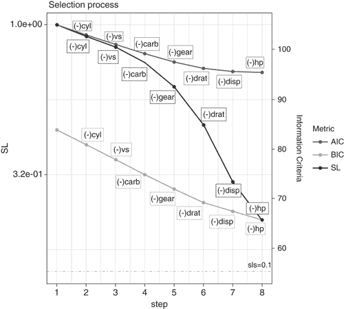

*图 5.2* `AIC`、`BIC` 和 `SL` 随步骤变化的函数，其中显示了变量移除（例如，(-)cyl）对后向算法的影响。返回正文.⏎

```
> plot(fit)
```

我们从图中看到，在函数的每一步，`AIC`、`BIC` 和 `SL` 随着预测变量的移除而下降。图是可视化选择过程的有力方式。我们看到 `SL` 在后期的步骤中急剧下降。`BIC` 在步骤之间几乎遵循完美的负线性路径。

在 Python 中，前向和逐步回归可以使用 sklearn 的 `SequentialFeatureSelector()` 执行，尽管这里未演示。详情请参阅 Python 的 sklearn 网站。

## 5.10 中介和调节回归模型

中介在统计学中具有相对悠久的历史，主要是由社会科学家的实质性兴趣推动的，主要是心理学家。尽管在 242 某些领域很受欢迎且炒作，但了解统计中介 *能* 做什么与 *不能* 做什么很重要。另一方面，调节最通常只是 *交互* 的另一个词。在 ANOVA 类型的模型中，我们通常将其称为交互，而在回归模型中它被称为调节。至关重要的是要认识到，*中介和调节本身并不意味着物理过程*。也就是说，进行统计中介的检验并得出结论 *Z 中介了 X 和 Y 之间的关系* 仅在 *统计上* 必然为真；除非在统计模型之外有实质性理由或论据来推断这种中介过程，否则在实质上并非如此。有无数已发表的文章，甚至在“高影响因子”期刊中，研究人员仅基于 *统计* 中介就得出中介过程的结论，这体现了统计学的许多哲学和方法论滥用之一。我们稍后会更广泛地重新审视和讨论这个问题。

### 5.10.1 统计中介

我们故意将本节命名为 *统计* 中介，原因如前所述，研究人员太常认为如果他们将中介模型应用于数据，就可以“提取”中介 *过程*。这根本不是这种情况。在解决这个问题时，让我们首先非常简要地回顾一下文献中如何定义中介（和调节）。例如，Little et al. (2007, p. 207) 提供了以下定义和区别：

> 一般来说，中介可以被认为是在因果效应链中携带或传输信息的载体。另一方面，调节器是系统中改变关系的因素。

Pearl（2014，第 1–2 页）声称，“从科学上讲，中介告诉我们‘自然是如何运作的’，从实践上讲，它使我们能够在各种各样的条件下和干预下预测行为。”

经典的中介模型在 图 5.3 中示出，其中 `X` 是预测变量，`Y` 是响应变量，`M` 是中介变量。

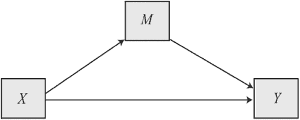


### 5.10.1 经典中介

*图 5.3* 经典中介模型，其中“`M`”是`X`与`Y`之间关系的中介。返回正文。⏎

“经典”或传统中介的条件通常包括以下内容（MacKinnon et al., 2007）：

1. `X`应与`Y`存在关系。
2. `X`应与`M`存在关系。
3. 当`X`和`M`同时作为`Y`的预测因子时，`M`应与`Y`相关。
4. `X`与`Y`的关系在加入`M`后应*减弱*（就绝对值而言）， presumably 是因为`M`“吸收”了原本会从`X`传递到`Y`的相关性（仅在某种*统计*意义上）。243

更复杂的组合中介模型示例如图 5.4 所示，其中我们现在有三个中介变量`z[1]`、`z[2]`和`z[3]`，且`ε[1]`、`ε[2]`和`ε[3]`为误差。

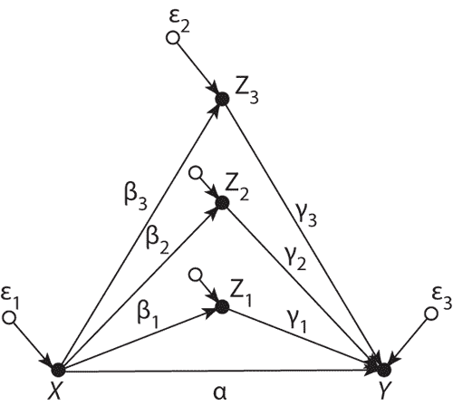

*图 5.4* 三中介模型。经 Springer Nature BV 许可使用，摘自 The Causal Mediation Formula—A Guide to the Assessment of Pathways and Mechanisms by Judea Pearl, © 2012；许可通过 Copyright Clearance Center, Inc.转达。返回正文。⏎

虽然最初包含多个中介变量似乎是个好主意，但它伴随着许多注意事项。这些模型的有效性仅限于对其施加的假设。确实，正如 Pearl 再次指出的（2012，第 2–3 页），我们对其进行转述：

> 这两种方法的有效性当然取决于*假设*\[加粗强调\]误差项…不相关，否则，部分结构参数会产生有偏的结果。在随机试验中，误差可以与随机化装置等同，我们可以确信误差与其他误差不相关，因此回归估计将是无偏的…然而，随机化并不能消除`e2`和`e3`的误差。

中介模型的复杂程度没有上限。例如，图 5.5 展示了一个具有混杂因素的中介模型，该混杂因素预测处理、中介变量和结果。除混杂因素外，该模型是经典的三变量中介模型。

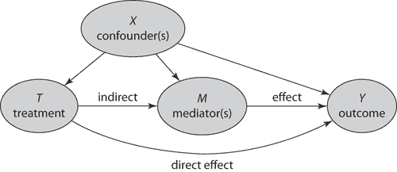

*图 5.5* 具有混杂因素(们)的中介模型。返回正文。⏎

对于相当简单的中介模型之外，这类模型通常最好作为*结构方程模型*进行分析，因此当我们更详细地介绍 SEM 模型时，我们将在本书后面一定程度上重新审视它们。中介模型中的估计包括传统的*系数乘积估计器*（Hayes, 2018）。基于模拟的估计器也被提出，以及半参数估计器，如*逆概率加权估计器*（Zhang, 2442023）。*乘法稳健估计器*以及*双重机器学习中介估计器*也被提出。详情请参阅 Abécassis et al. (2023)。

### 5.10.2 统计调节

正如我们讨论中介和调节时开头所提到的，调节分析无非就是分析交互作用。也就是说，严格来说，“调节”只是统计*交互作用*的花哨说法。当你进行方差分析并建模交互作用时，你就是在进行调节分析。然而，在心理学等领域，关于调节分析的“炒作”实在太多，它经常被宣传为能够完成远超其能力的任务。再次重申，在调节分析的*统计*程序中，除非你所使用的变量和理论暗示了某种“物理”过程，否则没有任何东西必然在*物理*或*实质*意义上“调节”其他东西。*统计调节本身绝不会以任何方式提供该过程*。事实上，在许多情况下，统计调节可能相当令人失望。

作为调节的一个基本例子，请考虑图 5.6 中的图。

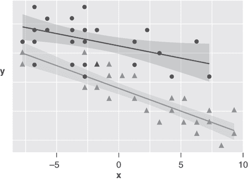

*图 5.6* 两组调节的说明；斜率非平行。返回正文。⏎

由于斜率不同（*非平行*），我们产生了调节效应。当然，在*样本*中，几乎*总是*会存在调节效应。你真的认为斜率在样本中可能*完全*平行吗？真正的问题是是否可以将此类效应推断到总体上，这正是我们最终感兴趣的推断问题。我们将在本章后面使用软件介绍一个调节的例子。

### 5.10.3 调节的中介

正如检验任何其他交互效应一样，人们可能有兴趣了解整个中介模型是否在调节变量的不同取值下成立。更具体地说，我们可能有兴趣了解*间接效应*（即，所谓“通过”中介变量的效果）是否取决于调节变量的取值。这被称为*调节的中介*，更一般地称为*条件过程模型*（Hayes, 2018），或再次，寻找*条件间接效应*。也就是说，间接（或“中介”）效应取决于某个其他第三变量，如图 5.7 所示。245

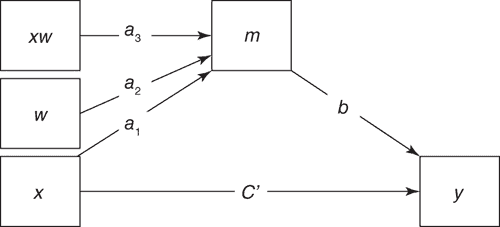

*图 5.7* 以`w`为条件的三变量中介模型。返回正文。⏎

我们在图 5.7 中看到经典的三变量中介模型，然而它取决于`w`变量，如`x*w`交互作用所示。请注意，由于*边际性原理*（Fox, 2016），`w`和交互项`x*w`都被包含在内，该原理认为不应包含交互项而不同时包含构成该交互项的各个项，在本例中仅为`w`变量。

*中介的调节*模型是指自变量与调节变量之间的交互作用在统计上“影响”中介变量，而中介变量进而在统计上“影响”结果变量。根据 Hayes（2018，第 465 页），“中介的调节既不有趣也不有意义”，在大多数条件下在数学上等同于调节的中介。因此，Hayes 建议将中介的调节问题重新表述为*调节的中介假设*。

### 5.10.4 Python 中的中介

中介和调节分析最好留给 R 或专门为统计设计的类似软件（例如，SPSS 也有专门用于执行中介的宏）。然而，Python 也为此提供了一些功能。以下是在 Python 中使用`pingouin`包（Vallat, 2018）进行中介的示例。`pingouin`包是一个开源包，最初用 Python 3 编写，主要使用`pandas`和`numpy`。

我们首先通过`pip`安装`pingouin`，然后导入`mediation_analysis`函数：246


```
pip install pingouin
from pingouin import mediation_analysis, read_dataset
df = read_dataset(‘mediation’)
df
Out[216]:
```

|  || X || M || Y || Mbin || Ybin || W1 || W2 |

| --- | --- | --- | --- | --- | --- | --- | --- |

| 0 || 6 || 5 || 6 || 0 || 1 || 0.0 || 1.0 |

| --- | --- | --- | --- | --- | --- | --- | --- |

| 1 || 7 || 5 || 5 || 1 || 0 || 0.1 || 1.0 |

| 2 || 7 || 7 || 4 || 0 || 0 || 0.2 || 1.0 |

| 3 || 8 || 4 || 8 || 0 || 1 || 0.3 || 1.0 |

| 4 || 4 || 3 || 5 || 0 || 1 || 0.4 || 1.0 |

| .. || .. || .. || .. || ... || ... || ... || ... |

| 95 || 5 || 2 || 2 || 1 || 0 || 1.0 || 1.0 |

| 96 || 8 || 4 || 1 || 1 || 0 || 1.0 || 1.0 |

| 97 || 7 || 4 || 5 || 0 || 0 || 1.0 || 1.0 |

| 98 || 2 || 2 || 1 || 0 || 1 || 1.5 || 1.0 |

| 99 || 5 || 4 || 5 || 0 || 0 || 2.0 || 1.0 |

在下面，我们将 `X` 指定为预测变量，`M` 指定为中介变量，`Y` 指定为响应变量。我们将显著性水平（`alpha`）设为 0.05：

```
mediation_analysis(data=df, x=‘X’, m=‘M’, y=‘Y’, alpha = 0.05, seed = 42)
Out[214]:
```

|  || path || coef || se || pval || CI\[2.5%\] || CI\[97.5%\] || sig |

| --- | --- | --- | --- | --- | --- | --- | --- |

| 0 || M ~ X || 0.561015 || 0.094480 || 4.391362e-08 || 0.373522 || 0.748509 || Yes |

| --- | --- | --- | --- | --- | --- | --- | --- |

| 1 || Y ~ M || 0.654173 || 0.085831 || 1.612674e-11 || 0.483844 || 0.824501 || Yes |

| 2 || Total || 0.396126 || 0.111160 || 5.671128e-04 || 0.175533 || 0.616719 || Yes |

| 3 || Direct || 0.039604 || 0.109648 || 7.187429e-01 || \-0.178018 || 0.257226 || No |

| 4 || Indirect || 0.356522 || 0.083313 || 0.000000e+00 || 0.219818 || 0.537654 || Yes |

从上面可以看出，虽然直接路径在统计上不显著，但 *total* 和 *indirect* 路径是显著的。*direct effect* 是从外生变量到内生变量的效应，对于我们的数据而言是从 `X` 到 `Y`。*indirect effect* 是通过中介变量的路径。*total effect* 是直接效应和间接效应的总和。

`pingouin` 包也可以轻松拟合具有二元变量的中介以及具有多个中介变量的模型。中介模型也可以用 `statsmodels.stats.mediation()` 拟合，不过我们这里不探讨这些用法。R 中的包 `moderate.mediation` (Qin, 2024) 可用于拟合相当复杂的中介模型，并且在调节中介建模方面非常推荐。包 `mediation` (Tingley et al., 2014) 也拟合多种中介模型。还可以对中介效应进行敏感性分析。详情请参阅 Imai et al. (2010)。作为对 R 中中介和调节分析的总结，包 `mediation` (Tingley et al., 2014) 是使用 R 进行所有类型中介分析的“go-to”来源。

## 5.11 进一步方向以及关于中介和调节的最终警告

统计学中的中介和调节是一个庞大的主题，有专门的书籍论述这些方法（例如，参见 Hayes, 2018）。中介的最新研究包括 Ge et al. (2023) 的工作，他们为 *dynamic mediation analysis* 开发了一个强化学习框架。在许多情况下，处理是在时间上分配的，这项工作旨在沿纵向轨迹评估中介变量以及在无限多个决策点上的顺序决策制定。Pearl (2012) 批判性地评估了进行中介的习惯性方式，该方式假设线性且误差独立，并提出了一种用于建模非线性关系、包括分类变量在内的替代方法。Judd et al. (2001) 提供了在被试内设计中估计中介和调节模型的细节。

然而，正如我们在讨论开始时提到的，中介和调节如果使用不当，更重要的是 *interpreted* 不正确，会弊大于利。在社会科学中，仅仅因为统计证据支持它，就得出中介和调节过程的结论的情况太常见了。

重申一下，正如任何好的方法学家或科学哲学家会告诉你的那样，*no statistical method, whatever the kind, can alone indicate a physical process* (Fiedler et al., 2011)。使用“power”和“action”这类词语来描述统计过程的问题是 *dangerous*。中介分析有时被称为“因果建模”，除非有实质性的 *context* 来诱导这种因果关系，否则它根本不是因果的。进行中介或调节分析绝对没有问题，但如果更多的研究者真正理解它对他们的数据所能告诉的 *little*，而不是鲁莽地给变量强加它们并不 247*necessarily* 具备的 *powers*，这些方法可能就会比现在使用得更少。*It behooves all researchers to understand the limitations of the statistical procedures they use before using and interpreting them on empirical data. Researchers regularly “empower” statistics to say much more from their data than they are able. Mathematical and statistical models are first and foremost abstractions; they have no knowledge of your empirical observations, they are simply using those numbers as inputs in their computations. Whether the statistical model says anything substantive about those empirical observations is a much more complex scientific and philosophical issue than simply fitting the statistical model. Narratives rarely correspond to “reality” one-to-one.*

## 5.12 主成分回归

回想一下，在典型的多元回归问题中，会寻求预测变量 `x[1]` 到 `x[p]` 的线性组合，使得它与响应变量 `y` 的相关性最大化。这种最大相关性通过 `R²` 等拟合统计量来表达。正如我们已经知道的，多重共线性会对回归模型产生不利影响。拥有彼此高度相关的多个预测变量，其一就会 *inflate standard errors*。膨胀的标准误差会降低检测效应的统计功效，从而使拒绝预测变量的零假设变得更加困难。

统计问题并不是让人讨厌共线性的唯一原因。从科学角度来看，具有相关预测变量是资源浪费。例如，将出生日期记录为月份然后再次记录为天数是浪费时间，因为一个变量基本上完成了两个变量的工作。它们本质上是彼此的重复。更精确地说，一个变量是另一个变量的线性组合。在这种情况下，最可能的做法是简单地从回归中剔除其中一个变量并简化模型，既消除或减少共线性，也在实质上减少模型的科学复杂性。

然而，简单地从预测变量集中剔除变量并非唯一选择。对此问题的一种相对流行的替代方法是，在对 `y` 进行预测 *之前* 减少 `x[1]` 到 `x[p]` 的维度。尤其是当 `p`（预测变量的数量）非常大时，将 `p` 转化为更少数量的 *components* 然后将 `y` 回归到这更少数量的分量上可能更有意义。*Principal components regression* 正是试图做到这一点。然而，要理解主成分回归，我们首先必须对 *principal components analysis* 有所了解。

### 5.12.1 什么是主成分分析？


## 5.12 主成分回归

对主成分分析（PCA）的更深入讨论留待本书后面章节，在那里我们将更详细地讨论降维技术和流形学习，并专门用一整章来讨论 PCA 技术。目前，我们仅简要介绍该方法，以了解它如何服务于 PCA 回归技术。

主成分分析推导出变量数相等的 *正交线性组合*，使得连续的线性组合所解释的观测变量方差越来越少。回想一下，线性组合定义为 248

`l[i] = a[1]y[1] + a[2]y[2] + ... + a[p]y[p]`

也就是说，线性组合是 *加权乘积之和*，其中 `a[1]` 到 `a[p]` 是应用于观测变量 `y[1]` 到 `y[p]` 的权重。对于我们关于 `x[1]`、...、`x[p]` 的数据，线性组合变为

`z[i] = a[1]x[1] + a[2]x[2] + ... + a[p]x[p]`

其中现在 `z[i]` 是线性组合的名称，而 `x[1]` 到 `x[p]` 是观测变量。主成分是一种独特的线性组合，其权重 `a[1]` 到 `a[p]` 对应于从对变量 `x[1]`、...、`x[p]` 的协方差或相关矩阵进行的特征值分析中提取的相关特征向量的值。因此，如果我们用 `e[1]` 到 `e[p]` 表示权重 `a[1]` 到 `a[p]` 以表示特征向量权重，则第一个主成分定义为

`z[1] = e[1]x[1] + e[2]x[2] + ... + e[p]x[p]`

(5.31)

第一个主成分解释了观测变量中最多的方差。第二个主成分解释了观测变量中第二多的方差，但与第一个正交。PCA 的目标是尽可能在前几个成分中捕获尽可能多的方差，以解释观测变量集合的方差。*主成分回归* 以最小二乘意义上使用前几个主成分作为预测变量。这样，保留在 `PCR`（*主成分回归*）中的成分数量可以类比为 *调优参数*（Boehmke & Greenwell, 2020）。正如我们在介绍岭回归和套索回归等方法时将看到的那样，调优参数对于控制统计学习方法中方差与偏差之间的平衡非常有用，并且有助于从更广泛的可能性中选择“最佳”模型。

主成分回归乍看之下似乎很有用，但它做出了一个重要的假设，该假设在经验数据中可能并不总是成立。通过对一组成分回归 `y`，*我们隐含地假设方差最大的方向在* `x[1]` *到* `x[p]` *是与* `y` *相关联的那些相同方向*。虽然这一假设可能并不总是成立，但它通常被认为是对大多数数据有用的近似，并且 PCA 回归通常能给出合理的结果（James et al., 2013）。正如 Izenman (2008, p.132) 更精确地所述：

> 主成分的提取是在没有任何参考输出变量 `Y` 的情况下完成的，我们没有理由期望 `Y` 与任何主成分高度相关，特别是那些具有最大特征值的成分。事实上，`Y` 可能与其最后几个主成分甚至最后一个主成分的相关性最高。

或者，正如 Artigue and Smith (2018, p. 9) 更清晰地阐述的那样：

> 主成分回归的承诺在于，它是一种基于解释变量之间相关性，从大量可能性中选择相对较少数量的解释变量的有效方法。问题在于候选变量上的特征向量权重与其与被预测变量的关系无关。轻微重要的变量可能被赋予比重要变量更大的权重。干扰变量可能被赋予比真实解释变量更大的权重。真实解释变量的系数可能被赋予错误的符号。249

尽管主成分回归提供了一种简单的方法来使用少于问题的全部预测变量谱，但由于无法保证最能解释预测变量的方向也将是最适合用于预测响应的方向，因此它不应被视为特征或变量选择方法。事实上，完全可能存在与响应仅弱相关的变量，但随着这些变量数量的增加，`R-squared` 仍会接近 1.0。一般来说，添加无用预测变量虽然会导致维度增加，但会冒过拟合和测试误差增加的风险。

上述问题的更深入讨论可在 Jolliffe (1982) 中找到。关键要点是 *尽管 PCA 回归保证推导出在预测变量集合中最大化方差的正交成分，但这不一定等同于最大化* `R²` *在* `y` *与那些解释* `x[1]` *到* `x[p]` *中最大方差的成分之间*。因此，PCA 回归不应被视为变量选择技术（James et al., 2013），其精神与诸如 *最优子集* 或 *前向回归* 等技术相同。PCA 回归也不是尺度不变的，因此通常（尽管不是 *总是*）建议对预测变量进行标准化。

### 5.12.2 PCA 回归与奇异性

正如我们所见，PCA 回归在希望在将所得成分用作响应预测变量之前降低预测变量维度时可能很有用。更具体地说，当预测变量彼此高度相关时，PCA 回归可能很有用。

还有另一种情况，PCA 回归可能特别有用，那就是当预测变量矩阵 `X` 为 *奇异* 且因此 *病态* 时。回想一下，对于奇异矩阵 `X`，意味着一行或一列是另一行或多行列的线性组合。这一条件始终意味着矩阵的行列式将等于零，这意味着 `X` 的逆无法计算。在这种情况下，在计算最小二乘估计时可以代入 *广义逆*。广义逆有很多种，但最常见的是 *Moore-Penrose 逆*，使用它将得到广义逆回归估计量（Izenman, 2008）。

`X` 侧 PCA 回归中应保留的成分数量可由 *Kaiser 准则* 确定，该准则指出对于相关矩阵应保留所有特征值大于 1 的成分，或通过使用交叉验证技术确定（Wold, 1978）。派生成分的实质意义在选择时也可能发挥重要作用，这取决于成分的科学性质是否对科学家重要。

### 5.12.3 R 中的主成分回归

`pls` 包（Liland et al., 2023）可用于主成分回归。我们对鸢尾花数据执行 `pls`：

```
> require(pls)
> set.seed(1000)
```

我们将首先移除物种变量：

```
> iris.2 <- iris[c(-5)]
> head(iris.2)
```

|  || Sepal.Length || Sepal.Width || Petal.Length || Petal.Width |
| --- | --- | --- | --- | --- |
| 1 || 5.1 || 3.5 || 1.4 || 0.2 |
| --- | --- | --- | --- | --- |
| 2 || 4.9 || 3.0 || 1.4 || 0.2 |
| 3 || 4.7 || 3.2 || 1.3 || 0.2 |
| 4 || 4.6 || 3.1 || 1.5 || 0.2 |
| 5 || 5.0 || 3.6 || 1.4 || 0.2 |


| 6 || 5.4 || 3.9 || 1.7 || 0.4 |

## 主成分回归

我们现在运行主成分回归模型：

```
> pcr_model <- pcr(Sepal.Length~., data = iris.2, scale = TRUE, validation = “CV”)
```

在模型语句中，`Sepal.Length~.` 表示响应是 `iris` 数据中所有其他变量的函数，而 `scale = TRUE` 请求对数据进行标准化。语句 `validation = “CV”` 请求对模型进行交叉验证。若要特别请求留一交叉验证，则应编码为 `validation = “LOO”`：

我们得到摘要：

```
> summary(pcr_model)
Data: X dimension: 150 3
     Y dimension: 150 1
Fit method: svdpc
Number of components considered: 3
VALIDATION: RMSEP
Cross-validated using ten random segments.
```

|  || (截距) || 1 个成分 || 2 个成分 || 3 个成分 |
| --- | --- | --- | --- | --- |
| CV || 0.8308 || 0.5432 || 0.3867 || 0.3177 |
| --- | --- | --- | --- | --- |
| adjCV || 0.8308 || 0.5429 || 0.3865 || 0.3173 |

```
TRAINING: % variance explained
```

|  || 1 个成分 || 2 个成分 || 3 个成分 |
| --- | --- | --- | --- |
| X || 74.05 || 98.84 || 100.00 |
| --- | --- | --- | --- |
| Sepal.Length || 57.97 || 78.47 || 85.86 |

`CV` 数值是交叉验证，而 `adjCV` 是偏差校正的 CV 估计（Mevik & Wehrens, 2024，第 5 页）。 `RMSEP` 是预测均方根误差。我们还看到 % 解释方差随着成分数量（最多三个）的增加而增加，正如预期。我们可以绘制这些成分上花萼长度的 `RMSEP`（图 5.8）：251

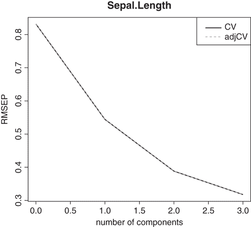

*图 5.8* RMSEP 随成分数量的变化。CV 和 adjCV 在此数据上几乎相同（图中可能难以看出重叠）。返回正文.⏎

```
> plot(RMSEP(pcr_model), legendpos = “topright”)
```

我们可以清楚地看到 `RMSEP` 随着成分数量的增加而减小，这符合直觉。我们也可以通过以下代码得到上述图（未显示输出），其中还请求了 `val.type = “MSEP”`，其中 `MSEP` = 预测均方误差：

```
> validationplot(pcr_model)
> validationplot(pcr_model, val.type=“MSEP”)
> predplot(pcr_model)
> coefplot(pcr_model)
```

`predplot()` 函数显示了一幅图（图 5.9，左），显示了三个成分情况下预测值与测量（观测）值的关系。 图 5.9 右侧的图绘制了每个预测变量的回归系数，其中 `coef(pcr_model)` 将给出花萼宽度（变量 = 1）、花瓣长度（变量 = 2）和花瓣宽度（变量 = 3）的相应系数：252

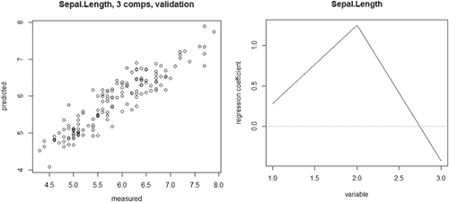

*图 5.9* 预测值与测量值的关系图（左）。回归系数与每个预测变量的关系图（右）。返回正文.⏎

## 5.13 偏最小二乘回归

与主成分回归仅使用 `x[1]` 到 `x[p]` 构建成分不同，偏最小二乘寻求数据中同时包含预测变量和响应变量的维数或方向。也就是说，`x[1]` 到 `x[p]` 中找到的成分不仅与预测变量侧相关，也与响应 `y` 相关。偏最小二乘，或简称为“PLS”，通常被认为是对主成分回归的一种监督替代方法（James et al., 2013），因为 `PLS` 在确定最佳“方向”时会纳入响应。

正如 Izenman 所描述的那样，

> PLS 搜索一组成分（称为潜向量），该成分对 `X` 和 `Y` 进行同时分解，同时约束这些成分尽可能解释 `X` 和 `Y` 之间的协方差。以这种方式，PLS 中的导出变量被构建为保留 `X[1]` 到 `X[p]` 变量中的大部分信息，并且通常通过算法而不是优化程序获得（Izenman, 2008，第 133 页）。

为了阐明 PLS 实际完成的工作，再次回顾典型 PCA 中线性组合的样子：

`z[1] = e[1]x[1] + e[2]x[2] + ... + e[p]x[p]`

在 PLS 中，`z[1]` 中的系数，即 `e[1]` 等，被设置为对每个预测变量将 `y` 对 `x` 进行简单线性回归的结果系数。该系数（例如 `e[1]`）与 `y` 和 `x[j]` 之间的相关性成比例，即我们正在考虑的给定预测变量。也就是说，在计算第一个成分时，与 `y`（在单变量意义上）最密切相关的变量 `x` 会获得最大的权重。

为了得到第二个成分 `z[2]`，首先对 `z[1]` 的每个变量进行调整，通过将每个变量对 `z[1]` 回归并取“剩余”部分的残差。如果第一个成分解释了预测变量中的所有信息，残差将等于零。更有可能的是，第一个 253 成分不会解释所有信息，因此残差将大于零。第二个成分 `z[2]` 使用这些残差计算得出，这些残差与第一个成分正交。迭代方法继续用于 `z` 的后续方向（即成分）。

因此该方法被称为偏最小二乘的原因很清楚。它之所以如此，是因为它利用了与之前成分值正交的残差。因此，如果 PLS 能说话，它会说：“在去除预测部分（或‘偏’）之后，让我们现在对剩余部分回归新的成分。”偏最小二乘与主成分回归一样，不是尺度不变的，因此通常建议对预测变量进行标准化。然而，正如书中其他地方所述，是否进行标准化的决定不应在不仔细考虑所研究变量的性质（尤其是尺度）的情况下做出。

### 5.13.1 R 中的偏最小二乘

`caret` 包（Kuhn，2008）允许我们拟合多种模型，包括偏最小二乘。以下是一个偏最小二乘判别分析，其中响应变量是二元的：

```
> library(caret)
> library(mlbench)
> data(Sonar)
```

我们仅打印数据中的少数变量和案例：254255

```
> head(Sonar)
```

|  || V1 || V2 || V3 || V4 || V5 || V6 || V7 || V8 || V9 || V10 || V11 || V12 || V13 || V14 |
| --- | --- | --- | --- | --- | --- | --- | --- | --- | --- | --- | --- | --- | --- | --- |
| 1 || 0.0200 || 0.0371 || 0.0428 || 0.0207 || 0.0954 || 0.0986 || 0.1539 || 0.1601 || 0.3109 || 0.2111 || 0.1609 || 0.1582 || 0.2238 || 0.0645 |
| --- | --- | --- | --- | --- | --- | --- | --- | --- | --- | --- | --- | --- | --- | --- |
| 2 || 0.0453 || 0.0523 || 0.0843 || 0.0689 || 0.1183 || 0.2583 || 0.2156 || 0.3481 || 0.3337 || 0.2872 || 0.4918 || 0.6552 || 0.6919 || 0.7797 |
| 3 || 0.0262 || 0.0582 || 0.1099 || 0.1083 || 0.0974 || 0.2280 || 0.2431 || 0.3771 || 0.5598 || 0.6194 || 0.6333 || 0.7060 || 0.5544 || 0.5320 |
| 4 || 0.0100 || 0.0171 || 0.0623 || 0.0205 || 0.0205 || 0.0368 || 0.1098 || 0.1276 || 0.0598 || 0.1264 || 0.0881 || 0.1992 || 0.0184 || 0.2261 |
| 5 || 0.0762 || 0.0666 || 0.0481 || 0.0394 || 0.0590 || 0.0649 || 0.1209 || 0.2467 || 0.3564 || 0.4459 || 0.4152 || 0.3952 || 0.4256 || 0.4135 |
| 6 || 0.0286 || 0.0453 || 0.0277 || 0.0174 || 0.0384 || 0.0990 || 0.1201 || 0.1833 || 0.2105 || 0.3039 || 0.2988 || 0.4250 || 0.6343 || 0.8198 |
|  || V56 || V57 || V58 || V59 || V60 || Class |


| --- | --- | --- | --- | --- | --- | --- |

| 1 || 0.0167 || 0.0180 || 0.0084 || 0.0090 || 0.0032 || R |

| --- | --- | --- | --- | --- | --- | --- |

| 2 || 0.0191 || 0.0140 || 0.0049 || 0.0052 || 0.0044 || R |

| 3 || 0.0244 || 0.0316 || 0.0164 || 0.0095 || 0.0078 || R |

| 4 || 0.0073 || 0.0050 || 0.0044 || 0.0040 || 0.0117 || R |

| 5 || 0.0015 || 0.0072 || 0.0048 || 0.0107 || 0.0094 || R |

| 6 || 0.0089 || 0.0057 || 0.0027 || 0.0051 || 0.0062 || R |

上面的声纳数据由 208 个数据点组成，收集自 60 个预测变量（上面仅显示了几个预测变量）。我们希望预测两个类别的响应变量（`M` = 金属圆柱体，`R` = 岩石）。我们首先将数据分为 `testing` 和 `training`：

```
> set.seed(107)
> inTrain <- createDataPartition(
+ y = Sonar$Class,
+ p = .75,
+ list = FALSE)
```

这里使用 `createDataPartition()` 函数根据 `Sonar` 数据集中的“`Class`”将数据分为 `training` 和 `testing`，我们可以看到它包含两个类别：

```
> Sonar$Class
[1] R R R R R R R R R R R R R R R R R R R R R R R R R R R R R R R R R R R R R
[38] R R R R R R R R R R R R R R R R R R R R R R R R R R R R R R R R R R R R R
[75] R R R R R R R R R R R R R R R R R R R R R R R M M M M M M M M M M M M M M
[112] M M M M M M M M M M M M M M M M M M M M M M M M M M M M M M M M M M M M M
[149] M M M M M M M M M M M M M M M M M M M M M M M M M M M M M M M M M M M M M
[186] M M M M M M M M M M M M M M M M M M M M M M M
Levels: M R
```

我们现在将训练集定义为 `inTrain` 中之前指定的 .75，而其余部分，即 .25，作为测试集，用 `-inTrain` 表示未包含在 `inTrain` 中的部分：

```
> training <- Sonar[inTrain,]
> testing <- Sonar[-inTrain,]
```

我们确认现在 `training` 中有 157 个案例，`testing` 中有 51 个，总共 208 个案例，其中 157/208 是之前指定的 .75 的比例：

```
> nrow(training)
[1] 157
> nrow(testing)
[1] 51
```

我们现在在 `training` 数据上拟合 `pls` 模型：

```
plsFit <- train(
Class ~.,
data = training,
method = “pls”,
preProc = c(“center”, “scale”)
)
```

256

在 `method =` 下，我们本可以选择其他方法，例如 `rpart`（*递归划分*）和决策树。然而，由于我们执行的是偏最小二乘，因此选择 `pls`。数据也已进行中心化（`center`）和缩放（`scale`），使其均值等于零，标准差等于一。我们现在查看拟合模型的输出：

```
> plsFit$bestTune
 ncomp
2    2
> plsFit
Partial Least Squares
157 samples
60    predictor
2   classes: ‘M’, ‘R’
Pre-processing: centered (60), scaled (60)
Resampling: Cross-Validated (10 fold, repeated 3 times)
Summary of sample sizes: 141, 141, 142, 142, 141, 142, ...
Resampling results across tuning parameters:
```

| 成分数 || ROC || 敏感度 || 特异度 |

| --- | --- | --- | --- | --- |

|  1 || 0.8052910 || 0.7259259 || 0.6904762 |

| --- | --- | --- | --- | --- |

|  2 || 0.8479084 || 0.7495370 || 0.8005952 |

|  3 || 0.8488426 || 0.7638889 || 0.7476190 |

|  4 || 0.8355241 || 0.7652778 || 0.7357143 |

|  5 || 0.8124173 || 0.7481481 || 0.7547619 |

|  6 || 0.7887566 || 0.7236111 || 0.6988095 |

|  7 || 0.7938161 || 0.7439815 || 0.6892857 |

|  8 || 0.8012235 || 0.7393519 || 0.6982143 |

|  9 || 0.7932126 || 0.7578704 || 0.6767857 |

| 10 || 0.7895916 || 0.7412037 || 0.6904762 |

| 11 || 0.7868386 || 0.7416667 || 0.7101190 |

| 12 || 0.7773479 || 0.7365741 || 0.7148810 |

| 13 || 0.7715608 || 0.7375000 || 0.7000000 |

| 14 || 0.7678902 || 0.7175926 || 0.6904762 |

| 15 || 0.7679729 || 0.7148148 || 0.6898810 |

从上面的输出可以看出，最大的 `ROC` 值（即 `ROC` 曲线下面积，值越大越“好”）出现在三个成分时，敏感度为 0.76，特异度为 0.74。我们也可以在图中可视化这些结果（图 5.10），注意到 `ROC` 的最高“峰值”出现在两个到三个成分时：257

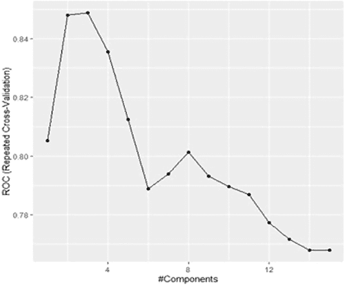

*图 5.10* ROC 随成分数的变化。返回文本。⏎

以下将通过预测概率计算预测类别（我们仅打印了其中几个案例），我们也在下面的混淆矩阵中对其进行了汇总：

```
> ggplot(plsFit)
> plsClasses <- predict(plsFit, newdata = testing)
> plsClasses
[1] R M M R R R R R R R R M R M R R R R R R R M M R M R R M M M M M R R R M M R
[39] M M M M M M M M M M M M M
Levels: M R
> plsProbs <- predict(plsFit, newdata = testing, type = “prob”)
> head(plsProbs)
```

|  || M || R |

| --- | --- | --- |

| 6 || 0.3526672 || 0.6473328 |

| --- | --- | --- |

| 8 || 0.5916628 || 0.4083372 |

| 9 || 0.5851591 || 0.4148409 |

| 15 || 0.4297217 || 0.5702783 |

| 26 || 0.4023577 || 0.5976423 |

| 27 || 0.4527808 || 0.5472192 |

混淆矩阵的准确率为 (21 + 18)/51 = 0.76，这也在输出中有所体现，同时给出了 95% 置信区间。还报告了 `Kappa` 统计量（0.5278），用于评估一致程度，值越高越好。输出中还记录了敏感度、特异度以及阳性和阴性预测值。258

```
> confusionMatrix(data = plsClasses, testing$Class)
            Reference
Prediction  M    R
        M   21           6
        R        6          18
            Accuracy : 0.7647
                  95% CI : (0.6251, 0.8721)
             Kappa : 0.5278
               Sensitivity : 0.7778
               Specificity : 0.7500
            Pos Pred Value : 0.7778
            Neg Pred Value : 0.7500
```

图 5.11（左）是均方根误差（`RMSE`）随成分数量变化的图。我们看到，随着成分数量的增加，`RMSE` 预期会持续下降。

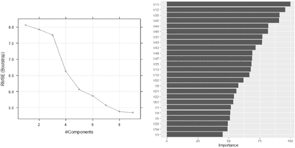

*图 5.11* RMSE 随成分数的变化（左）。变量重要性（右）。返回文本。⏎

```
> plot(plsFit)
```

我们可以通过以下方式获得前 25 个特征的变量重要性（图 5.11，右）：

```
> library(vip)
> vip(plsFit, num_features = 25, method = “model”)
```

`pls` 的变量重要性度量（`vip`）表示对应系数按其减少残差平方和的比例加权后的贡献（Boehmke & Greenwell, 2020，第 102 页）。我们可以看到，从图 5.11 中，`V11` 是最重要的变量，而在请求的最初 25 个变量中，`V3` 是最不重要的（`num_features` = 25）。259

### 5.13.2 Python 中的偏最小二乘

偏最小二乘回归可以在 Python 中使用 `PLSRegression` 进行拟合。以下是一个使用简单数据的示例：

```
from sklearn.cross_decomposition import PLSRegression
X = [[0., 0., 1.], [1., 0., 0.], [2., 2., 2.], [2., 5., 4.]]
Y = [[0.1, -0.2], [0.9, 1.1], [6.2, 5.9], [11.9, 12.3]]
```

我们将请求一个 2 成分解：

```
pls2 = PLSRegression(n_components=2)
pls2.fit(X, Y)
```

我们现在基于两个成分解获得预测值：

```
Out[5]: PLSRegression()
Y_pred = pls2.predict(X)
Y_pred
Out[7]:
array([[ 0.26087869, 0.15302213],
       [ 0.60667302, 0.45634164],
       [ 6.46856199, 6.48931562],
       [11.7638863, 12.00132061]])
```

上面提取的每个成分上的预测值应按列垂直读取。也就是说，第一成分的预测值为 0.26、0.60、6.46 和 11.76。

## 5.14 多元降秩回归


## 多元降秩回归

多元降秩回归（Izenman, 1975）是多元回归模型的一个非常通用的框架，我们在这里仅为将其纳入一般回归框架的教学目的而提及。经典多元线性回归模型可以以其最一般的方式表述为

`Y` = `μ` + `C` `X` + `ε`

(5.32)

其中 `C` 是回归系数或参数的矩阵，对其存在一组线性约束。在 `C` 降秩的情况下，这些线性约束意味着 `C` = `A` `B`，其中 `A` 和 `B` 都是非唯一的满秩矩阵（Izenman, 2008, p. 177），因此我们可以将经典多元模型重写为

$$\\begin{array}{l} {Y = \\mu + {CX} + \\varepsilon} \\\\ {\\,\\,\\,\\,\\, = \\mu + \\left( {AB} \\right)X + \\varepsilon} \\\\ \\end{array}$$

(5.33)

其中在 (5.33) 中，我们只是用 `A` `B` 替代了 `C`。也就是说，降秩多元模型通过如 Izenman (2008) 所总结的那样，放宽了对 `C` 的秩的隐含约束，从而推广了经典多元模型，这进而允许进行降维。该主题到现在为止已经很熟悉了；一个秩小于满秩的矩阵很可能在其内部隐藏着底层 260 维性。通过估计 `A` 和 `B`，我们有效地“处理”了 `C` 的降秩条件。关于 `A` 和 `B` 为何非唯一的证明，参见 Izenman（2008, p. 177）。

若干统计模型，包括 `principal components analysis`、`exploratory factor analysis`、`canonical correlation`、`discriminant analysis`，甚至 `neural networks`，都可以被概念化为降秩多元模型的特例。更重要的是，书中前面讨论的回归 Gauss-Markov 定理推广到了多元降秩的对应形式。轮廓分析和时间序列也可以在降秩多元模型中进行概念化。

## 5.15 典型相关

典型相关是变量集合之间的双变量相关。它像 Pearson `r` 一样，是线性相关。它是线性组合之间的线性相关。也就是说，对于线性组合 `l`[1] 和 `l`[2]，它们之间的相关性由下式给出：

$$r\_{l\_{1},l\_{2}} = \\frac{{cov}\_{l\_{1},l\_{2}}}{\\sqrt{s\_{l\_{1}}^{2}s\_{l2}^{2}}}$$

(5.34)

其中 `s`[`l`[1]]² 和 `s`[`l`2]² 是各自线性组合的方差（Denis, 2021a），而 `cov`[`l`[1], `l`[2]] 是线性组合 `l`[1] 和 `l`[2] 之间的协方差。非零的总体典型相关平方是以下式子的非零特征值 `λ`[`i`]（Bilodeau and Brenner, 1999, p. 177; Rencher and Christensen, 2012, p. 387）：

`Σ`[`y` `y`]`^(−1)` `Σ`[`y` `x`]() `Σ`[`x` `x`]`^(−1)` `Σ`[`x` `y`]() 

由于特征值提供了平方典型相关，因此未平方的典型相关等于特征值的平方根，即 $\\sqrt{\\lambda\_{i}}$。

平方典型相关是如何求得的？有几种方法可以获得它们，但也许最简单的方法是通过对 `Σ`[`y` `y`]`^(−1)` `Σ`[`y` `x`]() `Σ`[`x` `x`]`^(−1)` `Σ`[`x` `y`]() 进行特征值分析，其中该矩阵在特征值等式的经典形式中被分析为 `A`：

`A` `x` = `λ` `x`

回想一下，要找到 `λ`，我们令 |`A`−`λ` `I`| = 0，其中现在 `A` 不再仅仅是一个矩阵 `A`，

`A` = `Σ`[`y` `y`]`^(−1)` `Σ`[`y` `x`]() `Σ`[`x` `x`]`^(−1)` `Σ`[`x` `y`]() 

因此我们有

|`A`−`λ` `I`| = 0 → |`Σ`[`y` `y`]`^(−1)` `Σ`[`y` `x`]() `Σ`[`x` `x`]`^(−1)` `Σ`[`x` `y`]() − `λ` `I`| = 0

(5.35)

因此由于 |`A`−`λ` `I`|`x` = 0，其中 `x` 是与 `λ` 相关联的特征向量，`Σ`[`y` `y`]`^(−1)` `Σ`[`y` `x`]() `Σ`[`x` `x`]`^(−1)` `Σ`[`x` `y`]() 的相应特征向量 `a` 和 `b` 由 261

(`Σ`[`y` `y`]`^(−1)` `Σ`[`y` `x`]() `Σ`[`x` `x`]`^(−1)` `Σ`[`x` `y`]() − `λ` `I`) `a` = 0

(5.36)

和

(`Σ`[`y` `y`]`^(−1)` `Σ`[`y` `x`]() `Σ`[`x` `x`]`^(−1)` `Σ`[`x` `y`]() − `λ` `I`) `b` = 0

(5.37)

求得。也就是说，第一线性组合现在为 `l`[1] = `a`′ `x`，第二为 `l`[2] = `b`′ `y`。每个维度的相应典型变量是不相关的，并且提取的每个后续典型维度与之前的维度不相关。Izenman（2008, p. 216）总结了典型相关：

> CVA 技术确保从原始 X 和 Y 变量中榨取每一分相关性，并以有序的方式将其沉积到成对的新变量中……它们具有特殊的相关结构。如果将相关性视为变量系统中的信息的主要决定因素，那么 CVA 就是减少原始两个变量集维度的一个主要工具。

不出所料，典型相关可以被解释为上述降秩回归的一个特例（Izenman, 2008）。典型相关的变体包括 `deep variational canonical correlation`（Wang et al., 2017），它将线性典型相关扩展并推广到深度神经网络参数化中的非线性模型。`Probabilistic canonical correlation` 由 Bach and Jordan (2006) 讨论。`Tensor canonical correlation` 也已被提出，其中数据中的每个观测值由多维数组（张量）组成（Min et al., 2020）。多元降秩、PCA 和 CVA 之间的关系可以在 Izenman (1975) 中找到。

### 5.15.1 R 中的典型相关

R 中的包 `CCA`（González & Déjean, 2023）可用于典型相关以及正则化典型相关的一个版本。该包还允许对典型相关进行大量图形可视化。下面是一个改编自该包文档中关于 `nutrimouse` 数据的示例，其中基因数据与一组小鼠的脂质相关：

```
> library(CCA)
> data(nutrimouse)
> X = as.matrix(nutrimouse$gene[,1:3])
> Y = as.matrix(nutrimouse$lipid[, 1:3])
```

以上，我们指定变量 X 和 Y，其中 X 为基因，Y 为脂质。X 变量由 nutrimouse 中基因数据框的第 1 至 3 个变量定义。根据包的详细信息，基因数据框包含一个 40 × 120 的数值变量矩阵，因此我们仅选择前三个（1:3）。同样，我们也仅选择数据中 40 行脂质（nrow(nutrimouse$lipid)）的数据框的变量 1:3。鉴于我们在等式的两边都有三个变量，我们应该在输出中得到三个典型相关，因为可能的典型相关数量等于等式两边变量数量中的较小者：262

```
> head(X)
```

|  || X36b4 || ACAT1 || ACAT2 |
| --- | --- | --- | --- |
| 1 || \-0.42 || \-0.65 || \-0.84 |
| --- | --- | --- | --- |
| 2 || \-0.44 || \-0.68 || \-0.91 |
| 3 || \-0.48 || \-0.74 || \-1.10 |
| 4 || \-0.45 || \-0.69 || \-0.65 |
| 5 || \-0.42 || \-0.71 || \-0.54 |

```
> head(Y)
```

|  || C14.0 || C16.0 || C18.0 |
| --- | --- | --- | --- |
| 1 || 0.34 || 26.45 || 10.22 |
| --- | --- | --- | --- |
| 2 || 0.38 || 24.04 || 9.93 |
| 3 || 0.36 || 23.70 || 8.96 |
| 4 || 0.22 || 25.48 || 8.14 |
| 5 || 0.37 || 24.80 || 9.63 |

```
> res.cc = cc(X, Y)
```

res.cc 的输出将提供大量典型相关输出（此处列出太长）。它将包括诸如 `x` 和 `y` 系数以及 `x` 和 `y` 典型得分等输出。最相关的是典型相关，我们可以从


```
> res.cc = cc(X, Y)
> res.cc
$cor
[1] 0.4362942 0.2078600 0.1100969
```

以及 `X` 和 `Y` 的系数，对应于相关的线性组合。有三组系数，每组对应于第一个、第二个和第三个典型相关：

```
$xcoef
```

|  || \[,1\] || \[,2\] || \[,3\] |
| --- | --- | --- | --- |
| X36b4 || \-2.097072 || \-3.196288 || \-15.486386 |
| --- | --- | --- | --- |
| ACAT1 || \-6.886185 || \-15.246034 || 11.241307 |
| ACAT2 || \-5.379544 || 2.058381 || 1.252734 |

```
$ycoef
```

|  || \[,1\] || \[,2\] || \[,3\] |
| --- | --- | --- | --- |
| C14.0 || \-0.4372447 || 1.24826248 || 1.2095311 |
| --- | --- | --- | --- |
| C16.0 || \-0.2332235 || \-0.06834084 || \-0.3046945 |
| C18.0 || 0.2839601 || 0.53574645 || 0.2444486 |

第一个典型相关系数等于 0.43，第二个为 0.20，第三个为 0.11。我们可以得到一个图（图 5.12）来按降序可视化上述典型相关系数。`type` = 函数在这里控制图中线的外观（尝试 `type` = "a" 看看区别）：

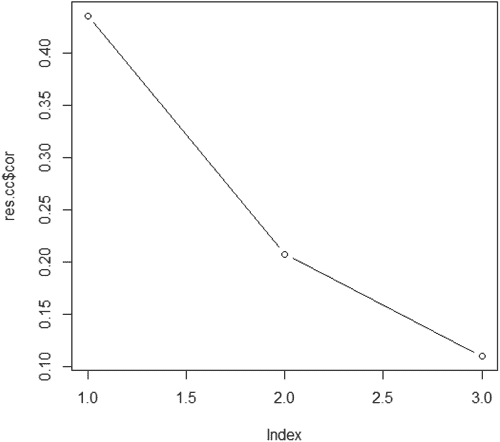

*图 5.12* 按降序大小绘制的典型相关系数图。返回正文.⏎

```
> plot(res.cc$cor, type = “b”)
```

263

图 5.13 中的图使我们能够在前两个维度上可视化典型载荷（a，b）和得分（c）：

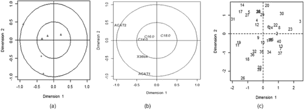

*图 5.13* 典型载荷（a，b）和典型得分（c）的图。返回正文.⏎

```
> plt.cc(res.cc)
```

我们可以轻松地将变量名添加到图中（图 5.13，（b）），其中我们现在明确请求维度编号（`d1` = 1，`d2` = 2，尝试 `d1` = 2 且 `d2` = 3 以绘制第二和第三维度，`type` = "v" 表示 "variables"，尝试 `type` = "i" 表示 "individuals"）：

```
> plt.cc(res.cc, d1=1, d2=2, type = “v”, var.label = TRUE)
```

包 `mulSEM`（Cheung, 2024）也通过函数 `cancorr()` 执行典型相关。264

## 5.16 章节复习练习

1. 1. 计算简单线性回归模型的截距，其中估计的斜率等于 0，然后解释为什么所得截距在直觉上是有意义的。
2. 2. 样本量在计算 `β̂[0]` 的估计标准误差中起什么作用？
3. 3. 对于 R 中的 `cars` 数据，估计一个简单线性回归，其中 `price` 被假设为 `mileage` 的函数。这与回归 `mileage` 对 `price` 的结果相同吗？
4. 4. 在计算 `β̂[1]` 时，(`X`^(`T`)*`X`) 不可逆的后果是什么？
5. 5. 考虑 *有偏* 估计量代替 *无偏* 估计量的潜在好处是什么？解释。
6. 6. 比较 `C[p]` 统计量与 AIC 统计量。它们相似之处何在？不同之处何在？在 BIC 统计量中，log(*n*) 起什么作用？
7. 7. 区分 *中介* 和 *调节*，并解释仅基于统计术语推断实质性效应的危险。
8. 8. 比较 *主成分回归* 与 *偏最小二乘回归*。这两个程序相似和不同之处何在？
9. 9. 在 `Python` 中构造两个变量的十个案例的一些数据并运行偏最小二乘回归。获得并报告回归的预测值。
10. 10. 区分 *多元降秩回归* 和 *典型相关*。一个模型能否被另一个模型包含？为什么或为什么不？证明你的答案。

265

# 6 回归中的正则化方法 Ridge、Lasso 和 Elastic Net

DOI: [10.4324/9781003376941-9](https://doi.org/10.4324/9781003376941-9)

在上一章中，我们提供了简单和多元线性回归方法的概述。我们看到选择的估计量是一个无偏估计量，即“BLUE”估计量。*无偏* 的质量似乎是一个值得拥有的理想特征。事实上，从初级统计课程开始，学生们就经常被教导无偏估计量是估计量的最有利品质之一，除其他特征如一致性、充分性等之外。

然而，在某些情况下，尤其是预测变量矩阵病态（例如共线性）时，放松无偏估计量的要求并改用 *有偏估计量* 可能是有价值的。乍一看，这在统计上似乎不直观且有点鲁莽。实际上 *偏好* 有偏估计量似乎违背了所有有利于无偏估计量的基本统计教学。然而，正如我们将看到的，在回归中选择有偏估计量会使预测变量的系数趋向于或等于 0，从而可能降低回归解中非必要的预测变量的重要性。通过使系数趋向于或等于 0，使用有偏估计量可以促进多元回归中的变量选择。事实上，我们将在本章中证明，普通最小二乘的残差平方和不过是正则化回归在特定超参数选择下的特例。

三个众所周知的正则化模型估计量是 *岭*、*套索* 和 *弹性网络*。在讨论每个估计量之前，有必要对 *正则化原理* 进行一般性和广泛的介绍和概述。正则化作为一个一般概念并不专门与任何特定估计量相关，并在许多不同的统计和机器学习方法中出现。也就是说，正则化是一个 *思想*，而不是任何特定的方法。这一点可能是关于正则化最重要的理解。

## 6.1 正则化的概念

正则化的主要思想是为模型提供一个“抓手”以简化其复杂性，从而使其有可能更好地推广到新的测试数据并因此最小化过拟合。等价地说，我们可以说正则化的目标是通过向训练损失添加惩罚来提高测试集上的性能（Kroese et al., 2020），以便我们选择的学习器不会在训练数据上过拟合，并且在测试数据上相对较好地泛化。*正则化完全是关于防止过拟合和增加泛化能力*。它通常与所谓的 *收缩* 和诸如岭回归和套索等技术相关联，但重要的是要理解它比这更普遍和更广泛。可以在不实现任何特定算法的情况下对模型进行正则化。正则化，至少是 *概念*，非常简单且相当通用。

为了演示正则化的本质，考虑正则化在基本线性模型中的一个极其简单的例子：266

`y[i]` = `β[0]` + `β[1]` `x[i]` + `ε[i]`

(6.1)

上述模型建立了响应 `y[i]` 与预测变量 `x[i]` 之间的线性关系。但假设观察到的样本数据完全不表现出线性关系。假设相反，`y[i]` 对 `x[i]` 的图如 图 6.1 所示，相关性接近 0。

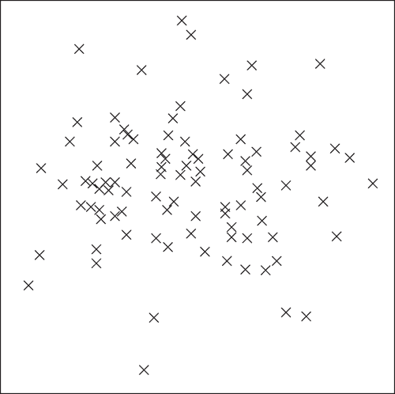

*图 6.1* 估计的 Pearson 乘积矩相关系数等于（大约）0 的任意数据图。返回正文.⏎


现在，考虑如果我们将上述线性模型拟合到这些数据上。它拟合得好吗？不行，而且如果拟合得不好，它很可能在测试数据上也不会 *泛化* 得好。用统计术语来说，即使是对这些数据使用简单的线性模型，也可以被视为 *过拟合*，而过拟合很少会导致良好的泛化能力。因此，一个解决方案是简化模型，使其不再过拟合并更好地泛化。简化模型的一种方法就是简单地将斜率参数约束为等于 0，或者等价地，不对其进行估计：

$$\\begin{array}{l} {y\_{i} = \\beta\_{0} + \\beta\_{1}x\_{i} + \\varepsilon\_{i}} \\\\ {\\,\\,\\,\\,\\, = \\beta\_{0} + \\left( 0 \\right)x\_{i} + \\varepsilon\_{i}} \\\\ {\\,\\,\\,\\,\\, = \\beta\_{0} + \\varepsilon\_{i}} \\\\ \\end{array}$$

(6.2)

这个“更简单”的模型现在只是对截距（或使用神经网络术语的“bias”项）的估计，外加一些误差，`ε[i]`。这个例子可能很简单，*我们刚刚进行了一次对统计模型的正则化行为*。简化模型的效果还有另一个含义；它表达了我们对真实函数比本例中的线性函数要简单得多的信念。Hastie 等 (2009, 第 34 页) 优美地描述了这一思想：

> 正则化方法表达了我们关于所寻求函数类型表现出某种平滑行为的先验信念，实际上通常可以表述为贝叶斯框架。267

他们的观点是，在技术层面上，惩罚项（或 *正则化*）在某种程度上反映了 *先验信念*，这是一个贝叶斯思想。在我们将直线变为仅截距的例子中，惩罚是隐式的，并反映了我们对数据底层真实函数并不像包含斜率那样“复杂”的信念。它要简单得多，因为截距足以解释真实函数。这就是正则化的 *思想* 或 *精神*。

> *正则化在实践中可以非常非正式，可以简单到决定不在简单的线性回归问题中对斜率进行建模。从贝叶斯观点来看，我们强加了这样一种信念：数据底层真实的函数形式比假设回归中存在非水平斜率要简单*。

## 6.1.1 回归及更广泛领域的正则化

稍作思考，上述基本而简单的概念在多大程度上可以推广到其他建模活动和方法。例如，当我们在结构方程模型中约束参数估计以避免过拟合从而提高泛化能力时，我们实际上是在进行模型正则化。同样，当我们为了泛化目的而选择更简单的主成分解而不是更复杂的解（例如在 `principal components regression` 中）时，我们也在对模型进行正则化。正如我们稍后会看到的，正则化神经网络的方法多种多样，也许最明显或最自然的方式是通过减少隐藏层数或节点数。甚至神经网络中迭代算法的 `early stopping` 也构成了一种简单的正则化神经网络的方式。

总而言之，每当模型或方法在某种意义上被简化，如果这样做是为了使其更好地泛化到测试数据，则表示对该模型进行正则化的行为。就回归而言，施加正则化参数的三种更高级且常见的方法超出了我们上面约束斜率的简单示例。这些包括 `ridge`、`lasso` 和 `elastic net` 回归。随着正则化的“精神”现在已确立，我们现在对这些方法进行概述。

## 6.2 岭回归

我们从 `ridge regression` 开始，因为它是正则化技术中最古老、最重要且最具影响力的技术之一。这些技术通常属于“shrinkage”范畴，其中偏回归系数被驱动向 0 或等于 0。乍一看，可能令人质疑为什么你会想将系数“shrink”向 0，但最终，收缩后的系数可以大大简化，从而正则化模型。岭惩罚（或类似的，如 `lasso`）通常也被称为 `weight decay` 和 `L2` 参数范数惩罚，而岭回归在许多圈子里通常被称为 `Tikhonov regularization`（Goodfellow 等, 2016）。Lasso 惩罚通常被称为 `L1` 正则化。岭惩罚以平方单位表示，即 `quadratic` 惩罚，而 lasso 惩罚以绝对值单位表示，因此是非二次的。惩罚的差异可能产生重要后果，尤其是在案例数大于变量数的数据中。关于后一点的示例，请参见 Hastie 等（2009，第 660 页）。`L1` 惩罚的一个优点是它允许通过将权重驱动 `to`，而不是仅仅 `toward`，0 来进行特征选择。

Ridge（以及 lasso、elastic net）可以应用于可能拥有数千个预测变量的情况，因此收缩成为简化模型并使其更易解释的良好策略。然而，正如正则化是一个范围广泛的概念，so is 268shrinkage。Shrinkage 仅仅是模型可以被正则化的方式之一。请确保这一点很清楚，因为人们常常误解正则化是 `equivalent` 于 shrinkage，但事实并非如此。子集选择、逐步回归、前向回归，甚至更不正式的技术，都是旨在正则化模型的方法。*正则化方法不必与 shrinkage 相关联*。

如前所述，收缩参数估计的另一个好处与样本量 `n` 与预测变量数 `p` 的比率有关。如果 `n` 并没有比 `p` 大很多，最小二乘拟合中可能会出现膨胀的变异性，这可能导致过拟合以及对训练中未使用到的未来观测值做出较差的预测。更糟的是，如果 `p` > `n`，就不再存在可靠的最小二乘估计，因为方差将是无限的。在这种情况下，存在太多将响应变量投影到预测变量集合上的方式（Hastie 等, 2009）。Shrinkage 在这种情况下是一个极其有价值的技术，因为通过在这些情况下收缩估计系数，无论是 `n` = `p` 还是 `p` > `n`，我们基本上可以降低方差，而只需付出可忽略的偏差增加的代价。

### 6.2.1 岭回归的数学

要理解岭回归的工作原理，首先回顾普通最小二乘回归。在最小二乘回归中，`β[0]`、`β[1]`、...、`β[p]` 通过 `β̂` = (`X`^(T)`X`)^(−1)`X`^(T)`y` 进行估计，以最小化残差平方和 (`RSS`) 函数，

$$RSS = {\\sum\\limits\_{i = 1}^{n}\\left( {y\_{i} - \\beta\_{0} - {\\sum\\limits\_{j = 1}^{p}{\\beta\_{j}x\_{ij}}}} \\right)^{2}}$$

(6.3)

不出所料，在岭回归中我们也寻求最小化一个量，但通过普通最小二乘 (`OLS`) 估计量

`β̂` = (`X`^(T)`X`)^(−1)`X`^(T)`y`

(6.4)

岭估计量在 `X`^(T)`X` 的迹上添加一个小的量 `λ`，使得

`β̂[ridge]` = (`X`^(T)`X` + `λ` `I`)^(−1)`X`^(T)`y`

(6.5)

岭回归中最小化的量与最小二乘回归中的相似，但额外添加了一项：

$$RSS = {\\sum\\limits\_{i = 1}^{n}\\left( {y\_{i} - \\beta\_{0} - {\\sum\\limits\_{j = 1}^{p}{\\beta\_{j}x\_{ij}}}} \\right)^{2}} + \\lambda{\\sum\\limits\_{j = 1}^{p}\\beta\_{j}^{2}}$$

(6.6)


请注意，两个被最小化的量之间的唯一区别在于 (6.6)，我们添加了尾项 $\\lambda{\\sum\\limits\_{j = 1}^{p}\\beta\_{j}^{2}}$，其中 `β[j]²` 只是我们已经熟悉的 `β[j]` 的平方。然而，该量由 `λ` “加权”，`λ` 是一个 *调优参数*，它施加于平方回归权重之和（即 $\\sum\\limits\_{j = 1}^{p}\\beta\_{j}^{2}$）。综合起来，尾项 $\\lambda{\\sum\\limits\_{j = 1}^{p}\\beta\_{j}^{2}}$ 被称为 *收缩惩罚*。但为什么要将此惩罚项添加到原始残差平方和中？这样做的理论后果是什么？我们现在探讨这一动机。269

### 6.2.2 岭估计的后果

我们首先注意到，当调优参数的值等于 0 时，岭回归的残差平方和简化为普通最小二乘回归，因为

$$\\begin{array}{l} {RSS = {\\sum\\limits\_{i = 1}^{n}\\left( {y\_{i} - \\beta\_{0} - {\\sum\\limits\_{j = 1}^{p}{\\beta\_{j}x\_{ij}}}} \\right)^{2}} + \\lambda{\\sum\\limits\_{j = 1}^{p}\\beta\_{j}^{2}}} \\\\ {\\,\\,\\,\\,\\,\\,\\,\\,\\,\\,\\, = {\\sum\\limits\_{i = 1}^{n}\\left( {y\_{i} - \\beta\_{0} - {\\sum\\limits\_{j = 1}^{p}{\\beta\_{j}x\_{ij}}}} \\right)^{2}} + 0{\\sum\\limits\_{j = 1}^{p}\\beta\_{j}^{2}}} \\\\ {\\,\\,\\,\\,\\,\\,\\,\\,\\,\\,\\, = {\\sum\\limits\_{i = 1}^{n}\\left( {y\_{i} - \\beta\_{0} - {\\sum\\limits\_{j = 1}^{p}{\\beta\_{j}x\_{ij}}}} \\right)^{2}}} \\\\ \\end{array}$$

当 `λ` 的值大于 0 时，我们可以看到它会增加残差平方和的值，因为我们此时至少将 $\\sum\\limits\_{j = 1}^{p}\\beta\_{j}^{2}$ 的 *一部分* 加到最小二乘残差上。

因此，岭回归具有 *表面上* *增加残差平方和* 的效果，超过了如果我们仅使用最小二乘回归本应得到的结果。这种效应似乎与进行回归的初衷相矛盾，因为迄今为止，回归分析的目标一直是 *最小化* 目标函数，而对于经典最小二乘法，该目标函数通常是平方误差之和。但现在，在岭回归中，我们故意添加一个“惩罚”项，看起来会 *增加* 平方误差之和。

我们为什么要这样做？我们应该有充分的理由。事实确实如此，因为我们 *不再使用最佳无偏估计量*。相反，岭回归使用 *有偏估计量*。岭回归具有显式的解析解，因此不需要数值方法。当我们遇到一种相关技术 *套索* 时就需要数值方法，因为套索不存在闭式解。

要理解使用有偏估计量为何可能比使用无偏估计量更有优势，我们需要重新审视本书前面讨论过的偏差-方差权衡。

### 6.2.3 重新审视偏差-方差权衡：岭回归为何有用

要理解岭回归为何有效，以及为何有偏估计量比无偏估计量具有优势，我们需要回忆偏差-方差权衡的概念：

`E(y[0]−f̂(x[0]))²` = `Var(f̂(x[0]))` + `[Bias[f̂(x[0])]]²` + `Var(ε)`

(6.7)

其中 `E(y[0]−f̂(x[0]))²` 是在给定 `x` 值（即 `x[0]`）处的期望测试均方误差（即 `MSE`）。目标是使 `E(y[0]−f̂(x[0]))²` 下降或减小。在等式中其他条件相等的情况下，我们可以看到 `[Bias[f̂(x[0])]]²` 的增加会使 `E(y[0]−f̂(x[0]))²` 增加，而不是减小，再次强调 *其他条件相等*。但理解岭回归的关键在于：*并非所有条件都相等*！对于偏差的增加，我们希望函数的方差 `Var(f̂(x[0]))` 会减小，这总体上在 `Var(ε)` 恒定的情况下意味着 `E(y[0]−f̂(x[0]))²` 会总体下降，而非 *增加*。直截了当地说，*岭回归通过有意向估计量中引入偏差来抵消方差的降低*，我们可以在下面简要总结：270

$$\\begin{array}{l} \\left. E\\left( {y\_{0} - \\hat{f}\\left( x\_{0} \\right)} \\right)^{2} = \\,\\downarrow Var\\left( {\\hat{f}\\left( x\_{0} \\right)} \\right) + \\uparrow\\left\\lbrack {Bias\\left\\lbrack {\\hat{f}\\left( x\_{0} \\right)} \\right\\rbrack} \\right\\rbrack^{2} + Var\\left( \\varepsilon \\right) \\right. \\\\ \\left. \\,\\,\\,\\,\\,\\,\\,\\,\\,\\,\\,\\,\\,\\,\\,\\,\\,\\,\\,\\,\\,\\,\\,\\,\\,\\,\\,\\,\\,\\,\\,\\,\\,\\,\\, = \\downarrow E\\left( {y\_{0} - \\hat{f}\\left( x\_{0} \\right)} \\right)^{2} \\right. \\\\ \\end{array}$$

(6.8)

也就是说，使用岭估计量的净效应是可取的，因为它通常会导致测试数据上更小的 `MSE`。这一点很重要。*更小的 MSE 是在测试数据上预期（并且期望）的，而不一定是在训练数据上*。

进行岭回归时，通常建议在执行程序之前对输入变量进行标准化，尽管并非所有人都接受这一建议（Izenman, 2008；Thisted, 1976）。

### 6.2.4 对岭回归的直观理解

岭回归可以直观理解，通常被称为 *惩罚* 最小二乘回归。正如所讨论的，岭估计量的最初动机是 Hoerl 和 Kennard (1970) 提出的观察，即 `OLS` 估计量的潜在不稳定性可以通过在求逆之前向 `X^T X` 的对角线条目添加一个小的常数 `k` 来追踪。这就产生了 *岭估计量*，有时也称为 *岭规则*。这相当于通过向单位矩阵的倍数收缩来正则化普通最小二乘（Friedman, 1989）。

但添加这个小的常数 `k` 有什么意义？要理解这一点，请考虑 图 6.2（左）中的描述，其中展示了 `OLS` 的同心椭圆或椭圆，以及岭估计量的搜索空间。我们可以看到，岭估计位于 `OLS` 椭圆的最外层椭圆上，对于 `β[1]` 和 `β[2]` 均如此（请注意 `β[1]` 和 `β[2]` 分别位于 `x` 和 `y` 轴上）。271


*图 6.2*  `OLS` 的同心 `RSS` 椭圆。岭估计是 `OLS` 估计的收缩版本，随着调参参数的函数而将系数向 0 移动（左）。对于一个恒定的同心椭圆，`β[1]` 和 `β[2]` 的岭估计如图中所示，其中两个系数 `β[1]` 和 `β[2]` 都已被收缩向，但未收缩到，0。也就是说，椭圆“接触”圆的地方（它是圆或“圆盘”，而不是其他形状，这是岭约束区域的结果）位于圆上不等于 0 的点上。相比之下，套索解（右）产生了一个具有尖锐边缘的菱形约束区域的形状，因此 `β[1]` 和 `β[2]` 的套索解更可能使某个系数等于 0。返回正文。⏎

图 6.2 中的同心椭圆代表每个椭圆的系数 `β[1]` 和 `β[2]` 的残差平方和的可能且恒定值。也就是说，无论 `RSS` 在给定特定椭圆上的位置如何，它都是 *相同* 的值。离估计系数更远的椭圆具有更大的 `RSS`。图中 `OLS` 估计（以及相应的 `RSS`）是在回归中对于 `β[1]` 和 `β[2]` 值组合产生的 `RSS`。注意相应的岭估计在哪里；它位于 `β[1]` 和 `β[2]` 值都已“收缩”且因此小于 `OLS` 估计（位于中心椭圆）的位置，尽管通常不会完全驱动到 0，因为从几何上讲岭具有 *圆形约束*。也就是说，圆形约束区域有效地是岭系数的搜索空间。该搜索最有可能在 图 6.2 （左）所示的圆形区域的边缘终止。另一方面，套索具有 *菱形* 搜索空间而不是（作为 L1 惩罚的结果）具有尖锐边缘，这说明系数不仅会被驱动得更小，而且可能被“收缩”到 0。也就是说，搜索空间这次在菱形内部，这意味着 `RSS` 将与菱形的硬边缘相交，而不是像岭中那样与圆形区域的光滑部分相交。因此，套索系数“落在”0 上，例如 `β[1]`，作为首先接触套索约束区域的点，即套索搜索空间。有关以这种方式解释岭（和套索）回归的更深入讨论，请参阅 James et al. (2013)，以更深入地解释岭与套索回归的几何形状。

### 6.2.5 Python 中的岭回归

岭回归可以在 Python 中非常容易地执行。我们从 `sklearn` 的 `Ridge` 库创建一个简单示例：

```
from sklearn.linear_model import Ridge
import numpy as np
n_samples, n_features = 10, 5
```

从上面可以看出，我们已将样本数指定为 10，特征数指定为 5，我们在下面进行确认：

```
n_samples
Out[97]: 10
n_features
Out[98]: 5
```

我们现在在这些样本和特征上生成一些随机数据，其中 `rng.randn()` 从标准正态分布生成数据：

```
rng = np.random.RandomState(0)
y = rng.randn(n_samples)
X = rng.randn(n_samples, n_features)
y
Out[103]:
array([ 1.76405235, 0.40015721, 0.97873798, 2.2408932 , 1.86755799,
      -0.97727788, 0.95008842,-0.15135721,-0.10321885, 0.4105985 ])
```

272

请注意，`y` 值由单个向量组成，而下面的 `X` 值则包含五个不同的变量，每个变量有十个案例（要生成标准化数据，可以使用 `StandardScaler()`，稍后会详细介绍）：

```
X
Out[104]:
array([[ 0.14404357, 1.45427351, 0.76103773, 0.12167502, 0.44386323],
          [ 0.33367433, 1.49407907, -0.20515826, 0.3130677 ,-0.85409574],
          [-2.55298982, 0.6536186 , 0.8644362 ,-0.74216502, 2.26975462],
         [-1.45436567, 0.04575852, -0.18718385, 1.53277921, 1.46935877],
[ 0.15494743, 0.37816252, -0.88778575,-1.98079647,-0.34791215],
         [ 0.15634897, 1.23029068, 1.20237985,-0.38732682,-0.30230275],
         [-1.04855297,-1.42001794, -1.70627019, 1.9507754 ,-0.50965218],
         [-0.4380743 ,-1.25279536, 0.77749036,-1.61389785,-0.21274028],
         [-0.89546656, 0.3869025 , -0.51080514,-1.18063218,-0.02818223],
         [ 0.42833187, 0.06651722, 0.3024719 ,-0.63432209,-0.36274117]])
clf = Ridge(alpha = 1.0)
clf.fit(X, y)
Out[146]: Ridge()
```

上面的默认 `alpha` 为 1.0。我们可以将其调整为其他值。`alpha` 值越小（*正则化* 或 *调优* 参数），解就越类似于普通最小二乘回归。请记住，*对于 `alpha` 为 0 的情况，两个解会收敛*。随着样本量的增加和 `alpha` →0，岭回归和线性回归也会收敛以生成相同的输出。随着训练数据的充足，正则化的影响通常也会变得不那么明显。

现在，让我们在五个特征上定义一些新数据并基于该新数据预测一个值。我们将用名称 `row` 定义新数据：

```
row = [0, 2, 3, 4, 5]
yhat = clf.predict([row])
print(‘Predicted: %.3f’ % yhat)
Predicted: 4.059
```

我们看到，对于 `row` 上的上述新数据，`y` 的预测值等于 4.059。

我们现在对解进行交叉验证。Python 中的 `RepeatedKFold` 交叉验证器在每次重复中以不同的随机化执行 `k` 折 `n` 次。我们将请求十次拆分（即“折”）并重复三次：

```
import numpy as np
from sklearn.model_selection import RepeatedKFold
cv = RepeatedKFold(n_splits=10, n_repeats=3, random_state=1)
grid = dict()
grid[‘alpha’] = np.arange(0, 1, 0.01)
```

上面从 0 到 1 以 0.01 为增量的值是正则化参数 `alpha` 的值。我们现在将运行一个 *网格搜索*，扫描参数值，找到使平均绝对误差最小的一个：273

```
search = GridSearchCV(clf, grid, scoring=‘neg_mean_absolute_error’, cv=cv, n_jobs=-1)
results = search.fit(X, y)
print(‘MAE: %.3f’ % results.best_score_)
MAE: -0.620
print(‘Config: %s’ % results.best_params_)
Config: {‘alpha’: 0.13}
```

上面，我们看到 *负平均绝对误差*（即 `MAE`）等于 −0.620，基于最优参数，等于 `alpha` 为 0.13。

Python 还提供 *贝叶斯岭回归*，其中正则化参数会系统地更新。要实现贝叶斯岭回归，请参阅 Python 中的 `BayesianRidge()` 函数。此外，对于本文介绍的示例，因为我们从标准正态分布抽取了随机数据（即抽取的数据处于相同的 *尺度*），我们没有将结果数据 *标准化* 以使其均值等于 0 且标准差等于 1。然而，这并不意味着标准化在这里不值得做。这在变量自然出现在 *不同尺度* 的情况下尤其如此，在这种情况下，人们不希望一个变量的“重要性”仅仅因为其测量的尺度而超过另一个变量。另一方面，这种以 *进行测量的原始尺度* 为依据的“贝叶斯先验”可能正是根据研究设置和背景所期望的，在这种情况下，是否标准化的决定会更困难（Izenman, 2008）。无论如何，在进行大多数正则化方法时，同时比较有无标准化的结果都是一个好主意。如果必须在两者之间选择一个选项，在大多数情况下标准化可能是一个好主意（Hastie et al., 2009，第 63 页），但在没有充分谨慎考虑的情况下不应这样做。


确实，除了正则化方法之外，是否标准化这一决策也必须在许多其他方法中做出（例如，主成分分析）。提出“总是标准化”这种“cookbook”式的建议并不是良好的统计教学，尤其是在没有仔细考虑原始测量单位的方差是否希望在随后的统计分析中发挥作用的情况下。再一次结合贝叶斯先验概念，有时我们希望这些方差会影响解，而有时则不希望。关键点在于，没有哪种方案是绝对正确或错误的，将测量值保留在原始单位中还是将其转换为标准化单位的决定需要逐案做出。

### 6.2.6 R 语言中的岭回归

R 语言中的岭回归可以使用 `lmridge` 包进行（Imdad & Aslam, 2018）。有关该包的优秀总结，请参阅 Ullah 等人（2018）。该包在“ridge”相关内容覆盖方面*出色*。下面，我们将对 `Hald` 数据拟合岭回归。该数据涉及一个工程应用，关注水泥成分对硬化过程中放热的影响。对我们而言，该数据最相关之处在于特征相对高度相关，因此非常适合岭回归。请查阅该包以获取此特定示例的进一步细节。

先简要了解一下 `Hald` 数据：
```
> library(lmridge)
> data(Hald)
> head(Hald)
```

|  || Y || X1 || X2 || X3 || X4 |
| --- | --- | --- | --- | --- | --- |
| \[1,\] || 78.5 || 7 || 26 || 6 || 60 |
| --- | --- | --- | --- | --- | --- |
| \[2,\] || 74.3 || 1 || 29 || 15 || 52 |
| \[3,\] || 104.3 || 11 || 56 || 8 || 20 |
| \[4,\] || 87.6 || 11 || 31 || 8 || 47 |
| \[5,\] || 95.9 || 7 || 52 || 6 || 33 |
| \[6,\] || 109.2 || 11 || 55 || 9 || 22 |

274 
我们将拟合一个模型，其中 `y` 被假设为预测变量 `X1` 至 `X4` 的函数：
```
> mod <- lmridge(y ~ X1 + X2 + X3 + X4, data = as.data.frame(Hald),
+ scaling = “sc”, K = seq(0, 1, 0.001))
```
“sc” 用于 `scaling` 将预测变量缩放到相关形式。选项 `scaling = "centered"` 仅会将所有预测变量居中。选项 `K` 指定岭偏置 *调优* 参数，其中在上面我们选择了选项 0, 1, 0.001，这意味着 R 将从 0 开始计算系数，直至 1，步长或增量为 0.001。

现在我们调用拟合模型，它显示 `K` 取值 0–0.004 时的参数估计。这些是岭回归拟合的 *原始* 或“去缩放”权重：
```
> mod
Call:
lmridge.default(formula = y ~ X1 + X2 + X3 + X4, data = as.data.frame(Hald),
K = seq(0, 1, 0.001), scaling = “sc”)
```

|  || 截距 || X1 || X2 || X3 || X4 |
| --- | --- | --- | --- | --- | --- |
| K=0 || 62.40537 || 1.55110 || 0.51017 || 0.10191 || \-0.14406 |
| --- | --- | --- | --- | --- | --- |
| K=0.001 || 71.32028 || 1.45679 || 0.41874 || 0.00650 || \-0.23358 |
| K=0.002 || 75.32580 || 1.41283 || 0.37795 || \-0.03741 || \-0.27346 |
| K=0.003 || 77.60713 || 1.38657 || 0.35493 || \-0.06322 || \-0.29591 |
| K=0.004 || 79.08396 || 1.36858 || 0.34021 || \-0.08058 || \-0.31023 |

以下将得到 *缩放* 系数：275
```
> mod$coef
```

|  || K=0 || K=0.001 || K=0.002 || K=0.003 || K=0.004 || K=0.005 |
| --- | --- | --- | --- | --- | --- | --- |
| X1 || 31.607147 || 29.6853546 || 28.7895380 || 28.254405 || 27.887857 || 27.613799 |
| --- | --- | --- | --- | --- | --- | --- |
| X2 || 27.500315 || 22.5718760 || 20.3730129 || 19.132537 || 18.339056 || 17.790004 |
| X3 || 2.261167 || 0.1442803 || \-0.8300639 || \-1.402819 || \-1.787926 || \-2.070135 |
| X4 || \-8.353056 || \-13.5438292 || \-15.8561502 || \-17.157745 || \-17.987880 || \-18.560165 |

我们可以通过以下方式获得预测值：
```
> predict(mod)
```

|  || K=0 || K=0.01 || K=0.02 || K=0.03 || K=0.04 || K=0.05 || K=0.06 |
| --- | --- | --- | --- | --- | --- | --- | --- |
| 1 || 78.49535 || 78.49063 || 78.65269 || 78.81280 || 78.96609 || 79.11210 || 79.25112 |
| --- | --- | --- | --- | --- | --- | --- | --- |
| 2 || 72.78893 || 73.10007 || 73.26551 || 73.41722 || 73.56132 || 73.69948 || 73.83256 |
| 3 || 105.97107 || 106.39463 || 106.38297 || 106.34900 || 106.30959 || 106.26726 || 106.22416 |
| 4 || 89.32720 || 89.48225 || 89.48739 || 89.48752 || 89.48842 || 89.49055 || 89.49423 |
| 5 || 95.64939 || 95.70913 || 95.84146 || 95.96400 || 96.07594 || 96.17731 || 96.26972 |
| 6 || 105.27469 || 105.27361 || 105.21815 || 105.16162 || 105.10662 || 105.05234 || 104.99962 |
| 7 || 104.14885 || 104.10473 || 104.09527 || 104.08482 || 104.07302 || 104.05858 || 104.04282 |

拟合模型在岭包中还有许多其他统计量可用。例如，我们可以获得拟合模型的绘图，即所谓的 *岭迹图*，如 图 6.3 所示。

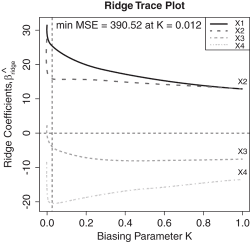

*图 6.3* 岭系数随偏置参数 K 变化的岭迹图。返回文本。⏎
```
> plot(mod)
```
图 6.3 中的图显示了不同 `K` 值下岭系数的取值。我们可以看到最小 MSE 出现在 `K = 0.012` 处。我们还可以通过 `summary(mod)` 生成模型的摘要，它将产生参数估计、标准误差和其他模型信息。

使用 `cv.plot()` 也可以获得交叉验证图，并且 AIC 和 BIC 值可以如 图 6.4 所示获得，显示 AIC 和 BIC 值在其最小值处作为自由度 (DF) 的函数：

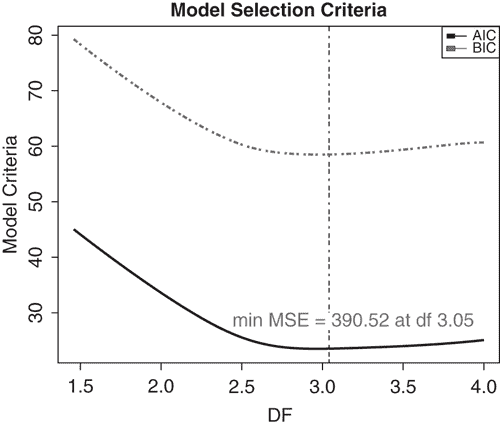

*图 6.4* AIC 和 BIC 随自由度变化。返回文本。⏎
```
> info.plot(mod)
```
276 

我们还可以通过以下方式按 `K` 值获取 AIC 和 BIC 值的向量（未显示输出）：`infocr(mod)[, 1]`、`infocr(mod)[, 2]`。我们对 `lmridge` 功能的调查仅触及了该包所能生成内容的表面。请参阅包的详细信息以获取更多选项。

## 6.3 Lasso 回归

刚刚介绍的岭回归只是缩小参数估计的一种方法。第二种流行且现代的方法是通过 lasso 回归。在 lasso 回归中，通过施加惩罚项，超出 OLS 回归所能实现的效果，最小化 *E*(*y*[0]−*f̂*(*x*[0]))² 的思想仍然保留，但这次，与岭回归中惩罚 $\\lambda{\\sum\\limits\_{j = 1}^{p}\\beta\_{j}^{2}}$ 不同，惩罚项是 $\\left. \\lambda\\left. \\sum\\limits\_{j = 1}^{p} \\right|\\,\\beta\_{j} \\right|$，因此我们现在最小化以下内容：

$$\\left. RSS = {\\sum\\limits\_{i = 1}^{n}\\left( {y\_{i} - \\beta\_{0} - {\\sum\\limits\_{j = 1}^{p}{\\beta\_{j}x\_{ij}}}} \\right)^{2}} + \\lambda{\\sum\\limits\_{j = 1}^{p}\\left| \\beta\_{j} \\right.} \\right|$$  
(6.9)


也就是说，与岭回归权重平方和 $\\sum\\limits\_{j = 1}^{p}\\beta\_{j}^{2}$ 不同，调参现在应用于回归权重 *绝对值* 之和，$\\left. {\\sum\\limits\_{j = 1}^{p}\\left| \\beta\_{j} \\right.} \\right|$。请注意，无论是在岭回归中添加平方项还是在套索回归中添加绝对值项，其一般原理是相同的，即在最小二乘残差平方和中加入惩罚项，从而看似增加误差函数。但同样值得问的是，我们为什么要这样做。如同岭回归之前的情况，只有当这种惩罚的加入能够降低 `MSE` 在 `test`（不一定是 *train*）数据上的表现时，才“值得”。岭回归和套索回归之间的唯一区别在于惩罚的性质。在这两种情况下，随着 `lambda` *λ* 的增大，回归中的所有系数最终都会趋向于 0，因此需要一个“停止点”；否则执行岭回归或套索回归将是微不足道且毫无意义的。也就是说，虽然我们希望将某些系数收缩至或趋向于 0，但将所有系数都驱动到 0 将是 277 反生产。 正如我们很快会看到的，实际上，停止点通常通过 `cross-validation` 选择。

根据 Müller 和 Guido (2017)，在岭回归与套索回归之间，岭回归通常是首选。如果您拥有大量预测变量并且预计其中只有少数几个很重要，以至于其余变量可以被剔除，那么套索回归可能最有用。请记住，套索回归可用于变量选择，因为它会将某些系数一直驱动到 0。这是在应用意义上使用岭回归与套索回归之间关键区别特征。

### 6.3.1 Python 中的套索回归

我们可以在 Python 中使用 `sklearn.linear_model` 通过导入 `Lasso` 函数来执行套索回归。与岭回归一样，调参通过 `alpha()` 调整：

```
import numpy as np
from sklearn.linear_model import Lasso
lasso_reg = Lasso(alpha = 0.1)
```

让我们先构建一些随机数据。我们将为 `X` 请求三列，为 `y` 请求一列：

```
X = 2*np.random.rand(10, 3)
```

指定 `(10, 3)` 请求 10 行乘以 3 列，因此有 3 个变量，每个变量有 10 个值：

```
X
Out[171]:
array([[1.83514679e-03, 1.22586651e+00, 1.36877003e+00],
          [1.98425878e+00, 1.27078700e+00, 3.05682926e-01],
          [1.67601853e+00, 1.91988490e+00, 1.14380535e+00],
          [6.85308266e-01, 1.74952610e+00, 2.58223320e-01],
          [1.92985175e+00, 1.33611596e+00, 1.69223164e+00],
          [1.70564639e+00, 9.98607007e-01, 2.89554744e-01],
          [1.91331572e+00, 1.39363873e+00, 1.78534834e+00],
          [9.52425306e-01, 4.84902989e-01, 1.77936410e+00],
          [1.95151855e+00, 1.89191263e+00, 6.02149503e-01],
          [9.86734995e-01, 1.14731519e+00, 1.30875638e+00]])
y = np.random.randn(10, 1)
y
Out[167]:
array([[ 0.89068823],
          [ 0.55519131],
          [-1.23040405],
          [-1.24752468],
          [-0.20588354],
          [-0.86695762],
          [-1.10404141],
          [-0.74561481],
          [-2.19565951],
          [ 1.28035892]])
lasso_reg.fit(X, y)
```

278

现在我们可以实现套索回归并对 `X` 的一组值 1.5、1、2 上的 `y` 获得预测值：

```
lasso_reg.predict([[1.5, 1, 2]])
Out[177]: array([-0.39427847])
```

我们看到输入预测变量的值集的预测值等于 −0.39。套索回归也可以使用 Python 中的 `statsmodels` 进行拟合。

### 6.3.2 R 中的套索回归

R 中的套索回归可以使用 `glmnet` 包中的 `glmnet()` 进行拟合（Friedman et al., 2023）。与 `lmridge` 一样，`glmnet` 是一个出色的包。用于执行套索回归和其他大量回归模型的选项是无穷无尽的。Hastie 等 (2023) 还发表了 *An Introduction to glmnet*，它同样出色，强烈推荐用于开始使用 `glmnet`。

我们展示来自该包的一个示例：

```
> library(glmnet)
> data(QuickStartExample)
> x <- QuickStartExample$x
> y <- QuickStartExample$y
```

`x` 中有四个预测变量，`y` 中有一个响应。现在我们拟合模型（仅打印少数几例）：

```
> fit <- glmnet(x, y)
> fit
Call: glmnet(x = x, y = y)
```

|  || Df || %Dev || Lambda |

| --- | --- | --- | --- |

| 1 || 0 || 0.00 || 1.63100 |

| --- | --- | --- | --- |

| 2 || 2 || 5.53 || 1.48600 |

| 3 || 2 || 14.59 || 1.35400 |

| 4 || 2 || 22.11 || 1.23400 |

| 5 || 2 || 28.36 || 1.12400 |

非零系数的数量由 `DF` 表示，`%Dev` 表示对于各种 `lambda` 值所解释的偏差百分比，其中偏差越高，表示该特定情况解释的越多。解释的偏差百分比相对于零偏差而言，后者是一个仅包含截距项的基线模型。

`plot()` 函数（图 6.5）揭示了系数作为 *λ* 的函数增长，以及系数向量的 L1 范数 ∑|*β*[*j*]|，其中顶部轴（0–9）显示了给定 L1 值下非零系数的数量：

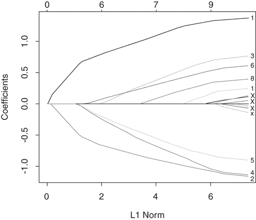

*图 6.5* L1 范数下系数的估计值作为函数。 在 L1 范数为 0 时，所有系数已被驱动到 0 且 lambda（即调参）较大，而随着 L1 范数增大，OLS 解在较大值下被近似且 lambda 越来越小。返回正文。⏎

```
> plot(fit)
> plot(fit, label = TRUE)
```

279

请注意，随着 L1 值减小趋向于 0，会得到“极端”的套索解，所有系数等于 0，这意味着非零系数的数量（上轴）等于 0。最右轴对应变量编号。如图中所示，变量 1 具有最大的系数。幅度第二大的是变量 14（图略有缩小，因此看不到；变量 14 位于图的极右下方）。

我们可以根据正则化参数 `s` 的值检查不同的模型。例如，下面我们查看 `s = 0.1` 时的系数（尝试不同的 `s` 值看看会得到什么；如果选择一个非常大的值，所有系数将被驱动到 0，这不是执行套索回归的目的）：

```
> coef(fit, s = 0.1)
21 x 1 sparse Matrix of class “dgCMatrix”
```

|  || s1 |

| --- | --- |

| (Intercept) || 0.150928072 |

| --- | --- |

| V1 || 1.320597195 |

| V2 || . |

| V3 || 0.675110234 |

| V4 || . |

| V5 || \-0.817411518 |

| V6 || 0.521436671 |

| V7 || 0.004829335 |

| V8 || 0.319415917 |

| V9 || . |

| V10 || . |

| V11 || 0.142498519 |

| V12 || . |

| V13 || . |

| V14 || \-1.059978702 |

| V15 || . |

| V16 || . |

| V17 || . |

| V18 || . |

| V19 || . |

| V20 || \-1.021873704 |

280

由于套索回归而被驱动到 0 的系数以上仅用句点表示。例如，`V2` 和 `V4` 已被驱动到 0。我们可以通过以下方式获得变量重要性图（图 6.6），其中此类重要性由标准化系数的幅度定义（Boehmke & Greenwell, 2020，第 136 页）：

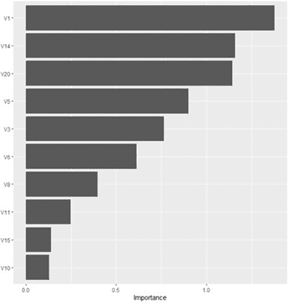


*图 6.6* Lasso 回归的变量重要性图，其中“重要性”是标准化系数的数值。对于这些数据，变量 1 是最重要的变量，其次是变量 14。返回正文.⏎

```
> library(vip)
> vip(fit)
```

我们还可以使用 `glmnet()` 函数直接执行交叉验证（图 6.7），该函数执行 `k` 折交叉验证（默认十折）。

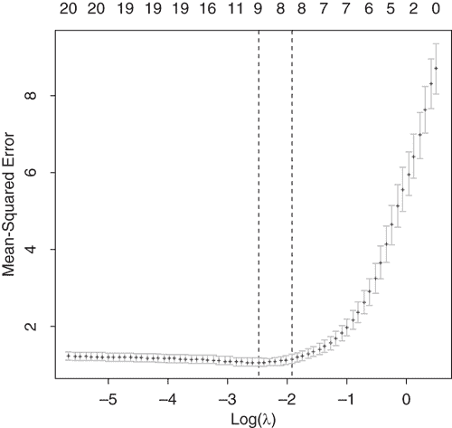

*图 6.7* 均方误差作为 (log) `lambda` 的函数。左侧垂直线表示均方误差最小的 `lambda` 值。返回正文.⏎

```
> set.seed(123)
> cv.glmnet(x, y)
> plot(cvfit)
```

我们可以提取水平线值（左侧垂直线）以及该值对应的系数：

```
> cvfit$lambda.min
[1] 0.07569327
```

生成最小值的 `lambda` 值因此等于 0.076。该数字的自然对数等于 −2.58，这就是上图中显示的左侧线（Boehmke and Greenwell, 2020，第 131 页）。右侧的垂直线是 `lambda.1se`，即等于上述最小值的一个标准误差的 `lambda`（`cvfit$lambda.1se`）。我们现在基于该最小值获取系数（我们仅打印前几个）：

```
> coef(cvfit, s = “lambda.min”)
21 x 1 sparse Matrix of class “dgCMatrix”
```

|  || s1 |
| --- | --- |
| (截距) || 0.14867414 |
| --- | --- |
| V1 || 1.33377821 |
| V2 || . |
| V3 || 0.69787701 |
| V4 || . |
| V5 || \-0.83726751 |

因此，通过交叉验证，我们确定了一组系数，可以将其视为我们 lasso 回归的“最终”系数，或者也可以探索 `lambda.min` 附近的系数。可以使用 `caret` 包 (Kuhn, 2008) 进一步自动化调参。Boehmke and Greenwell（2020，第 133 页）提供了关于如何为此目的使用 `caret` 包的优秀总结，其中对各种 `alpha` 值下的 `lambda` 值进行 *网格搜索*，其中 `alpha` 设置指示我们执行的是 ridge、lasso 还是 elastic net（将在下文介绍）。也就是说，这种搜索将揭示具有最佳（即 RMSE 最低）`alpha` 参数和 `lambda` 组合的模型。可以使用 `cv.glmnet` 执行类似的搜索 `alpha` 和 `lambda` 的方法（请参阅包的详细信息）。

## 6.4 弹性网络

缩减参数的第三种选择是 *elastic net*，其惩罚等于

$$\\left. {\\sum\\limits\_{j = 1}^{p}\\left( \\alpha \\middle| \\beta\_{j} \\middle| + \\left( 1 - \\alpha \\right) \\right.}\\beta\_{j}^{2} \\right)$$  

(6.10)

Elastic net 被认为是在 ridge 和 lasso 之间的一种折中，是一种上述估计量的“混合”（Hastie et al., 2009）。可以证明 elastic net 实际上采用了 ridge 和 lasso 惩罚函数的线性组合（详见 Izenman, 2008，第 153 页）。

请注意，elastic net 包含两个系数，`β`[*j*]² 和 |`β`[*j*]|。要理解 `α` 在此上下文中的调参作用，请注意它同时应用于 `β`[*j*]² 和 |`β`[*j*]|，即分别在 ridge 和 lasso 中使用的损失（即二次和绝对函数损失）。因此，我们可以看到 `α` 的作用是对 `β`[*j*]² 和 |`β`[*j*]| 进行差异化加权。这就是为什么 elastic net 被解释为 ridge 和 lasso 之间的“折中”，这种折中取决于所选 `α` 值对 ridge 和 lasso 的 L2 和 L1 损失分别进行差异化加权。

### 6.4.1 Python 中的 Elastic Net

库 `scikit-learn` 可以执行 elastic net。接下来我们对两个特征拟合一个 elastic net 模型：

```
from sklearn.linear_model import ElasticNet
from sklearn.datasets import make_regression
X, y = make_regression(n_features=2, random_state=0)
regr = ElasticNet(random_state=0)
```

我们在下面仅打印 `X` 和 `y` 的少数几个案例：

```
X
Out[39]:
array([[ 1.46935877, 1.53277921],
          [-1.60205766, 0.62523145],
          [-1.34775906, 1.8831507 ],
[ 1.22244507,-0.40317695],
          [ 1.5430146 ,-0.739563 ],
          [ 0.70657317, 0.3563664 ],
          [ 0.37816252, 0.15494743],
y
Out[40]:
array([ 1.90370562e+02, 1.33395696e+01, 1.41772669e+02,-3.06962683e+00,
          -2.60624653e+01, 5.49225405e+01, 2.59528810e+01,-4.33086794e+01,
           2.47135869e+02,-1.07140916e+02,-8.57587584e+01,-3.79043198e+01,
          -7.95749661e+01, 1.86961487e+01, 4.93789716e+01, 5.32933539e+00,
          -1.16562784e+02, 5.63423160e+01,-8.36280817e+01, 7.68252760e+01,
```

我们拟合 elastic net 回归并在下面获得系数：

```
regr.fit(X, y)
Out[689]: ElasticNet(random_state=0)
print(regr.coef_)
[18.83816048 64.55968825]
print(regr.intercept_)
1.4512607561654032
```

我们可以看到回归系数分别为 18.84 和 64.56，对应每个特征，而截距等于 1.45。现在让我们为每个特征的值 0 和 0 获取一个预测：

```
print(regr.predict([[0, 0]]))
[1.45126076]
```

不出所料，我们看到预测值等于 1.45 的截距（尝试其他值以查看您得到的预测值）。

正如我们对 lasso 所做的那样，我们可以使用包 `glmnet` 在 R 中拟合 elastic net。我们还可以使用最近提出的包 `fasterElasticNet`（Ma et al., 2022），据称它可以非常高效地拟合 elastic net（和相关模型）。

## 6.5 哪种正则化惩罚更好？

为了总结我们对这些正则化方法的讨论，需要注意的是，ridge、lasso 和 elastic net 都不会普遍占优彼此。*没有免费的午餐！* 当少数系数接近 0 而其余系数相当可观时，lasso 可能表现更好，而当所有系数大致相等，或至少对研究者同等重要时，ridge 通常表现最佳。然而，没有保证。建议在一定程度上使用 *交叉验证* 来确定哪种方法对给定数据集更好，其中调参通过不同值的 *网格搜索* 选择，并使用交叉验证来观察哪种方法给出最低的 *测试误差*。重申一下，我们希望最小化 *测试误差*，而不一定是 *训练误差*。这就是为什么交叉验证对于选择最佳调参如此重要。请参阅 Frank and Friedman (1993)，以比较普通最小二乘法不仅与 ridge 回归，还与主成分回归和偏最小二乘法。

## 6.6 最小角回归

正如我们在调查变量选择技术时所看到的，前向回归一次选择候选池中一个能改善模型拟合的变量。*最小角回归* 可以被视为与前向回归相关的技术，因为它仍然基于前向策略进行选择，但不一定选择 *整个* 变量。相反，进入选择的是变量中 *应得* 用于预测的那部分，而不是传统逐步程序中的全部。Hastie et al.（2009，第 73–74 页）最简洁地描述了该算法：


在第一步，\[least-angle regression\] 识别出与响应最相关的变量。与完全拟合该变量不同，`LAR`（最小角回归）将该变量的系数连续地朝其最小二乘值移动（导致其与不断变化的残差的相关性绝对值减小）。一旦另一个变量在与残差的相关性方面“赶上”，过程就会暂停。然后第二个变量加入活动集，并且它们的系数以保持相关性相等且递减的方式一起移动。该过程一直持续到所有变量都进入模型为止，并以完整的最小二乘拟合结束。

该算法首先将预测变量标准化，使其均值等于 0，方差等于 1（即 `z` 分数）。在此初始步骤中，残差 `r[i]` 在模型中没有预测变量的情况下计算，即 $r\_{i} = y\_{i} - \\overline{y}$，回归中的所有系数均设为 0。也就是说，`β[1]` = `β[2]`， ..., `β[p]` = 0。接下来，具有与该残差最大相关性的预测变量进入模型；然而，*并非全部*。预测变量的权重向其最小二乘系数移动，直到另一个预测变量“赶上”并与当前残差的相关性与第一个预测变量一样大。此时，`β[1]` 和 `β[2]` 均朝向它们的 *联合* 最小二乘系数方向移动，直到另一个预测变量“赶上”当前残差。该算法以这种方式继续进行，直到所有预测变量都被纳入，从而为模型实现最小二乘解。在预测变量数量大于样本量的情况下（更具体地说，`N-1`），算法将在 `N-1` 步后达到零残差条件（Hastie et al., 2009，第 74 页）。

因此，最小角回归通过分段线性“部分”步骤建立回归模型，在每一步通过将新变量与当前残差相关联来添加单个元素。当另一个变量“赶上”时，算法朝预测变量移动的方向为 *等角*（即具有相同的角度）。因此，最小角回归被称为逐步回归的“民主”版本（Hastie et al., 2009）。套索和前向分段回归模型都可以通过 `least-angle regression algorithm` 计算（Izenman, 2008）。需要强调的关键点是，在最小角回归中，预测变量本质上在选择过程中“赶上”其他变量，然后这些变量一起移动。在 Python 中，可以使用 `Lars` 估计器拟合最小二乘回归。也可以使用 `LARS` 套索，它实现 `LARS` 估计器，同时将一些系数驱动为 0，这是套索的特征。

### 6.6.1 R 中的最小角回归

我们可以使用 `lars` 包在 R 中拟合最小角回归（Hastie and Efron, 2022）。`lars` 包拟合最小角回归、套索和前向分段回归。我们在 `diabetes` 数据上进行演示，该数据包含 145 名成人的葡萄糖耐量和胰岛素的几种血液化学测量值：

```
> library(glmxdiag)
> library(lars)
> data(diabetes)
> attach(diabetes)
```

有 `x` 上总共 20 个变量（我们仅打印前八个）和 `y` 上单个变量：

```
> head(x)
```

|  || \[,1\] || \[,2\] || \[,3\] || \[,4\] || \[,5\] || \[,6\] || \[,7\] || \[,8\] |
| --- | --- | --- | --- | --- | --- | --- | --- | --- |
| \[1,\] || 0.2738562 || \-0.0366722 || 0.8547269 || 0.9675242 || 1.4154898 || 0.5234059 || 0.5626882 || 1.11122333 |
| --- | --- | --- | --- | --- | --- | --- | --- | --- |
| \[2,\] || 2.2448169 || \-0.5460300 || 0.2340651 || \-1.3350304 || 1.3130758 || 0.5212746 || \-0.6100346 || \-0.86139651 |
| \[3,\] || \-0.1254230 || \-0.6068782 || \-0.8539217 || \-0.1487772 || \-0.6646828 || 0.6066164 || 0.1617207 || \-0.86272165 |
| \[4,\] || \-0.5435734 || 1.1083583 || \-0.1042480 || 1.0165262 || 0.6999042 || 1.6550164 || 0.4899635 || 0.02338209 |
| \[5,\] || \-1.4593984 || \-0.2744945 || 0.1119060 || \-0.8517877 || 0.3152839 || 1.0507493 || 1.3863575 || 0.28450104 |
| \[6,\] || 1.0632081 || \-0.7535232 || \-1.3825534 || 1.0762270 || 0.3700331 || 1.4987212 || \-0.3604525 || \-0.21421571 |

```
> head(y)
      [,1]
[1,] -1.2748860
[2,] 1.8434251
[3,] 0.4592363
[4,] 0.5640407
[5,] 1.8729633
[6,] 0.5275317
```

如果我们简单运行 `lars`，将获得套索回归：

```
> object <- lars(x,y)
> summary(object)
LARS/LASSO
Call: lars(x = x, y = y)
```

|  || Df || Rss || Cp |
| --- | --- | --- | --- |
| 0 || 1 || 852.48 || 812.2901 |
| --- | --- | --- | --- | --- |
| 1 || 2 || 809.19 || 768.0660 |
| 2 || 3 || 543.04 || 485.8674 |
| 3 || 4 || 542.61 || 487.4075 |
| 4 || 5 || 478.70 || 421.1627 |
| 5 || 6 || 398.84 || 337.8830 |

286

我们可以获得标准化系数的图（图 6.8），它为我们提供了套索系数，随着 L1 范数与最小二乘系数（`x` 轴）的比率接近 1.0，最小二乘系数将被获得：


*图 6.8* 标准化系数作为 L1 范数与最小二乘比率的函数。随着该比率接近 1.0（lambda = 0），最小二乘系数被获得，因为 L1 范数与 OLS 相同。随着 lambda 增加，L1 范数减小，套索将系数驱动为 0。该图显示了每个系数被驱动为 0 的时间。在图的极左端，如顶部轴所示，仍有零个非零系数。然后从右到左，该图显示了套索的进展，从最小二乘解（最右侧）开始，到完整的套索（和微不足道）“收缩”解，其中所有系数都被驱动为 0（最左侧，其中 |beta|/max|beta| 等于 0）。在图的极右侧，该比率等于 1.0，因为 beta 值与其最大 OLS 值相等。返回文本。⏎

```
> plot(object)
```

287

我们可以按如下方式获得 20 个测量值的系数：

```
> coef4.1 <- coef(object, s=4.1, mode="norm")
```

代码 `mode = "norm"` 指定 L1 范数（在这种情况下为绝对值；请参阅包以获取更多选项）。我们现在打印出系数：

```
> coef4.1
[1] 0.2633462 0.0000000 0.0000000 0.0000000 0.0000000 0.0000000
[7] 0.0000000 0.0000000 0.0000000 0.0000000 0.0000000 0.0000000
[13] 0.0000000 -0.1237479 0.0000000 0.0000000 0.0000000 0.0000000
[19] 0.0000000 0.0000000
```

上述所有系数都是针对 `s = 4.1` 的模型（即刚超过第四个值）。如果我们想在 `s` 的任何特定值（L1 范数）处获得系数，我们也可以使用 `predict.lars()`。例如，在下面我们选择 `s = 3` 来查看该特定值处的系数：


```
> coef3 <- predict(object, s=3, type=“coef”, mode=“norm”)
> coef3
$s
[1] 3
$coefficients
[1] 0.21054411 0.00000000 0.00000000 0.00000000 0.00000000 0.00000000
[7] 0.00000000 0.00000000 0.00000000 0.00000000 0.00000000 0.00000000
[13] 0.00000000 -0.07358921 0.00000000 0.00000000 0.00000000 0.00000000
[19] 0.00000000 0.00000000
```

我们可以按如下方式获得拟合的摘要：

```
> object
Call:
lars(x = x, y = y)
R-squared: 0.913
Sequence of LASSO moves:
Var 1 14 5 20 6 3 8 11 7 10 15 13 18 12 2 4 16 17 9 19
Step 1 2 3 4 5 6 7 8 9 10 11 12 13 14 15 16 17 18 19 20
```

我们可以看到，最终模型的 R-squared 等于 0.913。输出还显示了预测变量被纳入模型的步骤（变量 1 首先被纳入，而变量 14 在第二步被纳入，以此类推）。

我们现在将通过添加 `type = “lar”` 来拟合最小角回归（图 6.9）。请注意，先前的 lasso 与最小角回归之间的唯一区别是添加了 lar 选项：

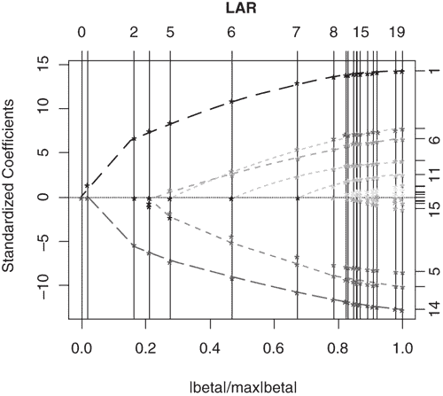

*图 6.9* 最小角回归 (LAR) 系数。返回正文。⏎

```
> object2 <- lars(x, y, type=“lar”)
> object2
Call:
lars(x = x, y = y, type = “lar”)
R-squared: 0.913
Sequence of LAR moves:
Var 1 14 5 20 6 3 8 11 7 10 15 13 18 12 2 4 16 17 9 19
Step 1 2 3 4 5 6 7 8 9 10 11 12 13 14 15 16 17 18 19 20
> plot(object2)
```

288

我们注意到 lasso 和 lar 的结果完全一致。这在 lasso 与 lar 结果中是典型的，其中系数轮廓通常仅在系数曲线穿过零时才不同，这通常发生在预测变量之间存在高度相关性的条件下。有关此效应的详细说明和讨论，请参阅 Hastie 等人（2009，第 75–76 页），他们展示了一幅图，显示 lasso 与 lar 轮廓完全相同，除了一个穿过 `y`-轴 = 0 的系数（即系数路径）。

## 6.7 其他变量选择算法

其他与岭回归和 lasso 精神相似的选择算法包括 *Dantzig selector* 以及 *Garotte*（Breiman, 1995）。但为什么首先要使用不同的惩罚项呢？也就是说，为什么不无论数据如何都在所有情况下使用相同的选择算法？回答这个问题再次在于 *No-Free-Lunch Theorem*，该定理在书中前面讨论过，回顾一下，它指出 *没有通用算法在所有数据集上都占优*。也就是说，一个数据集可能具有一种算法能够利用的特定“特殊性”，而另一个数据集可能没有（James et al., 2021）。因此，不同的正则化技术可能会根据给定数据集的特殊性产生略有不同的结果，并且几乎不可能确定一种算法或方法在任何特定数据集上会占优其他方法。就像没有任何单一疗法保证对任何个体都“有效”一样，没有任何单一的统计或机器学习方法保证在任何单一数据集上都优于其他方法。289

尽管如此，以上警告并不意味着我们不能至少在“大多数”情况下缩小到一种“首选”方法。根据 Izenman（2008，第 154 页），在比较惩罚回归方法时：

> 在广泛的条件下和模型下比较预测准确性的大量模拟……显示 Lasso 倾向于选择过多的变量，几乎总是包含正确的模型；非负 garotte 倾向于选择比 Lasso 更小的模型，而全部可能的子集虽然比 Lasso 更有可能选择正确的模型，但选择包含正确模型的模型的频率远低于 Lasso。

## 6.8 章节复习练习

1. 1\. 结合简单线性回归然后多元线性回归解释 *regularization* 的概念。对模型进行正则化是否总是意味着 *简化* 它？为什么或为什么不？

2. 2\. 在技术层面，岭回归是如何对模型进行正则化的？这种调整的后果是什么？

3. 3\. 在 `R` 中重新审视 `Hald` 数据，并仅使用预测变量 `x[1]` 和 `x[2]` 进行岭回归。你的输出与使用全部四个预测变量相比如何？

4. 4\. *ridge estimator* 与 *lasso estimator* 有什么区别？

5. 5\. 在 `Python` 中生成一些随机数据并进行 lasso 回归。设置你的模型使其具有十个预测变量和一个响应。然后，对所有预测变量值等于 0 的情况获得对响应的预测。

6. 6\. 比较 *ridge regression*、*lasso* 和 *elastic net* 的惩罚项。为什么 elastic net 被认为是在 ridge 和 lasso 之间的一种“折中”？解释。

7. 7\. 在什么情况下最小角回归与 lasso 回归不同？在什么情况下它们会产生相同的输出？以本章中的示例作为讨论的起点。

8. 8\. 通常，哪个模型更容易解释，是 *ridge regression* 的模型，还是 *ordinary least-squares* 的模型？为什么？

9. 9\. 假设你同时进行了最小二乘回归和岭回归。你的出版物的审稿人问你哪个模型是“最正确”的。你将如何回答审稿人？

10. 10\. 在网上研究 *garotte* 算法，并简要讨论它与 ridge 和 lasso 有何不同。

290

# 7 非线性与非参数回归

DOI: [10.4324/9781003376941-10](https://doi.org/10.4324/9781003376941-10)

直到目前为止本书中介绍的回归方法都具有一个共同的假设：即响应变量与解释变量之间的关系被建模为 *线性相关*。为什么线性是如此多统计方法的关注焦点？一些专门论述线性方法的书籍篇幅巨大，有些甚至超过一千页。为什么对线性如此痴迷？我们认为对线性关注的两个主要原因是：

1. *许多科学现象可以用线性方法很好地近似*。数据背后的真实函数可能不是（事实上，通常不是）线性的，但线性模型允许我们相当好地 *近似* 那些未知函数。简而言之，线性在许多科学中“有效”，因为虽然指定数据背后精确的函数形式是困难的甚至是不可能的，但线性是一个有用的 *假设*，并且是对科学现实的一种不错的 *近似*。这里的关键词是 *假设* 和 *近似*。很少有数据，如果有的话，真正落在一条直线上。

2. 线性流行的第二个原因是它 *简单* 且 *方便*。在不知道真实函数形式的情况下，线性提供了合理的预测和一般性，在某种程度上类似于我们用均值和平均值来描述许多现象的原因，即使有时这种做法可能极具误导性。即使在其姊妹学科 *线性代数* 中，线性在大多数应用中也是不言而喻地假设的。拟合简单函数形式的便利性是有代价的。然而，很少有，如果有的话，那些函数形式代表了经验 *现实*。现实通常要复杂得多，或者至少在许多情况下，我们 *假设* 它更复杂。然而，假设线性关系通常可以防止过拟合，因此比我们试图对数据背后可能存在的关系的确切形式进行建模时更具可推广性。


> *尽管线性模型在统计学和科学中占主导地位，但许多，如果不是大多数科学现象都是非线性的。寻求线性替代方案通常是首选，以便更好地捕捉科学过程的现实。统计学和机器学习方面的进步通常针对能够更好地解析数据中非线性特征的模型和算法。检测复杂非线性模式的努力是前沿统计学和机器学习的核心。*

事实是，大多数如果不是全部关系都是 *非线性* 的，甚至可能比我们能够建模的还要复杂。在本书迄今为止对线性基础的回顾之后，本章的目标是介绍几种建模非线性关系的方法。这里我们将考虑 291 三种寻求在数据中捕捉非线性的方法：1) *多项式回归*，2) *回归样条*，以及 3) *核回归*，我们将首先通过简单的局部平均来对其进行动机说明。

## 7.1 多项式回归

请回顾经典线性模型，

*y*[*i*] = *β*[0] + *β*[1]*x*[*i*] + *ε*[*i*]

(7.1)

上面模型实际上是更一般的 *多项式回归模型* 的特例，

*y*[*i*] = *β*[0] + *β*[1]*x*[*i*] + *β*[2]*x*[*i*]² + *β*[3]*x*[*i*]³ + *β*[4]*x*[*i*]⁴+   ⋅  ⋅ ⋅   + *β*[*p*]*x*[*i*]^(*p*) + *ε*[*i*]

(7.2)

多项式阶数为 *p* 时可以有 *p − 1* 个“拐点”。例如，阶数为“1”的直线有 *p −* 1 = 1 − 1 = 0 个拐点，这正是它成为直线的缘故（即，直线在宏观上没有“拐点”）。抛物线有一个拐点（即 2 − 1 = 1），以此类推。仅含常数的模型（例如均值）意味着 *p* = 0。

通常，在科学实践中仅使用 1 到 4 度的多项式，因为多项式的阶数越高，*过拟合* 的可能性越大。也就是说，虽然拟合例如 10 度的多项式可能对训练数据提供极好的拟合（如果样本量相当小，你甚至可能在连接点），但其中许多较高阶数很可能只是利用了训练数据中的偶然因素或随机噪声，因此在测试数据上验证时拟合效果不会很好泛化。也就是说，阶数过高的多项式很可能对数据过拟合。请记住，在模型验证方面，模型在 *测试* 数据上的拟合效果最重要，而不是在 *训练* 数据上的拟合效果。

> *多项式的阶数（或“次数”）为 p 时可以有 p − 1 个“拐点”。多项式的复杂性随着其中拐点的数量而增加。通常在科学实践中仅使用最高 4 次的多项式，因为高阶多项式很可能对训练数据过拟合。然而，根据科学材料和领域的性质，高阶多项式可能是有用的。*

当我们拟合经典线性模型时，我们实际上是在进行多项式回归，只是该多项式是一个相当简单的多项式，即 *直线*。也就是说，线性方程只是更广泛的多项式方程的特例，其中仅包含一次幂：

$$\\begin{array}{l} {y\_{i} = \\left\\{ {\\beta\_{0} + \\beta\_{1}x\_{i}} \\right\\} + \\beta\_{2}x\_{i}^{2} + \\beta\_{3}x\_{i}^{3} + \\beta\_{4}x\_{i}^{4} + \\,\\, \\cdot \\cdot \\cdot \\,\\, + \\beta\_{p}x\_{i}^{p} + \\varepsilon\_{i}} \\\\ \\left. \\,\\,\\,\\,\\,\\,\\,\\,\\,\\,\\,\\,\\,\\,\\,\\,\\,\\,\\,\\,\\,\\downarrow \\right. \\\\ {y\_{i} = \\left\\{ {\\beta\_{0} + \\beta\_{1}x\_{i}} \\right\\} + \\varepsilon\_{i}} \\\\ \\end{array}$$

另一种思考方式是，线性模型是多项式模型，其中所有高于一的更高幂都被约束或设为零。292

### 7.1.1 Python 中的多项式回归

我们可以非常轻松地使用 `numpy.polyfit()` 在 Python 中拟合基本的多项式回归：

```
import numpy as np
import matplotlib.pyplot as plt
```

我们希望对以下数据拟合多项式：

```
x = [1,2,3,5,6,7,8,9,10,12,13,14,15,16,18,19,21,22]
y = [100,90,80,60,60,55,60,65,70,70,75,76,78,79,90,99,99,100]
```

我们指定一个三次多项式（图 7.1）：

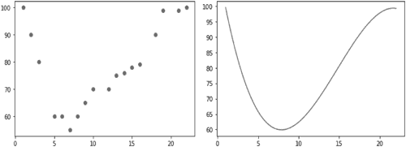

*图 7.1* 曲线数据的三次多项式拟合。返回正文。⏎

```
mymodel = np.poly1d(np.polyfit(x, y, 3))
myline = np.linspace(1, 22, 100)
plt.scatter(x, y)
Out[209]: <matplotlib.collections.PathCollection at 0x1af74f20dd0>
plt.plot(myline, mymodel(myline))
Out[210]: [<matplotlib.lines.Line2D at 0x1af77d64cd0>]
plt.show()
import numpy
from sklearn.metrics import r2_score
print(r2_score(y, mymodel(x)))
0.9432150416451026
```

从 R 平方可以看出，多项式解释的方差比例约为 94%。三次模型（即次数为 3）比尝试二次模型拟合得更好：293

```
mymodel = np.poly1d(np.polyfit(x, y, 2))
print(r2_score(y, mymodel(x)))
0.759777160189589
```

如果我们拟合一个 4 次（即四次）模型，我们将只获得比三次略大的 R 平方，这很可能导致数据过拟合：

```
mymodel = np.poly1d(np.polyfit(x, y, 4))
print(r2_score(y, mymodel(x)))
0.9542030834699506
```

多项式回归也可以使用 `statsmodels` 在 Python 中进行。

### 7.1.2 R 中的多项式回归

我们将在 `Boston` 数据集上说明多项式回归。这是从美国人口普查局收集的关于波士顿 MA 地区住房特征和度量信息得出的。我们将使用 `tidyverse` (Wickham et al., 2019) 和 `caret` (Kuhn, 2008) 包。此数据上多项式回归的一个版本也可以在 James et al. (2013, p. 115) 中找到：

```
> library(tidyverse)
> library(caret)
> data(“Boston”, package = “MASS”)
```

Boston 数据总共有 506 个观测值。我们现在将数据按 0.8 分为训练集和 0.2 分为测试集：

```
> set.seed(123)
> training.samples <- Boston$medv %>%
+ createDataPartition(p = 0.8, list = FALSE)
> train.data <- Boston[training.samples, ]
> test.data <- Boston[-training.samples, ]
```

我们确认数据已正确拆分：

```
> nrow(train.data)
[1] 407
> nrow(test.data)
[1] 99
```

`train.data` 中的行数为 407，而 `test.data` 中的行数为 99。请回忆我们要求训练数据占整个数据的 80%。案例总数等于 407 + 99 = 506，其中 407 占 80%。

我们现在将在 `train.data` 上构建 `model`，即在 `train.data` 上次数为 5 的多项式模型：

```
> model <- lm(medv ~ poly(lstat, 5, raw = TRUE),
+ data = train.data)
> summary(model)
Call:
lm(formula = medv ~ poly(lstat, 5, raw = TRUE), data = train.data)
Residuals:
```

| Min || 1Q || Median || 3Q || Max  |

| --- | --- | --- | --- | --- |

| \-13.1519 || \-3.1235 || \-0.5927 || 2.0962 || 27.1286 |

| --- | --- | --- | --- | --- |

Coefficients:

|  || Estimate || Std. Error  || t value || Pr(>|t|) ||  |

| --- | --- | --- | --- | --- | --- |

| (Intercept) || 6.765e+01 || 4.273e+00 || 15.831 || < 2e-16 || \*\*\* |

| --- | --- | --- | --- | --- | --- |

| poly(lstat, 5, raw = TRUE)1 || \-1.177e+01 || 1.786e+00 || \-6.588 || 1.40e-10 || \*\*\* |

| poly(lstat, 5, raw = TRUE)2 || 1.220e+00 || 2.580e-01 || 4.727 || 3.16e-06 || \*\*\* |

| poly(lstat, 5, raw = TRUE)3 || \-6.385e-02 || 1.644e-02 || \-3.884 || 0.000120 || \*\*\* |

| poly(lstat, 5, raw = TRUE)4 || 1.577e-03 || 4.714e-04 || 3.345 || 0.000901 || \*\*\* |

| poly(lstat, 5, raw = TRUE)5 || \-1.459e-05 || 4.954e-06 || \-2.945 || 0.003421 || \*\* |


```
---
Signif. codes: 0 ‘***’ 0.001 ‘**’ 0.01 ‘*’ 0.05 ‘.’ 0.1 ‘ ’ 1
Residual standard error: 5.205 on 401 degrees of freedom
Multiple R-squared: 0.6816, Adjusted R-squared: 0.6777
F-statistic: 171.7 on 5 and 401 DF, p-value: < 2.2e-16
```

我们可以看到多项式的各个次数在统计上均显著，最重要的是本例中的最高次数，即五次（p = 0.003421）。`model` 解释了响应变量中大约 68% 的方差（即 Multiple R-squared）。调整后的 R-squared 仅略低，为 0.6777。
我们现在基于 `test.data` 得到一些预测：

```
> predictions <- model %>% predict(test.data)
> head(predictions)
      3          6          9          11     14         15
36.25964 31.52683 10.98130 14.57053 24.46163 22.15775
```

我们可以按如下方式对 `predictions` 计算 R-squared，可以看到它只是略高于 `train.data` 上的解释方差：

```
> R_squared = R2(predictions, test.data$medv)
> R_squared
[1] 0.6829474
```

我们还可以测试更低次数的模型，例如简单的二次模型。我们可以按如下方式获得该 `model` 的系数：

```
> print(lm(medv ~ lstat + I(lstat²), data = train.data))
Call:
lm(formula = medv ~ lstat + I(lstat²), data = train.data)
Coefficients:
(Intercept) lstat I(lstat²)
  42.5736 -2.2673  0.0412
```

包 `polyreg`（Matloff 等，2022）也可以用于拟合多项式回归模型。

### 7.1.3 多项式回归作为全局策略

多项式回归有什么问题吗？实际上如果希望通过假设一个共同的函数形式来对 `x[i]` 的整个范围进行建模，就没有问题。也就是说，经典线性模型和多项式回归都以一种非常 *global* 的方式拟合数据，在某种程度上类似于算术平均数如何从分布的一端到另一端汇总一组数据。例如，考虑以下小数据集

2, 5, 8, 10, 15, 16, 170, 171, 172

该数据的均值为 63.2。但均值对数据的代表性如何？并不好，因为例如数据点 170、171 和 172 远大于其余数据，因此均值会因这些更极端的值而被拉向 *upward*：

> 2, 5, 8, 10, 15, 16, **170, 171, 172**

对上述数据集计算均值提供了非常“global”的数据汇总。我们可能不希望以这种方式对数据建模，无论是计算均值还是进行回归，我们可能更倾向于采用更 *local* 的方法。

### 7.1.4 更局部的替代方案

对于上述数据，我们可能最好计算两个平均值，一个针对数据 2, 5, 8, 10, 15, 16，另一个针对数据 170, 171, 172。在这样做时，我们本质上是以更 *local* 的水平对数据进行建模。尽管这个例子非常简单，但它展示了一个强有力但显而易见的观点，那就是 *fitting global measures to data provides a global summary of that data*。如果数据不符合全局表示，那么更局部地拟合数据的 *subsets* 可能更可取。事实上，在极端情况下，我们可以做得最局部的是对每个数据点 *individually* 进行建模，但除非是极小的数据集，否则这样做是愚蠢的，会削弱建模的初衷。精确的“曲线拟合”本质上是“连接点”，对于大多数目的而言，这违背了统计建模的目标。在这种情况下，我们并没有对任何东西进行平均；我们只是以描述性的水平连接观测值。建模的总体目标是估计数据上的一般函数，即使是局部的。目标并不是简单地在训练数据上“连接点”并实现完美拟合。*Anything less than “connecting the dots,” in most cases, can be considered a very general universal form of the aforementioned and discussed regularization concept as it concerns generalizability and minimizing test error.*

### 7.1.5 最小二乘回归线作为“浮动均值”：迈向局部化方法

为了进一步激发局部化回归方法，请回忆经典的最小二乘回归线可以被解释为预测变量 `x[i]` 值范围上的“浮动均值”。也就是说，`y[i] = β[0] + β[1]x[i] + ε[i]` 中的斜率 `β[1]`，类似于均值，是一种“汇总统计量”，因为模型假设它在 `x[i]` 的整个范围内是恒定的。即使数据在 `x[i]` 的给定范围内暗示了不同的斜率或函数形式，经典的最小二乘线也不会考虑这一点。同理，多项式回归也是如此，其中多项式在 `x[i]` 的范围内拟合，本质上忽略了 `x[i]` 区间内的更“local behavior”。线性回归和多项式回归都对 `x[i]` 进行 *generalize*，以提供关于模型拟合的数据汇总。

如果我们希望更仔细地考虑 *local variation* 呢？也许最简单的例子就是你在入门统计学中可能遇到过的散点图，其中图中存在两个“群体”，如 图 7.2 所示。

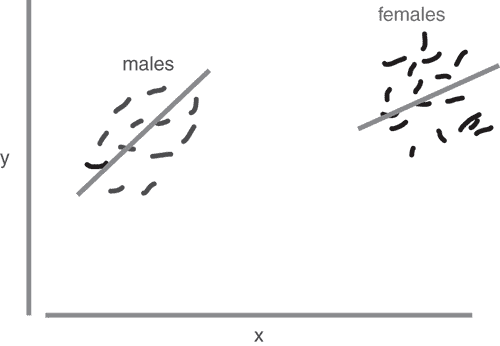

*图 7.2* 两个群体（男性 vs. 女性）上的基本散点图，提示采用更局部的建模方法，可能为每个群体拟合单独的斜率。返回正文。⏎

当然，对于 图 7.2 中的数据，回归的更局部化方法可能简单到分别对每个群体建模，男性一个斜率，女性一个斜率。在这种情况下，数据的局部性是 *group*。但请仔细考虑这个例子，你会看到我们在这里实际上提出的是，至少隐含地，认识到图中存在 *interaction* 的可能性，而不仅仅是主效应。也就是说，*spotting the potential of an interaction in this sense is an effort to provide a more localized representation of the data*。

> *A localized representation of data can be as simple as computing different averages by identifying different sets in data, or by modeling interaction terms in a regression (or ANOVA) context.*

#### 7.1.5.1 放大局部性

如果我们把局部性推向极限，推向极端会怎样？如前所述，这样做将意味着缩小到我们图中每个单独的数据点，或者对于平均值的例子，仅仅单独考虑每个数据点。比考虑案例研究而不产生任何平均值更“local”的情况就不多了！

在回归的背景下，我们可以在一个或多个变量中产生具有越来越大“split”程度或 ANOVA 中因子水平的交互项。因此，与其将数据分为两组，不如将其分为四组或五组，例如。然后在回归（或 ANOVA）的局部化方法中的一般原则是，与其假设 `x[i]` 范围内的一般函数形式，不如希望“zoom in”并检查 `x[i]` 给定区间内的 *local variations*。这就是局部化回归方法发挥作用的地方。然而，当我们调查几种实现这一目标的方法时，读者应该记住我们在这里讨论的内容：对数据进行局部放大可以简单到以不同的方式分割数据或在回归或 ANOVA 中建模交互项。也就是说，对数据的局部检查和建模不一定需要采取复杂或先进的建模策略的形式。


为了理解和激发对局部回归的兴趣，首先必须理解 `basis function` 在回归和建模总体上的本质。基函数非常通用，它们也为理解神经网络等更高级技术打开了大门，因为基函数与其他大多数统计和机器学习方法之间存在密切联系。

## 7.2 基函数与展开

`basis function`，或 `linear basis expansion`（Hastie 等, 2009）本质上是对变量（或矩阵，在本例中）`X` 的函数进行取值，我们可以相当一般地将其表示为，

`y`[`i`] = `β`[0] + `β`[1]`b`1 + `β`[2]`b`2 + `β`[3]`b`3 + `β`[4]`b`4+   ⋅  ⋅ ⋅   + `β`[`p`]`b``p` + `ε`[`i`]

(7.3)

请注意，上式并非多项式回归；`x`[`i`] 都未被提高到除 1 以外的指数。实际的基函数，它们是 `x`[`i`] 的函数，是 `b`[1] 到 `b`[`p`]。例如，`β`[1]`b`1 与我们在最小二乘中经典所具有的情况相同，因为我们是用回归参数 `β`[1] 对 `x`[`i`] 进行加权，但更精确地说，被加权的不是 `x`[`i`]；我们实际上是对 `x`[`i`] 的一个 `function` 进行加权，而该函数就是 `b`1。也就是说，我们首先用 `b`[1] 对 `x`[`i`] 进行加权，然后用 `β`[1] 对该乘积进行加权。这里的基函数是 `b`1。

为了更清楚地理解上述内容，考虑经典线性模型作为基函数出现的一个特例。经典线性模型中固有或“自然”的基函数是什么？为此，我们观察到

$$\\begin{array}{l} {y\_{i} = \\beta\_{0} + \\beta\_{1}b\_{1}\\left( x\_{i} \\right) + \\beta\_{2}b\_{2}\\left( x\_{i} \\right) + \\beta\_{3}b\_{3}\\left( x\_{i} \\right) + \\beta\_{4}b\_{4}\\left( x\_{i} \\right) + \\,\\, \\cdot \\cdot \\cdot \\,\\, + \\beta\_{p}b\_{p}\\left( x\_{i} \\right) + \\varepsilon\_{i}} \\\\ {y\_{i} = \\beta\_{0} + \\beta\_{1}b\_{1}\\left( x\_{i} \\right)} \\\\ {y\_{i} = \\beta\_{0} + \\beta\_{1}b\_{1}\\left( x\_{i} \\right)} \\\\ {y\_{i} = \\beta\_{0} + \\beta\_{1}\\left( 1 \\right)\\left( x\_{i} \\right)} \\\\ {y\_{i} = \\beta\_{0} + \\beta\_{1}\\left( x\_{i} \\right)} \\\\ \\end{array}$$

于是我们得到了经典的单预测变量线性模型。基函数 `b`1 只是 `x`[`i`]，其中 `b`[1] 被隐含或设为 1。

让我们现在考虑一个原始但任意的基函数，以在此简单定义的基础上进行扩展。不是 `b`1 = (1)(`x`[`i`])，假设基 `b`[1] 等于 2，使得 `b`1 = (2)(`x`[`i`])。请注意，这与斜率 `β`[1] 无关；`the basis function here is simply an “action” directly on` `x`[`i`] `before the partial regression slope is applied to it`。那么问题是，基函数应包含什么？可能性很多，基函数的选择将由我们所考虑的模型类型来决定。很快就会意识到，人们完全可以轻松写一本名为 `Basis Functions for Prediction` 的整本书，其中将涵盖众多可能性和统计模型，包括简单和多元 298 线性回归、多项式回归、分段函数、回归样条、方差分析，以及其他大量模型。这些模型之间的共同点是它们都 `identified by their bases`，即它们在用最小二乘或其他技术加权之前对 `x`[`i`] 的变换；也就是说，在用给定模型中的参数估计进行加权之前。

### 7.2.1 基函数与局部性

基函数的主要优点之一是它们允许我们在更 `local level` 上对数据进行建模，比多项式回归更局部。使用基函数还允许我们通过采用非线性基函数，使 `y` 与 `x` 之间的关系以非线性方式建模。因为基函数出现在表达式“`β`[1]`b`1”的 `inside`，理论上我们可让 `b`[1] 成为大量非线性函数（Bishop, 2006），其中包括以下 `Gaussian basis functions`，

$$\\phi\_{j}\\left( x \\right) = \\exp\\left\\{ \\frac{\\left( x - \\mu\_{j} \\right)^{2}}{2s^{2}} \\right\\}$$

(7.4)

或 `sigmoidal basis function`，

$$\\phi\_{j}\\left( x \\right) = \\sigma\\left( \\frac{x - \\mu\_{j}}{s} \\right)$$

(7.5)

其中其他函数中，`s` 是上述函数的标准差。我们迄今为止调查的基函数全部是预先 `fixed` 的；也就是说，它们不能适应或调整数据。维度的诅咒也会限制固定基函数的实用性（Bishop, 2006）。因此，考虑非固定的基函数将是有利的。我们将在本书后面介绍神经网络时遇到此类基函数，即 `adaptive` 或 `recursive` 的基函数，并强调本章回归方法与神经网络方法之间的联系。

> `A basis function, or linear basis expansion, weights the predictors in a regression model. Depending on the basis function chosen, this may allow for a more “local” examination of the fit at that particular point or region in the range of predictor values, or, may be limited to a more global representation of the data. In regression, this weighting occurs before weighting by the relevant partial regression slope. The basis functions employed in this chapter are fixed and hence can be quite limiting. Neural network basis functions are generally more adaptive to the data.`

### 7.2.2 神经网络作为基展开：概念的推广

我们上面提到过，我们可以为基函数或更精确地说是 `basis expansions` 撰写一整本书。我们强调了在这样一本书中会包含的更受欢迎的“特例”，即简单和多元回归等等。这是为了强调基展开实际上是多么通用，以及有多少统计方法可以用基展开来理解或构思。事实上，神经网络也可以被视为一种基展开，也是这一更广泛框架的又一个特例。

在经典神经网络中，正如我们稍后在书中会看到的，我们取 `functions of functions`，在初等数学中也称为 `composite functions`。取复合函数使我们能够实现与刚才所做的类似的 `basis expansion` 思想。我们需要的一般概念是 `feature extractor`（Murray, 2022）：

`f`(`x`;`θ`) = `W``ϕ`(`x`) + `a`

(7.6)

上面的参数为 `θ` = (`W`,`a`)，如果我们要写经典的函数方程，我们将完全省略 `ϕ`。然而，上面的关键是包含 `ϕ`，在我们之前的回归示例中为 `β`[1]`b`1，其中 `ϕ` = `b`[1]。也就是说，

$$\\begin{array}{l} {f\\left( x;\\theta \\right) = W\\phi\\left( x \\right) + a} \\\\ {\\,\\,\\,\\,\\,\\,\\,\\,\\,\\,\\,\\,\\,\\,\\,\\,\\, = Wb\_{i}\\left( x \\right) + a} \\\\ \\end{array}$$

其中我们现在将 `b`[1] 表示为 `b`[`i`] 以消除任何符号混淆。为什么要以这种方式写 `f`(`x`;`θ`) 有什么好处？答案是其 `generality`。`f`(`x`;`θ`) 的更一般形式允许 `ϕ` 成为更 `arbitrary` 和 `general` 的函数。更具体地说，我们现在允许特征提取器拥有其自己的指定参数，`θ`[2]：

`f`(`x`;`θ`) = `W``ϕ`(`x`;`θ`[2]) + `a`

(7.7)


在我们学习神经网络时将会看到，这种允许 `feature extractor` 拥有自己的参数向量的做法，将会把我们当前关于基展开的想法推广到更广阔的可能性。总体思路是指定 `functions of functions`，这正是神经网络的核心所在。

由此可见，基函数是一个完全的 `general concept`，基函数的选择在理论上基本上是无限的。在入门统计学的最早课程中，基函数确实存在于 `t-tests`、ANOVA、回归等之中；然而它们通常并未显现出来，而是在给定的方法或程序中通常是 `implicit` 的。例如，ANOVA 中的交互作用又是基展开的另一个例子。`Basis expansions essentially enrich the feature space.` 支持向量机也是基展开的又一个例子，我们将在本书后面介绍。

接下来并回到我们关于非线性的讨论中，我们关注一种特别常见的基函数或展开形式，它对于建模非线性回归非常有用，那就是 `regression splines`。

### 7.2.3 回归样条与“节点”概念

我们迄今为止讨论了抛弃全局函数并对数据拟合更局部函数的益处。总体思路是局部拟合模型，或“放大”到数据的不同部分。`Regression splines` 是在回归背景下获取数据局部结构的一种常见方法。

但如何定义数据范围的局部子集呢？一种简单且常见的方法是通过 `knots`。`knot` 是将 `x[i]` 上的数据区域划分为区间的东西，其中模型中的系数会 `change` 以反映数据趋势的变化。一般来说，`the greater the number 300knots, the greater the flexibility of the curve`。随着节点数的无界增加到无穷大，我们最终会得到完美拟合。然而，如果使用过多的节点，我们就有过拟合的风险。因此，选择合适的数量至关重要，通常通过交叉验证或可能仅通过可视化来确定。`Smoothing splines` 另一方面，通常使用最大或接近最大数量的节点，而不是由用户随意选择该数量（Hastie 等，2009）。

图 7.3 描述了样条回归中节点的概念，其中曲线系数以相当戏剧性且有些夸张的方式发生变化以说明该概念。

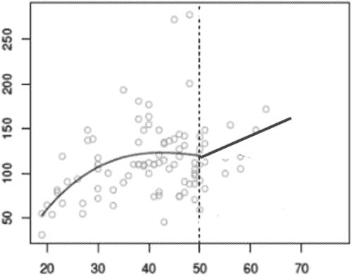

*图 7.3* 样条回归中“节点”的概念。曲线系数发生变化的位置即为节点的位置。这是一个夸张的插图，但清楚地表明节点是有用的，因为数据趋势表明从 50 开始需要不同的函数。返回正文。⏎

记得在上一章中，我们通过交叉验证选择了岭回归、套索和弹性网络中的调优参数来实现正则化。节点数量的选择也可以被视为一种正则化形式，因此节点数量可以被视为一个调优参数。也就是说，`by reducing the number of knots, thus reducing the chance of overfitting, we are essentially regularizing the model`。事实上，关于样条的整个讨论实际上可以正式地重新表述为更广泛的正则化范畴（参见 Hastie 等，2009，第 167–168 页的讨论）。通常建议使用 4 到 5 个均匀分布的节点，例如在第 20、40、60 百分位等处，是在典型回归问题中实施它们的实用首选策略（Fox，2016）。

> `Knots in regression splines define local subsets of a data range where coefficients typically change. The choice of the number of knots in spline regression can yet again be considered an instance of regularizing a model, just as selecting a suitable tuning parameter in ridge and lasso regression was a form of regularization. Hence, the number of knots can be thought of as a tuning parameter.`301

### 7.2.4 概念化回归样条

如何概念化回归样条的想法？回归样条最好被表示为我们刚刚回顾的更一般基函数或基展开思想的特例。回忆一下之前发展的基表示：

`y[i] = β[0] + β[1]b1 + β[2]b2 + β[3]b3 + β[4]b4 + ... + β[p]bp + ε[i]`

其中 `b[1]` 到 `b[p]` 是基函数。也就是说，它们是 `x[i]` 的变换，`before` 由 `β[1]` 到 `β[p]` 进行相关加权。节点的放置在理论上至少可以根据函数中的变化任意选择。然而，正如提到的，均匀、等间距分布的节点通常是更常见且初始的策略（James 等，2013）。

交叉验证可用于确定最佳节点数，即在测试误差中产生最小残差平方和的节点数。`Cubic splines` 通常更受青睐，因为它们自然确保函数在每个节点处连续且具有连续的一阶和二阶导数（Murphy，2022）。节点数将数据划分为一个或多个 `bins`。例如，4 个节点将数据划分为 4 + 1 个箱。如果我们将节点数增加到其极限，节点数将等于 `x[i]` 或数据点的取值数量。使用 `n` 个节点表示 `x[i]` 的 `unique` 值所得的结果通常被称为 `smoothing spline`。由于通常没有预先确定的固定节点数，平滑样条通常被视为 `nonparametric`，因为样条的数量是数据点数量或数据中 `x[i]` 取值的函数（Murphy，2022，第 395 页）。

正如 Fox（2016） 所指出的，样条回归模型也可以被视为 `linear` 与 `generalized linear model` 之间的“桥梁”。事实上，`generalized additive model` 就是将回归样条扩展到多维输入的情况，假设为加性形式（即无交互作用）。广义加性模型随后可以扩展到回归之外并进入分类，在这种情况下就有了完整的广义线性模型（Murphy，2022）。

### 7.2.5 样条的问题与施加约束

样条的优点是我们希望有多灵活就有多灵活。然而，过度的灵活性会带来代价。例如，考虑 图 7.4。在这种情况下，我们过于 `too` 灵活。也就是说，`we have not imposed enough constraints on the knots`。为了解决这个问题，我们开始施加约束，例如从左到右的连续性以确保不会出现跳跃（James et al., 2013）。回想一下“施加约束”是什么意思；它意味着我们希望曲线拟合，但在此连续性的情况下没有 `jump`。也就是说，我们已将“跳跃”从曲线拟合或估计的可能性中剔除；这就是我们施加的 `constraint`。

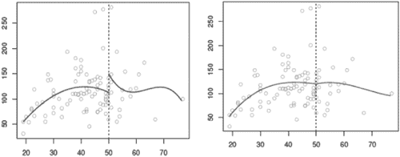


*图 7.4* 对三次回归样条施加连续性约束（右）。返回正文.⏎

这个对函数施加约束的思想一点也不新。事实上，几乎每个统计模型都有约束，要么是我们看不到的隐式施加的，要么是用户手动施加的，例如在结构方程模型中，约束经常被施加。作为最简单的例子之一，在线性回归中施加了 *线性* 的约束，这意味着我们将拟合一个函数形式到数据 *在假设它仅采用线性形式的约束下*。虽然这是一个显而易见的例子，但它仍然是有力且具有教学性的；许多研究人员进行线性回归分析时并未意识到，他们已经隐式地将预测 *潜力* 限制为直线，而牺牲了诸如高阶多项式之类的其他曲线。302

将样条回归约束为无跳跃，或施加其他约束，会使模型灵活性降低，因为在需要估计此类参数时，此外还限制了样条拟合的类型，使其对研究人员而言在科学上是有意义的。因此，如果在数据中出现跳跃是不合理的假设，那么约束不存在跳跃（或拟合曲线的其他特征）是完全合理的。另一方面，如果数据中出现此类跳跃是一个合理的可能性，那么施加此类约束是不明智的，数据应以某种方式建模以纳入不连续性。在这方面，*科学* 意义重大。如果对于给定的科学数据而言不连续性是一个合理的预期，那么对其施加约束可能意义不大。

### 7.2.6 多项式回归 vs. 回归样条

在我们上面的讨论中，我们将回归样条作为更一般的基函数思想的特例呈现，并指出它们比诸如多项式回归等方法更局部。哪种拟合更好？正如 James et al. (2013) 所论证的，回归样条通常给出更优的结果。为什么？样条通常给出更好结果的原因是多项式回归和样条以不同方式引入灵活性。*样条通常做得更好*。对于多项式回归，灵活性是通过增加函数的次数引入的（例如，从线性到二次到三次等等）。样条，另一方面，通过保持次数固定而是增加节点数来引入灵活性，节点数可以从最小到最大不等。因此，样条比拟合全局多项式更灵活，即使是复杂度不断增加的次数，这通常意味着样条在交叉验证中表现更好。更重要的是，如前所述，回归样条可以作为通向更广义建模的桥梁，例如广义线性模型（Fox, 2016）。

一维样条也可以推广到多维样条，尽管这些超出了本书的范围。多维样条是其一维样条的直接推广，然而（Hastie et al., 2009）。对于各种 R 包中的样条选项的优秀概述，请参阅 Perperoglou et al. (2019)。我们也可以使用 `spline2` 包（Wang, 2024）来拟合，除了自然三次样条之外，还可以拟合其他样条，例如更一般的 `B-splines`、`M-splines` 等等，我们在此不详细说明（请参阅包的说明）。另一个用于在 R 中拟合样条的流行包是 `gss`（Gu, 2014）。也可以使用 `bspline` 包（Sokol, 2024）来估计样条回归。`absorber` 包（Savino, 2024）是一种使用 B 样条的多变量非参数回归模型中的变量选择方法，可用于在样条回归问题中选择“最佳”变量。303

### 7.3 非参数回归：局部与核回归

在我们对建模非线性的追求中，到目前为止我们已经调查了两种可能性：多项式回归和回归样条。多项式回归提供了数据的全局拟合，而样条允许我们在更局部水平上建模数据。然而，这两种方法在本质上都是 *参数* 的，尽管样条取决于类型以及我们如何使用参数与非参数术语，也常被认为是非参数的（Fox, 2016，第 511 页）。

我们现在简要调查两种非参数方法：1）*简单局部平均*，和 2）*核回归*。我们将看到核回归是简单局部平均的推广，后者可用于激励前者。核回归是我们作为非参数技术的重点。

更精确地说，核回归是一种对关系进行建模的方式，其形式为 *非假设* 的，通常最终会成为某种未指定的非线性形式。它可以被视为回归的 *非参数* 方法（Fox, 2016）。核回归的非参数特征，正如一般核方法一样，允许数据“说话”并告诉我们其形状；我们不预先假设假设的线性或非线性形式。也就是说，如果参数线性模型是

`y = f(x,θ) + ε`

(7.8)

那么非参数线性模型是

$$\\begin{array}{l} {y = f\\left( x \\right) + \\varepsilon} \\\\ {\\,\\,\\,\\, = f\\left( x\_{1},x\_{2},...,x\_{p} \\right) + \\varepsilon} \\\\ \\end{array}$$

(7.9)

其中现在没有参数向量，`θ`，而关系的形成完全由数据学习，`x[1]`、`x[2]`、...、`x[p]`。*简单局部平均* 另一方面，通常被视为回归的“天真”方法，其中沿 `x-axis` 的预定子集或箱内的平均值被建立，以便在追踪响应变量时获得更 *局部特征*。核回归可以解释为简单局部平均的更一般方法。

#### 7.3.1 通过局部平均激励核回归

在经典最小二乘回归中，回想一下我们通常假设 `y/x` 的条件分布为高斯（即正态）。更正式地，我们建模 `p(y,x|D)`，其中 `y` 是响应，`x` 是预测变量，`D` 是数据。也就是说，在典型的经典回归中，我们正在追踪均值函数：

`μ = E(y|x[1],...,x[p]) = α + β[1]x[1] + ... + β[p]x[p]`

(7.10)

鉴于条件分布为正态的假设，考虑如果我们稍作回溯并通过天真方法激励普通回归，并将解释变量划分为 *箱*，即沿 `x-axis` 的面积 *子集* 或 *区间*。不出所料，偏差通过使箱子尽可能多且窄来最小化（Fox, 2016）。采样方差通过使用少量相对较宽的箱子来最小化，每个箱子包含许多观测值。因此，和往常一样，这里存在偏差与方差之间的权衡，体现了经典的 *偏差-方差权衡*，如 图 7.5 所示。304


*图 7.5* 回归中的局部平均。偏差通过使箱子更多更窄来最小化；宽箱（左），窄箱（右）。返回正文.⏎


我们在图 7.5 中注意到，随着区间逐渐变窄，我们最终会“锁定”构成理论回归线的实际数据点以及恰好落在样本回归线上的实际点。因此，在这种每个数据点都是均值的非参数回归极端版本中，我们只是*连接位于区间内的均值*。显然，这种方法通常并无用处，我们最好增大每个区间的大小。然而，如果我们把区间大小增加太多，就会失去我们最初想要的数据的*局部性*；*这就是权衡的本质*。

使这种方法成为*非参数*的是，没有对总体或关系形式做出任何假设。样本量在这里也起着至关重要的作用。随着样本量的增加，区间变得越来越窄，每个区间包含的数据越来越多，在样本量变大的极限情况下，朴素的非参数回归与总体回归一致（Fox, 2016）。当存在多个解释变量时，这种方法会怎样？不出所料，先前讨论过的*维度诅咒*就会抬头。对于简单起见，我们关注仅有一个预测变量的情况。

这种方法的一个明显弱点是，对于给定大小的区间，假设区间大于每个单个数据点，则区间内的估计对于周围数据点来说是不精确的。也就是说，如果区间大小包含 20 个数据点，则在这 20 个数据点上计算的均值将是对局部性的相当*粗糙*的表示。我们能否比均值做得更好？我们能否更“公平”或更精确地表示每个区间内的数据？对此的答案是肯定的，通过*核回归*。

### 7.3.2 核回归 – “局部加权平均”

核回归寻求通过尝试明确地给接近焦点 `x[0]` 的观测值赋予更大权重，而给训练数据中更远的值赋予更小权重，从而改进简单的局部平均（Fox, 2016）。什么是“焦点 `x[0]`”？这是你希望据此预测响应 `y` 的假设值。这是一个有吸引力的想法，因为这样做将提供对每个数据区间或“bin”内数据的更好表示。`x[0]` 与 `x[i]` 的距离可以表示为（Fox, 2016，p. 529）：

`z[i] = (x[i]-x[0])/h`

(7.11)

这里的尺度因子是 `h`，它是核估计量的*带宽*，控制其平滑程度。例如，假设距离（`x[i]-x[0]`）等于 5，带宽 `h` 等于 1，则得到的 `z[i]` 等于 5。如果我们将带宽增加到 2，则 `z[i]` 等于 2.5。`h` 的作用就是*缩放*距离（`x[i]-x[0]`）。对于恒定距离，随着 `h` 越来越大，`x` 轴上的区间相对于 `h` 变小，我们得到更*精细*的拟合。The 305smoothness of the fitted function is thus largely influenced by the size of the bandwidth, `h`. 一般来说，随着 `h` 的增加，函数变得更平滑。过于精细或过于平滑的拟合可能会对科学数据的建模产生不利影响，尤其是当更精细或更平滑的拟合在数据的整个跨度上提供过于“通用”的建模方法时，而在数据的特定范围内也许另一种策略更为合适。

按带宽 `h` 缩放偏差 `x[i] - x[0]` 是可以的，但我们可以做得更好，并对缩放后的偏差应用核函数以获得最终权重 `w[i]`：

`w[i] = K[(x[i]-x[0])/h]`

(7.12)

使用上述权重 `w[i]`，在 `x[0]` 处的拟合值通过对 `y[i]` 值进行加权局部平均计算得出：

$$\\left. \\hat{f}\\left( x\_{0} \\right) = \\hat{y} \\middle| x\_{0} = \\frac{\\sum\\limits\_{i = 1}^{n}{w\_{i}y\_{i}}}{\\sum\\limits\_{i = 1}^{n}w\_{i}} \\right.$$

(7.13)

我们因此看到，核回归有效地是一种*加权回归*形式，其中权重使用了核函数。

### 7.3.3 多种核函数

请注意，在我们对核回归的描述以及权重 `w[i]` 的计算中，我们尚未描述 `K` 的性质，即我们为给定问题选择的*核函数*，并将其应用于 `[(x[i]-x[0])/h]`。不出所料，核函数有很多选择。其中一种选择，也许是默认选择，是使用*高斯*（或“正态”）核：

$$K\\left( z \\right) = \\frac{1}{\\sqrt{2\\pi}}e^{- z^{2}/2}$$

(7.14)

其中（7.14）中的带宽是标准差。如 Fox (2016, p. 530)所述，由于正态密度的性质和形状，距离焦点值 `x[0]` 超过 `2*h` 的距离几乎得不到权重。

根据 Fox（2016，p. 530），另一种可能性是使用*三立方核*，

$$K\_{T}\\left( z \\right) = \\left\\{ \\begin{array}{l} \\left. \\left( 1 - \\middle| z \\middle| {}\_{3} \\right)3, \\middle| z \\middle| < \\,\\, 1 \\right. \\\\ \\left. 0, \\middle| z \\middle| \\geq 1 \\right. \\\\ \\end{array} \\right.$$

(7.15)

或*矩形核*，

$$K\_{R}\\left( z \\right) = \\left\\{ \\begin{array}{l} \\left. 1, \\middle| z \\middle| < 1 \\right. \\\\ \\left. 0, \\middle| z \\middle| \\geq 1 \\right. \\\\ \\end{array} \\right.$$

(7.16)

我们还可以选择其他核函数，然而根据 Fox (2016)，在进行回归时，核函数的选择并不是那么关键。尝试多种核函数来研究它们对给定回归解的影响并没有什么问题。306

### 7.3.4 核回归不是非线性的；它是无参数的

我们重申，核回归不应被特别视为与多项式回归相同意义上的回归的非线性方法（就建模非线性趋势而言，而不是模型本身是非线性的）。相反，它是一种*非参数方法*，这意味着它*从数据中学习*。如果学习到的形式是线性的，那就这样吧，但关键是核回归不*a priori*假设线性或非线性形式。它首先是非参数的，因为它本质上对真实函数的形状没有任何参数假设。*局部多项式回归*扩展了核回归，其中在焦点值 `x[0]` 处拟合多项式；然而这超出了本书的范围。关于核回归（以及与回归相关的几乎所有其他内容）的优秀讨论，请参阅 Fox (2016)。

### 7.3.5 R 中的核回归

核回归在 R 中可以使用包 `gplm`（Mueller, 2016）进行拟合。我们在下面改编了该包文档中的一个示例，其中我们首先为变量 `x` 创建 1000 个观测值的数据：

```
> library(gplm)
> n <- 1000
> x <- rnorm(n)
> head(x)
[1] -0.71040656 0.25688371 -0.24669188 -0.34754260 -0.95161857 -0.04502772
```

我们接下来创建 `m` 作为 `x` 的函数，然后 `y` 作为 `m` 的函数：

```
> m <- sin(x)
> head(m)
[1] -0.65214204 0.25406776 -0.24419733 -0.34058836 -0.81435593 -0.04501251
> y <- m + rnorm(n)
> head(y)
[1] 0.2638500 1.0546901 -1.1807664 -1.7413758 -0.6540784 -0.3189749
> plot(x,y,col=“gray”)
> lines(kreg(x,y),lwd=2)
```

307

波浪线（图 7.6）是核回归估计，使用的是 Nadaraya-Watson 估计量（参见 Nadaraya, 1964）。请参阅该包以获取可应用于核回归的许多其他函数，包括提取估计的拟合值。


*图 7.6* 核回归线的图（右）。返回正文。⏎

`gplm` 包 (Mueller, 2016) 还具有相当复杂的核回归的 3-D 可视化。例如（请参阅包中的代码），图 7.7 是一个生成的[content]


*图 7.6* 核回归线的图（右）。返回正文。⏎

`gplm` 包 (Mueller, 2016) 还具有相当复杂的核回归的 3-D 可视化。例如（请参阅包中的代码），图 7.7 是一个生成的先进图形，其中原始函数在左侧，估计函数在右侧。


*图 7.7* 使用 R 中的 `gplm` 包生成的图形，其中包含原始（左）和估计（右）函数。返回正文。⏎

核回归也可以使用 `np` 包 (Hayfield & Racine, 2008) 进行拟合。

## 7.4 章节复习练习

1. 解释简单或多元线性回归如何是更一般的 *多项式回归模型* 的特例。
2. 在 Python 中生成数据并拟合 *二次多项式*。生成数据使其拟合效果相当好。
3. 在 R 中执行 #2 中的多项式回归。
4. 解释 *基函数* 的概念并讨论基函数如何在单变量程序（如 `t` 检验和线性对比）中也很明显。
5. 比较 *多项式回归* 与 *回归样条*。它们有何相似之处？有何不同？何时一个可能比另一个更可取？
6. 解释 *核回归* 如何提供一种更“局部”的方法来估计数据背后的真实函数。
7. 手动或使用软件生成 *矩形核函数* 的图。
8. 区分核回归是 *非线性* 与 *非参数*。为什么有些人可能会将核回归称为非线性？
9. 使用 `gplm` 包在 R 中执行核回归，其中样本量等于 10,000。创造性地生成 `y` 和 `x` 的向量。
10. 假设核回归给出与线性回归截然不同的结果；这是否意味着一个模型比另一个模型更“正确”？为什么或为什么不？集思广益并解释。

308

# 8 广义线性与加性模型 Logistic 及相关模型

DOI: [10.4324/9781003376941-11](https://doi.org/10.4324/9781003376941-11)

到目前为止，在我们对建模的讨论中，我们一直假设响应变量或多或少是 *连续* 的，或至少是“伪连续”的，因为在理想的数学意义上，没有经验变量是真正连续的。连续性本身是一个 *抽象*，一个哲学概念，它在数学上使用诸如实分析中的ε-δ定义等事物来表达。更务实地说，我们假设响应表现出相当广泛的“密集”值范围，目标是基于一个或多个预测变量预测响应沿此连续体的值。虽然其中许多模型是线性的，但我们也调查了一些非线性模型。然而，在所有这些模型中，响应变量一直被假设为连续，并在我们的分析中作为连续变量处理。在建模中存在许多响应变量不是连续而是 *分类* 的实例。此类响应包含互斥的类别，而不是数值可能性的连续体。具有此属性的一些响应是自然发生的（例如，通过与失败），而其他响应可以由用户操作化为特定类别（例如，将测试上的数值分数分类为通过与失败的二元结果）。

统计模型如何处理二元或分类响应？得益于 *广义线性模型* 的理论（McCullagh & Nelder, 1989），二元和多项响应可以置于我们能找到经典线性模型的同一总体框架中。广义线性模型包含这些模型的全家，并是本章的主题。

在调查广义线性模型之前，我们应该从一开始就问一个重要问题：*“分箱”响应是一个好主意吗*？这样做的优点和缺点是什么？我们从对将响应操作化为二元或多项结果的优点和缺点进行简要调查开始本章。

## 8.1 如何操作化响应

如前所述，一些响应变量本质上是分类的。例如，一条鲑鱼要么“向上游”要么“下游”，不能同时两者（尽管正如我们都看到的那样，它们有时似乎只是无方向地在水中徘徊）。当响应具有这种质量时，将变量“保持原样”并将其视为二元是一个简单的决定，因为保持 *原样* 使其保持在其自然 *测量* 状态。在其他情况下，研究人员可能会选择将变量分箱为互斥类别。在机器学习文献中，在将其“分箱”之前变量的伪连续性有时被称为 *预分类器*（Kroese et al., 2020），因为在将其值强制为类别之前它相对连续。309

### 8.1.1 分箱的利弊

是否分箱变量是一个重要决定。事实上，单个变量的不同操作化会导致由此产生的统计模型“发现”不同的效应。作为一个简单的例子，班级测试上的 *成绩* 操作化为 *通过* 与 *失败* 可能是最终成绩的预测因子，但操作化为数值分数可能会改变预测能力。变量是相同的，但我们对其的操作化现在不同了。更重要的是，在方差分析（ANOVA）中对变量的操作化方式选择会影响由此产生的均方，最终影响对零假设的拒绝。关于在 ANOVA 中操作化效应的影响存在大量文献（例如，参见 Prentice & Miller, 1992）。

### 8.1.2 检测新类别

虽然我们讨论了分箱的利弊，但也值得提到在机器学习中，还有一些技术实际上允许算法根据算法对数据的检查来检测新类别或类别。这种在机器学习圈中被称为 *新颖性检测*，因此不是将案例分类为 `C[t]` 类中的一个，而是派生出新的类别标签 `C[t + 1]`，不是由研究人员的判断或如何分箱的决定，而是由实际算法发现新类别。这种过程有时被称为 *开放集识别* 的一般概念（Murray, 2022）。在本書中，我们不调查检测新类别的方法。我们假设研究人员正在积极决定如何操作化其变量。

## 8.2 广义线性模型

广义线性模型（GLM）背后的动机是涵盖具有经典普通最小二乘（OLS）回归中连续响应的模型，但也纳入具有二元或分类响应的模型。GLM 是所有这些模型的“父”模型，本质上对二元或多项响应进行转换，使其成为线性和连续的。在开发 GLM 时，最好首先回忆我们在回归讨论中介绍的经典线性模型：

```
y[i] = β[0] + β[1]x[1] + β[2]x[2] + ... + β[p]x[p] + ε[i]
```
(8.1)


## 8.2 线性模型

请注意，上面的模型是*参数线性*的，这意味着 `β[0]`、`β[1]`、… `β[p]` 都被提升到指数“1”。即使例如 `x[1]` 被提升到二次方，`x[1]²`，只要 `β[0]`、`β[1]`、… `β[p]` 仍被提升到系数为一，模型仍会被视为线性模型；然而，可以说它不再在变量上是线性的。*线性模型只要求系数被提升到不大于一的项*。我们对实际变量执行的基变换在统计术语中与实际模型的线性或非线性无关 (Bishop, 2006)。例如，下面的模型会被正确地视为*非线性*，因为它在系数上是非线性的，尤其是 `β[2]²` 项：

`y[i] = β[0] + β[1]x[1] + β[2]²x[2] + ε[i]`

(8.2)

请注意，下面的模型也因为 `β[2]²` 而是非线性的，而不是因为 `x[2]²`；它被认为在*参数*和*变量*上都是非线性的：310

`y[i] = β[0] + β[1]x[1] + β[2]²x[2]² + ε[i]`

(8.3)

### 8.2.1 本质线性模型

在线性与非线性模型方面，一个有用的区分是在 *内在线性* 与 *非内在线性* 之间 (Neter et al., 1996)。一个是非线性的，但可以通过变换线性化的模型通常被称为 *本质线性模型*。这方面的最经典例子就是 *指数响应*，如果我们对这种模型中的指数取 `log`，我们就会得到一个线性模型。也就是说，我们可以将响应变换为线性。它的本质是线性的，因为其非线性只是变换的产物。另一方面，*非本质线性模型* 是无法通过变换线性化的模型。

### 8.2.2 一般线性模型 vs. 广义线性模型

本书迄今为止介绍的许多模型都可以被视为更广泛的 *一般线性模型* 的特例。回归和分析 of 方差模型确实是这一更广泛框架的特例。但一般线性模型到底由什么定义呢？当我们提到源自这一“一般”框架的特定模型时，我们通常意味着误差项 `ε[i]` 的分布具有期望的 *正态分布*。经典的线性回归模型 `y[i] = β[0] + β[1]x[1] + ε[i]` 就是这样一个例子，其中 `ε[i] ∼ N(0,σ[ε]²)`，意味着模型中的误差预计为正态，具有均值为 0 和有限且可测量的方差 `σ[ε]²`。然而，在许多情况下，我们不会自然地期望误差项以这种方式表现。一个经典且流行的例子是当响应变量不是连续的而是 *二元* 时。当响应变量为二元时，误差项的期望不出所料地不是正态的。我们也不能合理地期望误差具有恒定方差 (Fox, 2016)。

因此在理论层面上，困难在于如何处理具有非正态期望的误差分布。它们似乎是完全不同的模型类别。然而，大多得益于（但不完全是）Nelder and Wedderburn (1972) 的工作，提出了一个更广泛的统计模型框架，可以涵盖甚至这些具有非正态误差分布的模型。回想一下，理解统计学的全部在于寻找 *层次，of* 在更高形式和一般性的背景下对模型“特例”进行分类。这正是这些作者在提出建模框架时所取得的成就，该框架不仅涵盖了具有正态分布误差项的经典线性模型（回归、ANOVA），还涵盖了包含非正态误差项的模型。他们称这一新的模型类别为 *广义线性模型*，因此大量模型可以置于这一一般框架中。也就是说，*广义线性模型涵盖了包含正态和非正态分布误差项的模型*。

本质上，广义线性模型的逻辑是取一个原本非线性的模型，并通过称为 *链接函数* 的方法使其模仿线性。通过链接函数，模型变得近似线性，我们就可以像处理经典线性模型一样处理该模型。这就是广义线性模型的基本逻辑。这里需要做一个重要的区分，即被线性化的是 *决策面*，而不是真正整个模型或必然如此 (Bishop, 2006)。广义线性模型如逻辑回归采用使它们“线性似”的变换 (Fox, 2016)，使得原本非线性的模型可以通过变换“线性化”（例如，在逻辑回归的情况下取链接函数如赔率的 `log`）。311

一个在历史上非常流行于几乎所有科学领域，尤其是在医学领域的广义线性模型的非常特殊案例是上述的 *逻辑回归模型*，我们接下来对其进行概述。

## 8.3 逻辑回归模型

在机器学习圈子里，逻辑回归模型被称为 *条件 Maxent 模型* (Mohri et al., 2018)，它只是多项式回归模型，而二元回归是其特例。逻辑函数由以下给出，

$$p\\left( x \\right) = \\frac{e^{\\beta\_{0} + \\beta\_{1}x}}{1 + e^{\\beta\_{0} + \\beta\_{1}x}}$$

(8.4)

其中我们可以利用 (8.4) 中的公式并得到

$$\\frac{p\\left( x \\right)}{1 - p\\left( x \\right)} = e^{\\beta\_{0} + \\beta\_{1}x}$$

(8.5)

(8.5) 的左边，`p(x)/[1−p(x)]` 被称为 *赔率*。用文字来说，赔率是事件发生的概率 `p(x)` 相对于事件不发生的概率 `1−p(x)` 的比率。如果事件发生的概率与不发生的概率相同，则赔率为 1.0。例如，假设 `p(x)=0.5`，则成立，

$$\\frac{p\\left( x \\right)}{1 - p\\left( x \\right)}\\frac{0.5}{1 - 0.5} = \\frac{0.5}{0.5} = 1.0$$

假设我们对

$$\\frac{p\\left( x \\right)}{1 - p\\left( x \\right)} = e^{\\beta\_{0} + \\beta\_{1}x}$$

的两边取 `logarithm`，

$$\\log\\left\\lbrack \\frac{p\\left( x \\right)}{1 - p\\left( x \\right)} \\right\\rbrack = \\log\\left\\lbrack e^{\\beta\_{0} + \\beta\_{1}x} \\right\\rbrack$$

(8.6)

回想一下，对指数函数 `e` 取 `log` 的效果是将指数降下来，因此从上面我们得到

$$\\begin{array}{l} {\\log\\left\\lbrack \\frac{p\\left( x \\right)}{1 - p\\left( x \\right)} \\right\\rbrack = \\log\\left\\lbrack e^{\\beta\_{0} + \\beta\_{1}x} \\right\\rbrack} \\\\ {\\,\\,\\,\\,\\,\\,\\,\\,\\,\\,\\,\\,\\,\\,\\,\\,\\,\\,\\,\\,\\,\\,\\,\\,\\,\\,\\,\\,\\,\\,\\,\\, = \\beta\_{0} + \\beta\_{1}x} \\\\ \\end{array}$$

(8.7)

也就是说，*赔率的对数被假定为线性函数*。赔率的对数被称为 *logit*，因此一旦我们产生 logit，我们实际上现在就在处理一个近似线性模型，在许多方面类似于经典的回归线性模型。当然，它并不 *完全* 相同，因为我们工作的单位不再是原始变量的自然单位，而是 *对数赔率* 或 *logit* 的单位，因此参数估计的解释将以 logit 的单位进行。312


例如，假设在模型（8.7）中，`β[1]`等于 0.8；这将如何解释？在经典最小二乘回归中，正如我们回忆的那样，其解释是对于`X`增加一个单位，我们期望`Y`增加 0.8 个单位，在所检验的模型下。在逻辑回归中，解释是相同的，只是“单位”现在不是原始变量的自然单位，而是`logit`的单位，因此，我们的解释是对于`X`增加一个单位，我们期望`Y`的对数几率增加 0.8 个对数几率单位，在所检验的模型下。

### 8.3.1 优势与优势比
请回忆我们曾说优势定义为事件发生的概率相对于事件未发生的概率，即
$$\\frac{p\\left( x \\right)}{1 - p\\left( x \\right)}$$
*优势比* 如名称所示，是 *优势的比值*，比较一个变量 `x[1]` 或响应的一个类别的优势与另一个变量 `x[2]` 或 `x[1]` 的补类别的优势：
$$OR = \\frac{\\left( \\frac{p\\left( x\_{1} \\right)}{1 - p\\left( x\_{1} \\right)} \\right)}{\\left( \\frac{p\\left( x\_{2} \\right)}{1 - p\\left( x\_{2} \\right)} \\right)}$$
(8.8)
例如，如果每个变量或类别的优势相同，则优势比等于一。优势比大于一意味着 `x[1]` 的优势大于 `x[2]` 的优势。相反，优势比小于一意味着 `x[1]` 的优势小于 `x[2]` 的优势。

### 8.3.2 R 中的逻辑回归
我们可以使用 `blorr` 包（Hebbali, 2020）来运行逻辑模型。接下来，我们在 `hsb2` 数据上运行逻辑回归，该数据包含两百个观测值，这些观测值是从 *国家教育统计中心* 对高中毕业生进行的一项调查中随机抽样的：
```
> library(blorr)
> head(hsb2)
```
|  || Id || female || race || ses || schtyp || prog || read || write || math || science || socst || honcomp |
| --- | --- | --- | --- | --- | --- | --- | --- | --- | --- | --- | --- | --- |
| 1 || 70 || 0 || 4 || 1 || 1 || 1 || 57 || 52 || 41 || 47 || 57 || 0 |
| --- | --- | --- | --- | --- | --- | --- | --- | --- | --- | --- | --- | --- |
| 2 || 121 || 1 || 4 || 2 || 1 || 3 || 68 || 59 || 53 || 63 || 61 || 0 |
| 3 || 86 || 0 || 4 || 3 || 1 || 1 || 44 || 33 || 54 || 58 || 31 || 0 |
| 4 || 141 || 0 || 4 || 3 || 1 || 3 || 63 || 44 || 47 || 53 || 56 || 0 |
| 5 || 172 || 0 || 4 || 2 || 1 || 2 || 47 || 52 || 57 || 53 || 61 || 0 |
| 6 || 113 || 0 || 4 || 2 || 1 || 2 || 44 || 52 || 51 || 63 || 61 || 0 |
```
> model <- glm(honcomp ~ female + read + science, data = hsb2,
+ family = binomial(link = ‘logit’))
> summary(model)
Call:
glm(formula = honcomp ~ female + read + science, family = binomial(link = “logit”),
  data = hsb2)
Coefficients:
```
|  || Estimate || Std. Error || z value || Pr(>|z|) ||  |
| --- | --- | --- | --- | --- | --- |
| (Intercept) || \-12.77720 || 1.97555 || \-6.468 || 9.95e-11 || \*\*\* |
| --- | --- | --- | --- | --- | --- |
| female1 || 1.48250 || 0.44736 || 3.314 || 0.00092 || \*\*\* |
| read || 0.10354 || 0.02576 || 4.019 || 5.86e-05 || \*\*\* |
| science || 0.09479 || 0.03045 || 3.113 || 0.00185 || \*\* |
```
---
Signif. codes: 0 ‘***’ 0.001 ‘**’ 0.01 ‘*’ 0.05 ‘.’ 0.1 ‘ ’ 1
(Dispersion parameter for binomial family taken to be 1)
  Null deviance: 231.29 on 199 degrees of freedom
Residual deviance: 160.24 on 196 degrees of freedom
AIC: 168.24
Number of Fisher Scoring iterations: 5
```
313
我们可以看到所有效应在统计上都是显著的（`p` < 0.01）。我们可以看到 *残差偏差* 比 *零偏差* 小得多。这里的残差偏差是模型所基于的偏差，这反映在较少的自由度（196）上。当我们拟合模型时，我们期望 *残差方差小于零偏差*，类似于拟合方差分析模型时误差平方和小于总平方和。

### 8.3.3 Python 中的逻辑回归
我们将使用 Python 中的 `LogisticRegression()` 函数来拟合一个简单的逻辑模型：
```
from sklearn.datasets import load_iris
from sklearn.linear_model import LogisticRegression
X, y = load_iris(return_X_y=True)
```
我们仅打印 `X` 和 `y` 的少数几个案例：
```
X
Out[219]:
array([[5.1, 3.5, 1.4, 0.2],
      [4.9, 3.0 ,1.4, 0.2],
      [4.7, 3.2, 1.3, 0.2],
      [4.6, 3.1, 1.5, 0.2],
      [5.0, 3.6, 1.4, 0.2],
y
Out[220]:
array([0, 0, 0, 0, 0, 0, 0, 0, 0, 0, 0, 0, 0, 0, 0, 0, 0, 0, 0, 0, 0, 0,
      0, 0, 0, 0, 0, 0, 0, 0, 0, 0, 0, 0, 0, 0, 0, 0, 0, 0, 0, 0, 0, 0,
      0, 0, 0, 0, 0, 0, 1, 1, 1, 1, 1, 1, 1, 1, 1, 1, 1, 1, 1, 1, 1, 1,
      1, 1, 1, 1, 1, 1, 1, 1, 1, 1, 1, 1, 1, 1, 1, 1, 1, 1, 1, 1, 1, 1,
      1, 1, 1, 1, 1, 1, 1, 1, 1, 1, 1, 1, 2, 2, 2, 2, 2, 2, 2, 2, 2, 2,
      2, 2, 2, 2, 2, 2, 2, 2, 2, 2, 2, 2, 2, 2, 2, 2, 2, 2, 2, 2, 2, 2,
      2, 2, 2, 2, 2, 2, 2, 2, 2, 2, 2, 2, 2, 2, 2, 2, 2, 2])
clf = LogisticRegression(random_state=0).fit(X, y)
clf.predict(X[:2, :])
Out[132]: array([0, 0])
```
314
上述中，`X[:2, :]` 表示 `X` 的前两行（如果我们只想要第一个案例，我们将编码为 `X[:1, :]`）：
```
X[:2, :]
Out[32]:
array([[5.1, 3.5, 1.4, 0.2],
      [4.9, 3.0, 1.4, 0.2]])
```
以下是按物种类别排序的概率估计：
```
clf.predict_proba(X[:2, :])
Out[133]:
array([[9.81804729e-01, 1.81952565e-02, 1.43620840e-08],
      [9.71733109e-01, 2.82668608e-02, 3.00431075e-08]])
```
请回忆在我们的数据中第一个类别等于 0，这就是为什么当我们刚才编码 `clf.predict(X[:2, :])` 时，它返回预测值 [0, 0]，因为物种 = 0 的概率最高（9.81 . . -01 和 9.71 . . -01），与物种 1 和 2 相比。
我们可以使用模型获得平均分类准确率：
```
clf.score(X, y)
Out[134]: 0.9733333333333334
```
给定数据的平均准确率为 0.97，对于大多数数据集来说相当高。我们也可以使用 `statsmodels` 来拟合逻辑回归。有关详细信息，请参阅 Denis (2020)。

## 8.4 广义线性模型与神经网络
请回忆在前几章中我们对线性和非线性模型的综述中，我们故意以一种预示书中后面内容的方式建立了与神经网络的联系。毫不奇怪，我们同样可以在广义线性模型和神经网络之间建立联系。正如我们将在后面的章节中看到的那样，神经网络由一个 *激活函数* 定义，该函数以（通常）非线性方式对线性求和进行建模。广义线性模型是否有这样的链接函数？是的！广义线性模型可以表示为 315
`E[Y|X=x] = h(x^T β)`
(8.9)


其中函数 `h` 是激活函数。注意表达式的其余部分，即 `x^Tβ`，只是我们之前介绍过的广义线性模型分量。简化为线性模型时，`x^Tβ` 只是激活函数设为单位时的线性模型的系统部分，使得 `h(x^Tβ)` = `1(x^Tβ)` = `x^Tβ`。在广义线性模型中，这一概念更一般地被称为链接函数。因此，我们看到，虽然广义线性模型不如神经网络通常那样深（正如我们稍后将看到的），但广义线性模型和神经网络都可以说具有激活函数和链接函数的统一概念。这一点很重要，因为激活函数的概念常被视为神经网络所“独有”。然而，它们比乍看之下要普遍得多。事实上，事先熟悉广义线性模型有助于更好地“看到”神经网络中出现的激活函数。最一般地说，激活函数只是应用于内部函数的外部函数，通常（但不一定）是非线性形式。广义线性模型和神经网络都由复合函数的概念统一起来。

## 8.5 多重逻辑回归

在迄今为止对逻辑回归的介绍中，我们介绍了单预测变量逻辑模型。正如我们在将简单线性回归推广到多元时所做的那样，我们也可以将逻辑回归模型推广到多重逻辑回归。从单预测变量逻辑模型到多元逻辑模型是直接的，

$$\begin{array}{l} {\log\left\lbrack \frac{p\left( x \right)}{1 - p\left( x \right)} \right\rbrack = \log\left\lbrack e^{\beta_{0} + \beta_{1}x + \cdot \cdot \cdot + \beta_{p}x_{p}} \right\rbrack} \\ {\,\, \,\,\,\,\,\,\,\,\,\,\,\,\,\,\,\,\,\,\,\,\,\,\,\,\,\,\,\,\,\,\,\,\,\,\,\,\,\,\,\,\,\,\,\,\, = \beta_{0} + \beta_{1}x_{1} + \cdot \cdot \cdot + \beta_{p}x_{p}} \\ \end{array}$$

(8.10)

其中，正如单预测变量模型之前一样，我们可以如下写出 `p(x)`：

$$p\left( x \right) = \frac{e^{\beta_{0} + \beta_{1}x + \cdot \cdot \cdot + \beta_{p}x_{p}}}{1 + e^{\beta_{0} + \beta_{1}x + \cdot \cdot \cdot + \beta_{p}x_{p}}}$$

(8.11)

在多重逻辑回归设定中解释系数类似于在多元回归设定中解释系数，这意味着系数必须相对于它们出现的模型来解释。也就是说，每个系数都是在其他系数的背景下解释的。例如，对 `β[1]` 的以下解释是不正确的：

> 对于 `x[1]` 增加一个单位，我们期望对数几率改变 `β[1]` 的量。

正确的解释如下：

> 对于 `x[1]` 增加一个单位，在模型中其他预测变量不变的情况下，我们期望对数几率改变 `β[1]` 的量。

正如始终一样，请记住在解释模型中的效应时，我们绝不会、绝不会在真空中解释它们；它们始终发生在或存在于模型中其他变量的背景下。这是关于几乎所有统计建模整体，或任何 316narratives 来说需要记住的关键特征之一，即无论模型多么简单或复杂，你所解释的模型始终存在背景。解释中尾随的短语“在模型中其他预测变量不变的情况下”或“在模型的背景下”不是可选的；它是正确解释建模结果所必需的。即使在只有一个预测变量的简单逻辑回归情况下，尾语“在模型的背景下”仍然是必需的，即使该背景没有额外的预测变量。在没有参考背景的情况下解释多元或多变量模型中的单变量或双变量效应等同于误解模型中的效应。所有模型，正如所有叙述一样，都是上下文依赖的。

### 8.5.1 R 中的多重逻辑回归

`glmnet` 包（Friedman 等，2010）用于 R 中的逻辑回归，可用于多重逻辑回归。我们改编了包文档中的一个示例：

```
> library(glmnet)
> data(BinomialExample)
> x <- BinomialExample$x
> y <- BinomialExample$y
```

上面，我们创建了关于 `x` 的数据，其中 `x` 是预测变量，而 `y` 是二项响应。我们继续在 `x` 和 `y` 上拟合模型并绘制结果（图 8.1），以观察系数作为越来越大的 L1 值函数的行为：


图 8.1 系数作为 L1 范数的函数。随着 L1 减小趋向于 0，非零系数的数量也同样趋向于 0。返回正文.⏎

```
> fit <- glmnet(x, y, family = “binomial”)
> plot(fit)
> predict(fit, newx = x[1:5,], type = “class”, s = c(0.05, 0.01))
```

|  || s1 || s2  |
| --- | --- | --- |
| \[1,\] || “0” || “0” |
| --- | --- | --- |
| \[2,\] || “1” || “1” |
| --- | --- | --- |
| \[3,\] || “1” || “1” |
| --- | --- | --- |
| \[4,\] || “0” || “0” |
| --- | --- | --- |
| \[5,\] || “1” || “1” |

317

上面，`x[1:5,]` 表示在 lambda 值等于 0.05 和 0.01 时对五个新案例的预测 [`s = c(0.05, 0.01)`]。如果我们改为 `x[1:10,]`, 我们将对十个新案例进行预测。指定 `type = “class”` 表示预测的类别；`type = “coefficients”` 给出每个变量在每个 `s` 值下的系数：

```
> predict(fit, newx = x[1:10,], type = “coefficients”, s = c(0.05, 0.01))
31 x 2 sparse Matrix of class “dgCMatrix”
```

|  || s1  || s2 |
| --- | --- | --- |
| (Intercept) || 0.20679667 || 0.208053336 |
| --- | --- | --- |
| V1 || . || 0.155759710 |
| V2 || 0.27556586 || 0.817930902 |
| V3 || \-0.16229700 || \-0.654411766 |
| V4 || \-0.68944280 || \-1.301248267 |
| V5 || \-0.07571269 || \-0.252512178 |

以下执行交叉验证（十折），使用误分类错误作为要最小化的目标函数（Hastie 等，2023，第 17 页）：

```
> cvfit <- cv.glmnet(x, y, family = “binomial”, type.measure = “class”)
> plot(cvfit)
> cvfit
Call: cv.glmnet(x = x, y = y, type.measure = “class”, family = “binomial”)
Measure: Misclassification Error
```

|  || Lambda || Index || Measure || SE Nonzero ||  |
| --- | --- | --- | --- | --- | --- |
| min || 0.01116 || 34 || 0.16 || 0.03712 || 24 |
| --- | --- | --- | --- | --- | --- |
| 1se || 0.02578 || 25 || 0.19 || 0.05044 || 17 |

318

我们从 图 8.2 看到，产生最小误分类的 lambda 值是 0.01116（`cvfit$lambda.min`），对其取自然对数（`ln`）得到 −4.495，这与我们在图中看到的一致（即图中的左侧垂直线）。右侧的线对应于 `cvfit$lambda.1se`（即在一個标准误差范围内）。


图 8.2 误分类错误作为 lambda 的函数。返回正文.⏎

## 8.6 泊松回归

虽然逻辑回归假设响应是二元的，但泊松回归假设响应服从泊松分布，其是否偏斜取决于 `μ` 的值。泊松回归常用于响应变量为计数时。泊松变量的分布如下：

$$p\left( y \right) = \frac{\mu^{y}e^{- \mu}}{y!}$$

(8.12)


## 8.6 泊松回归
其中 `μ` 是 `y` 的均值，且 `y!` 等于 `y`(`y`−1)(`y`−2) ⋅ ⋅ ⋅ (1)。泊松分布对于建模 `y` 很有用，当 `y` 是在给定长度的固定时间间隔内发生的事件数时。在 `x` 条件下的 `Y` 的期望值，即 `Y`/`x`，其中 `x` 是预测变量的向量，由下式给出，其中模型系数 `θ` 出现在分子中，即它们是以 `e` 为底的指数中：
`E(Y/x)` = `e^(θ'x)`
(8.13)
Murray (2022) 和 Fox (2016) 对泊松回归提供了良好的论述。

### 8.6.1 R 中的泊松回归
正如逻辑回归的情况一样，泊松回归也可以使用 `glmnet` 包拟合（Friedman et al., 2010）。下面我们改编了该包中的一个简单示例：
```
> library(glmnet)
> data(PoissonExample)
> x <- PoissonExample$x
> y <- PoissonExample$y
```
上述内容提供了我们模型所需的数据，我们现在拟合它，务必指定 `family = "poisson"`，而在逻辑回归中请回忆 family 为 `binomial`：319
```
> fit <- glmnet(x, y, family = "poisson")
> plot(fit)
```
在 图 8.3 中，系数大小作为 L1 范数的函数被绘制出来。随着惩罚的增加，L1 范数减小，直到 L1 范数等于 0 时非零系数的数量（顶部轴）等于 0。

*图 8.3* 系数作为 L1 范数的函数。L1 范数的减小（即惩罚的增加）反映为非零系数（顶部轴）更少。返回文本。⏎
我们可以使用 `glmnet` 对 lasso 应用与之前相同的函数 (Hastie et al., 2023, p. 22)：
`coef(fit, s = 1)`
上述内容将为我们提供惩罚 `s = 1` 的系数，其中我们仅打印前几个：
21 x 1 sparse Matrix of class `dgCMatrix`
|  | | s1 |
| --- | --- | --- |
| (截距) | | 0.61123371 |
| --- | --- | --- |
| V1 | | 0.45819758 |
| V2 | | \-0.77060709 |
| V3 | | 1.34015128 |
| V4 | | 0.04350500 |
| V5 | | \-0.20325967 |
| V6 | | . |
| V7 | | . |
| V8 | | . |
我们可以看到 `V6`、`V7` 和 `V8` 的系数已被驱动至 0。我们现在为 `s` 的两个值（0.1 和 1）获取一些预测值，即 `s = c(0.1, 1)`:320
```
> predict(fit, newx = x[1:5,], type = "response", s = c(0.1, 1))
```
|  | | s1 | | s2 |
| --- | --- | --- | --- | --- |
| \[1,\] | | 2.4944232 | | 4.4263365 |
| --- | --- | --- | --- | --- |
| \[2,\] | | 10.3513120 | | 11.0586174 |
| \[3,\] | | 0.1179704 | | 0.1781626 |
| \[4,\] | | 0.9713412 | | 1.6828778 |
| \[5,\] | | 1.1133472 | | 1.9934537 |
我们可以对该对象执行交叉验证：
```
> cvfit <- cv.glmnet(x, y, family = "poisson")
> cvfit
Call: cv.glmnet(x = x, y = y, family = "poisson")
Measure: Poisson Deviance
```
|  | | Lambda | | Index | | Measure | | SE | | Nonzero |
| --- | --- | --- | --- | --- | --- | --- | --- | --- | --- |
| min | | 0.05545 | | 59 | | 0.9748 | | 0.05687 | | 16 |
| --- | --- | --- | --- | --- | --- | --- | --- | --- | --- |
| 1se | | 0.22383 | | 44 | | 1.0189 | | 0.06113 | | 7 |
我们看到偏差的最小值出现在 lambda 值为 0.0554 时 (图 8.4)。我们可以在图中可视化此结果，其中最左边的线对应于 `λ` 的值，即 `ln(0.05545) = -2.89`。不出所料，我们看到偏差，即大致为“误差”，随着调参值的增大而增加：

*图 8.4* 泊松偏差作为 lambda 的函数。返回文本。⏎
```
> plot(cvfit)
```
321

### 8.6.2 Python 中的泊松回归
在 Python 中，我们可以使用 `sklearn` 拟合泊松模型。我们创建一些关于 `x` 和 `y` 的简单数据，并在下面拟合一个基本的泊松模型：
```
from sklearn import linear_model
clf = linear_model.PoissonRegressor()
X = [[1, 2], [2, 3], [3, 4], [4, 3]]
y = [12, 17, 22, 21]
```
从上面可以看出，`X` 有两列，而 `y` 有一列。我们现在进行拟合：
```
clf.fit(X, y)
Out[110]: PoissonRegressor()
```
模型的估计回归系数如下：
```
clf.coef_
Out[112]: array([0.12109212, 0.15836976])
```
模型的截距由以下给出：
```
clf.intercept_
Out[113]: 2.0885914156053205
```
我们现在基于 `X` 获取 `y` 的一些预测值：
```
clf.predict([[1, 1], [3, 4]])
Out[114]: array([10.67658784, 21.87505182])
```
泊松回归也可以通过指定泊松链接使用 `statsmodels()` 进行。

## 8.7 广义可加模型：一种灵活的非参数替代方法
广义线性模型，具有逻辑回归和泊松回归等特例，具有“线性-like”或其他 `parametric` 形式。也就是说，我们带着先验的 `a priori` 参数思想或形式来处理数据，以将该特定形式或预先设定的结构拟合到数据上。然而，正如本书反复强调的那样，有很多时候我们不想带着 `prior hypothesized structure` 的想法来处理数据。相反，我们希望在没有关于该结构预先设定的假设想法的情况下，“发现”数据中的结构或形式。
我们已经看到，一般线性模型是广义线性模型的一个特例。然而，广义线性模型可以被视为一个更一般、更广泛的模型的一个特例，即 `generalized additive model` (Hastie and Tibshirani, 1986)，简称为“GAM”，在这种表述中，精确的函数形式并未 `a priori` 指定。在 GAM 中，322 我们不再假设诸如 `sum_{j = 1}^{J} beta_j x_j` 的线性形式，即使在转换之后，而是将这一概念推广为 `sum_{j = 1}^{J} s_j(x_j)`，其中代替线性回归权重 `beta[j]`，`s[j]` 是未指定的函数，它们使用非参数 `scatterplot smoother`（或其他非参数形式，如核估计或样条）以及一种称为 `local scoring algorithm` 的迭代程序 (Hastie & Tibshirani, 1986) 或 `iterative weighted least-squares` (Fox, 2016, p. 575) 来估计。读者可能还记得本书中之前的讨论，smoother 在提供对数据的紧密拟合方面很有用，而通常不会做出 `a priori` 的参数假设。

### 8.7.1 为什么使用平滑器而不是线性权重？


自然会产生这样一个问题：为什么使用平滑器（`s[j]`）而不是线性权重（`β[j]`）？这种方法的动机是什么？与广义线性模型的动机类似，广义可加模型的目的是*捕捉非线性效应*，但通过*非参数*方式估计它们。正如前面所讨论的核回归，我们希望不对关系的形式做出任何参数假设，而是希望数据本质上能自己说话。这就是非参数估计的全部内容。平滑器的思想是一种非参数思想，在这种意义上我们允许数据“说话”并拟合一个尽可能逼近数据的函数，但没有事先假设的函数形式，例如我们在经典线性模型中通过最小二乘估计时所拥有的那样。这是机器学习的一个标志，即许多分析是*数据驱动*的（即宽松地说，*非参数*）而不是*假设驱动*的（即宽松地说，*参数*）。广义可加模型本身在教学上也是有用的，至少有助于理解和欣赏各种模型如何被情境化为其他模型的特例。

也可以证明 `GAMs` 可类比于具有逻辑激活函数的神经网络（Izenman, 2008）。此外，广义可加模型也可以被解释为对可加模型类的扩展，以及正如我们已经看到的，广义线性模型类的扩展。

> *广义可加模型的核心思想是使用非参数平滑器（或其他非参数结构）来探索响应与协变量之间关系的非线性。而广义线性模型假设某种函数形式（即线性形式），广义可加模型则完全利用数据来确定拟合，因此不对*先验*参数假设哪类参数函数拟合最好做出参数假设。广义线性模型因此可以被视为更广的非参数广义可加模型的特例。*

### 8.7.2 推导广义可加模型

为了理解和欣赏广义可加模型是如何产生的，我们再次从最熟悉的东西开始，即标准线性模型，其中 `y` 的期望以预测变量 `x[1]`、`x[2]`、...、`x[p]` 为条件：323

`E(y|x[1],x[2],...,x[p]) = β[0] + β[1]x[1] + ... + β[p]x[p]`

(8.14)

广义可加模型将经典线性模型作为一个特例

$$E\\left( y \\middle| x\_{1},x\_{2},...,x\_{p} \\right) = s\_{0} + {\\sum\\limits\_{j = 1}^{p}{s\_{j}\\left( x\_{j} \\right)}}$$

(8.15)

模型之间的区别在于 `sj` 取代了 `βj`，并且现在是*平滑函数*。这些函数 `sj` 通常也经过标准化（Hastie & Tibshirani, 1986）使得 `E(sj)` = 0。如前所述，这些函数 `sj` 是通过散点图平滑器或其他非参数工具估计的。这里的“平滑”一词通常指的是“非参数”的思想，因为它意味着数据的局部区域被灵活的曲线“平滑”，而不是刚性的*先验*（通常是*参数*）结构（例如直线或其他曲线）。三次平滑样条或我们在书中前面看到的核平滑器是特例。`GAMs`，然而，对可以使用什么*不*做限制，因此潜在非参数函数的族要宽得多。然后用于估计广义可加模型中参数的算法被要求估计数据中的全部 `p` 个函数，无论我们选择这些函数是什么。

### 8.7.3 GAM 作为 GLLM 的平滑扩展

正如我们所见，广义可加模型在能够涵盖多种形式意义上是完全通用的。因此参数结构是更广的 `GAM` 框架的特例。广义线性模型很容易被表述为 `GAM`，广义线性模型也是更广的广义可加模型的特例。由于本章我们关注的是广义线性模型，我们现在更深入地详细说明这一点。

回想一下，在广义线性模型中，线性预测变量，现在用广义可加模型的语言表示，给出为

$$\\eta = s\_{0} + {\\sum\\limits\_{n = 1}^{p}{s\_{j}\\left( x\_{j} \\right)}}$$

(8.16)

其中在上面，`s1`、...、`sp` 现在在 `GAM` 中是*平滑函数*，它们不是参数形式，而是将非参数估计。截距 `s[0]` 从广义线性模型到 `GAM` 是类似的。模型不同的地方在于，在经典的“非平滑”广义线性模型中，`sj` 只是 `βj`，其中 `β[j]` 是回归中的线性权重。也就是说，`GAM` 对预测变量 `x[j]` 应用灵活的平滑函数，而不是像经典广义线性模型那样将其设为线性。如 Hastie et al. (2009, pp. 296–297) 所指出的，`s1`、...、`sp` 不需要完全由非线性项组成，也可以包含线性和其他可能性。`GAM` 中的可能性几乎无穷无尽。例如，Hastie et al. (2009, p. 297) 给出了以下模型的情况，

`g(μ) = x^T β + α[k] + f(z)`

(8.17)

它被认为是*半参数*的，其中 `x` 是线性建模的变量，而 `z` 是*非参数*的。`GAM` 很容易容纳这样的模型，而广义线性模型或广义线性模型如果不做修改就很难做到这一点。324

其他可能性可能包括定性变量或交互项等其他示例。`GAM` 中结合参数和非参数风格输入的可能性几乎没有真正的限制，这样的决定部分基于研究者的先前经验，也基于实际数据所说的内容。虽然广义可加模型是非参数的，我们注意到决定在模型中包含哪些非参数“对象”仍然是研究者必须做出的决定。是否包含核或样条，或是否混合线性和非线性项，仍然取决于研究者。因此，*非参数模型几乎完全从数据中学习，但进行学习的工具仍然是研究者必须做出的决定*。

有许多算法可用于拟合 `GAMs`。其中较为流行的是*回代算法*和*牛顿-拉夫森过程*（Hastie et al., 2009, p. 299）。迭代加权最小二乘也可以改编用于 `GAMs` 并与回代算法结合，所谓的 `IWLS-backfitting` 过程（Fox, 2016, p. 576）。似然比卡方检验以及偏差可用于评估模型拟合。广义可加模型也可以扩展以处理多项响应。详情请参阅 Hastie et al. (2009) 和 Fox (2016)。

### 8.7.4 广义可加模型与神经网络

再次，我们可以在模型之间建立联系，这次是广义可加模型和神经网络。我们可以以以下方式将广义可加模型与神经网络联系起来。假设我们取我们之前的函数，

$$\\eta = s\_{0} + {\\sum\\limits\_{n = 1}^{p}{s\_{j}\\left( x\_{j} \\right)}}$$

(8.18)

然后取这个函数的*一个函数*，

$$\\eta = g\\left( {s\_{0} + {\\sum\\limits\_{n = 1}^{p}{s\_{j}\\left( x\_{j} \\right)}}} \\right)$$

(8.19)


The formulation in (8.19) for `η` is essentially that of `g(f(x))`; that is, we are taking, in a general sense, a *composite function*, which, as we will see in our discussion of *neural networks* later, allows us to use backpropagation via the chain rule in calculus. Once more, as we do in several other places in the book, in appreciating the nature of *neural networks* it is helpful to see what other methods can be conceived as related or even special cases of that more global framework or approach. We encourage the reader to return to this and other sections in the book where we relate models to *neural networks* once we discuss and develop them more thoroughly later.

### 8.7.5 Linking the Logit to the Additive Logistic Model

We have seen that generalized additive models are a way to deal with nonlinearities in our data via nonparametric estimation. Perhaps not surprisingly at this point, there is a natural connection between the logit link function and the additive logistic regression model (Hastie 等，2009). Consider the logit once more, that is, the log of the odds,325

$$\\log\\left( \\frac{\\mu\\left( x \\right)}{1 - \\mu\\left( x \\right)} \\right) = \\alpha + \\beta\_{1}x\_{1} + \\cdot \\cdot \\cdot \\beta\_{p}x\_{p}$$

(8.20)

where now `μ(x)` is the probability of the event of interest (e.g., survival) and 1 − `μ(x)` the probability of its complement (e.g., death). The *additive logistic regression model* exchanges each linear term by a more general and to-be-defined functional form `f[1]` through `f[p]`, generating the following function:

$$\\log\\left( \\frac{\\mu\\left( x \\right)}{1 - \\mu\\left( x \\right)} \\right) = \\alpha + f\_{1}x\_{1} + \\cdot \\cdot \\cdot f\_{p}x\_{p}$$

(8.21)

As before, not all of the `f[1]x[1] + ... + f[p]x[p]` need to be nonlinear. As was the case where the generalized additive model replaced terms in the general linear model with nonparametric estimates, the generalized additive model likewise replaces the parametric terms in the logistic generalized linear model with smooth nonparametric estimates.

The package `mgcv` (Wood, 2017) can be used in `R` for fitting generalized additive models.

## 8.8 Overview and Recap of Nonlinear Approaches for Nonlinear Responses

The purpose of this chapter thus far has been to introduce and survey ways of modeling and accounting for nonlinearity or unknown structure in data where the response variable is something other than a continuous variable and instead binary or polytomous. As mentioned from the outset, while many or even most statistical models are linear in nature, many if not most scientific *phenomena* are *nonlinear* or at minimum, unknown, such that we may be better off allowing the data to “speak for itself.” A powerful way to understand the range of nonlinear and nonparametric methods is to consider how far we wish to depart from linearity to capture nonlinear effects. In this section, we provide a global review of the strategies we have surveyed so far. To set things up for this review, consider the basic scatterplot (图 8.5) with a single response variable and two predictors.326


*图 8.5* `y` 作为 `x` 和 `z` 的函数的通用散点图。返回正文。⏎

The central question we wish to ask is:

> *What are the options for modeling this data where `y` is hypothesized as a function of `x` and `z`?*

We now review and summarize the ways of modeling such data discussed in this and the previous chapter, which include *linear*, *nonlinear*, as well as *nonparametric* approaches. For each of the following, we encourage the reader to keep the plot in 图 8.5 in mind to help conceptualize how each of the following approaches would address this data:

1. 1\. *线性回归* – This classic approach will ignore any nonlinearity in the data and simply model a linear function to the data points. This can be a useful strategy if we are not that concerned about any nonlinear trend that may or may not be present in the data. Linear regression can be interpreted as a special case of the *general linear model*, which in turn can be considered a special case of the more *general nonlinear model* framework.

2. 2\. *主成分回归* – In this approach, we generate principal components on the predictor side and use those component scores to predict the response variable. Recall that one limitation to this approach is that the components generated on the predictor side are not those necessarily maximally related to the variance in the response. That is, *there is no guarantee that the components generated vary in the directions of the response*. Still, this approach can be useful for reducing the data on the predictor side. However, the approach is still linear and will inadequately address any nonlinearities in the data. For the data depicted in 图 8.5, the approach would not be fruitful since we only have two predictors. However, given a much larger number of predictors, dimension reduction on the predictor side before predicting the response may be an effective strategy.

3. 3\. *偏最小二乘回归* – As was the case for principal components regression, we seek to reduce the set of predictors to a smaller set that can be used for prediction of the response. In doing so, PLS, unlike PCR (principal components regression), attempts to incorporate both the response and predictor sides of the equation.

4. 4\. *多元降秩回归* – Many models can be conceived as a special case of the wider reduced-rank regression problem. This context is more pedagogical than applied, as most models we will fit will not go by this name.

5. 5\. *正则化* (*ridge*, *lasso*, *elastic net*) – This approach seeks to regularize the model by the concept of *shrinkage*, where one or more predictors have weights driven toward (or *to*) 0. This serves to simplify the model so that predictors that are not essential are minimized in importance. While the ridge estimator will drive weights *toward* 0, lasso will drive them exactly *to* 0, making lasso a kind of variable-selection procedure. Elastic net can be interpreted as a kind of compromise between the ridge and the lasso.

6. 6\. *最小角回归* – This takes a linear and stepwise approach, but instead of including variables at each step, estimated parameters are increased in a direction *equiangular* (in part, motivating the name *least-angle*) to each one’s correlations with the residual. That is, least-angle regression only includes that “part” of a predictor that is “next up” in terms of importance (at least, *statistical* importance) at each step.

7. 7\. *典型相关分析* – This relates each side of the equation just as in bivariate linear correlation, where each side is a set of variables. A Pearson Product-Moment correlation is a special case of the canonical correlation where each side of the equation consists of very simple linear combinations, those of only a single variable. That is, the “variate” in this case is a single variable on each side.327

8. 8\. *多项式回归* – This seeks to model a polynomial that is more general than a degree 1 polynomial (line). This is a *global approach* that seeks to capture the *global nonlinearity* or trend of the data. Linear models can be considered a special case of the wider and more general polynomial regression problem. Linear regression can generally be considered a special case of polynomial regression.


### 9. `Regression Splines`
在这种方法中，我们选择样条作为预测变量的 `basis expansion`。回归样条并不 `equivalent` 于基展开，而仅仅是一种特例。样条与多项式回归的情况类似，旨在捕捉数据中的非线性，但是在更 `local level` 上进行。样条的局部性使其如此具有吸引力和实用性。样条采用“节点”，用于捕捉数据趋势的局部和非线性段。它通常被视为一种非参数技术，因为它使用数据（而非模型）来确定拟合；然而，回归样条的某些要素也可能使其部分具有参数性。

### 10. `Kernel Regression`
这种方法也寻求使用一种加权回归和核来更局部地建模数据，以使回归聚焦于焦点值，同时纳入附近或“邻近”点的数值。核回归是一种加权平均回归，扩展了朴素非参数回归的概念。

### 11. `Generalized Linear Models`
这些模型采用链接函数将原本非线性的响应（如二元或多项响应）“线性化”。响应也可能是分类数据或计数数据，对于这类数据，Poisson 链接是一个选项。还有许多其他链接函数可用。一般线性模型可以被视为广义线性模型的一个特例，其中链接为恒等函数。

### 12. `Generalized Additive Models`
这些模型具有非参数“平滑器”，可推广许多其他模型，包括广义线性模型和多项式模型。使用何种非参数平滑器的选择由研究者决定；然而，常见的有平滑样条、核或其他多种。从教学角度看，广义加性模型对于将许多其他模型概念化为特例非常有用，反过来也可以被视为神经网络的简化版本。

## 8.9 判别分析
回顾一下，我们在书中前面讨论多元方差分析（`MANOVA`）模型时，曾在结尾简要介绍了判别分析。当时我们说过，在书中后面介绍广义线性模型时，会回顾并扩展对该模型的讨论。我们在本章关于广义线性模型的章节中讨论判别分析，因为它属于用于分类的模型类型，如二元逻辑回归，并且可以被概念化为具有二元响应的广义线性模型的一个特例。回顾一下，我们最初在 `MANOVA` 的背景下介绍判别分析的原因是，它与 `MANOVA` 模型具有许多技术相似性，并且常被用作 `MANOVA` 程序的后续分析。而在 `MANOVA` 中，我们寻求响应变量线性组合上的均值向量差异，在判别分析中，我们则反转了问题，寻求基于预测变量线性组合对观测值进行分组分类。

在机器学习和统计学习文献中，判别分析的介绍很少，甚至从未与多元方差分析相关联。至少作者通常不会提及这种联系。判别分析被纯粹视为一种分类技术，是在更广泛的多元和机器学习算法讨论中出现的众多 `classifiers` 之一。我们认为在这些背景下省略多元方差分析是 328 不幸的，明显错失了教学机会。因为本书同时涉及多元统计 *和* 机器学习，我们选择了两种方法，即在书中前面在 `MANOVA` 的背景下讨论了判别分析，而在这里我们专注于判别分析的机器学习范式，将其纯粹视为分类器而不提及 `MANOVA`。

我们首先讨论分类的最“最优”策略，即使用 `Bayes`。正如我们将看到的，在分类方面 `Bayes is best`。出于我们将讨论的原因，使用 `Bayes` 进行分类通常是不可能的，因此我们的第二选择将是实现判别分析模型以 `approximate` `Bayes` 边界。

正如我们也将看到的，线性判别分析（`LDA`）是又一个统计方法的例子，其中 `generative assumptions`（如线性）极大地简化了学习过程并能提供更大的可预测性。这就是为什么开发判别分析模型是值得的；否则我们会满足于使用诸如 `k-nearest neighbors` 之类的程序，正如我们将看到的，它本质上对数据没有任何先验参数假设。这里的原则是，再次强调，`making generative assumptions simplifies the problem and in cases where those assumptions are satisfied, doing so yields great benefit`。在假设不满足的情况下，非参数方法是对参数方法的公平竞争者。

> 生成假设可以极大地简化建模问题。然而，如果这些假设不成立，非参数方法可能有用，并且在许多情况下是更合适的竞争者。

### 8.9.1 贝叶斯在分类中是最好的
回顾一下书中前面讨论的 `Bayes’ theorem` 的性质，

$$p\\left( y = k \\middle| x = x\_{i} \\right) = \\frac{\\pi\_{k}f\_{k}\\left( x\_{i} \\right)}{\\sum\\limits\_{l = 1}^{K}{\\pi\_{1}f\_{l}\\left( x\_{i} \\right)}}$$

(8.22)

其中 `p`(`y`=`k`|`x`=`x_i`) 是在 `x`=`x_i` 的特定值下 `y` 等于特定类别 `k` 的 `posterior probability`。`Bayes’ theorem` 中的分子 `π_k` `f_k`(`x_i`) 包含 `prior probability` `π_k` 乘以 `x_i` 的密度函数 `f_k`(`x_i`) = `p`(`x`=`x_i`|`y`=`k`)。请注意，`Bayes` 的最终结果本质上“反转”了这个条件概率，即从 `p`(`x`=`x_i`|`y`=`k`) 到 `p`(`y`=`k`|`x`=`x_i`)。简而言之，这就是贝叶斯分析在此类简单问题中的目标，即“翻转”或反转条件概率。

还请回顾，`Bayes` 不仅仅是上述的“方程”或“规则”（即“`Bayes rule`”），以及它如何在初等统计中被“随意”表示，而是更一般地是一种 `philosophy`，即理论或信念应如何根据数据或更广泛的经验进行修正。正如我们在书中前面所做的那样，书写 `Bayes’ theorem` 的更一般方式如下：329

$$p\\left( T \\middle| D \\right) = \\frac{p\\left( T \\right) \\cdot p\\left( D \\middle| T \\right)}{p\\left( T \\right) \\cdot p\\left( D \\middle| T \\right) + p\\left( \\overline{T} \\right) \\cdot p\\left( D \\middle| \\overline{T} \\right)}$$

(8.23)

其中现在 `p`(`T`|`D`) 是在数据 `D` 给定下理论 `T` 的概率。也就是说，给定分子 `p`(`T`) ⋅ `p`(`D`|`T`)，即先验概率乘以似然，我们寻求将 `p`(`D`|`T`) “翻转”为 `p`(`T`|`D`)。


为什么贝叶斯如此重要？为什么我们在统计学和科学中不断听到贝叶斯？为什么会有整本*书籍*写关于贝叶斯统计和贝叶斯哲学？除了贝叶斯定理有着悠久的历史并且是恰当地称为*贝叶斯统计*的一个统计分支的基石之外，在我们当前的分类背景下，它尤其重要且有意义，因为贝叶斯边界，或更一般地，贝叶斯*分类器*在所有分类器中具有最低的错误率（Cover and Hart, 1967; James et al., 2013），*在所有贝叶斯定理中的项实际上都可以被定义和测量的假设下*。在这种条件下，正如 Cover 和 Hart 所总结的（1967, p. 23），“贝叶斯风险仅仅作为一个参考——卓越的极限，超出此极限是不可能的。”

简而言之，贝叶斯定理在对结果进行分类时是一个理想的最优结果。它是理论上的*理想*。如果我们有选择，这就是我们一直希望拥有的。对于 0−1 损失（二元）问题，贝叶斯分类器使我们使用条件（离散）分布将分类到最可能的类别。产生的错误率称为*贝叶斯率*，是错误率的“圣杯”。许多其他方法，无论是在统计学还是机器学习中，例如*k-近邻方法*，都是作为对贝叶斯理想的直接*近似*。它们是使用贝叶斯边界的“第二选择”。*贝叶斯始终是首选并且始终是最好的*。然而，近邻方法在逼近贝叶斯方面具有巨大的价值。事实上，已被证明，对于具有 `M` 个类别的分类问题，近邻错误概率 `R` 下界为贝叶斯错误概率 `R′`，上界为 `R′(2−M R′/M−1)`。正如 Cover 和 Hart 所发现的，“基于无限数据集的*任何*其他决策规则最多只能将错误概率减少一半。在这种意义上，无限个分类样本集合中一半的可获得信息包含在最近邻中”（p. 27）。

## 8.9.2 为什么不总是使用贝叶斯？

如果贝叶斯如此美妙，为什么不一直使用它呢？理想情况下，我们几乎会将贝叶斯用于所有分类器问题。然而，问题是贝叶斯所需的项通常是未知的。例如，我们不知道贝叶斯中的项 `fk`，因此我们需要第二种方法来*估计*它。线性判别分析模型和其他方法被用作贝叶斯分类器的*近似*。然而，只有当观测值是具有类间相等协方差矩阵的多元高斯分布时，线性判别分析才是估计的贝叶斯分类器（Hastie et al., 2009）。因此，我们对判别分析的讨论应“置于”试图逼近贝叶斯的背景下，同时始终记住如果贝叶斯中的项可用，贝叶斯被视为最理想的方法。在可能有项可用的虚构玩具问题中，*其他条件不变*，人们几乎总是会选择贝叶斯而不是判别分析或其他任何分类器，因为它会提供最低的错误率。然而，在现实中，像判别分析或竞争方法这样的技术通常会被采用。因此，我们可以说贝叶斯是最好的；然而，实际问题，包括样本量可用性的变化，通常会建议采用线性判别分析模型等竞争方法。330

## 8.9.3 线性判别分析模型

我们已经说过，在贝叶斯公式中我们通常不知道 `fk`。我们希望估计它。然而，要估计它，我们需要对其做出一些模型假设。我们首先假设 `fk` 具有正态密度。也就是说，我们假设：

$$f\_{k}\\left( x\_{i} \\right) = \\frac{1}{\\sqrt{2\\pi}\\sigma\_{k}}\\exp\\left( {- \\frac{1}{2\\sigma\_{k}^{2}}\\left( x\_{i} - \\mu\_{k} \\right)^{2}} \\right)$$

(8.24)

其中 (8.24) 的右边是正态密度，`k` 是类别或组号。每个类别都有均值 `μ[k]` 和方差 `σ[k]²`。在当前设定中，由于是二元分类，因变量上只有两个组，因此 `k = 2`。第一个组的密度因此等于：

$$f\_{1}\\left( x\_{i} \\right) = \\frac{1}{\\sqrt{2\\pi}\\sigma\_{1}}\\exp\\left( {- \\frac{1}{2\\sigma\_{1}^{2}}\\left( x\_{i} - \\mu\_{1} \\right)^{2}} \\right)$$

并且对于第二个（注意下标从 1 变为 2），

$$f\_{2}\\left( x\_{i} \\right) = \\frac{1}{\\sqrt{2\\pi}\\sigma\_{2}}\\exp\\left( {- \\frac{1}{2\\sigma\_{2}^{2}}\\left( x\_{i} - \\mu\_{2} \\right)^{2}} \\right)$$

经典判别分析模型中做出的一个重要假设，我们在后面考虑二次判别分析时会放宽该假设，是标准差或方差在因变量的两个组或水平上是*恒定*的。也就是说，我们假设

`σ[1]²` =  ⋅  ⋅  ⋅  = `σ[k]²`

(8.25)

我们还将假设响应之间的协方差相等，这与方差相等的假设一起，得出*协方差矩阵相等假设*。这本质上是我们之前在本书中最初讨论 MANOVA 和判别分析时遇到的相同假设，正如我们所见，我们可以使用 *Box M 检验* 来评估它。

## 8.9.4 LDA 如何逼近贝叶斯

理解如何使用正态密度来逼近贝叶斯的技巧如下。我们最终希望得到贝叶斯，因此我们用之前的正态密度替代我们希望估计的贝叶斯密度，即 `fk`，其中分子是我们正在建模的特定类别的密度，分母是类别之和，模仿贝叶斯的结构，331

$$\\begin{array}{l} {p\\left( y = k \\middle| x = x\_{i} \\right) = \\frac{\\pi\_{k}f\_{k}\\left( x\_{i} \\right)}{\\sum\\limits\_{l = 1}^{K}{\\pi\_{l}f\_{l}\\left( x\_{i} \\right)}}} \\\\ {\\,\\,\\,\\,\\,\\,\\,\\,\\,\\,\\,\\,\\,\\,\\,\\,\\,\\,\\,\\,\\,\\,\\,\\,\\,\\,\\,\\,\\,\\,\\,\\,\\,\\,\\,\\,\\, = \\frac{\\pi\_{k}\\frac{1}{\\sqrt{2\\pi}\\sigma\_{k}}\\exp\\left( {- \\frac{1}{2\\sigma\_{k}^{2}}\\left( x\_{i} - \\mu\_{k} \\right)^{2}} \\right)}{{\\sum\\limits\_{l = 1}^{K}\\pi\_{l}}\\frac{1}{\\sqrt{2\\pi}\\sigma\_{}}\\exp\\left( {- \\frac{1}{2\\sigma\_{}^{2}}\\left( x\_{i} - \\mu\_{l} \\right)^{2}} \\right)}} \\\\ \\end{array}$$

(8.26)

其中 `μ[k]` 和 `σ[k]²` 是我们正在建模的类别 `k` 的均值和方差，其中再次假设 `σ[k]²` 在类别间是恒定的。当我们现在对公式 (8.26) 取对数时，可以证明它等价于将观测值分配给使以下式子取得最大值的类别：

$$\\delta\_{k}\\left( x\_{i} \\right) = x\_{i} \\cdot \\frac{\\mu\_{k}}{\\sigma^{2}} - \\frac{\\mu\_{k}^{2}}{2\\sigma^{2}} + \\log\\left( \\pi\_{k} \\right)$$

(8.27)

但 (8.27) 是什么？这个函数是什么？这个函数称为*线性判别函数*。在技术层面上，线性判别函数通过估计 `π[k]`、`μ[k]` 和 `σ²` 并将其代入 (8.27) 来逼近贝叶斯分类器。一旦我们估计出这些值，对贝叶斯分类器的逼近就完成了。

## 8.9.5 估计判别函数的先验概率和参数


## 8.9 先验概率与判别函数

对先验概率 `π[k]` 的估计可以来自多个来源，包括研究者单纯的意见或有根据的猜测。回顾一下，在贝叶斯理论中，先验本质上是研究者所持有的 *信念*。这并不是说对先验持有 *非理性* 的信念是明智的，只是说最终先验可以由研究者的偏好来设定。最常见的是，先验来源于对所研究问题的先验知识或前期研究，即来源于对特定问题的实质性知识。如果缺乏此类信息，而在实际操作中这可能是最常见的方式，我们可以通过以下方式获得 `π[k]` 的估计

`π̂[k] = n[k]/n`

(8.28)

其中 `n[k]` 是类别或组 `k` 中的案例数，`n` 是案例总数。这可以被视为估计先验的“默认”方法或起点，但应强调此类先验可以根据研究者对所考虑特定问题的了解进行“调整”。回顾一下，先验的本质是 *主观概率*，因此对其没有严格的规则。当然，如果你提出一个非理性的先验，那么很少有人会认真对待。按个人/个体基础指定先验的好处在于，估计中的任何偏差甚至 *非理性* 都对他人公开可见。这是贝叶斯方法总体上的一个优势，即 *它们揭示了你的信念程度，即使你的信念程度是非理性的*。332

在 (8.27) 的判别函数中，回想一下我们还需要 `μ[k]` 和 `σ²` 的值，即每个类别的均值和类别的方差。这些可以通过以下方式估计

$${\\hat{\\mu}}\_{k} = \\frac{1}{n\_{k}}{\\sum\\limits\_{i}x\_{i}}$$

(8.29)

和

$${\\hat{\\sigma}}^{2} = \\frac{1}{n - K}{\\sum\\limits\_{k = 1}^{K}{\\sum\\limits\_{i}\\left( x\_{i} - {\\hat{\\mu}}\_{k} \\right)^{2}}}$$

(8.30)

其中 `n[k]` 是类别 `k` 中的案例数，`n - K` 是总样本量减去总类别数。我们可以看到 `σ̂²` 本质上是对类别间方差的估计，对类别 `k = 1` 到 `K` 进行合并。

上述所有原则同样适用于多个预测变量的情况。也就是说，在只有一个以上预测变量的情况下（*与多个响应类别不同*），我们不再需要单变量高斯分布，而是需要 *多元高斯* 分布，其形式回顾如下

$$f\\left( x \\right) = \\frac{1}{\\left. \\left( 2\\pi \\right)^{p/2} \\middle| \\Sigma \\right|^{1/2}}\\exp\\left( {- \\frac{1}{2}\\left( x - \\mu \\right)^{T}\\Sigma^{- 1}\\left( x - \\mu \\right)} \\right)$$

(8.31)

其中唯一的区别是，现在我们需要均值向量 `μ` 和协方差矩阵 `Σ`，而不是单变量情形下所需的仅有均值 `μ` 和方差 `σ²`。这是因为现在我们有多个预测变量，因此在每个分类类别中存在均值 *向量* 而非仅仅是均值，以及协方差 *矩阵* 而非仅仅是方差（尝试在纸上绘制多元 LDA 单元）。

分类会将 `x = x[i]` 分配给使以下多元判别函数值最大的类别：

$$\\delta\_{k}\\left( x \\right) = x^{T}\\Sigma^{- 1}\\mu\_{k} - \\frac{1}{2}\\mu\_{k}^{T}\\Sigma^{- 1}\\mu\_{k} + \\log\\pi\_{k}$$

(8.32)

将 (8.27) 中的单变量判别函数与 (8.32) 中的多元判别函数进行比较会揭示它们的相似性，特别是如果我们记住 `Σ^(-1)` 替代了 `σ²` 的作用。

## 8.10 多类判别分析

在响应变量上有两个以上类别的多类判别分析中，我们可以使用 *马哈拉诺比斯距离* 指标来最好地区分各类别，并提供维度最高为 `k - 1` 的线性投影，其中 `k` 再次表示响应变量上的组数或水平数。为什么维度限制为 `k - 1` 维？为什么不是恰好 `k` 维？这个原因可以通过以下简单示例很容易理解。假设你被要求猜测我背后哪只手握着弹珠。你只需要一个“判别器”来做出选择。如果不在左手，那么它必定在右手，反之亦然。当我们推广到两个以上的组时，出于类似的原因，总是少于组数一个可以建立“规则”的数量（*预测变量的加权和，MANOVA 333 问题的逆*；参见式 (8.35)）。“判别器”是一种分离类别的规则，因此判别器的数量等于类别数量是没有意义的。*判别器的目的是在至少两个对象之间进行区分。对单个对象进行区分是没有意义的*。*因此，对于 `k` 个组，只需要 `k - 1` 个判别函数的原因*。

## 8.11 判别分析与简单散点图中的维度

判别分析的维度方面或许最好通过初级统计学中的一个例子来理解。考虑 图 8.6 中的数据双变量散点图。


*图 8.6* 数据的散点图，其中 x 是唯一的预测变量，因此“线性组合”仅由单个变量组成，能很好地区分男性与女性。返回正文。⏎

我们可以在图中看到有两个组：一个组是男性，另一个组是女性。在这个简单图中，我们有 *概念* 上的判别 *维度*；在这种情况下，该维度仅由单个变量组成。也就是说，由单个变量构成的函数，通常带有一个截距，*能够很好地分离*。我们看到它沿着由 `x` 的维度定义的 *规则*（预测变量的加权和）将男性与女性分开。维度在这种情况下很简单，但它仍然是一个维度。重申一下，*在这种情况下，维度仅由单个变量组成*。扩展到更复杂和传统的 LDA 时，每个维度由一个以上变量组成；它是由变量的 *线性组合* 或 *复合* 构成的。

如果你牢记这个简单例子，你将始终欣赏判别分析不仅是一种“分类器”，也是 *降低数据维度* 的手段，在某些方面与主成分分析相似，但绝非 *等同*。初级统计学中出现的具有两个组的简单散点图本可以成为讨论判别分析的起点，因为一旦我们在基础统计学中开始考虑 `t` 检验等，我们实际上在某种程度上至少参与了判别分析的 *概念*，因为这两种技术在技术上会有相似之处，特别是当我们进入多元 `t` 时，即 Hotelling 的 `T²`（Rencher & Christensen, 2012）。*“stats 101” 中的那个“简单” t 检验，在最终分析中，是判别分析的第一个概念性“机会”和预览*。


## 8.11 线性判别分析

与传统方差分析一样，我们寻求最小化类内离散并最大化类间离散。判别函数保证分离是最大化的。334 这里所说的“最大化”是指该函数在给定数据上的分离效果优于参数族（例如线性模型）中我们可能使用的任何其他函数。它通过找到使以下比率最大化的投影来实现这一点，该比率称为瑞利系数（有时称为瑞利商）：

$$\max\limits_{a} = \frac{a^{T}{Ha}}{a^{T}{Ea}}$$

(8.33)

其中 `H` 和 `E` 分别是假设矩阵和误差矩阵，而 `a` 是估计的线性组合的系数或坐标（即更精确地说是线性判别函数） (Hastie 等, 2009, 第 116 页)。

我们可以对 (8.33) 进行一些代数运算并得到

`a`′(`H` `a`−`λ` `E` `a`) = 0

(8.34)

我们寻求 `a`（除 0 之外）的值以使 `λ` 的值最大化。解由下式给出

(`E`^(−1)`H`−`λ` `I`)`a` = 0

(8.35)

`λ` 和 `a` 的解是判别函数（s）的相应特征值和特征向量。大的特征值与“重要”的判别函数相关（在统计上重要，而不一定在实质上重要），并且在分离类别方面基本上做了大量的“工作”。在 LDA 的背景下，它们不是方差（在 PCA 中，特征值将是方差），因此最好被视为给定判别函数“重要性”的度量。较小的特征值与较不重要的函数相关。这种重要性度量可以帮助我们决定从分析中保留多少个函数。如果判别分析的解析解不可用或更倾向于梯度下降解，则可以执行梯度下降，其中通过对误差 `E` 关于系数权重 `a`[1]、 `a`[2]、...、 `a`[`p`] 的偏导数来减少误差，

$$\nabla_{a}E = \left[ \frac{\partial E}{\partial a_{1}},\frac{\partial E}{\partial a_{2}},...\frac{\partial E}{\partial a_{p}} \right]^{T}$$

(8.36)

其中在每一步，权重 `a`[`i`] 被更新，

$$\Delta a_{i} = - \eta\frac{\partial E}{\partial a_{i}}$$

其中 `η` 是学习率，因此新的权重通过 `a`[`i`] = `a`[`i`] + `Δ` `a`[`i`] 计算 (Alpaydin, 2020)。335

## 8.12 二次判别分析

在上面的线性判别分析中，请回想一下我们假设了高斯分布以及总体之间协方差矩阵相等。更正式地说，我们假设任何给定的观测值来自给定类别 `k`，使得

`x`[`i`] ∼ `N`(`μ`[`k`], `Σ`[`k`])

也就是说，我们假设协方差矩阵 `Σ`[`k`] 在总体之间是相同的。如果相反，我们不做此假设，而是允许灵活性，使得总体之间的协方差矩阵被允许不相等而不是被约束为相等，会怎样？请注意我们在此使用的“灵活性”一词，这意味着我们不施加协方差矩阵相等的约束/条件，而是允许总体之间协方差矩阵不相等并将这些差异纳入我们的建模中。允许这种不等性会产生建模非线性或不规则（即在这种情况下为二次）决策边界的效果，因此经典 LDA 仅使用类质心来确定成员资格，而 QDA 将使用不止一个“原型”（即类质心以及协方差矩阵）。确实，LDA 被称为原型分类器 (Hastie 等, 2009)。

当我们允许协方差矩阵不同时，我们将把 `x` = `x`[`i`] 分配给使以下函数最大的类别，其中可以很容易地看到相关的替换，

$$\begin{array}{l} \left. \delta_{k}\left( x \right) = - \frac{1}{2}\left( x - \mu_{k} \right)T\Sigma_{k}^{- 1}\left( x - \mu_{k} \right) - \frac{1}{2}\log \middle| \Sigma_{k} \middle| + \log\pi_{k} \right. \\ \left. \, \,\, \,\, \,\, \,\, \,\, \,\, \,\, \,\, \,\, \,\, \,\, = - \frac{1}{2}x^{T}\Sigma_{k}^{- 1}x + x^{T}\Sigma_{k}^{- 1}\mu_{k} - \frac{1}{2}\mu_{k}^{T}\Sigma_{k}^{- 1}\mu_{k} - \frac{1}{2}\log \middle| \Sigma_{k} \middle| + \log\pi_{k} \right. \\ \end{array}$$

(8.37)

有关等协方差矩阵假设为何重要以及线性与二次判别分析之间本质区别的简短但优秀的讨论，请参阅 James 等 (2021)。简化地说，论点基本上是这样的：例如，对于 `p` = 3 个预测变量，协方差矩阵如下所示：

$$\sum{= \left[ \begin{array}{l} {\sigma^{2}\,\, \,\, \,\,{cov}\,\, \,\, \,\,{cov}} \\ {{cov}\,\, \,\, \,\, \,\, \sigma^{2}\mspace{6mu}\,\, \,\,{cov}} \\ {{cov}\,\, \,\, \,{cov}\,\, \,\, \,\, \sigma^{2}\,\, \,\,} \\ \end{array} \right]\,\,}$$

(8.38)

请注意，对于 `p` = 3 个预测变量，有六个参数需要估计，或者更一般地，`p`(`p`+1)/2 个参数。也就是说，`p`(`p`+1)/2 = 3(3+1)/2 = 6。即使我们有 `k` = 3 个组，我们仍然只有六个参数需要估计，因为我们假设 `Σ`[`k`] 在组间是恒定的。然而，如果我们为每个组指定一个单独的协方差矩阵会怎样？这意味着我们每个组有 `p`(`p`+1)/2 个参数，从而得到 `k`*`p`(`p`+1)/2。因此，对于 `k` = 3 组问题，我们现在将有 3(6) = 18 个参数需要估计，这比线性情况多得多。等协方差矩阵的假设诱导了线性，这意味着 LDA 模型灵活性较低，因为大量参数先验固定。也就是说，由于相等条件，一旦我们知道一个协方差矩阵，我们就都知道了它们。在二次情况下，我们将此参数释放为对每个协方差矩阵不同。释放和固定参数是在几乎所有建模中的共同点。例如，没有什么能阻止我们在更广泛的判别分析框架中仅固定或使少数参数相等，从而构建更“定制化” 336 模型。 presumably，这种做法基于理论或先验信息。在没有此类信息的情况下，LDA 或 QDA 通常作为“现成”方法已足够。

QDA 然后是更一般的模型，其中 LDA 可以被概念化并被证明是 QDA 的特例，其中施加了等协方差矩阵的假设。线性情况本质上是更广泛的二次情况的特例，其中由于共享协方差，二次项被抵消 (Bishop, 2006)。与 QDA 中需要估计的 `k`*`p`(`p`+1)/2 个参数相比，`x` 中的线性意味着只有 `k`*`p` 个系数需要估计，因为我们在估计中只需要计算一个协方差矩阵，而不是等于响应中组数的数量（在我们之前的例子中，该数字为 3）。虽然 QDA 更灵活，但研究发现 QDA 的分类规则通常需要比其 LDA 对应物更大的样本量，并且总体上可能对参数假设更敏感。有关讨论，请参阅 Wald 和 Kronmal (1977)。确实，还应强调最大分离不一定等同于最大分类，因为分类包含额外的考虑因素（例如，参见 Rencher & Christensen, 2012）。

## 8.13 正则化判别分析


正如我们所见，*线性*判别分析非常流行，在技术层面，部分原因在于协方差矩阵相等且线性分离是简化问题的良好方式的假设。这是对参数结构的非常容易且便利的假设。我们已经看到，通过假设协方差矩阵相等，需要估计的参数数量减少了。因此，即使该假设被违反且协方差矩阵在某种程度上不同，在此设置中一种方便的*正则化*方法是简单而强制地将它们设为等价，或进行*合并*。正如 弗里德曼（1989，第 167 页） 所指出的：

> 即使总体类别协方差矩阵差异很大，使用合并协方差估计所带来的方差减少有时会导致更好的性能，尤其是在小样本设置中。这也是线性判别分析成功和流行的很大一部分原因。

上面所说的 *合并协方差估计* 简单地指协方差矩阵的平均值，从而减少了需要有效估计的参数数量。回想一下，通常当你简化模型时，你本质上是在对其进行正则化，因为它通常不太容易过拟合。然而，这样做也存在引入潜在偏差的风险。事实上，将线性回归方程“正则化”仅由截距组成，几乎不可能提供二元关系的良好估计。换句话说，过度正则化通常会 *欠拟合* 数据。

有关如何在判别分析中比这个简单技巧更彻底地进行正则化的详细信息，请参阅 弗里德曼（1989）。Hastie 等人（2009，第 18 章）还讨论了案例数量大于变量数量的情况的判别分析，即所谓的 *对角 LDA 分类器*，其中类内协方差矩阵是对角的，从而意味着预测变量独立。混合模型在判别分析中也是一种可能性，337 它们结合了多个密度（通常为高斯）并且可以通过 EM 算法进行估计以获得最大似然估计。

## 8.14 R 中的判别分析

我们将在 `iris` 数据上拟合一个基本的判别分析：

```
> library(MASS)
> data(iris)
> head(iris)
```

|  || 萼片长度 || 萼片宽度 || 花瓣长度 || 花瓣宽度 || 物种 |

| --- | --- | --- | --- | --- | --- |

| 1 || 5.1 || 3.5 || 1.4 || 0.2 || setosa |

| --- | --- | --- | --- | --- | --- |

| 2 || 4.9 || 3.0 || 1.4 || 0.2 || setosa |

| 3 || 4.7 || 3.2 || 1.3 || 0.2 || setosa |

| 4 || 4.6 || 3.1 || 1.5 || 0.2 || setosa |

| 5 || 5.0 || 3.6 || 1.4 || 0.2 || setosa |

| 6 || 5.4 || 3.9 || 1.7 || 0.4 || setosa |

```
> linear <- lda(Species ~., iris)
> linear
Call:
lda(Species ~ ., data = iris)
Prior probabilities of groups:
```

| Setosa || versicolor || virginica  |

| --- | --- | --- |

| 0.3333333 || 0.3333333 || 0.3333333 |

| --- | --- | --- |

```
Group means:
```

|  || 萼片长度 || 萼片宽度 || 花瓣长度 || 花瓣宽度 |

| --- | --- | --- | --- | --- |

| setosa || 5.006 || 3.428 || 1.462 || 0.246 |

| --- | --- | --- | --- | --- |

| versicolor || 5.936 || 2.770 || 4.260 || 1.326 |

| virginica || 6.588 || 2.974 || 5.552 || 2.026 |

```
Coefficients of linear discriminants:
```

|  || LD1 ||  LD2 |

| --- | --- | --- |

| 萼片长度 || 0.8293776 || \-0.02410215 |

| --- | --- | --- |

| 萼片宽度 || 1.5344731 || \-2.16452123 |

| 花瓣长度 || \-2.2012117 || 0.93192121 |

| 花瓣宽度 || \-2.8104603 || \-2.83918785 |

```
Proportion of trace:
```

| LD1 || LD2  |

| --- | --- |

| 0.9912 || 0.0088 |

| --- | --- |

*线性判别系数* 是每个函数的估计原始中心化（非 *标准化*）系数，按 `LD1` 和 `LD2` 垂直读取。这些是使组间分离最大化的优化权重，其概念类似于回归权重，后者在经典 OLS 回归问题中估计以最小化平方误差之和。我们可以从 338 上述看出，第一判别函数是最重要的，其迹的比例等于 0.9912，而第二判别函数的重要性极小，其值为 0.0088，这意味着第一个函数的特征值远大于第二个。显然，就组分离而言，第一判别函数比第二判别函数“重要”得多。也就是说，第一判别函数本质上是“做了所有的工作”。

在 `lda()` 的大量输出中，通过获取预测值提供的以下组成员后验概率：

```
> p <- predict(linear, iris)
$posterior
```

|  || setosa || versicolor || virginica |

| --- | --- | --- | --- |

| 1 || 1.000000e+00 || 3.896358e-22 || 2.611168e-42 |

| --- | --- | --- | --- |

| 2 || 1.000000e+00 || 7.217970e-18 || 5.042143e-37 |

| 3 || 1.000000e+00 || 1.463849e-19 || 4.675932e-39 |

| 4 || 1.000000e+00 || 1.268536e-16 || 3.566610e-35 |

| 5 || 1.000000e+00 || 1.637387e-22 || 1.082605e-42 |

| 6 || 1.000000e+00 || 3.883282e-21 || 4.566540e-40 |

| 7 || 1.000000e+00 || 1.113469e-18 || 2.302608e-37 |

| 8 || 1.000000e+00 || 3.877586e-20 || 1.074496e-39 |

| 9 || 1.000000e+00 || 1.902813e-15 || 9.482936e-34 |

| 10 || 1.000000e+00 || 1.111803e-18 || 2.724060e-38 |

不出所料，*setosa* 的概率在前几个观测值中占主导。我们可以在两个维度上绘制分离情况（图 8.7）：


*图 8.7* LD1 和 LD2 在 iris 数据上的分离。返回正文。⏎

```
> plot(linear)
> ldahist(data = p$x[, 1], g = iris$Species)
```

我们从 图 8.7 可以看出，线性判别分析在类别之间提供了相对良好的分离。虽然 *versicolor* 和 *virginica* 之间存在相当大的重叠，但物种 *setosa* 与这两个物种明显分离。339

## 8.15 Python 中的判别分析

我们可以使用 `sklearn` 在 Python 中进行简单的 `LDA`，下面我们构造一些数据并对组 1 与组 2 进行分类：

```
import numpy as np
from sklearn.discriminant_analysis import LinearDiscriminantAnalysis
```

我们产生 `X` 和 `y` 上的一些数据：

```
X = np.array([[-1, -1], [-5, -1], [-3, -6], [1, 1], [3, 1], [3, 2]])
y = np.array([1, 1, 1, 2, 2, 2])
X
Out[87]:
array([[-1, -1],
       [-5, -1],
       [-3, -6],
       [ 1, 1],
       [ 3, 1],
       [ 3, 2]])
y
Out[88]: array([1, 1, 1, 2, 2, 2])
```

我们现在拟合判别分析：

```
clf = LinearDiscriminantAnalysis()
clf.fit(X, y)
LinearDiscriminantAnalysis()
```

让我们预测 `X` 上值为 -0.9 和 -2 的组成员：

```
print(clf.predict([[-0.9, -2]]))
[1]
```

从上面可以看出，对于 `X` 上的值 = -0.9、-2，预测的分类在组 1 中。对于 `clf.predict([[5, 10]])`，我们发现预测的类别为 2。

## 8.16 朴素贝叶斯：通过假设（条件）独立性来近似贝叶斯分类器

回想一下，判别分析的目的，正如许多其他分类器一样，是近似贝叶斯分类器。更实际地说，其目的是根据一组解释变量对总体进行分类，但理想情况下，通常会忽略实用性，使用贝叶斯分类器而不是判别分析模型，因为它在所有分类器中具有最低的理论误差率。也就是说，判别分析在理论上至少是贝叶斯理想的第二选择。然而，我们也说过，`LDA` 和 `QDA` 并不是近似贝叶斯的唯一可用方法。340


`Naïve Bayes`，顾名思义，是又一种试图逼近 `Bayes classifier` 的方法。正如我们将看到的，它通过做出 `conditional independence` 的简单假设来实现这种近似，而这种假设在实践中不太可能得到满足。

## 8.16.1 什么使得朴素贝叶斯“朴素”？

为了理解和欣赏是什么使得贝叶斯“朴素”，我们必须首先回顾这样一个事实：当我们实施诸如 `linear discriminant analysis` 之类的方法时，在实现模型时会做出大量假设。例如，我们假设密度函数是 `multivariate normal`；在 `linear discriminant analysis` 的情况下，我们假设协方差相等（在 `QDA` 中则不然）。所有这些假设使得拟合模型的任务相对“简单”，其含义是我们可以在“清单”上划掉许多项目，并假设它们是 `constant` 而非 `variable`。也就是说，通过在模型中做出假设，我们可以专注于我们想要关注的变化，并将其他要素视为“固定”而不波动，这类似于实验者在调查对象之外保持经验条件恒定，即所谓的 `experimental manipulation`。
另一个例子是，`linear regression` 在关系为线性的假设下是一个很好的模型。参数假设在促进任务方面有多么重要！它们可以说“为...做好准备”，以便我们可以迈出下一步并估计函数形式。我们从床铺已铺好一半开始。统计建模的很大一部分，实际上与大多数理论和叙述一样，是 `the specifying of assumptions a priori`（邵, 2023）。
这就是 `Naïve Bayes` 与诸如 `linear discriminant analysis` 之类方法不同的地方。对于 `Naïve Bayes`，我们通常不会对参数形式做出假设，也不会对参数密度做出假设，例如施加 `multivariate normal` 分布。这并不是说我们不做 `any` 假设，而是我们所做的假设相当有限。下面是我们通常对 `Naïve Bayes` 所做的假设：
> `Within the kth class, the p predictors are independent.`
但上面到底是什么？请回顾基础概率论中事件 `A` 和 `B` 的独立性假设，
`p(A∩B) = p(A)p(B)`
其含义是联合事件 `A` 和 `B` 的概率等于它们无条件概率的乘积。请回顾如果两个事件不独立，则联合事件会涉及 `conditional` 概率：
`p(A∩B) = p(A)p(B/A)`
在 `A` 和 `B` 独立的情况下，有 `p(B) = p(B/A)`，于是我们得到，
```
\begin{array}{l}
{p\left( A \cap B \right) = p\left( A \right)p\left( B/A \right)}\\
{\,\,\,\,\,\,\,\,\,\,\,\,\,\,\,\,\,\,\,\,\,\,\,\,\, = p\left( A \right)p\left( B \right)}\\
\end{array}
```
(8.39)
等式 (8.39) 在概率论中通常也被称为 `product rule for independent events`。我们将把这一假设推广到 `densities` 而非变量，并表述为
`fk = fk1 ⋅ fk2 ⋅ ... ⋅ fkp`
其中不同的密度现在由 `k` 对 `p` 个变量进行索引。`Naïve Bayes` 假设对于给定的类别、组或类别，`predictors are independent`（Hastie 等, 2009）。如果我们选择将组或类别直接纳入独立性陈述中，那么独立性陈述就成为 `conditional independence`：
`p(A,B/C) = p(A/C)p(B/C)`
(8.40)
其中 `C` 现在是在概率陈述中明确指出的类别成员，而不需要在我们之前对条件独立性的定义中“附加”成员陈述。也就是说，条件独立性只是将独立性的概念推广到条件概率。虽然 `Naïve Bayes` 的假设在技术上是关于条件独立性的，但正如许多其他作者所做的那样，谈论 `independence` 的假设而不是不断陈述 `conditional independence.` 更有意义。也就是说，我们在此讨论中隐含地指独立性 `within a particular class`。
现在，停下来想一想——`Are two events A and B ever truly independent?` 也就是说，我们能否现实地想象任何两个 `real` 事件是完全独立的？可能不会，不会比我们想象两个事件完全不相关更多。所有变量至少在 `some` 程度上相关，就像几乎所有事件在某种程度上相互依赖，至少在 `probabilistically` 意义上如此。你同事发现其变量之间存在相关性是 `expected` 的。`unexpected` 的结果是发现相关性恰好为 0。同样对于概率依赖，赢得彩票的概率很可能与老鼠住在你家里的概率 `not` 独立。我们经常 `assume` 它们是独立的（并且有充分理由，从实用角度看它们 `are`），但在概率上它们（可能）并非如此，即使由此产生的概率微乎其微。`Correlations and probabilities are not necessarily reflective of empirical processes`，尤其是考虑到概率通常是在连续尺度上测量的。
即使考虑到经验上的独立性几乎从未得到满足，做出独立性的 `assumption` 仍然是一个有用、务实且简化的假设，就像我们对 `LDA` 等事物所采用的假设是有用（且简化）的那样。因此，`Naïve Bayes` 并没有完全抛弃假设的制定，但可以说它所做的假设相当 `simple` 且 `easy`，例如条件独立性的假设。尽管如此，强调这里存在 `some` 假设很重要，即使它非常简单和基础。正如本书反复强调的那样，很少有程序是完全没有 `any` 假设的，即使它们被宣传为假设很少。即使在非参数技术中，我们通常也会发现隐藏的假设，尽管它们的重要性或影响通常远不及竞争对手的假设繁多的参数对应方法。
在 `Naïve Bayes` 中，条件独立性的假设是为了 `utility` 而做出的。我们事先知道它可能不成立。它是为了 `convenience` 和 `pragmatism` 而做出的，类似于在 `LDA` 中假设高斯分布的想法。`Naïve Bayes` 会正确估计吗？可能不会，因此它是 `biased` 的，但随着偏差的增加，方差会减小，这类似于使用 `ridge regression` 会增加偏差但减少方差。再次回顾基本的偏差-方差权衡：
`E(y[0]-f̂(x[0]))² = Var(f̂(x[0])) + [Bias[f̂(x[0])]]² + Var(ε)`
在 `Naïve Bayes` 的情况下，`Var(f̂(x[0]))` 通常会减少，而代价是偏差 `[Bias[f̂(x[0])]]²` 增加。
`Naïve Bayes` 易于理解，因为它更容易被理解为 `Bayes theorem` 的扩展，再次回顾如下：
```
p\left( y = k \middle| x = x_{i} \right) = \frac{\pi_{k}f_{k}\left( x_{i} \right)}{\sum\limits_{l = 1}^{K}{\pi_{1}f_{l}\left( x_{i} \right)}}
```
(8.41)
由于 `fk = fk1 ⋅ fk2 ⋅ ... ⋅ fkp` 是条件独立性的结果，一旦我们将其代入贝叶斯的 (8.41)，我们就得到


## 8.16 朴素贝叶斯
$$p\\left( y = k \\middle| x = x\_{i} \\right) = \\frac{\\pi\_{k}f\_{k1}\\left( x\_{1} \\right) \\cdot f\_{k2}\\left( x\_{2} \\right) \\cdot \\cdot \\cdot f\_{kp}\\left( x\_{p} \\right)}{\\sum\\limits\_{l = 1}^{K}{\\pi\_{1}f\_{l1}\\left( x\_{1} \\right) \\cdot f\_{l2}\\left( x\_{2} \\right) \\cdot \\cdot \\cdot f\_{lp}\\left( x\_{p} \\right)}}$$  
(8.42)
其中乘积 `fk1` ⋅ `fk2` ⋅ ... ⋅ `fkp` 表示独立性（即密度的乘积）。因此，我们看到朴素贝叶斯只是经典贝叶斯公式的推广，其中在每个类别内，`k` 个预测变量被 *假设* 为独立，并且根据给定的研究背景，在许多情况下也可以方便地假设它们来自均值为 `μ[jk]`、方差为 `σ[jk]²` 的正态分布。如 James 等人（2021，第 155 页）所述，
> 虽然这听起来有点像 QDA，但有一个关键区别，即在这里我们假设预测变量是 *条件独立* 的[emphasis added]；这相当于在 QDA 上额外假设类别特定的协方差矩阵是对角的。
对角矩阵是指除主对角线外处处为零的矩阵，在本例中，这意味着预测变量具有方差（沿主对角线），但非对角线上的协方差等于 0。回顾我们统计复习中关于 3 × 3 矩阵的协方差，对角矩阵看起来像这样：
$$\\sum{= \\left\\lbrack \\begin{array}{l} {\\,\\sigma^{2}\\,\\,\\,\\,\\,\\,\\, 0\\,\\,\\,\\,\\,\\,\\,\\,\\, 0} \\\\ {\\, 0\\,\\,\\,\\,\\,\\,\\,\\,\\,\\sigma^{2}\\mspace{6mu}\\,\\,\\,\\,\\,\\, 0} \\\\ {\\, 0\\,\\,\\,\\,\\,\\,\\,\\,\\,\\, 0\\,\\,\\,\\,\\,\\,\\,\\,\\,\\sigma^{2}\\,} \\\\ \\end{array} \\right\\rbrack\\,\\,}$$  
因此，这就是 QDA 与朴素贝叶斯之间的关键区别。在 QDA 中，我们从未假设预测变量不相关或条件独立。在朴素贝叶斯中，我们假设它们是独立的。再次强调，这是一个 *不切实际的假设*，但如果做出这一假设，就能让我们处理和拟合这种类型的模型。343

### 8.16.2 Python 中的朴素贝叶斯
`Scikit-learn` 提供了许多种贝叶斯分类器，其中包括 `GaussianNB`、`BernoulliNB` 和 `MultinomialNB`。以下示例使用鸢尾花数据展示高斯朴素贝叶斯（`GaussianNB`），改编自 `scikit-learn.org`：
```
from sklearn.datasets import load_iris
from sklearn.model_selection import train_test_split
from sklearn.naive_bayes import GaussianNB
X, y = load_iris(return_X_y=True)
X
Out[143]:
array([[5.1, 3.5, 1.4, 0.2],
      [4.9, 3. , 1.4, 0.2],
      [4.7, 3.2, 1.3, 0.2],
      [4.6, 3.1, 1.5, 0.2],
      [5. , 3.6, 1.4, 0.2],
y
Out[144]:
array([0, 0, 0, 0, 0, 0, 0, 0, 0, 0, 0, 0, 0, 0, 0, 0, 0, 0, 0, 0, 0, 0,
0, 0, 0, 0, 0, 0, 0, 0, 0, 0, 0, 0, 0, 0, 0, 0, 0, 0, 0, 0, 0, 0,
      0, 0, 0, 0, 0, 0, 1, 1, 1, 1, 1, 1, 1, 1, 1, 1, 1, 1, 1, 1, 1, 1,
```
我们现在将数据拆分为训练集和测试集。目前，我们将测试集的大小保持在 0.5：
```
X_train, X_test, y_train, y_test = train_test_split(X, y, test_size=0.5, random_state=0)
```
我们现在在训练数据上运行高斯朴素贝叶斯，并评估模型在测试数据上的表现：
```
gnb = GaussianNB()
y_pred = gnb.fit(X_train, y_train).predict(X_test)
print(“Number of mislabeled points out of a total %d points: %d”
% (X_test.shape[0], (y_test!= y_pred).sum()))
Number of mislabeled points out of a total 75 points: 4
```
我们可以看到，在 75 个点中，朴素贝叶斯只有四个预测错误，因此预测准确率约为 94−95%。根据研究领域或任务的不同，这个数字可能已经相当不错！我们鼓励读者通过修改数据的测试集大小以及使用 `scikit-learn.org` 上提供的朴素贝叶斯的许多额外选项来探索上述函数。
朴素贝叶斯也可以在 R 中使用 `naivebayes` 包（Majka, 2024）以及 `e1071` 包（Meyer et al., 2023）进行拟合。344

## 8.17 LDA、QDA 或朴素贝叶斯：哪一个最好？
我们在本章对分类方法的讨论结束时，对各种方法做一个非常简短的比较性评论。请记住，本书的一个主要目的是鼓励读者将统计和机器学习模型相互关联起来，以便“看到”*整体结构*，从而不会认为不同的方法必然意味着完全不同的技术结构。为此，我们希望读者能够认识到，本书中介绍的许多方法都是其他方法的 *特例*，或者至少与其它技术 *相关*。我们请读者参考 James 等人（2013，第 151–152 页），他们提供了更详尽的讨论。
首先，正如我们已经讨论过的，`LDA` 可以被视为 `QDA` 的受限版本，或“特例”，即施加协方差矩阵相等条件的情形，
`Σ[1]` = ... = `Σ[K]` = `Σ`
其次，我们可以得出结论，许多具有线性边界的分类器在某种意义上可以被视为 `Naïve Bayes` 的特例，这意味着 `LDA` 可以被视为 `Naïve Bayes` 的特例。然而，由于 `QDA` 不施加线性条件，这种对应关系对 `QDA` 不成立。`Naïve Bayes` 只是加性的，而 `QDA` 和 `LDA` 还可以包含交互项，这是在这些模型之间进行区分的重要特征。
那么，这些模型中哪一个更好呢？不出所料，到目前为止，结果是 *没有一个模型在所有情况下都优于其他模型*。如 James 等人（2021，第 160 页）所总结：
> 这些方法中没有一种能普遍支配其他方法；在任何情况下，方法的选择将取决于 K 个类别中预测变量的真实分布，以及其他考虑因素，例如 n 和 p 的取值。后者与偏差-方差权衡有关……我们期望当正态性假设（近似）成立时，`LDA` 的表现优于逻辑回归，而当该假设不成立时，我们期望逻辑回归表现更好。

## 8.18 非参数 K 近邻
`K-nearest neighbors` (`KNN`) 与本章中的参数分类器（如 `LDA`）采用完全不同的方法，并且是一种完全非参数方法。也就是说，几乎不对决策边界的形状做出任何假设。`KNN` 很可能在大多数情况下优于 `LDA` 和逻辑回归，当决策边界相对非线性时。与逻辑回归不同，`KNN` 不会以任何意义告诉我们哪些预测变量是 *重要* 的，因为在 `KNN` 的输出中我们不会得到系数表。我们现在将更详细地讨论 `KNN`。

### 8.18.1 K 近邻（KNN）：只看附近的点
`k`-nearest-neighbor 方法常用于将样本分类到两个类别之一，尽管对于类别数超过两个的情况，多类 `KNN` 也是可能的。什么使得 K 近邻是非参数的？`KNN` 完全依赖数据来进行分类。它的名称来源于它会查看 *邻近数据* 来确定当前观测值应被分类到哪个组。`KNN` 存储训练数据，并简单地根据与所考虑观测值“接近”（按距离）的点做出 345 决策。因此，`KNN` 有时被称为 *惰性学习器*；“惰性”，因为它在做出分类决策时并不费心整合太多信息；它只查看附近的点，这就足够了。


KNN 是 *局部学习* 的原型方法，因为它仅使用附近的数据点来近似目标函数。这也使得该技术成为所称的 *基于实例的学习* 的一个例子，因为它不像 *基于模型的学习*（例如，线性回归）那样施加模型。也就是说，它不会试图看“大局”或关注不在 *邻域* 中的数据点。由于 KNN 仅关注 *局部* 信息，如果邻域之外更“全局”的结构与附近差异很大，它可能会得出非常误导性的结论。这就类似于仅根据附近几所房屋来预测某所特定房屋的价格，而不考虑街区稍远处的房屋。

正如本书中所见，然而，上述情况不仅适用于 KNN；对于几乎所有优先考虑 *局部结构* 而非 *全局结构* 的方法都是如此。更局部地观察有其优势，但代价是可能忽略大局。这可以是好事也可以是坏事，取决于你如何看待它。用我们关于房价的类比来说，也许你正在购买的房屋物有所值，因为其“微型邻域”由豪宅组成，即使其“扩展邻域”包含许多价格更低的房屋。最终，这是一个基于研究者最重视什么的判断。

KNN 也被认为是一种 *基于记忆的学习器*，因为它仅关注训练数据和附近的点。关于最近邻决策规则的 remarkable 之处在于，无限样本集中一半的分类信息包含在最近邻中（Cover 与 Hart, 1967）。也就是说，“该简单规则的错误概率小于贝叶斯错误概率的两倍，因此小于基于无限样本集的任何其他决策规则，非参数或其他的错误概率的两倍。”（1967，第 21–22 页）关于最近邻方法如何收敛于风险的理论证明，请参见 Cover 与 Hart (1967)，他们论证了在无限的分类样本集合中，一半的可用信息包含在最近邻中（第 27 页）。

如前所述，这类基于实例的学习算法有时被称为“惰性”学习方法，因为它们推迟处理，直到必须对新实例进行分类。这种延迟的一个优点是，与对整个实例空间一次性估计目标函数相比，此类方法可以 *局部* 地并针对每个需要分类的新实例不同地估计它。回想一下，局部加权回归是一种完成与 KNN 类似功能的方法。并非所有基于实例的学习器都是惰性的。例如，支持向量机被认为基于实例，但不被视为惰性学习器类别的一部分。

KNN 还可以从贝叶斯角度操作化，其中在基于被指定为最近邻的数据球对新点进行分类时纳入类别先验。详情请参见 Hastie 等 (2009)。最近邻规则的历史似乎至少可以追溯到 Fix 和 Hodges（1951），并由 Cover 与 Hart (1967) 进一步发展。

### 8.18.2 KNN 示例
作为 KNN 的一个简单示例，请考虑 图 8.8 中的插图。346


*图 8.8* KNN 将把“x”数据点分配到“1”组，因为组 1 的观测值是其最近邻。返回正文。⏎

数据点 `x` 将被分类到“1”组，因为其最近邻大多是 1 的值。也就是说，有 3 个 *一* 和 2 个 *零*。KNN 因此关注附近数据点的 *局部行为* 来确定分类。在运行 KNN 时，我们需要选择 `k` 的值，在此示例中等于 5，用于指定在进行分类时要考虑的附近点。在这 5 个最近邻中，有 3 个的值为 1，因此 `x` 被分类到“1”组。对于与其它点同样接近的情况，可以使用随机选择来确定哪个是“最近邻”（Kroese 等，2020）。

如果我们将 `k` = 3，例如，我们将得到 图 8.9。


*图 8.9* KNN 的示例，其中 k 设为 3。观测值 x 将被分类到组 1。返回正文。⏎

将 `k` 设为 3，我们可以看到附近 3 个对象中有 2 个的值为 1，因此新案例 `x` 再次被分类到“1”组。

而最小二乘法假设底层函数 `f(x)` 可由全局线性函数很好地近似，`k` 最近邻方法假设 `f(x)` 可由 *局部常数函数*（Hastie 等, 2009）很好地近似。这一事实在 KNN 中通过附近点得以实现。虽然 KNN 方法看起来更灵活，但维度问题的 sheer 大小（即 *维度灾难*）使得假设较多的[content]
KNN 是 *局部学习* 的原型方法，因为它仅使用附近的数据点来近似目标函数。这也使得该技术成为所称的 *基于实例的学习* 的一个例子，因为它不像 *基于模型的学习*（例如，线性回归）那样施加模型。也就是说，它不会试图看“大局”或关注不在 *邻域* 中的数据点。由于 KNN 仅关注 *局部* 信息，如果邻域之外更“全局”的结构与附近差异很大，它可能会得出非常误导性的结论。这就类似于仅根据附近几所房屋来预测某所特定房屋的价格，而不考虑街区稍远处的房屋。

正如本书中所见，然而，上述情况不仅适用于 KNN；对于几乎所有优先考虑 *局部结构* 而非 *全局结构* 的方法都是如此。更局部地观察有其优势，但代价是可能忽略大局。这可以是好事也可以是坏事，取决于你如何看待它。用我们关于房价的类比来说，也许你正在购买的房屋物有所值，因为其“微型邻域”由豪宅组成，即使其“扩展邻域”包含许多价格更低的房屋。最终，这是一个基于研究者最重视什么的判断。

KNN 也被认为是一种 *基于记忆的学习器*，因为它仅关注训练数据和附近的点。关于最近邻决策规则的 remarkable 之处在于，无限样本集中一半的分类信息包含在最近邻中（Cover 与 Hart, 1967）。也就是说，“该简单规则的错误概率小于贝叶斯错误概率的两倍，因此小于基于无限样本集的任何其他决策规则，非参数或其他的错误概率的两倍。”（1967，第 21–22 页）关于最近邻方法如何收敛于风险的理论证明，请参见 Cover 与 Hart (1967)，他们论证了在无限的分类样本集合中，一半的可用信息包含在最近邻中（第 27 页）。

如前所述，这类基于实例的学习算法有时被称为“惰性”学习方法，因为它们推迟处理，直到必须对新实例进行分类。这种延迟的一个优点是，与对整个实例空间一次性估计目标函数相比，此类方法可以 *局部* 地并针对每个需要分类的新实例不同地估计它。回想一下，局部加权回归是一种完成与 KNN 类似功能的方法。并非所有基于实例的学习器都是惰性的。例如，支持向量机被认为基于实例，但不被视为惰性学习器类别的一部分。

KNN 还可以从贝叶斯角度操作化，其中在基于被指定为最近邻的数据球对新点进行分类时纳入类别先验。详情请参见 Hastie 等 (2009)。最近邻规则的历史似乎至少可以追溯到 Fix 和 Hodges（1951），并由 Cover 与 Hart (1967) 进一步发展。

### 8.18.2 KNN 示例
作为 KNN 的一个简单示例，请考虑 图 8.8 中的插图。346


*图 8.8* KNN 将把“x”数据点分配到“1”组，因为组 1 的观测值是其最近邻。返回正文。⏎

数据点 `x` 将被分类到“1”组，因为其最近邻大多是 1 的值。也就是说，有 3 个 *一* 和 2 个 *零*。KNN 因此关注附近数据点的 *局部行为* 来确定分类。在运行 KNN 时，我们需要选择 `k` 的值，在此示例中等于 5，用于指定在进行分类时要考虑的附近点。在这 5 个最近邻中，有 3 个的值为 1，因此 `x` 被分类到“1”组。对于与其它点同样接近的情况，可以使用随机选择来确定哪个是“最近邻”（Kroese 等，2020）。

如果我们将 `k` = 3，例如，我们将得到 图 8.9。


*图 8.9* KNN 的示例，其中 k 设为 3。观测值 x 将被分类到组 1。返回正文。⏎

将 `k` 设为 3，我们可以看到附近 3 个对象中有 2 个的值为 1，因此新案例 `x` 再次被分类到“1”组。

而最小二乘法假设底层函数 `f(x)` 可由全局线性函数很好地近似，`k` 最近邻方法假设 `f(x)` 可由 *局部常数函数*（Hastie 等, 2009）很好地近似。这一事实在 KNN 中通过附近点得以实现。虽然 KNN 方法看起来更灵活，但维度问题的 sheer 大小（即 *维度灾难*）使得假设较多的[content]
KNN 是 *局部学习* 的原型方法，因为它仅使用附近的数据点来近似目标函数。这也使得该技术成为所称的 *基于实例的学习* 的一个例子，因为它不像 *基于模型的学习*（例如，线性回归）那样施加模型。也就是说，它不会试图看“大局”或关注不在 *邻域* 中的数据点。由于 KNN 仅关注 *局部* 信息，如果邻域之外更“全局”的结构与附近差异很大，它可能会得出非常误导性的结论。这就类似于仅根据附近几所房屋来预测某所特定房屋的价格，而不考虑街区稍远处的房屋。

正如本书中所见，然而，上述情况不仅适用于 KNN；对于几乎所有优先考虑 *局部结构* 而非 *全局结构* 的方法都是如此。更局部地观察有其优势，但代价是可能忽略大局。这可以是好事也可以是坏事，取决于你如何看待它。用我们关于房价的类比来说，也许你正在购买的房屋物有所值，因为其“微型邻域”由豪宅组成，即使其“扩展邻域”包含许多价格更低的房屋。最终，这是一个基于研究者最重视什么的判断。

KNN 也被认为是一种 *基于记忆的学习器*，因为它仅关注训练数据和附近的点。关于最近邻决策规则的 remarkable 之处在于，无限样本集中一半的分类信息包含在最近邻中（Cover 与 Hart, 1967）。也就是说，“该简单规则的错误概率小于贝叶斯错误概率的两倍，因此小于基于无限样本集的任何其他决策规则，非参数或其他的错误概率的两倍。”（1967，第 21–22 页）关于最近邻方法如何收敛于风险的理论证明，请参见 Cover 与 Hart (1967)，他们论证了在无限的分类样本集合中，一半的可用信息包含在最近邻中（第 27 页）。

如前所述，这类基于实例的学习算法有时被称为“惰性”学习方法，因为它们推迟处理，直到必须对新实例进行分类。这种延迟的一个优点是，与对整个实例空间一次性估计目标函数相比，此类方法可以 *局部* 地并针对每个需要分类的新实例不同地估计它。回想一下，局部加权回归是一种完成与 KNN 类似功能的方法。并非所有基于实例的学习器都是惰性的。例如，支持向量机被认为基于实例，但不被视为惰性学习器类别的一部分。

KNN 还可以从贝叶斯角度操作化，其中在基于被指定为最近邻的数据球对新点进行分类时纳入类别先验。详情请参见 Hastie 等 (2009)。最近邻规则的历史似乎至少可以追溯到 Fix 和 Hodges（1951），并由 Cover 与 Hart (1967) 进一步发展。

### 8.18.2 KNN 示例
作为 KNN 的一个简单示例，请考虑 图 8.8 中的插图。346


*图 8.8* KNN 将把“x”数据点分配到“1”组，因为组 1 的观测值是其最近邻。返回正文。⏎

数据点 `x` 将被分类到“1”组，因为其最近邻大多是 1 的值。也就是说，有 3 个 *一* 和 2 个 *零*。KNN 因此关注附近数据点的 *局部行为* 来确定分类。在运行 KNN 时，我们需要选择 `k` 的值，在此示例中等于 5，用于指定在进行分类时要考虑的附近点。在这 5 个最近邻中，有 3 个的值为 1，因此 `x` 被分类到“1”组。对于与其它点同样接近的情况，可以使用随机选择来确定哪个是“最近邻”（Kroese 等，2020）。

如果我们将 `k` = 3，例如，我们将得到 图 8.9。


*图 8.9* KNN 的示例，其中 k 设为 3。观测值 x 将被分类到组 1。返回正文。⏎

将 `k` 设为 3，我们可以看到附近 3 个对象中有 2 个的值为 1，因此新案例 `x` 再次被分类到“1”组。

而最小二乘法假设底层函数 `f(x)` 可由全局线性函数很好地近似，`k` 最近邻方法假设 `f(x)` 可由 *局部常数函数*（Hastie 等, 2009）很好地近似。这一事实在 KNN 中通过附近点得以实现。虽然 KNN 方法看起来更灵活，但维度问题的 sheer 大小（即 *维度灾难*）使得假设较多的[content]
KNN 是 *局部学习* 的原型方法，因为它仅使用附近的数据点来近似目标函数。这也使得该技术成为所称的 *基于实例的学习* 的一个例子，因为它不像 *基于模型的学习*（例如，线性回归）那样施加模型。也就是说，它不会试图看“大局”或关注不在 *邻域* 中的数据点。由于 KNN 仅关注 *局部* 信息，如果邻域之外更“全局”的结构与附近差异很大，它可能会得出非常误导性的结论。这就类似于仅根据附近几所房屋来预测某所特定房屋的价格，而不考虑街区稍远处的房屋。

正如本书中所见，然而，上述情况不仅适用于 KNN；对于几乎所有优先考虑 *局部结构* 而非 *全局结构* 的方法都是如此。更局部地观察有其优势，但代价是可能忽略大局。这可以是好事也可以是坏事，取决于你如何看待它。用我们关于房价的类比来说，也许你正在购买的房屋物有所值，因为其“微型邻域”由豪宅组成，即使其“扩展邻域”包含许多价格更低的房屋。最终，这是一个基于研究者最重视什么的判断。

KNN 也被认为是一种 *基于记忆的学习器*，因为它仅关注训练数据和附近的点。关于最近邻决策规则的 remarkable 之处在于，无限样本集中一半的分类信息包含在最近邻中（Cover 与 Hart, 1967）。也就是说，“该简单规则的错误概率小于贝叶斯错误概率的两倍，因此小于基于无限样本集的任何其他决策规则，非参数或其他的错误概率的两倍。”（1967，第 21–22 页）关于最近邻方法如何收敛于风险的理论证明，请参见 Cover 与 Hart (1967)，他们论证了在无限的分类样本集合中，一半的可用信息包含在最近邻中（第 27 页）。

如前所述，这类基于实例的学习算法有时被称为“惰性”学习方法，因为它们推迟处理，直到必须对新实例进行分类。这种延迟的一个优点是，与对整个实例空间一次性估计目标函数相比，此类方法可以 *局部* 地并针对每个需要分类的新实例不同地估计它。回想一下，局部加权回归是一种完成与 KNN 类似功能的方法。并非所有基于实例的学习器都是惰性的。例如，支持向量机被认为基于实例，但不被视为惰性学习器类别的一部分。

KNN 还可以从贝叶斯角度操作化，其中在基于被指定为最近邻的数据球对新点进行分类时纳入类别先验。详情请参见 Hastie 等 (2009)。最近邻规则的历史似乎至少可以追溯到 Fix 和 Hodges（1951），并由 Cover 与 Hart (1967) 进一步发展。

### 8.18.2 KNN 示例
作为 KNN 的一个简单示例，请考虑 图 8.8 中的插图。346


*图 8.8* KNN 将把“x”数据点分配到“1”组，因为组 1 的观测值是其最近邻。返回正文。⏎

数据点 `x` 将被分类到“1”组，因为其最近邻大多是 1 的值。也就是说，有 3 个 *一* 和 2 个 *零*。KNN 因此关注附近数据点的 *局部行为* 来确定分类。在运行 KNN 时，我们需要选择 `k` 的值，在此示例中等于 5，用于指定在进行分类时要考虑的附近点。在这 5 个最近邻中，有 3 个的值为 1，因此 `x` 被分类到“1”组。对于与其它点同样接近的情况，可以使用随机选择来确定哪个是“最近邻”（Kroese 等，2020）。

如果我们将 `k` = 3，例如，我们将得到 图 8.9。


*图 8.9* KNN 的示例，其中 k 设为 3。观测值 x 将被分类到组 1。返回正文。⏎

将 `k` 设为 3，我们可以看到附近 3 个对象中有 2 个的值为 1，因此新案例 `x` 再次被分类到“1”组。

而最小二乘法假设底层函数 `f(x)` 可由全局线性函数很好地近似，`k` 最近邻方法假设 `f(x)` 可由 *局部常数函数*（Hastie 等, 2009）很好地近似。这一事实在 KNN 中通过附近点得以实现。虽然 KNN 方法看起来更灵活，但维度问题的 sheer 大小（即 *维度灾难*）使得假设较多的[content]
KNN 是 *局部学习* 的原型方法，因为它仅使用附近的数据点来近似目标函数。这也使得该技术成为所称的 *基于实例的学习* 的一个例子，因为它不像 *基于模型的学习*（例如，线性回归）那样施加模型。也就是说，它不会试图看“大局”或关注不在 *邻域* 中的数据点。由于 KNN 仅关注 *局部* 信息，如果邻域之外更“全局”的结构与附近差异很大，它可能会得出非常误导性的结论。这就类似于仅根据附近几所房屋来预测某所特定房屋的价格，而不考虑街区稍远处的房屋。

正如本书中所见，然而，上述情况不仅适用于 KNN；对于几乎所有优先考虑 *局部结构* 而非 *全局结构* 的方法都是如此。更局部地观察有其优势，但代价是可能忽略大局。这可以是好事也可以是坏事，取决于你如何看待它。用我们关于房价的类比来说，也许你正在购买的房屋物有所值，因为其“微型邻域”由豪宅组成，即使其“扩展邻域”包含许多价格更低的房屋。最终，这是一个基于研究者最重视什么的判断。

KNN 也被认为是一种 *基于记忆的学习器*，因为它仅关注训练数据和附近的点。关于最近邻决策规则的 remarkable 之处在于，无限样本集中一半的分类信息包含在最近邻中（Cover 与 Hart, 1967）。也就是说，“该简单规则的错误概率小于贝叶斯错误概率的两倍，因此小于基于无限样本集的任何其他决策规则，非参数或其他的错误概率的两倍。”（1967，第 21–22 页）关于最近邻方法如何收敛于风险的理论证明，请参见 Cover 与 Hart (1967)，他们论证了在无限的分类样本集合中，一半的可用信息包含在最近邻中（第 27 页）。

如前所述，这类基于实例的学习算法有时被称为“惰性”学习方法，因为它们推迟处理，直到必须对新实例进行分类。这种延迟的一个优点是，与对整个实例空间一次性估计目标函数相比，此类方法可以 *局部* 地并针对每个需要分类的新实例不同地估计它。回想一下，局部加权回归是一种完成与 KNN 类似功能的方法。并非所有基于实例的学习器都是惰性的。例如，支持向量机被认为基于实例，但不被视为惰性学习器类别的一部分。

KNN 还可以从贝叶斯角度操作化，其中在基于被指定为最近邻的数据球对新点进行分类时纳入类别先验。详情请参见 Hastie 等 (2009)。最近邻规则的历史似乎至少可以追溯到 Fix 和 Hodges（1951），并由 Cover 与 Hart (1967) 进一步发展。

### 8.18.2 KNN 示例
作为 KNN 的一个简单示例，请考虑 图 8.8 中的插图。346


*图 8.8* KNN 将把“x”数据点分配到“1”组，因为组 1 的观测值是其最近邻。返回正文。⏎

数据点 `x` 将被分类到“1”组，因为其最近邻大多是 1 的值。也就是说，有 3 个 *一* 和 2 个 *零*。KNN 因此关注附近数据点的 *局部行为* 来确定分类。在运行 KNN 时，我们需要选择 `k` 的值，在此示例中等于 5，用于指定在进行分类时要考虑的附近点。在这 5 个最近邻中，有 3 个的值为 1，因此 `x` 被分类到“1”组。对于与其它点同样接近的情况，可以使用随机选择来确定哪个是“最近邻”（Kroese 等，2020）。

如果我们将 `k` = 3，例如，我们将得到 图 8.9。


*图 8.9* KNN 的示例，其中 k 设为 3。观测值 x 将被分类到组 1。返回正文。⏎

将 `k` 设为 3，我们可以看到附近 3 个对象中有 2 个的值为 1，因此新案例 `x` 再次被分类到“1”组。

而最小二乘法假设底层函数 `f(x)` 可由全局线性函数很好地近似，`k` 最近邻方法假设 `f(x)` 可由 *局部常数函数*（Hastie 等, 2009）很好地近似。这一事实在 KNN 中通过附近点得以实现。虽然 KNN 方法看起来更灵活，但维度问题的 sheer 大小（即 *维度灾难*）使得假设较多的[content]
KNN 是 *局部学习* 的原型方法，因为它仅使用附近的数据点来近似目标函数。这也使得该技术成为所称的 *基于实例的学习* 的一个例子，因为它不像 *基于模型的学习*（例如，线性回归）那样施加模型。也就是说，它不会试图看“大局”或关注不在 *邻域* 中的数据点。由于 KNN 仅关注 *局部* 信息，如果邻域之外更“全局”的结构与附近差异很大，它可能会得出非常误导性的结论。这就类似于仅根据附近几所房屋来预测某所特定房屋的价格，而不考虑街区稍远处的房屋。

正如本书中所见，然而，上述情况不仅适用于 KNN；对于几乎所有优先考虑 *局部结构* 而非 *全局结构* 的方法都是如此。更局部地观察有其优势，但代价是可能忽略大局。这可以是好事也可以是坏事，取决于你如何看待它。用我们关于房价的类比来说，也许你正在购买的房屋物有所值，因为其“微型邻域”由豪宅组成，即使其“扩展邻域”包含许多价格更低的房屋。最终，这是一个基于研究者最重视什么的判断。

KNN 也被认为是一种 *基于记忆的学习器*，因为它仅关注训练数据和附近的点。关于最近邻决策规则的 remarkable 之处在于，无限样本集中一半的分类信息包含在最近邻中（Cover 与 Hart, 1967）。也就是说，“该简单规则的错误概率小于贝叶斯错误概率的两倍，因此小于基于无限样本集的任何其他决策规则，非参数或其他的错误概率的两倍。”（1967，第 21–22 页）关于最近邻方法如何收敛于风险的理论证明，请参见 Cover 与 Hart (1967)，他们论证了在无限的分类样本集合中，一半的可用信息包含在最近邻中（第 27 页）。

如前所述，这类基于实例的学习算法有时被称为“惰性”学习方法，因为它们推迟处理，直到必须对新实例进行分类。这种延迟的一个优点是，与对整个实例空间一次性估计目标函数相比，此类方法可以 *局部* 地并针对每个需要分类的新实例不同地估计它。回想一下，局部加权回归是一种完成与 KNN 类似功能的方法。并非所有基于实例的学习器都是惰性的。例如，支持向量机被认为基于实例，但不被视为惰性学习器类别的一部分。

KNN 还可以从贝叶斯角度操作化，其中在基于被指定为最近邻的数据球对新点进行分类时纳入类别先验。详情请参见 Hastie 等 (2009)。最近邻规则的历史似乎至少可以追溯到 Fix 和 Hodges（1951），并由 Cover 与 Hart (1967) 进一步发展。

### 8.18.2 KNN 示例
作为 KNN 的一个简单示例，请考虑 图 8.8 中的插图。346


*图 8.8* KNN 将把“x”数据点分配到“1”组，因为组 1 的观测值是其最近邻。返回正文。⏎

数据点 `x` 将被分类到“1”组，因为其最近邻大多是 1 的值。也就是说，有 3 个 *一* 和 2 个 *零*。KNN 因此关注附近数据点的 *局部行为* 来确定分类。在运行 KNN 时，我们需要选择 `k` 的值，在此示例中等于 5，用于指定在进行分类时要考虑的附近点。在这 5 个最近邻中，有 3 个的值为 1，因此 `x` 被分类到“1”组。对于与其它点同样接近的情况，可以使用随机选择来确定哪个是“最近邻”（Kroese 等，2020）。

如果我们将 `k` = 3，例如，我们将得到 图 8.9。


*图 8.9* KNN 的示例，其中 k 设为 3。观测值 x 将被分类到组 1。返回正文。⏎

将 `k` 设为 3，我们可以看到附近 3 个对象中有 2 个的值为 1，因此新案例 `x` 再次被分类到“1”组。

而最小二乘法假设底层函数 `f(x)` 可由全局线性函数很好地近似，`k` 最近邻方法假设 `f(x)` 可由 *局部常数函数*（Hastie 等, 2009）很好地近似。这一事实在 KNN 中通过附近点得以实现。虽然 KNN 方法看起来更灵活，但维度问题的 sheer 大小（即 *维度灾难*）使得假设较多的[content]
KNN 是 *局部学习* 的原型方法，因为它仅使用附近的数据点来近似目标函数。这也使得该技术成为所称的 *基于实例的学习* 的一个例子，因为它不像 *基于模型的学习*（例如，线性回归）那样施加模型。也就是说，它不会试图看“大局”或关注不在 *邻域* 中的数据点。由于 KNN 仅关注 *局部* 信息，如果邻域之外更“全局”的结构与附近差异很大，它可能会得出非常误导性的结论。这就类似于仅根据附近几所房屋来预测某所特定房屋的价格，而不考虑街区稍远处的房屋。

正如本书中所见，然而，上述情况不仅适用于 KNN；对于几乎所有优先考虑 *局部结构* 而非 *全局结构* 的方法都是如此。更局部地观察有其优势，但代价是可能忽略大局。这可以是好事也可以是坏事，取决于你如何看待它。用我们关于房价的类比来说，也许你正在购买的房屋物有所值，因为其“微型邻域”由豪宅组成，即使其“扩展邻域”包含许多价格更低的房屋。最终，这是一个基于研究者最重视什么的判断。

KNN 也被认为是一种 *基于记忆的学习器*，因为它仅关注训练数据和附近的点。关于最近邻决策规则的 remarkable 之处在于，无限样本集中一半的分类信息包含在最近邻中（Cover 与 Hart, 1967）。也就是说，“该简单规则的错误概率小于贝叶斯错误概率的两倍，因此小于基于无限样本集的任何其他决策规则，非参数或其他的错误概率的两倍。”（1967，第 21–22 页）关于最近邻方法如何收敛于风险的理论证明，请参见 Cover 与 Hart (1967)，他们论证了在无限的分类样本集合中，一半的可用信息包含在最近邻中（第 27 页）。

如前所述，这类基于实例的学习算法有时被称为“惰性”学习方法，因为它们推迟处理，直到必须对新实例进行分类。这种延迟的一个优点是，与对整个实例空间一次性估计目标函数相比，此类方法可以 *局部* 地并针对每个需要分类的新实例不同地估计它。回想一下，局部加权回归是一种完成与 KNN 类似功能的方法。并非所有基于实例的学习器都是惰性的。例如，支持向量机被认为基于实例，但不被视为惰性学习器类别的一部分。

KNN 还可以从贝叶斯角度操作化，其中在基于被指定为最近邻的数据球对新点进行分类时纳入类别先验。详情请参见 Hastie 等 (2009)。最近邻规则的历史似乎至少可以追溯到 Fix 和 Hodges（1951），并由 Cover 与 Hart (1967) 进一步发展。

### 8.18.2 KNN 示例
作为 KNN 的一个简单示例，请考虑 图 8.8 中的插图。346


*图 8.8* KNN 将把“x”数据点分配到“1”组，因为组 1 的观测值是其最近邻。返回正文。⏎

数据点 `x` 将被分类到“1”组，因为其最近邻大多是 1 的值。也就是说，有 3 个 *一* 和 2 个 *零*。KNN 因此关注附近数据点的 *局部行为* 来确定分类。在运行 KNN 时，我们需要选择 `k` 的值，在此示例中等于 5，用于指定在进行分类时要考虑的附近点。在这 5 个最近邻中，有 3 个的值为 1，因此 `x` 被分类到“1”组。对于与其它点同样接近的情况，可以使用随机选择来确定哪个是“最近邻”（Kroese 等，2020）。

如果我们将 `k` = 3，例如，我们将得到 图 8.9。


*图 8.9* KNN 的示例，其中 k 设为 3。观测值 x 将被分类到组 1。返回正文。⏎

将 `k` 设为 3，我们可以看到附近 3 个对象中有 2 个的值为 1，因此新案例 `x` 再次被分类到“1”组。

而最小二乘法假设底层函数 `f(x)` 可由全局线性函数很好地近似，`k` 最近邻方法假设 `f(x)` 可由 *局部常数函数*（Hastie 等, 2009）很好地近似。这一事实在 KNN 中通过附近点得以实现。虽然 KNN 方法看起来更灵活，但维度问题的 sheer 大小（即 *维度灾难*）使得假设较多的 OLS 回归通常更具吸引力。

当 `k` = 1 时，每个数据点都有一个最近邻，因此分类器会拟合得非常好；然而，这很可能会导致 *过拟合*。指定 `k` = 1 会产生所谓的点的 *Voronoi 分割*（图 8.10），其中每个点都有其自身由单个数据点组成的邻域（想想长颈鹿的皮肤）。347


*图 8.10* 点的 Voronoi 分割。每个点都有其基于单个最近邻的邻域。返回正文。⏎

显然，将 `k` 设为 1 并不是很有用，通常会过拟合。我们最好为大多数问题将 `k` 设为更大的值。顺便说一下，当 `k` = 1 时，KNN 有时简单地被称为 `NN`（“最近邻”）。KNN 与 `NN` 的区别在于指定大于 1 的 `k` 值。当然，如果我们将 `k` 设为 `n`，即所有数据点的总数，则 KNN 将简单地选择所有数据点的最常见类别。

除了设置 `k` 之外，KNN 的另一个要求是指定 *距离度量*。断定数据点在“邻域”中是可以的，但什么构成“邻域”？如果我们只考虑东部城市，则纽约市在华盛顿特区的邻域内，但如果采用不同的度量或不同的上下文，则不在邻域内。正如大多数统计和机器学习方法一样，研究结果可能受到我们选择如何建模事物方式的很大影响，而这些决策通常归结为我们选择使用的 *度量* 的性质等决策。

两点之间的距离 `d(x,x′)`，正如本书中一直看到的那样，可以以多种方式衡量。一种非常常见、流行且也许“理想”的方式是马哈拉诺比斯距离：

$$d\_{M}\\left( x,\\mu \\right) = \\sqrt{\\left( x - \\mu \\right)^{T}M\\left( x - \\mu \\right)}$$

(8.43)

其中 `M` 是一个正定矩阵，通常是协方差矩阵 `S`。当 `M` = `I` 时，距离简化为欧几里得距离，我们得到，简单地，


$$\\begin{array}{l} {d\_{E}\\left( x,\\mu \\right) = \\sqrt{\\left( x - \\mu \\right)^{T}I\\left( x - \\mu \\right)}} \\\\ {\\,\\,\\,\\,\\,\\,\\,\\,\\,\\,\\,\\,\\,\\,\\,\\,\\,\\,\\,\\, = \\sqrt{\\left( x - \\mu \\right)^{T}\\left( x - \\mu \\right)}} \\\\ \\end{array}$$

(8.44)

`KNN` 方法的默认距离度量是欧几里得距离；然而，`KNN` 实际上与多种距离度量兼容。如果使用更复杂的度量，例如马哈拉诺比斯距离，计算开销会显著增加。应强调，与我们稍后将看到的多维尺度分析一样，`KNN` 中没有“正确”的距离度量选择；有时需要尝试多种度量，有时决策更依赖于具体问题。用于 `KNN` 的许多距离度量也是聚类算法中使用的度量，除了经典的欧几里得距离外，还包括 `Manhattan` 和 `Minkowski` 距离。`Hamming distance` 也可以使用，它只是将曼哈顿距离应用于二元特征。348

加速 `KNN` 算法时，还可以使用各种所谓的“剪枝”技术，例如删除异常值，以便算法在确定其分类时不必纳入此类极端观测值。这有时被称为 `KNN editing`。

### 8.18.3 KNN 的缺点

乍一看，`KNN` 看起来像是理想且优秀的分类器。它简单、直观，实际上分类结果相对接近理想且最完美的分类器，即贝叶斯。记住，贝叶斯最好！或者再次引用 考弗和哈特 (1967) 的话，“贝叶斯风险仅仅作为一个参考——卓越的极限，超出此极限是不可能的”（第 23 页）。也就是说，我们无法比贝叶斯风险做得“更好”，而 `KNN` 在逼近这种“理想”分类器的准确性方面做得相当不错。

那么为什么不一直使用 `KNN` 呢？问题正是本书开头讨论的，即 `curse of dimensionality`。简而言之，随着数据中维度的数量增加，“最近邻”最终会变成一个相当遥远的点，因此使用此类点来确定当前点的分类很可能会不足。换句话说，除了数学定义之外，那个“遥远”的点实际上并不是“最近邻”。这就像如果你的邻居住在火星上；他们可能仍然是你的最近邻居，但他们相隔一个星球！更技术地说，我们所工作的空间的体积随维度呈指数增长（哈斯蒂等人，2009），因此，除非我们有足够的样本量来填满这个不断扩大的空间，否则维度将成为一个问题。然后，这一缺点是引入参数模型的一个动机因素，即一个带有“预包装”假设的模型。参数模型将对数据做出潜在假设，从而使维度诅咒问题不那么严重（Murray, 2022）。

> `KNN` 乍一看由于其简单性，似乎是一个优秀的分类器。然而，由于维度诅咒，“最近邻”通常最终会变成一个相当遥远的点。解决这一问题的办法，除了可能大幅增加样本量外，通常是引入参数模型，即一个带有关于关系形式先验假设的模型。

解决维度问题的另一种可能性和解决方案是简单地在更高维度中定位一组较小的观测值，并更局部地做出分类决策。我们也可以很容易地看到，最近邻方法对数据中的随机扰动非常敏感。也就是说，它具有 `high variance`。这可以通过检查上述点的 `Voronoi tessellation`（图 8.10）很容易体会到。请注意，通过显著移动单个点，我们就可以大幅改变该点的分类状态，因为它的新最近邻现在是不同的邻居。`KNN` 方法通常比经典 `bias-variance trade-off` 范式中的偏差具有更大的方差。

我们如何使数据点对附近数据点不那么敏感？我们可以通过正则化方法来实现，在本例中，这意味着简单地引入更多邻居，即增加 `k`。例如，将 `k` = 2 增加到 `k` = 5 意味着我们不再查看最近的 2 个最近邻，而是考虑最近的 5 个。这很可能减少方差但增加偏差。在这种情况下，我们本质上是在 `smoothing` 我们的分类过程。349

在计算上，`KNN` 还需要存储所有数据，以便在进行每次分类时利用这些数据。正如 Murray (2022) 所指出的，这并不是一种非常高效的内存使用方式，因此对于大样本量，`KNN` 方法可能相对较慢。因此，当你有很多特征时，`KNN` 并不是最佳选择（穆勒 & 圭多，2017）。一种替代方法仍然是非参数的，但克服了这一内存问题，即 `sparse kernel machine`，它在做出分类决策时只考虑数据的一个子集。该技术还利用了 `kernel trick`，这是一种非参数方法。

`KNN` 可以使用 `KNeighborsClassifier` 在 Python 中实现。包 `neighbr`（博洛托夫，2020）和 `caret`（库恩 等，2024）可用于执行 `k`-nearest neighbors。caret 包包括用于选择最佳 `k` 数量以最大化准确性的交叉验证技术。

## 8.19 章节复习练习

1. 1\. 从 `scientific`（而非 `statistical`）的角度来看，不同地操作化响应变量如何可能导致实质性结论的差异？请解释。

2. 2\. 什么是 `generalized linear model`，它与 `general linear model` 有何不同？哪一个模型更具包容性？

3. 3\. 请举例说明 `odds` 的性质。如果赔率为 1 比 1，这意味着什么？

4. 4\. 讨论 `odds` 与 `odds ratio` 之间的区别。

5. 5\. 假设 logistic 回归的系数等于 0.20。请给出该系数的精确解释。

6. 6\. 将 `generalized additive model` 与 `generalized linear model` 进行比较。它们有何相似之处？有何不同？

7. 7\. 借鉴本章的讨论，回顾响应变量与预测变量之间关系建模的多种方式，从 `linear regression` 开始，到 `generalized additive model` 结束。你的完整讨论应包含十二种不同的模型。

8. 8\. 区分 `linear discriminant analysis`、`quadratic discriminant analysis` 和 `regularized discriminant analysis`。它们有何相似之处？有何不同？

9. 9\. 使用所有变量（或“features”）对鸢尾花数据进行 `quadratic discriminant analysis`，以将物种 `setosa` 与 `versicolor` 区分开来。

10. 10\. 在 Python 中对练习 9 中所用数据执行 `linear discriminant analysis`。

11. 11\. `linear discriminant analysis` 是否是 `Naïve Bayes` 的特例？为什么？请解释。

12. 12\. 使用 R 中的包 `naïvebayes`，基于所有特征执行预测类别 `setosa` 和 `virginica` 的分析。

350

# 9 支持向量机

DOI: [10.4324/9781003376941-12](https://doi.org/10.4324/9781003376941-12)


在上一章中，我们概述了线性判别分析的方法，它是一种将输入特征的线性组合分类为两个或多个互斥类别或组群的流行方法。*线性判别函数*只是众多生成超平面以实现分类目的的方法之一。“超平面”在这里，在二维情况下与*线性*同义。
在本章中，我们研究另一种分类器，但其通用性比经典判别函数更强。*支持向量机*不仅能够对线性边界进行分类，还能对*非线性*边界进行分类，其本质是在特征空间的变换版本中构建线性边界（Hastie 等，2009）。现代支持向量机由 Cortes 和 Vapnik 在 1990 年代开发，其区分方式相当复杂。它们是通常被称为*核机器*的特殊情况。核机器顾名思义，大量使用*核算子*，通常以统计学和机器学习中所谓的*核技巧*的形式出现。
关于支持向量机以及更广泛的核方法，已撰写了整本书和大量论文。在本章中，我们强调其主要特征，并突出它们与更经典技术的区别。完整的支持向量机是对称为*最大间隔分类器*的推广，因此在研究 SVM（*支持向量机*）之前，我们需要讨论最大间隔分类器的本质并简要概述其属性。这将为 SVM 打开大门，使其能够对非线性边界进行分类。

## 9.1 最大间隔分类器
我们从超平面的定义开始。*超平面*是维度为 `p −` 1 的平坦仿射子空间，由以下公式给出：
`f(x) = x^(T)β + β[0] = 0`
(9.1)
这在一般情况下允许我们使用任意多的维度。我们通常将 `β` 的长度设为单位长度，使得 `||β||=1`。例如，如果我们令 `β = 1` 且 `β[0] = 0`，我们将得到通过原点的线，如图 9.1 所示。351

*图 9.1* 通过原点且具有 *β* = 1 和 *β*[0] = 0 的线。返回正文。⏎
在二维情况下，(9.1) 变为
`f(x) = β[0] + β[1]x[1] + β[2]x[2] = 0`
(9.2)
任何满足 `f(x)` 的 `x = (x[1],x[2])^(T)` 都是超平面上的点。在 `p` 维中，我们可以将 `f(x)` 扩展为
`f(x) = β[0] + β[1]x[1] + β[2]x[2] + ... + β[p]x[p] = 0`
(9.3)
再次考虑，我们可以指定任何满足以下条件的 `x = (x[1],x[2],...x[p])^(T)`
`β[0] + β[1]x[1] + β[2]x[2] + ... + β[p]x[p] = 0`
(9.4)
成立。所有这些点，对于 `x[1]`、`x[2]`、...`x[p]` 都落在超平面上，这就是为什么和等于 0。任何不落在超平面上的 `x[1]`、`x[2]`、...`x[p]` 的点将落在它的两侧。

### 9.1.1 当和不等于零时
现在考虑 `β[0] + β[1]x[1] + β[2]x[2],...,β[p]x[p] ≠ 0` 的情况。有哪些可能性？和可能 *大于* 0，也可能 *小于*，如下所示的多维情况：352
`β[0] + β[1]x[1] + β[2]x[2] + ... + β[p]x[p] > 0`
`β[0] + β[1]x[1] + β[2]x[2] + ... + β[p]x[p] < 0`
点可以落在超平面两侧这一事实意味着我们有两个类别，可以枚举为 {−1,1}。我们现在可以为任意给定的观测值 `x[i]` 定义一个分离超平面，具有以下特定的成员类别，其中 `y[i] = 1` 表示一个类别，`y[i] = -1` 表示另一个类别，
$$\\begin{array}{l} {\\beta\_{0} + \\beta\_{1}x\_{i}{}\_{1} + \\beta\_{2}x\_{i}{}\_{2} + \\cdot \\cdot \\cdot + \\beta\_{p}x\_{i}{}\_{p} > 0,y\_{i} = 1} \\\\ {\\beta\_{0} + \\beta\_{1}x\_{i}{}\_{1} + \\beta\_{2}x\_{i}{}\_{2} + \\cdot \\cdot \\cdot + \\beta\_{p}x\_{i}{}\_{p} < 0,y\_{i} = - 1} \\\\ \\end{array}$$
上述自然意味着超平面具有以下性质，
`yi > 0`
(9.5)
因此，我们建立了一个用于对新观测值 `x[i]` 进行分类的基本规则。此外，偏离 0 的*大小*可以用来评估远离超平面的差异幅度。例如，尽管结果
$$\\begin{array}{l} {\\beta\_{0} + \\beta\_{1}x\_{i}{}\_{1} + \\beta\_{2}x\_{i}{}\_{2} + \\cdot \\cdot \\cdot + \\beta\_{p}x\_{i}{}\_{p} > 0,y\_{i} = 1} \\\\ {\\,\\,\\,\\,\\,\\,\\,\\,\\,\\,\\,\\,\\,\\,\\,\\,\\,\\,\\,\\,\\,\\,\\,\\,\\,\\,\\,\\,\\,\\,\\,\\,\\,\\,\\,\\,\\,\\,\\,\\,\\,\\,\\,\\,\\,\\,\\,\\,\\,\\,\\,\\,\\,\\,\\,\\,\\, 10 > \\, 0,y\_{i} = 1} \\\\ \\end{array}$$
与以下结果产生相同的分类
$$\\begin{array}{l} {\\beta\_{0} + \\beta\_{1}x\_{i}{}\_{1} + \\beta\_{2}x\_{i}{}\_{2} + \\cdot \\cdot \\cdot + \\beta\_{p}x\_{i}{}\_{p} > 0,y\_{i} = 1} \\\\ {\\,\\,\\,\\,\\,\\,\\,\\,\\,\\,\\,\\,\\,\\,\\,\\,\\,\\,\\,\\,\\,\\,\\,\\,\\,\\,\\,\\,\\,\\,\\,\\,\\,\\,\\,\\,\\,\\,\\,\\,\\,\\,\\,\\,\\,\\,\\,\\,\\,\\,\\,\\,\\,\\,\\,\\,\\,\\,\\, 2 > \\, 0,y\_{i} = 1} \\\\ \\end{array}$$
但差异的*幅度*当然相差很大。在某种意义上，由于偏差的幅度（即 10 对 2），我们对第一个分类比第二个分类更有*信心*。

#### 9.1.1.1 那么，问题是什么？
初看之下，以上似乎只是如何基于超平面的建立对观测值 `x[i]` 进行分类的简单问题。然而，问题在于估计超平面具有挑战性，因为如果我们的数据可以被超平面很好地分离，那么存在无限多个这样的超平面，如图 9.2 所示。353

*图 9.2* 可由无限多个超平面线性分离的数据。返回正文。⏎
请注意，所有绘制的超平面都成功地分离了二元类别。*最大间隔分类器*的问题归结为以下问题：
*在无限多个超平面中应选择哪一个？*
这个问题听起来熟悉吗？当然熟悉！当我们之前考虑本书中的“经典”程序时，例如*线性回归*、*判别分析*，甚至*主成分分析*，就出现了类似的问题。这正是提出统一主题的绝佳时机！在所有这些方法中，目标都是基于某些优化标准利用超平面，例如最小化或最大化某个函数。回想一下，在回归分析中，普通最小二乘法要求我们最小化误差平方和。在判别分析中，任务是最大化组间差异。在主成分分析中，目标（正如我们稍后将看到的）是最大化垂直距离。现在我们又遇到另一种需要为新方法定义优化标准的情况。因此问题变为：
*选择超平面以最大化分类的最佳方式是什么？*


上述问题在任何方面都是新颖的吗？绝对不是。我们即将用最大间隔分类器和支持向量机探讨的内容*是*新的，但这些技术试图回答的问题绝对不是。那就是，通过某些标准优化的超平面的*概念*是我们在线性最小二乘回归、判别分析和其他技术中提出过的相同问题。在本章中，我们只是基于我们更一般地称之为*超平面问题*的一种新分类方法进行概述。

对此问题的答案是我们将选择*最大间隔超平面*，也称为*最优分离超平面*，它在我们稍后将定义的方式上，是距离训练观测值最*远*的超平面。也就是说，*它是使数据到超平面的间隔最大化的超平面*。当然，这个定义是模糊的，我们需要更精确地定义其标准。当超平面两侧各有一个点时，最大化间隔就简单等同于最大化超平面与点之间的距离，如图 9.3 所示。354


*图 9.3* 使两点之间距离最大化的超平面。返回正文。⏎

当然，困难出现在我们的数据由两个以上的点组成时，例如当我们有许多观测值时，如图 9.4 所示。


*图 9.4* 分离由若干数据点组成的两个组的超平面，引入了决定哪些点在决定超平面位置时应具有最大影响的问题。返回正文。⏎

问题就变成如何最好地确定“最大间隔”，因为存在许多竞争的点，我们不能简单地计算欧几里得距离来最好地分离两个点。我们将在稍后操作化 James 等人 (2021, 第 341 页) 最好描述的内容：

> 我们计算每个训练观测值到给定分离超平面的垂直距离；最小的此类距离是从观测值到超平面的最小距离，被称为间隔。最大间隔超平面是间隔最大的分离超平面，也就是说，它是到训练观测值具有最远最小距离的超平面……从某种意义上说，最大间隔超平面代表了我们可以在两个类别之间插入的最宽“板条”的中线。355

图 9.5 是最大间隔分类器生成的“最宽板条”的示意图。


*图 9.5* 确定支持向量的“最宽板条”概念的示意图。返回正文。⏎

请注意，超平面的放置产生了最宽的间隔。决定此最宽间隔的点或向量称为*支持向量*，因为它们决定了超平面的位置；也就是说，它们“支撑”了最大间隔超平面的放置。*支持向量的移动将导致超平面移动*。因此，支持向量本身定义了超平面的位置，因此在确定其位置时极其重要。*图中没有其他点实际上决定超平面的位置*。

只有支持向量决定超平面的位置，而其他点不决定，这一点意义重大。想一想这与普通最小二乘 (`OLS`) 回归或判别分析有何不同。在这两种方法中，*训练数据中的所有点都参与决定超平面的位置*。然而，支持向量的概念仅依赖于*少数点或向量*。因此我们可以初步得出结论，由支持向量决定的超平面比以某种方式“平均”数据的超平面对异常数据点更*具有抵抗力*。为了说明这一点，请考虑图 9.6 中的图，具体是圈出的点。356


*图 9.6* 除非该数据点是支持向量，否则单个数据点（由箭头表示）的移动不会影响超平面的位置。返回正文。⏎

请注意，从右下到更高位置移动的圈出点的移动对超平面没有任何影响。如果超平面更像 `OLS` 回归或判别分析那样定义，则由于点的移动，超平面必然会*移动*。然而，最大间隔分类器对除*支持向量*之外的任何点都不敏感或*稳健*。这并不是说异常值不能对最大间隔分类器的*位置*产生重大影响；它们当然可以。然而，一旦支持向量确定，任何其他点的位移都不会移动最大间隔分类器的位置，*除非这种变化影响了支持向量的位置*。

### 9.1.2 构建最大间隔分类器

再次强调，当我们构建最小二乘回归线或判别函数时，这两者各自都是超平面，我们在基本的优化问题中*最大化*或*最小化*数据的某个函数。在构建最大间隔分类器时，我们同样必须估计参数，再次为 `β[0]` 和 `β[1]` 直到 `β[p]`，就像我们在回归和判别分析中所做的那样。然而，在这样做的过程中，我们将施加一些约束。我们希望在以下条件或约束下最大化间隔 `M`，

$${\\sum\\limits\_{j = 1}^{p}\\beta\_{j}^{2}} = 1$$  

(9.6)

且，357

`yi ≥ M`

(9.7)

其中 `M=1/||β||`。解可以通过*凸优化*获得（Hastie 等，2009）。正如读者可能从书中前面部分回忆的那样，凸优化只是优化具有*碗状*形状的函数的过程，这意味着可以在不使算法“卡在”局部最小值的情况下找到全局最小值。然而，值得问的是，上述约束保证了什么。两个约束保证了只要间隔 `M` 为正，每个观测值 `y[i]` 就会在超平面的正确一侧（James 等，2021）。如果存在分离超平面，即如果我们可以放置一个超平面使得两个类别完全分离，则最大间隔分类器是一种有用且高效的分类方法。如果我们不能做到这一点，以至于我们能画出的最佳超平面不会完全分离点，那么我们需要在最大间隔思想的基础上进行构建，但允许一定的灵活性。我们接下来考虑这种可能性。

## 9.2 无分离超平面的情况

这里有两种情况需要考虑。首先，假设存在一个分离超平面。即使存在，它也可能对一个或多个支持向量的移动极其敏感，如图 9.7 所示。


*图 9.7* 单个点（圈出）的移动会显著改变最大间隔分类器的位置。返回正文。⏎

观察单个圈出点的移动，注意它如何显著改变最大间隔分类器。我们能容忍超平面的这种偏移吗？可以，但我们真的希望单个点或向量以这种程度决定超平面的位置吗？可能不是。我们可能更希望使用一个在确定其位置时受一两个点影响不那么大的超平面。但要实现这种折中，我们需要要求我们的分离超平面不要分类得*完美*。也就是说，我们可能更希望使用一个将*大部分*观测值正确分类而不是*所有*观测值正确分类的超平面，同时允许一些错误存在于不在超平面正确一侧的点或向量。正如我们将看到的，这是开发*支持向量分类器*并将其优于最大间隔分类器的一个动机因素。

与最大间隔分类器相比想要做得更好还有第二个原因。我们之前注意到，即使一两个向量显著改变了超平面，它们本身也不会*否定*分离超平面。超平面受到了 358vectors 移动的影响，但它仍然可以在数据上被*定义*。然而，*如果不存在分离超平面怎么办？*这类问题的解决方案是将分离超平面的概念扩展到*几乎*分离类别的一个。*支持向量分类器*将最大间隔分类器推广到不可分的情况。因此，请注意，我们从线性可分边界的最大间隔分类器开始；在线性不可分的情况下，支持向量分类器是我们希望为看起来类似于图 9.8 的数据所构建的，作为一种可能性。


*图 9.8* 没有明显分离超平面的数据。也就是说，我们无法拟合一个能完全分离类别的超平面。经 Springer Nature BV 许可使用，摘自 Gareth James 等著《An Introduction to Statistical Learning》，© 2013；许可通过 Copyright Clearance Center, Inc. 传达。返回正文。⏎

在图 9.8 中很容易看出，简单的超平面不足以分离类别，因为显然不存在能与此数据共存的分离超平面。解决此问题的办法将是构建*支持向量分类器*。支持向量分类器将寻求正确分类大部分观测值，但会允许*不完美的分类*，使其不像最大间隔分类器那样*僵硬*。作为比较，请回忆线性判别分析（LDA）也具有相对“宽松”的超平面，但意义不同。在 LDA 中，我们寻求最大化组间方差相对于组内方差，除非数据“完美”，否则意味着我们的一些分类也会出错，例如通过计算混淆矩阵即可轻松观察到。

## 9.3 非可分情况下的支持向量分类器

不可分情况通过被称为*软间隔*的方法*几乎*分离两个类别进行操作。该分类器将尝试分类*大部分*训练数据。也就是说，它允许一些观测值位于错误的一侧，前提是它仍然正确分类了大部分观测值。这正是它被称为*软间隔*的原因，因为尽管它建立了间隔，但对它并不“太”严格，类似于父母为家庭制定基本规则，但有时允许偏离这些规则一点。软间隔相比硬间隔有优势，然而大多数情况下它们仍然会做对；也就是说，它们总体上仍然会正确分类。359

为了理解支持向量分类器是如何操作的，我们再次回到前面讨论的最大间隔分类器。回忆其优化准则，

`yi ≥ M`

支持向量分类器的优化准则类似，

`yi ≥ M(1−ε[i])`

(9.8)

发生了什么变化？我们注意到在右边增加了 `(1−ε[i])`，因此准则不再是 `≥ M`，而是 `M(1−ε[i])`，其中 `ε[i]` 被称为*松弛变量*。松弛变量赋予软间隔相对于硬间隔的灵活性和非刚性。对于 `ε[i] = 0`，没有松弛，第 `i` 个观测值位于间隔的正确一侧，并且支持向量分类器简化为前面提到的最大间隔分类器，这可以通过代入 `ε[i] = 0` 很容易看出：

$$
\begin{array}{l}
{y_{i}\left( \beta_{0} + \beta_{1}x_{i1} + \beta_{2}x_{i2} + \cdot \cdot \cdot + \beta_{p}x_{ip} \right) \geq M\left( 1 - \varepsilon_{i} \right)} \\
{y_{i}\left( \beta_{0} + \beta_{1}x_{i1} + \beta_{2}x_{i2} + \cdot \cdot \cdot + \beta_{p}x_{ip} \right) \geq M\left( 1 - 0 \right)} \\
{y_{i}\left( \beta_{0} + \beta_{1}x_{i1} + \beta_{2}x_{i2} + \cdot \cdot \cdot + \beta_{p}x_{ip} \right) \geq M} \\
\end{array}
$$

当然，`ε[i] = 0` 并不是建立支持向量分类器的原因。它是为了 `ε[i] > 0` 的情况而提出的，因为这意味着观测值位于间隔的错误一侧，而如果 `ε[i] > 1`，则位于超平面的错误一侧（Bishop, 2006；Izenman, 2008）。因此 `ε[i]` 的值非常重要，因为它单独决定了我们希望在分类器中建立的*灵活性*程度，既适用于 `ε[i] = 0` 的情况（此时简化为最大间隔分类器），也适用于 `ε[i] ≠ 0` 的情况，我们需要“调节”允许的松弛程度。因此，这成为一个*正则化*问题，我们引入调优参数 `C` 来调节允许 `ε[i]` 偏离 0 的程度。我们要求 `ε[i] ≥ 0`，使得所有 `ε[i]` 的和小于某个常数 `C`，

$$
\sum\limits_{i = 1}^{n}{\varepsilon_{i} \leq C}
$$

(9.9)

与我们在岭回归和套索回归等方法中概念化调优参数的方式类似，上面的数字 `C` 为我们愿意容忍的与软间隔相关的违规程度提供了一种“预算”（Izenman, 2008）。因此它是一个*可调超参数*。我们也可以要求不同的约束，即在右边不是 `M(1−ε[i])`，而是至少在理论上可以选择 `(M−ε[i])`，使得我们的准则现在变为

`yi ≥ M − ε[i]`

(9.10)


然而，正如 Hastie 等人（2009，p. 419）所述，除了导致不同结论的两种选择之外，要求 `M(1−ε[i])` 会导致一个 *凸* 优化问题，而 `M−ε[i]` *非凸*，因此 `M(1−ε[i])` 主要基于这一标准而优先于 `M−ε[i]`。回想一下，凸损失函数的优化不受局部极小值的影响，这通常使得凸解比非凸解更可取。这与例如神经网络不同，其中损失函数通常是非凸的，因此以容易陷入局部极小值而闻名。这使得支持向量机相对于神经网络方法以及决策树（Izenman, 2008）具有强大的竞争优势。

我们应该如何选择 `C`？在实践中我们可以对其做出合理的猜测，但通过 *交叉验证* 来选择它可能更明智。还要注意，随着 `C` 的增大，间隔变得越来越宽，这意味着许多观测值会违反间隔。这样的分类器方差相对较低但偏差可能较高。在相反的极端情况下，如果 `C` 很小，这意味着分类器偏差较低但方差相对较高。`C` 的选择应在两者之间取得平衡。关于支持向量分类器所涉及计算的进一步细节可在 Hastie 等人（2009，p. 420）中找到，其中涉及对上述恒等式和约束的重新表达以提高计算效率和便利性。

## 9.4 支持向量机：引入核以实现非线性

到目前为止，我们已经讨论了最大间隔分类器和支持向量分类器。最大间隔分类器在存在能清晰划分两组的分离超平面时很有用。支持向量分类器则更灵活一些，因为它允许观测值出现在超平面的另一侧；本质上，它内置了一点“松弛”（通过 *松弛变量*），因此即使不存在完美分离，支持向量分类器仍会尝试拟合一个超平面，以便分离 *大多数* 观测值，即使遗漏了一些。支持向量分类器还具有一个调优参数 `C`，该参数可通过交叉验证选择，以确定希望在分类器中引入的“松弛”量。*最大间隔分类器与支持向量分类器的共同点在于决策边界是线性的*。这一点至关重要，因为迄今为止的讨论中我们从未考虑过 *非线性* 决策边界的想法。即使我们迄今为止的数据表明边界可能是非线性的，我们仍然至少施加了一个线性边界，可能以 `ε[i]` 形式的松弛为代价。

现在我们考虑决策边界肯定 *不是线性* 的情况，这将要求我们将之前的分类器“进化”为新的东西，即完整的 *支持向量机*，最大间隔分类器和支持向量分类器都可以被视为其特例。因此，总结一下，我们的进展如下，从左到右：

> *最大间隔分类器* → *支持向量分类器* → *支持向量机*

> 

>    (*线性*)        (*线性*)        (*非线性*)

那么感兴趣的问题是如何产生具有非线性决策边界的分类器。非线性边界是什么样的？请考虑 图 9.9 中的图。.361


*图 9.9* 具有非线性决策边界的数据。最大间隔分类器和支持向量分类器在生成决策边界时会不足，因为决策边界明显是非线性的。经 Springer Nature BV 许可使用，摘自 An Introduction to Statistical Learning by Gareth James et al, © 2013；许可通过 Copyright Clearance Center, Inc. 传达。返回正文.⏎

我们从 图 9.9 that 中看到，决策边界明显与线性相差甚远。在这种情况下，最大间隔和支持向量分类器都将不足。判别分析也无法奏效，因为它也在数据上施加了一个超平面，这仍然是线性的。事实上，如果我们仅凭手绘来描绘理想的决策边界，它可能看起来像 图 9.10 中的那样。.362


*图 9.10* “理想”粗略的非线性决策边界，用于线性不可分的数据。经 Springer Nature BV 许可使用，摘自 An Introduction to Statistical Learning by Gareth James et al, © 2013；许可通过 Copyright Clearance Center, Inc. 传达。返回正文.⏎

我们仅凭手绘上述内容作为近似，但信息很明确；对于此类数据，我们需要一个构建 *非线性边界* 的分类器。仅允许“松弛”显然无法解决问题，因为甚至无法施加线性边界。*没有任何超平面能完成这项工作*。创建非线性边界的解决方案，正如我们现在所讨论的，历史上真正使支持向量在机器学习方法中崭露头角的原因，也是处理非线性边界的通用方法论。解决方案是通过 *核化* 问题来扩大特征空间。

### 9.4.1 使用核扩大特征空间

Cortes and Vapnik (1995, p. 271) 描述了他们对支持向量机的贡献如下：

> 支持向量网络实现了以下思想：它通过事先选择的某种非线性映射将输入向量映射到某个高维特征空间 Z。在该空间中构造一个线性决策面，具有确保网络具有高泛化能力的特殊属性。

上述的关键在于 *扩大特征空间*。但这意味着什么？本质上，这意味着引入更复杂的 *基函数*。作为一个合理的尝试，我们可以尝试取多项式的更高次幂和项，例如以下，

`x[1]`, `x[1]²`, `x[2]`, `x[2]²`..., `x[p]`, `x[p]²`

甚至更复杂的交互项等。*当我们扩大特征空间时，在这种情况下采用诸如幂和多项式之类的新基函数，决策边界通常可以由超平面分离。*


我们或许会问，除了尝试不同的多项式之外，是否存在一种*通用方法*来扩展特征空间，同时还能带来高效的计算。事实证明确实存在一种我们已经熟悉的方法，它涉及在数据或变量空间中计算*核*，而不是直接在诸如多项式等各种基函数中进行选择。更重要的是，*观测值的内积知识往往与知道观测值本身一样有用*。这些结果意义重大，如果不是相当非凡且极其方便的话，因为它们表明我们可以在原始数据或变量空间中使用核来解释*潜在的非线性特征空间*，而不是试图在原始空间中取多项式和高次幂。

正如我们之前关于核所看到的，当我们在输入空间中对数据进行*核化*时，这就通过该高维特征空间中的内积说明了高维空间中观测值的相似性。也就是说，*取核* *K*(*x*[*i*],*x*[*i*′]) *对观测值* *x*[*i*]、*x*[*i*′] *在输入空间中基本上使数据空间中的非线性问题现在在高维特征空间中可能变为线性*。换句话说，*核量化了两个观测值之间的相似性，并且在从内积推广到核函数时，本质上“隐藏”了非线性特征映射*（Deisenroth et al., 2020）。

正如本书其他地方已讨论的那样，存在许多种类的核，但它们本质上都在某种程度上试图解释*相似性*。使用核最明显的情况是使用*线性核*：363

$$K\\left( x\_{i},x\_{i'} \\right) = {\\sum\\limits\_{j = 1}^{p}{x\_{ij}x\_{i'j}}}$$  
(9.11)

请注意，线性核与单独取内积相同，并且可以证明上述内容在观测值之间的皮尔逊相关系数中起着关键作用。这并不令人惊讶，因为请回想皮尔逊的分子，部分特征为

$$\\left. {\\sum\\limits\_{i = 1}^{n}\\left( x\_{i} - \\overline{x} \\right.} \\right)\\left( y\_{i} - \\overline{y} \\right)$$  
并且很容易被识别为来自各自均值的偏差的内积。

当然，计算线性核并不是很令人振奋。然而，取核的一般性在于能够尝试各种核（例如，*多项式核*、*径向基函数核*、*sigmoid 核*等），而不只是线性核（Cortes & Vapnik, 1995）。

核在任何方面都不是线性代数中的新事物。数学中关于核的大部分理论工作发生在 1900 年代初期。核函数作为内积首次被 Aizerman 等人引入机器学习（1964），并首次由 Cortes and Vapnik (1995) 应用于支持向量机。然而，应该强调的是，核属性本身在任何方面都不是支持向量机的*独特*属性，正如 Hastie 等人（2009, p. 424）所强调的那样：

> 在支持向量的早期文献中，有人声称支持向量机的核属性是其独有的，并且允许人们巧妙地解决维度灾难。这两种说法都不是真的。

因此，正如我们在本书其他地方指出的那样，核可以广泛且普遍地应用于不同方法。支持向量机并不对其效用或应用拥有“垄断”。许多统计和机器学习方法可以被*核化*，而核无疑是现代机器学习的一个标志。

### 9.4.2 Python 中的支持向量机

正如本章所讨论的，支持向量机可用于线性边界或非线性边界。以下是从 `sklearn` 中提取的用于简单支持向量机（*分类器*）的示例代码，语言为 Python：

```
from sklearn import svm
```

我们接下来将在 `X` 上定义一些数据：

```
X = [[0, 0], [1, 1]]
X
Out[41]: [[0, 0], [1, 1]]
```

我们接下来定义响应变量 `y` 上的类别：

```
y = [0, 1]
```

请注意，我们本可以使用 y 的任何值，使用 0、1 并非必要。接下来，我们使用*径向基函数*（`kernel = "rbf"`）拟合 `SVM`，正则化惩罚为 `C = 100`：364

```
clf = svm.SVC(kernel = “rbf”, C=100)
clf.fit(X, y)
Out[44]: SVC()
```

现在，对于 `X` 上的值，我们要求支持向量分类器（`SVC`）对响应类别进行预测：

```
clf.predict([[2., 2.]])
Out[45]: array([1])
clf.predict([[2., 0.]])
Out[46]: array([1])
clf.predict([[0., 0.]])
Out[47]: array([0])
```

我们可以看出预测的组归属为 2, 2 是 1，2, 0 是 1，而 0, 0 是 0。我们可以通过 `clf.support_vectors_` 识别实际的支持向量：

```
clf.support_vectors_
Out[160]:
array([[0., 0.],
      [1., 1.]])
```

对于线性边界，也可以使用 `LinearSVC`。

### 9.4.3 R 中的支持向量机

我们可以使用 `e1071` 包（Meyer et al., 2023）在 R 中拟合支持向量机。我们采用并解释了该包在 `iris` 数据上的代码，以演示简单支持向量机的应用：

```
> library(e1071)
> data(iris)
> attach(iris)
> x <- subset(iris, select = -Species)
> y <- Species
```

请注意，我们已将物种指定为其自己的 `y` 向量，并从 `iris` 数据中删除了物种（`select = -Species`），将新向量命名为 `x`。我们现在运行 `model`（如果不希望标准化，则 `scale = FALSE`）：

```
> model <- svm(Species ~., data = iris, scale = TRUE)
> model
Call:
svm(formula = Species ~ ., data = iris)
Parameters:
   SVM-Type : C-classification
  SVM-Kernel  : radial
       cost         : 1
Number of Support Vectors: 51
```

365

从上面可以看出，默认使用的 `kernel` 是*径向核*，并且支持向量的数量等于 51。要直接指定 `kernel`，

```
> model <- svm(Species ~., data = iris, kernel = “radial”)
```

我们可以尝试不同的核。以下是另外两种可能性（未显示输出）：

```
> model <- svm(Species ~., data = iris, kernel = “sigmoid”)
> model <- svm(Species ~., data = iris, kernel = “polynomial”)
```

我们现在获取 `model` 的更完整摘要（对于 `kernel = "radial"`），它确认我们试图预测的类别数量等于 3，其上方正好是支持向量的分布（setosa 为 8，versicolor 为 22，virginica 为 21）：

```
> summary(model)
Call:
svm(formula = Species ~ ., data = iris)
Parameters:
   SVM-Type   : C-classification
  SVM-Kernel     : radial
     cost : 1
Number of Support Vectors: 51
 ( 8 22 21 )
Number of Classes: 3
Levels:
 setosa versicolor virginica
```

我们可以按如下方式获取类别的预测值（即类别标签，*setosa*、*versicolor*、*virginica*），同时我们还生成混淆矩阵以更好地可视化分类：

```
> pred <- predict(model, x)
> table(pred, y)
         y
```

| 预测 || setosa || versicolor || virginica |
| --- | --- | --- | --- |
| setosa || 50 || 0 || 0 |
| --- | --- | --- | --- |
| versicolor || 0 || 48 || 2 |
| virginica || 0 || 2 || 48 |

我们可以看出预测中有 4 个错误（突出显示的“2”值）。我们现在获取预测值并请求导致刚刚观察到的分类结果的实际连续决策值。这些连续值由 `decision.values = TRUE` 请求：366

```
> pred <- predict(model, x, decision.values = TRUE)
> attr(pred, “decision.values”)[1:4,]
```

|  || setosa/versicolor || setosa/virginica || versicolor/virginica |
| --- | --- | --- | --- |
| 1 || 1.196152 || 1.091757 || 0.6708810 |
| --- | --- | --- | --- |


| 2 || 1.064621 || 1.056185 || 0.8483518 |
| 3 || 1.180842 || 1.074542 || 0.6439798 |
| 4 || 1.110699 || 1.053012 || 0.6782041 |

以下将通过颜色可视化类别，其中支持向量用叉号表示（代码见 Meyer et al., 2023）：

```
> plot(cmdscale(dist(iris[,-5])),
+ col = as.integer(iris[,5]),
+ pch = c(“o”, “+”)[1:150 %in% model$index + 1])
```

函数 `cmdscale()` 是对鸢尾花数据进行的 *经典多维缩放*，使用欧几里得距离，`dist()` 计算除第五个变量之外的所有变量（`[,−5]`），即物种。绘图字符（`pch`）用于模型按案例编号索引的 1 到 150 个案例（`model$index` + 1 是 `iris` 数据中代表案例编号的第一列）。该图出现在 图 9.11。


*图 9.11* 由支持向量机在鸢尾花数据上得到的判别图。返回文本。⏎

`e1071` 包包含运行支持向量机的更多选项（包括交叉验证技术），以及大量其他统计和机器学习方法（例如聚类和朴素贝叶斯）。`caret` 包（Kuhn, 2024）可像其他方法一样用于交叉验证，并且对于 `svm`  specifically，选择使准确率最大化的 `C` 值（调参参数）。

`MASS` 包（Venables & Ripley, 2002）也具有出色的 `svm` 可视化功能。例如，以下图绘制了 `cats` 数据上支持向量机的分类边界（图 9.12），其中目标是根据体重（`Bwt`）以千克为单位和心脏重量（`Hwt`）以克为单位来预测 `sex` 成员（`male` 或 `female`）：367


*图 9.12* 猫数据上的非线性决策边界。返回文本。⏎

```
> data(cats, package = “MASS”)
> head(cats)
```

|  || 性别 || 体重 || 心重 |
| --- | --- | --- | --- |
| 1 || F || 2.0 || 7.0 |
| --- | --- | --- | --- |
| 2 || F || 2.0 || 7.4 |
| 3 || F || 2.0 || 9.5 |
| 4 || F || 2.1 || 7.2 |
| 5 || F || 2.1 || 7.3 |
| 6 || F || 2.1 || 7.6 |

```
> m <- svm(Sex~., data = cats)
> plot(m, cats)
```

我们可以从图中看到，非线性边界根据 `Bwt` 和 `Hwt` 将雄猫与雌猫在 `sex` 变量上分隔开。

## 9.5 章节复习练习

1. 1\. 什么是 *最大间隔分类器* 以及为什么 `β` 的长度通常设为 1.0？
2. 2\. 最大间隔分类器与普通最小二乘回归线有何不同？它们不都是 *线性* 的吗？
3. 3\. 解释以下不等式：`yi > 0`。
4. 4\. 最大间隔分类器如何进行分类？请解释。
5. 5\. 最大间隔分类器的解可通过 *凸优化* 得到有何意义？如果解是非凸的会怎样？
6. 6\. 为什么不存在分离超平面的情况难以处理？除了支持向量机之外，还有哪些可能的解决方案来处理这个问题？
7. 7\. *松弛变量* 在 *支持向量分类器* 中有何影响？这如何帮助定义 *软间隔*？
8. 8\. 核函数在解决分类问题中的潜在非线性方面发挥什么作用？请解释 *核技巧* 与支持向量机的关系。
9. 9\. 解释 *线性核* 如何简化为仅取两个向量的 *内积*。
10. 10\. 使用 *sigmoid 核* 对鸢尾花数据执行支持向量机。将结果与使用 *径向核* 的结果进行比较。结果相似还是不同？

368

# 10 决策树、装袋、随机森林和委员会机器

DOI: [10.4324/9781003376941-13](https://doi.org/10.4324/9781003376941-13)

迄今为止，本书已综述了许多 *学习器*。*强学习器*，正如可以说是一个聪明的个体，能够相对快速地适应新数据（或更一般地说是 *经验*），并根据传入数据的要求调整其做法。一次触碰热炉就会在心理上使个体永远远离热炉——也许永远如此。一次“惊险”以及冬季道路上接近的交通事故会让你永远在冬季更谨慎地驾驶，甚至可能在所有季节都如此。如果我们有选择，*我们通常会更喜欢强学习器*。

*弱学习器* 学习得要慢得多。这就是那个有五次酒驾逮捕记录却仍冒着他人生命危险且“从不学习”的人（并且可能永远属于监狱）。更统计地说，弱（也称为 *基*）分类器是指正确分类率略高于 50% 的分类器，即比随机好一点（Izenman, 2008）。即使我们希望所有学习器都是强的，事实是很多（也许大多数）时候，我们面对的是弱学习器。既然如此，问题就变成了以下：

> *如何将一系列弱学习器组合起来产生一个更强的学习器？*

这就是本章的全部内容。它是关于如何取若干弱学习器，以 *某种方式* 组合它们，并生成一个更强的学习器。也许最令人惊讶的是，通过组合弱学习器，我们生成了 *更强的学习器*。这本身就是一个相当惊人的想法。甚至有时候选择一组弱学习器会优于单个强学习器。因此，虽然我们通常更喜欢强学习器，但有时组合较弱的学习器实际上更有效。五次与热炉的“惊险”经历（弱学习器集合）可能比一次实际被烫伤的经历（强学习器）更能教会你避免热炉。

> *在选择时，我们通常希望所有学习器都是强学习器。然而，通过组合弱学习器，可以生成更强的学习器。在某些情况下，组合一组弱学习器实际上比单个更强的学习器更可取。*

## 10.1 为什么组合弱学习器有效：使用平均值的方差缩减概念

众所周知，在统计学中 *平均值会降低方差*。也就是说，当一个人反复猜测一个人口的平均收入时，就会“集中”在一个数字上，以牺牲围绕该数字的大量变异性为代价。369

所谓的 *集成* 方法或 *委员会机器* 结合弱学习器以产生更强的学习器，更 *稳定* 的学习器。不稳定的预测器或分类器具有高方差（由于过拟合）和低偏差。正如我们将看到的，像 *决策树* 这样的方法会遭受高方差的影响，以至于如果我们稍微调整数据，我们很可能会看到结果发生显著变化。这就是遭受高方差的含义。它意味着如果你 *扰动*（即“改变”）数据的方式不同，即使是相当轻微的，也会导致结果出现很大的 *扰动*，正如 图 10.1 所示。


*图 10.1* 扰动数据集的示例。原始数据集（左）。通过添加随机点扰动的数据集（右）。返回文本。⏎


决策树和神经网络是相对不稳定的方法，而线性回归和判别分析等方法则更加稳定，具有较低的方差和更高的偏差可能性。即使使用这些技术，*委员会机器* 仍可用于组合学习器以产生更稳定的估计器。稳定性体现在学习器对新测试数据的泛化能力上，因此，委员会机器或有时被称为 *ensemble* *methods* 的方法，也可以被解释为一种正则化形式（Goodfellow 等, 2016）。例如，Perrone 和 Cooper (1993) 提出生成神经网络委员会，而不是选择泛化性能最好的单一神经网络。确实，可以证明由网络委员会产生的误差小于或等于这些网络平均值产生的误差。再次，这本身就相当引人注目——*一支平庸的队伍表现优于单个更强的选手；一群较弱的狼表现优于一只强壮的狼。*

因此，也许有些矛盾且出人意料，算法的不稳定性在某种意义上实际上可能是可取的，或者至少无害的，从而成为一种可以用来利用和提高该学习算法准确性的重要工具。正如我们将看到的，*bagging* 和 *boosting* 实际上利用了这种相对弱点，即不稳定性，以创建更准确的学习方法。较弱的学习器可以组合起来生成更强的学习器。通过扰动学习集，这些方法生成一组不同的基础预测器或分类器“ensemble”，然后将其组合成单一的组合预测器或分类器。这种组合有多成功？其成功程度部分取决于各个基础预测器的不稳定性程度。Bagging 已被证明在组合倾向于过拟合数据且相对不稳定的学习器时是有益的（Kroese 等, 2020）。370

在另一端，如前所述，如果一种方法在不同的数据集甚至同一数据集的子集上产生相似的结果，则称其具有低方差。也就是说，如果你稍微扰动数据，它通常仍然会导致相似的结果。请回顾至今主导本书的偏差-方差权衡，我们在此重申：

> *好的学习器具有低偏差和低方差；然而，随着其中一个的降低，另一个很可能增加；因此存在权衡。*

在更详细地考虑委员会机器之前，我们需要概述 *决策树* 这一重要主题。我们从决策树开始有两个原因：1) 决策树本身很重要，并且构成了一种相当简单的方式来理解预测变量的统计影响；2) 我们对 bagging 和 boosting 的讨论将围绕决策树展开。正如我们将看到的，平均多个决策树是构建委员会机器的典型例子，尽管平均和组合其他程序也有类似效果。

## 10.2 决策树

基于决策树的统计学习方法因其简洁性、直观表示以及在一定程度上预测准确性而获得了巨大流行，尽管与许多其他学习方法相比，它们通常名列第二。在所有统计学习方法中，决策树作为基于树的算法家族的成员，被认为也许是所谓“现成”数据挖掘程序中最有用的。在回归的背景下，回归树首次由 Morgan 和 Sonquist (1963) 引入，使用名为 *Automatic Interaction Detection*（AID）的计算机程序。有关决策树的历史，请参阅 Ripley（1996，第 7.4 节）。正如我们稍后将讨论的，boosting 和自助聚合（*bagging*）可以提高决策树和其他学习方法的效率。

图 10.2 中是一个基本决策树，我们稍后会再次回顾。


*图 10.2* 鸢尾花数据上一个基本决策树的示例。返回正文.⏎

决策树中的 *根节点* 是树的唯一起点，而树的结束处被称为 *终端节点*。沿着树向下，分支被创建以表示给定变量的分割。当然，并非所有节点都是终端节点。非终端节点分裂为两个子节点，从而创建二元分割。如果变量是二元的，则定义分割的性质 371 的分割很简单（例如，0 与 1）。如果变量是连续的，则将其离散化并二值化，例如在中位数处分割。只有一个分割且仅有两个终端节点的树称为 *stump*。所有终端节点的集合称为 *数据的划分*。

决策树有很多好处。首先，它们可以处理非常大的数据集。它们还可以处理混合的预测变量，即 *定量* 和 *定性* 的。它们既可用于回归（其中目标或响应变量是 *连续* 的），也可用于分类问题（其中目标或预测变量是 *分类* 的）。它们能相当容易地处理缺失数据，并且通常树相对容易解释，尤其是树较小时。决策树的缺点包括较大的树可能难以解释，且决策树的预测性能通常不如竞争方法。此外，深树（即未剪枝的树，也称为 *饱和树*）通常过度依赖用于构建它们的训练数据。训练数据的微小变化可能导致结果树发生巨大变化。由于决策树通常表现出高方差，因此诸如 *bagging*、*boosting* 和 *random forests* 之类的委员会机器变得流行起来，并在专门应用于决策树时尤其有用。

### 10.2.1 树应如何生长？

我们在上面演示了一个简单的决策树，但我们如何生长这样的树？我们如何创建相关的节点和分支？在每个节点，树分割算法需要决定哪个变量在提供分割方面是“最佳”的。也就是说，在每个节点，算法需要选择一个变量，该变量相对于响应变量提供区分。我们必须考虑给定节点处所有变量的每一种可能分割，然后枚举所有可能的分割，评估每一个，并决定在某种意义上哪一个是理想的（Izenman, 2008，第 285 页）。如果考虑分割的变量是有序的或连续的，则给定节点处的可能分割数比其不同观测值的数量少一个。如果变量是名义的或分类的，则该节点上该变量的可能分割集合是所有子集的集合。

### 10.2.2 树构建的优化准则

正如几乎所有统计方法一样，在为树创建相关分支时，我们应要求一个优化条件。由于我们无法考虑预测变量空间的 *每一种* 划分（这样会花费太长时间且可能性太多），我们需要采用整体方法来做到这一点。一种经常采用的方法是 *自上而下* 的 *贪婪方法*，称为 *递归二元分割* 或更一般地称为 *递归划分*（Izenman, 2008），其寻求最小化以下准则：

$$\\sum\\limits\_{j = 1}^{J}\\left( y\_{i} - {\\hat{y}}\_{s\_{j}} \\right)^{2}$$


读者会将其识别为熟悉的 *残差平方和准则* (`RSS`)，其中 `y[i]` 为观测值，而 `ŷ[s[j]]` 为在决策面给定子区域中预测值，对应一组预测变量的组合。每次选择能使 `RSS` 减少最多的预测变量。此过程对每个预测变量和空间继续进行，直到达到停止过程的某个准则为止。停止准则可能包括对样本量限制的考虑。即，树分裂可以继续进行，直到每次分裂的 `n` 最小，足以停止算法。372

### 10.2.3 为何不使用多路分裂？

在我们构建决策树时，注意到我们在每个节点上执行的是 *二元* 分裂。但为何不执行包含两个以上可能性的分裂？虽然也可以将树节点分裂为两个以上的组，通常称为 *多路* 或 *多元* 分裂，但与更简单的二元分裂相比，其通常会产生较差的结果。此外，多路节点通常难以解释（Aggarwal, 2015; Alpaydin, 2020）。其主要原因是多路分裂可能导致树根附近出现太多仅有少量数据点的节点，从而为后续分裂留下不足的数据。因此，与尝试多路分裂相比，通常更偏好的策略是进行多次二元分裂。

有时在拟合树之前预处理数据是有益的。这包括对数据进行标准化。尝试原始数据和标准化后的两种方案，可能有助于了解在构建树之前标准化分数所带来的任何影响。

> *最小化残差平方和是构建决策树时在每一步选择预测变量的常见准则。该算法是“贪婪”的，因为在给定分裂处最小化 `RSS` 时，它不会考虑后续分支的长期后果。*

### 10.2.4 过拟合、饱和与树剪枝

单一决策树拟合数据时很可能过拟合数据，因为它对特定数据集过于具体。这类似于将回归曲线（不限于直线）拟合得过于贴近散点图中的点。当然，其后果是过拟合的树在测试数据上的表现可能不佳，原因我们已十分熟悉。

如果树生长到没有任何节点可以再进一步分裂，则称该树为 *饱和*。也就是说，饱和树已耗尽其进行分裂的潜力。尤其是在高维空间中，很容易让树变得极大，如果我们允许其生长到饱和点，它实际上会变得难以处理。那么，如何防止过拟合呢？在决策树的早期，树构建者试图通过实施所谓的“停止规则”来限制树的生长以防止过拟合。然而，正如 Breiman et al. (1984) 所示，这样的停止规则通常不被建议，而且或许反直觉的是，首选的解决方案通常是构建一棵非常大的树，然后执行所谓的 *剪枝* 以获得 *子树*（Hastie et al., 2009，p. 308）。也就是说，可以证明构建饱和树然后 *回缩* 树通常比过早停止或更一般地过早 *正则化* 树更可取。

那么如何剪枝就变得至关重要。事实上，决策树演进中的许多研究与其说是关于如何生长树，不如说是关于 *如何将其剪回*。剪枝中需要克服的一般问题是 *剪枝会产生偏差*。为什么会这样？考虑当我们剪枝一棵树时，我们现在对数据的估计是不完美的，就像回归线对散点图中的数据群进行不完美估计一样。另一种方法可能是完全放弃树剪枝，而只是通过重采样生长许多相当大的树，然后取树的平均值以降低方差。正如我们稍后将看到的，这种平均技术被称为 *bagging*，这是 *bootstrap aggregating* 的简称。毫不奇怪，“最佳”剪枝树将是 *cross-validation* 上表现最好的那棵树。然而这样做，373 将涉及考虑许多不同的树。因此，我们需要一种替代的剪枝策略来选择较小的树集进行考虑。

> *决策树很容易过拟合。实施“停止规则”以防止树长得过大通常不是理想的解决方案。首选的解决方案通常是允许树生长到饱和，然后将其剪回。*

### 10.2.5 成本复杂度或最弱链接剪枝

*cost complexity pruning* 过程，也称为 *weakest link pruning*，是为剪枝时提供所需树子集的一种方法。与考虑每棵可能的树不同，我们只考虑由非负调参参数 `α` 索引的一系列树。调参参数当然现在已不再新鲜，因为我们在岭回归和套索回归等其他程序中反复见过它们。对于调参参数 `α` 的每个取值，我们将获得一个 *subtree*，使得以下准则最小化：

$$\\left. {\\sum\\limits\_{j = 1}^{J}\\left( y\_{i} - {\\hat{y}}\_{s\_{j}} \\right)^{2}} + \\alpha \\middle| T \\right|$$  

(10.1)

给定树 `T` 的末端节点数由 `|T|` 表示。调参参数 `α` 控制子树复杂性与其对训练数据的拟合之间的权衡（James et al., 2013）。我们可以看到，随着 `α` 的增加，它会导致整体误差相对较大地增加 *尤其当树上有几个末端节点时* (`|T|`)，因为 `|T|` 乘以 `α` 中较大的数会产生比不乘时更大的乘积 `α|T|`。非正式地说，这意味着如果你想要树上有许多节点，*那么这样做是有代价的*，因为我们期望 `RSS` 随着节点数增加而减少，除非我们施加惩罚。这个想法与多元回归相似，其中在没有惩罚的情况下增加更多预测变量通常会降低残差平方和。回想目标是最小化 $\\sum\\limits\_{j = 1}^{J}\\left( y\_{i} - {\\hat{y}}\_{s\_{j}} \\right)^{2}$，这意味着较小的值优于较大的值。`α` 的选择通常通过 cross-validation 或独立样本测试集进行，其中如果数据集足够大并且可以相应拆分，则独立测试集可能优于 cross-validation。还应强调的是，对于任何惩罚值，可能存在不止一个最小化子树，这使得在此情况下选择“最佳”树变得有点更具挑战性。随着 `α` 值远离零增加，决策树会被“剪枝”，因此获得 `α` 的理想值至关重要（James et al., 2013，p. 309）。

> *对于 `α` 的递增取值，乘积 `α|T|` 增加，其中 `T` 是末端节点的数量。即，随着树的复杂性增加，`α|T|` 作为惩罚而起作用并增加 `RSS`。因此，如果 T 中包含的节点在降低 `RSS` 方面不“值得”，则惩罚后的 `RSS` 最终会增加而不是减少。*374

## 10.3 分类树


在迄今为止对决策树的调查中，我们只讨论了回归树。决策树不出所料，也适用于分类。分类树用于预测 *定性* 或 *分类* 响应，而不是像刚才讨论的回归树那样预测 *连续* 响应。与回归树一样，*递归二分* 用于构建树。然而，在评估树的质量时，我们不能使用 `RSS` 作为需要最小化的量，因为 `RSS` 仅适用于连续度量。

用什么来代替 `RSS` 估计误差率？分类树的替代方案是 *分类误差率*：

`E` = 1 − max*k*  
(10.2)

其中这里 `p̂[m k]` 是在树的第 *m* 个区域中（在 *训练* 数据上）被归类为 `k` 所表示的类别的观测值的比例（James et al., 2013）。因此，(10.2) 是给定类别中出错的观测值的比例。分类误差率并不是衡量树质量的完美指标，然而。分类误差率的一个问题是它作为生长树的度量不够敏感（James et al., 2013, p. 312）。也就是说，它有点太“粗糙”了。我们需要其他度量来帮助评估树的构建。这两个度量是 *基尼指数* 和 *偏差*，我们现在讨论它们。

### 10.3.1 基尼指数

*基尼指数* 是一种可用于替代或补充分类误差率的度量，并且可以在回归树上下文中取代残差平方和。它是 *节点纯度* 的度量（也常称为节点 *不纯度*），定义为

$$G = {\sum\limits_{k = 1}^{K}{{\hat{p}}_{mk}\left( 1 - {\hat{p}}_{mk} \right)}}$$  
(10.3)

它是对 `k` 个类别的总方差的度量，其中请回忆 `p̂[m k]` 是第 `m` 个区域中来自第 `k` 个类别的训练观测值的比例。作为类别间总方差的度量，该指数在 `p̂[m k]` 值越接近 0 或 1 时取值越小。也就是说，当 `p̂[m k]` 等于 0 时，`G` 减少为

$$\begin{array}{l} {G = {\sum\limits_{k = 1}^{K}{{\hat{p}}_{mk}\left( 1 - {\hat{p}}_{mk} \right)}}} \\ {\,\,\,\, = {\sum\limits_{k = 1}^{K}{0\left( 1 - 0 \right)}}} \\ {\,\,\,\, = 0} \\ \end{array}$$

在另一极端，当 `p̂[m k]` = 1 时，则 375

$$\begin{array}{l} {G = {\sum\limits_{k = 1}^{K}{{\hat{p}}_{mk}\left( 1 - {\hat{p}}_{mk} \right)}}} \\ {\,\,\,\, = {\sum\limits_{k = 1}^{K}{1\left( 1 - 1 \right)}}} \\ {\,\,\,\, = 0} \\ \end{array}$$

基尼指数的较小值表明节点主要包含来自单一类别的观测值（James et al., 2013）。方差在 `p̂[m k]`→0.5 时在类别间达到最大，等于 0.5(0.5) = 每个类别 0.25。任何偏离此最大值，例如 0.4(1 − 0.4) = 0.24 都会产生较小的乘积，因此对总和的方差贡献更少（Bishop, 2006）。例如，对于 `p̂[m k]` = 0.1，给定的乘积为 0.1(0.9) = 0.09，这非常小，表明类别间的方差几乎为零。这再次说明为什么 `p̂[m k]`→0.5 最大化类别的方差。

基尼指数的替代方案是 *交叉熵* 或 *偏差*，定义为

$$D = - {\sum\limits_{k = 1}^{K}{{\hat{p}}_{mk}\log{\hat{p}}_{mk}}}$$  
(10.4)

请回忆 `p̂[m k]` 介于 0 和 1 之间，这意味着 − `p̂[m k]`log `p̂[m k]` 必须大于或等于 0（James et al., 2013, p. 312）。当 `p̂[m k]`′*s* 接近 0 或 1 时，熵取接近 0 的值。也就是说，与基尼指数的情况一样，较小的 `D` 表明整体 *节点纯度*（James et al., 2013）。熵可以解释为编码实例或观测值的类别代码所需的最小信息位数（Alpaydin, 2020）。

> *基尼指数和熵彼此非常相似。两者都试图提供类别间存在多少方差的度量。它们都可以被视为节点纯度的度量。*

### 10.3.2 R 中的决策树

我们将使用 R 中的 *tree* 包和代码（Ripley, 2023）在 iris 数据上计算决策树：

```
> library(tree)
> ir.tr <- tree(Species ~., iris)
> ir.tr
```

代码 `Species ~ ., iris` 请求基于 iris 数据上的 `sepal length`、`sepal width`、`petal length` 和 `petal width` 构建树。下面的输出详细说明了树中不同点做出的分裂决策。最有用的将是输出末尾给出的摘要，而不是分裂的具体细节：

```
node), split, n, deviance, yval, (yprob)
* denotes terminal node
1) root 150 329.600 setosa ( 0.33333 0.33333 0.33333 )
  2) Petal.Length < 2.45 50 0.000 setosa ( 1.00000 0.00000 0.00000 ) *
  3) Petal.Length > 2.45 100 138.600 versicolor ( 0.00000 0.50000 0.50000 )
    6) Petal.Width < 1.75 54 33.320 versicolor ( 0.00000 0.90741 0.09259 )
      12) Petal.Length < 4.95 48 9.721 versicolor ( 0.00000 0.97917 0.02083 )
        24) Sepal.Length < 5.15 5 5.004 versicolor ( 0.00000 0.80000 0.20000 ) *
        25) Sepal.Length > 5.15 43 0.000 versicolor ( 0.00000 1.00000 0.00000 ) *
      13) Petal.Length > 4.95 6 7.638 virginica ( 0.00000 0.33333 0.66667 ) *
    7) Petal.Width > 1.75 46 9.635 virginica ( 0.00000 0.02174 0.97826 )
      14) Petal.Length < 4.95 6 5.407 virginica ( 0.00000 0.16667 0.83333 ) *
15) Petal.Length > 4.95 40 0.000 virginica ( 0.00000 0.00000 1.00000 ) *
> summary(ir.tr)
Classification tree:
tree(formula = Species ~ ., data = iris)
Variables actually used in tree construction:
[1] “Petal.Length” “Petal.Width” “Sepal.Length”
Number of terminal nodes: 6
Residual mean deviance: 0.1253 = 18.05 / 144
Misclassification error rate: 0.02667 = 4 / 150
```

376 

我们上面看到残差平均偏差（0.1253）以及误分类误差率 0.02667。我们现在绘制树（图 10.3），其中 `pretty = 0` 保持因子分裂的级别名称不变（请参阅包了解如何调整此参数）：


*图 10.3* iris 数据上决策树的图。左侧无标签的树。右侧带标签的树。返回正文。⏎

```
> plot(ir.tr)
> text(ir.tr, pretty=0)
```

我们也可以获得树的误分类情况：

```
> ir.tr1 <- tree(Species ~., iris)
> misclass.tree(ir.tr1)
[1] 4
```

377 

数字 4 与上面报告的误分类误差率一致。我们还看到终端节点的数量与我们生成的树一致。也就是说，每个分支的末端以 *setosa*、*versicolor*、*versicolor*、*virginica*、*virginica* 或 *virginica* 结束。

我们现在修剪原始树，这将使我们能够观察误分类误差率作为树大小的函数：

```
> cv.iris = cv.tree(ir.tr, FUN=prune.misclass)
> cv.iris
$size
[1] 6 4 3 2 1
$dev
[1] 8 8 11 95 112
```

输出 `$dev` 指的是交叉验证误差率（下图中的“misclass”）。我们看到对于大小为 6 和 4 个终端节点的树，其值等于 8，正如我们在 图 10.4 中的图中所更易于看到的那样（`plot(cv.iris, type = "b")` 将产生类似的图）：


*图 10.4* 误分类错误作为决策树大小的函数。返回正文。⏎

```
> plot(cv.iris)
```

我们现在得到具有 4 个节点的剪枝树（图 10.5）：


*图 10.5* 鸢尾花数据上的剪枝决策树。返回正文。⏎

```
> prune.ir.tr = prune.misclass(ir.tr,best = 4)
> plot(prune.ir.tr)
> text(prune.ir.tr)
```

我们现在得到树上的误分类，

```
> prune.ir.tr = prune.misclass(ir.tr, best = 4)
> misclass.tree(prune.ir.tr)
[1] 4
```

误分类的数量等于 4。请注意，如果我们选择一个更粗糙的树，例如具有 2 个节点的树，误分类错误率将会飙升，例如在以下请求仅 2 个节点（`best = 2`）的情况下：

```
> prune.ir.tr = prune.misclass(ir.tr, best = 2)
> misclass.tree(prune.ir.tr)
[1] 50
```

包 `rpart`（Therneau 等，2023）也可以用于拟合决策树。我们将对鸢尾花数据拟合一棵树：

```
> library(rpart)
> iris.rpart <- rpart(formula = Species ~., data = iris, method = “anova”)
> iris.rpart
n= 150
node), split, n, deviance, yval
    * denotes terminal node
1) root 150 100.0000000 2.000000
  2) Petal.Length< 2.45 50 0.0000000 1.000000 *
  3) Petal.Length>=2.45 100 25.0000000 2.500000
    6) Petal.Width< 1.75 54 4.5370370 2.092593
      12) Petal.Length< 4.85 46 0.9782609 2.021739 *
      13) Petal.Length>=4.85 8 2.0000000 2.500000 *
    7) Petal.Width>=1.75 46 0.9782609 2.978261 *
> library(rpart.plot)
> rpart.plot(iris.rpart)
> plotcp(iris.rpart)
```

各节点中样本量的百分比在 图 10.6 中显示。我们从图中注意到，树大小为 3 或 4 时，相对误差降至相当低的水平，其中 `x` 轴上的 `cp` 是成本复杂度参数（Therneau 等，2023）。一般来说，将 `cp` 设置为较小的值会生成更完整的树（Boehmke 和 Greenwell，2020）。有关 `cp` 计算的进一步细节，请参阅该包。


*图 10.6* 鸢尾花数据上的决策树（左）。误差作为决策树复杂度参数的函数（右）。返回正文。⏎

已对决策树的多元响应进行了一些研究（Canete-Sifuentes 等，2021，Zhang & Ye, 2008）。生存树（Izenman, 2008），也称为 *条件推断* *树*，也得到了发展。*多元自适应回归样条*（`MARS`），由 Friedman (1991) 提出，是递归划分的推广，是一种使用基函数的非参数回归方法。详情请参见 Izenman（2008，第 311 页）。*贝叶斯加性回归树* 的工作也已开展（Chipman 等，2010）。

## 10.4 委员会机器

如本章开头所述，“委员会机器”是一个通用术语，指将较弱的学习器组合起来生成更强学习器。迄今为止最流行和最有用的委员会机器是那些 *自助聚合* 和 *提升*。

## 10.5 自助聚合与提升概述

我们迄今在本章中讨论了决策树并专注于其构建。我们强调，单个树，尤其是未剪枝的树，很可能显著过拟合数据。也就是说，它很容易受到数据中随机扰动的影响，以至于如果我们在此处或彼处更改几个数据点，树的输出就会不同。在统计学习理论中，正如我们现在所知，这被称为方法具有 *高方差*。请仔细注意，这不是 *数据* 具有高方差。我们在这里指的是 *方法*。数据就是数据。我们更感兴趣的是评估用于评估数据的 *方法*。不稳定的方法通常不如更稳定的方法受青睐。决策树并不是唯一不稳定的统计方法，但在下面，我们将使用它们作为讨论自助聚合和提升的示例。

我们如何减少否则不稳定方法的方差？尽管有许多方法可以实现方差的这种减少，但经常使用两种方法：*自助聚合* 和 *提升*；然而，提升优先减少 *偏差* 而非减少方差。自助聚合，即 *自助聚合* 的缩写，是随机和概率性的。通过基本上对自助样本进行平均，可以根据给定的采样程序获得不同的自助聚合结果。另一方面，提升不是随机或概率性的。它是 *系统性的* 或 *确定性的*。提升通过对训练集进行连续重新加权来生成可预测的非随机训练数据扰动，其中最当前和更新的权重取决于误分类历史。我们稍后将介绍提升。首先，我们更充分地发展自助聚合的思想。

### 10.5.1 自助聚合

自助聚合本质上是一种取许多自助样本然后进行聚合（平均）的过程。通过平均结果，目标是减少方差。例如，正如前面讨论的那样，在典型的决策树中，任何 *特定* 树可能都遭受高方差，这基本上意味着给定的树受到数据中随机波动的影响。也就是说，如果我们稍微扰动数据，结果树就会不同。通过平均树（或我们正在使用的任何方法），希望减少整体方差。事实上，自助聚合的成功实际上取决于数据最初的不稳定性；*数据越不稳定，扰动数据集导致预测变化越大，自助聚合以提高准确性就越有利*（Breiman, 1996）。请确保理解我们刚刚说的话。我们强调，*学习方法越不稳定，从聚合中受益就越大*。如果学习方法稳定，自助聚合通常效率较低。事实上，对于相对稳定的方法，自助聚合已被发现效果较差，并且已被发现实际上会 *劣化* 稳定程序的性能（Breiman, 1996）。

### 10.5.2 一个熟悉的例子：自助聚合样本与均值的方差

自助聚合的最简单概念示例是指定一个样本，例如 100 个观测值，自助 10 个样本，对每个样本计算样本均值，然后平均这些均值。这些均值的平均值 $\\mu\_{\\overline{y}}$ 将比任何单个平均值 $\\overline{y}$ 具有更小的方差。*平均（在这种情况下，均值的平均）减少方差*。如果每个子样本的方差等于 *σ*²，则这些均值的方差，如众所周知，等于 *σ*²/*n*，标准误差为 $\\sigma/\\sqrt{n}$。


因此，当我们思考自助聚合时，方便地将其简单地理解为 *平均* 这个词。*平均降低方差*。作为类比，想象一下从一位预测者 vs. 十位预测者那里获取体育赛事的投注预测。如果将十位预测者的结果取平均，预测的方差会更小。平均而言，预测可能比依赖单一更强预测者的预测更“稳定”。这就是自助聚合的思想，只是我们将其应用于自助采样而不是数据的实际经验划分。理论上，如果我们有足够的数据，可以切分数据并平均结果，但通常，381 我们没有足够的数据来做到这一点。这就是为什么在自助聚合中使用自助法——*因为真实数据量不足*。

### 10.5.3 对 Bagging 的更深入了解

让我们更仔细地探究自助聚合的工作原理。首先，我们从最理想、最奇幻但不切实际的情况开始。假设我们将统计学习方法应用于某些数据，并在该数据的许多不同经验子集上计算一个函数。让我们暂时假设我们能够完美地划分数据并使数据的所有子集都得到表示。那么，所有这些子集的平均值将如下所示：

$${\\hat{f}}\_{avg}\\left( x \\right) = \\frac{1}{B}{\\sum\\limits\_{b = 1}^{B}{{\\hat{f}}^{b}\\left( x \\right)}}$$

其中 `B` 是我们抽取的子集数量，并在每个子集上对 `x` 计算一个函数。估计函数为 `f̂^b(x)`。因此，`f̂^b(x)`/`B` 是所有这些计算出的估计函数的平均值。但为什么这种情况不切实际呢？原因在于我们可能无法访问数据的所有划分，或者数据的划分数量可能大到不切实际。数据通常很昂贵（至少在某些领域），因此拥有大量数据划分的想法可能并不实用。然而，应该强调的是，如果这是可能的，那将是我们追求的理想情况。*真实数据总是优于模拟数据*。

解决上述问题的方法是从我们唯一拥有的样本中自助抽样，并计算所有此类自助样本的平均值：

$${\\hat{f}}\_{bag}\\left( x \\right) = \\frac{1}{B}{\\sum\\limits\_{b = 1}^{B}{{\\hat{f}}^{\*b}\\left( x \\right)}}$$

请注意，唯一发生变化的是，以前 `f_avg(x)` 是训练数据所有划分的平均值，现在 `f̂^*b(x)` 是所有 *自助* 样本的平均值。因此，我们通过自助程序对所有样本的子集进行平均。也就是说，我们正在 *聚合自助样本*。这正是自助聚合的含义。*它仅仅意味着通过自助法对函数取平均*。有关自助聚合在技术层面为何有效的好理论讨论，超越了我们的直观概念性解释，请参阅 Breiman（1996，第 129 页）。Breiman 证明了方法中的不稳定性程度对于确定自助聚合是否有效至关重要。

> *自助聚合仅仅是取自助样本的平均值。采用自助样本的原因是，将数据划分为许多部分是不切实际的。从理论上讲，将实际经验数据划分为子集样本将是我们首选的方法，然而，如果可行的话。*

在处理决策树时，自助聚合可以组合数百甚至数千棵自助树。想想这意味着什么——我们有一个样本，从该样本中自助出许多样本，并在每个样本上计算一棵单独的决策树。然后我们对计算出的所有决策树的结果进行平均。每棵树单独都存在高方差，382 但当我们对所有自助树进行自助聚合（即平均）时，*我们降低了方差*。如前所述，自助聚合在处理容易过拟合数据的预测因子时尤其有用，例如在决策树中，未剪枝的树结构对训练集中的微小变化或扰动非常敏感。

### 10.5.4 Out-of-Bag 错误

一旦进行自助聚合，我们希望知道自助聚合过程的性能如何。我们需要一种评估自助聚合结果的方法。为了正确评估，在已自助聚合的决策树（或我们使用的任何统计学习方法）上进行验证是没有意义的。这就像评估拳击手在练习对手上的表现一样；这并不是对拳击手技能的真正考验。

为了评估自助聚合的好坏，*我们需要未参与自助聚合过程的观测值*。也就是说，与其他交叉验证一样，我们需要一种 *测试集* 来评估自助聚合。未参与自助聚合过程的观测值被称为 *out-of-bag (OOB) 观测值*。这些是训练集的一部分，但未用于生成给定自助树的观测值。在精神上，它们与典型的交叉验证服务于相同的目的；然而，out-of-bag 观测值只是训练数据中未用于生成给定自助树的观测值集合（大约 1/3；James et al.，2013）。

### 10.5.5 对 Bagging 结果的解释

当我们进行自助聚合时，很难解释结果，因为现在我们有许多棵树而不是一棵树。因此，虽然自助聚合确实倾向于提高预测准确性，就像许多机器学习算法一样，它通常是以 *可解释性* 为代价的。根本没有简单的方法来组合树并读出单个预测因子的“意义”。

然而，情况并非完全无望。有一些重要性度量可以使用。对于自助回归树，如前所述，`RSS` 的减少可用于评估预测因子因其分裂而包含的重要性。`RSS` 的大幅下降表明给定的预测因子对决策树很有价值。在分类背景下，`Gini index` 的下降可以用类似的方式来评估给定变量的重要性。`Gini index` 的大幅下降表明所考虑的变量可能很重要。

还应强调，自助聚合并不总是能提高性能，并且在很大程度上依赖于基础模型 *不稳定*。在某些情况下，自助聚合不会提高性能或预测。例如，Buja and Stuetzle (2000) 发现自助聚合有时会增加偏差；然而，均方误差的增加或减少取决于给定的统计量及其分布。没有免费的午餐，因此在一种数据集上的自助聚合可能比在另一种数据集上的自助聚合表现更好或更差。

### 10.5.6 R 中的 Bagging

许多包可用于在 R 中进行自助聚合，例如 `baguette`（Kuhn, 2024）。R 中分类的自助聚合可以使用 `ipred`（Peters & Hothorn, 2023）和 `rpart`（Therneau et al., 2023）执行。下面我们展示了来自包 `ipred` 的一个示例，该示例使用来自包 `mlbench`（Leisch & Dimitriadou, 2024）的乳腺癌数据，包含细胞的各种特征：383

```
> library(ipred)
> library(MASS)
> library(survival)
> data(“BreastCancer”, package = “mlbench”)
> head(BreastCancer)
```

|  || Id || Cl.thickness || Cell.size || Cell.shape || Marg.adhesion || Epith.c.size |

| --- | --- | --- | --- | --- | --- | --- |

| 1 || 1000025 || 5 || 1 || 1 || 1 || 2 |

| --- | --- | --- | --- |

| 2 || 1002945 || 5 || 4 || 4 || 5 || 7 |

| 3 || 1015425 || 3 || 1 || 1 || 1 || 2 |

| 4 || 1016277 || 6 || 8 || 8 || 1 || 3 |


## 套袋法

| 5 || 1017023 || 4 || 1 || 1 || 3 || 2 |
| 6 || 1017122 || 8 || 10 || 10 || 8 || 7 |
|  || `Bare.nuclei` || `Bl.cromatin` || `Normal.nucleoli` || `Mitoses` || `Class` |
| --- | --- | --- | --- | --- | --- |
| 1 || 1 || 3 || 1 || 1 || 良性 |
| --- | --- | --- | --- | --- | --- |
| 2 || 10 || 3 || 2 || 1 || 良性 |
| 3 || 2 || 3 || 1 || 1 || 良性 |
| 4 || 4 || 3 || 7 || 1 || 良性 |
| 5 || 1 || 3 || 1 || 1 || 良性 |
| 6 || 10 || 9 || 7 || 1 || 恶性 |

我们现在在一 步中对以下模型进行套袋，其中 `class` 被建模为细胞特征的函数：
```
mod <- bagging(Class ~ Cl.thickness + Cell.size
          + Cell.shape + Marg.adhesion
          + Epith.c.size + Bare.nuclei
          + Bl.cromatin + Normal.nucleoli
+ Mitoses, data=BreastCancer, coob=TRUE)
```
指定 `coob = TRUE` 表示使用袋外误差率。我们现在打印套袋的结果：
```
print(mod)
Bagging classification trees with 25 bootstrap replications
Call: bagging.data.frame(formula = Class ~ Cl.thickness + Cell.size +
    Cell.shape + Marg.adhesion + Epith.c.size + Bare.nuclei +
    Bl.cromatin + Normal.nucleoli + Mitoses, data = BreastCancer,
    nbagg = 100, coob = TRUE)
Out-of-bag estimate of misclassification error: 0.0381
```
我们可以看到，袋外误分类误差估计等于 0.0381。也就是说，分类器在未见数据上仅将大约 3.8% 的病例误分类。该结果与 Breiman (1998) 在这些相同数据上发现的结果一致。默认情况下自助复制次数为 25。我们可以通过在 `coob = TRUE` 语句之前加入 `nbagg = 100` 来更改该次数：384
```
mod <- bagging(Class ~ Cl.thickness + Cell.size
          + Cell.shape + Marg.adhesion
          + Epith.c.size + Bare.nuclei
          + Bl.cromatin + Normal.nucleoli
          + Mitoses, data=BreastCancer, nbagg = 100, coob=TRUE)
> mod
Bagging classification trees with 100 bootstrap replications
Call: bagging.data.frame(formula = Class ~ Cl.thickness + Cell.size +
     Cell.shape + Marg.adhesion + Epith.c.size + Bare.nuclei +
     Bl.cromatin + Normal.nucleoli + Mitoses, data = BreastCancer,
     nbagg = 100, coob = TRUE)
Out-of-bag estimate of misclassification error: 0.041
```
我们看到误分类误差现在等于 0.041。我们可以很容易地基于套袋模型获得预测，判断肿瘤是良性还是恶性：
| > `predict(mod)`  |
| --- |
|  \[1\] || 良性 || 恶性 || 良性 || 恶性 || 良性 || 恶性 || 恶性 |
| --- | --- | --- | --- | --- | --- | --- | --- |
|  \[8\] || 良性 || 良性 || 良性 || 良性 || 良性 || 良性 || 良性 |
| \[15\] || 恶性 || 恶性 || 良性 || 良性 || 恶性 || 良性 || 恶性 |

包 `baguette` 包 (Kuhn, 2024) 也可以用于 R 中的套袋。

## 10.6 随机森林

我们已经看到套袋树（或我们正在使用的任何统计学习方法）可以通过平均结果来帮助降低方法中的方差。现在的问题是，*我们能否改进套袋？* 事实证明我们可以。*随机森林* 技术是另一种委员会机器。随机森林将套袋提升到下一个层次，寻求对其进行改进。为了了解随机森林如何改进套袋，我们首先需要考虑套袋本身缺乏什么。

### 10.6.1 套袋决策树的問題

我们知道在构建决策树时，可能会发生过拟合，因为节点在每次拆分时都会包含“最佳选项”。也就是说，决策树在某种程度上是*优化*的，以产生最佳结果，因此很大程度上利用了训练数据。因此，我们可以期望套袋时树在许多方面是*相似*的，因为每棵树都是以相同的优化策略构建的。当然，如果你用相同的优化方法构建树，这自然而迅速地会导致过拟合。

*随机森林* 是对抗组合决策树过拟合问题的巧妙方法。它们通过在每个节点拆分中引入*随机化特征*来对抗过拟合。也就是说，每个节点以随机方式拆分，其中从所有可能预测变量的完整集合中选择一个预测变量的随机样本作为拆分“候选”。这比单独套袋有所改进，因为当我们套袋时，如果存在一个强预测变量，大多数开发的树将在顶部拆分中使用该强预测变量，因此，*所有套袋树看起来相似，这会产生高度相关的预测*。套袋减少了全 grown 树的方差和潜在偏差，而随机森林降低了 385 树结构分类器之间的相关性。也就是说，随机森林通过这种随机化过程本质上*去相关*了树。随机森林强制每个拆分只考虑预测变量的*子集*，这就是“去相关”树的含义。

> *套袋决策树的问题在于树是相关的。平均许多高度相关的量会降低方差，但不如平均许多不相关量那样有效。随机森林通过引入关于每次拆分如何选择预测变量的随机化过程来克服这个问题。*

### 10.6.2 随机森林与套袋的等价性

细心的读者可能已经注意到，有一种特定条件使得随机森林必须等价于套袋。事实上，当随机森林使用等于预测变量数量的树数构建时，随机森林与套袋具有自然关系。在此条件下，*随机森林等同于套袋*。因此，在这种情况下，随机森林可以被视为套袋的一个*特例*，其中引入了随机化特征，或者反过来，也可以将套袋视为随机森林的一个特例，其中未实现随机化特征。

> *随机森林可以被视为套袋的一个特例，其中从自助“套袋”样本中选择随机样本的决策树以去相关树。当随机森林中使用所有预测变量而因此没有随机化元素时，这就简化为套袋。*

### 10.6.3 R 中的随机森林

包 `randomForest` (Liaw & Wiener, 2002) 可用于在 R 中构建随机森林。我们在 `iris` 数据上演示，其中我们组合一个树系综（请参阅包以获取此示例的更多详细信息）：
```
> library(randomForest)
> data(iris)
> rf1 <- randomForest(Species ~ ., iris, ntree=50)
> rf2 <- randomForest(Species ~ ., iris, ntree=50)
> rf3 <- randomForest(Species ~ ., iris, ntree=50)
```
我们可以在合并之前查看每个 50 棵树。例如，对于 `rf1`，我们有：386
```
> rf1
Call:
 randomForest(formula = Species ~ ., data = iris, ntree = 50)
          Type of random forest: classification
              Number of trees: 50
No. of variables tried at each split: 2
    OOB estimate of error rate: 4.67%
Confusion matrix:
```
|  || `Setosa` || `versicolor` || `virginica` || `class.error` |
| --- | --- | --- | --- | --- |
| setosa || 50 || 0 || 0 || 0.00 |
| --- | --- | --- | --- | --- |
| versicolor || 0 || 47 || 3 || 0.06 |
| virginica || 0 || 4 || 46 || 0.08 |

我们从上面可以看到袋外误差估计为 4.67%，并且我们从混淆矩阵中看到一些病例被误分类。按照 Liaw 和 Wiener (2002) 的做法，我们现在将所有单独的随机森林组合成一个单一系综，其中我们注意到树数现在等于 150（即 50 + 50 + 50 棵树）：


```
> rf.all <- combine(rf1, rf2, rf3)
> print(rf.all)
Call:
randomForest(formula = Species ~ ., data = iris, ntree = 50)
           Type of random forest: classification
               Number of trees: 150
No. of variables tried at each split: 2
```

The `getTree()` function extracts the tree from the forest. If we apply the function to the ensemble, we obtain the details on all the splits and the associated predictions (not shown):

```
> getTree(rf.all)
```

If we wanted to look at only a particular tree, we code the following, where we specify only the third tree (not shown):

如果我们只想查看某棵特定的树，则编写如下代码，其中我们仅指定第三棵树（未显示）：

```
> getTree(randomForest(iris[, -5], iris[,5], ntree = 10), 3, labelVar=TRUE)
```

We can obtain a measure of importance for each variable by the following, which will report the extent to which there is a mean decrease in the Gini index as a result of the inclusion of the variable:

我们可以通过以下方式获得每个变量的重要性度量，它将报告由于包含该变量而导致基尼指数平均下降的程度：

```
> data(iris)
> iris.rf <- randomForest(Species ~., iris, ntree = 50)
> iris.rf <- grow(iris.rf, 50)
> print(iris.rf)
Call:
  randomForest(formula = Species ~ ., data = iris, ntree = 50, norm.votes = FALSE)
         Type of random forest: classification
             Number of trees: 100
No. of variables tried at each split: 2
> importance(iris.rf)
```

|  || 平均基尼指数下降 |

| --- | --- |

| Sepal.Length || 10.096447 |

| --- | --- |

| Sepal.Width || 2.163171 |

| Petal.Length || 43.838533 |

| Petal.Width || 43.109449 |

387 

We see above that petal length is the most important variable having the greatest mean decrease in the Gini index (43.83). Petal width is the second most important variable (43.10), with sepal width being the least important (2.16). We can plot the variable importance results (Figure 10.7):

上面我们看到，花瓣长度是最重要的变量，具有最大的基尼指数平均下降值（43.83）。花瓣宽度是第二重要的变量（43.10），萼片宽度是最不重要的（2.16）。我们可以绘制变量重要性结果（图 10.7）：


*图 10.7* 按鸢尾花特征的基尼指数平均下降。花瓣长度导致基尼指数平均下降最大，萼片宽度最小。返回正文。⏎

```
> varImpPlot(rf.all)
```

We can also get predictions of class by using the `predict()` function (we print only a few cases):

我们还可以使用 `predict()` 函数获取类别预测（我们仅打印少数几个案例）：

```
> predict(rf.all)
```

| \[1\] || setosa || setosa || setosa || setosa || setosa |

| --- | --- | --- | --- | --- | --- |

| \[6\] || setosa || setosa || setosa || setosa || setosa |

| --- | --- | --- | --- | --- | --- |

Random forests in Python can be fit using `RandomForestClassifier`.388

随机森林在 Python 中可以使用 `RandomForestClassifier` 进行拟合。388

## 10.7 提升

Boosting is another committee machine that again essentially operates on combining weak learners, analogous to how bagging averages many bootstrapped samples. However, boosting does this *systematically* and *deterministically*, not randomly. As explained by James et al. (2013, p. 321) in reference to boosting with regression trees:

提升是另一种委员会机器，本质上再次通过组合弱学习器来操作，类似于 bagging 对多个自助样本的平均方式。然而，提升以*系统*且*确定性*的方式执行，而非随机。James 等人 (2013, p. 321) 在关于回归树提升的论述中解释道：

> Each tree \[or single predictive tool, more generally\] is grown using information from previously grown trees. Boosting does not involve bootstrap sampling; instead, each tree is fit on a modified version of the original data set.

> 每棵树 \[或更一般地，单个预测工具\] 都是利用先前生长的树的信息来生长的。提升不涉及自助采样；相反，每棵树都是在原始数据集的修改版本上拟合的。

Boosting, in general, is what is known as a *slow learner*, which in general, performs better than fast or greedy learners. An analogy to boosting would be you and your friend drawing a picture. Suppose you get the picture started and your strengths are on full display, but also your weaknesses. For instance, suppose you are good at drawing the general shapes of objects, but not so good at filling in some of their more specific characteristics. After you are finished doing what you can, your friend steps in and focuses specifically on drawing the elements that you were poor at drawing, including giving specific attention to errors that you made in your contribution. The combination of both of you generates a rather strong painting even though you were both weak at drawing particular individual elements of the painting.

提升通常被称为*慢学习器*，总体上比快速或贪婪的学习器表现更好。对提升的一个类比是你和你的朋友一起画画。假设你开始画画，你的优势充分展现，但弱点也同样明显。例如，假设你擅长画物体的整体形状，但不擅长填充其某些更具体的特征。在你完成自己能做的部分后，你的朋友介入，专门专注于绘制你画得不好的元素，包括特别关注你在贡献中犯的错误。你们两人的结合即使在绘制画作的特定单个元素方面都很弱，也能产生相当强有力的绘画。

Another prototype example for understanding how boosting works is the spam e-mail paradigm described by Izenman (Izenman, 2008, p. 511). Suppose we wish to know whether an e-mail is spam or not before opening it. If the e-mail contains the word “money,” this by itself is a weak identifier because identifying it as spam might appear as random and misclassify the result. In other words, this is a *weak classifier*. Indeed, another classifier that is weak is one that classifies as spam if the e-mail contains the word “credit,” for instance. Taken on their own, weak classifiers are not very good and are bound to misclassify many cases. However, as was the case for bagging, *if we combine these weak classifiers, we may be able to substantially improve classification*. This is what is behind the idea of boosting. In this example, classification based on the word “money” will be imperfect and rather weak, but the second classifier trained will try to make up for the error generated by the first classifier. When combined, they make a pretty decent classifier. Boosting relies on the assumption that each of the weak hypotheses has accuracy that is just a bit better than chance levels. This assumption is generally referred to as the *weak learning condition* (Schapire, 2001).

理解提升工作原理的另一个原型示例是 Izenman 所述的垃圾邮件范式 (Izenman, 2008, p. 511)。假设我们在打开电子邮件之前想知道它是否为垃圾邮件。如果电子邮件包含单词“money”，仅凭这一点就是一个弱标识符，因为将其识别为垃圾邮件可能显得随机并导致结果被错误分类。换句话说，这是一个*弱分类器*。事实上，另一个弱分类器例如如果电子邮件包含单词“credit”就将其分类为垃圾邮件。单独来看，弱分类器并不好，且注定会错误分类许多案例。然而，正如 bagging 的情况一样，*如果我们组合这些弱分类器，我们可能能够大幅改善分类*。这就是提升思想背后的原理。在此示例中，基于单词“money”的分类将不完美且相当弱，但训练的第二个分类器将试图弥补第一个分类器产生的错误。组合起来，它们构成了一个相当不错的分类器。提升依赖于每个弱假设的准确性仅比随机水平好一点的假设。该假设通常被称为*弱学习条件* (Schapire, 2001)。

We draw on James et al. (2013, p. 323) quite heavily as well as Bishop (2006, p. 658) in giving a formal, if not brief, summary treatment of boosting. Suppose in a regression tree problem *f̂*(*x*) is the estimated function. At the initial step of the algorithm, we will set *f̂*(*x*) = 0 and residuals *r*[*i*] = *y*[*i*], that is, residuals equal to the values of the response variable in the training data. We then fit a regression tree with *d* splits to the training data. We call this tree *f̂*^(*b*). We then update the original function *f̂*(*x*) = *f̂*(*x*) + *λ**f̂*(*x*) with a shrunken (weighted) version of the new tree:

我们大量借鉴 James 等人 (2013, p. 323) 以及 Bishop (2006, p. 658) 来对提升进行正式的、如果不算简短的总结性处理。假设在回归树问题中 *f̂*(*x*) 是估计函数。在算法的初始步骤中，我们将设 *f̂*(*x*) = 0 且残差 *r*[*i*] = *y*[*i*]，即残差等于训练数据中响应变量的值。然后我们对训练数据拟合一个具有 *d* 次分裂的回归树。我们称此树为 *f̂*^(*b*)。然后我们用新树的收缩（加权）版本更新原始函数 *f̂*(*x*) = *f̂*(*x*) + *λ**f̂*(*x*)：

*f̂*(*x*) = *f̂*(*x*) + *λ**f̂*^(*b*)(*x*)  

(10.5)

where in (10.5) *λ* is a shrinkage parameter regulating the rate of learning, which notice is being applied to the new tree, *f̂*^(*b*)that has *d* splits. Next, we update residuals by389

其中在 (10.5) 中 *λ* 是调节学习速率的收缩参数，注意它被应用于具有 *d* 次分裂的新树 *f̂*^(*b*)。接下来，我们按 389 更新残差

*r*[*i*′] = *r*[*i*] − *λ**f̂*^(*b*)(*x*[*i*])  

(10.6)

This process is repeated for all *b* models and the final boosted model is produced, which is the sum of *all* weighted estimated functions, *f̂*^(*b*),

该过程对所有 *b* 模型重复，最终的提升模型产生，它是*所有*加权估计函数 *f̂*^(*b*) 的总和，

$$\\hat{f}\\left( x \\right) = {\\sum\\limits\_{b = 1}^{B}{\\lambda{\\hat{f}}^{b}\\left( x \\right)}}$$  

(10.7)

Hastie et al. (2009, p. 341) show that boosting is a simple example of an additive model and yet another instance of a *basis expansion*. There are many boosting algorithms in existence. However, one particular algorithm has historically dominated boosting, that of `AdaBoost`, short for *adaptive boosting* and generally used to classify into one of two binary categories (Schapire, 2001). The algorithm works by modifying probabilities of drawing instances as a function of error similar to the generic boosting algorithm described earlier (Alpaydin, 2020). AdaBoost has been found to be equivalent to forward stagewise additive modeling where an *exponential loss* function is minimized (Hastie et al., 2009). Gradient boosting, and extensions, are more general than AdaBoost where additional loss functions can be minimized. See Izenman (2008) for details.

Hastie 等人 (2009, p. 341) 表明提升是加性模型的一个简单示例，也是*基展开*的又一个实例。存在许多提升算法。然而，其中一个特定的算法在历史上一直主导着提升，即 `AdaBoost`，缩写为*自适应提升*，通常用于将分类为两个二元类别之一 (Schapire, 2001)。该算法通过修改抽取实例的概率作为误差的函数来工作，类似于前面描述的通用提升算法 (Alpaydin, 2020)。AdaBoost 已被发现等价于前向分段加性建模，其中*指数损失*函数被最小化 (Hastie et al., 2009)。梯度提升及其扩展比 AdaBoost 更通用，其中可以最小化额外的损失函数。详情请参阅 Izenman (2008)。

### 10.7.1 使用 R 的提升

In R, we can use the package `ada` (Culp et al., 2016) for AdaBoost for binary responses. A very popular package for gradient boosting in R is `gbm` (Ridgeway et al., 2024).

在 R 中，我们可以使用包 `ada` (Culp et al., 2016) 用于二元响应的 AdaBoost。R 中用于梯度提升的非常流行的包是 `gbm` (Ridgeway et al., 2024)。

We adapt the example for boosting on the `iris` data in the `ada` package:

我们改编 `ada` 包中关于 `iris` 数据的提升示例：

```
> library(ada)
> data(iris)
```

We will drop the `setosa` variable from the data:

我们将从数据中删除 `setosa` 变量：


```
> iris[iris$Species!=“setosa”,] ->iris
```

通过剔除 `setosa`，我们将从数据集中移除了 50 个案例，因此新的数据集应包含 100 个案例。我们可以通过请求新数据的维度（`dim()`）来确认这一点：

```
> n <- dim(iris)[1]
> n
[1] 100
```

我们分配了数据的维度（`dim`），因为在后续内容中我们将使用 `n`。我们将抽样 60 个观测值（即 `.6*n`；Culp 等, 2016，第 5 页）：390

```
> trind <- sample(1:n, floor(.6*n), FALSE)
> trind
```

| \[1\] || 9 || 57 || 50 || 12 || 47 || 3 || 49 || 66 || 48 || 77 || 19 || 40 || 98 || 35 || 44 || 87 |

| --- | --- | --- | --- | --- | --- | --- | --- | --- | --- | --- | --- | --- | --- | --- | --- |

| \[17\] || 43 || 28 || 7 || 55 || 32 || 76 || 84 || 75 || 83 || 46 || 36 || 21 || 72 || 74 || 20 || 5 |

| --- | --- | --- | --- | --- | --- | --- | --- | --- | --- | --- | --- | --- | --- | --- | --- | --- |

| \[33\] || 60 || 78 || 4 || 53 || 85 || 61 || 79 || 64 || 38 || 33 || 31 || 17 || 97 || 45 || 86 || 93 |

| \[49\] || 68 || 42 || 81 || 100 || 59 || 99 || 71 || 96 || 89 || 73 || 88 || 15 ||  ||  ||  ||  |

我们现在获取未被 `trind` 选择的部分，其中函数 `setdiff` 表示 *子集的集合差*：

```
> teind <- setdiff(1:n, trind)
> teind
```

| \[1\] || 1 || 2 || 6 || 8 || 10 || 11 || 13 || 14 || 16 || 18 || 22 || 23 || 24 || 25 || 26 || 27 || 29 || 30 || 34 || 37 || 39 |

| --- | --- | --- | --- | --- | --- | --- | --- | --- | --- | --- | --- | --- | --- | --- | --- | --- | --- | --- | --- | --- | --- |

| \[22\] || 41 || 51 || 52 || 54 || 56 || 58 || 62 || 63 || 65 || 67 || 69 || 70 || 80 || 82 || 90 || 91 || 92 || 94 || 95 ||  ||  |

| --- | --- | --- | --- | --- | --- | --- | --- | --- | --- | --- | --- | --- | --- | --- | --- | --- | --- | --- | --- | --- | --- | --- |

我们现在创建相关的因子水平以及数值变量：

```
> iris[,5]<- as.factor((levels(iris[,5])[2:3])[as.numeric(iris[,5])-1])
```

我们现在准备拟合树。以下将拟合八次分裂树（Culp 等，2016，第 5 页）。我们指定迭代次数等于 20（`iter=20`）并将收缩参数（`nu`）设为 1：

```
> gdis <- ada(Species~., data=iris[trind,], iter=20, nu=1, type=“discrete”)
> gdis
Call:
ada(Species ~ ., data = iris[trind, ], iter = 20, nu = 1, type = “discrete”)
Loss: exponential Method: discrete  Iteration: 20
Final Confusion Matrix for Data:
```

|  || Final Prediction |

| --- | --- |

| True value || versicolor || virginica |

| --- | --- | --- |

| Versicolor || 33 || 0 |

| Virginica || 0 || 27 |

```
Train Error: 0
Out-Of-Bag Error: 0.017 iteration= 6
```

| train.err1 || train.kap1  |

| --- | --- |

| 9 || 9 |

| --- | --- |

我们注意到混淆矩阵的结果为完美分类。我们还可以从上述输出中看到，迭代次数 = 6 时的袋外误差等于 0.017。随着迭代次数的增加，过拟合成为一个问题。这些结果可以可视化以观察训练误差在迭代过程中的波动（图 10.8）。请注意，到第 9 次迭代时，训练误差已降至 0，这与上述输出一致。我们还注意到 `kappa`（图 10.8），它衡量观察到的分类与预测分类之间的一致性，也在第 9 次迭代时达到最大值（这些数值在上述输出中报告，`train.err1` = 9，`train.kap1` = 9），其中 `TRUE`、`TRUE` 控制训练和 kappa 曲线的报告：


*图 10.8* 训练误差（左）和训练 kappa（右）随迭代次数的变化。随着迭代次数的增加，训练误差下降，而 kappa 增加。返回正文.⏎

```
> plot(gdis, TRUE, TRUE)
```

391

现在，我们添加测试数据并评估训练和测试误差：

```
> gdis=addtest(gdis, iris[teind, -5], iris[teind, 5])
> plot(gdis, TRUE, TRUE)
```

我们可以看到图 10.9 左侧图中，训练误差随着迭代次数的增加而下降，而测试误差在迭代后期开始上升之前保持相对恒定，这可能由于过拟合所致。`kappa accuracy` 反映了观察到的分类与预测分类之间一致性的程度。我们从图中可以看到，随着迭代次数的增加，训练数据的 kappa 增大，这是我们所期望的，因为 kappa 分数越高，一致性程度越大。然而，在接近最后一次迭代时，测试数据的 kappa 下降，这很可能再次是过拟合的迹象。


*图 10.9* 迭代次数的测试和训练误差函数（左）。迭代次数的训练和测试 kappa 函数（右）。返回正文.⏎

最后，我们可以根据图 10.10 获得变量重要性图。392


*图 10.10* iris 数据上不同特征的变量重要性度量。返回正文.⏎

```
> varplot(gdis)
```

我们可以看到图 10.10，在提升样本中，`sepal length` 最重要，其次是 `sepal width`。有关此上下文中变量重要性的计算，请参阅 Hastie 等（2009，第 10 章）。在不同迭代次数下重新运行模型可能有助于调节过拟合并观察变量重要性的变化。

虽然 bagging 和 boosting 将弱“基础”学习器组合起来产生更强的学习器，但所谓的 `stacked models` 寻求通过优化每个模型的权重将弱到强的学习器组合成更强的学习器，即所谓的 `super learner`。这通常被称为 `stacking` 或 `stacked generalization`（Hastie 等, 2009）。堆叠学习器通常会优于单个基础学习器。Breiman (1996, 第 51 页) 总结了堆叠的好处：

> 结果表明，堆叠可以产生预测误差大幅降低的预测器。堆叠永远不会比选择单一最佳预测器更差。我们注意到，当不同的预测器集合进行堆叠时，即子集选择和岭回归，获得的最大收益。预测器越相似，堆叠的优势越小。

在 R 中，我们可以使用包 `h2o`（Fryda 等, 2023）进行模型堆叠。有关堆叠泛化的详细信息，请参阅 Hastie 等 (2009)。393

## 10.8 章节复习练习

1. 1\. 区分 `weak` 与 `strong` 学习器。一般来说哪一个更可取？为什么多个弱学习器可能比少数强学习器更有优势？

2. 2\. 描述 `decision tree` 的性质，既用于分类也用于回归。

3. 3\. 对树进行“过拟合”是什么意思？`pruning` 树如何减少过拟合的可能性？

4. 4\. 讨论终端节点数量对成本复杂度修剪的影响。调优参数如何起到正则化误差的作用？

5. 5\. 比较和对比 `classification error rate` 与 `Gini index`。它们有何相似之处？有何不同？


6. 6. 使用 R 中的 `tree` 包，仅使用萼片长度和萼片宽度这两个特征，在鸢尾花数据上生成一个决策树。报告该树的 `residual mean deviance` 以及 `misclassification error rate`。这些数字与本章使用所有特征生成的决策树报告的数字相比差异很大吗？

7. 7. 区分 `bagging` 和 `boosting`。它们有何不同？有何相似？

8. 8. 在 R 中对 `breast cancer` 数据执行 bagging，但模型中仅使用 `cell size` 和 `cell shape` 作为预测变量。将你的结果与本章在相同数据上得到的结果进行比较。

9. 9. `bagging` 和 `random forests` 在何时是等价的？

10. 10. 按照本章中的示例对鸢尾花数据执行 boosting，但不是丢弃 `setosa`，而是丢弃 `virginica`。总结你的发现。

394

# 11 主成分分析、盲源分离与流形学习

DOI: [10.4324/9781003376941-14](https://doi.org/10.4324/9781003376941-14)

在本章中，我们概述了 `principal components analysis` 方法，简称“PCA”，以及其他相关技术。正如我们将看到的，主成分分析可以被解释为更一般方法的特例，这些方法通常归于 `blind source separation` 和 `manifold learning` 之名。事实上，PCA 可以被视为流形学习的特例，其中在 PCA 的情况下流形是 `linear`。更一般的流形可以呈现非线性形状，而最常见的是“流形学习”这一短语指的是 `nonlinear dimensionality reduction`。几乎所有降维技术都可以粗略地分为 `linear` 与 `nonlinear`。

PCA 的动机是取一组观测变量并生成这些变量的线性组合。从实质上讲，主成分分析经常被宣传为能够“发现”数据的潜在维度。然而，正如本章将要学习的那样，“发现”一词可能具有误导性和问题性。PCA 所能保证的，确定无疑的是，推导出使原始变量中方差最大化的变量线性组合。那些组合在任何实质意义上是否是有意义的，并不是 PCA 可以回答的问题，只能由用户参照科学理论和应用领域来回答。更重要的是，最大化观测变量中的方差可能不会产生在任何方面都 `interesting` 的维度。这是一个重要观点，因为还有许多其他竞争技术声称能够发现数据中更有趣的模式，并且它们有自己的标准，而不仅仅是最大化方差。简而言之，`maximizing variance in components does not necessarily imply those components will be of value or interesting in themselves`。从实质观点来看，它们可能在当前理论或应用下完全毫无意义。事实上，从科学观点来看，任何降维或流形学习技术的结果都应谨慎解读，因为完全有可能给定的算法“导致”有趣的几何模式或趋势，而最终这些模式或趋势并未得到数据的支持（Meila & Zhang, 2023）。

主成分只是寻求降低数据维度的众多技术之一。也就是说，PCA 是 `a`（即仅 `one`）种降维技术；它不等同于降维。在最一般意义上，降维可以被说成是将高维上下文中的观测数据减少到低维上下文，但确保它仍然传达相似的信息（Nanga et al., 2021）。也就是说，一个好的降维技术应保留原始数据的基本属性。如果低维中包含的信息具有误导性或与高维的信息相矛盾，则降维可能导致错误的解释。因此，这就是理解所使用降维技术的性质的一个重要原因，因为一种技术得出的结论可能与另一种技术得出的结论不同。`Dimension reduction is as much a function of the method as it is of the data`。一个值得问的问题是，如果一种技术的可视化与另一种不同，那么哪一个最 `correct`？对这个问题的唯一回答是，没有一个是“正确”的；它们只是完成不同的事情。395

大多数降维技术本质上是非参数的（Murray, 2022），这本质上意味着它们高度关注训练数据，通常不直接尝试推广到样本外数据。这些技术包括上述的 `PCA`，但也包括 `classical multidimensional scaling`、`kernel PCA`、`Isomap`、`Laplacian Eigenmaps`（Belkin & Niyogi, 2003）以及 `t-distributed Stochastic Neighbor Embedding (t-SNE)`、`non-negative matrix factorization`（`NMF`）等。PCA 的替代名称包括 `Karhunen-Loeve transform`（Karhunen, 1947）、`empirical orthogonal functions`、`common principal components analysis`（Flury，1998）等。不同的名称很大程度上是由于相同的方法在各个学科中被开发，或作为经典 PCA 的特例或扩展。例如，Karhunen-Loeve 变换具有在对每个类别应用 PCA 之前使用数据上的类别信息，然后取类别 PCA 的平均值的选项（Alpaydin, 2020）。这类似于 `common PCA`，其中假设相似的分量会在不同的数据集中出现。因此，并非所有名称都与经典 PCA `identical`，但其核心仍然是“PCA”。再次强调统计和机器学习中的术语，人们可以很好地了解某种方法，但在某个领域却无法“识别”它，因为它被命名为不同的名称！

许多降维技术是基于一个基本定理来论证的，即 `Johnson-Lindenstrauss lemma`。它指出，对于高维空间中的若干点，这些点可以映射到维度低得多的空间，并且成对距离可能被扭曲的程度有一个上限。也就是说，该引理本质上表明可以在仍保留数据基本属性的同时进行降维。有关该引理的更多细节，请参阅 Mohri et al.（2018，第 354 页）。

## 11.1 降维与术语

正如我们提到的，使降维具有挑战性的原因之一是，许多相同的技术在不同的科学领域中以略有不同的名称和不同的目的演变。例如，在心理测量学中，人们可能希望产生正交线性组合来表示受访者的态度，而在信息论中图像等更物理的应用中，同一个想法转化为图像的 `compression`。同一种技术几乎可以具有无法识别且截然相反的应用。虽然这可以说适用于几乎任何技术，而不仅仅是降维技术，但术语在维度分析中尤其“丰富”。

然而，就像简单的算术运算如加法一样，在理解加法时，重要的是不是 `what` 被加，而是更重要的是理解加法 `does` 什么。该技术必须至少在某种程度上从排除了应用的抽象观点来研究。只有在这种意义上，人们才能理解该技术实际完成什么，而不会被“左右”我们希望它在这一或那数据集上完成什么以满足我们的 `Freudian id`。


## 概述
如果降维是一个如此庞大的主题，为什么要从 `PCA` 开始？我们之所以从 `PCA` 开始，仅仅是因为它通常被认为是最常见且最古老的方法，属于降维方法家族，其起源可追溯至 Karl Pearson 在 1901 年。它也是最容易（尽管看似简单）理解的方法，因此为理解其他更高级的技术提供了良好的基础，这些技术可视为对基本 `PCA` 的扩展或衍生。自 Pearson 以来，已开发出几种其他降维方法，`PCA` 现在仅被视为更广泛的盲源分离技术家族中的 *特殊情况*（Izenman, 2008）。许多更现代的技术包含潜在变量，这些变量类似于神经网络中的隐藏变量（Izenman, 2008），并且也在探索性因子分析模型、验证性因子分析模型以及结构方程模型中被广泛应用。在最一般的解释中，396 盲源分离涉及从噪声中分离出信号，使得提取的信号具有某些在数学上理想的性质，例如在经典 `PCA` 和许多版本的探索性因子分析中正交性，或在独立成分分析或独立因子分析中独立性。

主成分分析也可以纯粹从基本的线性代数角度来看待，等价于使用奇异值分解的 `best subspace approximation`，简称为“`SVD`”（更精确地说是 `reduced SVD`）。奇异值分解本身可追溯至 Beltrami (1873)，它是一种从矩阵中获取特征值和特征向量的方法，这些数学对象正是 `PCA` 的核心。`SVD` 能够通过对矩形矩阵 `X` 进行分解，使得

```
X = V D W^(T)
```

(11.1)

其中 `X` 在统计应用中是关于若干变量的观测数据矩阵，`V` 和 `W` 包含正交归一列（即正交且长度等于一），而 `D` 是对角矩阵（Jolliffe, 2002，第 44 页）。从 `SVD` 中可以获得即使是矩形矩阵的奇异值和奇异向量，因此 `SVD` 可被视为生成主成分的途径。

我们也可以将 `PCA` 概念化为一种 `rotation`，使得 `PCA` 通过推导出新的轴来转换或旋转经验数据，数据被投影到这些新轴上。这些新轴是旋转的 `eigenvectors`。`best basis theorem` 指出，最佳正交归一基由变换的主导特征向量给出。

无论使用特征值分析还是 `SVD` 来计算主成分，结果的主成分都相同，尽管由于计算优势，`SVD` 通常更受青睐。对于极大规模的问题，可以使用 `randomized SVD algorithm`（Murray, 2022）来处理日益增大的高维数据。例如在 Python 中，`sklearn` 提供了随机求解器。`PCA` 在数学上还与 `Eckart-Young` 和 `Schmidt-Mirsky` 定理相关，因为这两个定理都解释了该降维技术背后的数学原理。

> *在现代统计学和机器学习中，有大量降维技术。它们共同之处在于试图从高维数据中“揭示”出低维流形。这些数据可能是尺度上的属性，或需要通过颜色“解码”的图像，甚至是音乐交响曲的声音信号。*

## 11.2 推导经典主成分分析
如前所述，经典 `PCA` 的根源可追溯至 Pearson 在 1901 年。“principal component”一词由 Hotelling 于 1933 年提出。经典 `PCA` 的动机如下。假设我们有一组观测变量 `x[1]` 直到 `x[p]`。从这些观测变量中，我们希望产生具有理想统计性质的这些变量的线性组合。回顾我们之前对线性代数的综述中线性组合的一般性质：397

```
l[i] = a[1] y[1] + a[2] y[2] + ... + a[p] y[p]
```

其中线性组合 `l[i]` 是一个 `weighted sum of products`，而 `a[1]` 直到 `a[p]` 是应用于观测变量 `y[1]` 直到 `y[p]` 的权重。对于我们关于 `x[1]`,...,`x[p]` 的数据，线性组合变为

```
z[i] = a[1] x[1] + a[2] x[2] + ... + a[p] x[p]
```

其中现在 `z[i]` 是线性组合的名称，而 `x[1]` 直到 `x[p]` 是观测变量。主成分是一种独特的线性组合，使得权重 `a[1]` 直到 `a[p]` 对应于从对变量 `x[1]`,...,`x[p]` 的协方差或相关矩阵进行特征值分析时提取的相关特征向量的值。因此，如果我们用 `e[1]` 直到 `e[p]` 表示权重 `a[1]` 直到 `a[p]` 以表示特征向量权重，则第一个主成分定义为

```
z[1] = e[1] x[1] + e[2] x[2] + ... + e[p] x[p]
```

(11.2)

第一个主成分具有一个重要性质；`it is the linear combination that accounts for the most variance in the observed variables`。这意味着所得 `z[i]` 的方差将与从数据中可推导出的任何其他线性组合相比具有 `maximum variance`。如果你稍加思考，你可能会同意这对线性组合来说是一个有利的品质。它表明，与其需要 `x[1]`,...,`x[p]` 个变量，也许我们只需考虑第一个主成分就能解释这些观测变量中很大一部分的方差。也就是说，第一主成分构成了这些观测变量的大部分比例。

然而，第一个主成分可能并不能解释变量中 `all` 的方差。为了解释更多，我们将不得不考虑第二个及后续的主成分。

更正式地，如果总方差 `E|x-μ|²` 定义为

```
E|x-μ|_2 = sum_{i=1}^{p} var x_i = sum_{i=1}^{p} sigma_{ii}² = tr Sigma
```

(11.3)

其中 `tr Sigma` 是主对角线上方差 `sigma[ii]²` 的总和，`PCA` 本质上构造了正交变量（即线性组合），其方差总和等于 `tr Sigma`。

> *第一个主成分是能够解释原始变量中最大可能方差的那一个。后续成分将解释越来越少的方差。*398

### 11.2.1 第二主成分
第二个主成分是解释变量中最大方差的线性组合，如第一个成分所显示的那样，但具有一个额外的关键性质，即它解释了未被第一个 `principal component` 捕获的方差 `not captured by the first`。我们如何从数学上表达这一思想？回顾在线性代数中，解释原始变量中不同来源的 `information`（从某种意义上说）更一般地称为 `orthogonal` 的线性组合。因此，第二个主成分是解释观测变量中最大方差的线性组合，但与第一个成分 `orthogonal`：

```
z[2] = e[1] x[1] + e[2] x[2] + ... + e[p] x[p]
```


现在 `e[1]`、`e[p]` 表示第二特征向量的元素。更精确地说，特征向量是正交的，成分是不相关的，尽管在这种情况下，只要意识到两者之间的差异，使用“不相关”和“正交”这两个术语是可以互换的。我们不必止步于此！我们可以继续从数据中推导出主成分，每个主成分解释先前成分未解释的递增方差。请注意，在我们对经典 PCA 的推导中，我们是一次性将该技术应用于整个训练数据。也就是说，我们假设整个训练数据可直接获得。这种方法的替代方案被称为 *增量 PCA*（Lippi & Ceccarelli, 2019），其中更新的协方差矩阵 `Σ[n + 1]` 基于“旧”的协方差矩阵 `Σ[n]`。也就是说，增量 PCA 将新观测值（`n + 1` 中的 +1）添加到协方差矩阵中，因此与传统 PCA 相比具有计算优势。其好处是不必将所有数据保存在内存中，并且该算法可以在数据集预期快速增长时或当静态数据集本身非常大、一次无法装入内存时应用 (Lippi & Ceccarelli, 2019)。增量 PCA 在 Python 中可通过 `sklearn` 中的 `IncrementalPCA` 获得。

### 11.2.2 PCA 作为最小二乘技术和最小化重建误差

正如大多数统计方法一样，主成分分析有不止一种解释。到目前为止，我们的解释是通过特征值分析或 SVD，但我们也可以将其解释为类似于最小二乘回归的最小二乘技术，而我们已经熟悉这种技术。与典型的普通最小二乘回归中将高维空间投影到低维空间以最小化响应中平方误差之和不同，在 PCA 中我们也寻求投影，但这次是从高维空间到低维空间，使得平方 *垂直距离* 之和最小化，其中“垂直”相当于 *正交*。

例如，图 11.1 中是从二维空间到单个 *超平面* 的投影，使得主成分的正交平方数据距离最小化。399


*图 11.1* 使平方正交距离最小化并使原始变量中的方差最大化的超平面。这样的超平面称为主成分。返回文本。⏎

事实上，在典型的 PCA 分析中，我们寻求最小化所谓的 *重建误差*（Murphy, 2022）。并非巧合，可以证明当所得成分是协方差矩阵特征值分析的特征向量时，重建误差最小化。推导的细节可在 Bishop (2006) 和 Murphy (2022) 中找到。平均重建误差由下式给出：

$$l\\left( W,Z \\right) = \\frac{1}{N}{\\sum\\limits\_{n = 1}^{N}\\left| \\middle| x\_{n} - Wz\_{n} \\middle| \\right|^{2}}$$

(11.4)

其中 `x[n]` 是原始数据点，`z[n]` 是基于投影得到的派生数据点，而 `W` 是一个正交矩阵。最优解（即 `l(W, Z)`，它是一个 *损失*，被最小化）是在 `Ŵ = U[L]` 时获得，其中 `U[L]` 是协方差矩阵的特征向量，因此根据定义，对于具有不同特征值的对称矩阵，正交。注意 `W z[n]` 本质上是在尝试产生与 `x[n]` 的最小偏差，并且在最理想的情况下，基于获得的特征向量（即宽松地说，成分）对数据进行重建是完美的，则 `l(W, Z) = 0`。最小化此重建误差等价于最大化变量中的方差（Murray, 2022），这正是我们最初开始的 PCA 的解释。再次，正如大多数统计方法一样，推导 PCA 技术有多种不同的方法，在这种情况下可以证明最小化重建误差在 *数学上等价* 于最大化由成分解投影的数据方差。从不同角度和视角感知统计或机器学习技术的方式可以在真正深入理解它时带来回报。

除了 PCA 可通过特征值分析或（截断）SVD 计算外，成分也可以通过期望最大化（`EM`）算法获得，并且相对于特征值分析具有优势，因此通常更快 (Murphy, 2022)。400

### 11.2.3 选择派生成分的数量

在良好行为矩阵的大多数条件下，我们可以获得的成分数量等于接受成分分析的观测变量的数量。也就是说，如果 `x[1]`、...、`x[p]` 包含例如 100 个变量，则在通常（也是最常见）的条件下，对这些变量计算的成分数量将等于 100。简而言之，*对观测变量进行的 PCA 本身并不会减少数据中的信息*。在 100 个变量的情况下，*选择* 少于 100 个计算成分的地方才是实际的 *数据缩减* 发生之处，否则 PCA 所做的一切只是不成比例地将大部分方差加载到前几个成分上。这意味着 PCA 只是简单地将观测变量的方差“打包”（或 *重新打包*）成连续的线性组合。但在应用意义上，它并不是真正的维度“缩减”，直到我们选择少于生成的总成分数量。这就是 PCA 作为降维技术的逻辑。PCA 首先只是一种 *变换*。

### 11.2.4 为什么重建误差不足以选择成分数量

由于 PCA 试图尽可能解释变量中的方差，在选择要保留的维度（成分）数量时，不能简单地使用 *重建误差* 或 *解释方差* 作为指导，因为保留的成分越多，解释的方差就越多，随之而来的重建误差就越小。这有点类似于在多元回归中添加更多预测变量的效果——解释的方差几乎总是会增加（除非在零相关等非常特殊的情况下），因此仅基于解释方差选择“最佳”回归模型并不是一个好策略。使用重建误差作为指导的这一局限性在我们后面考虑聚类分析并寻求衡量标准来证明要保留的聚类数量时也会再次出现。由于重建误差通常并且必然随着聚类数量的增加而减少，因此重建误差不是决定保留多少个聚类的充分衡量标准。

为了确定要保留的成分数量，应主要使用实质性判断以及统计指标，最后再加上一点常识。例如，如果前两个成分解释了 70% 的方差，但第三个成分仅额外解释了 1%，那么在 *大多数* 情况下（取决于调查的实质性性质），双成分解显然会占主导。诸如 *碎石图* 之类的图形度量可用于可视化重建误差以及解释方差，通常人们会在此类图中寻找“拐点”以指示重建误差（或解释方差）突然“下降”的位置。


> *PCA 在大多数情况下会生成与变量数量一样多的成分。实际的“数据降维”是通过选择前几个成分来实现的，以尽可能解释变量中的大部分方差，或者等价地说，最小化重建误差。选择要保留或维持的成分数量在很大程度上取决于研究或科学背景，并且通常基于用户判断。*

### 11.2.5 成分上的约束

回顾一下，我们提到特征向量权重 `e[1]` 到 `e[p]` 被应用于观测变量以生成成分。在推导这些成分时，我们将对这些特征向量权重施加约束，使得 *它们的平方和等于 1*。也就是说，我们将平方和的特征向量权重设为一，

$${\\sum\\limits\_{i = 1}^{n}e\_{i}^{2}} = 1$$

(11.5)

当我们在每个成分上施加此类条件时，该成分被称为 *已标准化*。并没有绝对要求和必须为 1；从理论上讲，它可以是任何其他正的常数值。将其设为 1 意味着成分的长度等于 1。但为什么要施加这样的约束呢？此约束的目的是，如果我们不对载荷施加至少 *某种* 约束，那么从理论上讲，我们就可以让成分的方差无界地增加。通过施加此约束，或方差的其他正常数，我们可以确保成分的方差不会仅仅是特征向量权重越来越大的反映。

正如我们在本书中看到的那样，上述这类约束在统计或机器学习方法中并不罕见。在更一般的数学建模中，某些量被固定或约束为特定值的情况很常见，以便在这些约束下可以更自由地估计其他可变量。最终，这类约束 *简化了问题*。

### 11.2.6 中心化观测变量

观测变量在进行成分分析之前也经常（尽管并非 *必然*）被中心化，使得每个变量的均值等于 0。这里的 *中心化* 我们 simply 指减去每个观测原始变量的均值。例如，如果观测变量为 `x[i]`，均值为 $\\overline{x}$，则中心化变量意味着为每个观测生成 $x\_{i} - \\overline{x}$。读者会认识到这里的中心化是计算 `z-scores` 的前奏，其中中心化偏差随后除以标准差 `s`。作为中心化的一个简单示例，考虑 R 中原始均值等于 6.2 的以下数据向量：

```
> v <- c(0, 4, 8, 9, 10)
> mean(v)
[1] 6.2
```

要中心化此数据，我们只需从每个观测值中减去均值：

```
> v.center <- v - mean(v)
> v.center
[1] -6.2 -2.2 1.8 2.8 3.8
```

我们随后可以很容易地确认，在舍入误差范围内，中心化数据的均值等于 0：

```
> mean(v.center)
[1] -1.775489e-16
```

### 11.2.7 成分的正交性

如前所述，成分分析的一个吸引人的特征是，派生的成分保证是正交的（即特征向量）并且彼此不相关。回顾正交性意味着什么，它意味着派生的成分处于 *直角*，或 *垂直* 于彼此（90 度）。从实质观点来看，正交性确保每个成分解释变量中 *不同* 的方差比例，并且没有重叠。必须强调，正交性与 *统计独立性* 不同。*统计独立性在某种意义上是比正交性更强的属性，主成分只有在数据为多元正态时才同时正交且独立*。要在超出多元正态性假设的情况下使成分同时正交且独立，必须超越传统的 PCA，而改进行 *独立成分分析*，将在后面讨论。然而，假设所有成分均不为零，正交性将意味着 *线性独立*（与 *统计* 独立相对）。

> *经典主成分分析确保成分的正交性，但不能保证其统计独立性。统计独立性是此情况下更强的属性，保留给独立成分分析技术。*

### 11.2.8 每个成分解释的方差比例：协方差 vs. 相关矩阵

在按解释方差递减的顺序计算成分后，现在值得问一个自然问题：每个成分实际解释了多少方差？请记住，成分分析不会 *改变* 原始变量中的方差量。它只是沿着新的维度（称为 *成分*，它们实际上是变换的 *特征向量*）重构该方差。因此，*成分总体的总方差应等于原始变量的总方差*。也就是说，当我们将所有成分解释的方差相加时，该和应等于原始变量的总方差。在协方差矩阵中，该方差之和将等于所有观测变量的方差之和。在 *相关矩阵* 中，该和将等于 *变量* 的总数，因为在相关矩阵中，每个变量贡献的方差等于 1。分析协方差或相关矩阵可能会导致截然不同的结果。主成分分析对所分析矩阵的类型不是不变的。这一事实乍一看似乎违背直觉，因为人们可能假设或期望协方差和相关矩阵会产生相似的结果，或者至少一个结果是另一个的平凡变换。然而事实并非如此。在相关矩阵上执行的 PCA 通常会产生与在协方差矩阵上执行的 PCA 不同的 *特征值* 和特征向量。

鉴于此区别，问题就变成：分析哪个矩阵？一些人认为协方差矩阵更符合 PCA 的精神（例如参见 Rencher & Christensen, 2012），其他人则建议 PCA 几乎总是应在 *标准化* 协方差矩阵上执行，当然也称为 *相关矩阵*（Bilodeau & Brenner, 1999; Murray, 2022）。当然，同时尝试两种解决方案并进行比较并无害处。然而，重要的是要认识到，在一个矩阵上与另一个矩阵上执行 PCA 通常不会产生相同的结果。主成分分析还要求变量对之间至少存在 *某种* 协方差（或相关性）。如果没有这种协方差，即所有协方差或相关性都等于 0，只有主对角线上的方差保留，则 PCA 将用处不大。最多，PCA 只会生成成分，这些成分是原始变量的反映，但按方差递减的顺序排列（Chatfield & Collins, 1980）。现在，我们假设我们正在使用协方差矩阵。鉴于特征值是每个成分的方差，则应满足以下关系：

∑`s²` = ∑`λ[i]`

(11.6)

也就是说，原始变量的方差之和应等于成分分析的特征值之和。我们可以很容易地在经验数据上证明这一点。考虑 `x`、`y` 的一些数据：

```
> x <- c(2.5, 0.5, 2.2, 1.9, 3.1, 2.3, 2.0, 1.0, 1.5, 1.1)
> y <- c(2.4, 0.7, 2.9, 2.2, 3.0, 2.7, 1.6, 1.1, 1.6, 0.9)
```


各变量的方差如下：

```
> var(x)
[1] 0.6165556
> var(y)
[1] 0.7165556
```

这些方差之和为

```
> sum(var(x), var(y))
[1] 1.333111
```

当我们对该数据来自的协方差矩阵进行成分分析时，通过特征值分析得到特征值为 1.284 和 0.0491，其总和为 1.3331，我们注意到这与将变量的原始方差相加所产生的总和相同。因此，我们通过实证数据证明，PCA 并未 *改变* 变量中的方差，它只是将方差 *重构* 到新的维度上，而不是原始变量上。*新成分所解释的方差与原始变量中的方差相同*。这就是为什么我们再次不喜欢 PCA “发现” 维度的想法。我们更愿意说 PCA 只是将变量 *重新组织* 到由分解在数学上保证的维度上。对于大多数数据集和行为良好的矩阵，PCA *会* 生成成分。能否对这些成分进行 *解释* 以及它们是否具有意义才是真正感兴趣的 *实际* 问题。

### 11.2.9 主成分作为轴的旋转

我们已经看到，主成分分析可以通过特征值分析来解释，或通过最小二乘论证来解释，其中最小化的是平方垂直距离而不是垂直距离。主成分分析的真正“奥秘”在于特征值分析。一旦我们接受特征值分析可以进行，接受我们可以生成成分就是相对简单的事情。此时重要的是对这些成分的实质性理解。404 我们所说的意思是，如果一个人真正想理解 PCA，就需要真正理解特征值分析。

我们对 PCA 的理解也可以从理解其几何特性中受益。从几何上讲，PCA 不过是对原始笛卡尔轴的旋转。为了演示这种旋转，再次考虑我们关于 PCA 的数据（Smith, 2002）：

```
> x <- c(2.5, 0.5, 2.2, 1.9, 3.1, 2.3, 2.0, 1.0, 1.5, 1.1)
> y <- c(2.4, 0.7, 2.9, 2.2, 3.0, 2.7, 1.6, 1.1, 1.6, 0.9)
```

我们现在从这些向量生成一个数据框以及相应的协方差矩阵：

```
> data <- data.frame(x, y)
> data
```

|  || X || y |

| --- | --- | --- |

| 1 || 2.5 || 2.4 |

| --- | --- | --- |

| 2 || 0.5 || 0.7 |

| 3 || 2.2 || 2.9 |

| 4 || 1.9 || 2.2 |

| 5 || 3.1 || 3.0 |

| 6 || 2.3 || 2.7 |

| 7 || 2.0 || 1.6 |

| 8 || 1.0 || 1.1 |

| 9 || 1.5 || 1.6 |

| 10 || 1.1 || 0.9 |

```
> cov(data)
```

|  || X || y |

| --- | --- | --- |

| X || 0.6165556 || 0.6154444 |

| --- | --- | --- |

| Y || 0.6154444 || 0.7165556 |

接下来，我们对该数据进行特征值分析，以从协方差矩阵中提取特征值和特征向量：405

```
> eigen(cov(data))
eigen() decomposition
$values
[1] 1.2840277 0.0490834
$vectors
```

|  || \[,1\] || \[,2\] |

| --- | --- | --- |

| \[1,\] || 0.6778734 || \-0.7351787 |

| --- | --- | --- |

| \[2,\] || 0.7351787 || 0.6778734 |

我们注意到第一个特征值等于 1.284，特征向量为 0.6779、0.7352（与每个特征值对应的特征向量在上表中位于 *列* 中，而不是行）。第二个特征值等于 0.0491，特征向量为 −0.7352、0.6779。但这些特征向量代表什么？我们可以将它们视为原始轴的 *旋转因子*（Young, 2023）。特征向量首先是 *向量*，因此可以很容易地在空间中绘制（图 11.2）。


*图 11.2* 解释了变量中全部方差的第一和第二主成分。两个成分相互正交。返回正文。⏎

请仔细注意，每个特征向量似乎都解释了点的散布。第一个特征向量，从左下到右上，似乎解释了数据中 *大部分* 的方差。这并不令人惊讶，因为第一个特征值等于 1.284，远大于第二个 0.0491。第一个特征向量所解释的方差比例为 `1.284/(1.284 + 0.0491)` = 0.96，即 96%。很明显，第一个特征向量（成分）解释了原始变量中大部分的方差。

我们还可以看到特征向量之间的夹角为 90 度。也就是说，原始轴的旋转并没有改变它们之间的角度，而是保持了与原始基笛卡尔轴相同的正交性。在线性代数中，这种类型的变换被视为轴的 *刚性旋转*，我们只是找到了一个最优的新 *基* 来投影数据。从数学上讲，这就是 PCA 所完成的一切。

### 11.2.10 主成分、判别函数、典型变量：基础的联系

正如本书开头所述，如果有一条贯穿其中的共同主题，其中之一就是 *降维*。即使是方差分析，在本科统计学中很久以前就知道了，从更深的理论层面来说，也可以说是在生成数据可以投影到的新维度。因此，读者在某个时候可能会觉得本书及以后所介绍的许多方法都在执行类似的任务。的确，降维在某种程度上是大多数方法的共同点，尽管关于各种方法如何执行此类任务，当然存在重要的差异。

回顾一下，我们在本书前面说过，判别函数是潜在的维度，使得它们最大化组间分离。连续的维度 406 彼此不相关。判别分析和主成分分析都执行了降维的“一种形式”，但它们的做法不同。首先，在 PCA 中，获得的维度最大化 *方差*，而不是最大化 *组间分离*。其次，虽然判别函数彼此不相关，但它们通常不是正交的，而主成分既不相关 *又* 正交。成分具有更强的正交性属性（Rencher & Christensen, 2012）。这在典型相关中的典型变量中也是如此；*它们是不相关的但不是正交的*。如前所述，成分可以被设为独立（或接近独立），但这需要独立成分分析而不是经典 PCA。PCA 只保证成分不相关，这比统计独立性是一个更弱的属性（Jolliffe, 2002，p. 396）。


区别 `PCA` 与线性判别分析 (`LDA`)（以及典型分析）的第二个特征是，获取成分时不需要计算逆矩阵。在判别分析中，我们需要从 `E^(-1)H` 中求得特征值和特征向量，因此 `E^(-1)` 必须存在。在 `PCA` 中，并不计算这种逆。这一事实有何意义？请回忆，逆矩阵只存在于 *非奇异* 矩阵。奇异矩阵的行列式等于 0，这也意味着或等同于某些行或列之间的线性相关。然而，如果不需要计算逆，则意味着 `PCA` 可以对奇异的协方差矩阵进行。在这种条件下，部分特征值将等于 0（Rencher & Christensen, 2012）。在这种情况下，这些成分应被忽略，因为它们解释的方差为零。奇异性出现的第二种情况是观测数少于变量数时。`PCA` 仍可对这类数据进行，而对这类数据进行 `LDA` 或典型分析在分析上将存在问题。

### 11.2.11 Python 中的主成分

我们考虑一个关于虚构数据的 `PCA` 在 Python 中的非常简单的例子：

```
import numpy as np
from sklearn.decomposition import PCA
X = np.array([[-1, -1], [-2, -1], [-3, -2], [1, 1], [2, 1], [3, 2]])
pca = PCA(n_components=2)
X
Out[95]:
array([[-1, -1],
      [-2, -1],
      [-3, -2],
      [ 1, 1],
      [ 2, 1],
      [ 3, 2]])
pca.fit(X)
Out[72]: PCA(n_components=2)
print(pca.explained_variance_ratio_)
[0.99244289 0.00755711]
```

从上文可以看出，第一主成分解释的方差比例为 0.99，而第二主成分解释的方差比例为 0.0075。很明显，第一主成分对分析最为重要。请注意，比例的累积和等于 1（即 0.99244289 + 0.00755711 = 1.0）。

如前所述，当数据过大无法一次性装入内存时，*增量 PCA* 会很有益，并且可以使用 `IncrementalPCA` 进行拟合。热图也可用于可视化成分（参见 Müller & Guido, 2017，第 148–149 页的示例）。

### 11.2.12 R 中的主成分

在 R 中进行基本的 PCA 非常容易。例如，我们可以在 `iris` 数据上使用 `Rdimtools` 包（You & Shung, 2022）：

```
> library(Rdimtools)
> data(iris)
> set.seed(100)
```

下面我们将从 1 到 150 的数字中抽取 50 个观测值：

```
> subid = sample(1:150, 50)
```

然后我们创建矩阵 `X`，它由 `iris` 数据中第 1 到第 4 个变量（按列）组成，这些是植物特征（即萼片长度、萼片宽度等），随后是物种的指定（即标签）：

```
> X = as.matrix(iris[subid,1:4])
> label = as.factor(iris[subid,5])
```

现在我们进行 `PCA`，请求两个维度（`ndim` = 2）：

```
> PCA <- do.pca(X, ndim=2)
> PCA
$Y
```

|  || \[,1\] || \[,2\] |

| --- | --- | --- |

| \[1,\] || 1.50866388 || \-0.491302038 |

| --- | --- | --- |

| \[2,\] || 1.90078112 || \-0.156616064 |

| \[3,\] || \-2.65041514 || \-0.245114259 |

| \[4,\] || 1.18816125 || 0.114116172 |

| \[5,\] || 0.13988863 || \-0.543760253 |

以上是 `PCA` 得到的成分得分（仅显示前五个得分）。接下来，给出了与每个成分相关的方差：

```
$vars
[1] 3.8646558 0.2000033
$projection
```

|  || \[,1\] || \[,2\] |

| --- | --- | --- |

| \[1,\] || 0.37088025 || 0.63842394 |

| --- | --- | --- |

| \[2,\] || \-0.08806873 || 0.72546180 |

| \[3,\] || 0.84794544 || \-0.24184196 |

| \[4,\] || 0.36834802 || 0.08736427 |

408 

我们可以看出，第一主成分的方差为 3.86，而第二主成分的方差为 0.200。接下来给出的是成分权重（特征向量），它们应按每个成分垂直读取。我们可以获得投影成分得分的可视化（图 11.3，左）：


*图 11.3* 同一数据上的主成分得分（左）和拉普拉斯得分（右），揭示出相当不同的模式。使用不同变量技术的降维通常会产生相当不同的结果。返回正文。⏎

```
> plot(PCA$Y, pch = 19, col = label, main = “PCA”)
```

顺便说一下，我们鼓励读者尝试上述 `PCA` 的竞争替代方案，只是为了窥见并体会降维（或“嵌入”，我们稍后会使用该术语）如何随数据降维所采用的方法而剧烈变化。例如，如果我们进行了 *拉普拉斯得分*，我们就会得到上述 `PCA` 右侧的图（图 11.3，右）。而不是使用 `do.pca()`，我们编写 `do.lscore()`：

```
> lap = do.lscore(X, ndim=2)
> plot(lap$Y, pch = 19, main = “Laplacian score”)
```

很明显，正如两种不同的降维方法所显示的那样，‘*你在数据中发现的内容很大程度上取决于你用来进行发现的工具*’这一说法不无道理！

曲线性成分分析是另一个选择，可以用 R 中的包 `ProjectionBasedClustering` 进行拟合（Thrun & Ultsch, 2021）。409

### 11.2.13 关于主成分的谨慎关注和注意事项

主成分分析似乎是一个相对简单的过程，但它伴随着大量隐藏的复杂性，这些复杂性常常让新手忽视。在统计学中，`PCA` 可能是最简单的程序，但其相关的复杂性最大，如果不小心就会让你“绊倒”。*其简单性具有欺骗性*。理解 `PCA` 实际上相当具有挑战性，这或许可以解释为什么有整本书专门致力于该主题。第一次学习 `PCA` 的研究生，得出它是“容易”的程序，仅仅缺乏经验去欣赏其“潜在”（双关语！）的复杂性。我们下面列出一些更常见的注意事项。在使用或解释该技术之前，你应该充分了解这些事项。其中一些我们已在章节其他地方提到过，这里再次强调只是为了重申其重要性：

1. 1\. *主成分不是尺度无关的*。也就是说，`PCA` 是在协方差矩阵还是相关矩阵上进行，通常会导致不同的发现。方差更大的变量对 `PCA` 解的影响会大于方差较小的变量。解决这一问题的典型方法是缩放变量，使它们都具有相同的方差，这相当于分析相关矩阵而不是协方差矩阵。虽然这似乎是一个在所有情况下都可采用的良好解决方案，但如果变量最初并非被设想为同等重要（几乎在贝叶斯先验的意义上），那么应分析协方差矩阵而非相关矩阵（Chatfield & Collins, 1980，第 71 页），因为协方差矩阵的分析更符合 `PCA` 的精神（Rencher & Christensen, 2012）。


2. *第一个* *主成分，如前所述，是方差最大的那个*。然而，这并不必然意味着它是*最感兴趣*的成分。没有保证第一个主成分在理论上比第二个或第三个等更有趣。它仅在最大化方差的意义上是“最好”的成分。其他成分可能基于它们与其他变量的相关性或在随后的回归分析中的表现而被优先考虑，例如，或甚至在聚类分析中如何聚类（Marden, 2015）。解释的方差只是用于处理成分“重要性”或“相关性”时应使用的一项标准。

3. *主成分在大多数情况下会生成与原始变量一样多的成分*。PCA 在大多数情况下必然会生成成分。然而，绝对没有要求所获得的成分是有意义或有用的。你对变量运行 PCA 并获得成分的事实并不是一个“发现”。它是一种数学上的*必然性*，早在你执行成分分析之前就已存在。是否认为这种转换在某种意义上是“有趣的”，很可能取决于你的实质性科学甚至数学哲学。也就是说，如果成分现在在实质上看起来“毫无意义”，数学转换是否仍然意味着它们无论如何都是“真实的”？这不是一个统计问题，而是*数学哲学*的问题。如果你认为数学对应于“现实”，那么无论你能否“理解”成分与否，你仍可能认为它们“存在”。这是一个非常有趣的话题，但远超出本书的范围。

4. *与 #3 相关，成分的好坏或有趣程度仅取决于所进行成分分析的输入变量*。因此，首要且主要关注的问题是将 PCA 应用于包含你希望分析的所有变量的变量集合。如果数据集不有趣或你遗漏了变量集合中的重要变量，对此类数据进行 PCA 很可能有限制，或者你的成分分析会被错误设定。410

5. *PCA 生成的特征值相等或接近相等是可能的，即使不太可能*。此外，总体特征值通常不完全等于样本生成的特征值。特征值的推断检验存在（例如，Camargo, 2022），但很少使用。已开发出检验，通常需要正态性假设（Collins & Chatfield, 1980；Peres-Neto et al., 2005）。

6. PCA 中得出的成分更依赖于相关矩阵中相关性的*比率*，而非相关性本身。正如 Collins 和 Chatfield 所指出的（1980, p. 67），将所有非对角相关性除以大于 1 的常数可揭示特征值发生变化但特征向量，即成分本身，并未发生变化。

7. PCA 并未评估变量的维度；它评估的是变量的*线性维度*。如果数据是非线性的，这相当于底层流形是非线性的，那么经典 PCA 将无法捕捉这种非线性。如后所述，诸如 *kernel PCA* 之类的技术在揭示非线性底层流形方面会更有效。

8. 与前一点 (#7) 相关，PCA 在最一般意义上是一种*流形学习*，其中假设流形是线性的。非线性技术可能更有效地揭示真实流形。*使用 PCA 无法揭示有意义的成分绝不应被视为变量底层不存在更深维度性的确凿证据*。这种有趣的维度性确实可能存在，但其形式可能是*非线性*的，而 PCA 在揭示这种结构方面会受限。

## 11.3 独立成分分析

在刚刚讨论的经典 PCA 中，我们要求成分是线性函数且彼此正交。我们寻求将观测变量矩阵的秩降为更小的秩，但该秩解释了原始变量中大部分方差，最好是在前几个成分中。成分彼此正交这一事实是主成分分析的一个关键特征。

在*独立成分分析*（ICA）中，我们要求成分（即*潜在变量*）相互独立且通常是非高斯的（Izenman, 2008）。也就是说，ICA 的目标是找到非高斯数据的线性表示，使得成分在统计上独立，如果不能完全独立，则*尽可能独立*。*这与仅仅要求正交性是不同的要求*。正如 Jolliffe (2002) 所指出的，经典 PCA 与独立成分分析之间的联系，或许令人惊讶地，并不那么强，ICA 与因子分析的关系更密切，而不是与成分分析。

ICA 模型（Izenman, 2008）可表述如下：

`X = f(S) + e`

(11.7)

其中 `X` 是随机观测“显性”变量的向量，`S` 是源的不可观测随机向量变量，其成分是独立的潜在变量，每个均值为零，而 `e` 是表示噪声的随机向量，例如在对 `X` 进行的测量中。关键点在于源的独立性意味着每个单独的源信号被假设由一个与任何其他源信号无关的过程生成（Izenman, 2008）。如果没有 `e`，该模型被称为*无噪声 ICA*。当包含 `e` 时，我们将该技术称为*有噪声 ICA*。411

在 ICA 中，投影点 `P` 是原始数据 `D` 与解混矩阵 `M^(u)` 的乘积所得，其中混合矩阵等于 `M`。因此，`P = D M^(u)`。ICA 本质上寻找使坐标（近似）独立的数据旋转。这对于来自多元正态分布的样本的所有旋转必然成立（Venables & Ripley, 2002, p. 313），因此 ICA 对于这种“平凡”情况不会最感兴趣。相反，ICA 对于来自非正态分布的数据最有价值和最有用，也就是*非高斯*数据。

### 11.3.1 主成分与独立成分分析

独立成分分析与 PCA 有何关系？它们之间应该存在某种关系，事实上确实存在。PCA 可以被视为 ICA 的*一种特殊情况*，其中 PCA 产生正交成分，而 ICA 生成独立成分。

Jolliffe（2002, p. 396）最能概括 PCA 与 ICA 之间的差异：

> PCA 的主要目标是方差的逐次最大化，而正交性和不相关性约束是附加的，其目的是确保不同的成分测量的是不同的事物。相比之下，独立成分分析（ICA）以成分的“分离”为主要目标。ICA 从这样一种观点出发：不相关性相当有限，因为它只考虑缺乏线性关系，而理想情况下成分应统计独立。这比不相关性更强的要求，*两者仅在正态（高斯）随机变量的情况下等价* \[emphasis added\]。……这与因子分析的设定更接近，而 ICA 正是对此“模型”的推广。


## 独立成分分析

Jolliffe 进一步强调，仅因为 `ICA` 在非高斯情境中最为合适，并不意味着经典的 `PCA` 假设正态性，因为它并不假设。正态性。进行 `PCA` 时无需做出任何分布假设，因为它只是一种方差的数学分解。如果选择对成分进行总体推断，则是另一回事，需要相应的参数假设。

因此，尽管 `PCA` 寻求找到或揭示变量的降秩表示，`ICA` 则试图将数据表示为独立的子元素。`ICA` 试图分离数据中的 *signals*，而 `PCA` 则试图将数据“载入”到少数几个重要或“principal”成分上。这两个目标截然不同。读者在本书后面回顾因子分析时，将更好地理解 `ICA` 如何更类似于因子分析。因子分析是一个适当的统计 *model*，因此包含误差项，使其可与 `ICA` 相比较。在 `PCA` 中，通常不包含此类误差项，也不会提出任何统计的“model-like”结构。

> *PCA 和 ICA 并不是相同的技术。PCA 寻求变量的低维线性表示，而 ICA 寻求将观测数据分离为独立信号。在非高斯分布的假设下，独立性比不相关性是一个更强的性质。*

作为独立成分分析的一个简单示例，请考虑图 11.4.412


*图 11.4* 独立成分分析的目标是对数据集中信号进行“解混”，使得得到的“源信号”尽可能独立。返回文本。⏎

我们从一个 *mixed signal* 开始。`ICA` 的目标本质上是对信号进行“解混”。例如在声音分析中，各种成分构成任何声音，而 `ICA` 已被证明对解混这些复合声音很有用（例如飞机失事后的“black box”录音）。独立成分分析在“解混”图片中图像成分的混合物时也可能很有用。

有关 `ICA` 的更多细节，请参阅 Izenman (2008)。有关总结 `ICA` 主要特征并[content]
## 独立成分分析

Jolliffe 进一步强调，仅因为 `ICA` 在非高斯情境中最为合适，并不意味着经典的 `PCA` 假设正态性，因为它并不假设。进行 `PCA` 时无需做出任何分布假设，因为它只是一种方差的数学分解。如果选择对成分进行总体推断，则是另一回事，需要相应的参数假设。

因此，尽管 `PCA` 寻求找到或揭示变量的降秩表示，`ICA` 则试图将数据表示为独立的子元素。`ICA` 试图分离数据中的 *signals*，而 `PCA` 则试图将数据“载入”到少数几个重要或“principal”成分上。这两个目标截然不同。读者在本书后面回顾因子分析时，将更好地理解 `ICA` 如何更类似于因子分析。因子分析是一个适当的统计 *model*，因此包含误差项，使其可与 `ICA` 相比较。在 `PCA` 中，通常不包含此类误差项，也不会提出任何统计的“model-like”结构。

> *PCA 和 ICA 并不是相同的技术。PCA 寻求变量的低维线性表示，而 ICA 寻求将观测数据分离为独立信号。在非高斯分布的假设下，独立性比不相关性是一个更强的性质。*

作为独立成分分析的一个简单示例，请考虑图 11.4.412


*图 11.4* 独立成分分析的目标是对数据集中信号进行“解混”，使得得到的“源信号”尽可能独立。返回文本。⏎

我们从一个 *mixed signal* 开始。`ICA` 的目标本质上是对信号进行“解混”。例如在声音分析中，各种成分构成任何声音，而 `ICA` 已被证明对解混这些复合声音很有用（例如飞机失事后的“black box”录音）。独立成分分析在“解混”图片中图像成分的混合物时也可能很有用。

有关 `ICA` 的更多细节，请参阅 Izenman (2008)。有关总结 `ICA` 主要特征并[content]
## 独立成分分析

Jolliffe 进一步强调，仅因为 `ICA` 在非高斯情境中最为合适，并不意味着经典的 `PCA` 假设正态性，因为它并不假设。进行 `PCA` 时无需做出任何分布假设，因为它只是一种方差的数学分解。如果选择对成分进行总体推断，则是另一回事，需要相应的参数假设。

因此，尽管 `PCA` 寻求找到或揭示变量的降秩表示，`ICA` 则试图将数据表示为独立的子元素。`ICA` 试图分离数据中的 *signals*，而 `PCA` 则试图将数据“载入”到少数几个重要或“principal”成分上。这两个目标截然不同。读者在本书后面回顾因子分析时，将更好地理解 `ICA` 如何更类似于因子分析。因子分析是一个适当的统计 *model*，因此包含误差项，使其可与 `ICA` 相比较。在 `PCA` 中，通常不包含此类误差项，也不会提出任何统计的“model-like”结构。

> *PCA 和 ICA 并不是相同的技术。PCA 寻求变量的低维线性表示，而 ICA 寻求将观测数据分离为独立信号。在非高斯分布的假设下，独立性比不相关性是一个更强的性质。*

作为独立成分分析的一个简单示例，请考虑图 11.4.412


*图 11.4* 独立成分分析的目标是对数据集中信号进行“解混”，使得得到的“源信号”尽可能独立。返回文本。⏎

我们从一个 *mixed signal* 开始。`ICA` 的目标本质上是对信号进行“解混”。例如在声音分析中，各种成分构成任何声音，而 `ICA` 已被证明对解混这些复合声音很有用（例如飞机失事后的“black box”录音）。独立成分分析在“解混”图片中图像成分的混合物时也可能很有用。

有关 `ICA` 的更多细节，请参阅 Izenman (2008)。有关总结 `ICA` 主要特征并对所需假设进行大量阐述（以及为何需要它们）的优秀讨论，请参阅 Hyvärinen and Oja (2000)。有关 `PCA` 与 `ICA` 之间差异的简明讨论，请参阅 Jolliffe (2002, p. 396)。*Kernel ICA* 是一种相对较新的发展 (Bach & Jordon, 2002)，至少与经典 `PCA` 相比如此，并在 Izenman (2008, pp. 575–576) 中进行了讨论。独立成分分析可使用 Python 的 Fast ICA 算法拟合。在 R 中，包 `ica` (Helwig, 2022) 可执行 `ICA`，包 `e1071` (Meyer et al., 2023) 也可以。

我们从包 `ProjectionBasedClustering` (Thrun et al., 2024) 中给出一个 R 示例，其中 `Hepta` 数据（三维）包含预定义的簇但具有不同的方差：

```
> library(ProjectionBasedClustering)
> data(Hepta)
> Data = Hepta$Data
> Proj=ICA(Data)
Centering
Whitening
Symmetric FastICA using logcosh approx. to neg-entropy function
Iteration 1 tol=0.728745
. . . . . .
Iteration 12 tol=0.000065
> Proj
```

以下是投影 (`$ProjectedPoints`) 以及混合 (`$Mixing`) 和解混 (`$Unmixing`) 矩阵的结果：

```
$ProjectedPoints
```

|  || \[,1\] || \[,2\] |

| --- | --- | --- |

| \[1,\] || 0.0392087884 || 0.043628947 |

| --- | --- | --- |

| \[2,\] || 0.0058800277 || 0.047013653 |

| \[3,\] || 0.0549427049 || 0.040218053 |

| \[4,\] || 0.0243936200 || 0.015991544 |

| \[5,\] || 0.0476893068 || 0.022093236 |

413 

```
$Mixing
```

|  || \[,1\] || \[,2\] || \[,3\] |

| --- | --- | --- | --- |

| \[1,\] || \-1.1748570 || \-1.169347 || 0.1137517 |

| --- | --- | --- | --- |

| \[2,\] || \-0.8914634 || 1.022500 || 0.9786126 |

```
$Unmixing
```

|  || \[,1\] || \[,2\] |

| --- | --- | --- |

| \[1,\] || \-0.5243656 || 0.8514932 |

| --- | --- | --- |

| \[2,\] || \-0.8514932 || \-0.5243656 |

```
$PCMatrix
```

|  || \[,1\] || \[,2\] |

| --- | --- | --- |

| \[1,\] || \-0.05070429 || 0.5361333 |

| --- | --- | --- |

| \[2,\] || 0.52604976 || 0.1678445 |

| \[3,\] || 0.27427254 || \-0.2228086 |

我们可以获得每个七个预定义簇 (`Hepta$Cls`) 的投影点（彩色）图（图 11.5）。读者可能希望将这些结果与使用 `PCA` (`Proj.pca = PCA(Data)`) 然后 (`PlotProjectedPoints(Proj.pca$ProjectedPoints, Hepta$Cls)`) 所获得的结果进行对比


*图 11.5* 独立成分分析在七个定义良好的簇上得到的投影点。返回文本。⏎

```
> PlotProjectedPoints(Proj$ProjectedPoints, Hepta$Cls)
```

```
The ProjectionBasedClustering package contains several additional clustering and dimension-reduction options and should be consulted for further details.
```

414 

## 11.4 概率主成分分析

在经典 `PCA` 中，数据没有相关的概率模型。也就是说，经典 `PCA` 在任何意义上都不是概率的；它仅仅是对变量进行数学变换到新的轴上，从而建立一个新的 *basis*（即正交的），数据据此投影。正如许多关于 `PCA` 的作者所强调的，`PCA` 本身并不是一种“模型”，它只是在对应于该旋转的旋转上将数据投影到轴上的旋转。成分不是参考任何密度估计框架获得的。请注意，在此区别中，我们指的是 *construction of the components*，而不是 *estimation* 的成分在总体中的估计。如前所述，成分分析的推断程序确实存在，但很少使用，用户更喜欢可视化技术（例如碎石图）和特征值大小作为确定保留多少个成分的辅助。当使用推断时，`PCA` 的推断方面使成分分析具有概率性，但仅在该推断意义上，而不是在通过特征分析实际导出成分的意义上。

然而，可以基于概率公式推导出 `PCA` 方法，即使不考虑估计。概率 `PCA` 最早由 Tipping and Bishop (1999) 提出，以提供一种替代的 `PCA` 方法，该方法具有概率性，因此存在于密度估计框架中 (Tipping & Bishop, 1999)。

我们给出 *probabilistic PCA* 的情况，它也可以被视为因子分析的特例，其中 `W` 是载荷矩阵，并且协方差矩阵 `S` 可以写为

`S ∼ W W^T + σ² I`

(11.8)

注意概率模型中的噪声项 `σ²`。经典主成分分析是概率 `PCA` 的特例，当 `σ²→0` 时，或至少是无限小并本质上收敛于零。噪声维度也是不相关的，这在上面用 `σ² I` 表示，因为在单位矩阵中只有主对角线上的值为 1，其余位置全为零。这里将 `σ² I` 作为“误差项”包含而不是仅 `σ²`，只是表示我们正在处理多个变量的上下文，因此需要矩阵表示。


## 11.4 概率性主成分分析
概率性主成分分析的主轴可以作为最大似然参数估计导出，通过通常的特征分解方法计算。没有闭式解，因此 `W` 和 `σ²I` 的参数估计必须通过迭代获得（Tipping & Bishop, 1999）。我们也可以通过迭代的、计算高效的期望最大化方法来构建分量。详情请参阅 Murphy (2022)。对于从经典非概率性主成分分析开始，从头到尾对概率性主成分分析模型的优秀介绍，请参阅 Tipping and Bishop (1999)，他们提供了非常好的概述。

### 11.4.1 概率性主成分分析的动机
为什么首先寻求 PCA 的概率方法？为什么添加噪声项类似于因子分析中包含误差项？与更简单和更常规的 PCA 方法相比，这样做至少有几个好处：
1. 使用概率模型使我们能够扩展传统 PCA 的范围，并且在缺失数据的情况下也可能有用。它还允许与其他主导统计学的概率方法进行比较，促进统计检验并允许应用贝叶斯方法（Tipping & Bishop, 1999）。415
2. 概率性主成分分析可以作为受约束的高斯密度模型使用（Tipping & Bishop, 1999）。这允许直接从数据主成分高效计算最大似然估计。

### 11.4.2 R 中的概率性主成分分析
概率性主成分分析可以使用 `Rdimtools` (You & Shung, 2022) 包在 R 中执行。以下示例改编自该包（第 184 页），比较了鸢尾花数据上的概率性主成分分析（PPCA）与主成分分析（PCA）：
```
> library(Rdimtools)
> data(iris)
> set.seed(100)
> subid = sample(1:100, 50)
> X = as.matrix(iris[subid,1:4])
> label = as.factor(iris[subid,5])
```
上述代码从数据 1 到 100 中抽取 50 个观测值（即 `subid = sample(1:100, 50)`），将第 1 到第 4 个变量表示为 `X`，标签作为第五个变量。我们打印 `X` 和 `label` 的前几个观测值：
```
> head(X)
```
|  || Sepal.Length || Sepal.Width || Petal.Length || Petal.Width |
| --- | --- | --- | --- | --- |
| 102 || 5.8 || 2.7 || 5.1 || 1.9 |
| --- | --- | --- | --- | --- |
| 112 || 6.4 || 2.7 || 5.3 || 1.9 |
| 4 || 4.6 || 3.1 || 1.5 || 0.2 |
| 55 || 6.5 || 2.8 || 4.6 || 1.5 |
| 70 || 5.6 || 2.5 || 3.9 || 1.1 |
| 98 || 6.2 || 2.9 || 4.3 || 1.3 |
```
> head(label)
[1] virginica virginica setosa versicolor versicolor versicolor
Levels: setosa versicolor virginica
```
我们现在比较 PCA 和 PPCA，各请求两个维度：
```
> PCA <- do.pca(X, ndim=2)
> PPCA <- do.ppca(X, ndim=2)
```
416
现在给出 PPCA 的部分输出：
```
> PPCA
$Y
```
|  || [,1] || [,2] |
| --- | --- | --- |
| 74 || 6.247072 || -5.342443 |
| --- | --- | --- |
| 89 || 5.546579 || -5.265592 |
| 78 || 6.856560 || -5.837714 |
| 23 || 2.072220 || -5.510457 |
| 86 || 6.071263 || -5.771774 |
| 70 || 5.390608 || -4.907913 |
| 4 || 2.579355 || -5.058637 |
| 55 || 6.407041 || -5.611614 |
| 95 || 5.679656 || -5.022154 |
```
$projection
```
|  || [,1] || [,2] |
| --- | --- | --- |
| [1,] || 0.3743456 || -0.62842449 |
| --- | --- | --- |
| [2,] || -0.1582456 || -0.76536816 |
| [3,] || 0.8560253 || 0.13827068 |
| [4,] || 0.3194438 || -0.01324609 |
```
$mle.sigma2
[1] 0.02567518
$mle.W
```
|  || [,1] || [,2] |
| --- | --- | --- |
| [1,] || 1.0820387 || -0.119828001 |
| --- | --- | --- |
| [2,] || -0.4574058 || -0.145940423 |
| [3,] || 2.4743245 || 0.026365458 |
| [4,] || 0.9233460 || -0.002525764 |
上述权重 `W`（`mle.W`）对应于前面讨论的载荷矩阵权重。`σ²I` 的值由 `mle.sigma2` 给出（即 sigma 平方，对应于方差）。

我们现在可视化结果：
```
> opar <- par(no.readonly=TRUE)
> par(mfrow=c(1,2))
> plot(PCA$Y, pch=19, col=label, main=“PCA”)
> plot(PPCA$Y, pch=19, col=label, main=“PPCA”)
```
417
我们看到（图 11.6）两种方法都区分了两个分量，但分布有所不同。


*图 11.6* 主成分分析（左）与概率性主成分分析（右）在相同数据上的比较。返回文本。⏎

## 11.5 离散、二元和分类数据的 PCA
到目前为止，我们假设用于 PCA 的数据是数值且相对连续的。这是可以的，只要研究中的数据符合这种性质。然而，数据通常以各种形式出现，几乎不连续。例如，二元数据（例如，是与否）在民意调查中很常见，分类数据（例如，A、B、C）也很流行。

PCA 能否用于不同类型的数据？根据 Jolliffe（2002, p. 339），答案是“是”：
> 当 PCA 作为描述性技术使用时，分析中的变量没有理由具有特定类型 … 变量可以是连续、顺序甚至二元（0/1）变量的混合。确实，方差、协方差和相关性对于多元正态数据 `x` 具有特殊相关性，并且二元变量的线性函数比连续变量的线性函数更难解释。然而，PCA 的基本目标 – 使用较少数量的派生变量总结原始 `p` 个变量集中存在的“变异” – 可以不受原始变量性质的影响而实现。

虽然可以在混合变量上进行 PCA，但 *多重对应分析*（MCA）通常是使用分类数据进行降维的首选技术，因为 PCA 最常用于以数值测量为特色的降维。Kalantan and Alqahtani (2019) 也提出了混合数据的 PCA 方法。Murphy（2022，第 670 页）给出了分类数据的 PCA 情况。418

## 11.6 非线性降维
### 11.6.1 核主成分分析


正如我们所见，经典或“标准”主成分分析允许进行线性降维。然而，我们必须问这样一个问题：变量或数据的真实维数有多少次恰好位于一个精确的线性子空间中。可能并不经常，就像大多数用于回归模型的数据几乎都不是线性的，这也是为什么本书前面会介绍多项式回归、样条以及其他非线性和非参数方法的原因。虽然线性对于降维来说是一个有用的*近似*，但大多数变量集合的真实潜在维数可能是*非线性*的。也就是说，真实流形最终很可能是一个*非线性*结构，而不是线性结构。我们再次强调，线性与非线性潜在维数始终仅指你正在使用并已纳入所选变量集合的变量集合。维度分析，如同任何数学技术一样，只能作用于你已进行分析的变量集合。所有分析都作用于可以称为变量及其各自相互关系的*受限宇宙*。这似乎是一个显而易见的观点，但值得强调：*PCA 或任何统计方法只能对它所分析的变量提供结果！如果你遗漏了重要变量，你的整个分析将被错误设定。你所“发现”的完全取决于你提供给进行搜索的“机器”的内容。所有的一切始终都是上下文依赖的。*

*核主成分分析* (KPCA) 允许将标准 PCA 推广到*非线性降维*。正如我们将看到的，在揭示非线性维度方面，它是众多非线性选项之一。

## 11.6.2 KPCA 如何工作

请回想一下，使用核方法（不仅限于 PCA，例如支持向量机）的核心思想是，数据在当前特征空间中可能不可分离，但通过投影到更高维度可能会受益。例如，除了变量 `x[1]` 和 `x[2]` 之外，特征空间的扩展可能是 `x[1]`、`x[2]`、`x[1]²`、`x[2]²`。*这种特征空间的扩展使数据更易于线性分离*。这正是核方法，特别是核 PCA 所寻求实现的核心本质。通过计算核，我们随后可以在更高维空间中应用 PCA，而无需真正进入那里。想想看，这真是一个奇迹！事实上，核方法可以应用于许多可以用特征空间中的内积来表述的算法。

> *通过将非线性数据投影到更高维空间，我们使数据空间中原本非线性数据在特征空间中更易于线性分离。这就是核 PCA（和其他核方法）工作原理的本质。*

为了进一步阐明核 PCA 可能如何有用，请考虑图 11.7，其中包含二维数据。显然，数据不是线性可分的。也就是说，我们无法通过一条线穿过数据来分离圆圈和叉号。更复杂的决策面将提供更好的可分离性。将问题从二维映射到更高维，我们使问题线性可分，现在它看起来如 图 11.8 所示。419


*图 11.7* 数据明显不可线性分离的二维数据。返回文本。⏎


*图 11.8* 通过核将数据映射到更高维度使其更易于线性分离。返回文本。⏎

从二维到更高维的映射使数据线性可分，因此线性方法现在可以应用于转换后的“核化”数据。这就是在 PCA 语境下对数据进行核化的本质，即通过核转换数据，使得原本非线性数据在特征空间中变得线性可分，然后可以在转换后的“核化”数据上应用“普通”PCA。420

## 11.6.3 核化与计算复杂度

核化还有另一个好处。当我们从二维移动到三维，或更一般地从低维到高维时，这可能会严重增加计算时间。对于较小的问题，这通常不是问题，但对于更大维度的任务则变得不可行。因此，高维度的一个直接问题是*计算复杂度*。我们希望绕过这个问题，同时仍然利用在高维特征空间中工作的好处。如果我们可以在低维空间中计算但实际上在高维空间中工作，那将是理想的。这正是核技巧在促进计算方面允许我们做到的。也就是说，我们可以利用更高维的表示*而无需实际在那些更高配置中工作*。相反，我们可以留在低维中并在那里进行分析。这是通过计算*核*实现的，尽管核是在低维中计算的，但它们包含有关高维表示的信息。

上述结果归因于*Mercer 定理*，读者可能还记得本书前面在讨论支持向量机时提到过。简而言之，*核 PCA 的计算复杂度不会随着特征空间维度的增加而一对一增加* (Schölkopf et al., 1998, p. 4)，因此即使我们在理论上工作在非常高维空间，计算复杂度也可以通过在低维空间中计算而得到一定程度的“驯服”。这是因为我们可以计算核来表示这个更高维的内积（Hilbert）空间，并且核相对简单计算。再次，核化是一个奇迹！

更重要的是，使用核 PCA 不涉及非线性优化。我们可以像在传统 PCA 中一样简单地求解特征值-特征向量问题*但现在是在核化数据上*。好处是陷入局部最优，在本例中为*最小值*，不是问题，而使用其他非线性方法时可能是问题。也就是说，*全局最优*可以在核 PCA 中实现 (Belkin & Niyogi, 2003, p. 1374)。显然，核 PCA 相对于采用直接非线性方法具有计算优势。

> *核技巧允许我们在低维中工作和计算，但受益于高维表示。其优点在于既能考虑数据中的潜在非线性，又能简化计算时间，因为我们无需实际访问高维空间或曲面即可考虑它。这更一般地被称为“核技巧”，归因于 Mercer 定理。*

## 11.6.4 核主成分分析中的重构误差


正如经典 PCA 的情况一样，核 PCA 的目标将是最小化重建误差。 从经典 PCA 转移到核化 PCA 时，这一目标为何没有改变应该是有道理的；两种方法本质上做的是同一件事，只是对变量和数据的变换不同。乍一看，扩大特征空间似乎会*增加*我们需要计算的维度。然而，与我们可能预期的相反，这并没有发生，多亏了再次的*核技巧*。正如我们所强调的，由于核技巧，我们实际上不必在更高维的特征空间中进行任何计算。*核的计算发生在数据的原始低维空间中*。正如 Hastie 等人所总结的（2009，第 547 页）：421

> 核 PCA 扩展了 PCA 的范围，模仿了我们如果通过非线性变换扩展特征，然后在此变换后的特征空间中应用 PCA 所能得到的结果。

除此之外，更高维的空间很可能最终会是*无限维*的。这就是为什么它被称为“技巧”，因为我们可以简单地在低维中计算核，并了解更高维的一些信息，而无需在更高维中进行复杂的计算。打个比方，这有点像能够对两个数字进行加法，这是一个非常简单的操作，以了解数字以非常复杂的方式如何相关（例如，数字之间的距离是否为质数）。*核技巧允许用简单的计算来表示这些数字背后更复杂现实或“空间”*。这当然是一个不精确的类比，但在精神上或多或少地近似了这个想法。需要记住的信息是，核技巧在统计学和机器学习中是一个*大事*。

### 11.6.5 核 PCA 的矩阵

从数学上讲，核 PCA 依赖于这样一个事实：主成分可以通过计算数据矩阵 `X` 的内积从数据矩阵获得，

`K = X X^(T)`

(11.9)

然后对 `K` 的双中心化版本进行特征值分析，其中 `K̃` 现在等于

`K[c] = (I - M) K (I - M)`

(11.10)

其中 `M = 11^(T)/N` 用于对 `K` 进行中心化（Hastie 等，2009，第 547 页）。也就是说，我们正在计算一个核矩阵 `K̃`，它包含数据点之间所有的成对点积。这里的双中心化确保每一行和每一列的均值等于 0。而经典 PCA 使用协方差矩阵并根据输入维度的数量进行缩放，核 PCA 则根据*数据点*的数量而不是维度进行缩放，因为特征值分析是在 `K̃` 矩阵上进行的，而不是像 PCA 中那样在协方差矩阵上进行。

正如使用核时所见，有多种核可用，例如*径向核*等。然而，核的选择至关重要，而“*你找到的东西是放入东西的函数*”这一表述在这里非常相关；一种核与另一种核相比可能会产生截然不同的发现（对此的一个例子，参见 Hastie 等，2009，第 549 页）。特征值问题是什么样的？回想经典的特征值分解：

`A x = λ x`

对于核 PCA，`A` 现在是核矩阵 `K̃`，并且通过简单的代入（Bishop, 2006，第 588 页）特征值问题变为，

`A x = λ x → K̃ x = λ N x`

(11.11)

或简洁地 422

`K̃ x = λ̃ x`

如果 `λ̃ = λ N`（Izenman, 2008，第 611 页）。请注意，我们正在对 `K̃` 矩阵进行特征值分析，而不是像传统 PCA 中那样对协方差或相关矩阵进行分析（Bishop, 2006）。一旦我们获得了特征值和特征向量，我们现在就可以将数据投影到每个新维度上。

> *核 PCA 可以被概念化为“普通”PCA，但与其按特征向量的值加权输入变量，不如说数据点的核按特征向量的值加权。因此，`KPCA` 只是用观测值的核替换变量（维度），以便核技巧可以“施展其魔力”。*

### 11.6.6 经典 PCA 作为核 PCA 的特例

我们已经看到核 PCA 允许非线性。因此，可以说在施加一些约束后，经典线性 PCA 应该能够作为核 PCA 的*特例*获得并实现。事实上，从我们之前的讨论中应该很明显，经典 PCA 必须只是 `KPCA` 的特例（Bishop, 2006，第 589 页），其中*核是线性核*。这是一个强大的洞见。*一般来说，许多线性方法可以被视为更一般非线性框架的特例*。非线性统计“可能性”的集合远大于较小的线性模型集合，因此线性方法只是该更广泛集合的子集，不仅在核 PCA 与 PCA 的关系中如此，而且对大多数统计方法总体而言也是如此。

### 11.6.7 核技巧不仅仅是关于成本

核技巧很有用，因为它在访问更高维特征空间时节省了计算成本。然而，应该强调的是，这并不是其效用的唯一原因。使用核方法的主要好处不仅仅是绕过计算复杂性的一种方式。重申一下，*核技巧允许我们在不知道该维度的具体细节的情况下在更高维度中工作。这就是其关键好处*。因此，尽管通常核方法通常因其在“访问”更高维度方面的计算特性而被宣传或评估，但一般应用核方法远非仅仅是减轻计算的一种方式。即使计算繁琐，而在计算大型矩阵的点积时确实可能如此，核方法仍然有用，因为它们首先允许访问那些更高维度。*一般来说，核方法允许在低维中工作时访问更高维度，通常所有这些的计算成本都比直接访问那些更高维度更合理。*

### 11.6.8 Python 中的核 PCA

我们将使用 `KernelPCA` 函数在 Python 中执行核 PCA：

```
import numpy as np
from sklearn.decomposition import KernelPCA
X = np.array([[-1, -1], [-2, -1], [-3, -2], [1, 1], [2, 1], [3, 2]])
X
Out[24]:
array([[-1, -1],
     [-2, -1],
     [-3, -2],
     [ 1, 1],
     [ 2, 1],
     [ 3, 2]])
```

423

我们将请求使用*径向基函数*（即 `kernel = "rbf"`）进行两个分量的核 PCA：

```
kernel_pca = KernelPCA(n_components = 2, kernel =“rbf”, gamma = 0.03)
```

我们已请求两个分量（`n_components = 2`）以及径向基核（`kernel = "rbf"`）。我们还将 `gamma` 设置为 0.03，这是径向基函数（rbf）的核系数。

```
final = kernel_pca.fit_transform(X)
print(final)
[[-0.3149893 -0.17944928]
[-0.46965347-0.0475298 ]
[-0.62541667 0.22697909]
[ 0.3149893 -0.17944928]
[ 0.46965347-0.0475298 ]
[ 0.62541667 0.22697909]]
```

以上是核 PCA 的两个分量。当然，结果看起来与我们如果执行经典 PCA（即特征向量的两列）所可能得到的结果非常相似，但请记住，因为它是核化的 PCA，特征向量是在变换后的“核化”数据上计算的，而不是我们在传统 PCA 中通常使用的原始（并且通常是中心化的）数据。

### 11.6.9 R 中的核 PCA

我们可以使用 R 中的 *kernlab* 包（Karatzoglou 等，2024）来执行核 PCA。以下示例改编自该包的文档，其中绘制了第一和第二分量：424

```
> library(kernlab)
> data(iris)
> test <- sample(1:150, 70)
> test
```


| \[1\] || 46 || 44 || 31 || 62 || 130 || 80 || 136 || 47 || 60 || 48 || 94 || 21 || 78 || 23 || 67 || 112 || 42 || 58 || 95 |
| --- | --- | --- | --- | --- | --- | --- | --- | --- | --- | --- | --- | --- | --- | --- | --- | --- | --- | --- | --- |
| \[20\] || 115 || 120 || 36 || 22 || 149 || 139 || 68 || 141 || 57 || 84 || 14 || 61 || 109 || 3 || 97 || 133 || 106 || 70 || 76 |
| --- | --- | --- | --- | --- | --- | --- | --- | --- | --- | --- | --- | --- | --- | --- | --- | --- | --- | --- | --- |
| \[39\] || 103 || 107 || 64 || 100 || 30 || 66 || 146 || 85 || 34 || 96 || 29 || 17 || 74 || 15 || 41 || 119 || 135 || 27 || 105 |
| \[58\] || 28 || 54 || 77 || 24 || 138 || 118 || 6 || 20 || 9 || 38 || 132 || 147 || 129 ||  ||  ||  ||  ||  ||  |

以上产生了 70 个值，数据范围为 1 到 150。我们现在指定核主成分分析，要求提取两个 `features`。我们将 `kernel` 设为 *径向基“高斯”核* (`rbfdot`)，并将 `eta`，即赫布学习率，设为 0.01（默认值为 0.005）。`Sigma` (`sigma` = 0.2) 是径向基核函数的逆核宽度，我们可以将其设为灵活参数。我们将最大迭代次数设为 65：

```
> kpc <- kha(~., data=iris[-test, -5], kernel=“rbfdot”,
+ kpar=list(sigma=0.2), features=2, eta=0.01, maxiter=65)
```

要打印成分，我们编写代码：

```
> pcv(kpc)
```

以上提供了成分向量（我们仅打印几行）：

|  || \[,1\] || \[,2\] |
| --- | --- | --- |
| \[1,\] || 0.0057810608 || \-0.0024630263 |
| --- | --- | --- |
| \[2,\] || 0.0055920541 || 0.0021378803 |
| \[3,\] || 0.0053570607 || 0.0037087163 |
| \[4,\] || 0.0057192053 || \-0.0031808879 |
| \[5,\] || 0.0059032737 || \-0.0032838050 |

我们可以按如下方式请求绘制获得的成分。指定 `iris[,-5]` 将从数据中移除物种变量，而 `col=as.integer(iris[, 5])` 则将其作为整数值列添加：

```
> plot(predict(kpc, iris[,-5]), col=as.integer(iris[, 5]),
xlab = “1st Principal Component”, ylab = “2nd Principal Component”)
```

425

从图（图 11.9）可以看出，经典的线性 PCA 很可能永远无法捕捉数据的复杂构型。然而，核 PCA 能够相当好地揭示非线性和相当复杂的维度。

## 11.7 主曲线

回想一下，在经典 PCA 中，我们拟合一个超平面，使得平方垂直距离之和最小化。主曲线比 PCA 更一般。正如我们将看到的，PCA 实际上可以被视为更广泛的主曲线框架的特例，就像我们将其视为核 PCA 的特例一样。与 PCA 中提供“最佳拟合”线不同，主曲线寻求找到一个弯曲的 *近似*，一个维度为二或更大的弯曲 *流形*。然而，作为估计算法，主曲线并不会导致降维（Meila & Zhang, 2023, 第 9 页）。更简单地说，主曲线将一条曲线拟合到一群数据点，如图 11.10 所示。


*图 11.10* 数据的主曲线拟合。摘自 Hastie, T., & Stuetzle, W. (1989). Principal Curves. Journal of the American Statistical Association. 版权所有 © 1989 American Statistical Association，经 Informa UK Limited 许可转载，交易 Taylor & Francis Group，[`www.tandfonline.com`](https://www.tandfonline.com) 代表 American Statistical Association。返回文本。⏎

主曲线提供的拟合是 *非线性* 且 *非参数* 的，这意味着其精确形式是由数据建议或“学习”得出的（Hastie & Stuetzle, 1989）。主曲线的精确定义由首次提出该方法的 Hastie and Stuetzle (1989) 给出：“一条无限可微的有限长度曲线，穿过数据的中间。”

曲线的特点是它 *自洽*，意味着曲线上的每一点都是投影到该点的 数据点的期望值（Ozertem & Erdogmus, 2011）。这意味着如果我们任意选择曲线上的一个点并汇集所有投影到该点的数据，这些点的平均值将与曲线上的该点重合（Hastie & Stuetzle, 1989, 第 502 页）；因此，“自洽”。我们可以立即看出，*如果曲线是一条直线并且是自洽的，那么主曲线将是主成分*。用于主曲线的算法本质上迭代直到实现自洽的收敛（Hastie & Stuetzle, 1989）。算法的细节在 Hastie and Stuetzle (1989, 第 506 页) 中给出。

请注意，主曲线的定义不同于主成分甚至回归中普通最小二乘线的定义。这两种后者方法都会对数据拟合一个恒定的直线超平面，而不管数据是什么。曲线中没有“弯曲”来跟随数据。也就是说，在 PCA 和普通最小二乘 (`OLS`) 中，*我们在数据上强加线性形式 426；数据并没有告诉我们应该拟合什么形式的多项式*。相比之下，主曲线为数据提供相当“平滑”的拟合；拟合的曲线本质上是由数据“引导”的。

> *在经典 PCA 或 OLS 回归中，我们对数据强加线性形式，而不管数据是否实际遵循线性形式。相比之下，在主曲线中，曲线的形式是由数据建议或“学习”得出的，因此本质上是非参数的。*

本质上，主曲线在拟合曲线时以某种意义（“自洽”意义）找到数据的“中间”。毫不奇怪，“中间”的定义有各种概念。*全局* 或 *自上而下* 算法从一条初始线开始，通常是第一个经典主成分，然后通过迭代，“弯曲”这条线直到满足某些收敛标准。拟合的曲线是连续迭代的结果，并且是 *点的平滑局部平均*，其中“局部”的定义基于点在前一次迭代中找到的曲线上的投影的弧长距离（Hastie & Stuetzle, 1989）。正如 Hastie 和 Stuetzle（第 502–503 页）所总结的：

> 我们正式定义主曲线为对分布或数据集自洽的那些平滑曲线。这意味着如果我们在曲线上选取任意一点，收集所有投影到该点的数据并对其取平均，则该平均值与曲线上的该点重合……寻找主曲线的算法同样直观。从任意平滑曲线（通常是最大主成分）开始，它通过投影和平均检查该曲线是否自洽。如果不是，则重复该过程，使用通过平均得到的新曲线作为起始猜测。这会迭代进行，直到（希望）收敛。


## 11.7 主曲线

其他更局部、或 *自下而上* 的方法本质上是“逐步”地通过数据云估计曲线（Delicado, 2001）。这些更局部的方法通常更灵活，但方差更高，因为训练数据中的微小扰动会极大地影响曲线的位置。*局部主曲线* 是一种技术，它在一定的 *带宽* 内对曲线的片段进行建模。主曲线的概念在更高维度的工作中可以扩展为 *主曲面*。

### 11.7.1 主成分作为主曲线和主曲面的特例

我们现在可以看到，主成分如何可以被概念化为主曲线的特例，其中 “曲线” 在 `PCA` 中是线性的（Sandilya & Kulkarni, 2002）。主曲线是更一般的过程。也就是说，虽然主曲线使用数据拟合曲线，主成分在某种意义上仍然使用数据来确定成分的放置，但 *曲线始终是一个超平面*。事实上，如果我们将曲线扩展到曲面，那么 `PCA` 就成为主曲线的特例，而主曲线又是主 *曲面* 的特例。这也从主曲线算法开始时拟合主成分这一事实中可以清楚地看出，直到它迭代以根据数据的排列成功拟合相应的曲线（Hastie et al., 2009）。

### 11.7.2 R 中的主曲线

包 `princurve`（Hastie et al., 1989）可用于在 R 中拟合主曲线。我们采用包中的一个示例并绘制 resulting 曲线的图：427

```
> library(princurve)
> x <- runif(100, -1, 1)
> head(x)
[1] -0.81697944 -0.08094903 0.19879631 0.83944382 0.96564815 -0.92439484
```

上述代码生成了 100 个来自均匀分布的随机数据样本，范围为 −1 到 1。我们现在将通过加入 `x²` 项来将数据转换为二次形式：

```
> x <- cbind(x, x² + rnorm(100, sd = 0.1)
+ )
```

我们现在在 `x` 上拟合主曲线并绘制结果，同时绘制表征拟合的线条和须线：

```
> fit <- principal_curve(x)
> plot(fit)
> lines(fit)
> points(fit)
> whiskers(x, fit$s)
```

输出生成了一个图（图 11.11），左侧有须线，其中须线对应于拟合曲线所依据的数据点的偏差。我们还可以将 `lowess` 平滑器拟合到数据上（右侧），从而显示实际数据点：


*图 11.11* 数据的主曲线拟合，带须线（左）和平滑器（右）。返回文本。⏎

```
> fit_smooth <- principal_curve(x, plot = TRUE, smoother = “lowess”)
```

## 11.8 主成分分析作为编码器

*编码器* 是一个通用术语，其含义和内涵因具体上下文而有许多变化，但在最一般意义上，它是某种将数据或信息翻译或转换到另一种形式的功能，通常、最一般地，转换到具有期望属性的形式。编码器有两个部分，即 *编码* 元素和 *解码* 元素。428

*自编码器* 是一种特殊的编码器，它通过某种潜在路径进行编码，例如神经网络中的 *隐藏层*。如果自编码器具有多于一个的隐藏层，通常被称为 *深度自编码器*。*经典自编码器* 的关键特征是 *输入的数量与输出的数量相同*（Alpaydin, 2020）。在新函数需要具有比输入函数更低维度的自编码器有时被称为 *欠完备自编码器*（Goodfellow et al., 2016）。自编码器通常属于无监督技术家族。

在概念层面上，自编码器的一个经典例子是将手机数据编码到云端，然后将该数据解码回手机。这里的重要特征是，对于经典自编码器而言，数据的维度实际上并没有改变；它只是改变了 *形式*。如果我们将云中的数据限制为比原始手机数据具有更低的维度，这将是上述 *欠完备自编码器* 的一个例子。

更正式地，自编码器中的编码器可以表示为

`z` = `Encode`(`x`|`W`)

其中 `W` 是编码器的参数，`x` 是被编码的向量。解码器因此表示为

`x` = `Decode`(`z`|`V`)

其中 `V` 现在是解码器的参数，`z` 是被解码的向量。

自编码器可以是线性的或非线性的。例如，考虑图 11.12 中的两幅图像，一个是线性编码器，一个是非线性编码器，两者唯一的差别在于隐藏节点中函数的形式（即线性与非线性）。


*图 11.12* 两个编码器，一个线性（左），一个非线性（右）。在两种情况下，数据从左到右被编码为新的形式。返回文本。⏎

## 11.9 神经网络和 PCA 作为自编码器

正如上面所述，编码器的经典案例是神经网络，其中映射不再是线性的而是非线性的。当我们回顾神经网络时，我们会看到神经网络并没有必然且本质上的非线性；从技术上讲，429 激活函数 *可以* 是线性的，如果选择为线性。然而，神经网络通常具有非线性激活函数，以努力捕捉数据中更复杂的配置。

这就是 `PCA` 发挥作用的地方。具有单个全连接隐藏层、线性激活函数和平方误差代价函数的自编码器与经典 `PCA` 紧密相关。本质上，被训练以学习恒等函数的神经网络就是自编码器的实际含义，因为我们根本不关心“改变”数据，我们只关心 *重构* 它（Plaut, 2018），例如将手机数据传输到云端的例子。这听起来非常像 `PCA`！事实上，可以证明 `PCA` 中前几个成分形成的子空间几乎等于自编码器神经网络编码形成的向量，并且各自的重构误差大致相同（Oken, 2017）。自编码器尽可能高效地重构数据，因此 `PCA` 可以被视为更一般自编码器思想的特例。然而请注意，`PCA` 本身并不执行降维。*我们* 通过选择解释大部分方差的前几个成分来实现降维。本质上，具有一个隐藏层单元的自编码器多层感知机（一个 *线性* 编码器）实现了 `PCA`。

`Sparse PCA` 也已被提出（Zou et al., 2004），它寻求通过惩罚来正则化成分模型中的系数，例如 `l1` 正则化。正如我们在下一章中将简要讨论的那样，类似的正则化惩罚也可以应用于因子分析，从而产生 *稀疏因子分析* 模型。

## 11.10 多维尺度


# 多维尺度

多维尺度（Kruskal, 1964; Torgerson, 1952, 1958）是一种用于降维的非参数技术，其目标是保持观测值之间的成对距离。它或许是最简单类型的流形学习（Murray, 2022）。回顾一下，在高维可视化数据的问题本质上是降低维度并在这些低维中可视化结果投影。在这种意义上，降维就可视化而言，是回答以下问题的一种方式：

> *如果这些点存在于一个维度远低得多的空间中，这组高维数据会是什么样子？*

这是许多降维技术的目标，即学习高维数据如何在低维中“存在”或“生活”。例如，假设我们考虑城市之间以英里为单位的距离。然后我们将这些距离放入矩阵中并对该矩阵执行多维尺度分析。我们将得到的是二维中的*坐标图*，城市距离尽可能得以保留。

如 Chatfield and Collins (1980, p. 189]所述：

> 多维尺度是用来描述任何以一组点（或个体或对象）之间的“距离”或关于这些“距离”的信息为起点，并找到点的配置，优选在少量维度中，通常为 2 或 3 维的术语。

或者，正如 Venables 和 Ripley（2002, p. 306）所指出的，

> 最明显的距离方法之一是多维尺度（MSD），它寻求一种配置在 `R^(d)` 中，使得点之间的距离最好地匹配（以某种待定义的方式）距离矩阵中的距离。

最一般地说，MDS 接受观测变量的距离矩阵并寻求找到这些距离的低维表示。它接受一个距离矩阵，比如十维的，430 并提出问题“*我们能否仅用少数几个潜在维度来表示这个十维矩阵，如果可以，最能产生观测到的距离/不相似性的坐标是什么？*”在这种意义上，MDS 寻求实现与 PCA 和其他降维技术类似（尽管不是*完全相同*）的目标。事实上，使用欧几里得距离度量的经典多维尺度等价于绘制前 `k` 个主成分，而不重新缩放为相关性（Chatfield & Collins, 1980; Murray, 2022; Venables & Ripley, 2002）。MDS 的相关解释是揭示潜在维度，使得点之间的观测距离得以尽可能地保持或“保留”（Meila & Zhang, 2023; Rencher & Christensen, 2012）。大多数嵌入算法并不保留欧几里得距离，而是至少在某种程度上导致几何失真（Meila & Zhang, 2023, p. 19）。

## 经典尺度

根据是否已有计算好的距离矩阵，经典 MDS 可以从原始数据矩阵 `X` 或距离矩阵 `D` 开始。从 `X` 开始，我们计算矩阵 `B`，它是和、平方和交叉乘积的矩阵，

`B = X X'`

(11.12)

可以将矩阵 `B` 转换为距离矩阵 `D`，其中我们可以将 `X` 行之间的平方欧几里得距离表示为 `B` 元素的函数：

`d[i j]² = b[i i] + b[j j] - 2 b[i j]`

(11.13)

这些是平方欧几里得距离（Chatfield & Collins, 1980, p. 198），然而在上述公式中，很难理解正在计算的内容，回忆一下欧几里得距离实际上是什么是有帮助的，

$$\\begin{array}{l} {d\\left( x,y \\right) = \\sqrt{\\left( x\_{1} - y\_{1} \\right)^{2} + \\left( x\_{2} - y\_{2} \\right)^{2} + \\cdot \\cdot \\cdot \\left( x\_{p} - y\_{p} \\right)^{2}}} \\\\ {\\,\\,\\,\\,\\,\\,\\,\\,\\,\\,\\,\\,\\,\\,\\,\\, = \\sqrt{\\left( x - y \\right)'\\left( x - y \\right)}} \\\\ \\end{array}$$

其中 `d(x,y)` 是向量 `x` 和 `y` 之间的距离。应该强调的是，距离矩阵 `D` 不*需要*包含欧几里得距离。还有许多其他选项，我们将在本书后面讨论聚类分析时简要介绍。对于 `D` 来说*重要*的是，所包含的距离满足距离 `d[i j]` 的基本本质属性，其中 `i` 和 `j` 对应点 `i` 和 `j`。这些属性包括 `d[i j] >= 0`、`d[i i] = 0`，以及 `d[i j] = d[j i]`（Chatfield & Collins, 1980）。超出这些基本属性之外，MDS 并不真正“关心” `D` 来自何处。当然，*科学家应该关心*。距离度量（有时称为*相似系数*）也可以针对二元数据获得（详见 Chatfield & Collins, 1980, p. 194）。

鉴于 `B` 与 `D` 之间的对应关系，然后可以对 `B` 进行特征值分析，假设 `B` 是满秩的，将产生与 `B` 的行数或列数一样多的特征值-特征向量对。所得到的特征向量是新的维度，数据可以从中投影。与 PCA 类似，我们可以评估各自特征值的大小相对于特征值之和，以确定给定维度的“重要性”，其中比例大于 0.8 表明至少是合理的拟合（Everitt, 2007, p. 95），然而此类“截止标准”不应被严格对待，并且像 PCA 一样将取决于问题的性质和背景。强调一下，如果我们已经有了 `D`，则 `X` 中的原始数据矩阵实际上并不是必需的。也就是说，MDS 只需要一个距离矩阵，它不直接作用于原始数据 431(Hastie et al., 2009)。当然，在大多数情况下，原始数据是研究人员所拥有的全部，因此这通常是计算 MDS 的起点，即从 `X` 计算矩阵 `D`。但从理论上讲，只知道距离矩阵就可以执行 MDS，类似于只知道协方差或相关矩阵就可以执行 PCA。这些矩阵是如何“产生”的，MDS 几乎不关心。

## Kruskal-Shepard 尺度

如前所述，MDS 包含几种相关的技术和版本。上述方法通常被称为*经典尺度*。MDS 的一个竞争版本，称为*Kruskal-Shepard 尺度*，寻求值或点 `p[1]`、`p[2]`、...、`p[n]`，以最小化以下所谓的*应力函数*：

$$S = {\\sum\\limits\_{i,j}\\left( d\_{ij} - \\middle| \\middle| p\_{i} - p\_{j} \\middle| \\middle| \\right)^{2}}$$

(11.14)

其中 `d[i j]` 是原始数据中两个数据点 `i`、`j` 之间的距离，而 `||p[i] - p[j]||` 是基于降维的重构或“嵌入”数据点 `p` 之间 `i` 到 `j` 的相应“距离”。应该注意，这些后者的距离可能不代表实际的*距离*，并且可能不符合距离的经典属性；在非度量 MDS 的情况下（稍后讨论），它们仅用于帮助确定原始距离 `d[i j]` 的单调性（Rencher & Christensen, 2012）。另一方面，在 `d[i j]` 代表超出序位排序的度量 MDS 版本中，将 `||p[i] - p[j]||` 解释为观测点与重构点之间的距离是更可接受的。

定义应力函数的另一种*缩放*方式是，

$$S = \\frac{\\sum\\limits\_{i,j}\\left( d\_{ij} - D\_{ij} \\right)^{2}}{\\sum\\limits\_{i,j}d\_{ij}^{2}}$$

(11.15)


其中 `d[i j]` 再次表示原始数据中两个数据点 `i`、`j` 之间的距离，而 `D[i j]`=||`p[i]`−`p[j]`|| 再次表示新构建的、估计的或“映射”点之间的距离（Chatfield & Collins, 1980）。应力越低，拟合越好。最理想的情况是 `d[i j]` = `D[i j]`，此时 ${\\sum\\limits\_{i,j}\\left( d\_{ij} - D\_{ij} \\right)^{2}} = 0$ 且因此 $S = 0/{\\sum\\limits\_{i,j}d\_{ij}^{2}} = 0$。应力随着 $\\sum\\limits\_{i,j}\\left( d\_{ij} - D\_{ij} \\right)^{2}$ 越来越偏离零而增加，但由于分母 $\\sum\\limits\_{i,j}d\_{ij}^{2}$ 的存在，其取值范围为 \[0, 1\]，该分母用于 *scale*（而非 *standardize*）平方距离。随着维数增加，应力减小（Chatfield & Collins, 1980，p. 208）。

当距离为欧几里得距离时，PCA 与经典 MDS 将重合。这是因为 `S`，PCA 的样本协方差矩阵与 `B` = `X X'` 成比例。可以通过将 `B` 代入特征值-特征向量特征方程并观察以下两个等式来看出这一点，

`B a[i] = λ[i] a[i]`

其中 `a[i]` 为特征向量，`λ[i]` 为对应的特征值。我们可以看到特征值将相同，而特征向量也将经历线性变换（Chatfield & Collins, 1980，p. 200）。正如 Jolliffe (2002) 所指出的，PCA 对 *variables* 之间的相似性矩阵进行操作，而主坐标分析（即经典 MDS）则对 *observations*（即 *individuals*）之间的相似性矩阵进行操作。然而，两者可能导致相同的结果。

请参阅 Chatfield 和 Collins（1980，p. 201）对 PCA 与 MDS 如何相互关联以及为何这些作者建议在距离为欧几里得时执行 PCA 而非 MDS 的富有成效的讨论。Jolliffe（2002，p. 90）也支持这一建议，但指出当案例数少于变量数时（即 `n` < `p`），即使 MDS 和 PCA 都会产生结果，MDS 在计算上仍优于 PCA。

> *多维尺度分析在使用非标准化相关矩阵（即协方差矩阵）上作为度量时使用欧几里得距离时，等价于经典主成分分析。当使用非欧几里得距离时，等价性不再必然成立。*

MDS 的经典形式称为 *principal coordinate analysis*，通常是度量版本的尺度（见下文关于度量与非度量方法的讨论）。

### 11.10.1 MDS 的优点

与其它降维技术（例如经典 PCA）相比，度量多维尺度分析具有许多优势。首先，它不受限于数据的线性投影，因此可以处理非线性问题。其次，它可以应用于任何度量空间，而不仅仅是欧几里得（Demaine et al., 2021）。距离也可以主观获得，例如受试者对特定产品的偏好估计（Rencher & Christensen, 2012）。这种选择取决于所偏好的度量，我们将在后面讨论。邻近矩阵包含什么内容是一个实质性问题；重申一下，MDS 或任何其他统计程序都不关心数字来自何处，这就是为什么 *measurement*，而非 *analysis*，应该是任何研究的首要关注点。测量不佳的属性通常不值得进行统计或其他方式的分析。

关于 MDS 优点的一个最后值得提及的点是它强调并因此试图最小化 *squared differences*。在某些情况下这可能是理想的，但在其他情况下可能并非如此。在某些情况下，较小的距离可能比较大的距离更重要。*Sammon mapping* 是一种技术，它更强调保持较小的距离，因此试图比经典 MDS 更能捕捉流形的 *local structure*。Sammon 映射的应力函数可表示如下，

$$S = \\frac{1}{\\sum\\limits\_{i < j}d\_{ij}}{\\sum\\limits\_{i < j}\\frac{\\left( d\_{ij} - D\_{ij} \\right)^{2}}{d\_{ij}}}$$

(11.16)

对上述应力函数与 MDS 的比较表明，距离 (`d[i j]`−`D[i j]`)² 被 `d[i j]` 除以提供平方距离的“相对性”。也就是说，如果 (`d[i j]`−`D[i j]`)² 被发现很大，Sammon 映射的应力函数认识到这在一定程度上可能是由于距离的平方所致，因此将其与未平方的 `d[i j]` 相关联。正是在这种意义上，Sammon 映射比 MDS 更强调较小的距离。这也使得 Sammon 映射有可能生成非线性映射（Alpaydin, 2020）。常数 $\\frac{1}{\\sum\\limits\_{i < j}d\_{ij}}$ 只是为了便于计算梯度（van der Maaten & Hinton, 2008，p. 2597）。

Sammon 映射更关注较小的距离这一事实并不能阻止一两个距离主导成本函数。正如我们很快会看到的，`t-SNE` 试图通过不那么关注数据中这些分离的原始幅度（van der Maaten & Hinton, 2008，p. 2597）并更紧密地将其建模为具有相等的局部与全局重要性来补救这一点。

包 `ProjectionBasedClustering` (Thrun et al., 2024) 可以执行 Sammon 映射：

```
> library(ProjectionBasedClustering)
> data(‘Hepta’)
> Data=Hepta$Data
> Proj = SammonsMapping(Data)
Initial stress : 0.07779
stress after 10 iters: 0.05981, magic = 0.092
stress after 20 iters: 0.04725, magic = 0.213
stress after 30 iters: 0.04026, magic = 0.491
stress after 40 iters: 0.03924, magic = 0.500
stress after 50 iters: 0.03923, magic = 0.500
```

我们可以看出应力数值随着迭代次数的增加而减小。经过 50 次迭代后，应力等于 0.03923。魔数（即 magic = 0.500）是对角牛顿法中步长常数的初始值，我们无需关心。我们可以按如下方式获得点的投影（图 11.13）：


*图 11.13* Sammon 映射产生的投影点。返回正文。⏎

```
> PlotProjectedPoints(Proj$ProjectedPoints, Hepta$Cls)
```

434

包 `Rdimtools` (You & Shung, 2022) 通过函数 `do.sammon()` 执行 Sammon 映射。

### 11.10.2 度量与非度量（序）尺度


如果我们有实际的距离可用，也就是数值或计算上的距离，这通常被称为 *度量多维尺度*，也通常被称为 *经典尺度* 或 *主坐标分析* (Rencher & Christensen, 2012)。如果另一方面，距离是通过人类判断或其他程序得出的，以至于我们真正能知道的只是距离的 *排序*（即，我们实际上没有真实的数值距离），这通常被称为 *非度量* 或 *序数* 多维尺度 (Chatfield & Collins, 1980, p. 190)。在度量 `MDS` 中，我们尝试基于实际数值距离进行降维。在非度量 `MDS` 中，我们基于排序或其他更不精确的距离推导进行降维。最常见的是，对于非度量，距离通常以某种方式转换为等级，或者在某些应用中，等级一开始就存在，而无法访问更精确的数值测量 (Murray, 2022)。

### 11.10.3 MDS 的弱点：“接近性”可能是任意的

多维尺度存在一个局限性，即仅仅因为它认为两点在某种意义上“接近”，就隐含着它们在 *相对简单的流形* 上接近的假设。如果真实的流形更为复杂，例如 *弯曲流形*，那么沿流形的实际距离可能大得多。因此，可以对数据执行 `MDS` 并获得结果，但这些结果的好坏仅取决于 *对底层流形本质的假设*。`MDS` 也可能因其目标函数为非凸而受到限制 (Demaine et al., 2021)。回想一下这意味着什么。对非凸函数的优化可能导致存在多个以极小值形式出现的解，而不是收敛到全局最小值。

一种旨在改进 `MDS` 的技术是 `Isomap`。`Isomap` 使用 *测地线* 距离而不是欧几里得距离，因此通常能够揭示几何上比 `MDS` 能够捕捉到的更复杂的流形。事实上，这对大多数更先进的流形学习算法都是如此。它们都有一个共同目标，即 *它们寻求揭示比使用经典 PCA 或 `MDS` 等更简单技术所能实现的更复杂的流形*。这正是这些更先进的程序如此具有吸引力的原因，正如我们很快将看到的那样。

`MDS` 还因没有显式的投影函数而受损 (Yin, 2008)。也就是说，如果向数据集中添加哪怕一个数据点，就必须重新计算整个 `MDS` 算法。

> 多维尺度 (`MDS`) 通常假设流形上的距离是欧几里得的，而像 `Isomap` 这样更复杂的降维方法则采用非欧几里得距离，例如测地线距离，这些距离不一定是欧几里得的。允许距离定义方式具有更大的复杂性，这正是更先进的降维方法如此有吸引力和流行之处。

### 11.10.4 距离的标准化

`MDS` 中的距离通常被标准化，使得每个变量的均值为零，标准差为一。然而，即使经过标准化，这本身并不会考虑到 435 对象之间的相关性 (Chatfield & Collins, 1980)。为了考虑相关性，可以改用计算

`D`² = (`x`[`i`]−`x`[`j`])′`S`^(−1)(`x`[`i`]−`x`[`j`])

(11.17)

这是一种标准化的欧几里得距离，通常称为平方 *马哈拉诺比斯距离* (1936)。还存在其他不相似性度量（参见 Chatfield & Collins, 1980, p. 193）。更重要的是，没有“最佳”的相似性或不相似性度量。相反，研究者应选择对其特定问题最合适的度量。探索性地尝试不同的距离度量以查看它们在最终解中的比较也没有任何问题。尤其是随着计算能力的速度和便捷性，这应该很容易做到。正如统计学中通常的情况一样，你在数据中发现的内容往往取决于你用来搜索的工具。`MDS` 在这方面也不例外。

### 11.10.5 Python 中的 MDS

我们在 `make_blobs` 数据集上演示 Python 中的 `MDS`，其中我们提取两个维度：

```
import numpy as np
import matplotlib.pyplot as plt
from sklearn.datasets import make_blobs
from sklearn.manifold import MDS
```

我们现在创建一些数据，指定 100 个样本、3 个特征，并在下面打印几个案例：

```
X, _ = make_blobs(n_samples=100, n_features=3, centers=2, random_state=42)
X
Out[81]:
array([[ 3.8389442 , -6.40579427, -8.07141309],
      [ 1.25786597, -6.20002944, -7.61047622],
      [ 1.91364433,-10.12089453, -7.90449723],
      [ 2.2804692 , -6.06676507, -6.25048075],
      [ -2.58120774,10.01781903, 5.00151486],
      [ 1.98340274, -7.86113584, -6.41800612],
```

我们确认数据的维度：

```
print(‘Original Dimension of X : ‘, X.shape)
Original Dimension of X : (100, 3)
```

现在，我们执行 `MDS`：

```
mds = MDS(n_components=2, random_state=42)
X_2d = mds.fit_transform(X)
```

上述操作给出了 `MDS` 分数，其中我们只打印前几个：

`X_2d`

```
Out[5]:
array([[ 0.29190348, 10.95109798],
      [ 0.85821636, 9.65165767],
      [ 3.45005476, 12.75571072],
      [ 1.66289895, 8.82820829],
      [-2.95232682,-10.82871729],
      [ 2.96070746, 10.10809041],
      [ 2.5896056 , 9.54280101],
      [-0.68113354,-11.78283388],
plt.scatter(X_2d[:, 0], X_2d[:, 1])
plt.title(“MDS Visualization”)
plt.xlabel(“MDS Dimension 1”)
plt.ylabel(“MDS Dimension 2”)
plt.show()
Dimension of X after MDS : (100, 2)
```

图 11.14 中的图揭示了多维尺度坐标的维度。我们可以看到两个分量的分离相当好。我们鼓励读者调整请求的组件数量（`n_components =`）并观察这如何改变配置。437


*图 11.14* 二维多维尺度图。返回正文。⏎

### 11.10.6 R 中的 MDS

我们将使用包 `smacof` (de Leeuw & Mair, 2009) 来演示一个改编自该包在 `indvalues` 数据上的示例，该数据包含对诸如权力、成就、享乐主义等心理变量的调查响应：

```
> library(smacof)
> require(plotrix)
> head(indvalues)
```

|  || 权力 || 成就 || 享乐主义 || 刺激 || 自主 || 普遍主义 |

| --- | --- | --- | --- | --- | --- | --- |

| 1 || 4.719167 || 2.385833 || 2.0525 || 2.385833 || 3.185833 || 4.885833 |

| --- | --- | --- | --- | --- | --- | --- |

| 2 || 5.283333 || 4.283333 || 3.616667 || 2.95 || 3.483333 || 3.158333 |

| 3 || 5.839167 || 3.6725 || 3.1725 || 3.839167 || 1.9725 || 2.6725 |

| 4 || 5.555833 || 3.389167 || 2.555833 || 3.2225 || 2.689167 || 3.389167 |

| 5 || 4.209167 || 3.459167 || 3.209167 || 3.875833 || 2.209167 || 3.959167 |

| 6 || 4.564167 || 2.8975 || 3.8975 || 2.564167 || 3.2975 || 2.6475 |

|  || 仁爱 || 传统 || 顺从 || 安全 |

| --- | --- | --- | --- | --- |

| 1 || 3.385833 || 5.585833 || 3.635833 || 3.185833 |

| --- | --- | --- | --- | --- |

| 2 || 2.883333 || 3.283333 || 2.783333 || 3.683333 |

| 3 || 1.9725 || 4.5725 || 3.9225 || 3.7725 |

| 4 || 3.089167 || 3.889167 || 4.139167 || 3.489167 |

| 5 || 2.809167 || 5.209167 || 3.459167 || 3.009167 |

| 6 || 3.2975 || 5.8975 || 2.6475 || 3.6975 |


我们现在从个体数据点生成一个距离矩阵。一个选项是生成相关矩阵（`cor(indvalues)`）。问题是，该矩阵将包含 *负* 相关，而 MDS 要求距离为 *正* 数。因此，遵循该包，我们将从 1 中减去相关矩阵（de Leeuw & Mair, 2009）：

```
> valsD <- 1 - cor(indvalues)
> valsD
```

|  || 权力 || 成就 || 享乐主义 || 刺激 || 自我导向 |
| --- | --- | --- | --- | --- | --- |
| 权力 || 0.0000000 || 0.9737573 || 1.0832060 || 1.1455702 || 1.3090123 |
| --- | --- | --- | --- | --- | --- |
| 成就 || 0.9737573 || 0.0000000 || 1.0293717 || 1.0513279 || 0.9546741 |
| 享乐主义 || 1.0832060 || 1.0293717 || 0.0000000 || 0.9236783 || 0.8986514 |
| 刺激 || 1.1455702 || 1.0513279 || 0.9236783 || 0.0000000 || 0.8317990 |
| 自我导向 || 1.3090123 || 0.9546741 || 0.8986514 || 0.8317990 || 0.0000000 |
| 普遍主义 || 1.5031586 || 1.2212833 || 1.1386171 || 0.9940873 || 0.6840954 |
| 仁爱 || 1.5029965 || 1.0231187 || 1.1674710 || 1.2687173 || 0.8812556 |
| 传统 || 1.0281644 || 1.2807115 || 1.3759928 || 1.2768669 || 1.4140597 |
| 遵从 || 1.0697333 || 1.0910985 || 1.3946426 || 1.3810823 || 1.3787115 |
| 安全 || 0.8646163 || 1.1252766 || 1.1084871 || 1.3232004 || 1.3915963 |
|  || 普遍主义 || 仁爱 || 传统 || 遵从 || 安全 |
| 权力 || 1.5031586 || 1.5029965 || 1.0281644 || 1.0697333 || 0.8646163 |
| 成就 || 1.2212833 || 1.0231187 || 1.2807115 || 1.0910985 || 1.1252766 |
| 享乐主义 || 1.1386171 || 1.1674710 || 1.3759928 || 1.3946426 || 1.1084871 |
| 刺激 || 0.9940873 || 1.2687173 || 1.2768669 || 1.3810823 || 1.3232004 |
| 自我导向 || 0.6840954 || 0.8812556 || 1.4140597 || 1.3787115 || 1.3915963 |
| 普遍主义 || 0.0000000 || 0.7032021 || 1.0602872 || 1.2287480 || 1.2140122 |
| 仁爱 || 0.7032021 || 0.0000000 || 1.0224550 || 0.8261320 || 1.1719149 |
| 传统 || 1.0602872 || 1.0224550 || 0.0000000 || 0.7394517 || 0.9831678 |
| 遵从 || 1.2287480 || 0.8261320 || 0.7394517 || 0.0000000 || 0.7185342 |
| 安全 || 1.2140122 || 1.1719149 || 0.9831678 || 0.7185342 || 0.0000000 |

438

我们现在注意到所有距离都是正数，可以继续拟合 MDS：

```
> fit <- mds(valsD)
> fit
Call:
mds(delta = valsD)
Model: Symmetric SMACOF
Number of objects: 10
Stress-1 value: 0.195
Number of iterations: 17
> plot(fit)
```

上述绘图函数足以在图 11.15 中生成心理变量沿两个维度的配置（你能否命名配置所构建的维度？）：439


*图 11.15* 显示变量在维度 1 和 2 上的 MDS 配置图。返回文本。⏎

```
> circle <- fitCircle(fit$conf[, 1], fit$conf[, 2])
> draw.circle(circle$cx, circle$cy, radius = circle$radius, border = “gray”)
```

另一个选项是使用 `fitCircle()` 函数，该函数将一个圆拟合到二维点配置中（图 11.16）。使用此选项不会改变绘图，它只会在现有绘图上绘制一个圆（左）：


*图 11.16* 叠加圆的 MDS 绘图（左）。Shepard 图显示 MDS 获得的距离与经验数据中观察到的距离之间的关系（右）。返回文本。⏎

在图 11.16 中维度绘图的右侧是一个 *Shepard 图*，通过以下方式获得

```
> plot(fit, plot.type = “Shepard”)
```

Shepard 图显示了 MDS 降维获得的距离（在 `y`-轴上，*配置距离*）与经验数据中观察到的距离之间的关系。斜率呈正且离散最小的程度，就是配置或“重建”距离与原始经验距离相关良好的程度，这就是理想情况。包中还有许多其他绘图可用。`ProjectionBasedClustering` 包也可以用于拟合 MDS。

`MASS` 包（Venables & Ripley, 2002）也可以对分类数据执行多维尺度分析。`cluster` 包中的 `daisy()` 函数可以为连续和分类数据生成相异性矩阵（Maechler et al., 2023）。

## 11.11 自组织映射

多维尺度分析可能很慢，因为它必须将变量之间的所有距离纳入最终计算（Venables & Ripley, 2002）。对于大规模问题，尤其是 MDS 的替代方案是 *自组织映射*（Kohonen, 1990, 1995），它不是使用整个距离矩阵，而是关注由 440 个代表性点组成的矩形或六边形二维格子。SOM 也可以从聚类分析的角度来看待，它是 `k`-均值聚类的一种特殊的“受约束”情况，其中数据被“鼓励”位于一维或二维流形特征空间中（Hastie et al., 2009）。虽然 SOM 的大部分工作发生在 1990 年代及以后，但 SOM 的初始原理首次出现在 1980 年代初（Kohonen, 1990）。

SOM 算法有几个版本。SOM 算法的一个简单版本与 `k`-均值聚类类似，即给定数据中的一个观测值 `x[i]`，选择最接近的数据点 `m[j]`。然后，将 `m[j]` 的邻居，称为邻居 `m[k]`，通过以下更新规则向 `x[i]` 移动（Hastie et al., 2009, p. 528; Kohonen, 1990, p. 1467），

`m[k]←m[k]+α(x[i]−m[k])`

(11.18)

其中 `α` 是学习率且 0 < `α` < 1。更新对每个输入向量运行，并且该过程应至少运行 500 倍节点数（Izenman, 2008）。更新函数可能比简单权重更复杂（Kohonen, 1990）。例如，而不是简单地使用权重 `α`，可以指定权重的 *函数*，

`m[k]←m[k]+αhk`

(11.19)

其中 `h[k]` 现在可以是一个函数，例如核函数（例如高斯核）。

该算法在 Yin (2008, p. 725) 中有详细说明。自组织映射也可以通常被视为神经网络算法家族的一部分（Oliveira & Levkowitz, 2003, p. 1464)：

> 它 \[self-organizing map\] 是一种类似薄片的人工神经网络，其细胞通过无监督学习过程专门调整为各种输入信号模式或模式类。


因此，在模仿生物神经元过程（或至少是关于此类过程的 *假设*）时，自组织映射从“自我组织”的细胞开始，通过在训练期间自我更新来实现，这是一种赫布学习形式（Yin, 2008）。此类训练以光滑流形的近似结束（Bishop, 2006）。由于没有需要优化的目标函数，初始参数估计至关重要，或许“太重要”了，因为它们最终可能从根本上决定后续映射中是否存在结构（Bishop, 2006）。`SOM` 算法也可以应用于各种上下文并根据这些应用进行定制。例如，可以采用适合手头任务的各种相似性度量。也就是说，它不必是前面讨论的那种 `x[i] − m[k]` 距离函数，而可以是内积（Yin, 2008，p. 726）。`SOMs` 也已被扩展以纳入混合分布。人们也对 `SOMs` 的核化版本进行了研究。

自组织映射可以在 Python 中使用 `sklearn`’s `SOM` 进行拟合，在 R 中使用包 `aweSOM`（Boelaert et al., 2022）。441

## 11.12 流形学习

主成分分析假设数据位于线性子空间中。然而，有时，或许实际上大多数情况下，数据最好由 *非线性* 子空间表示，如图 11.17 所示，这是一个经典的“`S`”曲线形流形。


*图 11.17* 经典 S 形流形。返回文本。⏎

在图 11.17 中，通常被称为 *流形* 的东西，有时称为 *拓扑流形*，因为它满足某些拓扑条件，例如能够在该流形上定义连续函数。流形首先是一个拓扑空间。拓扑空间大致上是一个几何空间，在我们的目的中，测量点之间的距离可能具有挑战性。流形是一个进一步 *局部欧几里得* 的拓扑空间（Murray, 2022），它本质上推广了空间中广义表面的概念。这里的“欧几里得”意味着可微映射（Hubbard & Hubbard, 2002）。通过“局部欧几里得”，我们仅意味着在每一点处空间看起来或类似于欧几里得，或更粗略地说，*平坦*。每个点周围的空间或邻域还应由一个 *开集* 组成，其中开集我们可以认为是数学中一维实数线上开区间的更高空间推广（Meila & Zhang, 2023）。

此类流形的一个经典且实用的例子是地球，一个弯曲的二维表面，但在地球上的任何地方它看起来都是局部平坦的（Murray, 2022）。局部二维空间有时被称为 *切空间*。因此，当你在地球上看起来相对平坦的街道上行走时，你正在探索地球局部截取部分 *切空间*。地球是圆的，但你所在的切线看起来是平的。事实上，一个国家的二维地图并不是完美的表示，因为实际表面并不是平的而是球形的。`ℜ^(n)` 是一个流形，因为无论你看哪里，你都可以处于 `ℜ^(n)` 空间中。任何有限维向量空间也可以被视为流形。

一维流形是一个光滑曲线，例如电线或花园软管的曲线（Hubbard & Hubbard, 2002）。普通直线是曲线的特殊情况，因此也是一维流形。*光滑* 流形通常是指多次可微甚至在某些情况下无限可微的流形。绝对值函数 `f(x)=|x|` 是一个例子 442of 一个简单流形（曲线）不是光滑的，因为它在零点不可微。流形的存在也与坐标无关，可以很容易地进行平移。

流形学习和拓扑主要关乎如何在这些更复杂的广义表面的 *局部区域* 上进行计算。可微流形是首选，因为它们允许在流形上执行微积分运算。拓扑本质上将度量空间的概念（用于在该空间上指定距离函数）推广到 *邻近点* 的概念，而无需明确指定距离函数。

图 11.18 中的图像清楚地说明了流形学习所涉及的内容，即将高维空间降维，例如降至二维散点图。


*图 11.18* 流形学习的思想是将高维空间降维到低维空间，在本例中为二维散点图。经 Springer Nature BV 许可使用，摘自 Christopher M. Bishop 的《模式识别与机器学习》，© 2011；许可通过版权许可中心 Inc. 授予。返回文本。⏎

流形学习的希望在于，右侧的图在某种意义上包含与左侧图基本相同的 *信息*，或者在转换（即降维）中只有最小量的信息被“丢失”。另一种说法是，在降维中，*几何的本质元素得以保留*。当然，我们可以立即推断出经典主成分分析，例如，是流形学习的特例，因为高维空间通过线性变换被降维到低维拓扑空间。之前讨论的多维尺度、Sammon 映射和自组织映射也可以纳入流形学习的更一般主题之下。

### 11.12.1 流形假设

*流形假设* 认为，即使数据可能以更高维度 *出现*，也有可能将其置于低维流形中（Murray, 2022）。也就是说，流形的 *学习* 是试图将高维多元数据降维到较低维度。可以将流形视为从高维到低维 `R^(n)` 空间的 *嵌入*。大多数嵌入算法的首要任务是识别与最重要的（最大）特征值相关联的特征向量集合。这些方法通常被称为 *谱嵌入方法*（Izenman, 2008），然而有些人将嵌入的分类保留为与其他必然保持几何和拓扑数据属性的方法不同。

流形学习通常等同于 *非线性* 降维，因为在大多数情况下，数据背后的真实流形将是非线性的，而线性假设仅仅是更一般非线性框架的特例。毫不夸张地说，大多数线性流形方法寻求 *global* *structure*，而大多数非线性流形方法寻求更多 *local nonlinear structure*。这与一条线捕捉散点图的全局行为的想法相平行，而一条曲线（例如样条）则会捕捉潜在的非线性和更局部的行为。

Lee and Verleysen (2005, p. 30) 描述了非线性降维的目标：443


> 非线性降维中的标准任务包括取一组从高维欧几里得空间的平滑低维子流形采样的 数据点，并将这些点重新嵌入到低维欧几里得空间中，同时保持子流形的局部结构。其目的是为数据找到有用的新坐标。

当然，科学家遇到的绝大多数数据都不会恰好位于线性或非线性流形上，因此*流形的近似*将成为其中的关键概念。

### 11.12.2 简单流形的示例

应强调，虽然流形学习通常指的是更高维空间，但流形本身在低维中可以极其简单。例如，下面的简单函数，尽管简单，但仍然是一个流形：

`f(x) = (x/10)³`

上面将生成一个一维图（本例中为曲线），它是非线性的（请尝试绘制它）。降维技术所做的是找到一个低维表示。例如，我们看到 `PCA` 以非常 *全局* 的方式（即基于全部数据）找到了变量背后的主要轴。如我们将看到的，`Isomap` 将实现类似的效果，但也会保持线性 *局部*，而不仅仅像 `PCA` 那样 *全局*。也就是说，`Isomap` 找到一个非线性流形，但不是像 `PCA` 那样直接通过全局函数，而是通过连接较小的局部线性函数来实现。`Locally linear embedding` 与 `Isomap` 做的事情类似，但通过寻找对数据点进行局部插值的权重来完成任务，从而紧密逼近数据。我们将在稍后介绍这些方法。

### 11.12.3 非参数流形

当我们进行任何形式的降维时，可以说我们试图找到数据底层固有的“真实”维度。`Nonparametric manifolds` 通常是指那些在训练数据中的每个点上学习低维嵌入的方法，但通常不学习可普遍应用于样本外数据的映射函数。也就是说，它们通常不施加整体的 *函数形式*，而是高度关注 *当前数据所表达的内容*。请回想一下，这一直是我们对非参数的定义之一，即它们最大化地利用当前数据，通常不对数据施加带有先验假设的隐式参数形式。

> *非参数流形通常在训练数据中的每个点上学习低维嵌入，但通常不学习可应用于样本外数据的简洁且通用的映射函数。也就是说，非参数流形通常是“围绕”训练数据构建的。*

### 11.12.4 测地距离

流形上任意两点之间的最短距离称为 *测地距离*。测地距离的关键在于它是连接表面上两点的 *最短* 距离或“路径”。444 如果该表面恰好在平面上，则平面的测地线是直线（Tanton, 2005）。如果表面更为复杂，则测地线也同样会更复杂，甚至可能不唯一（例如，对于球体，极点之间的距离不是唯一的）。使用测地线假定所测量的流形上没有间隙，并且还假定数据不位于数据流形之外（Ozertem & Erdogmus, 2011）。测地线通常没有像欧几里得距离那样的闭式公式，因此通常难以计算，需要数值方法。在 R 中，`geodist`（Padgham & Sumner, 2024）可以计算此类距离。

## 11.13 局部线性嵌入

局部线性嵌入（`LLE`）通过在更广的结构中使用线性“补丁”来恢复全局结构。流形的每个“补丁”近似为线性。也就是说，`LLE` 做的是许多其他局部方法所做的事情，无论是在降维还是非参数回归中，即“放大”到狭窄的 *切片* 或 *补丁*，在那里事物可以被视为线性，因为切片或补丁非常小（想象一个放大镜“放大”）。随着切片变大，局部线性概念开始消失，因此切片不能太大。`LLE` 利用这一局部线性思想，本质上通过使用其邻居为流形的每个点找到基于权重的表示，从而在流形中形成局部线性的“邻域”。正如名称所示，“嵌入”是局部线性的，即使全局流形不是（即全局流形通常是高度 *非线性* 的）。然而，希望是通过流形中较小的线性 *区域*（即 *补丁*）来捕捉非线性。

请回想一下，我们最初为统计学习方法给出的一个总体主题；它们要么对数据施加 *全局* 结构，要么更 *局部* 地聚焦以观察数据的片段。Hastie et al. (2009) 精妙地介绍了统计学习的整个体系，强调了这一关键区别。最近邻方法本质上在处理数据时使用局部信息。这些通常是非参数技术，因为它们大量使用给定观测周围的数据并完全依赖训练数据。这与更全局的参数方法形成对比，后者对数据施加参数结构，例如线性和多项式回归模型。这些方法对训练数据不太关心，更感兴趣的是推广到未来观测。`LLE` 的局部参数化使得可以“嵌入”一组新的点到低维流形中。这种方法在可能的情况下，通过最近邻方法保留相同的相对位置信息（Ihler, 2003）。

更具体地说，局部线性嵌入假设，给定数据点 `x[i]` 周围的最佳线性近似可以通过使用重建权重将数据点 `x[i]` 预测为其 `k` 个最近邻的线性组合来找到。权重向量通过最小化以下代价函数得到，

$$\\hat{W} = \\min\_{W}{\\sum\\limits\_{i = 1}^{N}\\left| \\middle| x\_{i} - {\\sum\\limits\_{j = 1}^{N}\\left. w\_{ij}x\_{j} \\middle| \\right|^{2}} \\right.}$$

(11.20)

其中权重 `w[i j]` 的和等于 1，且 `w[i j]` 表示 `x[j]` 对最终重建的“贡献”（稍后讨论）。在计算 $\\sum\\limits\_{j = 1}^{N}{w\_{ij}x\_{j}}$ 时，我们必须从 `x[i]` 中选择合适的邻域点。也就是说，$\\sum\\limits\_{j = 1}^{N}{w\_{ij}x\_{j}}$ 本质上构成了焦点 `x[i]` 的 *邻域*。我们希望通过 `w[i j]` 对邻居进行加权，使得 `Ŵ` 最小化。445 如果邻域过大，我们会失去局部嵌入的 *局部线性*。邻域可以通过诸如 `k` 最近邻的标准或在 `x[i]` 周围施加最小半径 `ε` 的球来选择（Ihler, 2003）。还存在为输入空间的不同段使用不同的 `ε` 值以确保 `ε` 不会大到显著削弱嵌入的可能性（Alpaydin, 2020；Saul & Roweis, 2003）。标准 `k` 最近邻算法可用于更有效地确定邻居。也可以使用随机近似最近邻算法（Jones et al., 2011）。


## 11.13 局部线性嵌入
一个权重也设为 0，如果邻近点是我们正在构建邻域的实际点，因此，这需要考虑只有真正“邻居”的点，而不是实际的焦点（Roweis & Saul, 2000）。`Ŵ` 中的相应权重随后用于重构 `Y` 的值，其对应于低维表示。

`Y` 应该包含多少维？低维投影点是通过最小化与我们对原始高维分数 `x[i]` 所做的类似函数得到的，只是现在，最小化相对于 `y[i]` 而不是 `x[i]`，

$$z = {\\sum\\limits\_{i}\\left| \\middle| y\_{i} - {\\sum\\limits\_{j}\\left. W\_{ij}y\_{j} \\middle| \\right|^{2}} \\right.}$$

(11.21)

使得 ${\\sum\\limits\_{i = 1}^{n}{y\_{i}y\_{i}^{T}}} = I$ 且同时 $\\sum\\limits\_{i = 1}^{n}{y\_{i} = 0}$。第一个条件保证点将不相关，而第二个条件将输出居中于原点。两者条件一起对 `z` 施加单位协方差矩阵，`z` 现在包含作为 `W` 中权重函数的新的坐标。也就是说，`E(z)` = 0 且 `Cov(z)` = `I` (Alpaydin, 2020)。`z` 的函数随后通过对

`E` = (`I`−`W`)ᵀ(`I`−`W`)

(11.22)

进行特征值分析来最小化，从而得到 `d` 个特征值-特征向量对，对应于原始数据的新的嵌入维数 (Belkin & Niyogi, 2003)，保留对应于最低（非零）特征值的特征向量。这样将产生一组正交坐标 (Roweis & Saul, 2000)，对应于特征值分析中选择的 `d`\-维，其中 `d` 是用户设定的自由参数。本质上，*LLE 首先将点建立为任意选择的最近邻定义函数的函数，然后在低维中重构新点，给定这样的“新”点是在上述邻域概念和定义约束下重构的约束*。*在此意义上，重构实现了“线性补丁”概念以在低维中重构点*。

`LLE` 的一个优点是由于优化是凸的，不太可能陷入局部最小值。一个缺点是它没有学习新的映射，使得我们可以为新输入预测 `z` 的新值 (Alpaydin, 2020)。请注意，`LLE` 也没有尝试测量测地距离。当我们将其与执行此操作的程序（如 `Isomap`）进行比较时，这将证明是一个显著差异。

### 11.13.1 Python 中的 LLE
我们考虑 Python 中 `LLE` 的一个示例。我们将看到如何将原始数据转换为通过局部线性嵌入计算的嵌入。首先，我们加载相关库：

```
import numpy as np
import matplotlib.pyplot as plt
from sklearn.datasets import make_swiss_roll
from sklearn.manifold import LocallyLinearEmbedding
```

接下来，我们生成一些数据，指定此问题的邻居数为 10：

```
n_samples = 1000
n_neighbors=10
```

我们现在构造将代表经典“瑞士卷”的数据：

```
X, _= make_swiss_roll(n_samples=n_samples)
X, _
Out[105]:
array([[ 7.80833394, 0.48066359, 11.03910558],
      [ 1.59837552, 2.65730412, 7.47431048],
[-8.91500526, 3.57885813, 2.20113125],
      ...,
      [11.34728421, 11.47912824, -4.45900994],
      [ 4.7570084 , 13.86156279, 5.30120852],
      [ 2.33270015, 5.81407082, 7.16947349]])
```

我们的目标是将瑞士卷流形的维数降低到二维结构。现在我们执行 `LLE` 并为两个分量（`n_components`=2）绘制结果：

```
lle = LocallyLinearEmbedding(n_neighbors=n_neighbors, n_components=2)
X_reduced = lle.fit_transform(X, _)
import matplotlib.pyplot as plt
plt.scatter(X_reduced[:, 0], X_reduced[:, 1], cmap=‘viridis’)
Out[54]: <matplotlib.collections.PathCollection at 0x18fd4114b10>
```

我们可以看到从图 11.19 中，减少后的数据，即局部线性变换后的数据，捕捉到原始数据中的嵌入，其比我们简单执行类似经典“线性”PCA 的情况更有趣。经典 PCA 永远不会“发现”这样有趣的非线性嵌入。


*图 11.19* 局部线性变换后的数据。返回正文。⏎

R 中的局部线性嵌入可以使用包 `Rdimtools` 执行 (You & Shung, 2022)。

## 11.14 Isomap
回想一下，经典多维尺度（MDS）试图输出坐标（即 *主坐标*），以寻求保持成对距离。如果真实流形很复杂，则使用欧几里得距离的经典 MDS 可能无法恢复它。`Isomap`（*等距特征映射*）所做的是使用 *测地距离*（而不是经典 MDS 中通常使用的欧几里得距离），其本质上是“尊重数据几何的最小曲线长度” (Ihler, 2003)。*Isomap 在降低维数时寻求保持此测地距离*。也就是说，如果两个点在高维中相距很远，我们希望在低维中保持该距离，反之亦然。距离 `x[i]` − `x[j]` 被寻求在转换为测地距离时保持不变。根据其创新者，“我们的 \[Isomap\] 高效地计算全局最优解，并且对于一类重要的数据流形，保证渐近收敛到真实结构”（Tenenbaum et al., 2000, p. 2319）。收敛性由一个定理保证，该定理指出随着 `n`→∞ 流形上的距离（所谓的 *图距离*），越来越好地逼近真实测地距离（Tenenbaum et al., 2000）。这一结果得以保证，因为近似可以通过更短的欧几里得距离“跳跃”来实现。

由于按定义流形是局部欧几里得的结构，意味着在结构上的任何区域都是平坦的（再次以地球为例），可以认为原始高维空间中的 `k`\-最近邻在理想情况下也应该是流形上的 `k`\-最近邻。因此，`Isomap` 的第一步是基于熟悉的距离概念确定哪些点是邻居，`d[i]` = `x[i]` − `x[j]`。什么构成“邻居”可以通过灵活的半径 `ε` 参数确定。毫不奇怪，对于非常接近的点，欧几里得距离很好地近似测地距离，然而对于越来越远的点则不然。选择合适的邻域大小是进行 `Isomap` 的关键输入。

接下来，在所有点对 `i`、`j` 之间估计测地距离。采样点越密集，得到的估计越好。*Dijkstra 算法* (Dijkstra, 1959) 或竞争算法可用于估计最短路径，其近似于局部距离之和。最后，经典 MDS 然后在测地距离上计算。本质上，*Isomap 对高维数据执行多维尺度（特征值分析），但与经典 MDS 使用欧几里得距离不同，它对测地距离执行 MDS*。使用测地距离的好处是能够捕捉非线性和复杂维度，而这些维度使用欧几里得距离无法“挖掘”。

在 `Isomap` 中最小化的成本函数由下式给出

`E`=||`τ`(`D[G]`)−`τ`(`D[Y]`)||[`L`²]

(11.23)


其中 `D[G]` 是一个测地距离矩阵，`D[Y]` 是嵌入后得到的欧氏距离矩阵，并保持流形的本质几何结构，而 `τ` 是一个将距离转换为内积的算子。有关 `τ` 计算的精确细节，请参阅 Tenenbaum 等人 (2000, 第 2322 页)。

我们可以看到 `Isomap` 如何与 `MDS` 相关。但 `LLE` 呢？`LLE` 在其中处于什么位置？虽然 `LLE` 和 `Isomap` 相似，但 *LLE 并不试图估计真实的测地距离，而 Isomap 会*。`LLE` 仅尝试测量局部的线性“补丁”。此外，`Isomap` 相对于 `LLE` 做了额外的假设，例如数据位于 `ℝ^(q)` 的凸区域中，并且数据最初是通过某种等距变换嵌入到 `ℝ^(p)` 中的，这两种假设对于任何特定数据集可能都不成立。然而，凸性假设最近受到了质疑（详见 Trosset & Buyukbas, 2020）。

尽管有其优势，`Isomap` 的问题在于它首先依赖于在流形上寻找“邻近”距离，而这可能是有缺陷的。在寻找最近邻时，如果 `k` 太小，则图可能甚至不连通。如果 `k` 太大，则图可能过于稠密，导致我们在流形上得到错误的距离。也就是说，找到“正确”的 `k`（如果存在的话）相当困难。*随机邻域嵌入* (`SNE`)，正如我们很快会看到的，试图解决和解决其中的一些问题。`Isomap` 的另一个问题，与 `MDS` 也是如此，即这两种方法都不会学习一个可以应用于新点的通用映射 `function`。因此，如果向原始数据点添加新的数据点，通常需要重复整个算法以纳入该点 (Alpaydin, 2020)。

> *局部线性嵌入与 Isomap 之间的一个关键区别在于，LLE 并不试图估计真实的测地距离，而 Isomap 会。*

### 11.14.1 Python 中的 Isomap

以下是 `Isomap` 在 Python 中的示例。我们首先导入相关库：

```
from sklearn.datasets import make_s_curve
from sklearn.manifold import Isomap
import matplotlib.pyplot as plt
```

接下来，我们生成 S 曲线数据：

```
X, color = make_s_curve(n_samples=1000, random_state=42)
X
Out[148]:
array([[-0.92552951, 0.37026586, 0.6213245 ],
      [-0.89404266, 1.08380189, -1.44798184],
      [ 0.81637223, 1.74589167, -1.57752609],
      ...,
      [ 0.27761546, 0.13791603, 1.96069228],
      [-0.89201987, 0.11410944, -1.45199618],
      [-0.48720261, 0.56437415, 0.12671104]])
```

现在，我们运行 `Isomap` 并获得结果的图（图 11.20），即降维到二维后得到的原始数据和变换后的数据：


*图 11.20* 原始数据和 `Isomap` 降维到二维的数据（对比色在图中未重现）。返回正文。⏎

```
isomap = Isomap(n_neighbors=10, n_components=2)
X_isomap = isomap.fit_transform(X)
fig, ax = plt.subplots(1, 2, figsize=(12, 5))
ax[0].scatter(X[:, 0], X[:, 2], c=color, cmap=plt.cm.Spectral)
ax[0].set_title(‘Original 3D Data’)
ax[1].scatter(X_isomap[:, 0], X_isomap[:, 1], c=color, cmap=plt.cm.Spectral)
ax[1].set_title(‘Isomap Reduced 2D Data’)
plt.show()
```

`Isomap` 也可使用 `Rdimtools` 包以及 `ProjectionBasedClustering` 包在 R 中拟合。

## 11.15 随机邻域嵌入

到目前为止，我们处理的技术对“邻居”有一个确定性的概念。也就是说，无论是最近邻 (`NN`) 还是 k 最近邻 (`KNN`)，或 `Isomap`，当我们指定 `k` 时，什么是“邻居”就因此确定了。例如，你的房子或公寓的邻居是确定的。如果你使用 `k` = 1，那么你的 *邻居就是你的邻居*，对此毫无疑问。*它就是它*。这就是我们所说的你的邻居是确定性决定的意思。你不会看着你旁边的房子问自己那房子是你邻居的概率。然而，正如我们将看到的，这正是随机邻域嵌入所做的。

*随机邻域嵌入*，顾名思义，对构成邻居的内容施加了一个 *随机* 元素。回想一下，“随机”本质上意味着“随机”。也就是说，如果我们在 `SNE` 中指定 `k` = 1，那么 *你的邻居不一定是你的邻居*。相反，离你几英尺远的房子 *很可能是你的邻居*。也就是说，对于每对点，都分配一个它们是邻居的概率，使得较近的点比较远的点更可能（即 *很可能*）成为邻居。也就是说，我们不是 *确定性地* 确定邻居，而是寻求一个 *随机邻域分布*。

随机邻域嵌入通过将数据点之间的高维欧氏距离转换为对应于相似性的条件概率来操作 (van der Maaten & Hinton, 2008)。数据点之间的相似性如何评估？相似性被转换为条件概率，即给定数据点 `x[i]` 会选择 `x[j]` 作为其邻居，前提是邻居是根据以 `x[i]` 为中心的 Gaussian 下的概率密度成比例选择的。如果一个数据点很近，则 `p[j|i]` 会相对较高，而对于相距甚远的数据点，`p[j|i]` 会越来越小。我们所建模的精确条件概率如下所示：

$$p\_{j|i} = \\frac{\\exp\\left( - \\middle| \\middle| x\_{i} - x\_{j} \\middle| \\middle| {}\_{2}/2\\sigma\_{i}^{2} \\right)}{\\sum\\limits\_{k \\neq i}{\\exp\\left( - \\middle| \\middle| x\_{i} - x\_{k} \\middle| \\middle| {}\_{2}/2\\sigma\_{i}^{2} \\right)}}$$

(11.24)

其中 `x[i]` 和 `x[j]` 是两个不同的数据点，而 `σ[i]²` 是来自熟悉的 Gaussian 分布的方差，作为调优参数，它有效地设定了给定邻域的大小，并且可以对每个点 `x[i]` 不同。`σ[i]²` 的较小值会增加 `x[i]` 选择附近 `x[j]` 的概率，而 `σ[i]²` 的较大值会使该概率越来越小，因为较高的 `σ[i]²` 意味着点的分散程度更大。`σ[i]²` 的值由 `SNE` 根据用户设定的另一个参数 `perplexity` 来确定，

`perplexity(P[i])` = 2^( `H(P[i])` )

(11.25)

其中 `P[i]` 是样本的概率分布，使得 $P\_{i} = {\\sum\\limits\_{j}p\_{ij}}$ 且其中

$$H\\left( P\_{i} \\right) = - {\\sum\\limits\_{j}{p\_{j/i}\\log\_{2}}}p\_{j/i}$$

(11.26)

是 `P[i]` 的 *香农熵* (Rodosthenous, Shahrezaei and Evangelou, 2024)。`H(P[i])` 是基于知道 `x[i]` − `x[j]` 的 *信息增益* 的度量。 perplexity 参数 `P[i]` 可以被视为 *有效邻居数*，通常由用户在 5 到 50 的范围内选择 (van der Maaten & Hinton, 2008)。


在计算 `p[j|i]` 时，我们需要一个使正态分布以其为中心的数值，因此我们将选择 `x[i]`。因此，我们在 `p[j|i]` 的分子中看到，点 `x[i]` 与 `x[j]` 之间的平方距离由 `||x[i]−x[j]||²` 体现。暂时忽略常数 `2σ[i]²`，我们可以看到 `p[j|i]` 只不过是一个项的比值。第一项，即分子，由从 `x[i]` 到 `x[j]` 测量的（平方）距离组成。我们将此距离与分母中所有点 `x[k]` 的（平方）距离之和进行比较。不难看出该分数必须等于或小于 1，从而使其成为合法的概率。因此，当我们计算 `p[j|i]` 时，我们计算的是 `x[j]` 在给定（即条件）其为距 `x[i]` 的 `x[i] − x[j]` 偏差的情况下成为“邻居”的概率。随着偏差 `x[i] − x[j]` 451 decreases 相对于分母中偏差总和的减小，它被视为邻居的可能性就越大（即 `p[j|i]` 增大）。请注意 `k ≠ i`，因此一个点不能选择自身作为其邻居。

完成降维后，我们现在基于新的低维得分 `y` 定义一个新的相似性度量：

$$q\_{j/i} = \\frac{\\exp\\left( - \\middle| \\middle| y\_{i} - y\_{j} \\middle| \\middle| {}\_{2} \\right)}{\\sum\\limits\_{k \\neq i}{\\exp\\left( - \\middle| \\middle| y\_{i} - y\_{k} \\middle| \\middle| {}\_{2} \\right)}}$$  
(11.27)

其中 `q[j/i]` 现在是在 `lower-dimensional space` 中点 `i` 选择点 `j` 作为其邻居的概率。回想一下，在之前计算 `p[j|i]` 时，我们可以自由选择 `σ[i]²` 的值。在 `q[j/i]` 的嵌入中，`σ[i]²` 被设为 $1/\\sqrt{2}$ (van der Maaten 和 Hinton, 2008, p. 2581)，尽管也可以使用其他值。

但新的，现在 `embedded` 的点 `y[i]` 是如何得到的？也就是说，我们如何最好地确定低维图像 `y[i]`？依据什么准则或代价函数 `C`？它是通过最小化所谓的 `Kullback Leibler` (`KL`) `divergence` 获得的。也就是说，SNE 寻求使用梯度下降法最小化所有新嵌入数据点的 Kullback-Leibler 散度之和，其代价函数等于：

$$\\left. C = {\\sum\\limits\_{i}{KL\\left( P\_{i} \\right.}} \\middle| \\middle| Q\_{i} \\right) = {\\sum\\limits\_{i}{\\sum\\limits\_{j}p\_{j|i}}}\\log\\frac{p\_{j|i}}{q\_{j|i}}$$  
(11.28)

其中在 (11.28) 中 `P[i]` 是以 `x[i]` 为条件的对所有其他数据点的条件概率，而 `Q[i]` 是给定映射点 `y[i]` 时对所有其他映射或“构造”点的条件概率分布 (van der Maaten 和 Hinton, 2008)。记住，我们现在有两个条件概率；`P[i]` 基于原始高维数据，而 `Q[i]` 基于执行降维后的低维嵌入。SNE 的思想是使 `P[i]` 和 `Q[i]` `as close as possible`。也就是说，从原始数据分布到新的嵌入分布，`j` 在给定 `i` 的情况下被选中的概率应尽可能相似。

更具体地说，理解 `KL` 的关键在于理解 `p[j|i]/q[j|i]`，其中回顾 `p[j|i]` 是基于高维数据计算的条件概率，而 `q[j|i]` 是基于转换诱导的低维投影的距离函数。由于 log (`p[j|i]/q[j|i]`) = 0 仅当 `p[j|i]` = `q[j|i]` 时成立，这意味着当嵌入成功地在基于降维的重建 `y[i]` 和 `y[j]` 中保持点 `x[i]` 与 `x[j]` 之间的距离时，`KL` 被最小化。`KL(P[i]||Q[i])` 始终大于或等于零且不能为负。

为了最小化 `KL`，我们需要对代价函数 `C` 求偏导数，`C`，$\\frac{\\partial C}{\\partial y\_{i}}$ (Hinton 和 Roweis, 1998, p. 2582)。结果为

$$\\frac{\\partial C}{\\partial y\_{i}} = 2{\\sum\\limits\_{j}{\\left( y\_{i} - y\_{j} \\right)\\left( p\_{i/j} - q\_{i/j} + p\_{j/i} - q\_{j/i} \\right)}}$$  
(11.29)

因此，SNE 的目标是找到使 `KL(P, Q)` 最小的点，其中 `KL` 本质上最小化了输入空间（即原始高维 452data）的概率分布与输出空间（即降维后的低维数据）的概率分布之间的差异。以这种方式定义随机邻域，然而会遭受 `crowding problem`，我们稍后讨论。

### 11.15.1 R 中的 SNE

软件包 `Rdimtools` (You 和 Shung, 2022) 可以相对轻松地执行 SNE。下面我们根据该软件包在鸢尾花数据上的示例进行改编，其中我们还观察了改变 `perplexity` 参数对结果的影响。首先，我们加载鸢尾花数据：

```
> library(Rdimtools)
> data(iris)
> set.seed(100)
> subid = sample(1:150, 50)
```

我们通过 `subid` 从 1 到 150 的范围内抽样 50 个案例，然后基于此样本创建一个矩阵 `X`：

```
> X = as.matrix(iris[subid, 1:4])
> head(X)
```

|  || Sepal.Length || Sepal.Width || Petal.Length || Petal.Width |

| --- | --- | --- | --- | --- |

| 102 || 5.8 || 2.7 || 5.1 || 1.9 |

| --- | --- | --- | --- | --- |

| 112 || 6.4 || 2.7 || 5.3 || 1.9 |

| 4 || 4.6 || 3.1 || 1.5 || 0.2 |

| 55 || 6.5 || 2.8 || 4.6 || 1.5 |

| 70 || 5.6 || 2.5 || 3.9 || 1.1 |

| 98 || 6.2 || 2.9 || 4.3 || 1.3 |

以下为鸢尾花数据生成标签，更具体地说，是 `species` 变量：

```
> label = as.factor(iris[subid, 5])
```

我们确认标签已创建：

| \> label  |

| --- |

| \[1\] || virginica || virginica || setosa || versicolor || versicolor || versicolor |

| --- | --- | --- | --- | --- | --- | --- |

| \[7\] || virginica || setosa || setosa || virginica || versicolor || setosa |

| \[13\] || setosa || versicolor || virginica || setosa || setosa || versicolor |

我们现在执行 SNE，首先使用 `perplexity = 5` 并绘制结果（图 11.21）：


*图 11.21* perplexity 为 5 的 SNE（左）和 perplexity 为 50 的 SNE（右）。返回正文。⏎

```
> out1 <- do.sne(X, perplexity=5)
> plot(out1$Y, pch=19, col=label, main=“SNE perplexity=5”)
```

我们现在使用 `perplexity` 等于 50 运行 `SNE` 并再次绘制结果（上，右）：453

```
> out2 <- do.sne(X, perplexity=50)
> plot(out2$Y, pch = 19, col=label, main=“SNE perplexity=50”)
```

从图中可以看出，改变 `perplexity` 会对结果产生影响。然而，在两幅图中都保持一致的是，其中一个物种（`setosa`）明显与另外两个物种分离。

> *随机邻域嵌入，或“SNE”，将随机或随机元素引入了邻居的构成，而不是像许多其他最近邻方法那样是确定性的。在 SNE 中，对于接近的数据点，它们成为邻居的概率高于远离的情况。也就是说，SNE 建立了随机邻域分布，其中接近度是通过参考 Kullback-Leibler (`KL`) 散度来定义的。SNE 的目标是找到使 `KL` 散度最小化的点。*

## 11.16 `t-SNE`


## 11.16 t-SNE

*t*\-SNE，或 *t*\-分布随机邻居 *嵌入*，与 SNE 技术相关；与 SNE 类似，*t*\-SNE 基本上将数据点之间高维欧几里得距离转换为条件概率。这些概率随后表示高维中数据点之间的相似性。*t*\-SNE 中的“*t*”代表 *t*\-分布，而传统的 SNE，如我们所见，使用的是高斯（即 *z*）分布。也就是说，SNE 本质上是“*z*\-SNE”，其中 `q[j|i]` 现在被定义为，

$$q\_{j|i} = \\frac{\\left( 1 + \\middle| \\middle| y\_{i} - y\_{j} \\middle| \\middle| {}\_{2} \\right)^{- 1}}{\\sum\\limits\_{k \\neq l}\\left( 1 + \\middle| \\middle| y\_{k} - y\_{l} \\middle| \\middle| {}\_{2} \\right)^{- 1}}$$

(11.30)

*t*\-SNE 背后的思想与 SNE 相同，即将高维欧几里得距离转换为表示相似性的条件概率。该技术提供了一种方法来 454 可视化高维数据，本质上为每个数据点在二维或三维地图中赋予一个“位置” (van der Maaten & Hinton, 2008)。鉴于降维的目标是将高维数据的结构尽可能保留到低维地图中，*t*\-SNE 做得非常出色，据推测比 SNE 更好，并且比 SNE 更容易优化 (van der Maaten & Hinton, 2008)。SNE 的问题在于它受制于难以优化的成本函数，同时还受到通常被称为 *crowding problem* 的问题困扰。

拥挤问题是指高维中数据点可能看起来相距很远，但当我们降低维度时，例如从二维降到一维，我们本质上没有足够的“空间”来容纳这些点的所有邻居，它们会被“挤压”向图的中心。本质上，这是对维度诅咒问题的另一种解释。这是 SNE 最大的问题之一。*t*\-SNE 通过部分使用重尾分布 (*t*) 而非高斯分布，为放置点提供了更多的“活动空间”。有关拥挤问题的详细信息，请参阅 van der Maaten and Hinton (2008)。然而，拥挤问题并非 *t*\-SNE 独有，也出现在其他流形方法中，例如 Sammon 映射。*t*\-SNE 旨在改进这些局限性。

即使是最常见的降维方法，如 Sammon 映射、Isomap 等，虽然在人工数据集上表现相对较好，但在可视化方面并不出色 (van der Maaten & Hinton, 2008)。主要问题是这些技术无法同时保持数据的局部和全局特征。*t*\-SNE 的好处是它能够评估高维数据的很大一部分局部结构，同时也在一定程度上揭示全局结构，例如簇的存在 (van der Maaten & Hinton, 2008)。

### 11.16.1 Performance of *t*\-SNE to Other Techniques

Maaten and Hinton (2008) 将 *t*\-SNE 的性能与许多其他非参数可视化技术进行了比较，例如 Sammon 映射和 Isomap，以及局部线性嵌入，并发现通过 *t*\-SNE 的可视化在几乎所有情况下通常更优。然而，正如 always 所说，没有“免费午餐”，也没有单一的流形技术被保证在所有情况下都优于其他技术 (Izenman, 2008)。很大程度上取决于所应用的数据。*t*\-SNE 和 Isomap 的“多视图”版本也被提出 (Rodosthenous et al., 2024)，其中多视图数据由同一样本生成的多种类型数据组成。与单视图版本的相同技术相比，SNE、Isomap 以及 LLE 的多视图版本被发现能产生更好的可视化。有关详细信息，请参阅 Rodosthenous et al. (2024)。

### 11.16.2 *t*\-SNE in Python

以下是 *t*\-SNE 在 Python 上对鸢尾花数据的演示：

```
from sklearn.manifold import TSNE
import plotly.express as px
df = px.data.iris()
```

455

我们打印鸢尾花数据的几个案例：

```
df
Out[75]:
```

|  || sepal\_length || sepal\_width || ... || species || species\_id |
| --- | --- | --- | --- | --- | --- |
| 0 || 5.1 || 3.5 || ... || setosa || 1 |
| --- | --- | --- | --- | --- | --- |
| 1 || 4.9 || 3.0 || ... || setosa || 1 |
| 2 || 4.7 || 3.2 || ... || setosa || 1 |
| 3 || 4.6 || 3.1 || ... || setosa || 1 |
| 4 || 5.0 || 3.6 || ... || setosa || 1 |

我们接下来定义特征：

`features = df.loc\[:, :’petal\_width’\]`

`df.loc\[:, :’petal\_width’\]` 的功能是选择 up to and including petal\_width 的特征：

`features`

Out\[77\]:

|  || sepal\_length || sepal\_width || petal\_length || petal\_width |
| --- | --- | --- | --- | --- |
| 0 || 5.1 || 3.5 || 1.4 || 0.2 |
| --- | --- | --- | --- | --- |
| 1 || 4.9 || 3.0 || 1.4 || 0.2 |
| 2 || 4.7 || 3.2 || 1.3 || 0.2 |
| 3 || 4.6 || 3.1 || 1.5 || 0.2 |
| 4 || 5.0 || 3.6 || 1.4 || 0.2 |

我们现在执行 *t*\-SNE，要求解为二维 (`n_components = 2`)，并绘制结果（图 11.22）：


*图 11.22* *t*\-SNE 投影在鸢尾花数据上。返回文本。⏎

```
tsne = TSNE(n_components=2, random_state=0)
projections = tsne.fit_transform(features)
fig = px.scatter(
   projections, x=0, y=1,
   color=df.species, labels={‘color’: ‘species’}
)
fig.show()
```

456

我们注意到 *setosa* 与 *versicolor* 和 *virginica* 都很好地分离，这与我们在鸢尾花数据上使用其他降维技术所发现的结果相当一致。

### 11.16.3 *t*\-SNE in R

包 `Rtsne` (Krijthe, 2015) 执行 *t*\-SNE。我们再次根据包的文档改编一个示例，使用鸢尾花数据。我们首先从数据中删除潜在的重复项：

```
> iris_unique <- unique(iris)
```

我们接下来创建一个由 sepal length 到 petal width 的特征组成的矩阵：

```
> iris_matrix <- as.matrix(iris_unique[,1:4])
> set.seed(42)
```

我们现在执行 *t*\-SNE：

```
> library(Rtsne)
> tsne_out <- Rtsne(iris_matrix,pca=FALSE,perplexity=30,theta=0.0)
```

与 SNE 情况相同，`perplexity` 控制在构建低维空间嵌入时考虑多少个最近邻 (Krijthe, 2015)。`Theta` 是速度/精度权衡的数值度量，theta 增加意味着精度降低。*exact* *t-*SNE 的默认值为 0.0。有关更多详细信息，请参阅包。

```
> plot(tsne_out$Y,col=iris_unique$Species, asp=1)
```

457

如前所述，`perplexity` 参数在图 11.23 中设置为 30，控制在构建低维空间嵌入时考虑多少个最近邻。不要使用 30，让我们将其设置为 10（图 11.24），并注意点的分布已发生变化：


*图 11.23* *t*\-SNE 图，perplexity 设置为 30。返回文本。⏎


*图 11.24* *t*\-SNE，perplexity 设置为 10。返回文本。⏎

```
> tsne_out <- Rtsne(iris_matrix, pca=FALSE, perplexity=10, theta=0.0)
> plot(tsne_out$Y, col=iris_unique$Species, asp=1)
```

458

包 `ProjectionBasedClustering` (Thrun et al., 2024) 也可用于执行 *t*\-SNE。

## 11.17 Manifold Learning and Beyond


本章一直围绕降维技术展开，即从高维数据中寻找低维嵌入。降维可以被视为更广泛的 `blind source separation` 或 `manifold learning` 范式的特例。本章首先聚焦于主成分分析，因为它是降维技术中最简单、最常用的方法，理解它也是理解 PCA 方法的扩展以及更现代的降维技术的入门。

在下一章中，我们将讨论另一种降维方法，即 `exploratory factor analysis model`。尽管我们在本章中已提到探索性因子分析，但它是一个如此广泛且流行的技术，以至于值得单独成章。

PCA 起源于 Pearson 于 1901 年和 Hotelling 于 1933 年的工作。如本章所述，PCA 的一个局限是它只能提取 `linear components`，并且对多变量异常值也很敏感。`Robust PCA`（Locantore 等，1999）和 `Expectation Robust PCA`（Serneels & Verdonck, 2008）已被提出作为处理异常数据的一种手段。PCA 的其他方法包括 `Local PCA`、`Generalized PCA` 和 `Multi-linear PCA`。`Principal Components Analysis` by Jolliffe (2002) 或许名不副实，因为它不仅全面综述了 PCA，还涵盖了许多与 PCA 相关的其他技术。这些包括 `discriminant analysis`、`canonical correlation`，甚至 `neural networks`。

在我们对降维和流形学习进行的综述中，重要的是要认识到我们仅是浅尝辄止。如同大多数统计和机器学习主题一样，整本书和专著都已在该主题上撰写，其中许多我们在这本书中没有时间和空间来处理。例如，`latent semantic analysis`（LSA）是另一种降维技术，这次是为了寻找词语的嵌入以破译语义含义，因此专门为文本数据设计。它本质上是对文本数据进行的 SVD。例如，假设一位作者使用了一组带有“dark”语气的词语。这些词语是否有潜在的维度？LSA 可能有助于揭示这种维度。许多这些技术以一种或另一种方式都与 SVD 相关，并且大量统计研究都致力于证明平行性和等价性。

`Non-negative matrix factorization` 是另一种降维技术，再次为原本高维的数据创建了一个新的基底。这样的基底也被保证为非负，这就是 NMF 得名的原因。也就是说，成分和系数都是非负的（Müller & Guido, 2017）。然而，在 NMF 中，基底不一定像 PCA 那样正交，不过正交版本的 NMF 也已被提出（Yang & Xu, 2021）。然而，与 PCA 一样，“vanilla” NMF 也仅限于揭示线性维度。本质上，NMF 将数据降维为非负加权和，并且可能比 PCA 产生更可解释的成分。该程序在为文本分析和降维提供语义可解释性方面非常有效（参见 Aggarwal, 2015，第 191 页）。

在更高级的层面，有时流形中包含环路（例如环面或圆），这使得传统的维度性变得更加困难，如果不是难以承受的话。已建议了用于降低此类复杂流形维度的方法（Lee & Verleysen, 2005）。有关各种降维技术以及当前发展状况的优秀概述，请参阅 Nanga 等（2021）。459

## 11.18 章节复习练习

1. 什么是 `principal component`？主成分与任何其他线性组合有何不同？
2. 对于进行 PCA 的一组观测变量，通常会产生多少个成分？在什么情况下可能会生成 *less* 个？
3. 在鸢尾花数据上，对全部四个特征进行主成分分析。是否有任何成分“有趣”？
4. 在 #3 所做的分析中证明 PCA 不是 `scale-invariant`，即在 `covariance` 和 `correlation` 矩阵上分别进行 PCA 并比较结果。
5. `independent components analysis`（ICA）与 PCA 有何不同？两者与 `probabilistic PCA` 又有何不同？请解释。
6. 为什么使用 `kernel PCA` 进行非线性降维？使用核函数在何处允许了这种非线性？
7. `principal curves` 与主成分有何不同？它们有何相似之处？
8. `multidimensional scaling` 在何种程度上与 PCA 相关？MDS 在何种程度上与 `Isomap` 相关？请讨论。
9. MDS 中 `stress function` 的降低如何表明更优的映射？即请拆解并解释 MDS 中的应力函数。
10. 什么是 `manifold` 的含义？一条简单的直线可以被视为流形吗？为什么或为什么不？更复杂的曲线呢？
11. 指出 `locally linear embedding` 与 `Isomap` 之间的一点差异。
12. 将 `stochastic neighborhood embedding` 与 `t-SNE` 进行比较。它们本质上的区别是什么？`t-SNE` 如何解决所谓的“拥挤问题”？

460

# 12 探索性因子分析

DOI: [10.4324/9781003376941-15](https://doi.org/10.4324/9781003376941-15)

在上一章中，我们综述了主成分分析，或 PCA 的方法，以及 PCA 方法的许多扩展、衍生和特例，包括非线性方法。这些技术的主题都是 `dimension reduction`，可被视为更一般问题 `manifold learning` 的特例。无论是主成分、多维尺度还是其他降维技术，总体目标都是学习关于可能包含观测数据的假设底层低维流形的某些信息。也就是说，目标是寻求一个低维的 `embedding`。PCA 的目的尤其在于通过从一个 `basis` 转换到另一个 `basis` 来揭示变量中的维度，使得新的变量（称为 `components`）具有理想的性质，其中最重要的是最大化方差。第一个主成分是使变量方差最大化的成分，此后每个成分都最大化递减比例的方差。成分被约束为彼此 `orthogonal`，希望通过前几个成分解释变量中的大部分方差。其他技术如 `independent components analysis`（ICA）具有更强的性质，即成分是独立的，而不仅仅是不相关的。ICA 对于从信号、语音或图像中提取独立的变异源等非常有用，并且在所谓的 `blind source separation` 问题中证明尤其有用。经典 PCA 和 ICA 都是降维技术的例子，我们相信数据的真实（或至少是我们的假设）维度位于比原始经验表示更低的 `subspace` 中。我们注意到，如果数据的真实维度或真实流形不是线性的，那么经典 PCA 实际上可能会误导多于启发。在这方面，PCA 并没有揭示数据集下方的 *the* 维度；它揭示的是 `linear` 维度。


本章中，我们概述了 *探索性因子分析*（EFA）技术。因子分析是又一种降维技术，我们本可以很容易地将其作为前一章中介绍的几种方法之一。正如我们稍后会看到的，主成分分析在数学上实际上可以被视为更广泛的因子分析模型的特例。尽管因子分析有时会被错误地与 PCA 等同起来，但在开始时应强调 *因子分析与 PCA 不同*。首先，因子分析将 *观测* 变量建模为 *潜* 变量的函数，而 PCA 则将成分（宽松地说是“潜变量”）建模为观测变量的函数。其次，大多数因子分析版本假设了一个 *概率模型*，该模型自然包含误差或噪声项，而经典 PCA 则不包含。在经典 PCA 中，没有“噪声”，而在经典因子分析中，观测变量被建模为因子 *加上* 误差项的函数。因子分析具有概率性的优势之一在于，我们可以构建更复杂的模型，例如 *混合* 和 *非线性因子分析模型*（Murray, 2022）。一些软件程序（如 SPSS 461routinely）在提供因子分析结果之前会先提供 PCA 结果，这可能导致一些研究者认为 PCA 结果与因子分析结果 *等价*，而正如我们所指出的，两者并非如此。

## 12.1 Why Treat Factor Analysis in Its Own Chapter?

既然我们说因子分析可以被视为只是另一种降维技术，为什么要为其单独设立一章，而不是将其包含在前一章中？将因子分析独立于单独一章中进行处理有几个原因。这些原因包括因子分析在许多社会科学（如心理学）中作为 *核心方法* 拥有悠久的传统，并且在社会科学的多元分析课程中作为一种独立的方法论而受到最大程度的关注。因子分析源于一个研究背景，该背景引发了在通常被称为 *潜变量模型* 的领域中大量增长和创新。该概念最初由 Charles 斯皮尔曼 (1904) 在心理测量学中创立，*潜变量* 的概念构成了因子分析衍生出的许多技术的基础，例如我们在下一章中介绍的 *结构方程模型*。

因此，因子分析具有其独特的历史渊源和发展，并在定义和挖掘构念被证明相当具有挑战性、困难且在许多时候存在争议的非常具体的实质性研究问题中应运而生。出于这些原因，仅在技术层面将其视为 PCA 的替代方案或仅仅是另一种降维方法，我们认为这是错误的。尽管历史上存在争议，但它因其对 *测量问题* 的专注强调而完全值得拥有自己的章节，该问题主导了其最初出现的社会科学，并催生了众多其他潜变量建模技术。

在本章末尾，我们将建立它与其他技术之间的联系，以展示因子分析如何与这些其他降维和流形学习方法相关，特别是放在现代机器学习的背景下。正如我们将看到的，在机器学习背景下，因子分析最好被视为又一个 *自动编码器*，更具体地说是 *变分自动编码器*，这是由于其包含了误差或“噪声”变量。然而，在进行如此广泛的推广之前，我们从下而上开始模型，通过指出它与主成分分析的不是概念上的平行关系，而是与经典的 *回归模型* 的概念平行关系。

## 12.2 Common Orthogonal Factor Model

共同正交因子模型由下式给出

`x = μ + Λf + ε`

(12.1)

其中 `x` 是我们试图用因子模型“解释”的观测或“显性”变量向量，`μ` 是观测变量的总体均值，`Λ` 是应用于因子向量 `f` 中的权重或“载荷”，而 `ε` 是误差向量，即因子模型无法解释的变化。这里特别值得注意的是 `f`，它是一个 *未观测* 变量的向量，而不是像 `x` 那样的 *观测* 变量。这就是因子模型如此特别之处，它试图通过假设未观测的潜在变量来解释观测变量。请注意，这在 PCA 中并不发生。主成分分析只是经历了由特征分解产生的轴旋转；与因子分析不同，并没有 *模型方程* 本身。同样请注意，`ε` 是一个未观测变量的向量，就像在经典线性模型中一样。向量 `ε` 通常 462hypothesized 包含“特异”或“独特”方差，即因子模型中潜变量无法解释的变化。

### 12.2.1 Factor Analysis Is a Regression Model

关于因子分析模型首先需要注意的一点是，它实际上是一个 *回归模型*，但不是前几章中的经典回归。将它定义为回归模型 simply 意味着我们正在用加权预测变量对观测响应进行建模，即 *将观测响应回归到加权预测变量集上*，但这是一个非常普遍的想法；具体回归什么到什么将决定回归模型的确切 *类型*。因此，得出因子分析是回归模型的结论只意味着它具有回归 *特征*，仅此而已。为了理解因子分析模型与经典最小二乘回归之间的差异，我们有必要将它们并排比较：

`x = μ + Λf + ε`   `y = xβ + ε`

我们注意到模型之间的相似性和差异；两个模型都有一个作为函数输出的观测向量；在因子分析模型中，该向量是 `x`，而在回归模型中该向量是 `y`。两个模型都包含一个 *误差* 或 *噪声* 项，`ε`。模型的不同之处在于每个方程的中间项。在回归中，请注意我们是用 `β` 加权观测向量 `x`，而在因子分析模型中，我们是用 `Λ` 加权 *未观测* 因子 `f`。两个模型都是回归模型，但 *因子分析模型包含未观测因子作为解释变量*，而回归模型包含观测变量作为解释变量。这是模型之间的关键区别。

> *因子分析模型是一个回归模型，然而与经典回归模型中观测变量回归到其他观测变量不同，因子分析模型的特点是观测变量回归到未观测因子或所谓的潜变量。*

### 12.2.2 Assumptions Underlying the Factor Analysis Model

正如几乎所有统计建模一样，模型都伴随着一组假设，如果不满足这些假设，可能会严重削弱模型的应用以及在将模型应用于数据时得出的结论。对于常见的因子分析模型，假设通常是 `E(f) = 0`，即因子的均值等于 0，且 `E(f f') = I`，因子的协方差是一个单位矩阵。请注意，这只是 *正交因子模型* 的假设。当我们放宽这一假设并允许因子协变时，就会产生 *斜交因子模型*。


我们通常还假设误差的均值等于 0，即 `E(ε)=0`，并且假设误差之间不协变。我们通常还假设误差项与因子之间的协方差等于 0，即 `E(ε f')=0`。当我们在下一章考虑验证性因子分析模型时，我们将看到这些假设并非一成不变，可以放宽以生成更灵活的因子模型。

### 12.2.3 隐含协方差矩阵
我们所描述的因子分析模型隐含了协方差矩阵的以下结构，463

`Σ = ΛΛ' + ψ`

(12.2)

也就是说，观测变量的协方差等于 `ΛΛ'` 载荷加上误差矩阵。上述等式是由我们如前所述定义因子分析模型而 *隐含* 的，这样我们就可以基于 `ΛΛ' + ψ` 重现协方差矩阵 `Σ`。回想一下，我们说过误差是不相关的，这意味着 `ψ` 将是一个单位矩阵，主对角线上的值为 1，其余位置均为零。鉴于 `ψ` 被如此设定，这进一步意味着 `Σ` 中的协方差必须由 `Λ` 的内容来解释。将此与 PCA 作一下对比，在 PCA 中没有用来“解释”协方差矩阵的 `ψ` 项，这意味着 PCA 将试图不仅解释协方差，还要解释方差（Alpaydin, 2020）。另一种看待方式是允许 `ψ` 存在于 PCA 设置中，但将其设为零，即 PCA 模型的 `ψ = 0` 而因子分析模型的 `ψ ≠ 0`。正如我们稍后将讨论的，如果所有误差方差都被假设相等，即 `ψ = ψ I`（即 *各向同性误差*），PCA 就变成了前一章提到的 *概率性主成分分析*，就误差结构而言，它更类似于因子分析而不是成分分析。

要进一步理解和欣赏上述协方差恒等式为何成立，请参阅 Denis (2021a) 或 Johnson and Wichern (2007)。这里对我们而言重要的要点是，要认识到协方差矩阵可以“分解”为上述形式，这是因子模型定义本身的结果。(12.2) 中的等式意味着如果我们能够估计 `Λ` 的内容，我们就可以“解释”观测变量的协方差，即因子分析模型试图通过对因子的估计来重建协方差矩阵。

这个想法对因子分析来说是新的吗？一点也不！在几乎所有的建模中，我们都在尝试以某种东西来 *重建* 另一件事，即对数据或变量进行某种 *转换* 或 *重组*。这就是统计模型中大多数函数陈述（即模型方程中等号的左右两侧）背后的原因，因为我们只是试图解释已经观测到的东西，在本例中是协方差矩阵。在因子分析中，我们试图根据因子分析模型的设定来重现观测到的协方差矩阵。在线性回归的情况下，我们试图通过模型方程来重现观测到的响应值向量。在判别分析的情况下，我们同样试图重现二元或多编码的响应。在神经网络的情况下，正如我们稍后会看到的，它是连续或分类的结果，以此类推，适用于大多数其他类型的建模。*无论是在多元统计还是机器学习中，许多模型都在某种意义上试图重建结果*。*它们重建该结果的好坏以模型“拟合”得如何来衡量。在许多应用中，模型充当数据生成方式的“叙述”，正如物理学家例如试图找到宇宙起源的叙述，或心理学家试图找到神经质行为产生的叙述一样。这些叙述通常（尽管不一定总是理想地）通过数学框架来表达。*

## 12.3 因子分析的问题
如果一个模型没有附带一些包袱会怎样？也许在任何其他统计方法之上，因子分析都带有批评的遗产，甚至更多的是 *误解* 的遗产。对因子分析的主要批评是 *因子载荷不是唯一的*。这意味着我们可以改变因子载荷（通过因子解的 *旋转*，我们稍后会看到），仍然可以重现相同的协方差矩阵。原始因子载荷和通过正交矩阵转换后的载荷都可以重现相同的协方差矩阵（Rencher & Christensen, 2012）。因此，因子分析者往往不得不在“正确”的载荷之间做出选择。正确的载荷通常由哪个解 464 makes 最 *实质性* 上对研究者有意义来决定，这使得因子分析对某些人来说显得过于主观，历史上这也是批评者对因子分析不屑一顾的原因之一。

详细说明为何会如此可在 Denis (2021a) 中找到，但现在我们直接切入最终结果。底线是我们引入一个正交矩阵 `T`，使得以下关系成立：

$$
\begin{array}{l} {x - \mu = \Lambda f + \varepsilon} \\ {\,\,\,\,\,\,\,\,\,\,\,\, = \Lambda{TT}'f + \varepsilon} \\ \end{array}
$$

(12.3)

也就是说，通过简单地将 `T T'` 包含到因子模型中，我们获得了 `x - μ` 的等价表示。这一实质性含义是，因子分析中获得的载荷不是 *唯一* 的，并且受正交矩阵的影响。实质上，这意味着如果研究者不“喜欢”他们获得的因子解，他们可以对其进行修改（通过 *旋转*），直到找到一个他们喜欢的解！如果解是唯一的，那么因子分析者就会“被困”在产生的载荷上。

### 12.3.1 问题在于使用者，而非方法
为了总结因子分析的主要困难，我们应该强调首先，因子分析本身并没有什么“错误”。其载荷缺乏唯一性可能是该技术的局限，但所有统计方法在仔细且详细地考虑后都可以说存在局限。关键在于 *认识* 那些局限，深刻意识到它们，并且不要从方法论中得出超出合理范围的结论。这是不理解统计方法带来的真正危险，即会从模型中得出超出模型所支持的结论。因此，就因子分析而言，主要问题更多与它如何被 *应用* 和 *解释* 有关。也就是说，问题通常在于该方法的 *用户* 没有 *伦理地* 解释因子分析。

作者一次又一次地看到因子分析模型被 *误用*、*滥用*、*误解*，并且从模型的应用中得出违反模型假设且在认识论上得不到支持的实质性结论。但同样，这也可以说是大多数统计方法使用时偶尔会出现的现象。*研究人员太常相信统计数据告诉他们关于数据的信息，而统计数据实际上无法提供*。在因子分析中，尤其是在应用于社会数据时，误解的问题通常会被放大。*理解和欣赏统计模型将不会告诉你的内容往往比学习它能告诉你关于现实的内容更重要。*

### 12.3.2 因子分析推广到机器学习


历史上，因子分析在数学界获得认可的速度很慢。一些数学统计学家对该方法嗤之以鼻，部分原因是其被认为存在一些技术缺陷（如载荷不唯一），但很可能也是由于它可能引发的与心理学之间的学术地盘之争，而该方法最初正是在心理学中构想的（Chatfield 与 Collins, 1980）。有些多元分析书籍甚至完全拒绝介绍该技术，假装它不存在！

然而，随着机器学习的到来和迅猛崛起，以及数据科学的“革命”，因子分析在几乎 `all` 领域都重新兴起，而不仅仅是在社会科学领域——它在那里一直相当流行。今天，因子分析及其众多衍生 465and extensions 只是统计学家或计算机科学家工具箱中的又一种方法。例如，`generative topographic mapping`（Bishop 等，1998），一种非线性因子分析形式，也是自组织映射的替代方案（Kohonen, 1982），在机器学习中有所体现，并建立在潜变量模型的基础之上，而这一思想最初是由因子分析普及的。确实，潜变量的概念是一个强大的概念，尽管潜变量的 `idea` 并非严格归因于因子分析（Mulaik, 1987），但因子分析负责将该构念操作化并为其奠定技术基础。因子分析也有助于催生心理测量学领域。例如，`item response theory`，也称为 `latent distribution theory`、`item characteristic curve`（ICC）和 `item characteristic function`（ICF），或 `latent trait analysis`（Mair, 2018）都建立在基本因子模型之上。Mahmud (2017) 对这些模型提供了良好的概述和总结。

因此，我们认为简单地得出因子分析存在问题且应避免的结论是一个早已过时的观点，尤其是在计算机科学和机器学习兴起的背景下，因子分析在其中找到了巨大的应用。不过时的是，除非愿意研究、理解并欣赏该方法的一些更显著的理论基础和注意事项，否则人们更容易误解和误用因子分析，并从该方法中得出远超出认识论合理范围的结论。

## 12.4 因子估计

与几乎所有统计方法一样，我们需要一种估计模型参数的方法。尽管 EFA 中存在众多估计方法，但经典估计方法包括 `principal factor`（或 `principal axis factoring`）以及 `maximum likelihood`，我们现在将对其进行（非常）简要的概述。

### 12.4.1 主因子（主轴因子分析）

为了理解主因子估计方法，首先有必要重新审视 PCA 并定义 `communality` 的含义。鉴于我们使用的是相关矩阵，在 PCA 中主对角线将包含 `unit variances`，这是因为每个变量最初都为 PCA 贡献一个“单位”方差。在 `principal factor` 方法中，也称为 `principal axis factoring`，残差矩阵被最小化，并用权重替换相关矩阵主对角线上的初始共同度，这些权重源自将给定变量对受因子分析影响的其余变量进行回归。也就是说，每个共同度权重由下式给出

$${\\hat{h}}\_{i}^{2} = R\_{i}^{2} = 1 - \\frac{1}{r^{ii}}$$

(12.4)

其中 `ĥ`[`i`]² 是变量 `i` 的估计共同度，`R`[`i`]² 是将变量 `i` 对受给定因子分析影响的所有其他变量进行回归的决定系数，而 `r`^(`i``i`) 是相关矩阵 `R` 逆矩阵的第 `i` 个对角元素（Rencher 与 Christensen, 2012）。如果分析的是协方差矩阵而不是相关矩阵，则 (12.4) 变为

`ĥ`[`i`]² = `s``s`[`i``i`] `R`[`i`]²

(12.5)

其中 `s``s`[`i``i`] 是协方差矩阵 `S` 的第 `i` 个对角元素。466

### 12.4.2 最大似然

估计因子最常见的方法，或许毫不奇怪，就是最大似然法。最容易通过 `Expectation-Maximization` 算法（Choi 等，2010；Rubin 与 Thayer, 1982）进行 `maximum likelihood`（ML）估计。正如正交因子模型的情况一样，ML 估计量在旋转下也是不变的，因此任何旋转都会产生相同的 ML 估计值（Choi 等，2010）。正如我们稍后会看到的，这对于所有因子分析模型来说并不是无条件成立的。例如，对因子模型施加 `l`[1] 罚则，从而产生稀疏的“lasso”因子分析，就不是旋转不变的（Choi 等，2010）。

为了获得因子分析的最大似然估计，我们首先需要在多元背景下定义对数似然函数：

$$\\left. \\ln L\\left( \\mu,\\Sigma \\right) = - np\\ln\\sqrt{2\\pi} - \\frac{1}{2}n\\ln \\middle| \\Sigma \\middle| - \\frac{1}{2}\\left( n - 1 \\right)\\text{tr}\\left( \\Sigma^{- 1}S \\right) - \\frac{1}{2}n\\left( \\overline{y} - \\mu \\right)'\\Sigma^{- 1}\\left( \\overline{y} - \\mu \\right) \\right.$$

(12.6)

`μ` 的最大似然估计量是 $\\overline{y}$，而总体协方差矩阵 `Σ` 的假设协方差结构为 `Λ``Λ`′ + `Ψ`，由此我们可以重写对数似然函数为

$$\\left. \\ln L\\left( \\Lambda,\\psi \\right) = - np\\ln\\sqrt{2\\pi} - \\frac{1}{2}n\\ln \\middle| \\Lambda\\Lambda' + \\psi \\middle| - \\frac{1}{2}\\left( n - 1 \\right)\\left. \\text{tr\[(}\\Lambda\\Lambda' + \\psi \\right)^{- 1}\\left. S \\right\\rbrack \\right.$$

(12.7)

可以证明，最大化对数似然函数等价于最小化以下拟合函数，

`F`[`M``L`] = ln|∑(`θ`)| + tr(`S`∑^(−1)(`θ`)) − ln|`S`| − `p`

(12.8)

在代入正交因子模型后，我们得到

$$\\begin{array}{l} \\left. \\left. F\_{ML} = \\ln \\middle| {\\sum\\left( \\theta \\right.} \\right) \\middle| + \\text{tr}\\left( S{\\sum{}^{- 1}}\\left( \\theta \\right) \\right) - \\ln \\middle| S \\middle| - p \\right. \\\\ \\left. \\,\\,\\,\\,\\,\\,\\,\\,\\, = \\ln \\middle| \\Lambda\\Lambda' + \\Psi \\middle| + \\text{tr}\\left( S \\middle| \\Lambda\\Lambda' + \\Psi \\middle| {}\_{- 1} \\right) - \\ln \\middle| S \\middle| - p \\right. \\\\ \\end{array}$$

(12.9)

## 12.5 因子旋转

回想一下，我们之前说过因子载荷不是唯一的，或者换句话说，它们是唯一的 `but only up to an orthogonal rotation`。回想一下，如果 `T``T`^′ = `T`^′`T` = `I`，则方阵 `T` 是正交的。鉴于因子模型的这一特性，我们可以用不同的载荷重现相同的协方差矩阵 `Σ`。这意味着我们可以几乎随意地旋转因子解，同时仍然重现相同的协方差矩阵 `Σ`。图 12.1 中的图像描绘了因子旋转的概念，其中我们看到原始轴 `x`[1] 和 `x`[2] 分别旋转到新的轴 `y`[1] 和 `y`[2]：467


`Figure 12.1` 因子旋转的概念。新的轴 (`y`[1] 和 `y`[2]) 是从旧的 (`x`[1] 和 `x`[2]) 旋转而来的。返回文本。⏎

`clockwise` 旋转的特点是将 `Λ` 中的因子载荷乘以矩阵 `O`[1]，


$$O\_{1} = \\left\\lbrack \\begin{array}{l} {\\cos\\phi\\,\\,\\,\\,\\,\\,\\,\\,\\,\\sin\\phi} \\\\ {- \\sin\\phi\\,\\,\\,\\,\\,\\,\\cos\\phi} \\\\ \\end{array} \\right\\rbrack$$

然而，`Λ` 的 *逆时针* 旋转通过矩阵 `O`[2] 的乘法来实现，

$$O\_{2} = \\left\\lbrack \\begin{array}{l} {\\cos\\phi\\,\\,\\,\\,\\,\\,\\, - \\sin\\phi} \\\\ {\\sin\\phi\\,\\,\\,\\,\\,\\,\\,\\,\\,\\,\\,\\cos\\phi} \\\\ \\end{array} \\right\\rbrack$$

我们现在用 `Λ[R]` 表示新的旋转载荷，可以证明这些新的旋转载荷 *与未旋转载荷一样对协方差矩阵提供了相同的拟合*。回顾我们之前提出的协方差矩阵 `Σ` 的原始分解：

`Σ` = `ΛΛ′` + `ψ`

可以证明，使用新的载荷 `Λ[R]`，可以重现相同的协方差矩阵：

`Σ` = `Λ[R]Λ[R]′` + `ψ`

(12.10)

正因如此，正交因子模型中的载荷不是唯一的。我们可以相当自由地旋转载荷，仍然生成相同的协方差（或相关）矩阵。因子分析中旋转因子的方法有很多种。接下来我们将介绍其中几种较为流行的方法。

### 12.5.1 Varimax 旋转

Varimax 旋转由 468 给出

$$\\left. V = {\\sum\\limits\_{i = 1}^{p}\\left( l\_{ij}^{2} - \\overline{l\_{j}^{2}} \\right.} \\right)^{2}$$

(12.11)

其中 `l[i j]²` 是给定因子下从 `i` 到 `p` 的平方载荷，而 $\\overline{l\_{j}^{2}}$ 是在 `p` 个变量（即跨 *观测变量*，而非因子）上的平均平方载荷。名称 *varimax* 源于它最大化每个因子的这些平方载荷之和这一事实。如何实现这种最大值？它通过使较大的权重变得更大、较小的权重变得更小来实现最大值，从而在估计权重中产生 *异质性*，以最大化其平方和的方式。Varimax 旋转的优点在于澄清因子结构，因为较大的权重有望比那些较差地指示因子结构的较小权重更能说明因子“由什么构成”（在某种意义上）。在他最初使用因子分析时，Thurstone 将这一思想称为建立 *简单结构* (Thurstone, 1954)。

### 12.5.2 Quartimax

Quartimax 旋转由以下给出

$$\\left. Q = {\\sum\\limits\_{j = 1}^{m}\\left( l\_{ij}^{2} - \\overline{l\_{j}^{2}} \\right.} \\right)^{2}$$

(12.12)

其中现在平方载荷之和 `l[i j]²` 在因子 `j` = 1 到 `m` *之间* 最大化，其效果是最大化由观测变量引起的方差，而非如 varimax 情况下的因子方差。也就是说，与 varimax 在因子 *内部* 最大化不同，在因子 *之间* 最大化会使 *变量* 方差最大化，而非 varimax 最大化的 *因子* 方差。

无论我们执行上述哪种旋转，相同的相关（或协方差）矩阵都会被重现。再次强调，这一要点对于理解因子分析的不确定性问题至关重要。理论上，可以旋转解直到找到他们“偏好”的解，而对协方差矩阵的结构或构成没有任何影响。显然，这将导致分析者对给定解的主观偏好，这种偏好自然符合分析者“希望”看到的内容。

## 12.6 Bartlett 球形检验

因子分析不出所料，需要 `R` 相关矩阵中存在大于 0 的相关性。因此，在进行因子分析之前，人们可能会怀疑在相关矩阵上执行 EFA 是否值得。也就是说，我们可能会质疑矩阵中是否存在足够的 *相关性* 来进行因子分析。当然，没有什么能阻止我们在即使相关性极小的矩阵上尝试 EFA。然而，在进行因子分析之前，存在用于评估其可行性的检验，并且这些检验也可能有助于解释为何随后的因子分析没有完全如研究者最初所希望的那样进行。

*Bartlett 球形检验* 就是这样一种检验，它旨在评估数据在因子分析方面的“适当性”，由 469 给出

$$\\left. \\chi^{2} = - \\left\\lbrack {\\left( n - 1 \\right) - \\frac{\\left( 2p + 5 \\right)}{6}} \\right\\rbrack\\ln \\middle| R \\right|$$

(12.13)

其中 `p` 是变量数，`n` 是观测数，而 ln|`R`| 是相关矩阵行列式的自然对数。对于任何给定问题，

$$- \\left\\lbrack {\\left( n - 1 \\right) - \\frac{\\left( 2p + 5 \\right)}{6}} \\right\\rbrack$$

将是一个常数，因此决定 `χ²` 大小的是 `R` 的函数，更具体地说是 `R` 的行列式 |`R`|，后者可以被视为 *广义方差* 的度量 (Johnson & Wichern, 2007)。在这种情况下拒绝原假设表明所分析的矩阵不是单位矩阵，这意味着 `R` 中存在足够的关联以继续分析。在这里未能拒绝原假设并不能“证明”矩阵是单位矩阵，但它可能会使人怀疑进行因子分析是否值得。然而，与所有显著性检验一样，由于 Bartlett 检验会受样本量影响，研究人员有时会被鼓励无论 Bartlett 检验报告什么结果都进行因子分析，尤其是当样本量相当大时。从实际层面来看，进行因子分析无论如何都不会有坏处，最坏的情况是，研究者可能根本找不到任何有意义的因子结构。

### 12.6.1 Python 中的因子分析

我们可以使用 `FactorAnalyzer()` 在 Python 中执行因子分析：

```
import pandas as pd
import numpy as np
```

让我们创建一些数据：

```
data = np.array([[0, 5.90], [.90, 5.40], [1.80, 4.40], [2.60,
4.60], [3.30, 3.50], [4.40, 3.70], [5.20, 2.80], [6.10, 2.80],
[6.50, 2.40], [7.40, 1.50]])
data
Out[108]:
array([[0. , 5.9],
      [0.9, 5.4],
      [1.8, 4.4],
      [2.6, 4.6],
      [3.3, 3.5],
      [4.4, 3.7],
      [5.2, 2.8],
      [6.1, 2.8],
      [6.5, 2.4],
      [7.4, 1.5]])
```

我们将导入 factor_analyzer 以及用于计算 Bartlett 检验的 Bartlett 球形检验和 chi_square 值：

```
import factor_analyzer
from factor_analyzer.factor_analyzer import calculate_bartlett_sphericity
```

回忆一下，Bartlett 检验评估原假设，即相关矩阵是单位矩阵。例如，对于三变量问题，470

$$H\_{0}:R = I = \\left\\lbrack \\begin{array}{l} {1\\,\\,\\,\\,\\,\\,\\, 0\\,\\,\\,\\,\\,\\,\\, 0} \\\\ {0\\,\\,\\,\\,\\,\\,\\, 1\\,\\,\\,\\,\\,\\,\\, 0} \\\\ {0\\,\\,\\,\\,\\,\\,\\, 0\\,\\,\\,\\,\\,\\,\\, 1} \\\\ \\end{array} \\right\\rbrack$$

备择假设是 `H[1]`: `R` ≠ `I`。当我们运行 Bartlett 球形检验时，我们得到：

```
chi_square_value, p_value=calculate_bartlett_sphericity(data)
chi_square_value, p_value
Out[35]: (23.012894934627763, 1.609184226770749e-06)
```

`p` 值非常小（1.609…-06），表明我们可以拒绝相关矩阵是单位矩阵的原假设。我们推断矩阵中 *存在* 一定程度的相关性，可能足以尝试因子分析。

我们还希望导入 KMO 检验，其全称为 *Kaiser-Meyer-Olkin 抽样充分性度量*，这是一种用于评估进行因子分析实用性的度量，其意义在于提供变量中方差比例的估计，该比例在某种意义上可能“归因于”潜在因子 (Denis, 2021b)：


```
from factor_analyzer.factor_analyzer import calculate_kmo
kmo_all, kmo_model=calculate_kmo(data)
kmo_model
Out[36]: 0.5
```

0.70 或更高的值通常是首选，然而小到 0.5 的值有时也被认为足够。无论如何，即使结果略低于 0.5，KMO 检验的结果也不应阻止你进行因子分析；最坏的情况是你的因子分析没有如预期般“成功”。

我们现在使用 `minres` 方法进行因子分析，其代表 *minimum residual*（有关该方法的详细内容请参阅 Comrey (1962)）。我们请求的因子数量等于 1（`n_factors=1`）：

```
from factor_analyzer import FactorAnalyzer
fa = FactorAnalyzer(rotation=None, method = ‘minres’, n_factors=1)
fa.fit(data)
Out[112]: FactorAnalyzer(n_factors=1, rotation=None, rotation_kwargs={})
fa.loadings_
Out[113]:
array([[-0.98816761],
[ 0.98816761]])
fa.get_communalities()
Out[114]: array([0.97647522, 0.97647522])
```

我们看到因子分析得到的载荷为 −0.988 和 0.988，每个共同度等于 0.97。因子分析也可以使用 Python 的 `sklearn` 进行。

### 12.6.2 R 中的因子分析

相较于 Python，因子分析最好在 R 中进行，因为 R 中有更多针对 EFA 模型的包和选项。我们借用一个在 `Holzinger.9` 数据上的简单因子分析示例，该数据包含儿童的众多智力测量指标，如 *visual perception*、*paragraph comprehension*、*addition* 等。我们在下面列出部分数据：471

```
> library(psych)
> Holzinger.9
```

|  || vis\_perc || cubes || lozenges || par\_comp || sen\_comp || wordmean || addition |
| --- | --- | --- | --- | --- | --- | --- | --- |
| vis\_perc || 1.00000 || 0.325800 || 0.448640 || 0.34163 || 0.30910 || 0.31713 || 0.104190 |
| --- | --- | --- | --- | --- | --- | --- | --- |
| cubes || 0.32580 || 1.000000 || 0.417010 || 0.22800 || 0.15948 || 0.19465 || 0.066362 |
| lozenges || 0.44864 || 0.417010 || 1.000000 || 0.32795 || 0.28685 || 0.34727 || 0.074638 |
| par\_comp || 0.34163 || 0.228000 || 0.327950 || 1.00000 || 0.71861 || 0.71447 || 0.208850 |
| sen\_comp || 0.30910 || 0.159480 || 0.286850 || 0.71861 || 1.00000 || 0.68528 || 0.253860 |
| wordmean || 0.31713 || 0.194650 || 0.347270 || 0.71447 || 0.68528 || 1.00000 || 0.178660 |
| addition || 0.10419 || 0.066362 || 0.074638 || 0.20885 || 0.25386 || 0.17866 || 1.000000 |
| count\_dot || 0.30760 || 0.167960 || 0.238570 || 0.10381 || 0.19784 || 0.12114 || 0.587060 |
| s\_c\_caps || 0.48683 || 0.247860 || 0.372580 || 0.31444 || 0.35560 || 0.27177 || 0.418310 |
|  || count\_dot || s\_c\_caps |
| --- | --- | --- |
| vis\_perc || 0.30760 || 0.48683 |
| --- | --- | --- |
| cubes || 0.16796 || 0.24786 |
| lozenges || 0.23857 || 0.37258 |
| par\_comp || 0.10381 || 0.31444 |
| sen\_comp || 0.19784 || 0.35560 |
| wordmean || 0.12114 || 0.27177 |
| addition || 0.58706 || 0.41831 |
| count\_dot || 1.00000 || 0.52835 |
| s\_c\_caps || 0.52835 || 1.00000 |

对于此次因子分析，我们使用 `psych` 包（Revelle, 2024）并实现 `varimax` 旋转：

```
> fa <- factanal(covmat = Holzinger.9, factors=2, n.obs = 145, rotation = “varimax”)
> fa
Call:
factanal(factors = 2, covmat = Holzinger.9, n.obs = 145, rotation = “varimax”)
Uniquenesses:
```

| vis\_perc || vis\_perc || lozenges || par\_comp || sen\_comp || wordmean || addition || count\_dot |
| --- | --- | --- | --- | --- | --- | --- | --- |
|  0.733 || 0.899 || 0.781 || 0.237 || 0.327 || 0.323 || 0.595 || 0.253 |
| --- | --- | --- | --- | --- | --- | --- | --- |
| s\_c\_caps ||  ||  ||  ||  ||  ||  ||  |
|        0.514 ||  ||  ||  ||  ||  ||  ||  |

唯一性值代表误差，即载荷未解释的方差，也就是每个观测变量共同度中的“剩余”部分。例如，对于下面的 `vis_perc`，载荷平方和计算为

(0.354)² + (0.376)² = 0.125316 + 0.141376 = 0.266692  

因此 `vis_perc` 的唯一性值等于 1 − 0.266692 = 0.733。472

```
Loadings:
```

|  || Factor1 || Factor2 |
| --- | --- | --- |
| vis\_perc || 0.354 || 0.376 |
| --- | --- | --- |
| cubes || 0.232 || 0.219 |
| lozenges || 0.364 || 0.293 |
| par\_comp || 0.866 || 0.112 |
| sen\_comp || 0.794 || 0.205 |
| wordmean || 0.815 || 0.114 |
| addition || 0.126 || 0.624 |
| count\_dot || 0.864 ||  |
| s\_c\_caps || 0.288 || 0.635 |
|  || Factor1 || Factor2 |
| --- | --- | --- |
| SS loadings || 2.455 || 1.882 |
| --- | --- | --- |
| Proportion Var || 0.273 || 0.209 |
| Cumulative Var || 0.273 || 0.482 |

```
Test of the hypothesis that two factors are sufficient.
The chi-square statistic is 61.7 on 19 degrees of freedom.
The p-value is 2.08e-06
```

我们可以生成 *parallel analysis* 陡坡图（Horn, 1965），显示 EFA（图中命名为 FA）以及模拟数据（图 12.2）。平行分析使用与数据集平行的蒙特卡洛技术，生成特征值随成分数量变化的模拟。该过程将在陡坡图旁边基于因子分析生成一个函数。线与陡坡图的交点大致就是建议保留的因子数量所在的位置，前提是它们大致位于该线之上或刚好在其上方，至少根据平行分析而言如此：


*图 12.2* 对 Holzinger 数据进行因子分析的 Horn 平行分析图。返回正文。⏎

```
> fa.parallel(Holzinger.9)
```

473 

我们在 图 12.2 中看到，Horn 的函数与 FA 陡坡函数在大约 3–4 个因子之间相交，因此根据 Horn 的说法，在这种情况下保留大约三个因子是合理的。我们之前测试的解为两个因子，只要我们能“理解”因子及其相关载荷，这可能就足够了。Cokluk and Kocak (2016) 对 Horn 的平行分析提供了很好的概述。包 `hornpa`（Huang, 2022）也可以用于平行分析。

## 12.7 独立因子分析

回顾本书前面关于主成分的更一般性讨论，我们曾介绍独立成分分析方法，该方法要求成分不仅不相关，而且 *independent*。`ICA` 是盲源分离和流形学习这一更广泛问题中的一种方法。然而，大多数 `ICA` 应用并未包含误差项，被视为 *noiseless ICA*。正如 Attias (1999, pp. 2–3) 所指出的，不包含噪声项会限制 `ICA` 恢复成分的能力：


随着噪声水平升高，`ICA` 算法的性能下降，分离质量降低，表现为串扰和噪声输出。更重要的是，许多情况下传感器数量相对较少但源很多，人们希望将低强度源合并并视为有效噪声，而分离源则集中在高强度源上。使用 `ICA` 方法无法实现这一点……我们的 `IFA` [independent factor analysis] 算法在模型源变为高斯分布时退化为普通的 `FA`，在零噪声极限下使用时执行主成分分析（`PCA`）……`IFA` 因此概括并统一了普通的 `FA`、`PCA` 和 `ICA`，并提供了一种以少量独立隐藏变量对多变量数据进行建模的新方法……`IFA` 相当于将这些数据拟合为共适应高斯的混合模型。

因此，经典因子分析模型、主成分和独立主成分在某种意义上都可以被视为更广泛的独立因子分析模型的特例。`IFA` 模型将与经典 `EFA` 模型版本中的样子相同，

`x = μ + Λ f + ε`

(12.14)

但有一个重要的[content]
随着噪声水平升高，`ICA` 算法的性能下降，分离质量降低，表现为串扰和噪声输出。更重要的是，许多情况下传感器数量相对较少但源很多，人们希望将低强度源合并并视为有效噪声，而分离源则集中在高强度源上。使用 `ICA` 方法无法实现这一点……我们的 `IFA` [independent factor analysis] 算法在模型源变为高斯分布时退化为普通的 `FA`，在零噪声极限下使用时执行主成分分析（`PCA`）……`IFA` 因此概括并统一了普通的 `FA`、`PCA` 和 `ICA`，并提供了一种以少量独立隐藏变量对多变量数据进行建模的新方法……`IFA` 相当于将这些数据拟合为共适应高斯的混合模型。

因此，经典因子分析模型、主成分和独立主成分在某种意义上都可以被视为更广泛的独立因子分析模型的特例。`IFA` 模型将与经典 `EFA` 模型版本中的样子相同，

`x = μ + Λ f + ε`

(12.14)

但有一个重要的[content]
随着噪声水平升高，`ICA` 算法的性能下降，分离质量降低，表现为串扰和噪声输出。更重要的是，许多情况下传感器数量相对较少但源很多，人们希望将低强度源合并并视为有效噪声，而分离源则集中在高强度源上。使用 `ICA` 方法无法实现这一点……我们的 `IFA` [independent factor analysis] 算法在模型源变为高斯分布时退化为普通的 `FA`，在零噪声极限下使用时执行主成分分析（`PCA`）……`IFA` 因此概括并统一了普通的 `FA`、`PCA` 和 `ICA`，并提供了一种以少量独立隐藏变量对多变量数据进行建模的新方法……`IFA` 相当于将这些数据拟合为共适应高斯的混合模型。

因此，经典因子分析模型、主成分和独立主成分在某种意义上都可以被视为更广泛的独立因子分析模型的特例。`IFA` 模型将与经典 `EFA` 模型版本中的样子相同，

`x = μ + Λ f + ε`

(12.14)

但有一个重要的[content]
随着噪声水平升高，`ICA` 算法的性能下降，分离质量降低，表现为串扰和噪声输出。更重要的是，许多情况下传感器数量相对较少但源很多，人们希望将低强度源合并并视为有效噪声，而分离源则集中在高强度源上。使用 `ICA` 方法无法实现这一点……我们的 `IFA` [independent factor analysis] 算法在模型源变为高斯分布时退化为普通的 `FA`，在零噪声极限下使用时执行主成分分析（`PCA`）……`IFA` 因此概括并统一了普通的 `FA`、`PCA` 和 `ICA`，并提供了一种以少量独立隐藏变量对多变量数据进行建模的新方法……`IFA` 相当于将这些数据拟合为共适应高斯的混合模型。

因此，经典因子分析模型、主成分和独立主成分在某种意义上都可以被视为更广泛的独立因子分析模型的特例。`IFA` 模型将与经典 `EFA` 模型版本中的样子相同，

`x = μ + Λ f + ε`

(12.14)

但有一个重要的[content]
随着噪声水平升高，`ICA` 算法的性能下降，分离质量降低，表现为串扰和噪声输出。更重要的是，许多情况下传感器数量相对较少但源很多，人们希望将低强度源合并并视为有效噪声，而分离源则集中在高强度源上。使用 `ICA` 方法无法实现这一点……我们的 `IFA` [independent factor analysis] 算法在模型源变为高斯分布时退化为普通的 `FA`，在零噪声极限下使用时执行主成分分析（`PCA`）……`IFA` 因此概括并统一了普通的 `FA`、`PCA` 和 `ICA`，并提供了一种以少量独立隐藏变量对多变量数据进行建模的新方法……`IFA` 相当于将这些数据拟合为共适应高斯的混合模型。

因此，经典因子分析模型、主成分和独立主成分在某种意义上都可以被视为更广泛的独立因子分析模型的特例。`IFA` 模型将与经典 `EFA` 模型版本中的样子相同，

`x = μ + Λ f + ε`

(12.14)

但有一个重要的[content]
随着噪声水平升高，`ICA` 算法的性能下降，分离质量降低，表现为串扰和噪声输出。更重要的是，许多情况下传感器数量相对较少但源很多，人们希望将低强度源合并并视为有效噪声，而分离源则集中在高强度源上。使用 `ICA` 方法无法实现这一点……我们的 `IFA` [independent factor analysis] 算法在模型源变为高斯分布时退化为普通的 `FA`，在零噪声极限下使用时执行主成分分析（`PCA`）……`IFA` 因此概括并统一了普通的 `FA`、`PCA` 和 `ICA`，并提供了一种以少量独立隐藏变量对多变量数据进行建模的新方法……`IFA` 相当于将这些数据拟合为共适应高斯的混合模型。

因此，经典因子分析模型、主成分和独立主成分在某种意义上都可以被视为更广泛的独立因子分析模型的特例。`IFA` 模型将与经典 `EFA` 模型版本中的样子相同，

`x = μ + Λ f + ε`

(12.14)

但有一个重要的[content]
随着噪声水平升高，`ICA` 算法的性能下降，分离质量降低，表现为串扰和噪声输出。更重要的是，许多情况下传感器数量相对较少但源很多，人们希望将低强度源合并并视为有效噪声，而分离源则集中在高强度源上。使用 `ICA` 方法无法实现这一点……我们的 `IFA` [independent factor analysis] 算法在模型源变为高斯分布时退化为普通的 `FA`，在零噪声极限下使用时执行主成分分析（`PCA`）……`IFA` 因此概括并统一了普通的 `FA`、`PCA` 和 `ICA`，并提供了一种以少量独立隐藏变量对多变量数据进行建模的新方法……`IFA` 相当于将这些数据拟合为共适应高斯的混合模型。

因此，经典因子分析模型、主成分和独立主成分在某种意义上都可以被视为更广泛的独立因子分析模型的特例。`IFA` 模型将与经典 `EFA` 模型版本中的样子相同，

`x = μ + Λ f + ε`

(12.14)

但有一个重要的[content]
随着噪声水平升高，`ICA` 算法的性能下降，分离质量降低，表现为串扰和噪声输出。更重要的是，许多情况下传感器数量相对较少但源很多，人们希望将低强度源合并并视为有效噪声，而分离源则集中在高强度源上。使用 `ICA` 方法无法实现这一点……我们的 `IFA` [independent factor analysis] 算法在模型源变为高斯分布时退化为普通的 `FA`，在零噪声极限下使用时执行主成分分析（`PCA`）……`IFA` 因此概括并统一了普通的 `FA`、`PCA` 和 `ICA`，并提供了一种以少量独立隐藏变量对多变量数据进行建模的新方法……`IFA` 相当于将这些数据拟合为共适应高斯的混合模型。

因此，经典因子分析模型、主成分和独立主成分在某种意义上都可以被视为更广泛的独立因子分析模型的特例。`IFA` 模型将与经典 `EFA` 模型版本中的样子相同，

`x = μ + Λ f + ε`

(12.14)

但有一个重要但书，即因子现在将被约束为 *independent*，而不仅仅像常见因子分析模型中那样 *uncorrelated*。独立潜变量具有灵活的分布，由高斯混合建模（Bishop, 2006），因此虽然常见的探索性因子分析可以被视为假设高斯分布的低秩版本，独立因子分析却与此不同，因为它具有非高斯分布，而高斯密度本质上是“特例”（Izenman, 2008）。

`IFA` 中的载荷矩阵 `Λ` 被视为 *mixing* 矩阵，如同 `ICA` 一样，负责各种源的混合。`EM` 算法通常用于最大化观测数据的对数似然，相对于解释数据的生成模型的参数（Attias, 1999）。与常见因子分析一样，在独立因子分析中，潜变量的数量和观测变量的数量可以不同（Bishop, 2006）。474

独立因子分析模型自诞生以来并未作为独特方法得到太多发展，也未在文献中广泛出现。这可能是由于 `ICA` 模型主导了应用（Izenman, 2008）。

## 12.8 非线性因子分析和自编码器

我们强调经典因子分析模型在参数上是线性的。放松这一假设的一种方法是允许变量到未观测变量的映射为 *nonlinear model*。此时我们提醒自己，经典 `PCA` 可以被概念化为一个 *autoencoder*，其中自编码器是一种 *transformer*，它将输入编码为输出，但不一定降低输入的维度。因子分析也可以如此概念化，因此概念化非线性因子分析最好通过自编码器完成，更具体地说称为 *variational encoder*，它最好被视为确定性自编码器的概率版本（Murphy, 2022）。因子分析是变分编码器，因为它包含误差项 `ε`。它也是一个 *generative model*，这意味着我们可以从中创建新数据（例如因子得分），而传统的经典自编码器是确定性的（Murphy, 2022）。

### 12.8.1 拆解自编码器

回想一下，自编码器包含两个组件，*encoder* 为 `x`→`z`，而 *decoder* 为 `z`→`x`。在当前背景下，观测变量 `x` 被编码为一个或多个潜变量，而潜变量可以解码回观测变量。展开来看，用权重矩阵 `W` 将 `x` 编码为 `z` 对应于 `z = W[1]^T x`，而解码 `z` 对应于 `x̂ = W[2]^T z`，其中距离 `x − x̂` 被最小化（Murphy, 2022）。在经典 `PCA` 中，编码和解码阶段将是线性映射，且 `W` 被约束为正交。在非线性因子分析或（非线性）神经网络中，编码和解码将是非线性的，并且根据我们是否希望因子不相关，我们会对 `W` 施加约束。`W` 中的协方差矩阵的特征向量被选择以使上述重建误差最小化。

### 12.8.2 作为神经网络的因子分析

由于自编码器可以被视为一种特殊的神经网络，应用于因子分析的从 `x`→`z` 和 `z`→`x` 的非线性映射也可以被视为一个 *neural network*，其中映射是某种非线性 *activation function*。因此，我们再次看到因子分析等特定方法的一般性，它们是更广泛神经网络框架的特例。毫不奇怪，与本书中调查的其他非线性方法一样，施加非线性编码器可以检测经典线性因子分析模型或主成分无法检测到的数据模式和形状（Japkowicz & Gluck, 2000）。根据 Japkowicz 等人（2000，第 1 页）：

虽然线性自联想器模拟 `PCA`，因此表现出平坦或单峰的重建误差曲面，但在隐藏层具有非线性的自联想器通过构建误差重建曲面来学习域 475，具体取决于任务，这些曲面包含多个局部谷值。

非线性因子分析也可以被视为一个 *deep latent Gaussian model*（Rezende 等人，2014）。非线性因子分析的起源可追溯至 Bartlett (1953)，不过当时它无法被概念化为自编码器或神经网络，因为这些概念化是相对较近期的。关于非线性因子分析的全面综述，请参阅 Amemiya and Yalcin (2001)。

## 12.9 概率“合理”主成分分析（再次）

我们已经在 `PCA` 的背景下调查过 *probabilistic PCA*。现在我们在因子分析模型的背景下调查它。概率 `PCA`，或有时被称为 *sensible PCA*（Roweis, 1998），在相关矩阵的主对角线上包含噪声，而经典 `PCA` 在相关矩阵上主对角线上的值为 1。由 Roweis (1997, p. 5) 解释：

如果我们要求 `R` [correlation matrix] 为单位矩阵的 `ε I` 的倍数（换句话说，`v` 的协方差椭球是球形的），但不取 `ε`→0 的极限，那么我们就有一个我称之为合理主成分分析或 `SPCA` 的模型……`R` 对角线上的标量值 `ε` 是全局噪声水平。

上述的关键是不在极限中取 `ε`→0，就像在经典正交 `PCA` 模型中那样。允许 `ε`≠0 至少允许 `ψ` 主对角线上存在 *some* 误差，从而产生以下看起来很像因子分析的概率 `PCA` 重建 `Σ`：


`Σ = ΛΛ′ + ψ`

(12.15)

这就是为什么 PCA 有时被表述为线性高斯模型的极限情况，等价于经典因子分析模型，当误差或“噪声”变得极小并在极限情况下趋于零时。

那么，概率 PCA 与因子分析之间的区别是什么？乍看之下它们似乎相同，因为两者都包含误差项。然而它们略有不同。关键区别在于对误差项施加的限制。在因子分析模型中，回顾 `ψ` 被约束在其主对角线上具有 `σ²I`。也就是说，`σ²I` 转化为噪声 `ε` 沿 `R` 的主对角线的值。然而，`σ²` *不必沿主对角线保持恒定（即相同的数字）*。在概率 PCA 中，`ψ` 被约束在其主对角线上具有 `σ²I`，并且要求 `ψ` 为 *各向同性* 或 *球形*，这意味着它必须与单位矩阵 *成比例* (Bishop, 2006, p. 584)。由于单位矩阵在主对角线上的值为一，这意味着 `ψ` *必须具有彼此相等的误差*。这就是为什么概率 PCA 被视为因子分析的特例，而因子分析则允许，如 Lawrence (2005, p. 1784) 所说，“更丰富的误差项”，这在该上下文中 simply 意味着误差项不必 *恒定*。也就是说，经典因子分析中协方差矩阵不必是球形的。在概率 PCA 中，则要求如此。

## 12.10 因子分析混合模型：建模局部线性

与其像其他方法那样假设到不可观测潜变量的线性映射，我们可以放宽这一假设并以更 *局部* 的方式建模事物。也就是说，我们可以假设局部模型是线性的，然后将这些局部模型片段组合起来近似一个弯曲的 476manifold。当然，这个概念并不新颖，我们在本书中多次遇到过 *局部近似* 这一思想（例如在局部线性嵌入中）。在当前上下文中，当把局部线性近似相加时，可以更好地描绘整体弯曲流形，其概念上有点类似于微积分中用许多切线拟合来得到曲线“拟合”的思想。本质上，因子分析混合模型为每个单独的组或簇分配一个因子分析。它或许最好由 Ghahramani 和 Hinton (1997, p. 1) 来描述：

> 我们提出了一种 EM 学习算法，用于将一种基本降维形式——因子分析——与一种基本的聚类方法——高斯混合模型——相结合的方法。由此得到一种统计方法，可同时进行聚类，并在每个簇内进行局部降维。

首先，我们回顾因子分析模型，省略均值 `μ`，

`x = Λf + ε`

对于混合模型，其中现在 `f = z`，生成模型如下，

$$P\\left( x \\right)\\left. = {\\sum\\limits\_{j = 1}^{m}{\\int{P\\left( x \\right.}}} \\middle| z,w\_{j} \\right)P\\left( z \\middle| w\_{j} \\right)P\\left( w\_{j} \\right)dz$$

(12.16)

并且 `w[j]` 是不同的混合分布，使得

`p(z|w[j]) = p(z) = N(0,I)`

这表示在给定 `w[j]` 的条件下 `z` 的条件概率等于 `z` 的无条件概率，两者均为正态分布。遵循 Ghahramani 和 Hinton (1997, p. 4)，每个混合分布的每个因子也将拥有自己的均值，

`p(x|z,w[j]) = N(μ[j]+Λ[j]z,ψ)`

(12.17)

这与传统因子分析不同，在传统因子分析中，均值在所有因子中保持恒定（即 `x = μ + Λf + ε`）。

因子分析混合模型使用 EM 算法进行估计。详情请参阅 Ghahramani and Hinton (1997)。如果误差结构恰好遵循刚刚回顾的概率 PCA 模型的误差结构，则模型变为 *概率 PCA 模型的混合*。事实上，当误差矩阵为球形时——正如我们所见——概率 PCA 是上述模型的特例 (Murphy, 2022)。混合模型的协方差矩阵将有 `mkp + p` 个参数，而经典的非混合因子分析则有 `mp(p + 1)/2`，其中 `m` 是混合模型中使用的因子分析模型的个数，`k` 是在每个因子分析中提取的因子数，`p` 是 `x` 中的变量数。

## 12.11 项目因子分析

项目因子分析，或 IFA，是因子分析模型改编用于分析多元 *分类* 数据，特别适用于对调查和问卷中的项目级反应数据建模。这些数据通常是 *二元* 或 *多分类* 或其他 *分类* 性质，因此经典的最大似然因子分析模型，其假设变量连续 477 可能会导致问题 (Everitt & Dunn, 2001)。事实上，对非连续数据执行此类传统因子分析，与使用替代估计方法执行相比，可能导致非常不同的发现。有关输出比较，请参阅 Everitt 和 Dunn (2001, p. 286)。

Muthén and Kaplan (1985) 比较了非正态偏态变量因子分析的估计量，其中包括二元和分类变量，并包括 *最大似然*、*广义最小二乘* (GLS)、和 *渐近分布自由* (ADF) *广义最小二乘*，以及分类变量估计量。他们发现 ML 和 GLS 的标准误差通常向下偏倚，但 ADF 未发现偏倚，且 CVM（*分类变量估计量*）对已二分化的偏态变量效果良好。详情请参阅 Muthén and Kaplan (1985)。

Urban and Bauer (2021) 提出了一种用于探索性项目因子分析的深度人工神经网络，他们还表明诸如非线性因子分析等其他因子分析模型可被其新算法所涵盖。软件方面，`Mplus` (Muthén & Muthén, 2017) 在拟合具有二元或分类指标的因子分析模型方面具有特别好的能力。项目因子分析也可以使用 `R` 中的 `OpenMx` 包拟合 (Boker et al., 2024)。

## 12.12 稀疏因子分析

回顾一下，*稀疏* 模型是指有意通过将系数 *推向* 或 *趋向* `0` 的值来简化模型，与本书前面介绍的岭回归和 Lasso 回归等估计量精神相同。从某种意义上说，我们在介绍 *varimax 旋转* 时已经介绍过一种类似稀疏的因子分析模型，其目标，正如我们回忆的那样，是使大系数更大、小系数更小，以近似每个因子的 *简单结构*。稀疏因子分析同样旨在通过引入惩罚或正则化方法来增加因子模型的稀疏性，使系数趋向或等于 `0`，从而简化并阐明因子结构。


Drton 等. (2024) 详细阐述了代数稀疏因子分析模型，即将一些或许多系数（即 `factor loadings`）设为或假设为 0 的模型。其他方法不一定将权重设为零，而是通过正则化“鼓励” (Murphy, 2022) 它们等于 0，例如 `l1` 罚项 (Choi et al., 2010)。惩罚当然在某种意义上具有贝叶斯色彩，因为我们在 `a priori` 影响权重的大小，从而相应地影响先验概率。Frühwirth-Schnatter 等. (2024) 详细介绍了在因子数量未知的情况下的 `sparse Bayesian factor analysis`，使用的是因子载荷矩阵上的所谓的 `spike-and-slab priors`。此类先验的使用会使某些因子载荷趋向于 0，从而使模型得以识别。将权重设为 0 以帮助识别模型也是以下章节结构方程模型中常见的分析选择。

## 12.13 章节复习练习

1. 将 `exploratory factor analysis` 模型与传统的线性回归模型进行比较。尽可能列出它们的相似之处和差异。
2. 解释以下因子分析假设以证明你理解其含义，`E(f f') = 0` 和 `E(f f') = I`。
3. 说因子分析 `implies a structure to the covariance matrix` 是什么意思？
4. 与探索性因子分析相关的主要问题是什么，从而招致批评？这个问题不可克服吗？可以解决吗？
5. 在因子分析的 `principal factor estimation` 方法中，`communalities` 如何估计？478
6. 比较并对比 `varimax rotation` 与 `quartimax`。它们有何相似之处？有何不同？
7. 证明由 `Bartlett’s test of sphericity` 得出的 `p-value` 在很大程度上是样本量的函数。
8. 在 Python 上对五个变量的人工数据执行探索性因子分析。
9. 在 R 中重复 #8 中的因子分析并获得 `parallel analysis plot`。解释该图。图建议有多少个因子？
10. 比较并对比 `exploratory factor analysis` 与 `independent factor analysis`。
11. 如何将因子分析视为 `autoencoder`，具体来说是 `variational autoencoder`？
12. 比较并对比因子分析的 `mixture model` 与经典探索性因子分析。

479

# 13 验证性因子分析、路径分析与结构方程模型

DOI: [10.4324/9781003376941-16](https://doi.org/10.4324/9781003376941-16)

在上一章中，我们概述了探索性因子分析（EFA）模型，并了解到在经典因子分析模型中，观测变量被假设为未观测潜变量的线性函数。我们还概述了经典 EFA 模型的众多衍生和扩展，其中包括非线性因子分析和其他可能性，范围从统计学和社会科学产生的模型到机器学习的现代进展。

在本章中，我们发展完整的结构方程模型，该模型可以说由因子分析和回归共有的元素组成。首先，我们考虑因子分析的验证性版本，恰当地称为 `confirmatory factor analysis`，其中研究者有一个特定的因子模式或假设想要检验，而不是像 EFA 中那样进行纯粹的探索性搜索。从技术层面来看，验证性检验归结为比其探索性对应物更刻意的 `fixing and freeing of model parameters`。然而，正如我们将看到的那样，什么使模型具有探索性与验证性之间的区别可能相当模糊。然后我们介绍结构方程模型，它可以被概念化为一系列（通常）线性方程，然而非线性结构方程建模也是可能的，我们也简要概述了这些内容。

结构方程建模的起源有二。SEM 的测量模型可以说始于 Charles Spearman (1904)，而 SEM 的结构部分主要源于 Sewall Wright (1918)，他发展了 `path analysis` 方法。路径分析涉及观测变量之间的网络，因此在历史上很大程度上被视为结构方程模型出现的前身。将测量模型与路径分析的结构成分相结合就产生了完整的结构方程模型。Jöreskog (1970, 1973) 通常被认为是第一个真正的 SEM 模型的创始人 (Tarka, 2018)，尽管研究人员，尤其是在社会计量学领域，在 1950 年代和 60 年代就已运行结构方程建模。然而，Jöreskog 是主要负责开创 SEM 尖端估计方法的人。

## 13.1 什么使模型“探索性”与“验证性”？

探索性因子分析模型之所以得名，是因为用户通常事先并不知道分析可能产生多少因子。这就是模型的 `exploratory` 性质；用户在没有任何预先设定的关于可能产生多少因子的 `theory` 的情况下深入数据。乍一看，这似乎是不切实际的，因为研究人员在进行因子分析之前通常至少对可能的结果有 `some` 想法。也就是说，即使在探索性分析中，贝叶斯先验通常也不是 `uniform`。480

改进上述因子分析模型的探索性想法的办法是拥有一个关于因子分析预期结果的 `pre-conceived structure`。在这种情况下，研究者心中有预先建立的理论，并希望评估该特定假设结构。在这种情况下，`Confirmatory factor analysis` 是一个可行的选择，其中模型允许研究者几乎控制和指定模型的每个参数。也就是说，用户可以 `fix`、`free`，甚至将估计参数与 `equate` 其他模型参数并获得模型拟合度量，以评估其模型在数据面前表现的好坏。

在验证性因子分析（CFA）模型之上的是完整的结构方程模型，它除了假设特定的潜结构外，还假设潜结构之间的关系。例如，SEM 模型允许研究者假设一个潜结构作为另一个的预测因子，还有许多其他可能性。文献中对 CFA 的许多讨论都“容纳”在更广泛的 SEM 框架内，因此我们在本章主要关注 SEM。验证性因子分析最好被理解为更广泛 SEM 框架的一个特例。

## 13.2 为什么“因果建模”根本不是因果的

Hume 一次定义因果为

> We may define a cause to be an object followed by another, … , where, if the first object had not been, the second never had existed.

> 
> (Hume, 1748, Section VIII)


## 13.2

自休谟时代以来，关于因果性的哲学研究已充斥着卷帙、书籍和学术生涯。因果性的研究是一项全职工作，说实话，到现在还没有人完全确定因果性究竟意味着什么。因果性的含义存在几种不同的版本和解释（例如参见 Bollen, 1989）。仅在本书中探讨因果性的本质至少就需要一章甚至更多，因此，我们不深入探讨。然而，足以拒绝结构方程模型与因果性有任何 *内在地* 且 *必然地* 关联的想法。

### 13.2.1 误导性的历史

如果现代因果性可以追溯到休谟，那么因果性的研究本身就可以追溯到古希腊人。统计回归的发展主要发生在 1880 年代末和 1890 年代初，以 Francis Galton 的原始工作为开端，随后是 Karl Pearson 及其学生 George Udny Yule。这些先驱是否将回归模型称为因果模型？并非明确如此，但他们在描述响应变量和预测变量之间的关系时，有时确实使用了 *因果* 一词。然而，这些先驱从未明确地赋予回归以权力或“许可”，*毫不含糊地* 从非实验设计中做出因果主张或得出因果结论。

快进到 1917 年，Sewall Wright 关于路径分析的工作，有详细记载（例如参见 Denis & Legerski, 2006）。Wright 对豚鼠颜色的世代传递感兴趣。从 Wright 路径模型的最初开始，他将此类模型的系数命名为 *因果系数*，对这种因果主张的反对几乎立即出现。如 Denis and Legerksi (2006) 所论证，路径模型及其最终的后代结构方程模型，对因果主张的哲学权威性并不比 1890 年代发明的回归模型更多。*因果性与模型无关；它与被建模的对象和变量有关*。481

为说明上述观点，请考虑来自 Wright 原始豚鼠图（左）的图示（图 13.1），他在其中追踪了他所称的从父母到后代的 *因果* 路径。


*图 13.1* Wright 早期路径图（左）。用任意变量名称替换豚鼠名称（右）。返回正文.⏎

显然，在父母生育豚鼠的背景下，颜色传递是一种可遗传的生物学现实。也就是说，后代与父母颜色相似这一事实可以用当时已知的遗传影响来解释。将此类路径命名为“因果”并无害处，因为从父母到后代的遗传传递或多或少与因果性概念一致。然而，假设我们现在用简单的抽象变量（右）替换图片中的豚鼠：`X`、`Y`、`W` 和 `Z`。我们现在还能做出类似的因果主张吗？例如声称 `W` 导致 `Z` 有意义吗？当然不！毕竟，我们甚至不知道这些变量到底 *是* 什么。它们完全是 *抽象的*。

从这个简单的例子和比较可以清楚地看出，模型本身永远无法推断因果性。将因果“力量”归于统计 *模型* 而非模型所应用的 *变量*，无异于错误的推理。*路径模型或结构方程模型或任何其他统计模型本身没有任何因果性*。对此唯一的可能例外是，如果整个 *宇宙* 中的所有变量和所有残差（及其关系）都能被纳入模型中，使得模型得到完全（并且在实用层面不合理地）设定。那么，无论所用变量的实质性质如何，谈论模型具有因果性 *可能* 更有意义。但当然，这种奇思妙想的现实永远无法实现。它是完全无法实现且不切实际的。因此，将因果性识别或关联到路径或结构方程模型，或 *任何* 模型，纯属不合逻辑。因果性是一个 *科学* 问题，而不是 *统计* 问题。

### 13.2.2 Baron and Kenny (1986)

快进到 Baron 和 Kenny 具有里程碑意义且被高度引用的 1986 年出版物，*社会心理学研究中调节变量与中介变量的区分：概念、策略和统计考虑*。其中，作者希望强调调节变量和中介变量之间的区别，这是一个值得注意的贡献。他们对调节变量的定义如下：482

> 一般而言，调节变量是一个定性（如性别、种族、阶级）或定量（如奖励水平）的变量，它影响自变量或预测变量与因变量或标准变量之间关系的方向和/或强度（p. 1174）。

当然，以上定义，按 *字面* 理解时，多少有些问题。统计调节变量完全没有许可去 *影响* 任何事物的方向或强度。“影响”一词通常意味着“对……产生影响”或类似含义。如本书前面在讨论调节时所述，统计调节变量根本无法做到这一点；*实质性调节变量* 或许可以，但不是 *统计性的*。将一个变量称为 *统计调节变量* 本身并不意味着它调节了任何东西。

为什么在讨论路径分析和结构方程模型时还要提及 Baron 和 Kenny？我们之所以这样做，是因为中介和调节模型可以很容易地表述为结构方程模型，因此在此与 SEM 模型相关地解决因果性问题是必须的。公平地说，Baron 和 Kenny 在其开创性论文中后来也讨论了实验控制和操纵等情况，在这些情况下可能推断因果性，但我们想在此强调的观点是，用任何 *行动词* 来定义调节或中介，会鼓励学生（甚至研究人员！）错误且不合逻辑地将统计技术赋予它们根本不具备的力量。一些学科，如心理学，有着长期从统计范式在哲学上能够提供的东西中推断和得出“太多”结论的历史。我们认为，这部分是因为在某些子领域，开展 *实验设计*，在其中因果主张可能更合理，由于伦理和其他限制，可能极其困难或不可能。例如，人们无法随机分配年龄，因此这些领域和领域的许多设计必然是 *相关性* 的。即使考虑到这些解释限制，这也可能不足以阻止研究人员的“弗洛伊德式本我”介入，并从统计分析中得出比合理情况更多的结论。

## 13.3 变量是否可测量？观测变量与未观测变量的区分

结构方程模型区分 *观测* 或 *显性* 变量与 *未观测* 变量。稍加思考，这里这种区分，如统计学中的许多术语一样，很快就会变得模糊不清，再次我们最终研究的是这些区分的哲学，而不是简单地定义它们。尽管如此，我们仍必须尽力在此尝试一些定义，以便继续前进，而不陷入哲学的流沙。


本质上，`observed variable` 是指我们至少在理论上可以获得直接 `measurement` 的任何变量。例如，`height` 将被视为 `observed variable`。我们可以轻松测量它并拥有描述它的明确单位（例如，英寸、英尺等）。如果我们无法获得某个变量的此类 `direct` 测量值，并且需要或希望基于其他可测量变量推断其存在，那么该变量通常被视为 `unobserved`。`latent variable` 最经典的例子是智力（`IQ`）。智力是一种 `construct`，很难甚至不可能在不基于其他标准进行推断的情况下进行测量，例如 `IQ` 测试、临床访谈等，因此，要测量被称为“`IQ`”的东西，必须通过其他更可观察的变量来 `indicate` 它。因此，这些观察变量通常被称为 `indicators`，原因在于它们 `indicate` 未观察到的变量。

带着这种区分在心中，并再次进行一点批判性思考，很快就会意识到所有变量至少在哲学上都是 `unobservable`，尽管有些变量比其他变量更少不可观察。例如，再次考虑 `height`。`height` 是可观察还是不可观察？如果我们测量你的 `height` 为 70 英寸，从心理测量学角度来看，我们并没有测量你的 `true` `height`。我们仅仅是对你的 `height` 的 `measurement`，作为其 483true height 可能是什么的 `indicator`。因此 `Height` 是一种不可观察的变量，但有人可能会争辩说它比诸如 `IQ` 之类的变量要少得多不可观察。同样，尽管一个人的 `weight` 被认为是可观察的，但最终，`weight` 也是一种不可观察的 `construct`，对 `weight` 的测量只是在尝试“触及”该构念。这就是当我们将这些思想和区分推向其哲学极限时，我们意识到所有变量本质上都是 `unobservable`，但有些比其他更少。然而，为了构建和分析路径和结构方程模型，我们将把较少不可观察的变量视为可观察的，并且能够直接测量。诸如 `height`、`weight`、`distance`、`temperature`、`biometric pressure` 等变量，我们将认为它们是可观察且易于测量的变量。诸如 `IQ`、`self-esteem`、`happiness`、`depression`、`self-actualization` 等变量，我们将认为它们是不可观察的或 `latent` 变量，必须由更可观察的变量来指示。

## 13.4 路径分析：扩展回归并预览 SEM

到目前为止，我们已经非正式地讨论了路径分析。现在我们将模型更正式地呈现。路径分析本质上是一种结构方程模型，仅包含观察变量，而不 `direct` 包含不可观察或潜变量。然而，路径模型确实包含残差或 `error` 变量，而这些变量本质上是 `latent`。它们被认为不可观察，因为我们不能字面地 `see` 或轻松测量此类残差变量内部可能是什么，也不知道它究竟由什么组成，这意味着它必须由更可观察的变量来指示。这符合 `latent variable` 的定义。路径模型的等效解释是作为本书前面介绍的经典回归模型的扩展。

图 13.2 是一个非常简单的路径模型示例（改编自 Denis, 2021a），其中一代的 `IQ` 被假设为预测下一代的 `IQ`。


`Figure 13.2` 基本路径图，显示父母 `IQ` 预测后代 `IQ`。经 John Wiley & Sons - Books 许可使用，摘自 Daniel J. Denis 所著《Applied Univariate, Bivariate, and Multivariate Statistics》，© 2021；许可通过 Copyright Clearance Center, Inc. 授予。返回正文.⏎

我们在 图 13.2 中看到，父母 `IQ` 是其后代 `IQ` 的预测因子，而后代 `IQ` 则是下一代 `IQ` 的预测因子。在图中，`d1` 和 `d2` 是 `residual` 或 `error` 变量，包含由前一个预测因子未解释的方差。这些通常将路径系数设为 1，而模型中的其他参数（例如，沿箭头的路径系数）需要进行估计。

路径模型对研究人员和科学家有用，因为它们允许陈述更复杂的假设，而这些假设在经典回归模型中否则难以甚至不可能操作化和检验。然而，正如已经强调的那样，它们并不能比典型的回归模型更允许得出因果结论。在 `IQ` 传递模型中，认为父母 `IQ` 至少是后代 `IQ` 的 `partial cause` 可能并不错误，但该因果陈述是基于 `IQ` 传递的可遗传证据得出的，而不是因为我们使用了路径模型。`The causal statement is supported by the variables used in the model, not the fact that we are using a path analysis.` 这种区分非常重要。484

### 13.4.1 外生变量与内生变量

`exogenous` 变量是指源自系统外部且没有箭头指向它的变量。在 图 13.2 中，父母 `IQ` 就是这样一个外生变量。`endogenous` 变量至少有一个箭头指向它，例如路径图中的后代 `IQ`。图 13.3 是另一个路径模型示例，其中包含父母 `intelligence`、`environment` 与孩子 `IQ` 之间假设关系的模型。该模型中唯一的内生变量是孩子的 `IQ`，因为父母 `intelligence` 和 `environment` 都是外生的。


`Figure 13.3` 路径模型的示例，显示孩子的 `IQ` 是父母 `intelligence` 和 `environment` 的函数。返回正文.⏎

图中存在相关性（`r` = 0.6036，`r` = 0.4771，`r` = 0.7653），然而理论化的关系包括父母 `intelligence` 和 `environment` `predicting` 孩子的 `IQ`。父母 `intelligence` 与 `environment` 之间的双向箭头通常被称为 `unanalyzed` 关系，这仅仅意味着只对相关性进行建模，而不对一个变量对另一个变量的方向路径进行估计。例如，来自父母 `intelligence` (`a`) 的路径被视为 `analyzed` 关系，因为它不是双向的，而是假设了一种方向性关系，即父母 `intelligence` 预测孩子的 `IQ`。

## 13.5 验证性因子分析模型


在简要回顾了路径分析模型之后，我们现在提供验证性因子分析模型的概述。 再回顾一下，前一章的共同因子分析模型是一个*探索性*的模型，这意味着用户通常将若干变量输入模型，而事先并无关于数据中可能存在多少因子或这些因子的性质的假设。 在技术层面，这意味着对模型施加的约束较少，而已包含的约束则是隐含的，并且是模型“默认”参数化的组成部分。 用户通常不会随意固定、释放或约束任何参数。 当然，具备一定计算经验的用户可以修改探索性模型并重新参数化它，但我们要强调的是，经典因子分析通常不适合这种*精确*的模型设定。 它是一个“开箱即用”的模型，我们只需在数据上运行它，看看结果如何。

与探索性模型相比，验证性因子分析模型是用户通常*先验*地具有关于分析可能产生多少因子以及哪些观测变量应载入哪些因子的理论。 也就是说，研究者在进入模型时已有*理论*在心中，并准备在哪些参数被估计、哪些不被估计以及模型的其他方面等方面对模型进行详细设定。 这样一来，用户在建模上拥有更大的自由度，因为她可以根据希望检验的理论实质上固定和释放参数。 *验证性因子分析将建模的所有权力和自由度都赋予了用户*。 当然，在其他统计模型中也可以固定和释放参数，如 485well，因此这一思想并非 CFA 模型或将其推广的更广泛的结构方程建模框架所独有。 例如，在方差分析（ANOVA）中，不检验交互项本质上是将该参数估计固定为 0，就像在多项式回归中不建模二次项隐式地将该参数估计固定为 0 一样。 统计建模者每天都在*隐式地*固定参数，即使他们只是在运行一个简单的 `t`-test！ 然而，在 SEM 模型中，参数的固定和释放是运行模型的前提，并允许对用户的理论进行更充分的设定。

一个简单的单因子验证性因子分析模型具有与前一章探索性因子分析相同的模型方程：

`x = Λ f + ε`

(13.1)

如前所述，`x` 为观测变量，`f` 为潜因子，`Λ` 为载荷矩阵，`ε` 为误差矩阵。 `f` 中的因子数量由研究者预先指定。 下面是一个具有双因子结构的模型，假设因子为 `f[1]` 和 `f[2]`：

```
$\\begin{array}{l} {\\,\\,\\,\\text{x}\\,\\,\\,\\,\\,\\,\\text{=}\\,\\,\\,\\,\\Lambda\\,\\,\\,\\,\\,\\,\\,\\,\\text{f}\\,\\,\\,\\,\\,\\,\\,\\,\\,\\,\\,\\,\\,\\,\\,\\,\\,\\,\\text{+}\\,\\,\\,\\,\\varepsilon} \\\\ {\\left\\lbrack \\begin{array}{l} x\_{1} \\\\ x\_{2} \\\\ x\_{3} \\\\ x\_{4} \\\\ \\end{array} \\right\\rbrack = \\left\\lbrack \\begin{array}{ll} \\lambda\_{11} & 0 \\\\ \\lambda\_{21} & 0 \\\\ 0 & \\lambda\_{32} \\\\ 0 & \\lambda\_{42} \\\\ \\end{array} \\right\\rbrack\\left\\lbrack \\begin{array}{l} f\_{1} \\\\ f\_{2} \\\\ \\end{array} \\right\\rbrack + \\left\\lbrack \\begin{array}{l} \\varepsilon\_{1} \\\\ \\varepsilon\_{2} \\\\ \\varepsilon\_{3} \\\\ \\varepsilon\_{4} \\\\ \\end{array} \\right\\rbrack} \\\\ \\end{array}$
```

这产生以下方程：

```
$$\\begin{array}{l} {x\_{1} = \\lambda\_{11}f\_{1} + 0f\_{2} + \\varepsilon\_{1}} \\\\ {x\_{2} = \\lambda\_{21}f\_{1} + 0f\_{2} + \\varepsilon\_{2}} \\\\ {x\_{3} = 0f\_{1} + \\lambda\_{32}f\_{2} + \\varepsilon\_{3}} \\\\ {x\_{4} = 0f\_{1} + \\lambda\_{42}f\_{2} + \\varepsilon\_{4}} \\\\ \\end{array}$$
```

请注意，只有 `x[1]` 和 `x[2]` 被假设“载入”到 `f[1]` 上，正如载荷矩阵 `Λ` 将 `x[3]` 和 `x[4]` 的载荷估计约束为 0 所反映的那样。 与前一章的探索性模型相比，验证性模型的关键区别在于精确地设定因子矩阵 `f` 的性质，从而通过参数的精确设定来“验证”一个非常*特定*的假设因子结构。

## 13.6 结构方程模型

在简要回顾了路径分析和验证性因子分析之后，我们现在准备回顾完整的结构方程模型。 完整的结构方程模型由下式给出

`η = B η + Γ ξ + ζ`

(13.2)

其中 `η` 是一个潜内生向量，我们注意到它出现在等式的两边。 与经典线性模型中变量仅出现在等式一侧不同，在 SEM 模型中，`η` 之间可以相互预测，这就是为什么我们在模型的左侧和右侧（在 `B η` 中）都能看到它。 这种参数化允许 SEM 模型中的一个潜变量预测另一个潜变量。 外生变量在向量 `ξ` 中，由 `Γ` 中的 486coefficients 加权，而 `ζ` 是潜误差向量，也被称为 SEM 文献中的 *扰动*。 模型的所有参数估计都包含在矩阵 `B` 和 `Γ` 中。

模型 (13.2) 的假设包括 `E(η) = 0`、`E(ξ) = 0` 和 `E(ζ) = 0`，以及潜误差与潜外生变量不相关。 有关这种经典 SEM 参数化的更多细节，请参阅 Bollen (1989)。

### 13.6.1 协方差建模

回顾一下，本书中先前回顾的方法，其目标本质上是再现数据的某个函数。 在回归中，我们通过估计预测值 `ŷ` 来再现响应 `y`。 在 SEM 和一般协方差模型中，目标也是再现数据的某个函数，但这次是我们将尝试通过选择估计哪些参数以及哪些参数保持固定来再现*观测协方差矩阵*。 这与因子分析模型并不太不同，在因子分析模型中，数学上的最终目标是通过模型设定来再生协方差或相关矩阵；*模型“越好”，我们就越精确地再现协方差或相关矩阵*。

协方差建模包含庞大的一类模型。 Bollen (1989) 已表明，从以下简单等式可以推导出大量模型作为特例，

`Σ = Σ(θ)`

(13.3)

其中上式表示 `Σ`（协方差矩阵）是包含在向量 `θ` 中的模型参数的函数。 也就是说，`Σ(θ)` 是再生成观测协方差矩阵 `Σ` 的*模型 implied 协方差矩阵*。 选择哪些参数*固定*、哪些参数*释放*，以及其他模型设定考虑因素，将决定模型拟合数据的程度。 请再次注意，这正是我们在从回归到方差分析及以外的其他模型中所做的；唯一的区别是，在那些模型中，这样的设定，至少是更精细的设定，通常并不会像*显式*那样做出。 (13.3) 中的等式意义深远，其在最基本层面的特例仅仅需要用户根据其在特定情境下所处理的变量和数据类型做出的决策。 正如 Bollen (1989, p. 2) 所总结的：


该方程的简洁性[i.e., `Σ` = `Σ`(`θ`)]仅次于其普遍性。它提供了一种统一的方式来包含社会科学中最广泛使用的许多统计技术。回归分析、联立方程系统、验证性因子分析、典型相关、面板数据分析、方差分析、协方差分析和多重线性指标模型都是`Σ` = `Σ`(`θ`)的特例。

`Σ`的值未知，因此我们通过`S`来估计`Σ`，`S`为样本协方差矩阵。我们希望`S`与`S`(`θ`)之间的距离尽可能小，即最小化，其中`S`(`θ`)是由估计的模型参数所暗示的样本协方差矩阵。差异函数是一类广泛的函数，可以从中选择一个特定的函数来最小化`S`与`S`(`θ`)之间的距离。其中一种差异函数是熟悉的普通最小二乘法，它最小化`y`的观测值与拟合值之间的距离。其他类型的模型涉及最小化或最大化其他差异函数。例如，在使用最大似然法(ML)的协方差建模中，我们希望最小化以下拟合函数`F[ML]` (Bollen, 1989, p. 107):487

`F[ML]` = log|`Σθ`| + tr(`S` `Σ`^(−1)(`θ`)) − log|`S`| − (`p`+`q`)

(13.4)

当`S` = `S`(`θ`)时，`F[ML]` = 0。也就是说，随着(`S`−`S`(`θ`))→0，`F[ML]`→0，并且实现了完美的模型拟合，因为样本协方差矩阵`S`与模型所暗示的`S`(`θ`)之间的差异等于 0。事实证明(`n`−1)`F[ML]` ∼ `χ²`（其中`n`为样本量），可用于评估以下全局零假设，

`H[0]`: `Σ` = `Σ`(`θ`)

(13.5)

其中上述零假设`H[0]`表示总体协方差矩阵`Σ`等于由指定参数所暗示的总体协方差矩阵，即`Σ`(`θ`)。上述零假设是对备择假设`H[1]`进行评估的，

`H[1]`: `Σ` ≠ `Σ`(`θ`)

(13.6)

其表示总体协方差矩阵`Σ`不等于由模型参数`θ`所暗示的协方差矩阵。等价地，在零假设下，`Σ`−`Σ`(`θ`) = 0，因此如果模型拟合完美，则`χ²`的期望值为 0。模型拟合不佳的程度即为`Σ`−`Σ`(`θ`) ≠ 0 的程度。如果你仔细观察零假设，你会发现与传统零假设检验中我们希望拒绝零假设相反，在 SEM 中，我们实际上希望不拒绝零假设。也就是说，在 SEM 中，由数据支持的零假设是一个有利的结果，这与传统零假设检验的经典解释相悖。这一事实很重要，因为如果在 SEM 中拒绝零假设，则表明你的估计模型与协方差矩阵不一致，意味着它不能很好地再现协方差矩阵，这进一步意味着基于数据的协方差矩阵与模型所暗示的协方差矩阵之间的拟合不一致。

### 13.6.2 评估模型拟合

如同大多数监督学习模型一样，我们希望有一个衡量标准来评估模型对经验数据的拟合程度。在普通最小二乘法中，该模型拟合度量通常为`R²`、`R[adj]²`或某些其他模型选择度量，如`AIC`或`BIC`。在 SEM 中，我们也需要模型拟合度量来评估我们指定的模型参数在多大程度上再现`S`，即样本协方差矩阵。如同回归和其他模型一样，结构方程模型的拟合评估方式众多。SEM 中的模型拟合度量通常分为两大类，即评估整体或绝对模型拟合的度量，以及评估增量拟合的度量，有时称为相对拟合度量。整体模型拟合度量在不参考竞争模型的情况下评估模型的整体，而增量或相对拟合度量则将模型相对于某个参考或竞争模型进行评估，通常是零假设或基线模型，以评估假设模型相对于基线模型的表现如何。

为什么不直接使用`χ²`作为模型拟合度量？回顾一下，(`n`−1)`F[ML]` ∼ `χ²`，并且在完美拟合的模型下，`H[0]`下`χ²`的期望等于 0。因此乍一看，似乎合理地简单使用`χ²`作为模型拟合度量，使得`χ²`→0 的程度即为模型拟合越来越好的程度，而`χ²` > 0 的程度即为模型拟合较差的程度。也就是说，`χ²`在统计上显著的程度可能被视为模型拟合越来越差的度量。虽然这种方法乍一看似乎合理，但它存在很大问题，总体而言，单独的`χ²`在 SEM 中是一个较差的模型拟合度量。回顾一下，随着`n`的增加，除非限制`χ²` = 0，否则实现`χ²`的`p` < .05（或其他任意显著性水平）是必然的。只要`χ²` > 0 成立，而这种情况最常见，`χ²`的统计显著性，更重要的是其缺乏显著性，不应以任何实际方式被解释为“效应”的度量，尤其是在`n`增大的情况下。

当然，这个想法并不新鲜，并且在书中前面已经讨论过；p 值不是效应量。这并不意味着用户不应将`χ²`用作拟合的初步评估，只是单独的`χ²`通常不会告诉用户他们真正想知道的内容，即一个独立于样本量影响的效应度量。在以下度量中，整体度量和增量拟合指数都是效应量（或更一般地说是“拟合”）的度量，它们不受`n`大小的影响，而`χ²`在很大程度上是样本量的函数。

### 13.6.3 整体（绝对）度量

一些更常见的整体拟合度量包括均方根残差(`RMR`)、其标准化对应物标准化均方根残差(`SRMR`)以及近似均方根误差(`RMSEA`)。我们现在简要介绍每一个。

均方根残差(`RMR`)由下式给出

$${RMR} = \\left\\lbrack {2{\\sum\\limits\_{i = 1}^{q}{\\sum\\limits\_{j = 1}^{i}\\frac{\\left( s\_{ij} - s\_{{}\_{ij}}^{'} \\right)^{2}}{q\\left( q + 1 \\right)}}}} \\right\\rbrack^{1/2}$$

(13.7)

其中`s[i j]`是观测协方差矩阵`S`的一个元素，`s[i j]'`是模型暗示协方差矩阵`S`(`θ`)的一个元素，而`q`是模型中观测变量的数量。本质上，`RMR`通过取它们的（平方）差，(`s[i j]`−`s[i j]'`)²来评估观测协方差矩阵的元素与暗示的元素在多大程度上不同。该差异越大，`RMR`也越大，这将越来越表明模型拟合不佳。最佳拟合模型将具有`s[i j]` − `s[i j]'` = 0，这将意味着`RMR`为 0。请注意，公式中的其他部分只是常数，以及平方和开平方根。也就是说，公式中最有意义的部分包含在(`s[i j]`−`s[i j]'`)中。

`RMR`的一个缺点是`s[i j]`是基于原始分数计算的，因此类似于协方差的大小可能由于一个或两个变量的方差程度而具有误导性，`RMR`也可能小或大，不仅由于存在的效应程度，还由于变量方差的大小。解决`RMR`的尺度问题的是标准化均方根残差(`SRMR`)，它首先通过标准差的乘积，`s[i]` `s[j]`，对残差`s[i j]` − `s[i j]'`进行标准化，

(`s[i j]`−`s[i j]'`) / `s[i]` `s[j]`

得到


$${SRMR} = \\left\\lbrack {2{\\sum\\limits\_{i = 1}^{q}{\\sum\\limits\_{j = 1}^{i}\\frac{\\left\\lbrack \\left( s\_{ij} - s\_{ij}^{'} \\right)/s\_{i}s\_{j} \\right\\rbrack^{2}}{q\\left( q + 1 \\right)}}}} \\right\\rbrack^{1/2}$$  
(13.8)
其中公式中唯一的功能部分仍然在分子中，只是现在偏差（`s[i j]`−`s[i j]'`）已被标准化。由于 `RMR` 和 `SRMR` 是对模型残差的分析，因此值越小（而非越大）表明模型拟合越好。值 489 为 0.08 或更小通常表示 `SRMR` 的拟合合理至越来越好，尽管当然任何在数据上计算的模型拟合指标往往仅与在所研究领域中竞争性研究发现的结果一样好。正如在更简单的回归和方差分析模型中效应量所显示的那样，效应始终应相对于所研究领域的其他发现进行评估。如果你得到的 `SRMR` 值为 0.05，但同一研究领域的同事们用他们的模型都能达到 0.0001 的 `SRMR` 值，那么没有任何标准或“指南”能让你避免得出你的模型可能不值得保留的结论。

近似均方根误差（`RMSEA`）由下式给出
$$\\text{RMSEA} = \\sqrt{\\frac{1}{n - 1}\\left( \\frac{\\chi\_{m}^{2} - df\_{m}}{df\_{m}} \\right)}$$  
(13.9)
请记住 (`n`−1)`F`[`ML`] ∼ `χ`²，因此 `SEM` 模型的统计显著性基于 `χ`²，其中现在 `χ[m]²` 是模型产生的卡方值。还请记住，在其他条件相同的情况下，`χ[m]²` 的值越小（而非越大）表明模型拟合越好。每当估计一个参数时，它就会“花费”一个自由度。理想情况下，我们希望在不花费太多自由度的情况下实现出色的模型拟合。“花费”大量自由度并估计模型中的一切，表明指导 `SEM` 的理论较差（并且也可能导致模型的可识别性问题，尽管可识别性的讨论超出了本文的范围）。正如我们现在所知，估计所有东西也是一种 *overfitting* 的练习。

有了以上内容，我们现在可以看到 `RMSEA` 的工作原理；随着 `χ[m]²` − `df[m]` 相对于 `df[m]` 的值变大，`RMSEA` 的幅度增大。发生这种情况的唯一方式是 `χ[m]²` 越大，而请记住，这表明拟合越来越差。更好的拟合由 `χ[m]²` 的越来越小的值指示。还请注意，分式 1/(`n`−1) 在这里无关紧要，并不是公式的 *functional* 部分，它只是用来“平均”比率 (`χ[m]²`−`df[m]`)/`df[m]`。`RMSEA` 的值在大约 0.01、0.05、0.08 的范围内通常分别表示优秀、良好和相对较差的拟合模型。然而，再次强调，情境很重要，任何领域，包括统计学，都不应 *absolutely* 依赖 *relative* 指南。

### 13.6.4 增量拟合指数
我们现在简要概述几种更常见的增量拟合度量。这些度量，回顾一下，并非以绝对或整体的术语评估模型拟合，而是相对于某个基线或零模型进行评估。

*标准化拟合指数* (`NFI`) 由下式给出，
$$\\Delta\_{1} = \\frac{\\chi\_{b}^{2} - \\chi\_{m}^{2}}{\\chi\_{b}^{2}} = \\frac{F\_{b} - F\_{m}}{F\_{b}}$$  
(13.10)
其中 `χ[b]²` 是基线模型，`χ[m]²` 是假设模型。由于 `χ`² ∼ (`n`−1)`F`[`ML`]，`F[b]` − `F[m]` 是相应拟合函数之间的差异，`F[b]` 为基线模型，`F[m]` 为待测模型。基线模型比拟合模型具有更多的限制（即对参数估计的限制），因此 `F[b]` − `F[m]` 的差异反映了拟合函数因所提模型而 *decreases* 的程度。所提模型的拟合越好，`F[m]` 的值越小，且 `F[b]` − `F[m]` 的差异越来越接近仅仅是 `F[b]`。请记住，`F[m]` 的值越小 490（而非越大）表明模型拟合越好。理想情况下，如果模型拟合完美，则 `F[m]` 将等于 0，因此 `Δ[1]` 将等于 1，如下所示，
$$\\Delta\_{1} = \\frac{\\chi\_{b}^{2} - \\chi\_{m}^{2}}{\\chi\_{b}^{2}} = \\frac{F\_{b} - F\_{m}}{F\_{b}} = \\frac{F\_{b} - 0}{F\_{b}} = \\frac{F\_{b}}{F\_{b}} = 1$$  
在另一极端，如果模型没有改进，则 `F[b]` = `F[m]`，因此
$$\\Delta\_{1} = \\frac{\\chi\_{b}^{2} - \\chi\_{m}^{2}}{\\chi\_{b}^{2}} = \\frac{F\_{b} - F\_{m}}{F\_{b}} = \\frac{0}{F\_{b}} = 0$$  
0.95 及以上的值通常表明模型拟合良好，不是绝对意义上的，而是相对于基线模型，基线模型通常是零模型，但不一定必须是。

与 `Δ[1]` 相关的模型拟合度量是 Bollen 的 `ρ[1]`（博伦，1989），它本质上与 `NFI` 相同，但有一个重要区别，即它根据自由度对 `Δ[1]` 进行缩放：
$$\\begin{array}{l} {\\rho\_{1} = \\frac{\\left( F\_{b}/df\_{b} \\right) - \\left( F\_{m}/df\_{m} \\right)}{\\left( F\_{b}/df\_{b} \\right)}} \\\\ {\\,\\,\\,\\,\\,\\, = \\frac{\\left( \\chi\_{b}^{2}/df\_{b} \\right) - \\left( \\chi\_{m}^{2}/df\_{m} \\right)}{\\left( \\chi\_{b}^{2}/df\_{b} \\right)}} \\\\ \\end{array}$$  
(13.11)
在假设完美拟合的最理想情况下，`F[m]` = 0，因此无论 `df[m]` 如何，`F[m]`/`df[m]` 也将等于 0。在 `F[m]` > 0 的条件下，这通常会发生，`F[m]` 本质上会因其需要多少自由度 `df[m]` 才能将 `F[b]` 降至 `F[m]` 而受到 *penalized*。*Strong theories require spending less degrees of freedom to achieve increasingly smaller* `F[m]` *that do weaker theories*。因此我们可以看出，`ρ[1]` 奖励在其他条件相同的情况下，“花费”较少自由度来实现从 `F[b]` 到 `F[m]` 相同减少的模型拟合。也就是说，`ρ[1]` 奖励 *parsimonious* 的模型，这些模型源于一个规范良好的理论，使得研究者对估计哪些参数以最大程度降低 `F[m]` 有一个清晰的框架。这将反映在 `F[m]`/`df[m]` 的比率更小（而非更大），这意味着从基线比率 `F[b]`/`df[b]` 中减去的越来越少。当 (`F[m]`/`df[m]`)→0 时，`ρ[1]`→1.0，表示完美拟合。`ρ[1]` 的值通常在 0.95 附近或更大时，通常被认为表示良好至优秀的拟合。

*Tucker-Lewis 指数* (`NNFI`) 由下式给出
$$\\rho\_{2} = \\frac{\\left( \\chi\_{b}^{2}/df\_{b} \\right) - \\left( \\chi\_{m}^{2}/df\_{m} \\right)}{\\left( \\chi\_{b}^{2}/df\_{b} \\right) - 1}$$  
(13.12)
比较 `ρ[1]` 与 `ρ[2]` 可知，(`χ[b]²`/`df[b]`) − (`χ[m]²`/`df[m]`) 不再与 (`χ[b]²`/`df[b]`) 比较，而是与 (`χ[b]²`/`df[b]`) − 1 比较。0.95 及以上的值表明模型拟合越来越好。

最后，*比较拟合指数* (`CFI`) 由 491 下式给出
$$\\text{CFI} = 1 - \\frac{\\max\\left( \\chi\_{m}^{2} - df\_{m},0 \\right)}{\\max\\left( \\chi\_{b}^{2} - df\_{b},\\chi\_{m}^{2} - df\_{m},0 \\right)}$$  
(13.13)
`CFI` 遵循与 `ρ[1]` 相似的逻辑，但不同于 `ρ[1]` 的取比率，我们是从 `χ`² 中减去 `df`，即对基线和模型 `χ`² 均使用 `χ[]²` − `df`。`CFI` 值在 0.90 至 0.95 范围内表示拟合良好。


上述模型拟合度量，无论是绝对的还是相对的，都只是 SEM 中可用的模型拟合度量中的一小部分。SEM 专家似乎几乎每年都会继续发表新的度量指标，所有这些指标都提供了不同的方法来评估和评价模型拟合度。然而，对这些最常见的度量的理解，为理解许多变体打开了大门，并为进入 SEM 中庞大的模型拟合统计领域提供了所谓的“敲门砖”。

## 13.7 具有非线性效应的结构方程模型

大多数结构方程模型，正如我们在统计学和机器学习中看到的许多模型一样，假设*参数的线性*。它们是由其他*线性模型*组成的一个复杂网络。正如我们现在所知，假设线性可以提供相对较好的研究结果的泛化能力，因而方差相对较低。然而，如果数据背后的真实关系是*非线性*的，那么假设线性可能会严重偏倚模型，以及基于这种限制性假设产生的参数估计。事实上，如果不尝试拟合更复杂的模型，数据中的整个趋势或特征都可能被遗漏（Kelava & Brandt, 2014）。

例如，线性 SEM 模型可能完全无法检测到二次效应，而这在科学层面上可能对研究者非常重要。而且由于结构方程模型可以迅速变得非常复杂，对此类模型的探索性可视化与可视化更简单的模型相比要困难得多甚至是不可能的，例如散点图，其中人们只需通过观察相应图中的趋势即可立即检测到非线性。多元数据的可视化，尤其是在本书后面将看到的 SEM 或神经网络等复杂模型中，至少可以说令人望而生畏。这意味着在这样的数据中检测非线性同样具有挑战性。

当结构关系实际上是非线性的，但仍使用线性模型拟合时，会出现许多问题，其中最严重的是潜内生变量不再能假设为正态分布，而在线性 SEM 模型中它们被假设为正态分布（Klein & Muthén, 2007）。这意味着参数估计不能仅基于数据的协方差结构来确定（Vegelius & Jin, 2021）。如前所述，当存在非线性效应时，若在结构方程模型中未包含非线性效应，可能导致估计量有偏（Rdz-Navarro & Yang-Wallentin, 2020）。

在非线性结构方程模型的发展和估计方面已开展了大量工作。Klein and Muthén (2007)使用*准最大似然*方法开发了一种非线性结构方程模型用于估计，该模型在模拟研究中评估时产生了稳健的标准误，并且计算成本相对较低。Bollen (1996)提出了一种两阶段最小二乘方法（`2SLS`），而最近 Holst 和 Budtz-Jorgensen（2020）也提出了两阶段最小二乘估计方法。一种高效的最大似然*潜调节结构方程*方法也已最近被提出（Klein & Moosbrugger, 2000；Umbach et al., 2017）。

### 13.7.1 非线性 SEM 的示例

以下是一个非线性 SEM 模型的示例，一个没有截距但具有交互项的模型，492

`η = γ[1]ξ[1] + γ[2]ξ[2] + ω[12]ξ[1]ξ[2] + ζ`

(13.14)

其中交互项由 `ω[12]ξ[1]ξ[2]` 给出，因此 `η` 被认为是对 `ξ[1]` 和 `ξ[2]` 的非线性函数，这意味着 `η` 的期望将为 *non-Gaussian*。历史上处理这种非线性的一种方法是把乘积项 `ξ[1]ξ[2]` 视为一个独立的潜变量，并基于原始指标的乘积构建所谓的“指标”（Vegelius, 2022）。也就是说，新变量变为 `ξ[3] = ξ[1]ξ[2]`（例如，参见 Kenny & Judd, 1984）。然而，包含乘积项可能会导致相对较小的共同度，以及更大的抽样波动和多重共线性，除前面提到的非正态误差项之外（Klein & Muthén, 2007）。

一个更复杂的模型的示例，不仅包括交互项还包括二次项，如下所示（Kelava & Brandt, 2014）：

`η = α + γ[1]ξ[1] + γ[2]ξ[2] + γ[3]ξ[1]ξ[2] + γ[4]ξ[1]² + γ[5]ξ[2]² + ζ`

(13.15)

其中二次项现在由 `γ[4]ξ[1]²` 和 `γ[5]ξ[2]²` 给出，除前面提到的交互项 `ξ[1]ξ[2]` 之外。由于交互项和二次项通常相关，Klein and Muthén (2007) 提出包含二次效应以排除虚假的交互效应，这导致了更一般的非线性 SEM 模型，

`η = α + Τξ + ξ'Ωξ + ζ`

(13.16)

其中二次项现在由 `ξ'Ωξ` 表示，并且潜变量对应的测量方程如下：

$$\\begin{array}{l} {x = \\tau\_{x} + \\Lambda\_{x}\\xi + \\delta} \\\\ {y = \\tau\_{y} + \\Lambda\_{y}\\eta + \\varepsilon} \\\\ \\end{array}$$

该模型假设 `x` 为多元正态，`δ` 和 `ε` 为多元正态且相互独立，其中 `E(δ) = 0` 且 `E(ε) = 0`。协方差假设包括 `Cov(δ, ξ') = 0` 和 `Cov(ε, ξ') = 0`，`Cov(ζ, ξ') = 0`，`Cov(ζ, δ') = 0`，以及 `Cov(ζ, ε') = 0`。有关该模型规范的进一步细节，请参见 Klein and Moosbrugger (2000)。

SEM 中的非线性模型可以使用包 `nlsem` 进行拟合（Umbach et al.，2017）。请参阅 Umbach et al.（2017）以了解该包的介绍和详细信息。

### 13.7.2 结构方程非参数和半参数混合模型

我们迄今为止已概述了具有参数估计方法的一般非线性 SEM 模型。估计非线性 SEM 模型的一种替代且有前景的方法是使用 *半参数* 方法（SEMM），该方法由 Bauer (2005)首次提出，具有混合建模的特点。在此背景下，混合建模的核心思想是将非正态分布表示为通常正态密度的组合（Kelava et al., 2014）。非正态分布的密度随后被计算为（通常）正态密度的加权和。我们说“通常”是因为 SEMM 允许对非正态分布进行灵活的近似（Umbach et al., 2017）。这些模型的非参数成分，正如本书中研究的其它非参数模型一样，更好地允许数据“自行说话”493 换句话说，而不是强加诸如经典线性或关于参数形式的类似假设之类的 *a priori* 函数形式。


美国成年人（男性 vs. 女性）的混合密度是一个经典的混合密度示例，其中每个分布都对混合做出贡献。基本上，最一般地说，混合密度是一种组合类型，或者粗略地说，是其他正态或非正态密度的*平均值*。在传统的非混合最大似然 SEM 中，通常假设模型指标 `x`、`y` 具有多元正态性，其中每个 `x`、`y` 都是对应于若干观测或“显性”指标变量的向量。也就是说，
`f(x,y) = N(μ,∑)`
其中 `μ` 和 `∑` 是隐含的均值和协方差结构。混合模型可以被视为上述的简单扩展，
$$f\\left( {x,y} \\right) = {\\sum\\limits\_{g = 1}^{G}w\_{g}}N\\left( \\mu\_{g},\\sum\_{g} \\right)$$
(13.17)
其中 `g` = 1 到 `G` 现在是混合成分的数量，`w[g]` 是混合概率，并且每个成分服从多元正态分布，`N(μ[g],∑[g])`。`w[g]` 的总和必须等于一，以确保它是一个适当的密度。每个 `g` = 1 到 `G` 的混合成分然后将具有其自己的个体 SEM 模型（Kelava 等，2014，第 471 页），
`η[g] = B[g]η[g] + α[g] + Γ[g]ξ[g] + ζ[g]`
其中我们现在用下标 `g` 表示所考虑的给定模型（例如，`g` = 1 将是第一个模型，依此类推）。最常见的是，混合模型之间的至少一些参数被约束为相等，以便模型能够识别（Kelava 等，2014）。然而，模型在参数上仍然是线性的。为了使其成为*半参数非线性模型*，这当然是我们最终的目标，模型变为
`η[g] = B[g]η[g] + α[g] + Γ[1g]ξ[g] + Γ[2g]h(ξ[g]) + ζ[g]`
(13.18)
其中非线性项包含在 `Γ[2g]h(ξ[g])` 中，并且为了一般性，其确切性质在此公式中未具体指定。也就是说，`h(ξ[g])` 可以包含乘积项、二次项等等，这意味着模型在 `h(ξ[g])` 上变得非线性。有关此模型的进一步细节，请参阅 Kelava 等（2014），该文是对 SEM 中混合模型和非线性的异常清晰且写得很好的总结。
其他混合模型也被看到，其中有限混合的线性 SEM 用于近似潜变量的未知非线性关系（Umbach 等，2017）。由于半参数方法不*先验地*指定潜变量之间函数关系的*类型*，因此潜变量之间可以建模曲线关系（Umbach 等，2017）。Song 等（2014）提出将多视图潜变量模型作为贝叶斯网络的特例进行非参数估计。在 `R` 中，前述包 `nlsem` 也可以用于拟合半参数 SEM 模型。再次，详情请咨询 Umbach 等（2017）。
SEM 模型还可以容纳纵向数据。此类模型通常被称为 *潜变量曲线建模*、*潜变量增长曲线* 和 *潜变量轨迹建模* 等。有关细节请参阅 Bollen 和 Curran（2006）。Liu（2023） 对 SEM 中的纵向 494 模型以及用于拟合它们的 `R` 包提供了全面的综述。Liao 等（2020） 提出了一种 *广义结构方程模型*，其估计中纳入了神经网络。Sol 和 Baras（2022） 在建模活动追踪器中将神经网络方法与结构方程建模相结合。

## 13.8 关于 SEM 模型的注意事项
在我们讨论结构方程模型结束时，我们认为澄清一些初次尝试理解这些模型的人经常出现的混淆问题是相关的。
首先是 SEM 模型通常被宣传为考虑 *测量误差*，据推测因为它们包含变量的唯一 *误差项* 以及构造的多个指标，如在更简单的模型中通常是这种情况。包含误差项和比通常更多的指标通常会降低构造的测量（或 *指示*）误差。然而，如果使用较差的指标，最小化测量误差并不是主要关注点；*首要任务反而是选择更好的指标*。也就是说，考虑和最小化测量误差的相关性仅与用于减少所述测量误差的指标质量一样相关。例如，用听诊器测量心率的测量误差相对较小。加入心率或胆固醇水平的第二个指标不会减少测量误差，而只是会使潜变量相对 poorly defined 或指示。也就是说，测量误差可以在 SEM 中减少，但只有在指标被仔细和明智地选择时。*结构方程模型不会无条件地减少测量误差。它们只是比许多经典统计模型更好地考虑了它。*
第二个注意事项是关于上述因果问题。*SEM 模型本身与因果无关*!如果模型的*情境*合理，那么一个人*可能*能够推断因果，但它们本身，SEM 模型并不比任何其他统计或数学模型或抽象数学系统更具因果性。SEM 模型通常被称为*因果模型*这一事实并非由于它们通过结构关系或参数估计赋予或施加因果性。它们主要因历史原因而被命名为因果模型，也因为研究人员经常将它们用于他们*相信*，*先验地*，代表*因果过程*的数据网络。然而，因果假设源于*科学*的性质，而非*统计方法*。对于 Wright 关于路径分析的开创性工作，假设豚鼠世代间颜色传递中的因果过程是有意义的，因为它具有科学的生物学“有机”基础。*因果主要是设计和科学问题，而不是统计问题*。
第三个注意事项是关于*情境*。正如我们在本书中讨论的那样，所有模型都是*情境依赖*的，这意味着我们在模型中观察到的任何关系都取决于模型中包含或不包含的其他变量。由于模型的完美设定很少甚至从不可能是可能的，几乎所有构建的 SEM 模型都将是不完整的，因此所有参数估计在某种程度上都会*有偏*。所有建模（不仅是 SEM）都只是对现实的*近似*。很可能在模型中加入几个额外变量会产生截然不同的模型，因此在规划 SEM 模型或任何其他模型时，研究人员必须确保所有工具变量都包含在模型中，以最大程度地减少其被错误指定的程度。495

## 13.9 R 中的 SEM 模型
如我们前面讨论中提到的，包 `nlsem`（Umbach 等，2017）在 `R` 中拟合非线性结构方程模型以及混合模型。它还将拟合这些模型的特殊情况，即传统的线性 SEM 模型。
包 `modsem`（Slupphaug，2024）可以与 `lavaan` 包（Rosseel，2012）结合使用，以测试潜变量之间的交互。作为包文档中的一个示例，我们简要考虑以下三个潜变量，其中我们希望测试相应的潜交互项（`XZ`）。


```
> library(modsem)
> m1 <- ‘
+ X =~ x1 + x2 + x3
+ Y =~ y1 + y2 + y3
+ Z =~ z1 + z2 + z3
+ Y ~ X + Z + X:Z’
```

上面我们创建了三个潜变量，其中 `X` 由 `x1`、`x2` 和 `x3` 指示，`Y` 由 `y1`、`y2` 和 `y3` 指示，`Z` 由 `z1`、`z2` 和 `z3` 指示（Slupphaug, 2024）。下面我们拟合模型并请求摘要：

```
> est1 <- modsem(m1, oneInt)
> summary(est1)
ModSEM:
Method = dblcent
lavaan 0.6-18 ended normally after 159 iterations
Estimator                              ML
Optimization method                   NLMINB
Number of model parameters                   60
Number of observations                      2000
Model Test User Model:
Test statistic                    122.924
Degrees of freedom                        111
P-value (Chi-square)                      0.207
Parameter Estimates:
Standard errors                     Standard
Information                          Expected
Information saturated (h1) model              Structured
```

从上面可以看出，模型是通过最大似然法拟合的。模型的卡方统计量的值为 122.924，自由度为 111。卡方统计量的 `p` 值为 0.207，需要注意的是，在 SEM 中，非统计显著的结果被认为是一个“好”的结果。

下面是从假设的潜变量到观测或“显性”变量的路径：496

```
Latent Variables:
```

|  || 估计值 || 标准误 || z 值 || P(>|z|) |
| --- | --- | --- | --- | --- |
| X =~ ||  ||  ||  ||  |
| --- | --- | --- | --- | --- |
| x1 || 1.000 ||  ||  ||  |
| x2 || 0.778 || 0.012 || 64.933 || 0.000 |
| x3 || 0.888 || 0.014 || 65.681 || 0.000 |
| Y =~ ||  ||  ||  ||  |
| y1 || 1.000 ||  ||  ||  |
| y2 || 0.801 || 0.004 || 188.597 || 0.000 |
| y3 || 0.905 || 0.004 || 201.940 || 0.000 |
| Z =~ ||  ||  ||  ||  |
| z1 || 1.000 ||  ||  ||  |
| z2 || 0.807 || 0.041 || 19.909 || 0.000 |
| x3 || \-0.002 || 0.012 || \-0.133 || 0.894 |
| XZ =~ ||  ||  ||  ||  |
| x1z1 || 1.000 ||  ||  ||  |
| x2z1 || 0.778 || 0.013 || 59.190 || 0.000 |
| x3z1 || 0.884 || 0.014 || 61.242 || 0.000 |
| x1z2 || 0.843 || 0.031 || 27.045 || 0.000 |
| x2z2 || 0.651 || 0.026 || 24.931 || 0.000 |
| x3z2 || 0.739 || 0.029 || 25.269 || 0.000 |
| x1x3 || 0.358 || 0.033 || 10.743 || 0.000 |
| x2x3 || 0.293 || 0.026 || 11.284 || 0.000 |
| x3x3 || 0.321 || 0.032 || 9.889 || 0.000 |

```
Regressions:
```

|  || 估计值 || 标准误 || z 值 || P(>|z|) |
| --- | --- | --- | --- | --- |
| Y ~ ||  ||  ||  ||  |
| --- | --- | --- | --- | --- |
| X || 0.712 || 0.059 || 12.009 || 0.000 |
| Z || 0.468 || 0.063 || 7.461 || 0.000 |
| XZ || 0.643 || 0.059 || 10.944 || 0.000 |

我们可以看到，所有交互项都是统计显著的，大多数其他路径也是如此。我们可以按如下方式获得交互作用的图（图 13.4），其中我们注意到线条并不平行（对于 `z` = −0.2 和 0 的值 [`c(-0.2, 0)`]，我们鼓励读者尝试其他值）：


*图 13.4* 由 SEM 数据生成的交互作用图。线条相交，表明存在潜变量交互作用。返回正文。⏎

```
> plot_interaction(“X”, “Z”, “Y”, “X:Z”, -3:3, c(-0.2, 0), est1)
```

497

软件包 `SEMgraph`（Grassi et al., 2024）也具有拟合因子分析和结构方程模型的能力。软件包 `semopy` 可用于在 Python 中拟合结构方程模型。详情请参阅 `semopy.com`。

## 13.10 章节复习练习

1. 1\. 区分 *探索性* 与 *验证性* 因子分析。它们有何相似之处？有何不同？

2. 2\. 通过在线搜索探索 *因果关系* 的概念。为什么因果关系如此难以精确定义，并对科学哲学家提出了许多哲学挑战？

3. 3\. 区分 *可观测* 与 *不可观测* 变量。如果你要将所有变量归为一种类型，你会选择哪一种？

4. 4\. 一个变量系统是否可能没有 *内生变量*？为什么或为什么不？

5. 5\. 验证性因子分析模型如何成为更广泛的 *结构方程模型* 的特例？

6. 6\. 结构方程模型的 *零假设* 是什么？什么构成对零假设的拒绝？这与传统的零假设显著性检验有何相似或不同之处？

7. 7\. `q` 在 *均方根残差* 中的影响是什么？随着 `q` 的增大或减小，这会对 `RMR` 的值产生任何影响吗？

8. 8\. 将 *Tucker-Lewis 指数* 与 *Bollen’s* *ρ*[1] 进行比较。你认为哪一个是更好的模型拟合度量？为什么？

9. 9\. 将 *非线性* 结构方程模型与 *半参数* 结构方程模型进行比较。它们有何相似之处？有何不同？

10. 10\. 在本章示例的基础上，运行相同的 SEM 模型，但 `Z` 仅由 `z1` 和 `z2` 指示。你的结果与本章中的结果相比如何？讨论。

498

# 14 聚类分析和数据分割

DOI: [10.4324/9781003376941-17](https://doi.org/10.4324/9781003376941-17)

聚类分析，也称为 *数据分割*，是各种方法和分析的统称，这些方法和分析旨在发现，*在某种意义上*，一组案例，这些案例再次，*在某种意义上*，“相互关联”。也许聚类分析最具挑战性的问题在于定义究竟什么是 *聚类*。事实上，剖析短语“在某种意义上”正是本章的目标。正如 Izenman (2008) 所指出的，确定聚类的确切本质“是一个难以回答的问题，主要是因为没有 universally accepted definition of exactly what constitutes a cluster. As a result, the various clustering methods usually do not produce identical or even similar solutions”（第 408 页）。因此，正如我们将看到的那样，聚类分析并没有通用的单一聚类解。相反，有各种算法可能会根据用于执行聚类的算法以及该算法所作用的数据产生不同的结果。

一个好的聚类算法，一般来说，直观上应该是这样一种算法：案例 *在* 同一聚类 *内* 的成对距离小于案例 *在* 聚类 *之间* 的距离。更正式地说，聚类分析试图发现变量空间的多个凸区域（即，凸意味着 *圆形* 或 *球形*），这些区域本质上包含该变量空间的概率分布的模式（Hastie et al., 2009）。也可以寻求“聚类的聚类”，使得最相似的聚类被归类到更大的“超聚类”中。乍一看，聚类的建立似乎与 PCA 等技术非常相似。然而，在 PCA 中，所生成的维数永远不可能超过所受 PCA 作用的原始维数（即变量）。而且，虽然在聚类分析中通常不能生成比案例数更多的聚类，但新的“聚类”空间的维度实际上可能比原始变量更多（Alpaydin, 2020，第 178 页）。

## 14.1 聚类范式和分类


## 14.1 聚类分类范式

存在多种聚类分类范式，它们试图字面意义上“聚类”聚类算法的类型。常常做出的一个基本区分是在 *自上而下* 与 *自下而上* 方法之间。在自上而下方法中，人们可能会指定希望从数据中“提取”的聚类数量，或允许算法从一个更大的初始聚类中找出较小的聚类。在自下而上方法中，算法从单个案例开始，并通过融合案例成员关系来构建聚类，通常以分层的方式进行。正如我们将看到的，经典的 `k-means` 聚类算法就是这种自上而下方法的例子（哈斯蒂等人，2009，第 503 页），而凝聚聚类则是聚类自下而上方法的例子。

遵循哈斯蒂等人（2009）的观点，我们还可以更一般地将聚类算法分为以下三种类型：499

### `Combinatorial algorithms`
这些算法直接应用于数据，而不参考潜在的概率模型。这些有时被称为 *硬* 聚类算法，因为案例被确定性地分配到聚类成员关系。那就是，与案例分配到给定聚类相关的概率不存在，或者，如果我们更倾向于全概率包容，那么案例被分配的概率等于 1.0；也就是说，该案例要么属于聚类，要么不属于。这就是我们通常所说的 *硬聚类*。组合算法也可以被解释为 *编码器*，其中编码器是分析中的第 `k` 个聚类，任何给定的数据观测值都被分配给它（哈斯蒂等人，2009）。

### `Mixture modeling`
假设存在潜在的概率模型，因此是 *基于概率的聚类* 家族的一部分。混合模型与组合算法的目标相似，但使用关联规则来构建简单的描述（也称为 *合取规则*），这些描述描述了高密度区域。混合建模是 *软聚类* 的一个例子，其中案例并不被确定性保证属于给定聚类。相反，它以相关的 *概率* 属于给定聚类。混合模型在处理二元数据时尤其有用。更具体地说，在混合模型中我们假设观测数据源于或起源于混合分布，即数据是“基于”这些分布“生成”的。因此，不出所料，混合模型通常被视为 *生成式*。分布的选择通常是高斯分布，但本质上是可变的，并允许用户纳入对聚类分布的先验知识。从这个意义上说，*先验概率* 思想被用于聚类。在这种概率混合模型中，与非概率模型相反，`log-likelihood` 可用作衡量聚类成功与否的指标（默里，2022），尽管这种方法不一定能完全有效地评估模型发现的聚类。

### `Mode seekers`
或“凸起猎人”是聚类的非参数方法，旨在估计概率密度函数的不同模式。对案例的分类是通过将案例分配到观测值最近的聚类来进行的。基于密度的空间应用噪声聚类（`DBSCAN`）是密度聚类的一种流行方法，我们将在本章中对其进行综述。

上述并非聚类算法可能存在的唯一分类。例如，许和田 (2015) 提供了 *九* 种不同的类别，可据此区分聚类算法。例如，传统的 `k-means` 和 `k-medoids` 通常被称为基于 *划分* 的算法，因为它们分割数据的方式。这与诸如 `DBSCAN` 之类的算法形成对比，后者属于基于 *密度* 的聚类类别（即 *基于密度的聚类算法* 类别）。就本章而言，我们没有对算法进行过于精细的分类，一般对上述分类感到满意。

本章介绍了聚类更流行方法的综述和讨论，其中包括 `k-means`、`hierarchical clustering`、`density-based clustering`（`DBSCAN`）和 `cluster mixture models`。

## 14.2 聚类有意义吗？

聚类分析，无论算法如何，通常总是会“找到”聚类，因为它们就是为此而设计的。然而，除了 *数学上* 之外，这些聚类是否具有意义，通常留给用户最终确定。与通常具有损失函数来量化预测误差程度的监督方法不同，聚类分析所属的无监督方法通常不具备此类“硬性”衡量标准来评估与理想解决方案的“差距”。尤其是在进行聚类分析之前自然分组是 500unknown 的情况下，而这在大多数情况下正是我们采用聚类分析的原因。在评估聚类解决方案时，正如哈斯蒂等人（2009，第 487 页）所指出的，

> 必须诉诸启发式论证，不仅是为了激励算法，正如在监督学习中经常出现的情况那样，而且也是为了对结果质量做出判断。这种不舒服的情况导致了大量提出的成果的泛滥，因为 *有效性* \[emphasis added\] 是见仁见智的问题，无法直接验证。

的确，维纳布尔斯和里普利（2002，第 316 页）对完全依赖聚类分析来发现分组提出了相当严厉的警告：

> 不要假设“聚类”方法是发现数据中有趣分组的最佳方式；在我们的经验中，可视化方法通常更有效。存在许多不同的聚类方法，往往给出不同的答案，因此过度解释的危险很高。

也许上述警告的要点在于，正如许多统计模型的情况一样，要意识到 *你发现的东西往往是你用来进行发现的工具的函数*。并不存在聚类“存在”的确定性。相反，正如本书中之前研究的降维技术一样，维度或聚类解决方案的“存在”将与“发现”该解决方案的算法紧密相连。自然地，这一现实具有巨大的哲学含义并引发了许多问题。例如，对聚类解决方案无法立即理解并不一定意味着该解决方案不合理。我们真正能得出的结论只是它目前对用户来说并不合理 *在历史的这一时刻，鉴于他或她从事的科学的背景和当前状态*。的确，这一困境引发了一个有趣的哲学争论，即聚类解决方案的 *存在* 主要是否 *数学* 的，还是主要是否 *实质* 的。这不是我们在这里要讨论的争论，但在 *统计学和数学哲学* 中是一个重要问题，也是用户在我们综述各种聚类算法时应牢记的问题。

## 14.3 不相似性度量：聚类算法的基础


大多数聚类都围绕 *不相似性度量* 的概念展开。对于某些类型的聚类，不相似性或相似性是明确定义的，而对于其他聚类方法，如混合模型，距离度量通常由聚类执行的方式隐含。如果数据是 *定性* 而非 *定量*，则无法计算数学距离，需要用某种相似性度量来代替 (Xu & Tian, 2015)。

在数学中，不相似性系数 `d` 可能是对称的，意味着 `d(A, B)` = `d(B, A)`，并且是非负的，即 `d(A, A)` = 0。我们也可以很容易地从不相似性度量推导出，对于点 `A`、`B`、`C`，其中 `B` 位于 `A` 和 `C` 之间，

`d(A,C) ≤ d(A,B) + d(B,C)`

(14.1)

我们也可以将 `d(A,B)` 表示为 *超度量*，501

`d(A,B) ≤ max(d(A,C),d(B,C))`

(14.2)

其中 `A`、`B`、`C` 也可以被视为包含点的簇。超度量规定簇 `A` 与 `B` 之间的距离小于或等于簇 `A` 与 `C` 中点之间的最大距离，或簇 `B` 与 `C` 中点之间的最大距离。Venables and Ripley (2002) 指出，聚类分析的层次方法在很大程度上可以解释为最终近似于超度量不相似性。的确，Simovici 和 Hua (2019) 发现，不相似性空间（经验上是数据集）越接近超度量，其可聚类性越强。

## 14.4 关联规则：市场篮子分析

关联规则是一种相对原始的聚类方式。*关联规则* 分析背后的思想，也常被称为 *市场篮子分析*（因为它常用于产品的营销分析），不出所料，是为了寻找变量之间的关联，通常是二元变量 (Hastie et al., 2009)。大量的关联规则分析归结为熟悉的 *条件概率* 概念，即概率 `p(y|x)`，其中 `y` 是被购买的商品，但条件于产品 `x`。例如，我们可能想知道客户在刚购买台式电脑后购买电脑显示器的概率，或在刚购买新电视后购买电视架的概率。许多关联分析算法归结为寻找数据中的众数或所谓的“凸起”，其中原型 `x` 值的集合与概率密度相关（即“凸起”）。

更正式地说，关联分析寻求找到 `x` 上变量子集的 *交集*，即如下类型的重叠空间

$$p\\left\\lbrack {\\underset{j = 1}{\\overset{p}{\\cap}}\\left( x\_{j} \\in s\_{j} \\right)} \\right\\rbrack$$

其中此类子集的交集被称为 *合取规则* (Hastie et al., 2009)。这些子集自然出现在定性变量中，而对于定量变量，子集 `s[j]` 由某个连续体上的区间组成。

聚类关联规则也已被提出，其基本目的是将关联规则本身分组到类别中，而不是通过多个单独的规则进行操作 (Lent et al., 1997)。关联规则的现代起源可追溯至 Agrawal et al. (1993)，他们提供了对该主题高度可读且强烈推荐的介绍。R 语言中的包 `arules` (Hahsler et al., 2024) 可用于挖掘关联规则。有关市场分析的更多细节，请参阅 Aggarwal (2015)。

## 14.5 为什么不考虑所有组？

聚类分析 *算法* 研究中首先出现的问题是，为什么不查看案例的 *所有组*，然后通过某种度量决定哪一个最优？例如，在考虑从三个可用对象中选择两个对象的可能聚类时，不去简单考虑简单组合问题 *3 选 2* 的所有可能性，即等于 3，是愚蠢的。的确乍一看，使用来自聚类组合范式的组合算法似乎是显而易见的选择，即简单地枚举所有可能性并选择使某个目标函数最大化或最小化的解。也就是说，以此意义上选择“最佳”聚类，然后完成任务。502

虽然上述解决方案对于非常小的数据集是高度推荐的，但对于任何中等规模的数据集，它将是无效的或不切实际的。其原因在于，将 `n` 个案例划分为 `g` 个簇的方式数量 literally 巨大，可以证明等于

$$N\\left( n,g \\right) = \\frac{1}{g!}{\\sum\\limits\_{k = 1}^{g}\\left( \\begin{array}{l} g \\\\ k \\\\ \\end{array} \\right)}\\left( - 1 \\right)^{g - k}k^{n}$$

(14.3)

更简洁地说，该数量也可以相当好地近似为 `g^(n)/g!`。这种方法有时被称为 *大锤* 方法。不仅从实质观点来看该方法不切实际，而且从计算角度来看也是绝对禁止的，因为评估这种庞大的组合数量需要巨大的计算时间和资源。虽然较小的数据集永远不会遇到这些能力上限，但越来越大的数据集会遇到，而且鉴于大数据时代今天可以聚类的海量数据，计算能力在决定如何聚类时成为决定性和有影响力的因素。一个好的算法不仅仅是聚类良好的算法；它还必须是 *计算高效* 的。

因此，需要的是在某种意义上高效地将案例分组的 *方法*，而无需搜索每一种可能的组合模式。也就是说，我们需要考虑或假设一个更小的 *枚举可能性* 集合。这正是聚类分析算法存在的确切原因。算法旨在划分案例，使数学上有意义的组出现，这些组可能同时具有实质意义（即用户和研究社区可以“理解”聚类可能代表什么）。然而好的算法并不考虑所有可能的分组；它们只考虑 *最佳* 的分组，在最 *高效*、*创造性* 和 *贪婪* 的生成此类分组的方式意义上，其中“贪婪”意味着许多算法考虑的是“现在这里”最好，而不是两三步之后的最好。举例来说，足够让你头晕的胡萝卜蛋糕现在听起来 *很棒*，而完全没有考虑几个小时后你会感觉如何。

### 14.5.1 什么构成“好的”聚类算法？


有人提出了良好聚类算法的标准。例如，有人提出聚类算法在确定输入参数时应要求最少的领域知识，因为在处理大型数据库时，适当的值通常事先未知。一个良好的聚类算法也不应自动假设聚类形状为 `spherical`，因为经验证据表明，许多经验聚类是 `drawn out`、`linear` 或 `elongated` 等，这些形状是像 `k-means` 这样的传统聚类算法技术可能无法检测到的。这一点在聚类分析中非常重要，因为统计学和机器学习中存在大量文献，其目标是发现 `non-spherical` 聚类形状。正如前面所强调的，良好的聚类算法还应在大数据库上提供合理的 `efficiency`。这当然与计算问题以及执行此类聚类的软件和硬件限制相关联。
无论采用何种聚类算法，许多聚类过程，如大多数统计和机器学习方法一样，本质上归结为 `maximizing` 或 `minimizing` 某个量，即数据的某个目标函数。也就是说，从数学角度来看，良好的聚类仅仅成为一个 `optimization` 问题。什么构成了聚类良好的优化策略？似乎合理的要求是使 `within-cluster variation` 最小化。也就是说，一个理想的目标可能是最小化每个聚类中 `within-cluster variation` 的总和，503
$$MIN{\\sum\\limits\_{k = 1}^{K}{Within\\left( C\_{k} \\right)}}$$
其中 `C`[`k`] 是一个给定的聚类 `k`。上式表示从 `k` = 1 到 `K` 的组内变异之和被最小化，即通过连续迭代尽可能小。这相当于聚类尽可能 `homogeneous`。
更具体地说，组内距离通常由平均平方距离函数指定：
$$Within\\left( C \\right) = {\\sum\\limits\_{k = 1}^{K}N\_{k}}{\\sum\\limits\_{C(i) = k}\\left| \\middle| x\_{i} - {\\overline{x}}\_{k} \\middle| \\right|^{2}}$$
(14.4)
其中 ${\\overline{x}}\_{k}$ 是第 `k` 个聚类的均值，而 $\\sum\\limits\_{k = 1}^{K}N\_{k}$ 仅表示跨所有聚类 `k` 到 `K` 的总和。也就是说，我们对所有聚类 `k` 求和，计算其与各自聚类均值 ${\\overline{x}}\_{k}$ 的平方距离。目标是最小化这个平均 `within-cluster` 距离。一旦该目标最小化，聚类算法就被认为已 `converged` 于一个解。正如本章后面将讨论的，`k-means` 聚类算法正是寻求实现这一点，并提供一个 `local optimum`（James et al., 2021）。
> *聚类分析算法通常不会考虑数据的所有划分，因为这样的划分太多且工作量过大。从组合角度来看，生成组的可能性实在太多。相反，它们寻求以在数学上合理的方式划分案例，这通常意味着它们优化数据的某种“贪婪”函数。*
## 14.6 距离和邻近度度量
正如前面提到的，几乎所有可用的聚类分析技术，尽管存在个体差异，但都基于对象之间 `similarity` 或 `distance` 的概念。事实上，正如本书开头所讨论的，甚至可以说大多数，如果不是全部统计和机器学习方法，在最基础的层面检查时最终都会以某种形式归结为 `distance` 的概念（Johnson & Wichern, 2007）。距离通常会被组织成一个包含非负条目的 `distance matrix`。也就是说，假设距离是一个 `non-negative integer`。为了衡量案例的邻近度，我们需要一个距离度量，其中 `x`[`i`j] 和 `x`[`i`′j] 之间的距离 `d`[`j`] 最一般地为，
`d``j` = (`x`[`i`j]−`x`[`i`′j])
而平方距离因此由 504 给出
`d`[`j`]²(`x`[`i`j],`x`[`i`′j]) = (`x`[`i`j]−`x`[`i`′j])²
有几种这样的距离度量可用。最常见的是 `Euclidean distance`。欧几里得距离在两个 `p`-dimensional 对象之间，`x` = [`x`[1],`x`[2],...,`x`[`p`]] 和 `y` = [`y`[1],`y`[2],...,`y`[`p`]] 由下式给出，
$$\\begin{array}{l} {d\\left( x,y \\right) = \\sqrt{\\left( x\_{1} - y\_{1} \\right)^{2} + \\left( x\_{2} - y\_{2} \\right)^{2} + \\cdot \\cdot \\cdot \\left( x\_{p} - y\_{p} \\right)^{2}}} \\\\ {\\,\\,\\,\\,\\,\\,\\,\\,\\,\\,\\,\\,\\,\\,\\,\\, = \\sqrt{\\left( x - y \\right)'\\left( x - y \\right)}} \\\\ \\end{array}$$
(14.5)
也可以使用 `statistical distance`，其中距离 `x` − `y` 由协方差矩阵 `S` 缩放，
$$d\\left( x,y \\right) = \\sqrt{\\left( x - y \\right)'S^{- 1}\\left( x - y \\right)}$$
(14.6)
还有其他度量可用。例如，`Minkowski metric` 由下式给出
$$d\\left( x,y \\right) = \\left\\lbrack {\\sum\\limits\_{i = 1}^{p}\\left| x\_{i} - y\_{i} \\right|^{m}} \\right\\rbrack^{1/m}$$
(14.7)
其中当 `m` = 2 时，Minkowski 度量简化为欧几里得距离，
$$\\begin{array}{l} {d\\left( x,y \\right) = \\left\\lbrack {\\sum\\limits\_{i = 1}^{p}\\left| x\_{i} - y\_{i} \\right|^{m}} \\right\\rbrack^{1/m}} \\\\ {\\,\\,\\,\\,\\,\\,\\,\\,\\,\\,\\,\\,\\,\\,\\, = \\left\\lbrack {\\sum\\limits\_{i = 1}^{p}\\left| x\_{i} - y\_{i} \\right|^{2}} \\right\\rbrack^{1/2}} \\\\ {\\,\\,\\,\\,\\,\\,\\,\\,\\,\\,\\,\\,\\,\\,\\, = \\sqrt{\\left( x\_{1} - y\_{1} \\right)^{2} + \\left( x\_{2} - y\_{2} \\right)^{2} + \\cdot \\cdot \\cdot \\left( x\_{p} - y\_{p} \\right)^{2}}} \\\\ \\end{array}$$
另一种距离度量是 `city-block`，也称为 `Manhattan distance`，
$$d\\left( x,y \\right) = {\\sum\\limits\_{i = 1}^{p}\\left| x\_{i} - y\_{i} \\right|}$$
(14.8)
曼哈顿距离使用的地方之一是在聚类分析的 `k-medians` 方法中（Aggarwal, 2015），我们将在稍后介绍 `k-representatives` 家族算法时详细介绍。选择合适的距离度量的重要性不容夸大。正如 Hastie et al. 所强调的（2009, p. 506）：
> 指定合适的差异度量在聚类成功中比聚类算法的选择重要得多。这一方面在聚类文献中强调得不如算法本身，因为它取决于领域知识的具体情况，且不太适合一般研究。505
Xu 和 Tian (2015) 提供了聚类算法中使用的更流行距离度量的一个良好总结。
## 14.7 数据是否可聚类？
在进行聚类之前，我们可能会问一个问题：数据集本身的“可聚类性”如何？对此的第一个回答可能是这并不重要，只要尝试聚类看看结果如何。然而，这种策略可能存在一些问题。在大多数情况下，聚类分析 `will` 找到一个解，算法正是专门为此设计的！因此，在进行聚类分析之前对可聚类性进行测试，如果该测试是好的，应该能让我们了解数据是否应该首先进行聚类，以及我们观察到的任何聚类是否更多是算法的函数，而非聚类实际经验存在的反映。正如 Adolfsson et al. (2019, p. 1) 所指出的，“也许比算法选择更根本的问题是何时应该或不应该应用聚类。”


## 霍普金斯统计量
*霍普金斯统计量* 是可用于评估数据可聚类性的一个流行度量。它可以解释为数据集的 *聚类倾向* 测度（Aggarwal, 2015; Wright, 2022）。在此方法中，`p[r]` 值是随机生成的，同时 `p[d]` 点是从数据中随机抽样的。对于这两组点，计算它们在数据中最近邻的距离。也就是说，如果我们令 `x[i]` 为最近邻，那么我们希望比较的是 `p[r]` 到 `x[i]` 的距离，我们称之为 `D_random` 与 `p[d]` 到 `x[i']` 的距离，我们称之为 `D_data`。也就是说，我们感兴趣的是了解基于 *随机数据集* 与数据集中 *实际数据点* 的最近邻距离如何比较。

霍普金斯统计量因此定义为

$$H = \\frac{\\sum\\limits\_{i = 1}^{r}D\_{i(random)}}{\\sum\\limits\_{i = 1}^{r}\\left( D\_{i(data)} + D\_{i(random)} \\right)}$$

(14.9)

对于均匀随机生成的数据，霍普金斯的期望值在 0.5 附近。这是因为 `D_i(data)` 和 `D_i(random)` 相似。如果数据可聚类，`D_i(data)` 通常小于 `D_i(random)`，因此 `H` 会增大。`H` 大于 0.75 的值已被发现相当于 90% 的聚类“置信度”（Lawson & Jurs, 1990; Wright, 2022）。Adolfsson et al. (2019) 提供了所谓的聚类性方法的广泛综述（除霍普金斯外还存在许多其他技术），并发现当簇接触或重叠时，霍普金斯统计量可能是一个 somewhat 有限的度量。

包 `hopkins` (Wright, 2023) 可在 R 中用于计算霍普金斯统计量。作为包中的示例，我们在 iris 数据上计算霍普金斯统计量（萼片长度至花瓣宽度，排除物种），其中我们在 `m = 15` 个观测值上计算霍普金斯（或抽样的 *行*，如果未特别设置，默认是行数的 1/10）：
```
> library(hopkins)
> hopkins(iris[, 1:4], m=15)
[1] 0.9986529
```
我们还可以获得计算得到的霍普金斯统计量的 `p-value`，其中 `x` 是计算得到的霍普金斯值，`n` 是抽样的观测数：506
```
> hopkins.pval(x = 0.9986529, n = 15)
[1] 0
```
由于霍普金斯的值如此之大，`p-value` 极小（它被四舍五入为 0，`p-values` *永远* 不 *恰好* 等于 0）。假设我们得到的霍普金斯等于 0.5，则 `p-value` 将为
```
> hopkins.pval(x = 0.5, n = 15)
[1] 1
```
该值等于 1，因为请回忆霍普金斯在均匀分布下的期望等于 0.5。越远离 0.5，`p-value` 越低，如下再次所示，
```
> hopkins.pval(0.1, 15)
[1] 3.925226e-08
> hopkins.pval(0.9, 15)
[1] 3.925226e-08
```
我们看到对于 0.1 和 0.9 这两个值，得到的 `p-values` 相同。与显著性检验一样，通常随着 `n` 的增大，在其他条件相同的情况下，`p-values` 会下降。使用之前的示例但将 `n` 增加到 100，毫不奇怪地得到
```
> hopkins.pval(0.9, 100)
[1] 0
```

## 14.8 聚类分析算法
本节我们概述一些更受欢迎的聚类算法，包括 `k-means` 和相关的 `k-representatives`、层次或凝聚聚类、基于密度的聚类（具体为 DBSCAN）以及通过混合模型进行聚类。

### 14.8.1 `K-Means` 聚类和 `K-Representatives`
`k-means` 聚类算法可能是最简单、最知名、最常用的聚类分析形式。`k-means` 是更广泛的 *基于代表* 聚类算法组中的特例，这些算法依赖于观测值之间 *距离* 的概念作为聚类的基础。这些方法有时也被称为 *划分* (Madhulatha, 2012) 或 *非嵌套* 方法，因为它们试图通过将案例分配给最近的聚类质心来将数据划分为组或簇，而层次聚类被认为是一种 *嵌套* 聚类形式，通过本质上融合较小的从属簇来构建簇。在这种情况下，质心就是所说的给定簇的“代表”。其他基于代表的算法包括 `k-medians`、`k-medoids` 和 `kernel-based k-means`。简而言之，`k-medians` 方法使用中位数代替均值，因此比 `k-means` 方法对极端和离群情况更稳健。在 `k-medoids` 方法中，启动算法的初始起点取自原始数据库，而在基于核的 `k-means` 中，通过熟悉的 *核技巧* 应用核函数来生成簇。

如前所述，基于代表的算法通常与 *层次方法* 对比，后者采用 *自底向上* 或 *自顶向下* 的方法构建簇，通常需要存储距离矩阵。非层次聚类方法通常比层次方法 507 更高效，因为它们不需要存储距离矩阵。术语可能因阅读的资料来源而略有不同，因此研究聚类算法的读者应确保了解作者如何使用这些术语。

### 14.8.2 `K-Means` 如何工作
`k-means` 聚类试图将案例划分为不同的簇，其中簇的数量由用户事先指定。在 `k-means` 中，最优化到其最近代表的平方距离之和，且一个属于一个簇的观测不能同时属于另一个簇。也就是说，簇成员资格是 *互斥的*。在某些其他聚类方法中通常不会如此，例如基于密度或混合模型聚类。所谓的 *模糊聚类* 算法也允许一个案例被聚类到多个簇中。

`k-means` 算法还对每个对象进行聚类，这意味着聚类中不会有任何观测被遗漏。从这个意义上说，`k-means` 被视为一种 *完全聚类* 算法，它寻求聚类 *每一个* 案例。这与允许某些案例未被聚类的 *部分聚类* 算法形成对比。例如，DBSCAN 是一种基于密度的聚类算法，我们稍后会介绍，它通常不会产生完全聚类，因为它将某些案例简单定义为 *噪声* 点，而不是将其分类到簇中。这些“噪声”点是指似乎无法“适应”正在生成的任何簇的点。而且尽管今天 `k-means` 通常被视为“算法”，但就该过程而言，“算法”一词并没有什么特别之处。的确，在过去，`k-means` 常常被称为数据分析的 *程序* 或 *方法*。就像今天许多统计和机器学习方法一样，它通常被称为“算法”，很大程度上（但并非 *排他性*）是由于我们目前所处的时代精神。否则优秀的聚类分析著作甚至可能一次也不提及“算法”一词，而只是描述推导出簇的过程。

> `K-means` 是更广泛的基于代表的聚类算法组的特例。另一方面，层次算法可以分为自底向上和自顶向下方法。

### 14.8.3 为 `K-Means` 定义邻近性
请回忆，聚类分析可用多种距离度量和邻近性，包括用于 `k-means` 的。`k-means` 中最典型的距离度量选择是 *平方欧几里得度量*，


$$\\begin{array}{l} {d\\left( x\_{i},x\_{i}^{'} \\right) = {\\sum\\limits\_{j = 1}^{p}\\left( x\_{ij} - x\_{i'j} \\right)^{2}}} \\\\ \\left. \\,\\,\\,\\,\\,\\,\\,\\,\\,\\,\\,\\,\\,\\,\\,\\,\\,\\,\\, = \\, \\middle| \\middle| x\_{i} - x\_{i'} \\middle| \\right|^{2} \\\\ \\end{array}$$

(14.10)

使得被最小化的量为前面讨论过的平均个案内或点内散点变异：508

$$Within\\left( C \\right)\\, = {\\sum\\limits\_{k = 1}^{K}N\_{k}}{\\sum\\limits\_{C(i) = k}\\left| \\middle| x\_{i} - {\\overline{x}}\_{k} \\middle| \\right|^{2}}$$

我们非常紧密地遵循 James et al. (2021) 来详细说明 `k`-means 算法如何进行聚类：

1. 数据中的每个观测值都会被分配一个 1 到 `K` 的随机数。这些是 *初始* 聚类分配。
2. 对于 `K` 个聚类中的每一个，都会计算聚类 *质心*，其中“质心”在此情况下是 *算术平均值* 的另一个词。更一般地，数学中的质心只是一个 *中心点*，因此至少在理论上，它在我们希望如何定义它方面是开放和灵活的。例如，*中位数* 在聚类分析中也可以被视为质心。在经典的 `k`-means 中，算术平均值作为质心出现。
3. 将每个观测值分配给其质心最近的聚类。“接近度”的度量由平方欧几里得度量或我们事先选择的 *a priori* 其他距离函数定义。用户尝试在同一聚类问题上使用不同的距离度量并研究由此产生的模式是没有任何阻碍的。
4. 重复步骤 2 和 3，直到达到最小化准则，如前所述，通常是 `Within(C)`，即组内平方和。

该算法保证在每一步都降低目标函数的值，并优化一个 *非凸* 函数（Murphy, 2022），这意味着在 `k`-means 中实现全局最小值更困难，因为存在众多局部最小值，因此算法通常会收敛到局部最小值。由于非凸性，算法的初始化方式会对最终的聚类结果产生很大影响。因此，选择多个 *随机起点* 通常被建议，以了解各种聚类解是否大致收敛于单一解（Murphy, 2022），或其中任何一个得到的聚类解是否对用户有利。另一种方法是依次选择远离聚类质心的点，从而确保初始种子彼此分离良好。然而，这应谨慎进行，以免专门采样离群值。

### 14.8.4 在 `K`-Means 中设置 `k`

在 `k`-means 聚类中，一个关键决策是如何设定 `k`。可以通过试错来设定它，以了解会出现什么类型的聚类并判断它们是否在实质上是有意义的，但拥有一些统计“客观”准则来帮助我们确定 `k` 的最佳值将是有利的。我们起初可以尝试将其设定为使重建误差最小化。这种方法的问题在于重建误差会随着 `k` 的增加而自然减小，因此将其作为最小化准则是没有意义的，因为我们可以通过增加期望的聚类数量来进一步最小化误差，这有点类似于由于不断向模型中添加更多预测变量而使 `R²` 永远增加。既然我们知道 `R²` 几乎总是随着预测变量数量的增加而增加，膨胀的 `R²` 是任何事物的糟糕衡量标准，这也是为什么通常建议使用 `R[adj]²` 或其他惩罚统计量（例如，`AIC`）而不是 `R²`，或至少与 `R²` 结合使用。这种情况也出现在我们稍后将介绍的概率混合模型中，在这些模型中我们可以计算解的对数边缘似然，以帮助确定“理想”的聚类数量，使得产生最大似然的聚类解可被视为“最佳”。然而，在这种情况下，509 完全有可能出现聚类较少的解产生比聚类更多的解更有利于实质性发现的情况。

### 14.8.5 `K`-Means 的弱点

`K`-means 伴随着诸多弱点。如 Müller and Guido (2017) 所指出的：

> 即使你知道给定数据集的“正确”聚类数，`k-means` 也可能并不总是能够恢复它们。每个聚类仅由其中心定义，这意味着每个聚类都是凸形。因此，`k-means` 只能捕捉相对简单的形状。`K-means` 还假设所有聚类在某种意义上具有相同的“直径”；它总是将聚类之间的边界画在聚类中心之间正中间。
>
> (p. 175)

这意味着 `k`-means 聚类在某种程度上本质上带有对聚类 *应该* 看起来如何的先验想法，如果经验现实不符合该想法，则恢复它们可能非常困难甚至不可能。`k`-means 隐式地也假设每个聚类具有 *球形*，而正如我们在混合建模时将看到的，EM 算法能够发现更广的一类 *椭圆形聚类*。再次，这是在聚类算法方面出现的一般问题。重申一下，*你找到的东西往往取决于你用来搜索的工具*。正如 Meila 和 Zhang (2023, p. 26) 关于流形学习更一般地所警告的，“观察到的特征真的在数据中还是算法的产物？” 再加上这一困难的是，在大多数聚类分析的应用中，数据通常没有所谓的 *ground truth*。也就是说，我们通常在进行聚类之前并不知道标签。只有在玩具问题中我们通常才有这种好处（例如，鸢尾花数据上的物种成员）。

### 14.8.6 `K`-Means vs. ANOVA vs. Discriminant Analysis

我们上面说过，`k`-means 的目标是最小化组内差异。这个准则听起来熟悉吗？这种对目标函数的最小化可能引起读者的注意，让他们想起方差分析或判别分析中发生的情况。考虑以下方法概念性比较：

> `ANOVA` – 目标是最大化组间差异并最小化组内差异。
>
> `Discriminant analysis` – 目标本质上与 ANOVA 相同，只是自变量和因变量的角色互换，以便最大化组分离。
>
> `K-means` cluster analysis – 目标是最小化组内差异并最大化聚类之间的分离。


明确地说，ANOVA、判别分析和 `k-means` 聚类 *不是* 相同的程序，它们在数据科学中各自具有不同的作用。然而，它们通常寻求最小化相似的目标函数，在某种程度上可以相互类比。事实上，思考 `k-means` 聚类的一种方式是，其中没有 *a priori* 的真实情况，我们寻求 *发现* 组。在经典的 ANOVA 或判别分析中，研究者在分析开始前就已经带着理论，即 ANOVA 中具有各种水平的因子，或判别分析中具有二元或分类分组的响应变量。也就是说，在 ANOVA 和判别分析中，用户提出了假设的分组结构。它在某种意义上是 *最佳* 的分组结构吗？不一定，但它是 510 研究者 提出的分组结构。在聚类分析中，我们通常还没有假设的分组结构在脑中，而是寻求通过算法“找到一个”。这是一种将这些方法联系起来的有力概念方式，即使它们的技術细节会有很大差异。

### 14.8.7 通过 `K-Means++` 使 `K-Means` 概率化

我们已经看到 `k-means` 将案例分配给最接近聚类中心的簇，但也注意到初始聚类种子会对聚类的确定产生重大影响和作用。鉴于这种影响，我们说通常建议尝试多种初始种子，而不仅仅依赖于一次“运行”的种子。那么具体该怎么做呢？我们可以简单地手动多次重新运行 `k-means` 算法，并以此方法来确定初始种子。虽然这并不是一种糟糕的做法，但这种方法效率不高，可能需要很长时间才能执行。

一种更高效的方法是扩展传统的 `k-means` 算法，采用一种方法，其中初始种子像经典 `k-means` 一样 *随机* 选择，但随后选择的点则以与该点最近的聚类中心的平方距离成 *比例* 的概率进行选择（Murray, 2022, p. 719）。这里的方法本质上是试图尽可能“覆盖”数据。这种方法称为 *farthest point clustering*，或 `k-means++`。

### 14.8.8 使用数据：`K-Medoids` 聚类

我们已经看到 `k-means` 聚类将案例分配给最接近聚类质心的簇。在 `k-means` 中，该“代表”质心是 *算术平均值*，而在 `k-medians` 聚类中则是 *中位数*。请注意，这两种方法都使用的是数据的 *函数* 作为代表，而不是数据本身。也就是说，均值是数据的汇总统计量；它不是数据中的 *实际* 数据点。在这种意义上，均值在数据中“不存在”，它只是我们应用于数据集的一种抽象度量。即使均值恰好等于某个特定数据点，它仍然不是从数据本身中提取的，中位数也是如此；中位数可能存在于数据中，也可能不存在。底线是，无论我们使用均值还是中位数，我们仍然在使用数据的 *函数* 而不是数据本身。

此类方法的一种变体是 `k-medoids`。在 `k-medoids` 聚类中，每个聚类中心不是通过计算数据的 *函数* 来估计，而是通过从实际数据集中选择一个在某种意义上“最优”的 *实际* 经验数据值来确定。我们应如何选择该值？一种策略是选择其 *与数据集中所有其他点的平均不相似度为最小* 的值。经验值，或 *代表对象*，即 *medoid*，也可以随机选择。`k-medoids` 的关键优势，除了比 `k-means` 对异常值不那么敏感之外，还在于它可以应用于非欧几里得空间，这些空间不一定允许计算平均值（Leskovec 等，2014）。在这种情况下，可以计算一种称为 *clustroid* 的代表，其中有许多方法可以选择给定问题的相关 clustroid（详见 Leskovec 等，2014）。

在 `k-medoids` 中通常使用的算法称为 *partitioning around medoids*（或 *PAM*）算法。本质上，该算法以迭代方式交换 medoid 和非 medoid，每次重新计算成本以了解交换是否有利于最小化成本。如果交换是有益的，则保留该交换。PAM 的一个相关方法是 *Voronoi iteration*。详见 Murphy (2022)。511

### 14.8.9 Python 中的 `K-Means`

我们使用 `seaborn` 在 Python 上对 `iris` 数据进行简单的 `k-means` 聚类分析：

```
from sklearn.cluster import KMeans
import pandas as pd
import matplotlib.pyplot as plt
import numpy as np
import seaborn as sns
iris = sns.load_dataset(“iris”)
print(iris.head())
```

|  || sepal\_length || sepal\_width || petal\_length || petal\_width || species |

| --- | --- | --- | --- | --- | --- |

| 0 || 5.1 || 3.5 || 1.4 || 0.2 || setosa |

| --- | --- | --- | --- | --- | --- |

| 1 || 4.9 || 3.0 || 1.4 || 0.2 || setosa |

| 2 || 4.7 || 3.2 || 1.3 || 0.2 || setosa |

| 3 || 4.6 || 3.1 || 1.5 || 0.2 || setosa |

| 4 || 5.0 || 3.6 || 1.4 || 0.2 || setosa |

```
df = iris[[‘sepal_length’, ‘sepal_width’, ‘petal_length’, ‘petal_width’]]
df.head(3)
Out[132]:
```

|  || sepal\_length || sepal\_width || petal\_length || petal\_width |

| --- | --- | --- | --- | --- |

| 0 || 5.1 || 3.5 || 1.4 || 0.2 |

| --- | --- | --- | --- | --- |

| 1 || 4.9 || 3.0 || 1.4 || 0.2 |

| 2 || 4.7 || 3.2 || 1.3 || 0.2 |

函数 `df.head(3)` 用于列出前三个案例。默认情况下，`df.head()` 将给出前五个案例。

我们现在执行聚类分析，要求三个聚类：

```
kmeans = KMeans(n_clusters=3)
kmeans.fit(df)
kmeans.predict(df)
Out[25]:
array([1, 1, 1, 1, 1, 1, 1, 1, 1, 1, 1, 1, 1, 1, 1, 1, 1, 1, 1, 1, 1, 1,
        1, 1, 1, 1, 1, 1, 1, 1, 1, 1, 1, 1, 1, 1, 1, 1, 1, 1, 1, 1, 1, 1,
        1, 1, 1, 1, 1, 1, 2, 2, 0, 2, 2, 2, 2, 2, 2, 2, 2, 2, 2, 2, 2, 2,
        2, 2, 2, 2, 2, 2, 2, 2, 2, 2, 2, 0, 2, 2, 2, 2, 2, 2, 2, 2, 2, 2,
        2, 2, 2, 2, 2, 2, 2, 2, 2, 2, 2, 2, 0, 2, 0, 0, 0, 0, 2, 0, 0, 0,
        0, 0, 0, 2, 2, 0, 0, 0, 0, 2, 0, 2, 0, 2, 0, 0, 2, 2, 0, 0, 0, 0,
        0, 2, 0, 0, 0, 0, 2, 0, 0, 0, 2, 0, 0, 0, 2, 0, 0, 2])
```

以上是每个案例的分类结果。我们可以按如下方式获得聚类质心：512

```
centroids = kmeans.cluster_centers_
centroids
Out[33]:
array([[6.85 , 3.07368421, 5.74210526, 2.07105263],
    [5.006 , 3.428 , 1.462 , 0.246 ],
    [5.9016129 , 2.7483871 , 4.39354839, 1.43387097]])
```

我们现在获得预测的物种分类（图 14.1）：


*图 14.1* 对鸢尾花数据进行花瓣长度与花瓣宽度（左）以及萼片长度与萼片宽度（右）的预测物种分类。返回正文。⏎


```
kpredict = kmeans.predict(df)
kpredict
Out[56]:
array([1, 1, 1, 1, 1, 1, 1, 1, 1, 1, 1, 1, 1, 1, 1, 1, 1, 1, 1, 1, 1, 1,
        1, 1, 1, 1, 1, 1, 1, 1, 1, 1, 1, 1, 1, 1, 1, 1, 1, 1, 1, 1, 1, 1,
        1, 1, 1, 1, 1, 1, 2, 2, 0, 2, 2, 2, 2, 2, 2, 2, 2, 2, 2, 2, 2, 2,
        2, 2, 2, 2, 2, 2, 2, 2, 2, 2, 2, 0, 2, 2, 2, 2, 2, 2, 2, 2, 2, 2,
        2, 2, 2, 2, 2, 2, 2, 2, 2, 2, 2, 2, 0, 2, 0, 0, 0, 0, 2, 0, 0, 0,
        0, 0, 0, 2, 2, 0, 0, 0, 0, 2, 0, 2, 0, 2, 0, 0, 2, 2, 0, 0, 0, 0,
        0, 2, 0, 0, 0, 0, 2, 0, 0, 0, 2, 0, 0, 0, 2, 0, 0, 2])
plt.scatter(iris[‘petal_length’], iris[‘petal_width’], c =
kpredict, cmap = ‘cool’)
plt.scatter(iris[‘sepal_length’], iris[‘sepal_width’], c =
kpredict, cmap = ‘cool’)
```

我们可以按簇号生成簇摘要：

```
cluster = kmeans.labels_
cluster1 = iris.loc[cluster == 0]
cluster2 = iris.loc[cluster == 1]
cluster3 = iris.loc[cluster == 2]
```

我们仅对 `cluster1` 进行演示（仅打印少数几例）：513

```
cluster1
Out[66]:
```

|  || sepal\_length || sepal\_width || petal\_length || petal\_width || species |

| --- | --- | --- | --- | --- | --- |

| 52 || 6.9 || 3.1 || 4.9 || 1.5 || versicolor |

| --- | --- | --- | --- | --- | --- |

| 77 || 6.7 || 3.0 || 5.0 || 1.7 || versicolor |

| 100 || 6.3 || 3.3 || 6.0 || 2.5 || virginica |

| 102 || 7.1 || 3.0 || 5.9 || 2.1 || virginica |

| 103 || 6.3 || 2.9 || 5.6 || 1.8 || virginica |

| 104 || 6.5 || 3.0 || 5.8 || 2.2 || virginica |

| 105 || 7.6 || 3.0 || 6.6 || 2.1 || virginica |

```
cluster1.describe()
Out[65]:
```

|  || sepal\_length || sepal\_width || petal\_length || petal\_width |

| --- | --- | --- | --- | --- |

| count || 38.000000 || 38.000000 || 38.000000 || 38.000000 |

| --- | --- | --- | --- | --- |

| mean || 6.850000 || 3.073684 || 5.742105 || 2.071053 |

| std || 0.494155 || 0.290092 || 0.488590 || 0.279872 |

| min || 6.100000 || 2.500000 || 4.900000 || 1.400000 |

| 25% || 6.425000 || 2.925000 || 5.425000 || 1.825000 |

| 50% || 6.700000 || 3.000000 || 5.650000 || 2.100000 |

| 75% || 7.200000 || 3.200000 || 6.000000 || 2.300000 |

| max || 7.900000 || 3.800000 || 6.900000 || 2.500000 |

`Sklearn` 也可以用于执行从基础到更高级的聚类分析。详情请参阅 `scikit-learn.org`。

### 14.8.10 R 中的 K-Means

函数 `kmeans` 可用于 R 中的 `k` 均值聚类。作为示例，我们再次对 `iris` 数据进行聚类：

```
> library(car)
> attach(iris)
> iris.data <- data.frame(Sepal.Length, Sepal.Width, Petal.Length, Petal.Width)
> some(iris.data)
```

|  || Sepal.Length || Sepal.Width || Petal.Length || Petal.Width |

| --- | --- | --- | --- | --- |

| 6 || 5.4 || 3.9 || 1.7 || 0.4 |

| --- | --- | --- | --- | --- |

| 34 || 5.5 || 4.2 || 1.4 || 0.2 |

| 41 || 5.0 || 3.5 || 1.3 || 0.3 |

| 48 || 4.6 || 3.2 || 1.4 || 0.2 |

| 50 || 5.0 || 3.3 || 1.4 || 0.2 |

| 98 || 6.2 || 2.9 || 4.3 || 1.3 |

| 116 || 6.4 || 3.2 || 5.3 || 2.3 |

| 122 || 5.6 || 2.8 || 4.9 || 2.0 |

| 133 || 6.4 || 2.8 || 5.6 || 2.2 |

| 146 || 6.7 || 3.0 || 5.2 || 2.3 |

```
> iris.2 <- iris[,-5]
> species <- iris[, 5]
> pairs(iris.data, col = species,
+ lower.panel = NULL)
```


```
> set.seed(20)
> k.means.fit <- kmeans(iris.data, 3, nstart=20)
> k.means.fit
K-means clustering with three clusters of sizes 50, 62, 38
Cluster means:
```

|  || Sepal.Length || Sepal.Width || Petal.Length || Petal.Width |

| --- | --- | --- | --- | --- |

| 1 || 5.006000 || 3.428000 || 1.462000 || 0.246000 |

| --- | --- | --- | --- | --- |

| 2 || 5.901613 || 2.748387 || 4.393548 || 1.433871 |

| 3 || 6.850000 || 3.073684 || 5.742105 || 2.071053 |

514

下面的聚类向量表示聚类分配。例如，数据中的第一个案例被分配到第一个簇。通过简单查看聚类向量，我们可以看到前 50 个案例是同质的，因此它们被分配到第一个簇。相比之下，第三个簇中我们看到“2”和“3”聚类分配的混合：

```
Clustering vector:
[1] 1 1 1 1 1 1 1 1 1 1 1 1 1 1 1 1 1 1 1 1 1 1 1 1 1 1 1 1 1 1
[31] 1 1 1 1 1 1 1 1 1 1 1 1 1 1 1 1 1 1 1 1 2 2 3 2 2 2 2 2 2 2
[61] 2 2 2 2 2 2 2 2 2 2 2 2 2 2 2 2 2 3 2 2 2 2 2 2 2 2 2 2 2 2
[91] 2 2 2 2 2 2 2 2 2 2 3 2 3 3 3 3 2 3 3 3 3 3 3 2 2 3 3 3 3 2
[121] 3 2 3 2 3 3 2 2 3 3 3 3 3 2 3 3 3 3 2 3 3 3 2 3 3 3 2 3 3 2
Within-cluster sum of squares by cluster:
[1] 15.15100 39.82097 23.87947
(between_SS / total_SS = 88.4 %)
```

515

上述 *按簇的簇内平方和* 可用作潜在有用的聚类质量度量，其中较小的值表明给定簇比较大的值更“凝聚”。同样，`between_SS/total_SS` 可用于帮助验证聚类解，其中较大的值优于较小的值。我们稍后将讨论更多验证聚类解的方法。

下面是一个分类表，即所谓的 *混淆矩阵*，基于聚类解，我们可以看到，例如，所有 50 个案例都被正确分配（*setosa*），48 个 *versicolor* 案例被分配到簇 2，两个案例被分配到簇 3。对于 *virginica* 案例，14 个被分配到第二个簇，而 36 个被分配到第三个簇：

```
> table(species, k.means.fit$cluster)
```

| Species || 1 || 2 || 3 |

| --- | --- | --- | --- |

| Setosa || 50 || 0 || 0 |

| --- | --- | --- | --- |

| Versicolor || 0 || 48 || 2 |

| Virginica || 0 || 14 || 36 |

*簇纯度* 是算法相对于真实情况（如果可用）的分类好坏的度量（Sikhakolli & Sikhakolli, 2023）。如果算法完美运行，那么在总共 150 个案例中，应该有 150 个被正确聚类。如果我们令 `p[j]` 为将最大数量的点正确聚类到给定类别中的比例，表示为 `p[j]`，并且 $\\frac{N\_{i}}{N}$ 为从总案例数 `N` 中可用于给定类别聚类的案例总比例，则簇纯度由下式给出

$$cluster\\, purity = {\\sum\\limits\_{i}\\frac{N\_{i}}{N}}p\_{j}$$  

(14.11)

对于鸢尾花数据，如果所有案例都被正确聚类，簇纯度将等于 (50 + 50 + 50)/150 = 1.0，这是因为每种鸢尾花物种有 50 个案例。对于我们的实际数据，簇纯度计算为 (50 + 48 + 36)/150 = 0.893。这是一个简化的计算，因为对于每个物种类别 `N[i]/N` = 50/150。更精确的完整计算如下：

```
> purity <- (50/150)*(50/50) + (50/150)*(48/50) + (50/150)*(36/50)
> purity
[1] 0.8933333
```

包 `funtimes`（Lyubchich et al., 2023）也可以计算簇纯度，并重现上述混淆矩阵中最初观察到的结果：516

```
> library(funtimes)
> purity(species, k.means.fit$cluster)
$pur
[1] 0.8933333
$out
```

|  || ClassLabels || ClusterLabels || ClusterSize |

| --- | --- | --- | --- |

| 1 || setosa || 1 || 50 |

| --- | --- | --- | --- |

| 2 || versicolor || 2 || 48 |

| 3 || virginica || 3 || 36 |


我们看到上面计算得到的度量（0.89）与我们的手工计算相符。如果在聚类之前已知真实标签，那么在本例中聚类纯度就很容易概念化，它本质上是在评估被正确聚类到其真实分类中的案例的总比例。例如，如果 *setosa* 有 50 个案例，并且所有这些案例都被聚类到“*setosa*”，那么这就构成了 *setosa* 的完美聚类纯度。*versicolor* 的聚类纯度就没有那么好了，因为本应进入 *versicolor* 的 50 个案例中，只有 48 个被归类到该类别。*Virginica* 的聚类纯度最差，只有 50 个中的 36 个。总体聚类纯度有效地汇总了这些类别特定的纯度比率。

我们还可以绘制最优聚类数目的组内平方和（代码取自 Boehmke & Greenwell, 2020，第 409 页），如图 图 14.2 所示。函数 `fviz_nbclust()` 有助于可视化并确定最优聚类数目，其中 `get_dist` 计算距离函数，在本例中基于 `spearman` 的相关方法（其他选项包括 `pearson` 和 `kendall`、`minkowski` 等）；有关详情请参阅包 `factoextra`（Kassambara & Mundt, 2017,）：


*图 14.2* 随着聚类数目变化的组内平方和，有助于确定应保留的最优聚类数目。返回文本。⏎

```
> library(factoextra)
> fviz_nbclust(iris.data,
+ kmeans,
+ k.max = 3,
+ method = “wss”,
+ diss = get_dist(iris.data, method = “spearman”))
```

从图中可以看出，理想的聚类数目是 2 或 3，其中 3 产生最低的组内平方和（`method = "wss"`）：

## 14.9 稀疏和纵向 `K`-均值

`k`-均值聚类有许多变体。例如，在 *稀疏聚类分析* 中，可以获得数据的排列，使得排列后数据集中特征彼此不相关 517with each other。在 R 中，稀疏聚类分析可使用 `KMeansSparseCluster()` 执行。纵向 `k`-均值也是可能的，其中聚类可以在连续时间点上进行追踪。R 中的 `kml` 包（Genolini et al., 2024）可以在纵向数据上执行 `k`-均值。包 `longitudinalData`（Genolini et al., 2024）也很实用，因为 `kml` 依赖于它。

## 14.10 层次聚类

如我们所见，在 `k`-族或 `k`-代表聚类中，聚类数目是 *a priori* 指定的。诸如 `k`-均值及其变体等方法依赖于距离矩阵来执行聚类。聚类的另一种方法是 *层次聚类*，其中聚类数目不是 *a priori* 请求的，而是算法会构建一棵树，即 *dendrogram*，该树显示了算法从单个案例到受某种最小化准则约束的案例融合集合的过程中所做的历史连接。可以采用多种连接方法来定义案例相似性，我们稍后会对其进行调查。层次聚类可以是凝聚的或分裂的。*凝聚聚类* 从单个案例开始，将案例融合在一起构建树状图。*分裂聚类* 从一个大簇开始，在每一步中将其分离成更小的簇。我们在这里只讨论凝聚情况，因为它是最常见的。

图 14.3 是一个简单树状图的示例，我们可以轻松地从下往上可视化案例在树状图中的合并历史。我们看到案例 2 和 3 最先被合并，随后这些案例与案例 4 合并。最后，由案例 2、3 和 4 组成的这个簇与案例 1 合并，形成了最大的簇。


*图 14.3* 聚类分析树状图的示例，揭示了从下往上的连接历史。返回文本。⏎

如前所述，在融合案例和簇时可以使用竞争性的连接方法，包括 `complete`、`single`、`average` 和 `centroid` 方法，每种方法都有其优缺点。在单链接（文献中也称为 `MIN`）中，案例之间的最小距离被用作融合的标准，而在完全链接（文献中也称为 `MAX`）中，则采用案例之间最大最远距离。平均链接不出所料，取组间距离的平均值。单链接和完全链接中的树状图在成对不相似性的单调变换下是不变的，然而平均链接则不然（Izenman, 2008）。这些并不是唯一可能的连接方法，但是最常见的。

有关层次聚类中使用的连接方法的良好讨论，请参阅 Johnson and Wichern (2007)。目前的关键点是认识到采用不同的连接方法可能会导致不同的解决方案。

层次聚类在计算上可能很昂贵，因为它操作的是可能相当大的不相似性指数。层次聚类速度较慢可以被视为这种方法的缺点，也是凝聚方法更一般地被视为缺点，因为它们 518can be quite expensive since they require entire distance matrices as inputs。层次方法的另一个缺点是，与 `k`-代表聚类相反，最终解决方案中通常没有明确的单一优化标准或目标被优化（Murphy, 2022）。此外，一旦案例被融合，就无法 *unfused*。相反，用户通常必须主要依靠实质理论来确定聚类解决方案是否成功。

### 14.10.1 Python 中的凝聚聚类

我们演示了在 iris 数据上使用 Python 的简单凝聚聚类例程：

```
import seaborn as sns
iris = sns.load_dataset(“iris”)
df = iris[[‘sepal_length’, ‘sepal_width’, ‘petal_length’, ‘petal_width’]]
iris.drop([‘species’], axis=1, inplace=True)
iris
```

我们生成变量之间的散点图系列（图 14.4）。


*图 14.4* 鸢尾花数据特征的双变量散点图。此类图有助于可视化数据中暂定的双变量分组，虽然本身不是聚类分析，但在描述性层面上仍可能有助于预测聚类分离。鉴于 *a priori* 知识，很容易清楚地看出 *setosa* 已经很好地从 *virginica* 和 *versicolor* 中分离出来。返回文本。⏎

```
import seaborn as sns
sns.pairplot(iris)
```

我们现在使用欧几里得距离执行单链接聚类分析：519

```
from sklearn.cluster import AgglomerativeClustering
groups = AgglomerativeClustering(n_clusters=3,
affinity=’euclidean’, linkage=’single’)
groups.fit_predict(iris)
```


下面是聚类分配，我们还对花瓣长度与花瓣宽度变量进行了绘图（图 14.5）。从图中可以看出，簇 0 和 2 在某种程度上是混合的：


*图 14.5* 花瓣长度与花瓣宽度的聚类分配。簇 0 和 2 之间存在重叠。返回正文.⏎

```
Out[48]:
array([1, 1, 1, 1, 1, 1, 1, 1, 1, 1, 1, 1, 1, 1, 1, 1, 1, 1, 1, 1, 1, 1,
     1, 1, 1, 1, 1, 1, 1, 1, 1, 1, 1, 1, 1, 1, 1, 1, 1, 1, 1, 1, 1, 1,
     1, 1, 1, 1, 1, 1, 0, 0, 0, 0, 0, 0, 0, 0, 0, 0, 0, 0, 0, 0, 0, 0,
     0, 0, 0, 0, 0, 0, 0, 0, 0, 0, 0, 0, 0, 0, 0, 0, 0, 0, 0, 0, 0, 0,
     0, 0, 0, 0, 0, 0, 0, 0, 0, 0, 0, 0, 0, 0, 0, 0, 0, 0, 0, 0, 0, 0,
     0, 0, 0, 0, 0, 0, 0, 2, 0, 0, 0, 0, 0, 0, 0, 0, 0, 0, 0, 0, 0, 2,
    0, 0, 0, 0, 0, 0, 0, 0, 0, 0, 0, 0, 0, 0, 0, 0, 0, 0], dtype=int64)
from matplotlib import pyplot as plt
plt.scatter(iris[‘petal_length’], iris[‘petal_width’], c = groups.labels_, cmap=’cool’)
plt.show()
```

### 14.10.2 R 中的凝聚聚类

下面是使用欧几里得距离通过函数 `hclust()` 在 R 中进行的基本层次聚类程序。基于单链接和平均链接的树状图可以轻松生成（图 14.6）。520


*图 14.6* 基于单链接（左）和平均链接（右）的树状图。返回正文.⏎

```
d <- dist(iris.data, method = “euclidean”)
clust.single <- hclust(d, method = “single”)
clust.average <- hclust(d, method = “average”)
plot(clust.single)
plot(clust.average)
```

除了 图 14.6 中的树状图之外，我们还可以生成各种图。例如，`triangle`、`unrooted` 和 `fan plots` 都是可能的选择（图 14.7），使用 `ape` 包（Paradis & Schliep, 2019）。


*图 14.7* 簇数据上的三角形（左）、无根（中）和扇形图（右）。返回正文.⏎

```
> library(ape)
> dendro <- as.dendrogram(clust.single)
> plot(dendro, type = “triangle”, ylab = “Height”)
> plot(as.phylo(clust.single), type = “unrooted”, cex = 0.6, no.margin = TRUE)
> plot(as.phylo(clust.single), type = “fan”)
```

521

当然，由于数据规模，图 14.7 中的图难以可视化，但它们足以让我们了解总体思路，即数据中出现了两个较大的簇。要生成彩色树状图，请参阅包 `sparcl`（Witten & Tibshirani, 2018）。

在帮助确定要保留的簇数时，我们可以生成所谓的 `silhouette plot`，并计算 `gap statistic`（图 14.8），其中这些统计量的较大值表示更优的解：


*图 14.8* 轮廓图（左）和间隙统计图（右）表明理想的簇数大约在二（轮廓）和六（间隙）之间。返回正文.⏎

```
> library(factoextra)
> p1 <- fviz_nbclust(iris.data, FUN = hcut, method = “silhouette”, k.max = 10)+
+ ggtitle(“(B) Silhouette method”)
> p1
```

我们可以看到，对于轮廓方法，理想的簇数等于 2，这或多或少与该数据上的树状图一致。轮廓值是为每个数据点计算的，然后按簇取平均值。平均轮廓值的大于零值表明数据点对于给定簇基本上是“匹配”良好的，因此具有更高轮廓平均值的聚类解更受青睐。

```
> p1 <- fviz_nbclust(iris.data, FUN = hcut, method = “gap”, k.max = 10)+
+ ggtitle(“(B) Gap method”)
```

`gap statistic` 建议的簇数为 6（然而，对于大于三左右的任何簇，间隙值相对较强）。间隙值对应于相对于参考或零分布的簇内离散度的差异。有关间隙统计量计算方法的详细信息，请参阅 Tibshirani 等人（2001）。有关轮廓方法的进一步详细信息，请参阅 Rousseeuw (1987)。522

## 14.11 基于密度的聚类：`DBSCAN`

到目前为止，本章我们已经综述了 `k-means` 和 `k-representative` 聚类方法以及层次和凝聚范式。这些可能是科学领域中最传统和最常见的聚类方法。

一种特别适用于检测任意形状簇的第三种通用聚类方法被称为 *density-based clustering*。其中一种方法是流行的 `DBSCAN` 算法，其缩写为 *density-based spatial clustering of applications with noise*。`DBSCAN` 对于大型数据库尤其高效。该方法类似于所称的 `grid-based methods`（Aggarwal, 2015），但使用圆形区域作为簇的构建块。要理解 `DBSCAN`，我们必须首先理解 `dense points` 和 `crowded regions` 的概念。

### 14.11.1 密集点和拥挤区域

`DBSCAN` 的操作方式与 `k-representative` 聚类或层次聚类不同。不是通过建立随机种子然后计算距离函数来构建簇，`DBSCAN` 识别特征空间中所谓的 `crowded regions` 中的点，即许多点在某种意义上已经“靠得很近”的区域。这些区域有时被称为 `dense regions`。因此，我们已经看到了这种方法与 `k-means` 方法之间的一个关键区别。在 `k-means` 中，算法并未寻找任何类型的密集空间，而是简单地选择随机点来开始聚类过程。在 `DBSCAN` 聚类中，我们实际上首先根据这些区域的密度寻找看似簇的东西。但密度究竟如何定义？为此我们需要实现一个距离函数。

`DBSCAN` 中数据点的密度由有多少点位于该点的给定 `radius` `ε` 范围内定义（Aggarwal, 2015）。只要它们等于或小于 `MinPts`，所有位于 `ε` 半径内的点都被认为与 `core point` 属于同一簇，`MinPts` 是用户设定的另一个参数，指定在半径 `ε` 内形成所谓的“密集区域”所需的最小点数（或“邻居”数）。位于密集区域内的点称为 `core samples` 或 `core points`。其他点要么是 `border` 要么是 `noise points`。边界点是那些包含在半径 `ε` 内但根据 `MinPts` 准则周围点数不足而无法被视为核心点的点。也就是说，边界点落在核心点的邻域内，但由于它们周围没有 `MinPts` 个点，因此不足以成为核心点本身。`Noise` 点是既不是核心点也不是边界点的点。


算法本质上连接的是彼此之间距离在 `ε`（或“`eps`”）范围内的核心点，`ε` 是一个灵活的参数，用户可以自由调整。`ε` 选择过大，结果将得到一个密度等于案例数量的簇。另一方面，若 `ε` 设置过小，则几乎所有点都将各自成为一个簇。边界点随后被分配给 `connectivity` 最高的簇，这意味着单靠自身不足以成为核心点（由于未满足 `MinPts` 准则），因此会被归类到距离核心点最近的簇。由此得到的结果组即为簇，而剩余的点为噪声点。该算法的精确步骤详见 Schubert 等人（2017，第 3 页）。

`DBSCAN` 算法实际上可以被视为单链接方法的更稳健的推广，其中与 `k-means` 中仅检测球形簇不同，它可以找到任意形状的簇（Aggarwal, 2015）。`DBSCAN` 还可以被视为 *单链接凝聚聚类* 的一种修改，通过对边界点和噪声点给予特殊考虑，而其他方法则不对它们进行特殊处理。也就是说，在经典 523 单链接聚类中，例如，边界点和噪声点在这种算法中没有意义，因此只是计算链接时周围的更多点。正如 Aggarwal (2015) 所指出的，`DBSCAN` 相对于单链接的优势在于，考虑到边界点和噪声点，异常值的敏感性降低，同时算法能够检测任意形状的簇，而不仅仅是 `k-means` 方法中那样的球形簇。回顾一下，我们从一开始就说过，聚类算法的主要困难之一是它们经常对簇的形状做出先验假设（例如 `k-means` 中的球形）。`DBSCAN` 有用之处在于它不受限于检测球形或其他预定义形状。`DBSCAN` 在用于较小数据集时也被发现具有更好的聚类分类效果。

### 14.11.2 R 中的 DBSCAN

我们在此展示来自库 `dbscan` 的 `DBSCAN` 在 R 中的示例（Hahsler et al., 2024），数据为鸢尾花数据集：

```
> library(dbscan)
> data(iris)
> x <- as.matrix(iris[, 1:4])
> x
```

|  || Sepal.Length || Sepal.Width || Petal.Length || Petal.Width |

| --- | --- | --- | --- | --- |

| \[1,\] || 5.1 || 3.5 || 1.4 || 0.2 |

| --- | --- | --- | --- | --- |

| \[2,\] || 4.9 || 3.0 || 1.4 || 0.2 |

| \[3,\] || 4.7 || 3.2 || 1.3 || 0.2 |

| \[4,\] || 4.6 || 3.1 || 1.5 || 0.2 |

| \[5,\] || 5.0 || 3.6 || 1.4 || 0.2 |

| \[6,\] || 5.4 || 3.9 || 1.7 || 0.4 |

| \[7,\] || 4.6 || 3.4 || 1.4 || 0.3 |

| \[8,\] || 5.0 || 3.4 || 1.5 || 0.2 |

| \[9,\] || 4.4 || 2.9 || 1.4 || 0.2 |

| \[10,\] || 4.9 || 3.1 || 1.5 || 0.1 |

对于本分析，我们将 `eps` 的值选为 0.4，`minPts` 为 4。我们在下方绘制聚类结果：

```
> db <- dbscan(x, eps = 0.4, minPts = 4)
> db
DBSCAN clustering for 150 objects.
Parameters: eps = 0.4, minPts = 4
Using euclidean distances and borderpoints = TRUE
The clustering contains four cluster(s) and 25 noise points.
```

| 0 || 1 || 2 || 3 || 4 |

| --- | --- | --- | --- | --- |

| 25 || 47 || 38 || 36 || 4 |

| --- | --- | --- | --- | --- |

可用字段：`cluster`, `eps`, `minPts`, `dist`, `borderPoints`524

上述报告的各簇点数为簇 1 中 47 个，簇 2 中 38 个，簇 3 中 36 个，簇 4 中 4 个。噪声点（簇 0）有 25 个。我们在 图 14.9 中绘制结果，其中黑色点（在文本中可能不可见）为噪声点（Hahsler et al., 2024，第 30 页）：


*图 14.9* DBSCAN 聚类后鸢尾花特征的成对散点图显示簇的分离。返回文本。⏎

```
> pairs(x, col = db$cluster + 1L)
```

如何最好地设置 `eps`？我们可生成 *距离图* 来帮助评估在固定 `minPts` 值下 `eps` 的适用性：

```
> iris <- as.matrix(iris[, 1:4])
> kNNdistplot(iris, minPts = 5)
```

525 

*最近邻距离图* 按其对应的 `k` 最近邻距离对所有数据点进行排序，其中此处 `k` 等于 4（图 14.10，左）。距离的突然增加，即所谓的 *拐点*，表明右侧的大多数点可能是异常值，因此在该拐点位置选择 `eps` 值是推荐的（Hahsler et al., 2024，第 6 页）。根据 Hahsler 等人，大约 0.7 右侧的点似乎表明拐点的位置，因此右侧的点主要可视为噪声。因此，`eps` 的合适值为 0.7。可以通过编码在 0.7 处绘制水平线（图 14.10，右）：


*图 14.10* 最近邻距离图（左），显示按距离排序的点作为距离的函数，其中 4-NN（k-NN，其中 k = minPts − 1）是从一点到其 k 个最近邻的距离。右侧图在大约“拐点”处有一条水平线，右侧的点可能被视为异常值或“噪声”点。因此 eps = 0.7 可能合适。返回文本。⏎

```
> abline(h=.7, col = “red”, lty = 2)
```

## 14.12 通过混合模型进行聚类

我们迄今为止调查的聚类算法，即 `k-means`（和 `k-representatives`）、层次聚类以及诸如 `DBSCAN` 之类的基于密度的方法，并未对数据的采样位置做出任何假设。也就是说，它们没有对数据做出任何 *参数假设* 或对簇的性质做出 *先验假设*（除假设 `k-means` 中的簇必须为球形或 `DBSCAN` 中簇位于密集区域外），也没有涉及任何概率内容。它们只是简单地依赖经验数据来说明是否存在簇，并通过硬规则的算法过程将案例分配到簇中。


一种替代这些聚类方法的方法是假设数据来自 `mixture`（通常是）高斯分布或其他参数分布（例如离散数据的泊松分布等）的混合。这些分布的类型和数量通常由用户根据该领域的先验实质性经验以及关于混合成分的先验知识或假设来选择，尽管在大多数特定知识未知的情况下，高斯分布通常是默认选择。然而，成分的数量可以被视为超参数 526 用户必须指定 (Alpaydin, 2020)。如果聚类数量是已知的 `a priori`，因此聚类数量的“ground truth”存在，指定成分数量就很简单。然而，正如通常一样，聚类分析是在聚类数量 `a priori` 未知的情况下进行的，在这种情况下，用户可能 `expect` 看到的先验知识在指定成分数量时可能很有用。

`mixture model`，正如名称所示，并且我们在其他上下文中已经看到过，是一种概率密度分布的混合，对于聚类分析，其一般形式为，

$$f\\left( x;\\theta \\right) = {\\sum\\limits\_{g = 1}^{G}{\\pi\_{g}f\_{g}\\left( x;\\theta\_{g} \\right)}}$$  
(14.12)

其中有 `g` = 1 到 `G` 个聚类，`π`[`g`] 是观测来自第 `g` 个聚类的概率（`π`[`g`] 代表 `mixing proportions`），`f``g` 是第 `g` 个聚类中的概率密度函数，而 `θ`[`g`] 是一个需要估计的参数向量。假设 `f``g` 的通常形式是多元正态性，这意味着 `θ`[`g`] 因此将由均值向量和协方差矩阵组成 (Jolliffe, 2002)。

拟合混合模型后，后验概率 `p`(*y*/*θ*) 得到。最流行的混合模型，如前所述，是 `Gaussian mixture model`（Murray, 2022），其密度为 `N`(*y*|`μ`[`g`],`Σ`[`g`])，其中 `N`(*y*|`μ`[`g`],`Σ`[`g`]) 表示具有均值向量 `μ`[`g`] 和协方差矩阵 `Σ`[`g`] 的多元正态分布。这里更稳健的版本将使用 `t`-distribution 而不是正态分布 (McLachlan & Chang, 2004)。

`mixture model` 中的统计目标是通过最大化数据的 `likelihood function` 来估计模型参数，以在已知模型参数的情况下生成关于数据的聚类成员后验概率。然而，在高斯混合中最大化似然时可能会出现问题，即潜在 `singularities` 的问题。如果混合模型的一个成分的均值等于单个数据点的均值，则会出现奇点。正如 Bishop (2006) 所指出的，在这种条件下，单个数据点对似然函数贡献一项，

$$N\\left( x\_{i} \\middle| x\_{i},\\sigma\_{j}^{2}I \\right) = \\frac{1}{\\left( 2\\pi \\right)^{1/2}}\\frac{1}{\\sigma\_{j}}$$  
(14.13)

其中 `σ`[`j`]² 是第 `j` 个成分的方差，`x`[`i`] 是一个给定的数据点，由于奇点的缘故，它等于给定成分的均值，即 `μ`[`j`]。当 `σ`[`j`] 越来越接近 0 时问题就会出现，在极限情况下，

$$\\lim\\limits\_{\\sigma\_{j}\\rightarrow 0}\\left( {\\frac{1}{\\left( 2\\pi \\right)^{1/2}}\\frac{1}{\\sigma\_{j}}} \\right) = \\infty$$  

因此对数似然会由于 1/`σ`[`j`] = 1/0 而趋向无穷大。在这种情况下发生时，均值的随机值可以被“reset”，以帮助避免以这种方式使点在似然上“collapsing”。有关此问题的更详细描述，请参阅 Bishop (2006)。

如前所述，用户可以从不同的模型分布和参数选择中进行选择，这会产生对每个成分概率分布的 `flexibility`。混合建模方法的优点是 resulting clusters 将倾向于 527 具有相对紧密且不同的聚类中心所产生的高度峰值，因此混合模型在许多情况下可以很好地解释聚类数据。

混合模型是概率型聚类算法大家族的一部分，其特点是 `soft clustering` 的思想，其中一个案例被分配到一个聚类不是 `deterministically` 而是 `probabilistically`。这些模型通常被称为 `generative models`，因为它们假设观测值是从一个或多个概率分布中 `generated` 的。读者可能会在这个想法中认识到“Bayesian”的基调。更技术地说，生成模型背后的基本思想是可以通过从边缘分布中抽取值来生成合成数据 (Bishop, 2006)。

估计这些基于概率的模型的一种流行方法是使用众所周知的 EM 算法的最大似然法 ML。回想一下，EM 算法是一种通常用于处理 `incomplete data` 的通用优化程序，但已被证明对于拟合聚类分析中的混合模型特别有价值，其迭代由 `E-step` 和 `M-step` 组成。`E`-`step`（`expectation`）和 `M-step`（`maximization`）被迭代执行直至收敛以确定最佳参数，最终估计后验概率并获得概率模型，其中用 `soft assignments` 替代了案例到聚类的 `hard assignments`。事实证明，EM 算法的特殊情况等价于 `k`-means 算法的软版本，其中代表性距离用于定义软 EM 分配概率 (Aggarwal, 2015)。

### 14.12.1 聚类解的模型选择

乍一看，在聚类分析混合模型环境中，模型选择可能通过简单地最大化边际似然，或更具体地说，其对数，并为 `g`[1,]`g`[2], ...`G` 解决方案选择对数似然最大的聚类解来进行。然而，关于此的正式检验很难获得 (McLachlan & Chang, 2004)。`H`[0] : `g` = `g`[0] 与 `H`[1] : `g` > `g`[0] 的正式检验（其中 `g`[0] 分别是在零假设和备择假设下的聚类数）可通过自助法进行，其中从针对特定 `H`[0] 的 `g` = `g`[0] 个成分的给定拟合混合模型中抽取自助样本，并计算 `H`[0] 和 `H`[1] : `g` > `g`[0] 两者的  − 2log `λ` 值。然后可以获得 `p`-value 以了解在统计意义上增加另一个成分是否值得。

我们寻求的似然也可以通过以下 BIC 统计量来近似，

$$BIC\\left( g \\right) = \\log p\\left( x \\middle| g,{\\hat{\\theta}}\_{g} \\right) - \\frac{v\_{g}}{2}\\log\\left( n \\right)$$  
(14.14)


其中 `θ̂[g]` 是 `θ[g]` 的最大似然估计，`v[g]` 是具有 `g` 个分量的模型相关的估计参数数量（Baudry 等, 2010），而 `n` 是样本量。注意，在这种情况下，更大的 `BIC` 值优于更小的值，因为目标是最大化方程的第一部分，即 log `p(x|g,θ̂[g])`。惩罚或校正因子在第二项 $\\frac{v\_{g}}{2}\\log\\left( n \\right)$ 中，其中包含了为给定 `g` 个分量获得给定最大值所需参数的数量 `v[g]`。在 `v[g]` 所需参数越多时，$\\frac{v\_{g}}{2}\\log\\left( n \\right)$ 会越来越大，因此我们从 log `p(x|g,θ̂[g])` 中减去一个越来越大的数。因此，与 `BIC` 一样，通常更倾向于更简约的模型。此处通常不鼓励使用截断标准，而什么构成“良好”的聚类解将取决于研究领域和用户判断。还要注意，在聚类分析中，混合模型的 `BIC` 及其相关模型选择统计量存在不同版本。我们在此呈现的内容是 528 仅一种可能性。在解释之前，始终核实给定作者或软件如何定义所使用的特定模型选择统计量是良好的实践。

包 `mclust`（Scrucca et al., 2023）可在 `R` 中执行混合建模。

## 14.13 聚类验证

在回顾了包括 `k-means`、层次、基于密度和混合模型在内的最基本聚类分析算法和方法后，我们以对聚类验证问题及选择聚类数标准的简要讨论和回顾来结束本章。

一般而言，对聚类解可以进行两种类型的验证：1）内部验证标准，和 2）外部验证标准。其中最受青睐的当然是外部验证，因为对聚类解进行外部验证使我们重新与经验世界联系起来，类似于在测试数据上对模型进行交叉验证，有助于我们了解模型或算法在尚未见过的数据上的表现。然而，当外部验证标准不可用或难以获得时，内部验证方法也可能有用。

内部验证方法包括到质心的平方距离之和，其如名称所示，是个案与其对应质心之间变异性的度量。更好的聚类解通常比较差的解具有更小的平方和距离。该度量可用于 `k-means`，但不能用于诸如 `DBSCAN` 之类的基于密度聚类。还可以计算类内距离（距离内部）与类间距离（距离之间）的比率（Aggarwal, 2015，第 196 页），其中较小的值表明解更好。内部有效性的其他度量包括轮廓系数以及概率度量。详情请参见 Aggarwal（2015，第 196–197 页）。Tibshirani、Walther 和 Hastie（2001）还提出了上述“间隙”统计量，在某些情况下也可能有用。间隙本质上将给定聚类解（例如 `k-means` 中的 `k` 聚类解）的总类内变异与在零分布下预期值进行比较。因此，越来越大的间隙表明聚类解更精细。

对于混合模型，如我们所见，可以计算对数似然统计量以及 `BIC` 以帮助确定混合模型的分量数。应注意，混合模型是少数通常允许进行显著性检验的聚类方法之一，因为它们是概率性的。还提出了一种称为聚类图（clustergram）的工具（详情请参见 Fleischmann, 2023）。

外部聚类验证方法在实际聚类（有时称为真实值）的知识在进行聚类分析之前已知时最有用（例如聚类鸢尾花数据的情况）。使用外部验证方法而非内部方法的优点在于它们不会受到执行聚类的特定算法的偏差影响（Aggarwal, 2015）。为了外部验证聚类解，可以生成诸如混淆矩阵之类的简单工具，正如读者从判别分析中回忆的那样，以了解聚类解如何“模仿”现实或真实值。虽然较小混淆矩阵的简单可视化可能已足够，但对于特别大的混淆矩阵，可以计算聚类纯度度量，正如我们之前对鸢尾花数据聚类时所做的那样。正如所料，虽然这些和其他度量很有用，但对聚类数的最终决定通常取决于实质性解释，并且应高度受聚类解在研究或科学背景下表现出的实用性影响。529

## 14.14 聚类分析及其延伸

在本章中，我们回顾了聚类分析和数据分割最常见和基础的技术。这些包括诸如 `k-means` 和其他 `k` 代表、层次和凝聚方法、诸如 `DBSCAN` 之类的基于密度方法以及混合模型等技术。读者应注意，本章在聚类分析文献方面仅触及了皮毛。新的聚类技术在统计和机器学习文献中不断被开发。然而，与本书中回顾的其他方法一样，如果读者对本章回顾的技术基础扎实，他们将处于合理的位置，能够将该知识推广到未来遇到的新技术。

接下来该去哪里？所回顾方法的扩展几乎是无限的。本章中的 `k-means` 聚类方法可以扩展到核 `k-means` 算法。`DENCLUE` 算法基于核密度估计（Aggarwal, 2015）。集成方法也可以用于选择聚类解，因为不同方法可能提供冲突的解，但将它们结合起来可能描绘出更清晰的图景。`K-means` 用于与数据压缩相关的矢量量化，常用于图像分析（详情请参见 Bishop, 2006，第 428 页）。

聚类分析也可以应用于分类数据，但难度更大；`k-modes` 聚类是分类分析的一种选择。一种被发现对分类数据有用的层次算法是 `ROCK`，代表分类属性的稳健聚类算法。详情请参见 Aggarwal (2015)。半监督聚类分析方法也可用。

聚类分析的其他选项包括谱聚类，其特征是对相似矩阵进行特征值分析（Aggarwal, 2015），以及双聚类，其涉及对数据矩阵的行或列进行聚类。详情请参见 Murray (2022, 第 731 页)。

## 14.15 章节复习练习

1. 1\. 定义在聚类分析算法中，组合算法 vs. 混合建模 vs. 模式寻求者分别指什么。

2. 2\. 依据本章中 Venables 和 Ripley 的引述，反对将聚类分析作为发现数据分组的潜在手段。

3. 3\. 用文字解释超度量在距离方面的含义。


4. 4\. 为什么所谓的“贪婪”聚类分析方法有时会被优先于非贪婪方法？一般而言，“贪婪”方法指的是什么？

5. 5\. 解释 `Hopkins statistic` 的基础以及为什么仅靠聚类算法可能不足以确定聚类分析是否能在数据中（在某种意义上）找到簇。

6. 6\. 解释 `k-means` 聚类的逻辑。

7. 7\. 在纸上草绘 `k-means` 聚类的工作原理以及为什么 `initial seeds` 的选择会对聚类最终结果产生根本性影响？有没有办法应对这种影响？

8. 8\. 在 R 中对 iris 数据使用除 `sepal length` 之外的所有特征执行 `k-means` 聚类分析。你的解决方案与本章使用全部特征的解决方案相比如何？

9. 9\. 定义聚类解的 `cluster purity` 并给出使用虚构数据的示例。530

10. 10\. 比较和对比 `k-means` 或 `k-representatives` 聚类与 `hierarchical` 聚类。

11. 11\. 描述 `DBSCAN` 如何生成簇并将此方法与 `k-means` 对比。

12. 12\. 在 Python 中对 iris 数据使用除 `sepal length` 之外的所有特征执行 DBSCAN，并将你的解决方案与本章得到的结果进行比较。

13. 13\. 将 `cluster mixture models` 与书中其他地方介绍的其他混合模型进行比较。混合模型的一般“主题”是什么？

531

# 15 人工神经网络与深度学习

DOI: [10.4324/9781003376941-18](https://doi.org/10.4324/9781003376941-18)

在本书的大部分内容中，我们在讨论其他技术时对神经网络进行了调查和预览。这是有意为之，目的是说明和强调其他模型在多大程度上可以被理解为与更一般的神经网络设计 *相关* 甚至是 *特例*。事实上，这也是本书的主要目标之一，即通过将它们与类似方法联系起来来“去神秘化”神经网络和其他模型。对于读者可能遇到的任何新的统计或机器学习模型来说，将其与其他技术联系起来是有帮助的，事实上在理解它们时几乎是 *必不可少的*。这就是为什么介绍性书籍和统计与机器学习课程应该强调 *基础* 而不是罗列太阳底下每一种方法或算法的原因。如果学生正确地学习了基础知识，他们就能很好地在职业生涯后期根据需要对该知识进行概括和扩展。然而，如果没有基础的支撑，不仅会误解额外的方法，还会误用和误解释这些方法。*基础始终是良好教育的关键*。

在本章中，我们最终到达了完整的神经网络并以其全部一般性展开。在我们的论述中，我们希望读者能更充分地理解神经网络与其他统计程序之间的关系，以及为什么它们在过去 20–30 年里从根本上革新了数据分析。我们首先用神经网络兴起的动机做一个简要回顾。然后我们介绍神经网络实际上 *是什么*，强调即使是简单的线性回归也可以被视为一个简单的单层前馈神经网络。基于这一基础，我们随后更仔细地检查 `activation functions` 的性质，这一概念是神经网络的核心，回顾不同类型的激活函数并区分 `saturating` 与 `non-saturating` 函数。然后我们将前馈网络推广到多层感知器，这是当今使用最广泛的神经网络。顺便说一下，在我们讨论神经网络时，我们并没有严格区分什么是 `neural network` 与什么是 `perceptron`，有时会互换使用这两个术语。然而，由于其历史原因，术语 `perceptron` 通常保留给隐藏单元具有不连续阶跃函数非线性的人工神经网络（Bishop, 2006）而经典神经网络通常被理解为隐藏单元具有连续非线性。只要认识到这种区别，就像作者有时所做的那样，互换使用这两个术语并无害处。

## 15.1 神经网络的兴起：最初的动机

人工神经网络是我们想到现代机器学习时最先想到的东西。机器学习作为与人工神经网络相关的内容，其起源可追溯到至少心理学家 Rosenblatt 及其对人类神经系统的工作，他开发了一种用于识别字母的机器。他称这种“机器”为 `perceptron`。532McCulloch-Pitts 神经元出现在开创性出版物“*A Logical Calculus of the Ideas Immanent in Nervous Activity*”中，该出版物发表于 1943 年，通常被认为是对今天蓬勃发展的<|message|>... 人工智能运动的最初“种子”之一。Abraham (2002) 详细介绍了这篇重要出版物的历史起源以及其贡献者。从 1930 年代开始，大脑的数学描述成为一个重要课题，而这些先驱者是最早将数学应用于开发此类网络的人之一。

借鉴当时 Turing 的工作，而该工作本身具有开创性，McCulloch 和 Pitts 推断计算任务可以用 *逻辑* 方式在有限步数内描述，并且 Turing 的“机器”可以被视为“逻辑机器”（Abraham, 2002）。当然，从今天的角度来看，这些发展被视为对更广泛的现代算法和机器学习学科的关键贡献是显而易见的，但在当时这些认识是相当新颖的。如 Abraham (2002) 所总结的那样：

> What distinguished the McCulloch-Pitts neural network from previous concepts of networks was its basis in axioms and definitions, and their use of such axioms to construct a logical calculus of the relations between neurons … McCulloch’s and Pitts’s goal was to represent the functional relationships between neurons in terms of Boolean logic: to embody the mental function of reasoning in the actual physiology of the brain.

> (pp. 19–20)

经典的 McCulloch-Pitts 神经元在 图 15.1 中绘制，其中 `x[1]`…`x[p]` 是输入，每个输入的值为 0 表示“关闭”或 1 表示“打开”；$S = {\\sum\\limits\_{j = 1}^{p}x\_{j}}$ 表示输入的总和，即神经元连接的 *总兴奋*。


*图 15.1* 经典 McCulloch-Pitts 神经元。经 Springer Nature BV 许可使用，摘自 Alan J. Izenman 的《Modern Multivariate Statistical Techniques》，© 2008；许可通过 Copyright Clearance Center, Inc. 传达。返回正文。⏎

`S` 的总和随后与阈值 `T` 进行比较。如果 `S` ≥ `T`，输出为 1 且神经元放电，这意味着它将信号传输到 `Y`。否则，`Y` 为 0 且神经元不放电。这被称为 *阈值逻辑*，或在神经学中称为 *全或无原理*，人们认为它支配着神经元的行为方式。在数学上，这可以用 `heavyside` 函数表示，它不过是一个阶跃函数，当神经元放电时取值为“1”，否则为“0”，即

$$f\\left( x \\right) = \\left\\{ \\begin{array}{l} {1,\\,\\,\\,\\,\\, x \\geq 0} \\\\ {0,\\,\\,\\,\\,\\, x < \\, 0} \\\\ \\end{array} \\right.$$


## 15.1

绘制时，看起来与 图 15.2 中的相同。533


*图 15.2* heavyside “阶跃” 函数的图。返回正文.⏎

与大多数人对 McCulloch 和 Pitts 早期意图的看法相反，他们本人对这种 *全有或全无* 的二元原则并没有太过坚持，并承认该过程也可以是连续的，而不仅仅是二元的（Abraham, 2002）。还值得注意的是，McCulloch 和 Pitts 从一开始就认识到，他们的神经元模型可能 *不* 是神经元功能的精确表征。正如 Abraham 所指出的：

> 他们在论文中的目标并不是提出神经元的事实性描述，而是设计由连接和阈值不变的神经元组成的“虚构网络”……他们强调指出，他们并不是在争论他们的网络之间的任何“形式”等价性可以成为“事实性解释”的一部分……在任何情况下，McCulloch 和 Pitts 都没有声称他们的模型是对已知网络的真实描述。

> （第 20–21 页）

在这个早期的描述中，或者说对神经元传递本质的“理想化”中，没有可调参数或权重（Izenman, 2008，第 321 页）。也就是说，`x[1]`、`x[2]`、……、`x[p]` 中的每一个都不是由标量加权，而是简单地求和，如果该和超过给定阈值，则信号被激活。为了预测神经元的进一步发展并使其更具一般性，我们可以说 `x[1]`、`x[2]`、……、`x[p]` 是隐式加权的，但每个输入的标量为 *一*。然而，这些权重 *不可调*，因此正如 Izenman (2008) 所指出的，它们不足以成为生物系统“学习”的模型。展望到现代神经网络的后续发展，正是这些标量的 *可调* 性质构成了现代神经网络中的 *学习*。当然，“可调标量”这一想法并非新事物，因为几乎所有从 1890 年代回归开始的统计模型都具有可调权重和标量。基于数据学习来调整权重，这正是统计建模，或统计 *学习* 自创立以来一直所关心的。优化权重就是从统计角度来看学习实际 *是* 的内容。534

因此，尽管 McCulloch 和 Pitts 神经元并不被认为能 *完全* 模仿大脑活动，但它是一个相当不错的开端，也是对神经元之间通信进行数学表征的首次尝试。在能够认真考虑建模神经元活动之前，必须先有计算上的进步。大脑中大约有 860 亿个神经元，其中许多相互连接并可以刺激其他神经元（Cheng & Titterington, 1994）。为了模仿神经元的并行处理，计算能力中的 *并行处理* 必须完全到来，这要等到 1980 年代。正是计算机提供了神经网络以及许多其他统计和机器学习方法得以实际用于实践的能力。然而，这些及其他模型背后的数学与计算是不同的。对感知器的数学研究在 Rosenblatt (1959) 处继续，但提供感知器收敛条件而更广为人知的是 Novikoff (1963)。

> *在早期的 McCulloch-Pitts 神经元中，尽管输入值被求和然后受阈值“激活”函数作用，但输入中没有一个是权重，也都不可调。因此，从现代观点来看，神经元实际上“学习”无从谈起。当时，回归模型早在 1890 年代就已出现，并具有可调权重参数。*

## 15.2 Rosenblatt 的感知器

Rosenblatt 旨在改进 MC 神经元，这意味着对输入应用权重。他的想法受到了 Donald Hebb 于 1949 年出版的名为 *《行为的组织》* 的书籍的影响（Hebb, 2002）。该书通过一组相互连接的神经元概念化记忆痕迹，这些痕迹有助于决定未来行为。此类连接被称为 *Hebb 突触*。正如 Izenman (2008) 所指出的，Hebb 的书是行为神经科学的重要发展，即使其发现自撰写以来在很大程度上已被推翻。Hebb 的思想激发了大量工作。

Rosenblatt 并未确信大多数神经连接是随机的，并且细胞集合可以在纯粹的均质神经元团块中自发生成。他反而相信自己可以改进 Hebb 的工作，并构建了一个他称之为 *感知器* 的“最小约束”系统（Rosenblatt, 1958，1962）。感知器不过是 McCulloch-Pitts 神经元，但 *现在具有可调连接权重*。权重的大小传达了连接的强度。因此，感知器比上述 MP 神经元更灵活。

在 Rosenblatt 的感知器中，如 图 15.3（右）所示，我们看到 MC 神经元（左）的扩展：535


*图 15.3* Rosenblatt 的感知器（右）在经典 MC 神经元（左）基础上扩展，具有可调权重参数 `β[1] ⋅ ⋅ ⋅ β[p]`。经 Springer Nature BV 许可使用，摘自 Alan J. Izenman 的 Modern Multivariate Statistical Techniques，© 2008；许可通过 Copyright Clearance Center, Inc. 授予。返回正文.⏎

回想一下，对于 MP 神经元，神经元要么在阈值或 `heavyside` 函数（例如，+1、−1）作用下放电，要么不放电。Rosenblatt 的感知器与 MP 神经元相似，但有一个关键区别；输入 `x[i]` 现在与“连接权重” `β[1] ⋅ ⋅ ⋅ β[p]` 相关联，其中正权重 `β[p] > 0` 是 *兴奋性* 突触，而负权重 `β[p] < 0` 是 *抑制性* 突触。这些权重随后可以求和以获得神经元的整体 *作用* 或连接的强度（Izenman, 2008，第 322 页）。

这一切听起来很熟悉吗？当然很熟悉。它听起来非常像回归分析，其中 `β[1] ⋅ ⋅ ⋅ β[p]` 只是偏回归权重。与 MP 神经元一样，Rosenblatt 感知器中的值之和被计算出来，然后受阈值二元逻辑作用。当然，不同之处在于，这次的和由 `x[i]` 的加权值组成，即 $S = {\sum\limits_{j}\beta_{j}}x_{j}$。因此，很容易看出 MP 神经元是感知器的特例，其中，如前所述，`β[1] ⋅ ⋅ ⋅ β[p]` 都被理解为单位，使得

$$S = {\sum\limits_{j}\beta_{j}}x_{j} = {\sum\limits_{j}\left( 1 \right)}x_{j} = {\sum\limits_{j}x_{j}}$$

或其他固定常数。感知器的最后一个组成部分是包含在神经网络中称为 *偏置单元* 的 `β[0]`，它不过是回归中熟悉的 *截距*。

## 15.3 机器学习和神经网络的整体概览


# 神经网络与函数逼近

在回顾了麦卡洛克-皮茨神经元和罗森布拉特感知机之后，我们现在更一般地考虑神经网络。首先，最一般和广泛的解释中，机器学习可以被认为关乎于 *函数逼近*。当然，函数逼近的问题在机器学习出现时绝非“新”问题，因为自古希腊以来，科学家和数学家就以一种或另一种方式研究函数逼近。甚至微积分中的导数就是一种用 *非线性函数* 逼近 *线性* 的方法，即曲线上的切线。积分也可以被视为曲线下面积的近似。古希腊人在逼近积分时采用的穷竭法正是如此，是对 *逼近理论* 的练习。确实，逼近在数学中是一个古老的概念，并且在历史中以一种或另一种形式被无数次应用。

然而，与神经网络有关的新东西是为实现此类函数逼近而提出算法和方法。臭名昭著的 *反向传播算法* 是现代神经网络的核心，实际上起源于 1960 年代，但在 1980 年代才被完全认可，并构成了函数逼近以及神经网络发展的重大一步。*深度神经网络* 被认为起源于 1980 年代中期（Dechter, 1986）。使这些网络“深度”的想法是网络的 *分层*，即在给定的神经网络中包含多于一个层。本质上，这意味着可以 *逼近函数的逼近*，并通过层链迭代地进行此操作。到 1990 年代中期，科尔特斯和瓦普尼克（1995） 引入了 *支持向量网络*，与更传统的方法相比显示出巨大潜力。这项工作启动了机器学习领域的进一步研究。

更现代地，神经网络越来越受欢迎，并被用于解决非常有意义和复杂的实际问题，例如自动驾驶汽车、检测金融欺诈、医学诊断等。为什么会这样？是什么使神经网络对从业者如此有吸引力，也许比任何其他统计或机器学习技术都更具吸引力？阿尔帕伊丁（2020） 很好地总结了它们的吸引力：536

> 深度学习方法主要具有吸引力，因为它们需要较少的人工干预。我们不需要设计合适的特征或合适的基函数或核，也不用担心优化精确的网络架构。一旦我们有了数据——而如今我们拥有“大数据”——并且有足够的计算资源，我们只需等待，让学习算法自行发现所有必要的东西。
>
> （第 315 页）

克罗泽等人（2020） 也很好地将机器学习算法置于上下文中，相对于先前讨论的早期（并且在某些情况下过于雄心勃勃）起源，这些起源试图模仿神经元活动：

> 通过模仿人类大脑的功能来构建高效机器学习算法的尝试，与通过模仿鸟类翅膀的拍打来构建飞行飞机的尝试一样不成功。相反，许多有效的机器算法都受到了古老的数学函数逼近思想的启发。
>
> （克罗泽等人，2020，第 324 页）

## 15.3 神经网络

### 15.3.1 什么是神经网络？减少炒作

神经网络可能变得非常复杂，但在理解神经网络究竟 *是什么* 时，就像本书中调查的所有统计方法一样，将其简化到最 *基本初级水平* 是有帮助的，类似于用像长除法一样简单的例子来解释算法的本质。总体上理解的力量在于，遇到一个你认为必须非常复杂的术语或概念，然后通过更深入的检查以及对你已熟悉的更简单示例和原型的提醒，意识到你已经知道它是什么。确实，这一直是本书采用的教学方法。正如我们将参考神经网络所讨论的那样，从某种强意义上说，我们已经知道它们是什么，因为我们已经调查过我们会发现与它们极其相似的模型。确实，正如 萨尔（1994） 关于神经网络相对早期的日子所指出的那样，

> NN \[神经网络\] 研究人员经常重新发明在统计或数学文献中已存在数十年或数百年的方法，但他们经常未能理解这些方法的工作原理。
>
> （第 1 页）

也许有点极端和夸张，萨尔的论点确实有一定的道理。神经网络是其自身的方法论，但在特定 *特殊情况* 条件下，它们确实与其他方法具有等价性（或 *近* 等价性）。我们此处的目标是将它们简化为基本构成要素，以便学习和欣赏实际 *存在* 的东西，而不是迷失在它们的术语的辞藻和炒作中。关于神经网络的术语和奇思妙想的陈述对于 *营销* 它们是有用的，但作为希望真正理解它们的人，读者必须真正寻求理解正在发生的事情，就好像 *在引擎盖下* 一样。

### 15.3.2 神经网络是复合函数

首先，神经网络可能像线性回归模型一样简单，也可能像几个非线性模型一样复杂。神经网络也可以是 *非参数* 的。神经网络常被称为“深度”学习的一个原因仅仅是因为它们采用模型 *函数 of 537 函数*。“深度”在于所谓的 *隐藏层* 的分层。*多级组合* 就是神经网络的核心（Goodfellow et al., 2016）。

作为所谓“深度”的一个非常简单的例子，考虑函数 `f`(`x`) = `x`²，它是抛物线。函数 $g\\left( f\\left( x \\right) \\right) = \\sqrt{x^{2}}$ 更复杂、更深，因为它是通过对第一个函数取函数的结果而产生的。也就是说，外部函数 `g`(`x`) 应用于内部函数 `f`(`x`)，这构成了一个 *复合函数*，在我们的例子中是 *x 平方的平方根*。浅层神经网络通常只包含一个隐藏层，且只有几个节点。*深度网络* 由多个层组成，每个层包含许多节点，其复杂程度可能各不相同。在深度网络中，在每个隐藏层我们都在取（通常）先前层的相对复杂的函数。随着我们越来越多地取 *函数的函数*，网络正在以越来越复杂的抽象水平学习特征的特征，利用即使是最微小的区分因素来帮助更好地预测输出。这些通常包括从输入到输出的旅程中的非线性和相互作用关系。


由于其复杂性，神经网络常被称为“黑箱”，这是由于存在大量非线性和相互作用且不明确的元素（Yosinski 等，2015）。也就是说，神经网络在许多情况下确实表现良好，但其“黑箱”特性阻止我们确切知道*为什么*。这是这些网络的缺点之一，与其他技术（如回归）形成对比，在回归中可以获得偏回归系数的列表以尝试评估模型中预测变量的*相对表现*。神经网络通常不提供如此精确的单个变量性能信息，在某些情况下这是可以理解的，也是有充分理由的；神经网络中建模的参数数量可高达 5000 万以上，因此试图理解这些参数之间的关系是一项庞大且很可能不可能完成的任务。利用复杂的可视化技术更好地理解神经网络性能的努力是一个正在进行的研究领域，可能有助于“解码”这些网络的黑箱并理清其相互作用的非线性组成部分（Yosinski 等，2015）。

因此，我们目前可以总结神经网络的基本属性，即神经网络在其最核心之处是*组合的组合*，也就是说，它们是*复合函数*。目前，我们将它们表征为复合函数而不附加任何非线性或线性的进一步约束，原因在于*神经网络本质上不必是非线性的*。正如我们将看到的，它们*通常*是非线性的，这样它们可以将非线性输入转化为更线性可分的抽象特征（Dubey 等，2022），但关键点在于*它们不必是非线性的*。

> *神经网络可以成为数据分析的有吸引力的方法，因为其固有的复杂性和非线性可能性无需明确建模，而是可以归入“黑箱”方法。通过按所需次数取复合函数，网络变得“深”，因为它在不断加深的抽象层面上学习更多关于模型中变量及其相互作用的信息。虽然神经网络通常具有非线性建模，但在技术层面上，神经网络仍可以是线性的。*

要理解神经网络的本质，最好从此类网络的最简单情况开始——单层前馈神经网络，正如我们将看到的，简单线性回归模型可以被视为其特例。538

## 15.4 单层前馈神经网络

我们从神经网络的最简单示例开始，即*单层前馈网络*，有时也称为*单单元感知器*，如图 图 15.4 所示。


*图 15.4* 单层前馈神经网络。摘自 Warner, B., & Misra, M. (1996). Understanding Neural Networks as Statistical Tools. *The American Statistician*. Copyright © 1996 American Statistical Association, reprinted by permission of Informa UK Limited, trading Taylor & Francis Group, https://www.tandfonline.com on behalf of American Statistical Association.返回正文。⏎

网络被称为前馈神经网络，原因在于信息“流动”（在必然的数学意义上*仅*）从输入流向输出，且没有反向反馈回路。当网络包含反馈路径时，通常被称为*循环神经网络*（Goodfellow, 2016）。

在 图 15.4 中，我们看到所有输入 `x`[1] 直到 `x`[`p`] 都由 `β`[1] 直到 `β`[`p`] 加权，其中还加入了一个*偏置项* `β`[0]，这就是经典回归中熟悉的截距项。输入 `x`[1] 直到 `x`[`p`] 不过是我们在诸如多元回归之类的模型中会有的观测变量（与我们在结构方程建模中遇到的“潜”变量相反，例如）。实际上，图 15.4 中我们所拥有的实质上就是熟悉的多元回归模型，其中 `y`[`i`] 不过是截距 `β`[`o`] 和一组加权预测变量 `β`[`i`]`x`[`i`] 的函数：
$$y_{i} = {\sum\limits_{i = 1}^{p}{\beta_{o} + \beta_{i}}}x_{i}$$

为什么如果它只是多元回归模型还要称之为神经网络？在这种最简单的情况下，我们不必这样做。然而这样做的益处在于通向以其完整一般性理解神经网络的大门。图 15.4 中的模型之所以是多元回归，只是因为隐含的*激活函数*是*恒等函数*。多元线性回归不允许我们改变激活函数的性质。这就是神经网络比经典多元回归模型更一般的地方。*在神经网络中，我们将可以自由选择比多元回归框架中自然隐含或暗示的恒等函数更复杂的激活函数。*

激活函数是神经网络的核心，正如我们稍后将看到的，可以从多种可能性中选择。然而，正如我们所说，如果在这种情况下选择恒等函数，神经网络就简化为多元回归。回想一下，恒等函数如下：539
`f(x)` = `x`
其含义是*你放入方程的东西就是你得到的*；输入变量完全没有变换。如果我们选择了不同的激活函数，也许是更复杂的*非线性*函数，那么我们就不再拥有简单或多元回归，而将拥有更复杂的神经网络。例如，与其取恒等函数，我们可以取该函数的 `log` 作为一个例子，
$$\begin{array}{l} {y_{i} = {\sum\limits_{i = 1}^{p}{\beta_{o} + \beta_{i}}}x_{i}} \\\\ {\,\,\,\,\,\, = \log\left( {\sum\limits_{i = 1}^{p}{\beta_{o} + \beta_{i}}}x_{i} \right)} \\\\ \end{array}$$
使激活函数不再是恒等函数而是对数函数。*激活函数赋予神经网络生命*。例如，具有阈值激活函数的感知器，即“是”与“否”的二元结果，
$$f\left( x \right) = \left\{ \begin{array}{l} {1\,\,\, if\,\,\,\, x > \, 0} \\\\ {0\,\,\, otherwise} \\\\ \end{array} \right.$$
就成为*二元线性判别*分析，因此在这种情况下感知器施加了熟悉的超平面。如果输出是多值且分类的，则它成为具有 `softmax` 激活函数的多元逻辑函数：
$$soft\text{max}\, f\text{(}x\text{)} = \frac{e^{x_{i}}}{\sum\limits_{j}^{}e^{x_{j}}}$$
(15.2)


神经网络本质上充当一种参数/非参数回归模型（稍后会更详细讨论这一区别），它允许用户基于数据本身所说明的内容来建模复杂且通常未知的非线性函数形式，而非像经典线性模型那样假设先验的参数形式。请注意，这并不禁止我们假设函数形式，但关键在于它并不*要求*我们这样做。这就是为什么神经网络通常首先被视为*非参数*的原因。引入先验假设的参数情形，仅仅是非参数框架中不提出此类假设的更大框架的一个特例。如果输入与输出之间的关系先验已知为线性，那么通常线性回归在预测方面会优于神经网络（King, 1999）。

我们有多少次知道关系的确切函数形式？*有多少科学现象实际上遵循完美的线性趋势？*正如本书通篇所述，许多现象相当复杂，具有未知的参数形式，这就是为什么许多机器学习技术本质上是非参数的，允许我们跳过假设，直接关注*数据所说明的内容*。也就是说，算法*从数据中学习*，而不是从我们对数据的先验信念（理论）或强加的（*归纳偏置*）参数结构中学习。回顾一下，本书开篇就说过，这是经典统计学与机器学习革命，或许甚至是“叛乱”之间所作区分的特征之一。经典统计学家在处理问题时历来带着先验的函数形式和假设 540largely 已经施加在他们的数据上，而机器学习者则更感兴趣于仅仅想知道*数据所说明的内容*。当然，经典统计学和机器学习方法有很大重叠，但侧重点和问题解决的方法可能有所不同，尤其是在大规模数据集和巨大计算能力的时代，做出分布假设可能不如过去的小样本那样相关。当然，并非只有一两件事区分这些领域；它们有极大的重叠，每个领域都从另一个领域受益。尽管机器学习取得了进步，但其很大程度上仍依赖统计学领域来取得这样的进展。

我们曾说神经网络全都关乎激活函数。我们现在将更详细地介绍这些函数。

## 15.5 什么是激活函数？

激活函数是神经网络的核心。激活函数在最基础、最原始的层面上，基本上只是一个*函数*，通常在之前讨论过的*复合函数*的上下文中更好地理解。复合函数，正如我们所见，也是读者可能从基础微积分中回忆起的，是一个*函数的函数*。理论上，我们可以按需层叠任意多的这些复合函数，并迭代地取*函数的函数的函数*，等等。也就是说，

`f(x;θ) = fL)...))`

(15.3)

其中在 (15.3) 中 `θ` 是参数向量。最“内部”的函数是 `f1`。从那里开始，我们迭代地取*函数的函数*，其中 `f[L]` 是最“外部”的函数，其次是 `f[L−1]`。取复合函数的这一思想正是使神经网络*深度*的概念。要再次将其置于上下文中，请回想一下，*线性回归可以从最全局的视角被视为神经网络*。它只是一个初等的、线性的，其复合函数是*恒等函数*。也就是说，尽管我们不以这种方式操作化回归，但我们可以通过复合函数的方式来识别 `f1` 为回归函数，而 `f[L−1]` 为恒等函数，其中 `f[L−1] = I(x)`。因此，平凡的神经网络将是

```
$$\\begin{array}{l} {f\\left( x;\\theta \\right) = f\_{L - 1}\\left( f\_{1}\\left( x \\right) \\right)} \\\\ {\\,\\,\\,\\,\\,\\,\\,\\,\\,\\,\\,\\,\\,\\,\\,\\,\\, = I\\left( f\_{1}\\left( x \\right) \\right)} \\\\ \\end{array}$$
```

其中在上式中，`f[L−1] = I`。当 `f[L−1]` 例如是一个*非线性*函数时，我们就有了神经网络的更传统表示和应用。这是文献中给出的激活函数的典型理由，即它们允许将*非线性*纳入网络。然而，*激活函数不一定是非线性的，仍然可以构成一个适当的神经网络*。许多作者要求神经网络是非线性的才能将其定义为适当的神经网络，读者应注意这一点。

复合函数在神经网络中的使用，正如我们将看到的，也解释了为什么反向传播效果如此之好，因为它基于微积分中的*链式求导法则*，正如读者可能回忆的那样，它全部关乎复合函数的求导。因此，神经网络可以变得多么复杂和强大，它们都基于这些非常基础和初等的原理。541

### 15.5.1 激活函数并不会“激活”任何东西

正如本书通篇所述，许多统计术语不经意地表示某种“运动”或“行动”。对于了解这些术语用法的人来说，不会造成任何伤害。然而，对于新手来说，使用此类*力量*和*行动*词汇可能会极具误导性。的确，请回想一下，我们在本书前面讨论过，中介和调节绝不必然意味着运动或行动。它们只是以不同方式划分方差的名称。如果问题的*实质性*背景暗示运动或行动，那就是完全不同的事情。然而，关键在于，无论使用多么“性感”的术语来描述建模，统计建模本身永远不可能暗示此类运动。

同样可以说激活函数。`g(f(x))` 中的外部函数除了在数学上应用于 `f(x)` 之外，并不会以任何方式“激活” `f(x)`。然而，“激活”一词似乎暗示着更重要的角色，某种物理运动，更“令人兴奋”的故事！的确，激活函数有时被称为*转移函数*，但这再次是*夸大其词的行话*，因为激活函数本身并不会“传输”任何东西。数学函数本身在物理上不可能传输任何东西！现在，神经学家可能会声称大脑中的神经元可能会*转移*信息，但那是*科学*问题，而不仅仅是*统计*问题。神经网络最初可能受神经元活动范式的启发，但最终它们只是数学抽象函数。正如我们在结构方程建模综述中所谓的“因果建模”一样，如果神经网络被应用于建模大脑的电活动或其他 presumed 物理活动，那么“转移”一词确实更有意义。但这并不是统计模型的属性；*它是神经活动的属性*。


有界激活函数（例如 0 到 1 或 −1 到 1）也常被称为 `squashing functions`（Sarle, 1994）。例如，正如我们将看到的，`sigmoid` 函数具有将值“压缩”到有界区间内的这一特性（Lederer, 2021）。再次强调，这并非意味着任何物理动作，而只是说明激活函数的效果是输出有界区间内的值。激活函数也不必在每个输出上保持一致，可以为每个输出使用不同的激活函数。

### 15.5.2 激活函数类型

正如我们所见，我们不太可能仅使用 `identity` 函数，而更倾向于使用更复杂的函数，其中大多数为 `nonlinear`，以捕捉我们试图建模的数据或过程的复杂非线性方面。在神经网络中使用的最受欢迎的激活函数通常是 `logistic`、`tanh` 和 `ReLu`（Lederer, 2021），然而最近已提出一些新颖的函数，包括 `softplus`、`elu`、`selu` 和 `swish`。我们稍后将介绍其中一些激活函数。Lederer (2021) 对这些函数以及更多函数提供了出色的综述。据 Lederer (2021) 称，实践中应优先选择 `softsign` 和 `ReLu` 作为激活函数。`softsign` 函数由于其简单性而被发现相比 `tanh` 具有计算优势（Lederer, 2021）。

然而，在选择激活函数时有一些重要的事项需要考虑。事实上，激活函数的选择会对神经网络的性能产生相当大的影响，因此如何选择“好”的激活函数已成为神经网络社区多年来的持续研究课题，整个文献都致力于此。正如 Lederer (2021) 所指出的，“文献包含大量不同的激活函数，而对特定激活函数的支持与反对论点往往基于启发式和轶事 542 证据”（第 2 页）。此外，预测哪种激活函数在特定情况下效果最好可能非常困难甚至不可能（Goodfellow, 2016）。

### 15.5.3 饱和与非饱和激活函数

理想情况下，激活函数在大多数点上应为 `differentiable` 且通常也是递增的。除此之外，我们可以选择范围广泛的激活函数，其中一些在不同上下文中比其他更可取。激活函数的一个非常重要的区分特征是它们是 `saturating` 还是 `non-saturating`。通常更倾向于非饱和激活函数而非饱和激活函数。然而，激活函数的要求并非绝对，也就是说这些要求在一定程度上是灵活的，并非在所有上下文中都更可取。

`saturating` 激活函数意味着对于大的输入，函数在某个常数值处渐近，例如 0 或 1。这是 `logistic sigmoid` 激活函数的特征（Dubey et al., 2022；Murphy, 2022 = \\frac{1}{1 + e^{- x}}$$

(15.4)

该函数在 0 和 1 的值处饱和（或“渐近”）（Dubey et al., 2022）。即，

$$\\lim\\limits\_{x\\rightarrow - \\infty}\\left( \\frac{1}{1 + e^{- x}} \\right) = 0$$

and

$$\\lim\\limits\_{x\\rightarrow + \\infty}\\left( \\frac{1}{1 + e^{- x}} \\right) = 1$$

这些函数本质上会将输入“挤压”或“压缩”到上下界之间。不幸的是，正如我们即将讨论的，饱和激活函数会产生 `vanishing gradient problem`，其中目标函数的梯度变得非常接近 0，从而权重更新几乎不可能。`tanh` 函数，

$$\\tanh\\left( x \\right) = \\frac{e^{x} - e^{- x}}{e^{x} + e^{- x}}$$

(15.5)

也很受欢迎，也会压缩输入，但这次是在 −1 和 1 之间（Dubey et al., 2022）。

因此，训练非常深的神经网络的关键之一是选择 `non-saturating` 激活函数（Murphy, 2022）。非饱和激活函数是指不渐近于常数值的函数，因此通常趋向于无穷大。即，

$$\\lim\\limits\_{x\\rightarrow\\infty}f\\left( x \\right) = \\infty$$

`rectified linear unit`（简称“ReLU”）就是这样一种非饱和激活函数，543

$${Re}LU\\left( x \\right) = \\max\\left( 0,x \\right) = \\left\\{ \\begin{array}{l} {x,\\,\\,\\,\\,\\, if\\,\\,\\,\\,\\, x \\geq 0} \\\\ {0,\\,\\,\\,\\,\\, otherwise} \\\\ \\end{array} \\right.$$

(15.6)

它是非饱和的，因为该函数的取值范围是从 0 到正无穷，即 \0,∞)，正如我们在展示了几个竞争激活函数的 [图 15.5 中所见。


`Figure 15.5` 在神经网络中常用的一些激活函数。`tanh` 和 `sigmoid` 函数是 `saturating`，而 `ReLu` 是 `non-saturating` 激活函数。返回正文。⏎

我们从 图 15.5 可以看出，`sigmoid function` 是饱和的，将输入值压缩到 \[0, 1\] 内。`tanh` 函数出于类似原因也是饱和的，这次将输入压缩到 \[−1, 1\] 内。`arctan`，另一种激活函数，也是饱和的。可以很容易看出 `ReLU` 函数是非饱和的，对于小于或等于 0 的值它恒为 0，对于大于 0 的值则线性递增，因此即使 `x` 值很大仍允许更新发生（Alpaydin, 2020）。然而，对于负输入，`vanishing gradient problem` 仍然会出现（Dubey et al., 2022）。

> `A saturating activation function essentially “squeezes” the input values to be within specified bounds (e.g., 0, 1). A non-saturating activation function does not “bind” the input in this way and instead allows the function to typically go to infinity. When it comes to choosing an activation function for a neural network, non-saturating ones are often preferred over saturating ones.`

顺便说一下，所有这些函数都可以在软件中轻松绘制。例如，一个 `sigmoid` 激活函数在 Python 中（未显示绘图）可以非常简单地生成如下：

```
import matplotlib.pyplot as plt
import numpy as np
import math
x = np.linspace(-20, 20, 100)
y = 1/(1 + np.exp(-x))
plt.plot(x, y)
plt.xlabel(“x”)
plt.ylabel(“Sigmoid(X) Activation Function”)
plt.show()
```

#### 15.5.3.1 ReLU 的问题

`ReLU` 函数，也常因其形状而被称为 `positive-part function` 或 `ramp function`，是神经网络中使用最常见的激活函数之一。该函数的正部仅仅是 `identity` 函数，线性且斜率为 1。正是 `ReLU` 的这种 `near linearity` 在一定程度上使其具有吸引力，因为它可以允许使用基于梯度的方法进行易于优化，就像大多数线性模型的情况一样（Goodfellow et al., 2016）。该函数的负部在 0 处恒定。更仔细地查看 `ReLU` 函数会揭示这些特征（图 15.6）。


*图 15.6* The `ReLU` 激活函数。对于等于或小于 0 的值，函数恒为 0，而对于大于 0 的值，函数的斜率等于 1。返回文本。⏎

我们可以看到 `ReLU` “剪掉”小于 0 的值，但以稳定的“斜坡”方式激活大于 0 的值。`ReLU` 函数的一个优点是该函数及其导数可以非常容易地实现，且计算成本相对较低（Lederer, 2021）。

尽管具有所有优点，`ReLU` 仍存在一个弱点。问题在于如果初始化权重很大且为负值，则可能导致在训练过程的大部分时间内许多 `ReLU` 节点处于 *inactive* 状态，这可能使算法难以或无法学习日益复杂的模型。也就是说，对于小于 0 的值，没有信息进入网络，因为根据函数对负值的定义，它们默认被设为等于 0。这在文献中被称为 `dead ReLU` 问题。它是 *vanishing gradient problem* 的一种形式（Dubey et al., 2022; Lederer, 2021）。解决该问题的可能方法包括选择较低的学习率或用 `leakyReLU` 替换 `ReLU`，我们现在讨论这一点。545

### 15.5.3.2 LeakyReLU

`leakyReLU` 由下式给出（其中权重 `a` = 0.01 被采用）

$$L{Re}LU\\left( x \\right) = \\left\\{ \\begin{array}{l} {x,\\,\\,\\,\\,\\,\\,\\,\\,\\,\\,\\,\\,\\,\\,\\,\\,\\,\\, x \\geq 0} \\\\ {0.01\\left( x \\right),\\,\\,\\,\\,\\, x < 0} \\\\ \\end{array} \\right.$$  

(15.7)

`ReLU` 与 `leakyReLU` 的比较见 图 15.7。


*图 15.7* `ReLU`（左）与 `leakyReLU`（右）。`leakyReLU` 在小于零的值上向下倾斜，而不是像 `ReLU` 那样在零处保持恒定。返回文本。⏎

我们看到，与 `ReLU` 的情况不同，函数对于所有小于 0 的值不再等于 0，`leaky ReLU` 将简单地等于某个非常小的负数而不是常数零。这转化为小于 0 的值的小负斜率。因此，`leakyReLU` 的范围是 (−∞,∞) 而不是 `ReLU` 的 \0,∞)。这允许对小于 0 的值进行更新并避免 vanishing gradient problem（[Alpaydin, 2020）。正如 Dubey et al.（2022）所指出的，`leakyReLU` 的一个问题在于确定负输入的正确斜率，因为不同的斜率可能适用于或最相关于不同类型的问题。`parametric ReLU`（`PReLU`）试图通过将负输入视为训练参数来纠正这一点，然而这可能导致过拟合。有关细节请参阅 Dubey et al.（2022）。

另一种试图改进 `ReLU` 的激活函数是 `elu`，或 *exponential linear unit*，它是一个光滑函数，因此相对于 `ReLU` 具有优势：

$$elu\\left( x \\right) = \\left\\{ \\begin{array}{l} {x,\\,\\,\\,\\,\\,\\,\\,\\,\\,\\,\\,\\,\\,\\,\\,\\,\\,\\,\\,\\,\\, x \\geq 0} \\\\ {\\alpha\\left( e^{x} - 1 \\right),\\,\\,\\,\\,\\, x < 0} \\\\ \\end{array} \\right.$$  

(15.8)

在 `elu` 中，`α` 是 `α(e^(x)-1)` 中的可训练超参数。虽然 `elu` 显示出积极的结果，但其理论依据不足（Basirat & Roth, 2019）。`elu` 的一个变体是 `selu`，其中“*s*”代表“*scaled*”，并将正输入的斜率限制为大于一（Dubey et al., 2022; Lederer, 2021）。

我们可以通过查看它们的代数函数来继续详细说明大量激活函数，但也许最方便的是简单地以图形方式查看最常见的激活函数，因为它们的图形立即比解释其代数对应物更能说明其形式。在 图 15.8 中有一些更受欢迎的激活函数，其中包括并扩展了我们迄今为止调查的一些函数。546


*图 15.8* 用于神经网络的各种激活函数的图。返回文本。⏎

## 15.5.4 Which Activation Function to Use?

正如我们在回顾激活函数之初所讨论的，根据 Lederer (2021)，在实践中 `softsign` 和 `ReLU`（或 `leakyReLU`）应该是首选的激活函数。根据 Basirat 和 Roth（2019），大多数深度学习方法主要由于其简单性和可靠性而使用 `ReLU`。Izenman (2008) 指出，具有 `tanh` 函数的算法通常比具有 logistic 的算法收敛更快，然而 `tanh` 本身已被发现计算效率低下（Dubey et al., 2022）。如前所述，`sigmoid` 和 `tanh`，最初在神经网络早期由大脑生物神经元放电所激发（Dubey et al., 2022），遭受 *vanishing gradient problem*（Basirat & Roth, 2019）的原因是它们是压缩函数。回想一下，这是因为梯度变得非常接近 0，导致训练期间参数几乎没有更新。对于 `ReLU`，由于正输入的导数等于一，梯度不会消失。

机器学习和数学领域存在一个完整的文献和专业领域，专门用于评估现有激活函数以及提出新的激活函数。最近的工作还引入了 *learning/adaptive activation functions* 的概念，正如名称所示，它们包含可学习参数以利用数据的更多复杂性。这些包括诸如 `Adaptive Piecewise Linear`（`APL`）、`swish`、`e-swish` 等激活函数。请参阅 Dubey et al. (2022) 以获得对各种非自适应和自适应激活函数的优缺点进行彻底且出色的综述，并且他们还给出了在各种条件下应使用哪些激活函数的一系列建议。虽然 `ReLU` 通常是默认选择，但这些作者还建议对大多数问题尝试 `swish`、`mish,` 和 `PAU`（`Padé activation unit`）。当然，对于任何给定问题尝试各种激活函数绝对没有问题。只要 resulting network 理想情况下接受交叉验证，就没有任何理论上的“type I error rate”会限制用户尝试几种激活函数。

# 15.6 The Multilayer Perceptron – A Deeper Look at Neural Networks


我们迄今为止考虑了一个非常简单和基础的神经网络，使得当激活函数为恒等函数时，它模仿了多元回归。我们现在考虑一个更复杂的神经网络，它更能代表实际在实践中 547 跨科学领域使用的神经网络。我们即将讨论的神经网络在先前调查的前馈网络的单层之上具有一层隐藏单元。增加一层或多层会产生 *多层前馈网络*，如图 图 15.9 所示。


*图 15.9* 多层前馈网络。引自 Warner, B., & Misra, M. (1996). Understanding Neural Networks as Statistical Tools. The American Statistician. 版权所有 © 1996 American Statistical Association，由 Informa UK Limited 许可转载，交易 Taylor & Francis Group，[`www.tandfonline.com`](https://www.tandfonline.com) 代表 American Statistical Association。返回正文。⏎

正如我们在将神经网络与其他统计方法进行比较时稍后会强调的，神经网络的分层概念以及其深度可以被视为对网络原始输入的又一种 *基展开*（Hastie 等，2009）。然而，这些参数并不是像我们在书中前面调查的基展开方法（例如，回归样条）那样被施加或先验确定的。相反，它们是通过有效地 *从数据中学习* 得出的。这些网络中 *深度* 的概念在历史上受到了 *联结主义* 思想的影响，联结主义本质上认为，虽然单个神经元单独可能无法完成太多，但多个神经元共同作用和相互作用可能表现出智能行为（Goodfellow 等，2016）。

正如我们对单层网络所做的那样，我们将拆解多层网络。在 图 15.9 中的网络中，给定的隐藏单元 `h[i]` 等于输入 `x[i]` 与权重 `β[i]` 相乘的乘积之和：

$$h\_{i} = {\\sum\\limits\_{i = 1}^{p}{\\beta\_{i}x\_{i}}}$$

多层前馈网络中的隐藏层由排列在连续层中的变量组成，它们传统上被称为 *节点*、*神经元* 或 *处理单元*（Izenman, 2008）。称它们为“节点”可能是最通用的，因为神经元和“处理单元”意味着数学本身无法做到的东西 548。我们可以在 图 15.9 中看到，有两个进行计算的层，即 *隐藏层* 和 *输出层*。有四个输入节点和两个输出节点，隐藏层中有三个节点。然后该网络可以指定用于回归或分类。在多元回归中，只有一个输出变量 `y[i]`，而在多元多元回归中，有许多输出变量 `y[i]`....`y[n+1]`。在二元分类中，只有一个输出变量 `y[i]`，其值为 0 或 1。

正如前面讨论的更简单的神经网络一样，激活函数被应用于给定的隐藏单元。也就是说，我们取 *给定隐藏单元的函数*，正如我们现在所知，该函数通常是从预先指定的激活函数集合或族中选择的 *非线性* 函数。在这里，例如，我们可以取上述的逻辑 sigmoid，

$$Logistic\\,\\, Sigmoid\\left( x \\right) = \\frac{1}{1 + e^{- x}}$$

或之前讨论的许多其他激活函数。简化地说，随着我们向输出移动，该输出现在是隐藏层的函数。也就是说，输出是 *输入的函数的函数*：

$$f\_{i} = {\\sum\\limits\_{i = 1}^{N}h\_{i}}\\left( \\beta\_{i}x\_{i} \\right)$$

(15.9)

其中在 (15.9) 中，`N` 是隐藏单元的数量，而 `β[i]` 是从隐藏单元到输出的权重。最后一步是输出 `f[i]` 的函数，

$${\\hat{y}}\_{i} = g\\left( f\_{i} \\right) = \\frac{1}{1 + e^{- f\_{i}}}$$

(15.10)

其中我们现在看到 `f[i]`，即内部函数，取代了 sigmoid 函数中的 `x`。随着我们在网络中从一层移动到另一层，复合函数的概念非常明显。也就是说，神经网络在达到最终输出时不断取 *函数的函数*。

## 15.7 训练神经网络

我们已经详细讨论了神经网络的架构，但尚未调查神经网络中的权重如何优化或训练。神经网络中的权重如何选择？与许多统计方法一样，它们应以 *最大化* 或 *最小化* 某个函数的方式选择。因此，权重的选择成为 *优化* 问题，就像本书中调查的大多数其他模型一样。也就是说，神经网络的“训练”包括找到优化的权重，类似于我们使用普通最小二乘或判别分析在回归中寻找最优权重。例如。“训练”统计或机器学习模型意味着通过数据运行模型，使得权重（或 *系数*）根据某些标准得到优化。在统计学的过去日子里，我们 *拟合* 模型到数据；今天我们在机器学习中 *训练* 它们。部分术语的改变仅仅是由于时代精神的转变。然而，在各种统计学习中，“学习部分”通常是在某些算法的约束下更新标量以获得最大值或最小值。也就是说，“学习”很大一部分只是 *优化*。549

### 15.7.1 反向传播与最小化误差平方和

为了优化神经网络，通常采用反向传播（有时称为 *误差反向传播*）。应强调的是，反向传播用于计算梯度，而梯度下降算法使用计算出的梯度来执行学习（Goodfellow，2016）。因此，反向传播算法和梯度下降是结合使用，而不是相互替代。反向传播也被称为 *delta 规则*（Hastie 等，2009；Widrow & Hoff, 1960）。该算法包括两个阶段，即 *前向阶段* 和 *后向阶段*。本质上，前向阶段为模型提供了基于数据初步学习权重的机会；后向阶段使模型有机会根据模型在前向阶段的表现的 *反馈* 来“纠正”或“改进”权重估计。正是在这种意义上，神经网络 *学习*，就像人类从自己的错误中学习（例如在学习统计学时）并提高性能一样。这就是为什么 1980 年代反向传播算法的普及对神经网络如此重要。毫不夸张地说，神经网络的现代兴起主要与反向传播算法的发现以及处理日益庞大网络的计算能力有关。


但是在学习时神经网络应优化什么函数呢？虽然有许多函数可以被最小化，但对于连续响应而言，一个方便且熟悉的函数是相对于网络连接权重的误差平方和最小化，

$$E^{2} = {\\sum\\limits\_{i = 1}^{N}\\left( y\_{i} - {\\hat{y}}\_{i} \\right)^{2}}$$  

(15.11)

`E²` 被最小化的程度也可以用作神经网络的性能指标。反向传播算法本身是一种*迭代梯度算法*，使用随机选择的初始权重值，并在优化过程中主要采用微积分中的链式法则。

本质上，反向传播通过相对于误差函数（如误差平方和）求微分来计算和更新网络中的权重，体现了链式法则的反复应用，

$$\\frac{\\partial E}{\\partial w\_{ij}} = \\frac{\\partial E}{\\partial s\_{i}}\\frac{\\partial s\_{i}}{\\partial net\_{i}}\\frac{\\partial net\_{i}}{\\partial w\_{ij}}$$  

(15.12)

其中 `E` 是误差函数，`w[i j]` 是从神经元 `j` 到 `i` 的权重，即我们希望*优化*的元素，`s[i]` 是输出，`net[i]` 是给定神经元 `i` 的输入加权和（Riedmiller & Braun, 1993，第 586 页）。梯度 $\\frac{\\partial E}{\\partial w\_{ij}}$ 然后通过以下方式更新

$$w\_{ij}\\left( t + 1 \\right) = w\_{ij}\\left( t \\right) - \\varepsilon\\frac{\\partial E}{\\partial w\_{ij}}\\left( t \\right)$$  

(15.13)

其中 `t` 是迭代次数，`ε` 是学习率。即，`wi j` 表示迭代 `t` + 1 时权重 `w[i j]`，其中 `wi j` 是迭代 `t` 时的当前权重，我们从中减去 550

$$\\varepsilon\\frac{\\partial E}{\\partial w\_{ij}}\\left( t \\right)$$  

它表示学习率 `ε` 与迭代 `t` 时梯度 $\\frac{\\partial E}{\\partial w\_{ij}}$ 的乘积。我们可以看到有两步，一是计算梯度，二是更新权重 `w[i j]` 于 (`t`+1)。如果学习率设置得太小，训练神经网络所需的时间可能比学习率设得更大时更长；如果设置得太大，则可能导致次优解。Aggarwal (2015) 建议先以相对较大的权重开始，然后随着更优值的确定逐渐减小权重。

另一个选择是使用*动量*自适应，

$$\\Delta w\_{ij}\\left( t \\right) = - \\varepsilon\\frac{\\partial E}{\\partial w\_{ij}}\\left( t \\right) + \\mu\\Delta w\_{ij}\\left( t - 1 \\right)$$  

(15.14)

其中 `μ` 是动量参数（Riedmiller & Braun, 1993，第 586 页），它充当前一步的直接缩放因子（即 `wi j`）。在权重自适应方面取得了重大进展的是 Riedmiller 和 Braun 的工作（1993），他们提出了*弹性传播*，今天通常简称为*弹性反向传播*，它提供了一种改进的自适应过程。算法的细节见 Riedmiller and Braun (1993) 和 Riedmiller (1994)。弹性反向传播是 `R` 包 `neuralnet` 中所使用的方法，我们将在本章后面以此作为使用软件演示神经网络的例子。有关多层网络中优化如何工作的更深入细节，请参阅 Izenman (2008) 或 Warner and Misra（1996，第 288–289 页），他们提供了出色的论述和概述。

如前所述，反向传播帮助神经网络在 1980 年代“声名鹊起”。反向传播算法的发展主要负责神经网络近期兴趣的重新兴起（Warner & Misra, 1996）。训练神经网络是一项重大挑战，需要创造力和大量实验。用于训练深度神经网络的算法统称为*深度学习方法*。

尽管取得了成功，但并无证明表明反向传播算法总是收敛。此外，它可能学习缓慢，其估计可能不稳定，并且可能存在多个局部最小值，因为被优化的函数是模型参数的非凸函数（Bishop, 2006）。此外，由于反向传播利用链式法则，导数会被相乘，这可能导致梯度消失或爆炸的问题（Alpaydin, 2020）。过拟合在反向传播中也可能成为问题，其收敛尝试可以通过提前停止以及我们即将讨论的其他方法来解决。

## 15.8 应包含多少个隐藏节点和层？

网络应有多少个节点和层？这是一个经验性问题，并且令人惊讶的是在神经网络文献中仍然是一个开放问题。一般而言，*期望的近似越精确，需要的隐藏节点数就越多*。从这个意义上说，深层神经网络通常优于浅层神经网络，经验和理论证据都支持这一点。然而同时，应牢记奥卡姆剃刀原则，在保持良好泛化能力的同时使模型尽可能简单。交叉验证可以被使用，以及在确定隐藏节点数和层数时的试错法。正如我们将在讨论通用近似定理时看到的那样，可以证明仅有一个隐藏层的多层感知器是一个*通用逼近器*。这意味着在假设有足够数量的隐藏单元的情况下，多层感知器可以对任何足够光滑的函数以任意期望的精度进行建模（Murphy, 2022）。551

还应强调，具有线性激活函数和 `n` 层的 feedforward 神经网络等价于没有隐藏层的线性神经网络。因此，在这种情况下，“增加层数”的想法根本不会增加线性神经网络的逼近“能力”，与非线性神经网络不同。从这个意义上说，神经网络的非线性在基于增加隐藏层来更好地逼近函数时是必不可少的。这也是神经网络几乎总是被描述为非线性的原因之一。然而，从形式上讲，它们不一定如此。如果单层神经网络中隐藏单元的数量被选为小于输入数量且所有激活函数均为线性，则信息在降维中基本上会丢失，在这种情况下神经网络本质上会模仿主成分分析（Bishop, 2006）。

## 15.9 神经网络中的过拟合

过拟合是神经网络的一个问题，可能比其他任何技术都更严重。这在很大程度上是由于其复杂性。设计一个相当复杂的网络以提供对训练数据的合理良好拟合是非常容易的。然而，正如本书反复强调的那样，对 *训练* 数据的良好拟合并不一定意味着对 *测试* 数据同样良好的拟合。我们刚刚讨论过，在其他条件相同的情况下，神经网络的复杂性应最小化，以避免在更简单的网络能获得相同或相似拟合时使用不必要的复杂网络。在这一一般原则之外，问题在于如何防止过拟合？我们概述了一些更常见的方法，尽管文献中还有许多其他方法。

### 15.9.1 提前停止


## 15.9 防止过拟合
一种防止过拟合的方法就是简单地在模型完全迭代之前停止训练。这被称为缓解过拟合的 *early stopping* 解决方案。网络训练时间越长，它利用 *noise or chance factors* 的程度就越大，因而能很好地拟合训练数据，但到某个阶段后会对验证数据的泛化能力越来越差。随着训练，系统的复杂性增加，因此泛化能力受损（Alpaydin, 2020）。换句话说，网络可能在训练数据上拟合得非常好，但在新数据上的误差会大幅增加，因为本质上，网络在训练数据上“擅长”的部分超过某个点后实际上是在利用偶然或随机噪声。这里的案例研究类比再次适用，即网络成为当前案例的“专家”，但在该案例上发展出的理论（即以优化估计权重形式存在）预测新案例结果的效果远不如预期。如果有意在网络完全迭代之前提前停止训练，就有可能缓解过拟合。

### 15.9.2 Dropout 方法
第二种处理过拟合的方法是 *dropout approach*，它可防止隐藏单元的 *complex adaptation* (Srivastava et al., 2014)。该方法在每次迭代中有意丢弃部分单元，因此每个单元即使在其他一些单元缺失的情况下也能学会良好地执行。此方法估计的是众所周知的 *noisy version* 的权重，因为丢弃权重相当于给单元添加噪声。由于该方法随机丢弃权重，通常被归为 *stochastic regularization* 技术。对 dropout 方法的优秀总结和实现见 Srivastava et al. (2014)。

与 dropout 方法相关的另一种解决方案不是随机丢弃权重，而是使某些权重相等（或在该方法的某些形式中，*encourage* 相等），以 552 正则化模型并遏制过拟合的方式。这种解决方案被称为 *soft weight sharing* (Bishop, 2006; Nowlan & Hinton, 1992)。详情见 Bishop（2006，第 269 页）。

### 15.9.3 正则化网络
第三种防止或至少减少过拟合可能性的做法是引入正则化参数，即惩罚函数来收缩估计值，类似于岭回归和 Lasso 回归中所实现的效果。神经网络中使用的正则化形式之一是 *weight decay*，其中惩罚项被添加到误差函数中。如 Hastie et al. (2009) 所述，如果参数向量 `θ` 的误差函数为 `R(θ)`，则误差函数加上惩罚等于

`R(θ) + λJ(θ)`

(15.15)

其中 `J(θ)` 是某种惩罚（例如参见 Hastie et al.，2009）而 `λ` 为调优参数。可以很容易看出，当 `J(θ)` ≠ 0 时，随着 `λ` 增加，`R(θ)` 会增加，这意味着模型的误差会大于不使用时的误差，并且权重会向 0 收缩。对于正则化最小二乘法 specifically，误差函数变为 (Bishop, 2006)，

$$\\begin{array}{l} {E\\left( w \\right) = R\\left( \\theta \\right) + \\lambda J\\left( \\theta \\right)} \\\\ {\\,\\,\\,\\,\\,\\,\\,\\,\\,\\,\\,\\,\\, = E\\left( w \\right) + \\frac{\\lambda}{2}w^{T}w} \\\\ \\end{array}$$

其中 `w` 是权重向量，并且这是一个 `L[2]` 正则化的例子。

那么，增加误差有什么好处呢？与岭回归和 Lasso 回归的情况一样，施加惩罚会使权重向 0 收缩，从而减少过拟合。神经网络中同样可以使用 `L[1]` 和 `L[2]`，就像岭回归和 Lasso 回归一样。有关更多细节，请参阅 Hastie et al. (2009)，他们还提供了通过 weight decay 对神经网络进行正则化的有力演示（第 402–403 页）。用于初始化网络的权重也可能是 weight decay 的一个因素。初始权重值应较小、随机，并且通常在 \[−0.01, 0.01\] (Alpaydin, 2020) 附近，取自均匀分布，尽管也提出了更大的区间。

## 15.10 网络类型
正如我们在考虑更简单的神经网络时所看到的，多层网络与传统回归也相去不远。事实上，多层网络类似于连续响应的非线性回归模型，以及二元结果的判别分析模型 (Sarle, 1994)。

*fully connected network* 是指所有输入节点都连接到第一隐藏层的节点，并且第一隐藏层的所有节点都连接到第二隐藏层的所有节点，以此类推。如果某些连接缺失，则我们拥有 *partially connected network*。通过将某些权重设为零或对其进行约束，我们可以从更宽泛、更一般的全连接网络中获得部分连接网络。约束参数的这一思想到现在已很熟悉；*most models constrain select parameters either implicitly or explicitly*。一般而言，在我们考虑的任何统计模型中，参数可以固定为特定值，也可以更一般地选择不进行估计。通常，实质性理论和对研究情况的先验知识将有助于确定要固定的权重。有时 553 固定参数是为了解决模型识别问题而必需的，如结构方程模型中那样。现在的重要一点是认识到在神经网络中固定权重与在其他统计模型中固定权重之间的相似性。这是一个完全通用的 *concept*，同时释放了自由度（如我们在回归样条中通过约束解没有跳跃或不连续性时所看到的那样）。

我们迄今为止调查的神经网络都是所谓的 *feedforward neural networks* 的例子，其“流向”是从一端到另一端（通常从左到右）。然而，还有许多其他类型的网络。事实上，前馈网络可以被视为 *recurrent networks* 的特例，其中循环网络不一定总是正向馈送，而是允许某些节点的输出影响这些节点本身的附近或后续输入。循环神经网络常用于顺序数据的处理 (Goodfellow et al., 2016)。*Convolutional networks* 是另一种类型的网络，通常使用核，并且通常会受到正则化的约束以减轻过拟合。此类网络常用于图像和视频识别，以帮助缩小到图像中特定或 *local regions*，例如，并将局部特征组合（例如，构成称为“卡车”的车辆的更小的细节）以生成复合特征（例如，将物体识别为卡车而不是汽车）。循环网络和卷积网络都远远超出了本文的范围，并且可能变得相当复杂。有关良好介绍，请参阅 Goodfellow et al. (2016) 或 Bishop (2006)。

## 15.11 通用逼近定理：神经网络的吸引力


迄今为止我们已经讨论了神经网络的架构，但尚未讨论从理论上讲它们为何如此有吸引力。为什么要费心构建神经网络呢？神经网络背后的关键动机，就像任何统计方法的愿望一样，是它们在*近似函数*方面表现异常出色。这一概念包含在*通用逼近定理*中，是理解神经网络更理论侧面的关键。该定理由 Hornik 按字面表述 (1991, 第 359 页) 如下：

> 使用任意压缩函数的标准多层前馈网络，即使只有一层隐藏层，只要有足够多的隐藏单元，就能够以任意期望的精度近似从一个有限维空间到另一个有限维空间的任何 Borel 可测函数。从这个意义上说，多层前馈网络是一类通用逼近器。

这是一个非常深刻且 remarkable 的结果！例如，Cybenko (1989) 已证明，具有足够数量隐藏单元的两层前馈神经网络可以以任意精度近似任何连续函数。逼近定理对于大量激活函数也成立，除了多项式 (Bishop, 2006)。有关任意有界且非恒定激活函数的逼近能力，请参阅 Hornik (1991)。

通常，所需的逼近越精确，重申一下，需要的隐藏节点数就越大 (Izenman, 2008)，但需要强调的关键点是，我们首先能够使用神经网络以我们想要的任意接近程度来逼近函数。由 Kolmogorov (1957) 提出的定理告诉我们，任何连续的高维映射都可以表示为更简单的一维映射的函数复合。同样，这是一个非常强大的思想，正如 Izenman (2008) 总结得非常好：554

> 通用逼近定理是一个存在性定理：从理论上讲，它表明可以用单隐藏层网络逼近任意连续函数。不幸的是，它没有说明如何找到该逼近；也就是说，如何确定权重以及隐藏层中节点的数量 `t`（一个被称为网络复杂性的问题）。它还假设我们已知被逼近的连续函数，并且可用隐藏节点的集合是无限大的。此外，该定理不是最优性结果：它并未表明单隐藏层是执行逼近的最佳可能多层网络。

> (第 334 页)

要使定理生效需要什么？事实证明，实现逼近所需要的只是对激活函数的温和假设。虽然该定理体现了现代神经网络，但其数学起源可以追溯到希尔伯特的第 13 个问题或猜想，该猜想认为*所有高维连续函数都是双变量连续函数的组合* (Kratsios, 2020)。在机器学习中，更一般地，通用逼近关乎“模型类以通用方式逼近大型拓扑空间中任意成员的能力，其元素是函数，或更严格地说是函数的等价类” (Kratsios, 2020, 第 2 页)。有关逼近定理的高度理论性阅读，请参阅 Kratsios (2022)。

### 15.11.1 可视化通用逼近定理

函数逼近在数学中已有悠久的历史。事实上，正如 Steffens (2006) 关于逼近在数学中的中心性所指出的，“每当进行计算时，就在进行*逼近*”（第 vii 页）。但*函数逼近*究竟意味着什么？也许最容易理解的方法是将其类比于微分学中作为函数逼近的原型初等例子。例如，考虑 图 15.10 中的函数，即抛物线及其图像（左）：


*图 15.10* 反向抛物线（左）和在一点处逼近函数的概念（右）。返回正文.⏎

`f(x) = - x² + 3`

假设我们想在 `x` = -1 的值处逼近该函数。当然，我们可以计算 `x` = -1 处的直线斜率，这将给出导数，如 图 15.10 555（右）所示。导数，正如读者会回忆的那样，是*曲线切线的斜率*（或，更精确地说，*逼近给定点的割线斜率的极限*）。也就是说，导数是在该特定点*逼近函数*。事实上，如果我们在 `x` 轴上所有无限小且无限多的点处计算导数并将它们求和，我们就逼近了反向抛物线的实际函数。

正如读者可能觉得显而易见的那样，使用更多的导数，多项式逼近就越好。如果使用更高阶的多项式来更好地捕捉曲线，它们也会变得更好。这些思想暗示了一个更一般的结果，即*泰勒多项式*，其次数为 `n` (`Pn`)，对于接近 `x0` 的 `x` 给出为，

$$P\_{n}\\left( x \\right) = f\\left( x\_{0} \\right) + f'\\left( x\_{0} \\right)\\left( x - x\_{0} \\right) + \\frac{f''\\left( x\_{0} \\right)}{2!}\\left( x - x\_{0} \\right)^{2} + \\cdot \\cdot \\cdot + \\frac{f^{(n)}\\left( x\_{0} \\right)}{n!}\\left( x - x\_{0} \\right)^{n}$$

(15.16)

其中 (15.16) 被称为 `f` 在 `x0` 处的第 `n` 个泰勒多项式。对于*接近* `x0` 的点，逼近由 `x` − `x0` 给出，而逼近很少是完美的，会产生一个余项 `f` − `P[n]`（即实际函数减去逼近）。如果我们允许多项式的次数 `n` 趋于无穷大，即 `n`→∞，那么泰勒多项式就简单地成为一个*泰勒级数*。也就是说，泰勒级数只是无限次数的泰勒多项式。换句话说，泰勒级数是泰勒多项式当 `n`→∞ 时的极限和。

尽管比这里介绍的简单泰勒级数更复杂和复杂，但在神经网络中基本思想是类似的。逼近函数是神经网络最终实际*做*的事情。这些函数通常是未知的，必须从数据中“学习”。这在一定程度上是神经网络的*非参数*元素。

## 15.12 神经网络与投影追踪

文献中经常在神经网络和一种称为*投影追踪*的非参数技术之间建立联系 (Friedman & Tukey, 1974; Friedman & Stuetzle, 1981; Kruskal, 1969)。理解后者可以为更好地理解神经网络提供窗口。正如名称所示，在投影追踪中，我们正在“追踪”进行投影的最佳方式。追踪的主要资格是投影在某种意义上是*有趣的*。投影追踪的原始构想由 Kruskal 提出 (1969, 1972)。


更具体地说，投影追寻是在高维数据潜在的非线性结构中寻找低维线性投影（Posse, 1995）。由于估计过程中使用了非参数估计量（*平滑器*），它被认为是非参数的。关于投影追寻的许多优秀示例可以在 Posse (1995) 中找到。投影追寻主要是一种可视化技术，其输出有限，这与主成分分析等传统方法类似（Laa & Cook, 2020）。

投影追寻本身最早由 Friedman and Tukey (1974) 提出，发表在论文《A Projection Pursuit Algorithm for Exploratory Data Analysis》中，该论文写得非常出色，但正如前文所述，其起源可追溯至 Kruskal (1969) 稍早一些。Friedman 和 Tukey 将该方法引入为一种算法，旨在寻找多元数据的相对信息量很高的 一维和二维线性投影：
> 将多元数据映射到低维流形以进行视觉检查是数据分析中常用的技术。发现能够揭示多维点群显著特征的映射往往并非易事。即使对数据的每一种充分描述都需要多于人类能够方便感知（一次 556time）的变量，通常仍然很有用将数据映射到较低、人类可感知的维度，以便应用人类识别模式的天赋。
>
> (Friedman & Tukey, 1974, p. 1)

有趣的是，Friedman 和 Tukey 选择不处理非线性降维技术，理由是它们更难解释，同时计算复杂度也很高，而这个问题后来随着计算能力的现代提升而得到克服。投影追寻使用 *投影指数* 作为在寻找有趣投影时需要优化的量。因此，我们立即可以看到 *主成分分析可以被视为投影追寻的一种特例，其中指数是最大化正交线性组合的方差*。

成分分析，正如我们所见，远非投影数据的唯一方法。例如，回到一个更简单的例子，可以通过普通最小二乘法对数据进行投影。投影追寻中使用的大多数指数都是围绕检测已知分布的偏离而构建的，例如多元正态性，或最能区分组别的投影（Laa & Cook, 2020）。正如 Jolliffe (2002) 所指出的，大多数投影追寻技术首先假设多元正态性是投影的 *最不* 有趣的基础，因此投影中的许多指数本质上衡量的是与这种“平淡无奇”状态的偏离。数值上，实际指数是在 *d*\-维空间中计算的标量，并在数据集所有可能的 *d-*维投影上进行最大化。 Laa and Cook (2020) 中讨论了许多指数。关于投影追寻的简明总结，参见 Jolliffe（2002, pp. 219–221）。

### 15.12.1 投影追寻回归与神经网络的关系

模型为 *投影追寻回归*，可被视为更广泛、更一般的投影追寻框架的一个特例，可表述如下：
$$y\_{i} = \\beta\_{0} + {\\sum\\limits\_{j = 1}^{r}{f\_{j}\\left( \\beta\_{j}^{T}x\_{i} \\right) + \\varepsilon\_{i}}}$$
(15.17)
其中该模型看起来与我们期望的典型线性回归模型几乎相同，
$$y\_{i} = \\beta\_{0} + {\\sum\\limits\_{j = 1}^{r}{\\left( \\beta\_{j}^{T}x\_{i} \\right) + \\varepsilon\_{i}}}$$

然而，请注意关键区别，即在 (15.17) 的投影追寻中包含 *f*[*j*]。为方便起见，我们现在先去掉误差项 *ε*[*i*]，仅关注模型的系统部分。在投影追寻中，我们可以有从 *m* 到 *M* 的众多函数，因此我们通过求和来考虑这些，
$$\\left. y\_{i} = {\\sum\\limits\_{j = 1}^{M}{f\_{j}\\left( \\beta\_{j}^{T} \\right.}}x\_{i} \\right)$$
并寻求最小化以下误差函数 557
$${\\sum\\limits\_{i}^{N}\\left\\lbrack \\left. y\_{i} - {\\sum\\limits\_{m = 1}^{M}{f\_{j}\\left( \\beta\_{j}^{T} \\right.}}x\_{i} \\right) \\right\\rbrack}^{2}$$
(15.18)

我们可以将投影追寻中的 *β*[*j*]^(*T*) 视为包含 *方向*，而不是我们通常在普通回归中认为的仅仅是标量（Hastie et al., 2009），尽管将这些权重也视为经典回归中的方向也绝对无害。在投影追寻中，*f**j**x*[*i*]) 被称为 *脊函数*，其方向由 *β*[*j*]^(*T*) 中的值决定。我们注意到，这与经典线性模型本质上唯一的差别是包含 *f*[*j*]，其中这些是 *一组* 未知的平滑函数（即在从数据中“学习”之前为“未知”）。也就是说，在 *f**j**x*[*i*]) 中，我们取另一个函数 *β*[*j*]^(*T*)*x*[*i*] 的函数 *f*[*j*]，因此再次，我们取的是 *复合函数*，正如我们在神经网络中所做的那样。我们将采用的这些平滑函数的数量是一个 *灵活的超参数*。当该数量为一时，该模型有时被称为 *单指标模型*（Hastie et al., 2009）。交叉验证可用于确定平滑函数的最佳数量。其值也可以根据每个后续项在可视化方面对模型改进的程度来确定。

我们可以看到投影追寻模型是完全通用的。事实上，正如 Hastie et al. (2009, p. 390) 所指出的，“the operation of forming nonlinear functions of linear combinations generates a surprisingly large class of models.” 因此，与神经网络的联系相当明显，以至于在神经网络中，我们取的是，如我们所见，*（通常）线性（或非线性）组合的非线性函数*。在投影追寻中，如果我们选择线性函数而不是平滑函数，也可以做同样的事情。也就是说，在一定程度上，投影追寻可以被概念化为一个分层的神经网络，其中 *f*[*j*] 本质上成为 *激活函数*。一旦我们将 *f*[*j*] 设为经典的 *激活函数*，例如 *sigmoid 函数*，而不是平滑函数，投影追寻本质上就类似于一个简单的神经网络。

然而，投影追寻与神经网络之间一个关键区别是，前者的 *激活函数* 可以针对每个隐藏单元不同，并且通常以 *非参数* 方式估计，而在神经网络中，这类函数通常是预先指定的参数函数。然而，这并不使神经网络完全是参数化的，因为它们在我们对数据没有理论先验假设时特别有用。也就是说，神经网络“从数据中学习”，这是一个非常“非参数”的思想。而且，虽然在技术上可以为神经网络中的每个隐藏单元分配一个 *唯一* 的激活函数，但这并不是常态。

Sarle (1994) 或许最能区分与神经网络相关的参数与非参数之争：


在隐藏神经元数量较少的情况下，`MLP` \[multilayer perceptron\] 是一种参数模型，可为多项式回归提供有用的替代方案。在隐藏神经元数量适中的情况下，`MLP` 可被视为类似于投影追踪回归的准参数模型…… 具有一层隐藏层的 `MLP` 本质上与投影追踪回归模型相同，只是 `MLP` 在隐藏层中使用预先确定的激活函数形式，而投影追踪使用灵活的非线性平滑器。如果允许隐藏神经元的数量随样本量增加，`MLP` 就会成为一种非参数筛网，可为核回归和平滑样条等方法提供有用的替代方案。`MLPs` 特别有价值，因为你可以将模型的复杂度从简单的参数模型变化到高度灵活的非参数模型。

(p. 5)558

两种方法之间的差异还包括这样一个事实：在神经网络中，参数通常是*同时*估计的，而在投影追踪回归中，它们通常是针对每个隐藏单元*依次*拟合的（Klinke & Grassmann, 2000）。虽然不是完全的类比，但神经网络中隐藏单元的最佳数量可以类比为投影追踪中要添加的项数。

因此，投影追踪通常被认为是从历史和概念上理解神经网络的“前驱”，尤其是在教学上，根据 Hastie 等人（2009）的说法，投影追踪在其诞生之初并未得到广泛使用，主要是由于求解所需的计算需求，计算上的“障碍”，这些障碍已随着现代计算技术的进步而长期被克服。也许如果在投影追踪的时代有更多的计算能力，这些模型将拥有更重要的传承。然而，从教学角度来看，投影追踪在将神经网络和其他模型（例如 `PCA` 和广义线性模型）置于适当背景中方面非常有价值。事实上，`PPR` 的一个广义版本，恰当地命名为 `Generalized Projection Pursuit Regression`（Roosen & Hastie, 1993）已经被提出，其结构与 McCullagh 和 Nelder（1989）的广义线性模型范式相似，在使用链接函数方面，并且允许二元响应。

最后，可以证明，随着平滑函数数量无界地增加到无穷大，对于 `f[j]` 中的适当函数集，就像神经网络的情况一样，投影追踪回归可以逼近几乎任何连续函数，并被认为是一种*通用逼近器*。在逼近中应包含多少个平滑函数？对此有不同的建议。例如，Friedman et al. (1984) 发现添加比必要更多的项然后使用向后选择算法有助于避免陷入局部最小值。Roosen and Hastie (1993) 发现添加项以最大化广义交叉验证然后适度修剪可能是一种有效策略。

在将投影追踪与神经网络进行比较之后，回顾我们开始讨论的地方也很有用，即投影追踪可以被理解为主成分分析的更高阶和更一般的框架。这强调了后者只是投影的一种*类型*，而不是*该*唯一投影或数据的降维。正如我们在关于降维技术的讨论中所看到的，一种技术可能从数据中揭示的内容，另一种技术可能做得更好。根本不存在找到数据的*唯一*维度的说法；*你找到的东西在很大程度上取决于你用来寻找的工具*，顺便说一下，这也是有些人一开始就不喜欢统计学的原因，因为它被认为没有提供“硬”真相，这是一种基于对该学科不完整理解的误导性看法。

*主成分分析只是数据的一种投影类型。投影追踪（以及由此延伸的神经网络）使这一点变得清晰——你如何投影数据将在很大程度上决定你从该数据中发现并因此“看到”的内容。*

R 中的投影追踪可以使用 R 包 `tourr` (Wickham et al., 2011) 进行。也可以使用 R 中的 `ppr()` 进行。

## 15.13 神经网络的总结、警告和注意事项

神经网络很容易被初学者误解。它们的名字本身就可能鼓励新手赋予它们本不具备的能力，或者至少夸大它们实际拥有的能力。神经网络非常有用，但在第一次学习它们时，了解它们到底*是*什么以及它们*不是*什么非常重要。在本章 559 中我们已对神经网络提出了许多注意事项和警告。我们在下面对这些注意事项和警告进行总结，并在某些情况下加以扩展。

### 15.13.1 神经网络既不是生物的也不是机器

一个显而易见的观点是，尽管神经网络是由大脑中的心理和生物实体所启发，但它们本身与心理学或生物学无关！它们与*抽象数学*有关。更重要的是，尽管它们像几乎所有其他统计或机器学习方法一样在高速计算机上运行，但神经网络本身与计算机或其他“机器”无关。神经网络至少在理论上并且有足够的时间，可以像任何其他数学技术一样用铅笔和纸拟合。“足够的时间”比任何人可能拥有的寿命还要多，因此使用计算机的好处显而易见。

为什么这一点如此相关？正是因为太多的用户习惯于根据统计或机器学习方法的*术语*从数据中得出结论。正如我们在书中前面讨论的那样，例如在社会统计学中，研究人员经常惊讶地得出这样的结论：某个变量*中介*或*调节*另一个变量，并在这些词上施加*行动属性*，而研究设计或建模中使用的变量的*有机性*并未必然支持任何行动。正如本书记载强调的那样，*任何形式的物理行动都永远不能仅从统计模型的单独应用中暗示或得出结论，无论这些模型是中介、调节还是神经网络*。统计或机器学习模型永远“不知道”它所应用的数据类型或研究设计；所有模型所能做的只是处理输入给它们的数据。*模型完全是抽象实体*。所谓的*行动陈述*必须来自*设计*或*科学*，而不是*统计学*。

### 15.13.2 神经网络不一定是非线性的

正如我们所讨论的，神经网络通常是*非线性*模型。然而，它们不一定如此。特殊情况，正如我们所见，是*线性*激活函数。当然，施加线性激活函数会降低神经网络的能力，因此大多数神经网络是非线性的。然而，说它们*必然*必须是线性的，或*必然*将非线性与神经网络联系起来是一种教学上的不足，因为线性神经网络在技术上也算作神经网络。部分混淆仅仅在于作者和研究人员如何定义神经网络，通常定义为非线性。然而，新手应该意识到这种区别。

### 15.13.3 神经网络（大多）是非参数的


人们常问的一个问题是神经网络是有参数的还是非参数的。事实上，它们兼具两者特性。一方面，用户确定网络中节点的数量是一种类似参数化的做法。然而，其他人认为选择要包含的隐藏神经元数量本质上使神经网络成为非参数的，尤其是在样本量增加时。关于神经网络是有参数还是非参数的争论仍在继续，且短期内不太可能解决。这主要是由于神经网络可能性非常广泛，更具体地说，是如何操作化特定给定的神经网络实现。560

我们回顾一下，参数化的传统统计定义认为，对样本数据所抽取的总体做出了假设。有人说，由于神经网络通常不需要关于分布、均值、方差，甚至误差相关性的参数假设（King, 1999），我们可以得出结论，神经网络本质上且主要是非参数模型。然而，这种表述的问题在于，用户能够自由地施加条件，这些条件在某种程度上确实意味着分布假设，以及通过正则化技术（如权重共享）来实现，这些技术与“parametric-like”操作非常相似。因此，在最终分析中，神经网络可以是非参数的，也可以具有参数特征，这取决于用户如何设置网络以及用户对网络所应用的总体所做的任何假设。

最终，在非参数到参数的光谱上，神经网络可能介于两者之间，具体位置取决于所考虑的给定神经网络。

### 15.13.4 增加更多层会导致训练数据上的近似度提高

一般来说，给神经网络添加更多层会提高对底层函数的近似精度，至少在训练数据上如此。然而，这可能导致在测试数据上的泛化能力较差，从而出现过拟合。即使是简单的神经网络在近似函数方面也表现良好。例如，Hornik 等人（1989）发现，使用任意压缩函数的神经网络只要提供足够的隐藏单元就可以近似几乎任何函数。这里的要点是，即使可以通过添加连续层来达到准确性，真正的考验，如同以往一样，在测试数据上，而非训练数据上。再举个类比，没人太在意你在音乐会前练习了多少钢琴。他们根据你的实际表现来评价你。

## 15.14 Python 中的神经网络

我们可以相当容易地使用 `sklearn` 在 Python 中构建一个简单的神经网络，用于数据 `X = [[0., 0.], [1., 1.]]` 和响应 `y = [0, 1]`，具有两层，其中第一层有五个神经元，第二层有两个：

```
from sklearn.neural_network import MLPClassifier
X = [[0., 0.], [1., 1.]]
y = [0, 1]
clf = MLPClassifier(solver=‘lbfgs’, alpha=1e-5,
... hidden_layer_sizes=(5, 2), random_state=1)
>>> clf.fit(X, y)
Out[222]:
MLPClassifier(alpha=1e-05, hidden_layer_sizes=(5, 2), random_state=1,
   solver=‘lbfgs’)
```

神经网络现在已拟合用于对 `y` 的值进行分类。

```
clf.predict([[2., 2.], [-1., -2]])
Out[223]: array([1, 0])
```

我们看到新观测值分别被分类为组 1 和 0。`alpha` 参数用作正则化项，有助于避免过拟合（尝试调整它并重新运行模型）。561

有关上述示例的更多详细信息，请参阅 `scikit-learn.org` 以及 Müller and Guido (2017)，以获取使用 `MLPClassifier` 的更多示例以及绘制决策边界。我们鼓励读者也在上述示例中修改层大小（`hidden_layer_sizes=(5, 2)`），以观察其对后续类别预测的相应影响。

## 15.15 R 中的神经网络

我们从包 `neuralnet`（Fritsch et al., 2019）改编了一个非常简单的神经网络示例，用于鸢尾花数据上的二元分类问题。有关该包的介绍由 Günther and Fritsch (2010) 提供。该包非常适合拟合神经网络，并且包含比我们在此能够涵盖的更多选项。在下面的示例中，我们仅演示如何快速拟合神经网络。我们鼓励读者查阅该包以获取更多详细信息。

对于当前示例，我们将 `setosa`（二元，“是” vs. “否”）建模为 `Petal.Length` 和 `Petal.Width` 的函数：

```
> library(neuralnet)
> nn <- neuralnet(Species == “setosa” ~ Petal.Length + Petal.Width, iris, linear.output = FALSE)
> nn
```

我们获得选择性输出，其中报告了使用的误差函数（`sse`）和激活函数（`sigmoid` 或“logistic”）。

```
$err.fct
function (x, y)
  1/2 * (y - x)²
[1] “sse”
$act.fct
function (x)
  1/(1 + exp(-x))
attr(,”type”)
[1] “logistic”
```

我们继续获取网络的绘图，并注意到误差已降至 0.012565（图 15.11）。


图 15.11 鸢尾花数据上的神经网络图。返回正文。⏎

```
> plot(nn)
```

562

我们可以为网络指定自定义激活函数，而非默认使用的 `sigmoid` 函数。在此，如包中所示，我们拟合相同的模型，但使用预定义的 `softplus` 激活函数（`act.fct = softplus`）：

```
> softplus <- function(x) log(1 + exp(x))
> nn <- neuralnet((Species == “setosa”) ~ Petal.Length + Petal.Width, iris, linear.output = FALSE, hidden = c(3,2), act.fct = softplus)
```

我们还指定了隐藏层的结构为三个和两个（`hidden = c(3,2)`），从左到右穿过网络（即第一个隐藏层有三个节点，第二个有两个节点）。

网络的绘图如下（图 15.12，左）。


图 15.12 具有各种层数和节点数的神经网络以及估计误差。返回正文。⏎

```
> plot(nn)
```

563

我们现在运行相同的模型，但只有一个隐藏层且有五个节点（图 15.12，右）。

```
> nn <- neuralnet((Species == “setosa”) ~ Petal.Length + Petal.Width, iris, linear.output = FALSE, hidden = 5, act.fct = softplus)
> plot(nn)
```

接下来我们拟合一个具有两个隐藏层、每个隐藏层有五个节点的模型，其误差可降至 0.003624（图 15.13）。


图 15.13 具有两个隐藏层、每个隐藏层有五个节点的神经网络。返回正文。⏎

```
> nn <- neuralnet((Species == “setosa”) ~ Petal.Length + Petal.Width, iris, linear.output = FALSE, hidden = c(5, 5), act.fct = softplus)
> plot(nn)
```

该包中还有大量其他输出和函数，例如通过 `confidence.interval()` 计算权重的置信区间以及获取 AIC 和 BIC 统计量，后两者需要指定 `likelihood = TRUE`（误差函数 = 负对数似然）：564

```
> neuralnet(Species == “setosa” ~ Petal.Length + Petal.Width, iris, likelihood = TRUE, linear.output = FALSE)
```

| $result.matrix ||  |

| --- | --- |

|  || \[,1\] |

| --- | --- |

| 误差 || 0.009423536 |

| 已达到阈值 || 0.005993899 |

| 步数 || 95.000000000 |

| aic || 10.018847072 |


| `bic` || 25.072023543 |
| `Intercept.to.1layhid1` || 5.558388265 |
| `Petal.Length.to.1layhid1` || \-0.085917885 |
| `Petal.Width.to.1layhid1` || \-7.246933549 |
| `Intercept.to.Species == “setosa”` || \-4.875343467 |
| `1layhid1.to.Species == “setosa”` || 10.044111027 |

我们看到 `AIC` 和 `BIC` 分别等于 10.02 和 25.07。

包 `nnet`（Venables & Ripley, 2002）也可拟合神经网络。有关于使用该包的良好示例，请参阅 Venables 和 Ripley（2002，p. 342）。`keras` 包（Allaire & Chollet, 2024）是用于在 R 中拟合神经网络的非常全面的包，强烈推荐。可视化神经网络“黑箱”内部运作的努力也已取得进展（Yosinski 等，2015），并且是机器学习中目前正在快速扩展的研究领域。

## 15.16 章节复习练习

1. 1\. 描述 *McCulloch-Pitts 神经元*，并将其与 *Rosenblatt 感知器* 进行比较和对比，然后将这两者与经典的多元回归模型进行比较和对比。

2. 2\. 描述并解释神经网络如何是 *复合函数*。

3. 3\. 将神经网络中的 *激活函数* 与广义线性模型中的 *链接函数* 进行比较和对比。

4. 4\. 区分 *饱和* 与 *非饱和* 激活函数。

5. 5\. `ReLU` 激活函数的一般问题是什么，以及 `leakyReLU` 如何尝试解决这个问题？请解释并举例说明。

6. 6\. 描述神经网络如何通过更新参数权重这一过程进行训练。

7. 7\. 描述三种防止神经网络 *过拟合* 的方法。

8. 8\. 解释 *通用逼近定理* 与神经网络有何关系。

9. 9\. 将神经网络与 *投影追踪* 进行比较和对比。

10. 10\. 神经网络是否需要是 *非线性* 的？*非参数* 呢？请论证你的答案。

11. 11\. 在 R 中使用鸢尾花数据运行神经网络，以本章中的示例作为指导，但不要使用物种 *setosa* 作为结果变量，而是使用物种 *virginica* 作为结果变量。将你的结果与本章中的结果进行比较和对比。

565

# 结语

本书记述了多元统计和机器学习的概述，非常适合作为社会或自然科学为主的高年级本科生或初级研究生入门教材。本书的目标是在 21 世纪新的数据科学时代精神的背景下，对这两个相互融合和重叠领域的方法进行综述。本书的主要动机基于这样一个前提：传统上为科学专业人士开设的统计学课程已 *不再足够*，现在应纳入机器学习的特点，以强调 *统计学*、*机器* *学习* 和 *数据科学* 之间的共同点，更一般地在 *研究设计* 和 *测量* 的科学背景下。

本书旨在提供一个鸟瞰式的“大图景”基础视角，涵盖广泛的方法和技术，建立在合理的 *理论*、*应用* 和 *计算* 混合之上，适合先修要求相对较少的入门课程。本书非常强调统一的 *主题* 和 *基础* 来理解统计学和机器学习，展示了许多技术和方法如何被理解或概念化为更广泛、更包容的方法的特例。一个优秀的科学家必须理解他们在处理数据的丰富性时所使用的定量工具，因为人们在数据中“发现”了什么在很大程度上，而且常常出人意料地取决于用于搜索的方法论或统计“视角”。*显微镜的优缺点在科学背景下有时与显微镜下观察到的东西一样相关*。希望这一信息得到很好的接受，读者能够重新认识到 *情境* 对定量方法应用的影响有多大，而这本质上也是最普遍的、*从经验中生成叙事的艺术*。

正如全文所强调的那样，几乎所有讨论的方法都有各自的专著性论述，并且在专业期刊及相关出版物中往往有着漫长而复杂的开发历史。因此，应该认识到我们对这些方法的概述仅仅 *触及了表面*，而这些数据分析方法具有丰富的复杂性。尽管如此，还是希望本书能为学生或专业人士提供一种进入这些技术的 *起点*，并作为更好地理解和欣赏他们从事科学研究的当前定量格局的 *基础* 的方式。

566

# 参考文献

1. Abbott, S. (2015). Understanding analysis. Springer.返回正文。⏎

2. Abécassis, J., Josse, J., & Thirion, B. (2023). Causal mediation analysis with one or multiple mediators: A comparative study. *Technical Report*.返回正文。⏎

3. Abraham, T. H. (2002). (Physio)logical circuits: The intellectual origins of the mcculloch-pitts neural networks. Journal of the History of the Behavioral Sciences, *38*, 3–25.返回正文。⏎

4. Adolfsson, A., Ackerman, M., & Brownstein, N. (2019). To cluster, or not to cluster: An analysis of clusterability methods. Pattern Recognition, *88*, 13–26.返回正文。⏎

5. Aggarwal, C. C. (2015). Data mining: The textbook. Springer.返回正文。⏎

6. Agrawal, R., Imielinski, T., & Swami, A. (1993). Mining association rules between sets of items in large databases. ACM SIGMOD Record, *22*, 207–216.返回正文。⏎

7. Aizerman, M. A., Braverman, E. M., & Rozonoer, L. I. (1964). Theoretical foundations of the potential function method in pattern recognition learning. Automation and Remote Control, *25*, 821–837.返回正文。⏎

8. Akaike, H. (1974). A new look at the statistical model identification. IEEE Transactions on Automatic Control, *19*, *6*, 716–723.返回正文。⏎

9. Allaire, J., & Chollet, F. (2024). keras: R interface to ‘keras’. R package version 2.15.0.返回正文。⏎

10. Alpaydin, E. (2020). Introduction to machine learning. The MIT Press.返回正文。⏎

11. Amemiya, Y., & Yalcin, I. (2001). Nonlinear factor analysis as a statistical method. Statistical Science, *16*, 275–294.返回正文。⏎

12. Anderson, T. W. (2003). An introduction to multivariate statistical analysis. Wiley.返回正文。⏎

13. Anscombe, F. J. (1973). Graphs in statistical analysis. The American Statistician, *27*, 17–21.返回正文。⏎

14. Anton, H., & Rorres, C. (2000). Elementary linear algebra. Wiley.返回正文。⏎

15. Artigue, H., & Smith, G. (2018). The principal problem with principal components regression. *Pomona Faculty Publications and Research*, *495*. [`doi.org/10.1080/25742558.2019.1622190`](https://doi.org/10.1080/25742558.2019.1622190)返回正文。⏎

16. Attias, H. (1999). Independent factor analysis. Neural Computation, *11*, 803–851.返回正文。⏎

17. Bach, F. R., & Jordan, M. I. (2002). Kernel independent component analysis. Journal of Machine Learning Research, *3*, 1–48.返回正文。⏎


# 参考文献

18.  Bach, F. R., & Jordan, M. I. (2006). 典范相关分析的概率解释。*技术报告 688*。返回正文。⏎

19.  Baguley, T. (2009). 标准化效应量还是简单效应量：应报告哪一个？英国心理学杂志, *100*, 603–617。返回正文。⏎

20.  Baron, R. M., & Kenny, D. A. (1986). 社会心理学研究中调节变量与中介变量的区分：概念、策略和统计考虑。人格与社会心理学杂志, *51*, 1173–1182.

21.  Bartle, R. G., & Sherbert, D. R. (2011). 实分析导论。Wiley。返回正文。⏎

22.  Bartlett, M. S. (1953). 心理学家眼中的因子分析：统计学家视角。收录于乌普萨拉心理因子分析研讨会，北欧心理学专著, *3*, 23–34。返回正文。⏎

23.  Basirat, M., & Roth, P. M. (2019). 寻找黄金激活函数的探索。ARW 与 OAGM 研讨会论文集, 190.567 返回正文。⏎

24.  Bates, D., Maechler, M., Bolker, B., Walker, S. (2015). 使用 lme4 拟合线性混合效应模型。统计软件杂志, *67*, 1–48。返回正文。⏎

25.  Baudry, J., Raftery, A., Celeux, G., Lo, K., & Gottardo, R. (2010). 用于聚类的混合成分组合。计算与图形统计杂志, *19*, 332–353。返回正文。⏎

26.  Bauer, D. J. (2005). 潜变量间非线性关系建模的半参数方法。结构方程模型, *12*, 513–535。返回正文。⏎

27.  Belkin, M., & Niyogi, P. (2003). 用于降维和数据表示的拉普拉斯特征映射。神经计算, *15*, 1373–1396。返回正文。⏎

28.  Beltrami, E. (1873). Sulle funzioni bilineari (英文：关于双线性函数)。数学期刊, *11*, 98–106。返回正文。⏎

29.  Ben-Shachar, M., Lüdecke, D., & Makowski, D. (2020). effectsize: 效应量指数和标准化参数的估计。开源软件杂志, *5*, 2815。返回正文。⏎

30.  Bergstra, J., Breuleux, O., Bastien, F., Lamblin, P., Pascanu, R., Desjardins, G., Turian, J., Warde-Farley, D., & Bengio, Y. (2010). Theano: Python 中的 CPU 和 GPU 数学编译器。第九届论文集, .返回正文。⏎

31.  Bilodeau, M., & Brenner, D. (1999). 多元分析理论。Springer。返回正文。⏎

32.  Bishop, C. M., Svensén, M., & Williams, C. K. I. (1998). GTM：生成式地形映射。神经计算, *10*, 215–234。返回正文。⏎

33.  Bishop, C. M. (2006). 模式识别与机器学习。Springer。返回正文。⏎

34.  Boehmke, B., & Greenwell, B. (2020). 使用 R 的机器学习实战。CRC Press。返回正文。⏎

35.  Boelaert, J., Ollion, E., Sodoge, J. (2022). *aweSOM:* 交互式自组织映射 1.3。返回正文。⏎

36.  Boker, S. M., Neale, M. C., Maes, H. H., Spiegel, M., Brick, T. R., Estabrook, R., Bates, T. C., Gore, R. J., Hunter, M. S., Pritikin, J. N., Zahery, M., & Kirkpatrick, R. M. (2024). OpenMx: 扩展的结构方程模型。返回正文。⏎

37.  Bollen, K. A. (1989). 含潜变量的结构方程。Wiley。返回正文。⏎

38.  Bollen, K. A. (1996). 潜变量方程的替代两阶段最小二乘 (2SLS) 估计量。心理测量学, *61*, 109–121。返回正文。⏎

39.  Bollen, K., & Curran, P. (2006). 潜增长模型：结构方程视角。Wiley。返回正文。⏎

40.  Bolotov, D. (2020). neighbr: 使用 K 近邻的分类、回归、聚类。R 包版本 1.0.3。返回正文。⏎

41.  Boser, B, E., Guyon, I. M., & Vapnik, V. N. (1992). 最优间隔分类器的训练算法。计算学习理论第五届年会论文集, 144–152。返回正文。⏎

42.  Bottou, L., Curtis, F. E., & Nocedal, J. (2018). 大规模机器学习的优化方法。SIAM 评述, *60*, 223–311。返回正文。⏎

43.  Boyer, C. B. (1959). 微积分的历史及其概念发展。Dover。返回正文。⏎

44.  Breiman, L., Friedman, J. H., Olshen, R., & Stone, C. (1984). 分类与回归树。Wadsworth & Brooks。返回正文。⏎

45.  Breiman, L. (1995). 使用非负 Garrote 的更好子集回归。计量技术, *37*, 373–384。返回正文。⏎

46.  Breiman, L. (1996). 预测器的 Bagging。机器学习, *24*, 123–140。返回正文。⏎

47.  Breiman, L. (1998). Arcing 分类器。统计学年刊, *26*, 801–824。返回正文。⏎

48.  Breiman, L. (2001). 随机森林。机器学习, *45*, 5–32。返回正文。⏎

49.  Buja, A., & Stuetzle, W. (2000). Bagging 并非总是降低均方误差。 [`citeseerx.ist.psu.edu/document?repid=rep1&type=pdf&doi=55ac2ffc39cdeb52fe71f312ab6bb893cbba0337`](https://citeseerx.ist.psu.edu/document?repid=rep1&type=pdf&doi=55ac2ffc39cdeb52fe71f312ab6bb893cbba0337)返回正文。⏎

50.  Camargo, A. (2022). PCAtest: 在 R 中检验主成分分析的统计显著性。*PeerJ*, 10, e12967。 [`doi.org/10.7717/peerj.12967`](https://doi.org/10.7717/peerj.12967)返回正文。⏎

51.  Canete, L., Monroy, R., Medina-Pérez, M. A. (2021). 多元决策树的综述与实验比较。IEEE Access, *9*, 1–1。返回正文。⏎

52.  Carrera-Fernández, M. J., Guàrdia-Olmos, J., & Peró-Cebollero, M. (2012). 心理学中数据分析的定性方法：文献分析。定性研究, *0*, 1–17。返回正文。⏎

53.  Casella, G., & Berger, R. L. (2002). 统计推断。Duxbury。返回正文。⏎

54.  Cauchy, A. (1847). 通用方法求解联立方程组。巴黎科学院院刊, *25*, 536–538.568 返回正文。⏎

55.  Chatfield, C., & Collins, A. J. (1980). 多元分析导论。Chapman & Hall。返回正文。⏎

56.  Chatfield, C., & Xing, H. (2019). 时间序列分析：使用 R 的导论。返回正文。⏎

57.  Cheng, B., & Titterington, D. M. (1994). 神经网络：统计视角的综述。统计科学, *9*, 2–54。返回正文。⏎

58.  Cheung, M. (2024). mulSEM: 使用结构方程模型进行多元分析 1.0。返回正文。⏎

59.  Chipman, H., George, E. I., & McCulloch, R. E. (2010). BART：贝叶斯加性回归树。应用统计学年刊, *4*, 266–298。返回正文。⏎

60.  Choi, J., Zou, H., & Oehlert, G. (2010). 稀疏因子分析的惩罚最大似然方法。统计学及其推断, *3*, 429–436。返回正文。⏎

61.  Cohen, J. (1988). 行为科学的统计功效分析。Lawrence Erlbaum Associates。返回正文。⏎


# 参考文献

62.  Cohen, J., Cohen, P., West, S. G., & Aiken, L. S. (2003). 行为科学的实用多元回归/相关分析. 劳伦斯·埃尔鲍姆出版社.返回正文。⏎

63.  Cokluk, O., & Kocak, D. (2016). 使用霍恩平行分析法在探索性因子分析中确定因子数量. 教育科学：理论与实践, *16*, 537–551.返回正文。⏎

64.  Collobert, R., Kavukcuoglu, K., & Farabet, C. (2010). Torch7：机器学习的类 MATLAB 环境. 纽约大学.返回正文。⏎

65.  Comrey, A. L. (1962). 因子分析的最小残差法. 心理报告, *11*, 15–18.返回正文。⏎

66.  Cortes, C., & Vapnik, V. (1995). 支持向量机. 机器学习, *20*, 273–297.返回正文。⏎

67.  Cortina, J. M. (1993). 系数α是什么？理论与应用的考察. 应用心理学杂志, *78*, 98–104.返回正文。⏎

68.  Cover, T. M., & Hart, P. E. (1967). 最近邻模式分类. IEEE 信息理论汇刊, *13*, 21–27.返回正文。⏎

69.  Cryer, J., & Chan, K. (2008). 时间序列分析：R 中的应用. 斯普林格.返回正文。⏎

70.  Culp, M., Johnson, K., & Michailidis, G. (2016). ada：用于随机提升的 R 包 ada. R 包版本 2.0-5.返回正文。⏎

71.  Cybenko, G. (1989). 用 Sigmoid 函数叠加进行逼近. 控制、信号与系统数学, *2*, 3–314.返回正文。⏎

72.  da Silva, A. R. (2021) biotools：农业科学生物测量与应用统计工具. R 包版本 4.2.返回正文。⏎

73.  Dasgupta, A., & Raftery, A, E. (1998). 通过基于模型的聚类检测带杂波的空间点过程特征. 美国统计协会杂志, *93*, 294–302.

74.  Davies, T. M, (2016). R 书：编程与统计入门课程. 无淀粉出版社.返回正文。⏎

75.  DeCarlo, L. T. (1997). 关于峰度的含义与用途. 心理方法, *2*, 292–307.返回正文。⏎

76.  Deisenroth, M. P., Faisal, A. A., & Ong, C. S. (2020). 机器学习的数学. 剑桥大学出版社.返回正文。⏎

77.  Delicado, P. (2001). 对主曲线和主曲面的再审视. 多元分析杂志, *77*, 84–116.返回正文。⏎

78.  de Leeuw, J., & Mair, P. (2009). 使用主化法的多维尺度：R 中的 SMACOF. 统计软件杂志, *31*, 1–30.返回正文。⏎

79.  Demaine, E., Hesterberg, A., Koehler, F., Lynch, J., & Urschel, J. (2021). 多维尺度：逼近与复杂性. 第 38 届会议录 139.返回正文。⏎

80.  Demidenko, E. (2004). 混合模型：理论与应用. 威利.返回正文。⏎

81.  Denis, D., & Legerski, J. (2006). 因果建模与路径分析的起源. 理论与科学, *7*, 2–10.返回正文。⏎

82.  Denis, D. (2020). 使用 *R* 的单变量、双变量和多变量统计. 威利.返回正文。⏎

83.  Denis, D. (2021a). 应用单变量、双变量和多变量统计. 威利.返回正文。⏎

84.  Denis, D. (2021b). 使用 Python 的应用单变量、双变量和多变量统计. 威利.返回正文。⏎

85.  Dijkstra, E. W. (1959). 关于图论中两个问题的注记. 数值数学, *1*, 269–271.569 返回正文。⏎

86.  Draper, N. R., & Smith, H. (1998). 应用回归分析. 威利.

87.  Drton, M., Grosdos, A., Portakal, I., Sturma, N. (2024). 代数稀疏因子分析. [`arxiv.org/pdf/2312.14762`](https://arxiv.org/pdf/2312.14762)返回正文。⏎

88.  Dubey, S. R., Singh, S. K., & Chaudhuri, B. B. (2022). 深度学习中的激活函数：全面综述与基准测试. 神经计算, *503*, 92–108.返回正文。⏎

89.  Efron, B. (1979). 自助法：对刀切法的再审视. 统计年刊, *7*, 1–26.返回正文。⏎

90.  Efron, G., & Hastie, T. (2016). 计算机时代的统计推断：算法、证据与数据科学. 剑桥大学出版社.返回正文。⏎

91.  Einbeck, J., Darnell, R., & Hinde, J. (2018). npmlreg：随机效应模型的非参数最大似然估计.返回正文。⏎

92.  Everitt, B. S., & Dunn, G. (2001). 应用多元数据分析. 威利.返回正文。⏎

93.  Everitt, B. E. (2007). R 与 S-PLUS 多元分析伴侣. 斯普林格.返回正文。⏎

94.  Fiedler, K., Schott, M., & Meiser, T. (2011). 中介分析能（不能）做什么. 实验社会心理学杂志, *47*, 1231–1236.返回正文。⏎

95.  Fisher, R. A. (1922). 关于理论统计的数学基础. 伦敦皇家学会哲学汇刊 A 辑 数学或物理论文, *222*, 309–368.返回正文。⏎

96.  Fisher, R. A. (1925/1992). 研究工作者的统计方法. 斯普林格.返回正文。⏎

97.  Fisher, R. A. (1935). 实验设计（第 2 版）. 奥利弗和博伊德.返回正文。⏎

98.  Fisher, R. A. (1936). 分类学问题中多重测量的应用. 优生学年刊, *7*, 179–188.返回正文。⏎

99.  Fix, E., & Hodges, J. L. (1951/1989). 判别分析：非参数判别：一致性性质. 国际统计评论, *57*, 238–247.返回正文。⏎

100.  Fleischmann, M. (2023). Clustergram：聚类分析的可视化与诊断. 开源软件杂志, *8*, 5240.返回正文。⏎

101.  Flury, B. (1998). 多元统计学入门课程. 斯普林格.返回正文。⏎

102.  Fox, J. (2016). 应用回归分析与广义线性模型. 塞奇.返回正文。⏎

103.  Fradkov, A. L. (2020). 机器学习早期历史. *IFAC-PapersOnLine*, *53*, 1385–1390.返回正文。⏎

104.  Frank, I. E., & Friedman, J. H. (1993). 对某些化学计量学回归工具的统计视角. 计量技术, *35*, 109–135.返回正文。⏎

105.  Fraley, C., & Raftery, A. E. (1998). 有多少个聚类？哪种聚类方法？通过基于模型的聚类分析给出答案. 计算机杂志, *41*, 578–588.返回正文。⏎

106.  Friedman, J. H. (1997). 数据挖掘与统计：有何联系？在 *第 29 届* *计算机科学与统计学界面研讨会论文集*.返回正文。⏎

107.  Friedman, J. H., & Stuetzle, W. (1981). 投影追踪回归. 美国统计协会杂志, *76*, 817–823.返回正文。⏎

108.  Friedman, J. H., & Tukey, J. W. (1974). 探索性数据分析的投影追踪算法. IEEE 计算机汇刊, *23*, 881–889.返回正文。⏎


# 参考文献

109. Friedman, J. H., Stuetzle, W., & Schroeder, A. (1984). 投影追踪密度估计。美国统计协会期刊, *79*, 599–608.返回正文.⏎

110. Friedman, J. H. (1989). 正则化判别分析。美国统计协会期刊, *84*, 165–175.返回正文.⏎

111. Friedman, J. H. (1991). 多变量自适应回归样条。统计学年刊, *19*, 1–67.返回正文.⏎

112. Friedman, J., Tibshirani, R., & Hastie, T. (2010). 通过坐标下降的广义线性模型的正则化路径。统计软件期刊, *33*, 1–22.返回正文.⏎

113. Friedman, J., Tibshirani, R., & Hastie, T. (2011). 通过坐标下降的 Cox 比例风险模型的正则化路径。统计软件期刊, *39*, 1–13.返回正文.⏎

114. Frühwirth-Schnatter, S., Hosszejni, D., & Lopes, H. F. (2024). 因子数未知时的稀疏贝叶斯因子分析。*Bayesian Anal*. *预发表*, 1–97.返回正文.⏎

115. Fryda, T., LeDell, E., Gill, N., Aiello, S., Fu, A., Candel, A., et al. (2023). `h2o`: R 接口用于 488 ‘H2O’ 可扩展机器学习平台。570 返回正文.⏎

116. Galton, F. (1888). 相关及其测量，主要来自人类测量数据。伦敦皇家学会会刊, *45*, 135–145.

117. Garcia, S. R., & Horn, R. A. (2017). 线性代数第二课程。Cambridge.返回正文.⏎

118. Gauss, C. F. (1799). Demonstratio nova theorematis omnem functionem algebraicam ratio nalem integram unius variabilis in factores reales primi vel secundi gradus resolvi posse. In Werke III, 1–30.返回正文.⏎

119. Ge, L., Wang, J., Shi, C., Wu, Z., & Song, R. (2023). 动态中介分析的强化学习框架。第 40 届 *202:* .返回正文.⏎

120. Genolini, C., Falissard, B., Kiener, P. (2024). `kml`: 用于纵向数据的 K 均值。R 软件包版本 2.5.0.返回正文.⏎

121. Géron, A. (2017). 使用 scikit-learn 和 `tensorFlow` 的机器学习实战。O’Reilly.返回正文.⏎

122. Ghahramani, Z., & Hinton, G. E. (1997). 因子分析混合模型的 EM 算法。技术报告 `CRG-TR-96-1.`返回正文.⏎

123. Gigerenzer, G. (2003). 计算风险：如何知道数字何时欺骗你。Simon and Schuster.返回正文.⏎

124. González, I., Déjean, S. (2023). `CCA`: 典型相关分析 1.2.2.返回正文.⏎

125. Goodfellow, I., Bengio, Y., & Courville, A. (2016). 深度学习。The MIT Press.返回正文.⏎

126. Grassi, M., Palluzzi F., & Tarantino, B. (2024). `SEMgraph`: 通过结构方程建模的网络分析和因果推断 1.2.2.返回正文.⏎

127. Greifer, N. (2023). `fwb`: 分数加权自助法。返回正文.⏎

128. Gu, C. (2014). 平滑样条方差分析模型：R 软件包 `gss`。统计软件期刊, *58*, 1–25.返回正文.⏎

129. Günther, F., & Fritsch, S. (2010). `neuralnet`: 神经网络训练。R 杂志, *2*, 30–38.返回正文.⏎

130. Guttag, J. V. (2013). 使用 Python 进行计算和编程导论。The MIT Press.返回正文.⏎

131. Hahsler, M., Buchta, C., Gruen, B., & Hornik, K. (2024). `arules`: 挖掘关联规则和频繁项集。R 软件包版本 1.7–8.返回正文.⏎

132. Hastie, T., & Efron, B. (2022). `lars`: 最小角回归、套索和前向分段。R 软件包版本 1.3.返回正文.⏎

133. Hastie, T., Qian, J., & Tay, K. (2023). `glmnet` 导论。[`cran.r-project.org/web/packages/glmnet/vignettes/glmnet.pdf`](https://cran.r-project.org/web/packages/glmnet/vignettes/glmnet.pdf)返回正文.⏎

134. Hastie, T., & Stuetzle, W. (1989). 主曲线。美国统计协会期刊, *84*, 502–516.返回正文.⏎

135. Hastie, T., & Tibshirani, R. (1986). 广义可加模型。统计科学, *1*, 297–310.返回正文.⏎

136. Hastie, T., Tibshirani, R., & Friedman, J. (2009). 统计学习要素：数据挖掘、推断与预测 (第 12 版. Springer.返回正文.⏎

137. Haussler, D. (1990). 可能近似正确学习。*AAAI-90 Proceedings*.返回正文.⏎

138. Hayes, A. F. (2018). 中介、调节和条件过程分析导论。The Guildford Press.返回正文.⏎

139. Hayfield, T., & Racine, J. F. (2008). 非参数计量经济学：`np` 软件包。统计软件期刊, *27*, 1–32.返回正文.⏎

140. Hays, W. (1994). 统计学。Cengage Learning.返回正文.⏎

141. Hebb, D. O. (2002). 行为的组织：神经心理学理论。Psychology Press.返回正文.⏎

142. Hebballi, A. (2020). `blorr`: 用于开发二元逻辑回归模型的工具。返回正文.⏎

143. Helwig, N. E (2022). `ica`: 独立成分分析 R 软件包版本 1.0-3.返回正文.⏎

144. Hinton, G., & Roweis, S. (1998). 随机邻域嵌入。神经信息处理系统进展, *15* *(NIPS 2002)*.返回正文.⏎

145. Hoerl, A. E., & Kennard, R. W. (1970). 岭回归：非正交问题的有偏估计。计量技术, *12*, 55–67.返回正文.⏎

146. Højsgaard, S., Halekoh, U., & Yan J. (2006) 用于广义估计方程的 R 软件包 `geepack` 统计软件期刊, *15*, *2*, 1–11.返回正文.⏎

147. Holst, K., & Budtz-Jorgensen, E. B. (2020). 非线性结构方程模型的两阶段估计程序。Biostatistics, *21*, 676–691.返回正文.⏎

148. Horn, J. (1965). 因子分析中因子数量的理由和检验。Psychometrika, *30*, 179–185.571 返回正文.⏎

149. Hornik, K., Stinchcombe, M., & White, H. (1989). 多层前馈网络是通用逼近器。Neural Networks, *2*, 359–366.返回正文.⏎

150. Hornik, K. (1991). 多层前馈网络的逼近能力。Neural Networks, *4*, 251–257.返回正文.⏎

151. Huang, F. (2022). `hornpa`: 用于确定成分/因子数量的 *Horn’s* (1965*) 检验。R 软件包版本 1.1.0.返回正文.⏎

152. Hubbard, J. H., & Hubbard, B. B. (2002). 向量微积分、线性代数和微分形式：统一方法。Prentice Hall.返回正文.⏎

153. Hyvärinen, A., & Oja, E. (2000). 独立成分分析：算法与应用。Neural Networks, *13*, 411–430.返回正文.⏎

154. Ihler, A. (2003). 非线性流形学习。[`www.mit.edu/~6.454/www_fall_2003/ihler/summary.pdf`](https://www.mit.edu/~6.454/www_fall_2003/ihler/summary.pdf)返回正文.⏎

155. Imai, K., Keele, L., & Yamamoto, T. (2010). 因果中介效应的识别、推断和敏感性分析。统计科学, *25*, 51–71.返回正文.⏎


# 参考文献

156. Imdad, M. U., & Aslam, M. (2018). lmridge: 带岭惩罚和岭统计的线性岭回归。 [`cran.r-project.org/package=lmridge`](https://cran.r-project.org/package=lmridge)返回正文.⏎

157. Izenman, A. J. (1975). 多元线性模型的降秩回归。 多元分析杂志, *5*, 248–264.返回正文.⏎

158. Izenman, A. J. (2008). 现代多元统计技术：回归、分类和流形学习 *(第二* *印刷* 2013). Springer.返回正文.⏎

159. James, G., Witten, D., Hastie, T., & Tibshirani, R. (2013). 统计学习导论 (第 8 版，2017). Springer.返回正文.⏎

160. James, G., Witten, D., Hastie, T., & Tibshirani, R. (2021). 统计学习导论. Springer.返回正文.⏎

161. Japkowicz, N., & Gluck, J. (2000). 非线性自关联不等于主成分分析。 神经计算, *12*, 531–545.返回正文.⏎

162. Jia, Y., Shelhamer, E., Donahue, J., Karayev, S., Long, J., Girshick, R., Guadarrama, S., & Darrell, T. (2014). Caffe: 用于快速特征嵌入的卷积架构。 [`arxiv.org/abs/1408.5093`](https://arxiv.org/abs/1408.5093)返回正文.⏎

163. Jiang, H., & Guntuboyina, A. (2021). 回归混合的非参数最大似然方法。 [`arxiv.org/abs/2108.09816`](https://arxiv.org/abs/2108.09816)返回正文.⏎

164. Johnson, R. A., & Wichern, D. W. (2007). 应用多元统计分析。 Prentice Hall.返回正文.⏎

165. Jolliffe, I. T. (1982). 主成分分析。 Springer.返回正文.⏎

166. Jolliffe, I. T. (2002). 主成分分析。 Springer.返回正文.⏎

167. Jones, P. W., Osipov, A., & Rokhlin, V. (2011). 随机近似最近邻算法。 美国国家科学院院刊, *108*, 15679–15686.返回正文.⏎

168. Jöreskog, K. G. (1970). 协方差结构分析的一般方法。 Biometrika, *57*, 239–251.返回正文.⏎

169. Jöreskog, K. G. (1973). 估计线性结构方程系统的一般方法。 在 A. S. Goldberger & O. D. Duncan（编），社会科学中的结构方程模型 (pp. 85–112). Seminar.返回正文.⏎

170. Judd, C. M., Kenny, D. A., & McClelland, G. H. (2001). 在被试内设计中估计和检验中介与调节效应。 心理方法, *6*, 115–134.返回正文.⏎

171. Kalantan, Z. I., & Alqahtani, N. A. (2019). 混合数据主成分分析研究。 国际先进与应用科学杂志, *6*, 99–104.返回正文.⏎

172. Karatzoglou, A., Smola, A., & Hornik, K. (2024). kernlab: 基于核的机器学习实验室。返回正文.⏎

173. Karhunen, K. (1947). 关于概率计算中的线性方法。 Annales Academiae Scientarum Fennicae Series A1. *Mathematica-Physica*, *37*, 3–79.返回正文.⏎

174. Kassambara, A., & Mundt, F. (2017). 提取和可视化多元数据分析结果。 R 包版本 1.0.5.返回正文.⏎

175. Kelava, A., & Brandt, H. (2014). 一般非线性多水平结构方程混合模型。 心理学前沿, *18*, 1–16.返回正文.⏎

176. Kenny, D., & Judd, C. M. (1984). 估计潜变量的非线性和交互效应。 心理公报, *96*, 201–210.572 返回正文.⏎

177. King, S. L. (1999). 用于估计先前直径的神经网络与多元线性回归。 会议录*, 第 12 届* *中央硬木林会议*。返回正文.⏎

178. Kirk, R. E. (1995). 实验设计：行为科学程序。 Wadsworth Publishing.返回正文.⏎

179. Klein, A. G., & Muthén, B. O. (2007). 具有多个交互和二次效应的结构方程模型的准最大似然估计。 多元行为研究, *42*, 647–673.返回正文.⏎

180. Klein, A., & Moosbrugger, H. (2000). 使用 LMS 方法的潜交互效应的最大似然估计。 心理测量学, *65*, 457–474.返回正文.⏎

181. Kleiner, A., Talwalkar, A., Sarkar, P., & Jordan, M. I. (2014). 大规模数据的可扩展自助法。 英国皇家统计学会期刊 B 系列：统计方法, *76*, 795–816.返回正文.⏎

182. Kline, M. (1972). 从古代到现代的数学思想 (Vol. 3). Oxford University Press.返回正文.⏎

183. Klinke, S., & Grassmann, J. (2000). 投影追踪回归。 在 M. G. Schimek（编），平滑与回归：方法、计算与应用。 Wiley.返回正文.⏎

184. Knuth, D. E. (1972). 古代巴比伦算法。 通讯 ACM, *15*, 671–677.返回正文.⏎

185. Kohonen, T. (1982). 拓扑正确特征图的自组织形成。 Biol. Cybern, *43*, 59–69.返回正文.⏎

186. Kohonen, T. (1990). 自组织映射。 IEEE 会议录, *78*, 1464–1480.返回正文.⏎

187. Kohonen, T. (1995). 自组织映射。 Springer.返回正文.⏎

188. Kolmogorov, A. (1957). 多变量连续函数的表示，通过单变量连续函数的叠加和加法。 Doklady Akademii Nauk SSR, *114*, 953–956.返回正文.⏎

189. Kratsios, A., & Bilokopytov, E. (2020). 非欧几里得通用逼近。 第 34 届神经信息处理系统大会。返回正文.⏎

190. Kroese, D. P., Botev, Z. I., Taimre, T., & Vaisman, R. (2020). 数据科学和机器学习：数学和统计方法。 CRC Press.返回正文.⏎

191. Kruskal, J. B. (1964). 通过优化对非度量假设的拟合优度进行多维尺度分析。 心理测量学, *29*, 1–27.返回正文.⏎

192. Kruskal, J. B. (1969). 寻找优化新的“凝聚指数”的线性变换以帮助揭示一组观测结构的一种实用方法。 在 R. C. Milton & J. A. Nelder（编），统计计算 (pp. 427–440). Academic Press.返回正文.⏎

193. Kruskal, J. B. (1972). 线性变换多元数据以揭示聚类。 在 R. N. Shepard, A. K. Romney, S. B. Nerlove（编），多维尺度：行为科学中的理论与应用 I，理论。 Seminar Press.返回正文.⏎

194. Krijthe, J. H. (2015). Rtsne: 使用 Barnes-Hut 实现的 t 分布随机邻域嵌入。 R 包版本 0.17.返回正文.⏎

195. Kuhn, M. (2008). 使用 caret 包在 R 中构建预测模型。 统计软件杂志, *28*(5), 1–26.返回正文.⏎

196. Kuhn, M. (2024). baguette: 用于装袋的高效模型函数 1.0.2.返回正文.⏎


# 参考文献
197. Laa, U., & Cook, D. (2020). 利用 tours 可视化探究新投影追踪指标的特性及其在物理问题中的应用. 计算统计学, *35*, 1171–1205.返回文本。⏎
198. Lawrence, N. (2005). 使用高斯过程潜在变量模型的概率非线性主成分分析. 机器学习研究杂志, *6*, 1783–1816.返回文本。⏎
199. Lawson, R. G., & Jurs, P. C. (1990). 用于聚类趋势的新指标及其在化学问题中的应用. 化学信息与计算机科学杂志, *30*, 36–41.返回文本。⏎
200. Lederer, J. (2021). 人工神经网络中的激活函数：系统概述. ArXiv, abs/2101.09957.返回文本。⏎
201. Lee, J. A., & Verleysen, M. (2005). 具有基本环的数据流形非线性降维. 神经计算, *67*, 29–53.返回文本。⏎
202. Legendre, A. M. (1805). 测定彗星轨道的新方法. Courcier.
203. Leisch, F., & Dimitriadou, E. (2024). mlbench: 机器学习基准问题 2.1-5.返回文本。⏎
204. Lent, B., Swami, A., & Widom, J. (1997). 聚类关联规则. 第十三届国际数据工程会议论文集, .返回文本。⏎
205. Leskovec, J., Rajaraman, A., & Ullman, J. D. (2014). 大规模数据集挖掘. 剑桥大学出版社.573 返回文本。⏎
206. Li, J., Hu, K., Lu, X., Liu, W., & Julie Zhu, L. (2024). StepReg: 逐步回归分析 1.5.1.返回文本。⏎
207. Liao, L., Chen, Y., Yang, Z., Dai, B., Wang, Z., & Kolar, M. (2020). 可证明高效的结构方程模型神经估计：一种对抗方法. ArXiv, abs/2007.01290 返回文本。⏎
208. Liaw, A., & Wiener, M. (2002). 通过 randomForest 进行分类和回归. R 新闻, *2*, 18–22.返回文本。⏎
209. Likert, R. (1932). 态度测量技术. 心理学档案, *140*, 5–55.返回文本。⏎
210. Liland, K., Mevik, B., & Wehrens, R. (2023). pls: 偏最小二乘法和主成分回归. R 包版本 2.8-3.返回文本。⏎
211. Lippi, V., & Ceccarelli, G. (2019). 增量主成分分析精确实现与连续性校正. 第 16 届会议论文集, 473–480.返回文本。⏎
212. Little, T. D., Card, N. A., Bovaird, J. A., Preacher, K. J., & Crandall, C. S. (2007). 具有情境因素的中介和调节结构方程模型. In T. D. Little, J. A. Bovaird, & N. A. Card (Eds.), 纵向研究中情境效应的建模 (pp. 207–230). Lawrence Erlbaum Associates 出版社.返回文本。⏎
213. Liu, T., Lugosi, G., Neu, G., & Tao, D. (2017). 算法稳定性与假设复杂性. 第 34 届国际机器学习会议论文集, 澳大利亚.返回文本。⏎
214. Liu, J. (2023). 在结构方程模型框架下对具有潜在变量、潜在过程、潜在变化和潜在类别的非线性纵向过程的检验. R 包 nlpsem.返回文本。⏎
215. Locantore, N., Marron, J. S., Simpson, D. G., Tripoli, N., Zhang, J. T., Cohen, K. L., Boente, G., Fraiman, R., Brumback, B., Croux, C., Fan, J., Kneip, A., Marden, J. I., Peña, D., Prieto, J., Ramsay, J. O., Valderrama, M. J., Aguilera, A. M., Locantore, N., … Cohen, K. L. (1999). 函数数据的稳健主成分分析. Springer Nature Link, *8*, 1–73.返回文本。⏎
216. Lucci, S., & Kopec, D. (2016). 21 世纪的人工智能. Mercury Learning and Information.返回文本。⏎
217. Lyubchich, V., Gel, Y., Vishwakarma, S. (2023). funtimes: 时间序列分析函数. R 包版本 9.1.返回文本。⏎
218. MacKinnon, D. P., Fairchild, A. J., & Fritz, M. S. (2007). 中介分析. 心理学年度评论, *58*, 593–614.返回文本。⏎
219. Madhulatha, T. S. (2012). 聚类方法概述. IOSR 工程学报, *2*, 719–725.返回文本。⏎
220. Maechler, M., Rousseeuw, P., Struyf, A., Hubert, M., & Hornik, K. (2023). cluster: 聚类分析基础与扩展.返回文本。⏎
221. Mahalanobis, P. C. (1936). 关于统计学中的广义距离. 印度国家科学院院刊, *12*, 49–55.返回文本。⏎
222. Mahmud, J. (2017). 项目反应理论：基本概念. 教育研究与评论, *12*, 258–266.返回文本。⏎
223. Mair, P. (2018). 使用 *R* 的现代心理测量学. Springer.返回文本。⏎
224. Majka, M. (2024). naivebayes: R 中朴素贝叶斯算法的高性能实现 1.0.0.返回文本。⏎
225. Marden, J. I. (2015). 多元统计：老派. CreateSpace 独立出版平台.返回文本。⏎
226. Matloff, N. (2011). R 编程艺术：统计软件设计的巡游. No Starch Press.返回文本。⏎
227. Matloff, N., Cheng, X., Mohanty, P., Khomtchouk, B., Kotila, M., Yancey, R., Tucker, R., Zhao, A., Jiang, T. (2022). polyreg: 多项式回归 0.8.0.返回文本。⏎
228. May, R. (2015). 焦虑的意义. W.W. Norton & Company.返回文本。⏎
229. McCullagh, P., & Nelder, J. A. (1989). 广义线性模型. Chapman and Hall.返回文本。⏎
230. McDonald, R. P. (1999). 测验理论：统一处理. Routledge.返回文本。⏎
231. McLachlan, G, J., & Chang, S. U. (2004). 用于聚类分析的混合建模. 医学研究中的统计方法, *13*, 347–361.返回文本。⏎
232. Meehl, P. E. (1978). 理论风险与表格星号：卡尔爵士、罗纳德爵士与软心理学的缓慢进展. 咨询与临床心理学杂志, *46*, 806–834.返回文本。⏎
233. Meilă, M., & Zhang, H. (2023). 流形学习：是什么、如何以及为什么. ArXiv, abs/2311.03757.返回文本。⏎
234. Mercer, J. (1909). 正负型函数及其与积分方程理论的联系. 皇家学会哲学汇刊, *209*, 415–446.574 返回文本。⏎
235. Mevik, B., & Wehrens, R. (2024). 对 pls 包的介绍. [`cran.r-project.org/web/packages/pls/vignettes/pls-manual.pdf`](https://cran.r-project.org/web/packages/pls/vignettes/pls-manual.pdf)返回文本。⏎
236. Meyer, D., Dimitriadou, E., Hornik, K., Weingessel, A., Leisch, F. (2023). *e1071: 统计学系、概率论小组的杂项函数 (*前称*:* *E1071),* TU Wien.返回文本。⏎
237. Min, E. J., Chi, E. C., & Zhou, H. (2020). 张量典型相关分析. Stat, *8*, e253.返回文本。⏎
238. Mohri, M., Rostamizadeh, A., & Talwalkar, A. (2018). 机器学习基础. MIT Press.返回文本。⏎
239. Morgan, J. N., & Sonquist, J. A. (1963). 调查数据分析中的问题及建议. 美国统计协会杂志, *58*, 415–434.返回文本。⏎


# 参考文献

240.  Mueller, M. (2016). `gplm`: 广义偏线性模型 (`GPLM`) 0.7-4.返回正文.⏎

241.  Muggleton, S. (1991). 归纳逻辑编程, *8*, 295–318.返回正文.⏎

242.  Mulaik, S. (1987). 探索性因子分析哲学基础的简史. Multivariate Behavioral Research, *22*, 267–305.返回正文.⏎

243.  Müller, A. C., & Guido, S. (2017). 使用 `Python` 进行机器学习的介绍：数据科学家的指南. O’Reilly.返回正文.⏎

244.  Murray, K. P. (2022). 概率机器学习：导论. The MIT Press.返回正文.⏎

245.  Muthén, B., & Kaplan, D. (1985). 对非正态李克特变量因子分析若干方法学的比较. British Journal of Mathematical and Statistical Psychology, *38*, 171–189.返回正文.⏎

246.  Muthén, L. K., & Muthén, B. O. (2017). `Mplus` 用户指南. Muthén & Muthén.返回正文.⏎

247.  Nadaraya, E. A. (1964). 关于回归估计：概率论及其应用. Society for Industrial and Applied Mathematics, *9*, 141–142.返回正文.⏎

248.  Nanga, S., Bawah, A. T., Acquaye, B. A., Billa, M., Baeta, F. D., Odai, N. A., Obeng, S. K., & Nsiah, A. D. (2021). 降维方法综述. Journal of Data Analysis and Information Processing, *9*, 189–231.返回正文.⏎

249.  Nelder, J. A., & Wedderburn, R. W. M. (1972). 广义线性模型. Journal of the Royal Statistical Society, Series A (General), *135*, 370–384.返回正文.⏎

250.  Neter, J., Kutner, M. H., Nachtsheim, C. L., & Wasserman, W. (1996). 应用线性统计模型. McGraw-Hill.返回正文.⏎

251.  Neykov, M. (2019). 等距回归遇上套索. Electronic Journal of Statistics, *13*, 710–746.返回正文.⏎

252.  Nguéma, E. N., Nono, B. F., & Gwét, H. (2021). 具有不相关同方差误差的线性混合模型中的非参数估计. Open Journal of Statistics, *11*, 558–605.返回正文.⏎

253.  Novikoff, A. B. (1963). 关于感知器的收敛证明. *技术报告 298 268*. Stanford Research Institute.返回正文.⏎

254.  Nowlan, S. J., & Hinton, G. E. (1992). 通过软权重共享简化神经网络. Neural Computation, *4*, 473–493.返回正文.⏎

255.  Okada, K. (2017). 方差解释效应量的负估计：其出现的频率如何，如果将其视为零会怎样. Behavior Research, *49*, 979–987.返回正文.⏎

256.  Oken, A. (2017). 神经网络的介绍及其应用. [`www.semanticscholar.org/paper/An-Introduction-To-and-Applications-of-Neural-Oken-May/5185bad2bad10c86688179aa01c0326f9c3120aa`](https://www.semanticscholar.org/paper/An-Introduction-To-and-Applications-of-Neural-Oken-May/5185bad2bad10c86688179aa01c0326f9c3120aa)返回正文.⏎

257.  Olejnik, S., & Algina, J. (2003). 广义 eta 和 omega 平方统计量：某些常见研究设计的效应量度量. Psychological Methods, *8*, 434–447.返回正文.⏎

258.  Oliveira, M. C. F., & Levkowitz, H. (2003). 从视觉数据探索到视觉数据挖掘：综述. IEEE Transactions on Visualization and Computer Graphics, *9*, 378–394.返回正文.⏎

259.  Original, S., & StatLib, F. (2019). `bootstrap`: 书籍“自助法导论”中的函数. `R` 包版本 2019.6.返回正文.⏎

260.  Ott, R. L., & Longnecker, M. (2016). 统计方法与数据分析导论. Cengage Learning.返回正文.⏎

261.  Ozertem, U., & Erdogmus, D. (2011). 局部定义的主曲线和主曲面. Journal of Machine Learning Research, *12*, 1249–1286.返回正文.⏎

262.  Padgham, M., & Sumner, M. (2024). `geodist`: 快速、无依赖的测地距离计算 0.1.0.返回正文.⏎

263.  Panayides, P. (2013). 系数 alpha：谨慎解释. Europe’s Journal of Psychology, *9*, 687–696.575 返回正文.⏎

264.  Paradis, E., & Schliep, K. (2019). `ape` 5.0：`R` 中现代系统发育和进化分析的环境. Bioinformatics, *35*, 526–528.返回正文.⏎

265.  Pateras, J., Rana, P., & Ghosh, P. (2023). 物理信息机器学习的分类综述. Applied Sciences, *13*, 6892.返回正文.⏎

266.  Pearl, J. (2012). 结构方程建模的因果基础. In R. H. Hoyle (Ed.), *结构方程建模手册*. The Guilford Press.返回正文.⏎

267.  Pearl, J. (2014). 因果中介的解释与识别. Psychological Methods, *19*, 459–481.返回正文.⏎

268.  Peres-Neto, P. R., Jackson, D. A., & Somers, K. M. (2005). 有多少主成分？确定非平凡轴数量的停止规则再探. Computational Statistics and Data Analysis, *49*, 974–997.返回正文.⏎

269.  Perperoglou, A., Sauerbrei, W., Abrahamowicz, M., & Schmid, M. (2019). `R` 中样条函数程序综述. BMC Medical Research Methodology, *19*, 46.返回正文.⏎

270.  Perrone, M., & Cooper, L. (1993). 当网络不一致时：混合神经网络的集成方法. In R. J. Mammone (Ed.), 神经网络用于语音和图像处理.返回正文.⏎

271.  Peters, A., & Hothorn, T. (2023). `ipred`: 改进的预测器.返回正文.⏎

272.  Pinheiro, J., Bates, D., & R Core Team. (2023). `nlme`: 线性和非线性混合效应模型 `R` 包版本 3.1-164.返回正文.⏎

273.  Plaut, E. (2018). 从主子空间到线性自编码器的主成分. arXiv preprint `arXiv:1804.10253`.返回正文.⏎

274.  Posse, C. (1995). 二维探索性投影追踪工具. Journal of Computational and Graphical Statistics, *4*, 83–100.返回正文.⏎

275.  Prentice, D. A., & Miller, D. T. (1992). 当小效应令人印象深刻时. Psychological Bulletin, *112*, 160–164.返回正文.⏎

276.  Qin, X. (2024). `moderate.mediation`: 因果调节中介分析. `R` 包版本 0.0.10.返回正文.⏎

277.  Rdz-Navarro, K., & Yang-Wallentin, F. (2020). 非线性 SEM 中的设定问题：不存在的调节. Psicothema, *32*, 115–121.返回正文.⏎

278.  Rencher, A. C., & Christensen, W. F. (2012). 多元分析方法. Wiley.返回正文.⏎

279.  Revelle, W. (2024). `psych`: 心理、心理测量和人格研究的程序. Northwestern University, Evanston, Illinois. `R` 包版本 2.4.3.返回正文.⏎

280.  Rezende, D. J., Mohamed, S., & Wierstra, D. (2014). 深度生成模型中的随机反向传播和近似推理. Proceedings of the 31st International Conference on Machine Learning.返回正文.⏎

281.  Ridgeway, G., Developers, G. (2024). `gbm`: 广义提升回归模型.返回正文.⏎


# 参考文献

282.  Riedmiller, M., & Braun, H. (1993). 用于更快反向传播学习的直接自适应方法：RPROP 算法。IEEE 神经网络国际会议。返回文本.⏎

283.  Riedmiller, M. (1994). 多层感知器中的高级监督学习：从反向传播到自适应学习算法。计算机标准与接口, *16*, 265–278。返回文本.⏎

284.  Ripley, B. (1996). 模式识别与神经网络。剑桥大学出版社。返回文本.⏎

285.  Ripley B (2023). tree: 分类与回归树。R 软件包版本 1.0-43。返回文本.⏎

286.  Rizzo, M. L. (2019). 使用 *R* 进行统计计算。CRC 出版社。返回文本.⏎

287.  Rodgers, J. L., & Nicewander, W. A. (1988). 看待相关系数的十三种方法。美国统计学家, *42*, 59–66。返回文本.⏎

288.  Rodosthenous, T., Shahrezaei, V., & Evangelou, M. (2024). 多视角数据可视化 *通过* 流形学习。PeerJ - 计算机科学, 10, e1993。 [`doi.org/10.7717/peerj-cs.1993`](https://doi.org/10.7717/peerj-cs.1993)返回文本.⏎

289.  Roman, S. (2008). 高等线性代数。Springer。返回文本.⏎

290.  Roosen, C., & Hastie, T. (1993). Logistic 响应投影追踪回归。在统计与数据分析研究部，AT&T Bell Laboratories，文件编号 BL011214-930806-09TM。返回文本.⏎

291.  Rosenblatt, F. (1958). 感知器：大脑中信息存储和组织的概率模型。心理评论, *65*, 386–408。返回文本.⏎

292.  Rosenblatt, F. (1959). 感知器中统计可分性的两个定理。在《思想过程机械化研讨会论文集》（pp. 421–456）。英国政府出版署。返回文本.⏎

293.  Rosenblatt, F. (1962). 神经动力学原理：感知器与大脑机制理论。Spartan Books。576 返回文本.⏎

294.  Rosseel, Y. (2012). lavaan：用于结构方程建模的 R 软件包。统计软件杂志, *48*, 1–36。返回文本.⏎

295.  Rousseeuw, P. J. (1987). 轮廓：聚类分析解释和验证的图形辅助。计算与应用数学杂志, *20*, 53–65。返回文本.⏎

296.  Roweis, S. (1997). PCA 和 SPCA 的 EM 算法，626–632。返回文本.⏎

297.  Roweis, S.T. (1998). EM 算法用于 PCA 和 SPCA 。载于 Jordan, M., Kearns, M., & Solla, S. (1997)。神经信息处理系统进展, *10*, 626–632。MIT Press。另见技术报告 CNS-TR-97-02，计算与神经系统，技术学院。返回文本.⏎

298.  Roweis, S., & Saul, L. K. (2000). 通过局部线性嵌入进行非线性降维。科学, *290*, 2323–2326。返回文本.⏎

299.  Rubin, D. B., & Thayer, D. T. (1982). ML 因子分析的 EM 算法。Psychometrika, *47*, 69–76。返回文本.⏎

300.  Ruder, S. (2016). 梯度下降优化算法概述。arXiv, abs/1609.04747。返回文本.⏎

301.  Sabanes, B., Li, L., Dedic, J., Kelkhoff, D., Kunzmann, K., Lang, B., Stock, C., Wang, Y., James, D., Sidi, J., Leibovitz, D., & Sjoberg, D. (2024). mmrm：重复测量混合模型。返回文本.⏎

302.  Saha, A. (2015). 用 Python 做数学。No Starch Press。返回文本.⏎

303.  Salas, S. L., Hille, E., & Etgen, G. L. (1998). 微积分：单变量和多变量。Wiley。返回文本.⏎

304.  Sandilya, S., & Kulkarni, S. R. (2002). 有界转角的主曲线。IEEE 信息论汇刊, *48*, 2789–2793。返回文本.⏎

305.  Sarle, W. S. (1994). 神经网络与统计方法。第十九届 SAS 用户组国际会议论文集。返回文本.⏎

306.  Saul, L, K., & Roweis, S. T. (2003). 全局思考，局部拟合：低维流形的无监督学习。机器学习研究杂志, *4*, 119–155。返回文本.⏎

307.  Savino, M. (2024). absorber：使用 B 样条的非参数模型变量选择。R 软件包版本 1.0。返回文本.⏎

308.  Schapire, R. (2001). 机器学习的提升方法：概述。MSRI 非线性估计与分类研讨会。返回文本.⏎

309.  Scheffé, H. (1959). 方差分析。Wiley.

310.  Schölkopf, B., Smola, A., & Müller, K. R. (1998). 非线性成分分析作为核特征值问题。神经计算, *10*, 1299–1319。返回文本.⏎

311.  Schwarz, G. (1978). 估计模型维数。统计学年刊, *6*, 461–464。返回文本.⏎

312.  Schubert, E., Sander, J., Ester, M., Kriegel, H., & Xu, X. (2017). DBSCAN 再回顾：为什么以及如何（仍然）使用 DBSCAN。ACM 数据库系统汇刊, *42*, 19。返回文本.⏎

313.  Schuetzenmeister, A., & Dufey, F. (2024). VCA：方差分量分析 1.5.1。返回文本.⏎

314.  Scrucca, L., Fraley, C., Murphy, T. B., & Raftery, A. E. (2023). 使用 mclust 进行基于模型的聚类、分类和密度估计 in 返回文本.⏎

315.  Serneels, S., & Verdonck, T. (2008). 包含异常值和缺失元素的 数据的主成分分析。计算统计与数据分析, *52*, 1712–1727。返回文本.⏎

316.  Shao, J. (2023). 数学统计。Springer。返回文本.⏎

317.  Siegel, S., & Castellan Jr, N. J. (1988). 行为科学的非参数统计。McGraw-Hill。返回文本.⏎

318.  Sijtsma, K. (2009). 关于 Cronbach’s alpha 的使用、误用及其非常有限的用途。Psychometrika, *74*, 107–120。返回文本.⏎

319.  Sikhakolli, S. S., & Sikhakolli, A. K. (2023). 衡量聚类准确性的有效纯度方法及其说明。国际计算机应用杂志, *185*, 28–33。返回文本.⏎

320.  Simovici, D., & Hua, K. (2019). 数据超度量性和可聚类性。物理学杂志：会议系列 *1334*, 012002。返回文本.⏎

321.  Slupphaug, S. K. (2024). modsem：结构方程模型中的潜交互（和调节）分析。返回文本.⏎

322.  Smith, L. (2002). 主成分分析教程。 [`www.iro.umontreal.ca/~pift6080/H09/documents/papers/pca_tutorial.pdf`](https://www.iro.umontreal.ca/~pift6080/H09/documents/papers/pca_tutorial.pdf)返回文本.⏎

323.  Sokol, S. (2024). bspline：B 样条插值与回归。577 返回文本.⏎

324.  Sol, R., & Baras, K. (2022). 一种用于建模活动追踪器使用的集成神经网络与结构方程建模方法。第六届计算机-人类交互研究与应用国际会议论文集，49–58。返回文本.⏎


# 参考文献

325. Song, L., Anandkumar, A., Dai, B., Xie, B. (2014). 非参数多视图潜在变量模型的估计. *第 31 届论文集* *国际机器学习会议*, *机器学习研究论文集*, *32*, 640–648.返回正文。⏎

326. Spearman, C. (1904). 客观测定和测量的一般智力. 美国心理学杂志, *15*, 201–292.返回正文。⏎

327. Srivastava, N., Hinton, G., Krizhevsky, A., Sutskever, I., & Salakhutdinov, R. (2014). Dropout：防止神经网络过拟合的一种简单方法. 机器学习研究杂志, *15*, 1929–1958.返回正文。⏎

328. Steffens, K. (2006). 逼近理论的历史：从欧拉到伯恩斯坦. Birkhäuser.返回正文。⏎

329. Stevens, S. S. (1946). 关于测量尺度理论. 科学, *103*, 677–680.返回正文。⏎

330. Stigler, S. M. (1986). 统计学史：1900 年前的不确定性度量. Belknap Press.返回正文。⏎

331. Stillwell, J. (2016). 数学元素：从欧几里得到哥德尔. Princeton University Press.返回正文。⏎

332. Stoffi, F., Cevolani, G., & Gnecco, G. (2022). 复杂世界中的简单模型：奥卡姆剃刀与统计学习理论. 心灵与机器, *32*, 13–42.返回正文。⏎

333. Strang, G. (1993). 线性代数导论. Wellesley-Cambridge Press.返回正文。⏎

334. Tanton, J. (2005). 数学百科全书. Facts on File.返回正文。⏎

335. Tarka, P. (2018). 结构方程模型概述：其起源、历史发展、在社会科学中的用途和争议. 质量与数量, *52*, 313–354.返回正文。⏎

336. Tenenbaum, J. B., de Silva, V., & Langford, J. C. (2000). 非线性降维的全局几何框架. 科学, *290*, 2319–2323.返回正文。⏎

337. Therneau, T., & Atkinson, B. (2023). `rpart`: 递归划分和回归树. `R` package version 4.1.23.返回正文。⏎

338. Thisted, R. A. (1976). 岭回归、最小最大估计和经验贝叶斯方法. 技术报告 *28*.返回正文。⏎

339. Thrun, M. C., & Ultsch, A. (2024): 使用基于投影的聚类在高维数据中寻找基于距离和密度的聚类. 分类杂志, *38*, 280–312.返回正文。⏎

340. Thurstone, L. L. (1954). 价值的测量. 心理评论, *61*, 47–58.返回正文。⏎

341. Tibshirani, R., Walther, G., & Hastie, T. (2001). 通过间隙统计量估计数据集中聚类的数量. 英国皇家统计学会期刊 B 辑：统计方法论, *63*, 411–423.返回正文。⏎

342. Tingley, D. Teppei., K., H., Keele, L., & Kosuke, I. (2014). `mediation`: 用于因果中介分析的 `R` 包. 统计软件杂志, *59*, 1–38.返回正文。⏎

343. Tipping, M. E., & Bishop, C. M. (1999). 概率主成分分析. 英国皇家统计学会期刊 B 辑, *61*, 611–622.返回正文。⏎

344. Torgerson, W. S. (1952). 多维尺度 I. 理论与方法. Psychometrika, *17*, 401–419.返回正文。⏎

345. Torgerson, W. S. (1958). 尺度理论与方法. Wiley.返回正文。⏎

346. Trosset, M.W., & Buyukbas, G. (2020). 重建 Isomap：测地结构欧几里得表示. `ArXiv`, `abs/2006.10858`.返回正文。⏎

347. Turner, R. (2023). `Iso`: 用于执行等距回归的函数.返回正文。⏎

348. Ullah, M. I., Aslam, M., & Altaf, S. (2018). `lmridge`: 用于岭回归的全面 `R` 包. The `R` Journal, *10*, 326–346.返回正文。⏎

349. Umbach, N. Naumann, K., Brandt, H., & Kelava, A. (2017). 使用包 `nlsem` 在 `R` 中拟合非线性结构方程模型. 统计软件杂志, *77*, 1–20.返回正文。⏎

350. Upton, G., & Cook, I. (2014). 牛津统计词典. Oxford University Press.返回正文。⏎

351. Urban, C. J., & Bauer, D. J. (2021). 用于高维探索性项目因子分析的深度学习算法. Psychometrika, *86*, 1–29.返回正文。⏎

352. Valiant, L. (2013). 可能近似正确：复杂世界中学习和繁荣的自然算法. Basic Books.返回正文。⏎

353. Vallat, R. (2018). `Pingouin`: Python 中的统计. 开源软件杂志, *31*, 1026.返回正文。⏎

354. van der Maaten, L., & Hinton, G. (2008). 使用 t-SNE 可视化数据. 机器学习研究杂志, *9*, 2579–2605.578 返回正文。⏎

355. Vapnik, V. N., & Chervonenkis, A. YA. (1971). 关于事件相对频率对其概率的均匀收敛. 概率论及其应用, *XVI*, 264–280.返回正文。⏎

356. Vegelius, J., & Jin, S. (2021). 具有有序数据的结构方程模型的半参数方法. 结构方程建模：跨学科期刊, *28*, 497–505.返回正文。⏎

357. Vegelius, J. (2022). 非线性潜在变量和混合模型的估计. 乌普萨拉大学社会科学学院论文摘要集, 196.返回正文。⏎

358. Venables, W. N., & Ripley, B. D. (2002) 使用 `S` 的现代应用统计学（第 4 版）. Springer.返回正文。⏎

359. Wakita, T., Ueshima, N., & Noguchi, H. (2012). Likert 量表中类别间的心理距离：比较不同数量的选项. 教育与心理测量, *72*, 533–546.返回正文。⏎

360. Wald, P., & Kronmal, R. (1977). 协方差不相等且样本量适中时的判别函数. Biometrics, *33*, 479–484.返回正文。⏎

361. Wang, W., Yan, X., Lee, H., & Livescu, K. (2017). 深度变分典型相关分析. [`arxiv.org/abs/1610.03454`](https://arxiv.org/abs/1610.03454)返回正文。⏎

362. Warner, B., & Misra, M. (1996). 将神经网络理解为统计工具. 美国统计学家, *50*, 284–293.返回正文。⏎

363. Wickham, W., Cook, D., Hofman, H., & Buja, A. (2011). `tourr`: 用于通过投影探索多变量数据的 `R` 包. 统计软件杂志, *40*, 1–18.返回正文。⏎

364. Wickham, H., Averick, M, Chang, W., McGowan, L. D., François, R, Grolemund, G, Hayes, A, Henry, L., Hester, J., Kuhn, M., Pedersen, T. L., Miller, E., Bache, S. M., Müller, K., Ooms J., Robinson, D., Seidel, D. P, Spinu, V., Takahashi, K., Vaughan, D., Wilke, C., Woo, K., & Yutani, H. (2019). 欢迎使用 `tidyverse`. 开源软件杂志, *4*, 1686.返回正文。⏎

365. Widrow, B., & Hoff, M. E. (1960). 自适应开关电路. 1960 *IRE WESCON 会议记录*, *4*, 96–104.返回正文。⏎

366. Winkler, R. L. (2003). 贝叶斯推理与决策导论. Probabilistic Publications.返回正文。⏎


## 参考文献
367.  Witten, D. M., Tibshirani, R. (2018). sparcl: Perform sparse hierarchical clustering and sparse K-means clustering 1.0.4. sparcl：执行稀疏层次聚类和稀疏 K-means 聚类 1.0.4.返回正文。⏎

368.  Wold, S. (1978). Cross-validatory estimation of the number of components in factor and principal components models. Technometrics, *20*, 397–405. 因子和主成分模型中成分数量的交叉验证估计. Technometrics, *20*, 397–405.返回正文。⏎

369.  Wood, S. N. (2017). Generalized additive models: An introduction with R (2nd ed.). Chapman and Hall/CRC. 广义加性模型：使用 R 的介绍（第 2 版）。. Chapman and Hall/CRC.返回正文。⏎

370.  Wright, S. (1918). On the nature of size factors. Genetics, *3*, 367–374. 关于大小因子的本质. Genetics, *3*, 367–374.返回正文。⏎

371.  Wright, K. (2022). Will the real hopkins statistic please stand up? The R Journal, *14*, 282–292. 真正的 Hopkins 统计量请站出来？ The R Journal, *14*, 282–292.返回正文。⏎

372.  Wright, K. (2023). Hopkins: Calculate Hopkins statistic for clustering 1.1. Hopkins：计算聚类的 Hopkins 统计量 1.1.返回正文。⏎

373.  Wuertz, D., Setz, T., Chalabi, Y., & Boshnakov, G. N. (2024). TimeSeries: Financial time series objects (Rmetrics) 4041.111. TimeSeries：金融时间序列对象（Rmetrics）4041.111.返回正文。⏎

374.  Xu, D., & Tian, Y. (2015). A comprehensive survey of clustering algorithms. Annals of Data Science, *2*, 165–193. 聚类算法的全面综述. Annals of Data Science, *2*, 165–193.返回正文。⏎

375.  Yang, M., & Xu, S. (2021). Orthogonal nonnegative matrix factorization using a novel deep autoencoder network. *Knowledge-Based* Systems, *227*, 107236. 使用新型深度自编码器网络的正交非负矩阵分解. *Knowledge-Based* Systems, *227*, 107236.返回正文。⏎

376.  Yin, H. (2008). On multidimensional scaling and the embedding of self-organizing maps. Neural Networks, *21*, 160–169. 关于多维尺度和自组织映射的嵌入. Neural Networks, *21*, 160–169.返回正文。⏎

377.  Yosinski, J., Clune, J., Nguyen, A., Fuchs, T., & Lipson, H. (2015). Understanding neural networks through deep visualization. Deep Learning Workshop*, 31st* *International Conference on Machine Learning*. [`arxiv.org/abs/1506.06579`](https://arxiv.org/abs/1506.06579)返回正文。⏎
通过深度可视化理解神经网络. 深度学习研讨会*, 第 31 届* *国际机器学习会议*.

378.  You, K., Shung, D. (2022). Rdimtools: An R package for dimension reduction and intrinsic dimension estimation. Software Impacts, *14*. Rdimtools：用于降维和内在维度估计的 R 包. Software Impacts, *14*.返回正文。⏎

379.  Young, B. (2023). Using geometry and visualization to demystify eigen decomposition in the classroom: An analytical and pedagogical approach University of Montana\]. University of Montana Electronic Theses, Dissertations, Professional Papers. 使用几何和可视化在课堂上阐明特征分解：一种分析和教学方法 University of Montana\]. University of Montana Electronic Theses, Dissertations, Professional Papers.返回正文。⏎

380.  Zhang, H., & Ye, Y. (2008). A tree-based method for modeling a multivariate ordinal response. Statistics and Its Interface, *1*, 169–178. 一种用于建模多元有序响应的树基方法. Statistics and Its Interface, *1*, 169–178.返回正文。⏎

381.  Zhang, B. (2023). Inverse probability weighting estimation in completely randomized experiments. The American Statistician, *78*, 26–35.579 完全随机实验中的逆概率加权估计. The American Statistician, *78*, 26–35.579 返回正文。⏎

382.  Zhang, Z., & Yuan, K. (2023). Coefficientalpha: Robust coefficient alpha and omega with missing and non-normal data. R package version 0.7.2. Coefficientalpha：缺失且非正态数据下的稳健系数 alpha 和 omega. R package version 0.7.2.返回正文。⏎

383.  Zhou, M., & Shao, Y. (2014). A powerful test for multivariate normality. Journal of Applied Statistics, *41*, 351–363. 多元正态性的一个强力检验. Journal of Applied Statistics, *41*, 351–363.返回正文。⏎

384.  Zou, H., Hastie, T., & Tibshirani, R. (2004). Sparse principal component analysis. Journal of Computational and Graphical Statistics, *15*, 265–286. 稀疏主成分分析. Journal of Computational and Graphical Statistics, *15*, 265–286.返回正文。⏎

580 

# 索引

*   激活函数（在神经网络中） 540–1, 546 

    *   饱和与非饱和 542

*   赤池信息准则（AIC） 235–6

*   算法 

    *   定义 25

    *   稳定性 25

*   方差分析 185–97 

    *   析因 197–200

    *   固定效应与随机效应 200, 201, 205–6

    *   重复测量 209

*   近似（对正态分布） 84

*   人工智能 20

*   关联规则 501

*   假设 

    *   方差分析 197

    *   回归 237

*   自编码器 428, 474

*   反向传播（在神经网络中） 548–50

*   自助法 380–2

*   球形性 Bartlett 检验（在因子分析中） 468

*   基础率 32

*   基 

    *   展开 155, 297–9, 301

    *   函数 297

    *   正交 150

*   Bayes 

    *   因子 73

    *   朴素 339–43

    *   定理 72

*   贝叶斯 

    *   信息准则（BIC） 236, 527

    *   模型选择 73

*   偏差-方差权衡 95

*   二项式（分布） 83–4

*   区组 207

*   提升 388–9

*   自助抽样 99–102

*   Box-M 检验 213

*   微积分 150

*   典型相关 260–1

*   因果建模 480–1 

    *   历史 480

*   中心化 115, 401, 421

*   中心极限定理 109, 117

*   中心趋势 86–90 

    *   算术平均 87

    *   中位数 90

*   卡方 85, 489

*   聚类分析 498–529 

    *   DBSCAN 522–3

    *   层次 517  

        *   凝聚 518–19

    *   k-means 506–9

    *   k-means ++ 510

    *   k-medoids 510

    *   混合模型 80, 492, 499, 525–7

    *   验证 528

*   变异系数 94

*   共线性 237–8, 247

*   委员会机器 76, 369, 379

*   计算机 24

*   计算复杂度（在核 PCA 中） 420–2

*   连续性 151

*   对比（在 ANOVA 中） 191–3

*   收敛（随机变量） 77

*   相关 109–12, 173

*   协方差 70, 109, 489

*   交叉验证 55–6, 216, 236, 250, 281, 284, 301, 317, 320, 360, 377, 382, 550

*   维度灾难 53, 298, 346–8, 454

*   数据 

    *   科学 5, 23

    *   训练 vs. 测试 55, 180, 234

*   决策树 370–9

*   自由度 51


* 导数（微积分） 152
* 设计
    * 实验性与非实验性 23
* 行列式 134–8
* 降维 52, 395, 418
* 维数 52–4, 144, 333, 348
* 判别分析 217, 327–39
    * 线性 330 581
    * 多类 332
    * 二次 335
    * 正则化 336
* 距离 52
    * 欧几里得 147, 347, 430
    * 测地线 443
* 分布
    * 多项 84
    * 泊松 85
    * 单变量 79, 82
* 对偶表示（通过核技巧） 142–3
* 效应量 104
    * 绝对与相对 106
    * 调整 R 平方 234, 236
    * 方差分析 190
    * Cohen’s d 104
    * 跨研究可比性 107
    * R 平方 234
    * SEM 488
* 特征值分析 124
* 编码器 427–8
    * 与解码器对比 427
* 认识论 16–17
* 误差
    * 最小化 54
    * 训练与测试 55
* 估计量
    * 在因子分析中 465–6
    * 无偏 232
* 期望（随机变量的） 85
* 因子分析
    * 验证性 484
    * 探索性 461
    * 独立 473
    * 项目 476
    * 混合 475
    * 非线性 474
    * 因子旋转 466–8
        * 四分极大 468
        * 方差最大化 467
    * 稀疏 477
* 拟合
    * 过拟合与欠拟合 39–41, 346, 372, 384, 551
* 函数
    * 复合 155, 299, 536–7
    * 凸与非凸 159
* 高斯-马尔可夫定理 232
* 广义
    * 加性模型 321, 324
    * 线性模型 309–10, 314
    * 方差 137
* 基尼指数 374–5
* 哥德尔
    * 不完备定理 27
* 梯度下降 160–1
* 隐藏节点（在神经网络中） 550
* 层次（建模结构） 207
* Hotelling 的 T2, 211
* 超平面 351, 357
* 独立成分分析 410
* 无限倒退（知识的） 16
* 内积 139–40, 142, 362–3, 421
* 实例学习 51
* 积分（微积分） 162
* 逆（矩阵的） 137
* isomap 447–9
* 证成
    * 理论与经验 30–1
* 核
    * 零空间 131
    * 回归 303–6
    * 技巧 140, 142–4, 420–2
* k 近邻 344–8
* 峰度 92
* 大数定律 75
* 学习器
    * 强与弱 368
* 学习
    * 自下而上与自上而下 8
    * 参数化与非参数化 49–50
    * 有监督与无监督 29
* 最小角回归 284–5
* 最小二乘
    * 几何 231
* 分析水平 31
* 线性组合 132–3, 247, 260
    * 相关 113–14
* 线性无关 140
* 局部线性嵌入 444–6
* 逻辑
    * 演绎与归纳 26–7
* 逻辑回归 311–13
* 纵向（模型） 209
* 机器学习 5, 20
* 流形学习 441–3
* 矩阵
    * 相关 114
    * 协方差 114
    * 单位 127
    * 正交 142, 464
    * 正定 139
* 582 最大似然（估计） 96–8, 466
* 均方（方差分析） 188–9
* 测量
    * 标度 42–5
* 中介 242
    * 关于的注意事项 246
* 缺失数据 57
* 调节回归 244
* 蒙特卡洛方法 57
* 多维尺度 429–38
    * 度量与非度量 434
* 多层模型 204–8
* 多项 84–5
* 多元方差分析（MANOVA） 210–17
* 多元降秩回归 259
* 嵌套 203–4, 206–8
* 神经网络 298, 314, 324, 428, 531–63
    * 作为复合函数 536–7
    * 注意事项和警告 558–60
    * 兴起与历史 531–5
    * 训练 548–9
* 非线性 290–307, 325
* 无免费午餐定理 48
* 零假设显著性检验 102–4
* 奥卡姆剃刀 38, 73
* 赔率 311–12
    * 比值 312
* 独热向量 121
* 操作化（预测变量的） 108
* 优化 35–7, 150, 156
* 正交性
    * 在线性代数中 142
    * 在 PCA 中 402
* 袋外误差 382
* 过拟合 39–41
    * 在决策树中 372


### 在神经网络中
550–1

### 包（在 R 中）
170

### 配对数据
118

### 范式（库恩式）
3

### 偏最小二乘（PLS）
252–9

### 路径分析
480–4

### 感知器
534
#### 多层
546

### 科学哲学
13

### 泊松
#### 分布
85
#### 回归
318–21

### 多项式回归
291–5

### 正定（矩阵）
139, 347

### 主成分
#### 分析（PCA）
247, 396–407, 426–7
##### 合理的（概率的）
475
##### 回归
247–9

### 主曲线
425–7

### 概率主成分分析（PPCA）
414–17

### 概率
#### 条件
66
#### 密度函数
76–7
#### 独立性 vs. 依赖性
68
#### 解释
63–4
#### 忽视
34

### 概然近似正确（PAC）
47–48

### 投影
147–8
#### 追求
555–8

### 证明（数学的）
62–3

### p 值（解释）
105–6

### Python
176–81

### 二次型
139

### 随机森林
384–7

### 秩（矩阵的）
141

### 回归
#### 多元
226–30
#### 泊松
318–21
#### 简单
219–24

### 规律性
#### 统计的
35

### 正则化
#### 概念
41, 265–84, 552

### 可靠性
42
#### 系数 α
43
#### 重测
44

### 研究
#### 定量 vs. 定性
58

### 自组织映射
439–40

### 敏感性
71–2

### 显著性检验
#### 单尾，双尾
104

### 奇异性
138

### 偏度
92–3

### 特异性
71–2

### 样条（回归）
299–302

### 分割（数据）
180–81

### 统计学
#### 理论 vs. 应用
7–8, 23–4

### 随机邻域嵌入
449–53

### 结构方程模型
485–95
#### 注意事项
494
#### 拟合度量
487–91
#### 非线性
491–2
#### 非参数
492–4

### 支持向量机
350–67

### 对称（矩阵）
115, 129

### 教科书（撰写方式）
10

### 时间序列
233

### 583 迹（矩阵的）
132

### 转置
#### 矩阵
128
#### 向量
121

### t-SNE
453–6

### t 检验
116–17

### 通用逼近定理
553–5

### 有效性
44–5

### 变异性
90
#### 平均绝对偏差
92
#### 标准差
91

### 变量
#### 外生 vs. 内生
214, 484
#### 随机
76

### 变量选择（在回归中）
238–9

### 方差膨胀因子（VIF）
237–8

### V-C 维
49

### 向量
#### 加法
122
#### 长度
122

### 向量空间
121

### 最弱链接剪枝
373

### Welch-Satterthwaite 近似
118

### 零群
34

### z 分数
79, 115–16
