# Murach's PHP and MySQL 培训与参考 第二版


## 引言

自 1995 年创建以来，PHP 一直是开发人员进行服务器端 Web 编程的最爱。在一些调查中，它被视为当今最流行的 Web 编程语言。据统计，超过一百万个网站是用 PHP 编写的，包括当今最大、最具代表性网站的部分内容，并且通常与 MySQL 作为数据库一起使用。因此，持续需要精通 PHP 和 MySQL 的专业级 Web 开发人员。通过本书，你可以成为其中一员。

### 本书适合谁

本书适合任何想要学习如何构建和维护使用 PHP 和 MySQL 的网站的人。本书唯一的先决条件是你具备基本的 HTML 和 CSS 技能。如果你没有这些技能，可以通过阅读 *Murach’s HTML5 and CSS3* 的前 10 章来获得。

### 本书的作用

本书能让你尽可能快地开始学习 PHP 和 MySQL，然后以专业的方式构建你的技能。为了以可管理的进度呈现 PHP 和 MySQL 的全部技能集合，它分为四个部分。

- 第 1 部分无论你是否有编程经验都能让你快速起步。为此，第 2 章介绍了一个完整的 PHP 子集。第 3 章向你展示如何使用 MySQL 数据库。第 4 章向你展示如何使用 PHP 开发数据库应用程序。第 5 章展示如何通过使用 MVC 模式来构建应用程序中的代码。 第 6 章向你展示如何测试和调试你的 Web 应用程序。

    当你完成这一部分时，你将理解 Web 应用程序的各个部分如何协同工作，并且你将准备好在后续部分中快速进步。最重要的是，你将能够构建自己的数据库驱动 Web 应用程序！
- 在第 2 部分中，你将扩展基本的 PHP 技能，以包括你在日常工作中所需的专业技能。这意味着你很快就会编写使用数组、函数、正则表达式、异常处理、库、你自己的对象……以及更多功能的应用程序！本部分最后一个应用程序展示了一种面向对象的数据验证方法，你可以将其作为自己应用程序中数据验证的模型。
- 在第 3 部分中，你将扩展基本的 MySQL 和 PHP 技能，以包括构建功能齐全的数据库驱动 Web 应用程序所需的技能。在第 16 章中，你将学习如何设计数据库。在第 17 章中，你将学习如何使用 SQL DDL 语句创建数据库并控制用户对其的访问。在第 18 章中，你将学习如何使用 SQL DML 语句提取和更新 MySQL 数据库中的数据。 在第 19 章和第 20 章中，你将学习开发数据库应用程序所需的进阶 PHP 技能。
- 本书的最后一部分通过展示如何保护网站、如何发送电子邮件和访问其他网站，以及如何处理文件、上传和图像，来完善你的 Web 开发技能。你需要这些技能来确保你的 Web 应用程序对访客来说值得信赖、可靠且完全专业。然后，本部分最后一章展示如何将你所有的技能结合在一个电子商务网站中。

### 为什么你能更快更好地通过本书学习

像我们所有的书一样，这本书具有竞争对手书籍中找不到的功能。这就是为什么我们相信你通过我们的书学习会比任何其他书更快更好。以下是其中一些功能。

- 因为第 1 部分仅用 6 章和 206 页就介绍了完整的 PHP 和 MySQL 子集，所以你比使用竞争对手书籍时更快准备好进行生产性工作。这一部分还采用了自定进度的方法，让有经验的程序员可以更快地学习，而初学者可以以吸收所有新信息为舒适的节奏工作。
- 因为接下来的三个部分介绍了开发专业级 Web 应用程序所需的所有其他技能，所以你可以在一本书中从初学者成长为专业人士。
- 每章末尾的练习让你练习刚刚学到的内容。然而，为了确保你在最少的时间内获得最多的练习，这些练习从我们网站上下载的应用程序开始。此下载还包括练习的解决方案，以便你随时获得帮助。
- 如果你翻阅这本书，你会看到所有的信息都以“配对页”的形式呈现，必要的语法、指南和示例在右页，而视角和额外解释在

# 第 1 部分

## 快速开始 PHP 和 MySQL

本部分中的六章旨在让你快速开始使用 PHP 和 MySQL。首先，在第 1 章中，你将学习 PHP Web 编程的工作原理以及可用于开发 PHP 应用程序的工具。然后，在第 2 章中，你将学习如何使用 PHP 开发不需要数据库的应用程序。

接下来的两章让你开始使用 MySQL 数据库。在第 3 章中，你将学习关系数据库的工作原理以及如何使用 phpMyAdmin 操作 MySQL 数据库。在第 4 章中，你将学习如何开发从 MySQL 数据库获取数据并将数据存储到 MySQL 数据库中的 PHP 应用程序。

本部分最后两章完善你的技能集。首先，第 5 章向你展示如何通过使用 MVC 模式来构建和组织你的代码。然后，第 6 章介绍了你为测试和调试应用程序所需的技巧。

当你完成这一部分时，你将拥有编码、测试和调试重要数据库应用程序所需的所有技能。然后，你可以通过阅读其他部分中的章节来增强这些技能。


## PHP Web 开发简介

| 主题 | 页码 |
| --- | --- |
| **Web 应用程序的架构** | 4 |
| 客户端-服务器架构的工作原理 | 4 |
| 如何处理静态网页 | 6 |
| 如何处理动态网页 | 8 |
| Web 应用程序软件概览 | 10 |
| PHP 历史上的亮点 | 12 |
| MySQL 历史上的亮点 | 12 |
| **产品折扣应用程序** | 14 |
| 用户界面 | 14 |
| HTML 文件 | 16 |
| CSS 文件 | 18 |
| PHP 文件 | 20 |
| **如何编辑和测试 PHP 应用程序** | 22 |
| 如何使用文本编辑器编辑 PHP 页面 | 22 |
| 如何在自己的计算机上启动和停止 Apache 和 MySQL | 24 |
| 如何部署 PHP 应用程序 | 26 |
| 如何运行 PHP 应用程序 | 28 |
| 如何测试和调试 PHP 页面 | 30 |
| 如何查看网页的源代码 | 32 |
| **如何使用 NetBeans 开发 PHP 应用程序** | 34 |
| 如何处理 PHP 项目和文件 | 34 |
| 如何编辑和测试 PHP 应用程序 | 36 |
| 如何导入和配置 PHP 项目 | 38 |
| **视角** | 40 |


## Web 应用程序的架构

*万维网*（World Wide Web，简称 Web）由许多组件组成，它们协同工作，通过*互联网*将网页呈现在你的桌面上。在开始 PHP 编程之前，你需要基本了解这些组件如何交互，以及 PHP 在这个架构中处于什么位置。

### 客户端-服务器架构如何工作

*Web 应用程序*使用*客户端-服务器架构*。这种架构由服务器组成，服务器通过*网络*与客户端共享资源。图 1-1 展示了一个简单的客户端-服务器架构的组件。

*服务器*可以共享文件、打印机、网站、数据库和电子邮件等资源。*Web 服务器*是共享网站的服务器，而*Web 浏览器*是用于访问 Web 服务器的客户端软件。

*网络*是一种通信系统，允许客户端和服务器进行通信。*网络接口卡（NIC）*将计算机连接到网络。这种连接可以是有线的，也可以是无线的。以太网是一种常见的有线网络类型，Wi-Fi 是一种常见的无线网络类型。

网络负责将信息从一台计算机传输到另一台计算机。这个过程称为路由。*路由器*是一种连接到两个或更多网络的设备。当信息从一个网络传入时，路由器确定哪个网络最接近目的地，然后将信息发送到该网络。

网络可以按规模分类。*局域网（LAN）*是一种小型计算机网络，其中的计算机彼此靠近，可以在短距离内相互通信。局域网上的计算机通常位于同一栋楼或相邻的楼内。这种网络通常被称为*内联网*，可用于运行仅供员工使用的 Web 应用程序。

*广域网（WAN）*由多个通过路由器长距离连接在一起的局域网组成。广域网可以由一家公司私有，也可以由多家公司共享。

*互联网服务提供商（ISP）*是拥有连接到互联网的广域网的公司。ISP 将其网络访问权租给需要连接到互联网的其他公司。

互联网是一个由多个相互连接的广域网组成的全球网络。ISP 在称为*互联网交换中心（IXP）*的大型路由器上将它们的广域网连接在一起。这使得任何连接到互联网的人都能与其他人交换信息。

该图展示了数据穿越互联网的一个示例。在图中，数据从左上角的客户端发送到右下角的服务器。这里，数据离开客户端的局域网，进入客户端 ISP 拥有的广域网。接下来，数据通过 IXP 路由到服务器 ISP 拥有的广域网。然后进入服务器的局域网，最后到达服务器。所有这些都可以在不到十分之一秒的时间内完成。

### 静态网页是如何处理的

静态网页是一种只有网页开发人员修改它时才会变化的网页。它是一个纯文本文件，包含所有要在 Web 浏览器中显示的内容。当浏览器请求该网页时，它直接从 Web 服务器发送到 Web 浏览器。

图 1-2 展示了 Web 服务器如何处理对静态网页的请求。该过程始于用户在 Web 浏览器中请求一个网页。用户可以在浏览器的地址栏中输入页面地址，或者单击当前页面中指定要加载的下一个页面的链接。

无论哪种情况，Web 浏览器都会为网页构建一个请求并将其发送到 Web 服务器。这个请求称为*HTTP 请求*，使用*超文本传输协议（HTTP）*进行格式化，Web 服务器通过该协议知道正在请求哪个文件。在此图中，您可以看到一个简单 HTTP 请求的内容。

当 Web 服务器收到 HTTP 请求时，它会从磁盘驱动器中检索所请求的网页，并将其作为*HTTP 响应*发送回浏览器。该响应包括用于显示所请求页面的*HTML（超文本标记语言）*。在此图中，您可以看到一个简单网页的 HTTP 响应，其中包含该页面的 HTML。

当浏览器收到 HTTP 响应时，它会使用 HTML 来格式化页面，并在 Web 浏览器中显示该页面。然后，用户可以查看内容。如果用户请求另一个页面，无论是通过单击链接还是在浏览器的地址栏中输入另一个网址，该过程都会重新开始。

顺便提一下，这个过程不仅依赖于 HTTP 协议，还依赖于*传输控制协议/网际协议（TCP/IP）*协议族。TCP/IP 中的协议让两台计算机能够通过网络进行通信。

### 动态网页是如何处理的

*动态网页*是由服务器上运行的程序或脚本创建的页面。这意味着该页面在每次被查看时都可以改变。

页面的变化可以来自处理用户提交的表单数据，或者显示从*数据库服务器*检索到的数据。数据库服务器存储以表形式组织的信息，这些信息可以通过数据库查询快速检索。

动态网页使 Web 开发人员能够创建交互式 Web 应用程序。因此，用户可以购买商品和服务、在网络上搜索信息，并通过论坛、博客和社交网站与其他用户交流。如果没有数据库驱动的动态网页，像这样的网站将很难或不可能创建。

图 1-3 展示了 Web 服务器如何使用 PHP 处理动态网页。该过程始于用户在 Web 浏览器中请求一个页面。用户可以在浏览器的地址栏中输入页面的 URL，单击指定要加载的动态页面的链接，或者单击提交包含动态页面应处理的数据的表单的按钮。

在每种情况下，Web 浏览器都会构建一个 HTTP 请求并将其发送到 Web 服务器。如果用户提交表单数据，这些数据将包含在 HTTP 请求中。

当 Web 服务器收到 HTTP 请求时，它会查找所请求网页的文件扩展名，以确定哪个服务器或程序应处理该请求。对于 PHP 页面，Web 服务器会将请求转发到运行在 Web 服务器上的*PHP 解释器*。

PHP 解释器从硬盘驱动器获取相应的 PHP 脚本。它还会加载用户提交的任何表单数据。然后，它执行脚本。脚本执行时，会生成一个网页作为其输出。脚本还可以向数据库服务器请求数据，并将这些数据用作正在生成的网页的一部分。

脚本完成后，PHP 解释器将动态生成的网页传回 Web 服务器。然后，Web 服务器在包含页面 HTML 的 HTTP 响应中将页面发送回浏览器。

当 Web 浏览器收到 HTTP 响应时，它会格式化并显示网页。这称为*渲染*页面。但请注意，Web 浏览器无法判断 HTTP 响应中的 HTML 来自静态页面还是动态页面，因为它收到的只是 HTML。

当页面在浏览器中显示时，用户可以查看内容。然后，当用户请求另一个页面时，该过程会重新开始。以用户请求网页开始、以服务器向客户端发送响应结束的过程称为*往返*。

### Web 服务器如何使用 PHP 处理动态网页

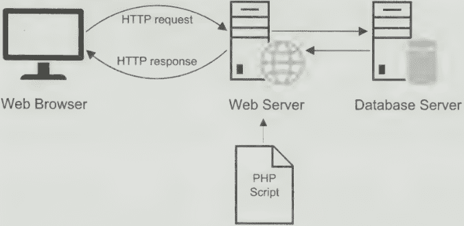

### 描述

- *动态网页*是由服务器端程序或脚本生成的网页。通常，网页会根据 Web 浏览器提交给服务器的信息而变化。
- 当 Web 服务器收到对动态网页的请求时，它会使用所请求文件的扩展名来确定哪个服务器或程序应处理该请求。如果扩展名是 php，Web 服务器会调用*PHP 解释器*来处理请求以及随请求提交的数据。
- PHP 页面可以使用从 Web 浏览器获取的数据来访问*数据库服务器*中的相应数据。应用程序还可以将从 Web 浏览器获取的数据存储在数据库服务器中。
- 当 PHP 解释器完成对 PHP 页面的处理时，它会生成一个 HTML 页面并将其返回给 Web 服务器。然后，Web 服务器将页面返回给 Web 浏览器。
- 浏览器无法判断返回给它的 HTML 是从静态网页检索到的，还是由 PHP 解释器动态生成的。无论哪种情况，浏览器都只是显示（*渲染*）它收到的 HTML。
- 以用户请求网页开始、以服务器向客户端发送响应结束的过程称为*往返*。


## Web应用软件概览

图1-4概括了Web应用的四个组成部分的软件：Web浏览器、Web服务器、服务端语言和数据库服务器。第一个Web浏览器是蒂姆·伯纳斯-李于1991年在瑞士日内瓦的欧洲核子研究中心（CERN）开发的。此后，开发了数十种Web浏览器。

Google Chrome于2008年发布，迅速普及，现已成为使用最广泛的Web浏览器之一。它适用于Windows、Mac OS X和Linux操作系统。

Firefox是另一个广泛使用的Web浏览器。它也适用于所有主流操作系统。Firefox是使用原始Netscape Navigator Web浏览器的源代码构建的。

微软的Internet Explorer（IE）曾经是最广泛使用的Web浏览器，现在仍然被广泛使用。然而，随着Chrome和Firefox的兴起，它不再像过去那样普及。目前它仅适用于Windows。

Safari是Mac OS X的默认Web浏览器。这个浏览器最初基于与Chrome相同的渲染引擎。因此，它们渲染页面的方式相似。

Opera作为桌面计算机的浏览器并不广泛使用。然而，它作为移动设备的浏览器使用得更广泛。

Apache Web服务器由Apache软件基金会开发，是最广泛使用的Web服务器。它是一个免费的开源软件项目。虽然Apache有适用于大多数现代操作系统的版本，但它通常用于Linux服务器。

另一个广泛使用的Web服务器是微软的Internet Information Services（IIS）。它是Windows Server操作系统的一部分。

在*服务端语言*中，PHP、Perl和Python都可以直接安装在Apache或IIS Web服务器上。这些语言被称为*脚本语言*。

相比之下，JSP和ASP.NET除了Web服务器外还需要*应用服务器*。例如，JSP应用通常运行在Tomcat或Glassfish等应用服务器上。ASP.NET应用通常运行在IIS的应用服务器上。关于JSP和ASP.NET的更多信息，请参阅我们关于这些主题的书籍。

PHP通常与MySQL数据库服务器一起使用。这个数据库服务器是一个运行在所有主流操作系统上的开源数据库服务器。然而，PHP也可以与其他数据库服务器一起使用。三个最广泛使用的数据库服务器是Oracle、IBM的DB2和微软的SQL Server。

### Web浏览器

| 浏览器 | 描述 |
|---|---|
| Chrome | 由Google发布。适用于所有主流操作系统。 |
| Firefox | 由Mozilla公司发布。适用于所有主流操作系统。 |
| Internet Explorer | 由微软发布。适用于Windows。 |
| Safari | 由苹果发布。适用于OS X。 |
| Opera | 由Opera Software发布。适用于Windows和OS X。 |

### Web服务器

| 服务器 | 描述 |
|---|---|
| Apache | 一个开源Web服务器，可运行在任何主流操作系统上。它支持许多服务端脚本语言，并能与许多不同的数据库服务器交互。最常见的配置称为LAMP，由Linux、Apache、MySQL和PHP组成。 |
| IIS | 微软的Web服务器，仅运行在Windows操作系统上。它主要支持ASP.NET Web开发和MS SQL Server。 |

### 服务端语言

| 语言 | 描述 |
|---|---|
| PHP | （PHP: Hypertext Preprocessor）通常与Apache Web服务器一起使用，但也适用于IIS。它使用.php文件扩展名。 |
| JSP | （JavaServer Pages）需要应用服务器，例如Apache软件基金会提供的Tomcat服务器。JSP页面使用.jsp文件扩展名，并且通常与用Java编写的servlet一起工作。 |
| ASP.NET | （Active Server Pages）与微软IIS Web服务器一起使用。ASP.NET页面使用.aspx文件扩展名，通常与用C#或Visual Basic编写的服务端代码一起工作。 |
| Perl | 最初开发用于UNIX命令行处理文本，后来用于构建Web应用。它使用.pl文件扩展名。 |
| Python | 除了Web应用之外，还用于开发许多类型的应用。它通常与Apache Web服务器一起使用。它使用.py文件扩展名。 |

### 数据库服务器

| 服务器 | 描述 |
|---|---|
| MySQL | 一个开源数据库，适用于所有主流操作系统。 |
| Oracle | Oracle的数据库服务器，适用于所有主流操作系统。 |
| DB2 | IBM的数据库服务器，适用于所有主流操作系统。 |
| MS SQL Server | 微软的数据库服务器，仅适用于Windows操作系统。 |

图1-4——Web应用软件概览

## PHP历史中的亮点

图1-5概括了PHP历史上的一些亮点。首先，PHP 2于1995年发布，名为Personal Home Page。然后，1998年发布了PHP 3。在这次发布中，PHP的名称改为*PHP: Hypertext Preprocessor*。

2000年，PHP 4引入了Zend引擎。这提高了PHP的性能和受欢迎程度。最后，2004年，PHP 5引入了Zend引擎II。此外，PHP 5引入了对面向对象编程、PHP Data Objects扩展和其他新功能的改进支持。

在本书付印之际，PHP 5.5是PHP的当前版本。因此，本书通篇使用该版本的PHP。本书中的大部分代码也适用于其他版本的PHP。然而，如果您使用不同版本的PHP，可能会注意到一些差异。

| 版本 | 年份 | 描述 |
|---|---:|---|
| 2 | 1995 | 该版本命名为Personal Home Page。 |
| 3 | 1998 | 该版本更名为PHP: Hypertext Preprocessor。 |
| 4 | 2000 | 该版本引入了Zend引擎。 |
| 5 | 2004 | 该版本引入了Zend引擎II。它包括对面向对象编程、PHP Data Objects扩展和其他新功能的改进支持。 |
| 6 | -- | PHP 6自2006年10月以来一直在开发中，但截至撰写本文时尚未发布。 |

## MySQL历史中的亮点

图1-5也概括了MySQL历史上的一些亮点。首先，MySQL 3.23于1995年发布。这个MySQL版本被许多网站广泛使用。然后，2003年，MySQL 4.0引入了对联合的支持。2004年，MySQL 4.1引入了对子查询和预处理语句的支持。2005年，MySQL 5.0引入了对存储过程、触发器、视图和事务的支持。2008年，MySQL 5.1引入了对基于行的复制和服务器日志表的支持。2010年，MySQL 5.5更改了默认存储引擎，以默认提供对引用完整性的支持。最后，2011年，MySQL 5.6引入了用于处理大数据的新功能。

MySQL由一家名为MySQL AB的营利性公司所有和赞助。然而，2008年，Sun Microsystems收购了MySQL AB。然后，2009年，Oracle Corporation收购了Sun Microsystems。因此，Oracle现在在MySQL数据库的未来方面拥有很大的发言权，而MySQL数据库与Oracle数据库存在竞争关系。

由于担心Oracle会停止开发MySQL，许多MySQL的原始开发者在Oracle收购后不久离开了MySQL AB，并开始致力于开源代码的不同分支。其中最流行的分支之一是MariaDB。因此，即使Oracle停止或放缓MySQL的开发，开发者仍然可以考虑使用MariaDB或MySQL的其他分支。

| 版本 | 年份 | 描述 |
|---|---:|---|
| 3.23 | 1995 | 发布了MySQL的原始版本。 |
| 4.0 | 2003 | 该版本引入了对联合的支持。 |
| 4.1 | 2004 | 该版本引入了对子查询和预处理语句的支持。 |
| 5.0 | 2005 | 该版本引入了对存储过程、触发器、视图和事务的支持。 |
| 5.1 | 2008 | 该版本引入了对基于行的复制和服务器日志表的支持。 |
| 5.5 | 2010 | 该版本更改了默认存储引擎，以默认提供对引用完整性的支持。 |
| 5.6 | 2011 | 该版本引入了对处理大数据的支持。 |

### 描述

- MySQL由一家营利性公司MySQL AB所有和赞助。
- 2008年，Sun Microsystems收购了MySQL AB。
- 2009年，Oracle Corporation收购了Sun Microsystems。
- 2009年，许多MySQL的原始开发者离开了MySQL AB，并开始致力于开源代码的不同分支。其中最流行的分支之一是MariaDB。
- 2012年，几位技术作家报道称，Oracle正在扣留MySQL Server测试用例，并且不再将其更改与公共源代码仓库同步。同样在2012年，几个Linux发行版以及Wikipedia和Google开始用MariaDB取代MySQL。

图1-5——PHP和MySQL历史中的亮点


## 产品折扣应用

为了更好地说明 PHP 应用是如何工作的，本节将介绍一个简单的应用。这个应用由三个文件组成：一个 HTML 文件、一个 CSS 文件和一个 PHP 文件。

这个简单应用展示了 PHP 如何获取用户提交的数据、处理这些数据，并将处理后的数据返回给用户。它还展示了 HTML、CSS 和 PHP 如何在 Web 应用中协同工作。在第 2 章中，你将学习如何为这类应用编写 PHP 代码。

### 用户界面

图 1-6 展示了这个应用的用户界面。在应用的第一页中，用户输入产品描述、价格和折扣百分比，然后点击 Calculate Discount 按钮。这会将这些数据作为 HTTP 请求的一部分提交给 Web 服务器。

当 Web 服务器收到请求后，它会将请求传递给 PHP 解释器进行处理。然后，PHP 解释器生成该应用第二页的 HTML，并将其发送给 Web 服务器，由 Web 服务器将页面返回给浏览器。

**第一页（index.html）**

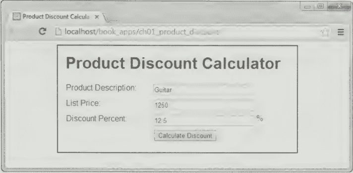

**第二页（响应）**

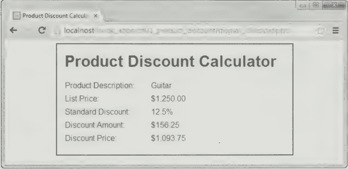

图 1-6 产品折扣应用的用户界面

### HTML 文件

本书假定你已经具备 HTML 的基础知识，因为它是使用 PHP 的必要前提。如果你没有这方面的基础，我们建议你阅读 *Murach’s HTML5 and CSS3*。只要读完前六章和第 10 章，你就拥有了学习本书所需的全部技能。

一旦你熟悉了 HTML，理解图 1-7 中的代码（即该应用第一页的 HTML）应该没有任何问题。它由一个表单组成，包含三个标签、三个文本框和一个提交按钮。当按钮被点击时，会创建一个针对 `display_discount.php` 文件的 HTTP 请求。由于表单指定了 POST 方法，该请求还包含用户在文本框中输入的数据。

这个 HTML 代码是本书中应用所使用的典型 HTML，通常相当简单。因此，如果你理解这段代码，可能就不需要提升你的 HTML 技能。此外，如果你与一个开发团队合作，并且有网页设计师负责你网站的 HTML，你可能也不需要完全理解这段代码。不过，以下几点是你应该注意的重点。

首先，`<link>` 标签加载了下一个图中显示的名为 `main.css` 的 CSS 文件。该文件用于格式化此应用的两个页面。

其次，前三个 `<label>` 和 `<input>` 标签创建了三个标签和文本框，让用户输入数据。然后，最后一个 `<label>` 和 `<input>` 标签创建了按钮，当用户点击时会将数据提交给服务器。最后一个 `<label>` 标签是空白的，但为了格式化是必需的。稍后你会看到，PHP 通过文本框的 name 属性来引用其中的数据。

第三，`<main>` 和 `<div>` 标签被 CSS 用来格式化网页。div 标签的 id 属性分别是 “data” 和 “buttons”（尽管这个表单只有一个按钮）。正如你在下一个图中将看到的，这些标签和 id 会被 CSS 使用。

第四，在创建 PHP 应用时，最佳实践是将 HTML、CSS 和 PHP 代码分开，就像这个应用所展示的那样。这可以减少代码重复，并使应用更易于维护。因此，这种技术被广泛用于专业 Web 应用，并且贯穿本书始终。

**HTML 文件（index.html）**

```html
<!DOCTYPE html>
<html>

<head>
    <title>Product Discount Calculator</title>
    <link rel="stylesheet" type="text/css" href="main.css">
</head>

<body>
    <main>
        <h1>Product Discount Calculator</h1>
        <form action="display_discount.php" method="post">

            <div id="data">
                <label>Product Description:</label>
                <input type="text" name="product_description"><br>

                <label>List Price:</label>
                <input type="text" name="list_price"><br>

                <label>Discount Percent:</label>
                <input type="text" name="discount_percent"><span>%</span><br>
            </div>

            <div id="buttons">
                <label>&nbsp;</label>
                <input type="submit" value="Calculate Discount"><br>
            </div>

        </form>
    </main>
</body>
</html>
```

图 1-7 产品折扣应用的 HTML 文件

### CSS 文件

图 1-8 展示了产品折扣应用的 CSS（*层叠样式表*）文件。这里同样，本书假定你已经具备 CSS 的基础知识。如果你没有，请获取一本 *Murach’s HTML5 and CSS3*，并阅读第 4 章到第 6 章。

一旦你熟悉了 CSS，理解这个图中的代码就不会有任何困难。这里，八个规则集应用于该应用两个页面的 HTML 元素。第一个规则集应用于 `<body>` 元素，第二个应用于 `<main>` 元素。第三个和第四个应用于 `<h1>` 和 `<label>` 元素。第五个和第六个应用于位于 “data” `<div>` 标签中的 `<input>` 和 `<span>` 元素。第七个应用于位于 “buttons” `<div>` 标签中的 `<input>` 元素。第八个应用于 `<br>` 标签。

由于 CSS 在 PHP 应用中只是辅助性的，这是本书中唯一一次展示应用 CSS 的地方。但请注意，本书中每个应用的 CSS 都可以随本书的下载文件一起获得。

与这个应用的 HTML 一样，这个 CSS 也是本书中其他应用所使用的典型 CSS，相当简单。另外，如果你与一个开发团队合作，并且有网页设计师负责你网站的 CSS，你可能根本不需要使用 CSS。在这种情况下，只需了解 CSS 负责页面的格式化即可。

**CSS 文件（main.css）**

```css
body {
    font-family: Arial, Helvetica, sans-serif;
    margin: 1em;
    padding: 0;
}

main {
    width: 450px;
    margin: 0 auto;
    padding: 1.5em;
    background: white;
    border: 2px solid navy;
}

h1 {
    color: navy;
}

label {
    width: 10em;
    padding-right: 1em;
    float: left;
}

#data input {
    float: left;
    width: 15em;
    margin-bottom: .5em;
}

#data span {
    padding-left: .25em;
}

#buttons input {
    float: left;
    margin-bottom: .5em;
}

br {
    clear: left;
}
```

图 1-8 产品折扣应用的 CSS 文件

### PHP 文件

图 1-9 展示了产品折扣应用的 PHP 文件。在下一章中，你将学习编写这类 PHP 代码的细节。但如果你有一些编程经验，下面的解释应该有助于你理解现在正在发生的事情。

首先，PHP 文件获取存储在 HTML 文件文本框中的数据。为此，它使用 `$_POST` 数组从文本框中检索数据。这之所以可行，是因为 HTML 文件为提交的表单指定了 POST 方法。要从 `$_POST` 数组中检索值，这段代码指定了文本框的 `<input>` 标签中使用的 name 属性。例如，使用 “product_description” 这个值可以获取用户在产品描述文本框中输入的数据。

PHP 获取每个文本框的数据后，会将其存储在一个以美元（$）符号开头的变量中。例如，产品描述被存储在名为 `$product_description` 的变量中。

将数据存入变量后，PHP 代码通过对变量中的数据进行运算来计算折扣金额和折扣价格。为此，第一条语句使用乘法运算符（`*`）计算折扣金额，并将其存储在 `$discount` 变量中。然后，第二条语句使用减法运算符（-）计算折扣价格，并将其存储在名为 `$discount_price` 的变量中。

这些计算之所以可行，是因为如果字符串值只包含数字字符，PHP 会自动将其转换为数值数据类型。例如，如果用户输入 399.95 作为标价，PHP 会将此变量存储为数字，而不是字符串。因此，你可以对此变量执行算术计算。

完成计算后，PHP 代码会格式化页面需要显示的四个值。为此，它使用 number_format 函数格式化三个数值变量，使其显示两位小数，并格式化第四个数值变量，使其显示一位小数。它还使用连接运算符（.）为其中三个变量添加美元符号（$），为一个变量添加百分号（%）。这会自动将数值转换为字符串值。

格式化数值后，PHP 代码会对产品描述的字符串进行转义。为此，它使用 htmlspecialchars 函数将 HTML 标签使用的任何特殊字符转换为 HTML 实体。这可以防止一种称为 JavaScript 注入攻击的安全漏洞。一般来说，转义任何尚未经过严格验证的用户输入是一种良好实践。

PHP 文件的其余部分看起来很像普通的 HTML 页面。不过，它使用五个 PHP echo 语句将存储在 PHP 变量中的数据输出到页面上的五个 `<span>` 标签内。


### PHP 文件（display_discount.php）

```php
<?php
    // get the data from the form
    $product_description = $_POST['product_description'];
    $list_price = $_POST['list_price'];
    $discount_percent = $_POST['discount_percent'];

    // calculate the discount
    $discount = $list_price * $discount_percent * .01;
    $discount_price = $list_price - $discount;

    // apply currency formatting to the dollar and percent amounts
    $list_price_formatted = "$".number_format($list_price, 2);
    $discount_percent_formatted = number_format($discount_percent, 1)."%";
    $discount_formatted = "$".number_format($discount, 2);
    $discount_price_formatted = "$".number_format($discount_price, 2);

    // escape the unformatted input
    $product_description_escaped = htmlspecialchars($product_description);
?>
<!DOCTYPE html>
<html>

<head>
    <title>Product Discount Calculator</title>
    <link rel="stylesheet" type="text/css" href="main.css">
</head>

<body>
    <main>
        <h1>Product Discount Calculator</h1>

        <label>Product Description:</label>
        <span><?php echo $product_description_escaped; ?></span><br>

        <label>List Price:</label>
        <span><?php echo $list_price_formatted; ?></span><br>

        <label>Standard Discount:</label>
        <span><?php echo $discount_percent_formatted; ?></span><br>

        <label>Discount Amount:</label>
        <span><?php echo $discount_formatted; ?></span><br>

        <label>Discount Price:</label>
        <span><?php echo $discount_price_formatted; ?></span><br>
    </main>
</body>
</html>
```

## 如何编辑和测试 PHP 应用程序

现在你已经了解了 PHP 应用程序的组成部分，接下来可以学习如何编辑和测试 PHP 应用程序。

### 如何使用文本编辑器编辑 PHP 页面

虽然你可以使用任何文本编辑器来输入和编辑 HTML、CSS 和 PHP 文件，但使用专为处理 HTML、CSS 和 PHP 而设计的文本编辑器可以加快开发速度并帮助减少编码错误。文本编辑器应具备的一些功能是语法高亮和自动补全。

如果你使用 Windows，我们建议你使用 Notepad++ 作为编辑器，因为它提供了这些功能。尽管还有许多其他免费和商业文本编辑器，但 Notepad++ 提供了本书所需的所有功能。

如果你使用 Mac OS X，我们建议你使用 TextWrangler 作为编辑器。这是一个免费编辑器，提供语法高亮和 FTP 访问功能，虽然它不提供自动补全。不过，你还有其他选择，例如确实提供自动补全的商业编辑器，如 BBEdit（TextWrangler 的商业版本）。

为了说明文本编辑器在 HTML、CSS 和 PHP 文件中的使用，图 1-10 显示了正在使用 Notepad++ 编辑 PHP 文件的情况。该编辑器提供选项卡，因此你可以同时编辑多个文件。此外，它还对语句语法进行颜色编码，以反映不同的编码元素。如果你试用 Notepad++，你会发现它还有许多本简要介绍未提及的其他功能。

在开始使用 Notepad++ 之前，你可能需要花时间更改注释的样式，因为在某些系统上默认样式太小了。此技能在本图中进行了总结。

然后，当你开始一个新文件时，你应该让 Notepad++ 知道你正在使用什么语言。为此，你可以使用 .html、.css 或 .php 扩展名保存文件，也可以使用 Language 菜单选择语言。一旦你这样做了，该编辑器就会使用相应的颜色编码。

### 打开三个选项卡的 Notepad++

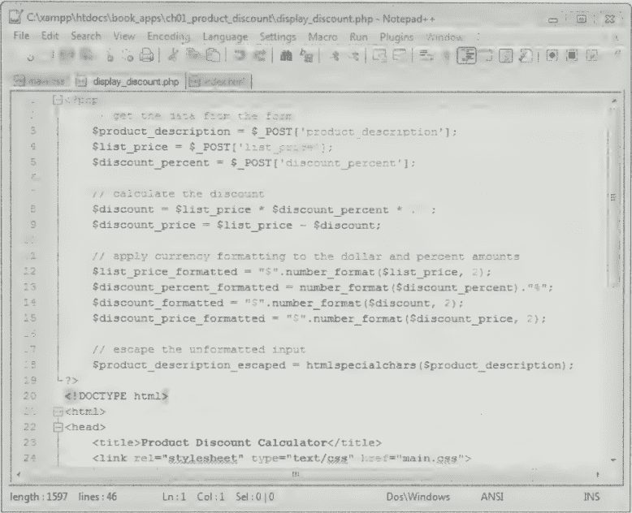

### 如何打开、保存、关闭和新建文件

- 要打开文件，请使用工具栏中的 Open 按钮。或者，在 Windows 资源管理器中右键单击文件，然后选择 Edit with Notepad++ 命令。
- 要保存当前文件，请使用工具栏中的 Save 按钮，或按 Ctrl+S。或者，要保存所有打开的文件，请使用 Save All 按钮。
- 要关闭当前文件，请使用工具栏中的 Close 按钮。或者，要关闭所有打开的文件，请使用 Close All 按钮。
- 要在一个新选项卡中新建文件，请使用工具栏中的 New 按钮。

### 如何更改注释样式

- 启动 Settings→Style Configurator 命令，在语言列表中选择 php，在样式列表中选择 COMMENT。然后，将下拉列表中的字体名称和字体大小更改为列表顶部的空白条目。
- 对 PHP 语言的 COMMENTLINE、HTML 语言的 COMMENT 和 CSS 语言的 COMMENT 重复此操作。

### 说明

- 你可以使用许多不同的文本编辑器来编辑 HTML、CSS 和 PHP 代码。对于 Windows，我们推荐 Notepad++。对于 Mac OS X，我们推荐 TextWrangler。

图 1-10 如何使用文本编辑器编辑 PHP 文件

## 如何部署 PHP 应用程序

当你*部署*应用程序时，你让它可以通过浏览器访问。要在你自己的计算机或运行 Windows 的本地服务器上做到这一点，你需要将应用程序的所有目录和文件复制到 Apache 服务器的 `\xampp\htdocs` 目录中，因为 Apache 会在那里查找应用程序。

图 1-12 的第一个目录结构说明了这一点。这里，guitar_store 应用程序的顶级目录已被复制到 htdocs 目录。在此示例中，仅显示了四个子目录，包括一个 CSS 文件目录和一个用于存储应用程序所需图像的目录。不过，在实践中，大型应用程序可能包含多个不同级别的许多子目录。

请注意，htdocs 目录被称为*文档根目录*，而 guitar_store 目录被称为*应用程序根目录*。这只是意味着 htdocs 是所有应用程序的根目录，而 guitar_store 是一个应用程序的根目录。

对于本书，你将使用许多旨在帮助你学习的小型应用程序。如果你按照附录中的说明安装这些应用程序，它们将位于 htdocs 目录下的两个子目录中：book_apps 和 ex_starts。本图中的第二个目录结构说明了这一点。例如，book_apps 目录中的 ch01_product_discount 是本章应用程序的目录。而 ex_starts 目录中的 ch02_ex1 是第 2 章第一个练习的应用程序目录。

要将应用程序部署到 Internet 服务器上，你需要将应用程序目录和文件从本地服务器复制到 Internet 服务器上的根目录。为此，你可以使用*FTP 程序*，它使用*文件传输协议*将文件从本地服务器上传到 Internet 服务器。当然，要使此功能正常工作，Internet 服务器必须运行 Apache 和 PHP 解释器。

在实践中，PHP 应用程序通常在上传到 Internet 服务器之前先在本地服务器上进行开发和测试。为了使这易于管理，本地服务器上的目录结构与 Internet 服务器上的目录结构完全相同（即“镜像”）。这也使得以后维护和增强 Web 应用程序更加容易。

## 如何运行 PHP 应用程序

要在 Internet 上访问网页，你可以在浏览器地址栏中输入*统一资源定位符*（URL）。该 URL 由图 1-13 所示的四个部分组成。

在大多数情况下，*协议*是 HTTP。如果你省略协议，浏览器将使用 HTTP 作为默认协议。

*域名*标识 HTTP 请求将发送到的 Web 服务器。Web 浏览器使用此名称来查找该域名的 Web 服务器地址。虽然你不能省略域名，但大多数浏览器允许你省略域名中的“www.”。

第三个组件是文件在服务器上所在的*路径*。路径列出了包含该文件的目录。正斜杠用于分隔路径中的名称，并在路径开头表示服务器的顶级目录。在本图的第一个示例中，路径是“/book/”。

最后一个组件是*文件名*。在此示例中，文件名为 index.htm。不过，如果你省略文件名，Web 服务器将在你指定的路径中搜索默认文件。默认情况下，Apache Web 服务器提供 index.htm、index.html 和 index.php 作为默认文件名。

如果你想查看在自己计算机上运行的页面，可以使用 localhost 关键字作为域名。例如，在本图中，第二组示例使用 localhost 关键字来访问与 Web 浏览器运行在同一台计算机上的 Apache 服务器。

如果你在 URL 中省略文件名，并且指定的目录中没有默认文件，Apache 将显示该目录中的目录和文件列表。本图中的最后一个示例说明了这一点。这里，book_apps 目录不包含默认文件。相反，它包含本书中介绍的每个应用程序的一个目录。因此，Apache 会在浏览器中显示一个索引页，列出这些目录。

这是访问本书应用程序的好方法。然后，你可以通过单击其链接启动 book_apps 目录中的任何应用程序。如果你还能获得 ex_starts 目录中应用程序的索引，并将这两个索引加入书签，你就总能轻松运行书中的应用程序或练习。

顺便说一下，当你为应用程序创建目录和文件名时，它们应只包含小写字母、数字、句点和下划线字符，因为路径中的名称在某些服务器上可能区分大小写。然后，如果 URL 中包含名为“Images”的目录，但服务器上的目录实际上名为“images”，Web 服务器将报告无法找到该文件。


## HTTP URL 的组成部分

```
http://www.murach.com/books/index.htm
protocol        domain name          path       filename
```

## 如果省略 URL 的部分内容会怎样

- 如果省略协议，将默认使用 `http://`。
- 如果省略文件名，将使用 Apache Web 服务器的默认文件名之一：`index.htm`、`index.html` 或 `index.php`。
- 如果省略文件名且不存在默认文件，Apache 将显示该路径下文件和目录的索引。

## 用于从 Internet Web 服务器请求页面的 URL

### 请求特定页面

```
http://www.murach.com/books/phps/index.htm
```

### 请求网站默认（主页）页面

```
http://www.murach.com/
```

## 用于从本地 Web 服务器请求应用程序的 URL

### 请求应用程序目录中的默认页面

```
http://localhost/book_apps/ch01_product_discount/
```

### 请求不包含默认页面的目录

```
http://localhost/book_apps/
```

### book_apps 目录中的应用程序索引

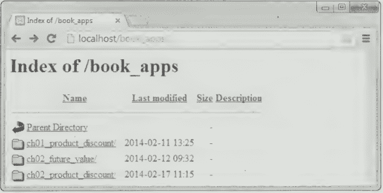

### 说明

- 要在 Internet 上请求网页或网站，请在 Web 浏览器的地址栏中输入页面或网站的 URL。
- 若要请求本地服务器上的网页或应用程序，请使用 *localhost* 作为域名。
- 为了便于运行本书的配套应用程序和练习起始文件，请获取 book_apps 和 ex_starts 目录的索引，并为这些页面添加书签。

图 1-13 —— 如何运行 PHP 应用程序

## Chrome 浏览器中的 Product Discount 应用程序

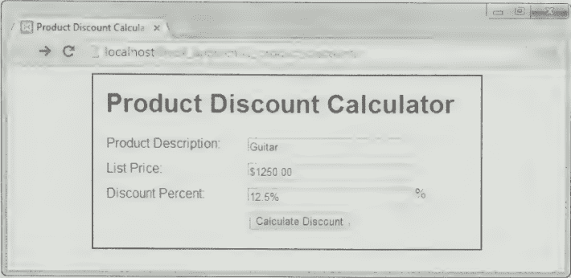

## Chrome 浏览器中显示的错误

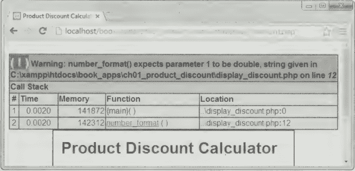

## 如何首次测试 PHP 页面

1. 确保 Apache 和 MySQL 服务器正在运行。
2. 启动 Web 浏览器，并输入如上一张图所示的应用程序 URL。
3. 通过输入有效和无效的数据、点击所有链接等来测试页面。

## 更改源代码后如何重新测试 PHP 页面

- 点击浏览器中的“重新加载”或“刷新”按钮，然后再次测试页面。

## 说明

- 如果收到错误消息，请阅读该消息以帮助确定错误原因，然后修改 PHP 代码并重新测试页面。
- 如果发现不会导致错误消息的其他类型错误，同样需要修改代码并重新测试页面。
- 在第 6 章中，你将进一步了解如何发现错误（*bug*）并修复它们（*调试*）。

**图 1-14**　如何测试和调试 PHP 页面

## 如何查看网页的源代码

当浏览器显示网页时，你可以使用图 1-15 中的方法在单独窗口中查看该页面的 HTML 代码。例如，如果你使用 Chrome 浏览器查看网页，可以右键点击页面，然后选择“查看页面源代码”命令来查看该页面的 HTML 代码。

例如，在此图中，你可以看到 Product Discount 应用程序的 PHP 文件返回给浏览器的 HTML 代码。注意，此 HTML 不包含任何 PHP 代码，只包含由 PHP 代码生成的 HTML 代码。

为什么需要查看源代码？当应用程序页面显示不正确时，你可能想确认问题出在生成的 HTML 代码还是其他方面。例如，如果 PHP 代码生成 HTML 表格的代码，你可以检查该 HTML 是否正确生成。

## PHP 页面的源代码

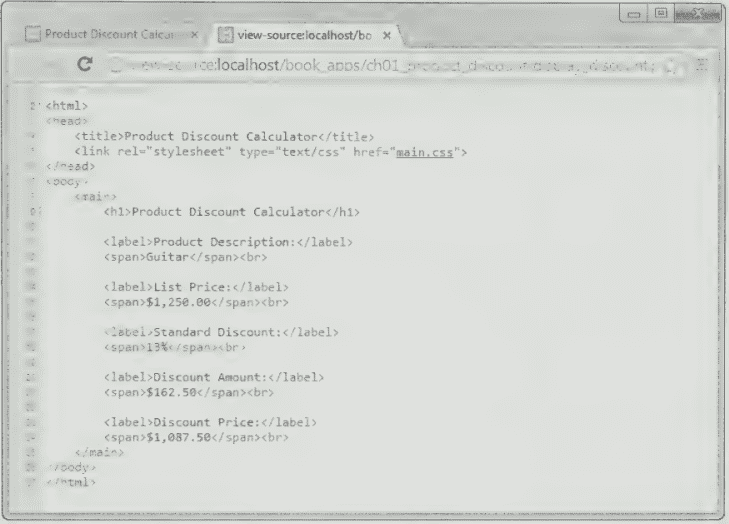

### 如何在 Chrome 和 Firefox 中查看页面源代码

- 右键点击页面，然后选择“查看页面源代码”命令。

### 如何在 Internet Explorer 中查看页面源代码

- 右键点击页面，然后选择“查看源代码”命令。

### 说明

- 在 Web 浏览器中查看网页源代码时，HTML 代码会在单独窗口中打开。
- 在源代码中，你会看到 PHP 为该页面生成的 HTML。你还会看到页面中的所有 PHP 都已被移除，因此其中只包含 HTML。
- 当测试的应用程序在浏览器中显示信息不正确时，可以查看源代码，以确认 PHP 是否正确生成了 HTML 代码。

图 1-15　如何查看网页源代码

## 如何使用 NetBeans 开发 PHP 应用程序

虽然对于开发像本书中的简单 PHP 应用程序来说，文本编辑器已经足够，但大多数专业 PHP 开发者使用的都是专为开发 PHP 应用程序而设计的*集成开发环境（IDE）*。然而，在你学习如何开发 PHP 应用程序时，IDE 也会很有用。

如果你感兴趣，我们推荐用于 PHP 的 NetBeans IDE。这个免费的 IDE 可以在所有主流操作系统上运行，并提供许多功能，使编辑和测试 PHP 应用程序更加容易。要了解如何安装此 IDE，请参阅附录。要了解如何开始使用此 IDE，请阅读接下来的三个主题。

### 如何处理 PHP 项目和文件

使用 NetBeans 时，应用程序的所有目录和文件都分组在一个*项目*中。你也可以同时打开多个项目。在图 1-16 中，NetBeans 的“项目”选项卡显示有两个项目处于打开状态：`ch01_product_discount` 和 `ch02_future_value`。

使用 NetBeans 时，你可以像使用任何应用程序一样，通过菜单、点击工具栏按钮或右键点击对象并使用弹出的快捷菜单来启动命令。例如，在此图中，你可以看到如何使用工具栏按钮打开项目、新建项目或关闭项目，但通过“文件”菜单中的命令也可以获得相同的结果。

要处理项目中的文件，可以使用“项目”选项卡查看项目的文件。然后，你可以通过双击“项目”选项卡中的文件名来打开任何文件。例如，在此图中，`ch01_product_discount` 项目的三个文件已在文本编辑器中打开，并显示名为 `display_discount.php` 的文件。要新建文件，你可以在“项目”选项卡中选择该项目，然后点击工具栏中的“新建文件”按钮。

顺便提一下，当你创建 NetBeans 项目时，NetBeans 会在应用程序根目录中添加一个名为 `nbproject` 的子目录，并使用该子目录及其文件来管理项目。但这不会影响项目的运行，你仍然可以使用标准文本编辑器编辑文件。

此外，你从我们网站下载的应用程序都是 NetBeans 项目，其中包含 `nbproject` 子目录，因此你应能够通过“打开项目”按钮，然后导航到 `\xampp\htdocs\` 文件夹来打开它们。

## 打开了三个文件的 NetBeans

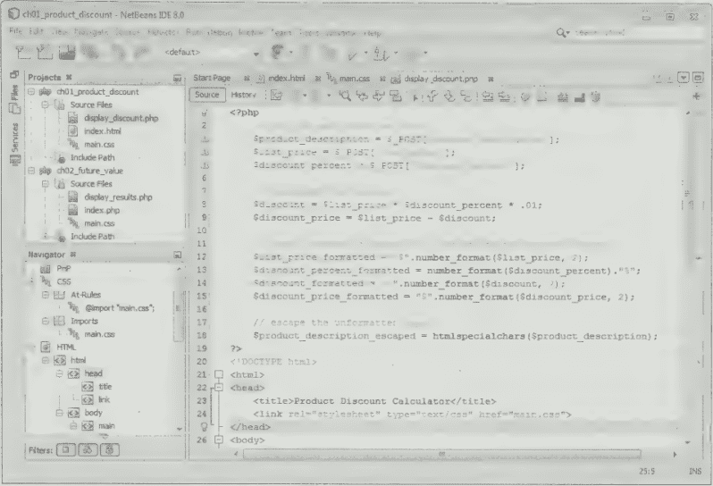

### 如何处理项目

- 要打开*项目*，请使用工具栏中的“打开项目”按钮并导航到你想要打开的项目。你将使用此方法打开下载的书籍应用程序。
- 要新建项目，请使用工具栏中的“新建项目”按钮。
- 要关闭项目，请在“项目”选项卡中右键点击该项目，然后从弹出的菜单中选择“关闭”命令。

### 如何处理文件

- 要打开文件，请使用“项目”选项卡定位到该文件，然后双击该文件。
- 要新建文件，请选择项目并点击工具栏中的“新建文件”按钮。

### 说明

- NetBeans 是一个用于开发 PHP 应用程序的*集成开发环境（IDE）*，它可以让你更轻松地创建、编辑和测试 Web 应用程序所需的所有 HTML、CSS 和 PHP 文件。
- NetBeans 的*项目*由一个顶级目录组成，该目录包含应用程序的子目录和文件。
- 当你创建 NetBeans 项目时，NetBeans 会添加一个 nbproject 子目录，其中包含 NetBeans 管理项目所需的额外文件。

### Mac OS X 注意

- 要在 Mac OS X 中启用右键点击，你可以编辑鼠标的系统偏好设置。

**图 1-16**　如何使用 NetBeans 处理项目和文件


## 如何编辑和测试 PHP 应用程序

图1-17展示了如何编辑和测试PHP应用程序。一般来说，PHP编辑器的工作方式与其他文本编辑器类似，因此你使用起来不会遇到任何麻烦。不过，它的自动补全功能在提供你可能想使用的变量名方面做得更好。

此外，PHP编辑器在键入时进行的错误检查比大多数文本编辑器都要多。例如，在这张图中，你可以看到第10行开头有一个红色圆圈错误图标，因为前一条语句没有以分号结尾。这种键入时的错误检查同样适用于HTML和CSS代码。当然，这样做的好处是，你可以在测试应用程序之前发现并修复错误，这比之后再发现和修复要高效得多。

PHP编辑器还会检查其他并非错误但可能引起问题的状况。例如，在这张图中，你可以在第3、4和5行看到黄色三角形警告图标。如图所示，如果将鼠标悬停在图标上，PHP编辑器会为你提供有关该问题的详细信息。

在这张图中，警告图标显示一条消息，提示你不应直接访问全局 \$_POST 数组。这是因为如果不对输入数据进行验证或对输出数据进行转义，这样做可能会导致安全漏洞。不过，由于这只是一个警告，代码仍然可以运行。因此，你可以暂时忽略此警告。在本书后面，你将学习如何验证输入数据以及如何转义输出数据。

编辑完应用程序的文件后，NetBeans 也能让你更轻松地测试它们。例如，要测试“项目”窗口中当前选中的项目，只需按 F6 键。这会在系统默认浏览器中打开应用程序的默认文件，使应用程序准备好进行测试。你可以使用此图中的其他技术来运行“项目”窗口中当前未选中的项目，或运行特定文件。

### 显示自动补全列表和警告/错误标记的 NetBeans

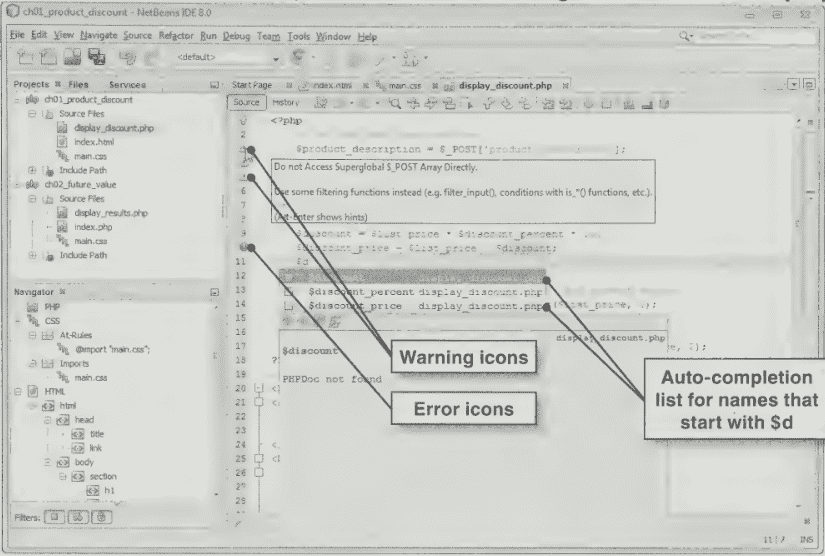

### 如何编辑 PHP 文件

- 输入 PHP 代码时，使用常规的编辑技巧。
- 当看到自动补全列表时，你可以高亮一个条目并按 Enter 键将其输入到代码中，也可以双击它。
- 如果在行首看到红色错误图标，应在测试应用程序之前修复该行包含的任何错误。
- 如果在行首看到黄色警告图标，可以将鼠标悬停在图标上以阅读警告。然后，如果你愿意，可以修复该问题。

### 如何测试 PHP 应用程序

- 要运行当前项目，请单击工具栏中的“运行项目”按钮或按 F6。
- 要运行其他项目，请右键单击项目并选择“运行”命令。
- 要运行文件，请右键单击文件并选择“运行”命令。

### 说明

- NetBeans 的自动补全功能会在你输入条目的起始字符后提供可能的条目列表。
- NetBeans 使用红色错误图标来标识包含错误的行。
- NetBeans 使用黄色警告图标来标识可能不符合最佳实践的行。
- 要移除某些类型的警告，请选择“工具→选项”项，并单击“提示”选项卡。

图1-17 如何使用 NetBeans 来编辑和测试 PHP 应用程序

## 如何导入和配置 PHP 项目

如果你没有使用 NetBeans 创建应用程序，则需要先将应用程序导入到 NetBeans 项目中，然后才能编辑和测试该项目。为此，你可以使用图1-18中描述的技术。

需要注意的是，这仅适用于在 NetBeans 之外创建的应用程序。例如，如果你使用 Notepad++ 创建本章的应用程序，则需要遵循导入流程才能在 NetBeans 中编辑和测试该项目。但是，由于下载的图书应用程序是在 NetBeans 中创建的，因此你无需导入它们。你应该只需打开它们，就能在 NetBeans 中使用下载的图书应用程序项目，如图1-16所述。

作为导入流程的一部分，NetBeans 会提示你检查项目的运行配置。例如，在此图中，第二个对话框显示了名为 ch01_product_discount 的应用程序在导入 NetBeans 时的配置。在这里，你需要确保“项目 URL”文本框包含运行该项目的正确路径。

如果应用程序的目录存储在 htdocs 目录中，NetBeans 通常会正确设置“项目 URL”。因此，你不需要更改它。但是，如果你想将应用程序存储在另一个目录中，例如 book_apps 目录，你可以编辑此 URL。此外，如果你重命名或复制现有的 NetBeans 项目，运行配置中的“项目 URL”可能不再正确。然后，当你从 NetBeans 运行该应用程序时，浏览器可能会显示错误的应用程序。在这种情况下，你可以按照此图所示编辑运行配置来修复问题。

所以预先提醒一下。如果你只使用从我们网站下载并按照附录所示安装的图书应用程序和练习起步项目，你就不应该遇到任何关于运行配置的问题。但是，当你导入和复制自己的应用程序时，请记住运行配置。

### 用于启动新项目的对话框

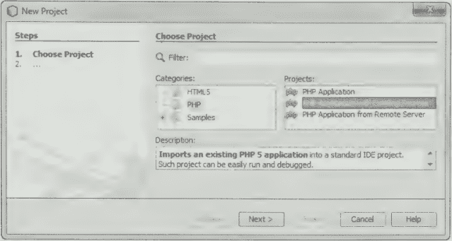

### 用于配置项目的对话框

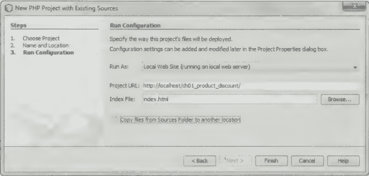

### 如何检查现有项目的运行配置

- 在“项目”选项卡中右键单击项目，然后选择“属性”命令。接着，在“类别”列表中单击“运行配置”，并检查“项目 URL”。

### 如何导入项目

- 要导入项目，请使用“新建项目”命令，但在“项目”列表中选择“带有现有源代码的 PHP 应用程序”。这将引导你完成导入流程。
- 在第三步中，系统会要求你检查运行配置。在这里，你需要确保用于运行项目的 URL 是正确的。

### 说明

- 在使用 NetBeans 运行现有应用程序之前，你需要先导入它。然后，NetBeans 会在其 nbproject 目录中创建管理项目所需的文件。
- 导入新项目时，你需要检查其配置，以确保运行该项目的 URL 是正确的。如果你将 NetBeans 项目从一个目录复制到另一个目录，然后在 NetBeans 中打开它，也需要检查此 URL。

图1-18 如何使用 NetBeans 来导入和配置 PHP 项目

- 静态网页是一种每次检索时内容都相同的页面。静态网页文件的扩展名为 .html 或 .htm，其 HTML 不变。
- *动态*网页的 HTML 是由*服务器端程序*或*脚本*生成的，因此其 HTML 会因请求的不同而改变。当 Web 服务器收到网页请求时，它会使用所请求文件的扩展名来确定应由哪个服务器或脚本来处理该请求。
- 扩展名为 .php 的网页的 HTTP 请求由运行在 Web 服务器上的 *PHP 解释器*处理。该解释器处理请求以及随请求传递的任何数据，然后生成 HTTP 响应的 HTML。
- *HTML（超文本标记语言）*是定义网页结构和内容的语言。*CSS（层叠样式表）*用于控制网页的格式。在本书中，你需要熟悉 HTML 和 CSS，但重点是 PHP。
- *XAMPP* 是一个免费、开源、跨平台的 Web 服务器软件包，包含 Apache、MySQL 和 PHP 解释器。它常用于 PHP 应用程序，并且易于安装。
- 要在你自己的计算机或本地服务器上部署 PHP 应用程序，你需要将其所有目录和文件复制到 Apache 的文档根目录（xampp\htdocs）中。
- 要在 Internet 上部署 PHP 应用程序，你需要将这些目录和文件从你的计算机或本地服务器传输到可访问 Internet 的 Web 服务器。为此，你可以使用采用*文件传输协议*的 *FTP 程序*。
- 要运行 Web 应用程序，你可以在浏览器的地址栏中输入应用程序目录的 *URL（统一资源定位符）*。然后，Apache 会查找该目录中的默认文件并运行它。如果找不到默认文件，Apache 会显示子目录和文件的索引。
- 如果在测试应用程序时 PHP 无法执行某条语句，浏览器中会显示错误消息。然后，你需要对应用程序进行*调试*。
- 要查看网页的 HTML，你可以使用浏览器的“查看页面源代码”或“查看源代码”命令。当你想查看 PHP 应用程序是否生成了正确的 HTML 时，这会很有用。
- 要开发网页，你可以使用像 Notepad++ 或 TextWrangler 这样的文本编辑器。你也可以使用将文本编辑与其他开发功能结合起来的 *集成开发环境（IDE）*。
- NetBeans 是一个 IDE，可以让你更轻松地编辑和测试 PHP 应用程序。NetBeans 将每个应用程序视为一个 *项目*。你可以将现有应用程序 *导入* 到 NetBeans 项目中，然后对其进行配置，使其能够正确运行。


## 在开始本书的练习之前...

在开始本书的练习之前，你应该按照附录中的描述，下载并安装本书所需的软件和应用程序。

### 练习1-1 — 测试Product Discount应用程序

在本练习中，你将运行本章所描述的Product Discount应用程序。你还将使用浏览器查看其源代码。

#### 启动应用程序

1. 如有必要，请按照图1-11所示启动Apache Web服务器。
2. 启动你的Web浏览器。
3. 通过在浏览器地址栏中输入以下URL并按回车键，运行Product Discount应用程序：

   `http://localhost/book_apps/ch01_product_discount/`

如果该应用程序能够运行，则说明你已经正确安装了软件和可下载的应用程序。

#### 测试应用程序

4. 在三个文本框中输入有效值。然后点击“Calculate Discount”按钮。这将在应用程序的第二页显示计算结果。
5. 查看浏览器地址栏，注意URL指向一个PHP文件。
6. 如图1-15所示查看此网页的源代码。注意，该源代码仅包含HTML，而不包含PHP代码。
7. 点击浏览器的“后退”按钮返回到应用程序的第一页，在第二个和第三个文本框中输入无效的数值，如“xx”和“yy”，然后点击“Calculate Discount”按钮。接着，阅读显示的错误信息。在本书后面的内容中，你将学习如何处理此类错误。
8. 点击浏览器的“后退”按钮返回到应用程序的第一页。然后使用有效数据再次运行该应用程序。

### 练习1-2 — 运行书中的应用程序和练习应用程序

在本练习中，你将创建书中的应用程序的索引页以及作为练习起点的应用程序的索引页，并为它们添加书签。然后，你将运行其中一些应用程序。

#### 运行一些书中的应用程序

1. 在浏览器地址栏中输入此URL并按回车键：

   `http://localhost/book_apps/`

   这应该会显示书中的应用程序的索引。

2. 将此页面添加书签，以便在需要时快速访问。
3. 点击索引中的`ch02_future_value`链接，运行第2章的Future Value应用程序。这应该会启动该应用程序。然后点击“后退”按钮返回索引。
4. 如有必要，请按照图1-11所示启动MySQL。然后返回浏览器，点击`ch04_product_manager`启动Product Manager应用程序。如果它能够启动，则表明你已按照附录中的说明正确安装了MySQL和可下载的MySQL数据库。
5. 点击“后退”按钮，启动第5章的Guitar Shop应用程序。这应该会让你对完成本书第1部分后能够开发的应用程序类型有所了解。

#### 运行一些练习应用程序

6. 在浏览器地址栏中输入此URL并按回车键：

   `http://localhost/ex_starts/`

   这应该会显示作为练习起点的应用程序的索引。

7. 将此页面添加书签，以便在需要时快速访问。
8. 点击`ch02_ex1`的链接。这是第2章练习1中你将使用的应用程序的链接。它是第1章中的Product Discount应用程序，你将在此练习中对其进行增强。
9. 现在，你可以相对轻松地运行任何书中的应用程序或练习起点的应用程序了。

### 练习1-3 — 了解NetBeans

我们建议使用NetBeans来完成本书的练习。本练习将帮助你开始使用NetBeans。但是，如果你更喜欢使用文本编辑器，可以跳到练习1-4。

1. 打开NetBeans，然后如图1-16所示打开此项目：

   `\xampp\htdocs\ex_starts\ch02_ex1`

2. 如图1-16所示，打开该应用程序的三个文件。
3. 查看这三个文件，了解颜色编码如何突出显示HTML、CSS和PHP文件中的语法。
4. 删除某个PHP语句末尾的分号，注意行首出现的红色错误图标。然后，重新输入分号。
5. 在PHP文件的PHP部分开始一个新行，输入`$`，注意显示的自动完成列表。然后，删除你开始编写的那一行代码。
6. 如图1-17所示运行该应用程序。这将在你的默认浏览器中启动该应用程序。
7. 如图1-18所示检查该应用程序的配置，注意Project URL对于该应用程序是正确的。

### 练习1-4 — 了解你的文本编辑器

本练习向你展示如何使用文本编辑器来完成本书的练习。如果你打算使用NetBeans，可以跳过本练习。

1. 查看`xampp\htdocs`目录中应用程序的目录和文件。注意，每个应用程序都包含一个NetBeans使用的`nbproject`目录，但如果你不使用NetBeans，可以忽略该目录。
2. 使用你的文本编辑器打开此目录中的html、css和php文件：

   `\xampp\htdocs\ex_starts\ch02_ex1`

   如果你在Windows系统上使用Notepad++，可以在Windows资源管理器中选择这三个文件，右键点击它们，然后选择“Edit with Notepad++”选项。

3. 查看这三个文件，了解颜色编码如何突出显示HTML、CSS和PHP文件中的语法。
4. 删除某个PHP语句末尾的分号，看看错误是否被高亮显示。然后，重新输入分号。
5. 在PHP文件的PHP部分开始一个新行，输入`$d`，看看是否显示自动完成列表。如果没有显示，请检查你的文本编辑器的设置，看看是否需要打开此功能。然后，删除你开始编写的那一行代码。
6. 如果你使用的是Notepad++，你可能需要如图1-10所示更改注释的样式。
7. 如果你的文本编辑器不能一次打开多个文件，或者不提供语法高亮和自动完成功能，你可能应该更换文本编辑器或改用NetBeans。

## 一个包含HTML和内嵌PHP的PHP文件

```php
<?php
    // get the data from the request
    $first_name = $_GET['first_name'];
    $last_name = $_GET['last_name'];
?>
<!DOCTYPE html>
<html>
    <head>
        <title>Name Test</title>
        <link rel="stylesheet" type="text/css" href="main.css">
    </head>
    <body>
        <h2>Welcome</h2>
        <p>First name: <?php echo $first_name; ?></p>
        <p>Last name: <?php echo $last_name; ?></p>
    </body>
</html>
```

### 在浏览器中显示的PHP文件

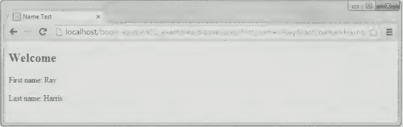

### 说明

- 要在HTML中嵌入PHP，请编写一个PHP标签，以`<?php`开头，以`?>`结尾。然后，你可以在这些标签之间输入PHP代码。
- 尽管在HTML中嵌入PHP的方法有多种，但上述技术是常用且推荐使用的一种。
- 如果希望在显示HTML之前进行一些处理，你可以在HTML文档开始之前嵌入PHP。
- 如果希望在HTML文档中使用PHP显示动态数据，你可以在HTML中嵌入PHP。

## 如何编写注释和语句

PHP的语法是指你在编写PHP代码时必须遵循的规则。如果你熟悉C#、Java或JavaScript，你会发现这些语言的语法与PHP类似。

图2-2首先展示了一个包含注释和语句的PHP代码示例。*注释*有助于记录代码的功能。然而，注释会被PHP引擎忽略。

在此图中，代码以一个*多行注释*（也称为*块注释*）开头，该注释描述了程序的作者和用途。此注释以`/*`开头，以`*/`结尾。该注释还包含额外的星号（`*`）字符，以便在视觉上将其与其余代码区分开来，但这些星号对注释没有影响。

在多行注释之后，该代码使用三个*单行注释*来描述其余的代码。其中前两个注释位于各自独立的行上。然而，第三个注释则写在其他代码之后的行尾。虽然通常使用两个正斜杠（`//`）开始单行注释，但你也可以使用井号（`#`）来开始这种类型的注释。

*语句*执行应用程序的操作。例如，在此图中，第一条语句声明了一个名为`$list_price`的变量并为其赋值。然后，接下来的三条语句假设折扣百分比为20%，计算折扣价格。

在编写注释和语句时，你必须遵循此图中总结的语法规则。如果不遵守这些规则，PHP解释器将无法解释和执行你的注释和语句。

第一条语法规则是，每个PHP语句必须以分号结尾。如果不在每个语句末尾添加分号，PHP将无法判断一个语句在哪里结束、下一个语句在哪里开始。

第二条语法规则是，PHP会忽略语句中多余的空白字符。空白字符包括空格、制表符和换行符。这使你可以将长语句分成多行，以便于阅读。然而，就PHP而言，你的整个程序即使写在一行上，也仍然可以运行。


## PHP 的六种数据类型

在进一步学习编码语句之前，你需要了解 PHP 提供了图 2-3 中总结的六种*数据类型*。这些数据类型分别用于存储不同类型的数据。目前，你可以把重点放在前四种数据类型上，因为它们最常用，而且在大多数语言中都很相似。

*整数数据类型*存储整数。*整数*是不带任何小数位的数字。你可以在整数前加上正号或负号来表示它是正数还是负数。但如果省略符号，该值将被视为正数，因此你通常会省略正号。

*双精度数据类型*存储带有小数位的数字。这种数据类型也称为*十进制数据类型*，带有小数位的数字通常被称为*浮点数*。与整数一样，你可以在浮点数前加上正号或负号。

*布尔数据类型*存储两种状态之一的值，例如 true/false、yes/no、on/off 或 1/0。要表示布尔数据，你可以编写 TRUE 或 FALSE。但请注意，这些词不区分大小写，因此你可以使用大写或小写。在本书中，我们通常使用大写字母以使其更明显。

顺便说一下，像 TRUE 和 FALSE 这样的 PHP 词是*关键字*。这意味着它们对 PHP 解释器具有特殊含义，因此你不应将它们用于其他目的。

*字符串数据类型*存储可以包含任意字符的文本。要编写字符串值，你需要在单引号或双引号内编写*字符串*。但请注意，你必须使用与开头相同类型的引号来结束字符串。

最后两种数据类型用于数组和对象。在第 4 章中，你将了解到数组。在第 11 章和第 14 章中，你可以学习到关于数组和对象的所有知识。

顺便说一下，双精度值还可以包含指数，该指数指示在小数点右侧或左侧应包含多少个零。这使你可以表达极大和极小的数字。例如，数字的指数可以指示该数字在小数点左侧应有 308 个零，或在右侧应有 324 个零。不过，除非你在开发科学或数学应用程序，否则你可能不需要使用这种表示法。

| 类型 | 描述 |
| --- | --- |
| `integer` | 从 -2,147,483,648 到 2,147,483,647 的整数。 |
| `double` | 带小数位的数字，范围从 -1.7E308 到 1.7E308，最多 16 位有效数字。此数据类型也称为浮点数据类型或十进制数据类型。 |
| `boolean` | TRUE 或 FALSE 值。 |
| `string` | 由任意字符组成的文本。 |
| `array` | 容纳一个或多个数据类型的多个值的容器。参见第 4 章和第 11 章。 |
| `object` | 包含数据（属性）和函数（方法）的容器。参见第 14 章。 |

### 整数值（整数）

```text
15                 // an integer
-21                // a negative integer
```

### 双精度值（带小数位的数字）

```text
21.5               // a floating-point value
-124.82            // a negative floating-point value
```

### 两个布尔值

```text
true               // equivalent to true, yes, on, or 1
false              // equivalent to false, no, off, or 0
```

### 字符串值

```text
'Ray Harris'       // a string with single quotes
"Ray Harris"       // a string with double quotes
''                 // an empty string
null               // a NULL value
```

### 使用科学计数法的双精度值

```text
3.7e9              // equivalent to 3700000000
4.5e-9             // equivalent to 0.0000000045
-3.7e9             // equivalent to -3700000000
```

### 描述

- PHP 提供了此图中显示的六种数据类型。每种数据类型用于存储不同类型的数据。
- *整数*是可以用正号或负号开头的整数。
- *双精度值*由正号或负号、数字、可选的小数点以及可选的小数位组成。
- *布尔数据类型*用于表示 TRUE 或 FALSE 的*布尔值*。
- *字符串数据类型*包含由任意字符组成的*字符串*。字符串用单引号或双引号编写。
- 指数可用于表示极大或极小值的双精度值。不过，除非你开发科学或数学应用程序，否则不需要使用这种表示法。

图 2-3 — PHP 的六种数据类型

## 如何声明变量和常量

*变量*存储的值在程序执行过程中可以改变。在 PHP 中，变量很容易识别，因为它们都以美元符号（$）开头。当你编写 PHP 应用程序代码时，你会频繁地声明变量并为其赋值，如图 2-4 所示。

要*声明*变量，请编写美元符号（$）后跟*变量名*。然后，要为变量赋值，请编写*赋值运算符*（=），后跟返回该变量值的表达式。

在第一组示例中，前五个语句将*字面值*（或*字面量*）赋给变量。字面量是以自身形式表示的值，例如 25 或 'hello'。这里，第一个语句将数值字面量 10 赋给 $count。该值以整数类型存储。

第二个语句将数值字面量 9.50 赋给名为 $price 的变量。由于这个数字包含一个小数点后跟一个或多个数字，PHP 会将该数字存储为双精度类型。

第三个语句将字符串字面量 'Bob' 赋给名为 $first_name 的变量。同样，第四个语句将字符串字面量 "Bob" 赋给名为 $first_name 的变量。这表明你可以使用单引号或双引号来表示字符串字面量。

第五个语句将布尔字面量 false 赋给名为 $is_valid 的变量。由于布尔字面量不区分大小写，因此该语句与使用布尔字面量 False 或 FALSE 的效果相同。

接下来的四个语句表明，你可以将一个变量中存储的值赋给另一个变量。例如，在第六个语句中，存储在 $count 变量中的值被复制到 $product_count 变量中。

在使用变量时，你需要记住变量名是区分大小写的。因此，$Count 与 $count 不同。此外，当你创建变量名时，必须遵循此图中显示的规则。

除了规则之外，你的变量应该具有有意义的名称，以便容易看出变量所代表的含义，并且容易记住如何拼写该名称。要创建这样的名称，你应该避免使用缩写，除非这些缩写被广泛理解。例如，如果你将表示每月投资的名称缩写为 $mon_inv，而不是 $monthly_investment，那么很难看出该变量名指的是什么，也很难记住如何拼写它。

要创建包含多个单词的变量名，许多 PHP 程序员使用下划线字符来分隔名称中的单词。例如，$is_valid 和 $list_price 使用这种约定。另一种选择是使用称为*驼峰式大小写*（camel casing）的约定。根据这种约定，每个单词的首字母大写，第一个单词除外。例如，$isValid 和 $listPrice 使用驼峰式大小写。虽然你可以使用任一种约定，但你应该选择一种约定并始终如一地使用它。

与变量相反，*常量*的值一旦设置就不能更改。要定义常量，你可以使用最后一组示例中的表示法。使用常量可以确保值不会意外更改，并清楚地表明该值不应更改。


## 赋值运算符

| 运算符 | 描述 |
|---|---|
| = | 将值赋给变量。 |

## 如何声明变量

```php
$count = 10;                         // an integer literal
$list_price = 9.50;                   // a double literal
$first_name = 'Bob';                  // a string literal - single quotes
$first_name = "Bob";                  // a string literal - double quotes
$is_valid = false;                    // a Boolean literal - lowercase

$product_count = $count;              // $product_count is 10
$price = $list_price;                 // $price is 9.50
$name = $first_name;                  // $name is "Bob"
$is_new = $is_valid;                  // $is_new is FALSE
```

## 创建变量名的规则

- 变量名区分大小写。
- 变量名可以包含字母、数字和下划线。
- 变量名不能包含特殊字符。
- 变量名不能以数字或两个下划线开头。
- 变量名不能使用 PHP 保留的名称，例如 `$this`，它是保留用于对象的。

## 如何声明常量

```php
define('MAX_QTY', 100);              // an integer constant
define('PI', 3.14159265);              // a double constant
define('MALE', 'm');                   // a string constant
```

## 说明

- 变量存储的值可以随着应用程序的执行而改变。
- 要*声明*变量，编写美元符号（`$`）后跟变量名。然后，要给变量*赋值*，编写*赋值运算符*（`=`）后跟变量的值。
- PHP 会根据赋给变量的值给变量指定一种数据类型。
- *字面量*是以自身形式表示的数值。要编写*数字字面量*，直接写出不带引号的数字。要编写*字符串字面量*，将值写在引号内。要编写*布尔字面量*，编写 TRUE 或 FALSE。这些关键字不区分大小写。
- 要声明*常量*，可以使用 define 函数指定常量的名称和值，如上所示。由于常量的值不能更改，所以声明或使用常量时，不需要在名称前编写美元符号。按照惯例，许多程序员使用大写字母作为常量名。

图 2-4 如何声明变量和常量

## 如何从请求中获取数据

大多数 PHP 应用程序对从 HTTP 请求中获得的数据进行操作。这在第 1 章的 Product Discount 应用程序中已经说明。现在，你将学习如何从 HTTP 请求中获取数据并将其存储到 PHP 变量中。

### 如何使用内置的 `$_GET` 数组

当 HTML `<form>` 标签使用 GET 方法将数据传递到 PHP 文件时，值会存储在 `$_GET` 数组中。因为这个数组是 PHP 的一部分，所以称为内置数组。例如，在图 2-5 中，HTTP 请求将输入到文本框中的两个值传递给名为 `display.php` 的页面。

因为此请求使用 GET 方法，所以这些值会在请求页面的 URL 中传递。例如，本图中的这段 URL 请求名为 `display.php` 的页面并向其传递两个值：

```text
display.php?first_name=Ray&last_name=Harris
```

此处，问号表示后面将跟随数据。然后，每个数据项由文本框的 name 属性、等号以及输入到文本框中的值组成。与号用于分隔各项。

当 Web 服务器收到请求时，传递给它的值会存储在 `$_GET` 数组中。该数组包含键/值对，由每个文本框的 name 属性和输入到该文本框的值组成。在本例中，用户在名为 `first_name` 的文本框中输入 “Ray”，在名为 `last_name` 的文本框中输入 “Harris”。

要从 `$_GET` 数组中检索值，需要编写 `$_GET`、一组方括号 `[]` 以及所需值的名称。例如，以下代码获取名为 `first_name` 的文本框的值，并将其存储在名为 `$first_name` 的 PHP 变量中：

```php
$first_name = $_GET['first_name'];
```

但请注意，如果尝试检索 `$_GET` 数组中不存在的参数的值，此代码将返回 NULL 值。

在本图的最后一个示例中，你可以看到你还可以使用 `<a>` 标签来请求 PHP 文件并向其传递数据。为此，你需要像表单的提交方法一样向 HTTP 请求追加数据。这种类型的请求始终使用 GET 方法，这在应用程序代码中有时很有用。

为了简单起见，图中的代码直接访问 `$_GET` 数组。但这并不是一种好的做法，因为它不能保护你免受用户输入的恶意数据的影响。在图 2-11 中，你将学习如何使用 `filter_input` 函数更安全地从超级全局变量中检索值。

### 内置的 `$_GET` 数组

| 名称 | 描述 |
|---|---|
| `$_GET` | 一个内置数组，包含通过 GET 方法（默认）传递的值。 |

### 执行 HTTP GET 请求的 HTML 表单

```html
<form action="display.php" method="get">
    <label>First name: </label>
    <input type="text" name="first_name"/><br>
    <label>Last name: </label>
    <input type="text" name="last_name"/><br>
    <label>&nbsp;</label>
    <input type="submit" value="Submit"/>
</form>
```

### 带有附加键/值对的 HTTP GET 请求的 URL

```text
http://localhost/.../display.php?first_name=Ray&last_name=Harris
```

### 收到 GET 请求时创建的 `$_GET` 数组

| 键 | 值 |
|---|---|
| `first_name` | Ray |
| `last_name` | Harris |

### 从数组中获取数据并将其存储到变量中的 PHP 代码

```php
$first_name = $_GET['first_name'];
$last_name = $_GET['last_name'];
```

### 执行 HTTP GET 请求的 `<a>` 标签

```html
<a href="display.php?first_name=Joel&last_name=Murach">Display Name</a>
```

### 说明

- 当你在表单中使用 HTTP GET 方法时，提交表单时参数会附加到 URL 上。然后，这些参数会存储在 `$_GET` 数组中。
- `$_GET` 变量是一个数组，包含通过 HTTP 请求传递的数据的键和值。
- 当你编写或输入请求 PHP 页面的 URL 时，可以向其中添加一个以问号开头且没有中间空格的参数列表。然后，每个参数由名称、等号（`=`）和值组成。要编写多个参数，请使用与号（`&`）分隔参数。
- `<a>` 标签在向页面传递参数时始终使用 HTTP GET 方法。
- `$_GET` 变量是一个*超级全局变量*，这意味着它始终可用于页面的 PHP 代码。
- 虽然此处未显示，但从超级全局变量检索值时，最佳做法是使用像 `filter_input` 这样的 PHP 函数。这有助于保护你的应用程序免受用户的恶意数据攻击。你将在图 2-11 中学习如何做到这一点。

图 2-5 如何使用内置的 `$_GET` 数组

### 如何使用内置的 `$_POST` 数组

当你使用 `<form>` 标签请求 PHP 文件时，有时需要为请求使用 HTTP POST 方法。为此，你需要在表单中使用 POST 作为 method 属性，如图 2-6 所示。然后，传递给 PHP 文件的参数不会显示在 URL 中。

在这种情况下，你使用 `$_POST` 数组而不是 `$_GET` 数组来检索通过 HTTP 请求传递的参数值。其工作方式与上图中的 `$_GET` 数组相同。

### 何时使用 HTTP GET 和 POST 方法

那么，什么时候应该使用 HTTP GET 方法，什么时候应该使用 POST 方法呢？一般来说，当页面要获取（读取）数据库服务器中的数据时，你应该使用 GET 方法。同样，当页面要向服务器提交（写入）数据时，你应该使用 POST 方法。

使用 GET 方法时，你需要确保页面可以重复执行多次而不会引发任何问题。在本图中，PHP 文件只是向用户显示数据，因此多次执行该页面没有危害。例如，如果用户单击“刷新”按钮，浏览器会再次请求该页面，而不会造成任何问题。

但是，如果本图中的 PHP 文件将数据写入数据库，你肯定不希望用户将相同的数据两次写入数据库。因此，使用 POST 方法会更合理。然后，如果用户单击“刷新”按钮，浏览器会显示一个对话框，类似于本图底部附近的对话框，警告用户数据将再次提交。此时，用户可以单击“取消”按钮取消请求。

还有其他一些使用 POST 方法的原因。首先，由于 POST 方法不会将参数附加到 URL 末尾，因此它更适合处理敏感数据。其次，由于 POST 方法阻止 Web 浏览器在页面书签中包含参数，如果你不希望参数包含在书签中，那么你会想要使用它。第三，如果你的参数包含超过 4 KB 的数据，GET 方法将无法工作，因此你需要使用 POST 方法。

对于所有其他用途，首选 GET 方法。它的运行速度略快于 POST 方法，并且允许用户将页面连同发送到页面的参数一起添加为书签。

与上一张图一样，本图中的代码为了简单起见直接访问 `$_POST` 数组。不过，更好的做法是使用 `filter_input` 函数从超级全局变量中检索值，你将在本章后面学习如何做到这一点。


## 内置的 `$_POST` 数组

| 名称 | 描述 |
|---|---|
| `$_POST` | 一个内置数组，包含通过 POST 方法传递的值。 |

## 用于 HTTP POST 请求的 PHP 页面

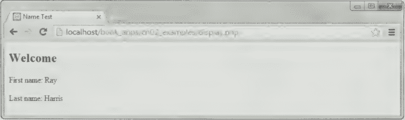

## 指定 POST 方法的 HTML 表单

```html
<form action="display.php" method="post">
```

## 从 `$_POST` 数组中获取数据的 PHP 代码

```php
$first_name = $_POST['first_name'];
$last_name = $_POST['last_name'];
```

## 何时使用 HTTP GET 方法

- 当请求针对的是从数据库服务器获取数据的页面时。
- 当请求可以多次执行而不会引起任何问题时。

## 何时使用 HTTP POST 方法

- 当请求针对的是向数据库服务器写入数据的页面时。
- 当多次执行该请求可能会引起问题时。
- 当出于安全原因不想在 URL 中包含参数时。
- 当不想让用户在将页面加入书签时能够包含参数时。
- 当需要传输超过 4 KB 的数据时。

## 当用户尝试刷新 POST 提交后的页面时显示的 Chrome 对话框


## 说明

- HTTP POST 方法不会将参数附加到 URL 上。

图 2-6 — 何时以及如何使用内置的 `$_POST` 数组

## 如何处理数据

既然你已经掌握了从 HTTP 请求中获取数据并将其存储到变量中的基本技能，接下来就可以学习如何处理这些数据了。

### 如何编写字符串表达式

图 2-7 展示了如何编写*字符串表达式*。*表达式*可以是单个值，也可以是最终得出单个值的一系列运算。

第一组示例展示了如何对字符串表达式使用单引号。这是使用 PHP 编写字符串表达式最有效的方式。

第二组示例展示了如何将空字符串和 NULL 值赋给变量。其中，第一条语句使用两个单引号且中间不含任何字符，将*空字符串*赋给变量。第二条语句使用 NULL 关键字将*空值*赋给变量。由于该关键字不区分大小写，因此可以写成 *null* 或 *NULL*。

第三组示例使用双引号将变量值插入到字符串中。这被称为*插值*。使用双引号时，PHP 解释器必须检查整个字符串，看其中是否包含需要插入的变量。这就是为什么使用单引号来标识字符串时 PHP 运行效率更高。因此，除非需要利用插值，否则最佳实践是使用单引号。

第四组示例展示了如何混合使用单引号和双引号，以在字符串中插入单引号或双引号。不过这种情况很少需要用到。

如果需要连接（或*拼接*）两个或多个字符串，可以使用*连接运算符*（句点）。这一点由连接运算符的第一组示例说明。其中，第三条语句将字符串字面量“Name: ”与名为 $first_name 的变量连接起来。然后，第四条语句将 $first_name 变量与一个空格字符及 $last_name 变量连接起来。这样，两个变量之间就用空格分隔开了。

下一组连接示例展示了如何将数字连接到字符串。为此，只需使用连接运算符即可。然后，PHP 会将数字转换为字符串，并将两个值连接起来。在所有这些示例中，连接运算符前后都有空格，但这不是必需的。

### 如何编写 echo 语句

当你想将字符串发送回浏览器时，可以使用 echo 语句来完成。这里，第一条 echo 语句将 $name 变量放在 <p> 标签内发送给浏览器。遗憾的是，这条语句容易受到*跨站脚本（XSS）攻击*，攻击者会尝试将 JavaScript 注入 HTML 页面。为防止此类攻击，你可以在 echo 语句中使用 htmlspecialchars 函数，如第二条 echo 语句所示。目前，你只需在所有 echo 语句中使用该函数即可。本章后面你将进一步了解该函数的工作原理。

## 如何赋值字符串表达式

### 对简单字符串使用单引号以提高 PHP 效率

```php
$first_name = 'Bob';
$last_name = 'Roberts';
```

### 如何赋 NULL 值和空字符串

```php
$address2 = '';                         // an empty string
$address2 = null;                       // a NULL value
```

### 如何使用双引号将变量插入到字符串中

```php
$name = "Name: $first_name";           // Name: Bob
$name = "$first_name $last_name";       // Bob Roberts
```

### 如何将单引号和双引号用于特殊用途

```php
$last_name = "O'Brien";                // O'Brien
$line = 'She said, "Hi."';               // She said, "Hi."
```

### 如何使用连接运算符（.）连接字符串

### 如何使用连接运算符进行简单连接

```php
$first_name = 'Bob';
$last_name = 'Roberts';
$name = 'Name: ' . $first_name;           // Name: Bob
$name = $first_name . ' ' . $last_name;  // Bob Roberts
```

### 如何将数字连接到字符串

```php
$price = 19.99;
$price_string = "Price: " . $price;     // Price: 19.99
```

### echo 语句的语法

```php
echo string_expression;
```

### 如何使用 echo 语句

```html
<p>Name: <?php echo $name; ?></p>
```

### 如何将 echo 语句与 htmlspecialchars 函数一起使用

```html
<p>Name: <?php echo htmlspecialchars($name); ?></p>
```

### 说明

- 尽管你可以使用单引号或双引号来编写字符串，但 PHP 处理单引号的效率更高。
- *空字符串*是不包含任何字符的字符串。要将空字符串赋给变量，可以写一对引号，且引号之间不包含任何字符。
- *空值*表示该值未知。要给字符串赋空值，可以使用 NULL 关键字。该关键字不区分大小写。
- 如果在双引号内编写变量名，该变量名会被转换成字符串。
- 要连接（或*拼接*）两个或多个字符串，可以使用*连接运算符*。
- 要向浏览器发送数据，可以使用 echo 语句。
- 为防止*跨站脚本（XSS）*攻击，可以在 echo 语句中使用 htmlspecialchars 函数。你将在图 2-10 中进一步了解该函数。

图 2-7 — 如何编写字符串表达式和 echo 语句

## 如何编写数值表达式

图 2-8 首先展示了用于编写*数值表达式*的运算符。如果你用过其他语言编程，可能对这些运算符已经很熟悉。特别是前四个*算术运算符*在大多数编程语言中都很常见。

大多数现代语言还有*取模运算符*，用于计算左值除以右值后的余数。例如，在本图中，取模运算符（%）用于计算 14 除以 8 的余数，结果为 6。使用取模运算符判断数字是偶数还是奇数是一种常见做法。例如，任意数字 % 2：如果数字为偶数则返回 0，为奇数则返回 1。另一个用途是判断某一年是否为闰年。例如，如果 $year % 4 返回 0，则 $year 可被 4 整除。

与图中前五个运算符不同，递增和递减运算符会对变量加 1 或减 1。这些运算符通常与循环一起使用，如图 2-15 所示。

本图中的第二组语句展示了如何计算产品的折扣。其中，第一条语句将标价设为 19.95，第二条语句将折扣百分比设为 20%。然后，第三条语句通过将标价、折扣百分比和字面量值 .01 相乘来计算折扣金额。这个字面量值会将小数点移到适当的位置。最后，第四条语句通过从标价中减去折扣金额来计算折扣价。

当一个表达式包含两个或多个运算符时，*优先级顺序*决定先应用哪些运算符。本图总结了这一顺序。例如，所有乘法和除法运算都先于任何加法和减法运算，按从左到右的顺序执行。

不过，要覆盖这一顺序，可以使用括号。这样，最内层括号中的表达式会先执行，然后是下一层括号中的表达式，依此类推。这是所有编程语言的典型特性，本图中的示例展示了其工作方式。


## 常用算术运算符

| 运算符 | 说明 | 示例 | 结果 |
|---|---|---|---|
| `+` | 加法 | `5 + 7` | `12` |
| `-` | 减法 | `5 - 12` | `-7` |
| `*` | 乘法 | `6 * 7` | `42` |
| `/` | 除法 | `13 / 4` | `3.25` |
| `%` | 取模 | `13 % 4` | `1` |
| `++` | 递增 | `$counter++` | 给 counter 加 1 |
| `--` | 递减 | `$counter--` | 从 counter 减 1 |

### 一些简单的数值表达式

```php
$x = 14;
$y = 8;
$result = $x + $y;          // 22
$result = $x - $y;          // 6
$result = $x * $y;          // 112
$result = $x / $y;          // 1.75
$result = $x % $y;          // 6
$x++                        // 15
$y--;                       // 7
```

### 计算折扣的语句

```php
$list_price = 19.95;
$discount_percent = 20;
$discount_amount = $list_price * $discount_percent * .01;
$discount_price = $list_price - $discount_amount;    // 15.96
```

### 算术表达式的优先级顺序

| 顺序 | 运算符 | 方向 | 说明 |
|---:|---|---|---|
| 1 | `++` | 从左到右 | 递增运算符 |
| 2 | `--` | 从左到右 | 递减运算符 |
| 3 | `* / %` | 从左到右 | 乘法、除法、取模 |
| 4 | `+ -` | 从左到右 | 加法、减法 |

### 优先级与括号使用的示例

```text
3 + 4 * 5       // 23 since the multiplication is done first
(3 + 4) * 5     // 35 since the addition is done first
```

### 描述

- 要覆盖优先级顺序，可以使用括号。

## 如何使用一些内置函数

PHP 提供了许多可用于处理数据的*函数*，你已经在前面的 htmlspecialchars 函数中见过。这些函数通常被称为*内置函数*或*内部函数*，因为它们是 PHP 的一部分。

图 2-10 演示了如何使用其中七个 PHP 函数。要使用函数，你需要编写函数名，后跟一对括号。在括号内，你需要编写函数所需的任何*参数*，并用逗号分隔多个参数。

该图首先展示了如何使用 number_format 函数来格式化数字。在此函数的语法中，斜体词表示你需要编写的参数，方括号 [ ] 表示第二个参数是可选的。

表格后面的示例展示了其工作原理。这里，第一条语句只有一个参数，数字被格式化为带逗号以标识千位，但没有小数位。相比之下，第二条语句包含了可选的第二个参数，以包含小数点和小数点后两位。第三条和第四条语句表明 number_format 函数会自动将数字四舍五入到指定的小数位数。例如，.674 向下舍入为 .67，.675 向上舍入为 .68。

你可以使用 date 函数获取当前日期。该函数接受一个字符串参数，用于指定日期的格式。这个字符串由指定所需格式的字符组成。此函数对应的表总结了其中四个字符。例如，第一个示例包含参数 ‘Y-m-d’。因此，该语句以这种格式返回当前日期：2014-03-12。在第 10 章中，你会看到这些字符的完整列表。

接下来的表格介绍了三个常用于检查用户输入数据是否有效的函数。在本章后面，你将看到这些函数如何在条件语句中使用。

该图最后用一个表格介绍了两个通常与 echo 语句一起使用、用于向浏览器发送数据进行显示的函数。这些函数会获取攻击者可能在 XSS 攻击中使用的 HTML 字符，并将其转换为可以安全显示在浏览器中的 HTML 实体。这称为*转义输出*，通常被认为是任何可能包含 XSS 攻击的输出的最佳实践。例如，在图 2-7 中，最后的 echo 语句在使用 echo 语句将输出发送到浏览器之前，使用 htmlspecialchars 函数对输出进行了转义。

当你向函数传递参数时，必须确保参数的数据类型正确。例如，number_format 函数的第一个参数必须是 double 类型，第二个参数必须是整数。如果你传递的参数无法转换为正确的类型，就会导致错误。

### 用于格式化数字的函数

| 名称 | 说明 |
|---|---|
| `number_format($number [, $decimals])` | 返回一个用逗号 (,) 格式化的数字。如果指定了第二个参数，此函数还会将数字四舍五入到指定的小数位数。 |

### 格式化数字的语句

```php
$nf = number_format(12345);        // 12,345
$nf = number_format(12345, 2);     // 12,345.00
$nf = number_format(12345.674, 2); // 12,345.67
$nf = number_format(12345.675, 2); // 12,345.68
```

### 用于获取当前日期的函数

| 名称 | 说明 |
|---|---|
| `date($format)` | 返回带有指定格式字符串的当前日期。常见的格式字符串有 ‘Y’（四位年份）、‘y’（两位年份）、‘m’（数字月份）和 ‘d’（数字日）。 |

### 格式化日期的语句

```php
$date = date('Y-m-d'); // 2014-03-12
$date = date('m/d/y');  // 03/12/14
$date = date('m.d.Y');  // 03.12.2014
$date = date('Y');      // 2014
```

### 用于检查变量值的三个函数

| 名称 | 说明 |
|---|---|
| `isset($var)` | 如果变量已设置且不是 NULL 值，则返回 TRUE。 |
| `empty($var)` | 如果变量未设置、包含 NULL 值或包含空字符串，则返回 TRUE。 |
| `is_numeric($var)` | 如果变量是数字或可以转换为数字的字符串，则返回 TRUE。 |

### 检查变量值的函数调用

```php
isset($name)        // TRUE if $name has been set and is not NULL
empty($name)        // TRUE if $name is empty
is_numeric($price)  // TRUE if $price is a number
```

### 用于转换用户输入数据以供显示的两个函数

| 名称 | 说明 |
|---|---|
| `htmlspecialchars($string)` | 将某些 HTML 特殊字符（&、"、< 和 >）转换为对应的 HTML 实体，并返回结果字符串。例如，此函数会将和号字符（&）转换为和号实体（&amp;）。 |
| `htmlentities($string)` | 将所有具有对应 HTML 实体的 HTML 字符转换为对应实体，并返回结果字符串。 |

图 2-10  如何使用一些内置函数

## 产品折扣应用程序

既然你已经掌握了编写 PHP 应用程序的基本技能，值得花时间重新审视第 1 章中的产品折扣应用程序。你将会看到，它只需要你到目前为止学到的技能。

### 用户界面

图 2-12 展示了产品折扣应用程序的用户界面。第一个页面是存储在 index.html 文件中的静态网页。第二个页面是存储在 display_discount.php 文件中的动态网页。

### HTML 文件中的表单

图 2-12 展示了与此应用程序的 PHP 相关的 HTML 文件代码。在这里，你可以看到一个表单和三个文本框的 HTML。当用户点击“计算折扣”按钮时，表单通过 POST 方法提交到服务器，并请求名为 display_discount.php 的文件。三个文本框中的数据也会随 HTTP 请求一起发送。

### PHP 文件

图 2-13 展示了此应用程序的 PHP 文件。它以 PHP 标签中的代码开始。这段代码按注释所示分为三个部分。

第一部分使用 filter_input 函数访问 POST 请求，从而从表单获取数据。这段代码将数据存储在三个变量中，分别是 $product_description、$list_price 和 $discount_percent。

第二部分计算折扣和折后价格。首先，将标价乘以折扣百分比，再乘以 .01（将百分比转换为两位小数）。然后，从标价中减去折扣，得到折后价格。

第三部分对 $list_price、$discount_percent、$discount 和 $discount_price 变量应用格式化，并将格式化结果存储在名称后附加 _f 的变量中。例如，该组中的第一条语句使用内置的 number_format 函数将标价格式化为两位小数。此外，格式化结果还与 $ 符号拼接。因此，输入 1250 将被格式化为：

```
$1,250.00
```

在这里，$ 符号是通过拼接添加的，而逗号、小数点和两个零是由 number_format 函数添加的。

相比之下，用户输入的折扣百分比不会被格式化。但是，使用拼接运算符会向其附加 % 符号。因此，输入 12.5 会被格式化为：

```
12.5%
```

当四个变量都格式化后，它们就可以显示在网页上了。然后，PHP 代码块结束，页面的 HTML 开始。该 HTML 由一系列 `<label>` 和 `<span>` 标签组成，这些标签使用 echo 语句来显示数据。这些语句先显示三个用户输入项，后跟计算结果。

在这些 echo 语句中，前三个使用 htmlspecialchars 函数对输出进行转义，这有助于防止 XSS 攻击。在这里，没有必要对最后两个 echo 语句的数据进行转义，因为这些数据是由应用程序计算的。因此，攻击者不可能向这些变量中注入 JavaScript。但是，如果你不确定哪些变量可能容易受到 XSS 攻击，可以对所有变量使用 htmlspecialchars 函数。

***

如果你刚接触编程，现在是休息一下并做练习 2-1 的好时机。这将让你更好地理解此应用程序的工作原理以及应用程序中代码的工作方式。


## PHP 文件（display_discount.php）

```php
<?php
    // get the data from the form
    $product_description = filter_input(INPUT_POST, 'product_description');
    $list_price = filter_input(INPUT_POST, 'list_price');
    $discount_percent = filter_input(INPUT_POST, 'discount_percent');

    // calculate the discount and discounted price
    $discount = $list_price * $discount_percent * .01;
    $discount_price = $list_price - $discount;

    // apply currency formatting to the dollar and percent amounts
    $list_price_f = "$".number_format($list_price, 2);
    $discount_percent_f = $discount_percent."%";
    $discount_f = "$".number_format($discount, 2);
    $discount_price_f = "$".number_format($discount_price, 2);
?>
<!DOCTYPE html>
<html>

<head>
    <title>Product Discount Calculator</title>
    <link rel="stylesheet" type="text/css" href="main.css">
</head>

<body>
    <main>
        <h1>Product Discount Calculator</h1>

        <label>Product Description:</label>
        <span><?php echo htmlspecialchars($product_description); ?></span>
        <br>

        <label>List Price:</label>
        <span><?php echo htmlspecialchars($list_price_f); ?></span>
        <br>

        <label>Standard Discount:</label>
        <span><?php echo htmlspecialchars($discount_percent_f); ?></span>
        <br>

        <label>Discount Amount:</label>
        <span><?php echo $discount_f; ?></span>
        <br>

        <label>Discount Price:</label>
        <span><?php echo $discount_price_f; ?></span>
        <br>
    </main>
</body>
</html>
```

图 2-13  产品折扣应用的 PHP 文件

## 如何编写控制语句

与所有编程语言一样，PHP 提供*控制语句*，让你控制应用程序中语句的执行方式。首先，本主题展示如何编写控制语句中使用的条件表达式。

### 如何编写条件表达式

图 2-14 展示了如何编写使用八个*关系运算符*的*条件表达式*。关系运算符会比较两个表达式，并返回 TRUE 或 FALSE 值。例如，如果第一个表格中第一个表达式中的 `$last_name` 值为“Harrison”，则表达式返回 FALSE。或者，如果最后一个表达式中的 `$rate` 值为 10，则表达式返回 TRUE，因为 10 / 100 等于 .1，而 .1 大于或等于 0.1。

如果使用相等运算符（`==`）比较两个不同的数据类型，PHP 会自动将这些数据类型转换为相同类型，然后尝试执行比较。例如，

```
0 == FALSE
```

会返回 TRUE，因为 PHP 在比较值之前会将两个值转换为相同的数据类型，而 FALSE 关键字会转换为值 0。如果这不是你想要的，可以使用全等运算符（`===`）。此时，比较将返回 FALSE。

要编写*复合条件表达式*，可以使用第二个表格中的*逻辑运算符*来组合两个条件表达式。如果使用 AND 运算符，则只有当两个表达式都为 TRUE 时，复合表达式才返回 TRUE。如果使用 OR 运算符，则只要其中一个表达式为 TRUE，复合表达式就返回 TRUE。如果使用 NOT 运算符，则表达式返回的值会被反转。

例如，如果 `$age` 变量包含有效数字，

```
is_numeric($age)
```

返回 TRUE。这里，is_numeric 是图 2-10 中总结的用于检查变量的三个函数之一。相反，

```
!is_numeric($age)
```

返回 FALSE。

此图中的逻辑运算符按优先级顺序显示。也就是说，如果在复合表达式中使用了多个逻辑运算符，则按该顺序对运算符进行求值。这意味着 NOT 运算符先于 AND 运算符求值，AND 运算符先于 OR 运算符求值。虽然这通常是你想要的，但你可以使用括号来覆盖此顺序。

在大多数情况下，你使用的条件表达式相对简单，因此编写它们不是什么大问题。在本章的其余部分，你将看到一些常用的条件表达式类型。

**关系运算符**

| 运算符 | 名称 | 示例 |
|---|---|---|
| `==` | 等于 | `$last_name == "Harris"`<br>`$test_score == 10` |
| `!=` | 不等于 | `$first_name != "Ray"`<br>`$months != 0` |
| `<` | 小于 | `$age < 18` |
| `<=` | 小于或等于 | `$investment <= 0` |
| `>` | 大于 | `$test_score > 100` |
| `>=` | 大于或等于 | `$rate / 100 >= 0.1` |
| `===` | 全等 | `$investment === FALSE`<br>`$years === NULL` |
| `!==` | 不全等 | `$investment !== FALSE`<br>`$years !== NULL` |

**按优先级排列的逻辑运算符**

| 运算符 | 名称 | 示例 |
|---|---|---|
| `!` | 非 | `!is_numeric($age)` |
| `&&` | 与 | `$age > 17 && $score < 70` |
| `\|\|` | 或 | `!is_numeric($rate) \|\| $rate < 0` |

**逻辑运算符的工作方式**

- 使用 AND 运算符时，两个测试都必须为 TRUE，整体测试才为 TRUE。
- 使用 OR 运算符时，至少一个测试必须为 TRUE，整体测试才为 TRUE。
- NOT 运算符将表达式的结果切换到另一个布尔值。例如，如果表达式为 TRUE，则 NOT 运算符将其转换为 FALSE。
- 当在条件表达式中使用两个或更多逻辑运算符时，可以使用括号来覆盖优先级顺序。

**说明**

- *条件表达式*使用关系运算符来比较两个表达式的结果。
- *复合条件表达式*使用*逻辑运算符*连接两个或多个条件表达式。
- 如果使用关系运算符比较两个不同的数据类型，PHP 会自动将数据类型转换为相同的数据类型，并尝试执行比较。
- 将赋值运算符（`=`）与相等运算符（`==`）混淆是一种常见的编程错误，因此请记住使用 `==` 进行比较。当使用相等运算符（`==`）时，PHP 会在必要时将值转换为相同类型。
- 可以使用全等运算符（`===`）来测试某个值是否既等于另一个值，又与另一个值具有相同类型。

图 2-14  如何编写条件表达式

### 如何编写 if 语句

*if 语句*允许你根据一个或多个条件表达式的结果来控制语句的执行。图 2-15 展示了 if 语句可以包含三种类型的子句。该语句必须以*if 子句*开头。然后，它可以有一个或多个*else if 子句*，但也可以没有任何 else if 子句。最后，它可以有一个*else 子句*，但该子句同样是可选的。

要编写 if 子句，你需要编写 *if* 关键字，后跟括号中的条件表达式以及花括号内的一条或多条语句块。如果条件表达式为 TRUE，则执行此代码块，并跳过 if 语句中的任何剩余子句。如果条件表达式为 FALSE，则 if 语句继续处理下一个子句。

要编写 else if 子句，你需要编写 *else if* 关键字，后跟括号中的条件表达式以及花括号内的一条或多条语句块。如果条件表达式为 TRUE，则执行其代码块，并跳过 if 语句中的任何剩余子句。此过程会一直持续，直到某个 else if 表达式为 TRUE，或者它们全部为 FALSE。

要编写 else 子句，你需要编写 *else* 关键字，后跟花括号内的一条或多条语句块。仅当 if 和 else if 子句中的所有条件表达式都为 FALSE 时，才会执行此代码。

此图中第一个示例展示了一个不带其他子句的 if 语句。如果价格小于或等于零，则将相应的消息存储到 `$message` 变量中。

第二个示例展示了一个带 else 子句的 if 语句。如果 `$first_name` 变量为空，则执行 if 子句中的语句。否则，执行 else 子句中的语句。

第三个示例展示了一个带有两个 else if 子句和一个 else 子句的 if 语句。如果 `$investment` 变量为空，则执行 if 子句。如果 `$investment` 变量*不是*有效数字，则执行第一个 else if 子句。如果 `$investment` 变量小于或等于零，则执行第二个 else if 子句。否则，执行 else 子句。

第四个示例展示了一个带有复合条件表达式的 if 语句，该表达式测试 `$investment` 变量是否为空、不是数字，或小于等于零。如果这些条件中任何一个为 TRUE，则此代码执行 if 子句中的语句。如果所有三个表达式都为 FALSE，则此代码不执行任何语句。

最后一个示例展示了如何将一个 if 语句嵌套在另一个 if 语句中。这里，第二个 if 语句嵌套在第一个 if 语句的 else 子句中。当这些*嵌套 if 语句*被执行时，如果 `$months` 变量为空、不是数字，或小于等于零，则会显示错误消息。这会结束 if 语句，不会发生其他任何事情。但如果 `$months` 变量是大于零的数字，则 else 子句会计算 `$months` 变量所代表的年数。然后，嵌套在 else 子句中的 if 语句会检查年数是否大于 1，并将 `$message` 变量设置为相应的消息。


### 没有其他子句的 if 语句

```php
if ( $price <= 0 ) {
    $message = 'Price must be greater than zero.';
}
```

### 带 else 子句的 if 语句

```php
if ( empty($first_name) ) {
    $message = 'You must enter your first name.';
} else {
    $message = 'Hello ' . $first_name . '!';
}
```

### 带 else if 和 else 子句的 if 语句

```php
if ( empty($investment) ) {
    $message = 'Investment is a required field.';
} else if ( !is_numeric($investment) ) {
    $message = 'Investment must be a valid number.';
} else if ( $investment <= 0 ) {
    $message = 'Investment must be greater than zero.';
} else {
    $message = 'Investment is valid!';
}
```

### 带复合条件表达式的 if 语句

```php
if ( empty($investment) || !is_numeric($investment) || $investment <= 0 ) {
    $message = 'Investment must be a valid number greater than zero.';
}
```

### 嵌套的 if 语句

```php
if ( empty($months) || !is_numeric($months) || $months <= 0 ) {
    $message = 'Please enter a number of months greater than zero.';
} else {
    $years = $months / 12;
    if ( $years > 1 ) {
        $message = 'A long-term investment.';
    } else {
        $message = 'A short-term investment.';
    }
}
```

### 说明

- *if 语句*以 *if 子句*开始，可以包含多个 *else if 子句*，并在末尾包含一个 *else 子句*。
- 语句的 if 子句在其条件为 TRUE 时，会执行一条或多条语句。
- 当前面的一个或多个条件为 FALSE 时，会执行 else if 子句。如果 else if 子句中的条件为 TRUE，则执行其中的一条或多条语句。
- 当所有前面的条件均为 FALSE 时，会执行 else 子句。
- 你可以在另一个 if 语句的 if、else if 或 else 子句中编写一个 if 语句。这些语句被称为 *嵌套 if 语句*。

图 2-15 如何编写 if 语句

## 如何编写 while 和 for 语句

while 和 for 语句允许你编写循环，重复执行一个语句块一次或多次。图 2-16 中的语句演示了这一点。

要编写 *while 语句*，你需要先写 while 关键字，后面跟上括号中的条件表达式和花括号中的代码块。执行 while 语句时，会计算条件表达式。如果表达式为 TRUE，则执行代码块，然后再次尝试 *while 循环*。一旦表达式为 FALSE，代码块将被跳过，while 语句结束。如果表达式在第一次检查时就为 FALSE，那么代码块将根本不会执行。

第一个示例展示了一个循环，它将数字 1 到 5 追加到名为 $message 的变量中。在循环之前，有一条语句将值 1 赋给 $counter 变量。然后，while 循环检查 $counter 变量是否小于或等于 5。如果是，则执行循环中的两条语句。

在 while 循环中，第一条语句将计数器和一个竖线字符 ( | ) 追加到 $message 变量。然后，第二条语句使用自增运算符 (++) 将 $counter 变量中的值增加 1。当 $counter 的值大于 5 时，循环结束。因此，当 while 循环完成时，$message 变量包含字符串值 “1|2|3|4|5|”。

要编写 *for 语句*，你需要先写 for 关键字，后面跟上括号中的三条语句和花括号中的代码块。这三条语句用分号分隔。其中第一条语句初始化计数器变量，它只执行一次。第二条语句是一个条件表达式，只要它为 TRUE，循环中的代码就会执行。第三条语句递增计数器，它会在每次 for 循环中执行，但在循环中的代码执行之后。

第二个示例展示了如何使用 for 循环获得与第一个示例相同的结果。这里，$counter 变量被初始化为 1；只要 $counter 小于或等于 5，循环就会执行；每次循环后 $counter 增加 1。对于这样的循环，for 语句比 while 语句更容易使用。

第三个示例使用另一个 while 语句来计算一次性投资在固定利率下的未来值。前三个变量分别存储投资金额、年利率和年数。$future_value 变量存储每年年末的投资价值，并初始化为投资金额的值。

在 while 语句中，名为 $i 的变量用作计数器，因此每次循环时它都会增加 1。在循环内，年利息 ($future_value * $interest_rate) 会被加到 $future_value 变量中，结果再存回 $future_value 变量。当循环结束时，$future_value 变量保存的是投资的未来值。

第四个示例使用 for 循环进行相同的计算。这里再次使用 $i 作为计数器变量，这是一种常见的编程实践。该名称表示变量存储整数值。由于该变量仅在循环内使用，因此不需要更具描述性的名称。

### 将数字 1 到 5 存储在字符串中的 while 循环

```php
$counter = 1;
while ($counter <= 5) {
    $message = $message . $counter . '|';    // appends the counter value
    $counter++;                               // adds 1 to the counter
}
// $message = 1|2|3|4|5|
```

### 将数字 1 到 5 存储在字符串中的 for 循环

```php
for ($counter = 1; $counter <= 5; $counter++) {
    $message = $message . $counter . '|';    // appends the counter value
}
// $message = 1|2|3|4|5|
```

### 计算一次性投资未来值的 while 循环

```php
$investment = 1000;                 // $investment is $1000
$interest_rate = .1;                 // yearly interest rate is 10%
$years = 25;                         // years is 25
$future_value = $investment;         // future value starts at $1000

$i = 1;
while ($i <= $years) {
    $future_value = ($future_value + ($future_value * $interest_rate));
    $i++;
}
```

### 计算一次性投资未来值的 for 循环

```php
$investment = 1000;                 // $investment is $1000
$interest_rate = .1;                 // yearly interest rate is 10%
$years = 25;                         // years is 25
$future_value = $investment;         // future value starts at $1000

for ($i = 1; $i <= $years; $i++) {
    $future_value = ($future_value + ($future_value * $interest_rate));
}
```

### 说明

- *while 语句*用于创建 *while 循环*，其中包含一个代码块，只要条件为 TRUE 就会执行。该条件在循环开始处进行测试。当条件变为 FALSE 时，PHP 会跳到 while 循环之后的代码。
- *for 语句*用于创建 *for 循环*，其中包含一个按特定次数执行的代码块。
- PHP 还提供了其他循环结构，这些将在第 8 章中介绍。

图 2-16 如何编写 while 和 for 语句

## 如何将控制权传递给另一个页面

PHP 应用在执行时，会从一个网页移动到另一个网页。为此，你可以使用图 2-17 中总结的 include 和 require 函数。你也可以使用 exit 函数退出当前脚本。

如果 include 函数找不到指定的文件，它会发出警告并允许脚本继续执行。require 函数的操作类似。但是，如果 require 函数失败，则会导致致命错误并停止脚本。

exit 函数用于退出当前 PHP 脚本。大多数情况下，你不需要向此函数传递参数。但是，如果你想让它退出前显示一条状态消息，可以传入一个字符串参数。由于 die 函数的工作方式相同，你可以使用这两个函数中的任意一个来退出。

前三个示例组展示了如何编写这些语句。然后，第四组示例展示了如何在应用中使用这些函数。这里，一个 if 语句检查名为 $is_valid 的布尔变量的值。如果该变量为 TRUE，if 语句就使用 include 函数包含一个处理数据的 PHP 文件。之后，它使用 exit 函数跳过脚本的其余部分。实际上，这会将控制权传递给被包含的页面。

在其他语言中，这通常被称为*转发请求*，但在 PHP 中，这更准确地描述为*条件包含*。你将在第 5 章中了解更多相关内容。

最后一组示例展示了如何引用不在当前目录中的网页。要向下导航一个或多个目录，你可以包含路径。例如，这一组示例中的第一条语句包含位于当前目录下级 view 目录中的 header.php 文件。或者，要引用当前目录，你可以像第二条语句那样使用点 (.) 运算符。

最后，要向上导航一个或多个目录，你可以使用两个点运算符。例如，这一组示例中的第三条语句引用了当前目录上一级目录中的文件，第四条语句引用了当前目录上两级目录中的文件。

正如图中的表格所示，include_once 和 require_once 函数的工作方式与 include 和 require 函数类似，但它们确保文件只被包含一次。由于这意味着这些函数需要检查文件是否已经被包含，因此它们的运行效率不如 include 和 require 函数。

因此，只要可能，你就应该这样编写应用，让它们不需要使用 include_once 和 require_once 函数。在第 5 章中，你将学到一些有助于做到这一点的技巧。不过，如有必要，你可以使用 include_once 和 require_once 函数来确保文件只被包含一次。


## 可用于将控制权传递到另一个页面的内置函数

| 名称 | 描述 |
|---|---|
| `include($path)` | 插入并运行指定文件。但是，如果此函数失败，会产生一个警告并允许脚本继续执行。此函数的括号是可选的。 |
| `include_once($path)` | 与 include 相同，但确保该文件只被包含一次。 |
| `require($path)` | 与 include 函数作用相同。但是，如果此函数失败，会产生一个致命错误并停止脚本。 |
| `require_once($path)` | 与 require 相同，但确保该文件只被引入一次。 |
| `exit([$status])` | 退出当前 PHP 脚本。如果未提供 `$status`，括号是可选的。如果提供了 `$status`，此函数会在退出前将 `$status` 字符串发送到浏览器。 |
| `die([$status])` | 与 exit 函数作用相同。 |

### include 函数

```php
include 'index.php';             // parentheses are optional
include('index.php');             // index.php in the current directory
```

### require 函数

```php
require('index.php');            // index.php in the current directory
```

### exit 函数

```php
exit;                             // parentheses are optional
exit();
exit('Unable to connect to DB.');  // passes a message to the browser
```

### 如何将控制权传递给当前目录中的另一个 PHP 文件

```php
if ($is_valid) {                  // if $is_valid is true
    include('process_data.php');
    exit();
}
```

### 如何在目录中向上和向下导航

```php
include('view/header.php');       // navigate down one directory
include('./error.php');            // in the current directory
include('../error.php');           // navigate up one directory
include('../../error.php');        // navigate up two directories
```

### 描述

- 你可以使用 include 和 require 函数将控制权传递给另一个网页。该页面执行完毕后，控制权会返回到 include 或 require 函数之后的语句。
- 你可以使用 exit 或 die 函数退出正在运行的 PHP 脚本。

## Future Value 应用

至此，你已经学会了一套完整的 PHP 技能，可以用它们来构建自己的应用。为了让你更清楚地了解如何做到这一点，本章最后介绍了 Future Value 应用。

### 用户界面

Future Value 应用的用户界面如图 2-18 所示。该应用的第一个页面会要求用户输入计算一次性投资未来价值所需的三个数字。用户将这些值输入前三个文本框，并单击 Calculate 按钮。

当用户单击 Calculate 按钮时，数据会在指向第二个页面的 HTTP 请求中提交到 Web 服务器。然后，应用程序会进行一些数据验证。如果数据有效，应用程序就会进行计算，并在新页面上显示结果。如图所示，一笔 25 年、年利率 7.5% 的 10,000 美元投资将变成 60,983.40 美元。

然而，如果用户输入的数据无效，应用程序会移除无效的输入项，并重新显示第一个页面，同时附上相应的错误消息。例如，第三个浏览器窗口会移除投资金额，并显示一条错误消息：“投资金额必须是有效的数字。”如果你在数字输入中加入了美元符号或逗号，例如“$10000”、“10,000”或“$10,000”，就会看到这样的消息。这是因为默认情况下，美元符号和逗号字符对数字输入项是无效的。

第一个页面

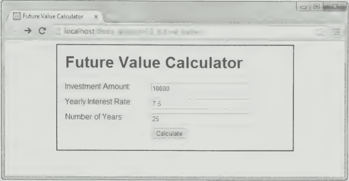

第二个页面

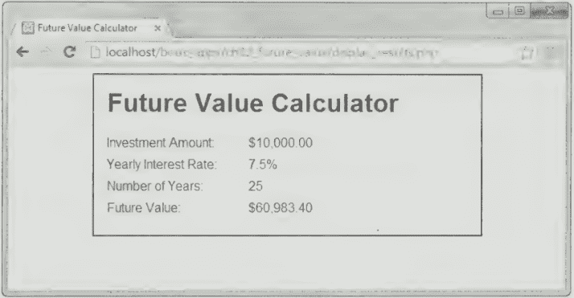

带有错误消息的第一个页面

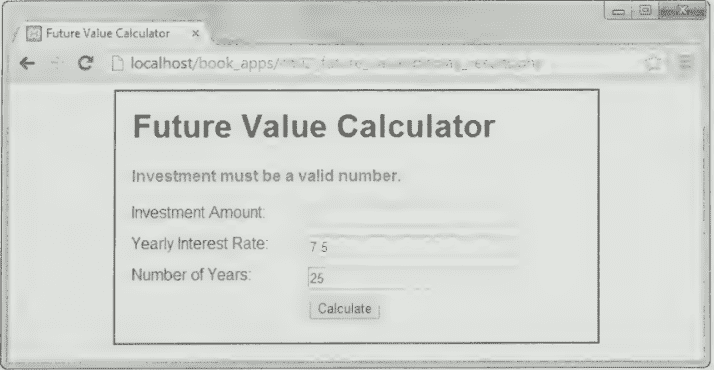

图 2-18 用户界面

### index.php 文件

```php
<?php
    //set default value of variables for initial page load
    if (!isset($investment)) { $investment = ''; }
    if (!isset($interest_rate)) { $interest_rate = ''; }
    if (!isset($years)) { $years = ''; }
?>
<!DOCTYPE html>
<html>
<head>
    <title>Future Value Calculator</title>
    <link rel="stylesheet" type="text/css" href="main.css">
</head>

<body>
    <main>
        <h1>Future Value Calculator</h1>
        <?php if (!empty($error_message)) { ?>
            <p class="error"><?php echo htmlspecialchars($error_message); ?></p>
        <?php } ?>
        <form action="display_results.php" method="post">

            <div id="data">
                <label>Investment Amount:</label>
                <input type="text" name="investment"
                       value="<?php echo htmlspecialchars($investment); ?>">
                <br>

                <label>Yearly Interest Rate:</label>
                <input type="text" name="interest_rate"
                       value="<?php echo htmlspecialchars($interest_rate); ?>">
                <br>

                <label>Number of Years:</label>
                <input type="text" name="years"
                       value="<?php echo htmlspecialchars($years); ?>">
                <br>
            </div>

            <div id="buttons">
                <label>&nbsp;</label>
                <input type="submit" value="Calculate"><br>
            </div>

        </form>
    </main>
</body>
</html>
```

图 2-19 index.php 文件的代码

### display_results.php 文件的代码

当用户单击第一个页面上的 Calculate 按钮时，数据会通过 POST 方法提交到 display_results.php 文件。该文件如图 2-20 所示。

该文件以一个 PHP 标签开始，共分为五个部分。第一部分使用 filter_input 函数访问 POST 请求，从而获取表单数据。

第二部分使用一个很长的 if 语句来验证所有三个用户输入项。为了让这条语句更容易理解，它被分成了四个部分或注释。首先，它测试 investment 变量是否是有效数字，或者是否小于等于零。然后，它测试 interest_rate 变量。以此类推。如果这些子句中的某个条件为真，$error_message 变量就会被设置为一条相应的消息。否则，else 子句会将 $error_message 变量设置为空字符串。这类检查通常被称为*数据验证*。

请注意，这段代码使用全等运算符来测试 filter_input 函数是否已将任何变量设置为 FALSE。如果确实如此，则说明该变量不是指定类型的有效数字，这段代码就会设置一条相应的错误消息。如果你使用等于运算符而不是全等运算符，那么在用户输入 0 时，代码将无法正确运行。在这种情况下，错误消息会显示用户必须输入有效数字，而它应该显示用户必须输入大于 0 的数字。

另请注意，这个 if 语句只会捕获第一个错误，因为只要任一子句中的条件为 TRUE，该语句就会结束。对于像这样的简单应用来说，这没问题；但有些应用会尝试在第一次就捕获所有输入错误，并为所有错误显示相应的消息。

代码的第三部分会检查 $error_message 是否*不*为空。如果不是，则说明某个输入项无效，因此 if 语句会包含 index.php 页面并退出。这样，控制权就会回到该应用的第一个页面。不过，这一次该页面会显示一条错误消息，同时显示用户在文本框中输入的值。

如果投资输入项有效，则执行第四部分。然后，一个 for 循环会计算投资的未来价值。请注意，计算中利率要乘以 .01，从而将利率转换为小数。因此，输入 7.5% 会变成 .075。

该 PHP 代码的第五部分会格式化投资金额、利率和未来价值。这段代码像 Product Discount 应用一样使用了 number_format 函数和字符串连接。至此，PHP 部分结束，页面的 HTML 部分开始。


此文件的 HTML 代码仅使用 echo 语句在 `<span>` 标签内显示格式化后的用户输入和未来值。由于所有这些用户输入的数字都已在此前的 PHP 文件中验证过，因此无需转义此输出，因为这些变量不易受 XSS 攻击影响。

现在，如果你理解了这个文件的 PHP 和 HTML，就可以编写一些自己的应用程序了。不过，你应意识到，这个应用可以通过多种方式改进，使其更加贴近实际。

例如，数据验证可以改进。比如，你可以增加检查，确保利率小于 15。这类数据验证在所有生产级应用中都十分常见。

除此之外，你还可以添加一些让应用更易用的功能。例如，在第二个页面添加一个返回按钮或链接，让用户更方便地回到第一个页面。目前，用户必须点击浏览器的后退按钮才能做到这一点。好消息是，你已经具备了进行此类改进的技能。

## display_results.php 文件（续）

```html
<!DOCTYPE html>
<html>
<head>
    <title>Future Value Calculator</title>
    <link rel="stylesheet" type="text/css" href="main.css">
</head>
<body>
    <main>
        <h1>Future Value Calculator</h1>

        <label>Investment Amount:</label>
        <span><?php echo $investment_f; ?></span><br>

        <label>Yearly Interest Rate:</label>
        <span><?php echo $yearly_rate_f; ?></span><br>

        <label>Number of Years:</label>
        <span><?php echo $years; ?></span><br>

        <label>Future Value:</label>
        <span><?php echo $future_value_f; ?></span><br>
    </main>
</body>
</html>
```

## 小结

本章的目标是让你快速上手 PHP。现在，如果你理解了未来值应用，你应该也能开发自己的基础 PHP 应用。不过请记住，本章只是对 PHP 核心知识的入门介绍，后续将在本节和本书其余部分进一步展开。

## 术语

|   |   |
|---|---|
| 语法 | 连接 |
| 注释 | 连接运算符 |
| 单行注释 | 跨站脚本（XSS）攻击 |
| 多行注释 | 数值表达式 |
| 块注释 | 算术运算符 |
| 语句 | 取模运算符 |
| 数据类型 | 优先级顺序 |
| 整数数据类型 | 复合赋值运算符 |
| 双精度数据类型 | 内置函数 |
| 十进制数据类型 | 参数 |
| 浮点数 | 转义输出 |
| 布尔数据类型 | 控制语句 |
| 关键字 | 条件表达式 |
| 字符串数据类型 | 关系运算符 |
| 变量 | 复合条件表达式 |
| 声明变量 | 逻辑运算符 |
| 赋值运算符 | if 语句 |
| 字面值 | if 子句 |
| 数值字面值 | else if 子句 |
| 字符串字面值 | else 子句 |
| 布尔字面值 | 嵌套 if 语句 |
| 驼峰式命名 | while 语句 |
| 常量 | while 循环 |
| 内置数组 | for 语句 |
| 表达式 | for 循环 |
| 字符串表达式 | 转发请求 |
| 空字符串 | 条件包含 |
| 空值 | 数据验证 |
| 插值 |  |

## 在线

127.0.0.1

xkcd

- 最近
- 收藏

设置

这是初始文本。

关于

侧边栏

聊天 1

聊天 2

聊天 3

| 列 1 | 列 2 |
|---|---|
| 数据 1-1 | 数据 1-2 |
| 数据 2-1 | 数据 2-2 |

这是一段正文字。

> > 这是一条引用。

文章链接

聊天

主区域

输入框

## 在开始本章练习之前

如果你还没有这样做，请按照附录中的说明安装本书的软件和源代码。如果你是编程新手，请完成练习 2-1。如果你有一些编程经验，可以直接从练习 2-2 开始。

## 练习 2-1    构建产品折扣应用

本练习将引导你逐步完成构建产品折扣应用的过程。

### 打开产品折扣应用的文件

- 1. 确保 Apache 服务器正在运行。然后，启动浏览器并运行此目录中的应用：

   ```text
   xampp\htdocs\ex_starts\ch02_ex1
   ```

   要完成此操作，你可以使用在练习 1-2 中收藏的练习起始索引，也可以使用以下 URL：

   ```text
   http://localhost/ex_starts/ch02_ex1
   ```

- 2. 在三个文本框中输入有效数据，并单击“计算”按钮。请注意，生成的网页会显示该页面正在建设中。

- 3. 使用你的 IDE 或文本编辑器打开此应用的 display_discount.php 文件。它与 index.html 文件位于同一文件夹中。然后，请注意此文件不包含此应用所需的 PHP 语句。

- 4. 使用你的 IDE 或文本编辑器打开此应用的 index.html 文件。然后，记下三个文本框的 name 属性。

### 添加 PHP 语句

- 5. 切换到 display_discount.php 文件，添加使用 $_POST 数组从表单获取产品描述、标价和折扣百分比的语句。然后，修改前三条 echo 语句，使其显示这些数据，保存文件并再次运行应用。此时应显示你输入的数据的未格式化版本。

- 6. 切换到 display_discount.php 文件，将使用 $_POST 数组的语句改为改用 filter_input 函数。保存文件并运行应用，确保它仍然按预期工作。

- 7. 切换到 display_discount.php 文件，添加计算折扣金额和折扣后价格的语句。然后，修改最后两条 echo 语句，使其显示这些数据，保存文件并运行应用。这一次，应用应显示计算数据的未格式化版本。

- 8. 切换到 display_discount.php 文件，添加使用货币和百分比格式格式化数值变量的语句。然后，修改最后四条 echo 语句，使其显示格式化后的数据，保存文件并运行应用。现在，应用应显示格式化后的数据。

- 9. 保持应用运行，如果尚未进入 index.html 页面，请导航到该页面。在“产品描述”文本框中输入 `<b>Guitar</b>`，在“折扣百分比”文本框中输入 `<i>10</i>`。单击“计算折扣”按钮，注意产品描述值会以粗体显示，标准折扣值会以斜体显示。

- 10. 切换到 display_discount.php 文件，为产品描述、标价和标准折扣的 echo 语句添加 htmlspecialchars 函数。然后保存文件，运行应用，并重复步骤 9。注意，这次 HTML 标签以 HTML 实体形式显示，而不是由浏览器执行。

- 11. 切换到 display_discount.php 文件，修正该文件的标题，使其显示“产品折扣计算器”。然后测试此更改，并关闭文件。

## 练习 2-2    增强未来值应用

在本练习中，你将应用刚学到的一些技巧来增强未来值应用。

### 测试未来值应用

- 1. 确保 Apache 服务器正在运行。然后，启动浏览器并运行此目录中的应用：

   ```text
   xampp\htdocs\ex_starts\ch02_ex2
   ```

   要完成此操作，你可以使用在练习 1-2 中收藏的练习起始索引，也可以使用以下 URL：

   ```text
   http://localhost/ex_starts/ch02_ex2/
   ```

- 2. 在三个文本框中输入有效数字。首次测试运行时，使用简单的值，例如投资金额为 100，年利率为 5，年数为 10。然后，单击“计算”按钮显示结果。

- 3. 单击“后退”按钮返回第一个页面，在前两个文本框中输入无效值，然后点击“计算”按钮。接着，针对显示的错误消息进行操作：输入有效的投资金额，重新输入无效的利率，再点击“计算”按钮。这一次，你需要针对无效的利率输入处理错误消息。


## 关系数据库简介

1970年，E. F. Codd博士为一种新型数据库开发了一种模型，这种数据库被称为*关系数据库*。这种数据库消除了与标准文件和其他数据库设计相关的一些问题。通过使用关系模型，可以减少数据冗余，从而节省磁盘存储空间并提高数据检索效率。您还可以以直观且高效的方式查看和操作数据。

如今，关系数据库已成为数据库应用程序的事实标准。然而，像Google和Facebook这样存储海量数据的公司正在触及关系数据库的极限。为此，人们开发了Cassandra和MongoDB等几种*NoSQL（不仅是SQL）*数据库。这些数据库超出了本书的讨论范围，但如果您想了解更多，可以在互联网上搜索NoSQL。

### 数据库表是如何组织的

在关系数据库中，数据存储在一个或多个由*行*和*列*组成的*表*中。图3-1中的关系表说明了这一点。该表中的每一行都包含有关单个产品的信息。存储在每一行和每一列交叉点上的值有时称为*单元格*。

通常，每个表都是根据现实世界中的实体（如产品或客户）建模的。然后，表的列表示实体的属性，例如产品的产品代码、名称和价格。而表的每一行表示该实体的一个实例，如一个产品。

如果一个表包含一个或多个能唯一标识表中每一行的列，那么可以将这些列定义为该表的*主键*。例如，图中产品表的主键是productID列。在此示例中，主键由单列组成，但主键也可以由两列或多列组成。

除主键外，大多数*数据库管理系统（DBMS）*还允许您定义额外的键来唯一标识表中的每一行。例如，如果产品表中的productCode列包含唯一数据，则可以将其定义为*非主键*。在MySQL中，这被称为*唯一键*。

*索引*提供了一种基于一个或多个列中的值高效访问表中行的方法。由于应用程序通常通过引用键值来访问表中的行，因此会自动为每个主键和非主键创建索引。但是，您也可以为其他列定义索引。例如，如果经常需要按邮政编码对客户表中的行进行排序，则可以为该列设置索引。与键一样，索引可以包含一个或多个列。

### 产品表

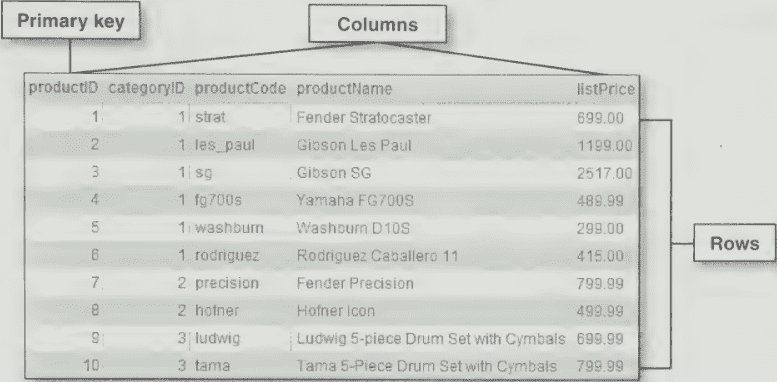

| productID | categoryID | productCode | productName | listPrice |
|---:|---:|---|---|---:|
| 1 | 1 | strat | Fender Stratocaster | 699.00 |
| 2 | 1 | les_paul | Gibson Les Paul | 1199.00 |
| 3 | 1 | sg | Gibson SG | 2517.00 |
| 4 | 1 | fg700s | Yamaha FG700S | 489.99 |
| 5 | 1 | washburn | Washburn D10S | 299.00 |
| 6 | 1 | rodriguez | Rodriguez Caballero 11 | 415.00 |
| 7 | 2 | precision | Fender Precision | 799.99 |
| 8 | 2 | hofner | Hofner Icon | 499.99 |
| 9 | 3 | ludwig | Ludwig 5-piece Drum Set with Cymbals | 699.99 |
| 10 | 3 | tama | Tama 5-Piece Drum Set with Cymbals | 799.99 |

### 概念

- *关系数据库*由*表*组成。表由*行*和*列*组成，也可以称为*记录*和*字段*。
- 表通常根据现实世界中的实体（如产品或客户）建模。
- 列表示实体的某些属性，例如产品的标价或客户的电子邮件地址。
- 行包含实体一个实例的一组值，例如一个产品或一个客户。
- 行和列的交叉点有时称为单元格。单元格存储单个值。
- 大多数表都有一个*主键*，用于唯一标识表中的每一行。
- 主键通常是单个列，但也可以由两列或多列组成。
- 除主键外，大多数*数据库管理系统（DBMS）*还允许您定义一个或多个*非主键*。在MySQL中，这些键称为唯一键。与主键一样，非主键唯一标识表中的每一行。
- 表还可以定义一个或多个*索引*。索引提供了一种基于特定列中的值高效访问表中数据的方式。索引会自动为表的主键和非主键创建。


### 关系数据库中的表如何关联

关系数据库中的表可以通过特定列中的值与其他表关联。图3-2中显示的两个表说明了这一概念。在此，类别表中的每一行都与产品表中的一行或多行关联。这称为*一对多关系*。

通常，关系存在于一个表的主键和另一个表的*外键*之间。外键就是一个表中的一个或多个列，它们引用另一个表中的主键。

虽然一对多关系最常见，但两个表也可以具有一对一或多对多关系。如果一个表与另一个表具有*一对一关系*，则这两个表中的数据可以存储在单个表中。因此，一对一关系很少使用。

相比之下，*多对多关系*通常通过使用一个中间表来实现，该中间表与多对多关系中的两个表具有一对多关系。换句话说，多对多关系通常可以分解为两个一对多关系。

### 数据库中两个表之间的关系

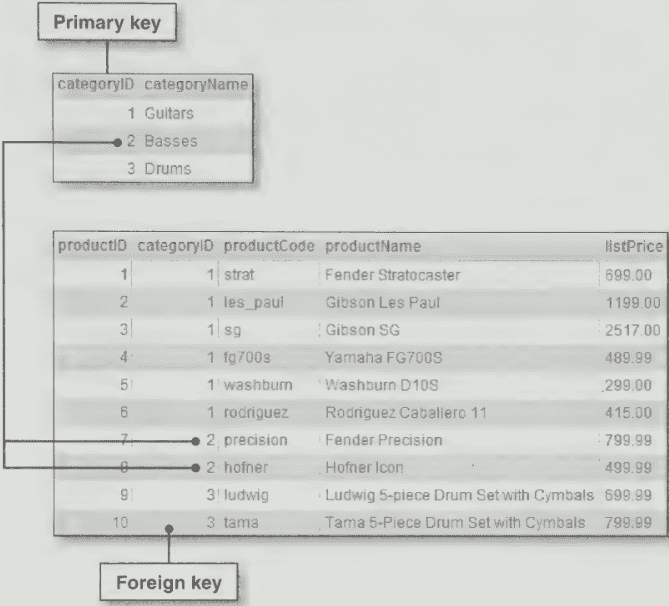

| categoryID | categoryName |
|---:|---|
| 1 | 吉他 |
| 2 | 贝斯 |
| 3 | 鼓 |

| productID | categoryID | productCode | productName | listPrice |
|---:|---:|---|---|---:|
| 1 | 1 | strat | Fender Stratocaster | 699.00 |
| 2 | 1 | les_paul | Gibson Les Paul | 1199.00 |
| 3 | 1 | sg | Gibson SG | 2517.00 |
| 4 | 1 | fg700s | Yamaha FG700S | 489.99 |
| 5 | 1 | washburn | Washburn D10S | 299.00 |
| 6 | 1 | rodriguez | Rodriguez Caballero 11 | 415.00 |
| 7 | 2 | precision | Fender Precision | 799.99 |
| 8 | 2 | hofner | Hofner Icon | 499.99 |
| 9 | 3 | ludwig | Ludwig 5-piece Drum Set with Cymbals | 699.99 |
| 10 | 3 | tama | Tama 5-Piece Drum Set with Cymbals | 799.99 |

### 概念

- 关系数据库中的表通过它们的键列相互关联。例如，使用categoryID列将上面的类别表和产品表关联起来。
- 产品表中的categoryID列称为*外键*，因为它标识了类别表中的相关行。一个表可以包含一个或多个外键。
- 定义外键时，除非相关表中有匹配的主键，否则不能向具有外键的表中添加行。
- 数据库中表之间的关系对应于它们所代表的实体之间的关系。最常见的类型是*一对多关系*，如类别表和产品表所示。
- 一个表还可以与另一个表具有*一对一关系*或*多对多关系*。

**图3-2** 关系数据库中的表是如何关联的

### 如何定义表中的列

当您在表中定义列时，需要为其分配属性，如图3-3中产品表的设计所示。列最关键的特性是其数据类型，它决定了可以存储在该列中的信息类型。使用MySQL时，您通常使用此图中总结的*数据类型*。在定义表中的每一列时，通常需要尽量分配能最大限度减少磁盘存储使用的数据类型，因为这将提高后续查询的性能。

除了选择数据类型外，还必须确定该列是否可以存储*空值*。空值表示未知、不可用或不适用的值。如果不允许空值，则必须为该列提供一个值，否则无法在表中存储该行。

您还可以为每个列分配一个*默认值*。这样，如果在向表中添加行时没有提供其他值，就将该值分配给该列。

每个表还可以包含一个数值列，其值由DBMS自动生成。在MySQL中，这样的列称为*自动递增列*。如图所示，产品表中的productID列就是一个自动递增列。

在第17章中，您将了解定义表中列的详细信息。因此，在这一点上，您只需要大致了解如何定义表中的列以及数据如何存储在表中。


## products 表的列

| 名称 | 类型 | 排序规则 | 属性 | 可空 | 默认值 | 额外 |
|---|---|---|---|---|---|---|
| productID | int(11) |  |  | 否 | 无 | AUTO_INCREMENT |
| categoryID | int(11) |  |  | 否 | 无 |  |
| productCode | varchar(10) | latin1_swedish_ci |  | 否 | 无 |  |
| productName | varchar(255) | latin1_swedish_ci |  | 否 | 无 |  |
| listPrice | decimal(10,2) |  |  | 否 | 无 |  |

## 常见的 MySQL 数据类型

| 类型 | 描述 |
|---|---|
| CHAR | ASCII 字符集中的定长字符串。 |
| VARCHAR | ASCII 字符集中的可变长字符串。 |
| INT | 各种大小的整数值。 |
| DECIMAL | 可包含整数部分和小数部分的十进制数值。 |
| DATE、TIME、DATETIME | 日期、时间或日期和时间。 |

## 说明

-   分配给列的数据类型决定了可以存储在该列中的信息的类型和大小。
-   每个列定义还指明它是否可以包含*空值*。空值表示该列的值未知。
-   列也可以定义为具有*默认值*。这样，当向表中添加一行时，如果没有提供其他值，就会使用该默认值。
-   列也可以定义为*自增列*。自增列是一个数值列，当向表中添加一行时，其值会自动生成。
-   有关 MySQL 数据类型的更多信息，请参见第 17 章。

图 3-3 表中列的定义方式

## 获取所有列的 SELECT 语句语法

```
SELECT *
FROM table-1
[WHERE selection-criteria]
[ORDER BY column-1 [ASC|DESC] [, column-2 [ASC|DESC] ...]]
```

## 一个获取所有列的 SELECT 语句

```
SELECT * FROM products
WHERE categoryID = 2
```

| productID | categoryID | productCode | productName | listPrice |
|---:|---:|---:|---|---:|
| 7 | 2 | precision | Fender Precision | 799.99 |
| 8 | 2 | hofner | Hofner Icon | 499.99 |

## 获取选定列的 SELECT 语句语法

```
SELECT column-1 [, column-2] ...
FROM table-1
[WHERE selection-criteria]
[ORDER BY column-1 [ASC|DESC] [, column-2 [ASC|DESC] ...]]
```

## 一个获取选定列和行的 SELECT 语句

```
SELECT productName, listPrice
FROM products
WHERE listPrice < 500
ORDER BY listPrice ASC
```

| productName | listPrice |
|---|---:|
| Washburn D10S | 299.00 |
| Rodriguez Caballero 11 | 415.00 |
| Yamaha FG700S | 489.99 |
| Hofner Icon | 499.99 |

## 说明

-   SELECT 语句是一种 SQL 语句，它返回一个*结果集*（或*结果表*），其中包含指定的行和列。
-   要指定列，可以使用 SELECT 子句。
-   要指定从中检索数据的表，可以使用 FROM 子句。
-   要指定行，可以使用 WHERE 子句。
-   要指定结果集的排序方式，可以使用 ORDER BY 子句。

图 3-4 — 如何从单个表中选择数据

## 如何从多个表中选择数据

图 3-5 演示了如何使用 SELECT 语句从两个表中检索数据。这通常被称为*连接*。任何连接的结果都是一个单一的表。

*内连接*是最常见的连接类型。使用内连接时，只有当两个表中的相关列匹配时，这两个表中的行数据才会包含在结果集中。例如，在此图中，只有当 products 表中的 categoryID 列的值等于 categories 表中的 categoryID 列时，SELECT 语句才会连接 products 表和 categories 表中的行数据。换句话说，如果某个类别在 products 表中没有数据，则该类别不会添加到结果集中。

要编写内连接，可以使用 JOIN 子句指定第二个表，使用 ON 子句指定用于连接的列。如果一个表中的列与另一个表中的列同名，可以通过表名、点和列名来指定要使用的列。此图中的 ON 子句对此进行了说明。

虽然此图只展示了如何连接两个表的数据，但你可以扩展此语法以连接更多表的数据。例如，假设你想创建一个包含名为 categories、products 和 orderitems 三个表数据的结果集。在这种情况下，可以这样编写 SELECT 语句的 FROM 子句：

```
FROM categories
    INNER JOIN products
        ON categories.categoryID = products.categoryID
    INNER JOIN orderitems
        ON products.productID = orderitems.productID
```

然后，可以在 SELECT 语句的列列表中包含来自这三个表的任意列。

另一种连接类型是*外连接*。使用这种连接类型，无论另一个表中是否存在匹配的行，其中一个表中的所有行都会包含在结果集中。当你需要查看一个表中的所有记录，而不管它们在另一个表中是否有匹配项时，这会很有用。这种查询也有助于识别缺失的数据。

在*左外连接*中，第一个表（左侧的表）中的所有行都会包含在结果集中。在*右外连接*中，第二个表中的所有行都会包含在结果集中。

为了说明这一点，假设一个 SELECT 语句使用左外连接将 categories 表中的行与 products 表中的行连接起来。在这种情况下，categories 表中的所有行都会包含在结果集中——即使 categories 表中的某些行在 products 表中没有任何匹配的行。

## 连接两个表的 SELECT 语句语法

```sql
SELECT column-1 [, column-2] ...
FROM table-1
    {INNER | LEFT OUTER | RIGHT OUTER} JOIN table-2
    ON table-1.column-1 {=|<|>|<=|>=|<>} table-2.column-2
[WHERE selection-criteria]
[ORDER BY column-1 [ASC|DESC] [, column-2 [ASC|DESC] ...]]
```

## 一个从两个相关表获取数据的语句

```sql
SELECT categoryName, productName, listPrice
FROM categories
    INNER JOIN products
    ON categories.categoryID = products.categoryID
WHERE listPrice > 800
ORDER BY listPrice ASC
```

| categoryName | productName | listPrice |
|---|---|---:|
| Guitars | Gibson Les Paul | 1199.00 |
| Guitars | Gibson SG | 2517.00 |

## 说明

-   要返回包含两个表数据的结果集，你需要*连接*这些表。为此，可以使用 JOIN 子句。
-   大多数时候，你应该编写*内连接*，这样只有当第一个表中某行的键与第二个表中某行的键相等（匹配）时，才会包含该行。
-   *外连接*会返回连接中一个表中的行，即使另一个表没有包含匹配的行。当你需要查看一个表中的所有记录，而不管另一个表中是否有匹配项时，这很有用。
-   在*左外连接*中，第一个表（左侧的表）中所有行的数据都会包含在结果表中，但第二个表中只包含匹配行的数据。在*右外连接*中，情况正好相反。

## INSERT 语句的语法

```sql
INSERT INTO table-name [(column-list)]
VALUES (value-list)
```

## 一个向表中添加一行数据的语句

```sql
INSERT INTO products
    (categoryID, productCode, productName, listPrice)
VALUES
    (1, 'tele', 'Fender Telecaster', 599.00)
```

## 一个使用 MySQL NOW 函数获取当前日期的语句

```sql
INSERT INTO orders (customerID, orderDate)
VALUES (1, NOW())
```

## UPDATE 语句的语法

```sql
UPDATE table-name
SET expression-1 [, expression-2] ...
WHERE selection-criteria
```

## 一个更新一行中某一列的语句

```sql
UPDATE products
SET productName = 'Ludwig 5-Piece Kit with Zildjian Cymbals'
WHERE productCode = 'ludwig'
```

## 一个更新多行中某一列的语句

```sql
UPDATE products
SET listPrice = 299
WHERE categoryID = 1
```

## DELETE 语句的语法

```sql
DELETE FROM table-name
WHERE selection-criteria
```

## 一个从表中删除一行数据的语句

```sql
DELETE FROM products
WHERE productID = 1
```

## 一个从表中删除多行数据的语句

```sql
DELETE FROM products
WHERE listPrice > 200
```

## 说明

-   由于 INSERT、UPDATE 和 DELETE 语句会修改数据库中存储的数据，因此它们有时被称为*操作查询*。这些语句不会返回结果集，而是返回受查询影响的行数。

图 3-6 — 如何插入、更新和删除数据


## MySQL简介

MySQL是一个开源数据库管理系统（DBMS），你可以从MySQL网站（www.mysql.com）免费下载。你可能还记得，MySQL也是XAMPP软件包的一部分（它是XAMPP中的M）。最后，许多互联网服务提供商（ISP）的主机套餐中通常也包含MySQL。

## MySQL提供的功能

图3-7列出了MySQL在Web开发人员中如此受欢迎的一些原因。首先，与Oracle Database或Microsoft SQL Server等产品相比，它价格低廉且易于使用。与这些产品相比，它运行速度很快，尤其是在考虑成本的情况下。而且它可以在大多数现代操作系统上运行，而Microsoft SQL Server只能在Windows上运行。

尽管在大多数情况下是免费的，但MySQL提供了你对现代关系数据库管理系统所期望的大部分功能。特别是，它支持SQL，这是行业标准。它支持多个客户端。它还提供连接性和安全性。

对于Web应用程序而言，这意味着你可以编写使用SQL语句访问和更新MySQL数据库中数据的PHP应用程序。你可以将PHP Web应用程序连接到运行在内部网或互联网上的MySQL数据库。并且你可以通过限制访问来保护你的数据。

过去，MySQL没有提供关系数据库通常具备的一些功能。尤其是，MySQL不提供参照完整性或事务处理。因此，参照完整性和事务处理需要由使用MySQL的应用程序在前端实现，这对于许多类型的Web应用程序来说是可以的。

然而，从5.5版本开始，MySQL默认支持参照完整性和事务处理。当数据库强制执行参照完整性时，你不能删除一个表中其主键被另一个表的外键引用的行。

当使用事务处理时，一系列相关的语句可以作为一个组来处理，因此如果其中一个语句失败，所有语句都可以回滚。例如，如果处理一张发票需要向invoices表和invoiceLineItems表中添加记录，那么除非所有语句都成功，否则不会提交任何语句。

有了这些新增功能，MySQL成为了一种兼具Oracle和SQL Server等商业产品最佳特性的数据库管理系统。

## MySQL的特点...

- **价格低廉。** MySQL在大多数用途下免费，在其他用途下也相对便宜。
- **速度快。** 据许多评价，MySQL是目前可用的最快的关系数据库之一。
- **易于使用。** 与其他数据库管理系统相比，MySQL易于安装和使用。
- **可移植。** MySQL可以在大多数现代操作系统上运行，包括Windows、Unix、Solaris和OS/2。

## MySQL提供的功能...

- **支持SQL。** 与任何现代数据库产品一样，MySQL支持SQL，SQL是处理关系数据库中存储数据的标准语言。
- **支持多个客户端。** MySQL支持从多种接口和编程语言的多个客户端进行访问，包括Java、C#、VB、Perl、PHP、Python和C。
- **连接性。** MySQL可以通过内部网或互联网提供对数据的访问。
- **安全性。** MySQL可以保护对数据的访问，只有授权用户才能查看数据。
- **参照完整性。** 最近的MySQL版本支持参照完整性，就像Oracle Database或Microsoft SQL Server等商业数据库一样。
- **事务处理。** 最近的MySQL版本支持事务处理，就像Oracle Database或Microsoft SQL Server等商业数据库一样。

## 说明

- MySQL是一个开源数据库管理系统，是XAMPP的一部分。它可以作为一个独立产品从MySQL网站下载。而且许多互联网服务提供商在其套餐中包含MySQL。
- *参照完整性*是指保持表之间的关系完整。例如，这意味着你不能删除一个表中与另一个表中的行相关联的行。
- *事务处理*是指将一系列相关的SQL语句作为一个组来处理。然后，如果其中一个语句失败，其他语句已完成的处理可以回滚，这样数据库就不会受到损害。

## 命令行客户端

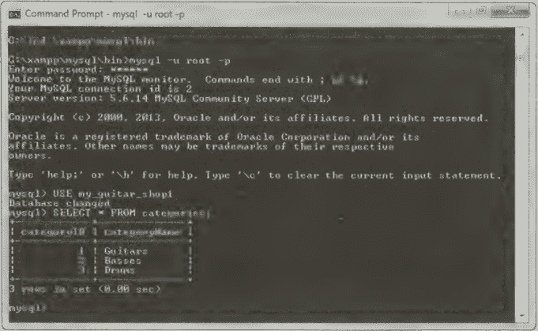

## 基于Web的客户端

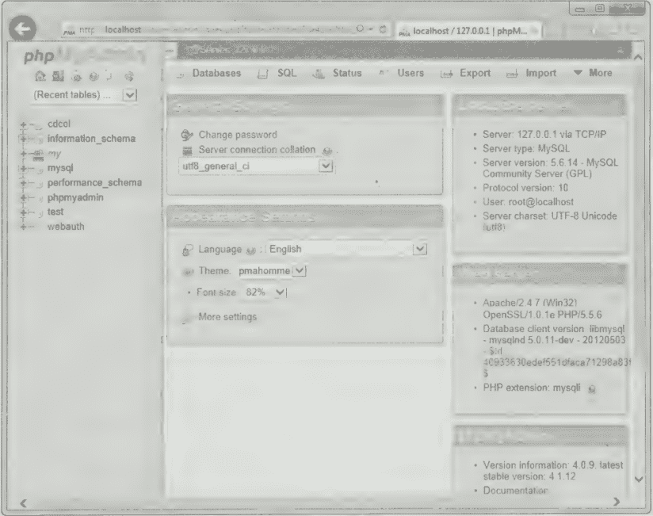

图3-8 — 使用MySQL的两种方式

### 欢迎页面

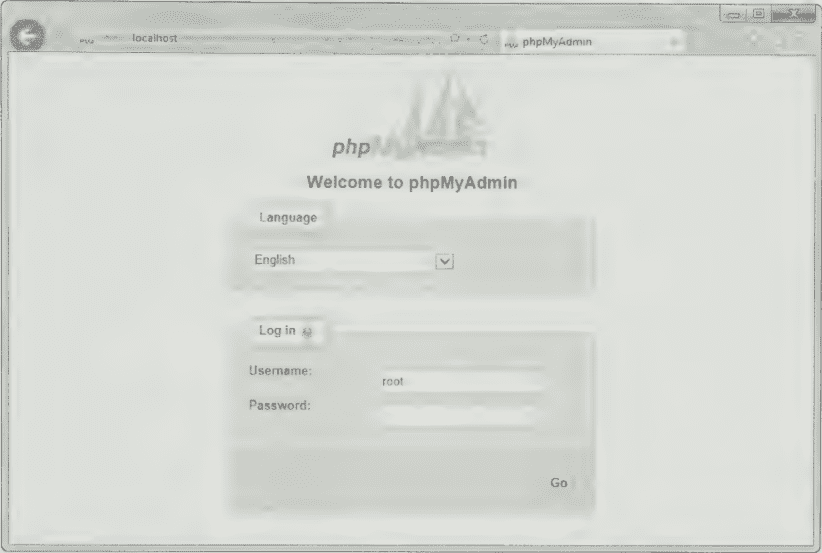

### 大多数页面侧边栏顶部的主页和注销按钮


### 如何在本地计算机上启动phpMyAdmin并登录

1. 如第1章图1-1所示启动XAMPP控制面板，如果Apache和MySQL服务器尚未运行，则启动它们。
2. 点击MySQL模块的Admin按钮，在默认Web浏览器中启动phpMyAdmin工具。
3. 输入你的用户名和密码。

### 如何注销并返回欢迎页面

- 点击“注销”按钮（退出标志图标）。

### 如何更改密码

- 点击“主页”按钮（房屋图标）。然后，点击“更改密码”链接。
- 在“更改密码”页面上，输入并重新输入你的新密码。然后，点击“Go”按钮。

图3-9 — 如何启动phpMyAdmin、登录、注销和更改密码

## 用于导入并运行创建数据库的SQL脚本的“导入”选项卡

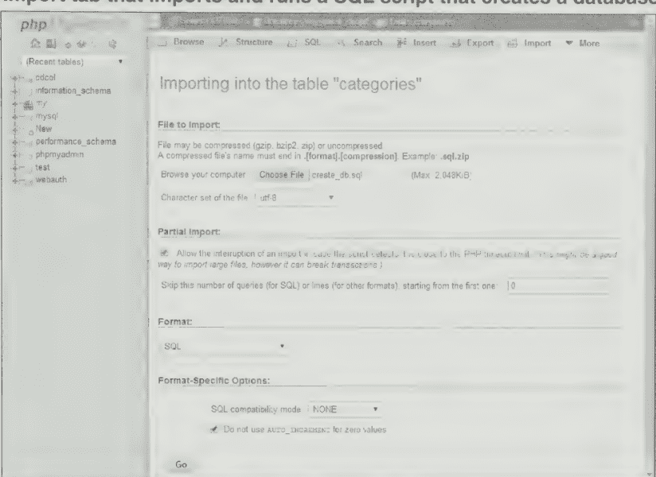

## 导入SQL脚本后显示的成功消息

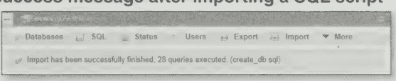

## 如何导入并运行SQL脚本

1. 点击“导入”选项卡，转到“要导入的文件”部分，点击“浏览”按钮，然后选择包含脚本的文件。
2. 点击“Go”按钮。这将运行文件中的脚本。

本书所用数据库的创建脚本

```
\xampp\htdocs\book_apps\_create_db\create_db.sql
```

## 说明

- SQL脚本由存储在一个文件中的一条或多条SQL语句组成。SQL脚本可以包含创建数据库、创建其表以及向这些表添加数据所需的全部SQL语句。
- 运行上面显示的脚本来创建本书所使用的数据库。

## 如何运行SQL语句

选择数据库后，你可以点击SQL选项卡，针对该数据库运行SQL语句。这样，你可以先测试PHP应用程序将要使用的SQL语句，然后再在应用程序中编写它们。因为在将SQL语句加入PHP之前更正它更容易，所以这有助于你更高效地工作。

图3-12展示了如何从phpMyAdmin的SQL选项卡运行SQL语句。输入SQL语句后，点击“Go”按钮。然后，phpMyAdmin会显示相应的响应。例如，在这张图中，一条SELECT语句成功运行，因此显示了一个结果表。

但是，如果SQL语句无效，phpMyAdmin会显示一条错误消息，帮助你发现并解决问题。或者，如果SQL语句执行了诸如向表中插入多行之类的操作，phpMyAdmin会显示一条消息，指明添加到表中的行数。有时会显示信息性消息，例如图中显示的结果集不包含唯一列的消息。

SQL语句执行后，你可以通过点击列名对结果集中的列进行排序。使用此排序功能时需要注意两点。第一，它会重新执行SQL语句，将新的排序条件包含在ORDER BY子句中。第二，它会将列名用反引号括起来。这是在MySQL中编写列名的一种常见但可选的方式。

如果你需要一些SQL语句方面的帮助，可以在点击SQL选项卡之前先选择一个表。然后，当你点击SQL选项卡时，phpMyAdmin会显示该表的列名列表以及SELECT、SELECT *、INSERT、UPDATE和DELETE按钮。你可以使用这些按钮和列列表，无需打字即可构建SQL语句。如果你不使用JOIN子句，这最为有用；但即使你使用JOIN子句，它仍然可以帮助你开始编写SQL语句。与排序功能一样，这些按钮生成的SQL语句会将列名括在反引号中。但是，如果你愿意，可以轻松移除这些反引号。

如果你想如图中所示运行一条SQL语句，只需输入SQL语句并点击“Go”按钮。但是，如果你想输入包含多条SQL语句的SQL脚本，则需要在每条语句的末尾加上分号（;）。

为了便于识别SQL语句中的关键字，本书通常将关键字大写，如下例所示：

```
SELECT productID, productName FROM products
```

尽管这使SQL语句更易于阅读，但这种大写是可选的。例如，如果你想使用全小写字母来编写语句，因为它们更容易输入，你可以这样做。唯一的例外是，如果你使用的数据库运行在Unix服务器上。那么，列名和表名是区分大小写的。


## 图 3-12 — 如何运行 SQL 语句

### 包含准备执行的 SQL 语句的 SQL 选项卡

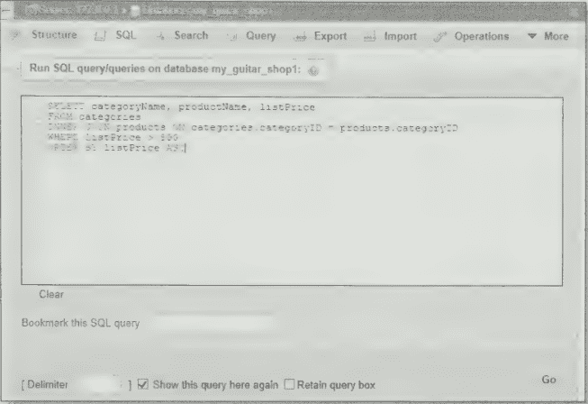

### 执行 SQL 语句后的 SQL 选项卡

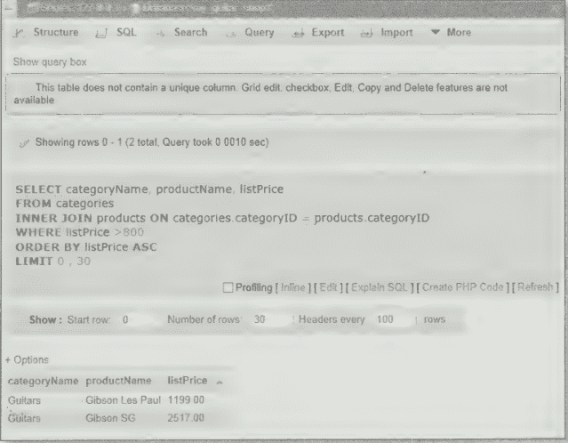

### 描述

- 要执行 SQL 语句，请选择一个数据库并单击 SQL 选项卡。然后，输入 SQL 语句并单击 Go 按钮。要执行多个 SQL 语句，请在每个 SQL 语句末尾包含分号 (`;`)。
- 在 Unix 系统中，列名和表名区分大小写。

## 图 3-13 — 如何创建具有有限权限的用户

### 如何在单个表上创建具有有限权限的用户

```sql
GRANT SELECT
ON my_guitar_shop1.products
TO mgs_tester@localhost
IDENTIFIED BY 'pa55word'
```

### 如何在数据库的所有表上创建具有有限权限的用户

```sql
GRANT SELECT, INSERT, DELETE, UPDATE
ON my_guitar_shop1.*
TO mgs_user@localhost
IDENTIFIED BY 'pa55word'
```

### 常见权限

| 权限 | 描述 |
|---|---|
| `SELECT` | 允许用户选择数据。 |
| `UPDATE` | 允许用户更新数据。 |
| `INSERT` | 允许用户插入数据。 |
| `DELETE` | 允许用户删除数据。 |
| `CREATE TABLE` | 允许用户创建表。 |
| `DROP TABLE` | 允许用户删除表。 |

### UPDATE 语句失败后 mgs_tester 的 SQL 选项卡

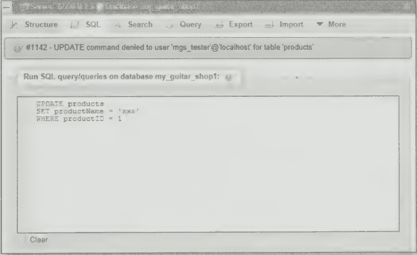

### 描述

- 您应限制大多数数据库用户的权限，以防止用户意外或故意损坏数据库。
- 您可以使用 GRANT 语句创建用户，为该用户指定密码并授予用户权限。
- 有关创建用户和授予权限的更多信息，请参阅第 17 章。

## 视角

本章的目标是让您为开发使用 MySQL 数据库的 PHP 应用程序做好准备。为此，本章向您介绍了您将在 PHP 应用程序中使用的 SELECT、INSERT、UPDATE 和 DELETE 语句。本章还向您展示了如何在 PHP 应用程序中使用它们之前使用 phpMyAdmin 测试 SQL 语句。

请记住，本章仅介绍了 MySQL 技能的一个子集。特别是，它介绍了您为开发本章后两章中介绍的类似 PHP 应用程序所需的 MySQL 技能。然后，在第 3 节中，您可以了解更多关于 MySQL 的内容。

## 术语

| | |
|---|---|
| 关系数据库 | SQL（结构化查询语言） |
| 表 | 数据操作语言（DML） |
| 行 | 数据定义语言（DDL） |
| 列 | SQL 语句 |
| 单元格 | 查询 |
| 主键 | 结果集 |
| 非主键 | 结果表 |
| 唯一键 | 连接 |
| 索引 | 内连接 |
| 外键 | 外连接 |
| 数据库管理系统（DBMS） | 左外连接 |
| 一对多关系 | 右外连接 |
| 一对一关系 | 操作查询 |
| 多对多关系 | 引用完整性 |
| 数据类型 | 事务处理 |
| 空值 | 命令行客户端 |
| 默认值 | 基于 Web 的客户端 |
| 自增列 | 模式 |
|  | SQL 脚本 |

## 摘要

- 关系数据库由存储在行和列中的数据的表组成。主键用于标识表中的每一行。
- 关系数据库中的表通过一个表中的外键与另一个表中的主键具有相同的值相关联。通常，这些表具有一对多关系。
- 数据库表中的每一列都使用数据类型定义，该数据类型决定可以存储在该列中的内容。此外，列定义指定列是否允许空值或具有默认值。
- 要处理数据库中的数据，您使用 *SQL（结构化查询语言）*。要访问和更新数据库中的数据，您使用以下 SQL 语句：SELECT、INSERT、UPDATE 和 DELETE。
- SELECT 语句从一个或多个表中返回 *结果集*。要从两个或多个表中返回数据，您可以根据相关字段中的数据 *连接* 表。*内连接* 返回的结果集仅在相关字段匹配时才包含数据。
- 要更新数据库中的数据，您使用 INSERT、UPDATE 和 DELETE 语句。这些语句有时称为 *操作查询*。
- 要查看数据库的结构和数据并对数据库运行 SQL 语句，您可以使用一个名为 phpMyAdmin 的基于 Web 的应用程序。这包含在 XAMPP 下载中。
- 要创建包含其表和数据的数据库，您可以使用 phpMyAdmin 运行 *SQL 脚本*。这就是本书数据库的创建方式。您还可以使用 phpMyAdmin 导入和运行 SELECT、INSERT、UPDATE 和 DELETE 语句的 SQL 脚本。
- 在 PHP 应用程序中使用 SQL 语句之前，您应该使用 phpMyAdmin 测试它们。以后，当您将它们复制到 PHP 应用程序中时，您会知道这些语句有效。
- 要创建具有有限权限的数据库用户，您可以使用 phpMyAdmin 运行 GRANT 语句。然后，每个 PHP 应用程序都可以作为具有应用程序所需的权限的特定用户连接到数据库。

## 练习 3-1 使用 phpMyAdmin 与数据库

本练习将让您有机会使用 phpMyAdmin 查看与本书一起使用的数据库，并测试您将在 PHP 应用程序中使用的类型的 SQL 语句。

### 如有必要，为 root 用户设置密码

1. 如图 3-9 所示启动 Apache、MySQL 和 phpMyAdmin。然后以 root 用户身份登录。
2. *如果您尚未为 root 用户设置密码，* 使用 phpMyAdmin 来执行此操作。如果您仅将 MySQL 用于本书中的应用程序的工作，请使用“sesame”之类的密码以便易于记住。否则，请使用更安全的密码。
3. 单击“注销”按钮（退出图标）以注销。这应带您返回欢迎页面。然后，使用新密码以 root 用户身份登录。这将带您到主页。

### 运行创建书籍数据库的脚本

4. 在主页上，查看侧边栏中可用的数据库列表。然后，单击数据库选项卡以查看相同的数据库。请注意，这些数据库包括 MySQL 和 phpMyAdmin 用于管理其自身操作的数据库。my_guitar_shop1 和 my_guitar_shop2 数据库是否都可用？
5. 使用图 3-10 中的程序导入并运行创建本书数据库的脚本。这将创建或重新创建本书的两个数据库。因此，my_guitar_shop1 和 my_guitar_shop2 数据库都将在侧边栏和数据库选项卡中显示。

### 查看 my_guitar_shop1 数据库

6. 选择 my_guitar_shop1 数据库以显示此数据库的表，并单击浏览按钮查看 products 表的数据。
7. 单击结构选项卡以查看 products 表的列定义。请注意，没有列允许空值或提供默认值。

### 对 my_guitar_shop1 数据库运行 SQL 语句

8. 使用 SQL 选项卡运行图 3-4 中的第一个查询。然后，运行第二个查询。
9. 运行图 3-5 中的查询。然后，修改查询中的零售价值，使其仅选择价格小于 400 的产品，并再次运行查询。
10. 运行图 3-6 中的第一个查询以向 products 表添加一行。然后，浏览 products 表以查看新行。最后，运行 DELETE 语句删除新行。
11. 继续实验，直到您确定知道如何编写 PHP 应用程序将使用的 SQL 查询。

### 以不同用户登录并检查该用户的权限

12. 从 phpMyAdmin 注销，并以 mgs_tester 重新登录，密码为 pa55word。该用户是由您在本练习第 5 步中运行的 SQL 脚本创建的。
13. 使用 SQL 选项卡运行此 SELECT 语句：

```sql
SELECT * FROM categories
```

此语句应被拒绝，因为 mgs_tester 只能对 products 表运行语句。

### 实验

14. 继续实验，直到您确信理解 phpMyAdmin 的使用以及您将在 PHP 应用程序中使用的 SQL 语句类型。


## 4 如何将 PHP 与 MySQL 数据库结合使用

既然你已经知道如何使用 MySQL 数据库，本章将向你展示如何使用 PHP 从 MySQL 数据库中获取数据。它还展示了如何使用 PHP 在 MySQL 数据库中插入、更新或删除行。为了帮助你掌握这些技能，本章最后介绍两个完整的、数据库驱动的应用程序。

本章介绍如何使用 PDO（PHP 数据对象）来处理数据库。PDO 对 PHP 来说相对较新，它支持大多数流行的数据库。由于 PDO 定义了访问数据库的一致接口，你可以使用相同的 PHP 代码来操作多种类型的数据库。

PDO 包含在 PHP 5.1 中，并可作为 PHP 5.0 的 PECL 扩展使用。但是，PDO 不能用于更早版本的 PHP。因此，如果你需要维护旧代码，可能需要使用第 19 章介绍的较旧技术。不过，对于新的开发，我们推荐使用 PDO。

- **如何连接数据库并处理异常** ............ 126
  - 如何连接数据库 ........................................ 126
  - 如何处理异常 ............................................ 128
- **如何获取和修改数据** ........................................ 130
  - 如何执行 SELECT 语句 ................................... 130
  - 如何处理结果集的第一行 ........................ 132
  - 如何处理结果集的所有行 .......................... 134
  - 如何执行 INSERT、UPDATE 和 DELETE 语句 ................. 136
- **Product Viewer 应用程序** .................................... 138
  - 用户界面 ................................................... 138
  - 代码 ............................................................. 140
- **Product Manager 应用程序** ................................... 146
  - 用户界面 ................................................... 146
  - 代码 ............................................................. 148
- **小结** ....................................................... 156

### 如何连接数据库并处理异常

本章首先介绍如何连接数据库，然后介绍如何处理无法连接数据库时发生的异常（或错误）。

#### 如何连接数据库

在开发 PHP 应用程序时，你可能需要从类创建对象。为此，你可以使用图 4-1 中第一个语法摘要所示的语法。该语法展示了如何编写 new 关键字、要从中创建对象的类的名称、一组圆括号，以及圆括号内所需参数的列表。

第二个语法摘要展示了如何从 PDO 类创建 PDO 对象。在这种情况下，需要三个参数：一个用于数据源名称（DSN），一个用于用户名，一个用于密码。

第三个语法摘要展示了如何为 MySQL 数据库编写 DSN。DSN 标识主机和要使用的数据库。这里同样，斜体的单词是你需要提供的内容。但请注意，此语法是针对 MySQL 数据库的。要使用其他类型的数据库，你需要在互联网上查询相应的 DSN 语法。

第一个示例展示了创建 PDO 对象的代码。首先，$dsn 变量被赋予一个 DSN，该 DSN 指定了一个名为 my_guitar_shop1 的 MySQL 数据库，该数据库运行在与 PHP 解释器相同的计算机（localhost）上。然后，$username 和 $password 变量被赋予值。最后，这些变量被用作创建新 PDO 对象的参数，该对象被赋值给名为 $db 的变量。

请注意，创建新 PDO 对象的参数名称不必与语法摘要中的参数名称相同。例如，你可以使用 $data_source_name 代替 $dsn。不过，如果使用相同的名称，就很容易记住这些名称所指的内容。

#### 如何处理异常

有时，当你尝试从 PDO 类创建 PDO 对象时，PDO 类无法创建该对象。在这种情况下，该类会抛出一个异常。异常是一个包含所发生错误信息的对象。然后，如果异常未被处理，应用程序就会终止。

要处理异常，你需要编写一个 try/catch 语句，如图 4-2 所示。要使用此语句，你首先需要在可能抛出异常的任何一条或多条语句周围编写一个 try 块。然后，编写一个 catch 块，其中包含如果 try 块中的任何语句抛出异常时将执行的语句。

在 catch 块的大括号之前，你需要编写一组圆括号。在这些圆括号中，你需要编写异常类的名称，后跟一个空格以及你想用于异常对象的变量名。

一旦你为异常对象编写了变量名，就可以调用它的方法。例如，要获取存储在异常对象中的错误消息，你可以调用 getMessage 方法。为此，你需要编写对象名，后跟 ->，再跟方法名，最后跟一组包含方法所需参数的圆括号。不过，在这种情况下，getMessage 方法不需要任何参数。

第一个示例展示了如何处理数据库异常。此处，try 块中的第一条语句尝试创建 PDO 对象。如果该语句成功执行，第二条语句会显示一条表明你已连接数据库的消息，然后 try/catch 语句结束。

但是，如果 try 块中的任何语句抛出异常，PHP 解释器会跳过 try 块中的其余语句，并执行 catch 块中的语句。例如，如果 try 块中的第一条语句抛出异常，解释器会跳过 try 块中的第二条语句，并执行 catch 块中的语句。

在 catch 块中，第一条语句调用存储在变量 $e 中的 PDOException 对象的 getMessage 方法，并将此消息存储在变量 $error_message 中。然后，第二条语句显示一条指示已发生错误的消息。这条消息包含 $error_message 变量中的消息。

当你为 PDOException 类编写 catch 块时，它只会捕获 PDOException 对象。然后，如有必要，你可以为其他类型的异常编写其他 catch 块。或者，如果你想编写一个捕获所有类型异常的 catch 块，你可以为 Exception 类编写一个 catch 块。该类包含所有其他类型的异常，第二个示例说明了这一点。

为什么代码尝试创建 PDO 对象时会抛出 PDOException？以下是几个原因。数据库服务器可能未运行。用户名和密码组合可能没有访问数据库的权限。或者 DSN 参数可能不正确。不过，无论如何，如果你仔细阅读错误消息，通常能很好地了解错误的原因，并且通常可以利用这些信息来解决问题。

**try/catch 语句的语法**

```
try {
    // statements that might throw an exception
} catch (ExceptionClass $exception_name) {
    // statements that handle the exception
}
```

**调用任何对象的方法的语法**

```
$objectName->methodName(argumentList)
```

**如何处理 PDO 异常**

```
try {
    $db = new PDO($dsn, $username, $password);
    echo '<p>You are connected to the database!</p>';
} catch (PDOException $e) {
    $error_message = $e->getMessage();
    echo "<p>An error occurred while connecting to
        the database: $error_message </p>";
}
```

**如何处理任何类型的异常**

```
try {
    // statements that might throw an exception
} catch (Exception $e) {
    $error_message = $e->getMessage();
    echo "<p>Error message: $error_message </p>";
}
```

**说明**

- 一个*异常*是一个包含所发生错误信息的对象。当遇到错误时，一些 PHP 语句会*抛出*异常。如果异常未被处理，应用程序会提前终止。
- 要*处理异常*，你可以使用 *try/catch 语句*。首先，你需要在可能*抛出异常*的 PHP 语句周围编写一个 *try 块*。然后，编写一个 *catch 块*来*捕获*异常。这被称为*异常处理*。
- Exception 类包含所有类型的异常，所有其他异常都是 Exception 类的子类。PDOException 类用于处理 PDO 库抛出的错误。
- 要调用任何对象的*方法*，你需要编写对象名，后跟 ->，再跟方法名，最后跟一组圆括号。在圆括号内，你需要编写方法所需的参数，多个参数用逗号分隔。
- 所有 Exception 对象都提供 getMessage 方法，让你能够获取错误消息。
- 如果异常在 try 块中被抛出，try 块中剩余的任何语句都会被跳过，并执行 catch 块中的语句。如果 try 块中没有抛出异常，则跳过 catch 块。
- 你将在第 15 章了解更多关于异常处理的内容。

图 4-2　如何使用 try/catch 语句处理异常


## 如何获取和修改数据

连接到数据库后，你可以使用该连接执行 SELECT 语句来检索数据，以及执行 INSERT、UPDATE 和 DELETE 语句来修改数据。

执行 SQL 语句有两种方式。你可以使用预处理语句，也可以使用动态语句。对于生产环境的应用，你通常会使用*预处理*语句，因为它们既能提升数据库性能，也能增强安全性。因此，本章只介绍如何使用预处理语句。不过，如果你想了解更多，第 19 章会介绍动态语句的工作原理。

### 如何执行 SELECT 语句

图 4-3 展示了如何准备并执行 SELECT 语句。为此，你需要调用 PDO 对象的 `prepare` 方法来准备查询，并返回一个 PDOStatement 对象。然后，你可以调用 PDOStatement 对象的 `execute` 方法来执行该语句。

对于 SELECT 语句，执行该语句会将结果集存储到 PDOStatement 对象中。例如，第一个示例准备并执行了一条获取 products 表中所有列和行的 SELECT 语句。

当然，大多数预处理语句会包含一个或多个参数。因此第二个示例展示了如何使用*命名参数*。命名参数以冒号（:）开头，后跟参数名。在此示例中，命名参数为 `:category_id`。

在查询中编写命名参数后，你可以使用 PDOStatement 对象的 `bindValue` 方法将值绑定到参数。在此示例中，`bindValue` 语句将 `$category_id` 变量中的值绑定到名为 `:category_id` 的参数。不过，如有必要，你可以在 SQL 语句中包含多个参数，并使用多条 `bindValue` 语句将多个变量绑定到其对应的参数。

#### PDO 类中用于准备 SQL 语句的一个方法

| 方法 | 描述 |
| --- | --- |
| `prepare($sql_statement)` | 准备指定的 SQL 语句以供执行，并返回一个 PDOStatement 对象。在 SQL 语句中，你可以使用冒号（:）向语句添加参数。 |

#### PDOStatement 类中用于执行语句的两个方法

| 方法 | 描述 |
| --- | --- |
| `bindValue($param, $value)` | 将指定值绑定到预处理语句中的指定参数。 |
| `execute()` | 执行预处理语句。 |

#### 如何执行没有参数的 SQL 语句

```php
$query = "SELECT * FROM products";
$statement = $db->prepare($query);
$statement->execute();
```

#### 如何执行带参数的 SQL 语句

```php
$query = "SELECT * FROM products
             WHERE categoryID = :category_id";
$statement = $db->prepare($query);
$statement->bindValue(':category_id', $category_id);
$statement->execute();
```

#### 说明

-   要准备一条 SQL 语句，你需要使用 PDO 对象的 `prepare` 方法。它只需要一个参数，即要执行的 SQL 语句。
-   要执行一条 SQL 语句，你需要使用 PDOStatement 对象的 `execute` 方法。
-   要标识 SQL 语句中的参数，你可以编写冒号（:）后跟参数名。
-   要将变量绑定到参数，你可以使用 PDOStatement 对象的 `bindValue` 方法。
-   如果 SQL 语句是返回结果集的 SELECT 语句，`execute` 方法会将结果集存储到 PDOStatement 对象中。然后，你可以使用接下来两个图中的技术从 PDOStatement 对象获取数据。

图 4-3   如何执行 SELECT 语句

### 如何处理结果集的第一行

如果 SELECT 语句返回的结果集只包含一行，你可以使用 PDOStatement 对象的 `fetch` 方法从该行获取数据，如图 4-4 所示。该方法返回结果集中下一行的数组。

数组可以存储一个或多个元素。要引用数组中的元素，你需要使用标识所需元素的索引。该索引可以是字符串值（如第二个示例所示），也可以是数值（如第三个示例所示）。如果使用数值索引，请确保第一列使用索引 0，第二列使用索引 1，依此类推。

在第一个示例中，第一条语句定义了一条返回单行结果集的 SELECT 语句。第二条语句调用 PDO 对象的 `prepare` 方法，返回该预处理语句的 PDOStatement 对象。第三条语句调用 PDOStatement 对象的 `bindValue` 方法，将一个变量绑定到产品 ID 的参数上。第四条语句调用 PDOStatement 对象的 `execute` 方法，将结果集存储到 PDOStatement 对象中。第五条语句调用该语句的 `fetch` 方法，获取结果集中第一行（也是唯一一行）的数组，并将其存储到名为 `$product` 的变量中。最后，第六条语句调用 `closeCursor` 方法关闭游标并释放到服务器的连接。

正如 `fetch` 方法的描述所示，该方法实际上返回结果集中的下一行。因此，如果结果集包含多行，你可以使用该方法一次获取一行。不过，通常你会使用 `foreach` 语句来获取包含多行的结果集中的所有行，如下一个图所示。

#### PDOStatement 类的另外两个方法

| 方法 | 描述 |
| --- | --- |
| `fetch()` | 返回结果集中下一行的数组。该数组同时以列名的字符串索引和列位置的数值索引进行索引。如果没有可用的数组，此方法返回 FALSE 值。 |
| `closeCursor()` | 关闭游标并释放到服务器的连接，以便可以发出其他 SQL 语句。 |

#### 返回单行结果集的代码

```php
$query = 'SELECT productCode, productName, listPrice
          FROM products
          WHERE productID = :product_id';
$statement = $db->prepare($query);
$statement->bindValue(':product_id', $product_id);
$statement->execute();
$product = $statement->fetch();
$statement->closeCursor();
```

#### 使用字符串索引访问各列的代码

```php
$product_code = $product['productCode'];
$product_name = $product['productName'];
$product_list_price = $product['listPrice'];
```

#### 使用数值索引访问各列的代码

```php
$product_code = $product[0];
$product_name = $product[1];
$product_list_price = $product[2];
```

#### 说明

-   *数组*可以存储一个或多个*元素*。
-   要引用数组中的元素，你需要使用*索引*。如果使用数值索引，0 表示第一个元素，1 表示第二个元素，依此类推。
-   你可以使用 PDOStatement 对象的 `fetch` 方法获取结果集第一行（或下一行）的数组。然后，你可以使用列名或数值索引访问存储在该行中的数据。
-   你将在第 11 章了解更多关于数组的内容。

图 4-4 — 如何处理结果集的第一行

### 如何处理结果集中的所有行

#### PDOStatement 类的另一个方法

| 方法 | 描述 |
| --- | --- |
| `fetchAll()` | 返回包含结果集中所有行的数组。 |

#### 一个返回两行或更多行结果集的查询方法

```php
$query = 'SELECT productCode, productName, listPrice
    FROM products
    WHERE categoryID = :category_id';
$statement = $db->prepare($query);
$statement->bindValue(":category_id", $category_id);
$statement->execute();
$products = $statement->fetchAll();
$statement->closeCursor();
```

#### 如何使用 foreach 语句在 HTML 表格中显示结果集

```php
<?php foreach ($products as $product) { ?>
<tr>
    <td><?php echo $product['productCode']; ?></td>
    <td><?php echo $product['productName']; ?></td>
    <td><?php echo $product['listPrice']; ?></td>
</tr>
<?php } ?>
```

#### foreach 语句的另一种语法，在 PHP 标签内效果更好

```php
<?php foreach ($products as $product): ?>
<tr>
    <td><?php echo $product['productCode']; ?></td>
    <td><?php echo $product['productName']; ?></td>
    <td><?php echo $product['listPrice']; ?></td>
</tr>
<?php endforeach; ?>
```

#### 说明

-   当 PDOStatement 对象包含结果集时，你可以使用 `fetchAll` 方法返回包含该结果集的数组。然后，你可以使用 `closeCursor` 方法关闭与数据库的连接。
-   要遍历数组中的元素，你可以使用*foreach*语句定义*foreach*循环，每次循环处理数组中的一个元素。
-   *foreach*语句的第二种语法更便于与其他控制语句配合使用，因为它不需要使用花括号。
-   当你将第二种语法与其他控制语句一起使用时，需要在每个控制语句起始子句后编写冒号，并以相应的结束语句结束每个控制语句。例如，使用 `endif` 语句结束 `if` 语句。

图 4-5   如何处理结果集中的所有行


## 如何执行INSERT、UPDATE和DELETE语句

图4-6展示了如何准备和执行INSERT、UPDATE和DELETE语句。该图中的示例使用了前几幅图介绍的prepare、bindValue、execute和closeCursor方法。因此，你应该不难理解这些示例的工作原理。

第一个示例向数据库插入一行。这里，INSERT语句指定了四个参数：每一列对应一个值。

第二个示例更新数据库中的一行。这里，UPDATE语句指定了两个参数：第一个指定产品的新价格，第二个唯一标识要更新的产品。

第三个示例从数据库中删除一行。这里，DELETE语句指定了一个参数，该参数唯一标识要删除的产品。

### 如何执行INSERT语句

```php
$category_id = 1;
$code = 'strat';
$name = 'Fender Stratocaster';
$price = 699.99;

$query = "INSERT INTO products
            (categoryID, productCode, productName, listPrice)
        VALUES
            (:category_id, :code, :name, :price)";

$statement = $db->prepare($query);
$statement->bindValue(':category_id', $category_id);
$statement->bindValue(':code', $code);
$statement->bindValue(':name', $name);
$statement->bindValue(':price', $price);
$statement->execute();
$statement->closeCursor();
```

### 如何执行UPDATE语句

```php
$product_id = 4;
$price = 599.99;

$query = "UPDATE products
        SET listPrice = :price
        WHERE productID = :product_id";

$statement = $db->prepare($query);
$statement->bindValue(':price', $price);
$statement->bindValue(':product_id', $product_id);
$statement->execute();
$statement->closeCursor();
```

### 如何执行DELETE语句

```php
$product_id = 4;

$query = "DELETE FROM products
        WHERE productID = :product_id";

$statement = $db->prepare($query);
$statement->bindValue(':product_id', $product_id);
$statement->execute();
$statement->closeCursor();
```

图4-6：如何执行INSERT、UPDATE和DELETE语句

## Product Viewer应用程序

现在你知道了如何使用PHP操作MySQL，可以准备了解数据库驱动的PHP应用程序是如何工作的。首先，图4-7展示了一个简单的Product Viewer应用程序，它允许你按类别查看产品数据。在查看完这个应用程序后，你将学习一个更复杂的应用程序。

### 用户界面

Product Viewer应用程序的主页面分为两部分。左侧的侧边栏显示类别链接列表，让用户选择类别。页面的主要部分以HTML表格的形式列出该类别的产品。

当应用程序启动时，该应用程序显示名为Guitars类别中的产品。然后，如果用户想要查看另一个类别的产品，用户可以点击该类别的链接。例如，如果用户点击Basses链接，该应用程序就会显示该类别的产品。为了实现这一点，category_id字段将随同一页面的HTTP请求一起发送。图4-7中第二个屏幕的URL说明了这一点，该URL请求ch04_product_viewer目录中的默认页面。

为了便于识别产品数据的列和行，该应用程序使用CSS来格式化HTML表格。这种格式化在表格外围添加实线边框，在列和行之间添加虚线边框。

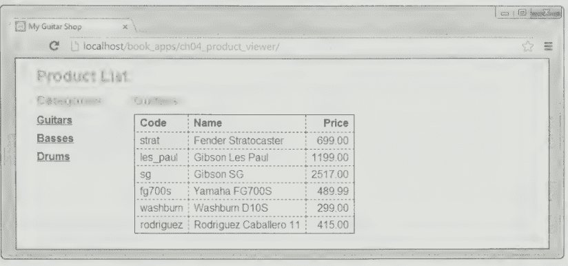

### 用户选择新类别后的用户界面

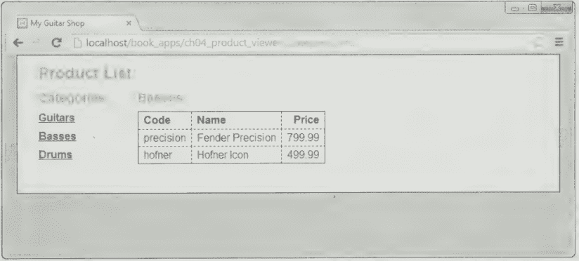

### 代码

database.php文件包含创建PDO对象并将其存储在名为$db的变量中的代码。该文件由下一页显示的index.php文件执行。

然而，如果执行此文件时发生错误，catch块会将错误消息存储在名为$error_message的变量中。然后，catch块使用include函数包含database_error.php文件，该文件显示包含错误消息的页面。最后，catch块退出脚本。

请注意，在database.php文件中，连接的用户名是“mgs_user”，密码是“pa55word”。要使此连接正常工作，MySQL数据库中必须存储具有该用户名和密码的用户。事实上，正如你在第3章所学到的，该用户是由为本书创建数据库的SQL脚本创建的。此外，该用户被授予了针对my_guitar_shop1数据库中任何表运行SELECT、INSERT、UPDATE和DELETE语句所需的权限。因此，此连接将可用于此应用程序。

### database.php文件

```php
<?php
    $dsn = 'mysql:host=localhost;dbname=my_guitar_shop1';
    $username = 'mgs_user';
    $password = 'pa55word';

    try {
        $db = new PDO($dsn, $username, $password);
    } catch (PDOException $e) {
        $error_message = $e->getMessage();
        include('database_error.php');
        exit();
    }
?>
```

### database_error.php文件

```php
<!DOCTYPE html>
<html>
    <!-- the head section -->
    <head>
        <title>My Guitar Shop</title>
        <link rel="stylesheet" type="text/css" href="main.css">
    </head>

    <!-- the body section -->
    <body>
    <main>
        <h1>Database Error</h1>
        <p>There was an error connecting to the database.</p>
        <p>The database must be installed as described in appendix A.</p>
        <p>The database must be running as described in chapter 1.</p>
        <p>Error message: <?php echo $error_message; ?></p>
    </main>
    </body>
</html>
```

## 自动化集装箱码头——运筹学贡献文献综述

Nils Kemper, Asir Asad, Jürgen W. Böning

收稿日期：2021年3月24日 / 修订日期：2021年11月10日 / 录用日期：2021年11月15日 © 作者2021

**摘要** 由于集装箱吞吐量持续增长和集装箱船舶规模不断扩大，集装箱码头的优化与自动化变得越来越重要。特别是在运营领域，通过优化设计和利用现有资源，可以提高码头吞吐能力。本综述的重点是评估过去和现在对集装箱码头自动或半自动控制的研究贡献。由此，可以为未来与码头自动化标准化相关的规划决策提供支持，涉及物流流程、设备和控制系统。特别关注物流过程的（半）自动化控制，如配载计划、资源分配及其调度。我们还详细介绍了用于解决这些通常复杂优化问题的运筹学方法。检索的文献包括近十年来发表在一流学术期刊以及相关会议论文集上的研究文章。我们可以表明，大多数最先进的方法都具有复杂的数学模型特征，并针对码头环境进行了测试，而现代自动化集装箱码头的完整流程链在文献中很少出现。在大多数情况下，只考虑单个过程的优化。此外，所应用的模型很少被重复使用，甚至很少与同一背景下的替代模型进行比较。为此，我们提出在自动化集装箱码头背景下规范整体及子流程的定义，以促进不同方法之间的可比性。

**关键词：** 自动化集装箱码头 · 集装箱码头 · 运筹学 · 物流 · 自动化

## 1 引言

全球集装箱航运流量的持续增长和集装箱船舶规模的不断扩大，给海港集装箱码头带来了提高生产率、吞吐量和效率的压力。尤其是自集装箱化时代以来，港口已成为全球供应链中最重要的节点之一。事实上，全球约90%的贸易量是通过海运处理的。集装箱码头的运营是一个高度复杂的过程，需要多个不同子系统的协同作用。自动化集装箱码头尤其如此。由于流程复杂程度高，需要采用复杂的方法来规划和控制码头内的流程。然而，现有方法往往针对特定的子流程或优化问题。

## 2 自动化集装箱码头的最新技术水平

### 2.1 功能区域、物料搬运设备和流程

一般来说，集装箱码头可以分为六个不同的区域。这些区域是泊位、码头前沿、堆场、闸口、铁路区和空箱堆场。泊位是船只停泊以及集装箱装卸的区域。码头前沿是集装箱在运往堆场之前临时存放的区域。堆场是集装箱长期存放的区域。闸口是集装箱通过卡车进出码头的区域。铁路区是集装箱在码头和铁路之间转运的区域。空箱堆场是存放空集装箱的区域。集装箱码头使用的物料搬运设备（MHE）可分为三类：岸边起重机、堆场起重机和内部运输车辆。这些设备用于在码头的不同区域之间运送集装箱。集装箱码头执行的流程可分为四组：船舶流程、码头前沿流程、堆场流程和闸口流程。船舶流程包括与船舶相关的所有活动，如船舶靠泊和离泊。码头前沿流程包括船舶的装卸。堆场流程包括堆场中集装箱的堆存和取回。闸口流程包括与闸口相关的所有活动，如卡车的进场和出场登记。

| | 类型 | 简短描述 |
|---|---|---|
| ACC | 自动化集装箱码头 | 具有自动化流程的集装箱码头 |
| AGV | 自动导引车 | 自动化运输车辆 |
| ALV | 自动升降车 | 具有升降能力的自动化车辆 |
| ASC | 自动化堆场起重机 | 用于堆场作业的自动化起重机 |
| ARMG | 自动化轨道式龙门起重机 | 轨道式自动化龙门起重机 |
| ARTG | 自动化轮胎式龙门起重机 | 轮胎式自动化龙门起重机 |
| ATLS | 自动化运输和升降系统 | 具有升降能力的自动化运输系统 |
| AV | 自动化车辆 | 通用自动化车辆 |
| BCO | 货主 | 货物的所有者 |
| BAP | 泊位分配问题 | 分配泊位的问题 |
| BEO | 集装箱交接点 | 集装箱交接的点 |
| BLAP | 泊位布局问题 | 泊位布局的问题 |
| BMH | 集装箱处理机械 | 用于处理集装箱的机器 |
| BPM | 业务流程模型 | 业务流程的模型 |


## index.php 文件

```php
<?php
require_once('database.php');

// Get category ID
$category_id = filter_input(INPUT_GET, 'category_id',
    FILTER_VALIDATE_INT);
if ($category_id == NULL || $category_id == FALSE) {
    $category_id = 1;
}

// Get name for selected category
$queryCategory = 'SELECT * FROM categories
    WHERE categoryID = :category_id';
$statement1 = $db->prepare($queryCategory);
$statement1->bindValue(':category_id', $category_id);
$statement1->execute();
$category = $statement1->fetch();
$category_name = $category['categoryName'];
$statement1->closeCursor();

// Get all categories
$queryAllCategories = 'SELECT * FROM categories
    ORDER BY categoryID';
$statement2 = $db->prepare($queryAllCategories);
$statement2->execute();
$categories = $statement2->fetchAll();
$statement2->closeCursor();

// Get products for selected category
$queryProducts = 'SELECT * FROM products
    WHERE categoryID = :category_id
    ORDER BY productID';
$statement3 = $db->prepare($queryProducts);
$statement3->bindValue(':category_id', $category_id);
$statement3->execute();
$products = $statement3->fetchAll();
$statement3->closeCursor();
?>
<!DOCTYPE html>
<html>
<!-- the head section -->
<head>
<title>My Guitar Shop</title>
<link rel="stylesheet" type="text/css" href="main.css" />
</head>
```

本文件的 HTML 包含嵌入的 PHP 标签，用于显示文件开头 PHP 脚本中定义的变量。首先，第一个 foreach 循环为每个类别显示一个链接列表。这里，href 属性指定了一个包含类别 ID 的 URL，而链接则显示该类别的名称。因此，如果用户点击其中一个链接，该应用程序将使用 GET 方法将该链接的类别 ID 传递给 index.php 文件。这会返回一个显示新类别产品的网页。

这些类别链接存储在无序列表的 `<li>` 标签内。然而，该应用程序的 CSS 关闭了此列表的项目符号，因此项目符号不会显示。虽然本书中未显示任何应用程序的 CSS，但它可在下载的应用程序中找到，以便您可以查看其工作原理。

在第一个 foreach 循环之后，此页面在产品表格上方显示当前类别的名称。然后，它使用第二个 foreach 循环显示当前类别的产品。这在 HTML 表格中显示了结果集中五个列中的三列。具体来说，它在第一列显示产品的代码，在第二列显示名称，在第三列显示价格。然而，它在此表格中未显示产品 ID 或类别 ID。

在您审阅此代码时，请注意两个 foreach 循环都使用了本章前面描述的替代语法。这使您的代码更易于阅读，因为可以轻松看出每个 foreach 循环的结束位置。此外，两个循环都使用字符串索引而不是数字索引来获取行数组中的值。这使您的代码更易于阅读，因为可以轻松看出每列中的数据与每列标题的对应关系。

## index.php 文件（续）

```html
<!-- the body section -->
<body>
<main>
<h1>Product List</h1>
<aside>
    <!-- display a list of categories -->
    <h2>Categories</h2>
    <nav>
    <ul>
        <?php foreach ($categories as $category) : ?>
        <li>
            <a href="?category_id=<?php echo $category['categoryID']; ?>">
                <?php echo $category['categoryName']; ?>
            </a>
        </li>
        <?php endforeach; ?>
    </ul>
    </nav>
</aside>

<section>
    <!-- display a table of products -->
    <h2><?php echo $category_name; ?></h2>
    <table>
        <tr>
            <th>Code</th>
            <th>Name</th>
            <th class="right">Price</th>
        </tr>

        <?php foreach ($products as $product) : ?>
        <tr>
            <td><?php echo $product['productCode']; ?></td>
            <td><?php echo $product['productName']; ?></td>
            <td class="right"><?php echo $product['listPrice']; ?></td>
        </tr>
        <?php endforeach; ?>
    </table>
</section>
</main>
<footer></footer>
</body>
</html>
```

## 产品管理器应用程序

本章结尾介绍了名为产品管理器应用程序的更复杂的数据库应用程序。该应用程序在多个方面增强了产品查看器应用程序。最重要的是，它允许用户添加和删除产品。

### 用户界面

图 4-8 的第 1 部分显示了产品管理器应用程序用户界面的主要页面：产品列表页面和添加产品页面。这两个页面都在页眉中包含应用程序的名称，并且这两个页面都在页脚中包含版权声明。这些页面还包含将页眉和页脚与页面主体分隔开的边框。

产品列表页面允许用户查看和删除产品。它显示类别列表和当前类别的产品表格。这与产品查看器应用程序的主页类似。然而，此列表为每个产品包含一个删除按钮，允许用户删除该产品。此外，此页面在表格下方包含一个添加产品链接，允许用户显示添加产品页面。

添加产品页面允许用户添加新产品。此页面首先显示一个下拉列表，允许用户为产品选择类别。然后，它显示三个文本框，允许用户输入产品的代码、名称和价格。接下来，它显示一个添加产品按钮，允许用户提交产品数据。最后，此页面显示一个查看产品列表链接，允许用户在不添加产品的情况下返回产品列表页面。

### 产品列表页面

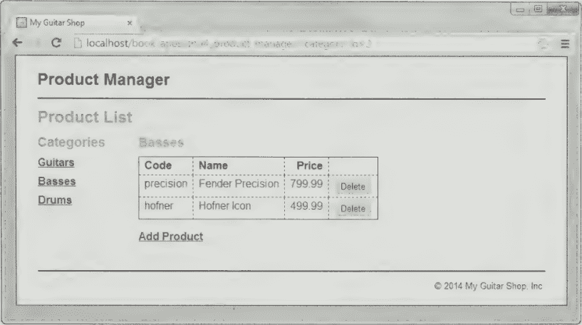

### 添加产品页面

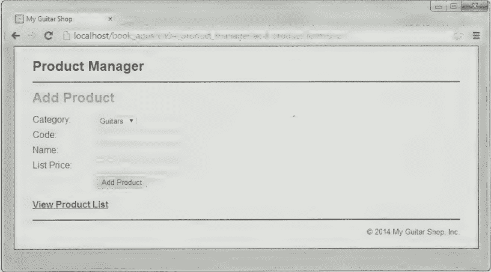

Figure 4-8 — 产品管理器应用程序（第 1 部分，共 5 部分）

### 代码

图 4-8 的第 2 部分至第 5 部分显示了产品管理器应用程序的代码。然而，这些部分未显示 database.php 和 database_error.php 文件的代码，因为该代码与产品查看器应用程序的代码相同。

index.php 文件的工作方式与产品查看器应用程序的 index.php 文件类似。因此，您应该已经理解了其中的大部分内容。然而，有一些重要的区别。

首先，第一条语句使用 require_once 语句。因此，此代码只加载 database.php 文件一次。这意味着如果 delete_product.php 或 add_product.php 文件（本图后面描述）已加载该文件，则不会再次加载文件。这提高了应用程序的效率。

接下来，第一段代码开始时检查 $category_id 变量是否已设置。因此，只有在 $category_id 变量尚未由本图后面描述的 delete_product.php 或 add_product.php 文件设置时，此代码才会尝试从 $_GET 数组获取类别 ID。

在 HTML 中，此代码使用 <header> 和 <footer> 标签为页面定义页眉和页脚。这里，页眉显示应用程序的名称（Product Manager），页脚显示应用程序的版权通知。

### index.php 文件

```php
<?php
    require_once('database.php');

    // Get category ID
    if (!isset($category_id)) {
        $category_id = filter_input(INPUT_GET, 'category_id',
                            FILTER_VALIDATE_INT);
        if ($category_id == NULL || $category_id == FALSE) {
            $category_id = 1;
        }
    }

    // Get name for selected category
    $queryCategory = 'SELECT * FROM categories
                      WHERE categoryID = :category_id';
    $statement1 = $db->prepare($queryCategory);
    $statement1->bindValue(':category_id', $category_id);
    $statement1->execute();
    $category = $statement1->fetch();
    $category_name = $category['categoryName'];
    $statement1->closeCursor();

    // Get all categories
    $queryAllCategories = 'SELECT * FROM categories
                           ORDER BY categoryID';
    $statement2 = $db->prepare($queryAllCategories);
    $statement2->execute();
    $categories = $statement2->fetchAll();
    $statement2->closeCursor();

    // Get products for selected category
    $queryProducts = 'SELECT * FROM products
                      WHERE categoryID = :category_id
                      ORDER BY productID';
    $statement3 = $db->prepare($queryProducts);
    $statement3->bindValue(':category_id', $category_id);
    $statement3->execute();
    $products = $statement3->fetchAll();
    $statement3->closeCursor();
?>
<!DOCTYPE html>
<html>

<!-- the head section -->
<head>
    <title>My Guitar Shop</title>
    <link rel="stylesheet" type="text/css" href="main.css" />
</head>

<!-- the body section -->
<body>
<header><h1>Product Manager</h1></header>
<main>
    <h1>Product List</h1>
```

Figure 4-8 产品管理器应用程序（第 2 部分，共 5 部分）


在图4-8的侧边栏区块中，用于显示每个类别链接的foreach循环与你在Product Viewer应用中看到的一样，但有一个重要区别。在这个版本中，锚点href属性中的URL前面有一个点号（`.`）。这个点号确保URL以*当前目录*开头。没有它，当包含index.php文件的php文件（用于添加或删除产品）时，应用程序会创建不正确的链接。你将在下一章中了解更多关于目录导航的内容。

在产品HTML表格中，代码显示四列。第四列包含一个显示“删除”按钮的表单，允许用户删除对应的产品。请注意，此表单使用POST方法调用delete_product.php文件，并使用隐藏字段向该文件传递两个变量：product_id和category_id。

## index.php文件（续）

```php
<aside>
    <!-- Display a list of categories -->
    <h2>Categories</h2>
    <nav>
        <ul>
            <?php foreach ($categories as $category) : ?>
            <li><a href=".?category_id=<?php echo $category['categoryID']; ?>">
                    <?php echo $category['categoryName']; ?>
                </a>
            </li>
            <?php endforeach; ?>
        </ul>
    </nav>
</aside>

<section>
    <!-- Display a table of products -->
    <h2><?php echo $category_name; ?></h2>
    <table>
        <tr>
            <th>Code</th>
            <th>Name</th>
            <th class="right">Price</th>
            <th>&nbsp;</th>
        </tr>

        <?php foreach ($products as $product) : ?>
        <tr>
            <td><?php echo $product['productCode']; ?></td>
            <td><?php echo $product['productName']; ?></td>
            <td class="right"><?php echo $product['listPrice']; ?></td>
            <td><form action="delete_product.php" method="post">
                <input type="hidden" name="product_id"
                       value="<?php echo $product['productID']; ?>">
                <input type="hidden" name="category_id"
                       value="<?php echo $product['categoryID']; ?>">
                <input type="submit" value="Delete">
            </form></td>
        </tr>
        <?php endforeach; ?>
    </table>
    <p><a href="add_product_form.php">Add Product</a></p>
</section>
</main>
<footer>
    <p>&copy; <?php echo date("Y"); ?> My Guitar Shop, Inc.</p>
</footer>
</body>
</html>
```

delete_product.php文件首先加载database.php文件以获取数据库连接。然后，它从$_POST数组中获取产品和类别的ID。为此，它使用filter_input函数来获取ID。这可以防止恶意输入。由于这些值存储在隐藏字段中并通过HTTP POST请求发送，你可能认为它们是安全的。然而，攻击者仍然有可能更改这些值。因此，检查它们以确保不包含恶意输入是一种良好的实践。

接下来，它检查filter_input函数返回的值，以确保验证没有失败，然后执行一条DELETE语句来删除指定的产品。

最后，它再次运行index.php文件。因此，index.php文件可以访问$category_id变量，并使用它显示当前类别的产品列表。

add_product_form.php文件主要由显示“添加产品”页面的HTML标签组成。然而，该文件首先执行一些PHP代码，从数据库中获取所有类别。稍后，在页面的HTML中，一个foreach循环使用这些类别创建一个下拉列表，让用户选择类别。请注意，此下拉列表使用类别ID作为选项的值，并向用户显示类别名称。因此，当用户选择类别名称时，应用程序会获取与该名称对应的类别ID。

## delete_product.php文件

```php
<?php
require_once('database.php');

$product_id = filter_input(INPUT_POST, 'product_id', FILTER_VALIDATE_INT);
$category_id = filter_input(INPUT_POST, 'category_id', FILTER_VALIDATE_INT);

// Delete the product from the database
if ($product_id != false && $category_id != false) {
    $query = 'DELETE FROM products
              WHERE productID = :product_id';
    $statement = $db->prepare($query);
    $statement->bindValue(':product_id', $product_id);
    $success = $statement->execute();
    $statement->closeCursor();
}

// Display the Product List page
include('index.php');
?>
```

## add_product_form.php文件

```php
<?php
require('database.php');
$query = 'SELECT *
          FROM categories
          ORDER BY categoryID';
$statement = $db->prepare($query);
$statement->execute();
$categories = $statement->fetchAll();
$statement->closeCursor();
?>
<!DOCTYPE html>
<html>

<head>
    <title>My Guitar Shop</title>
    <link rel="stylesheet" type="text/css" href="main.css">
</head>

<body>
    <header><h1>Product Manager</h1></header>
    <main>
        <h1>Add Product</h1>
        <form action="add_product.php" method="post"
              id="add_product_form">

            <label>Category:</label>
            <select name="category_id">
                <?php foreach ($categories as $category) : ?>
                    <option value="<?php echo $category['categoryID']; ?>">
                        <?php echo $category['categoryName']; ?>
                    </option>
                <?php endforeach; ?>
            </select><br>
```

*图4-8 Product Manager应用（第4部分，共5部分）*

当用户点击“添加产品”按钮时，表单使用POST方法将四个产品变量传递给add_product.php文件。该文件首先从$_POST数组中获取这四个变量，并再次使用filter_input函数。

然后，它检查所有四个变量以确保它们有效。首先，它检查category_id是否存在且为整数。其次，它检查用户是否已为code和name变量输入了值。第三，它检查用户是否输入了价格，且价格为浮点数。如果这些检查中有任何一项失败，代码会定义适当的错误消息，并使用名为error.php的页面显示此消息。否则，此代码使用INSERT语句将产品数据添加到products表中。

最后，代码再次运行index.php文件。这会导致index.php文件使用$category_id变量显示当前类别的产品列表。因此，如果用户向Drums类别添加产品，应用程序会显示Drums类别的产品列表页面。

本章中的示例使用echo语句显示从数据库检索到的数据，而没有进行转义。换句话说，此应用假定数据库中没有存储恶意数据。这保持了这些示例代码的简洁性。

然而，由于数据库中的数据最初来自用户，因此（尽管可能性不大）可能包含可能导致XSS攻击的恶意数据。为了防止这种情况，你可以按照图2-10中的描述，在echo语句中使用htmlspecialchars函数。

## add_product_form.php文件（续）

```php
<label>Code:</label>
<input type="text" name="code"><br>

<label>Name:</label>
<input type="text" name="name"><br>

<label>List Price:</label>
<input type="text" name="price"><br>

<label>&nbsp;</label>
<input type="submit" value="Add Product"><br>
</form>
<p><a href="index.php">View Product List</a></p>
</main>

<footer>
    <p>&copy; <?php echo date("Y"); ?> My Guitar Shop, Inc.</p>
</footer>
</body>
</html>
```

## add_product.php文件

```php
<?php
// Get the product data
$category_id = filter_input(INPUT_POST, 'category_id', FILTER_VALIDATE_INT);
$code = filter_input(INPUT_POST, 'code');
$name = filter_input(INPUT_POST, 'name');
$price = filter_input(INPUT_POST, 'price', FILTER_VALIDATE_FLOAT);

// Validate inputs
if ($category_id == null || $category_id == false || $code == null ||
        $name == null || $price == null || $price == false) {
    $error = "Invalid product data. Check all fields and try again.";
    include('error.php');
} else {
    require_once('database.php');

    // Add the product to the database
    $query = 'INSERT INTO products
                 (categoryID, productCode, productName, listPrice)
              VALUES
                 (:category_id, :code, :name, :price)';
    $statement = $db->prepare($query);
    $statement->bindValue(':category_id', $category_id);
    $statement->bindValue(':code', $code);
    $statement->bindValue(':name', $name);
    $statement->bindValue(':price', $price);
    $statement->execute();
    $statement->closeCursor();

    // Display the Product List page
    include('index.php');
}
?>
```

*图4-8 Product Manager应用（第5部分，共5部分）*


## 展望

如果你理解本章介绍的两个应用程序，你就离构建自己的数据库驱动网站不远了。不过，正如你将在下一章看到的，这些应用程序的代码结构并不好。因此，这种编码风格不适合大型应用程序。这就是下一章展示如何使用MVC模式来组织Web应用程序的原因。这种模式使得构建大型应用程序更容易，且易于编码、测试、调试和维护。

## 术语

| | |
| --- | --- |
| PDO（PHP数据对象） | 异常处理 |
| 对象 | 方法 |
| 类 | 预处理语句 |
| 参数 | 命名参数 |
| DSN（数据源名称） | 数组 |
| 异常 | 元素 |
| 抛出异常 | 索引 |
| try/catch语句 | foreach语句 |
| try块 | foreach循环 |
| catch块 | 当前目录 |

## 总结

-   PHP的*PDO（PHP数据对象）*扩展定义了一个访问数据库的接口。
-   要从*类*创建*对象*，你需要编写*new*关键字，后跟类名，再跟一组括号。在括号内，编写该类所需的*参数*，多个参数用逗号分隔。
-   用于MySQL连接的*DSN（数据源名称）*指定了MySQL数据库的主机计算机和数据库名称。
-   要创建连接到MySQL数据库的PDO对象，你需要使用PDO类并提供三个参数：DSN、用户名和密码。
-   *异常*是一个包含错误信息的对象。当遇到错误时，某些PHP语句会*抛出*异常。
-   要处理异常，你使用*try/catch语句*。首先，在可能*抛出*异常的PHP语句周围编写一个*try块*。然后，编写一个*catch块*来捕获异常。这就是*异常处理*。

## 5 如何使用MVC模式组织你的代码

随着你的应用程序规模越来越大，你会发现保持代码组织有序以及以后维护这些代码变得更加困难。这就是为什么你应该在训练早期就学习正确组织代码的方法。在本章中，你将学习如何使用MVC模式来组织代码。

-   **如何使用MVC模式** — 160
    -   MVC模式简介 — 160
    -   如何编写函数 — 162
    -   如何重定向请求 — 164
-   **Product Manager应用程序** — 166
    -   用户界面 — 166
    -   模型 — 168
    -   控制器 — 172
    -   视图 — 174
-   **Product Catalog应用程序** — 180
    -   用户界面 — 180
    -   模型 — 182
    -   控制器 — 182
    -   视图 — 184
-   **展望** — 188

### MVC模式

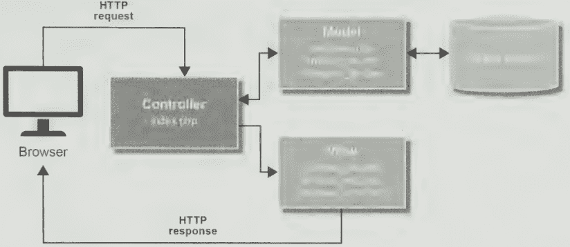

### 描述

-   *MVC（Model-View-Controller）*模式通常用于构造具有重要处理需求的Web应用程序。这使它们更容易编写和维护。
-   *模型*由表示应用程序数据的PHP文件组成。
-   *视图*由表示应用程序用户界面的HTML和PHP文件组成。
-   *控制器*由接收用户请求、从模型获取适当数据并向用户返回适当视图的PHP文件组成。

图5-1 — MVC模式简介

### 如何编写函数

在编写使用MVC模式的代码之前，你需要学习如何编写自己的（自定义）函数，如图5-2所述。为此，你可以使用该图所示的语法。

编写函数名时，必须选择一个唯一的名称。换句话说，一个函数不能与另一个函数同名。此外，函数名不能以数字开头，只能包含字母、数字和下划线（不能有特殊字符）。

在函数的括号内，你可以编写一个可选的*参数列表*，其中包含一个或多个*参数*。当一个函数有多个参数时，用逗号分隔参数。

如果希望函数返回数据，可以在函数体内编写一个*return语句*。该语句结束函数的执行并返回指定的值。

第一个示例是一个名为get_products_by_category的函数，它接受一个参数来指定类别ID。然后，该函数返回一个包含指定类别中产品的数组。为此，第一条语句使用*global*关键字使$db变量（PDO对象）在此函数中可用。这是必要的，因为$db变量是在get_products_by_category函数外部声明的。之后，该函数使用第4章的数据库技术执行SELECT语句，并将结果集的数组存储在$products变量中。然后，return语句返回该变量。

第二个示例是一个名为add_product的函数，它接受四个参数。该函数执行INSERT语句，向数据库添加一个产品行，该行包含四个参数指定的数据。由于此函数不包含return语句，因此不返回任何数据。

要调用函数，你可以编写函数名，后跟一组包含函数所需*参数*的括号。这与调用内置函数的方式相同。编写这些参数时，它们必须与函数参数列表中的参数顺序相同，且数据类型必须兼容。但是，参数不必与参数名称相同，尽管这是常见的编码实践。

函数调用的示例说明了这一点。这里，第一条语句调用get_products_by_category函数并传入一个参数，并将返回的数组存储在一个名为$products的变量中。在此示例中，函数调用将返回的数据存储在一个变量中，该变量与函数return语句中的变量同名。虽然这种编码实践便于记住变量名，但不是必需的。例如，你可以将get_products_by_category函数返回的值存储在一个名为$products_array的变量中。

第二条语句调用add_product函数并传入四个参数。由于该函数不返回任何数据，因此该语句不会尝试将数据存储在变量中。

### 如何编写一个函数

### 语法

```php
function function_name([parameter_list]) {
    // statements that are executed by the function
}
```

### 有一个参数并返回产品数组的函数

```php
function get_products_by_category($category_id) {
    global $db;
    $query = 'SELECT * FROM products
              WHERE products.categoryID = :category_id
              ORDER BY productID';
    $statement = $db->prepare($query);
    $statement->bindValue(":category_id", $category_id);
    $statement->execute();
    $products = $statement->fetchAll();
    $statement->closeCursor();
    return $products;
}
```

### 有四个参数并添加产品的函数

```php
function add_product($category_id, $code, $name, $price) {
    global $db;
    $query = 'INSERT INTO products
              (categoryID, productCode, productName, listPrice)
              VALUES
              (:category_id, :code, :name, :price)';
    $statement = $db->prepare($query);
    $statement->bindValue(':category_id', $category_id);
    $statement->bindValue(':code', $code);
    $statement->bindValue(':name', $name);
    $statement->bindValue(':price', $price);
    $statement->execute();
    $statement->closeCursor();
}
```

### 如何调用函数

### 带一个参数并返回数组的函数调用

```php
$products = get_products_by_category($category_id);
```

### 带四个参数且无返回值的函数调用

```php
add_product($category_id, $code, $name, $price);
```

### 描述

-   当你创建函数时，可以在括号内编写一个参数列表。参数列表包含一个或多个参数。
-   要从函数返回数据，请在函数体中编写return语句。该语句结束函数的执行并返回指定的值。
-   在函数外部声明的变量在函数内部不可用。这称为变量的作用域，你将在第13章中了解更多。现在，你可以使用global关键字使该变量在函数中可用。


## 如何重定向请求

在第2章的图2-16中，您学习了如何使用include函数将请求从一个PHP文件*转发*到另一个文件。转发请求时，所有处理都在服务器上进行。浏览器发出请求后，服务器将请求转发到服务器上的另一个PHP文件，最终将响应返回给浏览器。换句话说，只需要与服务器进行一次往返。

使用MVC模式时，有时您可能需要*重定向*请求而不是转发它。为此，您可以使用图5-3中描述的header函数。您可以使用此函数向浏览器返回包含Location标头的HTTP响应。该标头会使浏览器请求指定的URL。换句话说，这会导致与服务器进行第二次往返。

由于转发请求不需要与服务器进行第二次往返，因此它通常比重定向请求运行得更快。因此，您应尽可能转发请求。但您应该知道，转发请求时，浏览器仍会显示原始页面的URL。

例如，如果名为delete.php的文件将请求转发到list_products.php文件，则在list_products.php文件加载后，delete.php 的 URL 仍会显示在浏览器的地址栏中。如果您认为这会让用户感到困惑，则可以使用重定向。此外，在无法转发请求的情况下，您需要使用重定向。

无法转发请求的一种情况是PHP文件需要再次运行自身。相反，您可以使用header函数将请求重定向到同一文件。这样，浏览器会第二次请求该文件。

第一组示例演示了如何使用header函数将请求重定向到指定的URL。为此，您需要向浏览器发送Location标头。此标头由标头名称、冒号（:）和标头值组成。要重定向到另一个页面，可以将此标头的值设置为相对URL或绝对URL。

要重定向到当前目录，您需要编写一个点（.）。要向上导航一个目录，您需要编写两个点（..）。要向下导航一个或多个目录，您需要编写一个点后跟目录路径。要重定向到与当前文件相同目录中的文件，您可以指定文件名。要重定向到另一台Web服务器，您可以编写一个绝对URL。

第一个重定向示例演示了如何将请求重定向到当前目录。在这里，if语句检查$action变量的值。对于值“delete_product”，此语句从请求中获取产品ID。然后，它调用一个从数据库中删除产品的函数。最后，它使用header函数重定向到当前目录的默认文件。

第二个重定向示例与第一个类似，但它在URL末尾附加了一个参数。更具体地说，它附加了一个名称为category_id、值存储在$category_id变量中的参数。为此，它使用一个问号（?），后跟参数名，再后跟等号（=），最后是参数值。

### 可用于重定向请求的内置函数

| 名称 | 描述 |
|---|---|
| `header($header)` | 向浏览器发送HTTP标头。例如，您可以使用此函数向浏览器发送HTTP Location标头，以将浏览器重定向到另一个URL。 |

### header函数

```php
header('Location: .');          // the current directory
header('Location: ..');         // navigate up one directory
header('Location: ./admin');    // navigate down one directory
header('Location: error.php');
header('Location: http://www.murach.com/');
```

### 如何重定向请求

```php
if ($action == 'delete_product') {
    $product_id = filter_input(INPUT_POST, 'product_id',
                FILTER_VALIDATE_INT);
    if ($product_id != NULL && $product_id != FALSE) {
        delete_product($product_id);
        header("Location: .");
    }
}
```

### 如何重定向包含参数的请求

```php
if ($action == 'delete_product') {
    $product_id = filter_input(INPUT_POST, 'product_id',
                FILTER_VALIDATE_INT);
    $category_id = filter_input(INPUT_POST, 'category_id',
                FILTER_VALIDATE_INT);
    if (($category_id != NULL && $category_id != FALSE) &&
        ($product_id != NULL && $product_id != FALSE)) {
        delete_product($product_id);
        header("Location: .?category_id=$category_id");
    }
}
```

### 说明

- 在第2章的图2-16中，您学习了如何使用include函数将请求从一个PHP文件*转发*到另一个文件。转发请求时，所有处理都在服务器上进行。
- 您可以使用header函数将请求*重定向*到另一个URL。重定向请求时，您会向浏览器返回一个带有Location标头的响应，该标头指定了一个页面。此标头会使浏览器对指定的URL发起新请求。
- header函数和include函数对浏览器地址栏的影响不同。使用include函数时，浏览器将显示原始页面的URL。使用header函数时，浏览器将显示您所重定向到的页面的URL。

图5-3 如何重定向请求

## Product Manager 应用程序

为了演示MVC模式的工作原理，本章展示上一章的Product Manager应用程序在修改以实现MVC模式后的版本。在编程术语中，像这样修改一个应用程序——代码改变但应用程序功能保持不变——被称为_重构_。

由于此应用程序的MVC版本被拆分成更多文件，乍一看可能比原始版本更难理解。然而，一旦您理解了各部分如何组合在一起，我想您会同意MVC版本更易于理解，并且也更容易编码、调试、维护和增强。

### 用户界面

图5-4的第1部分显示了Product Manager应用程序用户界面的两个主要页面。这些页面的工作方式与第4章中的Product Manager应用程序相同。产品列表页面允许用户查看和删除产品，而添加产品页面允许用户添加新产品。

### 产品列表页面

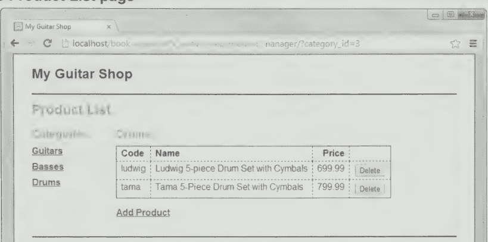

### 添加产品页面

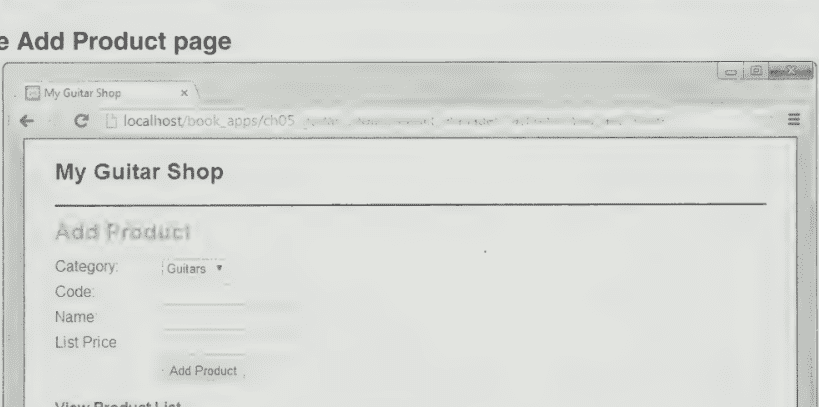

product_db.php文件包含四个与products表一起使用的函数。get_products_by_category函数接受类别ID作为参数。然后，函数体返回一个包含指定类别行的数组。为此，此函数体执行一条SELECT语句，获取所有具有指定类别ID的行。

get_product函数接受产品ID作为参数。然后，函数体返回指定产品的数组。为此，此代码执行一条SELECT语句，获取具有指定产品ID的单个行。然后，它获取该行的数组并返回该数组。

delete_product函数也接受产品ID作为参数。然后，函数体执行一条DELETE语句，删除具有指定产品ID的行。

add_product函数接受四个参数，这些参数指定产品的数据。然后，函数体使用一条INSERT语句将该数据添加到数据库。由于此表的productID列在MySQL中被定义为自动递增列，因此INSERT语句不需要为此列指定值。

请注意，所有这些函数都使用预处理语句来防止可能的恶意输入。此外，下一个图中的代码会在用户输入产品ID、类别ID和价格等数字数据时对其进行验证。这有助于防范SQL注入和XSS攻击。


## product_manager/index.php 文件（控制器）

```php
<?php
require('../model/database.php');
require('../model/product_db.php');
require('../model/category_db.php');

$action = filter_input(INPUT_POST, 'action');
if ($action == NULL) {
    $action = filter_input(INPUT_GET, 'action');
    if ($action == NULL) {
        $action = 'list_products';
    }
}

if ($action == 'list_products') {
    $category_id = filter_input(INPUT_GET, 'category_id',
        FILTER_VALIDATE_INT);
    if ($category_id == NULL || $category_id == FALSE) {
        $category_id = 1;
    }
    $category_name = get_category_name($category_id);
    $categories = get_categories();
    $products = get_products_by_category($category_id);
    include('product_list.php');
} else if ($action == 'delete_product') {
    $product_id = filter_input(INPUT_POST, 'product_id',
        FILTER_VALIDATE_INT);
    $category_id = filter_input(INPUT_POST, 'category_id',
        FILTER_VALIDATE_INT);
    if ($category_id == NULL || $category_id == FALSE ||
        $product_id == NULL || $product_id == FALSE) {
        $error = "Missing or incorrect product id or category id.";
        include('../errors/error.php');
    } else {
        delete_product($product_id);
        header("Location: .?category_id=$category_id");
    }
} else if ($action == 'show_add_form') {
    $categories = get_categories();
    include('product_add.php');
} else if ($action == 'add_product') {
    $category_id = filter_input(INPUT_POST, 'category_id',
        FILTER_VALIDATE_INT);
    $code = filter_input(INPUT_POST, 'code');
    $name = filter_input(INPUT_POST, 'name');
    $price = filter_input(INPUT_POST, 'price', FILTER_VALIDATE_FLOAT);
    if ($category_id == NULL || $category_id == FALSE || $code == NULL ||
        $name == NULL || $price == NULL || $price == FALSE) {
        $error = "Invalid product data. Check all fields and try again.";
        include('../errors/error.php');
    } else {
        add_product($category_id, $code, $name, $price);
        header("Location: .?category_id=$category_id");
    }
}
?>
```

图 5-4 产品管理器应用程序（第 4 部分，共 7 部分）

## 视图

第 5 部分展示了应用程序的 header 和 footer 文件的代码。这些文件是辅助文件，被应用程序中的所有页面使用，并存储在 view 子目录中。

header 文件包含应用程序中网页开始所需的所有标签。其中包括一个 `<link>` 标签，用于指定在整个应用程序中使用的 CSS 文件。为了允许 CSS 文件从应用程序中的任何目录调用，href 属性指定相对于文档根目录（通常是 htdocs 目录）的路径。此外，header 文件还包含一个 `<header>` 标签，用于定义页眉部分。该部分包含一个 `<h1>` 标签，用于显示应用程序的名称：My Guitar Shop。

footer 文件包含一个 `<footer>` 标签，用于定义页脚部分。该部分包含一个 `<p>` 标签，其中包含版权声明。此版权声明包含一个 PHP 标签，用于返回当前年份。为了完成此任务，该 PHP 标签向 date 函数传递了 “Y” 的值，以返回包含当前年份四位数字的字符串。

虽然本图中未显示，但该应用程序的 CSS 文件对页眉和页脚部分应用了格式设置。此格式为页眉添加了底部边框，并为页脚添加了顶部边框。这在视觉上将页眉和页脚部分与展示每个页面界面独特部分的主部分分隔开。

尽管 header 和 footer 文件严格来说并不是 MVC 模式的一部分，但使用此类文件是一种常见的技术，可减少代码重复。这遵循了大多数程序员试图遵循的 DRY（Don’t Repeat Yourself）原则，并使 view 中的文件更易于维护。例如，要更改此网站每个页面的标题，您只需更改 header.php 文件中的 `<title>` 标签即可。或者，要更改网站每个页面底部的版权声明，您只需更改 footer.php 文件中的 HTML 和 PHP 即可。

在本应用程序中，header 和 footer 文件很短。因此，使用它们并不会带来很大的代码减少。然而，header 和 footer 文件可能更长。在这种情况下，使用 header 和 footer 文件可以大幅减少需要维护的代码量。

### view/header.php 文件

```html
<!DOCTYPE html>
<html>
<!-- the head section -->
<head>
    <title>My Guitar Shop</title>
    <link rel="stylesheet" type="text/css"
          href="/book_apps/ch05_guitar_shop/main.css">
</head>

<!-- the body section -->
<body>
<header>
    <h1>My Guitar Shop</h1>
</header>
```

### view/footer.php 文件

```html
<footer>
    <p class="copyright">
        &copy; <?php echo date("Y"); ?> My Guitar Shop, Inc.
    </p>
</footer>
</body>
</html>
```

第 6 部分展示了存储在 `product_manager` 子目录中的 `product_list.php` 文件。该文件定义了产品列表页面。该文件首先包含定义应用程序中每个页面页眉标签的 `header.php` 文件，最后包含定义应用程序中每个页面页脚的 `footer.php` 文件。

在此页面的 `<aside>` 标签中，此代码显示存储在 `$categories` 变量中的类别的类别链接列表。为此，它使用 foreach 循环在无序列表中的链接标签内显示类别名称。然后，该应用程序的 CSS 关闭了此列表的项目符号。

在此页面的 `<section>` 标签中，代码在 `<h2>` 标签中显示存储在 `$category_name` 变量中的类别名称。然后，它使用 HTML 表格显示存储在 `$products` 变量中的产品数据。在这里，该表格的前三列显示每个产品的数据，第四列显示一个 Delete 按钮，允许用户从数据库中删除相应的产品行。此列由一个 `<form>` 标签组成，该标签使用 POST 方法将数据提交到控制器。

在 `<form>` 标签内，此代码使用三个隐藏字段存储参数。第一个存储名称为 “action” 且值为 “delete_product” 的参数。第二个存储名称为 “product_id” 且值为待删除产品的 product_id 的参数。第三个隐藏字段存储名称为 “category_id” 且值为当前类别的 category_id 的参数。最后，此表单包含一个值为 “Delete” 的提交按钮。当用户单击此按钮时，表单将三个参数提交到 index.php 文件，从而导致适当的产品被删除。

在表格之后，此代码使用 `<a>` 标签编写一个链接以显示添加产品页面。为了完成此任务，href 属性向 index.php 文件传递一个名称为 “action” 且值为 “show_add_form” 的参数。因此，index.php 文件显示添加产品页面。

在这一点上，您可能会想知道为什么此代码没有使用 `<a>` 标签直接链接到 add_product.php 文件。原因是 add_product.php 文件期望 `$categories` 变量包含包含类别 ID 和名称的结果集的 PDOStatement 对象。因此，如果您希望添加产品页面正确显示，则必须使用 index.php 文件来显示 add_product.php 文件。这样，index.php 文件就可以在显示添加产品页面之前设置 `$categories` 变量。这也意味着 index.php 文件控制应用程序的逻辑，这正是控制器应该做的。

## product_manager/product_list.php 文件（视图）

```php
<?php include '../view/header.php'; ?>
<main>
    <h1>Product List</h1>

    <aside>
        <!-- display a list of categories -->
        <h2>Categories</h2>
        <nav>
        <ul>
        <?php foreach ($categories as $category) : ?>
            <li>
                <a href="?category_id=<?php echo $category['categoryID']; ?>">
                    <?php echo $category['categoryName']; ?>
                </a>
            </li>
        <?php endforeach; ?>
        </ul>
        </nav>
    </aside>

    <section>
        <!-- display a table of products -->
        <h2><?php echo $category_name; ?></h2>
        <table>
            <tr>
                <th>Code</th>
                <th>Name</th>
                <th class="right">Price</th>
                <th>&nbsp;</th>
            </tr>
            <?php foreach ($products as $product) : ?>
            <tr>
                <td><?php echo $product['productCode']; ?></td>
                <td><?php echo $product['productName']; ?></td>
                <td class="right"><?php echo $product['listPrice']; ?></td>
                <td><form action="." method="post">
                    <input type="hidden" name="action"
                        value="delete_product">
                    <input type="hidden" name="product_id"
                        value="<?php echo $product['productID']; ?>">
                    <input type="hidden" name="category_id"
                        value="<?php echo $product['categoryID']; ?>">
                    <input type="submit" value="Delete">
                </form></td>
            </tr>
            <?php endforeach; ?>
        </table>
        <p class="last_paragraph">
            <a href="?action=show_add_form">Add Product</a>
        </p>
    </section>
</main>
<?php include '../view/footer.php'; ?>
```

## product_manager/product_add.php 文件（另一种视图）

```php
<?php include '../view/header.php'; ?>
<main>
    <h1>Add Product</h1>
    <form action="index.php" method="post" id="add_product_form">
        <input type="hidden" name="action" value="add_product">

        <label>Category:</label>
        <select name="category_id">
        <?php foreach ( $categories as $category ) : ?>
            <option value="<?php echo $category['categoryID']; ?>">
                <?php echo $category['categoryName']; ?>
            </option>
        <?php endforeach; ?>
        </select>
        <br>

        <label>Code:</label>
        <input type="text" name="code" />
        <br>

        <label>Name:</label>
        <input type="text" name="name" />
        <br>

        <label>List Price:</label>
        <input type="text" name="price" />
        <br>

        <label>&nbsp;</label>
        <input type="submit" value="Add Product" />
        <br>
    </form>
    <p class="last_paragraph">
        <a href="index.php?action=list_products">View Product List</a>
    </p>
</main>
<?php include '../view/footer.php'; ?>
```

## 产品列表页面

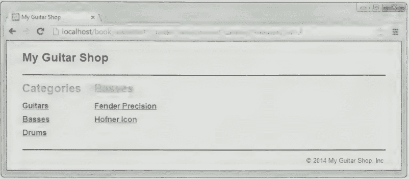

## 产品页面

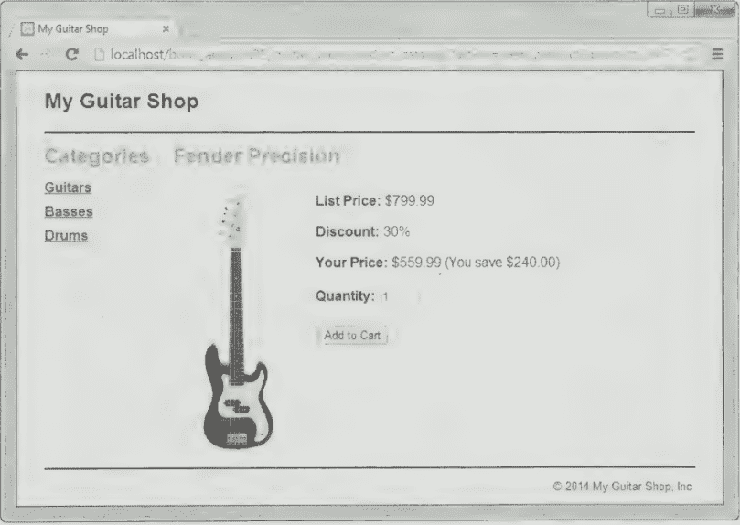

图 5-5 — 产品目录应用程序（第 1 部分，共 4 部分）

## product_catalog/index.php 文件（控制器）

```php
<?php
require('../model/database.php');
require('../model/product_db.php');
require('../model/category_db.php');

$action = filter_input(INPUT_POST, 'action');
if ($action == NULL) {
    $action = filter_input(INPUT_GET, 'action');
    if ($action == NULL) {
        $action = 'list_products';
    }
}

if ($action == 'list_products') {
    $category_id = filter_input(INPUT_GET, 'category_id',
                               FILTER_VALIDATE_INT);
    if ($category_id == NULL || $category_id == FALSE) {
        $category_id = 1;
    }
    $categories = get_categories();
    $category_name = get_category_name($category_id);
    $products = get_products_by_category($category_id);
    include('product_list.php');
} else if ($action == 'view_product') {
    $product_id = filter_input(INPUT_GET, 'product_id',
                               FILTER_VALIDATE_INT);
    if ($product_id == NULL || $product_id == FALSE) {
        $error = 'Missing or incorrect product id.';
        include('../errors/error.php');
    } else {
        $categories = get_categories();
        $product = get_product($product_id);

        // Get product data
        $code = $product['productCode'];
        $name = $product['productName'];
        $list_price = $product['listPrice'];

        // Calculate discounts
        $discount_percent = 30;  // 30% off for all web orders
        $discount_amount = round($list_price * ($discount_percent/100.0), 2);
        $unit_price = $list_price - $discount_amount;

        // Format the calculations
        $discount_amount_f = number_format($discount_amount, 2);
        $unit_price_f = number_format($unit_price, 2);

        // Get image URL and alternate text
        $image_filename = '../images/' . $code . '.png';
        $image_alt = 'Image: ' . $code . '.png';

        include('product_view.php');
    }
}
?>
```

第 4 部分展示了存储在 product_catalog 子目录中的 product_view.php 文件。该文件定义了产品页面。在 `<aside>` 标签中，此代码显示存储在 $categories 变量中的类别的类别链接列表。

请注意，此 `<aside>` 标签代码与产品列表页面中 aside 的代码完全相同。虽然这违反了 DRY 原则，但我决定保留此代码，因为它只重复了一次。然而，如果此代码在更多地方重复，那么将 aside 的代码移至其自己的文件中是有意义的。然后，它可以包含在所有使用它的页面中。这样，aside 的代码就只存储在一个地方。

在页面的 `<section>` 标签中，此代码以 `<h1>` 标签显示 $name 变量中的产品名称。然后，它使用 `<div>` 标签将页面的右侧分为两列。这里，左列显示产品的图像，右列显示产品的数据。此列还显示一个表单，通过将数据提交到 cart 子目录中的默认文件，将产品添加到购物车。

随着你阅读本书的深入，你将学习如何编码购物车应用程序。不过现在，你可以专注于本章介绍的两个应用程序。

## product_catalog/product_view.php 文件（另一种视图）

```php
<?php include '../view/header.php'; ?>
<main>
    <aside>
        <h1>Categories</h1>
        <nav>
            <ul>
                <!-- display links for all categories -->
                <?php foreach($categories as $category) : ?>
                <li>
                    <a href="?category_id=<?php
                        echo $category['categoryID']; ?>">
                        <?php echo $category['categoryName']; ?>
                    </a>
                </li>
                <?php endforeach; ?>
            </ul>
        </nav>
    </aside>
    <section>
        <h1><?php echo $name; ?></h1>
        <div id="left_column">
            <p>
                "
                    alt="<?php echo $image_alt; ?>" />
            </p>
        </div>

        <div id="right_column">
            <p><b>List Price:</b> <?php echo $list_price; ?></p>
            <p><b>Discount:</b> <?php echo $discount_percent; ?>%</p>
            <p><b>Your Price:</b> <?php echo $unit_price_f; ?>
                (You save $<?php echo $discount_amount_f; ?>)</p>
            <form action="<?php echo '../cart' ?>" method="post">
                <input type="hidden" name="action" value="add">
                <input type="hidden" name="product_id"
                    value="<?php echo $product_id; ?>">
                <b>Quantity:</b>
                <input id="quantity" type="text" name="quantity"
                    value="1" size="2">
                <br><br>
                <input type="submit" value="Add to Cart">
            </form>
        </div>
    </section>
</main>
<?php include '../view/footer.php'; ?>
```

### 视角

如果你理解本章中应用程序的工作原理，那么你就已经在通往构建易于编码、测试、调试和维护的数据库驱动应用程序的道路上。然后，你可以通过阅读本书的其他章节来增强你的 PHP 和 MySQL 技能。但首先，第 6 章介绍了你在开发自己的应用程序时所需的测试和调试技能。

### 术语

- MVC (Model-View-Controller) 模式
- 模型
- 视图
- 控制器
- 参数
- 参数列表
- 返回语句

- global 关键字
- 调用函数
- 参数
- 转发请求
- 重定向请求
- 重构
- DRY（Don't Repeat Yourself）原则

### 摘要

- MVC（*Model-View-Controller*）模式通常用于构建具有重要处理需求的 Web 应用程序的结构。
- MVC 模式中的 *model* 由代表应用程序数据的 PHP 文件组成。*view* 由代表应用程序用户界面的 HTML 和 PHP 文件组成。
- MVC 模式中的 *controller* 由从用户获取请求、从模型获取适当数据并向用户返回适当视图的 PHP 文件组成。
- 当你创建函数时，可以在括号内编写 *parameter list*。参数列表包含一个或多个 *parameters*。要从函数返回数据，可以在函数体中编写 *return statement*。
- 在函数外部声明的变量在函数内部不可用。要使变量可用，可以使用 *global* 关键字来标识该变量。
- 当你调用函数时，参数列表中的 *arguments* 必须与 *parameter list* 中的 *parameters* 顺序相同，并且必须具有兼容的数据类型。
- 你可以使用 include 函数将请求从一个 PHP 文件 *forward* 到另一个文件。当转发请求时，所有处理都在服务器上进行。
- 你可以使用 header 函数将请求 *redirect* 到另一个 URL。当重定向请求时，服务器返回一个响应，指示浏览器请求另一个 URL。
- 在编程中，有时将修改应用程序的组织或结构称为 *refactoring*。
- 通常认为避免在应用程序的多个部分重复代码是一种最佳实践。这有时被称为 *DRY (Don’t Repeat Yourself) principle*。


## 练习 5-1 增强 Guitar Shop 应用程序

### 测试 Guitar Shop 应用程序

- 1. 启动 Chrome 浏览器，并运行 `ex_starts/ch05_ex1` 目录中的应用程序。此时应显示一个菜单，让你导航到 Product Manager 应用程序或 Product Catalog 应用程序。

- 2. 使用 Product Manager 应用程序向数据库添加一个新产品：类别为 Guitars，代码为 test1，名称为 Test Product 2211，标价为 550.00。

- 3. 转到 Product Catalog 应用程序。为此，你可以使用返回按钮，或再次运行该应用程序。然后，查看你刚刚添加的产品。请注意，该产品没有显示图像。要解决这个问题，请转到 images 目录，将 `test.png` 文件的名称改为 `test1.png`。

- 4. 再次转到 Product Manager 应用程序。然后，单击页面底部的“List Categories”链接。请注意，这个链接不会显示页面，尽管它的代码是正确的。稍后，当你增强此应用程序的 `index.php` 页面时，你会修复这个问题。现在，单击返回按钮。

### 增强 Product Manager 应用程序

现在，你将向 Product Manager 应用程序添加一个页面，用于添加或删除类别。这与你之前在练习 4-1 中完成的操作类似，但要使用 MVC 模式。新页面应如下图所示：

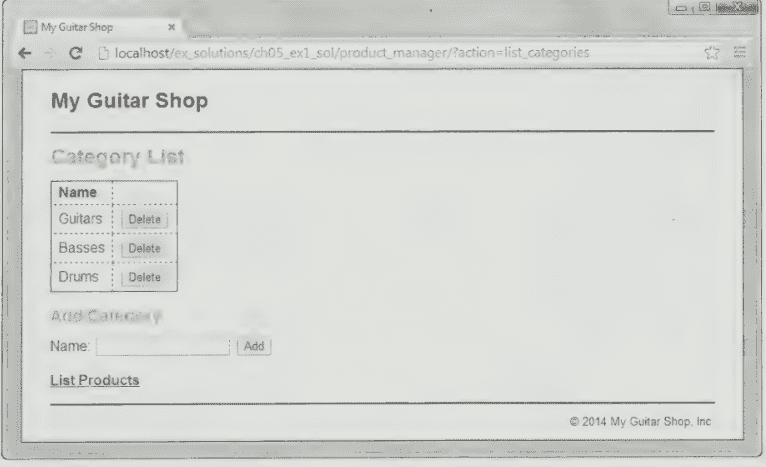

- 5. 打开 `product_manager` 目录中的 `category_list.php` 文件。它包含此页面所需的部分标题，以及一个返回到 Product List 页面的链接。

- 6. 打开 `product_manager` 目录中的 `index.php` 文件，并添加一个显示 Category List 页面的操作。然后进行测试，确保它能正常工作。此时，页面应只显示部分标题。

- 7. 在 `category_list.php` 文件中，编写代码以创建上面所示的类别表：第一列显示所有类别名称，第二列显示 Delete 按钮。然后进行测试，确保页面能正确显示该表。

- 8. 在 `category_list.php` 文件中，编写允许用户向数据库添加类别的代码。此代码应包含一个表单，用于输入新类别的名称，其后是一个显示“Add”的提交按钮。

- 9. 打开 `model/category_db.php` 文件，并向其中添加两个函数，分别用于添加和删除类别。

- 10. 打开 `product_manager` 目录中的 `index.php` 文件，并向其中添加两个新操作。第一个操作应向数据库添加类别。第二个操作应从数据库删除类别。

提示：要在添加或删除类别后返回 Category List 页面，你可以向控制器传递一个操作，语句如下：

```
header('Location: .?action=list_categories');
```

- 11. 通过添加两个类别来测试应用程序。然后，导航到 Add Product 页面，注意下拉列表中包含了新类别。

- 12. 通过删除你刚刚添加的类别来测试应用程序。但是，不要删除任何现有类别，因为那样会导致产品没有类别。不过，如有必要，你可以按照附录中的说明，再次运行 `create_db.sql` 脚本来恢复数据库。

- 13. 如果你的页面格式与上图不完全一致，也不必担心。这里的重点是 Web 编程，而不是 HTML 和 CSS。

### 重构 Product Catalog 应用程序

- 14. 打开 `product_catalog` 目录中的 `product_list.php` 和 `product_view.php` 文件。请注意，这些文件在 `<nav>` 标签中使用了相同的代码，用于显示每个类别的导航链接列表。

- 15. 在 `view` 目录中创建一个名为 `categories_nav.php` 的文件，并将 `product_list.php` 文件中 `<nav>` 标签的所有代码复制到 `categories_nav.php` 文件中。然后，用适当的 include 语句替换 `product_list.php` 和 `product_view.php` 文件中 `<nav>` 标签的代码。

- 16. 测试这些更改，确保重构后的代码能正常工作。

## 6 如何测试和调试 PHP 应用程序

在构建 PHP 应用程序时，你需要对其进行测试，以确保它能够按预期运行。然后，如果出现任何问题，你需要调试应用程序以修正这些问题。本章将介绍如何仅使用文本编辑器和浏览器来完成这些工作，同时也会说明使用 NetBeans 等 IDE 如何让调试变得更轻松。

| 章节 | 页码 |
| --- | --- |
| **测试与调试简介** | 192 |
| PHP 应用程序的典型测试阶段 | 192 |
| 可能发生的三类错误 | 192 |
| 常见的 PHP 错误 | 194 |
| 跟踪 PHP 代码执行的简便方法 | 196 |
| **如何使用 xDebug 和 NetBeans 进行调试** | 198 |
| 如何设置和移除断点 | 198 |
| 如何单步执行代码 | 200 |
| 如何检查变量 | 200 |
| 如何检查堆栈跟踪 | 202 |
| **小结** | 204 |

### 测试与调试简介

当你*测试*应用程序时，你会运行它以确保它能正确工作。

在测试应用程序时，你会尝试输入数据和用户操作的每一种可能组合，以确保应用程序在各种情况下都能正常工作。换句话说，测试的目标是让应用程序失败。

当你*调试*应用程序时，你要修复在测试过程中发现的错误（*bug*）。每次修复一个 bug 后，你都要再次测试，以确保所做的修改不会影响应用程序的其他方面。

### PHP 应用程序的典型测试阶段

测试应用程序时，通常会分阶段进行，如图 6-1 中总结的三个阶段。

在第一阶段，测试用户界面时，你应该目视检查各个控件，确保它们以正确的文本正常显示。然后，你应该确保所有按键和控件都能正常工作。例如，你应该测试 Tab 键和 Enter 键，以及复选框和下拉列表的操作。

在第二阶段，你应该使用有效数据测试应用程序。首先，你可以输入你预期用户会输入的数据。但在完成之前，你应该输入能够测试应用程序所有边界的有效数据。

在第三阶段，你要竭尽全力让应用程序失败，测试你能想到的无效数据和用户操作的每一种组合。这应包括一些随机操作，比如按 Enter 键或在错误的时间点击鼠标。

### 可能发生的三类错误

在测试应用程序时，可能会出现三种类型的错误。图 6-1 描述了这些错误。

由于*语法错误*会阻止应用程序运行，因此它们最容易发现和修复。如果你使用的是 IDE，它通常会在你运行应用程序之前就识别出这类错误。否则，PHP 解释器将无法解析脚本，从而显示相应的错误消息。

*运行时错误*不违反语法规则，但会导致 PHP 解释器显示错误。这些错误可能是不会停止脚本执行的警告，也可能是会停止脚本执行的致命错误。无论哪种情况，显示的错误消息通常都能帮助你找到并修复错误。

*逻辑错误*可能来自很多地方，而且通常是最难以发现和修复的。计算错误或对用户操作的处理不正确，只是逻辑错误潜入应用程序的两种方式。例如，此图中的 Product Discount 应用程序就有一个逻辑错误。你能看出它是什么吗？


## 存在逻辑错误的商品折扣应用程序

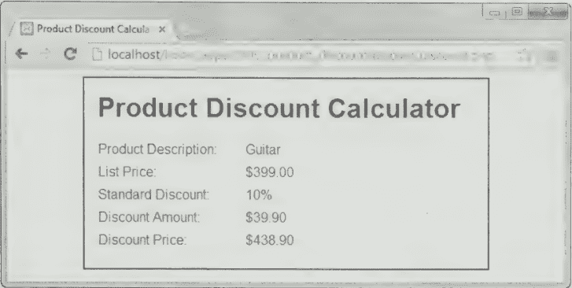

### 测试的目标

- 在应用程序投入生产之前找到所有错误。

### 调试的目标

- 在应用程序投入生产之前修复所有错误。

### 三个测试阶段

- 检查用户界面以确保其正常工作。
- 使用有效输入数据测试应用程序以确保结果正确。
- 使用无效数据或意外的用户操作测试应用程序。尝试你能想到的所有方法使应用程序失败。

### 可能出现的三种错误类型

- *语法错误*违反了 PHP 语句必须如何编写的规则。这些错误会导致 PHP 解释器显示错误并停止脚本的执行。
- *运行时错误*不违反语法规则，但会导致 PHP 解释器显示错误，该错误可能停止也可能不停止脚本的执行。
- *逻辑错误*是不会导致语法或运行时错误但会产生错误结果的语句。

### 描述

- 要*测试* PHP 应用程序，你运行它以确保无论输入什么有效或无效数据的组合或使用什么控件序列，它都能正常工作。
- 当你*调试*应用程序时，你会找到并修复在测试应用程序时发现的所有错误（*bug*）。

Figure 6-1    测试和调试简介

## 常见的 PHP 错误

Figure 6-2 展示了一些在编写 PHP 应用程序时常犯的编码错误。到目前为止，你在做练习时可能已经犯过其中大部分错误。但如果你研究本图，你将更好地了解需要注意什么。

本图顶部的代码检查用户输入的价格。然而，这段代码有三个错误。第一个在第一行。这里，使用了赋值运算符（=）来检查相等性，而不是相等运算符（==）。第二个错误是字符串字面量以双引号开头以单引号结尾。第三个错误是 else 子句中的语句没有以分号结尾。

本图中的 NetBeans 编辑器显示了该 IDE 如何显示此代码。这里，语句左侧的错误标记（红色圆圈）表示语法错误。在此示例中，光标位于其中一个错误标记之上，因此显示了相关的错误消息。

但是请注意，这些错误标记并不在出错的语句上。这表明 NetBeans 并未正确识别某些错误。在这种情况下，你需要查看错误标记上方的语句，看看什么代码可能导致了错误。随着你修复这些错误，下方语句上的错误标记将会消失。不过在大多数情况下，NetBeans 会在你输入语句时标记你的错误，以便你立即纠正。

### 包含错误的 PHP 代码

```php
// validate the list price entry
if ( $list_price = NULL || $list_price == FALSE ) {
    $error = "Please enter a valid number.';
} else {
    $error = ''
}
```

### NetBeans 中的包含错误的 PHP 代码

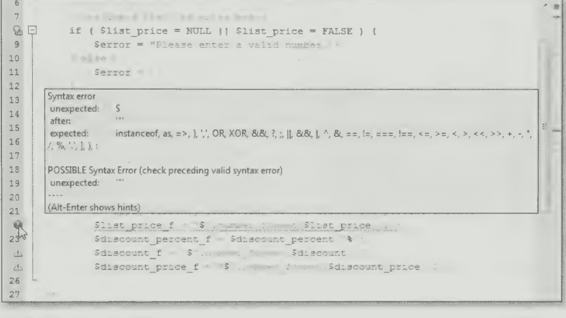

### 常见的语法错误

- 拼写关键字错误。
- 忘记打开或关闭括号、方括号、大括号或注释字符。
- 忘记用分号结束 PHP 语句。
- 忘记打开或关闭引号。
- 未使用相同的打开和关闭引号。

### 变量名问题

- 拼写变量名错误或大小写不正确。
- 使用关键字作为变量名。

### 值问题

- 在处理之前未检查值是否为正确的数据类型。例如，你期望用户输入一个数字，但用户输入了一个名称。
- 在测试相等性时使用一个等号而不是两个。

Figure 6-2  常见的 PHP 错误

## 追踪 PHP 代码执行的一种简便方法

当你*追踪*应用程序的执行时，你在代码的关键点添加语句以显示消息或变量值。这通常是为了帮助你找到逻辑错误的原因。

例如，如果你无法弄清楚 Future Value 应用程序计算出的未来值为何不正确，你可以按照图 6-3 所示在应用程序的代码中插入 echo 语句。这些语句在 for 循环代码执行时显示两个变量的值。这应该有助于你确定计算出错的位置。然后，当你找到并修复问题后，可以删除 echo 语句。

在此示例中，追踪语句显示循环执行了正确次数。它还显示每次循环后的未来值，以便你确保循环内的计算正确。在此示例中，$10,000 在 5% 利率下第一年的价值为 $60,000，因此很明显循环内的计算是错误的，而不是循环次数。

使用此技术时，你通常先在代码中添加几个 echo 语句。然后，如果这没有帮助你解决问题，你可以添加更多。这对于简单应用程序效果很好，但也有其局限性。然后，在接下来的几幅图中，你将学习如何使用像 NetBeans 这样的 IDE 在无需编写然后删除 echo 语句的情况下获得相同的结果。

### 用于追踪代码执行的带 echo 语句的 PHP

```php
// calculate the future value
$future_value = $investment;
echo '$future_value: ' . $future_value . '<br>';
echo '$interest_rate: ' . $interest_rate . '<br>';
echo '$years: ' . $years . '<br>';
echo 'For loop for calculating future value is starting...<br><br>';
for ($i = 1; $i <= $years; $i++) {
    $future_value = ($future_value + ($future_value * $interest_rate));
    echo '$i: ' . $i . '<br>';
    echo '$future_value: ' . $future_value . '<br>';
}
```

### 浏览器中显示的数据

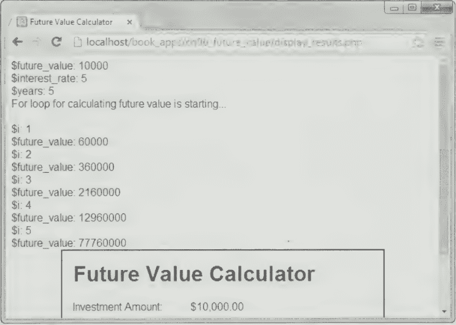

### 描述

- 追踪 PHP 应用程序执行的一种简便方法是 在代码的关键点插入 echo 语句。
- echo 语句可以显示变量的值或显示指示正在执行代码的哪一部分的消息。
- 当你看到显示的错误值时，很可能你在当前 echo 语句和前一个语句之间存在逻辑错误。

Figure 6-3 — 追踪 PHP 代码执行的一种简便方法

## 如何使用 xDebug 和 NetBeans 调试

XAMPP 包含一个功能强大的调试工具，或 *调试器*，名为 xDebug，你可以将其与 NetBeans 等 IDE 一起使用。但是，在你可以使用 xDebug 与 NetBeans 之前，必须按照附录中所述配置 xDebug。

以下主题展示了如何将此调试器与 NetBeans 一起使用。如果你不使用 NetBeans，当然可以跳过这些主题。但如果你对 IDE 能做什么感兴趣，你可能仍想阅读它们。

### 如何设置和移除断点

调试应用程序的第一步是弄清楚是什么导致了 bug。为此，在应用程序执行时查看不同点的变量值通常很有帮助。这有助于你确定 bug 的原因，这对调试应用程序至关重要。

在应用程序的特定点查看变量的最简单方法是设置一个*断点*，如图 6-4 所示。为此，你在代码编辑器窗口中点击代码行左侧的垂直栏。然后，断点由栏中的红色方块标记。稍后，当你使用调试器运行应用程序时，执行会在断点处的语句执行前停止，你可以查看该点应用程序中可用的变量。

在调试时，重要的是在导致 bug 的行或行之前设置断点。有时，你可以通过阅读应用程序停止时浏览器中显示的运行时错误来决定在哪里设置断点。其他时候，你可能需要在找到断点的合适位置之前做一些实验。在本图示例中，断点设置在 Future Value 应用程序中 for 循环之前的语句上。

设置断点后，你需要附加调试器运行应用程序。为此，你可以使用工具栏上的 Debug Project 按钮（位于 Run Project 按钮的正右侧）。或者，如果你想调试的不是主项目，你可以在 Projects 选项卡中右键单击项目文件夹并选择 Debug 命令。

当你使用调试器运行应用程序时，NetBeans 会显示下一幅图中所示的调试窗口和按钮。使用调试器运行应用程序后，断点仍保留在你设置的位置。如果你想移除断点，可以通过点击断点的红色方块来完成。


## 如何单步执行代码

当你使用调试器运行应用程序时，浏览器会像往常一样打开，但页面不会加载。这是因为调试器已暂停了应用程序的执行。切换回 NetBeans，你会看到调试器已停在应用程序中的第一条 PHP 语句处。

此时，你可以使用调试工具栏中的按钮来继续程序的执行。这些按钮及其对应的快捷键在图 6-5 中进行了总结。例如，你可以点击“继续”按钮，使代码继续执行，直到遇到下一个断点。

如果你使用工具栏按钮继续执行，请确保你点击的是“继续”按钮（绿色圆圈内有一个白色三角形），而不是“运行项目”按钮（绿色三角形）。这两个按钮看起来很相似，但如果你点击“运行项目”，你将启动应用程序的另一个实例，而不是调试已经启动的那个实例。当然，如果你使用 F5 快捷键而不是工具栏按钮，就不必担心这个问题。

当执行停止时，一个绿色箭头会标记下一个要执行的语句。然后，你可以使用其他工具栏按钮或快捷键来单步执行 PHP 代码。当你单步执行代码时，代码编辑器下方的“变量”窗口会显示在该执行点可用的变量值。

例如，你可以使用“单步跳过”和“单步进入”按钮一次一条语句地逐步执行应用程序中的语句。这让你可以精确地观察到变量值在应用程序执行过程中如何以及何时发生变化，从而帮助你确定缺陷的原因。一旦你完成了感兴趣代码的单步执行，你可以点击“继续”按钮，使执行继续直到遇到下一个断点。或者，你可以点击“结束调试会话”按钮来结束应用程序的执行。

在单步执行程序时，每当浏览器需要用户输入时，你需要切换到浏览器。然后，在你进行这些输入并点击相应的链接或按钮之后，你需要切换回 NetBeans 以继续单步执行代码。

## 如何检查变量

当你设置断点并单步执行代码时，“变量”窗口会自动显示可用的变量。在此图的示例中，执行点位于 display_results.php 文件中。因此，该文件的所有变量都可用。

只要“变量”窗口打开，你还可以查看超全局变量，因为它们始终可用。为此，你可以点击名为 Superglobals 的变量左侧的加号来展开它。然后，你可以查看超全局变量列表，包括 $_GET 和 $_POST 数组，并且可以展开这些变量以查看它们包含的值。

显示变量的调试会话

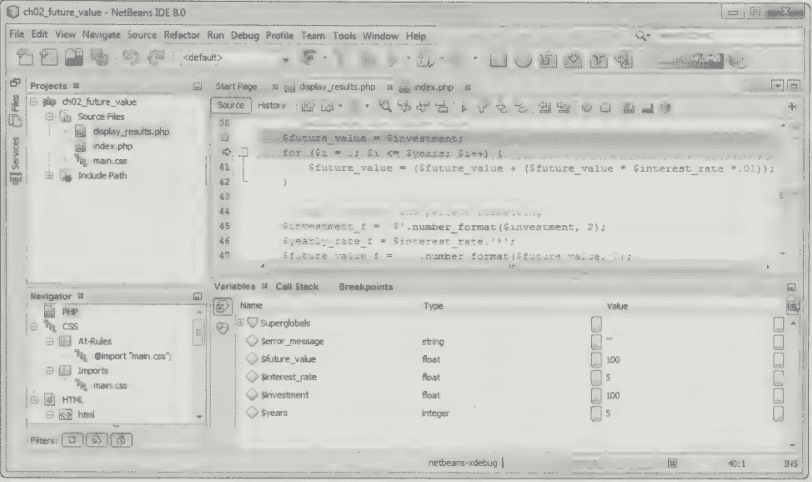

用于单步执行代码的工具栏按钮和快捷键

| 按钮 | 快捷键 | 描述 |
|---|---|---|
| 调试项目 | Ctrl+F5 | 启动当前项目的调试器。 |
| 继续 | F5 | 运行直到到达下一个断点。 |
| 单步进入 | F7 | 一次一条语句地单步执行代码。 |
| 单步跳过 | F8 | 与“单步进入”相同，但不单步执行函数。 |
| 单步跳出 | Ctrl+F7 | 跳出你已经进入的函数。 |
| 结束调试会话 | Shift+F5 | 停止调试器。 |

描述

- 当你开始调试会话时，NetBeans 会停在它遇到的第一条 PHP 语句处。此时，你可以使用调试工具栏中的按钮来继续程序的执行。
- 当应用程序的浏览器需要用户操作或输入时，你需要切换到浏览器，执行操作或进行输入，然后切换回 NetBeans。
- 当达到断点时，程序执行会在该行执行之前停止。
- 在代码编辑器窗口中，箭头显示接下来要执行的行。
- “变量”窗口显示当前可用的变量值。
- 如果像 Superglobals 这样的变量包含其他变量，你可以通过点击其加号来查看该变量内的值。

图 6-5 — 如何单步执行代码并检查变量

## 如何检查堆栈跟踪

当你进行调试时，查看*堆栈跟踪*有时很有帮助，堆栈跟踪是一个按调用相反顺序列出的函数列表。要使用 NetBeans 进行此操作，你可以使用“调用堆栈”窗口，如图 6-6 所示。当你显示此窗口时，你可以点击调用堆栈中的任何函数来显示该函数，并高亮调用下一个函数的代码行。如果有必要，这会打开一个新的代码编辑器窗口。虽然这对于不使用许多函数的小型应用程序来说用处不大，但在调试大型应用程序时可能会很有用。

显示堆栈跟踪的调试会话

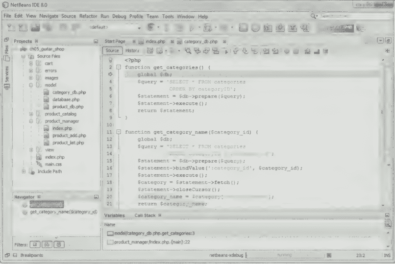

描述

- “调用堆栈”窗口显示*堆栈跟踪*，这是一个按调用相反顺序列出的函数列表。
- 你可以点击这些函数中的任何一个，以在代码编辑器窗口中显示该函数的代码，并在“变量”窗口中显示该函数的变量。

图 6-6 — 如何检查堆栈跟踪

### 观点

对于相对简单的应用程序，你可以使用文本编辑器和追踪语句来测试和调试应用程序。然而，随着应用程序变得更加复杂，使用像 NetBeans 这样的 IDE 以及像 xDebug 这样的调试器可以帮助你更高效地进行调试。

### 术语

- 测试
- 调试
- 缺陷
- 语法错误
- 运行时错误
- 逻辑错误
- 追踪
- 调试器
- 断点
- 堆栈跟踪

### 摘要

- *测试*的目标是找出应用程序中的所有错误。*调试*的目标是在应用程序投入生产之前修复所有错误。
- 测试应用程序时可能发生三种类型的错误：*语法错误*、*运行时错误*和*逻辑错误*。
- 你可以通过在适当的位置插入 echo 语句来*追踪*应用程序的执行。这些语句可以显示表明正在发生什么的消息或变量的值。
- XAMPP 包含一个名为 XDebug 的*调试器*，它可以与像 NetBeans 这样的 IDE 一起使用。
- 使用调试器时，你可以设置*断点*，一次一条语句地单步执行代码，并检查每一步中可用变量的值。
- 使用调试器时，你可以获得一个*堆栈跟踪*，它按调用相反的顺序列出函数。

### 练习 6-1 使用 echo 语句进行追踪

在本练习中，你将使用 echo 语句追踪 Future Value 应用程序的执行。

1. 打开存储在 `ex_starts\ch06_ex1` 目录中的 Future Value 应用程序的 `display_results.php` 文件。
2. 添加类似图 6-3 中的 echo 语句来追踪代码的执行。然后运行应用程序，看看 echo 语句是如何工作的。

### 练习 6-2 使用 NetBeans 单步执行 Future Value 应用程序

在本练习中，你将使用 NetBeans 配合 xDebug 设置断点，并单步执行第 2 章的 Future Value 应用程序。不过，在执行此操作之前，请确保你已经按照附录中的描述配置了 xDebug 以配合 NetBeans 工作。

1. 启动 NetBeans，打开 `ex_starts` 目录中的 ch06_ex2 应用程序。然后在编辑器中打开 `display_results.php` 文件。
2. 在 `display_results.php` 文件中，计算未来值的 for 循环之前的语句上设置断点。
3. 右键单击项目，选择“调试”命令开始调试。如果这显示一个对话框，警告防火墙已阻止 NetBeans 的某些功能，请允许 NetBeans 在专用和/或域网络上通信。
4. 浏览器打开后，切换回 NetBeans。调试器应该会在它遇到的第一条 PHP 语句处停止应用程序。然后，反复点击“单步进入”按钮，单步执行代码，直到显示第一个网页。
5. 切换到浏览器查看第一页。然后输入有效值，点击“计算”按钮，再切换回 NetBeans。应用程序应该会在它遇到的下一条 PHP 语句处停止。
6. 点击“单步进入”按钮执行三个语句。然后，点击“变量”选项卡以显示当前变量。
7. 在“变量”选项卡中，点击 Superglobals 变量的加号，并点击 $_POST 数组的加号。这将显示传递给服务器的三个用户输入的值。
8. 点击“继续”按钮，继续到你设置的断点。然后使用“单步进入”按钮执行循环。注意执行循环时，“变量”选项卡中的变量如何变化。
9. 点击“继续”按钮完成计算并显示下一个网页。要查看此页面，请切换到浏览器。
10. 再次运行应用程序，并在单步执行应用程序代码时尝试使用“单步进入”、“单步跳过”和“单步跳出”按钮。在每一步，注意“变量”选项卡中显示的值。
11. 实验完成后，移除断点，点击“结束调试会话”按钮。关闭浏览器，然后关闭项目。


## 练习 6-3 使用 NetBeans 单步执行 Guitar Shop 应用

在本练习中，你将使用 NetBeans 和 xDebug 设置断点并单步执行第 5 章的 Guitar Shop 应用。这将帮助你理解 MVC 应用中的控制流。

- 1. 启动 NetBeans，并打开位于 `ex_starts` 目录中的 `ch06_ex3` 应用。
- 2. 在 `product_manager` 目录中打开 `index.php` 文件。然后，在 `if` 语句的第一行设置断点。
- 3. 运行调试器并单步执行应用。根据需要在 NetBeans 和浏览器之间切换。
- 4. 显示变量窗口并注意变量如何显示以及在单步执行应用时如何变化。
- 5. 使用 Step Into 按钮并注意 NetBeans 如何在必要时在文本编辑器中打开源代码文件。
- 6. 使用 Continue 按钮并注意它如何根据你在应用中的位置显示浏览器或跳到你在第 2 步中设置的断点。
- 7. 实验结束后，结束调试会话，移除断点并关闭项目。

## 7 如何处理表单数据

在第 2 章中，你学习了从表单获取数据并在网页上显示数据的简单技术。现在，本章回顾这些技术。它还介绍了从表单控件获取数据并在网页上显示数据的一些新技术。

- **如何从表单获取数据** ... 210
  - 如何从文本框、密码框和隐藏字段获取数据 ... 210
  - 如何从单选按钮获取数据 ... 212
  - 如何从复选框获取数据 ... 214
  - 如何从一组复选框获取数据 ... 216
  - 如何从下拉列表获取数据 ... 218
  - 如何从列表框获取数据 ... 220
  - 如何从文本区域获取数据 ... 222
- **如何在网页上显示数据** ... 224
  - 如何格式化特殊字符 ... 224
  - 如何格式化换行 ... 226
  - 如何使用 echo 和 print 语句显示数据 ... 228
- **视角** ... 230

### 如何从表单获取数据

HTML 表单可以包含多种类型的控件，例如文本框、单选按钮、复选框、下拉列表和文本区域。正如你在第 2 章中所学，当包含这些控件的表单提交到服务器时，控件中的数据会作为名称/值对的数组传递给服务器。以下主题展示了如何在你的 Web 应用中使用这些控件。

#### 如何从文本框、密码框和隐藏字段获取数据

图 7-1 展示了如何使用三种类型的控件获取文本输入。这些控件都是使用 HTML `<input>` 标签创建的。

*文本框*，也称为 *文本字段*，是表单最常见的控件类型。姓名、地址和电话号码只是你可以用文本字段收集的数据类型中的几个。

*密码框*，也称为 *密码字段*，与文本字段类似，只是用户输入时文本不会在屏幕上显示。相反，每个字符都会显示一个圆点字符。这种字段类型适用于输入 *敏感* 数据，例如密码和 PIN 号码。

*隐藏字段* 是不会在网页上显示的文本字段。程序员经常使用隐藏字段将数据从一个网页传递到另一个网页。

当你为控件编码 name 属性时，必须遵循命名 PHP 变量的规则，只是没有初始的美元符号。例如，在此图中，用户名字段的 name 属性为 `user_name`，其数据存储在名为 `$user_name` 的变量中。虽然你不必为变量使用与控件相同的名称，但这被认为是一种良好的编码实践。

对于文本字段，你可以使用 value 属性为字段提供默认值。由于你通常不希望为密码字段提供默认值，因此此属性通常不与密码字段一起使用。然而，value 属性对于隐藏字段是必要的，因为用户无法在此类字段中输入值。

此图展示了如何使用 GET 和 POST 方法从表单获取数据。由于代码中唯一的区别是将 `filter_input` 函数的类型参数从 `INPUT_GET` 更改为 `INPUT_POST`，因此本章其余的图仅显示 POST 方法。

如果表单使用 GET 方法，浏览器会在其 URL 中显示控件的数据。由于这不安全，因此如果表单包含密码字段或其他你不想在 URL 中显示的敏感数据，通常会使用 POST 方法。

除了这些输入字段外，HTML5 还引入了更多字段，例如用于电子邮件地址的“email”、用于 URL 的“url”以及用于电话号码的“tel”。受支持的浏览器可能会为这些控件添加功能，例如数据验证。例如，对于电子邮件地址，如果用户输入无效的电子邮件地址，浏览器可能会显示错误消息。然而，如果你想要更多

**获取文本输入的 HTML `<input>` 标签的属性**

| 属性 | 描述 |
|---|---|
| **type** | 设置为“text”表示文本字段，“password”表示密码字段，或“hidden”表示隐藏字段。默认值为“text”。此外，还有更多 HTML5 类型，包括用于电子邮件地址的“email”、用于 URL 的“url”以及用于电话号码的“tel”。 |
| **name** | 表单提交时字段的名称。 |
| **value** | 字段的值。对于隐藏字段，必须设置此属性才能使字段正常工作。 |

**三种类型字段的 HTML**

```html
<input type="text" name="user_name" value="rharris">
<input type="password" name="password">
<input type="hidden" name="action" value="login">
```

**浏览器中的文本和密码字段**


**使用 GET 方法时的 URL**

```text
process_data.php?user_name=rharris&password=s3cr3t72&action=login
```

**GET 方法的 PHP**

```php
<?php
    $user_name = filter_input(INPUT_GET, 'user_name');
    $password = filter_input(INPUT_GET, 'password');
    $action = filter_input(INPUT_GET, 'action');
?>
```

**使用 POST 方法时的 URL**

```text
process_data.php
```

**POST 方法的 PHP**

```php
<?php
    $user_name = filter_input(INPUT_POST, 'user_name');
    $password = filter_input(INPUT_POST, 'password');
    $action = filter_input(INPUT_POST, 'action');
?>
```

**描述**

- *文本框* 允许用户在框中输入数据。
- *密码框* 允许用户在框中输入数据，但它会隐藏用户输入的字符。这可以防止敏感数据在屏幕上显示。
- *隐藏字段* 允许程序员向表单添加额外的名称/值对。
- 如果表单使用 GET 方法，字段的数据会显示在 URL 中。

*图 7-1 — 如何从文本框、密码框和隐藏字段获取数据*

#### 如何从单选按钮获取数据

**单选按钮的 HTML `<input>` 标签属性**

| 属性 | 描述 |
|---|---|
| `type` | 设置为“radio”表示单选按钮。 |
| `name` | 组中所有单选按钮必须使用相同的名称。 |
| `value` | 单选按钮的值。此属性对于单选按钮正常工作是必要的。 |
| `checked` | 此可选属性选择默认的单选按钮。 |

**一组三个单选按钮的 HTML**

```html
<input type="radio" name="card_type" value="visa" checked> Visa<br>
<input type="radio" name="card_type" value="mastercard"> MasterCard<br>
<input type="radio" name="card_type" value="discover"> Discover
```

**浏览器中的单选按钮**


**访问单选按钮组的 PHP**

```php
<?php
    $card_type = filter_input(INPUT_POST, 'card_type');
?>
```

**为没有默认按钮的组添加默认值的 PHP**

```php
<?php
    $card_type = filter_input(INPUT_POST, 'card_type');
    if ($card_type == NULL) {
        $card_type = 'unknown';
    }
?>
```

**描述**

- *单选按钮允许用户从一组选项中选择一个选项。*
- *如果组中没有任何单选按钮被选中，则该组的名称/值对不会作为表单的一部分提交到服务器，并且 `filter_input` 函数返回 NULL。*
- *如果你为多个单选按钮编码 checked 属性，浏览器在页面加载时会选择最后一个单选按钮。*

*图 7-2. 如何从单选按钮获取数据*


## 如何从复选框中获取数据

复选框允许用户选择一个选项。要创建复选框，可使用 `<input>` 标签，如图7-3所示。

该图中的HTML显示了三个复选框。与单选按钮不同，复选框的 name 属性值应互不相同，而且你不必设置 value 属性。在该图中，第一个复选框包含 checked 属性，因此网页加载时默认选中。

在许多情况下，你不希望复选框默认为选中状态。例如，你不应默认选中表示用户希望加入邮件列表的复选框。这样一来，如果该复选框被选中，你就能确定是用户手动勾选的，且确实希望加入邮件列表。

该图中的PHP演示了如何处理复选框的数据。对于每个复选框，它使用 isset 函数返回一个布尔值，以指示 `$_POST` 数组中是否设置了对应的键值对。如果复选框已被选中，则该键值对会存在于数组中，因此变量中存储 TRUE；否则存储 FALSE。

如果你使用 NetBeans IDE，它可能会在包含 isset 函数的代码行旁边显示警告图标。这是因为 NetBeans 不希望你直接操作 `$_POST` 数组，因为 `$_POST` 数组可能包含来自用户的恶意数据。然而，在这种情况下，你并不是在检索或处理 `$_POST` 数组中的数据，只是在检查某个值是否存在。因此，忽略 NetBeans 的警告是没有问题的。

### HTML `<input>` 标签的复选框属性

| 属性 | 描述 |
|---|---|
| `type` | 对于复选框，设置为“checkbox”。 |
| `name` | 每个复选框必须使用不同的名称。但是，如果要定义复选框数组，可以使用相同的名称，如下一图所示。 |
| `value` | 复选框被选中时使用的文本。只有在你处理下一图所述的复选框数组时，才需要此属性。 |
| `checked` | 该可选属性用于选中复选框。 |

### 三个复选框的HTML

```html
<input type="checkbox" name="pep" checked> Pepperoni<br>
<input type="checkbox" name="msh"> Mushrooms<br>
<input type="checkbox" name="olv"> Olives
```

### 浏览器中的复选框


### 用于访问复选框数据的PHP

```php
<?php
    $pepperoni = isset($_POST['pep']);
    $mushrooms = isset($_POST['msh']);
    $olives = isset($_POST['olv']);
?>
```

### 说明

- *复选框*允许用户选择一个选项。
- 如果复选框被选中，isset 函数返回 TRUE，否则返回 FALSE。

## 如何从复选框数组获取数据

在上一图中，三个复选框具有唯一的名称，并分别进行处理。然而，由于这些复选框表示披萨的不同配料，它们实际上是相关的。此外，如果配料数量增加，分别处理每个复选框将变得繁琐。

幸运的是，PHP 提供了一种机制，可以将多个复选框的值合并到一个数组中。这样你可以使用循环来处理相关的复选框，从而使代码更易于扩展和维护。

图7-4展示了如何将多个复选框的值合并到一个数组中。为此，该代码对所有相关复选框使用相同的名称，并在名称末尾添加一对方括号，以表示这些复选框应存储在一个数组中。

当数据提交时，PHP 在读取第一个以方括号结尾的复选框名称时创建数组。然后，它将该复选框的值添加到数组中。当它读取另一个具有相同名称的复选框时，也会将该值附加到数组中。处理完成后，PHP 会将该数组嵌套在 `$_GET` 或 `$_POST` 数组中。

该图中的HTML将上一图中的三个复选框重写为一个复选框数组。与上一图不同，这段代码包含了这些复选框的值。PHP 使用这些值来标识复选框并指示其已选中。通常，该值对应数据库表中的主键。这样，该值就可用于查找有关所选复选框的更多信息。

如果你使用 NetBeans，它可能会警告你直接访问 `$_POST` 数组。在这种情况下，你将使用复选框的值，因此应留意该警告。要做到这一点，你可以使用 filter_input 函数获取指定数组中的所有项，并对它们应用过滤器以确保安全。然而，要使用 filter_input 函数获取数组，你必须将 `FILTER_REQUIRE_ARRAY` 常量作为第四个参数提供。否则，filter_input 函数将无法正确获取数组。

第一个 PHP 示例使用 filter_input 函数从 `$_POST` 数组中获取名为 top 的数组，并将其存储到名为 `$toppings` 的变量中。此外，这段代码为第三个参数提供了一个常量，该常量会将一些特殊字符（如 < 和 >）替换为 HTML 实体，从而有助于防范 XSS 攻击。然后，这段代码使用 if 语句检查 `$toppings` 数组是否至少包含一个元素。如果是，接下来的三条语句将访问 `$toppings` 数组中的前三个值。

然而，这种方法存在一个问题。如果只选中了两个或更少的复选框，访问数组中值的三条语句就会抛出错误。这是因为数组只包含与被选中复选框相对应的值。因此，通常使用 foreach 循环来处理复选框数组，如第二个示例所示。

这段代码使用与第一个示例相同的代码来获取 `$toppings` 数组。然后，如果 `$toppings` 数组包含元素，就使用 foreach 循环处理每个元素。在本例中，代码只是将每个元素的键和值发送到浏览器。然而，这段代码可以执行任何类型的处理。例如，它可以根据所选配料更新披萨的总价。

### 将三个相关复选框存储到数组中的HTML

```html
<input type="checkbox" name="top[]" value="pep"> Pepperoni<br>
<input type="checkbox" name="top[]" value="msh"> Mushrooms<br>
<input type="checkbox" name="top[]" value="olv"> Olives
```

### 浏览器中的复选框


### 访问数组及其值的PHP

```php
<?php
    $toppings = filter_input(INPUT_POST, 'top',
                FILTER_SANITIZE_SPECIAL_CHARS, FILTER_REQUIRE_ARRAY);
    if ($toppings !== NULL) {
        $top1 = $toppings[0];       // $top1 is pep
        $top2 = $toppings[1];       // $top2 is olv
        $top3 = $toppings[2];       // $top3 is not set - throws an error
    }
?>
```

### 使用循环处理数组的PHP

```php
<?php
    $toppings = filter_input(INPUT_POST, 'top',
                FILTER_SANITIZE_SPECIAL_CHARS, FILTER_REQUIRE_ARRAY);
    if ($toppings !== NULL) {
        foreach($toppings as $key => $value) {
            echo $key . ' = ' . $value . '<br>';
        }
    } else {
        echo 'No toppings selected.';
    }
?>
```

### 浏览器显示的消息

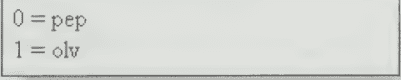

### 说明

- 如果复选框名称以 `[]` 结尾，PHP 会将该复选框添加到嵌套在 `$_GET` 或 `$_POST` 数组中的数组里。这样，多个值就可以使用相同的名称提交。
- 如果复选框数组中的所有复选框都没有被选中，则该数组不会在 `$_GET` 或 `$_POST` 数组中设置。
- 如果你打算使用复选框的值，应使用像 `filter_input` 这样的 PHP 函数来获取数组的值并确保其安全。为此，可以使用本图所示的过滤器。

图7-4  如何从复选框数组获取数据

## 如何从下拉列表中获取数据

*下拉列表*（又称*单选列表*）强制用户从列表中选择一个选项。要创建下拉列表，可使用 `<select>` 和 `<option>` 标签，如图7-5所示。

该图中的HTML创建了一个下拉列表，允许用户从三种信用卡选项中选择一种。这里，`<select>` 标签指定列表的名称。然后，在 `<select>` 标签内，三个 `<option>` 标签定义选项。当页面由浏览器渲染时，会显示 `<option>` 开闭标签之间的内容。当页面提交到服务器时，value 属性指定提交给服务器的值。例如，图中的第一个选项在列表中显示“Visa”，但向服务器提交“visa”。

该图中的PHP演示了如何获取所选选项的值。由于下拉列表强制用户选择一个选项，因此下拉列表的名称/值对总会提交到服务器。这意味着在你的代码中，无需检查 filter_input 函数是否返回 NULL。

如果你不为任何选项编写 selected 属性，页面加载时将默认选中第一个选项。但是，如果你想设置不同的默认选项，可以为该选项编写 selected 属性。例如，要使 MasterCard 成为默认选项，可以像图中第二个 HTML 示例那样编写其 `<option>` 标签。

对于下拉列表，你应该只为其中一个选项编写 selected 属性。如果你为多个选项编写该属性，浏览器会选择带有 selected 属性的最后一个选项。


## 如何从列表框获取数据

列表框（list box）的工作原理与下拉列表类似。不过，你需要在 `<select>` 标签中将 `size` 属性设置为希望在列表框中显示的选项数量。例如，在图 7-6 中，两个列表框的 `size` 属性均被设置为 3，因此这两个列表框都显示三个选项。如果编写的选项更多，列表框中就会添加滚动条，以便用户可以滚动查看其他选项。

本图中的第一个 HTML 示例创建了一个只允许用户选择单个选项的列表框。它的工作方式与下拉列表非常相似。但是，由于此列表框没有指定默认选项，用户可能不会从列表中选择任何选项。在这种情况下，该列表框不会作为表单的一部分提交，`filter_input` 函数也会针对该列表框的值返回 `NULL`。或者，HTML 可以使用 `selected` 属性为列表框设置默认选项。这样，列表框始终会作为表单的一部分提交，并且 `filter_input` 函数始终会返回一个值。

第二个 HTML 示例创建了一个允许用户选择多个选项的列表框。首先，`<select>` 标签包含 `multiple` 属性。此外，`name` 属性以一组方括号（`[]`）结尾。这些方括号表示所选值应存储在一个数组中。因此，用户可以在按住 Ctrl 或 Shift 键的同时点击选项来选择多个选项。

本图中的 PHP 示例展示了如何从允许用户选择多个项目的列表框中获取数据。该代码与图 7-4 中给出的用于处理复选框数组的代码相同。

在设计 Web 表单时，你经常需要决定使用哪种类型的控件。例如，在本图中，可以用第一个列表框代替上一张图中介绍的下拉列表。同样，也可以用第二个列表框代替本章前面介绍的复选框。最终，你需要选择你认为对用户最有效的方法。

### HTML `<select>` 标签用于列表框的属性

| 属性 | 说明 |
|---|---|
| `size` | 当设置为 1 或省略时，以下拉列表形式显示选项。当设置为 2 或更多时，以列表框形式显示指定数量的选项。 |
| `multiple` | 该可选属性允许用户在列表框中选择多个选项。只有在 `size` 属性已设置为 2 或更大值时才应使用。 |

### 不允许选择多个选项的列表框的 HTML

```html
<select name="card_type" size="3">
    <option value="visa">Visa</option>
    <option value="mastercard">MasterCard</option>
    <option value="discover">Discover</option>
</select>
```

### 不允许选择多个选项的列表框


### 允许选择多个选项的列表框的 HTML

```html
<select name="toppings[]" size="3" multiple>
    <option value="pep" selected>Pepperoni</option>
    <option value="msh">Mushrooms</option>
    <option value="olv">Olives</option>
</select>
```

### 允许选择多个选项的列表框


### 允许选择多个选项的列表框的 PHP 代码

```php
<?php
    $toppings = filter_input(INPUT_POST, 'toppings',
        FILTER_SANITIZE_SPECIAL_CHARS, FILTER_REQUIRE_ARRAY);
    if ($toppings !== NULL) {
        foreach ($toppings as $key => $value) {
            echo $key . " = " . $value . '<br>'; // '0 = pep' 和 '1 = msh'
        }
    } else {
        echo 'No toppings selected.';
    }
?>
```

### 说明

- 列表框允许用户从一组选项中选择零个或多个选项。
- 如果列表框允许多个选项被选中，则列表框名称必须以 `[]` 结尾。

图 7-6 —— 如何从列表框获取数据

### HTML `<textarea>` 标签的属性

| 属性 | 说明 |
|---|---|
| `name` | 文本区域的名称。 |
| `rows` | 文本区域的大致行数。 |
| `cols` | 文本区域中每行大致可显示的字符数。 |

### 文本区域的 HTML

```html
<textarea name="comment" rows="4" cols="50">Welcome to PHP and MySQL!</textarea>
```

### 浏览器中的文本区域


### 使用 GET 方法时的 URL

#### 当用户在文本区域中输入空格时

```text
process_data.php?comment=Welcome+to+PHP+and+MySQL!
```

#### 当用户按下回车键开始新的一行时

```text
process_data.php?comment=Welcome+to%0D%0APHP+and+MySQL!
```

#### 当用户未输入任何文本时

```text
process_data.php?comment=
```

### 从文本区域获取数据的 PHP 代码

```php
<?php
    $comment = filter_input(INPUT_POST, 'comment');
?>
```

### 说明

- *文本区域允许用户输入多行文本。*
- 要为文本区域设置默认文本，请在 `<textarea>` 开始和结束标签之间编写默认文本。
- 如果用户输入超出当前行末尾，文本区域会使用*软回车*来开始新的一行。如果用户按下回车键，文本区域会使用*硬回车*来开始新的一行。
- 如果用户未输入任何文本，则文本区域的名称/值对会以空字符串作为值提交到服务器。

图 7-7 —— 如何从文本区域获取数据

## 如何在网页上显示数据

本主题首先讨论处理用户输入文本时出现的两个格式问题。然后，本主题将介绍两个可用于向浏览器发送数据的语句。

### 如何格式化特殊字符

如果你熟悉 HTML，你应该知道并非所有字符都可以直接输入到网页中。例如，小于号（`<`）和大于号（`>`）用于标记 HTML 标签的开始和结束。因此，要在网页上显示这些字符，你必须使用这些字符的 *HTML 字符实体*。

图 7-8 中的第二个表格概括了其中一些字符实体。例如，要显示小于号（`<`），你必须编写其 HTML 字符实体（`&lt;`）。否则，浏览器会将小于号解释为 HTML 标签的开始。

那么，如果用户在表单的控件中输入了特殊的 HTML 字符，而你稍后想在网页上显示这些字符，会发生什么情况？例如，如果用户在文本区域中输入了“Welcome to &lt;i&gt;PHP&lt;/i&gt; and MySQL”会怎样？

如果你希望浏览器将 `<i>` 标签之间的文本显示为斜体，可以使用 echo 语句将此文本发送到浏览器。然后，浏览器会将 `<i>` 标签视为 HTML，并将其包含的文本显示为斜体。不幸的是，这会为跨站脚本（XSS）攻击打开大门。因此，只有在确定发送到浏览器的文本不包含 XSS 攻击时，才应使用这种方法。

另一方面，如果你希望直接显示 `<i>` 标签本身，你可以将 `<` 和 `>` 字符转换为其 HTML 字符实体。为此，你可以使用本图所示的 `htmlspecialchars` 函数。这也有助于防范 XSS 攻击。因此，只要你认为发送到浏览器的文本可能包含 XSS 攻击，就可以使用这种方法。

如语法摘要所示，`htmlspecialchars` 函数提供四个参数。其中第一个参数是必需的，其他三个参数是可选的。

在大多数情况下，你只需要第一个参数，如第一个 PHP 示例所示。此处，第一条语句从文本区域获取一些文本，第二条语句使用 `htmlspecialchars` 函数将该文本中的任何特殊字符转换为 HTML 实体，而编写在 `<p>` 标签内的 echo 语句则将该文本发送到浏览器。

不过，如果你希望防止 HTML 实体的双重编码，则需要使用所有四个参数，如第二个 PHP 示例所示。这里，前三个参数相对容易理解。它们提供了要处理的字符串的名称、指定如何处理引号的常量，以及指定要使用的字符集的编码。


## htmlspecialchars 函数的语法

```
htmlspecialchars($string[, $quote_style[, $charset[, $double_encode]]])
```

## htmlspecialchars 函数的参数

| 参数 | 描述 |
| --- | --- |
| `$string` | 要转换的字符串。此参数是必需的。 |
| `$quote_style` | 指定如何将单引号和双引号转换为其 HTML 实体。`ENT_COMPAT` 常量是默认值，只转换双引号。`ENT_QUOTES` 常量转换单引号和双引号。`ENT_NOQUOTES` 常量不转换单引号或双引号。 |
| `$charset` | 指定 `$string` 参数的字符集。默认值为 “ISO-8859-1”。 |
| `$double_encode` | 一个布尔值，指定是否双重编码字符实体。默认值为 TRUE。因此，默认情况下，字符实体被双重编码。 |

## 常见的 HTML 字符实体

| 字符 | 字符实体 | 字符 | 字符实体 |
| --- | --- | --- | --- |
| `&` | `&amp;` | `"` | `&quot;` |
| `<` | `&lt;` | `'` | `&#039;` |
| `>` | `&gt;` | 不间断空格 | `&nbsp;` |

## 双重编码的小于号（<）实体

```
&amp;lt;
```

## 用户输入的文本


## 将特殊字符转换为字符实体的 PHP 代码

```php
<?php
    $comment = $_POST['comment'];
    $comment = htmlspecialchars($comment);
?>
<p><?php echo $comment; ?></p>
```

## 浏览器中显示的数据


## 防止双重编码的语句

```php
$comment = htmlspecialchars($comment, ENT_COMPAT, 'ISO-8859-1', false);
```

## 说明

- HTML *字符实体* 允许你在网页上显示一些特殊字符。
- htmlspecialchars 函数将一些特殊字符转换为字符实体。这提供了一种显示特殊字符的方法，并有助于防止 XSS 攻击。

图 7-8 — 如何格式化特殊字符

## nl2br 函数的语法

```
nl2br($string[, $is_xhtml])
```

## nl2br 函数的参数

| 参数 | 描述 |
| --- | --- |
| `$string` | 要转换的字符串。此参数是必需的。 |
| `$is_xhtml` | 一个布尔值，指示是使用 XHTML 语法（`<br />`）还是 HTML 语法（`<br>`）来表示换行。默认值为 TRUE。 |

## 输入到文本域中的文本


## 将换行字符转换为 HTML 换行标签的 PHP 代码

```php
<?php
    $comment = filter_input(INPUT_POST, 'comment');
    $comment = nl2br($comment, false);    // use <br> tags, not <br /> tags
?>
<p><?php echo $comment; ?></p>
```

## 浏览器中显示的数据


## 说明

- nl2br 函数将字符串中的换行字符转换为 HTML `<br>` 标签。这让你可以在网页上显示换行。

图 7-9 — 如何格式化换行

## 练习 7-1　获取输入并显示输出

在本练习中，你将编写从表单获取输入并显示输出的 PHP 代码。

### 打开并测试应用程序

- 1. 启动 Chrome 浏览器，并在 `ex_starts\ch07_ex1` 目录中运行应用程序。为此，你可以使用以下 URL：

   `http://localhost/ex_starts/ch07_ex1/`

   这应该会显示一个包含多种控件的表单。

- 2. 输入一些数据，包括有效的电子邮件地址，然后点击“提交”按钮。这应该只显示你为电子邮件地址输入的数据。

### 编写获取并显示用户输入数据的代码

- 3. 打开此应用程序的 index.php 文件并查看代码。注意用于各种输入控件的名称。

- 4. 打开此应用程序的 display_results.php 文件并查看代码。注意，从控件获取数据的大部分代码缺失。此外，显示这些数据的大部分代码也缺失。

- 5. 添加代码以获取第一页上控件中的数据。然后，添加显示这些数据的代码。

- 6. 对于单选按钮，如果用户没有选择单选按钮，则显示值 “Unknown”。

- 7. 对于复选框，根据用户是否选中复选框，显示 “Yes” 或 “No” 值。

- 8. 对于所有允许用户输入文本的字段，在第二页上显示这些数据之前，务必将特殊字符转换为 HTML 实体，如图 7-8 所述。

- 9. 对于注释字段，务必将换行字符转换为 `<br>` 标签，以便网页能正确显示换行字符。

- 10. 测试应用程序以确保其正常工作。为此，你可以使用特殊字符（如与号（&））测试文本字段，也可以在注释字段中按 Enter 键输入换行符。

## 练习 7-2　增强未来值应用程序

在本练习中，你将增强第 2 章的未来值应用程序，使其使用下拉列表而不是文本框。

### 打开并测试应用程序

- 1. 启动 Chrome 浏览器，并在 `ex_starts\ch07_ex2` 目录中运行应用程序。这应该会显示未来值应用程序的第一页，该页面与第 2 章中介绍的类似。注意，此页面在三个文本框中显示三个默认值。

- 2. 点击“计算”按钮来执行计算。注意，这会在第二页上显示正确的未来值计算结果。

### 编写获取并显示用户输入数据的代码

- 3. 打开此应用程序的 index.php 文件并查看代码。注意用于三个文本框的名称。

- 4. 修改代码，使前两个输入项使用下拉列表而不是文本框。

- 5. 对于投资金额，下拉列表应显示从 10,000 到 50,000、以 5,000 递增的值。为此，你可以使用 for 循环来创建下拉列表的 HTML。

   如果你对此有任何问题，可以提前查看下一章图 8-11 中的最后一个示例。或者，你也可以在阅读第 8 章后再回来处理。

- 6. 对于年利率，下拉列表应显示从 4 到 12、以 0.5 递增的值。

- 7. 测试应用程序以确保其正常工作。

## 如何使用关系运算符

图 8-2 总结了第 3 章中简要介绍的关系运算符。与相等运算符一样，当两个值的类型不同时，关系运算符会执行类型强制转换。例如，当你比较字符串和数字时，字符串值会在比较之前转换为数值。此图第二个表格说明了这一点。因此，在使用这些运算符之前，你通常需要确保比较的是两个相同类型的值。

当你使用这些运算符比较两个字符串时，字符串将按照下一章描述的 strcmp 函数的相同规则进行比较。也就是说，比较区分大小写，大写字母位于小写字母之前，因此 “Orange” 位于 “apple” 之前（小于 “apple”）。由于这通常不是你想要的结果，因此在比较字符串值时，通常应使用字符串比较函数而不是关系运算符。

最后，此图显示了使用关系运算符时得到的一些不常见结果。这里同样，结果不常见是因为关系运算符执行的类型强制转换。

### 关系运算符

| 运算符 | 描述 | 示例 |
| --- | --- | --- |
| `<` | 小于 | `$age < 18` |
| `<=` | 小于或等于 | `$investment <= 0` |
| `>` | 大于 | `$test_score > 100` |
| `>=` | 大于或等于 | `$rate / 100 >= 0.1` |

### 使用关系运算符比较字符串和数字

| 表达式 | 结果 | 描述 |
| --- | --- | --- |
| `1 < '3'` | true | 字符串 "3" 被转换为数字 3。 |
| `'10' < 3` | false | 字符串 "10" 被转换为数字 10。 |

### 使用关系运算符比较字符串

| 表达式 | 结果 | 描述 |
| --- | --- | --- |
| `'apple' < 'orange'` | true | 较早的字母小于较晚的字母。 |
| `'apple' < 'appletree'` | true | 当字符相同时，较短的字符串小于较长的字符串。 |
| `'Orange' < 'apple'` | true | 大写字母小于小写字母。 |
| `'@' < '$'` | false | 其他字符使用其 ASCII 值进行比较。 |

### 使用关系运算符得到的不常见结果

| 表达式 | 结果 | 描述 |
| --- | --- | --- |
| `0 <= 'test'` | true | 字符串 "test" 被转换为 0。 |
| `'' < 5` | true | 空字符串被转换为 0。 |
| `false < true` | true | FALSE 被认为小于 TRUE。 |
| `null < true` | true | NULL 被转换为 FALSE。 |

### 说明

- 使用关系运算符时，操作数会被转换为相同类型，如上一图所述。
- 当两个操作数都是字符串时，会从字符串开头开始，根据每个字符的 ASCII 值逐字符进行比较。


## 如何使用逻辑运算符

图 8-3 中的第一个表列出了你在第 2 章学到的三个逻辑运算符。该表后面是三个在复合条件表达式中使用这些运算符的示例。由于这些表达式只使用了一个逻辑运算符，因此这类表达式相对容易求值。

在第一个示例中，NOT 运算符对 is_numeric 函数返回的布尔值进行取反。因此，当名为 $number 的变量的值不是数字时，该表达式为 TRUE。在第二个示例中，AND 运算符用于在年龄大于或等于 18 且分数大于或等于 680 时返回 TRUE。

在第三个示例中，OR 运算符用于在州为 CA 或 NC 时返回 TRUE。使用 OR 运算符时一个常见的错误是写出如下表达式：

```
$state == 'CA' || 'NC'
```

在这种情况下，字符串 'NC' 会被转换为布尔值 TRUE，比较结果始终为 TRUE，这不是你想要的结果。

本图中的第二个表显示了条件表达式的运算符优先级。例如，该表表明关系运算先于相等和全等运算执行，AND 运算先于 OR 运算执行。该表后面是三个在复杂条件表达式中使用这些运算符的示例。由于这些表达式使用了两个或更多逻辑运算符，因此求值起来更加困难。

在第一个示例中，条件表达式中使用了 AND 和 OR 运算符。由于先对 AND 运算符求值，因此只要年龄大于或等于 18 且分数大于或等于 680，该表达式就返回 TRUE，而与州无关。如果州为 NC，则无论年龄和分数如何，该表达式也返回 TRUE。

在第二个示例中，一个表达式中使用了 AND、OR 和 NOT 运算符。如果 $old_customer 为 FALSE，则该表达式返回 TRUE。如果贷款金额大于或等于 10000 且分数小于最低分加 200，该表达式也返回 TRUE。请注意，该表达式使用了一个算术运算符，它会在关系运算符之前求值。

在第三个示例中，括号改变了第五个示例中运算符的优先级顺序。这一次，OR 运算被编码在一组括号内。因此，如果 $old_customer 为 FALSE 且分数小于最低分加 200，该表达式返回 TRUE。如果贷款金额大于或等于 10000 且分数小于最低分加 200，该表达式也返回 TRUE。

正如这些示例所示，复杂的条件表达式很难编写。因此，当你对求值顺序心存疑虑时，应该使用括号来明确。但即便如此，你仍需用所有可能的数据组合仔细测试这些表达式，以确保它们正常工作。

### 逻辑运算符

| 运算符 | 名称 | 描述 |
|---|---|---|
| `!` | 非（NOT） | 返回其表达式的相反布尔值。 |
| `&&` | 与（AND） | 仅当两侧表达式均为 TRUE 时返回 TRUE。 |
| `\|\|` | 或（OR） | 当任一侧或两侧表达式为 TRUE 时返回 TRUE。 |

### 复合条件表达式中的逻辑运算符

**NOT 运算符**

```
!is_numeric($number)
```

**AND 运算符**

```
$age >= 18 && $score >= 680
```

**OR 运算符**

```
$state == 'CA' || $state == 'NC'
```

### 条件表达式中运算符的优先级

| 顺序 | 运算符 | 描述 |
|---|---|---|
| 1 | `!` | NOT 运算符 |
| 2 | `<`, `<=`, `>`, `>=`, `<>` | 关系运算符 |
| 3 | `==`, `!=`, `===`, `!==` | 相等和全等运算符 |
| 4 | `&&` | 与运算符 |
| 5 | `\|\|` | 或运算符 |

### 复杂条件表达式中的逻辑运算符

**AND 和 OR 运算符**

```
$age >= 18 && $score >= 680 || $state == 'NC'
```

**AND、OR 和 NOT 运算符**

```
!$old_customer || $loan_amount >= 10000 && $score < $min_score + 200
```

### 括号如何改变求值顺序

```
(!$old_customer || $loan_amount >= 10000) && $score < $min_score + 200
```

### 说明

- 括号具有最高的优先级，因此括号内的运算会最先执行，从最内层的括号开始，逐层向外。
- 为了明确表达式的求值方式，你应该使用括号。
- 你可以在条件表达式中使用算术表达式。在优先级顺序中，算术运算符位于 NOT 运算符和关系运算符之间。

## 单条语句且不带花括号的 if 子句

```
if (!isset($rate)) $rate = 0.075;
```

## 单条语句且带花括号的 if 子句

```
if ($qualified) { // This expression is equivalent to $qualified == true.
    echo 'You qualify for enrollment.';
}
```

## 每个子句各含一条语句且不带花括号的 if/else 子句

```
if ($age >= 18)
    echo 'You may vote.';
else
    echo 'You may not vote.';
```

## 为什么在 else 子句中应始终使用花括号

```
if ($age >= 18)
    echo 'You may vote.';
else
    echo 'You may not vote.';
$may_vote = false;    // This statement isn't a part of the else clause.
```

## 花括号使代码更易于修改或扩展

```
if ($score >= 680) {
    echo 'Your loan is approved.';
} else {
    echo 'Your loan is not approved.';
}
```

## 用于判断闰年的嵌套 if 语句

```
$is_leap_year = false;
if ($year % 4 == 0) {
    if ($year % 100 == 0) {
        if ($year % 400 == 0) {
            $is_leap_year = true;      // divisible by 4, 100, and 400
        } else {
            $is_leap_year = false;     // divisible by 4 and 100, but not 400
        }
    } else {
        $is_leap_year = true;          // divisible by 4, but not 100
    }
} else {
    $is_leap_year = false;             // not divisible by 4
}
```

### 说明

- 如果在 if 语句或 else 子句后面只有一条语句，则不一定要用花括号将该语句括起来。
- 你可以将 if 语句嵌套在另一个 if 语句的 if、else if 或 else 子句中。这种嵌套可以深入很多层。

## 如何使用 else if 子句编写 if 语句

图 8-5 展示了四个使用 else if 子句的 if 语句示例。例如，在第一个示例中，如果年龄小于 18，if 子句会显示一条消息。但是，如果年龄大于或等于 18，PHP 会对 else if 子句求值。然后，如果分数小于 680，else if 子句会显示一条消息。

第二个示例表明，else if 子句也可以使用 elseif 关键字来编写（else 和 if 关键字之间没有空格）。在本书中，我们通常在关键字之间加一个空格，但你也可以使用任意一种风格，只是应尽量保持你所选风格的一致性。

第三个示例展示了如何使用 else if 子句来验证名为 $rate 的变量的值。在 if 语句开始之前，一个名为 $rate_is_valid 的布尔变量被设置为 FALSE。然后，if 语句使用一系列测试来确定 $rate 变量的有效性，从最坏的情况开始（不是数字）。如果任何测试失败，就会显示相应的消息。但如果变量通过了所有测试，$rate_is_valid 变量就会被设置为 TRUE。

第四个示例也展示了多个 else if 子句的使用。这段代码测试名为 $average 的变量的值，以便设置名为 $grade 的变量的值。请注意，这些值必须从范围的高端向低端测试。例如，如果你将第一个测试写成这样：

```
$average >= 69.5
```

它对 A 和 B 范围都不起作用。要解决这个问题，你可以将第一个测试写成这样：

```
$average >= 69.5 && $average < 79.5
```

但这意味着额外的代码。同时，这也会使代码更难阅读和维护。因此，一般来说，最好按顺序测试一系列值。

顺便提一下，这些示例展示了一种常见的编码风格：else if 或 else 关键字与前一子句的右花括号位于同一行。这有助于保持代码紧凑且可读。

如果你阅读 PHP 代码，可能会看到其他风格。例如，有些程序员喜欢将每个花括号单独放在一行。这种方法同样可行且易于阅读，但会占用更多垂直空间。


## 含有一个 else if 子句的 if 语句

```
if ($age < 18) {
    echo "You're too young for a loan.";
} else if ($score < 680) {
    echo "Your credit score is too low for a loan.";
}
```

## 含有 else if 和 else 子句的 if 语句

```
if ($age < 18) {
    echo "You're too young for a loan.";
} elseif ($score < 680) {
    echo "Your credit score is too low for a loan.";
} else {
    echo "You're approved for your loan.";
}
```

## 含有两个 else if 子句和一个 else 子句的 if 语句

```
$rate_is_valid = false;
if (!is_numeric($rate)) {
    echo 'Rate is not a number.';
} else if ($rate < 0) {
    echo 'Rate cannot be less than zero.';
} else if ($rate > 0.2) {
    echo 'Rate cannot be greater than 20%.';
} else {
    $rate_is_valid = true;
}
```

## 用于确定学生字母等级的 if 语句

```
if ($average >= 89.5) {
    $grade = 'A';
} else if ($average >= 79.5) {
    $grade = 'B';
} else if ($average >= 69.5) {
    $grade = 'C';
} else if ($average >= 64.5) {
    $grade = 'D';
} else {
    $grade = 'F';
}
```

## 说明

- 在编写 else if 子句时，可以编写 else 和 if 关键字（带一个空格），也可以使用 elseif 关键字（不带空格）。

## 如何使用条件运算符

三元运算符有三个操作数。相比之下，像 ++ 这样的一元运算符有一个操作数，而像 * 这样的二元运算符有两个操作数。条件运算符是 PHP 中唯一的三元运算符。

由于条件运算符有三个操作数，因此需要两个符号来分隔它们。在这种情况下，问号和冒号用作操作数分隔符。图 8-6 中的语法展示了这一点。

此图中的第一个示例展示了如何使用条件运算符，根据比较结果将变量设置为两个值之一。如果年龄大于或等于 18 岁，消息设置为“可以投票”。否则，消息设置为“不能投票”。

第二个示例展示了如何在其中一个操作数中使用数学表达式。如果 $hours 超过 40，$overtime 将包含超出 40 小时部分所对应的工资率的 1.5 倍。否则，它将被设置为 0。

第三个示例展示了如何在给用户的消息中选择单数或复数结尾。如果 $error_count 为 1，则结尾为空。否则，使用“s”作为结尾。

第四个示例展示了如何根据值是否达到最大值，将值加 1 或将其重置为 1。例如，如果 $max_value 为 10，$value 为 6，则测试为 FALSE，$value 加 1。但是，当 $value 达到 10 时，它会被设置为 1。

如果你需要对变量执行这种回绕操作，但起始值是 0 而不是 1，则不必使用条件运算符。相反，你可以使用 % 运算符。例如，在以下语句中：

```
$value = ($value + 1) % ($max_value + 1);
```

如果 $max_value 为 9，则 $value 从 0 到 9 变化，然后回到 0。

第五个示例展示了如何将条件运算符与 return 关键字结合使用，以便函数返回结果。这里，如果 $number 大于 $highest，则返回 $highest。否则，返回 $number。

最后一个示例展示了如何将值保持在固定范围内。它使用嵌套的条件运算符来实现这一点。如果 $value 大于 $max，则将 $value 设置为 $max。如果 $value 不大于 $max，则对第二个条件运算符求值。这里，如果 $value 小于 $min，则将 $value 设置为 $min。如果 $value 不小于 $min，则将 $value 设置为 $value，使其保持不变。

最后两个示例重写了第一个和第六个示例，使用 if 语句而不是条件运算符。这些语句表明，if 语句比使用条件运算符的语句更容易阅读。因此，如果你希望代码尽可能易于阅读，就应该避免使用条件运算符。

尽管如此，许多程序员喜欢使用条件运算符，因为它占用的代码行数更少。因此，即使你在自己的代码中不使用条件运算符，你仍然需要理解它的工作原理，以便能够理解其他程序员编写的代码。

### 条件运算符的语法

```
(conditional_expression) ? value_if_true : value_if_false
```

### 条件运算符的使用示例

#### 根据比较结果设置字符串

```
$message = ($age >= 18) ? 'Can vote' : 'Cannot vote';
```

#### 计算加班工资

```
$overtime = ($hours > 40) ? ($hours - 40) * $rate * 1.5 : 0;
```

#### 根据值选择单数或复数结尾

```
$ending = ($error_count == 1) ? '' : 's';
$message = 'Found ' . $error_count . ' error' . $ending . '.';
```

#### 加 1 时如果值达到最大值则将其设置为 1

```
$value = ($value >= $max_value) ? 1 : $value + 1;
```

#### 根据比较结果返回两个值之一

```
return ($number > $highest) ? $highest : $number;
```

#### 将值限定在固定范围内

```
$value = ($value > $max) ? $max : (($value < $min) ? $min : $value);
```

### 使用 if 语句重写的第一个示例

```
if ($age >= 18) {
    $message = 'Can vote';
} else {
    $message = 'Cannot vote';
}
```

### 使用 if 语句重写的最后一个示例

```
if ($value > $max) {
    $value = $max;
} else if ($value < $min) {
    $value = $min;
}
```

### 说明

- 三元运算符有三个操作数。条件运算符是 PHP 中唯一可用的三元运算符。该运算符提供了一种编写 if 语句的紧凑方式。
- 条件运算符首先对条件表达式求值。然后，如果条件表达式为 TRUE，则返回中间表达式产生的值。否则，返回最后一个表达式产生的值。

## 带默认分支的 switch 语句

```
switch ($letter_grade) {
    case 'A':
        $message = 'well above average';
        break;
    case 'B':
        $message = 'above average';
        break;
    case 'C':
        $message = 'average';
        break;
    case 'D':
        $message = 'below average';
        break;
    case 'F':
        $message = 'failing';
        break;
    default:
        $message = 'invalid grade';
        break;
}
```

## 带穿透行为的 switch 语句

```
switch ($letter_grade) {
    case 'A':
    case 'B':
        $message = 'Scholarship approved.';
        break;
    case 'C':
        $message = 'Application requires review.';
        break;
    case 'D':
    case 'F':
        $message = 'Scholarship not approved.';
        break;
}
```

## 说明

- *switch 语句*首先对括号中的*switch 表达式*进行求值。
- 对表达式求值后，switch 语句会将控制权转移到值与表达式值匹配的*case 标签*。然后，它执行该*case*的语句。当遇到 break 语句或到达 switch 语句末尾时，它会停止执行。
- default 分支是可选的，可以省略。如果包含，则只能有一个 default 分支。它通常是 switch 语句中的最后一个分支，但也可以位于任何位置。
- case 标签中的值可以是字面量，也可以是表达式。
- 如果某个 case 不包含 break 语句，执行流程会“贯穿”到下一个标签。
- 在 switch 语句的各个 case 中，可以嵌套 if 语句或其他 switch 语句。

## 产品管理器应用程序的控制器中的 switch 语句

```php
$action = filter_input(INPUT_POST, 'action');
if ($action == NULL) {
    $action = filter_input(INPUT_GET, 'action');
    if ($action == NULL) {
        $action = 'list_products';
    }
}

switch ($action) {
    case 'list_products':
        $category_id = filter_input(INPUT_GET, 'category_id',
            FILTER_VALIDATE_INT);
        if ($category_id == NULL || $category_id == FALSE) {
            $category_id = 1;
        }
        $category_name = get_category_name($category_id);
        $categories = get_categories();
        $products = get_products_by_category($category_id);
        include('product_list.php');
        break;
    case 'delete_product':
        $product_id = filter_input(INPUT_POST, 'product_id',
            FILTER_VALIDATE_INT);
        $category_id = filter_input(INPUT_POST, 'category_id',
            FILTER_VALIDATE_INT);
        if ($category_id == NULL || $category_id == FALSE ||
            $product_id == NULL || $product_id == FALSE) {
            $error = "Missing or incorrect product id or category id.";
            include('../errors/error.php');
        } else {
            delete_product($product_id);
            header("Location: .?category_id=$category_id");
        }
        break;
    case 'show_add_form':
        $categories = get_categories();
        include('product_add.php');
        break;
    case 'add_product':
        $category_id = filter_input(INPUT_POST, 'category_id',
            FILTER_VALIDATE_INT);
        $code = filter_input(INPUT_POST, 'code');
        $name = filter_input(INPUT_POST, 'name');
        $price = filter_input(INPUT_POST, 'price');
        if ($category_id == NULL || $category_id == FALSE || $code == NULL ||
            $name == NULL || $price == NULL || $price == FALSE) {
            $error = "Invalid product data. Check all fields and try again.";
            include('../errors/error.php');
        } else {
            add_product($category_id, $code, $name, $price);
            header("Location: .?category_id=$category_id");
        }
        break;
}
```


## 如何编写迭代结构

在第 2 章中，你学习了如何使用 while 语句和 for 语句。现在，你将更深入地学习如何编写这些语句，以及如何编写 do-while、break 和 continue 语句。这些语句实现的结构通常被称为迭代结构。

### 如何编写 while 循环

如你在第 2 章中所见，while 循环会在其条件表达式为 TRUE 时执行一个代码块。如果条件表达式一开始为 FALSE，则代码根本不会执行。如果条件表达式永远不会变为 FALSE，while 循环就会变成无限循环。无限循环通常是由于编码错误导致的，并且通常可以通过修改代码来修复。

图 8-9 显示了三个示例，可以让你了解 while 循环可以做什么。在第一个示例中，while 循环计算 100 个随机数的平均值。`$total` 变量存储随机数的总和，`$count` 变量存储数字的个数，当 `$count` 变为 100 时，while 循环停止执行。

请注意，此循环使用 `mt_rand` 函数来获取随机数。这是你将在下一章中了解的函数。现在，你只需要知道它每次执行时都会生成一个随机数，其范围从第一个参数的值到第二个参数的值。

在第二个示例中，此函数用于生成 1 到 6 之间的随机数，从而模拟掷一个骰子。当随机数为 6 时循环结束，并且循环计算掷骰子得到该 6 所需的次数。由于骰子的第一次投掷发生在 while 循环的表达式部分，因此如果第一次掷出的就是 6，循环中的递增语句将不会执行。这就是 `$rolls` 的值最初设置为 1 的原因。

在第三个示例中，示例 2 中的 while 循环被嵌套在另一个执行 10,000 次的 while 循环内。每次内层循环掷出 6 时，得到该 6 所需的掷骰次数都会累加到名为 `$total` 的变量中。此外，如果掷骰次数大于 `$max` 的当前值，则名为 `$max` 的变量的值会发生变化。为了进行该比较，使用 max 函数返回其参数所表示的两个值中较大的一个。同样，你将在下一章中了解有关此函数的更多信息。

由于 `$max` 的值从 -INF（负无穷大）开始，第一次通过内层循环时的任何掷骰次数都大于该值，因此 `$max` 的起始值会被更改为获取一个 6 所需的尝试次数。然后，当外层循环结束时，计算获取一个 6 的平均尝试次数，并显示平均值和最大值。

**一个计算 100 个随机数平均值的 while 循环**

```php
$total = 0;
$count = 0;
while ($count < 100) {
    $number = mt_rand(0, 100);    // get a random number from 0 to 100
    $total += $number;
    $count++;
}
$average = $total / $count;
echo 'The average is: ' . $average;
```

**一个统计掷骰子直到掷出 6 为止次数的 while 循环**

```php
$rolls = 1;
while (mt_rand(1,6) != 6) {    // get a random number from 1 to 6
    $rolls++;
}
echo 'Number of times to roll a six: ' . $rolls;
```

**嵌套 while 循环，获取掷出 6 的平均次数和最大次数**

```php
$total = 0;
$count = 0;
$max = -INF;

while ($count < 10000) {
    $rolls = 1;
    while (mt_rand(1, 6) != 6) {    // get a random number from 1 to 6
        $rolls++;
    }
    $total += $rolls;
    $count++;
    $max = max($rolls, $max);    // get the value of the larger argument
}
$average = $total / $count;
echo 'Average: ' . $average . ' Max: ' . $max;
```

**说明**

- 只要条件表达式为 TRUE，while 语句就会执行其花括号内的语句块。
- 使用 while 语句时，条件会在 while 循环执行之前进行测试。

**注意**

- 这些示例使用了 `mt_rand` 和 max 函数，这些函数将在下一章中介绍。`mt_rand` 函数获取由其参数指定范围内的随机数。`max` 函数获取作为参数传递给它的两个值中较大的一个。

### 如何编写 do-while 循环

*do-while 循环* 与 while 循环类似，不同之处在于条件表达式在循环结束时测试。因此，循环内的代码至少会执行一次。

图 8-10 中的第一个示例统计获得一个 6 所需的投掷次数。这与图 8-9 中的第二个示例类似，但在这里，名为 `$rolls` 的变量被初始化为零，因为它在循环内至少递增一次。

第二个示例使用 do-while 循环生成 0 到 100 之间的 10 个随机数。然后显示生成的最小值和最大值。为此，它使用了 min 函数，该函数与 max 函数相反。由于 `$max` 的值从 -INF 开始，第一个随机数始终大于该值。同样，由于 `$min` 的值从 INF 开始，第一个随机数始终小于该值。

### 如何编写 for 循环

*for* 循环提供了一种方便的方式来编写需要计数器变量的循环。图 8-11 开头的 for 和 while 循环说明了这一点。在这里，for 语句的第一行初始化计数器变量，提供结束循环的条件，并提供递增计数器变量的代码。在 while 循环中，这些任务分别编码在三行中。

此图中的第一个示例表明，你可以使用 1 以外的值来启动和递增计数器变量。在这里，语句将计数器初始化为 2，并按 2 递增计数器。因此，循环显示从 2 到 10 的偶数。你还可以通过负值递增计数器（实际上会递减该值），这在某些情况下很有用。

第二个示例显示一个数的所有因数。*因数* 是可以被该数整除且余数为零的任何数，因此 1、2、3、6 和 9 都是 18 的因数。这次，计数器从 1 开始，按 1 递增，只要计数器小于原始数字，循环就会继续。在循环内部，如果原始数字除以计数器当前值的余数为零，则显示一条消息。

顺便说一下，此示例使用 `$i` 作为计数器的变量名。这是一种常见做法。当一个循环嵌套在另一个循环中时，`$j` 通常用作内层循环的计数器名称。

第三个示例展示了你在第 4 章中接触过的 for 循环的替代语法。请注意，循环中的语句编码在冒号 (:) 之后，而不是花括号内。还要注意，该语句以 `endfor` 关键字结束。

当你生成将由浏览器渲染的 HTML 代码时，这种替代语法非常有用。此示例中的代码为一个下拉列表生成了八个 `<option>` 标签，其值范围从 5 到 12。

**for 语句与 while 语句的比较**

**for 语句**

```php
for ($count = 1; $count <= 10; $count++) {
    echo $count . '<br>';
}
```

**while 语句**

```php
$count = 1;
while ($count <= 10) {
    echo $count . '<br>';
    $count++;
}
```

**一个显示 2 到 10 偶数的 for 循环**

```php
for ($number = 2; $number <= 10; $number += 2) {
    echo $number . '<br>';
}
```

**一个显示某个数的所有因数的 for 循环**

```php
$number = 18;
for ($i = 1; $i < $number; $i++) {
    if ($number % $i == 0) {
        echo $i . ' is a factor of ' . $number . '<br>';
    }
}
```

**一个使用替代语法显示下拉列表的 for 循环**

```php
<label>Interest Rate:</label>
<select name="rate">
<?php for ($v = 5; $v <= 12; $v++): ?>
    <option value="<?php echo $v; ?>">
        <?php echo $v; ?>
    </option>
<?php endfor; ?>
</select><br>
```

**说明**

- *for 语句* 在需要递增或递减计数器以决定 *for 循环* 执行次数时非常有用。
- 在 for 语句的括号内，你需要编写一个给计数器变量赋起始值的表达式、一个决定循环何时结束的条件表达式，以及一个指示每次循环计数器应如何递增或递减的增量表达式。
- 使用 for 语句的替代语法时，你需要使用 `endfor` 关键字结束该语句。

图 8-11   如何编写 for 循环


## 如何使用 break 和 continue 语句

break 和 continue 语句让你对循环拥有额外的控制。break 语句会使循环立即结束。continue 语句会使循环跳过循环中剩余的代码，并回到循环的开头重新开始。

图 8-12 中的第一个示例展示了 while 循环中的 break 语句。这里，while 循环被故意编码为无限循环。然而，如果 if 语句中的条件表达式为 TRUE，break 语句就会执行，从而结束 while 循环。当 mt_rand 函数生成的随机数为偶数时，就会发生这种情况。

第二个示例展示了 for 循环中的 break 语句。这里，循环用于判断 $number 变量中的值是否为质数。不过，一旦找到一个因子，该数就不是质数，因此代码会将 $prime 变量的值设置为 FALSE 并执行 break 语句。例如，如果 $number 的值为 42，那么一旦发现 2 是因子，循环就会结束，因此循环不会检查 3 到 41 这些值。

第三个示例展示了 for 循环中的 continue 语句。这里，当要显示的数字是 3 的倍数时，continue 语句会跳过循环的其余部分，并在计数器递增后重新开始循环。因此，循环只显示不是 3 的倍数的数字。

第四个示例展示了 while 循环中的 continue 语句。这里，while 循环基于上一个示例中的 for 循环。必须将 $number++ 语句同时添加到 while 循环的末尾，以及 if 语句中 continue 语句之前。如果没有将这个递增语句添加到 if 语句中，那么一旦 $number 变为 3，循环就会变成无限循环。之后，continue 语句会使循环重复，但 $number 变量永远不会递增，因此循环永远不会结束。

当你在嵌套循环中使用 break 和 continue 语句时，你需要知道 break 或 continue 语句只适用于最内层的循环。例如，如果你在内层循环中编写 break 语句，它会跳到该循环的末尾，而不是外层循环的末尾。虽然你可以通过在 break 或 continue 语句中使用数值参数来指定该语句应用于多少层嵌套循环，从而绕过这一限制，但本书并未对此进行说明。

### while 循环中的 break 语句

```php
while (true) {
    $number = mt_rand(1,10);
    if ($number % 2 == 0) {
        break;
    }
}
echo $number; // $number is between 1 and 10 and even
```

### for 循环中的 break 语句

```php
$number = 13;
$prime = true;
for ($i = 2; $i < $number; $i++) {
    if ($number % $i == 0) {
        $prime = false;
        break;
    }
}
$result = ($prime) ? ' is ' : ' is not ';
echo $number . $result . 'prime.';
```

### for 循环中的 continue 语句

```php
for ($number = 1; $number <= 10; $number++) {
    if ($number % 3 == 0) {
        continue;
    }
    echo $number . '<br>';
}
// Only displays 1, 2, 4, 5, 7, 8, and 10
```

### while 循环中的 continue 语句

```php
$number = 1;
while ($number <= 10) {
    if ($number % 3 == 0) {
        $number++;
        continue;
    }
    echo $number . '<br>';
    $number++;
}
// Only displays 1, 2, 4, 5, 7, 8, and 10
```

### 说明

- break 语句结束循环。换句话说，它会跳出循环。
- continue 语句结束 for 或 while 循环的当前迭代，但允许下一次迭代继续。换句话说，它会跳到循环的开始处。
- 当你处理嵌套循环时，break 和 continue 语句只适用于它们所在的循环。

### 回顾

现在你已经完成了本章的学习，应该知道如何编写所有的控制语句。这些 PHP 语句实现了选择、case 和迭代结构，为应用程序提供了逻辑。在你继续学习本书的过程中，你将会看到许多使用这些语句的示例，这将帮助你有效地使用它们。

### 术语

| 术语 | 术语 |
| --- | --- |
| 相等运算符 | case |
| 类型强制转换 | case 标签 |
| 全等运算符 | 标志 |
| 关系运算符 | switch |
| 逻辑运算符 | 迭代结构 |
| 复合条件表达式 | while 语句 |
| 复杂条件表达式 | while 循环 |
| 选择结构 | do-while 语句 |
| 条件运算符 | do-while 循环 |
| 三元运算符 | for 语句 |
| switch 语句 | for 循环 |
| case 结构 | break 语句 |
| switch 表达式 | continue 语句 |

### 小结

- *相等运算符*使用*类型强制转换*。*全等运算符*不使用类型强制转换。
- 要创建条件表达式，可以使用相等运算符、全等运算符、*关系运算符*、*逻辑运算符*和算术运算符。
- 在条件表达式的*优先级*顺序中，算术运算符位于 NOT 逻辑运算符和关系运算符之间。要覆盖优先级顺序，可以使用括号。
- if 语句用于实现*选择结构*，switch 语句用于实现*case 结构*。case 结构通常对使用 MVC 模式的应用的控制器非常有用。
- *迭代结构*由 *while* 循环、*do-while* 循环和 *for* 循环实现。当需要递增或递减决定循环执行次数的计数器时，for 循环非常有用。
- for 循环的替代语法在生成 HTML 代码时非常有用。这种语法以冒号开始循环，并以 endfor 关键字结束。
- *break* 和 *continue* 语句用于退出循环或重新开始循环。

## 9. 如何处理字符串和数字

在第 2 章中，你学习了处理字符串和数字的基本技能。现在，你将学习在 Web 应用程序中处理字符串和数字的更多必备技能。

- 如何处理字符串 ... 262
  - 如何创建字符串 ... 262
  - 如何使用转义序列 ... 264
  - 如何处理字符串长度和子字符串 ... 266
  - 如何搜索字符串 ... 268
  - 如何替换字符串的一部分 ... 268
  - 如何修改字符串 ... 270
  - 如何在字符串和数组之间进行转换 ... 272
  - 如何在字符串和 ASCII 值之间进行转换 ... 272
  - 如何比较字符串 ... 274
- 如何处理数字 ... 276
  - 如何为整数赋值 ... 276
  - 如何为浮点值赋值 ... 278
  - 如何使用数学函数 ... 280
  - 如何生成随机数 ... 282
- 处理字符串和数字的其他技能 ... 284
  - 如何使用 sprintf 函数格式化字符串和数字 ... 284
  - 如何将字符串转换为数字 ... 288
- 回顾 ... 290

### 使用单引号赋值字符串

```php
$language = 'PHP';
$message = 'Welcome to ' . $language;      // 'Welcome to PHP'

$query = 'SELECT firstName, lastName
        FROM Users';                         // Spans multiple lines
```

### 使用双引号赋值字符串

### 使用变量替换

```php
$language = "PHP";
$message = "Welcome to $language";          // 'Welcome to PHP'
```

### 在变量替换中使用花括号

```php
$count = 12;
$item = "flower";
$message1 = "You bought $count $items.";   // 'You bought 12 .'
$message2 = "You bought $count ${item}s.";   // 'You bought 12 flowers.'
```

### 使用 heredoc 语法赋值字符串

```php
$language = 'PHP';
$message = <<<MESSAGE
The heredoc syntax allows you to build multi-line
strings in $language. Inside, it acts like a double-quoted
string and performs variable substitution.
MESSAGE;
```

### 使用 nowdoc 语法赋值字符串

```php
$message = <<< 'MESSAGE'
The nowdoc syntax also allows you to build multi-line
strings in PHP. However, no variable substitution takes place
inside the nowdoc string. This is similar to single-quoted strings.
MESSAGE;
```

### 说明

- 创建字符串有四种方式：可以使用单引号、双引号、heredoc 语法或 nowdoc 语法。
- 当你使用双引号或 heredoc 语法创建字符串时，PHP 引擎会执行变量替换。变量替换会将字符串中的变量名替换为其值。如有必要，该过程会将变量的值转换为字符串。这也被称为插值（interpolation）。
- 在进行变量替换时，如果变量名紧挨着被解释为变量名一部分的文本，变量替换将无法正常工作。在这种情况下，你可以用花括号将变量名（不包括美元符号）括起来，以明确变量名。
- 创建 heredoc 或 nowdoc 时，标识符后面必须紧跟一个新行。同样，结束标识符必须单独占一行，并且不能以任何空格或制表符开头。在结束标识符之后，唯一允许的字符是结束语句的分号。否则，会产生语法错误。


## 如何使用转义序列

图 9-2 显示如何使用转义序列在字符串中包含特殊字符。您可以使用哪些转义序列取决于您如何创建字符串。

第一个表格显示了三种仅在某些字符串中有效的转义序列。例如，您可以使用第一个转义序列在除 nowdoc 之外的任何类型的字符串中包含反斜杠。要在 nowdoc 中包含反斜杠，您不需要使用转义序列。相反，您只需键入单个反斜杠。

同样，您可以使用第二个序列在单引号字符串中包含单引号，但在其他类型的字符串中包含单引号时不需要使用它。并且您可以使用第三个序列在双引号字符串中包含双引号，但在其他类型的字符串中包含双引号时不需要它。

第二个表格显示了您可以在双引号字符串和 heredoc 中使用的转义序列。但是，您不能在单引号字符串或 nowdoc 中使用它们。例如，在本图中，将值分配给 $comment2 变量的语句不能正常工作，因为它在单引号字符串中使用了换行的转义序列。由于单引号字符串不识别此转义序列，因此该字符串存储转义序列的两个字符，而不是存储换行字符。

八进制和十六进制值的转义序列让您可以在字符串中使用任何 ASCII 字符。但是，Web 浏览器并不总是能够正确显示所有字符。例如，一些 Web 浏览器无法正确显示版权字符。要解决此问题，您必须将版权字符转换为其 HTML 实体（`&copy;`）。为此，您可以使用 htmlentities 函数。此函数解析字符串并返回一个新字符串，其中任何特殊字符都转换为相应的 HTML 实体。

第二个示例展示了 htmlentities 函数的工作方式。首先，创建 $copyright1 变量的语句使用十六进制值 `\xa9` 的转义序列来包含版权符号的字符。但是，由于该语句未使用 htmlentities 函数，因此浏览器可能无法正确显示该字符。

相比之下，创建 $copyright2 变量的语句使用 htmlentities 函数。因此，该语句将版权符号的字符转换为相应的 HTML 实体，并且浏览器应该能够正确显示版权符号。

默认情况下，htmlentities 函数将双引号转换为其 HTML 实体（`&quot;`），但它不会将单引号转换为 HTML 实体。要更改此行为，您可以指定第二个参数。如果将此参数设置为 `ENT_NOQUOTES`，则此函数不会将单引号或双引号转换为 HTML 实体。但是，如果将第二个参数设置为 `ENT_QUOTES`，则此函数会将两种类型的引号都转换。

### 仅在某些字符串中使用的转义序列

| 序列 | 描述 | 用在... |
|---|---|---|
| `\\` | 反斜杠 | 除 nowdoc 外的所有字符串 |
| `\'` | 单引号 | 单引号字符串 |
| `\"` | 双引号 | 双引号字符串 |

### 在双引号字符串和 heredoc 中使用的转义序列

| 序列 | 描述 |
|---|---|
| `\$` | 美元符号 |
| `\n` | 换行 |
| `\t` | 制表符 |
| `\r` | 回车 |
| `\f` | 换页 |
| `\v` | 垂直制表符 |
| `\ooo` | 具有指定八进制值的字符 |
| `\xhh` | 具有指定十六进制值的字符 |

### 转义序列示例

```php
$dir = 'C:\\xampp\\php';                         // C:\xampp\php
$name = 'Mike\'s Music Store';                    // Mike's Music Store
$quote = "He said, \"It costs \$12.\"";          // He said, "It costs $12."
$comment1 = "This is a\nmulti-line string.";      // This is a
                                                    // multi-line string.

$comment2 = 'Not a\nmulti-line string.';           // Not a\nmulti-line string
```

### htmlentities 函数

| 函数 | 描述 |
|---|---|
| `htmlentities($str [, $quotes])` | 返回一个字符串，其中所有特殊 HTML 字符都转换为 HTML 实体。您可以使用 `$quotes` 参数控制单引号和双引号如何转换。 |

### htmlentities 函数示例

#### 未使用 htmlentities 函数的示例

```php
$copyright1 = "\xa9 2014";                 // Result is '© 2014'
echo $copyright1;                            // Some browsers display � 2014
```

#### 使用 htmlentities 函数的示例

```php
$copyright2 = htmlentities("\xa9 2014");   // Result is '&copy; 2014'
echo $copyright2;                           // Browsers display © 2014
```

### 描述

- *转义序列提供了一种在文本字符串中插入特殊字符的方法。这些转义序列的工作方式取决于字符串的类型。*

图 9-2 — 如何使用转义序列

## 如何处理字符串长度和子字符串

接下来的几幅图将展示如何使用处理字符串的最常见函数之一。但是，PHP 中还有许多其他字符串函数可用。要了解有关这些函数的更多信息，您可以访问图 9-3 顶部显示的 URL。

本图中的表格介绍了三个可用于处理字符串长度和子字符串的函数。字符串的长度是字符串中字符的数量。例如，“Ray Harris” 字符串的长度为 10，其中字母字符 9 个，空格字符 1 个。子字符串是字符串的一部分。例如，“Ray”是“Ray Harris”的子字符串。

第一个示例使用 empty 函数检查名为 $first_name 的变量是否为空。如果是，则此代码将一条消息存储在名为 $message 的变量中，指示您必须输入名字。如果 $first_name 变量未设置，或者变量包含 NULL 值、空字符串（“”）或字符串“0”，则执行此代码。

第二个示例展示了如何使用 strlen 和 substr 函数。首先，第一条语句将字符串“Ray Harris”存储在 $name 变量中。然后，第二条语句使用 strlen 函数获取长度的整数值。接下来，第三条和第四条语句使用 substr 函数获取名字和姓氏的子字符串。

在处理字符串时，您通常需要指定字符串中字符的位置。为此，您对第一个字符使用值 0，对第二个字符使用值 1，以此类推。例如在本图中，第三条语句获取一个从第一个字符（位置 0）开始且长度为三个字符的子字符串。因此，它返回的值为“Ray”。另一方面，第四条语句获取一个从第五个字符（位置 4）开始并延伸到字符串末尾的字符串。因此，它返回的值为“Harris”。

使用 substr 函数时，您还可以为第二个参数指定负值，以指示相对于字符串末尾而不是开头的起始位置。例如，第二个示例中的第五条语句指定值为 -6，因此子字符串从字符串末尾开始算起的第六个字符处开始。因此，它返回的值为“Harris”。

第三个示例展示了如何格式化电话号码。首先，第一条语句将电话号码存储为一个不包含格式字符的数字字符串。然后，接下来的三条语句使用 substr 函数提取电话号码的三个部分。最后，第五条和第六条语句将这三个部分组合成两种不同的格式。

第四个示例展示了如何使用 for 循环分别处理字符串中的每个字符。此循环将计数器从 0 递增到小于字符串长度的值。在循环内部，第一条语句使用 substr 函数提取字符串中当前位置的字符并将其存储在名为 $vert_str 的变量中。然后，第二条语句向该字符串追加一个 `<br>` 标签。因此，当浏览器显示此字符串时，它会将每个字符显示在单独的行上。


## 所有 PHP 字符串函数的列表的 URL

http://www.php.net/manual/en/ref.strings.php

## 用于处理字符串长度和子字符串的函数

| 函数 | 描述 |
|---|---|
| `empty($str)` | 返回 TRUE 如果 `$str` 是空字符串 ("")、NULL 值或 "0"（字符串形式的 0）。如果 `$str` 未设置，此函数也返回 TRUE。 |
| `strlen($str)` | 返回字符串的长度。 |
| `substr($str, $i[, $len])` | 返回 `$str` 的子字符串，从 `$i` 指定的位置开始，包含 `$len` 指定的字符数。如果省略 `$len`，函数将返回从 `$i` 到字符串末尾的子字符串。 |

### 检查字符串是否为空的代码

```php
if (empty($first_name)) {
    $message = 'You must enter the first name.';
}
```

### 获取字符串长度和两个子字符串的代码

```php
$name = 'Ray Harris';
$length = strlen($name);            // $length is 10
$first_name = substr($name, 0, 3);    // $first_name is 'Ray'
$last_name = substr($name, 4);        // $last_name is 'Harris'
$last_name = substr($name, -6);       // $last_name is 'Harris'
```

### 以两种方式格式化电话号码的代码

```php
$phone = '5545556624';
$part1 = substr($phone, 0, 3);
$part2 = substr($phone, 3, 3);
$part3 = substr($phone, 6);
$format_1 = $part1 . '-' . $part2 . '-' . $part3;    // 554-555-6624
$format_2 = '(' . $part1 . ')' . $part2 . '-' . $part3;  // (554) 555-6624
```

### 将字符串中的每个字母单独显示在不同行的代码

```php
$input = 'JAN';
for ($i = 0; $i < strlen($input); $i++) {
    $vert_str .= substr($input, $i, 1);
    $vert_str .= '<br>';
}
```

## 描述

- 字符串的长度是字符串中字符的数量。
- 子字符串是字符串的一部分。
- 要指定字符串左侧的字符位置，请使用正整数，其中 0 为第一个字符，1 为第二个字符，以此类推。要指定右侧的位置，请使用负整数值。

## 搜索字符串的函数

| 函数 | 描述 |
|---|---|
| `strpos($str1, $str2[, $offset])` | 在 `$str1` 中搜索 `$str2` 的出现。如果找到 `$str2`，返回位置的整数值。如果未找到 `$str2`，返回 FALSE。默认情况下，搜索从位置 0 开始，但您可以使用 `$offset` 指定起始位置。 |
| `stripos($str1, $str2[, $offset])` | `strpos` 的不区分大小写版本。 |
| `strrpos($str1, $str2[, $offset])` | `strpos` 的版本，按相反顺序搜索，从字符串末尾到开头。 |
| `strripos($str1, $str2[, $offset])` | `strrpos` 的不区分大小写版本。 |

### 搜索字符串中空格的代码

```php
$name = 'Martin Van Buren';
$i = strpos($name, ' ');      // $i is 6
$i = strpos($name, ' ', 7);   // $i is 10 - use offset to find second space
$i = strrpos($name, ' ');     // $i is 10 - search string in reverse
```

### 搜索字符串中子字符串的代码

```php
$name = 'Martin Van Buren';
$i = strpos($name, 'Van');  // $i is 7
$i = strpos($name, 'van');  // $i is FALSE - case-sensitive
$i = stripos($name, 'van');  // $i is 7     - case-insensitive
$i = strripos($name, 'A');    // $i is 8     - reverse + case-insensitive
```

### 将字符串拆分为两个子字符串的代码

```php
$name = 'Ray Harris';
$i = strpos($name, ' ');
if ($i === false) {
    $message = 'No spaces were found in the name.';
} else {
    $first_name = substr($name, 0, $i);      // $first_name = Ray
    $last_name = substr($name, $i+1);         // $last_name = Harris
}
```

## 替换字符串一部分的函数

| 函数 | 描述 |
|---|---|
| `str_replace($str1, $new, $str2)` | 返回一个新字符串，其中 `$str2` 中所有 `$str1` 的出现都被替换为 `$new`。区分大小写。 |
| `str_ireplace($str1, $new, $str2)` | `str_replace` 的不区分大小写版本。 |

### 在电话号码中用破折号替换句点的代码

```php
$phone = '554.555.6624';
$phone = str_replace('.', '-', $phone);    // $phone is '554-555-6624'
```

### 用另一个字符串替换一个字符串的代码

```php
$message = 'Hello Ray';
$message = str_ireplace('hello', 'Hi', $message);    // $message is 'Hi Ray'
```

图 9-4 — 如何搜索字符串并替换字符串的部分

## 如何修改字符串

图 9-5 显示如何使用返回原始字符串修改版本的函数。首先，您可以使用 ltrim、rtrim 和 *修剪* 函数从字符串的开头或结尾移除，或 *修剪*，不需要的字符。在此图中，第一个示例展示了如何从字符串中修剪空格。

您可以使用 str_pad 函数在字符串的开头或结尾添加字符。这被称为 *填充* 一个字符串。当您需要使用空格对齐数据列时，这通常很有用。在此图中，第一个示例展示了如何用空格填充字符串。这里，第一个 str_pad 函数指定宽度为 13。此时，字符串只有 10 个字符宽。因此，这会在字符串右侧添加三个空格。然后，第二个 str_pad 函数指定宽度为 16，并指定应使用空格字符填充字符串的左侧。此时，字符串的宽度为 13。因此，这会在字符串左侧添加三个空格。这两个语句共同将字符串中的文本居中。

您可以使用 lcfirst、ucfirst 和 ucwords 函数将字符串中的某些字符转换为小写或大写。此外，您可以使用 strtolower 和 strtoupper 函数将整个字符串转换为小写或大写。第二个示例展示了这些函数的工作方式。

您可以使用 strrev 和 str_shuffle 函数更改字符串中字符的顺序。特别是，strrev 函数反转字符串中的字符，而 str_shuffle 函数随机打乱字符串中的字符。第三个示例展示了这些函数的工作方式。

您可以使用 str_repeat 函数重复字符串一定次数。这有时对于创建字符串很有用。例如，此图中的第四个示例将星号字符重复 10 次，并将 resulting 字符串存储在名为 $sep 的变量中。

## 修改字符串的函数

| 函数 | 描述 |
|---|---|
| `ltrim($str)` | 返回一个新字符串，其中字符串左侧的空白被修剪掉。 |
| `rtrim($str)` | 返回一个新字符串，其中字符串右侧的空白被修剪掉。 |
| `trim($str)` | 返回一个新字符串，其中字符串两侧的空白被修剪掉。 |
| `str_pad($str, $len [, $pad[, $type]])` | 返回一个新字符串，其中 `$str` 在右侧用空格填充，直到长度为 `$len` 个字符。默认情况下，填充字符为空格，但您可以使用可选的 `$pad` 参数指定不同的填充字符。默认情况下，填充添加到右侧，但您可以使用可选的 `$type` 参数将填充添加到左侧、右侧或两者。要做到这一点，您可以使用以下常量：`STR_PAD_RIGHT`、`STR_PAD_LEFT` 和 `STR_PAD_BOTH`。 |
| `lcfirst($str)` | 返回一个新字符串，其中第一个字符转换为小写。 |
| `ucfirst($str)` | 返回一个新字符串，其中第一个字符转换为大写。 |
| `ucwords($str)` | 返回一个新字符串，其中每个单词的首字母大写。 |
| `strtolower($str)` | 返回一个新字符串，其中所有字母均为小写。 |
| `strtoupper($str)` | 返回一个新字符串，其中所有字母均为大写。 |
| `strrev($str)` | 返回一个新字符串，其中字符顺序相反。 |
| `str_shuffle($str)` | 返回一个新字符串，其中 `$str` 中的字符随机打乱。 |
| `str_repeat($str, $i)` | 返回一个新字符串，其中 `$str` 重复 `$i` 次。 |

### 修剪和填充字符串的代码

```php
$name = '  ray harris  ';
$name = ltrim($name);      // $name is 'ray harris  '
$name = rtrim($name);      // $name is 'ray harris'

$name = str_pad($name, 13);      // $name is 'ray harris   '
$name = str_pad($name, 16,
    ' ', STR_PAD_LEFT);      // $name is '   ray harris   '

$name = trim($name);      // $name is 'ray harris'
```

### 处理大小写的代码

```php
$name = ucfirst($name);      // $name is 'Ray harris'
$name = lcfirst($name);      // $name is 'ray harris'
$name = ucwords($name);      // $name is 'Ray Harris'
$name = strtolower($name);   // $name is 'ray harris'
$name = strtoupper($name);   // $name is 'RAY HARRIS'
```

### 更改字符顺序的代码

```php
$name = strrev($name);      // $name is 'SIRRAH YAR'
$name = str_shuffle($name);  // $name is 'SHYIRRR AA' (for example)
```

### 重复字符串的代码

```php
$sep = str_repeat('*', 10);   // $sep is '**********'
```


## 如何在字符串和数组之间转换

图9-6展示了如何在字符串和数组之间进行转换。这在处理字符串时通常很有用。

要将字符串转换为子字符串数组，可以使用explode函数，如第一个示例所示。这里，第一条语句创建了一个$names变量，其中包含四个由竖线字符(|)分隔的名称。然后，第二条语句使用explode函数将$names变量从字符串转换为数组。最后，第三条和第四条语句显示可以使用索引来访问数组中的元素。请注意，存储在数组中的值不包含分隔符。

反之，要将数组转换为字符串，可以使用implode函数，如第二个示例所示。这里，第一条语句指定了竖线字符(|)作为分隔符。因此，该函数会在字符串之间插入此分隔符。

使用这些函数时，可以指定任意长度的分隔符，包括空字符串。如果为explode函数指定空字符串作为分隔符，它将返回FALSE。如果为implode函数指定空字符串作为分隔符，它将返回所有子字符串连接在一起的结果，不带分隔符。

由制表符分隔的字符串称为*制表符分隔数据*。要处理此类数据，可以使用制表符作为分隔符。要指定制表符，可以使用\t转义序列。第三个示例对此进行了说明。

## 如何在字符串和ASCII值之间转换

*ASCII字符集*是一组字符，涵盖了英语中的大多数字符、数字和符号。该字符集被广泛使用，并且为每个字符提供了一个对应的整数值。如有必要，可以将字符串中的字符与它们的ASCII整数值进行相互转换。

要将整数值转换为ASCII字符，可以使用chr函数。在本图中，这些函数表格之后的第一个示例将整数值65和66转换为字符串“A”和“B”。

要将字符转换为整数值，可以使用ord函数。在本图中，下一个示例将字符串“A”和“B”转换为整数值65和66。但请注意，此函数设计用于处理包含单个字符的字符串，例如“B”。如果向此函数传递更长的字符串，例如“Bike”，它只会返回字符串中第一个字符的整数值。

## 用于在字符串和数组之间转换的函数

| 函数 | 描述 |
|---|---|
| `explode($sep, $str)` | 返回一个字符串数组，这些字符串在$str中由$sep指定的字符串分隔符分隔。此分隔符可以是任意长度。如果它是空字符串，则返回FALSE。 |
| `implode($sep, $sa)` | 返回一个字符串，该字符串通过将数组$sa中的元素用$sep字符串连接在一起得到。$sep参数是必需的，但可以是空字符串。 |

## 如何将字符串转换为数组

```php
$names = 'Mike|Anne|Joel|Ray';
$names = explode('|', $names);
$name1 = $names[0];    // $name1 is 'Mike'
$name2 = $names[1];    // $name2 is 'Anne'
```

## 如何将数组转换为字符串

```php
$names = implode('|', $names);    // $names is 'Mike|Anne|Joel|Ray'
```

## 如何将数组转换为制表符分隔的字符串

```php
$names = implode("\t", $names);
```

## 用于在字符串和ASCII整数值之间转换的函数

| 函数 | 描述 |
|---|---|
| `chr($value)` | 返回一个字符串，其中包含由$value指定ASCII值的字符。 |
| `ord($string)` | 返回一个整数，它是$string中第一个字符的ASCII值。 |

## 如何将整数值转换为字符

```php
$char = chr(65);    // $char is 'A'
$char = chr(66);    // $char is 'B'
```

## 如何将字符转换为整数值

```php
$val = ord('A');    // $val is 65
$val = ord('B');    // $val is 66
$val = ord('Bike');    // $val is 66
```

## 描述

- ASCII字符集是一组字符，涵盖英语中的大多数字符、数字和符号。该字符集的每个字符都有一个对应的整数值。

## 用于比较两个字符串的函数

| 函数 | 描述 |
|---|---|
| `strcmp($str1, $str2)` | 比较两个字符串并返回一个指示它们顺序的整数值：如果`$str1`在`$str2`之前则为-1，如果`$str1`在`$str2`之后则为1，如果它们相同则为0。该比较区分大小写。因此，大写字母位于小写字母之前。 |
| `strcasecmp($str1, $str2)` | strcmp函数的一个不区分大小写版本。 |
| `strnatcmp($str1, $str2)` | strcmp函数的一个版本，对字符串中的数字使用“自然”比较。 |
| `strnatcasecmp($str1, $str2)` | strcmp函数的一个版本，对数字使用“自然”比较，并且不区分大小写。 |

## 区分大小写的比较如何工作

```php
$result = strcmp('Anders', 'Zylka');       // $result is -1 (A before Z)
$result = strcmp('anders', 'Zylka');       // $result is 1  (Z before a)
$result = strcasecmp('Anders', 'zylka');   // $result is -25 (A before z)
```

## “自然”数字比较如何工作

```php
$result = strcmp('img06', 'img10');       // $result is -1 (img06 first)
$result = strcmp('img6', 'img10');         // $result is 1  (img10 first)
$result = strnatcmp('img6', 'img10');      // $result is -1 (img6 first)
```

## 如何比较两个字符串

```php
$result = strnatcasecmp($name_1, $name_2);

if ($result < 0) {
    echo $name_1 . ' before ' . $name_2;
} else if ($result == 0) {
    echo $name_1 . ' matches ' . $name_2;
} else {
    echo $name_1 . ' after ' . $name_2;
}
```

## 描述

- 可以使用比较函数来确定两个字符串的顺序。如果需要排序一系列字符串值，这会很有用。

## 如何指定十进制值（基数为10）

```php
$number_1 = 42;
$number_2 = +72;    // Positive numbers can have an optional plus sign
$number_3 = -13;    // Negative numbers must begin with a minus sign
$number_4 = -(-39); // Same as 39 - two negatives make a positive
$number_5 = --39;   // Error - two minus signs are the decrement operator
```

## 如何查找最大和最小整数值（基数为10）

```php
$max_int = PHP_INT_MAX;
$min_int = (-1 * PHP_INT_MAX) - 1;
```

## 如何指定八进制值（基数为8）

```php
$octal_1 = 0251;    // Must begin with 0 - 251 octal is 169 decimal
$octal_2 = -0262;   // An octal value can be negative
```

## 如何指定十六进制值（基数为16）

```php
$hex_1 = 0X5F;      // Must begin with 0x or 0X - 5F hex is 95 decimal
$hex_2 = 0x4a3b;    // Upper and lower case letters are allowed
```

## 描述

- *整数*是没有小数部分的数字。整数也称为*整数*。
- 整数可以是正数、负数或零。
- 要指定整数值，可以使用*十进制*（基数为10）、*八进制*（基数为8）或*十六进制*（基数为16）值。
- 指定十进制值时，不要以零开头。如果以零开头，PHP会将该值解释为八进制值。
- 指定八进制值时，必须以零开头。
- 指定十六进制值时，必须以0x或0X开头。然后，可以指定十六进制值。
- 名为PHP_INT_MAX的常量保存可表示的最大正整数。该值通常约为20亿。如果整数值超过PHP_INT_MAX，PHP会将该值转换为浮点值。

## 如何指定浮点值

*浮点数*是具有小数部分的数值。浮点数也称为*浮点数*、*双精度数*或*实数*，它们总是使用十进制。指定浮点值时，可以使用普通记数法或指数记数法，如图9-9所示。

第一个示例展示了如何使用普通记数法指定浮点值。请注意，如果希望数字以浮点数形式存储，则必须在数字中包含小数点。例如，PHP将值1赋给整数数据类型，但将值1.0赋给浮点数据类型。

第二个示例展示了如何使用*指数记数法*指定浮点值。这种记数法由*尾数*、字母e和*指数*组成。尾数可以是普通记数法中的整数或浮点数。指数是从-307到308的整数。指数记数法展开为 m * 10^e。例如，3.5e4展开为3.5 * 10^4，即3500。同样，-1.25e-2展开为-1.25 * 10^-2，即-0.0125。请注意，尾数的符号决定整个数字是正还是负，指数的符号决定数字是大于1还是小于1。

如果数字超出浮点值可表示的范围，它将被转换为正无穷或负无穷。正无穷由名为INF的常量表示，负无穷由名为-INF的常量表示。

第三个示例展示了涉及无限值的操作。你可以直接将无限值赋给变量，或者操作的结果可能是无限值。大多数涉及一个操作数为无限值的操作都会得到无限结果。例外是，如果除以无限值，PHP返回0。顺便说一句，PHP在除以0时会生成警告，尽管其他一些语言（如JavaScript）会返回无限值。

第四个示例展示了如何使用is_infinite函数测试值是否为无限值。由于第一行代码中的乘法运算产生了无限值，if语句会显示一条消息，说明结果超出范围。


## 如何赋值浮点值

### 使用普通记数法

```php
$float_1 = 3.5;    // 必须包含小数点
$float_2 = -6.0;   // 可以是负数
$float_3 = .125;   // 与 0.125 相同
$float_4 = 1.;     // 与 1.0 相同
```

### 使用指数记数法

```php
$exp_1 = 9.451e15;   // 展开为 9.451 × 10^15 = 9451000000000000
$exp_2 = 6.022e+23;   // 指数前的加号是可选的
$exp_3 = 1.602e-19;   // 指数可以是负数
$exp_4 = 9.806e0;     // 指数可以是零
$exp_5 = -1.759e11;   // 尾数可以是负数
$exp_6 = 3e9;         // 尾数可以是整数
```

### 两个用于处理无穷大的函数

| 函数 | 描述 |
|---|---|
| is_infinite($value) | 如果 $value 是正无穷或负无穷值，则返回 TRUE。 |
| is_finite($value) | 如果 $value 是有限值，则返回 TRUE。 |

### 处理无穷大

### 获取无穷值

```php
$inf_x = INF;      // 正无穷，区分大小写
$inf_x = -INF;     // 负无穷
$inf_x = 1e200 * 1e200;  // 结果为 INF
$inf_x = 1 + INF;  // 结果为 INF
$inf_x = 1 / INF;  // 结果为 0
$inf_x = 1 / 0;    // 产生一个警告
```

### 测试无穷值

```php
$result = 1e200 * 1e200;
if (is_infinite($result)) {
    echo('结果超出范围。');
} else {
    echo('结果是 ' . $result);
}
```

### 说明

- *浮点数*是带有小数部分的数字。浮点数也被称为*float、double*或*实数*。
- 要存储极大或极小的数字，可以使用*指数记数法*。浮点数大约有 14 位精度，指数通常可从 -307 到 308。
- 常量 INF 和 -INF 表示无穷值。INF 表示太大而无法存储为浮点数的数字，-INF 表示太小而无法存储的数字。
- 涉及无穷值的运算可能会返回意想不到的结果。
- 除以零会产生一个警告。

## 如何使用数学函数

图 9-10 展示了如何使用一些最常见的函数对数字进行数学运算。然而，PHP 中还有更多可用的数学函数。要了解这些函数，可以访问该图顶部显示的 URL。

本图中描述的函数既适用于整数，也适用于浮点值。这些函数大多接受固定数量的参数。然而，max 和 min 函数接受两个或更多参数。换句话说，你可以为这些函数编写可变数量的参数。

如果学习这些示例，你应该不会在理解这些函数如何工作方面有太大困难。首先，第一个示例展示了如何使用 round 函数对浮点值进行四舍五入。然后，第二个示例展示了如何使用 sqrt 函数获取一个数字的平方根。接下来，第三个示例展示了如何使用 pow 函数将一个数字求幂。

第四个示例展示了如何计算两点之间的距离。该计算使用 sqrt 和 pow 函数实现毕达哥拉斯定理来求出两点之间的距离。

第五个示例展示了如何为数字设置上限。它使用 min 函数来确保该值不超过允许的最大数量。在本例中，该数字是 10。

### 所有 PHP 数学函数列表的 URL

http://www.php.net/manual/en/ref.math.php

### 常见数学函数

| 函数 | 描述 |
|---|---|
| abs($value) | 返回一个数字的绝对值。 |
| ceil($value) | 返回向上取整到下一个最高整数的值。 |
| floor($value) | 返回向下取整到下一个最低整数的值。 |
| max($n1, $n2[, $n3 ...]) | 返回所提供的最大数字的值。 |
| min($n1, $n2[, $n3 ...]) | 返回所提供的最小数字的值。 |
| pi() | 返回 pi 的值（约为 3.141593）。 |
| pow($base, $exp) | 返回 $base 的 $exp 次幂的计算值。两个参数都可以是浮点数。 |
| round($value[, $precision]) | 返回将 $value 四舍五入到 $precision 指定的小数位数后得到的值。如果省略 $precision，其默认值为 0。如果 $precision 为负数，则此方法将舍入为整数。例如，-1 舍入到最近的十位，-2 舍入到最近的百位。 |
| sqrt($value) | 返回 $value 的平方根。 |

### 如何对数字进行四舍五入

```php
$subtotal = 15.99;
$tax_rate = 0.08;
$tax = round($subtotal * $tax_rate, 2);  // 1.28 而不是 1.2792
```

### 如何获取一个数字的平方根

```php
$num1 = 4;
$root = sqrt($num1);    // 2
```

### 如何处理指数

```php
$num2 = 5;
$power = pow($num2, 2);    // 5 的 2 次方 = 25
```

### 如何计算两点之间的距离

```php
$x1 = 5; $y1 = 4;
$x2 = 2; $y2 = 8;
$distance = sqrt(pow($x1 - $x2, 2) + pow($y1 - $y2, 2));    // 5
```

### 如何为数字设置最大值上限

```php
$value = 15;
$max_value = 10;
$value = min($max_value, $value);    // 10
```

## 如何生成随机数

图 9-11 展示了如何使用函数生成随机数。首先，该图展示了三个用于处理随机数的标准函数。然后，展示了这些函数的梅森旋转算法（Mersenne Twister）等价函数。除非有充分的理由不这样做，否则你应该使用梅森旋转算法函数，因为这些函数生成随机数的质量优于标准函数。

第一个示例展示了如何使用 mt_rand 函数模拟掷骰子。此代码返回一个从 1 到 6 的整数。

第二个示例展示了如何生成一个介于 0 和 1 之间、具有 5 位精度的随机浮点值。首先，第一条语句将数字初始化为零。在 for 循环内，第一条语句生成一个 0 到 9 之间的随机数并将其加到该数字上。然后，第二条语句通过将该数字除以 10 来将小数点向左移动。例如，假设前三个随机数是 8、3 和 6。在这种情况下，经过第一次循环后数字为 0.8，第二次循环后为 0.38，第三次循环后为 0.638。此过程重复进行，直到该值为 5 位数字为止。

第三个示例展示了如何生成一个包含一个符号、一个数字、一个大写字母和五个小写字母的随机密码。首先，第一条语句定义了一个可供选取的符号字符串。然后，利用 strlen 和 mt_rand 函数在该字符串中随机选择一个位置。接下来，使用 substr 函数将该符号添加到密码中。

添加符号后，此代码选取一个随机数字和一个随机大写字母，并将它们添加到密码中。要理解此代码，你需要知道数字 0 到 9 在 ASCII 字符集中的值为 48 到 57。类似地，大写字母在 ASCII 字符集中的范围为 65 到 90。

添加数字和大写字母后，此代码继续添加随机小写字母，直到密码达到指定的长度。这次，ASCII 值的范围为 97 到 122。然后，使用 str_shuffle 函数对密码中的字符进行随机打乱。

### 生成随机数的函数

| 函数 | 描述 |
|---|---|
| `getrandmax()` | 返回 rand 函数能够返回的最大整数。在某些系统上，这可能是一个相对较小的数字（大约 32000）。 |
| `rand()` | 返回 0 到 getrandmax() 之间的随机整数。 |
| `rand($lo, $hi)` | 返回 $lo 和 $hi 之间的随机整数。 |
| `mt_getrandmax()` | 返回 mt_rand 函数能够返回的最大整数。此数字通常是 PHP_INT_MAX。 |
| `mt_rand()` | 返回 0 到 mt_getrandmax() 之间的随机整数。此函数使用梅森旋转算法，该算法比 rand 函数所用的算法更快且“更随机”。 |
| `mt_rand($lo, $hi)` | 使用梅森旋转算法返回 $lo 和 $hi 之间的随机整数。 |

### 如何模拟随机掷骰子

```php
$dice = mt_rand(1, 6);
```

### 如何生成一个介于 0 和 1 之间、具有 5 位小数的随机值

```php
$number = 0;
$places = 5;                 // 小数位数
for($i = 0; $i < $places; $i++) {
    $number += mt_rand(0,9);          // 添加随机数
    $number /= 10;                    // 增加小数位数
}
echo $number;                         // 例如 0.46073
```

### 如何生成随机密码

```php
$password_length = 8;

// 向密码添加一个符号
$symbols = '~!@#$%^&*()_-+=[]{}:;,.<>?';       // 可供选取的符号
$symbol_count = strlen($symbols);
$index = mt_rand(0, $symbol_count - 1);       // 选择一个随机位置
$password = substr($symbols, $index , 1);     // 添加符号

$password .= chr(mt_rand(48, 57));            // 添加一个数字
$password .= chr(mt_rand(65, 90));            // 添加一个大写字母

// 添加小写字母以达到指定长度
while (strlen($password) < $password_length) {
    $password .= chr(mt_rand(97, 122));
}

$password = str_shuffle($password);           // 打乱字符
echo $password;                               // 例如 'd7Vkg-Hf'
```

图 9-11  如何生成随机数


## 处理字符串和数字的其他技能

本主题介绍了在格式化字符串和数字以及将字符串转换为数字时可以使用的其他技能。

### 如何使用sprintf函数格式化字符串和数字

图9-12的第1部分展示了如何使用sprintf函数来格式化字符串和数字。你可以使用此函数编写一个*格式字符串*，根据其对应的*格式代码*来格式化多个字符串和数值。

调用sprintf函数时，将格式字符串作为第一个参数传递。然后，将要格式化的值作为其余参数传递。参数的顺序必须与格式字符串中其格式代码的顺序一致。

最简单的格式代码由百分号（%）后跟本图所列的数据类型字符之一组成。例如，代码%s将值格式化为字符串。同样，代码%d将值格式化为整数。

第一个示例展示了一个sprintf函数，它格式化两个值。这里，第一个参数包含一个包含两个格式代码的格式字符串。然后，接下来的两个参数提供要格式化的值。第一个值是字符串，被格式化为字符串；第二个值是整数，被格式化为整数。

第二个示例展示了如何使用sprintf函数将值格式化为其他数据类型。例如，第一条语句将整数格式化为字符串。第二条和第三条语句将浮点数格式化为字符串。第四条和第五条语句分别以指数记数法和标准记数法格式化浮点数。第六条语句将整数格式化为ASCII字符。第七条和第八条语句将整数格式化为十六进制值。

如果要在格式字符串中包含百分号，可以编写两个百分号。这表示你想要包含一个单独的百分号，而不是开始一个新的格式代码。在本图中，名为$s9的变量的格式字符串将一个浮点数转换为字符串，并在该数字后包含一个百分号。

### sprintf函数

| 名称 | 描述 |
|---|---|
| `sprintf($format, $val1[, $val2 ...])` | 返回一个字符串，其中包含一个或多个按`$format`参数指定的格式进行格式化的值。 |

### 数据类型代码

| 字符 | 描述 |
|---|---|
| `s` | 将值格式化为字符串。 |
| `d` | 将值格式化为整数。 |
| `f` | 将值格式化为浮点数。 |
| `e` | 使用指数记数法格式化值。 |
| `c` | 将整数值格式化为其对应的ASCII字符。 |
| `b` | 将整数值格式化为二进制数。 |
| `o` | 将整数值格式化为八进制数。 |
| `x` | 将整数值格式化为十六进制数（小写）。 |
| `X` | 将整数值格式化为十六进制数（大写）。 |

### 一个格式化两个值的sprintf函数

```php
$message = sprintf('The book about %s has %d pages.', 'PHP', 800);
```

### 如何使用sprintf将数字转换为字符串

```php
$s1 = sprintf('It cost %s dollars', 12);          // It cost 12 dollars
$s2 = sprintf('%s', 4.5);                        // 4.5
$s3 = sprintf('%s', 9451000.000000);             // 9451000
$s4 = sprintf('%f', 9.451e6);                    // 9451000.000000
$s5 = sprintf('%e', 9451000.000000);             // 9.451000e+6
$s6 = sprintf('%c', 65);                         // A
$s7 = sprintf('%x', 15);                         // f
$s8 = sprintf('%X', 15);                         // F
$s9 = sprintf('%s%%', 4.5);                      // 4.5%
```

### 描述

- 在sprintf函数中，*格式字符串*可以包含一个或多个格式代码。
- *格式代码*始终以`%`符号开头，并以指定值数据类型的字符结尾。
- 要在格式字符串中编写百分号（`%`），需要编写两个百分号。

图 9-12 — 如何使用sprintf函数（第1部分，共2部分）

图9-12第2部分的表格展示了格式代码的所有组成部分。如你所知，所有格式代码都以百分号开头，并以指定数据类型的字符结尾。但是，在格式代码的这些必需部分之间，你可以使用本图所示的可选说明符。

第一个示例展示了如何使用可选的格式说明符。例如，前两条语句使用加号（+）来在格式化值中包含正号或负号。

接下来的三条语句使用最小宽度为10个字符来格式化字符串。这里，第三条语句通过在左侧填充空格来右对齐字符串。第四条语句通过在右侧填充空格来左对齐字符串。第五条语句通过在右侧填充星号（*）来左对齐字符串。

接下来的两条语句使用6个字符的宽度来格式化整数值。这里，第六条语句通过在左侧填充空格来右对齐整数。第七条语句也右对齐整数，但用零填充该值。

第八条语句包含三个格式代码来格式化日期。这三个格式代码通过在左侧填充零来格式化三个整数。这里，前两个格式代码宽度为两个字符，第三个格式代码宽度为四个字符。请注意，格式代码之间的破折号是字面值，会显示在sprintf函数返回的字符串中。

第九条语句格式化一个浮点值。该值的格式化结果为十个字符宽，并带有两位小数。请注意，sprintf函数将值从123.456四舍五入为123.46，以获得正确的小数位数。

最后一个示例展示了如何生成随机的HTML颜色值。这里，第一条语句在$color变量中存储一个井号（#）。然后，此代码执行循环六次。在循环内有一条语句，它生成一个0到15之间的随机数，使用sprintf函数将该数字格式化为十六进制数字，并将该十六进制数字追加到$color变量。

### 格式代码的组成部分

| 说明符 | 是否必需 | 描述 |
|---|---|---|
| % | 必需 | 百分号始终作为格式代码的开头。要在格式代码中编写百分号，可以连续编写两个百分号（%%）。 |
| 符号 | 可选 | 默认情况下，负数显示负号，正数不显示符号。要始终显示符号，可以编写加号（+）或减号（-）。 |
| 对齐 | 可选 | 默认情况下，值为右对齐。要左对齐，可以编写一个破折号（-）字符。 |
| 填充 | 可选 | 默认情况下，填充字符为空格。要指定不同的填充字符，可以编写零或单引号（'）后跟填充字符。 |
| 宽度 | 可选 | 要指定最小宽度，可以编写一个整数。 |
| 精度 | 可选 | 要指定精度，可以编写句点（.）后跟整数值。对于数字，这表示小数位数。对于字符串，这表示最大字符数。较长的字符串会被截断。 |
| 数据类型 | 必需 | 指定数据类型的代码。这些数据类型在本图的第1部分中描述。 |

### 如何使用可选说明符

```php
$s1 = sprintf("%+d", 42);        // Returns '+42'
$s2 = sprintf("%+d", -42);       // Returns '-42'
$s3 = sprintf("%10s", 'PHP');    // Returns '       PHP'
$s4 = sprintf("%-10s", 'PHP');   // Returns 'PHP       '
$s5 = sprintf("%-'*10s", 'PHP'); // Returns 'PHP*******'
$s6 = sprintf("%6d", 42);        // Returns '    42'
$s7 = sprintf("%06d", 42);       // Returns '000042'
$s8 = sprintf("%02d-%02d-%04d", 3, 5, 2010); // Returns '03-05-2010'
$s9 = sprintf("%010.2f", 123.456); // Returns '0000123.46'
```

### 如何生成随机的HTML颜色

```php
$color = '#';
for($i = 0; $i < 6; $i++) {
    $color .= sprintf("%x", mt_rand(0,15) );
}
echo $color;  // For example '#984e1e'
```


## 如何将字符串转换为数字

图9-13展示了如何将字符串转换为数字。一种方法是使用类型转换。要将值从一种类型转换为另一种类型，可以在要转换的值前面用括号写出数据类型。例如，在此图中，示例展示了如何将字符串转换为整数（int）数据类型或浮点数（float）数据类型。

第一个示例展示了如何将字符串值转换为整数值。其中，第二条语句表明浮点值会被截断而非四舍五入。然后，第三条和第四条语句表明，当遇到任何非数字文本时，转换过程会停止。第五条和第六条语句表明，如果字符串不是以数字开头，则结果值为0。第七条语句表明，如果值过大而无法存储为整数，则返回PHP_INT_MAX值。最后两条语句表明，使用类型转换只能正确转换十进制数。

第二个示例展示了如何使用intval函数将字符串转换为整数。该函数在执行转换时遵循与类型转换相同的规则。

第三个示例展示了如何使用类型转换将字符串转换为浮点值。其中，第二条语句表明任何非数字文本都会停止转换过程。第三条语句表明，如果字符串不是以数字开头，也不包含数字，则结果值为0。第四条语句表明，类型转换可以转换使用指数记数法的值。第五条语句表明，如果值过大而无法表示为浮点值，则结果值为INF。

第四个示例展示了如何使用floatval函数将字符串转换为浮点值。与intval函数一样，该函数在执行转换时遵循与类型转换相同的规则。

### 用于将字符串转换为数字的两个函数

| 函数 | 说明 |
| --- | --- |
| `intval($var)` | 返回 `$var` 参数的整数值。 |
| `floatval($var)` | 返回 `$var` 参数的浮点值。 |

### 如何将字符串转换为整数

### 使用类型转换

```
$value_1 = (int) '42';                  // Result is 42
$value_2 = (int) '42.5';                // Result is 42
$value_3 = (int) '42 miles';             // Result is 42
$value_4 = (int) '2,500 feet';            // Result is 2
$value_5 = (int) 'miles: 42';             // Result is 0
$value_6 = (int) 'miles';                // Result is 0
$value_7 = (int) '10000000000';          // Result is PHP_INT_MAX
$value_8 = (int) '042';                  // Result is 42
$value_9 = (int) '0x42';                 // Result is 0
```

### 使用 intval 函数

```
$value = intval('42');                 // Result is 42
```

### 如何将字符串转换为浮点数

### 使用类型转换

```
$value_1 = (float) '4.2';                // Result is 4.2
$value_2 = (float) '4.2 gallons';         // Result is 4.2
$value_3 = (float) 'gallons';              // Result is 0
$value_4 = (float) '1.5e-3';               // Result is 0.0015
$value_5 = (float) '1e400';                 // Result is INF
```

### 使用 floatval 函数

```
$value = floatval('4.2');                // Result is 4.2
```

### 说明

- 您可以使用*类型转换*将值从一种类型转换或强制转换为另一种类型。为此，请在要转换的值之前用括号写出数据类型。在这里，您可以使用int关键字表示整数数据类型，使用float关键字表示浮点数数据类型。
- 您还可以使用intval和floatval函数将值从一种类型转换为另一种类型。结果与使用类型转换时相同。
- 将字符串转换为数字时，数字后的任何文本都会被忽略。
- 将字符串转换为数字时，不以数字开头的字符串会被转换为值0。
- 将字符串转换为浮点数时，字符串可以使用指数记数法。
- 如果值过大而无法放入其数据类型中，PHP会将整数值转换为PHP_INT_MAX常量，将浮点值转换为INF常量。

图9-13  如何将字符串转换为数字

### 展望

在本章中，您学习了处理字符串和数字的新方法。当您将这些技能与第1部分中学到的技能相结合时，您就具备了处理字符串和数字所需的技能。在下一章中，您将学习处理日期和时间的技能。

尽管本章包含了处理字符串和数字的基本函数，但PHP还提供了更多函数。因此，如果您面临一项任务，并且觉得PHP可能提供了可以帮助您完成该任务的函数，那么该函数很可能确实存在。所以，在您编写自己的代码之前，应该搜索在线PHP参考手册，看看是否能找到所需的函数。如果能找到，您可以节省大量时间和精力。

### 术语

| | |
| --- | --- |
| 变量替换 | 整数 |
| 插值 | 整数 |
| heredoc | 浮点数 |
| nowdoc | 浮点 |
| 转义序列 | 双精度 |
| 字符串长度 | 实数 |
| 子字符串 | 指数记数法 |
| 字符串中的位置 | 尾数 |
| 修剪字符串 | 指数 |
| 填充字符串 | 格式字符串 |
| 制表符分隔的数据 | 格式代码 |
| ASCII 字符集 | 类型转换 |

### 摘要

- 使用PHP时，您可以通过单引号、带*变量替换*的双引号、*heredoc*语法和*nowdoc*语法来创建字符串。
- *转义序列*提供了一种将特殊字符插入文本字符串的方法。htmlentities函数提供了一种将转义序列和HTML字符转换为能在浏览器中正确显示的HTML字符实体的方法。
- PHP提供了许多用于处理字符串的函数，包括用于获取字符串的*长度*和*子字符串*的函数；用于搜索和替换字符串的函数；用于*修剪*、*填充*和修改字符串的函数；用于在字符串和数组之间转换的函数；用于比较两个字符串的函数；以及用于根据格式代码格式化字符串的函数。
- PHP提供了用于处理*整数*和*浮点数*的函数。它还提供了用于生成随机数的函数。
- 您可以使用*类型转换*将字符串转换为整数或浮点数。您也可以使用intval和floatval函数进行这些转换。

### 练习9-2    编写处理数字的代码

在本练习中，您将编写一些处理数字的PHP代码。

### 打开并测试应用程序

1. 启动Chrome浏览器，并运行ex_starts/ch09_ex2目录中的应用程序。这应该会显示一个页面，允许您输入三个数字，并为这三个数字提供起始值。
2. 单击“提交”按钮。注意，这会显示一条消息，其中包含三个数字的值，但不包含其余消息的值。

### 编写处理用户输入数据的代码

3. 打开此应用程序的index.php文件并查看代码。注意，它不处理数据，而只是将数据显示在表单上。
4. 打开此应用程序的number_tester.php文件并查看代码。注意，显示$message变量的PHP代码使用nl2br函数将换行符转换为<br>标签。
5. 添加代码，使用输入到文本框控件中的数据来显示一条消息，消息格式如下：

```
Number 1: 78
Number 2: -105.33
Number 3: 0.0049

Number 2 ceiling: -105
Number 2 floor: -106
Number 3 rounded: 0.005

Min: -105.33
Max: 78

Random: 86
```

6. 确保用户输入了所有三个数字，并且这些数字是有效的。
7. 确保四舍五入后的数字保留3位小数。
8. 确保随机数是1到100之间的数字。
9. 测试应用程序，确保它在使用默认值以及其他值时都能正常工作。


## 10 如何处理日期

在第 2 章中，你已经了解了 date 函数。在本章中，你将学习在 PHP 中处理日期和时间所需的更多技能。

首先，本章展示了如何使用时间戳来处理日期和时间。在 PHP 5.0 之前，时间戳被广泛使用，如果你必须处理旧的 PHP 代码，很可能会遇到它们。然后，本章展示了 PHP 5.0 引入的更新的面向对象方法。与时间戳方法相比，这种方法有几个优点，推荐用于新的开发。

幸运的是，许多处理时间戳的技能也适用于面向对象方法。因此，一旦你学会了如何处理时间戳，学习如何使用面向对象方法应该不会有太大困难。

- **如何使用时间戳处理日期** ... 294
  - 如何创建和格式化时间戳 ... 294
  - 如何处理时间戳 ... 296
  - 如何使用 strtotime 函数 ... 298
  - 处理时间戳的示例 ... 300
- **如何使用对象处理日期** ... 302
  - 如何使用 DateTime 类 ... 302
  - 如何使用 DateInterval 类 ... 304
  - 如何同时使用 DateInterval 和 DateTime 类 ... 306
  - 处理 DateTime 对象的示例 ... 308
- **小结** ... 310

### 如何使用时间戳处理日期

时间戳使用一个整数来表示日期和时间。该整数存储自 GMT（格林尼治标准时间）1970 年 1 月 1 日午夜以来的秒数。这个时间点被称为 Unix 纪元。

如今，大多数系统将时间戳存储为 32 位有符号整数。因此，这些系统上的时间戳范围可以从 1901 年 12 月 13 日到 2038 年 1 月 19 日。当这些系统在 2038 年达到上限时，秒数会“回绕”到 1901 年的下限。当这种情况发生时，由于错误计算将导致 bug，这被称为 2038 年问题。由于这个问题类似于在 2000 年影响许多应用程序的 Y2K 问题，因此 2038 年问题也被称为 Y2K38 问题。解决这个问题的一种方法是使用本章后面描述的 DateTime 对象，而不是使用时间戳。

**如何创建和格式化时间戳**

图 10-1 展示了如何使用 date 函数创建和格式化时间戳。在这个函数的第一个参数中，每个格式代码表示日期或时间的一个部分。例如，‘m’ 字符表示日期的月份部分。但请注意，日期或时间的许多部分都有多种表示形式。例如，月份可以表示为不带前导零的数字、带前导零的数字、三个字母的缩写，或多个拼写出完整名称的字母。

前六个语句展示了这是如何工作的。在这里，前三个语句以三种不同的方式格式化当前日期。然后，接下来的两个语句以两种不同的方式格式化当前时间。最后，第六个语句同时格式化日期和时间。

格式字符串中任何不是格式代码的字符都会按其原样显示。例如，前五个语句的格式字符串中包含斜杠、破折号、逗号、空格和冒号。但是，如果你想在格式字符串中将格式代码按原样显示，必须在格式代码前加上一个反斜杠。例如，第六个语句使用反斜杠在格式字符串中包含 ‘a’ 和 ‘t’ 字符。这是必要的，因为 ‘a’ 和 ‘t’ 字符都是格式代码。在此图中，‘t’ 字符没有列在格式代码表中，但它是一个格式代码。有关格式代码的完整列表，请查阅 PHP 文档中的 date 函数。

虽然你通常使用 date 函数来格式化当前日期和时间的时间戳，但也可以使用它来格式化其他时间戳。为此，你需要将时间戳作为第二个参数提供，如第七个语句所示。在这里，时间戳是 2015 年 3 月 15 日的整数值。不过，在下一幅图中，你将学习创建时间戳并将其存储在变量中的其他几种方法。然后，你可以使用 date 函数来格式化这些变量。

**所有 PHP 时间戳函数列表的网址**

http://www.php.net/manual/en/ref.datetime.php

**用于处理时间戳的函数**

| 名称 | 描述 |
|---|---|
| `time()` | 以时间戳的形式返回当前日期和时间。 |
| `mktime([$h, $m, $s[, $M[, $D[, $Y]]]])` | 根据给定的时间和日期返回一个时间戳。任何省略的部分都会设置为当前日期和时间的值。 |
| `checkdate($M, $D, $Y)` | 如果提供的月、日和年值是有效日期，则返回 TRUE。 |
| `getdate([$ts])` | 返回一个包含指定时间戳各部分的数组。如果省略该参数，此函数将使用当前日期和时间。 |

**如何创建时间戳**

```php
$now = time();                         // for example, 1407795822
$expires = mktime(13, 30, 0, 3, 15, 2015);   // 3/15/2015 13:30:00
$expires = mktime(13, 30, 0, 3, 15);          // uses current year
$expires = mktime(13, 30, 0, 3);              // uses current year and day
```

**如何验证日期**

```php
$valid_date = checkdate(11, 31, 2014);        // returns FALSE
```

**如何验证时间**

**用于验证时间的自定义函数**

```php
function checktime($h, $m, $s) {
    return $h >= 0 && $h < 24 && $m >= 0 && $m < 60 && $s >= 0 && $s < 60;
}
```

**调用自定义函数的语句**

```php
$valid_time = checktime(12, 30, 0);           // returns TRUE
```

**如何获取时间戳的各部分**

```php
$expires  = mktime(13, 30, 0, 3, 15, 2015);
$parts    = getdate($expires);
$year     = $parts['year'];                         // 2015
$mon      = $parts['mon'];                          // Month number - 3
$month    = $parts['month'];                        // Month name - 'March'
$mday     = $parts['mday'];                         // Day of month - 15
$weekday  = $parts['weekday'];                      // Weekday - 'Sunday'
$wday     = $parts['wday'];                         // Weekday as number - 0
$hours    = $parts['hours'];                        // Hours - 13
$minutes  = $parts['minutes'];                      // Minutes - 30
$seconds  = $parts['seconds'];                      // Seconds - 0
```

**如何使用 strtotime 函数**

图 10-3 中介绍的 strtotime 函数几乎是所有编程语言中最通用的日期和时间函数之一。幸运的是，使用它的大部分技能也适用于 DateTime 对象。因此，无论你打算使用时间戳还是 DateTime 对象，学习如何使用这个函数都是有意义的。

你可以使用 strtotime 函数为大多数指定日期的字符串生成时间戳。为此，你可以向此函数传递一个指定日期、时间或日期加时间的字符串。这对以大多数常见格式存储日期和时间的字符串都有效。这些类型的字符串被称为*绝对模板*。

例如，在第一个示例中，前三个语句指定了日期的字符串。由于这些语句没有设置时间，时间会被设置为午夜。类似地，由于第三个语句没有设置年份，年份会被设置为当前年份。接下来的两个语句指定了时间的字符串。由于这些语句没有设置日期，日期会被设置为当前日期。最后，最后一个语句指定了日期和时间的字符串。

第二个示例展示了如何指定一个相对于当前日期和时间获取时间戳的格式字符串。格式字符串中相对于另一个日期或时间来指定日期或时间的部分被称为*相对模板*。例如，在第二个示例中，第一个语句使用相对模板来添加一小时。第二个语句减去两天。第三个语句将日期设置为第二天。请注意，这会将时间重置为午夜。第四个语句使用“明天”的相对模板将日期设置为第二天，并使用绝对模板将时间设置为上午 10:15。

第五个语句指定下个星期日。第六个语句将日期设置为当前月份的最后一天。第七个语句将日期设置为下个月的第一天。

第八个语句将日期设置为当前月份的第三个星期三。第九个语句使用绝对模板将月份设置为 11 月，使用相对模板将日期设置为该月的第二个星期二，并使用绝对模板将时间设置为上午 8 点。

格式字符串中的模板从左到右处理。大多数相对模板是累积的，更改会在到达格式字符串末尾时应用。一些相对模板会将时间重置为午夜。对于这些模板，你可以通过在该相对模板之后编写一个绝对时间模板来指定时间。

第三个示例展示了如何使用 strtotime 函数修改时间戳。首先，第一个语句使用 mktime 函数创建一个时间戳。然后，第二个语句使用 strtotime 函数获取一个三周后下午 6 点的时间戳。

strtotime 函数提供的模板比我们在本章中能够涵盖的多得多。大多数时候，这些函数可以将你的字符串转换为时间戳。因此，要充分利用此函数，你可能需要进行一些测试和实验。


## `strtotime` 函数

| 名称 | 描述 |
|---|---|
| `strtotime($str[, $ts])` | 返回指定字符串对应的时间戳。默认情况下，此函数相对于当前日期和时间进行解析。但是，如果提供了 `$ts` 参数，此函数将相对于指定的时间戳进行解析。此函数能够解析大多数日期和时间格式以及大多数相对时间规范。 |

### `strtotime` 中使用的模板类型

| 类型 | 描述 |
|---|---|
| **绝对** | 指定日期或时间的格式字符串。只有日期而没有时间时，时间会被设为午夜。部分日期（例如只有月和日）会保持未指定的日期部分不变。<br><br>只有时间而没有日期时，日期不变。部分时间规范（例如只有小时和分钟）会将未指定的时间部分设为零。 |
| **相对** | 要在基准日期和时间上加上或减去的偏移量。某些相对日期会将时间设为午夜。 |

### 如何使用绝对模板生成时间戳

```php
// Examples assume a current time of Mon 08/11/2014 3:38:00 pm
$date1 = strtotime('2015-06-01');                 // Mon 06/01/2015 00:00
$date2 = strtotime('6/1/2015');                   // Mon 06/01/2015 00:00
$date3 = strtotime('Jun 1');                      // Sun 06/01/2014 00:00
$date4 = strtotime('8:45');                       // Mon 08/11/2014 08:45
$date5 = strtotime('8am');                        // Mon 08/11/2014 08:00
$date6 = strtotime('2013-02-29 8:45am');          // Fri 03/01/2013 08:45
```

### 如何使用相对模板生成时间戳

```php
// Examples assume a current time of Mon 08/11/2014 3:38:00 pm
$date1 = strtotime('+1 hour');                   // Mon 08/11/2014 16:38
$date2 = strtotime('-2 days');                   // Sat 08/09/2014 15:38
$date3 = strtotime('tomorrow');                  // Tue 08/12/2014 00:00
$date4 = strtotime('tomorrow 10:15am');          // Tue 08/12/2014 10:15
$date5 = strtotime('next sunday');               // Sun 08/17/2014 00:00
$date6 = strtotime('last day of');               // Sun 08/31/2014 15:38
$date7 = strtotime('first day of next month');   // Mon 09/01/2014 15:38
$date8 = strtotime('third wednesday of');        // Wed 08/20/2014 00:00
$date9 = strtotime('second tue of Nov 8am');     // Tue 11/11/2014 08:00
```

### 如何修改时间戳

```php
$checkout = mktime(13, 30, 0, 9, 8, 2014);
$due_date = strtotime('+3 weeks 6pm', $checkout);
```

### 描述

- *绝对模板* 指定一个特定的日期、时间，或同时指定两者。
- *相对模板* 指定相对于基准日期和时间的偏移量。要指定偏移量，你可以使用大多数描述时间和日期偏移的英文表述。

图 10-3 — 如何使用 strtotime 函数

## 处理时间戳的示例

为了完善你处理时间戳的技能，图 10-4 展示了四个处理时间戳的示例。第一个示例判断某一年是否为闰年。首先，它定义了一个名为 `is_leapyear` 的函数，该函数以时间戳作为参数。在函数内部，语句使用 `date` 函数并传入格式字符串 `'L'` 来检查该时间戳是否为闰年。如果 `date` 函数返回字符串 `"1"`，则该年是闰年，`is_leapyear` 函数返回 `TRUE` 值。否则，此函数返回 `FALSE` 值。

第二个示例比较两个时间戳，以确定哪个更早。由于时间戳以整数形式存储，因此你可以使用关系运算符（如小于号）来比较时间戳。首先，名为 `$now` 的变量存储当前日期和时间的时间戳。然后，名为 `$exp` 的变量存储信用卡到期日期的时间戳。该到期日期被设置为 2015 年 4 月之后下一个月的第一天。如果 `$exp` 小于 `$now`，则当前日期已过了到期日期。换句话说，如果当前日期和时间在 2015 年 5 月 1 日午夜之前，则信用卡未过期。否则，信用卡已过期。

第三个示例显示关于信用卡到期日期的更详细消息。首先，此代码获取当前时间，并将到期日期以典型的 mm/yyyy 格式存储。但是，`strtotime` 函数需要 yyyy-mm 格式的月份和年份。因此，代码使用 `substr` 函数提取月份和年份，并更改到期日期的格式。

更改到期日期格式后，代码使用 `strtotime` 函数计算到期日期和时间（2015 年 5 月 1 日午夜）。然后，代码通过将两个时间戳相减、除以一天的秒数（86400），并使用 `floor` 函数截断结果，来计算当前时间与到期日期之间的天数。最后，此代码检查天数并显示相应的消息，其中包含当前日期与到期日期之间的天数。

第四个示例显示到新年的倒计时。首先，此代码获取当前时间。然后，它使用 `strtotime` 函数获取下一年 1 月 1 日的午夜。接下来，代码计算两个日期之间的秒数。

获得秒数后，此代码计算剩余的天数，并从总秒数中减去这些秒数。它重复这种类型的计算来求出剩余的小时数、分钟数和秒数。最后，它显示距离新年剩余的天数、小时数、分钟数和秒数。

如果当前日期在夏令时之前且时间为中午 12 点，此代码会显示 13 小时。这是因为时间戳考虑了从夏令时到标准时间的变化。对于夏令时之后的日期且时间为中午 12 点，此代码显示 12 小时。

## 如何使用对象处理日期

`DateTime` 类提供了一种面向对象的方式来处理日期和时间。在内部，日期和时间的每个部分都存储为独立的 64 位有符号整数。因此，`DateTime` 对象中可以存储的日期和时间范围没有实际限制。

因此，对于新应用程序，你应该使用 `DateTime` 类来处理日期和时间。对于现有应用程序，只要可行，你就应考虑将时间戳转换为 `DateTime` 对象。

### 如何使用 DateTime 类

图 10-5 首先展示了如何创建 `DateTime` 对象。在第一个示例中，语句不包含参数，因此 `DateTime` 对象存储当前日期和时间。

第二个示例中的四个语句创建了四个 `DateTime` 对象。但是，这些语句在 `DateTime` 类后面的括号中包含格式字符串。这些格式字符串遵循图 10-3 中描述的 `strtotime` 函数所使用的相同模板。此处，第一个语句使用绝对模板来指定日期和时间。第二个和第三个语句使用相对模板来指定日期。第四个语句使用相对和绝对模板来指定日期和时间。

接下来的表格描述了 `DateTime` 对象的六种方法。这些方法允许你操作和显示 `DateTime` 对象的数据。

要复制 `DateTime` 对象，你可以使用 `clone` 关键字，如表格后的第一个示例所示。如果没有 `clone` 关键字，`$invoice_date` 和 `$due_date` 变量都将引用同一个 `DateTime` 对象。因此，如第二个和第三个示例所示，修改一个对象也会修改另一个对象。使用 `clone` 关键字后，你可以在不更改 `$invoice_date` 变量的情况下修改 `$due_date` 变量。

表格后的第二个示例展示了如何使用 `setDate` 和 `setTime` 方法设置 `DateTime` 对象的日期和时间。如果你传递的日期或时间部分超出其范围，多余的部分会进位到日期和时间的其他部分。因此，你可能希望在将这些部分传递给这些方法之前，使用图 10-2 中的 `checkdate` 和 `checktime` 函数来验证日期和时间部分。

表格后的第三个示例展示了如何修改 `DateTime` 对象。此处，`DateTime` 对象的 `modify` 方法使用对 `strtotime` 函数有效的格式字符串来更改对象中存储的日期和时间。

第四个示例展示了如何使用 `format` 方法格式化 `DateTime` 对象。此方法接受与图 10-1 中 `date` 函数相同的格式化代码。

最后一个示例展示了如何将时间戳转换为 `DateTime` 对象。此处，第一个语句创建时间戳，第二个语句创建 `DateTime` 对象。然后，第三个语句调用 `DateTime` 对象的 `setTimestamp` 方法，将其设置为该时间戳所对应的日期和时间。


## 如何创建 DateTime 对象

### 使用当前日期和时间

```php
$now = new DateTime();
```

### 使用 strtotime 格式字符串

```php
$expires = new DateTime('2015-03-15 13:30:00');
$tomorrow = new DateTime('+1 day');
$due_date = new DateTime('+3 weeks');
$appointment = new DateTime('next Friday +1 week 13:30');
```

## DateTime 对象的方法

| 名称 | 描述 |
|---|---|
| `format($format)` | 返回一个字符串，其中日期和时间按照格式字符串指定的格式进行格式化。此方法使用的格式代码与 date 函数相同。 |
| `setTime($h, $m, $s)` | 设置时间。 |
| `setDate($y, $m, $d)` | 设置日期。 |
| `modify($str)` | 根据格式字符串修改日期和时间。此方法的工作方式类似于 strtotime 函数对相对日期或时间的处理。 |
| `getTimestamp()` | 以时间戳形式获取时间和日期。 |
| `setTimestamp($ts)` | 使用时间戳设置时间和日期。 |

## 如何使用 DateTime 对象的方法

### 如何复制 DateTime 对象

```php
$invoice_date = new DateTime('2015-03-15 13:30:00');
$due_date = clone $invoice_date;
```

### 如何设置 DateTime 对象的时间和日期

```php
$due_date->setTime(22, 30);       // 10:30 pm
$due_date->setDate(2015, 3, 15);  // 3/15/2015
```

### 如何修改 DateTime 对象

```php
$due_date->modify('+3 weeks');
```

### 如何显示 DateTime 对象

```php
echo 'Payment Due: ' . $due_date->format('M. j, Y \at g:i a');
```

### 如何将时间戳转换为 DateTime 对象

```php
$tomorrow = strtotime('tomorrow 8am');
$nextday = new DateTime();
$nextday->setTimestamp($tomorrow);
```

### 描述

- DateTime 类提供了一种面向对象的方式来处理日期和时间。
- 要创建 DateTime 对象，可以向其构造函数传递任何被 strtotime 函数接受的字符串。
- 要复制像 DateTime 对象这样的对象，请在对象前编写 clone 关键字。

图 10-5 — 如何使用 DateTime 类

## 如何创建 DateInterval 对象

```php
$interval = new DateInterval('P30D');       // 30 days
```

### 间隔字符串的组成部分

| 部分 | 描述 | 示例 |
|---|---|---|
| P | 开始间隔代码 | |
| nY | 指定年数 | `'P1Y'` |
| nM | 指定月数 | `'P2M', 'P1Y6M'` |
| nW | 指定周数 | `'P3W', 'P1Y2W'` |
| nD | 指定天数 | `'P4D', 'P1Y6M4D'` |
| T | 开始间隔代码的时间部分 | |
| nH | 指定小时数 | `'PT3H', 'P3DT12H'` |
| nM | 指定分钟数 | `'PT10M', 'P1MT4H30M'` |
| nS | 指定秒数 | `'PT30S', 'P1Y1MT1M10S'` |

### 如何使用间隔字符串

```php
$interval_1 = new DateInterval('P1Y2M10D');       // 1 year, 2 months, 10 days
$interval_2 = new DateInterval('PT1H2M3S');        // 1 hour, 2 minutes, 3 seconds
$interval_3 = new DateInterval('P1Y2M10DT1H2M3S');
```

### DateInterval 对象的 format 方法

| 名称 | 描述 |
|---|---|
| `format($format)` | 返回一个字符串，其格式按照格式字符串指定。 |

### DateInterval 的 format 方法的格式代码

| 代码 | 描述 |
|---|---|
| `%R` | 间隔的符号，“+”表示正数，“-”表示负数 |
| `%y` | 年 |
| `%m` | 月 |
| `%d` | 日 |
| `%h` | 小时 |
| `%i` | 分钟 |
| `%s` | 秒 |

### 如何显示日期间隔

```php
echo $interval_1->format('%m months, %d days');        // '2 months, 10 days'
echo $interval_1->format('%R %M months');               // '+ 02 months'
echo $interval_1->format('%R %y %m %d %h %i %s');       // '+ 1 2 10 0 0 0'
echo $interval_1->format('%R%yy %mm %dd %H:%I:%S');     // '+1y 2m 10d 00:00:00'
```

### 描述

- 你可以使用 DateInterval 对象来表示一个时间段，称为*日期间隔*。
- 要显示带前导零的日期部分，请将其格式代码改为大写。

图 10-6 — 如何使用 DateInterval 类

## 使用 DateInterval 对象的 DateTime 对象方法

| 名称 | 描述 |
|---|---|
| `add($interval)` | 添加 DateInterval 对象指定的时间量。 |
| `sub($interval)` | 减去 DateInterval 对象指定的时间量。 |
| `diff($date)` | 返回一个 DateInterval 对象，表示当前 DateTime 对象与指定 DateTime 对象之间的时间量。如果指定的 DateTime 对象更早，此函数返回负的 DateInterval 对象。 |

### 如何向 DateTime 对象添加 DateInterval 对象

```php
$checkout_length = new DateInterval('P3W');
$due_date = new DateTime();
$due_date->add($checkout_length);
```

### 如何从 DateTime 对象中减去 DateInterval 对象

```php
$voting_age = new DateInterval('P18Y');
$dob = new DateTime();
$dob->sub($voting_age);
echo 'You can vote if you were born on or before ' .
    $dob->format('n/j/Y');
```

### 如何确定两个日期之间的时间量

```php
$now = new DateTime('2014-05-15 12:45:00');
$due = new DateTime('2014-04 last day of midnight');
$time_span = $now->diff($due);
echo $time_span->format('%R%d %H:%I:%S');     // '-15d 12:45:00'
```

## 使用 DateTime 对象的示例

图 10-8 展示了如何将 DateTime 对象的方法与其他函数结合起来执行更复杂的任务。这些示例与图 10-4 中的示例类似，只是它们使用 DateTime 对象而不是时间戳。

第一个示例判断某一年是否为闰年。它定义了一个名为 is_leapyear 的函数，该函数以 DateTime 对象作为参数。在函数内部，该语句使用格式字符串为“L”的 date 函数来检查时间戳是否为闰年。如果 date 函数返回字符串“1”，则该年为闰年，is_leapyear 函数返回 TRUE 值。否则，此函数返回 FALSE 值。

第二个示例比较两个 DateTime 对象以确定哪个更早。为此，此示例使用小于（<）运算符来比较两个日期。首先，名为 $now 的变量存储当前日期和时间的 DateTime 对象。然后，名为 $exp 的变量存储信用卡到期日期的 DateTime 对象。该到期日期被设置为 2015 年 4 月之后下个月的第一天。如果 $exp 小于 $now，则卡片已过期。

第三个示例显示关于卡片到期日期的更详细消息。首先，它获取当前日期和时间，并以典型的 mm/yyyy 格式存储到期日期。然而，DateTime 构造函数方法需要 yyyy-mm 格式的月和年。因此，代码使用 substr 函数提取月和年，并更改到期日期的格式。

更改到期日期的格式后，代码创建一个表示到期日期的 DateTime 对象。然后，此代码使用 diff 方法获取当前时间与到期日期之间时间跨度的 DateInterval 对象。接下来，此代码使用 format 方法将间隔格式化为包含年、月和日数量的字符串。最后，此代码检查间隔的符号是否为负。如果是，则卡片已过期。否则，卡片未过期。无论哪种情况，此代码都会显示一条包含格式化间隔字符串的适当消息。

第四个示例显示直到新年的倒计时。首先，此代码获取当前时间。然后，它为下一个新年开始的时间点创建一个 DateTime 对象。这是可行的，因为在 DateTime 构造函数方法中将日期设置为“Jan 1st”会将时间重置为午夜。接下来，代码计算并格式化直到新年剩余的时间跨度。为此，此代码将格式化后的月和日存储在一个变量中，将格式化后的小时、分钟和秒存储在另一个变量中。

格式化到新年剩余的时间后，此代码使用 if 语句检查当前日期是否为 1 月 1 日（01/01）。如果是，此代码显示一条消息：“Happy New Year!”（新年快乐！）。如果当前日期是 12 月 31 日（12/31），代码显示剩余的小时、分钟和秒。否则，代码显示剩余的月、日、小时、分钟和秒。


### 判断某一年是否为闰年

```php
function is_leap($date) {
    return ($date->format('L') == '1');
}
$year_2014 = is_leap(new DateTime('2014-1-1'));    // returns FALSE
$year_2016 = is_leap(new DateTime('2016-1-1'));    // returns TRUE
```

### 显示有关到期日的简单消息

```php
$now = new DateTime();
$exp = new DateTime('2015-4 first day of next month midnight');
if ($exp < $now) {
    echo 'Your card has expired.';
} else {
    echo 'Your card has not expired.';
}
```

### 显示有关到期日的详细消息

```php
$now = new DateTime();
$exp = '04/2015';    // Typical expiration date format

// Change exp from mm/YYYY to yyyy-mm
$month = substr($exp, 0, 2);
$year  = substr($exp, 3, 4);
$exp = $year . '-' . $month;

// Set expiration date and calculate the interval from current date
$exp = new DateTime($exp . ' first day of next month midnight');
$span = $now->diff($exp);

// Display a message
$span_text = $span->format('%y years, %m months, and %d days');
if ($span->format('%R') == '-') {
    echo 'Your card expired ' . $span_text . ' ago.';
} else {
    echo 'Your card expires in ' . $span_text . '.';
}
```

### 显示新年倒计时

```php
$now = new DateTime();
$new_year = new DateTime('next year Jan 1st');

// Calculate and format the time left until the new year
$span = $now->diff($new_year);
$md_left = $span->format('%m months, %d days');
$hms_left = $span->format('%H:%I:%S');

// Display a message
if ($now->format('md') == '0101') {
    echo 'Happy New Year!';
} else if ($now->format('md') == '1231') {
    echo "$hms_left remaining to the New Year.";
} else {
    echo "$md_left, and $hms_left remaining to the New Year.";
}
```

图 10-8 使用 DateTime 对象的示例

## 小结

完成本章的学习后，你就具备了在大多数 PHP 应用程序中处理日期和时间所需的全部技能。对于新应用程序，应该使用 DateTime 对象而不是时间戳。此外，应该在现有应用程序遇到 2038 年问题之前，将它们从时间戳转换为 DateTime 对象。

虽然 2038 年现在看起来还很遥远，但需要计算未来日期的应用程序可能会在 2038 年之前很久就遇到 2038 年问题。例如，一个需要处理未来 20 年日期的应用程序应在 2017 年之前完成转换。

## 术语

- 时间戳
- Unix 纪元
- 2038 年问题
- Y2K38 问题
- 绝对模板
- 相对模板
- 日期间隔

## 总结

- *时间戳*是一个整数，表示自 1970 年 1 月 1 日 GMT 午夜以来经过的秒数。

- 在大多数系统上，时间戳的上限是 2038 年 1 月 19 日。因此，该日期之后的日期会导致需要修复的 bug。这被称为 *2038 年问题* 或 *Y2K38 问题*，但可以通过使用 DateTime 对象而不是时间戳来避免。

- 要创建和格式化时间戳，可以使用函数。也可以使用函数来验证日期，并将日期的各个部分存储在数组中。

- DateTime 类提供了一种面向对象的方式来处理日期和时间。创建 DateTime 对象后，可以使用其方法来设置或修改日期，以及将时间戳转换为 DateTime 对象。

- *日期间隔*是一段时间，而不是一个时间点，可以存储在 DateInterval 对象中。然后，可以使用 DateTime 对象的方法来增加日期间隔、减去日期间隔，或创建一个表示两个日期之间间隔的 DateInterval 对象。

## 练习 10-1    编写处理日期的代码

在本练习中，你可以编写处理日期的 PHP 代码。

### 打开并测试应用程序

- 1. 启动 Chrome 浏览器，并运行 `ex_starts/ch10_ex1` 目录中的应用程序。为此，可以使用以下 URL：

   `http://localhost/ex_starts/ch10_ex1/`

   此时应显示一个页面，允许你输入发票日期和到期日。请注意，该页面以标准日期格式显示两个默认日期。

- 2. 单击“提交（Submit）”按钮。注意，这会显示一些标签，但不会显示任何日期或时间。

### 编写处理用户输入数据的代码

- 3. 打开该应用程序的 index.php 文件并查看代码。注意，它显示了当前日期前一个月的起始发票日期和当前日期后两个月的起始到期日。但是，该代码不会处理在文本框中输入的日期。

- 4. 打开该应用程序的 date_tester.php 文件并查看代码。注意，该代码使用 if 语句显示错误消息或日期和时间数据表。

- 5. 在 index.php 文件中，添加代码，使用文本框控件中输入的两个日期来显示一个数据表，计算日期和时间并按以下格式显示：

```text
Invoice date:        July 11, 2014
Due date:            October 11, 2014
Current date:        August 11, 2014
Current time:        4:40:16 pm.
Due date message:    This invoice is due in 0 years, 1 months,
                     and 29 days.
```

如果当前日期晚于到期日，到期日消息应采用以下格式：

```text
Due date message:    This invoice is 0 years, 2 months, and 25
                     days overdue.
```

- 6. 确保用户输入了两个日期。

- 7. 允许用户以 DateTime 类的构造函数可以解析的任何格式输入日期。这包括所有最常见的日期格式。

- 8. 确保用户输入的日期采用有效的日期格式。为此，可以使用 try/catch 语句来捕获 DateTime 类的构造函数无法解析日期时抛出的异常。关于 try/catch 语句的回顾，可参阅第 4 章。

- 9. 确保用户输入的到期日晚于发票日期。

- 10. 测试应用程序，确保其正确运行。

## 11 如何创建和使用数组

在第 4 章中，你已经初步了解了数组。在本章中，你将进一步学习如何创建和使用数组。数组在各种 PHP 应用程序中都很重要。例如，可以使用数组来存储购物车中的商品，然后通过操作数组来更新和显示这些商品。

| 主题 | 页码 |
| --- | --- |
| **如何创建和使用数组** | 314 |
| 如何创建数组 | 314 |
| 如何添加和删除元素 | 316 |
| 如何使用变量替换 | 316 |
| 如何使用 for 循环处理数组 | 318 |
| **如何创建和使用关联数组** | 320 |
| 如何创建关联数组 | 320 |
| 如何添加和删除元素 | 322 |
| 如何使用变量替换 | 322 |
| 如何使用 foreach 循环处理数组 | 324 |
| **如何使用函数处理数组** | 326 |
| 如何填充、合并、切片和拼接数组 | 326 |
| 如何处理队列和栈 | 328 |
| 如何获取元素的总和与乘积 | 330 |
| 如何搜索数组 | 330 |
| 如何对数组排序 | 332 |
| 如何修改数组 | 334 |
| **如何使用数组的数组** | 336 |
| 理解数组的数组 | 336 |
| 如何创建和使用数组的数组 | 338 |
| **任务列表管理器应用程序** | 340 |
| 用户界面 | 340 |
| 控制器代码 | 340 |
| 视图代码 | 342 |
| **小结** | 346 |


## 如何创建和使用数组

在 PHP 中，数组可以使用整数或字符串作为索引值。在本主题中，您将学习如何创建和使用使用整数索引值的数组。

### 如何创建数组

数组是一种数据类型，包含一个或多个称为元素 的项目。每个元素存储一个值，您可以通过索引引用该值。数组的长度表示其包含的元素数量。

图 11-1 显示了如何创建数组。首先，第一个示例展示了创建名称数组的两种方法。这里，第一种技术使用单个语句创建包含三个值的数组。为此，该语句使用 array 关键字后跟一组括号。在括号内，该语句包含用逗号分隔的数组的初始值。

默认情况下，数组中的第一个元素的索引为 0，第二个为 1，以此类推。因此，此数组中的 3 个元素的索引范围为 0 到 2。

第二种技术展示了如何使用四个语句编写相同的数组。这里，第一个语句通过在 array 关键字后编写空括号集来创建空数组。然后，接下来的三个语句为数组的前三个元素分配值。为此，这些语句通过指定数组名称后跟包含元素索引的一组方括号来引用元素。例如，在此图中，这三个名称被添加到索引为 0、1 和 2 的元素中。

第二个示例展示了创建存储四个折扣金额的数组的两种方法。这里，第一种技术使用单个语句指定四个值。因此，这些值的索引为 0、1、2 和 3。然后，第二种技术使用五个语句创建相同的数组。这里，最后四个语句为指定的索引分配值。

有时在开发使用数组的应用程序时，您可能希望快速查看数组的内容。一种快速的方法是使用 PHP 的 print_r 函数，该函数将所有索引和值打印到浏览器中。图中的最后一个示例展示了其工作原理。

#### 创建数组的语法

```php
$array_name = array([value1[, value2, ... ]])
```

#### 引用数组元素的语法

```php
$array_name[index];
```

#### 如何创建名称数组

##### 使用单个语句

```php
$names = array('Ted Lewis', 'Sue Jones', 'Ray Thomas');
```

##### 使用多个语句

```php
$names = array();                  // create an empty array
$names[0] = 'Ted Lewis';            // set three values in the array
$names[1] = 'Sue Jones';
$names[2] = 'Ray Thomas';
```

#### 如何创建折扣数组

##### 使用单个语句

```php
$discounts = array(0, 5, 10, 15);   // create an array with four elements
```

##### 使用多个语句

```php
$discounts = array();                // create an empty array
$discounts[0] = 0;                   // set four values in the array
$discounts[1] = 5;
$discounts[2] = 10;
$discounts[3] = 15;
```

#### 如何使用 print_r 函数查看数组的索引和值

```php
print_r($names);
// Output: Array ( [0] => Ted Lewis [1] => Sue Jones [2] => Ray Thomas )
```

#### 描述

- *array* 可以存储一个或多个元素。每个元素由 *index* 和 *value* 组成。索引可以是整数或字符串。值可以是任何 PHP 数据类型。
- 默认情况下，PHP 使用整数索引，其中 0 是第一个元素，1 是第二个元素，以此类推。

图 11-1 如何创建数组

### 如何添加和删除元素

由于 PHP 数组是动态的，您可以通过添加或删除数组中的元素来更改数组的长度，如图 11-2 所示。要向数组末尾添加元素，可以在为数组分配值时省略方括号中的索引。然后，PHP 取最高索引，给它加一，并将该值用作新元素的索引。

您可以按指定索引在数组中的任何位置设置元素，如第二个示例所示。如果使用已具有值的索引，您将用新值替换旧值。如果使用超出数组末尾的索引，您将在数组中留下包含 NULL 值的空隙。由于这会使数组更难使用，因此通常最好在可能的情况下避免出现空隙。

您可以按指定索引从数组中获取元素，如第三个示例所示。如果尝试访问未分配值的元素，将返回 NULL 值。

当您需要从数组的元素中删除值时，可以使用 unset 函数，如第四个示例所示。请注意，这会在数组中留下空隙。您也可以通过将数组的名称（省略索引）传递给 unset 函数来删除数组中的所有值。这会删除整个数组及其元素。

要关闭数组中的任何空隙，可以使用 array_values 函数，如第五个示例所示。此函数将数组作为其参数，并返回一个删除了数组中任何空隙的新数组。新数组中的元素从零开始按顺序编号，直到小于数组长度的值。

### 如何使用变量替换

您也可以在变量替换中使用数组值，如本图中的最后一个示例所示。当您在双引号字符串内编写对数组元素的引用时，PHP 会用数组元素的值替换对数组元素的引用。数组的索引可以是文字数字或存储在变量中的数字。如有必要，您可以将数组引用用大括号括起来以将其与其他文本分隔开。当您使用大括号时，数组名称开头的美元符号必须在大括号内。

### 如何使用 for 循环处理数组

使用数组的主要好处是能够使用循环对数组中的每个元素执行任务。图 11-3 显示了如何使用 for 循环处理数组中的所有元素。

第一个示例展示了如何使用 for 循环用 10 个随机数填充数组。首先，第一个语句创建空数组。然后，for 循环用 1 到 100 之间的 10 个随机数填充此数组。为此，此代码未指定索引。因此，此代码将每个新值添加到数组末尾。

第二个示例显示了第一个示例创建的数组。首先，第一个语句创建空字符串以存储数组的值。然后，此代码使用 for 循环将存储在数组中的数字添加到字符串。为此，此代码使用名为 $i 的计数器变量作为循环和数组的索引。只要计数器变量小于数组的长度，循环就会继续执行。为了获取数组的长度，此代码使用 count 函数。此函数将数组作为其参数，并返回数组中的元素数量。

在 for 循环内，此代码使用计数器变量访问数组中的元素。然后，它将元素的值和一个空格附加到文本字符串的末尾。循环结束后，echo 语句显示存储在字符串中的数字。

第三个示例计算价格数组的总和和平均值。这里，第一个语句创建存储四个价格的数组，第二个语句创建变量以存储价格的总和。然后，for 循环从数组中获取每个价格并将其加到总和中。此循环完成后，最后一个语句通过将价格总和除以计数来计算平均值。

在大多数情况下，数组中不包含空隙。因此，您可以使用 for 循环处理数组，如前三个示例所示。但如果数组包含空隙，使用 for 循环处理它会变得更加困难。通常，最简单的解决方案是使用 foreach 循环遍历数组中的每个元素，如图 11-6 所述。但是，如果 foreach 循环不能提供您需要的控制，您可以使用第四个示例中描述的技术来处理数组。

第四个示例首先创建数组并删除两个元素的值。这会在数组中创建两个空隙。然后，第三个语句使用 end 函数将指针移动到数组中的最后一个元素。接下来，第四个语句使用 key 函数检索最后一个元素的索引值。之后，for 循环使用此索引来确定循环执行的次数。在循环内部，if 语句使用 isset 函数测试每个元素。如果元素具有值，此代码检索该值并将其添加到显示字符串中。否则，该元素不会添加到字符串中。


## 用于处理数组的循环函数

| 函数 | 描述 |
| --- | --- |
| `count($array)` | 返回数组中元素的数量。此函数不计算数组中的空隙。 |
| `end($array)` | 将数组的游标移动到数组的最后一个元素。 |
| `key($array)` | 返回游标所在数组元素的索引。 |
| `isset($var)` | 如果指定的变量或数组元素包含值，则返回 TRUE 值。否则返回 FALSE 值。 |

### 将10个随机数存储到数组中的代码

```php
$numbers = array();
for ($i = 0; $i < 10; $i++) {
    $numbers[] = mt_rand(1, 100);
}
```

### 显示数组元素的代码

```php
$numbers_string = '';
for ($i = 0; $i < count($numbers); $i++) {
    $numbers_string .= $numbers[$i] . ' ';
}
echo $numbers_string;
```

### 计算价格数组的总和与平均值的代码

```php
$prices = array(141.95, 212.95, 411, 10.95);
$sum = 0;
for ($i = 0; $i < count($prices); $i++) {
    $sum += $prices[$i];
}
$average = $sum / count($prices);
```

### 如何跳过数组中的空隙

```php
$numbers = array(1, 2, 3, 4, 5, 6, 7, 8, 9, 10);
unset($numbers[2], $numbers[6]);
end($numbers);
$last = key($numbers);
$numbers_string = '';
for ($i = 0; $i <= $last; $i++) {
    if (isset($numbers[$i])) {
        $numbers_string .= $numbers[$i] . ' ';
    }
}
echo $numbers_string;              // 显示: 1 2 4 5 6 8 9 10
```

### 说明

- for 循环通常用于处理数组中的数据。在这种情况下，循环的计数器用作数组中每个元素的索引。

图 11-3 —— 如何使用 for 循环处理数组

## 如何创建和使用关联数组

在 PHP 中，您也可以使用字符串作为索引值。当数组使用字符串作为索引时，该数组被称为*关联数组*。关联数组中的索引通常称为*键*。

### 如何创建关联数组

图 11-4 展示了创建关联数组的两种方式。例如，第一个示例展示了为不同州创建税率关联数组的两种技巧。这里，第一种技巧使用一条语句创建数组并在其中存储三个键/值对。为此，该代码使用 array 关键字后跟一对括号。在括号内，该代码使用箭头（=>）指定键/值对，并用逗号分隔每一对。

然后，第二种技巧使用四条语句创建相同的数组。为此，第一条语句创建了一个空数组。接着，接下来的三条语句指定键/值对。这里，键是字符串，值是整数。

第二个示例中的两种技巧与第一个示例中的技巧工作方式非常相似。不过，它们使用字符串作为键，字符串作为值。

第三个示例表明，一个带有大量空隙的数字数组可以被视为关联数组。这里，代码使用整数作为键，字符串作为值。

在 PHP 中，可以在同一个数组中混合使用整数和字符串索引，如第四个示例所示。一般来说，这不算一种好的做法，因此应尽可能避免。

PHP 的 print_r 函数同样适用于关联数组，如图中最后一个示例所示。如图 11-1 所述，这是查看数组内容的快捷方式。

### 创建关联数组的语法

```text
array([key1 => value1, key2 => value2, ...])
```

### 如何创建州税率的关联数组

**使用一条语句**

```php
$tax_rates = array('NC' => 7.75, 'CA' => 8.25, 'NY' => 8.875);
```

**使用多条语句**

```php
$tax_rates = array();
$tax_rates['NC'] = 7.75;
$tax_rates['CA'] = 8.25;
$tax_rates['NY'] = 8.875;
```

### 如何创建国家代码的关联数组

**使用一条语句**

```php
$country_codes = array('DEU' => 'Germany', 'JPN' => 'Japan',
                       'ARG' => 'Argentina', 'USA' => 'United States');
```

**使用多条语句**

```php
$country_codes = array();
$country_codes['DEU'] = 'Germany';
$country_codes['JPN'] = 'Japan';
$country_codes['ARG'] = 'Argentina';
$country_codes['USA'] = 'United States';
```

### 如何创建电话分机的关联数组

```php
$ext = array();
$ext[10] = 'Sales';
$ext[13] = 'Customer Service';
$ext[16] = 'Returns';
$ext[18] = 'Warehouse';
```

### 如何创建包含整数和字符串索引的数组

```php
$employees = array();
$employees[0] = 'Mike';
$employees[1] = 'Anne';
$employees[2] = 'Judy';
$employees['senior'] = 'Mike';
$employees['newest'] = 'Pren';
```

### 如何使用 print_r 函数查看数组

```php
print_r($tax_rates);
// 输出: Array ( [NC] => 7.75 [CA] => 8.25 [NY] => 8.875 )
```

### 说明

- 关联数组使用字符串作为存储在数组中的值的索引。使用关联数组时，索引通常称为键。
- 具有整数键且键之间存在空隙的数组也可以被视为关联数组。
- 虽然这不是一种好做法，但数组可以同时具有整数和字符串索引。

图 11-4 如何创建关联数组

### 如何添加和删除元素

创建关联数组后，您可以通过添加和删除元素来修改它，如图 11-5 所示。要添加元素，您通常需要指定键，如第一个示例所示。如果该键处已存在值，则旧值会被新值替换。否则，新元素会添加到数组中。

如果在关联数组中设置值时省略键，PHP 会使用整数索引。例如，在第二个示例中，数组中没有包含任何整数索引，因此 PHP 使用 0 作为索引。但是，如果数组已经有整数索引，PHP 会取最大的整数索引并加 1，然后使用该值作为索引。由于这通常不是您想要的，因此在使用关联数组时，通常需要指定键。

您可以通过指定索引来获取数组中的元素，如第三个示例所示。这里，第二条语句获取名字，第三条语句获取姓氏。

当您需要删除关联数组中一个或多个元素的值时，可以像处理普通数组一样使用 unset 函数。第四个示例演示了这一点。您也可以使用此函数删除整个数组。

### 如何使用变量替换

您还可以在字符串替换中使用数组值，如图中的最后一个示例所示。其工作方式符合您的预期。但是，如果键是字符串字面量且没有写在大括号内，则不能在键周围使用引号。如果使用引号，会出现语法错误。要修复此错误，您可以省略引号，或者将元素括在大括号中。在这种情况下，您还需要包含引号。

### 如何使用特定键设置值

```php
$name = array('first' => 'Ray', 'last' => 'Harris');
$name['middle'] = 'Thomas';
```

### 添加值时省略键会发生什么

```php
$name = array('first' => 'Ray', 'last' => 'Harris');
$name[] = 'Thomas';                         // 键是 0
```

### 如何获取指定键的值

```php
$name = array('first' => 'Ray', 'last' => 'Harris');
$first_name = $name['first'];
$last_name = $name['last'];
```

### 如何删除数组中的值

```php
$name = array('first' => 'Ray', 'last' => 'Harris');
unset($name['first']);                       // 删除元素中的值
unset($name);                                 // 删除所有元素
```

### 如何对数组元素使用变量替换

```php
echo "First Name: $name['first']";             // 产生解析错误
echo "First Name: $name[first]";               // First Name: Ray
echo "First Name: {$name['first']}";           // First Name: Ray
```

### 说明

- 要在关联数组中设置或获取值，请在方括号内指定该值的键。
- 如果使用一对空方括号向数组添加元素，PHP 会为该元素使用整数键，这通常不是您对关联数组所期望的。
- 您可以在双引号字符串中使用变量替换来访问数组元素。如果要对字符串键执行此操作，则无需在键周围编写引号。但是，如果使用大括号将元素括起来以将其与字符串中的其他文本分开，则必须在键周围包含引号。


## 如何使用 foreach 循环处理数组

foreach 循环通常用于处理关联数组。图 11-6 展示了这种类型的循环是如何工作的。

正如此图顶部的语法所示，foreach 循环不需要像 for 循环那样使用单独的表达式来初始化、测试和递增索引计数器。相反，你声明一个变量来存储数组中每个元素的值。此外，你还可以选择声明一个变量来存储每个元素的键。然后，在循环内部，你可以使用这些变量来处理数组中的每个元素。

第一个示例显示关联数组中的值。在这里，第一条语句创建了一个存储各州税率的关联数组。然后，代码使用 foreach 循环将全部三个元素的值作为无序列表中的列表项显示出来。

第二个示例的工作方式与第一个示例非常相似。但它同时显示关联数组的键和值。为此，foreach 循环使用箭头运算符（=>）来声明键和值的变量。在循环内部，代码使用这些变量来显示键和值。

第三个示例展示了如何使用 foreach 循环处理一个带有空隙的常规数组中的所有元素。这与图 11-3 中第四个示例完成了相同的任务。然而，如果你比较这两个示例的代码，我想你会同意，对于这个任务，foreach 循环比 for 循环更好。

### foreach 循环的语法

```php
foreach ($array_name as [ $key => ] $value) {
    // Statements that use $key and $value
}
```

### 显示关联数组中值的 foreach 循环

```php
$tax_rates = array('NC' => 7.75, 'CA' => 8.25, 'NY' => 8.875);
echo '<ul>';
foreach ($tax_rates as $rate) {
    echo '<li>$rate</li>';
}
echo '</ul>';
```

### 浏览器中显示的结果


### 显示键和值的 foreach 循环

```php
$tax_rates = array('NC' => 7.75, 'CA' => 8.25, 'NY' => 8.875);
echo '<ul>';
foreach ($tax_rates as $state => $rate) {
    echo '<li>$state ($rate)</li>';
}
echo '</ul>';
```

### 浏览器中显示的结果

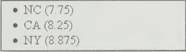

### 显示常规数组中值的 foreach 循环

```php
$numbers = array(1, 2, 3, 4, 5, 6, 7, 8, 9, 10);
unset($numbers[2], $numbers[6]);
$numbers_string = '';
foreach($numbers as $number) {
    $numbers_string .= $number . ' ';
}
echo $numbers_string;                 // Displays: 1 2 4 5 6 8 9 10
```

### 说明

- 你可以使用 *foreach* 语句创建 *foreach 循环*，它只访问数组中已定义的元素。

图 11-6  如何使用 foreach 循环处理数组

## 用于创建数组的函数

| 函数 | 描述 |
|---|---|
| `range($lo, $hi [, $step])` | 返回一个数组，包含从 $lo 到 $hi 的值，以 $step 为步长递增得到下一个值。如果省略，$step 默认为 1。 |
| `array_fill($start, $count, $value)` | 返回一个数组，从索引 $start 开始包含 $count 个 $value 的副本。 |
| `array_pad($array, $size, $value)` | 返回一个数组，将 $value 添加到 $array 的末尾，直到数组包含 $size 个元素。如果 $size 为负数，则将该值添加到数组的开头。 |
| `array_merge($array1, $array2, ...)` | 返回一个数组，将两个或多个数组的元素合并到一个数组中。$array2 中的字符串键会覆盖 $array1 中的字符串键，但数字键会被追加。 |
| `array_slice($array, $index [, $len [, $keys]])` | 返回数组的一部分，从 $index 开始并包含 $len 个元素。如果省略 $len，则返回直到数组末尾的所有元素。如果 $keys 为 TRUE，则使用原始键。否则，切片从 0 开始重新索引。 |
| `array_splice($array, $index [, $len [, $new]])` | 修改 $array，从 $index 开始用 $new 中的元素替换其元素，替换 $len 个元素。数组会被重新索引。注意，此函数不返回数组，而是修改 $array 参数中的元素。 |

### 如何创建一个包含值范围的数组

```php
$numbers = range(1, 4);                  // 1, 2, 3, 4
$numbers = range(10, 22, 4);              // 10, 14, 18, 22
```

### 如何填充和补齐数组

```php
$numbers = array_fill(0, 5, 1);           // 1, 1, 1, 1, 1
$numbers = array_pad($numbers, 10, 0);    // 1, 1, 1, 1, 1, 0, 0, 0, 0, 0
```

### 如何合并两个数组

```php
$employees = array('Mike', 'Anne');
$new_hires = array('Ray', 'Pren');
$employees = array_merge($employees, $new_hires);
print_r($employees);
                         // Array ( [0] => Mike [1] => Anne [2] => Ray [3] => Pren )
```

### 如何截取数组的一部分

```php
$employees = array('Mike', 'Anne', 'Ray', 'Pren');
$new_hires = array_slice($employees, 2);
print_r($new_hires);             // Array ( [0] => Ray [1] => Pren )
```

### 如何拼接两个数组

```php
$employees = array('Mike', 'Anne', 'Joel');
$new_hires = array('Ray', 'Pren');
array_splice($employees, 1, 2, $new_hires);
print_r($employees);             // Array ( [0] => Mike [1] => Ray [2] => Pren )
```

图 11-7 — 如何填充、合并、截取和拼接数组

## 如何使用队列和堆栈

图 11-8 展示了四个函数，你可以使用它们处理两种特殊类型的数组：队列和堆栈。

一个 *堆栈* 实现了一个 *后进先出（LIFO）* 的值集合。你可以把堆栈想象成一叠盘子。你放到堆栈上的最后一个盘子，是你必须从堆栈上取下的第一个盘子。

第一个示例展示了如何使用堆栈。首先，第一条语句创建一个数组。然后，第二条语句使用 array_push 函数将一个值放入堆栈。接下来，第三条语句使用 array_pop 函数将该值从堆栈中取出。最后，第四条语句显示刚刚从堆栈中取出的值。

另一方面，一个 *队列* 实现了一个 *先进先出（FIFO）* 的值集合。你可以把队列想象成在银行里排成一队等待的人。队伍中的第一个人是第一个被服务并离开队伍的人。

第二个示例展示了如何使用队列。首先，第一条语句创建一个数组。然后，第二条语句使用 array_push 函数将一个值推入队列的末尾。接下来，第三条语句使用 array_shift 函数从队列开头移除该值，并将队列中的其余元素向前移动以占据其位置。最后，第四条语句显示刚刚从队列中移除的值。

在使用堆栈时，从数组的哪一侧添加和移除值并不重要，只要你始终使用数组的同一侧进行操作。本图中的示例使用 array_push 和 array_pop 函数操作数组的末尾。不过，你也可以使用 array_unshift 和 array_shift 函数操作数组的开头来实现堆栈。

类似地，在使用队列时，你总是向数组的一侧添加值，并从另一侧移除值。因此，你可以使用 array_push 和 array_shift 函数来创建队列。或者，也可以使用 array_unshift 和 array_pop 函数来创建队列。

在查看本图中的函数时，请注意它们会修改传递给函数的数组。换句话说，它们不会返回新数组。

## 如何获取元素的总和与乘积

图 11-9 展示了如何使用 array_sum 函数将数组中的元素相加。在第一个示例中，第一条语句创建一个包含四个价格的数组，第二条语句使用 array_sum 函数将全部四个价格加在一起。这以更少的代码完成了与图 11-3 中第三个示例相同的任务。

此图没有展示 array_product 函数的示例。不过，这个函数的工作方式与 array_sum 函数类似，只是它将值相乘而不是相加。

## 如何搜索数组

此图中的第二个表总结了用于搜索数组的函数。然后，第一个搜索示例展示了如何使用三个函数搜索数组。第一条语句创建一个包含三个具有键和值的元素的关联数组。第二条语句使用 in_array 函数搜索该数组，以检查它是否包含值 7.75。

第三条语句搜索数组中字符串值 “7.75”。默认情况下，in_array 函数使用相等运算符进行此比较。因此，它会在比较之前将值转换为相同的数据类型，并返回 TRUE 值。

第四条语句执行与第三条语句相同的比较，但它为第三个参数指定了 TRUE 值。因此，此语句使用全等运算符执行严格比较。由于这种比较不会在比较前转换数据类型，所以它返回 FALSE 值。

第五条语句使用 array_key_exists 函数检查数组中是否存在某个键。这里，‘CA’ 这个键存在于数组中，因此该语句返回 TRUE 值。

第六条语句使用 array_search 函数在数组中搜索值 7.75。如果未在数组中找到此值，该函数返回 FALSE 值。但是，如果找到此值，该函数将返回该值的键。相比之下，in_array 函数如果找到该值，则返回 TRUE 值。

第二个搜索示例展示了如何使用 array_count_values 函数统计数组中每个值出现的次数。这里，第一条语句创建一个包含六个值、但只有三个唯一值的数组。然后，第二条语句使用 array_count_values 函数返回一个关联数组，该数组统计原数组中每个值出现的次数。本图中的最后三条语句展示了这一点。


## 用于对数组执行数学计算的函数

| 函数 | 描述 |
|---|---|
| `array_sum($array)` | 返回 `$array` 中元素的总和。 |
| `array_product($array)` | 返回 `$array` 中元素的乘积。 |

### 如何计算数组中所有值的总和

```php
$prices = array(141.95, 212.95, 411, 10.95);
$sum = array_sum($prices);                         // 776.85
```

## 用于搜索数组的函数

| 函数 | 描述 |
|---|---|
| `in_array($value, $array[, $strict])` | 如果 `$value` 存在于 `$array` 中，则返回 TRUE。如果 `$strict` 为 TRUE，则仅当数据类型也匹配时才返回 TRUE。 |
| `array_key_exists($key, $array)` | 如果 `$key` 被用作 `$array` 中的键，则返回 TRUE。 |
| `array_search($value, $array[, $strict])` | 如果 `$value` 存在于 `$array` 中，则返回对应的键；如果未找到，则返回 FALSE。`$strict` 参数的作用与 `in_array` 函数中的相同。 |
| `array_count_values($array)` | 统计 `$array` 中每个值被使用的次数。返回一个新数组，以值作为键，其值为该值出现的次数。 |

### 如何搜索数组

```php
$tax_rates = array('NC' => 7.75, 'CA' => 8.25, 'NY' => 8.875);
$is_found  = in_array(7.75, $tax_rates);             // TRUE
$is_found  = in_array('7.75', $tax_rates);           // TRUE
$is_found  = in_array('7.75', $tax_rates, true);     // FALSE
$key_exists = array_key_exists('CA', $tax_rates);    // TRUE
$key = array_search(7.75, $tax_rates);                // 'NC'
```

### 如何统计数组中某个值出现的次数

```php
$names = array('Mike', 'Mike', 'Mike', 'Anne', 'Joel', 'Joel');
$occurrences = array_count_values($names);
echo $occurrences['Mike'];                            // 3
echo $occurrences['Anne'];                            // 1
echo $occurrences['Joel'];                            // 2
```

*图 11-9 — 如何搜索数组并获取其元素的总和或乘积*

## 如何对数组进行排序

图 11-10 展示了如何使用函数对数组进行排序。数组排序函数的不同之处在于：是按升序还是降序排序，是保留键还是对数组重新索引，以及是按值还是按键排序。不过，所有排序函数都会修改原始数组。

排序函数还使用三个常量来控制排序期间的比较方式。默认情况下，SORT_REGULAR 常量使用关系运算符的常规类型转换规则来执行排序。大多数时候，该常量都能满足你的需求。但如果不行，你可以使用 SORT_STRING 常量在比较前将每个值转换为字符串。或者，可以使用 SORT_NUMERIC 常量在比较前将每个值转换为数字。

sort 函数按值升序对数组排序并重新索引数组。rsort 函数按值降序对数组排序并重新索引数组。这些函数通常用于整数索引的数组，如前三组示例所示。

asort 函数按值升序对数组排序并保留元素键。arsort 函数按值降序对数组排序并保留元素键。这些函数通常用于关联数组，如第四组示例所示。

ksort 函数按键升序对数组排序。krsort 函数按键降序对数组排序。两者在排序时都会保持键和值在一起。这些函数通常用于关联数组，如第四组示例所示。

## 用于修改数组的函数

| 函数 | 描述 |
|---|---|
| `array_unique($array[, $compare])` | 返回移除重复值后的 `$array`。`$compare` 参数的作用与排序函数中的相同，只是默认值为 `SORT_STRING`。 |
| `array_reverse($array [, $keys])` | 返回元素顺序反转后的 `$array`。如果 `keys` 为 `FALSE`（默认值），元素会被重新索引；否则使用原始键。 |
| `shuffle($array)` | 将 `$array` 中的值按随机顺序打乱。元素会被重新索引。 |
| `array_rand($array [, $count])` | 从 `$array` 中返回一个随机键。如果 `$count` 大于 1，则返回一个包含 `$count` 个随机键的数组。 |

### 如何修改数组

```php
$names = array('Mike', 'Mike', 'Mike', 'Anne', 'Joel', 'Joel');
$names = array_unique($names);                 // Mike, Anne, Joel
$names = array_reverse($names);                // Joel, Anne, Mike
shuffle($names);                               // Mike, Joel, Anne (for example)
```

### 如何修改关联数组

```php
$tax_rates = array('NC' => 7.75, 'NY' => 8.875, 'CA' => 8.25);
$tax_rates = array_reverse($tax_rates, true);
```

### 如何从数组中获取随机键

```php
$names = array('Mike', 'Anne', 'Joel', 'Ray', 'Pren');
$key = array_rand($names);                    // 2       (for example)
$names_rand = array_rand($names, 3);           // 0, 1, 3 (for example)
```

### 如何洗牌并发牌

```php
// Create the deck of cards
$faces = array('2', '3', '4', '5', '6', '7', '8',
               '9', 'T', 'J', 'Q', 'K', 'A');
$suits = array('h', 'd', 'c', 's');
$cards = array();
foreach($faces as $face) {
    foreach($suits as $suit) {
        $cards[] = $face . $suit;
    }
}

// Shuffle the deck and deal the cards
shuffle($cards);
$hand = array();
for ($i = 0; $i < 5; $i++) {
    $hand[] = array_pop($cards);
}
echo implode(',', $hand);                     // 9c,6d,Ks,4c,7h (for example)
```

*图 11-11 — 如何修改数组*

## 如何处理数组的数组

数组的数组，也称为二维数组，是一种每个元素都是另一个数组的数组。

### 理解数组的数组

图 11-12 提供了三张示意图，帮助你理解和直观认识数组的数组是如何工作的。第一张示意图展示了带整数索引的简单数组。这是你迄今为止在本章中使用的数组类型。每个元素显示为括号中的索引，位于阴影框内值的上方。在该数组中，每个元素的值都是一个字符串。

第二张示意图展示了一种二维数组，称为*矩形数组*。在这种情况下，所有嵌套数组的长度都相同。图中顶部的外层数组使用整数索引，嵌套数组使用字符串索引。你可以使用这样的矩形数组来存储表格数据。例如，这里的矩形数组存储了五个人的数据。

第三张示意图展示了另一种二维数组，称为*不规则数组*。在这种情况下，嵌套数组的长度不同。图中的外层数组使用字符串索引，而嵌套数组使用整数索引。虽然不规则数组不像矩形数组那样常用，但在某些情况下你可能需要使用它们。

虽然此图没有展示，但 PHP 还允许你创建*多维数组*，即将数组嵌套三层或更深。PHP 对数组嵌套深度没有技术限制，但应用程序的逻辑以及运行应用程序的 Web 服务器会对嵌套数组的深度造成实际限制。

### 简单数组


### 矩形数组

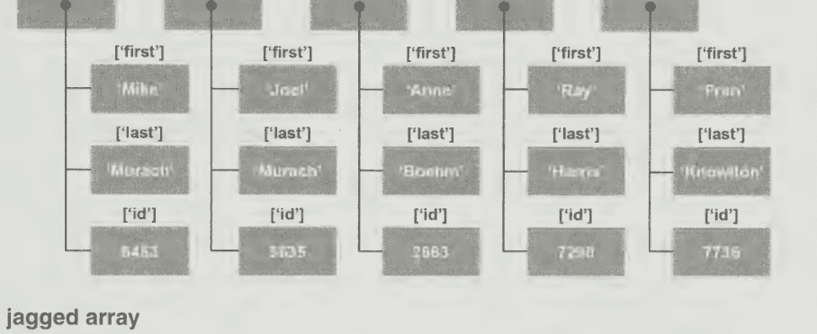

### 不规则数组

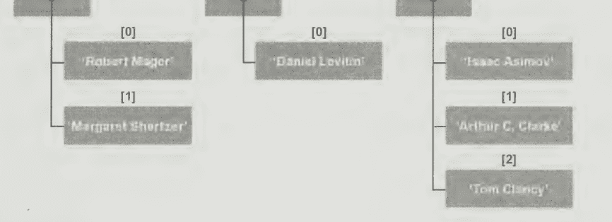

### 说明

- 数组的数组，或二维数组，是一种元素也是数组的数组。
- 如果数组中的嵌套数组大小相同，则该数组称为矩形数组；如果嵌套数组大小不同，则该数组称为不规则数组。


## 如何创建和使用数组的数组

图 11-13 展示了处理数组的数组的两个示例。虽然这两个示例都使用矩形数组，但同样的技术也适用于交错数组。

第一个示例演示如何创建并填充一个二维数组来保存乘法表。在第一组语句中，第一条语句创建了一个名为 $times_table 的空数组。然后，一个 for 循环在 $times_table 数组的前 13 个元素中存储空数组。

本示例中的第二组语句填充这个数组的数组。为此，它使用了嵌套 for 循环。这里，外层循环使用一个名为 $i 的索引，其范围从 0 到 12；内层循环使用一个名为 $j 的索引，其范围也是从 0 到 12。在内层循环中，语句将两个索引相乘，并将结果赋给由这两个索引定位的元素。

第三组语句演示如何访问该数组中的两个元素。这里，第一条语句显示外层数组索引 3 和内层数组索引 4 处的值。然后，第二条语句显示外层数组索引 6 和内层数组索引 7 处的值。

第二个示例演示如何将关联数组嵌套在数字索引数组中。这里，第一条语句创建了一个名为 $cart 的数组，该数组使用整数索引。

本示例中的第二组语句创建了一个名为 $item 的数组，用于保存有关某个项目的信息。然后，这段代码用有关项目的数据填充该数组。最后，最后一条语句将 $item 数组添加到 $cart 数组的末尾。这会将存储在 $item 变量中的数组复制到 $cart 数组中的一个元素中。因此，名为 $item 的变量可以在之后重新使用。但请记住，重复使用变量可能会导致混淆，因此 NetBeans IDE 会针对这种做法发出警告。

第三组语句创建一个新的空数组并将其存储在 $item 变量中。这会替换存储在 $item 变量中的原始数组。然后，这段代码用有关项目的数据填充新数组。最后，最后一条语句将 $item 数组添加到 $cart 数组的末尾。

最后一组语句演示如何访问该数组中的元素。这里，第一条语句显示购物车中第一个项目的代码。然后，第二条语句显示购物车中第二个项目的名称。如果要显示购物车中每个项目的数据，可以通过在 for 循环中嵌套 foreach 循环来实现。

## 任务列表管理器应用程序

本章结束时将演示如何在应用程序中使用你刚学到的某些技能。具体而言，图 11-14 展示了如何使用任务列表管理器应用程序来处理任务列表。由于此应用程序不将这些任务存储在数据库中，因此当用户关闭应用程序时任务会丢失。不过，一旦你理解了此应用程序，就很容易对其进行修改，使其将任务存储在数据库中。

### 用户界面

任务列表管理器应用程序的用户界面在网页顶部以编号列表的形式显示任务。用户界面还包含一个添加表单，允许用户向列表中添加新任务，以及一个删除表单，允许用户从列表中删除任务。

### 控制器代码

当用户启动此应用程序时，控制器中的代码使用 filter_input 函数获取任务列表数组，该数组存储在全局 $_POST 变量中，并将其存储在 $task_list 变量中。对于 filter_input 函数，这段代码为第三个参数提供了 FILTER_DEFAULT 常量，以应用默认过滤器，该过滤器不会进行任何额外处理。对于第四个参数，这段代码提供了 FILTER_REQUIRE_ARRAY 常量。这个过滤器对于该函数返回数组来说是必需的。

如果 filter_input 返回 NULL 值，则 $task_list 变量会被初始化为一个空数组。然后，这段代码从 POST 请求中获取操作（action），将其存储在 $action 变量中，并创建一个空的 $errors 数组来存储应用程序可能遇到的任何错误。

在设置好 $task_list 和 $errors 数组之后，这段代码使用 switch 语句检查用户界面是否请求了“add”或“delete”操作。如果请求了“add”操作，新任务会被复制到 $new_task 变量中。然后，if 语句检查该变量以确保它不为空。如果新任务变量为空，则该语句会在 $errors 数组末尾添加一条适当的错误消息。否则，新任务会被添加到 $task_list 数组的末尾。如果请求了“delete”操作，这段代码会将任务 ID 复制到 $task_index 变量中。然后，这段代码删除该任务并重新索引数组。

无论发生什么情况，控制器中的最后一条语句都会通过包含 task_list.php 文件来显示应用程序的视图。然后，该文件显示存储在 $task_list 和 $errors 数组中的数据。

### 视图代码

图 11-14 的第 2 部分显示了应用程序的视图代码。这段代码混合了 PHP 和 HTML。此应用程序的 CSS 代码未显示，但可以在本书的下载资料中找到。视图的四个部分都包含在 `<main>` 元素中。

第一部分显示 `$errors` 数组中的任何错误消息。首先，这部分使用 count 函数来确定是否存在错误消息。如果存在，则使用 foreach 循环在无序列表中显示每条错误消息。

第二部分显示 `$task_list` 数组中的任务。首先，这段代码使用 count 函数来确定是否有任何任务。如果没有，它会显示一个段落，表明列表中没有任何任务。否则，它使用 foreach 循环显示列表中的每个任务。在显示索引号时，代码会在显示之前将索引加一。这样任务编号从 1 而不是 0 开始。

第三部分显示一个用于向任务列表添加新任务的表单。由于任务不存储在数据库中，因此现有任务必须与新任务一起提交。表单中的 foreach 循环将每个现有任务作为名为“tasklist[]”的隐藏字段添加到表单中。这里，`<input>` 标签的 name 属性以方括号结尾，这样这些任务会在 `$_POST` 数组中合并为一个数组。这样，控制器开头的代码就可以获取这个任务数组。

名为 action 的隐藏字段的值为“add”，用于触发控制器中 switch 语句的正确代码段。其余代码显示文本框和按钮，允许用户输入任务并将其提交给控制器。

### task_list.php 文件

```php
<!DOCTYPE html>
<html>
<head>
    <title>Task List Manager</title>
    <link rel="stylesheet" type="text/css" href="main.css">
</head>
<body>
    <header>
        <h1>Task List Manager</h1>
    </header>
    <main>
        <!-- part 1: the errors -->
        <?php if (count($errors) > 0) : ?>
        <h2>Errors</h2>
        <ul>
            <?php foreach($errors as $error) : ?>
            <li><?php echo htmlspecialchars($error); ?></li>
            <?php endforeach; ?>
        </ul>
        <?php endif; ?>

        <!-- part 2: the tasks -->
        <h2>Tasks</h2>
        <?php if (count($task_list) == 0) : ?>
            <p>There are no tasks in the task list.</p>
        <?php else: ?>
            <ul>
                <?php foreach( $task_list as $id => $task ) : ?>
                    <li><?php echo $id + 1 .
                        htmlspecialchars($task); ?></li>
                <?php endforeach; ?>
            </ul>
        <?php endif; ?>
        <br>

        <!-- part 3: the add form -->
        <h2>Add Task</h2>
        <form action="." method="post">
            <?php foreach( $task_list as $task ) : ?>
                <input type="hidden" name="tasklist[]"
                       value="<?php echo htmlspecialchars($task); ?>">
            <?php endforeach; ?>
            <input type="hidden" name="action" value="add">
            <label>Task:</label>
            <input type="text" name="task"><br>
            <label>&nbsp;</label>
            <input type="submit" value="Add Task"><br>
        </form>
        <br>
    </main>
</body>
</html>
```


应用的第4部分显示一个用于从任务列表中删除任务的表单，但仅当任务列表中存在任务时，它才会显示此表单。同样，现有任务必须与要删除任务的索引一起提交。因此，表单中的foreach循环会将每个现有任务作为隐藏字段添加到表单中。

名为action的隐藏字段的值为"delete"，用于触发控制器中相应的代码段。之后，代码使用foreach循环将任务显示为下拉列表。在此，`<option>`标签的value属性是任务元素的键，而下拉列表中显示的文本是任务元素的值。

## task_list.php文件（续）

```
<!-- part 4: the delete form -->
<?php if (count($task_list) > 0) : ?>
<h2>Delete Task</h2>
<form action="" method="post" >
    <?php foreach( $task_list as $task ): ?>
        <input type="hidden" name="tasklist[]"
                value="<?php echo htmlspecialchars($task); ?>">
    <?php endforeach; ?>
    <input type="hidden" name="action" value="delete">
    <label>Task:</label>
    <select name="taskid">
        <?php foreach( $task_list as $id => $task ) : ?>
            <option value="<?php echo $id; ?>">
                <?php echo htmlspecialchars($task); ?>
            </option>
        <?php endforeach; ?>
    </select>
    <br>
    <label>&nbsp;</label>
    <input type="submit" value="Delete Task">
</form>
<?php endif; ?>
</main>
</body>
</html>
```

图11-14 任务列表管理器应用（第3部分，共3部分）

## 透视

数组是许多PHP应用的重要组成部分，PHP提供了许多用于处理数组的函数。在接下来的章节中，您将看到数组的其他用途以及处理它们的其他方式。

在查看其他开发者的PHP代码时，您可能会遇到使用运算符（如加号（+））来处理数组的代码。不过，本章不介绍这些运算符，因为它们并不总是按您预期的方式工作。例如，您可能期望使用加号将一个数组添加到另一个数组中。然而，这并非该运算的作用。因此，您应该使用数组函数而不是数组运算符。例如，要将一个数组添加到另一个数组，您应该使用本章所述的array_merge函数。

### 术语

| 术语 | 相关术语 |
| --- | --- |
| 数组 | 栈 |
| 元素 | 后进先出（LIFO） |
| 元素的值 | 队列 |
| 元素的索引 | 先进先出（FIFO） |
| 数组的长度 | 数组的数组 |
| 关联数组 | 二维数组 |
| 键 | 矩形数组 |
| foreach语句 | 交错数组 |
| foreach循环 | 多维数组 |

### 摘要

- *数组*可以包含一个或多个由*索引*引用的*元素*。这些索引可以是整数或字符串。数组的*长度*表示它所包含的元素数量。
- PHP数组是动态的，这意味着您可以通过添加或删除元素来改变数组的长度。您还可以在数组中创建空元素（间隙）。
- *关联数组*是一种索引为字符串值的数组。这种索引通常被称为*键*，因此关联数组可以被视为一系列键/值对。
- for循环通常用于处理整数索引的数组，而foreach循环通常用于处理关联数组。
- PHP提供了许多使数组处理更简便的函数。这些函数包括创建、搜索、排序和修改数组的函数。
- *栈*是一种提供*后进先出（LIFO）*处理的数组类型。*队列*是一种提供*先进先出（FIFO）*处理的数组类型。
- *数组的数组*，或*二维数组*，是其元素包含其他数组的数组。二维数组通常是*矩形*的，但也可能是*交错*的。

## 练习11-1 — 使用任务列表管理器应用的数组

本练习让您有机会在任务列表管理器应用的背景下体验数组和数组方法。

### 打开并测试应用

- 1. 在ex_starts/ch11_ex1目录中运行应用。这是任务列表管理器应用的一个修改版本，包含“修改任务”按钮、“提升任务”按钮和“排序任务”按钮。
- 2. 使用“添加任务”按钮输入三个任务，并使用“删除任务”按钮删除其中一个任务来测试此应用。这些按钮应按照正文中的描述工作。但是，其他按钮不应执行任何操作。
- 3. 打开此应用的index.php和task_list.php文件。请注意，这些文件使用提交按钮的name和value属性来获取要执行的操作。

### 在浏览器中显示数组的内容

- 4. 在task_list.php文件中，就在`<main>`标签内部，添加以下代码：

```php
<p><?php print_r($task_list); ?></p>
```

- 5. 保存更改并运行应用。您应该在浏览器中看到`$task_list`数组的索引和值。

### 修改并增强应用

- 6. 修改添加任务的代码，使其使用array_push函数将新任务添加到`$task_list`数组的末尾。然后，测试此更改。
- 7. 添加允许用户修改现有任务的代码。如果用户点击“修改任务”按钮，此代码应隐藏包含“修改任务”按钮的表单，并显示task_list.php文件中包含的表单。此表单在文本框中显示当前任务，并包含允许用户保存或取消更改的按钮。
- 8. 添加允许用户提升任务的代码。此代码应将选定的任务在任务数组中上移一个索引。如果用户选择了第一个任务，此代码应显示一条错误信息，指示不能提升第一个任务。
- 9. 添加允许用户按字母顺序对所有任务进行排序的代码。
- 10. 别忘了测试您的更改，以确保它们能正常工作！

## setcookie函数的语法

```
setcookie($name, $value, $expire, $path, $domain, $secure, $httponly)
```

## setcookie函数的参数

| 参数 | 描述 |
| --- | --- |
| `$name` | cookie的名称。 |
| `$value` | cookie的值。默认是空字符串。 |
| `$expire` | cookie的过期日期，以时间戳表示。如果设置为0，则cookie在用户关闭浏览器时过期。默认值为0。 |
| `$path` | cookie在服务器上可用的路径。如果设置为'/'，则cookie对当前服务器上的所有目录可用。默认值是设置cookie的PHP文件所在的目录。 |
| `$domain` | cookie可用的域名。默认值是设置cookie的服务器名称。 |
| `$secure` | 如果为TRUE，则cookie仅在通过HTTPS发送时可用。默认值为FALSE。 |
| `$httponly` | 如果为TRUE，则cookie仅通过HTTP协议可用，而不能通过客户端脚本语言（如JavaScript）访问。默认值为FALSE。 |

## 在浏览器中设置cookie

```
$name = 'userid';
$value = '87';
$expire = strtotime('+1 year');
$path = '/';
setcookie($name, $value, $expire, $path);
```

## 从浏览器获取cookie的值

```
$userid = filter_input(INPUT_COOKIE, 'userid', FILTER_VALIDATE_INT);  // 87
```

## 从浏览器删除cookie

```
$expire = strtotime('-1 year');
setcookie('userid', '', $expire, '/');
```

## 描述

- 要在用户的浏览器中设置cookie，可以使用setcookie函数。此函数必须在应用发送任何HTML输出之前调用。
- *会话cookie*在用户关闭浏览器时过期。*持久cookie*直到指定的过期日期才过期。
- 一旦设置了cookie，您可以在浏览器下次请求页面时获取它。为此，您可以使用filter_input函数从超全局变量$_COOKIE中获取它。该变量是一个关联数组，其中cookie名称是键，cookie值是值。
- 要从浏览器删除cookie，请将值设置为空字符串，并将过期日期设置为过去的时间。任何其余参数必须与最初创建cookie时的值相同。

图12-2 — 如何设置和获取cookie

## 如何启用或禁用 Cookie

虽然大多数用户都启用了 Cookie，但通常认为在禁用 Cookie 的情况下测试应用程序是一种很好的做法。这样，你就可以为那些禁用了 Cookie 的用户测试应用程序。然后，你可以修改应用程序，使其恰当地处理这种情况。

例如，你可能想要显示一条消息，表明该应用程序需要 Cookie 才能正常运行。完成此测试后，你可以重新启用 Cookie，继续为启用了 Cookie 的用户测试应用程序。

图 12-3 展示了如何在 Chrome 和 Internet Explorer 中启用和禁用 Cookie。对于 Internet Explorer，你可能需要将安全设置重置为其默认值，才能阻止来自与 Internet Explorer 运行在同一台计算机上的开发 Web 服务器的 Cookie。

如果你使用的不是 Chrome 或 IE 的 Web 浏览器，或者你使用的是这些浏览器的旧版本，你可以在 Internet 上搜索或查阅浏览器的文档，了解如何启用和禁用 Cookie。

### 如何在 Chrome 37 中启用或禁用 Cookie

1. 打开工具菜单，然后选择设置命令。
2. 向下滚动，点击“显示高级设置...”链接。
3. 在“隐私”部分，点击“内容设置”按钮。
4. 选择“允许设置本地数据”选项以启用 Cookie，或选择“阻止网站设置任何数据”以禁用 Cookie。然后，点击“完成”按钮。

### 如何在 Internet Explorer 11 中启用或禁用 Cookie

1. 打开工具菜单，然后选择“Internet 选项”命令。
2. 点击“隐私”选项卡。
3. 使用滑块控件启用或禁用 Cookie，或点击“高级”按钮，选中“覆盖自动 Cookie 处理”复选框，配置 Cookie，然后点击“确定”按钮。
4. 若要撤销通过滑块控件或在“高级”部分所做的更改，请点击“默认”按钮以恢复默认隐私设置。

### 如何在 Internet Explorer 11 中重置默认安全设置

1. 打开工具菜单，然后选择“Internet 选项”命令。
2. 点击“安全”选项卡。
3. 如果未禁用，请点击“将所有区域重置为默认级别”按钮。

### 描述

- 若要测试当用户禁用 Cookie 时应用程序的行为，你可以在浏览器中禁用 Cookie。
- 若要测试应用程序在正常情况下的行为，你可以在浏览器中启用 Cookie。
- 在 IE 11 中，你可能需要将安全设置重置为默认级别，以阻止来自运行在你的计算机上的 Web 服务器的 Cookie。
- 对于其他 Web 浏览器，请使用浏览器的文档或在 Internet 上搜索，查找启用和禁用 Cookie 的说明。


## 如何使用会话

在用户浏览网站时跟踪用户的过程称为*会话跟踪*。在本主题中，你将了解会话跟踪为何重要，以及如何使用 PHP 对会话跟踪的内置支持。

### 为什么会话跟踪在 HTTP 下很困难

图 12-4 说明了为什么对于使用 HTTP 的 Web 应用程序来说，会话跟踪比其他类型的应用程序更难。首先，客户端上的浏览器向 Web 服务器请求一个页面。Web 服务器返回页面后，即关闭连接。当浏览器发出后续请求时，Web 服务器无法将当前请求与之前的请求关联起来。由于 HTTP 不保持状态，因此它被称为*无状态协议*。

### 会话跟踪在 PHP 中如何工作

此图还展示了 PHP 如何跟踪会话。首先，客户端上的浏览器向 Web 服务器请求一个 PHP 页面。然后，PHP 检查请求是否包含 PHP 会话 ID。如果不包含，PHP 会在服务器上创建一个新会话，并为其分配一个唯一的会话 ID。此时，应用程序可以将数据存储在会话中。然后，会话 ID 在响应中作为 Cookie 被发送回浏览器。

当浏览器发出后续请求时，它会在请求中包含会话 ID Cookie。PHP 再次检查请求是否包含 PHP 会话 ID。这一次包含，因此 PHP 使用会话 ID 访问存储在服务器上的会话数据。然后，应用程序可以根据需要使用该数据、修改它或向其中添加内容。

默认情况下，PHP 5.5 仅使用 Cookie 来处理会话 ID。因此，会话跟踪仅在用户启用 Cookie 时才有效。对于大多数 Web 应用程序，这正是你想要的，因为绝大多数 Web 浏览器都启用了 Cookie。

但是，如果你需要应用程序即使在用户禁用 Cookie 的情况下也能正常工作，PHP 可以在 URL 中对会话 ID 进行编码。这种方式有时称为*URL 编码*，你可以配置系统，使 PHP 在 URL 中透明地编码会话 ID。不幸的是，这种方法存在几个问题。首先，它会造成一个安全漏洞，可能允许会话劫持。其次，如果用户将包含会话 ID 的页面加入书签，可能会导致网站故障。第三，它可能会导致你的网页在搜索引擎中的显示方式出现问题。因此，我们不建议使用透明 URL 编码，并且在本章中不讨论它。如果你需要使用它，可以访问此网页了解更多信息：http://www.php.net/manual/en/session.idpassing.php

### 为什么会话跟踪在 HTTP 下很困难

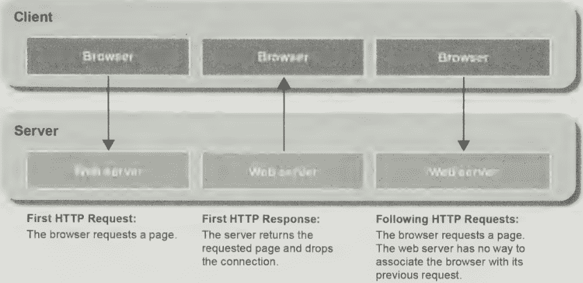

### PHP 如何跟踪会话

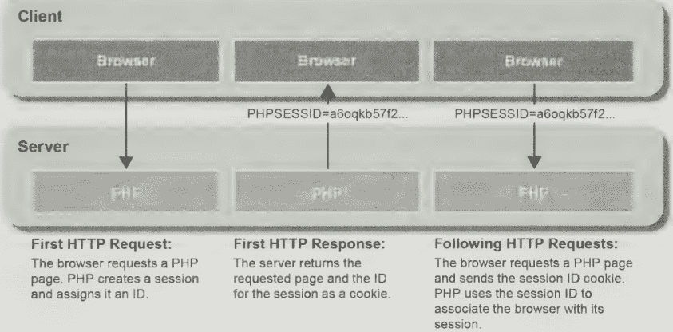

### 描述

- HTTP 是一种*无状态协议*。浏览器发出请求后，即断开与服务器的连接。为了保持*状态*，Web 应用程序使用*会话跟踪*。
- 默认情况下，PHP 使用 Cookie 在每个浏览器中存储会话 ID。然后，浏览器在每次请求时将 Cookie 传递给服务器。
- 要在浏览器禁用 Cookie 时提供会话跟踪，你可以使用*URL 编码*将会话 ID 存储在应用程序每个页面的 URL 中。但是，我们不建议这样做。

图 12-4 — 会话跟踪简介

## 用于启动会话的函数

| 函数 | 描述 |
|---|---|
| `session_start()` | 启动一个新会话或恢复之前的会话。如果成功则返回 TRUE，否则返回 FALSE。必须在页面向你的应用程序发送任何 HTML 输出之前调用此函数。 |

### 使用默认 Cookie 参数启动会话

```
session_start();
```

### session_set_cookie_params 函数的语法

```
session_set_cookie_params($lifetime, $path, $domain, $secure, $httponly)
```

### session_set_cookie_params 函数的参数

| 参数 | 描述 |
|---|---|
| `$lifetime` | 会话 Cookie 的生命周期（以秒为单位）。默认值为 0。 |
| `$path` | 会话 Cookie 在服务器上可用的路径。默认值为设置该 Cookie 的脚本的当前目录。 |
| `$domain` | 该 Cookie 可用的域。默认值为设置该 Cookie 的服务器名称。 |
| `$secure` | 如果为 TRUE，则该 Cookie 仅在通过安全 HTTP 连接（HTTPS 连接）发送时可用。默认值为 FALSE。 |
| `$httponly` | 如果为 TRUE，则该 Cookie 仅可通过 HTTP 协议使用，而不能通过客户端脚本语言（如 JavaScript）使用。默认值为 FALSE。 |

### 使用自定义 Cookie 参数启动会话

```
$lifetime = 60 * 60 * 24 * 365; // 1 year in seconds
session_set_cookie_params($lifetime, '/');
session_start();
```

### 描述

- 当浏览器首次请求包含 `session_start` 函数的页面时，会话即开始。
- 默认情况下，会话使用会话 Cookie 将浏览器与其会话数据关联起来。但你可以使用 `session_set_cookie_params` 函数自定义该会话的 Cookie。
- 在 `session_set_cookie_params` 函数中，`$lifetime` 参数是唯一必需的参数。其他参数是可选的。
- 必须在调用 `session_start` 函数之前调用 `session_set_cookie_params` 函数。

图 12-5 — 如何启动会话


## 如何设置和获取标量变量

### 在会话中设置变量

```php
$_SESSION['product_code'] = 'MBT-1753';
```

### 从会话中获取变量

```php
$product_code = $_SESSION['product_code'];
```

## 如何设置和获取数组

### 在会话中设置数组

```php
if (!isset($_SESSION['cart'])) {
    $_SESSION['cart'] = array();
}
```

### 向存储在会话中的数组添加元素

```php
$_SESSION['cart']['key1'] = 'value1';
$_SESSION['cart']['key2'] = 'value2';
```

### 获取并使用存储在会话中的数组

```php
$cart = $_SESSION['cart'];
foreach ($cart as $item) {
    echo '<li>' . $item . '</li>';
}
```

## 如何从会话中移除变量

### 移除会话变量

```php
unset($_SESSION['cart']);
```

### 移除所有会话变量

```php
$_SESSION = array();
```

### 描述

- 启动会话后，你可以使用超全局变量 $_SESSION 来设置和获取会话期间的用户数据。此变量是一个关联数组。
- 如有必要，你可以使用 isset 函数来测试 $_SESSION 数组中是否已存在某个元素。
- 你可以使用 unset 函数从 $_SESSION 数组中移除一个元素。然而，不要对 $_SESSION 数组本身使用 unset 函数，因为它可能导致不可预测的结果。
- 你可以将 $_SESSION 数组设为空数组以移除其内容。

## 如何结束会话

默认情况下，会话在 24 分钟内无请求后结束。因此，你通常不需要编写任何代码来结束会话。然而，在某些情况下，你可能需要编写结束会话的代码。例如，如果用户退出你的应用程序，你通常希望结束会话。

第一个示例展示了如何结束会话。首先，第一条语句通过将 $_SESSION 数组设为空数组来从内存中移除所有会话变量。然后，第二条语句通过调用 session_destroy 函数来清理会话 ID。然而，这并不会从用户浏览器中删除会话 Cookie。

因此，如果你想从客户端和服务器完全移除会话数据，你需要删除会话 Cookie，如第二个示例所示。此代码首先使用 session_name 函数获取会话 Cookie 的名称。然后，它将过期日期设为一年前。接下来，它使用 session_get_cookie_params 函数获取创建会话 Cookie 时使用的值的关联数组，并将此数组中的四个元素复制到单独的变量中。最后，它使用这些值调用 setcookie 函数。由于此调用对 $value 参数使用空字符串，对 $expire 参数使用过去的日期，因此会删除会话 Cookie。

当你使用 session_destroy 函数时，必须在 session_start 函数之后调用它。此外，你不应在下一张图所示的 session_write_close 函数之后使用它。

### 用于结束会话的函数

| 函数 | 描述 |
|---|---|
| `session_destroy()` | 结束会话。如果成功返回 TRUE，否则返回 FALSE。 |

### 结束会话

```php
$_SESSION = array();                         // Clear session data from memory
session_destroy();                            // Clean up the session ID
```

### 从浏览器删除会话 Cookie

```php
$name = session_name();                      // Get name of session cookie
$expire = strtotime('-1 year');              // Create expiration date in the past
$params = session_get_cookie_params();       // Get session params
$path = $params['path'];
$domain = $params['domain'];
$secure = $params['secure'];
$httponly = $params['httponly'];
setcookie($name, '', $expire, $path, $domain, $secure, $httponly);
```

### 描述

- 会话会在用户关闭浏览器时、在无请求的情况下经过指定时间后，或当代码调用 `session_destroy` 函数时结束。
- 要从客户端和服务器中移除与会话关联的所有数据，你可以从内存中清除会话数据、调用 `session_destroy` 函数，并使用 `setcookie` 函数删除会话 Cookie。
- `session_name` 函数获取会话 Cookie 的名称。默认情况下，会话 Cookie 的名称为 "PHPSESSID"。
- `session_get_cookie_params` 函数获取一个包含会话 Cookie 所有参数的关联数组。有关这些参数的列表，请参阅图 12-5。

## 如何管理会话

图 12-8 描述了可用于管理会话的多个函数。你通常不需要使用这些函数，但在某些情况下它们很有用。

首先，你可以使用 session_name 函数获取会话 Cookie 的名称，如第一个示例所示。默认情况下，此 Cookie 的名称为 "PHPSESSID"。此外，你可以使用 session_id 函数获取或设置会话 ID。在此，第二个示例获取会话 ID，第三个示例设置会话 ID。

由于会话 Cookie 通常未加密，网络上的攻击者可能查看会话 Cookie 并使用该数据冒充用户。这称为会话劫持。为帮助防止这种情况，你可以在代码的关键点调用 session_regenerate_id 函数以更改会话 ID 的值。例如，在用户登录或更改密码后，你可能希望调用此函数。然后，如果有人窃取了旧的会话 ID，该 ID 就无法用于冒充用户。

在大多数情况下，PHP 在脚本结束时会自动保存会话数据。然而，如果你使用 header 函数后跟 exit 函数重定向浏览器，PHP 不一定会保存会话数据。因此，在使用 header 函数重定向用户时，你应调用 session_write_close 函数以强制 PHP 保存会话数据。此外，你必须在调用 session_destroy 函数之前调用 session_write_close 函数。

### 用于管理会话的函数

| 函数 | 描述 |
|---|---|
| `session_name()` | 获取会话 Cookie 的名称。默认是 PHPSESSID。 |
| `session_id([$id])` | 如果未指定参数，此函数获取当前会话 ID。如果不存在会话，此函数获取空字符串。如果指定了参数，此函数将会话 ID 设为指定值。 |
| `session_regenerate_id()` | 为当前会话创建新的会话 ID。如果成功返回 TRUE，否则返回 FALSE。此函数可用于帮助防止会话劫持。 |
| `session_write_close()` | 结束当前会话并保存会话数据。此函数仅在特殊情况如重定向时才需要。 |

### 获取会话 Cookie 的名称

```php
$name = session_name();    // By default, PHPSESSID
```

### 获取会话 ID 的值

```php
$sid = session_id();       // For example, 11jef1foi1g8u6qnu14f8b6e14
```

### 设置会话 ID

```php
session_id('abc123');
```

Figure 12-8   如何管理会话

## 购物车应用程序

本主题介绍了一个演示会话变量用法的应用程序。如果没有会话跟踪，此应用程序的代码会复杂得多。

### 用户界面

图 12-9 显示了购物车应用程序的用户界面。此应用程序包含两个页面：添加商品页面和购物车页面。

添加商品页面允许用户将商品添加到购物车中。此外，它还包含一个链接，允许用户在不添加商品的情况下查看购物车。

购物车页面显示用户购物车中的所有商品以及小计。从此页面，用户可以通过更改数量并点击更新按钮来更新购物车中商品的数量。或者，用户可以通过将数量更改为 0 并点击更新按钮来移除商品。要添加更多商品，用户可以点击添加商品链接返回到添加商品页面。或者，要从购物车中移除所有商品，用户可以点击清空购物车链接。

由于此应用程序的目的是说明 Cookie 和会话的使用，用户界面并不真实。此外，此应用程序不会从数据库获取产品数据或将会话存储在数据库中。当然，这些是在实际应用中你会做出的改进。


## 添加商品页面

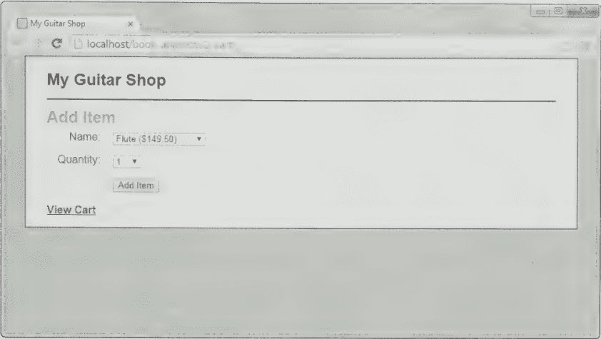

## 购物车页面

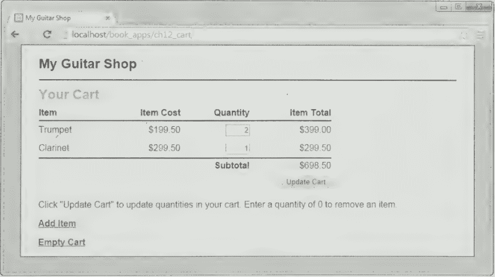

图 12-9  购物车应用程序

## 控制器

图 12-10 列出了购物车应用程序控制器的代码。与往常一样，这些代码存储在 index.php 文件中。该文件使用 cart.php 文件中的函数来向购物车添加商品以及更新购物车中的商品。此外，它还使用 add_item_view.php 和 cart_view.php 文件来显示添加商品页面和购物车页面。接下来的三幅图将讨论这三个文件。

控制器首先启动一个会话。在这里，前两条语句使用 session_set_cookie_params 函数创建一个持续两周的会话。因此，如果用户关闭浏览器并在两周内返回，则可以继续其会话。

启动会话后，代码检查 $_SESSION 数组中的购物车数组是否为空。如果是，则创建一个空数组来存储购物车。请注意，此代码使用键 'cart12' 来访问 $_SESSION 数组中的购物车。这个键表明该购物车用于第 12 章。

初始化购物车后，代码创建一个多维产品数组。在实际应用程序中，这些数据通常从数据库读取。然而，为了简单起见，该应用程序对这些值进行了硬编码。如果你愿意，可以通过添加遵循相同格式的新行来向数组添加新产品。

创建产品数组后，控制器加载 cart.php 文件。该文件包含用于处理购物车数组的函数。这些函数可以向购物车添加新商品，或更新现有商品的数量。

引入购物车函数后，控制器根据 POST 或 GET 请求的 action 参数获取要执行的操作。如果 action 参数尚未设置，则此代码使用默认操作 show_add_item。

获取操作后，控制器使用 switch 语句执行操作。如果操作是 add，此代码从 POST 请求中检索新产品键和数量，并将其传递给 add_item 函数，该函数将商品添加到购物车。然后，此 case 显示购物车页面。

如果操作是 update，代码从 POST 请求中检索新数量数组。然后，它使用循环检查数组中的每个数量。如果新数量与旧数量不同，代码调用 update_item 函数来更新商品的数量。最后，它显示购物车页面。

如果操作是 show_cart，代码显示购物车页面。当用户单击添加商品页面上的“查看购物车”链接时，会发生这种情况。

如果操作是 show_add_item，代码显示添加商品页面。当用户单击购物车页面上的“添加商品”链接时，会发生这种情况。

如果操作是 empty_cart，代码使用 unset 函数从 $_SESSION 变量中移除购物车。然后，它显示购物车页面。当用户单击购物车页面上的“清空购物车”链接时，会发生这种情况。请注意，此代码不会结束用户的会话。但是，它确实取消了该应用程序使用的唯一会话变量。从用户的角度来看，这实际上结束了会话。

## index.php 文件

```php
<?php
// Start session management with a persistent cookie
$lifetime = 60 * 60 * 24 * 14;   // 2 weeks in seconds
session_set_cookie_params($lifetime, '/');
session_start();

// Create a cart array if needed
if (empty($_SESSION['cart12'])) { $_SESSION['cart12'] = array(); }

// Create a table of products
$products = array();
$products['MMS-1754'] = array('name' => 'Flute', 'cost' => '149.50');
$products['MMS-6289'] = array('name' => 'Trumpet', 'cost' => '199.50');
$products['MMS-3408'] = array('name' => 'Clarinet', 'cost' => '299.50');

// Include cart functions
require_once('cart.php');

// Get the action to perform
$action = filter_input(INPUT_POST, 'action');
if ($action === NULL) {
    $action = filter_input(INPUT_GET, 'action');
    if ($action === NULL) {
        $action = 'show_add_item';
    }
}
// Add or update cart as needed
switch($action) {
    case 'add':
        $product_key = filter_input(INPUT_POST, 'productkey');
        $item_qty = filter_input(INPUT_POST, 'itemqty');
        add_item($product_key, $item_qty);
        include('cart_view.php');
        break;
    case 'update':
        $new_qty_list = filter_input(INPUT_POST, 'newqty', FILTER_DEFAULT,
                                    FILTER_REQUIRE_ARRAY);
        foreach($new_qty_list as $key => $qty) {
            if ($_SESSION['cart12'][$key]['qty'] != $qty) {
                update_item($key, $qty);
            }
        }
        include('cart_view.php');
        break;
    case 'show_cart':
        include('cart_view.php');
        break;
    case 'show_add_item':
        include('add_item_view.php');
        break;
    case 'empty_cart':
        unset($_SESSION['cart12']);
        include('cart_view.php');
        break;
}
```

## cart.php 文件

```php
<?php
// Add an item to the cart
function add_item($key, $quantity) {
    global $products;
    if ($quantity < 1) return;

    // If item already exists in cart, update quantity
    if (isset($_SESSION['cart12'][$key])) {
        $quantity += $_SESSION['cart12'][$key]['qty'];
        update_item($key, $quantity);
        return;
    }

    // Add item
    $cost = $products[$key]['cost'];
    $total = $cost * $quantity;
    $item = array(
        'name' => $products[$key]['name'],
        'cost' => $cost,
        'qty' => $quantity,
        'total' => $total
    );
    $_SESSION['cart12'][$key] = $item;
}

// Update an item in the cart
function update_item($key, $quantity) {
    $quantity = (int) $quantity;
    if (isset($_SESSION['cart12'][$key])) {
        if ($quantity <= 0) {
            unset($_SESSION['cart12'][$key]);
        } else {
            $_SESSION['cart12'][$key]['qty'] = $quantity;
            $total = $_SESSION['cart12'][$key]['cost'] *
                     $_SESSION['cart12'][$key]['qty'];
            $_SESSION['cart12'][$key]['total'] = $total;
        }
    }
}

// Get cart subtotal
function get_subtotal() {
    $subtotal = 0;
    foreach ($_SESSION['cart12'] as $item) {
        $subtotal += $item['total'];
    }
    $subtotal_f = number_format($subtotal, 2);
    return $subtotal_f;
}
?>
```

图 12-11 — 购物车应用程序的 cart.php 文件

## 添加商品视图

图 12-12 显示了添加商品页面的代码。此页面显示一个表单，允许用户通过选择产品和数量来向购物车添加商品。此外，此页面还显示一个链接，允许用户在不添加商品的情况下查看购物车。

该表单使用 POST 方法将数据提交回 index.php 控制器进行处理。此表单包含一个隐藏字段，其 name 为 “action”，值为 “add”，用于指示控制器应将商品添加到购物车。

第一个 <select> 标签的 name 为 “productkey”。此标签允许用户从下拉列表中选择产品。在此标签内，PHP 代码使用 foreach 循环为下拉列表生成 <option> 标签。首先，此代码遍历 products 数组中的每个商品。在循环开始时，此代码将每个商品的成本格式化为两位数字，并使用商品名称和格式化后的成本来生成要显示的商品文本。

在循环内，此代码将 <option> 标签的 value 设置为产品的键。因此，所选产品的键会被提交给控制器。此代码将 <option> 标签的文本设置为包含产品名称和成本的字符串，因此该文本会显示在下拉列表中。

第二个 <select> 标签的 name 为 “itemqty”。此标签允许用户从下拉列表中选择数量。此代码使用 for 循环为下拉列表生成 <option> 标签。这些标签显示 1 到 10 的值。在此，代码使用循环的索引作为提交给控制器的值以及显示在下拉列表中的文本。

在页面末尾，“查看购物车”链接允许用户在不添加商品的情况下转到购物车视图页面。在此，<a> 标签的 href 属性链接到控制器，并提交一个值为 show_cart 的 action 参数。因此，该参数作为 GET 请求的一部分传递给控制器。这就是控制器同时检查 POST 和 GET 请求以确定要执行的操作的原因。


### add_item_view.php 文件

```php
<!DOCTYPE html>
<html>
<head>
    <title>My Guitar Shop</title>
    <link rel="stylesheet" type="text/css" href="main.css">
</head>
<body>
    <header>
        <h1>My Guitar Shop</h1>
    </header>
    <main>
        <h1>Add Item</h1>
        <form action="." method="post">
            <input type="hidden" name="action" value="add">
            <label>Name:</label>
            <select name="productkey">
                <?php foreach($products as $key => $product) :
                    $cost = number_format($product['cost'], 2);
                    $name = $product['name'];
                    $item = $name . ' ($' . $cost . ')';
                ?>
                    <option value="<?php echo $key; ?>">
                        <?php echo $item; ?>
                    </option>
                <?php endforeach; ?>
            </select><br>
            <label>Quantity:</label>
            <select name="itemqty">
                <?php for($i = 1; $i <= 10; $i++) : ?>
                    <option value="<?php echo $i; ?>">
                        <?php echo $i; ?>
                    </option>
                <?php endfor; ?>
            </select><br>
            <label>&nbsp;</label>
            <input type="submit" value="Add Item">
        </form>
        <p><a href=".?action=show_cart">View Cart</a></p>
    </main>
</body>
</html>
```

### cart_view.php 文件

```php
<!DOCTYPE html>
<html>
<head>
    <title>My Guitar Shop</title>
    <link rel="stylesheet" type="text/css" href="main.css">
</head>
<body>
    <header>
        <h1>My Guitar Shop</h1>
    </header>
    <main>
        <h1>Your Cart</h1>
        <?php if (empty($_SESSION['cart']) ||
                count($_SESSION['cart']) == 0) : ?>
            <p>There are no items in your cart.</p>
        <?php else: ?>
            <form action="." method="post">
            <input type="hidden" name="action" value="update">
            <table>
                <tr id="cart_header">
                    <th class="left">Item</th>
                    <th class="right">Item Cost</th>
                    <th class="right">Quantity</th>
                    <th class="right">Item Total</th>
                </tr>

                <?php foreach ( $_SESSION['cart'] as $key => $item ) :
                    $cost  = number_format($item['cost'], 2);
                    $total = number_format($item['total'], 2);
                ?>
                <tr>
                    <td>
                        <?php echo $item['name']; ?>
                    </td>
                    <td class="right">
                        $<?php echo $cost; ?>
                    </td>
                    <td class="right">
                        <input type="text" class="cart_qty"
                            name="newqty[<?php echo $key; ?>]"
                            value="<?php echo $item['qty']; ?>">
                    </td>
                    <td class="right">
                        $<?php echo $total; ?>
                    </td>
                </tr>
                <?php endforeach; ?>
<tr id="cart_footer">
    <td colspan="3"><b>Subtotal</b></td>
    <td>$<?php echo get_subtotal(); ?></td>
</tr>
<tr>
    <td colspan="4" class="right">
        <input type="submit" value="Update Cart">
    </td>
</tr>
</table>
<p>Click "Update Cart" to update quantities in your
    cart. Enter a quantity of 0 to remove an item.
</p>
</form>
<?php endif; ?>
<p><a href=".?action=show_add_item">Add Item</a></p>
<p><a href=".?action=empty_cart">Empty Cart</a></p>
</main>
</body>
</html>
```

图 12-13 购物车应用程序的 cart_view.php 文件（第 1 部分，共 2 部分）

图 12-13 — 购物车应用程序的 cart_view.php 文件（第 2 部分，共 2 部分）

在 foreach 循环生成的商品行之后，表格在其中一行显示购物车小计，在另一行显示提交按钮。此外，它还显示说明，介绍如何更新购物车中的商品以及如何从购物车中移除商品。

在页面末尾，Add Item（添加商品）链接可让用户返回 Add Item（添加商品）页面。为此，它会向控制器发送一个 `show_add_item` 动作。此外，Empty Cart（清空购物车）链接可让用户移除购物车中的所有商品。为此，它会向控制器发送一个 `empty_cart` 动作。

如果你愿意，可以使用按钮来代替 Add Item（添加商品）、View Cart（查看购物车）和 Empty Cart（清空购物车）链接。要做到这一点，你可以为每个按钮编写一个表单，而不是编写链接。然后，你可以为 action 参数加入一个隐藏字段，并使用 GET 或 POST 方法提交表单。不过，这两种传递 action 的方式都是可接受的，且各有优缺点。

### 练习 12-1 修改购物车应用程序

在本练习中，你可以修改并增强购物车应用程序。

### 打开并测试应用程序

- 1. 运行存储在 ex_starts/ch12_ex1 目录中的应用程序。
- 2. 通过向购物车添加多个商品来测试该应用程序。然后，退出浏览器，重新启动它并查看购物车。由于此应用程序使用持久会话 Cookie，因此购物车应显示之前存在其中的任何商品。
- 3. 打开此应用程序的 index.php 文件并查看代码。请注意，该代码将会话的 Cookie 配置为持续 2 周。

### 使用会话 Cookie

- 4. 修改配置会话 Cookie 的代码，使会话使用会话 Cookie。
- 5. 测试此更改，确保其正常工作。你应该能够通过退出浏览器来移除购物车中的所有商品。（退出浏览器时，不要保存任何打开的标签页。否则，浏览器可能会记住该会话的 Cookie，商品将不会从购物车中移除。）

### 使用持续 3 年的持久 Cookie

- 6. 修改配置会话 Cookie 的代码，使会话持续 3 年。
- 7. 添加代码，在应用程序的两个页面中显示会话 ID。
- 8. 测试这些更改。即使你退出并重新启动浏览器，会话 ID 也应保持不变。
- 9. 在购物车页面添加一个显示为“End Session and Delete Cookie（结束会话并删除 Cookie）”的链接。然后，添加处理此链接的代码：清除内存中的所有会话数据、清理会话 ID，并删除该会话的 Cookie。
- 10. 测试此更改。当你单击“Empty Cart”（清空购物车）链接时，商品应从购物车中移除，但会话 ID 应保持不变。当你单击“End Session”（结束会话）链接时，商品应从购物车中移除，并且会话 ID 应被清除。然后，如果你向购物车添加一件商品，购物车页面应显示一个新的会话 ID。

## 13 如何创建和使用函数

在第 5 章中，你学习了如何编写简单的函数，并且在整个第 2 部分中一直在使用它们。现在，本章将复习使用函数的基本技能，并介绍一些使用函数的额外技能。

- **使用函数的基本技能** ................................ 382
  - 如何创建和调用函数 ........................................ 382
  - 如何按值和按引用传递参数 ...................... 384
  - 变量作用域的工作原理 .................................................. 386
  - 如何为参数提供默认值 .......................... 388
  - 如何使用可变长度的参数列表 ............................. 390
- **如何创建和使用函数库** ......................... 392
  - 函数库 ........................................................ 392
  - 如何设置 include 路径 ................................................ 394
  - 函数作用域的工作原理 .................................................... 394
  - 如何创建和使用命名空间 ........................................ 396
- **使用函数的高级技能** .......................... 398
  - 如何使用变量函数和回调 .................... 398
  - 如何使用匿名函数 ................................... 400
  - 如何使用闭包 .................................................... 402
- **购物车应用程序** ............................................ 404
  - 用户界面 ............................................................... 404
  - 模型 .............................................................................. 406
  - 控制器 .......................................................................... 408
  - 视图 .................................................................................. 408
- **小结** ........................................................................... 412


## 使用函数的基本技能

本主题回顾了您已学习过的使用函数的一些基本技能，并介绍了新的技能。

## 如何创建和调用函数

图 13-1 显示了如何创建和调用一个称为函数的可重用代码块。您可以通过编写 function 关键字、函数名称、一组括号以及用大括号括起来的函数语句来创建函数。在函数的括号内，您可以编写包含零个或多个参数的参数列表。

当您为函数命名时，必须以字母或下划线开头。然后，名称的其余部分可以包含字母、数字和下划线。

在函数的大括号内，您可以编写函数的语句。这些语句可以包括 return 语句。当函数执行到 return 语句时，它会停止执行并返回 return 语句指定的值。或者，如果 return 语句未指定值，函数将返回 NULL。同样，如果您未编写 return 语句，函数也将返回 NULL。

第一个示例创建了一个名为 coin_toss 的函数。该函数使用空括号集表示它不接受任何参数。在大括号内，第一个语句随机获取一个“heads”或“tails”的字符串并将其存储在 $coin 变量中。然后，第二个语句返回该字符串。

第二个示例创建了一个名为 display_error 的函数，它有一个接受错误消息的参数。该函数中唯一的语句在错误消息周围放置 <p> 标签，并使用 echo 语句将字符串发送到浏览器。

第三个示例创建了一个名为 avg_of_3 的函数，它返回其三个参数的平均值。这里，第一个语句计算三个数字的平均值。然后，第二个语句返回平均值。

当您调用函数时，传递给函数的参数列表中的参数必须与参数列表中的参数顺序相同。前两个函数调用示例显示，调用用户定义函数的工作方式与调用 PHP 内置函数类似。

在第一个示例中，第一个语句将 avg_of_3 函数的结果存储在变量中，第二个语句将 coin_toss 函数的结果用作 echo 语句的参数。在第二个示例中，语句调用一个不返回值 的函数。

第三个示例展示了如何丢弃函数返回的值。这里，在第 11 章中介绍的 array_pop 函数会移除数组中的最后一个元素并返回该元素。如果您想存储此元素，可以像第二个语句那样将其分配给变量。或者，您也可以像第三个语句那样不将此值分配给变量，从而丢弃此元素。

### 按值传递的参数

```php
function add_3_by_val($value) {
    $value += 3;
    echo '<p>Number: ' . $value . '</p>';
}

$number = 5;
add_3_by_val($number);                         // Displays 8
echo '<p>Number: ' . $number . '</p>';         // Displays 5
```

### 按引用传递的参数

```php
function add_3_by_ref(&$value) {
    $value += 3;
    echo '<p>Number: ' . $value . '</p>';
}

$number = 5;
add_3_by_ref($number);                         // Displays 8
echo '<p>Number: ' . $number . '</p>';         // Displays 8
```

### 如何修改按引用传递的字符串

```php
function wrap_in_tag(&$text, $tag) {
    $before = '<' . $tag . '>';
    $after  = '</' . $tag . '>';
    $text = $before . $text . $after;
}

$message = 'Value out of range.';
wrap_in_tag($message, 'p');
echo $message;                              // <p>Value out of range.</p>
```

### 如何返回多个值

```php
function array_analyze($array, &$sum, &$prod, &$avg) {
    $sum = array_sum($array);
    $prod = array_product($array);
    $avg = $sum / count($array);
}

$list = array(1, 4, 9, 16);
array_analyze($list, $s, $p, $a);
echo '<p>Sum: ' . $s . '<br />Product: ' . $p . '<br />Average: ' . $a .
     '</p>';
```

### 描述

- 默认情况下，所有函数参数都是 *按值传递*。这意味着参数的副本被发送到函数。因此，当函数更改参数时，它更改的是参数的副本，而不是原始参数。
- 要允许函数修改原始参数而不是副本，您可以在参数前编写一个 ampersand (`&`)。在这种情况下，参数是 *按引用传递*。这意味着对原始参数的引用被发送到函数。然后，当函数更改参数时，它实际上是在更改原始参数。

图 13-2 — 如何按值和按引用传递参数

## 变量作用域的工作原理

在编程语言中，*作用域* 指的是变量和函数的可见性。换句话说，作用域决定了哪些代码可以访问您定义的变量和函数。如果您熟悉其他语言，您可能会惊讶地发现 PHP 中的作用域与大多数语言的工作方式不同。

图 13-3 提供了四个示例，展示了变量的作用域如何工作。首先，您可以通过在函数外部声明变量来创建 *全局变量*。或者，您可以通过在函数内部声明变量来创建 *局部变量*。

默认情况下，函数无法访问全局变量，正如第一个示例所示。该示例首先创建了一个名为 $a 的全局变量。然后，该示例定义了一个尝试访问全局变量的函数。然而，由于函数默认无法访问全局变量，因此该函数无法访问全局变量。相反，该函数创建了一个名为 $a 的局部变量，其值为 NULL，因为它尚未设置。

要使函数能够访问全局变量，您可以在函数内部编写 global 语句，如第二个示例所示。该示例的工作方式与第一个示例类似，只是它使用 global 语句来指示该函数应使用名为 $b 的全局变量。

大多数情况下，您可以使用 global 语句从函数内部访问全局变量。但是，如果您需要访问多个全局变量，您可能希望使用 $GLOBALS 数组，如第三个示例所示。该数组是一个预定义变量，其工作方式类似于 $_POST 和 $_GET 变量。像这些变量一样，$GLOBALS 数组是一个 *自动全局变量*。因此，它在代码中的任何位置都可用。

当您在函数内编写变量时，如第四个示例所示，该变量是局部变量，仅在该函数内可用。换句话说，它不可用于在全局作用域中编写的语句，也不可用于在其他函数中编写的语句。

### 具有全局作用域的变量

```php
$a = 10;                         // $a has global scope
function show_a() {
    echo $a;                      // Inside function, $a is local, and so is NULL
}
show_a();                        // Displays nothing
```

### 如何从函数内部访问全局变量

```php
$b = 10;                         // $b has global scope
function show_b() {
    global $b;                    // $b now refers to the global variable named $b
    echo $b;
}
show_b();                        // Displays 10
```

### 从函数内部访问全局变量的另一种方法

```php
$c = 10;                         // $c has global scope
function show_c() {
    $c = $GLOBALS['c'];           // $c now refers to global variable named $c
    echo $c;
}
show_c();                        // Displays 10
```

### 具有局部作用域的变量

```php
function show_d() {
    $d = 10;                       // $d has local scope within show_d function
    echo $d;
}
echo $d;                          // Outside function, $d is NULL
```

### 描述

- 变量的 *作用域* 决定了哪些代码可以访问它。PHP 只允许变量具有单一作用域。这意味着变量只能在定义它的地方使用。
- 如果变量在函数内部定义，它具有 *局部作用域*。然后，变量仅对在该函数内部运行的代码可用，而在函数外部或任何其他函数中不可用。
- 如果变量在函数外部定义，它具有 *全局作用域*。然后，默认情况下，它仅对在全局级别运行的代码可用，而在任何函数内部不可用。
- 要从函数内部访问全局变量，您可以使用 global 语句将变量从全局作用域导入到局部作用域。
- 要获取存储在全局作用域中的所有变量，您可以使用内置的 `$GLOBALS` 数组。该数组是像 `$_POST` 和 `$_GET` 数组一样的自动全局变量。


## 如何为参数提供默认值

图 13-4 显示了如何为函数的参数提供默认值。如果你为参数提供默认值，该参数就变为可选。然后，如果在调用函数时未传递参数，函数将使用该参数的默认值。

第一个示例为参数添加了默认值。为此，它在参数列表中参数后添加等号和默认值。这里，$type 参数的默认值为“coin”。因此，如果你没有向此参数传递参数，函数将使用“coin”的默认值。否则，函数将使用传递给函数的参数。

当你为默认值编码时，必须使用标量值或标量值的数组。*标量值* 是字符串字面量、数字字面量、布尔值或 NULL。换句话说，你不能使用表达式、函数调用或对象作为参数的默认值。

如果你需要提供更复杂的默认值，可以在参数列表中使用 NULL 作为占位符。然后，在函数体中，你可以使用 isset 函数来测试参数。如果未设置，你可以使用任何表达式初始化该参数。

第二个示例说明了这种技术。这里，is_leap_year 函数中的 $date 参数使用 NULL 作为默认值。然后，在函数内部，代码检查 $date 参数是否已设置。如果没有，代码将参数初始化为新的 DateTime 对象，其中包含当前日期和时间。这是必要的，因为你不能将新的 DateTime 对象用作参数的默认值。

当你混合必需参数和默认参数时，必须在参数列表中将默认参数放在任何必需参数之后，如第三个示例所示。这里，函数有一个必需参数和两个默认参数。因此，调用此函数的代码可以提供一个、两个或三个参数。

当你调用具有默认值的函数时，可以传递一些或全部可选参数。这由下一组示例说明。这里，第一个示例展示了如何使用其默认值调用函数。为此，这些语句省略了所有可选参数。

然后，下一个示例展示了如何调用函数并提供一些或全部可选参数。请注意，对 display_error 函数的调用仅为第一个默认参数提供值。因此，此函数仍使用 $class 参数的默认值。

### 如何为参数分配默认值

### 具有一个默认参数的函数

```php
function get_rand_bool_text($type = 'coin') {
    $rand = mt_rand(0, 1);
    switch ($type) {
        case 'coin':
            $result = ($rand == 1) ? 'heads' : 'tails';
            break;
        case 'switch':
            $result = ($rand == 1) ? 'on' : 'off';
            break;
    }
    return $result;
}
```

### 具有可选参数的函数

```php
function is_leap_year($date = NULL) {
    if (!isset($date)) {
        $date = new DateTime();
    }
    if ($date->format('L') == '1') return true;
    else return false;
}
```

### 具有一个必需参数和两个默认参数的函数

```php
function display_error($error, $tag = 'p', $class = 'error') {
    $opentag = '<' . $tag . ' class="' . $class . '">';
    $closetag = '</' . $tag . '>';
    echo $opentag, $error, $closetag;
}
```

### 使用默认参数值调用函数

### 省略可选参数

```php
echo get_rand_bool_text();             // Displays 'heads' or 'tails'
echo display_error('Out of range');     // 'p' tag with error class
$is_leap_year = is_leap_year();         // true or false based on current date
```

### 提供可选参数

```php
echo get_rand_bool_text('switch');                         // Displays 'on' or 'off'
echo display_error('Out of range', 'li');
$is_leap_year = is_leap_year(new DateTime('March 15, 2015')); // false
```

### 描述

- 要为参数提供默认值，请将参数名称后跟等号和默认值进行编码。默认值必须是标量值、标量值的数组或 NULL。*标量值* 是字面数字、字符串或布尔值。标量值不能包含运算符、变量或函数调用。
- 要编写为参数设置默认值的函数，请将 NULL 分配给参数。然后，在函数内部，你可以检查参数是否包含 NULL。如果是，你可以编写设置参数默认值的代码。

图 13-4 如何为参数提供默认值

## 用于处理可变长度参数列表的三个函数

| 函数 | 描述 |
|---|---|
| func_get_args() | 返回包含传递给函数的参数的数组。 |
| func_num_args() | 返回传递给函数的参数数量。 |
| func_get_arg($i) | 返回指定索引处的参数。 |

### 如何编写具有可变参数列表的函数

### 添加数字列表的函数

```
function add() {
    $numbers = func_get_args();
    $total = 0;
    foreach($numbers as $number) {
        $total += $number;
    }
    return $total;
}

$sum = add(5, 10, 15);     // $sum is 30
```

### 计算一个或多个数字的平均值的函数

```
function average($x) {          // $x is here to force at least one argument
    $count = func_num_args();
    $total = 0;
    for($i = 0; $i < $count; $i++) {
        $total += func_get_arg($i);
    }
    return $total / $count;
}

$avg = average(75, 95, 100);     // $avg is 90
```

### 使用可变参数列表的必需参数

```
function array_append(&$array, $x) {
    $values = func_get_args();    // Also contains $array
    array_shift($values);        // Removes $array from front
    foreach($values as $value) {
        $array[] = $value;
    }
}

$data = array('apples', 'oranges');
array_append($data, 'grapes', 'pears');
```

### 描述

- 可变长度参数列表让你创建可处理可变数量参数的函数。
- 你可以通过在参数列表中使用占位符参数来要求最小参数数量。

## 如何创建和使用函数库

应用程序通常有许多函数。在这种情况下，通常有助于将这些函数组织在外部库中。这有两个目的。首先，你可以对多个应用程序使用库。其次，你可以让不同的开发人员在不同的库上工作，以减少构建应用程序所需的时间。

### 函数库

图 13-6 显示了一个包含三个函数的库，让用户在 Web 应用程序中处理购物车。这些函数以“cart_”为前缀，以表明它们都是同一库的一部分。

首先，cart_add_item 函数将商品添加到购物车。这里，$cart 参数是一个存储购物车商品的数组。然后，接下来的三个参数指定要添加到购物车的商品的名称、成本和数量。在函数内部，第一条语句计算商品的总价。然后，下一个语句为商品创建关联数组。最后，最后一条语句将商品添加到购物车。

cart_update_item 函数更新购物车中的商品。这里，$cart 参数存储购物车的商品，$key 参数指定要更新的商品，$quantity 参数指定商品的新数量。在函数内部，代码使用键检查商品是否存在于购物车中。如果存在，代码检查数量是否小于或等于零。如果是，此代码将商品从购物车中移除。否则，它会更新商品的数量，计算商品的新总价并更新总价。

cart_get_subtotal 函数通过将购物车中每个商品的总价相加来获取购物车的小计。然后，它对数字进行四舍五入和格式化，使其显示两位小数。最后，它返回小计。

一旦你开发了函数库，你可以使用以下其中一个函数将该库加载到应用程序中：include、include_once、require 或 require_once。在大多数情况下，最好使用本图底部所示的 require_once 函数。这样，如果 PHP 找不到你需要的库，require_once 函数会抛出致命错误并立即停止执行。另一方面，如果库已经加载，此函数会防止它被加载两次，从而防止致命错误。

一旦本图底部的代码加载了库，它就会创建一个数组来存储购物车。然后，它调用库中的全部三个函数来添加商品、更新该商品并获取购物车的小计。最后，此代码显示购物车的小计。


## 函数库（cart.php 文件）

```php
<?php
    // Add an item to the cart
    function cart_add_item(&$cart, $name, $cost, $quantity) {
        $total = $cost * $quantity;
        $item = array(
            'name' => $name,
            'cost' => $cost,
            'qty' => $quantity,
            'total' => $total
        );
        $cart[] = $item;
    }

    // Update an item in the cart
    function cart_update_item(&$cart, $key, $quantity) {
        if (isset($cart[$key])) {
            if ($quantity <= 0) {
                unset($cart[$key]);
            } else {
                $cart[$key]['qty'] = $quantity;
                $total = $cart[$key]['cost'] * $cart[$key]['qty'];
                $cart[$key]['total'] = $total;
            }
        }
    }

    // Get cart subtotal
    function cart_get_subtotal($cart) {
        $subtotal = 0;
        foreach ($cart as $item) {
            $subtotal += $item['total'];
        }
        $subtotal = round($subtotal, 2);
        $subtotal = number_format($subtotal, 2);
        return $subtotal;
    }
?>
```

### 使用库的代码

```php
<?php
// load the library
require_once('cart.php');

// create an array to store the cart
$cart = array();

// call methods from the library
cart_add_item($cart, 'Flute', 149.95, 1);
cart_update_item($cart, 0, 2);      // update the first item (key of 0)
$subtotal = cart_get_subtotal($cart);

// display the result
echo 'The subtotal is $' . $subtotal;
?>
```

*图13-6  函数库*

## 用于处理包含路径的函数

| 函数 | 说明 |
|---|---|
| `get_include_path()` | 获取包含当前包含路径的字符串。 |
| `set_include_path($path)` | 设置包含路径。 |

### 默认的包含路径

**Windows**

`.;C:\xampp\php\PEAR`

**Mac OS X**

`.:/Applications/XAMPP/xamppfiles/lib/php`

**Linux**

`.:/opt/lampp/lib/php`

### 如何获取包含路径

```php
$include_path = get_include_path();
```

### 如何设置包含路径

**Windows**

```php
set_include_path($include_path . ';C:\xampp\htdocs\book_apps\lib');
```

**Mac OS X**

```php
set_include_path($include_path .
                 ':/Applications/XAMPP/htdocs/book_apps/lib');
```

**Linux**

```php
set_include_path($include_path .
                 ':/opt/lampp/htdocs/book_apps/lib');
```

### 如何在设置包含路径后包含文件

```php
require_once 'cart.php';
```

### 说明

-   *包含路径*指定了搜索包含文件的目录。默认情况下，包含路径指定当前目录（一个点），后跟任何系统特定目录（如 PEAR 库）。
-   如果你想将目录添加到包含路径中，可以使用 `get_include_path` 和 `set_include_path` 函数。要分隔包含路径中的目录，Windows 应使用分号，Mac 和 Linux 应使用冒号。

## 如何创建和使用命名空间

如果你足够细心，通常可以通过在库中所有函数名使用唯一前缀来避免函数名冲突。然而，这是一种较老的技术，需要将前缀硬编码到所有函数名中。因此，这种技术产生的代码不灵活，且可能难以维护。为了使代码灵活且易于维护，你可以使用 PHP 5.3 引入的称为命名空间的新特性。

*命名空间*包含一组不在全局作用域中的名称。它允许你组织函数，并使用已在全局命名空间中使用过的名称。你可以把命名空间想象成计算机上的一个目录。例如，只要两个文件位于不同的目录中，就可以都命名为 report.txt。同样，只要两个函数位于不同的命名空间中，就可以都命名为 show。

图13-8 展示了如何创建命名空间以及如何使用命名空间中的函数。创建命名空间时，命名空间必须是文件中的第一条语句。你不能在命名空间声明之前包含 HTML 或其他 PHP 代码。因此，命名空间主要用于库文件中。

前两个示例展示了定义命名空间的两种方式。第一种使用 namespace 语句创建命名空间。该语句必须是文件中的第一条语句。第二种示例使用 namespace 关键字和一组花括号来声明命名空间。同样，这段代码必须在文件开头。我更喜欢花括号语法，因为它清楚地表明这些语句位于该命名空间中。

第三个示例展示了如何创建嵌套命名空间。这里使用反斜杠来分隔命名空间名称。在此示例中，cart 命名空间嵌套在 murach 命名空间内。这允许你在 murach 命名空间内嵌套多个命名空间。

接下来的两个示例展示了如何调用命名空间中的函数。这里，第一个示例展示了如何创建包含名为 log 的函数的 `murach\errors` 命名空间。由于 PHP 已经提供了一个名为 log 的函数，除非使用命名空间，否则你不能创建名为 log 的函数。

第二个示例展示了如何调用 `murach\errors` 命名空间中的 log 函数。这里，第一条语句加载定义该命名空间的 errors.php 文件。然后，第二条语句从该命名空间调用 log 函数。为此，该语句指定了命名空间名称、反斜杠和函数名。

由于嵌套命名空间可能相当长，PHP 允许你为命名空间创建别名，如最后两条语句所示。这里，use 语句为 `murach\errors` 命名空间创建了别名 `e`。然后，你可以使用“e”来代替 `murach\errors` 调用该命名空间中的函数。

### 如何在文件中创建命名空间

**使用语句语法**

```php
<?php
namespace cart;
    // Functions in cart namespace
?>
```

**使用花括号语法**

```php
<?php
namespace cart {
    // Functions in cart namespace
}
?>
```

### 如何创建嵌套命名空间

```php
<?php
namespace murach\cart {
    // Functions in murach\cart namespace
}
?>
```

### 如何使用命名空间中定义的函数

**创建包含具有一个函数的命名空间的文件**

```php
<?php
namespace murach\errors {
    function log($error) {
        echo '<p class="error">' . $error . '</p>';
    }
}
?>
```

**调用存储在命名空间中的函数**

```php
// load the file that stores the namespace
require_once 'errors.php';

// call the log function
murach\errors\log('Invalid value');

// create an alias and use it to call the log function
use murach\errors as e;    // Use 'e' instead of 'murach\errors'
e\log('Invalid value');
```

### 说明

-   你可以使用命名空间将函数存储在全局命名空间之外的其他命名空间中。这有助于避免名称冲突。
-   在命名空间内，你可以包含常量、函数和类。在下一章中，你将了解更多关于类的知识。
-   要调用命名空间中的函数，请编写命名空间名称、反斜杠和函数名。
-   要为命名空间创建别名，请编写 use 关键字，后跟命名空间名称，再后跟 as 关键字，最后是别名。

## 使用函数的高级技能

本主题介绍使用函数的三个高级特性。如果你是编程新手，一开始可能会觉得这些特性难以理解。在这种情况下，你可以跳过本主题，稍后再回头看。不过，这些特性在某些情况下都很有用，你可以用它们来解决一些复杂的编码问题。事实上，本章末尾的购物车应用程序就使用了它们。

### 如何使用可变函数和回调

*可变函数*是其名称存储在变量中的函数。然后，你可以编写变量名后跟一组括号内的函数参数来调用该函数，如图13-9所示。

此图中的第一个示例展示了一个简单的可变函数。这里，第一条语句随机选择名为 “array_sum” 或 “array_product” 的函数名，并将该名称存储在名为 `$function` 的变量中。这些函数是用于处理数组的内置函数，如第11章所示。然后，第三条语句通过编写变量名后跟该函数的参数列表来调用函数。

当你直到运行时才知道要使用哪个函数时，可变函数非常有用。在这种情况下，你可以使用 if 或 switch 语句来确定要调用哪个函数，并将其存储在一个变量中。然后，你可以在整个应用程序中使用该可变函数，而不必每次都执行 if 或 switch 语句。

第二个示例展示了一个使用回调的函数。当一个函数作为参数传递给第二个函数时，就会发生*回调*。然后，第二个函数在处理过程中调用第一个函数。在此示例中，validate 函数实际上使用回调数组来调用通过 `$functions` 参数传递的多个函数。这里，回调是当值通过测试时返回 TRUE 值的函数。

validate 函数一开始假设数据是有效的。然后，它循环遍历 `$functions` 数组中的函数名。在循环内，它调用存储在 `$function` 变量中的函数。如果函数返回 TRUE 且 `$valid` 变量也为 TRUE，则 `$valid` 变量设置为 TRUE。否则，`$valid` 变量设置为 FALSE。因此，只有 `$functions` 数组中的所有函数都返回 TRUE 时，validate 函数才返回 TRUE。

接下来的两个函数验证数字。这些函数在 validate 函数中用作回调。

在函数之后，`$age` 变量设置为 25，`$functions` 变量设置为函数名数组，`$is_valid_age` 变量设置为 validate 函数的结果。


## 如何将一个函数传递给另一个函数

### 一个变量函数

```php
$function = (mt_rand(0,1) == 1) ? 'array_sum' : 'array_product';
$values = array(4, 9, 16);
$result = $function($values);    // 29 for array_sum, 576 for array_product
```

### 使用回调的函数

```php
function validate($data, $functions) {
    $valid = true;
    foreach ($functions as $function) {
        $valid = $valid && $function($data);
    }
    return $valid;
}

function is_at_least_18($number) {
    return $number >= 18;
}

function is_less_than_62($number) {
    return $number < 62;
}

$age = 25;
$functions = array('is_numeric', 'is_at_least_18', 'is_less_than_62');
$is_valid_age = validate($age, $functions);    // true
```

### 不能在变量函数中使用的语言结构

- die
- echo
- empty
- exit
- eval
- include
- include_once
- isset
- list
- require
- require_once
- return
- print
- unset

### 描述

- 一个 *变量函数* 是以字符串形式存储在变量中的函数名。当 PHP 遇到变量函数时，它会计算该变量并尝试调用函数。
- 要调用变量函数，请在变量名后加上括号。在括号内编写函数的参数列表。
- 当函数在运行时才知道时，可以使用变量函数。
- 你可以在使用回调的函数中使用变量函数。*回调* 是作为参数传递给另一个函数的函数。
- 不能直接使用上述列出的语言结构与变量函数一起使用。然而，你可以使用一个包装函数在变量函数中调用这些结构之一。

图 13-9 如何使用变量函数

该图还列出了几个不能直接与变量函数一起使用的语言结构。然而，你可以使用一个包装函数在变量函数中调用这些结构之一。

## 如何使用匿名函数

图 13-10 显示了如何使用匿名函数。*匿名函数* 是没有名称的函数。匿名函数是在 PHP 5.3 版本中引入的。因此，它们在更早版本的 PHP 中无法工作。

由于你调用匿名函数的方式与调用变量函数相同，因此可以将匿名函数传递给任何使用回调的函数。变量函数和匿名函数的主要区别在于，匿名函数永远不会在全局命名空间中被赋予名称。这有助于减少函数名称的使用并消除命名冲突的可能性。

usort 函数是内置的 PHP 函数，使用用户定义的比较函数对数组进行排序。usort 函数接受两个参数。第一个参数是要排序的数组，第二个参数是用户定义的比较函数。要为 usort 函数编写自定义比较函数，必须编写一个接受两个参数的函数。该函数如果参数顺序正确应返回 -1，如果顺序不正确应返回 1，如果两个参数相同则返回 0。

第一个示例展示了如何为 usort 函数定义比较函数。该函数存储在名为 `$compare_function` 的变量中，并有两个参数名为 `$left` 和 `$right`。请注意，function 关键字和参数列表之间没有函数名。因此，该函数是匿名函数。另外，请注意函数定义后有一个分号。该分号结束将匿名函数赋给变量的语句。在比较函数内部，两个参数被转换为浮点值，并根据两个数字的比较返回适当的值。

第二个示例测试比较函数。这里，第三条语句调用存储在 `$compare_function` 变量中的匿名函数。这比较数字 3 和 5 并返回一个值 -1。这表明两个数字顺序正确。然而，如果你用此函数比较 5 和 3，函数将返回一个值 1 来表示两个数字顺序不正确。

第三个示例使用 usort 函数与比较函数对数组中的值进行排序。这里，第一条语句创建一个数字数组。然后，第二条语句通过将数组和匿名比较函数传递给 usort 函数来对数组进行排序。

如有必要，匿名函数可以作为另一个函数的返回值返回。这允许你创建一个创建其他函数的函数。然而，由于这种匿名函数的使用更常与闭包一起使用，因此在下一幅图中介绍。

### 一个使用自定义比较函数对数组进行排序的函数

| Function | Description |
|---|---|
| `usort($array, $function)` | 使用指定的函数对指定的数组进行排序。指定的函数必须比较两个参数，如果参数顺序正确则返回 -1，如果相同则返回 0，如果顺序不正确则返回 1。 |

### 如何创建和使用匿名函数

### 自定义排序函数

```php
$compare_function = function($left, $right) {
    $l = (float) $left;
    $r = (float) $right;
    if ($l < $r) return -1;
    if ($l > $r) return 1;
    return 0;
};
```

### 测试自定义排序函数的代码

```php
$a = 3;
$b = 5;
$result = $compare_function($a, $b);    // -1
```

### 使用自定义排序函数的代码

```php
$values = array(5, 2, 4, 1, 3);
usort($values, $compare_function);      // 1, 2, 3, 4, 5
```

### 描述

- *匿名函数* 是没有名称的函数。你可以将 *匿名函数* 存储在变量中并将其用作变量函数。

## 如何使用闭包

闭包是一个嵌套函数，可以访问外部函数的局部变量。与匿名函数一样，闭包是在 PHP 5.3 版本中引入的。在 PHP 5.3 版本之前，没有很好的方法根据嵌套数组中的值对数组的数组进行排序。然而，闭包提供了一种优雅的解决方案，如图 13-11 所示。

在正常的 PHP 作用域规则下，在外部函数内部定义的函数无法访问外部函数的参数和局部变量。闭包通过允许你使内部函数访问外部函数的变量来规避此问题。为此，内部函数定义包含一个 use 子句。

第一个示例定义了一个包含五个员工数据的数组的数组，你可能想要按姓名或 id 对其进行排序。为此，你可以使用 usort 函数。然而，你需要将比较函数作为回调传递，并且该函数需要知道要在嵌套数组中比较哪个键。

解决此问题的一种方法是为每个键编写一个比较函数。在此示例中，这只需要编写两个函数。然而，如果内部数组有数十个键字段，则需要编写数十个函数。

为了解决此问题，你可以使用闭包生成一个知道按哪个键排序的匿名比较函数。然后，你可以将此匿名函数作为回调发送给 usort 函数。

第二个示例定义了 array_compare_factory 函数。该函数创建并返回一个新的匿名比较函数。为此，它使用闭包生成比较函数。

array_compare_factory 函数有一个参数名为 $sort_key，指定用于对嵌套数组进行排序的键。在匿名函数定义内部，use 子句表示匿名函数可以访问 $sort_key 参数。因此，比较函数可以根据 $left 和 $right 数组中两个键的比较返回适当的值。

第三个示例展示了如何按姓名对数组进行排序。这里，第一条语句使用 array_compare_factory 函数生成一个按 name 键排序的自定义比较函数。此语句还将此匿名函数存储在变量中。然后，第二条语句将此函数作为回调传递给 usort 函数。

第四个示例的工作方式与第三个示例相同，但它按 id 对数组进行排序。这表明一旦你有一个可以根据键生成比较函数的函数，按键对内部数组进行排序就很容易了。


## 如何创建闭包

### 一个数组的数组

```php
$employees = array (
    array('name' => 'Ray',  'id' => 5685),
    array('name' => 'Mike', 'id' => 4302),
    array('name' => 'Anne', 'id' => 3674),
    array('name' => 'Pren', 'id' => 1527),
    array('name' => 'Joel', 'id' => 6256)
);
```

### 按任意列对数组进行排序的函数

```php
function array_compare_factory($sort_key) {
    return function ($left, $right) use ($sort_key) {
        if ($left[$sort_key] < $right[$sort_key]) {
            return -1;
        } else if ($left[$sort_key] > $right[$sort_key]) {
            return 1;
        } else {
            return 0;
        }
    };
}
```

### 按 name 列排序数组的代码

```php
$sort_by_name = array_compare_factory('name');
usort($employees, $sort_by_name);
```

### 按 id 列排序数组的代码

```php
$sort_by_id = array_compare_factory('id');
usort($employees, $sort_by_id);
```

### 描述

- *闭包* 是内部函数，可以访问外部函数的变量。要创建闭包，请在内部函数中编写 use 子句。
- 若要允许内部函数更改外部函数的变量，请在 use 子句中使用引用运算符 (&)。
- 只要存在对内部函数的引用，外部函数的变量在它执行完毕后仍然可用。
- 内部函数是一个匿名函数，由外部函数返回或存储在按引用传递的参数中。你可以将它存储在变量中，并像调用匿名函数一样将其作为变量函数调用。

## 购物车应用程序

为了说明函数的使用，图 13-12 展示了一个购物车应用程序，它扩展了第 12 章中介绍的购物车应用程序。此版本的应用程序使用命名空间创建函数库，并使用闭包允许用户对购物车中的商品进行排序。

### 用户界面

添加商品页面允许用户向购物车添加商品。由于此页面与第 12 章中介绍的添加商品页面完全相同，本章不展示此页面的代码。

购物车页面显示购物车的当前内容。在这里，用户可以按第 12 章所述更新商品数量或删除商品。此外，用户可以按指定列对购物车中的商品进行排序。为此，用户可以选择该列的单选按钮并单击“更新购物车”按钮。在此图中，用户已按每件商品的总金额对购物车进行排序。

再一次，该应用程序的目的是说明函数的使用。因此，界面不切实际，数据未存储在数据库中。

### 模型

本章介绍的购物车应用程序的模型与上一章介绍的模型类似。首先，add_item、update_item 和 get_subtotal 函数的工作方式与上一章相同。然而，它们存储在名为 cart 的命名空间中。因此，调用它们的代码略有不同。此外，这些函数使用 'cart13' 键来访问购物车。这样，它们访问的是第 13 章的购物车，而不是第 12 章的购物车。

此外，此函数库包含两个名为 compare_factory 和 sort 的新函数，可用于按任意列对购物车进行排序。这些函数与图 13-11 中描述的函数类似。因此，如果你需要帮助理解这些函数，可以参考该图。

然而，购物车应用程序使用关联数组来存储购物车中的商品。因此，该应用程序需要使用 uasort 函数而不是 usort 函数，以防止在对数组排序时关联数组的键丢失。另请注意，命名空间的使用允许此库定义一个名为 sort 的函数，即使 PHP 已提供同名函数。

### 控制器

控制器的工作方式与上一章介绍的控制器类似。重要的差异已突出显示。

首先，此控制器在存在时获取排序键，并在不存在时设置默认值。请注意，此代码仅检查全局 $_POST 数组，因为在此应用程序中排序键只能通过 POST 方法提交。

此外，此控制器在函数调用前加上函数库的命名空间。特别是，对 add_item、update_item 和 sort 函数的调用都加上了 cart 命名空间前缀。

最后，每当用户更新或显示购物车时，此控制器都会调用 sort 函数。此调用将排序键传递给 sort 函数。

### 视图

购物车页面与上一章介绍的购物车页面类似。然而，本章的购物车页面显示了一个标题行，每个列标题旁边都有一个单选按钮。这允许用户选择排序列。请注意，此代码使用 if 语句来选择与当前排序键匹配的单选按钮。

### index.php 文件

```php
<?php
// Start session management
session_start();

// Create a cart array if needed
if (empty($_SESSION['cart13'])) { $_SESSION['cart13'] = array(); }

// Create a table of products
$products = array();
$products['MMS-1754'] = array('name' => 'Flute', 'cost' => '149.50');
$products['MMS-6289'] = array('name' => 'Trumpet', 'cost' => '199.50');
$products['MMS-3408'] = array('name' => 'Clarinet', 'cost' => '299.50');

// Include cart functions
require_once('cart.php');

// Get the sort key
$sort_key = filter_input(INPUT_POST, 'sortkey');
if ($sort_key === NULL) { $sort_key = 'name'; }

// Get the action to perform
$action = filter_input(INPUT_POST, 'action');
if ($action === NULL) {
    $action = filter_input(INPUT_GET, 'action');
    if ($action === NULL) {
        $action = 'show_add_item';
    }
}

// Add or update cart as needed
switch($action) {
    case 'add':
        $key = filter_input(INPUT_POST, 'productkey');
        $quantity = filter_input(INPUT_POST, 'itemqty');
        cart\add_item($key, $quantity);
        include('cart_view.php');
        break;
    case 'update':
        $new_qty_list = filter_input(INPUT_POST, 'newqty',
                         FILTER_DEFAULT, FILTER_REQUIRE_ARRAY);
        foreach($new_qty_list as $key => $qty) {
            if ($_SESSION['cart13'][$key]['qty'] != $qty) {
                cart\update_item($key, $qty);
            }
        }
        cart\sort($sort_key);
        include('cart_view.php');
        break;
    case 'show_cart':
        cart\sort($sort_key);
        include('cart_view.php');
        break;
    case 'show_add_item':
        include('add_item_view.php');
        break;
    case 'empty_cart':
        unset($_SESSION['cart13']);
        include('cart_view.php');
        break;
}
?>
```

### cart_view.php 文件

```html
<!DOCTYPE html>
<html>
<head>
    <title>My Guitar Shop</title>
    <link rel="stylesheet" type="text/css" href="main.css">
</head>
<body>
    <header>
        <h1>My Guitar Shop</h1>
    </header>
    <main>
        <h1>Your Cart</h1>
        <?php if (empty($_SESSION['cart13']) ||
                  count($_SESSION['cart13']) == 0) : ?>
            <p>There are no items in your cart.</p>
        <?php else: ?>
            <form action="." method="post">
                <input type="hidden" name="action" value="update">
                <table>
                    <tr id="cart_header">
                        <th class="left">
                            Item
                            <input type="radio"
                            <?php if ($sort_key == 'name') : ?>
                                checked
                            <?php endif; ?>
                            name="sortkey" value="name"></th>
                        <th class="right">
                            <input type="radio"
                            <?php if ($sort_key == 'cost') : ?>
                                checked
                            <?php endif; ?>
                            name="sortkey" value="cost">
                            Item Cost</th>
                        <th class="right">
                            <input type="radio"
                            <?php if ($sort_key == 'qty') : ?>
                                checked
                            <?php endif; ?>
                            name="sortkey" value="qty">
                            Quantity</th>
```


## cart_view.php 文件（续）

```php
<th class="right">
    <input type="radio"
    <?php if ($sort_key == 'total') : ?>
        checked
    <?php endif; ?>
    name="sortkey" value="total">
    Item Total</th>
</tr>
<?php foreach ( $_SESSION['cart13'] as $key => $item ) :
    $cost  = number_format($item['cost'], 2);
    $total = number_format($item['total'], 2);
?>
<tr>
    <td>
        <?php echo $item['name']; ?>
    </td>
    <td class="right">
        <?php echo $cost; ?>
    </td>
    <td class="right">
        <input type="text" class="cart_qty"
            name="newqty[<?php echo $key; ?>]"
            value="<?php echo $item['qty']; ?>">
    </td>
    <td class="right">
        <?php echo $total; ?>
    </td>
</tr>
<?php endforeach; ?>
<tr id="cart_footer">
    <td colspan="3"><b>Subtotal</b></td>
    <td>$<?php echo cart\get_subtotal(); ?></td>
</tr>
<tr>
    <td colspan="4" class="right">
        <input type="submit" value="Update Cart">
    </td>
</tr>
</table>
```
<p>点击“Update Cart”以更新购物车中的数量或排序顺序。<br>
    输入数量 0 以移除商品。
</p>
</form>
<?php endif; ?>
<p><a href=".?action=show_add_item">添加商品</a></p>
<p><a href=".?action=empty_cart">清空购物车</a></p>
</main>
</body>
</html>

## 视角

如果你理解本章中的所有内容，你就具备了在应用程序中有效使用函数所需的所有技能。此外，你还知道如何使用命名空间来组织函数，以及如何使用可变函数、回调函数、匿名函数和闭包来编写生成其他函数的函数。

在下一章中，你将学习如何创建和使用对象。这可以让你进一步组织应用程序中的变量和函数。幸运的是，你在开发函数时学到的许多技能也适用于处理对象。

## 术语

- 函数
- 参数
- 参数列表
- 返回语句
- 实参
- 实参列表
- 按值传递
- 按引用传递
- 作用域
- 局部作用域
- 局部变量
- 全局作用域
- 全局变量
- 自动全局变量
- 标量值
- 相对路径
- 绝对路径
- 包含路径
- 命名空间
- 可变函数
- 回调
- 匿名函数
- 闭包

## 摘要

- 一个 *函数* 是一个可重用的代码块。在函数的括号内，你可以编写一个可选的 *参数列表*，其中包含一个或多个 *参数*。在函数体内部，你可以编写一个 *返回语句*，该语句结束函数的执行并返回 *指定值*。
- 当你调用函数时，实参列表中的 *实参* 必须与函数定义的参数列表中的参数顺序相同，并且它们必须具有兼容的数据类型。
- 默认情况下，所有函数参数都是 *按值传递*。这意味着参数的副本被发送到函数。然而，函数参数也可以 *按引用传递*。这意味着对原始参数的引用被发送到函数。
- 变量的 *作用域* 决定了哪些代码可以访问它。如果变量在函数内部定义，则具有 *局部作用域*。如果变量在函数外部定义，则具有 *全局作用域*。
- 标量值是字面量数字、字符串或布尔值。标量值不能包含运算符、变量或函数调用。
- *包含路径* 指定搜索包含文件时要查找的目录。
- 在 PHP 中，所有函数都存储在全局命名空间中。因此，你必须小心避免函数名称的命名冲突。然而，自 PHP 5.3 起，你可以将函数存储在除全局命名空间之外的 *命名空间* 中。这提供了一种灵活的方式来避免命名冲突。
- 一个 *可变函数* 是以字符串形式存储在变量中的函数名。
- 一个 *回调* 是作为参数传递给另一个函数的函数。你可以在回调中使用可变函数。
- 一个 *匿名函数* 是没有名称的函数。你可以将匿名函数存储在变量中并将其用作可变函数。
- 一个 *闭包* 是可以访问外部函数变量的内部函数。

## 练习 13-1 修改购物车应用程序

在此练习中，你可以修改和增强简化版购物车应用程序的函数库。

### 打开并测试应用程序

1. 运行存储在 ex_starts/ch13_ex1 目录中的应用程序。
2. 通过向购物车添加商品、修改商品以及清空购物车来测试此应用程序。
3. 打开此应用程序的 index.php 和 cart.php 文件并查看代码。请注意，cart.php 文件中的代码在购物车函数库中使用了 $_SESSION 变量。

### 按值传递购物车

4. 修改 cart.php 文件中函数的参数，使每个函数的第一个参数都是按值传递的购物车数组，如下所示：

   ```php
   function add_item($cart, $key, $quantity) {}
   function update_item($cart, $key, $quantity) {}
   function get_subtotal($cart) {}
   ```

5. 修改函数的代码，使其使用 $cart 参数。为此，你可以使用 $cart 参数，而不是从全局 $_SESSION 数组获取购物车数组。
6. 修改 index.php 文件中的代码，使其使用这些函数而不是从全局 $_SESSION 数组获取购物车数组。这样，你只需要在脚本开始时从 $_SESSION 数组获取一次购物车数组即可。然而，每次更改购物车内容时，你都需要将购物车数组设置回 $_SESSION 数组。
7. 修改 cart_view.php 文件中的代码，使 get_subtotal 函数正常工作。

### 按引用传递购物车

8. 修改以下函数的参数，使购物车数组按引用传递，如下所示：

   ```php
   function add_item(&$cart, $key, $quantity) {}
   function update_item(&$cart, $key, $quantity) {}
   ```

9. 修改这些函数的代码，使其不返回购物车数组。
10. 修改 index.php 文件中调用这些函数的语句，使其正常工作。

### 将库存储在命名空间中

11. 修改 cart.php 文件中的代码，使其为库包含一个命名空间。对于命名空间的名称，使用以下格式：

   ```
   yourlastname\cart
   ```

12. 修改 index.php 和 cart_view.php 文件中的代码，使其调用此命名空间中的函数。

### 使用可选参数

13. 修改 cart.php 文件中的代码，使 get_subtotal 函数接受一个可选参数，允许你指定小计的十进制位数，如下所示：

   ```php
   function get_subtotal($cart, $decimals = 2) {}
   ```

14. 测试此更改以确保其正常工作。为此，修改 cart_view.php 文件使其显示 3 位小数。
15. 修改此代码，使其再次使用默认的 2 位小数。

## 14 如何创建和使用对象

到目前为止，在本书中，你已经学习了如何从 PHP 提供的内置类创建和使用对象。在本章中，你将学习如何定义自己的类。然后，你可以从自己的类创建和使用对象。

这被称为 *面向对象编程*，它可以加快大型应用程序的开发速度并使你的代码更具可重用性。面向对象编程在 PHP 3 中引入，并在 PHP 4 中改进，但本章介绍的许多特性直到 PHP 5 才引入。

- **如何创建和使用类** 416
  - 类 Category 的代码 416
  - 类 Product 的代码 418
  - 如何编写属性 422
  - 如何编写构造函数和析构函数 424
  - 如何编写方法 426
  - 如何创建和使用对象 428
- **如何编写类常量、属性和方法** 430
  - 如何编写类常量 430
  - 如何编写静态属性和方法 432
- **面向对象的产品管理器应用程序** 434
  - 用户界面 434
  - 模型 436
  - 控制器 440
  - 视图 442
- **处理对象的附加技能** 444
  - 如何遍历对象的属性 444
  - 如何克隆和比较对象 446
  - 如何检查对象 448
- **如何使用继承** 450
  - 如何继承类 450
  - 如何使用 protected 访问修饰符 452
  - 如何创建抽象类和方法 454
  - 如何创建最终类和方法 456
  - 如何使用接口 458
- **视角** 460


## 如何创建和使用类

本节首先概述两个相关类的代码：Category 类和 Product 类。然后，本主题详细介绍编写创建和使用这类类的代码的细节。

### Category 类的代码

图 14-1 显示了 Category 类的代码。在这里，类定义以 class 关键字开头，后面跟着类的名称和一段定义该类的代码块。尽管你可以使用任何 PHP 标识符作为类名，但通常的惯例是类名以大写字母开头。

Category 类中的前两条语句声明了两个名为 ID 和 name 的属性。这些属性是存储类数据的变量。由于这些属性以 private 关键字开头，因此它们是私有属性，只能从类内部访问。

在属性声明之后，该类定义了 Category 类的构造方法。每当从 Category 类创建 Category 对象时，就会自动调用此构造方法（或简称构造函数）。在此图中，构造函数接受两个参数，用作两个私有属性的初始值。由于此方法使用了 public 关键字，因此类外部的代码可以调用该构造函数。

在构造方法之后，该类定义了四个公共方法。这些方法为类外部的代码提供了一种获取和设置对象私有属性的方式。例如，公共的 setID 方法在私有 ID 属性中存储新值，而公共的 getID 方法则检索私有 ID 属性的当前值。

这个类阐释了封装的概念，这是面向对象编程的一个基本概念。封装提供了一种将相关数据和功能分组的方式。例如，在此图中，属性存储类别的数据，而方法提供类别的功能。目前，这些方法仅获取和设置属性的值。但是，如有必要，你之后可以增强这些方法以提供额外的功能。

换句话说，由于其他类无法直接访问这些属性，因此你有潜力改变方法获取和设置属性的方式。这被称为信息隐藏，它是面向对象编程的主要优势之一。例如，在下一章中，你将学习数据验证技术，可用于向 set 方法添加功能。

### Product 类的代码

图 14-2 显示了 Product 类的代码。此代码与 Category 类的代码类似。首先，此代码定义了五个私有属性。然后，它定义了一个构造方法，用于设置其中四个属性。接下来，它为所有属性定义了 get 和 set 方法。

在查看此代码时，请注意 getCategory 和 setCategory 方法可以获取和设置从图 14-1 中定义的 Category 类创建的对象。换句话说，你可以将一个类嵌套在另一个类中。随着本章的深入，你将更多地了解其工作原理。

getPriceFormatted 方法的工作方式与之前的 get 方法略有不同。此方法使用 number_format 方法将价格转换为保留两位数字的字符串，并将该字符串存储在名为 $formatted_price 的变量中。然后，第二条语句返回格式化价格的字符串。因此，你可以使用 getPriceFormatted 方法获取价格的格式化字符串，并使用 getPrice 方法获取价格的数值。

### Product 类

```php
class Product {
    private $category, $id, $code, $name, $price;

    public function __construct($category, $code, $name, $price) {
        $this->category = $category;
        $this->code = $code;
        $this->name = $name;
        $this->price = $price;
    }

    public function getCategory() {
        return $this->category;
    }

    public function setCategory($value) {
        $this->category = $value;
    }

    public function getID() {
        return $this->id;
    }

    public function setID($value) {
        $this->id = $value;
    }

    public function getCode() {
        return $this->code;
    }

    public function setCode($value) {
        $this->code = $value;
    }

    public function getName() {
        return $this->name;
    }

    public function setName($value) {
        $this->name = $value;
    }

    public function getPrice() {
        return $this->price;
    }

    public function getPriceFormatted() {
        $formatted_price = number_format($this->price, 2);
        return $formatted_price;
    }

    public function setPrice($value) {
        $this->price = $value;
    }
}
```

尽管大多数属性都有 get 和 set 方法，但你并不总是必须同时提供两者。事实上，你通常只需要提供一个 get 方法。在这种情况下，该属性可以称为*只读属性*。

例如，由于 getDiscountPercent 方法没有对应的 set 方法，你可以将折扣百分比视为只读属性。同样，由于此类中其余方法没有 set 方法，你可以将这些方法视为提供对只读属性的访问。这些方法的大多数返回值是根据存储在其他属性中的数据计算得出的。

反之，有时你只需要提供一个 set 方法。在这种情况下，该属性可以称为*只写属性*。当你需要在对象中设置数据以进行处理时，这些类型的属性非常有用。然后，你可以获取处理后的数据。这假设你不需要获取未处理的输入数据。

getDiscountPercent 方法将所有产品的折扣百分比设置为 30%。一般来说，硬编码一个你可能想要更改的值（例如折扣百分比的值）并不是好做法。更好的做法是将此值存储在数据库中。然后，你可以从数据库中读取它并将其存储在对象中，并且可以通过修改数据库轻松地更改它。然而，为了简单起见，此对象将折扣百分比硬编码了。

getDiscountAmount 方法获取产品的折扣金额。为此，它首先使用 getDiscountPercent 方法获取折扣百分比。然后，它将折扣百分比乘以标价，将结果四舍五入到 2 位数字，并格式化结果以显示 2 位数字。接下来，它返回折扣金额。

getDiscountPrice 方法获取客户可用的价格。为此，它从全价中减去折扣金额。请注意，此代码使用 price 属性获取全价，并使用 getDiscountPercent 方法获取折扣百分比。

最后三个方法获取用于处理图像的字符串。首先，getImageFilename 方法通过在产品代码后附加“.png”扩展名来获取图像的文件名。其次，getImagePath 方法通过将文件名附加到名为 images 的子目录来获取图像的路径。第三，getImageAltText 方法通过将文件名附加到字符串字面量“Image:”来获取可用于  标签的 alt 属性的字符串。请注意，getImagePath 和 getImageAltText 方法都使用了 getImageFilename 方法。

### Product 类（续）

```php
public function getDiscountPercent() {
    $discount_percent = 30;
    return $discount_percent;
}

public function getDiscountAmount() {
    $discount_percent = $this->getDiscountPercent() / 100;
    $discount_amount = $this->price * $discount_percent;
    $discount_amount_r = round($discount_amount, 2);
    $discount_amount_f = number_format($discount_amount_r, 2);
    return $discount_amount_f;
}

public function getDiscountPrice() {
    $discount_price = $this->price - $this->getDiscountAmount();
    $discount_price_f = number_format($discount_price, 2);
    return $discount_price_f;
}

public function getImageFilename() {
    $image_filename = $this->code . '.png';
    return $image_filename;
}

public function getImagePath() {
    $image_path = '../images/' . $this->getImageFilename();
    return $image_path;
}

public function getImageAltText() {
    $image_alt = 'Image: ' . $this->getImageFilename();
    return $image_alt;
}
```

图 14-2 — Product 类的代码（第 2 部分，共 2 部分）


## 如何编写属性

图14-3展示了如何编写类的属性。首先，你编写访问修饰符，后跟属性名和一个可选的初始值。初始值必须是标量值、标量值数组或NULL值。*标量值*是字面量数字、字符串或布尔值。

当你声明属性时，首先要编写访问修饰符来控制其可见性。如果省略访问修饰符，属性默认为public。然而，为了使代码更具可读性，通常认为始终编写访问修饰符是一种良好实践。

在大多数情况下，你应该为属性使用private修饰符，如第一个示例所示。这样，你就创建了一个*私有属性*，类外部的代码无法直接访问它。

在某些情况下，你可能希望使用public修饰符，如第二个示例所示。这样，你就创建了一个*公有属性*，类外部的代码可以直接访问它。请注意，这个公有属性还包含一个空字符串的默认值。

如果你使用了本章后面描述的继承，你可能希望为属性使用protected修饰符，如第三个示例所示。这将创建一个*受保护属性*，其工作方式类似于私有属性。你将在本章后面了解私有属性和受保护属性之间的区别。

虽然通常每个属性单独占一行，但你也可以在同一行编写多个属性，如第四个示例所示。这里，五个私有属性通过逗号分隔每个属性名，写在同一行。

### 如何编写属性

### 语法

```php
[ public | protected | private ] $propertyName [ = initialValue ];
```

### 一个私有属性

```php
private $firstName;
```

### 一个带默认值的公有属性

```php
public $comment = '';
```

### 一个受保护属性

```php
protected $counter;
```

### 同一行上的五个属性

```php
private $category, $id, $name, $description, $price;
```

### 说明

- *公有属性*可以被类外部的代码直接访问。
- *私有*和*受保护*属性不能被类外部的代码直接访问。
- 默认情况下，属性是公有的。因此，如果省略访问修饰符，属性就是公有的。
- 要为属性编写初始值，你必须提供标量值、标量值数组或NULL。*标量值*是字面量数字、字符串或布尔值。
- 要在同一行编写多个属性，你可以用逗号分隔属性名。

图14-3 如何编写属性

## 如何编写构造函数和析构函数

图14-4展示了如何编写*构造函数方法*，或简称*构造函数*。构造函数是一种特殊方法，当从类创建新对象时会自动执行。要编写构造函数方法，你需要编写public关键字和function关键字，后跟特殊函数名__construct（带有两个下划线）、一对圆括号和一个代码块。在圆括号内，你可以编写该方法的参数列表，每个参数用逗号分隔。

如果你没有为类编写构造函数方法，该类会自动提供一个不包含任何参数的默认构造函数，如第一个示例所示。在这种情况下，你可以从该类创建对象，但不能向该类传递任何参数。因此，你需要使用类的set方法来设置对象的属性。

当你编写构造函数时，通常的做法是编写为对象属性提供初始值的参数，如第二个示例所示。这里，Category类的构造函数接受两个参数，并用它们来初始化一个新的Category对象的属性。

一个PHP类只能有一个构造函数方法。因此，如果你需要向构造函数传递可变数量的参数，可以使用你在第13章学到的处理可变长度参数列表的技术。例如，在第三个示例中，Category类的构造函数为两个参数都提供了默认值。因此，从Category类创建对象的代码可以向构造函数传递零个、一个或两个参数。如果代码不传递任何值，两个属性都会被设置为NULL。

在类内部，你可以使用名为$this的特殊变量来引用当前对象。此外，你可以使用*对象访问运算符*（->）来访问对象的属性和方法。在本图中，第二个和第三个示例使用$this变量来访问当前Category对象的ID和name属性，最后一个示例调用了数据库连接对象的close方法。

*析构函数方法*，或简称*析构函数*，在对象不再可用时自动执行。这可能发生在程序执行到达函数或脚本末尾时。也可能发生在代码使用unset函数删除对对象的引用时。

析构函数通常用于在对象被删除之前释放资源，如文件句柄和数据库连接。然而，本书展示了如何使用PDO对象连接数据库，这些对象具有关闭数据库连接的析构函数。因此，如果你使用PDO进行数据库连接，就不需要为数据访问对象编写析构函数。

如果你需要编写析构函数，最后一个示例展示了如何编写。这里，析构函数调用数据库连接对象的close方法来关闭数据库连接。请注意，析构函数的语法与构造函数的语法类似。但是，你不能为析构函数编写任何参数。

### 如何编写构造函数方法

### 语法

```php
public function __construct([parameterList]) {
    // Statements to execute
}
```

### 默认构造函数

```php
public function __construct() { }
```

### Category类的构造函数

```php
public function __construct($id, $name) {
    $this->id = $id;
    $this->name = $name;
}
```

### 带默认值的Category类构造函数

```php
public function __construct($id = NULL, $name = NULL) {
    $this->id = $id;
    $this->name = $name;
}
```

### 如何编写析构函数方法

### 语法

```php
public function __destruct() {
    // Statements to execute
}
```

### 数据库类的析构函数

```php
public function __destruct() {
    $this->dbConnection->close();
}
```

### 说明

- *构造函数方法*，或简称*构造函数*，是一种特殊方法，当从类创建新对象时执行。它通常初始化对象的属性。
- *析构函数方法*，或简称*析构函数*，是一种特殊方法，当对象不再可用时执行。换句话说，当没有变量引用该对象时执行。这种类型的方法不能包含任何参数。
- 在类内部，名为$this的特殊变量存储对当前对象的引用。因此，它允许你访问当前对象的属性和方法。
- *对象访问运算符*（->）提供对对象属性和方法的访问。当你编写对象访问运算符时，两个字符之间不能有空格。

图14-4 如何编写构造函数和析构函数

## 如何编写方法

### 语法

```php
[public | private | protected] function functionName ([parameterList]) {
    // Statements to execute
}
```

### 一个公有方法

```php
public function getSummary() {
    $maxLength = 25;
    $summary = $this->description;
    if (strlen($summary) > $maxLength) {
        $summary = substr($summary, 0, $maxLength - 3) . '...';
    }
    return $summary;
}
```

### 一个私有方法

```php
private function internationalizePrice($country = 'US') {
    switch ($country) {
        case 'US':
            return '$' . number_format($this->price, 2);
        case 'DE':
            return number_format($this->price, 2, ',', '.') . ' DM';
        default:
            return number_format($this->price, 2);
    }
}
```

### 一个访问当前对象属性的方法

```php
public function showDescription() {
    echo $this->description;
}
```

### 一个调用当前对象方法的方法

```php
public function showPrice($country = 'US') {
    echo $this->internationalizePrice($country);
}
```

### 说明

- 要在类中编写方法，你需要编写一个访问修饰符关键字，后跟function关键字、方法名、一对圆括号中的可选参数列表，以及要执行的代码块。
- 默认情况下，方法是公有的。因此，如果省略访问修饰符，方法就是公有的。然而，为了使代码更加一致和可读，通常认为为所有方法编写访问修饰符是一种良好实践。


## 如何创建对象

### 语法

```
$objectName = new ClassName(argumentList);
```

### 创建类别对象

```php
$brass = new Category(4, 'Brass');
```

### 创建产品对象

```php
$trumpet = new Product($brass, 'Getzen', 'Getzen 700SP Trumpet', 999.95);
```

## 如何访问对象的属性

### 设置公共属性值的语法

```
$objectName->propertyName = value;
```

### 获取公共属性值的语法

```
$objectName->propertyName;
```

### 设置属性

```php
$trumpet->comment = 'Discontinued';
```

### 获取属性

```php
echo $trumpet->comment;
```

## 如何调用对象的方法

### 语法

```
$objectName->methodName(argumentList);
```

### 调用 getFormattedPrice 方法

```php
$price = $trumpet->getFormattedPrice();
```

### 对象链

```php
echo $trumpet->getCategory()->getName();
```

### 说明

-   对象是类的*实例*。换句话说，你可以从一个类创建多个对象。从类创建对象的过程有时称为*实例化*。
-   要创建对象，你需要编写 `new` 关键字，后跟类名和一对圆括号。在圆括号内，你编写构造函数的参数，并用逗号分隔。
-   要访问对象的属性，你需要编写对象的引用，后跟对象访问运算符（`->`）和属性名。
-   要调用对象的方法，你需要编写对象的引用，后跟对象访问运算符（`->`）、方法名和一对圆括号。在圆括号内，你编写该方法的参数，并用逗号分隔。
-   如果函数或方法返回一个对象，你可以将该函数或方法调用作为对象的引用，并继续访问返回对象的属性和方法。这称为*对象链*。

## 如何编写类常量、属性和方法

到目前为止，本章已经展示了如何定义从类创建的对象所具有的属性和方法。因此，你必须先从类创建对象，然后才能访问这些属性和方法。现在，你将学习如何定义可以直接从类访问的常量、属性和方法。

### 如何编写类常量

图 14-7 展示了如何创建和使用*类常量*。类常量是在类中定义的常量。所有类常量都是公共的，因此它们可供类外部的代码使用。此外，类常量属于类，而不是属于对象。因此，你可以直接从类访问类常量，而不必先从类创建对象。

类常量通常用于为某个选项提供一组固定值。例如，在本图中，Person 类为眼睛颜色定义了三个常量：`GREEN_EYES`、`BLUE_EYES` 和 `BROWN_EYES`。使用常量来定义一组固定值有助于消除错误，因为它强制程序员指定其中一个固定值。例如，在本图中，`setEyeColor` 方法只接受这三个常量之一。

要创建类常量，你需要编写 `const` 关键字，后跟常量名、等号和标量值。然后，要在类声明内部引用该常量，你需要编写 `self` 关键字，后跟双冒号和常量名。这个关键字是对当前类的引用。要在类声明外部引用该常量，你需要编写类名，后跟双冒号和常量名。

双冒号也称为*作用域解析运算符*。然而，某些错误消息可能会将双冒号称为*Paamayim Nekudotayim*，这在希伯来语中意为双冒号。这个术语之所以会出现在 PHP 错误消息中，是因为 PHP 内部代码是在以色列开发的。

在 Person 类内部，`setEyeColor` 方法会检查其参数的值是否为三个可接受值之一。如果是，则设置该属性。否则，方法会退出并输出错误消息。

在 Person 类外部，第二个示例首先创建了一个 Person 对象，然后调用 `setEyeColor` 方法，并将其中一个类常量作为参数传递给该方法。这里也可以使用整数值 1，但如果在以后更改了常量的值，那么对 `setEyeColor` 方法的调用将不再起作用。

### 如何创建类常量

**包含三个类常量的类**

```php
class Person {
    const GREEN_EYES = 1;
    const BLUE_EYES = 2;
    const BROWN_EYES = 3;

    private $eye_color;

    public function getEyeColor() {
        return $this->eye_color;
    }

    public function setEyeColor($value) {
        if ($value == self::GREEN_EYES || $value == self::BLUE_EYES ||
            $value == self::BROWN_EYES) {
            $this->eye_color = $value;
        } else {
            exit('Eye Color Not Set');
        }
    }
}
```

**在类外部使用常量**

```php
$person = new Person();
$person->setEyeColor(Person::GREEN_EYES);
```

### 说明

-   *类常量*是一个常量值，它属于类，而不是属于从类创建的对象。
-   要访问属于某个类的常量，你可以编写类名，后跟双冒号。这个双冒号称为*作用域解析运算符*，也称为*Paamayim Nekudotayim*，在希伯来语中意为双冒号。
-   在类内部，你可以通过编写 `self` 关键字，后跟双冒号和类常量名来访问类常量。
-   在类外部，你可以通过编写类名，后跟双冒号和类常量名来访问类常量。
-   类常量始终是公共的。你不能对它们使用 `public`、`private` 或 `protected` 关键字。
-   类常量通常用于定义一组传递给类中方法的选项。

*图 14-7 — 如何编写类常量*

### 如何编写静态属性和方法

图 14-8 展示了如何使用静态属性和静态方法。由于静态属性和方法属于类而不是属于对象，因此它们也被称为类属性和类方法。从这个意义上说，静态属性和方法与类常量类似。

类常量与静态属性和方法之间有两个主要区别。首先，声明静态属性或方法时，可以使用 `public` 或 `private` 等访问修饰符。其次，由于静态方法不属于对象，你不能在静态方法内部使用 `$this` 变量来获取当前对象。但是，你可以使用 `self` 关键字来访问当前类。因此，静态方法只能操作其他静态方法、静态属性和类常量。

本图中的 Category 类首先声明了一个名为 `$objectCount` 的静态属性，用于统计从该类创建的对象数量。在这里，代码使用 `static` 关键字来指定该属性是静态的。此外，代码将该属性初始化为零。这说明了你可以为静态属性指定初始值。不过，初始值必须遵循与对象属性初始值相同的规则。也就是说，它必须是标量值、标量值数组或 `NULL`。

在构造函数内部，静态属性 `$objectCount` 每次加一。因此，该属性指示已从 Category 类创建了多少个对象。

名为 `getObjectCount` 的静态方法返回已创建对象的数量。这提供了一种公共方式来获取存储在私有 `$objectCount` 属性中的值。

在类内部，你可以通过编写 `self` 关键字，后跟双冒号和静态属性或方法名来访问静态属性或方法。但请注意，静态属性名以美元符号开头，而静态方法名不带美元符号。

在类外部，你可以通过编写类名，后跟双冒号和静态属性或方法名来访问公共静态属性和方法。同样，静态属性名以美元符号开头，而静态方法名不带美元符号。

当你从类内部调用静态方法时，你可以访问所有属性和方法，即使它们是 `private` 或 `protected` 的。但是，当你从类外部调用静态方法时，你只能访问公共属性和方法。

第二个示例展示了如何使用静态方法。这里，前两条语句从 Category 类创建了两个对象。然后，第三条语句调用静态的 `getObjectCount` 方法来显示计数。最后两条语句创建第三个对象，并再次显示计数。

第三个示例展示了如何编写公共静态属性。不过，要让这段代码生效，必须将 `$objectCount` 属性编码为 `public` 而不是 `private`。


## 如何创建静态属性和方法

### 带有静态属性和方法的类

```php
class Category {
    private $id, $name;
    private static $objectCount = 0;    // declare a static property

    public function __construct($id, $name) {
        $this->id = $id;
        $this->name = $name;
        self::$objectCount++;            // update the static property
    }

    // A public method that gets the static property
    public static function getObjectCount(){
        return self::$objectCount;
    }

    // The rest of the methods for the Category class
}
```

### 使用静态方法

```php
$brass = new Category(1, 'Guitars');
$brass = new Category(2, 'Bass');
echo '<p>Object count: ' . Category::getObjectCount() . '</p>';    // 2

$brass = new Category(3, 'Drums');
echo '<p>Object count: ' . Category::getObjectCount() . '</p>';    // 3
```

### 使用公共静态属性

```php
echo '<p>Object count: ' . Category::$objectCount . '</p>';
```

### 说明

- *静态属性*或*静态方法*是属于类的属性或方法，而不是属于由该类创建的对象。可以使用 `static` 关键字创建这些类型的属性和方法，它们也称为*类属性*和*类方法*。
- 在类的内部，可以通过编写 `self` 关键字、两个冒号以及属性名或方法名来访问静态属性或方法。
- 在类的外部，可以通过编写类名、两个冒号以及静态属性名或静态方法名来访问公共静态属性或方法。
- 访问静态属性时，必须在属性名称的开头包含美元符号。
- 在 PHP 应用程序中，每个用户都有独立的代码空间。因此，静态属性和方法不会在多个用户之间共享。

## 面向对象的 Product Manager 应用程序

第 5 章介绍了一个 Guitar Shop 网站，其中包含一个使用过程化技术而非面向对象技术的 Product Manager 应用程序。现在，本节将介绍重写后使用面向对象编程技术的 Product Manager 应用程序。为简洁起见，本节不会展示 Product Manager 应用程序的全部代码。不过，本节会展示一些代码片段，用于说明关键的面向对象技术。与往常一样，你可以通过下载本书的源代码来查看此应用程序的完整代码。

### 用户界面

为了帮助你回忆此应用程序，图 14.9 首先展示了用户界面。此管理应用程序允许用户通过 Product List 页面查看每个类别中的产品。它还允许用户通过 Add Product 页面向某个类别添加产品。

`getProduct` 方法接收产品 ID 作为参数。然后，它使用预处理的 SELECT 语句返回一个结果集，其中包含指定 ID 对应的行。接下来，它使用 `fetch` 方法将结果集转换为数组，并使用 CategoryDB 类的 `getCategory` 方法，根据类别 ID 获取一个 Category 对象。最后，它创建一个 Product 对象，将这些数据存储在该对象中，然后返回该对象。

`deleteProduct` 方法接收产品 ID 作为参数。然后，它使用预处理的 DELETE 语句从数据库中删除指定的产品。

`addProduct` 方法接收一个 Product 对象作为参数。然后，它从 Product 对象中获取 INSERT 语句所需的数据。接下来，它使用预处理的 INSERT 语句，将新产品添加到 products 表中。

请注意，这四个方法都会调用 Database 类的 `getDB` 方法，以获取数据库连接的引用。

### product_db.php 文件（续）

```php
public static function getProduct($product_id) {
    $db = Database::getDB();
    $query = 'SELECT * FROM products
              WHERE productID = :product_id';
    $statement = $db->prepare($query);
    $statement->bindValue(':product_id', $product_id);
    $statement->execute();
    $row = $statement->fetch();
    $statement->closeCursor();

    $category = CategoryDB::getCategory($row['categoryID']);
    $product = new Product($category,
                          $row['productCode'],
                          $row['productName'],
                          $row['listPrice']);
    $product->setID($row['productID']);
    return $product;
}

public static function deleteProduct($product_id) {
    $db = Database::getDB();
    $query = 'DELETE FROM products
              WHERE productID = :product_id';
    $statement = $db->prepare($query);
    $statement->bindValue(':product_id', $product_id);
    $statement->execute();
    $statement->closeCursor();
}

public static function addProduct($product) {
    $db = Database::getDB();

    $category_id = $product->getCategory()->getID();
    $code = $product->getCode();
    $name = $product->getName();
    $price = $product->getPrice();

    $query = 'INSERT INTO products
              (categoryID, productCode, productName, listPrice)
              VALUES
              (:category_id, :code, :name, :price)';
    $statement = $db->prepare($query);
    $statement->bindValue(':category_id', $category_id);
    $statement->bindValue(':code', $code);
    $statement->bindValue(':name', $name);
    $statement->bindValue(':price', $price);
    $statement->execute();
    $statement->closeCursor();
}
}
?>
```

### 控制器

index.php 文件包含 Product Manager 应用程序控制器的代码。此文件中的前五条语句使用 require 语句加载定义模型的所有文件。在这里，必须包含 category.php 和 product.php 文件，因为这两个文件存储了用于定义 Category 和 Product 对象的代码。

其余代码的工作方式与第 5 章中介绍的 Product Manager 应用程序类似。因此，你应该不会难以理解其工作原理。不过，仍有一些差异需要注意。

主要区别在于，此控制器使用面向对象技术处理数据库中的数据。为此，它调用 CategoryDB 类和 ProductDB 类中的静态方法。在这些方法中，用于获取数据的方法会返回一个对象或对象数组。例如，ProductDB 类的 `getProduct` 方法会返回指定类别 ID 对应的 Product 对象。同样，ProductDB 类的 `getProductsByCategory` 方法会返回一个 Product 对象数组。因此，视图中的代码可以调用这些对象的方法。

### index.php 文件

```php
<?php
require('../model/database.php');
require('../model/category.php');
require('../model/category_db.php');
require('../model/product.php');
require('../model/product_db.php');

$action = filter_input(INPUT_POST, 'action');
if ($action == NULL) {
    $action = filter_input(INPUT_GET, 'action');
    if ($action == NULL) {
        $action = 'list_products';
    }
}

if ($action == 'list_products') {
    $category_id = filter_input(INPUT_GET, 'category_id',
        FILTER_VALIDATE_INT);
    if ($category_id == NULL || $category_id == FALSE) {
        $category_id = 1;
    }
    $current_category = CategoryDB::getCategory($category_id);
    $categories = CategoryDB::getCategories();
    $products = ProductDB::getProductsByCategory($category_id);
    include('product_list.php');
} else if ($action == 'delete_product') {
    $product_id = filter_input(INPUT_POST, 'product_id',
        FILTER_VALIDATE_INT);
    $category_id = filter_input(INPUT_POST, 'category_id',
        FILTER_VALIDATE_INT);
    ProductDB::deleteProduct($product_id);
    header("Location: .?category_id=$category_id");
} else if ($action == 'show_add_form') {
    $categories = CategoryDB::getCategories();
    include('product_add.php');
} else if ($action == 'add_product') {
    $category_id = filter_input(INPUT_POST, 'category_id',
        FILTER_VALIDATE_INT);
    $code = filter_input(INPUT_POST, 'code');
    $name = filter_input(INPUT_POST, 'name');
    $price = filter_input(INPUT_POST, 'price');
    if ($category_id == NULL || $category_id == FALSE || $code == NULL ||
        $name == NULL || $price == NULL || $price == FALSE) {
        $error = "Invalid product data. Check all fields and try again.";
        include('../errors/error.php');
    } else {
        $category = CategoryDB::getCategory($category_id);
        $product = new Product($category, $code, $name, $price);
        ProductDB::addProduct($product);
        header("Location: .?category_id=$category_id");
    }
}
?>
```


## 视图

product_list.php 文件包含显示产品列表的代码。为了显示类别和产品数据，此代码调用引用 Category 和 Product 对象的变量中的方法。为了便于您关注这些调用，它们在此图中已突出显示。

## product_list.php 文件

```php
<?php include '../view/header.php'; ?>
<main>
    <h1>Product List</h1>
    <aside>
        <!-- display a list of categories -->
        <h2>Categories</h2>
        <nav>
        <ul>
        <?php foreach ($categories as $category) : ?>
            <li>
            <a href="?category_id=<?php echo $category->getID(); ?>">
                <?php echo $category->getName(); ?>
            </a>
            </li>
        <?php endforeach; ?>
        </ul>
        </nav>
    </aside>
    <section>
        <!-- display a table of products -->
        <h2><?php echo $current_category->getName(); ?></h2>
        <table>
            <tr>
                <th>Code</th>
                <th>Name</th>
                <th class="right">Price</th>
                <th>&nbsp;</th>
            </tr>
            <?php foreach ($products as $product) : ?>
            <tr>
                <td><?php echo $product->getCode(); ?></td>
                <td><?php echo $product->getName(); ?></td>
                <td class="right"><?php echo $product->getPriceFormatted(); ?>
                </td>
                <td><form action="." method="post"
                          id="delete_product_form">
                    <input type="hidden" name="action"
                           value="delete_product">
                    <input type="hidden" name="product_id"
                           value="<?php echo $product->getID(); ?>">
                    <input type="hidden" name="category_id"
                           value="<?php echo $current_category->getID(); ?>">
                    <input type="submit" value="Delete">
                </form></td>
            </tr>
            <?php endforeach; ?>
        </table>
        <p><a href="?action=show_add_form">Add Product</a></p>
    </section>
</main>
<?php include '../view/footer.php'; ?>
```

Figure 14-9  面向对象的产品管理器应用程序（第 5 部分，共 5 部分）

## 处理对象的其他技能

现在您已经了解了处理对象的基本技能，您已准备好学习处理对象的其他技能。虽然大多数应用程序中不需要这些，但偶尔您可能需要它们。

### 如何遍历对象的属性

Figure 14-10 显示了如何使用 foreach 循环遍历对象的属性。虽然此图中的代码只是显示每个属性，但您可以对对象的每个属性执行任何类型的处理。

foreach 循环的工作方式取决于它是在对象的类内部还是外部编码。如果您在类的一个方法内编码 foreach 循环，则 foreach 循环会处理所有属性，无论它们是 public、protected 还是 private。如果您在类外部编码 foreach 循环，则循环只处理对象的 public 属性。

使用 foreach 循环处理对象的属性的工作方式与使用 foreach 循环处理关联数组非常相似。首先，您编码 foreach 关键字，后跟一组括号和一个代码块。在括号内，您编码对对象的引用，后跟 as 关键字、一个可选的用于保存属性名称的变量以及一个用于保存属性值的变量。

此图中的第一个示例定义了一个 Employee 类，其中包含 public 和 private 属性。为了节省空间，此示例中未显示 private 属性的 get 和 set 方法。在此类中，showAll 方法使用 foreach 循环显示所有属性名称和值的列表。

第二个示例从 Employee 类创建对象并设置全部四个属性。在这里，构造函数设置两个 public 属性，而方法设置两个 private 属性。

第三个示例调用 Employee 对象的 showAll 方法以执行在类内部编码的 foreach 循环。结果，此代码显示对象的全部属性，包括其 private 属性。

第四个示例在类声明外部编码 foreach 循环。结果，它只显示对象的两个 public 属性。

**语法**

```php
foreach($objectName as [ $propertyName => ] $propertyValue) {
    // statements to execute
}
```

**定义 Employee 类**

```php
class Employee {
    public $firstName, $lastName;
    private $ssn, $dob;

    public function __construct($first, $last) {
        $this->firstName = $first;
        $this->lastName = $last;
    }

    // getSSN, setSSN, getDOB, setDOB methods not shown

    // Show all properties - private, protected, and public
    public function showAll() {
        echo '<ul>';
        foreach($this as $name => $value) {
            echo "<li>$name = $value</li>";
        }
        echo '</ul>';
    }
}
```

**创建具有四个属性的 Employee 对象**

```php
$employee = new Employee('John', 'Doe');
$employee->setSSN('999-14-3456');
$employee->setDOB('3-15-1970');
```

**显示所有属性**

```php
$employee->showAll();
```

**仅显示 public 属性**

```php
echo '<ul>';
foreach($employee as $name => $value) {
    echo "<li>$name = $value</li>";
}
echo '</ul>';
```

**说明**

- 您可以使用 foreach 循环访问对象中的每个属性。
- 在对象的某个方法内编码的 foreach 循环会遍历对象的 private、protected 和 public 属性。
- 在对象外部编码的 foreach 循环只遍历对象的 public 属性。

Figure 14-10  如何遍历对象的属性

### 如何克隆对象

**语法**

```php
clone $objectName
```

**要克隆的对象**

```php
$brass = new Category(4, 'Brass');
$trumpet = new Product($brass, 'Getzen', 'Getzen 700SP Trumpet', 999.95);
```

**创建对象的第二个引用**

```php
$trombone = $trumpet;             // both variables refer to the same object
$trombone->setPrice(699.95);       // changes the price for both variables
```

**创建对象的克隆**

```php
$trombone = clone $trumpet;        // copy the object
$trombone->setPrice(899.95);       // this only changes the price for trombone
```

**副本是浅拷贝**

```php
$trombone->getCategory()->setName('Orchestral Brass');
echo $trumpet->getCategory()->getName();   // Displays 'Orchestral Brass'
```

### 如何比较两个对象

**使用相等 (==) 运算符**

```php
$result_1 = ($trumpet == $trombone);          // $result_1 is FALSE

$flugelhorn = clone $trumpet;
$result_2 = ($trumpet == $flugelhorn);          // $result_2 is TRUE
```

**使用恒等 (===) 运算符**

```php
$result_3 = ($trumpet === $flugelhorn);       // $result_3 is FALSE

$trumpet_2 = $trumpet;
$result_4 = ($trumpet === $trumpet_2);          // $result_4 is TRUE

$result_5 = ($trumpet->getCategory() === $trombone->getCategory());
                                                   // $result_5 is TRUE
```

**说明**

- 要创建对对象的第二个引用，您可以使用等于 (=) 运算符。要创建对象的副本，或 *克隆*，您必须使用 clone 运算符。
- 当您创建对象的副本时，PHP 会创建对象的 *浅* 副本。这意味着 PHP 不会创建原始对象中嵌套对象的副本。
- 您可以使用相等运算符 (==) 检查两个对象是否是同一类的实例并且每个属性的值都相同。
- 您可以使用恒等运算符 (===) 检查两个对象变量是否引用同一对象的实例。
- 您还可以使用相等 (!=) 和恒等 (!==) 运算符的逻辑非版本。

Figure 14-11  如何克隆和比较对象


## 如何检查对象

图14-12展示了如何检查对象。这被称为*内省*或*反射*。首先，该图总结了一些用于检查对象的方法。这些方法通常用在函数和方法中，以检查对象参数是否为期望的类型。此外，它们还可以用来确保某个属性或方法在调用之前已存在。

第一个示例展示了如何使用 is_a 函数。首先，一个 if 语句检查 $trumpet 对象是否是 Product 类的实例。如果是，该示例会执行与 Product 对象一起工作的代码。

第二个示例展示了如何使用 property_exists 函数。首先，一个 if 语句检查 $trumpet 对象是否具有 price 属性。如果是，该示例会执行使用 price 属性的代码。

第三个示例展示了如何使用 method_exists 函数。首先，一个 if 语句检查 $trumpet 对象是否具有 getPrice 方法。如果是，该示例会执行使用 getPrice 方法的代码。

当你使用 property_exists 和 method_exists 方法时，应该注意：无论属性或方法是公共、受保护还是私有，它们都会返回 TRUE。但是，如果属性或方法是受保护或私有的，即使它们存在，你可能也无法调用它们。

本图展示的函数仅简要介绍了 PHP 的反射能力。除此之外，PHP 5 提供了全面的反射能力，允许你获取关于对象的任何信息。然而，这些信息主要用于调试大型应用程序。要了解更多有关反射的信息，可以访问本图顶部显示的网址。

### 反射 API 的网址

http://www.php.net/manual/en/book.reflection.php

### 用于检查对象的函数

| 函数 | 描述 |
|---|---|
| `class_exists($class)` | 如果指定的类已定义，返回 TRUE。 |
| `get_class($object)` | 将指定对象的类名以字符串形式返回。 |
| `is_a($object, $class)` | 如果指定对象是指定类的实例，返回 TRUE。 |
| `property_exists($object, $property)` | 如果指定对象具有指定的属性，返回 TRUE。 |
| `method_exists($object, $method)` | 如果指定对象具有指定的方法，返回 TRUE。 |

### 判断对象是否为类的实例

```
if (is_a($trumpet, 'Product')) {
    // Code to work with a Product object
}
```

### 判断对象是否具有属性

```
if (property_exists($trumpet, 'price')) {
    // Code to work with the price property
}
```

### 判断对象是否具有方法

```
if (method_exists($trumpet, 'getPrice')) {
    // Code to work with the getPrice method
}
```

### 说明

- 检查对象被称为*内省*或*反射*。
- 为 property_exists 和 method_exists 函数指定参数时，可以指定对象或类名。
- property_exists 和 method_exists 函数即使属性或方法是私有或受保护的也会返回 TRUE。
- PHP 5 引入了反射 API，允许你检查函数、类、方法和属性。要了解更多信息，可以访问本图顶部的网址。

## 如何使用继承

*继承*是面向对象编程的基本概念。

继承是通过继承并扩展现有类的属性和方法来创建新类的过程。大型应用程序的开发人员使用继承来开发一组一致的类。

### 如何继承类

图14-13展示了使用继承的基本技巧。首先，该图展示了一个名为 Person 的类，它定义了表示一个人所需基本功能的属性和方法。这个类有四个私有属性、一个公共构造函数方法，以及每个属性对应的公共 get 和 set 方法。

然后，该图展示了一个名为 Employee 的类，它*继承*了 Person 类的属性和方法。Employee 类首先使用 extends 关键字来表示它继承 Person 类。然后，Employee 类通过添加属性和方法来*扩展* Person 类。由于 Employee 类继承自另一个类，它通常被称为*子类*、*派生类*或*子类*。相反，由于 Person 类被另一个类继承，它可以被称为*超类*、*基类*或*父类*。

Employee 类定义了两个私有属性、一个构造函数方法，以及用于处理新属性的四个公共 get 和 set 方法。此外，该类还继承了 Person 类的八个公共 get 和 set 方法。因此，你可以使用 Employee 对象的十二个方法，来处理 Person 和 Employee 类定义的所有六个属性。

由于 Person 类的四个属性是私有的，Employee 类不会继承它们。但是，由于 Person 类中的 get 和 set 方法是公共的，Employee 类会继承这些方法。因此，Employee 类可以使用这些方法来处理 Person 类的私有属性。

Employee 类中的构造函数方法与 Person 类中的构造函数方法同名。因此，当你创建新的 Employee 对象时，PHP 会使用新的构造函数而不是旧的。换句话说，新方法*覆盖*了旧方法。为此，Employee 类中的构造函数需要调用 Person 类中的构造函数方法。

要调用超类中的方法，可以编写 parent 关键字，后跟双冒号、方法名以及括号内的方法参数。虽然本图只展示了如何覆盖构造函数方法，但你可以使用同样的技术来覆盖其他方法。

通过使用继承，你可以将代码模块化，以加快开发速度并减少调试时间。例如，如果需要编写一个定义客户的类，可以从编写一个继承 Person 类的 Customer 类开始。

#### 超类

```php
class Person {
    private $firstName, $lastName, $phone, $email;

    public function __construct($first, $last) {
        $this->firstName = $first;
        $this->lastName  = $last;
    }

    public function getFirstName()       { return $this->firstName;       }
    public function setFirstName($value)  { $this->firstName = $value;    }
    public function getLastName()        { return $this->lastName;        }
    public function setLastName($value)  { $this->lastName = $value;      }
    public function getPhone()           { return $this->phone;            }
    public function setPhone($value)     { $this->phone = $value;          }
    public function getEmail()           { return $this->email;            }
    public function setEmail($value)     { $this->email = $value;          }
}
```

#### 子类

```php
class Employee extends Person {
    private $ssn, $hireDate;

    public function __construct($first, $last, $ssn, $hireDate) {
        $this->ssn = $ssn;
        $this->hireDate = $hireDate;

        // Call Person constructor to finish initialization
        parent::__construct($first, $last);
    }

    public function getSSN()             { return $this->ssn;           }
    public function setSSN($value)       { $this->ssn = $value;          }
    public function getHireDate()        { return $this->hireDate;       }
    public function setHireDate($value)  { $this->hireDate = $value;     }
}
```

#### 使用子类的代码

```php
$emp = new Employee('John', 'Doe', '999-14-3456', '8-25-1996');
$emp->setPhone('919-555-4321');    // Inherited from Person Class
```

### 说明

- *继承*提供了一种基于现有类创建新类的方式。新类*继承*现有类的属性和方法。
- 继承自某个类的类称为*子类、派生类*或*子类*。被另一个类继承的类称为*超类、基类*或*父类*。
- 子类可以通过添加新的属性和方法来*扩展*超类。它也可以用自己版本的方法*覆盖*超类的方法。
- 子类可以通过在方法名前加上 parent 关键字和双冒号来调用超类的方法。parent 关键字是对超类的引用。

图14-13 如何继承类


## 如何使用 protected 访问修饰符

到目前为止，本章已使用 public 和 private 访问修饰符来控制属性和方法的可见性。当使用继承时，你也可以使用 protected 修饰符来控制属性何时被继承。图 14-14 显示了一个总结三个关键字如何工作的表格。对于每个关键字，必须回答两个问题。首先，该关键字是否允许在类外部访问属性或方法？其次，该关键字是否允许子类访问属性或方法？

这些问题的答案表明，public 属性或方法始终可以在当前类外部访问。相反，private 属性或方法永远不能在当前类外部访问。相比之下，protected 属性或方法不能在当前类外部访问，但可以被子类访问。

为了展示 protected 修饰符的工作方式，本图定义了两个类。第一个类是 Person 类。该类与前一图中的 Person 类类似，只是 firstName 和 lastName 属性是 protected 而不是 private。

在 Person 类中，此更改没有实际区别。然而，当子类继承自 Person 类时，这两个 protected 属性在子类声明中是可访问的。因此，Employee 类中的 getFullName 方法可以访问这两个 protected 属性，就好像它们是在 Employee 类中定义的一样。

如果 firstName 和 lastName 属性在 Person 类中定义为 private，Employee 类中的 getFullName 方法就必须使用继承的 getFirstName 和 getLastName 方法来访问这些属性中的值。要查看此示例，你可以提前查看下一图。

当你设计类时，在选择访问修饰符时应尽可能限制。如果最初给属性赋予太多访问权限，后续在不破坏应用程序的情况下就无法限制该属性。例如，如果你从 public 属性开始，后来将其更改为 protected 或 private，任何依赖于 public 属性的类声明外部的代码将不再工作，并且需要重写以改用 get 或 set 方法。相反，如果你从 private 属性开始，后来将其更改为 protected 或 public，任何使用 get 和 set 方法访问 private 属性的代码仍然有效。

### 访问修饰符的工作方式

| Modifier | Access outside class? | Access from subclass? |
|---|---|---|
| `public` | 是 | 是 |
| `protected` | 否 | 是 |
| `private` | 否 | 否 |

### 一个超类

```php
class Person {
    protected $firstName, $lastName;
    private   $phone, $email;

    // The constructor and the get and set methods are the same
    // as the Person class in figure 14-13
}
```

### 一个子类

```php
class Employee extends Person {
    private $ssn, $hireDate;

    // The constructor and the get and set methods are the same
    // as the Employee class in figure 14-13

    // This method uses the protected properties from the Person class
    public function getFullName() {
        return $this->lastName . ', ' . $this->firstName;
    }
}
```

### 描述

- Public 和 protected 属性和方法会被子类继承。
- Private 属性和方法不会被子类继承。

图 14-14 — 如何使用 protected 访问修饰符

## 如何创建抽象类和方法

抽象类是不能用来创建对象的类。然而，当你想要提供一个其他类可以继承的超类，但又不希望从超类创建对象时，抽象类很有用。然后，你可以编写一个继承抽象类的子类，并可以从该子类创建对象。

图 14-15 显示了如何使用抽象类。要声明抽象类，请在类声明中包含 abstract 关键字，如 Person 类所示。

在抽象类内部，你可以使用 abstract 关键字创建抽象方法。抽象方法是一种没有可执行代码的方法。它强制子类实现该方法，但将实现的所有细节留给子类。例如在本图中，Person 类包含一个名为 getFullName 的抽象方法。

你可以通过编写 abstract 关键字，后跟访问修饰符、function 关键字、方法名以及括号中的方法参数来声明抽象方法。请注意，抽象方法不包括一对大括号或大括号内的任何语句。

本图中的第一个示例定义了一个名为 Person 的抽象类，可用作 Customer 和 Employee 等其他类的超类。该超类定义了一个名为 getFullName 的抽象方法，必须由任何子类实现。

第二个示例定义了一个继承 Person 类的 Customer 类。由于该子类未声明为抽象，因此被称为具体类。请注意，该子类提供了抽象 getFullName 方法的实现。如果该类未实现此方法，PHP 将发出致命错误。

第三个示例尝试从抽象 Person 类创建对象。此代码会生成致命错误。相反，你必须从具体 Customer 类创建对象，如第四个示例所示。

### 带有抽象方法的抽象类

```php
abstract class Person {
    private $firstName, $lastName, $phone, $email;

    // The constructor and the get and set methods are the same
    // as the Person class in figure 14-13

    // An abstract method
    abstract public function getFullName();
}
```

### 实现抽象类的具体类

```php
class Customer extends Person {
    private $cardNumber, $cardType;

    public function __construct($first, $last, $phone, $email) {
        $this->setPhone($phone);
        $this->setEmail($email);
        parent::__construct($first, $last);
    }

    public function getCardNumber()    { return $this->cardNumber; }
    public function setCardNumber($value)  { $this->cardNumber = $value; }
    public function getCardType()      { return $this->cardType; }
    public function setCardType($value)    { $this->cardType = $value; }

    // Concrete implementation of the abstract method
    public function getFullName() {
        return $this->getFirstName() . ' ' . $this->getLastName();
    }
}
```

### 尝试从抽象类创建对象的代码

```php
$customer = new Person('John', 'Doe');    // Fatal error
```

### 从具体类创建并使用对象的代码

```php
$customer = new Customer('John', 'Doe', '919-555-4321', 'jdoe@example.com');
echo '<p>' . $customer->getFullName() . '</p>';
```

### 描述

- *抽象类* 是不能用来创建对象的类。它可作为其他类的超类使用。
- *抽象方法* 是指定方法名称和参数但不提供实现该方法的代码块的方法。
- 抽象方法只能在抽象类中编写。然而，抽象类不需要具有抽象方法。
- *具体类* 是可用来创建对象的类。抽象类的具体子类必须为抽象类中的所有抽象方法提供实现。否则，PHP 会发出致命错误。

图 14-15 — 如何创建抽象类和方法

## 如何创建 final 类和方法

偶尔，你可能需要确保方法不会被子类中的方法覆盖。为此，你可以使用 final 关键字创建 final 方法，如图 14-16 所示。你可能还需要确保类不会被子类扩展。为此，你可以使用 final 关键字创建 final 类。

第一个示例展示了如何声明 final 方法。在这里，代码将 Person 类中的 getFirstName 方法声明为 final。因此，当第二个示例中的 Employee 类尝试覆盖 getFirstName 方法时，会生成致命错误。

第三个示例展示了如何声明 final 类。在这里，代码将 Employee 类声明为 final。然后，当第四个示例中的 PartTime 类尝试继承 Employee 类时，会生成致命错误。


## 如何防止方法被重写

### 包含 final 方法的类

```php
class Person {
    // Other properties and methods not shown here

    final public function getFirstName() {
        return $this->firstName;
    }
}
```

### 尝试重写 final 方法并导致致命错误的子类

```php
class Employee extends Person {
    // Other properties and methods not shown here

    // This method attempts to override a final method - fatal error
    public function getFirstName() {
        return ucwords($this->firstName);
    }
}
```

## 如何防止类被继承

### 一个 final 类

```php
final class Employee extends Person {
    // Properties and methods for class
}
```

### 尝试继承 final 类并导致致命错误的类

```php
class PartTime extends Employee {
    // Properties and methods for class
}
```

### 说明

- *final 方法*不能被子类中的方法重写。因此，所有子类都必须使用该方法的 final 版本。
- *final 类*不能被子类继承。

图 14-16 如何创建 final 类和 final 方法

## 如何创建接口

### 语法

```php
interface interfaceName {
    const constantName = constantValue;
    public function methodName( parameterList );
}
```

### 用于显示对象的接口

```php
interface Showable {
    public function show();
}
```

### 要求实现两个测试方法的接口

```php
interface Testable {
    public function test1($value1);
    public function test2($value1, $value2);
}
```

### 提供两个常量的接口

```php
interface EyeColor {
    const GREEN = 1;
    const BLUE = 2;
    const BROWN = 3;
}
```

### 继承一个类并实现一个接口的类

```php
class Employee extends Person implements Showable {
    // The constructor and the get and set methods are the same
    // as the Person class in figure 14-13

    // Implement the Showable interface
    public function show() {
        echo 'First Name: ' . $this->getFirstName() . '<br>';
        echo 'Last Name: ' . $this->getLastName() . '<br>';
        echo 'SSN: ' . $this->ssn . '<br>';
        echo 'Hire Date: ' . $this->hireDate . '<br>';
    }
}
```

### 实现三个接口的类声明

```php
class Customer extends Person implements Showable, Testable, EyeColor {...}
```

### 说明

- *接口*定义一组可以由类*实现*的公共方法。接口不提供实现这些方法的任何代码，但会提供方法名和参数列表。
- 接口中的所有方法都必须是公共的，并且不能是静态的。
- 实现接口的类必须为接口定义的每个方法提供实现。
- 接口可以定义可供实现该接口的任何类使用的类常量。
- 虽然一个类只能继承一个类，但它可以实现多个接口。

图 14-17 如何使用接口

## 观点

面向对象编程提供了许多好处。它促进了代码复用，并使测试、调试和维护代码变得更加容易。这些好处可以加快开发进度，尤其是在大型项目中。此外，由于面向对象技术允许你将代码组织为多个可作为独立模块运行的类，因此多个程序员在同一项目中协作也变得更加容易。

## 术语

|  |  |
|---|---|
| 面向对象编程 | 静态方法 |
| 类 | 类方法 |
| 对象 | 克隆对象 |
| 属性 | 浅拷贝 |
| 方法 | 内省 |
| 封装 | 反射 |
| 数据隐藏 | 继承 |
| 标量值 | 子类 |
| 公有属性 | 派生类 |
| 私有属性 | 子类 |
| 受保护属性 | 超类 |
| 构造方法 | 基类 |
| 构造函数 | 父类 |
| 析构方法 | 继承类 |
| 析构函数 | 扩展类 |
| 对象访问运算符 | 重写方法 |
| 实例 | 抽象类 |
| 实例化 | 抽象方法 |
| 对象链 | 具体类 |
| 类常量 | final 方法 |
| 作用域解析运算符 | final 类 |
| Paamayim Nekudotayim | 多重继承 |
| 静态属性 | 接口 |
| 类属性 |  |

## 总结

- 使用*面向对象编程*时，*类*定义了每种*对象*类型的*属性*和*方法*。然后，你可以使用这些属性和方法从类创建对象。
- *构造方法*（或简称*构造函数*）是类中用于从类创建对象的特殊方法。*析构方法*是在对象不再可供使用时执行的特殊方法。
- 对象是类的*实例*。从类创建对象的过程有时被称为*实例化*。
- *公有属性*可以被类外部的代码直接访问。*私有属性*和*受保护属性*不能被类外部的代码直接访问。
- *方法*是在类中编码的函数。可以从对象访问它。
- *对象访问运算符*（`->`）提供对对象属性和方法的访问。
- *类常量*是隶属于类的常量值，而不是隶属于从该类创建的对象。要访问类常量，你可以编写类名，后跟双冒号，这被称为*作用域解析运算符*。
- *静态属性或静态方法*是隶属于类的属性或方法，而不是隶属于从该类创建的对象。因此，这些属性和方法也被称为*类属性*和*类方法*。
- 要创建对对象的第二个引用，可以使用等号（`=`）运算符。要创建对象的副本（或*克隆*），必须使用 clone 运算符。
- 当你创建对象的副本时，PHP 会进行*浅拷贝*。这意味着 PHP 不会创建原始对象内嵌套对象的副本。
- 编写检查对象的代码被称为*内省*或*反射*。
- *继承*提供了一种基于现有类创建新类的方法。新类*继承*现有类的属性和方法。
- 继承自某个类的类被称为*子类*、*派生类*或*子类*。被另一个类继承的类被称为*超类*、*基类*或*父类*。
- 子类可以通过添加新的属性和方法来*扩展*超类。它还可以用自己的方法版本*重写*超类中的方法。
- *抽象类*是不能用来创建对象的类。*抽象方法*是规定了方法的名称和参数，但没有提供实现该方法的代码块的方法。
- *具体类*是可以用来创建对象的类。
- *final 方法*不能被子类中的方法重写。*final 类*不能被子类继承。
- *接口*定义了一组可以由类*实现*的公共方法。接口不提供实现这些方法的任何代码，但会提供方法名和参数列表。

## 练习 14-1 —— 修改 Product Manager 应用

在本练习中，你将修改并增强本章所述的 Product Manager 应用。此外，你还将修改并增强使用与 Product Manager 应用相同模型的 Product Catalog 应用。

### 打开并测试应用

1. 运行存储在 ex_starts/ch14_ex1 目录中的应用程序。
2. 通过添加和删除产品来测试该应用。
3. 打开此应用的 product_manager/index.php 文件并查看代码。然后，打开此应用的 model/category.php 和 model/product.php 文件并查看代码。

### 使用 set 方法在对象中设置数据

4. 修改 Category 类的构造函数，使其具有零个参数并将属性设置为默认值。
5. 修改应用中所有创建 Category 对象的代码，使其使用 set 方法在对象中设置数据。
6. 修改 Product 类的构造函数，使其具有零个参数并将所有属性设置为默认值。
7. 修改应用中所有创建 Product 对象的代码，使其使用 set 方法在对象中设置数据。
8. 通过添加和删除产品来测试该应用。

### 使用常规方法代替静态方法

9. 修改 CategoryDB 类，使其使用常规方法而不是静态方法。
10. 修改所有使用 CategoryDB 类的代码，使其创建 CategoryDB 对象并从该对象调用常规方法。
11. 修改 ProductDB 类，使其使用常规方法而不是静态方法。
12. 修改所有使用 ProductDB 类的代码，使其创建 ProductDB 对象并从该对象调用常规方法。
13. 通过添加和删除产品来测试该应用。

### 修改 Product Catalog 应用

14. 打开此应用的 product_catalog/index.php 文件并查看其代码。
15. 修改所有这些代码，使其能够与新模型正确配合使用。
16. 通过查看每个类别中至少一个产品来测试该应用。


## 如何使用正则表达式

正则表达式是编码模式，可用于在文本字符串中搜索匹配的模式。这些表达式通常用于验证用户在 Web 表单中输入的数据。

### 如何创建和使用正则表达式

图 15-1 展示了正则表达式的工作原理。首先，你创建一个字符串，将正则表达式模式放在一对正斜杠内。在此图中，第一个模式只是匹配文本“Harris”。

创建正则表达式后，你可以使用 preg_match 函数来确定字符串中是否找到匹配项。在此图的第一个示例中，第一个 preg_match 函数在 $author 字符串中搜索模式“Harris”。由于该字符串包含该模式，函数返回 1。然后，第二个 preg_match 函数在 $editor 字符串中搜索该模式。由于该字符串不包含该模式，函数返回 0。

如果正则表达式中存在错误，preg_match 返回 FALSE。由于使用相等运算符（==）时 FALSE 和 0 被视为相等，因此在使用恒等运算符（===）测试 FALSE 之前，需要先测试结果是否为 1 或 0。

默认情况下，执行的搜索区分大小写。但是，如最后一个示例所示，你可以将其改为不区分大小写。为此，在正则表达式的结束斜杠后编写一个小写字母 i。在此示例中，不区分大小写的模式“murach”匹配 $editor 字符串中的“Murach”。

### 在字符串中匹配正则表达式的函数

| 函数 | 描述 |
|---|---|
| `preg_match($pattern, $string)` | 在指定字符串中搜索与指定正则表达式的匹配项。如果找到该模式，则返回 1；如果未找到，则返回 0。如果模式中存在错误，则返回 FALSE。 |

## 如何使用 preg_match 函数

### 如何创建正则表达式

```
$pattern = '/Harris/';
```

### 要测试的两个字符串

```
$author = 'Ray Harris';
$editor = 'Joel Murach';
```

### 如何使用 preg_match 方法搜索模式

```
$author_match = preg_match($pattern, $author);   // $author_match is 1
$editor_match = preg_match($pattern, $editor);   // $author_match is 0
```

### 如何测试正则表达式中的错误

```
if ($author_match === false) {
    echo 'Error testing author name.';
} else if ($author_match === 0) {
    echo 'Author name does not contain Harris.';
} else {
    echo 'Author name contains Harris.';
}
```

### 不区分大小写的正则表达式

```
$pattern = '/murach/i';
```

### 如何使用不区分大小写的正则表达式

```
$editor_match = preg_match($pattern, $editor);   // $editor_match is 1
```

### 描述

- *正则表达式*定义了一个可在字符串中搜索的模式。该模式区分大小写，并在文本字符串中括在正斜杠内。
- 要创建不区分大小写的正则表达式，请在正则表达式末尾添加 i 修饰符。然后，模式和字符串中的大小写都将被忽略。

## 如何匹配字符

在正则表达式中，字母和数字代表它们自身。然而，匹配其他字符可能会变得相当复杂。图 15-2 展示了如何在模式中匹配其他字符。

此图中的第一个表格展示了如何在模式中包含特殊字符。为此，你需要从转义字符开始，即反斜杠。例如，\\ 相当于一个反斜杠，\/ 相当于一个正斜杠，而 \n 匹配换行符。你还可以使用 \x 序列后跟十六进制的 Latin-1 代码，通过其 Latin-1 代码来匹配字符。例如，\xA9 匹配 © 字符。

使用序列 \\ 匹配单个反斜杠时，你必须使用序列 \\\\ 才能得到所需结果。这是因为单引号和双引号 PHP 字符串都会将 \\ 对转换为单个反斜杠。因此，字符串“\/”会变成模式 \/，从而导致错误。相反，你必须输入字符串“\\\/”才能使其变成模式 \\/，然后测试单个反斜杠。

第二个表格展示了如何匹配字符类型而不是特定字符。例如，如果模式是 /MB\d/，则它匹配字母 MB 后跟任意数字。如果模式是 /MB.../，则它匹配字母 MB 后跟任意三个字符。

当某个字符（如反斜杠）在模式中具有特殊含义时，它被称为元字符。反斜杠的作用是在常规字符和元字符之间切换字符。

某些字符（通常是标点符号）一开始是元字符，而反斜杠会关闭它们的特殊含义。例如，句点一开始是匹配任意字符的元字符。要匹配句点，你必须使用反斜杠将句点从元字符变为常规字符。

其他字符（通常是字母和数字）一开始是常规字符，而反斜杠会开启它们的特殊含义。例如，字母 d 一开始是常规字符。然而，序列 \d 会开启特殊含义，该序列匹配任意数字。

使用正则表达式时，最常见的错误之一是忘记某个字符何时是常规字符以及何时是元字符。因此，在阅读接下来的几个图时，请注意哪些字符一开始是元字符，哪些一开始是常规字符。到目前为止，你遇到的元字符有正斜杠、反斜杠和句点。其他常见元字符有：[ ] $ ^ ( ) | { } ? + *

此外，某些字符根据上下文具有不同含义。例如，– 通常是常规字符，但当它位于方括号内时，就会变成元字符，如下图所示。


## 如何匹配特殊字符

| 模式 | 匹配内容 |
|---|---|
| `\\` | 反斜杠字符 |
| `\/` | 正斜杠 |
| `\t` | 制表符 |
| `\n` | 换行符 |
| `\r` | 回车符 |
| `\f` | 换页符 |
| `\xhh` | 值为两位十六进制数的 Latin-1 字符 |

### 特殊字符

```php
$string = "© 2010 Mike's Music. \\ All rights reserved (5/2010).";
preg_match('/\\xA9/', $string)                 // 匹配 © 并返回 1
preg_match('/\/\//', $string)                 // 返回 FALSE 并发出警告
preg_match('/\\/', $string)                   // 匹配 / 并返回 1
preg_match('/\\\\/', $string)                 // 匹配 \\ 并返回 1
```

## 如何匹配字符类型

| 模式 | 匹配内容 |
|---|---|
| `.` | 除换行符之外的任意单个字符（使用 `\.` 匹配句点） |
| `\w` | 任意字母、数字或下划线 |
| `\W` | 不是字母、数字或下划线的任意字符 |
| `\d` | 任意数字 |
| `\D` | 不是数字的任意字符 |
| `\s` | 任意空白字符（空格、制表符、换行符、回车符、换页符或垂直制表符） |
| `\S` | 不是空白的任意字符 |

### 字符类型

```php
$string = 'The product code is MBR-3461.';
preg_match('/MB./', $string)       // 匹配 MBT 并返回 1
preg_match('/MB\A/', $string)      // 不匹配任何内容并返回 0
preg_match('/MBT-\d/', $string)    // 匹配 MBT-3 并返回 1
```

## 说明

- 反斜杠是正则表达式中的*转义字符*。它给某些字符赋予特殊含义，同时去除另一些字符的特殊含义。
- 由于反斜杠是模式中的转义字符，因此模式中的每个反斜杠前面都必须再加一个反斜杠。此外，由于反斜杠也是 PHP 字符串中的转义字符，因此每个反斜杠前面也必须再加一个反斜杠。
- 当某个字符在模式中具有特殊含义时，它被称为*元字符*。

图 15-2 如何匹配字符

## 如何创建复杂模式

到目前为止你学到的技术已经足以编写一些有趣的正则表达式。当你按照图 15-4 所示添加位置指示符和子模式重复时，就可以创建能够验证几乎任何类型表单数据的复杂模式。

第一个表格描述了位置指示符字符。在这些字符中，脱字符和美元符号通常用于验证表单数据。当你将两者一起使用时，可以表示整个字符串必须匹配的模式。

第二个表格描述了如何将模式的一部分分组为子模式。这里，圆括号用于创建带编号的子模式。然后，你可以使用 `\n` 序列在字符串中稍后的位置再次匹配相同的模式。你也可以通过在左括号后跟 `?:` 序列来创建不带编号的子模式。

在示例中，第一个模式匹配字符串开头的姓名 Rob 或 Bob。`\b` 确保姓名的最后一个字母是姓名的结尾。

第二个模式匹配字符串开头的三个单词字符，后跟一个空格，再后跟相同的三个字符。当括号中的子模式匹配时（本例中为“Rob”），`\1` 序列现在代表那三个精确的字符，而不仅仅是三个字符的一般模式。因此，这个模式也会匹配字符串“Bob Bobbins”，但不会匹配“Bob Robertson”。

第三个表格描述了如何匹配重复的子模式。最后三个字符（`?`、`+` 和 `*`）是使用花括号可以创建的子模式的便捷简写。

在示例中，第一个模式匹配格式为 559-555-1234 的数字。即三位数字、一个短横线、三位数字、一个短横线和四位数字。

第二个模式匹配格式为 (559) 555-1234 的数字，其中区号后的空格是可选的。该模式是一个左括号、三位数字、一个右括号、一个可选空格、三位数字、一个短横线和四位数字。由于此模式将圆括号用作普通字符而不是分组元字符，因此它们前面必须加反斜杠。

第三个模式结合了前两个模式。对于区号，它匹配三个字符后跟一个短横线；或者匹配一个左括号、三位数字、一个右括号和一个可选空格。然后，模式的其余部分匹配三位数字、一个短横线和四位数字。

## 如何匹配字符串位置

| 模式 | 匹配内容 |
|---|---|
| `^` | 字符串的开头（使用 `\^` 匹配脱字符） |
| `$` | 字符串的结尾（使用 `\$` 匹配美元符号） |
| `\b` | 单词的开头或结尾（不能在方括号内使用） |
| `\B` | 既不是单词开头也不是单词结尾的位置 |

### 字符串位置

```php
$author = 'Ray Harris';
preg_match('/^Ray/', $author)                         // 返回 1
preg_match('/Harris$/', $author)                     // 返回 1
preg_match('/^Harris/', $author)                     // 返回 0
$editor = 'Anne Bohme';
preg_match('/Ann/', $editor)                          // 返回 1
preg_match('/Ann\\b/', $editor)                      // 返回 0
```

## 如何分组和匹配子模式

| 模式 | 匹配内容 |
|---|---|
| `(subpattern)` | 创建一个带编号的子模式组（使用 `\(` 和 `\)` 匹配圆括号） |
| `(?:subpattern)` | 创建一个不带编号的子模式组 |
| `|` | 匹配左侧或右侧的子模式 |
| `\n` | 匹配带编号的子模式组 |

### 子模式

```php
$name = 'Rob Robertson';
preg_match('/^(Rob)|(Bob)\\b/', $name)                 // 返回 1
preg_match('/^(\\w)\\w \1/', $name)                    // 返回 1
```

## 如何匹配重复模式

| 模式 | 匹配内容 |
|---|---|
| `{n}` | 模式必须精确重复 *n* 次（使用 `\{` 和 `\}` 匹配花括号） |
| `{n,}` | 模式必须重复 *n* 次或更多次 |
| `{n,m}` | 子模式必须重复 *n* 到 *m* 次 |
| `?` | 前面的子模式出现零次或一次（等同于 `{0,1}`） |
| `+` | 前面的子模式出现一次或多次（等同于 `{1,}`） |
| `*` | 前面的子模式出现零次或多次（等同于 `{0,}`） |

### 重复模式

```php
$phone = '559-555-6627';
preg_match('/^\\d{3}-\\d{3}-\\d{4}$/', $phone)           // 返回 1
$fax = '(559) 555-6635';
preg_match('/^\\(\\d{3}\\) ?\\d{3}-\\d{4}$/', $fax)       // 返回 1
$phone_pattern = '/^(\\(\\d{3}\\) |(\\d{3})-?)\\d{3}-\\d{4}$/';
preg_match($phone_pattern, $phone)                        // 返回 1
preg_match($phone_pattern, $fax)                          // 返回 1
```

图 15-4 如何创建复杂模式

## 如何使用前瞻断言

在正则表达式中，*断言*是关于模式必须为真的一项事实。例如，你可以使用 `^` 和 `$` 元字符对模式在字符串中的位置进行断言。

图 15-5 展示了如何使用另一种类型的断言，称为*前瞻断言*，它对断言之后的字符施加条件。这允许你为正则表达式指定一个附加模式。前瞻断言是依赖于位置的。换句话说，断言中的模式必须从字符串中的当前位置开始匹配。要创建前瞻断言，你需要编码一个左括号，后跟问号、等号、要测试的断言模式以及右括号。

第一个示例展示了如何使用前瞻断言。没有断言时，该模式匹配由六个字母数字字符组成的字符串。然而，断言对这六个字符施加了进一步的限制：其中至少有一个必须是数字。为此，断言声明零个或多个字符（`.*`）后面必须跟一个数字。

*负向前瞻断言*与前瞻断言类似，不同之处在于它检查以确保其模式*不*被匹配。要创建负向前瞻断言，你需要编码一个左括号，后跟问号、感叹号、要测试的断言模式以及右括号。

此图还展示了如何使用负向前瞻断言。没有断言时，该模式匹配数字 0 到 3 后跟任意其他数字。负向前瞻断言排除了数字 32 到 39。它声明如果下一个数字是 3 后跟 2 到 9，则正则表达式不匹配该模式。

你也可以使用不带负向前瞻断言的正则表达式对字符串执行相同的测试，如下所示：

```regex
/^([0-2][[:digit:]]|3[0-1])$/
```

对于简单模式，两种形式效果相同。然而，当模式更复杂时，使用断言通常会产生更短且更容易理解的代码。

第二个示例展示了一个可用于验证密码的模式。此示例首先展示完整的模式，然后解释模式的各个部分。简而言之，该模式确保密码由六个或更多字符组成，并且至少包含一个数字和一个标点字符。最后，最后两条语句使用该模式测试两个密码。第一个不匹配该模式，但第二个匹配。

如有必要，你可以修改此模式以添加、移除或更改某些限制。例如，你可以添加另一个要求包含大写字母的断言。


## 如何匹配断言

| 模式 | 含义 |
|---|---|
| `(?=assertion)` | 创建前瞻断言 |
| `(?!assertion)` | 创建否定前瞻断言 |

## 用于前瞻断言的两个子模式

```
(?=[:digit:])      // The next character in the pattern must be a digit
(?=.*[:digit:])    // The pattern must contain at least one digit
```

## 如何创建前瞻断言

### 前瞻断言

```php
$pattern = '/^(?=.*[:digit:])[:alnum:]{6}$/';
preg_match($pattern, 'Harris')      // Assertion fails and returns 0
preg_match($pattern, 'Harri5')      // Matches and returns 1
```

### 否定前瞻断言

```php
$pattern = '/^(?!3[2-9])[0-3][:digit:]$ /';
preg_match($pattern, '32')      // Assertion fails and returns 0
preg_match($pattern, '31')      // Matches and returns 1
```

## 用于增强密码复杂度的模式

### 完整模式

```php
$pw_pattern = '/^(?=.*[:digit:])(?=.*[:punct:])[:print:]{6,}$/';
```

### 模式的组成部分

```
^                 // From the start of the string
(?=.*[:digit:])    // Must contain at least one digit
(?=.*[:punct:])    // Must contain at least one punctuation character
[:print:]{6,}      // Must contain six or more printable characters
$                  // With nothing else until the end of the string
```

### 使用该模式

```php
$password1 = 'sup3rsecret';
$password2 = 'sup3rse(ret';
preg_match($pw_pattern, $password1)      // Assertion fails and returns 0
preg_match($pw_pattern, $password2)      // Matches and returns 1
```

## 描述

-   前瞻断言是一种特殊的子模式，必须匹配该子模式，整个模式才能匹配。
-   前瞻断言必须从模式中断言位置之后立即开始匹配。
-   否定前瞻断言与前瞻断言类似，但其模式必须不匹配。

## 如何使用多行正则表达式

多行正则表达式允许 ^ 和 $ 元字符不仅匹配字符串的开头和结尾，还能匹配字符串中的换行符。可以通过在正则表达式末尾的闭合斜杠后加上 m 来创建多行正则表达式。

图15-6中的示例展示了如何使用多行正则表达式。首先，该示例创建了一个包含换行符的字符串，因此该字符串包含两行。然后，该示例创建了两个相似的模式。第一个不是多行模式，第二个是多行模式。

当测试第一个模式时，美元符号仅匹配字符串的结尾。由于匹配的文本出现在字符串中间，该模式无法匹配。当测试第二个模式时，美元符号除了匹配字符串结尾外，还匹配行的结尾。由于匹配的文本恰好出现在换行符之前，该模式可以匹配该字符串。

## 如何使用全局正则表达式

全局正则表达式允许你在字符串中查找一个模式的多个匹配项。在PHP中，你可以使用 preg_match_all 函数将匹配模式的子字符串返回到一个数组中。

preg_match_all 函数有三个参数：一个模式、一个字符串，以及一个用于存储模式匹配结果的数组。该函数返回找到的匹配数量，并将匹配结果存储在第三个参数 $matches 数组中。该数组是一个多维数组，其中 $matches[0] 数组存储所有与完整模式匹配的内容。$matches 数组中的其余数组对应模式中的每个编号子组。例如，$matches[1] 包含模式中第一个编号子组的匹配内容。

该示例展示了如何使用 preg_match_all 函数。首先，该函数在字符串中找到了模式的两个匹配项。因此，它返回值为 2，并将匹配项存储在 $matches 数组的元素 0 中。然后，一个 foreach 循环显示这两个匹配项。

## 如何处理多行正则表达式

```php
$string = "Ray Harris\nAuthor";      // A multiline string
$pattern1 = '/Harris$/';                 // A non-multiline regular expression
preg_match($pattern1, $string);         // Does not match Harris and returns 0

$pattern2 = '/Harris$/m';               // A multiline regular expression
preg_match($pattern2, $string);         // Matches Harris and returns 1
```

## 在字符串中查找多个匹配项的函数

| 函数 | 描述 |
|---|---|
| `preg_match_all($pattern, $string, $matches)` | 返回匹配数量的计数，如果模式中有错误则返回 FALSE。同时，将所有匹配的子字符串以多维数组的形式存储在 $matches 参数中。第一个元素（$matches[0]）是匹配子字符串的数组。如果你的模式包含编号子模式，元素 1 包含第一个子模式的匹配项，元素 2 包含第二个子模式的匹配项，依此类推。 |

## 如何处理全局正则表达式

```php
$string = 'MBT-6745 MBT-5712';
$pattern = '/MBT-[[:digit:]]{4}/';

$count = preg_match_all($pattern, $string, $matches);   // Count is 2

foreach ($matches[0] as $match) {
    echo '<div>' . $match . '</div>';   // Displays MBT-6745 and MBT-5712
}
```

## 描述

-   在*多行正则表达式*中，^ 模式匹配行的开头，$ 模式匹配行的结尾。
-   在*全局正则表达式*中，模式在字符串中查找多个匹配项。

## 如何用字符串替换正则表达式

图15-7首先展示了如何使用 preg_replace 函数来替换与模式匹配的文本。其工作方式与第9章中介绍的用于处理字符串的 str_replace 和 stri_replace 函数类似。不过，preg_replace 函数允许你替换任何可通过正则表达式指定的文本。

该示例将字符串中与 MBT 或 MBS 匹配的任何文本替换为 ITEM。请注意，该函数返回修改后的字符串。因此，通常你会将修改后的字符串存储在一个变量中。在本示例中，代码通过将修改后的字符串存储在与原始字符串相同的变量中来替换原始字符串。不过，你也可以将修改后的字符串存储在另一个变量中。

## 如何按正则表达式拆分字符串

图15-7还展示了如何使用 preg_split 函数按正则表达式拆分字符串。其工作方式与第9章中介绍的用于处理字符串的 explode 函数类似。不过，preg_split 函数允许你使用正则表达式来拆分字符串。因此，当分隔符不只是一两个字符那么简单时，该函数非常有用。

该示例按一个正则表达式拆分字符串，该表达式匹配一个或多个空格和逗号，后跟可选的“and”以及零个或多个空格。当该模式匹配时，preg_split 函数会拆分字符串。在此示例中，一个格式不佳的商品编号列表被正确拆分为一个数组。

## 用于处理正则表达式的另外两个函数

| 函数 | 描述 |
|---|---|
| `preg_replace($pattern, $new, $string)` | 返回一个字符串，该字符串是通过将指定字符串中的指定模式替换为新的子字符串而创建的。 |
| `preg_split($pattern, $string)` | 返回一个字符串数组，该数组是通过按指定模式拆分指定字符串而创建的。 |

## 如何使用 preg_replace 函数用字符串替换模式

```php
$items = 'MBT-6745 MBS-5729';
$items = preg_replace('/MB[ST]/', 'ITEM', $items);

echo $items;      // Displays ITEM-6745 ITEM-5729
```

## 如何使用 preg_split 函数按模式拆分字符串

```php
$items = 'MBT-6745 MBS-5729, MBT-6824, and MBS-5214';
$pattern = '/[, ]+(and[ ]*)?/';
$items = preg_split($pattern, $items);

// $items contains: 'MBT-6745', 'MBS-5729', 'MBT-6824', 'MBS-5214'

foreach ($items as $item) {
    echo '<li>' . $item . '</li>';
}
```

## 描述

-   要替换字符串中的简单模式，你也可以使用第9章中介绍的 str_replace 和 stri_replace 函数。
-   要按简单模式拆分字符串，你也可以使用第9章中介绍的 explode 函数。

图15-7 — 用于处理正则表达式的另外两个函数


## 用于数据验证的正则表达式

图15-8首先展示了一些常用于数据验证的模式。第一个模式用于电话号码，因此它匹配字符串开头的三位数字、一个连字符、另外三位数字、另一个连字符，以及字符串末尾的四位数字。类似地，第二个模式用于信用卡号，因此它匹配四位数字，后跟三次重复的连字符加四位数字。

第三个模式用于5位或9位邮政编码。它要求字符串开头有5位数字。然后，它使用`?`元字符和一个包含连字符后跟四位数字的子模式。因此，这个子模式是可选的。

第四个模式用于mm/dd/yyyy格式的日期。对于月份，该模式接受1到9的数字（可选前导零）或1后跟0到2的数字。对于日期，该模式接受1到9的数字（可选前导零）、1或2后跟任意数字，或3后跟0或1。对于年份，该模式接受任意4位数字。尽管这个模式很复杂，它仍然会匹配一些无效日期，比如04/31/2011。因此，当你使用这个模式时，仍然需要提供一些额外的验证。

模式后面的示例展示了如何在代码中使用它们。第一个示例使用电话号码模式配合`preg_match`函数来验证电话号码。由于电话号码有效，函数返回1，表示找到了匹配。

第二个示例的工作方式相同，但它使用日期模式。由于此示例中的年份只包含三位数字，函数返回0，表示未找到匹配。

第三个示例展示了一个名为`valid_email`的函数，它基于SMTP规范中关于电子邮件地址如何构成的规则来验证电子邮件地址。该规范将`@`符号之前的部分称为本地部分，将`@`符号之后的部分称为域部分。

简而言之，该函数将电子邮件拆分为`@`符号前后两个部分。如果没有两部分或部分过长，则返回FALSE。然后它构建一个正则表达式来测试本地部分，如果测试失败则返回FALSE。同样，它构建一个正则表达式来测试域部分，如果测试失败则返回FALSE。

当然，这个函数中最难理解的是其中的模式。例如，`[^\\"]`模式匹配任何不是反斜杠或双引号的字符。而`(\\\\"|\\")`模式匹配字符串中的`\\`或`\"`。该函数及其模式的扩展版本将在本章末尾的应用中更全面地解释。

当你使用`filter_input`或`filter_var`函数时，可以使用`FILTER_VALIDATE_EMAIL`常量来验证电子邮件地址。使用此过滤器的优点是你无需编写和测试像本图所示的`valid_email`函数那样复杂的代码。缺点是你无法控制电子邮件验证的方式。类似地，你可以使用`FILTER_VALIDATE_REGEX`常量来根据正则表达式验证输入。有关更多信息，请在线搜索。

## 用于验证有效性的正则表达式

此格式的电话号码：999-999-9999

```text
/^[[:digit:]]{3}-[[:digit:]]{3}-[[:digit:]]{4}$/
```

此格式的信用卡号：9999-9999-9999-9999

```text
/^[[:digit:]]{4}(-[[:digit:]]{4}){3}$/
```

以下任一格式的邮政编码：99999 或 99999-9999

```text
/^[[:digit:]]{5}(-[[:digit:]]{4})?$/
```

此格式的日期：mm/dd/yyyy

```text
/^(0?[1-9]|1[0-2])\/(0?[1-9]|[12][[:digit:]]|3[01])\/[[:digit:]]{4}$/
```

### 测试电话号码的有效性

```php
$phone = '559-555-6624';                         // Valid phone number
$phone_pattern = '/^[[:digit:]]{3}-[[:digit:]]{3}-[[:digit:]]{4}$/';
$match = preg_match($phone_pattern, $phone);     // Returns 1
```

### 测试日期的格式有效性，但不验证月份、日期和年份的实际有效性

```php
$date = '8/10/209';                              // Invalid date
$date_pattern = '/^(0?[1-9]|1[0-2])\/'
               . '(0?[1-9]|[12][[:digit:]]|3[01])\/'
               . '[[:digit:]]{4}$/';
$match = preg_match($date_pattern, $date);        // Returns 0
```

### 完整验证电子邮件地址的函数

```php
function valid_email ($email) {
    $parts = explode("@", $email);
    if (count($parts) != 2 ) return false;
    if (strlen($parts[0]) > 64) return false;
    if (strlen($parts[1]) > 255) return false;

    $atom = '[[:alnum:]_!#$%&\'*+\-/=?^`{|}~-]+';
    $dotatom = '(\\.' . $atom . ')*';
    $address = '^(' . $atom . $dotatom . ')$';
    $char = '([^\\"\'])';
    $esc = '(\\\\[\\\" ])';
    $text = '(' . $char . '|' . $esc . ')+';
    $quoted = '(' . $text . ')';
    $local_part = '/' . $address . '|' . $quoted . '/';
    $local_match = preg_match($local_part, $parts[0]);
    if ($local_match == false || $local_match != 1) return false;

    $hostname = '([[:alnum:]]([-[:alnum:]]{0,62}[[:alnum:]])?)';
    $hostnames = '(' . $hostname . '\.)*';
    $top = '\.[[:alnum:]]{2,6}';
    $domain_part = '/^' . $hostnames . $top . '$/';
    $domain_match = preg_match($domain_part, $parts[1]);
    if ($domain_match === false || $domain_match != 1) return false;

    return true;
}
```

## 如何处理异常

为了防止应用程序因运行时错误而崩溃，你可以编写代码来处理任何*异常*。异常是由于意外的错误条件而发生的运行时错误。你也可以抛出自己的异常，然后编写处理它们的代码。

### 如何创建并抛出异常

图15-9展示了如何创建并抛出异常。要做到这一点，你可以创建一个新的Exception对象，并使用*throw语句*将其抛出。要创建新的Exception对象，请调用Exception构造函数并传入一个参数来指定错误消息。此外，你还可以传入可选的第二个参数来指定错误代码。虽然你可以将异常对象存储在变量中然后抛出该变量，但通常你会在同一条语句中创建并抛出Exception对象。

此图中的*calculate_future_value*函数在参数无效时抛出异常。例如，如果你向该函数传递0年，它会抛出一个带有适当错误消息的异常。当异常被抛出时，函数结束，控制权传递回调用它的代码。然后，该代码可以捕获异常并显示错误消息，如下一张图所示。

Exception对象提供了可用于获取错误消息、错误代码以及抛出异常时代码位置信息的函数方法。此图总结了Exception对象可用的六种最常见的方法。在下一张图中，你将看到如何使用*getMessage*方法显示错误消息。

### 创建新Exception对象的语法

```php
new Exception($message [, $code])
```

### throw语句的语法

```php
throw $exception;
```

### 可能抛出异常的函数

```php
function calculate_future_value($investment, $interest_rate, $years) {
    if ($investment <= 0 || $interest_rate <= 0 || $years <= 0) {
        throw new Exception("Please check your entries for validity.");
    }

    $future_value = $investment;
    for ($i = 1; $i <= $years; $i++) {
        $future_value =
            ($future_value + ($future_value * $interest_rate * .01));
    }
    return round($future_value, 2);
}
```

### 导致抛出异常的语句

```php
$future_value = calculate_future_value(10000, 0.06, 0);  // Throws exception
```

### Exception对象的方法

| 方法 | 描述 |
| --- | --- |
| `getMessage()` | 返回在Exception对象中设置的消息 |
| `getCode()` | 返回在Exception对象中设置的代码 |
| `getFile()` | 返回抛出Exception对象的文件 |
| `getLine()` | 返回抛出Exception对象的行号 |
| `getTrace()` | 返回一个包含Exception对象堆栈跟踪的数组 |
| `getTraceAsString()` | 返回一个包含Exception对象堆栈跟踪的字符串 |

### 说明

-   你可以使用上面的语法创建Exception对象。如果`$message`参数不是字符串，它会被转换为字符串。如果未提供`$code`参数，它会被设置为零。
-   你可以使用*throw*语句抛出Exception对象。这会触发一个称为*异常*的运行时错误。throw语句可以抛出新的或现有的Exception对象。
-   你可以使用Exception对象的方法来了解有关异常的更多信息。
-   *堆栈跟踪*是一个函数或方法的列表，按抛出异常时它们被调用的相反顺序排列。

图15-9   如何创建并抛出异常


## 如何使用 try-catch 语句

当抛出 Exception 对象时，您的应用程序需要捕获并处理它。否则，您的应用程序将以运行时错误结束。

要捕获异常，您可以使用图 15-10 所示的 *try-catch 语句*。首先，您在可能抛出异常的语句或语句周围编写 *try 块*。然后，您编写一个 *catch 块*，其中包含在 try 块中的任何语句抛出异常时执行的语句。这被称为 *异常处理*。

第一个示例展示了如何使用 try-catch 语句捕获 calculate_future_value 函数抛出的异常。在这里，try 块中的第一个语句调用 calculate_future_value 函数。由于此函数调用包含无效的第三个参数，因此它会抛出异常。因此，当抛出异常时，控制会跳过 try 块中的其余语句并转到 catch 块。在 catch 块中，Exception 对象存储在名为 $e 的变量中。在这里，第一个也是唯一一个语句使用 Exception 对象的 getMessage 方法在浏览器中显示错误消息。

在某些情况下，您可能希望使用 catch 块重新抛出异常，如第二个示例所示。然后，catch 块可以在重新向调用它的代码抛出异常之前执行一些代码。这给了 catch 块在重新抛出异常之前执行任何必要的清理工作的机会。

此外，有时您可能希望编写多个 catch 块，如第三个示例所示。这允许您使用单个 try-catch 语句处理多种类型的异常。要理解其工作原理，您需要知道 Exception 类表示最通用的异常类型，而其子类表示更具体的错误类型。例如，PDOException 类是 Exception 类的子类，表示特定类型的异常。

如果您有多个 catch 块，则第一个与异常类匹配的 catch 块会捕获并处理该异常。由于所有异常都是 Exception 类的子类，因此您可以使用 Exception 类捕获所有异常。因此，如果您想捕获更具体的异常类型，则需要先编写最具体的异常类，最后以 Exception 类结束。一般来说，将 Exception 类的 catch 块放在最后被认为是一种良好的做法，因为它会捕获与前面 catch 块不匹配的任何异常。这类似于 switch 语句中的 default 情况。

大多数情况下，您只需要使用 Exception 类和其他内置异常，例如 PDOException 类。但是，如果需要，您可以创建自己的自定义异常类，使其继承 Exception 类。为此，您可以使用第 14 章中描述的有关继承的工作技能。

**尝试-捕获语句的语法**

```php
try { statements }
catch (ExceptionClass $exceptionName) { statements }
[ catch (ExceptionClass $exceptionName) { statements } ]
```

**捕获 Exception 对象的 try-catch 语句**

```php
try {
    $fv = calculate_future_value(10000, 0.06, 0);    // Throws error
    echo 'Future value was calculated successfully.';
} catch (Exception $e) {
    echo 'Error: ' . $e->getMessage();
}
```

**重新抛出 Exception 对象的 try-catch 语句**

```php
try {
    $fv = calculate_future_value($investment, $annual_rate, $years);
} catch (Exception $e) {
    // if needed, do something before re-throwing the exception
    throw $e;
}
```

**捕获两种类型异常的 try-catch 语句**

```php
try {
    $db = new PDO($dsn, 'mmuser', 'pa55word', $options);
    // other statements
} catch (PDOException $e) {
    echo 'PDOException: ' . $e->getMessage();
} catch (Exception $e) {
    echo 'Exception: ' . $e->getMessage();
}
```

**说明**

- 您可以使用 *try-catch 语句* 来捕获抛出的任何异常。
- 在 try-catch 语句中，您编写包含可能抛出异常的语句的 *try* 块。然后，您编写至少一个 *catch* 块，其中包含在 try 块中抛出异常时要执行的语句。
- 在 catch 块的开头，您编写定义异常的类的名称，后跟允许您访问异常对象的变量。
- 如果需要，您可以在 catch 块内编写 throw 语句以 *重新抛出* 异常。
- Exception 类表示最通用的异常类型，其子类表示更具体的错误类型。例如，PDOException 类是 Exception 类的子类，表示特定类型的异常。
- 如果您编写多个 catch 块，则应先编写最具体的 Exception 类，最后以 Exception 类结束。
- 您可以通过继承 Exception 类来创建自定义 Exception 对象。

**图 15-10 如何使用 try-catch 语句**

## 注册应用程序

为了向您展示如何在实际应用程序中验证数据，图 15-11 展示了一个简单的注册应用程序。该应用程序在处理数据之前验证用户输入到表单的四个字段中的数据。

尽管此表单的验证要求有限，但该应用程序使用高度结构化的面向对象的数据验证方法，您可以用它来验证任何表单中的数据。在您查看此代码后，您将了解该应用程序的更长版本，它验证几种不同类型字段中的数据。该应用程序的代码可在本章的下载应用程序之一中使用，以便您可以在自己的应用程序中重用它。

### 用户界面

图 15-11 的第 1 部分显示了注册应用程序的用户界面。在这里，用户提交了无效数据，并且表单已重新显示，并在无效数据旁边显示错误消息。一旦用户提交有效数据，应用程序就可以处理数据并显示下一页。

### 文件结构

第 1 部分还显示了注册应用程序的文件结构。该应用程序使用 Model-View-Controller 模式。为了清晰地展示该模式，该应用程序将类存储在 model 目录中，将大部分 HTML 存储在 view 目录中，并将控制器存储在根目录的 index.php 文件中。

接下来的四幅图展示了四个突出显示的文件。其余文件在本章中未作解释，因为到现在为止您不应该有任何理解上的困难。如果您想查看它们，它们可在书籍的下载内容中找到。

### 模型

第 2 部分显示了 model 目录中 fields.php 文件的代码。该文件包含 Field 和 Fields 类的代码。这两个类是这种面向对象数据验证方法的三个基础类之一。在第 3 部分中，您将看到 Validate 类的代码，该类使用从 Field 和 Fields 类创建的对象。

Field 类存储表单中字段有效性的基本信息。它跟踪字段的 HTML 名称、有关字段的消息以及一个布尔标志，以指示该消息是否为错误消息。

构造函数方法以字段名称和可选的初始消息作为其参数。这些存储在对象的私有属性中。

Field 类提供了几种方法。首先，getName、getMessage 和 hasError 方法获取私有属性的值。由于这些方法没有对应的 set 方法，因此它们是只读方法。

setErrorMessage 和 clearErrorMessage 方法设置和清除错误消息。首先，这些方法设置或清除字段的消息。然后，它们设置 $hasError 属性以指示字段是否有错误。

getHTML 方法将消息格式化为在 HTML 页面中显示。首先，它使用 htmlspecialchars 函数将特殊字符（如和号）转换为其 HTML 实体等价物。然后，它返回用 `<span>` 标签包裹的消息。如果字段是错误，则此代码添加一个 class 属性，其值为 "error"，以便应用程序的 CSS 可以适当格式化 `<span>` 标签。

Fields 类将 Field 对象存储在私有关联数组中。由于构造函数方法不需要执行任何操作，因此省略了它。

addField 方法以字段名称和可选消息作为其参数。然后，它创建一个 Field 对象并使用字段名称作为键将其存储在数组中。相反，getField 方法接受字段名称并从数组中返回适当的 Field 对象。

hasErrors 方法如果任何单个字段有错误则返回 TRUE。它使用 foreach 循环检查每个字段对象的 hasError 方法，如果发现一个有错误的字段则返回 TRUE。如果没有任何字段有错误，则此方法返回 FALSE。


## Field 和 Fields 类（model/fields.php）

```php
<?php
class Field {
    private $name;
    private $message = '';
    private $hasError = false;

    public function __construct($name, $message = '') {
        $this->name = $name;
        $this->message = $message;
    }
    public function getName()    { return $this->name; }
    public function getMessage() { return $this->message; }
    public function hasError()   { return $this->hasError; }

    public function setErrorMessage($message) {
        $this->message = $message;
        $this->hasError = true;
    }
    public function clearErrorMessage() {
        $this->message = '';
        $this->hasError = false;
    }

    public function getHTML() {
        $message = htmlspecialchars($this->message);
        if ($this->hasError()) {
            return '<span class="error">' . $message . '</span>';
        } else {
            return '<span>' . $message . '</span>';
        }
    }
}

class Fields {
    private $fields = array();

    public function addField($name, $message = '') {
        $field = new Field($name, $message);
        $this->fields[$field->getName()] = $field;
    }

    public function getField($name) {
        return $this->fields[$name];
    }

    public function hasErrors() {
        foreach ($this->fields as $field) {
            if ($field->hasError()) { return true; }
        }
        return false;
    }
}
?>
```

图 15-11  Registration 应用（共 7 部分中的第 2 部分）

## Validate 类（model/validate.php）

```php
<?php
class Validate {
    private $fields;

    public function __construct() {
        $this->fields = new Fields();
    }

    public function getFields() {
        return $this->fields;
    }

    // Validate a generic text field
    public function text($name, $value,
            $required = true, $min = 1, $max = 255) {

        // Get Field object
        $field = $this->fields->getField($name);

        // If field is not required and empty, remove error and exit
        if (!$required && empty($value)) {
            $field->clearErrorMessage();
            return;
        }

        // Check field and set or clear error message
        if ($required && empty($value)) {
            $field->setErrorMessage('Required.');
        } else if (strlen($value) < $min) {
            $field->setErrorMessage('Too short.');
        } else if (strlen($value) > $max) {
            $field->setErrorMessage('Too long.');
        } else {
            $field->clearErrorMessage();
        }
    }

    // Validate a field with a generic pattern
    public function pattern($name, $value, $pattern, $message,
            $required = true) {

        // Get field object
        $field = $this->fields->getField($name);

        // If field is not required and empty, remove errors and exit
        if (!$required && empty($value)) {
            $field->clearErrorMessage();
            return;
        }

        // Check field and set or clear error message
        $match = preg_match($pattern, $value);
        if ($match === false) {
            $field->setErrorMessage('Error testing field.');
        } else if ( $match != 1 ) {
            $field->setErrorMessage($message);
        } else {
            $field->clearErrorMessage();
        }
    }

    public function phone($name, $value, $required = false) {
        $field = $this->fields->getField($name);

        // Call the text method and exit if it yields an error
        $this->text($name, $value, $required);
        if ($field->hasError()) { return; }

        // Call the pattern method to validate a phone number
        $pattern = '/^[[:digit:]]{3}-[[:digit:]]{3}-[[:digit:]]{4}$/';
        $message = 'Invalid phone number.';
        $this->pattern($name, $value, $pattern, $message, $required);
    }

    public function email($name, $value, $required = true) {
        $field = $this->fields->getField($name);

        // If field is not required and empty, remove errors and exit
        if (!$required && empty($value)) {
            $field->clearErrorMessage();
            return;
        }

        // Call the text method and exit if it yields an error
        $this->text($name, $value, $required);
        if ($field->hasError()) { return; }
```

在完成初步字段检查后，这段代码将电子邮件地址拆分为*本地部分*（local）和*域部分*（domain）。如果两部分不存在或其中任一部分过长，它会在 Field 对象中设置相应的错误消息。否则，它会使用正则表达式来测试每个部分的有效性。

根据 SMTP 规范，电子邮件地址的本地部分可以采用两种格式之一：*地址格式*（address format）或*带引号的文本格式*（quoted text format）。在这两种格式中，地址格式是几乎总被使用的格式。尽管带引号的文本格式很少被使用（如果曾使用过的话），但它仍然是潜在有效的。因此，你应该对其进行验证，否则就有阻止有效电子邮件地址的风险。

地址格式以一个*原子*（atom）开头，原子可以是字母、数字或 19 个符号（!#$%&'*+-/=?^_\`{|}~）之一。之后，一个原子后面可以跟其他原子。或者，一个原子后面可以跟零个或多个前面带点号的原子。换句话说，地址格式可以包含字母、数字和一些符号。但是，它不能以点号开头或结尾，也不能包含两个连续的点号。例如，“ray.harris”是有效的，但“ray..harris”或“ray.”是无效的。

带引号的文本格式包含用双引号括起来的文本。文本可以包含任何字符，但双引号和反斜杠前面必须有反斜杠。例如，“Ray Harris”和“Ray\\Harris”是有效的，但“Ray\Harris”是无效的。在这段代码中，`$char` 模式匹配任何不是反斜杠或双引号的字符，`$esc` 模式匹配 `\\` 或 `\"` 转义字符。因此，`$text` 模式匹配任何字符或转义的反斜杠/双引号，而 `$quoted` 模式就是被双引号包围的 `$text` 模式。

本地部分的最终模式是地址格式或带引号的文本格式中的一种。接下来，这段代码使用 pattern 方法根据该模式验证电子邮件地址的本地部分。如果本地部分无效，它会在 Field 对象中设置相应的错误消息并退出该方法。

域部分由一个或多个*主机名*（host names）后跟一个*顶级域名*（top level domain）组成。主机名最多可以有 64 个字母、数字或连字符，但不能以连字符开头或结尾。`$hostname` 模式匹配一个开头的字母数字字符，后跟一个可选的子模式，该子模式由最多 62 个连字符和字母数字字符组成，并以字母数字字符结尾。这样总长度范围可以是 1 到 64 个字符。

当电子邮件地址有多个主机名时，它们必须用点号分隔。这就是 `$hostnames` 模式匹配一个 `$hostname` 模式后跟零个或多个前面带点号的主机名的原因。最后，顶级域名可以有 2 到 6 个字母或数字，并且前面必须带点号。

域部分的最终模式是一个或多个主机名后跟一个顶级域名。接下来，这段代码使用 pattern 方法验证电子邮件地址的域部分。如果域部分无效，pattern 方法会在 Field 对象中设置相应的错误消息。但是，如果域部分有效，pattern 方法会清除 Field 对象中的错误消息。因此，该字段的电子邮件地址是有效的。

## 控制器

第 6 部分介绍了存储在 index.php 文件中的 Registration 应用的控制器。这段代码检查在注册页面上输入的所有数据，看它们是否有效。

控制器的代码首先加载包含这些类的 fields.php 和 validate.php 文件。然后，它创建一个新的 Validate 对象并将其存储在 $validate 变量中。接下来，它将 Fields 对象的引用存储在 $fields 变量中。

从 Validate 对象获取 Fields 对象后，这段代码使用 addField 方法为表单中的每个字段添加一个字段。这段代码为电话和电子邮件字段提供了默认消息。因此，当浏览器首次加载表单时，这些消息会显示给用户。

设置好字段后，代码检查全局 $_POST 数组中是否存在名为 action 的字段。如果不存在，它将 $action 变量设置为默认值“reset”。否则，这段代码将 action 复制到一个名为 $action 的局部变量中。但首先，它使用 strtolower 函数将 action 字符串转换为所有小写字母。

获取 action 后，这段代码使用 switch 语句根据当前 action 执行相应的代码。如果 action 是 reset，这段代码会重置变量的值，并使用字段的默认值显示注册页面。

如果 action 是 register，代码使用 trim 函数将表单字段的数据复制到局部变量中，以去除任何前导或尾随空格。然后，它使用 Validate 对象的 text、phone 和 email 方法来验证每个表单字段。

验证之后，这段代码使用 Validate 对象的 hasErrors 方法检查是否有任何字段存在错误。如果有，它会再次显示注册页面。否则，它会显示一个页面，表明数据已成功输入。

请注意，对 text、email 和 phone 方法的调用没有为可选的第三个参数（用于指定字段是否必填）提供值。因此，这些字段使用方法提供的默认值。这意味着电话号码字段不是必填的，但其他三个字段是必填的。当然，如果你想更改默认值，可以指定第三个参数。例如，要强制要求电话号码字段，你可以这样指定第三个参数：

```php
$validate->phone('phone', $phone, true);  // require phone field
```


## 控制器（index.php）

```
<?php
require_once('model/fields.php');
require_once('model/validate.php');

// Add fields with optional initial message
$validate = new Validate();
$fields = $validate->getFields();
$fields->addField('first_name');
$fields->addField('last_name');
$fields->addField('phone', 'Use 888-555-1234 format.');
$fields->addField('email', 'Must be a valid email address.');

$action = filter_input(INPUT_POST, 'action');
if ($action === NULL) {
    $action = 'reset';
} else {
    $action = strtolower($action);
}

switch ($action) {
    case 'reset':
        // Reset values for variables
        $first_name = '';
        $last_name = '';
        $phone = '';
        $email = '';

        // Load view
        include 'view/register.php';
        break;
    case 'register':
        // Copy form values to local variables
        $first_name = trim(filter_input(INPUT_POST, 'first_name'));
        $last_name = trim(filter_input(INPUT_POST, 'last_name'));
        $phone = trim(filter_input(INPUT_POST, 'phone'));
        $email = trim(filter_input(INPUT_POST, 'email'));

        // Validate form data
        $validate->text('first_name', $first_name);
        $validate->text('last_name', $last_name);
        $validate->phone('phone', $phone);
        $validate->email('email', $email);

        // Load appropriate view based on hasErrors
        if ($fields->hasErrors()) {
            include 'view/register.php';
        } else {
            include 'view/success.php';
        }
        break;
}
?>
```

## 视图

图15-7展示了注册应用程序第一页的代码。这段代码存储在视图目录下的register.php文件中。在PHP显示此页面之前，它会包含header.php文件。类似地，在表单显示之后，PHP会包含footer.php文件。这些文件为应用程序的所有页面显示一些固定的页眉和页脚代码。

这段代码中的`<form>`标签使用POST方法将数据提交给控制器。接下来的四个`<input>`标签定义了文本字段。每个文本字段的值对应于控制器中的一个PHP变量，并使用`htmlspecialchars`函数进行格式化。当表单首次显示时，这些变量为空，文本框也为空。然而，如果用户输入了无效数据，这些变量会包含数据。这允许应用程序重新显示原始数据，这样用户就不必重新输入。

在每个文本字段之后，PHP代码获取与该字段对应的Field对象。然后，通过调用Field对象的getHTML方法显示该字段的消息。

表单以两个提交按钮结束。这些按钮的name为“action”，value为“Register”或“Reset”。因此，点击这些按钮会提交控制器中触发的动作。这意味着这些按钮允许用户将表单数据提交给控制器，或将表单字段重置为原始值。

## 视图（view/register.php）

```
<?php include 'header.php'; ?>
<main>
    <form action="." method="post" >
    <fieldset>
        <legend>User Information</legend>

        <label>First Name:</label>
        <input type="text" name="first_name"
            value="<?php echo htmlspecialchars($first_name);?>"
        <?php echo $fields->getField('first_name')->getHTML(); ?> <br>

        <label>Last Name:</label>
        <input type="text" name="last_name"
            value="<?php echo htmlspecialchars($last_name);?>"
        <?php echo $fields->getField('last_name')->getHTML(); ?> <br>

        <label>Phone:</label>
        <input type="text" name="phone"
            value="<?php echo htmlspecialchars($phone);?>"
        <?php echo $fields->getField('phone')->getHTML(); ?> <br>

        <label>E-Mail:</label>
        <input type="text" name="email"
            value="<?php echo htmlspecialchars($email);?>"
        <?php echo $fields->getField('email')->getHTML(); ?> <br>
    </fieldset>
    <fieldset>
        <legend>Submit Registration</legend>

        <label>&nbsp;</label>
        <input type="submit" name="action" value="Register"/>
        <input type="submit" name="action" value="Reset" /> <br>
    </fieldset>
    </form>
</main>
<?php include 'footer.php'; ?>
```

## 注册应用程序的长版本

图15-12展示了注册应用程序长版本的用户界面。该版本的应用验证了Web应用程序通常需要验证的大部分字段。虽然本章没有展示该应用的代码，但可在本书的下载文件中找到。一旦你理解了短版本的代码，理解长版本的代码应该不会有太大困难。

如果将该应用长版本的代码与短版本的代码进行比较，你会发现长版本使用了与短版本相同的Field和Fields类。此外，长版本使用了一个与短版本中使用的Validate类相似的类。因此，大部分额外的代码都在应用的视图中，而不是在Validate类或控制器中。这表明，修改这种结构化的数据验证方法很容易，以便用于验证大多数表单上的字段。


### 描述

- 该应用的长版本类似于短版本，但它提供了验证大多数类型用户输入的方法。
- 本书的下载文件包含此应用的完整代码。

**图15-12** 注册应用程序的长版本

## 视角

尽管你可以用多种不同的方式编写数据验证应用程序，但本章的注册应用程序值得研究，因为它展示了一种高度结构化的、面向对象的数据验证方法。虽然建立这样的方法看起来需要花费大量时间和精力，但从长远来看，它会为你节省时间和精力，因为它使你的代码更易于测试、调试和维护。此外，一旦你建立了这样的结构化方法，你就可以轻松地修改它，用于其他表单上的数据。

## 术语

- 正则表达式
- 转义字符
- 元字符
- 字符类
- 括号表达式
- 断言
- 先行断言
- 否定先行断言
- 多行正则表达式
- 全局正则表达式
- 异常
- throw语句
- 堆栈跟踪
- try-catch语句
- try块
- catch块
- 异常处理

## 总结

- *正则表达式*定义了一种可在字符串中搜索的模式。该模式区分大小写，并在文本字符串中用正斜杠括起来。不区分大小写的正则表达式会忽略模式和字符串中的大小写。
- 反斜杠是正则表达式中的*转义字符*。它赋予某些字符特殊含义，并去除其他字符的特殊含义。当某个字符在模式中具有特殊含义时，它被称为*元字符*。
- *字符类*允许你从可能的字符列表中匹配单个字符。你可以在字符类中使用*括号表达式*来匹配几个预定义的字符范围，并且可以在一个字符类中组合多个括号表达式。
- *先行断言*是一种特殊类型的子模式，必须匹配该子模式才能匹配整个模式。*否定先行断言*与先行断言类似，不同之处在于其模式*不得*匹配。
- 在*多行正则表达式*中，`^`模式匹配一行的开头，`$`模式匹配一行的结尾。在*全局正则表达式*中，模式会在字符串中找到多个匹配项。
- 你可以使用*throw语句*抛出Exception对象。这将触发一个称为*异常*的运行时错误。然后，你可以使用该对象的方法来获取有关异常的更多信息。


- 堆栈跟踪（stack trace）是按异常抛出时调用顺序的逆序列出的函数或方法列表。
- 你可以使用 *try-catch 语句*来捕获任何*抛出*的异常。在 try-catch 语句中，你编写一个 *try 块*，其中包含可能抛出异常的语句。然后，你至少编写一个 *catch 块*，其中包含在 try 块中抛出异常时要执行的语句。
- 根据 SMTP 规范，电子邮件地址由*本地部分*和*域部分*组成。电子邮件地址的本地部分可以采用两种格式之一：*地址格式*或*带引号的文本格式*。域部分由一个或多个*主机名*后跟一个*顶级域*组成。

## 练习 15-1：修改 Registration 应用程序的长版本

在本练习中，你可以修改并增强 Registration 应用程序。

### 打开并测试应用程序

- 1. 运行存储在 `ex_starts/ch15_ex1` 目录中的应用程序。
- 2. 通过输入有效和无效的数据来测试此应用程序。要使用有效数据测试信用卡字段，你可以使用号码为 `4111111111111111` 的 Visa 卡。
- 3. 打开此应用程序的 `index.php`、`validate.php` 和 `register.php` 文件并查看代码。注意，此代码的工作方式与短版 Registration 应用程序类似，只是它从用户那里获取更多数据。

### 修改代码

- 4. 在 Validate 类的 phone 和 zip 方法中，使用 `\d` 模式而不是 `[[:digit:]]` 模式。
- 5. 在 Validate 类的 password 方法中，修改代码，使密码必须至少 8 个字符，并且至少包含一个大写字母和一个数字。但不需要小写字母或特殊字符。
- 6. 修改 `index.php` 文件，使 Address、City、State 和 Zip 字段成为可选字段。为此，你可以向 Validate 类的 `text` 方法传递第三个参数。
- 7. 在 Phone number 字段之后添加一个 Birthdate 字段，要求用户以 mm/dd/yyyy 格式输入出生日期。为使此功能正常工作，请向 Validate 类添加一个 birthdate 方法。此方法应确保出生日期不是未来的日期。
- 8. 在 Validate 类的 email 方法中，修改代码，使其使用 `filter_var` 函数和 `FILTER_VALIDATE_EMAIL` 过滤器。这使代码更短。但是，它也使你对显示的错误信息的控制更少。

## 练习 15-2：修改 Product Manager 应用程序

在本练习中，你可以修改并增强 Product Manager 应用程序，使其使用本章介绍的验证技术。

### 打开并测试应用程序

- 1. 运行存储在 `ex_starts/ch15_ex2` 目录中的应用程序。
- 2. 使用 Product Manager 应用程序添加新产品。通过输入有效和无效的数据来测试此应用程序。注意，它不会在 Add Product 页面上显示错误信息，而是在单独的 errors 页面上显示错误。
- 3. 打开 Product Manager 应用程序的 index.php 文件并查看代码。注意，这段代码使用 if 语句来确保所有文本框都不为空，并且价格是浮点数。

### 修改代码

- 4. 打开 model 目录中的 fields.php 和 validate.php 文件。这些是图 15-11 中 Registration 应用程序短版的文件。
- 5. 在 Product Manager 应用程序中，打开 index.php 和 add_product.php 文件并修改它们，使其使用 fields.php 和 validate.php 文件来验证产品代码和名称。这两个字段都是必填字段。此外，产品代码必须少于 11 个字符。
- 6. 在 validate.php 文件中，添加一个名为 number 的函数来验证数值输入。
- 7. 在 index.php 和 add_product.php 文件中，修改代码，使其使用 fields.php 和 validate.php 文件来验证产品价格。此字段为必填字段，可以包含任何有效数字。

## 16 如何设计数据库

## 如何设计数据库

在本章中，你将学习如何设计一个新数据库。为了说明这个过程，本章使用一个应付账款（AP）数据库。该数据库跟踪公司从其供应商处收到的发票。

- **如何设计数据结构** ........................................506
- 设计数据结构的基本步骤 ..............................506
- 如何识别数据元素 ...........................................508
- 如何细分数据元素 ..........................................510
- 如何识别表并分配列 ...............................512
- 如何识别主键和外键 ................................514
- 如何强制表之间的关系 .............................516
- 规范化如何工作 .....................................................518
- 如何识别要建立索引的列 ..................................520

- **如何规范化数据结构** ......................................522
- 七种范式 ......................................................522
- 如何应用第一范式 .........................................524
- 如何应用第二范式 ........................................526
- 如何应用第三范式 .........................................528
- 何时以及如何反规范化数据结构 ................................530

- **数据库设计工具** ..................................................532
- MySQL Workbench 简介 ..........................................532
- 如何使用 MySQL Workbench 创建数据库图 ......................534

- **视角** ............................................................536

## 如何设计数据结构

数据库通常由*数据库管理员（DBA）*或设计专家设计。对于拥有数千用户的大型数据库尤其如此。然而，对于中小型网站，网站的数据库通常由 Web 程序员设计。

数据库设计的好坏会影响你使用 SQL 处理该数据库的能力。一般来说，设计良好的数据库易于理解和查询，而设计不佳的数据库则难以使用。

接下来的主题介绍了设计*数据结构*的基本方法。我们用这个术语来指代数据库的模型，而不是数据库本身。一旦设计了数据结构，就可以使用下一章介绍的技术来创建具有该设计的数据库。

### 设计数据结构的基本步骤

在许多情况下，你可以基于现有的现实世界系统来设计数据结构。图 16-1 顶部的插图展示了其工作原理的概念视图。在这里，现实世界系统中关于人员、文档和设施的所有信息都被映射到数据库系统的表、列和行中。

在设计数据结构时，每个表代表现实世界系统中的一个对象，即*实体*。然后，在每个表中，每个列存储该实体的一项信息，即*属性*，每一行存储该实体的一个出现，即*实例*。

此图还介绍了设计数据结构可以遵循的六个步骤。你将在接下来的主题中详细了解这些步骤中的每一步。但总的来说，第 1 步是识别需要存储在数据库中的所有数据元素。第 2 步是将复杂元素分解为较小的组件。第 3 步是识别将构成系统的表，并确定哪些数据元素被分配为每个表中的列。第 4 步是通过识别主键和外键来定义表之间的关系。第 5 步是规范化数据库以减少数据冗余。第 6 步是识别每个表所需的索引。

要根据现实世界系统建立数据库系统模型，你可以使用一种称为*实体-关系（ER）建模*的技术。由于这本身就是一个复杂的主题，我不会在本书中介绍它。不过，我已经将该技术的一些基本要素应用到了本章展示的设计图中。因此，实际上你将学习这种建模技术的一些基础知识。


## 数据库系统是基于现实世界系统建模的


### 设计数据结构的六个基本步骤

1. **步骤 1：** 识别数据元素
2. **步骤 2：** 将每个元素细分为最小的有用组件
3. **步骤 3：** 识别表并分配列
4. **步骤 4：** 识别主键和外键
5. **步骤 5：** 检查数据结构是否已规范化
6. **步骤 6：** 识别索引

### 描述

- 关系数据库系统应模拟其所使用的现实世界环境。设计者的工作是分析现实世界系统，然后将其映射到关系数据库系统上。
- 关系数据库中的表通常代表现实世界中的对象，或 *实体*。表的每一列用于存储与实体关联的 *属性*，而每一行代表实体的一个 *实例*。
- 为了根据现实世界系统对数据库及其表之间的关系进行建模，您可以使用一种称为 *实体-关系（ER）建模* 的技术。本章中您将看到的一些图表应用了 ER 建模的基本元素。

*图 16-1. 设计数据结构的基本步骤*

## 如何识别数据元素

设计数据结构的第一个步骤是识别系统所需的数据元素。您可以采用多种技术来实现这一点，包括分析现有系统（如果有）、评估可比系统以及采访将使用系统的任何人。此外，通过分析现有系统的文档，您通常可以获得有关系统的良好信息。

例如，图 16-2 显示了一张由应付账款系统使用的发票。我们将使用该文档作为本章介绍的数据库设计的主要信息来源。不过，请记住，当您设计自己的数据库时，您希望使用所有可用资源。

### 可用于识别数据元素的发票


### 发票文档中识别出的数据元素

|  |  |  |
| --- | --- | --- |
| 供应商名称 | 发票日期 | 项目扩展 |
| 供应商地址 | 发票条款 | 供应商销售联系人姓名 |
| 供应商电话号码 | 项目零件编号 | 供应商销售联系人分机 |
| 供应商传真号码 | 项目数量 | 供应商应收账款联系人姓名 |
| 供应商网站地址 | 项目描述 | 供应商应收账款联系人分机 |
| 发票号码 | 项目单价 | 发票总额 |

### 描述

- 根据系统的性质，您可以通过多种方式识别数据元素，包括采访用户、分析现有系统和评估可比系统。
- 现实世界系统使用的文档，例如上面显示的发票，通常可以帮助您识别系统的数据元素。
- 当您识别系统的数据元素时，您应该开始思考这些元素所关联的实体。这将有助于您稍后识别数据库的表。

*图 16-2. 如何识别数据元素*

如果您研究这份文档，您会注意到它包含有关三个不同实体信息：供应商、发票和明细项目。首先，表单本身具有关于开具发票的供应商的预印信息，例如供应商的名称和地址。如果该供应商开具另一张发票，此信息不会改变。

该文档还包含有关发票的具体信息。其中一些信息，例如发票号码、发票日期和发票总额，具有一般性。虽然从一张发票到另一张发票的实际信息各不相同，但每张发票都包含这些信息。除了这些一般信息外，每张发票还包含有关所购买项目的的信息。虽然每个明细项目包含相似的信息，但每张发票可以包含不同数量的明细项目。

当您审查此类文档时，您需要考虑的一个问题是您的系统需要跟踪多少信息。例如，对于应付账款系统，您可能不需要存储每个明细项目的详细信息等详细数据。相反，您可能只需要存储发票总额等汇总数据。因此，当您考虑要在数据库中包含哪些数据元素时，您应该对需要从系统中获取哪些信息有一个概念。

## 如何识别表并分配列

图 16-4 介绍了应付账款系统的三个主要实体，并列出了可以与每个实体关联的可能数据元素。在大多数情况下，当您识别数据元素时，您会认识到需要包含在数据结构中的主要实体。例如，当我审查图 16-2 中发票文档表示的数据元素时，我识别出了该图中显示的三个实体：供应商、发票和发票明细项目。虽然您可能在设计过程中稍后识别出额外的实体，但在这一点上识别主要实体就足够了。这些实体将成为数据库的表。

在识别主要实体之后，您需要确定哪些数据元素与每个实体相关联。这些元素将成为表的列。在许多情况下，关联是显而易见的。例如，很容易确定供应商名称和地址与供应商实体相关联，而发票日期和发票总额与发票实体相关联。然而，一些关联并不那么明显。在这种情况下，您可能需要在两个或多个实体下列出一个数据元素。例如，在该图中，发票号码同时包含在发票和发票明细项目实体中，而账号包含在全部三个实体中。以后，当您规范化数据结构时，您可能能够删除这些重复元素。现在，包含它们是可以的。

在继续之前，我想指出该图中使用的符号。首先，任何在之前步骤中未识别出的数据元素都以斜体显示。虽然您应该能够在设计过程的前两个步骤中识别出大多数数据元素，但在第三步中您偶尔会想到额外的元素。

同样，在此步骤中，您可能会决定不需要您已识别出的某些数据元素。例如，我决定不需要每个供应商的传真号码或网站地址。因此，我应用了删除线效果以指示这些数据元素不应包含。

最后，我通过在数据元素后加上星号来标识包含在两个或多个表中的数据元素。虽然您可以使用您喜欢的任何符号用于此设计步骤，但您通常希望记录您的设计决策。对于复杂的设计，您可能希望使用 CASE（*计算机辅助软件工程*）工具，例如本章末尾描述的 MySQL Workbench。

顺便说一下，如果您以前没有使用过企业应付账款系统，我添加的几个新数据元素可能对您来说不明确。“条款”指的是供应商提供的付款条款。例如，条款可能是 net 30（发票必须在 30 天内支付）或可能包括提前付款折扣。“账号”指的是公司用于跟踪其费用的总账科目。例如，一个账号可能分配给广告费用，而另一个可能用于办公用品。每一张已支付的发票都被分配到一个账户，在某些情况下，发票上的不同明细项目被分配到不同的账户。


## 应付账款系统中各表之间的关系


### 具有多对多关系的两个表


### 具有一对一关系的两个表


### 说明

-   每个表都应有一个*主键*，用于唯一标识每一行。如果可能，应使用已有的列作为主键。
-   主键的值应很少（如果会的话）发生更改。这些值还应简短且易于正确输入。
-   如果没有合适的列可用作主键，可以创建一个 ID 列作为主键，每新增一行其值加一。
-   如果两个表之间存在*一对多关系*，你可能需要在“多”方的表中添加一个*外键*列。外键列的数据类型必须与其关联的主键列相同。
-   如果两个表之间存在*多对多关系*，可以定义一个*链接表*来关联它们。然后，多对多关系中的每个表都将与链接表形成一对多关系。链接表通常没有主键。
-   如果两个表之间存在*一对一关系*，它们应通过各自的主键相关联。这种关系通常用于提高性能。这样，包含大量数据的列可以存储在单独的表中。

图 16-5   如何标识主键和外键

图 16-5 中的第三个示例展示了两个具有*一对一关系*的表。在这种关系中，两个表具有相同的主键，这意味着信息可以存储在单个表中。当一个表包含一个或多个具有大量数据的列时，通常会使用这种关系。在本例中，employeePhotos 表包含一个大型二进制列，其中存储每位员工的照片。由于该列很少使用，将其存储在单独的表中可以使对 employees 表的操作更加高效。然后，当需要该列时，可以使用联接将其与 employees 表中的列组合起来。

## 如何强制实施表之间的关系

图 16-6 顶部表格中所示的任何操作都会破坏表的*参照完整性*。例如，如果你从主键表中删除一行，而外键表中包含与该主键相关的行，那么这两个表的参照完整性就会遭到破坏。在这种情况下，外键表中不再在主键表中有相关行的行就会变成*孤立行*。当你向外键表插入行或更新主键或外键时，也可能出现类似的问题。

尽管主键和外键指示了数据库中表之间的关联方式，但 MySQL 并不总是强制实施这些关系。在 5.5 版本之前，MySQL 默认不强制实施参照完整性。然而，从 5.5 及更高版本开始，MySQL 默认强制实施参照完整性。

如果 MySQL 未配置为强制实施参照完整性，则由 Web 程序员编写 PHP 代码来强制实施参照完整性。例如，如果用户试图删除一行会导致相关表中的行变成孤立行，Web 应用程序应阻止用户删除该行，或者删除相关表中相应的行。

但是，如果你希望 MySQL 强制实施参照完整性，可以将数据库配置为强制实施参照完整性。要做到这一点，通常需要使用 InnoDB 表，这是 MySQL 5.5 及更高版本的默认表类型。然后，定义*外键约束*，指明应如何强制实施表之间的参照完整性。这些约束可以阻止本图中列出的所有违反参照完整性的操作。这称为*声明式参照完整性（DRI）*。

使用 DRI 的优点是，即使使用数据库的应用程序试图违反参照完整性，数据库也会确保参照完整性得到强制实施。然而，大多数编写良好的应用程序都会阻止其用户违反参照完整性，因此这通常不是问题。

DRI 也有几个缺点。首先，它需要一些额外的设置，因为你必须在创建数据库时声明数据库应如何强制实施参照完整性。其次，强制实施参照完整性可能会降低数据库的性能。通常，DRI 的优点大于缺点，但是否使用 DRI 由数据库设计者决定。

## 可能违反参照完整性的操作

| 此操作…… | 在以下情况下违反参照完整性…… |
|---|---|
| 从主键表中删除一行 | 外键表中包含一行或多行与被删除行相关的行 |
| 在外键表中插入一行 | 外键值在相关表中没有匹配的主键值 |
| 更新外键的值 | 新的外键值在相关表中没有匹配的主键值 |
| 更新主键的值 | 外键表中包含一行或多行与被更改行相关的行 |

### 说明

-   *参照完整性*意味着表之间的关系得到正确维护。这意味着带有外键的表不会存在这样的行：其外键值在相关表中没有匹配的主键值。
-   如果未强制实施参照完整性，并且从主键表中删除了在外键表中有相关行的行，则外键表中的这些行被称为*孤立行*。
-   在 5.5 版本之前，MySQL 默认使用 MyISAM 表。这些表不支持强制实施参照完整性。因此，在使用 MyISAM 表时，Web 应用程序的 PHP 代码通常会强制实施参照完整性。
-   在 5.5 及更高版本中，MySQL 默认使用 InnoDB 表。InnoDB 表支持*声明式参照完整性（DRI）*。要使用声明式参照完整性，需要定义*外键约束*。
-   定义外键约束时，可以指定当从主键表中删除行时如何强制实施参照完整性。选项包括返回错误或删除外键表中的相关行。
-   DRI 的优点是，即使使用数据库的应用程序试图违反参照完整性，数据库也会确保参照完整性得到强制实施。

## 规范化的工作原理

设计过程的下一步是检查数据结构是否已*规范化*。为此，你需要查看数据是如何分隔到相关表中的。如果你遵循本章介绍的设计数据库的前四个步骤，那么在进行到这一步时，你的数据库已经部分规范化了。然而，几乎每个设计都可以进一步规范化。

图 16-7 说明了*规范化*的工作原理。该图中的前两个表展示了*未规范化*的数据结构所导致的一些问题。在第一个表中，每一行代表一张发票。然而，由于一张发票可以有一个或多个行项目，itemDescription 列必须重复，以容纳最大数量的行项目。但由于大多数发票的行项目数量都少于最大值，这可能会浪费存储空间。

在第二个表中，每个行项目存储在单独的行中。这消除了因重复 itemDescription 列而导致的问题，但引入了一个新问题：发票号必须在每一行中重复。这也可能导致存储问题，特别是如果重复的列很大时。此外，如果该列包含可能发生变化的值，还可能导致维护问题。这样，当值发生变化时，包含该值的每一行都必须更新。而且，如果每个新行都必须重新输入重复的值，该值很容易在不同行之间出现差异。

为了消除*数据冗余*导致的问题，你可以规范化数据结构。为此，你需要应用本章后面将要学习的*范式*。正如你将看到的，总共有七种范式。然而，通常只应用前三种。例如，本图中的图表展示了处于第三范式的应付账款系统。虽然目前可能还看不出这如何减少数据冗余，但当你了解了不同的范式后，就会更加清楚。


## 包含重复列的表

| 供应商名称 | 发票编号 | 项目描述_1 | 项目描述_2 | 项目描述_3 |
|---|---|---|---|---|
| Cahners Publishing | 112897 | VB 广告 | SQL 广告 | 图书馆目录 |
| Zylka design | 97522 | 目录 | SQL 传单 | NULL |
| Zylka design | 97553B | 卡片修订 | NULL | NULL |

## 包含冗余数据的表

| 供应商名称 | 发票编号 | 项目描述 |
|---|---|---|
| Cahners Publishing | 112897 | VB 广告 |
| Cahners Publishing | 112897 | SQL 广告 |
| Cahners Publishing | 112897 | 图书馆目录 |
| Zylka design | 97522 | 目录 |
| Zylka design | 97522 | SQL 传单 |
| Zylka design | 97553B | 卡片修订 |

## 满足第三范式的应付账款系统


### 描述

- *规范化*是一种正式的过程，可用于将数据结构中的数据拆分到相关的表中。规范化可以减少*数据冗余*，而数据冗余会导致存储和维护问题。
- 在*未规范化的数据结构*中，一个表可能包含两个或多个实体的信息。它还可能包含重复列、包含重复值的列，以及两行或多行中重复的数据。
- 在*规范化的数据结构*中，每个表只包含单个实体的信息，每条信息只存储在一个位置。
- 要对数据结构进行规范化，你需要按顺序应用*范式*。虽然总共有七种范式，但只要应用了前三种范式，数据结构通常就被视为已规范化。

图16-7 — 规范化如何工作

## 七种范式

| 范式 | 描述 |
|---|---|
| 第一范式（1NF） | 每个行与列交叉处存储的值必须是标量值，且表中不能包含任何重复列。 |
| 第二范式（2NF） | 每个非键列都必须依赖于整个主键。 |
| 第三范式（3NF） | 每个非键列都必须仅依赖于主键。 |
| Boyce-Codd（BCNF） | 非键列不能依赖于另一个非键列。这可以防止传递依赖，即列A依赖于列C，列B也依赖于列C。由于A和B都依赖于C，A和B应移入另一个以C为键的表中。 |
| 第四范式（4NF） | 表中不能有多个多值依赖，即主键与非键列之间存在一对多关系。该范式可消除误导性的多对多关系。 |
| 第五范式（5NF） | 数据结构被分解为越来越小的表，直到消除所有冗余。如果继续拆分会导致无法通过连接重建原始表，则该结构满足第五范式。 |
| 域键范式（DKNF）或第六范式（6NF） | 关系上的每个约束仅依赖于键约束和域约束，其中域是列允许值的集合。该范式通过在关系级别而非表或列级别实施约束，来防止插入任何不可接受的数据。与其说DKNF是一种设计模型，不如说它是一种抽象的“终极”范式。 |

## 规范化的优点

- 由于规范化数据库比非规范化数据库拥有更多的表，并且每个表的主键上都有索引，因此数据库的索引更多。这使数据检索更高效。
- 由于每个表包含单一实体的信息，每个索引的列更少（通常为一列）且行更少。这使数据检索以及插入、更新和删除操作更高效。
- 每个表拥有更少的索引，这使得插入、更新和删除操作更高效。
- 数据冗余被最小化，从而简化了维护并减少了存储空间。

### 描述

- 每种范式都假定设计已满足前一种范式。
- 数据库通常被认为已规范化，只要它满足第三范式。其他四种范式并不常用，本书也不会详细讨论。

## 包含重复值列的发票数据

| 供应商名称 | 发票编号 | 项目描述 |
|---|---|---|
| Cahners Publishing | 112897 | VB 广告、SQL 广告、图书馆目录 |
| Zylka design | 976522 | 目录、SQL 传单 |
| Zylka design | 977533B | 卡片修订 |

## 包含重复列的发票数据

| 供应商名称 | 发票编号 | 项目描述_1 | 项目描述_2 | 项目描述_3 |
|---|---|---|---|---|
| Cahners Publishing | 112897 | VB 广告 | SQL 广告 | 图书馆目录 |
| Zylka design | 976522 | 目录 | SQL 传单 | NULL |
| Zylka design | 977533B | 卡片修订 | NULL | NULL |

## 满足第一范式的发票数据

| 供应商名称 | 发票编号 | 项目描述 |
|---|---|---|
| Cahners Publishing | 112897 | VB 广告 |
| Cahners Publishing | 112897 | SQL 广告 |
| Cahners Publishing | 112897 | 图书馆目录 |
| Zylka design | 976522 | 目录 |
| Zylka design | 976522 | SQL 传单 |
| Zylka design | 977533B | 卡片修订 |

### 描述

- 要使表满足第一范式，其列不能包含重复值。相反，每列必须包含一个单一的标量值。此外，表不能包含表示一组值的重复列。
- 满足第一范式的表在其行中通常仍有重复值。这可以通过应用第二范式来解决。

图16-10 如何应用第一范式

## 如何应用第二范式

图16-11说明了如何应用第二范式。要满足第二范式，表中每个非键列都必须依赖于整个主键。该范式仅适用于具有复合主键的表，而从完全未规范化的数据入手时通常会出现这种情况。例如，该图顶部的表显示了添加键列后处于第一范式的发票数据。在这种情况下，主键由发票ID和发票序号列组成。发票序号列是唯一标识发票中每个行项目所必需的。

现在，考虑该表中显示的三个非键列。在这三个列中，只有项目描述依赖于整个主键。另外两个，供应商名称和发票编号，仅依赖于发票ID列。因此，这些列应移至另一个表。结果就是该图所示的第二个数据结构。在这里，与发票相关的所有信息都存储在发票表中，而与单个行项目相关的所有信息都存储在发票行项目表中。

请注意，这些表之间的关系基于发票ID列。该列是发票表的主键，同时也是发票行项目表中的外键，用于将发票行项目表中的行与发票表中的行关联起来。该列也是发票行项目表主键的一部分。

当你对数据结构应用第二范式时，会消除表中一些冗余的行数据。例如，在该图中，发票编号和供应商名称现在每个发票只包含一次。而在第一范式中，这些信息在每个行项目中都会包含。

## 添加了键的满足第一范式的发票数据

| 发票ID | 供应商名称 | 发票编号 | 发票序号 | 项目描述 |
|---:|---|---|---:|---|
| 1 | Cahners Publishing | 112897 | 1 | VB 广告 |
| 1 | Cahners Publishing | 112897 | 2 | SQL 广告 |
| 1 | Cahners Publishing | 112897 | 3 | 图书馆目录 |
| 2 | Zylka design | 97/522 | 1 | 目录 |
| 2 | Zylka design | 97/522 | 2 | SQL 传单 |
| 3 | Zylka design | 97/533B | 1 | 卡片修订 |

## 满足第二范式的发票数据

| 发票编号 | 供应商名称 | 发票ID |
|---|---:|---:|
| 112897 | Cahners Publishing | 1 |
| 97/522 | Zylka design | 2 |
| 97/533B | Zylka design | 3 |


| 发票ID | 发票序号 | 项目描述 |
|---:|---:|---|
| 1 | 1 | VB 广告 |
| 1 | 2 | SQL 广告 |
| 1 | 3 | 图书馆目录 |
| 2 | 1 | 目录 |
| 2 | 2 | SQL 传单 |
| 3 | 1 | 卡片修订 |

### 描述

- 要使表满足第二范式，每个非键列都必须依赖于整个主键。如果某个列不依赖于整个主键，则表明该表包含多个实体的信息。这反映在表的复合键上。
- 要应用第二范式，你需要将不依赖于整个主键的列移至另一个表，然后在两个表之间建立关系。
- 第二范式有助于消除冗余的行数据，这可以节省存储空间、简化维护，并减少存储不一致数据的可能性。


## 如何应用第三范式

要应用第三范式，需要确保每个非键列只依赖于主键。图 16-12 展示了如何将这种范式应用于应付账款系统的数据结构。该图的顶部显示了处于第二范式的 `invoices` 和 `invoiceLineItems` 表中的所有列。随后，该图列出了一些问题：在应用第三范式时，你可能会针对这些表中的某些列提出这些问题。

首先，供应商信息是否只依赖于 `invoiceID` 列？换一种方式来说，就是：“同一个供应商的信息是否会因发票不同而发生变化？”如果答案是否定的，那么供应商信息就应该存储在单独的表中。这样，就可以确保某个供应商的每张发票中的供应商信息都相同。此外，还可以减少 `invoices` 表中的数据冗余。该图中的示意图展示了应付账款系统处于第三范式时的结构。在这里，新增了一个 `vendors` 表，用于存储每个供应商的信息。这个表通过 `vendorID` 列与 `invoices` 表关联，该列已作为外键添加到 `invoices` 表中。

其次，`terms` 列是否只依赖于 `invoiceID` 列？这个问题的答案取决于该列的用途。在本例中，我假设该列不仅用于指定每张发票的付款条款，还用于指定供应商的默认付款条款。因此，付款条款信息可能需要同时存储在 `vendors` 表和 `invoices` 表中。不过，为了避免冗余，与不同付款条款相关的信息可以存储在单独的表中，如图中的 `terms` 表所示。在这里，主键是一个名为 `termsID` 的标识列。随后，在 `vendors` 表中添加了名为 `defaultTermsID` 的外键列，并在 `invoices` 表中添加了名为 `termsID` 的外键列。

第三，`accountNo` 列是否只依赖于 `invoiceID` 列？同样，这取决于该列的用途。在本例中，该列用于指定每个明细项对应的总账科目编号，因此它依赖于 `invoiceID` 列和 `invoiceSequence` 列。换句话说，该列应该存储在 `invoiceLineItems` 表中。此外，每个供应商都有一个默认科目编号，该编号应该存储在 `vendors` 表中。因此，新增了另一个名为 `generalLedgerAccounts` 的表，用于存储科目编号和科目描述。随后，在 `vendors` 表和 `invoiceLineItems` 表中添加了外键列，以便将它们与该表关联起来。

第四，`invoices` 表中的 `invoiceDueDate` 列和 `invoiceLineItems` 表中的 `lineItemAmount` 列是否可以根据数据库中的其他数据推导出来？如果可以，那么它们依赖的是包含这些数据的列，而不是主键列。在本例中，`lineItemAmount` 列的值始终可以根据 `itemQuantity` 列和 `itemUnitPrice` 列计算得出。因此，可以省略该列。或者，也可以省略 `itemQuantity` 列和 `itemUnitPrice` 列，只保留 `lineItemAmount` 列。这就是我在该图所示的数据结构中采用的做法。不过，具体选择哪种方案取决于数据的使用方式。

### 处于第二范式的应付账款系统


### 关于结构的问题

- 1. 供应商信息（`vendor_name`、`vendor_address` 等）是否只依赖于 `invoice_id` 列？
- 2. `terms` 列是否只依赖于 `invoice_id` 列？
- 3. `account_no` 列是否只依赖于 `invoice_id` 列？
- 4. `invoice_due_date` 列和 `line_item_amount` 列是否可以根据其他数据推导出来？

### 处于第三范式的应付账款系统


### 说明

- 要使一个表处于第三范式，每个非键列都必须*只*依赖于主键。
- 如果某个列不只依赖于主键，这意味着该列被分配到了错误的表中，或者可以根据表中的其他列计算得出。可以根据其他列计算得出的列包含*派生数据*。

图 16-12　如何应用第三范式

相比之下，虽然可以根据 `invoices` 表中的 `invoiceDate` 列和相关 `terms` 表记录中的 `termsDueDays` 列计算出 `invoiceDueDate` 列，但系统也允许覆盖这个日期。因此，不应省略 `invoiceDueDate` 列。不过，如果系统不允许覆盖该值，则可以安全地省略此列。

## 何时以及如何对数据结构进行反规范化

*反规范化*是有意偏离规范形式的做法。大多数反规范化发生在第三范式之后。相比之下，前三种范式几乎被普遍采用。

为了说明何时以及如何对数据结构进行反规范化，图 16-13 展示了处于第五范式的应付账款系统设计。在这里，供应商的邮政编码存储在一个单独的表中，该表包含每个邮政编码对应的城市和州。此外，区号也存储在单独的表中。因此，检索供应商地址和电话号码的查询需要执行两次连接。相比之下，如果将城市、州和区号信息保留在 `vendors` 表中，就不需要执行连接，但 `vendors` 表会更大。通常，应根据数据的使用方式决定是否进行反规范化。在本例中，我们很少需要在没有区号的情况下查询电话号码。同样，我们也很少需要在没有邮政编码的情况下查询城市和州。基于这些原因，我通过删除 `zipCodes` 表和 `areaCodes` 表，对设计进行了反规范化。

如果某个表中的数据很少更新，也可以考虑对该表进行反规范化。在这种情况下，冗余数据不太可能引发问题。

最后，如果派生数据经常用于搜索条件，也应考虑将其包含在表中。例如，如果经常根据发票余额查询 `invoices` 表，可以考虑添加一个包含应付余额的列。这样，每次查询时就不必重新计算该值。不过需要注意的是，如果存储派生数据，该数据可能会与实际派生值不一致。因此，可能需要保护派生列，禁止直接更新。或者，也可以定期更新该表，以重置派生列的值。

由于规范化消除了数据冗余错误的可能性，并优化了存储空间的使用，因此应该谨慎考虑何时以及如何对数据结构进行反规范化。通常，只有当效率提升所带来的收益超过冗余错误和存储问题的潜在风险时，才应该进行反规范化。当然，是否进行反规范化还应该基于你对系统实际使用环境的了解。如果你已经按照本章所述仔细分析了现实环境，就能为做出这一决定打下良好基础。

### 处于第五范式的应付账款系统


### 何时进行反规范化

- 当连接表中的某个列被反复用于搜索条件，并且将该列移动到主键表中可以消除连接需求时，应考虑移动该列。
- 如果一个表很少更新，应考虑对其进行反规范化，以提高效率。由于数据相对稳定，因此在初始数据录入并验证后，不必过于担心数据冗余错误。
- 当派生值经常用于搜索条件时，应包含具有这些派生值的列。如果这样做，必须确保该列的值始终与其派生所依据的列的值保持同步。

### 说明

- 规范化到第四范式及更高范式的数据结构，通常比规范化到第三范式的表需要更多连接，因此效率可能较低。
- 与规范化到第四范式及更高范式的表配合使用的 SQL 语句，通常更难编写和调试。
- 大多数设计人员都会在一定程度上对数据结构进行*反规范化*，通常规范化到第三范式即可。
- *反规范化*可能导致表更大、数据冗余以及性能降低。
- 只有在必要时才进行反规范化。除非可以明确确定反规范化会提升性能，否则最好遵循规范形式。

图 16-13　何时以及如何对数据结构进行反规范化


## 数据库设计工具

### MySQL Workbench 简介

本书选择介绍 MySQL Workbench，部分原因是它是免费的，并且可以运行在大多数现代操作系统上。同时，它还能轻松创建美观的数据库图，如图 16-14 所示。此外，它还提供了从现有 MySQL 创建脚本生成数据库图、或从数据库图生成创建脚本的功能。除此之外，MySQL Workbench 还允许你运行 SQL 查询并管理 MySQL 服务器。

要安装 MySQL Workbench，你可以访问 MySQL Workbench 网站并按照那里的说明进行操作。这与你为操作系统安装其他程序类似。启动 MySQL Workbench 后，它会显示如图所示的“主页”。要处理数据库图（也称为模型），你可以单击“模型”部分中的某个选项。

**MySQL Workbench 网站**

http://www.mysql.com/products/workbench/

**主页**


**MySQL Workbench...**

- 允许创建和编辑图表。
- 允许定义数据库的表、列和索引。
- 允许定义数据库中表之间的关系。
- 允许从 SQL 创建脚本生成图表。
- 允许从图表生成 SQL 创建脚本。

**如何安装 MySQL Workbench**

1. 访问上面显示的 MySQL Workbench 网站。
2. 下载适合你系统的版本。
3. 运行安装程序或设置文件，并按照提示操作。

**说明**

- MySQL Workbench 是一款免费且可在大多数现代操作系统上运行的数据库设计工具。

图 16-14 MySQL Workbench 简介

**MySQL Workbench**


**说明**

- 要创建新模型，请选择“文件→新建模型”命令。
- 要创建新图表，请选择“模型→添加图表”命令。
- 要从现有创建脚本导入表，请选择“文件→导入→逆向工程 MySQL 创建脚本”命令。
- 要从图表导出数据库创建脚本，请选择“文件→导出→正向工程 MySQL 创建脚本”命令。
- 要向图表添加表，请单击工具栏中的“放置新表”按钮。然后，在图表上单击要添加表的位置。
- 要编辑表，请双击该表。然后，使用出现在窗口底部的窗格来修改表及其列、索引和外键的属性。
- 要定义表之间的关系，请单击工具栏中的一个关系按钮。然后，单击这些表。要编辑或删除关系，请右键单击关系图标并选择相应的命令。

### 视角

数据库设计是一个复杂的主题。因此，不可能在一章内教会你所有需要知道的内容。不过，运用本章学到的技能，你应该能够设计自己的数据库了。

本章未涉及的数据库设计的一个方面是数据库安全性设计。这涉及创建数据库用户并为每个用户分配权限等操作。在下一章中，你将学习如何开始进行数据库安全管理。

### 术语

- 数据库管理员（DBA）
- 数据结构
- 实体
- 属性
- 实例
- 实体-关系（ER）建模
- 计算机辅助软件工程（CASE）
- 主键
- 复合键
- 外键
- 一对多关系
- 多对多关系
- 链接表
- 一对一关系
- 参照完整性
- 孤立行
- 声明式参照完整性（DRI）
- 外键约束
- 规范化
- 数据冗余
- 范式
- 索引
- 复合索引
- 派生数据
- 反规范化

### 小结

- 数据库通常由*数据库管理员（DBA）* 来设计和维护。
- 关系数据库中的表通常表示现实世界中的一个对象或*实体*。表中的每一列用于存储与该实体关联的一个*属性*，每一行代表该实体的一个*实例*。
- 要根据现实世界系统对数据库及其表之间的关系进行建模，可以使用一种称为*实体-关系（ER）建模*的技术。
- 你可以使用*CASE（计算机辅助软件工程）工具*来帮助设计数据库。
- 每个表都应有一个能唯一标识每一行的*主键*。如果两个表具有*一对多关系*，则可能需要在“多”方的表中添加一个*外键*列。

5. 查看窗口左侧，直到找到已创建的七张表。将所有七张表从目录树拖到图表中。

6. 双击 Products 表，窗口底部将显示一个窗格。单击“列”选项卡以查看该表的列定义。然后，单击 Products 选项卡上的关闭按钮以关闭窗格。

7. 添加显示这些表之间关系的箭头。为此，单击“使用现有列放置关系”链接，单击外键所在列，再单击主键所在列。请注意这如何标识出表中的外键。如果出错，可以右键单击关系箭头将其删除。

8. 将图表保存为 my_guitar_shop3.mwb。

9. 完成后，检查图表。六张表之间应存在一对多关系。不过，administrators 表是一个辅助表，不与其他任何表相关。

### 练习 16-2 创建一些简单的数据库设计

在本练习中，你可以使用自己偏好的数据库设计工具。如果尚无偏好，我们建议使用 MySQL Workbench。

1. 为音乐艺术家创建的音乐专辑数据库绘制图表。每位艺术家可以有一张或多张专辑，每张专辑可以有一首或多首曲目。需要记录的数据：艺术家姓名、专辑名称、专辑发行日期、曲目名称和曲目时长。

2. 为某个协会内的小组成员数据库绘制图表。假设每个成员可以属于任意数量的组，每个组也可以有任意数量的成员。需要记录的数据：成员姓名、成员电子邮件地址、成员电话号码、组名称和组描述。

## 17 如何使用 SQL 创建数据库

既然你已经学习了如何设计数据库，接下来就可以学习如何实现你的设计了。为此，你需要使用一组称为数据定义语言（DDL）的 SQL 语句。在本章中，你将学习如何使用处理表和索引的 DDL 语句。你还将学习如何使用处理用户和权限的 DDL 语句。

如果你使用 MySQL Workbench 设计数据库，可以生成一个包含创建数据库所需 DDL 语句的 SQL 脚本。然后，你可以运行该脚本来创建数据库。不过，了解 DDL 语句仍然很重要，原因有几个。首先，理解 DDL 语句有助于你理解如何使用 MySQL Workbench。其次，你可能需要编辑生成脚本中的 DDL 语句。第三，你可能需要自己编写 DDL 语句来修改已经存在的数据库。

- **如何处理数据库** ............................................540
  - 如何创建数据库 .............................................540
  - 如何选择数据库 .............................................540
  - 如何删除数据库 .............................................540
- **如何处理表** ................................................542
  - MySQL 数据类型简介 .........................................542
  - 如何创建表 .................................................544
  - 如何编写主键 ...............................................546
  - 如何修改表 .................................................548
  - 如何删除表 .................................................550
- **如何处理索引** ..............................................552
  - 如何创建索引 ...............................................552
  - 如何删除索引 ...............................................552
- **如何处理用户和权限** ........................................554
  - 权限汇总 ...................................................554
  - 如何创建、重命名和删除用户 .................................556
  - 如何授予权限 ...............................................558
  - 如何撤销权限 ...............................................560
  - 如何查看权限 ...............................................562
- **创建数据库的其他技能** .......................................564
  - 如何从文本文件加载数据 .....................................564
  - 如何将数据库转储为 SQL 脚本 .................................566
- **Guitar Shop 数据库脚本** .....................................568
- **视角** ........................................................572


## 如何使用数据库

在开始创建数据库的表之前，必须先创建数据库。然后，由于单个 MySQL 服务器上可能运行多个数据库，因此通常需要先选择数据库，再开始操作。当然，如果你确定不再需要某个数据库，可以删除它，这会导致该数据库被删除。

如果你在一个大型网站上工作，可能不需要编写这样的 DDL 语句，因为那将由数据库管理员（DBA）来处理。不过，对于中小型网站，Web 程序员通常可能还要兼任 DBA。即使在大型网站上工作，Web 程序员也经常需要使用 DDL 来创建测试所需的小型数据库。

### 如何创建数据库

图 17-1 中的第一个示例使用 CREATE DATABASE 语句创建了一个名为 my_guitar_shop2 的数据库。如果同名数据库已经存在，此语句会生成错误并且不会执行。此外，如果此语句是脚本的一部分，该错误会阻止脚本的其余部分执行。为了避免这种情况，可以在 CREATE DATABASE 语句中添加 IF NOT EXISTS 关键字，如第二个示例所示。这样，只有当数据库不存在时，该语句才会执行。

### 如何选择数据库

第三个示例使用 USE 语句选择了第一个示例创建的数据库。虽然 USE 语句不是标准 SQL 语句，但它是 MySQL 的扩展，在处理 MySQL 数据库时经常使用。

### 如何删除数据库

第四个示例使用 DROP DATABASE 语句删除第一个示例中创建的名为 my_guitar_shop2 的数据库。这会永久删除整个数据库中的所有内容，因此请谨慎使用！如果指定的数据库不存在，此语句会生成错误并阻止任何脚本的执行。为了避免这种情况，可以在语句中添加 IF EXISTS 关键字，如第五个示例所示。这样，只有当数据库存在时，该语句才会删除数据库。

### 如何创建数据库

```sql
CREATE DATABASE my_guitar_shop2;
```

### 如何仅在数据库不存在时创建数据库

```sql
CREATE DATABASE IF NOT EXISTS my_guitar_shop2;
```

### 如何选择数据库

```sql
USE my_guitar_shop2;
```

### 如何删除数据库

```sql
DROP DATABASE my_guitar_shop2;
```

### 如何仅在数据库存在时删除数据库

```sql
DROP DATABASE IF EXISTS my_guitar_shop2;
```

### 说明

- 你可以使用 CREATE DATABASE 语句创建数据库。
- 你可以使用 USE 语句选择数据库。
- 你可以使用 DROP DATABASE 语句删除数据库。

### 警告

- 在没有事先咨询 DBA 的情况下，绝不应该删除生产数据库。不过，在大多数情况下，你也不会有这样做的权限（参见图 17-10）。

图 17-1   如何创建、选择和删除数据库

## 如何处理表

本主题介绍如何编写用于处理数据库中表的 DDL 语句。不过，首先将介绍 MySQL 数据类型。

### MySQL 数据类型简介

图 17-2 显示了九种最常见的 MySQL 数据类型。此图将这些数据类型分为三组：数值类型、字符串类型和日期/时间类型。

在三种数值类型中，前两种用于存储整数。其中，INT 类型可以存储比 TINYINT 类型更多的整数值。那么，为什么还要使用 TINYINT 类型呢？因为每个 INT 值占用 4 字节的存储空间，而每个 TINYINT 类型仅占用 1 字节的存储空间。因此，如果你知道某个列只会存储 -127 到 128 之间的整数值，则应使用 TINYINT 类型以节省存储空间。例如，如果你想在列中存储布尔值，可以使用 TINYINT 类型将该值存储为 0 或 1。在定义整数类型时，数据类型控制所使用的存储空间大小，可选的 size 参数指定用于显示数字的最大宽度。

DECIMAL 类型存储具有固定小数位数的精确值。此数据类型通常用于存储货币值。DECIMAL 类型的*精度*指示该数据类型可以存储的总位数。*小数位数*指示可以存储在小数点右侧的十进制数字位数。

在三种字符串类型中，前两种用于存储短字符串值，如姓名、地址等。那么，应该使用哪一种呢？如果你知道某个列的值通常具有相同数量的字符，则应使用 CHAR 类型，因为对于此类数据，它所需的存储空间较少。但是，如果某个列的值通常具有不同的字符数，则应使用 VARCHAR 类型，因为对于此类数据，它所需的存储空间较少。

在定义 CHAR 或 VARCHAR 类型时，size 指的是字符数，而不是字节数。默认情况下，MySQL 使用 *Latin-1 字符集*，该字符集用于存储大多数西欧语言的字符。此字符集每个字符占用 1 字节。因此，存储 20 个字符需要 20 字节。但是，如果需要存储来自世界各地的其他语言的字符，可以使用 *Unicode 字符集*。此字符集通常每个字符占用 2 字节。因此，存储 20 个字符通常需要 40 字节。

TEXT 类型用于存储极长的字符串值，例如段落或整页文本。通常，TEXT 类型的工作方式类似于 VARCHAR 类型。但是，最大字符数仅受行中可以存储的最大字节数限制。默认情况下，这允许存储 65,535 个字符，但这可能因系统上 MySQL 的配置方式而异。

### 常用数值数据类型

| 类型 | 描述 |
|---|---|
| `INT[(size)]` | 介于 -2,147,483,648 和 2,147,483,647 之间的整数，其中 size 是最大显示大小。默认大小为 11。 |
| `TINYINT[(size)]` | 介于 -127 和 128 之间的整数，其中 size 是最大显示大小。默认大小为 4。 |
| `DECIMAL[(p,s)]` | 具有固定精度 (p) 和小数位数 (s) 的十进制数。最大精度为 65，默认为 10。最大小数位数为 30，默认为 0。 |

### 常用字符串数据类型

| 类型 | 描述 |
|---|---|
| `VARCHAR(size)` | 可变长度字符，其中 size 是最大字符数。size 参数是必需的。最大大小为 65,535。 |
| `CHAR[(size)]` | 固定长度字符，其中 size 是字符数。默认大小为 1。最大大小为 255。 |
| `TEXT` | 可变长度字符，最大大小为 65,535 字节。 |

### 常用日期和时间数据类型

| 类型 | 描述 |
|---|---|
| `DATE` | 日期范围从公元 1000 年 1 月 1 日到 9999 年 12 月 31 日。输入和显示的默认格式为 “yyyy-mm-dd”。 |
| `TIME` | 时间范围从 -838:59:59 到 838:59:59。显示和输入的默认格式为 “hh:mi:ss”。 |
| `DATETIME` | 日期和时间范围从 1970 年 1 月 1 日到 9999 年 12 月 31 日。显示和输入的默认格式为 “yyyy-mm-dd hh:mi:ss”。 |

### 说明

- 默认情况下，MySQL 使用 *Latin-1 字符集*，它提供 256 个字符，每个字符占用 1 字节。
- *Unicode 字符集*提供超过 65,000 个字符，通常每个字符占用 2 字节。
- CHAR 数据类型通常用于 *定长字符串*。此数据类型无论字符串的实际长度如何，都使用相同的存储空间。如果插入的值短于指定类型，则值的末尾将用空格填充。
- VARCHAR 数据类型通常用于 *变长字符串*。此数据类型仅使用给定字符串所需的存储空间。
- DECIMAL 类型的*精度*指示该数据类型可以存储的总位数。*小数位数*指示可以存储在小数点右侧的十进制数字位数。数字的小数点和负号不计入精度。

图 17-2   MySQL 数据类型简介


在日期和时间类型中，DATE类型用于在不需要存储时间时存储日期，TIME类型用于在不需要存储日期时存储时间，DATETIME类型用于同时存储日期和时间。MySQL还提供了TIMESTAMP类型，但此处不加以介绍，因为它无法存储2038年之后的日期。

在继续之前，你应该知道本章只介绍一些最常见的MySQL数据类型。然而，MySQL还提供了许多其他数据类型。例如，MySQL提供了用于存储超大和超小浮点数、二进制大对象（BLOB）、枚举和集合的数据类型。因此，如果此图中列出的数据类型不能满足你的需求，请参阅在线MySQL参考手册以获取更多信息。你可以先搜索“数据类型”或“数据类型概述”。

## 如何创建表

图17-3展示了CREATE TABLE语句的简化语法。由于该语句及本章介绍的其他语句语法较为复杂，本章不展示完整的语法图，而是展示简化的示意图，以说明常用子句的用法。要查看任何语句的完整语法，你可以在线查阅MySQL参考手册中的相应语句。

默认情况下，CREATE TABLE语句会在当前数据库中创建新表。因此，在执行该语句之前，必须确保已选择正确的数据库。

CREATE TABLE语句最简单的形式是：新表名后紧跟各列的名称和数据类型。此图中的第一个示例对此进行了说明。但在大多数情况下，你会为每一列编写一个或多个属性，如第二个示例所示。例如，若要表明某列不接受NULL值，可以编写NOT NULL属性。如果省略该属性，则该列将允许NULL值。

若要表明列中的每个值都必须唯一，可以编写UNIQUE属性。由于两个NULL值不被视为相同，因此唯一列可以包含NULL值。不过，通常使用NOT NULL和UNIQUE属性来定义一个既不能包含NULL值、又要求列中每个值都必须唯一的列。

若要为列指定默认值，可以使用DEFAULT属性。当向数据库添加行时，如果未指定其他值，则使用该默认值。指定的默认值必须与列的数据类型对应。例如，paymentTotal列的默认值设置为0。

在继续之前，你应该意识到，如果针对my_guitar_shop2数据库运行此图中显示的语句，这些语句将会失败。这是因为my_guitar_shop2数据库中已存在名为customers和orders的表。因此，如果你想测试这些语句，需要创建另一个数据库并针对该数据库运行它们。

### CREATE TABLE 语句的语法

```sql
CREATE TABLE [IF NOT EXISTS] tableName
(
    columnName1 dataType [columnAttributes][,
    columnName2 dataType [columnAttributes]][,
    columnName3 dataType [columnAttributes]]...
)
```

### 三个常见的列属性

| 属性 | 说明 |
|---|---|
| UNIQUE | 指定列中存储的每个值都必须唯一，但允许该列存储NULL值。 |
| NOT NULL | 表示该列不接受NULL值。如果省略，则该列可以接受NULL值。 |
| DEFAULT default_value | 为该列指定一个默认值。 |

### 不带列属性的表

```sql
CREATE TABLE customers
(
    customerID    INT,
    firstName     VARCHAR(60),
    lastName      VARCHAR(60)
);
```

### 带列属性的表

```sql
CREATE TABLE customers
(
    customerID    INT           NOT NULL     UNIQUE,
    firstName     VARCHAR(60)   NOT NULL,
    lastName      VARCHAR(60)   NOT NULL
);
```

### 另一个带列属性的表

```sql
CREATE TABLE orders
(
    orderID       INT           NOT NULL     UNIQUE,
    customerID    INT           NOT NULL,
    orderNumber   VARCHAR(50)   NOT NULL,
    orderDate     DATE          NOT NULL,
    orderTotal    DECIMAL(9,2)  NOT NULL,
    paymentTotal  DECIMAL(9,2)               DEFAULT 0
);
```

### 说明

- CREATE TABLE语句根据你指定的列定义和列属性创建表。
- 由于NOT NULL和UNIQUE属性限制了列可以存储的数据类型，因此它们被称为约束。
- 要查看CREATE TABLE语句的完整语法，你可以查阅在线MySQL参考手册。

图17-3 — 如何创建表

## 如何编写主键

无论你是否意识到，NOT NULL和UNIQUE关键字都是约束的示例。*约束*限制了列中可以存储的数据类型。例如，NOT NULL关键字防止NULL值存储在列中，而UNIQUE关键字只允许唯一值。

现在，图17-4展示了如何编写另一种称为*主键*的约束。此外，还展示了如何编写通常与主键一起使用的AUTO_INCREMENT属性。

定义主键最简单的方法是在列的数据类型后面编写PRIMARY KEY关键字，如第一个示例所示。然后，如果你希望MySQL自动生成主键值，还可以为该列编写AUTO_INCREMENT关键字。

当你将某列标识为主键时，该列的两个属性会自动更改。第一，该列被强制为NOT NULL。第二，该列被强制为每行包含唯一值。此外，系统会自动基于该列创建索引。

在第一个示例中，主键编写在列名之后，因此称为*列级主键*。不过，你也可以像第二个示例那样在表级别编写主键，此时该主键称为*表级主键*。在此图中，前两个示例的主键作用相同。因此，在何处编写主键很大程度上取决于个人偏好。

然而，表级主键确实提供了一种列级主键不具备的能力：它可以引用表中的多个列。因此，如果需要引用多个列，则必须使用表级主键。在第三个示例中，orderItems表的主键引用了orderID列和productID列。

在表级别编写主键时，必须在前一个列定义的末尾编写逗号。否则，在尝试运行该语句时会出错。

### 与主键一起使用的两个列属性

| 属性 | 说明 |
|---|---|
| `PRIMARY KEY` | 指定该列是表的主键。 |
| `AUTO_INCREMENT` | 自动为该列生成整数值。默认情况下，该值从1开始，每次递增1。 |

### 具有列级主键的表

```sql
CREATE TABLE customers (
    customerID       INT             NOT NULL    PRIMARY KEY AUTO_INCREMENT,
    emailAddress     VARCHAR(255)    NOT NULL    UNIQUE
);
```

### 具有表级主键的表

```sql
CREATE TABLE customers (
    customerID       INT             NOT NULL    AUTO_INCREMENT,
    emailAddress     VARCHAR(255)    NOT NULL    UNIQUE,

    PRIMARY KEY (customerID)
);
```

### 具有两列主键的表

```sql
CREATE TABLE orderItems (
    orderID          INT             NOT NULL,
    productID        INT             NOT NULL,
    itemPrice        DECIMAL(10,2)   NOT NULL,
    discountAmount   DECIMAL(10,2)   NOT NULL,
    quantity         INT             NOT NULL,

    PRIMARY KEY (orderID, productID)
);
```

### 说明

- *主键*要求每一行用于主键的列或列组合具有唯一值，并且不允许NULL值。
- *列级主键*作为列定义的一部分编写。编写*表级主键*时，要像编写独立的列定义那样，并在该定义中指定其列或列组合。

图17-4 — 如何编写主键


## 如何修改表

创建表之后，可能需要修改表。为此，可以使用 ALTER TABLE 语句，如图 17-5 所示。

首先，此图中的第一个示例演示了如何重命名现有表。该语句将 products 表的名称改为 product。如果希望在不需要修改列的属性定义或表中存储的数据的情况下更改表名，这会很有用。

第二个示例演示了如何在表的列列表末尾添加新列。为此，编码列定义的方式与创建新表时相同。首先，指定列名。然后，编码数据类型及其属性。在此示例中，语句添加了一个名为 lastTransactionDate 的 DATE 类型列。

第三个示例演示了如何在指定列之后添加新列。为此，可以包含一个可选的 AFTER 子句来指定添加列的位置。在此示例中，语句在名为 emailAddress 的列之后添加了新列。

第四个示例演示了如何删除现有列。此示例删除了第二个示例中的代码创建的名为 lastTransactionDate 的列。

第五个示例演示了如何重命名现有列。在此例中，代码将列名从 emailAddress 改为 email。注意，重命名列时必须包含该列的数据类型和所有属性。

第六个示例演示了如何通过修改列的数据类型长度来更改现有列的定义。在此例中，原来定义为 VARCHAR(60) 的列被改为 VARCHAR(100)。由于新数据类型比旧数据类型更大，可以确保现有数据仍然能够容纳。

第七个示例演示了如何将数据类型改为另一种数据类型。在此例中，原来定义为 VARCHAR(100) 的列被改为 CHAR(100)。由于这两种数据类型存储的字符类型相同，可以确保数据不会丢失。

第八个示例演示了如何将数据类型改为另一种可能导致数据丢失的类型。例如，如果 firstName 列包含一个或多个长度超过 8 个字符的值，这可能导致数据丢失。在大多数系统上，MySQL 会截断这些数据。因此，名字“Alexandra”会被截断为“Alexandr”。

第九个示例演示了如何更改列的默认值。此处，语句为 firstName 列分配了一个空字符串的默认值。不过，由于 firstName 列是 VARCHAR 类型，也可以将任何字符串字面量或 NULL 值指定为默认值。

第十个示例演示了如何删除列的默认值。在此示例中，语句删除了前面示例中设置的默认值。

**重命名表的语句**

```sql
ALTER TABLE products RENAME TO product;
```

**在表末尾添加新列的语句**

```sql
ALTER TABLE customers ADD lastTransactionDate DATE;
```

**在指定列之后添加新列的语句**

```sql
ALTER TABLE customers ADD lastTransactionDate DATE
AFTER emailAddress;
```

**删除列的语句**

```sql
ALTER TABLE customers DROP lastTransactionDate;
```

**重命名列的语句**

```sql
ALTER TABLE customers
CHANGE emailAddress email VARCHAR(255) NOT NULL UNIQUE;
```

**更改列定义的语句**

```sql
ALTER TABLE customers MODIFY firstName VARCHAR(100) NOT NULL;
```

**更改列数据类型的语句**

```sql
ALTER TABLE customers MODIFY firstName CHAR(100) NOT NULL;
```

**可能导致数据丢失的语句**

```sql
ALTER TABLE customers MODIFY firstName VARCHAR(8);
```

**设置列默认值的语句**

```sql
ALTER TABLE customers ALTER firstName SET DEFAULT '';
```

**删除列默认值的语句**

```sql
ALTER TABLE customers ALTER firstName DROP DEFAULT;
```

**说明**

- 可以使用 ALTER TABLE 语句修改现有表的列。

**警告**

- 在未经 DBA 同意的情况下，绝不要在生产数据库中修改表或其他数据库对象，但你可能没有执行此操作的权限。

图 17-5  如何修改表

## 如何删除表

图 17-6 展示了如何使用 DROP TABLE 语句。使用此语句时务必谨慎，尤其是在生产数据库上操作时。

可以使用 DROP TABLE 语句删除表的定义。此外，DROP TABLE 语句还会删除表中存储的所有数据。例如，在此图中，第一个示例删除了 customers 表。但是，如果 customers 表不存在，这会产生错误，从而停止 SQL 脚本的继续执行。为了防止此错误，可以在 DROP TABLE 语句中添加 IF EXISTS 关键字，如第二个语句所示。

如果已配置 MySQL 对数据库实施参照完整性，MySQL 会检查其他表是否依赖你正尝试删除的表。如果存在依赖，MySQL 将不允许删除该表。例如，如果 orders 表中的外键引用 customers 表，则不能删除 customers 表。在这种情况下，必须先删除 orders 表，然后才能删除 customers 表。

当删除表时，MySQL 也会删除为该表定义的所有索引。在下一张图中，你将学习如何处理表的索引。

**删除表的语句**

```sql
DROP TABLE customers;
```

**在表存在时删除表的语句**

```sql
DROP TABLE IF EXISTS customers;
```

**说明**

- 可以使用 DROP TABLE 语句删除表。
- 如果删除表，MySQL 会删除其定义（包括其索引）及其数据。

**警告**

- 在未经 DBA 同意的情况下，绝不要在生产数据库中删除表，但你可能没有执行此操作的权限。

## 如何处理索引

索引通过为数据库管理系统提供直接定位到某一行的方法，而无需搜索所有行直到找到所需行，从而加速连接和搜索。默认情况下，MySQL 会为主键和唯一约束创建索引，这通常也是你想要的。此外，可能还需要为外键以及其他在搜索条件或连接中频繁使用的列创建索引。但是，应避免在频繁更新的列上创建索引，因为这会使插入、更新和删除操作变慢。

### 如何创建索引

图 17-7 展示了 CREATE INDEX 语句的基本语法，该语句基于表的一个或多个列创建索引。此语法省略了一些可选的子句，这些子句可用于调整索引以获得更好的性能。这种调优通常由处理大型数据库的 DBA 完成，但对于较小的数据库通常没有必要。

要创建索引，需要使用 ON 子句指定表名以及索引的一个或多个列。在此图中，前两个示例基于单个列创建索引，第三个示例基于两个列创建索引。对于每一列，可以使用 UNIQUE 关键字指定索引仅包含唯一值。此外，还可以指定 ASC 或 DESC 关键字来指示索引是按升序还是降序排序。

在这些示例中，索引名称遵循标准的命名约定。这里，索引名称与索引的一个或多个列的名称相同。例如，第一个示例为 customers 表的 customerID 列创建了一个名为 customerID 的索引，第三个示例为 orders 表的 customerID 和 orderNumber 列创建了一个名为 customerIDOrderNumber 的索引。

虽然可以使用 CREATE INDEX 语句向现有表添加索引，但也可以使用 CREATE TABLE 语句为新表创建索引。在此图中，第五个示例创建了一个 customers 表，该表拥有与第一个和第二个示例创建的索引相同的索引。注意语法略有不同，但仍需在括号前指定索引名，并在括号内指定索引的一个或多个列。

### 如何删除索引

第六个示例展示了如何使用 DROP INDEX 语句删除索引。如果你怀疑某个索引没有加速连接和搜索，反而可能减慢插入、更新和删除操作的速度，那么你可能需要删除该索引。


## CREATE INDEX 语句的语法

```sql
CREATE [UNIQUE] INDEX|KEY indexName
ON tableName (columnName1 [ASC|DESC] [, columnName2 [ASC|DESC] ]...)
```

### 基于单个列创建索引的语句

```sql
CREATE INDEX customerID
ON orders (customerID);
```

### 创建唯一索引的语句

```sql
CREATE UNIQUE INDEX emailAddress
ON customers (emailAddress);
```

### 基于两列创建索引的语句

```sql
CREATE UNIQUE INDEX customerIDorderNumber
ON orders (customerID, orderNumber);
```

### 创建按降序排序的索引的语句

```sql
CREATE INDEX orderTotal
ON orders (orderTotal DESC);
```

### 同时创建索引的 CREATE TABLE 语句

```sql
CREATE TABLE customers (
    customerID      INT             NOT NULL     AUTO_INCREMENT,
    emailAddress    VARCHAR(255)    NOT NULL,
    firstName       VARCHAR(60)     NOT NULL,

    PRIMARY KEY (customerID),
    UNIQUE INDEX emailAddress (emailAddress),
    INDEX firstName (firstName)
);
```

### 删除索引的 DROP INDEX 语句

```sql
DROP INDEX firstName ON customers;
```

### 描述

- 当 MySQL 在表中搜索行时，*索引*会提高性能。
- MySQL 会自动为主键和唯一约束创建索引。
- 可以使用 CREATE TABLE 语句为表创建索引。
- 可以使用 CREATE INDEX 语句向表添加索引。
- 可以使用 DROP INDEX 语句删除索引。

## 处理数据的权限

| 权限 | 描述 |
| --- | --- |
| SELECT | 从表中选取数据。 |
| INSERT | 向表中插入数据。 |
| UPDATE | 更新表中的数据。 |
| DELETE | 从表中删除数据。 |

## 修改数据库结构的权限

| 权限 | 描述 |
| --- | --- |
| CREATE | 创建数据库或表。 |
| ALTER | 修改表。 |
| DROP | 删除数据库或表。 |
| INDEX | 创建或删除索引。 |

## 其他权限

| 权限 | 描述 |
| --- | --- |
| ALL [PRIVILEGES] | 当前级别可用的所有权限，但 GRANT OPTION 权限除外。 |
| GRANT OPTION | 允许用户将其权限授予其他用户。 |
| USAGE | 没有权限。可用于修改现有账户而不更改该账户的权限。 |

## 四个权限级别

| 级别 | 示例 | 描述 |
| --- | --- | --- |
| 全局 | `*.*` | 所有数据库和所有表。 |
| 数据库 | `music_db.*` | 指定数据库中的所有表。 |
| 表 | `music_db.products` | 指定表中的所有列。 |
| 列 | `music_db.products (listPrice)` | 仅限指定的列。 |

### 描述

- 第一组权限允许用户操作数据库中表存储的数据。
- 第二组权限允许用户修改数据库的结构。
- MySQL 可以指定全局、数据库、表和列级别的权限。
- 有关完整权限列表，请在线搜索 MySQL 参考手册中的“privileges provided”。

图 17-8 特权汇总

## 如何创建、重命名和删除用户

图 17-9 演示了如何处理用户。首先，当你使用 CREATE USER 语句时，通常需要指定用户名，后跟 @ 符号，再后跟主机名，最后是用户密码。例如，在第一个示例中，CREATE USER 语句在名为 localhost 的主机上创建了一个名为 joel 的用户，密码为 sesame。

如果你不使用 @ 符号指定主机，MySQL 会使用百分号（%）作为主机名。这表示用户可来自任何主机。例如，在第二个示例中，CREATE USER 语句在任何主机上创建了一个名为 dba 的用户，密码为 sesame。如果不包含主机名，在某些操作系统上你可能无法以该用户的身份连接到数据库。因此，我们建议在大多数情况下指定主机名。

一旦你使用 CREATE USER 语句创建用户，该用户没有任何权限。不过，你可以使用 GRANT 语句为用户分配权限，如下一个图所示。

第三个示例使用 RENAME USER 语句将用户名从 joel@localhost 更改为 joelmurach@localhost。如果该用户拥有权限，这些权限将转移到新名称上。

第四个示例演示了如何更改名为 joelmurach@localhost 的用户的密码。为此，你可以使用 GRANT 语句向该用户授予所有数据库和表的 USAGE 权限。然后，可以使用 IDENTIFIED BY 关键字为该用户指定新密码。这会将该用户当前的所有权限授予同一用户，但会更改该用户的密码。

第五和第六个示例使用 DROP USER 语句删除名为 joelmurach@localhost 和 dba@% 的用户。这将从 MySQL 用于跟踪用户的内部数据库中删除这些用户账户，并撤销这些用户的所有权限。

### 如何从特定主机创建用户

```sql
CREATE USER joel@localhost IDENTIFIED BY 'sesame';
```

### 如何从任何主机创建用户

```sql
CREATE USER dba IDENTIFIED BY 'sesame';    -- creates 'dba@%'
```

### 如何重命名特定主机的用户

```sql
RENAME USER joel@localhost TO joelmurach@localhost;
```

### 如何更改用户密码

```sql
GRANT USAGE ON *.*
TO joelmurach@localhost
IDENTIFIED BY 'newpassword';
```

### 如何从特定主机删除用户

```sql
DROP USER joelmurach@localhost;
```

### 如何从任何主机删除用户

```sql
DROP USER dba;                         -- drops 'dba@%'
```

### 描述

- 使用 CREATE USER 语句创建没有任何权限的用户。
- 如果要指定用户的主机，可以编写用户名，后跟 @ 字符，再后跟主机名。
- 如果指定用户时没有指定主机名，MySQL 会使用百分号（%）作为通配符，表示该用户可来自任何主机。
- 可以使用 RENAME USER 语句更改用户名称。
- 可以使用 GRANT 语句更改用户密码。
- 可以使用 DROP USER 语句删除用户。

图 17-9 如何创建、重命名和删除用户

## GRANT 语句的语法

```sql
GRANT privilegeList
ON [dbName.]table
TO userName1 [IDENTIFIED BY 'password1'][,
    userName2 [IDENTIFIED BY 'password2']...]
[WITH GRANT OPTION]
```

### 创建没有权限的用户的语句

```sql
GRANT USAGE
ON *.*
TO joel@localhost IDENTIFIED BY 'sesame';
```

### 创建具有数据库权限的用户的语句

```sql
GRANT SELECT, INSERT, UPDATE, DELETE
ON my_guitar_shop2.*
TO mgs_user@localhost IDENTIFIED BY 'pa55word';
```

### 创建具有全局权限的用户的语句

```sql
GRANT ALL
ON *.*
TO dba IDENTIFIED BY 'supersecret'
WITH GRANT OPTION;
```

### 向用户授予表权限的语句

```sql
GRANT SELECT, INSERT, UPDATE
ON my_guitar_shop2.products TO joel@localhost;
```

### 向用户授予数据库权限的语句

```sql
GRANT SELECT, INSERT, UPDATE
ON my_guitar_shop2.* TO joel@localhost;
```

### 向用户授予全局权限的语句

```sql
GRANT SELECT, INSERT, UPDATE
ON *.* TO joel@localhost;
```

### 向用户授予列权限的语句

```sql
GRANT SELECT (productCode, productName, listPrice), UPDATE (description)
ON my_guitar_shop2.products TO joel@localhost
```

### 使用当前数据库的语句

```sql
GRANT SELECT, INSERT, UPDATE, DELETE
ON customers TO joel@localhost;
```

### 描述

- WITH GRANT OPTION 子句允许用户将该用户的权限授予其他用户。
- 可以使用星号（*）指定所有数据库或所有表。
- 如果未指定数据库，MySQL 会使用当前数据库。

图 17-10 如何授予权限


## 如何撤销权限

创建用户并授予权限后，你可能需要撤销用户的权限。例如，如果某个用户滥用了自己的权限，你可能需要撤销部分或全部权限。为此，可以使用 REVOKE 语句，如图 17-11 所示。由于该语句与 GRANT 语句的工作方式类似，一旦理解了 GRANT 语句，使用 REVOKE 语句就不会有太大困难。

这里，第一条语句展示了如何撤销名为 `dba@%` 的用户的所有权限。为此，你可以编写一条使用 ALL 关键字的 REVOKE 语句来撤销所有权限。此外，必须指定 GRANT OPTION 以撤销 GRANT OPTION 权限。这会在所有数据库上撤销用户的所有权限。要使用这种语法，必须以具有 CREATE USER 权限的用户身份登录。否则，你将没有执行 REVOKE 语句所需的权限。

第二条语句与第一条语句类似，但它会撤销两个用户的所有权限。为此，该语句在 FROM 子句中使用逗号分隔用户名。

第三条语句会撤销用户的特定权限。该语句展示了可以通过逗号分隔每个权限来撤销多个权限。例如，该语句从名为 `joel@localhost` 的用户撤销 `my_guitar_shop2` 数据库中 `customers` 表上的 UPDATE 和 DELETE 权限。要使用这种语法，必须以拥有 GRANT OPTION 权限以及你正在撤销的权限的用户身份登录。否则，你将没有执行 REVOKE 语句所需的权限。

REVOKE 语句会移除权限，但不会将用户从 MySQL 用来跟踪用户的数据库中删除。要完全删除用户账户，请使用图 17-9 中描述的 DROP USER 语句。

### 用于撤销所有权限的 REVOKE 语句语法

```sql
REVOKE ALL [PRIVILEGES], GRANT OPTION
FROM user [, user]
```

### 从用户撤销所有权限的语句

```sql
REVOKE ALL, GRANT OPTION
FROM dba;
```

### 从多个用户撤销所有权限的语句

```sql
REVOKE ALL, GRANT OPTION
FROM dba, joel@localhost;
```

### 用于撤销特定权限的 REVOKE 语句语法

```sql
REVOKE privilegeList
ON [dbName.]table
FROM user [, user]
```

### 从用户撤销特定权限的语句

```sql
REVOKE UPDATE, DELETE
ON my_guitar_shop2.customers FROM joel@localhost
```

### 说明

- 可以使用 REVOKE 语句从用户撤销权限。
- 要撤销所有权限，必须拥有全局 CREATE USER 权限。
- 要撤销特定权限，必须拥有 GRANT OPTION 权限，并且必须拥有你正在撤销的权限。
- 要删除用户账户，请使用图 17-9 中描述的 DROP USER 语句。

## 如何查看权限

完成授予或撤销权限后，你可能想要查看已授予的权限，以确保已为每个用户授予正确的权限。为此，可以使用图 17-12 中描述的技术。

首先，如果你想获取当前服务器的用户列表，可以使用如第一个示例所示的 SELECT 语句来查询名为 `mysql` 的数据库中的 `user` 表。该语句允许你查看 `user` 表的 `User` 和 `Host` 列。

在此图中，MySQL 服务器有六个用户。前四个是我创建的，后两个是在我安装 XAMPP 软件包时创建的。其中，`root` 用户是 MySQL 的管理员用户，`pma` 用户存储 phpMyAdmin 应用程序的权限。请注意，这些用户的 `Host` 列指定为 `localhost`。类似地，名为 `joe1`、`mgs_user` 和 `mgs_tester` 的用户的 `Host` 列也为 `localhost`。相比之下，名为 `dba` 的用户的 `Host` 列为 `%`。

一旦知道了用户名和主机，就可以使用 SHOW GRANTS 语句查看该用户的权限。例如，第二个示例展示了如何查看来自任意主机的用户的权限。具体而言，它展示了如何查看名为 `dba@%` 的用户的权限。该用户的结果集显示，它拥有服务器上所有表和数据库的所有权限，包括 GRANT OPTION 权限。

第三个示例展示了如何查看来自特定主机的用户的权限。具体而言，它展示了如何查看名为 `mgs_user@localhost` 的用户的权限。这里的结果集显示，该用户拥有全局 USAGE 权限 (`*.*`)。单独来看，该权限只允许用户查看 `mysql` 数据库，但不允许查看或操作任何其他数据库。然而，该用户还拥有对名为 `my_guitar_shop1` 和 `my_guitar_shop2` 的数据库上所有表的 SELECT、INSERT、UPDATE 和 DELETE 权限。因此，它可以处理这些数据库中的数据。

第四个示例展示了如何查看当前用户的权限。为此，你可以执行不带 FOR 子句的 SHOW GRANTS 语句。例如，如果你以 `root` 用户身份登录，可以使用 SHOW GRANTS 关键字来显示该用户的权限。在这种情况下，你将得到与名为 `dba@%` 的用户类似的结果集。

### 列出所有用户的语句

```sql
SELECT User, Host FROM mysql.user;
```

### 结果集

| User | Host |
|---|---|
| dba | % |
| joel | localhost |
| mgs_tester | localhost |
| mgs_user | localhost |
| oma | localhost |
| root | localhost |

### SHOW GRANTS 语句的语法

```sql
SHOW GRANTS [FOR user]
```

### 显示来自任意主机的用户权限的语句

```sql
SHOW GRANTS FOR dba;
```

### 结果集

| Grants for dba@% |
|---|
| GRANT ALL PRIVILEGES ON *.* TO 'dba'@'%' IDENTIFIED BY PASSWORD '[password hash]' WITH GRANT OPTION |

### 显示来自特定主机的用户权限的语句

```sql
SHOW GRANTS FOR mgs_user@localhost;
```

### 结果集

| Grants for mgs_user@localhost |
|---|
| GRANT USAGE ON *.* TO 'mgs_user'@'localhost' IDENTIFIED BY PASSWORD '[password hash]' |
| GRANT SELECT, INSERT, UPDATE, DELETE ON `my_guitar_shop1` TO 'mgs_user'@'localhost' |
| GRANT SELECT, INSERT, UPDATE, DELETE ON `my_guitar_shop2` TO 'mgs_user'@'localhost' |

### 显示当前用户权限的语句

```sql
SHOW GRANTS;
```

### 说明

- MySQL 使用一个名为 `mysql` 的内部数据库来跟踪其用户。在该数据库中，MySQL 使用一个名为 `users` 的表来跟踪其用户。你可以查询该表以获取当前 MySQL 服务器的用户列表。
- 你可以使用 SHOW GRANTS 语句来显示用户的权限。

图 17-12   如何查看权限

## 创建数据库的其他技能

本主题介绍创建数据库时可能需要的另外两项技能。首先，你可能希望将存储在文本文件中的数据加载到数据库中。此外，你可能希望将数据库及其数据转储到 SQL 脚本文件中。然后，你可以通过在另一台计算机上运行该脚本来创建相同的数据库。

### 如何从文本文件加载数据

创建表后，你可以用数据填充表。有两种方法可以做到这一点。第一种，可以使用 INSERT 语句向表中插入一行或多行，如下一章所述。第二种，可以从文本文件将数据加载到表中，如图 17-13 所述。

如果你有一个制表符分隔的文本文件，如此图所示，你可以将该文件中的数据加载到表中。但是，要做到这一点，该文件必须为表中定义的所有列提供数据。例如，此文本文件对应的表需要有四列，如下所示：`userID`、`firstName`、`lastName`、`emailAddress`。

将文本文件中的数据加载到 MySQL 的最简单方法是使用 phpMyAdmin。为此，启动 phpMyAdmin，选择数据库，选择表，然后点击“Import”选项卡。例如，在此图中，我选择了名为 `my_guitar_shop2` 的数据库和名为 `products` 的表。然后，选择要导入的文件。虽然你在此图中看不到，但我选择了 `ch17_db_scripts` 目录中名为 `products.txt` 的文件。接下来，选择你要用于导入的选项。对于此导入，我选择了“CSV using LOAD DATA”选项，并将字段终止符设置为制表符（`\t`），但其余选项保留默认设置。（这里，CSV 代表逗号分隔值，即使此导入使用制表符分隔值。）

如果你无法使用 phpMyAdmin，可以使用命令提示符加载数据。在 Windows 系统上，可以使用此图中的命令。首先，使用 `mysql` 命令连接到 MySQL 服务器。然后，使用 `USE` 命令选择数据库。最后，使用 `LOAD` 命令将文本文件中的数据加载到指定表中。在此示例中，`LOAD` 命令将名为 `products.txt` 的本地文件中的数据加载到 `products` 表中。

如果你使用的不是 Windows 系统，此过程中的命令会有所不同。类似地，如果你要将数据加载到远程 Web 服务器上的表中，此过程会因 Web 服务器的配置方式而有所不同。因此，你可能需要咨询你的 Internet 服务提供商，以了解连接服务器的详细信息以及文件的正确路径。


## 如何从文本文件加载数据

### 名称为 products 的表的导入选项卡


### 存储在 users.txt 中的制表符分隔文本文件

| 1 | John | Smith | jsmith@gmail.com |
| 2 | Andrea | Steelman | andi@murach.com |
| 3 | Joel | Murach | joelmurach@yahoo.com |

### 如何使用 phpMyAdmin 从文本文件加载数据

- 1. 启动 phpMyAdmin，选择数据库，选择表，然后单击导入选项卡。
- 2. 选择要导入的文件。
- 3. 设置导入选项并单击 Go 按钮。如果出现错误，可以修改导入选项后重试。

### 如何使用 Windows 命令提示符从文本文件加载数据

```text
cd \xampp\mysql\bin
mysql -u root -p
Enter password: ******
use my_guitar_shop2;
load data local infile "c:/murach/products.txt" into table products;
exit;
```

### 描述

- 您可以使用 phpMyAdmin 或 LOAD 命令从文本文件向 MySQL 数据库加载数据。

Figure 17-13 如何从文本文件加载数据

## 如何将数据库转储到 SQL 脚本

Figure 17-14 显示了如何将数据库转储到 SQL 脚本文件。这是创建数据库备份副本的一种方法，并且允许您在另一台服务器上重新创建数据库。

将数据库转储到 SQL 脚本最简单的方法是使用 phpMyAdmin。为此，您启动 phpMyAdmin，选择数据库，然后单击导出选项卡。在此图中，我选择了名为 my_guitar_shop2 的数据库。然后，您设置 SQL 脚本文件的选项。

虽然在此图中看不到，但我将所有选项保留为默认设置。但是，您可以调整这些选项来控制脚本的生成方式。例如，我喜欢选择“Add DROP TABLE”选项，以便为每个表生成 DROP TABLE IF EXISTS 语句。同样，我喜欢取消选择“Add IF NOT EXISTS”选项，以便从 CREATE TABLE 语句中删除 IF NOT EXISTS 关键字。一旦您按所需方式设置了选项，就可以单击 Go 按钮生成脚本。

如果您想将脚本保存到文件中，请确保选择“Save as file”选项。否则，phpMyAdmin 会在 Web 浏览器中显示脚本。这让您可以检查脚本是否按您想要的方式生成。

默认情况下，phpMyAdmin 还会生成将数据库数据插入表的 INSERT 语句。因此，如果您只想要数据库的结构而不是数据，可以取消选择生成 INSERT 语句的选项。您将在下一章中了解更多关于 INSERT 语句的内容。

如果您无法访问 phpMyAdmin，可以使用命令提示符将数据库转储到 SQL 脚本。为此，您可以使用 mysqldump 命令。为了说明，本图展示了在 Windows 系统上如何操作。

首先，您使用 mysqldump 命令指定用户名、数据库和脚本文件的名称。执行此命令后，您输入指定用户的密码。然后，默认情况下，MySQL 会将此文件写入其 bin 目录。在此示例中，名为 my_guitar_shop2.sql 的文件应存储在 MySQL 的 bin 目录中。

如果您未使用 Windows 系统，此过程会有所不同。同样，如果您在远程 Web 服务器上转储数据库，此过程会根据 Web 服务器的配置而有所不同。因此，您可能需要联系您的 Internet 服务提供商，了解有关连接到服务器的详细信息以及文件的正确路径。

### 名称为 my_guitar_shop2 的数据库的导出选项卡


### 如何使用 phpMyAdmin 将数据库转储到 SQL 脚本

- 1. 启动 phpMyAdmin，选择数据库，然后单击导出选项卡。
- 2. 设置 SQL 脚本文件的选项。
- 3. 单击 Go 按钮并保存文件。

### 如何使用 Windows 命令提示符将数据库转储到 SQL 脚本

```text
cd \xampp\mysql\bin
mysqldump -u root -p my_guitar_shop2 > my_guitar_shop2.sql
Enter password: ******
```

### 描述

- 您可以使用 phpMyAdmin 或 mysqldump 命令生成包含创建数据库副本所需的所有 CREATE 和 INSERT 语句的 SQL 脚本。

Figure 17-14 如何将数据库转储到 SQL 脚本

## Guitar Shop 数据库的脚本

Figure 17-15 展示了一个脚本，其中包含用于创建 Guitar Shop Web 应用程序数据库的 DDL 语句。如第 3 章所述，脚本是一个包含一个或多个 SQL 语句的文件，脚本通常用于创建数据库的表和索引。在编写脚本时，您需要以分号结束每个 SQL 语句。

此脚本以 DROP DATABASE 语句开始，如果数据库 my_guitar_shop2 存在，则删除整个数据库。这会删除数据库的结构和数据。然后，CREATE DATABASE 语句创建名为 my_guitar_shop2 的数据库。此时，数据库中没有表或数据。最后，USE 语句选择新创建的名为 my_guitar_shop2 的数据库。因此，脚本中其余的语句都针对此数据库执行。

此脚本中的 CREATE TABLE 语句创建了数据库的七个表。其中，前面六个表相互关联，第七个表是独立表，用于存储 Web 应用程序管理员用户的信息。这表明数据库中的并非所有表都需要相互关联。一些表可用于存储 Web 应用程序所需的不相关数据。

每个 CREATE TABLE 语句都以其主键列（或列）开头，其后是外键列。虽然这不是必需的，但这是一种良好的编程实践。由于声明列的顺序定义了列的默认顺序，因此此脚本以逻辑顺序定义这些列。这样，当您使用 SELECT * 语句检索所有列时，它们将按此顺序返回。

对于这些表中的大多数列，此脚本包含 NOT NULL 约束或 DEFAULT 属性。一般来说，只有在希望允许未知值时，才允许列接受 NULL 值是一个良好的实践。例如，如果客户未提供地址的第二行，则地址的第二行未知。在这种情况下，您可以在 line2 列中存储 NULL 值。

另一个选项是为此列存储空字符串。为此，您可以像这样定义地址列：

```text
line2 VARCHAR(60) DEFAULT '',
```

在这种情况下，除非为其分配其他值，否则会为此列存储空字符串。

实际上，NULL 值比空字符串更直观地表示未知值。换句话说，空字符串通常表示该值已知且为空。尽管 NULL 值和空字符串的使用在很大程度上是个人偏好问题，但它确实会影响查询表的方式。

为了保持一致性，此脚本在 CREATE TABLE 语句的末尾编码所有主键约束、唯一约束和索引。此外，此脚本遵循严格的命名约定，即每个约束名称与约束的列（或列）名称相同。

### 创建 my_guitar_shop2 数据库的 SQL 脚本

第 1 页

```text
-- create and select the database
DROP DATABASE IF EXISTS my_guitar_shop2;
CREATE DATABASE my_guitar_shop2;
USE my_guitar_shop2;

-- create the tables for the database
CREATE TABLE customers (
    customerID          INT              NOT NULL    AUTO_INCREMENT,
    emailAddress        VARCHAR(255)     NOT NULL,
    password            VARCHAR(60)      NOT NULL,
    firstName           VARCHAR(60)      NOT NULL,
    lastName            VARCHAR(60)      NOT NULL,
    shipAddressID       INT              DEFAULT NULL,
    billingAddressID    INT              DEFAULT NULL,
    PRIMARY KEY (customerID),
    UNIQUE INDEX emailAddress (emailAddress)
);

CREATE TABLE addresses (
    addressID       INT              NOT NULL    AUTO_INCREMENT,
    customerID      INT              NOT NULL,
    line1           VARCHAR(60)      NOT NULL,
    line2           VARCHAR(60)      DEFAULT NULL,
    city            VARCHAR(40)      NOT NULL,
    state           VARCHAR(2)       NOT NULL,
    zipCode         VARCHAR(10)      NOT NULL,
    phone           VARCHAR(12)      NOT NULL,
    disabled        TINYINT(1)       NOT NULL    DEFAULT 0,
    PRIMARY KEY (addressID),
    INDEX customerID (customerID)
);

CREATE TABLE orders (
    orderID         INT              NOT NULL    AUTO_INCREMENT,
    customerID      INT              NOT NULL,
    orderDate       DATETIME         NOT NULL,
    shipAmount      DECIMAL(10,2)    NOT NULL,
    taxAmount       DECIMAL(10,2)    NOT NULL,
    shipDate        DATETIME         DEFAULT NULL,
    shipAddressID   INT              NOT NULL,
    cardType        INT              NOT NULL,
    cardNumber      CHAR(16)         NOT NULL,
    cardExpires     CHAR(7)          NOT NULL,
    billingAddressID INT             NOT NULL,
    PRIMARY KEY (orderID),
    INDEX customerID (customerID)
);
```

Figure 17-15 Guitar Shop 数据库的脚本（第 1 部分，共 2 部分）

在审阅此脚本时，请注意数据库的大部分索引都基于每个表的外键。例如，由于 products 表中的 categoryID 列引用了 categories 表中的 categoryID 列，因此此脚本在 products 表的 categoryID 上创建了索引。

脚本末尾的 GRANT 语句创建了一个名为 mgs_user 的用户，密码为 pa55word。此外，它授予该用户对当前数据库中所有表的 SELECT、INSERT、UPDATE 和 DELETE 权限。因此，如果你以 mgs_user 身份连接到 MySQL，你可以操作存储在名为 my_guitar_shop2 的数据库中的任何数据。但是，你不能更改此数据库的结构。

像这样的脚本通常包含多个 INSERT 语句，用于向数据库插入初始数据。例如，即使是新数据库也应包含一些产品和类别。此外，为测试目的添加一些客户和订单通常是有意义的。在下一章中，你将学习如何编写这些 INSERT 语句。然后，如果你愿意，可以将这些 INSERT 语句添加到像这样的脚本末尾。

为了便于阅读，此脚本对所有 SQL 关键字、数据类型和列属性均使用大写。此外，它使用空格对齐数据类型和列属性。这样，你可以轻松识别列的数据类型和属性。然而，SQL 不是区分大小写的语言。因此，你可以使用任何你想要的大写约定来表示 SQL 关键字、数据类型和属性。

## 创建 my_guitar_shop2 数据库的 SQL 脚本

```
CREATE TABLE orderItems (
    itemID          INT             NOT NULL        AUTO_INCREMENT,
    orderID         INT             NOT NULL,
    productID       INT             NOT NULL,
    itemPrice       DECIMAL(10,2)   NOT NULL,
    discountAmount  DECIMAL(10,2)   NOT NULL,
    quantity        INT NOT NULL,
    PRIMARY KEY (itemID),
    INDEX orderID (orderID),
    INDEX productID (productID)
);

CREATE TABLE products (
    productID       INT             NOT NULL        AUTO_INCREMENT,
    categoryID      INT             NOT NULL,
    productCode     VARCHAR(10)     NOT NULL,
    productName     VARCHAR(255)    NOT NULL,
    description     TEXT            NOT NULL,
    listPrice       DECIMAL(10,2)   NOT NULL,
    discountPercent DECIMAL(10,2)   NOT NULL        DEFAULT 0.00,
    dateAdded       DATETIME        NOT NULL,
    PRIMARY KEY (productID),
    INDEX categoryID (categoryID),
    UNIQUE INDEX productCode (productCode)
);

CREATE TABLE categories (
    categoryID      INT             NOT NULL        AUTO_INCREMENT,
    categoryName    VARCHAR(255)    NOT NULL,
    PRIMARY KEY (categoryID)
);

CREATE TABLE administrators (
    adminID         INT             NOT NULL        AUTO_INCREMENT,
    emailAddress    VARCHAR(255)    NOT NULL,
    password        VARCHAR(255)    NOT NULL,
    firstName       VARCHAR(255)    NOT NULL,
    lastName        VARCHAR(255)    NOT NULL,
    PRIMARY KEY (adminID)
);

-- Create a user and grant privileges to that user
GRANT SELECT, INSERT, UPDATE, DELETE
ON *
TO mgs_user@localhost
IDENTIFIED BY 'pa55word';
```

- 3. 使用 phpMyAdmin 通过剪切和粘贴这些语句到 phpMyAdmin 中来测试它们。
- 4. 编写选择数据库的 USE 语句。
- 5. 编写 CREATE TABLE 语句以在 ap 数据库中创建以下表：


创建这些表时，请确保使用正确的数据类型并为每个表标识主键。此外，请确保为每个主键自动生成值。对于每个列，请包含你认为必要的任何 UNIQUE、NOT NULL 或 DEFAULT 属性。
- 6. 使用 phpMyAdmin 运行脚本。然后，查看数据库的结构。

## 向脚本添加语句以创建一些索引和用户

- 7. 在脚本末尾添加 CREATE INDEX 语句，为 invoices 和 lineItems 表的外键创建索引。此外，编写一个 CREATE INDEX 语句为 invoiceNumber 列创建索引。
- 8. 在脚本末尾添加一个 GRANT 语句，创建一个名为 ap_user 且密码为“sesame”的用户，并授予该用户从数据库中任何表中选择、插入或更新数据的权限。但是，不要允许该用户删除数据库中的任何数据。
- 9. 测试整个 ap.sql 脚本以确保其正确运行。

## 如何从单个表中选择数据

首先，你需要学习如何编写从单个表中检索数据的 SELECT 语句。一旦掌握这些技能，你就可以将其应用于多个表和更复杂的查询。

## 如何从表中选择列

图 18-1 展示了 SELECT 语句的基本语法。这里，大写字母的单词是关键字，你必须完全按所示拼写，尽管你可以使用任何你喜欢的大写形式。

此语法摘要已简化，以便你能专注于 SELECT 语句的四个主要子句：SELECT 子句、FROM 子句、WHERE 子句和 ORDER BY 子句。这里，SELECT 子句指定要检索的列。FROM 子句指定要从中检索数据的基表或表。WHERE 子句指定要检索的行。而 ORDER BY 子句指定如何排序行。

图中第一个 SELECT 语句从 products 表中检索所有行和列。此语句使用星号 (*) 通配符表示应检索所有列，并且省略了 WHERE 子句，因此检索的行没有任何条件。该图以 phpMyAdmin 显示的方式展示了此语句的结果集。然而，为了节省空间，该图仅显示了该语句检索到的十行中的前三行。

请注意，此语句不包含 ORDER BY 子句。如果没有 ORDER BY 子句，你无法确定行呈现的顺序。它们可能按你期望的顺序出现，也可能不按。结果，如果顺序对你很重要，你应包含 ORDER BY 子句。

第二个语句从 products 表中检索选定的列。为此，该语句使用 SELECT 子句指定列。与第一个语句一样，此语句不包含 WHERE 子句，因此检索所有行。然而，此语句确实包含 ORDER BY 子句。该子句按 listPrice 列以升序对行进行排序。

第三个语句的工作方式与第二个语句类似。然而，第三个语句使用 WHERE 子句仅检索标价小于 450 的产品。

第四个语句展示了 WHERE 子句的另一种变体。在这种情况下，此语句仅检索标价小于 10 的产品。由于 products 表中没有任何行的价格如此之低，因此结果集为空。

## SELECT 语句的简化语法

```sql
SELECT select_list
FROM table_source
[WHERE search_condition]
[ORDER BY order_by_list]
```

## 从表中检索所有行和列

```sql
SELECT * FROM products
```

| productID | categoryID | productCode | productName | description | listPrice | discountPercent | dateAdded |
|---:|---:|---|---|---|---:|---:|---|
| 1 | 1 | strat | Fender Stratocaster | The Fender Stratocaster is the electric guitar design... | 699.00 | 30.00 | 2013-10-30 09:32:40.0000000 |
| 2 | 1 | les_paul | Gibson Les Paul | This Les Paul guitar offers a carved top and... | 1199.00 | 20.00 | 2013-12-05 18:33:13.0000000 |
| 3 | 1 | sg | Gibson SG | This Gibson SG electric guitar takes the... | 2517.00 | 2.00 | 2014-02-04 11:04:31.0000000 |

(10 行中的 3 行)

## 检索三列并按价格排序

```sql
SELECT productID, productName, listPrice
FROM products
ORDER BY listPrice
```

| productID | productName | listPrice |
|---:|---|---:|
| 5 | Washburn D10S | 299.00 |
| 6 | Rodriguez Caballero 11 | 415.00 |
| 4 | Yamaha FG700S | 485.99 |
| 8 | Hohner HC? | 499.00 |
| 1 | Fender Stratocaster | 699.00 |
| 9 | Ludwig 5-piece Drum Set with Cymbals | 699.99 |

(10 行中的 6 行)

## 检索指定价格范围内的行

```sql
SELECT productID, productName, listPrice
FROM products
WHERE listPrice < 450
ORDER BY listPrice
```

| productID | productName | listPrice |
|---:|---|---:|
| 5 | Washburn D10S | 299.00 |
| 6 | Rodriguez Caballero 11 | 415.00 |

## 检索空结果集

```sql
SELECT productID, productName, listPrice
FROM products
WHERE listPrice < 10
```

图 18-1 如何从表中选择列


## 如何为列使用别名

默认情况下，MySQL 会为结果集中的列使用与基础表中列相同的名称。不过，在必要时，你可以为列指定其他名称。此时，新的列名称称为*列别名*。图 18-2 展示了创建列别名的两种方法。

第一种方法是先编写列规范，然后使用 AS 关键字和列别名。这是美国国家标准协会（American National Standards Institute，发音为“ann-see”）规定的编码方法，图中的第一个示例演示了这种方法。

第二种方法是先编写列规范，然后输入一个空格和列别名，如第二个示例所示。不过，最好使用第一种方法，因为 AS 关键字可以更容易地识别列的别名，从而使 SQL 语句更易于阅读和维护。

编写别名时，如果别名中包含空格，或者别名是 MySQL 保留的关键字，则必须将别名放在双引号中。在本图中，第三个示例为 listPrice 列指定了一个别名，该别名由两个单词组成，中间有一个空格。

指定别名时，结果集会使用你指定的确切大小写。因此，应确保指定所需的大小写形式。

编写包含计算值的列时，最好为计算列指定别名。如果不指定，MySQL 会将整个计算表达式作为名称，这可能会很难处理。本章稍后将进一步介绍计算值。

### 使用 AS 关键字指定别名

```sql
SELECT productID, productName AS name, listPrice AS price
FROM products
WHERE listPrice < 450
ORDER BY listPrice
```

| productID | name | price |
| ---: | --- | ---: |
| 5 | Washburn D10S | 299.00 |
| 6 | Rodriguez Caballero 11 | 415.00 |

### 省略 AS 关键字

```sql
SELECT productID, productName name, listPrice price
FROM products
WHERE listPrice < 450
ORDER BY listPrice
```

| productID | name | price |
| ---: | --- | ---: |
| 5 | Washburn D10S | 299.00 |
| 6 | Rodriguez Caballero 11 | 415.00 |

### 使用引号包含空格

```sql
SELECT productID AS "ID", productName AS "Product Name",
       listPrice AS "Price"
FROM products
WHERE listPrice < 450
ORDER BY listPrice
```

| ID | Product Name | Price |
| ---: | --- | ---: |
| 5 | Washburn D10S | 299.00 |
| 6 | Rodriguez Caballero 11 | 415.00 |

### 说明

- 默认情况下，结果集中的列会使用与基础表中列相同的名称。如果这不是你想要的结果，可以为该列指定一个*列别名*。
- 为列命名的一种方法是使用上面第一个示例中所示的 AS 关键字。虽然 AS 关键字是可选的，但它可以增强可读性。
- 将别名放在引号中后，可以在列名中使用空格。

图 18-2  如何为列使用别名

## 如何使用 LIMIT 子句选择行

在本章使用的数据库中，每个表的行数都很少。因此，你不需要限制 SELECT 语句从该数据库中检索的行数。不过，在生产数据库中，一个表通常包含数千行甚至数百万行。此时，你不会希望意外检索数百行或数千行。

限制 SELECT 语句所检索行数的一种方法是在语句末尾编写 LIMIT 子句，如图 18-3 所示。最简单的方法是编写 LIMIT 关键字，后跟行数，如第一个示例所示。这会检索与以下写法相同的行：编写 LIMIT 关键字，后跟行偏移量 0、逗号以及要检索的行数，如第二个示例所示。

不过，如果你不想从第一行开始检索，可以指定其他偏移量。例如，在本图中，第三条语句指定偏移量为 1，从第二行开始检索。若要从第三行开始检索，请指定偏移量 2。若要从第四行开始，请指定偏移量 3。依此类推。

默认情况下，phpMyAdmin 会自动为大多数 SELECT 语句添加 LIMIT 子句，使其只检索表中的前 30 行。通常情况下，这正是你需要的，因为它可以防止你意外地从数据库中检索数千行。不过，如果你希望使用 phpMyAdmin 查看超过 30 行，可以通过编写自己的 LIMIT 子句来覆盖此默认设置。

### LIMIT 子句的语法

```
LIMIT [rowOffset, ] maxRows
```

### 检索结果集中的前三行

```
SELECT productID, productName
FROM products
LIMIT 3
```

| productID | productName |
| ---: | --- |
| 1 | Fender Stratocaster |
| 2 | Gibson Les Paul |
| 3 | Gibson SG |

### 以另一种方式检索前三行

```
SELECT productID, productName
FROM products
LIMIT 0, 3
```

| productID | productName |
| ---: | --- |
| 1 | Fender Stratocaster |
| 2 | Gibson Les Paul |
| 3 | Gibson SG |

### 从第二行开始检索三行

```
SELECT productID, productName
FROM products
LIMIT 1, 3
```

| productID | productName |
| ---: | --- |
| 2 | Gibson Les Paul |
| 3 | Gibson SG |
| 1 | Yamaha FG700S |

### 说明

- 可以使用 LIMIT 子句限制结果集中包含的行数。

图 18-3 — 如何使用 LIMIT 子句选择行

## 如何使用 WHERE 子句选择行

限制 SELECT 语句所检索行数的另一种方法是编写 WHERE 子句。此时，通常会使用图 18-4 所示的比较运算符。如果对于某一行来说比较结果为 TRUE，MySQL 就会将该行包含在结果集中。

本图中的示例展示了如何使用一些比较运算符。例如，第一个 WHERE 子句使用等于运算符（=），只检索 categoryID 列值为 2 的行。由于类别 ID 是数值字面量，因此不需要将其放在引号中，不过放在引号中也是可以的。相比之下，像第二个 WHERE 子句中的字符串字面量则必须放在引号中。

第三个 WHERE 子句使用小于运算符（<），只检索列表价格小于 499.99 的行。接着，第四个示例使用大于或等于运算符（>=），检索列表价格大于或等于 499.99 的行。

第五个 WHERE 子句展示了如何将除等于运算符之外的比较运算符用于字符串数据。在此示例中，小于运算符（<）用于将 productName 列的值与一个字符串字面量进行比较，该字符串字面量的第一个字符是字母 G。这会使查询返回所有以字母 A 到 F 开头的产品名称。

你也可以将比较运算符用于日期字面量，如第六个和第七个子句所示。第六个子句检索 2014 年 1 月 31 日之前添加的行，第七个子句检索 2014 年 1 月 31 日当天或之后添加的行。与字符串字面量一样，日期字面量必须放在单引号中。MySQL 还要求日期字面量使用以下格式：yyyy-mm-dd。

编写日期字面量时，MySQL 会添加默认时间 00:00:00，即当天的开始时间。因此，如果你处理的是包含时间部分的日期/时间值，就需要考虑这一点。如有必要，可以编写包含时间部分的日期字面量。例如，可以像下面这样编写表示下午 4 点 30 分 10 秒的时间部分：

```sql
'2014-10-30 16:30:10'
```

请注意，时间部分使用 24 小时制，其中 16 小时表示下午 4 点。

第八个 WHERE 子句展示了如何测试不等于条件。为此，需要编写一个小于号（<），后面跟一个大于号（>）。在此示例中，WHERE 子句只检索折扣百分比不等于 30 的行。

只要有可能，就应该比较具有相似数据类型的表达式。如果尝试比较具有不同数据类型的表达式，MySQL 可能会为你隐式转换数据类型。虽然隐式转换通常是可以接受的，但有时会产生意外结果。


## 带比较运算符的WHERE子句语法

```
WHERE expression_1 operator expression_2
```

### 比较运算符

| 运算符 | 含义 |
|---|---|
| `=` | 等于 |
| `>` | 大于 |
| `<` | 小于 |
| `<=` | 小于或等于 |
| `>=` | 大于或等于 |
| `<>` | 不等于 |

### 一个WHERE子句，用于选择满足以下条件的产品...

- **位于指定类别中**

  ```sql
  WHERE categoryID = 2
  ```

- **具有指定的名称**

  ```sql
  WHERE productName = 'Gibson Les Paul'
  ```

- **标价低于指定价格**

  ```sql
  WHERE listPrice < 499.99
  ```

- **标价大于或等于指定价格**

  ```sql
  WHERE listPrice >= 499.99
  ```

- **名称以字母A到F开头**

  ```sql
  WHERE productName < 'G'
  ```

- **在指定日期之前添加**

  ```sql
  WHERE dateAdded < '2014-01-31'
  ```

- **在指定日期当天或之后添加**

  ```sql
  WHERE dateAdded >= '2014-01-31'
  ```

- **折扣百分比不等于指定值**

  ```sql
  WHERE discountPercent <> 30
  ```

### 说明

- 如果比较结果为TRUE，正在测试的行将包含在结果集中。如果结果为FALSE或未知，则该行不会被包含。
- 要在比较中使用字符串字面量或日期字面量，请将其括在单引号中。对于数字字面量，单引号是可选的。
- 字符比较不区分大小写。
- 可以使用比较运算符比较任意两个产生相同数据类型的表达式。虽然不同的数据类型可能会被转换为可比较的数据类型，但比较可能会产生意外结果。

图18-4 — 如何使用WHERE子句选择行

## 如何使用逻辑运算符

图18-5展示了如何在WHERE子句中使用*逻辑运算符*。你可以使用AND和OR运算符将两个或多个搜索条件组合成一个*复合条件*。你也可以使用NOT运算符来否定一个搜索条件。

前两个示例说明了AND运算符和OR运算符之间的区别。使用AND运算符时，两个条件都必须为TRUE。因此，第一个示例只检索类别ID为1且折扣百分比为30的产品。而使用OR运算符时，只需其中一个条件为TRUE。因此，第二个示例检索所有类别ID为1的产品*以及*所有折扣百分比为30的产品。

第三个示例展示了一个使用NOT运算符的WHERE子句。但请注意，NOT运算符使这个子句变得比实际需要更加难以理解。因此，应避免使用该运算符。你通常可以通过重写WHERE子句来避免它，如第四个示例所示。这样，第四个示例中的条件更容易理解。

最后两个示例展示了逻辑运算符的优先级顺序。默认情况下，MySQL先计算NOT运算符，然后是AND运算符，最后是OR运算符。因此，在第五个示例中，MySQL首先计算由AND连接的两个条件。然后，它计算由OR连接的条件。

但是，如果默认的优先级顺序不符合你的需求，你可以使用括号来覆盖它。例如，在第六个示例中，语句使用括号使得由OR连接的两个条件首先被计算。

在实践中，使用逻辑运算符可能会令人困惑。不过，稍加尝试，你应该就能编写出能检索出你想要的那些行的复合条件。

### 带逻辑运算符的WHERE子句语法

```
WHERE [NOT] search_condition_1 {AND|OR} [NOT] search_condition_2 ...
```

### 使用AND运算符的搜索条件

```
WHERE categoryID = 1 AND discountPercent = 30
```

### 使用OR运算符的搜索条件

```
WHERE categoryID = 1 OR discountPercent = 30
```

### 使用NOT运算符的搜索条件

```
WHERE NOT listPrice >= 500
```

### 重写以消除NOT运算符的相同条件

```
WHERE listPrice < 500
```

### 不带括号的复合条件

```
SELECT productName, listPrice, discountPercent, dateAdded
FROM products
WHERE dateAdded > '2014-07-01' OR listPrice < 500
AND discountPercent > 25
```


### 带括号的相同复合条件

```
SELECT productName, listPrice, discountPercent, dateAdded
FROM products
WHERE (dateAdded > '2014-07-01' OR listPrice < 500)
AND discountPercent > 25
```


### 说明

- 你可以使用AND和OR*逻辑运算符*来创建由两个或多个条件组成的*复合条件*。使用AND运算符指定搜索必须同时满足两个条件，使用OR运算符指定搜索必须至少满足其中一个条件。
- 你可以使用NOT运算符来否定一个条件。
- 当MySQL计算复合条件时，它会按以下顺序计算运算符：(1) NOT，(2) AND，然后(3) OR。你可以使用括号来覆盖此优先级顺序，或澄清操作将被计算的顺序。

图18-5 如何使用逻辑运算符

## 如何使用IS NULL运算符

在上一章中，你了解到列可以包含NULL值。但请记住，NULL值不同于零、包含一个或多个空格（' '）的空白字符串，或不包含任何空格（''）的空字符串。相反，NULL值表示数据不适用、不可用或未知。

当数据库允许在一个或多个列中出现NULL值时，你需要知道如何在搜索条件中测试它们。为此，你可以使用IS NULL运算符，如图18-6所示。

此图使用名为orders的表来说明如何搜索NULL值，因为该表允许其shipDate列包含NULL值。第一个示例从该表中选择三列和所有行。结果集显示三行中有两行的shipDate列包含NULL值。

第二个示例展示了如何使用IS NULL运算符检索shipDate列中具有NULL值的所有行。类似地，你可以在IS NULL运算符中使用NOT运算符，如第三个示例所示。然后，所有不包含NULL值的行都会包含在查询结果中。

### 带IS NULL运算符的WHERE子句语法

```
WHERE expression IS [NOT] NULL
```

### 检索所有行

```
SELECT orderID, orderDate, shipDate
FROM orders
```

| orderID | orderDate                 | shipDate                  |
|--------:|---------------------------|---------------------------|
| 1       | 2014-05-30 09:40:28.000000 | 2014-06-01 09:43:13.000000 |
| 2       | 2014-06-01 11:23:20.000000 | NULL                      |
| 3       | 2014-06-03 09:44:58.000000 | NULL                      |

### 检索尚未发货的订单行

```
SELECT orderID, orderDate, shipDate
FROM orders
WHERE shipDate IS NULL
```

| orderID | orderDate                 | shipDate |
|--------:|---------------------------|----------|
| 2       | 2014-06-01 11:23:20.000000 | NULL     |
| 3       | 2014-06-03 09:44:58.000000 | NULL     |

### 检索已发货的订单行

```
SELECT orderID, orderDate, shipDate
FROM orders
WHERE shipDate IS NOT NULL
```

| orderID | orderDate                 | shipDate                  |
|--------:|---------------------------|---------------------------|
| 1       | 2014-05-30 09:40:28.000000 | 2014-06-01 09:43:13.000000 |

### 说明

- 如果数据库允许列中包含NULL值，你可以使用IS NULL运算符选择该列中具有或不具有NULL值的行。

图18-6 — 如何使用IS NULL运算符


## 如何使用 LIKE 运算符

你可以在 WHERE 子句中使用的另一个运算符是 LIKE 运算符，如图 18-7 所示。该运算符提供了一种强大的技术，用于查找数据库中无法通过任何其他技术找到的信息。要使用它，你可以编写 LIKE 运算符以及此图顶部显示的*通配符*来指定要匹配的*字符串模式*（即*掩码*）。

在第一个示例中，LIKE 短语指定查询结果应包含所有名称以 Fender 开头的产品。这里，百分号（%）表示这六个字母后面可以是任意字符。这会将“Fender Precision”和“Fender Stratocaster”包含在结果中。

第二个示例选择所有名称中任意位置包含字母“cast”的产品。这会将“Fender Stratocaster”包含在结果中。

第三个示例使用下划线（_）选择所有邮政编码以 076 开头后跟任意两个字符的行。这包括诸如 07652 的邮政编码，但不包括诸如 07652-1938 的邮政编码。

第四个示例选择所有日期在 2014 年 6 月的订单。请注意，这是有效的，因为该示例对日期中的日部分使用了两个下划线通配符，并使用百分号通配符来允许任意时间。

### 带有 LIKE 运算符的 WHERE 子句语法

```sql
WHERE match_expression [NOT] LIKE pattern
```

### 通配符符号

| 符号 | 描述 |
| --- | --- |
| `%` | 匹配零个或多个字符的任意字符串。 |
| `_` | 匹配任意单个字符。 |

### 使用 LIKE 运算符的 WHERE 子句

| 示例 | 匹配掩码的结果 |
| --- | --- |
| `WHERE productName LIKE 'Fender%'` | 所有名称以“Fender”开头的行。例如，“Fender Stratocaster”和“Fender Precision”。 |
| `WHERE productName LIKE '%cast%'` | 所有名称包含“cast”字符串的行。例如，“Fender Stratocaster”。 |
| `WHERE zipCode LIKE '076__'` | 所有邮政编码以 076 开头、后跟任意两个字符的行。例如，“07652”和“07677”，但不包括 07652-4455。 |
| `WHERE orderDate LIKE '2014-06__%'` | 所有订单日期在 2014 年 6 月的行。 |

### 描述

- 你使用 LIKE 运算符来检索匹配*字符串模式*（称为*掩码*）的行。在掩码内，你可以使用称为*通配符*的特殊字符，这些字符决定列中的哪些值满足条件。
- 你可以在 LIKE 运算符之前使用 NOT 运算符。这样，只有那些值不匹配字符串模式的行才会包含在结果集中。

## 如何使用 ORDER BY 子句对行进行排序

ORDER BY 子句指定结果集中行的排序顺序。在大多数情况下，你可以使用基表中的单个列名，按该列以升序对行进行排序。但是，你也可以使用其他技术对结果集中的行进行排序，如图 18-8 所述。

首先，此图展示了 ORDER BY 子句的扩展语法。这表示你可以按一个或多个表达式以升序或降序序列进行排序。

前两个示例展示了如何按单个列对结果集中的行进行排序。在第一个示例中，products 表中的行按 productName 列以升序排列。由于升序是默认序列，因此省略了 ASC 关键字。在第二个示例中，products 表中的行按 listPrice 列以降序排列。这里，DESC 关键字是必需的。

若要按多个列排序，请在 ORDER BY 子句中列出列名，用逗号分隔，如第三个示例所示。这里，products 表中的行首先按 discountPercent 列以升序排列。然后，在每个 discountPercent 分组内，行按 listPrice 列以降序排列。这可以称为*嵌套排序*，因为一个排序嵌套在另一个排序中。

### ORDER BY 子句的语法

```sql
ORDER BY expression [ASC|DESC] [, expression [ASC|DESC]] ...
```

### 按单个列升序排序

```sql
SELECT productName, listPrice, discountPercent
FROM products
WHERE listPrice < 500
ORDER BY productName
```

| productName | listPrice | discountPercent |
| --- | ---: | ---: |
| Hofner Icon | 499.99 | 25.00 |
| Rodriguez Caballero 11 | 415.00 | 39.00 |
| Washburn D10S | 299.00 | 0.00 |
| Yamaha FG700S | 469.99 | 38.00 |

### 按单个列降序排序

```sql
SELECT productName, listPrice, discountPercent
FROM products
WHERE listPrice < 500
ORDER BY listPrice DESC
```

| productName | listPrice | discountPercent |
| --- | ---: | ---: |
| Hofner Icon | 499.99 | 25.00 |
| Yamaha FG700S | 469.99 | 38.00 |
| Rodriguez Caballero 11 | 415.00 | 39.00 |
| Washburn D10S | 299.00 | 0.00 |

### 按两列排序

```sql
SELECT productName, listPrice, discountPercent
FROM products
WHERE categoryID = 1
ORDER BY discountPercent, listPrice DESC
```

| productName | listPrice | discountPercent |
| --- | ---: | ---: |
| Washburn D10S | 299.00 | 0.00 |
| Gibson Les Paul | 1199.00 | 30.00 |
| Fender Stratocaster | 699.00 | 30.00 |
| Yamaha FG700S | 469.99 | 38.00 |
| Rodriguez Caballero 11 | 415.00 | 39.00 |
| Gibson SJ | 2517.00 | 52.00 |

### 描述

- ORDER BY 子句指定你希望结果集中的行如何排序。你可以按一个或多个列排序，并且可以按升序（ASC）或降序（DESC）序列对每个列进行排序。ASC 是默认值。
- 默认情况下，在升序排序中，特殊字符首先出现在排序序列中，然后是数字，接着是字母（*不*区分大小写），然后是 NULL 值。在降序排序中，此序列反转。

*图 18-8 如何使用 ORDER BY 子句对行进行排序*

## 如何从多个表中选择数据

现在你知道了如何从单个表中选择数据，可以准备学习如何从多个表中选择数据了。为此，你需要编写一个联接。*联接*允许你将两个或多个表中的列组合到单个结果集中。本主题介绍如何使用最常见的联接类型：*内联接*。

MySQL 还提供了一种外联接，你可以使用它来检索联接中涉及的表中的所有行，无论联接条件是否为 TRUE。但是，由于本书所述的 Web 应用程序中不使用外联接，因此本章不介绍它们。

### 如何编写内联接

图 18-9 展示了编写内联接的*显式语法*。要使用此语法，你可以在 FROM 子句中编写两个表的名称，同时使用可选的 INNER 关键字、必需的 JOIN 关键字和指定*联接条件*的 ON 短语。联接条件指示应如何比较这两个表。在大多数情况下，它们基于第一个表的主键与第二个表的外键之间的关系进行比较。

例如，此图中的 SELECT 语句根据每个表中的 customerID 列联接 customers 和 orders 表的数据。由于此联接条件使用等号（=）运算符，customers 表中的某行中 customerID 列的值必须与 orders 表中的某行中的 customerID 匹配，该行才能包含在结果集中。换句话说，只有拥有一个或多个订单的客户才会被包括在内。

在此示例中，customers 表与 orders 表使用在两个表中具有相同名称的列进行联接：customerID。因此，必须限定这些列以指示它们来自哪个表。要做到这一点，你可以通过输入表名和列名前面的句点来编写*限定列名*。虽然此示例仅在联接条件中使用限定列名，但如果相同名称出现在两个表中，则必须在语句中任何出现该名称的位置限定列名。如果不这样做，MySQL 将返回一个错误，指示列名有歧义。当然，你也可以限定没有歧义的列名。但是，我们建议你仅在它能使你的代码更清晰时才这样做。

MySQL 还提供了可用于编写内联接的*隐式语法*。为此，你可以在 FROM 子句中编写表列表，并在 WHERE 子句中编写联接条件。但是，使用显式语法有几个优点，因此本书不介绍隐式语法。


## 何时以及如何使用表别名

当你在 FROM 子句中为要连接的表命名时，可以使用别名来引用该表。表别名用于减少输入量，并使查询更易于理解，尤其是当表名较长时。

表别名与列别名类似。但是，对于列，通常使用 AS 关键字，而对于表，通常不使用 AS 关键字。分配表别名后，你必须在整个查询中使用该别名代替原始表名。图 18-10 对此进行了说明。

该图中的第一条语句连接了 customers 和 orders 表中的数据。该语句为两个表分配了由单个字母组成的别名。customers 表的别名为 c，orders 表的别名为 o。

第二条语句连接了四个表中的数据。该语句为其中三个表分配了由单个字母组成的别名，并为 orderItems 表分配了别名 oi。由于 orderID 列可从两个表（orders 和 orderItems）中获得，该语句使用表别名 o 在 SELECT、FROM 和 ORDER BY 子句中限定该列。这表明你可以在 SELECT 语句的任何部分限定列名。

### 使用表别名的内连接的语法

```sql
SELECT select_list
FROM table_1 t1
    [INNER] JOIN table_2 [AS] t2
        ON t1.column_name operator t2.column_name
    [[INNER] JOIN table_3 [AS] t3
        ON t2.column_name operator t3.column_name]...
```

### 为所有表使用别名的内连接

```sql
SELECT firstName, lastName, orderDate
FROM customers c
    INNER JOIN orders o
        ON c.customerID = o.customerID
ORDER BY orderDate
```


### 为四个表使用别名的内连接

```sql
SELECT firstName, lastName, o.orderID, productName, itemPrice, quantity
FROM customers c
    INNER JOIN orders o
        ON c.customerID = o.customerID
    INNER JOIN orderItems oi
        ON o.orderID = oi.orderID
    INNER JOIN products p
        ON oi.productID = p.productID
ORDER BY o.orderID
```


### 说明

- *表别名*是在 FROM 子句中分配的替代表名。
- AS 关键字是可选的。
- 如果你为表分配了别名，则必须在整个查询中使用该别名来引用该表。不能使用原始表名。
- 只要表别名能简化或澄清查询，就可以使用它们。当它们使查询更混乱或更难阅读时，应避免使用。

## 如何编写汇总查询

使用数据库时，有时你可能想获取有关列中存储值的汇总信息。为此，你可以使用*聚合函数*。聚合函数是对一系列值进行操作并返回单个汇总值的函数。由于聚合函数返回汇总值，包含一个或多个聚合函数的查询通常称为*汇总查询*。

### 如何编写聚合函数

图 18-11 介绍了最常见聚合函数的语法。这些函数大多对表达式进行操作。但是，COUNT 函数可以对星号（*）通配符进行操作。

第一条语句使用 COUNT(*) 函数返回结果集中的行数。要限制结果集中的行数，可以包含如下 WHERE 子句：

```sql
SELECT COUNT(*) AS productCount
FROM products
WHERE listPrice > 500
```

第二条语句展示了聚合函数如何处理 NULL 值。这里，第一列使用 COUNT(*) 函数。因此，它会统计所有行，包括包含 NULL 值的行。但是，第二列使用 COUNT(shipDate) 函数。因此，如果某行的 shipDate 列包含 NULL 值，则该行不会被统计。

第三条语句使用 MIN、MAX 和 AVG 函数计算产品的最低、最高和平均标价。如果 listPrice 列包含 NULL 值，则该列不会包含在计算中。

第四条语句使用 SUM 函数获取所有订单的总计。为此，该函数对一个包含由算术运算符连接的三个列的表达式进行操作。该表达式通过将价格与数量相乘并减去折扣金额来计算每一行的总计。然后，SUM 函数获取结果集中所有行的总计。

该语句表明，MySQL 表达式可以是*计算值*。在这种情况下，使用算术表达式从基表三个列中的数据派生出一个计算值。你也可以使用字符串表达式来组合两个或多个字符串值。并且你可以在表达式中使用 MySQL 的内置函数。

一般来说，MySQL 的运算符和函数的工作方式与 PHP 的运算符和函数类似。因此，你应该能够通过搜索在线 MySQL 参考手册来了解如何使用它们。尽管在从数据库检索数据后，你始终可以使用 PHP 来编写算术和字符串表达式，但让 MySQL 执行计算通常更高效，因为这样需要从数据库中提取的数据更少。

### 聚合函数的语法

| 函数语法 | 结果 |
|---|---|
| `AVG(expression)` | 表达式中非 NULL 值的平均值。 |
| `SUM(expression)` | 表达式中非 NULL 值的总和。 |
| `MIN(expression)` | 表达式中最低的非 NULL 值。 |
| `MAX(expression)` | 表达式中最高的非 NULL 值。 |
| `COUNT(expression)` | 表达式中非 NULL 值的数量。 |
| `COUNT(*)` | 查询选择的行数。 |

### 统计所有产品

```sql
SELECT COUNT(*) AS productCount
FROM products
```

| productCount |
|---:|
| 10 |

### 统计所有订单和已发货订单

```sql
SELECT COUNT(*) AS totalCount,
       COUNT(shipDate) AS shippedCount
FROM orders
```

| totalCount | shippedCount |
|---:|---:|
| 3 | 1 |

### 查找最低、最高和平均价格

```sql
SELECT MIN(listPrice) AS lowestPrice,
       MAX(listPrice) AS highestPrice,
       AVG(listPrice) AS averagePrice
FROM products
```

| lowestPrice | highestPrice | averagePrice |
|---:|---:|---:|
| 299.00 | 2517.00 | 841.895000 |

### 获取所有订单计算值的总计

```sql
SELECT SUM(itemPrice * quantity - discountAmount) AS ordersTotal
FROM orderItems
```

| ordersTotal |
|---:|
| 1987.29 |

### 说明

- 聚合函数对一组选定行中的值执行计算。你可以通过编写表达式作为参数来指定要用于计算的值。
- 在许多情况下，聚合函数的表达式只是一个列名，但它也可以是对两个或多个列中的值进行计算的计算值。
- 包含聚合函数的 SELECT 语句可以称为汇总查询。
- 如果在 SELECT 子句中编写聚合函数，则 SELECT 子句不能包含基表中的非聚合列。

图 18-11 如何编写聚合函数

## 如何按列对查询进行分组

现在你已经了解了聚合函数，可以学习如何对数据进行分组，并使用聚合函数汇总每组中的数据。为此，你需要了解 SELECT 语句的两个新子句：GROUP BY 子句和 HAVING 子句。

图 18-12 介绍了包含 GROUP BY 和 HAVING 子句的 SELECT 语句的语法。GROUP BY 子句确定所选行如何分组，HAVING 子句确定哪些组包含在最终结果中。这些子句编写在 WHERE 子句之后、ORDER BY 子句之前。这很合理，因为 WHERE 子句中的搜索条件在行分组之前应用，而 ORDER BY 子句中的排序顺序在行分组之后应用。

在 GROUP BY 子句中，列出用逗号分隔的一个或多个列或表达式。然后，满足 WHERE 子句中搜索条件的行将按这些列或表达式进行分组。

第一条语句统计每个类别中的产品数量，并计算每个类别的平均标价。为此，它对第二列和第三列使用 COUNT 和 AVG 聚合函数，并使用 GROUP BY 子句按第一列对行进行分组。这会为每个类别显示一行。

尽管第一条语句只使用一个表中的数据，但通常需要使用多个表中的数据。为此，你可以连接两个或多个表。例如，第二条语句连接 categories 和 products 表中的数据，并按类别名称对它们进行分组。这提供了与第一条语句类似的结果集，但它允许你在结果集中使用类别名称而不是类别 ID。

第二条语句还包含 HAVING 子句。该子句中的搜索条件只包括平均标价超过 400 美元的类别。在这种情况下，所有有产品的类别的平均标价都超过该金额，因此它们都被包括在内。

第三条语句在 WHERE 子句而不是 HAVING 子句中包含搜索条件。该搜索条件将组内的产品限制为标价大于 400 美元的产品。换句话说，第三条语句中的搜索条件应用于每一行。在第二条语句中，它应用于每一组行。

除此之外，你可以在 WHERE 和 HAVING 子句中包含的表达式还有两个区别。首先，HAVING 子句可以像第二条语句那样包含聚合函数，但 WHERE 子句不能。这是因为 WHERE 子句中的搜索条件在行分组之前应用。其次，WHERE 子句可以引用基表中的任何列，但 HAVING 子句只能引用 SELECT 子句中包含的列。这是因为它筛选由 SELECT、FROM、WHERE 和 GROUP BY 子句定义的汇总结果集。换句话说，它不筛选基表。


## GROUP BY 和 HAVING 子句的语法

```sql
SELECT select_list
FROM table_source
[WHERE search_condition]
[GROUP BY group_by_list]
[HAVING search_condition]
[ORDER BY order_by_list]
```

### 按类别计算平均标价

```sql
SELECT categoryID, COUNT(*) AS productCount,
       AVG(listPrice) AS averageListPrice
FROM products
GROUP BY categoryID
ORDER BY productCount
```

| categoryID | productCount | averageListPrice |
|---|---|---|
| 2 | 2 | 649.990000 |
| 3 | 2 | 749.990000 |
| 1 | 6 | 936.498333 |

### 使用多张表中的列

```sql
SELECT categoryName, COUNT(*) AS productCount,
       AVG(listPrice) AS averageListPrice
FROM products p JOIN categories c
  ON p.categoryID = c.categoryID
GROUP BY categoryName
HAVING averageListPrice > 400
```

| categoryName | productCount | averageListPrice |
|---|---|---|
| Basses | 2 | 649.990000 |
| Drums | 2 | 749.990000 |
| Guitars | 6 | 936.498333 |

### 在分组之前使用 WHERE 子句筛选行

```sql
SELECT categoryName, COUNT(*) AS productCount,
       AVG(listPrice) AS averageListPrice
FROM products p JOIN categories c
  ON p.categoryID = c.categoryID
WHERE listPrice > 400
GROUP BY categoryName
```

| categoryName | productCount | averageListPrice |
|---|---|---|
| Basses | 2 | 649.990000 |
| Drums | 2 | 749.990000 |
| Guitars | 5 | 1063.998000 |

### 描述

- GROUP BY 子句根据一个或多个列或表达式对结果集的行进行分组。它通常用于包含聚合函数的 SELECT 语句中。
- HAVING 子句为组或聚合指定搜索条件。MySQL 在将满足 WHERE 子句条件的行分组后，再应用此条件。

## 如何编写子查询

*子查询* 是在另一个 SQL 语句中编写的 SELECT 语句。使用子查询的技巧在于知道在何处以及何时使用它们。

### 在何处使用子查询

图18-13显示了子查询可以编写在（或称*引入*于）SELECT 语句的 WHERE、HAVING、FROM 或 SELECT 子句中。例如，此图中的第一条语句在 WHERE 子句中使用了子查询。该语句检索所有标价高于所有产品平均标价的产品。为此，子查询计算所有产品的平均标价。然后，搜索条件对每个产品进行测试，判断其标价是否大于平均标价。

第二条语句也在 WHERE 子句中使用了子查询。在这里，子查询返回名为 Basses 的类别的类别ID。然后，WHERE 条件返回该类别中的所有产品。

当子查询返回的结果集包含单个值（如此图中的两个语句那样）时，你可以在任何通常使用表达式的位置使用它。

但是，子查询也可以返回包含单列多值的结果集。在这种情况下，你可以在任何通常使用值列表的位置使用它。例如，值列表可用于 IN 子句中。要查看 IN 子句的两个示例，你可以参见图18-16和图18-17。

此外，子查询可以返回包含多列多行结果集。换句话说，子查询可以返回一个数据表。在这种情况下，你可以在任何通常编写表的位置使用它。例如，你可以在 FROM 子句中编写子查询。

最后，你可以在另一个子查询中编写子查询。在这种情况下，这些子查询被称为*嵌套子查询*。由于嵌套子查询可能难以阅读，你应该只在必要时使用它们。

## 如何编写关联子查询

前面图中展示的子查询对于整个查询只执行一次。但是，你也可以编写对外部查询处理的每一行都执行一次的子查询。这种类型的查询称为*关联子查询*，类似于在过程式编程语言中使用循环执行重复处理。

图18-14展示了如何编写关联子查询。第一条语句从 categories 表中检索行，并包含每个类别的产品数量计数。为此，子查询的 WHERE 子句中的搜索条件引用了当前类别的 categoryID 值。这样，只有当前类别的产品才被包含在计数中。

每次处理外部查询中的一行时，该行的 categoryID 列中的值都会替换子查询中的列引用。例如，如果 categoryID 值为 1，则执行以下子查询：

```sql
SELECT COUNT(*) FROM products
WHERE products.categoryID = 1
```

此图中的第二条 SQL 语句展示了如何将 EXISTS 运算符与关联子查询一起使用。此运算符测试子查询是否返回结果集。换句话说，它测试结果集是否存在。在此示例中，该语句检索 customers 表中在 orders 表中没有对应行的所有行。为此，该语句将 NOT 关键字与 EXISTS 运算符一起使用。因为子查询实际上并不返回结果集，所以 SELECT 子句中包含哪些列并不重要。因此，通常只需编写一个星号。

当你研究这些示例时，请注意内层查询的 WHERE 子句中的列名是如何被限定的，以表明它们引用的是内层查询还是外层查询中的列。在这些示例中，内层和外层查询使用不同的表。因此，你不需要使用表别名。但是，如果同一个表同时用于内层和外层查询，则必须为表指定别名。然后，这些别名用于限定列名。

由于关联子查询可能难以编写，你可能希望先单独测试子查询，然后再将其用于另一个 SELECT 语句中。为此，你可以用常量值替换引用外层查询中列的变量。然后，一旦你确定子查询可以独立工作，就可以用对外层查询的引用替换常量值，以便在 SELECT 语句中使用它。

## 如何插入、更新和删除行

既然你已经知道如何编写子查询，接下来可以学习编写 INSERT、UPDATE 和 DELETE 语句的细节。你可以使用这三个语句向表中添加新行、修改表中的现有行或删除表中的行。

### 如何插入行

要向表中添加新行，可以使用 INSERT 语句，如图18-15所示。首先，此图展示了一条用于 products 表的 CREATE TABLE 语句。该表有七列，其中两列具有默认值。

然后，此图中的第二条语句使用 INSERT 语句向 products 表添加单行。该语句使用 INSERT INTO 子句指定表的名称。然后，它使用 VALUES 子句指定每列的值。

关于此 VALUES 子句，有四点需要注意。首先，它包含了表中每一列的值。其次，它按照列在表中出现的顺序列出值，以便 MySQL 知道将哪个值分配给哪一列。第三，它对两列使用 DEFAULT 关键字，以使用该列的默认值。因此，第一列使用为 productID 列自动生成的整数值，第六列使用 discountPercent 列的默认值 0.00。第四，它使用 MySQL 的内置 NOW 函数将当前日期和时间插入到 dateAdded 列中。

第三条语句在 INSERT 子句中包含一个列列表。请注意，此列表不包含 productID 或 discountPercent 列，因为它们提供默认值。同样，你可以省略任何允许 NULL 值的列。另请注意，当包含列列表时，你不需要按照与 products 表中列相同的顺序来编写这些列。相反，只要确保在 VALUES 子句中对值使用相同的顺序，你可以按任意顺序编写这些列。

第四条语句向 categories 表添加多行。为此，它用逗号分隔每个值列表。

当指定要插入的列的值时，必须确保这些值与列的数据类型兼容。在此图中，请注意 products 表的值具有与 products 表的列定义兼容的数据类型。


## UPDATE 语句的语法

```sql
UPDATE table_name
SET column_name_1 = expression_1 [, column_name_2 = expression_2]...
[WHERE search_condition]
```

### 更新一行中的一列

```sql
UPDATE products
SET discountPercent = '10.00'
WHERE productName = 'Fender Telecaster'
```

### 更新一行中的多列

```sql
UPDATE products
SET discountPercent = '25.00',
    description = 'This guitar has great tone and smooth playability.'
WHERE productName = 'Fender Telecaster'
```

### 更新多行中的一列

```sql
UPDATE products
SET discountPercent = '15.00'
WHERE categoryID = 2
```

### 更新表中所有行的一列

```sql
UPDATE products
SET discountPercent = '15.00'
```

### 使用子查询更新多行

```sql
UPDATE orders
SET shipAmount = 0
WHERE customerID IN
    (SELECT customerID
     FROM customers
     WHERE lastName = 'Sherwood')
```

### 说明

- 使用 UPDATE 语句可以修改 UPDATE 子句中指定的表中的一个或多个行。
- 在 SET 子句中，指定要修改的列以及要分配给每列的值。可以将列的值指定为字面量或表达式。
- 可以在 WHERE 子句中指定行必须满足的条件才能被更新。

### 警告

- 如果省略 WHERE 子句，则表中所有行都将被更新。

图 18-16 —— 如何更新行

## DELETE 语句的语法

```sql
DELETE [FROM] table_name
[WHERE search_condition]
```

### 删除一行

```sql
DELETE FROM products
WHERE productID = 6
```

### 删除多行

```sql
DELETE FROM products
WHERE categoryID = 3
```

### 删除多行的另一种方式

```sql
DELETE FROM categories
WHERE categoryID > 3
```

### 使用子查询删除客户的所有订单项

```sql
DELETE FROM orderItems
WHERE orderID IN
    (SELECT orderID FROM orders
     WHERE customerID = 1)
```

### 说明

- 可以使用 DELETE 语句从 DELETE 子句中指定的表中删除一个或多个行。
- 在 WHERE 子句中指定行必须满足的条件才能被删除。
- 可以在 WHERE 子句中使用子查询。

### 警告

- 如果从 DELETE 语句中省略 WHERE 子句，则表中所有行都将被删除。

## 本章回顾

在本章中，你学习了如何使用 SELECT、INSERT、UPDATE 和 DELETE 语句来处理数据库中的数据。这些是在 PHP 应用程序中将使用的语句。此时，你已经具备了以专业水平编写 SQL 语句的基本技能。

然而，关于在 MySQL 中处理数据，还有很多需要学习的内容。例如，MySQL 提供了算术运算符和函数，你可以使用它们对基表中的两列或多列执行计算。MySQL 提供了字符串运算符和函数，你可以使用它们来编写字符串表达式。MySQL 还提供了可用于处理日期的函数。

通常，你可以使用 PHP 而不是 MySQL 来执行此类处理。因此，对于某些 Web 应用程序，你可能不需要这些运算符和函数。但是，如果希望让 MySQL 承担更多处理工作，从而让 PHP 负担更少，你可以先学习更多关于这些运算符和函数的内容。在某些情况下，这还可以提高数据库应用程序的性能。

### 术语

- 基表
- 列别名
- 逻辑运算符
- 复合条件
- NULL 值
- 通配符
- 字符串模式
- 掩码
- 嵌套排序
- 连接
- 内连接
- 外连接
- SQL-92 语法

- 显式语法
- 隐式语法
- 连接条件
- 临时关系
- 限定列名
- 表别名
- 聚合函数
- 汇总查询
- 计算值
- 子查询
- 嵌套子查询
- 相关子查询

### 小结

- 默认情况下，结果集中的列与基表中的列具有相同名称。如果不是你想要的，可以为该列指定一个*列别名*。
- 你可以使用 AND 和 OR *逻辑运算符*创建由两个或多个条件组成的*复合条件*。
- 你可以使用 LIKE 运算符检索匹配*字符串模式*（称为*掩码*）的行。在掩码内，可以使用称为*通配符*的特殊字符，这些字符决定列中的哪些值满足条件。
- 连接用于根据你指定的*连接条件*将两个或多个表中的列组合到结果集中。对于*内连接*，只有满足连接条件的行才会包含在结果集中。
- 如果连接条件中的两个列具有相同的名称，则必须使用表名限定它们，以便 MySQL 能够区分它们。要编写*限定列名*，请键入表名，后跟句点，再跟列名。
- 对于连接，在 JOIN 子句中编写连接条件称为*显式语法*。它也称为*SQL-92 语法*，因为它是由 SQL-92 标准引入的。在 WHERE 子句中编写连接条件称为*隐式语法*。
- *表别名*是在 FROM 子句中指定的替代表名。
- *聚合函数*对一组选定行中的值执行计算。包含聚合函数的 SELECT 语句可以称为*汇总查询*。
- *子查询*是编写在另一个 SQL 语句中的 SELECT 语句。只要子查询返回的值、值列表或值表适合语句中的位置，它就可以被*引入*到 SQL 语句中的任何位置。
- *相关子查询*是对于外层查询处理的每一行都会执行一次的子查询。

## 练习 18-1 使用数据库中的数据

在本练习中，你可以运行本章中的一些示例。然后，你可以编写一些自己的 SQL 语句来处理数据库中的数据。

### 运行本章中的一些示例

1. 启动 phpMyAdmin。
2. 使用文本编辑器打开存储在 book_apps/_db_create 目录中名为 my_guitar_shop2.sql 的脚本。注意此脚本以向数据库中加载数据的 INSERT 语句结尾。
3. 使用 phpMyAdmin 运行此脚本，如第 3 章的图 3-10 所示。
4. 使用文本编辑器打开 book_apps/ch18_db_scripts 目录中名为 fig18-01.sql 的脚本。然后，使用 phpMyAdmin 运行此脚本中的第一条 SELECT 语句。为此，你可以在文本编辑器中选择该语句并将其复制到 phpMyAdmin 中。（别忘了使用 phpMyAdmin 选择正确的数据库。）然后，运行接下来的三条语句来限制列和行的数量。
5. 在文本编辑器中打开名为 fig18-10.sql 的脚本，并使用 phpMyAdmin 运行此脚本中的第一条 SELECT 语句。注意此语句如何从两个表中选取数据。然后，运行第二条 SELECT 语句。注意此语句如何从四个表中选取数据。
6. 打开并运行本章中你感兴趣回顾的其他任何示例。

### 编写你自己的 SELECT 语句

7. 使用 phpMyAdmin 编写并测试一条 SELECT 语句，该语句为 products 表中的所有行选择 productName、description 和 listPrice 列。

向此语句添加代码，使其按列表价格对结果集排序。然后，再次运行此语句以确保其工作正常。这是一种一次构建和测试一条语句的好方法，一次一个子句。

向此语句添加代码，使其只选择 description 列中包含单词“electric”的行，然后再次运行此语句以确保其工作正常。然后，将此语句保存到 ex_starts/ch18_ex1 目录中名为 select_products.sql 的文件中。

8. 编写一条 SELECT 语句，连接 customers 和 addresses 表中的数据。此语句应选择以下列：firstName、lastName、line1、line2、city、state、zipCode。它应只选择姓氏为“sherwood”的客户的账单地址。然后，将此语句保存到 ex_starts/ch18_ex1 目录中名为 select_billing_addresses.sql 的文件中。

9. 编写一条 SELECT 语句，返回名称为“Guitars”的类别中产品数量的计数。为此，使用子查询获取类别 ID。然后，将此语句保存到 ex_starts/ch18_ex1 目录中名为 count_products_by_category.sql 的文件中。

### 编写你自己的 INSERT、UPDATE 和 DELETE 语句

10. 编写一条 INSERT 语句，向 customers 表中添加名为 John Smith 的客户。使用电子邮件地址“johnsmith@example.com”和密码“sesame”。然后，将此语句保存到 ex_starts/ch18_ex1 目录中名为 insert_customer.sql 的文件中。

11. 编写一条 UPDATE 语句，将 John Smith 的密码改为“5e5ame!”。然后，将此语句保存到 ex_starts/ch18_ex1 目录中名为 update_customer.sql 的文件中。

12. 编写一条 DELETE 语句，删除名为 John Smith 的客户。然后，将此语句保存到 ex_starts/ch18_ex1 目录中名为 delete_customer.sql 的文件中。

13. 要将数据库恢复到初始状态，请像在第 3 步中那样再次运行创建脚本。


## 19 使用PHP处理MySQL的专业技术

在第4章中，你学习了如何使用PDO（PHP数据对象）来处理MySQL数据库。现在，本章回顾其中一些技能，并展示在专业水平上使用PDO所需的其他技能。同时，本章还展示了在需要或想要使用mysqli扩展代替PDO时，如何使用mysqli扩展。

- **使用PHP处理MySQL的三种方式** ........................................ 614
  - PDO（PHP数据对象） ................................................................. 614
  - PHP的mysqli扩展 ...................................................................... 614
  - PHP的MySQL扩展 ....................................................................... 614
- **如何使用PDO** ................................................................. 616
  - 如何连接数据库 ............................................................ 616
  - 如何选择数据 ............................................................................. 616
  - 如何插入、更新和删除数据 ................................................. 618
  - 如何使用预处理语句 .................................................. 620
  - 如何设置PDO的错误模式 ........................................................ 624
  - PDO中的模型 .................................................................................. 626
- **如何使用mysqli** ................................................................. 632
  - 如何连接数据库 ............................................................ 632
  - 如何选择数据 ............................................................................. 634
  - 如何插入、更新和删除数据 ................................................. 636
  - 如何使用预处理语句 .................................................. 638
  - 面向对象风格与过程式风格的比较 ..................... 642
  - mysqli中的模型 ................................................................................ 644
- **观点** ..................................................................................... 648

### 使用PHP处理MySQL的三种方式

*应用程序编程接口（API）*为应用程序与其他应用程序交互提供了一种方式。例如，MySQL提供了一个API，指定了像PHP这样的语言如何与MySQL交互。

为了使用MySQL API，PHP提供了三种*扩展*，如图19-1所示。这里，PDO MySQL驱动扩展被*PHP数据对象（PDO）*使用，但PDO本身并不是扩展。相反，它是一个*数据库抽象层*，可以使用不同的扩展与不同的数据库通信。

#### PDO（PHP数据对象）

PDO对PHP来说相对较新，与较旧的数据库处理方式相比，它有多个优点。PDO的主要优点是它定义了一个一致性的面向对象接口，支持大多数流行的数据库。因此，PDO允许你编写可跨不同数据库服务器移植的代码，如Oracle、DB2、Microsoft SQL Server、PostgreSQL等。

PDO的一个缺点是它无法利用MySQL 4.1.3及更高版本中的全部高级特性，例如多语句（multiple statements）。对大多数Web应用程序来说，这不是问题。然而，如果你需要利用这些特性，可以使用mysqli扩展。

#### PHP的mysqli扩展

mysqli扩展（其中的*i*代表*改进的*）包含在PHP 5及更高版本中。该扩展提供了*面向对象接口*和*过程式接口*。mysqli的一个优点是它利用了MySQL 4.1.3及更高版本中的所有新特性。因此，如果你需要使用这些特性，可以使用mysqli而不是PDO。

mysqli的一个缺点是它专为MySQL数据库设计，不能用于其他数据库服务器。因此，如果你想编写可与其他数据库服务器一起使用的代码，应该使用PDO而不是mysqli。

#### PHP的MySQL扩展

MySQL扩展是PHP处理MySQL时最古老的接口，已不再积极开发。因此，只有在使用旧版本PHP或维护遗留代码时，你才会想使用这个扩展。如果需要使用它，它与本章后面描述的mysqli扩展的过程式版本类似。

| 扩展 | 优点 | 缺点 |
|---|---|---|
| PDO（PHP数据对象） | - 包含在PHP 5.1及更高版本中，并可用于5.0。<br>- 提供面向对象接口。<br>- 提供一致性的接口，可在Oracle、DB2、Microsoft SQL Server、PostgreSQL等数据库服务器之间移植。<br>- 利用MySQL 4.1.3及更高版本中的大部分新特性。 | - 无法与PHP 4.x、3.x或更早版本一起使用。<br>- 无法利用MySQL 4.1.3及更高版本中的某些高级特性，如多语句。 |
| mysqli（MySQL改进扩展） | - 包含在PHP 5及更高版本中。<br>- 同时提供面向对象接口和过程式接口。<br>- 利用MySQL 4.1.3及更高版本中的所有新特性。 | - 不能用于其他数据库服务器。 |
| mysql（MySQL扩展） | - 包含在PHP 3.x、4.x和5.x中。 | - 无法利用MySQL 4.1.3及更高版本中的高级特性。<br>- 已不再积极开发。 |

**描述**

- *应用程序编程接口（API）*提供了一种让应用程序与其他应用通信的方式。MySQL为PHP提供了API。
- PHP提供了三种用于处理MySQL API的*扩展*：mysql扩展、mysqli扩展和PDO MySQL驱动扩展。
- *PHP数据对象（PDO）*是专门为PHP应用程序设计的*数据库抽象层*。它使用PDO MySQL驱动扩展与MySQL通信，也可以使用其他驱动与其他数据库通信。

**图19-1 — 处理MySQL数据库的三种方式**

### 深度学习

深度学习是一类机器学习算法，使用多层结构从原始输入中逐步提取更高层次的特征。

例如，在图像处理中，较低层可能识别边缘，而较高层可能识别与人类相关的概念，如数字或面部。

- 卷积神经网络（CNN）
- 循环神经网络（RNN）
- 生成对抗网络（GAN）
- Transformer架构

| 算法 | 用例 |
|-----------|----------|
| CNN | 图像分类 |
| RNN | 序列预测 |
| GAN | 图像生成 |
| Transformer | 语言建模 |

> “层数越多，学习越深入。”

```python
import tensorflow as tf
model = tf.keras.Sequential([
    tf.keras.layers.Dense(128, activation='relu'),
    tf.keras.layers.Dense(10, activation='softmax')
])
```

### PDO类中选择数据的两种方法

| 方法 | 描述 |
|---|---|
| `query($select_statement)` | 执行指定的SQL SELECT语句，并返回包含结果集的PDOStatement对象。如果没有返回结果集，此方法返回FALSE值。 |
| `quote($input)` | 在输入内容周围添加引号，并对特殊字符进行转义。 |

#### 将SELECT语句编码到变量中的query方法

```php
$query = "SELECT * FROM products
          WHERE categoryID = 1
          ORDER BY productID";
$products = $db->query($query);    // $products contains the result set
```

#### 将SELECT语句编码为参数的query方法

```php
$products = $db->query('SELECT * FROM products');
```

#### 未加引号的参数（不安全）

```php
$query = "SELECT productCode, productName, listPrice
          FROM products WHERE productID = $product_id";
$products = $db->query($query);
```

#### 加引号的参数（更安全）

```php
$product_id_q = $db->quote($product_id);
$query = "SELECT productCode, productName, listPrice
          FROM products WHERE productID = $product_id_q";
$products = $db->query($query);
```

**描述**

- 要执行动态SELECT语句，可以使用PDO对象的query方法。它只需要一个参数，即要执行的SELECT语句。该参数可以是包含SELECT语句的变量，也可以是语句本身。
- 如果SELECT语句返回结果集，query方法会在PDOStatement对象中返回结果集。然后，你可以使用第2章中介绍的技术从结果集中获取数据。
- 用户输入的数据可能具有恶意。为防止这种情况，可以使用quote方法或预处理语句。

**图19-2 — 如何选择数据**


## 用于插入、更新和删除数据的PDO类方法

| 方法 | 说明 |
|---|---|
| `exec($sql_statement)` | 执行指定的SQL语句，并返回受影响的行数。如果没有行受到影响，则该方法返回零。 |

## 如何执行INSERT语句

```php
$category_id_q = $db->quote($category_id);
$code_q = $db->quote($code);
$name_q = $db->quote($name);
$price_q = $db->quote($price);

$query = "INSERT INTO products
          (categoryID, productCode, productName, listPrice)
          VALUES
          ($category_id_q, $code_q, $name_q, $price_q)";

$insert_count = $db->exec($query);
```

## 如何执行UPDATE语句

```php
$product_id_q = $db->quote($product_id);
$price_q = $db->quote($price);

$query = "UPDATE products
          SET listPrice = $price_q
          WHERE productID = $product_id_q";

$update_count = $db->exec($query);
```

## 如何执行DELETE语句

```php
$product_id_q = $db->quote($product_id);

$query = "DELETE FROM products
WHERE productID = $product_id_q";

$delete_count = $db->exec($query);
```

## 如何显示行计数

```html
<p>Insert count: <?php echo $insert_count; ?></p>
<p>Update count: <?php echo $update_count; ?></p>
<p>Delete count: <?php echo $delete_count; ?></p>
```

## 描述

- 要执行INSERT、UPDATE或DELETE语句，可以使用PDO对象的exec方法，并将SQL语句作为参数传入。
- 这些方法中的每一个都会返回一个表示受影响行数的值，这个值可以赋给一个变量。

图19-3 如何插入、更新和删除数据

## 如何使用预处理语句

图19-4展示了如何使用预处理语句。此图回顾了第4章中介绍的一些技巧，并展示了一些新技术。

第一个示例展示了如何执行一条没有参数的预处理SELECT语句。为此，你调用PDO对象的prepare方法来准备查询并返回一个PDOStatement对象。然后，你可以调用PDOStatement对象的execute、fetchAll和closeCursor方法来执行该语句、返回结果集以及释放与服务器的连接。在此示例中，结果集中的所有行都存储在名为$products的变量中。因此，你可以使用foreach循环访问结果集中的每一行。

尽管fetchAll方法对于小型结果集效果很好，但通常你不会将它用于大型结果集，因为它会导致PHP比fetch方法使用更多内存。这就是第二个示例展示如何使用fetch方法的原因。在这里，第一次调用fetch方法会返回结果集中的第一行；如果结果集不包含任何行，则返回NULL值。然后，你可以使用while循环处理每一行。在此示例中，while循环仅显示存储在name列中的值，但你可以显示每一列，或在必要时进行更复杂的处理。处理完当前行后，你可以调用fetch方法返回下一行。当到达结果集末尾时，fetch方法返回NULL值，代码退出循环。

## PDO类的一些方法

| 方法 | 说明 |
|---|---|
| `prepare($sql_statement)` | 准备指定的SQL语句以供执行，并返回一个PDOStatement对象。指定的语句可以包含零个或多个命名参数`(:name)`或问号参数`(?)`。 |
| `lastInsertId()` | 在INSERT语句执行后，此方法获取MySQL为该行自动生成的ID。 |

## PDOStatement类的一些方法

| 方法 | 说明 |
|---|---|
| `bindValue($param, $value)` | 将指定值绑定到预处理语句中的指定参数。成功返回TRUE，失败返回FALSE。 |
| `execute()` | 执行预处理语句。成功返回TRUE，失败返回FALSE。 |
| `fetchAll()` | 返回一个数组，包含结果集中的所有行。 |
| `fetch()` | 返回一个数组，包含结果集中的下一行。 |
| `rowCount()` | 返回上一条语句影响的行数。 |
| `closeCursor()` | 关闭游标并释放与服务器的连接，以便可以发出其他SQL语句。 |

## 如何使用fetchAll方法返回结果集

```php
$query = 'SELECT * FROM products';
$statement = $db->prepare($query);
$statement->execute();
$products = $statement->fetchAll();
$statement->closeCursor();
foreach ($products as $product) {
    echo $product['productName'] . '<br>';
}
```

## 如何使用fetch方法遍历结果集

```php
$query = 'SELECT * FROM products';
$statement = $db->prepare($query);
$statement->execute();
$product = $statement->fetch();          // get the first row
while ($product != null) {
    echo $product['productName'] . '<br>';
    $product = $statement->fetch();      // get the next row
}
$statement->closeCursor();
```

图19-4    如何使用预处理语句（第1部分，共2部分）

当然，大多数预处理语句包含一个或多个参数。这就是此图第2部分中第一个示例展示如何使用*命名参数*的原因。命名参数以冒号（:）开头，后跟参数名。在此示例中，第一个命名参数是:category_id，第二个命名参数是:price。在查询中编写好命名参数后，你可以使用PDOStatement对象的bindValue方法将值绑定到这些参数。在此示例中，第一条bindValue语句将$category_id变量中的值绑定到名为:category_id的参数，第二条bindValue语句将$price变量中的值绑定到名为:price的参数。

本部分中的第二个示例与第一个示例的工作方式相同，但它使用*问号参数*（也称为*未命名参数*）而不是命名参数。问号参数使用问号（?）来指示参数在SQL语句中的位置。在此示例中，SQL语句包含两个问号。然后，你使用bindValue方法，通过为参数使用整数值来将值绑定到这些参数。在此示例中，第一条bindValue语句将$category_id变量绑定到SQL语句中的第一个问号参数，第二条bindValue语句将$price变量绑定到第二个问号参数。

使用命名参数的一个优点是，即使稍后向SQL语句中添加更多参数，它们也仍然有效。另一个优点是，它们使你的预处理语句更容易阅读，因为很容易看出值与命名参数的对应关系。另一方面，问号参数确实需要更少的代码，因此如果你确信SQL语句以后不会更改，你可能会想使用它们。

第三个示例准备并执行一条INSERT语句，以向数据库中插入一行。这与使用预处理SELECT语句类似，但有三个区别。首先，当你执行INSERT语句时，PDO返回一个TRUE或FALSE值，指示语句是否成功执行。其次，你可以使用PDOStatement对象的rowCount方法获取受该语句影响的行数。第三，执行INSERT语句后，你可以使用PDO对象的lastInsertId方法获取MySQL为该INSERT语句生成的ID。除了使用lastInsertId方法之外，预处理UPDATE和DELETE语句的工作方式相同。

## 如何使用命名参数

```php
$query = 'SELECT * FROM products
          WHERE categoryID = :category_id
          AND listPrice > :price';
$statement = $db->prepare($query);
$statement->bindValue(':category_id', $category_id);
$statement->bindValue(':price', $price);
$statement->execute();
$products = $statement->fetchAll();
$statement->closeCursor();
```

## 如何使用问号参数

```php
$query = 'SELECT * FROM products
          WHERE categoryID = ?
          AND listPrice > ?';
$statement = $db->prepare($query);
$statement->bindValue(1, $category_id);
$statement->bindValue(2, $price);
$statement->execute();
$products = $statement->fetchAll();
$statement->closeCursor();
```

## 如何修改数据

```php
// Sample data
$category_id = 2;
$code = 'hofner';
$name = 'Hofner Icon';
$price = '499.99';

// Prepare and execute the statement
$query = 'INSERT INTO products
              (categoryID, productCode, productName, listPrice)
          VALUES
              (:category_id, :code, :name, :price)';
$statement = $db->prepare($query);
$statement->bindValue(':category_id', $category_id);
$statement->bindValue(':code', $code);
$statement->bindValue(':name', $name);
$statement->bindValue(':price', $price);
$success = $statement->execute();
$row_count = $statement->rowCount();
$statement->closeCursor();

// Get the last product ID that was automatically generated
$product_id = $db->lastInsertId();

// Display a message to the user
if ($success) {
    echo "<p>$row_count row(s) was inserted with this ID: $product_id</p>";
} else {
    echo "<p>No rows were inserted.</p>";
}
```

图19-4  如何使用预处理语句（第2部分，共2部分）


## 如何设置 PDO 的错误模式

图19-5展示了如何设置PDO的错误模式。默认情况下，PDO在连接数据库时使用“异常”模式。因此，如果连接数据库时出现错误，PDO会发出标准的PHP警告信息，并抛出一个可以捕获和处理的异常。

然而，在此之后，PDO在执行SQL语句时默认使用“静默”错误模式。因此，如果执行SQL语句时出错，PDO不会抛出异常，也不会发出标准的PHP警告。相反，它会在数据库对象（对于动态SQL语句）或语句对象（对于预处理SQL语句）中设置错误。然后，要查看错误，你可以对数据库或语句对象使用errorCode和errorInfo方法。但这要求你在每次数据库调用后检查错误。

由于“静默”模式不会发出PHP警告，因此它比其他两种模式更难调试。因此，在进行测试和调试时，你通常会希望使用另外两种模式之一。这样，如果遇到错误，PDO会发出传统的PHP警告，PHP会在你的网页上显示该警告。这样你就能轻松查看错误信息并调试问题。但是，你通常不希望向生产应用程序的用户显示这些错误信息。

对于新的Web应用程序，使用“异常”错误模式是合理的。这种错误模式允许你使用try/catch语句捕获PDO抛出的任何异常。由于这种方法不需要你在每次数据库调用后检查错误，它提供了一种灵活的错误处理方式。此外，如果你捕获所有可能抛出的异常并妥善处理，这在生产应用程序中也能很好地工作。

该图中的第一个示例展示了如何使用PDO类设置错误模式。此处，代码创建了一个选项数组。该数组包含一个元素，将PDO对象的错误模式属性设置为“异常”模式。然后，代码将该数组作为可选的第四个参数传递给PDO类的构造函数。虽然此示例只设置了一个选项，但如有必要，你可以在选项数组中包含多个选项。

第二个示例展示了设置错误模式的另一种方式。这种技术允许你在创建PDO对象后设置错误模式。要做到这一点，可以使用PDO对象的setAttribute方法，将错误模式属性设置为正确的错误模式。

第三个示例展示了如何使用try/catch语句捕获在执行SQL语句时可能抛出的PDOException对象。此处，SELECT语句错误地引用了“product”表而不是“products”表。因此，当代码尝试执行预处理的SELECT语句时，它会抛出PDOException。然后，执行跳转到catch块中。在catch块内，代码使用异常的getMessage方法获取错误信息。然后，它显示该消息并退出脚本。

## PDO的三种错误模式

| 名称 | 描述 |
|---|---|
| `ERRMODE_SILENT` | 这是默认的错误模式。PDO在数据库或语句对象中设置错误，但不会发出PHP警告消息或抛出异常。要访问错误，你可以对数据库或语句对象使用errorCode()和errorInfo()方法。但这要求你在每次数据库调用后检查错误代码。 |
| `ERRMODE_WARNING` | PDO设置错误，并且不像“静默”模式那样抛出异常，但会发出PHP警告消息。此设置适用于测试和调试。 |
| `ERRMODE_EXCEPTION` | PDO与“静默”模式一样设置错误，并抛出一个PDOException对象，该对象反映错误代码和错误消息。此设置也适用于测试和调试，并且使你可以更轻松地构建错误处理代码。 |

### 如何使用PDO类的构造函数来设置错误模式

```php
$dsn = 'mysql:host=localhost;dbname=my_guitar_shop';
$username = 'mgs_user';
$password = 'pa55word';
$options = array(PDO::ATTR_ERRMODE => PDO::ERRMODE_EXCEPTION);

try {
    $db = new PDO($dsn, $username, $password, $options);
} catch (PDOException $e) {
    $error_message = $e->getMessage();
    echo "<p>Error connecting to database: $error_message </p>";
    exit();
}
```

### 如何使用setAttribute方法设置错误模式

```php
$db->setAttribute(PDO::ATTR_ERRMODE, PDO::ERRMODE_EXCEPTION);
```

### 如何使用try/catch语句捕获PDOException对象

```php
try {
    $query = 'SELECT * FROM product';
    $statement = $db->prepare($query);
    $statement->execute();
    $products = $statement->fetchAll();
    $statement->closeCursor();
} catch (PDOException $e) {
    $error_message = $e->getMessage();
    echo "<p>Database error: $error_message </p>";
    exit();
}
```

### 说明

- 当你使用PDO执行SQL语句时，可以在三种错误模式中选择。在这些错误模式中，我们推荐“异常”错误模式。

图19-5 如何设置PDO的错误模式

## PDO中的模型

图19-6展示了与名为my_guitar_shop2的数据库配合使用的模型代码。该模型使用预处理语句，并使用“异常”错误模式。在下一章中，你将看到如何在Product Manager应用程序中使用此模型。不过现在，你可以重点关注它提供的用于检索、添加、更新和删除categories和products表中数据的函数。

该图首先展示了database.php文件的代码。虽然这些代码在技术上并不属于模型的一部分，但我将其包含在此处，因为它创建了模型中的函数所使用的数据库连接变量($db)。该代码使用名为my_guitar_shop2的数据库，并将错误模式设置为“异常”模式。因此，如果PDO在执行SQL语句时遇到错误，它会抛出异常。

database.php文件还定义了一个名为display_db_error的函数，模型中的其他函数使用该函数向用户显示数据库错误。首先，此函数使用global关键字获取$app_path变量。db_error.php文件的页眉需要此变量，你将在下一章中进一步了解它的工作原理。然后，此函数显示db_error.php文件并退出脚本。

category_db.php文件包含get_categories函数，该函数从数据库返回一个分类的二维数组。此外，它包含get_category方法，该方法返回指定类别的一维数组。这两种方法都使用预处理语句。它们使用statement对象的fetchAll和fetch方法返回数组。它们还使用try/catch语句来捕获和处理发生的任何错误。如果发生错误，它们会调用database.php文件中的display_db_error函数来显示错误并退出脚本。

返回数组而不是PDOStatement对象的好处在于，它将数据库层（模型）与表示层（视图）分离开来。另一种方法是返回PDOStatement对象。虽然这种方法将数据库层（模型）与表示层（视图）混合在一起，但对于大型结果集，它可能运行得更高效。不过，在这种情况下，categories表足够小，返回二维数组几乎没有什么缺点。

product_db.php文件包含用于检索、添加、更新和删除数据库中产品的函数。这些函数大部分与category_db.php文件中的函数工作方式相同。

前两个函数用于检索产品数据。这里，get_products_by_category函数返回指定类别ID的产品二维数组。然后，get_product函数返回带有指定产品ID的产品的一维数组。

接下来的三个函数允许用户添加、更新和删除产品。首先，add_product函数接受六个参数。然后，它将这些参数绑定到INSERT语句中的命名参数，并执行该语句。最后，它返回MySQL在数据库中插入行时自动生成的产品ID。

update_product函数接受七个参数，它将这些参数绑定到UPDATE语句中的命名参数，并执行该语句。然后，它返回受UPDATE语句影响的行数。由于每个产品都有唯一的产品ID，如果指定了现有的产品ID，该函数返回1。否则，返回0。因此，调用此函数的代码可以检查此值并采取适当的操作。

delete_product函数接受产品ID作为参数，它将该参数的值绑定到DELETE语句中的命名参数，并执行该语句。与update_product函数一样，如果删除了一行，此函数返回1；如果没有删除任何行，则返回0。


## model/product_db.php 文件

```php
<?php
function get_products_by_category($category_id) {
    global $db;
    $query = 'SELECT * FROM products
              WHERE categoryID = :category_id
              ORDER BY productID';
    try {
        $statement = $db->prepare($query);
        $statement->bindValue(':category_id', $category_id);
        $statement->execute();
        $result = $statement->fetchAll();
        $statement->closeCursor();
        return $result;
    } catch (PDOException $e) {
        $error_message = $e->getMessage();
        display_db_error($error_message);
    }
}

function get_product($product_id) {
    global $db;
    $query = 'SELECT *
              FROM products
              WHERE productID = :product_id';
    try {
        $statement = $db->prepare($query);
        $statement->bindValue(':product_id', $product_id);
        $statement->execute();
        $result = $statement->fetch();
        $statement->closeCursor();
        return $result;
    } catch (PDOException $e) {
        $error_message = $e->getMessage();
        display_db_error($error_message);
    }
}

function add_product($category_id, $code, $name, $description,
                    $price, $discount_percent) {
    global $db;
    $query = 'INSERT INTO products
                 (categoryID, productCode, productName, description,
                  listPrice, discountPercent, dateAdded)
              VALUES
                 (:category_id, :code, :name, :description, :price,
                  :discount_percent, NOW())';
    try {
        $statement = $db->prepare($query);
        $statement->bindValue(':category_id', $category_id);
        $statement->bindValue(':code', $code);
        $statement->bindValue(':name', $name);
        $statement->bindValue(':description', $description);
        $statement->bindValue(':price', $price);
        $statement->bindValue(':discount_percent', $discount_percent);
        $statement->execute();
        $statement->closeCursor();

        // Get the last product ID that was automatically generated
        $product_id = $db->lastInsertId();
        return $product_id;
    } catch (PDOException $e) {
        $error_message = $e->getMessage();
        display_db_error($error_message);
    }
}

function update_product($product_id, $code, $name, $description,
                        $price, $discount_percent, $category_id) {
    global $db;
    $query = 'UPDATE Products
              SET productName = :name,
                  productCode = :code,
                  description = :description,
                  listPrice = :price,
                  discountPercent = :discount_percent,
                  categoryID = :category_id
              WHERE productID = :product_id';
    try {
        $statement = $db->prepare($query);
        $statement->bindValue(':name', $name);
        $statement->bindValue(':code', $code);
        $statement->bindValue(':description', $description);
        $statement->bindValue(':price', $price);
        $statement->bindValue(':discount_percent', $discount_percent);
        $statement->bindValue(':category_id', $category_id);
        $statement->bindValue(':product_id', $product_id);
        $row_count = $statement->execute();
        $statement->closeCursor();
        return $row_count;
    } catch (PDOException $e) {
        $error_message = $e->getMessage();
        display_db_error($error_message);
    }
}

function delete_product($product_id) {
    global $db;
    $query = 'DELETE FROM products WHERE productID = :product_id';
    try {
        $statement = $db->prepare($query);
        $statement->bindValue(':product_id', $product_id);
        $row_count = $statement->execute();
        $statement->closeCursor();
        return $row_count;
    } catch (PDOException $e) {
        $error_message = $e->getMessage();
        display_db_error($error_message);
    }
}
?>
```

图 19-6  PDO 中的模型（第 3 部分，共 4 部分）

图 19-6  PDO 中的模型（第 4 部分，共 4 部分）

## 如何使用 mysqli

虽然我们建议在新开发中使用 PDO，但许多程序员更偏好 mysqli，并且多年来一直将其用于现有的 Web 应用。因此，如果你需要维护使用 mysqli 的遗留代码，可以使用本主题中介绍的技能来完成。当然，如果你正在使用 PDO，不需要 mysqli，则可以跳过或略读本主题。

使用 mysqli 时，你可以选择使用函数的*过程式风格*，或者使用对象、方法和属性的*面向对象风格*。在本主题中，第一幅图展示如何使用任一种风格连接数据库，接下来三幅图展示如何使用面向对象风格，最后一幅图展示面向对象风格与过程式风格的对比。一旦你学会其中一种风格，在需要时切换到另一种风格就非常容易。

### 如何连接数据库

图 19-7 展示了如何使用 mysqli 连接数据库。第一个示例使用面向对象风格创建表示数据库连接的 mysqli 对象，第二个示例使用过程式风格返回表示数据库连接的变量。

对于这两种风格，你都需要指定四个参数：主机、用户名、密码和数据库名。大多数情况下，MySQL 数据库与 PHP 运行在同一台服务器上，因此你通常可以使用 localhost 关键字来指定主机。

在前两个示例中，获取数据库连接的语句以*错误抑制运算符*（`@`）开头。因此，如果遇到错误，PHP 不会显示警告。虽然这可能是生产应用所期望的，但在测试和调试应用时，你可能希望显示警告。为此，你可以从该行开头移除错误抑制运算符。

尝试连接数据库后，你通常需要检查是否成功连接。这样，如果代码无法成功连接，你可以显示适当的错误消息并退出脚本。

对于面向对象风格，你可以使用 mysqli 对象的 connect_errno 和 connect_error 属性来获取错误编号和错误消息（如果存在）。对于过程式风格，你可以使用 mysqli_connect_errno 和 mysqli_connect_error 函数来获取错误编号和错误消息（如果存在）。无论采用哪种方式，你都可以检查错误编号和错误消息，显示适当的信息，并采取适当的操作。在本图中，示例将错误消息显示给用户并退出脚本，这对许多类型的应用来说都是恰当的处理方式。

#### 如何连接 MySQL 数据库（面向对象）

```php
$host = 'localhost';
$username = 'mgs_user';
$password = 'pa55word';
$db_name = 'my_guitar_shop1';

@ $db = new mysqli($host, $username, $password, $db_name);
```

#### 如何连接 MySQL 数据库（过程式）

```php
$host = 'localhost';
$username = 'mgs_user';
$password = 'pa55word';
$db_name = 'my_guitar_shop1';

@ $db = mysqli_connect($host, $username, $password, $db_name);
```

#### 用于检查连接错误的 mysqli 对象的两个属性

| 属性 | 描述 |
|---|---|
| `connect_errno` | 如果发生错误，返回错误编号。<br>如果没有发生错误，返回 NULL 值。 |
| `connect_error` | 如果发生错误，返回错误消息。<br>如果没有发生错误，返回 NULL 值。 |

#### 如何检查连接错误（面向对象）

```php
$connection_error = $db->connect_error;
if ($connection_error != null) {
    echo "<p>Error connecting to database: $connection_error</p>";
    exit();
}
```

#### 如何检查连接错误（过程式）

```php
$connection_error = mysqli_connect_error();
if ($connection_error != null) {
    echo "<p>Error connecting to database: $connection_error</p>";
    exit();
}
```

#### 说明

-   mysqli 扩展包含使用函数操作数据库的*过程式风格*，也包含使用对象、方法和属性操作数据库的*面向对象风格*。
-   要抑制错误，可以在连接数据库的代码行开头使用*错误抑制运算符*（`@`）。

图 19-7  如何连接数据库


## 如何选择数据

图 19-8 展示了如何使用 mysqli 执行动态 SELECT 语句。首先，通常认为，转义传递给 SQL 语句的任何参数中的特殊字符是一种最佳实践。这有助于防范 SQL 注入攻击。例如，在本图中，第一条语句使用 `escape_string` 方法转义类别 ID 参数中的任何特殊字符。不过，这条语句也可以使用 `real_escape_string` 方法来完成相同的操作。

与 PDO 的 `quote` 方法不同，mysqli 的 `escape_string` 方法不会自动在参数两侧添加单引号。由于在参数两侧加上单引号有助于防范 SQL 注入攻击，因此通常认为这样做是一种良好实践。这就是本例代码在类别 ID 参数两侧包含单引号的原因。

转义参数并在其两侧添加单引号后，可以使用 mysqli 对象的 `query` 方法返回结果集。这个结果集实际上是一个 `mysqli_result` 对象。

如果结果集包含 FALSE 值，则表示发生了错误。在这种情况下，可以处理该错误。例如，在本图中，代码使用 mysqli 对象的 `error` 属性获取错误消息，显示该错误消息，然后退出脚本。

如果结果集不包含 FALSE 值，则可以使用结果集对象的 `num_rows` 属性获取结果集中的行数。然后，可以遍历结果集中的每一行。在循环中，可以使用 `fetch_assoc` 方法获取当前行。

使用完结果集后，可以调用结果集对象的 `free` 方法，释放结果集使用的资源。然后，如果不再使用数据库连接，可以调用 mysqli 对象的 `close` 方法，释放该对象使用的资源。

### mysqli 类中用于返回结果集的方法

| 方法 | 描述 |
| --- | --- |
| `query($select_statement)` | 执行指定的 SQL 语句，并为结果集返回一个 mysqli_result 对象。如果没有返回结果集，此方法将返回 FALSE 值。 |
| `real_escape_string($string)` | 转义指定字符串中的特殊字符，并返回新字符串。 |
| `escape_string($string)` | 与 `real_escape_string` 方法相同。 |

### mysqli_result 类的一个属性和一个方法

| 属性/方法 | 描述 |
| --- | --- |
| `num_rows` | 结果集中的行数。 |
| `fetch_assoc()` | 将结果集作为关联数组返回。 |

### 如何执行 SELECT 语句

```php
// Escape the parameters
$category_id_esc = $db->escape_string($category_id);

// Execute the statement - manually add single quotes around parameters
$query = "SELECT * FROM products
          WHERE categoryID = '$category_id_esc'";
$result = $db->query($query);

// Check the result set
if ($result == false) {
    $error_message = $db->error;
    echo "<p>An error occurred: $error_message</p>";
    exit();
}

// Get the number of rows in the result set
$row_count = $result->num_rows;
```

### 如何显示结果

```php
<?php for ($i = 0; $i < $row_count; $i++) :
        $product = $result->fetch_assoc();
?>
<tr>
    <td><?php echo $product['productID']; ?></td>
    <td><?php echo $product['categoryID']; ?></td>
    <td><?php echo $product['productCode']; ?></td>
    <td><?php echo $product['productName']; ?></td>
    <td><?php echo $product['listPrice']; ?></td>
</tr>
<?php endfor; ?>
```

### 如何释放结果集和数据库连接使用的资源

```php
$result->free();    // close the result set
$db->close();        // close the db connection
```

图 19-8——如何选择数据

## 如何插入、更新和删除数据

图 19-9 展示了如何使用 mysqli 执行动态 INSERT 语句。不过，也可以使用相同的技术执行动态 UPDATE 和 DELETE 语句。

本图中的代码首先使用 `escape_string` 方法转义传递给 INSERT 语句的全部四个参数。此外，代码还在这些转义后的参数两侧添加了单引号。

转义并引用参数后，代码使用 mysqli 对象的 `query` 方法执行 INSERT 语句。然后，代码检查 `query` 方法返回的值，以确认语句是否执行成功。

如果查询执行成功，代码会调用 mysqli 对象的 `affected_rows` 属性，获取受影响的行数。然后，代码向用户显示受影响的行数。在本例中，该数字应为 1；但是，如果执行影响多行的 INSERT、UPDATE 或 DELETE 语句，该数字可能大于 1。同样，如果执行的语句没有影响任何行，该数字也可能为 0。

如果查询失败，代码会调用 mysqli 对象的 `error` 属性，获取描述查询失败原因的错误消息。然后，代码向用户显示该错误消息。虽然这段代码没有使用 `errno` 属性，但 `errno` 属性的工作方式与 `error` 属性类似。不过，前者返回一个表示错误编号的整数，而不是表示错误消息的字符串。

执行 INSERT 语句时，有时需要获取 MySQL 在插入行时自动生成的行 ID。为此，可以在执行 INSERT 语句后调用 mysqli 对象的 `insert_id` 属性。在本例中，代码获取的是 MySQL 为 products 表的 productID 列生成的 ID。

## 如何使用预处理语句

与 PDO 一样，mysqli 也支持预处理语句。由于预处理语句可以提高应用程序的性能和安全性，因此应尽可能使用它们。与 PDO 不同，mysqli 不支持命名参数。因此，必须在 mysqli 中使用问号（?）参数。

图 19-10 展示了如何使用 mysqli 处理预处理语句。首先，可以使用一个或多个问号（?）参数来指定查询参数。在本图中，第一个示例在 SELECT 语句中指定了一个参数。然后，可以使用 mysqli 对象的 `prepare` 方法准备语句。如果执行成功，该方法将返回一个 `mysqli_stmt` 对象。

获得 `mysqli_stmt` 对象后，可以使用 `mysqli_stmt` 对象的 `bind_param` 方法将值绑定到参数。在此方法中，第一个参数是一个格式字符串，其中每个参数对应一个字符：`s` 表示字符串，`i` 表示整数，`d` 表示双精度浮点数，`b` 表示 BLOB。在本例中，格式字符串使用值 `"i"`，表示 SELECT 语句包含一个整数参数。

将值绑定到参数后，可以将结果集中的列绑定到用于访问其值的变量。为此，可以使用 `mysqli_stmt` 对象的 `bind_result` 方法。在本例中，`bind_result` 方法将 productCode、productName 和 listPrice 列分别绑定到 `$code`、`$name` 和 `$listPrice` 变量。

完成变量绑定后，可以使用 `mysqli_stmt` 对象的 `fetch` 方法，将当前行的值复制到已绑定的变量中。通常可以像第二个示例中那样使用 while 循环完成此操作。使用完预处理语句后，可以调用 `mysqli_stmt` 对象的 `close()` 方法，释放该语句使用的资源，如第三个示例所示。

### mysqli 类的一个方法

| 方法 | 描述 |
| --- | --- |
| `prepare($sql_statement)` | 准备指定的 SQL 语句以供执行，并返回一个 mysqli_stmt 对象。指定的 SQL 语句可以包含零个或多个问号（?）参数。如果发生错误，此方法将返回 FALSE 值。 |

### mysqli_stmt 类的四个方法

| 方法 | 描述 |
| --- | --- |
| `bind_param($fs, $v1[, $v2]...)` | 将指定的值绑定到预处理语句中的参数。第一个参数是格式字符串，用于指定所有参数的数据类型（`s` 表示字符串，`i` 表示整数，`d` 表示双精度浮点数，`b` 表示 BLOB）。 |
| `bind_result($v1[, $v2]...)` | 将结果集中的列绑定到指定的变量。 |
| `execute()` | 执行预处理语句。成功时返回 TRUE，失败时返回 FALSE。 |
| `fetch()` | 获取结果集列的值，并将其存储在已绑定的变量中。 |
| `close()` | 关闭预处理语句。 |

### 如何执行返回结果集的预处理语句

```php
$query = "SELECT productCode, productName, listPrice FROM products WHERE categoryID = ?";
$statement = $db->prepare($query);
$statement->bind_param("i", $category_id);
$statement->bind_result($code, $name, $listPrice);
$statement->execute();
```

### 如何显示结果集

```php
<?php while($statement->fetch()) : ?>
<tr>
    <td><?php echo $code; ?></td>
    <td><?php echo $name; ?></td>
    <td><?php echo $listPrice; ?></td>
</tr>
<?php endwhile; ?>
```

### 如何关闭语句

```php
$statement->close()
```


下一个示例展示了如何创建和执行一个预处理的 INSERT 语句。通常情况下，这与创建和执行预处理的 SELECT 语句类似。然而，当你执行此语句时，它不会创建结果集。相反，它会更新数据。然后，你可以使用 mysqli 对象的属性来获取受影响的行数、错误消息等，就像使用动态 SQL 语句时一样。尽管本图未展示如何使用预处理的 UPDATE 和 DELETE 语句，但其原理与使用预处理的 INSERT 语句相同。

由于此示例使用了四个问号参数，因此清楚地展示了 bind_param 函数的第一个参数的工作方式。在此示例中，格式字符串使用值 “issd” 来表示 SQL 语句包含四个参数：一个整数、一个字符串、另一个字符串和一个双精度数。

## 面向对象风格与过程式风格的比较

一旦你学会如何使用面向对象风格，如果有必要，将其转换为过程式风格就很容易。为了帮助你理解面向对象风格与过程式风格的比较，图 19-11 展示了面向对象和过程式风格中的十个常见数据库调用。

首先，你应该意识到 mysqli 为每个面向对象的调用都提供了一个过程式调用。这些过程式调用总是以 “mysqli_” 开头，并在函数末尾包含括号。此外，这些调用通常将数据库连接、结果集或预处理语句作为第一个参数传递给函数。

另一方面，面向对象的调用在调用属性时不包含括号，但在调用方法时包含括号。此外，使用面向对象调用时，你无需以 “mysqli_” 开头，也无需将数据库、结果集或语句对象作为参数传递。因此，面向对象的调用比相应的过程式调用更简短。这使得面向对象的调用更易于阅读和维护。

## mysqli 中的模型

图 19-12 显示了图 19-6 中的模型在从 PDO 转换为 mysqli 之后的样子。因此，如果你理解模型的 PDO 版本，就不会太难理解模型的 mysqli 版本。然而，存在一些显著差异。

第一个显著差异是，检索数据的函数不使用预处理语句。这是由于 mysqli 的预处理语句不提供返回数组的方法。由于这使得模型与视图的分离变得困难，我决定不对这些函数使用预处理语句。

这允许检索数据的函数使用结果集的 fetch_assoc 方法为每一行获取一个关联数组。然后，如果需要，代码可以将该行添加到数组中以创建一个二维数组。例如，get_categories 方法遍历结果集中的行，为每一行获取一个关联数组，并将该数组添加到 categories 数组中。然后，它返回 categories 数组。

另一种方法是用预处理语句并返回 mysqli_stmt 对象。这种方法的优点是它允许你使用预处理语句，从而提高代码的安全性和效率。此外，由于你不会将整个结果集存储在数组中，因此在处理大型结果集时代码运行更高效且使用更少的内存。当然，缺点是它混合了模型和视图，这使得代码更难以维护。

请注意，修改数据的函数使用预处理语句。因此，这些函数准备语句，将参数绑定到语句，并执行语句。

PDO 与 mysqli 之间的第二个显著差异是这些函数处理数据库错误的方式。在这里，mysqli 函数通过在对数据库进行调用后检查返回值来检测错误。因此，使用预处理语句的函数会检查两次错误，一次是在语句准备后，另一次是在语句执行后。然后，如果发生错误，这些函数会通过从 mysqli 对象获取错误消息并将该消息传递给 display_db_error 函数来适当处理错误。

## model/product_db.php 文件

```php
<?php
function get_products_by_category($category_id) {
    global $db;
    $category_id_esc = $db->escape_string($category_id);
    $query = "SELECT * FROM products WHERE categoryID = '$category_id_esc'";
    $result = $db->query($query);
    if ($result == false) {
        display_db_error($db->error);
    }
    $products = array();
    for ($i = 0; $i < $result->num_rows; $i++) {
        $product = $result->fetch_assoc();
        $products[] = $product;
    }
    $result->free();
    return $products;
}

function get_product($product_id) {
    global $db;
    $product_id_esc = $db->escape_string($product_id);
    $query = "SELECT * FROM products WHERE productID = '$product_id_esc'";
    $result = $db->query($query);
    if ($result == false) {
        display_db_error($db->error);
    }
    $product = $result->fetch_assoc();
    return $product;
}

function add_product($category_id, $code, $name, $description,
                     $price, $discount_percent) {
    global $db;
    $query = 'INSERT INTO products
                 (categoryID, productCode, productName, description,
                  listPrice, discountPercent, dateAdded)
              VALUES
                 (?, ?, ?, ?, ?, ?, NOW())';
    $statement = $db->prepare($query);
    if ($statement == false) {
        display_db_error($db->error);
    }
    $statement->bind_param("isssdd", $category_id, $code, $name, $description,
                           $price, $discount_percent);
    $success = $statement->execute();
    if ($success) {
        $product_id = $db->insert_id;
        $statement->close();
        return $product_id;
    } else {
        display_db_error($db->error);
    }
}

function update_product($product_id, $code, $name, $description,
                       $price, $discount_percent, $category_id) {
    global $db;
    $query = 'UPDATE Products
              SET categoryID = ?, productCode = ?, productName = ?,
                  description = ?, listPrice = ?, discountPercent = ?
              WHERE productID = ?';
    $statement = $db->prepare($query);
    if ($statement == false) {
        display_db_error($db->error);
    }
    $statement->bind_param("isssddi", $category_id, $code, $name,
                          $description, $price, $discount_percent, $product_id);
    $success = $statement->execute();
    if ($success) {
        $count = $db->affected_rows;
        $statement->close();
        return $count;
    } else {
        display_db_error($db->error);
    }
}

function delete_product($product_id) {
    global $db;
    $query = "DELETE FROM products
              WHERE productID = ?";
    $statement = $db->prepare($query);
    if ($statement == false) {
        display_db_error($db->error);
    }
    $statement->bind_param("i", $product_id);
    $success = $statement->execute();
    if ($success) {
        $count = $db->affected_rows;
        $statement->close();
        return $count;
    } else {
        display_db_error($db->error);
    }
}
?>
```

### 视角

现在你已经完成了本章，你拥有了使用 PHP 在专业水平上与 MySQL 数据库协作所需的技能。在下一章中，你将了解更多关于如何应用这些技能的内容。

### 术语

- 应用程序编程接口 (API)
- MySQL API 的 PHP 扩展
- PHP 数据对象 (PDO)
- 数据库抽象层
- 动态 SQL 语句
- 预处理 SQL 语句
- 命名参数
- 问号参数
- 未命名参数
- 面向对象风格
- 过程式风格
- 错误抑制运算符

### 总结

- MySQL 提供了一个 *应用程序编程接口 (API)*，它指定了任何应用程序如何与 MySQL 协作。
- PHP 提供了三个 *扩展* 用于与 MySQL API 协作：mysql 扩展、mysqli 扩展和 PDO MySQL 驱动扩展。
- *PHP 数据对象 (PDO)* 是一个专门用于数据库应用程序的 *数据库抽象层*。PDO 使用 PDO MySQL 驱动扩展与 MySQL 通信，但它也可以使用其他驱动与其它数据库通信。
- 当你使用 PDO 执行 SQL 语句时，可以在三种错误模式之间进行选择。
- 与 *动态 SQL 语句* 相比，使用 *预处理语句* 可提供更好的性能和安全性。
- *命名参数* 以冒号 (:) 开头，后跟参数的名称。
- *未命名参数*（也称为 *问号参数*）使用问号 (?) 来指示 SQL 语句中参数的位置。
- mysqli 扩展包含使用函数与数据库协作的 *过程式风格*，并包含使用对象、方法和属性与数据库协作的 *面向对象风格*。


## 练习 19-1 使用 PHP 操作数据库

本练习让你使用本章介绍的一些技能。特别是，它让你使用本章介绍的 product_db.php 文件中的函数。

### 审查和测试代码

1. 在 ex_starts/ch19_ex1 目录中运行应用程序。这应显示 Basses 类别中产品的名称、删除消息和插入消息。
2. 打开 database.php 文件、product_db.php 文件和 index.php 文件。然后审查代码。请注意，此代码使用 PDO。
3. 如果你想使用 mysqli 而不是 PDO，请将 database.php 和 product_db.php 文件替换为 book_apps/ch20_guitar_shop_mysqli/model 目录中的 database.php 和 product_db.php 文件。

### 修改代码

4. 修改 index.php 文件，使其显示 Guitars 类别中的产品。
5. 修改 index.php 文件，使其使用模型中的函数添加产品。执行此操作时，使用 index.php 文件中已有的示例数据。确保此代码显示适当的提示，表明产品是否已插入。请注意，products 表要求每个产品具有唯一的 product code。因此，你不能两次插入相同的 product code。
6. 在模型中添加一个名为 get_product_by_name 的函数。该函数应具有 product name 参数，并应返回具有指定名称的产品的 product array。这提供了一种获取与产品名称对应的 product ID 和其他产品数据的方法。
7. 修改 index.php 文件，使其使用模型中的函数删除名为 “Fender Telecaster” 的产品。为此，你可以使用上一步创建的函数来获取 product ID。确保此代码显示适当的提示，表明产品是否已删除。
8. 测试代码以确保其正确工作。如果正常，它应显示产品、删除产品、添加产品并显示适当的提示。

## 20 数据库驱动的网站

## 数据库驱动的网站

上一章展示了如何使用 PHP 为数据库驱动的 Web 应用程序编码模型。现在，本章展示了如何使用该模型为商店构建数据库驱动的网站，并介绍了该网站中两个主要应用程序的增强版本：Product Catalog 和 Product Manager 应用程序。但首先，本章向你展示如何处理存储大量文本的数据库列。

| 章节 | 页码 |
|---|---|
| 处理大型文本列的方法 | 652 |
| 简单的内容管理系统 | 652 |
| 如何向文本添加 HTML 标签 | 654 |
| Guitar Shop 网站的 include 文件 | 656 |
| 首页 | 656 |
| 目录结构 | 656 |
| 实用文件 | 658 |
| 视图文件 | 658 |
| Product Catalog 应用程序 | 664 |
| 用户界面 | 664 |
| 控制器 | 664 |
| 视图 | 664 |
| Product Manager 应用程序 | 668 |
| 用户界面 | 668 |
| 控制器 | 670 |
| 视图 | 672 |
| 视角 | 676 |

## 如何处理大型文本列

当你开发数据库驱动的应用程序时，通常需要在数据库的列中存储大量文本。例如，每个产品的 description 列可能由多个段落组成，并可能包含项目符号列表和其他类型的格式。本主题介绍了一种处理此类列的简单但有效的方法。

### 简单的内容管理系统

当你在列中存储大量文本时，需要在网页上显示之前对其进行格式化。例如，如果文本包含多个段落，则需要在网页上显示之前向段落添加 <p> 标签。同样，如果文本包含无序列表，则需要在列表中的项目添加 <ul> 和 <li> 标签。此外，你可能还需要向文本添加其他类型的 HTML 格式，例如标题、链接、粗体、斜体等的标签。

解决此问题的一种方法是将格式化文本的 HTML 标签与文本一起存储在数据库中。从程序员的角度来看，这是一个简单的解决方案。程序员所要做的就是 *不* 使用 htmlentities 或 htmlspecialchars 函数将特殊字符转换为等效的 HTML 实体。这样，HTML 标签就会存储在数据库中。然而，使用这种方法时，输入文本的人必须了解 HTML，并且必须能够在不犯错误的情况下编写 HTML 标签。由于这要求太高，这通常不是你希望网站工作的方式。

为了解决这个问题，你可以为你的网站创建一个 *内容管理系统*。内容管理系统是一系列网页，使几乎没有 HTML 知识的用户能够轻松管理网站的内容。图 20-1 显示了简单的内容管理系统的工作原理。此内容管理系统允许用户为 products 表的 description 列输入大量文本。

当用户输入文本时，他或她可以使用两次回车开始新段落，使用星号标记无序列表中的项目，并使用标准 HTML 标签进行粗体和斜体。这会将换行字符存储在数据库中，并将 HTML 标签存储在数据库中。

当应用程序从数据库获取此文本时，它使用 PHP 应用其余的 HTML 标签。特别是，当它找到两个回车字符时，它会添加适当的 <p> 标签；当它找到以星号开头的行时，它会添加适当的 <ul> 和 <li> 标签。

在此示例中，内容管理系统是一个混合系统，要求用户具备一定的 HTML 标签知识。特别是，它要求用户知道如何使用 HTML 标签来标识应以粗体或斜体显示的文本。然而，此系统会自动处理段落和无序列表的标签。

### 用户输入的文本

Fender Stratocaster 是 <i>the</i> 改变世界的电吉他设计。这款吉他具有更厚的琴桥块，以增加延音并提供与琴弦更稳定的接触点。

特性：

- 更厚的琴桥块
- 3-ply parchment pick guard
- 染色琴颈

### 内容管理系统生成的 HTML

```
<p>The Fender Stratocaster is <i>the</i> electric guitar design that changed the world. This guitar features a thicker bridge block for increased sustain and a more stable point of contact with the strings.</p>
```

```
<p>Features:</p>
```

```
<ul>
    <li>Thicker bridge block</li>
    <li>3-ply parchment pick guard</li>
    <li>Tinted neck</li>
</ul>
```

### 此内容管理系统的规则

- 使用两次回车开始新段落。
- 使用星号标记项目符号列表中的项目。
- 项目符号列表中的项目之间使用一次回车。
- 使用标准的 HTML 标签进行粗体和斜体。

### 描述

- 网站的内容管理系统是一系列网页，使几乎没有 HTML 知识的用户能够轻松管理网站的内容。
- 为了允许用户使用 HTML 标签，你必须不使用 htmlentities 或 htmlspecialchars 函数将特殊字符转换为等效的 HTML 实体。
- Bulletin Board Code (BBCode) 是一种标记语言，被许多公告板或留言板系统用于格式化文本。BBCode 与 HTML 类似，但它具有简化的语法，使用方括号 ([ ]) 而不是尖括号 (< >)。


另一种内容管理方法是让用户使用公告板代码（BBCode）来格式化文本。BBCode 是一种标记语言，被许多公告板和留言板系统使用。它与 HTML 相似，但具有简化的语法，使用方括号（[ ]）而不是尖括号（< >）。

由于 BBCode 不允许用户输入 HTML 标签，因此比 HTML 更安全。因此，它适用于面向任何人的 Web 应用程序，例如公告板。然而，熟悉 HTML 的用户比熟悉 BBCode 的用户更多。因此，允许使用 HTML 适用于用户为可信赖的管理员用户的 Web 应用程序，他们不会输入包含恶意代码的 HTML 标签。要获取有关 BBCode 的更多信息，您可以搜索互联网。

## 如何向文本添加 HTML 标签

图 20-2 显示了存储在 util 目录中的 tags.php 文件的 PHP 代码。该文件定义了一个名为 add_tags 的函数，该函数向大量文本添加 <p>、<ul> 和 <li> 标签，如前一图所示所述。

add_tags 函数首先搜索文本并将 Windows 和 Mac 系统的换行字符转换为 Unix 系统的换行字符。这是必要的，因为 Windows 系统使用回车和换行字符（“\r\n”）来标记新行，而 Mac 系统使用单个回车字符（“\r”）来标记新行。相比之下，Unix 系统仅使用单个换行字符（“\n”）来标记新行。执行此代码后，您可以确信无论使用什么操作系统，文本中每个新行都包含单个换行字符（“\n”）。

设置换行字符后，此代码使用 explode 函数将文本拆分为段落数组，并将该数组存储在名为 $paragraphs 的变量中。在这里，每个段落由两个换行字符（“\n\n”）分隔。然后，此代码清空 $text 变量并使用循环处理每个段落。

在循环内，第一条语句会从段落左侧修剪任何空白。然后，代码获取段落中的第一个字符。如果该字符是星号（*），则此代码向段落添加适当的 <ul> 和 <li> 标签。否则，此代码向段落添加适当的 <p> 标签。无论哪种情况，段落都会附加到 $text 变量的末尾。

循环结束后，此函数返回 $text 变量。此时，$text 变量包含标记段落和无序列表的 HTML 标签。它还包含存储在此数据库中的任何 HTML 标签。

在审阅此代码时，请注意它可以很容易地扩展以考虑其他 HTML 标签。例如，如果您想插入链接，可以自动检查以“http://”和“www.”开头的任何文本并添加适当的 <a> 标签。或者，如果您想提供有序列表，可以检查段落中的第一行是否以数字开头，并添加适当的 <ol> 和 <li> 标签。

**util/tags.php 文件**

```php
<?php
function add_tags($text) {

    // Convert return characters to the Unix new lines
    $text = str_replace("\r\n", "\n", $text);    // convert Windows
    $text = str_replace("\r", "\n", $text);      // convert Mac

    // Get an array of paragraphs
    $paragraphs = explode("\n\n", $text);

    // Add tags to each paragraph
    $text = '';
    foreach ($paragraphs as $p) {
        $p = ltrim($p);

        $first_char = substr($p, 0, 1);
        if ($first_char == '*') {
            // Add <ul> and <li> tags
            $p = '<ul>' . $p . '</li></ul>';
            $p = str_replace("*", '<li>', $p);
            $p = str_replace("\n", '</li>', $p);
        } else {
            // Add <p> tags
            $p = '<p>' . $p . '</p>';
        }
        $text .= $p;
    }

    return $text;
}
?>
```

**使用 add_tags 函数的代码**

```php
<?php
$description = add_tags($description);
?>
```

**说明**

- 要向数据库中某一列的文本添加 HTML 标签，可以使用第 9 章中介绍的 PHP 字符串函数解析代码，并在必要时添加标签。

## 吉他商店网站的包含文件

本章的其余部分介绍了第 5 章中介绍的吉他商店应用程序的增强版本。首先，它介绍了网站的 *包含文件*。这些文件在整个网站中使用，并且这些文件同时被吉他商店网站的 Product Catalog 和 Product Manager 应用程序使用。要在需要的地方包含这些文件，可以使用 include 和 require 函数。

为了更好地了解包含文件的工作原理，图 20-3 的第 1 部分显示了吉他商店网站的 Home 页面和目录结构。然后，接下来的三个部分显示了一些包含文件。

### 主页

图中此主页在用户访问网站时显示。此页面显示一些特色产品，并允许用户通过单击侧边栏中的类别链接来浏览产品。请注意，此侧边栏的代码存储在包含文件中。

同样请注意，侧边栏中的 Home 和 Admin 链接不会包含在生产应用程序中。然而，在应用程序的开发和测试阶段，像这样的链接使开发人员和测试人员在 Product Catalog 和 Product Manager 应用程序之间跳转变得更容易。

同时请记住，这些应用程序的重点是开发和测试应用程序的 PHP 代码。稍后，当所有代码都正常工作时，您或网页设计师可以增强 HTML 和 CSS，以便图形和导航适合最终用户。例如，页眉可能包括徽标、标语和包含指向主页链接的导航栏。

### 目录结构

此图还展示了此应用程序的目录结构。在这里，model 和 view 目录包含在网站多个部分中使用的模型和视图的文件。名为 admin、cart 和 catalog 的目录包含网站内应用程序的 PHP 文件。images 目录包含网站使用的所有图像。errors 目录包含用于处理错误的 PHP 文件。util 目录包含可在整个网站中使用的通用文件。

在应用程序的根目录中，当用户在其浏览器中访问网站时，会运行 index.php 文件。此文件包含主页使用的所有 util 和 model 文件。然后，它在包含 home_view.php 文件以显示主页之前进行一些处理。

**吉他商店网站的主页**


**从 htdocs/book_apps 开始的网站目录结构**


**应用程序根目录中的文件**

```text
index.php
home_view.php
main.css
```

**说明**

- *包含文件* 包含在整个网站中使用的代码。然后，可以在需要时包含这些文件。
- 对于吉他商店网站，包含文件存储在 util、model、view 和 errors 子目录中。这些文件通常被驱动网站应用程序的文件使用，例如 admin、cart 和 catalog 目录中的文件。

**util/main.php 文件**

```php
<?php
// Get the document root
$doc_root = filter_input(INPUT_SERVER, 'DOCUMENT_ROOT');

// Get the application path
$uri = filter_input(INPUT_SERVER, 'REQUEST_URI');
$dirs = explode('/', $uri);
$app_path = '/' . $dirs[1] . '/' . $dirs[2] . '/';

// Set the include path
set_include_path($doc_root . $app_path);
?>
```

**view/header.php 文件**

```html
<!DOCTYPE html>
<html>
<!-- the head section -->
<head>
    <title>My Guitar Shop</title>
    <link rel="stylesheet" type="text/css"
          href="<?php echo $app_path ?>main.css" />
</head>

<!-- the body section -->
<body>
<header>
    <h1>My Guitar Shop</h1>
</header>
<main>
```

**说明**

- 如图 20-2 中的 tags.php 文件之类的通用文件通常称为 *实用文件*，因为它们可被许多应用程序使用。
- 如本图所示的 header.php 和 sidebar.php 文件之类的视图文件会被多个其他视图文件包含。

图 20-3    吉他商店网站的包含文件（第 2 部分，共 4 部分）


## 视图/sidebar.php 文件

```php
<aside>
    <!-- These links are for testing only.
    Remove them from a production application. -->
    <h2>Links</h2>
    <ul>
        <li>
            <a href="<?php echo $app_path; ?>">Home</a>
        </li>
        <li>
            <a href="<?php echo $app_path . 'admin'; ?>">Admin</a>
        </li>
    </ul>
    <h2>Categories</h2>
    <ul>
        <!-- display links for all categories -->
        <?php foreach ($categories as $category) : ?>
        <li>
            <a href="<?php echo $app_path . 'catalog' .
                '?action=list_products' .
                '&amp;category_id=' . $category['categoryID']; ?>">
                <?php echo $category['categoryName']; ?>
            </a>
        </li>
        <?php endforeach; ?>
        <li>&nbsp;</li>
    </ul>
</aside>
```

## 视图/sidebar_admin.php 文件

```php
<aside>
    <h2>Links</h2>
    <ul>
        <li>
            <a href="<?php echo $app_path; ?>">Home</a>
        </li>
        <li>
            <a href="<?php echo $app_path . 'admin'; ?>">Admin</a>
        </li>
    </ul>

    <h2>Categories</h2>
    <ul>
        <!-- display links for all categories -->
        <?php foreach ($categories as $category) : ?>
        <li>
            <a href="<?php echo $app_path . 'admin/product' .
                '?action=list_products' .
                '&amp;category_id=' . $category['categoryID']; ?>">
                <?php echo $category['categoryName']; ?>
            </a>
        </li>
        <?php endforeach; ?>
    </ul>
</aside>
```

图 20-3 吉他商店网站的包含文件（第 3 部分，共 4 部分）

product.php 文件包含用于显示产品及其图片的 HTML 标签。该文件以 PHP 代码开始，用于设置存储产品数据的变量。首先，此代码获取存储在 product 数组中的元素并将其存储到变量中。然后，它调用位于 util/tags.php 文件中的 add_tags 函数，为描述添加适当的 HTML 标签。之后，此代码计算并格式化折扣。

该文件的最后三条语句使用产品代码为产品创建指向适当 PNG 图片的路径。此外，这些语句设置了一些可用于  标签 alt 属性的文本。这里，创建图片文件名的代码使用下划线后跟 m 来表示图片为中等尺寸。这是因为该网站还提供小尺寸图片，小尺寸图片由下划线后跟 s 表示。

product.php 文件的 HTML 标签以显示产品名称的 <h1> 标签开始。然后，此代码使用两个 <div> 标签创建两列。在左列中，此代码在 <p> 标签内使用  标签来显示产品的图片。在右列中，此代码使用 <p> 标签来显示产品的数据。需要注意的是，由于内容管理系统会自动为描述添加适当的标签，因此无需为描述包含任何标签。

就在描述的标签之前，使用 <form> 标签定义了一个表单。此表单包含一个添加到购物车按钮，让用户将产品添加到存储在 cart 目录中的购物车应用程序。

## 视图/product.php 文件

```php
<?php

    // Parse data
    $category_id = $product['categoryID'];
    $product_code = $product['productCode'];
    $product_name = $product['productName'];
    $description = $product['description'];
    $list_price = $product['listPrice'];
    $discount_percent = $product['discountPercent'];

    // Add HTML tags to the description
    $description_tags = add_tags($description);

    // Calculate discounts
    $discount_amount = round($list_price * ($discount_percent / 100), 2);
    $unit_price = $list_price - $discount_amount;

    // Format discounts
    $discount_percent_f = number_format($discount_percent, 0);
    $discount_amount_f = number_format($discount_amount, 2);
    $unit_price_f = number_format($unit_price, 2);

    // Get image URL and alternate text
    $image_filename = $product_code . '.png';
    $image_path = $app_path . 'images/' . $image_filename;
    $image_alt = 'Image filename: ' . $image_filename;
?>

<h1><?php echo $product_name; ?></h1>
<div id="left_column">
    <p>"
            alt="<?php echo $image_alt; ?>"></p>
</div>

<div id="right_column">
    <p><b>List Price:</b>
        <?php echo '$' . $list_price; ?></p>
    <p><b>Discount:</b>
        <?php echo $discount_percent_f . '%'; ?></p>
    <p><b>Your Price:</b>
        <?php echo '$' . $unit_price_f; ?>
        (You save <?php echo '$' . $discount_amount_f; ?>)</p>
    <form action="<?php echo $app_path . 'cart' ?>" method="post">
        <input type="hidden" name="action" value="add">
        <input type="hidden" name="product_id"
               value="<?php echo $product_id; ?>">
        <b>Quantity:</b>
        <input type="text" name="quantity" value="1" size="2">
        <input type="submit" value="Add to Cart">
    </form>
    <h2 class="no_bottom_margin">Description</h2>
    <?php echo $description_tags; ?>
</div>
```

图 20-3 吉他商店网站的包含文件（第 4 部分，共 4 部分）

## 产品目录应用程序

图 20-4 展示了在第 5 章中介绍的产品管理器应用程序的增强版本。此版本的应用程序使用数据库 my_guitar_shop2 提供的 description 列，该数据库为产品描述提供了一个大文本列。该应用程序使用第 19 章中描述的两种模型（PDO 或 mysqli）都能同样良好地工作。

### 用户界面

第 1 部分展示了用户界面。在产品列表页，用户可以点击类别链接以显示每个类别的产品列表。然后，用户可以点击产品的链接以显示产品查看页。在那里，用户可以查看产品的图片、阅读有关产品的更多信息，或使用添加到购物车按钮将产品添加到他的或她的购物车。

### 控制器

第 2 部分展示了应用程序控制器的代码。此代码存储在 catalog 目录的 index.php 文件中。首先，前五个语句加载存储在 util 和 model 目录中的代码。然后，if 语句从 GET 或 POST 请求获取 action 参数。接下来，switch 语句执行适当的操作。

对于 list_products 操作，此代码首先从 GET 请求获取类别 ID，或将此 ID 设置为默认值 1。然后，此代码使用模型中的函数获取必要的类别和产品数据，并显示产品列表页。

对于 view_product 操作，此代码获取与所选产品对应的类别和产品数据。然后，它显示产品查看页。

### 视图

第 3 部分展示了存储在 catalog 目录中的视图代码。由于视图的大部分代码存储在 view 目录中，因此 catalog 目录中的代码很简短。例如，product_list.php 文件包含页眉、侧边栏和页脚的代码。因此，它提供的唯一新代码是显示当前类别名称以及每个产品的链接列表的代码。类似地，product_view.php 文件包含页眉、侧边栏和页脚文件，外加显示产品数据的 product.php 文件。

#### 产品列表页


#### 产品查看页


图 20-4 产品目录应用程序（第 1 部分，共 3 部分）

## catalog/index.php 文件

```php
<?php
require_once('../util/main.php');
require_once('../util/tags.php');
require_once('../model/database.php');
require_once('../model/product_db.php');
require_once('../model/category_db.php');

$action = filter_input(INPUT_POST, 'action');
if ($action == NULL) {
    $action = filter_input(INPUT_GET, 'action');
    if ($action == NULL) {
        $action = 'list_products';
    }
}

switch ($action) {
    case 'list_products':
        // get current category
        $category_id = filter_input(INPUT_GET, 'category_id',
                    FILTER_VALIDATE_INT);
        if ($category_id == NULL || $category_id === FALSE) {
            $category_id = 1;
        }

        // get categories and products
        $current_category = get_category($category_id);
        $categories = get_categories();
        $products = get_products_by_category($category_id);

        // display view
        include('product_list.php');
        break;
    case 'view_product':
        $categories = get_categories();

        // get product data
        $product_id = filter_input(INPUT_GET, 'product_id',
                    FILTER_VALIDATE_INT);
        $product = get_product($product_id);

        // display product
        include('product_view.php');
        break;
}
?>
```

图 20-4 — 产品目录应用程序（第 2 部分，共 3 部分）


### catalog/product_list.php 文件

```php
<?php include '../view/header.php'; ?>
<?php include '../view/sidebar.php'; ?>
<section>
    <h1><?php echo $current_category['categoryName']; ?></h1>
    <?php if (count($products) == 0) : ?>
        <ul><li>There are no products in this category.</li></ul>
    <?php else: ?>
        <ul>
            <?php foreach ($products as $product) : ?>
            <li>
                <a href="?action=view_product&amp;product_id=<?php
                    echo $product['productID']; ?>">
                    <?php echo $product['productName']; ?>
                </a>
            </li>
            <?php endforeach; ?>
        </ul>
    <?php endif; ?>
</section>
<?php include '../view/footer.php'; ?>
```

### catalog/product_view.php 文件

```php
<?php include '../view/header.php'; ?>
<?php include '../view/sidebar.php'; ?>
<section>
    <!-- display product -->
    <?php include '../view/product.php'; ?>
</section>
<?php include '../view/footer.php'; ?>
```

图20-4 产品目录应用程序（共3部分，第3部分）

## 产品经理应用程序

图20-5展示了第5章中产品经理应用程序的增强版本。该版本支持更多产品数据，包括长描述列。此外，它允许用户编辑现有产品（而不仅仅是添加或删除它们）。

### 用户界面

第1部分显示了用户界面。在产品视图页面上，用户可以查看产品的图片和数据。请注意，此页面显示的内容和格式与产品目录应用程序中的产品视图页面相同。但是，它还显示一个“编辑产品”按钮，允许用户编辑产品，以及一个“删除产品”按钮，允许用户删除产品。

在产品添加/编辑页面上，用户可以添加新产品或编辑现有产品的数据。此图显示了用户单击“编辑产品”按钮时显示的产品编辑页面。此页面类似于用户单击“添加产品”链接时显示的产品添加页面。不过，产品添加页面在标题中显示不同的文本，并且不会在控件中显示任何数据。无论哪种方式，用户都可以使用此表单来处理产品数据，并且用户可以单击“提交”按钮来保存数据。

### 产品视图页面


### 产品添加/编辑页面


图20-5 产品经理应用程序（共5部分，第1部分）

### admin/product/index.php 文件

```php
<?php
require_once('../../util/main.php');
require_once('../../util/tags.php');
require_once('../../model/database.php');
require_once('../../model/product_db.php');
require_once('../../model/category_db.php');

$action = filter_input(INPUT_POST, 'action');
if ($action == NULL) {
    $action = filter_input(INPUT_GET, 'action');
    if ($action == NULL) {
        $action = 'list_products';
    }
}

switch ($action) {
    case 'list_products':
        $category_id = filter_input(INPUT_GET, 'category_id',
                FILTER_VALIDATE_INT);
        if ($category_id === FALSE) {
            $category_id = 1;
        }
        $current_category = get_category($category_id);
        $categories = get_categories();
        $products = get_products_by_category($category_id);
        include('product_list.php');
        break;
    case 'view_product':
        $categories = get_categories();
        $product_id = filter_input(INPUT_GET, 'product_id',
                FILTER_VALIDATE_INT);
        $product = get_product($product_id);
        include('product_view.php');
        break;
    case 'delete_product':
        $product_id = filter_input(INPUT_POST, 'product_id',
                FILTER_VALIDATE_INT);
        $category_id = filter_input(INPUT_POST, 'category_id',
                FILTER_VALIDATE_INT);
        delete_product($product_id);

        // display product list for the current category
        header("Location: .?category_id=$category_id");
        break;
    case 'show_add_edit_form':
        $product_id = filter_input(INPUT_GET, 'product_id',
                FILTER_VALIDATE_INT);
        if ($product_id == NULL) {
            $product_id = filter_input(INPUT_POST, 'product_id',
                    FILTER_VALIDATE_INT);
        }
        $product = get_product($product_id);
        $categories = get_categories();
        include('product_add_edit.php');
        break;
    case 'add_product':
        $category_id = filter_input(INPUT_POST, 'category_id',
                           FILTER_VALIDATE_INT);
        $code = filter_input(INPUT_POST, 'code');
        $name = filter_input(INPUT_POST, 'name');
        $description = filter_input(INPUT_POST, 'description');
        $price = filter_input(INPUT_POST, 'price', FILTER_VALIDATE_FLOAT);
        $discount_percent = filter_input(INPUT_POST, 'discount_percent');

        if ($category_id === FALSE ||
                $code === NULL || $name === NULL || $description === NULL ||
                $price === FALSE || $discount_percent === FALSE) {
            $error = 'Invalid product data.
                      Check all fields and try again.';
            include('../../errors/error.php');
        } else {
            $categories = get_categories();
            $product_id = add_product($category_id, $code, $name,
                        $description, $price, $discount_percent);
            $product = get_product($product_id);
            include('product_view.php');
        }
        break;
    case 'update_product':
        $product_id = filter_input(INPUT_POST, 'product_id',
                           FILTER_VALIDATE_INT);
        $category_id = filter_input(INPUT_POST, 'category_id',
                           FILTER_VALIDATE_INT);
        $code = filter_input(INPUT_POST, 'code');
        $name = filter_input(INPUT_POST, 'name');
        $description = filter_input(INPUT_POST, 'description');
        $price = filter_input(INPUT_POST, 'price', FILTER_VALIDATE_FLOAT);
        $discount_percent = filter_input(INPUT_POST, 'discount_percent');

        if ($product_id === FALSE || $category_id === FALSE ||
                $code === NULL || $name === NULL || $description === NULL ||
                $price === FALSE || $discount_percent === FALSE) {
            $error = 'Invalid product data.
                      Check all fields and try again.';
            include('../../errors/error.php');
        } else {
            $categories = get_categories();
            update_product($product_id, $code, $name, $description,
                           $price, $discount_percent, $category_id);
            $product = get_product($product_id);
            include('product_view.php');
        }
        break;
}
?>
```

图20-5 产品经理应用程序（共5部分，第2部分）

图20-5 产品经理应用程序（共5部分，第3部分）

### admin/product/product_view.php 文件

```php
<?php include '../../view/header.php'; ?>
<?php include '../../view/sidebar_admin.php'; ?>

<section>
    <h1>Product Manager - View Product</h1>

    <!-- display product -->
    <?php include '../../view/product.php'; ?>

    <!-- display buttons -->
    <div class="last_paragraph">
        <form action="." method="post" id="edit_button_form">
            <input type="hidden" name="action" value="show_add_edit_form"/>
            <input type="hidden" name="product_id"
                   value="<?php echo $product['productID']; ?>" />
            <input type="hidden" name="category_id"
                   value="<?php echo $product['categoryID']; ?>" />
            <input type="submit" value="Edit Product" />
        </form>
        <form action="." method="post" >
            <input type="hidden" name="action" value="delete_product"/>
            <input type="hidden" name="product_id"
                   value="<?php echo $product['productID']; ?>" />
            <input type="hidden" name="category_id"
                   value="<?php echo $product['categoryID']; ?>" />
            <input type="submit" value="Delete Product" />
        </form>
    </div>
</section>
<?php include '../../view/footer.php'; ?>
```

### admin/product/product_add_edit.php 文件

```php
<?php include '../../view/header.php'; ?>
<?php include '../../view/sidebar_admin.php'; ?>
<?php
if (isset($product_id)) {
    $heading_text = 'Edit Product';
} else {
    $heading_text = 'Add Product';
}
?>

<section>
    <h1>Product Manager - <?php echo $heading_text; ?></h1>
    <form action="index.php" method="post" id="add_edit_product_form">
        <?php if (isset($product_id)) : ?>
            <input type="hidden" name="action" value="update_product" />
            <input type="hidden" name="product_id"
                   value="<?php echo $product_id; ?>" />
        <?php else: ?>
            <input type="hidden" name="action" value="add_product" />
        <?php endif; ?>
        <input type="hidden" name="category_id"
               value="<?php echo $product['categoryID']; ?>" />
```

图20-5 —— 产品经理应用程序（共5部分，第4部分）


## admin/product/product_add_edit.php 文件（续）

```php
<label>Category:</label>
<select name="category_id">
<?php foreach ($categories as $category) :
    if ($category['categoryID'] == $product['categoryID']) {
        $selected = 'selected';
    } else {
        $selected = '';
    }
?>
    <option value="<?php echo $category['categoryID']; ?>"><?php
        echo $selected; ?>
        <?php echo $category['categoryName']; ?>
    </option>
<?php endforeach; ?>
</select><br>

<label>Code:</label>
<input type="text" name="code"
       value="<?php echo htmlspecialchars(
              $product['productCode']); ?>"><br>

<label>Name:</label>
<input type="text" name="name"
       value="<?php echo htmlspecialchars(
              $product['productName']); ?>"><br>

<label>List Price:</label>
<input type="text" name="price"
       value="<?php echo $product['listPrice']; ?>"><br>

<label>Discount Percent:</label>
<input type="text" name="discount_percent"
       value="<?php echo $product['discountPercent']; ?>"><br>

<label>Description:</label>
<textarea name="description"
          rows="10"><?php echo htmlspecialchars(
              $product['description']); ?></textarea><br>

<label>&nbsp;</label>
<input type="submit" value="Submit">
</form>

<div id="formatting_directions">
    <h2>How to format the Description entry</h2>
    <ul>
        <li>Use two returns to start a new paragraph.</li>
        <li>Use an asterisk to mark items in a bulleted list.</li>
        <li>Use one return between items in a bulleted list.</li>
        <li>Use standard HTML tags for bold and italics.</li>
    </ul>
</div>
</section>
<?php include '../../view/footer.php'; ?>
```

## 视角

如果你理解了本章介绍的网站，那么你已经很好地掌握了开发自己的数据库驱动网站的入门知识。此外，如果你想查看该网站的 mysqli 版本，它包含在本书的下载资源中。两个网站的唯一区别在于数据库函数的代码。

当然，关于网站开发还有更多需要学习的内容。例如，在第 4 部分中，你将学习如何限制对 Product Manager 这类应用程序的访问，以便只有公司的管理员用户才能访问该应用程序。

## 术语

- 内容管理系统
- 公告板代码（BBCode）
- 包含文件
- 包含路径
- 实用工具文件

## 总结

- 对于网站而言，*内容管理系统*是一系列网页，让对 HTML 了解有限的用户也能轻松管理网站内容。
- *公告板代码（BBCode）* 是一种标记语言，许多公告板系统使用它。它比 HTML 更容易使用，但在浏览器显示之前需要转换为 HTML。
- *包含文件* 是应用程序中任何需要时都可以包含的文件。*包含路径* 是告诉 PHP 在哪里查找 include 和 require 函数中指定文件的路径。
- *实用工具文件* 是可在整个网站中使用的通用文件。

## 练习 20-1 — 增强 Guitar Shop 应用程序

本练习要求你增强 Guitar Shop 网站。这将使你有机会运用第 19 章中学到的一些技能。

### 测试 Guitar Shop 网站

1. 运行 `ex_starts/ch20_ex1` 目录中的网站。这是你在本章中查看过的 Guitar Shop 网站。
2. 使用 Product Catalog 应用程序查看现有产品。
3. 使用 Product Manager 应用程序向数据库添加新产品，并删除你刚添加的产品。
4. 使用编辑器打开 model 目录中的 `database.php` 文件和 `products.php` 文件。然后查看代码。注意 PDO 异常是如何处理的。
5. 修改 `products.php` 文件中的第一个 `SELECT` 语句，使其引用 “product” 表而不是 “products” 表。然后运行应用程序来测试错误处理。它应该向用户显示错误消息。
6. 修复 `SELECT` 语句，使应用程序再次正常工作。

### 添加 Category Manager 部分

现在，你将在 Product Manager 应用程序中添加一个页面，用于添加或删除类别。这与练习 4-1 和练习 5-1 的要求类似。因此，如果你完成了这些练习，你可以在此练习中重用部分代码。


7. 打开此应用程序的 `admin/product/product_list.php` 文件。然后，在 Product List 页面底部添加一个 “List Categories” 链接。
8. 在 `admin/product` 目录中创建一个名为 `category_list.php` 的 Category List 页面，如上图所示，在表格中显示类别数据。这里，第一列显示所有类别的名称，第二列显示一个 Delete 按钮，允许用户删除该类别。如果你给这个表格一个 id 为 “category_table”，本练习的 `main.css` 文件应将其格式化为如上图所示。
9. 在表格之后，添加一个允许用户添加类别的表单。使用一个文本框输入类别名称，并用一个提交按钮将类别添加到数据库。如果你给这个表单一个 id 为 “add_category_form”，本练习的 `main.css` 文件应将其格式化为如上图所示。

# 第 4 部分：掌握构建网站的高级技能

在第 1 部分到第 3 部分中，你学习了使用 PHP 和 MySQL 构建数据库驱动网站所需的专业技能。现在，本部分将介绍一些真实网站中常用的高级 PHP 技能。

在第 21 章中，你将学习如何使用安全连接、身份验证和加密来创建安全网站。在第 22 章中，你将学习如何从网站发送电子邮件，以及如何在必要时访问其他网站。在第 23 章中，你将学习如何读写文件、上传文件以及处理图像。

然后，在第 24 章中，你将了解本书下载中附带的 Guitar Shop 网站。这个电子商务网站展示了本书中所有技能如何整合在一起，下载提供了它的全部代码，供你查看并在自己的应用程序中使用。

## 21 如何创建安全网站

如果你的应用程序要求用户输入敏感数据（如信用卡号和密码），则在客户端和服务器之间发送数据时应使用安全连接。否则，黑客可能拦截并查看这些数据。

此外，许多 Web 应用程序只允许授权用户访问。例如，许多网站都有一个管理部分，只有使用授权用户名和密码登录网站的用户才能访问。

最后，如果你存储信用卡号或密码等敏感数据，应该在存储到数据库之前对这些信息进行加密。这样，即使黑客能够访问数据库，他们也无法轻易读取这些数据。在本章中，你将学习如何使用安全连接、如何限制对应用程序部分的访问，以及如何加密数据。

- **如何使用安全连接** — 682
  - 安全连接简介 — 682
  - SSL 身份验证的工作原理 — 684
  - 如何获取数字安全证书 — 686
  - 如何请求安全连接 — 688
  - 如何重定向到安全连接 — 690
- **如何使用身份验证** — 692
  - 三种类型的身份验证 — 692
  - 如何存储和验证密码 — 694
  - 如何使用基于表单的身份验证 — 696
  - 如何使用基本身份验证 — 702
- **如何使用加密数据** — 706
  - 如何加密和解密数据 — 706
  - 用于存储加密数据的类 — 708
- **视角** — 710


## 如何使用安全连接

为了防止其他人读取通过互联网传输的数据，您可以使用*安全连接*。由于对通过安全连接发送的数据进行加密和解密需要时间，因此安全连接比常规HTTP连接明显要慢。所以，通常只有在应用程序在客户端和服务器之间传递敏感数据时，才会使用安全连接。

### 安全连接简介

图21-1显示了一个通过安全连接在服务器和客户端之间传输数据的网页。要确定您是否通过安全连接传输数据，可以查看URL。如果它以https而不是http开头，则说明您正在使用安全连接。此外，当您使用安全连接时，URL左侧通常会显示一个小锁图标。

对于常规HTTP连接，所有数据都以未加密的纯文本形式发送。因此，如果黑客截获这些数据，则很容易读取。但对于安全连接，所有数据在客户端和服务器之间传输之前都会进行加密。虽然黑客仍然可以截获这些数据，但除非他们能够破解加密代码，否则无法读取。

*安全套接字层（SSL）*协议是一种较旧的互联网协议，允许您通过安全连接在服务器和客户端之间传输数据。相比之下，*传输层安全性（TLS）*是一种用于处理安全连接的较新协议。作为用户，很难判断您使用的是SSL连接还是TLS连接。虽然大多数现代浏览器都支持TLS，但任何实现TLS的服务器也都会实现SSL。这样，大多数浏览器可以使用TLS，而旧版浏览器仍然可以使用SSL。

在处理安全连接时，您会发现SSL通常被用来描述连接，而不是TLS。这是因为SSL是用于处理安全连接的较旧且更成熟的协议。在本章中，即使连接很可能是TLS连接，也使用术语SSL。

### 使用安全连接发出的请求


### 说明

- *传输层安全性（TLS）*和*安全套接字层（SSL）*是互联网使用的两种协议，允许客户端和服务器通过*安全连接*进行通信。
- TLS是SSL的继任者。虽然SSL和TLS之间存在细微差别，但协议本质上基本相同。因此，它们有时被称为TLS/SSL协议，或者这些术语可以互换使用。
- 使用SSL时，浏览器会加密发送到服务器的所有数据，并解密从服务器接收的所有数据。相反，服务器会加密发送到浏览器的所有数据，并解密从浏览器接收的所有数据。
- SSL能够判断数据在传输过程中是否被篡改。它还能够验证服务器或客户端是否与其声称的身份一致。
- 安全连接的URL以HTTPS而不是HTTP开头。
- 使用安全连接的Web浏览器通常会在网页URL的左侧显示一个锁图标。

## 如何获取数字安全证书

如果您想与客户端建立安全连接，则必须从可信来源（如图21-3中列出的来源）获取数字安全证书。这些*证书颁发机构（CAs）*通过向*注册机构（RA）*核实，来验证请求证书的个人或公司是否是有效的个人或公司。要获得数字安全证书，您需要向RA提供有关您自己或您公司的信息。一旦RA批准请求，CA即可颁发数字安全证书。

来自可信来源的数字安全证书并非免费，证书的费用将取决于多种因素，例如安全级别。因此，在购买数字证书时，您需要选择适合您网站需求的证书。特别是，您需要决定希望连接支持哪种*SSL强度*。SSL强度是指安全连接在传输数据时使用的加密级别。

在Web编程的早期，许多Web服务器使用40位或56位SSL强度的证书。在这种强度下，一个坚定的黑客有可能破解加密代码。

如今，大多数Web服务器使用128位或更高的SSL强度。虽然这些证书比40位证书更昂贵，但黑客极难破解加密代码。由于大多数现代Web浏览器支持128位和256位加密，因此它们能够使用这种SSL强度。同时，不支持此强度的旧版浏览器可以使用它们支持的任何较低强度。

一旦购买了安全证书，通常需要将其发送给您的Web主机，由他们为您的网站安装。证书安装后，您就可以使用SSL通过安全连接传输数据。

### 颁发数字安全证书的常见证书颁发机构

- www.symantec.com/ssl-sem-page
- www.godaddy.com/ssl
- www.globalsign.com
- www.startcom.org
- www.comodo.com

### SSL强度

| 强度 | 优点和缺点 |
|---|---|
| 40位 | 大多数浏览器支持它，但破解加密代码相对容易。 |
| 56位 | 它比40位强度强数千倍，且大多数浏览器支持它，但仍有可能破解加密代码。 |
| 128位 | 它比40位强度强超过一万亿倍的一万亿倍，这使得破解加密代码极其困难，但它更昂贵，且并非所有浏览器都支持。 |
| 256位 | 破解加密代码几乎不可能，但它更昂贵，且并非所有浏览器都支持。 |

### 说明

- 要在Web应用程序中使用SSL，必须首先从可信的*证书颁发机构*（CA）购买数字安全证书。获得证书后，将其发送给托管您网站的人员，以便他们将其安装在服务器上。
- CA是颁发和管理安全凭据的公司。为了验证安全证书请求者提供的信息，CA必须向*注册机构*（RA）核实。一旦RA验证了请求者的信息，CA即可颁发数字安全证书。
- 由于SSL内置于所有主流浏览器和Web服务器中，因此安装数字安全证书即可启用SSL。
- *SSL强度*是指在加密过程中生成的密钥的长度。密钥越长，破解加密代码就越困难。
- 所使用的SSL强度取决于证书提供的强度、Web服务器支持的强度以及浏览器支持的强度。如果Web服务器或浏览器无法支持证书提供的强度，则使用较低的强度。
- 如果您处理付款或收集个人信息（如社会安全号码、地址、出生日期等），建议使用128位或更高的SSL强度。

图21-3 — 如何获取数字安全证书

### 在本地系统上使用安全连接的URL

**测试安全连接是否配置正确**

```
https://localhost/
```

**请求安全连接**

```
https://localhost/book_apps/ch21_ssl/
```

**返回常规连接**

```
http://localhost/book_apps/ch21_ssl/
```

### 通过互联网使用安全连接的URL

**请求安全连接**

```
https://www.murach.com/
```

**返回常规连接**

```
http://www.murach.com/
```

### 安全证书的警告页面


### 说明

- 要请求安全连接，请使用以https开头的绝对URL。
- 一旦建立安全连接，您可以使用相对URL继续使用该安全连接。
- 在使用安全连接后要返回常规HTTP连接，请使用以http开头的绝对URL。


## $_SERVER 数组

| 索引 | 描述 |
|---|---|
| HTTPS | 如果当前请求使用 HTTPS，则返回非空值。 |
| HTTP_HOST | 返回当前请求的主机名。 |
| REQUEST_URI | 返回当前请求的 URI（统一资源标识符）。 |

## 一个用于将页面重定向到安全连接的工具文件（util/secure_conn.php）

```php
<?php
    // make sure the page uses a secure connection
    $https = filter_input(INPUT_SERVER, 'HTTPS');
    if (!$https) {
        $host = filter_input(INPUT_SERVER, 'HTTP_HOST');
        $uri = filter_input(INPUT_SERVER, 'REQUEST_URI');
        $url = 'https://' . $host . $uri;
        header("Location: " . $url);
        exit();
    }
?>
```

### 描述

- `$_SERVER` 数组包含有关标头和路径的信息。这些数据由你的 Web 服务器设置，上述代码适用于大多数 Apache 版本。
- 遗憾的是，并非所有 Web 服务器都以相同的方式设置 `$_SERVER` 数组中的值。因此，如果这段代码不适用于你的 Web 服务器，你需要对其进行调整。
- 你可以使用 `filter_input` 函数获取 `$_SERVER` 数组各个索引的值。

## 如何使用认证

对于某些 Web 应用程序，你需要限制对部分或全部页面的访问，以便只有授权用户才能访问这些页面。要做到这一点，首先要确定客户端是否与其声称的身份相符。这个过程称为*认证*，通常通过要求客户端输入用户名和密码来完成。

### 三种认证类型

图 21-6 展示了三种常见的认证类型。*基于表单的认证*使用 Web 表单向用户请求用户名和密码。这种认证类型让开发人员对认证过程拥有最大的控制权，并允许开发人员控制网页的外观和感觉。因此，它是生产网站最常见的认证类型。然而，它也需要开发人员做最多的工作，因为开发人员必须开发登录表单并编写控制认证过程的代码。

*基本认证*会让浏览器显示一个请求用户名和密码的对话框。然后，当用户输入用户名和密码时，它会将这些数据发送到服务器，以便服务器尝试对用户进行认证。由于你无需为此类认证编写表单，因此实现起来很容易。但是，你无法控制所显示对话框的外观。因此，这种认证类型通常不用于生产应用程序。

由于基于表单的认证和基本认证都以纯文本形式发送用户名和密码，黑客可能会截获未加密的用户名和密码，从而获得对受限 Web 资源的访问权限。因此，你通常会在这些认证类型中使用安全连接。这样，用户名和密码在发送到服务器之前会被加密。

与基本认证类似，*摘要认证*也会让浏览器显示一个请求用户名和密码的对话框。但是，当用户输入用户名和密码时，摘要认证会在将其发送到服务器之前对用户名和密码进行加密。虽然这看起来更安全，但它并不像使用带安全连接的基本认证那样安全，而且你对所使用的加密方式的控制力也不那么强。因此，摘要认证的使用频率不如其他认证类型。

### 如何存储和验证密码

对于大多数认证类型，你将用户名和密码存储在数据库中。此外，最佳实践是在将密码存储到数据库之前对其进行加密。这样，即使黑客获得了数据库中的数据，也无法轻易读取用户的密码。

图 21-7 首先展示了一个脚本，该脚本创建了一个名为 administrators 的表，用于存储管理员的电子邮件地址和密码。这里使用管理员的电子邮件地址而不是用户名。这样做是可行的，因为电子邮件地址和用户名都能唯一标识用户。在此脚本中，密码已经过加密。

要加密密码，你可以使用 `sha1` 函数将密码转换为 40 个字符的十六进制字符串。`sha1` 函数使用*安全哈希算法 1（SHA-1）*。该函数是一种*哈希函数*，它接受可变大小的字符串，并返回固定大小的字符串，即*哈希值*。原始字符串通常称为*消息*，哈希值有时也称为*消息摘要*或*摘要*。

SHA 有三种类型：SHA-0、SHA-1 和 SHA-2。其中，SHA-1 使用最为广泛。此外，SHA-3 已被开发出来，但目前尚未广泛使用。如果 SHA-1 对你的网站来说不够安全，你可以考虑使用 SHA-2。

创建用于存储用户名和密码的表之后，你可以编写与该表配合使用的数据库代码。例如，此图中的 admin_db.php 文件包含两个与此类表配合使用的函数：`add_admin` 函数和 `is_valid_admin` 函数。

`add_admin` 函数将电子邮件地址和密码添加到数据库中。为此，它将电子邮件地址和密码作为参数接受。然后，第二条语句将电子邮件地址与密码连接起来，并使用 `sha1` 函数加密这些数据。这里，包含电子邮件地址是为了使密码更长、更复杂，从而更难被破解。加密密码后，该函数使用标准数据库代码将用户名和密码添加到 administrators 表中。

`is_valid_admin` 函数检查电子邮件地址/密码组合对于管理员用户是否有效。为此，它将电子邮件地址和密码作为参数接受。然后，第二条语句将电子邮件地址与密码连接起来，并使用 `sha1` 函数加密这些数据。因此，这个加密后的密码应该与数据库中存储的加密密码匹配。之后，该函数使用标准数据库代码检查数据库中是否存在指定的电子邮件地址/密码组合。如果存在，该函数返回 TRUE 值。否则，返回 FALSE 值。

当你使用此技术存储密码时，无需解密密码。相反，你可以比较加密形式的密码。这很好，因为 `sha1` 函数不提供解密功能。因此，如果用户忘记了自己的密码，你无法解密并发送给用户。相反，你需要为用户创建一个新密码。

### 如何使用基于表单的认证

基于表单的认证让你可以在 HTML 或 PHP 文件中编写一个获取用户名和密码的表单。当你使用基于表单的认证时，请求受限资源会导致浏览器显示一个网页，类似于图 21-8 中的页面。此页面首先显示一个表单，其中包含一个用于输入用户名的文本框、一个用于输入密码的文本框和一个“登录”按钮。当用户单击“登录”按钮时，用户名和密码将被发送到服务器。在该表单下方是一条给用户的消息，该消息可能会根据用户的操作而变化。

此图还显示了一个受登录表单保护的页面。此页面是一个菜单，提供指向管理应用程序的链接。它还提供了一个允许用户注销的链接。这样，如果管理员用户正在使用公共计算机，他或她可以在使用完毕后注销。这可以防止未经授权的用户访问这些管理应用程序。

当你查看这些页面时，请注意它们都使用了安全连接。这样，电子邮件地址和密码在从浏览器发送到服务器之前会被加密。同样，任何敏感的管理数据在从浏览器发送到服务器之前也会被加密。


## 登录表单


## 受保护的页面


图21-8　如何使用基于表单的身份验证（第1部分，共3部分）

## 受保护页面的控制器

```php
<?php
// Start session management and include necessary functions
session_start();
require_once('model/database.php');
require_once('model/admin_db.php');

// Get the action to perform
$action = filter_input(INPUT_POST, 'action');
if ($action == NULL) {
    $action = filter_input(INPUT_GET, 'action');
    if ($action == NULL) {
        $action = 'show_admin_menu';
    }
}

// If the user isn't logged in, force the user to login
if (!isset($_SESSION['is_valid_admin'])) {
    $action = 'login';
}

// Perform the specified action
switch($action) {
    case 'login':
        $email = filter_input(INPUT_POST, 'email');
        $password = filter_input(INPUT_POST, 'password');
        if (is_valid_admin_login($email, $password)) {
            $_SESSION['is_valid_admin'] = true;
            include('view/admin_menu.php');
        } else {
            $login_message = 'You must login to view this page.';
            include('view/login.php');
        }
        break;
    case 'show_admin_menu':
        include('view/admin_menu.php');
        break;
    case 'show_product_manager':
        include('view/product_manager.php');
        break;
    case 'show_order_manager':
        include('view/order_manager.php');
        break;
    case 'logout':
        $_SESSION = array();    // Clear all session data from memory
        session_destroy();      // Clean up the session ID
        $login_message = 'You have been logged out.';
        include('view/login.php');
        break;
}
?>
```

图21-8的第3部分首先展示了存储在 util 目录中的 valid_admin.php 文件里的代码。该文件检查用户是否已在当前会话中登录。为此，它检查 $_SESSION 数组中 'is_valid_admin' 索引处的值。如果用户已登录，这段代码不执行任何操作。但如果用户尚未登录，这段代码会将用户重定向到控制器。

此图接着展示了登录页面顶部包含的代码。该代码加载了图21-5中描述的 secure_conn.php 文件中的代码，该代码会强制登录页面使用安全连接。因此，即使你使用普通 HTTP 连接请求登录页面，该页面也会使用安全连接。

此图中的最后一个示例展示了其他受保护页面顶部包含的代码。该代码加载强制使用安全连接的代码。此外，它还会加载此图中展示的强制要求有效管理员用户的代码。因此，如果用户试图通过直接请求任一受保护页面来跳过登录表单，这段代码会将用户重定向到控制器，从而强制用户登录。类似地，如果用户试图使用普通连接而非安全连接，这段代码会将用户重定向到安全连接。

## 一个强制要求有效管理员用户的实用文件（util/valid_admin.php）

```php
<?php
    // make sure the user is logged in as a valid administrator
    if (!isset($_SESSION['is_valid_admin'])) {
        header("Location: .");
    }
?>
```

## 登录页面顶部包含的代码

```php
<?php
    require_once('util/secure_conn.php');    // require a secure connection
?>
```

## 其他受保护页面顶部包含的代码

```php
<?php
    require_once('util/secure_conn.php');    // require a secure connection
    require_once('util/valid_admin.php');     // require a valid admin user
?>
```

## 描述

-   如果用户未以有效管理员身份登录，你可以使用类似 valid_admin.php 的实用文件将用户重定向到控制器。
-   登录页面顶部的代码应强制页面使用安全连接。
-   每个受保护页面顶部的代码都应强制使用安全连接。为此，它可以包含一个强制连接的实用文件，例如图21-5中的文件。
-   每个受保护页面顶部的代码还应强制要求有效管理员用户。为此，它可以包含类似此图中 valid_admin.php 的实用文件。

## 如何使用基本身份验证

图21-9展示了如何使用基本身份验证来提供对受限资源的访问。具体来说，它展示了如何使用基本身份验证来提供对前一图中所述管理应用程序的访问。

如果你请求一个使用基本身份验证的受限 Web 资源，浏览器会显示身份验证对话框。例如，此图展示了 Chrome 显示的身份验证对话框。不过，如果你使用不同的 Web 浏览器，该对话框可能会有所不同。此对话框要求输入用户名和密码。然后，当你输入用户名和密码时，浏览器会将其发送到服务器。这样，服务器就可以检查用户名和密码是否有效。

此图还展示了一个受保护的页面。该页面的工作方式与前一图中的对应页面非常相似。但它没有提供注销链接。因此，用户必须关闭 Web 浏览器才能退出此应用程序。

当基本身份验证判定用户未通过身份验证时，浏览器会显示最后一页。大多数情况下，当用户单击身份验证对话框中的“取消”按钮时，浏览器会显示此页面，但浏览器也可能因其他原因显示此页面。在此页面上，用户可以单击“刷新”按钮再次请求原始页面。这会使浏览器再次显示登录对话框，并给用户另一次登录机会。

在查看这些页面时，请注意它们都使用安全连接。尤其要注意，对话框包含一条消息，表明服务器正在使用安全连接，即使原始浏览器请求是普通连接。这表明用户名和密码在从浏览器发送到服务器之前已经过加密。

## 登录对话框


## 受保护的页面


## 未授权页面


图21-9　如何使用基本身份验证（第1部分，共2部分）

图21-9的第2部分首先展示了 $_SERVER 数组的两个索引，你可以使用它们从身份验证对话框中获取用户名和密码。然后，它展示了一些使用这些索引的代码。

位于 util 目录中的 valid_admin.php 文件首先导入 database.php 文件和 admin_db.php 文件，后者包含图21-7中介绍的 is_valid_email 函数。

导入数据库文件后，该代码定义了 $email 和 $password 变量。然后，它检查 $_SERVER 数组，看 PHP_AUTH_USER 和 PHP_AUTH_PW 索引是否已设置。如果已设置，该代码会从对话框中获取用户名和密码，并使用这些值设置 $email 和 $password 变量。如果未设置，该代码会将 $email 和 $password 变量保留为空字符串。

设置好 $email 和 $password 变量后，该代码使用 is_valid_email 函数检查指定的电子邮件/密码组合是否为有效管理员用户。如果是，此文件会显示请求的页面。

但是，如果电子邮件/密码组合无效，该代码会使用 header 函数显示要求输入用户名和密码的身份验证对话框。如果用户单击“取消”按钮，或者浏览器因其他原因确定用户未获授权，脚本会继续执行，并使用 header 函数设置一个指示用户未获授权的 HTTP 头。然后，它包含一个显示未授权消息的页面，并退出脚本。

一旦用户在身份验证对话框中输入有效的电子邮件地址/密码组合，浏览器就会在后续每个请求中提交该组合。虽然这样效率不高，但确实让开发人员的工作更轻松，因为开发人员不必使用会话来跟踪用户是否有效。相反，开发人员只需在用户每次请求受保护页面时检查数据库即可。

此图中的最后一个示例展示了其他受保护页面顶部包含的代码。该代码加载强制使用安全连接的代码。此外，它还加载强制要求有效管理员用户的代码。

在查看这段代码时，你可能会好奇：为什么它不使用 filter_input 函数来访问 $_SERVER 数组中的 PHP_AUTH_USER 和 PHP_AUTH_PW 索引？原因是这个函数存在一个 bug，导致它无法正确处理这些索引。问题在于它总是返回 NULL 值，这不是你想要的结果。因此，该代码直接访问 $_SERVER 数组。


## $_SERVER 数组

| 索引 | 描述 |
|---|---|
| PHP_AUTH_USER | 返回身份验证对话框中的用户名，如果对话框未显示则返回 NULL 值。 |
| PHP_AUTH_PW | 返回身份验证对话框中的密码，如果对话框未显示则返回 NULL 值。 |

## 强制有效管理员用户的代码 (util/valid_admin.php)

```
<?php
require_once('model/database.php');
require_once('model/admin_db.php');

$email = '';
$password = '';
if (isset($_SERVER['PHP_AUTH_USER']) && isset($_SERVER['PHP_AUTH_PW'])) {
    $email = $_SERVER['PHP_AUTH_USER'];
    $password = $_SERVER['PHP_AUTH_PW'];
}

if (!is_valid_admin_login($email, $password)) {
    header('WWW-Authenticate: Basic realm="Admin"');
    header('HTTP/1.0 401 Unauthorized');
    include('unauthorized.php');
    exit();
}
?>
```

## 包含在每个受保护页面顶部的代码

```
<?php
    require_once('util/secure_conn.php');    // require a secure connection
    require_once('util/valid_admin.php');    // require a valid admin user
?>
```

## 描述

- 401 (Unauthorized) 响应头不会显示请求的页面，并会导致大多数现代浏览器显示一个提示用户输入用户名和密码的对话框。
- WWW-Authenticate 头也必须包含在 401 (Unauthorized) 响应中。此头可以指定身份验证类型（通常为 Basic）以及身份验证 realm 的名称。
- 所有受保护页面顶部的代码应强制使用安全连接。为此，它可以包含如图 21-5 所示的 secure_conn.php 文件。
- 所有受保护页面顶部的代码还应强制使用有效的管理员用户。为此，它可以包含如本图所示的 valid_admin.php 文件。
- 由于存在一个 bug，你不能使用 filter_input 函数来访问 $_SERVER 数组的 PHP_AUTH_USER 和 PHP_AUTH_PW 索引。因此，你必须直接访问它们。

## 如何处理加密数据

在图 21-7 中，你学习了如何使用 sha1 函数来加密密码。然而，sha1 函数不允许你解密加密后的密码。因此，它不适合加密某些类型的数据，例如信用卡号。对于这类数据，你需要在将其存储到数据库之前加密数据，并在从数据库检索数据后解密数据。

为此，你可以使用随 PHP 包含的 mcrypt 库中的函数。该库提供支持各种加密和解密算法的函数。这些算法被称为 *密码算法*。

本主题展示如何使用 *高级加密标准 (AES)*，这是一种于 2002 年被美国政府采用的加密标准。该标准使用由两位比利时密码学家开发的 *Rijndael 密码*。Rijndael 密码是块密码，操作于具有固定长度的块上。

为了控制密码对块的操作方式，你可以选择 *操作模式*，例如 *密码块链接 (CBC)*。CBC 由 IBM 于 1976 年发明。此外，你可以使用 *初始化向量 (IV)*，使密码能够产生独立于同一加密密钥产生的其他流的唯一流。

### 如何加密和解密数据

图 21-10 显示了使用 Rijndael 密码在 CBC 模式下加密和解密数据的函数、常量和代码。首先，此代码设置了加密和解密信用卡号所需的变量。例如，$cipher 变量被设置为具有 128 位密钥大小的 Rijndael 密码的常量的值，而 $mode 变量被设置为 CBC 模式的常量的值。然后，$key 变量被设置为 sha1 函数在加密用于密钥的指定字符串后返回的原始二进制数据。最后，$ivs 变量被设置为初始化向量的正确大小，而 $iv 变量被设置为 mcrypt_create_iv 函数返回的初始化向量。

设置变量后，你可以使用 mcrypt_encrypt 函数来加密数据。由于此函数返回二进制数据字符串，因此通常很有帮助地使用 base64_encode 函数将二进制数据转换为 base64。这会使数据大小增加 33%，但有助于数据在传输层中传输时得以保留。

相反，你可以使用 mcrypt_decrypt 函数来解密数据。然而，由于此函数接受二进制数据字符串，因此你需要在将其传递给 mcrypt_decrypt 函数之前，使用 base64_decode 函数将任何 base64 数据转换为二进制数据。

### mcrypt 库中的一些函数

| 名称 | 描述 |
|------|-------------|
| mcrypt_get_iv_size($cipher, $mode) | 获取初始化向量 (iv) 的大小。 |
| mcrypt_create_iv($ivs) | 为指定大小创建初始化向量。 |
| mcrypt_encrypt($cipher, $key, $data, $mode, $iv) | 使用指定的密码、密钥、模式和初始化向量加密指定数据。 |
| mcrypt_decrypt($cipher, $key, $data, $mode, $iv) | 使用指定的密码、密钥、模式和初始化向量解密指定数据。 |

### mcrypt 库中的一些常量

| 名称 | 描述 |
|------|-------------|
| MCRYPT_RIJNDAEL_128 | 具有 128 位密钥大小的 Rijndael 密码。 |
| MCRYPT_RIJNDAEL_192 | 具有 192 位密钥大小的 Rijndael 密码。 |
| MCRYPT_RIJNDAEL_256 | 具有 256 位密钥大小的 Rijndael 密码。 |
| MCRYPT_MODE_CBC | CBC（密码块链接）操作模式。 |

### 两个在二进制和 base64 之间转换的函数

| 名称 | 描述 |
|------|-------------|
| base64_encode($data) | 接受二进制数据字符串并返回 base64 数据字符串。 |
| base64_decode($data) | 接受 base64 数据字符串并返回二进制数据字符串。 |

### 加密和解密数据的代码

```
$credit_card_no = '4111111111111111';

// Set up the variables
$cipher = MCRYPT_RIJNDAEL_128;
$mode = MCRYPT_MODE_CBC;
$key = sha1('secretKey', true); // use the sha1 function to generate a key
$ivs = mcrypt_get_iv_size($cipher, $mode);
$iv = mcrypt_create_iv($ivs);

// Encrypt the data
$data = mcrypt_encrypt($cipher, $key, $credit_card_no, $mode, $iv);
$data = base64_encode($data);
echo 'Encrypted data: ' . $data . '<br>';

// Decrypt the data
$data = base64_decode($data);
$credit_card_no = mcrypt_decrypt($cipher, $key, $data, $mode, $iv);
echo 'Decrypted data: ' . $credit_card_no . '<br>';
```

## 用于存储加密数据的类

如果你打算在应用程序的多个位置加密和解密数据，使用如图 21-11 所示的类会很有帮助。这样，你可以将加密和解密过程的详细信息存储在单个位置。

Crypt 类以一个构造函数开始，该构造函数初始化使用 128 位版本的 Rijndael 密码在 CBC 模式下加密和解密数据所需的所有属性。然后，encrypt 方法接受未加密的数据字符串并返回加密的 base64 数据字符串。相反，decrypt 方法接受 base64 数据字符串并返回未加密的字符串。

一旦你编写了 Crypt 类，你就可以在应用程序的多个位置使用两个简单的语句来加密或解密数据。首先，你编写从 Crypt 类创建 Crypt 对象的语句。然后，你调用 encrypt 或 decrypt 方法来加密或解密数据。

在审阅此代码时，请注意，加密数据只有在黑客无法访问你的源代码时才是安全的。如果黑客能够访问你的源代码和数据库中的数据，他就可以访问解密加密数据所需的加密密钥。因此，确保黑客无法同时访问数据库中的数据和你的源代码非常重要。

一种方法是确保源代码和数据库不存储在同一位置。另一种方法是编码你的 PHP 文件，使其即使黑客可以访问也难以解码。为此，你可以在互联网上搜索各种专门设计用于编码 PHP 脚本的软件产品。


- *SSL 强度*指的是加密过程中生成的密钥的长度。密钥越长，破解加密代码就越困难。
- 由于*基本认证*和*基于表单的认证*在将用户名和密码发送到服务器之前不会自动加密，因此这两种认证通常通过安全连接使用。
- 由于*摘要认证*不如使用安全连接那样安全，因此它不像安全连接上的基本认证或基于表单的认证那样常用。
- *安全哈希算法 1（SHA-1）*接受可变长度的字符串，并返回固定长度的字符串，即*哈希值*。原始字符串通常称为*消息*，哈希值有时也称为*消息摘要*。
- 加密和解密算法被称为*密码*。*高级加密标准（AES）*是一种使用*Rijndael 密码*的加密标准。Rijndael 密码是*分组密码*，对固定长度的分组进行操作。
- 要控制密码对分组进行操作的方式，您可以选择一种*工作模式*，例如*密码分组链接（CBC）*。此外，您可以使用*初始化向量（IV）*，使密码生成与同一加密密钥生成的其他流无关的唯一流。

### 练习 21-1 使用安全连接

本练习让您有机会尝试安全连接。

**测试应用程序**

1. 使用 Chrome 在浏览器地址栏中输入 `https://localhost/` 来测试本地系统上的安全连接。这应显示一个网页，右下角有一个锁图标，如图 21-1 所示。
2. 单击锁图标以显示有关此页面的安全信息。然后，查看安全连接的证书。
3. 运行 ex_starts/ch21_ex1 目录中的应用程序。然后，单击“查看敏感信息”链接。注意，这会显示一个使用安全连接的页面。如果显示警告页面，请选择允许您继续跳过警告并查看页面的链接或按钮。
4. 更改 URL，使其尝试使用不安全的链接。为此，将“https”改为“http”。注意，尽管请求的是普通连接，但此页面仍使用安全连接。
5. 单击“返回普通连接”链接。注意，这会显示一个不使用安全连接的页面。

**检查代码**

6. 在编辑器中打开 index.php 文件。注意它如何使用相对 URL 来显示 secure.php 文件。
7. 打开 secure.php 和 secure_conn.php 文件。注意 secure.php 文件顶部的代码如何通过要求 secure_conn.php 文件来强制安全连接。还要注意，“返回普通连接”链接使用绝对 URL 来指定普通的 HTTP 连接。

### 练习 21-2 使用身份验证

本练习让您有机会使用基于表单的身份验证来限制对网站中某些页面的访问。

**测试应用程序**

1. 运行 ex_starts/ch21_ex2 目录中的应用程序。
2. 输入无效的电子邮件/密码组合来测试应用程序，注意登录页面会再次显示。
3. 输入有效的电子邮件/密码组合（例如“admin@myguitarshop.com”和“sesame”）来测试应用程序。这样您就可以访问受限页面。查看其中一些页面后，使用“退出”链接退出。注意，这会返回到登录页面。

**检查代码**

4. 打开 model/admin_db.php 文件。注意，它使用 sha1 函数对其两个函数中的电子邮件/密码组合进行加密。
5. 打开 view/admin_menu.php、view/product_manager.php 和 view/order_manager.php 文件。注意，这些文件需要安全连接和有效的管理员身份。
6. 打开 util/valid_admin.php 文件。注意，如果用户不是有效的管理员用户，它会重定向到控制器。
7. 打开 index.php 文件。注意，如果用户不是有效的管理员用户，它会显示登录页面。否则，它会执行适当的操作。

## 22 如何发送电子邮件并访问其他网站

在创建 Web 应用程序时，您通常需要向用户发送电子邮件。例如，当用户从电子商务网站购物时，应用程序通常会发送一封确认订单的电子邮件。

一些 Web 应用程序还需要从其他网站获取数据。为方便起见，许多主要网站（如 Google、Yahoo 和 YouTube）都提供了一种让其他 Web 应用程序从其 Web 服务器获取数据的方法。

在本章中，您将首先学习如何发送电子邮件以及从其他 Web 服务器获取数据。然后，本章末尾的应用程序将向您展示如何将这两种技能结合到一个有用的应用程序中。

- **如何发送电子邮件** ........................................ 714
  - 电子邮件的工作原理 ............................................. 714
  - 如何设置测试电子邮件帐户 .......................... 716
  - 如何使用 PEAR Mail 发送电子邮件 ....................... 718
  - 用于发送电子邮件的辅助函数 ...................... 722
  - 如何使用辅助函数发送电子邮件 ............. 726
- **如何从其他服务器获取数据** ......................... 728
  - 如何启用 cURL 库 ............................. 728
  - 如何使用 cURL 连接到另一个 Web 服务器 ............ 730
  - 如何使用其他服务器提供的 API ................ 732
- **YouTube 搜索应用程序** ............................ 734
  - 用户界面 .......................................... 734
  - 控制器 .............................................. 736
  - 搜索视图 ................................................. 740
  - 电子邮件视图 .................................................. 742
- **小结** ............................................... 744

### 如何发送电子邮件

PHP 包含一个名为 mail 的简单函数，可用于发送电子邮件消息。但是，此函数有几个限制。因此，我们建议使用随 XAMPP 1.8.3 一起安装的 PEAR Mail 包。如果您使用的是不同版本的 XAMPP，则可能未安装 PEAR Mail 包。在这种情况下，您可以访问 PEAR Mail 网站以获取有关安装它的更多信息。

PEAR Mail 包克服了 PHP 的 mail 函数的局限性。最重要的是，它允许您使用电子邮件服务器的身份验证。此外，它允许您使用到电子邮件服务器的加密连接。

在展示如何使用 PEAR Mail 包发送电子邮件之前，本主题将向您介绍一些基本的电子邮件概念。此外，它还向您展示如何设置测试环境。

**电子邮件的工作原理**

您可能熟悉允许您发送和检索电子邮件消息的*电子邮件客户端*软件。例如，您可能熟悉台式计算机上的 Microsoft Outlook、移动设备上的电子邮件应用程序或 Web 浏览器中的 Gmail 应用程序。此类软件与实际发送和检索您的电子邮件的*电子邮件服务器*软件通信。很可能，您的电子邮件服务器软件由您的 Internet 服务提供商（ISP）或通过公司的信息技术部门提供。

图 22-1 中的图显示了发送和接收电子邮件的过程。用于发送电子邮件的协议是*简单邮件传输协议（SMTP）*。当您发送电子邮件时，首先使用 SMTP 将电子邮件从您的电子邮件客户端发送到您的电子邮件服务器。然后，您的电子邮件服务器使用 SMTP 将电子邮件发送到收件人的电子邮件服务器。最后，收件人的电子邮件客户端使用*邮局协议（POP）*或*Internet 消息访问协议（IMAP）*从收件人的电子邮件服务器检索电子邮件。

如前所述，Web 应用程序可用于构建电子邮件客户端。您可能熟悉基于 Web 的电子邮件客户端，例如 Gmail、Yahoo Mail 和 Hotmail。Web 邮件应用程序通过使用 Web 服务器作为电子邮件客户端与电子邮件服务器通信。PHP 有几个特性允许它与电子邮件服务器通信。在本主题中，您将学习如何使用 PEAR Mail 包从服务器发送电子邮件消息。


## 如何设置测试电子邮件账户

与任何电子邮件客户端软件一样，PHP 在发送电子邮件之前必须能够访问 SMTP 服务器。在生产环境中，托管 Web 服务器的公司通常会提供一个可用的 SMTP 服务器。如果是这样，你可以查阅其文档，了解如何连接到此服务器。

不过，在开发环境中，你可能无法访问 SMTP 服务器。此时，你可能需要找到一个可用的远程 SMTP 服务器。例如，互联网服务提供商（ISP）通常提供包含 SMTP 服务器的电子邮件账户，你有时可以使用该服务器进行测试。否则，你可以在 Gmail 上设置一个免费电子邮件账户，并将其 SMTP 服务器与 PEAR Mail 一起用于测试，如图 22-2 所示。

无论你如何访问 SMTP 服务器，在连接之前都需要了解几项信息。这些信息列在该图中，同时列出了可用于连接 Gmail SMTP 服务器的值。

首先，你需要知道 SMTP 服务器的主机名。通常，主机名是一个子域名，例如 smtp.gmail.com。不过，主机名也可能是 IP 地址，例如 192.168.1.10。

接下来，你需要知道 SMTP 服务器是否使用 SSL 加密，以及需要使用哪个端口号。如果服务器使用 SSL，端口号通常为 465。否则，端口号通常为 25。但是，SMTP 服务器可以使用任何端口号，因此你需要为你的 SMTP 服务器指定正确的端口号。

最后，你需要知道 SMTP 服务器是否使用身份验证。如果使用，你需要知道服务器上账户的用户名和密码。SMTP 用户名可能包含账户电子邮件地址的“@”部分，也可能不包含。

使用测试电子邮件账户时，不要滥用 SMTP 服务器，例如发送过多邮件或发送未经请求的邮件。这样做可能导致你的账户被关闭，并可能对你采取法律行动。请务必阅读你所使用的任何托管公司的服务条款。这样，你就能遵守其可接受使用准则。

### 如何创建用于电子邮件测试的 Gmail 账户

- 1. 如果你还没有 Gmail 账户，请创建一个。
- 2. 登录你的 Gmail 账户并进入收件箱。
- 3. 在页面顶部，选择“设置”图标和链接。
- 4. 在“设置”页面上，单击“转发和 POP/IMAP”链接。
- 5. 在 POP 下载部分，选择“为所有邮件启用 POP”选项。
- 6. 单击“保存更改”按钮。

### Gmail SMTP 服务器的配置信息

| 设置 | 值 | 备注 |
|---|---|---|
| 主机名 | smtp.gmail.com | |
| 加密 | SSL | |
| 端口号 | 465 | |
| 身份验证 | 是 | |
| 用户名 | *username@gmail.com* | 例如：johndoe@gmail.com |
| 密码 | *yourGmailPassword* | 例如：pa55word |

### 说明

- 在使用 PHP 发送电子邮件之前，你需要连接到 SMTP 服务器。如果你有互联网服务提供商（ISP）或 Web 托管公司，它通常会提供对 SMTP 服务器的访问。此外，Gmail 等基于 Web 的电子邮件服务通常也提供对 SMTP 服务器的访问。
- 在开发期间，你可能无法访问 SMTP 服务器。在这种情况下，你可以按照上述说明设置一个免费的 Gmail 账户，并使用 Gmail SMTP 服务器来测试你的应用程序。
- 在测试期间，请确保不要滥用 SMTP 服务器发送未经请求的电子邮件。否则，服务器访问权限可能会被终止，并且你可能会被作为可能的垃圾邮件发送者举报给 ISP。

图 22-2 如何设置测试电子邮件账户

## 如何使用 PEAR Mail 发送电子邮件

现在你已经设置了测试环境，可以按照图 22-3 中的说明使用 PEAR Mail 发送电子邮件。

首先，你需要加载 PEAR Mail 包，以便应用程序能够访问它。为此，你可以使用 require_once 语句加载 Mail.php 文件。此文件不需要复制到应用程序的文件夹中。这是因为所有 PEAR 包都存储在一个单独的文件夹中，该文件夹是 include 路径的一部分，当你使用任何 include 或 require 语句时都会搜索该路径。因此，你应该避免命名冲突，不要为任何 PHP 文件使用 Mail.php 文件名。

加载 PEAR Mail 包后，你需要定义 SMTP 服务器的参数。为此，你可以将这些参数存储在一个数组中。例如，该图中展示了 SMTP 服务器参数数组的三个示例。

第一个示例展示了如何连接到不使用加密或身份验证的 SMTP 服务器。在此示例中，你只需设置数组的 host 元素。但是，如果服务器使用 25 以外的端口号，你需要将数组的 port 元素设置为该端口号。

第二个示例展示了如何连接到使用身份验证但不使用加密的 SMTP 服务器。在此示例中，你还需要将 auth 元素设置为 TRUE，将 username 元素设置为你的 SMTP 账户用户名，并将 password 元素设置为你的 SMTP 账户密码。

第三个示例展示了如何连接到同时使用加密和身份验证的 SMTP 服务器。在此示例中，主机名前缀为“ssl://”字符串，端口号设置为 465。虽然 465 是加密 SMTP 连接的常见端口号，但 SMTP 服务器可以使用其他非标准端口号。

创建存储 SMTP 参数的数组后，你可以将此数组传递给 Mail 类的静态工厂方法。此方法创建并返回一个可用于发送电子邮件的邮件器对象。通常，你将此对象存储在变量中供以后使用。

创建邮件器对象后，你可以使用它发送电子邮件。但首先，你需要创建一个数组来保存电子邮件的 SMTP 标头。例如，你需要设置 From、To、Cc、Bcc 和 Subject 标头。这些标头的大小写并不重要，但该图显示了最常见的用法。例如，如果需要，你可以使用 CC 代替 Cc。当你在标头中添加电子邮件地址时，不应多次添加同一电子邮件地址。

创建标头后，你需要创建发送电子邮件的所有电子邮件地址的逗号分隔列表。此列表合并了 To、Cc 和 Bcc 标头中的地址。创建此列表时，应确保每个电子邮件地址只出现一次。

创建收件人列表后，你可以创建邮件正文的文本。为此，你可以使用所有标准的字符串编码技能。如果使用双引号字符串，可以使用换行符（`\n`）来指定邮件正文中的新行。

要发送电子邮件，请调用邮件器对象的 send 方法，并将收件人列表、标头数组和邮件正文传递给它。这将发送邮件。如果成功，此方法返回 TRUE。否则，返回 PEAR 错误对象。

调用 send 方法后，你可以使用静态的 isError 方法检查该方法的返回值是否为 PEAR_Error 对象。如果是错误对象，你可以调用 PEAR_Error 对象的 getMessage 方法来获取错误消息，并在应用程序中使用该消息。在测试应用程序时，此消息通常提供有助于你调试和排查问题的信息。

如果未设置 Content-type 标头，则默认设置为“text/plain”。这表示电子邮件为纯文本。因此，你不能使用 HTML 标记来格式化邮件正文。但是，如果你想使用 HTML 标记来格式化电子邮件，可以将 Content-type 标头设置为“text/html”。然后，你可以像该图所示那样使用 HTML 标记。此处，电子邮件使用 `<p>` 标记标识段落，并使用 `<a>` 标记指定链接。当然，一旦你正确设置了 Content-type 标头，就可以在电子邮件中使用任何 HTML 标记。

在此图中，电子邮件地址在指定时没有对应的名称。但是，你可以使用以下格式指定与电子邮件地址对应的名称：

```text
Full Name <username@example.com>
```

这样，大多数电子邮件客户端会在收件箱中显示全名而不是电子邮件地址，这通常是你想要的结果。


## 第4步：发送消息

```php
// 1. Set the SMTP headers
$headers = array();
$headers['From'] = 'sample.user@example.com';
$headers['To'] = 'john.doe@example.com, jane.doe@example.com';
$headers['Cc'] = 'fsmith@example.org';
$headers['Bcc'] = 'jsmith@example.net';
$headers['Subject'] = 'How to use PEAR Mail';

// 2. Set the recipient list
$recipients = 'john.doe@example.com, jane.doe@example.com, ';
$recipients .= 'fsmith@example.org, jsmith@example.net';

// 3. Set the text for the body of the message
$body = "The Murach PHP and MySQL book has a chapter on\n";
$body .= "how to use the PEAR Mail package to send email.";

// 4. Send the message
$result = $mailer->send($recipients, $headers, $body);

// 5. Check the result and display an error if one exists
if (PEAR::isError($result)) {
    $error = 'Error sending email: ' . $result->getMessage();
    echo htmlspecialchars($error);
}
```

## 如何在消息正文中使用 HTML 格式

```php
// 1. Set the Content-type header
$headers['Content-type'] = 'text/html';

// 2. Use HTML tags to format the body of the message.
$body = '<p>The Murach PHP and MySQL book has a chapter on how to use
        the <a href="http://pear.php.net/Mail/">PEAR Mail package</a>
        to send email.</p>';
```

## 说明

- mailer 对象的 send 方法发送电子邮件。它接受三个参数：(1) 以逗号分隔的收件人列表，(2) 标头数组，(3) 消息正文文本。如果此方法遇到错误，它将返回 PEAR_Error 对象。
- PEAR 类的静态 isError 方法检查指定对象是否为 PEAR_Error 对象。如果是，则可以使用该对象的 getMessage 方法获取错误消息。
- 默认情况下，消息正文文本必须是纯文本，且不能包含附件。但是，如果将 Content-type 标头设置为“text/html”，则可以使用 HTML 标签来格式化文本。
- 若要创建包含内联图像和附件的电子邮件，可以使用 PEAR Mail_Mime 包。有关该包的更多信息，可访问此 URL：
  http://pear.php.net/package/Mail_Mime/

图22-3    如何使用 PEAR Mail 包发送电子邮件（第2部分，共2部分）

## 用于发送电子邮件的辅助函数

图22-4展示了名为 send_email 的辅助函数的代码，你可以使用它来更轻松地创建和发送电子邮件。此函数验证传递给它的电子邮件地址，连接到 SMTP 服务器，并发送电子邮件。

此文件中的代码首先加载两个文件。第一个文件（Mail.php）是 PEAR Mail 包。第二个文件（RFC822.php）是另一个 PHP 文件。它提供了一个名为 parseAddressList 的方法，用于验证电子邮件地址列表，其中每个电子邮件地址可能采用以下格式：

```text
Full Name <username@example.com>
```

该方法由本图第2部分中的 valid_email 函数使用。

send_email 函数接受五个参数。其中，前四个参数是必需的：From 地址、To 地址、主题行和电子邮件正文。但是，第五个参数是可选的。该参数指定电子邮件的正文是否使用 HTML 标签进行格式化。默认情况下，此参数设置为 FALSE，因此消息正文不会使用 HTML 标签进行格式化。

该函数首先检查 From 地址和 To 地址是否有效。为此，它使用第2部分中的 valid_email 函数。如果某个电子邮件地址无效，此代码将抛出一个包含相应错误消息的 Exception 对象。

验证电子邮件地址后，此函数设置 SMTP 服务器的参数。使用此代码时，需要修改 $smtp 数组元素，以匹配你自己的 SMTP 服务器的值。如果不更改这些值，代码将无法正常工作。

设置参数后，将使用 Mail::factory 方法创建 mailer 对象。然后，使用 PEAR::isError 方法检查此方法是否返回 PEAR_Error 对象。如果是，此代码将抛出一个异常，指示代码无法创建 mailer 对象。

创建 mailer 对象后，此代码创建一个名为 $recipients 的数组。此数组存储电子邮件所有收件人的地址。对于此函数，此数组仅包含一个收件人，即 To 地址。不过，如有必要，你可以创建此函数的增强版本，以支持多个 To、Cc 或 Bcc 地址。

创建收件人列表后，此代码设置 HTTP 标头。在这里，代码检查 $is_body_html 参数，以确定是否设置 Content-type 标头。如果此参数设置为 TRUE，此代码会将 Content-type 标头设置为“text/html”。这表示正文使用 HTML 标签进行格式化。否则，此代码会将 Content-type 标头保留为默认值“text/plain”。

设置标头后，此代码通过调用 mailer 对象的 send 方法发送电子邮件。为此，此代码将收件人数组、标头数组和消息正文传递给 send 方法，并将返回值存储在名为 $result 的变量中。然后，如果 $result 变量是一个错误，此代码将抛出一个异常。如果不是，则不执行任何操作，因为没有错误表示电子邮件已成功发送。

## message.php 文件

```php
<?php
require_once 'Mail.php';
require_once 'Mail/RFC822.php';

function send_email($to, $from, $subject, $body, $is_body_html = false) {
    if (! valid_email($to)) {
        throw new Exception('This To address is invalid: ' .
            htmlspecialchars($to));
    }
    if (! valid_email($from)) {
        throw new Exception('This From address is invalid: ' .
            htmlspecialchars($from));
    }

    $smtp = array();
    // **** You must change the following to match your
    // **** SMTP server and account information.
    $smtp['host'] = 'ssl://smtp.gmail.com';
    $smtp['port'] = 465;
    $smtp['auth'] = true;
    $smtp['username'] = 'example@gmail.com';
    $smtp['password'] = 'supersecret';

    $mailer = Mail::factory('smtp', $smtp);
    if (PEAR::isError($mailer)) {
        throw new Exception('Could not create mailer.');
    }

    // Add the email address to the list of all recipients
    $recipients = array();
    $recipients[] = $to;

    // Set the headers
    $headers = array();
    $headers['From'] = $from;
    $headers['To'] = $to;
    $headers['Subject'] = $subject;
    if ($is_body_html) {
        $headers['Content-type'] = 'text/html';
    }

    // Send the email
    $result = $mailer->send($recipients, $headers, $body);

    // Check the result and throw an error if one exists
    if (PEAR::isError($result)) {
        throw new Exception('Error sending email: ' .
            htmlspecialchars($result->getMessage()) );
    }
}
```

第2部分中的 valid_email 函数使用由 PEAR Mail 包提供的 parseAddressList 方法来解析以下形式的电子邮件地址：

```text
Full Name <username@example.com>
```

此方法接受一个地址或地址列表，并返回一个电子邮件对象数组，每个地址对应一个对象。

如果 parseAddressList 方法返回 PEAR_Error 对象，则 valid_email 函数返回 FALSE。否则，从第一个电子邮件地址对象中复制电子邮件地址部分，并存储在 $email 变量中。然后，此代码使用 filter_var 函数检查存储在该变量中的电子邮件地址是否有效。如果无效，此代码返回 FALSE。否则，返回 TRUE。如果 filter_var 函数无法让你对验证过程进行足够的控制，你可以按照第15章的描述，使用正则表达式来验证电子邮件地址。

## message.php 文件

```php
function valid_email($email) {
    $emailobjects = Mail_RFC822::parseAddressList($email);
    if (PEAR::isError($emailobjects)) { return false; }

    $emailobject = $emailobjects[0];
    $email = $emailobject->mailbox . '@' . $emailobject->host;

    if (filter_var($email, FILTER_VALIDATE_EMAIL) === false) {
        return false;
    } else {
        return true;
    }
}
?>
```

图22-4    用于发送电子邮件的辅助函数（第2部分，共2部分）


## 如何使用 send_email 函数

```php
require_once 'message.php';

$from = 'John Doe <john.doe@example.com>';
$to = 'Jane Doe <jane.doe@example.com>';

$subject = 'How to use PEAR Mail';

$body = '<p>The Murach PHP and MySQL book has a chapter on how to use
          the <a href="http://pear.php.net/Mail/">PEAR Mail package</a>
          to send email.</p>';

$is_body_html = true;

try {
    send_email($to, $from, $subject, $body, $is_body_html);
} catch (Exception $e) {
    $error = $e->getMessage();
    echo $error;
}
```

## 描述

- 为了更轻松地发送电子邮件，您可以使用图 22-4 中介绍的 message.php 文件中的 send_email 函数。
- 由于 send_email 函数在遇到无效的电子邮件地址或发送电子邮件时的其他问题时会抛出异常，您可以使用 try/catch 语句来处理这些异常。

图 22-5 如何使用辅助函数发送电子邮件

## 适用于 Windows

### PHP 初始化文件

```
c:\xampp\php\php.ini
```

### 步骤

1. 在文本编辑器中打开 php.ini 文件。
2. 找到包含文本 “php_curl.dll” 的行。
3. 如有必要，从行的开头删除分号。它应如下所示：

   `extension=php_curl.dll`

4. 按附录所述重新启动 Apache Web 服务器。

```
extension=php_curl.dll
```

## 适用于 Mac OS X

### PHP 初始化文件

```
/Applications/XAMPP/xamppfiles/etc/php.ini
```

### 步骤

1. 在文本编辑器中打开 php.ini 文件。
2. 找到包含文本 “curl.so” 的行。
3. 如有必要，从行的开头删除分号。它应如下所示：

   `extension=curl.so`

4. 按附录所述重新启动 Apache Web 服务器。

```
extension=curl.so
```

## 适用于 Linux

### PHP 初始化文件

```
/opt/lampp/etc/php.ini
```

### 步骤

1. 在文本编辑器中打开 php.ini 文件。
2. 找到包含文本 “curl.so” 的行。
3. 如有必要，从行的开头删除分号。它应如下所示：

   `extension=curl.so`

4. 按附录所述重新启动 Apache Web 服务器。

```
extension=curl.so
```

## 描述

- cURL 库让您连接到 Web 上的其他服务器。它支持 HTTP、FTP、IMAP、POP3 和 SMTP 等协议。
- 默认情况下，cURL 已随 XAMPP 安装。但是，在某些系统上可能未启用它。

## 常用 cURL 函数

| 函数 | 描述 |
|---|---|
| `curl_init($url)` | 为指定的 URL 初始化 cURL 会话并返回对该会话的引用。 |
| `curl_setopt($curl, OPTION, $value)` | 设置指定 cURL 会话的选项。如果将 `CURLOPT_RETURNTRANSFER` 选项设置为 TRUE 值，则会话返回数据。否则，会话将数据回显到页面。 |
| `curl_exec($curl)` | 执行 cURL 会话并下载数据。 |
| `curl_close($curl)` | 关闭 cURL 会话。 |

## 如何使用 cURL 函数

```php
// Initialize the cURL session
$curl = curl_init('http://www.example.com');

// Set the cURL options so the session returns data
curl_setopt($curl, CURLOPT_RETURNTRANSFER, true);

// Transfer the data and store it
$page = curl_exec($curl);

// Close the session
curl_close($curl);

// Process the data
$page = nl2br(htmlspecialchars($page));
echo $page;
```

## 描述

- cURL 库中的函数让您连接到另一台 Web 服务器并从该服务器获取数据。

图 22-7 — 如何使用 cURL 连接到另一台服务器

## 如何使用另一台服务器提供的 API

现在您已经知道如何使用 cURL 连接到 Web 服务器，您就可以学习如何使用 cURL 与另一台 Web 服务器提供的 API（应用程序编程接口）一起工作。API 提供了一种处理另一台服务器上数据的方式，许多主要网站都提供 API。例如，图 22-8 显示了如何使用 YouTube 网站的 API。

YouTube API 让您可以使用 HTTP 向 YouTube 服务器发送请求。然后，YouTube 服务器将结果作为 HTTP 响应返回。默认情况下，结果以 XML 返回，但您可以使用 YouTube API 更改此默认值，以便 YouTube 以 JavaScript 对象表示法 (JSON) 返回数据。这使得 PHP 更容易处理返回的数据。

当您使用 YouTube API 时，可以将一个或多个参数附加到 API 的基本 URL。在此图中，例如，URL 附加 alt 参数，其值为 json 以指定 JSON 数据格式。它还附加 q（查询）参数，其值为“space shuttle”。请注意，此 URL 使用加号 (+) 表示单词之间的空格。

此图中的代码示例显示了如何搜索 YouTube 并访问 YouTube API 返回的数据。首先，代码创建执行搜索的查询字符串。然后，它使用 urlencode 函数对查询进行编码。此函数将文本转换为可包含在 URL 中的适当格式。例如，空格转换为加号 (+)，其他特殊字符转换为百分号，后跟字符的 Latin-1 十六进制值。在此示例中，“space shuttle” 变成 “space+shuttle”。

一旦此代码构建完整的 URL，它就会使用 cURL 以 JSON 格式获取数据。为此，第一条语句为此 URL 初始化 cURL 会话。第二条语句为会话设置选项，使其返回数据。第三条语句执行搜索并将返回的 JSON 数据存储在名为 $json_data 的变量中。第四条语句关闭 cURL 会话并释放所有相关资源。

接下来，此代码从 JSON 数据中获取视频的关联数组。为此，第一条语句使用 json_decode 函数将 JSON 数据解析为一系列嵌套关联数组。在这里，第二个参数 TRUE 导致 json_decode 函数创建嵌套关联数组而不是嵌套对象。然后，第二条语句将视频数组从嵌套数组复制到 $videos 变量。为此，此语句访问 feed 元素的 entry 元素。

最后，此代码处理每个视频的通用数据。特别是，它获取视频缩略图的 URL、观看视频的 URL 以及视频的文本描述。

如何执行所有这些操作在 API 的文档中有所介绍。然而，完整的 API 太复杂，无法在此详细检查。不过，要了解有关 YouTube API 的更多信息，您可以阅读其文档。您还可以通过在 Internet 上搜索其文档来学习如何使用其他网站的 API。

### YouTube API 文档的 URL

`http://code.google.com/apis/youtube/2.0/reference.html`

### YouTube 视频搜索 API 的基本 URL

`http://gdata.youtube.com/feeds/api/videos`

### 可以添加到基本 URL 的四个参数

| 选项 | 描述 |
|---|---|
| `alt` | 指定替代数据格式。默认值为“atom”，返回 XML 数据，但您可以使用“json”以 JavaScript 对象表示法 (JSON) 格式返回数据。 |
| `q` | 指定搜索字符串。 |
| `orderby` | 指定如何对搜索结果进行排序。默认值为“relevance”，但您可以指定其他值，例如“published”、“viewCount”和“rating”。 |
| `safeSearch` | 通过删除受限内容来过滤视频。默认值是“moderate”，但您可以指定其他值，例如“none”和“strict”。 |

### YouTube 查询的 URL

`http://gdata.youtube.com/feeds/api/videos?alt=json&q=space+shuttle`

### 如何使用 cURL 查询 YouTube

```php
// Set up the URL for the query
$query = 'space shuttle';
$query = urlencode($query);
$base_url = 'http://gdata.youtube.com/feeds/api/videos';
$params = 'alt=json&q=' . $query;
$url = $base_url . '?' . $params;

// Use cURL to get data in JSON format
$curl = curl_init($url);
curl_setopt($curl, CURLOPT_RETURNTRANSFER, true);
$json_data = curl_exec($curl);
curl_close($curl);

// Get an array of videos from the JSON data
$data = json_decode($json_data, true);
$videos = $data['feed']['entry'];

// Access the data for each video
foreach ($videos as $video) {
    $image_url = $video['media$group']['media$thumbnail'][0]['url'];
    $video_url = $video['link'][0]['href'];
    $text      = $video['title']['$t'];

    // Code to output these values
}
```

### 描述

- 许多网站提供 *应用程序编程接口 (API)*，让其他网站使用其数据，而 *JavaScript 对象表示法 (JSON)* 通常用于此数据传输。
- PHP 的 json_decode 函数可用于将 JSON 数据解析为嵌套数组。

图 22-8 — 如何使用另一台服务器提供的 API


## 搜索视图


## 电子邮件视图


图 22-9 — YouTube 搜索应用程序（第 1 部分，共 5 部分）

## 控制器

图 22-9 的第 2 部分展示了 YouTube 搜索应用程序的控制器代码。此代码处理任何表单数据，然后加载适当的视图文件以向用户显示这些数据。

控制器首先引入定义了图 22-4 中 send_email 函数的辅助文件。然后，它为该应用程序启动一个会话。

控制器随后创建了一个名为 search_youtube 的函数，该函数以搜索字符串作为参数。在此函数内，代码使用 cURL 从 YouTube API 检索搜索结果，并返回一个与搜索字符串匹配的视频数组。

第一个 if 语句检查从 $_POST 数组获取的 action。如果该 action 未设置，则将其默认设置为“search”。

第二个 if 语句检查从 $_POST 数组获取的 query。如果该 query 已设置，此代码会更新 $_SESSION 数组中 query 的值。否则，此代码从 $_SESSION 数组获取 query。然而，如果 $_POST 和 $_SESSION 数组都没有 query 参数，此代码会将 query 默认设置为空字符串。

switch 语句根据 $action 变量的值执行相应的代码。如果 action 为“search”，代码将检查 $query 变量是否为空。如果不为空，则执行 search_youtube 函数以获取视频数组。否则，它初始化 videos 数组。然后，此代码加载搜索视图。

如果 action 为“display_email_view”，代码将从 $_POST 数组中检索视频的 url 和 text。然后，它引入电子邮件视图以显示用于通过电子邮件发送 YouTube 链接的表单。

### 控制器（index.php）

```php
<?php
require_once 'message.php';
session_start();

function search_youtube($query) {
    // Set up the URL for the query
    $query = urlencode($query);
    $base_url = 'http://gdata.youtube.com/feeds/api/videos';
    $params = 'alt=json&q=' . $query;
    $url = $base_url . '?' . $params;

    // Use cURL to get data in JSON format
    $curl = curl_init($url);
    curl_setopt($curl, CURLOPT_RETURNTRANSFER, true);
    $json_data = curl_exec($curl);
    curl_close($curl);

    // Get an array of videos from the JSON data and return it
    $data = json_decode($json_data, true);
    $videos = $data['feed']['entry'];
    return $videos;
}

$action = filter_input(INPUT_POST, 'action');
if ($action === NULL) {
    $action = 'search';
}

$query = filter_input(INPUT_POST, 'query');
if ($query !== null) {
    $_SESSION['query'] = $query;
} else if (isset($_SESSION['query'])) {
    $query = $_SESSION['query'];
} else {
    $query = '';
}

switch ($action) {
    case 'search':
        if (!empty($query)) {
            $videos = search_youtube($query);
        } else {
            $videos = array();
        }
        include 'search_view.php';
        break;
    case 'display_email_view':
        $url = filter_input(INPUT_POST, 'url', FILTER_VALIDATE_URL);
        $text = filter_input(INPUT_POST, 'text');
        include 'email_view.php';
        break;
    case 'send_mail':
        // Get the data from the Mail View page
        $from = filter_input(INPUT_POST, 'from');
        $to = filter_input(INPUT_POST, 'to');
        $subject = filter_input(INPUT_POST, 'subject');

        $text = filter_input(INPUT_POST, 'text');
        $url = filter_input(INPUT_POST, 'url', FILTER_VALIDATE_URL);
        $message = filter_input(INPUT_POST, 'message');

        // Create the body
        $body = $text . "\n\n" . $url . "\n\n" . $message;

        try {
            // Send the email
            send_email($to, $from, $subject, $body);

            // Display the Search view for the current query
            $videos = search_youtube($query);
            include 'search_view.php';
        } catch (Exception $e) {
            $error = $e->getMessage();
            include 'email_view.php';
        }
        break;
    default:
        include 'search_view.php';
        break;
}
?>
```

图 22-9 — YouTube 搜索应用程序（第 2 部分，共 5 部分）

如果 action 为“send_mail”，代码将检索由电子邮件视图发布的数据，并将这些数据复制到局部变量中。然后，此代码通过组合视频的文本描述、视频的 URL 以及用户在表单中输入的消息来创建电子邮件正文。请注意，这三个元素由两个换行符（\n\n）分隔。

在 try/catch 语句中，代码尝试发送电子邮件。为此，此代码使用 send_email 函数。然后，此代码获取 YouTube 搜索结果并显示搜索视图。但是，如果 send_email 函数抛出异常，catch 子句将从 Exception 对象中获取错误消息并重新显示电子邮件视图。

最后，如果 action 不是上述任何操作，switch 语句将显示搜索视图，而不执行 YouTube 搜索。

## 搜索视图

图 22-9 的第 4 部分显示了 YouTube 搜索应用程序的搜索视图代码。<main> 元素分为两部分。第一部分是一个表单，用于从用户那里获取查询字符串。第二部分以表格形式显示搜索结果。

搜索表单显示一个文本框，允许用户输入查询字符串。如果用户之前执行过搜索，文本框会显示当前的查询字符串。此表单不包含用于 action 的隐藏字段，因为控制器使用默认操作“search”。当用户单击提交按钮时，将执行当前目录中的默认文件（index.php），因此如果文本框中包含查询字符串，则完成搜索。

仅当 $videos 数组包含一个或多个视频时，此视图才会显示结果表。如果是这样，此视图使用 foreach 循环为每个视频显示一行表格。在每一行中，缩略图和文本描述被包裹在 <a> 标签中，这些标签链接到 YouTube 网站上对应的视频。每个“电子邮件”按钮都存储在一个表单中，该表单将视频的 URL 和文本描述提交给控制器。此表单还提交一个隐藏字段，用于 action，其值为“display_email_view”。因此，当用户单击此按钮时，控制器会显示电子邮件视图。

## 电子邮件视图

图 22-9 的第 5 部分显示了 YouTube 搜索应用程序的电子邮件视图代码。此视图显示一个表单，用于收集通过电子邮件发送视频链接所需的数据。

首先，此视图检查是否已设置错误消息。如果是，则显示错误消息。如果 send_email 辅助方法（图 22-4）抛出异常，则会设置此错误消息。例如，如果用户在表单中提交了无效的电子邮件地址，send_email 函数会抛出一个由控制器捕获的异常。然后，此页面会显示该错误消息。

第一个表单主要是 HTML，只包含少量 PHP。在此表单的开头，一个隐藏字段存储了 action“send_mail”。然后，另外两个隐藏字段存储视频的 URL 和文本描述。由于这些值也以纯文本形式显示在表单中，因此用户无法编辑这些值。

在此表单之后，此视图还有第二个表单，显示一个“取消”按钮。如果用户单击此按钮，应用程序将执行控制器中的代码，而不向其传递任何操作。这将导致控制器使用默认操作“search”来显示当前查询字符串的搜索结果。

## 视角

在本章中，您学习了如何从 PHP 应用程序发送纯文本电子邮件和 HTML 格式的电子邮件。这为您与用户之间的交互提供了另一个层次。然而，关于发送电子邮件还有更多内容需要学习。例如，您可能想要发送带有内联图像或附件的电子邮件。为此，您可以使用 PEAR Mail_Mime 包。要了解有关该包的更多信息，可以访问以下 URL：

http://pear.php.net/package/Mail_Mime/

在本章中，您还学习了如何使用 cURL 处理 YouTube 网站提供的 API。但是，您可以使用这些技能来处理任何提供 API 的网站。因此，如果您想访问某个网站，可以在互联网上搜索该网站是否提供 API。如果提供，您可以阅读该网站 API 的文档以了解如何使用它。

## 术语

- 电子邮件客户端
- 电子邮件服务器
- 简单邮件传输协议（SMTP）
- 邮局协议（POP）
- 互联网消息访问协议（IMAP）
- cURL 库
- JavaScript 对象表示法（JSON）
- 应用程序编程接口（API）

## 总结

- *电子邮件客户端* 允许用户发送和接收电子邮件消息。*电子邮件服务器* 代表用户发送和接收电子邮件。
- 电子邮件服务器使用 *简单邮件传输协议（SMTP）* 发送电子邮件。电子邮件客户端使用 *邮局协议（POP）* 或 *互联网消息访问协议（IMAP）* 来检索电子邮件。
- cURL 库允许您连接到 Web 上的其他服务器。它支持 HTTP、FTP、IMAP、POP3 和 SMTP 等协议。许多大型网站提供 *应用程序编程接口（API）*，让您的网站能够使用 cURL 访问它们的数据。
- *JavaScript 对象表示法（JSON）* 是一种基于 JavaScript 的数据格式，允许两个服务器交换数据。


## 练习 22-1 — 从网页发送电子邮件

在本练习中，你只需设置好系统，使其能够运行本章介绍的 YouTube 搜索应用程序。

1. 在 `ex_starts/ch22_ex1` 目录中启动应用程序。如果 PEAR Mail 包安装正确，你应该能够使用首页的搜索功能。
2. 如果你还没有可用的 SMTP 服务器，请按照图 22-2 所述设置一个 Gmail 测试账户。然后，尝试从 YouTube 搜索应用程序向自己发送一封电子邮件。
3. 打开存储在 `ex_starts/ch22_ex1` 目录中的 `message.php` 文件并查看此代码。然后，修改此代码使其在你的系统上可用。为此，你需要输入合适的用户名和密码。
4. 尝试向自己发送一封电子邮件，以测试 YouTube 搜索应用程序的电子邮件部分。如果成功，你应该会收到该电子邮件。否则，此应用程序应在网页顶部显示错误。然后，你可以使用此错误消息来排查问题。

## 如何使用文件、上传和图像

对于某些 Web 应用程序，你需要处理文件、上传和图像。例如，某些应用程序允许管理用户上传包含应用程序所用数据或图像的文件。某些应用程序还会处理上传的图像，使其尺寸正确并具有适当的透明度设置。因此，在本章中，你将学习如何使用文件、上传文件以及处理图像。

- 如何使用文件……748
- 如何获取目录列表……748
- 如何读取和写入整个文件……750
- 如何读取和写入文件的一部分……752
- 如何读取和写入 CSV 数据……754
- 如何复制、重命名和删除文件……756
- 如何上传文件……758
- 用于上传文件的 HTML……758
- 用于处理上传文件的 PHP……758
- 如何使用图像……760
- 如何获取图像的信息……760
- 如何读取和写入图像……762
- 如何调整图像大小……764
- 如何处理透明度……766
- 图像上传应用程序……768
- 用户界面……768
- 实用工具文件……770
- 控制器……776
- 视图……778
- 展望……780

### 如何使用文件

大多数网站使用的数据都存储在数据库中。不过在某些情况下，部分数据可能存储在文件中。这时，你可以使用 PHP 从文件中读取数据并将数据写入文件。

#### 如何获取目录列表

图 23-1 展示了五个可用于处理目录的 PHP 函数。第一个表中的三个函数可用于检查字符串是否为有效路径。如果路径指向文件，`is_file` 函数返回 TRUE；如果路径指向目录，`is_dir` 函数返回 TRUE；如果路径指向文件或目录，`file_exists` 函数返回 TRUE。

要获取当前工作目录，你可以使用 `getcwd` 函数。该函数返回包含当前 PHP 文件的目录。获取当前目录后，你可以添加代码向上或向下移动一个或多个目录，还可以在路径中添加文件名。

构建路径时，目录分隔符字符因所使用的操作系统而异。不过，PHP 在名为 `DIRECTORY_SEPARATOR` 的常量中提供了正确的字符。如果你使用该常量而不是硬编码反斜杠（`\`）或正斜杠（`/`），无论使用何种操作系统，你的脚本都能正确运行。

要获取目录中的文件和目录列表，你可以使用 `scandir` 函数。该函数返回一个数组，其中包含传递给该函数的路径中的所有文件和目录。该数组仅包含文件和目录名称，而不是每个项的完整路径。它还包含自动目录“.”和“..”，分别指代当前目录和当前目录的上一级目录。如果传递给该函数的路径不是有效目录，该函数将返回 FALSE 而不是数组。

此图中的第一个示例展示了如何使用 `scandir` 函数显示目录中的目录和文件。为此，第二条语句使用 `scandir` 函数获取一个包含当前工作目录中的目录和文件的数组。然后，此代码遍历该数组，并在无序列表中显示每个项。

第二个示例展示了如何过滤掉目录以仅显示目录中的文件。此处，第二行代码将所有文件和目录存储在名为 `$items` 的数组中。然后，它创建一个名为 `$files` 的空数组。接下来，它使用循环检查数组中的每一项是否为文件。如果是，则将该项添加到 `$files` 数组中。一旦此代码用文件名填充了 `$files` 数组，它便使用第二个循环将每个文件作为无序列表中的项显示出来。

**用于确定文件或目录是否存在的三个函数**

| 函数 | 描述 |
| --- | --- |
| `is_file($path)` | 如果 `$path` 存在且为文件，则返回 TRUE。 |
| `is_dir($path)` | 如果 `$path` 存在且为目录，则返回 TRUE。 |
| `file_exists($path)` | 如果 `$path` 存在且为文件或目录，则返回 TRUE。 |

**用于获取当前目录的函数**

| 函数 | 描述 |
| --- | --- |
| `getcwd()` | 返回一个指定当前工作目录的字符串。 |

**包含正确路径分隔符的常量**

| 常量 | 描述 |
| --- | --- |
| `DIRECTORY_SEPARATOR` | 在 Windows 服务器上为反斜杠，在 Mac OS 和 Linux 服务器上为正斜杠。 |

**用于获取目录列表的函数**

| 函数 | 描述 |
| --- | --- |
| `scandir($path)` | 如果 `$path` 是有效的目录名，则返回一个包含 `$path` 中文件和目录列表的数组。否则返回 FALSE。 |

**显示目录列表**

```php
$path = getcwd();
$items = scandir($path);
echo "<p>Contents of $path</p>";
echo '<ul>';
foreach ($items as $item) {
    echo '<li>' . $item . '</li>';
}
echo '</ul>';
```

**显示目录列表中的文件**

```php
$path = getcwd();
$items = scandir($path);
$files = array();
foreach ($items as $item) {
    $item_path = $path . DIRECTORY_SEPARATOR . $item;
    if (is_file($item_path)) {
        $files[] = $item;
    }
}
echo "<p>Files in $path</p>";
echo '<ul>';
foreach ($files as $file) {
    echo '<li>' . $file . '</li>';
}
echo '</ul>';
```

*图 23-1  如何获取目录列表*

#### 如何读取和写入整个文件

图 23-2 展示了三个用于通过一条语句读取整个文件的函数。`file` 函数将文件的每一行读入数组中的一个单独元素。`file_get_contents` 函数将整个文件读入单个文本字符串。而 `readfile` 函数读取文件并立即将其输出到网页。

此图还展示了一个用于写入整个文件的函数。`file_put_contents` 函数将文本字符串写入文件。不过如有必要，你可以先使用 `implode` 函数将数组转换为字符串，然后使用 `file_put_contents` 函数将多行数组写入文件。

第一个示例展示了如何从文件中读取文本。此代码使用 `file_get_contents` 函数读取名为 `message.txt` 的文件，并将其内容存储在名为 `$text` 的变量中。由于此代码未指定文件所在目录，此示例会在当前目录中查找该文件。然后，此代码使用 `htmlspecialchars` 函数将任何特殊 HTML 字符转换为其对应的字符实体。最后，此代码使用 `echo` 语句将文本放在 `<div>` 标签中发送到浏览器。

第二个示例将文本写入文件。首先，此代码将文本存储在名为 `$text` 的变量中。然后，它使用 `file_put_contents` 函数将文本写入名为 `message.txt` 的文件。

第三个示例展示了如何将文件内容读入数组。首先，此代码使用 `file` 函数读取名为 `username.txt` 的文件。这会将此文件的每一行存储在 `$names` 数组的一个元素中。然后，它使用循环在 `<div>` 标签内显示 `$names` 数组的每个元素。

第四个示例展示了如何将数组内容写入文件。此处，第一条语句创建了 `$names` 数组并在该数组中存储三个元素。然后，第二条语句使用 `implode` 函数将数组中的行连接成单个字符串，并在每行末尾添加换行符（`\n`）。最后，此代码使用 `file_put_contents` 函数将 `$names` 字符串写入名为 `message.txt` 的文件。请注意，换行符（`\n`）必须使用双引号。如果放在单引号内，此代码将用反斜杠加字母 n 分隔各行，这不是你想要的结果。


## 三个读取整个文件的函数

| 函数 | 描述 |
| --- | --- |
| `file($name)` | 返回一个数组，每个元素包含文件中的一行。 |
| `file_get_contents($name)` | 将文件内容作为字符串返回。 |
| `readfile($name)` | 读取文件并将其输出到网页。 |

## 一个写入整个文件的函数

| 函数 | 描述 |
| --- | --- |
| `file_put_contents($name, $data)` | 将指定的数据字符串写入指定的文件名。 |

## 如何读写文本

### 从文件读取文本

```php
$text = file_get_contents('message.txt');
$text = htmlspecialchars($text);
echo '<div>' . $text . '</div>';
```

### 向文件写入文本

```php
$text = "This is line 1.\nThis is line 2.\n";
file_put_contents('message.txt', $text);
```

## 如何读写数组

### 将文件读取到数组

```php
$names = file('usernames.txt');
foreach ($names as $name) {
    echo '<div>' . $name . '</div>';
}
```

### 将数组写入文件

```php
$names = array('joelmurach', 'rayharris', 'mikemurach');
$names = implode("\n", $names);
file_put_contents('usernames.txt', $names);
```

## 描述

- PHP 提供了可将整个文件读入字符串变量并将字符串变量写入文件的函数。
- PHP 还提供了可将文件中的行读入数组并将数组元素写入文件行的函数。

## 如何读写文件的一部分

对于小文件，可以使用上一图中的函数读取或写入整个文件。但对于大文件，可能需要一次读取和写入文件的一部分，因为这（指一次读取整个文件）可能会占用大量内存。在这种情况下，可以使用图23-3中的函数在循环中读取或写入文件的一部分，直到处理完整个文件。

打开文件时，必须指定打开方式。这就是为什么此图首先描述可随 fopen 函数使用的四种模式。两种最常见的模式是 `'rb'` 和 `'wb'` 模式。

如果使用 `'wb'` 模式打开文件且文件已存在，则即使不向文件写入任何内容，fopen 函数也会删除文件的现有内容。因此，如果想创建新文件，但不想意外擦除现有文件，应使用 `'xb'` 模式。

要打开和关闭文件，可以使用这三个函数：fopen、feof 和 fclose。fopen 函数打开文件并返回一个文件指针，其他文件函数使用该指针访问文件。feof 函数在到达文件末尾时返回 TRUE。fclose 函数关闭文件。

打开文件后，可以使用这三个函数读取和写入数据：fread、fgets 和 fwrite。fread 函数从文件中读取，直到读取指定字节数或到达文件末尾。fgets 函数从文件中读取，直到到达行尾或文件末尾。fwrite 函数将指定数据写入文件。此函数不会自动包含换行符。因此，如果要开始新的一行，必须添加代码将换行符写入文件。

此图中的第一个示例使用 fopen 函数和 `'rb'` 模式打开文件进行读取。然后，它使用 while 循环读取文件，直到到达文件末尾。在此循环内，第一条语句使用 fgets 函数从文件中获取一行。但是，如果 fgets 函数返回 FALSE 值，意味着没有读取到行，continue 语句将跳转到循环顶部。然后，如果 feof 函数返回 TRUE 值，循环结束。

否则，此代码会去除名称中的任何空格。然后，如果名称是空字符串或以井号（#）开头，continue 语句将跳转到循环顶部。否则，此代码会用 `<div>` 标签将名称括起来，并将其附加到 `$names` 变量。循环结束后，此代码关闭文件并显示名称列表。

第二个示例首先使用 scandir 函数检索当前工作目录的目录列表，并将此列表存储在名为 `$items` 的数组中。然后，此代码使用 fopen 函数和 `'wb'` 模式打开名为 listing.txt 的文件进行写入。接下来，此代码遍历 `$items` 数组并测试数组中的每个项。如果某个项是目录，则将其与换行符一起写入文件。循环结束后，此代码关闭文件。

### 使用 fopen 函数打开文件时使用的模式

| 模式 | 描述 |
| --- | --- |
| `'rb'` | 以读取方式打开文件。如果文件不存在，fopen 返回 FALSE。 |
| `'wb'` | 以写入方式打开文件。如果文件存在，则删除现有数据。如果文件不存在，则创建文件。 |
| `'ab'` | 以写入方式打开文件。如果文件存在，则追加新数据。如果文件不存在，则创建文件。 |
| `'xb'` | 创建新文件用于写入。如果文件存在，fopen 返回 FALSE。 |

### 打开和关闭文件的函数

| 函数 | 描述 |
| --- | --- |
| `fopen($path, $mode)` | 使用指定的模式打开指定的文件并返回文件句柄。 |
| `feof($file)` | 当到达指定文件的末尾时返回 TRUE。 |
| `fclose($file)` | 关闭指定的文件。 |

### 从文件读取和向文件写入的函数

| 函数 | 描述 |
| --- | --- |
| `fread($file, $length)` | 从指定文件中读取最多指定数量的字节。 |
| `fgets($file)` | 从指定文件中读取一行。 |
| `fwrite($file, $data)` | 将指定的字符串数据写入指定的文件。 |

### 从文件读取

```php
$file = fopen('usernames.txt', 'rb');
$names = '';
while (!feof($file)) {
    $name = fgets($file);
    if ($name === false) continue;
    $name = trim($name);
    if (strlen($name) == 0 || substr($name, 0, 1) === '#') continue;
    $names .= "<div>" . $name . "</div>\n";
}
fclose($file);
echo $names;
```

### 写入文件

```php
$path = getcwd();
$items = scandir($path);
$file = fopen('listing.txt', 'wb');
foreach ($items as $item) {
    $item_path = $path . DIRECTORY_SEPARATOR . $item;
    if (is_dir($item_path)) {
        fwrite($file, $item . "\n");
    }
}
fclose($file);
```

图23-3 如何读写文件的一部分

## 读写 CSV 文件的函数

| 函数 | 描述 |
| --- | --- |
| `fgetcsv($file)` | 读取一行逗号分隔的值，并将其作为数组返回。 |
| `fputcsv($file, $array)` | 将指定的数组作为一行逗号分隔的值写入指定的文件。 |

### 一个简单的 CSV 文件

```text
MMS-1234,Trumpet,199.95
MMS-8521,Flute,149.95
```

### 将表格数据写入 CSV 文件

```php
$products = array(array('MMS-1234', 'Trumpet', 199.95),
                array('MMS-8521', 'Flute', 149.95));
$file = fopen('products.csv', 'wb');
foreach ($products as $product) {
    fputcsv($file, $product);
}
fclose($file);
```

### 从 CSV 文件读取表格数据

```php
$file = fopen('products.csv', 'rb');
$products = array();
while (!feof($file)) {
    $product = fgetcsv($file);
    if ($product === false) continue;
    $products[] = $product;
}
fclose($file);
foreach ($products as $product) {
    echo "<div>$product[0] | $product[1] | $product[2]</div>";
}
```

## 描述

- 在逗号分隔值（CSV）文件中，每行代表一条记录，每条记录包含由逗号分隔的值（或字段）。
- 如果 CSV 文件中的某个值包含逗号、双引号或换行符，则该值必须用双引号括起来。
- CSV 文件通常从电子表格或数据库表中导出，也可以导入以创建电子表格或数据库表。

## 如何复制、重命名和删除文件

在处理文件时，经常需要复制、重命名或删除文件。为此，可以使用图23-5中描述的三个函数。

此图中的第一个示例展示了如何使用 copy 函数复制文件。这里，前两条语句创建存储旧文件名（源）和新文件名（目标）的变量。然后，此代码检查旧文件是否存在。如果存在，则使用 copy 函数将旧文件复制到新文件名，并将结果存储在名为 `$success` 的变量中。如果成功，此代码会向浏览器发送一条消息。

虽然不必检查旧文件是否存在，但这样做通常是一种良好的实践。如果不检查且文件不存在，PHP 会生成一条警告消息。此外，你可能需要检查以确保新文件不存在。否则，如果该文件存在，它将被旧文件覆盖。

第二个示例展示了如何使用 rename 函数重命名文件，第三个示例展示了如何使用 unlink 函数删除文件。这些示例的工作原理与第一个示例类似，只是它们使用 rename 和 unlink 函数而不是 copy 函数。因此，旧文件被重命名或删除，而不是被复制。


## 用于复制、重命名和删除文件的函数

| 函数 | 描述 |
|---|---|
| `copy($oldname, $newname)` | 将旧文件名复制为新文件名。如果成功，则返回 TRUE。 |
| `rename($oldname, $newname)` | 将旧文件名重命名为新文件名。如果成功，则返回 TRUE。 |
| `unlink($name)` | 删除指定文件。如果成功，则返回 TRUE。 |

## 复制文件

```php
$name1 = 'message.txt';
$name2 = 'message_2.txt';
if (file_exists($name1)) {
    $success = copy($name1, $name2);
    if ($success) {
        echo '<div>File was copied.</div>';
    }
}
```

## 重命名文件

```php
$name2 = 'message_2.txt';
$name3 = 'message_copy.txt';
if (file_exists($name2)) {
    $success = rename($name2, $name3);
    if ($success) {
        echo '<div>File was renamed.</div>';
    }
}
```

## 删除文件

```php
$name3 = 'message_copy.txt';
if (file_exists($name3)) {
    $success = unlink($name3);
    if ($success) {
        echo '<div>File was deleted.</div>';
    }
}
```

## 描述

- PHP 提供了三个函数，可以轻松地复制、重命名或删除文件。

图 23-5——如何复制、重命名和删除文件

## 如何上传文件

现在，你已经了解了如何处理文件，接下来可以学习如何让用户将任意类型的文件上传到 Web 服务器：文本文件、XML 文件、图像文件、声音文件、视频文件等。在全新安装的 XAMPP 1.8.3 中，最大上传文件大小设置为 2 MB。不过，你可以编辑 php.ini 文件来增加或减少此值。

### 用于上传文件的 HTML

要上传文件，可以编写一个类似于图 23-6 顶部所示的 HTML 表单。此处，method 属性必须设置为“post”，enctype 属性必须设置为“multipart/form-data”。在表单中，必须编写一个 `<input>` 标签，并将其 type 属性设置为“file”。该标签会使 Choose File 按钮显示出来。此标签的自动行为是上传用户选择的文件。

你还必须为此输入标签设置 name 属性。该属性指定了在 PHP 代码中用于引用上传文件的名称。此处，名称被设置为“file1”。如果希望让用户在一个表单中上传多个文件，只需编写更多的 `<input>` 标签，但要为它们设置不同的 name 属性。

### 用于处理上传文件的 PHP

当用户点击表单的提交按钮时，文件会被上传，服务器会将其保存为临时文件。然后，你可以使用 PHP 获取该临时文件，并将其移动到永久位置。为此，可以使用自动全局 `$_FILES` 数组获取每个上传文件的信息。该数组为每个上传的文件包含一个嵌套数组，其中的元素提供了本图表格中所示的信息。然后，可以使用 `move_uploaded_file` 函数将每个临时文件移动到 Web 服务器上的永久位置。

在示例中，第一条 PHP 语句使用 `$_FILES` 数组获取上传文件的临时名称（‘tmp_name’），该文件对应于 name 属性为‘file1’的 `<input>` 标签。第二条语句创建指向当前目录下‘images’子目录的路径。第三条语句修改该路径，使其包含上传文件的原始文件名（‘name’）。第四条语句使用 `move_uploaded_file` 函数将临时文件移动到服务器上的该路径。第五条语句检查文件是否成功移动。如果成功，则存储一条可以显示给用户的消息。

虽然本图中没有显示，但你还可以使用‘size’、‘type’和‘error’索引来获取上传文件的更多信息。特别是，可以使用‘error’索引确保文件已成功上传。或者，可以使用‘type’索引限制用户能够上传的文件类型。

### 用于上传文件的 HTML 表单

```html
<form action="upload.php" method="post" enctype="multipart/form-data">
    <input type="file" name="file1">
    <input type="submit" value="Upload">
</form>
```

### HTML 在浏览器中的显示效果


### `$_FILES` 数组中嵌套数组的元素

| 索引 | 描述 |
|---|---|
| `'name'` | 上传文件的原始名称。 |
| `'size'` | 上传文件的大小，单位为字节。 |
| `'tmp_name'` | 文件在 Web 服务器上的临时名称。 |
| `'type'` | 用户浏览器发送的上传文件的 MIME 类型。 |
| `'error'` | 与文件相关的错误代码。常见值包括 `UPLOAD_ERR_OK`（无错误）、`UPLOAD_ERR_INI_SIZE`（文件过大）和 `UPLOAD_ERR_PARTIAL`（上传未完成）。 |

### 用于保存上传文件的函数

| 函数 | 描述 |
|---|---|
| `move_uploaded_file($tmp, $new)` | 将上传文件从临时位置移动到永久位置。如果成功，则返回 TRUE。 |

### 用于处理上传文件的 PHP

```php
$tmp_name = $_FILES['file1']['tmp_name'];
$path = getcwd() . DIRECTORY_SEPARATOR . 'images';
$name = $path . DIRECTORY_SEPARATOR . $_FILES['file1']['name'];
$success = move_uploaded_file($tmp_name, $name);
if ($success) {
    $upload_message = $name . ' has been uploaded.';
}
```

### 描述

- `<form>` 标签的 method 属性必须设置为“post”，其 enctype 属性必须设置为“multipart/form-data”。然后，其中一个 `<input>` 标签的 type 属性必须设置为“file”。此 `<input>` 标签会显示为 Choose File 按钮及其后的消息。
- `$_FILES` 数组包含每个上传文件的信息。`$_FILES` 数组中文件的索引对应于该文件的 `<input>` 标签的 name 属性。
- 上传文件的临时文件会在脚本结束时被删除。
- 在 XAMPP 1.8.3 中，最大上传文件大小为 2 MB。不过，你可以编辑 php.ini 文件来增加或减少此大小。

图 23-6——如何上传文件

## 获取图像信息的函数

| 名称 | 描述 |
|---|---|
| `getimagesize($path)` | 返回一个包含七个元素的数组，这些元素提供有关图像的信息。索引 0 获取图像宽度，索引 1 获取图像高度，索引 2 获取一个用于指定图像类型的 `IMAGETYPE_XXX` 常量。 |

### 常见的 IMAGETYPE 常量

- `IMAGETYPE_JPEG`
- `IMAGETYPE_GIF`
- `IMAGETYPE_PNG`

### 获取图像信息的代码

```php
// Set the path to the image
$image_path = getcwd() . DIRECTORY_SEPARATOR . 'gibson_sg.png';

// Get the image width, height, and type
$image_info = getimagesize($image_path);
$image_width = $image_info[0];
$image_height = $image_info[1];
$image_type = $image_info[2];

// Display the image type
switch($image_type) {
    case IMAGETYPE_JPEG:
        echo 'This is a JPEG image.<br>';
        break;
    case IMAGETYPE_GIF:
        echo 'This is a GIF image.<br>';
        break;
    case IMAGETYPE_PNG:
        echo 'This is a PNG image.<br>';
        break;
    default:
        echo 'File must be a JPEG, GIF, or PNG image.<br>';
        exit;
}
```

### 描述

- 你可以使用 *GD 库*处理现有图像，也可以从头开始生成图像。
- GD 库支持大多数图像类型，包括 GIF、JPEG 和 PNG 类型。
- 若要使用 GD 库中的函数，必须在 PHP 版本中安装 GD 库。默认情况下，XAMPP 安装包含 GD 库。


## 如何读取和写入图像

图 23-8 展示了如何读取和写入图像。首先，可以使用某个 `imagecreatefromxxx` 函数从文件创建图像，例如 `imagecreatefromgif`、`imagecreatefromjpeg` 和 `imagecreatefrompng` 函数。然后，如有必要，可以使用 `imagesx` 和 `imagesy` 函数获取图像的宽度和高度，并对图像执行所需的任何处理。

完成图像处理后，可以使用某个 `imagexxx` 函数将图像写入文件，例如 `imagegif`、`imagejpeg` 和 `imagepng` 函数。最后，由于图像会占用大量内存，因此完成图像处理后，可以使用 `imagedestroy` 函数释放图像占用的内存。

本图中的示例首先获取两个图像的路径。然后，代码获取一个用于表示图像类型的常量，并使用 switch 语句设置相应的函数名称，以便从文件读取图像以及将图像写入文件。如果图像不是 JPEG、GIF 或 PNG 类型，代码会显示相应的消息。

设置图像类型对应的函数后，代码通过读取指定文件来创建新图像。为此，代码使用存储在 `$image_from_file` 变量中的字符串形式的函数名称。在本例中，图像为 PNG 类型，因此代码使用 `imagecreatefrompng` 函数。不过，如果图像是 GIF 或 JPEG 类型，代码将使用相应类型的函数。

从文件创建图像后，代码获取图像的高度和宽度。此时，代码还可以对图像执行更多处理。例如，可以按照下一幅图中的说明调整图像大小。

处理完图像后，代码使用存储在 `$image_to_file` 变量中的函数，将图像写入第二个文件路径。同样，由于本例使用的是 PNG 图像，因此代码使用适合写入 PNG 图像的函数：`imagepng` 函数。最后，代码使用 `imagedestroy` 函数释放与图像关联的所有内存。


## 用于处理图像的函数

| 名称 | 描述 |
|---|---|
| `imagecreatefromxxx($path)` | 根据指定的文件路径创建 xxx 类型的图像。 |
| `imagesx($image)` | 返回指定图像的宽度。 |
| `imagesy($image)` | 返回指定图像的高度。 |
| `imagexxx($image, $path)` | 将指定的 xxx 类型图像写入指定的文件路径。 |
| `imagedestroy($image)` | 释放用于指定图像的内存。 |

## 读取和写入图像的代码

```php
// Set the paths for the images
$image_path = getcwd() . DIRECTORY_SEPARATOR . 'gibson_sg.png';
$image_path_2 = getcwd() . DIRECTORY_SEPARATOR . 'gibson_sg_2.png';

// Get the image width, height, and type
$image_info = getimagesize($image_path);
$image_type = $image_info[2];

// Set up the function names for the image type
switch($image_type) {
    case IMAGETYPE_JPEG:
        $image_from_file = 'imagecreatefromjpeg';
        $image_to_file = 'imagejpeg';
        break;
    case IMAGETYPE_GIF:
        $image_from_file = 'imagecreatefromgif';
        $image_to_file = 'imagegif';
        break;
    case IMAGETYPE_PNG:
        $image_from_file = 'imagecreatefrompng';
        $image_to_file = 'imagepng';
        break;
    default:
        echo 'File must be a JPEG, GIF, or PNG image.';
        exit;
}

// Create a new image from the file
$image = $image_from_file($image_path);

// Check the image's width and height
$image_width = imagesx($image);
$image_height = imagesy($image);

// Write the image to a file
$image_to_file($image, $image_path_2);

// Free any memory associated with the image
imagedestroy($image);
```

**图23-8** — 如何读取和写入图像

## 如何调整图像大小

图23-9展示了如何调整图像大小。具体来说，它展示了如何将大图像调整为较小的尺寸。这会减小图像的显示尺寸和文件大小，有助于加快图像加载速度，而且不会降低图像的视觉质量。虽然你可以使用类似的技术来创建更大的图像，但这会增加文件大小并降低图像的视觉质量。因此，很少有必要增大图像尺寸。

要调整图像大小，可以使用 `imagecreatetruecolor` 函数创建一个较小尺寸的新真彩色图像。真彩色图像使用 RGB 值，这些值由红色、绿色和蓝色的 256 种色调组成。

创建较小尺寸的新图像后，可以使用 `imagecopyresampled` 函数将大图像复制到较小的图像中。该函数会对图像进行重采样和调整大小，使其适合较小的图像。

调整图像大小时，通常需要按相同比例调整高度和宽度。否则，图像会被拉伸，从而扭曲原始图像。为了避免这种情况，你需要执行如本例所示的计算，以便获得正确的宽高比。

该示例首先为图像设置两个路径。然后，它获取旧图像（源图像）的高度和宽度。接下来，它计算该图像高度和宽度相对于 100 像素值的比率。例如，如果图像高度为 300，则高度比率为 3；如果图像宽度为 400，则宽度比率为 4。

在计算高度和宽度比率后，此代码检查任一比率是否大于 1。如果大于 1，则执行代码创建一个最大为 100 像素 × 100 像素的图像。首先，此代码使用 `max` 函数获取两个比率中较大的一个。然后，使用该比率计算新图像（目标图像）的高度和宽度。接下来，创建新图像并将旧图像复制到新图像。为此，此代码将旧图像和新图像的 x 和 y 值设为 0，以表示两个图像都从左上角开始。此外，它还指定了旧图像和新图像正确的宽高值。

调整图像大小后，此代码将新图像写入新文件。这里的文件名（`gibson_sg_100.png`）表示图像最大为 100 × 100 像素。然后，此代码释放与新图像和旧图像关联的所有内存。

## 可用于调整图像大小的函数

| 名称 | 描述 |
|---|---|
| `imagecreatetruecolor($w, $h)` | 返回指定大小的全黑色真彩色图像。 |
| `imagecopyresampled($di, $si, $dx, $dy, $sx, $sy, $dw, $dh, $sw, $sh)` | 将源图像 (s) 的矩形部分复制到目标图像 (d)，必要时调整图像大小。 |

## 将图像缩放至最大 100 × 100 像素的代码

```php
// Set some variables
$old_path = getcwd() . DIRECTORY_SEPARATOR . 'gibson_sg.png';
$new_path = getcwd() . DIRECTORY_SEPARATOR . 'gibson_sg_100.png';
$image_type = IMAGETYPE_PNG;

// Get the old image and its height and width
$old_image = imagecreatefrompng($old_path);
$old_width = imagesx($old_image);
$old_height = imagesy($old_image);

// Calculate height and width ratios for a 100x100 pixel maximum
$width_ratio = $old_width / 100;
$height_ratio = $old_height / 100;

// If image is larger than specified ratio, create the new image
if ($width_ratio > 1 || $height_ratio > 1) {

    // Calculate height and width for the new image
    $ratio = max($width_ratio, $height_ratio);
    $new_height = round($old_height / $ratio);
    $new_width = round($old_width / $ratio);

    // Create the new image
    $new_image = imagecreatetruecolor($new_width, $new_height);

    // Copy old image to new image to resize the file
    $new_x = 0;        // Start new image in upper left corner
    $new_y = 0;
    $old_x = 0;        // Copy old image from upper left corner
    $old_y = 0;
    imagecopyresampled($new_image, $old_image,
                       $new_x, $new_y, $old_x, $old_y,
                       $new_width, $new_height, $old_width, $old_height);

    // Write the new image to a file
    imagepng($new_image, $new_path);

    // Free any memory associated with the new image
    imagedestroy($new_image);
}

// Free any memory associated with the old image
imagedestroy($old_image);
```

**图23-9** — 如何调整图像大小

## 如何处理透明度

透明度指的是图像中透明的部分。例如，如果包含星星的图像被放置在绿色背景上，绿色背景会透过星星周围图像的透明部分显示出来。虽然 JPEG 图像不允许图像的一部分透明，但 GIF 和 PNG 图像确实支持透明度。

透明图像不仅存储颜色的 RGB 值，还存储一个 *alpha 通道*，该通道提供有关透明度的附加信息。然后，浏览器可以将图像的透明部分与背景组合，从而产生透明效果。这个过程称为 *alpha 混合*。

当你按前一张图所述创建新的真彩色图像时，图像默认带有黑色背景。因此，如果将使用透明度的图像复制到此黑色背景上，图像背景将变为黑色，且透明度会丢失。为避免这种情况，你可以使用图23-10中的函数和技术来控制图像的透明度。

在此图的示例中，第一个 if 语句检查图像是否为 GIF 图像。如果是，则此代码执行一些对于 GIF 图像需要处理、而对于 PNG 图像不需要处理的操作。具体来说，第一条语句调用 `imagecolorallocatealpha` 函数来分配 alpha 颜色。在本例中，该函数通过指定 RGB 值为 0、0、0 将 alpha 颜色设置为黑色。此外，它指定 alpha 值为 127，表示 alpha 颜色应完全透明。然后，下一条语句使用 `imagecolortransparent` 函数将 alpha 颜色设置为图像中的透明色。

第二个 if 语句检查图像是 GIF 图像还是 PNG 图像。如果是，则此代码执行 GIF 图像所需的其他处理，以及 PNG 图像所需的唯一处理。这里，第一条语句关闭 alpha 混合。如果要保存完整的 alpha 通道信息，这是必需的。然后，第二条语句尝试保存完整的 alpha 通道信息。如果成功，此代码将创建具有完全透明部分的图像。

处理完图像后，你可能需要查看它的效果。为此，你可以使用 Windows 资源管理器或 Mac 访达查看图像。或者，也可以在图形编辑程序（如 Photoshop）中打开图像。这些程序通常使用背景色或棋盘格图案来表示图像中的透明部分。


## 处理图像透明度的函数

| 名称 | 描述 |
|---|---|
| `imagecolorallocatealpha($i, $r, $g, $b, $a)` | 返回指定图像的透明（alpha）颜色的标识符。RGB 值指定颜色。Alpha 值指定透明度。该值范围为 0 到 127，其中 127 表示完全透明。 |
| `imagecolortransparent($i, $a)` | 在指定图像中设置透明颜色。 |
| `imagealphablending($i, $f)` | 要关闭 alpha 混合模式，请将第二个参数设置为 FALSE。 |
| `imagesavealpha($i, $f)` | 要尝试保存完整的 alpha 通道信息，请将第二个参数设置为 TRUE。为此，alpha 混合模式必须关闭。 |

### 处理图像透明度的代码

```php
// code that calculates the width and height for the new image
// and sets the image type for the new image

$new_image = imagecreatetruecolor($new_width, $new_height);

// Set transparency according to image type
if ($image_type == IMAGETYPE_GIF) {
    $alpha = imagecolorallocatealpha($new_image, 0, 0, 0, 127);
    imagecolortransparent($new_image, $alpha);
}
if ($image_type == IMAGETYPE_PNG || $image_type == IMAGETYPE_GIF) {
    imagealphablending($new_image, false);
    imagesavealpha($new_image, true);
}

// code that writes the new image to a file
```

### 描述

- *透明度* 指图像中透明的部分。虽然 JPEG 图像不支持透明度，但 GIF 和 PNG 图像支持。
- 透明图像存储颜色的 RGB 值，并存储提供有关透明度附加信息的 *alpha 通道*。
- 当透明图像显示时，浏览器将图像的透明部分与背景结合以创建透明效果。此过程称为 *alpha 混合*。

## 图像上传应用程序

为了向你展示刚刚学到的技能如何在应用程序中使用，图 23-11 展示了一个图像上传应用程序。该应用程序允许用户从客户端向服务器上传图像文件。然后，如果必要，该应用程序会创建图像的两个较小版本。该应用程序还允许用户查看这些图像或删除它们。

### 用户界面

用户界面的第一页以一个表单开始，该表单允许用户上传文件。此表单以一个“选择文件”按钮开始。此按钮允许用户选择文件。首次显示时，此按钮后面会跟随一条消息，内容为“未选择文件”。然后，在用户选择文件后，此按钮后面会跟随所选文件的名称。

在“选择文件”按钮之后，此表单包含一个“上传”按钮。此按钮允许用户上传所选文件。

在表单之后，此页面显示 images 目录中已有的文件列表。在此示例中，用户已上传一个名为 gibson_sg.png 的文件，并且应用程序已从中生成了两个文件。第一个文件名为“gibson_sg_100.png”，其最大宽度为 100 像素。第二个文件名为“gibson_sg_400.png”，其最大宽度为 400 像素。

在此图像列表中，用户可以单击图像左侧的删除图标来删除图像。或者，用户可以单击图像的名称来查看图像，如本应用程序的第二页所示。

**用户界面**


**浏览器中显示的图像**


*图 23-11 上传图像应用程序（第 1 部分，共 6 部分）*

### 实用文件

本图的第 2 部分至第 4 部分显示了由上传图像应用程序的控制器使用的两个实用文件的代码。

第一个文件（file_util.php）包含 get_file_list 函数，该函数返回传递给它的目录路径中的文件名数组。但是，如果传递的路径无效，此函数将返回一个空数组。由于此函数中的代码与图 23-1 中的代码非常相似，因此你不应该有任何理解上的困难。

第二个文件（image_util.php）包含一个 process_image 函数，用于在必要时创建图像的 100 像素和 400 像素版本，以及一个名为 resize_image 的辅助函数，实际执行缩放操作。

process_image 函数接受两个参数：图像的目录和图像的文件名。然后，前四个语句设置了函数中所需的变量。第一个语句在目录参数末尾添加分隔符，因此名为“images”的目录变为“images/”。第二个语句获取文件名中点的索引。第三个语句存储不带扩展名的文件名。第四个语句存储文件的扩展名。

然后，process_image 函数设置旧图像的读取路径和新图像的写入路径。对于写入路径，此代码在文件名后附加“_400”以表示最大宽度为 400 像素，并附加“_100”以表示最大宽度为 100 像素。

最后，此代码两次调用 resize_image 函数以创建图像的两个较小版本。此函数在本图的第 3 部分和第 4 部分中显示。由于其代码与最后四个图中的代码相似，因此你不应该有太多理解上的困难。但这里有一个快速总结。

### file_util.php 文件

```php
function get_file_list($path) {
    $files = array();
    if (!is_dir($path)) { return $files; }

    $items = scandir($path);
    foreach ($items as $item) {
        $item_path = $path . DIRECTORY_SEPARATOR . $item;
        if (is_file($item_path)) {
            $files[] = $item;
        }
    }
    return $files;
}
```

### image_util.php 文件

```php
<?php
function process_image($dir, $filename) {
    // Set up the variables
    $dir = $dir . DIRECTORY_SEPARATOR;
    $i = strpos($filename, '.');
    $image_name = substr($filename, 0, $i);
    $ext = substr($filename, $i + 1);

    // Set up the read path
    $image_path = $dir . DIRECTORY_SEPARATOR . $filename;

    // Set up the write paths
    $image_path_400 = $dir . $image_name . '_400.' . $ext;
    $image_path_100 = $dir . $image_name . '_100.' . $ext;

    // Create an image that's a maximum of 400x300 pixels
    resize_image($image_path, $image_path_400, 400, 300);

    // Create a thumbnail image that's a maximum of 100x100 pixels
    resize_image($image_path, $image_path_100, 100, 100);
}
```

在第 3 部分中，你可以看到 resize_image 函数接受四个参数：旧图像的路径、新图像的路径以及新图像的最大宽度和高度。然后，前两个语句获取标识旧图像类型的常量，并且 switch 语句为此类型的图像设置适当的读取和写入函数。例如，对于 PNG 图像，它使用 imagecreatefrompng 从文件读取图像，并使用 imagepng 函数将图像写入文件。

在 switch 语句之后，此函数将旧图像读入内存并获取其高度和宽度。然后，它计算与最大高度和宽度参数相对应的高度和宽度比率。

### image_util.php 文件（续）

```php
function resize_image($old_image_path, $new_image_path,
                      $max_width, $max_height) {

    // Get image type
    $image_info = getimagesize($old_image_path);
    $image_type = $image_info[2];

    // Set up the function names
    switch($image_type) {
        case IMAGETYPE_JPEG:
            $image_from_file = 'imagecreatefromjpeg';
            $image_to_file = 'imagejpeg';
            break;
        case IMAGETYPE_GIF:
            $image_from_file = 'imagecreatefromgif';
            $image_to_file = 'imagegif';
            break;
        case IMAGETYPE_PNG:
            $image_from_file = 'imagecreatefrompng';
            $image_to_file = 'imagepng';
            break;
        default:
            echo 'File must be a JPEG, GIF, or PNG image.';
            exit;
    }

    // Get the old image and its height and width
    $old_image = $image_from_file($old_image_path);
    $old_width = imagesx($old_image);
    $old_height = imagesy($old_image);

    // Calculate height and width ratio
    $width_ratio = $old_width / $max_width;
    $height_ratio = $old_height / $max_height;
```

*图 23-11 上传图像应用程序（第 3 部分，共 6 部分）*


在第 4 部分中，如果高度比或宽度比大于 1，则说明原始图像大于最大高度或最大宽度。因此，代码会调整原始图像的大小，使其符合指定的最大高度或最大宽度。为此，代码首先获取两个比值中较大的一个。然后，它使用该比值计算新图像的新高度和新宽度，并创建一个该高度和宽度的新的真彩色图像。

创建新图像后，这段代码会为 GIF 或 PNG 图像设置透明性。因此，如果用户上传的 GIF 或 PNG 图像使用了透明效果，所创建的新图像也会使用透明效果。然后，这段代码将原始图像复制到新路径，从而创建并调整新图像的大小。接下来，这段代码将新图像写入指定的文件路径。最后，`if` 子句中的最后一行释放新图像所占用的内存。

如果高度比和宽度比都小于 1，则执行 `if` 子句后面的 `else` 子句，这意味着原始图像小于最大高度或最大宽度。此时，代码不会调整原始图像的大小，而是将原始图像的副本写入新路径。最后，在 `if` 语句结束后，使用 `imagedestroy` 函数释放原始图像占用的内存。

## image_util.php 文件（续）

```php
// If image is larger than specified ratio, create the new image
if ($width_ratio > 1 || $height_ratio > 1) {

    // Calculate height and width for the new image
    $ratio = max($width_ratio, $height_ratio);
    $new_height = round($old_height / $ratio);
    $new_width = round($old_width / $ratio);

    // Create the new image
    $new_image = imagecreatetruecolor($new_width, $new_height);

    // Set transparency according to image type
    if ($image_type == IMAGETYPE_GIF) {
        $alpha = imagecolorallocatealpha($new_image, 0, 0, 0, 127);
        imagecolortransparent($new_image, $alpha);
    }
    if ($image_type == IMAGETYPE_PNG || $image_type == IMAGETYPE_GIF) {
        imagealphablending($new_image, false);
        imagesavealpha($new_image, true);
    }

    // Copy old image to new image - this resizes the image
    $new_x = 0;
    $new_y = 0;
    $old_x = 0;
    $old_y = 0;
    imagecopyresampled($new_image, $old_image,
                        $new_x, $new_y, $old_x, $old_y,
                        $new_width, $new_height,
                        $old_width, $old_height);

    // Write the new image to a new file
    $image_to_file($new_image, $new_image_path);

    // Free any memory associated with the new image
    imagedestroy($new_image);
} else {
    // Write the old image to a new file
    $image_to_file($old_image, $new_image_path);
}
// Free any memory associated with the old image
imagedestroy($old_image);
}

?>
```

## 控制器

第 5 部分展示了 Upload Image 应用的控制器。首先，控制器导入了你刚才查看的两个工具文件。接下来，它创建了两个变量，用于处理存储图像的目录。然后，它获取当前操作。

该操作的默认值是一个空字符串。因此，控制器第一次运行时，会跳过 `switch` 语句，获取已上传文件的列表，并显示视图。但是，如果操作被设置为 “upload” 或 “delete”，控制器就会执行相应的代码。

对于 “upload” 操作，控制器会检查是否已在超全局数组 `$_FILES` 中设置了该文件。如果是，就获取文件的原始名称。但是，如果文件名为空字符串，此代码会使用 `break` 语句退出 `switch` 语句。

如果文件名不是空字符串，控制器会获取该文件的临时名称。然后，它将临时文件移动到 images 目录中的新永久位置。最后，它调用 `process_image` 函数来创建上传文件的较小版本。

对于 “delete” 操作，控制器会获取用户想要删除的文件的名称。然后，它检查该图像是否存在。如果存在，就使用 `unlink` 函数删除该图像。

`switch` 语句之后，代码继续获取已上传文件的列表并显示视图。这会显示应用的第一页，以便用户上传另一张图像。

### 控制器（index.php）

```php
<?php
require_once 'file_util.php';       // the get_file_list function
require_once 'image_util.php';      // the process_image function

$image_dir = 'images';
$image_dir_path = getcwd() . DIRECTORY_SEPARATOR . $image_dir;

$action = filter_input(INPUT_POST, 'action');
if ($action == NULL) {
    $action = filter_input(INPUT_GET, 'action');
    if ($action == NULL) {
        $action = '';
    }
}

switch ($action) {
    case 'upload':
        if (isset($_FILES['file1'])) {
            $filename = $_FILES['file1']['name'];
            if (empty($filename)) {
                break;
            }
            $source = $_FILES['file1']['tmp_name'];
            $target = $image_dir_path . DIRECTORY_SEPARATOR . $filename;
            move_uploaded_file($source, $target);

            // create the '400' and '100' versions of the image
            process_image($image_dir_path, $filename);
        }
        break;
    case 'delete':
        $filename = filter_input(INPUT_GET, 'filename',
            FILTER_SANITIZE_STRING);
        $target = $image_dir_path . DIRECTORY_SEPARATOR . $filename;
        if (file_exists($target)) {
            unlink($target);
        }
        break;
}
$files = get_file_list($image_dir_path);
include('uploadform.php');
?>
```

图 23-11  Upload Image 应用（第 5 部分，共 6 部分）

## 视图

第 6 部分展示了视图的代码。这些代码大部分是 HTML，理解起来应该没有困难。不过，请仔细查看上传表单的代码。在这里，第二个 `<input>` 标签显示“选择文件”按钮。该标签将上传的文件命名为 “file1”。然后，第三个 input 标签显示表单的提交按钮，即 Upload 按钮。

这个表单之后的 PHP 代码使用 `if` 语句检查 images 目录中是否包含任何文件。如果不包含，这段代码会显示一条消息，提示尚未上传任何图像。

否则，这段代码会使用循环处理目录中的每个文件。对于每个文件，该循环都会创建两个 URL，供后面的链接使用。第一个 URL 用于在浏览器窗口中显示图像；第二个 URL 用于删除文件。为此，该 URL 会以 “action” 参数设为 “delete” 以及一个包含文件名的 filename 参数来调用当前页面。

创建 URL 后，循环会显示无序列表的项，其中每个项对应 images 目录中的一个文件。每个列表项都提供两个链接，使用循环前面创建的 URL。第一个链接显示当前目录中名为 delete.png 的图像。当用户单击该图像时，控制权会连同删除文件的相应参数一起传递给控制器。第二个链接显示图像的文件名。当用户单击该名称时，应用会显示该图像。

### 视图（uploadform.php）

```html
<!DOCTYPE html>
<html>
<head>
    <title>Upload Image</title>
    <link rel="stylesheet" type="text/css" href="main.css"/>
</head>
<body>
    <header>
        <h1>Upload Image</h1>
    </header>
    <main>
        <h2>Image to be uploaded</h2>
        <form id="upload_form"
              action="" method="POST"
              enctype="multipart/form-data">
            <input type="hidden" name="action" value="upload">
            <input type="file" name="file1"><br>
            <input id="upload_button" type="submit" value="Upload">
        </form>
        <h2>Images in the directory</h2>
        <?php if (count($files) == 0) : ?>
            <p>No images uploaded.</p>
        <?php else: ?>
            <ul>
                <?php foreach($files as $filename) :
                    $file_url = $image_dir . '/' .
                                $filename;
                    $delete_url = '?action=delete&amp;filename=' .
                                  urlencode($filename);
                ?>
                <li>
                    <a href="<?php echo $delete_url;?>">
                        </a>
                    <a href="<?php echo $file_url; ?>">
                        <?php echo $filename; ?></a>
                </li>
                <?php endforeach; ?>
            </ul>
        <?php endif; ?>
    </main>
</body>
</html>
```


## 小结

在本章中，你学习了如何处理文件、如何上传文件以及如何使用图像。对于许多类型的Web应用程序来说，这些都是至关重要的技能。然而，和以往一样，关于这些主题还有更多需要学习的内容。

例如，如果需要上传大文件（如视频文件），你可能希望显示进度条，以便用户查看上传进度。为此，你可以结合使用PHP、DOM脚本和AJAX。如需更多信息，可以在互联网上搜索“PHP上传进度”。

类似地，如果你需要执行其他类型的图像处理，或需要从头创建图像，PHP提供了多个库来实现这些功能。

要了解更多信息，你可以在PHP文档的函数列表中搜索“image”。在那里，你会看到可供使用的各种库的文档。

## 术语

|  |  |
|---|---|
| 逗号分隔值（CSV） | RGB值 |
| CSV文件 | Alpha通道 |
| GD库 | Alpha混合 |
| 真彩色图像 |  |

## 总结

- PHP提供了许多用于处理文件的函数，包括*逗号分隔值（CSV）文件*。在CSV文件中，每一行代表一条记录，每条记录包含由逗号分隔的值（或字段）。
- *GD库*是一个用于处理图像的PHP库，其中包含用于处理JPEG、GIF和PNG格式现有图像的函数。
- *真彩色图像*使用*RGB值*，这些值由红色、绿色和蓝色的256种色调组成。
- *透明度*是指图像中透明的部分。透明图像存储一个*Alpha通道*，该通道提供关于透明度的信息。然后，浏览器可以将图像的透明部分与背景相结合，以产生透明效果。这个过程称为*Alpha混合*。

## 24 电子商务网站

## 电子商务网站

如果你已经掌握了本书前23章中的技能，你就拥有了开发专业网站所需的全部技能。现在，为了让你了解如何将这些技能应用于电子商务网站的开发，本章将展示你上一次在第20章中看到的Guitar Shop网站的另一个版本。除了你在那一章中看到的功能外，这个版本还允许客户创建账户并下单。同时，它还允许管理员用户查看和处理这些订单。

尽管本章没有提供该网站的任何代码，但本书的下载资源中提供了这些代码。因此，读完本章后，你可以测试该网站，查看其任意文件中的代码，并修改这些代码以更好地符合你的目的。这是一种很好的学习方式。

- **网站简介** ........................................ 784
  - 原型法与逐步细化 ..................................... 784
  - 网站的目录结构 ....................................... 786
- **最终用户界面** ..................................... 788
  - 商品目录（Catalog）应用程序 ................................................ 788
  - 购物车（Cart）应用程序 ................................................... 790
  - 结账与账户（Checkout and Account）应用程序 .................................. 790
  - 我的账户页面 .................................................... 794
- **管理员用户界面** ................................ 796
  - 管理员登录和管理员菜单页面 ................................... 796
  - 产品管理器（Product Manager）应用程序 ....................................... 798
  - 类别管理器（Category Manager）应用程序 ...................................... 798
  - 订单管理器（Order Manager）应用程序 ......................................... 798
  - 账户管理器（Account Manager）应用程序 ....................................... 798
- **小结** .......................................................... 802

## 网站简介

在查看Guitar Shop网站之前，你应该认识到它并不是一个完整的网站，也没有经过全面测试。相反，你应该将其视为一个可以从中获取灵感的原型。在本主题中，你首先将了解为什么使用原型往往是有意义的。然后，你将查看这个电子商务网站原型的目录结构。

### 原型法与逐步细化

我相信你现在已经认识到，设计和编程一个网站是一个具有挑战性的过程。更复杂的是，网站通常需要满足多种类型的用户和评审者的要求，因此你不能只开发页面就完事。尤其是，你必须将网站编程与网站的图形设计相协调。

这就是为什么在网站开发过程中通常使用*原型法*。它意味着你尽可能早地开发出网站或网站关键部分的工作模型（*原型*）。然后，用户和评审者可以实际操作页面，看看它们如何工作。这通常会发现一些问题，这些问题可以在开发初期解决，因为此时修复问题的成本相对较低。

除了原型法之外，*逐步细化*也常用于网站开发过程中。这意味着你不能一步就设计和实现一个网站。相反，你需要通过逐步细化的连续层级来构建网站，每一步之后都要进行评审、评估和调整。

以此作为背景，你可以将本章的网站视为一个提供了电子商务网站大部分功能的原型。在这个阶段，评审者可以使用该网站中的应用程序，对其进行评估，并提出改进建议。此外，Web设计师和程序员可以开始协调他们对网站外观和运作方式的看法。

例如，图24-1中的主页显然只是一个主页原型。在完成之前，Web设计师很可能设计一个页眉，其中包含Logo、标语、导航栏等。他们还可能将“查看购物车”、“登录/注册”和“首页”链接放在页眉中。他们会移除“管理员”链接，因为它不应该是最终用户界面的一部分。在这个原型中，包含该链接只是为了方便评审者和开发者在最终用户和管理员应用程序之间切换。

因此，请记住，将本章的网站视为一个功能性原型或程序员原型。在查看时，你会发现某些编码非常简约，尤其是数据验证部分。由于该应用程序尚未经过用户测试，你很可能会发现一些Bug。而且你应该会有很多关于如何改进该网站的想法。无论如何，你都能通过观察这个原型的运作学到很多东西。

## Guitar Shop网站原型的首页


## 说明

- *原型*是网站或网站一部分的工作模型。该模型允许目标用户和开发团队成员评估站点并提出改进建议。
- *逐步细化*是指在每一步之后进行评审和评估，逐步改进原型的过程。
- *原型法*和逐步细化的一个好处是，你能在开发周期早期发现问题，此时修复成本较低。另一个好处是，用户更有可能对网站的最终版本感到满意。
- 本章所展示的网站可以被视为一个程序员原型。它展示了网站如何在功能上运作。然后，程序员可以与Web设计师合作改进它。

图24-1    原型法与逐步细化


## 网站的目录结构

图 24-2 展示了本网站的目录结构。在这里，你可以看到网站中每个应用程序的文件都存储在单独的目录中。例如，Catalog、Cart、Checkout 和 Account 应用程序的文件分别存储在 catalog、cart、checkout 和 account 目录中。这些是网站终端用户的应用程序。

相比之下，供管理员使用的四个应用程序存储在 admin 目录的四个子目录中。具体来说，用于管理账户、分类、产品和订单的应用程序分别存储在 account、category、product 和 orders 子目录中。

请注意，这些应用程序目录中的每一个都包含一个名为 index.php 的控制器文件。这是为每个目录运行的默认文件。该文件随后显示存储在目录中的视图文件。例如，catalog 目录包含两个由 index.php 文件控制的视图文件，名为 category_view.php 和 product_view.php。

同样地，应用程序根目录（ch24_guitar_shop）包含一个 index.php 文件，该文件在应用程序启动时执行。该控制器随后显示 home_view.php 文件的页面。

本网站的其他目录包含用于特殊目的的文件。例如，errors 目录包含用于显示错误页面的 PHP 文件。images 目录包含网站使用的图像文件。model 目录包含提供数据库函数的 files，这些函数在 MVC 模式中是模型。

同样地，util 目录包含实用文件，如第 20 章中的 tags.php 文件，该文件在产品数据输入或编辑时解析描述条目。该目录还包含 main.php 文件，该文件设置一些全局变量、定义一些全局函数，并调用 start_session 函数来启动会话。该文件在所有控制器文件的开头被包含。

剩下的就是 view 目录，它包含可被任何应用程序使用的视图文件。其中包括 header、footer、product 和 sidebar 文件。

对于生产应用程序，很可能会使用多个样式表（CSS 文件），因此目录结构还将包括用于这些文件的目录，名称类似于“styles”。对于本原型，应用程序根目录包含用于网站所有页面的一个 CSS 文件。

这种目录结构结合 MVC 模式，使得维护和增强网站变得更容易。假设，例如，你决定使用两个不同的页眉，一个用于终端用户应用程序，一个用于管理员应用程序。为此，你只需在 view 目录中添加第二个页眉文件，并修改使用它的文件，使其包含新的页眉而不是旧的页眉。

或者，假设你想改变购物车应用程序的工作方式。你会在 cart 目录中找到控制器和视图文件，然后可以从那里开始。简而言之，应用程序越大，采用合理的目录结构和使用 MVC 模式带来的好处就越多。

## Guitar Shop 网站的目录结构


## 应用程序根目录 (ch24_guitar_shop) 中的文件

```
home_view.php
index.php
main.css
```

## 子目录的内容

| 目录 | 描述 | 控制器 |
|---|---|---|
| account | PHP 文件，让用户管理他们的账户 | index.php |
| cart | PHP 文件，显示用户的购物车 | index.php |
| catalog | PHP 文件，显示分类和产品页面 | index.php |
| checkout | PHP 文件，确认订单并获取付款 | index.php |
| admin | 用于显示 Admin 菜单页面的 PHP 文件 | index.php |
| admin/account | 用于管理管理员账户的 PHP 文件 | index.php |
| admin/category | 用于管理分类的 PHP 文件 | index.php |
| admin/orders | 用于管理订单的 PHP 文件 | index.php |
| admin/product | 用于管理产品的 PHP 文件 | index.php |
| errors | 显示错误页面的 PHP 文件 | None |
| images | 图像文件 | None |
| model | 提供数据库函数的数据库文件 | None |
| util | 用于各种目的的实用文件 | None |
| view | 可被任意页面使用的视图包含文件 | None |

## 描述

- 网站的目录结构应将文件分组到目录中，以便于查找特定用途的文件。
- 如果网站需要多个 CSS 文件，CSS 文件通常存储在单独的目录中，通常命名为“styles”。

## 终端用户的用户界面

在此背景下，你可以快速浏览本原型的用户界面，从终端用户界面开始。由于你很可能从不止一个电子商务网站购买过东西，应该很容易看出本原型的界面如何工作。

## Catalog 应用程序

图 24-3 的第 1 部分展示了 Catalog 应用程序的两个页面。第一个提供用户选择产品的方式。第二个显示产品的数据。该第二页还提供了一个“添加到购物车”按钮，让用户将产品添加到其购物车中。

如果用户点击此按钮，则会显示第 2 部分中的购物车页面。否则，用户可以点击侧边栏中的一个链接来查看购物车、登录或在网站上注册、返回主页，或显示其他分类中的产品。

用户还可以点击 Admin 链接进入 Admin 应用程序，但请记住该按钮仅用于开发。最终版本的网站中将不会提供它。

## 分类视图页面 (catalog/category_view.php)


## 产品视图页面 (catalog/product_view.php)


图 24-3 — 终端用户的用户界面（第 1 部分，共 5 部分）

## 购物车应用程序

第 2 部分展示了购物车应用程序。要更改商品的数量，用户可以输入新的数量并点击“更新购物车”按钮。要从购物车中删除产品，用户可以将数量设置为零并点击“更新购物车”按钮。虽然在原型中这样删除产品是可以的，但在生产应用程序中你可能希望改进这一点。当用户准备结账时，他或她可以点击此页面底部的“结账”链接。

## 结账和账户应用程序

如果用户在购物车应用程序中点击“结账”链接，则会显示“登录/注册”页面。这迫使用户登录现有账户或注册新账户。如果用户点击“注册”按钮，将显示一个表单，要求输入处理订单所需的所有数据。当提交有效的表单时，应用程序会创建一个新的用户账户并登录该用户。

请注意，“登录/注册”页面使用安全连接。这样，用户的数据在发送到服务器之前会被加密。从那时起，结账应用程序中的所有页面都使用安全连接。顺便说一下，“登录/注册”页面实际上是账户应用程序的一部分，你将在本图的第 5 部分了解更多信息。

一旦用户登录，结账应用程序将首先显示第 3 部分所示的“确认订单”页面。或者，如果订单正确，用户可以点击“付款”链接继续到付款页面。如果订单不正确，用户可以点击“返回”按钮，这在生产应用程序中可能不可接受。

在付款页面，用户可以根据需要编辑账单地址，输入信用卡数据，并点击“下单”按钮下单。当用户这样做时，网站会显示第 4 部分所示的完整订单。这表明订单已提交处理。

如果你查看订单页面的 URL，可以看到它实际上是账户应用程序的一部分。因此，用户可以通过查看其账户并点击订单链接轻松返回此页面。

在原型中使用同一页面实现两种目的是可以的，因为它节省了开发时间。然而，在生产应用程序中，你可能希望使用单独的页面来结束结账应用程序，向用户提供更多关于接下来会发生什么的信息。


## 购物车页面 (cart/cart_view.php)


## 登录/注册页面 (account/account_login_register.php)


图 24-3 终端用户的用户界面（第 2 部分，共 5 部分）

## 确认订单页面 (checkout/checkout_confirm.php)


## 付款页面 (checkout/checkout_payment.php)


图 24-3 — 终端用户的用户界面（第 3 部分，共 5 部分）

## 我的账户页面

本图的第 5 部分显示了当用户在侧边栏中点击我的账户链接时显示的我的账户页面。此页面允许用户编辑其账户中的任何数据，并且还允许他们查看已下的任何订单。例如，如果用户点击订单的链接，则会显示类似第 4 部分中的订单页面。

## 我的账户页面 (account/account_view.php)


## 描述

- 如果用户点击我的账户链接，则会显示此页面。然后，用户可以通过点击相应的按钮编辑任何账户数据。用户还可以通过点击订单编号链接来显示任何订单。

图 24-3 终端用户的用户界面（第 5 部分，共 5 部分）

## 管理员的用户界面

图 24-4 显示了网站管理员的用户界面。
此用户界面允许管理员管理网站的产品和类别、查看和处理订单，并管理管理员账户。此
网站部分对终端用户不可访问。

## 管理员登录和管理员菜单页面

如果您尝试访问网站的管理员部分，则会显示管理员
登录页面，如本图第 1 部分所示。如果您按照附录所述安装了
数据库，您可以使用用户名
“admin@myguitarshop.com” 和密码 “sesame” 登录。请注意，本网站此部分的所有
页面都使用安全连接，并且要求用户以管理员身份登录。

登录后，将显示管理员菜单页面。它提供指向网站管理员应用程序的链接。这些应用程序包括
产品管理器、类别管理器、订单管理器和账户
管理器。此外，侧边栏还包括一个链接，您可以使用它注销管理员用户。

## 管理员登录页面 (admin/account/account_login.php)


## 管理员菜单页面 (admin/index.php)


图 24-4 管理员的用户界面（第 1 部分，共 4 部分）

## 产品管理器应用程序

本图的第 2 部分显示了产品管理器应用程序的两个页面。此应用程序允许您添加、更新和删除产品。如果您阅读过第 20 章，您应该已经熟悉它。

不过，在此原型中，查看产品页面具有一项新功能，允许用户为产品上传图像。要执行此操作，用户可以点击浏览按钮定位图像，然后点击上传图像按钮上传图像。这使用了第 23 章中描述的技能为产品创建两种尺寸的图像。

此原型还提供了数据库的引用完整性。例如，如果产品已用于订单中，如果管理员用户删除该产品，完整性将被破坏。这就是为什么此应用程序不会在已订购产品的查看产品页面中显示删除产品按钮。但是，如果产品尚未订购，产品页面确实会显示删除产品按钮。

此应用程序的第三个页面在本图的第 3 部分中。在这里，页面用于编辑产品的数据，但此页面也用于修改标题以添加新产品。

## 类别管理器应用程序

第 3 部分还显示了类别管理器应用程序。此应用程序由一个页面组成，允许用户添加、更新和删除类别的名称。虽然您以前见过此应用程序，但此原型也提供了引用完整性。因此，它不会为具有一个或多个产品的类别显示删除按钮。在此示例中，前三个类别有产品，因此它们不包含删除按钮。但第四个类别刚刚添加，因此它确实有一个。

## 订单管理器应用程序

第 4 部分显示了订单管理器应用程序的第一个页面。此应用程序允许用户查看未完成的订单以及已发货的订单。当显示订单时，用户可以发货订单或删除它。如果用户发货订单，应用程序会处理订单。然后，它将被移至已发货订单列表。

## 账户管理器应用程序

第 4 部分还显示了账户管理器应用程序的第一个页面。这允许管理员用户创建、编辑或删除网站其他管理员的账户。

## 产品列表页面 (admin/product/product_list.php)


## 查看产品页面 (admin/products/product_view.php)


图 24-4 管理员的用户界面（第 2 部分，共 4 部分）

## 编辑产品页面 (admin/product/product_add_edit.php)


## 类别管理器页面 (admin/category/category_list.php)


图 24-4 管理员的用户界面（第 3 部分，共 4 部分）

## 订单管理器页面 (admin/orders/orders_view.php)


## 账户管理器页面 (admin/account/account_view.php)


图 24-4 — 管理员的用户界面（第 4 部分，共 4 部分）

## 视角

现在您已经了解了吉他商店网站原型的用户界面，您可以自行了解更多关于此应用程序的信息。首先，您应该运行此应用程序以了解其工作原理。然后，您可以在 IDE 或文本编辑器中打开源代码并查看使其工作的代码。有时，您可能需要参考前面的章节以刷新您对某事物如何工作的记忆。但这就是学习的方式。

在您查看此网站时，您可能会看到许多可以改进的地方。然后，您应该尝试改进其中一些。这将让您有机会修改或增强他人的代码，这在现实世界中是一种常见做法。这将展示逻辑目录结构和 MVC 模式的使用价值。这也是一个很好的学习方式。

### 术语

- 原型
- 原型制作
- 逐步细化

### 摘要

- *原型* 是网站或网站一部分的工作模型。*逐步细化* 指的是对原型进行逐步改进的过程，并在每一步后进行审查和评估。
- *原型制作* 的主要好处是您可以在开发周期的早期发现问题，此时修复成本较低。

### 练习 24-1    测试并审阅原型

此练习指导您完成测试吉他商店原型和审阅其代码的过程。但如果您愿意，也可以自行完成。

### 测试终端用户部分

- 1. 在 `book_apps/ch24_guitar_shop` 目录中运行应用程序，这将显示主页。然后，浏览类别并查看每个类别中的产品。
- 2. 将多个产品添加到购物车。然后，通过将其数量更改为 0 删除一个产品，并将另一个产品的数量更改为 2。
- 3. 点击结账链接。这应该切换到安全连接。忽略浏览器显示的任何警告并继续到下一页。
- 4. 如果您尚未创建账户，请点击注册按钮创建账户并登录。否则，输入您的电子邮件和密码登录。


-   5. 注册或登录后，确认您的订单并输入信用卡信息以完成订单。由于此处的 数据验证代码不完整，您可以输入假的信用卡和 CVV 号码。

-   6. 点击 My Account 链接并查看您的账户信息。然后，点击您刚刚下单的订单链接以查看该订单。

-   7. 点击 Logout 链接以注销。请注意 My Account 链接会消失。

## Review the end user code

## 审查终端用户代码

-   8. 打开 util/main.php 文件并审查其代码。请注意它设置了 $app_path 变量，并且将包含路径设置为应用程序路径，如第 20 章所示。因此，所有包含的文件都可以相对于应用程序路径指定。请注意，该文件中的最后一句话调用了 start_session 函数。因此，任何包含 main.php 文件的文件都可以处理会话。

-   9. 打开 account/index.php 文件，并注意此代码提供的操作。还请注意，部分数据验证使用 util/main.php 文件中的 display_error 函数在单独的页面上显示错误。

-   10. 打开 checkout/index.php 文件，并注意此代码提供的操作。然后，注意“process”操作使用模型的 add_order 和 add_order_item 函数将订单数据添加到数据库。

-   11. 打开 model/order_db.php 文件并审查其代码。请注意 shipping_cost 函数使用简单算法计算运费，每件 $5，订单最高 $25。还请注意 tax_amount 函数仅对来自加利福尼亚州（CA）的订单计算销售税。这种简化对于早期原型是典型的。

## Test the admin section

## 测试管理部分

-   12. 点击 Admin 链接进入网站的管理部分。然后，使用电子邮件地址 “admin@myguitarshop.com” 和密码 “sesame” 登录。

-   13. 点击 Order Manager 链接查看网站的订单。请注意，“Outstanding Orders” 包括您在此练习中之前下过的任何订单。然后，查看其中一个订单。

-   14. 点击 Ship Order 按钮发货。请注意，这会为订单设置发货日期并移除两个按钮。然后，在浏览器中点击 Back 按钮再次查看订单列表。请注意，订单已移至“Shipped Orders”标题下。

-   15. 点击 Admin 链接返回主 Admin 菜单。

-   16. 点击 Account Manager 链接查看管理账户。请注意，这会显示由数据库脚本创建的三个管理员用户。然后，点击 Admin 链接返回主 Admin 菜单。

-   17. 点击 Category Manager 链接。然后，添加一个名为“Keyboards”的新分类。请注意，新分类包含 Delete 按钮，因为它不包含任何产品，但其他三个分类不包含 Delete 按钮，因为它们包含产品。接下来，返回 Admin 菜单。

-   18. 点击 Product Manager 链接。请注意，Keyboards 分类包含在分类列表中。使用 Add Product 链接向 Keyboards 分类添加新产品。（您可以自行编造测试数据。）添加此产品后，请注意它包含 Delete 按钮，因为它尚未被任何订单使用。导航到 Gibson Les Paul 吉他并注意它不包含 Delete 按钮，因为它已在订单中使用。

-   19. 点击 Logout 链接退出管理部分。

## Review the admin code

## 审查管理代码

-   20. 打开 admin/index.php 文件，并注意它使用 util/valid_admin.php 文件仅允许有效管理员用户查看此页面。

-   21. 打开 util/valid_admin.php 文件并审查其代码。请注意，如果用户未以有效管理员身份登录，它会重定向到 admin/account 目录。

-   22. 打开 admin/account/index.php 文件并审查其代码。请注意，这包括显示 Admin Login 页面的操作，并使用 model/admin_db.php 文件中的函数检查电子邮件/密码组合是否有效。还请注意，此代码包含由 Admin Manager 用于创建和维护管理员账户的操作。

-   23. 打开 admin/orders/index.php 文件，并注意此代码提供的操作。还请注意，发货订单使用 model/order_db.php 文件中的函数将订单的发货日期设置为当前日期。

-   24. 打开 admin/category/category_list.php 文件并注意它使用名为 productCount 的列来确定是否显示 Delete 按钮。然后，打开 model/category_db.php 文件并注意 get_categories 函数使用一个 SELECT 语句，其中包含一个子查询，使用聚合 COUNT 函数创建名为 productCount 的列。该列包含每个分类的产品数量。

## Exercise 24-2: Review and enhance the prototype

## 练习 24-2：审查和增强原型

-   1. 将自己置于审查员的角色，审查网站的终端用户或管理员用户部分。在审查时，记下您会推荐的改进措施。

-   2. 对您推荐的一个或多个改进措施进行增强。这是一个很好的学习方法。如果您不想修改 book_apps 目录中的网站，您可以在 ex_starts 目录中找到相同的应用程序。

## Appendix A: How to set up Windows for this book

## 附录 A：为本书设置 Windows

This appendix shows how to install and configure the software that we recommend for developing PHP applications on Windows. This software includes the XAMPP package, the NetBeans IDE, Chrome as your default browser, and Notepad++ as your text editor. This appendix also shows how to install the sample applications and exercises for this book.

本附录展示了如何在 Windows 上安装和配置我们推荐用于开发 PHP 应用程序的软件。该软件包括 XAMPP 包、NetBeans IDE、作为默认浏览器的 Chrome 以及作为文本编辑器的 Notepad++。本附录还展示了如何安装本书的示例应用程序和练习。

As you read this appendix, please remember that most websites are continually updated. As a result, some of the procedures in this appendix may have changed since this book was published. Nevertheless, these procedures should still be good guides to installing the software. And if there are significant changes to these setup instructions, we will post updates on our website ([www.murach.com](http://www.murach.com)).

阅读本附录时，请记住大多数网站都在不断更新。因此，自本书出版以来，本附录中的一些程序可能已发生变化。尽管如此，这些程序仍然是安装软件的良好指南。如果这些设置说明有重大更改，我们将在我们的网站上发布更新（[www.murach.com](http://www.murach.com)）。

- **How to install Chrome and Notepad++** ................................ 806
- **如何安装 Chrome 和 Notepad++** ................................ 806
  - How to install the Chrome browser .................................... 806
  - 如何安装 Chrome 浏览器 .................................... 806
  - How to install Notepad++ ............................................. 806
  - 如何安装 Notepad++ ............................................. 806
- **How to install and configure XAMPP** ................................. 808
- **如何安装和配置 XAMPP** ................................. 808
  - How to install XAMPP .................................................. 808
  - 如何安装 XAMPP .................................................. 808
  - How to start and stop the Apache and MySQL servers ................... 810
  - 如何启动和停止 Apache 和 MySQL 服务器 ................... 810
  - How to configure phpMyAdmin .......................................... 812
  - 如何配置 phpMyAdmin .......................................... 812
- **How to install and configure NetBeans** .............................. 814
- **如何安装和配置 NetBeans** .............................. 814
  - How to install NetBeans .............................................. 814
  - 如何安装 NetBeans .............................................. 814
  - How to configure xDebug .............................................. 814
  - 如何配置 xDebug .............................................. 814
- **How to install the book applications and databases** .................. 816
- **如何安装本书应用程序和数据库** .................. 816
  - How to install the source code for this book .......................... 816
  - 如何安装本书的源代码 .......................... 816
  - How to create and restore the databases .............................. 818
  - 如何创建和恢复数据库 .............................. 818
- **How to fix a possible problem with the time zone** .................... 820
- **如何修复时区可能出现的问题** .................... 820

### How to install Chrome and Notepad++

### 如何安装 Chrome 和 Notepad++

As you do the exercises and work with the applications in this book, we recommend that you use Google Chrome to test your applications. In addition, we recommend that you use Notepad++ as your text editor. Both of these applications are free, and they don’t take long to install.

在做练习和操作本书中的应用程序时，我们建议您使用 Google Chrome 来测试您的应用程序。此外，我们建议您使用 Notepad++ 作为文本编辑器。这两个应用程序都是免费的，安装时间不长。

#### How to install the Chrome browser

#### 如何安装 Chrome 浏览器

Figure A-1 shows how to download and install Chrome. As you respond to the dialog boxes for the installer, we recommend that you make Chrome your default browser.

图 A-1 显示了如何下载和安装 Chrome。在响应安装程序的对话框时，我们建议您将 Chrome 设为默认浏览器。

#### How to install Notepad++

#### 如何安装 Notepad++

Figure A-1 also shows how to download and install Notepad++.

图 A-1 还显示了如何下载和安装 Notepad++。


## 如何安装和配置 XAMPP

在你能够开发基于数据库的 PHP 应用程序之前，需要安装和配置一个 Web 服务器、一个数据库服务器以及 PHP 语言的解释器。对于本书，我们推荐 Apache Web 服务器和 MySQL 数据库服务器。虽然你可以单独安装和配置这些组件，但那样会很繁琐且容易出错。因此，我们建议使用 XAMPP 包来简化 Apache、MySQL 和 PHP 的安装。

请注意，XAMPP 的默认安装是不安全的。因此，在正确加固之前，不应将其用作生产服务器。在阅读本书的过程中，你将了解到更多关于加固 XAMPP 安装的内容。

### 如何安装 XAMPP

图 A-2 显示了安装包含 PHP 5.5 的 XAMPP 1.8.3 的过程。当你使用此过程时，Apache Friends 网站会链接到 SourceForge 网站以提供 XAMPP 安装程序文件的下载。

截至本文撰写时，Windows 版 XAMPP 的最新版本是 XAMPP 1.8.3（PHP 5.5）。如果你在安装 XAMPP 时发现更新的版本，我们建议你安装 XAMPP 1.8.3（PHP 5.5）而不是更新的版本。这样，你的电脑应该能按本书所述正常工作。当 XAMPP 的新版本可用时，你应该能够在 SourceForge 网站上找到 XAMPP 的旧版本。

## 下载 XAMPP for Windows 的 URL

www.apachefriends.org

## 如何安装 XAMPP for Windows

- 1. 前往上文的网站地址。
- 2. 找到 XAMPP for Windows 1.8.3（PHP 5.5）的下载。
- 3. 点击链接将安装程序的 exe 文件下载到你的电脑。该文件应命名为类似 xampp-win32-1.8.3-2-VC11-installer.exe。
- 4. 使用 Windows 资源管理器找到此文件并双击以启动安装程序。
- 5. 在安装程序对话框中，你可以接受大多数默认设置。这应将 XAMPP 安装到 C:\xampp 目录。

## 下载旧版本 XAMPP for Windows 的 URL

http://sourceforge.net/projects/xampp/files/XAMPP%20Windows/

## 描述

- XAMPP 包包含 Apache Web 服务器、MySQL 数据库服务器、PHP 解释器以及用于开发 PHP 应用程序的其他软件。
- Apache Friends 网站链接到 SourceForge 网站以提供 XAMPP 的下载。如果你需要找到 XAMPP 的旧版本，通常可以在 SourceForge 网站上找到它。

## XAMPP 控制面板


## 如何启动和停止 Apache 和 MySQL 服务器

- 1. 通过双击桌面上的 XAMPP 控制面板快捷方式启动 XAMPP 控制面板。
- 2. 使用 XAMPP 控制面板通过点击其 Start 或 Stop 按钮来启动或停止服务器。

## 如何自动启动 Apache 和 MySQL 服务器

- 1. 通过右键点击 XAMPP 控制面板快捷方式并选择“以管理员身份运行”命令，以管理员身份启动 XAMPP 控制面板。
- 2. 如有必要，使用 XAMPP 控制面板停止服务器。
- 3. 勾选服务器的 Service 复选框，并在弹出的对话框中点击 OK 确认你的选择。然后，服务器将在每次启动电脑时自动启动。

## 可用于测试 Apache 服务器的 URL

```
http://localhost
```

## 常见安装问题及解决方法

- 启动 XAMPP 控制面板时，如果检测到端口冲突，它会显示错误消息。解决端口冲突最简单的方法是停止尝试使用与 XAMPP 相同端口的软件。
- 要停止另一台服务器，请点击 XAMPP 控制面板中的 Services 按钮，并使用弹出的对话框停止冲突的服务。
- 启动 Apache 服务器时，你可能会收到一条消息，询问是否允许 Apache 在私有、公共或域网络上通信。对于本书，你可以允许 Apache 在私有或域网络上通信。

Figure A-3  如何启动和停止 Apache 和 MySQL 服务器

## 如何配置 phpMyAdmin

XAMPP 包含一个用于操作 MySQL 的基于 Web 的工具，名为 phpMyAdmin。默认情况下，phpMyAdmin 会将其配置文件中 MySQL root 用户的用户名和密码存储在纯文本文件中。由于这不安全，通常被认为是一种良好的做法来修改这些默认设置。

我们建议将 phpMyAdmin 的身份验证类型从‘config’更改为‘cookie’，如图所示 A-4 所示。当你使用‘cookie’身份验证类型时，phpMyAdmin 不会在其配置文件中存储任何用户名或密码。相反，它在启动时会提示用户输入用户名和密码，并将用户名和密码存储在用户浏览器中的 cookie 中。

修改 phpMyAdmin 的配置文件后，你可以使用本图中的第二个过程启动它，并确保 MySQL 服务器和 phpMyAdmin 应用程序正常工作。

此时，我们还建议你使用本图中的第三个过程为 root 用户添加密码。否则，你的 MySQL 服务器将面临入侵风险。

## phpMyAdmin 配置文件的默认位置

```
C:\xampp\phpMyAdmin\config.inc.php
```

## 如何为 phpMyAdmin 配置身份验证

- 1. 在诸如 Notepad++ 之类的文本编辑器中打开 config.inc.php 文件。
- 2. 将‘blowfish_secret’选项设置为最多 46 个字符的随机字符串。这指定了 cookie 的加密密钥。
- 3. 将‘auth_type’选项设置为‘cookie’值。
- 4. 将‘user’和‘password’选项设置为空字符串，如下所示。
- 5. 保存你的更改。

## 默认设置

```php
$cfg['blowfish_secret'] = 'xampp'; /* YOU SHOULD CHANGE THIS FOR A MORE
SECURE COOKIE AUTH! */

/* Authentication type and info */
$cfg['Servers'][$i]['auth_type']        = 'config';
$cfg['Servers'][$i]['user']             = 'root';
$cfg['Servers'][$i]['password']         = '';
```

## phpMyAdmin 身份验证配置后的设置

```php
$cfg['blowfish_secret'] = 'dk20vc93ms28si29';

/* Authentication type and info */
$cfg['Servers'][$i]['auth_type']        = 'cookie';
$cfg['Servers'][$i]['user']             = '';
$cfg['Servers'][$i]['password']         = '';
```

## 如何使用 phpMyAdmin 测试 MySQL 服务器并设置密码

- 1. 使用 XAMPP 控制面板按图 A-3 所述启动 Apache 和 MySQL 服务器。
- 2. 使用 XAMPP 控制面板启动 phpMyAdmin。为此，请点击 MySQL 的 Admin 按钮。这应启动 phpMyAdmin 并提示你输入用户名和密码。如果没有，请点击“Log out”链接以显示“Log in”页面。
- 3. 通过指定用户名‘root’以 root 用户身份登录。默认情况下，root 用户没有密码，因此你无需输入密码。当你成功以 root 用户身份登录时，phpMyAdmin 应显示其主页。此时，MySQL 服务器和 phpMyAdmin 都正常工作。然而，主页会显示警告消息，直到你为 root 用户设置密码。
- 4. 点击“General Settings”部分中的 Change Password 链接，输入并重新输入密码，然后点击 Go 按钮。
- 5. 注销并使用新密码重新登录。

## 描述

- XAMPP 包含一个用于操作 MySQL 的基于 Web 的工具，称为 phpMyAdmin。
- 出于安全原因，我们建议将 phpMyAdmin 的身份验证类型从‘config’更改为‘cookie’，并为 root 用户设置密码。

Figure A-4    如何配置 phpMyAdmin

## 如何安装和配置 NetBeans

我们建议你使用本书中的 NetBeans IDE for PHP，因为它使你更容易输入、编辑和运行构成 Web 应用程序的各种文件。此外，我们建议你配置 xDebug 调试器以与 NetBeans 配合使用，因为它使调试 PHP 应用程序变得更容易。

### 如何安装 NetBeans

图 A-5 显示了如何安装 NetBeans IDE for PHP。由于这与大多数安装程序的工作方式类似，你不应在此过程中遇到任何问题。如果遇到任何问题，你可以查看 NetBeans 网站上的文档并参考故障排除提示。

### 如何配置 xDebug

xDebug 调试器是 XAMPP 安装的一部分。然而，它默认未启用。因此，在你能够与 NetBeans 一起使用它之前，必须启用此调试器。为此，你可以使用本图所示的过程。


## NetBeans 网站

www.netbeans.org

### 如何安装 NetBeans

1. 前往 NetBeans 网站。
2. 找到 HTML5 & PHP Bundle 并点击下载按钮。在 Windows 系统上，下载的 exe 文件名将类似于 `netbeans-8.0-php-windows.exe`。
3. 运行 exe 文件并响应出现的对话框。

### PHP 初始化文件的默认位置

```
C:\xampp\php\php.ini
```

### 如何配置 NetBeans 使用 xDebug 调试器

1. 在诸如 Notepad++ 之类的文本编辑器中打开 php.ini 文件。
2. 查找包含文本 “php_xdebug.dll” 的代码行。
3. 删除该行开头的分号。执行此操作后，该行应如下所示：

   ```
   zend_extension = "C:\xampp\php\ext\php_xdebug.dll"
   ```

4. 查找包含文本 “xdebug.remote_enable=0” 的代码行。
5. 删除该行开头的分号，并将 0 改为 1。执行此操作后，该行应如下所示：

   ```
   xdebug.remote_enable = 1
   ```

6. 保存更改。
7. 停止并重新启动 Apache。

### 描述

- 对于本书，我们建议您将 NetBeans 与 xDebug 一起用作主要开发工具。
- 有关安装 NetBeans 的更多信息，您可以参考 NetBeans 网站上提供的文档。
- xDebug 调试器包含在 XAMPP 安装中。但是，默认情况下，此调试器未启用。因此，如果您想将此调试器与 NetBeans 一起使用，必须启用它。

## 如何安装本书应用程序和数据库

为了充分利用本书，您需要运行书中介绍的应用程序并完成各章末尾的练习。为此，您需要从我们的网站下载本书应用程序和练习，并运行一个脚本来安装这些应用程序使用的数据库。

### 如何安装本书的源代码

图 A-6 显示了如何下载和安装本书的源代码。这包括本书中介绍的应用程序的源代码以及练习起始和解决方案的源代码。

完成此过程后，本书应用程序、练习起始和练习解决方案将位于此图所示的目录中。然后，您就可以开始做本书中的练习了。

### Murach 网站

www.murach.com

### 源代码的默认安装目录

```
c:\xampp\htdocs\
```

### 应用程序、练习起始和解决方案的目录

```
c:\xampp\htdocs\book_apps
c:\xampp\htdocs\ex_starts
c:\xampp\htdocs\ex_solutions
```

### 如何下载和安装源代码

1. 前往 www.murach.com，并前往 *Murach 的 PHP 和 MySQL（第 2 版）* 的页面。
2. 点击“FREE Downloads”标签。
3. 选择“All book files”链接，并响应出现的页面和对话框。这应该会将名为 `phps_allfiles.exe` 的安装文件下载到您的硬盘上。
4. 使用 Windows 资源管理器在硬盘上找到 exe 文件。然后，双击此文件。这会将源代码安装到上面显示的目录中。

### 如何改用 zip 文件而不是自解压 zip 文件

- 尽管我们建议如上所述使用自解压 zip（exe）文件来安装可下载文件，但某些系统不允许运行自解压 zip 文件。在这种情况下，您可以点击“All Book Files (for any system)”链接下载名为 `phps_allfiles.zip` 的普通 zip 文件。
- 将此 zip 文件中存储的文件解压到 `C:\murach` 目录。如果 `C:\murach` 目录尚不存在，您需要创建它。

### 描述

- 本书的所有源代码均可从 www.murach.com 下载。

Figure A-6 — 如何安装本书的源代码

## 如何创建和恢复数据库

在运行本书中介绍的 SQL 语句之前，您需要在数据库服务器上创建数据库表和用户。最简单的方法是使用 phpMyAdmin 运行图 A-7 中描述的 create_db.sql 文件。运行此脚本时，它会创建此图中所列的数据库和用户。这包括数据库的所有表。

在使用本书中的示例时，您可能会对数据库表进行不打算进行的更改。在这种情况下，您可能希望将数据库恢复到原始状态，以便您的结果与本书中显示的结果相匹配。为此，您可以使用 phpMyAdmin 再次运行 create_db.sql 文件。这会删除两个数据库并重新创建它们。

由于此图所示的 `_create_db` 目录是 htdocs 目录的子目录，其中的脚本可供任何从 Web 服务器请求它们的人使用。对于这些特定的脚本来说，这不是一个大问题。但是，对于包含敏感数据的脚本，这可能是一个严重的 安全漏洞。一般来说，将任何数据库脚本存储在 htdocs 目录的子目录中被认为是不良做法。因此，为了遵循最佳实践，您应该将 `_create_db` 子目录移动到无法从 Web 访问的目录。

### create_db.sql 文件

`C:\xampp\htdocs\book_apps\_create_db\create_db.sql`

### 创建的数据库

| 数据库 | 描述 |
|---|---|
| `my_guitar_shop1` | 用于第 1 节和第 2 节中应用程序的简单数据库。 |
| `my_guitar_shop2` | 用于第 3 节和第 4 节中应用程序的数据库的扩展版本。 |

### 创建的用户

| 用户 | 描述 |
|---|---|
| `mgs_user` | 具有仅允许使用 SELECT、INSERT、UPDATE 和 DELETE 语句的权限的用户。此用户用于本书大多数应用程序的数据库连接。 |

### 如何为本书创建数据库和用户

1. 如图 A-4 所述启动 phpMyAdmin。
2. 以 root 用户身份登录。
3. 点击导入标签，点击选择文件按钮，并选择上面显示的 create_db.sql 文件。然后，点击 Go 按钮。
4. 如果脚本执行成功，您可以使用左侧列查看两个数据库。为此，点击加号 (+) 展开“my”节点，并点击加号 (+) 展开“guitar”节点。

### 如何恢复本书的数据库和用户

- 再次运行 create_db.sql 脚本。这会删除两个数据库并重新创建它们。

### 描述

- 如果您在遵循此过程时遇到任何问题，第 3 章提供了有关如何使用 phpMyAdmin 运行 create_db.sql 等脚本的更详细说明。

Figure A-7 — 如何创建和恢复数据库

## 如何修复时区可能出现的问题

安装 XAMPP 时，它通常会正确设置 PHP 使用的时区。但是，在某些罕见情况下，XAMPP 未能正确设置时区。如果发生这种情况，当您尝试使用 PHP 获取当前日期和时间时，您会收到错误。

要检查系统上是否正确设置了时区，您可以使用图 A-8 中显示的第一个过程运行指定的应用程序。如果您在此应用程序的第一页上看不到错误，则时区已正确设置。因此，您无需采取任何进一步操作。

但是，如果此应用程序的第一页显示错误，您需要按照第二个过程设置时区。为此，您需要在诸如 Notepad++ 之类的文本编辑器中打开 php.ini 文件并设置时区。有关受支持时区的列表，您可以查看此图指定 URL 上提供的 PHP 文档。

### 使用日期函数的本地应用程序的 URL

http://localhost/book_apps/ch05_guitar_shop/

### 如何检查时区是否设置正确

1. 确保 Apache 和 MySQL 服务器已按图 A-3 所述启动。
2. 启动 Chrome 或其他 Web 浏览器。
3. 输入使用日期函数的应用程序的 URL，例如上面显示的应用程序。如果应用程序在第一页底部显示警告，您需要设置时区。否则，您无需采取任何进一步操作。

### 如何设置时区

1. 在诸如 Notepad++ 之类的文本编辑器中打开 php.ini 文件。在 Windows 系统上，此文件存储在此处：
   `c:\xampp\php\php.ini`
2. 在文件中搜索“timezone”。
3. 正确设置时区。例如，对于太平洋标准时间，您可以这样设置时区：
   `date.timezone = "America/Los_Angeles"`

### 在哪里可以找到受支持时区的列表

http://us2.php.net/manual/en/timezones.php

### 描述

- 如果在调用日期函数时收到错误，您需要在 php.ini 文件中设置时区。否则，时区已正确设置。


## 附录 B
### 如何为本书设置 Mac OS X

本附录展示了如何在 Mac OS X 上安装和配置我们推荐用于开发 PHP 应用的软件。该软件包括 XAMPP 包、NetBeans IDE、作为默认浏览器的 Google Chrome 以及作为文本编辑器的 TextWrangler。本附录还展示了如何为本书安装示例应用程序和练习。

在阅读本附录时，请记住大多数网站都在不断更新。因此，自本书出版以来，本附录中的某些操作步骤可能已发生变化。尽管如此，这些操作步骤仍可作为安装软件的良好指南。如果这些设置说明有重大更改，我们将在我们的网站（www.murach.com）上发布更新。

- **如何安装 Chrome 和 TextWrangler** ................................ 824
  - 如何安装 Chrome 浏览器 ....................................... 824
  - 如何安装 TextWrangler ............................................. 824
- **如何安装和配置 XAMPP** ................................. 826
  - 如何安装 XAMPP ..................................................... 826
  - 如何配置 phpMyAdmin ............................................. 828
- **如何安装 NetBeans 和 xDebug** ................................ 830
  - 如何安装 NetBeans .................................................. 830
  - 如何配置 xDebug .................................................. 830
- **如何安装本书应用程序和数据库** ................ 832
  - 如何安装本书的源代码 ............................ 832
  - 如何创建和恢复数据库 ................................ 834
- **如何修复时区可能出现的问题** ................... 836

## 如何安装 Chrome 和 TextWrangler

在做本书中的练习并使用应用程序时，我们建议您使用 Google Chrome 来测试您的应用程序。此外，我们建议您使用 TextWrangler 作为文本编辑器。这两个应用程序都是免费的，安装也不需要很长时间。

### 如何安装 Chrome 浏览器

图 B-1 显示了如何下载和安装 Chrome。在响应安装程序的对话框时，我们建议您将 Chrome 设为默认浏览器。

### 如何安装 TextWrangler

图 B-1 也显示了如何下载和安装 TextWrangler。

### 下载 Chrome 的网址

[www.google.com/chrome/](http://www.google.com/chrome/)

### 如何安装 Chrome

1. 转到上面的网站地址。
2. 点击“下载 Chrome”按钮。
3. 查看服务条款，保持“将 Google Chrome 设为我的默认浏览器”复选框已选中，然后点击“接受并安装”按钮。这将把磁盘映像（dmg）文件保存到您的硬盘上。
4. 如果 Chrome 磁盘窗口未出现，双击磁盘映像文件以打开磁盘窗口。
5. 在 Chrome 磁盘窗口中，将 Chrome 图标拖到“应用程序”文件夹图标上。然后关闭 Chrome 窗口。
6. 打开“应用程序”文件夹并双击 Chrome 图标以启动 Chrome。

### 下载 TextWrangler 的网站地址

[www.barebones.com/products/textwrangler](http://www.barebones.com/products/textwrangler)

### 如何安装 TextWrangler

1. 转到上面的网站地址。
2. 点击“立即下载”按钮。点击磁盘映像（dmg）的下载链接，并将磁盘映像文件保存到您的硬盘上。
3. 如果 TextWrangler 磁盘窗口未打开，双击 TextWrangler 磁盘映像文件以打开 TextWrangler 磁盘窗口。
4. 在 TextWrangler 磁盘窗口中，将 TextWrangler 图标拖到“应用程序”文件夹图标上。然后关闭 TextWrangler 窗口。
5. 打开“应用程序”文件夹并双击 TextWrangler 图标以启动 TextWrangler。

图 B-1 — 如何安装 Chrome 和 TextWrangler

## 如何安装和配置 XAMPP

在开发基于数据库的 PHP 应用程序之前，您需要安装和配置 Web 服务器、数据库服务器以及 PHP 语言的解释器。对于本书，我们推荐 Apache Web 服务器和 MySQL 数据库服务器。尽管您可以单独安装和配置这些组件，但这可能很繁琐且容易出错。因此，我们建议使用 XAMPP 包来简化 Apache、MySQL 和 PHP 的安装。

请注意，XAMPP 的安装默认情况下并不安全。因此，在正确加固之前，不应将其用作生产服务器。在阅读本书的过程中，您将了解更多关于保护 XAMPP 安装的信息。

### 如何安装 XAMPP

图 B-2 显示了安装 XAMPP 1.8.3 的流程，其中包含 PHP 5.5。当您使用此流程时，Apache Friends 网站会链接到 SourceForge 网站以提供 XAMPP 安装程序文件的下载。

在撰写本文时，Mac OS X 的最新 XAMPP 版本是 XAMPP 1.8.3（PHP 5.5）。如果您在安装 XAMPP 时发现更新的版本，我们建议您安装 XAMPP 1.8.3（PHP 5.5）而不是更新的版本。这样，您的计算机应按本书所述运行。当 XAMPP 的新版本可用时，您应该能在 SourceForge 网站上找到旧版本的 XAMPP。

完成基本安装后，您可以通过启动和停止 Apache 和 MySQL 服务器（如本图所示所述）来测试该安装。

启动 Apache 服务器后，您可以通过启动 Web 浏览器并导航到以下目录来测试它：

```
http://localhost/xampp
```

如果此 URL 显示网页，则表示您已成功安装并启动了 Apache 服务器。

### 下载适用于 Mac OS X 的 XAMPP 1.8.3 的网站地址

http://sourceforge.net/projects/xampp/files/

### 如何安装适用于 Mac OS X 的 XAMPP 1.8.3

1. 转到上面的网站地址。
2. 点击“下载”按钮。
3. 将磁盘映像（dmg）文件保存到您的硬盘上。
4. 使用 Finder 找到磁盘映像（dmg）文件并双击它以打开安装程序窗口。您需要输入系统密码。
5. 按照 XAMPP 设置向导中的说明操作。

### XAMPP 控制面板


### 如何启动和停止 Apache 和 MySQL 服务器

1. 打开“应用程序”文件夹并打开 XAMPP 文件夹。
2. 双击 manager-osx 应用程序。这将启动 XAMPP 控制面板。
3. 点击“管理服务器”按钮，通过点击其“启动”或“停止”按钮来启动或停止服务器。

### 可用于测试 Apache 服务器的 URL

http://localhost/xampp

### 描述

- XAMPP 包包括 Apache Web 服务器、MySQL 数据库服务器、PHP 解释器以及其他有助于开发 PHP 应用程序的软件。
- 在 Mac OS X 上启动 Apache 和 MySQL 后，它们在注销或重新启动计算机时可能会停止。在这种情况下，您可能需要在进行任何 PHP 开发之前重新启动 Apache 和 MySQL。

图 B-2 如何为 Mac OS X 安装 XAMPP

### 如何配置 phpMyAdmin

XAMPP 包含一个名为 phpMyAdmin 的基于 Web 的 MySQL 工具。默认情况下，phpMyAdmin 会将其配置文件（纯文本文件）中存储 MySQL root 用户的用户名和密码。由于这不安全，通常被认为是一个良好的做法来修改这些默认设置。

我们建议将 phpMyAdmin 的身份验证类型从‘config’更改为‘cookie’，如 图 B-3 所示。当您使用‘cookie’身份验证类型时，phpMyAdmin 不会在其配置文件中存储任何用户名或密码。相反，它在启动时会提示用户输入用户名和密码，并将用户名和密码存储在用户浏览器的 cookie 中。

修改 phpMyAdmin 的配置文件后，您可以使用本图中的第二个流程来确保 MySQL 服务器正常工作并确保 phpMyAdmin 配置正确。


## phpMyAdmin 配置文件的默认位置

```text
/Applications/XAMPP/xamppfiles/phpmyadmin/config.inc.php
```

## 如何为 phpMyAdmin 配置身份验证

- 1. 使用 TextWrangler 打开上面显示的 config.inc.php 文件。
- 2. 将 ‘blowfish_secret’ 选项设置为最多 46 个字符的随机字符串。这指定了 cookie 的加密密钥。
- 3. 将 ‘auth_type’ 选项的值设置为 ‘cookie’。
- 4. 将 ‘user’ 和 ‘password’ 选项设置为空字符串。
- 5. 保存更改。您可能需要系统密码。

## 默认设置

```php
$cfg['blowfish_secret'] = 'xampp'; /* you SHOULD CHANGE THIS FOR A MORE
SECURE COOKIE AUTH! */

/* Authentication type and info */
$cfg['Servers'][$i]['auth_type']          = 'config';
$cfg['Servers'][$i]['user']               = 'root';
$cfg['Servers'][$i]['password']           = '';
```

## phpMyAdmin 身份验证配置后的设置

```php
$cfg['blowfish_secret'] = 'dk20vc93ms28si29';

/* Authentication type and info */
$cfg['Servers'][$i]['auth_type']          = 'cookie';
$cfg['Servers'][$i]['user']               = '';
$cfg['Servers'][$i]['password']           = '';
```

## 如何使用 phpMyAdmin 测试 MySQL 服务器

- 1. 使用 manager-osx 应用程序按图 B-2 所描述的方式启动 Apache 和 MySQL 服务器。
- 2. 启动 Chrome 并输入此 URL：
  `http://localhost/phpmyadmin/`
  这应该启动 phpMyAdmin 并提示您输入用户名和密码。如果没有，请点击“Log out”链接以进入登录页面。
- 3. 通过指定用户名为 ‘root’ 并输入 root 用户的密码以 root 用户身份登录。默认情况下，root 用户没有密码，因此您无需输入。当您成功以 root 用户登录时，phpMyAdmin 应显示其主页。此时，MySQL 服务器和 phpMyAdmin 都工作正常。

## 权限说明

- - 如果您没有权限保存 config.inc.php 文件，请为自己授予适当的权限。为此，使用 Finder 选择 config.inc.php 文件。然后，选择文件菜单、获取信息项和共享与权限链接。接下来，点击锁图标以允许更改，点击加号 (+)，并将自己添加为具有读写权限的用户。如有必要，对 phpmyadmin 文件夹重复此操作。


## 如何安装 NetBeans 和 xDebug

我们建议您使用本书中的 NetBeans IDE for PHP，因为它使您更容易输入、编辑和运行构成 Web 应用程序的各种文件。此外，我们建议您配置 xDebug 调试器以与 NetBeans 配合使用，因为它使调试 PHP 应用程序变得更容易。

### 如何安装 NetBeans

图 B-4 显示了如何安装 NetBeans IDE for PHP。由于它像大多数安装程序一样工作，您不应该在该过程中遇到任何问题。如果遇到任何问题，您可以查看 NetBeans 网站上提供的文档并查阅故障排除提示。

### 如何配置 xDebug

该图还显示了如何配置 xDebug 调试器。为此，使用 Finder 找到 xDebug 的 Mac OS X 二进制文件 (xdebug.so)。该文件应位于 XAMPP 文件夹的某个子文件夹中。然后，将 xdebug.so 文件复制到 XAMPP 的 lib 文件夹中。接下来，将该图所示的代码添加到 php.ini 文件中。此时，xDebug 调试器应按第 6 章所述工作。

## NetBeans 网站

`http://netbeans.org`

## 如何安装 NetBeans

- 1. 前往 NetBeans 网站。
- 2. 下载支持 PHP 的 NetBeans IDE 的磁盘映像 (dmg) 文件。该文件应位于 HTML 5 和 PHP 标题下，名称应类似于 `netbeans-8.0-php-macosx.dmg`。
- 3. 双击磁盘映像文件并响应 resulting 对话框。

## 扩展文件夹的默认位置

```text
/Applications/XAMPP/xamppfiles/lib/
```

## PHP 初始化文件的默认位置

```text
/Applications/XAMPP/etc/php.ini
```

## 如何安装 xDebug 并为 PHP 配置它

- 1. 使用 Finder 在 Application/XAMPP 文件夹中搜索 xdebug.so 文件。
- 2. 使用 Finder 将 xdebug.so 文件复制到 xamppfiles/lib 文件夹。
- 3. 使用 TextWrangler 打开上面显示的 php.ini 文件。滚动到此文件的末尾并添加以下行：

```ini
[xdebug]
zend_extension = /Applications/XAMPP/xamppfiles/lib/xdebug.so
xdebug.remote_enable=on
xdebug.remote_host=localhost
xdebug.remote_handler=dbgp
xdebug.remote_port=9000
```

- 4. 保存更改。
- 5. 停止并重新启动 Apache。

## 说明

- - 对于本书，我们建议您将 NetBeans 与 xDebug 一起用作主要开发工具。
- - 有关安装 NetBeans 的更多信息，您可以参考 NetBeans 网站上提供的文档。
- - 有关安装 xDebug 的更多信息，您可以在互联网上搜索“Mac OS X xDebug”。

## 如何安装本书应用程序和数据库

为了充分利用本书，您需要运行书中介绍的应用程序并完成各章末尾的练习。为此，您需要从我们的网站下载本书应用程序和练习起点，并运行一个脚本来安装应用程序使用的数据库。

### 如何安装本书的源代码

图 B-5 显示了如何下载和安装本书的源代码。这包括本书中介绍的应用程序的源代码以及练习起点和解决方案的源代码。

完成此过程后，本书应用程序、练习起点和练习解决方案应位于该图所示的目录中。然后，您就可以开始做本书中的练习了。

## Murach 网站

[慕拉奇网站](http://www.murach.com)

## 源代码的默认安装目录

```text
/Applications/XAMPP/htdocs
```

## 书籍应用程序、练习起点和解决方案的目录

```text
/Applications/XAMPP/htdocs/book_apps
/Applications/XAMPP/htdocs/ex_starts
/Applications/XAMPP/htdocs/ex_solutions
```

## 如何下载和安装源代码

- 1. 前往 www.murach.com，并前往 *Murach’s PHP and MySQL (2nd Edition)* 的页面。
- 2. 点击“FREE Downloads”选项卡。
- 3. 选择常规 zip 文件的“All Book Files”链接，并响应 resulting 页面和对话框。这将下载一个名为 jsp3_allfiles.zip 的文件到您的硬盘驱动器。
- 4. 使用 Finder 浏览到此文件并双击它以解压缩。这将创建 book_apps、ex_starts 和 ex_solutions 文件夹。
- 5. 使用 Finder 将这三个文件夹移动到 htdocs 文件夹中。

## 说明

- - 本书的所有源代码均可从 [慕拉奇网站](http://www.murach.com) 下载。

Figure B-5    如何安装本书的源代码

## 如何创建和恢复数据库

在运行本书中介绍的 SQL 语句之前，您需要在数据库服务器上创建数据库表和用户。最简单的方法是按图 B-6 所描述的方式使用 phpMyAdmin 运行 create_db.sql 文件。当您使用 phpMyAdmin 运行此文件时，它会执行一个脚本，该脚本创建该图所示的数据库和用户。这包括数据库的所有表。

在使用本书中的示例时，您可能会对数据库表进行不打算进行的更改。在这种情况下，您可能希望将数据库恢复到原始状态，以便您的结果与本书中显示的结果相匹配。为此，您可以使用 phpMyAdmin 再次运行 create_db.sql 文件。这应该会删除两个数据库并重新创建它们。

由于该图所示的 _create_db 目录是 htdocs 目录的子目录，其中的脚本可供任何从 Web 服务器请求它们的人使用。对于这些特定脚本，这不是一个大问题。但是，对于包含敏感数据的脚本，这可能是一个严重的 安全漏洞。一般来说，将任何数据库脚本存储在 htdocs 目录的子目录中被认为是不良做法。因此，为了遵循最佳实践，您应该将 _create_db 子目录移动到无法从 Web 访问的目录。


## 如何修复时区可能存在的问题

当你安装 XAMPP 时，它通常会正确设置 PHP 所使用的时区。然而，在某些情况下，XAMPP 不会正确设置时区。如果发生这种情况，当你尝试使用 PHP 获取当前日期和时间时，就会收到错误提示。

若要检查系统上的时区是否设置正确，你可以使用图 B-7 中的第一个过程来运行指定的应用程序。如果此应用程序的第一页没有显示错误，则说明时区设置正确，因此你无需采取任何进一步的操作。

但是，如果此应用程序的第一页显示错误，你需要按照第二个过程所示设置时区。为此，你需要在文本编辑器（如 TextWrangler）中打开 php.ini 文件并设置时区。有关支持的时区列表，你可以查看本图中指定 URL 提供的 PHP 文档。

## 附录 C

## 如何为本书配置 Linux

本附录介绍如何安装和配置我们推荐的用于在 Linux 上开发 PHP 应用程序的软件。这些软件包括 XAMPP 套件、NetBeans IDE，以及将 Google Chrome 设为默认浏览器。本附录还介绍如何安装本书的示例应用程序和练习。

本附录中的一些安装步骤会因你运行的 Linux 发行版不同而略有差异。本附录涵盖两种最流行的发行版：Ubuntu 和 Fedora。不过，这些说明应适用于任何基于 Ubuntu、Red Hat 或 Fedora 的 Linux 发行版。必要时，我们会指出 Ubuntu 和 Fedora 安装过程中的差异。对于其他 Linux 发行版，你可能需要参阅你的 Linux 发行版的文档。无论你使用何种发行版，本附录都假定你对 Linux 命令行有一定的了解。

在阅读本附录时，请记住，大多数网站都在不断更新。因此，本附录中的某些步骤自本书出版以来可能已发生变化。如果这些设置说明有重大变化，我们会在我们的网站（www.murach.com）上发布更新。

- **Chrome / Chromium 浏览器** … 840
  - 如何在 Ubuntu 上安装 Chromium 浏览器 … 840
  - 如何在 Fedora 上安装 Chrome 浏览器 … 842
- **如何安装和配置 XAMPP** … 844
  - 如何安装 XAMPP … 844
  - 如何启动和停止 Apache 和 MySQL 服务器 … 846
  - 如何更改 htdocs 目录的所有权 … 846
  - 如何配置 phpMyAdmin … 848
- **如何安装 NetBeans** … 850
  - 如何安装 NetBeans … 850
  - 如何构建和配置 xDebug … 852
- **如何安装本书的应用程序和数据库** … 854
  - 如何安装本书的源代码 … 854
  - 如何创建和还原数据库 … 856

### Chrome / Chromium 浏览器

在完成本书中的练习和使用应用程序时，我们建议你使用 Google Chrome 来测试应用程序。在 Linux 上，你可以安装两个版本的 Chrome。第一个是商业版 Chrome，你可以从 Google 的网站下载。第二个是开源版本，名为 Chromium。实际上，这两个浏览器基本相同，只是 Chromium 是开源软件。

如果你使用的是 Ubuntu，我们建议你按照图 C-1 所示安装 Chromium 而不是 Chrome。这是因为 Chromium 能更好地与 Ubuntu 的桌面外观和感觉集成。例如，它会在你期望的位置显示“关闭”、“最大化”和“最小化”按钮。

然而，Fedora 没有可用的 Chromium 软件包。因此，对于 Fedora，我们建议你使用 Google 提供的商业版 Chrome，如图 C-2 所示。

当你执行此类软件安装时，系统可能会提示你输入密码。要继续，你可以输入 root 用户的密码。或者，如果你是具有适当权限的管理员，你可以输入自己的密码。

#### 如何在 Ubuntu 上安装 Chromium 浏览器

图 C-1 中的第一个过程展示了如何在 Ubuntu 上安装 Chromium 浏览器。安装 Chromium 后，你可以使用第二个过程在启动器上创建快捷方式。

*Ubuntu 应用程序对话框*


#### 如何在 Ubuntu 上安装 Chromium

1. 打开终端。为此，请单击屏幕左上角菜单栏下方的 Ubuntu 图标，在文本框中输入“terminal”，然后按 Enter 键。
2. 更新系统的软件包列表。为此，你可以输入如下 apt-get 命令：

    ```bash
    sudo apt-get update
    ```

3. 输入 root 用户的密码。
4. 安装 Chromium。为此，你可以输入如下 apt-get 命令：

    ```bash
    sudo apt-get install chromium-browser
    ```

5. 如有必要，输入 root 用户的密码。此时应显示你可能想要与 Chromium 一起安装的其他建议软件包列表。
6. 输入“y”并按 Enter 键开始安装 Chromium，而不安装其他建议的软件包。

#### 如何在启动器上创建 Chromium 快捷方式

1. 显示 Chromium 图标。为此，请单击屏幕左上角的 Ubuntu 图标，并在文本框中输入“chromium”。启动 Chromium 的图标应出现在文本框下方。
2. 按住鼠标右键，将 Chromium 图标拖到启动器上。

图 C-1 如何在 Ubuntu 上安装 Chromium 浏览器

#### 如何在 Fedora 上安装 Chrome 浏览器

图 C-2 展示了如何在 Fedora 上安装 Chrome 浏览器。如图所示，你需要根据你的 Fedora 是 32 位还是 64 位版本，选择要安装的版本。如果你不确定，可以在系统启动时检查引导菜单上内核的名称。如果其中包含字符串 x86-64，则是 64 位版本。如果不是，则是 32 位版本。

*下载 Chrome 浏览器的 URL*

www.google.com/chrome/

#### 如何在 Fedora 上安装 Chrome

1. 访问上面的网站地址。
2. 单击“Download Chrome”按钮。
3. 根据你的 Fedora 是 32 位还是 64 位版本，选择其中一个 Fedora 版本。查看服务条款，然后单击“Accept and Install”按钮。
4. 响应随之出现的对话框。
5. 安装 Chrome 时，应会打开一个进度对话框。安装完成后，此对话框应自动关闭。这是你了解安装是否完成的唯一途径。
6. 第一次启动 Chrome 时，它会询问你是否希望将其设为默认浏览器。我们建议你这样做，以便完成本书中的练习。

*一个为 Fedora 选择 64 位 Chrome 浏览器的网页*


图 C-2 如何在 Fedora 上安装 Chrome 浏览器

#### 下载适用于 Linux 的 XAMPP 1.8.3 的网站地址

```
http://sourceforge.net/projects/xampp/files/
```

#### 如何为 Linux 安装 XAMPP 1.8.3

1. 访问上面的网站地址。
2. 单击“Download”按钮。
3. 将安装程序（.run）文件保存到你的硬盘。
4. 打开终端窗口。在 Ubuntu 上，使用图 C-1 中的过程。在 Fedora 上，单击屏幕左上角的“Activities”，输入“terminal”并按 Enter 键。
5. 将目录更改为 Downloads 目录。为此，你可以输入以下命令：

    ```
    cd Downloads
    ```

6. 列出此目录中的文件。为此，你可以输入以下命令：

    ```
    ls
    ```

7. 找到文件名。它应该类似于“xampp-linux-x64-1.8.3-5-installer.run”，但可能略有不同。
8. 使文件可执行。为此，你可以输入以下命令：

    ```
    chmod u+x xampp-linux-x64-1.8.3-5-installer.run
    ```

   当然，如有必要，请将此处显示的文件名替换为你系统上的文件名。
9. 运行该文件。为此，你可以输入以下命令：

    ```
    sudo ./xampp-linux-x64-1.8.3-5-installer.run
    ```

10. 在提示时输入 root 密码，并按照 XAMPP 安装向导中的说明进行操作。


## 如何启动和停止 Apache 和 MySQL 服务器

完成基本安装后，您可以通过第 C-3 图第 2 部分所述的方法启动和停止 Apache 和 MySQL 服务器来进行测试。

启动 Apache 服务器后，您可以通过启动网页浏览器并导航到以下目录来测试它：

```text
http://localhost/xampp
```

如果此 URL 显示网页，则表示您已成功安装并启动了 Apache 服务器。

## 如何更改 htdocs 目录的所有权

第 C-3 图第 2 部分还向您展示了如何更改 htdocs 目录的所有权，使其归属于您的用户账户。我们建议这样做，因为它使使用本书的应用程序和练习变得容易得多。

## XAMPP 默认安装位置

```
/opt/lampp
```

## XAMPP 控制面板


## 如何启动和停止 Apache 和 MySQL 服务器

- 1. 打开终端并通过输入以下命令切换到 /opt/lampp 目录：
- `cd /opt/lampp`
- 2. 启动 XAMPP 管理器。对于 Linux 的 64 位版本，您可以输入以下命令：
- `sudo ./manager-linux-x64.run`
- 对于 Linux 的 32 位版本，您可以输入以下命令：
- `sudo ./manager-linux-x86.run`
- 3. 在提示时输入 root 密码。
- 4. 单击“管理服务器”按钮。
- 5. 使用“启动”和“停止”按钮启动或停止相应的服务器。

## 可用于测试 Apache 服务器的 URL

```
http://localhost/xampp
```

## 如何更改 htdocs 目录的所有权

- 1. 打开终端并切换到 /opt/lampp 目录。
- 2. 输入以下命令，将 your_username 替换为您的 Linux 登录名：
- `sudo chown your_username htdocs`
- 3. 如有必要，输入 root 密码。

## 注释

- - 在 Linux 上启动 Apache 和 MySQL 后，它们在重新启动计算机时可能会停止。在这种情况下，您可能需要在进行任何 PHP 开发之前重新启动 Apache 和 MySQL。

Figure C-3    如何安装 XAMPP（第 2 部分，共 2 部分）

## 如何配置 phpMyAdmin

XAMPP 包含一个用于处理 MySQL 的基于 Web 的工具，名为 phpMyAdmin。默认情况下，phpMyAdmin 会将其配置文件中存储 MySQL root 用户的用户名和密码，该文件是纯文本文件。由于这不安全，因此通常被认为是一种良好的做法来修改这些默认设置。

我们建议将 phpMyAdmin 的身份验证类型从“config”更改为“cookie”，如第 C-4 图所示。当您使用“cookie”身份验证类型时，phpMyAdmin 不会在其配置文件中存储任何用户名或密码。相反，它在启动时会提示用户输入用户名和密码，并将用户名和密码存储在用户浏览器中的 cookie 中。

修改 phpMyAdmin 的配置文件后，您可以使用本图中的第二个过程来确保 MySQL 服务器正常工作，并确保 phpMyAdmin 已正确配置。

## phpMyAdmin 配置文件的默认位置

```
/opt/lampp/phpmyadmin/config.inc.php
```

## 如何为 phpMyAdmin 配置身份验证

- 1. 打开终端并切换到 `/opt/lampp/phpmyadmin` 目录。
- 2. 通过输入以下命令打开 `config.inc.php` 文件进行编辑：
- ```bash
sudo gedit config.inc.php
```
- 3. 将“blowfish_secret”选项设置为最多 46 个字符的随机字符串。这指定了 cookie 的加密密钥。
- 4. 将“auth_type”选项的值设置为“cookie”。
- 5. 将“user”和“password”选项设置为空字符串。
- 6. 保存您的更改。

## 默认设置

```php
$cfg['blowfish_secret'] = 'xampp'; /* YOU SHOULD CHANGE THIS FOR A MORE
SECURE COOKIE AUTH! */

/* Authentication type and info */
$cfg['Servers'][$i]['auth_type']      = 'config';
$cfg['Servers'][$i]['user']           = 'root';
$cfg['Servers'][$i]['password']       = '';
```

## phpMyAdmin 已为身份验证配置后的设置

```php
$cfg['blowfish_secret'] = 'd2k0vc93ms28si29';

/* Authentication type and info */
$cfg['Servers'][$i]['auth_type']      = 'cookie';
$cfg['Servers'][$i]['user']           = '';
$cfg['Servers'][$i]['password']       = '';
```

## 如何使用 phpMyAdmin 测试 MySQL 服务器

- 1. 使用第 C-3 图所述的 XAMPP 控制面板启动 Apache 和 MySQL 服务器。
- 2. 启动 Chrome 并输入此 URL：
- ```text
http://localhost/phpmyadmin/
```
- 这应该启动 phpMyAdmin 并提示您输入用户名和密码。如果没有，请单击“注销”链接以进入登录页面。
- 3. 通过指定用户名为“root”并输入 root 用户的密码以 root 用户身份登录。默认情况下，root 用户没有密码，因此您无需输入任何内容。当您成功以 root 用户身份登录时，phpMyAdmin 应显示其主页。此时，MySQL 服务器和 phpMyAdmin 都正常工作。

Figure C-4    如何配置 phpMyAdmin

## 如何安装 NetBeans

我们建议您使用本书的 PHP 版 NetBeans IDE，因为它使您更容易输入、编辑和运行构成 Web 应用程序的各种文件。此外，我们建议您将 XDebug 调试器配置为与 NetBeans 一起使用，因为它使调试 PHP 应用程序变得更容易。

## 如何安装 NetBeans

第 C-5 图显示了如何安装 PHP 版 NetBeans IDE。由于这与大多数安装程序的工作方式类似，您不应该对该过程有任何困难。如果遇到任何问题，您可以查看 NetBeans 网站上提供的文档并参考故障排除提示。

请注意，NetBeans 需要 Java 才能运行。但是，Ubuntu 默认未安装 Java。因此，在 Ubuntu 上尝试安装 NetBeans 可能会失败，因为 NetBeans 找不到 Java。如果失败，您可以按照本图中的过程在 Ubuntu 上安装 Java。Fedora 默认随 Java 一起安装，因此在 Fedora 上安装应该可以正常工作。

## NetBeans 网站

[NetBeans 官网](http://netbeans.org)

## 安装 Java 的命令（仅限 Ubuntu）

- 1. 打开终端并输入以下命令：

```
sudo apt-get install default-jre
```

## 如何安装 NetBeans

- 1. 前往 NetBeans 网站。
- 2. 下载支持 PHP 的 NetBeans IDE 的安装程序（.sh）文件。该文件应位于 HTML5 和 PHP 标题下，名称类似于 `netbeans-8.0.1-php-linux.sh`。
- 3. 打开终端并切换到 Downloads 目录。
- 4. 使文件可执行。为此，您可以输入：
- 5. 运行文件。为此，输入：
- 6. 按照 NetBeans 设置向导中的说明进行操作。

```
chmod u+x netbeans-8.0.1-php-linux.sh
```

通常，如果有必要，请将此处显示的文件名替换为您系统上的文件名。

```
sudo ./netbeans-8.0.1-php-linux.sh
```

Figure C-5 — 如何安装 NetBeans

## 如何构建和配置 xDebug

我们建议您使用 NetBeans 使用 xDebug 调试器，因为它使调试 PHP 应用程序变得更容易。xDebug 的源代码包含在 XAMPP 安装中。但是，要使其与 NetBeans 一起工作，您必须构建 xDebug 源代码并配置 xDebug 以与 NetBeans 一起工作。

在构建 xDebug 之前，您需要安装一些构建工具，包括 C 编译器和 autoconf 工具。为此，请打开终端并输入与您的 Linux 发行版相对应的第 C-6 图中显示的命令。

安装构建工具后，您可以使用图中第二部分所示的过程构建和配置 xDebug。完成后，xDebug 调试器应按第 6 章所述工作。

## 如何在 Ubuntu 上安装构建工具

```bash
sudo apt-get install build-essential
sudo apt-get install autoconf
```

## 如何在 Fedora 上安装构建工具

```bash
sudo yum install gcc autoconf
```

## 扩展目录的默认位置

```
/opt/lampp/lib/
```

## PHP 初始化文件的默认位置

```
/opt/lampp/etc/php.ini
```

## 如何构建和配置 xDebug

- 1. 打开终端并切换到 /opt/lampp 目录。
- 2. 构建 xDebug 文件。为此，输入：
- ```bash
sudo bin/pecl install xdebug
```
- 这应该构建 xDebug。完成后，命令行提示符应返回。
- 3. 切换到 /opt/lampp/lib/php/extensions 目录并找到 xdebug.so 文件。它通常存储在名称很长的目录中，例如 no-debug-non-zts-20121212。请注意目录的名称，因为它在您的系统上可能略有不同。
- 4. 返回 /opt/lampp 目录。
- 5. 打开 php.ini 文件进行编辑。为此，输入：
- ```bash
sudo gedit etc/php.ini
```
- 6. 滚动到此文件的末尾并添加以下行：
- ```ini
[xdebug]
zend_extension = /opt/lampp/lib/php/extensions/no-debug-non-zts-20121212/xdebug.so
xdebug.remote_enable=on
xdebug.remote_host=localhost
xdebug.remote_handler=dbgp
xdebug.remote_port=9000
```
- 7. 保存您的更改。
- 8. 停止并重新启动 Apache。

## 说明

- - 对于本书，我们建议您将 NetBeans 与 xDebug 一起用作主要开发工具。
- - 有关安装 NetBeans 的更多信息，您可以参考 NetBeans 网站上提供的文档。
- - 有关安装 xDebug 的更多信息，您可以在互联网上搜索“Linux xDebug”。

Figure C-6    如何构建和配置 xDebug


## 如何安装图书应用程序和数据库

为了充分利用本书，您需要运行书中介绍的应用程序并完成各章末尾的练习。为此，您需要从我们的网站下载图书应用程序和练习起始文件，并运行一个脚本来安装应用程序使用的数据库。

### 如何安装本书的源代码

图 C-7 显示了如何下载和安装本书的源代码。这包括本书中介绍的应用程序的源代码以及练习起始文件和解决方案的源代码。

完成此过程后，图书应用程序、练习起始文件和练习解决方案应位于该图所示的目录中。然后，您就可以开始做本书中的练习了。

### Murach 网站

[www.murach.com](http://www.murach.com)

### 源代码的默认安装目录

```text
/opt/lampp/htdocs
```

### 图书应用程序、练习起始文件和解决方案的目录

```text
/opt/lampp/htdocs/book_apps
/opt/lampp/htdocs/ex_starts
/opt/lampp/htdocs/ex_solutions
```

### 如何下载和安装源代码

1. 访问 www.murach.com，并前往 *Murach 的 PHP 和 MySQL（第 2 版）* 的页面。
2. 单击“免费下载”选项卡。
3. 选择常规 zip 文件的“所有图书文件”链接，并响应随后的页面和对话框。这应该会将名为 `phps_allfiles.zip` 的文件下载到您的硬盘驱动器。
4. 打开一个终端并切换到 Downloads 目录。
5. 将 zip 文件移动到 htdocs 目录。为此，您可以输入：

   ```text
   mv phps_allfiles.zip /opt/lampp/htdocs
   ```

6. 切换到 `/opt/lampp/htdocs` 目录。
7. 解压文件并创建目录。为此，您可以输入：

   ```text
   unzip phps_allfiles.zip
   ```

### 描述

- 本书的所有源代码均可从 [www.murach.com](http://www.murach.com) 下载。

Figure C-7 — 如何安装本书的源代码

## 如何创建和恢复数据库

在运行本书中介绍的 SQL 语句之前，您需要在数据库服务器上创建数据库表和用户。最简单的方法是使用 phpMyAdmin 运行 create_db.sql 文件，如图 C-8 所示。当您使用 phpMyAdmin 运行此文件时，它会执行一个脚本来创建该图所示的数据库和用户。这包括数据库的所有表。

在使用本书中的示例时，您可能会对数据库表进行不打算进行的更改。在这种情况下，您可能希望将数据库恢复到原始状态，以便您的结果与本书中显示的结果相匹配。为此，您可以使用 phpMyAdmin 再次运行 create_db.sql 文件。这会删除两个数据库并重新创建它们。

由于该图所示的 _create_db 目录是 htdocs 目录的子目录，其中的脚本可供任何从 Web 服务器请求它们的人使用。对于这些特定的脚本来说，这不是一个大问题。然而，对于包含敏感数据的脚本来说，这是一个很大的安全漏洞。通常认为将任何数据库脚本存储在 htdocs 目录的子目录中是不好的做法。因此，为了遵循最佳实践，您应该将 _create_db 子目录移动到无法从 Web 访问的目录。

### create_db.sql 文件

```text
/opt/lampp/htdocs/book_apps/_create_db/create_db.sql
```

### 创建的数据库

| 数据库 | 描述 |
|---|---|
| `my_guitar_shop1` | 用于第 1 节和第 2 节中应用程序的简单数据库。 |
| `my_guitar_shop2` | 用于第 3 节和第 4 节中应用程序的数据库扩展版本。 |

### 创建的用户

| 用户 | 描述 |
|---|---|
| `mgs_user` | 具有仅允许使用 SELECT、INSERT、UPDATE 和 DELETE 语句的权限的用户。此用户用于本书大多数应用程序的数据库连接。 |

### 如何为本书创建数据库和用户

1. 如图 C-4 所示启动 phpMyAdmin。
2. 以 root 用户身份登录。
3. 单击 Import 选项卡，单击 Browse 按钮，并选择上面显示的 create_db.sql 文件。然后，单击 Go 按钮。
4. 如果脚本成功执行，您可以使用左侧列查看两个数据库。为此，单击加号 (+) 展开“my”节点，然后单击加号 (+) 展开“guitar”节点。

### 如何恢复本书的数据库和用户

- 再次运行创建表和用户的过程。这应该在重新创建之前删除所有表和用户。

### 描述

- 如果您在遵循此过程时遇到任何问题，第 3 章提供了有关如何使用 phpMyAdmin 运行 create_db.sql 等脚本的更详细说明。

Figure C-8 — 如何创建和恢复数据库

## 索引

- $_COOKIE 变量, 352-353
- $_FILES 数组, 758-759
- $_GET 数组, 54-55, 216-217
- $_POST 数组, 56-57, 68-69, 212, 214-217
- $_SERVER 数组, 690-691, 704-705
- $_SESSION 数组, 360-361
- $GLOBALS 数组, 386-387
- $this 变量, 424-425
- 401 (Unauthorized) 响应头, 705

### A

- abs 函数, 280-281
- 绝对模板 (strtotime 函数), 298-299
- 抽象
  - 类, 454-455
  - 方法, 454-455
- 操作查询, 106-107
- 临时关系 (SQL), 592-593
- add 方法 (DateTime 对象), 306-307
- add_tags 函数, 654-655
- 地址格式 (电子邮件地址), 492-493
- 高级加密标准 (AES), 706-707
- affected_rows 属性 (mysqli), 636-637
- 聚合函数, 596-597
- 别名
  - 列, 578-579
  - 表, 594-595
- Alpha
  - 混合, 766-767
  - 通道, 766-767
- ALTER TABLE 语句, 548-549
- 匿名函数, 400-401
- Apache 服务器, 10-11
  - 启动和停止, 24-25
  - 与 Linux 配合使用, 846-847
  - 与 Mac 配合使用, 826-827
  - 与 Windows 配合使用, 810-811
- API, 732-733
  - MySQL, 614-615
- 追加字符串, 62-63
- 应用程序
  - 根目录, 26-27
  - 服务器, 10-11
- 应用程序编程接口 (参见 API)
- 应用程序 (参见图书应用程序)
- 参数, 64-65, 382-383
  - 创建对象, 126-127
  - 函数, 162
  - 列表, 382-383
- 算术运算符, 60-61
- 数组, 132-135, 313-346
  - $_GET, 54-55
  - 添加元素, 316-317
  - 关联, 320-325
  - 内置, 54-55
  - 转换, 272-273
  - 创建, 314-315
  - 删除元素, 316-317
  - 索引, 314-315
  - 不规则, 336-337
  - 长度, 314-315
  - 多维, 336-337
  - 矩形, 336-337
  - 二维, 336-339
  - 使用 for 循环, 318-319
  - 使用变量替换, 316-317
- array 函数, 134-135
- 数组的数组, 336-339
- array_count_values 函数, 330-331
- array_fill 函数, 326-327
- array_key_exists 函数, 330-331
- array_merge 函数, 326-327
- array_pad 函数, 326-327
- array_pop 函数, 328-329
- array_product 函数, 330-331
- array_push 函数, 328-329
- array_rand 函数, 334-335
- array_reverse 函数, 334-335
- array_search 函数, 330-331
- array_shift 函数, 328-329
- array_slice 函数, 326-327
- array_splice 函数, 326-327
- array_sum 函数, 330-331
- array_unique 函数, 334-335
- array_unshift 函数, 328-329
- array_values 函数, 316-317
- arsort 函数 (array), 332-333
- AS 关键字, 578-579
- ASCII 字符集, 272-273
- asort 函数 (array), 332-333
- ASP.NET, 10-11
- 断言 (正则表达式), 472-473
- 分配
  - 一个值, 52-53
  - 字符串, 262-263
- 赋值运算符, 52-53
- 关联数组, 320-325
  - 添加元素, 322-323
  - 创建, 320-321
  - 删除元素, 322-323
  - foreach 循环, 324-325
  - 变量替换, 322-323
- Atom (电子邮件地址), 492


- 列级主键，546-547
- 命令行客户端，110-111
- 逗号分隔值（CSV）文件，754-755
- 注释，48-49
- 比较运算符，582-583
- 复杂模式，470-471
- 复合
  - 索引，520-521
  - 键，514-515
- 复合
  - 赋值运算符，62-63
  - 条件（SQL），584-585
  - 条件表达式，72-73
- 拼接，58-59
- 拼接运算符，58-59
- 具体类，454-455
- 条件
  - 复合条件（SQL），584-585
  - SQL 连接条件，592-593
- 条件
  - 表达式，72-73、234-239
  - 包含，78-79
  - 运算符，244-245
- 配置（NetBeans），38-39
- 连接
  - 连接到数据库，126-127
  - 连接到数据库（mysqli），632-633
- connect_errno 属性（mysqli），632-633
- connect_error 属性（mysqli），632-633
- 连接（安全），682-691
- 常量，52-53
  - 类常量，430-431
  - PHP_INT_MAX，276-277
- 约束
  - 数据库约束，544-545、546-547
  - 外键约束，516-517
- 构造方法，416、424-425
- 构造函数，416、424-425
- 内容管理系统，652-653
- continue 语句，256-257
- 控制语句，233-257
- 控制器（MVC），160-161
- Cookie，350-355
  - 会话，358-359
  - 第三方，350
- copy 函数，756-757
- 相关子查询，602-603
- count 函数（数组），318-319
- 计数器（递增），62-63
- CREATE DATABASE 语句，540-541
- CREATE INDEX 语句，552-553
- CREATE TABLE 语句，544-545、552-553
- CREATE USER 语句，556-557
- 创建（数组），314-315
- 跨站脚本（XSS）攻击，58-59
- CSS，18-19
  - 规则集，18-19
- CSV 文件，564-565、754-755
- cURL 库，728-733
- curl_close 函数，730-731
- curl_exec 函数，730-731
- curl_init 函数，730-731
- curl_setopt 函数，730-731

## D

- 数据定义语言（参见 DDL）
- 数据元素，508-509
- 数据操作语言（参见 DML）
- 数据冗余，518-519
- 数据源名称（参见 DSN）
- 数据结构，506
- 数据类型
  - MySQL，100-101、542-543
  - PHP，50-51
- 数据验证，80、84-85
  - 电子邮件地址，492-493
  - 面向对象，484-497
  - 使用正则表达式，478-479
- 数据库，110
  - 抽象层，614-615
  - 管理员（参见 DBA）
  - 列设计，512-513
  - 连接，126-127
  - 连接（mysqli），632-633
  - 创建，539-572
  - 反规范化，530-531
  - 设计，506-521
  - 关系图，534-535
  - 索引，520-521
  - 加载数据，564-565
  - 规范化，518-519、522-531
  - 性能，102
  - 权限，544-555、558-563
  - 关系型，96-101
  - 服务器，8-9
  - 创建表，544-545
  - 表设计，512-513
  - 用户，556-557
- 日期
  - 格式化，294-295
  - 函数，64-65、294-295
  - 间隔，304-307
  - 验证，296-297、478-479
- DATE 数据类型（MySQL），100-101、542-543
- DateInterval 类，304-305
- 日期，293-310
- DateTime 类，302-303、306-309
- DATETIME 数据类型（MySQL），100-101、542-543
- DB2，10-11
- DBA，506、541
- DDL（数据定义语言），102
- DDL 语句（SQL），539-572
- 调试，30-31、192-203
- 十进制数，276-277
- DECIMAL 数据类型（MySQL），100-101、542-543
- 十进制数据类型，50-51
- 声明式参照完整性（DRI），516-517
- 声明变量，52-53
- 解密数据，706-707
- 默认文件，28-29
- 默认包含路径，394-395
- 默认值
  - 数据库列，100-101、544-545
  - 在函数中，388-389
  - INSERT 语句，604-605
- DELETE 语句，106-107、608-609
  - 执行，136-137
- 反规范化，530-531
- 依赖，522-523
- 部署，26-27
  - PHP 应用程序，26-27
- 派生
  - 类，450-451
  - 数据，528-529
- 反序列化，360-361
- 析构方法，424-425
- die 函数，78-79
- diff 方法（DateTime 对象），306-307
- 摘要，694
- 摘要认证，692-693
- 数字安全证书，684-687
- 目录
  - 函数，748-749
  - 列表，748-749
  - 导航，78-79、164-165
- 目录结构
  - Guitar Shop 网站，656-657
  - 网站，786-787
- 显示数据，224-229
- DML（数据操作语言），102
- 文档根目录，26-27
- 文档
  - 函数，88-89
  - PHP，88-89
- 域（电子邮件地址），492-493
- 域名，28-29
- 域键范式，522-523
- 双精度数据类型，50-51
- 双精度值，278-279
- do-while 循环，252-253
- do-while 语句，252-253
- DRI（声明式参照完整性），516-517
- DROP DATABASE 语句，540-541
- DROP INDEX 语句，552-553
- DROP TABLE 语句，550-551
- DROP USER 语句，556-557
- 下拉列表，218-219
- DSN（数据源名称），126-127
- 转储数据库，566-567
- 动态 SQL 语句，616-619
- 动态网页，8-9

## E

- echo 语句，58-59、196-197、228-229
- 电子商务网站，783-801
- 编辑，22-23
  - NetBeans，36-37
  - PHP 应用程序，36-37
- 元素（数组），132-133、314-315
- else 子句，74-75、240-241
- else if 子句，74-75、242-243
- 电子邮件，714-727
  - 地址验证，478-479、492-493、724-725
  - 客户端，714-715
  - 辅助函数，722-727
  - 服务器，714-715
  - 测试，716-717
- 嵌入 PHP，46-47
- empty 函数，64-65、266-267
- 空字符串，58-59
- 封装，416
- 加密数据，706-709
- 加密密码，694-695
- 结束会话，362-363
- end 函数（数组），318-319
- 实体（数据库），506-507
- 实体关系（ER）建模，506-507
- 相等运算符，234-235
  - 与对象，446-447
- ER（实体关系）建模，506-507
- ERRMODE_EXCEPTION，624-625
- ERRMODE_SILENT，624-625
- ERRMODE_WARNING，624-625
- errno 属性（mysqli），636-637
- 错误模式（PDO），624-625
- error 属性（mysqli），636-637
- 错误抑制运算符，632-633
- errorCode 方法，624-625
- errorInfo 方法，624-625
- 错误，192-195
- 转义字符（正则表达式），466-467
- 转义序列，264-265
- escape_string 方法（mysqli），634-635
- 异常，128-129、480-481
  - 对象，480-481
- Exception 类，128-129
- 异常错误模式（PDO），624-625
- 异常处理，480-483
  - PDO，128-129
- exec 方法（PDO），618-619
- execute 方法
  - mysqli，638-639
  - PDO 对象，130-131
  - PDO，620-621
- 执行（SELECT 语句），130-131
- EXISTS 运算符，602-603
- exit 函数，78-79
- 显式语法（SQL 连接），592-593
- explode 函数，272-273
- 指数，50-51
- 指数记数法，278-279
- 表达式，58
  - 条件，72-73、234-239
  - 数值，60-61
  - 字符串，58-59
- 扩展类，450-451
- 扩展（PHP），614-615

## F

- 失败（应用程序），192-193
- FALSE 值，582-583
- fclose 函数，752-753
- feof 函数，752-753
- fetch 方法
  - mysqli，638-639
  - PDO，620-621
  - PDOStatement 对象，132-133
- fetch_assoc 方法（mysqli），634-635
- fetchAll 方法，134-135
  - PDO，620-621
- fgetcsv 函数，754-755
- fgets 函数，752-753
- 字段（数据库表），96-97
- FIFO，328-329
- 第五范式，530-531
- file 函数，750-751
- 文件
  - 函数，748-759
  - 处理，748-757
  - 上传，758-759
  - 默认，28-29
- 文件传输协议（参见 FTP）
- file_exists 函数，748-749
- file_get_contents 函数，750-751
- file_put_contents 函数，750-751
- 文件名，28-29
- filter_input 函数，66-67
- FILTER_VALIDATE_BOOLEAN 常量，66-67
- FILTER_VALIDATE_EMAIL 常量，66-67
- FILTER_VALIDATE_FLOAT 常量，66-67
- FILTER_VALIDATE_INT 常量，66-67
- FILTER_VALIDATE_URL 常量，66-67
- final
  - 类，456-457
  - 方法，456-457
- Firefox，10-11
  - 结束会话，358
- 第一范式，524-525
- 先进先出，328-329
- 定长字符串，542-543
- Float 值，278-279
- 浮点数，50
- 浮点值，276-279
- floatval 函数，288-289
- floor 函数，280-281
- fopen 函数，752-753
- for 循环，76-77、254-255
  - 与数组，318-319
- for 语句，76-77、254-255、318-319
- foreach 循环，134-135
  - 用于对象属性，444-445
  - 用于关联数组，324-325
- foreach 语句，134-135、324-325
  - 用于数组，324-325
- 外键，98-99
  - 设计，514-515
- 外键约束，516-517
- 表单，210-223
- 格式代码（sprintf 函数），284-287
- format 方法
  - DateInterval 对象，304-305
  - DateTime 对象，302-303
- 格式字符串（sprintf 函数），284-285
- 格式化
  - 日期，64-65
  - 数字，64-65
  - 字符串和数字，284-285
- 基于表单的认证，692-693、696-701
- 转发请求，78-79、164-165
- fputcsv 函数，754-755
- fread 函数，752-753
- FROM 子句，102-103、576-577
- FTP（文件传输协议），26-27
- func_get_arg 函数，390-391
- func_get_args 函数，390-391
- func_num_args 函数，390-391
- 函数，64-65、381-412
  - 数组转换，272-273
  - 数组处理，316-319、326-335


## 函数（续）
- 数组排序, 400-401
- 二进制和 Base64 转换, 706-707
- 调用, 162-163, 382-383
- 创建, 162-163, 382-383
- 日期, 294-295
- 目录, 748-749
- 文档, 88-89
- 电子邮件助手, 722-727
- 加密和解密, 706-707
- 文件, 748-759
- 对于数组, 316-319, 326-335
- 对于函数, 390-391
- 格式化, 284-285
- 头部, 164-165
- 图像, 760-767
- 无穷测试, 278-279
- 检查对象, 448-449
- 整数转换, 272-273
- 数学, 280-281
- 路径, 748-749
- 队列, 328-329
- 随机数, 282-283
- 正则表达式, 464-465, 474-477
- 会话处理, 358-365
- sha1（加密）, 694-695
- 栈, 328-329
- 字符串和数字转换, 288-289
- 字符串比较, 274-275
- 字符串转换, 272-273
- 字符串修改, 270-271
- 时间戳, 296-299
- fwrite 函数, 752-753

## G
- GD 库（图像处理）, 760-761
- GET 方法, 54-55, 210-211
- GET 请求, 54-55
- GET 与 POST 方法, 56-57
- Get（会话变量）, 360-361
- get_class 函数, 448-449
- get_include_path 函数, 394-395
- getCode 方法（Exception 对象）, 480-481
- getcwd（目录）函数, 748-749
- getdate 函数, 296-297
- getFile 方法（Exception 对象）, 480-481
- getimagesize 函数, 760-761
- getLine 方法（Exception 对象）, 480-481
- getMessage 方法（Exception 对象）, 128-129, 480-481
- getrandmax 函数, 282-283
- getTimestamp 方法（DateTime 对象）, 302-303
- getTrace 方法（Exception 对象）, 480-481
- getTraceAsString 方法（Exception 对象）, 480-481
- 全局
  - 关键字, 162-163
  - 正则表达式, 474-475
  - 作用域, 386-387
- 用于电子邮件测试的 Gmail 账户, 716-717
- Google Chrome
  - 安装（Linux）, 842-843
  - 安装（Mac）, 824-825
  - 安装（Windows）, 806-807
- Google Chromium（安装 Linux）, 840-841
- GRANT OPTION, 558-561
- GRANT 语句, 556-559
- GROUP BY 子句, 598-599
- Guitar Shop 网站, 656-675

## H
- 处理异常, 128-129
- 硬换行, 222-223
- 哈希函数, 694-695
- 哈希值, 694-695
- HAVING 子句, 598-599
- header 函数, 164-165
- Heredoc, 262-263
- 十六进制, 276-277
- 隐藏字段, 210-211
- 主机名（电子邮件地址）, 492
- HTML（超文本标记语言）, 6-7, 16-17
  - 框, 220-221
  - 字符实体, 224-225
  - 复选框, 214-217
  - 下拉列表, 218-219
  - 表单, 210-223
  - 隐藏字段, 210-211
  - 密码框, 210-211
  - 单选按钮, 212-213
- 文本列中的标签, 652-655
- 文本区域, 222-223
- 文本框, 210-211
- 上传文件, 758-759
- HTML/XHTML 兼容性, 16
- htmlentities 函数, 64-65, 264-265, 652-653
- htmlspecialchars 函数, 64-65, 224-225, 652-653
- HTTP（超文本传输协议）, 6-7
  - 请求, 6-9
  - 响应, 6-9
- 超文本标记语言（参见 HTML）
- 超文本传输协议（参见 HTTP）, 6-7

## I
- IDE（集成开发环境）, 34-35
- 身份运算符, 234-235
  - 正则表达式, 464-465
  - 与对象一起, 446-447
- IE（参见 Internet Explorer）
- if 子句, 74-75
- if 语句, 74-75, 240-243
- IIS（Internet Information Services）, 10-11
- 图像
  - 函数, 760-767
  - 处理, 760-767
  - 实用文件, 770-775
  - 读取, 762-763
  - 调整大小, 764-765
  - 写入, 762-763
- imagealphablending 函数, 766-767
- imagecolorallocatealpha 函数, 766-767
- imagecolortransparent 函数, 766-767
- imagecopyresampled 函数, 764-765
- imagecreatefromxxx 函数, 762-763
- imagecreatetruecolor 函数, 764-765
- imagedestroy 函数, 762-763
- Images 目录, 786-787
- imagesavealpha 函数, 766-767
- imagesx 函数, 762-763
- imagesy 函数, 762-763
- IMAGETYPE 常量, 760-761
- imagexxx 函数, 762-763
- IMAP（Internet Message Access Protocol）, 714-715
- 实现接口, 458-459
- 隐式语法（SQL join）, 592-593
- implode 函数, 272-273
- 导入（NetBeans）, 38-39
- in_array 函数, 330-331
- 包含文件, 656-663
- include 函数, 78-79
- 包含路径, 394-395, 658-659
- include_once 函数, 78-79
- 递增计数器, 62-63
- 索引, 520-521
  - 数组, 132-133, 314-315
  - 数据库, 96-97, 520-521, 552-553
  - 元素, 314-315
  - PDOStatement 对象, 132-133
- 无限循环, 250
- 信息隐藏, 416
- 继承, 450-459
- 初始化向量（IV）, 706
- 内连接, 104-105, 592-593
- InnoDB 表, 516-517
- INSERT 语句, 106-107, 604-605
  - 执行, 136-137
- insert_id 属性（mysqli）, 636-637
- 实例, 428-429
  - 数据库实体, 506-507
- 实例化, 428-429
- INT 数据类型（MySQL）, 100-101, 542-543
- 整数数据类型, 50-51
- 整数, 50-51, 276-277
- 集成开发环境（参见 IDE）
- 接口, 458-459
- 内部函数, 64-65
- Internet 交换点（IXP）, 4-5
- Internet Explorer, 10-11
  - cookies, 355
  - 安全设置, 355
- Internet Information Services（IIS）, 10-11
- Internet Service Provider（参见 ISP）
- Internet, 4-5
- 插值, 58-59, 262-263
- Intranet, 4-5
- 引入子查询, 600-601
- 内省（对象）, 448-449
- intval 函数, 288-289
- IS NULL 运算符（SQL）, 586-587
- is_a 函数（对象）, 448-449
- is_dir 函数, 748-749
- is_file 函数, 748-749
- is_finite 函数, 278-279
- is_infinite 函数, 278-279
- is_leap 方法（DateTime 对象）, 308-309
- is_leapyear 函数, 300-301
- is_numeric 函数, 64-65
- ISP（Internet 服务提供商）, 4-5, 714
- isset 函数, 64-65
  - 数组, 318-319
  - 会话, 360-361
- 迭代结构, 250-257
- IV（初始化向量）, 706
- IXP（Internet 交换点）, 4-5

## J
- 不规则数组, 336-337
- JavaScript Object Notation（JSON）, 732-733
- 连接, 104-105
  - 内部, 592-593
  - 条件, 592-593
- JSON（JavaScript Object Notation）, 732-733
- JSP, 10-11

## K
- key 函数（数组）, 318-319
- 键（数据库）, 96-99
- 关键字, 50
  - 全局, 162-163
- ksort 函数（数组）, 332-333

## M
- 消息摘要, 694
- 元字符（正则表达式）, 466-467
- 方法, 128-129, 416-417, 426-427
  - 构造函数, 416, 424-425
  - 析构函数, 424-425
  - Exception 对象的, 480-481
  - 静态, 432-433
- method_exists 函数, 448-449
- min 函数, 280-281
- mktime 函数, 296-297
- 操作模式, 706
- 模型
  - MVC, 160-161
  - mysqli, 644-647
  - PDO, 626-631
- modify 方法（DateTime 对象）, 302-303
- 修改数组, 334-335
- 取模运算符, 60-61
- Mozilla Firefox（参见 Firefox）
- MS SQL Server, 10-11
- mt_getrandmax 函数, 282-283
- mt_rand 函数, 282-283
- 多维数组, 336-337
- 多行正则表达式, 474-475
- 多重继承, 458-459
- 多行注释, 48-49
- 多值依赖, 522-523
- MVC 模式, 160-185
  - switch 语句, 248-249
- MyISAM 表, 516-517
- MySQL, 10-11, 12-13
  - 连接到, 126-127
  - 数据类型, 542-543
  - 扩展, 614-615
  - 特性, 108-109
  - GRANT 语句, 120-121
  - 历史, 12-13
  - InnoDB 表, 516-517
  - MyISAM 表, 516-517
  - 用于工作的 PHP, 613-644
  - 服务器（Linux）, 846-847
  - 服务器（Mac）, 826-827
  - 服务器（Windows）, 810-811
  - 启动和停止, 24-25
  - 版本, 12-13
- MySQL Workbench, 532-535, 539
- mysqli, 614-615, 632-647
  - 模型, 644-647
- mysqli_stmt 类, 638-639

## L
- LAN（局域网）, 4-5
- 后进先出, 328-329
- lastInsertId 方法（PDO）, 620-621
- Latin-1 字符集, 542-543
- lcfirst 函数, 270-271
- 闰年测试, 300-301, 308-309
- 左外连接, 104-105
- 长度
  - 数组的, 314-315
  - 字符串, 266-267
- 库
  - cURL, 728-733
  - 函数, 392-397
  - GD, 760-761
  - mcrypt, 706-707
- LIFO, 328-329
- LIKE 运算符（SQL）, 588-589
- LIMIT 子句, 580-581
- 换行, 226-227
- 链接表, 514-515
- 列表框, 220-221
- 字面量, 52-53
- 加载数据（数据库）, 564-565
- Local（电子邮件地址）, 492-493
- 局域网（LAN）, 4-5
- 局部作用域, 386-387
- 本地主机, 28-29
- 逻辑错误, 192-193
- 逻辑运算符, 72-73, 238-239
  - SQL, 584-585
- 前瞻断言（正则表达式）, 472-473
- 循环
  - for, 76-77
  - foreach, 134-135
  - while, 76-77
- ltrim 函数, 270-271

## M
- Mac OS, 22-23
- 多对多关系, 98-99, 514-515
- 掩码（LIKE 运算符）, 588-589
- max 函数, 280-281
- Mcrypt 库, 706-707

## N
- nl2br 函数, 226-227
- 命名参数, 622-623


## P

- PDO（PHP 数据对象）, 126-127, 614-631
  - 模型, 626-631
- PDOException 类, 128-129, 482-483
- PDOStatement 类, 130-135
  - fetch 方法, 132-133
- PEAR 邮件包, 714-715
  - 发送电子邮件, 718-721
  - 安装, 716-717
- 性能（数据库）, 102
- Perl, 10-11
- 每会话 Cookie, 352-353, 358
- 持久 Cookie, 352-353
- 电话号码验证, 478-479
- PHP, 10-11
  - 分配值, 52-53
  - 注释, 48-49
  - 连接数据库, 126-127
  - 控制语句, 72-77
  - 数据类型, 50-51
  - 声明变量, 52-53
  - 文档, 88-89
  - echo 语句, 58-59
  - 错误, 195
  - 历史, 12-13
  - 解释器, 8-9
  - 关键字, 50
  - 手册, 88-89
  - 修改数据, 136-137
  - 检索数据, 130-135
  - 语句, 48-49
  - 语法, 48-49
  - 变量, 52-53
  - 版本, 12-13
- PHP 应用程序, 26-27
  - 编辑, 36-37
  - 测试, 36-37
- PHP 数据对象（参见 PDO）
- PHP：超文本预处理器, 12-13
- phpMyAdmin, 110-121
  - 更改密码, 112-113
  - 配置（Linux）, 848-849
  - 配置（Mac）, 828-829
  - 配置（Windows）, 812-813
  - 创建用户, 120-121
  - 转储数据库, 566-567
  - 授予权限, 120-121
  - 导入脚本, 114-115
  - 加载数据, 564-565
  - 登录, 112-113
  - 注销, 112-113
  - 查看数据, 116-117
  - 运行 SQL 语句, 118-119
  - 启动, 112-113
- pi 函数, 280-281
- POP（邮局协议）, 714-715
- POP3 协议, 715
- 位置（字符串）, 266-267
- POST
  - 方法, 56-57, 66-67, 210-211
  - 请求, 56-57
- POST 与 GET 方法, 56-57
- pow 函数, 280-281
- 精度, 542-543
- preg_match 函数, 464-465
- preg_match_all 函数, 474-475
- preg_replace 函数, 476-477
- preg_split 函数, 476-477
- prepare 方法（mysqli）, 130-131, 638-639
- prepare 方法（PDO）, 620-621
- 预处理 SQL 语句, 616-619
- 预处理语句, 130-131
  - mysqli, 638-641
  - PDO, 620-623
- 主键, 94-97, 520-521, 546-547, 552-553
  - 设计, 514-515
- print 语句, 228-229
- 私有
  - 方法, 426-427
  - 修饰符, 452-453
  - 属性, 422-423
- 权限
  - 数据库, 554-555, 558-563
  - 表, 558-559
- 过程式接口（mysqli）, 614-615
- 过程式风格（mysqli）, 628-629, 632-633, 638-639, 642-643
- 项目（NetBeans）, 34-35
- 属性（循环遍历）, 444-445
- 属性, 416-417, 422-423
  - 静态, 432-433
  - property_exists 函数, 448-449
- 受保护的
  - 方法, 426-427
  - 修饰符, 452-453
  - 属性, 422-423
- 协议, 28-29
  - IMAP, 714-715
  - POP, 714-715
  - 安全套接字层, 682-683
  - SMTP, 714-715
  - 无状态, 356-357
  - 传输层安全, 682-683
- 原型, 784-785
- 公共
  - 方法, 426-427
  - 修饰符, 452-453
  - 属性, 422-423
- Python, 10-11

## Q

- 限定列名（SQL）, 592-593
- query 方法
  - mysqli, 634-635
  - PDO, 616-617
- 查询, 102
  - 摘要, 596-599
- 问号参数, 622-623
- 队列, 328-329
- 引号, 262-263
  - 错误, 194-195
  - 单引号与双引号, 58-59
  - quote 方法（PDO）, 616-617
- 带引号参数, 616-617
- 引用文本格式（电子邮件地址）, 492-493

## R

- RA（注册机构）, 686-687
- 单选按钮, 212-213
- rand 函数, 282-283
- 随机数, 282-283
- 随机数函数, 282-283
- range 函数（数组）, 326-327
- 读取
  - 整个文件, 750-751
  - 文件的一部分, 752-753
- readfile 函数, 750-751
- 只读属性, 420
- 实数, 278-279
- real_escape_string 方法（mysqli）, 634-635
- 现实世界系统, 508-509
- 记录（数据库表）, 96-97
- 矩形数组, 336-337
- 重定向
  - 请求, 164-165
  - 安全连接, 690-691
- 引用（按引用传递）, 384-385
- 引用完整性, 108-109, 516-517, 550
- 反射（对象）, 448-449
- 注册机构（RA）, 686-687
- 正则表达式, 464-479
- 关系
  - 数据库, 96-101
  - 运算符, 72-73, 236-237
- 关系（数据库表）, 98-99
- 相对模板（strtoupper 函数）, 298-299
- rename 函数, 756-757
- RENAME USER 语句, 556-557
- 渲染, 8-9
- 重复模式, 470-471
- require 函数, 78-79
- require_once 函数, 78-79
- 结果集, 102-103
  - 获取所有行, 134-135
  - 获取第一行, 132-133
- 结果表, 102-103
- 重新抛出（异常）, 482-483
- return 语句, 162-163, 382-383
- 返回, 222-223
- REVOKE 语句, 560-561
- RGB 值, 764
- 右外连接, 104-105
- Rijndael 密码, 706-707
- 根目录, 26-27
- round 函数, 280-281
- 往返, 8-9
- 路由器, 4-5
- 行（数据库表）, 96-97
- rowCount 方法（PDO）, 620-621
- rsort 函数（数组）, 332-333
- rtrim 函数, 270-271
- 规则集（CSS）, 18-19
- 运行配置（NetBeans）, 38-39
- 运行时错误, 192-193

## S

- Safari, 10-11
- 标量值, 388-389, 422-423
- 比例, 542-543
- 模式, 110
- 作用域, 386-387
  - 函数, 394
  - 解析运算符, 430-431
  - 变量, 162-163
- 脚本（SQL）, 114-115
- 第二范式, 526-527
- 安全连接, 682-691
- 安全散列算法（SHA-1）, 694-695
- 安全套接字层（SSL）, 682-683
- SELECT 语句, 102-105, 576-594
  - 执行, 130-131
- 选择结构, 240-249
- send_email 函数, 722-727
- 序列化（对象）, 360-361
- 服务器, 4-5
  - 应用程序, 10-11
  - 数据库, 8-9
  - Web, 4-5, 10-11
- 服务器证书, 684-685
- 会话, 356-365
  - Cookie, 352-353
  - 结束, 362-363
  - 劫持, 364-365
  - 跟踪, 356-357
  - 变量（设置/获取）, 360-361
- session_destroy 函数, 362-363
- session_get_cookie_params 函数, 362-363
- session_id 函数, 364-365
- session_name 函数, 364-365
- session_regenerate_id 函数, 364-365
- session_set_cookie_params 函数, 358-359
- session_start 函数, 358-359
- session_write_close 函数, 364-365
- SET 子句, 606-607
- 设置（会话变量）, 360-361
- set_include_path 函数, 394-395
- setcookie 函数, 352-353
- setDate 方法（DateTime 对象）, 302-303
- setTime 方法（DateTime 对象）, 302-303
- SHA-1（安全散列算法）, 694-695
- sha1 函数（加密）, 694-695
- 浅拷贝, 446-447
- SHOW GRANTS 语句, 562-563
- 静默错误模式（PDO）, 624-625
- 单行注释, 48-49
- 第六范式, 522-523
- SMTP（简单邮件传输协议）, 714-715
- SMTP 服务器（Gmail 配置）, 716-717
- SMTP 规范（电子邮件地址）, 492
- 软返回, 222-223
- sort 函数（数组）, 332-333
- 排序序列（SQL）, 590-591
- 排序（数组）, 332-333
- 源代码
  - 用于 PHP 页面, 32-33
  - 用于网页, 32-33
- 特殊字符, 224-225
- sprintf 函数, 284-285
- SQL（结构化查询语言）, 102
- SQL 查询, 102
- SQL 脚本, 114-115
  - Guitar Shop 数据库, 568-571
- SQL 脚本创建（来自数据库）, 566-567
- SQL 语句
  - ALTER TABLE, 548-549
  - CREATE DATABASE, 540-541
  - CREATE INDEX, 552-553
  - CREATE TABLE, 544-545
  - CREATE USER, 556-557
  - DDL, 539-572
  - DELETE, 106-107, 608-609
  - DROP INDEX, 552-553
  - DROP TABLE, 550-551
  - DROP USER, 556-557
  - DROP, 540-541
  - GRANT, 556-559
  - INSERT, 106-107, 604-605
  - RENAME USER, 556-557
  - REVOKE, 560-561
  - SELECT, 102-105, 576-594
  - SHOW GRANTS, 562-563
  - UPDATE, 106-107, 606-607
  - USE, 540-541
- SQL-92 语法, 593
- sqrt 函数, 280-281
- SSL（安全套接字层）, 682-683
  - 客户端认证, 684-685
  - 服务器认证, 684-685
  - 强度, 686-687
- 栈, 328-329
- 堆栈跟踪, 202-203, 480-481
- 无状态协议, 356-357
- 语句, 48-49
  - break, 256-257
  - 控制, 233-257
  - do-while, 252-253
  - echo, 58-59, 196-197, 228-229
  - for, 76-77, 254-255, 318-319
  - foreach, 324-325
  - if, 74-75, 240-243
  - print, 228-229
  - return, 162-163, 382-383
  - SQL, 102-103
  - switch, 246-249
  - throw, 480-481
  - try/catch, 128-129, 482-483
  - while, 76-77, 250-251
- 静态
  - 方法, 432-433
  - 属性, 432-433
  - 网页, 6-7
- 逐步执行代码, 200-201
- 逐步细化, 784-785
- str_ireplace 函数, 268-269
- str_pad 函数, 270-271
- str_repeat 函数, 270-271
- str_replace 函数, 268-269
- str_shuffle 函数, 270-271
- strcasecmp 函数, 274-275
- strcmp 函数, 274-275
- 字符串, 50-51
  - 比较, 274-275
  - 转换, 272-273, 288-289
  - 数据类型, 50-51
  - 表达式, 58-59
  - 格式化, 284-285
  - 处理（使用正则表达式）, 476-477
  - 长度, 266-267
  - 字面量, 52-53
  - 修改, 270-271
  - 填充, 270-271
  - 模式（LIKE 运算符）, 588-589


- **字符串（续）**
  - 位置，266-267
  - 替换，268-269
  - 搜索，268-269
  - 修剪，270-271
- 字符串，262-275，284-289
- stripos 函数，268-269
- strlen 函数，266-267
- strncasecmp 函数，274-275
- strpos 函数，268-269
- strrev 函数，270-271
- strripos 函数，268-269
- strrpos 函数，268-269
- strtolower 函数，270-271
- strtotime 函数，298-299
- strtoupper 函数，270-271
- 结构化查询语言（参见 SQL）
- 样式目录，786-787
- sub 方法（DateTime 对象），306-307
- 子类，450-451
- 子划分（数据元素），510-511
- 子模式，470-471
- 子查询（SQL），600-603
- substr 函数，266-267
- 子字符串，266-269
- 汇总查询，596-599
- 超类，450-451
- 超全局变量，55
- switch
  - 表达式，246-247
  - 语句，246-249
- 语法
  - 错误，30，192-195
  - 高亮，22-23
  - PHP，48-49
  - SQL 连接，592-593

- 测试电子邮件账户，716-717
- 测试，30-31，192-195
  - NetBeans，36-37
  - PHP 应用程序，28-29，36-37
- 文本
  - 区域，222-223
  - 框，210-211
  - 列（数据库），652-653
  - 编辑器，22-23
- TEXT 数据类型（MySQL），542-543
- TextWrangler，22-23
  - 安装 Mac，824-825
- 第三范式，528-529
- 第三方 Cookie，350
- 抛出异常，128-129，480-481
- throw 语句，480-481
- TIME 数据类型（MySQL），100-101，542-543
- time 函数，296-297
- 时区问题修复
  - Mac，836-837
  - Windows，820-821
- 时间戳，294-303
  - 格式化，294-295
  - 函数，296-297
- TINYINT 数据类型（MySQL），542-543
- TLS（传输层安全），682-683
- TLS/SSL 协议，683
- 顶级域名（电子邮件地址），492
- 跟踪（使用 echo 语句），196-197
- 事务处理，108-109
- 传递依赖，522-523
- 透明度，766-767
- 传输层安全（TLS），682-683
- 修剪字符串，270-271
- trim 函数，270-271
- TRUE 值，582-583
- 真彩色图像，764-765
- try 块，128-129，482-483
- try/catch 语句，128-129，482-483
- 二维数组，336-337
- 类型
  - 转换，288-289
  - 强制转换，234-235

## T

- 制表符分隔数据，272-273
- 表
  - 别名，594-595
  - 数据库设计，512-513
  - 数据库，96-97
  - 链接，514-515
  - 权限，558-559
  - 扫描，520-521
  - 结构，116-117
- 表级主键，546-547
- 模板（strtotime 函数），298-299
- 三元运算符，244-245

## U

- ucfirst 函数，270-271
- ucwords 函数，270-271
- 一元运算符，244
- 未定义变量错误，66-67
- Unicode 字符集，542-543
- 统一资源定位符（参见 URL）

## 100% 保证

**当您直接从我们处订购时，您必须满意。** 我们的书籍必须比您使用过的任何其他编程书籍都更好……既用于培训也用于参考……否则您可以在 60 天内将其退回以获得及时退款。无需提问！

Mike Murach，出版商  
Ben Murach，总裁


## 面向 Web 开发者的书籍

- Murach’s HTML5 and CSS3 — $54.50
- Murach’s Dreamweaver CC 2014 — $54.50
- Murach’s JavaScript and jQuery — $54.50
- Murach’s JavaScript and DOM Scripting — $54.50
- Murach’s PHP and MySQL (2nd Ed.) — $54.50

## 面向数据库程序员的书籍

- Murach’s MySQL — $54.50
- Murach’s Oracle SQL and PL/SQL (2nd Ed.) — $54.50
- Murach’s SQL Server 2012 for Developers — $54.50

## 面向 Java 程序员的书籍

- Murach’s Java Programming — $57.50
- Murach’s Java Servlets and JSP (3rd Ed.) — $57.50
- Murach’s Android Programming — $57.50

## 面向 .NET 开发者的书籍

- Murach’s C# 2012 — $54.50
- Murach’s ASP.NET 4.5 Web Programming w/ C# 2012 — $57.50
- Murach’s Visual Basic 2012 — $54.50
- Murach’s ASP.NET 4.5 Web Programming w/ VB 2012 — $57.50

*价格和供应情况如有更改，恕不另行通知。请访问我们的网站或致电查询最新信息。*

## 您掌握 HTML 和 CSS 了吗？

您对 HTML 和 CSS 的了解越多，包括 HTML5 和 CSS3，作为服务器端开发人员您就越有效率。这就是为什么 *Murach’s HTML5 and CSS3* 是我们 PHP 书籍的完美伴侣。

## 我们想听听您的意见

您有什么评论、问题或赞美想告诉我们吗？我们很乐意听到您的声音！请以最适合您的方式分享您的反馈。

- www.murach.com
- 1-800-221-5528 *(工作日，上午 8 点至下午 4 点太平洋时间)*
- murachbooks@murach.com

- twitter.com/MurachBooks
- facebook.com/murachbooks
- linkedin.com/company/mike-murach-&-associates

## 本书的软件

- XAMPP 1.8.3
  - Apache 2.4
  - MySQL 5.6
  - PHP 5.5
  - phpMyAdmin 4.2
- NetBeans 8.0
- Google Chrome
- 适合您操作系统的良好文本编辑器。
- 您可以免费下载此软件并按照附录 A（Windows）、B（Mac OS X）或 C（Linux）中的说明进行安装。

## 本书的可下载源代码

- 本书中介绍的应用程序的完整源代码，以便您在阅读每一章时查看代码并运行应用程序。
- 每一章末尾提供的练习的起点，以便您在更短的时间内获得更多练习。
- 练习的解决方案，以便您可以检查您的工作。
- 所有源代码都与 NetBeans IDE 兼容，但此代码也可以使用文本编辑器编辑或导入到其他 IDE 中。

## 如何下载本书的源代码

1. 访问 murach.com。
2. 访问 *Murach’s PHP and MySQL (2nd Edition)* 的页面。
3. 按照那里的说明下载包含本书源代码的 zip 文件。
4. 将所有文件解压到 XAMPP 的 htdocs 目录中。这将创建以下三个子目录：book_apps、ex_starts 和 ex_solutions。
5. 使用 phpMyAdmin 运行位于 book_apps/_create_db 目录中的 create_db.sql 脚本。

更多信息，请参阅附录 A（Windows）、B（Mac OS X）或 C（Linux）。

## Murach 书籍为何最佳

在过去的 40 年里，许多客户问过我，一个位于弗雷斯诺的小型出版商如何能出版最好的编程书籍。简短的答案是，没有其他出版商以我们的方式工作。与其使用未经培训的自由撰稿人，我们使用一小批接受过我们成熟写作和教学方法培训的程序员。与其每年出版 40 多本书，我们只专注于少数几本。与其展示代码片段，我们提供经过反复检查以确保准确性的完整应用程序。而且，与其仓促出版书籍，我们拒绝让进度或预算影响质量。就我看来，这是确保我们出版的每本书都是其主题上最好的书的唯一方法。

这就是为什么人们经常告诉我，当他们需要学习新主题时，我们的书籍是他们*首先*寻找的书籍。为什么不试试这本书，亲自看看呢！


## PHP 和 MySQL 目录

### 快速入门 PHP 和 MySQL

- 从快速入门课程开始，让您在创纪录的时间内开发第一个基于数据库的 Web 应用程序
- 从一开始就以正确的方式构建 Web 应用程序，使用 MVC（模型-视图-控制器）模式来组织代码

### 精通 PHP 编程

- 获得创建防弹应用程序所需的核心 PHP 技能……例如如何使用数组、日期、字符串、函数、正则表达式、数据验证和异常处理
- 使用会话和 Cookie 跟踪用户在您网站上的移动
- 在面向对象的 PHP 编程方法中创建和使用您自己的类和对象

### 精通 MySQL 编程

- 设计您自己的 MySQL 数据库，然后使用 SQL DDL 语句创建它们
- 使用 SQL SELECT、UPDATE、INSERT 和 DELETE 语句查询和更新数据
- 使用 PDO 使用对象开发新的数据库应用程序
- 使用 mysqli 维护旧的数据库应用程序

### 精通高级 Web 编程技能

- 防止 SQL 注入攻击，抵御 XSS 攻击，保护您的网站，发送电子邮件，从其他站点访问内容，上传文件，处理图像……应有尽有！
- 研究可下载的 Guitar Shop 应用程序，看看您学到的所有技能如何在基于数据库的网站中协同工作

### 配置您自己的开发环境

- 附录指导您安装所需的软件：PHP、MySQL 和 Apache Web 服务器

### 下载示例和练习解决方案

*(请参阅本书最后一页了解详情)*

## 开发者对前一版的评价

> “读了几本其他书籍后，我仍然无法让我的网页按我想要的方式工作。读了 Murach 的书后，它完美运行了。”
>
> — Harold E. Luse，在线发布

> “与市场上其他 PHP/MySQL 书籍相比，我发现 Murach 是教授该主题最容易、最快的书籍之一。”
>
> — Mike Riley，Dr. Dobb’s Online

> “Murach 独特的配对页面格式简单而巧妙，却非常有效。结果阅读速度非常快。”
>
> — 发布在在线书店

> “除了出色的组织、易学性和对技术和编程实践的全面覆盖外，这本书读起来也是一种乐趣。任何开发者/极客都应该喜欢它。”
>
> — Jeff Salter，开发者，加利福尼亚

> “我无法数清这些年来为了学习该语言而购买了多少本 PHP 书籍。Murach 是第一本帮助我掌握概念并让我真正开始用 PHP 编程的书。”
>
> — 发布在在线书店

> “我强烈推荐这本书给所有有抱负的 PHP Web 开发者，包括希望涉足 PHP 的 ASP.NET 开发者。”
>
> — Jason Ong，ASP.NET World

> “这是我第一本 Murach 书籍，我喜欢它到现在想去买他们的 CSS 和 JavaScript 书籍。”
>
> — 发布在在线书店
