# 加纳穆斯林赋权：互联网时代穆斯林社会动员光谱分析

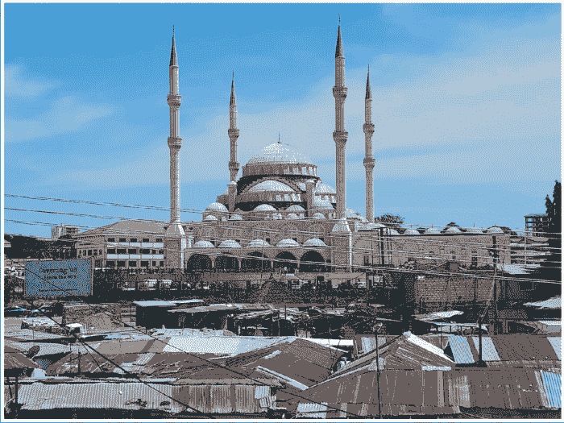

## 前言

本书结束了由芬兰研究理事会和芬兰科学和文学学会资助的研究项目 `加纳穆斯林赋权`。本书标志着我旅程的结束，而其开端则更难确定，因为它至少有三个起点。其中一个是在 2015 年，当时我在瑞典达拉纳大学担任客座教授。我已经出版了几本关于加纳穆斯林历史和 `zakat` 的书籍，但已离开这些主题并开展了全球历史研究。然而，当我的同事 Torsten Hylén 建议启动一个联合研究项目时，重新研究 `zakat` 的可能性出现了。尽管我们的联合项目从未实现，但本书是我们的愿望的结果。

本书的另一个起点是 2017 年 11 月由 Franz Kogelmann 和我本人于德国拜罗伊特非洲研究学院组织的关于穆斯林 `NGOs` 和非洲社会福利提供的研讨会。我们的研讨会成果是一部文集，其中包含我撰写的两章，概述了关于 `zakat` 作为减贫工具的国际讨论，以及加纳穆斯林学者对 `zakat` 的话语。¹ 这两篇文本构成了本书的背景。

本书的第三个起点是 Yunus Dumbe 于 2017 年 2 月邀请我在库马西会见穆斯林学者。在概述了二十一世纪初期加纳关于贫困和 `天课` 的话语并在此后偶尔更新对加纳情况的了解后，我意识到自出版我的书籍以来出现了一些新的发展。其中最引人注目的是 2010 年 Zakat and Sadaqa Trust Fund 的成立。在与 Haji Mumuni Sulemana（Haji Sulley）进行了长时间的讨论后——他在我早期的加纳田野工作中是我的亲密合作者、朋友和导师——我意识到我的文本已成为过去的记录。因此，我决定更新对 `zakat` 话语的研究，并与 Yunus Dumbe 和 Haji Sulley 一起概述了一种与穆斯林学者和活动人士互动的新方法，从而形成了上述芬兰研究理事会的研究项目。

1 Holger Weiss，“穆斯林非政府组织、Zakat 与撒哈拉以南非洲社会福利的提供：导论”，载于 `非洲穆斯林信仰为基础的组织与社会福利`，编者 Holger Weiss（纽约：Palgrave Macmillan，2020），1–38；Holger Weiss，“当代加纳 Zakat 的话语及其实施”，载于 `非洲穆斯林信仰为基础的组织与社会福利`，编者 Holger Weiss（纽约：Palgrave Macmillan，2020），273–303。

我的研究始于在互联网和加纳在线报纸上追踪穆斯林在加纳关于贫困和 `天课` 的话语。很快，搜索揭示了大量的话语和参与，我因此将我的田野调查和讨论扩展到包括穆斯林非政府组织的利益相关者。作为结果，我收集了大量关于加纳本地、区域、国家和国际穆斯林慈善机构和组织的信息，关于 `施舍` 和 `捐赠`、穆斯林赋权，以及在加纳引入伊斯兰银行、`瓦克夫` 和伊斯兰小额信贷的各种尝试和辩论。这被证明是一个非常有趣的话题，因为此前几乎没有人撰写过关于他们活动的文章。因此，我决定就该主题出版两部“临时”出版物，面向加纳的本地读者，即 `加纳的天课：穆斯林社区赋权的工具`（2021 年）和 `移山：加纳的穆斯林非政府组织`（2022 年）。这两卷本作为当前出版物的草案版本；我在 2022 年 10 月的田野调查期间将它们分发给穆斯林学者和活动人士。我收到的评论，加上大量的更新，尤其是通过在本书中添加约 250 个非政府组织的信息，导致对两部早期文本进行了修订和大幅重写，并合并成一本单一的书籍。

访谈、报纸报道和社会媒体构成了追踪加纳 `天课` 话语和穆斯林非政府组织活动的资料的主要类别。我在二十年前进行的调查和当前调查所咨询的各种资料类别之间的主要差异是我的田野调查在加纳的地理覆盖范围以及对社交媒体的聚焦使用。我最近一轮田野调查的背景是我在 1999 年至 2005 年间在塔马莱、延迪、萨拉加和阿克拉与伊玛目和穆斯林学者进行的访谈。最初的访谈是半结构化的，包含关于 `天课`、`施舍` 和贫困的固定问题清单，并作为我讨论的基线。[^2] 然而，我很快意识到，当我向他们提出开放性问题时，我从受访者那里获得了更多信息，他们自行阐述并对主题进行了更深入的分析。结果是一次学术交流，其中穆斯林学者，大多年长于我，设定了互动的条款，而我则聆听他们对主题的回答和阐述。这种方法被证明是相当有效的方法，因为穆斯林学者阐述并解决了对他们自己而言重要的议题。

因此，我决定以类似的方式为进一步调查勾勒后续访谈，即以半结构化的方式提出开放式问题。我与 Yunus Dumbe 一起与来自逊尼派穆斯林社区的学者互动，包括提贾尼派和萨拉菲派，以及与这两派均无关的伊玛目。由于我在芬兰的母校的学术参与，我不得不将我的田野调查时间限制为每次能够前往加纳时为期两周的密集互动（2017 年 2 月、2017 年 12 月、2018 年 9 月、2019 年 4 月和 2019 年 12 月）。到 2019 年底，我已在六个地点，即阿克拉、埃朱拉、哈米勒、库马西、塔马莱和瓦，与五十多位学者和穆斯林活动人士会面。

COVID-19 扰乱了我原计划在 2020 年或 2021 年在加纳进行田野调查的计划，我决定重新制定原计划， solely 集中于在社交媒体上检测和识别加纳穆斯林非政府组织。我早在 2019 年就已在 Facebook 上追踪到其中一些组织，但直到我从 2020 年到 2022 年开始系统地使用互联网时，才把握了（几乎）无限档案的潜力。最后，我设法于 2022 年 10 月返回加纳，以跟进穆斯林非政府组织的活动。在此，我将田野调查集中在阿克拉和库马西，并与 24 位创始人和活动人士互动，这些人来自我通过社交媒体和报纸报道追踪到的一些组织、协会和青年俱乐部。

在进行访谈时，我故意采用了老式的手写笔记记录在田野日记中的方式，而不是录制会话。之所以这样做是出于实际考虑：我所有的访谈都是与受访者本人认识的当地人一起进行的，即 Yunus Dumbe（在阿克拉、库马西、埃朱拉、哈米勒和瓦）、Mohammad Damba（在瓦）、Haji Sullemana Mumuni（在阿克拉）和 Afa Razaq Taufeeq Abdallah（在塔马莱）。他们通常还用豪萨语、达格巴尼语和西萨尔语翻译问题和答案。

每次访谈会议都以介绍开始。我会向受访者赠送我早期书籍的复印件，然后请求许可记录我们的讨论。我在笔记中大部分使用英语，有时使用瑞典语（我的母语），当我在访谈期间需要提醒自己额外信息时。我的选择方法产生的积极效果是，我的田野日记已包含学者和活动人士阐述的浓缩版本，我可以在我的手稿中使用。它的负面影响是，受访者的口头原始材料和原始声音丢失了。

COVID-19 大流行阻碍了我于 2020 年秋季进行后续访谈以完成本手稿。因此，Yunus Dumbe 善意地会见了我曾在瓦（Haji Salifu）和埃朱拉（Malam Aminu Bamba）访谈过的一些学者，并根据我提前发送给他的书面问卷与他们进行了访谈。他录制、翻译/转录了访谈，使我能够将它们整合到本手稿中。此外，他联系了 Hajia Safia Salifu 并与她互动，讨论了我于 2022 年 10 月在尼马发现的一些匿名绿色天课和施舍收集箱，箱上仅写有电话和邮政信箱号码。

2017 年至 2019 年的桌面研究显示，很少有非政府组织创建了主页，而且大多数组织多年未对其进行更新。虽然主页提供了有关组织目标、使命和愿景以及有时项目和计划的宝贵信息，但它更像是一份历史文件，一份传单或小册子，概述了组织的意图。只有在少数情况下，主页概述了组织的过去和现在活动。尽管如此，一些组织确实在其主页上发布图片和进展报告，为分析其活动提供了可用的历史文件。

尽管如此，Facebook 上的系统搜索显示，之前曾开始发布主页或网站的加纳穆斯林非政府组织已将其沟通转移到 Facebook 页面。大多数，如果不是全部，第三代非政府组织仅使用 Facebook 作为发布呼吁和组织运动的工具。一些组织还使用其 Facebook 页面进行进展和成就报告，或发布关于捐赠者账户或名单的声明。从历史学家的角度来看，Facebook 因此呈现为一种宝贵的替代信息来源，这些信息否则很少会被收集并保存在加纳的国家或区域档案中：传单、小册子、呼吁、布道、视频、诗歌、个人反思、官方声明，仅举几例。

然而，Facebook 对信息搜索提出了若干挑战，尤其是识别穆斯林非政府组织，因为加纳没有它们的目录，而且没有明确的定义来识别穆斯林非政府组织，如第 1.2 章所讨论的那样。对这一挑战的“开放式”且整体的解决方案是使用不同的关键词及其组合（例如：“Muslim”、“Islamic”、“NGO”、“Ghana”、“Zongo”、“women”、“youth”等）。另一种方法是在诸如 Google 之类的搜索引擎中输入已在搜索中识别的那些非政府组织的名称。通用资源定位符（URLs） of hyperlinks posted on the Facebook pages of some identified groups also provide snowball references to other associations, foundations and NGOs. 这些 URL 还为在互联网上搜索相关信息提供了新的关键词或关键词组合的提示。众多青年、Zongo 和妇女协会和团体的 Facebook 账户是识别和追踪世俗穆斯林非政府组织或

[^2]: Holger Weiss, Hajj Mumuni Sulemana, Afa Razaq Taufeeq Abdallah, eds., `北加纳的天课。田野笔记1。2000年1月和2月进行的访谈` (Helsinki: Department for African Studies, 2001); “Appendix 1. Questionnaire for Interviews with Muslim Scholars in Northern Ghana January–February 2000,” in Holger Weiss, `加纳的乞讨与施舍：穆斯林对贫困与困境的立场` (Uppsala: Nordiska Afrikainstitutet, 2007), 160.

广义定义的穆斯林非政府组织类别（关于本研究使用的框架的讨论，见第1.1章）。这些信息检索方法在2023年12月之前产生了关于683个狭义和广义定义的穆斯林非政府组织的信息数据库（列于附录）。^3^ 尽管如此，由于远程研究的局限性，例如技术和地理障碍，我数据库中列出的约60个协会、俱乐部、基金会、运动和组织无法被识别。未被识别的组织均未在互联网上留下任何痕迹，不使用社交媒体，或已停止活动。

Facebook 提供的信息既有定量也有定性。通常，Facebook 账户的定量数据包括账户建立日期、粉丝数量以及最后更新或发布日期的数值信息。此类数据的潜在局限在于，它无法揭示团体或组织的成立日期（尽管有时可在首次发布内容中找到相关信息）、团体成员数量或其停止活跃的时间。定性数据则提示了组织的 outreach、潜力和活动。粉丝少于100通常表明 outreach 相对有限，因而从捐助者处筹集支持或捐款的潜力有限；而拥有数千粉丝的 Facebook 账户则相反。尽管页面（通常）不会透露 Facebook 账户粉丝的地理位置，社交媒体却跨越国界，而“Facebook 世代”的非政府组织同时在不同规模和地点运作。换句话说，它们的空间是多尺度和跨地域的，与依赖个人联系和网络的第一代和第二代非政府组织相比。此外，Facebook 挑战了正式组织与非正式团体之间的分类，尤其当一个非正式团体在其 Facebook 账户上发布清理集会或为医院、孤儿院或监狱提供食物和现金捐赠活动的公开呼吁时。

互联网格局的快速变化是把 Facebook 纳入加纳穆斯林学者和非政府组织主要信息来源的原因。许多加纳穆斯林非政府组织最初通过建立主页开始，但很快停止更新。因此，一些主页包含过时信息和材料（但对像我这样有兴趣追溯变化和断裂的历史学家而言很重要）。我在之前研究中查阅的一些主页已不再存在，其中一些自2017年我查阅以来已有更新版本；少数已有2022/2023版的更新。

^3^ `Moving Mountains`（2022）一书的数据库包含约430个穆斯林非政府组织的信息。

然而，我的研究档案包括我在之前和现在的调查中查阅过的各种主页的印刷版和数字版副本。这些副本构成了追溯加纳穆斯林赋权兴起和内容的资料语料库。

与任何书面公告和声明类似，主页是追溯穆斯林非政府组织公开声明的重要来源。主页在某种意义上是公共领域和开放来源，因为它们展示了组织、其愿景和使命，以及董事会和公开活动。一些组织还发布了官方文件、报告和声明。我每次遇到材料时都会下载，以用主页的最新信息更新我的研究档案。主页的新版本不一定包含与之前版本相同的信息或相同上传的材料。此外，一些主页包含有关列为其合作伙伴的组织的本地、国家和国际网络的宝贵信息。

然而，依赖主页获取官方和更新信息或持续沟通存在弊端。五年前拥有主页的所有非政府组织都已将其公开和开放的沟通转移到其 Facebook 账户。由于我的调查重点是加纳社会福利提供方面的公共话语，面向成员的受限 Facebook 和 WhatsApp 账户兴趣不大，因为它们按定义是封闭的非公共领域。

社交媒体已成为加纳穆斯林组织联系其成员、潜在支持者以及本地/国家/国际捐助者的主要工具。本质上，如果一个组织在社交媒体上没有存在感，它就是“看不见的”和“死亡的”，因为它仅限于少数几种向其活动所在地之外的人传达其存在的方式。因此，社交媒体标志着加纳穆斯林行动主义社会景观上的重大突破。自2015年以来成立的任何穆斯林非政府组织都运营着多种数字平台进行沟通。事实上，自2015年以来成立的所有穆斯林非政府组织都立即建立了在线存在，其中大多数在 Facebook 上，正如将在第1.6章中概述和讨论的那样。

社交媒体也改变了加纳穆斯林学者的沟通格局。虽然在2015年之前没有人拥有 Facebook 账户，但如今许多伊玛目和学者使用社交媒体传播他们的布道和宗教信息。布道和呼吁以书面评论/文本或录像形式发布，语言为英语或当地语言（如豪萨语）和阿拉伯语。他们的大多数 Facebook 账户都是开放的，无需注册即可访问；一些账户拥有数千粉丝，详见第1.6.3章。粉丝数量不一定等同于加纳特定地区某位伊玛目的追随者和支持者的绝对数量，或某个社区的成员数量；粉丝数量更表明伊玛目、学者或宗教社区/组织的相对影响力。可以说，（一些较大的）虚拟社区包含加纳以外的粉丝，尽管这一观察需要进一步研究。

此外，Facebook 上的帖子也是宝贵的资料来源，因为它们也（有时/通常）包含粉丝的评论。这些评论反过来可以提供对 zakat、zakat al-fitr、sadaqa jariya 或其他捐赠呼吁的反应的见解，正如第5章所示。此外，其中一些帖子揭示了这些捐赠的分配、目标群体以及活动人士的地点和活动。总体而言，Facebook 上的帖子构成了我用于描绘和分析加纳穆斯林自我赋权格局的另一份资料语料库。

然而，在社交媒体上追溯有关 zakat 的话语和穆斯林组织的活动存在一些挑战。其中一个显而易见：并非所有 Facebook 账户和任何 WhatsApp 群组都是公开可访问的；因此，我只关注公开的账户。对一位有兴趣记录和分析不断变化的话语和活动格局的历史学家来说，另一个挑战是社交媒体的不稳定状况，正如上面主页所观察到的那样。社交媒体按定义是流动和转型的，不断更新，旧帖子可能不再公开可见。

搜索特定团体的 Facebook 账户可能很费力，因为团体或组织有时在 Facebook 上使用其名称的不同拼写（因此不会在 Google 搜索结果中列出）；有些还使用 Facebook 的阿拉伯语版本（这在一些萨拉菲组织中尤其常见）。最后，过去十年社交媒体的扩张以及 Instagram、Tiktok、Twitter（X）和 WhatsApp 等新平台的推出开辟了另一个值得研究的潜在数字空间。尽管如此，我决定在当前调查中排除它们。

追溯穆斯林赋权的第三类资料是（在线）加纳报纸。与主页和社交媒体——即穆斯林学者和活动人士控制的领域——相比，报纸包含由记者或新闻机构过滤和再现的穆斯林的公开公告和表达。有时新闻报道包含穆斯林的引语，尽管它们很少再现原文。然而，加纳的新闻格局在过去几十年中发生了深刻变化，这与互联网的可及性以及穆斯林新闻公司和在线广播电台的建立直接相关。文本和 com-

通过这些方式在线传播的文件构成了概述和分析当代加纳穆斯林非政府组织活动广度与深度以及 `天课` 论述的宝贵语料库。

各类主要来源使我能够编年并分析当代加纳穆斯林非政府组织不断变化的格局和空间。第一章作为背景并确立了本次研究的基石，概述了自1957年独立以来加纳穆斯林逐渐被边缘化的过程，以及他们自1990年代以来通过能力建设进行自我代表和自我赋权的尝试。虽然代表机构和委员会在与加纳国家整体互动时充当其发言人，但此后一系列穆斯林社会运动已成为加纳公民社会的一部分。此外，数量不断增加的穆斯林协会、运动、工会组织和智库标志着当代穆斯林格局。作为结果，我确定了穆斯林非政府组织的三个世代，指向加纳穆斯林领域非政府组织化程度不断提高，与撒哈拉以南非洲其他地区类似的过程相平行。这种非政府组织化的最显著现象是协会、俱乐部、基金会和组织对社交媒体的广泛使用；本章以对 Facebook 上穆斯林非政府组织的定量分析作结。

接下来的三章勾勒出当代加纳穆斯林非政府组织格局的轮廓。第二章介绍了部分关键穆斯林活动家和慈善家，从穆斯林学者到企业家、政治家、名人和社会媒体影响者不等。尤其是后两者是互联网时代的产物。一种新现象是青年组织的蓬勃发展，这在被称为 Zongo 的城市以穆斯林为主的居住区尤为明显。此外，互联网时代彻底改变了社会运动行动主义，因为社交媒体超越了地点和领土边界，使青年和其他群体能够与成员、同龄人和同情者（几乎）在全球各地联系起来。这种“全球化”的一个效应是非加纳穆斯林慈善机构和非政府组织的虚拟爆炸。到2020年代初，除拉丁美洲和加勒比地区外，所有大洲的穆斯林非政府组织都已直接或间接（即通过当地非政府组织）在加纳存在。

### 第三章
描绘了穆斯林信仰为基础的人道主义救济，例如在宗教节日提供食物（开斋饭和古尔邦）和衣物，抚养孤儿、寡妇和（非常模糊/不确定的）需要人士，以及监狱囚犯。慈善事业穆斯林格局上的一个新现象是为听力障碍和视力障碍人士建立学校。此外，本章追踪了当地穆斯林非政府组织和青年运动开展的宣传活动和集会，以募集萨达卡和捐款，用于结合传教活动（da‘wa，传教）和对贫困穆斯林农村社区的人道主义外展，近年来常与教育、清真寺和水项目相结合。

### 第四章
介绍了穆斯林非政府组织主导的八种社区发展形式，范围从奖学金、卫生和健康、医疗、清洁水到社区中心和绿色环境项目。其中最雄心勃勃的是诊所和医院的建设；最具创新性的是用废塑料瓶建造学校。最后提到的项目也是界定穆斯林非政府组织困难的一个例子——负责该项目的运动由一位年轻穆斯林女性创立，但该组织并不以宗教为导向，且项目地点位于几乎没有穆斯林居民的农村村庄。我仍决定将该项目纳入我的介绍，因为它作为当代加纳穆斯林行动主义广泛光谱的例子。

### 最后两章
概述了以伊斯兰社会金融为自我赋权和能力建设工具的当代话语和活动。第五章确定了关于天课或强制性施舍的三种话语，即传统的、水平的和非正式的一种，以及两种较新的垂直慈善的工具主义和制度主义版本。第六章概述了在加纳引入伊斯兰银行（仍未实现）的尝试以及现有的伊斯兰投资、微型金融和瓦克夫（宗教捐赠）形式。合起来，两章指向制度化能力建设的局限性和潜力。前者强调了这些活动的流动性和短寿命，尤其是在缺乏致力于长期甚至终身持续投资的富裕成员群体支持时。后者认识到，穆斯林中产阶级的出现以及受薪的正规部门家庭，加上少数穆斯林高净值人士，在过去十年中为穆斯林社区的自我赋权打开了一个前所未有的窗口。在这种意义上，穆斯林活动家和非政府组织已经开始移山。他们以何种方式以及在多大程度上取得成功，将是未来研究的课题。

Holger Weiss

赫尔辛基，2023年12月15日

## 致谢
本书汇集了过去四十年间众多穆斯林学者和活动家以及同事和朋友的见解。有些讨论是非正式的，有些是计划好的访谈。所有这些都塑造了我对穆斯林行动主义以及关于贫困缓解和社会经济改善的智力思考的理解。没有这些投入，本书永远无法完成。因此，我特别感谢文中提到的所有受访者，感谢你们分享你们的时间和智慧。

此外，我非常感谢来自加纳、芬兰、德国和瑞典的许多朋友和同事的鼓励和富有启发性的讨论，尤其是 Yunus Dumbe、Haji Mumuni Sulemana、Afa Razaq Tawheed、Haji Mohammad Damba、Sani Mohammed Sani aka Garba、Franz Kogelmann、Roman Loimeier、Rüdiger Seesemann 和 Torsten Hylén 以及手稿的两位匿名审稿人。没有你们积极的回应和支持，我关于加纳穆斯林赋权的调研永远无法达到最后阶段。但最重要的是，我要感谢我的妻子 Minna 的陪伴和鼓励。

我还要感谢芬兰研究委员会和芬兰科学院学会资助我在加纳的实地调研，感谢 Brill《非洲伊斯兰》系列的编辑接受我的手稿，以及感谢 Åbo Akademi 大学资助本书的开放获取出版。

## 表格、图表和图

### 表格
- 1. 2021年加纳人口普查：按地区划分的穆斯林人口 — 11
- 2. 加纳穆斯林非政府组织的框架 — 26
- 3. FOMWAG 在 Facebook 上 — 99
- 4. 加纳穆斯林使命在 Facebook 上 — 121
- 5. 在加纳运营的国际穆斯林非政府组织的三个阶段 — 168
- 6. 2006–2023 年来自阿拉伯/海湾慈善机构对加纳的资金交易 — 170
- 7. 2020 年按所有权划分的加纳医疗机构 — 317
- 8. 加纳伊斯兰医院项目（2023 年 6 月状态） — 328

### 图表
- 1. 列于非营利组织在线目录的穆斯林非政府组织的最后注册年份 — 66
- 2. 穆斯林非政府组织总部所在地 — 70
- 3. 穆斯林非政府组织运营地点 — 72
- 4. 穆斯林非政府组织的活动领域 — 72
- 5. 穆斯林非政府组织活动的关联性 — 73
- 6. 穆斯林非政府组织的活动范围 — 74
- 7. 加纳穆斯林非政府组织在 Facebook 上的开始时间和最后更新时间 — 75
- 8. 穆斯林非政府组织：Facebook 粉丝数量（截至 2022 年 9 月） — 77
- 9. 开斋、开斋节和宰牲节捐赠，2019–2023 年 — 242
- 10. 对 ISFOUND 医院项目的萨达卡捐赠 — 330
- 11. 天课和萨达卡信托基金：2019–2021 年捐款与支出 — 398
- 12. 天课和萨达卡信托基金：2018–2021 年天课支付 — 405
- 13. 天课和萨达卡信托基金：资金来源，2019–2021 年 — 406

### 图
- 1. Iqra 教育中心广告 — 16
- 2. 湖畔大学学院 — 18
- 3. *乌莱玛2030愿景* — 29
- 4a. 清真寺组织的非正式募捐。哈米勒中央清真寺捐款图表 — 30
- 4b 阿克拉尼马Ar-Rahma清真寺的捐款箱 31
- 5 巴拉卡 48
- 6 穆斯林高管基金会 59
- 7 两份穆斯林报纸：《穆斯林探照灯》和《喷泉》 55
- 8 安努尔人道主义服务组织 68
- 9 阿尔哈吉·萨利赫·乌马鲁推广结核病免疫的小册子 81
- 10 阿尔-曼南慈善基金会 86
- 11 库马西卡里玛教育综合体图书馆 88
- 12 盖纳成就者 102
- 13 库马西传教组织的路标 112
- 14 库马西GMM高级中学 124
- 15 ZongoVationHub 156
- 16 促进选举和平的穆斯林非政府组织 163
- 17 由卡塔尔慈善基金会资助，由Aldiaa协会实施 174
- 18 美国天课基金会 187
- 19 阿克拉Furqan 199
- 20 阿克拉尼马的HUDAI钻井 203
- 21 阿克拉马莫比的Al-Huda水井 206
- 22 卡塔尔慈善/Aldiaa教育项目 207
- 23 阿克拉马莫比的Nouvelle Optique钻井 213
- 24 安萨鲁丁护理学院 215
- 25 Noor Islam发展学院 224
- 26 盖纳发展慈善协会 227
- 27 Sadaqa Train 275
- 28 穆斯林接入运动 280
- 29 黎明传教慈善 284
- 30 Save Aid项目 286
- 31 阿克拉的SONSETFUND总部 300
- 32 MFCS‘停止童婚’运动 307
- 33 库马西MFCS街头儿童运动 309
- 34 光基金会 312
- 35 瓦伊斯兰医院 322
- 36 塔马利的哈吉·亚当斯诊所 323
- 37 库马西谢赫塔菲克纪念诊所 324
- 38 瓦的Al-Azhar诊所 324
- 39 阿夏曼伊斯兰诊所项目 333
- 40 阿克拉尼马哈吉亚·玛丽亚姆的城市花园 349
- 41 “我的花园，我的健康，我的财富项目” 353
- 42 瓦的尼萨布计算 359
- 43 谢赫奥兰多2017年天课尼萨布计算 358

# 第1章

## 通过非政府组织实现赋权
1957年独立时，加纳是非撒哈拉非洲最富裕的国家之一，其经济在1960年代中期至1980年代初遭受了严重的经济不稳定和衰退。世界银行和国际货币基金组织在1980年代和1990年代实施严厉的宏观经济结构改革后，加纳经济复苏并迅速扩张，其中很大程度上得益于21世纪初石油部门的开放。¹ 自2010年代初以来，世界银行将加纳评为中低收入国家（LMIC），并将其视为政治和经济发展的成功案例，² 尽管其经济增长率因2019年和2020年油价下跌和新冠疫情的综合影响而大幅下降。³

过去二十年里，非政府组织（NGOs）在加纳经济中是增长最快的“企业”。⁴ 自1990年代以来连续的和平选举、相对强大的治理机构和问责制度，以及充满活力的公民社会，使加纳成为双边和多边捐助者的“捐助宠儿”。流入该国的官方发展援助（ODA）从2006年的12.4亿美元增加到2009年的21亿美元。然而，这种捐助者的善意在2010年急剧下降，当时该国获得中低收入国家地位；ODA从2010年的18亿美元下降到2014年的11亿美元。⁵

加纳经济增长和政治稳定的一个积极影响是极端贫困人口的下降，从1991年的47.4%（按2011年购买力平价[PPP]每天1.90美元计算）下降到2016年的13.3。^6^ 三年后，比例降至2019年的11%。^7^ 这些改善在很大程度上归功于政府和ODA的结构性投资。国际和国内非政府组织以及基金会凭借其3.942亿美元的投资，在赋权弱势和边缘化群体方面发挥了重要作用。然而，随着贫困水平的下降而产生的经济繁荣无意中扩大了收入差距，加纳的基尼系数在2016年达到43.5。此外，空间不平等加剧，贫困和不平等在该国北部地区变得更加集中。^8^

在加纳，非政府组织早于官方发展援助。互助是传统加纳自助和社群主义理想的核心要素。现代非政府组织的前身部分源于这一传统，并融合了由受西方教育的沿海精英和基督教传教士引入的组建协会和俱乐部的思想。这些团体大多是非正式和非官方的；到1930年，加纳仅有三个正式注册的非政府组织。尤其是基督教团体，通过设立自己的医院、学校和其他机构来促进地方发展和社会福利，有时得到殖民政府的帮助和财政援助。^9^ 到1957年独立时，官方发展援助流入加纳开始，随后正式注册的非政府组织迅速增加，1966年超过320个，2005年约1,500个。^10^ 2021年9月，加纳共和国非营利组织秘书处列出了超过4,100个注册的地区、国家和国际非政府组织。^11^

非政府组织格局的显著崛起和“发展的非政府组织化”^12^ 在1970年代的撒哈拉以南非洲成为显著特征，并在1990年代几乎被充分利用。国家失灵促使社区开展自助倡议，在大多数情况下是通过基层组织进行的。有时，这些组织仅在名义上是“非政府”的，因为执政党曾赞助并庇护过它们。13 小型地方基层组织和非政府组织的雨后春笋式增长与国际非政府组织（NGOs）和慈善机构的活动和项目扩张密切相关，后者要么需要当地合作伙伴，要么通过分支机构运作。加纳也不例外。1980年代成立的许多非政府组织，如六四运动或12月31日妇女运动，都是准或半政府机构。14 因此，正如Tsikata、Gyekye-Jandoh和Hushie所指出的，非政府组织以及公民社会团体和协会的快速扩张在很大程度上是自1992年以来所谓的第四共和国期间社会政治环境变化的结果，其特点是1990年代政治和经济自由化以及向文官民主统治过渡的时期，以及2000年代新自由主义政策上升和推动开放民主的时期。15

非政府组织格局扩张的另一个显著特征是它们广泛使用社交网络网站。信息技术和社交媒体为“互联网时代”的非政府组织提供了一种有效的跨地方工具，用于与利益相关者建立关系、筹集资金并为社会中的弱势群体倡导。尤其是社交媒体，跨越了领土边界，使地方基层组织能够在区域、国家和全球范围内与成员和（潜在）捐助者建立联系。16

在加纳，正如撒哈拉以南非洲其他地区一样，非政府组织在解决城乡失衡方面发挥了重要作用，并大力投资于促进农业、卫生、教育、科学和技术，

1 Jacob Songsore, *加纳的区域发展：理论与现实* (Accra: Woeli Publishing Services, 2011); Ernest Aryeetey and Ravi Kanbur, eds., *独立六十年后的加纳* (Oxford: Oxford University Press, 2017). 2 World Bank, *加纳——2013-2018财年国家伙伴关系战略绩效与学习回顾* (Washington, D.C.: World Bank Group, 2016). 3 The World Bank in Ghana, Overview, updated 28.9.2022, https://www.worldbank.org/en/country/ghana/overview, accessed 27.12.2022. 4 George Bob-Milliar, “加纳的非政府组织——盈利性组织？”, 28.4.2005, https://www.modernghana.com/news/116769/ngos-in-ghana-profit-making-organisations.html, accessed 24.7.2021. 5 Albert A. Arhin, Emmanuel Kumi, Mohammed-Anwar Sadat Adam, “面对子弹？加纳非政府组织对变化援助格局的回应,” *Voluntas* 29 (2018): 349–350.

6. World Bank, *贫困与公平简报——撒哈拉以南非洲：加纳*, April 2019, https://databank.worldbank.org/data/download/poverty/33EF03BB-9722-4AE2-ABC7-AA2972D68AFE/Archives-2019/Global_POVEQ_GHA.pdf, accessed 29.12.2021.

7. International poverty rate in Ghana from 2017 to 2022, October 2020, https://www.statista.com/statistics/1222084/international-poverty-rate-in-ghana/, accessed 29.12.2021.

8. World Bank, *贫困与公平简报——撒哈拉以南非洲：加纳*, April 2019, https://databank.worldbank.org/data/download/poverty/33EF03BB-9722-4AE2-ABC7-AA2972D68AFE/Archives-2019/Global_POVEQ_GHA.pdf, accessed 29.12.2021.

9. See further L. Atindiguiti et alii, “加纳的非营利部门,” in *发展中国家的非营利部门*, eds. H.K. Anheier and L.M. Salamon (Manchester: Manchester University Press, 1997), 158–197.

10. Bob-Milliar, “NGOs in Ghana.”

11. NPO Secretariat, https://npos.mogcsp.gov.gh/, accessed 29.9.2021.

12. Hans Holmén, “撒哈拉以南非洲的非政府组织,” in *Routledge Handbook of NGOs and Inter-

研究以及妇女发展与权利。¹⁷ Bob-Milliar 指出，在加纳北部贫困的农村社区中，

> ... 居民所知晓的唯一重要且非常常见的名字要么是 31st December Women’s Movement、World Vision、Action Aid、Catholic Relief Services、Adventist Development and Relief Agency ... [as] 正是该非政府组织为他们提供了清洁饮用水、村中心的诊所、植树造林项目、信贷设施、校舍建设、推广服务以及更多……¹⁸

然而，关于加纳北部农村发展的最新研究批判性地得出结论，尽管非政府组织和国际非政府组织填补“发展缺口”已有三十多年，农村贫困仍然普遍存在。部分原因在于作者指出，非政府组织复合体缺乏足够的协调和监管，以及资源被滥用。作者提醒，非政府组织不能替代国家。¹⁹

加纳的非政府组织繁荣与从外国双边和多边伙伴转移资金密切相关，至今在很大程度上仍然如此。据 Emmanuel Kumi 称，他调查的当时上西区、北部和大阿克拉地区的非政府组织中，外援资金占其总预算的比例高达 90%。很大一部分来自跨境资源流动，包括来自加纳侨民群体的汇款。Kumi 进一步指出，到 2019 年，流向加纳的移民汇款流入有所增加，估计为 37.2 亿美元，而 2018 年为 35.0 亿美元。这些资金的一部分被转移到国内组织和基金会。虽然缺乏全面数据，但估计显示，2016 年至 2018 年间约有 1.4 亿美元用于资助可持续发展目标。跨境捐赠的优先领域为教育、性别平等以及清洁饮水和卫生。²¹

Kumi 认定的跨境捐赠的其他趋势是，在动员跨境捐赠方面，数字技术、社交媒体和众筹平台的使用增加，以及多捐助方资金池模式。2008 年《反洗钱法》及其 2014 年修正案以及 2012 年《反恐条例》进而导致加纳金融监管的严格执行。这些法规在多大程度上影响了非政府组织动员跨境捐赠的能力尚不清楚。根据官方数据，2010 年至 2018 年间，银行就非政府组织提交了至少 22 起可疑交易。²²

自 2010 年以来捐助者逐渐撤离以及对非政府组织的援助在数量和模式上的普遍下降，以及捐助者的新优先事项和重点，导致加纳的援助格局发生了变化，如果不是动荡的话。²³ 另一方面，2010 年代的经济繁荣导致中产阶级、上层阶级和高净值个人数量增加，他们作为国内捐助者和加纳慈善格局的支持者加入其中。²⁴ 特别是信仰型组织，已成功应用国内资源动员战略以实施社会发展项目。²⁵

当代加纳的非政府组织格局主要由基督教、非教派和世俗派别组成。地方和国际穆斯林非政府组织、穆斯林社区组织和穆斯林民间社会组织的存在、议程和活动迄今一直被视为一种边缘现象，如果被提及的话。²⁶ 这些非政府组织构成了当代加纳大多数注册非政府组织，并在媒体和公共空间中占主导地位。Tuandike Sasa 于 2018 年列出的加纳国际卫生、环境、农业和教育非政府组织清单具有说明性，因为人们徒劳地寻找关于在加纳运营的国际穆斯林非政府组织的任何说明，27 并且其中任何一个也没有被 www.ghstudents.com 提供的清单所包含。28

本书的目标有二。首先是绘制当代加纳穆斯林非政府组织的活动并对其在当代加纳的运作进行评估。关于殖民时期和早期后殖民时期撒哈拉以南非洲穆斯林非政府组织的历史知之甚少；它们在 1980 年代和 1990 年代的兴起在学术研究中鲜受关注，少数观察者迄今才注意到它们在 2010 年代的蓬勃发展和倍增。甚至更少关注的是穆斯林社区在撒哈拉以南非洲，包括加纳，试图应对政治和社会经济边缘化过程的各种方式。29 另一方面，穆斯林领袖和学者一再强调需要赋权穆斯林群-

17 另见 Thomas Yarrow，《Development beyond Politics: Aid, Activism and NGOs in Ghana》（Basingstoke: Palgrave MacMillan, 2011）。

18 Bob-Milliar，“NGOs in Ghana。”

19 Benjamin Kwao and Daniel Amoak，“Does Size Really Matter? The Prevalence of NGOs and Challenges to Development in Northern Ghana，”Norsk Geografisk Tidsskrift/Norwegian Journal of Geography（2022）：149–163。

20 Emmanuel Kumi，《Diversify or die? The responses of Ghanaian Non-Governmental Development Organisations（NGDOs）to a changing aid landscape》，PhD thesis，University of Bath，2017。

21 Emmanuel Kumi，《Global Philanthropy Tracker: Ghana》，2020年10月，1–2，https://scholarworks.iupui.edu/bitstream/handle/1805/25915/ghana-report21.pdf?sequence=1&isAllowed=y，访问于13.7.2021。

22 Kumi，《Global Philanthropy Tracker: Ghana》，2020年10月，2。

23 另见 Arhin, Kumi, Adam，“Facing the Bullet?”

24 另见 SDG Philanthropy Platform，*Enabling Environment for Philanthropy in Ghana*（United Nations Development Programme，2017），可查阅 https://www.sdgphilanthropy.org/system/files/2018-02/SDG%20Ghana%20Final-2.pdf。关于加纳中产阶级的出现，另见 Rachel Sponk，“Structures, Feelings and *savoir faire*: Ghana’s Middle Classes in the Making，”*Africa* 90，no. 3（2020）：470–488。Sponk 认为追求社会流动的三个促成条件分别是教育、社会网络以及各种形式的金融资源获取。另见 Carola Lentz and Andrea Noll，“Across Regional Disparities and Beyond Family Ties. A Ghanaian Middle Class in the Making，”*History and Anthropology*（2021），DOI：10.1080/02757206.2021.1885400。

25 另见 WASCI，《Exploring Faith-based Giving as an Alternative Funding Model for Civil Society Organisations in Ghana—Experiences, Prospects and Challenges》（Accra: West Africa Civil Society Institute，2020）。

26 例如，《西非民间社会名录 2010–2012》仅列出七个穆斯林组织，即 *Educational Development Fund for Muslim Youth*、*Federation of Muslim Women Association in Ghana*、*Ahmadiyya Muslim Youth Organization*、Zongo Youth Foundation、Berekum 中央清真寺俱乐部、Muslim Family Counselling Services 和 Muslim Relief Association。另见 Civil Society Directory for West Africa 2010–2012，eds. Charles Kojo Vandyck, Jimm Chick Fomunjong and Ramde Yaya（Accra: West African Civil Society Institute，2012），62，84，89，92，96，104。

27 Tuandike Sasa，“List of International NGOs in Ghana，”5.4.2018，https://yen.com.gh/108012-list-international-ngos-ghana.html，访问于16.12.2021。

28 “List of International NGOs in Ghana and Contact details，”https://ghstudents.com/list-of-international-ngos-in-ghana-and-contact-details/，访问于16.12.2021。然而，该清单至少包括一个地方穆斯林非政府组织，即位于阿克拉的 Sabon Zango Youth Movement。该清单也以“NGOs in Ghana: Full List, Functions & Contacts（2021）”4.8.2021，https://pricesghana.com/ngos-in-ghana/，访问于16.12.2021 的形式发布。

29 M.A. Mohammad Salih，《Islamic NGOs in Africa: The Promise and Peril of Islamic Voluntarism》（Copenhagen: University of Copenhagen, Centre for African Studies，2001，修订版2002）。关于加纳，另见 Mumuni Sulemana，《Islamic Organisations in Accra: Their Structure, Role and Impact on the Proselytization of Islam》，MPhil thesis，University of Ghana，1994；Fatimatu N-Eyare Sulemanu，《Leadership in the Ghanaian Muslim Community: The Role of the Federation of Muslim Women's Association in Ghana》，MPhil thesis，Department for the Studies of Religions，University of Ghana，2006；Holger Weiss，《Begging and Almsgiving in Ghana: Muslim Positions towards Poverty and Distress》（Uppsala: Nordiska Afrikainstitutet，2007）；Yunus Dumbe，《Transnational Contacts and Muslim Religious Orientation in Ghana》，PhD thesis，Department for the Study of Religions，University of Ghana，2009；Holger Weiss，《Zakat in Ghana: A Tool for the Empowerment of the Muslim Community》（Kumasi: University Printing Press, KNUST，2021）；Sandy Zook and Cassidy Arndt，“Islamic NGOs in Education in Ghana: Analysis of the Scope, Activities, and Revenue Portfolios，”Journal of Education in Muslim Societies 2，no. 2（2021）：57–81；Holger Weiss，《Moving Mountains: Muslim NGOs in Ghana》（Kumasi: University Printing Press, KNUST，2022）。

它们的地方、区域、国家和国际联系。尽管穆斯林非政府组织在建立和资助加纳现代伊斯兰教育部门以及支持达瓦（宣教）方面的作用已在先前研究中得到分析，34 但它们在促进社会福利方面的作用对于学术研究而言却是一片鲜为人知的领域。更不为人知的是，在这个“互联网时代”，加纳穆斯林非政府组织、民间社会组织和社区组织将社交媒体用作召集成员的网络平台，以及用作争取国内外捐助者支持的工具。本书所识别的关键动员力量包括各类穆斯林青年和宗戈（Zongo）协会、博主、社区和网络；这一加纳穆斯林“Facebook一代”在很大程度上未被学术研究涉及。35

本书的第二个目标是讨论和分析穆斯林非政府组织作为赋权与发展的核心工具和载体的多重方式。数十年来，本地和国际穆斯林社区组织、民间社会组织、非政府组织和慈善机构委托实施了旨在改善全国穆斯林精神和社会经济状况的项目。这些项目主要是修建清真寺，其次是现代教育基础设施、社区中心、孤儿院、图书馆和卫生饮用水源等基本社会设施，以及在穆斯林社区打井。同样重要的是免疫接种和医疗保健计划，向监狱囚犯赠送礼物，援助医院、孤儿院和残疾人机构，或在斋月、开斋节和宰牲节期间向贫困弱势群体分发食物和衣物。这就是穆斯林以信仰为基础的人道主义救援的本质。此外，自过去二十年以来，出现了新形式的社群自我赋权，例如从穆斯林社区和/或青年团体内部募集资金，用于建立图书馆和社区中心，以及建设穆斯林医院和面向穆斯林残疾人的特殊用途机构。

第三个目标是概述穆斯林学者和领袖在为加纳穆斯林人口争取政治、社会和经济赋权斗争中的话语、议程和行动。大约二十年前，我就加纳穆斯林关于减贫的话语进行过类似调查。36 2017年重返加纳时，我注意到话语景观发生了巨大变化，天课（义务施舍）作为消除贫困工具的制度化也发生了变化。对于我关于如何在加纳实现穆斯林赋权的问题，穆斯林学者的一致回答是：“天课是伊斯兰消除贫困的解决方案。” 然而，在与穆斯林学者的讨论以及随后在Facebook上的研究中，很明显，非强制性的以信仰为基础的给予形式和私人捐赠，如sadaqa（自愿施舍/慈善）和infaq（为取悦真主而花费，不图任何回报），已成为资助穆斯林自我赋权的基石。

### 1 加纳的穆斯林

穆斯林在加纳构成少数群体。根据2021年人口普查，他们约占约3000万总人口的20%。37 当代加纳的“穆斯林景观”由六个主要宗教亚领域或宗教团体构成，即提加尼耶（苏菲）、艾赫勒·逊奈（萨拉菲）、无派别/无教派的逊尼派（即既非提加尼也非萨拉菲团体的成员）、阿赫马迪耶、伊斯提卡玛（伊巴迪耶）和什叶派社区。38 根据2012年皮尤论坛报告，其样本研究中有51%声称属于逊尼派（其中多数，即逊尼派全体信徒中的27%，属于提加尼教团），8%为什叶派，16%为阿赫马迪派，另有13%声称自己“只是一个穆斯林”。39

加纳总人口中有三分之二居住在基督教占主导、富裕且具有政治影响力的南部地区。而大约一半穆斯林人口所居住的北部（见表1）在政治和经济方面被边缘化。这一总体格局自独立以来一直是一个显著特征，尽管自二十世纪最后几十年以来出现了一些显著的宏观人口结构变化，最引人注目的是穆斯林涌入该国南部的城市中心和地区。因此，如今在阿克拉和库马西的大都市地区可以发现大量穆斯林人口聚集，他们在那里构成了宗戈社区的大多数。40

34 另见Mark Sey，《当代穆斯林青年的社会与教育挑战：加纳经验》，《Jurnal Usuluddin》14（2001）：77–86；David Owusu-Ansah、Mark Sey和Abbulai Iddrisu，《伊斯兰学习、国家与加纳教育的挑战》（新泽西州特伦顿：非洲世界出版社，2012年）；David E. Skinner，《皈依伊斯兰教与加纳“现代”伊斯兰学校的推广》，《非洲宗教杂志》43，第4期（2013年）：426–450；Fatimatu N. Sulemanu，《教育是可持续发展的工具：穆斯林非政府组织在加纳的作用》，载于《宗教与可持续发展：加纳视角》，George Ossom-Batsa、Nicoletta Gatti和Rabiatu Deinye Ammah编（梵蒂冈城：乌尔班纳大学出版社，2018年），243–258；以及Skinner的《西非的宣教与政治》与Zook和Arndt的《伊斯兰非政府组织与加纳教育》。

35 Annette Haaber Ihle，《加纳北部年轻穆斯林的伊斯兰道德、青年文化与社会流动期望》，《穆斯林少数群体事务杂志》28，第2期（2008年）：267–288；Ali Baba Mohammed，《阿克拉加纳穆斯林社区中的基地现象》，加纳大学硕士论文，2015年。关于穆斯林“Facebook一代”，另见Adeline Masquelier和Benjamin Soares编，《穆斯林青年与9/11一代》（圣达菲和阿尔伯克基：高级研究出版社与新墨西哥大学出版社，2016年）。

36 Holger Weiss，《义务施舍：前殖民时期比拉德-苏丹的天课探究》（赫尔辛基：芬兰东方学会，2003年）；Weiss，《加纳的乞讨与施舍》。

37 加纳统计局，《加纳2021年人口与住房普查：总报告第3C卷背景特征》（阿克拉：加纳统计局，2021年11月）。

38 Holger Weiss，《在调和与复兴之间：从前殖民到后殖民时代加纳的穆斯林、国家与社会》（赫尔辛基：芬兰东方学会，2008年）；Ousman Murzik Kobo，《揭开二十世纪西非伊斯兰改革中的现代性面纱》（莱顿：布里尔出版社，2012年）；Yunus Dumbe，《当代加纳的伊斯兰复兴》（胡丁厄：南泰恩大学，2013年）；Iddrisu，《在非洲争论伊斯兰》；Balogun和Abdussalam，《论点与反论点》；Dumbe，《加纳的伊斯兰极化与排斥政治》。关于阿赫马迪耶，另见John H. Hanson，《黄金海岸的阿赫马迪耶：英帝国中的穆斯林世界主义》（布卢明顿：印第安纳大学出版社，2017年）。关于伊斯提卡玛，另见Mahmud Mukhtar Muhammed和Umar Wahab Sina，《国家发展中的信仰：加纳伊斯提卡玛穆斯林组织活动回顾》，2018年9月6日至7日在加纳夸梅·恩克鲁玛科技大学（KNUST）宗教学系举行的第三届宗教与国家发展国际会议论文。关于什叶派，另见Dumbe的《当代加纳的伊斯兰复兴》和Ousman Murzik Kobo的《加纳的伊斯兰高等教育机构：伊斯兰大学学院案例》，载于《后殖民非洲的穆斯林高等教育机构》，Mbaye Lo和Muhammed Haron编（纽约：帕尔格雷夫·麦克米伦，2016年），179–191。

39 皮尤宗教与公共生活论坛，《世界穆斯林：统一与多样性》（华盛顿特区：皮尤研究中心宗教与公共生活论坛，2012年），29–31，见 https://www.pewresearch.org/wp-content/uploads/sites/7/2012/08/the-worlds-muslims-full-report.pdf。

40 另见Weiss的《加纳的乞讨与施舍》；Weiss的《在调和与复兴之间》。Zongo一词（源自豪萨语：Zango，即营地）描述一种城市多民族定居点，最初是作为长途贸易商和行商的营地而建立的。在当代加纳，该词具有负面含义，因为Zongo指代过度拥挤的居住区和卫生设施不足。其大部分居民是穆斯林。另见Emily Anne Williamson，《理解宗戈：加纳社会空间边缘化过程》，载于《非洲大都市：城市空间、公民身份与城市权利研究》，Toyin Falola和Bisola Falola编（阿宾顿、牛津郡和纽约：劳特利奇出版社，2018年）；Giulia Casentini，《加纳的移民网络与叙事：来自宗戈的案例研究》，《非洲》88，第3期（2018年）：452–468；Benedikt Pontzen，《宗戈中的伊斯兰：加纳阿散蒂的穆斯林生活世界》（剑桥：剑桥大学出版社，2021年）；Joseph Mensah和Joseph Kofi Teye，《一个地理

#### 表1 加纳2021年人口普查：各地区穆斯林人口

| 地区 | 缩写 | 总人口 | 穆斯林人口 | 穆斯林/总人口 % | 穆斯林/总穆斯林人口 % |
|---|---|---:|---:|---:|---:|
| 所有地区，男女合计 |  | 30,753,327 | 6,108,530 | 19.9 |  |
| *南部地区* |  |  |  | 11.9 | 48.5 |
| 西部省 | WR | 2,054,863 | 193,794 | 9.4 | 3.1 |
| 中部省 | CR | 2,853,335 | 259,902 | 9.1 | 4.3 |
| 大阿克拉省 | GAR | 5,437,084 | 631,591 | 11.6 | 10.3 |
| 沃尔特省 | VR | 1,654,650 | 77,136 | 4.7 | 1.3 |
| 东部省 | ER | 2,918,623 | 194,838 | 6.7 | 3.2 |
| 阿散蒂省 | AR | 5,428,181 | 866,117 | 16 | 14.2 |
| 西部北省 | WNR | 878,855 | 105,226 | 12 | 1.7 |

| 省份 | 缩写 | 总人口 | 穆斯林人口 | `Mp/tp` (%) | `Mp/tMp` (%) |
|------|------|--------|------------|-------------|--------------|
| 阿哈福省 | AhR | 563,643 | 93,153 | 16.5 | 1.5 |
| 博诺省 | BR | 1,205,462 | 154,145 | 12.8 | 2.5 |
| 博诺东省 | BER | 1,199,786 | 289,268 | 24.1 | 4.7 |
| 奥蒂省 | OR | 744,483 | 97,928 | 13.1 | 1.6 |
| *北部地区* |  |  |  | 54.1 | 51.5 |
| 北部省 | NR | 2,306,808 | 1,532,977 | 66.5 | 25.1 |
| 萨凡纳省 | SR | 652,572 | 418,352 | 64.1 | 6.8 |
| 东北省 | NER | 657,833 | 402,352 | 61.2 | 6.5 |
| 上东省 | UER | 1,298,179 | 385,020 | 29.7 | 6.3 |
| 上西省 | UWR | 898,970 | 406,731 | 45.2 | 6.5 |

图例：`Abbr.` = 缩写；`Mp/tp` = 穆斯林人口（地区）/总人口（地区）；`Mp/tMp` = 穆斯林人口（地区）/穆斯林总人口（全国）

来源：*《加纳2021年人口与住房普查 总报告第3C卷 背景特征》* [阿克拉：加纳统计服务局，2021年11月]

从经济和心理上看，加纳最显著的划分是其南北之分。该国的沿海和森林地区，即南部十一个（2019年前为七个）行政区省[^41]，是加纳较为富裕的部分；其居民从事具有经济价值的农林部门（可可、木材）、采矿业和石油工业。毫不奇怪，南部地区对国家政治具有深远影响。相比之下，五个（2019年前为三个）北部行政区省[^42]被视为该国贫穷的后院[^43]。

北部在政治和经济方面均被边缘化。根据自1990年代初以来进行的各项国家生活水平调查，五个萨凡纳地区是加纳迄今为止最贫困的地区。英国殖民政府及随后的加纳政府试图改造农业、畜牧业和林业部门并使其现代化。然而，这些努力对北部的小农户和牧牛群体的生活影响甚微；那里的第一产业主要以自给为导向，规模小，且以传统技术和实践为主导[^44]。相反，自二十一世纪初以来，降水变率增大以及气候变化导致雨季缩短，增加了农民和牧牛者的脆弱性。这两个群体之间的地方紧张局势有时升级为武装冲突。自伊斯兰主义团体进入马里和布基纳法索导致萨赫勒地区局势不稳以来，非法采金以及地下边境经济的迅速蔓延进一步恶化了加纳北部的安全局势[^45]。

尽管加纳自1990年代以来的强劲经济增长使贫困率从1991年的56.5%降至2013年的24.2%，从而实现了千年发展目标1[^46]，但这一进展非常不均衡，主要局限于南部。2012年，南部贫困率约为20%，而北部约为60%[^47]。因此，联合国粮食及农业组织（粮农组织）在2015年将加纳定义为低收入缺粮国[^48]。相应地，联合国儿童基金会加纳办事处在2016年国别报告中强调，当时的北部、上东部和上西部三个北部地区仍然是该国贫困率最高的地区。报告指出，当时的北部地区贫困率高企，但仅从2006年的55.7%小幅下降至2013年的50.4%：“鉴于北部地区目前占加纳（当时）十个地区中贫困人口数量最多，这对该国来说是一个重大问题。”[^49]

对加纳贫困问题的各项调查表明，穆斯林占主导地位的北部地区贫困率最高；自2019年起，该地区划分为萨凡纳地区和北部地区，尤以农村萨凡纳地区最为突出。然而，贫困在北部和南部的部分城市社区中也普遍存在，尤其是在非正规部门寻求每日收入的农村移民中[^50]。海外发展研究所（ODI）最近的一份研究报告揭示了加纳脆弱性和排斥的多重维度，并确定了七个关键群体。其中受威胁最大的是女孩和妇女，尤其是孤儿、老年妇女，以及从事galamsey（非法小规模采矿）或充当kayayei（搬运工）的妇女。其他群体则是低收入个人和家庭。在农村和城市地区，以及残疾人士和生活在没有公共服务地区的居民中[^51]。

《加纳城市中“Zongo”的理论化：一种复杂系统方法》，《加纳地理杂志》13卷，第2期（2021年）：66–95，DOI: 10.4314/gjg.v13i2.3。

城市贫困，包括街头乞丐的高比例[^52]，是在阿克拉和库马西占主导地位的穆斯林佐戈聚居区以及其他南部和北部城市地区的一个显著现象，这些地区被外界和媒体描绘为‘贫民窟’和‘squatter settlements’[^53]，并加剧了外界对穆斯林构成加纳一个贫困且边缘化的少数群体的负面看法[^54]。其结果是‘zongolism’的负面形象，即卫生设施简陋、卫生不当的‘areas of filth’，居住着声名狼藉的青年，他们以精通 sakawa 网络诈骗而闻名。尽管如此，zongolism 并不是伊斯兰教，正如一位批判性观察者在他的博客中强调的那样[^55]。

穆斯林另一方面，视其边缘化为历史轨迹的结果。穆斯林构成了一个相对富裕的商人、学者和贸易者群体，主要居住在北部前殖民时期的城市中心，他们在英国殖民时期的经济和政治地位发生了变化。部分原因是对殖民当局和穆斯林当局之间在各自‘spheres’相互不干涉的蓄意政策的效应：穆斯林社区获得了内部文化和宗教自治，并避免挑战殖民秩序。副作用是穆斯林教育（古兰经学校）与殖民‘sphere’脱钩，包括现代资本主义部门，因为只有西方教育（基督教传教士和政府学校）才能进入现代（殖民和后殖民）公共和私营部门的就业[^56]。

因此，虽然穆斯林父母将子女送往古兰经学校作为阻止基督教影响和‘luring’其子女脱离伊斯兰教的蓄意策略，但从长远来看，其影响是破坏性的。穆斯林在后殖民初期加纳的结构性失权进一步因穆斯林的政治边缘化而加剧，这是1950年代末驱逐部分穆斯林领导人，随后在1960年代末大规模驱逐‘aliens’的结果。后者的大规模驱逐影响了穆斯林社区的构成，因为大量具有约鲁巴和豪萨族裔血统的穆斯林不得不离开该国并定居尼日利亚[^57]。

穆斯林的社会经济和政治边缘化在1970年代和1980年代加纳经济衰退时进一步加剧。各种经济复苏计划的长期效应，结合自1980年代中期以来政治稳定和充满活力的公民社会的兴起，包括其‘NGO-isation’（见第1.3章下文），仅对穆斯林在加纳的地位和生活产生了积极影响。1983年饥荒之后，北部加纳成为国际穆斯林非政府组织的重点区域。然而，在最初二十年里，他们的活动在公众（或学术研究）中很少被注意到，主要局限于修建清真寺和礼拜场所[^58]。

自1980年代以来，加纳的穆斯林领导层强调改革穆斯林教育体系的必要性，尤其是古兰经学校，以改善该国穆斯林的政治和社会状况。众多穆斯林活动家、领导人和学者反复强调穆斯林及其组织需要在现代化教育设施以及世俗教育方面进行投资[^59]。因此，一个市场特征是设立了教育部的伊斯兰教育单位，以及全国范围内的阿拉伯语/英语小学和中学，最初由 MFBOS 资助（图1）[^60]。

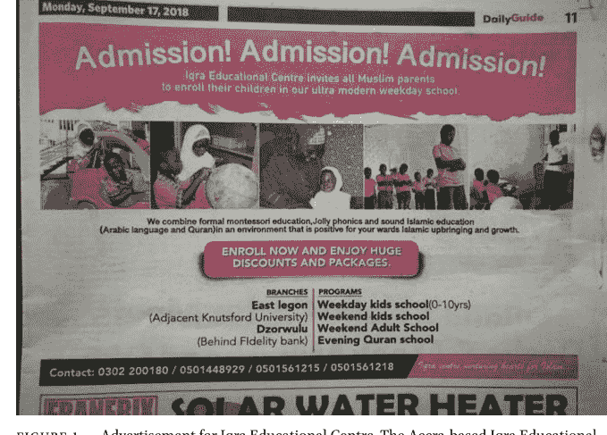

图1 Iqra 教育中心的广告。位于阿克拉的 Iqra 教育中心是众多努力之一，旨在现代化加纳的穆斯林教育体系。

广告刊登于《每日新闻》，2018年9月17日。

作者收藏

在过去二十年里，通过建立私立穆斯林高等教育机构，穆斯林教育领域出现了新的机遇。到目前为止，唯一存在的机构是位于阿克拉的加纳伊斯兰大学学院（IUGG）和加纳湖畔大学学院（LUCG），以及阿散蒂地区贝波索的加纳穆斯林传教教育学院和库马西的穆斯林教师培训学院。IUGG 成立于2000年，由四个学院组成，即艺术、工商管理、传播研究和教育。尽管它由伊朗阿胡尔-拜特基金会运营和资助，IUGG 仍包括逊尼派教职员工和教师[^61]。LUCG[^62]，前身为马迪纳科学与技术学院（MIST），由马迪纳科学与技术基金会于2013年成立，2017年开始运营，由三个学院组成，即工程、商业与技术，以及文理学院（图2）[^63]。与 IUGG 相比，湖畔大学学院并不声称自己是伊斯兰大学，但强调其致力于维护伊斯兰价值观和道德[^64]。

除了两所运营中的大学外，穆斯林学者和非政府组织还启动了其他几个雄心勃勃的项目。其中一些项目的筹款活动仍在进行中，其他项目已被搁置。其中最早的一个是伊玛目拉希德在塔马莱的拉希迪亚伊斯兰大学，计划于2000年开始开设农业、工程和医学的文学学士和理学学士课程[^65]。然而，由于缺乏

## 脚注

[^41]: 阿哈福省、阿散蒂省、博诺省、博诺东省、中部省、东部省、大阿克拉省、奥蒂省、沃尔特省、西部省和西部北省。

[^42]: 北部省、东北省、萨凡纳省、上东省和上西省。

[^43]: Dzodzi Tsikata和Wayo Seini，《加纳的身份认同、不平等与冲突》，CRISE不平等、人类安全与族裔研究中心，牛津大学伊丽莎白女王学院，CRISE工作论文第5号（2004年11月），见 <https://www.qeh.ox.ac.uk/publications/identities-inequalities-and-conflicts-ghana>，访问于2021年4月1日；Joseph A. Yaro和Jan Hesselberg，《加纳北部贫困的轮廓：抗击粮食不安全政策启示》，《研究评论新系列》26卷第1期（2010年）：81–112。

[^44]: Jeff Grischow和Holger Weiss，《殖民饥荒救济与发展政策：迈向加纳北部的环境史》，《全球环境》7/8（2011年）：50–97；Yaw Agyeman Boafo、Godfred Seidu Jasaw和Frederick Dayour，《探索半干旱加纳传统养护农业实践与可持续性的社会维度》，《环境与地球科学杂志》4卷第10期（2014年）：47–58；Jeff Grischow和Holger Weiss，《泛非主义、社会主义与未来：1951–1966年加纳的发展规划》，载于Jenny Andersson和Eglė Rindzevičiūtė主编《跨国科学与政治中的长期斗争：锻造未来》（伦敦和纽约：劳特利奇出版社，2015年），218–239；Martin Oteng-Ababio、Simon Mariwah和Louis Kusi，《加纳北部的不发达是环境决定论还是治理危机的案例？》，《加纳地理杂志》9卷第2期（2017年）：5–39。

[^45]: 另见：康拉德·阿登纳基金会（编），《加纳北部的圣战威胁和

[^46]: 《全球粮食安全战略（GFSS）加纳国别计划》，2018年8月28日，第5页，见 <https://www.usaid.gov/sites/default/files/documents/1867/Ghana_Country_Plan_Public_Version_WS_Edits.pdf>，访问于2021年4月1日。

[^47]: 美国国际开发署/加纳国家发展合作战略2013–2017（2012年12月），第1页，见 <https://www.usaid.gov/sites/default/files/documents/1860/Ghana_CDCS_fy2013-17.pdf>，访问于2021年4月1日。

[^48]: 粮农组织国家营养概况——加纳，<http://www.fao.org/ag/agn/nutrition/gha_en.stm>，访问于2021年4月1日。

[^49]: Edgar Cooke、Sarah Hague和Andy McKay，《加纳贫困与不平等报告：利用第六次加纳生活水平调查》（联合国儿童基金会加纳办事处，2016年3月），见 <https://www.unicef.org/ghana/reports/ghana-poverty-and-inequality-analysis>，访问于2021年4月1日。

[^50]: Kenneth Ofori-Boateng，《加纳城市贫困移民贫困程度与社会凝聚力分析》，《贫困杂志》21:3（2017年）：265–287。

[^51]: Moizza B. Sarwar、Rebecca Holmes、David Korboe、Alex Afram 和 Heiner Salomon，《Understanding Vulnerability and Exclusion in Ghana》（伦敦：ODI，2022）。

[^52]: Alex B. Asiedu 和 Samuel Agyei-Mensah，“Traders on the Run: Activities of Street Vendors in the Accra Metropolitan Area, Ghana,” Norsk Geografisk Tidsskrift/Norwegian Journal of Geography 62, no. 3 (2008): 191–202; Tufeliru Fuseini 和 Marguerite Daniel，“Exploring the Stressors and Resourses of Muslim Child Beggars in Dagbon of Northern Ghana in the Context of Child Rights and Existing Realities,” Cogent Social Sciences 4 (2018), <https://doi.org/10.1080/23311886.2018.1542955>; Tufeliru Fuseini & Marguerite Daniel，“Child Begging as a Manifestation of Child Labour in Dagbon in Northern Ghana, the Perspective of Mallams and Parents,” Children and Youth Services Review 111 (2020), <https://doi.org/10.1016/j.childyouth.2020.104836>。

[^53]: George Owusu et alii，“Slums of Hope and Slums of Despair: Mobility and Livelihoods in Nima, Accra,” Norsk Geografisk Tidsskrift/Norwegian Journal of Geography 62, no. 3 (2008): 180–190; Stig H. Jorgensen，“Some Perspectives on the Geographies of Poverty and Health: A Ghanaian Context,” Norsk Geografisk Tidsskrift/Norwegian Journal of Geography 62, no. 3 (2008): 241–250; Marta M. Jankowska、John R. Weeks 和 Ryan Engstrom，“Do the Most Vulnerable People Live in the Worst Slums? A Spatial Analysis of Accra, Ghana,” Annals of GIS 17, no. 4 (2011): 221–235。

[^54]: Rabiatu Ammah，“Christian-Muslim Relations in Contemporary Sub-Saharan Africa,” Islam–Christian Muslim Relations 18, no. 2 (2007): 146。

[^55]: Voice of Zongo Youth Foundation，“Poverty must never be an excuse for our poor sanitary conditions [...]”，21.6.2023，<https://www.facebook.com/voiceofzongoyouthfoundation>，访问日期 17.8.2023。

[^56]: Weiss, Between Accommodation and Revivalism. 另见 David E. Skinner，“The Incorporation of Muslim Elites into the Colonial Administrative Systems of Sierra Leone, The Gambia and the Gold Coast,” Journal of Muslim Minority Affairs 29, no. 1 (2009): 91–108。

[^57]: Weiss, Between Accommodation and Revivalism. 另见 Ousman Kobo，“‘We Are Citizens Too’: The Politics of Independence in Ghana,” Journal of Modern African Studies 48, no. 1 (2010): 67–94; Johnson Olaosebikan Aremu 和 Adeyinka Theresa Ajayi，“Expulsion of Nigerian Immigrant Community from Ghana in 1969: Causes and Impact,” Developing Country Studies 4, no. 10 (2014): 176–186。

[^58]: Weiss, Begging and Almsgiving in Ghana。

59 “Invest in secular education—Islamic NGOs told”，9.11.2004，https://www.modernghana.com/news/66283/invest-in-secular-education-islamic-ngos-told.html；“Muslim workers asked to support Islamic Education Fund”，29.6.2005，https://www.modernghana.com/news/81012/muslim-workers-asked-to-support-islamic-education-fund.html；“Muslims urged to prioritise, invest in education”，27.7.2023，https://gna.org.gh/2023/07/muslims-urged-to-prioritise-invest-in-education/，访问日期 12.11.2023；全部访问日期 12.11.2023。

60 关于加纳穆斯林教育部门的改革，参见 Abdulai Iddrisu，“Between Islamic and Western Secular Education in Ghana: A Progressive Integration Approach,” Journal of Muslim Minority Affairs 22, no. 2 (2002): 335–350; Abdulai Iddrisu，“The Growth of Islamic Learning in Northern Ghana and Its Interaction with Western Secular Education,” Africa Development xxx, no. 1&2 (2005): 53–67; David Owusu-Ansah 和 Abdulai Iddrisu，“The Philosophy of the Revolution: Thoughts on Modernizing Islamic Schools in Ghana,” Canadian Journal of African Studies/La Revue Canadienne des Études Africaines 42, no. 2–3 (2008): 336–466; Ousman Kobo，“Paths to Progress: Madrasa Education and Sub-Saharan Muslim’s Pursuit of Socioeconomic Development,” in: The State of Social Progress in Islamic Societies, eds. Habib Tiliouine & Richard J. Estes (New York: Springer, 2016), 156–177; Kwame Achaw Owusu，“Perspectives of Reformers on the Transformation of Integrated Public Islamic Schools in Ghana,” The African Symposium (TAS) Journal 17, no. 1 (2018): 25–52; Kwame Owusu，“Exploring the Transformational Leadership Strategies Used by Islamic Education Reformers to Influence the Integration of Islamic Schools in Ghana,” Journal of Comparative Studies and International Education 1, no. 1 (2019): 50–72。

61 参见伊斯兰大学学院主页，https://www.iug.edu.gh。关于其运营和影响的分析，参见 Kobo，“Islamic Institutions of Higher Learning in Ghana。”

62 参见加纳湖畔大学学院主页，https://lucg.edu.gh/。其前身 https://misst.edu 已停用。

63 “Bawumia launches Madina Institute of Science and Technology”，30.9.2017，https://www.ghanaweb.com/GhanaHomePage/NewsArchive/Bawumia-launches-Madina-Institute-of-Science-and-Technology-586560，访问日期 17.8.2021。

64 关于 LUCG，https://lucg.edu.gh/about-lucg/，访问日期 23.12.2022。

65 “Tamale Islamic University admits first students”，13.3.2000，https://www.modernghana.com/news/8581/tamale-islamic-university-admits-first-students.html，访问日期 23.12.2022。

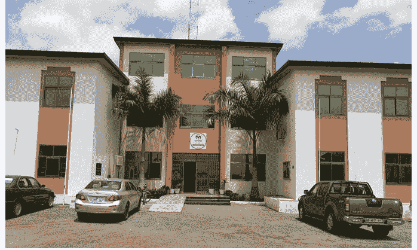

图2 加纳湖畔大学学院（LUCG），前身为马迪纳理工学院（MIST）

摄影：霍尔格·魏斯/2017

资金。⁶⁶ 自2008年以来，谢赫·穆斯塔法·易卜拉欣开始推动位于阿克拉图巴的ICODEHS大学项目，主要赞助方为迪拜慈善机构；⁶⁷ 2014年，阿尔胡达伊斯兰协会在中央省戈莫阿达苏姆启动了可容纳20,000人的大学项目。⁶⁸ 然而，这两个项目目前似乎已被搁置。⁶⁹ 第三个大学项目——位于阿散蒂省阿索科雷的加纳蒂贾尼亚大学学院（TUCG）于2016年成立；⁷⁰ 尽管如此，该项目在吸引足够资金方面也遇到了困难。

66 Weiss，《乞讨与施舍》，122–123。

67 “伊斯兰委员会将建立大学”，2008年4月9日，https://www.modernghana.com/news/162209/islamic-council-to-establish-university.html；“伊斯兰团体在加纳开展大规模发展项目”，2011年1月24日，https://www.modernghana.com/news/313486/islamic-group-embarks-on-massive-development-in-country.html，均访问于2022年12月23日。

68 Gilbert Mawuli Agbey 和 Charles Andoh，“阿尔胡达在戈莫阿达苏姆建设大学”，《每日写真报》2014年3月10日，https://www.graphic.com.gh/news/education/al-huda-constructs-university-at-gomoa-dasum.html，访问于2017年11月8日。

69 对哈吉·苏莱马纳·穆穆尼的访谈，2017年12月5日。据哈吉·苏莱马纳·穆穆尼称，谢赫·穆斯塔法·易卜拉欣在为ICODEHS大学项目争取足够资金方面遇到了困难。

70 “蒂贾尼亚大学学院建设工程启动”，http://www.tijjaniyamuslims.org/news/?news_id=15703d6f39dd87&pn=5，该主页已失效（2024年5月）。

另一方面，加纳穆斯林使团（GMM）计划在其位于贝波索的教育学院旁建立一所伊斯兰大学，目前进展缓慢。⁷¹ 同样，伊斯兰传教秘书处（ISM）在2019年前成功完成了其位于阿哈福省杜阿亚-恩克万塔的伊斯兰大学学院项目。⁷² 另一方面，位于中央省波辛的伊斯兰护理培训学院项目的命运仍不明朗。⁷³ 相反，GMM于2022年初委托开办了第一所伊斯兰护理学院，并于2022年底开始招生，详见第4.4章。

因此，毫不奇怪的是，2021年8月举行的首届年度全国穆斯林会议（NMC）讨论了加速加纳穆斯林教育体系的必要性，副总统阿尔哈吉·马哈马杜·巴乌米亚博士强调，穆斯林领袖在寻求发展穆斯林社区时，必须优先考虑教育，尤其是在科学、技术、工程和数学领域。⁷⁴

此后，NMC已成为加纳穆斯林商讨如何使社区经济繁荣、消除极端贫困和匮乏的论坛。在2022年第二届会议的演讲中，加纳穆斯林使团全国主席谢赫·阿明·邦苏博士敦促穆斯林携手合作，筹集所需的财政资本以开展人力发展项目：“如果我们200万人中每个人每周五筹集1塞地，我们每周就能筹集200万加纳塞地。”其他穆斯林领袖，如阿赫卢斯-苏纳·瓦尔-贾马阿全国伊玛目谢赫·奥马尔·易卜拉欣·伊玛目、什叶派社区伊玛目谢赫·阿布巴卡尔·卡马鲁丁，以及阿赫迈迪亚穆斯林使团埃米尔毛尔维·穆罕默德·努尔·本·萨利赫，提醒穆斯林克服分歧，发展穆斯林内部关系，并参与关于国家发展的社会内部对话。⁷⁵

⁷¹ “加纳穆斯林使团将开始建设伊斯兰大学”，2012年7月18日，https://www.myjoyonline.com/ghana-muslim-mission-to-begin-construction-of-an-islamic-university/，访问于2022年12月23日；“教育机构”，2016年4月21日，http://ghanamuslimmission.com/educational-institutions/，访问于2022年12月23日。对阿克拉的访谈，2022年10月13日。

⁷² “伊斯兰使团为培训学院项目筹集5500万塞地”，2005年3月1日，https://www.ghanaweb.com/GhanaHomePage/NewsArchive/Islamic-Mission-bagged-55-million-cedis-for-training-college-project-76261；“伊斯兰传教秘书处举行第50届年度全国大会”，2015年1月11日，https://www.ghanaweb.com/GhanaHomePage/NewsArchive/Islamic-Mission-Secretariat-holds-50th-Annual-National-Convention-342108；“伊斯兰传教秘书处（IMS）”，2019年10月10日，https://www.facebook.com/IMS-TV-GH-11447777995480/；均访问于2022年12月23日。然而，该学院是否在运营尚不清楚，因为我在社交媒体或互联网上未找到其活动的任何痕迹。

⁷³ “波辛护理培训学院工程取得进展”，2014年6月26日，https://www.graphic.com.gh/news/education/work-on-potsin-nursing-training-college-progresses.html，访问于2022年12月23日。然而，该学院项目是否最终完成尚不清楚，因为我在社交媒体或互联网上未找到其活动的任何痕迹。

⁷⁴ “首届年度全国穆斯林会议在阿克拉开幕”，2021年8月2日，https://www.ghanaweb.com/GhanaHomePage/NewsArchive/Maiden-Annual-National-Muslims-Conference-opens-in-Accra-1322359，访问于2021年8月17日。

### 2 定义CBO、CSO与穆斯林NGO

要为非政府组织和公民社会组织（NGO和CSO）提供明确的定义和类型划分是困难的。世界银行将CSO一词定义为涵盖公民社会中广泛多样的公共协会、团体和组织：

> [...]不仅包括NGO，还包括工会、社区组织或CBO、社会运动、信仰机构、慈善组织、大学、基金会、专业协会等。⁷⁶

在全球范围内，1997年成立的SAPRIN（结构调整参与式审查国际网络）是一个涵盖各类CSO的平台，范围从社区组织、工会、妇女团体、小企业协会、环保组织、农民协会、原住民组织、教育协会、医疗保健协会和专业协会，到NGO、宗教团体和青年团体。⁷⁷ 其在加纳的分支机构SAPRIN-Ghana囊括了300多个NGO、教会团体和工会伞式组织。⁷⁸

另一方面，世界银行将NGO定义为“在经济和社会发展、人权、福利和紧急救济领域倡导和/或提供服务的专业的、中介性的和非营利组织”。⁷⁹ 这样的定义类似于基层或志愿组织的定义，并且排除了各种被定义为CSO的组织，包括宗教组织或青年团体。然而，如下文将进一步讨论的那样，这种狭隘的NGO定义并不反映加纳的实际情况，尤其不反映加纳穆斯林社区的情况，他们以更广泛的方式使用“NGO”一词，也将委员会和基金会定义为NGO，因为它们是“非政府的”。

NGO的狭义定义强调其专业性。例如，阿林、库米和萨达特·亚当将专业NGO定义为一个表现出五个特征的组织：正式性、私有性、非营利分配性、自治性和自愿性。因此，一个专业NGO具有制度化的定期会议、办公室工作人员、某种形式的组织持续性以及一定程度的自愿参与来开展和管理组织。⁸⁰ 而格劳科·达戈斯蒂诺则将公民社会组织与政治宗教主体、NGO和第三部门区分开来。最后一种类型由一系列独立机构组成，每个机构都有组织且不以营利为目的，每个机构都旨在服务于公共利益。第三部门组织与阿林、库米和萨达特·亚当所称的专业NGO相似，即正式、非营利分配、私有、独立和自愿。⁸¹ 然而，专业NGO的狭义定义排除了大量基层和志愿协会、俱乐部、运动和网络，这些组织没有或仅初步专业化。在加纳，尤其是在穆斯林社区中，其中许多组织被称为“NGO”，无论是在其活动人士的日常用语中，还是当他们注册Facebook并开设账户时。

加纳非营利组织秘书处（NPO秘书处）采用了另一种类型划分，将非营利组织（NPO）与社区组织（CBO）区分开来。根据NPO秘书处的定义，NPO是指非营利、非政府的法人、协会或组织，是自愿建立的。它还进一步解释说，NPO主要从事动员和利用资源，用于慈善、宗教、文化、教育、社会或社区目的，或开展其他类型的非营利活动和公益事业。而社区组织（CBO）则是一群在特定地区支持共同目标的爱好者组成的团体。CBO也被称为基层组织和人民组织，其性质和目的与其他NPO不同。CBO通常是“会员制”组织，由由为了促进自身利益而聚集在一起的个人组成（例如，妇女团体、信用合作社、青年俱乐部、合作社和农民协会、社区发展协会等）。然而，非营利组织秘书处也指出，NPOS 和 CBOS 在相同的领域工作并共享共同的动机——社会的福祉和人民的福祉。82

Heuser 和 Koehrsen 指出，宗教非政府组织是混合体，因为它们参与宗教和“世俗”领域的开发机构，因此构成了专业非政府组织、CBOS 和 CSOS 的子类别。83 其他人，如 Clark，在指宗教非政府组织时使用信仰型（慈善/发展）组织的术语。84 与世俗人道主义组织相比，信仰型组织（即宗教非政府组织）被 Ferris 概括为与宗教团体有隶属关系、使命声明明确提及宗教价值观、从宗教来源获得财政支持、治理结构中董事会成员或员工的选拔基于宗教信仰或隶属关系，和/或决策过程基于宗教价值观。85

“穆斯林非政府组织”一词可以用作宽泛或狭窄的类别。以狭义使用时，穆斯林非政府组织是宗教或信仰型组织的特殊形式。例如，Nejima、Harmsen 和 Akutsu 将该术语用作由穆斯林活动人士建立和运营的协会、团体和组织的集体总称，如‘伊斯兰慈善机构’、‘伊斯兰非政府组织’、‘伊斯兰社会机构’、‘穆斯林非政府组织’和‘穆斯林信仰型组织’。它们共同之处在于驱动其活动的愿景和使命的‘穆斯林’或‘伊斯兰’性质。参与和向穆斯林非政府组织捐赠的核心动机基于《古兰经》和《圣训》，即 thawab（回报）以及 fi sabil li-llah（为了真主的缘故）用于虔诚的行为。对来世的关注是穆斯林非政府组织成员和捐赠者的核心动机。给予和服务有需要的人被视为道德和社会责任，旨在抵消人的贪婪和自我主义，并具有道德净化作用。86 同样，Sandy Zook 和 Cassidy Arndt 认为穆斯林（伊斯兰）非政府组织在活动选择、工作范围和采用的收入策略方面受伊斯兰原则指导。87

82 “NPOS简介，” https://npos.mogcsp.gov.gh/profile/, 访问 16.1.2022.

83 Andreas Heuser 和 Jens Koehrsen，“从宁静革命到容忍模糊性：国际发展话语中的宗教非政府组织”，载于 Does Religion Make a Difference? Religious NGOs in International Development Collaboration, 编者 Andreas Heuser 和 Jens Koehrsen（巴登-巴登：Nomos Verlag，2020），13。

84 Gerard Clarke，“信仰重要：信仰型组织、公民社会与国际发展”，Journal of International Development 18 (2006): 835–848。

85 Elizabeth Ferris，“信仰型和世俗人道主义组织”，International Review of the Red Cross 87, 第 858 期 (2005): 311–325。

86 另见 Susumu Nejima、Egbert Harmsen 和 Masayuki Akutsu，“导言”，载于 *穆斯林世界的非政府组织：信仰与社会服务*，编者 Susumu Nejima（伦敦和纽约：Routledge，2016），1–16。另见 Matthew Clarke 和 Vicki-Anne Ware，“理解信仰型组织：国际发展文献中 FBOs 与非政府组织的对比”，*发展研究进展* 15, 第 1 期 (2015): 37–48。

Kaag 强调，狭义定义的穆斯林（国家和跨国）非政府组织基于对伊斯兰团结的理解，该理解由三个要素组成：`ighatha` 或人道主义救援，`daʿwa` 或传召伊斯兰，以及 `jihad` 在支持伊斯兰事业的武装冲突意义上的含义。88 然而，正如 Petersen 在其对跨国穆斯林非政府组织轨迹的分析中所指出的，大多数组织结合了其中两个要素。第一个跨国穆斯林非政府组织出现在 1970 年代末，并在 1980 年代非洲之角饥荒期间成为头条新闻。Petersen 将这些组织——如国际伊斯兰救援组织（IIRO，成立于 1979 年）、伊斯兰救援（成立于 1984 年）和穆斯林援助（成立于 1985 年）——定义为 `daʿwatist`，因为其目标不仅是提供援助，还要抵制西方基督教非政府组织的影响，以保护穆斯林信仰和身份。89

1980 年代和 1990 年代阿富汗和波斯尼亚的冲突见证了两种不同类型的穆斯林跨国非政府组织的出现，即圣战主义者和基于团结的非政府组织。`Jihadist NGOs` 将人道主义救援与支持穆斯林团体的武装斗争相结合，并在 1998 年肯尼亚袭击以及 2001 年纽约和华盛顿特区 9/11 袭击之后，被政府标记为恐怖组织。`Solidarity-based Muslim NGOs` 另一方面，强调中立性和跨信仰对话而非 jihad 和 da‘wa，尽管正如 Petersen 所强调的，大多数这些跨国穆斯林非政府组织仍然保持特殊主义的关注，将其救援工作限制在穆斯林同胞身上。90

87 Zook 和 Arndt，“加纳教育中的伊斯兰非政府组织”，64。

88 Mayke Kaag，“援助、乌玛与政治：乍得的跨国伊斯兰非政府组织”，载于 *伊斯兰教与非洲的穆斯林政治*，编者 Benjamin F. Soares 和 René Otayek（纽约 & Houndsmills，Basingstoke：Palgrave Macmillan 2007），85–102。

89 Marie Juul Petersen，“跨国穆斯林非政府组织的轨迹”，*发展实践* 22, 第 5–6 期 (2012): 766–767; Marie Juul Petersen，*为了人类还是为了乌玛？跨国穆斯林非政府组织中的援助与伊斯兰*（伦敦：Hurst，2015）；Marie Juul Petersen，“伊斯兰与发展：国际穆斯林非政府组织”，载于 *宗教是否有所不同？国际发展合作中的宗教非政府组织*，编者 Andreas Heuser 和 Jens Koehrsen（巴登-巴登：Nomos Verlag，2020），111–134。Chanfi Ahmed 对撒哈拉以南非洲一些穆斯林非政府组织的混合特征，即结合救援和 `daʿwa`，提供了类似的讨论，参见 Chanfi Ahmed，“撒哈拉以南非洲伊斯兰非政府组织的网络：比拉勒穆斯林传教团、非洲穆斯林机构（直接援助）和 al-Haramayn”，*东非研究杂志* 3, 第 3 期 (2009): 426–427。

`da‘watist`、`jihadist` 和基于团结的穆斯林非政府组织是信仰型非政府组织的变体，在地方、国家或国际层面运作。Da‘watist 非政府组织在撒哈拉以南非洲的大部分地区主导了穆斯林非政府组织格局，实施自我提升计划并为穆斯林社区的基础设施做出贡献，如学校、清真寺、健康诊所和住房。这些计划反过来具有积极的地方乘数效应，因为它们为建筑工人和维护人员、教师、管理人员和其他工人创造了就业机会。91

然而，穆斯林非政府组织的狭义定义不一定会涵盖服务于穆斯林人口但没有明确或可证明的对伊斯兰原则承诺的组织。这在欧洲是一个明显的现象，那里许多当地慈善机构，尤其是由穆斯林年轻一代建立的慈善机构，在 William Braylo 的话中“并非专门‘穆斯林’慈善机构”。据他说，它们不将自己定义为‘穆斯林’，其志愿者并非全部是穆斯林，它们也不仅向穆斯林提供服务……它们更可以被描述为基于‘伊斯兰伦理’的慈善机构。92 在加纳也是如此，许多青年协会、俱乐部、运动和 Zongo 组织也运作于宽泛而非狭窄的框架内。此外，遵循 Antje Daniel 和 Dieter Neubert 的定义，其中一些可以归类为社会运动，因为它们表达“基于共同身份的公共抗议和集体行动，旨在实现社会变革”，有时会导致暴力抗议表达。93 因此，要涵盖穆斯林非政府组织的谱系，需要一个宽泛的框架。Petersen 将此类组织定义为世俗穆斯林非政府组织，将包容性关注如减贫、可持续发展和能力建设作为其主要且唯一的目标，而不论信仰如何。94 此外，穆斯林非政府组织的狭义定义不包括 Kumi 所定义的各种形式的倡议。他将它们定义为专业或正式实质性慈善机构，例如成立的基金会

由高净值个人和本地/跨国企业组织、社会企业和影响力投资者的创新中心，以及各种支持组织提供。95

对穆斯林非政府组织的宽泛定义涵盖了加纳可持续发展目标慈善平台目录中所提供的各种捐赠形式或类别。96 穆斯林在慈善捐赠方面的举措往往来自穆斯林企业家和高净值个人（第 2.1.1 章）、政界人士（例如由政界人士设立的基金会和信托，见第 2.1.2 章）、信仰团体（例如穆斯林非政府组织、穆斯林跨国非政府组织、穆斯林慈善家）、基金会和信托。其他则来自艺人、演艺界人士以及穆斯林名人、影响者设立的捐赠（第 2.1.3 章）、家庭（例如家庭基金会和捐赠）、基于议题的公私合作以及捐赠网络（例如国内和国外地方社区与穆斯林侨民网络之间的合作）。最近出现的一种是创业或混合慈善（例如社会企业，最近是中心/枢纽的建立以及对初创公司和商业项目的投资）。97

在加纳，何为穆斯林社区组织、民间社会组织或非政府组织，有时难以确定。它们大多数，如果不是全部的话，加上一些基金会，都将自己定义为非政府组织，而本书中对民间社会组织和非政府组织所做的区分是任意的，尽管并非牵强。本书因此结合了狭义和广义的框架，以捕捉加纳穆斯林非政府组织的谱系，见表 2。

可以说，确定一个组织为穆斯林非政府组织的一个基准是其创始人或发起人是/曾是穆斯林。然而，并非每一个这样的机构都是穆斯林非政府组织。这在加纳北部从事农业和社区发展的各种社区组织和民间社会组织中尤其如此。相反，根据对穆斯林非政府组织的狭义或广义定义，其成员要么全部是穆斯林，要么很大程度上是穆斯林，其目标是赋权穆斯林人口。按照狭义框架，穆斯林基于信仰的组织则将穆斯林*乌玛*的精神福祉和宗教发展置于其活动的首位，并且是纯粹的信仰型组织，尽管它们将*宣教*与人道主义救助相结合，并努力改善加纳穆斯林的社会福利、健康和教育。

社区发展总体上则是广义定义的穆斯林民间社会组织、社区组织和世俗非政府组织议程的首要任务。它们中有些不一定将自己定义为信仰型组织，尽管其成员包括穆斯林活动人士。一些穆斯林民间社会组织和非政府组织是正式的、制度化的组织，拥有首席执行官、董事会以及缴纳会费的成员，以及参与其宣传活动和项目的志愿者。另一些则是非正式的网络和运动，为临时活动动员支持者。大多数专业非政府组织是注册组织；许多非正式非政府组织，尤其是地方青年团体和运动，则没有注册。一些穆斯林非政府组织和基金会在本质上是国际穆斯林慈善机构和外国穆斯林慈善家的中介组织。其他人则通过社交媒体从成员和当地支持者那里筹集资金。

### 3 赋权与慈善的非政府组织化

赋权已成为联合国开发计划署、联合国妇女发展基金和其他联合国机构的项目和政策中的一个关键词，也出现在社会工作和医疗保健实践中，并在心理学、社会学、政治学、性别与发展研究等各个研究领域中频繁使用。然而，对其内涵并没有单一的理解。需要考虑的一个区别是社区基础与个人主义的理解之间的区别。上世纪七十年代末，赋权进入了关于地方发展、地方自治、行动主义和社会动员的学术讨论。当时的重点是个人的生活状况与其社会和结构性条件的关系。因此，赋权与边缘化社区之间的集体意识提高过程联系在一起，受保罗·弗莱雷的启发，旨在反对社会不公正的社会动员。二十年后，赋权的论述转变为个人主义的市场导向论述，重点是增强个人在社会福利部门促进个人目标和做出自主选择的能力。随着这一发展，赋权在医疗保健和社会工作领域也出现了纯粹的个人主义治疗立场。98

在 Askheim 的五种赋权方法中——赋权作为抵抗、赋权作为市场逻辑的一部分、赋权作为治疗方法、赋权作为个人自我实现以及赋权在福柯政府性概念之下的视角99——本研究使用这一概念来探讨当代加纳穆斯林中集体动员、抵抗和自力更生的兴起。对他们而言，赋权，或更确切地说自我赋权，是个人和集体获得对生活控制的多维社会过程。最好的情况是，它增强了他们采取行动、改变社会（包括性别）、经济和政治结构以及组织起来以减少贫困、社会不公正和环境退化的能力。

慈善的“非政府组织化”则是加纳穆斯林当代自我赋权的一种表现。后殖民世俗民族主义的危机为一种宗教导向的动员创造了有利条件，这种动员将个人救赎和自我实现与对社区福利的承诺相结合。道德和宗教启发的社会行动是建立提供援助给有需要者、基本医疗保健和教育等服务的组织的根基——这些服务国家往往无法有效提供（图 3）。宗教为基础的慈善协会专注于广泛的服务（医疗、教育、家庭福利和紧急援助），发挥了完全这样的作用。最初，它们建立在地方信任和社区联系的基础上，尽管它们也可以为随后的政治参与提供基础。

无论是狭义还是广义定义的穆斯林非政府组织都代表了不同的垂直和混合慈善类别。与其他撒哈拉以南非洲国家类似，加纳的慈善格局包含非正式的本土和传统（水平）以及更正式的制度化（垂直）慈善的混合。根据 Kumi 的说法，加纳本土慈善文化的例子包括个人和宗教团体的捐赠以及志愿服务。他的调查发现，宗教团体的捐赠在很大程度上是非制度化的。他还强调，基督徒和穆斯林更关心向宗教组织如教堂和清真寺的捐赠，而不是支持有需要的人（图 4）。此外，宗教捐赠的非制度化性质指出了财务透明度和问责制等重要问题。[^100]

穆斯林宗教捐赠形式的`天课`、`开斋天课`和`施舍`传统上是非正式的、私人的和水平的，尽管通过 2010 年启动的`加纳天课和施舍信托基金`（见第 5.3.1 章），正式的、制度化的和垂直的慈善形式有了显著的扩张。[^101] 同样，可以将过去二十年中蓬勃发展的许多穆斯林举措识别为垂直慈善的形式。

制度化慈善格局的一个共同特征是对信托、基金会和非政府组织之间区别的明显缺乏。它们都作为公司或以担保有限公司形式的信托在公司注册。[^100]

[^100] Emmanuel Kumi，“援助削减与加纳非政府组织的可持续性追求：慈善机构能否作为替代资源动员渠道？”，*VOLUNTAS：国际志愿与非营利组织期刊* 30（2019）：133–147。

[^101] 另见 Weiss，《加纳的天课》。

#### 表 2 加纳穆斯林非政府组织的框架

| 狭义框架 | 广义框架 |
|---|---|
| – 由穆斯林建立 – 成员：穆斯林 – 目标：乌玛的赋权；`宣教` 加上精神/宗教发展 – 项目：   – 斋月开斋饭和宰牲节献祭   – 水项目   – 清真寺   – 教育项目   – 孤儿 | – 由穆斯林建立 – 成员：穆斯林和非穆斯林 – 目标：社区赋权（穆斯林以及非穆斯林） – 项目：   – 社区发展   – 人道主义救助 |

95 库米，《全球慈善追踪：加纳》。

96 SDG 慈善平台所列的十三类捐赠在 Tijani 和 Abdallah 的整理中被归纳为十类，即 1) 传统捐赠，2) 国家主导的资源配置和专业化慈善，3) 非正式/个人慈善和捐赠，4) 政治慈善，5) 家庭基金会和捐赠，6) 基于信仰的慈善，7) 企业慈善和企业社会责任，8) 基于议题的公私合作，9) 高净值个人的慈善捐赠，以及 10) 捐赠网络。另见 Ahmed Hamza Tijani 和 Ibrahim Abdallah，“穆斯林世界的慈善：加纳”，载于 Shariq A. Siddiqui 和 David A. Campbell 编：《穆斯林世界的慈善》（切尔滕纳姆/诺斯汉普顿，马萨诸塞州：爱德华·埃尔加出版公司，2023），55–59 页，表 4.2。

97 另见 SDG 慈善平台，《加纳慈善的 enabling 环境》。

98 Ole Petter Askheim，“赋权作为专业社会工作的指导：走钢丝上的平衡行为”，*欧洲社会工作期刊* 6，no. 3（2003）：229–240；Anne-Emmanuèle Calvès，“赋权：当代发展话语中一个关键概念的历史”，*Revue Tiers Monde* 200，no. 4（2009）：735–749。

99 Inge Storgaard Bonfils 和 Ole Petter Askheim，“赋权与个人协助——抵抗、消费者选择、伙伴关系或纪律？”，*斯堪的纳维亚残疾研究* 16，no. S1（2014）：62–78。

## 愿景2030

致乌莱玛

## 致穆斯林社区

你也能

发展

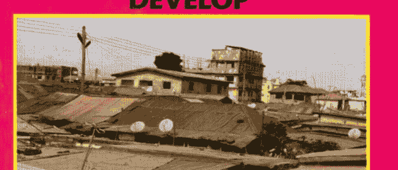

只要你遵循《古兰经》的教诲和先知穆罕默德（愿主福安之）的圣训

作者：

谢赫·奥马尔·易卜拉欣·伊玛目

阿赫勒-逊奈与贾马阿全国伊玛目

手机：0242 802399

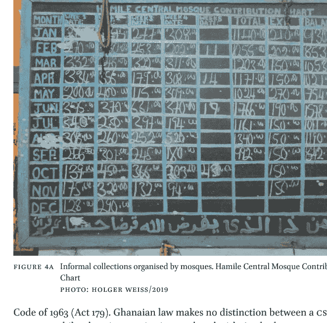

图4A 由清真寺组织的非正式募捐。哈米莱中央清真寺捐款表

照片：霍尔格·魏斯/2019

1963年法典（第179号法案）。加纳法律不区分民间社会组织（CSO）、非政府组织（NGO）或慈善组织，也没有任何立法机构或政府机构（包括加纳税务局、社会福利部或注册总局）专门处理或监管慈善工作和慈善捐赠¹⁰²。因此，基金会已成为一种带有主张性的标签，个人避免将其基金会称为非政府组织。许多由政治家和政党建立的基金会因吸引选民而受到批评。¹⁰³ 此外，企业社会责任（CSR）已成为加纳慈善领域的一个关键特征。加纳的企业捐赠是自愿的，因此电信和采掘业的一些国内及跨国公司建立了基金会来实施其发展项目。104

102 可持续发展目标慈善平台，《加纳慈善事业的有利环境》，第51页；Tijani和Abdallah，“穆斯林世界的慈善事业：加纳”，第60页。

103 Emmanuel Kumi，“推进可持续发展目标：分析慈善事业在加纳的潜在作用”，《亚洲与非洲研究杂志》54卷，第7期（2019年）：1090。

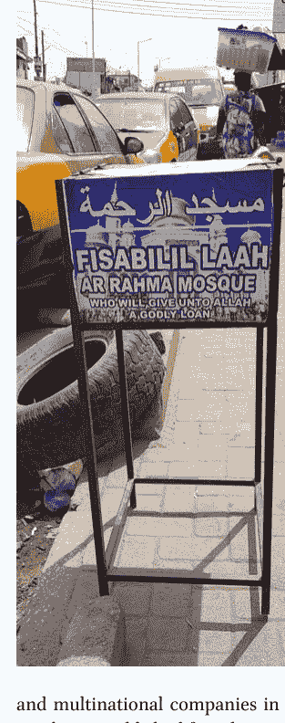

图4B

阿克拉尼马区拉赫曼清真寺的捐款箱

照片：霍尔格·魏斯/2022

加纳第四共和国1992年宪法为基层运动、民间社会组织和非政府组织设定了法律框架，因为它保障了言论自由、思想自由、良心和信仰自由、新闻及其他媒体自由、宗教自由、集会自由、结社自由、信息自由和迁徙自由。105 原则上，宗教团体和非政府组织必须在司法部注册总局办公室登记，以获得政府的正式承认和法人实体地位。已登记的宗教团体和非政府组织免于为非营利性的宗教、慈善和教育活动纳税。然而，不登记并不会受到处罚。106 此外，齐卡塔、盖基-詹多赫和胡希认为，大多数非正式的民间社会组织和非政府组织并未登记，107 这一观察似乎也适用于穆斯林非政府组织。

104 Kumi，“推进可持续发展目标”，第1092页。

105 Tsikata、Gyekye-Jandoh和Hushie，《加纳民间社会政治经济分析》，第30页。

106 美国国务院国际宗教自由办公室，《2022年国际宗教自由报告：加纳》，https://www.state.gov/reports/2022-report-on-international-religious-freedom/ghana/，访问日期：2023年11月14日。

107 Tsikata、Gyekye-Jandoh和Hushie，《加纳民间社会政治经济分析》，第14页。

此外，正如勒布朗和戈塞林所指出的，穆斯林非政府组织是新自由主义全球化的产物。从20世纪70年代末撒哈拉以南非洲后殖民国家面临经济和政治危机开始，非政府组织承担了此前由国家提供的服务的大量责任，尤其是在教育、医疗保健和公共安全领域。勒布朗和戈塞林强调，这种协会和宗教团体的“非政府组织化”导致正式的（西方）非政府组织模式扩展到大量此前并未自我认同为非政府组织的公民和宗教组织。另一方面，小规模协会和信仰型非政府组织的急剧增加，在他们看来，也反映了宗教和宗教活动人士在政治领域和社会发展逻辑中的可见度提高。108

108 Marie Natalie LeBlanc和Louis Audet Gosselin，“导论：西非的信仰、慈善与志愿主义伦理”，载于《信仰与慈善：西非的宗教与人道主义援助》，Marie Natalie LeBlanc和Louis Audet Gosselin编（伦敦：Pluto出版社，2016年），第2、5页。另见Marie Natalie LeBlanc和Benjamin Soares编，《新自由主义时代的穆斯林西非》（布卢明顿，印第安纳州：印第安纳大学出版社，2008年）。

此外，“非政府组织化”是新自由主义全球化下国家“空心化”的结果，国家将部分能力转移到了其他层级，例如国内区域和地方层面的国际机构，以及绕过国家并在多个地方之间建立联系的横向网络。正如托克和奥布赖特所强调的，穆斯林及其他信仰型非政府组织正是这种“空心化”的基本例证。109

109 M. Evren Tok和Ben O’Bright，“通过撒哈拉以南非洲的伊斯兰非政府组织再生产嵌入空间：对2015年后发展的反思”，《非洲地理评论》36卷，第1期（2017年）：85–99。

加纳穆斯林组织的广泛格局反映在拉比亚图·阿玛和其他研究者的区分中，他们将传统与现代形式区分开来。传统形式包括苏菲教团和活跃在该国的各种穆斯林教派的清真寺社区，包括各种提加尼、萨拉菲以及什叶派、伊巴迪和阿赫迈迪亚团体。阿玛列出的现代穆斯林组织包括各种委员会、学生组织、非政府组织和穆斯林妇女团体。^110 苏莱曼纳·穆穆尼也对传统穆斯林组织和现代穆斯林非政府组织作出了类似区分，并讨论了直至20世纪90年代中期加纳穆斯林领域的初步非政府组织化。穆穆尼聚焦于阿克拉现代穆斯林非政府组织的出现，采用了狭义的定义，概述了二十世纪伊斯兰组织的激增。根据他的分析，穆斯林非政府组织构成了一个由不同协会、委员会、团体和组织组成的集合，从非政府伊斯兰组织（如黄金海岸穆斯林协会和加纳穆斯林传教会）到各种代表机构（如穆斯林酋长委员会、伊斯兰事务最高委员会、加纳穆斯林代表委员会、国家首席伊玛目办公室或加纳穆斯林组织联盟），详见下文第1.3.1章。^111

110. Rabiatu Ammah，“伊斯兰、性别与加纳的领导力”，《CrossCurrents》63卷，第2期（2013年）：233。

111. Mumuni，《阿克拉的伊斯兰组织》，第68–74页；Sulemana Mumuni，“阿克拉伊斯兰非政府组织调查”，载于《非洲穆斯林社会的社会福利》，Holger Weiss编（乌普萨拉：Nordiska Afrikainstitutet，2002年），第146–148页。

穆斯林非政府组织在加纳慈善领域中只占很小一部分。与撒哈拉以南非洲其他地区一样，这一领域正在发生变化，并趋向于捐赠的制度化。尽管自1957年独立以来，基督教非政府组织一直主导着加纳的慈善领域，但制度化的纵向穆斯林非政府组织是相对较新的现象，并且总体上对非穆斯林来说并不显眼。^112 尽管一些穆斯林个人在加纳公民社会中成功获得了经济和政治上有影响力的地位，其中一些人甚至成为穆斯林高净值人士；但加纳穆斯林人口的大多数在经济和政治上仍是被边缘化的少数群体。^113 传统上，各种形式的横向慈善构成了穆斯林社区内部支持的基本形式。天课也是一件私事：非正式、个人对个人。有时会咨询伊玛目，但不存在清真寺或天课基金。^114 此外，分发给乞丐的金额

112. SDG慈善平台，《加纳慈善事业的有利环境》，第27–28页；Kumi，《多元化或死亡？》

113. Weiss，《加纳的乞讨与施舍》；Skinner，“西非的达瓦与政治。”

114. Holger Weiss，“重组穆斯林社会福利——伊斯兰志愿主义与

而穷人所获得的通常只是小额施舍，仅能让接受者维持一天的生计，却几乎无法改变他们的生活。因此，在二十世纪的加纳，天课既不是消除贫困的工具，也不是赋予穆斯林权力的手段。至少，这是大约15至20年前我就此问题采访大多数穆斯林学者时得出的结论。115

相反，在针对加纳穆斯林社区的正式纵向慈善形式中，存在各种地方性、全国性以及跨国/国际性的穆斯林信仰组织。其中一些由穆斯林学者或穆斯林社区领袖建立，另一些由穆斯林企业家和政治活动家建立。自20世纪90年代初以来，穆斯林信仰非政府组织一直倡导“发展”、“民主”甚至“个人权利”等目标，这些目标有时会体现在其名称中。其中许多组织积极寻求获得海外资金，这些资金主要来自伊斯兰合作组织（OIC）成员国以及国际/跨国穆斯林信仰非政府组织，用于清真寺、诊所和学校建设项目以及教育活动。116 然而，只有少数穆斯林信仰非政府组织关注穆斯林妇女的社会和政治赋权。117 此外，一个新现象是穆斯林知识分子、活动家和信仰非政府组织参与公共传播和媒体，尤其是通过私营广播电台，以及近年来通过互联网进行传播。118

《加纳北部的其他社区支持形式》，载于《非洲宗教杂志》第32卷第1期（2002年）：第83–109页。

115 Weiss，《加纳的乞讨与施舍》。另见Kumi，《加纳的援助削减与非政府组织对可持续性的追求》，第1443页。

116 Weiss，《加纳的乞讨与施舍》。进一步参见Skinner，《西非的宣传与政治》；Jibrail Bin Yusuf，《加纳的穆斯林领导力：批判性分析》，载于《苏格兰艺术、社会科学与科学研究杂志》第5卷第2期（2012年）：第14–27页；Ammah，《伊斯兰教、性别与加纳的领导力》。

117 Ammah，《伊斯兰教、性别与加纳的领导力》；Rabiatu Ammah，《“他们还必须以智慧呼求主道”：一位穆斯林女性关于非洲女性在跨信仰相遇中的视角》，载于《世界基督教与宗教间关系研究》第48期（2014年）：第185–202页；Sulemanu，《教育作为可持续发展的工具》。

118 Musa Ibrahim，《媒体与宗教参与：谢赫·西巴维·扎卡里亚与加纳广播媒体》，载于《伊斯兰教在非洲年度评论》第11期（2012年）：第7–11页；Benedikt Pontzen，《“关心人民”：ZuriaFM——加纳阿散蒂的一个伊斯兰广播电台》，载于《伊斯兰非洲》第9卷第2期（2018年）：第209–231页；Amin Bamba Muzzammil，《加纳的伊斯兰改革：部分特定伊斯兰学者与运动的作用》，哲学硕士论文，加纳大学宗教学系，2018年10月。

### 3.1 加纳穆斯林自助的悠久历史

加纳穆斯林的集体行动有着悠久的传统，集中于两种制度，即清真寺和苏菲兄弟会（tariqa）。这两种制度在前殖民时期已经出现，前者作为独特的地方社区的中心，后者以其谢赫或领袖的地位和（跨区域）网络为特征。穆雷·拉斯特（Murray Last）和本杰明·苏亚雷斯（Benjamin Soares）引入了“祈祷经济”一词，用以描述西非穆斯林社会和飞地中的复杂实践，在这些实践中，信徒们向穆斯林学者支付可观的金钱，以换取祈祷、祝福和伊斯兰医学。119 苏亚雷斯进一步将祈祷经济描述为通过资本——经济资本、政治资本以及精神或象征资本——的流通而运作，特定的社会行动者可以将这些资本从一个领域转换到另一个领域。在他看来，祈祷经济实际上是一种宗教实践经济，人们大规模地向某些宗教领袖赠送礼物，以换取祈祷和祝福。他认为，用祝福和祈祷交换物品导致了商品化过程，在后殖民时期，这种商品化在围绕这些宗教领袖的活动中不断扩散并加剧。120

英国省级专员安格斯·邓肯-约翰斯通（Angus Duncan-Johnstone）在1928年参加库马西的会众祈祷后，对加纳的祈祷经济提供了早期描述：

> 昨晚我参加了清真寺的通宵礼拜，那是在“高贵之夜”（Leila al Kadiri）的夜晚，期间从头到尾诵读《古兰经》。在这个特别的场合，当大家于晚上10点聚集在清真寺时，伊玛目[伊玛目，HW] 马拉姆·巴巴利（Malam Babballi）开始凭记忆背诵各章，而所有马拉姆都面前摊开自己的《古兰经》以便找出他的错误。[……] 这可不是件容易的事，因为听众都识字，而且极为挑剔，他们跟着自己手中的《古兰经》逐节核对。我们在中途都施舍了财物，而我感到有趣的是，伊玛目仍机械地吟诵着，不时把目光投向我收到的礼物。121

119 穆雷·拉斯特，《北尼日利亚的魅力和医学》，载于《非洲伊斯兰教中的魅力与兄弟情谊》，D.B. 克鲁斯·奥布赖恩和C. 库隆编（牛津：克拉伦登出版社，1988年），第183–204页；本杰明·苏亚雷斯，《马里小镇的祈祷经济》，载于《非洲研究手册》第36卷第4期（1996年）：第739–754页。

120 进一步参见本杰明·苏亚雷斯，《伊斯兰教与祈祷经济：一个马里小镇的历史与权威》（爱丁堡和伦敦：爱丁堡大学出版社为国际非洲研究所出版，2005年）。

121 [安格斯·科林]·邓肯-约翰斯通，《阿散蒂非正式日记》，1928年3月20日条目，安格斯·科林·邓肯-约翰斯通中校文件，MSS.Afr.s.593（1，2–14），牛津大学博德利图书馆。

一个世纪之后，宗教活动的程序仍然相同，尤其是加纳苏菲学者组织的宗教集会，非常接近苏亚雷斯对“祈祷经济”的定义。然而，发生变化的是这些集会的规模，特别是提贾尼季节祈祷会聚集了成千上万的参与者。

总的来说，在穆斯林社会中，加纳穆斯林也同样高度重视社会资本，尤其是精神资本。传统上，社会等级并不等同于经济财富。报酬微薄的职业，如穆斯林治疗师、伊玛目或马拉姆（穆斯林学者），比商人或商贩这类能带来收入的职业更受尊崇。这一点在前殖民时期和殖民时期的记录中清晰可见：最有影响力的穆斯林是学者和伊玛目，而不是商人。尽管穆斯林学者及其领袖并不鄙视财富，他们的社会影响力基于其巴拉卡（baraka）或精神魅力，而从不基于其世俗资产。122

然而，自20世纪后半叶以来，随着加纳社会中穆斯林群体贫困的加剧，对社会资本、精神资本以及规范性义务的强调已成为问题。由于现代理想与传统价值观之间的冲突，各穆斯林社区的内部凝聚力受到压力。以个人的巴拉卡以及作为宗教领袖或精神领袖的地位为代表的“旧式”或“传统”社会资本，在当代加纳社会中影响甚微。成功和影响力是通过社区之外的政治经济活动获得的；在当代加纳，社会地位是根据个人在现代公民社会中的职位和影响来衡量的。随着穆斯林社区在当代加纳日益边缘化，应对日常生活问题的旧方式受到质疑——既受到青年的质疑，也日益受到穆斯林学者自身的质疑。

这种重新评估的一个体现是穆斯林非政府组织的激增；另一个体现是关于天课和基于社区的自助的讨论日益增多。123 穆斯林协会和组织与清真寺和苏菲社区有所区别，它们是正式化的、有时甚至制度化的机构，在殖民时期逐渐形成。有趣的是，这也标志着加纳（逊尼派）穆斯林社区内部一个显著的转变：穆斯林基层和自助组织在南部城市中心出现，而不是

122 Weiss，《义务施舍》，第7章。

123 Weiss，《加纳的乞讨与施舍》，第26–27页。

与北部老牌的穆斯林（城市和农村）中心相比。最古老的一个是总部位于阿克拉的黄金海岸穆斯林协会，它于1932年124起初作为社区自助组织成立，并改组为第一个（迄今为止唯一一个）穆斯林政治组织穆斯林协会党，存在于1954年至1957年，后被恩克鲁玛政府取缔。125 在库马西，这一时期穆斯林豪萨社区出现了多个自愿协会，有时与现有组织竞争，例如穆斯林友好协会、Katsiro、Jamiyyat Takadum Al-Islam、Zongo志愿者、穆斯林青年组织、加纳穆斯林协会、Jamiyat al-Ulama、阿散蒂穆斯林理事会、穆斯林青年理事会、穆斯林青年大会、Jamiyat Al-Yatiyati 以及穆斯林进步联盟协会。126 这些组织的主要特点是它们主要是社会福利协会，充当未来领导人的培训基地，且按民族而非宗教界限组建。127

恩克鲁玛时代存在多个穆斯林政治/公民社会协会：穆斯林青年大会、穆斯林青年协会、黄金海岸穆斯林理事会以及加纳穆斯林理事会，均在1966年针对恩克鲁玛的军事政变后解散。128 此外，恩克鲁玛时代也标志着与北非和中东国家的外交接触开始，包括埃及（1957年）、沙特阿拉伯王国（1960年）和利比亚（1961年）。这些接触使加纳穆斯林学生得以出国，在这些国家的大学学习。这些中东接触的另一个后果是，各种伊斯兰政府和非政府机构开始直接和间接地支持加纳穆斯林组织。自1970年代以来，沙特阿拉伯与其他一些海湾国家一起——自1980年代以来还包括伊朗（外交接触

124 Mumuni，《阿克拉的伊斯兰组织》，96–100；Mumuni，“阿克拉伊斯兰非政府组织的调查”，138–161。

125 Mishahudeen Ahmed-Rufai，“穆斯林协会党：加纳宗教政治的考验”，《加纳历史学会会刊》，新系列6（2002）：99–114；Sean Hanretta，“‘卡菲尔’伦纳的皈依：在殖民加纳公开做穆斯林”，《过去与现在》210卷，第1期（2011）：187–220。

126 另见 Norris Brian Winchester，《陌生人与城市非洲的政治：加纳库马西豪萨人的研究》，政治学博士论文，印第安纳大学，1976年。另见 Prof. Sheikh Osman B. Bari，《加纳穆斯林与宗教综合史》，第一卷（阿克拉：Dezine Focus，印刷与出版公司，第二版，2014年），288–294。

127 Nathan Samwini，《1950年以来加纳的穆斯林复兴：其对穆斯林及穆斯林-基督教关系的影响》（柏林：LIT-Verlag，2006年），85–86。

128 Mumuni，《阿克拉的伊斯兰组织》。

于1982年由劳林斯军事政府重新建立）以及自2010年代以来的土耳其——已成为加纳穆斯林组织和理事会最重要的合作伙伴。归国的穆斯林学生不仅成为真正的“伊斯兰”（萨拉菲）道路的热心传播者，有时导致苏菲派与萨拉菲派信徒之间的冲突，而且还能够建立比旧穆斯林（苏菲）精英更具财务效率的网络。129

海湾联系最深远的影响是穆斯林国家以及国际伊斯兰组织和慈善机构向加纳转移官方发展援助（ODA）和援助（详见第2.4章）。自1970年代石油繁荣之后开始，并在1990年代以来不断增加，加纳国家也从穆斯林国家和国际伊斯兰金融机构（如沙特的伊斯兰开发银行（IDB））获得了ODA、投资和贷款。国际穆斯林慈善机构，如沙特的国际伊斯兰救援组织（IIRO）或科威特的非洲穆斯林机构（AMA，自1999年起被称为Direct Aid）自1980年代以来一直在加纳存在。有时它们的投资被呈现给加纳公众，声称是为了共同利益，尤其是当一个项目，例如钻井或水井，针对宗教混合的村庄或社区时。130

然而，1990年代和2000年代初“穆斯林”投资最明显的标志是全国城乡社区新建清真寺的激增。在较小程度上，宗教动机的投资也投向了教育、社会和基础设施发展项目。尽管当地穆斯林社区认为此类项目具有积极影响，但清真寺的建设有时会受到当地穆斯林活动人士和领导人的批评，认为其没有回应当地人口的需求。这就是我在二十年前早期的研究中遇到的穆斯林当局给我的回应。有时他们甚至在公开场合表达批评。131

三十年前的大部分批评反映了加纳第四共和国第一个十年期间草根和社会运动的新条件。1992年宪法为充满活力的公民社会和非政府组织的建立铺平了道路，包括第一代穆斯林非政府组织，随后在2000年代初期出现了第二代

129 Weiss，《在调适与复兴主义之间》，351–353。另见 Dumbe，“加纳的伊斯兰两极分化与排斥政治”，以及 Kobo，“加纳萨拉菲/阿赫勒逊奈改革主义的转变轨迹”，

130 Weiss，《在调适与复兴主义之间》，354–355。

131 Weiss，《加纳的乞讨与施舍》，124。

以及自2010年代以来出现的第三代，将在下一小节中讨论。与这一进程并行的是穆斯林代表机构和理事会的重新组织。其中一些成立于1960年代和1970年代，其中几个并存，有时相互对立。它们包括加纳穆斯林社区（GMC，成立于1966年）、伊斯兰事务最高理事会（SCIA，成立于1969年）、加纳伊斯兰理事会（GIC，成立于1971年）、加纳穆斯林代表理事会（GMRC，成立于1973年）、联合加纳穆斯林代表理事会（UGMRC，成立于1984年）以及国家伊斯兰秘书处（NIS，成立于1984年），1988年改组为穆斯林理事会联合会（FMC）、加纳Dinil-Islam（DIG，成立于1991年）。由于1992年宪法只承认FMC，它们都在1990年代初成为名存实亡。约十年后，穆斯林组织联盟——加纳（COMOG，成立于2002年），[^132]挑战了FMC——有时也挑战国家首席伊玛目办公室，见下文——作为穆斯林代表机构和组织的国家平台。[^133]在公众场合，各穆斯林利益相关者之间的口头冲突几乎每年都会成为全国头条新闻，当他们互相指责对方管理不善组织年度朝觐或前往麦加的朝圣时。[^134]

在第四共和国期间，两个主要的政党——国家民主大会（NDC）和新爱国党（NPP）——也开始瞄准穆斯林选民。早在杰里·劳林斯的临时国家国防

[^132] Mumuni，《阿克拉的伊斯兰组织》；Weiss，*在调适与复兴主义之间：Dumbe, 当代加纳的伊斯兰复兴主义*。

[^133] 另见 Weiss，*在调适与复兴主义之间*，346–348。COMOG 的利益相关组织和机构是（截至2021年）：提贾尼耶团体、阿赫勒逊奈瓦尔贾马阿、什叶派社区、加纳穆斯林传教团、伊斯兰传教秘书处、伊玛目和乌莱玛全国协会、穆斯林传教士协会、加纳穆斯林学生协会、加纳穆斯林专业人士学院、加纳伊斯兰医学协会、伊斯兰发展与人道服务理事会、加纳穆斯林妇女协会联合会、塔布利格贾马阿、阿赫迈底亚穆斯林传教团以及加纳穆斯林权利委员会。另见 https://www.facebook.com/comogghana/。COMOG 已多次尝试为穆斯林青年组织推出类似的发言平台，即 *加纳穆斯林青年组织网络*（NEMYOG），其最深远的影响是全国穆斯林青年领袖峰会，其中第三届定于2021年9月举行，见 https://www.facebook.com/MuslimYouthAllianceforDevelopment/posts/share-your-ideasnetwork-of-muslim-youth-organizations-in-ghana-nemyog-callings-/1665438233658343/，2021年8月25日，访问于2022年1月4日。

[^134] 另见 Holger Weiss，“当代加纳的朝觐管理”，载于 *后殖民时代的朝觐政治*，Cedric Jourde、Marie Brossier 和 Muriel Gomez-Perez 编（剑桥：剑桥大学出版社，2024年即将出版）。

其青年翼为伊斯兰研究青年组织（IRYO，成立于1972年），138 伊斯兰传教与研究最高委员会（SCICR，成立于1985年），139 阿赫勒·逊奈瓦勒·贾马阿（ASWAJ，成立于1997年），提贾尼团体，如加纳提贾尼亚穆斯林理事会和加纳提贾尼亚穆斯林运动，140 以及加纳穆斯林妇女协会联合会（FOMWAG）。141 2021年，多个穆斯林利益相关方成立了加纳国家穆斯林会议（NMC），作为推动穆斯林社区自我赋权的国家论坛。142

除上述宗教代表机构外，加纳全国范围内还运作着广泛的正式化和制度化的穆斯林专业和倡导协会、团体和平台。其中大多数是非政府组织，其中一些自1990年代起就已运作。

加纳穆斯林学生协会（GMSA）是现存最古老的穆斯林青年组织之一，成立于1972年，在所有高等教育机构和大学均设有分支。GMSA很早就使用社交媒体，并在2013年建立了Facebook账号。这同样适用于加纳穆斯林专业人士学院（GAMP，前称加纳穆斯林学院，143 自2012年起在Facebook上）以及过去十年成立的穆斯林专业组织，包括加纳穆斯林护士和助产士协会（GMNMA，自2012年起在Facebook上），144 穆斯林流动布道者协会（MMPA，自2012年起在Facebook上），145 穆斯林专业人士联盟（UMP-GH，成立于2014年，自2016年起在Facebook上），146 加纳穆斯林卫生工作者协会（MHWAG，成立于2015年，自2018年起在Facebook上），147 加纳伊斯兰医学协会（IMAGH，2016年注册，自2017年起在Facebook上），148 加纳穆斯林记者协会和穆斯林女教师协会穆斯林女性教师，两者均成立于2020年并自此在Facebook上，149 以及加纳穆斯林会计师协会（GAMA），成立于2021年。150

穆斯林卫生工作者协会（MHWAG）和伊斯兰医学协会是将专业与人道主义事业相结合的民间社会组织的典型例子。两个组织都开展了医疗外展项目以及针对贫困社区居民的流动健康筛查活动。两个组织都强调将伊斯兰视角融入医学伦理的必要性。MHWAG 的目标是通过教育、指导、职业指导和咨询实现青年赋权。此外，MHWAG 在阿散蒂地区为弱势群体开展特别项目，包括儿童、妇女、残疾人和孤儿，其中最著名的是‘Zongo 年度健康检查’。151 2020年，MHWAG 发起了一项雄心勃勃的筹款活动，用于翻修、配备和运营库马西中央清真寺诊所。152 除上述两个组织外，`加纳穆斯林健康学生协会`（MUHSAG）是科威·恩克鲁玛科技大学穆斯林健康学生的统一机构。除组织成员的社会化项目外，MUHSAG 还在库马西的 Zongo 社区组织了所谓的迷你诊所或健康筛查活动。153

除穆斯林专业协会外，过去二十年里还建立了城市-based 穆斯林倡导团体和智库。城市-based 穆斯林倡导团体包括各种专注于促进政治稳定的民间社会组织和中心，例如 `反全球恐怖主义之友`（FAGLAT）、`社区发展与青年咨询中心`、`加纳北部人和宗戈关切青年协会`，以及 `穆斯林青年和平发展中心`。

`反全球恐怖主义之友`（FAGLAT）由穆斯林领袖于2001年“9·11”事件后为声援全球反恐战争而成立。其最杰出的成员包括国家首席伊玛目谢赫博士奥斯曼·努胡·沙鲁布图和阿赫勒·逊奈瓦勒·贾马阿国家伊玛目谢赫乌马尔·易卜拉欣·伊玛目。FAGLAT 活跃了十年，并与阿克拉的美国大使馆密切合作，后者利用 FAGLAT 分发大使馆的斋月食品捐赠。此外，FAGLAT 和美国大使馆还组织了与美国穆斯林的文化交流项目，以及与加纳穆斯林领袖的讲座系列、工作坊和圆桌讨论。154 其亲美立场十分鲜明，该组织一再要求穆斯林活动人士避免 pro-

138 关于 IRRC 和 IRYO 活动的分析，参见 Yunus Dumbe、Mustapha Abdul-Hamid 和 Musa Ibrahim，《加纳萨拉菲伊斯兰改革中的现代性竞争愿景》，《伊斯兰与穆斯林研究》6 卷第1期（2021年）：1–28。

139 关于 SCICR，参见 Yunus Dumbe，《萨拉菲内部权力斗争：加纳的纯洁政治化与权威碎片化》，《非洲今日》68 卷第4期（2022年）：115–133。

140 另见加纳提贾尼亚穆斯林理事会的 Facebook 账号，https://www.facebook.com/TMCOG/。

141 Dumbe，《加纳的跨国联系与穆斯林宗教取向》；Dumbe，《当代加纳的伊斯兰复兴主义》。

142 NMC 列出的成员包括国家首席伊玛目办公室以及来自提贾尼亚、阿赫勒·逊奈瓦勒·贾马阿、阿赫迈底亚穆斯林传教团、什叶派、加纳穆斯林传教团、议会穆斯林党团、加纳穆斯林妇女协会联合会、加纳穆斯林医学协会、穆斯林律师协会、加纳穆斯林学生协会、伊斯兰教育部门、天课与施舍信托基金，以及来自穆斯林高等教育机构和伊斯兰研究机构的代表。参见“加纳国家穆斯林会议章程”，[无日期]，https://www.theinsightnewsonline.com/deed-of-national-muslim-conference-of-ghana/，访问于 8.7.2022。

143 加纳穆斯林学院成立于1992年，1994年正式成立，并于2017年采用新名称。GAMP 的成员包括穆斯林知识分子和专业学者，另见 https://ghana-academy-of-muslim-professionals.business.site/，和 https://www.facebook.com/GhanaAcademyOfMuslimProfessionals/。

144 另见 https://www.facebook.com/Ghana-Muslim-Nurses-and-Midwives-Association-Gmnma-328789477196609/。GMNMA 于2015年倡导穆斯林护士在工作中佩戴面纱的权利。目前尚不清楚该协会是否仍活跃，因为其 Facebook 账号自2017年以来未更新。

145 另见 https://www.facebook.com/MMPATVGHANA/?ref=page_internal。

146 UMP-GH 将自身定义为一个非营利、非政治的穆斯林专业人士和商人组织，旨在通过“与其它相关伊斯兰组织、发展伙伴和组织合作开展适当的项目、计划和活动”来促进伊斯兰意识和影响。UMP-GH 特别注重能力建设项目，包括社会、商业、企业和专业培训。另见 https://www.facebook.com/ump.ghana/，访问于 27.9.2021。

147 MHWAG 由专业和非专业卫生工作者组成，包括医生、药剂师、助产士、实验室科学家、验光师、管理人员和支援人员。

148 另见 https://imaghana.com/，和 https://www.facebook.com/IMAGH101/。

149 另见 https://www.facebook.com/Ghana-Muslim-Journalists-Association-102169398402170/，和 https://www.facebook.com/MuswitGh/。

150 https://www.facebook.com/gama.ghana/。

151 “Zongo 年度健康检查”（海报），29.5.2022，https://www.facebook.com/mhwaghana/，访问于 5.12.2022；“A/R：穆斯林卫生工作者在 Zongo 社区筛查居民”，12.6.2022，https://citinewsroom.com/2022/06/a-r-muslim-health-workers-screen-inhabitants-in-zongo-communities/，访问于 5.12.2022。

152 MHWAG 在阿散蒂地区 Sarkin Zongo 赞助下并与 Alpha Radio 合作的筹款 durbar，发布于 13.2020，https://www.facebook.com/341974059650439/photos/a.410701716111006/873268468952704/?type=3&theater，访问于 27.9.2021；MHWAG 斋月2020筹款活动，发布于 17.2.2020，https://www.facebook.com/341974059650439/photos/a.410701716111006/59448534569655/?type=3&theater，访问于 27.9.2021。

153 https://www.facebook.com/KnustMuhsag，7.6.2021，9.8.2022，访问于 24.8.2022。

154 “美国政府与加纳穆斯林共度斋月”，7.11.2002，https://www.modernghana.com/news/27744/1/us-govt-observes-ramadan-with-ghanaian-muslims.html；“真正的伊斯兰是宽容的宗教——兰尼尔”，2.11.2003，https://www.modernghana.com/news/43766/1/true-islam-is-religion-of-tolerance-lanier.html；“美国向上东穆斯林伸出友谊之手”，19.10.2006，https://www.ghanaweb.com/GhanaHomePage/NewsArchive/US-Extends-Hand-of-Friendship-to-U-E-Muslims-112441，均访问于 18.8.2021。另见 Scott Ticknor，《向加纳穆斯林伸出援手——远方的伸出援手》，*State Magazine*（2006年3月）：22–23。

卓越奖虽然在2021年初变成了一个政治平台，当时它呼吁阿库福-阿多总统不要废除内城与宗戈发展部——但事实证明这一呼吁徒劳无功——因为他赢得2020年选举后开始组建新政府。161

穆斯林青年和平与发展中心（CMYPD）在城市宗戈社区率先开展和平与能力建设计划，以及反腐败和反毒品运动。162 该中心成立于2020年，总部位于阿克拉，与其他具有类似议程的穆斯林非政府组织和民间社会组织合作，例如位于库马西的穆斯林青年与社区发展孵化器——穆斯林青年赋权与发展志愿者组织（VOMYED）。VOMYED的公共活动包括加纳穆斯林青年营，这是VOMYED自2012年以来举办的年度活动（但2020年因COVID-19取消）。近年来，该活动包括数字技能培训（手机、平面设计、社交媒体、数字工具使用和管理）、糕点制作培训（馅饼、春卷、披萨），以及串珠和饰品制作。163

加纳当代穆斯林非政府组织格局的第三部分由众多宗戈社区协会和团体组成（详见下文第2.3章）。它们中的大多数类似于世俗的穆斯林非政府组织，并将其活动限制在特定的宗戈社区，尽管有些声称或表明有跨地方雄心。例如，加纳宗戈社区之声（VOZ）希望通过与社区领袖、政府机构以及地方和国际非政府组织合作来解决宗戈社区的发展问题，尽管迄今为止其活动仅限于科福里杜亚宗戈。164 而宗戈公民基金会（ZCF）则声称是一个无党派、非营利组织，“旨在通过有效的公民参与和职业技能赋予宗戈人民权力。”然而，除了传播关于2019年公投的一般信息外——该公投在地方选举中引入了多党制，并允许政治

161 “不要废除内城与宗戈发展部——穆斯林团体恳求阿库福-阿多，”2021年1月13日，https://www.modernghana.com/news/1054941/dont-scrap-ministry-of-inner-cities-and-zongo.html，访问于2022年1月16日。

162 另见 https://www.facebook.com/Centre-for-Muslim-Youth-in-Peace-and-Development-100494001577432/。

163 https://www.facebook.com/vomyed/, 2015年5月21日，2016年4月17日，访问于2022年1月16日。

164 https://www.facebook.com/vozg h/。除其他外，VOZ在2020年12月选举后发起了和平运动，并为其在科福里杜亚宗戈的‘月经杯’和‘一个孩子一套校服’项目发起筹款活动，见Facebook帖子2020年8月20日、2020年11月27日和2021年1月24日，访问于2021年12月30日。

政党参与分散的地方治理，ZCF在互联网上没有留下其他痕迹。165

总部位于库马西的`宗戈国际之声`（VOZI）是少数跨国和国际运营的加纳宗戈及穆斯林非政府组织之一。它最初作为库马西的一个民间社会组织，旨在促进当地宗戈社区的卫生和经济活动，于2019年9月举办了阿散蒂穆斯林商业高管晚宴166，并很快建立了国际网络。在2021年7月31日的正式成立仪式上，它列出了在比利时、加拿大、芬兰、德国、加纳、意大利、尼日利亚、西班牙、阿联酋、英国和美国的分支机构。VOZI似乎是穆斯林商业大亨Alhaji Abdul-lahi Usman的创意，他是Karima企业的首席执行官和Karima基金会的创始人。VOZI的中长期项目计划雄心勃勃，包括为双轨制学生组织额外课程和职业培训课程，同时在社交媒体和广播上开展*达瓦*节目，以及资助水项目（第一批已于2020年完成）和建设医院。167

第四部分包括非政府组织和政治压力团体，有时附属于或由政党建立，如NPP宗戈先锋队和宗戈纳萨拉俱乐部（即NPP的宗戈分支）。其中一些还将社会福利和社区发展纳入其议程。例如，`加纳宗戈民主党`，自称是一个非政府组织和智库，致力于捍卫宗戈人民和无声的加纳人的事业，168 以与许多宗戈青年团体类似的呼声抨击对宗戈居民的边缘化和污名化：

## 对宗戈人民的政治剥削。

> 我思故我在。

> 你思考得越好，就越接近人性。

> 你思考得越糟，就越远离人性。

> 人类和动物在技术上都是动物，区别我们的是思考能力，所以如果一个人缺乏思考能力，那么他就不那么像人，而更像动物……

> 宗戈人民思考，因此我们也是人，够了就是够了，在开斋节和斋月期间，不再要油、大米、羊和小信封……我们需要宗戈的发展……

> 宗戈发展现在就要……169

169 对宗戈人民的政治剥削，2021年10月20日，加纳宗戈民主党，https://www.facebook.com/profile.php?id=100081453124517，访问于2022年12月29日。

170 “压力团体谴责国家安全部门在执法中的歧视，”2021年7月23日，https://www.graphic.com.gh/news/general-news/pressure-group-condemns-state-security-of-discrimination-in-law-enforcement.html，访问于2022年12月29日。

与其他宗戈青年团体类似，宗戈民主党强烈反对警察暴力，以及他们所描述的针对穆斯林主导社区中弱势和无声人群的系统性定性和社会不公正。170

加纳当代穆斯林格局的第五个现象是伊斯兰智库的建立。它们中的大多数是民间社会组织，大部分办公室位于阿克拉，包括非洲伊斯兰法律与政策促进中心（ACAILP）、巴拉卡政策研究所（BPI）、加纳国际朝觐研究基金会、加纳伊斯兰金融研究所（IFRIG）、进步穆斯林论坛（PMF）、赞戈研究所（ZRI）和伊斯兰思想与文明中心（CITC）。

BPI自2014年开始运作，率先推动教育和能力建设的改进，旨在通过社会政策研究、系列讲座和为政策制定者及机构领导者举办的工作坊，促进加纳社会中边缘化和弱势群体的社会正义和赋权（图5）。171 另一方面，ACAILP是一个较新的机构，更狭义地将自己定义为法律、政策、社会和发展倡导以及宗教内部和宗教间对话领域的伊斯兰政策智库。172 朝觐研究基金会充当加纳朝觐委员会和年度朝觐行动的监督机构，173 而IFRIG及其已解散的前身——位于塔马利的非洲伊斯兰经济基金会（AFRIEF）——则倡导在加纳引入伊斯兰银行。174

171 另见 http://barakapolicy.org/ 和 https://www.facebook.com/barakapolicy/。

172 另见 https://www.facebook.com/Africa-Center-for-the-Advancement-of-Islamic-Law-and-Policy-105780171067989/。

173 另见 https://www.facebook.com/hajjresearch2017/。

174 AFRIEF和IFRIG的活动将在第6.1章讨论。

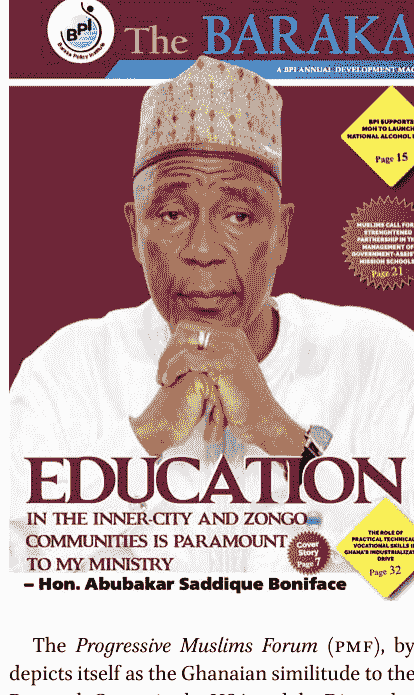

#### 图5

`巴拉卡。` 该杂志是巴拉卡政策研究所的年度出版物。

作者收藏

`进步穆斯林论坛`（PMF）通过组织其辩论论坛，将自己描绘成卡塔尔多哈辩论、美国皮尤研究中心和英国Dispatches辩论的加纳对应物。其愿景是成为加纳领先的穆斯林研究智库机构，重点关注和平、宽容、宗教共存和国家发展。辩论论坛最初是一个穆斯林青年论坛，PMF成员于2016年参与圆桌讨论。此后，辩论论坛及其主要途径——富塔广场系列讲座——已发展成为一个知识平台，供加纳跨领域的穆斯林代表冷静讨论影响穆斯林的从社会政治到教派分歧等关键问题。¹⁷⁵

175 见关于辩论论坛和富塔广场讲座的帖子，https://www.facebook.com/Progressive-Muslims-Forum-1072297466167510/?ref=page_internal，2016年1月20日，2016年7月13日，2017年11月2日，2018年1月23日，2019年5月10日，2019年5月23日，访问于2022年1月5日。

赞戈研究学院（ZRI）进而致力于解决城市赞戈社区的药物成瘾问题，以及通过提供职业培训进行能力建设。176 作为后一目标的一部分，ZRI 于 2020 年 9 月在 Nsawam Adoagyiri 举办了创业培训课程。177 Dr Salah Muhammad Salis 及其伊斯兰思想与文明中心在最近的（在线）报纸文章中阐述了对暴力极端主义的批判立场，178 并推广了关于人权和性别平等的多维度伊斯兰视角。179

几家穆斯林智库位于库马西，其中包括穆斯林执行基金会（MEF；图 6）。该基金会由已故的 Sheikh Dr Osman Bawa Hafiz Orlando 于 2012 年创立，180 MEF 通过于 2016 年 1 月组织一次关于应对创业挑战的研讨会来促进社会发展和福利。181 一个特别重点是妇女赋权，从 2016 年 3 月关于离婚和伊斯兰教中妇女权利主题的特别研讨会开始。182 针对性骚扰报告的增加

176 赞戈研究学院，“赞戈地区体育设施与药物滥用的影响”，2020 年 9 月 4 日，https://www.modernghana.com/news/1027377/the-effect-of-sports-facilities-and-drug-abuse.html，访问日期 2022 年 1 月 5 日。

177 https://www.facebook.com/Zango-Research-Institute-107348394425049/?ref=page_internal，2020 年 9 月 1 日，访问日期 2021 年 12 月 30 日。

178 “通过伊斯兰视角重新思考暴力极端主义（I）”，2022 年 10 月 15 日，https://www.theghanareport.com/rethinking-violent-extremism-through-the-islamic-lens-i/；“通过伊斯兰视角重新思考暴力极端主义（II）”，2022 年 10 月 23 日，https://www.theghanareport.com/rethinking-violent-extremism-through-the-islamic-lens-ii/；均于 2022 年 12 月 13 日访问。

179 “伊斯兰人权观念”，2022 年 9 月 25 日，https://www.graphic.com.gh/features/opinion/islamic-conception-of-human-rights.html；“伊斯兰教赋予男女平等地位”，2022 年 11 月 11 日，https://www.graphic.com.gh/features/opinion/islam-grants-men-women-equal-status.html，均于 2022 年 12 月 13 日访问。

180 63 岁的 Sheikh Orlando 于 2021 年 10 月 7 日意外去世。Mahmud Mohammed-Nurudeen，“伊斯兰教育单位委员会主席 Dr. Sheikh Osman 已去世”，https://www.myjoyonline.com/chairman-of-islamic-education-unit-council-dr-sheikh-osman-has-passed-on/，2021 年 10 月 9 日，访问日期 2022 年 8 月 3 日。他在 MEF 的伊玛目职位由其兄弟 Sheikh Abdul Razak Bawa Aransa 接任，见“Sheikh Abdul Razak 接任穆斯林执行基金会伊玛目”，2022 年 2 月 13 日，https://www.myjoyonline.com/sheikh-abdul-razak-takes-over-as-muslim-executive-foundation-imam/，访问日期 2024 年 5 月 27 日。

181 研讨会邀请函，日期 2016 年 1 月 3 日，https://www.facebook.com/Muslim-Executive-Foundation-287930934594828/photos/pcb.978439525543962/978439472210634/，访问日期 2021 年 8 月 25 日。

182 照片/横幅，2016 年 3 月 21 日，https://www.facebook.com/Muslim-Executive-Foundation-287930934594828/，访问日期 2021 年 8 月 25 日。

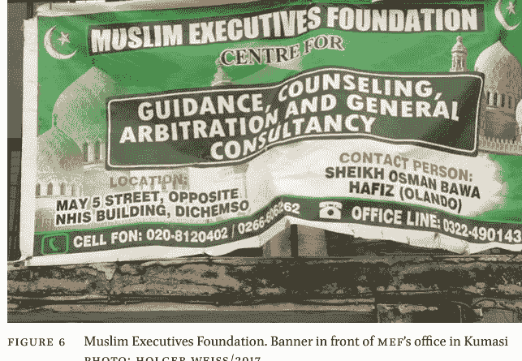

图 6 穆斯林执行基金会。库马西 MEF 办公室前的横幅

照片：HOLGER WEISS/2017

在高级中学，MEF 于 2018 年 12 月在库马西大都会区 Asawase 的 Nurul Ameen 中学为女学生组织了一场关于性卫生和性骚扰的工作坊。183 在工作坊后公布的视频广播中，MEF 妇女分支的代表强烈站出来谴责任何形式的性骚扰和家庭暴力，“无论是谁做的，即使是警察、Malam、他们的叔叔或任何人。”184

183 “反对性骚扰发声——穆斯林执行基金会敦促女士们”，2018 年 12 月 5 日，https://www.ghanaweb.com/GhanaHomePage/religion/Speak-up-against-sexual-harassment-Muslim-Executive-Foundation-urges-ladies-706199，访问日期 2021 年 8 月 25 日。

184 https://www.ghanaweb.com/GhanaHomePage/religion/Speak-up-against-sexual-harassment-Muslim-Executive-Foundation-urges-ladies-706199?video=1，访问日期 2021 年 8 月 25 日。

然而，大多数类似于智库的穆斯林中心和学院，例如位于阿克拉的伊斯兰世界观与发展中心、伊斯兰社区事务中心或家庭发展慈善中心，本质上是伊斯兰传播中心和学院。例如，位于阿克拉的加纳伊斯兰最高委员会是一个由 Sheikh Hussain Zachariah 于 2017 年创立的非教派 da‘wa 和倡导机构。其主要目标是促进不分种族、宗教和信仰的人类兄弟情谊并增强通过教育、健康和卫生“侍奉真主”来实现社会发展。此外，该委员会旨在成为无声者的声音，并与许多其他穆斯林非政府组织类似，主张穆斯林与其他信仰信徒之间的和平共处。185 与 Shaikh Hussain Zachariah Foundation Ghana 和 Islam for Humanity International 186 合作，Shaykh Hussain Zachariah 的中心主要专注于 da‘wa，尽管它偶尔也涉及赞戈社区的卫生和环境问题，就像它在 2020 年 1 月初所做的那样：

> 是时候让宗教组织、团体和清真寺教众站出来帮助解决加纳赞戈社区的卫生问题了。加纳伊斯兰最高委员会已树立榜样，加入工作团队……清理赞戈社区。187

像许多类似的穆斯林机构一样，该中心呼吁捐款以供养赞戈社区中的贫困、流离失所和饥饿者，但有一个区别：穆斯林和非穆斯林贫困者都是其目标群体。例如，在 2020 年 3 月的斋月古兰经注释讲座后，该委员会在 Facebook 上指出：

> 我们目前有 35 名需要帮助的人，他们在 2020 年 3 月 25 日关于如何帮助有需要者的演讲后联系了我们……他们在封锁期间需要食物；还有一个人需要在封锁期间及以后为其家庭提供住宿支持……请通过手机支付号码 0240598190 捐款，以支持这些需要帮助的穆斯林和基督徒生存。188

另一家智库兼伊斯兰中心是位于阿克拉的 Al-Islaah Center。Al-Islaah Center 是 Abdul-Hamid Bashir Yandu 的创举，他被称为 Kishk，是阿克拉 Rahman 清真寺的伊玛目。Imam Abdul-Hamid 自 2014 年以来一直担任加纳伊斯兰乌玛（IUG）的负责人。作为该中心的负责人，他主要处理暴力极端主义、动机、教育、能力建设、宗教宽容和慈善事业。189 根据其主页上的政策声明，Al-Islaah Center 旨在“利用宗教的软实力，通过教育、能力建设和慈善事业在我们的社区中发起积极的社会变革。”190

众多的 daʿwa 和伊斯兰宣传中心是加纳穆斯林景观中不可或缺的一部分。对这些中心的全面清单需要一个完整的研究项目来调查、分析和绘制其活动图，以便为未来的研究提供信息。其中许多中心是穆斯林学者为穆斯林的精神和宗教发展而建立的老牌机构。其中一些获得了国家和国际声誉。其他则是“现代”清真寺型机构，由教育综合体、学生宿舍、行政建筑以及——始终——一座清真寺组成；有时它们还设有卫生站。此类中心主要作为非政府组织运营。其中一些积极参与或至少评论当地穆斯林社区的政治和社会状况。尽管如此，这些组织共同的特征是其制度化和“现代”，有时甚至是“西方”的外观，与传统的非制度化和非正式的协会、伊玛目和学者的网络、当地的 makarantas、madrasas 和清真寺社区形成对比。

#### 3.2 加纳穆斯林非政府组织的三个世代

至少有三代穆斯林非政府组织在当代加纳运作，见附录。第一代可追溯至 1980 年代，主要指作为外国捐助者中介而建立的组织。第一代非政府组织包括但不限于加纳穆斯林救济协会、穆斯林家庭咨询服务（见第 4.2 章）、伊斯兰发展与人道服务委员会（见第 2.4 章）、社会服务局、al-Hudaibiyya 救济服务和 Aladiaa Society。与第二代和第三代非政府组织不同，学术研究已记录了一些第一代非政府组织及其活动。191

189 https://al-islaahcenter.home.blog/2019/07/10/introducing-our-executives/，访问日期 2021 年 7 月 25 日；Michael Odour，“加纳的酷伊玛目跨越信仰界限以实现和平选举”，2020 年 12 月 16 日，https://www.africanews.com/2020/12/16/ghana-s-cool-imam-crossed-faith-boundaries-in-interest-of-peaceful-polls/，访问日期 2021 年 7 月 25 日。

190 https://al-islaahcenter.home.blog/2019/07/09/welcome-to-my-blog/，访问日期 2021 年 7 月 25 日。

191 Mark Sey，“加纳穆斯林社区：当代景象”，Jurnal Syariah 5，第 2 期（1997 年）：249–258；Samwini，《1950 年以来加纳的穆斯林复兴》，141–145；Ammah，“伊斯兰教与贫困减缓战略”；Dumbe，《当代加纳的伊斯兰复兴主义》；Muhammed Haron，“非洲穆斯林非政府组织：竞争性慈善机构，利他主义盟友？”，载于 Ezra 编辑的《非洲的宗教与发展》

一些当地的第一代穆斯林非政府组织，穆穆尼强调，是“...名义上存在而结构上不存在”，将其定义为“抬头”、“招牌”和“清真寺铭文”组织。事实上，他强调它们根本不存在为非政府组织，而是作为中介组织，用于向中东地区募集资金和物资援助，以兴建清真寺、诊所、学校，并照顾孤儿和贫困穆斯林。根据他对1990年代初的观察，穆穆尼批评它们存在公然的管理不善和腐败：“当它们收到这些资金时，就被挪作私用。”192

穆穆尼进一步指出，其他穆斯林非政府组织是非非洲组织，例如由加纳黎巴嫩社区建立的组织（如加纳伊斯兰教育与改革协会，见第2.2.5章）。其他则是中东和北非各种国际穆斯林非政府组织和慈善组织的分支机构。例子包括（现已解散的）利比亚世界伊斯兰呼吁服务和科威特非洲穆斯林机构（直接援助，见第2.4章）。穆斯林非政府组织的另一类是由从中东大学回国的穆斯林学生建立的组织，例如伊斯兰研究与改革中心（IRRC，成立于1972年；是沙特组织达鲁勒伊夫塔的一个分支，同时也是世界穆斯林青年大会、国际伊斯兰学生组织联合会以及伊斯兰开发银行奖学金计划在加纳的代表）或伊玛目哈桑基金会（是伊朗基金会的代表）。193

与上述列出的不同非政府组织相比，穆斯林青年组织于1960年代作为同伴团体出现。最初，它们始于学生组织，并针对伊斯兰机构和组织对中学和高等教育机构穆斯林学生的特殊需求的忽视。根据穆穆尼的说法，在1990年代初，最活跃的组织有加纳穆斯林青年运动、进步穆斯林青年运动和加纳穆斯林学生协会。穆斯林妇女组织也在后殖民时期出现，194 高潮是在1997年成立加纳穆斯林妇女协会联合会（FOMWAG）。195

195. ership in the Ghanaian Muslim Community; Ammah, “Islam, Gender and Leadership in Ghana”; and Fatimatu N. Sulemanu, “Mitigating Violence Against Women in the Ghanaian Muslim Community: The Role of the Federation of Muslim Women’s Association in Ghana (FOMWAG),” in Religion and Gender-Based Violence: West African Experience, eds. R.M. Amenga-Etego and M.A. Oduyoye (Accra: TLSS and Asempa Publishers, 2013): 405–434.

第二代穆斯林非政府组织指的是与外国穆斯林慈善机构合作的独立非政府组织。这些组织中最早的成立于1990年代，其他则成立于2000年代。其中包括以大量志愿者会员为存在基础的能力建设非政府组织（如光明基金会），以及具有更有限的外展和/或会员资格的组织，如菲尔道斯社会服务基金会、阿卜杜勒-阿齐兹慈善人道基金会、伊克拉教育与发展基金会、埃勒伊桑慈善救济基金会，以及加纳慈善发展协会，等等。

第一代和第二代穆斯林组织都是传教主义非政府组织。它们（通常）将传教与人道主义救济和社会福利项目相结合，旨在改善（通常是当地的）穆斯林社区。然而，其中一些组织，如光明基金会，自成立以来已转变为包容性组织，其项目针对穆斯林和非穆斯林，另见第4.3章。（一些）第一代穆斯林活动家和非政府组织的另一个特点是它们渴望创办穆斯林杂志和报纸，在那里它们开始阐述穆斯林自我赋权的新方法。谢赫·穆斯塔法·易卜拉欣的非政府组织伊斯兰发展与人道服务理事会（ICODEHS）在1990年代下半年出版了《人道主义——慈善月刊》。评论穆斯林边缘化和贫困化的需要，ICODEHS 杂志强调需要在主要穆斯林地区提供学校、咨询服务、职业机构，同时设立工业和商业农场。“政府应与伊斯兰理事会和其他非政府组织协商，成立一个委员会来调查困扰宗戈的问题。”196 尤努斯·法瓦兹在 ASWAJ 赞助的报纸《穆斯林探照灯》（图7）中认为，“[...] 我们穆斯林一直在抱怨我们缺乏自己的医生、教师、在政府和其他无限重要领域的人民的强有力代表；但我们似乎没有认识到送孩子上学的需要。”197

196. “加纳的穆斯林与发展”，《人道主义——慈善月刊》2，第3期（1997）：5–7。

197. 尤努斯·法瓦兹，“教育穆斯林儿童”，《穆斯林探照灯》1，第1期（1999年8月20日至9月2日）。

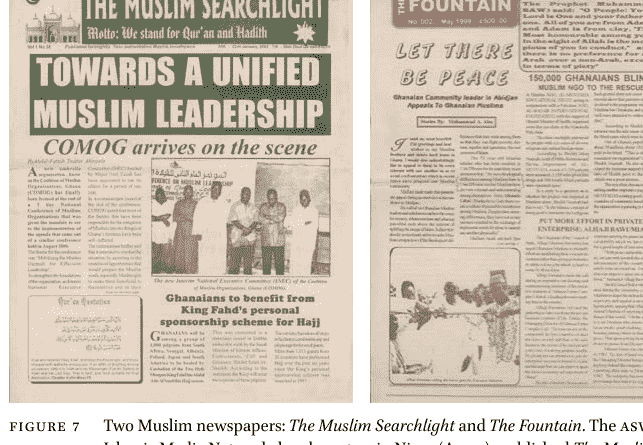

图7 两份穆斯林报纸：《穆斯林探照灯》和《喷泉》。ASWAJ 伊斯兰媒体网络，总部位于尼玛（阿克拉），出版了《穆斯林探照灯》。阿克拉的考萨尔基金会则出版了《喷泉》。作者收藏

Z.M. Seebaway，《喷泉》（图7）的编辑，同样敦促读者重新思考立场：“穆斯林难道不因缺乏教育、团结和组织而感到边缘化吗？我们主要的任务应该是建立统一战线，对无知给予毁灭性打击。我们必须像疯了一样教育我们的孩子，使他们成为加纳社会积极而受人尊敬的成员。”198

198. Z.M. Seebaway，“要对抗什么！”《喷泉》第2期（1998年5月）。

> 穆斯林难道不因缺乏教育、团结和组织而感到边缘化吗？我们主要的任务应该是建立统一战线，对无知给予毁灭性打击。我们必须像疯了一样教育我们的孩子，使他们成为加纳社会积极而受人尊敬的成员。

与第一代和第二代相比，第三代穆斯林非政府组织包括传教主义、团结型和世俗型。成立于2010年代的它们都是“互联网时代”和“脸书一代”的独特非政府组织。最重要的是，它们的存在鲜明地表明了加纳穆斯林中产阶级的出现，这一现象迄今尚未在学术研究中得到研究或讨论。它们的一个显著标志是相对于外国捐助者的独立地位。它们通过社交媒体进行动员、可见性、网络建设、筹款活动/众筹和外展，最重要的是 Facebook，但 Instagram、Twitter、WhatsApp 和 YouTube 的使用也在日益增加。

阿克拉的 Save Aid Project 例如，通过在年度活动开始时重复发布其使命宣言来激励其成员：

> 我们正致力于这项任务
> 有几件事我们想请问
> 只需转发即可帮助此事业
> 这样我们就能让很多人得到食物
> 请在你的状态中给我们一个空间
> 你最喜欢的媒体工具
> 你信息的中心
> 你一定会看到我们的感激。199

其中许多组织相互关联，并将他们的活动和呼吁转发到其他 Facebook 群组。一些始于2010年代在 Facebook 上作为开放社区的穆斯林青年团体，此后已在社交媒体上建立了封闭社区，尤其是在 WhatsApp 上；一个发人深省的案例是位于卡索阿的传教主义非政府组织伊斯兰——通往天堂之路基金会，该组织在 Facebook 上声明：

> 我们的使命是建立并实现最佳质量：伊斯兰教育、伊斯兰医院、创造就业机会以雇用我们的青年、照顾孤儿和穷人等。如果你想加入我们的 WhatsApp 平台，请在屏幕上选择我们的 WhatsApp 号码。200

互联网时代的一个新现象是穆斯林在线电视和电台的蓬勃发展；它们在 Facebook 上运营，并作为传教和社区发展的载体。例如，Sharubutu TV 在2020年4月发起“记住我”和“慈善不伤人”活动，此前“一些兄弟姐妹”（在阿克拉宗戈社区）呼吁电视台解决他们的挑战。“他们大多数人靠日薪生活，因此在七天不活跃后无法提供基本生活必需品，”Sharubutu TV 在 Facebook 上提醒听众。201 呼吁立即得到回应，Sharubutu TV 分发了25袋5公斤大米和25瓶一升的向舒库拉、法达马、阿贝卡、阿奇莫塔、阿贝莱姆克佩、尼马和纽敦的贫困家庭提供了食用油。202

*沙巴尼耶电视台*则告知其听众，加纳提贾尼耶·易卜拉欣耶理事会办事处已“……向大阿克拉地区阿莫莫凯（马迪纳图-沙巴尼耶）、阿菲尼亚和阿沙拉贾·奥巴库罗的贫困及弱势社区进行了慷慨捐赠。”此外，该电视台还提醒听众，上述理事会“劝诫所有能够参与此类慈善活动的人，将自己的资源用于帮助这一斋戒季节中的贫困者和有需要者。”203

*伊克拉秀*除了众多其他举措之外，多年来还多次发布捐款请求，以资助医疗手术、医院账单或对贫困个人和社区的紧急援助。例如，该团队于2022年1月9日收到其一名成员捐赠的GHS 2,000天课，用于分发给贫困受助者；两天后，他们用其中一半购买了一辆轮椅，捐给了一名八岁女孩。204

以团结互助为宗旨的穆斯林非政府组织，如总部位于库马西的*希望种子基金会*或总部位于塔马利的*BALNISA基金会*，在其外联项目中同时面向穆斯林和非穆斯林。他们在Facebook上的帖子（通常）几乎不含宗教语言，也很少涉及*宣教*的任何方面。例如，后一个组织声称其（主要）目标是促进各层次优质教育、增强所有加纳人的能力，并与关键利益相关者合作，“制定有助于减少贫困社区贫困的政策和项目，以建设一个更美好的加纳。”205 然而，除了建造和修复学校、水井和诊所，推动女童教育、能力建设和青年创业，以及向孤儿和贫困者提供支持外，*BALNISA基金会*还修建清真寺，并支持“倡导、教育和宣传”，换言之：*宣教*。206

与团结互助型组织类似，世俗穆斯林非政府组织在2010年代和2020年代初期数量成倍增长，它们完全不涉及`宣教`。其中几个由穆斯林女性活动人士创办，例如哈吉娅·扎因-阿布·萨利富的`松比埃拉基金会`，或纳迪亚图·阿卜杜勒·拉赫曼的`人道主义进步组织`，它们总体上关注社区发展，尽管它们会在尔德节期间开展特别活动，为“贫困者和有需要者”提供食物。另一方面，`加纳星光创意生活基金会`专注于医疗保健以及健康和急救教育与培训。该非政府组织于2021年6月在阿克拉市中心的尼马-马莫比社区学习中心举办了首届年度健康论坛。然而，由于该基金会两个月前组织了一次斋月研讨会，可以将其认定为世俗穆斯林非政府组织。207

宣教型非政府组织很容易识别，因为其名称中包含“穆斯林”或“伊斯兰”等字样，或含有体现宗教信息的阿拉伯语词，如“乌玛”、“吉哈德”、“萨达卡”或“塔尔比亚”。208 它们的活动仅限于增强穆斯林社区的权能，并且从不以非穆斯林为受助对象。例如，穆斯林妇女团体`乌玛倡议`于2022年组织了穆斯林女性卫生专业人才计划，“通过导师计划，增加我们医学院中穆斯林学生，尤其是女学生的数量。”209 有时，一个群体会决定将名称从激进的改为更中性的，例如2021年，总部位于海岸角的`加纳伊斯兰吉哈德基金会（GIJF）`更名为`加纳伊斯兰萨达卡基金会（GISF）`。210

另一方面，宗戈协会有时仅凭名称很难判断其是地方穆斯林民间社会组织、非政府组织还是青年团体。虽然其中许多组织以穆斯林为服务对象或让穆斯林参与其生计项目，有些甚至自称穆斯林团体；另一些则具有明显的世俗（甚至可以说是非教派）立场和议程。许多宗戈青年团体将行动主义与包容性方法结合起来，批判性地回应国家和地方政府对贫困内城社区投资不足、居民形象负面，以及宗戈青年无论其宗教背景如何都缺乏机会的问题。

> 在我们被告知“你们不行”“你们是一群无赖和流氓”的时候，我们拒绝被那样定义，拒绝被那样塑造：因此我们承担起必要的角色和责任，去重塑我们的社区和整个社会。我们是赞戈人，并为此自豪；无论你是来自赞戈的基督徒，你也是赞戈人；无论你是来自赞戈的穆斯林，你也是赞戈人……我们一起建设。当下的基础与联盟。加入我们，让我们一起建设，一起疗愈。211

赞戈青年志愿者协会以此表达了他们的失望，并呼吁宗戈青年采取统一行动。

其他由穆斯林活动人士创办的非政府组织则更难被界定或认定为世俗穆斯林非政府组织。对于过去几十年来在该国北部地区涌现的众多基层和民间社会组织来说尤其如此。其中一些组织几十年来一直从事农村发展、粮食安全、减贫和能力建设，同时推动女童与妇女赋权、教育和权利，例如哈吉娅·拉姆纳图·亚当创办的松塔巴212自2005年以来，青年赋权与发展网络组织（NOYED-Ghana）213自2005年以来，或哈吉娅·阿利马·萨吉托-萨伊德创办的加纳SWIDA（萨凡纳妇女综合发展机构）214自2006年以来。这些组织的总部都设在塔马利。另一方面，哈吉娅·纳迪亚·阿尔哈桑创办的纳迪斯科基金会则属于较晚成立的非政府组织。215 上述组织均未以其创始人的宗教背景作为立场。相反，它们公开强调自己的人道主义、非教派的信条，正如松塔巴参与制定相关规章，以防止巫术指控以及对被指控的巫师和巫婆的非人道对待——这些人被隔离安置在该国北部的偏远地区。216

然而，最重要的是加纳穆斯林自己如何定义哪些组织算作穆斯林非政府组织。2015年，在首届加纳穆斯林成就奖中，有四个组织获得“年度穆斯林非政府组织”提名：加纳穆斯林学院、伊斯兰发展与人道服务理事会、加纳穆斯林妇女协会联合会和帕拉贡基金会。217 2020年，有七个组织获得提名，分别是成就加纳、比林慈善组织、伊斯兰乌玛救济、宗戈创新中心、青年女性领袖网络、宗戈励志团队和祖拉克癌症基金会。218 获提名穆斯林非政府组织的范围广得令人吃惊。提名涵盖了宣教派组织以及世俗非政府组织（成就加纳；青年女性领袖网络）、基金会、公益创投（宗戈励志团队）和社会创业（宗戈创新中心）。

事后看来，加纳伊斯兰人道主义组织联盟（CIHOG）将成为认定加纳穆斯林非政府组织的一个里程碑。CIHOG的宗旨是促进和协调加纳伊斯兰人道主义非政府组织的工作。此外，CIHOG还将在伊斯兰人道主义非政府组织、在宗戈社区开展工作的其他慈善机构以及政府机构（如宗戈发展基金秘书处）之间发挥对接作用。219 CIHOG由分为三个区域的成员组织组成。第一区包括在南部地区开展工作的非政府组织，其中42个于2022年9月在阿克拉参加了磋商会议。第二区（即中部地区）的52个非政府组织于2022年10月参加了类似会议，而第三区约有30至40个非政府组织预计于2022年11月抵达塔马利参加会议。220 2023年3月，在库马西举行首次会议后的新闻发布会上，CIHOG行政主管苏莱曼·阿尔-哈桑·阿塔克波通报了临时执行委员会成员的选举情况，其中包括代理主席谢赫·哈迪尔·亚当斯·伊德里斯。出席此次会议的总统宗戈与内城发展协调员本·阿卜杜拉·班达承诺全力支持该联盟，并呼吁建立伙伴关系，共同推动政府对其活动的认可与支持。221

### 4 探测和分析穆斯林非政府组织的谱系

加纳现存和已不存在的穆斯林信仰型组织的确切数量不明。Said Ibrahim Kreidieh 编纂的 2011 年穆斯林社团和协会名录列出了 167 个组织，其中许多是伊斯兰教育综合体和 makarantu（豪萨语：学校）；其中约 130 个可被认定为非政府组织。222 Kreidieh 名录中所列的大多数非政府组织难以识别，或许是因为该名录以其原始阿拉伯名称的英文译名列出它们。其他组织或许从未上线且留下的痕迹很少（需要大量实地工作才能识别），包括位于奥布瓦西的 Anglogold Ashanti 穆斯林工人协会。在对存档于加纳非营利组织秘书处的 2013 年至 2015 年约 2,000 份个人非政府组织注册文件进行评估时，Sandy Zook 和 Cassidy Arndt 统计出使用了伊斯兰词汇或短语的非政府组织有 650 个，其中 63 个被认定为伊斯兰非政府组织。223

另一方面，《可持续发展宗戈气候变化议程》（ZCCASD）指出加纳存在 1,080 个宗戈社区，224 认为穆斯林和/或宗戈非政府组织的数量达到数百个并非牵强。根据 Facebook 上的信息，我认为宗戈青年协会和团体中很少有注册或持有运营证书的；显然，许多当地穆斯林非政府组织也没有证书。因此，加纳穆斯林或伊斯兰组织的任何官方名录都只是暂定的，并且在很大程度上仅涵盖外人可见的组织。例如，Islamicfinder.org 仅列出十一个组织，225 而 esinislam.com 提供的加纳穆斯林名录仅列出十七个组织，226 其中一些已停办超过十年，例如位于塔马利的 Al-Furqan Foundation。227 有趣的是，一些知名且有影响力的第一代穆斯林非政府组织，如穆斯林家庭咨询服务（MFCS）和伊斯兰发展与人道服务理事会（ICODEHS）在两个名录中均未出现，而非洲穆斯林机构（Direct Aid）并非加纳穆斯林慈善机构！加纳穆斯林救济协会（MURAG）成立于 1985 年，已于 2006 年在前人力、青年和就业部主页上被列为“信誉良好的非政府组织”，228 此后已陷入停滞。尽管有人于 2019 年 9 月为 MURAG 建立了 Facebook 账号，表明该组织正在运营。但对其 Facebook 帖子的分析清楚地表明情况并非如此。Facebook 上可查到的是 MURAG 于 2000 年和 2001 年组织的活动场地的旧照片，最后一次帖子发布于 2019 年 10 月。此外，其 Facebook 账号仅有 60 名关注者，表明该组织处于非活跃状态。229

222 Said Ibrahim Kreidieh（编），Muslim Societies & Associations in Africa—Asia—Australia—Europe—The Pacific—South & Central America（贝鲁特：Said Ibrahim Kreidieh，2011），186–196，可获取于：https://archive.org/stream/MuslimSocietiesAssociationsInAfricaAsiaAustraliaEuropeThePacificSouthCentralAmer/Muslim%20societies%20%26%20associations%20in%20Africa%20-%20Asia%20-Australia%20-%20Europe%20-%20The%20Pacific%20-%20South%20%26%20Central%20America%20-%20Compiled%20by%20Said%20Kreidieh_djvu.txt，访问于 31.12.2021。

223 Zook 和 Arndt，“Islamic NGOs in Education in Ghana”，64。

224 Zongo Climate Change Agenda for Sustainable Development，可持续发展目标伙伴关系平台，https://sustainabledevelopment.un.org/partnership/?p=35300，访问于 5.10.2021。

225 islamicfinder.org 列出的组织有 Al-Furqan Foundation、Bureau for the Disable and Humanitarian Services、Bushara Zakat Foundation、Centre for Islamic Affairs & Humanitarian Services、Concern Society for Muslim Environment、Educational Development Fund for Muslim Youth、Firdaus Foundation for Social Services、Ghana Muslim Academy、Ibn Khaldoun Islamic Studies Foundation、Infaq Charitable Society、Islamic Relief for Social Work。我于 2012 年 11 月下载了这些条目。然而，当我于 2017 年恢复对加纳穆斯林非政府组织的研究时，该名录已不再可用。其中一些非政府组织列于 esinislam.com，见下文脚注。其中一些列出的组织在互联网上留下了一些痕迹。例如，Ibn Khaldoun Islamic Studies Foundation 的主席 Sheikh Issakh Abass 于 2013 年 4 月向沙特阿拉伯的 Quran Distribution Organization 提出捐赠阿拉伯语古兰经的请求，并于 2014 年 7 月向巴林王国的 Holy Quran Care Society 提出请求，见 https://themuslimtimes.info/2012/02/10/250m-copies-of-quran-distributed/，和 https://www.bahrain-companies.com/t/mtialx，均访问于 31.10.2021（巴林链接已不再可用，核查于 2024 年 5 月）。Educational Development Fund for Muslim Youth 则于 2010 年因赞助促进伊斯兰教育的研讨会而登上头条（“Teachers in Islamic schools asked to revive Islamic education”，17.5.2010，https://www.modernghana.com/news/276078/teachers-in-islamic-schools-asked-to-revive-isla.html，访问于 31.12.2021。）

226 见 http://www.esinislam.com/African_Muslim_Directories/All_African_Muslim_Directories/African_Muslim_Directories_Ghana.htm#AllahIsGreat，访问于 13.8.2021。所包含的十七个组织为：Africa Muslim Agency、Al-Ansar Foundation、Al-Huda Islamic Society、Al-Furqan Foundation、Al-Hak Muslims Association、Ansaruddeen Islamic Foundation、Bushara Zakat Foundation、Centre for Islamic Call and Research、Concerned Society for Muslim Environment、Council for Islamic New Approach、Ghana Muslim Student Association、Infaq Charitable Society、Islamic Bureau for the Disabled and Service to Islamic Institutions、Mallam Ayub Foundation、Muslim Relief Association of Ghana、Organisation for Humanitarian and Charity、和 Islamic Shelter for Young Generations。

227 与塔马利伊斯兰教育部门经理 Sheikh Issah 的访谈，9.4.2019。

228 http://www.mmde.gov.gh/gov_corp.cfm?GovCorpID=11，访问于 11.4.2006。

229 https://www.facebook.com/Muslim-Relief-Association-of-Ghana-111316636934957/，访问于 18.8.2021。

加纳增值税（VAT）。尽管如此，以担保有限公司形式存在的公司必须对其员工的收入缴纳所得税。233

自 2020 年 12 月起，非营利组织秘书处（NPO Secretariat）接管了社会福利部的注册职能，共计 10,390 个注册非营利组织被转移至该新国家机构。根据《2020 年非营利组织政策》和《2020 年非营利组织指令》，NPO 秘书处负责监管和赋能加纳非营利组织部门。234

NPO 秘书处提供其在线名录的访问权限，该名录截至 2021 年 9 月/10 月约有 4,200 个区域、国家和国际注册组织，235其中至少 164 个可被识别为穆斯林社区组织或非政府组织（见附录）。在加纳社会服务提供者名录中列出但未在 NPO 在线名录中被识别的组织有几个，例如 `Dar Al Haq Charitable Society`、`Salah Foundation`、`Muslim Family Counselling Services`、`Zongo Inspiration Team` 和 `Hajj Abdulai Yaro Memorial Clinic and Maternity`。前两个上述组织无法追踪（或许表明它们已停办或不活跃），但其余组织仍在运营。此外，NPO 在线名录中所列的二十二个组织是国际穆斯林慈善机构在加纳的分部或办事处。其中包括总部设在塔马利的 `Al-Maktoum Foundation`（迪拜/阿联酋慈善机构）和 `African Islamic Heritage Foundation`（美国慈善机构），以及位于库马西的美国穆斯林慈善机构 `Zakat Foundation of America` 和沙特慈善机构 `Al-Qimmah Foundation` 的办事处、位于恩斯瓦姆的美国穆斯林慈善机构 `Mercy for Mankind` 的加纳分会，以及位于卡索阿的美国穆斯林慈善机构 `Islamic Ummah Relief` 的加纳办事处。其余的位于大阿克拉地区，例如 `Qatar Charity` 以及沙特阿拉伯的 `International Islamic Relief Organisation`、科威特的 `Care and Social Development Organisation` 以及 `Direct Aid`、摩洛哥的 `Mohammad VI Foundation for African Ualama` 以及土耳其的 `Human Development Assistance International`

233 加纳共和国非营利组织秘书处，*How To Register A Non-Profit Organization (NPO) In Ghana*，16.2.2021，https://npos.mogcsp.gov.gh/how-to-register-a-not-for-profit-or-ngo-in-ghana/，访问于 4.10.2021。

234 加纳共和国非营利组织秘书处，*Who we are*，https://npos.mogcsp.gov.gh/profile/，访问于 4.10.2021。

235 在线名录列出注册的社区非营利组织、国家非营利组织和国际非营利组织，可获取于 https://npos.mogcsp.gov.gh/regional-npos/（1,823 条目），https://npos.mogcsp.gov.gh/national-npos/（2,304 条目），和（159 条目），访问于 29.9.–1.10.2021。

国际：Cansuyu Charity and Solidarity Association、Ghana-Turkey Co-operation and Development Association 和 Insana Deger Veren Dernekler Federasyonu。此外，几家西方穆斯林国际非政府组织在阿克拉设有分支机构，包括美国慈善机构 Life for Relief and Development 和 Mercy Without Limits，英国慈善机构 Human Relief Foundation 和 Caravan of Mercy，以及德国慈善机构 Ansaar International。此外，国际伊斯兰青年联盟是总部设在塞拉利昂弗里敦的 International Islamic Youth League—African Youth Development Centre 的加纳办事处。

#### 4.2 注册和未注册的穆斯林协会与组织

NPO 在线目录提供有关非政府组织状态的信息，包括其注册号码和（最后）注册日期。约四分之三的穆斯林非政府组织是在 2018 年或之后注册的，四分之一（39 个组织）在 2017 年或更早注册（见图 1）。这些后者组织可能被推测为已解散或不活跃，因为注册仅有效一年。据推测，2018 年或 2019 年注册的组织仍在续注册过程中。

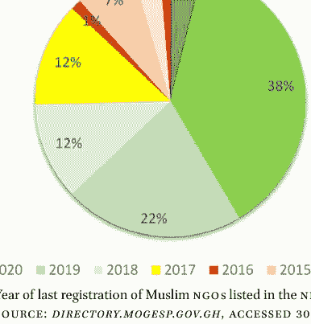

**图 1** 列于 NPO 在线目录中的穆斯林非政府组织的最后注册年份

来源：directory.mogesp.gov.gh，访问日期 30.9.2021

对所列穆斯林非政府组织中一些已解散或不活跃的假设，对于 2013 年、2014 年或 2015 年注册的组织来说似乎是成立的，尽管有少数值得注意的例外。例如，Shia Mission 和 Madina Islamic Center 并未消失。Zakat Foundation of America、Insana Deger Veren Dernekler Federasyonu、Ghana 的 Zakat and Sadaqa Fund 以及 Nuuru Usmaniyyah Foundation for Humanitarian Services，以及 Caravan of Mercy 和 Al-Huda Islamic Society，依次在各自的业务领域保持活跃。另一方面，库马西的 El-Mamun Centre 似乎已解散，因为其 2013 年建立的 Facebook 账户为空。Ibadul Hanan Humanitarian Organisation 于 2020 年开设了 Facebook 账户，但没有任何内容或帖子。Orphans and Needy Helpline、Noor-Ul-Alam Mission of Ghana、Bachey Jiwa Foundation 和 Ghana Muslims Education Concern 在网络空间中未留下任何痕迹。Peace Project Foundation 在其 Facebook 账户上的最后活跃帖子来自 2018 年 10 月。[236] 在 2017 年之前注册的穆斯林非政府组织包括 Ansaar International Ghana。其 Facebook 账户显示该组织已解散，因为它仅列出 2013 年的帖子，当时它与 Taqwa school 联合发起了一项建立孤儿院的筹款活动。[237] Northern Childcare Voluntary Organisation，其主页（`http://www.nocvo.org`）自 2021 年以来已停止运作。

另一个例子是 Al-Hayat Foundation，成立于 2011 年，最后注册日期为 2015 年。它在 2015 年登上头条，当时该基金会在 2015 年 11 月在阿克拉组织了一场宫颈癌宣传研讨会。[238] Al-Hayat Foundation 的创始人兼首席执行官 Hajia Hanatu Abubakar 于 2017 年 2 月被 Professional Muslimah’s Network 提名为‘Muslimah of the Month’，[239] 表明当时该基金会仍在运营和活跃。然而，该基金会 Facebook 账户上关于其癌症宣传项目的最后帖子是在 26 September 2017。其后出现的帖子都是关于运动探测器和报警系统的，表明该基金会在年底前变得不活跃或已解散。

[237] 最后帖子 22.9.2013，`https://www.facebook.com/Ansaar-International-Accra-Ghana-233429190145018/`，访问日期 4.10.2021。

[238] “Women! Beware of cervical cancer—Al-Hayat Foundation，” 28.11.2015，`https://newsghana.com.gh/women-beware-of-cervical-cancer-al-hayat-foundation/`，访问日期 4.10.2021。

[239] 参见 `https://www.facebook.com/ThePMNetwork/photos/muslima-of-the-month-february-hajia-hanatu-abubakar-in-most-of-the-muslim-communi/640821862775871/`，访问日期 4.11.2021。

列于 NPO 在线目录中的大多数穆斯林非政府组织仍在活跃。例如，由 Sheikh Abdul Karim Zakaria 运营的阿克拉当地穆斯林非政府组织 *International Unique Human Welfare Institution*，于 2020 年从德国的土耳其人道主义组织 Hasene International 获得了捐赠，以提供 COVID-19 救济食品包。[240] 此外，它在 2020 年启动了其新的旗舰项目 Bustan Rashidun Project，该项目是一个教育综合体，包括幼儿园、托儿所、基础和初中、清真寺和会议厅、医疗中心以及一座计划在 Insahina、Greater Accra Region 建造的供孤儿和贫困学生使用的宿舍。[241]

NPO 在线目录中的一些非政府组织难以追踪。例如，除了被列为世界非政府组织协会行为准则的支持者之一，[242] 以及在 2019 年关于 Suhum 残疾人士及其挑战的报告中被提及，[243] 之外，无法追踪到更多关于位于 Suhum 的 *Muslim Development Organization* 的信息。位于库马西大都会区 Old Tafo 的 *Noorur Rahma Social Organisation*，依次可能与 Old Tafo Zongo 的 Noorur Rahma Medical Center 有关联。[244]

同样，位于阿克拉的 *Annur Organisation for Humanitarian Services*（图 8）没有任何踪迹。有趣的是，至少存在两个名称相似的穆斯林非政府组织：*An-Nur al-Islamiyya* 和 *An-Nur Foundation*。它们均未列于 NPO 在线目录中。

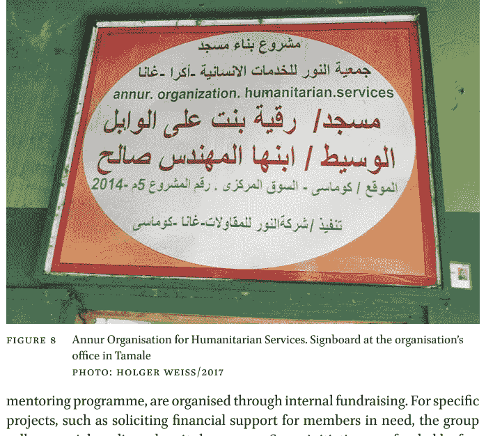

**图 8** Annur Organisation for Humanitarian Services。组织在 Tamale 办公室的招牌

照片：Holger Weiss/2017

*An-Nur al-Islamiyya* 是由 2003 年在加纳大学就读的穆斯林学生建立的 *da‘wa* 组织。[245] 它自 2009 年起在 Facebook 上存在并拥有主页。该阿克拉青年组织主要专注于 *da‘wa* 和教育项目。其大部分活动，包括讲座和研讨会系列以及 Sisters Entrepreneurship Dialogue、An-Nur E-learning Centre of Excellence，以及 2018 年启动的指导计划，均通过内部筹款组织。对于特定项目，例如为有需要的成员筹集资金，该团体会在社交媒体和主页上呼吁。一些倡议由外国捐助者资助，例如其与土耳其国际非政府组织 Human Development and Relief Organization 于 2015 年合作启动的 SHS 奖学金项目。[246] 其主要的社会福利项目是 2016 年启动的 Ummah Support Fund。主页上关于 Ummah Support Fund 的信息仅显示一张海报，呼吁每月捐赠 GHS 10（USD 1.60）给该基金，“以支持病人、新皈依者、有需要的学生以及急需经济帮助的穆斯林。”[247] 然而，目前尚不清楚该支持基金是否已正式化，还是更多地以临时方式存在。该支持基金唯一已公布的财务报告涵盖 2017 年第一季度，列出捐款总额为 GHS 1,534.06（USD 248），教育支持 GHS 970（USD 157）为主要支出。[248]

[246] "SHS Scholarship Project 2015," `https://www.facebook.com/annuralislamgh/posts/10156047575225333`，检查日期 20.10.2020。

[247] Ummah Support Fund，`http://annuralislam.com/en/2016/01/ummah-support-fund/`，访问日期 17.8.2021。

#### 4.3 穆斯林非政府组织在 Facebook 上的定量分析

*An-Nur Foundation*，依次是与 An-Nur Quranic Institute 有关联的库马西 *da‘wa* 组织，可能成立于 2019 年左右（或至少在那一年建立了其 Facebook 账户）。2010 年代还启动了其他一些当地穆斯林青年运动，包括 2013 年成立的 *Islamic Ummah of Ghana* 和 *Sadaqa Train*，以及 2015 年成立的 *Ghana Islamic Youth Sadaqa Association*。*An-Nur Foundation* 源自 Salafi 青年网络 *Muslim Youth Movement*。*An-Nur Foundation* 在 Ashanti Region 的 Agona District 开展农村 *madrasa* 项目，即巡游村庄并组织伊斯兰教育课程，[249] 同时还开展农村开斋项目，后者于 2021 年 5 月与 *Sadaqa Train* 和 *The Striving Muslimah* 合作。[250]

值得注意的是，前述穆斯林非政府组织中只有少数被收录于 NPO 在线目录中。根据加纳报纸和互联网来源（主页和 Facebook）、Kreidieh 的 2011 年目录以及 NPO 在线目录的信息，迄今已识别出 683 个穆斯林协会、基金会、团体和组织。它们构成了数据库——此后称为 2022 GMNGO Database——用于对 2010 年代加纳穆斯林非政府组织格局进行定量分析，列出其总部、其入会/会员要求以及其在 Facebook 上的活动持续时间。关于其总部位置的信息表明其运营存在明显的南部偏向，如图 2 所概括。

不出所料，超过一半的穆斯林非政府组织的总部位于 Greater Accra Region，几乎全部位于阿克拉，除了 *Al-Aman Humanitarian Development*、*International Voice of Islam*、*Caravan of Mercy*、*Grain of Hope Foundation*、*Maarif Foundation* 和 *Sheikh Alhaji Umar Karki Memorial Foundation* 位于 Tema，*Orphans and Needy Helpline* 位于 Amasaman。

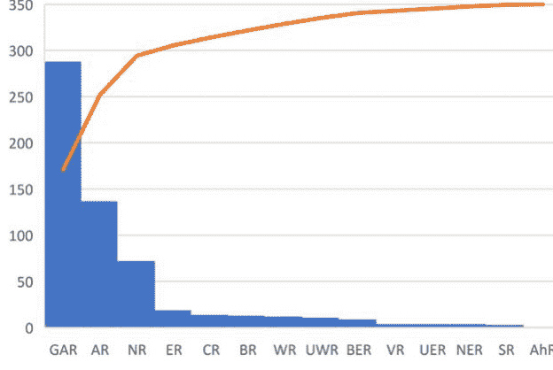

图表 2 穆斯林非政府组织总部的所在地。缩写：GAR = 大阿克拉地区；AR = 阿散蒂地区；NR = 北部地区；ER = 东部地区；WR = 西部地区；CR = 中央地区；UWR = 上西部地区；BER = 博诺东地区；UER = 上东部地区；BR = 博诺地区；NER = 东北部地区；SR = 萨瓦纳地区；AhR = 阿哈弗地区；VR = 沃尔塔地区

来源：2022 年 GMNGO 数据库；N = 591

man, 阿什海曼的 Al-Abrar Foundation，以及 Weija 的 Act Right Foundation。穆斯林非政府组织在阿克拉的集中反映了该市拥有穆斯林最集中的情况，尤其是在阿克拉众多的 Zongo 社区，以及该市是国家的政治和经济中心。

如果将 2022 年 GMNGO 数据库提供的信息与 Kreidieh 2011 年目录以及 Zook 和 Cassidy 对 2013–2015 年穆斯林非政府组织的分析进行比较，可以识别出一些有趣的变化。南部主导地位在 Kreidieh 2011 年目录中已存在，仅在大阿克拉地区就列出了七十个穆斯林非政府组织。2011 年目录中列出的总计 129 个穆斯林非政府组织中约有 83% 的总部设在南部地区，且全部为城市型。Zook 和 Cassidy 确定的六十三个穆斯林非政府组织中南部主导地位更为明显——93%。2022 年 GMNGO 数据库的数据显示，591 个穆斯林非政府组织中有 84% 的总部设在该国的南部地区；其中几乎一半位于大阿克拉地区，几乎四分之一仅位于阿散蒂地区。只有 16% 的总部设在五个北部地区之一，主要位于北部地区。然而，2011 年、2013–2015 年和 2022 年的数据集无法进行比较，因为其构成差异很大。尤其是 Zook 和 Cassidy 的数据仅包括有限数量的注册穆斯林非政府组织，而 2022 年 GMNGO 数据库中则包括了狭义和广义定义的注册和未注册组织。

另一方面，2011 年和 2022 年数据集之间的比较表明地点数量的增加。Kreidieh 2011 年目录列出了穆斯林非政府组织的总部位于当时十个地区中的九个地区的十六个城市地点（前沃尔塔地区未注册任何组织），其中约 40% 在阿克拉，20% 在库马西，10% 在塔马利。相比之下，2022 年 GMNGO 数据库列出了除奥蒂和西部北部地区外的全部十六个地区的 67 个地点。其中约 46% 位于阿克拉，19% 位于库马西，11% 位于塔马利。八个地点列出了四到十个总部，即 Wa 和 Sunyani（均为 9 个非政府组织），Tema 和 Kasoa（均为 8 个），Ejura 和 Nsawam（均为 7 个），Takoradi（6 个），Ashaiman（5 个），以及 Yendi 和 Koforidua（均为 4 个）。此外，三个大都市地区（阿克拉、库马西和塔马利）主导了穆斯林非政府组织的格局，约 84% 的总部或主要办公室设于此。引人注目的是奥蒂和东北部地区缺乏穆斯林非政府组织，很可能是由于这两个地区居住的穆斯林数量很少。

此外，2022 年 GMNGO 数据库强调了穆斯林非政府组织的城市和区域偏向，因为其中 81% 的活动具有单一或主要以城市为导向的偏向，见图表 3。尽管如此，对其活动的分析显示出广泛的参与范围，包括当地城市和农村的临时项目、在斋月、开斋节和古尔邦节期间向城市和农村社区提供的年度人道主义救济项目，以及农村社区外展活动。

此外，穆斯林非政府组织的活动可分为七类，即人道主义救济、水项目、教育项目、清真寺项目、宣教项目、社区项目和性别项目，见图表 4。

毫不奇怪，宣教项目（DP）和人道主义救济（HR）是 2022 年 GMNGO 数据库中列出的穆斯林非政府组织的两大主导活动领域。此外，对 516 个非政府组织收集的信息的分析揭示了其参与和项目中的一些有趣模式和组合。最引人注目的是从事宣教项目的非政府组织与从事社区项目（CP）的非政府组织之间的差异，见图表 5。如图所示，DP-NGO 的一半仅开展宣教项目，另外四分之一将宣教与人道主义救济相结合。同样，CP-NGO 的一半仅开展社区项目，另外三分之一将社区与性别项目相结合。其他活动领域似乎也存在类似模式；主要活动领域占主导地位，尽管在将第二活动领域纳入分析时存在一些明显差异。即：HR-NGO 增加宣教项目；EP-NGO 增加人道主义救济；WP-NGO 增加人道主义救济；MP-NGO 增加人道主义救济；GP-NGO 增加社区项目。虽然人道主义救济的主导地位并不令人惊讶，但社区与性别项目之间的相关性表明非政府组织活动领域的转变或世俗穆斯林非政府组织的出现和扩张。

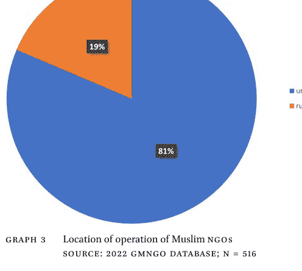

图表 3 穆斯林非政府组织的运营地点

来源：2022 年 GMNGO 数据库；N = 516

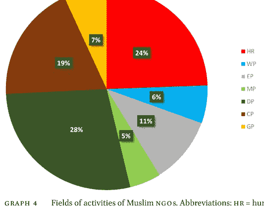

图表 4 穆斯林非政府组织的活动领域。缩写：HR = 人道主义救济（开斋饭、宰牲节；孤儿；寡妇）；WP = 水项目（钻井等）；EP = 教育项目（学校/经学院、教室、图书捐赠等）；MP = 清真寺项目（含清真寺）；DP = 宣教项目；CP = 社区项目（含卫生、健康中心/诊所、社区中心、图书馆）；GP = 性别项目（女孩/妇女）

来源：2022 年 GMNGO 数据库；N = 953；总非政府组织数 = 515

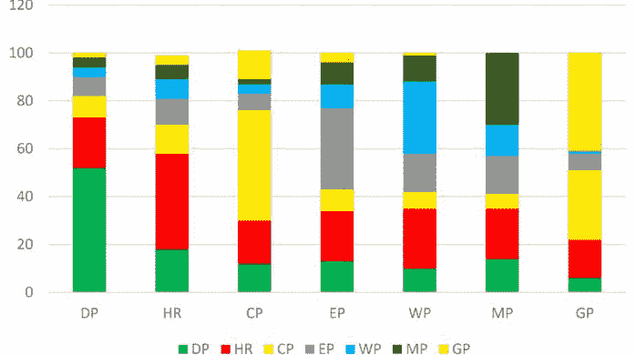

图表 5 穆斯林非政府组织活动的关联。缩写：HR = 人道主义救济；WP = 水项目；EP = 教育项目；MP = 清真寺项目；DP = 宣教项目；CP = 社区项目；GP = 性别项目

来源：2022 年 GMNGO 数据库；N = 953；总非政府组织数 = 515

在所分析的 516 个非政府组织的活动范围中也可以观察到类似的变化，见图表 6。DP-、HR-、CP- 和 GP-NGO 大多数从事一到两个活动领域（正如上文所述，这将是 DP+HR/HR+DP 或 CP+GP/GP+CP），而从事教育、水和清真寺项目的非政府组织可能参与至少另外两个活动领域。

然而，2022 年 GMNGO 数据库中的信息表明，大多数非政府组织仅从事一个（277 个或 45%）或两个（168 个或 33%）活动领域。20% 或 105 个非政府组织从事三到四个活动，而仅有 2% 或 10 个非政府组织开展包括五到六项活动的项目。后者组织包括：Abdul-Aziz Charitable and Humanitarian Foundation、Aliu Mahama Foundation、East Legon Muslim Youth、Eyes of Light Foundation、加纳穆斯林使命（GMM）、伊斯兰发展和人道主义服务理事会（ICODEHS）、伊斯兰人道发展组织、Make Zongo Great Again、Markaz Aleawn Alyaqin 人道主义服务和 Tinkong Zongo Development。其中一些在赋权穆斯林社区方面有着悠久的历史，如 GMM 和 ICODEHS，其他则属于第三代穆斯林倡议的广泛领域，范围从由穆斯林政治家建立的基金会（Aliu Mahama Foundation）、由在加纳和国外活跃的穆斯林学者建立的非政府组织（Eyes of Light Foundation）到广泛的 Zongo 和青年运动。

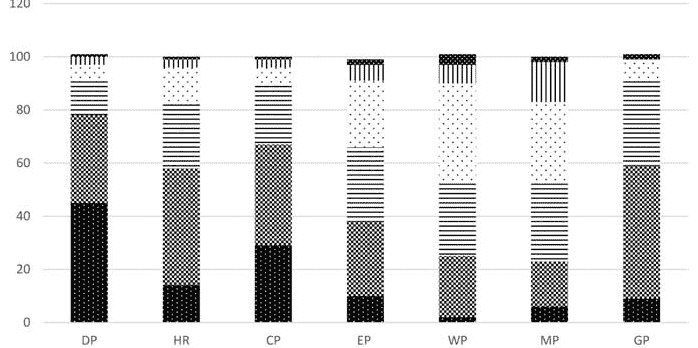

图表 6 穆斯林非政府组织的活动范围。缩写：n + 0 = 仅一项活动；n + 1 = 两项活动；n + 2 = 三项活动；n + 3 = 四项活动；n + 4 = 五项活动；n + 5 = 六项活动

来源：2022 年 GMNGO 数据库；N = 953；总非政府组织数 = 515

互联网时代加纳穆斯林非政府组织格局的构成变化在社交媒体上可见一斑。图表 7 突出了过去十年间加纳穆斯林非政府组织的快速扩张；其 Facebook 账号的推出表明了它们各自通过使用社交媒体宣传自身存在并扩大网络的雄心。

从图表 7 可以辨别出两种趋势。一种是 2012 年的第一个高峰，很大程度上是由于 Zongo 和穆斯林青年团体早期建立 Facebook 账号。第二个高峰始于 2019 年并持续到 2020 年。新 Facebook 账号的很大一部分属于穆斯林宣教团体和机构，反映了它们希望在外展活动中广泛利用社交媒体传播讲座的雄心。尽管它已在 2019 年达到顶峰，但 COVID-19 进一步促使它们将活动转移到社交媒体上。2022 年 GMNGO 数据库提供的信息进一步表明，284 个非政府组织在 2022 年拥有活跃的 Facebook 账号（状态：2022 年 9 月）。2019 年建立的一些账号未

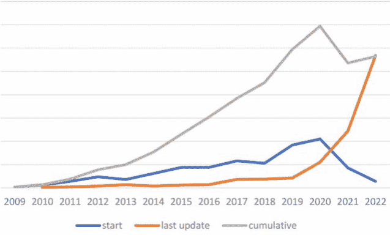

**图 7** 加纳穆斯林非政府组织在 Facebook 上的开始时间和最后更新

**来源：** 2022 年 GMNGO 数据库；总条目数：548

2020 年和 2021 年似乎表明 COVID-19 推迟或否定了受影响组织/团体的雄心，尽管更可能的是他们已将沟通转移到 WhatsApp 上的封闭/非公开群组，或将公开沟通转移到 Twitter 和 Instagram。

图 7 另一方面表明许多非政府组织面临的制度和结构性挑战，尤其是当它们是松散的社会网络和运动，组织结构薄弱甚至不存在时。COVID-19 大流行期间的封锁无疑中断了许多非政府组织的实地活动，而许多组织开始了线上项目和宣传活动，正如 Facebook 上活跃非政府组织累计曲线中的峰值所揭示的那样。然而，一旦实地活动成为可能，其中至少一些组织停止使用 Facebook。2021 年活动下滑以及此后穆斯林非政府组织在 Facebook 上（相对）活动减弱的另一个原因是，许多非政府组织已将通知和更新转移到封闭的社交媒体平台，尤其是 WhatsApp，供成员使用。

大多数非政府组织似乎在 Facebook 上活跃约三年至四年，根据 2022 年 GMNGO 数据库收集的信息显示，不到一半的组织活跃时间在一年至三年之间。然而，组织的 Facebook 活跃期较短并不一定与其过去和未来的活动相关，尤其是大多数组织在近年建立了 Facebook 账号且仍在活跃。另一方面，值得注意的是，那些在 Facebook 上活跃超过十年的非政府组织，表明它们在穆斯林非政府组织领域中已取得稳固地位。毫不奇怪，活跃时间最长的是一个穆斯林青年组织，安努尔伊斯兰教组织（14 年），其次是社区救赎基金会、法塔非洲/最终目标基金会、加纳穆斯林青年团体联合会、加马什伊穆斯林青年组织、霍霍宗戈发展基金会、穆斯林青年发展联盟、塔斯卡赞戈以及延迪穆斯林青年研究基金会（均为 12 年）。

Facebook 上的粉丝数量反过来表明了非政府组织的影响力和能力。拥有数千粉丝的协会、基金会、团体、运动和组织拥有更大的目标群体，可以激励他们志愿参与宣传活动和临时项目，包括筹款活动。尽管 Facebook 粉丝数据无法区分国内和国外粉丝，但可以假设大多数本地、青年和宗戈非政府组织的大部分粉丝来自其同龄群体。如图 8 所示，大多数穆斯林非政府组织的粉丝少于 1,000 人，只有少数超过 10,000 人（截至 2022 年 9 月为 31 个，占 6%）。其中最突出的是加纳跨国穆斯林媒体平台和平宣教媒体（PDW），拥有超过一百万粉丝，由生活部分在美国的穆斯林影响者卡利法·法伊斯运营。据推测，PDW 粉丝的大部分并不居住在加纳。截至 2022 年 9 月，其他拥有超过 25,000 粉丝的账号包括 Al-Rayaan 国际学校（34,071 粉丝）、Al-Waajid 伊斯兰宣教基金会（38,582）、加纳伊斯兰青年萨达卡协会（38,058）、加纳穆斯林传教团（58,780）、伊斯兰宣教村（31,792）、让宗戈伟大（217,316）、加纳国家首席伊玛目办公室（25,706）、生命基金会（29,256）以及加纳提贾尼耶穆斯林理事会青年协会（37,600）。

总之，图 4 至 8 所揭示的无非是 2010 年代加纳穆斯林非政府组织格局的显著变化。一个明显特征是它们从修建清真寺和学校等狭窄目标项目以及钻井和开展斋月、开斋节、宰牲节/古尔邦节项目，转向开拓新的雄心勃勃的领域。许多穆斯林非政府组织主要是宣教平台，社交媒体使当地伊玛目和学者能够接触到大量受众。这样的狭窄目标项目和计划仍然是许多穆斯林非政府组织的支柱和标识。然而，一些在 2010 年代发起的新一代穆斯林非政府组织已完全拥抱联合国可持续发展目标（SDGs），并将自己定位为实现 2030 议程和改善气候变化的先锋。例如，位于塔马利的

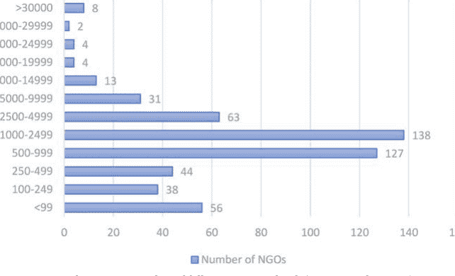

#### 图 8 穆斯林非政府组织：Facebook 上的粉丝数量（截至 2022 年 9 月）

来源：2022 年 GMNGO 数据库；N = 528

青年团体 *援助全球组织* 参与了为通过《肯定性行动法案》而举行的游行以及呼吁加速加纳妇女发展的呼吁²⁵¹，并在 2020 年 2 月呼吁其成员植树。²⁵² 其他团体很快效仿，其中包括 *加纳提贾尼耶伊布拉希米耶理事会*，该组织呼吁其成员加入其“Barhama Goes Green”和“穆斯林应对气候变化”宣传活动，于 2022 年 6 月在阿布莱库马-阿莫莫利-波库阿塞高速公路沿线植树。²⁵³ 正如 NGO/穆斯林社区的一位评论员，库马西的 *Jamatul-huda Adabraka* 于 2013 年宣布并间接强烈批评了已建立的狭窄目标项目：“为什么加纳所有的马拉姆总是建清真寺而不考虑医院？请帮助我们解决这个问题。”²⁵⁴ 有趣的是，目前（2022 年）至少有十二个医院项目由当地穆斯林非政府组织发起，将在第 4.4 章中讨论。

251 https://www.facebook.com/AID-Global-organization-317896138837862/, 8.9.2019, accessed 5.10.2021.

252 "Tree Planting!!! Tree Planing!!!," https://aidglobalooganzation.wordpress.com/2020/02/07/tree-planting-tree-planting/, 7.2.2020, accessed 5.10.2021.

253 During the campaign, some 1000 tree plants were planted on a 5 km stretch of the highway. See further photographs and updates on the June 2022 tree planting venue on Barhama Goes Green, 31.5.2022, 4.6.2022, 6.6.2022, 7.6.2022, 8.6.2022, 9.6.2022, https://www.facebook.com/profile.php?id=100083049364049, accessed 31.3.2024.

254 https://www.facebook.com/JamatulHudaAdabraka, 21.11.2013, accessed 5.10.2021.

另一个显著特征是加纳穆斯林非政府组织格局和光谱变化的是它们动员来自国内外的成员资金的能力。社交媒体在某种程度上彻底改变了传统的施舍和捐赠形式。早期的穆斯林非政府组织一代，其中包括先驱者 ICODEHS 和 MFCS，是外国捐助者和本地捐助者之间的促进者和中介。这对于许多本地穆斯林非政府组织仍然典型，其目标是委托狭窄目标项目和斋月/开斋节/宰牲节项目。前者的实施不需要大量职能人员，因为当地建筑商通过非政府组织从捐助者收到的资金支付建设或钻井费用。斋月和其他外展项目的实施则通常由非政府组织的志愿者进行，食品或货币捐赠由非政府组织从外国捐助者收到的资金覆盖。然而，社交媒体已增强了本地非政府组织的能力，尤其是在众筹或接触愿意支持特定事业或项目的加纳以外粉丝方面。

## 加纳穆斯林非政府组织格局的变化

正如前一章所述，直到二十一世纪第一个十年，穆斯林非政府组织的初始光谱相当有限。除了一些全国性组织，如加纳穆斯林救济协会（MURAG）、穆斯林家庭咨询服务（MFCS）和伊斯兰发展与人道服务理事会（ICODEHS）外，大多数穆斯林信仰组织都与民族或教派团体相关，即加纳的各种提贾尼和萨拉菲协会，或黎巴嫩、阿赫迈迪、什叶派或伊巴迪社区。此外，曾在中东学习的穆斯林学生与当地慈善家建立了联系，并在返回加纳后建立了国际穆斯林组织的当地分支。例如，伊斯兰研究与改革中心是达鲁尔伊夫塔的一个分支，而伊斯兰书籍分发中心则代表世界穆斯林青年大会。阿胡尔-拜特（什叶派）和伊斯提卡马社区分别与伊朗和阿曼组织有联系。然而，许多当地穆斯林非政府组织与国际穆斯林非政府组织没有任何联系，或未从穆斯林国家获得任何援助。因此，这些当地信仰组织活动范围不稳定，只在特定地区工作。大多数位于全国南部地区，主要在阿克拉和库马西；只有少数位于北部，主要在塔马利和其他穆斯林人口中心。尽管他们尽最大努力吸引外国捐助者的注意，最终只有少数成功。因此，许多这些小型非政府组织仅存在于纸面上，很快变得不活跃。

库马西非政府组织伊斯兰和平、民主与人权中心（ICPDHR）的命运就是一个典型例子。ICPDHR 由已故的萨利赫·乌马鲁·阿尔哈吉（1954–2010）于 2002 年创立，是为应对 9/11 后穆斯林的负面形象而发起的个人倡议。该非政府组织的目的是在宗戈社区开展去极端化和健康宣传项目。除了组织研讨会解决库马西和北部地区宗戈社区的问题外，其非政府组织还支持了疟疾、脊髓灰质炎和结核病免疫接种宣传活动；联合国儿童基金会和世界卫生组织加纳分部资助了结核病免疫接种项目。¹ 萨利赫·乌马鲁·阿尔哈吉和

他的非政府组织此时已成为穆斯林社区中结核病疫苗接种的主要宣传者（图9）。其组织进行的一项调查突显了一些穆斯林学者的负面活动：

> 这些“马拉姆”（Mallams）非但没有鼓励咳嗽数周的人前往医院就诊，反而自行在家治疗结核病患者，称这是一种需要灵性治疗的“灵性疾病”。2

因此，ICPDHR 加入了国际“制止结核病伙伴关系”组织，并在库马西的主要清真寺发起了一场动员运动。3 然而，哈吉·萨利赫·奥马鲁（Alhaji Salih Umaru）于2010年11月在一场车祸中去世，给该非政府组织带来了危机。他的儿子接任首席执行官，试图继续实施联合国儿童基金会（UNICEF）和结核病项目，但当他于2011年参军并被禁止运营该非政府组织后，该组织便陷入了休眠状态。4

许多当地穆斯林非政府组织渴望与外国穆斯林慈善机构、社区和慈善家建立联系，以期为他们的活动获得支持。最初，这些联系涵盖了阿拉伯、海湾和北非国家。由于加纳穆斯林侨民社区的活动以及穆斯林伊玛目和学者的跨国联系，加之互联网的普及，加纳穆斯林非政府组织的捐助空间已变得全球化。Facebook 是促进跨地方和跨国联系的关键因素。Assalaam 基金会与比利时穆斯林社区之间的联系便颇具启发性。

总部位于库马西的 Assalaam 基金会注册于2012年，由伊玛目侯赛因·阿里（Imam Hussein Ali）创立，作为一个“达瓦”（da‘wa）组织，为穆斯林和非穆斯林青年提供教育、咨询和支持。伊玛目侯赛因·阿里于2007年持工作签证进入英国，担任加纳清真寺的伊玛目，在伦敦建立了一所伊斯兰补充学校，并创办了当地慈善机构 Khidmah Education & Development Trust（希德玛教育与发展信托基金会）。2012年10月，他返回加纳，以恢复其基金会的达瓦活动。在某一阶段，他与比利时安特卫普的一个穆斯林社区——Belgisch Islamitisch Centrum De Koepel Moskee（清真寺）——进行了合作，但尚不清楚这是得益于他先前与该社区的联系，还是得益于认识他本人的库马西社区移民成员。

尽管如此，该社区于2014年和2015年在 Facebook 上发起募捐活动，为伊玛目侯赛因·阿里的达瓦活动筹集资金，购买了一辆 SUV 以支持他深入农村社区开展宣教。5 2016年，合作进一步扩展，De Koepel 清真寺社区在库马西的一些郊区启动了一个水井项目。6 不知何故，库马西-安特卫普的合作关系在此时终止。Assalaam 基金会和伊玛目侯赛因·阿里此后下落不明；两者均无已知的 Facebook 账号。然而，De Koepel 清真寺社区于2019年再次与库马西建立联系，向 Ummah 基金会提供了一笔“萨达卡”（sadaqa）捐款。7

**免疫接种保护儿童免受儿童疾病侵害**

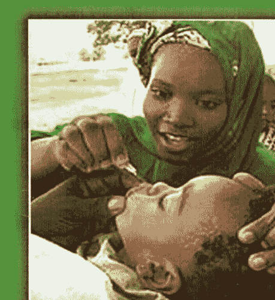

*汇编：哈吉·萨利赫·奥马鲁*

*图9 哈吉·萨利赫·奥马鲁宣传结核病免疫接种的小册子*

*作者收藏*

本章展示了相关行动者，并分析了21世纪头二十年加纳穆斯林非政府组织不断变化的格局。本章首先介绍了一些慈善企业的主要创始人，然后通过审视基层协会、运动和代表机构的活动，以及日益增多的外国穆斯林慈善机构和半官方机构的直接与间接存在，讨论了加纳穆斯林非政府组织的范围。

### 1 穆斯林慈善家：通过慈善机构和基金会开展外联

在过去二十年中，当地穆斯林慈善家的数量激增，这大概至少部分反映了在2010年代加纳经济蓬勃发展的背景下，（相对）富裕的穆斯林中产阶级的兴起。其中，谢赫·穆斯塔法·易卜拉欣（Sheikh Mustapha Ibrahim）最受尊敬，他毕生的参与使他在过去二十年中于加纳穆斯林社区内获得了多个高级别且有影响力的职位，详见第2.4.5和4.6章。其他著名的学者兼非政府组织创始人包括：谢赫·哈吉·巴巴·伊萨（Sheikh Alhaji Baba Issa）（穆斯林家庭咨询服务组织，见第4.3章）、谢赫·阿卜杜拉赫曼·穆罕默德（Sheikh Abdurrahman Muhammad）（安萨鲁丁组织，详见第2.4.5章）、谢赫·阿卜杜勒·纳西鲁-丁（Sheikh Abdul Nasiru-Deen）（典范基金会）、谢赫·菲尔道斯·拉丹（Sheikh Firdaus Ladan）（“依靠我”基金会，见第2.4.5章）、谢赫·阿尔哈桑·努胡（Sheikh Alhassan Nuhu）（信仰达瓦基金会）以及谢赫·哈吉·优素福·达乌达·加里巴（Sheikh Alhaji Yusif Dauda Garibah）（Adabiyya 伊斯兰协会）等众多人士。而谢赫·阿布巴卡尔·阿里·纳帕里（Sheikh Abubakar Ali Napari）和哈吉·萨拉穆·亚当（Alhaji Salamu Adam）则是从穆斯林商业企业家转变为慈善家的人——前者是 Napari 有限公司的首席执行官和光明基金会的创始人，详见第4.3章；后者领导非洲阿拉伯公司并资助当地社会发展项目，详见第6.2章。其中一些人还创办了顺势疗法诊所，包括谢赫·阿明·邦苏博士（Sheikh Dr Amin Bonsu）和谢赫·拉希德·侯赛因·萨尔瓦特（Sheikh Rashid Hussein Salwat），详见第4.4章。

尽管第一代非政府组织完全由穆斯林学者建立，但第二代中的一些则由当地穆斯林公民社会活动家、商业企业家和政治家创立。鉴于穆斯林中产阶级的崛起，以及过去二十年（直到 COVID-19 造成的挫折）加纳经济繁荣所催生的一小部分穆斯林高净值个人（HNWIs）的出现，许多这类非政府组织仍坚持典型的狭义达瓦议程目标：修建清真寺、教育、供水和斋月/开斋节/古尔邦节项目，并附加对孤儿、寡妇和贫困者的支持。因此，由穆斯林学者和商业企业家运营的达瓦基金会和非政府组织，是企业型伊斯兰的表现形式，即利用非政府组织、社交媒体平台和视听媒体等公共机构进行宗教外联，8 通过社会与经济抱负的结合，将其创始人转变为“宗教企业家”。9

2. 制止结核病伙伴关系组织，“查看合作伙伴简介”，https://stoptb.org/partners/partner_profile2.asp?PID=68839，最后更新于2011年8月25日，访问于2022年1月5日。

3. 制止结核病伙伴关系组织，“查看合作伙伴简介”，https://stoptb.org/partners/partner_profile2.asp?PID=68839，最后更新于2011年8月25日，访问于2022年1月5日。

4. 对沙姆苏丁·萨利夫中尉（Lieutenant Shamsudeen Salifu）的访谈，库马西，2019年12月13日。另见 https://www.facebook.com/Islamic-Centre-for-Peace-Democracy-Human-Rights-icpdhr-157194971066792/，访问于2022年1月5日。

5. 关于伊玛目侯赛因·阿里的背景及 De Koepel 清真寺与 Assalaam 基金会合作的概况，见最初的募捐呼吁“Assalaam 基金会——加纳”，https://www.facebook.com/Belgisch-Islamitisch-Centrum-De-Koepel-moskee-14265135676614411/，访问于2017年11月7日。然而，当我在2021年12月查看 De Koepel 清真寺的 Facebook 账号时，该文档已不再可用，但有关该活动的引用仍然存在；见 https://www.facebook.com/page/14265135676614411/search/?q=Assalaam%20Foundation，访问于2021年12月31日。

6. 见“2016年为加纳打井”（Waterput voor Ghana 2016），https://de-koepel.be/waterput-voor-ghana/liefdadigheid/liefdadigheid-2016/，访问于2021年12月31日。

7. “2019年为加纳的萨达卡”（Sadaqa voor Ghana 2019），https://de-koepel.be/sadaqah-voor-ghana/liefdadigheid/，访问于2021年12月31日；https://www.facebook.com/UMMAH-Foundation-122337079156638/，2019年9月21日，访问于2021年12月31日。

8. 关于“穆斯林企业家”和“企业型伊斯兰”的概念，参见 Emin Baki Adas, “The Making of Entrepreneurial Islam and the Islamic Spirit of Capitalism,” Journal of Cultural Research 10, no. 2 (2006): 113–137; Filippo Osella and Caroline Osella, “Muslim Entrepreneurs in Public Life Between India and the Gulf: Making Good and Doing Good,” Journal of the Royal Anthropological Institute (N.S.), S202–S221 (2009); Abdoulaye Sounaye, “Let’s Do Good for Islam: Two Muslim Entrepreneurs in Niamey,” in Cultural Entrepreneurship in Africa, eds. Ute Röschenthaler and Dorothea Schulz (New York: Routledge, 2016), 37–57.

9. 关于宗教企业家的讨论，进一步参见 Karen Lauterbach, “Religious Entrepreneurs in Ghana,” in Cultural Entrepreneurship in Africa, eds. Ute Röschenthaler and Dorothea Schulz (New York: Routledge, 2016), 19–36.

令人启发的穆斯林宗教创业典范是 Haji Saeed Hamid Jallo、Sheikh Sani Kuwait 和 Abubakar Sadiq Hussein。Takoradi 的穆斯林广播记者和学者 Haji Saeed Hamid Jallo 于 2005 年创立了 Tawheed Development Foundation（TDF）。TDF 是一个宣教和慈善组织，主要组织当地季节性救济活动。它在 2016 年斋月期间扩大了重点，当时呼吁穆斯林慈善基金会和个人慈善家支持其难民援助项目。与其土耳其姐妹组织 Genc Tebessum 一起，组织成员在 2015 年宰牲节期间访问了位于西部地区 Ellembelle 区 Krisan 难民营，并在一些穆斯林家庭中分发肉类。联合国最初于 1996 年设立该难民营，以为流离失所者和战争难民提供安全和保护。10 在项目启动前，Haji Saeed Hamid Jallo 呼吁制定一项全面计划，为 Krisan 营地的 58 个穆斯林难民家庭增添价值，并得到了 Takoradi 伊玛目和 Sekondi Zabarma 社区酋长双方的支持。11 尽管难民援助项目在随后几年未再跟进类似活动，TDF 仍继续利用社交媒体进行临时性慈善干预。例如，在 2021 年，它在马来西亚电子平台 ENSANY 上发布呼吁，截至 2022 年 1 月 10 日筹集了 989 美元，以支持一名 80 岁女性的住宿和医疗需求。12

Charity and Daawah Foundation（CDF）则是由穆斯林学者 Dr Mohammed Sani Hussein Niche，即 Sheikh Sani Kuwait 运营的典型非政府组织，与他在阿克拉 Maamobi 的清真寺 Masjidus-Salam Alhamdu 有关。自 2016 年成立以来，Sheikh Sani Kuwait 和 CDF 大量利用社交媒体进行宣教、教育和人道主义项目。其中包括自 2017 年起组织斋月开斋项目，同时发布视频展示其三层 Charity and Daawah Foundation 伊斯兰中心建设的各个阶段，以促进该项目的捐赠。13

10 “TDF To Launch Refugee Aid Project For Ramadan 2016”，http://www.mytawheedonline.com/2016/03/24/606，访问于 16.11.2017。主页在 2024 年已失效。

11 “TDF Set To Launch Refugee Aid Project”，http://www.mytawheedonline.com/2016/05/16/tdf-set-to-launch-refugee-aid-project-2/，16.11.2017。呼吁的结果不得而知，新闻档案的链接在 2019 年 4 月无法访问，且在 mytawheedonline 的 Facebook 主页上找不到该项目的痕迹，该主页在 2024 年已失效；相反，Tawheed TV（https://www.facebook.com/ttv.gha）报道了 TDF 的活动。

12 https://ensany.com/campaign/3923，发布于 26.9.2021，访问于 10.1.2022。

13 27.1.2020：地基建设；5.3.2020：地基完工，发布在其旧 Facebook 账号 https://www.facebook.com/CharityDaawaFoundation 上；自 2020 年 6 月起使用新 Facebook 账号，因旧账号被黑；26.8.2020 第二层建筑

Abubakar Sadiq Hussein 的 *Change for Change Foundation*（CfCf）是一个总部位于阿克拉的非政府组织，开展人道主义、赋权、教育、水利和 *dawa* 项目。自 2020 年起，土耳其捐助者如 HUDAI 一直赞助其每年在中部地区农村开展的斋月和古尔邦节外展项目。该组织发布了 2022 年年度报告，使其成为少数具有公开/透明度的穆斯林非政府组织之一。与其他草根组织类似，主要挑战是资金的可用性。尽管如此，2022 年的记录相当令人印象深刻。该组织不仅开设了一个配备十台缝纫机的职业中心用于裁缝培训并建造了一座清真寺，还进一步建造了八口水井，向 Bono East 地区的伊斯兰学校学生分发了 700 份《古兰经》，并支付了八名贫困高等教育学生的学费，支持了二十名基础阶段的孤儿学生。14

#### 1.1 穆斯林企业家

穆斯林企业家在基金会和非政府组织的创始人中占主导地位。其中之一是库马西的 Abdul Mannan Ibrahim。他的慈善活动参与源于他早年丧母、作为贫困少年的经历。他既未接受西方教育也未接受伊斯兰教育，曾在库马西以街头小贩和鞋匠为生。2008 年，他遇见了一位决定帮助他的陌生人，后者为他支付了教育费用，使他成为铝门生产者。2010 年，他开始从事铝制品加工业务，并决定参与小规模慈善活动。几年后，他整合了自己的努力并创立了 *Al-Mannan Charity Foundation.*15

Al-Mannan Charity Foundation 至今仍是一个地方性慈善机构，尽管其活动已大幅扩展，活动范围涵盖库马西和阿克拉两地，从为无论宗教背景如何、需要手术或无法支付医院和医疗费用的个人筹集资金的活动，到……该机构设在库马西的一间办公室，该办公室也用作 Al-Mannan TV 的工作室，他和他的 9 名有薪员工加上 10 名志愿者积极分子通过挨家挨户和街头募捐以及社交媒体上的筹款活动为个人项目筹集资金（图 10）。

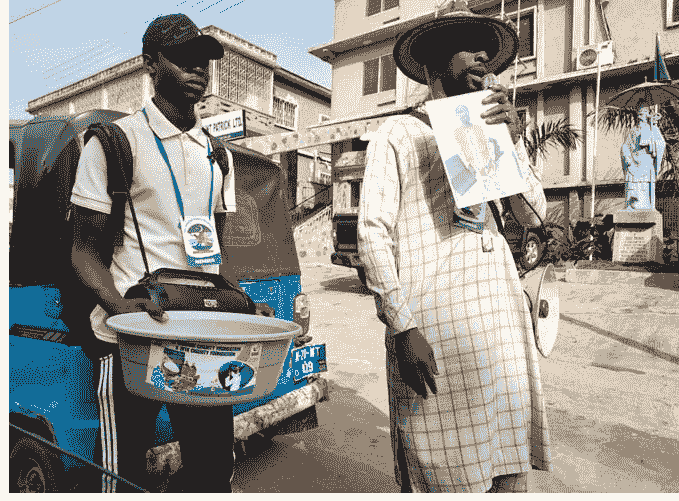

图 10 Al-Mannan Charity Foundation。Abdul Mannan Ibrahim 与 Al-Mannan Charity 成员在库马西进行筹款

照片：HOLGER WEISS/2022

每个个人项目都始于以视频呈现案例，并以发布展示干预效果的视频结束。通常，Abdul Mannan Ibrahim 称，他的团队能在一个月内筹集到所需资金。当我于 2022 年 10 月采访他时，他已支付总额达 700 万塞地 的发票。16

除个人项目外，Al-Mannan Charity 还为约 250 名孤儿和弱势儿童安排当地开斋节、开斋节和宰牲节聚会，17 有效地通过 Al-Mannan TV 传播支持其斋月食品计划的呼吁。18 他的在线电视台还分发他的宣教讲座。最近，Abdul Mannan Ibrahim 在其孤儿赋权计划中购买了三台缝纫机和一台针织机，扩大了慈善活动的范围。想法是建立一个工作坊，让孤儿在为期四年的培训计划中学习使用机器的技能。完成教育后，他们将获得自己的缝纫机。19 然而，他建造一所可容纳 200 名儿童的孤儿院的梦想尚未实现。20

Abdul Mannan Ibrahim 的轨迹与许多从企业家转型为慈善家的创始人相似。21 例如，Society for the Assistance for Orphans and Disabled（SAFOAD）是一个总部位于阿克拉的慈善机构，由 Haji Abubakar Yakubu Batalima 于 1990 年代末创立。此后，它因在穆斯林节日为孤儿提供年度物资（见第 3.2 章）而屡上头条，捐赠给残疾人士，22 并投资于青年创业技能培训。23 2013 年，Haji Batalima 因其长期慈善活动而获得 Ahlus-Sunna Wal-Jama’a 国家伊玛目 Sheikh Umar Ibrahim Imam 颁发的“杰出成就奖”。24 Alhaji Yusif Ibrahim Foundation 则是由穆斯林多部门企业大亨 Alhaji Yusif Ibrahim 创立的慈善机构，他是 Dara Salam Group of Enterprises 的执行董事。25 该基金会成立于 2000 年，多年来在库马西运营，为贫困学生提供奖学金，26 并赞助年度免费健康

16 与 Al-Mannan Charity Foundation 创始人 Abdul Mannan Ibrahim 的访谈，库马西，10.10.2022。有关个人宣传视频，请参阅 https://www.facebook.com/abdulmannan.ibrahim.33 上的帖子。

17 Yussif Ibrahim，“Al-Mannan Charity Foundation fetes 80 orphans to mark Eid-ul-Fitr”，27.5.2020，https://gna.org.gh/2020/05/al-mannan-charity-foundation-fetes-80-orphans-to-mark-eid-ul-fitr/，访问于 27.5.2024。

18 例如，视频发布于 Al-Mannan TV Facebook，13.4.2021，https://www.facebook.com/211176903046422/videos/264273742015360，访问于 4.10.2021。Al-Mannan TV 在 Facebook 上约有 1,300 名粉丝（16.1.2022）。

19 与 Al-Mannan Charity Foundation 创始人 Abdul Manan Ibrahim 的访谈，库马西，10.10.2022。

20 “Foundation seeks to build orphanage as it feeds over 200 orphans in Kumasi”，12.10.2020，https://gna.org.gh/2020/10/foundation-seeks-to-build-or-phanage-as-it-feeds-over-200-orphans-in-kumasi/，访问于 12.12.2022。

21 有关加纳穆斯林小规模企业家动机的讨论，见 George Acheampong，“Micro-Entrepreneurial Motivations in Ghana: Do Muslims Differ?”，收录于 Entrepreneurship and Management in an Islamic Context，编者 Veland Ramadani、Léo-Paul Dana、Shqipe Gërguri-Rashiti 和 Vanessa Ratten（Cham：Springer，2016），33–47。

22 “Donation to Akware Leprosarium”，《Daily Graphic》，12.12.2008。

23 “NGO trains youth in dressmaking”，《Daily Graphic》，9.7.2010。

24 “Top award conferred on Hajj Yakubu Batalima”，12.9.2013，https://www.graphic.com.gh/news/general-news/top-award-conferred-on-hajj-yakubu-batalima.html，访问于 12.11.2023。

25 另见其人物简介刊于 The Vaultz Magazine：“Don’t lose hope, keep knocking”—Alhaji Yusif Ibrahim，Board Chairman，GT Bank Ltd”，4.4.2018，https://thevaultzmag.com/editors-pick/personality-profiles/don-t-lose-hope-keep-knocking-alhaji-yusif-ibrahim-board-chairman-gt-bank-ltd，访问于 12.12.2022。也见其自传：Alhaji Yusif Ibrahim，Paradise Is Unpaved. The Making of Alhaji Yusif Ibrahim，‘ZongoBoy’. An African Autobiography（Accra：Real African Publishers，2019）。

26 “Alhaji Yusif Offers Succour to Students”，《Accra Mail》16.11.2000。

基金会还支付开斋饭、苏胡尔和古尔邦的费用，并向其教育综合体附近的十座清真寺提供食物，同时在宰牲节期间为监狱和孤儿院提供捐赠。31

卡里玛慈善基金会是一个典型的跨地方/跨国团体，在加纳和美国均有成员。其总部位于库马西，尽管其创始人兼首席执行官穆罕默德·阿米努·奥斯曼及其家人一年中有部分时间居住在美国。教育综合体的活动，包括六名工作人员的薪水，在很大程度上由穆罕默德·阿米努·奥斯曼资助，除基金会成员的不定期捐款外。然而，缺乏额外的捐助者和支持者阻碍了该综合体的扩张，32尤其是为贫困学生计划建造的技术和职业培训楼。33

Yaasalam 机会中心反过来担任 Afro Arab 集团公司的企业社会责任部门。Alhaji Salamu Adamu 于 2007 年创立的多元化企业包括 Afro Arab 小额信贷（另见第 6.2 章）等，是其对贫困 Zongo 社区慈善外展的一部分。Yaasalam 机会中心位于阿克拉，并注册为非政府组织。它于 2017 年启动，是 Alhaji Salamu Adamu 与 Past、Present and Future 研究与和平研究所的首席研究员 Mr. Abdusalam Mohammed Daaru 之间的合作项目。其目标是提供人道主义救济、促进教育、青年赋权、能力建设、企业家发展、引领就业创造计划，以及对 Zongo 居民和小商贩在读写能力和商业方面的能力建设。34 其赋能 Zongo 青年的举措包括多个项目，名为 Zongo 360、Zongo Business Incubator、Zongo Business Network 和 Yaasalaam Publishers。35

然而，大多数穆斯林企业家并不一定成立非政府组织来引导他们的捐赠。穆斯林企业家、Class Media Group 所有者 Alhaji Seidu Agongo 阐明了非正式和非制度化捐赠的传统做法。他以 GHS 857,000（约 140,000 美元）的费用为阿克拉科尔布教学医院儿童急诊科建造了一座 30 张床位的病房。他还通过为他们提供启动资金和设备来积极增强贫困人群的赋权，以开展小规模企业。后者反映了他的穆斯林慈善思维：

> 人生中重要的是你在人们生活中产生的[content]

基金会还支付开斋饭、苏胡尔和古尔邦的费用，并向其教育综合体附近的十座清真寺提供食物，同时在宰牲节期间为监狱和孤儿院提供捐赠。31

卡里玛慈善基金会是一个典型的跨地方/跨国团体，在加纳和美国均有成员。其总部位于库马西，尽管其创始人兼首席执行官穆罕默德·阿米努·奥斯曼及其家人一年中有部分时间居住在美国。教育综合体的活动，包括六名工作人员的薪水，在很大程度上由穆罕默德·阿米努·奥斯曼资助，除基金会成员的不定期捐款外。然而，缺乏额外的捐助者和支持者阻碍了该综合体的扩张，32尤其是为贫困学生计划建造的技术和职业培训楼。33

Yaasalam 机会中心反过来担任 Afro Arab 集团公司的企业社会责任部门。Alhaji Salamu Adamu 于 2007 年创立的多元化企业包括 Afro Arab 小额信贷（另见第 6.2 章）等，是其对贫困 Zongo 社区慈善外展的一部分。Yaasalam 机会中心位于阿克拉，并注册为非政府组织。它于 2017 年启动，是 Alhaji Salamu Adamu 与 Past、Present and Future 研究与和平研究所的首席研究员 Mr. Abdusalam Mohammed Daaru 之间的合作项目。其目标是提供人道主义救济、促进教育、青年赋权、能力建设、企业家发展、引领就业创造计划，以及对 Zongo 居民和小商贩在读写能力和商业方面的能力建设。34 其赋能 Zongo 青年的举措包括多个项目，名为 Zongo 360、Zongo Business Incubator、Zongo Business Network 和 Yaasalaam Publishers。35

### 1.2 穆斯林政治家

穆斯林在政党政治和国家企业业务中的参与度增加，他们被提名为高级部长和政府职位，已在加纳创造了一种新的穆斯林宗教企业家形式，即从政客转变为慈善家。Alhaji Hanan Abdul-Wahab Aludiba，Bawku 居民慈善家、国家粮食缓冲库存公司（NAFCO）执行官、NPP 领导成员，是一个例子。他是 Aludiba 基金会的创始人和主席，“该基金会是一家致力于贫困者、弱势群体、儿童和老年人困境的人道主义组织。”38 在没有外部支持的情况下自筹资金运营基金会，他能够支持上东区的教育、商业发展、农业和健康项目。2019 年 4 月，该基金会因在 Bawku 市为居民安排为期三天的免费医疗筛查和手术而登上头条。39 在活动期间，Hanan Abdul-Wahab 向长老会健康服务的贫困与疾病基金捐赠了 GHS 5,000（约 800 美元）以及各种医疗用品给 Bawku 长老会医院。40 同年宰牲节期间，该基金会向 Bawku 的 Ansarul 穆斯林和 NPP 选区捐赠了 300 袋大米，41 清楚地表明了其创始人与其政治参与之间的错综复杂联系。2021 年 5 月，Alhaji Hanan Abdul-Wahab 通过其基金会向上东区四个区捐赠了六辆多功能救护车。42

Hajia Humu Awudu，NPP 青年翼前成员、Wa Central 选区 NPP 国会议员候选人，以及她的 Hajia Humu 基金会（HHF，成立于 2018 年），在上西区同时面向穆斯林和非穆斯林/基督教社区，其中包括在斋月和圣诞节期间进行捐赠。43 被誉为“开发者、青年转型者、赋权妇女的行动者、远见卓识的领导者、[以及]弱势群体的希望”，44 她的基金会为学生提供了奖学金，其中包括在古巴学习医学，并捐赠了材料用于改善/修复 Wa 及周边地区的卫生、水和教育基础设施。45

31 与 Karima Shipping Enterprises 首席执行官的个人助理穆罕默德·阿米努·侯赛因的访谈，库马西，2022 年 10 月 11 日。

32 与 Karima Shipping Enterprises 首席执行官的个人助理穆罕默德·阿米努·侯赛因的访谈，库马西，2022 年 10 月 11 日。

33 正在进行的项目清单，https://karimafoundation.org/，访问于 2022 年 12 月 12 日。

34 “我赚了很多钱——Afro-Arab 老板”，2020 年 8 月 12 日，https://www.theghanareport.com/i-have-made-a-lot-of-money-afro-arab-boss/，访问于 2022 年 12 月 12 日。

35 “Yaasalaam 机会中心启动为 Zongo 青年创造就业的倡议”，2017 年 2 月 27 日，https://www.businessghana.com/site/news/business/142165/Yaasalam-Opportunity-Center-launches-initiative-to-create-jobs-for-Zongo-youth，访问于 2022 年 12 月 12 日。

36 “给予穷人让我感到人性化，让我感到满足”——Seidu Agongo，2020 年 4 月 9 日，https://starrfm.com.gh/2020/04/giving-to-the-poor-makes-me-feel-human-gets-me-fulfilled-seidu-agongo/，访问于 2022 年 1 月 10 日。

37 “给予穷人让我感到人性化，让我感到满足”——Seidu Agongo，2020 年 4 月 9 日，https://starrfm.com.gh/2020/04/giving-to-the-poor-makes-me-feel-human-gets-me-fulfilled-seidu-agongo/，访问于 2022 年 1 月 10 日。

38 “你好，欢迎来到 Aludiba 基金会的官方 Facebook 页面...”，2019 年 4 月 17 日，https://facebook.com/thealubidafoundation/posts，访问于 2021 年 7 月 1 日。

39 “Bawku 居民将受益于 Aludiba 基金会医疗筛查”，Modern Ghana 2019 年 4 月 14 日，https://www.modernghana.com/news/926554/bawku-residents-to-benefit-from-aludiba-foundation.html，访问于 2021 年 7 月 15 日。

40 “Aludiba 基金会成功组织了为期 3 天的免费医疗筛查...”，2019 年 4 月 17 日，https://facebook.com/thealudibafoundation/posts，访问于 2021 年 7 月 1 日。

41 “Aludiba 基金会向穆斯林捐赠以庆祝宰牲节”，2019 年 8 月 10 日，https://facebook.com/thealudibafoundation/posts，访问于 2021 年 7 月 1 日。

42 “上东区六个社区已收到多功能救护车以帮助医疗服务”，2021 年 5 月 25 日，https://facebook.com/thealudibafoundation/posts，访问于 2021 年 7 月 1 日；Atubugri Simon Atule，“缓冲库存首席执行官向上西区四个区捐赠 6 辆救护车”，Modern Ghana 2021 年 5 月 27 日，https://www.modernghana.com/news/1083660/buffer-stock-ceo-donates-6-ambulances-to-4-distric.html，访问于 2021 年 7 月 15 日。

43 关于宰牲节捐赠的帖子 2019 年 5 月 7 日（2018 年斋月捐赠视频），2019 年 5 月 11 日，2019 年 5 月 18 日（2019 年斋月捐赠），2019 年 12 月 20 日，2020 年 1 月 4 日（圣诞节捐赠），https://www.facebook.com/hhumuofficial/，访问于 2022 年 12 月 16 日。

44 Tahiru Lukman，“从慈善到政治女神；Hajia Humu 是否是 Wa Central 新时代的开始？”2020 年 7 月 19 日，https://www.modernghana.com/news/1017186/from-philanthropy-to-political-goddess-is-hajia.html，访问于 2022 年 12 月 16 日。

45 “Hajia Humu 基金会（HHF）向 Wa Central 清真寺捐赠灵车”，2019 年 1 月 4 日，https://www.ghanaweb.com/GhanaHomepage/NewsArchive/Hajia-Humu-Foundation-HHF-donates-hearse-to-Wa-Central-Mosque-712774；“Hajia Humu 基金会向上西区 40 所学校捐赠”，2022 年 1 月 27 日，https://citinewsroom.com/2022/01/hajia-humu-foundation-donates-to-40-schools-in-upper-west-region/，访问于 2022 年 12 月 16 日。

2019年，她以5万GHS的种子资金设立了Tunshuuni基金，作为HHF为有志女性企业家提供的初创企业和中小企业支持计划的一部分。^46^ 同年，她及其基金会分别荣获上西穆斯林执行奖的年度变革者奖和年度女性人物奖。^47^

`阿里乌·马哈马基金会`（AMF）由已故副总统阿里哈吉·阿里乌·马哈马于2011年卸任后成立，旨在帮助社会中需要帮助和弱势群体。AMF于2017年在北部地区设立了电子图书馆，^48^ 于2018年为加纳监狱启动医疗外展项目，^49^ 并在同年向北部地区延迪市政区的111名乳木果行业妇女投资了12,000 GHS（约1,900美元）作为启动资金。^50^ 尽管由穆斯林创立，该基金会很难被定义为穆斯林非政府组织；相反，它是其主要利益相关者的特殊用途平台。另一方面，其主要目标区域之一是全国各地的贫困城市社区，为此它于2019年与内城和佐戈发展部以及国家首席伊玛目办公室合作启动了Zongo Laafia外展项目。^51^ 根据AMF首席执行官阿里哈吉·乌马尔·法鲁克·阿里乌·马哈马的说法，该基金会针对SDG#3，目标是对约10,000名佐戈居民进行高血压、疟疾、皮肤感染和眼部问题的筛查。^52^

- 46. 2019年5月8日帖子，https://www.facebook.com/humuofficial/，访问时间2022年12月16日。另见“哈吉亚·胡穆基金会支持瓦的妇女”，2019年2月19日，https://www.watchghana.com/en/details/11394/hajia-humu-foundation-supports-women-in-wa，访问时间2022年12月16日。
- 47. 2019年12月1日、2019年12月29日帖子，https://www.facebook.com/humuofficial/，访问时间2022年12月16日。另见“2020版《来自北部加纳的100名MIPs项目启动》”，2020年7月17日，https://wundef.com/2020-edition-of-the-100-mips-from-northern-ghana-project-launched/，访问时间2022年12月16日。
- 48. “阿里乌·马哈马基金会为纪念前副总统设立电子图书馆”，GhanaWeb TV，2017年11月18日，https://www.youtube.com/watch?v=-vHn2LHFwQw，访问时间2021年10月7日。
- 49. “阿里乌·马哈马基金会为加纳监狱启动医疗外展项目”，2018年8月30日，https://www.ghanaweb.com/GhanaHomePage/NewsArchive/Aliu-Mahama-Foundation-launches-medical-outreach-programme-for-Ghana-s-prisons-680881，访问时间2021年10月7日。
- 50. “阿里乌·马哈马基金会支持乳木果行业的妇女”，Graphic Online，2018年9月30日，https://www.graphic.com.gh/news/general-news/aliu-mahama-foundation-supports-women-in-shea-industry.html，访问时间2021年10月7日。
- 51. “阿里乌·马哈马基金会、佐戈部、首席伊玛目启动‘Zongo Laafia’筛查10,000人”，2019年1月10日，https://www.ghanaweb.com/GhanaHomePage/NewsArchive/Aliu-Mahama-Foundation-Zongo-Ministry-Chief-Imam-initiate-Zongo-Laafia-to-screen-10-000-714269，访问时间2022年1月10日。
- 52. 阿里乌·法鲁克·阿里乌·马哈马，“展示和扩大医疗保健与福祉方面的本土创新”，2019年5月18日，发表于 https://www.graphic.com.gh/news/general-news/empowered-healthy-youth-needed-for-ghana-s-development-alhaji-aliu-mahama.html，2019年5月20日，访问时间2022年1月11日。

阿里哈吉·法鲁克·阿里乌·马哈马本人创立了`扶贫伙伴关系`（PPR），以支持北部地区农业、教育和妇女赋权项目。53 例如，总部位于塔马利的组织在延迪组织了开斋饭项目，同时在2018年向延迪地区的选定农民捐赠了400台背负式喷雾机，并在2020年为延迪的妇女组织了金融素养课程。54 PPR与哈基姆·雷亚娜女士的非政府组织`HealthWay基金会`类似。该基金会由她和一群卫生工作者于2019年创立，瓦地区非政府组织的目标对于世俗穆斯林非政府组织来说是典型的，因为它专注于为上西地区贫困和弱势社区和个人提供医疗保健和社会服务。55

- 53 https://www.facebook.com/Partnership-for-Poverty-Reduction-PPR-101033057928394，访问时间2022年2月2日。
- 54 “扶贫伙伴关系（PPR）背负式喷雾器分发和开斋饭项目”，2018年5月30日，https://www.modernghana.com/news/857494/partnership-for-poverty-reduction-ppr-knapsack.html；“扶贫伙伴关系向农民赠送喷雾机”，2018年6月2日，https://www.graphic.com.gh/news/general-news/partnership-for-poverty-reduction-presents-spraying-machines-to-farmers.html；“法鲁克·马哈马的扶贫伙伴关系（PPR）在延迪为妇女提供金融素养培训”，2020年9月8日，https://precisenewsgh.com/farouk-mahamas-partnership-for-poverty-reduction-ppr-trains-women-in-yendi-on-financial-literacy/，访问时间2022年2月2日（2024年5月失效）。
- 55 HealthWay基金会：目标，https://m.facebook.com/story.php?story_fbid=470771327060053&id=45203162267357&fs=0&focus_composer=0&m_entstream_source=timeline，2019年6月18日，访问时间2022年2月3日。

`萨米拉赋权与人道主义项目`（SEHP）是一个由加纳第二夫人哈吉亚·萨米拉·鲍乌米亚创立并管理的非营利组织。SEHP可被定义为世俗穆斯林非政府组织，因为它寻求通过社会干预项目，不分教派背景地赋权加纳的弱势群体。其目标是支持加纳实现联合国可持续发展目标（SDG）1（无贫困）、SDG 3（良好健康与福祉）、SDG 4（优质教育）、SDG 5（性别平等）、SDG 6（清洁饮水和卫生设施）、SDG 7（经济适用的清洁能源）和SDG 17（促进目标实现的伙伴关系）。自2017年启动以来，SEHP的重点领域一直是教育、健康和妇女赋权。56 其‘盒中学校图书馆’项目迄今已针对三个地区的十七所学校；57 2021年，它为200所公立幼儿园提供了互动教科书、工作簿和教师指南，使数学学习变得有趣，并为儿童开发令人兴奋的数学课程。58 其‘安全分娩’项目包括向贫困的准妈妈分发‘分娩包’，同时向选定的医疗机构提供医疗设备和药品，以及支持在加纳各地对卫生工作者的培训和再培训。59 就妇女赋权而言，1,200名妇女于2019年受益于其乳木果赋权计划，培训她们进行优质乳木果采摘、乳木果仁生产和保存。60

- 56 https://sehp.sbawumia.org.
- 57 “萨米拉赋权与人道主义项目向Play and Learn捐赠300本书

### 1.3 穆斯林名人与影响者

随着2010年代加纳科技创业的扩张，一批新的穆斯林宗教企业家进入了这一领域并改变了穆斯林非政府组织的格局。该群体由青年领袖、电视名人和社会媒体影响者组成。使他们结合在一起的是他们主要使用社交媒体作为倡导、联系、激励、建立网络以及动员追随者——有时被定义为成员——的主要工具，无论远近，跨越地方、区域和国家领土和边界，并催生了拥有令人印象深刻的追随者和志愿者数量的社会运动。其中最早的一个是Princess Umul Hatiyya基金会，由“摇滚的非洲女性”Umul Hatiyya Ibrahim Mahama于2008年发起，但仅活跃了几年。61 随着社交媒体在加纳的突破，其他人也随之而来：‘佐戈之星’Kansar Abdulai的HajiaPosh基金会，Hajia Wassila Mohammad的别名Queen Lady的Haske Bisa Kan Haske—Nuur fauka nuur（光之上之光），Hajia Ibrahim Sadiq的Kuburah Diamonds基金会及其Zango妇女生计与赋权项目，Issah Agyeman的Essa Ajeman慈善基金会，Issah Ibrahim Yunus别名Teacher 1B及其Teacher 1B Jihad基金会，Humu Gaage的`全民崛起倡议`及其`佐戈女孩崛起项目`和`佐戈女孩考试诊所`，Hajia Aisha Abdallah Ibrahim别名Aisha Freedom及其`姐妹聚会加纳`，以及Ibrahim Baba Maltiti的`问题共享问题解决`（PSPS）。

时装设计师Ibrahim Baba Maltiti于2017年创立了他的组织。与互联网时代的其他社会运动类似，总部位于库马西的`问题共享问题解决`仅在社交媒体上运营，并通过Facebook和WhatsApp上的呼吁向其成员筹集资金；其多媒体/电视频道（PSPS Media Channel）在Facebook上拥有近26,000名粉丝（截至2022年12月）。PSPS的主要目标是识别佐戈社区的问题，例如支付有需要人士的医院和/或医疗账单或为孤儿和寡妇提供支持，并从他的网络中为该事业寻求财政援助。对于其他项目，例如在延迪钻井，Ibrahim Baba Maltiti获得了法国穆斯林慈善机构Nouvelle Optique的资金，他与法国组织之间的初步联系是通过美国的一名PSPS成员建立的。62

PSPS社交网络由加纳的Facebook粉丝组成，其中约7,000人在阿克拉，6,000人在库马西，另外还有数百人在尼日利亚、美国、沙特阿拉伯和意大利。其大部分活动局限于库马西，其中包括年度斋月开斋饭包裹的分发（2021年每天约100个包裹）以及在开斋节和宰牲节的捐赠，主要是因为这些由当地捐赠者支付。另一个当地倡议是PSPS寡妇赋权项目：该组织通过为七名寡妇购买装满软饮料的冰箱来支持她们，以此作为谋生的方式。2022年9月，Ibrahim Baba Maltiti为其组织启动了一个新的、雄心勃勃的创收项目。放弃了因原料变得过于昂贵而无法制作和销售肥皂的早期项目，新项目包括一条鲶鱼养殖场和一个蜗牛养殖场，预计在未来6个月内产生资金。63

`梅里亚姆·扎卡里亚·亚哈亚基金会`（MZYF），又名Mariam基金会，在最近成立的非政府组织中脱颖而出。该基金会由Meryam Zakariya Yahya创立，她是书籍《来自我灵魂的笔记：与精神疾病共存的现实》（2021年）的作者，64作为解决精神疾病问题的平台

在与宗戈社区年轻妇女结合（临时性）人道主义救助倡议的情况下，该基金会在其愿景和使命上独一无二。65

超越所有加纳穆斯林影响者在 Facebook 粉丝数方面的是 Khalifa Faith 的和平宣教媒体（PDW），截至 2022 年 8 月拥有超过一百万粉丝，以及他的 Ali Amir 盲人基金会。66 将这些新倡议结合起来的，是它们通过社交媒体开展筹款活动来吸引大量追随者的能力。PDW 是一个非常成功的媒体渠道，在库马西办公室外的一条横幅上宣布其自身和 Ali Amir 基金会为宣教中心、古兰经课程中心、摄影中心、先知医学中心、抑郁症中心、孤儿院中心以及教育基金。它表示要支持弱势群体、盲目穆斯林以及（穆斯林）监狱囚犯，还有清真寺和经学院。此外，它还提供婚姻咨询、为孤儿提供食物储藏室，并投资于钻井和水项目。67

Khalifa Faith 作为有影响力的穆斯林博主的崛起既具有症候性，也可作为如何利用社交媒体发起和运营社会福利项目和倡导运动的范例。“当 Facebook 推出视频和 Facebook 直播时，一种被称为宗戈博主的现象出现了，”他的朋友兼穆斯林博主 Sabit Ali 在 2022 年 1 月发布的一篇悼文中指出：“[Khalifa Faith] 是宗戈博主之一 [...] 他选择将自己的博客提升到下一个层次，通过帮助宗戈社区中的贫穷和弱势群体。”68 Lean On Me Foundation（LOMEF）首席执行官 Sheikh Firdaus Ladan 在 2021 年 7 月颁发 LOMEF 嘉许奖时赞扬了他的行动并称赞了他：

> > 为了您对人类的福祉和改善的奉献、韧性、无差别和坚定不移的承诺，Lean On Me Foundation 代表您在非洲和全世界拯救的生命，谨感谢您每天所做的如此不懈和 jannatic [sic] 的工作。您拯救的人们以及全世界都非常感激您所做的慈善工作，请继续保持并永远蒙福。69

### 2 草根协会、运动和代表机构

由协会、团体或运动发起的正式穆斯林倡议已存在数十年，尽管其中大多数往往局限于特定的地方或社区。它们的寿命通常相当短暂。总体趋势是志同道合的人们组成行动小组来应对特定目标，在许多情况下，是伊斯兰教育的改善甚至现代化。其他人则专注于宗戈居民的社会和经济发展，或遏制宗戈地区的政治警惕主义。关于此类（信仰为本/穆斯林）民间社会组织在加纳何时开始发展，目前知之甚少；迄今为止发现的最早痕迹可追溯到 1990 年代末，似乎与加纳公民社会的

> > 为了您对人类的福祉和改善的奉献、韧性、无差别和坚定不移的承诺，Lean On Me Foundation 代表您在非洲和全世界拯救的生命，谨感谢您每天所做的如此不懈和 jannatic [sic] 的工作。您拯救的人们以及全世界都非常感激您所做的慈善工作，请继续保持并永远蒙福。69

### 2 草根协会、运动和代表机构

由协会、团体或运动发起的正式穆斯林倡议已存在数十年，尽管其中大多数往往局限于特定的地方或社区。它们的寿命通常相当短暂。总体趋势是志同道合的人们组成行动小组来应对特定目标，在许多情况下，是伊斯兰教育的改善甚至现代化。其他人则专注于宗戈居民的社会和经济发展，或遏制宗戈地区的政治警惕主义。关于此类（信仰为本/穆斯林）民间社会组织在加纳何时开始发展，目前知之甚少；迄今为止发现的最早痕迹可追溯到 1990 年代末，似乎与加纳公民社会的

在与宗戈社区年轻妇女结合（临时性）人道主义救助倡议的情况下，该基金会在其愿景和使命上独一无二。65

超越所有加纳穆斯林影响者在 Facebook 粉丝数方面的是 Khalifa Faith 的和平宣教媒体（PDW），截至 2022 年 8 月拥有超过一百万粉丝，以及他的 Ali Amir 盲人基金会。66 将这些新倡议结合起来的，是它们通过社交媒体开展筹款活动来吸引大量追随者的能力。PDW 是一个非常成功的媒体渠道，在库马西办公室外的一条横幅上宣布其自身和 Ali Amir 基金会为宣教中心、古兰经课程中心、摄影中心、先知医学中心、抑郁症中心、孤儿院中心以及教育基金。它表示要支持弱势群体、盲目穆斯林以及（穆斯林）监狱囚犯，还有清真寺和经学院。此外，它还提供婚姻咨询、为孤儿提供食物储藏室，并投资于钻井和水项目。67

Khalifa Faith 作为有影响力的穆斯林博主的崛起既具有症候性，也可作为如何利用社交媒体发起和运营社会福利项目和倡导运动的范例。“当 Facebook 推出视频和 Facebook 直播时，一种被称为宗戈博主的现象出现了，”他的朋友兼穆斯林博主 Sabit Ali 在 2022 年 1 月发布的一篇悼文中指出：“[Khalifa Faith] 是宗戈博主之一 [...] 他选择将自己的博客提升到下一个层次，通过帮助宗戈社区中的贫穷和弱势群体。”68 Lean On Me Foundation（LOMEF）首席执行官 Sheikh Firdaus Ladan 在 2021 年 7 月颁发 LOMEF 嘉许奖时赞扬了他的行动并称赞了他：

> > 为了您对人类的福祉和改善的奉献、韧性、无差别和坚定不移的承诺，Lean On Me Foundation 代表您在非洲和全世界拯救的生命，谨感谢您每天所做的如此不懈和 jannatic [sic] 的工作。您拯救的人们以及全世界都非常感激您所做的慈善工作，请继续保持并永远蒙福。69

### 2 草根协会、运动和代表机构

由协会、团体或运动发起的正式穆斯林倡议已存在数十年，尽管其中大多数往往局限于特定的地方或社区。它们的寿命通常相当短暂。总体趋势是志同道合的人们组成行动小组来应对特定目标，在许多情况下，是伊斯兰教育的改善甚至现代化。其他人则专注于宗戈居民的社会和经济发展，或遏制宗戈地区的政治警惕主义。关于此类（信仰为本/穆斯林）民间社会组织在加纳何时开始发展，目前知之甚少；迄今为止发现的最早痕迹可追溯到 1990 年代末，似乎与加纳公民社会的活力化相关。这些地方倡议的主要挑战是领导力和资金。通常，许多此类倡议，尤其是穆斯林青年协会，往往是短命的事务，在短暂的行动后便崩溃或变得沉寂。例如，位于阿克拉的 *Hayat Mission* 于 2014 年成立，于 2014 年 4 月组织了‘创业与技能获取培训’，以及于 2015 年 5 月组织的‘穆斯林和穆斯林妇女健身体育行走’。此后，它在 Facebook 上未宣布任何活动。70

在上世纪最后十年成立的其他组织，如位于瓦的 *Muslim Youth Association*，在这方面似乎更为成功，它重视其领导层的承诺、奉献和经验，并努力实现其预算的问责和透明。71 随着 2010 年代社交媒体的广泛使用，许多穆斯林民间社会组织和非政府组织大量使用 Facebook 和其他社交媒体提醒支持者缴纳会员费、呼吁捐款、告知新项目，甚至公布其收支余额。

69 https://www.facebook.com/groups/84194605913720, 16.7.2021, accessed 25.8.2022.

70 https://www.facebook.com/Hayat-Mission-463148730527226/, accessed 16.1.2022.

71 A BRIEF HISTORY OF MYA, https://www.facebook.com/MYAUWR/, 10.3.2019, accessed 10.8.2021.

#### 2.1 自下而上的动员以赋权穆斯林妇女

加纳的妇女组织，无论是信仰为本还是世俗的，大多是非正式的且未正式注册。少数组织以书面章程或行为准则运作，许多组织从当地农村或城市社区和街区招募成员。在对非正式妇女组织的评估中，Dzodzi Tsikata、Maame Gyekye-Jandoh 和 Martin Hushie 将其区分为经济导向型和非经济导向型。前者包括市场妇女组织、贸易或手工业组织以及 [微型] 信贷合作社，后者包括社区发展组织、宗教组织、政治组织和教育组织。他们的研究强调了非正式妇女组织由于其赋予妇女挑战教会和社区中男性主导、教育社区内的女孩和妇女、并为妇女提供经济援助和贷款的能力而产生的积极影响。72

在加纳穆斯林妇女联合会（FOMWAG）成立之前，加纳穆斯林妇女的协会和社团一直是非正式的，Fatimatu N-Eyare Sulemanu 告诉我。“我们的祖母和母亲们过去常常聚在一起解决问题并互相帮助，”她回忆道。73 然而，随着穆斯林组织的妇女分支的建立，例如加纳穆斯林传教团妇女联谊会（GMMWF），正式的穆斯林妇女组织包括妇女非政府组织和基金会开始出现在加纳非政府组织版图上。1967 年成立的 GMMWF 或许是最古老的组织之一，是促进其成员以及当地社区整体发展，即物质、社会、经济、道德和精神发展的先驱。74 在 2017 年庆祝其五十周年之际，该组织启动了一个雄心勃勃的项目，在阿哈弗地区的 Mim 建设一所教师培训学院。75

72 Tsikata, Gyekye-Jandoh and Hushie. Political Economy Analysis (PEA) of Civil Society in Ghana, 14.

73 Interview with Hajia Fatimatu N-Eyare Sulemanu, representative of FOMWAG and tutor at Department for the Studies of Religions, University of Ghana, Legon (Accra), 14.12.2017.

74 "Ghana Muslim Mission Women's Fellowship holds 13th National Conference," 1.9.2023, https://gna.org.gh/2023/09/ghana-muslim-mission-womens-fellowship-holds-13th-national-conference/, accessed 5.12.2023.

75 "Ghana Muslim Mission Women's Fellowship to build teacher training college," 9.5.2017, https://www.modernghana.com/news/773972/ghana-muslim-mission-womens-fellowship-to-build-teacher-tra.html, accessed 5.12.2023.

##### 表 3 FOMWAG 在 Facebook 上

| 名称 | FB 成立 | FB 粉丝数（2022年7月） |
|---|---|---|
| Federation of Muslim Women's Association in Ghana (FOMWAG) | 2020 | 1,726 |
| FOMWAG Ashanti | 2020 | 2,800 |
| FOMWAG Mamprobi Branch | 2019 | 697 |
| FOMWAG Accra | 2021 | 512 |
| FOMWAG Eastern | 2022 | 42 |
| Young FOMWAG | 2011 | 74 (2011) |

FOMWAG 成立于 1992 年，是仍在运作的最古老机构之一，拥有各种地方团体、地区分会和国际分支，76 其中包括 FOMWAG-UK，77 见表 3。

因其之前的参与和成就而备受赞誉，FOMWAG 与加纳穆斯林学院、ICODEHS 和 Paragon Foundation 一起被提名为首届加纳穆斯林成就奖‘年度穆斯林非政府组织’。78 2020 年 8 月，FOMWAG 开始在 Facebook 上宣传其活动，包括 FOMWAG Ashanti 的农村社区项目、FOMWAG Sekondi-Takoradi 向 Daboase 孤儿院的捐赠、穆斯林护士团体向 Shakina Clinic 的捐赠、FOMWAG 为促进妇女和女孩福祉而为伊玛目举办的宣传研讨会，以及其在 COVID-19 封锁期间缓解 COVID-19 污名化和帮助有需要人士的众多干预措施。79

FOMWAG 很少登上全国头条。80 然而，Facebook 上的各种帖子展示了该协会活动的广泛范围

76 On the history and early activities of FOMWAG, see Sulemanu, Leadership in the Ghanaian Muslim Community, and Ammah, "Islam, Gender and leadership in Ghana."

77 Justice Dzido, "Muslim Communities Improving—FOMWAG," 17.8.2018, https://www.thepublisheronline.com/muslim-communities-improving%6E2%80%95fomwag/, accessed 27.9.2021. FOMWAG-UK was founded in 2012; see further http://fomwag.org.uk/, accessed 27.9.2021.

78 Nana Yaw Wired, "Metro TV Nominated at Ghana Muslims Achievers Awards 2015," 16.11.2015, https://www.modernghana.com/entertainment/34104/metro-tv-nominated-at-ghana-muslims-achievers-awar.html, accessed 6.10.2021.

79 https://www.facebook.com/fomwagghana/, 13.8.2020, 14.8.2020, 15.8.2020, 2.9.2020, 22.10.2020 (YouTube video by FOMWAG National President Hajia Ajara Ishaka Telly on COVID-19 stigmatization), 7.12.2020.

80 In 2017, for example, FOMWAG sent a press release to Ghana News Agency, declaring its

该组织及其成员团体此后一直开展活动。除了偶尔为弱势群体提供捐助外，81 FOMWAG于2020年8月为伊玛目举办了一次宣传研讨会，主题为“将人权原则与《古兰经》和圣训联系起来，以促进妇女和女童的福祉”。82 该组织还发布了其主席Hajia Ajara Ishaku Telly的一段视频，警告人们注意对COVID-19的污名化。83 此外，它还为2020年8月在阿克拉举行的FOMWAG女子高中奠基仪式做了宣传，84 该项目早在2012年就已启动。85 其阿散蒂地区分部于2020年9月启动了阿散蒂地区博阿芒农村社区项目，以扩大FOMWAG以往偏向城市的活动范围，在边缘化和被忽视的农村社区促进积极的养育方式、少女赋权和妇女赋权。86 有趣的是，FOMWAG-阿散蒂在该项目中的合作伙伴包括Paragon基金会、加纳国家清真寺，以及两个土耳其非政府组织——HUDAI和Deniz Feneri。87 塞孔迪-塔科拉迪分部则于2020年11月组织了首届穆斯林妇女领导力研讨会。88

FOMWAG由多个地方性的正式和非正式团体与协会组成。其中较正式的一个是总部位于阿克拉的非政治、非宗派、非营利组织安尼萨基金会（Annisaa Foundation），成立于2004年。其宗旨是利用加纳职业穆斯林妇女的现有专业知识，改善贫困穆斯林妇女和儿童的地位，同时使其成员了解伊斯兰教和社会经济问题。89 该协会的重点是赋权并鼓励年轻女性接受高等教育，主要通过提供奖学金和捐赠，以及指导、咨询和辅导大阿克拉地区五所高中的年轻女学生。此外，该协会还开展多项年度外展项目，包括为恩萨瓦姆监狱和韦贾麻风病院的穆斯林囚犯，以及阿沙莱-博特韦的慈惠伊斯兰学校孤儿提供支持。90

在第一代穆斯林领导的妇女非政府组织中，还有“成就加纳”（Achievers Ghana）。这家位于阿克拉的非营利、非政治、非宗教非政府组织于2001年成立，当时名为“成就者读书俱乐部”（Achievers Book Club），2015年更名，重点是为加纳弱势地区的女孩提供阅读和导师计划、奖学金、信息通信技术及职业技能（图12）。2020年，该组织因其“杰出的慈善干预”获得加纳慈善奖，91 同年还入围了加纳穆斯林成就奖“年度穆斯林非政府组织”评选的六家非政府组织之列。92 此前几年，它通过“谨慎2014年斋月筹款活动”获得了多家公司、组织和个人的捐款，用于其奖学金计划。93 2015年、2016年和2017年，它扩大了活动范围，并推出了自己的斋月筹款活动以筹集奖学金资金（2016年目标：1万加纳塞地；2017年目标：5万加纳塞地[约8000美元]；“如果有500人每人捐100加纳塞地，我们的目标就能实现”）。94 在其主页上，该组织宣称其大部分资金来自尼马-宗戈当地社区。一些支持者每月捐赠5加纳塞地（目前不到1美元），但主要收入来源是清真寺、论坛和公开演讲中的筹款活动，以及临时的私人和企业捐赠。95 此外，该团体偶尔也会收到企业和国际慈善机构的捐款，如“全球儿童基金会”（2015年）和KTL（2021年）。96

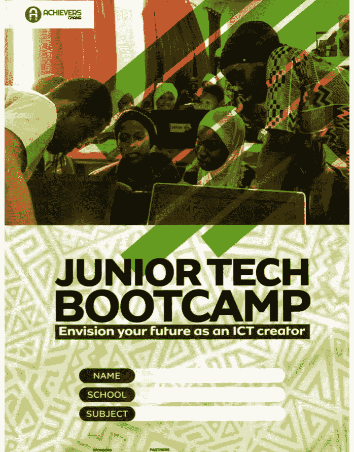

青少年科技训练营

设想你作为信息通信技术创作者的未来

图12 成就加纳。笔记本封面；成就加纳于2022年组织了青少年科技训练营。作者收藏

成就者组织拥有二十名工作人员，其中十三人在其办公室工作，其大部分项目在阿克拉开展，不过偶尔也会在东部省和中部省组织一些活动。该团体每天（周日除外）在尼马的办公室为女孩安排核心活动，而其外展项目——阅读技能和IT课程——则在尼马、马莫比和阿克拉新镇的学校开展，面向女孩和男孩。2020年，COVID-19中断了该团体在学校的活动。作为替代，成就者开始组织线上阅读课程。2022年，该团体恢复了在办公室的阅读和写作课程。97

成就者组织是当地非政府组织影响力的一个鼓舞人心的例子。艾莎·穆罕默德解释说，起初穆斯林父母试图阻止该团体接触他们的女孩，但当他们意识到女孩在学校表现更好时，很快就改变了想法。由于成就者组织在赋权女孩方面的参与，她们学会了表达自己，有些人甚至登上了领导职位。艾莎·穆罕默德就是一个榜样：她于2015年小时候加入成就者；七年后，这位21岁的年轻女性成为成就者的公共关系官员。98

新一代由女性领导的穆斯林非政府组织在2010年代发展起来。其中一些是跨国组织，在加纳境内外开展活动。其中之一是“全球穆斯林女性困境”（Global Muslimah Dilemma，GMD），其在德国的成员和支持者自2017年起组织筹款活动，支持GMD在阿克拉的斋月开斋饭和古尔邦节分发活动。99 总部位于阿克拉的“伊斯兰未来妇女中心”（ICFW）也开展类似项目，包括年度斋月捐赠活动。100 该萨拉菲组织做出了

---

对全国朝觐委员会的提名表示不满，并要求加纳总统在其成员中至少纳入一名女性；见“FOMWAG呼吁朝觐委员会纳入女性”，2017年2月24日，https://www.ghanabusinessnews.com/2017/02/24/fomwag-calls-for-inclusion-of-women-on-hajj-board/，访问于2021年9月27日。

81. FOMWAG北部地区分支以及FOMWAG成员协会之一的穆斯林护士团体，两次向塔马利的沙基纳诊所捐赠了食品和卫生用品（https://business.facebook.com/fomwagghana/，2020年9月2日和2020年12月7日的帖子，访问于2021年9月27日）。2020年8月，阿散蒂分支在库马西COVID-19封锁期间援助了贫困妇女；2020年10月，FOMWAG向北部地区昆本古区的洪灾灾民捐赠了食品和衣物，同时分发了FOMWAG自制的免费口罩，见2020年8月14日、2020年10月11日和2020年10月22日的帖子。

82. https://www.facebook.com/fomwagghana/，2020年8月13日，访问于2021年9月27日。

83. YouTube视频链接，https://www.youtube.com/watch?v=WLigydwOy2o，2020年8月15日，访问于2021年9月27日。

84. https://www.facebook.com/fomwagghana/，2020年8月13日，访问于2021年9月27日。

85. “FOMWAG的学校项目启动”，2012年4月30日，https://www.ghanaweb.com/GhanaHomePage/NewsArchive/FOMWAG-s-school-project-launched-237509，访问于2021年9月27日。

86. https://www.facebook.com/Fomwag-Ashanti-112442813643597/，发布于2020年9月18日，访问于2021年9月27日。

87. https://www.facebook.com/112442813643597/photos/a.135753353530375/407168584171017/，访问于2021年9月27日。

88. https://www.facebook.com/Fomwag-Ashanti-112442813643597/，发布于2020年11月3日。

89. https://www.annisaafoundation.org/who-we-are/，访问于2022年1月25日。

90. https://www.annisaafoundation.org/what-we-do/，访问于2022年1月25日。

2016年和2017年，该组织因在麦地那中央清真寺举办开斋节游乐会，¹⁰¹ 以及在社交媒体上发起倡导使用*希贾布*和*尼卡布*的运动而登上头条新闻。¹⁰² 其赋权女性的主要活动是提供缝纫、肥皂制作、消毒剂制作和杀菌消毒方面的辅导和培训项目。¹⁰³ *达瓦项目*（ODP）于2016年和2017年在阿克拉和库马西举办了类似的技能发展工作坊。¹⁰⁴ 2017年成立的*穆斯林女性指导网络*（MMN）的使命是为年轻的穆斯林女孩提供指导，并帮助她们追求高等教育；¹⁰⁵ 其目标是到2050年在加纳全国的每一所学校和每一个城镇建立职业咨询中心，并随后推广到整个非洲。¹⁰⁶ 到目前为止，总部位于阿克拉的MMN已扩展到库马西、塔科拉迪和塔马利。¹⁰⁷ 结合2020年国际妇女节，MMN在Facebook上发布了一篇谴责教师、长辈、同学和家人性骚扰女孩的强烈抗议，敦促穆斯林女性与这一社会毒瘤作斗争：

> 确保这个国家的女性和年轻女孩在自己的环境中感到安全。行动的时刻就是现在。发声的时刻就是现在。不再让受害者沉默，不再指责受害者。¹⁰⁸

- 101. https://www.facebook.com/Islamic-Centre-For-Future-Women-1763674863848125/?ref=page_internal，新闻报道视频发布于2016年8月3日和2017年8月9日，访问于2021年9月29日。ICFW于2014年组织了首届游乐会（见2016年8月1日的Facebook帖子）。Facebook上没有关于2018年及以后活动的记录。

- 102. https://www.facebook.com/Islamic-Centre-For-Future-Women-1763674863848125/?ref=page_internal，2016年10月9日，访问于2021年9月29日。

- 103. https://www.facebook.com/Islamic-Centre-For-Future-Women-1763674863848125/?ref=page_internal，2017年11月15日、2019年7月28日，访问于2021年9月29日。

- 104. https://www.facebook.com/One-Daawah-Project-ODP-1422770657848480，2017年12月22日、2018年1月3日，访问于2022年8月5日。工作坊专注于制作以下产品：液体肥皂、沐浴露、条皂、漂白粉状肥皂、洗发水、护发素、冰淇淋饼干、肉馅饼、蛋糕、薯片、甜甜圈、鞋油、婴儿润肤露、凡士林、身体乳、热巧克力润肤露和化妆品。

- 105. 《穆斯林女性指导网络（MMN）章程》，于2019年6月的一次全体会议上通过，可在 https://muslimahmentorshipnetwork.com/wp-content/uploads/2019/04/MuslimahMentorshipNetworkConstitution.pdf 查阅，访问于2021年7月28日。

- 106. https://www.facebook.com/NetworkMuslimah/photos/787590905399198，2020年11月2日，访问于2021年10月5日。

- 107. https://www.facebook.com/NetworkMuslimah/photos/541673649990926，2019年11月25日，访问于2021年10月5日。

- 108. https://www.facebook.com/NetworkMuslimah/photos/620000078824949，2020年3月8日，访问于2021年10月5日。

另一个由穆斯林女性建立和运营的公民社会组织是总部位于阿克拉的年轻女性领袖网络（YWLN），也被称为“年轻女性领袖成就者网络”。尽管其形象和公开面貌是非宗派性的，但其健康教育和个人发展项目面向贫困城乡社区中的穆斯林女孩和年轻女性。2017年，YWLN启动了其月经卫生管理项目，旨在消除女孩和男孩中围绕月经的污名化，并培训女孩使用可重复利用的布料制作卫生巾。两年后，它发起了一项广泛的运动——“送给女童一片卫生巾”，并宣布其雄心是向大阿克拉地区郊区和农村学校的10至15岁女孩分发10,000片免费卫生巾。109 2021年，它通过巡回访问阿散蒂、北部和东北部地区的学校，扩展了其月经卫生管理教育。110

Al-Hayat基金会成立于2011年，由Hajja Ramatu Abubakar Bimi领导，其突出之处在于直到2017年都在大阿克拉地区和北部地区开展癌症意识项目。然而，该基金会似乎此后一直处于不活跃状态。Eemaan赋权项目则安排婚姻咨询课程，并支持和推动各种项目，如生物消化池厕所、FOMWAG和穆斯林卫生工作者的乳腺癌筛查。2021年8月，它与Kuburah Diamonds基金会合作举办了第二届赞戈妇女生计与赋权项目（ZANWOLEAP）。111 该项目旨在赋权赞戈社区的年轻女孩和女性，无论其宗教背景如何，途径包括组织技能培训活动。112 Halimatu Sadia Mohammed的“赞戈社区之声”是一个本地协会的例子，其类似重点是赋权贫困女孩和女性，在大阿克拉地区的Dodowa Rahma镇为她们提供技能培训。113

Awdad基金会于2022年为穆斯林女性安排了职业和指导项目。114 反过来，Amina Deen Ibrahim位于阿克拉的“穆斯林女性从教”（MWT）组织将教育作为预防穆斯林女孩早婚的工具。除其他外，它为女孩提供信息技术培训，以及数学和科学教育项目。¹¹⁵ 另一方面，*人道主义进展*组织关注健康教育和倡导反对暴力侵害妇女和女孩，其方式包括每年纪念和宣传禁止药物滥用和非法贩运国际日（6月27日）、国际女童日（10月11日）和消除对妇女的暴力行为国际日（11月25日）。例如，2020年12月，该组织在Nima举办了一场活动，主题是“反对一切形式暴力的权利，例如强奸、欺凌、人身攻击、忽视、文化虐待、言语虐待、情感虐待等”，以及“反对一切形式歧视的权利，例如种族、肤色、性别、年龄、宗教、残疾/疾病状况、国籍、文化/部落、性取向等。”¹¹⁶

*姐妹聚会*是另一个为女性开展倡导和意识提升项目的团体。其关键目标是解决健康问题，包括镰状细胞病、乳腺癌和宫颈癌、植树、清理院落以及家庭暴力。这个拥有200名成员的团体于2017年7月作为一个讨论小组成立，由穆斯林意见领袖Hajia Aisha Abdallah Ibrahim（又名Aisha Freedom）领导。迄今为止，该团体尚未申请注册，尽管它计划在不久的将来这样做（届时将更名）。该团体拥有全国性成员，主要依靠社交媒体和Zoom运作。它参与跨宗教对话，并提供斋月救济包。后一个项目始于2019年，与Al-Qalam研究所和穆斯林非政府组织萨达卡列车（Sadaqa Train）合作；2022年，姐妹聚会成功支持了阿克拉内外的150个家庭。该团体还计划支持孤儿和寡妇。2022年，它收到来自沙特阿拉伯的捐款，在阿克拉组织了一次乳腺癌筛查。然而，其主要活动是定期举行的月度会议。这些会议部分以线下活动的形式组织，活动费用由Aisha Freedom承担（因为该团体没有资金支付租金等）。参与女性的反馈非常积极，Aisha Freedom设想她的组织建立一个穆斯林女性中心来应对家庭暴力。¹¹⁷

- 109 https://ywlngh.org/category/project/；https://youngwln.wordpress.com/。

- 110 https://www.facebook.com/youngwomenlenetwork/，2021年5月7日，访问于2022年1月16日。

- 111 https://www.facebook.com/eemaanempowered，2021年8月24日，访问于2022年8月5日。

- 112 https://www.facebook.com/ZangoWomenLivelihoodAndEmpowermentProgramme，访问于2022年8月5日。

- 113 加纳新闻社，《赞戈社区之声在Dodowa、Rahama镇培训妇女》，2023年2月14日，https://www.facebook.com/newsservicegh/posts/pfbid023XYbdbEnHoRvLWrY7KZT9grBExe6YNBzQwircpvBLpwrhEJEvJdVk4EsNmTKQNI，访问于2023年8月17日。

- 114 https://www.facebook.com/AWDAD-Foundation-11025017988303，访问于2022年8月5日。迄今为止，该组织已安排了两个在线指导项目，第一个从2月到6月，第二个从2022年7月到9月。

- 115 穆斯林女性从教组织获得全球非洲女性网络认可，2022年12月10日，https://www.facebook.com/muslimwomeninteaching，访问于2023年8月17日。

- 116 https://www.facebook.com/HumanitarianHeadway，2020年12月21日，访问于2022年8月5日。

- 117 对Hajia Aisha Abdallah Ibrahim（又名Aisha Freedom）的采访，阿克拉，2022年10月15日。

*理想穆斯林女性网络* (IMN) 是年轻穆斯林女性社区的一个例子，在阿克拉、库马西和塔马利设有分支。自2020年起在阿散蒂地区农村村庄开展外展项目后，该网络于2021年更名为 *乡村连接非洲基金会* (VCA)。其使命是改善贫困农村社区孤儿和寡妇的生活，并为他们提供优质医疗、清洁饮水、教育、清真寺、食物和衣物。其年度活动包括探访孤儿院和监狱。118 该基金会从其成员处筹集部分资金以及全部捐款。119 IMN/VCA 在阿散蒂地区阿布姆村运营一所乡村马卡兰塔，并在该村修建了一座清真寺。120 此外，它还在社交媒体上组织临时募捐以帮助有需要的人，例如成功发起筹集 GHS 3,500（约 370 美元）为一名妇女支付子宫肌瘤切除手术费用的呼吁。德国非政府组织 Ansaar International E.V. 与加纳穆斯林非政府组织 Peace Dawah Media 和 Paragon Foundation 一起赞助了其后续项目，例如在阿散蒂地区农村村庄钻井。121

*觉醒穆斯林女性* 是总部位于塔马利的青年组织，于2016年成立，2017年起运营。其使命是利用信息通信技术、教育和援助赋权社会中的妇女、儿童和弱势成年人。自成立以来，该组织已在网络中招募了60名志愿者。除开展斋月和天课菲特尔活动外，其成员还探访孤儿院，并组织伊斯兰青年项目、第二阶段教育机构研讨会、农村社区项目以及监狱中穆斯林囚犯的外展项目。此外，其 MAT 社区信息通信技术项目已覆盖100多名妇女，并为她们提供了网页开发、平面设计、微软办公套件和数字营销方面的技能。122

在北部地区运营的其他女性领导的非政府组织有总部位于塔马利的 *Tiyumba 希望基金会* (THF)，由 Fadila Fuseini 领导；123 由 Hajia Sawarutu Alhassan 和 Hajia Naaimatu Fuseini 领导的 *Pagba Saha* 基金会；以及由 Hajia Fati Seidu Tambro 领导的一群妇女于2010年成立的 Sung Foundation（SUFOD）。THF 自2018年以来一直在运行防止童婚和强迫婚姻的项目，124 并在2021年和2022年在塔马利组织年度地区青少年峰会时成为头条新闻。125 Pagba Saha 基金会则专注于生殖健康和孕产妇死亡率，包括青少年怀孕和不安全堕胎。126 此外，它还在2011年至2019年间通过 GTV 的每周节目讨论了女童教育、青少年怀孕、女性生殖器切割、宫颈癌等问题。127 与穆斯林家庭咨询服务类似，它致力于消除所有形式的性暴力和性别暴力。128 SUFOD 另一方面在北部地区的八个区运营，在那里为妇女、女孩、孤儿、残疾儿童以及一般边缘化人群提供帮助。129

若干旨在赋权穆斯林女性的民间社会组织总部设在库马西。其中之一是 Zongo 妇女的 Yamboni 基金会。成立于2017年，Yamboni 基金会在库马西 Zongo 运营，为妇女提供免费健康筛查、金融素养讲座、职业技能培训、健康讲座以及创业和职业指导。此外，该组织还为有需要的寡妇和孤儿提供临时资金。130 作为其创业项目的一部分，该基金会已推广当地饮品的生产和销售，例如瓶装 Yamboni 老虎坚果饮料和食品。131 2020年，该基金会在口号“在这个古尔邦节为一位寡妇和一位孤儿提供食物”下启动了其 Eid TA Maraaya 活动，强烈呼吁自力更生：“不要等待阿拉伯人或捐助者来喂养你社区中的寡妇和孤儿。”132 与 Karima 基金会一起，它于2022年6月在加纳和美国的支持者中开展了一项活动，为向孤儿分发书包和鞋子筹集资金。133

另一家总部位于库马西的女性领导非政府组织是 Hajia Saminatu Bashira 的 Dansaba 基金会。成立于2020年，其目标群体为孤儿和妇女。该非政府组织在其成立的第一年开展了多个项目，例如于2020年11月安排社区健康筛查，并于2020年11月/12月与 Al-Jihad Muslimah 合作开展 Operation Feed the Needy（“10 Gh 4 the Needy”活动）。134 总部位于库马西的 Advanced Ladies in Faith Foundation 则宣布自己是一个仅面向妇女的非营利组织。135 Al-Mutahabbat Fi-llah 则是一个穆斯林女性知识分子的本地传教团体，于2012年因与 Iqra 教育与发展基金会合作，为科福布西科技大学的穆斯林女学生安排职业指导研讨会而成为头条新闻。136 然而，自那以后该组织似乎已陷入停滞。

Ideal Muslimah（TIM）是当地穆斯林非政府组织中的一个新成员，由一位专注于穆斯林女孩和妇女的穆斯林女性活动家创立。由 Hajia Fatimatu Sahabi 发起，TIM 最初是科特卡斯特地区年轻穆斯林女性活动家之间的社交网络。2021年3月成立后，关于一家新穆斯林非政府组织的新闻在社交媒体上传播。137 TIM 的雄心是在全国层面运营并启动项目以

124 "童婚意识项目帮助塔马利的年轻女孩培养技能," 15.6.2022, https://www.myjoyonline.com/child-marriage-awareness-project-helps-young-girls-grow-skills-in-tamale/, 访问于 5.8.2022.

125 Abdulai Majeed, "Tiyumba 希望基金会在北部地区召集青年参加其青少年峰会," 13.4.2021, https://diamondfmonline.com/tiyumba-hope-foundation-rallies-youth-in-the-northern-region-to-its-teens-summit/; "2022年塔马利地区青少年峰会举行," 1.6.2022, https://dailyguidenetwork.com/2022-regional-teens-summit-held-in-tamale/, 访问于 5.8.2022.

126 "利益相关者制定战略遏制青少年怀孕," 17.10.2014, https://www.ghanaweb.com/GhanaHomePage/NewsArchive/Stakeholders-to-curb-teenage-pregnancies-330812; "年轻女孩需要生殖健康教育——团体," 26.9.2014, https://newsghana.com.gh/young-girls-need-education-on-reproductive-health-group/; "护理母亲被敦促实行纯母乳喂养," 15.9.2016, https://www.modernghana.com/news/719827/practice-exclusive-breast-feeding-nursing-mothers-urged.html, 访问于 5.8.2022.

127 https://www.facebook.com/Pagba-SAHA-on-GTV-280247575329116/, 访问于 5.8.2022.

128 Christabel Addo, "加纳传统统治者承诺支持消除性别暴力," 30.11.2019, `http://ghheadlines.com/agency/ghana-news-agency/20191130/132859347/ghanas-traditional-rulers-pledges-support-to-zero-gender-based-violence`, 访问于 5.8.2022.

129 `https://www.facebook.com/zaman2000`.

130 `https://www.facebook.com/Yamboni-Foundation-17268396004516/`.

131 `https://www.facebook.com/Yamboni-Foundation-172683960045116/`, 12.8.2020, 访问于 5.8.2022.

132 `https://www.facebook.com/Yamboni-Foundation-172683960045116/photos/a.172696200043892/631092504204257/?type=3&theater`, 27.7.2020, 核查 30.11.2020.

133 `https://www.facebook.com/Yamboni-Foundation-172683960045116/`, 8.6.2022, 访问于 5.8.2022.

134 `https://www.facebook.com/Dansaba-Foundation-Ghana-104420034759980`, 22.12.2020, 访问于 5.8.2022.

135 `https://www.facebook.com/Aliffghana`.

136 “穆斯林女性接受职业指导,” 23.8.2012, `https://www.modernghana.com/news/413063/female-muslims-receive-career-guidance.html`, 访问于 5.8.2022.

137 `https://www.facebook.com/ideal.muslimah.3152`, 发布于 12.4.2021. 有趣的是，关于 TIM 包括该团体愿景和使命的文本的新闻已于2021年3月在社交媒体上传播，其中一篇于11.3.2021发布在 Hijab Tranz Gh（`https://www.facebook.com/felujah/`）的 Facebook 账号上，发布于11.3.2021。TIM 在此时尚未激活其自己的 Facebook 账号！

穆斯林女孩在精神、经济、职业、身体、心理和社会方面的发展，包括伊斯兰教育、经济赋权和技能习得，以及为初创企业、健康、食品和营养教育筹集资金。此外，人道主义（临时）支持项目还包括探访医院、学校和贫困社区。[^138]

信仰赋能姐妹会（Empowered Sisters in Deen，简称ESID）是一个总部位于苏尼亚尼的组织。该组织于2019年4月在塔马利举行的全国研讨会上启动，其分支机构和活动遍布全国。除其他活动外，该组织于2019年和2021年在大阿克拉地区（詹姆斯营监狱）、中部地区（温尼巴监狱）、东部地区（阿库塞监狱）、阿散蒂地区（阿曼弗罗姆监狱）、博诺地区（苏尼亚尼监狱）、沃尔特地区（克潘多监狱）、北部地区（塔马利监狱）、上东地区（巴乌库监狱）和上西地区（瓦监狱）与囚犯一起举办了全国性的斋月开斋饭活动。[^139] 在该组织成立之前，其主要重点是支持孤儿院，从2019年1月访问库马西的博阿迪伊斯兰孤儿院开始。此后，该项目已成为一年一度的活动（2020年：塔克瓦孤儿院和学校；2021年：塔马利儿童之家；2022年：西部地区安托的父爱孤儿院）。此外，ESID还与加纳穆斯林女性组织（The Ghanaian Muslimah，简称TGM）于2019年3月在阿克拉的坎达共同举办了职业、手工艺和技能讲习班，随后于2019年11月推出了学生导师指导和赋权计划。[^140] 新冠肺炎大流行和加纳的封锁措施取消了2020年所有的导师指导计划。取而代之的是，ESID与其他穆斯林组织一起提供液体肥皂和洗手液，作为全国抗击病毒传播努力的一部分。[^141] 此外，它还于2020年9月与星光创意生活基金会、世界伊斯兰健康联盟、爱之素素食餐馆、阿门科学医院、伊斯兰乌玛救济组织和A Print.com多媒体公司共同庆祝了世界急救日。[^142]

最后，纳夫特斯基金会（Nafthess Foundation）总部位于博尔加坦加，在北部地区开展活动。该组织由纳菲萨·阿尔哈桑（Nafisah Alhassan）创立，其活动始于2016年和2017年向上东地区和上西地区的农村学校捐赠物资。2018年，它发起了"女童教育与妇女赋权更新计划"，并协助上东地区农村村庄办理健康保险卡登记。一年后，它在巴乌库地区发起了一项经期卫生意识宣传活动。此外，它还组织了每年一度的斋月"扶贫日"活动。[^143]

## 2.2 萨拉菲、提加尼和非教派达瓦（宣教）组织

大多数穆斯林非政府组织，无论注册与否，都是达瓦（宣教）组织。它们的数量在过去十年中似乎激增，表明加纳穆斯林领域的非政府组织化进程仍在继续（图13）。它们中的大多数在开斋饭、斋月和古尔邦节/宰牲节筹款活动中使用社交媒体，例如总部位于塔科拉迪的逊奈豪萨救济组织，[^144] 总部位于阿克拉的伊玛-安拉基金会，[^145] 总部位于阿克拉的希望之路，[^146] 或总部位于塔马利的伊斯兰基金会中心，[^147] 仅举数例。

总部位于库马西的帕拉贡基金会（Paragon Foundation）是一个率先推动现代世俗教育与伊斯兰教育融合的非政府组织。它最初于2005年作为一场学生中的达瓦运动而成立，此后扩展至提供沟通、创业、领导力和管理技能以及人际和内省关系技能的教育和培训。此外，它还提供咨询和辅导服务以及导师指导计划。其核心教育机构是法蒂玛·法里达学院（Fatima Farida Academy），在阿克拉、阿希雷苏、埃吉苏、库马西、尼亚纳希乌、塔马利和瓦设有分校。帕拉贡基金会与土耳其非政府组织密切合作，其中包括为其教育设施和达瓦计划提供资金的胡代基金会（HUDAI）。[^148] 据其创始人谢赫·阿卜杜勒·纳西尔-丁（Sheikh Abdul Nasir-Deen）称，他创办该基金会的初衷是提供一种替代阿拉伯干预的选择，并从加纳穆斯林社区内部调动资金。尽管后一个目标难以实现，但他的基金会通过其高质量的现代高中，使教育成为社会经济赋权的核心领域。他的最终愿景是让穆斯林实现从非正规就业向正规就业和创业的转变：从街头烹饪走向餐馆，从街头屠宰走向工业级肉类加工，从街头缝纫和裁缝走向服装和纺织品生产商。[^149]

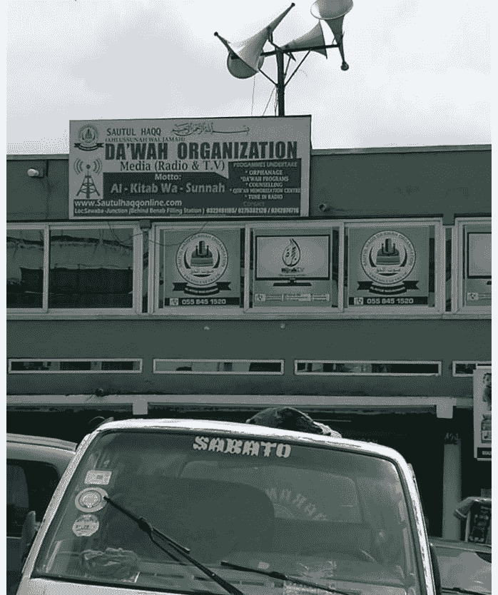

图13 库马西达瓦组织的指示牌。Sautul Haqq是一个萨拉菲组织。摄影：霍尔格·魏斯/2022

加纳穆斯林团结组织（Organization for Muslim Unity Ghana，简称OMUG）是一个总部位于塔马利的达瓦组织，成立于2000年，是该国北部地区一项倡议的典范。2007年，作为其向北部地区农村社区开展外联活动的一部分，该组织成立了宰通教育和慈善服务中心（Zaitun Center for Education and Charitable Services）。宰通中心拥有一台专门用于翻译和印刷伊斯兰书籍的印刷机。其创始人兼主任谢赫·穆罕默德·巴巴·格贝托布（Sheikh Muhammad Baba Gbetobu）的主要成就是将《古兰经》翻译成达格巴尼语。此外，宰通中心还建立了幼儿园和小学，并计划在该综合体上附设一所孤儿院，并将学校扩建为一所伊斯兰学院——达鲁-萨哈巴学院（Darus-Sahabah College）。与加纳许多其他穆斯林非政府组织一样，谢赫·穆罕默德·巴巴·格贝托布的非政府组织依赖外国捐助者；他之前的项目，包括《古兰经》的达格巴尼语翻译和印刷，均由沙特阿拉伯的捐款资助。宰通中心的网页也以英文和阿拉伯文呈现，以吸引资金用于他的清真寺项目。[^150]

法赫鲁伊斯兰基金会（Fakhrul Islam Foundation，简称FIF）则是总部位于苏尼亚尼的一个当地穆斯林信仰组织。其主要重点是达瓦，以及在（原）布朗阿哈福地区的小学、中学和高等教育机构中组织穆斯林学生。[^151] 2019年，FIF在苏尼亚尼大都会及该地区的所有伊斯兰基础学校发起了"赋权穆斯林女孩"（Empowered Muslim Girl，简称EMG）俱乐部。[^152] 总部位于塔马利的苏菲达瓦平台——伊斯兰广播基金会（Islamic Radio Foundation，简称IRF）也有类似的目标，即通过教育赋权穆斯林女孩。[^153]

许多此类地方达瓦组织是当地伊玛目和活动人士在社交媒体上为清真寺、宗教学校、小学/初中校舍、水井钻探项目和人道主义救济筹集外部捐款和资金的尝试，例如当地达瓦组织伊斯兰援助加纳（Islamic Aid Ghana）[^154] 所做的此类尝试。

[^138]: "我们的产品供应/使命"，`https://www.facebook.com/felujah/photos/a.277352365981897/1333105850406538`，2021年3月11日，访问于2021年9月29日。有趣的是，TIM的Facebook账户上找不到愿景/使命文本！

[^139]: `https://www.facebook.com/Esidofficial`，2019年5月8日，2021年5月12日，访问于2022年8月5日。

[^140]: `https://www.facebook.com/Esidofficial`，2019年3月2日，2019年11月1日，访问于2022年8月5日。

[^141]: `https://www.facebook.com/Esidofficial`，2020年4月2日，访问于2022年8月5日。

[^142]: `https://www.facebook.com/Esidofficial`，2020年8月31日，访问于2022年8月5日。

[^143]: `https://www.facebook.com/NafthessfoundationGhana`.

[^144]: `https://www.facebook.com/SUNNA-HAUSA-Relief-Organization-122639568466788/`，2018年7月4日，访问于2021年12月30日。

[^145]: `https://www.facebook.com/MUASSAIMA`.

[^146]: `https://www.facebook.com/hoperoad20`.

[^147]: `https://m.facebook.com/Islamic-Foundation-Centre-Ghana-107079227466612/`.

[^148]: 另见 `https://www.facebook.com/Paragon-Foundation-972936829397174/` 和 `https://www.facebook.com/fatimafaridaacademy/`，访问于2022年1月12日。

[^149]: 对谢赫·阿卜杜勒·纳西尔-丁的采访，库马西，2017年12月12日。

[^150]: 另见 `http://www.imamzaitun.com/` 和 `https://www.facebook.com/Zaitun-Center-for-Education-and-Charitable-Services-1739132076385280/`。

[^151]: `https://www.facebook.com/FIFghanaBA`.

[^152]: 哈桑·南克韦（Hassan Nankwe），"赋权穆斯林女孩（EMG）俱乐部在苏尼亚尼启动"，2019年2月24日，`https://www.modernghana.com/news/917707/empowered-muslim-girl-emg-club-launched-in-sunya.html`，访问于2021年7月25日。

[^153]: Hutuba——布道真人秀，`https://www.facebook.com/Sufilifefoundation`，访问于2022年8月2日。

[^154]: "我们需要资金在加纳学校建造清真寺"，2015年5月25日，`https://www.facebook.com/Islamic-AID-GHANA-26077845416244/`，访问于2016年1月26日；自2016年以来Facebook上无更新。

在阿特布布，与位于奥布瓦西的 *Urbanhive Charity Foundation*，¹⁵⁵ 或 *Al-Muslim Foundation Ghana*。¹⁵⁶ 一些组织成功地从外部/外国捐助者（通常是沙特慈善家）为其项目筹集资金。其中包括位于库马西的 *Al-Imam Charity Foundation*、位于恩斯瓦姆的 *Darus Salaam Humanitarian Foundation*，以及位于苏尼扬尼的 *Al-Islah Humanitarian Foundation*，用于其钻井和水井项目。¹⁵⁷ 位于塔马利的 *Lights of Guidance and Humanity Foundation* 则是一个第二代 *dawatist* 组织的例子，因为它既依靠外国捐助者，也自2021年起为组织其前往北部地区农村村庄的斋月 Daʿwah 巡回活动筹集自己的资金。¹⁵⁸ 谢赫哈比卜·穆罕默德·巴巴古纳的 *Qawiyun AMIN Foundation* 则在 Facebook 上用阿拉伯语、英语和土耳其语发布了为奖学金、清真寺和水项目筹集资金的请求，并成功从土耳其非政府组织获得捐款，用于在埃朱拉/塞基杜马塞区各个城市和农村社区钻井。¹⁵⁹

*Nurul Bayaan* 的教育综合体项目，由一所高级中学、孤儿院、诊所和清真寺组成，体现了使用社交媒体所实现的跨国联系。¹⁶⁰ 该组织始于2016年3月的一个 WhatsApp 平台，用于连接德国当地成员和侨民，并在加纳和德国注册，总部设在杜伊斯堡，在大阿克拉地区的阿沙伊曼设有办公室。最初是一个 daʿwa 组织，它很快将其核心目标纳入其中，以推动教育、社会和健康干预措施。结果，它提出了一个多功能建筑综合体的雄心勃勃的计划，并在大阿克拉地区 Kwabenya 和 Afienya 之间获得了土地。捐款呼吁（sadaqa jariya）发布在其 Facebook 账户上，通知捐助者将款项汇入该组织在德国的银行账户。建设于2020年5月开始，该组织一直渴望通过在其 Facebook 账户和主页上发布视频片段来展示项目的进展。¹⁶¹

许多穆斯林青年协会是 daʿwa 组织，例如位于阿克拉的 Ghana Islamic Youth Foundation 和 Abofu Faila Youth Association，¹⁶² 位于库马西的 Federation of Responsible Muslim Youth Ghana，¹⁶³ 位于卡佩海岸的 Federation of Muslim Youth Groups—Ghana、Banu Abdalla Faida Youth、位于 Sekondi Zongo 的 Tijaniyya 青年翼，¹⁶⁴ 位于阿克拉的 Tijani 青年运动 Baye Do Everything，¹⁶⁵ 或 Yendi Moslem Youth Research Foundation，¹⁶⁶ 等等。例如，Dawahstorm 或 TDG-GH 自2014年起就已运营。该团体主要面向非穆斯林，并在英语、埃维语、加语、豪萨语和特威语中传播有关伊斯兰的信息。其 Facebook 账户定期发布来自其主要推动者 Imoru Abdulai Sadat 的公告和 YouTube 视频。¹⁶⁷ 此外，Dawahstorm 和 Imoru Sadat 的 Facebook 账户都转载了英国 daʿwa 组织 IERA（伊斯兰教育与研究学院）加纳分部的更新。¹⁶⁸ 位于博诺东区的 Kwame Danso 的 Salafi 青年团体 Shafa Zongo Youth Foundation 于2020年成立，呼吁其成员捐赠 sadaqa jariya 以支持其计划的人道主义外展活动，例如支持孤儿和寡妇、建设钻井、学校和医院。¹⁶⁹ 到目前为止，该团体已能够在 Shafa Zongo 开始建造一所新的伊斯兰（Makaranta）学校。其他组织，如 Network for Zongo Transformation，是旨在聚集和激励来自 Zongo 社区在加纳大学就读的学生¹⁷⁰ 的倡议，而位于阿克拉的 Ahlussunnah Youth Association 则与位于库马西的 Salafi 学院 Umma Academy 在其在线 daʿwa 中合作。¹⁷¹ Center For Muslim Youth 则于2017年4月发起了一次零废弃社区集会，并于2019年1月与 Community Redemption Foundation 共同在库马西组织了 Zongo Youth Re-Awakening Summit。¹⁷²

位于瓦的 Muslim Youth Association (MYA) 将自己定义为非教派性的：“在 MYA，没有逊尼派、瓦哈比派、提贾尼派。我们相信我们都是穆斯林，团结起来可以取得更多成就”，其页面上这样写道。其使命是促进伊斯兰教的研究，并“鼓励穆斯林，尤其是青年，过上更有责任感的公民生活。”¹⁷³ 与其他 Zongo 青年运动一样，其在 Facebook 上的基调包含对 Zongo 社区当代社会和政治挑战的批判性方法，既涉及代际冲突，也倡导青年发起变革能力的积极形象：

> 在一个权力被少数精英主导的世界里，在一个资源被支配者——显而易见的是政治家——掌控的社区里，每个人似乎都放纵了。当某人自任治理职位时，当事情进展不顺利时，他/她理应被追究责任。对这种立场进行批评并不完全是错误的。然而，我们需要改变这一点，使其不再成为日常秩序。确实，当我们面临众多棘手问题时，这还能持续多久。我们未能承认和欣赏我们在与我们社区欠发展状态作斗争中所拥有的能力；我们的 educa-

155. `https://www.facebook.com/Urbanhive-Charity-Foundation-11661860639167`.

156. Al-Muslim Foundation Ghana：“我们旨在帮助穆斯林社区在伊斯兰方面发展——建造清真寺、伊斯兰教育、奖学金、钻井等，” https://www.facebook.com/Al-Muslim-Foundation-GHANA-404459083670757，于 3.1.2022 访问。 Facebook 账户不包含任何帖子。

157. 关于 Al-Imam Charity Foundation，参见带有铭牌/路标告知其捐助者的已完工水井照片，例如 23.6.2021，https://www.facebook.com/alimancharityfoundation/photos/pcb.208826037768307/208824934435084，https://www.facebook.com/alimancharityfoundation/photos/pcb.208826037768307/2088248310... 均于 25.8.2021 访问。关于 Darus Salaam Humanitarian Foundation 的水项目，参见 https://www.facebook.com/Darus-Salaam-Humanitarian-Foundation-281529848467177，5.5.2019 和 6.5.2019，于 30.12.2021 访问。关于 Al-Islah Humanitarian Foundation，参见 https://www.facebook.com/Al-Islah-humanitarian-foundation-Ghana-100215518087377/，2.11.2019，于 3.1.2022 访问。

158. https://www.facebook.com/Lights-of-Guidance-Humanity-Foundation-...

159. https://www.facebook.com/qawiyunaminf/，4.6.2020，5.6.2020，27.9.2021，2.12.2021 于 2.8.2022 访问。

160. 参见 https://www.facebook.com/106080131094295/photos/pb.100057422140647.-220752000/155155642853410/?type=3，1.8.2020，于 27.5.2024 访问。

161. Nurul Bayaan 项目（高级中学、孤儿院、诊所和清真寺）的介绍，视频（豪萨语）7.7.2021，https://www.facebook.com/106080131094295/videos/836374280417238，于 11.9.2021 访问。

162. https://www.facebook.com/Ghana-Islamic-Youth-Foundation-143751339162890；https://www.facebook.com/profile.php?id=100064802853768（Abofu Faila Youth Association），于 24.8.2022 访问。

163. https://www.facebook.com/FORMYGHANA/，于 23.8.2019 访问。该团体主要在2015年和2016年在 Facebook 上活跃，此后偶尔更新。

164. https://www.facebook.com/Banu-Abdalla-Faida-1530194497096201/.

165. https://www.facebook.com/BayedoEverything/?ref=page_internal.

166. https://www.facebook.com/YMYRF/.

167. https://www.facebook.com/Dawahstorm。关于 Imoru Sadat 的 Facebook 账户，参见 https://www.facebook.com/profile.php?id=100044449881575。

168. https://www.facebook.com/IERA-GHANA-111394317313530；https://iera.org/about/.

169. https://www.facebook.com/shafazongoyouthfoundation/；Facebook 上的海报，https://www.facebook.com/shafazongoyouthfoundation/photos/a.100465635518438/256200272878306，26.3.2021，于 12.8.2021 访问。

170. https://www.facebook.com/Network-for-Zongo-Transformation-Ghana-101950703206082，于 24.8.2022 访问。

171. https://www.facebook.com/Ahlusunnah-Youth-Association-101484918189603，于 24.8.2022 访问。

172. https://m.facebook.com/CMY2015/；公告“Zongo Youth Re-Awakening Summit 2019”的海报，29.12.2018，https://www.facebook.com/crfgh/photos/ecnf.100002031752923/2539894112748717/，于 24.8.2022 访问。然而，似乎 CMY 在峰会后不久就停止了活动，因为其 Facebook 账户的最后一次更新来自2019年10月。

173. https://www.facebook.com/MYAUWR/，于 10.8.2021 访问。

国家机构、卫生设施、应急救护车服务不可用，等等。我们至多不过是舒舒服服地坐在营地里，把责任推给我们的领导人——总统及其任命官员、意见领袖、神职人员以及其他身居领导职位的人。然而，我们总是没有责备自己。坐在营地里抱怨的你，用手机读到这篇文章的你，问问自己：“我为穆斯林同胞的生活做了些什么？我为社区的发展在经济上付出了什么？”174

虽然清真寺综合体的建设在已制度化运作的团体和社区中议程排序很高，但建立包括旅馆和诊所的教育综合体的愿望却是一个较近期的现象。许多达瓦（daʿwa）组织最初是以传教士为中心的平台，在其成员和当地穆斯林社区中传播伊斯兰教，但近年来已着手开展教育项目。位于阿希曼（Ashaiman）的萨拉菲派（ASWAJ）Fikrul Islam Association就是一例。该组织于2015年注册为Fikrul Islam Daʿawah Association，175 于2019年9月获得一英亩土地。176 两个月后，它以Fikrul Islam Association的名义重新成立，177 并向其成员发出建设学校、诊所和清真寺的呼吁。178

穆斯林青年达瓦协会（AMYDA）是一个当地萨拉菲达瓦组织通过社交媒体开展斋月活动的例子。AMYDA在东部地区阿基姆奥达（Akim Oda）的旧城藏戈（Old Town Zongo）开展活动。在2020年4月建立Facebook账户后，该组织于一个月后发布了其2020年斋月活动公告：

> 公告：作为上述协会宗教、社会和公司责任的一部分，我们因此呼吁加纳境内外的所有个人和公司机构或组织，支持
>
> 我们帮助藏戈社区中的穷人、贫困者、孤儿和弱势群体的倡议，尤其是在这尊贵的斋月之际。179

接下来的发展是社交媒体时代典型的非政府组织做法。从5月10日开始，AMYDA的工作人员不断发布通知和更新：

- 5月10日：“第一批食品捐赠已在阿基姆奥达藏戈和阿森（Asene）营地完成。第二批预计很快完成，因沙安拉。非常感谢我们的捐赠者和赞助者……还需要做更多。”
- 5月16日：“第二批食品捐赠已完成……我们的大门仍然向你们敞开，欢迎支持第三批捐赠和分发。”180

他们还发布了几段展示向藏戈社区贫困成员捐赠食品的短视频。然而，由于未知原因，AMYDA要么在2020年斋月后停止了活动，要么不再使用Facebook作为沟通工具，因为其Facebook账户自2020年11月以来一直没有更新。

与AMYDA类似，许多穆斯林青年协会和组织在2020年和2021年新冠疫情期间在全国各地开展了广泛活动。如前所述，2020年春季的封锁导致非官方团体和网络与既有协会一起，利用社交媒体，尤其是Facebook，作为其沟通和互动的主要工具，尤其是在斋月开斋饭和开斋节活动中（另见第3.1章）。其中一些组织发起了为抗击新冠病毒提供免费消毒剂筹集资金的活动，或利用Facebook传播有关该病毒以及如何保护自己的信息。其中一个组织是位于海岸角（Cape Coast）的萨拉菲青年组织加纳伊斯兰圣战基金会（GISJF；自2021年8月起称为加纳伊斯兰慈善基金会，GISF），该组织于2021年3月初在Facebook上发布了此类呼吁。181 然而，在进行了一些临时活动后，该组织重新回到达瓦活动，于2021年秋季与伊斯兰圣训频道（ASWAJ）合作，此后一直推广其在线电视节目和视频。182

179 捐款呼吁，https://m.facebook.com/101892801512288/photos/a.10190704484497/106414881060080/?type=3&source=48，发布于2020年4月30日，访问于2021年8月2日。

180 https://www.facebook.com/Association-of-Muslim-Youth-for-Dawah-101892801512288，2020年5月10日，2020年5月16日，访问于2022年8月24日。

181 https://www.facebook.com/GISF-Ghana-Islamic-sadaqqa-foundation-10624879427932/，2021年3月6日，访问于2022年8月24日。

上文和先前提到的大多数捐款呼吁和项目都与加纳的萨拉菲派或非苏非派群体和社区有关。苏非派社区，如加纳提加尼穆斯林运动（TMG），在通过社交媒体公开呼吁捐款来调动资金方面是后来者。然而，这一情况在扎伊姆（Zaeem，主席）谢赫阿卜杜勒·瓦杜德·哈伦（Sheikh Abdul Wadud Harun）的领导下发生了改变，他于2009年在阿散蒂地区埃吉苏（Ejisu）附近的阿索科雷（Asokore）建立了提加尼高级中学。183 此外，TMG还建立了主页并开设了Facebook账户，于2018年8月发起了一项在线活动（2021年9月重新激活），为提加尼高级中学的基础设施扩建、在大阿克拉地区阿金·科托库（Agyin Kotoku）建设和建立提加尼教育综合体，以及建设计划中的加纳提加尼大学学院筹集捐款。184

另一个提加尼社区——Jallo Tijānīyya（加纳提加尼穆斯林理事会），也在谢赫哈利法·艾哈迈德·阿布勒·法伊德·迈卡诺（Sheikh Khalifa Ahmad Abul-Faid Maikano）的领导下，并于2015年成立谢赫阿卜杜拉·迈卡诺慈善基金会之后，开始公开筹集资金。与TMG类似，Jallo Tijānīyya的捐款呼吁主要涉及教育设施和综合体的建设，例如普朗（Prang）的一所职业培训学院。185 提加尼穆斯林理事会在2019年年度圣纪（Mawlid）期间宣布了这个名为“谢赫阿卜杜拉希·艾哈迈德·迈卡诺教育综合体”（Sheikh Abdullahi Ahmed Maikano Education Complex）的项目。项目最终落地的具体步骤始于2022年2月，当时在建筑工地举行了破土动工仪式，最终向其成员发出了捐款呼吁。186

182 伊斯兰圣训频道位于 https://www.facebook.com/ISC-Online-TVradio-6o6783713310150。

183 Atiku Iddrisu，“加纳：提加尼开展教育项目”，2006年7月19日，https://allafrica.com/stories/200607190835.html，访问于2019年5月14日；http://www.tijjaniyamuslimsgh.org/photos?gallery_id=156a445688bc3&pn=2

184 http://www.tijjaniyamuslimsgh.org/events?event_id=15b4b8c88a38a0a&pn=3，访问于2019年5月14日。该主页此后已失效。更新通过Facebook进行，例如，“重要公告”，2021年9月10日，https://www.facebook.com/profile/100022272312293，访问于2024年5月27日。

185 https://www.facebook.com/jalloNgo/photos/pcb.1838774063069437/1838773919736118/?type=3&theater，访问于2019年5月14日。

186 “纳纳·法尼亚纳马（Nana Fanyinama）为谢赫阿卜杜拉·迈卡诺教育综合体的建设捐款”，https://business.facebook.com/pg/Jallottv/posts/?ref=page_internal，2022年1月24日；谢赫阿卜杜拉·艾哈迈德·迈卡诺教育综合体破土动工邀请，包括综合体的建筑图纸，https://business.facebook.com/pg/Jallottv/posts/?ref=page_internal，2022年1月24日，访问于2022年2月3日。

2019年11月，*Jallo青年服务组织*（JYKO）创始人兼主席谢赫海鲁·阿卜杜拉·迈卡诺（Sheikh Khairu Abdullahi Maikano）敦促世界各地的Jallo提加尼青年加入并支持JYKO的健康教育和健康促进活动。187 在先前于普朗举行的圣纪活动中，JYKO组织了健康筛查，并花费10,600加纳塞地（GHS）提供了20个移动厕所；2020年的圣纪和Tilawa活动中再次如此。188 然而，最终目标是将健康筛查活动转化为一个标准、永久的卫生设施，即计划在普朗建造的巴阿巴·格瓦纪念医院（Baaba Geewa Memorial Hospital），将通过Jallo青年的捐款来实现。189

近年来，一些地方提加尼人道主义倡议不断发展。谢赫马斯伍德·阿卜杜勒·拉赫曼·西塞（Sheikh Maswud Abdul Rahman Cisse）在（约）2010年创立了*劳达图尔·里贾尔基金会*。他的非政府组织主要专注于达瓦活动，以及在克韦辛齐姆藏戈（Kwesimintsim Zongo）和塔科拉迪（Takoradi）的禁毒运动和人道主义救济活动。2020年10月，该基金会宣布支持可持续发展目标第二项目标，即消除饥饿。190 此外，*马拉姆·提加尼·科福里杜阿基金会*于2021年成立，旨在监督并完成已故的谢赫艾哈迈德·提加尼·阿卜杜勒·拉赫曼（马拉姆·提加尼）在科福里杜阿藏戈（Koforidua Zongo）发起的社区图书馆项目。191 位于塔马利（Tamale）的*伊斯兰造福所有人组织*与阿克拉的谢赫拉希德·侯赛因·萨尔瓦特（Sheikh Rashid Hussein Salwat）的萨尔瓦提亚伊斯兰传播中心（Salwatiyya Islamic Propagation Center）联系紧密。192

## 2.3 非教派、非部落、非政治：GMM与IMS

*加纳穆斯林传教会*（GMM）是加纳最古老的穆斯林组织之一。它最初于1957年作为一个代表加（Ga）穆斯林利益的协会而成立，其最初的框架是族裔性的而非教派性的，其活动……

### 表4 加纳穆斯林宣教团在Facebook上的情况

| 分支 | Facebook，成立/最近更新 | FB（2021年12月） | FB（2022年8月） |
|---|---|---|---|
| 加纳穆斯林宣教团 | 2016/2017 | 3,054 | 3,218 |
| 加纳穆斯林宣教团 | 2017/2022 | 152 | 183 |
| GMM——阿散蒂 | 2011/2020 | 6,962 | 8,113 |
| GMM中部地区 | 2014/2022 | 5,903 | 11,261 |
| GMM妇女联谊会东部地区 | 2019/2019 | 1,138 | 1,531 |
| GMM青年大阿克拉 | 2014/2019 | 1,887 | 1,805 |
| GMM青年中部地区 | 2020/2022 | 4,167 | 9,218 |
| GMM青年贝波索分支 | 2022/2022 | 0 | 2,527 |
| GMM学生联合会 | 2019/2022 |  | 1,354 |
| GMM电视台 | 2019/2022 | 56,419 | 58,889 |

活动仅限于大阿克拉地区。在接下来的几十年里，这一状况变化缓慢，因为加纳穆斯林宣教团（GMM）试图淡化其族群属性。最终，GMM成功地将活动扩展到了阿克拉以外，并将自己确立为一个直言不讳的多族群、非教派、非宗派、无党派立场的逊尼派穆斯林组织。193

GMM拥有一个结构化的组织框架，由地方、地区和省级分支组成。基本单位是地方分支，成员每月缴纳捐款（infaq）以支持GMM的议程。三个层级均设有执行委员会。组织金字塔的顶端是国家执行委员会，负责国家层面的决策和行政事务。地区、省级和国家层面会组织会议及其他筹资活动，194自2007年起，该组织的妇女部也参与其中。195该组织及其分支活跃于互联网和社交媒体上（见表4），尽管其主页自2016年以来未曾更新。

随着扩展，GMM开始致力于增强加纳穆斯林的能力。这原本是该组织的宗旨和目标之一，但在第一个十年里，重点一直放在自助和援助成员，以及向成员传授伊斯兰教知识、公民意识、社会、健康和其他发展问题上。然而，随着活动扩展到全国其他地区，GMM的工作重心已转向大规模调动资源，用于建立各级教育机构，并为品学兼优但经济困难的学生提供奖学金。此外，GMM还投资兴建清真寺、医疗中心和诊所（见第4.4章），提供医疗和社会服务以支持贫困者、老年人、残疾人和病人，并钻探水井。196这些目标主要通过年度捐款（infaq）和地区天课基金（见第5.3.2章），或通过其作为宗教公产（awqaf）设立的商业和贸易企业的收入来实现，见第6.3章。有时，该组织还与其他穆斯林非政府组织和慈善机构合作开展联合外展项目。例如，2022年12月，GMM与光明基金会和美国穆斯林慈善机构阿尔-拉赫曼基金会合作，在大阿克拉地区组织了免费医疗筛查。197此外，宣教团通过其捐赠基金、寡妇和孤儿基金、教育和健康基金以及创业基金来支持其社会干预项目。

一个特别关注的领域是GMM运营的各种教育项目，这也是GMM全国主席谢赫·阿明·邦苏博士的主要工作重点。邦苏谢赫在2013年第55届全国会议上指出：“……加纳穆斯林社区的祸根是无知，以及缺乏推动其发展的全面教育”，198并在2017年的一次采访中进一步强调：

> 让我们努力建设更多学校，以照顾穆斯林儿童的精神和学业发展。一些学校的穆斯林学生不被允许践行自己的信仰，这对孩子的心理造成了影响。199

因此，该组织运营着165个教育单位，包括150多所基础学校综合体，涵盖幼儿园、小学和初中，以及两所政府资助的高中：库马西的伊斯兰高级中学（1969年成立，图14）200和2008年在阿散蒂省塞基雷-贝波索建立的加纳穆斯林宣教团高级中学。201此外，宣教团还在布伊佩（萨凡纳省）和贝波索开办伊斯兰师范学院，为伊斯兰教育单位下属的学校培养教师。202在2010年代，宣教团启动了一项雄心勃勃的计划，以扩大其高等教育机构，并在阿桑克拉瓜和塞夫维-博阿科（西部省）、曼卡西姆（中部省）、科福里杜亚和东科克罗姆（东部省）以及多梅阿布拉（大阿克拉省）购置土地，用于建立高中。203此外，该计划还包括在博诺东部省阿特布布附近的米姆建设一所护士和助产士培训学院，204以及在库库姆（阿哈福省）和科福里杜亚（东部省）建设教育学院。205

GMM各教育项目的资金筹措遵循一种模式，科福里杜亚项目的宣传活动对此有所说明。该项目于2017年启动，GMM教育项目在第二届年度会议上进行了募捐呼吁。

193 进一步参见Mumuni，《阿克拉的伊斯兰组织》，66、117–122；Nana Apau-Gyekye，《加纳穆斯林宣教团对加纳穆斯林社区发展的贡献》，加纳大学宗教研究系硕士论文，2010年；Rabiatu Deinyo Ammah，“加纳穆斯林以‘成为穆斯林’促进可持续发展”，载于《宗教与可持续发展：加纳视角》，George Ossom-Batsa、Nicoletta Gatti和Rabiatu Deinyo Ammah主编（梵蒂冈城：乌尔班纳大学出版社，2018年），227–242。

194 “关于宣教团”，`http://ghanamuslimmission.com/the-mission/`，访问于2022年1月16日。

195 加纳穆斯林宣教团妇女联谊会东部地区发布的帖子，2019年6月27日：第12届全国妇女会议，为学校项目筹款，`https://www.facebook.com/pg/Ghana-Muslim-Mission-womens-Fellowship-Eastern-Region-547889672409193/posts/?ref=page_internal`，访问于2021年8月2日。

196 “我们的使命”，`http://ghanamuslimmission.com/the-mission/`，访问于2022年1月16日。

197 “加纳人被告知要对自己的健康负责”，2022年12月5日，`https://gna.org.gh/2022/12/ghanaians-charged-to-take-responsibility-of-their-health/`，访问于2023年12月5日。

198 Rafiq A. Tschannen，“穆斯林宣教团在加纳建立13所教育机构”，`https://newsghana.com.gh/muslim-mission-establishes-13-educational-institutions-in-ghana/`，访问于2022年1月16日。

199 “穆斯林宣教团建设更多学校”，2017年7月4日，`https://dailyguidenetwork.com/muslim-mission-builds-schools/`，访问于2021年8月2日。

200 “GMM接管学校”，2005年10月11日，`https://www.modernghana.com/news/87859/gmm-takes-over-school.html`，访问于2021年8月2日。这所伊斯兰学校由沙特阿拉伯的捐赠创办。

201 加纳穆斯林宣教团高级中学，贝波索-阿散蒂，加纳，`https://ghammish.blogspot.com`。

202 “教育机构”，`http://ghanamuslimmission.com/educational-institutions-2/`，访问于2021年8月2日。贝波索的单位此后已升格为教育学院大学学院。2022年，有250名学生获得GMM奖学金在该大学学院学习，采访GMM全国主席谢赫·阿明·邦苏，阿克拉，2022年10月13日。

203 “教育机构”，`http://ghanamuslimmission.com/educational-institutions-2/`，访问于2021年8月2日。

204 “教育机构”，`http://ghanamuslimmission.com/educational-institutions-2/`，访问于2021年8月2日。

205 “政府将支持GMM的教育学院项目——副总统”，2019年12月25日，`https://www.rainbowradioline.com/govt-will-support-college-of-education-project-by-gmm-veep/`，访问于2022年1月16日（项目在库库姆启动）；“巴武米亚支持GMM教育学院”，2018年1月6日，`https://www.modernghana.com/news/826788/bawumia-supports-gmm-college-of-education.html`，访问于2021年8月2日（项目在科福里杜亚启动）。

然而，谢赫·阿明·邦苏博士（Sheikh Dr Amin Bonsu）最具雄心的教育项目是创办一所大学。加纳穆斯林传教会（GMM）于2009年启动了该项目，在库马西附近的埃斯雷索获得了9.5英亩土地，²¹⁰ 于2012年开始为其耗资1860万加纳塞地（约30.1万美元）的加纳穆斯林传教大学学院（Ghana Muslim Mission University College）平整场地，²¹¹ 并于2014年筹集了2万加纳塞地（约3.23万美元）用于支持基础设施建设。²¹² 2015年，GMM阿散蒂大区在召开区域会议后呼吁加纳国内外的会员支持该项目：“那些因各种原因无法出席的人，你们仍然可以支持伊斯兰大学项目 [...]。”²¹³ 2016年，在第58届全国会议上，全国副主席穆罕默德·杜阿博士（Dr Mohammed Duah）呼吁政府和利益相关方与GMM合作以确保项目成功，同时会议敦促会员继续为该项目捐款。²¹⁴ 其愿景是建立一所设施完善的大学，开设伊斯兰神学与教育、语言学与教育及国际关系、商业课程（包括物流与采购、商业管理与人力资源管理），以及护理、医学和工程等科学课程。²¹⁵

GMM最初的一个分支——*伊斯兰传教秘书处*（Islamic Mission Secretariat，IMS）于1963年在库马西作为一个脱离团体逐渐发展起来，由谢赫·亚当·穆罕默德·阿皮杜（Sheikh Adam Mohammed Appiedu）领导。²¹⁶ 1980年代末，IMS成为一个独立团体。

年——宗戈部长，” 2020年10月29日，`https://awakenewsroom.com/government-will-build-an-islamic-university-college-of-education-with-getfund-next-year-zongo-minister/`，访问于2021年8月2日。

210. “加纳穆斯林传教会在库马西附近建立大学，” 2009年12月8日，`https://www.modernghana.com/news/253166/ghana-muslim-mission-to-establish-university.html`，访问于2021年8月2日。

211. “伊斯兰大学学院工程动工，” 2012年11月19日，`https://www.ghanaweb.com/GhanaHomePage/NewsArchive/Work-starts-on-Islamic-University-College-256905`，访问于2021年8月2日。

212. “穆斯林传教会在加纳再建一所大学，” 2014年12月30日，`https://www.newsghana.com.gh/muslim-mission-build-another-university-ghana/?__cf_chl_jschl_tk__=pmd_7o5fcdf55298ab95o4cd5944e2oaf48ab13230-1627897425-0-gqNtZGzNAg2jcnBszQjO`，访问于2021年8月2日。

213. `https://www.facebook.com/permalink.php?story_fbid=1033705090013071&id=167077143342541`，2015年12月5日，访问于2021年8月2日。

214. “加纳穆斯林传教会举行第58届全国年会，” 2016年11月17日，`https://www.ghanabusinessnews.com/2016/11/17/ghana-muslim-mission-holds-58th-annual-national-conference/`，访问于2021年8月2日；`https://www.facebook.com/167077143342541/photos/a.1256606464389598/1256606401056271/?type=3&theater`，2016年10月30日，访问于2021年8月2日。

215. “高等教育，” `http://ghanamuslimmission.com/author/gmm_admin/`，访问于2021年8月2日。

216. `https://www.facebook.com/IslamicMissionSecretariatGh/`。

此后，IMS在全国范围扩展。它积极推动加纳的伊斯兰教育和世俗教育，并在全国各地开办多所学校。2005年，IMS宣布计划在阿哈福大区塔诺北市政区的杜亚尤-恩夸塔（Duayaw-Nkwanta）建造一所伊斯兰教师培训学院，并为此项目筹集了5500万加纳塞地（4700美元）。²¹⁸ 十年后，在其第50届全国大会上，时任IMS全国书记谢赫·奥斯曼·穆斯塔法·奥波库（Sheikh Osman Mustapha Opoku）宣布计划建造一所伊斯兰大学教育学院，并告知听众，传统当局已为该项目划拨了约120英亩土地。此外，IMS还设想在苏尼亚尼的特奇曼和新多尔马建造医院，详见第4.4章。²¹⁹ 自2022年起，IMS运营自己的在线电视频道。²²⁰

IMS最终通过全国性筹款项目完成了其学院项目，尽管在此过程中其结构变为了一所伊斯兰高中/技术学校。2022年1月，IMS为新学校发布了公开招聘公告（校长、伊玛目、教师、行政人员、会计、财务人员、秘书、女舍监、保安、杂工和仓库管理员）。四个月后，它发布了新学校的招生通知。²²¹

217 `https://www.facebook.com/IslamicMissionSecretariatGh/`。

218 “伊斯兰传教团为培训学院筹集5500万塞地，” 2005年3月，`https://www.modernghana.com/news/72829/islamic-mission-bagged-55-million-cedis-for-training-college.html`，访问于2022年8月24日。

219 “伊斯兰传教秘书处举行第50届全国大会，” 2015年1月11日，`https://www.ghanaweb.com/GhanaHomePage/NewsArchive/Islamic-Mission-Secretariat-holds-50th-Annual-National-Convention-342108`，访问于2022年8月24日；“伊斯兰传教团设想在西部省建造医院，” 2015年1月11日，`https://newsghana.com.gh/islamic-mission-envisages-constructing-hospitals-wr/`，访问于2022年12月5日。

220 `https://www.facebook.com/IMS-TVGH100972669248188/`。

221 `https://www.facebook.com/Islamic-Mission-Secretariat-Youth-Wing-Techiman-Bono-East-389172531927708`，2022年1月7日、2022年4月15日，访问于2022年8月24日。

## 2.4 低调但可见且具有影响力：GISER 与加纳人道至上组织

黎巴嫩和艾哈迈迪亚的非政府组织已经活跃了几十年。与其他地方或国际穆斯林非政府组织相比，它们的活动很少成为头条新闻。然而，在教育、医疗保健项目和人类发展方面，它们的影响深刻改变了当地社区。

加纳黎巴嫩社区的起源可以追溯到1890年代，当第一批黎巴嫩商人和企业家开始在黄金海岸经商。此后，这个包括基督徒和穆斯林家庭的社区人数不断增长。其中大多数拥有加纳公民身份，有些人已与加纳家庭通婚。黎巴嫩企业家名列加纳最富有的人之列，一个领先的黎巴嫩家族企业也是该国最成功的企业之一。自1920年代以来，为黎巴嫩社区服务的社会协会和俱乐部一直存在，包括叙利亚-黎巴嫩慈善协会。²²²

几十年来，黎巴嫩社区整体上很少参与社区发展。1985年，一群黎巴嫩和加纳企业家创立了加纳伊斯兰教育与社会改革协会（GISER），这一情况发生了改变。作为加纳最古老的穆斯林非政府组织之一，总部位于阿克拉的该非政府组织专注于三大核心使命领域：教育、社区发展和宗教意识。GISER在阿克拉都市区建立并管理了多所教育机构，包括麦地那伊斯兰学校（MIS）、²²³ 加纳-黎巴嫩伊斯兰学校（GLIS）、²²⁴ 阿尔拉扬国际学校²²⁵ 和《古兰经》与伊斯兰研究学院（CQIS），²²⁶ 以及位于库马西的穆斯林教师培训学院（MTTI）。²²⁷

222 斯蒂芬·贾西（Stephen Gyasi），《黎巴嫩在加纳的影响》，《Top Reports》，加纳/黎巴嫩特别报告，2011年6月18日，`https://www.topreports.org/wp-content/uploads/2018/06/Ghana_Lebanon_2011.pdf`，访问于2021年7月27日。

223 MIS自2006年起运营，包括一所幼儿园、一所小学和一所初中。

224 GLIS综合体建于2000年，2001年5月投入使用，包括一所小学、一所初中和一所高中，以及一个阿拉伯语学习部。

225 成立于2003年。该校还开设ARIS周六阿拉伯语课程，该课程于1997年创办，旨在为阿克拉的阿拉伯社区儿童提供伊斯兰和阿拉伯语教育。

226 CQIS位于大阿克拉郊区麦地那。它采用苏丹非洲国际大学的课程。其教育项目为四年寄宿制，每年招收50名来自加纳和西非国家的学生。GISER承担教育、住宿、伙食、日常开支以及往返本国的交通费用。

227 MTTI成立于1999年，于2019年从阿克拉迁至库马西。该学院开设三年制教育项目，招收来自加纳及其他西非国家的学生。

艾哈迈迪亚传教士则于1921年在黄金海岸定居，随后在萨尔特庞德和瓦城建立了艾哈迈迪亚社区。其中，关于伊玛目职位的摩擦导致与逊尼派穆斯林群体发生严重冲突，尤其是在1930年代的该国北部地区。阿赫迈底亚-逊尼派的紧张关系在随后的几十年中引人注目，但在二十世纪末有所缓和。228 虽然是逊尼派，尤其是萨拉菲派穆斯林教士与阿赫迈底亚人保持距离，将其定义为异端，但在加纳的机构——阿赫迈底亚穆斯林传教团（AMM）——在国家首席伊玛目办公室以及天课和萨达卡信托基金中均有代表。

阿赫迈底亚穆斯林传教团很早就通过福利活动开展传教，包括引入现代教育和医疗保健。从1924年创办的塔利姆·乌尔·伊斯兰阿赫迈底亚学校开始，阿赫迈底亚学校采用标准的英国课程，并提供阿拉伯语和伊斯兰宗教教学。阿赫迈底亚英语学校随后成立，得到了英国殖民地以及后来的加纳政府的财政支持。229 到二十一世纪初，阿赫迈底亚教育综合体包括托儿中心和幼儿园、小学、初中和高中，以及一所教师培训学院。230

自1970年代以来，阿赫迈底亚穆斯林传教团还开始在农村社区建设医院以提供医疗保健。231 作为这些活动的成果，卫生部承认AMM为官方卫生机构。232 通过努斯拉特·贾汉计划或服务人类计划，阿赫迈底亚医生成为阿赫迈底亚医院服务。五十多年后，该传教团在整个加纳运营着十二家医疗机构（另见第4.4章）。233 医院是通过第三任阿赫迈底亚哈里发米尔扎·纳西尔·艾哈迈德于1970年发起的努斯拉特·贾汉建立的。他还在巴基斯坦创立了阿赫迈底亚穆斯林医学协会，使阿赫迈底亚医生能够在阿赫迈底亚医院工作数周、数月或数年。此后，该协会已在许多国家产生分支机构，其中包括阿赫迈底亚穆斯林医学协会AMMA等，在英国、美国、澳大利亚和加拿大等地。²³⁴ 2021年，AMM启动了一项新的农村倡议，即植树。从2021年6月开始于北部地区库姆布ungu区，其计划是动员所有AMM分区团体并在全国范围内复制该项目。²³⁵

国际非政府组织 `Humanity First International` 于1995年加入了阿赫迈底亚社会福利机构。此前的协会如AMMA和国际阿赫迈底亚建筑师和工程师协会具有明显的宗教隶属关系。`Humanity First International` 然而并未将自己呈现为阿赫迈底亚组织。相反，正如Katrin Langewiesche所强调的，该组织面向一个国家的全体人口，并不突出其宗教隶属关系。她进一步指出，该组织在自我展示为阿赫迈底亚非政府组织方面存在变化趋势，与早期将其与阿赫迈底亚的关联置于背景中的情况形成对比。然而，她进一步强调 `Humanity First International` 并不是一个 `daʿwa` 组织，传教活动并不在其核心活动中。²³⁶

`Humanity First International` 在全球60个国家运营。²³⁷ 阿赫迈底亚和非阿赫迈底亚医生通过努斯拉特·贾汉或通过 `Humanity First` 在阿赫迈底亚医院服务；²³⁸ 例如，来自 `Humanity First USA` 的医生于2008年访问加纳，协助当地医生提供免费外科护理，²³⁹ 而来自 `Humanity First UK` 的团队于2019年访问加纳。²⁴⁰ 此外，`Humanity First International` 参与教育项目并协助阿赫迈底亚学校。例如，它于2018年启动了“教室改造项目”，此后 `Humanity First UK` 和 `Humanity First Norway` 已协助加纳的学校。241

与AMMA不同，`Humanity First` 在加纳设有分支机构，于1996年注册，总部设在阿克拉。242 `Humanity First Ghana` 开展了多个人道主义计划，包括年度外科任务项目、位于达博阿塞的 `Humanity First` 临床实验室以及“生命之水项目”。243 此外，它还在2019年5月向北部地区洪水受害者提供了救灾援助，除资助水井和供水项目外。244

`Humanity First Ghana` 在过去几十年中已发展成为一个具有令人印象深刻参与度的全国性慈善机构，可通过其Facebook账号追踪（成立于2018年；2021年7月有1,829名关注者）。持续呼吁为金萨拉大集会筹集资金和献血，尤其是在阿赫迈底亚的年度聚会 `Jalsa Ghana` 期间：

> 1 DAY TO #JALSAGHANA: YOUR DONATION CAN MAKE A DIFFERENCE IN THE LIVES OF MANY IN DEPRIVED COMMUNITIES. WATCH THIS AND MEET US @GHANAJALSA.245

并且，

> Day of #JalsaGhana2019: #Blood donation drive ongoing. Think #HumanityFirst, donate blood and save a life now!246

在2020年4月的COVID-19封锁期间，它在大阿克拉地区、库马西大都会区和卡索阿的多个地点组织了食品捐赠，247 并向其成员发出一般呼吁，要求捐赠给其COVID-19人道-

228 另见 Hanson，《The Ahmadiyya in the Gold Coast》。

229 Skinner，《Conversion to Islam and the Promotion of ‘Modern’ Islamic Schools in Ghana》。

230 David E. Skinner，《Modernity, Religion and Development in Ghana: The Example of the Ahmadiyya Muslim Community》，《Ghana Studies》12/13 (2009/2010)。

231 Mohammed Bin Ibrahim，《Contribution by the Ahmadiyya Muslim Mission towards Health Care in Ghana》，《The Review of Religions》LXXXIII，第11期（1988年11月）：36–37。作者曾担任阿克罗富姆阿丹西阿赫迈底亚医院的资深医务官。在此之外：“Ahmadiyya Ghana serves the humanity through hospitals”，21.5.2018，https://themuslimtimes.info/2018/05/21/ahmadiyya-ghana-serves-the-humanity-through-hospitals/，访问于17.11.2022。

232 https://www.moh.gov.gh/ahmadiya-muslim-mission/。

233 John H. Hanson，《Modernity, Religion and Development in Ghana: The Example of the Ahmadiyya》，《Ghana Studies》12–13 (2011)：55–75。

234 Katrin Langewiesche，《Politics of Humanitarianism: The Ahmadiyya and the Provision of Social Welfare》，载于《Muslim Faith-Based Organizations and Social Welfare in Africa》，Holger Weiss 编（纽约：Palgrave MacMillan，2020），254。

235 “Ahmadiyya Muslim Mission plants trees at Tingnyoring”，13.6.2021，https://gna.org.gh/2021/06/ahmadiyya-muslim-mission-plants-trees-at-tingnyoring/，访问于2.1.2023。

236 Katrin Langewiesche，《Ahmadiyya and Development Aid in West Africa》，载于《Does Religion Make a Difference? Religious NGOs in International Development Collaboration》，Andreas Heuser 和 Jens Koehrsen 编（巴登-巴登：Nomos Verlag，2020），273。

237 https://humanityfirst.org/about-us/。

238 Hazrat Mirza Masroor Ahmad，《Ahmadi Doctors and the Need for True Sacrifice》，30.11.2019，https://www.alislam.org/updates/ahmadi-doctors-need-for-true-sacrifice/，访问于29.7.2021。

239 “Welcome to Humanity First Ghana”，https://gh.humanityfirst.org/，访问于16.1.2022。

240 “This weekend a team of medical volunteers from the USA has been training clinicians at Swedru hospital in southern Ghana on Hernia mesh surgery”，https://www.facebook.com/humanityfirstuk，17.2.2019，访问于16.1.2022。

241 Dwayne Nimoh，《Humanity First International Classroom Project in Ghana》，23.2.2018，https://ghanasociety.org.uk/humanity-first-international-classroom-project-in-ghana，访问于22.7.2021；“#ClassroomTransformation”，https://www.facebook.com/HumanityFirstGhana/，3.2.2019，访问于22.7.2021。

242 “2020 marks 25 years since Humanity First was officially registered in the UK. Now registered in 58 countries, Humanity First Ghana was registered in June 1996”，https://www.facebook.com/HumanityFirstGhana/，8.6.2020，访问于22.7.2021。

243 “Welcome to Humanity First Ghana”，http://gh.humanityfirst.org，访问于29.7.2021。

244 例如，在东北地区扬卡齐亚安装手动水泵，https://www.facebook.com/HumanityFirstGhana/，1.12.2021，访问于6.1.2021。

245 https://www.facebook.com/HumanityFirstGhana/，3.1.2019，访问于22.7.2021。

246 https://www.facebook.com/HumanityFirstGhana/，5.1.2019，访问于22.7.2021。

247 见2020年4月8日至15日的持续食品捐赠帖子，发布于https://www.facebook.com/HumanityFirstGhana/，访问于22.7.2021。

人道主义支持计划。248 除了其成员的支持外，该组织还收到了加纳银行家协会捐赠的500份家庭食品包，价值75,000加纳塞地，并在阿克拉分发。249 另一批来自加纳Access银行的物资在库马西分发。250 尽管其Facebook页面未提及，但加纳人道第一组织很可能也支持了北部地区的家庭，因为它在2020年8月指出：“加纳人道第一组织在加纳北部恢复分发#家庭食品包。”251

尽管确实存在，但由阿赫迈迪亚穆斯林宣教团或加纳人道第一组织组织的开斋饭、开斋节或宰牲节（古尔邦）捐赠留下的痕迹很少。这些活动似乎每年都有，但很少在社交媒体上被提及；少数记录之一是加纳人道第一组织Facebook页面上关于2021年7月下旬在博尔加坦加的一项捐赠、2022年开斋饭面包的分发以及2023年古尔邦肉和衣物的帖子。252 COVID-19封锁期间的人道主义救援运动是加纳人道第一组织在加纳新闻媒体上成为头条的少数几次之一。253 在往年，阿赫迈迪亚组织的人道主义援助很少成为头条新闻，只有少数例外，例如2019年阿赫迈迪亚青年协会向海岸角聋哑盲人学校捐赠。254

#### 2.5 加纳什叶派慈善机构与倡议

加纳什叶派社区的第一位领导人，已故谢赫·阿卜杜勒·萨拉姆·阿卜杜勒·哈米德·班西（1956-2012）于1988年创立了`伊玛目侯赛因基金会`，作为他在加纳传播什叶派文献活动的一部分。255 该基金会很可能在伊朗的资助下，还开展了一项雄心勃勃的计划，在全国范围内建造17座什叶派清真寺、6所学校和5所霍扎（什叶派穆斯林学者的宗教教育中心），并钻探水井。256

加纳的`马吉玛·阿赫利拜特`（a.s.）或阿赫利拜特大会（a.s.）成立于2000年，总部位于阿克拉，是加纳什叶派社区的总括组织。有趣的是，它将自己定义为非政府组织，并在2017年版的首页上注明其大部分资金自筹。除了专注于宗教教育和传播什叶派伊斯兰教外，其社会福利计划还包括为什叶派青年提供经济支持以改善其经济状况、教育奖学金以及对贫困学生的经济资助。257

`伊玛目巴基尔伊斯兰中心`是阿克拉什叶派社区的一个“非营利性慈善组织”。除了为其社区提供宗教、教育和慈善服务外，其目标还在于在全国范围内建立`霍扎`高等教育机构、`侯赛尼亚`（集会厅）和清真寺。除了其`达瓦`计划外，该中心还为孤儿、残疾人和贫困人口动员人道主义救济，并组织斋月开斋饭计划。此外，其长期议程的一部分是建立诊所、医院以及小学、中学和中学后各级教育学校，并启动供水项目。258 该中心及其伊玛目谢赫·苏莱曼·纳迪·班巴于2021年3月成为头条新闻，当时它向阿克拉精神病医院捐赠了各种物品。这笔捐赠

该基金会资助了13名青年的教育，并与加纳合作社联盟协会（CUAG）和Kamsly-Nough金融服务公司合作制定了一项小额信贷计划。该小额信贷计划首批支持的对象是十名寡妇，她们每人获得300加纳塞地（约48美元）的贷款，用于开展自己选择的生意。2013年，该组织在西部地区组织了伊玛目侯赛因免费食品分发活动，面向贫困和弱势穆斯林社区，以及赛义达·法蒂玛·扎赫拉免费蚊帐分发和疟疾疫苗接种计划。262

阿勒·亚辛加纳已在加纳各地设立分支机构和中心。其中一个中心位于延迪，2021年在那里建造了一所学校综合体，包括一座可容纳300人的清真寺和一间诊所。263 卡利马图拉基金会则是塔马利的一个当地什叶派非政府组织，由加纳北部什叶派伊玛目谢赫·阿卜杜勒·穆明·达勒胡领导。该基金会成立于2010年，其Facebook账户上显示它向学校和清真寺捐赠。264 2023年，它宣布启动多项新举措，包括法达克农场项目（一个20公顷的经济作物农场）、斋月食品篮、开斋饭和库尔巴尼项目，以及青年赋权和奖学金计划。265 另一个总部位于塔马利的什叶派慈善组织是安萨尔·伊玛目马赫迪，2021年向尼奥希尼儿童之家捐赠食品和物品时成为头条新闻。266 加纳扎赫拉妇女协会是一个什叶派妇女组织，尽管对其活动知之甚少。267 阿散蒂地区埃吉苏的伊玛目阿里（a.s.）天然农场则是一个农业和农场合作社，成立于2016年，旨在生产生态种植的谷物、蔬菜和水果以及饲养动物。268

#### 2.6 新兴世俗穆斯林非政府组织

这种组织的一个例子是总部位于塔马利的`社区发展倡导者`（ACDEV），它始于2017年的一个青年团体，与其他处于起步阶段的青年团体类似，专注于清洁活动和向学校捐赠。其核心成员是穆斯林大学生，尽管该协会明显不分教派，但强调倡导是其活动的首要任务。该团体确定其使命是促进实现可持续发展目标1（消除贫困）和可持续发展目标4（优质教育），并访问了塔马利郊外的尚吉尼，以与当地居民进行接触。269 这次访问对该团体来说是一个启示：

> 我们此次访问最重要的方面是，社区成员告知我们应采取何种措施来帮助改善当地状况。他们建议调整措施以改善耕作制度，并为社区成员特别是妇女提供基本技能培训，使其学习和实施，从而惠及个人、家庭、社区乃至整个国家，这给我们留下了极为深刻的印象。 [...] 我们对尚吉尼人民提供的第一份帮助将帮助我们确定何种方式最能有效遏制当前状况。如果结果积极且成效显著，将在该地区不同社区推广同样的方法。270

该团体的“自下而上”方法关注女性赋权。与年轻女性领导者网络一样，ACDEV聚焦经期卫生，并于2019年初开展了“健康解决方案之旅”，访问北部地区的学校。健康解决方案之旅结合了年轻女孩赋权的三个领域：缝制可重复使用的卫生巾、创业培训，以及在年轻女孩中组建“我们安全”小组。271

另一个由穆斯林建立并主要运营的教派性民间社会组织是总部位于阿克拉的`妇女救济联盟基金会`（WRAF）。该组织成立于2019年，此后发起了COVID-19宣传、乳腺癌意识和经期卫生捐赠运动，在尼玛和马迪纳宗戈安排了健康筛查，并在东北地区博库农村社区启动了饮用水项目和对农村妇女的支持计划。272

248  Facebook海报，2021年4月9日：https://www.facebook.com/HumanityFirstGhana/photos/a.291677091489619/540939706563355/?type=3&eid=ARAVD7kqLEIp-tBaDJMXg8TUZwtFFzUMPqUClV9_kk9ptYkj4EMYWShdIqItdtccgwrH54twaDvJ5Vl&__xts__%5B0%5D=-68.ARBUsIKN7RL4ZXqq2PvDvgmB-4_hrEwloEPzrEoYbDoCZJiCs4pHYYkPu5pgB0DtYQeXT8qeXMBwLFSyn_D8ItGBAQwGEqWeukr5LXXGwDI_YMe6AIqtrcMXOLwhEipsIQ2bMaoBSPfYvPWQvl9HQ8VLeG76AK88RXfhLIL7bJWf5G6uvbXr6GYJGCKblpmByLICXgsoAYrSVV0m-DqDeO6YnkLX9dlD6Mc63swUWWV605-mmkiJSsq-h27YSXcV7gC4ZVKNL_5EkIQln-xO-b_5TMakeAwnpjhN1AgTuQp7a3Ef_ccA&__tn__=EEHH-R

249  参见2020年4月16日的帖子，https://www.facebook.com/HumanityFirstGhana/，访问于2021年7月22日。

250  参见2020年5月20日的帖子，https://www.facebook.com/HumanityFirstGhana/，访问于2021年7月22日。

251  参见2020年8月9日的帖子，https://www.facebook.com/HumanityFirstGhana/，访问于2021年7月22日。

252  参见2021年7月22日、2022年4月30日和2023年7月4日的帖子，https://www.facebook.com/HumanityFirstGhana/，访问于2023年8月17日。

253 “加纳广播公司（#GBC）关于#HumanityFirstGhana📸#COVID_19🌐在#Accra危机捐赠的新闻，”https://www.facebook.com/HumanityFirstGhana/videos/236368264086271/，访问于2021年7月29日。

254 “阿赫迈迪亚青年协会向海岸角聋哑盲人学校捐赠，”2019年2月10日，https://www.graphic.com.gh/news/general-news/ahmadiyya-youth-association-donates-to-cape-coast-school-for-the-deaf-and-blind.html，访问于2021年7月25日。

255 穆罕默德·哈希鲁，“伊朗外交使团与什叶派在加纳的传播”，*国际科学杂志：基础与应用研究*（IJSBAR）第34卷，第3期（2017年），第253页。伊玛目侯赛因基金会自2018年起拥有Facebook账户，参见https://www.facebook.com/Imam-Hussein-as-Foundation-Ghana-212357002875391。

256 “加纳的穆斯林，”2018年12月3日，rooralism-lb.net/en/2018/12/03/muslims-in-ghana，访问于2021年7月21日。此后该主页已失效（截至2024年5月）。

257 http://www.majmahahlulbait.org/about-us/，访问于2017年11月。此后该主页已失效（截至2024年5月）。该组织运营着多个Facebook账户，包括https://www.facebook.com/Majmah-ahlul-bait-ghana-12608717466628、https://www.facebook.com/MAJMA-AHLUL-BAITE-as-Kumasi-branch-11033059574319、https://www.facebook.com/Ahlul-Bayt-AS-Youth-Activist-294056204051933和https://www.facebook.com/Zaawiyatu，以及一个在线媒体频道https://www.facebook.com/ShiaIslamicMediaGh。

258 https://www.facebook.com/markazgh/。

269 https://www.facebook.com/ACDEVTAMALE/，2017年9月28日，访问于2021年1月5日。

270 https://www.facebook.com/ACDEVTAMALE/，2017年10月4日，访问于2021年1月5日。

271 https://www.facebook.com/ACDEVTAMALE/。

272 https://www.facebook.com/Women-Relief-Alliance-Foundation-107672190649483/，访问于2021年1月5日。

西马迪纳发展基金会（`WEMADEF`）则是由穆斯林运营的教派性地方社区协会的一个例子。该协会成立于2020年8月，拥有约200名成员，致力于“促进西马迪纳人民的团结阵线、生产力和赋权，使其成为该镇经济和社会发展的主要支柱”。273 `WEMADEF`启动了“2040年愿景：西马迪纳再生计划”，旨在加速教育、经济赋权、现代医疗设施和基础设施发展，例如在阿克拉的马迪纳宗戈建设社区图书馆、青年与企业中心以及社区休闲公园。274 其第一个项目——修复乌马尔·本·哈塔布小学和初中（`Umar Bin Hatab Primary and JHS`）——通过2020年12月一次成功的募捐活动得以实现。275 最近的一个现象是，过去十年间加纳出现了多个世俗穆斯林非政府组织。例如，`AMAL`倡议的使命是实施教育项目，以改善“社会中所有成员”的健康、经济和社会生活，并承诺支持可持续发展目标。276 而文艺复兴宗戈青年援助组织（`R-ZOYA`）于2021年5月组织了首个项目——疟疾预防运动，随后于2021年8月举办为期两天的女性创业研讨会，提供关于数字化创业、商业动机和创意以及数字技能的强化培训。277 另一个例子是延迪青年联系组织（`Yendi Youth Connect`），该组织于2020年10月举办了青年赋权研讨会。其想法是推动工作服行业的发展、品牌化和营销，使延迪成为加纳的工作服中心。278

273 什么是`WEMADEF`，https://www.facebook.com/WEMADEF/?ref=page_internal，15.10.2020，访问于23.8.2021。

274 2040愿景，https://www.facebook.com/WEMADEF/photos/a.100917098408439/1440147 90765336/，29.10.2020，访问于23.8.2021。

275 https://www.facebook.com/WEMADEF/photos/pcb.197463035420511/197462752420542，以及 https://www.facebook.com/WEMADEF/photos/pcb.197463035420511/1974626187538 86，23.12.2020，访问于23.8.2021。

276 https://www.facebook.com/Amalinitiative。

277 https://www.facebook.com/Rzongoyouthaid。

278 https://www.facebook.com/YendiYouthConnect，26.10.2020，访问于30.12.2021。

位于库马西的希望种子基金会（`Seed of Hope Foundation`）成立于2016年，是一个世俗穆斯林非政府组织，自成立以来一直关注街头儿童的困境，尤其是`kayaye`（女搬运工）女孩。尽管该组织在其2020年的主页上并未声明自己是穆斯林非政府组织，但Facebook上的一些早期帖子表明它是由穆斯林活动家创立的。例如，2018年5月，它组织了“我们一年一度的斋月健身步行和锻炼”。280 此外，其他帖子表明其与当地穆斯林非政府组织有联系。2018年11月，它与库马西的准入妇女网络（`Access Women Network`）合作组织了“与Kayaye的一天”，2020年4月，它向库马西的贫困人口分发了穆斯林专业协会捐赠的食品。281

279 https://www.seedofhopefdn.org/about，访问于3.8.2022。该主页的日期/最后更新于2020年，但已于2024年失效。

280 https://www.facebook.com/sophghana/，14.5.2018，访问于3.8.2022。

281 https://www.facebook.com/sophghana/，14.11.2018，2.4.2020，访问于3.8.2022。

而成立于2007年的`Faata Africa/Final Point Foundation`（`FPF`）最初是一个宗戈青年组织。此后，其雄心一直是“激励非洲青年培养积极心态，发现他们的才能/天赋，为非洲乃至整个世界的进步做出贡献”，282 以及“建立一种面向生活、学习、勤奋、志愿服务和爱国精神的新信念体系”。283 近年来，`Faata Africa`专注于开展禁毒运动（“加纳梦想梦想家向毒品说不”）和倡导无烟环境，284 同时自2017年起与当地非政府组织和青年团体在阿克拉、阿希曼和库马西的多个地点组织“宗戈励志饮食”活动。285 尽管该组织并未声明自己是穆斯林非政府组织，但其顾问委员会成员以及管理团队似乎都是穆斯林，这表明它是一个世俗穆斯林非政府组织。此外，Facebook上的一些帖子暗示文莱苏丹和阿联酋红新月会是该组织的捐助者之一。286 2020年，它在阿克拉的马迪纳市场停车场为500名`kayaye`组织了“宰牲节慈善项目”，同时转发了一个链接，指向在上西部地区举办的“拯救援助项目2020年宰牲节肉类礼物和孤儿派对”，并敦促其成员为该项目的捐款。287 同样在2020年，并在2021年再次举行，它与穆斯林监狱在押人员组织了开斋饭活动。288 尽管如此，遵循其非教派使命，它也在圣诞节和复活节进行捐赠。289

282 https://www.facebook.com/foundation2000/，访问于3.8.2022。

283 https://faataafrica.org/vision_mission/，访问于3.8.2022。

284 https://www.facebook.com/foundation2000/，12.2.2022、24.2.2022、31.3.2022、18.4.2022、26.4.2022、9.5.2022、29.5.2022、1.6.2022、20.6.2022、26.6.2022、13.7.2022，访问于3.8.2022。

285 https://www.facebook.com/foundation2000/，6.10.2017、25.10.2017、17.11.2017、24.11.2017、13.1.2018、24.4.2019、3.5.2019、12.3.2021、7.3.2022、8.11.2022，访问于23.8.2023。

286 https://www.facebook.com/foundation2000/，15.7.2020、15.7.2021、17.3.2022、18.3.2022、2.6.2022、15.7.2022，访问于3.8.2022。

287 https://www.facebook.com/foundation2000/，1.8.2020，访问于3.8.2022。

288 https://www.facebook.com/foundation2000/，18.7.2020，访问于3.8.2022。

289 https://www.facebook.com/foundation2000/，18.4.2021，访问于3.8.2022。

2019年，作为合作机构研究与开发机构（`CARD`）。除了各种农村发展计划，该组织还运营一个社区健康、教育和技能教学援助（`CHESTA`）项目。2014年至2018年间，`ROCCAD Ghana`与英国穆斯林慈善机构“慈悲商队”（`Caravan of Mercy`）合作，向加纳北部贫困农村社区提供食品和水。294

294 https://www.facebook.com/roccad2014。

一个类似的活动是宗戈女童教育组织（`Zongo Girls for Education`，简称`Zonged`），由`Safia Abdallah Raabo`创立，并得到国家首席伊玛目办公室的支持。该组织已与国际计划组织和宗戈发展基金合作，于2020年开展新冠病毒宣传活动（包括在`ZongoLink TV`上以豪萨语播出的节目）。它还参与艾滋病毒/艾滋病项目（其中包括2022年在商业司机中开展安全套推广运动，以鼓励安全性行为）、反巫术运动，并宣传世界月经健康日。295 同样，宗戈母亲希望基金会（`ZMUF`）旨在降低宗戈社区孕产妇死亡率的流行，改善妇女的健康和福祉。它还以豪萨语发起了一项COVID-19宣传活动。`ZMUF`在美国设有分支机构，其成员收集并捐赠物资寄往加纳。296 而总部位于阿克拉的万国之母基金会（`MOANF`）则专注于提升宗戈儿童的教育技能，此外还开展乳腺癌宣传活动。自2015年以来，它每年组织阅读营，并于2023年启动了“`Adesua Kruwa`项目”作为新的旗舰项目。该项目旨在为阿克拉拉-恩克万坦-马迪纳市的基础教育6年级公立学校学生提供针对性的指导和支持，以培养他们的识字能力、口语表达能力和分析技能。297 2017年，`MOANF`与`Final Point Foundation`和`Tabrama`青年组织共同组织了首届“宗戈励志饮食”活动（见下文第2.3.2节）。

295 另见 https://www.facebook.com/zongedgh。

296 https://www.facebook.com/zongomothershopefoundation/。

297 https://www.facebook.com/moanfaoundation/。关于`Adesua Kruwa`项目，见 https://docs.google.com/forms/d/e/1FAIpQLSdvi_G2hjJZrpLaEvzV9fll3mjoVzHo24fOkPdFZJRk95jm6A/viewform，访问于17.8.2023。

最后，最大胆的第三代世俗穆斯林倡议之一是加纳的`One Love Sisters` Facebook账号。尽管加纳的穆斯林宗教和政治领导层整体上拒绝了女同性恋、男同性恋、双性恋和跨性别者（LGBT）的权利，并强烈谴责同性婚姻，但一些组织，如穆斯林流动传教士协会（`Muslim Mobile Preachers Asso-`）298

298 “穆斯林组织联盟敦促议员支持反同性恋法案”，

一些协会甚至将“同性恋行为”和“女同性恋行为”定义为“撒旦行为”，²⁹⁹ 社交媒体已成为（匿名的）穆斯林LGBT与酷儿群体的表达空间。³⁰⁰

### 3 青年作为生力军

一个显著的特征是，2010年代加纳穆斯林青年领导的非政府组织如雨后春笋般涌现。有些组织致力于全国性的外展服务，例如`Rayuwa`基金会、加纳伊斯兰乌玛、希望之粒、`ADIL`发展组织、伊斯兰惠及全民组织和拯救援助项目。其中大多数组织在当地或区域内开展活动，例如位于阿克拉的伊斯兰之光青年组织（`LIYO`），该组织在阿克拉拉特比奥科希（`Lartebiokoshie`）结合了宣教（`daʿwa`）和临时社区救助，比如其2017年4月的医疗筛查项目。³⁰¹

社交媒体是`Zongo`青年群体的关键基础设施，以前所未有的程度和规模促进筹款活动。前Facebook时代的社会运动通常局限于本地，与互联网时代的社会运动相比，成员寥寥无几；后者可能拥有成百上千的关注者。社交媒体本质上超越了其起源的地域性，因为一个特定`Zongo`青年群体的关注者可能住在附近或国外。当地关注者被动员起来参加本地、限地的活动，如街道清洁活动，或协助、探访医院、孤儿院、监狱和学校的项目。任何潜在访问该群体Facebook页面的关注者都被要求为该群体和/或其本地外展项目提供经济支持。

加纳社交媒体的快速扩张和易获取性推动了穆斯林青年协会和运动的发展。这一现象最初是城市现象，扎根于阿克拉各个`Zongo`社区的青年活动家中。在2010年代，这一现象扩展到全国其他`Zongo`社区。这些社交网络中有许多（如果不是大多数）未经注册且非正式，缺乏清晰的结构和成员制度。相反，它们的优势在于通过社交媒体，特别是`Facebook`和`WhatsApp`动员关注者。将它们团结在一起的是对`Zongo`青年被污名化为一群土匪、罪犯和贫民窟居民的沮丧，甚至愤怒；对因缺乏教育、就业和投资而被剥夺权力和边缘化的愤慨；以及对长辈、领导人和政治人物的忽视和不尊重。萨米哈·苏莱曼（`Samiha Sulleyman`）在她的诗中写道：“宗戈宗戈宗戈/我们有许多（原文如此）问题”，这首诗在社交媒体上被各`Zongo`群体和博主广泛传播，表达、描述并宣泄了`Zongo`青年的沮丧：

> 卫生是个问题/ 少女怀孕泛滥/ 贫困率极高/ 住房恶劣/ 婚姻虐待，别提了/ 大多数人没受过教育，也看不出上学的意义/
> 
> 我们人数众多/ 但医生却很少/ 我们人数众多/ 但护士却很少/ 我们人数众多/ 但律师却很少/ 我们人数众多/ 但飞行员少之又少/ 我们人数众多/ 但工程师却很少/ 我们人数众多/ 但变革者却很少/
> 
> 我们穿的头巾和长袍是中国制造的/ 我们的排水系统很差/ 垃圾处理方式糟糕/ 我们等到下雨才处置垃圾/
> 
> 在宗戈，男人可以打妻子，打得她眼睛和下巴脱臼，还被称赞为一家之主/ 而女人却被责骂，被迫回到婚家/
> 
> 在宗戈/ 在宗戈，守规矩的人被视为‘munufukai’，是的，那些希波克拉底（原文如此）不随大流/ 在宗戈，真主赐予青年能量和力量，但他们却用它来打架和加入自卫队/ 在宗戈，真主赐予我们口才，但我们更擅长侮辱/
> 
> 凭我们的口才，我们可以有更多记者、更多主持人、更多政治家、更多律师、更多营销人员/ 但他们轻易就说‘andutwa’和‘sheegiya’/
> 
> 在宗戈，`sakawa`是那些有魅力有头脑的人做的事/ 在宗戈，即使你建了图书馆，它也总是空的。比如`Kanda`图书馆/ 整个地方都被糖堵住了，赌博是年轻人的新职业/
> 
> 面对宗戈的所有问题/ 我们只关心一夫多妻制/ 真主保佑宗戈/ 和平。³⁰²

³⁰² 萨米哈·苏莱曼，《宗戈宗戈宗戈》，https://www.facebook.com/groups/2092458301045987/user/10000759639060/，2019年7月4日；关联到`Zango Connect`，2019年7月4日，https://www.facebook.com/groups/2092458301045987/permalink/2237870056504810/，访问于2022年8月4日。这个开放的Facebook群组有超过39,000名成员。

博主`Dem Police`表达了类似关切。该博主将`Zongo`穆斯林青年视为社会悲剧的受害者，被父母和领导层所抛弃：“没有任何制度化的措施来教育、培训甚至引导他们，使他们能够对自己、家庭、社区和整个国家有所作为。”303

将负面形象转化为正面形象一直是`Zongo`青年团体的主要目标之一。“年轻是变革、进步和未来的代名词，”宗戈青年之声基金会宣称，并向其关注者保证，“年轻归根结底是直面挑战，并为未来的全面发展创造或重塑空间[...]，将问题转化为机遇[...]，并成为社会的驱动力。”304

许多`Zongo`青年团体的活动轨迹相似。一个新团体成立并命名后，会创建一个Facebook账户。Facebook随后成为团体的连接器，因此对其中许多团体来说，Facebook也是唯一可识别的结构和制度。该团体随后宣布其愿景和使命，通常还会发表声明，谴责对`Zongo`社区的边缘化以及政客对资源的管理不善。草根政治批评和行动主义在加纳有着悠久的传统；`Zongo`社交网络的新颖之处在于它们专注于自我赋权。随后，大多数`Zongo`青年团体开始各种形式的本地行动，其中一些变成了年度活动。结果是，一个`Zongo`青年团体将发展为一个成员制组织，尽管大多数团体在可识别的机构、职能人员和办公场所方面仍缺乏稳定的基础设施。这些团体的优势在于，它们可以通过社交媒体动员本地关注者参与特定项目。

穆斯林和Zongo青年协会的可见性与加纳社交媒体的扩张相关。可以说，穆斯林青年协会在互联网时代之前就存在，但它们的影响在成员、沟通和产出方面受到限制。社交媒体彻底改变了它们的沟通速度和范围，并扩大了它们的活动。早期的青年协会可能只有十几个成员，而在Facebook上的协会则能接触到数百甚至数千名关注者。Facebook上的活动和组织的一代超越了固定地点和地域边界，一个组织的关注者可以遍布世界各地。例如，`沙法宗戈青年基金会`于2020年9月呼吁“所有居住在加纳内外的沙法青年”为其当地学校和`伊斯兰学校`（makaranta）的建设项目提供经济支持（`持续施舍`，sadaqa jariya），³⁰⁵ 并于2021年3月再次恳请全球捐助者支持该项目。³⁰⁶ 2020年11月，`宗戈联合`（Zango United）也发布了类似的请求，以完成一个伊斯兰学校项目；这是一个位于阿克拉Sabon Zongo的本地穆斯林非政府组织，于2020年成立。³⁰⁷

另一个新现象是加纳Zongo侨民协会在欧洲和北美的建立，例如德国的`宗戈侨民外展基金会`（`ZDOF`）和`汉堡宗戈青年协会`，瑞典的`瑞典宗戈青年协会`（`ZYAS`），以及美国的`库马西宗戈青年加速发展组织`（`KUZYAD`）和`北美库马西大都会区宗戈协会`（`KMZANA`）。这两个德国团体是有趣的案例。非宗教、无党派的`宗戈侨民外展基金会`（`ZDOF`）在阿克拉设有分支机构，并于2019年在加纳北部启动了发展项目和多媒体系列节目。³⁰⁸ `ZDOF`的重点是促进萨凡纳地区的和平。³⁰⁹ 另一方面，`汉堡宗戈青年协会`似乎是汉堡加纳移民的自助组织。³¹⁰ 成立于2018年的`ZYAS`拥有约650名成员，是瑞典宗戈移民的伞形组织。³¹¹ 与欧洲其他加纳侨民团体类似，`ZYAS`自2020年起向加纳特定目标社区发送捐赠（`sadaqa`）。³¹² 而`KUZYAD`则是一个“向

303 DemPolice，《加纳穆斯林青年的悲伤故事》，Opera News，https://gh.opera.news/gh/en/society/e659cfei8cd4523f55b82773e2fa194c，访问于2023年8月17日；该链接已于2024年5月失效。

304 “年轻是变革的代名词 [...]”，2023年6月21日，https://www.facebook.com/voiceofzongoyouthfoundation，访问于2023年8月17日。

305 https://www.facebook.com/shafazongoyouthfoundation/，2020年9月15日，访问于2021年9月28日。

306 https://www.facebook.com/shafazongoyouthfoundation/，2021年3月5日，访问于2021年9月28日。

307 https://www.facebook.com/zangounited，2020年11月22日，访问于2022年1月6日。

308 “来自加纳北部的三位大使共同让世界和平，”2019年2月22日，http://www.africanewsanalysis.com/three-ambassadors-from-the-northern-ghana-are-peacing-the-world-together/，访问于2021年10月18日。

309 https://www.facebook.com/Zongo-Diaspora-Outreach-Foundation-321849638427418/?ref=page_internal，2020年3月7日，访问于2021年10月18日。

310 参见《汉堡宗戈青年协会规章与规则》，可访问 https://www.facebook.com/Hamburg-Zongo-Youth-Association-1281887791962028/，2020年3月1日，访问于2021年10月18日。

311 其Facebook账户，https://www.facebook.com/ZANGO-YOUTH-in-Sweden-102527234794548/，创建于2020年5月6日，拥有186名关注者（2022年1月16日）。

312 捐赠交付的YouTube视频，2020年5月6日，https://www.facebook.com/102527234794548/videos/2631225503867040，访问于2021年4月11日；瑞典宗戈青年汇款的YouTube视频，https://www.facebook.com/102527234794548/videos/248508489816364，2020年5月26日，访问于2022年1月16日。

任何自称来自库马西宗戈、313并声称其总部设在库马西的人。然而，其首次主要活动——在2017年9月初于美国纽约布朗克斯的范科特兰公园举办“阿克拉青年”与“库马西青年”之间的萨拉足球赛——表明其成员由居住在美国的（穆斯林）移民组成。314

侨居的宗戈青年协会和团体，如 ZYAS 和 KUZYAD，使用社交媒体的方式与加纳宗戈地区者相同，主要用于‘跨地域’的沟通、联系和动员。宗戈青年团体，或由伊玛目运营，或与特定穆斯林教派有关联，传播布道和穆斯林谈话节目的视频录像，从而产生了实际加纳本地伊玛目和穆斯林传教士人数的乘数效应。呼吁捐款、筹款活动或动员成员进行临时或长期承诺、社区发展项目以及清洁活动，激励宗戈以外的读者、观众和听众加入该团体、提供帮助或向其项目捐款。

一些宗戈侨民协会的成员既在加纳也在国外。其中之一是位于阿克拉尼马的 Great California Foundation（GCF）。该团体起初是一个地方青年俱乐部，当其成员开始为学习或工作移居国外时，决定建立一个自助组织。成立于2000年，它共有79名成员，其中大多数居住在加纳以外（美国、德国、阿拉伯国家）。其主要活动是资助斋月开斋餐包，通过该活动平均支持100个本地家庭。此外，它还提供经济援助以支付殡葬费用，偶尔支付医院账单。然而，其长期目标雄心勃勃，包括在尼马建设一所学校、一所职业中心和一个社区中心。计划是通过成员捐款建立一个投资基金；居住在国外的成员需支付200美元，加纳的成员支付400加纳塞地，最好每月缴纳一次，持续一年。通过这种方式筹集的资金随后将投资于一家移动业务公司或运输公司；投资的利润将用于资助其社区项目。315

313 库马西赞戈青年加速发展组织的章程，https://www.facebook.com/KumasiZangoYouth/，13.8.2017，访问于6.9.2021。

314 公告萨拉足球赛的海报 2.9.2017，https://www.facebook.com/KumasiZangoYouth/，29.8.2017，访问于6.9.2021。

315 与 Said Mohammed Sani 的访谈，阿克拉，9.10.2022；与 GCF 执行成员（Alhaji Masud、Alhaji Barak Ali、Said Mohammed Sani）的集体访谈，阿克拉，19.10.2022。

宗戈青年团体在社交媒体使用方面的交流作用在2020/2021年的 COVID-19 大流行期间尤为突出。加纳大多数，如果不是全部宗戈青年团体，像穆斯林领导层和机构总体一样，迅速遵守政府关于社交距离的规定。政府采取措施将公共活动降至最低，禁止大规模集会并实施特定的卫生协议，如洗手和使用口罩。316 穆斯林领导人和组织积极响应并在社交媒体上发起广泛宣传，通知 COVID-19 协议。317 大多数，如果不是全部宗戈青年团体也是如此。所有穆斯林组织，包括一些宗戈青年团体，都特别努力动员其成员组织斋月、开斋和古尔邦食品包的逐户配送（另见第 3.1 章）。

然而，随着2020年4月疫苗接种的开始，宗戈青年组织之间此前相对统一的阵线出现了裂痕。4月7日，Zenu 宗戈青年协会对疫苗提出质疑，并声称疫苗接种运动是西方的一场骗局：

> 请我的兄弟姐妹们，让我们努力教育宗戈社区的人们反对 covid-19 疫苗，如果疫苗是为了对抗 covid-19，那么为什么他们不把它带到受影响的国家，如美国、欧洲、亚洲和其他地方呢？请我们的领导人考虑我们未来世代的福祉，我们的国家不是疫苗试验场，#非洲不是疫苗试验场# 他们应该在那里受此病毒影响的人身上进行试验，让全世界看到这才是 covid-19 的解药。我是一个自豪的非洲人。#现在将 covid-19 疫苗赶出非洲 愿上帝保佑加纳。318

是否此类帖子导致了更大规模的抗议或正面/负面赞扬尚不得而知。宗戈青年团体没有呼吁举行大规模集会或公开抗议疫苗，甚至 Zenu 宗戈青年协会也没有做出任何努力回应该帖子。另一方面，它也没有发布正面/负面的回应。

### 3.1 宗戈青年团体的广泛光谱

宗戈和穆斯林青年团体的形成和扩张已成为全国性现象。附录中列出的大多数青年团体和网络在 Facebook 上的寿命相对较短，或许与它们在现实生活中的活动相关。例如，`负责任穆斯林青年联合会`（FORMY）于2015年建立其 Facebook 账号，但一年后停止了活动。尽管如此，其中少数已转变为准机构，即（主要是）转变为非注册的非政府组织和民间社会组织。

大多数宗戈青年团体要么由穆斯林领导，要么是穆斯林青年的联络者，尽管宗教因素本身很少成为它们的显着或独特标志。其中一些是 `宣教` 团体，例如 `马迪纳关怀青年协会` 或 `埃朱拉关怀青年协会`。其他的是教派性的，如 `宗戈青年热情`（ZOZY）。大多数都带有标志，表示其发展和激励的使命，或其团结和推动积极变革的愿景。其中一些标志带有政治信息，但也许并不表示政治隶属或灵感——黑星（泛非主义/恩克鲁玛主义/非洲解放和反对殖民主义的团结），见于 `复兴宗戈青年援助` 和 `宗戈转型网络` 的标志；拳头（反叛、激进主义、抵抗、团结），被 `宗戈青年联盟`（黑拳）、`劳拉宗戈青年协会`（红拳）、`恩索阿特雷宗戈青年协会`（红拳）和 `赞戈联合`（绿拳）使用。

在这个互联网时代，宗戈青年团体的新颖之处不在于其数量的增加，而在于其中一些团体从临时干预转向雄心勃勃的长期投资项目。这些团体的共同点是自我赋权。这正是 `宗戈青年发展协会` 的精髓和核心信息，该协会是2013年和2014年活跃的第一个新宗戈青年团体之一：

> [O]我们的愿景只有在我们以承诺、努力工作、决心和团结携手合作时才能实现。请记住，我们社区的发展掌握在我们自己手中，而不是在议员/议员、MCES、DCES、MPS、部长或总统手中。是我们为子孙后代谋福利的时候了。

回顾来看，2014年成为一种新型宗戈青年动员出现的转折点。两位宗戈博主 Zakiyu Iddris Tandunayir 和 Musah Larry Prince（Ijahra）开始在他们的博客上阐述变革的必要性。他们信息的核心是自我赋权。博主们挑战了加纳占主导地位的看法，即宗戈是犯罪热点和贫民窟，过度拥挤着乞丐和穷人。他们呼吁宗戈社区进行新的、积极的自我表征：

> > 我总是说，如果我们青年不立即奋起带来改变，那么宗戈社区的发展将需要很长时间。我也一直说，我们拥有全国最好的头脑之一，但似乎没有加以利用。宗戈不是贫穷的；宗戈不是无望的。³²⁰

在此自我赋权声明之后，是对 Musah Larry Prince 所称的‘肮脏的虔诚’或宗戈社区长老宁愿集资修建和翻新清真寺而不是为宗戈改造筹集资金的偏好的言语攻击：

> > 这些宗戈社区的长老们忽视了通过同样的手段（即动员资金）为每户提供厕所设施这一更紧迫的问题。相反，他们依赖那些不断许诺却不兑现所需发展的政客。但当这些社区被认为虔诚的领导人忽视厕所散发出的恶臭以及肮脏造成的疾病时，政客们为何要操心？根据伊斯兰教义，清洁是虔诚的邻居；因此，当社区的房屋缺乏厕所设施时，修建和翻新清真寺几乎没有虔诚可言。宗戈社区必须醒悟这一真理，停止依赖历届政府提供永远难以捉摸的发展。³²¹

两位博主的言论输出从要求转变为识别积极变化，当他们认识到2016年一个新宗戈青年团体的动员时，即 cozy 或 `为宗戈青年而变`：“这本身就代表了从青年团体中无意义和无关紧要的名称的巨大转变

³²⁰ Zakiyu Iddris Tandaywir，“你知道关于宗戈梦想导师诊所吗？”，https://bloggingzongo.blogspot.com/2014/11/did-you-know-about-zongo-dream.html，28.11.2014，访问于28.9.2021。

³²¹ Musah Larry Prince（Ijahra），“清真寺胜过厕所：宗戈社区肮脏中的虔诚”，https://bloggingzongo.blogspot.com/2014/12/mosques-over-toilets-piety-in-filth-in.html，4.12.2014，访问于5.9.2021。

过去宗戈所采取的。”322 COZY，在他们看来，代表了从古老传统中的转变，因为该团体高度重视将女孩和妇女纳入社区发展：

> cozy，像其他宗戈青年团体一样，已经为宗戈及其以外地区实现前所未有的发展变革树立了标杆，而宗教和政治领导人过去未能做到这一点。323

COZY是在社交媒体时代发起的一个典型的协会例子。该组织于2016年4月1日成立，在成立后仅仅一天就设立了Facebook账户。COZY在Facebook上的关注者（约3400人）使其成为较大的网络之一；大概是因为COZY不仅面向穆斯林：“你不必是穆斯林也可以成为这场运动的一部分，因为生活在宗戈社区的不仅仅是穆斯林。”相反，COZY将自己定义为一个青年运动，“旨在通过教育、人才发展、奖励、创业培训、领导力培训和青年行动主义为我们的宗戈社区带来积极变革。”324

COZY的成立在当地穆斯林博主和青年活动家（如Inusah Mohammed）中引起了很高的期望。对他来说，COZY是一项由青年发起的倡议，旨在将宗戈的负面描述转化为正面描述。Inusah Mohammed指出，宗戈居民的自卑情结和被边缘化，应该由内部和青年来挑战。最终，关键问题是加纳穆斯林少数民族的自我赋权：

> 我并不是建议穆斯林应该像基督徒一样生活。我的观点是，加纳的穆斯林尤其没有很好地融入加纳社会。我们也许一直与非穆斯林和平共处。然而，我们不应将自己视为需要被帮助摆脱当前处境的失败者和少数群体。我们必须作为与任何其他加纳人一样享有充分和平等权利的加纳人生活！325

322 “谁来解决这个问题，” https://bloggingzongo.blogspot.com/2016/06/who-will-solve-problems.html, 2016年6月29日，访问于2021年9月5日。

323 “谁来解决这个问题，” https://bloggingzongo.blogspot.com/2016/06/who-will-solve-problems.html, 2016年6月29日，访问于2021年9月5日。

324 关于我们， https://www.facebook.com/ChangeforZongoYouth/，访问于2021年9月5日。

325 Inusah Mohammed，“为宗戈青年发起的变革与不当行为”

COZY的核心活动是“宗戈青年月”，自2018年起与另外两个总部位于阿克拉的宗戈青年团体——`宗戈焦点`和`宗戈励志团队`——合作举办，最终以“宗戈青年外出日”达到高潮，期间各宗戈企业向潜在客户和投资者展示其产品。326 COZY主席Zakiyu Iddris Tindannayil在2018年4月第三届宗戈青年月启动仪式上强调，该活动作为赋予宗戈青年权力、抵消媒体对宗戈社区的负面报道和刻板印象的工具的重要性。327

对宗戈青年自我赋权的呼吁，以及他们反对歧视和污名化的斗争，最终在2018年7月库马西警方杀害七名宗戈青年时达到高潮。随后，宗戈青年团体在全国范围内发出强烈抗议，其中一些团体呼吁将其所认定的警察暴行和负面刻板印象的斗争激进化。328

`宗戈青年之声基金会`是最近成立的青年团体的一个例子。自2020年1月初以来，它一直活跃在Facebook上，表明它始于2019年底。它声称是一个民主、无党派、非宗教的运动，希望向政策制定者表达宗戈青年的关切，并倡导和影响教育、就业机会、卫生和青年发展方面的政策问题。329 `加纳伊斯兰研究协会`（IRAG）成立于2019年春季，是一个将`宣教`和教育和培训相结合以促进经济赋权的青年团体。

自成立以来，该团体在斋月期间在达库曼开展了开斋饭项目330，同时还举办了2019年世界儿童日节日331和2020年大阿克拉伊斯兰学校间古兰经背诵与知识竞赛。332

总部位于库马西的宗戈赋权倡议（ZEI）始于2020年；其Facebook上的“学习用品捐赠”活动导致2020年9月向阿索科雷市的学童捐赠了文具，包括数学用具和钢笔。333 宗戈国家则将自己定义为“一项倡议，旨在到2030年在全国所有宗戈地区利用宗戈人力资源实现联合国可持续发展目标。”334 然而，该倡议似乎仅在2018年（在Facebook上）存在。另一个位于阿克拉马迪纳宗戈的团体宗戈洞察将自己定义为一个平台，旨在弥合层级，促进宗戈社区的凝聚力、文化、发展、就业、创业和宽容。该团体在Facebook上直言不讳地宣称：“[真话]伤人，却能唤醒人们。拥有创新思想的青年需要推动新宗戈议程，而不是那些已经让我们失望的老一代！”，声称自己代表“激进的发展议程”，通过打破宗戈社区中“古老的等级制度”，将充满活力的青年带到决策桌前。335

对老一代宗戈人，尤其是社区领袖和政治人物的管理不善、腐败和个人主义的批评，如果不是彻底的攻击，也一直是根本性的。总部位于库马西的Real Zongo Connect的调子是这样说的：

> 我们的社会正在堕落，对我们来说最好的解决方案就是改变。让我们一起战斗吧；否则社会将不适合我们生存。当木虫把树枝堆在自己头上时，它自己背着。同志们，我们还要坐视社会沉沦到底吗？起来为改变而奋斗吧，宗戈青年……336

“你们对宗戈青年的发展有什么计划？”`劳拉宗戈青年协会`大声喊道。337 `宗戈青年促进发展`则指责阿克拉舒库拉和扎马里马线宗戈的长老和伊玛目助长了宗教不宽容和政治文盲。338 总部位于阿克拉的`宗戈焦点`在声明中则更为间接：

> [...] 勇敢地挑战世界各地年轻人的体系中阻碍他们充分发挥潜力和发展的因素。我们的承诺是建立具体的结构和解决方案，以应对宗戈社区青年面临的发展挑战。339

宗戈青年的批评声音有时甚至出现在报纸文章中。例如，2018年5月，Ahmed Abubakar Saddique指出，埃朱拉宗戈青年的问题是缺乏教育、适当的父母关爱、一夫多妻制加上无节制的生育、缺乏工作、缺乏导师计划、高度不守纪律，以及缺乏良好的卫生条件和医疗保健。在他看来，在宗戈地区产生结构性变革的起点是建立学校，而不是建清真寺。他进一步呼吁伊玛目劝阻男性不要娶多个妻子，并开始谈论节育。他继续说，政府的任务是创造就业机会和建立技能培训中心，而宗戈传统议会和酋长则要启动导师计划。340 也许是对他文章的回应，两个青年团体在埃朱拉成立，即*埃朱拉有志青年*和*埃朱拉宗戈青年论坛*。341

336 https://www.facebook.com/realzangoconnect, 2019年12月28日，访问于2021年8月6日。

337 https://www.facebook.com/lawrazongoyouthclub, 2015年9月1日，访问于2021年12月30日。

338 Zongo Youth For Development (Zoyfod)，发布于Facebook 2018年12月31日， https://www.prod.facebook.com/ZOYFODGHANA/，访问于2021年9月5日。

339 https://www.ghanayello.com/company/52373/ZONGO_FOCUS, 访问于2021年8月12日。另见 https://www.facebook.com/zongofocus1/。

340 Ahmed Abubakar Saddique，“当代宗戈青年面临的挑战及前进之路”，2018年5月20日， https://www.ghanaweb.com/GhanaHomePage/features/Challenges-facing-the-contemporary-Zongo-youth-and-the-way-forward-653366, 访问于2021年10月5日。

341 参见 https://www.facebook.com/Concerned-Youth-Of-Ejura-172469137027147/，以及 https://www.facebook.com/Ejura-Zango-Youth-Forum-714200698935250, 访问于2021年10月5日。

传播“变革”的一种方式是使用社交媒体，尤其是 Facebook。例如，*Moshie Zongo 项目*是库马西众多青年倡议之一，它希望积极地建议、激励和鼓励青年，为库马西 Moshie Zongo 的发展游说，最重要的是追究 Moshie Zongo 领导人的责任。342 Facebook 页面上的帖子很容易演变成对 Zongo 当前状况的讽刺性批评：

> [The] Moshie Zongo 水项目的当前状况。[Yo]u 可以去那里拿一些砖头或沙子。[Yo]u 也可以去那里如果 [yo]u 想受伤。这已经持续了一年多。现在问题仍然存在。WHO ARE THE PEOPLE THAT WERE TAKING OR SELLING THE WATER? WHERE IS THE MONEY THEY TOOK FROM THE PEOPLE THAT BOUGHT OR FETCHED WATER THERE?343

社区自助是解决方案：“我们至少需要 100 名愿意并能够每月每人捐助 20 塞地 GHS 的人来帮助照顾我们社区中的贫穷和需要帮助的人。”344 该倡议本身可能是 *Moshie Zongo for Peace* 协会的分支，这是一个当地青年新闻、社交媒体和 *da‘wa* 的渠道/平台。

类似的苦涩评论由 *Voice of Zongo Youth Foundation*（vzy-f）在 2020 年 10 月在其 Facebook 页面上发布，指责穆斯林领导人没有利用政治人物的捐款来改善 Zongo 社区的生活水平。基督教教会和组织要求为年轻人提供奖学金以接受教育：

> Some Imams who [have] never studied accounting nor know very well in the management of funds will want to manage the finance by [themselves] when there are capable men who can manage it well for the Mosque. We have to avoid selfishness and work for Allah and not for our stomachs. We went for the rice and we are still hungry. When will we be satisfied? [...] We have to manage our finances well and sponsor our children to be educated so that they can fight for Islam. Tell any entity that you don’t need any rice and sugar in your mosque for you need Scholarships and developmental works.345

Prang TV 是在线穆斯林新闻和 da‘wa 频道之一，于 2021 年 7 月报道了 Zongo First 成员的沮丧情绪。抨击“Zongo 和伊斯兰博主”只关注“我们的伊斯兰导师”的争斗，以及 Zongo 政治和宗教领导人只关心自己，忽视了其社区的社会和经济发展：“Our Kings Imams And Ulama’a will request and ask for TOYOTA v8 whilst in our localities we are lacking Schools, Hospitals, and proper roads.” 唯一的解决方案是通过加入 Zongo First Campaign ‘Operation Fixing Yourself.’ 进行自我赋权。346

346 “In our Zongo, do we really need to be fixed or are we going to fix our selves?” Prang TV, 6.7.2021, https://www.facebook.com/permalink.php?story_fbid=234310981866760&id=102940925003767, accessed 28.9.2021.

### 3.2 倡导 Zongo 发展的青年运动

对变革的需求也是 *Initiative for Youth Development*（IYD）的关键目标之一，IYD 是 Facebook 上最古老且仍活跃的面向青年的 Zongo 组织之一。2015 年（并于 2017 年重新启动），它发起了青年 Zongo 领袖论坛，作为年度会议讨论影响 Zongo 社区的时事问题。347 2018 年 9 月，它启动了 Zongo 青年政策对话，旨在概述和讨论关于 Zongo 青年挑战和愿景的国家政策文件。地区论坛在阿克拉、温奇、特奇曼、苏尼扬、库马西和 Cape Coast 举行。348 该文件题为 *Zongo Youth Agenda 2030*，于 2020 年 6 月 13 日在 Zoom 网络研讨会上发布，349 是青年主导的可持续发展运动的蓝图，旨在实现 Zongo 社区的积极转型。受联合国可持续发展目标启发，Zongo Youth Agenda 2030 包括十项目标，即 1) 消除贫困和饥饿，2) 促进健康和福祉，以及 3) 优质教育和 4) 性别平等。此外，5) 促进清洁饮水和卫生设施的可及性，6) 经济适用的清洁能源，以及 7) 体面工作和就业。最后，8) 实现可持续的 Zongo 社区，加上 9) 和平和正义，以及 10) 寻求实现目标的伙伴关系。350 作为其促进实施 Zongo Youth Agenda 2030 的活动之一，它开始为青年领袖组织培训研讨会，即所谓的 Zongo 守门员，351 并启动了一个在线平台 Zongo Youth Empowerment Webinar Series 来讨论发展和赋权问题。352 2018 年，IYD 组织了首届青年 Zongo 女性赋权论坛，并以其 Zongo Coders Initiative 的成果建立了 ZongoVation Hub。353 此外，它在内城和 Zongo 发展部的支持下运营 Zongo Skills Project。354

347 https://www.facebook.com/YoungZongoLeaders, accessed 4.8.2022. However, it seems as if the initiative never took off; at least its Facebook account carries no information about the planned meetings in 2016 and 2018 and the last update is from 2017.

348 “IYD Holds Zongo Youth Policy Dialogue in Cape Coast,” 4.3.2020, https://ijahrath...eteller.wordpress.com/2020/03/04/iyd-holds-zongo-youth-policy-dialogue-in-cape-coast/, accessed 5.8.2021.

349 Official Launching of the Zongo Youth Agenda 2030, 9.6.2020, https://www.facebook.com/IYDGhana/, accessed 5.8.2021.

总部位于阿克拉的 ZongoVationHub 是穆斯林自我赋权的鼓舞人心范例。由其创始人兼首席执行官（也是主要资助者）Mahmoud Jajah 和九名员工（外加不定数量的志愿者和实习生）运营，该非政府组织将其活动面向 Zongo 居民，不分宗教背景。355 自 2018 年成立以来，它已组织了一系列 IT 技能和培训活动（插图 15）。大多数项目持续数月，其中包括 Zongo Coders Program、Zongo Technician Program、Zongo Kids Coding Bootcamp 和 Zongo Women in Tech。最后提到的项目是为期一年的实践项目，面向年轻女性学习移动应用开发、物联网和人工智能。一些项目与其他非政府组织和 IT 实验室合作组织，包括 Economic Rights Advocacy Training（与 Reach for Change 和 Social Enterprise Ghana 合作），以及 Digital Media Training Program、National Mobile App Training 和 Data Science and Analytics 项目（与 Ghana Tech Lab 合作）。356

网络安全和就业是该中心另外两个支柱。357 Zongo Cyber Security 项目向学童介绍儿童在线保护，而 Zongo Cyber Security Project 则向 Zongo 居民介绍网络安全问题。其多个技能项目侧重于培训年轻人掌握数字媒体技能并帮助他们创办小型企业。其他活动旨在促进 Zongo 企业家，例如 Digital Zongo Project 和 Zongo Data 项目，或旨在通过数字技能和创业识别和解决实现可持续发展的关键挑战。358 作为其外展活动的一部分，该中心组织了一系列 Zongo Startup Summits，最近一次于 2022 年 9 月与 Ghana Tech Lab 合作举行。359 2023 年又跟进两个新举措。与 Star Ghana Foundation 合作，ZongoVation Hub 于 2023 年 4 月启动了 Zongo Digital Skills and Empowerment Program（ZoDSEP），此后在阿克拉、库马西和 Koforidua 组织了培训课程。360 其中多个课程得到了当地穆斯林非政府组织的支持和合作组织，包括位于阿克拉 Madina 的 Mother of all Nations Foundation，361 以及位于库马西的 Voice of Zongo Youth Foundation 和 Zongo Youth Association。362 2023 年 6 月，ZongoVation Hub 利用来自国家创业和创新计划的 10 万美元拨款启动了 Zongo Startup Program，以支持 Zongo 社区的初创企业生态系统。363

ZongoVationHub 的当地合作伙伴之一是 Zongo Inspiration Team（ZIT），由 AR Zakari Mcim 创立。364 Iddris Tindannayil, “ZIT 5 Social Media Change Markers,” 21.10.2015, https://www.linkedin.com/pulse/zit-5-social-media-change-makers-zakiyu-iddris-tindannayil?articleId=60625549321273344, accessed 28.9.2021.

## 宗戈科技革命

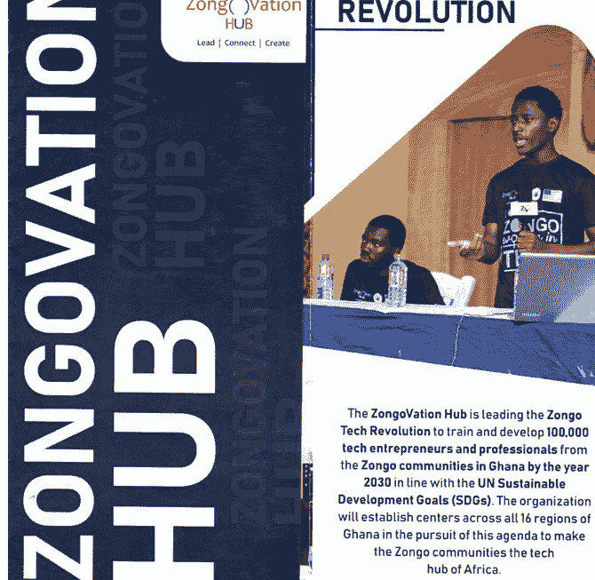

宗戈创新中心正引领“宗戈科技革命”，旨在到2030年，依据联合国可持续发展目标，为加纳宗戈社区培养和造就10万名科技创业者和专业人士。该组织将在加纳全部16个地区设立中心，以推动这一议程，使宗戈社区成为非洲的科技中心。

图15 宗戈创新中心。宣传“宗戈科技革命”的传单，目标是根据联合国可持续发展目标，到2030年为加纳宗戈社区培养和造就10万名科技创业者和专业人士。

作者收藏

这些活动人士的抱负是改变宗戈学童的心态，激励他们追求高等教育。Alhaji Rabiu Maude解释说，大多数宗戈孩子最终进入B类公立学校，几乎没有可能进入大学或其他高等教育机构。他们的想法是专注于低表现学校的孩子，提供一对一指导和创业技能培训，同时安排前往各类机构、教育中心、报社和政府部门的参观活动。365

365 对Alhaji Rabiu Maude的采访，阿克拉，2022年10月8日。Alhaji Rabiu Maude于2015年至2021年担任ZIT主席。

ZIT的首场活动是2014年在阿克拉举办的“宗戈梦想指导诊所”。366 随后活动迅速增加，2015年已在阿克拉和库马西相继举办。367 此后，该组织发展成为一个正式的职业指导和辅导组织，尽管其活动仅限于尼马、马莫比和阿克拉新城的孩子。其多项活动与当地合作伙伴共同开展，包括与Rayuwa基金会共同组织世界孤儿日庆祝活动，与Achievers Ghana合作提供少女指导，支持ZongoVationHub的技能培训项目，以及与Success Book Club合作举办月度聚会和建设社区图书馆。368 ZIT还在2021年支持Faata Africa在阿克拉举办“宗戈励志饮食”活动，这是一个旨在培养宗戈儿童积极人生态度的项目。369

ZIT由40名缴纳会费的成员组成，其中10人构成其核心活动小组。除奖学金项目外，其大部分活动由内部资助；奖学金项目获得了EPP Books Fund的1.5万加纳塞地捐赠。该组织的目标是利用社交媒体向国际捐助者募集资金，以扩大其奖学金项目。370

366 Abdur Rahman Shaban Alfa，“宗戈梦想指导诊所：当宗戈崛起！”，2014年12月19日，https://www.ghanaweb.com/GhanaHomePage/features/The-Zongo-Dream-Mentorship-Clinic-When-Zongo-Rose-339554，访问于2021年9月28日。

367 “为宗戈社区青年举办的梦想指导诊所”，2015年5月19日，https://newsghana.com.gh/dream-mentorship-clinic-for-youth-in-zongo-communities/，访问于2021年9月28日；Abdul-Rahman Zulyaddain，“库马西宗戈青年将通过ZIT指导计划获得赋能”，2015年10月12日，https://www.modernghana.com/news/648682/1/kumasi-zongo-youth-to-be-empowered-through.html，访问于2021年9月28日。

368 对Alhaji Rabiu Maude的采访，阿克拉，2022年10月8日。Success Book Club（https://www.facebook.com/people/Success-BOOK-CLUB/100064703437383/）是一个由文学活动家Inusah Mohammed于2015年创建的穆斯林非政府组织。其目标是鼓励阅读并为女童赋权。该阅读俱乐部约有120名成员，活跃于尼马、马莫比和阿克拉新城。另见Abu Mubarik，“认识这位影响尼马阅读的年轻人”，2017年7月7日，https://www.pulse.com.gh/ece-frontpage/success-book-club-meet-the-young-man-influencing-nima-to-read/3wd3t4c，访问于2022年12月10日。

369 对Alhaji Rabiu Maude的采访，阿克拉，2022年10月8日；https://faataafrica.org/zongo-motivational-diet/。类似的活动由Faata Africa与当地穆斯林非政府组织Community Redemption Foundation合作在库马西举办，见“2021年库马西宗戈励志饮食”，https://www.facebook.com/watch/live/?ref=watch_permalink&v=2990973127801888，访问于2022年12月10日；以及在阿沙伊曼与阿沙伊曼读者俱乐部合作举办，见https://www.facebook.com/profile.php?id=100064528645297，2021年3月13日，访问于2022年8月23日。

370 对Alhaji Rabiu Maude的采访，阿克拉，2022年10月8日。

2020年和2021年，新冠肺炎疫情中断了ZIT的活动（除了2021年5月29日在阿克拉坎达社区图书馆举办的“创业者技能”活动）。371 然而，ZIT在2022年重新出发，组织了招聘会、面向学童的问答活动，372 以及关于性别公平和平等的公开讨论。它还计划引入跨学科和跨技能合作，将医学和工程学纳入其项目，并培训从20所选定宗戈学校选拔的学生掌握公开演讲和辩论的艺术。373

发展当地社区生计的需求在许多宗戈青年组织的议程上居于首位。例如，总部位于库马西的“宗戈青年团结与加纳可持续发展组织”于2017年2月和3月在Facebook上发布了一系列简短讲座。这些讲座涉及可持续发展目标和宗戈社区面临的挑战，包括环境退化和环境污染、土地扰动、污染、人口过剩、垃圾填埋场和森林砍伐。作为问题的解决方案，该组织强调需要开展大规模信息宣传、倡导反对城市扩张、禁止污染水体的活动，以及促进环境保护。此外，作为对宗戈地区因疾病导致的卫生条件差、健康状况不佳和生产力低下的解决方案，该组织倡导并组织了清洁行动，处理随意丢弃废物、有利位置的垃圾桶不足以及无人监管的孤立垃圾场等问题。374 在其最后的干预措施中，事后看来，它向加纳电信公司MTN提出了一个相当新颖且激进的要求：将穆斯林用户产生的利息累积用于宗戈发展。375

然而，ZYUSDG似乎仅在2017年上半年活跃于Facebook。2017年10月，另外两个总部位于库马西的宗戈青年组织——“阿散蒂宗戈青年联盟”和“加纳宗戈豪萨青年协会”——开通了Facebook账户。两个组织最近开始合作，并与穆斯林机构联盟和ASALI基金会一道，于2021年5月启动了“宗戈项目”，以“吸引青年参与并征求他们的意见，共同发展我们的宗戈社区”。376 这两个组织早些时候都曾寻求赋能宗戈青年：ZOHYAG于2020年8月庆祝世界豪萨日，而AZOYU则于2020年11月组织了首届宗戈青年代表大会。377

371 https://www.facebook.com/ZongoRising，帖子日期2021年2月18日、2021年5月29日，访问于2021年9月10日。

372 “Bawa Mogtari赞扬Zongo Inspiration Team组织Ayawaso基础学校问答活动”，2022年10月3日，https://www.ghanaweb.com/GhanaHomePage/NewsArchive/Bawah-Mogtari-lauds-Zongo-Inspiration-Team-for-Ayawaso-Basic-Schools-quiz-1634834，访问于2022年10月8日。

373 对Alhaji Rabiu Maude的采访，阿克拉，2022年10月8日。

374 https://www.facebook.com/Zongo-youth-for-Unity-And-Sustainable-Development-of-Ghana-739120419596809，2017年2月25日、3月1日、3月3日、3月5日，均访问于2021年8月5日。

375 https://www.facebook.com/Zongo-youth-for-Unity-And-Sustainable-Development-of-Ghana-739120419596809，2017年5月5日，访问于2021年8月5日。

多个宗戈青年组织的典型参与方式是在斋月之前或期间召集成员进行社区服务和健康促进活动。例如，Voice of Zongo Youth Foundation的成员参与了库马西郊区Aboabo No. 2的清洁行动，而加纳宗戈豪萨青年协会则于2021年4月以库马西中央清真寺为重点。总部位于阿克拉的Concerned Zongo Youth Group于2018年和2019年组织了“斋月健康步行”活动，而总部位于阿克拉的穆斯林青年和平与发展中心和总部位于库马西的Voice of Zongo Youth Foundation都开展了反毒品滥用运动。另一方面，Kasoa穆斯林圣战青年于2020年12月以及2021年1月、2月、3月、5月、6月、7月和8月清理了Kasoa的Tuba和Kojo-Ojo穆斯林墓地。378 总部位于瓦镇的“加纳宗戈发展青年联盟基金会”则于2019年4月发起了气候变化和卫生意识宣传活动。Bekwai宗戈青年发展协会在其2021年7月的启动周期间安排了清洁行动和健康筛查活动。379 同样，Nsoatre宗戈青年协会于2021年8月开展了“保持Nsuatre清洁”行动，而D.Line青年协会Bolga的成员则于2019年10月和2021年10月呼吁其成员清理博尔加坦加的穆斯林墓地。380

376 https://www.facebook.com/asantezoyul/，2021年8月5日；https://www.facebook.com/ZOHYAG/，2021年5月9日，访问于2022年1月16日。

377 ZOHYAG于2021年8月26日在库马西第二次组织国际豪萨日，成为头条新闻，见Faisal Mustapha，“加纳宗戈豪萨青年协会庆祝国际豪萨日”，2021年9月3日，https://www.ghanaweb.com/GhanaHomePage/regional/Zongo-Hausa-Youth-Association-of-Ghana-Celebrate-International-Hausa-Day-1348495，访问于2021年9月11日。

378 https://www.facebook.com/kasoamuslimjihad youth/，2021年12月12日、2020年12月18日、2020年12月26日、2021年1月2日、2021年1月8日、2021年1月15日、2021年1月22日、2021年1月29日、2021年2月6日、2021年2月12日、2021年2月22日、2021年2月28日、2021年3月7日、2021年3月12日、2021年3月19日、2021年3月27日、2021年5月28日、2021年6月11日、2021年7月3日、2021年7月23日和2021年8月6日，访问于2021年8月7日。

379 https://www.facebook.com/bezydagh/photos/a.109889494135950/336934984764732/，2021年7月14日，访问于2021年9月28日。

380 https://www.facebook.com/Nsoatre-Zongo-Youth-association-118121293355020/，2021年8月29日，访问于2021年9月28日；https://www.facebook.com/d.lineyouthassociationbolga，2019年10月8日、2021年10月31日，访问于2021年12月30日。

位于阿克拉的*宗戈焦点*，一个成立于2016年的青年团体，截至2021年底在Facebook上拥有近8,000名关注者，已发起多项倡议和项目，旨在提升年轻宗戈居民的社会和精神层面。自2016年起，[^381]该团体组织了年度开斋饭收集和分发活动，以及清洁行动（“让我们清洁宗戈”项目于2018年启动），[^382]同时还向特定目标群体进行临时性捐赠，其中包括2017年11月的马迪纳诊所。[^383]它还发起了Inter-Madaris Game，即面向高中生的体育赛事。[^384]其两个主要项目是Zongo Youth Day Out以及技能发展倡议；两者均于2018年启动。前者是四月年度宗戈青年月庆祝活动的一部分；其目的是通过开放市场让年轻的宗戈企业接触潜在客户和投资者，在该市场中，各类宗戈企业展示其品牌并展出产品和服务。该活动还为宗戈青年中的网络交流和表彰变革者提供了平台。[^385]技能发展倡议于2018年11月启动，首届创业工作坊及技能培训，包括糕点、天然果汁、冰淇淋、液体肥皂和蛋糕的制作，于2018年12月安排。[^386]

其他宗戈青年团体也开展类似的商业和职业培训项目。*宗戈青年发展组织*（Zoyfod）与驻阿克拉德国大使馆的一个分支机构合作，于2018年启动了一项培训计划，旨在提高具有职业背景的穆斯林（泥瓦匠、木匠、裁缝）的市场竞争力。[^387]*东莱贡穆斯林青年*组织了‘Read-and-Grow-Project’项目，这是一项英语扫盲项目，旨在帮助穆斯林学生，时间为2019年11月至2020年2月。[^388]2021年7月，由2017年成立的“社区导向的青年赋权和发展倡议”*穆斯林邻里*宣布即将举办的宗戈商业展览会 ’21。[^389]位于阿沙伊曼的*让宗戈再次伟大*则于2018年起作为一个*宣教*平台，但数年后转型并参与当地人道主义项目。自2020年起，该团体为其年度开斋饭食品分发项目（“Food 4 Life”）筹集资金；2022年，它拓展业务，在三个农村社区委托建设了钻井项目（“Water 4 Life”），启动了古尔邦项目并组织了首届免费儿童宰牲节晚宴，并为农村社区清真寺翻新筹集资金，同时设立了天课基金（详见第5.3.6章）。[^390]

与上述团体不同，库马西的*Al-Huda Scout Group Moshe Zongo*旨在通过童子军运动促进男孩和女孩之间的和平共处，以此增强社区发展。[^391]关于加纳穆斯林童子军团体及其伞形组织*加纳穆斯林童子军全国联盟*（NUGMS）的活动知之甚少。[^392]

#### 3.3 反对政治相关暴力与自卫主义

加纳媒体中反复出现的主题是在选举年发生的政治相关暴力与自卫主义。宗戈青年帮派通常成为媒体的关注对象，被认为是由在宗戈社区争夺影响力和选民的政治家煽动的。[^393]相应地，自1990年代以来，从国家首席伊玛目到地方的穆斯林政治家、长老、酋长和宗教领袖一再向宗戈青年发表讲话，恳请他们不要被诱入自卫主义，并提醒他们伊斯兰教主张和平（图16）。[^394]

例如，加纳副总统Alhaji Dr Mahamudu Bawumia强烈警告宗戈青年抵制政治领袖煽动其领导并参与政治暴力的呼吁。[^395]国家首席伊玛目发言人Sheikh Arimiyaro Shaibu进一步要求政治家在2020年选举前停止其负面项目，强调“[…]宗戈青年是为更重要的任务而生。”[^396]然而，政治和宗教领袖向穆斯林青年传递的信息是自上而下的，既有胡萝卜也有大棒。这在2021年9月国际和平日庆祝活动上由Ahafo地区首席伊玛目Alhaji Abdul Yusif Jihad发表的讲话中得到体现：“[如果]参与暴力行为和犯罪活动的宗戈青年将被警察起诉，他们最好利用自己的力量从事生产性活动以改善自身处境。”[^397]

相应地，宗戈青年团体强烈批评加纳媒体助长并强化了对暴力倾向宗戈青年的负面刻板印象。因此，许多宗戈青年团体都支持反对政治暴力的呼吁，尽管他们在与追随者交流时使用“自下而上”的语言。例如，AZOUY秘书长Mohammed Habib Gali在2020年选举前的声明中呼吁他的宗戈青年同胞帮助纠正人们认为宗戈人具有暴力性的错误观念，并要求他们拒绝为任何政党效命。[^398]

一些观察人士指出宗戈

[^381]: 2016年斋月活动评论，22.10.2017，https://www.facebook.com/zongofocus1/，访问日期28.9.2021。Zongo First自2016年至2019年连续组织斋月活动。2020年的活动因COVID-19大流行而取消。该团体于2021年恢复其斋月活动。

[^382]: “这是‘让我们清洁宗戈’项目首届活动”，28.2.2018，https://www.facebook.com/zongofocus1/，访问日期12.8.2021。

[^383]: Facebook帖子及照片，12.11.2017，https://www.facebook.com/zongofocus1/photos/pbc.543111992698064/54311599364770，访问日期28.9.2021。

[^384]: Inter-Madaris Games于2018年和2019年举行，但因COVID-19大流行于2020年被迫取消；活动包括足球、运线勺、乒乓球和田径。2021年和2022年，它们重新举办。

[^385]: https://www.facebook.com/zongofocus1/，23.4.2018，访问日期12.8.2021。

[^386]: https://www.facebook.com/zongofocus1/photos/a.532497020426228/794473600895234/，6.12.2018，访问日期12.8.2021。

[^387]: https://www.facebook.com/Zongo-Youth-For-Development-Association-ZYFDA-193216640873939/，15.8.2018，访问日期16.1.2022。

[^388]: https://www.facebook.com/eastle.../photos/a.118766232288319/u18766196217156，3.11.2019，访问日期28.9.2021。

[^389]: https://www.prod.facebook.com/muslimznextdoor/photos/a.269170823704940/831926557429361/，1.7.2021，访问日期28.9.2021。

[^390]: https://make-zongo-great-again.org/；https://www.facebook.com/MakeZongoGreatAgain/n/，1.4.2021，29.3.2022，10.4.2022，30.6.2022，3.7.2022，10.7.2022，访问日期4.8.2022。

[^391]: 另见 https://www.facebook.com/alhudascoutmoshezongo。

[^392]: NUGMS的官方账号自2013年起处于休眠状态，见 https://www.facebook.com/National-Union-of-Ghana-Muslim-Scout-NUGMS-137682993057285，访问日期6.1.2022。

[^393]: 一般性讨论，参见Kwame Asamoah，“通过‘顽固问题’概念透镜看加纳政治自卫主义问题”，*亚洲与非洲研究杂志* 55，第3期（2020）：457–471；Justice Richard Kwabena Owusu Kyei和Lidewyde H. Berckmoes，“加纳政治自卫团体：暴力还是民主？”，*非洲光谱* 55，第3期（2020）：321–338。

[^394]: 例如参见，“加纳：COMOG要求NDC和NPP表现出对和平竞选的承诺”，9.5.2012，https://allafrica.com/stories/201205100483.html；“采取正确的敬拜态度——Sheikh Dr Sharubutu”，15.8.2012，https://www.ghanaweb.com/GhanaHomePage/NewsArchive/Adopt-the-right-attitude-to-worship-Sheikh-Dr-Sharubutu-247755；Alhaji Alhasan Abdulai，“我不认为加纳穆斯林会走向激进主义”，1.2.2016，https://www.ghanaweb.com/GhanaHomePage/features/I-do-not-see-Muslims-in-Ghana-falling-to-radicalism-412015；“穆斯林青年被敦促抵制政治自卫主义”，30.5.2019，https://www.graphic.com.gh/news/politics/muslim-youth-urged-to-shun-political-vigilantism.html。

[^395]: “抵制参与政治暴力的呼吁——副总统Bawumia对宗戈青年说”，11.3.2019，https://theworldnews.net/gh-news/resist-calls-to-engage-in-political-violence-vice-president-bawumia-tells-zongo-youth，访问日期28.9.2021。

[^396]: “远离宗戈——Sheikh Arimiyaro对‘暴力政治家’说”，18.6.2020，https://dailyguidenetwork.com/back-off-zongos/%E2%80%98-sheikh-arimiyaro-to-violent-politicians/，访问日期28.9.2021。

[^397]: “起诉参与政治暴力的宗戈青年——Ahafo首席伊玛目”，22.9.2021，https://gna.org.gh/2024/04/chief-imam-cautions-zongo-youth-against-being-used-as-agents-for-political-violence/，访问日期28.9.2021。

[^398]: Kwadwo Baffoe Donkor，“宗戈青年被敦促帮助纠正暴力认知”，17.12.2020，https://www.graphic.com.gh/news/politics/zongo-youths-urged-to-help-correct-perception-of-violence.html，访问日期28.9.2021。

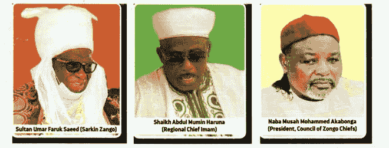

苏丹·乌马尔·法鲁克·萨义德（Sarkin Zango）

谢赫·阿卜杜勒·穆明·哈鲁纳（地区首席伊玛目）

纳巴·穆萨·穆罕默德·阿卡邦加（Zongo酋长委员会主席）

## 处理Zongo社区的民兵主义和其他选举相关冲突（AVECZOC）

- 拥抱和平，铲除阿萨瓦西的政治民兵主义
- 我们主张选票而非子弹

#IslamMeansPeace #ZongoForPeace

由以下机构实施

MFCS 穆斯林家庭咨询服务

COMI 穆斯林机构联盟

由以下机构支持

STAR 加纳基金会

资金来自

UKaid 欧洲联盟

图16 穆斯林非政府组织推动选举和平。由穆斯林家庭咨询服务和穆斯林机构联盟（COMI）发行的传单，用于推广其AVECZOC（处理Zongo社区的民兵主义和其他选举相关冲突）活动，2020年。COMI成立于2016年。作者收藏

青年以助长政治极端主义，399 与那些呼吁职业和商业培训项目并在Zongo青年中发起创业项目的Zongo青年团体分道扬镳。有时Zongo青年团体团结在共同平台下应对警察暴行并自行开展反犯罪运动。*青年俱乐部联合会*（FYC）就是这种情况，它成立于2002年，是尼玛、马莫比、坎达和阿克拉新镇100多个当地青年俱乐部和团体（当地称为‘基地’400）的伞形组织。401

穆斯林倡导团体、民间社会组织、智库和非政府组织在政治选举期间开展反暴力和平运动，其中一些已持续数十年。*光明基金会*（TLF）是积极遏制选举期间政治暴力并提醒Zongo选民拒绝招募并利用他们作为政治暴力武器的政治人物的知名穆斯林非政府组织之一。402 自2005年成立以来，该组织在选举期间积极反对激进化穆斯林青年方面发挥了积极作用。2016年，TLF启动了M-CUPE倡议，即穆斯林和Zongo社区联合推动和平选举。凭借雄心勃勃的外展，其RASE（宗教领袖行动与和平选举支持）2020活动获得了STAR-Ghana基金会的支持，并由英国外交、联邦和发展办公室（FCDO）和欧盟提供资金。403 作为一个近期成立的穆斯林非政府组织的例子，*和平达瓦媒体*在2020年选举前启动了一个信息宣传项目，针对Zongo青年传递反对流氓行为和选举相关暴力的信息。404

399 吉夫蒂·奥科安帕，“青年失业助长班达区反复发生的政治暴力——议员”，2021年9月27日，https://www.dntghana.com/2021/09/27/youth-unemployment-fuelling-recurring-political-violence-in-banda-district-assemblyman/，访问于2021年9月28日。

400 ‘基地’由Inusah Mohammed定义为尼玛和马莫比当地青年夜间活动的‘据点’，可通过其独特的名称识别，例如Michigan、Since Morning、Callos Bridge、Kosovo、Nuriya、Mobo base、Salt Lake、Los Angeles、World Place、Buza 111、West Side、Baakin Gutter和Bumper Side等。参见Inusah Mohammed，“尼玛和Zongo灵感团队的现状”，2015年6月3日，https://www.ghanaweb.com/GhanaHomePage/features/The-state-of-Nima-and-the-zongo-inspirational-team-360535，访问于2022年10月8日。

401 与FYC行政主管萨义德·穆罕默德·萨尼在阿克拉于2022年10月9日的访谈；与FYC创始人兼主席阿卜杜勒·法塔赫·阿达姆在阿克拉于2022年10月19日的访谈。

402 “拒绝煽动暴力的政治人物——光明基金会”，2020年6月19日，https://www.graphic.com.gh/news/politics/reject-politicians-who-incite-violence-light-foundation.html，访问于2022年8月4日。

403 https://www.facebook.com/tlfghana/，2020年12月5日，访问于2022年1月16日。

404 “和平达瓦媒体加入无暴力选举运动”，2020年9月17日，https://newsghana.com.gh/peace-dawah-media-joins-campaign-for-violent-free-election/?_cf_chl_jschl_tk_=pmd_a054b06c29dcab774f01b14448fi0ef7846b18f-1628339713-o-gqNtZGzNAiKjcnBszQkO，访问于2021年8月7日。

遏制政治暴力也是穆斯林机构联盟（COMI）议程上的内容。库马西的穆斯林民间社会组织成立于2019年，作为阿散蒂地区首席伊玛目、阿散蒂地区伊玛目和乌拉玛委员会、阿散蒂地区Zongo酋长委员会、库马西Sarkin Zongo办公室、穆斯林执行论坛以及库马西的王后母亲（Magagias）的平台。由STAR-Ghana基金会支持并由UKAID和欧洲联盟资助，2019年成立的穆斯林民间社会组织在Zongo社区组织了一系列宣传项目，以遏制民兵主义和选举冲突。405 科福里杜阿当地非政府组织Zongo社区之声（VoZ）成立于2019年，其主席阿卜杜勒-马南·瓦鲁博士在2020年选举前也引起了类似的关注。2020年11月在科福里杜阿Zongo组织活动前接受媒体采访时，阿卜杜勒-马南·瓦鲁博士挑战穆斯林青年纠正Zongo人是麻烦制造者的普遍误解。他宣布VoZ和所有Zongo居民的最终目标是将Zongo社区从边缘群体转变为有活力的群体“……在那里，他们的社会、经济、教育、文化和人权问题得到有效维持。”406

多个Zongo青年团体处理与政治相关的暴力，尤其是在选举期间。例如，Zongo Insight积极敦促其在马迪纳Zongo的成员注册参加2020年选举，407 并呼吁在Zongo社区内从“盲目追随政治人物”到“支持积极的集体青年主导的发展议程”进行“态度转变”，以推动马迪纳Zongo社区及以外的激进青年发展。408 它强烈谴责民兵主义，强调并提醒其成员“[..] 它是一种癌症，无论我们在加纳社会中的社会阶层如何，都影响着我们所有人。”409 加纳伊斯兰论坛是一个主要由穆斯林中产阶级青年组成的平台，主张穆斯林青年“被无良的宗教狂热分子或极端分子激进化，他们可鄙的事业错误地倾向于冒犯伊斯兰的圣洁性。”410 该平台成立于2015年，2016年在Facebook上活跃，但此后似乎已陷入停滞。

405 “库马西成立穆斯林机构联盟……为根除民兵主义开展密集社区教育”，2019年6月13日，https://www.thefreelibrary.com/Coalition+of+Muslim+institutions+formed+in+Kumasi+...+For+intensive+...+a0588846b68，访问于2021年8月5日；Anita Serwaa Adzoga，“联盟着手在Zongo社区铲除政治民兵主义”，2020年11月21日，Coalition sets out to stamp out Political Vigilantism in Zongo Communities—MyJoyOnline.com，访问于2021年8月5日。

406 Zongo社区之声，https://www.facebook.com/vozg h/，2020年11月27日，访问于2021年10月5日。

407 https://www.facebook.com/InZongo/，2019年8月31日，访问于2021年8月7日。

408 https://www.facebook.com/InZongo/，2019年8月29日，访问于2021年8月7日。

409 A. Swalah，《民兵主义：通过Zongo孩子的眼睛看政治相关暴力》，https://www.facebook.com/InZongo/，2020年11月29日，访问于2021年8月7日。

### 4 在加纳运营的国际穆斯林慈善机构

国际穆斯林慈善机构开始在加纳开展业务，是为了应对1983年席卷该国北部地区的干旱和饥荒，尽管这些干预措施的范围和影响尚未在学术研究中得到审查。它们在1994年影响北部地区社区的‘ Guinea Fowl War’内战期间的活动也未被学术研究审查。加纳穆斯林非政府组织活动的第一个阶段不出所料与daʿwa相关，主要导致清真寺和祈祷场所的建设。尽管如此，一些国际穆斯林非政府组织，如利比亚世界伊斯兰呼吁服务（WICS）和伊朗农业与农村发展（ARD），也在医疗保健和农村发展项目上进行了投资。WICS资助了Wa外的伊斯兰诊所，而ARD则在北部地区开展了大规模的技术和基础设施农业援助，见下文第2.4.2章。

国际穆斯林非政府组织（穆斯林国际非政府组织）的第二阶段始于2000年代初。这一阶段的特点是西方穆斯林慈善机构和伊斯兰团结组织在加纳的出现，例如美国扎卡特基金会以及英国慈善机构Al-Muntada Aid和Muslim Aid。多个阿拉伯和西方国际穆斯林慈善机构在加纳设立了实地或区域办事处并开始开展自己的项目。一些较大的国际穆斯林慈善机构还参与了针对非穆斯林或混合社区的项目，而另一些则将活动限制在穆斯林社区。它们都开展斋月/开斋和乌德希亚/古尔邦项目，要么直接捐赠食物和肉类包裹或待宰牲畜，要么间接资助当地穆斯林非政府组织的活动。总的来说，国际穆斯林慈善机构的主要活动是致力于人道主义、教育、卫生和供水项目的实施。它们还资助了各种daʿwa项目，其中最著名的是建造清真寺或清真寺。

另一方面，根据互联网上的新闻报道，截至2016年，NOGAID 在加纳仍保持活跃。

阿拉伯之春及其后果导致了穆斯林国际非政府组织在加纳活动的第三个也是当代阶段。这一第三阶段见证了在加纳运营的穆斯林国际非政府组织格局的重组，最显著的是土耳其穆斯林慈善机构的出现和大规模介入（见下文第2.4.4章）。此外，西方和非阿拉伯穆斯林国际非政府组织的数量以及日益增多的西方国家/地方穆斯林非政府组织已大幅扩张。这一现象部分归因于社交媒体所实现的网络联系的加强，而这又是加纳穆斯林侨民社区在北美和西欧建立的结果。这一扩张最 recent 的方面是巴基斯坦、中国（香港）、新加坡、印度尼西亚、澳大利亚和新西兰的穆斯林团体和协会参与加纳的 daʿwa 和人道主义项目。

#### 表5 加纳运营的国际穆斯林非政府组织的三个阶段

| 国家 | 组织 |
|---|---|
| **第一阶段 (1980s–2000)** | |
| 伊朗 | Agriculture and Rural Development; Ahlul-Bait Foundation; Iranian Red Crescent Society |
| 科威特 | African Muslim Mission (Direct Aid) |
| 利比亚 | World Islamic Call Society |
| 英国 | Al-Muntada Aid |
| **第二阶段 (2000–2012)** | |
| 伊朗 | Agriculture and Rural Development; Ahlul-Bait Foundation; Iranian Red Crescent Society |
| 科威特 | Direct Aid; Care and Social Development; Rahma International Society |
| 利比亚 | World Islamic Call Society |
| 沙特阿拉伯 | Muslim World League |
| 英国 | Al-Muntada Aid; Muslim Aid UK |
| 美国 | Zakat Foundation of America |
| **第三阶段 (2012–[2023])** | |
| 澳大利亚 | Muslim Aid Australia; International Human Care and Relief Organisation Australia |
| 奥地利 | Rahma Austria |
| 巴林 | Tarbeia Islamic Society |
| 比利时 | Hearts 4 Mercy |
| 加拿大 | Al-Huda Relief of Canada |
| 中国 | Muslim Council of Hong Kong |
| 丹麦 | VIOMIS Aid |
| 法国 | Nouvelle Optique |
| 德国 | Ahkwaat G Foundation; Ansaar International; Eyes of Light; Help Dunya; Bayerische Islamische Gemeinschaft; Emin Humanitärer Hilfsverein; Aminu Initiative; Hajia Akweley Legacy Foundation |
| 沙特阿拉伯 | Muslim World League (WML); Al-Qimmah Association; World Assembly of Muslim Youth (WAMY); International Islamic Relief Organisation (IIRO); International Union of Muslim Scholars; Custodians of the Two Mosques; Holy Quran Heritage Society; Abdul-Aziz Charitable Society; KSRelief |
| 科威特 | Direct Aid; Care and Social Development; Rahma International Society, Kuwaiti Red Crescent Society; Sheikh Abdullah Al-Nouri Charity Society; International Islamic Charity Organization (IICO); Kuwait Zakat House; Alhedaya Kuwait; Kuwaiti Horizons Charity Society; Al-Najat Charitable Society |
| 印度尼西亚 | Aksi Cepat Tanggap (ACT); Global Wakaf |
| 伊朗 | Ahlul-Bait Foundation; Iranian Red Crescent Society |
| 摩洛哥 | Mohammed VI Foundation for African Oulama |
| 新西兰 | Voice of Islam |
| 巴基斯坦 | Dawat-e-Islami |

| 卡塔尔 | Qatar Charity/Qatar Charitable Society; Sheikh Thani bin Abdullah Foundation for Humanitarian Services (RAF Foundation); Sheikh Eid Bin Muhammad Al Thani Charitable Foundation (Eid Charity) |

| 塞拉利昂 | International Islamic Youth League |

| 新加坡 | Global Ehsan Relief |

| 南非 | Al-Imdaad Foundation |

| 苏丹 | Tanmiyat Humanitarian Foundation |

| 瑞士 | Swiss Barakah Charity |

| 土耳其 | Kimse Yok Mu Solidarity Foundation; Ghana-Turkey Co-operation and Development Association (TUDEC); Ghana Friendship and Solidarity Association (GANADER); Maarif Foundation; Human Development Association International (HUDAI); CANSUYU; Humanitarian Relief Foundation (IHH); IH-Da Vakfi; Türkiye Diyanet Vakfi (TDV); Insana Deger Veren Dernekler Federasyonu; Hayrat Yardim; Hayat Yolu; Turkish Red Crescent; Deniz Feneri Association; Universal Islamic and Cultural Trust Turkey |

| 阿联酋 | Emirates Red Crescent; Al-Makhtoum Foundation/Mohammed bin Rashid Al Maktoum Global Initiatives; Dubai Charity Association; Sharjah International Charity; Dar al-Ber Society |

| 英国 | Muslim Global Relief; Caravan of Mercy; Salam Charity; IERA Charity; InTouch Foundation; Human Relief Foundation; Love Mercy Hope; Muntada Aid; Al-Imdaad UK; Illuminations Welfare Foundation; International Islamic Youth League/Africa Youth Development; Haji Bashir Ahmed Foundation |

| 美国 | Zakat Foundation of America; Islamic Relief USA; Generation Wealthy, Unity & Faith; Hidaya Foundation; Islamic Ummah Relief (IUR); Salaam Ul-Muslimiyun Foundation; Life for Relief and Development (LIFE); African Islamic Heritage Foundation; Global Deaf Muslim; Mercy Without Limits; Mercy for Mankind Foundation; Wal Jamaha Alliance Charity Foundation; Al-Fadl People Organization; |

#### 表6 2006–2023年阿拉伯/海湾慈善机构向加纳的财务交易 (续)

| 年份 | 捐赠者 | 促成方 | 金额 (美元) | 项目 |
|---|---|---|---|---|
| 2009 | Rahma International Society (Kuwait) | Care and Social Development Organization | 34,000 | 粮食安全（干旱） |
| 2010 | Rahma International Society (Kuwait) | Care and Social Development Organization | 10,200 | 疟疾药品和袋子 |
| 2011 | Rahma International Society (Kuwait) | Care and Social Development Organization | 75,000 | 粮食安全（干旱） |
| 2012 | Kimse Yok Mu Solidarity Foundation (Turkey) | [direct] | 25,000 | 向有需要的家庭分发肉类包裹（= Qurban） |
|  | Kimse Yok Mu Solidarity Foundation (Turkey) | [direct] | 10,000 | 2012年斋月项目食品包裹 |
|  | Sheikh Thani bin Abdullah Foundation for Humanitarian Services (Qatar) | Firdaus Foundation for Social Services | 10,617 | 4个水项目 |
| 2013 | – | – | – | – |
| 2014 | – | – | – | – |
| 2015 | – | – | – | – |
| 2016 | Direct Aid | [direct] | 275,026 | 12个水项目 |
| 2017 | Direct Aid | [direct] | 393,220 | 89个水项目 |
| 2018 | Direct Aid | [direct] | 870,982 | 167个水项目 |
|  | Qatar Charity | [direct] | 54,735 | 提供食品（= Ramadan/Qurban） |
| 2019 | Direct Aid | [direct] | 270,178 | 32个水项目 |
|  | Sheikh Abdullah Al-Nouri Charity Society (Kuwait) | Al Dia'a Humanitarian Association (Aldiaa Society) | 1,980 | 粮食安全（= Qurban） |
|  | Sheikh Abdullah Al-Nouri Charity Society | Al Dia'a Humanitarian Association | 42,904 | "修建有限受益水井/建立并配备清真寺" |
|  | Sheikh Abdullah Al-Nouri Charity Society | Care and Social Development Organization | 5,281 | 粮食安全（= Ramadan） |
| 2020 | Direct Aid | [direct] | 237,582 | 30个水项目 |
|  | Direct Aid | [direct] | 1,424,734 | 4个水和卫生项目 |
|  | Direct Aid | [direct] | 24,852 | COVID-19（2个项目） |
|  | Direct Aid | [direct] | 8,059 | 救济援助（7个项目） |
|  | Kuwait/Government | Care and Social Development Organization | 914,000 | 多个项目 |
|  | Kuwait/Government | Ghana Red Cross Society | 8,020 | 烧提亚肉分发给600个贫困家庭 |
|  | Kuwait/Government | Al Dia'a Humanitarian Association | 184,677 | 水、清真寺和斋月项目 |

然而，正如下面将要讨论的那样，OCHA收集的数据不一致且不完整。表6所呈现的数据给人印象，科威特的Rahma International Society（即Rahma International Association）在2011年之前一直是活跃的捐赠者，而Direct Aid和Qatar Charity自2010年代后期以来在加纳的活动已大幅扩张。此外，尽管该组织几十年来一直与阿拉伯/海湾慈善机构合作，但找不到对ICODEHS的任何提及。例如，卡塔尔慈善机构*Sheikh Thani bin Abdullah Foundation for Humanitarian Services*（RAF）多年来一直在清真寺建设上投资，418这些数据未包含在OCHA数据中。其部分资金来自卡塔尔慈善家所做的捐赠，RAF将其转交给加纳组织。

*Qatar Charity*（QC，前身为Qatar Charitable Society）成立于1984年，总部设在多哈，在30个国家设有办事处，已在加纳运营超过二十年。直到2017年，Qatar Charity通过加纳合作组织渠道提供资金，例如ICODEHS、Aldiaa Charity Association（水井项目和孤儿赞助；图17）和COMOG（斋月捐赠）。然而，它于2017年3月在阿克拉开设了区域办事处，以增强其在加纳的可见度，作为卫生项目、社会保护、教育、水和卫生项目的资助组织。419 Qatar Charity的扩张导致招聘了新的本地工作人员来运营阿克拉办事处。所涉及的职位包括2017年的行政支持官、会计、项目官、土木工程师、秘书、社会福利和赞助官，420以及2018年底的另一名秘书。421 2020年春季，Qatar Charity招聘了一名现场官来监督QC资助的项目。422 2020年秋季，它在寻找国家主任。423 六月

418 例如，RAF在2015年资助了66座清真寺的建设，并计划在2016年投资另外30个清真寺项目；见“RAF builds 375 mosques in 23 countries”，4.1.2016，https://thepeninsulaqatar.com/public/news/qatar/364808/raf-builds-375-mosques-in-23-countries，访问日期6.10.2021。此外，RAF还在加纳资助了（未披露）数量的学校项目；见“RAF builds 33 schools in 10 African countries”，24.7.2017，https://www.gulf-times.com/story/557692/RAF-builds-33-schools-in-10-African-countries，访问日期6.10.2021。

419 A.R. Gomda，“Qatar Charity Pitches Camp In Ghana”，10.3.2017，https://www.ghanamma.com/2017/03/10/qatar-charity-pitches-camp-in-ghana/，访问日期13.7.2021。

420 https://www.vimjobs.com/browse/jobs/co/qatar-charity-qc/3956#google_vignette。

421 https://www.jobsinghana.com/jobs/indexnew.php?device=d&view=39073，访问日期13.7.2021。

422 https://joblistghana.com/qatar-charity-qc-recruiting-now-2020.html，访问日期13.7.2021。

423 https://www.advance-africa.com/qatar-charity-country-director-jobs-in-ghana.html，访问日期13.7.2021。

以及开斋节期间，该组织多次因资助偏远地区和宗戈社区的教育项目而登上头条。^426^

卡塔尔慈善组织多年来一直支持内城和宗戈发展部以及政府的宗戈发展基金。^427^ 2018年，该组织宣布将在选定的宗戈社区钻探36眼水井，并向该部提供缝纫机、补胎设备和自行车维修小型工具，以支持该部提升贫困宗戈居民创业能力的计划。^428^ 2019年，它开始建设诊所和卫生中心；到2023年，已有30所投入使用。^429^ 2023年，它启动了新的经济赋权和粮食安全项目，目标人群为大阿克拉、中部、东部、阿散蒂、北部和沃尔特地区的农村和贫困城市社区受益者。该新项目在其十二个重点项目中包括种子资金以及为杂货店、面包店、缝纫机及配件提供设备，提供客运和载货三轮车、家禽养殖、粮食种植、牛羊养殖、温室，以及为自由职业者提供媒体设备。^430^

2020年与宗戈发展基金的合作得到加强，当时卡塔尔慈善组织向中部地区卡索阿宗戈的六百个家庭提供了价值194,640加纳塞地（约32,000美元）的物资，以抗击COVID-19。除分发卫生用品外，该组织还宣布向2020年4月因封锁而遭受重创的贫困和脆弱社区提供食品包。^431^ 在中部地区的阿戈纳西市政区，类似的卫生用品捐赠也发放给了300个低收入家庭。总计，该组织已分发了600瓶免洗洗手液，

426. “卡塔尔慈善组织支持阿登坦市政区建设3间教室教学楼，” 5.10.2020, https://ghananewsonline.com.gh/qatar-charity-supports-adentan-municipality/, 访问于 13.7.2021.

427. “宗戈部将动员非政府组织发展宗戈社区，” 25.7.2018, https://www.ghanaweb.com/GhanaHomePage/NewsArchive/Zongo-Ministry-to-rally-NGOs-for-development-of-Zongo-communities-671794, 访问于 6.1.2022.

428. “宗戈部、卡塔尔慈善组织支持有需要的家庭，” 27.8.2018, https://ghananewspage.com/zongo-ministry-qatar-charity-supports-needy-families/, 访问于 13.7.2021.

429. “卡塔尔慈善组织在农村加纳开设两家卫生中心，” 2.5.2023, https://www.qcharity.org/en/qa/news/detailsinternational/21908-qatar-charity-opens-two, 访问于 5.12.2023.

430. “卡塔尔慈善组织在加纳实施经济赋权和粮食安全项目，” 25.11.2023, https://upperwestmedia.net/qatar-charity-implements-economic-empowerment-and-food-security-program-in-ghana/, 访问于 5.12.2023.

431. “宗戈基金、卡塔尔慈善组织支持600个家庭，” 11.4.2020, https://dailyguidenetwork.com/zongo-fund-qatari-charity-support-600-families/, 13.7.2021.

2,400份液体肥皂、2,400件滴露抗菌液和3,000只口罩给大阿克拉和中部地区的低收入家庭，截至2020年4月中旬。^432

卡塔尔慈善组织的开斋饭和古兰经宣传活动也多次登上头条。2020年斋月期间，该组织通过大阿克拉、卡索阿和塔马利的15个分发中心向45,000个有需要的穆斯林家庭分发了价值约1,000万加纳塞地（约160万美金）的食品。^433 此外，它还向阿散蒂地区的几所学校和清真寺提供了8,750份食品和水包。^434 2021年，卡塔尔慈善组织在大阿克拉、阿散蒂、北部和沃尔特地区运营着26个项目中心，目标是在斋月期间为全国约50,000人提供食物。^435 除斋月礼包外，卡塔尔慈善组织还在宰牲节期间为有需要的家庭提供支持；例如，2018年，它与内城和宗戈发展部合作，向大阿克拉地区三个宗戈社区的200个家庭提供了肉类。^436

432. “COVID-19：卡塔尔慈善组织向阿戈纳西市政区的贫困家庭伸出援手，” 16.4.2020, https://www.graphic.com.gh/news/general-news/covid-19-qatar-charity-reaches-out-to-poor-families-in-agona-west-municipality.html, 访问于 13.7.2021.

433. “卡塔尔慈善组织支持加纳有需要的家庭，” 3.5.2020, https://newsghana.com.gh/qatar-charity-supports-needy-families-in-ghana/, 访问于 13.7.2021.

434. Hafiz Tjjani, “A/R：伊斯兰慈善团体在斋月期间支持穆斯林学生，” 1.5.2021, https://citinewsroom.com/2021/05/a-r-islamic-charity-group-supports-muslim-students-during-ramadan/, 访问于 13.7.2021.

435. Augustus Acquaye, “卡塔尔慈善组织在斋月期间支持穆斯林，” 4.5.2021, https://www.gbcghanaonline.com/general/qatar-charity-supports-muslims-during-ramadan/2021/, 访问于 13.7.2021.

436. “宗戈部、卡塔尔慈善组织支持有需要的家庭，” 27.8.2018, https://ghananewspage.com/zongo-ministry-qatar-charity-supports-needy-families/, 访问于 13.7.2021.

*直接援助协会*，前身为非洲穆斯林机构，是一个1981年在科威特成立的慈善机构，并在1999年扩大慈善项目范围时采用了新名称。它目前（2020年）在包括加纳在内的30个国家运营，并在加纳活跃至今自1988年起。直接援助是加纳最知名的国际穆斯林慈善机构之一，开展多个项目，包括教育、水、卫生服务、孤儿和贫困减缓，以及人道主义救援和倡导项目。^437 过去十年以来，直接援助在公众面前将自己定位为非营利、非政治、非教派组织。其重点是为所有人提供教育和农业，无论种族、民族、政治或宗教信仰如何，

437. Facebook video (2020): 关于直接援助, https://www.facebook.com/105673817734336/videos/206491173954494/, 访问于 14.7.2021.

或性别。^438 它是少数年度报告在加纳媒体上发表的组织之一，提供了有关其运营和支出的一些数据。根据其2013年度报告，建筑、教育、社会部门、行政、卫生和季节性补助的支出为3,462,197加纳塞地（56万美元），2014年预算为5,341,518加纳塞地（85万美元）。该机构在加纳的阿登塔（大阿克拉地区）、库马西、凯普海岸和塔马利运营着四个社会发展中心。

438. “性别部赞扬直接援助国家主任，” 23.7.2015, https://www.modernghana.com/news/631696/gender-ministry-salutes-direct-aid-country-directo.html, 访问于 14.7.2021.

与这些中心配套的是寄宿学校，共计746名学生。其教育项目包括，除其他外，学校建设、赞助、教师培训，以及在两所学校——阿登塔的梅西高级中学和塔马利的阿布巴卡尔·西迪克高级中学——的供餐项目。在中部地区的艾延苏多、埃尔米纳，它建立了一所职业培训学院，培训裁缝/时装设计和木工。其卫生倡议的核心是设在阿克拉马迪纳的科威特诊所，以及向四个地区开展的‘医疗大篷车’外展项目。^439 此外，2012年至2015年间，直接援助在全国各地提供了38眼水井和163个水井，并运营着艾延苏多、阿克拉、库马西和塔马利的四个孤儿院。^440

439. Alhasan Abdulai, “直接援助：加纳办事处支持弱势群体，如其2013年度报告所示，” 11.6.2014, https://www.modernghana.com/news/548388/diredct-aid-ghana-office-supports-less-privileged.html, 访问于 14.7.2021.

440. Nana Acquah, “穆斯林被要求关心有需要的人，” 9.7.2014, https://www.modernghana.com/news/554889/muslims-charged-to-show-concern-for-the-needy.html, 访问于 14.7.2021.

此后，该组织在加纳加大了活动力度，其中包括与性别、儿童和社会保护部以及社区供水和卫生机构（CWSA）签署谅解备忘录。通过后者于2018年签署的备忘录，直接援助成为CWSA的合作组织，并承诺出资建设供水系统，为有需要的社区提供饮用水。该合作巩固了直接援助作为供水系统主要提供者的地位；仅在2018年，它就以280万加纳塞地（45.3万美元）的成本提供了163眼配备手压泵的水井。^441 2019年，它提出资助2万加纳塞地

441. Isaac Yeboah, “DirectAid 与 CWSA 合作向农村社区供水，” 22.10.2018, https://www.graphic.com.gh/news/general-news/directaid-partners-cwsa-to-deliver-water-to-rural-communities.html, 访问于 14.7.2021.

（3,200 美元）供 CWSA 自行选择的任何公共卫生机构使用的水和卫生设施，并计划为全国各地的贫困社区提供 180 个水井。⁴⁴² 年内稍后，它向阿克拉的 James Camp 监狱移交了一个价值 GHS 12,600（2,000 美元）的供水项目。⁴⁴³ Direct Aid 与性别、儿童和社会保护部的合作可追溯至（至少）2012 年⁴⁴⁴，甚至更早。它已赞助了多项针对老年人和残疾人的政府捐赠和项目。⁴⁴⁵ 2015 年中，Direct Aid 与该部合作，并向 Keta⁴⁴⁶、Kumasi⁴⁴⁷ 和 Accra⁴⁴⁸ 的 1,000 名洪水受害者提供了人道主义救济。四年后，Direct Aid 与卫生部、性别、儿童和社会保护部以及加纳卫生服务合作，在大阿克拉地区医院组织了免费眼部筛查活动，并为当地居民支付在该机构接受治疗的费用。⁴⁴⁹ 一年后，当 COVID-19 大流行关闭了加纳的公共生活并严重影响了社会的底层民众生计时，Direct Aid 支持该部试图缓解 Agona West 选区老年人的痛苦，并宣布其目标是在加纳支持超过 27,000 个家庭。⁴⁵⁰ 此外，它向卫生部捐赠了价值 GHS 80,000（约 13,000 美元）的个人防护设备⁴⁵¹，并通过 Henry Djaba 纪念基金会在 2020 年 5 月为 50 名残疾穆斯林提供了各种食品。⁴⁵²

此外，Direct Aid 在斋月和穆斯林节日期间几乎每年都会出现在全国新闻中。2013 年，它向 670 个家庭分发了食品包⁴⁵³，第二年向 720 个家庭分发。⁴⁵⁴ 价值 GHS 312,000（约 500,000 美元）的食品捐赠分发给了阿克拉的 500 个家庭，其余约 200 个家庭分发到西部和中部地区。⁴⁵⁵ 此后，科威特慈善机构的斋月捐赠成倍增加。2018 年，仅在库马西大都会的各个 Zongo 社区就有超过 1,000 名贫困穆斯林受益于食品援助。⁴⁵⁶ 2021 年，Direct Aid 告知媒体称其在全国范围内支持了超过 25,000 名穆斯林。食品包在其位于大阿克拉 Adenta 的 Lakeside Estate 总部以及其在 Cape Coast、Kumasi 和 Tamale 的地区办公室分发，同时也在“一些 Zongos、城镇和村庄”分发，包括 Accra Central、Ashaiman、Aflao、Kasoa 和 Swedru。⁴⁵⁷

该组织报告称其在古尔邦节期间的肉类分发项目也有类似的增长。2013 年，Direct Aid 分发了 100 头公牛，总成本为 GHS 351,942（约 57,000 美元）。⁴⁵⁸ 2019 年，它以 GHS 101,000（约 16,000 美元）的成本提供 170 头公牛，通过其四个地区中心以及 Nsawam 和 Ho 分发。⁴⁵⁹ 2020 年，它宰杀了 250 头公牛，为加纳各地超过 2,500 个家庭提供肉类，总支出为 150,000 欧元（180,000 美元）；⁴⁶⁰ 2021 年，它宰杀了 300 头母牛，并在阿克拉、Cape Coast、Kumasi 和 Tamale 分发肉类。⁴⁶¹ 有趣的是，Direct Aid 也向非穆斯林提供肉类配给。

科威特慈善机构 Rahma International Society 和 Sheikh Abdullah Al-Nouri Charity Society 的活动既未停止，也未保持为临时干预。Rahma International Society 直接或通过 Care and Social Development Organisation 资助了位于库马西 Old Tafo 的 Ar-Rahma 教育综合体，包括容纳 200 名孤儿的孤儿院区、职业中心和 Noorur-Rahmah 医疗中心，同时免费分发缝纫机、摊位和集装箱。⁴⁶² 2020 年提供的关于科威特非政府组织及其当地代表 Care and Social Development Organisation（成立于 2005 年）的活动信息似乎表明，除科威特政府外，多个科威特组织的捐赠/投资被列入标记为‘Kuwait/Government’的 OCHA 目录。在 Tamale 庆祝 2020 年科威特国庆日时，Care and Social Development Organisation 的负责人兼加纳科威特社区领袖 Dr Sayyid Alayaan 指出，其组织已为 400 名孤儿提供奖学金，在该国北部为贫困和无家可归者建造了 400 套房屋，修建了六所学校，并在北部贫困农村社区打了 40 多眼水井。⁴⁶³ 一年前，总部位于科威特的慈善机构在北部地区 Sagnarigu 区 Gulkpegu Dungu 委托建设了一个庞大的教育综合体。该综合体包括一个十二间教室的教学楼、清真寺、诊所、裁缝车间、100 套供无家可归者使用的两居室公寓以及卫生设施。⁴⁶⁴

2020 年 10 月，*科威特红新月会*通过加纳红十字会向 Ashaiman 市 Laka Zongo 的 150 个穆斯林家庭捐赠食品，以减轻 COVID-19 大流行的影响。⁴⁶⁵ 这或许是一次临时性事件，但符合科威特政府加大在加纳投资的承诺。

*阿联酋红新月会*（ERC，前称 *阿联酋红新月会*）已在加纳存在数十年，并通常通过当地合作组织开展工作。2013 年，它捐赠了 440 万迪拉姆（约 120 万美元）用于资助孤儿、促进教育、建设医疗服务和挖掘水井。⁴⁶⁶ 其主要加纳合作组织之一是 ICODEHS。其中，在 2016 年，它赞助向西部地区 Sekondi 的女孩捐赠 20 台缝纫机。它还资助了在 Salaga 建造一座新的校舍，以及在加纳北部 Kandiga-Bolgatanga、Guntigli、Salaga 和 Yendi 建造清真寺。⁴⁶⁷ 2017 年，ERC 赞助为位于 Alajo 的 ICODEHS 培训中心购买缝纫机和冰箱

442. Isaac Yeboah, “Direct Aid to fund $20,000 Water & Sanitation facility for CWSA,” 2.5.2019, https://www.graphic.com.gh/news/general-news/direct-aid-to-fund-20-000-water-sanitation-facility-for-cwsa.html, 访问于 14.7.2021.

443. Isaac Yeboah, “DirectAid Ghana hands over water project to James Camp Prison,” 2.10.2019, https://www.graphic.com.gh/news/general-news/directaid-ghana-hands-over-water-project-to-james-camp-prison.html, 访问于 14.7.2021.

444. 看起来该部与 Direct Aid 之间的合作始于 Sheikh Omar Ahmed 于 2012 年接任 Direct Aid Ghana 国家主任之时；参见 “Gender Ministry salutes Direct Aid Country Director,” 23.7.2015, https://www.modernghana.com/news/631696/gender-ministry-salutes-direct-aid-country-director.html, 访问于 14.7.2021.

445. “Gender ministry donates to the aged,” 6.1.2014, https://www.modernghana.com/news/512101/gender-ministry-donates-to-the-aged.html; “Gender Ministry fetes mothers with disability and special needs,” 11.5.2019, https://www.ghanaweb.com/GhanaHomePage/NewsArchive/Gender-Ministry-fetes-mothers-with-disability-and-special-needs-745328, 均访问于 14.7.2021.

446. Ivy Setordjie, “Gender Ministry distributes relief items to Keta communities hit by flood, tidal waves,” 25.6.2015, https://www.modernghana.com/news/625908/gender-ministry-distributes-relief-items-to-keta.html, 访问于 14.7.2021.

447. “Flood victims receive relief items,” 10.7.2015, https://www.modernghana.com/news/628957/flood-victims-receive-relief-items.html, 访问于 14.7.2021.

448. “Gender Ministry announces programme to support flood victims,” 15.6.2015, https://www.modernghana.com/news/623692/gender-ministry-announces-programme-to-support.html; “Gender Ministry to expand LEAP in 2016,” 15.11.2015, https://www.modernghana.com/news/656192/gender-ministry-to-expand-leap-in-2016.html, 均访问于 14.7.2021.

449. Isaac Yeboah, “DirectAid, Health Ministry and others hold free eye screening, cataract surgery,” 14.10.2019, https://www.graphic.com.gh/news/general-news/directaid-health-ministry-and-others-hold-free-eye-screening-cataract-surgery.html, 访问于 14.7.2021.

450. “Gender Minister supports aged in Agona West,” 6.5.2020, https://www.ghanaweb.com/GhanaHomePage/regional/Gender-Minister-supports-aged-in-Agona-West-943519, 访问于 14.7.2021.

451. https://www.facebook.com/pg/Direct-Aid-Society-Ghana-105673817734336/posts/?ref=page_internal, 7.7.2020, 以及视频广播，https://www.facebook.com/105673817734336/videos/2571064826543261/, 均访问于 14.7.2021.

452. Edmond Gyebi, “Otiko Djaba Surprises 50 Disabled Muslims With Food Items,” 20.5.2020, https://www.modernghana.com/news/1003363/otiko-djaba-surprises-50-disabled-muslims-with.html, 访问于 14.7.2021.

453. Alhassan Abdulai, “DirectAid: Ghana Office Supports Less Privileged As Revealed In Its 2013 Annual Report,” 11.6.2014, https://www.modernghana.com/news/548388/direct-aid-ghana-office-supports-less-privileged.html, 访问于 14.7.2021.

454. Alhaji Alhassan Abdulai, “Direct Aid Ghana begins food donation for the Ramadan,” 11.7.2014, https://www.ghanaweb.com/GhanaHomePage/features/Direct-Aid-Ghana-begins-food-donation-for-the-Ramadan-316463, 访问于 26.2.2019.

455. “Direct Aid gives to Muslims,” 9.7.2014, https://www.graphic.com.gh/news/general-news/direct-aid-gives-to-muslims.html, 访问于 14.7.2021; Nana Acquah, “Muslim Charged to Show Concern For The Needy,” 9.7.2014, https://www.modernghana.com/news/554889/muslims-charged-to-show-concern-for-the-needy.html, 访问于 14.7.2021.

456. Felix A. Baidoo, “1,000 needy Muslims in Kumasi get support during Ramadan,” 22.5.2018, https://www.graphic.com.gh/news/general-news/1-000-needy-muslims-in-kumasi-get-support-during-ramadan.html, 访问于 14.7.2021.

大阿克拉地区。468 它还捐款用于在 Sekondi Zongo 建造一所健康诊所，并在库马西的 Akwatia Line 建造一座清真寺。469 2020年，ERC 为阿克拉 Nima 的 Rashidiyya 伊斯兰学校捐赠了一栋两层教学楼。470

ERC 在近年也与其它加纳穆斯林非政府组织合作。其中，它委托 Ansar al-Khairiya 组织在库马西执行其 2020 年 Al-Adahi 项目，并通过穆罕默德·本·拉希德·阿勒马克图姆全球倡议（MBRGI）以及与总部位于阿克拉的当地非政府组织 Good For All In Ghana 合作，于 2021 年在阿克拉分发斋月食品包，作为其‘100 Million Meals’ campaign 的一部分。471 此外，穆罕默德·本·拉希德·阿勒马克图姆全球倡议通过其加纳分支 Al-Maktoum Foundation 也已向清真寺和学校建设项目提供资金，并赞助了 ICODEHS 的开斋节项目。472

468 Alhaji Alhasan Abdulai, “ICODEHS 在 Alajo 开设新培训中心，得益于美国卡特中心的支持,” 20.9.2017, https://www.modernghana.com/news/804109/icodehs-opens-a-new-training-center-at-alajo-with.html, 访问于 16.7.2021.

469 Alhaji Alhasan Abdulai, “加纳的 ICODEHS 正在促进教育、健康、提供饮用水并支持孤儿和有需要者,” 19.8.2017, https://www.modernghana.com/news/796476/icodehs-of-ghana-is-promoting-education-health.html, 访问于 16.7.2021.

470 “ICODEHS 在 Nima 启用新楼层教室楼,” 19.3.2020, https://www.wadataonline.com/commissioning-of-new-storey-classroom-blocks-in-nima-by-icodehs/, 访问于 16.7.2021.

471 “‘100 Million Meals’ campaign 下在加纳、安哥拉和乌干达开始食品分发,” 28.4.2021, https://www.wam.ae/en/details/1395302930653, 访问于 16.7.2021; “阿联酋红新月会款待 1,200 名贫困穆斯林家庭,” 21.7.2021, https://gna.org.gh/2021/07/emirates-red-crescent-fetes-1-200-underprivileged-muslim-households/, 访问于 30.12.2021.

472 国际项目：加纳, https://mbrch.gov.ae/en/international/ghana; 加纳开斋节活动, https://mbrch.gov.ae/en/node/305, 访问于 6.10.2021. 另见 “2019 年，MBRGI 的 2.62 亿迪拉姆人道主义援助和救济使全球超过 1700 万人受益,” 15.5.2020, https://reliefweb.int/report/world/over-17-million-people-worldwide-benefit-mbrgi-s-aed262-million-humanitarian-aid-and, 访问于 31.1.2022. MBRGI 的人道主义援助和救济支柱由五个部门组成，即国际人道主义城（IHC）、阿联酋食品银行、穆罕默德·本·拉希德·阿勒马克图姆人道主义和慈善机构（MBRCH）、阿联酋水援助基金会（Suqia）和穆罕默德·本·拉希德全球捐赠咨询中心。

沙特穆斯林国际非政府组织和穆斯林慈善机构几十年来一直在加纳活跃，虽然似乎它们一直通过当地加纳穆斯林非政府组织如 ICODEHS 和 Aldiaa Society 渠道其资金和捐赠。然而，2019 年，穆斯林世界联盟（MWL）开始在加纳实施大规模人道主义项目，包括针对超过 1,000 名孤儿的赞助计划以及建立孤儿职业和培训中心。473 与其在 2019 年完成的供水项目一起，474 孤儿计划似乎表明政策发生了变化，因为它标志着 MWL 在加纳非政府组织格局中的直接存在。*沙尔曼国王人道主义援助与救济中心*（KSRelief，成立于 2015 年），随后于 2017 年在加纳活跃，当时它捐赠了 50 吨枣。475 一年后，它重复了枣的运输，并向加纳发送了 17 个集装箱的医疗用品。476 在此阶段，该组织宣布已在加纳的发展和人道主义项目中投资超过 2400 万美元。477 在 2022 年斋月期间，KSRelief 因其 ETA’AM 篮子项目通过其当地合作组织 Markaz Aleawn Alyaqin Humanitarian Services 捐赠了 150 吨食品并为 15,000 个家庭提供食物而成为头条新闻。478 它在 2023 年斋月期间通过其库马西的合作伙伴重复了捐赠，计划协助大阿克拉和阿散蒂地区约 2,300 户家庭，代表超过 13,000 名穆斯林。479 除了人道主义救济外，KSRelief 还投资于其当地合作组织建设的 52 个太阳能机械化深水井。480

473 "穆斯林世界联盟在加纳启动人道主义项目," 4.7.2019, https://www.arabnews.com/node/1520326/saudi-arabia, 访问于 18.10.2021; "穆斯林世界联盟为加纳超过 1,000 名孤儿提供教育、住所、食物和衣物," https://www.themwl.org/en/node/36249, 访问于 18.10.2021.

474 MWL 的主页自豪地展示了 2019 年在加纳挖掘超过一千口水井，但主页上找不到进一步的帖子或更新。

475 "KSRelief 团队向加纳交付 50 吨枣," 2.5.2017, https://www.ksrelief.org/Pages/NewsDetails/d66dc321-598c-4624-bf42-2678a064492b, 访问于 24.8.2022.

476 "KSRelief 向加纳交付医疗用品," 13.11.2018, https://www.ksrelief.org/Pages/NewsDetails/F5F6F752-61AF-43DB-86F3-C6914B2C3F2B, 访问于 24.8.2022.

477 "KSRelief 监督总局概述沙特阿拉伯在全球人道主义中的领先作用," 22.10.2018, https://www.ksrelief.org/Pages/NewsDetails/1E2AFA91-B06A-4768-A347-428A32E2EAB, 访问于 24.8.2022.

478 "沙特政府向加纳捐赠超过 150 吨食品," 29.3.2022, https://www.ghanaweb.com/GhanaHomePage/NewsArchive/Saudi-government-donates-over-150-tonnes-of-food-items-to-Ghana-1502027, 访问于 24.8.2022; https://m.facebook.com/markaz.aleawn.alyaqin/posts, 29.3.2022, 访问于 29.6.2022.

479 Mahmud Mohammed-Nurudeen Wed, "沙特政府在斋月前向穆斯林提供包裹," 22.3.2023, https://www.myjoyonline.com/saudi-government-provides-parcels-to-muslims-ahead-of-ramadan/, 访问于 18.8.2023.

480 "KSRelief 赞助的太阳能机械化深水井," 23.5.2023, https://www.facebook.com/markaz.aleawn.alyaqin/, 访问于 18.8.2023.

*Al-Qimmah 协会*，另一家沙特阿拉伯伊斯兰慈善机构，于 2015 年在库马西开设其加纳办事处。其首个外展项目包括捐赠三台缝纫机、六辆自行车和五套煤气罐和炉灶，作为其帮助失业者创办自己企业的项目的一部分。481 其第二个项目是于 2015 年 10 月向库马西和阿克拉的有需要的女性搬运工和贫困居民捐赠袋装大米和新鲜牛肉。加纳办事处的企业事务经理和国际关系官 Sheikh Mohammed Bun Bida 成为头条新闻，当他敦促女性搬运工对生殖健康问题做出回应时，声称“这符合她们自身的利益，对这些问题做出明智的决定，以减少她们感染致命的 HIV 和艾滋病或生育不受欢迎的孩子及其对社会的后果的易感性。”482 然而，自 2015 年秋季以来，该组织在加纳的进一步活动鲜为人知，因为它没有在报纸或社交媒体上成为头条新闻。社会福利服务目录中没有关于其注册的记录，除了它被列入目录之外。我假设该组织要么很快解散，要么改名为 Al-Qimmah Foundation。后一个组织也被列为库马西的组织；其目标是促进女童教育。483 它于 2016 年 9 月注册，有效期一年，虽然不知道该组织是否已不活跃或停止活动。

#### 4.2 伊朗半政府/非政府组织

伊朗组织在加纳的存在可以追溯到 1980 年代，并源于 1982 年加纳与伊斯兰共和国伊朗建立外交关系。两国之间批准了双边和文化协定，旨在深化经济和政治合作以及文化交流。文化协定还包括为加纳学生赴伊朗大学学习的奖学金计划。几个伊朗国家和半国家组织开始在加纳运营，包括伊斯兰共和国伊朗文化领事馆、Ahlul-Bait 基金会和农业与农村发展组织。484

Ahlul-Bait 基金会是伊斯兰共和国伊朗的半政府组织。它运营着多个文化、教育和宗教

在伊朗及全球多个国家设有机构。该基金会自20世纪80年代初起就一直在加纳开展农业、教育和卫生项目。1986年，它建立了伊斯兰培训学院，1988年更名为阿赫利拜特伊斯兰学校。十二年后，该基金会建立了加纳伊斯兰大学学院（IUCG），自2001年起作为加纳第一所伊斯兰大学运作。485 此外，该基金会还建立了一所名为“法蒂玛夫人女子高级中学”的高中，旨在促进穆斯林和非穆斯林女孩在中学阶段的世俗教育，并在阿克拉和塔马利建立了一个技术和职业培训中心。486

农业与农村发展组织（ARD）是伊朗农业部于1990年设立的一个组织，旨在为该国北部地区的农村社区提供技术援助。据邓贝称，ARD为北部地区的农民提供免费推广服务，并向农民提供收获后偿还的无息贷款。通过其机械站，还提供耕作和耙地、改良种苗和农机设备等服务。ARD还参与农业机械的维修和修复以及农林业项目。除了农业投入外，ARD还投资于钻井、建校和建设技术和职业培训中心。487 邓贝进一步指出，其中一些中心，如阿克拉的法蒂玛·扎赫拉裁缝中心，也提供带有什叶派倾向的基础伊斯兰教育。488

2009年，ARD开始专注于种植来自伊朗的各种水稻品种。然而，仅仅一年后，由于国际制裁导致资金转移困难，该试验不得不中止。489 此外，国际制裁导致其在加纳的所有业务缩减并最终关闭。到2018年，ARD在塔马利郊外的大片技术区域已经荒废，多年内没有任何活动迹象。

伊朗红新月会（IRCS）是仍在加纳开展活动的最著名的伊朗国际人道主义救济组织。IRCS 已经

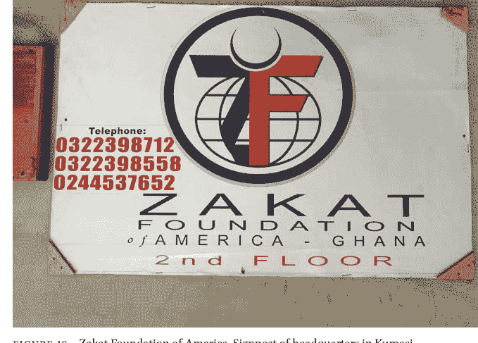

图18 美国扎卡特基金会。库马西总部的路标

照片：霍尔格·魏斯/2018

该基金会加纳办事处经理（2015年）在一次采访中表示，他的主要关注点——也是扎卡特基金会（ZF）的愿景——是制定可持续的生计计划，以彻底消除该国贫困穆斯林社区的贫困。497 除了上述活动外，扎卡特基金会还开展孤儿赞助计划、牲畜计划，并在加纳各地贫困的穆斯林社区中募集捐款，以建立清真寺、学校和图书馆。498

支持有需要的穆斯林社区，”2.6.2017，https://www.modernghana.com/news/779623/zakat-foundation-supports-needy-muslim-communities.html，访问于6.10.2021；“美国扎卡特基金会向贫困穆斯林分发肉类，”15.9.2016，https://www.modernghana.com/news/719755/zakat-foundation-of-america-distributes-meat-to.html，访问于13.7.2021。

497 阿尔哈桑·阿布巴卡尔·萨迪克，“扎卡特基金会致力于帮助弱势穆斯林”，6.10.2015，https://www.ghanaweb.com/GhanaHomePage/NewsArchive/Zakat-Foundation-committed-to-assisting-vulnerable-muslims-386085，访问于13.7.2021。

498 https://www.zakat.org/our-work/where-we-work/ghana，访问于13.7.2021。

孤儿赞助计划始于2003年，自那时起已筹集了近24,000美元，资助了55名孤儿。499 在对非穆斯林利益相关者的显著干预中，包括为博诺地区贝雷库姆附近的费坦塔难民营小学的学生提供书包和学习用品，500 为博莱区的奇布林约阿社区建造三间教室的初中教室楼，501 以及向加纳北部的洪水灾民捐赠救援物资。502 有时，扎卡特基金会的捐赠同时面向穆斯林和非穆斯林利益相关者，例如2004年基金会向库马西的科姆福·阿诺基教学医院捐赠了价值220万加纳塞地（约250美元）的现金和食品。其中约一半用于帮助艾滋病毒感染者购买药物，另一半作为斋月支持赠予穆斯林员工。503 五年后，扎卡特基金会向科姆福·阿诺基教学医院捐赠了价值50万美元的医疗设备。504

到2005年，扎卡特基金会启动了教育计划，旨在惠及资源匮乏的学校并改善教育基础设施。除了资助建设教室楼外，该计划还包括向该国北部资源不足学校的学生分发装满书籍和铅笔的书包。505 其生计赋权计划的例子包括萨凡纳地区的两个木薯加工厂、朱格博伊妇女木薯合作社和博莱妇女木薯合作社。其他还包括库马西和博莱的两个职业培训中心，教授缝纫并帮助毕业生创办和销售产品。此外，基金会还为上东区博莱、鲍库和宾杜里的医院和饮水井提供了医疗用品。506 作为生计赋权倡议的一部分，基金会通过其小额信贷计划，协助博诺区贾马姆的一个由十名妇女组成的木薯种植和加工合作社，507 以及苏尼亚尼的一个30名成员组成的山药种植妇女合作社。508 它还在2013年发起了“一年百井”运动。509 作为人道主义救济计划的一部分，基金会于2007年向三个北部地区的洪水灾民捐赠了价值2.15亿加纳塞地（约22,000美元）的衣物和鞋类。510

2016年，基金会启动了为期三年的牲畜饲养计划，以帮助贫困者谋生。其主要理念是为110户贫困家庭提供山羊和绵羊，开展一项创收活动，并最终赋予她们经济能力。该计划预计在加纳北部的五个社区实施，并计划扩展到布基纳法索和科特迪瓦。511

同年，扎卡特基金会的职业培训中心计划即将结束。该计划是扎卡特基金会性别赋权计划的一部分，始于2006年，由基金会资助的志愿培训中心（VTC）在博莱运营。512 该中心开设了为期两年的学徒课程，已培训约100名妇女，她们毕业后获得缝纫机和配件，以创办自己的微型企业。在最后一批学生的毕业典礼上，扎卡特基金会国家项目经理哈比布·阿布巴卡尔呼吁民间社会组织、社区领导人和政治家支持VTC计划，以改善年轻女性的生活，并敦促政府在贫困社区中设立更多的VTC。

社区。[513] 然而，终止该计划的决定被撤销了。相反，它从两年缩减为一年的培训项目。[514]

由于未说明的原因，天课基金会（ZF）于2017年中止了其在加纳的项目，但古尔巴尼捐献除外。一年后，它恢复了水利项目和纺织缝纫职业培训项目，并启动了一个汽车维修项目。2019年，它恢复了孤儿资助计划。[515]

513 Michael Quaye，《天课基金会帮助10名女性》，2016年1月8日，https://www.graphic.com.gh/news/general-news/zakat-foundation-sets-up-10-women.html，访问于2021年7月13日。

514 Samuel Doudou，《基金会培训10名女性缝纫》，2017年3月31日，https://www.graphic.com.gh/news/general-news/foundation-trains-10-women-in-dressmaking.html，访问于2021年7月13日。

515 https://www.facebook.com/zakat.us/，2017年8月30日、2018年3月19日、2018年3月31日、2018年5月29日、2021年10月14日，访问于2022年1月6日。

除了天课基金会，其他几个美国穆斯林慈善机构也在加纳活跃，尽管它们的项目、计划和干预措施没有得到像天课基金会那样的媒体关注。这也许是因为它们从事小规模、临时性项目，或者通过当地非政府组织运作。*美国伊斯兰救济会*就是一个例子，它似乎已经结束了在加纳的工作。2016/2017年，其主页仍报道其在塔马利地区的项目，包括水井、斋月食品分发以及对加纳穆斯林教师培训学院的支持。[516] 而2021年版的主页没有列出任何在加纳的项目。[517] 反过来，*生活救济与发展组织*（*LIFE*）通过其在加纳的办事处一直运营孤儿和水项目，以及教育、斋月和乌德希亚项目。[518] 其投资受益者既有穆斯林也有非穆斯林，就像2019年它向霍教学医院捐赠的水过滤厂一样。[519]

516 美国伊斯兰救济会在加纳的工作，http://irusa.org/ghana/，访问于2016年11月13日和2017年11月7日。2016/2017年主页已失效，新主页（https://irusa.org/africa/more-work/）未列出这些活动（2024年5月核查）。

517 https://irusa.org/，访问于2021年10月6日。https://www.lifeusa.org/post/ram-2019，访问于2021年10月6日。

518 根据其2019年斋月报告，LIFE在加纳向93,600名受益者分发了食品篮，参见 https://www.lifeusa.org/post/ram-2019，访问于2021年10月6日。

519 https://www.lifeusa.org/post/the-ho-teaching-hospital-1，访问于2021年10月6日。

520 “非洲伊斯兰遗产基金会寻求改善非洲人的生活水平”，2012年7月16日，https://www.ghanaweb.com/GhanaHomePage/NewsArchive/AIHF-seeks-to-improve-standards-of-life-of-Africans-244767，访问于2022年1月6日。

521 https://www.facebook.com/salaamulmuslimiynghana/。

成立于2009年的`非洲伊斯兰遗产基金会`在塔马利开始运作，其目标是提供人道主义援助，并“修建学校、清真寺、医院，照顾孤儿和寡妇”。[520] 然而，由于未知原因，该基金会的加纳分会在2015年后停止了活动。总部位于纽约的萨拉姆·乌尔·穆斯林云基金会则于2013/14年在加纳开设了分支机构。此后，它一直在阿克拉、库马西和塔马利开展孤儿和寡妇支持项目以及斋月和开斋节项目。[521]

自2010年代中期以来，活跃在加纳的美国穆斯林慈善机构和非政府组织的范围急剧扩大。伊斯兰乌玛救济会（IUR）专注于加纳、尼日利亚和尼日尔的人道主义项目。IUR于2019年7月在阿克拉开设了加纳分会，并将其业务扩展到北部、中部和东部地区。[522] 最初，IUR专注于孤儿、开斋饭、开斋节和古尔巴尼，以及水利项目。2019年，它开始筹集捐款，为穆斯林孤儿建立一个安全场所，即位于中部地区波辛的Al Amaan孤儿院。住宅、学校和清真寺的地基于2021年完工。[523] 孤儿项目还包括阿克拉的街头儿童派对，以及世界孤儿日和世界粮食日的庆祝活动。此外，它发起了“每月食品募捐”项目，以帮助600多个家庭和1,800名寡妇及孤儿。它为90多名孤儿提供了开斋饭，为40名孤儿提供了古尔巴尼食物，并在宰牲节为40名孤儿提供了衣物。2019年，IUR还与加纳非政府组织Sadaqa Train合作（见第3.6节），向恩萨瓦姆监狱的穆斯林囚犯运送斋月食品包和衣物。此外，它委托在北部地区库姆布古区的农村社区建造三口水井。[524] 此后，IUR通过启动新的旗舰项目“寡妇技能发展项目”扩大了其活动。[525] 此外，它启动了一个教育支持项目，包括在Jasikan Zongo的“返校与食品募捐活动”（2021年2月），以及支持塔马利的Kashful（Khishful）Uloom古兰经背诵学校（2021年3月）。[526] 2021年6月，它庆祝了第十六个水井项目的启用，[527] 并通过将古尔巴尼捐赠扩展到五个地区（阿散蒂、东部、北部、上东部和沃尔特地区）来庆祝。[528]

522 伊斯兰乌玛救济会2019年年度报告，可查阅 https://docs.google.com/gview?url=https://islamicummahrelief.org/wp-content/uploads/2020/07/IUR-2019-Report.pdf&embedded=true。

523 https://islamicummahrelief.org/al-amaan-orphanage-ongoing-project-ghana/，访问于2021年8月13日。

524 伊斯兰乌玛救济会2019年年度报告。

525 https://islamicummahrelief.org/graduation-ceremony-of-our-first-widows-skills-development-project/、https://islamicummahrelief.org/10-widows-trained-in-soap-making-in-the-second-phase-of-widows-skills-project/，访问于2021年8月13日。首次活动在阿散蒂地区埃菲杜阿塞举办，第二次在塔马利举办。

526 https://islamicummahrelief.org/back2school-and-food-drive-distribution/、https://islamicummahrelief.org/donation-to-kashful-uloom-quran-memorization-school-tamale-ghana/，均访问于2021年8月13日。

527 https://islamicummahrelief.org/iur-borehole-project-commissioned-borehole-no-16-in-odoben-central-region-ghana/，访问于2021年8月13日。

528 https://islamicummahrelief.org/iur-ghana-2021-qurbani-updates/，访问于2021年8月13日。

美国穆斯林青年运动和非政府组织Generation Wealthy, Unity & Faith也于2019年在阿克拉开设了加纳分会。该组织运营着一个华丽的Facebook账户，倡导循环经济、宗教学、可持续性和财富分配，属于针对（城市）穆斯林青年的新一代运动。2019年7月，它在阿克拉和塔马利组织了一次创新峰会，主题是“与行业内顶尖领导者和创新者联系并学习”。[529] 另一方面，被遗忘人民组织在2019年启动了一个孤儿与斋月捐赠相结合的项目，并于2020年将其扩展到恩西马区的开斋饭和古尔巴尼分发。[530]

529 公告，发布于2019年4月16日，https://www.facebook.com/GenerationWealthyGhana/photos/390963284830982，访问于2021年10月6日。

530 参见 https://www.fpoworldwide.org/west-africa.html，以及2020年5月24日和2020年8月3日关于恩西马区开斋饭和古尔巴尼分发的说明，https://www.facebook.com/aishahassan64，访问于2022年1月15日。

非洲救济与社区发展组织是一家于2018年成立的美国穆斯林慈善机构，与Aldiaa Society合作，已委托开展水利项目和教育中心，并资助了乌德希亚/古尔巴尼项目，同时自2020年起在加纳资助了约90名孤儿。[531]

531 https://www.facebook.com/AfricaReliefUS/，2020年3月22日、2020年7月31日、2020年8月5日、2020年10月8日、2020年9月10日、2020年10月6日、2020年10月7日、2020年10月15日、2020年11月2日、2020年11月6日、2020年11月25日、2020年12月10日、2021年1月3日、2021年1月24日、2021年1月25日、2021年3月22日、2021年10月14日、2021年10月20日、2021年11月15日、2021年12月14日，访问于2022年1月6日。

另一个在加纳新出现的组织是美国什叶派慈善机构One Hand One Heart，它通过当地什叶派非政府组织Aal Yaseen Ghana来转移其斋月捐款。2021年，该组织加快活动，实施了自有水利项目，[532] 并于9月启动了首个支持洪灾受害者的人道主义救援项目。[533]

532 One Hand视频，https://www.facebook.com/watch/?extid=SEO-&v=136734015973753，2021年4月11日，https://www.facebook.com/watch/?v=8ii644229713327，2021年7月1日，访问于2021年10月18日。

533 加纳洪灾海报，2021年9月5日，https://www.facebook.com/onehandoneheartofficial/photos/a.451744128506934/154361524939811/，访问于2021年10月18日。

（成立于1972年），为加纳的孤儿院和学校提供支持。534 `慈悲车队`（成立于2003年）的首次活动是其2012年的古尔班/乌德希亚（Qurbani/Udhiya）运动。此后，该组织一直从事学校建设和资助、清真寺建设、斋月和古尔班/乌德希亚食品分发、水项目以及寡妇支持。535 其他在加纳开展自己的开斋饭和古尔班项目的英国穆斯林慈善机构包括`人类救济基金会`536 和`全球福利救济`。537

534 https://www.facebook.com/GMUUK/.

535 https://www.facebook.com/CaravanofMercy/.

536 https://www.hrf.org.uk/galleries/ghana-meals-for-the-fasting/， https://www.hrf.org.uk/galleries/ghana-distribution-of-ramadan-food-parcels/， https://www.hrf.org.uk/galleries/ghana-zakat-ul-fitr-distribution/， https://www.hrf.org.uk/galleries/ghana-qurbani-preparation-2017/，访问于2019年4月28日。

537 “加纳（非洲）——三个贫困村庄”， https://mydonate.bt.com/events/2018ghanavillages/466785，访问于2019年2月26日。

`穆斯林全球救济`（MGR，成立于2000年）则于2015年开始在加纳开展工作，最初仅作为捐赠组织。MGR资助了其在上东部地区的当地合作伙伴组织——El-Ehsan 慈善救济基金会——的项目。2015年，MGR启动了其“加纳生命之水”（Water4Life Ghana）项目。该项目旨在上东部地区普西加区的 Tes-Natinga 村建造一口手压井，并由其当地合作伙伴组织实施。538 2016年，它针对上东部地区 Kuose-Jingiri 的一个水和卫生项目发起募捐活动，由当地合作伙伴实施。除了一口井，该项目还包括一个男女分设的公共厕所，以及淋浴和净礼设施。539 MGR在其主页上将该项目展示为其“启动”发展项目的范例。540 2017年，它将捐款用于为 Bawku 的 Winamzua 学校130名儿童提供食物，并向上东部地区三个村庄和五所学校的穆斯林社区捐赠了斋月食品援助。541 此外，MGR和 El-Ehsan 慈善救济基金会在2017年启动了一个肉类分发（古尔班）项目。542

538 YouTube视频：Water4Life-Ghana 2015（https://www.youtube.com/watch?v=rLRZ8vtyaXg），上传于2016年2月4日； https://issuu.com/muslimglobalreliefmgr/docs/mgr_ramadan_booklet，访问于2017年11月8日； 穆斯林全球救济受托人报告和截至2016年3月31日的年度财务报表，apps.charitycommission.gov.uk/Accounts/Ends18/0001081018_AC_20160401_E_C.PDF，访问于2017年11月8日。

539 https://www.muslimglobalrelief.org/water4life/2017/water-and-sanitation-in-kouse-jingiri-village/； “Kouse-Jingiri 村的供水与卫生设施 / 穆斯林全球救济”， https://www.youtube.com/watch?v=TBcO1wR8Bms&t=140s，上传于2017年5月8日； https://www.muslimglobalrelief.org/water-and-sanitation-in-kouse-jingiri-village/，访问于2017年11月8日。

540 “加纳Kouse-Jingiri的供水与卫生设施”， https://www.muslimglobalrelief.org/water/，访问于2021年7月15日。

541 https://www.muslimglobalrelief.org/ramadan/2017/ramadan-food-aid-ghana/； https://www.muslimglobalrelief.org/feedme/2017/feeding-children-ghana-ramadan/，两个链接均访问于2021年7月15日。

542 “2017年肉类分发项目 / MGR El-Ehsan 慈善救济基金会（ECRF）”， https://www.facebook.com/251553680207368/videos/1400647506631300/?__so__=watchlist&__rv__=video_home_www.playlist_video_list，访问于2021年7月15日。

由于（迄今）未知的原因，各项举措在2018年未再继续。MGR在接下来的几年中停止了为加纳筹款的活动，似乎已停止在该国的行动。然而，MGR于2020年重启了在加纳的活动，不过其项目由其加纳团队实施，没有任何当地合作伙伴组织。与其之前的参与类似，MGR在上东部地区的村庄建造了手压井、洗涤和卫生设施以及社区清真寺。543 此外，MGR在YouTube上发布了一段视频，显示其团队于2021年2月在一个未标明的地点（可能是 Bawku）组织食品厨房，并从一个售货亭发放食品盒，以缓解COVID-19疫情造成的苦难。544

543 井的照片，可能位于加纳北部，2021年5月12日，https://www.facebook.com/muslimglobalrelief/photos/a.66357287372104/4530551796974173/?type=3&theater； 井的照片，加纳北部，2021年5月11日，https://www.facebook.com/muslimglobalrelief/photos/a.66357287372104/4526928997336453/?type=3&theater； “加纳洗涤与卫生设施” | 穆斯林全球救济，https://www.youtube.com/watch?v=H4aYVpLPh-c，上传于2021年3月29日； “加纳已完工的水井”，https://www.youtube.com/watch?v=f2LfUFdrDKk，上传于2021年3月29日； “在加纳建造安拉之家 / 清真寺建设 / 穆斯林全球救济”，https://www.youtube.com/watch?v=kVgIHU5Z-Jk，上传于2021年3月29日。

544 “加纳日常食品厨房 / 免费熟食 / 穆斯林全球救济”， https://www.youtube.com/watch?v=2Dji-plyDoo，上传于2021年3月29日。

总部位于英国布拉德福德的穆斯林慈善机构 InTouch 基金会（InTouch Foundation）于2012年成立，其在加纳首次亮相时，与 Ustadh Alyas Karmani 合作，于2016年在库马西分发开斋节和古尔班食品包，并向库马西 Manhyia 监狱的500名穆斯林及非穆斯林囚犯提供开斋节餐。2017年，它宣布收取天课（zakat）并在英国、巴基斯坦和加纳进行分发。其在加纳的海外项目目标是筹集15,000英镑，以提供财政支持建立鸡和牛养殖场，帮助“库马西社区”。545 另一方面，Salam 慈善机构声称已停止在加纳的运营，546 尽管它在2021年（据推测是通过当地非政府组织）提供了古尔班肉类，547 并为其两个水项目筹集了超过45万英镑。548 加纳IERA 549 则是伊斯兰教育与研究学院（Islamic Education and Research Academy）的一个分支，该学院是一个成立于2009年的全球性伊斯兰传教组织，并在英国注册为慈善机构。有趣的是，IERA 并未将宣教（daʿwa）与人道主义救济结合起来。550

545 “2017年天课”， https://www.intouchfoundation.co.uk/zakat，访问于2021年7月13日。

546 https://salamcharity.org.uk/about/where-we-work/，访问于2021年10月6日。

547 https://salamcharity.org.uk/qurbani-2021/，访问于2021年10月6日。

548 Salam 慈善机构2021年筹款报告， https://app.justcharity.org/charities/salam-charity，访问于2021年10月6日。另见 https://muslimmamas.com/muslim-mamas-ramadan-fundraiser-rain-in-her-name-salam-charity/，访问于2021年10月6日。

549 https://www.facebook.com/IERA-GHANA-111394317313530/?ref=page_internal。

550 https://register-of-charities.charitycommission.gov.uk/charity-search/-/charity-details/5004234/what-who-how-where。

美国和英国穆斯林非政府组织和慈善机构在加纳的参与并不令人意外。一个新的趋势是来自其他非阿拉伯/海湾/伊朗或土耳其非政府组织的穆斯林慈善机构涌入，例如南非的 Al-Imdaad 基金会，551 巴基斯坦逊尼派宣教组织 Dawat-e Islami，552 新加坡的 Global Ehsan Relief，553 印度尼西亚的 Global Wakaf 和 ACT（Aksi Cepat Tanggap 或 Care for Humanity），554 澳大利亚的 Muslim Aid Australia International 555 以及 International Human Care and Relief Organisation Australia

551 Al-Imdaad 基金会于2012年在加纳组织了斋月食品援助计划；参见 `https://www.alimdaad.com/content/gallerydetails.jsf?id=315`，访问于2021年10月6日，尽管尚不清楚该计划是否重复进行。2021年，加纳不再被列为该基金会的运营国家。然而，根据阿克拉的 Al-Qalam 学院提供的信息，Al-Imdaad 的英国分支自2018年起通过该学院捐赠斋月和开斋节食品包以及开斋饭；参见 `https://www.facebook.com/alqalminstitute/`，2018年6月1日、2019年5月3日、2019年6月1日、2021年7月17日。此外，Al-Imdaad 基金会通过 Al-Qalam 学院于2017年筹集资金支持罗兴亚难民（`https://www.facebook.com/alqalminstitute/` ，2017年11月7日、11月13日、11月27日、12月20日），并于2020年通过 Al-Qalam 学院为200名孤儿赞助了学校用品包，`https://www.facebook.com/alqalminstitute/`，2020年1月6日，全部访问于2021年10月6日。

552 `https://www.facebook.com/Dawteisl.../`

553 Global Ehsan Relief 偶尔资助 Abdul-Aziz 慈善与人道主义基金会的项目和计划；见下文第2.4.5节。

554 `https://www.facebook.com/GlobalWakaf/?locale=id_ID` 和 `https://www.facebook.com/AksiCepatTanggap`。印度尼西亚国际非政府组织在撒哈拉以南非洲（包括加纳）的开端和活动需要进一步调查。

555 Muslim Aid Australia International 自2015年起在加纳开展工作，并资助古尔班肉类的分发；参见 `https://www.maainternational.org.au/our-projects/qurban`。最近，它开始与 Bawku 的 El-Ehsan 慈善救济基金会合作，并于2021年资助钻探了90口钻井；参见 Atubugri Simon Atule，“澳大利亚国际穆斯林援助组织向缺乏饮用水的社区捐赠90口钻井”，2021年3月25日，`https://www.modernghana.com/news/1070487/muslim-aid-australia-international-donates-90-bore.html`，访问于2021年10月6日。

(IHCRO Australia),[556] *加拿大Al-Huda救济*,[557] 来自新西兰的 *伊斯兰之声*, *香港穆斯林理事会*,[558] 法国的 *Nouvelle Optique*,[559] 比利时的 *Hearts 4 Mercy* (H4M),[560] 丹麦的 *VIOMIS Aid*, 瑞士的 *Barakah Charity*,[561] 以及总部设在德国的多个穆斯林慈善机构，如 *Help Dunya*、*Ahkwaat G Foundation* 和 *Hajia Akweley Legacy Foundation*。

成立于2018年，总部设在不来梅的 *Help Dunya* 于2019年开始在加纳开展工作。最初，该组织专注于钻井、建造水箱以及开展免费医疗检测活动。[562] 2020年，它启动了一个新项目，即为20名孤儿设立孤儿院。[563] 然而，其主页和年度报告并未说明其在加纳开展项目的具体地点，尽管我认为这些项目很可能位于该国北部地区。2021年4月，一则新闻报道指出，延迪选区议员Alhaji Farouk Aliu Mahama 已与“Help Dunya Ghana”合作启动了该选区100眼水井的建设。[564]

*Ahkwaat G Foundation* 则由一群德国穆斯林妇女于2018年创立，并在阿克拉、库马西和塔马利设有分支办公室。除在阿克拉运营Darus-Salam孤儿院外，该非政府组织还从事水项目，并计划在塔马利建设一所伊斯兰学校。[565] *Bamba International Humanitarian Aid Organisation* 另一方面是一个以德国为基地的单人非政府组织，于2022年在加纳为钻井以及分发斋月礼物提供资金，资金来自当地土耳其捐助者。[566] 最后，*Hajia Akweley Legacy Foundation* 于2023年启动，开展了斋月食品捐赠项目，并在戈莫阿西部的阿帕姆钻了一眼水井。[567]

#### 4.4 一个（并非如此）新现象：土耳其穆斯林非政府组织的活动

土耳其早在20世纪90年代末就制定了其外交政策和海外发展援助的撒哈拉以南方向，但由于金融危机和政治不稳定，直到雷杰普·塔伊普·埃尔多安和正义与发展党（AKP）于2002年上台后才开始实施。[568] 2005年是转折点，土耳其获得非洲联盟观察员地位；三年后，它加入了非洲开发银行。[569] 在加纳，土耳其于2010年重新开放大使馆（第一座大使馆建于1958年，因土耳其政治动荡于1981年关闭），并启动了大规模、多方面的商业、发展合作和人道主义交流项目，包括提供斋月援助。[570] 2017年，土耳其外交的宗教分支 *Human Development Association International* (HUDAI) 通过支持北部地区贫困社区的穆斯林启动了其开斋项目。[571]

与这一进程密切相关的是广泛的土耳其非政府组织，其中最引人注目的是各种土耳其非政府组织在斋月、开斋节和宰牲节期间提供的救济物资和（肉类）捐赠，尤其是 *Turkish Religious Affairs Foundation*、*TSK Mehmetçik Foundation*、*Foundation of Humanitarian Relief*（IHH，也称为非洲人权与自由和人道主义救济基金会，成立于1992年）、*Cansuyu Charity and Solidarity Organisation*（CANSUYU，成立于2005年）、*Turkish Red Crescent*、*Kimse Yok Mu Association*、*Türkiye Diyanet Vakfı*（TDV）和 *Deniz Feneri Association*。[572] 他们最引人注目且最负盛名的项目是位于坎达的阿克拉Furqan综合体，包括为15,000名 worshippers 设计的奥斯曼风格的新国家清真寺、休闲中心、图书馆综合体、首席伊玛目办公室和住所、研究综合体、高中综合体、诊所、行政楼、礼堂和会议中心，于2021年落成（图19）。[573] 该项目是在不同土耳其国家和非政府组织合作伙伴的合作下进行的，包括土耳其政府、土耳其宗教事务局、萨姆松大都会市政府以及 *Aziz Mahmud Hudai Foundation* 和HUDAI，以及由土耳其非政府组织 *Ghana Friendship and Solidarity Association*（GANADER）领导的当地加纳组织。[574]

[556] IHCRO Australia是2014年成立的英国国际穆斯林慈善机构的一个分支。IHCRO Australia自2020/21年以来资助了教育、清真寺和水项目以及人道主义救济。另见“IHCRO为Abubakar Siddick伊斯兰学校建设新设施”，2021年8月4日，`https://gna.org.gh/2021/08/ihcro-constructs-new-facility-for-abubakar-siddick-islamic-school/`，访问时间2023年1月2日；IHCRO Australia，2021年3月6日、2021年4月20日、2021年4月25日、2021年8月2日、2021年8月6日、2021年8月9日、2021年8月12日、2021年9月1日、2021年9月4日、2021年9月30日、2021年11月13日、2021年12月16日、2022年7月14日，`https://www.facebook.com/ihcroaustralia`。

[557] 该组织在加拿大和加纳运营；另见 `https://www.alhudarelief.com/about-page/`，以及 `https://www.facebook.com/groups/154042615281824/about`。

[558] 香港穆斯林理事会（MCHK）于2021年转向加纳并开始资助“3合1 sadaqa jariyah 项目”，即水井+清真寺+古兰经。据其主页提供的信息，MCHK很可能通过总部位于库马西的非政府组织United Ansaru al-Islam al-Muttadidah运作；见 `https://muslimcouncil.org.hk/event/hassan-mustafa-water-well-completion-%e2%80%a2-in-memory-of-hassan-mustafa-%e2%80%a2-3-in-1-sadaqah-jariyah-project/`，访问时间2021年10月6日。

[559] Nouvelle Optique 对加纳多个钻井、清真寺和学校项目开放捐赠征集；另见 `https://www.nouvelleoptique.org/fr/`。自2021年以来，Nouvelle Optique 为加纳一个独特的植树项目筹集资金；见 `https://www.facebook.com/nouvelle.optique/`，2021年11月2日、2021年11月5日，访问时间2022年1月9日。

[560] 该组织在布基纳法索和加纳支持水项目和人道主义救济（斋月开斋）项目；另见 `https://www.facebook.com/Hearts4Mercy`。其主页 `http://hearts4mercy.org/NL/index.html` 自2017年以来未更新，且未列出加纳项目。根据Facebook上的信息，该组织于2020年开始资助水项目，2021年开始斋月开斋。

[561] 瑞士Barakah慈善机构于2021年10月建造了一眼水井，并于2022年11月分发天课；见帖子2021年10月9日、2021年11月5日、2022年11月21日，`https://www.facebook.com/swissbarakah/`，访问时间2022年12月15日。

[562] Help Dunya，《2019年年度报告》，可获取于 `https://help-dunya.com/Download/Jahresbericht/Help%20Dunya%20Jahresbericht%202019.pdf`，下载时间2021年7月21日。

[563] Help Dunya，《2020年年度报告》，可获取于 `https://help-dunya.com/Download/Jahresbericht/Help%20Dunya%20Diagram%202020%20-%20Jahresbericht.pdf`，下载时间2022年1月16日；`https://help-dunya.com/projekte/waisenhaus-projekte/`，访问时间2021年7月21日。

[564] Emmanuel Gamson，`https://gna.org.gh/2021/04/mp-constructs-100-boreholes-in-yendi/` 2021年4月28日，`https://www.gna.org.gh/1/2063619`，访问时间2021年7月21日。

[565] `https://www.facebook.com/AkhwaatGFoundation-Ghana-101559801515951/`，访问时间2021年10月6日。

[566] 见Facebook上于2022年6月5日发布的多个视频，`https://www.facebook.com/Bamba-international-humanitarian-aid-organisation-11663497093582`，访问时间2022年8月24日。

[567] `https://www.facebook.com/profile.php?id=10009198622694`

[570] “土耳其大使馆支持穆斯林”，2021年5月17日，`https://thebftonline.com/2021/05/17/turkish-embassy-supports-muslims/`，访问时间2023年12月5日。

[571] “土耳其非政府组织支持北部地区穆斯林社区”，2017年6月7日，`https://citifmonline.com/2017/06/turkish-ngo-supports-muslim-communities-in-northern-region/`，访问时间2018年9月17日。

[572] “土耳其开斋节救济惠及超过250万家庭”，2013年10月17日，`https://www.aa.com.tr/en/world/turkish-eid-reliefs-reach-over-25-million-families/210930`，访问时间2022年1月9日。

[573] Hafsa Obeng，“加纳国家清真寺综合体：加纳与土耳其友谊的象征”，2021年7月27日，`https://gna.org.gh/2021/07/ghana-national-mosque-complex-symbol-of-friendship-between-ghana-and-turkey/`，访问时间2022年1月9日。

[574] “非政府组织将加快坎达清真寺综合体建设”，2013年7月8日，`https://www.modernghana.com/news/473633/1/ngo-to-expedite-work-on-kanda-mosque-complex.html`，访问时间2024年5月28日；Jeffrey Haynes，“加纳-土耳其关系中的宗教与经济软实力”，*Religions* 13, no. 1030 (2022)，`https://doi.org/10.3390/rel1311030`；Michelle Apotsos，“清真寺、地标、文献：通过阿克拉Furqan重新想象加纳的伊斯兰”，*Ghana Studies* 25 (2022): 144–152。另见加纳国家清真寺官方主页，`https://www.ghananationalmosque.com/`。

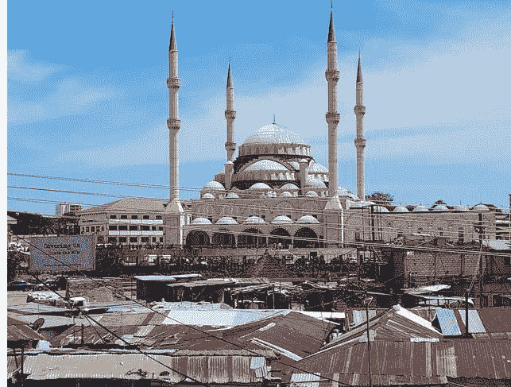

图19 阿克拉富尔坎。加纳国家清真寺综合体

照片：HOLGER WEISS/2020

然而，撒哈拉以南非洲土耳其发展援助的首批大使却是与服务运动 Hizmet Movement 有关联的机构，该运动是土耳其穆斯林知识分子和舆论领袖费特胡拉·居伦 Fethullah Gülen 自1999年起流亡美国的教育网络，并得到全球居伦启发的慈善机构 Kimse Yok Mu 支持。575 其加纳分支机构是2001年成立于阿克拉的银河国际学校 Galaxy International School，以及加纳-土耳其合作与发展协会 Ghana-Turkey Cooperation and Development Association，TUDEC。576 后者倡议由一些当地加纳商人于2011年成立，旨在促进加纳与土耳其之间的教育和贸易活动，同时在加纳提供社会和人道主义服务。577 直到那时，服务运动曾与埃尔多安的正义与发展党 AKP 结盟，但在2016年未遂政变后被土耳其政府取缔。

575 另见 David Shinn，《Hizmet in Africa: The Activities and Significance of the Gülen Movement》Tsehai Publishers，2015，以及 Tomas Michel，“Fighting Poverty with Kimse Yok Mu”，载于 Erkan Toguslu 和 Johan Leman 编《Modern Islamic Thinking and Activism: Dynamics in the West and in the Middle East》，Leuven：Leuven University Press，2014，183-194页。

576 Musah Yahaya Jafaru，“Fighting poverty, ignorance and disunity in Ghana—TUDEC’s experience”，2016年5月19日，`https://www.graphic.com.gh/news/general-news/fighting-poverty-ignorance-and-disunity-in-ghana-tudec-s-experience.html`，访问于2021年7月15日。

将居伦/服务运动贴上“恐怖组织”标签后，土耳其政府与包括加纳在内的32个非洲国家签署了议定书，以取代居伦/服务运动的学校，并将重点转向马阿瑞夫基金会 Türkiye Maarif Vakfı，该基金会此后成为政府支持的教育合作与发展的主要组织，包括为非洲学生提供赴土耳其大学学习的奖学金。578 马阿瑞夫基金会于2019年在阿克拉开设了其首个教育机构，国际马阿瑞夫学校幼儿园。579

土耳其对居伦/服务运动的打击在一些非洲国家取得成功，但在加纳并非如此。例如在马里，所有前服务运动关联的教育机构均移交给了马阿瑞夫基金会。580 在加纳，土耳其要求将银河国际学校和TUDEC列入黑名单在加纳媒体上引发了强烈抗议581，并未能使它们被贴上“恐怖组织”标签。两者仍在其各自的业务领域活跃。其中，TUDEC每年因其在斋月和宰牲节期间向阿克拉、Cape Coast、Koforidua、Kumasi、Takoradi、Tamale、Tema和Wa等地穆斯林社区的捐赠而频频上头条，在斋月期间 2016年：10,000份开斋和食品包，每天供养700人；2017年：1,500份开斋和食品包；2019年：1,400份开斋和食品包 2023年：超过1,750份开斋和食品包，582 以及在宰牲节期间 2018年：1,200个家庭；2020年：4,200个；2021年：6,000个；2022年：10,800个；2023年：10,000个。583 反映其作为世俗穆斯林非政府组织的特征，其捐赠也包括非穆斯林/基督教和地方市政机构。584 除人道主义救济项目外，TUDEC还赞助钻井。585

577 Alhassan Abdulai，“Developing Ghana, The Role of Tudec and Galaxy Int’l School”，2016年5月17日，https://hizmetnews.com/i8018/developing-ghana-role-tudec-galaxy-intl-school/#.Ydqf0hNBwI8，访问于2022年1月9日。

578 Erkan Toguslu，《The Turbulence between AKP and Hizmet: the African case》London：Centre for Hizmet Studies，2017，可查阅于 https://www.hizmetstudies.org/assets/docs/The_Turbulence_between_AKP_and_Hizmet.pdf；Haynes，“Religious and Economic Soft Power；”“Ghana benefits from 432 Turkish university scholarships”，2019年11月28日，https://www.graphic.com.gh/news/general-news/ghana-benefits-from-432-turkish-university-scholarships-ambassador-says-at-maarif-school-opening.html，均访问于2022年1月8日。

579 “Maarif Schools start education in Ghana”，2019年11月11日，https://www.turkiyemaarif.org/post/7-maarif-schools-start-education-in-ghana-842?lang=en，访问于2022年1月8日。

580 “Turkey aims to provide ‘transparent’ education in Mali”，2018年4月20日，https://www.aa.com.tr/en/education/turkey-aims-to-provide-transparent-education-in-mali/124055，访问于2024年5月28日。

581 Vladimir Antwi Danso，“Turkey: Carrying The Fight Beyond Borders”，2016年6月12日，https://www.ghanaweb.com/GhanaHomePage/features/Turkey-Carrying-the-fight-beyond-borders-446500；“The Ottoman Delight”，2016年7月23日，https://dailyguidenetwork.com/the-ottoman-delight/，均访问于2022年1月9日。

582 "TUDEC fetes thousands to mark Eid-ul-Fitr," 2016年7月8日，https://www.modernghana.com/news/7026539/tudec-fetes-thousands-to-mark-eid-ul-fitr.html, "TUDEC feeds individuals, families to mark Eid-ul-Fitr," 2017年6月26日，https://citifmonline.com/2017/06/tudec-feeds-individuals-families-to-mark-eid-ul-fitr/；"TUDEC reaches out to thousands on Eid day," 2019年8月16日，https://newsghana.com.gh/tudec-reaches-out-to-thousands-on-eid-day/，均访问于2022年7月10日；"Ramadan Iftar and Food Packages," 2023年5月27日，https://www.facebook.com/ghanatudec，访问于2023年8月18日。

583 例如见 "Eid Celebrations: TUDEC shares parcels of meat to over 1,200 people," 2018年8月27日，http://www.ghananews247.com/2018/08/27/eid-celebrations-tudec-shares-parcels-of-meat-to-over-1200-people/；Michael Ansah, "Galaxy International School reaches out to thousands on Eid day," 2020年8月4日，https://www.ghanaweb.com/GhanaHomePage/NewsArchive/Galaxy-International-School-reaches-out-to-thousands-on-Eid-day-1025329，访问于2021年7月15日；George Wilson Kingson, "Eid al-Adha: TUDEC celebrates with the Ghanaian public," 2021年7月22日，https://ghananewsonline.com.gh/eid-al-adha-tudec-celebrates-with-the-ghana/；"Eid-Al-Adha 2021: TUDEC reaches out to over 6,000 families and individuals," 2021年7月25日，https://citinewsroom.com/2021/07/eid-al-adha-2021-tudec-reaches-out-too-over-6000-families-and-individuals/；均访问于2022年1月9日；"TUDEC supports needy to celebrate Eid-ul-Adha," 2022年7月15日，https://www.ghanaian times.com.gh/tudec-supports-needy-to-celebrate-eid-ul-adha/，访问于2022年8月29日；"TUDEC gifts meat to 6,000 families in Accra for Eid," 2022年7月13日，https://www.graphic.com.gh/news/general-news/tudec-gifts-meat-to-6-000-families-in-accra-for-eid.html, "TUDEC reaches out to thousands on Eid day," 2023年7月5日，https://www.graphic.com.gh/news/general-news/tudec-reaches-out-to-thousands-on-eid-day.html，访问于2023年8月18日。

584 George Wilson Kingson, "TUDEC supports Orphanage Home with Food Items," 2021年11月13日，https://ghananewsonline.com.gh/tudec-supports-orphanage-home-with-food-ite/；"TUDEC donates to PWDS in Adentan Municipality, Adentan Municipal Assembly," 2021年11月18日，https://adma.gov.gh/2021/11/18/tudec-donates-to-pwds-in-adentan-municipality/；均访问于2020年1月9日；"TUDEC supports PWDS in Adenta with food, cash," 2022年1月7日，https://www.ghanaian times.com.gh/tudek-supports-pwds-in-adenta-with-food-cash/，访问于2022年8月29日。

585 https://www.facebook.com/ghanatudec.

其他土耳其非政府组织在年度人道主义救济项目上投入了大量资金。例如，在2023年宰牲节期间，土耳其通用伊斯兰和文化信托 Universal Islamic and Cultural Trust Turkey 在库马西屠宰了超过150只羊和29头牛用于免费分发肉类；586 与此同时，土耳其宗教事务基金会 Türkiye Diyanet Vakfı TDV 通过其当地合作伙伴 Teimako and Blessing Organisation 将肉类分发给阿克拉、Ashaiman、Dodowa、Koforidua、Tamale、Walewale和Yendi等地超过50,000人。587 除斋月和宰牲节救济项目外，土耳其非政府组织如 CANSUYU、HUDAI、Hayrat Yardim Hayrat Humanitarian Aid Association，成立于2013年、Hayat Yolu 成立于2014年、IH-Da Vakfi International Foundation for Humanitarian Aid，成立于2013年 和 IHH 在全国各地的水项目中投入了大量精力 图版20。它们全部在2010年代开始在加纳开展活动。例如，CANSUYU 最初专门从事“牺牲活动”，即在斋月和两个宰牲节期间的捐赠，以及水项目，自2011年起开始钻井23口。588 IHH 则于2015年开始工作，提供教育援助，即捐赠古兰经。589 在随后的几年里，它将活动扩展到包括建设和维护水井和水泵，并启动了非洲白内障项目。590 IH-DA Vaqfi 于2013年开始运营，并列出了2014年完成的数十个清真寺和水井项目，但2017年后没有项目，也许表明它已停止在加纳的活动。591

586 "Eid 2023 free meat [...]", 2023年6月28日，https://www.facebook.com/PeaceDawahMedia，访问于2023年8月18日。

587 “With our beloved @turkiyediyanetvakfi we slaughtered a lot of animals [...],” 2023年7月4日，https://www.facebook.com/blessingsteimako，访问于2023年8月18日；“Türkiye Diyanet Foundation reaches out to needy families in Ghana,” 2023年7月11日，https://tdv.org/en-EN/turkiye-diyanet-foundation-reaches-out-to-needy-families-in-ghana/，访问于2023年12月5日。

588 有关2011年的活动信息，cansuyu.org.tr，2017年11月访问。

589 IHH Annual Report 2015，www.ihh.org.tr，2017年11月访问。

590 IHH Annual Report 2016，www.ihh.org.tr，2017年11月访问；Africa Cataract Project，见 http://medbox.iiab.me/kiwix/wikipedia_en_medicine_2019-12/A/Africa_Cataract_Project，以及 https://ihh.org.tr/en/news/cataract-surgery-for-14000-people，访问于2022年1月10日。

591 Permanent works，http://www.ih-davakfi.org/en/operations/3/permanent-works/1092/asikafо-water-supply-wellghana.aspx，访问于2022年1月9日；主页在2024年5月已失效。IH-DA Vakfi Facebook 群组上在加纳的水项目最后一次发布是在2017年5月，见 https://www.facebook.com/photo.php?fbid=1681757458794496&set=pb.10008807746526.-2207520000.&type=3，2017年5月11日，访问于2022年1月9日。

#### 4.5 加纳穆斯林非政府组织作为外国穆斯林捐助者的中介

在整个穆斯林撒哈拉以南非洲，一个共同特征是国际穆斯林慈善机构、国际非政府组织与当地协会和组织之间的密切关系。外国捐助组织要么投资并自行运营其当地项目和计划，要么将其资金渠道输送给当地组织的项目。地方组织作为外国捐助者的中介而脱颖而出。较早成立的穆斯林慈善机构，如 Direct Aid 或 Zakat Foundation of America，在各个非洲国家运营国家办事处，而

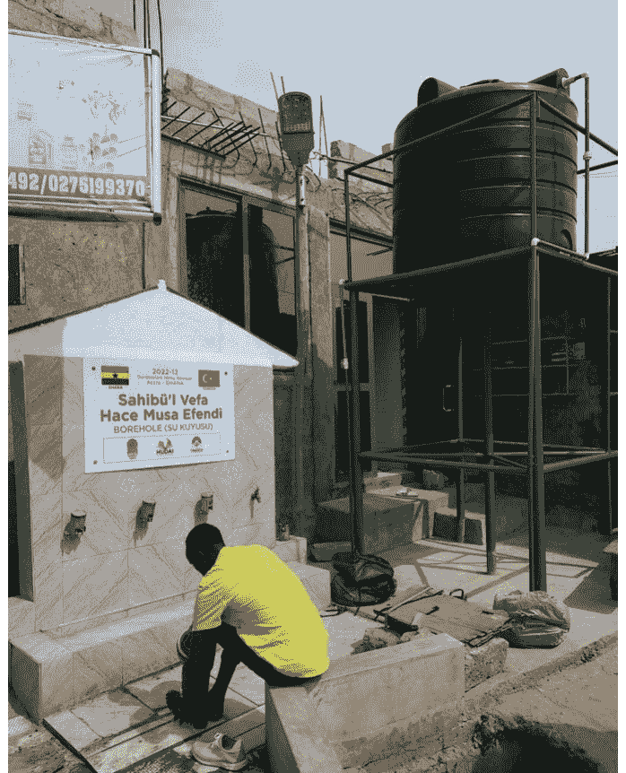

图 20 阿克拉尼玛的 HUDAI 钻井

照片：HOLGER WEISS/2022

新成立的组织与当地组织合作。它们构成了穆斯林非政府组织的 第一代。第二代由当地活动人士建立，通常是穆斯林学者，他们是与外国穆斯林慈善机构合作的独立非政府组织。大多数第二代穆斯林非政府组织不产生自己的资金，但在开展其项目和计划时在很大程度上，甚至完全依赖外国捐助者。592

加纳穆斯林非政府组织格局的出现与撒哈拉以南其他国家的类似发展相似。加纳穆斯林非政府组织的 第一代由 1970 年代和 1980 年代从阿拉伯/海湾国家回国的学生建立。其中一些后来具有明显的沙特关联，包括伊斯兰书籍分发中心、al-Huda 伊斯兰协会和 Al-Hudaibiyya 救济服务。Muhyideen Rufai Ahmad 在利雅得 Al-Rajhi 国际和商业银行的支持下，于 1980 年创立了伊斯兰书籍分发中心。该中心修建了伊斯兰学校，例如 Ada 的《古兰经》学校、Kasoa 的 Khalid ibn Walid 学校，以及 Madina（阿克拉）的 Umar ibn Khattab 小学，并为 Koforidua、Kumasi 和 Wa 的伊斯兰教育综合体提供部分资金。该中心在 1990 年代末因 Al-Rajhi 银行清算导致沙特资金突然停止而停办。593

沙特关联的 al-Huda 伊斯兰协会由 Armiyau Jibril 和 Dr Muhammad Bashir 于 1992 年创立，此后一直专注于三个活动领域：即教育、人道主义援助和伊斯兰投资（图 21）。其最著名的教育项目之一是在大阿克拉地区 Gbawe 建造 Abdullah bn Mas’ud 古兰经背诵中心。该中心吸引来自整个西非的学生参加为期三年的伊斯兰研究文凭课程。此外，al-Huda 促进古兰经圈的建立，主要集中在大阿克拉、阿散蒂和北部地区。594 其分支机构 Al-Huda 教育和宣教中心在 Kumasi 注册为当地非政府组织。595

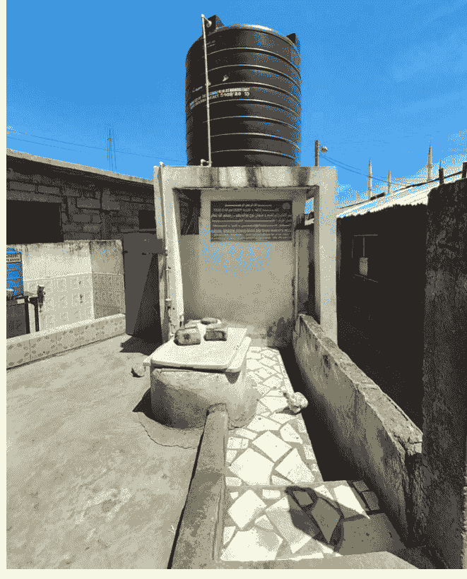

图 21 阿克拉 Mamobi 的 Al-Huda 水井

照片：HOLGER WEISS/2022

三个沙特关联的加纳穆斯林非政府组织中最活跃的是成立于 2004 年的 al-Hudaibiyya 救济服务。正如 Dumbe 所指出的，该组织已发展成为一方面沙特官方宗教中心、组织和慈善家与另一方面加纳穆斯林之间的接口。其核心活动是在北部地区为主建造教育综合体（*markaz*），包括学校、清真寺、饮用水以及（有时）伊玛目的住所，尽管它还在其他地区，尤其是萨凡纳和东北地区，建造了学校、诊所和卫生中心、殡仪馆、清真寺和钻井。596 此外，该组织在北部地区 Savelugu 运营一所孤儿院，同时开展全国性孤儿支持计划。597 其活动的一个近期例子是在 Tamale 建造一所伊斯兰培训中心，由沙特企业家 Alsayida Luululwa Alzaward 在世界穆斯林青年大会（WAMY）的 auspices 下资助。价值 120,000 美元的 12 间教室教学楼、诊所、清真寺和钻井综合体于 2019 年 1 月移交，预计将提升为伊斯兰教育学院的地位。598

596. Dumbe, *Islamic Revivalism*, 80–84；采访 Alhaji Suraj，Al-Hudaibiyya 在北部地区的代表，Tamale，10.12.2019。

597. 采访 Alhaji Suraj，Al-Hudaibiyya 在北部地区的代表，Tamale，10.12.2019。

598. Abdul-Gafaru Abdulai，“沙特慈善家为 Gukpegu-Tua 社区提供学校和其他基础设施项目”，9.1.2019，http://diamondmfonline.com/%E2%80%A2saudi-philanthropist-provides-school-and-other-infrastructural-projects-for-gukpegu-tua-community/，访问 17.8.2021。

这两个组织经常合作，后者是资助 Al-Hudaibiyya 项目和研讨会的沙特组织之一。599 自 2010 年代初以来，al-Hudaibiyya 还启动了全国性筹款计划，尤其用于资助其清真寺和开斋节外展项目。尽管如此，其约三分之二的开支仍通过外部捐赠支付，主要来自 WAMY 和沙特慈善家和慈善机构。600

599. “Veep calls on people in leadership to be morally upright”，25.7.2021，http://www.ghanadot.com/news.gnadot.0725071.html，访问 17.8.2021。

600. 采访 Alhaji Suraj，Al-Hudaibiyya 在北部地区的代表，Tamale，10.12.2019。

### Aldiaa Society

*Aldiaa Society* 则实施由外国捐助者资助的项目，包括卡塔尔慈善机构、Sheikh Abdullah Al-Nouri 慈善协会、穆斯林世界联盟/国际古兰经背诵组织、世界穆斯林青年大会、国际穆斯林学者联盟、国际伊斯兰慈善组织（IICO）、土耳其红新月会、IHH、TDV（Türkiye Diyanet Vakfı）和伊斯兰救援。601 根据其 2017 年主页，Aldiaa Society 主要集中于由上述捐助机构资助的清真寺、水和斋月/开斋饭项目以及孤儿支持。此外，它与几家土耳其非政府组织一起，通过卡塔尔捐助者的资金于 2017 年启动了 Madina 科学技术大学（图 22）。602 自 2020 年以来，Aldiaa Society 已与美国穆斯林慈善机构 Africa Relief and Community Development 合作，并委托后者组织的水和教育中心项目，同时组织 Udhiya/Qurbani 的分发。

601. Aldiaa 合作伙伴，列于 https://en.aldiaaghana.com；访问 30.11.2019；“Contracts for new projects”，6.5.2017，https://en.aldiaaghana.com/News/1248/Default.aspx，访问 13.7.2021。

602. “Al Madina University for Science and Technology in Ghana”，4.7.2017，https://en.aldiaaghana.com/Section/u182/Default.aspx，访问 13.7.2021。

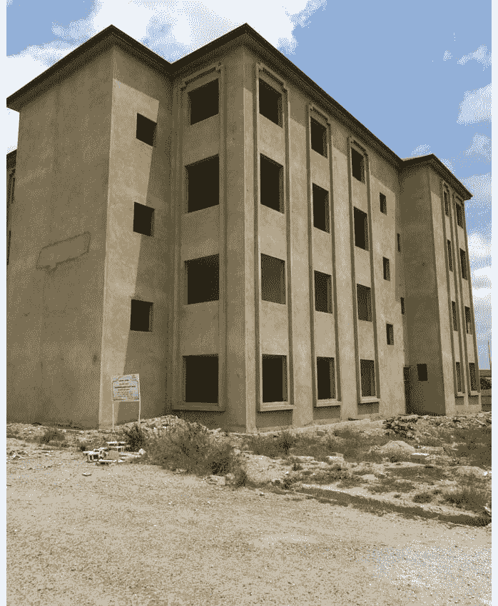

图 22 卡塔尔慈善/Aldiaa 教育项目。 在（当时）Madina 科学技术学院（现 Lakeside 大学学院）建设宿舍

照片：HOLGER WEISS/2017

### Voice of Islam-Ghana

Voice of Islam-Ghana（VOI）是新西兰穆斯林慈善机构 Voice of Islam 的分支。603 它以大阿克拉地区 Tema 的总部为基地，从事宣教活动，包括向当地社区分发伊斯兰材料和《古兰经》，并为新穆斯林安排活动。此外，该组织声称在斋月期间为约 2,000 人提供食物，并通过提供英语、数学、阅读和基础信息技术技能的额外课程来支持学龄儿童。604 2021 年 11 月，VOI 团队与国家血库和 Tema 总医院合作，在 Tema 举办了第八届年度献血活动。605

### 当地中介非政府组织

与此同时，1990 年代第一代当地穆斯林非政府组织的推出，所有这些组织都依赖外国资金实施其项目。这类当地中介非政府组织中最古老的是伊斯兰发展和人道主义服务委员会（ICODEHS），由 Sheikh Mustapha Ibrahim 于 1991 年创立。606 ICODEHS 是第一个建立网页的加纳穆斯林非政府组织，网址为 http://www.Africaonline.com.gh/Islamic/activity.html，尽管第一个网页只存在了有限的时间。此外，它在 1990 年代末/2000 年代初出版月刊—The Humanitarian—，以宣传其事业并传播其发展项目的信息。在此期间，ICODEHS 是 SAPRIN-Ghana（结构调整参与审查国际网络）民间社会协调委员会（CivisoC）成员中唯一列出的加纳穆斯林非政府组织。607 此后，总部位于阿克拉的该组织在外国捐助者和当地穆斯林社区中获得了认可、尊重和信任，608 使 Sheikh Mustapha Ibrahim 跻身最具影响力的 500 名穆斯林之列

世界.609 ICODEHS产生的资金中，大部分（如果不是全部）来自加纳以外的外部来源，如科威特天课之家、IICO、卡塔尔慈善、迪拜慈善协会、沙迦国际慈善、谢赫·阿卜杜拉·努里慈善协会、阿联酋红新月会、MWL、两圣地监护人，以及土耳其IHH.610 2020年，《加纳时报》称赞ICODEHS说：

> 在实施社会保护战略以减轻贫困、改变加纳及其他地区受社会排斥者生活方面，伊斯兰发展与人道主义服务理事会（ICODEHS）的工作堪称典范……611

除了在全国各地建造了一千多座清真寺和400所学校/校舍外，ICODEHS还拥有令人瞩目的成就，包括建造了3000多口钻孔和井、7家诊所、4个职业中心、7所贫困者住房、7所孤儿院和3所高中。612 ICODEHS还组织了“医疗大篷车”（眼科筛查和手术）项目、由社区主导的妇女团体贷款计划、对3700多名孤儿的支持干预、粮食作物和牲畜，以及在斋月和开斋节期间的人道主义救援方案。613 此外，它还出版关于伊斯兰宗教继承、婚姻、离婚、葬礼等主题的文献，以加深读者对伊斯兰教及相关主题的了解。其计划包括在加纳大阿克拉地区的加南市（Ga South Municipality）以穆斯林为主的社区图巴（Tuba）建造一所大学，并在中部地区建一所护理培训学校。614

社会福利局（BSS）于1991年成立，总部位于阿克拉，是谢赫·阿尤布·S·哈伦（Sheikh Ayub S. Haroun）的创意。2007年，BSS通过谢赫·阿尤布与美国穆斯林慈善机构ILM基金会签署了一份谅解备忘录，表明后者打算提供以健康、教育、紧急救援、结构支持和交通为重点的人道主义服务。615 然而，这种伙伴关系的进一步痕迹和发展尚未在社交媒体或互联网上找到。相反，BSS成为了另一家美国穆斯林慈善机构“希达亚基金会”（Hidaya Foundation）的当地合作伙伴。作为其2011年开斋饭项目的一部分，希达亚基金会赞助了食品，由BSS分发给布朗阿哈福、中部、东部、大阿克拉和北部地区的穆斯林。希达亚基金会的一位代表向新闻界透露，该基金会计划将其变成一年一度的活动。616 至少在2015年，希达亚基金会再次在加纳成为头条新闻，因为它赞助了BSS的开斋饭项目。捐赠包括100袋大米、100箱食用油和40袋糖，由BSS在阿散蒂、布朗阿哈福、中部、大阿克拉和东部地区分发。617

菲尔道斯社会服务基金会（FFSS）是总部位于阿克拉的注册非政府组织，由谢赫·萨利斯·苏阿利·侯赛因（Sheikh Salis Sualih Husein）于2006年创建，总部设在尼马。该基金会在全国各地开展活动，其宗旨和目标如下：建立一个强大、进步的社会，满足生活和工作的基本需求；减轻贫困和文盲，建立教育设施，为青年提供发展潜力的最终机会。FFSS还希望结束失业，鼓励创业，促进加纳及其他地区的快速可持续发展和消除贫困，使社会掌握现代技能和知识，成为有效率的创业者，而不仅仅是提供即时救济。

该基金会与多个国际穆斯林慈善机构达成了“战略伙伴关系”协议，包括Al Muntada、Muntada Aid、谢赫·萨尼·本·阿卜杜拉人道主义服务基金会（RAF基金会）和谢赫·伊德·本·穆罕默德·阿勒萨尼慈善基金会（Eid Charity）。根据其使命宣言，菲尔道斯基金会“受到伊斯兰信仰的启发”，其许多项目针对穆斯林社区，包括建造清真寺和学校、钻井、分发书籍、向穆斯林学生提供奖学金，或支持残疾人和孤儿。然而，它强调，在向贫困家庭提供食品援助、为创业初创项目提供财政支持或为青年赋权提供ICT培训项目时，种族和阶级无关紧要。618

考察菲尔道斯基金会各项目前路牌上的文字，可以进一步了解其国际捐助者。例如，北部省拉拉（Lala）的加利娅·宾特·穆赫辛清真寺的水井由Eid Charity资助。619 巴林塔比亚伊斯兰协会反过来赞助了其2018年的“书包分发项目”。620 2015年，菲尔道斯基金会与水晶眼科诊所合作，为马迪纳和农瓜（大阿克拉地区）、恩萨瓦姆（东部省）和卡索阿（中部省）的2000名居民组织了免费眼科检查，由总部位于卡塔尔的Eid慈善协会资助。621 2019年，Muntada Aid赞助了其开斋捐（Zakat al-Fitr）项目，622 而拉赫玛·奥地利和奥地利非政府组织“生命之井”（Well Water for Life）在2023年资助了其水项目。623 此外，苏丹非政府组织“塔米亚特人道主义基金会”资助其在阿克拉马迪纳的学生宿舍建设。624

总部位于阿克拉的阿卜杜勒-阿齐兹慈善与人道主义基金会（TACAHF）属于那些外国捐助者在过去几十年中发生变化的加纳穆斯林非政府组织。2013年，它在waqfproject.com上发布了呼吁美国捐助者支持古尔邦祭的帖子。625 2015年（至少，或许在随后的

609 Suleiman Mustapha, “首席伊玛目，穆斯塔法·易卜拉欣跻身全球500位偶像,” 20.1.2020, https://www.graphic.com.gh/news/general-news/chief-imam-mustapha-ibrahim-among-500-global-icons.html, 访问于2021年7月16日; https://themuslim500.com/profiles/mustapha-ibrahim/, 访问于2021年10月7日; “谢赫·穆斯塔法·易卜拉欣,”《穆斯林500：世界上最具影响力的500位穆斯林》, 主编 S. Abdallah Schleifer 教授 (安曼: 皇家伊斯兰战略研究中心, 2022), 159.

610 萨利富·阿卜杜勒-拉赫曼，《ICODEHS的社会保护干预措施改变生活》，2020年4月1日，https://www.ghanaian-times.com.gh/icodehs-social-protection-interventions-transforming-lives?utm_source=rss&utm_medium=rss&utm_campaign=icodehs-social-protection-interventions-transforming-lives, 访问于2021年7月13日; http://icodehs.org/donations/, 访问于2019年5月16日; https://icodehs.org/, 访问于2021年10月7日; 该主页已于2024年5月失效。

611 萨利富·阿卜杜勒-拉赫曼，《ICODEHS的社会保护干预措施改变生活》。

612 ICODEHS执行的实体项目，信息由谢赫·穆斯塔法·易卜拉欣介绍提供，他是非洲乌莱玛穆罕默德六世基金会加纳分会主席，2016年5月20日，http://www.fm60a.org/en/membre/sheikh-mustapha-ibrahim-president-of-the-section-of-ghana/, 访问于2019年11月30日。另见萨利富·阿卜杜勒-拉赫曼，《ICODEHS的社会保护干预措施改变生活》。

613 信息来自ICODEHS 2016年建立的首页，http://icodehs.org。该首页自2018年以来未更新。其2021年建立的首页https://icodehs.org列出了相同的项目和合作伙伴。然而，该主页已于2024年5月失效。另见https://www.facebook.com/icodehs/，以及萨利富·阿卜杜勒-拉赫曼，《ICODEHS的社会保护干预措施改变生活》。

614 萨利富·阿卜杜勒-拉赫曼，《ICODEHS的社会保护干预措施改变生活》。

615 “加纳”，https://humanitarianandday.com/about/global-expansion/，访问于2021年7月25日。

616 “非政府组织支持穆斯林”，2011年9月1日，https://www.modernghana.com/news/348458/ngo-supports-muslims.html，访问于2021年7月25日。

617 “非政府组织向穆斯林捐赠”，2015年7月22日，https://www.modernghana.com/news/631216/ngo-donates-to-muslims.html，访问于2021年7月25日。

618 https://firdausfoundation.org/about-us.php，访问于2021年7月5日。

619 “水项目”，https://firdausfoundation.org/gallery.php，访问于2021年7月5日。

620 “向贫困者捐赠”，https://firdausfoundation.org/gallery.php，访问于2021年7月5日。

621 “菲尔道斯基金会为2000人进行眼科问题筛查”，2015年11月4日，https://www.modernghana.com/news/653773/1/firdaus-foundation-screen-2000-for-eye-problems.html，访问于2021年7月5日。

622 https://www.facebook.com/firdausfoundation/，2019年6月18日，访问于2021年7月5日。

623 见2023年委托钻探水井的照片，https://firdausfoundation.org/uniquenessoffirdausfoundation，访问于2023年8月18日。

624 “菲尔道斯奖学金受益者获得宿舍设施”，2019年11月20日，https://www.graphic.com.gh/news/general-news/firdaus-scholarship-beneficiaries-get-hostel-facility.html，访问于2023年8月18日。

625 可查阅“为加纳的穷人和贫困者呼吁古尔邦祭（2013年）”，2013年10月4日，https://

年），其古尔邦分发项目由新加坡穆斯林慈善机构 Global Ehsan Relief 资助（2021 年：开斋饭）；⁶²⁶ 自 2018 年起，TACAHF 与法国穆斯林慈善机构 Nouvelle Optique 合作，并获得用于水项目、孤儿护理和古尔邦（Qurbani）项目的资金（图 23）。⁶²⁷

加纳穆斯林专业人士学院随后自 2009 年起通过穆斯林慈善家和国际穆斯林慈善机构的捐赠开展其年度救济服务项目，⁶²⁸ 其中包括土耳其 İHH 和德国 WEFA（2011 年至 2016 年）。受益人由加纳穆斯林学院的伊玛目和当地穆斯林酋长确定；主要目标群体是所谓的“被遗忘的孤儿”，即未接受孤儿院定期照顾的儿童，且在食物分发日之前已在学院注册。⁶²⁹ 同样，阿克拉的伊斯兰发展与人道服务委员会于 2016 年执行了迪拜的 Mohammed Bin Rashid al Maktoum 人道主义和慈善基金会的开斋项目。⁶³⁰ 一年后，它执行了卡塔尔慈善组织的项目。⁶³¹ Race4Aid 随后实施了由阿拉伯联合酋长国捐赠资助的各种项目，包括孤儿赞助项目以及清真寺的建设，以及 2023 年在北部地区 Nanton Zuo 的职业培训中心。⁶³²

wakaf2.rssing.com/chan-8574659/latest.php，于 18.10.2021 访问。然而，该主页已于 2024 年 5 月失效，原帖 http://www.wakafproject.com/terkini/appeal-for-qurban-for-poor-and-needy-in-ghana-2013/ 已不再可用。

626 见关于加纳的帖子，29.9.2015 和 22.5.2021，https://www.facebook.com/pg/Global EhsanRelief/，于 18.10.2021 访问。

627 TACAHF 的资助/捐助组织 Nouvelle Optique 在 TACAHF 主页的照片库中有所体现，http://www.tacahf.org/index.php?p=gallery，于 18.10.2021 访问；然而，该主页已于 2024 年 5 月失效。另见 Nouvelle Option Facebook 账户上的帖子，从 2018 年首个 TACAHF/Nouvelle Option 水项目视频开始，https://www.facebook.com/nouvelle.optique/videos/191486052242530，于 18.10.2021 访问。

628 “GMA 年度救济服务，2015”，https://www.facebook.com/GhanaAcademyOfMuslimProfessionals/，于 15.1.2022 访问。

629 “2012 年度救济服务”，“GMA 年度救济服务，2015”，30.5.2015，斋月帖子 28.1.2016，“为 2020 年斋月做准备”，2.3.2021，https://www.facebook.com/GhanaAcademyOfMuslimProfessionals/，于 15.11.2017 和 15.1.2022 访问。

630 “加纳开斋活动”，http://mbrch.gov.ae/en/node/305，于 25.2.2019 访问。

631 https://reliefweb.int/report/syrian-arab-republic/qatar-charity-distributes-ramadan-food-baskets-inside-syria，于 25.2.2019 访问。

632 https://www.facebook.com/race4aid，帖子 24.5.2023、31.5.2023、5.6.2023，于 18.8.2023 访问。

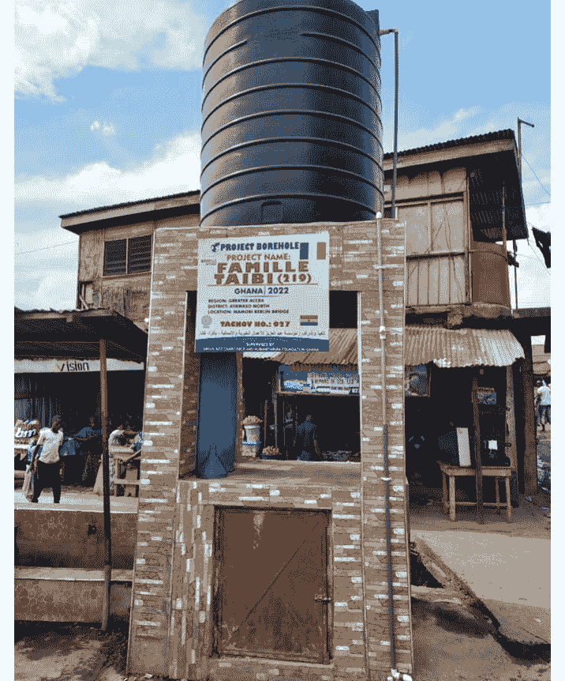

图 23 阿克拉马莫比的 Nouvelle Optique 钻井。由 Abdul-Aziz 慈善和人道主义基金会监督

照片：HOLGER WEISS/2022

最近的一个阿克拉穆斯林非政府组织是 `Naqshbandi Ghana Foundation.`633 关于该组织知之甚少，尽管其名称似乎表明加纳出现了一个新的逊尼派教团 `Naqshbandiyya`。这或许并不令人意外，鉴于自 2012 年以来土耳其 `NGOs` 在加纳的显著存在以及穆斯林学生从土耳其大学回流。`Naqshbandi Ghana Foundation` 于 2020 年 5 月注册，并在社会福利服务名录中被列为“本地非政府组织”。其活动范围被描述为“支持社会中的弱势群体”以及“…为聪颖但贫困的儿童提供教育支持”634 该组织与英国穆斯林慈善机构 `Love Mercy Hope`（LMH）合作，LMH 成立于 2019 年，并在加纳开展水项目。两家组织共同于 2019 年 12 月在阿克拉发起了一个 `Naqshbandi Dargah` 或精神圣地，635 并在 `Justgiving.com` 上启动了一项国际筹款活动。根据计划，Dargah 复合体将包括一座清真寺、孤儿院、宗教学校和寄宿学校。此外，它还将设有厨房和餐厅，每周三次为低收入家庭提供食物，以及 Mawlana Shaykh Nazim 的 `maqam`（圣墓）。636

几家总部位于库马西的穆斯林 `NGOs` 充当外国穆斯林慈善机构的中介或合作伙伴。其中最古老的是 `Ansarudeen Organisation`，由 Sheikh Abdar-Rahman Muhammad 于 1996 年发起，很快获得了政府和外国捐助者的认可。`Ansarudeen Organisation` 于 1997/1998 年开始其活动，成功委托建设了一座由外国资助的清真寺、Danso 的水井项目以及 Aboaso 的一座可容纳 300 人的清真寺。清真寺和水项目，以及支持孤儿和组织斋月/开斋/古尔邦捐赠，一直是该非政府组织的核心支柱，其主要资助者是阿联酋慈善机构 `Dar al-Ber Society`。`Ansarudeen’s` 第二大支柱是教育和医疗基础设施项目，尽管它在 2006 年停止建设医疗中心，因为官僚挑战超出了组织的承受能力。相反，它开始在阿散蒂地区 Domanofu 建设一所护理培训中心（图 24），于 2022 年完工，正在等待卫生部的批准和认证。它还在阿散蒂地区 Woraso 发起了类似项目。637

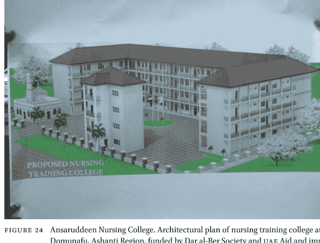

图 24 Ansaruddeen 护理学院。阿散蒂地区 Domunafu 的护理培训学院建筑平面图，由 Dar al-Ber Society 和阿联酋援助资助并由 Ansaruddeen 实施。建设始于 2018 年，并于 2020 年完工。

照片：HOLGER WEISS/2019

自 2019 年以来，该组织在其活动中增加了两个新支柱。第四个支柱是为当地社区提供医疗服务。该组织对非法小规模采金（galamsey）造成的铅中毒影响表示担忧，并开始支付医院的肾透析费用，每次费用为 GHS 400–500，每位患者每周需要三次至四次透析。此外，该组织开始向 500 名婴儿提供婴儿食品，同时开始支付耳部手术费用。后者项目是新颖的，因为它要求组织从国外引进必要的专业能力，因为加纳此前并不存在，迄今已支付约 500 例手术费用。638

每天为约 800 个家庭提供食物捐赠构成了 Ansarudeen 的第五大支柱。该项目不属于年度开斋和斋月食物分发，但作为后 COVID-19 救济措施，于 2022 年 2 月至 7 月间有效。7 月，项目的

年），其古尔邦分发项目由新加坡穆斯林慈善机构 Global Ehsan Relief 资助（2021 年：开斋饭）；⁶²⁶ 自 2018 年起，TACAHF 与法国穆斯林慈善机构 Nouvelle Optique 合作，并获得用于水项目、孤儿护理和古尔邦（Qurbani）项目的资金（图 23）。⁶²⁷

加纳穆斯林专业人士学院随后自 2009 年起通过穆斯林慈善家和国际穆斯林慈善机构的捐赠开展其年度救济服务项目，⁶²⁸ 其中包括土耳其 İHH 和德国 WEFA（2011 年至 2016 年）。受益人由加纳穆斯林学院的伊玛目和当地穆斯林酋长确定；主要目标群体是所谓的“被遗忘的孤儿”，即未接受孤儿院定期照顾的儿童，且在食物分发日之前已在学院注册。⁶²⁹ 同样，阿克拉的伊斯兰发展与人道服务委员会于 2016 年执行了迪拜的 Mohammed Bin Rashid al Maktoum 人道主义和慈善基金会的开斋项目。⁶³⁰ 一年后，它执行了卡塔尔慈善组织的项目。⁶³¹ Race4Aid 随后实施了由阿拉伯联合酋长国捐赠资助的各种项目，包括孤儿赞助项目以及清真寺的建设，以及 2023 年在北部地区 Nanton Zuo 的职业培训中心。⁶³²

wakaf2.rssing.com/chan-8574659/latest.php，于 18.10.2021 访问。然而，该主页已于 2024 年 5 月失效，原帖 http://www.wakafproject.com/terkini/appeal-for-qurban-for-poor-and-needy-in-ghana-2013/ 已不再可用。

626 见关于加纳的帖子，29.9.2015 和 22.5.2021，https://www.facebook.com/pg/Global EhsanRelief/，于 18.10.2021 访问。

627 TACAHF 的资助/捐助组织 Nouvelle Optique 在 TACAHF 主页的照片库中有所体现，http://www.tacahf.org/index.php?p=gallery，于 18.10.2021 访问；然而，该主页已于 2024 年 5 月失效。另见 Nouvelle Option Facebook 账户上的帖子，从 2018 年首个 TACAHF/Nouvelle Option 水项目视频开始，https://www.facebook.com/nouvelle.optique/videos/191486052242530，于 18.10.2021 访问。

628 “GMA 年度救济服务，2015”，https://www.facebook.com/GhanaAcademyOfMuslimProfessionals/，于 15.1.2022 访问。

629 “2012 年度救济服务”，“GMA 年度救济服务，2015”，30.5.2015，斋月帖子 28.1.2016，“为 2020 年斋月做准备”，2.3.2021，https://www.facebook.com/GhanaAcademyOfMuslimProfessionals/，于 15.11.2017 和 15.1.2022 访问。

630 “加纳开斋活动”，http://mbrch.gov.ae/en/node/305，于 25.2.2019 访问。

几家总部位于库马西的穆斯林 `NGOs` 充当外国穆斯林慈善机构的中介或合作伙伴。其中最古老的是 `Ansarudeen Organisation`，由 Sheikh Abdar-Rahman Muhammad 于 1996 年发起，很快获得了政府和外国捐助者的认可。`Ansarudeen Organisation` 于 1997/1998 年开始其活动，成功委托建设了一座由外国资助的清真寺、Danso 的水井项目以及 Aboaso 的一座可容纳 300 人的清真寺。清真寺和水项目，以及支持孤儿和组织斋月/开斋/古尔邦捐赠，一直是该非政府组织的核心支柱，其主要资助者是阿联酋慈善机构 `Dar al-Ber Society`。`Ansarudeen’s` 第二大支柱是教育和医疗基础设施项目，尽管它在 2006 年停止建设医疗中心，因为官僚挑战超出了组织的承受能力。相反，它开始在阿散蒂地区 Domanofu 建设一所护理培训中心（图 24），于 2022 年完工，正在等待卫生部的批准和认证。它还在阿散蒂地区 Woraso 发起了类似项目。637

图 24 Ansaruddeen 护理学院。阿散蒂地区 Domunafu 的护理培训学院建筑平面图，由 Dar al-Ber Society 和阿联酋援助资助并由 Ansaruddeen 实施。建设始于 2018 年，并于 2020 年完工。

照片：HOLGER WEISS/2019

自 2019 年以来，该组织在其活动中增加了两个新支柱。第四个支柱是为当地社区提供医疗服务。该组织对非法小规模采金（galamsey）造成的铅中毒影响表示担忧，并开始支付医院的肾透析费用，每次费用为 GHS 400–500，每位患者每周需要三次至四次透析。此外，该组织开始向 500 名婴儿提供婴儿食品，同时开始支付耳部手术费用。后者项目是新颖的，因为它要求组织从国外引进必要的专业能力，因为加纳此前并不存在，迄今已支付约 500 例手术费用。638

每天为约 800 个家庭提供食物捐赠构成了 Ansarudeen 的第五大支柱。该项目不属于年度开斋和斋月食物分发，但作为后 COVID-19 救济措施，于 2022 年 2 月至 7 月间有效。7 月，项目的

年），其古尔邦分发项目由新加坡穆斯林慈善机构 Global Ehsan Relief 资助（2021 年：开斋饭）；⁶²⁶ 自 2018 年起，TACAHF 与法国穆斯林慈善机构 Nouvelle Optique 合作，并获得用于水项目、孤儿护理和古尔邦（Qurbani）项目的资金（图 23）。⁶²⁷

加纳穆斯林专业人士学院随后自 2009 年起通过穆斯林慈善家和国际穆斯林慈善机构的捐赠开展其年度救济服务项目，⁶²⁸ 其中包括土耳其 İHH 和德国 WEFA（2011 年至 2016 年）。受益人由加纳穆斯林学院的伊玛目和当地穆斯林酋长确定；主要目标群体是所谓的“被遗忘的孤儿”，即未接受孤儿院定期照顾的儿童，且在食物分发日之前已在学院注册。⁶²⁹ 同样，阿克拉的伊斯兰发展与人道服务委员会于 2016 年执行了迪拜的 Mohammed Bin Rashid al Maktoum 人道主义和慈善基金会的开斋项目。⁶³⁰ 一年后，它执行了卡塔尔慈善组织的项目。⁶³¹ Race4Aid 随后实施了由阿拉伯联合酋长国捐赠资助的各种项目，包括孤儿赞助项目以及清真寺的建设，以及 2023 年在北部地区 Nanton Zuo 的职业培训中心。⁶³²

wakaf2.rssing.com/chan-8574659/latest.php，于 18.10.2021 访问。然而，该主页已于 2024 年 5 月失效，原帖 http://www.wakafproject.com/terkini/appeal-for-qurban-for-poor-and-needy-in-ghana-2013/ 已不再可用。

626 见关于加纳的帖子，29.9.2015 和 22.5.2021，https://www.facebook.com/pg/Global EhsanRelief/，于 18.10.2021 访问。

627 TACAHF 的资助/捐助组织 Nouvelle Optique 在 TACAHF 主页的照片库中有所体现，http://www.tacahf.org/index.php?p=gallery，于 18.10.2021 访问；然而，该主页已于 2024 年 5 月失效。另见 Nouvelle Option Facebook 账户上的帖子，从 2018 年首个 TACAHF/Nouvelle Option 水项目视频开始，https://www.facebook.com/nouvelle.optique/videos/191486052242530，于 18.10.2021 访问。

628 “GMA 年度救济服务，2015”，https://www.facebook.com/GhanaAcademyOfMuslimProfessionals/，于 15.1.2022 访问。

629 “2012 年度救济服务”，“GMA 年度救济服务，2015”，30.5.2015，斋月帖子 28.1.2016，“为 2020 年斋月做准备”，2.3.2021，https://www.facebook.com/GhanaAcademyOfMuslimProfessionals/，于 15.11.2017 和 15.1.2022 访问。

630 “加纳开斋活动”，http://mbrch.gov.ae/en/node/305，于 25.2.2019 访问。

631 https://reliefweb.int/report/syrian-arab-republic/qatar-charity-distributes-ramadan-food-baskets-inside-syria，于 25.2.2019 访问。

632 https://www.facebook.com/race4aid，帖子 24.5.2023、31.5.2023、5.6.2023，于 18.8.2023 访问。

图 23 阿克拉马莫比的 Nouvelle Optique 钻井。由 Abdul-Aziz 慈善和人道主义基金会监督

照片：HOLGER WEISS/2022

最近的一个阿克拉穆斯林非政府组织是 `Naqshbandi Ghana Foundation.`633 关于该组织知之甚少，尽管其名称似乎表明加纳出现了一个新的逊尼派教团 `Naqshbandiyya`。这或许并不令人意外，鉴于自 2012 年以来土耳其 `NGOs` 在加纳的显著存在以及穆斯林学生从土耳其大学回流。`Naqshbandi Ghana Foundation` 于 2020 年 5 月注册，并在社会福利服务名录中被列为“本地非政府组织”。其活动范围被描述为“支持社会中的弱势群体”以及“…为聪颖但贫困的儿童提供教育支持”634 该组织与英国穆斯林慈善机构 `Love Mercy Hope`（LMH）合作，LMH 成立于 2019 年，并在加纳开展水项目。两家组织共同于 2019 年 12 月在阿克拉发起了一个 `Naqshbandi Dargah` 或精神圣地，635 并在 `Justgiving.com` 上启动了一项国际筹款活动。根据计划，Dargah 复合体将包括一座清真寺、孤儿院、宗教学校和寄宿学校。此外，它还将设有厨房和餐厅，每周三次为低收入家庭提供食物，以及 Mawlana Shaykh Nazim 的 `maqam`（圣墓）。636

几家总部位于库马西的穆斯林 `NGOs` 充当外国穆斯林慈善机构的中介或合作伙伴。其中最古老的是 `Ansarudeen Organisation`，由 Sheikh Abdar-Rahman Muhammad 于 1996 年发起，很快获得了政府和外国捐助者的认可。`Ansarudeen Organisation` 于 1997/1998 年开始其活动，成功委托建设了一座由外国资助的清真寺、Danso 的水井项目以及 Aboaso 的一座可容纳 300 人的清真寺。清真寺和水项目，以及支持孤儿和组织斋月/开斋/古尔邦捐赠，一直是该非政府组织的核心支柱，其主要资助者是阿联酋慈善机构 `Dar al-Ber Society`。`Ansarudeen’s` 第二大支柱是教育和医疗基础设施项目，尽管它在 2006 年停止建设医疗中心，因为官僚挑战超出了组织的承受能力。相反，它开始在阿散蒂地区 Domanofu 建设一所护理培训中心（图 24），于 2022 年完工，正在等待卫生部的批准和认证。它还在阿散蒂地区 Woraso 发起了类似项目。637

图 24 Ansaruddeen 护理学院。阿散蒂地区 Domunafu 的护理培训学院建筑平面图，由 Dar al-Ber Society 和阿联酋援助资助并由 Ansaruddeen 实施。建设始于 2018 年，并于 2020 年完工。

照片：HOLGER WEISS/2019

自 2019 年以来，该组织在其活动中增加了两个新支柱。第四个支柱是为当地社区提供医疗服务。该组织对非法小规模采金（galamsey）造成的铅中毒影响表示担忧，并开始支付医院的肾透析费用，每次费用为 GHS 400–500，每位患者每周需要三次至四次透析。此外，该组织开始向 500 名婴儿提供婴儿食品，同时开始支付耳部手术费用。后者项目是新颖的，因为它要求组织从国外引进必要的专业能力，因为加纳此前并不存在，迄今已支付约 500 例手术费用。638

每天为约 800 个家庭提供食物捐赠构成了 Ansarudeen 的第五大支柱。该项目不属于年度开斋和斋月食物分发，但作为后 COVID-19 救济措施，于 2022 年 2 月至 7 月间有效。7 月，项目的

年），其古尔邦分发项目由新加坡穆斯林慈善机构 Global Ehsan Relief 资助（2021 年：开斋饭）；⁶²⁶ 自 2018 年起，TACAHF 与法国穆斯林慈善机构 Nouvelle Optique 合作，并获得用于水项目、孤儿护理和古尔邦（Qurbani）项目的资金（图 23）。⁶²⁷

加纳穆斯林专业人士学院随后自 2009 年起通过穆斯林慈善家和国际穆斯林慈善机构的捐赠开展其年度救济服务项目，⁶²⁸ 其中包括土耳其 İHH 和德国 WEFA（2011 年至 2016 年）。受益人由加纳穆斯林学院的伊玛目和当地穆斯林酋长确定；主要目标群体是所谓的“被遗忘的孤儿”，即未接受孤儿院定期照顾的儿童，且在食物分发日之前已在学院注册。⁶²⁹ 同样，阿克拉的伊斯兰发展与人道服务委员会于 2016 年执行了迪拜的 Mohammed Bin Rashid al Maktoum 人道主义和慈善基金会的开斋项目。⁶³⁰ 一年后，它执行了卡塔尔慈善组织的项目。⁶³¹ Race4Aid 随后实施了由阿拉伯联合酋长国捐赠资助的各种项目，包括孤儿赞助项目以及清真寺的建设，以及 2023 年在北部地区 Nanton Zuo 的职业培训中心。⁶³²

wakaf2.rssing.com/chan-8574659/latest.php，于 18.10.2021 访问。然而，该主页已于 2024 年 5 月失效，原帖 http://www.wakafproject.com/terkini/appeal-for-qurban-for-poor-and-needy-in-ghana-2013/ 已不再可用。

626 见关于加纳的帖子，29.9.2015 和 22.5.2021，https://www.facebook.com/pg/Global EhsanRelief/，于 18.10.2021 访问。

627 TACAHF 的资助/捐助组织 Nouvelle Optique 在 TACAHF 主页的照片库中有所体现，http://www.tacahf.org/index.php?p=gallery，于 18.10.2021 访问；然而，该主页已于 2024 年 5 月失效。另见 Nouvelle Option Facebook 账户上的帖子，从 2018 年首个 TACAHF/Nouvelle Option 水项目视频开始，https://www.facebook.com/nouvelle.optique/videos/191486052242530，于 18.10.2021 访问。

628 “GMA 年度救济服务，2015”，https://www.facebook.com/GhanaAcademyOfMuslimProfessionals/，于 15.1.2022 访问。

629 “2012 年度救济服务”，“GMA 年度救济服务，2015”，30.5.2015，斋月帖子 28.1.2016，“为 2020 年斋月做准备”，2.3.2021，https://www.facebook.com/GhanaAcademyOfMuslimProfessionals/，于 15.11.2017 和 15.1.2022 访问。

630 “加纳开斋活动”，http://mbrch.gov.ae/en/node/305，于 25.2.2019 访问。

631 https://reliefweb.int/report/syrian-arab-republic/qatar-charity-distributes-ramadan-food-baskets-inside-syria，于 25.2.2019 访问。

632 https://www.facebook.com/race4aid，帖子 24.5.2023、31.5.2023、5.6.2023，于 18.8.2023 访问。

图 23 阿克拉马莫比的 Nouvelle Optique 钻井。由 Abdul-Aziz 慈善和人道主义基金会监督

照片：HOLGER WEISS/2022

最近的一个阿克拉穆斯林非政府组织是 `Naqshbandi Ghana Foundation.`633 关于该组织知之甚少，尽管其名称似乎表明加纳出现了一个新的逊尼派教团 `Naqshbandiyya`。这或许并不令人意外，鉴于自 2012 年以来土耳其 `NGOs` 在加纳的显著存在以及穆斯林学生从土耳其大学回流。`Naqshbandi Ghana Foundation` 于 2020 年 5 月注册，并在社会福利服务名录中被列为“本地非政府组织”。其活动范围被描述为“支持社会中的弱势群体”以及“…为聪颖但贫困的儿童提供教育支持”634 该组织与英国穆斯林慈善机构 `Love Mercy Hope`（LMH）合作，LMH 成立于 2019 年，并在加纳开展水项目。两家组织共同于 2019 年 12 月在阿克拉发起了一个 `Naqshbandi Dargah` 或精神圣地，635 并在 `Justgiving.com` 上启动了一项国际筹款活动。根据计划，Dargah 复合体将包括一座清真寺、孤儿院、宗教学校和寄宿学校。此外，它还将设有厨房和餐厅，每周三次为低收入家庭提供食物，以及 Mawlana Shaykh Nazim 的 `maqam`（圣墓）。636

几家总部位于库马西的穆斯林 `NGOs` 充当外国穆斯林慈善机构的中介或合作伙伴。其中最古老的是 `Ansarudeen Organisation`，由 Sheikh Abdar-Rahman Muhammad 于 1996 年发起，很快获得了政府和外国捐助者的认可。`Ansarudeen Organisation` 于 1997/1998 年开始其活动，成功委托建设了一座由外国资助的清真寺、Danso 的水井项目以及 Aboaso 的一座可容纳 300 人的清真寺。清真寺和水项目，以及支持孤儿和组织斋月/开斋/古尔邦捐赠，一直是该非政府组织的核心支柱，其主要资助者是阿联酋慈善机构 `Dar al-Ber Society`。`Ansarudeen’s` 第二大支柱是教育和医疗基础设施项目，尽管它在 2006 年停止建设医疗中心，因为官僚挑战超出了组织的承受能力。相反，它开始在阿散蒂地区 Domanofu 建设一所护理培训中心（图 24），于 2022 年完工，正在等待卫生部的批准和认证。它还在阿散蒂地区 Woraso 发起了类似项目。637

图 24 Ansaruddeen 护理学院。阿散蒂地区 Domunafu 的护理培训学院建筑平面图，由 Dar al-Ber Society 和阿联酋援助资助并由 Ansaruddeen 实施。建设始于 2018 年，并于 2020 年完工。

照片：HOLGER WEISS/2019

自 2019 年以来，该组织在其活动中增加了两个新支柱。第四个支柱是为当地社区提供医疗服务。该组织对非法小规模采金（galamsey）造成的铅中毒影响表示担忧，并开始支付医院的肾透析费用，每次费用为 GHS 400–500，每位患者每周需要三次至四次透析。此外，该组织开始向 500 名婴儿提供婴儿食品，同时开始支付耳部手术费用。后者项目是新颖的，因为它要求组织从国外引进必要的专业能力，因为加纳此前并不存在，迄今已支付约 500 例手术费用。638

每天为约 800 个家庭提供食物捐赠构成了 Ansarudeen 的第五大支柱。该项目不属于年度开斋和斋月食物分发，但作为后 COVID-19 救济措施，于 2022 年 2 月至 7 月间有效。7 月，项目的轮廓被更改，家庭改为领取食物券而非食物捐赠；券由社区长老发放，他们识别出有需要的人。639

Sheikh Abdar-Rahman 的非政府组织运作表明大多数本地穆斯林非政府组织充当外国捐助组织的中介。Ansarudeen 列出七名有薪员工负责监督各种项目，以及十五名在现场的有薪承包商和工人，其薪水由每个外部资助项目征收的 7.5% 管理费覆盖。640

库马西的 Iqra 教育与发展基金会于 2005 年注册，2006 年开始活动。641 其前身沙特非政府组织 Iqra 教育与发展基金会于 1991 年在 Wenchi 外建立了 Al-Faruq 学院作为英语/阿拉伯语基础学校。该校于 2006 年关闭并于 2011 年改建为私立教育学院。642 它于 2015 年被政府吸收为公立教育学院，成为唯一一所政府资助的伊斯兰教育学院。Al-Faruq 教育学院培养小学和初中教师，并开设普通基础教育、幼儿教育和伊斯兰/阿拉伯教育的文凭课程。643

633 另见 `https://www.facebook.com/imamhussein.naqshbandigh`，于 9.1.2022 访问。

634 “Naqshbandi Foundation Ghana”，`directory.mogcsp.gov.gh`，于 5.7.2021 访问。

635 Love Mercy Hope，主页：`www.lovemercyandhope.com`（2020），当前项目，于 3.7.2021 访问。2020 年主页已不再可用，其 2024 年新主页提供了加纳过去项目的概述，见 `https://lovemercyandhope.com/about-us/`。

636 “Naqshbandi Dergah”，`https://www.justgiving.com/campaign/ghanadergah`，于 3.7.2021 访问。2021 年 7 月初，该活动列出了 46 名支持者，已捐赠约 £7,000，占目标 £40,000 的 17%。

637 与 Sheikh Abdar-Rahman 和 Sheikh Abdallah 的访谈，库马西，12.12.2019 和 11.10.2022。

638 与 Sheikh Abdallah 的访谈，库马西，11.10.2022。

639 与 Sheikh Abdallah 的访谈，库马西，11.10.2022。

640 与 Sheikh Abdar-Rahman 和 Sheikh Abdallah 的访谈，库马西，12.12.2019。

641 见 `https://iqrai.org/?p=2891` 和 `https://iqrai.org/?page_id=2`，均于 17.8.2021 访问。然而，根据 Ishaq Kantier 的说法，Iqra 是沙特组织，可被视为 Al-Muntada 的替代品；与 Ishaq Kantier 的访谈，库马西，12.10.2022。Iqra 教育与发展基金会主页的链接在 2024 年 5 月已无法访问。

642 `https://gh.africabz.com/brong-ahafo/al-faruq-college-of-education-227317`；`https://ghadmissionforms.com/2021/01/19/al-faruq-college-online-admission-forms/`，均于 17.8.2021 访问。

643 `https://www.prod.facebook.com/www.afcoe.edu.gh/`，于 17.8.2021 访问。然而，由于设施和基础设施不足，该学院仅接受 350 名学生——计划中的政府投资为现有基础学校综合体增加一座 4 层宿舍、一座 4 层讲堂和实验室、一座 2 层学院行政楼以及讲师和校长的平房已停滞，该学院被迫于 2021 年将其清真寺改造成多功能厅。见“Al-Faruq 教育学院将清真寺改造成讲堂”，19.2.2021，`https://www.honestynewsgh.com/2021/02/19/al-faruq-college-of-education-converts-mosque-into-lecture-halls/`，

伊克拉教育与发展基金会或伊克拉基金会与萨拉菲社群密切相关，其主页上展示的来自伊斯兰呼吁与研究最高委员会、ASWAJ 阿散蒂地区和安萨鲁逊纳协会的（阿拉伯语）推荐即表明了这一点。644 其宗旨是“为有需要者提供教育机会和社会服务”，通过支持教师、学校、孤儿和寡妇，以及挖掘水井、修建清真寺和组织宣传车队或达瓦巡回活动来实现。645 其阿拉伯语主页进一步说明该基金会在加纳以及贝宁、布基纳法索、几内亚、毛里塔尼亚、尼日利亚和多哥等其他西非国家开展工作。646 该基金会与资助其各项项目的沙特慈善家有联系，647 其2020年用阿拉伯语发布的年度报告清楚地表明了这一点。例如，除2020年的清真寺建设和水项目外，该基金会向72,000人提供了开斋、斋月和开斋节食品包；全年以食物和肉类篮子支持8,271名孤儿和寡妇；将捐助者的现金施舍（天课）分发给1,260名病人和有需要者以及穆斯林囚犯；资助了392名孤儿，其中150名在Al-Noor孤儿院，并为2,184名受资助和未受资助的孤儿提供了书包和开斋节服装，同时还为90名伊玛目和穆斯林教师提供经济援助。648

伊克拉教育与发展基金会与社会服务盖伊姆基金会合作，649 这是另一家总部位于库马西的本地MFBO，严重依赖阿拉伯捐助者来开展其宣传、教育和建设（清真寺、学校、水）项目。

访问时间 17.8.2021；Nestor Kafui Adjomah，“Inadequate infrastructure negatively impacts academic work at Al-Faruq College of education，” 22.2.2021，`https://www.myjoyonline.com/inadequate-infrastructure-negatively-impacts-academic-work-at-al-faruq-college-of-education/`，访问时间 17.8.2021。

644 见 `https://iqrai.org/wp-content/uploads/2020/06/45844.jpg`（伊斯兰呼吁与研究最高委员会），`https://iqrai.org/wp-content/uploads/2020/06/45845.jpg`（ASWAJ），和 `https://iqrai.org/wp-content/uploads/2020/06/45846.jpg`（安萨鲁逊纳）。

645 `https://www.islamicfinder.org/world/view-place/51538/`；`https://iqrai.org/?page_id=778`，均于 17.8.2021 访问。

646 `https://iqrai.org/`。

647 Al-Ihsaan 水井，由沙特阿拉伯慈善家捐赠，`https://iqrai.org/` 5.8.2020；Waliday As-Saf 水井，由沙特阿拉伯慈善家捐赠，`https://iqrai.org/`，20.6.2020，访问时间 29.9.2021。

648 2020 年度报告（阿拉伯语），`https://iqrai.org/?p=30308`，访问时间 17.8.2021。 该链接于 2024 年 5 月已无法访问。

649 `https://www.facebook.com/qayyimgh/?ref=py_c`。

总部位于库马西的 *United Ansaru al-Islam al-Muttadidah*，成立于 1995 年，又称 *Ansar for Charity and Development Foundation*（ACDF），同样依赖沙特阿拉伯和阿拉伯联合酋长国（其中包括迪拜的 Dar al-Ber Society）的捐助者；650 *Association of the Servant of the Most Gracious, Ghana* 与约旦捐助者有联系，651 而巴林慈善机构 حياة بلا أحزان（‘Life Without Sorrow’）赞助 *Kafiul Yateem Foundation for Social Services*（مؤسسة كافل اليتيم لخدمات الاجتماعية دولة غانا）的孤儿项目。652 *Markaz Aleawn Alyaqin Humanitarian Services* 则至少依赖埃及和土耳其组织的捐款来开展其人道主义服务、钻井、孤儿院、开斋和清真寺项目。自 2020 年起，该组织已从 MWL（水项目）获得资金，同时还有印度尼西亚的 Global Wakaf（水项目）和 ACT（Care for humanity；水项目以及斋月和开斋包和古兰经捐赠）。653 此外，它还担任 KSRelief 斋月食品捐赠计划在 2022 年和 2023 年斋月期间的当地合作伙伴，以及 KSRelief 的水项目。654

此外，还有几家其他总部位于库马西的穆斯林非政府组织，例如 *Al-Fadl Organisation for Humanitarian Services* 在 2020 年和 2021 年从沙特阿拉伯获得了其在阿散蒂地区的水井和清真寺项目的资金，而埃及慈善家则资助了其在农村村庄的古尔邦分发。655 *Ansar Al-Khairiya Organization* 从阿联酋红新月会的 Al-Adahi 项目获得了捐赠，用于购买 80 只羊，在 2020 年和 2021 年分发给低收入家庭，以便他们庆祝宰牲节。^656

总部位于库马西的 *Tarbiyya Foundation* 自 2020 年起与土耳其 Hayrat Yardım 合作，其中包括资助其斋月开斋捐赠、水项目和孤儿支持项目。^657 2022 年，该基金会还开始与德国-土耳其慈善机构 Emin Humanitärer Hilfsverein e.V.（Emin Humanitarian Aid）合作，实施后者组织的水和斋月开斋项目。^658 *Teimako and Blessing Organisation*（TBO）同样从多个土耳其非政府组织获得支持，以资助其对孤儿和贫困家庭的支持以及太阳能水井的钻探和建设（使用太阳能运行的机械化水井）。^659 *FOMWAG Ashanti* 则从卡塔尔慈善机构获得了其在阿马萨曼的学校项目的捐款，以及通过土耳其慈善机构 Deniz Feneri 资助的 Paragon Foundation 在 2022 年提供的 100 个开斋节礼包。^660 *Muslim Access Movement* 则协调了美国慈善机构 Salaam Ul Muslimyin Foundation Ghana 的类似捐赠；^661 总部位于库马西 Old Tafo Zongo 的 *Ummah Foundation* 自 2020 年起已分发来自汉堡的德国慈善和孤儿基金会的斋月礼包，以及来自比利时非政府组织 Hearts

650 `https://www.facebook.com/profile.php?id=100083641036045`。

651 `https://www.facebook.com/ibaaadurrahaman/photos/pcb.2413859238701935/2413856118702247/?type=3&theater`，发布于 6.9.2019，访问时间 23.10.2020。

652 `https://www.facebook.com/%D9%85%D9%85%D8%A4%D8%B3%D8%B3%D8%A9-%D9%83%D8%A7%D9%81%D9%84-%D8%A7%D9%84%D9%8A%D8%AA%D9%8A%D9%85-%D9%84%D8%AE%D8%AF%D9%85%D8%A7%D8%AA-%D8%A7%D9%84%D8%A7%D8%AC%D8%AA%D9%85%D8%A7%D8%B9%D9%8A%D8%A9-%D8%AF%D9%88%D9%84%D8%A9-%D8%BA%D8%A7%D9%86%D8%A7-516839181840172/`，16.3.2019，17.4.2019，23.7.2019，14.9.2019，26.4.2020，访问时间 2.2.2022。

653 `https://www.facebook.com/markaz.aleawn.alyaqin/`，14.9.2021（穆斯林世界联盟），25.11.2020，20.12.2020，12.2.2021，11.5.2021，9.6.2021，26.9.2021，2.11.2021，10.1.2021，2.6.2022，8.6.2022（Global Wakaf 和 ACT 水项目），9.5.2021（ACT 斋月捐赠），23.5.2021（ACT 开斋捐赠），3.4.2021，2.12.2021，4.5.2022（ACT 古兰经捐赠）。

654 `https://m.facebook.com/markaz.aleawn.alyaqin/posts`，29.3.2022，1.4.2022，5.4.2022，17.4.2022，21.4.2022，29.3.2023，5.4.2023，23-28.5.2023，4.8.2023，访问时间 29.6.2022 和 18.8.2023。

655 `https://www.facebook.com/Al-Fadl-Organization-for-Humanitarian-Services-Kumasi-Ghana-10519138083244/?ref=page_internal`，水项目（14.11.2020，15.11.2020，25.11.2020，2.12.2020，3.12.2020，5.12.2020，27.8.2021，29.8.2021，15.9.2021，16.9.2021，17.10.2021），清真寺项目（15.10.2020，2.12.2020，23.12.2020，1.1.2021，4.1.2021，11.1.2021，19.1.2021，23.1.2021），小牛捐赠（14.11.2020），访问时间 16.1.2022。

656. Stephen Asante，“Al-Adahi’ Project to support the needy, deprived communities，”3.8.2020，`https://gna.org.gh/2020/08/al-adahi-project-to-support-the-needy-deprived-communities/`；“Emirates Red Crescent fetes 1,200 underprivileged Muslim households，”21.7.2021，`https://gna.org.gh/2021/07/emirates-red-crescent-fetes-1-200-underprivileged-muslim-households/`；均于 28.5.2024 访问。

657. 另见 `https://www.facebook.com/TARBIYYAGH/`，与 Hayrat Yardım 合作的首贴为 19.10.2020，访问时间 9.1.2022。

658. `https://www.facebook.com/TARBIYYAGH`，12.1.2022，3.4.2022，访问时间 25.8.2022。

659. `https://www.facebook.com/blessingteamako/`，25.7. & 28.11. & 29.11. & 6.12. & 8.12.2021（太阳能水井）；3.2.2022（太阳能水井）；18.2. & 21.2.2022（孤儿支持）；21.3.2022（太阳能水井）；31.3.2022（开斋包：Larabanga）；8.4.2022（300 个开斋包：Tamale；300 个开斋包：Koforidua），13.4.2022（开斋包：Accra），3.6.2022（开斋包），17.7.2022（太阳能水井），访问时间 25.8.2022。TBO 列出的合作伙伴（17.3.2022）包括以下组织：Turkiye Diyanet Vakfı，Tadd Afrika，TIKA，IHH，Hayrat Yardım，Haim Sani Yardım，CADERNERDEGI，Ummetin Yardım Eden Leritkderdag，Kızılay，TDV，Kardeseli，Iddef Konya，Idemalilk Ghana，hasene，Iyilik vakfı，Iyilikdernegi，American Helps，和 Canada Helps。

660. `https://www.facebook.com/Fomwag-Ashanti-112442813643597`，21.4.2022，5.7.2022，访问时间 25.8.2022。

661. `https://www.facebook.com/mamtyonline`，22.1.2019，8.5.2019，9.9.2019，14.7.2020，访问时间 25.8.2022。

4 2022年斋月慈悯行动；662 总部位于库马西的Al-Aziz人道主义项目在2020年斋月和2022年宰牲节期间协调了英国慈善机构Illuminations福利基金会的捐赠；663 而霍霍埃宗戈发展协会于2021年9月成为头条新闻，因其收到美国慈善机构Taimako非洲基金会3,500美元的捐款，用于运营其奖学金项目。664 由总部位于卡索亚的萨拉菲组织加纳安萨鲁勒伊斯兰青年组织实施的斋月食品包和机械化水井项目，则得到了美国慈善机构明尼苏达州加纳-多哥穆斯林伞形协会的赞助；665 而英国慈善机构哈吉·巴希尔·艾哈迈德基金会则支持正义孤儿基金会于2023年开斋节和宰牲节向埃朱拉的600名孤儿进行捐赠。666 另一方面，加纳穆斯林组织联盟（COMOG）是英国慈善机构国际伊斯兰青年联盟/非洲青年发展组织（IIYLAD）的当地合作伙伴；该英国慈善机构于2022年捐赠了240头牛用于古尔巴尼献祭。667

加纳光明之眼基金会和依靠我基金会是两家总部位于库马西的第二代穆斯林非政府组织，在加纳境外设有分支机构。同样，生命赋权基金会（TLEF）在加纳运营，其总部位于阿克拉，并在英国设有办事处；其12名团队成员大多是湖畔大学学院（前麦地那科学技术学院）的校友。668 这三个基金会都是跨地方/跨国社交媒体网络的例证。

依靠我基金会（LOMEF）由谢赫·菲尔道斯·拉丹于2002年创立。该组织亦在美国马里兰州注册，其分支机构位于马里兰州劳雷尔。其主要目标是为社会弱势群体提供基于价值观的教育和医疗保健。根据其主页介绍，LOMEF已购置三块土地，专门用于建设孤儿院，但尚不清楚孤儿院是否已建成。669

LOMEF参与了多个教育项目。2017年，该基金会开展了所谓的“返校用品日”活动，在库马西都会区为约200名学龄儿童提供了校服、书包和鞋子等物品。尽管其目标或使命中并未说明，但大部分目标学校都是穆斯林学校，包括Pakyi第二伊斯兰小学、Nasrudeen伊斯兰小学、Abdul Sammad纪念伊斯兰小学、加纳穆斯林使命小学、Wataniyya伊斯兰小学、Al-Huda伊斯兰小学、光明山小学和费萨尔国王伊斯兰小学。此外，LOMEF向Ibadur Rahman高级中学捐赠了学习和教学材料及文具，在斋月期间向Prempeh学院捐赠了食品，并翻新了Abdul Samad纪念伊斯兰学校幼儿园的校舍。作为促进女童教育的一部分，该基金会于2017年和2018年为高中女生举办了年度开斋节庆祝晚宴。此外，LOMEF还帮助七名学生购买了各种高等教育的入学申请表，并在2017/2018学年为两名学生支付了学费。670

LOMEF的第二个重点领域是医疗保健。其旨在为慢性病患者提供援助和医疗支持，并于2017年援助了一名癌症患者。同样，2018年7月，该基金会与Komfo Anokye教学医院肿瘤科合作，为Asokore Mampong市镇的600名妇女和女孩组织了乳腺癌医学筛查。此外，该基金会还为Afia Kobi小学、Nurul Islam学校、Ansar El伊斯兰学校和Krobo Extension小学的200名小学生注册并续办了国家健康保险卡。671

除了教育和医疗保健项目外，LOMEF还参与水资源和人道主义项目。2022年8月，该基金会完成了其第13口井的钻探。672 2022年4月，该基金会举办了年度“供养百人”斋月开斋晚宴。673

LOMEF在加纳和美国设有分支机构的双重结构服务于实际需求。加纳总部负责运营本地项目，而美国分支则统筹筹款活动。谢赫·菲尔道斯·拉丹是美国马里兰州伊本·泰米叶清真寺的驻堂伊玛目，可以说，LOMEF的大多数支持者居住在美国。另一方面，LOMEF秘书伊萨·扎卡里亚·菲尔道斯负责库马西的总部和运营工作。674 这种双重结构与光明之眼基金会相似，后者是另一家在库马西运营的穆斯林非政府组织。然而，与LOMEF不同，光明之眼的支持基础在德国。

光明之眼基金会最初是2010年库马西一群人的私人倡议。成立初期，该运动专注于帮助单亲父母和低收入家庭。2017年，该运动注册为一个名为“加纳光明之眼基金会”（ELF GH）的非营利组织。该基金会有两个办事处，一个位于库马西的Old Tafo，另一个位于德国比特堡。至少从基金会的主页来看，其总部位于德国，其德国分支Eyes of Light e.V. [eingetragener Verein = 注册协会]主要专注于筹款。675 此外，德国主页呼吁读者向该组织缴纳天课（zakat）和开斋捐（zakat al-fitr）。676 尽管该组织并未将自己标识为穆斯林信仰组织（FBO），但其目标和使命声明中也没有直接提及贫困穆斯林或伊斯兰教。与LOMEF一样，光明之眼基金会强调其活动的人道主义方面，“改变贫困、受压迫和被遗忘者的生活[...]转变最弱势群体的生活。”677 然而，无论是在筹款活动还是在实施本地项目中，所涉及的目标群体都是德国和加纳的穆斯林。例如，2021年，该基金会在德国开展了一场筹款活动，为加纳2021年的古尔巴尼献祭筹集资金。678 此外，德国主页还链接到了Karawane der Liebe E.V. Verein für die Vervollkommnung des menschlichen Charakters的主页。这是一个苏菲组织，也被称为“爱的苏菲之道”。679

662 https://www.facebook.com/UMMAH-Foundation-122337079156638, 1.5.2020, 23.5.2020, 13.5.2021, 4.5.2022, 访问于 25.8.2022.

663 https://www.facebook.com/alazizhumanitarianprojects, 26.2.2020, 24.4.2020, 6.6.2022, 23.6.2022, 访问于 2022.

664 Taimaka非洲基金会支持霍霍埃宗戈发展协会, https://www.ghanaw... https://www.ghanaw... 访问于 28.5.2024.

665 加纳安萨鲁勒伊斯兰青年组织，帖子发布于 5.12.2021, 26.1.2022, 17.3.2022, 5.4.2023, https://www.facebook.com/profile.php?id=100071654437847, 访问于 18.8.2023.

666 https://www.facebook.com/JusticeYateemFoundation.

667 宰牲节期间宰杀240头牛...牛肉分发给贫困穆斯林, 13.7.2022, https://www.ghanai... 访问于 2.1.2023.

668 参见 https://www.facebook.com/The-Life-Empowerment-Foundation-101467618273741/, 以及 https://thelifeempowermentfoundation.co.uk/.

669 http://www.lomef.org/about-us/, 访问于 3.7.2021.

670 http://www.lomef.org/what-we-do/projects/, 访问于 3.7.2021.

671 http://www.lomef.org/what-we-do/projects/, 访问于 3.7.2021.

672 https://www.facebook.com/groups/84194605913720/user/1201572531, 2.8.2022, 访问于 25.8.2022.

673 https://www.facebook.com/groups/84194605913720/user/1201572531, 19.4.2022, 访问于 25.8.2022.

674 http://www.lomef.org/what-we-do/achievements/, 访问于 3.7.2021.

675 另见 https://www.eyesoflight.de

676 "Zakaat-Maal kann bei uns eingezahlt werden, um es an die Armen zu verteilen," https://www.eyesoflight.de/projekte/sonstiges; "Zakat Distribution," https://www.eyesoflight.org; "Zakat Al-fitr," https://www.eyesoflight.org/zakat, 均访问于 1.7.2021; 英文主页已于2024年5月停用。

677 https://www.eyesoflight.org/about, 访问于 1.7.2021; 该主页已于2024年5月停用。

678 https://www.eyesoflight.de, 访问于 1.7.2021.

679 另见 https://sufipathoflove.com.

除了在库马西的开斋节捐赠外，光明之眼基金会在其主页上列出了五个项目。其中包括建设一座孤儿院，以及一项孤儿院赞助计划、一个水井项目、一个妇女裁缝项目和一个幼儿园项目。然而，除了孤儿院之外，其他项目似乎仍处于规划阶段；主页上关于它们的信息很少。基金会宣称，寄宿之家项目目前是“我们迄今为止最大的项目”。寄宿之家容纳着30多名男孩，其中大多数是孤儿。该基金会还旨在为他们的教育提供支持。680

总部设在加纳北部的本土穆斯林非政府组织很少，只有少数能够与国际穆斯林慈善机构和非政府组织建立联系。最早在上西部省担任国际捐助机构区域中介的组织之一是努尔伊斯兰发展研究所（NIID，插图25），该所成立于2009年。它作为一个非政府组织开始运作，旨在促进瓦城和上西部省穆斯林社区的发展。最初的活动相当有限，因为它只有一位来自埃及的捐助者，而此人同时担任该非政府组织的主任。681 然而，它成功与阿克拉的Aldiaa协会建立了联系，并从卡塔尔慈善机构获得了财政支持，于2014年启动了一个孤儿院项目。2017年，努尔伊斯兰研究所主任Alhassan Idrisu向新闻界表示，该组织向上西部省的孤儿捐赠了价值约14万加纳塞地的各类食品和现金。此外，自成立以来，它已提供了约150口钻井水井和80座清真寺。682 两年后，即2019年斋月期间，努尔伊斯兰由其合作伙伴科威特慈善机构Direct Aid资助，向上西部省约600个家庭捐赠了各类食品。683 然而，从进一步实地调查中收集到的信息表明，NIID于2019年12月在瓦城很快就停办或处于休眠状态。

El-Ehsan慈善救济基金会（ECRF）成立于2010年，684总部位于巴乌库，在上东部省开展活动。该基金会

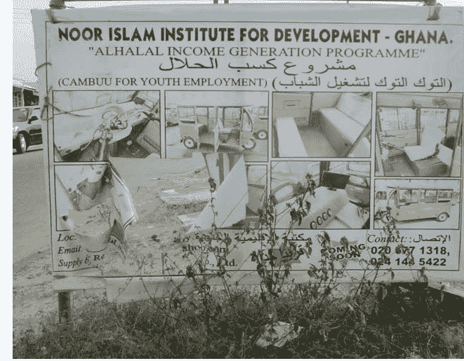

图25 努尔伊斯兰发展研究所。瓦城一块破旧的街道标志牌，上面写着该研究所符合伊斯兰教法的创收活动  

摄影：霍尔格·魏斯/2019年

自称是“一个帮助受自然灾害、冲突和贫困影响者的加纳非政府组织”。685 根据其主页，该基金会征集天课、慈善捐款、礼品和捐赠基金，但没有说明其呼吁对象是本地赞助人还是国际捐助者。686

2012年，ECRF启动了其孤儿资助计划，重点关注孤儿教育。作为该计划的一部分，ECRF在普西加区的科塞获得了一块2.5英亩的农场，并开始种植120棵辣木果树，同时在GlobalGiving.org上发布了呼吁国际投资该项目的请求。687 所述详细项目计划非常雄心勃勃。除树木外，还种植了玉米、辣椒和蔬菜，为孤儿提供食物。剩余的产品以及树木的叶子和果实将被出售，为“孤儿和贫困儿童资助计划”筹集资金。总计有280名因艾滋病成为孤儿的儿童、父母因艾滋病而虚弱患病的家庭的儿童，以及来自极度贫困家庭和儿童户主家庭的弱势儿童得到了照顾。栽下树木后，ECRF需要资金来建造适当的灌溉系统、购买化肥、围起农场围栏，并建一间干燥房。此外，它还需要获得资金来支付项目管理以及待生产商品的营销费用。它计划用出售农产品筹集的资金支付孤儿教育的所有费用，包括往返学校的交通费、校餐、体检、衣物、书籍、文具和校服，以及经济津贴。ECRF已经投入了自有资金1221美元，呼吁外国提供约37000美元的捐款，以运营这个为期五年的项目。688 然而，项目的结果不得而知，至少通过*GlobalGiving.org*吸引外国捐助者的尝试收效甚微（只有一位捐助者，筹集了6欧元）。689

685 “关于El-Ehsan慈善救济基金会（ECRF）”，项目文件/商业计划：为孤儿儿童种植辣木果树，无日期[约2013/2017]，可在 https://www.globalgiving.org/projects/moringa-trees-for-orphan-child/#menu 获取，下载于2021年7月15日。

686 “参与进来”，https://www.ecrfgh.org/orphan-sponsorship/#，访问于2021年7月15日。

687 项目#28429 孤儿资助辣木树，https://www.globalgiving.org/projects/moringa-trees-for-orphan-child/#menu，访问于2021年7月15日。

ECRF在*GlobalGiving.org*上的另一个项目“为1000名加纳人带来清洁水”则更为成功，它在2015年吸引了三位捐助者，筹集了203欧元。该项目有一个雄心勃勃的概要，包括安装手压泵和一套完整的太阳能板水泵，建造7个厕所坑，并资助尼约鲁古村的7名孤儿和31名女童上学。除了为该村1000名居民提供安全饮用水外，这套设备还旨在通过灌溉增强200名妇女的生产力。690 该计划至少部分得到了实现，即对孤儿和女童的支持，但主要投资无法得到覆盖。691

ECRF的孤儿资助计划很可能吸引了一些资金，因为它出现在基金会2017年主页的顶部。此时，ECRF成为了穆斯林全球救济组织（MGR）的合作伙伴，这家英国穆斯林慈善机构采纳了该计划并开始资助它。除其他事项外，ECRF通过其捐助者的捐款，于2018年向温扎姆瓦市议会B学校和温扎姆瓦初中“B”校的100名孤儿提供了校服和鞋子，并向Ansarul Islam初中和温扎姆瓦初中“A”校的女孩提供了卫生用品。692

除了孤儿计划外，该基金会还参与水和卫生项目以及食品援助项目。至少从2015年到2017年，这些项目由穆斯林全球救济组织资助，包括在上东部省偏远村庄安装五台水泵，693以及在普西加区的一个村庄建造封闭式污水和废物管理系统，以及男女分开的厕所、淋浴间和沐浴水龙头。694 此外，通过穆斯林全球救济组织的捐赠，ECRF在偏远村庄发起了“赠送果树”项目，这似乎是辣木树项目的延伸。在某些情况下，有需要的农民会获得种子、锄头和化肥。695 最后，通过其合作伙伴的资助，ECRF在库塞-金吉里建造了一座社区清真寺，696并在2016年斋月期间实施了MGR食品援助计划，为巴乌库市和普西加区五所学校的1500多名儿童提供了食物。697 2017年，MGR食品援助计划针对库塞-金吉里村，698温扎姆瓦市“A”和“B”校。699

然而，ECRF与穆斯林全球救济组织之间的合作似乎在2018年后减弱了。相反，ECRF已成为穆斯林援助澳大利亚国际组织（MAA）的合作伙伴组织，正如ECRF首席执行官Sheikh Usman Tanko Ibrahim担任MAA经理所表明的那样。这家澳大利亚穆斯林慈善机构参与水项目，并资助了以下建设：

692 “对100多名孤儿的支持”，18.3.2018，http://www.ecrfgh.org/support-to-100-plus-orphans/，访问于2021年7月15日。  

693 “水与卫生”，http://www.ecrfgh.org/water-sanitation/，访问于2021年7月15日。  

694 “库塞-金吉里的水和卫生项目”，http://www.ecrfgh.org/water-and-sanitation-project-at-kouse-jingiri/，访问于2021年7月15日。  

695 “饥饿问题”，http://www.ecrfgh.org/hunger-issue/，访问于2021年7月15日。  

696 “库塞-金吉里的清真寺项目”，http://www.ecrfgh.org/mosque-project-at-kouse-jingiri/，访问于2021年7月15日。  

697 “我们在加纳为儿童提供食物：2016年斋月”，http://www.ecrfgh.org/we-fed-children-in-ghana-ramadan-2016/，访问于2021年7月15日。  

698 “MGR食品援助计划”，3.7.2017，https://www.facebook.com/el.charity.gh/videos/641528409374745/?_so_=channel_tab&_rv_=all_videos_card，访问于2021年7月15日。  

699 “谢里夫先生的感谢致辞”，3.7.2017，https://www.facebook.com/el.charity.gh/videos/64154259376160/?_so_=channel_tab&_rv_=related_videos; https://www.facebook.com/el.charity.gh/videos/during-ramadan-2017-we-were-able-to-reach-out-to-5-different-schools-including-w/641509042710015/?_so_=permalink&_rv_=related_videos，均访问于2021年7月15日。

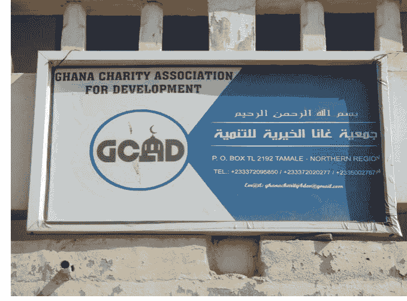

图 26 加纳慈善发展协会。塔马莱组织总部外的路标

照片：HOLGER WEISS/2019

2020 年在上东区打了 90 口水井。700 其中 20 口由 ECRF 建造。701

在加纳北部运营的中间型穆斯林非政府组织的第三个例子是总部位于塔马莱的加纳慈善发展协会（GCAD，图 26）。其使命是通过提供水井以提供饮用水、建设教室、学校和清真寺，以及在开斋节期间为有需要的人分发食物和衣物来进行人道主义活动。^702 GCAD 是谢赫·凯兰的创举，他于 2015 年创立了该组织。他成立该组织的动机源于他意识到在加纳北部地区需要做更多社会动员和发展工作，因为该地区穆斯林人口大幅增加。拥有此前十年与穆斯林组织如 Muntada Islam 和非洲穆斯林机构合作的经验，他希望通过创立自己的非政府组织特别强调教育项目。然而，他的愿景最初与他联系寻求帮助的资助方（即国际穆斯林非政府组织）的愿景相冲突。他们的重点是社会发展的“伊斯兰”解释，即提供伊斯兰中心、清真寺和水井。尽管如此，谢赫·凯兰最终与两个阿拉伯慈善机构——阿联酋援助和沙迦国际慈善达成妥协，GCAD 于 2016 年开始运营。^703

阿联酋援助提供的资金使谢赫·凯兰能够启动大规模的基础设施建设项目，GCAD 在 2018 年和 2019 年在北部、萨瓦纳、上东、上西、阿散蒂和大阿克拉地区完成了 174 座清真寺和 237 个水项目。此外，阿联酋援助的资金还使 GCAD 自 2018 年起开展斋月粮食援助和开斋以及古尔邦节肉类捐赠项目。^704 另一方面，沙迦国际慈善提供了小规模企业和商店的启动资金。^705

谢赫·凯兰的愿景是将基础设施项目扩展到包括健康和教育项目。这是对塔马莱酋长提出的各种呼吁做出的回应，当时阿联酋援助的代表访问该镇时，酋长要求在社区建立诊所或医院。随后，上西地区的一位皈依伊斯兰教的酋长在村里建清真寺后要求建立诊所。然而，迄今为止，谢赫·凯兰尚未能说服资助方为健康项目提供资金。^706 另一方面，他希望 GCAD 为教育项目筹集资金的雄心，包括建设教室或学校，已取得成功，其 2021 年主页上列出了五个已完成的（makaranta）学校项目以及扎耶德·阿尔凯尔古兰诵读中心，后者配备了寄宿学校和电脑教室。707

加纳慈善发展协会是一个典型的中介组织，充当当地社区与国际资助方之间的桥梁。GCAD 的工作人员数量有限，这对穆斯林非政府组织来说是典型的：11 人，包括上述地区中的组织代表。行政费用由外国资金承担。708 谢赫·凯兰和 GCAD 地区代表收集当地社区的基础设施项目请求，并在初步内部评估后将其提交给国际捐助方。随着其主页于 2021 年建立，GCAD 还开始发布针对特定项目的捐款呼吁，包括三个教室项目、四个水项目、六个清真寺项目、一个“房屋”项目和一个“商店”项目。709

## 4.6 加纳穆斯林非政府组织走向国际

一些加纳穆斯林非政府组织近年来扩大了活动范围并启动了国际项目。这是一种新现象，因为它挑战了加纳穆斯林社区是外部干预的接受者以及当地穆斯林为赋权而动员仅限于加纳国界内的旧观念。另一方面，考虑到许多加纳穆斯林活动家和学者——无论是萨拉菲、苏菲、什叶派还是阿赫迈迪亚——多方面的区域和大陆网络，加纳穆斯林非政府组织的跨国和国际雄心并不令人惊讶。穆斯林跨境网络可以追溯到前殖民时期，在殖民时期从未停止，并且随着现代交通和通信技术的使用，在当代后殖民时代得到了加强和倍增。

在表达国际雄心的最早加纳穆斯林非政府组织中，排名靠前的是提贾尼谢赫·萨利斯·沙班的伊斯兰人道主义基金会（IHF International）。该基金会成立于 2011 年，是一家全球人道主义慈善和救济组织，谢赫·萨利斯·沙班致力于通过增加苏菲精神维度来实现联合国千年发展目标和联合国可持续发展目标，以应对全球挑战。尽管如此，IHF International 的使命主要基于团结和世俗，即促进普及教育、改善医疗保健、加强扶贫和环境保护、赋权妇女和儿童并促进全球和平。710 典型的穆斯林慈善机构，谢赫·萨利斯·沙班设想其组织的核心重点是教育（建立学校并为贫困学生提供奖学金支持）、提供饮用水、健康教育和筛查项目、孤儿和寡妇支持。虽然并不独特，但其对基于性别或年龄的侵犯和歧视的坚决立场，包括强奸、家庭暴力、贩卖儿童和童工，使其组织与其他组织区别开来。711 然而，尽管谢赫·萨利斯·沙班被视为跨非洲穆斯林领袖，其组织迄今主要在加纳运营。

另一个具有相似愿景和使命的加纳组织是总部位于塔科拉迪的萨拉菲正道基金会（DAIF），其在 Facebook 上宣布“力求在非洲人道主义救援方面卓越”。712 是否已将其活动扩展到加纳以外尚不清楚，也不知道他们是否已获得任何外部资金来支持其雄心。

一些组织，如伊斯兰发展与人道主义服务委员会（ICODEHS）、伊克拉基金会和加纳伊斯兰青年天课协会（GIYSA），已成功吸引外国捐助者或为其在加纳境外的活动筹集内部资金。ICODEHS 在西非、中非和东非活跃，很可能在其核心业务领域内，即清真寺建设和钻井。然而，其国际活动未在其主页或 Facebook 上显示，需要进一步调查。713 相比之下，伊克拉基金会在加纳、多哥、贝宁、科特迪瓦、布基纳法索和尼日利亚的萨拉菲清真寺为斋戒者安排开斋餐桌，由沙特慈善家捐赠支付。据组织主页提供的信息，2014 年提供的餐食数量达到 28 万份。2019 年斋月期间，伊克拉基金会在加纳、多哥和贝宁“超过一百个”地点为约 2,000 个贫困和有需要家庭提供餐食，并为 675 名孤儿分发开斋节服装。714

700 视频中提供的信息：“向 Bawku SHS 移交两口水井”，2021 年 4 月 1 日，https://www.facebook.com/el.charity.gh/videos/460264562065503/，访问时间 2021 年 7 月 15 日；Atubugri Simon Atule，“Muslim Aid Australia International 向缺乏饮用水的社区捐赠 90 口水井”，2021 年 3 月 25 日，https://www.modernghana.com/news/1070487/muslim-aid-australia-international-donates-90-bore.html，访问时间 2021 年 7 月 15 日；Atubugri Simon Atule，“解决缺水问题：MAA International 为 Bawku SHS 提供 2 口水井”，2021 年 3 月 25 日，https://www.modernghana.com/news/1070304/addressing-water-shortages-mma-international-prov.html，访问时间 2021 年 7 月 15 日。

701 “MAA International 与 ECRF 合作在加纳提供清洁饮用水”，2021 年 1 月 3 日，https://www.facebook.com/el.charity.gh/photos/a.4096970065893915/1497674083760169/?type=3&theater，访问时间 2021 年 7 月 15 日。

702. 加纳慈善发展协会主页 2021，http://gcharity.org/about-us/，访问时间 2021 年 8 月 10 日。

703. 与谢赫·凯兰在塔马莱的访谈，2019 年 4 月 10 日和 2019 年 12 月 9 日。根据 GCAD 主页提供的信息，该组织成立于 2018 年。

704. 请参阅 http://gcharity.org/gallery/ 上的照片，访问时间 2021 年 8 月 10 日。

705. 与谢赫·凯兰在塔马莱的访谈，2019 年 4 月 10 日和 2019 年 12 月 9 日。

706. 与谢赫·凯兰在塔马莱的访谈，2019 年 12 月 9 日。

710 “愿景与使命”，https://islamichumanitarianfoundation.blogspot.com/2016/01/vision-and-mission.html，2016 年 1 月 5 日，访问时间 2022 年 1 月 13 日。

711 “我们的目标和宗旨”，https://islamichumanitarianfoundation.blogspot.com/2016/01/our-goals-and-objectives.html，2016 年 1 月 5 日，访问时间 2022 年 1 月 13 日。

712 https://www.facebook.com/Deenalhaqqi8/，访问时间 2022 年 1 月 13 日。

713 ICODEHS 的国际活动未在其主页或 Facebook 上显示，需要进一步调查。

714 https://iqraorg/?page_id=778（捐赠报告 2014 年 10 月 24 日），和 /?page=26696（捐赠报告 2019 年 6 月 3 日），访问时间 2020 年 11 月 17 日。2024 年 5 月，伊克拉教育与发展基金会主页的链接已无法访问。

GIYSA 反过来，在其成员中为尼日利亚南部农村社区的饮用水井项目筹集资金。715

## 4.7 依赖外国捐助者——挑战与限制

对外部投资的依赖使加纳穆斯林非政府组织陷入问题境地，因为外国捐助者决定资助的内容。因此，为了实现当地贫困人口的赋权，需要确定其他方法，尤其是由受益者设计的、旨在实现当地社区结构性变革且由执行组织完全能够控制资金的举措。这种方法需要动员加纳穆斯林人口承担集体责任，不仅改善其生计，还要就‘穆斯林’扶贫方案展开富有成效的讨论。716

然而，穆斯林活动人士和领导人痛苦地意识到基督教组织在促进社会和经济发展以及赋权加纳当地社区方面的成功参与。虽然这在整个二十世纪都是众所周知的事实，但穆斯林领导人最初试图通过将社区与西方教育隔绝来阻断基督教影响。由于这导致了穆斯林在后殖民加纳社会中的结构性边缘化，穆斯林领导人开始缓慢改革穆斯林教育体系，并建立由当地 MFBOS 运营的当地卫生机构。2016 年，Ahlus-Sunna Wal-Jama’a 的国家伊玛目 Haji Umar Ibrahim Imam 号召加纳穆斯林对“人类发展的敌人”宣战，最显著的是饥饿、愚昧、疾病、冲突和战争。他进一步敦促穆斯林酋长、伊玛目和富人考虑建立教育和卫生设施，作为对抗愚昧和疾病的补救措施。他说，“当愚昧和疾病被征服时；饥饿、冲突和战争肯定会被降到最低限度”。他还强调了为儿童提供现代教育和职业指导的重要性，并说，“在这个时代，未受教育的孩子就像被剪掉所有羽毛却被告知要飞的鸟一样。”717

715 https://www.facebook.com/GIYSA-Ghana-Islamic-Youth-Sadaqqa-Association-109699093960381/, 31.10.2020, 2.11.2020, 5.11.2020, 10.11.2020, 访问于 16.11.2020.

716 Weiss, 乞讨与施舍在加纳; Habib Abubakar, “伊斯兰非政府组织在其运营社区中的影响，” 25.3.2015, https://www.linkedin.com/pulse/impact-islamic-ngos-operational-communities-ghana-habib-abubakar, 访问于 29.8.2016.

717 Alhassan M. Baidoo, “穆斯林宣战其敌人——ASWAJ 的 Haj Umar。” http://www.mytawheedonline.com/2016/05/11/muslims-to-declare-war-on-their-enemies-haj-umar-of-aswaj-2/, 11.5.2016, 访问于 16.11.2017; 该主页于 2024 年 5 月已失效。

一年后的一次采访中，他批评加纳穆斯林社区依赖阿拉伯政府和慈善家的经济援助和投资，宣称“直到我们站起来为自己提供保障，没有外国人能够提供并将我们的社区建设到我们期望的标准。”718 当时 COMOG 的秘书长 Haji Abdul Manan Abdul Rahman 发出了类似的呼吁，呼吁穆斯林学者和专业人士作为消除愚昧和欠发展的伙伴。为此，COMOG 于 2016 年启动了穆斯林乌玛发展倡议（MUDI）。719 随后，Tamale 的 Sheikh Amin Bamba 在 2017 年联合国人口基金与加纳 Bamba 伊斯兰学院（BII-Ghana）合作社区发展项目启动时，严厉指出高文盲率是阻碍加纳穆斯林赋权的主要原因。在他看来，“……文盲剥夺了我们大多数人所需的关键信息，使他们无法做出明智的经济、社会和政治决策以改善生计和整体福祉，而且仍在继续剥夺。”他进一步敦促穆斯林领导人和组织与相关政府和非政府机构合作发展穆斯林社区，并促进实现联合国可持续发展目标。720 然而，到 2010 年代末，穆斯林领导人意识到这些努力仅产生有限影响，并震惊地发现改宗基督教的穆斯林比相反情况更多。这一认识促使伊斯兰和平与安全委员会于 2019 年 1 月对加纳伊斯兰社会经济基础设施的弊端进行批判性审视，包括幼儿园、初级和中学、高等院校、教学和教师培训学院、诊所和医院、职业培训中心以及孤儿院。他们还重新审视了为贫困和弱势群体提供社会福利和庇护，以及为资源较少家庭提供食物的问题。721

718 Abdul-Rahim Naa Abdul-Lahie, “与 Ahlul Sunna Wal Jama’a (ASWAJ) 国家伊玛目 Hajj Umar Ibrahim 的一次交谈，” 16.10.2017, http://thetodaysmuslim.com/discussions/a-chat-with-hajj-umar-ibrahim-national-imam-of-ahlul-sunna-wal-jamaa-aswaj/, 访问于 20.5.2019; 该主页于 2024 年 5 月已失效。

719 Saeed Hamid Jallo, “加纳穆斯林被告知向南非和乌干达穆斯林学习，” http://www.mytawheedonline.com/2016/07/28/learn-south-african-ugandan-muslims-ghanaian-muslims-told/, 访问于 16.11.2017; 该链接于 2022 年 1 月 16 日不再可用。另见 Weiss, 加纳的天课, 139–141。

720 “文盲是穆斯林发展的祸害——Sheikh Bamba，” 16.5.2017, http://savannahnewsblogspotcom.blogspot.com/2017/05/illiteracy-is-bane-of-muslims.html, 访问于 19.5.2019; “UNFPA 与 Bamba 学院合作促进 SDGs，” 16.5.2017, https://www.ghanaweb.com/GhanaHomePage/NewsArchive/UNFPA-partners-Bamba-Institute-to-promote-SDGs-538205, 访问于 19.5.2019.

Anika Altaf 关于北部地区当地和全国穆斯林非政府组织的报告得出了类似的结论。她的大多数受访者只提到了少数伊斯兰干预措施，其中大部分是清真寺和经学院。虽然受访者普遍认为“伊斯兰援助”，即来自国际或全国 MFBOS 和穆斯林慈善家的援助，是受欢迎的，但仍被批评为通常仅限于资助宗教活动。尽管如此，Altaf 认为缺乏自筹资金是当地和全国 MFBOS 在实施社会和经济发展项目时面临的最大制约因素。另一方面，加纳的筹资能力极小；唯一自给自足的组织是阿赫迈底亚穆斯林传教团。有趣的是，Altaf 在分析结尾强调了加纳 MFBOS 需要开始探索通过制度化的天课征收实现完全或部分自给自足的方式。722

根据 2030 年议程的联合国可持续发展目标，加纳穆斯林社区在扶贫方法上需要重新定位的需求，在 2017 年 2 月联合国民间社会委员会第 55 届会议上由国家首席伊玛目发表的演讲中进一步得到强调。在他的演讲中，Sheikh Osman Nuhu Sharubutu 为消除贫困请愿伊斯兰视角。遵循对伊斯兰教第三支柱的经典解释，国家首席伊玛目强调了穆斯林行善并为有需要者提供保障的必要性，并得出结论认为天课是经济救济和消除贫困的手段。他感谢地指出，加纳政府通过于 2017 年设立内城和宗戈发展部，为改善被称为宗戈社区的贫困城市低收入定居点的经济和社会发展开辟了新途径。然而，他也强调，“要彻底消除贫困，必须在与宗教领袖和神职人员协商后采取新方法。”

在他看来，这一新方法应努力创造就业并提供公平分配国家资源以造福所有人的手段。他还

721 Alhaji Khuzaima Mohammed Osman, “加纳伊斯兰复兴项目摘要，” 27.1.2019, http://www.sonsetfundgh.org/newsevents?news_id=15c4e16eea25ae&pn=2, 访问于 22.3.2019; IPASEC, “加纳伊斯兰基础设施数据收集，” 27.1.2019, http://www.ipasecgh.org/news?news_id=15c4e14e8a555e&pn=2, 访问于 22.3.2019; 两个主页均于 2024 年 5 月已失效。

722 Anika Altaf, 《对加纳北部伊斯兰发展倡议的认知与反思》 (Amsterdam: PADEV, 2010), 可在 http://dare.uva.nl 获取, 访问于 2.11.2017.

他强调需要建立一个篮子来满足他们的需求和愿望，并为他们提供职业培训。奥斯曼·努胡·沙鲁布图（Osman Nuhu Sharubutu）强调，有必要开发新机制，接触穆斯林社区中富裕和有资源的人士，让他们在慈善方面做得更多。723

2019年4月与哈吉·苏莱曼纳·穆穆尼（Haji Sulemana Mumuni，又称哈吉·苏莱）的一次长谈中，出现了一个关于依赖外部捐助者的发人深省的反思。在他看来，接受世俗教育训练的穆斯林和接受非世俗教育训练的穆斯林之间存在根本区别。前者“只说不做”，而后者——主要是传统的穆斯林学者——依赖他人，即他们的信众，并且日益依赖来自阿拉伯世界的捐款。关于与政治领袖关系的一个关键问题是：宗教领袖应该与他们合作（并从中获取资源），还是保持独立并从自己社区内部产生资源？同样，在与外部穆斯林慈善家和慈善机构的关系方面，哈吉·苏莱强调，最好保持独立，依赖从自己社区内部积累的资源，而不是依赖外部捐助者。关键在于从内部赋能，哈吉·苏莱强调，依赖外部捐助者的短期策略是有风险的，因为他们的目标可能与受助者的目标不一致。虽然资助修建清真寺在穆斯林捐助者中排名很高，但当地社区的优先事项可能是“世俗”基础设施，如学校、医疗中心或职业培训中心。哈吉·苏莱指出，成立一个NGO比在众多挑战中有效运营它更容易，尤其是在没有计划如何为其活动提供资金的情况下。外部捐助者拨付的资金很少包括支付NGO工作人员薪酬的间接费用，或者在极端情况下，这些资金被挪用于其他目的。他进一步指出，外部捐助者投资于新项目，而不投资于这些项目的维护。结果是一个恶性循环：地方NGO只要收到外部资金就能生存，一旦资金停止就会崩溃。724

哈吉·苏莱试图以身作则，努力与接受世俗训练的穆斯林讨论如何在不依赖外部捐助者的情况下实现赋权。议程上的首要议题是，接受世俗训练的穆斯林需要实现经济独立，并认识到他们如何能成为社会的一部分并对其产生影响。这些讨论促成了2010年*绿色圣洁基金会*（Holy Green Foundation）的成立。725该基金会的目标是“改善穆斯林的经济状况和整个社区的生活质量”，使其成为“穆斯林社会经济发展的促进者”。726因此，它每月向会员收取会费（5或10加纳塞地，相当于0.8至1.6美元），以资助其活动。基金会的活动包括在阿克拉的法蒂玛圣女高级中学（Lady Fatima Senior High School）为学生提供和安排开斋餐。727其第二个目标是引入一种集体伊斯兰共享制度，每位会员每月缴纳50加纳塞地（8美元），用于会员的社会和智力发展；来自50名会员的累积资金产生了约5,000加纳塞地（约800美元）。其中一部分将投资于私人交通，其余部分用于增强和倡导年轻穆斯林的储蓄习惯。728

几十年来，穆斯林学者、伊玛目和基层活动家一直在提醒他们的穆斯林兄弟姐妹注意自我赋权的必要性和可能性。也许随着（相对）富裕的城市穆斯林中产阶级的崛起，关于自我赋权的公共话语在2010年代在加纳穆斯林社区中获得了动力。有趣的是，议会中的穆斯林核心小组在这一过程中发挥了主导作用。2010年，它发起成立了加纳天课和施舍信托基金（Zakat and Sadaqa Trust Fund of Ghana，见第5.3.1章）；十一年后，它跻身首届全国穆斯林大会（NMC）的组织者之列。国家首席伊玛目谢赫·奥斯曼·努胡·沙鲁布图博士（Sheikh Dr Osman Nuhu Sharubutu）坚定致力于穆斯林社区的团结，他在2021年会议开幕时强调，团结是摆脱贫困的出路：

除非我们能够驾驭这一共同的命运，重新致力于伊斯兰的教义和教导，团结起来，找出我们的共同问题，提出解决方案并付诸实施，否则我们将不仅是加纳社会中最贫困的群体之一，而且还将被排除在加纳社区的决策体系之外。729

在2021年会议闭幕式上的演讲中，加纳穆斯林使团全国主席谢赫·阿明·邦苏博士（Sheikh Dr Amin Bonsu）敦促加纳穆斯林必须自我赋权：“如果我们团结起来，我们将能够建设更多穆斯林社区发展所需的教育、卫生和其他基础设施，并能够为国家发展贡献他们的一份力量。”730作为会议的一项成果，与会的各穆斯林教派决定成立NMC，作为审议和管理与加纳穆斯林的教育、健康、财务和总体福祉相关事务的论坛。在会议结束时的新闻稿中，与会者进一步宣布他们的雄心是“动员并为穆斯林在教育、卫生和金融方面的发展目标提供可持续资金，并建立相关结构和实施项目，以满足加纳穆斯林的社会经济需求。”731

未来的发展将告诉我们，NMC的成立是否开启了加纳穆斯林社区历史的新篇章。至少它的设计者设想它发展成核心国家机构，超越教派界限促进穆斯林社区的福祉和自我赋权。NMC的《盟约》文件概述，它将率先组建三个新机构来满足穆斯林的需求，即加纳伊斯兰教育局（Ghana Islamic Education Service）、加纳伊斯兰卫生局（Ghana Islamic Health Service）和加纳伊斯兰金融局（Ghana Islamic Financial Service）。732

725 绿色圣洁基金会的正式成立典礼于2011年举行，当地媒体对此进行了报道，见“Muslims inaugurate NGO in Accra”，15.5.2011，https://www.ghanaweb.com/GhanaHomePage/NewsArchive/Muslims-inaugurate-NGO-in-Accra-209665，访问于7.10.2011。

726 HGF 序言，30.12.2012，https://www.facebook.com/HOLY-GREEN-Foundation-205915012866979/，访问于7.10.2021。

727 法蒂玛圣女SHS是一所女子中学，于2015年在伊朗的资助下成立。关于绿色圣洁基金会2018年在该校的开斋餐项目，见https://vymaps.com/GH/Lady-Fatimah-Girls-Senior-High-School-586o63961546383/；2019年的信息，见https://www.schoolandcollegelistings.com/GH/Accra/583234981829281/Lady-Fatimah-Girls-Senior-High-School，12.5.2019；两者均访问于7.10.2021。

728 采访哈吉·穆穆尼·苏莱曼纳，莱贡/阿克拉，12.4.2019。

729 “首届全国穆斯林大会在阿克拉举行”，3.8.2021，https://www.ghanabusinessnews.com/2021/08/03/maiden-national-muslims-conference-underway-in-accra/，访问于8.7.2022。

730 “让我们团结起来发展穆斯林社区——谢赫·阿明·邦苏博士”，3.8.2021，https://www.ghanaweb.com/GhanaHomePage/NewsArchive/Let-s-unite-to-develop-Muslim-communities-Dr-Sheikh-Amin-Bonsu-1323292，访问于8.7.2022。

731 “加纳全国穆斯林大会成立”，2.8.2021，https://gna.org.gh/2021/08/national-muslims-conference-of-ghana-established/，访问于28.5.2024。

732 “加纳全国穆斯林大会盟约”，[无日期]，https://www.theinsightnews online.com/deed-of-national-muslim-conference-of-ghana/，访问于8.7.2022。

# 第三章

## 穆斯林信仰本位人道主义救济的本质

穆斯林NGO将`*infaq*`（施舍）和`*sadaqa/sadaqa jariya*`（施舍/持续性施舍）定义为赋能穆斯林社区的核心概念。一方面，穆斯林NGO用这个词来表明其作为捐助者和受助者之间中介的立场。是NGO而非捐助者来识别合格的受助者，或提供合格项目的清单，如宗教中心、水利项目、教育项目或健康项目等。另一方面，`*sadaqa jariya*`尤其需要在捐助者和NGO之间建立并创造信任，因为对作为`*sadaqa jariya*`捐赠的资金的管理不善或挪用，不仅会破坏NGO与其捐助者之间的纽带，还会导致那些对NGO负责的人在安拉眼中受到谴责。

穆斯林学者和论著将`*sadaqa*`视为自愿施舍。而`*zakat*`（天课）则被定义为强制性的，受特定条件约束，并针对《古兰经》中列出的特定受益人群体（忏悔章 9:60），`*sadaqa*`不受任何条件、限制或准则的约束，也可以给予非穆斯林。^1^ 加纳穆斯林组织和活动人士的捐款呼吁通常被认定为`*sadaqa*`而非`*zakat*`，并且随着过去十年穆斯林NGO的激增及其在社交媒体上的活动，这类呼吁已变得相对普遍。`*Infaq*`，在阿拉伯语中是一个通用术语，意为支出和发放。然而，它也带有行善而不求回报或不期待任何奖赏的道德义务。`*Infaq*`在《古兰经》中的解释是，只为取悦安拉，应在死亡之前进行，不应为了炫耀，也不应带有任何公开宣传的欲望。^2^ 因此它不同于`*sadaqa*`或自愿施舍，也不同于`*sadaqa jariya*`（持续性/永久性/不间断的慈善），^3^ 因为这两个术语都暗含着对后世回报的希望，以及通过施舍予 needy 来实现捐助者救赎的行为。

1. 参见，例如，https://islamqa.info/en/answers/9449/the-difference-between-zakaah-and-sadaqah，访问于17.5.2019。

2. Farooq Aziz, Muhammad Mahmud and Emad ul Karim，“The Nature of *Infaq* and its Effects on Distribution of Wealth”，*KASBIT Business Journal* 1, 第1期 (2008): 44–48。

3. https://www.zakat.org/what-is-sadaqah-jariyah-charity-ever-flowing，访问于8.10.2021。

Facebook 上的许多论著和阐述都将“sadaqa”（施舍）视为一种日常慈善形式。在《萨达卡之门》（“Doors of Sadaqa”）的阐述中，Rayhan Yakub 基金会 Facebook 账号上一篇帖子的（匿名）作者，除了赞美安拉的言辞和经文外，还将世俗的行为列为 sadaqa。后者包括：清除人们道路上的荆棘、骨头和石头；引导和倾听残障人士；利用自己可支配的资源帮助穷人；以及日常的礼貌行为，只要其意图是取悦安拉。⁴ Grain of Hope Foundation（希望种子基金会）也发布了类似的建议。他们给追随者的建议是：在任何清真寺里放置一本《古兰经》；在窗台上放一碗或一杯水给鸟儿；或者把布料分给贫困者。另一个建议是：在房间里放一个盒子，每当认为自己犯了罪，就往里投一枚硬币；一个月后打开盒子，将现金施舍给贫困者，或用于资助孤儿。⁵ 因此，穆斯林被建议将财产分成几部分用于多种施舍：一部分为贫困者提供开斋饭（Iftar），一部分资助孤儿，一部分资助老人，还有一部分用于修建清真寺等等。⁶

4 “《萨达卡之门》”，https://www.facebook.com/page/260303714019557/，2015年11月19日，访问于2022年8月26日。

5 “施舍（sadaqah）小贴士”，2016年5月18日，https://www.facebook.com/Grain-Of-Hope-Foundation-687684279998950，访问于2022年8月26日。

6 “给予sadaqah的最佳方式是什么？”，https://www.facebook.com/Grain-Of-Hope-Foundation-687684279998950，2022年2月9日，访问于2022年8月26日。

7 “关于为安拉而行的真诚施舍”，https://www.facebook.com/page/260303714019557/，2016年5月20日，访问于2022年8月26日。

另一方面，Sadaqa jariya（持续施舍）被穆斯林学者定义为“为了真主而给出的‘真诚施舍’”。“作为一个有产出的穆斯林，你应该每个月从工资中留出一部分用于sadaqah，即使金额很小，”Rayhan Yakub Foundation 的（匿名）作者解释道，并建议将这些钱投资于修建清真寺、挖井、开办学校或植树。⁷ Grain of Hope Foundation 的（匿名）作者进一步提醒说，sadaqa jariya 是一种 waqf（虔诚的宗教捐赠）：

> 持续施舍（sadaqah jariyah）是一种回赐在人去世后仍会持续的施舍。至于回赐不会持续的施舍，例如向穷人提供食物形式的施舍，那就不属于持续施舍。因此，为封斋者提供开斋饭、资助孤儿、照顾老人——尽管这些都属于慈善行为——却不属于持续施舍。但你可以捐建孤儿院或养老院，只要该机构持续造福人们，你就能持续获得回赐，这便是一种持续施舍。⁸

8 “什么是sadaqah jariyah？”，https://www.facebook.com/Grain-Of-Hope-Foundation-687684277998950，2022年2月9日，访问于2022年8月26日。

因此，sadaqa，尤其是 sadaqa jariya，已演变为筹集资金的核心概念和工具，同时也为穆斯林行动主义提供了蓝图和框架。大多数达瓦（dawatist）穆斯林非政府组织坚持对这一框架的狭义解释，即 sadaqa 用于人道主义救济（开斋饭和古尔巴尼献牲），而 sadaqa jariya 仅限于修建清真寺和学校、挖井和钻探水井。相比之下，以团结为基础、尤其是世俗的穆斯林非政府组织则扩展了这一框架，将建设诊所和医院等纳入其议程。

### 1 斋月与开斋节期间的济贫与施衣

出于宗教动机的人道主义救济——即在斋月以及一年一度的穆斯林节日开斋节（Eid al-Fitr）和宰牲节（Eid al-Adha）期间向穷困者捐赠——是加纳几乎所有穆斯林非政府组织的核心特征和本质要素。这类年度捐赠既是横向也是纵向慈善形式的一部分，近几十年来由众多地方、区域和全国性组织协调开展。在过去几十年里，这些组织的活动急剧增加。近年来，一些国际穆斯林慈善机构通过开斋饭和献牲捐赠为数千甚至上万名受助者提供了食物，例如 Direct Aid、Qatar Charity（卡塔尔慈善会）、Dar al-Ber Society、King Salman Humanitarian Aid and Relief Centre（萨勒曼国王人道主义援助和救济中心）、HUDAI、Deniz Feneri 和 Turkiye Diyanet Vakfi（土耳其迪亚内特基金会）。⁹

众多穆斯林慈善机构主要在城区和宗戈（Zongo）社区组织本地斋月食品捐赠、开斋饭以及献牲捐赠和宰牲（Udhiya）项目，其中包括阿克拉（例如 Fadil Islamic Foundation、Ghana Society for Islamic Education and Reform、Islamic Ummah of Ghana、Grain of Hope Foundation、Zongo Educational Aid）¹⁰、卡索阿（*Muslim Aid Ghana*）11、库马西（例如 *Al-Sidiq Foundation for Care and Charity, Ansar al-Din Association, Muslim Ummah of Ghana, Muslim Access Movement, Sunna Hausa Relief Organization, Ummah Foundation* 和 *Yamboni Foundation*）12、塞孔迪和塔科拉迪（*Attaqwa Foundation*）13、奥布阿西（*Deen Al-Haqq Islamic Foundation* 以及 *Hajia Saratu Sidi Ali Foundation*）14、塔马利和宾比拉（*Sayfudeen Fund*）。其中也有一些针对农村社区，例如总部位于阿克拉的 *Grain of Hope Foundation* 和 *Make Zongo Great Again*15、总部位于塔马利的 *Awakening Muslimah*16，以及总部位于塔科拉迪的 *Al-Salaam Charitable Foundation*17。其他组织则在多个地区的城乡地点开展了项目，如 *Eid Feast Ghana*、GIYSA、*MY Akhirah Account*、*MY Hereafter Project*、*Peace Dawah Media* 和 *Save Aid Project*，详见下文及第3.6章。

非正式协会和团体也开展临时外展活动，为特定目标群体募集现金、食物和衣物。其中一些是旅居海外的加纳穆斯林组成的松散网络，他们因共同事业而聚集，例如2021年由德国穆斯林发起的 Nsawam-Adoaqyiri Zongo 的 Tuo Ladan 斋月食品项目。¹⁸

9 国际穆斯林慈善机构在加纳的开斋饭和开斋节项目将在第2.4章讨论。

10 https://giser.org.gh/charity-sector/，访问于2020年11月22日；Grain of Hope 在尼马的捐赠，发布于 Facebook 2016年2月7日；2020年5月14日、2020年6月1日；2019年斋月开斋饭，发布于 Facebook 2019年6月3日；斋月开斋饭，发布于 Facebook 2020年5月4日。IUG 发出的“斋月开斋饭——为贫困者提供食物”的呼吁以及视频片段均发布在加纳伊斯兰乌玛的 Facebook 账号上；参见 https://www.facebook.com/islamicummahofghana/posts/iug-&-gmd-ramadan-iftar/172415427937870/ 和 https://www.facebook.com/islamicummahofghana/videos/3rd-phase-ramadan-iftar-project-street-iftar/1726941774051902/，访问于2019年4月29日。

11. https://www.facebook.com/muslimaidgh/.

12. https://www.facebook.com/مؤسسة-الغذيرية-والاعمال-الخيرية-مؤسسة-الصديق-133403143679490/?__tn__=-UC*F; مؤسسة المشاريع الموسمية https://ramadan-sy? مؤسسة-المشاريع-الموسمية、https://ramadan-sy? https://ramadan-sy? https://ramadan-sy? https://ramadan-sy?; https://ramadan-sy?; 访问于2020年11月17日；Facebook 视频，2017年9月7日；Facebook 帖子，2018年7月4日；MUG 和 MAM 的2018年斋月开斋饭项目视频，https://www.launchgood.com/project/ramadan_iftar_#!，访问于2019年2月26日。

13. https://www.facebook.com/profile.php?id=100079780847255.

14. https://www.facebook.com/Deenalhaqq18/，2020年4月29日和2020年5月21日，访问于2020年10月23日；“开斋节：Hajia Saratu Sidi Ali Foundation 在奥布阿西宴请穆斯林儿童”，2023年4月26日，https://www.modernghana.com/news/1226321/eid-ul-fitr-hajia-saratu-sidi-ali-foundation-fete.html，访问于2023年11月12日。后者将其活动称为“Ramafest”，自2016年起每年举办。

15. Grain of Hope 在 Nanumba North District 分发食品，发布于 Facebook 2016年10月24日。

16. Adnan Abdul-Hamid，“Awakening Muslimah Zakat ul-Fitr’20”，https://www.awakeningmuslimah.org/zakat-ul-fitr/zakat-ul-fitr-2020/；Adnan Abdul-Hamid，“Awakening Muslimah Zakat ul-fitr ’21”，https://www.awakeningmuslimah.org/zakat-ul-fitr/zakat-ul-fitr-2021/，两者均访问于2021年7月16日。

17. https://www.facebook.com/Alsalaam-foundation-107009491576251，2021年6月18日，访问于2022年1月16日。

18. “斋月：约190名穆斯林获得德国团体的捐赠”，2021年5月12日。

在线斋月捐款呼吁在 2012 年获得发展势头，当时 *伊斯兰和平与安全委员会* (*IPASEC*) 发起了支持贫困穆斯林家庭的呼吁。*IPASEC* 是一个独立的倡导机构，由国家首席伊玛目 Sheikh Osman Nuhu Sharubutu 设立并担任主席。其使命一直是促进 Zongo 社区中的和平与稳定，而 2012 年斋月筹款活动似乎是一次孤立的事件。尽管如此，该活动是首批公布所需物资、受益家庭和成本详细估算的活动之一。该项目的总预算约为 GHS 780,000（USD 400,000），其中 GHS 40,500 由国家首席伊玛目在阿克拉 New Fadama 用于住宅和社区支持，GHS 638,000 用于区域分配，GHS 89,500 用于各个地方和区域首席伊玛目。然而，我不知道该项目是否成功实现了其目标。尽管呼吁声明所有捐赠者都将收到感谢信、收据并在其姓名公布于 *IPASEC* 的主页上，但主页上找不到此类信息。19

https://3news.com/ramadan-about-190-muslims-receive-donation-from-germany-based-group/, 访问于 2.1.2023。

19 *IPASEC*，‘斋月前后及期间所需的慈善物资筹款’，http://www.ipasecgh.org/projects?project_id=14ff6c3131487o&pn=1，核查于 21.3.2019；主页已于 2024 年 5 月失效。

20 https://www.facebook.com/GhanaAcademyOfMuslimProfessionals/photos/a.483772608350207/2389938067733642/?type=3&theater，访问于 13.5.2019。然而，*GAMP* 的教育与福利主管 Said Mohammed Sani 在 2022 年告诉我，该组织在 2019 年后停止了斋月/开斋节救济，此后未向其成员发布任何捐款呼吁。相反，*GAMP* 计划设立一个福利基金，以支持生病或去世成员的家庭。与 Said Mohammed Sani 的访谈，阿克拉，9.10.2022。

21 https://www.facebook.com/Clamstart/photos/a.412950692890074/412950639556746/?type=3&theater，发布于 11.5.2019，访问于 23.10.2020。

此后 Facebook 已成为穆斯林 *NGOs* 传播捐款呼吁并开展斋月和开斋节活动的主要工具。*加纳穆斯林专业人士学院* (*GAMP*，前称 Ghana Muslim Academy) 于 2019 年 4 月发布了关于美国组织 Islamic Ummah Relief 的斋月食品包裹项目的信息。作为其自身的斋月呼吁的一部分，*GAMP* 呼吁其成员通过在线捐款支持该项目。20 *Ummil Mu-Mineen Aishatu Siddiqa Foundation*，一家总部位于 Kumasi 的穆斯林慈善机构，于 2019 年 5 月在 Facebook 上启动了其斋月慈善项目，口号为“让孤儿和贫困者在神圣的斋月里微笑”，并呼吁进行 Momo 捐款。21 一个月后，该组织在 Facebook 上发布通知称其已收到 Daarul Qur’an Islamic Aid International 的捐款，并已用其资助在开斋节期间向孤儿分发衣物。[^22] *伊斯兰研究协会加纳* 则发布了其 2019 年斋月开斋饭项目的呼吁，呼吁通过其移动货币账户捐款以资助 200 名孤儿、寡妇和弱势群体，[^23] 并于 2020 年再次发起。[^24] 总部位于 Tamale 的 *加纳慈善基金会* 于 2020 年 2 月初宣布，其雄心是在即将到来的斋月期间为至少 20 个家庭提供食物，并在开斋节为十五名孤儿捐赠新衣。[^25]

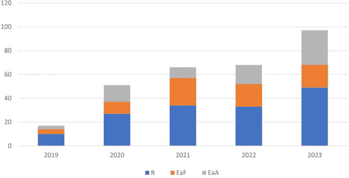

#### 图 9 开斋饭、开斋节和宰牲节捐赠，2019–2023（n = 85 个组织；R = 斋月开斋饭，EaF = 开斋节，EaA = 宰牲节）

[^22]: https://www.facebook.com/Clamstart/photos/a.412982966220180/425832628268547/?type=3&theater，发布于 1.6.2019，访问于 23.10.2020。
[^23]: https://www.facebook.com/GIRA4ALL/，12.5.2019，访问于 23.10.2020。
[^24]: https://www.facebook.com/GIRA4ALL/，4.5.2020，访问于 15.1.2022。
[^25]: https://www.facebook.com/Charity-Foundation-in-Ghana-CFG-114626476760389，2.2.2020，访问于 29.8.2022。

社交媒体的使用在 2020 年斋月期间急剧增加，并在随后三年保持在高水平；见图 9。值得注意的是，即使在 2020 年之后社交媒体的使用仍然很高，这或许是 2020 年项目产生的积极影响所致，当时斋月和随后的开斋节节日正值该国被 SARS-CoV-2 病毒困扰。加纳穆斯林非政府组织广泛使用 Facebook，并动员其努力以缓解当地穆斯林社区弱势成员的苦难。*The Light Foundation* 等组织作为其 2020 年斋月活动的一部分，向大阿克拉地区的地方清真寺社区捐赠了价值超过 GHS 7,000 的 2,000 个食品包裹。26 *Emmoa Foundation* 在阿克拉开展了为期五天的食品募捐活动，于 2020 年 3 月至 4 月为超过 2,100 人提供食物。27

26 "Light Foundation 向阿克拉穆斯林社区捐赠食品包裹," https://www.tlfghana.org/light-foundation-donates-food-package-to-muslim-communities-in-accra/，7.5.2020，访问于 16.11.2020。食品包裹包括一袋大米、油、糖、罐装鱼、罐装番茄、面条和口罩。

27 https://www.facebook.com/EmmoaF/，26.3.2020，27.3.2020，29.3.2020，26.4.2020，30.4.2020，访问于 29.9.2021。

其他团体发起了类似活动。例如，*ASWAJ Ashanti Region Zakat, Sadaqah and Waqf Committee* 于 2020 年 4 月在 Facebook 上发布了捐款视频呼吁。28 作为其斋月 COVID-19 活动的一部分，该组织通过社交媒体分发传单，而 ASWAJ Ashanti 地区伊玛目于 2020 年 3 月在 Facebook 上发布了布道。29 该呼吁——或 Sheikh Ismail Adam Sakafia 的联系——取得了成功，社区能够在 Facebook 上宣布 ASWAJ 地区伊玛目办公室已从美国的 Yi Domin Allah Platform 收到 360 美元的慈善捐款，用于在抗击 COVID-19 封锁中帮助有需要的人。30

28 https://www.facebook.com/aswajashantii/videos/245742459798076，发布于 7.4.2020，访问于 23.10.2020。
29 https://www.facebook.com/aswajashantii/photos/a.239240292771837/32712463399554156/?type=3&theater，发布于 7.4.2020，访问于 22.10.2020。
30 https://www.facebook.com/aswajashantii/photos/a.2392402920771837/3326630800682373，https://www.facebook.com/aswajashantii/videos/224639101917798，均发布于 25.4.2020，访问于 22.10.2020。

*Ummil Mu-Mineen Aishatu Siddeeqa Foundation* 在其 2020 年斋月慈善项目中提及了 COVID-19：

> 孤儿和贫困者怎么办？当世界面临 COVID-19 大流行时，UMAFS 推出其为孤儿和贫困者筹集资金的活动。以真主之道花费你的财富是获得 Jannah 的好方法。在这场大流行期间花费你的财富来支持孤儿和贫困者是积累善行的好方法。31

类似的呼吁——“Feed the Needy COVID-19”——于 2020 年 4 月初由总部位于 Kumasi 的 *Markaz Aleawn Alyaqin Humanitarian Services* 在 Facebook 上发布。32 2020 年 5 月，来自埃及伊斯兰非政府组织 *Relief Development Foundation* 的捐款使其得以组织开斋饭项目。该组织还在 Kumasi 郊区 Asawasi 向盲人分发小米饮料和食物，但在发现为残疾人准备的食物不足时发出了额外的捐款呼吁。33 Seed of Hope Foundation 则于 4 月初发布了呼吁，呼吁人们与有需要的人分享多余的食物。十天后，它得以在 Kumasi 帮助 100 名贫困人士。34

31 https://www.facebook.com/Clamstart/photos/a.412982966220180/661575538027587/?type=3&theater，16.4.2020，访问于 23.10.2020。
32 https://www.facebook.com/markaz.aleawn.alyaqin/，4.4.2020，访问于 23.10.2020。
33 Facebook 视频：开斋、1441AH 慈善家捐款；照片和评论发布于 https://www.facebook.com/markaz.aleawn.alyaqin/，6.5.2020，访问于 23.10.2020。
34 https://www.facebook.com/sopghana/，1.4.2020，10.4.2020，访问于 29.8.2022。

一个新颖的特征是青年主导的斋月活动。从 Accra 青年团体 Muslim Society 在 2020 年斋月期间组织的 Feed the Street 活动开始（到 2022 年扩展到 Kumasi 和 Tamale，到 2023 年加入 Kasoa），35 其他基层倡议在次年随之而来。Street Iftar Ghana，一个总部位于 Accra 的临时社交社区，于 2021 年在 Kanda、New Fadama 和 Lakeside 组织了食品捐赠，并在 2022 年在 Madina、Mamobi 和 Botwe 组织。36 Make Zongo Great Again 也在 2020 年封锁期间启动了其开斋饭项目，覆盖约 300 人。它于 4 月初启动了第二个 2021 年斋月开斋饭喂养项目，并于 2021 年 4 月中旬至 5 月中旬向 Ashaiman 的 200 名贫困人士分发了食品包裹。一年后，它启动了第三个斋月食品项目，这次针对东部地区农村村庄的有需要居民，并组织了在 Ashaiman Zongo Laka 的首次儿童开斋节盛宴。37 根据其 2023 年斋月食品呼吁，它旨在将覆盖范围翻倍，目标为农村村庄的 100 个家庭。38 Zango Youth Volunteers Association 则于 2023 年在 Kumasi 组织了其首次街头开斋饭活动。39 Muslim Aid Ghana，一家于 2022 年正式成立的位于 Kasoa 的当地非政府组织，于 2021 年开始其斋月捐赠，并在次年分发了斋月救济包裹给 Kasoa 和 Gomoa Gyama 的有需要人士。40

Save Aid Project 在 2022 年斋月期间通过启动多个新举措扩大了其在社交媒体上的筹款活动。该团体在 2021 年除了组织活动外还访问了中部和东部地区的农村村庄

35 https://www.facebook.com/profile.php?id=100063728246497。
36 https://www.facebook.com/Street-Iftar-Gh-104709211742743，26.4.2021，4.5.2021，13.5.2021，12.4.2022，20.4.2022，23.4.2022，访问于 29.8.2022。

37 https://www.facebook.com/MakeZongoGreatAgain，1.4.2021，18.4.2021，15.3.2021，4.4.2022，23.4.2022，1.5.2022，访问于 29.8.2022。

38 https://www.facebook.com/MakeZongoGreatAgain，8.3.2023，访问于 18.8.2023。

39 https://www.facebook.com/Zangoyouthvolunteers，8–15.4.2023，访问于 18.8.2023。

40 https://www.facebook.com/muslimaidgh/。

在大阿克拉地区，最引人注目的是其“斋月开斋餐车”计划。次年，该团体推出了“10gh 项目”（“您的 10 gh [加纳新塞地] 将让我们访问奥蒂和博诺地区的愿望成真”），同时还有“捐赠保温瓶”活动（“捐赠 30 塞地购买一个保温瓶，帮助村庄在斋月期间保存热水”）。2022年4月，该团体启动了斋月外展活动，作为其“领养一个家庭”项目的一部分，为农村和城市的目标群体提供开斋餐。41 一年后，其斋月及古尔邦捐赠惠及大阿克拉、东部、萨凡纳和上东部地区的贫困者和孤儿。42 Hand to Hold 基金会也早早行动，早在2022年1月就在 Facebook 上发起了其 2022 年斋月项目，成功筹集到 900 加纳塞地购买食品，并捐赠给阿克拉纽敦、阿拉乔、马迪纳和卡索阿的六名寡妇。43 伊斯兰萨达卡基金会则在四月中旬启动了其在线活动，宣布其筹集 10,000 加纳塞地并在斋月期间为 100 户贫困家庭提供一天饮食的目标。五月初，它在 Facebook 上向支持者和关注者通报了该项目的成功实施。44

## 2 孤儿

关于加纳孤儿的资料很少，关于穆斯林社区中孤儿数量的信息更是少之又少。传统上，当地穆斯林学者和伊玛目会通过提供食物和在家中及马卡拉塔（古兰经学校）提供住所来照顾至少一部分孤儿。一位学者或伊玛目能够照顾的孤儿数量取决于他从当地社区通过天课（zakat）和施舍（sadaqa）获得的资金。这些资金通常不稳定，大多数情况下，孤儿会加入学者的学生的行列，到街头乞讨。45 自二十世纪下半叶以来，民间社会组织（首先是加纳的基督教传教团体和非政府组织）的孤儿院及孤儿捐赠倡议和项目，已经取代了传统的非正式孤儿照护。穆斯林机构也随后跟进，尽管几十年来很少在公众中获得认可。有组织、正式的穆斯林孤儿项目的常见轨迹通常是：一位伊玛目建立一所私立孤儿院，并创办一个非政府组织来筹集资金以维持其运营。

加纳的阿达比亚伊斯兰协会就是一个例子。该协会由谢赫·哈吉·优素福·达乌达·加里巴于20世纪90年代创立，并于2000年正式注册，自1996年起在阿哈福地区戈阿索运营一家孤儿院——阿达比亚孤儿院。谢赫·加里巴仅依靠捐款管理这家孤儿院，有六名带薪工作人员和十三名志愿者。起初，谢赫·加里巴为孤儿院购置了40英亩土地，包括清真寺部门、学校部门、供水部门，以及孤儿、寡妇和弱势群体照护部门。2017年，他在首页上发布了募捐呼吁，计划建造宿舍、额外的教室、员工宿舍和浴室、来访者招待所、厨房以及适合儿童、员工和来访者使用的餐厅，并为孤儿院综合体配备电力、自来水管道和一条进院道路。46

另一个案例是位于阿克拉的（什叶派）安萨里孤儿院。在该孤儿院的运营组织——穆斯林孤儿与人道援助组织——于2013年7月注册成立并开始运营之前，这家孤儿院就已存在。47 当时，孤儿院有386名儿童，并已收到来自欧洲和埃及（未指明）捐赠者共计1,200美元的资助。然而，孤儿院的条件十分艰难，该组织在 Facebook 上发帖恳求更多支持，称“我们需要更多食物”、“急需书籍来教孩子们”。48 该组织将国际支持和捐赠称为支付开斋捐（zakat al-fitr），并要求按照“伊玛目艾哈迈德（愿主赐他平安）”的命令“通过 Bait al-Mal（伊斯兰公共金库）而非任何其他账户”支付，Bait al-Mal 的银行账户以“人类救世主协会”的名义开设在澳大利亚联邦银行。49 此后，该组织每年在斋月期间和宰牲节前发布支持与捐赠呼吁，50 通常还附上一些孤儿恳求帮助的图片：

> 愿主赐你们平安。安萨尔的兄弟们和姐妹们，加纳安萨尔孤儿院向你们所有人致意，同时也向你们流泪求助。他们再也得不到其他人的帮助了，他们是我们未来的安萨尔子弟。他们需要帮助，如果真主愿意，你们可以帮助他们，而不是别人。愿真主回赐你们。51

目前没有关于加纳有多少穆斯林孤儿院或由伊玛目或穆斯林非政府组织运营的孤儿院的数据，而我只设法收集到其中一些的初步资料。除了上述戈阿索的阿达比亚孤儿院和阿克拉的安萨里孤儿院之外，努鲁·奥斯曼尼亚人道服务与发展基金会（NUSMA）是位于阿克拉的一个孤儿院中心，由谢赫·奥斯曼·努胡·沙鲁布图创立。52 其他还有阿克拉的达鲁斯萨拉姆孤儿院，53 阿登塔的慈悯伊斯兰学校和孤儿院，54 多多瓦的泰格瓦孤儿院和学校，55 以及库马西尼亚纳欣的达鲁萨法巴·萨拉姆孤儿院。56 沙特

学者和慈善家谢赫·穆罕默德·本·法赫德·鲁比安资助了位于阿散蒂地区贝奥波索的 *加纳穆斯林传教孤儿院*，并计划以一所技术和职业学校对其进行扩展。^57^ 土耳其慈善机构 Deniz Feneri 资助了位于阿索科雷宗戈的 ASWAJ Eiduase Asokore 的 *苏丹·迪拉鲁·阿斯兰孤儿院*。^58^

当地清真寺社区开展着各种孤儿支持项目。阿克拉尼玛的 Majid Ar-Rasul 就是一个例子。其现有的支持计划包括每年为孤儿分发新衣服，以及在穆斯林节日提供开斋饭和宰牲。最近，清真寺社区启动了一个雄心勃勃的项目，计划将年度支持转变为每月和永久性的支持计划；其想法是在成员中为该项目募集 *萨达卡* 捐赠，并为该计划建立一个基金会。此外，清真寺社区还设想该基金会也能照顾有需要者和寡妇。^59^

*艾莎·西迪卡伊斯兰女子学院*（ASIGA）是阿克拉一所包含孤儿院的学校综合体，已从英国慈善机构 Caravan of Mercy 和其他国际赞助者处获得捐赠，以照顾 90 名孤儿和贫困儿童。^60^ 斯韦德鲁的 *首要需求孤儿院机构* 自 2019 年以来一直是美国慈善机构 Forgotten People Organisation 孤儿项目的资助对象。^61^ 同样，Al-Jihad Muslimah Foundation 也支持了阿散蒂地区博阿迪的 *艾哈迈德·乌瓦伊西孤儿院* 和老塔福的 *安努尔孤儿院* 的学生。^62^ *非洲知识分子穆斯林网络（NIMA）关怀* 是 2014 年成立的阿克拉非政府组织，自 2019 年起与国家首席伊玛目合作运营一家孤儿院。此外，它还为 143 名孤儿提供每月奖学金项目。^63^

多个非政府组织参与资助新建孤儿院的建设。最近在阿散蒂地区埃朱拉塞凯兴建孤儿院的倡议由 Peace Charity Foundation 和 Al Jihad Muslimah Foundation 于 2020 年 9 月发起。^64^ 一个月后，Al-Mannan Charity Foundation 宣布了在库马西兴建孤儿院的计划。^65^ 第三项倡议是谢赫·尤西夫·萨义德·亚赫亚于 2021 年 1 月在阿散蒂地区博阿曼兴建孤儿院教育中心的计划，该计划依靠内部和外部资金，并通过 Facebook 定期更新项目进展。建成后，该综合体将包括一栋教学楼、男女分开的宿舍楼、一栋行政楼和一座清真寺。值得注意的是，该项目的 Facebook 账号包含用阿拉伯语和英语呼吁捐赠的视频片段。^66^

一些塔马利穆斯林向 Salam Ul-Muslimiyn Ghana 的塔马利孤儿院项目捐赠了土地，尽管该非政府组织未提供项目进展的任何更新；^67^ 由一些土耳其非政府组织支持的 Tarbiyya Foundation 计划在阿克拉兴建一所孤儿院。^68^ 自 2019 年起在加纳活跃的美国慈善机构 Islamic Ummah Relief（IUR）^69^ 于 2020 年筹集了近 43,000 美元以完成位于中部地区戈莫阿东区波茨因的 Al-Amaam 孤儿院。^70^ Techiman Muslim Youth Association（TEMYAS）于 2020 年 1 月启动了其孤儿院项目；该组织已在图博多姆购置了三块土地，并获得了当地捐助者的部分资金以启动项目。^71^

运营和维持一所孤儿院费用昂贵。因此不足为奇的是，并没有建立很多穆斯林孤儿院，而且几乎没有获得政府支持。一些照顾孤儿的伊玛目利用社交媒体呼吁援助，例如阿散蒂地区阿戈戈中央清真寺的伊玛目，他通过其 Facebook 群组和当地非政府组织 *帮助有需要者之友* 发布呼吁为 36 名孤儿和有需要儿童提供实物和现金援助的帖子。^72^ 该非政府组织将自助与呼吁外部、地方、国家和国际捐赠相结合；其过往活动之一是，2019 年该组织的志愿者种植了 9 英亩玉米以实现组织的目标。^73^

穆斯林非政府组织的参与是一种并行现象。其中最古老的倡议之一是 *加纳伊斯兰教育与改革协会*（GSIER）的孤儿项目。该项目始于 1996 年的阿克拉马迪纳，其孤儿项目成为 GSIER 妇女部的责任。孤儿项目的核心思想是照顾孤儿，在经济和道德上帮助他们，并给予他们学术和宗教教育。^74^ 此外，GSIER 在阿克拉的各个小学、初中和高中赞助了超过 200 名孤儿，并在大学赞助了 10 名。自 2017 年起，它已组织了年度孤儿日。^75^ 这似乎激发了多个穆斯林组织组织类似活动。例如，*加纳伊斯兰乌玛* 于 2018 年支持了世界孤儿日，^76^ 而 *宗戈灵感团队*（ZIT）则于 2018 年世界孤儿日在阿克拉举办了大型孤儿聚会。^77^ 2019 年，ZIT 与 Rayuwa Foundation 合作庆祝世界孤儿日。^78^ *光明基金会* 通过其组织主页上的电子申请运行在线孤儿赞助项目。^79^

加纳-英国 *正义耶提姆基金会*（JYF，成立于 2018 年）在埃朱拉运营孤儿赞助计划，为 400 名孤儿提供学费、衣物和生活费用。^80^ *萨拉加伊斯兰研究基金会*（SIRF，成立于 2014 年）在萨拉加运营每月孤儿支持项目。^81^

- 57. “沙特慈善家为穆斯林社区修建孤儿院”， 15.4.2016, https://www.modernghana.com/news/686175/saudi-philanthropist-builds-orphanage-for-muslim.html, 访问 15.1.2022.

- 58. “ASWAJ Eiduase Asokore Zongo 加纳孤儿院中心落成”， 4.7.2023, https://www.facebook.com/PeaceDawahMedia/, 访问 21.8.2023.

- 59. 与尼玛、阿克拉 Majid Ar-Rasul 的伊玛目 Khidir Issah 的访谈，19.10.2022.

- 60. https://www.totalgiving.co.uk/mypage/asiga, 访问 15.1.2022. ASIGA 曾是 Caravan of Mercy 2018 年筹款活动的一部分，但现在不再是该组织捐赠计划的一部分。

- 61. 参见 FPO 2021 年西非斋月食品分发，https://www.facebook.com/aishahassan64/, 17.4.2021, 访问 15.1.2022.

- 62. https://www.facebook.com/pmuajhi/, 7.8.2021, 31.10.2021, 访问 15.1.2022.

- 63. https://nimacare.org/who-we-are/, 访问 19.11.2021.

- 64. Facebook 上的海报，17.9.2020, https://www.facebook.com/109402179097845/photos/a.114504063997656/114504037064325/?type=3&theater, 访问 23.10.2020.

- 65. “基金会寻求修建孤儿院，同时在库马西为 200 多名孤儿提供食物”， 12.10.2020, https://ghanaonlinenews.com/foundation-seeks-to-build-orphanage-as-it-feeds-over-200-orphans-in-kumasi/, 访问 29.8.2022.

- 66. 孤儿院教育与道德培训中心，Facebook 账号于 13.1.2021 建立，拥有 66 名关注者，https://www.facebook.com/Orphanage-Centre-For-Education-And-Moral-Training-102223418521787/, 访问 9.9.2021.

41 https://www.facebook.com/SaveAidProject，2021年5月4日（斋月开斋餐车），2022年1月16日（2022年斋月项目），2022年3月24日（捐赠保温瓶），2022年4月7日、2022年4月9日、2022年4月27日，访问于2022年8月29日。

42 https://www.facebook.com/SaveAidProject，2023年4月1日、2023年5月13日、2023年6月21日、2023年7月11日、2023年7月24日，访问于2023年8月18日。

43 https://www.facebook.com/HAND-to-HOLD-Foundation-GH-1536288266428041，2022年1月19日、2022年4月30日，访问于2022年8月29日。

44 https://www.facebook.com/islamicsadaqafoundation，2022年4月11日、2022年4月24日、2022年5月2日，访问于2022年8月29日。

45 另见 Dorte Thorsen，《向古兰经学校老师乞讨的儿童》，联合国儿童基金会简报第5号（达喀尔：联合国儿童基金会西非和中非区域办事处，2012）；Fuseini 和 Daniel，《儿童乞讨》。

46 https://www.adabiyaorphanage.com；该主页已于2024年5月失效。另见 https://www.facebook.com/aisorphanagegh/。

47 公司注册证书副本，日期为2017年7月28日，https://www.facebook.com/MuslimOrphanageGhana/photos/ms.c.ejwzMTIwMzY3MzMxNzIyM7PUM4HyDYotL1zNzQBIMgZY.bps.a.420637641389338/420637664722669/；以及开业证书，日期为2013年7月25日，https://www.facebook.com/MuslimOrphanageGhana/photos/ms.c.ejwzMTIwMzY3MzMxNzIyM7PUM4HyDYotL1zNzQBIMgZY.bps.a.420637641389338/420637661389336，两者均于2021年9月10日访问。

48 https://www.facebook.com/MuslimOrphanageGhana/，2013年7月22日和2013年7月25日，访问于2021年9月10日。

49 https://www.facebook.com/MuslimOrphanageGhana/，2013年7月28日，访问于2021年9月10日。

50 https://www.facebook.com/MuslimOrphanageGhana/，2013年10月8日、2013年11月1日、2014年6月1日、2015年3月1日、2015年6月20日至7月20日、2015年9月19日、2019年5月13日、2021年7月17日至20日，访问于2021年9月10日。

51 https://www.facebook.com/MuslimOrphanageGhana/photos/a.415781688541600/468037296649372，2013年1月1日，访问于2021年9月10日。

52 “穆斯林联盟发起设立教育基金”，2013年7月31日，https://www.modernghana.com/news/478734/muslim-coalition-initiate-establishment-of-education-fund.html#google_vignette，访问于2024年5月28日。

53 https://www.facebook.com/DarusSalam-Orphanage-Home-11060774076606/，访问于2022年1月16日。

54 慈悯伊斯兰学校综合体是由非洲穆斯林机构（Direct Aid）建立的一个机构，包括一所孤儿院和多所学校，其中有一所高级中学。参见“加纳：慈悯伊斯兰学校成立管理委员会”，《阿克拉邮报》2006年3月14日，https://allafrica.com/stories/200603140663.html，访问于2022年1月15日。该孤儿院多次获得临时和季节性捐赠，例如2017、2018和2019年来自蒂贾尼青年团体 Baye Do Everything 的捐赠（“蒂贾尼青年团体向孤儿院捐赠”，2017年6月28日、2018年5月17日、2019年5月26日、2019年6月11日，https://www.facebook.com/Bayedo everything/，访问于2022年1月15日），以及 Annisaa 基金会（https://www.annisaafoundation.org/what-we-do/#1468390618207-70b3f63-a8fb，访问于2022年1月15日）。

55 https://www.facebook.com/Home-of-Taqwa-Orphanage-and-Sch-1108501730256/。

56 “土耳其学生修缮加纳的学校”，2017年8月26日，https://www.aa.com.tr/en/africa/turkish-students-renovate-schools-in-ghana/894633，访问于2022年1月15日。

- 67. “塔马利穆斯林向 Salaam Ul-Muslimiyn, Ghana 捐赠土地”， `http://hungerclaimsourchildrenfirst.zohosites.com/tamale-orphanage-project.html`, 访问 15.1.2022；该主页于 2024 年 5 月已失效。
- 68. `https://www.facebook.com/TARBIYYAGH/`, 13.10.2020, 访问 15.1.2022.
- 69. 参见 IUR 2019 年度报告，可在 `https://islamicummahrelief.org/wp-content/uploads/2020/07/IUR-2019-Report.pdf` 获取，访问 15.1.2022.
- 70. “帮助完成加纳的孤儿院（萨达卡·贾里亚）”， `https://www.launchgood.com/campaign/help_complete_the_orphanage_in_ghana_sadaqah_jariyah#!/`, 1.1.2021, 访问 15.1.2022.
- 71. “为提奇曼孤儿院筹款”， 15.12.2019, `https://www.modernghana.com/news/973802/fund-raising-in-support-of-orphanage-project-in.html`, 访问 15.1.2022.
- 72. `https://www.facebook.com/Friends-for-the-needy-2323915811185564/`, 28.5.2019, 15.6.2019, 12.5.2021, 访问 9.9.2021.
- 73. `https://www.facebook.com/pg/Friends-for-the-needy-2323915811185564/posts/?ref=page_internal`, 14.5.2019, 访问 9.9.2021.
- 74. `https://gsier.org.gh/sponsorship-programmes/`, 访问 22.11.2020.
- 75. “2017 年孤儿日”， `https://gsier.org.gh/orphan-day/`, 访问 22.11.2020.
- 76. `https://www.facebook.com/islamicummahofghana/`, 视频 20.4.2018 和帖子 21.4.2018, 访问 10.9.2021.
- 77. 参见 2019 年活动视频，`https://www.facebook.com/AsmaAyub/videos/10216408967830277`, 访问 10.9.2021.
- 78. `https://www.facebook.com/ZongoRising`, 帖子 4.5.2019, 访问 10.9.2021. COVID-19 大流行似乎取消了 2020 年和 2021 年的庆祝活动。
- 79. `https://tlfghana.org/orphans-forms-page/`, 访问 16.1.2022.
- 80. `https://www.facebook.com/JusticeYateemFoundation/`, 17.4.2020, 访问 15.1.2022.
- 81. `https://www.facebook.com/Salaga-Islamic-Research-Foundation-SIRF-101205651665810/`, 25.2.2021, 6.3.2021, 5.5.2021, 访问 15.1.2022.

总部位于阿克拉的 *Race 4 Aid* 在库马西和塔马利每月为 202 名孤儿提供津贴。82 相应地，*Care Bridge Foundation*（成立于 2020 年）支持阿克拉的塔格瓦孤儿院和学校以及塔马利外面的 Kpawumo 儿童之家，并加入了 IUR 为在波茨因兴建 Al-Amaam 孤儿院而发起的筹款活动。83 此外，*Tarbiyya Foundation* 在阿克拉、库马西、耶吉、普朗、阿特布布、埃朱拉和温奇赞助孤儿。84

一些穆斯林组织向（教派）孤儿院中的穆斯林儿童捐赠并提供支持，包括 *The Light Foundation* 和 *Muslim Health Workers' Association of Ghana*。85 一些萨拉菲青年团体对这种做法持怀疑态度。因此，*Muslim Youth Hereafter Project*（MYHP）于 2020 年 7 月启动了其孤儿项目。该项目旨在关注孤儿的能力建设，而不仅仅是每年提供一次支持。MYHP 以对向孤儿灌输伊斯兰教义的必要性的强烈信念为动力推动其项目。MYHP 的活动人士甚至在 Facebook 上宣称：

> 在加纳的孤儿院中生活会让你默认成为非穆斯林，因为穆斯林孤儿没有伊斯兰活动或政策。86

这显然是夸大其词，因为许多谢赫和伊玛目在他们的学校照顾孤儿或经营孤儿院。尽管如此，MYHP 希望“[...] 成为孤儿，尤其是加纳穆斯林孤儿的代言人”，并决定在一年内开展四个主要项目，除此之外还开展间歇性的“小型项目”。此外，孤儿项目集中在北部地区的 Nyohini 孤儿院，MYHP 还开展了首个志愿者培训项目，并在 2020 年 7 月宰牲节前启动了该项目的首个支持活动。87

82 `https://www.facebook.com/race4aid/`.
83 `https://www.facebook.com/careBridgeF/?ref=page_internal`, 16.8.2020, 20.10.2020, 21.10.2020, 5.1.2021, accessed 15.1.2022.
84 `https://www.facebook.com/TARBIYYAGH`, 21.8.2022, accessed 29.8.2022.
85 `https://www.facebook.com/tlfghana/`, donation to Teshie Children's Home (4.8.2020) and Tamale Children's Home (2.6.2021); Muslim Health Workers' Association of Ghana, “Video of orphanage donation,” 11.6.2018, `https://www.facebook.com/341974059650439/videos/vb.341974059650439/425518731295971/?type=2&theater`, accessed 21.10.2020.
86 `https://www.facebook.com/helpintherightcourse/`, 2.7.2020, accessed 16.1.2022.
87 `https://www.facebook.com/helpintherightcourse/`, 15.7.2020. The MYHP heralded the campaign as a success and stated that it donated a wide range of goods to the orphanage, including a variety of health, hygiene and food products, “Eid Adha Celebration and Donation at Nyohini Children's home,” `https://www.facebook.com/helpintherightcourse/`, 5.8.2020. A few months later, it organised a training course for volunteers, see `https://www.facebook.com/helpintherightcourse/`, 11.10.2020.

其他穆斯林非政府组织也开展类似的项目和计划。加纳穆斯林专业人士学院（GAMP）于 2008 年决定启动孤儿支持项目 OSP。OSP 每年根据项目的财务能力确定受益人，并通过其家庭监护人向他们提供帮助。GAMP 为约 20 名孤儿支付学费、提供生活费并购买学习和教学材料。88 然而，OSP 似乎在近年变得不活跃。取而代之的是，GAMP 每年向各个孤儿院捐赠。89 总部位于库马西的阿欣桑 Kafilul Yateem 社会服务基金会、老塔福的 Markaz Aleawn Alyaqin 人道服务以及 Ummah Foundation 通常以临时方式开展当地孤儿支持项目，因为它们依赖外部资金。90 另一方面，FOMWAG 的 Sekondi-Takoradi 分会以及总部位于塔科拉迪的 Attaqwa Foundation 已向 Daboase 孤儿院捐赠。91

88 “About,” `https://www.facebook.com/GhanaAcademyOfMuslimProfessionals/`, accessed 16.1.2022. Apart from orphans’ programme of GAMP, the organisation also provides annual donations to Muslim inmates in two prisons. Interview with Said Mohammed Sani, Accra, 8.10.2022.
89 See, for example, “GAMP gifts food items, toiletries to orphanage,” 10.5.2022, `https://www.ghanaian...`, accessed 2.1.2023.
90 The Kumasi-based Ummah Foundation receives donation from a Muslim FBO in Germany, the German Charity and Orphan Foundation (unidentified!), to support orphans in the Old Tafo Zongo, `https://www.facebook.com/UMMAH-Foundation-122337079156638`, 23.8.2019, 1.5.2020, 13.1.2021, accessed 16.1.2022.
91 `https://www.facebook.com/Fomwag-Ashanti-112442813643597/`, 11.7.2021, accessed 16.1.2022; Attaqwa Foundation Eid ul-Adha Project 2023, 5.7.2023, `https://www.facebook.com/profile.php?id=100079780847255`, accessed 21.8.2023.

多个青年组织，其中包括加纳伊斯兰青年萨达卡协会和加纳穆斯林学生协会在 KNUST 的分会，以及由穆斯林名人运营的非政府组织，如 Problems Shared Problems Solved Foundation 和 Essa Ajeman Charity Foundation，通过其社交媒体网络为帮助孤儿筹集捐款。92 例如，Al-Yataama Care Foundation 通过其 WhatsApp 群组开展募捐活动，其中包括其“学校书包捐赠”计划（2022 年 9 月/10 月初共筹集 GHS 3580 并购买 100 个书包）、其“为孤儿捐赠自行车”项目以及其“OrphansBack2School”项目（两个项目的总估计费用：GHS 16,830）。93 总部位于塔马利的 MY Akhirah Account 自 2017 年以来在塔马利、宾比拉、库马西和阿克拉组织了斋月外展项目；2022 年，该团体在宰牲节期间的捐赠中启动了“Eid for orphans”项目。94

92 `https://www.facebook.com/GIYS-A-Ghana-Islamic-Youth-Sadaqqa-Association-109699093960381/`, 6.11.2020; `https://www.facebook.com/gmsaknustofficial/`, 24.2.2021; `https://www.facebook.com/B.B.MALTITI/`, 16.7.2021; `https://www.facebook.com/Essa-Ajeman-Charity-Foundation-108497807812470/`, 17.12.2020, 29.5.2021, all accessed 16.1.2022.
93 `https://www.facebook.com/profile.php?id=10008021994513`, 16.8.2022, 8.10.2022, 18.12.2022, accessed 21.8.2023.
94 `https://www.facebook.com/myAkhirah`, 6.6.2017, 13.5.2019, 1.5.2020, 16.5.2021, 8.7.2022, 11.4.2023, 4.6.2023, accessed 21.8.2023.

另一种常见做法是在开斋节期间向孤儿分发食物和衣服。一些倡议已存在数十年，包括 Haji Abubakar Yakubu Batalima 的孤儿和残疾人援助协会（SAFOAD），自 1990 年代末以来在加纳报纸上有所记载。95 其他则是最近的，例如 Immaa-Allah Foundation、96 Al-Qalam Institute、97 和 Baye Do Everything、98 在阿克拉多个地点组织的孤儿 Sallah 派对，Bunyan Foundation 对 Chereponi 和塔马利孤儿的支持，99 Al-Aziz Humanitarian Projects、100 Al-Bushra Foundation、101 和 Al-Mannan Charity Foundation 在库马西组织的孤儿开斋饭；102 或 Justice Yateem Foundation 在埃朱拉组织的活动。103

95 "Society fetes needy persons," The Mirror, 6.6.1998, "Reception held for orphans, physically challenged," Daily Graphic, 8.10.2005; "NGO provides water for 3 communities," Daily Graphic, 1.5.2006; "NGO donates to physically challenged," Daily Graphic, 22.9.2014, "SAFOAD donates to Muslims," 26.6.2017, `https://www.graphic.com.gh/news/general-news/safoad-donates-to-muslims.html`; "SAFOAD support vulnerable groups," 12.4.2022, `https://www.graphic.com.gh/news/general-news/safoad-supports-vulnerable-groups.html`, all accessed 12.11.2023.
96 `https://www.facebook.com/MUASSAIMA/`, 21.9.2018, 17.5.2019, 27.5.2020, 20.5.2021, accessed 15.1.2022.
97 `https://www.facebook.com/alqalaminstitute`, 2.5.2022, accessed 29.5.2022.
98 `https://www.facebook.com/Bayedo everything`, 25.4.2023, accessed 18.8.2023.
99 `https://www.facebook.com/bunyanfoundation`, 25.4.2022, accessed 29.8.2022.
100 `https://www.facebook.com/alazizhumanitarianprojects`, 6.4.2022, accessed 29.8.2022.
101 `https://www.facebook.com/Al-Bushra-Foundation-109767600843666`, 26.4.2022, accessed 29.8.2022.
102 "Al-Mannan Charity Foundation fetes 80 orphans to mark Eid-ul-Fitr," 27.5.2022, `https://gna.org.gh/2020/05/al-mannan-charity-foundation-fetes-80-orphans-to-mark-eid-ul-fitr/`, accessed 29.8.2022.
103 `https://www.facebook.com/JusticeYateemFoundation`, accessed 18.8.2023.
104 `https://www.facebook.com/Kpibsi-Mini-Gbala-Foundation-106756760814410/`, accessed 18.8.2023.

同样，总部位于塔马利的 Kpibsi Mini Gbala Foundation（成立于 2017 年）自 2018 年以来已在该国北部多个地点支持孤儿，包括塔马利、萨韦卢古、库姆布ungu、宾比拉、瓦勒瓦勒、博尔加塔加和延迪。104 近年来，这些活动已发展

大规模庆祝活动随之而来，正如2019年宰牲节时，*加纳穆斯林使团*的阿克拉分会招待了一千多名孤儿、寡妇和鳏夫，这是其一年前启动的项目。¹⁰⁵ 这种做法同样植根于当地传统和非正式的援助形式，但在社交媒体时代已成为一种制度化、正式且公开的活动，许多当地穆斯林非政府组织设法为这些项目筹集到内部及外部/国外的年度资金。其中一些组织将其宰牲节捐款专门用于孤儿。

自2012年起，GAMP一直参与监督斋月期间（食品包）和宰牲节期间（按仪式宰杀的牛肉）向孤儿和贫困家庭分发救济物品的工作。土耳其的IHH和德国的WEFA主要支持这项年度救济服务。GAMP的宰牲节孤儿救济目标群体是“被遗忘的孤儿”，即那些由伊玛目和穆斯林首领确认未从孤儿院获得任何照顾，并在食品分发日前已由GAMP登记的人。¹⁰⁶ `孤儿抚养社会服务基金会`（可能）从阿拉伯/沙特慈善家那里获得捐款，用于其宰牲节孤儿捐赠。¹⁰⁷

`拯救援助项目`则属于社交媒体时代发起的一类非政府组织，通过Facebook向其成员募捐。这家总部位于阿克拉的穆斯林非政府组织于2018年开始组织与孤儿共度的特别宰牲节聚会，第一次于2020年在“阿克拉的一个孤儿院”举行，第二次于2021年在卡索阿的伊斯兰慈善中心——儿童之家及古兰经背诵学校举行。¹⁰⁸

`加纳伊斯兰乌玛`（IUG）与`全球穆斯林女性困境组织`（GMD）合作组织了类似活动。从2017年开始，IUG和GMD在阿克拉为孤儿和寡妇组织了首次开斋饭聚会。¹⁰⁹ 2018年4月，IUG发布了一项筹款呼吁，为超过1,000名孤儿和寡妇提供开斋饭；两个月后，IUG和GMD在阿克拉为孤儿和寡妇供餐，并为中部地区阿武图阿克罗蓬一所孤儿院的100名孤儿提供食物和衣物。¹¹⁰ 同年晚些时候，总部位于阿克拉的`未来女性伊斯兰中心`向慈悲伊斯兰学校孤儿院捐赠了食品、洗漱用品和其他物资。¹¹¹ 总部位于阿克拉的`拉尤瓦基金会`则于2018年和2019年组织了世界孤儿日；后者在阿克拉坎达举行，聚集了阿克拉的500名孤儿、街头儿童和弱势群体。¹¹² 为减轻COVID-19大流行的负面影响，`拉尤瓦基金会`成员于2020年11月在阿克拉达库曼的蒙选儿童中心孤儿院组织了一场外展活动，捐赠衣物、玩具和文具。¹¹³

`信仰赋权姐妹会`（ESID）于2018年12月发起`ESID萨达卡之面`倡议，由此开始其活动。该初始倡议很快被称为`ESID孤儿院项目`，于2019年1月支持库马西的博阿迪伊斯兰孤儿院。2019年4月该组织成立后，这一倡议变成了由其全国分支机构支持的年度活动。2020年2月，ESID向塔克瓦孤儿院学校捐款；2021年2月，访问了塔马利儿童之家；2022年2月，支持了西部地区安托的法瑟斯孤儿院。¹¹⁴

在社交媒体时代，一个常见特征是通过YouTube和Facebook上的视频呼吁来支持当地（临时）的孤儿外展项目。哈贾·瓦西拉·穆罕默德的非政府组织`努尔·法乌卡·努尔`，也以其豪萨语名称`哈斯克·比萨·坎·哈斯克`（两者均意为“光上之光”）闻名，除其他外，通过在其Facebook视频帖子中用豪萨语呼吁`萨达卡`，从当地捐款中为其孤儿斋月/开斋节/宰牲节项目筹集资金。¹¹⁵ 哈贾·瓦西拉·穆罕默德，也被称为幸运女王，是一位公共电视名人，在希吉拉电视台主持自己的节目《Taimaka Min》，并在阿克拉经营一家孤儿院。¹¹⁶

同样，`NIMA关怀`于2020年9月为其“COVID-19孤儿和街头儿童食品分发项目”募款；¹¹⁷ `酋长哈吉·苏利·伊萨基金会`（成立于2019年）以及`泰马科与祝福组织`为达鲁斯-萨拉姆孤儿院筹款；¹¹⁸ `法迪勒伊斯兰基金会`为塔克瓦孤儿院筹款；¹¹⁹ `拉赫曼基金会`为其2020年启动的阿克拉孤儿和街头儿童项目以及支持达鲁斯-萨拉姆孤儿院募款；¹²⁰ 而`和平慈善基金会`（成立于2019年）为埃朱拉的孤儿筹集支持。¹²¹ `塔克瓦宣教与发展基金会`则为其斋月慈善基金及其孤儿赞助计划筹款；2023年3月，它呼吁200人每人捐赠20塞地，到4月中旬，呼吁已筹得2,618加纳塞地。¹²² 其他组织，例如`帮助塔马利孤儿`和`加纳伊斯兰福利援助的孤儿救济与资助`，仅将社交媒体用作公开的支持呼吁，希望吸引国际捐助者的注意，在互联网上几乎没有留下关于其活动的其他痕迹。¹²³

105. “加纳穆斯林使团在宰牲节庆祝活动中招待超千名孤儿，”2019年8月12日，https://www.ghanaweb.com/GhanaHomePage/NewsArchive/Ghana-Muslim-Mission-fetes-over-thousand-orphans-in-Eid-ul-Adha-celebration-771259，访问于2021年9月10日。
106. https://www.facebook.com/GhanaAcademyOfMuslimProfessionals/, 2013年7月16日、2015年5月30日、2016年1月28日，访问于2022年1月16日。
107. 为孤儿和贫困人群提供宰牲节保障项目；发布于2019年9月16日的照片：向孤儿捐赠金钱（每人约40加纳塞地）、铅笔和笔记本，https://www.facebook.com/%D9%85%D8%A4%D8%B1%D8%B3%D8%A9-%D9%83%D8%A7%D9%81%D9%84-%D8%A7%D9%84%D9%8A%D8%AA%D9%8A%D8%A7%D9%85-%D9%84%D9%84%D8%A7%D9%8A%D8%AA%D8%A7%D9%85-%D9%84%D8%AF%D8%B9%D9%85-%D8%A7%D9%84%D8%AF%D8%B9%D9%88%D8%A7%D9%81%D9%8A%D9%86-%D9%88%D8%A7%D9%84%D9%85%D8%B3%D8%A7%D9%83%D9%8A%D9%86-%D9%88%D8%A7%D9%84%D9%85%D8%B1%D8%A7%D8%AD%D9%84%D9%8A%D9%86-%D9%88%D8%A7%D9%84%D9%85%D8%B3%D8%A7%D9%83%D9%8A%D9%86/168339181840172/，访问于2022年2月3日。
108. https://www.facebook.com/SaveAidProject/, 2018年8月25日、2020年7月23日、2021年7月29日，访问于2022年1月16日。
115. www.facebook.com/105221041258834/videos/2578813445691449，2020年11月6日；https://www.facebook.com/105221041258834/videos/765356910858699，2020年11月6日，均访问于2021年9月9日。另见萨拉节肉品捐赠通知，https://www.facebook.com/wasilalukman.3，2021年7月24日，访问于2021年9月9日。
116. 另见视频片段“哈斯克·比萨·坎·哈斯克·奎恩·卢基”，https://www.facebook.com/wasilalukman.3/videos/5949863498371971，2021年6月7日，以及哈贾·瓦西拉·穆罕默德向孤儿分发衣物和加纳健康保险卡，https://www.facebook.com/wasilalukman.3/videos/1436958233328317，2021年7月25日，均访问于2021年9月9日。
117. https://www.facebook.com/NIMACares/, 2020年9月24日，访问于2022年1月15日。
118. https://www.facebook.com/sulley.issa.33，2021年6月25日；“酋长哈吉·苏利·伊萨基金会为弱势群体提供支持，”https://www.newsghana.com.gh/chief-alhaji-sulley-issah-foundation-provides-support-to-vulnerable-groups/，访问于2022年1月15日；https://www.facebook.com/blessingsteimako，2022年2月18日，访问于2022年8月29日。
119. https://www.facebook.com/Fadil-Islamic-Foundation-FIF-2096199234038627/, 2020年10月25日，访问于2022年1月15日。
120. https://www.facebook.com/Ar-Rahman-Foundation-842801265769837/?hc_ref=ARQhsDNgl-V-42VsWTFjyvqCVwtnGts2TLfrilWGjoCiz2kl6vZyOPsBOShzumExkwk&ref=nf，2020年9月27日、2020年12月18日，访问于2022年1月15日。
121. https://www.facebook.com/Peace-Charity-Foundation-594177327732659/, 2019年9月17日、2019年9月19日、2019年9月23日、2019年12月11日、2020年1月3日，访问于2022年1月15日。
122. https://www.facebook.com/Taqwadawaanddevelopmentfoundation, 2023年3月31日、2023年4月12日，访问于2023年8月21日。
123. https://www.facebook.com/Help-orphans-tamale-104404448138332/ 仅包含两张图片，没有提供更多信息。http://iwaghana.blogspot.com/2015/07/the-islamic-welfare-aid-i.html，则仅包含2015年的信息。

### 3 监狱囚犯

之前一种临时性的人道主义援助形式转变为反复出现的年度活动，即针对穆斯林监狱囚犯的定向捐赠。或许是一次启发性的经历，即2003年加纳穆斯林学院访问阿克拉的詹姆斯堡监狱。成员们惊讶地得知，700多名囚犯中约有三分之二是穆斯林。深受此情况感动，学院决定于2003年启动监狱改革项目。124（然而，该项目的成果未知，也不知道它是否在随后的岁月里继续了该计划。）

在这些捐赠开始公开宣布之前，关于临时性捐赠给穆斯林监狱囚犯的情况知之甚少。例如，由 Alhaji Seebaway Zakariya（又名 Paapa Angola）和 Malam Faatullahi 协调的一群穆斯林在先知穆罕默德诞辰节 Eid al-Mawlid al-Nawabi 时向 Nsawam 中级安全监狱进行的年度捐赠，在公众中未被注意十五年，直到2016年才登上头条。125

很可能在斋月和开斋节期间也进行了类似的捐赠。其中一些上了头条，例如2009年当地的库马西穆斯林非政府组织 `阅读与录音伊斯兰图书馆` 向库马西中央监狱和曼希亚监狱的囚犯捐赠时，126 或2013年阿戈纳斯韦德鲁的穆斯林社区向戈莫阿奥萨姆克龙监狱营地捐赠价值 GHS 1,000（约160美元）的物品时。127 此后，鉴于穆斯林非政府组织的扩张及其对社交媒体的过度使用，穆斯林监狱囚犯在开斋节期间的捐赠已成为年度活动。

Nsawam 监狱一直是开斋节捐赠的主要目标之一。2015年，作为该组织外展活动的一部分，它从 `萨达卡列车` 获得了价值 GHS 3,000（约485美元）的米、伊斯兰书籍、衣物和日用品。128 2016年，当监狱的3,350名囚犯中有近900名穆斯林时，129 Islam for Ghana 与 Al-Mumin Foundation—Ghana 为其穆斯林囚犯组织了捐赠活动。130 Al-Mumin Foundation 于2017年和2018年继续为 Nsawam 监狱开展开斋饭项目；后一年旨在为1,000名男性囚犯和20名女性囚犯提供食物，并计划启动一个康复项目，教授囚犯裁缝、编织和手工艺。131 2019年，Nsawam 监狱从 Kabore Oil Limited（KOL）收到了价值 GHS 15,000（约2,500美元）的物品作为开斋节捐赠。132

几周前，Crime Creek Foundation（CCF）将从美国穆斯林慈善机构 Amaana Foundation 收到的斋月捐赠转给了该监狱。133 2020年，Crime Creek Foundation 重复了对该监狱的斋月捐赠，由一名匿名捐赠者和居住在美国的 Hajia Barikisu 资助。134 KOL 和 CCF 既不是穆斯林经营的企业，也不是在日常活动中特别针对穆斯林，但它们作为非穆斯林倡议，关注穆斯林社区中一个独特群体的需求而脱颖而出。此外，CCF 的捐赠很可能是临时的，因为其 Facebook 账户上没有关于此的记录。然而，一个当地的穆斯林倡议在2021年重新出现，当时 Problems Shared Problems Solved Foundation 发起了一项筹款活动，为 Nsawam 监狱的穆斯林囚犯收集衣物、食物和金钱。135

加纳南部其他监狱偶尔会为其穆斯林囚犯收到临时的开斋节捐赠。2017年，Ar-Rahman Ar-Rahim Foundation 发布了其2017年斋月供餐计划的呼吁和优惠券，面向库马西监狱的穆斯林囚犯；136 2019年，Eid Feast Ghana 向该监狱捐赠；137 2023年，Al-Mannan Charity Foundation 在宰牲节向库马西中央女子监狱捐赠。138 Al-Mumin Foundation 于2018年5月在 Cape Coast 的 Ankaful 监狱为穆斯林囚犯组织了斋月开斋饭。139 2020年和2023年，加纳穆斯林专业人士学院向阿克拉 James Camp 监狱的囚犯和官员捐赠了食物和各种物品。140 Mother of all Nations Foundation 于2021年在大阿克拉的多个地点启动了其与囚犯共进开斋饭计划，其中包括 La Nkwatang Madina 警察局和 James Camp 监狱（2023年）。141 Munsam Foundation 为 Amanfrom 监狱的穆斯林囚犯提供了开斋饭和开斋节餐食，142 而 Hand to Hold Foundation 则为 Awutu Senya Camp 监狱的囚犯提供（2023年）。143 反过来，Ahmadiyya 穆斯林传教团的 Cape Coast 巡回区于2021年4月向 Ankaful 监狱的斋月捐赠而上了头条。144

向 Tamale 监狱的公开捐赠始于2017年斋月，当时 The Bamba Islamic Institute, Ghana 作为其社会福利计划的一部分，向其囚犯捐赠了价值 GHS 270,000（约44,000美元）的物品。在一份新闻稿中，Bamba Islamic Institute 的首席执行官 Sheikh Amin Bamba 敦促其他穆斯林非政府组织和慈善家帮助监狱囚犯，因为政府无力满足他们的需求。145 同样，也许是在 Sheikh Amin Bamba 的鼓励下，Muslim Youth Hereafter Project 发起了一项活动，为 Tamale 监狱的100名穆斯林囚犯提供开斋饭。146 另一家响应 Sheikh Amin Bamba 呼吁的组织是 Awakening Muslimah。自2018年以来，该组织在斋月期间为 Tamale 监狱的穆斯林囚犯提供苏胡尔和开斋饭。147 它在 Facebook 上发起斋月监狱供餐活动以募集现金和实物捐赠，至少在2020年，Awakening Muslimah 成功提供了2,520份苏胡尔和开斋饭餐包。148 2021年，它将斋月监狱供餐活动转移到其新设计的首页，成功达到了其目标预算 GHS 6,000（约970美元）的90%。149 因此，Awakening Muslimah 于2021年4月为220名穆斯林囚犯提供了餐食，150 一个月后增加到320名。151 2023年，FOMWAG 北部地区加入为 Tamale 中央监狱提供开斋饭捐赠。152

穆斯林非政府组织的公开筹款活动很少将其他北部监狱的穆斯林囚犯作为目标。然而，2019年5月 Sadaqa Train 的开斋节捐赠，153 以及两个南部 Zongo 青年团体 Zongo First International 和 Youth Connect Ghana 于2021年5月联合筹集资金向 Navrongo 监狱进行开斋节捐赠的努力，154 或许表明了年度“囚犯开斋节”活动中的一种新趋势。在 Wa，2019年成立的当地非政府组织 HealthWay Foundation 于2019年在 Wa 中央监狱与囚犯共同庆祝开斋节，为他们安排了健康筛查，155 并在2020年和2021年重复了其开斋节外展活动。156

不仅穆斯林非政府组织、名人、慈善家，而且公众人物、政治协会和志愿者团体也开始关注

129 引文出自“穆斯林囚犯获得救济”，2016年2月22日，https://www.modernghana.com/news/676390/muslim-inmates-receive-relief.html，访问于2021年9月16日。
130 https://www.facebook.com/ISLAMFORGHANA/，2016年6月11日，访问于2022年1月16日。
131 https://www.facebook.com/Al-Mumin-foundation-Ghana-410983056040597/，2018年5月27日，访问于2020年10月23日。
132 Raissa Sambou，《加纳：Nsawam 监狱的穆斯林囚犯收到食品》，《加纳时报》，2019年5月31日 https://allafrica.com/stories/201905310429.html，访问于2021年9月15日。
133 https://crimecheckfoundation.org/2019/05/24/ccf-donates-to-muslim-inmates-at-sekon-di-central-prison/，访问于2021年9月15日。
134 “斋月期间 Nsawam 监狱的穆斯林囚犯获得 CCF 支持”，2020年5月12日，https://crimecheckfoundation.org/2020/05/12/muslim-inmates-at-nsawam-prisons-gets-ccf-support-during-ramadan/，访问于2021年9月15日。
135 Ibrahim Baba Maltiti 的筹款视频，https://www.facebook.com/B.B.MALTITI/videos/158712896382166，2021年8月14日，访问于2021年9月15日。

136 优惠券照片，https://business.facebook.com/Ar-Rahman-Foundation-8428012657698 37/photos/a.845904902126140/1267663309950295，2017年5月3日，访问于2021年9月15日。

137 https://www.facebook.com/Eid-Feast-Ghana-454901921910937/，2019年6月26日，访问于2022年2月3日。

138 https://www.facebook.com/profile.php?id=100070003501969，2023年7月5日，访问于2023年8月21日。

139 https://www.facebook.com/Al-Mumin-foundation-Ghana-410983056040597/，2018年5月30日，访问于2020年10月23日。

140 “加纳穆斯林专业人士学院向 James Camp 监狱捐赠”，2020年5月31日，https://newsghana.com.gh/ghana-academy-of-muslim-professionals-donates-to-james-c-amp-prisons/，访问于2021年9月15日；https://www.facebook.com/GhanaAcademyOfMuslimProfessionals，2023年4月23日，访问于2023年8月21日。

141 https://www.facebook.com/motherofallnationsfoundation，2023年4月25日，访问于2023年8月21日。

142 https://www.facebook.com/MunSam-Foundation-583631862100641/，2020年5月29日，2020年6月4日，访问于2022年2月3日。

143 https://www.facebook.com/profile.php?id=10006479046176，2023年4月8日，访问于2023年8月21日。

144 Afedzi Abdullah，“Ahmadiyya 穆斯林传教团向 Ankaful 最高监狱囚犯捐赠”，2021年4月30日，https://gna.org.gh/2021/04/ahmadiyya-muslim-mission-donates-to-inmates-at-ankaful-maximum-prisons/，访问于2021年9月15日。

145 “Bamba 伊斯兰学院向监狱囚犯捐赠”，2017年6月6日，http://www.ghananewagency.org/social/bamba-islamic-institute-donates-to-prison-inmates-117885，访问于2019年5月17日；https://www.facebook.com/bighana/12.6.2017，访问于2019年5月17日。

146 2017年监狱开斋饭呼吁，取自 https://www.facebook.com/Hayat-The-Muslim-lifestyle-Magazine-in-Ghana-25149924558283/，2017年5月20日，访问于2021年8月12日。

147 Adnan Abdul-Hamid 插入内容，https://www.awakeningmuslimah.org/about-us/who-we-are/，访问于2021年7月16日。

148 https://www.facebook.com/awakeningmuslimah/，2019年5月30日，2020年4月16日，2020年5月9日，访问于2021年7月16日。

149 “年度斋月供餐”，https://www.awakeningmuslimah.org/ramadan/，访问于2021年7月16日。

150 “Awakening Muslimah 为220名穆斯林囚犯提供餐食”，2021年4月21日，https://www.awakeningmuslimah.org/ramadan-eid-outreach/awakening-muslimah-serves-meals-for-220-muslim-inmates/，访问于2021年7月16日。

151 “Awakening Muslimah 为320+名囚犯提供餐食”，2021年5月20日，https://www.awakeningmuslimah.org/eid-celebration/awakening-muslimah-serves-meals-for-320-inmates/，访问于2021年7月16日。

152 https://www.facebook.com/fomwagghana/，2023年4月16日，访问于2023年8月21日。

153 “Sadaqa Train 拜访加纳监狱的斋月之旅”，2019年5月19日，https://www.sadaqatrain.org/sadaqa-train-pays-ramadhan-visit-to-ghana-prisons/，访问于2022年2月3日。

154 https://www.facebook.com/youthconnectg/，2021年5月13日，访问于2022年2月3日。

155 https://m.facebook.com/Healthway-Foundation-452031622267357/，2019年6月11日，访问于2022年2月3日。

156 https://www.facebook.com/Healthway-Foundation-107995270549152/，2020年8月22日；Sanni Abacha，“UWR：HealthWay Foundation 与监狱囚犯共同庆祝开斋节”，2021年5月16日，https://homeradionews.com/2021/05/16/uwr-healthway-foundation-celebrates-eid-ul-fitr-with-prison-inmates/，访问于2022年2月3日。

“我们失明的老妇人”位于塔夸（Tarkwa）附近的瓦萨恩克兰村（Wassa Nkran），162“我们的老奶奶和她妹妹”位于沃尔特地区（Volta Region）的佩基村（Peki），163塔马利（Tamale）的一位寡妇，164阿克拉（Accra）的寡妇和她们的孩子，165以及街头乞讨的男孩女孩。166有时金额很小，比如GIYSA想帮助佩基村一位失明的老妇人支付交通费，让她能参加当地清真寺的星期五礼拜。167有时该组织试图筹集高达12,000加纳塞地（GHS）的资金，用于支付一位年长妇女的手术费用。168

传统和现代临时施舍方式的主要区别在于，社交媒体上发出的捐款呼吁具有跨地方、跨国乃至全球性的影响。与其他组织一样，GIYSA可以依靠居住在加纳和海外的关注者网络；至少有一次，它收到了美国一位匿名私人捐赠者的捐款，用于在COVID-19封锁期间援助当地贫困居民。169再举一个例子，逊纳·豪萨救济组织（Sunna Hausa Relief Organisation）在2019年收到多笔捐款，用于支付谢赫·阿卜杜勒·卡里姆（Sheikh Abdul Karim）的治疗费用，其中有来自Nurul Islam的6,050加纳塞地（约980美元）、来自Darul Hadith的4,000加纳塞地（约650美元），以及来自“阿博阿博一号的一位马拉马（Malama）”的50美元。170

另一种与传统施舍形式无关的新现象是，尤其是穆斯林青年协会推动将临时施舍转变为自助资金的动力，GIYSA在2021年初发布的一则Facebook帖子就说明了这一点：

162 https://www.facebook.com/GIYSA-Ghana-Islamic-youth-sadaqqa-Association-10969909396038/，2020年10月26日、2020年11月2日，访问于2021年9月15日。

163 https://www.facebook.com/GIYSA-Ghana-Islamic-youth-sadaqqa-Association-10969909396038/，2020年3月30日、2020年8月13日、2020年8月14日、2021年4月22日（捐赠视频：2021年7月18日），访问于2021年9月15日。

164 https://www.facebook.com/GIYSA-Ghana-Islamic-youth-sadaqqa-Association-10969909396038/，2020年12月10日、2020年12月19日，访问于2021年9月15日。

165 https://www.facebook.com/GIYSA-Ghana-Islamic-youth-sadaqqa-Association-10969909396038/，2020年3月31日、2020年4月4日、2020年4月6日和2020年7月20日，访问于2021年9月15日；视频2021年8月19日（https://www.facebook.com/10969909396038/videos/1947810462063106），访问于2021年9月15日。

166 https://www.facebook.com/GIYSA-Ghana-Islamic-youth-sadaqqa-Association-10969909396038/，2020年6月28日、2021年5月6日，访问于2021年9月15日。

167 https://www.facebook.com/GIYSA-Ghana-Islamic-youth-sadaqqa-Association-10969909396038/，2020年8月12日，访问于2021年9月15日。

168 https://www.facebook.com/GIYSA-Ghana-Islamic-youth-sadaqqa-Association-10969909396038/，2020年8月20日、2020年10月20日，访问于2021年9月15日。

169 https://www.facebook.com/GIYSA-Ghana-Islamic-youth-sadaqqa-Association-10969909396038/，2020年4月17日，访问于2021年9月15日。

170 https://www.facebook.com/SUNNA-HAUSA-Relief-Organization-122639568466788/，2019年10月15日，访问于2021年9月15日。

愿真主的平安、慈悯与吉庆降临于你们。今天，我们进行了一次街头调查，与其中一位街头乞丐进行了交流，以了解一些情况。

*在第三道闸门（Ashaley Botwe）路口的红绿灯旁，有一个女人带着4个孩子*。我们走到她面前，问她为什么不工作而以乞讨为生，她回答说因为没有其他工作机会，而且孩子们中有三个其实是她的孙辈。我们的谈话深入后，她甚至开始向我们详细倾诉，如果我们能帮她做点小生意，她会很高兴，因为生活对她来说已经难以忍受。

*然而，我们问她能经营什么生意。她给了我们很多生意想法，尤其她声称，*[原文如此] kooko配koose是她最擅长的之一，如果我们能帮她做起来，她会很高兴。她不是在要钱。她需要的只是我们帮她找到工作可做，那样她会非常高兴。

然而，我们已经为她找到了路边的一个位置；现在只差资金来为她开办一个kooko和koose生意。

然而，我们无法独自做到这一点。因此，我们向伊斯兰教中的兄弟姐妹们呼吁。以真主发誓，这个女人是我们中的一员。让我们捐款支持她，帮助她实现梦想。无论如何，她是我们在宗教（Deen）上的姐妹，我们与她有着共同的信仰。让我们在她被其他信仰的人帮助并随后被诱离伊斯兰教之前伸出援手，因为她没有感到归属感。*圣训说，贫穷几乎就是不信。*

让我们向她伸出援手，这样她就能照顾她的4个孩子，因为生活确实是一场艰难的挣扎。请通过0249530504捐款[...]，让我们向我们这位美丽的姐妹伸出援手，记住风水轮流转。¹⁷¹

GIYSA将其外联活动称为“吉哈德之旅”。与其他受萨拉菲派（Salafi）团体启发或与之有联系的穆斯林青年组织（如Sadaqa Train，见下文第3.6章）一样，人道主义援助与其宣教使命紧密相连。社交媒体的影响非常深远，这从该穆斯林青年组织发布在Facebook上的众多视频中可见一斑，例如展示其成员已经捐赠的食品和物资数量（并呼吁进一步捐赠）。¹⁷²

¹⁷¹ https://www.facebook.com/GIYSA-Ghana-Islamic-youth-sadaqqa-Association-109699093960381/，2021年1月12日，访问于2021年9月15日。

¹⁷² 参见，例如，GIYSA于2020年3月6日发布的视频（“这些是我们迄今为止收到的物品……”），https://www.facebook.com/109699093960381/videos/2680447485504348，访问于2021年9月15日。

### 5 残疾人

自20世纪90年代以来，当代加纳社会经历了广泛的技术、经济和政治变革。虽然这些变革在宏观层面带来了政治和经济稳定，其中一些甚至使过去几十年来贫困家庭的相对数量有所下降，但由于国家资助的社会福利系统的能力和覆盖范围有限，社会中特定群体的脆弱性仍未得到解决。主要挑战包括儿童保护、城乡迁移、残疾人（PWD）、夫妻暴力和老年人照护。儿童福利制度的缺失就是症结所在。2006年的多指标类集调查已经得出结论，约15%的加纳儿童没有与亲生父母生活在一起，8%的儿童在调查时父母中有一方或双方已经去世。此外，根据2010年《加纳国家艾滋病毒和艾滋病报告》，2009年约有140万孤儿和弱势儿童。Baffoe和Dako-Gyeke指出，贫困农村家庭中的大多数儿童和青少年迁移到城市区域中心和都市，最终沦为街头乞丐。尽管有少数公立和私立孤儿院，他们进一步强调，这些机构和院舍资源不足、资金匮乏、缺乏专业工作人员，而且大多数都挤满了儿童。173

残疾人（PWDs）面临类似的挑战。长期以来，他们在社会和学术研究中都受到污名化和大规模边缘化；2006年《联合国残疾人权利公约》推动了加纳2006年《残疾人法》的通过，并且正如近期批判性综述所指出的，促进了加纳关于污名化和残疾人权利研究的激增。174根据2010年人口普查的数据，加纳统计局估计，总人口中约有3%即近74万人被归类为残疾人，包括视觉、肢体、言语、听力、情感/行为以及智力残疾者。

173 Michael Baffoe和Mavis Dako-Gyeke，“Social Problems and Social Work in Ghana: Implications for Sustainable Development”（加纳的社会问题与社会工作：对可持续发展的启示），International Journal of Development and Sustainability 2，第1期（2013）：349-350。所引用的2006年多指标类集调查和2010年加纳国家艾滋病毒和艾滋病报告数据，均取自Baffoe和Dako-Gyeke。

174 Jeff Grischow、Magnus Mfoafo-M'Carthy、Ann Vermeyden和Jessica Cammaert，“Physical Disability, Rights and Stigma in Ghana: A Review of Literature”（加纳的身体残疾、权利与污名：文献综述），Disability, CBR & Inclusive Development 29，第4期（2018）：5-24；Magnus Mfoafo-M'Carthy、Jeff Grischow和Nicole Stocco，“Cloak of Invisibility: A Literature Review of Physical Disability in Ghana”（隐形之斗篷：加纳身体残疾文献综述），SAGE Open 2020年1月-3月：1-8，https://doi.org/10.1177/2158244019900567。

能力。175 身体和言语障碍者并未受到穆斯林非政府组织太多（如果有的话）的特殊关注，而通常被归入“穷人”和“赤贫者”之列，176 尽管位于阿克拉的非政府组织“伊斯兰残疾人及伊斯兰机构服务局”偶尔会为身体障碍者提供轮椅和月度支持。177

情绪或智力障碍者在加纳社会中属于最受污名化的群体之一。迄今为止，信仰治疗师和传统治疗师，178 包括穆斯林治疗师，179 已治疗了他们中的许多人，即便不是大多数。长期以来，没有穆斯林非政府组织将他们列入议程，但库马西的“阿尔-布什拉基金会”除外，这是一项为唐氏综合征患者福祉而设的新创举。180

#### 5.1 一所面向视障穆斯林儿童的学校

残疾人中最大的群体是视障者。根据世界卫生组织的数据，加纳卫生局估计约百分之一（即24万人）为盲人，百分之三的人口患有视力障碍。181 失明，尤其是由盘尾丝虫病或河盲症引起的失明，历来是许多农村社区的顽疾，尽管有效的控制计划已大幅降低了其地方性流行率，并将该疾病限制在沃尔特湖和黑沃尔特河地区。182 此外，盲人数量存在巨大的城乡差异，一项研究比较了文奇（30岁以上人群双眼盲率为1.7%）和黑沃尔特河附近一个村庄（双眼盲率高达8.1%）的失明患病率。183

针对盲人教育和培训的定向干预始于20世纪40年代。最初作为私立机构，绝大多数都与基督教倡议有关，目前有五所公认的盲人学校接受政府补贴或由教育部监管。184 它们都面临若干挑战和制约，尤其是长期缺乏资金、设备、教育材料以及专业教师。185 区域失衡十分显著，只有一所学校位于该国北部地区。加纳盲人联盟呼吁在塔马利建立一所盲人学校，但得到的只是同情，鲜有行动。186

穆斯林盲人学生全国发言人穆斯塔法·易卜拉欣提出在塔马利郊外为盲人建造一所学校的新举措，这属于少数几个在全国乃至国际引起呼吁的定向项目之一，该倡议得到了多个穆斯林非政府组织的支持，详见下文。此前，穆斯林团体和慈善家会支持收容视障穆斯林儿童的学校，例如“光明基金会”于2014年9月向阿克罗庞盲人学校捐款。187 两个月后，该基金会作为其宰牲节捐赠的一部分，向学校送去了肉包。188 然而，这些捐赠是临时性的而非经常性活动，因为该基金会的Facebook账户上没有再发布此类活动的消息。同样，2017年5月阿尔-穆明基金会向阿克罗庞盲人学校的穆斯林囚犯提供的开斋饭捐赠，以及2023年法塔非洲组织的开斋节活动和加纳伊斯兰研究协会的慈善捐赠，都是临时性事件。189 相比之下，萨达卡列车在2015年至2020年间每年组织访问该校，190 同时向视障穆斯林学生分发盲文《古兰经》。191 “伊斯兰未来女性中心”则在2019年向阿布里盲人学校捐款。192 此外，希克马图拉研究基金会在2016年和2017年将瓦聋哑盲人学校作为其斋月捐赠和开斋饭活动的目标。193

没有任何穆斯林非政府组织发起干预计划来解决视障穆斯林的教育需求。总部位于阿克拉的“残疾人穆斯林网络”194 主任艾莎·弗林蓬在2019年11月由总部位于伊斯坦布尔的国际盲文古兰经服务联盟组织的一次会议上指出了这一点，该会议旨在促进撒哈拉以南非洲的盲文《古兰经》扫盲。她指出，加纳35所特殊学校中没有一所考虑到穆斯林儿童的特殊需求，更不用说提供伊斯兰研究课程了。195

与艾莎·弗林蓬在2019年呼吁关注视障穆斯林儿童和学生特殊需求的同时，穆斯塔法·易卜拉欣也崭露头角，成为他们的全国发言人。他于2013年创立了自己的非政府组织“詹纳特-乌尔-菲尔道斯慈善基金会”，2018年成为博主，一年后成为盲人穆斯林学生全国协调员。他和他的基金会，作为

175 加纳统计局，《加纳残疾状况》（阿克拉：加纳统计局，2014年），第28页。

176 社会福利服务目录列出了“马克塔布·努尔基金会”，这是一个总部位于阿克拉的非政府组织，专门培训和教育自闭症和言语障碍者（http://directory.mogcsp.gov.gh/listings/maktab-nuur-foundation-cjko，访问于2021年9月27日）。根据目录提供的信息，该非政府组织于2015年注册，这可能表明其工作人员没有费心更新注册，或者该组织已停运。然而，我未能在互联网上找到有关该组织的任何进一步信息。

177 哈希姆·M·阿里·马赫迪博士，“伊斯兰之旅：穆斯林在加纳发展良好”，2013年3月1日，https://www.arabnews.com/islam-perspective/journey-through-islam-muslims-have-come-well-ghana，访问于2021年9月23日。

178 杰西卡·E·兰伯特等人，“加纳信仰和传统治疗中心对精神疾病的治疗：服务使用者和治疗者的观点”，《全球精神卫生》7（2020年），e28：1–7，https://doi.org/10.1017/gmh.2020.21。

179 莉莉·N.A. 克波比和莱斯利·斯瓦茨，“加纳阿克拉的穆斯林传统治疗师：对精神障碍的信念和治疗”，《宗教与健康杂志》58（2019年）：833–846。关于穆斯林治疗师的批判性评论，见阿杜-贾姆菲等人，“穆斯林治疗师与治疗”。

180 阿尔-布什拉基金会：关于，https://www.facebook.com/Al-Bushra-Foundation-109767600843666/，访问于2022年8月2日。

181 A. 波特、O. 德布拉、J. 阿顺、K.J. 布兰切特，《眼健康系统评估：加纳国家报告》（阿克拉：加纳卫生局和国际眼健康中心、光明拯救者，2013年）。

182 纳纳-夸德沃·比里特伍姆、齐兹佐姆·K. 德·苏扎、奥德梅·阿西杜、本杰明·马尔福、乌切·维罗妮卡·阿马齐戈和约翰·奥乌苏·贾蓬，“加纳盘尾丝虫病控制（1974–2016）”，《寄生虫与媒介》14，第3期（2021年）。https://doi.org/10.1186/s13071-020-04507-2

183 安妮特·C·莫尔、A.J. 范·德·林登、M. 霍格韦格和W.E. 沙德，“加纳文奇地区30岁以上人群失明和低视力患病率及其与眼保健计划的关系”，《英国眼科学杂志》78，第4期（1994年）：275–279。

184 阿克罗庞盲人学校、新视野特殊学校（阿克拉）、兹奥武鲁特殊学校（阿克拉）、海岸角盲聋学校、阿塞布聋哑盲人学校、瓦卫理公会盲人学校。

185 路易斯·多格贝，“在加纳失明的后果”，https://www.medicusmundi.ch/de/advocacy/publikationen/mms-bulletin/vernachlaessigte-krankheiten/versteckt,-verdraengt,-vernachlaessigt/the-consequences-of-being-blind-in-ghana，访问于2021年9月19日。

186 “我们需要在塔马利为盲人设立融合学校——加纳盲人联盟”，2014年1月30日，https://www.graphic.com.gh/news/education/we-need-integrated-schools-for-the-blind-in-tamale-ghana-blind-union.html，访问于2021年9月19日。

187 https://www.facebook.com/tlfghana/，2014年9月25日，访问于2022年1月16日。

188 https://www.facebook.com/tlfghana/，2014年11月21日，访问于2022年1月16日。

189 https://www.facebook.com/profile/100064289335502/search/?q=Akropong，2023年4月18日；https://www.facebook.com/GIRA4ALL，2023年6月22日，访问于2023年8月21日。

190 https://www.facebook.com/SadaqaTrainGh/，2020年8月13日，访问于2022年1月16日。

191 萨达卡列车2019年年度报告，可在 https://www.sadaqatrain.org/wp-content/uploads/2020/11/2019-Sadaqa-Train-Report-1.pdf 获取，访问于2022年12月13日。

192 向阿布里盲人学校的捐赠，2019年7月28日，https://www.facebook.com/Islamic-Centre-For-Future-Women-1763674863848125，访问于2021年9月27日。

193 https://www.facebook.com/Hikmatullah-Research-Foundation-668552963239832/，2016年6月27日，2017年7月14日，2017年7月19日，访问于2021年12月30日。

194 我在互联网上未找到该组织的任何踪迹，或许其拼写应为“Disabled Muslims Network”（？）。

195 尼莱·卡尔，“非洲穆斯林寻求资助视障儿童教育”，2019年11月9日，https://www.aa.com.tr/en/africa/african-muslims-seek-aid-for-education-of-sight-impaired-children/1639991，访问于2021年9月23日。

以及他于2021年创立的Kausar Drilling Services公司，在过去十年中已成为赋能穆斯林残障人士和孤儿的主要推动者。196

从2019年*萨达卡列车*和加拿大Al-Huda WhatsApp群的捐赠开始，穆斯塔法·易卜拉欣基金会为全国多所学校的盲聋穆斯林学生提供了每月赞助套餐和计划，其中包括科福里杜瓦聋人学校、阿克罗庞盲人学校、瓦高级中学、文奇卫理公会高级中学和瓦盲人学校。自2020年以来，美国慈善机构Wal Jamaha联盟慈善基金会一直为该奖学金项目提供资助。197此外，詹纳特·乌尔·菲尔道斯慈善基金会通过一位加拿大捐助者支持了阿沙伊曼的阿尔哈克伊斯兰孤儿院，同时开展孤儿收养计划（目前已有两名孤儿被美国慈善家收养）。此外，外部捐款使穆斯塔法·易卜拉欣的基金会能够提供开斋饭和古尔班节献祭。另一方面，内部捐款难以动员，因为穆斯塔法·易卜拉欣WhatsApp名单上的112名成员中只有少数人有能力捐款。此外，2022年袭击加纳的新冠疫情和经济衰退使得筹款变得极其困难，穆斯塔法·易卜拉欣于2022年10月向我解释道。198

在艾莎·弗林蓬发出呼吁几年后，一家加纳穆斯林非政府组织终于启动了首个专门针对视障穆斯林赋权的项目——阿里·阿米尔盲人穆斯林学校。该项目最初由穆斯塔法·易卜拉欣发起，获得了穆斯林影响者哈利法·费斯及其*和平达瓦媒体*和其慈善分支*阿里·阿米尔基金会*的支持。2021年，他们在社交媒体上发起了一项雄心勃勃的项目，以支持学校的建设。199该组织成功筹集了15,000美元作为启动资金，在阿散蒂地区的巴雷凯塞和大阿克拉地区的奥伊比购买了土地用于该项目。奥伊比的建筑工程于同年启动，初始资金为10,000美元；项目总成本达130万加纳塞地。巴雷凯塞的工程原定于2021年晚些时候开工。200两个中心都被规划为现代化教育综合体，将包括一座清真寺、一个古兰经背诵中心、教学楼、职业培训中心、西式教育中心、宿舍、教师楼和一间诊所。201穆斯塔法·易卜拉欣于2021年5月加入该活动，并开始通过他的社交媒体网络分享筹款呼吁。2022021年6月，穆斯林影响者和媒体名人易卜拉欣·巴巴·马尔蒂蒂及其非政府组织“问题共享，问题解决”，203以及穆斯林慈善家阿卜杜勒·曼南·易卜拉欣及其阿尔·曼南慈善基金会加入了该活动。2042021年8月，The Punchline Show的主持人阿尔哈吉·哈菲兹也加入了该活动。205

196 对詹纳特·乌尔·菲尔道斯慈善基金会创始人穆斯塔法·易卜拉欣的采访，阿克拉，2022年10月16日。

197 另见 https://www.facebook.com/National-Co-ordinator-Of-Blind-Muslim-Students-Ghana-53112180699074/、https://www.facebook.com/profile.php?id=1000135189u1572 （穆斯塔法·易卜拉欣的Facebook账户）、https://www.facebook.com/waljamaha/ 和 https://www.facebook.com/Janat-Ul-Firdause-Charity-Foundation-105968990816648/。所有这些页面都分享了穆斯塔法·易卜拉欣的视频。

198 对詹纳特·乌尔·菲尔道斯慈善基金会创始人穆斯塔法·易卜拉欣的采访，阿克拉，2022年10月16日。

199 https://www.facebook.com/PeaceDawahMedia/，2021年3月11日……2021年5月30日……2021年8月28日……2022年1月11日、2022年1月13日、2022年1月14日，访问于2022年1月16日。

筹款活动本身是年轻一代穆斯林活动家的典型范例，如穆斯塔法·易卜拉欣、哈利法·费斯和易卜拉欣·巴巴·马尔蒂蒂，或The Punchline等穆斯林新闻平台。他们都使用社交媒体，持续发布穆斯林名人的宣传视频和展示施工进展的视频，并通过众筹在国内和海外募集捐款。该项目在gofundme.com上设有项目账户，目标是在总共筹集10,000美元，截至2021年8月中旬已筹集4,255美元。206作为其视障人士活动的一部分，阿里·阿米尔基金会自2017年起开始向盲童捐赠数字古兰经，并安排了开斋晚宴，为阿克罗庞盲人学校以及库马西、塔马利和瓦的盲人穆斯林儿童和学生启动了开斋节和古尔邦节捐赠。207

200 Mahmud Mohammed-Nurudeen，“伊斯兰盲人学校在阿克拉和库马西建设中，”Myjoy Online 2021年8月5日，https://www.myjoyonline.com/islamic-school-for-the-blind-under-construction-in-accra-and-kumasi/amp/?param=，访问于2021年8月7日。另见Islamic school for the blind under construction in Accra and Kumasi—The Sun Ghana。

201 https://www.facebook.com/PeaceDawahMedia/photos/a.1852141355092024/2613266578979494/，2021年5月30日、2023年2月23日，访问于2023年8月21日。

202 例如，https://www.facebook.com/photo.php?fbid=1172851373175482&set=pb.100013518911572.-2207520000.&type=3，2021年5月22日，访问于2022年2月3日。

203 https://www.facebook.com/B.B.MALTITI/，2021年6月3日、2021年8月28日、2021年9月8日，访问于2021年9月29日。

204 https://www.facebook.com/Al-Mannan-Charity-Foundation-10700651569208/。

205 发布于2021年8月29日，https://www.facebook.com/ThePunchlineGH，访问于2022年12月13日。

206 “加纳首所伊斯兰盲人穆斯林学校，”https://www.gofundme.com/f/help-peace-dawah-media-build-islamic-school，访问于2024年5月28日

207 Abdul-Saat ar，“帮助盲人庆祝古尔邦节。——阿里·阿米尔基金会，”https://zongorepublic.com/help-the-blind-celebrate-eid-al-adha-ali-amir-foundation/，2019年7月29日，访问于2021年9月23日；该主页已于2024年5月失效。

2022年2月，学校项目取得了重大突破。在接受Joy News采访时，阿里·阿米尔基金会首席执行官阿利法·萨拉兴奋地表示，该项目的反响巨大而积极。多位高级别公众人物以实物和现金形式捐赠，其中包括副总统阿尔哈吉·马哈马杜·巴武米亚博士、前总统约翰·德拉马尼·马哈马，以及国家大伊玛目和Ahlus-Sunna首席伊玛目。项目总成本为1,000,000加纳塞地，预计将于2024年完工。一旦建成，学校将移交政府管理。2082022年8月，和平达瓦媒体在Facebook上宣布项目已进入第五阶段，并呼吁捐款以完成教室的抹灰和购买门。2092022年9月，第一吉布林基金会向该项目捐款。210

208 Mahmud Mohammed-Nurudeen，“让视障儿童远离街头梦想成真——阿里·阿米尔基金会，”2022年2月13日，https://www.myjoyonline.com/getting-visually-impaired-kids-off-the-street-a-dream-come-true-ali-amir-foundation/，访问于2022年8月30日。

209 https://www.facebook.com/PeaceDawahMedia/，2022年8月30日，访问于2022年8月30日。8月29日，阿利法·萨拉在Gofundme上开设了一个新的筹款账户，目标是筹集10,000美元。一天后，该倡议已筹集到120美元，见“加纳首所伊斯兰盲人学校，”https://www.gofundme.com/f/first-islamic-school-for-blind-in-ghana?member=21676883&utm_campaign=p_cp+share-sheet&utm_medium=copy_link&utm_source=customer，访问于2022年8月30日。

210 发布于2022年9月9日，https://www.facebook.com/1stgibrinefoundation，访问于2022年12月13日。

211 对詹纳特·乌尔·菲尔道斯慈善基金会创始人穆斯塔法·易卜拉欣的采访，阿克拉，2022年10月16日。

然而，学校项目的完工还有很长的路要走，尤其是缺乏资金（截至2022年10月）来建造清真寺、宿舍和操场。穆斯塔法·易卜拉欣感叹，大多数穆斯林相当肤浅，或者不为该活动捐款。他担心，这主要是由于加纳普遍存在的对盲人和视障人士的偏见，这种偏见由“盲人（穆斯林）乞丐”的负面形象所维持。尽管如此，他仍然相信，只要有资金到位，学校就能在2022年底/2023年初开学。他告诉我，目前有三名视障学生正在南非接受培训，包括学习盲人穆斯林的布莱叶盲文，他们将在学校开学后担任教师。211

### 5.2 聋穆斯林儿童学校

约有0.4%的加纳人口被估计为听力障碍者。^212 这个群体也已成为穆斯林非政府组织的特殊目标群体。第一所聋校于1957年建立；如今约有16所聋校。^213 其中一所是位于萨韦卢古、北部地区的萨韦卢古聋校，是唯一一所为听力障碍的穆斯林儿童提供伊斯兰辅导和教育的特殊学校。

*穆斯林聋人发展*（MDD）的成立或许标志着首次有针对性地尝试解决加纳穆斯林中受歧视和边缘化群体的困境。2012年在塔马莱举行的组织启动活动上发言时，MDD主任Iddrisu Mukhtar^214 告知，该组织隶属于美国的Global Deaf Muslims（GDM），^215 并致力于与家长、伊斯兰学者和组织合作，推动聋穆斯林的伊斯兰教育。此外，MDD还将促进聋人与听人穆斯林之间的对话，提高对聋人权利的认识，并在清真寺和其他伊斯兰活动上加强手语翻译的提供。^216 自成立以来，MDD每年都在塔马莱的中心组织开斋饭、开斋节和宰牲节庆祝活动，^217 大多（如果不是完全？）得益于Global Deaf Muslims的捐赠。^218 例如，2023年，MDD从Global Deaf Muslim Foundation获得了捐赠，使其能够在2023年为萨韦卢古聋校（78名聋穆斯林）、聋人Mamprong高级技术学校（60人）、博尔加廷加的Gbeogo聋校（46人）、塔马莱中心（180人）、Yendi聋人区（30人）以及纳夫龙戈-托诺的St. John’s综合SHS（48人）提供开斋饭。219

MDD通过GDM的财政援助，在其位于塔马莱的中心启动了多个项目。220 2013年4月，它启动了免费的信息技术培训项目、手语伊斯兰课程。五个月后，它开始了周五布道的手语翻译221 并与国家道路安全委员会合作，于2013年11月开展了一项针对聋人的道路安全宣传活动。222 此外，MDD通过从GDM天课基金获得的资金，已能够帮助个别聋穆斯林。223

MDD和GDM反复提出的一个话题是为萨韦卢古聋校（SAVEDEAF）及其250多名学生争取支持。他们于2013年4月首次捐赠以支持SAVEDEAF供水项目，224 即安装一个水箱。2019年，GDM在全球众筹平台LaunchGood上发起了一项新活动——聋人清真寺，旨在筹集25,000美元用于翻新和现代化学校清真寺、为男女生建造浴室和洗手间、挖掘水井、聘请一名伊玛目和两名手语翻译。当该活动于2020年8月初结束时，共筹得5,630美元；足以支付水井费用并开始清真寺的翻新。225

MDD是唯一专门致力于赋权聋穆斯林的加纳穆斯林非政府组织。少数其他加纳穆斯林非政府组织也曾组织临时性活动来帮助听力障碍者。例如，The Light Foundation于2014年9月作为其埃博拉运动的一部分向Mampong-Akuapem示范聋校捐赠。与之形成对比的是，穆斯林青年来世项目于2020年7月作为其COVID-19运动的一部分向聋人协会提供了食品，以分发给40名聋“兄弟姐妹”。*未来女性伊斯兰中心*于2021年帮助了东部地区的聋哑学校。²²⁶

### 6 动员*萨达卡*支持弱势社区

一个早期的倡导者是将*萨达卡*呼吁、社交媒体和*达瓦*项目结合起来的萨拉菲青年运动*穆斯林青年项目*（MYP）。2013年，它启动了一个在农村社区传播伊斯兰的推广项目。MYP筹款活动不可或缺的一部分是社交媒体，例如通过Mobile Money进行捐赠的呼吁以及在Facebook和YouTube上传播前往村庄的视频。²²⁷ 2014年，MYP扩展了其活动并启动了一项筹款活动，为其叙利亚援助项目筹集资金（#Ghana4Syria）。²²⁸ 尽管其最初的呼吁没有使用*萨达卡*一词而使用慈善，但英文引用的《古兰经》引文指的是讨论*萨达卡*的经文。²²⁹ MYP很快在Facebook上获得了令人印象深刻的关注者数量（截至2019年5月为6,996人，截至2022年7月初为6,524人；尽管Facebook账号的最后更新是在2015年）。

与穆斯林青年项目同时进行的，是另一项青年运动*萨达卡列车*于2013年8月开始。尽管有时与穆斯林青年项目合作，*萨达卡列车*与任何特定的逊尼派团体（萨拉菲或提贾尼）无关。²³⁰ 此外，与穆斯林青年项目不同，*萨达卡列车*已成为一家注册的（独立）慈善机构（其Facebook关注者从2019年5月的1,863人增加到2022年7月初的2,434人），并已将其活动扩展到全国各地，在阿克拉、库马西和塔马莱设有协调单位。²³¹

2015年，*萨达卡列车*在其巡回活动中被指控传播极端主义思想

Sadaqa Train 在2015年8月下旬报纸报道一些穆斯林学生加入了ISIS后登上头条。几天后，有消息透露，其中三名年轻人曾是 Sadaqa Train 的成员并属于其 WhatsApp 群组。232 此事引发公众强烈抗议，穆斯林领袖公开谴责 ISIS 及任何形式的极端主义。233 作为回应，Sadaqa Train 的领导人对该组织传播极端思想的指控作出回应，并在一次广播采访中表示：

> 我不认为关闭该组织是个好办法。那将意味着证实我们支持 ISIS 的说法，而事实并非如此。234

2015年9月初，Sadaqa Train 发布声明称该组织是一个注册的非政府穆斯林青年组织；其主要目标是“弥合加纳城市与农村社区之间舒适与知识的差距”。它进一步强调了其使命的和平维度，即向内陆穆斯林伸出援手以分享知识和慈善。最后，它保证其 WhatsApp 群组从未讨论过极端思想，而且该组织“……甚至从未稍有考虑过任何恐怖主义活动的想法。”235

大众媒体引发了公众抗议和组织的否认，参见“Sadaqa Train 强烈否认极端主义指控”，2015年8月27日，https://www.ghanaweb.com/GhanaHomePage/features/Sadaqa-Train-vehemently-denies-extremism-allegations-378018, 访问 17.5.2019。 232 “KNUST 毕业生加入 ISIS”，25.8.2015，https://www.ghanaweb.com/GhanaHomePage/NewsArchive/KNUST-graduate-joins-ISIS-377496, 访问 8.10.2021。 关于穆斯林大学生激进化过程的分析，参见 Yunus Dumbe 和 George M. Bob-Milliar，“加纳公立大学中不受监管的宗教空间：穆斯林大学生激进化的证据”，《当代非洲研究杂志》（2022），DOI:10.1080/02589001.2022.2121808。 233 “伊斯兰不是极端宗教—Dr Konney”，9.9.2015，https://www.modernghana.com/news/641632/islam-is-not-an-extremist-religion-dr-armah-konney.html, 访问 8.10.2021。 234 “我不会因 ISIS 指控解散 Sadaqa train—Leader”，30.8.2015，https://www.pulse.com.gh/ece-frontpage/terrorism-ill-not-disband-sadaqa-train-over-isis-claims-leader/9y55pwf, 访问 8.10.2021。 235 “与加纳 ISIS 招募有关联的团体 Sadaqa Train 否认指控”，2.9.2015，https://ugfile.com, 访问 17.5.2019。

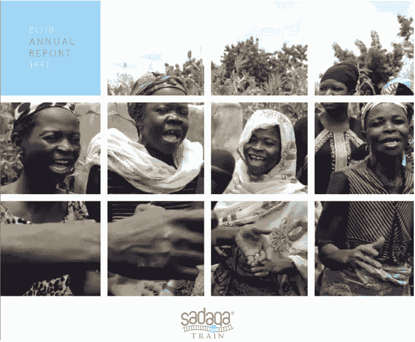

**图 27**  Sadaqa Train。2019 年度报告封面  

作者收藏

最初，其主要资金来源是通过现金和实物捐赠获得，通过社交媒体广播以及通过“清真寺和市场风暴”收集，即通过访问选定的清真寺和市场筹集资金。^236^ 起初，所有社区访问都在阿克拉组织，但为了削减交通费用，Sadaqa Train 分成三个区域部门，运营中心设在阿克拉（南部部门）、库马西（中部部门）和塔马利（北部部门）。这足以在早期阶段覆盖慈善和 *宣教* 行程前往偏远农村地区的费用。^237^ 每年，每个部门都会组织社区和监狱访问，称为“三重之旅”，尽管 COVID-19 大流行在2020年和2021年暂停了农村外展项目。此外，Sadaqa Train 每年向孤儿院和寡妇捐款；这一活动未受 COVID-19 影响。^238^

236  https://www.sadaqatrain.org/about-us/, 访问 11.12.2022。  

237  与 Sadaqa Train 创始人 Sharif Shaban 的访谈，阿克拉，8.10.2022。  

238  https://www.sadaqatrain.org/about-us/, 访问 11.12.2022; 与 Sharif Shaban 的访谈，阿克拉，8.10.2022。 根据2019、2020和2021年的年度报告，只有 Sadaqa Train 南部部门安排了监狱访问。2022年，北部部门恢复了外展工作并向 Wa 监狱捐赠，参见“Sadaqa Train 向 Wa 监狱提供食品”，20.4.2022，https://www.ghanaiantimes.com.gh/sadaqat-train-presents-eatables-to-wa-prisons/, 访问 22.8.2022。 另见第 3.3 章。

Sadaqa Train 的活动范围在2017年扩大，当时它启动了第一个钻井项目，导致其年度预算大幅增加。根据财务报告，每年内部筹集的捐款从约 GHS 17,400（USD 4,200）在2015年、GHS 15,600（USD 3,900）在2016年和 GHS 17,500（USD 6,600）在2017年不等。239 2017年至2019年，该组织资助了农村社区的八个水项目，240 2020年第九个，241 2021年三个。242 水项目的资金由加纳私人慈善家和捐助者提供，2017年为 GHS 12,000（2018年的数据不可用），2019年为 GHS 40,000，2020年为 GHS 10,500，2021年为 GHS 31,000。243

另一个新项目是“Zakaatul Fitr 项目”。该项目始于2016年在 Facebook 上的宣传活动，“发送您的 zakat al-fitr 现金（估计每 sa’a GHS 10）购买大米包装供给有需要的人。”244 与“斋月食品行动”一起，该项目已成为其年度人道主义救济工作不可或缺的一部分，并在2020年和2021年取代了社区访问。此外，自2020年以来，对寡妇的支持已转变为寡妇赋权计划，其核心活动是捐赠缝纫机和冰箱。Sadaqa Train 投资的最新补充是东部的 Akim Achiase 伊斯兰学校建设项目。该项目于2020年作为为期三年的项目启动，Sadaqa Train 已拨出近 GHS 35,000 用于建设六间教室的教学楼。245

Sadaqa Train 已发展成为一个成熟的全国性 *宣教* 和穆斯林发展运动。资金主要在内部筹集，尽管其中一些近期项目，其中包括其在2021年2月和5月向北部和东北部地区的医疗机构捐赠医疗设备，以及其2021年斋月食品行动和古尔邦项目，均与丹麦穆斯林非政府组织 VIOMIS Aid 合作进行。246 Sadaqa Train 近年来与多个本地和国际穆斯林非政府组织合作。与 VIOMIS Aid 的合作始于2018年（清真寺和钻井项目以及向北部地区医院的捐赠）。247 2019年，它与 Subulussalaam248 在 Dome-Abra 的健康筛查项目和在阿克拉分发开斋节衣物方面合作，以及与 Islamic Ummah Relief 合作访问 Nsawam 监狱。249 2020年和2021年，它与 Emmoa Foundation 携手组织 COVID-19/斋月食品行动。250 2021年，‘Unity Organisation Denmark’为 Sadaqa Train 在北部地区托隆区建设两座清真寺提供资金，251 并赞助了其在北部地区萨尼亚古区库克佩希的开斋饭。252 此外，Sadaqa Train 还与非政府组织 Banaatul Khayr—Garden of Dawah 合作，在大阿克拉地区佐尔武鲁为孤儿分发开斋节衣物。253

尽管活动不断扩展，Sadaqa Train 更像是一个网络而非制度化的组织。其在阿克拉的总部既没有办公室也没有薪资员工。该组织完全通过

239 参见年度报告中提供的财务统计数据，http://www.sadaqatrain.org/reports/, 访问 17.5.2019。

240 参见 http://www.sadaqatrain.org/borehole-projects/, 以及 http://www.sadaqatrain.org/water-project-report-2017-till-2019/, 访问 17.5.2019。

241 参见 Sadaqa Train 年度报告 2020。

242 参见 Sadaqa Train 年度报告 2021。

243 数据取自年度报告 2017、2019、2020、2021。

244 https://www.facebook.com/SadaqaTrainGh/photos/a.845077278869094/1123223714387781/?type=3&theater, 访问 17.5.2019。

245 参见 Sadaqa Train 年度报告 2021。

246 “Sadaqa Train 向北部、东北部地区医院捐赠设备”，https://www.ghanaian times.com.gh/sadaqa-train-donates-equipment-to-hospitals-in-northern-north-east-regions/, 28.4.2021，https://www.facebook.com/ViomisAid/, 17.2.2021；“Sadaqa Train 访问 Gbewaa 宫殿”，22.5.2021，https://www.prod.facebook.com/SadaqaTrainGh/, 访问 11.12.2022；关于2021年斋月和古尔邦项目，参见 https://www.facebook.com/ViomisAid/, 15.5.2021，12.7.2021，29.7.2021，均访问 11.12.2022。

247 参见 Sadaqa Train 年度报告 2018、2019；“Sadaqa Train GH 与 VIOMIS Aid Denmark 合作，为北部地区米昂区 DC Kuraa 的居民建造了带水井的清真寺”，20.8.2019，https://www.prod.facebook.com/SadaqaTrainGh/, 访问 11.12.2022；“Sadaqa Train 向北部、东北部地区医院捐赠设备”，《加纳时报》28.4.2021，http://78.47.45.183/agency/ghanaian-times/2021/0428/14677801/sadaqa-train-donates-equipment-to-hospitals-in-northern-north-east-regions, 访问 21.8.2023；“Sadaqa Train 和 VIOMIS Aid Denmark 为 Kalpohini Yapala 带来清洁水”，《加纳时报》24.2.2023，https://www.ghanaian times.com.gh/sadaqa-train-viomis-aid-denmark-bring-clean-water-to-kalpohini-yapala/, 访问 21.8.2023。

248 我未能识别该团体/基金会。

249 参见 Sadaqa Train 年度报告 2019；“ST 南部部门与 Islamic Ummah Relief 合作昨日访问 Nsawam 监狱”，19.5.2019，https://www.prod.facebook.com/SadaqaTrainGh/, 访问 11.12.2022。

250 参见 Sadaqa Train 年度报告 2020、2021。

251 “Sadaqat Train Foundation 在 Kaanfehiyili 建造 GHC50,000 清真寺”，22.9.2021，https://www.ghanaian times.com.gh/sadaqat-train-foundation-constructs-gh%... mosque-at-kaanfehiyili/, 访问 22.8.2022。

252 “Kukpehi 的开斋饭”，9.5.2021，https://www.prod.facebook.com/SadaqaTrainGh/, 访问 11.12.2022。

253 “开斋节衣物分发”，10.5.2021，https://www.prod.facebook.com/SadaqaTrainGh/, 访问 11.12.2022。

志愿者通过WhatsApp参与；据Sharif Shaban称，WhatsApp广播名单包括约800至1000人。新项目（水井项目、清真寺）的申请由当地社区转交给他，之后Sharif Shaban在WhatsApp上公布之前，会与捐助者和承包商核实项目的可行性。而该组织的Facebook账户则由塔马利方面监控。254

穆斯林青年项目（Muslim Youth Project）则于2013年发起了“MY Hereafter Project (MHP)”，并于2018年启动了“MY Hereafter Project Ummah Welfare Fund”。2018年，它成为联合国可持续发展解决方案网络（UN-SDSN）的伙伴组织。255 直到2020年，MHP的主要活动是每年斋月期间在加纳各地进行的筹款活动，以帮助寡妇、孤儿和监狱囚犯。至少在2020年斋月活动期间，其Facebook关注者被呼吁：“[..]请考虑献上你们的sadaqah（自愿施舍）和zakat（天课），以便我们能够养活那些失去丈夫并为照顾孤儿而挣扎的母亲们。”256 2017年，MHP志愿者在库马西组织了“Kayaye（女性搬运工）职业技能”项目。该项目包括肥皂制作、烘焙和裁缝。257 在2020年斋月募捐之后，该组织决定重塑MHP品牌，专注于帮助北部地区的孤儿。MHP的管理人员和志愿者只从该地区招募，因为该组织希望他们全力参与当地的计划和倡议。另一方面，该组织在Facebook上宣布：“[..]无论你们身处世界何处，我们都欢迎你们的捐赠、建议、提议以及任何善举”，表明它仍然依赖外部资金来维持运营。258

MHP Ummah Welfare Fund则是一项众筹计划，旨在收集捐款以支付有需要的穆斯林个人的治疗、住院和手术费用；259其支持案例第100号的呼吁于2023年7月发布在Facebook上。260 2021年，MHP进一步扩展其在北部地区的活动范围，开始为儿童登记国家健康保险卡（“1 Child_1NHIS Card”项目；截至2023年6月，MHP已为约3，800名儿童登记）。MHP的目标是鼓励其成员每月向其健康项目捐款，例如“1 Child_1NHIS”项目及其在贫困社区的健康宣传计划。与其Ummah Welfare Fund一样，MHP每月向捐助者通报所收到的资金及其使用情况，以实现其活动的完全透明和问责。261

“MY Akhirah Account”（MAA，成立于2017年）则是MY Hereafter Project的姊妹组织。与MHP不同，MAA主要是一个宣教组织，总部设在塔马利。与其他团体类似，它将宣教与外展项目相结合，并利用社交媒体发布公告，募集衣物、鞋子、食物或金钱。MAA的斋月项目针对北部（塔马利和宾比拉）以及南部（阿克拉和库马西）的社区。262 位于库马西的“Strive for Jannah Foundation”（SFJ）则在其Facebook账户上分享了MHP的各种呼吁，并参与募集资金以支付医院和医疗费用。它还利用社交媒体发布自己的针对性呼吁，为有需要的个人寻求紧急资金支持，或者自2022年起，为其水井项目募捐。263

Sadaqa Train的一些成员于2013年成立了穆斯林接入运动（MAM，见图28）。他们为农业活动筹集资金的雄心可以被视为一项sadaqa计划。然而，起初MAM收到了一些小额捐赠，使他们能够在2018年购买六只羊，在宰牲节屠宰，并将肉分发给库马西Kwadaso地区的孤儿。264

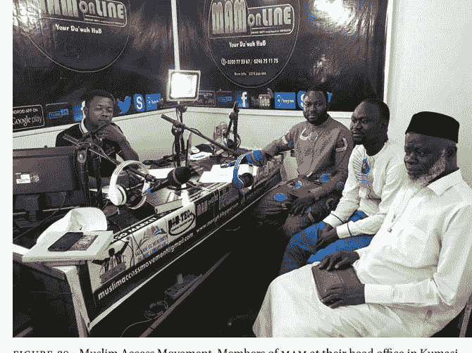

图28 穆斯林接入运动。MAM成员在库马西的总部，其主要媒体渠道MAM Online的演播室也设在这里

摄影：HOLGER WEISS/2018

然而，MAM赋能的主要工具是其在线广播和电视频道MAM TV Online。除了作为宣教频道外，其公共卫生教育委员会（MAMPHEC，265成立于2016年）于2018年发起了一项建立伊斯兰医院的宣传活动。266 该医院项目似乎从未进入规划阶段，也没有实现。另一方面，MAM组织了一些临时活动，其中包括2016年在库马西的献血活动。267 2019年，MAMPHEC宣布雄心勃勃地将活动扩展到库马西以外，并为塔马利的选定医院发起了一项捐赠活动，268

社交媒体上另一家知名组织是加纳伊斯兰青年萨达卡协会（GIYSA），这是一个于2015年注册的萨拉菲组织。此后，它在全国各地区设立了分支机构和代表，并通过销售自制食品和呼吁捐赠手机，认真努力地建立自己的资金来源。最初，它组织了开斋饭计划和所谓的“吉哈德之旅”，以促进宣教和支持穆斯林教育设施，并在西部、中部沃尔特、北部和上东部地区的农村地区捐赠收集的物品和现金。269 2018年，GIYSA发起了“1GHS Makaranta项目”，为古兰经学校筹集资金，该项目得到了该组织的支持。计划每月从其250名成员中每人筹集一个塞地。其最初的活动还包括2015年其北部地区分支为孤儿院举办的筹款活动和捐赠呼吁，但此后似乎停止了。270 2023年，它推出了GIYSA食品银行计划，这是一项雄心勃勃的两步走倡议，旨在帮助有需要的人。食品银行本身作为一个中心，容纳从捐助者处收集的食物和消费品，稍后分发给受益人。然后在第二步，受益人将获得技能培训和指导，以帮助创造就业机会。271

GIYSA的关键目标是“实现我们支持者的Sadaqa Jariyha”。Sadaqa jariya，即捐赠者去世后仍使他人受益的捐赠，例如建造学校、医院、安装耐用饮水系统，以及投资当地农业或小型企业，被穆斯林活动家视为实现可持续发展目标的穆斯林方式。272

> 将你们的sadaqatul jariyah托付给GIYSA！！！当一个人去世时，他的行为将终止，除三件事外：持续的施舍（Sadaqah Jariyah），

254 与Sharif Shaban的访谈，阿克拉，2022年10月8日。

255 MHP主页，`http://myhereafterproject.org/about-us/`，以及关于MY Ummah Welfare Fund的信息，`http://myhereafterproject.org/service/ummah-welfare-fund/`，访问于2021年11月5日。

256 `https://www.facebook.com/helpintherightcourse/`, 2020年4月30日，访问于2022年1月16日。

257 关于在库马西启动职业技能项目及募捐呼吁的公告，2017年10月20日，`https://www.facebook.com/helpintherightcourse/photos/95758054440419`，访问于2021年10月5日。

258 `https://www.facebook.com/helpintherightcourse/`, 2020年6月29日，2020年7月3日，访问于2021年10月5日。

259 My Hereafter Project Ummah Welfare Fund，`https://www.facebook.com/helpintherightcourse/`，2020年10月4日；MY Hereafter Project，`https://www.facebook.com/helpintherightcourse/`，2020年10月13日，2020年10月26日；访问于2021年10月5日。

260 `https://www.facebook.com/myhereafterproject`, 2023年7月20日，访问于2023年8月21日。

261 `https://www.facebook.com/myhereafterproject`, 2023年6月15日，2023年7月1日，访问于2023年8月21日。另见 `https://www.myhereafterproject.org/programs/`。

262 `https://www.facebook.com/myAkhirah`, 2017年6月6日，2021年5月16日，2023年4月12日，访问于2023年8月21日。

263 `https://www.facebook.com/striveforjannahgh`, 2022年6月21日，2023年3月28日，2023年5月12日；访问于2023年8月21日。

264 与穆斯林接入运动成员的集体访谈——Umar Muhammed, Abdul-Aziz Ishaq, Yunus Muhammad and Imam Mahmood Afari Yeobah——库马西，2018年9月15日。

265 尽管仍然活跃，MAMPHEC的Facebook账户（`https://www.facebook.com/MAMPHEC2016/?paipv=o&eav=AfaquBTqNKU7qHKtcle-NqvojNdHmsOsZLA2-NHwg3zoR8FgkHXISpTthegwcSqzVQ&_rdr`）自2017年以来没有发布任何与健康教育相关的帖子或视频。相反，其内容大部分涉及宣教。

266 `https://www.facebook.com/mamtvonline`, 2018年8月14日，2018年9月9日，2018年9月10日，2018年9月12日，访问于2022年8月26日。另见31分钟视频“帮助建设第一座伊斯兰医院——MAMPHEC时间”，2018年8月9日，`https://www.youtube.com/watch?v=yqW-yhL4KY`，访问于2018年8月26日。

267 `https://www.facebook.com/mamtvonline`, 2016年12月17日，访问于2022年8月26日。

268 “MAMPHEC以医院捐赠结束这一年——立即支持”，`https://www.mamghonline.org/2019/12/11/mamphec-to-end-the-year-with-hospital-donations-support-now`

> 从中受益的知识，以及为他祈祷的义子。（《穆斯林圣训实录》）当你捐赠给萨达卡贾里亚项目时，你将获得无尽的回报。这是其中最美好的慈善形式之一，因为它为捐赠者和接受者提供长期的利益。我们已为你准备了变革性、影响深远的项目供你支持，让你在帮助人们摆脱贫困的同时倍增你的祝福。捐赠你的慈善款至 0249530504（KABIRATU ZAKARI）。273

GISYA 在 Facebook 上发布的一份声明中强调了其管理萨达卡贾里亚的经验：

> 我们安装水井为社区提供清洁用水，我们提供工具和培训以启动可持续的企业，我们种植果树，并维修学校和清真寺，帮助社区不仅生存，而且繁荣。当我们实施你的萨达卡贾里亚时，我们的工作人员并非空降而来。他们是本地人，了解当地需求，确保你的慈善发挥最大影响力。每天，我们都在努力为人们提供自给自足和养家糊口的手段。继续吧，探索我们下面所有有影响力的萨达卡贾里亚项目。捐赠萨达卡贾里亚。改变一个社区。多年来倍增你的祝福。274

GISYA 已在加纳启动了多个钻井项目，其中包括 Techiman 附近的一个村庄和 Tetteh Nkwanta 村。然而，后者项目不得不被放弃，因为它揭露了穆斯林和基督徒居民之间未解决的争端，GISYA 提议将其成员和捐赠者将当地钻井项目转向建造伊斯兰培训中心、建立伊斯兰孤儿院，或协助建造清真寺。275 Day Break Da‘wah and Development Centre Charity Fund 或 Daybreak Da‘wah Charity 则是库马西一家 MFBO 的倡议。由 Akurugu Iddrisu Yakubu 于 2015 年创立，该组织专注于 daʿwa 和“发展人民”。后者目标包括为投资教育和社会基础设施设施筹集资金的愿景，包括学校、医院和孤儿院。276 在其路标上，它呼吁捐赠，即 sadaqa，以“支持社会中的贫困者”。277 然而，该组织于 2018 年重新启动（或有人重新制定了其目标）。随后它在其新的 Facebook 账户上发起了一项三部分捐赠呼吁。该组织将其四个重点领域列为 1) 慈善，2) 食物援助，3) 教育，和 4) 妇女赋权，并公开呼吁通过手机转账捐款，或通过向其银行账户付款或购买其优惠券进行捐款。后者形式可被定义为一种创新的非数字倡议：发行所谓的 Food Aid and Education Fund 优惠券，面值 GHS 5、10 或 20（USD 0.8/1.6/3.2），捐赠者成为 halal 投资的一部分。278

Daybreak Dawah Charity 主要在阿克拉、库马西和 Techiman 以志愿形式运营，见图 29。有趣的是，成员既有穆斯林也有非穆斯林年轻人。其活动最初主要是微观层面的干预，即支付学费和医院账单，同时捐赠衣服和蚊帐。资金完全通过在加纳的推广活动内部筹集。279 2021 年，该组织加大了投入并启动了两个额外的干预方案，即发放无息贷款以及孤儿支持和康复项目。自那时起（截至 2022 年 8 月），该组织（至少）向阿克拉和库马西的妇女商贩发放了九笔无息小额贷款。280 孤儿支持项目则在 2022 年斋月期间筹集资金。281

276 `https://www.facebook.com/Day-Break-Dawah-and-Development-Centre-398838943696853/?hc_ref=ARTH-yrtifloYkQbvZK bqITMttDDHHzFGSuX4175nDplQhRAppg9BjzgD77IKMVS5E&fref=tag`, accessed 13.5.2019. Facebook 账户于 2015 年创建，但此后未更新。相反，有关该组织的进一步信息，包括其截至 2018 年的活动，可在该组织主席 Akurugu Iddrisu Yakubu 的 Facebook 账户上找到。

277 路标由作者于 2018 年 9 月 16 日在库马西拍摄，作者档案。

278 `https://www.facebook.com/daybreakdawahdc/`, 15.8.2018, accessed 13.5.2019.

279 与 Daybreak Daʿwah Center 成员 Dapai Emanuel、Idriss、Charles 和 Kevin 的小组访谈，库马西 2019 年 12 月 12 日。

280 `https://www.facebook.com/profile.php?id=100010935812364`, 11.11.2021 (Accra), 11.12.2021 (Accra), 6.1.2022 (poster); 30.1.2022 (Kumasi), 4.3.2022 (Kumasi), 8.3.2022 (Kumasi), 13.3.2022 (Kumasi), 22.4.2022 (Kumasi), 23.5.2022 (Kumasi?), 17.7.2022 (Kumasi), accessed 29.8.2022.

281 `https://www.facebook.com/profile.php?id=100010935812364`, 21.4.2022 (fundraising call in support of orphanage), 1.5.2022 (donation of clothes to orphans), accessed 29.8.2022.

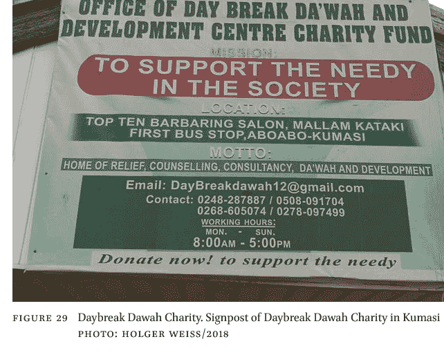

FIGURE 29 Daybreak Dawah Charity. Signpost of Daybreak Dawah Charity in Kumasi

PHOTO: HOLGER WEISS/2018

图 29 Daybreak Dawah Charity。库马西的 Daybreak Dawah Charity 路标

照片：HOLGER WEISS/2018

Wa 地区的伊斯兰青年非政府组织 Hikmatullah Research Foundation (HRF) 组织季节性外展项目，名为 Ramadan Sadaqa Quest（2015 年、2016 年）和 Ramadan Sadaqa Trip（2017 年）。它通过 Facebook 上对 zakat al-fitr 捐赠的呼吁募集现金、衣物和食物。该项目于 2015 年启动时在 Wa 四所选定的高级中学和一个农村社区开展开斋活动，以及向 Wa 地区医院捐赠，随后将重点转移并在 2016 年和 2017 年针对 Wa 盲人学校以及 Wa West 区一些农村社区。282 显然，似乎 HRF 此后已停止其活动；至少其 Facebook 账户对其活动没有进一步更新。

另一方面，Tamale 的 Tiyumba Hope Foundation 是一项最近由穆斯林名人发起的倡议，其季节性外展活动称为 THF Ramadan Sadaqa，从其成员处收集现金和食物；283

接受者是北部地区农村社区中的寡妇和孤儿。284

284 Mohammed Gadafi，“Tiyumba Hope Foundation 为斋月向寡妇、孤儿分发食品”，20.4.2021, `https://www.ghanaweb.com/GhanaHomePage/NewsArchive/Tiyumba-Hope-Foundation-distribute-food-items-to-widows-orphans-for-Ramadan-1237681`, accessed 15.1.2022.

关于 Gosoa 的 `Sadaqa Association`、`Facebook` 群组 `SadaqaOnline.com` 以及库马西的社交媒体平台 `Sadaqount` 的活动知之甚少。前两家组织似乎属于同一青年运动或倡议，因为它们使用相同的标志。285 两者都是 `daʿwa` 组织，并通过 `zakat al-fitr` 和 `sadaqa` 捐赠为其斋月供餐项目提供资金；它们于 2021 年 5 月在 Facebook 上发布了首次呼吁。`Sadaqount` 则敦促其追随者在 2021 年开斋节为 `sadaqa` 捐赠 20,000 瓶水，并发布了 2021 年 `zakat` 的 `nisab` 计算。286

285 见 https://m.facebook.com/Sadaqa-onlinecom-105406038212472/, 和 https://www.facebook.com/Sadaqa-Association-103138211845264/, both accessed 11.1.2022.

286 https://www.facebook.com/sadaqount/, 11.5.2021, 13.9.2021, accessed 11.1.2022.

### 7 通过社交媒体从一百万穆斯林那里筹集捐款

众筹已成为互联网时代为各种项目筹集资金的重要工具。通常，它涉及三种类型的参与者：发起人、支持者以及调解或促进组织，通常是 GlobalGiving 等互联网平台。然而，下面讨论的两个案例改变了众筹的概念，因为促进者不是 dot-com 组织，而是社交媒体，包括 Facebook 和 WhatsApp。大多数穆斯林 CSO 和 NGO 使用社交媒体筹集资金，尽管主要是在有限的时期内。最常见形式是在斋月期间在社交媒体上发起呼吁，由发起人（以组织或伊玛目的名义）向协会、团体或组织的成员和支持者呼吁为开斋节（开斋和宰牲）捐款。有时它们也针对海外成员。尽管如此，这种众筹形式是临时性的，通常没有要筹集的目标金额。或者，如某些斋月呼吁的情况，目标筹款金额可以在一个月内筹集。

阿克拉的 `Save Aid Project`（SAP，见图 30）于 2016 年以呼吁斋月和开斋捐款开始。自那时起，它已举办年度开斋，

284 Mohammed Gadafi，“Tiyumba Hope Foundation 为斋月向寡妇、孤儿分发食品”，20.4.2021, https://www.ghanaweb.com/GhanaHomePage/NewsArchive/Tiyumba-Hope-Foundation-distribute-food-items-to-widows-orphans-for-Ramadan-1237681, accessed 15.1.2022.

285 见 https://m.facebook.com/Sadaqa-onlinecom-105406038212472/, 和 https://www.facebook.com/Sadaqa-Association-103138211845264/, both accessed 11.1.2022.

286 https://www.facebook.com/sadaqount/, 11.5.2021, 13.9.2021, accessed 11.1.2022.

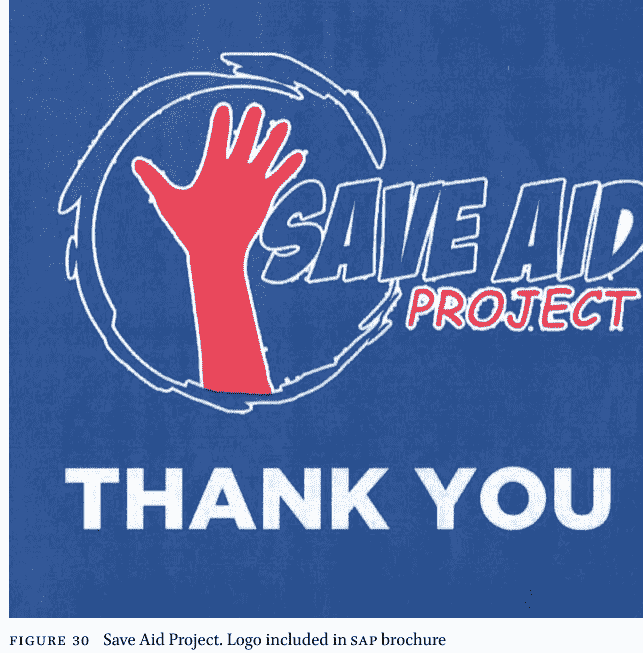

图 30 救助援助项目。Logo 收录于 SAP 小册子

作者收藏

斋月和古尔邦节活动以及在古尔邦节为孤儿组织的聚会，目标是阿克拉的宗戈社区以及中部、北部、上西部、沃尔特和西部地区的农村社区。287 SAP 创始人 Ayuna Huudu 解释说，其目标是覆盖所有地区的偏远村庄。SAP 的含义是“存钱（SAVE）→ 针对援助（AID）→ 形成项目（PROJECT）”，他进一步指出。他的最初想法是集中于偏远村庄，因为大多数非政府组织都关注阿克拉和城市地区。此后，该组织在 25 个村庄扩大了农村外展项目，包括教育项目，即支持贫困儿童上学，同时组织年度孤儿聚会。288

287 https://www.saveaidproject.org/about-us/. 主页已于 2024 年 5 月失效。请改见 https://www.facebook.com/SaveAidProject/.

288 对 SAP 创始人 Ayuna Huudu 的访谈，阿克拉，2022 年 10 月 18 日。

除其人道主义救济项目外，该组织于 2020 年 4 月启动了 COVID-19 地方语言宣传项目，在 Facebook 上发布了 Dandi 和 Tem 语的视频并配有英语字幕，并在 2020 年 5 月和 2021 年 2 月阿克拉封锁期间组织了 SAP 开斋车。289 2022 年 5 月，该组织扩展了活动，并在 Facebook 上发布公告，说明其打算钻井，并邀请面临水问题的当地社区告知其需求：“请发送以下详细信息：社区/地点/地区名称。注意：请附上社区当前用水情况的图片或视频（不超过 1 分钟）。”290 到 2022 年 10 月，SAP 已收到五份申请。计划是在村庄里建造带屋顶的钻井，以创造一个遮荫的聚会场所。291

Ayuna Huudu 的主要挑战是将他的志愿组织转变为拥有薪资员工的永久性组织。覆盖组织的运营成本一直是个挑战，因为它仅依靠成员捐款。尤其是其农村外展项目费用昂贵，因为 SAP 没有自己的车辆而依赖租赁车辆。因此，所有项目都属于临时性。例如，每年的“认养一个家庭”项目，即向偏远村庄贫困家庭的斋月捐赠，其规模取决于愿意的本地和外国捐助者及赞助商。反之，2022 年斋月期间的“捐赠保温瓶”活动仅获得了少量捐款。然而，一家（未透露姓名）的土耳其非政府组织赞助了 2022 年的孤儿聚会；Ayuna Huudu 预计合作将在 2023 年加深。尽管如此，他相信自己直接接触外国捐助者的做法会取得回报，尤其是因为捐助者保持匿名，而且大多数项目目标的视频从未发布在 Facebook 上，而是直接发送给捐助者。292

Feed the Street 和 Eid Feast Ghana 是两个近期有针对性的、专门用途的斋月活动，广泛使用社交媒体的例子。Feed the Street（FTS）活动最初由阿克拉的一个青年协会 The Muslim Society 于 2020 年发起，目标是阿克拉和库马西的小贩。当其他非政府组织和协会，包括 KR Foundation、Sawrah Foundation、Back to the Community、人道主义机构和 Al-Farhaan Family 加入活动，同时获得 KR Live Media、A+Concept、Reigans 和 Shams Enterprise 等当地私营企业和创业公司的支持时，该活动获得了动力。2020 年的活动主要由 Facebook 上的每日文字帖子加上几段视频组成，而组织者在 2021 年大量使用由男性和女性活动人士背书的短视频来号召加入活动。293 至少组织者认为他们的活动是成功的——2020 年，他们在阿克拉喂养了 500 人；2021 年，他们在阿克拉喂养了 1,000 人，并在库马西组织了类似活动，喂养了 500 人；2022 年，他们在阿克拉喂养了 1,000 人，在库马西喂养了 500 人，并将活动扩展到塔马利，在那里喂养了 500 人。294

293 有关 2020 年和 2021 年 Feed the Street 活动，请进一步参阅 https://m.facebook.com/Feed-The-Street-111929177218259/。Sawrah Foundation 和 KR Foundation 仅在 2020 年积极参与了该活动，见 https://m.facebook.com/Sawrah-Foundation-SF-561247134376004/，FTS 帖子 2020 年 6 月 10 日、2020 年 7 月 22 日（视频）；https://www.facebook.com/krfoundationgh/，FTS 帖子 2020 年 5 月 9 日–7 月 22 日，访问时间 2022 年 2 月 3 日。

294 https://www.facebook.com/Feed-The-Street-111929177218259, 2022 年 5 月 28 日，访问时间 2022 年 8 月 29 日。

相比之下，Eid Feast Ghana 是库马西的一个本地活动，始于 2019 年的 Eid Feast for Prisoners 和 Eid Feast 2k19。虽然 COVID-19 在 2020 年阻碍了该项目，但组织者在 2021 年重新启动了它，导致捐赠了价值 GHS 8,000（1,300 美元）的食品。295 2022 年，该团体支持了 150 户家庭，一年后为 160 户。296

295 https://www.facebook.com/Eid-Feast-Ghana-454901921910937/.

296 https://www.facebook.com/profile.php?id=100068478520245, 2022 年 5 月 6 日，2023 年 4 月 25 日，访问时间 2023 年 8 月 21 日。

雄心勃勃的、长期众筹活动用于 sadaqa jariya 或持续慈善在 2017 年之前似乎在加纳穆斯林互联网界是缺席的。那年二月，库马西理工学院的学生 Fareed Ibrahim 和他的同伴在 Facebook 上发起“每月一百万戈塞瓦”活动。297 起初，发起者和他们的支持者将自己定义为一个本地穆斯林青年团体，以推动伊斯兰社会发展298，但于 2018 年 9 月正式成立为伊斯兰社区协会。299 “每月一百万戈塞瓦”活动很快在 Facebook 上传播，其中得到 Deen TV 等支持，并与各种穆斯林 da‘wa 和

青年 Facebook 群组和网络相关联，例如 `Al-Noor Ghana Foundation`。^301 在 2017 年 3 月的初始帖子中，Fareed Ibrahim 宣布，

> > ... 我们只需要 100 万名愿意每月捐赠 60 戈塞瓦持续一年的穆斯林）：如果这样做，我们将在年底筹集到 GHC 720 万 [约 1.2 美元]，即 0.60* 1000000*^12 = 7,200,000。这笔钱足以建造最漂亮的 makaranta 建筑和三辆全新的 49 座 Yutong 巴士。^302

伊斯兰社区医院项目的启动是在 2017 年 5 月由一名建筑师无偿绘制建筑平面图。^303 年底，活动愿景扩大，不仅包括古兰经背诵中心，还将其长期项目增加为建设伊斯兰医院，为公众提供医疗服务，采用伊斯兰医疗体系的特殊模式，并启动面向初入社会的低价住房项目。^304

301 在 Al-Noor Ghana Foundation Facebook 账号上链接到 Deen TV 的呼吁和支持，2018 年 8 月 15 日，https://www.facebook.com/page/772924506195833/search/?q=Deen，访问时间 2021 年 10 月 5 日。

302 https://www.facebook.com/One-Million-Muslims-60-Pesewas-a-Month-Project-1112423655551697/, 2017 年 3 月 3 日，访问时间 2021 年 8 月 7 日。

303 2017 年 5 月 20 日；3.01 MILLION MUSLIMS 60 PESEWAS A MONTH CAMPAIGN

304 https://www.facebook.com/One-Million-Muslims-60-Pesewas-a-Month-Project-1112423655551697/, 2017 年 12 月 9 日，访问时间 2021 年 8 月 7 日，以及“新加入成员信息”，https://www.facebook.com/One-Million-Muslims-60-Pesewas-a-Month-Project-1112423655551697/, 2018 年 3 月 12 日/2018 年 6 月 21 日/2018 年 7 月 23 日，访问时间 2021 年 8 月 7 日。

`Islamic Community Association` 的学校项目也取得了首个里程碑。到 2018 年 9 月，该项目列出了 932 名成员，通过众筹筹集了 GHS 11,557.76 [约 1,870 美元]，并在八个地区（大阿克拉、阿散蒂、布朗阿哈弗、上东、上西、北部、西部、东部、中部）建立了代表处。305 然而，不到一年后，该团体面临了一次小危机，当它宣布到 2020 年 7 月活动已收到约 GHS 18,000（约 2,900 美元）时，并宣布：

> > 为什么我们还没有用筹集到的资金做点什么？根据我们的建筑设计，我们至少需要 4 块地（但按筹集到的金额，我们只能负担 3 块）——今晚星期五 2019 年 7 月 19 日 In Shaa Allah，

305 2018 年 9 月 16 日，以及“了解本项目的地区代表”，2018 年 9 月 27 日，https://www.facebook.com/One-Million-Muslims-60-Pesewas-a-Month-Project-1112423655551697/，访问时间 2022 年 1 月 26 日。

我们将就是否应该缩小项目规模、采用不同的筹资策略，或对领导层进行适当改革并尝试新阵容进行广泛讨论。306

在与建筑设计师协商后，计划于八月缩小规模，一个月后，该团体成功在恩通索购得两块土地。307 虽然它无力购买另外两块剩余土地（它向成员发出新的呼吁，要求增加捐款以确保四块土地），但该团体——此时已注册为伊斯兰社区协会——开始在土地上工作。到2021年5月，它已制作了3,500块建筑砖并围起了这两块地。308

306 “A million Ummah 60 pesewas a month fundraiser Update,” https://www.facebook.com/One-Million-Muslims-60-Pesewas-a-Month-Project-1112423655551697, 19.7.2019, accessed 26.1.2022.

307 Financial report for the month ending 31st September 2019 (delivered on 6th Oct, 2019@7:00 PM), 7.10.2019, https://www.facebook.com/One-Million-Muslims-60-Pesewas-a-Month-Project-1112423655551697, accessed 26.1.2022.

308 https://www.facebook.com/One-Million-Muslims-60-Pesewas-a-Month-Project-1112423655551697/, 22.5.2021, accessed 7.8.2021.

### 8 在塔马利和瓦的本地倡议

大多数穆斯林非政府组织都是本地倡议。许多在前几章中讨论的这些协会、青年团体和基层组织都有本地外展；其中一些协会只有少数活跃成员，尽管其中许多人在 Facebook 上拥有数百甚至数千名粉丝。其中大多数在阿克拉和库马西的 Zongo 社区中成立并活跃。对于外部观察者来说，穆斯林行动主义似乎集中在加纳南部两个城市大都市。其他地区，尤其是北部加纳以穆斯林为主的地区，那些团体和组织则鲜为人知。

Sayfudeen 基金会则在北部大区运营。该慈善机构的发起人是 Sheikh Khalid Abdul Mumin（1981 年出生），他于 2017 年与 Haji Shaibu Abiru 一起成立了该组织。后者此后一直担任该基金的负责人。该基金的总部位于塔马利。其主要活动地点在塔马利和宾比拉。

该基金将自己定位为一个地区性自助倡议，是由一群穆斯林青年组成的成果，“他们聚集在一起，将现金、实物和物资资源汇聚起来，以便为了真主的缘故将它们送到社会中的有需要者手中。”310 它是少数在主页上列出其成员的穆斯林信仰组织之一，显示了其在 2017 年的影响力。48 名被命名成员中有 19 名居住在塔马利，其他人居住在宾比拉（18 名）、切雷波尼（1 名）、詹加（1 名）、坎帕伊（1 名）、库马西（1 名）、纳勒里古（1 名）、普萨加（2 名）和扎布祖古（3 名），以及伊朗的一人。311

该基金列出宣教、教育和人道主义项目为其主要活动领域，包括清真寺建设和向非穆斯林社区的外展项目、资助优秀但贫困的学生、支持孤儿和被遗弃儿童、帮助贫困社区中的有需要者以及帮助穆斯林或因需要接受复杂手术而危及生命的人。312 按照其对宣教的关注，该基金的第一个项目是在塔马利大都会区 Tampei Kukuo 建设一座清真寺313，并在 2017 年呼吁捐赠头巾、zalabias（油炸面食）和衣服给贫困人群，以便他们在 2017 年庆祝开斋节。314

与其它穆斯林信仰组织类似，Sayfudeen 基金会使用 Facebook 作为其主要渠道来告知其活动。2021 年 7 月，该基金的 Facebook 账户列出了 2,272 名粉丝，使其成为加纳规模较大的穆斯林组织之一。315 将主页上的帖子与 Facebook 上的帖子进行比较，可以看出该组织的覆盖范围。虽然 2017 年斋月期间的捐款呼吁成功，该组织向 Nanumba 北区和南区的贫困家庭捐赠了衣服、食物和其他物品，但 Tampei Kukuo 的清真寺项目的筹款在 2018 年底完工后结束。2019 年 10 月，该基金通过呼吁捐款翻修 Nanumba 南区 Kukuo 的周五清真寺屋顶，启动了其第二个清真寺项目。该项目于 2020 年 5 月完成。2020 年 12 月，该基金发起了一项活动，用于屋顶和完成宾比拉 Ansuarrudeen E/A 小学的一座三间教室教学楼，导致在 2021 年 3 月捐赠了 12 包屋顶铁皮和钉子以协助屋顶三间教室。316

Sayfudeen 基金会在 Facebook 上的帖子似乎表明，2017 年斋月期间的活动并未得到跟进，或者至少此后的开斋节活动没有留下任何帖子。然而，2021 年 5 月，该基金在北部大区的选定高级中学组织了开斋饭聚会，317 表明类似的活动在过去几年中也存在，但未在 Facebook 上留下痕迹，或者该组织开辟了新的活动领域。

312 “General List and Targeted Projects,” `sayfudeenfund.simplesite.com/433950535`, accessed 3.7.2021.

313 “Construction of a masjid at Tampei Kukuo,” 12.5.2017, `sayfudeenfund.simplesite.com/433952461`, accessed 3.7.2021.

314 “Celebrating This year's Eidul Fitr with the poor,” 14.6.2017, `sayfudeenfund.simplesite.com/433852303`, accessed 3.7.2021.

315 `https://www.facebook.com/sayfudeenfund/`.

316 `https://www.facebook.com/sayfudeenfund/`, 22.6.2017; 23.12.2018; 14.5.2020, 22.5.2020, 30.12.2020; 8.3.2021, 22.3.2021, accessed 12.7.2021.

317 `https://www.facebook.com/sayfudeenfund/`, 15.5.2021, accessed 12.7.2021.

Sayfudeen 基金会在 Facebook 和主页上提供的照片和信息显示，该组织是由年轻穆斯林发起的。该组织似乎完全依赖其成员的捐款，迄今为止尚未建立与全国或国际穆斯林组织或资助机构的任何可见联系。迄今为止，该组织已协助建造了两座清真寺和一所小学，并组织了（至少一次）斋月募捐。对于一个没有外部财政援助的地区性自助组织来说，这已相当令人印象深刻。然而，实现其许多目标，例如学生赞助和孤儿支持，要么需要一个能够支持此类活动的更庞大的成员，要么需要全国/外国穆斯林慈善家或慈善机构的支持。

`Aris Social Centre` 是接收被确定为 `sadaqa` 捐赠的本地穆斯林非政府组织的例子。成立于 2009 年，它使用本地收集的 `sadaqa` 在塔马利及其周边乡村建造清真寺和钻井。“人们愿意支持清真寺建设，因为它在后世有回报，”Sheikh Jamal Deen Omar Muhammad 解释道，并强调这些捐赠是 `sadaqa garin` 或“`sadaqa` 将会留存”。此外，该中心每年还收到本地捐赠用于其开斋饭计划；2018 年，三人支付了该计划并在每日封斋后为一百人提供食物。318

`Anbariya Relief Project`（ARP）另一方面，是塔马利 Anbariya Sunni 社区的一个临时倡议。它在北部大区 1989 年以及 2003/04 年洪水过后组织了其首次活动。与其在 2018 年严重洪水后的第三次活动相比，前两次活动是在没有任何与国家灾害管理组织（NADMO）合作的情况下组织的，团体收集和分发救济物资花了很长时间。319

Anbariya Sunni 社区 2018 年的救济活动在全国引起了关注。洪水发生后不久，该社区负责人 Sheikh Saeed Abubakar Zakaria 召集了 Anbariya 伊玛目们，他们决定发起一项支持倡议。这一次，ARP 与 NADMO 合作；其在 Anbariyya 场所分类的救济物资由 NADMO 根据书面名单分发。320 ARP 提供了诸如衣物等救济物资，食品、建筑材料、器具和价值 GHS 3,854,000（约 624,000 美元）的垫子用于后续分发。321 2018 年行动的积极经验促使安巴里亚逊尼社区考虑将临时救济委员会转变为永久性救济机构，并将 ARP 转变为救济服务基金。据计划，该基金将接收天课和萨达卡捐赠用于紧急干预。322

塔马莱慈善协会随后在其 2019 年主页上邀请潜在捐助者投资其萨达卡贾里亚项目，即清真寺、供水与卫生、学校、孤儿资助以及扶贫（即开斋饭和宰牲节）。然而，该协会的下落不明，因为其主页与伊玛目达瓦伊斯兰中心的主页相同，且迄今为止在 Google 上未留下任何可识别的痕迹。323 推测，后者中心与伊玛目达瓦组织有关，该非政府组织由 Sheikh Hussein Khalid Jimah 于 2003 年创立。该组织开展的项目与塔马莱慈善协会和伊玛目达瓦伊斯兰中心类似，其资金部分来自会员，部分来自沙特、卡塔尔和阿联酋慈善家的捐赠。324

穆斯林青年协会（MYA）是一个穆斯林`宣教`团体，总部设在上西部的 Wa。成立该团体的动因来自曾是加纳穆斯林学生协会成员的前高级中学学生。MYA 自 2010 年 1 月起活跃，最初以穆斯林青年发展组织和缩写 EDUFUND 的名称为人所知。然而，由于 EDUFUND 被视为老年人的团体，经与 Wa 市政的各利益相关者协商后，名称改为 MYA，这些利益相关者包括地区首席伊玛目、市政首席伊玛目、Yerinaa（穆斯林首领）以及 Ahlus-Sunna 的多位伊玛目。325

321 Tim Afrik, “安巴里亚伊斯兰学院向 NADMO 捐赠,” 4.11.2018, `https://tamaleonline.net/2018/11/04/anbariya-islamic-institute-donates-to-nadmo/`, 访问于 17.5.2019; `https://www.facebook.com/9328069109094/photos/anbariya_relief_project-arp the-anbariya-islamic-institute-in-tamale-has-presente/202367812768628/`, 访问于 17.5.2019.

322 与安巴里亚教育综合体秘书长兼校长 Sheikh Dr Tamin 的访谈，Tamale，10.12.2019。

323 Tamale Charity Association: `https://tamalecharityassociation.online/`（主页于 2024 年 5 月已失效）；Imam Dawa Islamic Center: `https://imamdawaislamiccenter.org/`。

324 与伊玛目达瓦组织秘书 Sheikh Abdul Majeed 以及伊玛目达瓦组织成员 Sheikh Abdul Falah 的访谈，Tamale 10.4.2019。

325 A BRIEF HISTORY OF MYA, 10.3.2019; THE GENESIS OF MYA, 22.9.2019, `https://www.facebook.com/MYA UWR/`, 访问于 10.8.2021。

MYA 的使命是在 Wa 为穆斯林青年提供一个平台，“朝着对伊斯兰更可持续的理解和欣赏”，并发展成为“在追求纪律、高道德标准和宗教责任方面卓越的有组织团体，以促进穆斯林青年对伊斯兰的发展和欣赏”。该协会集中于三个重点领域。其首要目标是通过支持并最终建立伊斯兰教学和学习中心来普及《古兰经》学习，已通过偶尔向伊斯兰学习中心捐赠伊斯兰学习和教学材料，如白板、记号笔、长凳和《古兰经》来实现。326 为实现第二个目标，即传播伊斯兰的真正信息以消除宗教误解、媒体神话和反伊斯兰偏见，该协会为青年组织了关于时事问题的年度研讨会。327 该协会特别强调其第三个目标，即鼓励穆斯林妇女学习伊斯兰，因为她们将成为未来世代的教师，“怀有多元文化主义和和平共处的愿景”。因此，它安排了年度斋月女士研讨会，并有兴趣为妇女单独建立独立的经学院（或更确切地说是周末课程）。328

穆斯林青年协会收取月度会员费以资助其活动。将此类捐赠定义为 `萨达卡` 并非牵强，因为它曾引用伊玛目提尔密济的话：“萨达卡消除罪恶，正如水熄灭火焰。” 通过动员月度捐赠，MYA 于 2019 年设定的目标是购买一辆医疗紧急服务车辆，329 并建立一所具有寄宿设施和健康中心的现代伊斯兰学习中心。后一项目的启动是在 2019 年 6 月，当时 MYA 在 Sing 收购了 50 块地皮。330

Wa 的另一项地方倡议是由 `伊斯兰兄弟会贝特·马尔基金会` 发起的建立利马尼亚广播电台的运动。该基金会是一个 `宣教` 组织，并于 2019 年注册。它于 2021 年启动了伊斯兰广播项目，并在 Facebook 上呼吁支持广播站场地的建设。331 `穆斯林知识分子网络`（MIN）最后是鼓励穆斯林青年学术卓越的地方倡议。受 2019 年在 Wa 举行的穆斯林青年峰会的启发，该网络自 2022 年起组织了年度 MIN 奖学金计划，以表彰在各自教育努力领域树立榜样的中小学生。此外，它还组织了多场创业论坛。332

326 CONTINUATION: Muslim Youth Association, 7.8.2019; [教学材料捐赠], `https://www.facebook.com/MYAUWR/`, 20.6.2019, 访问于 10.8.2021。

327 CONTINUATION: Objective No. 2, `https://www.facebook.com/MYAUWR/`, 26.8.2019, 访问于 10.8.2021。

328 CONTINUATION, `https://www.facebook.com/MYAUWR/`, 11.1.2020, 访问于 10.8.2021。

329 `https://www.facebook.com/MYAUWR/`, 28.8.2019, 访问于 10.8.2021。

330 `https://www.facebook.com/MYAUWR/`, 23.6.2019（土地收购），16.6.2020（钻井平台建设），均访问于 10.8.2021。

331 Islamic Brotherhood for Bayt al Mal Foundation Ghana, `https://www.facebook.com/baytumal gh/?ref=py_c`, 16.10.2021, 25.10.2021, 访问于 16.12.2021。

332 `https://www.facebook.com/profile.php?id=100079993028598`。

### 启动社区发展

社区发展和赋权已成为加纳穆斯林非政府组织的核心使命。以一种或另一种方式，它们中的大多数都在通过从为现有伊斯兰教育机构筹集资金到建立伊斯兰幼儿园、初级和中级综合伊斯兰/世俗教育设施等活动来促进教育。其中少数组织，最著名的是 Dr Sheikh Osman Nuhu Sharubutu 教育信托基金（SONSETFUND，见第 4.1 章以下）和加纳天课和萨达卡信托基金（见第 5.3.1 章），将其核心使命定为为贫困穆斯林学生提供中学和大学奖学金。其他组织，如总部位于阿克拉的 Rayuwa 基金会，则专注于心理健康和福祉倡导与培训，并与学生和学校管理层合作开发促进整体学习方法的课外活动。作为其活动的一部分，它设计了儿童保护课程，并以俱乐部为基础开展儿童保护学校，以提高人们对儿童保护问题的认识。此外，它积极致力于遏制早婚和在加纳终结针对妇女和女童的暴力。1 总部位于中部地区 Agona Swedru 的青年教育与意识协会（YEAS）则最初专注于教育支持项目，最著名的是为穆斯林和非穆斯林学生提供奖学金和捐赠。2 此外，它还安排年度青年发展营进行技能培训；在营地结束时，参与者会获得启动资金，以便在大学期间和之后从事创收活动。3 2023 年，该组织开始实施卫生和供水

1 另见 "Podcast: About or foundation," 3.9.2019, `https://www.rayuwafoundation.org/news-and-events/podcast-about-our-foundation/`, 访问于 22.11.2020，以及 "Teaching Human Rights," 14.3.2016, `https://www.youtube.com/watch?v=opobYpBRSWQ`, 和 "Parent Engagement Forum on Child Protection," 7.1.2020, `https://www.youtube.com/watch?v=QFXQh5WWkNQ&feature=youtu.be`。

2 "NGO presents scholarships to 44 students," 15.12.2022, `https://www.graphic.com.gh/news/general-news/ngo-presents-scholarship-to-44-students.html`, 和 "YEAS presents scholarships to 60 students," 19.10.2023, `https://www.ghanaweb.com/GhanaHomePage/NewsArchive/YEAS-presents-scholarship-to-60-students-1864778`, 均访问于 13.11.2023。

3 "220 Muslim youth acquire vocational skills," 12.1.2023, `https://www.myjoyonline.com/220-muslim-youth-acquire-vocational-technical-skills/`, 访问于 13.11.2023。

项目以及由科威特Alhedaya慈善机构70,000美元项目捐款资助的人道主义救济。⁴

有些组织关注生殖健康、疾病预防和医疗服务。其中一些在地方层面运作。例如，位于库马西的谢赫·陶菲克教育与赋权发展基金会（Sheikh Tawfiq Foundation for Educational Empowerment and Development, STF）由谢赫·阿纳斯·陶菲克·易卜拉欣·巴克里于2017年创立，为贫困个人支付医院账单，并支持医学和药学学生（以及法律和石油工程专业的学生）。与STF紧密相关的是位于库马西郊区之一的谢赫·陶菲克纪念诊所；这两个机构都是萨拉菲派达鲁·哈迪斯清真寺和教育综合体的一部分。⁵ 其他地方非政府组织正在引领社区发展，如下文第4.7节中的霍霍埃宗戈发展协会，或第4.8节中的尼玛母亲俱乐部。

然而，少数组织在全国范围内运作，最著名的是穆斯林家庭咨询服务（见下文第4.2节）、光明基金会（见第4.3节）和伊斯兰发展与人道主义服务理事会（见第4.6节）。附属于高中学园综合体的卫生诊所已成为国内外穆斯林非政府组织项目不可分割的一部分。由穆斯林非政府组织运营的设备齐全的医院很少，最著名的是艾哈迈迪耶穆斯林传教会、阿克拉的伊朗诊所和瓦镇的伊斯兰诊所。然而，一些第三代穆斯林非政府组织最近已开始为雄心勃勃的地方医院项目筹集资金（见第4.4节）。

此外，少数组织专注于解决宗戈（Zongo）社区的卫生问题。虽然提供清洁水几乎是所有穆斯林非政府组织不可或缺的一部分，但粪便管理的新方法，如生物消化池厕所，将在下文第4.3.5节中讨论。其他举措，如穆斯林乌玛发展倡议和全球伊斯兰银行、保险与咨询研究所，则促进伊斯兰投资、小额信贷和小微企业，将在第6.2节中详述。

4 联合国人道主义事务协调厅财务跟踪服务：加纳2023，`https://fts.unocha.org/countries/84/flows/2023?order=directional_property&sort=asc`，访问于2023年11月13日。Alhedaya Kuwait很可能指科威特的Al-Hidaya慈善协会。

5 对谢赫·阿纳斯·陶菲克·易卜拉欣·巴克里和STF执行主任哈桑博士的访谈，库马西，2017年12月12日和2018年9月18日。

#### 1 SONSETFUND与穆斯林学生奖学金

在2003年全国斋月会议之后，朝着扶贫的工具性方法迈出了第一步。会议期间，全国大伊玛目谢赫·奥斯曼·努胡·沙拉布图提出了建立全国天课基金的必要性。尽管他的呼吁被视为过于雄心勃勃，未能实现建立国家机构，但各穆斯林团体发起了新的举措，旨在以结构性方式帮助贫困穆斯林学生。这种结构性方法通过建立专注于教育项目推广的组织得以实现，例如谢赫·奥斯曼·努胡·沙拉布图的伊斯兰教育信托基金。虽然它并未被定义为天课基金，但其宗旨是将捐赠、天课、施舍或企业资金引导到具有集体/社区/结构性影响的举措中。投资于穆斯林青年的教育已被认识到是赋权穆斯林社区的关键一步。⁶

谢赫·奥斯曼·努胡·沙拉布图的倡议起步缓慢，几年后便陷入沉寂。然而，他在2009年重新启动该项目，成立了谢赫·奥斯曼·努胡·沙拉布图博士教育信托基金（`SONSETFUND`，也称`SUNSETFUND`、谢赫·奥斯曼·努胡·沙拉布图教育信托基金；见图31）。⁷ 该基金注册为非政府组织，总部设在国家大伊玛目办公室，谢赫·穆斯塔法·易卜拉欣担任执行委员会主席，阿尔哈吉·库扎伊马·穆罕默德·奥斯曼担任总书记。⁸ 该基金旨在资助教育设施和奖学金项目，⁹ 并着手在全国范围内建设和翻新幼儿园及学校。¹⁰

为中学和大学阶段的穆斯林学生提供奖学金和经济支持很快成为该基金的主要活动。¹¹ 2014年，该基金启动了一项计划，以支持家境困难但成绩优异的学生完成中学学业。10个三年期奖学金的资格基于经济需求和初中毕业考试的良好成绩。¹² 到2015年初，该基金承诺为教育计划投入80,000加纳塞地（约13,000美元）。¹³ 根据该计划，资助七名高中学生三年的费用约为20,000加纳塞地（约3,200美元）。此外，该基金还推出了“穆斯林学生支持包年度助学金”，以帮助弱势穆斯林获得加纳高等教育机构的入学资格。¹⁴ 同年，天课与施舍信托基金开始与`SONSETFUND`合作，为已获得高等教育机构录取的穆斯林和北部学生提供担保。根据该计划，学生在毕业前无需偿还学习贷款，而是在毕业两年后才开始以大幅补贴的利率偿还。¹⁵ 然而最重要的是，该基金与学生贷款信托基金（`SLTF`）合作，开始为穆斯林学生获得政府助学贷款并受益提供担保。据`SONSETFUND`的Facebook公告，到2020年，自2011/12学年启动以来，已有超过4,000名穆斯林学生从该安排中受益。¹⁶

然而，2017年加纳政府在中学阶段引入免费教育，加上捐助者疲劳导致的资金减少，促使`SONSETFUND`进行重组。除其他调整外，该基金终止了帮助穆斯林学生上高中的项目。相反，该基金的唯一目标是通过一项新的奖学金计划来支持大学阶段的穆斯林学生，即帮助贫困学生支付大学学费——金额从每学期900至1,500加纳塞地，或每年3,000加纳塞地（约485美元）不等。到2020年，该基金已资助加纳多所高等教育机构的50多名穆斯林学生的学费。¹⁷

除了自己的奖学金项目外，该基金还与多个外部合作伙伴合作提供教育项目。2015年，加纳伊斯兰大学学院与`SONSETFUND`合作，推出了伊玛目培训项目，这是一个针对伊玛目的培训项目。该项目旨在通过提升伊玛目的技能来培训他们，课程包括阿拉伯语和英语、信息与通信技术、公共演讲、伊斯兰法学、清真寺管理、宣教方法（daʿwa）以及筹款技巧。¹⁸ 一年后，该基金宣布了一个由伊朗资助的项目，每年为伊斯兰大学学院的7名穆斯林学生提供奖学金，另有土耳其政府奖学金资助两名加纳穆斯林学生赴土耳其继续学业。¹⁹ 2020年2月，办公室

6 对`SONSETFUND`总书记阿尔哈吉·库扎伊马·穆罕默德·奥斯曼的访谈，阿克拉，2017年12月6日。

7 《大伊玛目介绍`SONSETFUND`》，2009年7月15日，https://www.modernghana.com/news/22749/chief-imam-introduces-the-sonsetfund.html，访问于2017年11月7日。

8 《大伊玛目促进世俗教育的努力值得称赞》，2016年1月28日，https://newsghana.com.gh/chief-imams-efforts-in-promoting-secular-education-commendable/，访问于2019年2月21日。2020年9月，大伊玛目咨询委员会宣布阿尔哈吉·穆罕默德·马尔祖克为`SONSETFUND`新任执行主任；参见Ameen,《加纳的全国大伊玛目》，第31页。

9 http://www.sonsetfund.com/about，访问于2017年11月7日；该主页于2024年5月失效。另见 https://www.facebook.com/SONSETFUND/。

10 《大伊玛目促进世俗教育的努力值得称赞》。

11 《穆斯林学生的好消息》，`SONSETFUND`，2017年9月7日，http://www.sonsetfund.com/newsevents/news?news_id=159b4f0aif77f，访问于2017年11月7日；该主页于2024年5月失效。

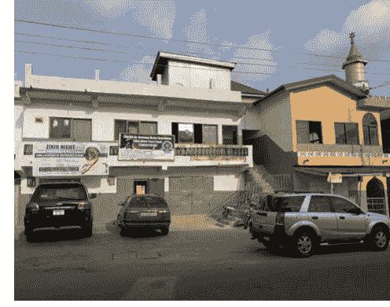

图31 `SONSETFUND`总部位于阿克拉

摄影：霍尔格·魏斯/2017

12 《十名高中学生将从Sunset基金受益》，2014年6月30日，https://www.newsghana.com.gh/ten-shs-students-beenfit-sunset-fund/，访问于2019年2月19日。

13 《Sunset基金承诺为贫困学生提供8万加纳塞地》，2015年1月5日，https://newsghana.com.gh/sunsetfund-commits-ghc80-000-needy-students/，访问于2019年2月19日。

14 《大伊玛目促进世俗教育的努力值得称赞》。

15 Alhaji Alhasan Abdulai，《天课基金与学生贷款信托基金合作支持贫困学生》，2015年10月9日，https://www.modernghana.com/print/648148/1/zakāt-fund-and-students-loans-trust-fund-collaborate-to-support-needy-students.html，访问于2016年1月21日；《教育福利伙伴关系的新趋势——`SLTF`与宗教团体的故事》，学生贷款信托基金，2015年11月26日，https://www.sltf.gov.gh/emerging-trends-in-educational-welfare-partnerships-the-story-of-sltf-and-religious-bodies/，访问于2017年11月7日。

16 公告发布于2020年8月10日，https://www.facebook.com/SONSETFUND/，访问于2022年12月30日。

17 公告发布于2020年8月10日，https://www.facebook.com/SONSETFUND/，访问于2022年12月30日。

18 《IUCG愿与穆斯林组织合作》，www.iug.edu.gh/iucg-ready-to-partner-muslim-organizations，访问于2017年11月7日。

19 《`SONSETFUND`成就一览》，`SONSETFUND`，2017年8月28日，http://www.sonsetfund.com/newsevents?news_id=159a44263ecdd6&pn=1，访问于2017年11月7日；该主页于2024年5月失效；Alhaji Alhasan Abdulai，《全国大伊玛目基金 [`SONSET-`

国家首席伊玛目办公室与 `SONSETFUND` 联合加纳德国技术学校培训 2,000 名宗戈青年参加为期六个月的技术技能培训项目，涵盖太阳能、人工智能技术和无人机技术，并基金向赞助商发出呼吁为参与者提供津贴。20

然而，尚不清楚宗戈青年培训项目是否最终得以实施。截至 2022 年 12 月，`SONSETFUND` Facebook 账号的更新中未再提及该项目。相反，COVID-19 大流行在 2020 年春季中断了其所有活动，似乎基金此后一直未恢复活动。可以说，基金处于休眠状态的一个原因在于其他非政府组织已接管了其主要使命，即提供奖学金。自 2010 年代中期以来，Zakat and Sadaqa Trust Fund 已成为提供奖学金的主要机构，参见第 5.3.1 章，而 2022 年 GMNGO 数据库列出了 104 个开展教育项目的非政府组织。例如，总部位于阿克拉的 Forever Islam Foundation 为希望在国际开放大学（IOU，前伊斯兰在线大学；之前：https://islamiconlineuniversity.com，新：https://iou.edu.gm/）获得从世俗到宗教知识的博士学位的人提供奖学金。21

`SONSETFUND` 在加纳报纸的鼎盛时期曾登上正面头条，最初成功吸引了部分企业捐赠和财务支持，例如加纳电信公司 `MTN` 和 `Tigo`（2017 年起：`AirtelTigo`）、FAN Milk Company、`Unibank Ghana Ltd` 和 Ghana Commercial Bank。其他捐助者包括国家穆斯林组织，如 `ICODEHS` 和 Ghana Islamic Microfinance（`GIMF`），以及国际捐助机构，如土耳其国际发展公司（`TIKA`）。它还获得了政界人士和企业家以及个人穆斯林慈善家、学者和社区领袖的私人捐赠。22 然而，到 2017 年捐赠开始枯竭，

秘书长 Alhaji Khuzaima Mohammed Osman 建议将基金改组为独立的穆斯林捐赠、教育和奖学金学院。他还计划通过宣传基金的活动和项目，在穆斯林社区中提高认识，以应对捐助者疲劳。此外，他提议通过深化捐助者与大学之间的互动来削减行政成本。²³ 然而，这些计划从未实现。

`SONSETFUND` 曾在斋月期间获得现金和实物捐赠。然而，2020 年政界人士、企业机构和外交使团的食物捐赠成为一个问题，全国宗戈政治团体联盟的全国主席 Yahaya Alhassan 指出，“食物捐赠 [...] 伴随着巨大的摄像机，是获得人气的一种廉价方式。” 批评捐助者利用捐赠在即将举行的选举中获得人气，Yahaya Alhassan（ rightly）强调，“食物捐赠不会让辍学的学生重返课堂，也不会遏制宗戈青年面临的贫困恶性循环等其他困境。” 相反，他敦促捐助者向 `SONSETFUND` 捐款现金，以资助贫困儿童的教育：“通过支票捐赠，首席伊玛目可以有效地规划项目并有效资助基金会塑造穆斯林社区积极发展的议程。”²⁴

## 2 零性别暴力

总部位于阿克拉的 *穆斯林家庭咨询服务*（`MFCS`）是加纳最古老且仍在活跃的穆斯林非政府组织之一。自 1990 年成立以来，该组织在与政府机构以及联合国人口基金、联合国儿童基金会和世界卫生组织等国际发展机构的合作中脱颖而出，成为先行者。25 它还在家庭计划、生育管理、女性生殖器切割和儿童健康方面发挥作用，并倡导和预防性传播疾病，如 HIV/AIDS。26 其中，`MFCS` 属于 2011 年《改善家庭健康与福祉跨宗教宣言》的筹备组织之一，该宣言承诺通过提供教育和服务来支持家庭健康，使家庭能够根据其信仰计划怀孕的时间和间隔。27 此外，作为其对社区发展的承诺的一部分，`MFCS` 通过能力建设开展了收入激活和青年赋权项目，例如缝纫、肥皂制作和电气工作坊等职业培训。28

`MFCS` 在多个方面是加纳穆斯林非政府组织的先驱。在 2003 年的一次采访中，其创始人 Alhaji Imoru Baba Issa 强调，`MFCS` 没有从阿拉伯捐助组织获得任何资金支持，主要是因为它在实施项目时不区分穆斯林和非穆斯林。29 因此，`MFCS` 可能是加纳第一家世俗穆斯林非政府组织，其监督委员会包括基督教成员，30 尽管它强调与穆斯林领袖和伊玛目保持密切合作。`MFCS` 项目主任 Mohammed Bun Bida 本人是一位穆斯林学者，在 2020 年的一次采访中透露：

- 25 例如，`MFCS` 被列在世界卫生组织《家庭计划手册》中为协作和支持组织，见 https://www.fphandbook.org/node/2971。

- 26 Weiss，《加纳的乞讨与施舍》，118；联合国儿童基金会 2010 年加纳年度报告，https://www.unicef.org/about/annualreport/files/Ghana_COAR_2010.pdf。

- 27 《改善家庭健康与福祉跨宗教宣言》，2011 年 6 月 29 日在肯尼亚内罗毕准备，可在 https://coregroup.org/wp-content/uploads/media-backup/documents/elluminates/declaration%20endorsed%202025july.pdf 获取，访问于 13.1.2022。 该宣言除其他外得到了比尔及梅琳达·盖茨基金会和美国国际开发署人口与生殖健康办公室的支持。

- 28 http://mfcs Ghana.org/about-us/who-we-are/，访问于 14.1.2022。另见发布在 Facebook 上的介绍 `MFCS` 的视频，https://www.facebook.com/mfcsghana/，2.4.2022，访问于 3.8.2022。

- 29 Weiss，《加纳的乞讨与施舍》，118。 这种情况在二十年后仍然如此；`MFCS` 在 2020 年的主要合作伙伴均为非穆斯林/世俗非政府组织和政府机构，包括 StreetInvest、`AmplifyChange`、`Faith To Action Network`、`United Way Ghana`、`STAR Foundation Ghana`、`Consortium for Street Children`、`Tostan International`、西非和平建设网络（`WANEP`）加纳、加纳卫生服务、欧洲联盟和 UKAid，见 2021 年圣诞问候海报，https://www.facebook.com/mfcsghana/photos/a.645127705690126/1613153042220916/，18.12.2020，访问于 14.1.2022。

- 30 对库马西 `MFCS` 项目经理 Tijani Mahmud 的采访，10.10.2022。

作为信仰领袖，我们自愿在清真寺和教堂教育人们。我们还鼓励年轻人实行禁欲，或在必须进行性活动时使用避孕套……人们可能会惊讶地发现我们在清真寺进行避孕套演示。我们这样做是因为我们关心我们的人民，我们认识到拥有健康的会众很重要。31

此外，`MFCS` 与国家首席伊玛目办公室密切合作。跨宗教对话是其关键支柱之一，这一点从其在多个国家和国际联盟和网络中的成员资格可见；其中最重要的是国家避孕委员会、 reproductive health 联盟、`Faith To Action Network`、`Girls Not Brides` 和加纳卫生非政府组织联盟。此外，`MFCS` 是街头儿童工作联盟的协调组织和合作伙伴。32

数十年来，`MFCS` 一直在培养开展其宣传活动和项目的当地志愿者队伍。该组织在全国范围内设有分支机构，设有项目经理、财务和行政官员、实地官员、秘书和社区志愿者，覆盖大阿克拉、阿散蒂、东部、（前）布朗阿哈弗、北部、上西和上东地区。33 其大部分项目资金仍来自国际（非阿拉伯）捐助组织，尽管 `MFCS` 已从沙特慈善机构 Al-Qimmah Foundation 获得其水项目的资金。34

`MFCS` 已从第一代穆斯林非政府组织转型为第三代穆斯林非政府组织，因为它广泛使用社交媒体，包括 Facebook、Twitter、WhatsApp 和 LinkedIn 来传播和传达其宣传活动。35 不出所料，`MFCS` 是可负担互联网联盟（`A4AI`）的成员，36 这是一个跨非洲、亚洲、拉丁美洲和加勒比地区的组织全球伙伴关系，旨在促进可负担的互联网接入。

`MFCS` 的核心使命一直是促进女童和妇女的权利。该组织强烈谴责女性生殖器切割（FGM）和性别暴力，并积极倡导遏制女童婚姻（图 32）。37 `MFCS` 于 2015 年加入了 `Girls Not Brides` 全球伙伴关系，该伙伴关系由超过 1,500 个致力于终结童婚并使女孩实现其潜能的民间社会组织组成。38 此外，它是性别暴力（GBV）预防网络的成员，该网络是覆盖撒哈拉以南非洲的网络，由超过 500 名活动人士和致力于防止针对妇女暴力的成员组织组成。39 秉承其核心价值观，该组织在 2019 年 11 月的内罗毕峰会 ICPD+25（国际人口与发展大会）之前，承诺将其活动和资源致力于实现零性暴力和性别暴力以及有害做法，包括零童婚、早婚和强迫婚姻，以及女性生殖器切割。40

37 “加纳：穆斯林不支持 FGM”，17.12.2001，https://allafrica.com/stories/200112170008.html；“携手终结童婚”，https://theworldnews.net/gh-news/work-together-to-end-child-marriages，13.10.2021，均访问于 13.1.2022；“终结童婚：`MFCS` 敦促政府优先保护”，12.10.2021，“携手终结童婚”，15.10.2021，以及“反对性别暴力 16 天行动”，25.11.2021，https://www.facebook.com/mfcsghana/，访问于 14.1.2022。

38 https://www.girlsnotbrides.org/our-partnership/member-directory/muslim-family-counselling-services/，访问于 13.1.2022。

39 https://preventgbvafrica.org/member/muslim-family-counselling-services/，访问于 13.1.2022。

40 “信仰和传统领袖作为终结 SGBV 的倡导者”，31.10.2019，https://www.nairobisummiticpd.org/commitment/faith-and-traditional-leaders-champions-end-sgbv，访问于 13.1.2022。

41 “关于有意义的青少年和青年参与的全球共识声明”，7.8.2020，https://www.who.int/pmnch/media/news/2018/meaningful-adolescent-and-youth/en/，访问于 13.1.2022。

42 儿童保护测绘：加纳参与儿童保护的机构数量和概况（阿克拉：联合国儿童基金会加纳办事处和人权与行政正义委员会，2018 年），可获取于 https://www.unicef.org/ghana/media/3086/file/Mapping%20of%20Child%20Protection%20Institutions%20in%20Ghana.pdf，访问于 13.1.2022。

43 https://www.facebook.com/mfcsghana/，6.2.2021，访问于 14.1.2022。

44 https://www.facebook.com/mfcsghana/，19.5.2022，访问于 3.8.2022。

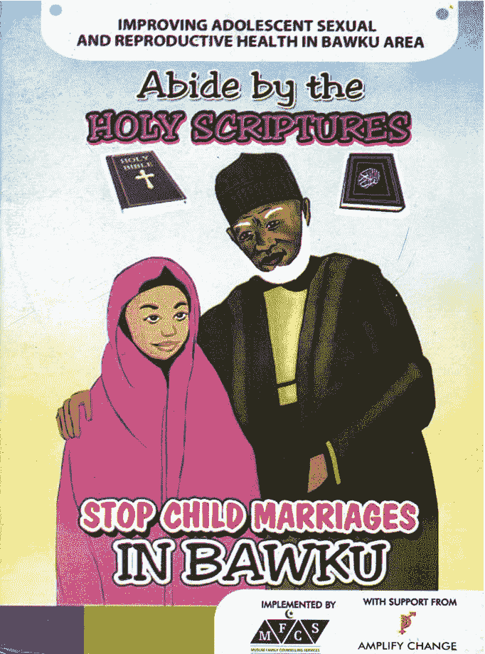

图 32 MFCS “停止童婚” 运动。海报由穆斯林家庭咨询服务制作并分发

作者收藏

此外，MFCS 是签署《关于有意义的青少年和青年参与的全球共识声明》的 200 个组织之一，41 并与 FOMWAG 一起被列入联合国儿童基金会加纳儿童保护机构名单。42 2021 年 2 月，它纪念了反对 FGM 零容忍国际日；43 2022 年 5 月，Mohammed Bun Bida 参加了一场全球网络研讨会，阐述了伊斯兰视角下防止针对妇女和女童暴力的观点。44 2022 年 6 月，MFCS 发起了一项为穆斯林女性囚犯捐赠卫生巾的筹资活动（“1000 包卫生巾给女性囚犯”），呼吁其成员每月捐赠 30 塞地用于此目的。45

作为倡导儿童权利的延伸，MFCS 于 2013 年与英国慈善机构 StreetInvest 合作，以减少对街头儿童的污名化、歧视和虐待。46 作为打击青年失业和阻止儿童上街从事苦力工作的举措，MFCS 在 2010 年代在库马西开展了一个项目，培训年轻人掌握可销售技能，如美发、裁缝、制衣、电器维修和计算机素养（图 33）。47 此外，参与者还接受生活技能培训和创业培训。MFCS 与 StreetInvest 和其他当地组织一起参与了 2019 年国际街头儿童日的组织工作。48 一年后，它加入了加纳非政府组织的联盟，倡导街头儿童的权利并推动制定《街头儿童国家行动计划》。49 2021 年 4 月，MFCS 在社交媒体上开展筹款活动，吸引支持以帮助库马西的无家可归和街头儿童，50 同时在库马西组织国际街头儿童日。51

45 https://www.facebook.com/mfcsghana/，11.6.2022，访问于 3.8.2022。

46 “我们在加纳的工作”，https://streetinvest.org/ghana/，访问于 13.1.2022；该主页在 2024 年 5 月已失效。

47 Deborah Ezra 筹款页面，28.5.2009，https://www.justgiving.com/fundraising/dezra_ghana_og/updates/donate，访问于 13.1.2022。

48 “动员支持示例：2019 年国际街头儿童日：提升影响力”，https://www.changethegameacademy.org/nl/examples/mobilising-support/view/?id=25，访问于 13.1.2022。

49 Emmanuel Akwasi Adu-Ampong，“加纳儿童权利 30 年：值得庆祝吗？”，19.11.2020，https://emmanueladuampong.com/2020/11/19/30-years-of-child-rights-in-ghana-reason-to-celebrate/；“教会机构呼吁政府将儿童保护置于加纳优先事项”，20.11.2020，https://www.aciafrica.org/news/2372/make-child-safeguarding-in-ghana-a-priority-church-based-entity-tells-government，均访问于 13.1.2022。

50 https://www.facebook.com/mfcsghana/photos/a.645127705690126/1692236804312539，8.4.2021，访问于 14.1.2022。

51 https://www.facebook.com/mfcsghana/photos/a.645127705690126/1693051014231118/，9.4.2021，访问于 14.1.2022。

52 “携手终结童婚”，13.10.2021，https://newsghana.com.gh/work-together-to-end-child-marriages/?fbclid=IwARoXyhgZwzlfgtHJSvK7bsmhfwHngbwX-SrY5OW07qsenSjC3aqrK7KxfEs，访问于 14.1.2022。另见 Stephen Afranie、Esther Sylvia Gyan 和 Antoinette Tsiboe-Darko，“加纳的童婚：谁在乎？”《加纳社会科学杂志》16 卷，第 2 期（2019 年）：19–45。

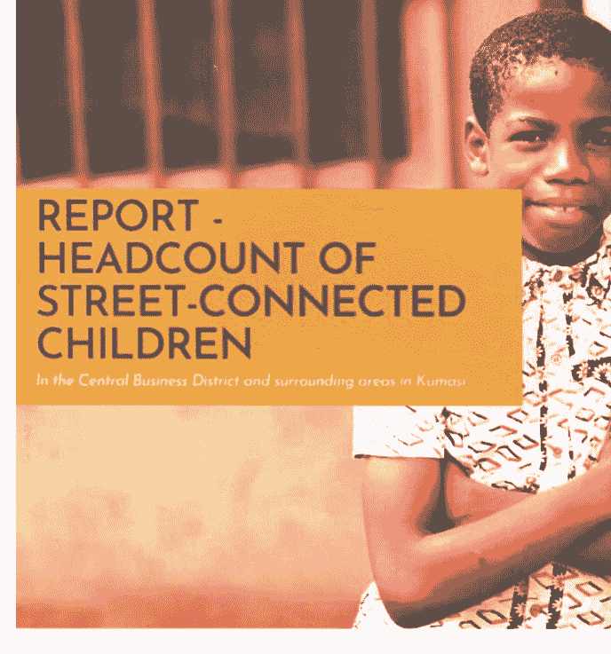

报告 - 街头儿童人数统计

库马西中央商务区及周边地区

为儿童提供机会

MFCS

安全儿童倡导

在技术合作伙伴 STREETINVEST 的支持下

图 33 MFCS 库马西街头儿童运动。报告封面

作者收藏

在全国范围内，MFCS 在打击性别暴力与童婚的斗争中屡上头条，尽管有时进展艰难，部分原因在于其开展运动的经济资源有限。52 例如，资金不足阻碍了其在 2019 年将反性别暴力运动扩展到上东区 Bawku West 农村社区，导致呼吁外部捐助者支持。53 在英国慈善机构 AmplifyChange 的支持下，并与社会福利部合作，MFCS 继续在 Bawku 地区开展项目。54 2022 年，它发起了一项预算分配运动，以解决东北区儿童权利问题并终结 CEFM（儿童早婚和强迫婚姻）。55

2010 年联合国关于水和卫生人权的决议出台后，MFCS 将该主题纳入其核心目标。该组织加入了全球“终结水贫困”（EWP）联盟，并在 2015 年制作了关于加纳的国家简报，以突出该国水和卫生状况不佳。56 特别是，该简报强调了改善加纳民众获得安全、负担得起、可获得且充足的水和卫生设施的必要性。鉴于加纳政府已签署上述 2010 年联合国决议，MFCS 呼吁政府履行其义务，因为只有 89% 的人口能够获得水，仅有 15% 能够获得卫生设施。57

COVID-19 进一步拓宽了 MFCS 的活动范围。与其他从事社区支持活动的穆斯林非政府组织一起，MFCS 成为 United Way Ghana 和全球科技公司 3M 的合作伙伴，并在 2020 年 7 月在库马西分发了他们的救济包。58 另一项项目是儿童读写与远程学习倡议，该倡议是 United Way Ghana COVID-19 应对倡议的一部分，MFCS、Achievers Ghana 和 Mothers of All Nations Foundation 于 2020 年携手合作。59

MFCS 特别是其在促进计划生育和女孩/妇女权利方面的十年长期投入一直是一场艰难的斗争。起初，其信息无人理会，其宣传者花了时间和精力来说服当地伊玛目和普通穆斯林，计划生育并不违背伊斯兰教。60 然而，国际穆斯林专家如艾资哈尔学者 Dr M. Sharif Chaudhury 关于该问题的论著支持了 MFCS 的立场，穆斯林家庭对计划生育的抵制开始减弱，其中一个原因是不少女性如今已在工作。61 其反对童婚和保障女孩权利的运动也以类似方式在当地穆斯林社区中产生了积极反馈。62

60 另见 Mohammed Umar Ibn Raees，《Islam and Family Planning in Ghana: A Study of Mamprugu Muslim Communities》，MPhil 论文，宗教研究系，科威姆·恩克鲁玛科技大学，2013 年；Jibrail Bin Yusuf，“Contraception and Sexual and Reproductive Awareness Among Ghanaian Muslim Youth: Issues, Challenges, and Prospects for Positive Development”，《SAGE Open》，2014 年 7 月–9 月：1–12，DOI：10.1177/2158244014541771；Joseph K. Wulifan 和 Daniel A. Bagah，“Male Involvement in Family Planning in Muslim Communities in Wa Municipality, Ghana”，《Research on Humanities and Social Sciences》5 卷，第 7 期（2015 年）：86–97。

61 另见 Sirina Musah，《Assessing Family Planning Decision Making Among Muslims in Tamale Metropolis》，MSc 论文，社区健康系，发展研究大学，塔马莱，2016 年。

62 对库马西 MFCS 项目经理 Tijani Mahmud 的访谈，2022 年 10 月 10 日。

63 对阿克拉 TLF 创始人 Sheikh Ali Napari 的访谈，2022 年 10 月 8 日。

64 关于 TLF 简介的演示文稿，发送给作者，收到日期 2022 年 10 月 9 日。

### 3 促进可持续发展目标和跨宗教对话

光基金会（TLF；图 34）将自己定义为一个以信仰为基础的人道主义发展导向的非政府组织。该基金会由 Sheikh Abubakar Ali Napari 于 2000 年创立，2005 年注册，在应对和促进社区发展方面有着悠久的背景。最初基金会专注于该国北部农村社区，当时 Sheikh Ali Napari 的主导思想是“找出《古兰经》中所教导的内容与实践中所做之事之间的差距”。此后他的使命一直是整合宗教领袖来引领社区发展和社会福利。63 宗教领袖被认为“在为社区成员提供指导和建议方面发挥着至关重要的作用，因而塑造、示范和/或强化社区、利益相关者中的积极社会和行为变革，并且备受尊敬。”64 此外，Sheikh Ali Napari 强调了

图 34 光基金会。来自 TLF 笔记本的标志

作者收藏

需要内部筹集资金，而不是依赖外国捐助者。65 在他看来，民间社会组织和非政府组织应识别传统领袖、议会成员和宗教领袖等有影响力的人物，以从社区成员那里动员支持，使他们能够成功实施项目，并呼吁政府制定法律框架来指导加纳的慈善环境。66

TLF 的关键目标是通过其穆斯林和基督教领袖接触当地社区。因此关键原则是针对宗教领袖并让他们了解某个特定项目或计划的目标，以确保他们能够按照自己的教义理解它，支持他们并在规划、实施、监测和评估的所有阶段都让他们参与其中。67 因此，跨宗教对话以及与基督教领袖的合作构成了 TLF 的主要支柱，其七名董事会的成员中包括两名基督教成员。此外，TLF 与国家首席伊玛目办公室密切合作。68

65 “光基金会赞扬个人和机构支持抗击冠状病毒斗争”，2020 年 4 月 16 日，https://www.ghanaweb.com/GhanaHomePage/NewsArchive/Light-Foundation-commends-individuals-bodies-for-supporting-coronavirus-fight-925909，访问日期 2023 年 1 月 2 日。

66 “呼吁政府制定法律框架以指导慈善环境”，2021 年 11 月 19 日，https://gna.org.gh/2021/11/government-urged-to-develop-legal-framework-to-guide-philanthropic-environment/，访问日期 2023 年 1 月 2 日。

67 关于 TLF 简介的演示文稿，发送给作者，收到日期 2022 年 10 月 9 日。另见 “Imams undergo training in health, child protection”，2017 年 5 月 10 日，https://www.graphic.com.gh/news/general-news/imams-undergo-training-in-health-child-protection.html；“The Light Foundation holds community sensitisation forum at Kokrobite”，2022 年 1 月 21 日，https://newsghana.com.gh/the-light-foundation-holds-community-sensitisation-forum-at-kokrobite/；均于 2023 年 1 月 2 日访问。

68 对 Sheikh Ali Napari 的访谈，阿克拉，2022 年 10 月 8 日。目前，董事会成员为 Dr Gamel Nasser Adam（主席）、Sheikh Ali Napari（首席执行官）、Humu-Annie Seini Esq.、Raashida Kassum（秘书）、Rev. Seth Acquaye John、Admiral M.M. Tumu、Richmond Antwi Bediako 以及 Mohammed A. Nasiru（董事会顾问）。关于 TLF 简介的演示文稿，发送给作者，收到日期 2022 年 10 月 9 日。

TLF 在所有地区运营。它设有三个有薪员工的办公室；阿克拉总部雇佣十名成员，塔马莱办公室五名成员，霍办公室两名成员。近期，TLF 计划在所有地区开设办公室。然而，迄今为止，Sheikh Ali Napari 单独承担基金会的运营费用。尽管如此，使 TLF 成为杰出组织的，是其能够临时招募志愿者的能力，其中一些志愿者组织在其青年委员会中。它在全国范围内运营着一个宗教领袖数据库，依靠遍布全部 16 个地区的宗教领袖资源库，并在 Facebook 上拥有约 30,000 名关注者（2022 年 9 月）。69

TLF 是少数已将联合国可持续发展目标（SDGs）作为其四个关键主题活动领域指导原则的穆斯林非政府组织之一，即 WASH（水、卫生和卫生；SDG#6）、CPS（儿童保护与支持计划；SDG#4）、IPP（跨宗教与和平促进计划；SDG#16）以及 API（倡导与政策影响）。除其四个主要干预领域外，它还提供学校基础设施，实施包括技术和职业培训在内的经济赋权计划，开展季节性人道主义救济和孤儿支持项目，70 并建设和/或翻新清真寺以及其他项目，如家庭厕所。71

69 对 Sheikh Ali Napari 的访谈，阿克拉，2022 年 10 月 8 日。

70 “光基金会用斋月食品支持贫困社区”，2019 年 5 月 22 日，https://www.peacefmonline.com/pages/local/social/201905/383067.php?fbclid=IwAR2V_gfluFYw2TaMvjwISTskrxG6cMdxH5siM84sv224zMGDfQpFFSc-eBU；“光基金会向阿克拉穆斯林社区捐赠食品包”，2020 年 5 月 7 日，https://nowewsgh.com/index.php/2020/05/07/the-light-foundation-donates-food-package-to-moslem-communities-in-accra/；“斋月：TLF 首席执行官向员工、董事会成员和 20 个贫困社区捐赠食品”，2022 年 4 月 2 日，https://africaneditors.com/ramadan-tlf-ceo-donates-food-items-to-staff-board-members-and-20-needy-communities-videos/?fbclid=IwAR2yau75-LyQoghQliIBSsCWDXsCT8oSP_wW6hAg-YO3AbPMXoPNgjwC4；均于 2023 年 1 月 2 日访问。

71 https://tlf Ghana.org/about-us/; https://tlf Ghana.org/our-works/。迄今为止，TLF 已在大阿克拉、北部和沃尔特地区建造了超过 1,000 座家庭厕所，此外还在阿散蒂、大阿克拉、北部、东北、奥蒂和沃尔特地区提供了超过 145 个深水井和钻井；对 Sheikh Ali Napari 的访谈，阿克拉，2022 年 10 月 8 日，以及关于 TLF 简介的演示文稿，发送给作者，收到日期 2022 年 10 月 9 日。

加纳、Hope for Humanity UK、Direct Aid、Turkish International Development Cooperation、Save The Mothers Trust UK、Al Maktoum Foundation（Saudi Arabia）和 Salaam Charity UK。72

TLF 对其 IPP 倡议获得积极认可表示欢迎，尤其是在选举前、中、后促进和平方面。在 2016 年选举期间，它推出了穆斯林社区团结促进和平选举（MUCP）运动，四年后，它启动了 RASE（宗教领袖支持与促进和平选举行动）2020 项目。73 2021 年，它通过倡导和政策影响活动扩大了该倡议，例如全国跨信仰道路安全运动，并组织了关于 2021 年人口和住房普查的一系列利益相关方参与活动，地点在阿克拉、库马西和塔马莱。74 2022 年，TLF 在鲍库地区参与促进和平与安全，以此作为遏制伊斯兰极端主义的一种方式。75

女孩受教育权是另一个重点领域，与倡导反对青少年怀孕和童婚的运动密切相关。TLF 与非穆斯林合作伙伴在广播宣传节目中合作，关注针对女孩的暴力行为，并强调消除教育性别差距的必要性。按照 SDG#16.9 的要求，TLF 在其主页上通知访客，它还支持贫困父母为其未登记的子女办理出生证明。76 作为其 Zongo 和穆斯林女性赋权计划的一部分，它于 2016 年在塔马莱建立了 TLF 技能发展中心。77

TLF 在与 World Education Ghana 合作并于 2014-2015 年在 Zongo 社区开展全国埃博拉宣传运动时获得了认可。78 作为运动的一部分，它分发了包含埃博拉信息的 CD-ROM，语言包括豪萨语、英语、埃维语和凡蒂语等八种语言，供在清真寺礼拜前后播放。TLF 还将其关于埃博拉的教育小册子转换为盲文格式，以帮助教育视障人士。79 其 16 分钟纪录片视频“#Spread the Word Not The Disease”随后在 2015 年非洲电影节上获得了埃博拉最佳教育视频奖。80

埃博拉运动为 TLF 与 UNICEF 及其他联合国机构的合作打开了大门。自 2017 年以来，UNICEF 一直支持各种 WASH 和 CPS 项目，包括母乳喂养宣传活动。2021 年 9 月，TLF 与 UNICEF 联合开展了黄热病、COVID-19 和铅中毒项目。81 2022 年，TLF 与 UNDP 联合开展了一项为期一年的塑料废弃物项目。此外，它于 2022 年 10 月与加纳卫生服务和 UNICEF 合作开展了全国脊髓灰质炎教育和促疫苗接种运动。82

通过技能发展减少贫困在 TLF 议程中占有重要地位。一项创新举措是对黑沃尔塔盆地村庄的 50 名妇女进行有韧性的农业培训，其中一些是辍学学生、单身母亲和寡妇。83 作为其项目的一部分，TLF 在塔马莱购置了 20 英亩土地，计划在那里建立一个技能发展中心。84

72 合作伙伴，https://tlfghana.org/about-us/。

73 我们的优势，https://tlfghana.org/about-us/；“拒绝煽动暴力的政客——光明基金会”，19.6.2020，https://www.graphic.com.gh/news/politics/reject-politicians-who-incite-violence-light-foundation.html，访问日期 21.1.2023。

74 https://tlfghana.org/our-works/；“不要要求金钱以便参与 2021 年人口普查——北部地区统计局敦促居民”，25.6.2021，https://www.myjoyonline.com/dont-demand-money-to-avail-yourself-for-2021-census-statistical-service-in-northern-region-urges-residents/，访问日期 21.1.2023。

75 与 Sheikh Ali Napari 的访谈，阿克拉，8.10.2022。

76 目标 4：加纳 Zongo 和穆斯林社区的儿童权利、儿童生存干预和健康教育（SDG#4），https://tlfghana.org/about-us/。

77 光明基金会 #tlf 加纳的技能发展中心毕业了十名（10 名）受训裁缝，https://www.facebook.com/tlfghana/，9.5.2019，6.6.2019，访问日期 10.1.2022。

78 “光明基金会、World Education Ghana 将对 5,000 名穆斯林进行埃博拉宣传”，1.6.2015，https://www.myjoyonline.com/the-light-foundation-world-education-ghana-to-sensitize-5000-muslims-on-ebola/，访问日期 10.1.2022。

79. https://www.facebook.com/tlfghana/，24.9.2014，25.9.2014，11.6.2015，访问日期 10.1.2022。

80. Joseph Kobla Wemakor，“非洲电影节表彰加纳光明基金会”，11.6.2015，https://www.ghanahweb.com/GhanaHomePage/entertainment/Festival-of-Films-Africa-Honors-The-Light-Foundation-Ghana-361953，访问日期 10.1.2022。

81. “光明基金会、UNICEF 启动 COVID-19 WASH 和铅中毒项目”，23.12.2021，https://www.ghanaweb.com/GhanaHomePage/NewsArchive/The-Light-Foundation-UNICEF-launches-COVID-19-WASH-and-Lead-Poisoning-Project-1430005，访问日期 2.1.2023。

82. 与 Sheikh Ali Napari 的访谈，阿克拉，8.10.2022。

83. 关于 TLF 简介的演示文稿，发送给作者，收到日期 9.10.2022。

84. 与 Sheikh Ali Napari 的访谈，阿克拉，8.10.2022。

#### 4 建立伊斯兰诊所和医院

穆斯林赋权在 2022 年 9 月初成为头条新闻，当时两个伊斯兰医院项目移交给当地社区，第三个正在进行的项目获得了大量捐赠。在东北大区，Mamprugu 伊斯兰诊所的建设几乎完工，并于 9 月 10 日举行了移交仪式。该项目由地区穆斯林非政府组织 Concerned Muslim Youth Association（CMYA）发起，由 ICODEHS 委托，Qatar Charity 资助，是位于 Walewale-Nalerigu 路上 Kata-Banawa 的多功能清真寺综合体的最后一部分。评论该项目的完工，CMYA 总书记 Hisham Sulemana 自豪地宣布，该伊斯兰诊所“[...] 将增加政府在该地区大规模获得医疗服务方面的努力。”85 大约同一时间，First Gibrine Foundation（“First Jibril Foundation”）将阿克拉 Newtown 伊斯兰医院的钥匙移交给当地社区，86 而第二夫人 Samira Bawumia 为位于 Bono East 大区 Techiman South 市镇 Krobo 的伊斯兰传教秘书处的伊斯兰医院项目捐赠了一千袋水泥。87 几个月前，穆斯林非政府组织 Light Mindset International 在阿克拉开设了其 Zongo 穆斯林康复中心，88 这是首个使用 ruqya89 和先知医学治疗酒精和药物成瘾以及精神障碍的机构。90 2022 年 12 月初，加纳穆斯林传教团在阿克拉 Korle-Gonno 开设了 Ar-Rahman 穆斯林诊所；见下文。91

上述七个卫生项目是逊尼派穆斯林团体和协会为解决 Zongo 和（穆斯林）农村社区基本社会福利基础设施缺乏问题而进行的为期十年的尝试的体现。加纳实行多元化的卫生系统，包括公共和私立机构，其中一些由穆斯林组织运营。表 7 中提供的医院和诊所信息并不能全面反映

85 ICODEHS，海报：移交仪式，9.9.2022，https://www.facebook.com/icodehs/，访问日期 19.11.2022；Hisham Sulemana，“我们昨天成功举行了移交仪式”，+ 视频，11.9.2022，https://www.facebook.com/profile.php?id=100004210695124，访问日期 19.11.2022。

86 “Akufo Addo 的保镖为穆斯林在加纳建造第一所纯伊斯兰学校”，11.9.2022，https://www.ghanaweb.com/region/gabsfeed/Akuffo-Addo-s-Bodyguard-Builds-The-First-Purely-Islamic-School-In-Ghana-For-Muslims-11915，访问日期 19.11.2022；Concern Zongo Youth/Peace Dawah Media FB 11.9.2022。

87 “第二夫人承诺为 Techiman-Krobo 伊斯兰医院项目提供 1,000 袋水泥”，9.9.2022，https://gna.org.gh/2022/09/second-lady-pledges-1000-bags-of-cement-for-techiman-krobo-islamic-hospital-project/，访问日期 19.11.2022。伊斯兰传教秘书处在 Sunyani 的 New Dormaa 还有另一个医院项目，见 Facebook 发布 10.10.2019，https://www.facebook.com/IMS-TV-GH-114477779954806/，访问日期 12.11.2022。

88 “Zongo 穆斯林康复中心开放”，6.8.2022，https://www.facebook.com/PeaceDawahMedia/，访问日期 30.12.2022。

89 通过使用伊斯兰祈祷、古兰经经文和调解进行治疗的灵性形式。

90 Light Mindset International，16.7.2022，https://www.facebook.com/LightMindsetInternationalngo，访问日期 19.11.2022。

91 “加纳穆斯林传教团启用新诊所设施”，5.12.2022，https://newsghana.com.gh/ghana-muslim-mission-commissions-new-clinic-facility/，访问日期 5.12.2023；“加纳穆斯林传教团为 Korle-Gonno 居民启用诊所”，6.12.2022，https://gna.org.gh/2022/12/ghana-muslim-mission-commissions-clinic-for-residents-at-korle-gonno/，访问日期 13.12.2022。

##### 表7 2020年加纳按所有权划分的医疗机构

|  |  |
|---|---|
| 政府医院 | 1,625 |
| CHAG医院 | 928 |
| CHAG医疗机构 | 220 |
| 准政府医院 | 79 |
| 由非政府组织运营的医院 | 2 |
| 伊斯兰医院 | 2 |
| 传教医院 | 1 |

来源： HTTPS://WWW.STATISTA.COM/STATISTICS/1238765/NUMBER-OF-HEALTH-FACILITIES-IN-GHANA-BY-OWNERSHIP/, 访问于 15.12.2022

现有的由穆斯林非政府组织和私人医生运营的医疗机构与加纳卫生部提供的信息存在冲突。根据卫生部于2016年提供的（开放获取）医疗机构数据集，其中四家被列为具有“伊斯兰”所有权，即阿赫迈底亚穆斯林传教会在阿索科雷、卡莱奥和克帕古里的诊所和医院，以及加纳穆斯林传教会在朱阿贝索的产科医院。有趣的是，阿赫迈底亚穆斯林传教会在斯韦杜的诊所、阿克拉的伊朗诊所以及阿克拉的哈吉·阿卜杜勒·亚罗纪念诊所都被列为加纳基督教卫生协会（CHAG）的成员，92 该协会是私人医疗机构的主要提供者，而塔马利的哈吉·亚当斯健康中心则被列为政府机构！此外，卫生部2016年数据集中确定的其他私立穆斯林医疗机构包括库马西潘克罗诺的伊斯兰顺势疗法诊所、库马西博阿迪的穆斯林顺势疗法诊所、阿克拉马迪纳的非洲穆斯林诊所、阿克拉曼博比的苏莱曼纳纪念医院（原伊斯兰基金会诊所）、瓦的贾米阿图伊斯兰医院以及瓦的哈吉亚·拉比纳图·塞纳产科医院。93

92 根据CHAG主页，CHAG是由34个不同基督教教派拥有的374家医疗机构和卫生培训机构组成的网络组织。参见 https://chag.org.gh/who-we-are/，访问于 15.12.2022。关于CHAG，另见 Jill Olivier、Mari Shojo 和 Quentin Wodon，《信仰驱动的加纳医疗保健：市场份额、覆盖贫困人群和绩效》，《信仰与国际事务评论》12卷第1期（2014年）：84–96。有趣的是，在一些统计资料中，布诺地区的两家阿赫迈底诊所以及西部地区的加纳穆斯林传教所产科/诊所都被列为加纳基督教卫生协会（CHAG）的医疗中心！参见加纳CHAG医院：加纳基督教卫生协会医疗中心列表，https://yen.com.gh/108186-list-chag-hospitals-ghana.html，访问于 15.12.2022。另一份名单包括七家阿赫迈底传教诊所和医院，参见“按类型列出（传教（CHAG））”，[2012]，https://ghanahospitals.org/categories/details.php?sel=ownership&page =mission，访问于 28.5.2024。

尽管加纳穆斯林拥有和运营的医疗基础设施一直很少，但为年轻穆斯林提供的健康教育设施的缺乏更是如此。几十年来，穆斯林活动人士一直呼吁政府和私人慈善家投资护理培训，作为为年轻穆斯林设计的第三级教育体系的一部分，尤其是在该国的医疗保健部门一直因护士数量不足而苦苦挣扎。94

近年来，一些穆斯林组织已开始通过建设专门设计的伊斯兰护理培训学院来解决这一空白，其中包括阿散蒂地区的安萨鲁丁（见第2.4.5章）以及大阿克拉地区的ASWAJ。虽然前一项目仍在等待卫生部的认证，但后一项目获得了政府通过宗戈发展基金以及尼日利亚学者和慈善家谢赫·哈桑·哈姆扎·穆萨的财政支持，并于2022年3月投入使用。位于大阿克拉地区科克罗比特的伊斯兰护理培训学院反过来隶属于海岸角大学，并提供普通护理以及公共卫生护理文凭课程。95 它于2022年9月发布了其文凭课程的首次招生通知。96 最后，在布诺东区阿特布布附近的新孔克罗姆，慈善家阿尔哈吉博士扎卡里亚·努尔在2020年为启动其伊斯兰护理培训学院项目做出了重大贡献。97

93 加纳医疗机构开放数据集提供的信息，修改并于2016年2月5日发布，可在 https://data.gov.gh/dataset/health-facilities 获取，访问于 15.12.2022。

94 参见，例如，“瓦医院呼吁设立护理培训学校”，2010年8月28日，https://www.ghanaweb.com/GhanaHomePage/NewsArchive/Wa-Islamic-Hospital-appeals-for-Nursing-Training-School-189278，访问于 15.12.2022。

95 “副总统揭幕首家伊斯兰护理学校”，2022年3月21日，https://www.graphic.com.gh/news/education/vice-president-inaugurates-first-islamic-nursing-school.html；“副总统揭幕首家伊斯兰护理培训学院”，2022年3月21日，https://www.ghanaian times.com.gh/veep-inaugurate-first-islamic-nursing-training-college/；均访问于 14.12.2022。

96 加纳伊斯兰护理培训学院，申请通知，发布于16.9.2022、18.9.2022以及1.11.2022、4.11.2022，https://www.facebook.com/profile.php?id=100075792714245，访问于 15.12.2022。另见 https://islamicnursingtraining.com/。

97 “阿特布布：布诺东部长为伊斯兰护理培训学院建设项目破土动工”，24.2.2020，https://www.peacefmonline.com/pages/local/news/202002/401775.php，访问于 12.11.2023。自2020年以来该项目没有进一步更新，表明该项目未按计划在2022年完工。

公共部门主要提供正统医疗服务，而私营部门由各种自筹资金、非政府组织、民间社会组织和信仰组织运营的机构组成，提供包括正统、传统和替代医学在内的多种服务。98 尽管存在政府资助的医疗中心和医院，但其在全国范围内的分布不均。99 近期政府，包括现任总统纳纳·阿多·阿库福-阿多领导的新爱国党政府，已在医疗保健部门开展了大规模投资和升级计划。100 然而，仅靠政府资助的医疗基础设施不足以应对人口的需求。此外，加纳国家在1970年代和1980年代的经济崩溃和金融危机恶化了政府资助的医疗保健部门。因此，许多地方和地区诊所和医院要么破旧不堪，要么长期缺乏药品和受过培训的医务人员。101 相比之下，尤其是基督教医疗服务提供者在过去二十年中显著扩张，尤其是在农村社区。因此，卫生部开始与加纳基督教卫生协会以及阿赫迈底亚穆斯林传教所实施公私合作协议。102

然而，从穆斯林的角度来看，加纳的医疗保健部门与该国的教育部门一样存在类似的偏见，即集中在以基督教为主的南部地区。

98 Elom Otchi 等，*加纳私营部门提供优质孕产妇和新生儿健康服务*，为多利益相关方对话准备的报告，11 January 2021，可在：https://www.qualityofcarenetwork.org/sites/default/files/2021-06/Ghana%20situational%20analysis%20report.pdf 获取，访问于 30.12.2022。

99 参见，例如，Maria Polychronis，*加纳农村医疗保健可及性的局限性：案例研究：大阿克拉东部GA*，Global Futures，Occasional Papers 4，Rutgers University，[n.d.]，可在`https://policyrutgers.edu/publications/occasional-paper-series/273-occasional-paper-4-maria-polychronis/file`获取；Aminu Sulemana 和 Romanus D. Dinye，“加纳农村社区的医疗保健可及性：普鲁区部分选定社区的研究”，*欧洲社会科学研究期刊*，no. 4（2014）：122–132；Awolu Adam，Adam Fusheni 和 Daniel Dramani Kipo-Sunyehyi，“改善加纳农村卫生服务和健康结果的协作健康促进方法：以社区为基础的卫生规划和服务（CHPS）策略的案例”，载于 *农村卫生*，ed. Umar Bacha（London：IntechOpen，2021），doi：10.5772/intechopen.97882。

100 “阿散蒂地区正在进行32个主要医院项目——总统阿库福-阿多”，17.10.2022，`https://www.graphic.com.gh/news/politics/32-major-hospital-projects-ongoing-in-ashanti-president-akufo-addo.html`，访问于 19.11.2022。

101 参见 “北部地区孕产妇死亡率上升”，5.6.2008，`https://www.modernghana.com/news/168466/maternal-deaths-on-the-increase-in-northern-region.html`，访问于 16.11.2022。

102 Otchi et alii，*加纳私营部门提供优质孕产妇和新生儿健康服务*。

尝试。在他们的论述中，宗戈斯及加纳北部地区穆斯林社区缺乏（公共）医疗保健和医疗机构，这突显了他们被边缘化的处境。因此，建立伊斯兰诊所和医院（与现代化伊斯兰教育体系并行）的愿望，成为他们当代话语中自我赋权的内在组成部分，也是应对边缘化的核心工具。早在2004年，提加尼教团、伊斯兰宣教秘书处和达鲁·萨拉姆社区就宣布计划在特奇曼建设一所伊斯兰医院，103 尽管该项目——看起来——因缺乏资金而搁置，直到大约十年后才由伊斯兰宣教秘书处重新启动。谢赫·穆斯塔法·易卜拉欣和ICODEHS在大约十年间向海湾慈善机构募集资金用于建设诊所，2020年1月他们因在全国各地建设了七所诊所而受到赞誉。104 四个月后，ICODEHS在大阿克拉地区的阿登塔和阿奎特曼建成了两所诊所。105 一年后，副总统穆罕马杜·巴武米亚博士为博诺东地区阿特布布的阿尔-努尔伊斯兰医疗中心揭幕。106

103 “穆斯林在特奇曼建医院”，2004年9月22日，`https://www.modernghana.com/news/63491/moslems-build-hospital-in-techiman.html`，访问于2022年12月5日。

104 苏莱曼·穆斯塔法，“首席伊玛目穆斯塔法·易卜拉欣入选全球500位偶像”，2020年1月20日，`https://www.graphic.com.gh/news/general-news/chief-imam-mustapha-ibrahim-among-500-global-icons.html`，访问于2022年12月13日。

105 “ICODEHS的社会保护干预措施正在改变生活”，2020年4月1日，`https://www.graphic.com.gh/news/general-news/chief-imam-mustapha-ibrahim-among-500-global-icons.html`，访问于2022年12月13日。

106 “巴武米亚博士为阿特布布的伊斯兰医疗中心揭幕”，2020年10月19日，`https://www.modernghana.com/videonews/UTV/1/137164/`，访问于2023年11月12日。另见 `https://www.facebook.com/p/Al-Noor-Islamic-Medical-Center-Atebubu-100070386603474/?paipv=0&eav=AfYW6cD44yAZkKVqL-EvgKCJJsC-xBgT3EjoUsv7r9WJ_XawFXLY3ddgnXFAJuMoCA&_rdr`。

此外，建立伊斯兰诊所和医院的迫切要求，源于对世俗医疗基础设施的批评，因为后者没有考虑到特别是穆斯林女性的特殊需求。大阿克拉地区特马附近阿杰伊·科乔和卡内武社区的伊玛目谢赫·哈吉·萨利赫·伊德里斯（谢赫·马尔维）在2021年指出了一种常见观点：“[..]我们的女性抱怨在一些世俗医院得不到良好对待，而且在非穆斯林男妇科医生处理她们的生育需求，甚至在分娩时在手术室里照顾她们时感到不舒服。”他推荐的解决方案是建立穆斯林或伊斯兰医院，“[..]雇佣我们自己的穆斯林护士和医生来照顾我们。”他强调，这不仅有助于穆斯林社区的发展，“[..]还能为国家发展做出贡献。”107

107 “让我们在宗戈社区建设伊斯兰医院——谢赫·伊德里斯”，2021年11月4日，`https://marhabafm.com/lets-build-islamic-hospitals-in-zongo-communities-sheikh-iddris/`，访问于2022年11月16日。

要求对穆斯林患者给予特别对待，即便不是承认穆斯林患者的特殊需求，也构成了推动医疗部门采取穆斯林解决方案的核心论点，这与此前要求承认提供现代穆斯林教育基础设施的特殊需求是一致的。上述谢赫·马尔维的呼吁与类似要求尊重并承认患者宗教层面的诉求相吻合。穆斯林活动人士的核心批评指向世俗（和基督教）医疗机构在性别中立（甚至性别盲视）的做法，最重要的是医生和护士在检查和治疗患者时男女混在一起。108

108 John Kuumori Ganle，“为什么加纳北部的穆斯林妇女不使用医疗机构的技术熟练孕产妇保健服务：一项定性研究”，BMC国际健康与人权15，第10期（2015），DOI 10.1186/s12914-015-0048-9。

尽管如此，在加纳，对伊斯兰或穆斯林医疗基础设施的要求并非新鲜事，其中一些已经存在（尽管很少被公开提及）。虽然最近一些伊斯兰医院项目的推动者称其为同类中的“第一”，这与其说反映了全国层面的状况，不如说反映了当地情况。事实上，其中有几所已经存在数十年，最著名的是阿克拉的伊朗诊所和由瓦城的贾米亚特·希达亚·伊斯兰协会运营的伊斯兰医院（图35）。由于推动者和活动人士的逊尼派偏见，他们很少将阿赫迈迪亚穆斯林宣教团运营的十所医院计算在内。上述所有机构都是公共性的，因为它们对穆斯林和非穆斯林患者都开放。这一情况反映了它们的公私兼具特征。贾米亚特·希达亚·伊斯兰协会运营着1995年建立的瓦城伊斯兰医院。直到2011年，其运营费用一直由半官方的利比亚世界伊斯兰宣教协会资助，作为利比亚对加纳官方发展援助的一部分。此后，埃及政府为其提供了援助。109 至于阿克拉的伊朗综合诊所，则是由伊朗红新月会于2014年建立，作为伊朗对加纳发展援助的一部分。110

109 邓贝，《加纳的跨国联系与穆斯林宗教取向》，133、139–140；邓贝，《当代加纳的伊斯兰复兴主义》，107；对谢赫·哈吉·优素福·伊萨赫的访谈，贾马特·希达亚·伊斯兰协会主席，瓦城，2019年12月7日。

110 “伊朗红新月会在加纳启用综合诊所”，2014年9月18日，`https://reliefweb.int/report/ghana/iranian-red-crescent-inaugurates-polyclinic-ghana`，访问于2022年11月16日。另见第2.4.2章。

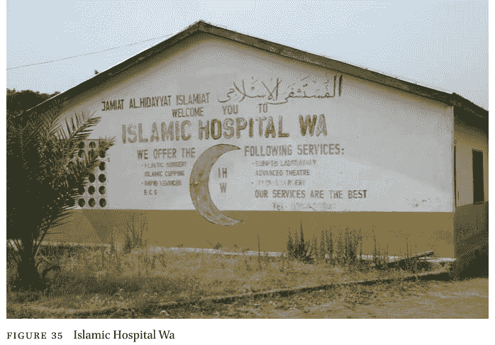

图35 瓦城伊斯兰医院

照片：HOLGER WEISS/2019

这十二所阿赫迈迪亚诊所和医院均位于农村地区，并获得了国家健康保险计划（NHIS）的认证。111

111 阿赫迈迪亚医院分布在阿哈福地区（米姆）、阿散蒂地区（阿索科雷、埃菲杜阿塞、科科富、库马西都会/塞内·蒂姆彭、库马西都会/博阿迪）、博诺东地区（特奇曼）、中部地区（斯韦德鲁）、上西地区（纳多利/卡莱奥、瓦城/克帕古里）和西部地区（比亚/阿苏昂塔；姆福尔-瓦萨/达布塞）。见加纳卫生设施开放数据集，2016年2月5日修改并发布，可在`https://data.gov.gh/dataset/health-facilities`获取，访问于2022年12月15日。

私立穆斯林诊所也已在加纳存在数十年，尽管只有少数获得了政府认可。例如，由常驻英国的加纳医生兼投资人哈吉·易卜拉欣·亚罗于2004年在阿克拉发起的哈吉·阿卜杜莱·亚里纪念与妇产诊所，112 以及由哈吉·亚当·伊萨哈库在塔马利运营的哈吉·亚当诊所（又名：哈吉·亚当斯医疗中心）都在少数获得NHIS认证之列（图36）。113

112 “常驻英国的加纳投资者建造医院”，《阿克拉每日邮报》2004年1月19日。

113 “加纳区级医院列表”，`https://myhealthbasics.site/list-of-district-hospitals-in-ghana/`，访问于2022年11月16日；“非政府组织以5000万塞地援助诊所”，2007年6月29日，`https://www.ghanaweb.com/GhanaHomePage/NewsArchive/NGO-assists-clinic-with-50-million-cedis-126400`，访问于2022年11月16日。

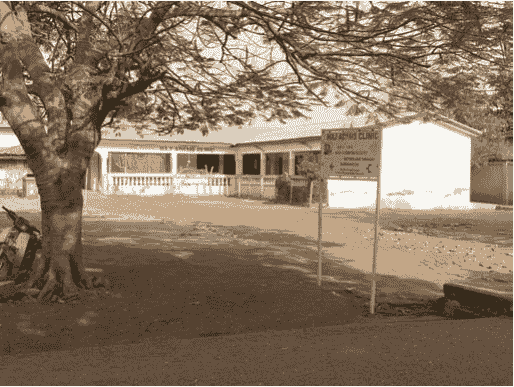

**图36** 哈吉·亚当诊所，塔马利  

**照片：**HOLGER WEISS/2019

在库马西郊区的博阿巴伊，达鲁尔·哈迪斯社区运营着谢赫·陶菲克纪念诊所（图37）。¹¹⁴ 在上西区的哈米莱，当地私营的穆斯林社区诊所在提供基础医疗保健之外，还提供化验和超声扫描服务，并设有药房。¹¹⁵ 数名在开罗爱资哈尔大学学习医学的加纳穆斯林学生建立了私立医疗中心，例如（已故的）谢赫·苏莱曼·穆罕默德·哈伦·巴库里博士在瓦城建立的爱资哈尔诊所（图38）。¹¹⁶ 现代穆斯林教育综合体配有清真寺和诊所，例如库马西的加纳穆斯林宣教团伊斯兰高级中学，¹¹⁷ 以及

¹¹⁴ 对谢赫·阿纳斯·陶菲克·易卜拉欣·巴克里及STF执行董事哈桑医生的访谈，库马西，2018年9月18日。该诊所被列入接受政府人员薪酬补偿的医疗机构名单，见卫生部，《2021–2024年中期支出框架（MTEF）：基于项目的预算估算》（阿克拉：卫生部，2021），第143页，可查阅：`https://mofep.gov.gh/sites/default/files/pbb-estimates/2021/2021-PBB-MoH.pdf`，访问于2022年12月30日。

¹¹⁵ 穆斯林社区诊所——哈米莱，2021年5月3日，`https://www.facebook.com/profile.php?id=100054577084871`，访问于2022年11月19日。

¹¹⁶ 对谢赫·苏莱曼·穆罕默德·哈鲁尼博士的访谈，瓦城，2019年12月5日；邓贝，《跨国》，第153页。苏莱曼博士于2020年（意外）去世。他的诊所如今由S.M.巴库里医生运营，见谷歌上的广告：`https://www.google.com/maps/contrib/113541876747048141037/photos/@10.0648436,-2.5053795,3a,75y,90t/data=!3m7!1e2!3m5!1sAF1QipNakIXmInboIAAaCQbo06gQzQpzyPBVpL-7_H62e10!6shttps:%2F%2Flh5.googleusercontent.com%2Fp%2FAF1QipNakIXmInboIAAaCQbo06gQzQpzyPBVpL-7_H6%3Dwy65-h482-k-no!7i729!8i963!4m3!3m2!1s0x0:0x0`，访问于2022年11月25日。

¹¹⁷ 作者实地考察，2017年12月10日。

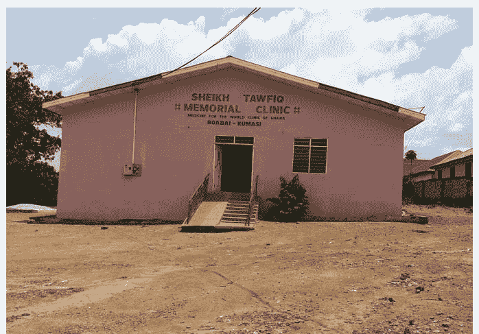

图37 谢赫·塔菲克纪念诊所，库马西

照片：霍尔格·魏斯/2018

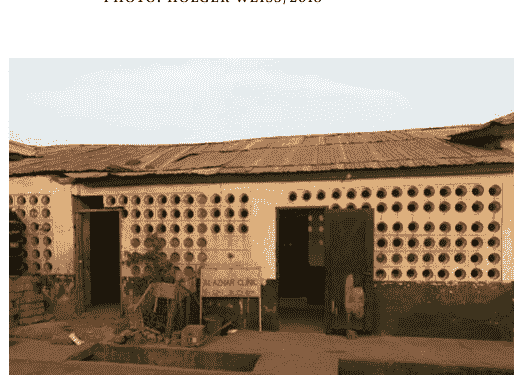

图38 阿兹哈尔诊所，瓦城

照片：霍尔格·魏斯/2019

阿尔-拉赫马教育综合体位于老塔福/库马西[118]，吉索纳伊利伊斯兰小学图书馆与诊所位于塔马利[119]，以及ICODEHS在北部省马尔谢古委托建造的诊所和学校。[120]

118. 阿尔-拉赫马教育综合体由努尔·拉赫马社会组织（亦称 Nurur Rahma Social Organisation）运营，除幼儿园、小学和初中外，还包括职业中心、可容纳260名孤儿的孤儿院楼以及努尔·拉赫马医疗中心。另见视频：“阿尔-拉赫马教育综合体”，2021年3月20日，`https://www.youtube.com/watch?v=IoGI0V7yxY`，访问于2022年11月23日。努尔-拉赫马医疗中心为当地宗戈居民提供免费医疗；另见`https://www.facebook.com/people/Noorur-Rahmah-Medical-Centre/100065062956185/`，访问于2022年11月23日。该教育综合体和医疗中心由科威特慈善机构拉赫马国际协会以及关怀与社会发展组织资助，另见视频：“努尔·拉赫马医疗中心——库马西老塔福”，2021年5月20日，`https://www.youtube.com/watch?v=Razb8CorSIk`，访问于2022年11月23日。

119. `https://www.africabizinfo.com/GH/jisonayili-islamic-primary-school`，访问于2022年12月30日。

120. “ICODEHS为加纳贫困社区提供校舍、清真寺、诊所和水井”，2016年7月27日，`https://www.modernghana.com/news/707199/icodehs-provides-school-blocks-mosques-clinics-and-wells-t.html`，访问于2022年12月13日。

尽管提供正统（西方）医疗和医药的穆斯林从业者（仍）为数不多，但穆斯林健康和医疗从业者与专家回顾了数百年来的伊斯兰精神疗愈（ruqya）和先知医学传统，同时还有当地关于健康和治愈的知识体系。传统医学及其从业者继续存在于殖民领域之外，也独立于西方/现代医学知识体系和实践的引入。尤其是穆斯林治疗师和医疗从业者继续在当地社区拥有实质性影响，有些人获得了区域、国家甚至大陆级的声誉。[121] 少数穆斯林治疗师有组织，其中一些是加纳穆斯林传统治疗师协会（GHAMTHA）的成员，[122] 而政府卫生部门——传统医学实践委员会（TMPC）注册的更少。[123]

121. 塞缪尔·阿杜-贾姆菲等人，“穆斯林治疗师与治疗：加纳阿博博社区的民族志研究”，《国际现代人类学杂志》第2卷，第14期（2020年）：291–316。

122. GHAMTHA在其Facebook账户上拥有64名关注者（`https://www.facebook.com/Ghamtha-Ghana-Muslims-Traditional-Healers-Association-274765932626782/`，访问于2021年9月22日）。其成员包括穆斯林草药医疗从业者、精神治疗师、万扎姆（Wanzams）、正骨师、传统助产士和传统牙医。协会总部设在东部区阿赫韦拉塞，表明该协会的穆斯林治疗师主要来自南方。GHAMTHA是加纳传统医学从业者协会联合会（GHAFTRAM）的附属成员，见`https://ghaftram.org/membership/`，访问于2021年9月22日。

123. 另见TMPC主页，`https://tmpcghana.org/about-us/traditional-medicine-practice-council/`。不过，当我试图评估时，2021版主页的许多部分仍“正在建设中”。

穆斯林传统治疗、健康和医学知识体系，连同当地传统的非洲知识体系，近几十年来获得了官方认可，并成为加纳医疗保健版图中不可分割的一部分。传统治疗和医学通过从业者的专业化来回应当代的现代化和西化，最初一部分人在北非大学攻读文凭，在那里他们将西方医学与先知/传统医学相结合。[124] 他们中有些人已转型为现代传统/替代医疗中心，例如阿特布布的阿尔-努尔伊斯兰医疗中心。[125] 另一些人则具有国际联系，包括总部位于阿克拉的西非行为健康成瘾与康复管理组织（WABHARM），该组织隶属于英国少数族裔行为健康成瘾与康复管理基金会。[126] WABHARM自2018年起在其药物和酒精依赖、滥用以及精神健康障碍的治疗中采用一项伊斯兰自助计划——米拉蒂·伊斯兰（Millati Islami）。[127] 他们在阿克拉的两位最具影响力的从业者及其机构——阿明·邦苏博士与亚门科学草药医院，以及拉希德·侯赛因·萨尔瓦特博士与萨尔瓦特健康与康复医院和学校——因其在2020年的服务而获得西非传统与替代医学实践委员会授予的高度奖项。[128] 伊德里斯·桑巴雷博士及其希贾马草药诊所则获得了同一组织于2022年颁发的“年度最佳拔罐治疗中心”奖。[129]

124. 另见法达卢拉利·阿尔哈桑·易卜拉欣，*《加纳的伊斯兰治疗：萨尔瓦特健康康复医院研究》*，加纳大学宗教学系硕士论文，2018年。

125. 另见阿尔-努尔伊斯兰医疗中心，`https://www.facebook.com/profile.php?id=100070386603474`。该诊所于2020年10月启用，见“巴武米亚博士为阿特布布伊斯兰医疗中心揭幕”，2020年10月19日，`https://utv.peacefmonline.com/pages/videos/202010/34654.php`，访问于2022年11月19日。

126. 另见https://www.mhinnovation.net/organisations/west-africa-behavioural-health-addictions-and-recovery-management，访问于2022年11月12日。米拉蒂·伊斯兰（Millati Islami）的协调人（以及主要捐赠者？）是加纳穆斯林企业家与慈善家吉布里尔·穆罕默德。

127. 见募捐邀请，发布于2018年3月27日，https://www.facebook.com/profile.php?id=100068425015039，访问于2022年11月12日。

128. 萨尔瓦特健康与康复医院和学校 Facebook 2020年3月17日；亚门科学草药医院 Facebook 2020年3月18日。伊玛目拉希德于1993年至2004年间在塔马利经营他的第一家诊所——拉希迪亚伊斯兰与草药诊所。十年后，他在阿克拉建立了一家新诊所，最初名为萨尔瓦特健康康复中心。另见易卜拉欣，*《加纳的伊斯兰治疗》*，第53–55页。

129. 希贾马草药诊所，2022年8月7日，https://www.facebook.com/hijamaherbalclinic，访问于2022年11月17日。

尽管存在，（逊尼派）穆斯林在加纳医疗保健版图中的身影仍相当不均衡。一些国际穆斯林慈善机构投资于卫生部门，其中包括卡塔尔慈善机构，后者自2019年以来已委托建造了30家诊所。[130] 2022年秋季两家新伊斯兰医院的启用引起了一些公众兴趣，尤其是当有消息披露阿克拉新镇的穆斯林医院是由纳纳·阿库福-阿多总统的一名保镖资助时。一些媒体评论员暗示，第一吉布林基金会是外国投资者的信箱组织，因为保镖的工资不足以资助建造一所超现代的四层医院。[131] 尽管如此，该穆斯林医院于2022年秋季开始运营。这两个项目的有趣之处在于，它们表达了加纳穆斯林的自我赋权，也反映了当地几个穆斯林协会和组织建立类似机构的雄心（见表8）。

伊斯兰萨达卡基金会（ISFOUND）发起了“伊斯兰医院建设项目”活动。该组织最初为总部位于库马西的穆斯林青年达瓦组织，名为“真主银行”，于2017年4月成立；2019年11月启动医院项目和众筹活动时，更名为伊斯兰萨达卡基金会。[132] 其在2019年12月的启动呼吁是为计划中的医院筹集资金购买土地：“我们需要4万名穆斯林每人捐出仅1加纳塞地，以支持这个有回报的项目。”[133] 2020年初，ISFOUND发布了医院项目的建筑规划。[134] 该活动的第一个里程碑于2020年6月达成：基金会收到上西部省布伦加酋长捐赠的8英亩土地。[135] 这改变了……

130. “卡塔尔慈善机构在加纳农村开设两个医疗中心”，2023年5月2日，https://www.qcharity.org/en/qa/news/detailsinternational/21908-qatar-charity-opens-two，访问于2023年12月5日。

131. “阿库福-阿多的保镖为阿克拉穆斯林社区建造大型医院”，2022年9月29日，https://www.peacefmonline.com/pages/local/social/202209/475089.php；“阿库福-阿多的保镖如何积累财富在阿克拉建造‘超现代’医院？——多特塞·马洛质疑”，2022年9月30日，https://www.theinsightnewsonline.com/how-did-akufo-addos-bodyguard-amass-wealth-to-build-an-ultramodern-hospital-in-accra-dotsei-malor-questions/?utm_source=rss&utm_medium=rss&utm_campaign=how-did-akufo-addos-bodyguard-amass-wealth-to-build-an-ultramodern-hospital-in-accra-dotsei-malor-questions，两处均访问于2022年11月19日。

132. https://www.facebook.com/islamicsadaqafoundation，2019年11月4日/2019年11月13日，访问于2021年8月7日。

133. https://www.facebook.com/islamicsadaqafoundation，2019年12月28日，访问于2021年8月7日。

134. https://www.facebook.com/islamicsadaqafoundation，2020年2月3日，访问于2021年8月7日。

135. “关于土地问题的瓦城、布伦加、上西部省之行第二次报告”，https://www.facebook.com/islamicsadaqafoundation，2020年6月4日，访问于2021年8月7日。

##### 表 8 加纳伊斯兰医院项目（截至2023年6月状态）

| 组 | 位置 | 启动 | 资金 | 状态 |
|---|---|---|---|---|
| Ashaiman Sadaqatul Jariya | Ashaiman (GAR) | 2019 | internal | Construction started, three floors (out of five) have been finished |
| Concerned Muslim Youth Association | Kata-Banawa (NER) |  | 1CODEHS (Qatar Charity) | Construction started 2021, finished 2022 |
| 1CODEHS |  |  | Kuwait Zakat House | Commissioned clinics in Ak-weteman and Adenta, Greater Accra Region (before 2020) |
| First Jibril Foundation/1st Gibril Foundation | Accra New-town (GAR) |  | First Jibril Foundation/1st Gibril Foundation | Construction finished 2022 |
| Fikrul Islam Association | Ashaiman | 2020 | Internal | Plan (school+clinic+masjid) |
| Ghana Islamic Health Foundation | ? (Kumasi?) | 2017 | internal | fundraising since 2021 |
| Muslim Health Workers Association Ghana | Kumasi Central Mosque | 2020 | Internal | Fundraising call 2020 (video/YouTube) |
| Ghana Islamic Youth Sadaqa Association | ? |  | internal | ? |
| Iqra Foundation | ? |  | ? (Saudi donors?) | ? |
| Islamic Mission Secretariat | Krobo (Techiman) | 2015 | internal | Fundraising in progress |
| Islamic Mission Secretariat | New Dormaa (Sunyani) | 2015 | Internal | Fundraising in progress |
| Islamic Sadaqa Foundation | Bulenga (UWR) |  | Internal + Peace Dawah Foundation | ? |
| Jallo Youth Khidma Organisation | Prang |  | internal | ? |
| Organisation of Islamic Education | Lahegu (NR) |  | ? | ? |
| Sadaqatul Jariyya Association Ghana (Tijaniyya Hospital Project Campaign) | ? |  | internal | Started 8/2021, fundraising started 2/2022 |
| Ghana Muslim Mission | 5 locations |  | (internal); A R Rahman Foundation | Ghana Muslim Clinic, Korle-Gonno, Accra, commissioned 12/2022 |
| Zakat and Sadaqa Trust Fund | Takoradi | 2021 | Internal | (plan) |
| (local Muslim community) | Ahafo Ano South District |  | (internal) | (plan) |
| Light Mindset International | Accra | 2022 (?) | Internal | Islamic Rehabilitation Centre started 7/2022 |

##### 表 8 加纳伊斯兰医院项目（截至2023年6月状态）（续）

| 组 | 位置 | 启动 | 资金 | 状态 |
|---|---|---|---|---|
| Family of Malam Abu Salaga | Salaga | 2022 (?) | Internal | Construction started 2022 |
| ASWAJ Ashanti Region | Kumasi Zongo | 2023 | Internal + Peace Dawah Media | Plan for clinic announced 5/2023 |

outline of the campaign. In July 2020, a second campaign to raise funds for cement, of which the target was to reach 1000 bags of cement or more, called on people to donate 30 Ghana cedis,¹³⁶ which was raised to 40 Ghana cedis in October 2020.¹³⁷ In early 2021, the Foundation renamed the campaign as the ‘One million one Cedi campaign’, declaring its aim to mobilise one million members and projected to build five hospitals:

> > If we are able to reach out to one million members, then it means we are getting 1 million Ghana cedis in a month with each member donates 1 Ghana cedi, 12 million [Ghana cedis] in a year and 24 million [Ghana cedis] in two years. This amount is enough to build five ultra-modern Islamic hospitals Insha Allah.¹³⁸

Until July 2021, ISFOUND used social media for rallying its supporters and provided monthly postings on their Facebook accounts about the donors and sums collected. In general, individual donations account between 5 and 20 cedis (0.8–3.2 USD) per month. In addition, it has posted balances and monthly financial reports on Facebook, see Graph 10. In May 2021, Peace Dawah Media boosted the ISFOUND hospital project, and Khalifa Faith underscored the need for Muslims to rally behind this and similar projects to enhance the empowerment of the Muslim communities:

> > I AM ALWAYS AVAILABLE TO SUPPORT ANY PROJECT IN ANY COMMUNITY./ SHOUTING AND COMMENTING ON SOCIAL MEDIA WILL NOT SOLVE

¹³⁶ https://www.facebook.com/islamicsadaqafoundation, 3.7.2020: #JUNE_SADAQA_ACCOUNTING, accessed 7.8.2021.

¹³⁷ https://www.facebook.com/islamicsadaqafoundation, 5.10.2020: October Cement support Sadaqa towards the Islamic Hospital Building Project is ongoing, accessed 7.8.2021.

¹³⁸ https://www.facebook.com/islamicsadaqafoundation, 31.3.2021: ISFOUND One million member mobilization, accessed 7.8.2021.

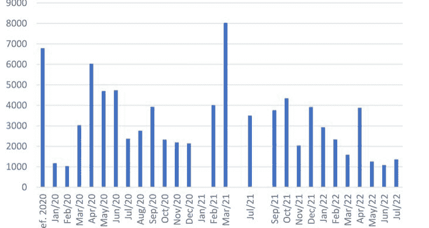

##### 图 10 ISFOUND 医院项目萨达卡捐款（单位：GHS）

SOURCE: ISLAMIC SADAQA FOUNDATION (ISFOUND), END OF YEAR ACCOUNT RENDERING OF ISLAMIC HOSPITAL PROJECT, DATED 2.1.2021; ISLAMIC HOSPITAL BUILDING PROJECT CAMPAIGN FEBRUARY 2021 SADAQA ACCOUNTING, DATED 4.3.2021; ISLAMIC HOSPITAL BUILDING CAMPAIGN ACCOUNT AS AT THE END OF APRIL 2021; SUPPORT RECEIVED JULY 2021; FUND RAISING FOR THE ISLAMIC HOSPITAL PROJECT CAMPAIGN, DATED 10.8.2022, ALL POSTED ON WWW.FACEBOOK.COM/ISLAMICSADAQAFOUNDATION

> OUR PROBLEM, THE ONLY WAY TO SOLVE OUR PROBLEM IS FOR US TO GO TO THE GROUND AND WORK TOWARDS WHATEVER WE CAN NOT ON SOCIAL MEDIA./ BEFORE YOU COMMENT OR SHOUT ON SOCIAL MEDIA, ASK YOURSELF FIRST, HOW CAN YOU USE YOUR PLATFORM TO RAISE MONEY AND BUY A LAND FOR MUSLIMS TO START./ HOW MANY HOSPITAL DO ANY ISLAMIC SECT HAVE IN GHANA?, HOW MANY ISLAMIC BANK DO WE HAVE?, HOW MANY UNIVERSITY DO WE HAVE?, ETC. THE ONLY THING WE HAVE IS PUTTING EACH OTHER ON HELL FIRE, FIGHTING AMONG SECT, BACKBITING, ENVY, INSULTING EACH OTHER AND BRINGING DIVISION WITH EACH OTHER./ WE ARE NOW BUILDING FIRST ISLAMIC SCHOOL FOR BLIND PLEASE SUPPORT US TO FINISHED IT./ IF YOU WISH TO SUPPORT THE ISLAMIC SADAQA FOUNDATION CONTACT THEM ON THEIR FACEBOOK PAGE./ THEY HAVE A GREAT IDEA AND AIM./ I WILL KEEP POSTING ALOT ALL DAY INSHALLAH.139

139 "Those who always say we don't have..." 7.5.2021, https://www.facebook.com/PeaceDawah Media/, accessed 5.12.2022.

In early June 2021, ISFOUND declared that the hospital building campaign so far had raised GHS 67,102.73 as sadaqa.140 A few days later, Khalifa Faith issued a strong backing for the project on Peace Dawah Media.141

In 2022, ISFOUND changed the profile of its social media campaign. Already in September 2021, the organisation announced to invest in a small-scale rice milling company as a second source of income for the hospital project.142 In late December 2021, it created a GoFundMe account;143 in January 2022, it organised a fund raising symposium in Wa.144 In August, it posted an update of donations received from September 2021 to July 2022, totalling GHS 26,290.145 In October 2022, it celebrated the sod cutting ceremony for the commencement at Bulenga,146 and declared that the budget for finishing the first stage of its hospital project amounted to GHS 335,365, and renewed its campaign on Facebook: “if 10,000 generous people donate GHC 30 each it will be realize [sic] in no time in Sha Allah.”147

The Zongo Medical Centre in Ashaiman, in turn, is a project spearheaded by the Ashaiman Sadaqatul Jariya (ASJ).148 Established in 2019, the group consists of six diaspora founders (one residing in the USA, four in the UK and one in

140 Amount raised the end of May 2021, 3.6.2021, https://www.facebook.com/islamicsadaqafoundation/, accessed 30.12.2022.

141 “Those who always say we don’t have,” 7.5.2021, https://www.facebook.com/PeaceDawahMedia, accessed 21.8.2023.

142 Announcement of investment plan, 8.9.2021, https://www.facebook.com/islamicsadaqafoundation/, accessed 30.12.2022. It is not known, if ISFOUND ever materialized its investment of if the rice milling company still exists.

143 “Be the first donor,” 21.12.2022, https://www.facebook.com/islamicsadaqafoundation/, accessed 30.12.2022; “Support the Islamic Hospital Building in Ghana,” created 21.12.2021, https://www.gofundme.com/f/help-islamic-sadaqa-foundation-build-a-hospital?utm_source=facebook&utm_medium=social&utm_campaign=p-cp%20share-sheet&fbclid=IwAR3g4MkWFQXZRK59-vuB7c6_T5gcyvRngWie2dTKOsR-UqcoMNNUeBn-QA, accessed 30.12.2022. By the end of December 2022, the appeal had raised GBP 41 from five donors.

144 “Launching and Fundraising Symposium of the Islamic Hospital Building Project Initiative,” 28.12.2021, https://www.facebook.com/islamicsadaqafoundation/, accessed 30.12.2022.

145 “Fund raising of iron rods for the Islamic Hospital Building Campaign,” 10.8.2022, https://www.facebook.com/islamicsadaqafoundation/, accessed 30.12.2022.

146 “Islamic Hospital Building Project agenda,” 6.10.2022, https://www.facebook.com/islamicsadaqafoundation/, accessed 30.12.2022.

147 “Kindly support and share for Allah sake,” 9.10.2022, https://www.facebook.com/islamicsadaqafoundation/, accessed 30.12.2022.

148 Ashaiman sadaqatul jariya hospital project, video (in Hausa) 8.8.2021, https://www.facebook.com/106380131094295/videos/22565766239513, accessed 11.9.2021. “ASHAIMAN SADA QATUL JARIYAH have embarked on mission deliver a health clinic to the Muslim community in Ashaiman, Ghana,” https://www.facebook.com/MakeZongoGreatAgainn,

尼日利亚），此后吸纳了约200名侨民和本地成员。董事会大多数成员居住在美国（主席、一位副主席、总管理员/经理）和英国（组织者以及财务主管），其余成员分布在安提瓜、尼日利亚和沙特阿拉伯。唯一的本地董事会成员是乌斯曼·沙伊布（Usman Shaibu），担任ASJ的秘书。该团体的目标是汇集资源和临时捐款，资助各种年度项目，例如支付伊斯兰葬礼费用（包括将逝者遗体送往医院的救护车费用；图38），以及为无力支付医院账单的个人/家庭买单。此外，该团体还在开斋节和古尔邦节组织食品和肉类捐赠（根据每年募集的金额，大约可为500人提供食物），发放奖学金，并组织年度《古兰经》纪念竞赛。然而，其旗舰项目是宗戈医疗中心（Zongo Medical Centre）。^149

目前，阿夏曼（Ashaiman）约有25万居民，却只有一家综合诊所。因此，宗戈医疗中心不仅服务于当地宗戈社区的需求，还填补了该镇医疗基础设施的空白。建成后，宗戈医疗中心将由一个管理委员会运营，成员包括ASJ的代表以及当地社区代表（阿訇、宗戈酋长、当地宗戈青年组织的一名代表）。^150

建设工程于2019年启动，初始资金来自ASJ，此外还有宗戈发展基金（Zongo Development Fund）提供的2万加纳塞地捐款。当地政府至今未能为该项目提供任何资金援助，而当地居民的捐款也非常有限，因为当地宗戈社区非常贫困。尽管如此，到2022年10月，地下室和前两层已经完工（图39）。^151

然而，该项目在2021年获得了巨大推动，当时总部位于阿夏曼的社交媒体团体和非政府组织“让宗戈再次伟大”（*Make Zongo Great Again*）开始宣传该项目；^152一年后，“和平达瓦媒体”（Peace Dawah Media）的代表参观了现场。^153 2022年7月，“让宗戈再次伟大”转播了ASJ的一场筹款仪式，^154目标是为完成该建筑筹集2,805,884.63加纳塞地（约合376,629美元）。^155 ASJ的筹款活动本身只取得了部分成功；至少“Goodness Petrol”公司的首席执行官承诺捐赠超过10万加纳塞地（约合12,000美元），外加水泥和沙石。^156^ 总的来说，ASJ成功筹集了60万加纳塞地。^157^ 作为筹款活动的一部分，ASJ于2022年7月24日组织了“感恩阿夏曼宗戈医疗中心杯比赛”，^158^ 最终伊玛目队获胜！^159^

尽管如此，通货膨胀和材料成本上涨阻碍了项目的完成。2022年10月我采访乌斯曼·沙伊布时，他告诉我，将再次发起募捐以完成第三层和第四层的建设，之后还将为医院设备进行另一轮募捐。目标是在两年内（即2024/25年）开始运营医院。该团体计划联系（海外）慈善家，为工资和额外设备提供资金；另一种可能性是与加纳卫生当局签订合同并获得政府支持。除了雇用当地医生和护士外，他们还计划邀请外国医生前来援助一个月。^160^

库马西中央清真寺诊所（Kumasi Central Mosque Clinic）则于2020年2月投入使用。^161^ 几个月后，“穆斯林卫生工作者协会”（*Muslim Health Workers’ Association*）发起了一项筹款活动，以提供家具和医疗设备，并于2020年10月获得阿萨瓦塞（Asawase）议员、政治家蒙塔卡·穆巴拉克（Muntaka Mubarak）的大额捐赠。^162^ “加纳伊斯兰健康基金会”（GIHF）于2017年12月启动其伊斯兰医院项目，当时该基金会获得了公司注册证书和开业证书，并在Facebook上发布了医院的设计图。^163^ GIHF此前的活动主要集中在消除穆斯林社区中的艾滋病和性传播疾病，而其长期目标则包括建立一所教学医院。在随后几年继续开展HIV/艾滋病防治活动的同时，^164 该基金会于2021年6月26日在Facebook上启动了医院项目的筹款活动。^165

“贾洛青年服务组织”（JYKO）是提贾尼派贾洛（Tijaniyya Jallo）的青年分支，由加纳提贾尼派穆斯林理事会领袖谢赫·凯鲁·阿卜杜拉希·迈卡诺（Sheikh Khairu Abdullahi Maikano）创立。该组织决定将其在普朗（Prang）的毛里德（Mawlid）和蒂拉瓦（Tilawa）庆典上为参与者提供的健康筛查活动，转变为一个正规的医疗设施并实现制度化。^166 谢赫·凯鲁·阿卜杜拉希·迈卡诺设想中的“巴阿巴·吉瓦纪念医院”（Baaba Geewa Memorial Hospital）将服务于普朗的所有居民，并呼吁所有追随者加入JYKO，为项目的实现筹集资金。^167

“国际宗戈之声”（*Voice of Zongo International*，VOZI）则将建立医院列为长期目标之一。^168 与其他医院项目不同，VOZI的筹款活动（截至2022年初）尚未启动，该组织也尚未具体化其计划。不过，JYKO和VOZI都面向国际受众，前者主要面向谢赫·凯鲁·阿卜杜拉希·迈卡诺的苏菲派追随者，尤其是欧洲和北美的追随者。后者在加纳、美国、德国、英国、意大利、比利时、西班牙、加拿大、芬兰、尼日利亚和阿联酋设有分支机构。^169 最不知名的是“伊克拉教育与发展基金会”（*Iqra Foundation for Education and Development*）的医院项目，除了2020年9月在哈姆扎电视台（Hamza TV）上宣布其有意在加纳建设“第一所穆斯林医院”外，几乎没有其他信息。^170

“加纳穆斯林传教会”（*Ghana Muslim Mission*）则长期以来一直设想在加纳各地至少建立五个医疗中心。其加纳穆斯林传教会中的第一个……

25.9.2019，访问于4.8.2022；施工现场视频，6.11.2019，https://www.facebook.com/AshaimanSadaqatuIjariya/，访问于4.8.2022。

149 对阿夏曼Sadaqatul Jariya秘书长乌斯曼·沙伊布的访谈，阿夏曼，2020年10月16日。

150 对阿夏曼Sadaqatul Jariya秘书长乌斯曼·沙伊布的访谈，阿夏曼，2020年10月16日。

151 对阿夏曼Sadaqatul Jariya秘书长乌斯曼·沙伊布的访谈，阿夏曼，2020年10月16日。

152 “阿夏曼Sadaqatu Jariyah集团打造的超现代医疗中心已完成50%。需要帮助”（2021年9月12日），“首座由阿夏曼Sadaqatul Jariyah（由阿夏曼侨民组成的慈善组织）全资为穆斯林建造的专门医院。

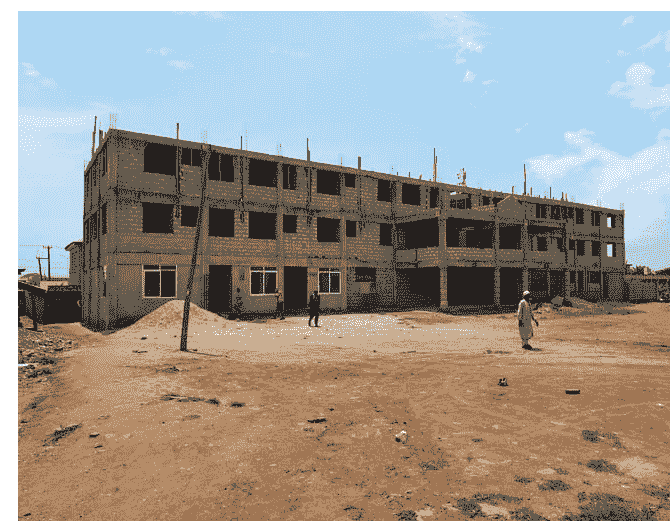

图39 阿夏曼伊斯兰诊所项目

摄影：霍尔格·魏斯/2022

工程目前已完成约40%。愿真主帮助他们完成”（2022年2月15日），施工现场视频（2022年3月11日），以及“阿夏曼Sadaqatul Jariyah正在加纳阿夏曼建造一座最先进的医疗中心。阿夏曼有超过25万居民，却只有一家公共卫生设施（阿夏曼综合诊所）和少数私立诊所。这一新设施将有助于改善阿夏曼及其周边地区人民的整体健康状况。请捐款并告知其他潜在捐助者”（2022年7月6日），https://www.facebook.com/MakeZongoGreatAgain，访问于4.8.2022。

153 和平达瓦媒体关于现场参观的帖子和视频，2022年7月16日，https://www.facebook.com/PeaceDawahMedia/，访问于30.12.2022。

154 视频：ASJ在阿夏曼宗戈医疗中心竣工筹款仪式上的开场祈祷和主席致辞，https://www.facebook.com/MakeZongoGreatAgain，2022年7月16日，访问于4.8.2022。

155 募捐请求信，发布于Facebook 2022年5月28日，https://m.facebook.com/groups/366653867383508/，访问于4.8.2022。

156 视频：Goodness Petrol首席执行官向宗戈医疗中心作出承诺，https://www.facebook.com/MakeZongoGreatAgain，2022年7月16日，访问于4.8.2022。

157 对阿夏曼Sadaqatul Jariya秘书长乌斯曼·沙伊布的访谈，阿夏曼，2020年10月16日。

158 “感恩阿夏曼宗戈医疗中心杯比赛”海报，2022年7月24日，https://www.facebook.com/profile/10003689019872/search/?q=Ashaiman%20Zongo%20Medical%20Centre%20Cup%20Match%2C 访问于30.12.2022。

159 对阿夏曼Sadaqatul Jariya秘书长乌斯曼·沙伊布的访谈，阿夏曼，2020年10月16日。

160 对阿夏曼Sadaqatul Jariya秘书长乌斯曼·沙伊布的访谈，阿夏曼，2020年10月16日。

161 宣布新库马西中央清真寺诊所投入使用的视频，2020年2月11日，和平达瓦媒体，https://www.facebook.com/watch/?v=487878638559704，访问于5.12.2022。

162 捐赠照片和文字，发布于2020年10月4日，https://www.facebook.com/zongoghnews/photos/a.106727241129494/154291153039769/?type=3，访问于5.12.2022。

163 https://www.facebook.com/Ghana-Islamic-Health-Foundation-165526770663949/，2017年12月19日，2017年12月20日，访问于27.9.2021。

164 https://www.facebook.com/Ghana-Islamic-Health-Foundation-165526770663949/，2018–2019年HIV/艾滋病防治筹款，2017年10月20日；宣布2018年4月23日在塔马利、2018年5月25日在库马西以及2018年6月25–28日在西部地区北部举办HIV/艾滋病会议，2017年12月5日，访问于27.9.2021。

165 https://www.facebook.com/Ghana-Islamic-Health-Foundation-165526770663949/，2017年7月26日，访问于27.9.2021。

166 贾洛青年服务组织的呼吁，发布于2019年11月6日，2020年1月8日，https://www.facebook.com/jallooyouth/，访问于16.12.2021。

167 谢赫·凯鲁·阿卜杜拉希·迈卡诺的信，发布于2019年11月5日，https://www.facebook.com/jallooyouth/，访问于16.12.2021。

168 VOZI中期和长期计划概要，2021年11月2日，https://www.facebook.com/VOZIWorld/photos/63999260703017，访问于16.12.2021。

169 VOZI主席哈吉·阿卜杜拉希·乌斯曼（Karima Enterprise首席执行官）呼吁每位宗戈公民加入该组织，发布于2021年8月10日，https://www.facebook.com/VOZIWorld/?ref=page_internal，访问于16.12.2021。

170 “伊克拉基金会西非将在加纳建造第一所穆斯林医院”，https://www.facebook.com/watch/?v=317021896250995，2020年9月14日，访问于3.2.2022。

诊所于2022年12月开始其活动，是与美国穆斯林慈善机构 Ar-Rahman¹⁷¹ Foundation¹⁷² 的联合项目。与印度慈善机构的合作已于2022年夏季和秋季开始，当时 GMM 和 Ar-Rahman Healthcare 在阿克拉的多个地点组织了免费健康筛查。¹⁷³ 他们的下一个计划是建立一所功能齐全的医院。¹⁷⁴

截至2023年7月/12月，最近的医院项目包括塔马利的拉哈古项目（由伊斯兰教育组织于2021年初发起），¹⁷⁵ 库马西阿索科雷的提贾尼耶医院（由加纳萨达卡鲁尔-贾里亚协会于2021年8月发起），¹⁷⁶ 以及阿哈弗阿诺东南区伊玛目和宗戈酋长发起的伊斯兰医院项目（于2022年6月启动）。¹⁷⁷ 其他项目包括萨拉加的伊斯兰诊所项目（由马拉姆·阿布·萨拉加家族发起），¹⁷⁸ 扎卡特和萨达卡信托基金在塔科拉迪设想的医院项目，¹⁷⁹ 以及 ASWAJ 阿散蒂地区库马西宗戈医院项目。¹⁸⁰ 提贾尼耶医院项目可追溯至2017年提贾尼耶穆斯林运动青年翼在精神领袖扎伊姆谢赫·阿卜杜勒·瓦杜德·哈伦65岁生日时发表的公告。¹⁸¹ 与 ISFOUND 项目类似，其筹款活动利用社交媒体组织，向成员强调该项目将为所有参与者作为萨达卡·贾里亚服务。目标是在 WhatsApp 平台上聚集2,000名成员。¹⁸² 每位成员预计每周五至少捐赠2加纳塞地。小组的首要目标是在2022年至少购置2英亩土地。截至2022年9月底，小组已筹集约4,320加纳塞地。¹⁸³

## 5 沼气消化厕所项目

总部位于卡索阿的伊斯兰人道主义与发展组织是加纳全国穆斯林非政府组织中的新成员。虽然我未能追溯其根源，但很可能它是当地青年运动的倡议。该组织于2019年11月建立了 Facebook 账号，或许是在其转变为组织之后。2020年2月，该组织获得了社会福利部的注册证书、¹⁸⁴ 作为全国性非政府组织的认可以及营业许可。¹⁸⁵

伊斯兰人道主义与发展组织的宗旨阐明了赋权发展干预的必要性。呼应联合国可持续发展目标，该组织努力动员资源，为欠发达和贫困社区提供基本服务获取途径。它旨在通过建立伙伴关系来实现这一目标，“制定创新计划以开展倡议和可持续解决方案”，从而赋权这些社区。¹⁸⁶ 该组织列出了五项目标作为计划干预的主要领域。其中三项是穆斯林非政府组织的典型目标，即提供清洁饮水、医疗保健和教育支持。其余两项在加纳穆斯林非政府组织的宗旨中很少见。两者都在伊斯兰人道主义与发展组织议程的顶端。第一项是通过支持家庭以半价拥有沼气消化厕所来终结露天排便的创新干预。第二项旨在以伊斯兰小额信贷计划的形式，为弱势群体提供无息的财务和技术资源。¹⁸⁷ 除两项基础设施项目外，伊斯兰人道主义与发展组织于2020年4月宣布了两项众筹倡议。经济赋权倡议是一个伊斯兰小额信贷项目，旨在为团体和创业企业提供众筹无息贷款，同时提供免费培训研讨会和讲座。众筹农业倡议则包括三个项目，即“养羊运动”、“抬高式鲤鱼养殖”和“零放牧牲畜资本”。¹⁸⁸

然而，伊斯兰人道主义与发展组织在其核心上是一个具有密切国际和跨国联系的萨拉菲宣教组织。2020年10月，它在 Facebook 上发布了一段关于在卡索阿建设其伊斯兰中心大楼的视频。该价值100万美元的项目由“我们的伊斯兰组织合作伙伴”资助，据其称，将包含多个设施，包括教室、清真寺、宿舍、会议厅、120立方米沼气发电厂、行政办公室、非政府组织办公室、教职员工住宿以及厨房和就餐区。¹⁸⁹ 此外，它还发布了来自美国穆斯林团体，特别是纽约市的多个呼吁，以支持其伊斯兰中心项目，以及来自加纳达鲁尔-哈迪斯和达鲁尔-陶希德中心的布道和讲座，表明了各穆斯林团体之间的全球互联。

沼气消化厕所项目与由两个非政府组织发起的类似项目相关，即人道主义伊斯兰基金会非洲和 SBP Biogas。后者倡议旨在以半价向家庭提供沼气消化厕所，并且是 sup-

171 美国穆斯林慈善机构 Ar-Rahman Foundation 不应与加纳的 Ar-Rahman Foundation 混淆 (https://www.facebook.com/SulaimanIbrahim124/)。

172 关于加纳穆斯林诊所，https://www.ghanamuslimclinic.org/about/，访问日期 13.12.2022。有趣的是，加纳穆斯林诊所主页提供了指向 GMM 和 Ar-Rahman Foundation 主页的链接。然而，后者打开的是印度慈善机构 A R Rahman Foundation 的主页，而不是美国穆斯林慈善机构。早期的新闻报道却明确指出 GMM 已与美国穆斯林慈善机构展开合作。

173 "GMM organizes free health screening for Korle-Gonnor community," 27.6.2022, https://tigpost.co/gmm-organizes-free-health-screening-for-korle-gonnor-community/; "Ghanaians charged to take responsibility of their health," 5.12.2022, https://gna.org.gh/2022/12/ghanaians-charged-to-take-responsibility-of-their-health/; 两者均于 28.5.2024 访问。后一次健康筛查活动与 The Light Foundation 合作进行。

174 关于加纳穆斯林诊所，https://www.ghanamuslimclinic.org/about/，访问日期 13.12.2022。

175 （视频）呼吁公众支持在塔马利拉哈古建设伊斯兰医院，9.1.2021，以及（视频）伊斯兰医院正在建设中——电力已延伸至工地，水是接下来需要考虑的问题，6.2.2021，https://www.facebook.com/oieghana/，访问日期 3.2.2022。Facebook 上未发布进一步更新。

176 参见视频："TIJANIYA SECT OF GHANA CUT SOD IN BUILDING TIJANIA HOSPITAL IN ASOKORE, 31.8.2021," https://www.facebook.com/watch/?v=994659907994088，访问日期 12.11.2022。

177 "Muslims community to build Islamic hospital in Ahafo Ano South East District," 22.6.2022, https://www.youtube.com/watch?v=VyjohG8QDQ，访问日期 26.8.2022。

178 宣传萨拉加伊斯兰诊所的视频，发布于 23.7.2022，https://www.facebook.com/PeaceDawahMedia，访问日期 5.12.2022。

179 P.K. Yankey, "Muslims urged to support in raising funds for the vulnerable," 12.5.2021, https://gna.org.gh/2021/05/muslims-urged-to-support-in-raising-funds-for-the-vulnerable/，访问日期 14.8.2022。此外，ZSTF 设想建设一个医疗中心，参见 https://www.zakatfund.org.gh/zakat-and-sadaqa-trust-fund/planned-projects/。

180 https://www.facebook.com/PeaceDawahMedia，16.5.2023，访问日期 21.8.2023。

181 "Tijaniyya youth pushes for Muslim hospitals in Ghana," 23.10.2017, https://citifmonline.com/2017/10/tijaniyya-youth-pushes-for-muslim-hospitals-in-ghana/，12.11.2022。

182 Tijaniyya Hospital Project Campaign, 4.3.2022, https://www.facebook.com/profile.php?id=100080056492419，访问日期 12.11.2022。

183 Tijaniyya Hospital Project Campaign, 1.3.2022, 17.3.2022, 30.3.2022, 13.5.2022, 30.9.2022, https://www.facebook.com/profile.php?id=100080056492419，访问日期 12.11.2022。

184 https://www.facebook.com/Islamic-Organization-for-Humanity-and-Development-110160223762133/photos/279769436801210，访问日期 23.8.2021。

185 https://www.facebook.com/Islamic-Organization-for-Humanity-and-Development-110160223762133/photos/279769753467845，访问日期 23.8.2021。

186 愿景，伊斯兰人道主义与发展组织，海报发布于 8.4.2020，https://www.facebook.com/Islamic-Organization-for-Humanity-and-Development-110160223762133/photos/209327017878777，访问日期 23.8.2021。

187 宗旨，伊斯兰人道主义与发展组织，https://www.facebook.com/Islamic-Organization-for-Humanity-and-Development-110160223762133/photos/209327140512107，8.4.2020，访问日期 23.8.2021。

188 呼吁注册众筹倡议，伊斯兰人道主义与发展组织，海报发布于 8.4.2020，https://www.facebook.com/Islamic-Organization-for-Humanity-and-Development-110160223762133/photos/209327163845438，访问日期 23.8.2021。

189 视频发布于 Facebook，5.10.2020，https://www.facebook.com/Islamic-Organization-for-Humanity-and-Development-110160223762133/?ref=page_internal，访问日期 23.8.2021。

ZOLAOD（反对露天排便的宗族领袖）的成立。¹⁹⁷ 该联盟的目的是在库马西地区复制 GAMA-SWP，尤其是安装负担得起的家庭厕所。他们的首要目标是遏制露天排便，向当地伊玛目介绍项目的范围、成果和预期影响，并帮助 KMA 识别并说服家庭认识到项目的重要性。¹⁹⁸

## 6 社区资源中心、社区图书馆与塑料教育项目

三个近期举措作为穆斯林自我赋权的创新扩展而脱颖而出。其中两个以城市为基础，位于阿克拉，即由一个本地和一个外国穆斯林非政府组织联盟牵头的社区中心项目，以及 ICODEHS 的社区图书馆项目。第三个是由穆斯林领导的青年运动在沃尔特地区开展的农村教育基础设施项目，涵盖了塑料瓶的回收利用。

这两个城市项目已经引起了头条新闻。2022 年 5 月 12 日，国家首席伊玛目谢赫博士 Osman Nuhu Sharubutu 为在阿克拉尼玛建造一座新的四层社区中心举行了破土仪式。该项目是由本地社区非政府组织 Cin Gaban Nima 与加纳-德国非政府组织 Aminu Initiative 合作发起的。在破土仪式上，Cin Gaban Nima 董事会成员 Dr Faisal Garba Muhammad 表示，他们的目标是筹集 100,000 美元以完成项目，并呼吁成员、朋友、本地非政府组织和外部捐助者支持该倡议。¹⁹⁹

呼应其豪萨语名称“成长与进步”，该组织的雄心是促进尼玛地区的妇女和青年赋权以及女孩教育。²⁰⁰ 该非政府组织于 2021 年重新组建，尽管其先前

197 Laud Nartey, “反对露天排便的宗族领袖联盟呼吁首席伊玛目提供支持,” 6.10.2022, https://3news.com/coalition-of-zongo-leaders-against-open-defecation-calls-on-chief-imam-for-support/, 访问于 15.12.2022.

198 “成立宗族酋长联盟以拥抱 GAMA-SWP,” 9.10.2022, https://www.theghanareport.com/coalition-of-zongo-chiefs-formed-to-embrace-gama-swp/, 访问于 15.12.2022.

199 Hafsa Obeng, “首席伊玛目为尼玛社区中心破土,” 13.5.2022, https://gna.org.gh/2022/05/chief-imam-cuts-sod-for-community-centre-in-nima/, 访问于 3.8.2022.

200 https://www.linkedin.com/company/cin-gaban-nima/, https://www.facebook.com/cingabannima, 访问于 3.8.2022.

在塔马利举行的青年文化节没有任何宗教色彩。207 相反，SYDF 在青年文化节后踏上了一段雄心勃勃的旅程，通过与 IBYE Global Foundation 合作其经济赋权创业（EVE）项目来拥抱联合国可持续发展目标，即帮助经济边缘化的年轻人学习职业技能并在培训后作为员工工作。208

2020 年初，SYDF 在 Facebook 上发布了其新的‘Classrooms in Bottle’倡议的首条帖子。想法是收集一百万个塑料瓶，并将其用作沃尔特地区凯塔南市阿戈祖梅的教室建筑材料。目标是雄心勃勃的：

> 我们希望创造一个远离塑料垃圾的环境，同时我们将塑料回收利用成对我们非常重要之物。我们正在努力为偏远社区的弱势儿童提供首个生态友好型替代学习空间！我们旨在创造加速学习和赋权机会，使这些儿童能够发展基础读写、算术和认知能力。209

最初的计划是在 2020 年 4 月底前收集这些瓶子。210 二月份，‘One Cedi’项目，即呼吁为塑料瓶教室项目捐赠一塞地，被加入到活动中。211 三月份 COVID-19 爆发，SYDF 开始制作液体肥皂和洗手液分发给街上的人，但随后全国封锁使所有活动暂停。212 六月份，塑料教室项目恢复，213 更名为

在 Ada-Foah，6.2.2019，Swedru 的皮革制作培训，17.3.2019，https://www.facebook.com/socialyouthdrivefoundation/, 访问于 15.12.2022.

207 有关 SYDF 青年文化节的帖子，18.4.2019 和 19.4.2019，https://www.facebook.com/socialyouthdrivefoundation/, 访问于 15.12.2022.

208 EVE 项目公告，30.4.2019，关于 Ejisu 青年赋权技能培训的公告，8.12.2019，https://www.facebook.com/socialyouthdrivefoundation/, 访问于 15.12.2022.

209 塑料瓶能带来什么不同，13.1.2020，https://www.facebook.com/socialyouthdrivefoundation/, 访问于 15.12.2022.

210 见海报 Classrooms in Bottles，13.1.2020，https://www.facebook.com/socialyouthdrivefoundation/, 访问于 15.12.2022.

211 见海报 One Cedi Project，13.2.2020，https://www.facebook.com/socialyouthdrivefoundation/, 访问于 15.12.2022.

212 见关于抗击冠状病毒的海报，20.3.2020，所有活动推迟声明，22.3.2020，https://www.facebook.com/socialyouthdrivefoundation/, 访问于 15.12.2022.

213 公告 18.6.2020，24.7.2020，项目视频，28.6.2020，https://www.facebook

不仅要为 Zongo 建立墓地，还要建造医院。^221^ 年底时，该团体启动了第二次筹款活动，呼吁其成员捐赠 GHC 2,000 用于完成 Zongo 社区图书馆的翻新。^222^ 当墓地活动于 2013 年 7 月成功结束时，HOZDA 呼吁其成员为图书馆项目的第二阶段做出贡献，并呼吁捐赠电脑和书籍以及向其教育基金捐赠现金。^223^ 此外，它还发布了呼吁捐赠现金以资助 2013 年 10 月第三届 HOZDA 回归活动中免费医疗筛查的呼吁。^224^

回顾来看，2013 年是 HOZDA 的突破年。它成功完成了两次筹款活动，其教育基金开始提供奖学金，并向 Hohoe 危机受害者捐赠了食品，最后也是重要的是，它已成为一个注册和认可的协会。因此，其管理团队决定加大赌注，宣布 HOZDA 的新目标是采购救护车、赞助和配备 Zongo 的诊所，以及为社区赞助一个 ITC 中心。^225^ 2014 年，它为教育基金启动了筹款计划，以其董事会主席捐赠 GHS 1,000 起步，并由其成员每季度向基金捐款补充。^226^ 筹款计划在次年得到进一步推动，当时 HOZDA 开始安排特别筹款晚宴以支持其教育基金，优惠券从价值 GHC 30 的银票到价值 GHC 500 的 VVIP 票不等。^227^

HOZDA 的活动和努力取得了回报。救护车于 2015 年 7 月抵达；社区图书馆于 2016 年 1 月以满负荷运转。^228^ 为

.facebook.com/groups/hozda, 31.5.2012)。年底时，HOZDA 已筹集到购买 50 块土地所需现金出资的 60%，见“Hozda 202 成就回顾”，31.12.2012，https://www.facebook.com/groups/hozda, 访问于 26.8.2022.

221 https://www.facebook.com/groups/hozda, 12.6.2012.

222 “由 HOZDA 资助的 Hohoe Zongo 社区图书馆翻新！”，29.12.2012，10.1.2013，1.2.2013，https://www.facebook.com/groups/hozda, 访问于 26.8.2022.

223 “祝贺 HOZDA 成员和同情者”，6.7.2013；“资金呼吁”，27.7.2013，12.8.2013，https://www.facebook.com/groups/hozda, 访问于 26.8.2022.

224 22.9.2013 发布呼吁，https://www.facebook.com/groups/hozda, 访问于 26.8.2022.

225 “HOZDA 成立三年来取得的成就”，26.12.2013，https://www.facebook.com/groups/hozda, 访问于 26.8.2022.

226 “HOZDA 向教育基金履行承诺”，4.12.2014，https://www.facebook.com/groups/hozda, 访问于 26.8.2022.

227 “筹款晚宴”，24.5.2015，6.6.2015，https://www.facebook.com/groups/hozda, 访问于 26.8.2022.

228 “Hohoe Zongo 救护车终于到了”，13.7.2015；“HOZDA 图书馆现已满负荷运转”

维持协会所开展的各项项目，HOZDA 的全体大会决定所有成员自愿注册为执行董事，并且每人每月准备向协会支付至少 GHC 5。229 一年后，对协会活动的临时调查显示了一份令人印象深刻的成就清单。它已为墓地购买了 42 块土地，促成了 Hohoe Zongo 诊所的物资供应，提供了 Hohoe Zongo 图书馆并配备了现代书籍和 10 台电脑以及启动了 ICT 培训，向学校提供了奖学金以及免费的练习册、伊斯兰和英语书籍，提供了免费的医疗筛查和免费药品（2011 年和 2014 年）。此外，它还在 HOZDA 土地上赞助了造林用途的树木种植，组织了有关药物滥用和青少年怀孕的论坛（2012 年），另一个关于创业和启动资金的论坛，组织了古兰经背诵比赛（2015 年）和足球嘉年华杯，以及卫生和清理活动（2011 年、2012 年和 2013 年）。230

能力," 19.1.2016, https://www.facebook.com/groups/hozda, 访问于 26.8.2022.

229 "2016 年 1 月商定的会议记录和决议," 1.2.2016, https://www.facebook.com/groups/hozda, 访问于 26.8.2022.

230 "HOZDA 自 2010 年以来的成就," 19.4.2017, https://www.facebook.com/groups/hozda, 访问于 26.8.2022.

231 "HOZDA 5 年战略计划（2017-2021）亮点," 27.4.2017, https://www.facebook.com/groups/hozda, 访问于 26.8.2022.

在之前成就的推动下，HOZDA 决定在 5 年战略发展计划中进一步提高赌注。其主要目标是扩大奖学金计划，覆盖从基础教育到大学和护理的更多人群。此外，它计划为其 ICT 中心提供更多电脑和互联网设施，现代化并配备现代书籍和受过培训的图书管理员。此外，它计划将 Hohoe Zongo 的两所基础学校改造成示范学校，并确保所有儿童、男孩和女孩都能接受并完成小学和中学教育，同时消除各层面的性别差距并确保到 2021 年实现性别平等。另一个目标是扩大和改善伊斯兰教育，以确保所有儿童和成人具备伊斯兰读写能力。此外，它旨在与 Hohoe 市政卫生管理局合作，将 Hohoe Zongo 诊所扩展为综合诊所，并设立免费年度医疗筛查活动。最后，它设想与城际和 Zongo 部合作改善 Zongo 的卫生状况，以及启动 HOZDA 高中建设，并设立咨询中心，为 Zongo 青年提供职业发展以及药物滥用和青少年怀孕危险的建议。231

主要目标是扩大 Hohoe Zongo 诊所。2019 年 1 月，HOZDA 为诊所增设了一个新的产科病房，并组织向其成员呼吁现金捐款购买设备。232 一个月后，HOZDA 向诊所捐赠了大量物品，包括现代液压床、接生套装、灭菌桶、输液架、轮椅、钢制长椅、双开门冰箱、浴室热水器以及办公桌椅。233 一年后，协会决定升级其 5 年计划并推出一项新的十年项目：为未来的 HOZDA 教育综合体、医院和社会中心购置十块土地。234

232 “紧急需要的设备,” 9.1.2019, 29.1.2019, https://www.facebook.com/groups/hozda, 访问于 26.8.2022.

233 “HOZDA 医院设备捐赠,” 9.2.2019, https://www.facebook.com/groups/hozda, 访问于 26.8.2022.

234 “讨论议程,” 26.1.2020, https://www.facebook.com/groups/hozda, 访问于 26.8.2022.

然而，COVID-19 大流行使所有计划陷入停滞。相反，HOZDA 发起了 COVID-19 基金，HOZDA 健康团队与政府卫生部门合作打击病毒，通过分发口罩、手套和洗手设备、在当地语言（Kotokoli、Hausa、Dagbali 和 Ewe）中对十二个分委会进行 COVID-19 防控教育，以及帮助执行社区集会禁令和确保 COVID-19 协议。235 健康团队采取的措施令人印象深刻：到 2020 年 5 月，Zongo 的居民中没有一人感染病毒。236 防止病毒传播的努力在 2020 年夏季继续，HOZDA 向该市的四座清真寺捐赠了体温枪，并向市场妇女免费分发了超过 1,000 个口罩。237

235 “HOZDA 健康团队在 Hohoe Zongo 关于 COVID-19 的活动报告,” 17.4.2020, 22.4.2020, https://www.facebook.com/groups/hozda, 访问于 26.8.2022.

236 “HOZDA 2020 年开斋节信息,” 24.5.2020, https://www.facebook.com/groups/hozda, 访问于 26.8.2022.

237 “HOZDA 向 Hohoe 市政中央清真寺捐赠 COVID-19 个人防护装备,” 6.7.2020, https://www.facebook.com/groups/hozda, 访问于 26.8.2022.

238 “HOZDA 向 Hohoe Zongo 诊所捐赠医院设备,” 10.8.2020, https://www.facebook.com/groups/hozda, 访问于 26.8.2022.

239 “HOZDA Zakatul Fitr 项目 2021,” 13.5.2021, https://www.facebook.com/groups/hozda, 访问于 26.8.2022.

HOZDA 于八月恢复了“正常”活动，当时它向 Hohoe Zongo 诊所捐赠了医院设备，包括三辆轮椅、20 件白色床单和一台健康秤。238 在 2021 年斋月期间，它启动了一个新举措，HOZDA Zakatul Fitr 项目，旨在用大米、油和番茄酱支持 140 个贫困家庭。239 在 2023 年，其目标是筹集 GHS 34,000。最终，Hohoe Zongo 超过 160 个贫困家庭从 HOZDA Zakatul Fitr 2023 分发中受益。此外，协会于 2023 年 4 月推出了 HOZTEC Coding for Kids 活动，这是 Hohoe Zongo Tech Community 的一项倡议，旨在为 10 至 19 岁的儿童提供免费的基础计算机编程。240

240 https://www.facebook.com/groups/hozda, 25.3.2023, 20.4.2023, 22.4.2023, 访问于 21.8.2023.

241 "2020 年 2 月月度会费支付," 7.3.2020, https://www.facebook.com/groups/hozda, 访问于 26.8.2022. 此时月度会费已增加到 GHC 10。

242 "HOZDA Zakatul Fitr 捐款," 13.5.2021, https://www.facebook.com/groups/hozda, 访问于 26.8.2022.

243 "电脑捐赠," 11.3.2022, https://www.facebook.com/groups/hozda, 访问于 26.8.2022.

## 8 城市市场花园

2022 年 10 月 14 日：我参加了在加纳管理与公共行政学院（GIMPA）举行的加纳气候变化纪录片展映。纪录片由十二部独立的影片组成，由年轻加纳的视频制作者们凸显了气候变化对环境和生计的影响，以及采用气候智慧型农业系统改善粮食生产。这些影片是加纳青年摄像项目（Ghana Youth Videography Programme）的一部分，该项目是GIMPA与加拿大威尔弗里德·劳里埃大学的合作项目，并由联合国青年气候报告平台推动，该平台展示了世界各地的青年在气候变化方面的行动。244

在纪录片收录的影片中，奥弗里·安卡·科菲（Ofori Ankah Kofi）的视频描绘了当地妇女团体“尼马-马莫比母亲俱乐部”（Nima-Mamobi Mothers' Club）在阿克拉市中心尼马种植蔬菜和打理小花园的努力。245 他的视频采访了该团体的活动人士，其中包括哈吉亚·玛丽亚姆·萨利富（Hajia Mariam Salifu）。我立刻意识到，该团体是当地众多基层穆斯林妇女协会之一。在奥弗里·安卡·科菲和我的研究助理加里巴（Gariba）的帮助下，几天后我与哈吉亚·玛丽亚姆·萨利富进行了交流，并亲眼看到了她那令人印象深刻的庭院花园（图40）。事实证明，该协会是当地少数参与缓解气候变化影响的穆斯林非政府组织之一。此外，我的背景研究和与哈吉亚·玛丽亚姆·萨利富的访谈显示，该团体在改善卫生条件和解决当地环境问题方面有着悠久的地方参与历史。

尼马-马莫比母亲俱乐部（NMMC）将自己定义为“一个有活力的母亲联盟，旨在推进基层发展”。246 它起初是一个非正式团体，1995年因应对尼马宗戈（Nima Zongo）缺乏垃圾桶的问题而集会成立。247 该团体最初有十名成员，1998年加入加纳红十字会。在随后阿克拉的46个母亲俱乐部中，只有尼马-马莫比这个仍在运作，并于2007年注册为一个名为“发展中的母亲”（Mothers in Development）的非政府组织。248

该团体的核心活动在最初十年内主要集中于改善尼马宗戈的卫生和环境状况。2009年，该团体呼吁阿克拉市议会提供公共厕所设施和垃圾桶，成为头条新闻。249 结果，当地法律资源中心向他们提供了资金援助，这一点是哈吉亚·玛丽亚姆·萨利富在几年后接受格特鲁德·拉里亚（Gertrude Laryea）采访时所说的。该团体随后成功废除了与ABC公司的合同，该公司此前负责收集垃圾。取而代之，他们联系了Zoomlion公司，在尼马规划了Zoomlion垃圾桶的放置点，并让成员清理尼马排水沟，同时发起了一场运动，教育社区成员不要乱扔垃圾，而是把垃圾打包并送到指定的垃圾收集点。250

2011年，该团体与“青年与社会企业基金”（Y-SEF）非政府组织合作，启动了一个改善用水、环境卫生和个人卫生的项目。Y-SEF与另一个非政府组织CHF国际（CHF International）一起，在美国国际开发署（USAID）的资助下，帮助妇女获得处理过的水和储水容器。格特鲁德·拉里亚指出，由于车辆无法进入住宅，这些储水容器是在屋顶上滚运到各家的。此外，该团体还在尼马441号翻修了一个卫生站场所，并将部分资金用于路灯和厕所设施。251

此时，该团体接待了哈佛大学的一些实习生，他们想报道该团体的活动。由于这些妇女不会读写的缘故，无法撰写报告，实习生们便与一位当地教师做了安排，由这位教师教这些妇女英语两年。这一经历促使该团体从事成人教育，此后它一直在马莫比（Mamobi）开办成人课程。252

在2015年格特鲁德·拉里亚采访哈吉亚·玛丽亚姆·萨利富时，尼马-马莫比母亲俱乐部已经启动了若干个社区发展项目。其中，他们开始支持加纳卫生服务部门让出院的精神病患者重新融入其社区。在非政府组织“基本需求”（Basic Needs）的资助下，受益者获得现金、缝纫机或冰箱以维持生计。253

一年后，母亲俱乐部开辟了一个全新的行动窗口，开始与当地非政府组织“自然潮人”（Hipsters of Nature）和德国发展机构GIZ（德国国际合作机构）合作，推进“绿色尼马运动”项目。254 该项目于2016年3月宣布，计划培训尼马的250户家庭和5所学校建立多层花园（MSG）。这个由GIZ资助的项目是指在麻袋、PET瓶或罐头盒等容器中种植，以尽量减少土地和水的使用：

在社区协调员的帮助下，项目参与者将尝试多种种植蔬菜和水果的方法，例如秋葵、生菜以及百香果等，并利用当地可获得的材料制作容器和基质（堆肥、鸡粪、沙子和砾石）。参与者将学习如何从市场上的蔬菜和水果中获取种子，以及如何用它们培育秧苗。参与者将被鼓励对垃圾进行分类，如塑料、有机物和纸张，并进行回收。项目结束时，预计至少有1000户家庭将接受多层花园种植、营养以及如何自给自足的培训。还预计这些家庭和学校能够通过实施MSG获得一些收入。通过食用自种的蔬菜和水果以及赚取的收入，这些家庭将能够为家庭成员和学生提供良好的营养。255

母亲俱乐部参与MSG项目至关重要，事后看来也卓有成效。项目从尼马的50名妇女开始，最终吸引了约300名参与者。在培训了一批核心成员作为项目协调员后，他们走访了两个社区的家庭，教他们如何建立自己的菜园，如何育苗、灌溉植物，以及种植本土作物，如alefu、nkontomire、西红柿、园茄（garden eggs）和百香果。到2018年，他们已经建立了约500个果蔬园。256

此前，这些妇女中没有一人从事过城市耕作，也没有任何作物养护经验。257 然而，她们都充满热情，到2018年，“自然潮人”组织开始组织尼马的示范参观活动。258 该组织进一步宣称，该项目旨在促进环境可持续发展和增强城市贫困社区的能力：“尼马母亲俱乐部正在向加纳人发出信号：如果在人口密集、开放空间极少的尼马都能开辟出菜园，那么自己种植食物是可能的……”

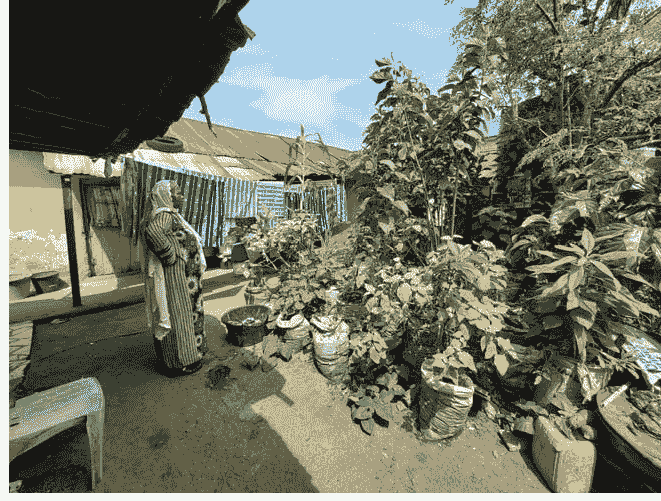

图40：哈吉亚·玛丽亚姆在阿克拉尼马的城市花园

摄影：Holger Weiss/2022

无处不在。^259^ 尼玛-马莫比母亲俱乐部随后声明“[…] 绿色运动是食用健康食品和预防疾病的关键。”^260^

该由女性主导的倡议此后一直担任绿色尼玛项目的当地推广者，获得了广泛的赞誉，本地^261^、全国^262^和国际^263^上皆然。由 GIZ 赞助的城市园艺项目于 2020 年更名为“我的花园，我的健康，我的财富”（图 41）。重新启动的项目于 2020 年 9 月在马莫比组织了另一场研讨会，导致约 150 户家庭建立多层花园用于蔬菜生产。^264^

然而，哈吉亚·玛丽亚姆·萨利富告诉我，该倡议面临了一些挑战和障碍。其中之一是一些房东不允许在院子里种植，另一个是最初参与项目的一些较贫困家庭认为 GIZ 是来送钱的，而不是推广种植植物和蔬菜。其他参与者期望获得继续参与项目的激励措施和/或鼓励以及资金，由于这些都没有兑现，他们结束了参与。尽管遭遇这些挫折，其他人，其中包括哈吉亚·玛丽亚姆·萨利富，仍在照料他们的院子花园，并种植了足够的蔬菜在外出售。^265^

- 259. Hipsters of Nature，“Mothers club of Nima makes Nima Green”，22.1.2017，https://hipster­sofnature.wordpress.com/2017/01/22/mothers-club-of-nima/，访问于 21.11.2022。

- 260. Nima-Mamobi Mothers Club，24.10.2018，https://www.facebook.com/NMMClub/，访问于 21.11.2022。
- 261. 参见 Green Nima Movement Garden Walk 的公告，15.2.2018，https://m.facebook.com/story.php?story_fbid=pfbid0YIr5HDGou2dpMSJbj7nHniAgDYTSk3YyBVwKS9FZdPC4vWXEiAHeCursbdospaal&id=170060016694360&ec=ev-s1&fabr­-hrbhbzOZhW-mcMFAZvT1QjrQIGq3HwtRzpoXUdlxMuBFolXQ125hS9soUcNXJKU&m_entstream_source=timeline&paipv=0，访问于 21.11.2022。
- 262. JoyNews，“Backyard Farming”，28.10.2018，https://www.facebook.com/JoyNewsOnTV/videos/190478911874464，访问于 21.11.2022。
- 263. “Green Nima Project”，31.1.2017，https://canadianinghana.wordpress.com/2017/01/30/greening-nima-project/，访问于 26.4.2024。
- 264. “My Garden, My Health, My Wealth” 的正式启动，17.8.2020，关于 Mamobi 研讨会的帖子，20.9.2020，22.9.2020，26.9.2020，29.9.2020，https://m.facebook.com/MyGardenMyHealthMyWealth/posts/；Jonas Nyabor，“GIZ, local partners launch new project to encourage urban gardening”，19.8.2020，https://citinewsroom.com/2020/08/giz-local-partners-launch-new-project-to-encourage-urban-gardening/，访问于 21.11.2022。
- 265. 与 Hajia Mariam Salifu 的访谈，Nima，19.10.2022。

## 城市园艺项目

## “我的花园，我的健康，我的财富项目。”

这是一个在尼玛部分地区和马莫比全面开展的升级项目，使当地人和学童能够在装满土壤的麻袋中种植水果和蔬菜，以利用有限的空间同时改善营养价值。该技术称为多层花园，由德国发展公司赞助，由 Hipsters of Nature 和 Mothers Club in Development 实施

> "Nananom kua pa, yenfa aduro bia ngu so"

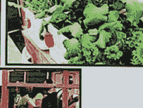

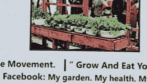

## 加入运动。| “种植并食用自己的食物”

Facebook: My garden. My health. My wealth

Contact: 0243901994 / 0209598897 / 0242281811

图 41 “我的花园，我的健康，我的财富项目”。尼玛，阿克拉墙上的海报

照片：HOLGER WEISS/2022

## 第 5 章

### 迦纳的天课：赋权的工具？

“天课是伊斯兰消除贫困的解决方案。” 这是加纳穆斯林学者对我关于实现加纳穆斯林赋权问题的提问的一致答复。通常，这些穆斯林学者会首先强调，天课，即义务施舍，构成伊斯兰的第三大支柱；它被视为法尔德，即道德义务，对每个（成年）穆斯林都是强制性的。接下来，他们会概述《古兰经》中识别并限制天课接受者的规则，列于《忏悔章》，即 9:60 节：

> 施舍 [sadaqa] 是为穷人和有需要的人，以及受雇管理（资金）的人；为那些（最近）皈依真理的心；为那些被束缚和负债的人；为真主之道；以及为旅人。¹

加纳穆斯林学者的这一观点对当代世界的穆斯林学者同样适用。由先知穆罕默德设立，天课是伊斯兰国家理想社会福利制度的基石，据称在先知和正统哈里发时代存在。与此同时，他们认识到，伊斯兰经济的理想模式仅存在于早期伊斯兰的“黄金时代”，随着穆斯林（世俗）政治实体的建立（苏丹国、王国、伊玛目国等），天课从公共事务变为私人事务。殖民统治和后殖民政府对管理天课几乎没有兴趣，使其征收和分配留给虔诚个人或当地伊玛目。²

当代穆斯林学者在二十世纪后期转向关注天课，以应对许多穆斯林国家的社会经济危机。³⁴ 例如，A.R. Zeinelabdin 认为天课是缓解贫困的潜在但尚未存在的来源。重要的是他的建议，即穆斯林非政府组织可以渠道 *zakat* 资金，甚至考虑将 *zakat* 资金投资于“[…] 小型项目，这些项目能永久性地增加穷人的收入。”⁵ Siddiq Abdelmageed Salih 则将 *zakat* 识别为一种均等化工具。他挑战 *fiqh* 或伊斯兰法学学者考虑将天课“作为对微型企业家的直接赠款……”以及“微型金融机构能否以不同无息融资方式提供这些资金。”⁶

Zeinelabdin 和 Salih 的研究反映了自 1990 年代以来穆斯林学者之间的讨论以及伊斯兰经济的兴起。伊斯兰经济学将 *zakat* 和 *waqf*（宗教捐赠），以及各种形式的伊斯兰小额信贷，确定为基于团结的伊斯兰社会金融工具和消除贫困、提供 *maslaha* 或社会福利的基本工具。⁷ Nasim Shah Shirazi、Muhammad Fouad Bin Amin 和 Talat Anwar 于 2009 年发表的关于 OIC 成员国天课征收和分配的研究探讨了天课作为消除贫困工具的潜力，特别是如果天课资金被汇集。⁸ 作者将天课视为一项为无法负担基本需求者提供保障的安全网。对许多穆斯林经济学家而言，天课因此构成任何伊斯兰战略的核心要素，因为它能够在个人和社区层面制度化关怀原则，并促进互利原则，以在重新分配资源和财富时建立社会最优。⁹

与穆斯林主流经济学家和学者相比，“自由主义伊斯兰主义者”采取极端立场，甚至认为 *zakat* 被定义为自愿慈善而非国家征收的税。Zaheer Kazmi 强调，核心关注点是个体财产权，关于利息的问题

- 5. Zeinelabdin，“Poverty in OIC Countries”，32。
- 6. Siddiq Abdelmageed Salih，*The Challenges of Poverty Alleviation in IDB Member Countries*（Jeddah: Islamic Development Bank, 1999），70。
- 7. World Bank and Islamic Development Bank Group，*Global Report on Islamic Finance—Islamic Finance: A Catalyst for Shared Prosperity?*（Washington DC: World Bank Group, 2016），174–199；Mustapha Abdul-Hamid and Mohammed Fawzi Aminu Amadu，“Islam and Ghana’s Sustainable Development Agenda: Negotiating the Involvement of the Muslim Community in Mainstream Economic Activity”，in *Religion and Sustainable Development: Ghanaian Perspectives*，ed. George Ossom-Batsa, Nicoletta Gatti and Rabiatu Deinyio Ammah（Città del Vaticano: Urbaniana University Press, 2018），131–144。
- 8. Nasim Shah Shirazi, Md. Fouad Bin Amin and Talat Anwar，“Poverty Elimination Through Potential Zakat Collection in the OIC-member Countries”，*The Pakistan Development Review* 48, no. 4, Papers and Proceedings Parts I and II（2009）：739–754。
- 9. Muhammad Ramzan Akhtar，“Poverty Alleviation on a Sustainable Basis in the Islamic Framework”，*The Pakistan Development Review* 39, no. 4 Part II（2000）：632。

（riba），以及天课的非强制性。与强调 maslaha 的社群主义方面相反，这些学者旨在合法化个人自利的核心地位，并将他们的社会福利伦理置于个人自愿主义之中。10 事实上，穆斯林学者激烈争论国家的作用，尤其是在天课问题上。远非标志着伊斯兰主义的去政治化，非正式的、个人间的天课代表了一种抗议国家腐败、失败和非法性的方式，并回应了当代政治危机，与民族国家框架的逻辑相悖。11

关于天课作为扶贫工具的类似讨论大约二十年前在加纳的逊尼派穆斯林学者中开始，是他们实现加纳穆斯林乌玛政治和经济赋权的愿景的一部分。传统上，各种形式的横向慈善构成了（逊尼派）穆斯林社区内部支持的基本形式。天课也是私事：是非正式的、个人间的。有时捐赠者可能会咨询伊玛目，但除了少数地方倡议外，并不存在清真寺或天课基金，12 例如1970年代成立的位于西部地区恩泽马东区的坎布格利天课基金，13 或1990年代成立的大阿克拉地区吉丹图巴天课委员会。14 此外，分发给乞丐和穷人的款项通常只是小额赠予，只能让受助者活过一天，几乎无法改变他们的生活。因此，天课既不是消除贫困的工具，也不是赋权穆斯林的手段，在20世纪的加纳从未如此。至少，这就是我在大约20年前就此问题采访他们时大多数穆斯林学者得出的结论。15

然而，在过去几十年里，态度和行为都发生了显著变化，导致了一种新的天课话语的扎根，即其制度化和建立天课基金或贝特·马尔。

这样一个机构，无论是地方或地区基金还是国家天课基金，都会将每年累积的天课投资于教育和社会项目，并演变为一种穆斯林社会保障体系。有趣的是，加纳已经存在各种天课基金，从少数历史悠久的地方基金，到由在地区层面运作的穆斯林协会和社区设立的少数基金，再到穆斯林非政府组织的少数国家倡议。

加纳穆斯林除了尼萨卜或每年累积财富2.5%的门槛数额的计算外，很少在天课的基本问题上达成一致。传统上，各穆斯林社区和团体的学者各自处理其计算（图42）。例如，在库马西，伊玛目和乌里玛委员会每年在斋月开始前召开会议计算尼萨卜。然后他们将决定告知当地民族社区的领导人。16

2016年在瓦的斋月会议上，朝着建立年度尼萨卜国家标准的统一进程迈出了第一步。首次，各社区和团体的代表与国家大伊玛目办公室一起确立了共同立场，并委托（已故）谢赫博士奥斯曼·巴瓦·哈菲兹·阿拉纳沙，即奥兰多，计算天课的年率。17 一年后，在2017年斋月会议上，谢赫·奥兰多提出了使用白银而非黄金价值来计算尼萨卜的想法（图43）。18 在他看来，在加纳等发展中国家，白银更能反映穆斯林人口 prevailing 的经济和社会状况。他引用了阿里·伊本·阿比·塔利卜传述的关于应缴天课数额的圣训：

> 先知愿主福安之说：当你拥有两百迪拉姆且一年过去时，应缴纳五迪拉姆。对于黄金而言，直到达到20第纳尔之前，你无需缴纳任何东西。当你拥有20第纳尔且一年过去时，应缴纳半第纳尔。

谢赫·奥兰多认为白银优于黄金，因为这样更多人会缴纳天课，穷人和有需要的人将受益于天课的本质。然后他基于现金白银的尼萨卜提出了2017年的尼萨卜计算：

بسم الله الرحمن الرحيم

### 伊斯兰事务联合论坛（FRONT）

#### 谢赫奥斯曼·巴瓦·哈菲兹于2017年提出的现金天课尼萨卜估算

الحديث: عن علي بن أبي طالب عن النبي صلى الله عليه وسلم قال: (إذا كانت لك مائتا درهم وحال عليها الحول ففيها خمسة دراهم وليس عليك شيء يعني في الذهب حتى يكون لك عشرون ديناراً فإذا كان لك عشرون ديناراً وحال عليها الحول ففيها نصف دينار)

据阿里·伊本·阿比·塔利卜传述：先知愿主福安之说：当你拥有两百迪拉姆且一年过去时，应缴纳五迪拉姆。对于黄金而言，直到达到20第纳尔之前，你无需缴纳任何东西。当你拥有20第纳尔且一年过去时，应缴纳半第纳尔。

- 1. 黄金：黄金尼萨卜为20第纳尔=85克。拥有此数额者必须缴纳2.5%。85克黄金=2.73盎司。现金黄金尼萨卜=$1,248.00 x 2.73 = $3,407.04，按美元1.00 @ 塞地4.19的汇率计算。= 塞地14,275.49p。塞地14,275.49的2.5%为塞地356.88p。
- 2. 白银：白银尼萨卜为200迪拉姆=595克。拥有此数额者必须缴纳2.5%的天课。595克=19.13盎司。现金白银尼萨卜=$16.49 x 19.13 = $315.45，按美元1 @ 塞地4.19的汇率计算。因此$315.45 x ¢4.19 = 塞地1,321.73p。GHS 1,321.73的2.5%为GHS 33.04p。2017年的尼萨卜从GHS 1,300.00开始，缴纳GHS 32.50p，或按旧货币计为（₵13,000,000，缴纳325,000）。

根据共识，我们选择白银，理由如下：

- a) 先知的圣训得到满足
- b) 更多人会缴纳天课。
- c) 穷人和有需要的人将受益于天课的本质。

如需澄清和评论，请联系：

SHEIKH OSMAN BAWA ORLANDO

TEL: 0208120402/0266606262

Website: www.olandoweb.org

Email: shosman.bawa@gmail.com

Sponsored by: Muslim Executive's Foundation

P. O. Box 4349

Dichems o May 5 Kumasi

以至仁至慈的真主之名

### 瓦中央清真寺维护委员会

大伊玛目办公室

P O BOX 189

TEL: 0756-20336

WA – UW/R

#### 天课

#### 伊斯兰的第三大支柱

全能的真主命令每位拥有一定财产的穆斯林每年从其财产中缴纳天课给穷人或《古兰经》第九章第六十节提到的其他类别：

> “天课（施舍）是为穷人和有需要的人，为管理资金的人员，为那些最近皈依伊斯兰的人，为那些被束缚和负债的人，为真主之道和旅人而设；这是真主规定的义务，真主是全知全智的。”

#### （1）黄金、白银、货币和货物：

应缴天课的黄金最低数量约为90克，或其等值的货币，应根据当地和国际的现行金价每年计算。

截至2005年10月4日星期二。《每日图形》金融、商品和股市（第33页）：

1 Oz of gold = $468.00. And USD = ₵9,050.00

30grams = 1 Oz

90 grams /30 = 3 Oz = $468 x 3 = $1,404.00

= $1,404 x ₵9,050 = ₵12,706,200

当地：由于黄金的不纯和称重时使用刀片，价格势必低于国际价格。结合两种价格来确定应缴天课的最低金额，可说从₵9,000,000到₵13,000,000或约₵11,000,000.00。

货币、黄金、白银和商业货物上的天课年率为2.5%

即

2½/100 = 5/2 x 1/100 = 5/200 = 1/40

#### 示例：

如果你拥有超过开支的13,000,000，存放在家中或银行满一年。应缴的天课为13,000,000 /40 = 325,000

10 Zaheer Kazmi, “超越比较？自由市场伊斯兰主义作为意识形态,” Journal of Political Ideologies 23, no. 2 (2018): 117–140.

11 Samantha May, “政治虔诚：天课的政治化,” Middle East Critique 22, no. 2 (2013): 149–164.

12 Weiss, “Reorganising Social Welfare among Muslims.”

13 M. Sey, “加纳穆斯林定居点的开发：1901年以来坎布格利的经验,” Jurnal Usuluddin 12 (2000): 137–148.

14 Suleiman Dhikrulhi, Islam in Gidan Tuba, BA thesis, Islamic University College Ghana, 2006, 54; Abdul-Wahab Abubakar, The Practice of Zakat and Poverty Alleviation in Accra, M.Phil. thesis, Department for the Study in Religions, University of Ghana, July 2018, 93.

15 Weiss, Begging and Almsgiving in Ghana. See also Kumi, “Aid Reduction and NGOs’ Quest for Sustainability in Ghana,” 1443.

(200迪拉姆 = 595克 = 19.13金衡盎司，按以下方式折算为现金：美元16.49 [2017年白银市场价值] × 19.13 = 美元315.45 × 4.19 [1美元兑加纳新塞地/GHS的汇率] = GHS 1,321.73；GHS 1,321.73的2.5%为GHS 33.04)并宣布2017年的`nisab`从GHS 1,300开始，为GHS 32.50。19

推动对`nisab`达成共识的动力，也源于从实物缴纳`zakat`向现金缴纳`zakat`的转变。作为推广现金缴纳`zakat`的一部分，位于库马西的穆斯林非政府组织Ansarudeen Organisation于2015年创建了一款数字应用程序，GH Zakaatal Mal Software (ZMS)，用于计算白银的`nisab`。与Sheikh Orlando合作，该应用程序显示了一个功能，可以就`zakat`和`nisab`提出问题。20 该应用程序于2016年在Facebook上推出，包含`zakat`计算器（“calculate the `nisab`”-function）和关于`zakat`捐赠者与受赠者的信息。21 不幸的是，它并未取得很大成功，Sheikh Abdallah承认只有几百人下载了它。22 两年后，Facebook上发布了一段视频，报道了Sheikh Orlando在Hohoe举行的第24届年度斋月会议上对`zakat`的`nisab`的估算。23 然而，关于`nisab`最常见的沟通方式是由参加年度斋月会议的穆斯林学者进行的，在会上，国家新月委员会讨论并确定`nisab`的年度费率，学者们则在斋月布道中向当地社区传达这一决定。24

19 [声明] United Forum for Islamic Affairs (Front)，Estimation of Nisaab Zakaat for cash presented by Sheikh Osman Bawa Hafiz for the year 2017，copy received by author 12.12.2017。

20 Interview with Sheikh Abdar-Rahman, founder and president of Ansar Addeen, and Sheikh Abdallah, General Secretary of Ansar Addeen, Kumasi 7.4.2019。

21 https://www.facebook.com/zspacesystems/, accessed 17.5.2019. However, it seems as if the application is not anymore available (https://apkpure.com/zakaatul-mal-software/appinventor.ai_aisshaq.Alzakaat and the link to Google Playstore (https://play.google.com/store/apps/details?id=appinventor.ai_aisshaq.Alzakaat) was defunct。

22 Information provided by Sheikh Abdallah, General Secretary of Ansar Addeen, Kumasi 7.4.2019。

23 Nisaab Zakaat 2018 Presented by Sheikh Dr Osman Bawa Hafiz Olando, https://facebook.com/sheikhosmanbawa/videos/vb.688656911240613/142713234459729/?type=2&theater, uploaded 30.4.2018, accessed 7.11.2020。

24 Interview with Regional Imam Alhaji Osman Mahama Kanihi and group of elders, 6.12.2019, Wa. See also “Muslims Plan One Fasting Date,” 13.4.2019, https://dailyguidenetwork.com/muslims-plan-one-fasting-date/ accessed 8.2.2021。

### 1 横向、非正式的慈善与施舍的传统话语

传统话语由伊玛目在周五祷告时的布道和讲道中阐述，强调并提醒穆斯林支付`zakat`的道德义务以及减轻其贫困邻居的苦难。这一话语植根于将`zakat`解释为每个穆斯林都必须履行的集体义务的传统解释。虽然`zakat`在清真寺公开讨论，但其征收和分配仍然很大程度上是私人的。在加纳，征收和分配`zakat`的传统方式是地方性的，并非制度化。25 一些富有的穆斯林将其施舍给予各种受赠者；另一些人则捐赠给特定的受赠者，如寡妇、孤儿或清真寺。一般而言，`zakat`以现金或实物捐赠，如衣服和纺织品、凉鞋、鞋子和食品。26 然而，一般来说，清真寺不会设有专门的`bayt al-mal`或`zakat`基金。27

传统话语在`Ramadan`（斋月）期间占主导地位，此时施舍和分享是布道的中心，并在开斋节期间达到高潮，此时征收`zakat al-fitr`并向贫困和需要帮助的穆斯林捐赠食品。在最近，传统话语在印刷媒体以及更近期的社交媒体上公开阐述，已成为加纳相对较新的现象。自1990年代初以来，当两个穆斯林宗教节日，Eid al-Fitr和Eid al-Adha，被宣布为全国公共假日时，国家和地方报纸开始在斋月期间刊登关于伊斯兰信仰和加纳穆斯林日常生活方面的文章。报纸和社交媒体通过刊登国家当局向穆斯林社区致以的节日问候等方式宣传两个穆斯林宗教节日的开始。28

25 Interview with Sheikh Abdul Mumin Harun, Ashanti Regional Chief Imam, Kumasi 15.9.2018; written response to questionnaire; handed to Sheikh Abdul-Razaq, Nurul Islam, Kumasi, 16.9.2018; written answer, transcribed by Dr Yunus Dumbe, 20.9.2018, received 21.9.2018; interview with Sheikh Abdar-Rahman, founder and president of Ansar Adeen, and Sheikh Abdallah, General Secretary of Ansar Adeen, Kumasi 7.4.2019。

26 Interview with Muhammed Al-Mahaman, HOD Arabic and Islamic Studies of Al-Faruq College of Education, Wenchi, Brong Ahafo, and advisor at Sakafiya mosque, Kumasi, Kumasi 15.9.2019。

27 Interview with Sheikh Abdulsalam Ahmed, Regional Chief Imam Northern Region, Tamale, 10.4.2019; interview with Sheikh Dr Tamim, General Secretary of the Anbariya Sunni Community, Tamale 9.4.2019。

28 Weiss, *Between Accommodation and Revivalism.*

更重要的是，在斋月开始时在印刷媒体和社交媒体上发表的穆斯林学者和记者关于施舍道德义务的文章。在2017年，例如，Ashongman Estates中央清真寺的Imam Ibrahim Toure强调了两种类型的zakat，即富人必须缴纳的普通`zakat al-mal`，以及每个有足够能力在开斋节那天和夜晚之外的日子支持自己和家人的个人都必须缴纳的`zakat al-fitr`。Imam Ibrahim Toure进一步强调，`zakat al-fitr`对见证了斋月最后部分和沙瓦尔月开始的人是义务的，并且必须代表家庭的每个成员缴纳，包括婴儿。Imam Ibrahim Toure解释说，慈善的理由是庆祝那天没有人挨饿。他进一步强调，先知穆罕默德已经体现了`zakat al-fitr`的两个主要目的。它帮助受赠者，即穷人庆祝Eid al-Fitr，同时也是在斋戒期间因放纵淫秽或粗俗言论而造成的损害来净化捐赠者的一种方式。29

与先前伊玛目和学者在Eid al-Fitr的问候相比，近期在报纸和社交媒体上发表的关于正确给予`zakat al-fitr`的简短解释性论述扩大了当代关于施舍道德义务的论述。30 因此，Alhaji Alhasan Abdulai向他的读者解释说，加纳的学者已将大米、玉米和高粱定义为`zakat al-fitr`的项目，应给予居住地附近的贫困和需要帮助的人。遵循`zakat al-fitr`的既定规则，他指出，如果在当地找不到应得的人，或在另一个国家有应得或需要的近亲，则可以把慈善用于当地以外的地方。他进一步明确指出，`zakat al-fitr`的目标是近处和远处的贫困和需要帮助的穆斯林：

在今天的世界里，当我们知道数百万人，其中很大一部分是穆斯林，生活在非人类的极端贫困和剥夺条件下时，持有资金或将其引导至order [sic: other?]渠道是没有理由的。31

29 Alhaji Alhasan Abdulai, “Muslims to donate to poor before celebration of Eid al Fitr,” News Ghana 24.6.2017, https://www.newsghana.com.gh/muslims-to-donate-to-poor-before-celebration-of-Eid-al-Fitr, accessed 21.2.2019。

30 Muhammad Ajah, “End of Ramadan: Why zakatut fitr is compulsory on every Muslim,” Modern Ghana, 23.8.2011, https://www.modernghana.com/news/346564/end-of-ramadan-why-zakatul-fitr-is-compulsory-on-every-musl.html, accessed 25.2.2019。

31 Alhaji Alhasan Abdulai, “Muslims to donate to poor before celebration of Eid al Fitr,”

十年来，学者和伊玛目们（以及通常是匿名的作者和成员）与穆斯林非政府组织和青年组织一道，每年在社交媒体上发布关于`天课`和`开斋捐`的短论，提醒他们的追随者履行道德义务，并强调强制性施舍的宗教和教派层面。在回复关于`天课`的询问时，`加纳伊斯兰青年萨达卡协会`（GIYSA）解释了`天课`与`开斋捐`的区别。GIYSA的匿名专家强调，前者“是一种义务性慈善形式，人们须将收入的2.5%施予穷人和有需要者。”而`开斋捐`则是“为净化斋戒者而给予的施舍”，其形式相当于一`沙阿`（saa）的食物。“在加纳，我们认为大米是主食，因此每人需要给出一`奥隆卡`（olonka）大米。按人头计算意味着，如果你是家中之主，你需为自己、妻子、孩子、父母或家人缴纳开斋捐。每个人相当于一奥隆卡。[...] 不过，伊玛目·艾哈迈德说，你们也可以以金钱形式缴纳开斋捐，其价值相当于一沙阿或更多。”GIYSA的专家还指出，2023年一`奥隆卡`的价格在75至100加纳塞地之间，取决于大米品质。32 接受施舍者必须是穆斯林，但也有例外，正如穆斯林非政府组织`萨达卡特·加纳`（Sadaqont Ghana）提醒其追随者所言：

> 如果一个人不属于规定的八类人群之一，则禁止其接受天课。与我们相关的是，这包括六类人，但这些类型中也有例外：
> - 富人
> - 有劳动和赚钱能力者
> - 拒绝工作的虔修者
> - 顽固的不信教者和叛教者
> - 其他非穆斯林
> - 天课缴纳者的子女、父母和妻子。
> 首先，第1、2和6类人可以为天课的征收和分发工作，并从天课中获取报酬。其次，根据一些学者的观点，第1、2、5和6类人可能符合“使他们的心归和”的类别，但这不能由个别的天课缴纳者来确定。第三，任何穆斯林都可以在“负债累累”的类别下获得天课资格。33

在宰牲节（Eid al-Adha）期间，关于施舍的传统论述也受到强调。布道词和贺词的信息与开斋节时相似。

图44 马莱姆·阿米努（Mallam Aminu）在埃吉苏（Ejisu）的书店。该书店位于谢赫·阿米努·班巴·法拉迪（Sheikh Aminu Bamba al-Faradhi）清真寺及其教育综合体前面。

照片：霍尔格·魏斯/2018

而这些布道词的阐述因此无法追溯，被视为局限于特定时空的表演性行为。然而，也有少数学者是例外，因为他们会将自己的布道词写下来。其中之一是提贾尼（Tijani）学者谢赫·阿米努·班巴·法拉迪，又称马莱姆·阿米努·班巴·埃朱拉（Malam Aminu Bamba Ejura），他慷慨地从笔记本中抄录了七篇关于`天课`的布道词，共16页。谢赫·阿米努·班巴生于1950年，是一位受人尊敬的学者，居住在埃朱拉（Ejura），就天文学、诗歌、伊斯兰神学与改革等多个主题撰写了大量著作，以阿拉伯语和豪萨语出版，并出版了几本英文书籍（图44）。37

最初，他于2006年1月至3月用阿拉伯语撰写了这七篇布道词。每篇布道词的结构分为两部分：第一部分介绍布道主题，接着引用《古兰经》和圣训中的经文并加以参引，他在此基础上对主题进行阐述和深化。第二部分则总结他关于该布道主题的论点。总体而言，他的七篇布道词简洁地呈现了逊尼派穆斯林学者对天课的立场。

第一篇布道词涉及穆斯林缴纳天课的个人义务（fard ‘ayn），并提醒听众：天课是伊斯兰教的第三大支柱：“哦，真主的仆人们，敬畏真主，缴纳你们的天课，因为真主将其视为人类必须履行的义务，它是伊斯兰教的五大支柱之一。”谢赫·阿米努·班巴提醒听众说，天课是必须依照财富缴纳的，“必须以真诚之心缴纳，以净化心灵和财富。”38

第二篇布道词概述了天课的规则以及应缴纳天课之财物的起征标准（nisab，即限额），即穆斯林必须缴纳天课的物品和财富类型。布道词的第一部分详细说明了农产品应缴纳的什一税（ushr，10%）和半什一税（5%），前者适用于雨水浇灌的农田，后者适用于灌溉农田，同时还详细说明了（相当复杂的）牲畜天课规则。39

谢赫·阿米努·班巴在第三篇布道词中详细阐述了财富问题，即一年内获得并囤积的银和金（或现代货币等价物）以及其他资产。其中一个特定主题是拒绝缴纳天课以及审判日面临惩罚的威胁。40

在概述了天课的规则之后，谢赫·阿米努·班巴的第四篇布道词强调，穆斯林有义务向其家人、朋友和邻居施舍（sadaqa）。谢赫·班巴引用阿布·达乌德（Abu Dawud）传述的一段圣训说：“[...] 乞丐有权得到施舍，即使他骑着马来。”他强调，天课和施舍取决于意图（niyyaḥ），如关于改革方面的论述，由 Yunus Dumbe、Victor Selorme Gedzi 和 Osman Issah Seekey 提供，见《加纳宗教权威的角逐：阿米努·班巴文学作品面面观》，《当代伊斯兰研究杂志》1，第2期（2020年），108-127页。他的英文著作包括，除其他外，穆罕默德·阿米努·雅库布·班巴的《基督教历法指南：世界在你手中》（埃朱拉：穆罕默德·阿米努·雅库布·班巴，2010年），以及穆罕默德·阿米努·雅库布·班巴的《加纳独立日 1957–2957：国家之书》（埃朱拉：Ihyaa-u-deen Primary & JHS Islamic School，2011年）。

38 谢赫·阿米努·班巴，第一篇布道词，2006年1月，未出版手稿，由 Muhammad Salis Issah 翻译。

39 谢赫·阿米努·班巴，第二篇布道词，2006年1月，未出版手稿，由 Muhammad Salis Issah 翻译。

40 谢赫·阿米努·班巴，第三篇布道词，2006年1月，未出版手稿，由 Muhammad Salis Issah 翻译。

“贫困与骑马或驾车无关。”他引用《古兰经》第2章第177节，提醒听众记住虔诚的真理之人，即那些将自己的财富施予亲属、孤儿、穷人和旅行者的人。他最后详细阐述了`施舍`与`天课`的区别；前者可以是隐秘的，也可以是公开的，而后者则总是要公开的，“以便人们知晓、消除疑虑，并让他人学习。”41

义务与拒绝也是谢赫·阿米努·班巴第五篇布道词的主题。“拿出你们的`天课`，善待穷人和弱者，”他这样开始布道，接着用较长的篇幅阐述了拒绝或否认缴纳天课的伪善者将受到的愤怒，即地狱之火。42

天课的接受者，即《古兰经》忏悔章（Al-Tawba）第9章第60节提到的八类人或情况，在他的第七篇布道词中得到了详细披露和讨论：穷人和有需要者、受雇管理资金者、需要被安抚心灵者、解救奴役和债务中的人、为主道而奋斗者，以及旅行者。此外，接受者必须是穆斯林，且不能是缴纳者的家庭成员。另外，谢赫·阿米努·班巴强调，`天课`不能用于资助建造清真寺或学校。43

谢赫·阿米努·班巴还在他的第六篇布道词中讨论了两种施舍形式和`举意`（niyyah），提醒听众即使缴纳了`天课`，也应当向穷人和有需要者施舍`施舍`（sadaqa）。因此，`施舍`是持续的，而`天课`是每年一次的义务：“真主的仆人啊！[...] 缴纳你们财富的`天课`，并在缴纳天课之后，供养你们的家人，向穷人和弱者施舍。”根据一段圣训，重要的是给予者的意图，而不是他分配的施舍数量。44

#### 1.2 社交媒体上的天课布道词与视频

尽管谢赫·阿米努·班巴·法拉迪在为`天课`制作（未出版的）文本集方面是个例外，但其他学者则利用各种音频和数字渠道传播他们关于`天课`和施舍的布道与思考。包含穆斯林学者布道词的视频和磁带已经……

在撒哈拉以南非洲已流传数十年，但包含加纳伊玛目和学者布道的本地制作版本似乎很少。

此外，萨拉菲学者和伊玛目是首批使用现代技术和大众传播宣教（daʿwa）的人，例如在地方广播电台和电视台布道，尽管提贾尼学者很快也跟进。过去二十年间互联网的广泛可及性和社交媒体的传播，导致加纳穆斯林学者、活动人士和组织的媒体格局发生了深刻变化。[^45] 许多穆斯林社区都在运营多媒体 Facebook 账号，上传布道视频或电视台节目。其中一些拥有相当可观的关注度（即超过 10,000 名粉丝，状态于 2022 年 7 月初核查），例如总部位于库马西的穆斯林接入运动的在线电视频道 MAM TV Online，拥有约 180,000 名粉丝。值得注意的萨拉菲社区例如有：总部位于阿克拉的 Golden Voice of Islam（约 64,000 名粉丝）、总部位于库马西的 Darul Hadith（约 218,000 名粉丝）和 Nurul Islam（近 147,000 名粉丝），以及总部位于塔马利的 Darul Tawheed（Masjidul Bayaan，近 42,000 名粉丝）和 Anbariyya Sunni Community（约 15,000 名粉丝）。大型的提贾尼数字多媒体频道包括：Sharubutu TV（近 155,000 名粉丝）、Zaeem Cissey TV（约 78,000 名粉丝）、Tijjaniyya TV（近 32,000 名粉丝）、Aminiya Shukura TV（约 23,000 名粉丝）和 Shabaniyya TV（约 20,000 名粉丝）。[^46]

社交媒体使用的先驱之一是穆斯林学者和企业家 Haji Saeed Hamid Jallo，他是总部位于塔科拉迪的 Tawheed Development Foundation 的创始人。2015 年斋月期间，他在 Facebook 上发布了一篇长文（布道）《Let's Show Love To Them》，提醒听众在斋戒月履行宗教义务，尤其是在帮助有需要者方面：

> 讽刺的是，当我们在奢华的 suhoor 和 *iftaar* 上花费数百美元和塞地时，我们是否曾花时间问问自己，我们的家人和朋友是如何应对为这一崇高活动筹集一点微薄食物的艰难的？

Breaking the fast in the right way was not enough, Haji Saeed Hamid Jallo underlined, if we forget those who go hungry and have no means to enjoy *suhur* or the morning meal before starting the daily fasting and *iftar* or the evening meal ending the daily fasting. 他认为，

> 我们一些亲戚或邻居（以及各机构的寄宿学生）可能在想去哪里弄到哪怕一根香蕉来与家人一起开斋。其中一些亲戚和邻居可能是有孩子的寡妇、贫困者和流浪者、囚犯以及孤儿，他们除了水之外一无所有，而我们却在这里享受着真主的恩赐，甚至都不去想他们。

Haji Saeed Hamid Jallo 的论点指出了《古兰经》和沙里亚所规定的穆斯林的道德义务：

> 啊，我们是否忘记了这是一个爱的月份、*sadaqa* 的月份、分享和关怀的月份、团聚的月份？？？让我们不要在明知街对面的老妇人与她的孙辈们无饭可吃，以及我们总是在同一座清真寺一起礼拜的那个人时，还沉溺于享受。[^47]

近年来 Facebook 已成为关键的数字平台，大多数伊玛目、学者和穆斯林非政府组织都建立了自己的（公开）账号。一个显著特点是上传到 Facebook 和 YouTube 的视频，例如关于 *zakat* 和 *zakat al-fitr* 的布道以及斋月期间的捐款呼吁。如今此类视频数量众多。自 2018 年以来，Sheikh Aminu Bamba al-Faradhi 等人已在 Facebook 和 YouTube 上发布了几篇用阿拉伯语和豪萨语阐述 *zakat* 规定的布道。[^48] 与 Darul Tawheed Institute 和塔马利的 Masjidul Bayaan 有关联的 Al-Bayaan Institute 于 2018 年 7 月在其问答活动的一部分中发布了一段关于 *zakat* 的视频。[^49] 2019 年成立的穆斯林社会企业 *Make Zongo Great Again* 于 2020 年在 YouTube 上发布了 Sheikh Mohammad Awal Abdullah Haafiz 用豪萨语发表的 12 分钟布道“The Dangers of Keeping Wealth and Not Paying Zakat”。[^50] 总部位于阿克拉的穆斯林非政府组织 Ummul Qura Centre for Islamic Education and Social Services 于 2020 年发布了一段视频，*Measurement and calculations of ZAKAATUL FITR*。[^51] 同样，在 2020 年 *Eid al-Fitr* 庆祝活动临近时，Masjidul Bayaan 的创始人 Sheikh Ibrahim Basha 在 Facebook 上阐述了 *zakat al-fitr* 的规定和要求。[^52]

Facebook 上关于 *zakat* 的帖子通常很短，有时只包含《古兰经》或圣训的引文。另一方面，它们会在数天内发布，以提醒追随者在斋月期间支付 *zakat* 的义务。阿山蒂地区 Akyem Agogo 中央清真寺的 Imam Abdul Aziz 就是一个例子。2019 年 5 月，Imam Abdul Aziz 在其斋月 *tafsir* 的一部分中发布了三条关于穆斯林帮助有需要者义务的通知。与他的反思相关的是照片和他非政府组织 *Friends of the Needy* 的斋月呼吁。第一次呼吁提醒他的追随者“[…] 我们是志愿者，努力伸出援手、抚慰和安慰脆弱[和]有需要的人”，引用《黄牛章》2:274 节，

> > 那些在夜间和白天、秘密和公开地在真主之道上花费自己财产的人——他们将在其主那里获得报酬。他们将无所畏惧，也不会悲伤。

该帖子以他对追随者的断言结束：“[…] 凭借集体的力量，我们可以改变 Insha Allah”，并呼吁向该非政府组织捐款。[^53]

几天后，他发布了第二次呼吁，评论了额外照片，描绘了志愿者参与清理 Agogo 墓地的活动。这次他用阿拉伯语和英语发布了《布哈里圣训实录》（第 2 卷，第 23 书）中的圣训 331，概述了先知命令做七件善事，其中包括帮助受压迫者和探望病人，并禁止七种习惯。[^54]

他的第三次发布在两周后跟进，涉及斋月期间的斋戒和施舍。他解释说，慈善是施舍者为其后世的投资，“这样你在末日贫困有需要时，你会发现你的慈善”。他随后向信徒许诺，“你可以通过一口水、一把枣、果实、食物、金钱和你给予有需要者衣服来找到通往天堂的道路”，列出了穆斯林履行施舍义务的各种方式。只有义务慈善或 zakat，Imam Abdul Aziz 强调，才能净化财富并保存和增加金钱；那些拒绝支付 zakat 的人将在审判日后悔。在引用《古兰经》第 64 章第 17 节（“如果你借给真主一笔贷款，他会为你增加它并宽恕你”）以及穆斯林圣训集中的圣训“慈善永远不会减少财产”之后，Imam Abdul Aziz 结束了对 zakat 的阐述。[^55]

---

47. Haji Saeed Hamid Jallo，《让我们爱他们》，15.6.2015，https://www.facebook.com/saeed.jallo/posts/1092085449086162，访问于 13.1.2021.

48. https://www.facebook.com/Sheikh-Aminu-Bamba-Al-faradhi-408722066003712/

49. https://www.facebook.com/darultawheedinstitute/videos/442682096209809/，22.7.2018，访问于 30.11.2020.

50. https://www.youtube.com/watch?v=Xpr8TLe8DU，1.6.2020，访问于 13.1.2021. *Make Zongo Great Again* 由两个分支组成，即 Make Zongo Great TV 和 Make Zongo Great Foundation，详情请参阅 https://make-zongo-great-again.com/about/，访问于 13.1.2021；该主页在 2024 年 5 月已失效。

51. https://www.facebook.com/Ummulquragh/posts/254059062283111，23.5.2020，访问于 30.11.2020.

52. https://www.facebook.com/MasjidulBayaanTamale/posts/110163434038670，19.5.2020，访问于 30.11.2020.

53. Friends for the needy（Agogo 中央清真寺伊玛目），关于 zakat 和 sadaqa 的神学反思/评论以及穆斯林帮助有需要者义务的反思（2019 年斋月 tafsir）于 2019 年 5 月 6 日发布在 Facebook 上，照片和评论，https://www.facebook.com/Friends-for-the-needy-232391581185564/?ref=py_c，访问于 29.6.2021.

54. Friends for the needy（Agogo 中央清真寺伊玛目），关于 zakat 和 sadaqa 的神学反思/评论以及穆斯林帮助有需要者义务的反思

(5) 建议将其给予自己没有经济责任的贫困亲属。59

2016年发布并于2020年重新发布的一篇文字进一步指出天课（zakat）与天课 al-fitr 不同，60 后者是在斋月结束时发放的慈善。“天课 al-Fitr 的主要目的是为斋戒者提供在斋戒月弥补过错的手段”，RYF 关于该主题的布道之一指出。它进一步指出“天课 al-Fitr 也为穷人提供了一种手段，使他们能够与穆斯林一起庆祝开斋节（‘Eid al-Fitr）”。其数额对每个人都相同，不论收入如何，通常以实物支付。然而，该文本为 RYF 成员提供了一种创新性的解读：

> 如果基于地理位置或出于正当理由，您无法安排食物，您可以提供一些钱，但应足以支付至少一天的餐费，这样的钱可以给予穷人或任何向有需要者捐赠的慈善组织，如加沙受苦的人。我也在为孤儿院筹款，因此海外尤其是英国的人可以联系我通过我支付他们的 fitir。61

有趣的是，RYF 不久后驳斥了这一说法：“请注意，我们不能将钱给予穷人作为我们的 zakaatul fitir。它必须是干粮，如大米、玉米、小麦、枣等。如果您代表穷人将钱交给任何人，请确保他们用这笔钱为穷人购买食物。”62 然而，正如2015年和2021年发布的文本所强调的那样——天课 al-fitr 的目标是给予者的精神发展以及接受者的经济福祉。63

位于库马西的非政府组织 Muslim Access Movement (MAM) 提供了利用社交媒体传播天课阐释的第三个例子。Starting in February 2021, the group posted a video and sermon by Imam Abdul Somad Osman Dabre on the virtues of (obligatory) almsgiving on its homepage. Telling the moral tale of a farmer who always gave to the poor and the needy and his sons who refused to do so and lost the farm they inherited from him when Allah had sent an angel to burn it, Imam Abdul Somad concluded that

> 这是历史上发生的事情，但在我们最近的时代仍然在发生。在我们许多的 Zongo 社区里，有许多富人，他们的孩子在他们死后经历了很多困难。因为这些孩子没有考虑到他们的父亲在做什么，他是如何致富的等等，而是考虑他们自己想要的成功类型。我们所做的一切都应该为了寻求全能真主的恩惠而做。64

在发布布道后，MAM 团队在其“Who is a Muslim”在线讲座系列中制作了四部关于天课的长视频。第一部是关于天课的32分钟介绍视频，随后是关于天课作为模式经济秩序基础的50分钟视频。第三部视频用46分钟讨论了天课的重要性，而第四部视频用近一个小时概述了缴纳者和接受天课者的资格。65

59 "关于农业产品的 Zakaak [sic]"，"关于牲畜的天课"，15.7.2015，21.6.2016，https://www.facebook.com/profile.php?id=100063485326592，访问于 25.8.2022。

60 "你今年缴纳天课了吗？" 21.7.2016，21.5.2020，https://www.facebook.com/profile.php?id=100063485326592，访问于 25.8.2022。

61 "Zakaat Al-Fitr 解释"，28.6.2016，https://www.facebook.com/profile.php?id=100063485326592，访问于 25.8.2022。

62 "Zakat al-fitr 提醒"，3.7.2016，https://www.facebook.com/profile.php?id=100063485326592，访问于 25.8.2022。

63 "Zakat al-fitr 的目的"，13.7.2015，7.5.2021，https://www.facebook.com/profile.php?id=100063485326592，访问于 25.8.2022。

64 “即使在父母去世后也要重复父母所做的善事——Imam Abdul Somad Osman Dabre”，25.2.2021，https://www.mamghonline.org/2021/02/25/video-repeat-the-good-your-parents-did-even-after-their-death-imam-abdul-somad-osman-dabre/?fbclid=IwARi85gb_wQsUydFdKlooSgpYnqEuXwtAJX6Ct mVW2ghidCCBDjFN8EkauRaY，访问于 25.8.2022。

65 https://www.facebook.com/mamtvonline，12.3.2021，26.3.2021，2.4.2021，10.4.2021，访问于 25.8.2022。

### 1.3 天课 al-fitr 和斋月期间的捐赠

穆斯林非政府组织在社交媒体上向其追随者呼吁在斋月期间捐赠，是当代社交媒体格局的一个显著特征。例如，总部位于特马的穆斯林非政府组织 Grain of Hope Foundation 自2016年以来一直在 Facebook 上开展年度斋月活动。2016年作为谦卑的提醒概述：

> 兄弟姐妹们，Akhirah（后世）是这个世界上最重要的、最奢侈的商品，却也是最便宜的。只要 Gh1 塞地就能为你在 Akhirah 赚取一分。让我们现在就开始给予吧。66

66 Grain of Hope Foundation，发布于 Facebook 1.5.2016，https://www.facebook.com/permalink.php?story_fbid=78738u84695925&id=687684277998950，访问于 4.5.2021。

2020年的呼吁类似于穆斯林学者在斋月期间发出的一般呼吁：

> 斋月又来了，给予的月份。通过加入我们最大化您的回报，我们打算在即将到来的开斋节 inshaa’Allah 向弱势家庭分发食物和其他家庭必需品。依靠您一贯的支持，使其得以实现，凭真主的意愿。帮助让我们在穆斯林兄弟的脸上带来笑容。愿真主接受我们的 ibaadat。可以通过捐赠大米、油、罐装番茄、鸡蛋、软饮料、纯净水、现金、二手衣服、鞋子等来提供支持。⁶⁷

位于库马西的非政府组织 *Markaz Aleawn Alyaqin Humanitarian Services* 在2020年斋月期间在 Facebook 上发布了类似的信息，呼吁捐赠以缓解受 Covid-19 大流行影响的穆斯林的痛苦：

> 有需要的人正在接受考验，同样，神的恩典的接受者也在接受考验。让我们记住，每一顿摆在我们餐桌上的饭菜，都是许多人被剥夺的特权，尤其是在需要的时候。正如有需要的人在这种不安的时期接受考验，同样，神的恩典的接受者也应为他们提供一些解脱。我们守护和保护我们的小溪流，并不是因为害怕干渴；而是因为缺乏信仰。因为对于敞开的双手来说，寻找接受者是一种比给予更大的喜悦。让我们不要剥夺有需要的人从我们的小溪流中填满他们的杯子的权利。因此，在享受我们美味的餐食的同时，我们应该感谢这样的祝福，并向有需要的人伸出一些援助。无论是微小的捐助，都能为某人的脸上带来笑容。而在他们的眼中，真主必定会微笑于我们。让我们在传播爱和洗手的同时坚持祈祷。捐赠食品请联系：[mobile telephone number]。现金捐赠请发送至我们的 Momo 账户，名称：Markaz Aleawn Alyaqin Humanitarian Services。请加入我们！有了您的捐赠，我们就更接近于在继续祈祷驱逐 Covid-19 的同时喂养穷人和有需要的人。⁶⁸

一些穆斯林非政府组织对施舍的阐述类似于穆斯林学者的阐述。例如，*Ghana Islamic Youth Sadaqa Association* (GISYA)

⁶⁷ Grain of Hope Foundation，发布于 Facebook，4.5.2020，https://www.facebook.com/permalink.php?story_fbid=251134705635889&id=687684277998950，访问于 4.5.2021。

⁶⁸ Markaz Aleawn Alyaqin Humanitarian Services，Old Tafo，信件/呼吁，日期 8.4.2020，https://www.facebook.com/markaz.aleawn.alyaqin/photos/a.444236052690703/886555645125406/?type=3&theater，访问于 4.5.2021。

于2020年5月在 Facebook 上发布了一篇关于天课 al-fitr 规定的文本。引用了 Abu Dawud 和 Ibn Majah 的圣训，并概述了应缴纳的数额：

> 一 saa’ 的食物。一 saa’ 等于四个 madd。一个 madd 是将双手合拢时可以舀起的量。[...] 如果我们根据主食如面粉或大米的价格将其换算成货币价值，大约是 £5 或 7$[.] 因此，每人应缴纳的数额为 £5 或 7$。69

GISYA 规定天课 al-fitr 对拥有剩余食物的每个穆斯林都是义务的。值得注意的是，这表明了对穆斯林非政府组织作为中介作用的解释发生了变化，GISYA 强调天课 al-fitr 可以支付给伊斯兰慈善机构和从事慈善工作的穆斯林非政府组织（如 GISYA），除了支付给当地清真寺当局之外。70 同样，Make Zongo Great Again 上的匿名专家在2023年解释说，天课 al-fitr 对每个自力更生的成年穆斯林都是强制性的，应缴纳的数量为一 saa 或四 madd 的主食，例如大米。换算成货币价值，匿名专家指出，2023年一个 madd 等于 GHS 40。71

另一个在社交媒体上启动的斋月募捐活动例子是 NTV 1 Ghana Cedi Zakat Fund，该基金于2020年4月由塔马莱的一家当地电视台推出。Northern Television 的管理层制作了一部时长1分40秒的 Dagbali 语言视频，标题为 NTV Zakat Fund，发布在 Facebook 上。尽管标题如此，该视频并不是关于建立天课基金，而是呼吁听众向电视台支付一加纳塞地或捐赠食品作为其年度天课 al-fitr 的一部分。电视台随后承诺将捐赠用于在斋月期间支持塔马莱中央监狱的囚犯。72

69 Ghana Islamic Youth Sadaqa Association (GIYSA)，文本发布于 Facebook，15.5.2020，https://www.facebook.com/permalink.php?story_fbid=142811403982483&id=109699093960381，访问于 23.10.2020。

70 Ghana Islamic Youth Sadaqa Association (GIYSA)，文本发布于 Facebook，15.5.2020，https://www.facebook.com/permalink.php?story_fbid=142811403982483&id=109699093960381，访问于 23.10.2020。

71 "什么是 Zakat ul Fitr (Fitrana)？"，20.4.2023，https://www.facebook.com/MakeZongoGreatAgain，访问于 22.8.2023。

72 NTV Zakat Fund，发布于 Facebook 28.4.2020，https://www.facebook.com/75931854448795/videos/2571770549760789/，访问于 1.2.2021；另见：https://www.facebook.com/Day-Break-NTV-with-DJ-Waris-75931854448795/videos/ntv-zakat-fund/2571770549760789/，访问于 1.2.2021。

一个月后，NTV发布了一段视频，视频中其总经理伊诺克·纳希鲁·阿拉尔比拉在塔马利中央监狱前发表声明，展示了通过该活动收集的食品和卫生用品捐赠，包括八袋大米、一袋糖和数十瓶洗手液，这些物品将分发给囚犯。[^73] 与GIYSA一样，北方电视台也扮演了扎卡特（开斋捐）收集者的角色，从而扩展了谁可以自称中介的定义。然而，NTV活动的目标在知名度方面确实得到了实现，因为该视频通过北方电视台节目和多媒体公司的其他多个公共Facebook账号传播，例如《普林斯·西塔的隔离秀》（2020年4月27日：166名观众；2020年5月20日：839名观众；2022年7月初已不再活跃），[^74] 以及Nasara多媒体。[^75]

然而，正如在分析Rayan Yakub基金会匿名作者撰写的两篇关于开斋捐的文章时所指出的那样，对于开斋捐是否可以现金支付存在分歧，这或许表明代际以及学者间解释的冲突。例如，穆斯林学生奥马尔·哈利法表示，开斋捐可以用现金支付，“为了更稳妥起见，如果你在加纳，10到15塞地就能起到很好的作用。”[^76] 另一方面，加纳伊斯兰研究协会的学者们则坚决否认这一点：现金形式的开斋捐是无效的，因为开斋捐被规定必须以食物形式施舍，并且必须在施舍者开斋时所在之地进行分发。[^77]

然而，许多穆斯林非政府组织采取与GIYSA类似的立场。霍霍埃宗戈发展协会呼吁其成员通过该组织缴纳开斋捐，以便在2022年斋月期间向社区内的贫困家庭分发食物，[^78] 全球穆斯林困境组织[^79] 和“让宗戈再次伟大”组织[^80] 也采取了同样的做法。和平达瓦媒体则保证，“一些

卡米尔·穆罕默德回应了我关于*扎卡特*状况的询问。[^85] “我们没有意愿和权力去收取和分发它，”谢赫·伊斯梅尔·赛义德批判性地反思道。[^86] “一些富人不上缴*扎卡特*，即使上缴，他们也只分发一小部分，”谢赫·贾马尔·迪恩·奥马尔·穆罕默德指出，并声称只有百分之一的人将*扎卡特*交给伊玛目。他进一步认识到，*扎卡特*的目标和宗旨并未实现，因为其分配极其不均。[^87]

塔马利的谢赫·伊萨则认为，加纳穆斯林缺乏领导力、共识与合作，这是*扎卡特*未能制度化的根本原因。此外，他强调富裕阶层缺乏适当的教育，对*扎卡特*知之甚少。[^88] 与许多其他学者一样，阿散蒂大区首席伊玛目谢赫·阿卜杜勒·穆敏·哈鲁纳强调需要关注*扎卡特*分配的影响。他认为，一个人应该获得较大数额的资助，而不是将其分成小份分发给尽可能多的受助者。其论点的依据在于，后一种分配方式只能给穷人提供一天的食物，而前一种方式则为其提供了就业工具和摆脱贫困的途径。[^89] 一些学者甚至希望“拓展”*扎卡特*受助者的目标和类别，并认为将其分配给少数女性比分配给许多（男性）乞丐和穷人更好。在他看来，“女性更能有效地利用它”，即利用*扎卡特*作为实现生活结构性变革的手段。[^90]

穆斯林学者和伊玛目深知，*扎卡特*的理想与实践在加纳很少能相互对应，大多数学者会同意库马西的谢赫·阿纳斯·陶菲克的观点，即*扎卡特*至今未对穆斯林社区的社会发展产生任何影响。[^91] 瓦城的谢赫·哈吉·尤西夫·伊萨在回应我关于*扎卡特*的询问时说，“我们已经失去了对它的掌控。”尽管加纳的穆斯林社区面临巨大的经济和社会挑战，但他强调，穆斯林之间的教义分歧以及穆斯林学者之间的意见不一，阻碍了*扎卡特*发展成为加纳穆斯林社区赋权和社会发展的工具。[^92]

我在加纳遇到的大多数学者强调，他们必须倡导缴纳*扎卡特*，但没有权力强制执行征收。大多数清真寺和社区根本不征收*扎卡特*，大多数富裕的穆斯林和高管也不将*扎卡特*交给伊玛目。在农村地区，穆斯林农民拒绝通过伊玛目将“乌什尔”（什一税）作为*扎卡特*进行分配。主要原因是缺乏信任和无知。[^93] 我于2019年12月在瓦城采访的一些ASWAJ学者的反思凸显了伊玛目们的困境。捐赠者不愿将*扎卡特*交给他们进行再分配，而是直接分发给穷人，他们也不愿告知学者们自己的财富状况。尽管伊玛目们在布道中阐明了《古兰经》第9章第40节（确定*扎卡特*八类受助者的关键经文）的含义，并向穆斯林宣传了关于“尼萨卜”（起征点）的伊斯兰教法规定，但很少有富裕的穆斯林表现出遵守《古兰经》和伊斯兰教法规定的意愿。一位学者甚至回应说，他感到非常失望，以至于大约两年前就不再宣讲*扎卡特*了。[^94] 瓦城的谢赫·哈吉·尤西夫·伊萨也给了我类似的回答：“尽管伊玛目指导富人如何花费*扎卡特*，但他们并不征收。”因此，瓦城没有任何一座清真寺设有*扎卡特*委员会或“财库”（bait al-mal）。[^95]

加纳的其他人呼应了瓦城学者的批判性反思：“你需要给穷人一千塞地，而不是五或二十，”谢赫·阿米努·班巴·法拉迪批判性地评论了周五礼拜后向乞丐和贫困者施舍小额款项的习惯。[^96] 其他学者，如谢赫·赛义德·阿布巴卡尔·扎卡里亚，甚至声称这种零散的分配方

[^73]: NTV加纳，发布于2020年5月20日，https://www.facebook.com/watch/?v=236145834469275，访问于2021年2月1日。

[^74]: https://www.facebook.com/pg/The-Quarantine-Show-with-Prince-Siita-100592288270598/posts/，访问于2021年2月1日。

[^75]: https://www.facebook.com/NasaraMultimediafm/posts/2770661003062371，访问于2021年2月1日。

[^76]: “Zakatul fitr!!!” 2017年6月26日、2018年6月13日、2020年5月20日、2021年6月12日，https://www.facebook.com/umar.halifa1，访问于2022年8月25日。

[^77]: “Zakat al-fitr，” 2019年9月1日，https://www.facebook.com/GIRA4ALL，访问于2022年8月25日。

[^78]: https://www.facebook.com/groups/hozda，2022年4月4日，访问于2022年8月25日。

[^79]: https://www.facebook.com/gmdcharityproject，2022年4月5日，访问于2022年8月25日。

[^80]: https://www.facebook.com/MakeZongoGreatAgain，2022年4月29日、2022年5月1日，访问于2022年8月25日。

[^85]: 采访谢赫·卡米尔·穆罕默德，ASWAJ阿散蒂大区副首席伊玛目，库马西，2017年12月10日。

[^86]: 采访谢赫·伊斯梅尔·赛义德·亚当博士，ASWAJ阿散蒂大区首席伊玛目，库马西，2019年4月5日。

[^87]: 采访谢赫·贾马尔·迪恩·奥马尔·穆罕默德，塔马利中央清真寺伊玛目兼Aris社会中心主任，塔马利，2019年4月10日。

[^88]: 采访谢赫·伊萨，伊斯兰教育局经理，塔马利，2019年4月9日。

[^89]: 采访谢赫·阿卜杜勒·穆敏·哈鲁纳，阿散蒂大区首席伊玛目，库马西，2019年9月15日。

[^90]: 采访穆罕默德·阿尔-马哈曼，文奇阿尔-法鲁克教育学院阿拉伯语与伊斯兰研究系主任，布朗阿哈福地区，库马西萨卡菲亚清真寺顾问，库马西，2019年9月15日。

[^91]: 采访谢赫·阿纳斯·陶菲克·易卜拉欣·巴克里，库马西达尔-哈迪斯清真寺及教育综合体伊玛目，2017年12月12日。

[^92]: 采访谢赫·哈吉·尤西夫·伊萨，瓦城Jama’at Hidayat Islamiyya主席，2019年12月7日。由谢赫·哈吉·丹巴翻译。

[^93]: 采访谢赫·阿米努·班巴，埃朱拉，2019年4月4日；采访谢赫·阿卜杜勒-拉赫曼，Ansar Addeen创始人兼主席，及谢赫·阿卜杜拉，Ansar Addeen总书记，库马西，2019年4月7日；采访谢赫·伊萨，伊斯兰教育局经理，塔马利，2019年4月9日；谢赫·哈吉·努胡·阿卜杜勒-穆敏，瓦城，2019年12月7日。

[^94]: 采访谢赫·阿布巴卡尔·艾哈迈德·伊德里斯、谢赫·阿纳斯·阿卜杜勒-穆敏·伊萨及谢赫·马什胡德·穆罕默德·穆赫塔尔，瓦城-东多利，2019年12月7日。采访由谢赫·阿尔-哈吉·丹巴翻译。

[^95]: 采访谢赫·哈吉·尤西夫·伊萨，瓦城Jama’at Hidayat Islamiyya主席，2019年12月7日。由谢赫·哈吉·丹巴翻译。

[^96]: 采访谢赫·阿米努·班巴，埃朱拉，2019年4月4日。

施舍的分配根本就不算*天课*，也不能视为履行了*天课*，97 而谢赫·哈吉·努胡·阿卜杜勒-穆明则着重强调，拒绝缴纳*天课*就意味着此人不能再被视为穆斯林。98

尽管*天课*是强制性义务，但没有任何一位伊玛目或清真寺社群拥有可强制征收的手段。大多数穆斯林甚至将*开斋捐*视为正规的*天课*，99 尽管我所采访过的所有学者都强调，他们会在布道中宣讲这两种强制性施舍之间的区别以及*尼萨卜*的规则。100 直到近几十年前，当地伊玛目仍在计算年度*尼萨卜*的规定，导致学者们对最低应缴金额存在分歧。因此，加纳各地穆斯林社区在*天课*征收的处理上存在各种不同的地方模式和方法。在大多数情况下，这仍是私人事务而非公共事务，其影响鲜为人知。101

然而，当地学者试图挑战当地传统的施舍习惯，并在社区层面将*天课*的征收和分配制度化。在坎邦利，1970年代决定设立*天课*基金，是基于当地伊玛目的一种理念，即整个社区就像一个核心家庭，财富平均分配，并通过规划和组织实现互助。当地穆斯林领导层通过教育社区成员认识其作为穆斯林的责任和义务，克服了最初的困难，同时强调集体基金相对于私人、不受控制的施舍行为的潜力。结果十分成功，因为社区成员对这一理念反应积极。向该基金的缴纳既有现金也有实物；首席伊玛目哈吉·扎卡里亚在社区其他分支负责人的推荐下，并在亲自审查候选人之后，任命了*天课*征收员。由此产生的资金启动了数量可观的社区项目：一所日托中心、一所初中、一座清真寺、一个图书馆和一间诊所。^102^

吉丹·图巴穆斯林社区设立地方天课委员会，是在其领袖谢赫·奥马尔·博尔博尔吉的干预之后进行的。他批评当地穆斯林在缴纳*天课*时没有遵守《古兰经》和先知的*天课*规定，因此组建了一个特别委员会，成员包括他本人以及曾是他学生的年轻社区成员。与坎邦利一样，教育和培训是这一形成过程中的关键部分，无论是委员会成员还是社区成员皆是如此。天课委员会的任务包括：识别并登记*天课*受益者，识别并登记应缴*天课*者，征收和分配*天课*，管理*开斋捐*和社区财务，以及记录并保存其活动记录。其最初的征收所得为13头牛、159,000（旧）加纳塞地以及约15袋玉米。除向贫困和需要帮助的成员发放援助外，社区还利用这些资金建立了一个社区中心。

然而，苏莱曼·迪克鲁尔希和阿卜杜勒-瓦哈卜·阿布巴卡尔都在其研究中指出，社区的一些成员批评了*天课*的分配机制，声称*天课*资金被用于发展项目，例如建造清真寺和学校，而忽略了其他受益者（即《古兰经》第9章第60节所列的八类接受者）。因此，一些社区成员又恢复直接将*天课*分发给受益者。^103^

此外，一些穆斯林观察家对近几十年来穆斯林慈善的负面形象提出了批判性评论。一些评论者，例如塔马利的记者扎卡里亚·阿尔哈桑，甚至认为向贫困者施舍并非强制性的，而是出于同情，是为了减轻社会弱势群体的痛苦。在他看来，这种负面形象是“乞丐威胁”的后果，即“不择手段的个人”在滥用“慈善家的道德责任”。乞讨据称已成为一种全职、有利可图的职业，以及一条“积累财富的捷径”。对于像扎卡里亚·阿尔哈桑这样的观察者来说，乞丐似乎已涌上街头，并被贴上了公共滋扰的标签：“他们几乎占领了[路口和交通信号灯]，敲打车窗和挡风玻璃，以引起注意。他们形形色色，包括街头各色人等……盲人、残障人士、老人和壮汉、青年男女。”在塔马利，他们集中在中央市场附近的中央商务区，“通常被称为‘乞丐（Barimaansi）线’”，他们在那里收到金钱、牛奶、贝壳等形式的施舍，“以及按照马拉姆和占卜者的要求提供的其他此类物品，而施舍者出于各种原因向他们咨询。”在他看来，慈善施舍既不能减轻贫困，也不能构成解决“乞丐威胁”的持久方案。104

其他人，如ASWAJ阿散蒂地区副首席伊玛目谢赫·卡米勒·穆罕默德，则批评穆斯林在缴纳*天课*方面的选择性。他感叹道，那些去麦加履行*朝觐*的人不缴纳*天课*。社区不向*乌里玛*（穆斯林学者）和伊玛目支付；也就是说，他们不在*天课*的受益者之列。国家伊玛目只得到政府的支持，而穆斯林学术人士也不讨论*天课*的问题。如果*乌里玛*和伊玛目得不到任何支持，学术人士也不与学者们交流讨论*天课*的可用性，我们怎么能在没有信任的情况下发展我们的社区呢？105

库马西的地区副首席伊玛目扎卡里亚·阿卜杜勒-拉赫曼也表达了类似的看法。他指出，尽管缴纳*天课*的必要性是他布道中不变的话题，但在他的听众中，似乎只有少数人同意他关于将*天课*征收和分配制度化的主张。106 塔马利地区首席伊玛目谢赫·阿卜杜勒·萨拉姆·艾哈迈德感叹，*天课*仅以传统方式处理。不过，他对当地各种个人主动收集和分配*天课*的举措持肯定态度。有时，捐赠者甚至会找他签署证明，证明他们已经缴纳了*天课*。然而，他自己不收取*天课*，而且在塔马利的中央主麻清真寺，既没有*国库*，也没有*天课*基金。他强调说，如果这样的机构存在，他就有可供支配的手段

97 采访谢赫·赛义德·阿布巴卡尔·扎卡里亚，安巴里亚逊尼派社区负责人，塔马利，2019年4月9日。

98 采访谢赫·哈吉·努胡·阿卜杜勒-穆明，瓦，2019年12月7日。

99 采访谢赫·阿布巴卡尔·艾哈迈德·伊德里斯、谢赫·阿纳斯·阿卜杜勒-穆明·伊萨和谢赫·马什胡德·穆罕默德·穆赫塔尔，瓦-东多利，2019年12月7日。该采访由谢赫·哈吉·丹巴翻译。

100 采访谢赫·阿卜杜勒·瓦杜德，加纳提贾尼耶穆斯林运动扎明（主席），库马西，2019年4月5日；采访谢赫·阿布达尔-拉赫曼，安萨尔·阿丁创始人兼主席，以及谢赫·阿卜杜拉，安萨尔·阿丁秘书长，库马西，2019年4月7日；谢赫·哈吉·努胡·阿卜杜勒-穆明，瓦，2019年12月7日。

101 采访谢赫·阿布达尔-拉赫曼，安萨尔·阿丁创始人兼主席，以及谢赫·阿卜杜拉，安萨尔·阿丁秘书长，库马西，2019年4月7日。

^102^ 塞，《加纳穆斯林定居点的发展》，144–148；另见韦斯，《加纳的乞讨与施舍》，141–142。在马克·塞与坎邦利穆斯林社区进行调查时，该社区还计划设立一家农村银行。然而，这些计划能否实现尚不得而知。

^103^ 苏莱曼·迪克鲁尔希，《吉丹·图巴的伊斯兰教》，54–55；阿卜杜勒-瓦哈卜·阿布巴卡尔，《阿克拉的天课实践与扶贫》，哲学硕士论文，加纳大学宗教研究系，2018年7月，第93页。

104 扎卡里亚·阿尔哈桑，《施舍正被滥用》，2008年2月15日，https://zakalhassan.blogspot.com/2008/02/alms-offering-being-abused-page-29.html?m=0，访问于2019年4月29日。关于“乞丐滋扰”和加纳穆斯林的负面公共形象，另见韦斯《加纳的乞讨与施舍》。

105 采访谢赫·卡米勒·穆罕默德，ASWAJ阿散蒂地区副首席伊玛目，库马西，2017年12月10日。

106 采访谢赫·扎卡里亚·阿卜杜勒-拉赫曼，阿散蒂地区副首席伊玛目，库马西，2017年12月11日。

为了支持每日前来求助的贫困和需要帮助者。尽管如此，目前他无能为力，因为伊玛目们没有财富，因此无法提供任何帮助。^107

建立 `bayt al-mal` 或 `zakat` 基金的必要性在许多社区中被讨论。一个典型案例是塔马利的安巴里亚逊尼社区。在社区创始人阿法·阿朱拉（Yusuf Soalih Ajurah 或 Alhaji Issifu Ajurah，1890–2004）生前，其成员将实物 `zakat` 交给他，他将其用于扩建自己的教育综合体以及支持贫困和需要帮助的成员。现金形式的 `zakat` 很少，且未捐赠给安巴里亚。实物 `zakat` 至今仍在实行。阿法·阿朱拉的继任者谢赫·赛义德·阿布巴卡尔·扎卡里亚告诉我，2019 年，一位匿名捐赠者捐赠了 100 袋大米并在市场上出售。由此产生的现金被分配给安巴里亚学者以支付其生活费用。他告诉我，`zakat` 的征收始于斋月，所收集的款项除其他用途外，还分配给医院中急需帮助的人、病人或用于支付负债者的费用。^108 然而，所收集的资源不足以启动社会福利项目，例如在塔马利的教育综合体建设诊所（图 45）。因此，安巴里亚学者们开始私下讨论建立 `zakat` 基金的可行性，尽管这一想法尚未公开提出。谢赫·德尔·塔米姆向我解释了这一主要原因，即缺乏组织和管理此类基金的承诺和专业知识，同时还需要在其运作中建立信任和透明度。尽管如此，谢赫·赛义德·阿布巴卡尔·扎卡里亚和谢赫·德尔·塔米姆都强调 `zakat` 是动员资金的关键，例如用于诊所项目。^109

有时，通过他们的非政府组织，一些穆斯林学者和伊玛目会从外国穆斯林慈善家和组织那里接收 `zakat`。谢赫·穆斯塔法·易卜拉欣和ICODEHS是首批利用此类资金的机构之一，并与海湾地区的多个 `zakat` 组织有着长期关系，例如科威特天课之家和迪拜慈善协会。^110 其他

107 采访谢赫·阿卜杜勒萨拉姆·艾哈迈德，北部地区区域首席伊玛目，塔马利，2019 年 4 月 10 日。

108 采访安巴里亚逊尼社区负责人谢赫·赛义德·阿布巴卡尔·扎卡里亚，塔马利 2019 年 4 月 9 日。

109 采访安巴里亚逊尼社区秘书长谢赫·德尔·塔米姆，塔马利 2019 年 4 月 9 日；采访安巴里亚逊尼社区负责人谢赫·赛义德·阿布巴卡尔·扎卡里亚，塔马利 2019 年 4 月 9 日。

110 ‘上东区启用水井’, 1997 年 10 月 23 日, https://www.ghanaweb.com/GhanaHomePage/NewsArchive/Wells-Commissioned-In-Upper-East-Region-2580 (查阅于 2019 年 5 月 21 日); http://icodehs.org/donations/, 访问于 2019 年 5 月 21 日; 该主页在 2024 年 5 月已失效。

图 45 安巴里亚教育综合体在塔马利的结构图

照片：HOLGER WEISS/2019

当地的穆斯林非政府组织，例如加纳发展慈善协会（成立于 2014 年），从阿拉伯联合酋长国援助和沙迦国际慈善机构获得资金。相比之下，伊玛目宣教组织（成立于 2003 年）已从阿拉伯联合酋长国、沙特阿拉伯和卡塔尔收到天课捐赠。前者组织利用这些资金每月为 300 个家庭提供食物、钻井以及协助北部地区、萨瓦纳地区和东北地区缺乏水资源的农村社区。后者则将指定现金捐赠用于北部地区的清真寺、学校和钻井项目。111

111 采访加纳发展慈善协会主任谢赫·凯兰，塔马利 2019 年 4 月 10 日；采访伊玛目宣教组织秘书谢赫·马吉德和伊玛目宣教组织成员谢赫·阿卜杜勒·法塔赫，塔马利 2019 年 4 月 10 日。

有时伊玛目会直接从外部，通常是沙特或其他阿拉伯慈善家那里收到天课捐赠。例如，塔马利的谢赫·伊萨从沙特阿拉伯来源收到天课并捐赠给 10 位寡妇和 50 名孤儿。他们每人收到两袋玉米和大米、一头牛和 500 塞地。此外，谢赫·伊萨的捐赠者要求他在

112 采访伊斯兰教育部门经理谢赫·伊萨，塔马利 2019 年 4 月 9 日。

五年后调查捐赠的影响。¹¹² 谢赫·阿尔哈吉·尤西夫·达乌达·加里巴的非政府组织 `Adabiyya Islamic Society` 反而在 Facebook 上宣布，其作为支持老年人和被忽视人群的项目的一部分运营着一个‘信托基金’。他进一步呼吁向该基金捐款，包括 `zakat`：“我们打算将 `zakat` 资金和其他慈善资金用于有需要的受益者。”与此同时，他提醒观众：“我们很高兴有这么多人‘点赞’我们的页面，但我们无法用‘点赞’来养育和教育孤儿。请今天就捐赠。”¹¹³

113 Adabiyya Islamic Society Ghana—AIS 孤儿院，Facebook 发布，2020 年 9 月 13 日，https://www.facebook.com/aisorphanagegh/photos/a.1020291948012012/440447412953760/?type=3&theater, 访问于 2021 年 2 月 5 日。

非逊尼派社区也从国外收到 `zakat` 捐赠。其中之一是位于温奇的伊巴迪耶社区或伊斯提卡玛穆斯林传教团，其资金来自（伊巴迪派）阿曼苏丹国。资金由阿曼的伊斯提卡玛办公室收集，并在斋月期间转交给温奇当地办公室，指定为给穷人、需要帮助者和孤儿的 `zakat`。温奇办公室反过来也将寡妇、老年人和离婚妇女纳入其捐赠的受助者范围。据乌马尔·西纳·阿卜杜勒-瓦哈卜提供的信息，阿曼每年斋月捐赠在五千至一万美元之间。¹¹⁴

114 Umar Sina Abdul-Wahab，《评估加纳伊巴迪耶穆斯林的宣教方法：温奇和特奇曼案例研究》，M.Phil. 论文，科马·恩克鲁玛科技大学宗教研究系，2016 年 11 月，93–94 页。

### 2 走向纵向慈善：工具主义话语

关于 `zakat` 的工具主义话语将其视为促进社会福利的工具，并将讨论从横向转向纵向慈善。工具主义话语植根于半私人/公共社区收集和分配 `zakat` 的方式。伊玛目和学者都认为贫困是加纳穆斯林边缘化的主要原因。在横向、人与人之间的施舍形式根深蒂固的社区中，纵向慈善难以引入，正如谢赫·穆罕默德·哈伦·巴库里的经历所 exemplifies，见下文。尽管如此，尽管遭到各种抵制，我采访的大多数穆斯林学者都坚持从穆斯林社区内部赋权的理念，并将 `zakat` 视为实现这一目标的工具之一。

与强调减轻穷人和需要帮助者苦难的道德义务的传统 `zakat` 话语相比，工具主义话语强调 `zakat` 作为伊斯兰扶贫工具的潜力。这一话语在加纳大约二十年前开始扎根。2004 年 10 月，大瓦学堂在塔马利组织了为期两天的关于伊斯兰在减贫和财富创造中作用的研讨会，这或许是首次尝试阐述 `zakat` 收集和分配变化的尝试。该研讨会的创新之处在于其关注通过定期支付 `zakat` 为社区发展筹集资金的重点。^115

^115 “穆斯林参加天课研讨会”，2004 年 10 月 6 日，https://www.modernghana.com/news/64169/muslims-attends-seminar-on-zakat.html#google_vignette, 访问于 2012 年 11 月 16 日。

十五年后，关于支付 `zakat` 的讨论不仅在穆斯林学者之间进行，并在斋月期间由伊玛目在布道中强调，也被穆斯林社交媒体评论员所讨论。例如，2019 年 2 月，互联网平台 Zongo Republic 向其穆斯林读者询问他们是否已就增值财富支付了 `zakat`，并讽刺地宣布：“Menzgold 客户，你们支付天课了吗？”^116

^116 “那么，穆斯林 Menzgold 客户支付天课了吗？”，2019 年 2 月 22 日，https://zongorepublic.com/so-did-muslim-menzgold-customers-pay-zakat/, 访问于 2019 年 4 月 23 日；该主页在 2024 年 5 月已失效。

一些穆斯林学者对工具主义话语持接受态度，并试图在 Kambungli 和 Gidan Tuba 推出地方倡议。然而，从横向转向纵向慈善在许多地区都是一场艰难的斗争，大多数情况下以死胡同告终。此类流产倡议的主要原因是当地社区和利益相关者的冷淡回应。一个发人深省的例子是（已故）Jama‘a 伊玛目谢赫·德尔·苏莱曼·穆罕默德·哈伦·巴库里试图在他所在的瓦社区重新组织 `zakat` 的收集和分配。“作为首席伊玛目，我在斋月期间布道 `zakat` 并分发信封，但人们不愿支付 `zakat`，”他在 2019 年 12 月接受我采访时告知我。大约五年前，谢赫·穆罕默德·哈伦·巴库里曾试图建立一个地方 `zakat` 委员会并撰写了其收集和分配手册。该倡议以失败告终，因为只有少数人将 `zakat` 送交委员会。大多数人持抵制态度，谢赫·穆罕默德·哈伦·巴库里不得不认识到，尽管他传道并教授 `zakat`，人们并不了解 `zakat` 或 `nisab` 的规则。他的结论与我采访的许多其他学者相似：“你不能强迫任何人，我们没有权力让人们支付 `zakat`，人们以自己的方式去做。”^117

^117 采访 Jama‘a 伊玛目谢赫·德尔·苏莱曼·穆罕默德·哈伦·巴库里，2019 年 12 月 5 日，瓦。谢赫·穆罕默德·哈伦·巴库里于 2020 年去世。

谢赫·穆罕默德·哈伦·巴库里（Sheikh Mohammad Harun Bakuri）与加纳许多其他伊玛目和学者一样，批评他们的群体没有为社会和经济发展而奋斗。他强调：“天课必须用于促进伊斯兰教和社区发展。”他认为，迄今为止情况并非如此，因为瓦城的穆斯林不缴纳天课，而是缴纳开斋捐，在斋月期间以小份额直接发放给穷人。他总结道：“这样下去，我们永远无法消除贫困。”118

工具主义话语既受到本土参与者，也受到外国参与者的推动。来自尼日利亚扎里亚艾哈迈杜·贝洛大学的艾哈迈德·贝洛·多加拉瓦（Ahmed Bello Dogarawa）在2009年于塔马利举行的由阿尔-福尔甘基金会组织的“首届全国穆斯林大会”上发言时强调，天课的征收和分配一直是穆斯林政府的义务。在一些穆斯林国家，如沙特阿拉伯、巴基斯坦和马来西亚，政府仍然征收和分配天课。在他看来，一种“非政府组织式机构设置”更适合在穆斯林占少数群体的当代社会中管理天课。然而，主要挑战之一是征收只能是自愿的。即使伊斯兰志愿组织或MBFOS自愿管理天课，个人缴纳者也更倾向于自己处理天课，而不是通过志愿慈善组织缴纳。119

2012年，在线平台“现代加纳”发表了尼日利亚作家兼记者穆罕默德·阿贾（Muhammad Ajah）的斋月致辞。文章的主要部分包含了斋月期间布道的具体要素——禁食和祈祷的意义、神与人之间的关系、穆斯林团结和维护伊斯兰信仰、伦理和道德的责任。尽管他的文章面向尼日利亚穆斯林，但他呼吁建立“一个微型天课所（Baitul-Zakah），以规范来自当地和国际捐赠者的天课或捐款”，这引发了一个问题：他的想法是否能在加纳激发讨论。120

一年后，哈吉·亚当斯·戈德华特（Haji Adams Goldwater）在塔马利的斋月致辞中提出了类似的呼吁，要求将清真寺从纯粹的仪式礼拜场所转变为社会改革、教育和财富创造的机构。他的核心诉求是设立一个“教育捐赠/天课基金”，以筹集资源支持才华横溢但经济困难的学生，以及一个“商业发展基金”，帮助那些拥有可行商业计划的人创办企业，为青年提供就业途径。121 然而，他没有明确说明他设想的是设立一个国家基金还是若干个地区基金。

其他组织利用社交媒体呼吁非加纳穆斯林慈善家将他们的施舍和`天课`投入到他们的慈善项目和计划中。例如，`伊克拉基金会`在其阿拉伯语主页上向潜在的沙特捐赠者发出呼吁。伊克拉承诺通过该基金会分配他们的`天课`和施舍，以缓解成千上万难民和赤贫者的困境。122 `伊赫桑慈善救济基金会`是一家自2010年以来在博库和上东部地区运营的当地穆斯林非政府组织，其主页上呼吁提供`天课`和捐款，以资助孤儿、清真寺建设、供水和卫生项目。123 这一呼吁不是针对当地穆斯林，而是针对国际捐赠者。`加纳光明之眼基金会`于2010年成立，2017年注册，是一个跨国非政府组织的例子，因为它也在德国运作。该组织的德国分支专注于筹款，在其德语主页上宣布`财产天课`和`开斋捐`可以存入其在德国的银行账户。所募集的资金用于支持穷人，并在库马西老塔福的开斋节期间捐赠食物。124

上述穆斯林组织和非政府组织声称作为`天课`捐赠者的中介——无论是内部的、加纳本地的还是外部外国的——都指向了加纳在实施垂直慈善方面迈出的新步伐。在西方穆斯林少数群体国家，穆斯林非政府组织已发展成为实施`天课`作为促进社会福利工具的代理机构。其中一些甚至已成为`天课`制度化的工具，例如英国的阿尔-蒙塔达信托和全国天课基金会、美国的美国天课基金会、INCA Relief——穆斯林促进人道（美国）、澳大利亚全国天课基金会、加拿大全国天课基金会和加拿大天课。这些机构将`天课`的分配限制在征收地点/国家内的受助者或当地社区。125 此外，与地方和国家机构并行的，国际穆斯林慈善机构和非政府组织也将自己宣传为`天课`接受/管理组织。这类国际组织的例子包括“透明之手”（英国、美国、澳大利亚）、“穆斯林援助”（英国、美国、澳大利亚）、“穆斯林之手”（英国、加拿大、南非）、“伊斯兰救济”（英国、美国、加拿大）、“伊斯兰帮助”（英国）和“伊斯兰援助”（英国），以及“希达亚基金会”（美国）。这些组织将所征收的`天课`转移到其运作国家边界之外的姐妹和伙伴组织，特别是那些主要在亚洲和非洲国家运作的组织。

### 3 制度主义话语

加纳关于`天课`的传统话语和工具主义话语通常只笼统地涉及加纳`天课`征收和分配的重新组织。这些话语中强调的基本论点是，大多数穆斯林很穷，更愿意按传统方式缴纳`天课`。此外，对`天课`分配存在一种隐蔽的、有时甚至是直言不讳的批评——分配似乎杂乱无章，且没有改变穷人和贫困者生活的明确目标。穆斯林学者在批评时很坦诚——至少在采访中询问他们对强制性施舍在消除贫困方面的潜力时是这样。

将`天课`以小份额分发给个别乞丐，能让穷人或贫困者维持一天或一周的生计，但无法使他们摆脱贫困。穆斯林学者和慈善家一再呼吁建立机构，在地区甚至国家层面监督`天课`的征收和分配。126 然而，塔马利的谢赫·阿明·班巴（Sheikh Amin Bamba）批评地指出，加纳穆斯林组织松散，缺乏协调和信任，影响了`天课`的征收和分配。他指出：“就目前而言，`天课`对穆斯林赋权没有任何影响。”127

加纳关于`天课`的制度主义话语大约始于二十年前。2003年，全国首席伊玛目谢赫·奥斯曼·努胡·沙鲁布图（Sheikh Osman Nuhu Sharubutu）提出了

118 对瓦城贾马阿清真寺伊玛目谢赫·苏莱曼·穆罕默德·哈伦·巴库里博士的访谈，2019年12月5日，瓦城。

119 艾哈迈德·贝洛·多加拉瓦，“通过天课和瓦克夫机构减贫：加纳穆斯林乌玛的案例”，MPRA论文23191，德国慕尼黑大学图书馆（2009年）。

120 穆罕默德·阿贾，“斋月：穆斯林的警觉之月和未来规划——穆罕默德·阿贾”，2012年7月17日，https://www.modernghana.com/news/406360/ramadan-a-muslims-month-of-vigilance-and-plans-for-future.html，访问于2019年2月21日。

121 亚当斯·戈德华特，“塔马利的斋月”，2013年7月9日，https://www.ghanaweb.com/GhanaHomepage/features/Ramadan-In-Tamale-278977#，访问于2019年2月25日。

122 “分发”，http://iqral.org/?page_id=778，2014年10月24日，访问于2020年11月17日。

123 参见 www.ecrfgh.org，访问于2021年7月2日。

124 参见“开斋捐与财产天课”，https://www.eyeoflight.de/projekte/sonstiges，访问于2021年7月2日。

125 索菲亚·亚斯敏和罗扎伊尼·哈尼法，“英国穆斯林慈善组织的问责制与叙事披露”，《伊斯兰会计与商业研究杂志》第8卷，第1期（2017年）：70–86；美国天课基金会，《天课手册：西方穆斯林实用指南》（印第安纳州布卢明顿：AuthorHouse，2008年）。

126 韦斯，《加纳的乞讨与施舍》。

127 对塔马利伊玛目谢赫·阿明·班巴的访谈，2019年4月10日。

FIGURE 46 阿赫勒·逊奈派全国伊玛目贝特·乌尔·扎卡特基金。基金会委托的练习册封面

作者收藏

FIGURE 47 用于“冰水”（饮用水）的塑料袋。考萨尔饮用水是谢赫·乌马尔·易卜拉欣·伊玛目贝特·乌尔·扎卡特基金在2000年代初期创办的企业之一。

作者收藏

将设立国家天课基金的问题列入了全国斋月会议议程。然而，当时成立的国家伊斯兰信托基金发展缓慢，并在几年后被搁置。128 2005年，阿赫勒·逊奈派的全国伊玛目谢赫·乌马尔·易卜拉欣·伊玛目发起了一项新倡议，即贝特·乌尔·扎卡特基金（图46）。然而，尽管该项目最初成功地将天课集中到一个共同基金中，并将所筹资金投资于一家用塑料袋装瓶饮用水的公司（图47），但它很快就陷入困境，并在几年后瓦解。129 同年，时任加纳穆斯林传教团第二副全国伊玛目的谢赫·阿明·邦苏博士呼吁穆斯林组织和个人向一个未指明的扎卡特基金捐款。130 目前尚不清楚他指的是（当时处于休眠状态的）国家伊斯兰信托基金、加纳穆斯林传教团现有的基金，还是一个尚未成立的机构。

128 Weiss，《在加纳乞讨与施舍》，146页。

129 Weiss，《在加纳乞讨与施舍》，142–143页；2017年3月4日在阿克拉对谢赫·乌马尔·易卜拉欣·伊玛目的访谈。

到2007年，上述所有倡议都不复存在。时任加纳武装部队首席伊玛目的谢赫·塞杜·亚当就是其中一位发声并呼吁建立中央、即国家天课基金的人。他的设想是一个中央国家机构，从区、区域和国家层面接收天课以充实基金，“这样每年年底，穆斯林社区就会知道把天课放在哪里。”毫不奇怪，谢赫·塞杜·亚当的制度化做法遭到了其中一位评论者的批评，认为其官僚、不灵活，且容易被负责基金的人挪用：

> 我建议什一税或天课应保存在清真寺财务处，以便他们可以用这笔钱照顾与他们一起礼拜的穷人并支付[他们的]水电费。131

一年后，联合国人口基金（UNFPA）在尼日利亚索科托为非洲40名穆斯林和基督教领袖组织了一次会议。会议产生了联合公报，敦促穆斯林在其国家建立天课基金，以动员资源支持联合国人口基金减少孕产妇死亡率和扶贫。在加纳，COMOG于2010年4月的全国天课会议上提出了这一想法。讨论的结果是于2011年9月启动一项国家倡议，即国家天课之家。132

国家天课之家是阿赫勒·逊奈派、什叶派和提贾尼耶派领导层与联合国人口基金、COMOG、国家发展规划委员会和妇女儿童事务部合作的联合项目。此外，它还得到了全国首席伊玛目谢赫·奥斯曼·努胡·沙鲁布图的支持。COMOG将国家天课之家定位为天课收集、管理和分配的中央机构。据已退休的少校阿尔哈吉·穆罕默德·埃萨（时任COMOG全国主席）称，国家天课之家是穆斯林代表在经过长时间的对话、讨论、分享和交流意见和想法后，在全国十个大区的主要教派穆斯林代表之间达成的国家共识的项目。133

最初，由前《图形通讯集团有限公司》总经理易卜拉欣·穆罕默德·阿瓦尔担任主席的13名成员信托委员会主导了国家天课之家的启动阶段。主要目标是从穆斯林企业家、学者和妇女领袖那里筹集资源，并制定策略支持诸如减少孕产妇死亡率、妇女赋权以及在穆斯林社区弱势群体中扶贫等活动。134 呼应2007年发现大量甜质原油储备，国家天课之家设想特别为穆斯林学生提供支持，使其攻读石油化工工程。135

项目启动意向的公开宣布随后是——沉默。事实上，相关利益相关者的缺乏承诺很快使国家天课之家的愿景被搁置，且从未实现。136 然而，这并非对天课制度化话语的打击。多个社区推出了类似的倡议，例如穆斯林议会党团的天课与萨达卡信托基金、加纳穆斯林传教团和ASWAJ（图48）的地区天课基金、Jam’iyat Hidaya Islamiyya的天课委员会以及穆斯林乌玛发展倡议天课之家。

133 “呼吁穆斯林记者合作传播伊斯兰教义”，Modern Ghana，2011年8月5日，`http://www.modernghana.com/print/343699/1/muslim-journalists-urge-d-to-collaborate-to-propaga.html`，访问于2019年2月25日。

134 “穆斯林社区因启动国家天课之家政策而受到赞扬”，2011年11月20日，`http://www.ghanaweb.com`，访问于2014年3月12日。

135 “呼吁穆斯林记者合作传播伊斯兰教义”，Modern Ghana，2011年8月5日，`http://www.modernghana.com/print/343699/1/muslim-journalists-urge-d-to-collaborate-to-propaga.html`，访问于2019年2月25日。

136 由哈吉·穆穆尼·苏莱马纳提供信息，莱贡，2017年3月1日。据穆斯林天课之家执行秘书兼现任穆斯林发展倡议（MUDI）首席执行官哈吉·阿卜杜勒·马南称，穆斯林天课之家崩溃的主要原因是穆斯林议员同时启动了天课与萨达卡基金。与前一倡议相比，天课与萨达卡基金获得了广泛的媒体报道，并“抢走了”穆斯林天课之家的风头。对哈吉·阿卜杜勒·马南（穆斯林发展倡议（MUDI）首席执行官）的访谈，由尤努斯·杜姆贝博士记录，阿克拉，2021年1月3日。

FIGURE 48 ASWAJ 天课捐赠者桌

作者收藏

### 3.1 天课与萨达卡信托基金

第一次成功尝试在加纳全国范围内建立天课收集和分配机构发生在2010年9月，议会穆斯林党团启动了加纳天课与萨达卡信托基金。根据其使命宣言，该倡议的总体目的是打击该国穆斯林和非穆斯林中的贫困、疾病和剥夺。特别是，它旨在为陷入财务危机的学生提供奖学金，“以便根除无知，从而根除贫困”。新闻发布后，遭到基督教评论员的激烈攻击，其中许多人指责议员滥用职权，为该国伊斯兰化打开大门，并担心资金可能被挪用或用于支持穆斯林恐怖分子。其他人赞扬了议员的决定（“这是善良领导和兄弟情谊的体现”），敦促他们建立一个网站，以便任何人都可以向基金捐款，并将基金的账户详情公布在网站上，以便其他穆斯林可以轻松地将天课转入账户。137

该倡议自启动以来一直被视为国家天课基金的胚胎，并得到加纳全国首席伊玛目以及阿赫勒·逊奈派、什叶派和阿赫迈底亚社区的全国伊玛目的支持。138 此外，包括副总统约翰·德拉马尼·马哈马（NDC）和阿尔哈吉·博士马哈茂杜·鲍威尔马（NPP）在内的政府高级当局和政治家也在公开场合推广该基金。139

自启动以来，天课与萨达卡信托基金总部设在阿克拉新镇，已逐步发展成为一个全国性的非政府机构，在塔马利（自2016年起）、塔科拉迪（自2018年起）和库马西（自2021年起）设有分支办事处；140 见图49。

起初，该基金成功招募了穆斯林议员和国家雇员，会员人数从2010年的54人增长到2013年的250人，直接反映了基金资产从2010年最初的12,000加纳塞地增长到2013年的100,000加纳塞地。141 2016年出现转折点，当年年底基金收到日本汽车管理层捐赠的94,000加纳塞地。142 两年

137 “议会穆斯林党团启动天课与萨达卡基金”，2010年9月7日，`http://www.ghanaweb.com/GhanaHomePage/NewsArchive/Muslim-Caucus-in-Parliament-launches-Zakat-and-Sadaqa-Fund-189934#`，访问于2016年1月21日。

138 “基金概况”，加纳天课与萨达卡信托基金，2019年度报告，可在 `https://media-exp1.licdn.com/dms/document/C56iFAQFfxSjlkpF9dw/feedshare-document-pdf-analyzed/o/16i1317979754?e=163034000&v=beta&t=qnoKD5w7LOx27WurQgxRNNkHomH-mqWgXJpoMMNlgo` 获取，下载于2021年2月10日。

139 “副总统敦促穆斯林向天课基金捐款”，2010年11月16日，`http://www.ghanaweb.com/GhanaHomePage/NewsArchive/artikel.php?ID=19756#`，访问于2019年2月25日；“马哈马敦促穆斯林支持天课基金”，《The Chronicle》，2010年11月17日，`http://thechronicle.com.gh/`，访问于2014年3月12日；“鲍威尔马敦促穆斯林利用技术进行天课收集”，Ghana Guardian，2018年6月8日，`https://ghanaguardian.com/bawumia-urges-muslims-to-use-tech-for-zakat-collection`，访问于2019年4月23日。

140 “塔马利启动天课与萨达卡信托基金”，2016年1月26日，`https://zaaradio.com/society/zakat-sadaqa-trust-fund-launched-in-tamale/`，访问于2017年11月7日；`https://www.facebook.com/ZakatandSadaqafundGhana/photos/a.2002861529962781/2149178201997779/?type=3&theater`，访问于2019年5月14日；`https://ar-ar.facebook.com/Hijrah-TV-News-Ghana-114730809961665/videos/zakat-zakat-and-sadaqa-fund-launched-in-kumasi/243343850865286/`，访问于2021年5月3日。

141 Musah Yahaya Jafaru，“关键穆斯林团体担任朝觐委员会成员”，Daily Graphic，2013年7月16日，`http://graphic.com.gh/archive/General-News/`，访问于2014年3月12日。

142 “日本汽车支持天课与萨达卡基金”，Graphic Online，2016年12月29日，`https://www.graphic.com.gh/news/general-news/japan-motors-supports-zakat-and-sadaqa-fund.html`，访问于2019年5月21日。

#### 图49

天课与施舍信托基金。2021年年度报告封面

作者收藏

后来，在2018年斋月期间，副总统阿尔哈吉·马哈马杜·巴武米亚博士在高贵之夜（由穆斯林核心小组组织的募捐晚宴）上向该基金捐赠了50,000加纳塞地，该基金因此登上了新闻头条。此时，该基金成为世界天课论坛的成员，其活动获得了国际认可。^143^ 到2010年代末，其2020年主页上的“天课基金捐赠者名单”包含近1,100名（具名）个人，^144^ 而捐款总额在2019年已增至559,581.00加纳塞地。^145^ 2020年春季新冠封锁期间禁止社交聚会，对其“高贵之夜”等创收活动和其他外联项目产生了负面影响。因此，当年捐款总额（暂时）降至480,381加纳塞地。^146^ 一年后，捐款创下新纪录，累计达775,365加纳塞地；见图11。^147^ 同样，该基金在其活动中广泛使用社交媒体；其Facebook关注者数量从2019年5月中旬的3,000人增至2020年10月的4,500人，2021年10月的5,600人，以及2022年7月的5,700人（但在2022年12月又降至5,600人）。2022年，媒体评论人士称其扩张和社会影响“非同凡响”，并称赞其已成为穆斯林财富再分配的重要工具。^148^

曾多次尝试扩大天课与施舍信托基金捐赠者群体，使其不再局限于穆斯林议员和国家雇员。2016年，时任加纳总统约翰·德拉马尼·马哈马提议向每位朝觐者收取朝觐总费用的百分之一，并将所得款项转入天课与施舍信托基金。尽管他的提议在社交媒体上遭到了嘲讽，甚至可以说是被直接拒绝，但一些评论员称赞其为一个“绝妙的主意”。^149^ 同年，天课与施舍信托基金在社交媒体平台上发起了一场全球募捐活动，以筹集天课和施舍，但成果相对有限——74人捐赠了约1,300加纳塞地的天课，33人捐赠了约740加纳塞地的施舍。^150^ 2022年初，该基金推出了“1加纳塞地施舍项目”，呼吁穆斯林通过MTN移动钱包每天、每周或每月捐出一塞地，并在社交媒体上发起了一场宣传活动，以在穆斯林中推广和接受该计划。^151^ 2023年，第29届全国斋月会议在公报中指出，“加纳的穆斯林应该全力支持天课与施舍信托基金”，并敦促他们“[..]将今年的大部分天课转入该信托基金，并启动1.00加纳塞地施舍项目，以增加2023财政年度的收入。”^152^

天课与施舍信托基金的结构框架在加纳穆斯林非政府组织中独树一帜，因为其董事会由所有穆斯林教派和若干穆斯林组织的代表组成，并充当精神与财务专家平台。^153^ 此外，董事会任命、监督并批准秘书处成员。秘书处由其首席执行官领导，下设财务行政、项目和通讯部门。全体大会则是该基金的主要机构；它每年召开会议，审查其账目和余额。^154^

天课与施舍信托基金管理着多个项目。最初，其主页列出了四个项目，标题为

- 奖学金计划

- 技术和职业计划

- 技术支持计划

- 经济赋权计划

。^155^ 另一方面，2019/2020/2021年度报告则提到了五个所谓的“旗舰项目”，列为慈善支出的类别，即

- 奖学金和教育支持

- 医疗支持

- 经济赋权

- 斋月供应

- 一般捐款

2020年，又增加了两个慈善支出类别，即新冠疫情封锁期间的紧急支持以及职业支持。2019年至2021年间，各类别的资金分配出现了一些显著变化：2019年，66%用于教育项目和奖学金，而2021年为39%。另一方面，用于医疗支持（4%→16%）和斋月供应（5%→15%）的资金分别有所增加，而用于经济赋权的资金保持不变（20%）。^156^

第一个项目，即奖学金计划，为加纳有需要的穆斯林学生提供助学金，以进入高等教育机构；第二个项目，即技术和职业计划，旨在通过技能能力建设增强受益者的经济能力。2013年至2016年，天课与施舍信托基金共资助了78名学生，总额为68,000加纳塞地，并向阿克龙庞盲人学校捐赠了笔记本电脑。^157^ 自那时起，教育项目的年度支出成倍增长，最高达到

^143^ 世界天课论坛（WZF，成立于2007年）是一个由政府和非政府*天课*组织组成的平台；其总部位于印度尼西亚雅加达。截至2020年，WZF在35个国家拥有成员组织，其中10个位于撒哈拉以南非洲国家（贝宁、加纳、利比里亚、尼日利亚、塞内加尔、塞拉利昂、南非、苏丹、多哥和乌干达）。更多信息参见 `https://www.wzwf.org`。

^144^ `http://ghanazakatfundonline.com/list-contributors.php#`，访问于2021年2月8日。

^145^ 天课与施舍信托基金，《2019年年度报告》。

^146^ 天课与施舍信托基金，《2020年年度报告》。

#### 图11

天课与施舍信托基金：2019–2021年捐款与支出

来源：加纳天课与施舍信托基金，《2019、2020和2021年度报告》

^147^ 天课与施舍信托基金，《2021年年度报告》；Salifu Abdul-Rahman，“天课与施舍信托基金：财富再分配的工具”，2022年7月8日，`https://www.ghanaian...mes.com.gh/zakat-and-sadaqat-trust-fund-a-tool-for-redistribution-of-wealth/`，访问于2023年12月5日。

^148^ “天课与施舍信托基金：财富再分配的工具”，2022年7月8日，`http://m.ghheadlines.com/agency/ghanaian-times/20220708/156014775/zakat-and-sadaqat-trust-fund-a-tool-for-redistribution-of-wealth`，2022年7月8日。

^149^ “从朝觐费用中收取1%注入天课基金——马哈马向穆斯林提议”，2016年6月26日，`https://www.ghanaweb.com/GhanaHomePage/NewsArchive/Charge-1-of-cost-of-Hajj-in-to-Zakāt-Fund-Mahama-proposes-to-Muslims-450727`，访问于2019年2月21日；“干预朝觐事务不会动摇穆斯林选民”，2016年7月16日，`https://www.newsghana.com.gh/snooping-in-hajj-affairs-wont-sway-muslim-voters/`，访问于2019年5月14日。

^150^ 参见 `https://www.fundraisingafrica.com/DetailView/344` 以及 `https://www.fundraisingafrica.com/DetailView/343`，访问于2019年5月19日。

^151^ 1加纳塞地施舍项目，2022年1月11日，`https://www.facebook.com/ZakatandSadaqafundGhana/`，访问于2023年8月22日。

^152^ 第29届全国斋月会议公报，发布于2023年3月7日至9日在海岸角举行的为期两天的年度全国斋月会议，2023年3月11日发布在 `https://www.facebook.com/GhanaAcademyOfMuslimProfessionals`，访问于2023年8月22日。

^153^ 2021年，董事会成员包括Alhasan Andani（董事会主席）、Mohammed Inusah（副主席）、Hajia Azara Abukari-Haroun（首席执行官）、Supt.（伊玛目）Husein Abdur Rahim、Mohamed Hardi Nyagsi、Zackaria Abraham Ibn博士、Hajia Ayisha Salifu、Sheikh Alhaji Suleiman Bandago（什叶派代表）、Amin Abdul-Rahman、Marzuk Azindoo博士（提加尼教团代表）、Sheikh Salman M. Alhassan（逊尼派代表）、Sheikh Abdul Wahab Issah（阿赫迈迪亚派代表）。“董事会成员”，天课与施舍信托基金，《2021年年度报告》。

^154^ 与天课与施舍信托基金前首席执行官Sheikh Arimiyao Shu’ab的访谈，阿克拉/莱贡，2017年12月7日。我并不怀疑天课与施舍信托基金得到高效而恰当的管理。然而，当我在2017年开始调查时，其缺乏透明度是显而易见的。在其主页和Facebook账户的早期版本中找到了一些基本信息，但其活动年度报告当时并未公开。相反，我通过新闻报道和报表获取有关捐赠和支出的信息。尽管如此，近年来出现了明显的开放和公开其活动的动向。也许是公众批评的结果，天课与施舍信托基金自2020年起开始在Facebook、LinkedIn及其主页上发布其年度报告，包括财务报表。到目前为止，已有三份报告，即2019、2020和2021年的报告，包含其活动回顾、收支报表和独立审计报告。连同早期关于其活动的通知，这三份年度报告让人们得以了解天课与施舍信托基金在其成立头十年所取得的成就。

^155^ 这四个计划列在主页的2017年版本上，`http://ghanazakatfundonline.com`，访问于2017年11月7日。

^156^ 数据取自天课与施舍信托基金《2019年年度报告》中的“财务活动/慈善支出报表2019”以及《2021年年度报告》中的“财务活动/慈善支出报表2021”。

^157^ `http://ghanazakatfundonline.com`，访问于2017年11月7日。

2019年金额为GHS 186,685.158。COVID-19产生负面影响，该项目仅收到GHS 52,000。159 一年后，教育和奖学金支出增加至几乎GHS 170,000。160

该基金于2015年进一步扩大其奖学金项目，当时它加入了隶属于教育部下属政府机构的学生贷款信托基金（SLTF），作为穆斯林学生的合作伙伴和担保人；161 2021年，该基金通过该计划支持了156名学生。作为其支持穆斯林高等教育重点的一部分，Zakat and Sadaqa Trust Fund与Albulkhary国际大学签署了谅解备忘录，并在马来西亚大学开始提供本科学习奖学金；2021年，它资助了五名学生。162

Zakat and Sadaqa Trust Fund于2018年在其实用和技术培训计划中启动了多个雄心勃勃的项目。迄今为止，这些项目在主页上列为提案，要么没有进一步信息（例如计划中的职业卓越中心），要么只有关于项目的粗略概述（如拟议的Zakat and Sadaqa基础学校综合体，预计包含40间教室和一间校长办公室）。拟议的职业培训中心据称“[…]培训人们从事重型工程、建筑技术、汽车机械和喷涂等工作。”163

第三项计划，即医疗支持计划，旨在提供财政支持以抵消医疗费用。根据Zakat and Sadaqa Trust Fund 2017年主页提供的信息，五名贫困人士已从该计划中受益。164 2018年，它在医疗支持上花费了GHS 31,400。一年后，该金额降至GHS 12,000，并支付了阿克拉科尔布教学医院两名贫困患者的费用。165

158 “财务活动报表”，Zakat and Sadaqa Trust Fund，2019年年度报告。

159 “财务活动报表”，Zakat and Sadaqa Trust Fund，2020年年度报告。

160 “财务活动报表”，Zakat and Sadaqa Trust Fund，2021年年度报告。

161 Emmanuel Amoquandoh，“SLTF与ZSTF合作启动”，11.10.2015，`https://www.ghanaweb.com/GhanaHomePage/regional/Partnership-between-SLTF-and-ZSTF-launched-387037`，访问于21.5.2019；'学生贷款信托基金成立10周年'，6.9.2015，`https://www.ghanaweb.com/GhanaHomePage/NewsArchive/Students-Loan-Trust-Fund-is-10-years-380126`，访问于21.2.2019；`https://www.sltf.gov.gh/zakat-sadaqa-partnership-for-disbursement-repayment/`，访问于14.5.2019。

162 “2021年活动首席执行官回顾”，Zakat and Sadaqa Trust Fund，2021年年度报告，3。

163 `http://ghanazakatfundonline.com/projects.php`，访问于26.2.2021。

164 `http://ghanazakatfundonline.com`，访问于7.11.2017。

165 “财务活动报表”，Zakat and Sadaqa Trust Fund，2019年年度报告。

2020年和2021年，它分别支持了14名和23名有不同健康限制的受益人。166

第四项计划，即经济赋权计划，旨在帮助穆斯林社区内的贫困群体“重建其生计”。其理念是支持寡妇和残疾人建立微型企业，“具有扩展为中型和大型企业的潜力”。167 尽管该计划在2010年已在纸面上存在，但它仅在2018年开始运作，当时经济赋权支出为GHS 11,700。2019年，该计划的拨款增加至近GHS 57,000，使Zakat and Sadaqa Trust Fund和卡塔尔大使馆能够赞助为16名寡妇设立微型企业；168 2020年和2021年，它分别支持了18人和17人设立自己的小型企业。169

除了四个（五个）项目外，Zakat and Sadaqa Trust Fund于2018年启动了斋月捐赠计划。与加纳许多，如果不是大多数，穆斯林非政府组织类似，斋月捐赠构成了提高组织公众知名度的重要途径。2019年，Zakat and Sadaqa Trust Fund向Akropong盲人学校捐赠了价值近GHS 15,500的各种食品。170 2020年，当全球Covid-19大流行瘫痪加纳和世界其他地区时，其斋月捐赠除其他外，还用于缓解阿克拉贫困穆斯林社区的苦难并支持塔马莱中央监狱的穆斯林囚犯。171 2021年，它在斋月期间推出了“供养穷人”活动，并与卡塔尔慈善机构合作向阿克拉的清真寺提供食品包（图50）。172 2023年，该基金在向土耳其地震受害者捐赠5,000美元时进行了首次国际捐赠。173

166 "2021年活动首席执行官回顾"，Zakat and Sadaqa Trust Fund，2020年年度报告，3。“2021年活动首席执行官回顾”，Zakat and Sadaqa Trust Fund，2021年年度报告，4。

167 `http://ghanazakatfundonline.com`，访问于7.11.2017。

168 "财务活动报表"，Zakat and Sadaqa Trust Fund，2019年年度报告。

169 "2021年活动首席执行官回顾"，Zakat and Sadaqa Trust Fund，2020年年度报告，2。“2021年活动首席执行官回顾”，Zakat and Sadaqa Trust Fund，2021年年度报告，3。

170 "财务活动报表"，Zakat and Sadaqa Trust Fund，2019年年度报告。

171 `https://www.linkedin.com/posts/zakat-sadaqa-trust-fund-of-ghana_covid-19-support-to-some-muslim-communities-activity-6662018064097382400-77zw`；`https://www.linkedin.com/posts/zakat-sadaqa-trust-fund-of-ghana_contribution-made-to-tamale-central-prison-activity-666130138658512288-5-Yg`，均访问于12.2.2021。

172 "2021年活动首席执行官回顾"，Zakat and Sadaqa Trust Fund，2021年年度报告，5。

173 土耳其地震捐赠，13.2.2023，`https://www.facebook.com/ZakatandSadaqaFundGhana/`，访问于22.8.2023。

#### ZAKAT & SADAQA基金“供养穷人”斋月2021活动

自基金成立以来，对加纳贫困人口生活产生积极影响一直是其运作的核心。通过教育、医疗保健支持和赋权计划，我们为贫困者提供希望和同情。

在神圣的斋月期间，这些努力增加了一倍多，因为该组织向数千名有需要的人分发天课和食品包。随着新冠肺炎大流行席卷全球，造成封锁和失业，社会团结变得极其重要和关键。

去年，通过您的捐助以及与加纳银行家协会（GAB）的合作，我们在阿克拉、库马西、塔科拉迪和塔马莱向超过一千名弱势人士提供了“家庭食品包”。

我们可能已进入新的一年，但大流行对加纳人民尤其是贫困人口生活的负面影响显而易见。

基金希望通过您的慷慨捐赠在斋月期间为更多家庭提供食物。作为穆斯林，我们被提醒在神圣的斋月期间施食给穷人的回报。

真主将那些施食给有需要者的人描述为“右边的人”之一，并将继承乐园。除此之外，先知（愿主福安之）也向我们展示了，施食给穷人的食物才是真正留存的（在真主那里的回报是永恒的），与我们所食用的食物相反。

今年，Zakat and Sadaqa Fund已启动“供养穷人”斋月2021行动，目标是为加纳16个地区贫困社区中的超过10,000个弱势家庭提供食物。斋月是穆斯林更加慈善的时期，经常通过宗教义务税天课来支持社区。穆斯林还参与自愿慈善活动（天课），包括施食给穷人。

我们相信，通过您的慷慨捐赠，该基金可以在2021年斋月期间在全国范围内产生影响。

Zakat and Sadaqa Fund因此恳请您帮助为加纳的弱势群体提供苏胡尔和开斋。请通过所有网络上的MoMo代码'`*789*2#`'或以下银行捐款支持“供养穷人”斋月2021活动。

愿真主赐予你们善报。

银行捐款详情和联系信息：UBA ARENA - LAPAZ BRANCH AC NO. 02413506401510；Stanbic Bank；Absa OBU BRANCH AC NO. 1031314；Ecobank；GCB；Bank of Africa MADINA BRANCH AC NO. 01343350064；Standard Chartered RING ROAD BRANCH；Zenith NORTH INDUSTRIAL AREA；CBG；ADB；Access NEW-TOWN BRANCH；联系电话 NO. 0542 216 231，NO. 0262 824 482，NO. 0573 229 984，CONTACT: 0202748382 0542216231，ZAKAT USSD CODE (`*789*2#`)

图50 ZSTF斋月活动2021 作者收藏

天课和萨达卡信托基金的愿景是成为加纳最可行、最受信赖的穆斯林非政府组织。理论上，这一目标并非不可能实现。支持该倡议的学者强调，天课的征收和分配是法尔德·基法亚，即整个穆斯林社区共同承担的义务。遵循穆斯林为少数群体的国家（如英国或南非）学者的立场，阿里米亚奥·舒阿卜谢赫等人认为，天课和萨达卡信托基金承担着回应穆斯林社区乃至整个社会的需要的角色。174 然而，这一立场遭到其他学者的质疑，他们认为天课和萨达卡信托基金是穆斯林议会团的倡议，未获国家首席伊玛目办公室认可，而另一些人则表示他们不知道加纳存在这样一个组织。175

穆斯林学者之间以及穆斯林社区内部缺乏共识，影响了天课和萨达卡信托基金的覆盖范围和影响力。尽管天课和萨达卡信托基金在大阿克拉、北部、西部和阿散蒂四个大区设有办公室，但全国仍有大片地区未覆盖。例如，试图在瓦开设办公室迄今已被当地乌里玛阻挠。176 更具挑战性的是如何接触并争取不断增长的穆斯林中产阶级，并将天课和萨达卡信托基金树立为其天课和其他捐赠的主要渠道。177 此外，正如伊萨谢赫所强调的，应特别关注市场妇女这一潜在的核心捐赠群体。178 迄今为止，该基金已从正规部门的员工那里收到定期天课缴纳，主要来自总审计与会计总局、加纳武装部队、加纳警察局和议会办公室的穆斯林员工，见图12。

为扩大定期缴纳天课的人群，该基金开始制定通过工资直接缴纳天课的计划。鉴于加纳约70%的穆斯林不识字，天课数字化——正如世界天课论坛所倡导的——仍然是一个挑战。然而，“1.5百万符合缴纳天课条件的穆斯林人口中有八十 percent 表示对这种方法感兴趣，”阿扎拉·阿布巴卡里-哈伦在2019年WZF会议上评论道。179

#### 图 12

天课和萨达卡信托基金：天课缴纳，2018–2021年。缩写：C & ADG = 总审计与会计总局穆斯林员工；GAF = 加纳空军穆斯林员工；GPS = 加纳警察局穆斯林员工；JM = 日本汽车穆斯林员工；OP = 议会办公室穆斯林员工；SO = 常设命令（银行）；ZSTFS = 天课和萨达卡信托基金员工

来源：天课和萨达卡信托基金，《年度报告》2019、2020、2021

另一个障碍是沟通以及缴纳天课呼吁的传播。尽管天课和萨达卡信托基金有时会获得一些媒体报道，但穆斯林记者对其活动的定期报道甚至关于天课的出版物仍然缺乏。180 此外，大多数伊玛目和穆斯林布道者在其斋月布道中并未提及天课和萨达卡信托基金。相反，正如伊萨谢赫所声称的，他们更愿意自己收取天课。一个解决方案，他设想的是，当地伊玛目以实物形式接收全部天课，自行保留10%作为征收者的合法份额，将20%送交天课和萨达卡信托基金，该基金更改

附于2019年和2021年年度报告中的图表显示，总捐款从2014年的217,800 GHS增加到2021年的近771,000 GHS（尽管‘捐款’的定义尚不明确，因为图表中列出的总和与财务活动报表中报告的总额不符）。183 根据财务报表，筹款晚宴在2018年产生了可观收入（161,728 GHS），但在2019年仅为适度（7,400 GHS），而在“大夜”184活动中的捐赠在2019年列为37,150 GHS，但在2018、2020和2021年为零。相应地，员工成本从2018年的82,432 GHS增加到2019年的116,695 GHS（2020年133,652 GHS；2021年156,869 GHS），而一般和管理费用在2018年为160,803 GHS，2019年为177,549 GHS（2020年139,038 GHS；2021年192,362 GHS）。这些增长反映了天课和萨达卡信托基金活动的扩张，并包括其十名员工的薪资。2019年，员工成本占总支出的20%（2018年为17%），到2021年降至16%。185

仔细阅读2019年财务活动报表引发了对收入和支出的讨论。首先，假定*天课*缴纳是按照古兰经规定分配的，这意味着当年约66%的所收*天课*被分配为‘慈善拨款’。报告或ZSTF主页均未披露*天课*征收者是否应被列为*天课*的受领者。如果情况如此——这与一些大型国际穆斯林慈善机构的做法相似——那么2019年总员工成本占所收*天课*的27%。然而，如果仅包括直接员工成本，即工资和SSNIT缴款，则这些支出占2019年所收*天课*的24%。186 尽管如此，这些计算纯属推测，如果天课和萨达卡信托基金的处理方式与其他

“治理体系向利益相关者保证其得到审慎管理。”最初，它的目标是在全国层面运作，因为其设想是通过执行“为加纳穆斯林社区的发展”而“为穆斯林社区的合格项目”积累资金。188

GMM大阿克拉地区天课基金的目标雄心勃勃，任务是在2014年底前筹集至少100,000 GHS，外加实物捐赠。在一次公开声明中，GMM全国主席阿明·邦苏博士谢赫强调了穆斯林每年系统性地将其财富的2.5%用于穷人利益的道德必要性。他进一步强调，天课与出于善意或慷慨而给予的慈善礼物不同。天课的核心思想是，他提醒追随者，它教会穆斯林自律并使穷人和受苦者得以赋权。189

GMM大阿克拉地区天课基金已作为试点项目运作。190 运营五年后，地区天课基金为六名学生提供了奖学金，在阿克拉科尔-贡诺修建了一口井以提供饮用水，并承担了GMM部分病患和年长成员的医疗费用。191

此后，GMM在每个大区都推出了类似的倡议。然而，尽管它们每年征收天课，所产生的款项仍然有限。在2017年与GMM全国主席的讨论中，阿明·邦苏博士谢赫指出，仅靠天课无法解决加纳穆斯林社区的社会问题。对他而言，应更侧重于拓宽慈善捐赠的基础，这已成为GMM的主导主题。因此，GMM决定将捐赠的征收和分配下放至其地区总部。虽然GMM组织年度全国筹款会议，但地区会议则临时组织。地区办公室随后将所收款项分配给有需要的人，用于支付租金和学费，以及资助社会福利和教育项目。192 五年后我再次见到邦苏谢赫时，他

他告知我，GMM 的地区天课基金已经发展壮大。此外，他还通知我，GMM 代表团于 2022 年 12 月举行的会议计划讨论将这些基金并入一个国家天课基金。如果代表团同意该计划，此事将被列入 GMM 2023 年 1 月全国会议的议程。193

GMM 模式在争取加纳穆斯林捐款方面相当成功，能够内部资助 165 所学校以及其师资培训和教育学院。Bonsu 谢赫指出，GMM 社区每周在周五祈祷及之后的讨论中都会就赋权问题进行宣传。这种方法反过来又营造了积极捐款的氛围。然而，要实现其建立一所伊斯兰大学的宏伟计划，将依赖外部/外国捐助者。194

#### 3.3 ASWAJ 的地区天课基金

逊尼派大众（Ahlus-Sunna Wa-Jama'a，ASWAJ）的全国伊玛目哈吉·奥马尔·易卜拉欣·伊玛目于 2009 年发起建立地区天课基金，但过了一段时间才得以实现。本节讨论其中两个地区单位，即库马西（Kumasi）和瓦城（Wa）的单位。这两个例子说明了此类地区倡议所遇到的各种挑战以及克服这些挑战的解决方案。最初，ASWAJ 地区天课基金采用分散结构，ASWAJ 全国总部和全国伊玛目均不监控或监督基金的管理。相反，它们是自主单位，各自由相应的 ASWAJ 地区总部控制。

阿散蒂地区的 Ahlus-Sunna Wa-Jama'a（ASWAJ）是计划于 2015 年建立地区天课基金的区域单位之一。作为天课基金及其同时设立的瓦克夫基金会（Waqf Foundation）宣传的一部分，ASWAJ 阿散蒂地区创建了一个主页，并公布了地区天课基金的章程。195 该章程设想 ASWAJ 阿散蒂地区天课基金由一个中央天课基金和十个分区天课基金组成。196 分区天课账户中积累的所有资金每季度转入中央天课基金；记入中央天课基金的所有款项均存放在不计息的银行账户中。章程对每年募集的天课基金资产的利用和分配作了详细规定，并允许最多 15% 用于支付基金的征收、分配和管理费用（图 51）。地区天课预算的一半将用作贫困者、赤贫者、孤儿和寡妇的津贴；10% 用作遭受自然灾害而无家可归的穆斯林的津贴；18% 用于教育助学金，资助“在政府设立或认可的学校、学院、大学、理工学院和其他培训机构中就读的贫困但优秀的穆斯林”。而分区天课基金则将其总分配预算的 54% 用于向公立宗教学校（madrasas）和 Deeni Madaaris（宗教学校）的学生提供教育助学金。20% 用于支付未获得政府薪酬的 Deeni Madaaris 支持人员的工资。17% 专门用于教育机构的赠款和助学金。医疗保健分配 5%（即支付住院费等），4% 用于社会福利和康复，服务对象是未获得任何其他天课计划或政府补助的成年穆斯林。197

然而，该项目提前终止，并沉寂了多年。Kamil Muhammad 谢赫解释说，主要且唯一的原因是人们拒绝向该基金缴纳天课。198 另一个问题是基金的集中性质——中央账户本应收缴 80% 的募集资产。然而，地方征收者很少将征收的款项转给中央账户。199 不过，2018 年，ASWAJ 阿散蒂地区领导层决定从尼日利亚索科托聘请一位天课和瓦克夫专家，并规划了基金的重建。讨论的一个结果是两个基金合并，于 2018 年重新启动为 ASWAJ 阿散蒂地区天课、瓦克夫和施舍基金（Zakat, Waqf and Sadaqa Fund）。

196 ASWAJ 阿散蒂地区分为十一个分区，即（1）Jamasi/Agona、（2）Aboaso、（3）Offinso、（4）Barekese、（5）Abuakwa、（6）Obuasi、（7）Effiduase/Ejisu、（8）Konongo、（9）Aboabo、（10）Old Tafo 和（11）Ejura，参见 Ahl Sunnah Wal-Jama’ah Ashanti Region, Interim Operational Report by Regional Finance Committee, May 2013。该报告 2017 年可在 ASWAJ 阿散蒂地区主页上获取，我下载了一份副本。

197 Ahl-Sunnah Wal Jama’a 阿散蒂地区，《天课基金会章程》，1，8–9。

198 与 ASWAJ 阿散蒂地区副首席伊玛目 Kamil Muhammad 谢赫的访谈，库马西，2017年12月10日。

199 与 ASWAJ 阿散蒂地区天课、瓦克夫和施舍基金协调员 Ahmad Musa 的访谈，库马西，2019年4月6日。

## اهل السنة والجماعة

AHLUSSUNA WAL'JAMAA (ASWAJ)

TIJARA MA'ALLAH التجارة مع الله

| 地区 | 区 | 清真寺 | 日期 |
|---|---|---|---|

| 名称 | 1 | 2 | 3 | 4 | 5 | 6 | 7 | 8 | 9 | 10 | 11 | 12 | 13 | 14 | 15 | 16 | 17 | 18 | 19 | 20 | 21 | 22 | 23 | 24 | 25 | 26 | 27 | 28 | 29 | 30 |

更多信息请联系：0241 259 89（WA）

0302226547 - 0243586626 - 0244023542

与旧基金相比，新基金采用分散结构，活动集中在阿散蒂地区的 42 个市和区。200

分散结构也体现在募集资产的移交上——每年募集款项的仅 20% 需转入中央基金账户。2017 年 4 月，ASWAJ 阿散蒂地区妇女部（Women’s Wing）推出了自己的天课、瓦克夫和施舍基金。根据新规定，所募集款项的 60% 由妇女用于其项目，20% 专门用于支付行政费用。然而，该基金协调员 Ahmed Musa 承认，天课征收仍然是一个挑战，因为只有三个人向该基金缴纳天课。相反，该基金现有资产中大部分（如果不是全部）要么来自对旧瓦克夫基金的捐赠，要么是捐款（即施舍，sadaqa），而不是为新基金征收的天课。201

200 与 ASWAJ 阿散蒂地区首席伊玛目 Ismail Saeed Adam 谢赫博士的访谈，库马西，2019年4月5日。

201 与 ASWAJ 阿散蒂地区天课、瓦克夫和施舍基金负责人 Ahmad Musa 的访谈，库马西，2019年4月6日。

上西区（Upper West Region）的 ASWAJ 也对 Umar Ibrahim Imam 谢赫的呼吁作出了积极回应，最初设立了一个隶属于其瓦城地区总部的天课委员会。202 然而，由于当地 ASWAJ 学者之间缺乏共识，该倡议从未真正启动。这主要是因为对学者个人是否可以成为天课的接受者以及将天课集中于 ASWAJ 地区伊玛目办公室之下存在不同解释。因此，天课委员会被解散，该倡议自此被搁置。203

202 与 ASWAJ 上西区（UWR）地区首席伊玛目 Ibrahim Wattara 谢赫的访谈，瓦城，2019年12月7日。

203 ASWAJ 上西区副地区总书记 Muhammad Oppong 对问卷的回复，2020年12月11日。讨论和后续访谈由 Yunus Dumbe 博士进行。

与库马西和瓦城的 ASWAJ 不同，塔马利（Tamale）的 ASWAJ 对 Umar Ibrahim Imam 谢赫的呼吁反应冷淡。ASWAJ 地区首席伊玛目、塔马利 Nuriyya 伊斯兰学院创始人 Ibrahim Basha Iddris 谢赫（Malam Basha，又名 Sheikh Bayaan）在 2019 年 12 月与我讨论时告知，当地学者讨论过这一呼吁，但并不赞成。据他所说，天课应在当地征收和分配，穆斯林社区不应依赖外部援助，而应从当地社区内部筹集资金。此外，学者们曾……

质疑者对中央基金制的问责制和透明度提出疑问，因为资金一旦汇至阿克拉，塔马利便无法进行监督。204

天课的体制化一直是ASWAJ面临的挑战。尽管区域天课、施舍和宗教基金（Waqf）在2022年依然存在，但只是在某种程度上运作。从2021年起，ASWAJ位于阿克拉的全国总部在斋月前发布年度天课和开斋捐收集指令，但只有少数信徒（如果有的话）向区域基金缴纳天课。至少这是库马西当地ASWAJ学者伊沙克·坎蒂尔的印象（天课：“我们没听说过”；宗教基金：“我们没有得到过”）。然而，与此相反，人们确实向区域基金缴纳施舍（sadaqa），伊沙克·坎蒂尔告诉我，大阿克拉、阿散蒂、北部、萨凡纳和东北地区的情况均是如此。205

#### 3.4 伊斯兰正道协会（Jam‘iyat Hidaya Islamiyya）天课委员会

伊斯兰正道协会（JHI），又称伊斯兰指导协会，最初是1948年瓦城的当地逊尼派学者为应对艾哈迈迪教派宣教活动所带来的侵扰感而成立的。该协会很快将工作重心从每周宣教转向振兴伊斯兰教育，促成了1952年法拉希亚伊斯兰学校的诞生和瓦中央清真寺的重建。随后，法拉希亚学校在该国西北部设立了分校，其中大部分位于上西区。第一代领导层于1975年被取代，但新领导人不幸于1986年遇害。第三代领导层在谢赫·优素福·伊萨的带领下接管，开始对其活动进行修订和扩展。他们改造了法拉希亚学校，引入英语和阿拉伯语教学。他们还与阿拉伯世界建立了联系，包括与开罗的爱资哈尔大学、穆斯林世界联盟、国际伊斯兰救济组织以及利比亚世界伊斯兰宣教协会建立联系。这些国际联系使该协会得以于1995年在瓦城建立伊斯兰医院。206有趣的是，该协会是少数不在社交媒体上出现的穆斯林组织之一。

206 对谢赫·阿尔哈吉·优素福·伊斯拉姆及伊斯兰正道协会成员的访谈，尤努斯·杜姆贝博士书面记录，2020年12月9日，瓦城。JHI的创始成员包括萨迪克·扎卡里亚、赛义德·阿卜杜勒·拉赫曼和苏阿利胡·萨伊德，并得到一批长者的支持，包括来自塔格拉伊里的延纳·塔法、来自东多利的孔苏罗·阿里、来自詹巴伊里的马哈马·多多、苏莱曼·萨库，以及来自利曼伊里的苏阿利希·翁比。第二代主要领导成员包括雅库布·奥斯曼（主席）、叶海亚·比拉（副主席），

JHI既不是提加尼组织，也不是萨拉菲组织。该组织最初局限于上西区，目前其社区布点遍布加纳多个地区，包括博莱和萨乌拉（原北部地区西部，自2019年起属萨凡纳地区）、（原）布朗阿哈福地区、阿散蒂地区和大阿克拉地区。207仅在瓦市，该协会就声称拥有超过25,000名成员208，并在上西区的106个村庄和社区设有分支。209JHI强调促进其成员的社会福利，尤其是积极参与天课的收集和分配。

JHI实行去中心化的体制，由每个分支的中央天课委员会和村庄层面的地方分支委员会组成。地方天课委员会是自治单位，不向中央天课委员会报告。村庄层面征收的天课包括农产品，这些产品就地储存和使用。对于以天课形式收到的牛，则采用不同的组织安排，集中饲养在中央蓄养场。然而，谢赫·优素福·伊萨承认，只有少数JHI成员缴纳天课，这几乎不足以让地方天课委员会援助社区中一些贫困和需要帮助的成员。210

#### 3.5 穆斯林乌玛发展倡议天课之家

关于天课基金的最新提议之一由穆斯林乌玛发展倡议（MUDI）发起，间接上是已停办的穆斯林天课之家的衍生产物。MUDI由COMOG和非洲创意领导力中心（CCL-Africa）设计，作为穆斯林经济赋权的工具。211实际上，MUDI整合了COMOG早先的“创造就业项目”，以促进清真投资，涵盖职业培训、创业培训和农业。该中心和MUDI背后的推动力量是穆斯林慈善家、都市电视台前首席执行官阿尔哈吉·哈鲁纳·阿尔哈桑，以及穆斯林天课之家前执行秘书、CCL-Africa负责人阿尔哈吉·阿卜杜勒·马南（阿卜杜勒-马南·阿卜杜勒-拉赫曼）；阿尔哈吉·哈鲁纳·阿尔哈桑担任MUDI集团董事长，阿尔哈吉·阿卜杜勒·马南担任首席执行官。MUDI的目标是促进加纳建立清真投资渠道，如伊斯兰银行、融资和保险。212

MUDI并未将自身定位为在加纳收集和分配天课的新倡议组织。直到2019年，MUDI还将COMOG列为伞式组织（截至2018年）。相反，该组织以独立机构的面貌示人，但侧重于农业和朝觐项目。MUDI主页的更新版本也表达了该组织收集和分配天课的雄心。其愿景似乎是建立MUDI天课之家，“以促进建立一个制度化平台，加强从我们的投资者和合作伙伴那里收集、分配和有效利用天课。”213

MUDI天课之家的目标倾向于将“从MUDI投资者和合作伙伴那里”收集和分配天课制度化，“以造福我们社会中的穷人”。其目标是“为贫困社区的妇女制定并实施经济赋权计划，并为优秀但贫困的学生提供奖学金”，这与关于减贫的现代主义（和世俗）话语相呼应。214然而，由于这些目标是通过天课的视角来界定的，其目标群体是加纳的穆斯林社区。

MUDI主页的2020版本提供了关于MUDI天课之家的更多信息：

作为“穆斯林乌玛发展倡议”的一部分，MUDI农场有限公司于2018年在博诺阿哈福/博诺东区的阿特布布获得了2,195英亩土地，并敦促MUDI集团股东将股息的“约10%”留出，作为天课（即什一税）缴入MUDI天课之家。此外，天课之家由此收集的款项专用于为优秀但贫困的学生提供奖学金，以及发展穆斯林组织的能力。215

目前，MUDI集团约有65名成员，216其中MUDI农场有限公司有35名成员。此外，该组织还运营MUDI朝觐和副朝服务有限公司以及MUDI多用途合作社有限公司（MMCSL）。217“未来，MUDI集团的天课扣除额将被设定为10%，尽管该提议尚未实施，”哈吉·阿卜杜勒·马南告知。218

#### 3.6 地方倡议：用于促进社会福利项目的天课

除了全国性和地区性项目外，过去二十年来，加纳的穆斯林组织发起了许多地方倡议，利用天课来发起和资助社会福利项目。其中最新的一项是在2021年5月初宣布成立拉穆斯林社区天课与慈善基金会。219虽然其中一些组织似乎只运作了几年，但另一些则已在其当地社区站稳脚跟。其中一些机构通过互联网上的公告和筹款活动进入公众视野。所谓的加纳天课基金会即为其中之一。该基金会于2011年加入脸书，其账户在2014年仍然活跃，但此后便消失了。220然而，该组织可能是美国天课基金会的地区分支，而非本地机构。加纳报纸上对该组织的提及表明情况似乎就是如此。221

212 信息来自MUDI主页，见https://mudighana.com/about-us/，访问于2019年4月23日；“COMOG及其利益相关方推出穆斯林乌玛发展倡议”，2015年10月28日，https://www.facebook.com/comogghana/，访问于2019年5月2日；对穆斯林发展倡议（MUDI）首席执行官哈吉·阿卜杜勒·马南的访谈，尤努斯·杜姆贝博士书面记录，阿克拉，2021年1月3日。

213 “Mudi Zakat House，” https://mudighana.com/mudi-structure/zakat-house，访问于2023年1月1日。

214 “Mudi Zakat House，” https://mudighana.com/mudi-structure/zakat-house，访问于2023年1月1日。

215 MUDI农场有限公司，MUDI农业创业理念，脸书广告，2019年2月17日，2019年2月23日，https://www.facebook.com/MUDIGHANA/photos/a.1965448266908418/1965448230241755/?type=3&theater，访问于2020年10月20日。

216 穆斯林乌玛发展倡议（MUDI），https://mudighana.com，访问于2019年12月1日，显示有65名成员，而2020年主页（@2020 MUDI Group）列出64名成员，https://mudighana.com，访问于2020年12月20日。

217 “MUDI多用途合作社，”《穆斯林新闻》，圣纪特别版，2009年10月，第5页。

218 对穆斯林发展倡议（MUDI）首席执行官哈吉·阿卜杜勒·马南的访谈，尤努斯·杜姆贝博士书面记录，阿克拉，2021年1月3日。

219 拉中央清真寺场地邀请函，拉-阿克拉，2021年5月2日，尤努斯·杜姆贝博士于2021年5月3日通过WhatsApp发送给作者的传单。

220 https://www.facebook.com/pages/Zakat-foundation-of-Ghana，访问于2014年3月12日。该链接在2019年已不再有效。

221 埃德蒙·杰比，“加纳：天课基金会向六所伊斯兰学校捐款”，2004年10月13日，https://allafrica.com/stories/200410130564.html，访问于2019年3月25日；“KATH receives

安努尔·伊斯兰协会（An-Nur al-Islamiyyah）另一方面，是一个成立于2003年的传教组织。根据其主页，该组织的首要目标是利用信息技术领域的最新进展向人们传播伊斯兰教的信息，并为穆斯林提供技能培训和定向项目。除此之外，它还旨在“为有需要者提供福利支持”。在其项目和计划中，也提到了其“乌玛支持基金”——尽管其主页并未透露该倡议的进一步信息。222

据推测，乌玛基金于2016年1月启动，同时发出每月至少捐赠10加纳塞地（GHS）的公开呼吁。此外，主页列出了多项为学费困难的穆斯林学生众筹的呼吁。223 有趣的是，主页的早期版本包含一个天课计算器以及关于天课和尼萨布的解释性文本。224 然而，主页的更新版本及其在Facebook上的帖子表明，乌玛支持基金并非通过天课筹集资金，而是通过萨达卡和因法克捐赠。225 截至2017年第一季度的乌玛支持基金唯一公布的余额列出捐款为1,500加纳塞地（约320欧元），教育支持为970加纳塞地（约205欧元）。226

其他项目是社区为基础的倡议，例如由库马西萨卡菲亚社区社会福利部运营的萨卡菲亚慈善组织（图 52）。

**图 52**

萨卡菲亚慈善组织。

其2016年启动活动横幅。

该组织是萨卡菲亚社会福利部的先驱。

*照片：HOLGER WEISS/2018*

据穆罕默德·埃尔-阿利姆·马哈曼称，救济金既以现金形式也以实物形式给予，天课和萨达卡皆然，后者包括在斋月和开斋节期间的衣物、纺织品、凉鞋、鞋子和食品。部分捐赠转交给伊克拉基金会，后者进而利用这些资金照顾孤儿。该基金会的宗旨是帮助孤儿的亲属，并支持被父母/亲属遗弃在库马西萨卡菲亚学校的儿童。该基金会已在库马西、阿克拉和塔马莱接触了约200名孤儿，其中70人已登记。活动在斋月达到高潮，基金会在此期间收到大部分捐赠；2018年，37名孤儿直接受益，40名间接受益。此外，基金会还向居住在加纳北部偏远农村地区的孤儿寄送衣物。[227]

“KATH receives 500,000 dollars equipment,” 10.12.2009, https://www.ghanaweb.com/GhanaHomePage/NewsArchive/KATH-receives-500-000-dollars-equipment-173242#, accessed 25.3.2019. 关于布沙拉天课基金所知甚少。除被列在伊斯兰查找器上作为位于阿克拉新城的一个组织，以“帮助加纳社会中的贫困有需要者”（http://www.islamicfinder.org/, accessed 12.3.2014; 25.3.2019）外，在社交媒体上找不到其其他踪迹（Weiss, Begging and Almsgiving in Ghana, 116 fn 32）。

222 “信息即将发布，” http://annuralislam.com/en/programs-projects/ummah-support-fund/, accessed 5.2.2021.

223 http://annuralislam.com/en/category/news/donations/, accessed 29.10.2017; 25.3.2019; 5.2.2021.

224 天课计算器, `http://annuralislam.com`, accessed 12.3.2014.

225 例如，An-Nur Announcement SHS scholarship project 2015, posted on Facebook 3.10.2015, `https://www.facebook.com/annuralislamgh/posts/10156047575225333`, accessed 20.10.2020.

226 Annur Ummah Support Fund Financial Report for 1st Quarter 2017, available at `http://annuralislam.com/en/about-us/financial-reports/`, accessed 5.2.2021.

地方、社区为基础的倡议的第三个例子是谢赫·塔夫菲克基金会（STF），该基金会由谢赫·阿纳斯·塔夫菲克·易卜拉欣·阿尔-巴克里于2017年建立，以纪念其已故父亲谢赫·陶菲克·巴什里。该基金会最初的目标是从当地社区收集天课和萨达卡，并用其资金照顾孤儿、支付贫困和有需要者的医院账单、减轻失业者的社会负担，并支持医学、法律、药学和石油工程等领域的本科生。[228]

[227] Interview with Mohammed El-Alim Mahaman, HOD (Arabic and Islamic Studies), Al-Faruq College of education in Wenchi, Brong-Ahafo Region, and advisor at Sakafiya, Kumasi 15.9.2018.

[228] Interview with Sheikh Anas Tawfiq Ibrahim al-Bakri, Kumasi 12.12.2017.

谢赫·塔夫菲克基金会从为科威梅·恩克鲁玛科技大学有需要的穆斯林学生提供奖学金项目开始，于2018年启动了一个新建高级中学的新项目。为此目的，该基金会已购买了一块七英亩的土地。该基金会的另一个目标是赋权妇女，尤其是通过支持助产士培训。其在达鲁尔·哈迪斯社区中的筹款方式新颖且富有启发性——其600名成员中有约200人每周捐赠5加纳塞地，该基金会计划引入手机捐赠。未来，每笔捐赠都将转入SIM卡；现金捐赠在提取前会先转入SIM卡。迄今为止，捐赠以萨达卡形式进行。谢赫·阿纳斯解释说，未来也可以以天课形式进行，但他尚未开始与社区讨论这一问题。

另一个新颖的倡议是非政府组织“让宗戈更伟大”之天课基金。该基金始于2022年斋月，筹集了超过6,000加纳塞地用于购买食品并分发给加纳各地穆斯林社区的20多名个人。

### 4 地方、区域还是全国天课基金？

加纳关于天课制度化的讨论和行动与穆斯林少数群体国家的类似情况相似。印度存在一个平行案例。十多年前，Mohi U. Ahmad和Athar Mahmood发表了一份建立天课基金的蓝图。他们的设想是集中资金池但地方分配，或由穆斯林宗教组织组织的多个地方资金池进行地方筹集和分配。他们概述中有趣的想法是将天课用于扶贫，例如

- 1) 以金融和保险形式向应得者提供帮助，
- 2) 通过培训机构和基本设施的种子资本以及创业和经营企业的选择来促进创业，
- 3) 建立孤儿院，
- 4) 促进教育设施，以及
- 5) 促进对骚乱、暴力、自然灾害和恐怖袭击等当局忽视的紧急情况的援助和救济。

显然，Ahmad和Mahmood代表了一种将天课用于社会发展的“现代主义”重新诠释，接近美国天课基金和英国国家天课基金的立场；232 一种“保守”或传统解释仅接受第一个目标。这种解释也在加纳的穆斯林学者和活动家中得到表达，从呼吁重新开放天课规则到拒绝并无条件要求遵守其古兰经和圣训基础。例如，谢赫·奥斯曼·巴里将坎布恩格利视为“模范穆斯林社区”，因为它是加纳第一个通过天课基金为社区发展集中资源的第一批社区。233

加纳的天课制度化仍是一个开放问题。上述三个倡议中没有一个本身被作为全国项目推出——天课和萨达卡信托基金在定期缴费会员方面的覆盖范围有限，而GMM和ASWAJ的天课基金则是区域性的。因此，穆斯林学者和伊玛目提出了不同的天课基金愿景和计划。

#### 4.1 天课制度化的诸多愿景

加纳穆斯林学者对建立全国天课基金的可行性存在分歧。据谢赫·奥兰多称，普通穆斯林和许多伊玛目难以理解全国天课基金的好处。富有的企业家及其教士更喜欢传统方式，因为教士会指示天课应给予谁。在他看来，天课的征收和分配制度化需要一个统一且得到认可的委员会，但缺乏共识阻碍了其实现。234 谢赫·阿米努·班巴·阿尔-法拉迪提到了他在埃朱拉社区筹款的令人失望的经历：当地穆斯林反对为其小学和初中支付天课。235

反过来，谢赫·贾马尔·丁·奥马尔·穆罕默德指出，富人不支持建立天课基金的想法，因为这违背了他们的利益。236 谢赫·优素福耶也表达了类似的感叹：“穆斯林不了解天课，捐赠者自行决定天课给予对象。天课应被给予以改变一个人的生活”，但正如他批判性地指出的那样，在加纳并非如此。

Sheikh Yusufiyya 指出 天课 目前支出方式所面临的两大主要挑战。第一个涉及穆斯林应缴纳的年度 尼萨卜 缺乏认知。据他说，例如穆斯林运输业主并不知道年末其资产和机动车辆的价值，因而未缴纳 天课。第二个挑战是加纳穆斯林社区内部的分裂。Sheikh Yusufiyya 本人主张设立一个全国 天课 基金，这一想法他在库马西的布道和与 乌里玛 的讨论中不断提出。在他看来，全国 天课 基金要求各 subgroups 和教派之间相互容忍，反之亦然——团结与共识是设立全国 天课 基金的关键条件。这反过来应监督 天课 的征收与分配。Sheikh Yusufiyya 的设想是一个全国性、透明且公开的机构，任何有需要的穆斯林都可以申请，该机构列出捐赠者并公布账目。²³⁷

库马西伊玛目与乌里玛理事会反过来对阿散蒂地区首席伊玛目呼吁设立地区 天课 基金的提议进行了评论。²³⁸然而，尽管该问题已在议程上讨论数年，但由于 乌里玛 尚未就此达成共识，未能做出积极决定。²³⁹Sheikh Abdul Wadud Harun 对设立地区 天课 基金的必要性也持类似立场。他的观点强烈反映了加纳提贾尼耶穆斯林运动领导层的立场，即通过 天课 在地区层面为教育和教育基础设施动员资源。尽管如此，他同样指出，尽管提贾尼学者在多年的布道中，甚至数十年里一直在倡导此事，但成员们并未积极响应其提议。²⁴⁰

Abdul-Wahhab Abubakar 是加纳穆斯林学院（2017 年起：加纳穆斯林专业人士学院）的一员，他在 2015 年的斋月讲座中呼吁设立 天课 基金。²⁴¹据他说，GMA 计划在 2015 年启动其倡议，但从未动员其成员。他进一步强调了设立全国天课基金的制约因素。他指出，此类基金必须置于国家首席伊玛目办公室（ONCI）之下。然而，并非所有加纳穆斯林社区都一致承认 ONCI 的地位，一些团体可能会质疑全国性机构的适宜性。因此在他看来，解决和组织穆斯林社区消除贫困的最有效工具是地方或地区天课基金。242

我在上西区采访的学者对设立全国天课基金的想法持冷淡态度。哈米勒及周边村庄的地方伊玛目认为全国基金不会成功，他们声称“[…] 当地人不信任自上而下引入的外来观念。”因此他们支持设立地方基金的想法。243

Wa 的 ASWAJ 社区 Sheikh Anas Abdul-Mumin Isa 也更倾向于‘自下而上’的方法。从地方基金起步，地区乃至全国基金的建立将十分困难。244Wa 的地区首席伊玛目及其长老通过强调天课的规则来总结此类批判性反思：天课应就地征收并分配。245Zongo Republic 在线社区也反映了这种立场。对他们而言，Zongo 清真寺是 Zongo 社区所有发展事务的核心。为此，Zongo 清真寺应设立发展基金以推进社会项目。“换句话说，存在一个发展委员会，但该委员会必须定期与清真寺会面汇报其计划和进展，而不是在清真寺以外的不同场所举办活动。”246这一想法与一些学者和伊玛目关于设立地方、以清真寺为中心的贝特·马尔或天课基金的理由论证相吻合。247

Sheikh Kamil Muhammad，ASWAJ 阿散蒂地区副首席伊玛目，对引入全国天课基金持类似的负面意见。评论 2015 年启动 ASWAJ 地区天课基金倡议的令人失望的结果时，Sheikh Kamil Muhammad 承认由于对征收者缺乏信任以及担心被挪用所筹资金，参与的穆斯林很少。尽管该倡议结果令人失望，他仍强调了天课现代化的必要性。在他看来，解决方案是专注于地方、社区为基础的倡议，而非单一的全国性倡议。248

其他学者，如 Sheikh Aminu Bamba al-Faradhi 或 Haji Mumuni Sulemana，主张设立全国天课基金。249Sheikh Abdul-Mumin Abdur-Rahman 在库马西提出了类似的呼吁。他在 2014 年发起 Takaful 共同基金，以支持其教育综合体中的残疾和贫困学生（图 53）。该项目在几年后被搁置，因未获得当地社区的多少支持。当时，他明确区分了天课与用于教育目的的捐赠。然而，当地社区对通过投资儿童教育来减贫的冷淡态度使他改变了想法，他现在主张使用天课提供奖学金并支持教育部门。然而，他认为处理天课征收和分配的最佳方式是在国家层面，因此主张设立全国天课基金。250

阿散蒂地区的 ASWAJ 地区伊玛目 Sheikh Ismail Saeed Adam 也推动设立全国天课基金。在他看来，全国基金可以弥合加纳各（逊尼派）穆斯林教派之间的差异，为穆斯林之间的相互尊重与宽容铺平道路。他设想该基金是一个向所有穆斯林开放的机构；其核心作用是评估申请并公布捐赠者名单以确保透明度。然而，他同样承认并非所有学者都认同他的愿景。251Sheikh Osman Bawa Orlando 同样讨论了全国基金的积极方面以及学者们对该问题的缺乏共识。然而，在他看来，设立全国天课基金的最大障碍是普通穆斯林的怀疑甚至负面态度，252

上述对天课基金各种愿景的概述表明，讨论已陷入僵局。尽管曾多次尝试设立国家或地区机构，但单一全国天课基金的愿景与二十年前一样遥远。然而，新一代学者提出了有趣的妥协空间，以结合该问题上的各种早期方法。其中之一是塔马利的 Sheikh Issah 的想法，他强烈建议将富人纳入讨论。“召集社会上的富人并与他们组织研讨会”，将他们纳入规划过程并使他们成为项目的利益相关者。他进一步建议从地区层面开始，即设立负责征收天课的地区天课基金。地区天课基金将从每个地区基金中获得累计金额的四分之一，而全国天课基金反过来将获得地区基金。所有三个层级的指导方针和章程都需制定，且所有层级都应为捐助者和受益人进行登记。^253^

Sheikh Amin Bamba 也阐述了类似的想法。在他的设想中，国家 天课 基金是一个分散的机构，在地区和区一级运作。制度上，它应是一个基金，由国家层面指导和协调。^254^ 他们的设想反过来可以与 Sheikh Abdul Majeed 和 Sheikh Abdul Fatah 的提案相结合，即在社区层面动员富人并组建一个强大的组织，用于当地动员 天课 和 萨达卡。^255^

2020 年 5 月初，穆斯林非政府组织 Make Zongo Better Again 在 Facebook 上向其追随者提出了关于设立国家 天课 征收和分配机构的类似问题。26 条评论中的大多数对该想法持积极态度，似乎并不认为 Zakat and Sadaqa Trust Fund 符合国家机构的资格。所有评论都强调透明度和问责制是此类机构的前提条件。一些人建议首先从基层开始，并在每个穆斯林社区建立一个 bait al-mal，其他人则更倾向于分散模式，即在区一级登记有需要的人，每个区分支机构将信息发送给中央机构。天课 将由区分支机构征收并送交中央机构；中央机构反过来将根据登记的有需要的人数，按比例向每个区分配 天课 的份额。其他人则拒绝国家基金的想法，并质疑将资金转移到国家机构的想法，因为人们知道邻里中谁是贫困的。他们的立场类似于对 天课 的传统做法，即由施予者直接向受助者支付，没有任何中介或中介机构。有趣的是，这一立场收到了 Make Zongo Better Again 管理员（可能是 Malam Stephen Asiedu Issah）的批评性评论：如果 天课 留给个人，他们就会制定规则。因此，最好有一个值得信赖的穆斯林权威来监督征收和分配工作，尤其因为这可以为付款人和受益人提供更多匿名性。^256^

有趣的是，关于匿名性的最后一条评论为关于施舍给予和接受的观念变化的更广泛讨论打开了空间。迄今为止，传统的施舍，无论是 天课 还是 开斋天课，同时是半私人和半公开的。富人会在周五祈祷后在清真寺外分发施舍。每个人都可以看到施予者和受助者，但没有人能看到所给予的金额。一个 天课 基金引入了施舍的系统性方法。天课 成为一个社会福利机构。

Hajia Safia Salifu 采用了不同的做法，使用她的匿名收集箱。自 2021 年起，带有文字：“Zakat Sadaqa Orphans Disabled and Needy,” 一个邮政信箱地址和两个电话号码的绿色收集箱出现在阿克拉的战略位置，如 Kanda 的新国家清真寺和 New Fadama 的国家首席伊玛目住所（图 54）。每周一次，她打开这些箱子，并利用匿名收集的资金为孤儿、病人和寡妇提供资助。与她声称是为了其狭隘利益而工作的非政府组织不同，她更喜欢以她在与 Yunus Dumbe 的一次访谈中所说的“半制度化”方式收集和分发 天课 和 萨达卡。257

#### 4.2 没有基金吗？

在加纳支付 天课 的穆斯林比例难以评估。全国性调查缺乏，大多数研究反映的是伊玛目和学者的立场，而非当地社区成员的立场。穆斯林企业家和慈善家在访谈中宣布他们定期分发施舍，而 Zakat and Sadaqa Trust Fund 列出了穆斯林议会议员、部长和国家雇员作为每月支付 天课 的人。然而，正式部门雇员在年度或月度基础上支付 天课 的程度尚不清楚。同样不清楚的是非正式部门中支付 天课 的人数，尽管他们中的大多数可能声称其年收入远低于 nisab 或最低财富水平。根据我与他们交谈时伊玛目们一致的答复，从事非正式部门的大多数穆斯林更愿意将自己视为 天课 的潜在受助者而非施予者。可以说，他们支付 天课 的意愿很低，如果他们分发施舍，也是以传统的个人对个人方式进行的，而不是交给制度化的收集者，如非政府组织或当地 天课 基金。这种立场或许反映在穆斯林学生在对公立学校慈善反应的调查中观察到的遵守支付 天课 的低程度。258

257 与 Hajia Safia Salifu 的访谈由 Dr Yunus Dumbe 进行，阿克拉，2022 年 11 月 29 日。作者于 2022 年 12 月 4 日收到访谈书面记录。

258 Richardson Addai-Mununkum，“Adding and Dividing by Religion: The Not-So-Hidden Curriculum of Mission-Public Schools in Ghana”，*Religion & Education* 44, no. 2 (2017): 235。文章中关于穆斯林学校的资料极其薄弱，因为它仅包括对一所学校 Akwei Allah Islamic School 的观察。

232 `https://www.zakat.org`; `https://nzf.org.uk/pay-zakat/`; `https://nzf.org.uk/apply-for-zakat/`, accessed 8.2.2021.

233 Prof. Sheikh Osman Bari, A Comprehensive History of Muslims & Religion in Ghana (Accra: Dezine Focus, Printing & Publications Co, Second edition, 2014), 407.

234 Interview with Sheikh Osman Bawa Orlando, Kumasi, 12.12.2017.

235 Interview with Sheikh Aminu Bamba, Ejura, 4.4.2019.

236 Interview with Sheikh Jamal Deen Omar Muhammad, Director of Aris Social Center and Imam at Tamale Central Mosque, Tamale 10.4.2019.

248 与 Sheikh Kamil Muhammad 访谈，ASWAJ 阿散蒂地区副首席伊玛目，库马西 2017 年 12 月 10 日。

249 与 Sheikh Aminu Bamba 访谈，埃朱拉，2019 年 4 月 4 日；与 Haji Mumuni Sulemana 访谈，阿克拉/莱贡，2018 年 9 月 12 日。

250 与 Sheikh Abdul-Mumin Abdur-Rahman 访谈，Nural Ameen 教育综合体主任，阿萨瓦塞，库马西，2017 年 12 月 11 日。

251 与 Sheikh Dr Ismail Saeed Adam 访谈，ASWAJ 阿散蒂地区首席伊玛目，库马西 2017 年 12 月 12 日。

图 53 Takaful 共同基金。墙上海报

照片：HOLGER WEISS/2017

**FIGURE 54** 天课和萨达卡 收集箱位于阿克拉 Mamobi 的人行道上

**照片：HOLGER WEISS/2022**

关于在加纳制度化征收和分配天课的各种尝试在社交媒体上引发了混合评论。一些穆斯林对这些努力赞不绝口；另一些人则批评它们滥用伊斯兰。虽然像 GhanaWeb 这样的在线平台上的负面评论并不具有代表性，但它们仍然反映了一些关于在非穆斯林世俗国家如何征收天课的批评——以及误解。核心问题是谁有权征收和分配。虽然穆斯林学者通常赞成在地方、地区或国家层面制度化天课，但对这些举措的负面在线评论以及我采访的穆斯林学者的回答表明，“普通”穆斯林并不赞成。相反，似乎传统的直接将自己的天课给予穷人和有需要者的方式更受欢迎。

一些评论者坚持认为伊玛目可以征收天课，而不是像 Ghana Muslim Mission 这样的组织或像 Zakat and Sadaqa Trust Fund 这样的举措。259 其中一位在 2010 年 2 月从纽约对 GhanaWeb 的一篇社论发表评论的人，强烈拒绝了 Zongo 社区构成加纳社会最贫困阶层以及 Zongo 与纪律松懈、贫困和卫生不良同义的想法。

首先，他认为，Zongo 构成当代加纳城市景观中多民族、多文化和多宗教的社区。其次，他指出，阿克拉最糟糕的卫生状况出现在 Nima、New Town 或 Sabon Zongo 的 Zongo 社区以外的其他社区。第三，他警告 Zongo，即穆斯林社区，不要依赖天课，因为在他看来这构成了一个消极的社会福利制度：

> 适当的问责和发放是一种社会主义心态，会使 Zongo 人依赖天课。你见过福利支票和福利如何改变美国大多数西班牙裔和非裔美国人社区吗？他们不工作也不上学，因为知道福利金会在一周末或月底到来。260

对他文章的近 100 条评论中，只有一条讨论了他对（尚未建立的）伊斯兰社会福利制度的相当新自由主义甚至自由放任的拒绝

加纳福利制度：“天课不是社会主义制度，而是通过分配财富促进增长的社会制度[...]。”261

Alhaji Nurideen Salih（已退休）在上西区的IEU地区经理，代表了那些在任何层面对加纳天课制度化持批评态度的学者和活动人士。在他看来，与任何天课基金相关最大的问题是资金（潜在）的挪用。到目前为止在加纳建立的任何基金和倡议都不缺乏透明度和问责制。因此，Alhaji Nurideen Salih建议在阐述穆斯林社区社会经济赋权时搁置天课，而转而关注infaq，即不求任何回报而为取悦真主的花费。他强调，infaq没有规则也没有限制，任何人可以在任何时候捐赠任何数额。262

261 https://www.ghanaweb.com/GhanaHomePage/features/artikel.php?ID=181957&comment=5731737#com, 访问于 21.5.2019.

262 对 Haji Nurideen Salih（已退休）IEU 地区经理的访谈，2019年12月5日，Wa。

### 在加纳引入伊斯兰社会金融：前景与挑战

穆斯林非政府组织（NGOs）已成为当代加纳人道主义救助的重要提供者。许多组织参与了各种基础设施项目，包括全国范围内广泛的教育、健康和供水项目。尽管如此，任何非政府组织面临的主要挑战都是在较长时期内获得可持续资金，尤其是针对教育和健康项目。值得注意的是，穆斯林非政府组织和民间社会组织（CSOs）对成员的自我赋权至关重要，因为它们尽管能力有限，仍动员和

尽管存在公开辩论，但伊斯兰银行业尚未在加纳引入。然而，公众多少未曾注意到的是，引入伊斯兰社会金融其他工具的尝试，例如伊斯兰小额信贷、伊斯兰投资和瓦克夫（waqf）或虔诚/宗教捐赠（复数：awqaf）。尽管这些尝试（迄今）尚未产生任何学术成果，但它们反映了当代一些穆斯林经济学家的呼吁，即从天课（zakat）转向瓦克夫和伊斯兰小额信贷，作为有效的扶贫工具。¹⁴ 认识到天课的僵化性和局限性，他们提出将瓦克夫作为一种伊斯兰开放式集合资金池系统，用于实现结构性变革并达成联合国可持续发展目标。¹⁵

加纳的转型，”2021年5月15日，https://www.ghanaweb.com/GhanaHomePage/features/Islamic-finance-is-a-tool-to-promote-equitable-economic-transformation-in-Ghana-1262260，访问日期：2022年2月7日。

近年来，关于使用伊斯兰小额信贷和瓦克夫作为扶贫工具的讨论也传到了加纳，¹⁶ 尽管将天课资金用作现金瓦克夫或哈桑贷款（qard hassan）的做法存在争议。¹⁷

#### 1 为加纳设想双重财政体系

倡导将传统伊斯兰社会福利工具现代化并引入现代伊斯兰金融工具，或许始于2009年10月由阿尔-福尔坎基金会在塔马利举办的全国穆斯林峰会。会上，尼日利亚伊斯兰经济学家艾哈迈德（艾哈马杜）·贝洛·多加拉瓦提出了利用天课和瓦克夫的能力与潜力进行伊斯兰式扶贫的概念。¹⁸ 峰会期间，这两者在加纳都尚未作为制度存在，尽管他关于天课的想法与那些呼吁彻底改革加纳天课征收和分配的穆斯林学者所提出的观点一致。虽然这些辩论促成了2010年天课与萨达卡信托基金的成立，但在接下来的十年里，关于在加纳引入和运作瓦克夫的公开讨论或多或少处于缺席状态。¹⁹

最重要的是，2009年全国穆斯林峰会在加纳的公共辩论中引入了一个新颖的想法，即呼吁在加纳建立伊斯兰银行。这在那时仅仅是一个理论概念，阿尔-福尔坎基金会成为倡导引入伊斯兰银行和伊斯兰无息金融工具作为穆斯林补充选择、或至少促使传统银行开设所谓“符合教法”窗口的首个先锋。该基金会与尼日利亚的联系对于进一步推动伊斯兰银行业的引入和在加纳推广伊斯兰经济学被证明至关重要。2009年峰会之后，阿尔-福尔坎基金会成立了一个辅助组织——加纳伊斯兰工商会（GICCI），其总部设在阿克拉，²⁰ 并且这两个机构的代表参加了2011年2月/3月在尼日利亚卡诺举行的首届西非投资论坛。多个组织合作举办了该论坛，其中包括伊斯兰工商业和农业商会（ICCA，伊斯兰合作组织（OIC）的附属机构）、伊斯兰开发银行、丹格特集团和加纳伊斯兰工商会。论坛的一项关键成果是提议成立一个促进伊斯兰经济和金融的地区性机构。经过一系列谈判以及阿尔-福尔坎基金会和加纳伊斯兰工商会的积极参与，非洲伊斯兰经济基金会（AFRIEF）于2013年在加纳正式成立并注册为非营利组织，总部设在塔马利，在卡诺和迪拜设有地区办事处。²¹ 同年，致力于在加纳推广伊斯兰经济和金融的穆斯林政策研究机构——全球伊斯兰银行、保险与咨询研究所（GIIBIC）在阿克拉成立。²²

阿尔-福尔坎基金会是加纳穆斯林学者兼记者巴巴·尤努斯·穆罕默德的创举。他在英国伦敦新闻学院和美国富尔德-吉拉德-赫林竞争情报学院完成学业后，于20世纪80年代在加纳和尼日利亚开启了他的阿拉伯语教员职业生涯，同时在英国从事新闻工作，之后于80年代末在伦敦穆斯林研究与规划研究所担任了两年高级研究员。随后他移居尼日利亚，成为尼日利亚公开出版社有限公司的董事总经理。2004年，他创立了阿尔-福尔坎基金会，总部设在塔马利。2008年10月，他成为尼日利亚公司绿洲联合顾问有限公司的董事长兼首席执行官。²³ 结合他在加纳基金会和尼日利亚公司的领导职务，巴巴·尤努斯·穆罕默德是2011年卡诺论坛的关键组织者，随后于2014年成为非洲伊斯兰经济基金会的主席。

¹³ Abdul-Jalil Ibrahim，“The push for Islamic finance development in Ghana，”《伊斯兰金融新闻》2020年12月22日，https://www.islamicfinancenews.com/the-push-for-islamic-finance-development-in-ghana.html，访问日期：2022年2月10日；Abdul-Jalil Ibrahim博士，“Why Ghana should consider joining Islamic Development Bank as an Avenue for Mobilizing Financial Resources for Development，”2022年7月31日，https://www.linkedin.com/pulse/why-ghana-should-consider-joining-islamic-development-ibrahim/?trk=public_post，访问日期：2023年11月12日。

¹⁴ Mohamed Aslam Haneef等人，“Integration of Waqf-Islamic Microfinance Model for Poverty Reduction: The Case of Bangladesh，”《国际伊斯兰与中东金融管理杂志》8卷，第2期（2015年）：246–270；Niaz Ahmed Khan 和 Sultana Jareen，“The Waqf and Human Security in Muslim Majority Countries: Traditions, Modern Practices, and Challenges，”收录于《人类安全与慈善：伊斯兰视角与穆斯林占多数国家的实践》，Samiul Hasan主编（纽约：斯普林格出版社，2015年），183–204；Fatima Rasheed，“Microfinance Institutions and Human Security in Muslim Majority Countries: Achievements and Challenges，”收录于《人类安全与慈善：伊斯兰视角与穆斯林占多数国家的实践》，Samiul Hasan主编（纽约：斯普林格出版社，2015年）：205–230；Ajaz Ahmed Khan, Bridget Kustin，和 Khalid Khan，“Islamic Financing Principles and their Application to Microfinance，”收录于《伊斯兰小额信贷：符合教法且可持续？》，Malcolm Harper 和 Ajaz Ahmed Khan主编（拉格比，沃里克郡：实用行动出版社，2017年），1–13。

¹⁵ Nur Atikah Atan 和 Fuadah Binti Johari，“A Review on Literature of Waqf for Poverty Alleviation between 2006–2016，”《图书馆哲学与实践》1486（电子期刊；2017年6月）https://digitalcommons.unl.edu/libphilprac/1486/，访问日期：2019年3月26日；Abubakar Yusuf Sanyinna 和 Muhammad Farihal Osman，“Analytical Overview of the Role Played By Waqf in Poverty Alleviation: A Case Study of Sokoto State, Nigeria，”《亚洲多学科研究杂志》5卷，第9期（2017年）：18–30。关于瓦克夫与可持续发展目标，另见 Mohammad Abdullah，“Waqf, Sustainable Development Goals (SDGs) and maqasid al-shariah，”《国际社会经济学杂志》45卷，第1期（2018年）：158–172。

¹⁶ “Islamic microfinance a key tool for financial inclusion, poverty alleviation—Prof Binta，”2021年3月14日，https://www.ghanaweb.com/GhanaHomePage/business/Islamic-microfinance-a-key-tool-for-financial-inclusion-poverty-alleviation-Prof-Binta-1204219，访问日期：2021年12月27日。

¹⁷ Alhaji Alhasan Abdulai 和 Muhammad Zubair Mughal，“The future of Islamic microfinance institutions，”2015年7月11日，https://www.newsghana.com.gh/the-future-of-islamic-microfinance-institutions/，访问日期：2017年11月13日。

¹⁸ Ahmed Bello Dogarawa，《Poverty Alleviation through Zakah and Waqf Institutions: A Case for the Muslim Ummah in Ghana》，2009年，可在 mpra.uni-muenchen.de/23191 获取。

¹⁹ 进一步参见第5.3.1章。

²⁰ https://gh.linkedin.com/in/ghanaislamicchamber; https://www.businessghana.com/site/directory/business-consultants/9636/Ghana-Islamic-Chamber-of-Commerce-and-Industry，访问日期：2022年2月15日。

²¹ “History of AFRIEF，”https://www.facebook.com/Africa-Islamic-Economic-Foundation-282592351896879/，访问日期：2022年2月15日。

²² 两个穆斯林利益相关方几乎在同一时间成立，不太可能是经过筹划和协调的联合努力的结果。两个组织在正式注册后不久都建立了Facebook账户，但社交媒体上（至今）没有关于这两个单位之间协调或合作的任何迹象或说明。其中一个原因可能是这两个单位及其创始成员的不同背景和联系。

²³ 信息检索自巴巴·尤努斯·穆罕默德在LinkedIn上的个人资料，https://gh.linkedin.com/in/babayunus，访问日期：2022年12月19日。

*全球伊斯兰银行、保险和咨询研究所*（GIIBIC）成立于 2014 年，是加纳穆斯林企业发展经理 Abdul-Moumin Saeed 的倡议。24 他在 2013 年返回加纳，此前曾在叙利亚糖果公司 Katakit 和苏丹 DAL 集团从事国际管理工作。他已在伦敦的伊斯兰银行与保险学院（IIBI）完成了伊斯兰银行与金融方面的文凭和研究生学习。25 因此，虽然 AFRIEF 与尼日利亚利益相关者保持密切联系，但 GIIBIC 宣传其与 IIBI 以及总部位于迪拜的巴基斯坦（萨拉菲）穆斯林政策机构 Al-Huda 伊斯兰银行与伊斯兰经济学中心（AlHuda CIBE）的联系。26 有趣的是，AlHuda CIBE 还将 2019 年成立的、总部位于阿克拉的 *加纳伊斯兰金融研究所*（IFRIG）列为其战略合作伙伴。27 IFRIG 是推动在加纳建立双重金融体系，即传统金融体系和伊斯兰金融体系的第三家穆斯林政策研究所。

##### 1.1 在加纳引入伊斯兰金融的初步推动

尽管 AFRIEF 和 GIIBIC 的目标都是促进伊斯兰经济，但其初期活动的范围和方向明显不同。Baba Yunus Muhammad 的 AFRIEF 设想在大陆范围内开展合作，而 Abdul-Moumin Saeed 的 GIIBIC 则具有国家重点。后者组织宣布自己是加纳“首家”提供伊斯兰银行与金融教育的公司，并宣布由伦敦的 IIBI 提供的关于伊斯兰金融领域（伊斯兰银行、伊斯兰金融、伊斯兰保险、清真产业）的研究生和硕士文凭课程。28

这两个机构（AFRIEF 或 GIIBIC）都没有选择公共媒体宣传作为其战略。相反，两者都专注于说服银行和金融领域的利益相关者。GIIBIC 发挥了带头作用，它于 2014 年 2 月与加纳银行代表共同组织了一次联合研讨会，随后 GIIBIC 与 AlHuda CIBE 于 2014 年 6 月联合组织了为期两天的伊斯兰银行、伊斯兰中小企业和伊斯兰小额信贷专题培训研讨会。研讨会组织者在 2 月研讨会后热情地宣布，加纳银行即将审查 2004 年《银行法》，以纳入伊斯兰银行与金融的概念和治理。这是一个迫切的需求，因为 Access Bank Ghana 和 Wenchi Rural Bank 在加纳设立伊斯兰银行的申请正在 pending。像其他商业银行一样，他们面临的挑战是必须将部分存款存放在加纳银行，而这通常会产生伊斯兰银行所禁止的利息。29

Baba Yunus Muhammad 和 AFRIEF 反过来设想开展大陆范围的推广工作。“每天，伊斯兰金融都在突破新的界限和新的前沿，”他在 2014 年的一次采访中热情地表示。然而，监管框架的缺失阻碍了 AFRIEF 议程在许多非洲国家的全面实施。他指出，尤其是在基督教占多数的国家，非洲政府很难说服民众使用公共资金聘请穆斯林顾问的合理性，或让 AFRIEF 制定符合沙里亚法的框架和实施伊斯兰金融体系的路线图。30

作为之前研讨会积极经验的后续，Baba Yunus Muhammad 的主要议程是呼吁于 2015 年 4 月在阿克拉组织一次关于伊斯兰金融的会议。显然与 GIIBIC 的活动无关，他提出了非洲伊斯兰经济论坛（AIEF），以促进对伊斯兰经济的更具批判性和非正式的讨论。该会议将围绕六大主题支柱展开：基于信仰的金融工具与社会责任、伊斯兰银行与金融、农业、清真产业、投资环境的开发，以及以生物燃料为重点的可再生能源。31

出于尚不（完全）明了的原因，非洲伊斯兰经济论坛被取消了。32 也许它与 2015 年安排的两个类似主题会议相冲突，即 AlHuda CIBE 在坦桑尼亚达累斯萨拉姆组织的第二届非洲伊斯兰金融峰会（AIFS）33，以及伊斯兰开发银行集团成员伊斯兰私营部门发展公司在科特迪瓦阿比让组织的（首届）非洲伊斯兰金融论坛（AIFF）。34 有趣的是，这两场会议都没有列出任何加纳演讲者或加纳机构作为合作伙伴。35

2014 年的 promising 开端在几年后失去了动力。36 一些穆斯林企业家公开支持在加纳设立伊斯兰银行，37 加纳银行告知正在处理 2015 年一份伊斯兰银行申请（2014 年为两份）。38 穆斯林民间社会组织-

##### Notes

- 24. 对全球伊斯兰银行、保险和咨询研究所首席执行官 Abdul-Moumin Saeed 的采访，库马西，2019 年 12 月 14 日。

- 25. https://www.linkedin.com/in/giibicic/details/education/. Abdul-Moumin Saeed 于 2022 年在 EUCLID 大学获得伊斯兰金融与经济博士学位。

- 26. https://www.facebook.com/giibici?_rdc=1&_rdr，于 2022 年 2 月 16 日访问。

- 27. http://www.alhudacibe.com/partners.php，于 2022 年 2 月 16 日访问。

- 28. https://www.ghanalello.com/company/44137/GLOBAL_INSTITUTE_OF_ISLAMIC_BANKING_GIIBIC/；https://www.giibic.com/about-us/#，于 2022 年 2 月 16 日访问。

- 29. “免息伊斯兰银行将加剧加纳银行业竞争”，2014 年 3 月 25 日，https://www.myjoyonline.com/interest-free-islamic-banks-to-heighten-competition-in-ghanas-banking-sector/，于 2022 年 2 月 16 日访问。注：该文章在 GIIBIC 主页上重复发布为“银行竞争加剧，因 BoG 审查银行法以纳入伊斯兰银行”，发布于 2021 年 9 月 10 日。“规范加纳的伊斯兰银行”，2014 年 6 月 16 日，https://www.graphic.com.gh/news/general-news/regularise-islamic-banking-in-ghana.html?fb_comment_id=940736956029558_1054276154675637，于 2022 年 2 月 16 日访问。注：该文章在 GIIBIC 主页上重复发布为“规范加纳的伊斯兰银行”，发布于 2021 年 9 月 10 日。“关于伊斯兰银行的公报”，2014 年 7 月 3 日，https://newsghana.com.gh/communique-issued-islamic-banking/，于 2022 年 2 月 16 日访问。另见 Ramatu Ussif 和 Umar Yussif，《在加纳建立伊斯兰银行与金融（IBF）：问题、挑战与前景》，《全球科学期刊》第 8 卷，第 5 期（2020 年）：1810–1811。

- 30. “Reaching One Billion”，《Banker Africa》，2014 年 6 月 30 日，可在 https://www.thefreelibrary.com/Reaching+one+billion-a0376418396 获取，于 2022 年 2 月 16 日访问。

- 31. “Reaching One Billion”，《Banker Africa》，2014 年 6 月 30 日，可在 https://www.thefreelibrary.com/Reaching+one+billion-a0376418396 获取，于 2022 年 2 月 16 日访问。

- 32. “非洲伊斯兰经济论坛”，https://lotimes.com/africa-islamic-economic-forum，于 2022 年 2 月 16 日访问。

- 33. 我尚未能确定第一届和第二届非洲伊斯兰金融峰会何时何地举行。第三届至第七届峰会分别于 2016 年、2017 年、2018 年、2019 年和 2021 年在达累斯萨拉姆召开。（COVID-19 大流行取消了 2020 年的峰会）。第八届以及第十届峰会分别于 2022 年 3 月和 2023 年 5 月在冈比亚班珠尔召开，第十一届于 2023 年 12 月在索马里兰哈尔格萨召开；见 https://www.alhudacibe.com/conference2022/ 和 https://www.alhudacibe.com/conference2023/，于 2023 年 12 月 5 日访问。然而，我未找到有关前两届峰会的信息，尽管我认为它们是在达累斯萨拉姆举行的。

- 34. 首届非洲伊斯兰金融论坛于 2015 年 10 月在阿比让举行，见 https://icd-ps.org/fr/events/africa-islamic-finance-conference-abidjan-2015。第二届于 2016 年 10 月在科特迪瓦阿比让举行；见 Onyekachi Wambu，“Africa Islamic Finance Forum 2016”，2016 年 10 月 18 日，https://newafricanmagazine.com/12499/，于 2022 年 2 月 16 日访问。AIFF 第三届于 2018 年 3 月在拉各斯召开；见“3rd Africa Islamic Finance Forum”，https://islamicmarkets.com/events/3rd-africa-islamic-finance-forum-1，于 2022 年 2 月 16 日访问。

- 35. 有关参加 2015 年 AIFF 的已确认演讲者名单，见“The Inaugural Africa Islamic Finance Forum by the Côte d'Ivoirian Government and the Islamic Corporation for the Development of the Private Sector”，2015 年 9 月 18 日，https://allafrica.com/stories/201509181929.html，于 2022 年 2 月 16 日访问。

- 36. “加纳伊斯兰银行前景光明”，2015 年 10 月 15 日，https://oxfordbusinessgroup.com/news/promising-future-islamic-banking-ghana，于 2019 年 5 月 24 日访问；Felix Dela Klutse，“加纳：伊斯兰金融势头增强”，2017 年 8 月 28 日，https://allafrica.com/stories/201708280872.html，于 2019 年 5 月 24 日访问。

- 37. “加纳应设立伊斯兰银行——企业家”，2015 年 4 月 1 日，https://www.modernghana.com/news/608679/time-for-ghana-to-have-islamic-banks-entrepreneur.html，于 2021 年 11 月 19 日访问。

- 38. “进入通用银行仍开放”，2015 年 8 月 31 日，https://www.graphic.com.gh/business/business-news/entry-to-universal-banking-still-open.html，于 2022 年 2 月 16 日访问。

包括加纳穆斯林组织联盟（`COMOG`）在内的组织公开呼吁，将伊斯兰银行业和伊斯兰金融纳入加纳现有银行与金融体系，以作为补充。[^39] 一家沙特阿拉伯机构甚至宣布有意创办伊斯兰金融机构，但该计划无果而终。[^40] `GIIBIC` 则从马来西亚、迪拜和英国了解了伊斯兰银行业的国家监管法规，并于 2015 年底起草了一份提交给加纳银行的提案。此外，`GIIBIC` 与 `Al-Huda CIBE` 还在当年组织了另一场面向加纳银行、财政部和商业银行代表的伊斯兰银行业研讨会。然而，大选一年后，政府引入伊斯兰银行业的兴趣有所减退。[^41]

令所有穆斯林利益相关者大为失望的是，加纳银行也几乎没有任何消息。在回应有关运营伊斯兰银行申请程序的询问时，加纳银行行长于 2017 年 1 月指出，新的银行法为开展伊斯兰银行产品业务提供了机会。“你可以持有全能银行执照，专门交易伊斯兰金融产品，这样你就成了一家伊斯兰银行，”他宣称。然而，实际上，行长所指的并不是纯粹的伊斯兰银行，而是由传统银行运营的伊斯兰金融窗口。他强调，银行可以提名一个教法咨询委员会，为银行提供基于充分了解的运营意见与建议。谈及约两年前向加纳银行提交的申请，该机构最初获得了临时执照。尽管执照最初获得延期，但加纳银行决定予以撤销，因为申请机构无法满足获得正式执照所需的全部条件。[^42] 由于没有其他待决申请，起草监管框架的准备工作

第一个新的利益相关者是塔马利伊斯兰银行与金融学院（`TIIFE`）。外界对该学院知之甚少，因为它几乎没有留下什么痕迹。唯一能表明这一新平台成立的文件，是一份愿景、使命和目标声明，发布于该学院 2018 年 9 月初的 `Facebook` 账户上。这可能表明它是在几周前成立的。`TIIFE` 是否曾拥有实体办公场所尚不确定，因为 `Facebook` 上没有提供进一步信息。与此前的两个政策机构 `AFRIEF` 和 `GIIBIC` 类似，`TIIFE` 背后的活动人士设想，该平台将通过研究、倡导、政策分析、培训以及伊斯兰银行与金融知识的大众普及，为加纳和非洲的伊斯兰金融发展作出贡献。

与 `AFRIEF` 和 `GIIBIC` 不同，`TIIFE` 具有鲜明的北部和宗戈（`Zongo`）视角，特别是提供创新、基于证据的政策简报，以支持北部发展管理局、宗戈发展管理局等各类利益相关者，并主要支持加纳政府的发展议程。此外，收集和处理加纳目标地区（如加纳北部和宗戈社区）的相关数据，有助于政府和 NGOs 的政策制定与干预工作。[^48]

将倡导组织制度化的下一次尝试发生在一年之后。经过一系列讨论，“加纳伊斯兰银行构想”（`GIBI`）`WhatsApp` 群组于 2019 年 9 月初转型重组为加纳伊斯兰金融研究所（`IFRIG`）。起初，工作人员专注于研究，并成功将自己关于加纳伊斯兰银行业前景与挑战的研究发表在一本国际期刊上。[^49] `IFRIG` 活动的起飞点是 2020 年春季的 `COVID-19` 封锁，当时 `IFRIG`——与其他多个穆斯林 NGOs 和 CSOs 一样——开始通过在线 `Zoom` 网络研讨会和 `Facebook` 组织其所有活动。[^50] 从 2020 年 5 月开始，`IFRIG` 每月组织一次关于伊斯兰银行与金融的 `Zoom` 直播网络研讨会，邀请嘉宾讲师或其工作人员授课。`IFRIG` 很早就引起了 `al-Huda CIBE` 的兴趣，[^51] 自 2020 年 7 月起，后者的成员定期出现在这些直播网络研讨会中。

除了其伊斯兰金融 `Zoom` 网络研讨会外，`IFRIG` 最初还计划每周举办专题培训。然而，在 2020 年 6 月下旬举办首次培训后，`IFRIG` 似乎就放弃了这一想法。那次培训的主题是“瓦克夫（`waqf`）作为社会金融部门推动社会发展与经济发展项目的有效工具”。相反，它开始与其他穆斯林利益相关者合作，扩展其活动。`IFRIG` 与加纳伊斯兰大学学院和马迪纳理工学院（`MIST`）合作，于 2020 年 11 月上旬组织了伊斯兰金融论坛。从宣传效果来看，伊斯兰金融论坛是成功的，因为它被加纳新闻媒体报道，使伊斯兰金融重新进入公共议程。[^52] 2021 年 2 月，`IFRIG` 在阿克拉为乌里玛（`ulama`）组织了一场关于伊斯兰金融的专题培训，2021 年 4 月上旬在塔科拉迪又组织了一场；随后于 2021 年 4 月中旬在阿克拉的 `MIST` 为研究生和专业人士举办了一场为期两天的专题培训。[^53]

`IFRIG` 进一步推进其伙伴关系，与伊斯兰文化与教育国际中心、加纳天课与施舍信托基金、国际伊斯兰银行与金融学院以及 `MIST` 携手，于 2021 年 11 月上旬在阿克拉组织了第二届伊斯兰金融年度论坛，该论坛已更名为“2021 年伊斯兰金融国际会议”。[^54] 在上一届会议之后，`IFRIG` 还设法发表了几篇文章或访谈，总结了其 `Zoom` 网络研讨会上的部分主题，其中包括在传统银行开设伊斯兰金融窗口的可行性，并强调双重体系可能有助于释放来自中东的投资。[^55]

[^39]: Haji Abdel-Manan Abdel-Rahman（`COMOG` 总书记），“加纳穆斯林组织联盟就各政党对影响加纳穆斯林社区相关问题立场的新闻发布会，2016 年 11 月 9 日，” http://www.mytawheedonline.com/2016/11/09/press-conference-by-the-coalition-of-muslim-organisations-ghana-on-political-parties-position-on-pertinent-issues-affecting-the-muslim-community-in-ghana-9th-november-2016/，访问于 2017 年 11 月 16 日；该主页已于 2024 年 5 月失效。

[^40]: “加纳将迎来首家伊斯兰金融机构”，2015 年 10 月 1 日，https://www.mfw4a.org/news/ghana-welcome-its-first-islamic-finance-institution，访问于 2023 年 12 月 5 日。

[^41]: 采访阿卜杜勒-穆明·萨伊德（Abdul-Muumin Saeed），全球伊斯兰银行、保险与咨询学院首席执行官，库马西，2019 年 12 月 14 日。

[^42]: 加纳银行，2017 年 1 月 23 日货币政策委员会记者会记录，https://www.bog.gov.gh/privatecontent/MPC_Press_Releases/TRANSCRIPT%20-%20MPC%20PRESS%20CONFERENCE%20RD%20JANUARY%202017-74th%20Meeting.pdf，访问于 2019 年 5 月 24 日。

[^48]: `TIIFE` 的目标声明，https://www.facebook.com/Tamale-Institute-of-Islamic-Banking-and-Finance-201567417124855/，2018 年 9 月 4 日，访问于 2022 年 2 月 16 日。`TIIFE` 或许是由塔马利一群志同道合者发起的雄心勃勃的项目。显然，他们与任何可能支持其活动的外部资助机构或组织都没有联系。它也不是注册的非营利组织。在 `Facebook` 上发布目标后，`TIIFE` 便从公共视野中消失了——如果它曾进入过公共视野的话。

[^49]: Shaibu Ali, Sherif Heiman Shaban, Musah Ismaila, Imoro Alhassan, and Yusif Ali, “Islamic Banking in Ghana: Prospects and Challenges,” International Journal of Multidisciplinary Research and Development 7, no. 8 (2020): 157–166.

[^50]: 自 2020 年 5 月 17 日举办首次 `Zoom` 直播网络研讨会“`COVID-19` 对加纳经济的影响以及为何伊斯兰金融仍是最佳出路”以来，`IFRIG` 已举办 18 场网络研讨会，最后一场于 2022 年 1 月 31 日举行（状态截至：2022 年 2 月 16 日）。

[^51]: `Al-Huda CIBE` 还与加纳伊斯兰研究协会（`IRAG`）签署了谅解备忘录，以在全球范围内推广伊斯兰银行与金融。然而，除了呼吁国家首席伊玛目办公室和加纳所有穆斯林展开公开讨论外，`IRAG` 的 `Facebook` 账户上未发现其他关于伊斯兰金融的帖子（https://www.facebook.com/GIRA4ALL/，2019 年 7 月 4 日，访问于 2022 年 2 月 16 日）。

[^52]: “专家：伊斯兰金融需要多方共同推动”，2020 年 11 月 13 日，https://citinewsroom.com/2020/11/islamic-finance-in-ghana-requires-multi-stakeholder-push-experts/，访问于 2022 年 2 月 16 日。

[^53]: https://www.facebook.com/ifrig/，2021 年 2 月 13 日、2021 年 4 月 3 日、2021 年 4 月 11 日，访问于 2022 年 2 月 16 日。

[^54]: https://www.facebook.com/ifrig/，2021 年 11 月 6 日，访问于 2022 年 2 月 16 日。

[^55]: “研究人员：利用银行‘窗口’在加纳启动伊斯兰金融”，2021 年 2 月 18 日，https://www.ghanaweb.com/GhanaHomePage/business/Use-banking-windows-to-kick-start-Islamic-finance-in-Ghana-Researcher-u183153；“伊斯兰金融将帮助政府解锁

因此，2021年伊斯兰金融国际会议的宣布成为头条新闻也就不足为奇了，尤其是预计它将聚集来自加纳、西非和阿拉伯世界的伊斯兰金融专家，并邀请来自尼日利亚、马来西亚和阿联酋的主题演讲嘉宾。56 会议取得了成功，一些专家甚至宣称伊斯兰金融是加纳日益增长公共债务的解决方案。57 甚至加纳银行行长 Dr Ernest Addison 对伊斯兰金融持积极态度，尽管他警告忽视伊斯兰金融体系的潜在挑战的危险，例如透明度、披露和法律框架在加纳仍未得到解决。58

半年后，建立伊斯兰银行的前景看起来更好了。`IFRIG` 斋月伊斯兰金融论坛上希望被点燃，但实现这一梦想需要穆斯林社区做出实质性承诺。斯坦比克银行前首席执行官 Naa Alhassan Andani 告知，需要约 `GHS 400 million` 来满足加纳银行的财务义务。59 然而，`COVID-19` 大流行和乌克兰危机引发的宏观经济动荡导致加纳经济衰退，并在近期内对在加纳引入伊斯兰银行的计划踩下了刹车。在 2022 年 12 月举行的第二次伊斯兰金融国际会议上，该问题仍未解决。`IFRIG` 随后重新努力推进其议程，其中包括于 2023 年 2 月发布关于在加纳引入无息银行和金融可行性的报告，60 同时安排一系列关于该主题的网络研讨会和研讨会，其中包括 2023 年 `IFRIG` 斋月伊斯兰论坛以及 2023 年 7 月在 Lakeside University 举办的一天研讨会。61

“伊斯兰金融将帮助政府从中东解锁投资——`IFRIG` 主席”， 8.5.2021, https://www.ghanaweb.com/GhanaHomePage/business/Islamic-Finance-will-help-govt-unlock-investments-from-Middle-East-IFRIG-Chairman-1255027, 访问于 16.2.2022.

56 “`IFRIG` 启动年度伊斯兰金融会议，`IFIC 2021`”， 2.10.2021, https://www.ghanaweb.com/GhanaHomePage/business/IFRIG-launches-annual-Islamic-finance-conference-IFIC-2021-1370740, 访问于 16.2.2022.

57 “伊斯兰金融可以成为应对加纳日益增长公共债务的游戏规则改变者——专家”， 13.11.2021, https://www.ghanaweb.com/GhanaHomePage/business/Islamic-Finance-can-be-gamechanger-in-tackling-Ghana-s-rising-public-debt-Experts-1401040, 访问于 16.2.2022.

58 “`IFRIG` 就加纳不断上升的债务举行会议”， 9.11.2021, https://www.businessghana.com/site/news/business/250070/IFRIG-holds-confab-on-rising-debt-in-Ghana, 访问于 16.2.2022.

59 Bernard Benghan, “为建立伊斯兰银行提供财政支持——Alhassan Andani”， Ghanaian Times, 19.4.2022, https://allafrica.com/stories/202204190821.html, 访问于 13.12.2022.

60 《加纳无息银行和金融监管框架分析》。作者：加纳伊斯兰金融研究所（`IFRIG`）研究团队。发布：2023 年 2 月，上传 28.2.2023, https://www.facebook.com/ifrig h/, 访问于 22.8.2023.

61 https://www.facebook.com/ifrig h/, 8.4.2023, 9.7.2023, 访问于 22.8.2022.

#### 2 伊斯兰投资与微型金融

穆斯林经济学家们称赞伊斯兰投资和微型金融机构是减贫的有效工具，尽管最近的调查概述了对其实现目标潜力的更细致分析。尽管到 2019 年加纳没有任何一家完整的伊斯兰银行获得运营许可，Joseph Mbawuni 指出存在两家持牌伊斯兰微型金融机构，Ghana Islamic Microfinance 和 Salam Capital。62 此外，未包括在 Mbawuni 的报道中，至少有两个伊斯兰清真（道德）投资计划，Islamic Investment Ltd 和 MUDI Halal Co-operative Society，以及至少一家最近引入伊斯兰金融工具的微型金融公司 Afro-Arab Microfinance。

伊斯兰微型金融在主流融资中的渗透非常浅，其在全球伊斯兰金融行业中的份额低于百分之一。63 在拥有成熟伊斯兰银行业的子撒哈拉非洲国家，如尼日利亚，伊斯兰微型金融仅占银行总贷款组合的一小部分，除少数专门从事小额信贷的银行外。Apex Bank 因挪用存款和违反准则关闭了约 900 家尼日利亚微型银行中的四分之一。64 加纳的投资和微型信贷机构面临类似挑战，其中最突出的是其获取资本受限以及长期投资的不确定性。

Ghana Islamic Microfinance (GIMF) 是加纳首家提供符合 Shari’a 的微型金融服务的机构。起初作为一个 NGO 项目，支持小农户在培训、生产和农产品营销方面。71 GIMF 的一个特殊焦点群体是小农户女性，她们获得了无息贷款用于提供投入品、推广服务、拖拉机服务和营销，以换取其农作物有保障的采购价格。伊斯兰开发银行认可了这一计划，并于 2014 年授予 GIMF 妇女发展奖。72 然而，出于未知原因，GIMF 在获得沙特奖项后不久便停止运作。73

加纳第二家伊斯兰微型金融机构是 Salam Capital Microfinance，其于 2013 年作为一家初创企业开始运营，提供替代银行和微型金融解决方案；一年后，它转型为为现代和新兴市场提供伊斯兰解决方案的机构。74 然而，在本出版物撰写时，其运营信息尚未收集。到 2015 年，它未被列入现有 Shari'a-compliant 金融机构名单中，75 尽管有说法称其在 2019 年仍在运营。76 截至 2022 年 2 月，Salam Capital 的主页 `http://www.salamcapital.net/` 已无法访问。

Afro-Arab Microfinance 是 Alhaji Salamu Adamu 的 Afro-Arab Group 六家子公司之一（图 55）。77 他创立了他的第一家公司

62 Joseph Mbawuni, “人口统计对银行家采用伊斯兰银行和在加纳转向传统银行意愿的影响”， Journal of Islamic Banking and Finance 7, no. 2 (2019): 17.

63 M. Kabir Hassan, Munee M. Alshater, Rashedul Hasan, and Abul Bashar Bhuiyan, “伊斯兰微型金融：文献计量回顾”， Global Finance Journal 49 (2021), 在线 12.6.2021, `https://doi.org/10.1016/j.gfj.2021.100651`.

64 Mohammed Aslam Haneef, Aliyu Dahiru Mohammad, Mustafa Omar, Ataul Huq Pramanik, and Fouad Amin, “在 OIC 成员国中整合 Waqf 和伊斯兰微型金融以减贫：尼日利亚案例研究”，载于 Equitable Islamic Finance, 编者 Muhammad Khaleequzzaman, Nasim Shah Shirazi, Abdul Rashid, and Mohammed Obaidullah (Jeddah: Islamic Research and Training Institute, 2016), 1–24.

71 Mbawuni and Nimako, “在加纳引入伊斯兰银行和金融”， 62.

72 “加纳伊斯兰微型金融获奖”， 21.6.2014, `https://www.ghanaweb.com/GhanaHomePage/business/Ghana-Islamic-Microfinance-wins-award-313738`, 访问于 24.5.2019; “加纳伊斯兰微型金融赢得享有盛誉的伊斯兰开发银行奖”， `http://www.alhudacibe.com/imf/story01.php`, 访问于 24.5.2019; al Amine, 《伊斯兰金融与非洲经济复兴》， 107. 伊斯兰开发银行于 2006 年设立了 IDB 妇女对发展贡献奖。

73 与库马西全球伊斯兰银行、保险和咨询研究所首席执行官 Abdul-Muumin Saeed 的访谈，14.12.2019.

74 “伊斯兰银行在加纳扎根”， 19.2015, `https://newsghana.com.gh/islamic-banking-gains-root-in-ghana/`, 访问于 22.2.2022. 另见其创始人兼首席执行官 Ismail Awudu 的 LinkedIn 账号， `https://gh.linkedin.com/in/ismail-awudu-5b522790`, 访问于 22.2.2022.

75 “加纳伊斯兰银行的美好前景”， 15.10.2015, `https://oxfordbusinessgroup.com/news/promising-future-islamic-banking-ghana`, 访问于 23.2.2022.

76 与库马西全球伊斯兰银行、保险和咨询研究所首席执行官 Abdul-Muumin Saeed 的访谈，14.12.2019.

77 其他子公司包括：Afro Arab Company（2007 年注册，从事一般商贸服务，尤其进口和出口农产品和金属产品、二手服装和汽车、汽车销售和租赁、土方机械租赁）；Afro Arab Properties and Construction（成立于 2009 年），Afro Arab Travel and Tour（成立于 2013 年）；Elecafetelero Ghana Limited（投资于作物和动物养殖，包括骆驼放牧）；以及 Yaasalam Opportunity Center（成立于 2017 年），以及 Afro-Arab Mining、Afro-Arab Telecommunication Company、A&A Sports、Afro-Arab Mineral Water Company 和 Afro-Arab Foundation。

2007年，他年仅20岁。[78] 2017年，他公开宣布支持宗戈青年月，[79]开始登上加纳新闻媒体的头条，并入选“40位40岁以下”奖项。[80] 2018年，他被评为“尼马最具影响力的人物”；[81] 2019年，西非领导力发展中心将他列为西非十大新兴领袖之一，[82]而YCEO & Avance Media则将他列入加纳50位最具影响力的青年CEO榜单。[83] 被誉为有影响力的商业企业家，[84]他的慈善和社会参与得到了广泛认可。2021年，加纳穆斯林团体授予他“宗戈年度青年企业家”称号，以表彰他对宗戈青年产生的影响，以及他作为榜样、导师和教师所发挥的作用。[85] 同年，加纳金融中介机构因他在小额信贷领域的贡献授予他“杰出人物”荣誉。[86]

78. “我赚了很多钱——Afro-Arab老板，”2020年8月13日，`https://www.theghanareport.com/i-have-made-a-lot-of-money-afro-arab-boss/`，访问于2022年11月10日。

79. “Afro-Arab首席执行官宣布支持宗戈青年月，”2017年4月11日，`https://www.ghanaweb.com/GhanaHomePage/regional/Afro-Arab-CEO-declares-support-for-Zongo-Youth-Month-527945`，访问于2022年11月9日。

80. “从尼马街头到40位40岁以下提名者，”2017年8月17日，`https://nima24.com/from-the-streets-of-nima-to-40-under-40-nominee/`，访问于2022年11月10日。

81. “Afro-Arab老板被评为尼马最具影响力的人物，”2018年5月3日，`https://www.businessghana.com/site/news/business/164277/Afro-Arab-boss-named-most-influential-personality-in-Nima`，访问于2022年11月10日。

82. “Farouk Khailann及其他九人被评为西非十大新兴领袖，”2019年8月19日，`https://www.ghanaweb.com/GhanaHomePage/diaspora/Farouk-Khailann-and-nine-others-named-top-ten-emerging-leaders-in-West-Africa-773074`；“Afro Arab集团董事长再获国际奖项，”2019年9月8日，`https://www.ghanaweb.com/GhanaHomePage/business/Afro-Arab-Group-chairman-grabs-another-international-award-779431`；两则均访问于2022年11月9日。

83. “Stonebwoy、John Dumelo、D Black、David Asante入选加纳50位最具影响力青年CEO名单，”2019年6月7日，`https://www.ghanaweb.com/GhanaHomePage/entertainment/Stonebwoy-John-Dumelo-D-Black-David-Asante-named-in-50-most-influential-Young-CEOs-list-in-Ghana-752986`，访问于2022年11月9日。

84. 2022年，他当选年度青年CEO；“Beryl Agyekum-Ayaaba和Alhaji Salamu Adamu当选2022年度青年CEO，”2022年7月20日，`https://www.ghanaweb.com/GhanaHomePage/business/Beryl-Agyekum-Ayaaba-and-Alhaji-Salamu-Adamu-voted-2022-Young-CEOs-of-the-Year-1586279`，访问于2022年11月9日。

85. “大使Alhaji Salamu Amadu获颁2021年度宗戈企业家，”`https://www.ghanaweb.com/GhanaHomePage/pressreleases/Ambassador-Alhaji-Salamu-Amadu-awarded-the-Zongo-entrepreneur-of-the-year-2021-1453198`，访问于2022年11月9日。

86. “Afro-Arab集团董事长在GFI颁奖礼上荣获杰出人物荣誉，”2021年6月24日，`https://www.ghanaweb.com/GhanaHomePage/pressreleases/Afro-Arab-Group-chairman-receives-outstanding-personality-honour-at-GFI-awards-1293982`，访问于2022年11月9日。

图55：Afro-Arab小额贷款有限公司位于阿克拉尼马的总部

摄影：HOLGER WEISS/2019

Afro-Arab小额贷款公司于2011年开始全面运营，提供农业企业贷款、社区银行服务、快速中小企业贷款、商业/个人贷款和储蓄账户。它是一家二级小额贷款公司，由加纳银行在其他金融机构监管部（OFISD）的监管下颁发牌照。在2019年加纳银行的清整行动中，该公司是少数幸存下来的加纳小额金融机构之一。[87] 早在一年前，该公司就为清真寺社区、伊斯兰学校以及穆斯林和宗戈团体推出了一款特别设计的产品，让他们可以在公司储蓄并获得无息贷款。该产品被称为Masalachi账户，遵循伊斯兰银行的理念，提供无息贷款，或不对该账户中的储蓄资金收取利息。[88] 2021年，该公司扩大了业务范围，为青年和妇女团体提供支持，帮助他们将想法发展为小规模/微型企业和初创企业。[89] 一年后，Afro-Arab小额贷款公司开始转型为一家成熟的伊斯兰银行，组织了一次为期三天、由加纳伊斯兰金融研究所（IFRIG）监督的伊斯兰金融员工培训。[90]

87. 参见“Afro Arab Microfinance Co. LTD”，Afro Arab集团公司简介，[2022年]，见`https://afroarabgroup.com/wp-content/uploads/2022/09/Afro-Arab-2022-Profile-1.pdf`，访问于2022年12月19日；“Afro-Arab小额贷款公司背景，”2021年8月16日，`https://www.facebook.com/AfroArabgroupGH`，访问于2022年11月9日。

88. “Afro-Arab推出Masalachi账户，”2018年5月29日，`https://www.ghanaweb.com/GhanaHomePage/business/Afro-Arab-launches-Masalachi-account-655909`，访问于2022年11月9日。

Masalachi账户也对非穆斯林团体开放。例如，2022年，加纳滑板足球（Skate Soccer Ghana）从Afro-Arab小额贷款公司的Masalachi账户获得了一笔GHS 20,000的无息软贷款，见“阿联酋大使馆、Afro Arab集团支持残障人士，”2022年2月15日，`https://www.ghanaweb.com/GhanaHomePage/pressreleases/United-Arab-Emirates-Embassy-Afro-Arab-Group-support-persons-with-disabilities-1528139?fbclid=IwARoZ7B3GRgjRXIs4iGNtpa-XTBvxnbj_iyNrleagMljh6msEDctuEcpp_sg`，访问于2022年11月9日。

89. “Afro-Arab小额贷款公司将继续赋能妇女和青年——集团董事长，”2021年9月16日，`https://www.ghanaweb.com/GhanaHomePage/pressreleases/Afro-Arab-Microfinance-will-continue-to-empower-women-and-youth-Group-Chairman-1360369`，访问于2022年11月9日。

90. “Afro-Arab小额贷款公司对员工进行伊斯兰金融培训，”2022年3月29日，`https://www.ghanaweb.com/GhanaHomePage/pressreleases/Afro-Arab-Microfinance-trains-staff-on-Islamic-Finance-1502294`，访问于2022年11月9日。

迄今为止，其他由当地非政府组织发起的伊斯兰投资计划很少受到关注。巴基斯坦银行家G.M. Shahid的非政府组织“第一伊斯兰小额贷款研究所”（First Islamic Micro Finance Institute）便是一个例子：该倡议于2019年4月发起后，其创始人声称这在加纳尚属首创，并在LinkedIn上呼吁慈善家提供支持。[91] 截至目前（2023年12月），互联网上尚未发现该倡议的进一步消息。还有一些人呼吁投资于小规模农业种植。其中包括库马西的“穆斯林准入运动”发起的“为贫困者耕种”倡议，[92]以及伊斯兰宣教秘书处在博诺东省恩科兰扎和博诺省贾曼南部的腰果种植项目。[93] 此外，总部位于阿戈戈的“扶助贫困者”组织发起了9英亩的“慈善玉米农场”，依靠志愿者的时间和精力耕种这些农场，[94]并将收成分发给社区中需要帮助的人、穷人和老人。*正义Yateem基金会*是一家总部位于埃朱拉（Ejura）的英国-加纳穆斯林非政府组织，成立于2019年，通过投资农业和运输企业为其本地孤儿支持计划筹集资金。[95]

91. “‘第一伊斯兰小额贷款研究所’加纳，”2019年4月17日，`https://www.linkedin.com/pulse/first-islamic-micro-finance-institute-ghana-gm-shahid?trk=public_profile_article_view`，访问于2023年12月5日。

92. `https://www.facebook.com/Mam-GreenLand-1504216166285663/`，2018年6月5日、2018年6月28日，访问于2022年2月28日。2018年9月15日在库马西与穆斯林准入运动成员——Umar Muhammed、Abdul-Aziz Ishaq、Yunus Muhammad和伊玛目Mahmood Afari Yeobah——进行的集体访谈。

然而，我怀疑该项目已经终止；在Facebook或MAM主页（`https://www.mamghonline.org/farming/`，访问于2022年2月28日）上没有发现任何更新。

93. “伊斯兰宣教秘书处为300多名妇女提供技能赋权培训，”`https://newsghana.com.gh/islamic-mission-secretariat-trains-over-300-women-on-skills-empowerment/`，访问于2022年12月13日。

94. `https://www.facebook.com/Friends-for-the-needy-223391581185564/`，2019年5月14日、2019年5月16日，访问于2021年9月9日。

95. “资金”。https://justiceyateemfoundation.org/background/；待收获农田的视频，2021年7月13日，https://www.facebook.com/JusticeYateemFoundation/，访问于2022年2月28日。

另一方面，ICODEHS在其主页上宣布，将向妇女发放无息贷款，以支持她们从事创收活动。[96] 该计划是一个由社区主导的妇女贷款计划，用于开展小规模项目，包括油棕种植、面包烘焙、缝纫、染色、植树以及蘑菇和蜗牛养殖。[97] 然而，可用于小额信贷的资金取决于外部捐助者为此慈善项目拨出的金额（至少卡塔尔慈善机构自2005年以来一直在资助该计划）。[98] `Al-Mumin基金会`也于2019年2月为寡妇推出了一项微型企业计划，首先捐赠了七个配备齐全的商业售货亭，并附带现金捐赠，帮助她们创业。[99] GIIBIC同样运营着一个基于盈亏分享原则、符合伊斯兰教法的小额信贷计划。2019年，该计划支持了阿散蒂和北部地区的五个农业委员会，捐赠了约150只羊作为北部地区一个牲畜委员会的投资，同时还支持了五百家中小型女性企业。[100]

96. https://icodehs.org/services/，访问于2022年2月24日；该主页已于2024年5月失效。

97. “ICODEHS的社会保护干预措施改变生活，”https://www.ghanaiantimes.com.gh/icodehs-social-protection-interventions-transforming-lives/；“ICODEHS在扶贫计划中为妇女提供冰箱支持，”2016年7月23日，https://newsghana.com.gh/icodehs-supports-women-with-fridges-in-poverty-alleviation-program/，访问于2022年2月24日。

98. “卡塔尔非政府组织资助社会项目，”2005年8月17日，https://www.modernghana.com/news/84328/qatari-ngo-funds-social-projects.html，访问于2022年2月24日。

99. https://www.facebook.com/Al-Mumin-foundation-Ghana-410983056040597/，2019年2月28日，访问于2022年2月28日。

100. 2019年12月14日在库马西对全球伊斯兰银行、保险与咨询研究所首席执行官Abdul-Muumin Saeed的访谈。

总部位于库马西的`伊斯兰投资基金有限公司`自2015年10月由ASWAJ阿散蒂地区伊玛目谢赫·伊斯梅尔·赛义德博士（Sheikh Dr Ismail Saeed）创立以来，一直是头条新闻（图56）。该基金是一个符合伊斯兰教法的金融体系，旨在从穆斯林社区调动资金用于公共……

发展和青年就业。例如，在一次发行200股的首次公开发行中，每股价值500 GHS（约81美元），基金筹集了100,000 GHS（约16,000美元），据此建立了包含其投资组合中三种最低风险工具的投资计划。其投资组合的第一部分涉及短期业务，如养牛、汽车洗车场和经济作物种植。第二部分是中期投资，尤其是在运输和商品交易方面。第三部分是长期投资于房地产开发、伊斯兰小额信贷、项目融资和风险投资。101

伊斯兰投资基金的目标，谢赫博士伊斯梅尔·萨义德在一次报纸采访中强调，是为穆斯林提供进入“ethical investment”道德投资的选择，并从当地穆斯林社区动员资金，用于为失业青年创造就业机会：

> 我们正将其用作启动器来集中我们所有的资源，当他们开始获得一些东西时，那么将来当它成为一家银行时，这将鼓励他们[ASWAJ社区成员]进行投资。102

目标是从库马西的穆斯林社区筹集资金以建立清真企业。伊斯兰投资基金秘书伊沙克·坎蒂尔解释说，这些捐款要么是天课要么是萨达卡，因为“天课会自动产生，因为它是穆斯林为穆斯林目的而捐赠的。”103 到目前为止，该倡议仍处于试点阶段，集中在库马西。下一阶段，ASWAJ团体将在全国范围内复制并推出类似倡议。其第一个也是迄今为止唯一的项目是库马西面包坊，于2016年10月建立（图57），主要通过科威特国际慈善机构Direct Aid的资金支持而得到资助。104 该项目最初很成功，但在2017年3月一辆三轮车被盗后陷入困境。105 缺乏投资迫使其于2019年关闭。面包坊的命运说明了小型社区项目所面临的结构性挑战。面包坊面临两个瓶颈，即工资成本上升和产品分销基础设施缺乏。尤其是后一个瓶颈被证明是一个无法解决的挑战：面包坊需要一辆车辆来分销其面包，但伊斯兰投资基金缺乏购买的资金。最后，基金董事会结束了该项目，尽管面包坊项目本身并未被放弃；它已被重新起草并计划作为“共享投资项目”推出。106

101 Felix Dela Klutse，《加纳：伊斯兰金融势头增强》，Business Day Africa（阿克拉），2017年8月28日，https://allafrica.com/stories/201708280872.html，访问于2017年11月13日；“加纳首个伊斯兰投资基金在库马西启动”，2015年10月17日，http://www.myjoyonline.com/business/2015/October-17th/ghanas-first-islamic-investment-fund-launched-in-kumasi.php，访问于2019年5月2日。

102 “加纳首个伊斯兰投资基金在库马西启动”，2015年10月17日，http://www.myjoyonline.com/business/2015/October-17th/ghanas-first-islamic-investment-fund-launched-in-kumasi.php，访问于2019年5月2日。

103 对伊斯兰投资有限公司秘书伊沙克·坎蒂尔的访谈，库马西，2018年8月15日。

104 对伊斯兰投资有限公司秘书伊沙克·坎蒂尔的访谈，库马西，2018年8月15日。

FIGURE 56 伊斯兰投资基金有限公司。库马西总部，位于ASWAJ地区办公室旁

PHOTO: HOLGER WEISS/2018

FIGURE 57 库马西的ASWAJ面包坊项目

PHOTO: HOLGER WEISS/2018

因此，截至2022年10月，伊斯兰投资仍在努力重启面包坊项目并使其成为盈利性企业。107 早在2019年，他们就成立了投资委员会并开展了新项目。一位阿拉伯慈善家投资钻了三口井并将其作为瓦克夫移交给组织；计划是从井中生产瓶装水出售。108 不幸的是，与面包坊项目类似，将井转变为瓦克夫的想法适得其反。伊斯兰投资秘书伊沙克·坎蒂尔将该集团的挫折归咎于委员会缺乏具备扎实商业和创业专业知识的人员。因此，他于2022年10月向我解释说，“伊斯兰投资目前不活跃。”109

由穆斯林非政府组织发起的最新的清真（道德）投资计划是穆斯林乌玛发展倡议（MUDI）集团的计划。起初通过引入各种投资模式，如MUDI Farms（腰果、大豆、牲畜养殖），110 MUDI Kiddie Invest和MUDI Hajj-Umra Services Ltd，于2019年成立了MUDI多用途合作社有限公司。运营于阿克拉、库马西和塔马利，其目的是汇集其成员的贡献，使他们能够从资金池中获得资金而无需支付贷款利息。111 参与MUDI集团的方式要么是作为股东加入，要么是作为投资者；前者成为MUDI Farms Ltd（图58）和MUDI HajjUmra Services Ltd的部分所有者。后者收购一英亩或多英亩的腰果农场，由MUDI管理；三年后的利润在扣除包括税款和天课在内的所有费用后按比例与MUDI分享。112

105 "STOLEN TRICYCLE!! (ABOBOYAA)", 2017年5月20日，https://www.facebook.com/pg/sakafiyagovshs/posts/，访问于2019年5月13日。

106 对ASWAJ阿散蒂地区天课、瓦克夫和萨达卡基金协调员艾哈迈德·穆萨的访谈，库马西，2019年4月5日。

107 对伊斯兰投资有限公司秘书伊沙克·坎蒂尔的访谈，库马西，2022年10月12日。

108 对伊斯兰投资有限公司秘书伊沙克·坎蒂尔的访谈，库马西，2019年12月12日。有趣的是，谢赫乌马尔·易卜拉欣·伊玛目曾于2003年发起过一个类似的瓶装水项目，该项目持续了几年；参见Weiss，《Begging and Almsgiving in Ghana》，第143页。

109 对伊斯兰投资有限公司秘书伊沙克·坎蒂尔的访谈，库马西，2019年12月12日。

最最近的清真（道德）投资计划由穆斯林非政府组织发起，是穆斯林乌玛发展倡议（MUDI）集团的计划。起初通过引入各种投资模式，如MUDI Farms（腰果、大豆、牲畜养殖），110 MUDI Kiddie Invest和MUDI Hajj-Umra Services Ltd，于2019年成立了MUDI多用途合作社有限公司。运营于阿克拉、库马西和塔马利，其目的是汇集其成员的贡献，使他们能够从资金池中获得资金而无需支付贷款利息。111 参与MUDI集团的方式要么是作为股东加入，要么是作为投资者；前者成为MUDI Farms Ltd（图58）和MUDI HajjUmra Services Ltd的部分所有者。后者收购一英亩或多英亩的腰果农场，由MUDI管理；三年后的利润在扣除包括税款和天课在内的所有费用后按比例与MUDI分享。112

110 MUDI已在博诺东区阿特布图收购了一块2,195英亩的土地用于腰果种植、大豆、水稻和牲畜饲养。

111 海报及活动通知：穆斯林合作社概念介绍，2020年7月8日；海报：MUDI Ghana：农业投资、朝觐-副朝及穆斯林合作社概念，2020年12月27日，https://www.facebook.com/MUDIGHANA/?ref=page_internal，访问于2022年2月22日。

112 “如何投资MUDI”，https://mudighana.com/how-to-invest-in-mudi/，访问于2022年2月22日。（2022年主页。）

#### MUDI 腰果投资

##### 目标

MUDI Farms Ltd.是MUDI集团的子公司，正在寻求在2,195英亩土地上的战略投资者，其中70%划拨用于腰果项目，其余用于水稻、大豆、蔬菜、牲畜和养蜂。腰果农场将成为西非最大的腰果种植园。

##### 农场位置

用于农场的土地租期为50年，位于阿特布布市。该地区非常适合腰果种植，气温在28°C至32°C之间，年降雨量在900毫米至1200毫米之间。

##### 化学特性

腰果是维生素E、抗癌植物化学物质、锌、镁等的良好来源。坚果加工成腰果奶等，腰果树的树皮和叶子用于药用，腰果果实用于制作果汁等。

##### 经济需求

国际和全球对腰果的需求非常令人鼓舞，平均每年需求增长3-10%，这是由于欧洲、美国和海湾国家消费者饮食习惯的变化。目前，1吨RCN的出口在全球市场介于1,200美元至2,600美元/吨。加工仁的价格在8,000美元至10,000美元/吨之间。

##### 加入我们投资腰果种植园

##### 找到我们

**ACCRA OFFICE:** GNPA大楼，毗邻ATTC，科科姆勒-阿克拉

0244470505 / 0241444616

**KUMASI OFFICE:** 阿萨瓦塞新市场，奥德托比农村银行对面

0559533113 / 0241444616

**TAMALE OFFICE:** Airtel-Tigo办公室对面，靠近加纳银行 - 塔马利

0244901575

mudiboard@gmail.com / info@mudighana.com / www.mudighana.com

FIGURE 58 MUDI Farms Ltd. 关于MUDI腰果投资的传单，MUDI Farms Ltd的一个项目

AUTHOR’S COLLECTION

关于其持股。除了提供无息贷款外，该协会还可以帮助会员进行家庭采购并参与联合购买土地房产以转售给会员。它还设有朝觐投资计划，通过定期分期付款帮助会员积累资金用于履行朝觐或副朝，同时还有 Kiddie Invest，这是一项基金，用于照顾儿童的未来并在会员子女中培养储蓄和投资文化。113 最后，在 2021 年 7 月，MUDI 推出 MUDI 清真投资博览会，以提高穆斯林投资者对无息和道德投资的认识。博览会计划于 2022 年 1 月举行，旨在为穆斯林企业家创建一个平台，向穆斯林和非穆斯林展示道德产品和服务。114

#### 3 瓦克夫与持续施舍

瓦克夫（复数 awqaf）或宗教捐赠在撒哈拉以南非洲较为罕见，约翰·亨威克在二十多年前对其伊斯兰金融机构的概述中指出。“据我所知，关于撒哈拉以南非洲瓦克夫制度的研究不存在，无论是从总体角度还是从其运作的特定实例来看，”他进一步指出。115 二十年后，情况或多或少发生了变化，瓦克夫已在多个国家建立，以支持诊所和孤儿院等公共机构，并作为减贫和实现可持续发展目标的工具。116

113 Haji Abdel-Manan Abdel-Raman, “清真合作社：传统金融体系的替代方案,” 16.4.2021, https://mudighana.com/news-room/mudi-news/halal-co-operative-society-an-alternative-to-conventional-financial-systems/, 访问于 9.2.2022.

114 “MUDI 集团推出清真投资博览会,” 3.7.2021, https://gna.org.gh/2021/07/mudi-group-launches-halal-investment-expo/, 访问于 22.2.2022.

115 John Hunwick, “伊斯兰金融机构：理论结构及其在撒哈拉以南非洲的应用方面,” in 《信贷、货币与文化：非洲金融机构的历史视角》, eds. Endre Stiansen and Jane I. Guyer (Uppsala: Nordiska Afrikainstitutet, 1999), 72–96.

116 Mustafa Omar Mohammed, and Umar Ahmad, “乌干达现代瓦克夫医院建设意愿与实际支持之间的关系,” in 《金融包容与贫困缓解：伊斯兰机构与工具的视角》, eds. Muhamed Zulkhibri, and Abdul Ghafar Ismail (Cham: Palgrave Macmillan/Springer International Publishing, 2017), 285–305; Abdullah, “瓦克夫与可持续发展目标（SDGs）;” Sanyinna and Osman, “瓦克夫在减贫中发挥作用的分析概述。”

近期对建立瓦克夫的兴趣反映了全球趋势。作为穆斯林社会中几个世纪以来存在的永久性私人捐赠，要么作为家族瓦克夫（waqf ahli）要么作为慈善或公共瓦克夫（waqf khayri），它通常由能够产生财务收益的财产组成，通常是一块土地、一栋房屋或一家商店，可出租以产生收入。虽然 waqf ahli 的收益仅限于家庭成员，但 waqf khayri 的收益用于清真寺、经学院、公共喷泉或医院的维护。瓦克夫制度在十九世纪衰落，部分原因是个人瓦克夫的管理不善，部分原因是法学的现代化（西方化）以及穆斯林国家土地和财产权的变化。117

然而，二十世纪最后几十年伊斯兰经济学的发展导致了关于瓦克夫的讨论复兴。在这种讨论的推动下，瓦克夫成为主流伊斯兰金融话语不可或缺的一部分，被誉为解决当代穆斯林社会社会经济问题的替代方案。118 其在全球范围内的重新出现是伊斯兰开发银行于 2001 年建立世界瓦克夫基金会。119 此后，关于瓦克夫的研究大大增加，引入了现金瓦克夫、120 瓦克夫众筹模式、121 甚至全球现金瓦克夫的提案。122

瓦克夫的复兴在穆斯林少数群体国家也是一个值得注意的现象。一个有趣的案例是缅甸曼德勒于 2009 年建立的 Myint Myat Phy Zin 诊所，可作为本章前几章概述的加纳正在进行的各种伊斯兰医院项目的模式。它是该国第一家伊斯兰诊所，由穆斯林的 `天课` 和 `施舍` 捐赠以及非穆斯林的慈善捐赠资助；其创始人将诊所建在其上的土地捐赠为 `瓦克夫`。[123] 这与各种国际穆斯林非政府组织（无论是西方还是非西方）的策略相平行，他们呼吁其成员和捐助者投资于 `持续施舍`，定义为无尽、持续或循环的慈善。“从技术上讲，萨达卡·贾里亚属于伊斯兰法律范畴中的瓦克夫，或捐赠，”美国天课基金会在其主页上指出。[124] “萨达卡·贾里亚项目是那些长期支持受助者和后代的项目，从而为捐助者带来持续的回报，”英国非政府组织穆斯林慈善组织强调。[125] “萨达卡·贾里亚将使受助者受益不止一次，而且那件善事甚至在你死后仍会继续回报你，”英国非政府组织穆斯林之手保证。[126] 最终，`持续施舍` 的概念根植于先知穆罕默德的传统（“把它作为捐赠并将其收益作为慈善[另译：为真主之道]”），并在正典汇编的几部圣训中有所阐述，例如《布哈里圣训实录》、[127]《布鲁格·马拉姆》、[128] 和《伊本·马贾》。[129] 基于这些圣训，穆斯林学者宣布，为建造清真寺、医院和孤儿院、钻井或种植树木捐款被视为 `持续施舍`，同样，将房屋或场所设计为 `瓦克夫` 使其收入用于穷人、孤儿、亲属（在家庭 `瓦克夫` 的情况下）以及求知者，也被视为 `持续施舍`。[130]

117 Muhammad Tariq Khan, “伊斯兰瓦克夫在穆斯林社会减贫中的历史作用,” The Pakistan Development Review 54, no. 4 (2015): 979–996; Muhamed Zulkhibri, “穆斯林国家瓦克夫土地和财产开发的性质,” in 《金融包容与贫困缓解：伊斯兰机构与工具的视角》, eds. Muhamed Zulkhibri, and Abdul Ghafar Ismail (Cham: Palgrave Macmillan/Springer International Publishing, 2017), 271–283; S. Atuman Chembea, “通过瓦克夫在肯尼亚协商穆斯林-基督教关系，1900–2010,” Islam and Christian-Muslim Relations 28, no. 4 (2017): 431–451.

118 Atan and Johari, “瓦克夫文献综述。”

119 See https://www.isdb.org/isdb-group.

120 Etsuaki Yoshida, “金融科技驱动的现金瓦克夫：社会金融的有效中介,” Revitalization of Waqf for Socio-Economic Development, Volume 1, eds. Khalifa Mohamed Ali, M. Kabir Hassan, and Abd Elrahman Elzahi Saaid Ali (Cham: Palgrave MacMillan, 2019), 43–58.

121 Hassan Azganin, Salima Kassim, and Anwal Adam Sa’ad, “小农的建议瓦克夫众筹模式及其应用所需参数,” Islamic Economic Studies 29, no. 1 (2021): 2–17.

122 Buerhan Saiti, Adama Dembele, and Mehmet Bulut, “全球现金瓦克夫：穆斯林社会抗贫工具,” Qualitative Research in Financial Markets 13, no. 3 (2021): 277–294.

123 Sheila Nu Nu Htay, Syed Ahmed Salaman, and Soe Myint @ Haji Ilyas, "整合天课、瓦克夫和施舍：缅甸 Myint Myat Phy Zin 诊所模式," Tazkia Islamic Finance and Business Review 8, no. 2 (2013): 170–186.

124 "什么是持续施舍?" https://www.zakat.org/what-is-sadaqah-jariyah-charity-ever-flowing.

125 "持续施舍," https://muslimcharity.org.uk/sadaqah-jariyah/?gclid=EAIaIQobChMI8e3Jw-ihqGVFHAYChimkwyvEAAYASAEGluOvD_BwE, 访问于 28.2.2022.

126 "持续施舍," https://muslimhands.org.uk/latest/2018/09/what-is-sadaqah-jariyah, 访问于 28.2.2022.

127 Sahih al-Bukhari, Book 54, Hadith 54 (https://sunnah.com/bukhari:2737); Book 55, Hadith 27 (https://sunnah.com/bukhari:2764), Hadith 35 (https://sunnah.com/bukhari:2772), Hadith 36 (https://sunnah.com/bukhari:2773).

128 Bulugh al-Maram, Book 7, Hadith 179 (https://sunnah.com/bulugh/7/179).

129 "关于谁建立瓦克夫," Sunan Ibn Majah, Vol. 3, Book 15, Hadith 2396, https://sunnah.com/ibnmajah/15.

130 See, for example, "什么是持续施舍（持续慈善）?" https://islamqa.info/en/answers/12236/what-is-sadaqah-jariyah-ongoing-charity, 访问于 28.2.2022.

从穆斯林捐赠者的角度来看，任何由穆斯林非政府组织发起的清真寺、教育、卫生或水项目都可能成为`持续施舍`。如上所述，从技术上讲，它们类似于宗教捐赠或`卧格夫`，尽管很少有非政府组织在其主页上宣称建立了彻底的宗教捐赠。这很可能与现代国家法律、私人财产权、（殖民和后殖民）国家对`卧格夫`规范实践的干涉，以及穆斯林和非穆斯林国家中永久捐赠的建立有关。在加纳，在印尼的Global Waqaf-ACT到来之前，由外部穆斯林捐赠者资助的众多清真寺或水井中，没有一座被委托为`卧格夫`项目，直到2021年该组织宣布在阿散蒂地区建造所谓的`卧格夫`水井。131

该印尼非政府组织的参与与美国Az-Zaituna学院的活动类似，后者于2021年秋季为加纳参与者举办了八场关于卧格夫管理的豪萨语网络研讨会。132 2022年1月初，它与当地合作方乌玛卧格夫基金会（Ummah Waqf Fund）和努里耶卧格夫农业企业（Nuriyah Waqf Agribusiness）一起，通过Zoom启动了一个定向项目，标题为“`卧格夫`制度及其对加纳乌玛社会经济发展的潜力”。133

显然，这两个组织的活动是巧合，且至少卧格夫管理网络研讨会的当地组织者并不知道，除Ahlus-Sunna Wal-Jama'a（ASWAJ）的卧格夫基金会外，加纳还存在任何其他`卧格夫`组织，详见下文。然而，尽管ASWAJ项目有时成为头条新闻，但它并不是唯一现存的`卧格夫`项目。`加纳伊斯兰教育与社会改革协会`（GISER）捐赠基金于2006年和2011年在阿克拉的马迪纳建造了二十家商店；这些`卧格夫`的租金收入用于资助阿克拉的马迪纳伊斯兰学校（MIS）。134 `加纳穆斯林传道会`（GMM）有四个所谓的社会干预项目，包括捐赠基金、遗孀与孤儿基金、教育与健康基金以及创业基金。这些项目主要通过内部产生的捐款和每月会员费来资助。135 至少GMM在贝波索的医院和库马西的Asumpa面包店已被确立为卧格夫。136 GMM的其他投资涉及瓶装水生产和出租给小企业家的售货亭。137 2023年，GMM大阿克拉分部启动了一项筹款计划，计划在大阿克拉地区的萨姆萨姆建立一家新的水制造公司。这家公司同样被设想为向该传道会提供收入。138

135 http://www.ghanamuslimmission.com/projects.html，访问于2019年5月22日。

136 与GMM全国主席谢赫·阿明·邦苏博士访谈，库马西，2017年12月10日。

137 与GMM全国主席谢赫·阿明·邦苏博士访谈，阿克拉，2022年10月13日。

138 Hafsa Obeng，“加纳穆斯林传道会大阿克拉分部举办第十五届年会，”2023年7月12日，https://gna.org.gh/2023/07/ghana-muslim-mission-greater-accra-branch-launches-15th-annual-conference/，访问于2023年12月5日。

Ahlus-Sunna的全国伊玛目谢赫·奥马尔·易卜拉欣·伊玛目，一直是加纳引入卧格夫的最热心倡导者之一。2005年，他设立了一个捐赠基金，即Al-Waqf捐赠基金，同时还有“你也可以建造有限公司”（图59），后者专注于宗戈斯的房地产开发。139 由于这些计划进展缓慢，他于2009年12月（重新）启动了Ahlussunna Wal Jama’a卧格夫（捐赠）基金。2010年初，该基金的一个分支由谢赫·苏莱曼·艾哈迈德·莫祖（ASWAJ西部地区伊玛目）在塔科拉迪设立，他恳请穆斯林向该基金投资一加纳塞地，为期五年。140 其他分支同时在库马西和博尔加坦加建立，141 这表明卧格夫基金具有分散化和区域性的结构。

谢赫·奥马尔·易卜拉欣·伊玛目的愿景是创建一个互惠的慈善卧格夫；142 其募集资金的80%用于未来投资，15%用于委托收款人，5%用于行政管理。

139 参见Weiss，《加纳的乞讨与施舍》，142-143页。

140 “穆斯林捐赠基金在塔科拉迪启动”，2010年2月28日，https://www.ghanaweb.com/GhanaHomePage/NewsArchive/Muslim-Endowment-Fund-launched-at-Takoradi-177584，访问于2019年5月20日。

141 “基金会促进阿散蒂青年教育”，2010年2月16日，https://www.businessghana.com/site/news/general/104599/Foundation-to-promote-education-among-Ashanti-youth，访问于2019年5月20日；“ASWAJ穆斯林在上东部地区启动捐赠基金”，2010年2月9日，https://www.google.com/search?client=safari&rls=en&q=%27ASWAJ+Moslems+launches+endowment+fund+in+Upper+East%27&ie=UTF-8&oe=UTF-8，访问于2019年5月20日。

142 https://www.facebook.com/aswajwaqffoundation.garghana，2011年3月31日，访问于2022年2月3日。

##### 你也可以建造有限公司

在此向您介绍首家真正关心宗戈居民利益的房地产开发商。

电话：240911 或 020-8120510

邮政信箱 NM 99，尼马-阿克拉

`图60` ASWAJ卧格夫基金会宿舍项目。谢赫·奥马尔·易卜拉欣·伊玛目向作者展示的前景

**摄影：霍尔格·魏斯/2019**

将这块土地指定为`卧格夫`。捐赠的目标和宗旨首先是建造房屋用于出租，并利用收入资助穆斯林学者深造，同时通过建设学校、清真寺、水井和诊所来提高宗戈社区的生活水平。然而，进展甚微，多年来整个项目看起来已被搁置。^148 数年后，一位评论员对整个举措大加批评，并询问普通穆斯林每月向该基金捐赠的钱去了哪里。在他看来，卧格夫基金未能实现其目标和宗旨；从未建造过任何宿舍、学校、清真寺或水井。然而，他的主要批评是卧格夫基金缺乏透明度、协同性和问责制，并将其归咎于资源管理不善：“这种卧格夫制度不过是披着羊皮的豺狼。”^149

148 艾哈迈德·阿尔哈桑，“Ahlussunna Wal-jama'a捐赠基金在哪里？” 2016年6月15日，https://www.ghanawab.com/GhanaHomePage/features/Where-is-the-Ahlussunna-Wal-jama-a-endowment-fund-455108，访问于2017年11月8日。

149 艾哈迈德·阿尔哈桑，“Ahlussunna Wal-jama'a捐赠基金在哪里？” 2016年7月15日，https://www.ghanawab.com/GhanaHomePage/features/Where-is-the-Ahlussunna-Wal-jama-a-endowment-fund-455108，访问于2019年5月20日。

图61 ASWAJ卧格夫基金会捐款券

作者收藏

谢赫·奥马尔·易卜拉欣·伊玛目反过来也没有对他的项目失去希望。150 2018年5月，阿克拉的伊斯兰社区事务中心为伊斯兰捐赠与教育项目（IEEP）发起了一项筹款活动。151 结果，宿舍项目开始成形，并计划于2020年底投入使用。152

ASWAJ阿散蒂地区卧格夫基金（图61）面临与谢赫·奥马尔·易卜拉欣在阿克拉的举措类似的挑战。在开局顺利之后，ASWAJ阿散蒂地区卧格夫基金的捐款不断减少，不久便完全停止运作。然而，地区伊玛目并没有最终终止该项目，而是责成卧格夫委员会将其恢复。卧格夫委员会随后于2013年对该卧格夫基金的财务资产和账目进行了彻底调查。调查报告一定令人震惊：卧格夫委员会查出了480本收据簿，但只有335本被提交以

核查与评估。由于部分收款人未将所有小册子提交给Waqf委员会核查，因此无法核实捐款人总数。此外，已完成一轮募捐者所获证书的数量也无法核实，因为证书是在地区伊玛目办公室印刷和发放的，且没有记录可查。更糟的是，并非所有收款人都已将其全部收款存入Waqf账户。截至2013年5月31日，该账户总余额为43,834.55加纳塞地（约7,100美元）。153

Waqf委员会调查报告指出了该倡议的若干缺陷。第一，缺乏规范项目实施的政策和指导方针。第二，在文件发放和收款核算方面没有控制措施。因此，对收款人进行审计即使并非不可能，也十分困难。第三，在任命监督和监察委员会之前，项目已经启动、账户已经开设、收款人已经选定。第四，委员会没有用于开展工作的预算。部分收款人未将收款存入银行账户，也未向Waqf秘书提交已填开的收据小册子及其他材料以供核查。毫不奇怪，关于Waqf资金被滥用和挪用的怀疑开始流言四起。结果，ASWAJ的伊玛目们停止在布道中宣传该项目。154

尽管如此，Waqf委员会仍主张重新启动该项目。为纠正初始项目的结构性缺陷，Waqf委员会呼吁制定一份政策文件和任职者行为准则，并应由ASWAJ国家伊玛目采纳为全国指导原则。此外，委员会还呼吁建立全国数据库和网站，以确保项目的公信力。155 而ASWAJ阿散蒂地区Waqf基金则需彻底重组。该地区十一个分区清真寺各应只推选一名收款人，由分区伊玛目或分区伊玛目的财务秘书监督。所有收款人和监督人员在项目开始前都应接受培训，了解流程。库马西以外的收款人应将其每周收款提交给分区伊玛目及其财务秘书进行评估和批准，而库马西的收款人则应将每周收款提交给ASWAJ地区秘书处评估和批准。收款人在向分区伊玛目及其财务秘书提交报告和收款后，可获得其收款额的15%作为报酬。分区伊玛目及其财务秘书将扣除捐款的5%，并将剩余的80%存入Waqf银行账户。最后，Waqf委员会有义务通过地区伊玛目向咨询委员会和Da‘awah委员会提交季度报告。156

ASWAJ阿散蒂地区Waqf基金的初始目标是将资产投资于库马西的一块土地，建造一栋学生宿舍，并建立社会发展结构。然而，由于库马西地价高昂，这些计划未能实现，资金也一直闲置在银行账户中。相应地，重组后的waqf计划不那么雄心勃勃。其想法是将资产投资于Wa或Tamale的农业用地。157 尽管如此，ASWAJ地区伊玛目兼库马西Sakafiya社区领袖谢赫·伊斯梅尔·赛义德成功地为Sakafiya高中建立了一项waqf基金，其主要资金来源是沙特阿拉伯的慈善家。158

然而，重组后的ASWAJ阿散蒂地区Waqf基金未能发展成一个成功的项目。因此，到2018年，ASWAJ阿散蒂地区领导层决定重组其社会发展项目，并邀请了一位来自尼日利亚索科托的专家。讨论的结果是将之前的项目合并为ASWAJ阿散蒂地区天课、Waqf和施舍基金（另见第5.3.3章）。南非和马来西亚现有的waqf捐赠被用作重新起草新waqf项目条例的范本。159 新的ASWAJ阿散蒂地区天课、Waqf和施舍基金采用分散结构。160 waqf投资的长期计划有三方面：1）在库马西建一座诊所（土地已经购买）；2）建一个会议中心；3）为妇女建立职业培训中心。此外，该基金计划重新启动其主页，以提高其活动的透明度和影响力。161

ASWAJ学者和伊玛目们长达数十年的关于将waqf作为增强穆斯林权能额外工具的传播，凸显了即使在自身追随者中推广伊斯兰社会金融也难以获得广泛认可。直到2021年6月，ASWAJ Madina-West首席伊玛目谢赫·萨勒曼·穆罕默德·阿尔哈桑仍呼吁其社区在Waqf基金上注册，并每月缴纳捐款，以此为他们确保更好的未来。162 上述Az-Zaituna学院举办的关于waqf管理的网络研讨会系列，以及2021年在加纳推广伊斯兰银行的运动，构成了当代加纳穆斯林社区自我赋权进程中引人关注的突破口。它们的影响和结果将是未来调查的目标。

153 Ahl Sunnah Wal-Jama’ah Ashanti Region, Interim Operational Report by Regional Finance Committee, 无日期[约2013年5月], 2-3。该报告于2017年我在ASWAJ阿散蒂地区主页上下载时可见。该主页此后已不复存在。

154 Ahl Sunnah Wal-Jama’ah Ashanti Region, Interim Operational Report by Regional Finance Committee, 无日期[约2013年5月], 3-4, 15。

155 Ahl Sunnah Wal-Jama’ah Ashanti Region, Interim Operational Report by Regional Finance Committee, 无日期[约2013年5月], 15-16。

156 Re-Organisation of ASWAJ Waqf Project, Report by the Waqf Committee, 无日期[约2013年？]。该报告于2017年我在ASWAJ阿散蒂地区主页上下载时可见。该主页此后已不复存在。

157 采访ASWAJ阿散蒂地区副首席伊玛目谢赫·卡米尔·穆罕默德，库马西，2017年12月10日。

158 采访ASWAJ阿散蒂地区首席地区伊玛目谢赫·伊斯梅尔·赛义德·亚当博士，库马西，2017年2月27日。

159 采访ASWAJ阿散蒂地区首席地区伊玛目谢赫·伊斯梅尔·赛义德·亚当博士，库马西，2019年4月5日；采访ASWAJ阿散蒂地区天课、Waqf和施舍基金协调员艾哈迈德·穆萨，库马西，2019年4月5日。关于合并各种伊斯兰社会发展计划的可行性的一般性讨论，见Mohamed Yusri bin Yusuf, “Trust Fund: A Product Combining Waqf, Zakah and Sadaqah for Socio-Economic Agenda,” *Journal of King Abdulaziz University: Islamic Economics*, King Abdulaziz University, Islamic Economics Institute 27, no. 1 (2014): 101–121。

160 详见第5.3.3章。

161 采访ASWAJ阿散蒂地区天课、Waqf和施舍基金协调员艾哈迈德·穆萨，库马西，2019年4月6日。

162 “Muslims urged to register on to Waqf fund,” 2021年7月21日，`https://newsghana.com.gh/muslims-urged-to-register-on-to-waqf-fund/`，访问于2022年2月28日。

## 结论反思

穆斯林非政府组织构成了加纳公民社会的一个至关重要的部分。虽然与基督教或世俗组织相比，它们在公众中的关注度较低，但近几十年来其数量的大幅激增对加纳穆斯林社区的自我赋权产生了积极影响。如果说在二十世纪后期，当地穆斯林非政府组织还属例外、屈指可数，那么在二十一世纪的最初几十年里，它们的数量已成倍增长。这一过程反映了整个撒哈拉以南非洲所见证的穆斯林激进主义的“非政府组织化”。

目前加纳有三代穆斯林非政府组织在运作。第一代可追溯到20世纪80年代，（主要）指作为外国捐助者中介而建立的组织。第二代穆斯林非政府组织是指与外国穆斯林慈善机构合作的独立非政府组织。这些组织中最老的是在20世纪90年代成立的，其他则在21世纪初成立。第一代和第二代穆斯林组织（通常）都将da‘wa与人道主义救济和社会福利项目结合起来，旨在改善（通常为当地的）穆斯林社区。

与第一代和第二代不同，第三代穆斯林非政府组织由各种基层和青年组织组成。它们成立于2010年代，都是“互联网时代”和“脸书一代”的独特非政府组织。最重要的是，它们的存在生动地表明了加纳穆斯林中产阶级的兴起。它们的一个显著标志是相对于外国捐助者的独立地位。它们通过社交媒体，尤其是脸书，以及日益增长的Instagram、Twitter、WhatsApp和YouTube，开展动员、宣传、网络建设、筹款活动/众筹和外联活动。对它们而言，自我赋权是一个多层面的社会过程。它至多能增强它们行动的能力，转变社会（包括性别）、经济和政治结构，以及组织起来减少贫困、社会不公和环境退化。

我的调查始于一个问题：天课能否作为增强加纳穆斯林社区权能的工具？我采访过的所有学者对此都表示肯定，但同时指出国家有义务照顾其公民的社会福利。归根结底在于贫穷和弱势群体——是**国家还是当地社区**来提供必需品？虽然在北欧和一些西欧国家，政府资助的社会福利体系一直是理所当然的，但“强国家”的理念自20世纪70年代末以来受到新自由主义的攻击，导致推动“弱国家”，尤其是在全球南方，但日益也在全球北方。与引入“弱”或“小”国家相一致的是1990年代“公民社会”的兴起，这一发展在加纳也有体现。公民社会以及非政府协会和组织取代了“强国家”成为社会福利的提供者，通常以社区和地方层面组织，并经常与国家和国际非政府组织密切合作并获得其财政援助。反过来，国家仍然是基本基础设施的提供者。

在大多数情况下，包括加纳，这仅限于市政规划以及道路、排水和污水系统的建设。有时包括水电，住房通常不包括。政府提供教育和医疗保健，包括学校和医院，至少在初级水平上。然而，在许多情况下，私营行为者和组织在加纳发挥着至关重要的作用。近年来，加纳政府甚至开始为宗戈社区的发展拨款，宗戈发展基金（est. 2017）。该倡议的理由是国家与公民社会之间的合作，特别是地方、区域和国家各级各种穆斯林利益相关者。一些穆斯林学者和专家称赞该倡议是解决边缘化（穆斯林）城市社区的正确一步，并呼吁穆斯林非政府组织寻求与政府机构合作的途径。另一些人则对宗戈发展基金在微观层面促进赋权或解决非正规部门从业者特殊需求的能力表示担忧，认为引入伊斯兰金融工具才是最能抵消边缘化的解药。

穆斯林非政府组织是当代加纳第三部门不可或缺的一部分。它们在2010年代的激增是互联网几乎无限接入和社交媒体全球爆炸的直接后果。它们已成为当地穆斯林活动家和慈善家、青年和妇女协会、俱乐部、团体和网络筹集资金的工具，用于其社区的社会、社会经济、文化、教育和宗教（daʿwa）赋权项目。虽然此类项目本身在穆斯林领域并非新事物，但非政府组织作为一种工具和载体是全球化各种进程的产物，构成了穆斯林行动主义的新阶段。新的不是穆斯林学者的跨国网络，也不是当地穆斯林行动主义和社区参与，而是任何活动家、团体或社区都能与任何潜在捐助者、支持者、同情者或志愿者建立联系的可能性，无论身在何处。

在像加纳这样穆斯林为少数群体的中低收入国家，政府在国家预算中为教育和基本医疗保健以及基础设施发展拨款，zakat 的作用是什么？我采访的所有穆斯林学者都认识到，通过zakat筹集的资金无法取代政府在社会发展方面的投资。zakat 的理由不是在加纳资助一个平行的穆斯林社会福利体系，而是补充它。可以说，这正是推动在加纳制度化zakat者的主要论点。然而，反论点同样有效——由于没有政府系统来照顾贫穷和弱势群体、老年人、残疾人、孤儿和寡妇，非正式和横向的zakat已经履行了重要任务。如果zakat被制度化，谁来照顾他们？

尽管如此，非正式和横向的zakat永远无法解决贫困的根源，也不能作为赋权弱势群体的工具。非正式zakat只能让一个有需要的人活到第二天，但不会对其生活产生结构性改善。据我观察，穆斯林学者和捐助者之间的共识是，zakat应该并且可以用来赋权穆斯林社区，尤其通过为教育和职业培训投资来做到这一点。这种论证的理由关注未来而非现在，因为教育和培训被认为是自我赋权、自我就业和（微型）创业的关键途径。然而，在我与穆斯林学者的讨论以及随后在Facebook上的研究中，很明显，非强制性的基于信仰的捐赠形式和私人捐赠，如sadaqa（自愿施舍/慈善）和infaq（为取悦真主而花费，但不求任何恩惠或回报）已成为资助穆斯林自我赋权的基石。

社交媒体改变了加纳的穆斯林非政府组织格局。对于外部观察者或试图绘制其活动地图的历史学家来说，社交媒体彻底改变了它们的可见性。过去只有少数活动曾登上全国报纸和新闻报道的头条，而任何活跃于社交媒体的非政府组织都已成为其自身的公共沟通渠道。更重要的是，社交媒体彻底改变了当地行动主义，因为网络和宣传活动有潜力接触数百甚至数千名追随者。一个非政府组织可以在加纳拥有成员和志愿者，并在国外设有分支机构，从而使其能够在内部和外部筹集资源。

此外，社交媒体为问责制和透明度提供了新的手段。许多非政府组织会发布特定项目进展和完成的更新和通知；有些会在社交媒体上发布计划、证书和月度筹款声明。这些数据不仅仅是信息；它是与成员和捐助者、现有和潜在未来的捐助者之间的对话和沟通的一部分。

加纳穆斯林非政府组织在过去十年中开辟了其活动的新领域。最初，其主要运作领域集中在四个方面，即建设：

- 清真寺
- 宗教学校和教育设施
- 打井和钻取水井
- 以斋月和开斋节供餐形式的人道主义援助

这四个部分仍然构成任何穆斯林非政府组织的核心标志，无论是daʿwa组织还是基于团结的组织。

然而，在某些具体案例中可以检测到明显的转变，最显著的是从十年前计划建立伊斯兰大学到最近关注以穆斯林医院项目形式的高级医疗项目。国内已有少数穆斯林医院和伊斯兰诊所；众多新的穆斯林医院项目是（逊尼派）穆斯林赋权的新颖表现。所有医院项目均由当地穆斯林非政府组织发起，它们广泛使用社交媒体向其成员每月筹款用于其项目。现实地讲，建设并最终运营一家医院的巨大成本将需要致力于长期投资的外部捐助者。

穆斯林非政府组织的另一个新领域是孤儿和残疾人。这两组人传统上从其大家庭和穆斯林学者及伊玛目那里获得救济和支持。互联网时代的新事物是穆斯林非政府组织为孤儿和残疾人运营月度奖学金计划。反过来，随着穆斯林非政府组织开始关注其需求，穆斯林孤儿院的可见度成倍增加。有趣且新颖的举措是为穆斯林聋哑和盲童设立的特殊学校。

也许穆斯林非政府组织最引人注目的活动是其年度人道主义援助活动和外展项目。开斋饭、开斋节庆祝活动以及在宰牲节为贫困和有需要成员宰杀牲畜构成了伊斯兰宗教义务的不可分割的一部分，也构成了加纳穆斯林领域的不可分割的一部分（以及穆斯林世界其他地方）。然而，随着加纳政府在20世纪90年代初承认两个穆斯林节日，斋月和两个开斋节已成为公共领域的一部分。虽然尚无关于与斋月和开斋节活动相关的调查在加纳，本研究表明，2010年代期间发生了一种变化，并且与该十年间加纳穆斯林非政府组织的激增相关。未来的系统性研究将验证或反驳我的假设，尽管此前各章所呈现的定性数据似乎表明，这种变化早在2010年代末就已开始，并在2020年和2021年的新冠疫情期间进一步扩大。

穆斯林非政府组织在加纳是一种城市现象。它们大多位于阿克拉、库马西和塔马利，并将注意力投向城市和宗戈（Zongo）社区。其中少数组织以宣教（da'wa）和宗教学校（madrasa）项目或人道主义援助项目的形式开展农村外展项目。迄今为止，没有任何一个组织提出针对农村农业社区特殊社会经济和环境需求的概念或方案。这是所有穆斯林非政府组织——无论是地方性、全国性还是国际性——的一个空白。除了在农村社区钻井和建造机械化钻孔井之外，针对其特殊需求的创收活动一直付诸阙如。这一点值得注意，因为超过一半的穆斯林人口生活在农村社区，其中大多数居住在该国北部地区的热带草原地带。穆斯林非政府组织未来的挑战将是把农村社区纳入其增强加纳穆斯林社区权能的雄心之中，并帮助穆斯林农村社区组建自己的非政府组织，与国内和国际捐助者建立联系。

更具雄心的设想是，将天课（zakat）基金（无论是地方性、区域性还是全国性的）发展为一种非政府、基于社区的社会福利机构。加纳现有的所有天课计划，至少原则上，都表明其目标是支持当地穷困者。然而，要实现这一目标，还需要进一步的批判性讨论和阐释，并纳入所有利益相关者和社区成员、学者、捐赠者和受助者。在我与穆斯林学者的讨论中，反复提到的一个关键点是，任何天课基金的运作都必须绝对问责和透明。如果一项天课计划在社区中缺乏信任，它就永远无法增强其成员和加纳穆斯林社区的权能。

穆斯林非政府组织在增强穆斯林社区权能和消除贫困与边缘化的雄心上，正在移山填海。它们的主要挑战是机构基础薄弱；其中很少能依靠长期收入。它们在开展临时性方案和项目时最为高效和有效，但自身也很脆弱，因为其活动依赖外部资金。它们是产生短期成果的理想工具，但在发起和维持长期结构性变革方面则是薄弱工具。解决后一问题的伊斯兰方案是伊斯兰小额信贷和*瓦克夫*，即虔诚的宗教捐赠。有趣的是，自2010年代以来，关于在加纳引入伊斯兰社会金融工具（主要形式是伊斯兰银行，以补充传统银行部门）的公开讨论势头渐长。尽管加纳迄今尚未建立伊斯兰银行，但穆斯林慈善家、团体和非政府组织已推出伊斯兰小额信贷、伊斯兰投资和*瓦克夫*等计划，作为扶贫和改善当地（穆斯林）城乡社区社会经济状况的工具。未来研究将揭示这些工具是否会成为加纳穆斯林自我赋权的基石。

## 2022年加纳穆斯林非政府组织（GMNGO）数据库中列出的协会、基金会、社会运动和非政府组织（状态：2023年12月5日；Σ 683）

| 名称 | 缩写 | 总部所在地 | 成立年份 | 主页 | Facebook |
|---|---|---|---|---|---|
| Abdul Rahman Abdul Aziz Foundation |  | Accra |  | n.a. | n.a. |
| Abdul-Aziz Charitable and Humanitarian Foundation** | TACAHF | Accra |  | `https://tacahf.org/index.php` | n.a. |
| Accra-Tudu Faila Youth |  | Accra |  | n.a. | `https://www.facebook.com/people/Accra-Tudu-FAILA-YOUTH/100068034091569/?paipv=0&eav=Afbdlog8DRFgjoye4QZqpFBLM7_PqBtFHWFGwVz5LOADBnITq9y3Qgfajg8jDUXc&_rdr` |
| Achiase Islamic Youth | AIY | Amoam Achiase (AR) |  | n.a. | `https://www.facebook.com/people/Achiasi-Islamic-Youth-AIY/100077054047192/` |
| Achievers Ghana** |  | Accra | 2012 | `https://achieversghana.org/` | `https://www.facebook.com/theachieversghana/` |
| Act Right Foundation** |  | Weija |  | n.a. | `https://www.facebook.com/ACT-RIGHT-Foundation-1828877037194994/` |
| Adabiyya Islamic Society | AIS | Goaso | 1996 | n.a. | `https://www.facebook.com/aisorphanagegh/` |
| Adansi Islamic Institute |  | Adansi | 2009 | n.a. | `https://www.facebook.com/profile.php?id=100057608792402` |
| ADIL for Development | AAFD | Kumasi |  | n.a. | `https://www.facebook.com/profile.php?id=100068781525454` |
| Advanced Ladies in Faith Foundation | ALIFF | Kumasi | 2020 | n.a. | `https://www.facebook.com/Aliffghana/` |
| Advocates for Community Development | ACDEV | Tamale | 2017 | n.a. | `https://www.facebook.com/ACDEVTAMALE/` |
| Aflao Muslims Women Educational Association** |  | Aflao |  | n.a. | n.a. |
| Africa Center for the Advancement of Islamic Law and Policy |  | Accra |  | n.a. | `https://www.facebook.com/people/Africa-Center-for-the-Advancement-of-Islamic-Law-and-Policy/100065955487279/` |
| Africa Islamic Economic Foundation | AFRIEF | Tamale | 2013 | `https://afrief.org/` | `https://www.facebook.com/AFRIEFOUNDATION` |
| African Islamic Heritage Foundation**2 | AIHF | Tamale | 2009 | n.a. | n.a. |
| Ahkwaat G Foundation |  | Accra | 2018 | n.a. | `https://www.facebook.com/profile.php?id=10006757585634` |
| Ahinsan Jihad Muslim Youth Association |  | Ahinsan |  | n.a. | `https://www.facebook.com/people/Ahinsan-Jihad-Muslim-Youth-Association/100071402761354/` |
| Ahlulbayt mission Bolga |  | Bolgatanga |  | n.a. | `https://www.facebook.com/people/Ahlulbayt-mission-Bolga/100080312597528/?paipv=0&eav=Afa_7RaJ6TuTvTQho7IrhMk-GZYLi-yhqXW-bUTZ502w10-Mb6QtNDFMVdmowlADWfo&_rdr` |
| Ahlusunnah Youth Association |  | Accra |  | n.a. | `https://www.facebook.com/people/Ahlusunnah-Youth-Association/100067675961820/` |
| Ahwiaa Zongo Development | AZ Nation | Kumasi |  | n.a. | `https://www.facebook.com/profile.php?id=100069663498971` |
| Aid Global Organization | A.I.D. | Tamale | 2018 | n.a. | `https://www.facebook.com/people/AID-Global-organization/100070153927985/` |
| Akyekyere Muslim Youth Association | AMYA | Akyekyere |  | n.a. | `https://www.facebook.com/profile.php?id=100065067908127&paipv=0&eav=AfbuyOLQ9NZr81lqfvCKv9V_yZrrXlo8fHlY27M6OVABonStx9ja5FupkyRJGM-fE` |

| Al-Abrar Foundation for Education and General Contracting |  | Ashaiman |  | n.a. |  |
| Al-Ain Islamic Foundation |  | Kasoa | 2016 | n.a. |  |
| Al-Amal Charity Foundation** |  | Tamale |  | n.a. |  |
| Al-Aman Humanitarian Development** |  | Tema | 2010 | n.a. |  |
| Al-Amin Charity Foundation | ACF | Kumasi |  | n.a. |  |
| Al-Amru Bil Ma’aruf Wanahyi Anil Munkar—Ashaiman |  | Ashaiman |  | n.a. |  |
| Al-Asr International Islamic Women's Organization |  | Accra |  | n.a. |  |
| Al Aziz Humanitarian Projects** | AAHP | Kumasi |  | n.a. |  |
| Al-Bushra Foundation |  | Kumasi |  | n.a. |  |
| Al-Fadl Organisation for Humanitarian Services |  | Kumasi |  | n.a. |  |
| Al-Fathu Charitable Association for Community Care** |  | Accra |  | n.a. |  |
| Al-Furqan Foundation for Education and Development** |  | Accra |  | n.a. |  |
| Al-Furqaan Institute for Islamic Studies |  | Sunyani |  | n.a. |  |
| Al-Haq Baitulmal Foundation |  | Tamale |  | n.a. |  |
| Al-Haqq Dawah |  | Accra |  | n.a. |  |
| Al-Hawariyyun Organisation for Da‘wah and Humanitarian Services |  | Kumasi |  | n.a. |  |
| Al-Hayaat Foundation** |  | Accra |  | n.a. |  |
| Al-Huda Educational and Dawa Centre** |  | Kumasi |  | n.a. |  |
| Al-Huda Islamic Society** |  | Accra |  | n.a. |  |
| Al-Huda Scout Group Moshe Zongo |  | Kumasi |  | n.a. |  |
| Al-Hudaibiyya Relief Services |  | Accra | 2004 | n.a. |  |
| Al-Imam Charity Foundation |  | Kumasi |  | n.a. |  |
| Al-Islah Humanitarian Foundation-Ghana | AHF | Sunyani |  | n.a. |  |
| Al Jihad Muslimah Foundation | AJMF | Kumasi | 2022 | n.a. |  |
| Al-Kauthar Foundation** |  | Accra |  | n.a. |  |
| Al-Khareenij Foundation of Ghana** |  | Accra |  | n.a. |  |
| Al-Maktoum Foundation**3 |  | Tamale |  | n.a. |  |
| Al-Manar Foundation for Educational and Humanitarian Services |  | Kumasi | 2017 | n.a. |  |
| Al-Mannan Charity Foundation |  | Kumasi |  | n.a. |  |
| Al-Mujahedeen Mobile Preachers Association Wenchi |  | Wenchi |  | n.a. |  |
| Al-Mumin Foundation |  | Konongo | 2017 | https://www.almuminfoundation.net/（已失效） |  |
| Al-Muslim Foundation Ghana |  | n.a. |  | n.a. |  |

1 缩写：HQS = 总部所在地；n.a. = 暂无  
来源/标识：NPO秘书处在线上目录 [**]  
2 美国穆斯林慈善机构的加纳分支。

| Facebook |
|---|
| https://www.facebook.com/الأبرار-مؤسسة-التعليم-والمقاومة-العامة-1852894688329122/ |
| https://www.facebook.com/people/Al-Ain-Islamic-Foundation/10006735952957/ |
| 无 |
| https://www.facebook.com/alamandevelopment/ |
| https://www.facebook.com/people/Al-Amin-Charity-Foundation/100078858428939/ |
| https://www.facebook.com/AmruBilMarufWanahyAnilMunkar/ |
| https://www.facebook.com/profile.php?id=100066778148242 |
| https://www.facebook.com/alazizhumanitarianprojects/ |
| https://www.facebook.com/Al-Bushra-Foundation-109767600843666/ |
| https://www.facebook.com/profile.php?id=100069729104681 |
| 无 |
| 无 |
| https://www.facebook.com/profile.php?id=100064094442977 |
| https://www.facebook.com/Alhaqbaitulmalfoundation/ |
| 无 |
| https://www.facebook.com/alhawariyun12/ |
| https://www.facebook.com/profile.php?id=100075988081764 |
| 无 |
| 无 |
| https://www.facebook.com/alhudascoutmoshezongo/ |
| 无 |
| https://www.facebook.com/alimancharityfoundation/ |
| https://www.facebook.com/profile.php?id=100068493707928 |
| https://www.facebook.com/pmujahi |
| 无 |
| 无 |
| 无 |
| https://www.facebook.com/almanarafeahs/ |
| https://www.facebook.com/profile.php?id=10007003501969 |
| https://www.facebook.com/profile.php?id=100068649168424&ref=py_c |
| https://www.facebook.com/people/Al-Mumin-foundation-Ghana/100069171394972/ |
| https://www.facebook.com/profile.php?id=100068765708958 |

| 名称 | 缩写 | 总部 | 成立年份 | 主页 |
|---|---|---|---|---|
| 真主之爱者 |  | 库马西 |  | 无 |
| 妇女基金会 |  | 库马西 |  | 无 |
| 光明加纳基金会 |  | 阿克拉 (?) |  | 无 |
| 光明伊斯兰医疗中心 |  | 阿特布布 |  | 无 |
| 卡拉姆学院 |  | 库马西 | 2016 | 无 |
| 基马基金会**4 |  | 库马西 |  | 无 |
| 拉扬伊斯兰基金会 | ARIF | 阿克拉 |  | 无 |
| 拉扬国际学校**5 |  | 阿克拉 |  | https://www.aris.edu.gh/ |
| 拉扬人道服务基金会 |  | 卡索阿 (?) |  | 无 |
| 赛俩目慈善基金会 |  | 塔科拉迪 |  | 无 |
| 瓦吉德伊斯兰宣教基金会 |  |  |  | 无 |
| 瓦伊兹慈善基金会** |  | 库马西 |  | 无 |
| 亚辛基金会 |  | 恩萨瓦姆 | 2005 | 无 |
| 孤儿关怀基金会 |  | 塔马利 |  | https://alyataamacarefoundation.org (已失效) |
| 阿拉塔非洲发展协会** |  | 库马西 |  | 无 |
| 迪亚协会** |  | 阿克拉 |  | https://www.aldiaaghana.com/default.aspx |
| 阿里·阿米尔盲人基金会 |  | 阿克拉 | 2019 | 无 |
| 阿利乌·马哈马基金会** | AMF | 瓦莱瓦莱 |  | 无 |
| 海勒人道基金会加纳 |  | 库马西 |  | 无 |
| 共同崛起倡议 | ARI | 阿克拉 |  | 无 |
| 伊斯兰发展联盟 | AID | 叶吉 |  | 无 |
| 阿鲁迪巴基金会 |  | 阿克拉 |  | 无 |
| 希望倡议 |  | 阿克拉 |  | 无 |
| 安巴里亚逊尼社区 |  | 塔马利 |  | 无 |
| 安格洛金矿阿散蒂穆斯林工人协会 |  | 奥布阿西 |  | 无 |
| 妇女基金会 |  | 阿克拉 |  | 无 |
| 伊斯兰之光 |  | 阿克拉 | 2003 | http://annuralis-lam.com/en/ |
| 光明基金会 |  | 库马西 |  | 无 |
| 妇女基金会 |  | 阿克拉 |  | 无 |
| 光明人道服务组织** |  | 阿克拉 |  | 无 |
| 安萨尔国际加纳**6 |  | 阿克拉 |  | 无 |
| 慈善辅士组织** |  | 库马西 |  | 无 |
| 加纳安萨尔丁协会 |  | 阿克拉 |  | 无 |
| 安萨里孤儿院7 |  | 阿克拉 |  | 无 |

- 4 沙特慈善机构的加纳办事处。
- 5 SHS 由 GISER 资助。
- 6 德国穆斯林慈善机构的加纳分支。
- 7 脸书：穆斯林孤儿院，加纳阿克拉。

## Facebook

- https://www.facebook.com/almubahabbat.fillah/
- https://www.facebook.com/profile.php?id=100070057050319
- https://www.facebook.com/profile.php?id=100080313941894
- https://www.facebook.com/p/Al-Noor-Islamic-Medical-Center-Atebubu-100070386603474/?paipv=0&eav=AfYW6cD44yAZkKVqL-EvgKCJJsC-xBgT3EjoUvs7r9WJ_XawFXLY3ddgnXFAJuMoCA&_rdr
- https://www.facebook.com/alqalam-institute/
- 无
- https://www.facebook.com/alrayanfoundation/
- https://www.facebook.com/ArisGhana/
- https://www.facebook.com/profile.php?id=100072412416877
- https://www.facebook.com/profile.php?id=100064746309531
- https://www.facebook.com/alwaajidfoundationforislamicdawah/
- 无
- 无
- 无
- 无
- https://www.facebook.com/profile.php?id=100082270479619
- 无
- https://www.facebook.com/ayfpw/
- https://www.facebook.com/alkhairhumanitarian/
- https://www.facebook.com/profile.php?id=100067934313158
- 无
- https://www.facebook.com/thealudibafoundation/
- https://www.facebook.com/Amalinitiative/
- https://www.facebook.com/anbariyanetwork/
- 无
- https://www.facebook.com/an.nisagh/
- https://www.facebook.com/annur.alislamiyyah/?hc_ref=PAGES_TIMELINE
- https://www.facebook.com/annurfoundation101/
- https://www.facebook.com/Annisaa-Foundation-306461103022534/
- 无
- 无
- https://www.facebook.com/people/Ansar-ud-deen-society-of-ghana/100068180792795/
- https://www.facebook.com/MuslimOrphanageGhana

| 名称 | 缩写 | 总部 | 成立年份 | 主页 |
|---|---|---|---|---|
| 安萨鲁丁伊斯兰协会** |  | 阿克拉 |  | 无 |
| 安萨鲁尔伊斯兰协会 |  | 库马西 |  | 无 |
| 安苏... |  | 塔尔夸 |  | 无 |
| 安斯瓦鲁尔伊斯兰组织 | YAI | 卡索阿 |  | 无 |
| 安伊南穆斯林青年协会 | AMYA | 奥布阿西 |  | 无 |
| 拉赫曼基金会 |  | 阿克拉 |  | 无 |
| 拉赫曼妇女基金会 | ARF | 阿克拉 |  | 无 |
| 拉赫曼信托基金会** | ARTF | 阿克拉 | 2013 | https://ar-rahmahtrustf-gh.org/ |
| 拉扬伊斯兰基金会 | ARIF | 阿克拉 |  | 无 |
| 阿里斯社会中心 |  | 塔马利 | 2009 | 无 |
| 萨马德希望基金会（阿萨马德）** | ASHF | 阿克拉 | 2019 | https://assamadhopefoundation.org/ |
| 阿萨曼克塞穆斯林青年发展协会 | AMYAD | 阿萨曼克塞 |  | 无 |
| 阿散蒂曼蓬宗戈青年 | MZY | 曼蓬 |  | 无 |
| 阿散蒂宗戈青年联盟 | AZOYU | 库马西 |  | 无 |
| 舒鲁克慈善基金会** |  | 塔马利 |  | 无 |
| 阿希曼读者俱乐部 | ARC | 阿希曼 | 2019 | 无 |
| 阿希曼持续施舍 |  | 阿希曼 |  | 无 |
| 阿沙莱博特韦穆斯林青年 | ABMY | 阿沙莱博特韦 |  | 无 |
| 加纳阿散蒂科托科利青年协会 | AKYAG | 库马西 |  | 无 |
| 阿散蒂省穆斯林慈善基金会 | ARMCF | 库马西 |  | 无 |
| 加纳穆斯林工程师协会 | AMEG | 阿克拉? | 2021 | 无 |
| 高等院校穆斯林社团协会 | MUSTAG | 库马西 | 2021 | 无 |
| 穆斯林青年宣教协会 | AMYDA | 阿基姆奥达 |  | 无 |
| 萨拉加穆斯林协会 | AMIS | 萨拉加 |  | 无 |
| 至仁主仆人协会（伊巴杜拉赫曼） |  | 库马西 |  | 无 |
| 塔格瓦基金会 |  | 塔科拉迪 |  | 无 |
| 塔格瓦基金会与人道服务 |  | 塔马利 |  | 无 |
| 阿特维马-恩瓦比亚吉亚北宗戈青年发展组织 | ANNZYD | 阿特维马-恩瓦比亚吉亚/AR |  | 无 |
| 觉醒伊斯兰基金会** |  | 阿克拉 |  | 无 |
| 穆斯林女性觉醒青年促变组织 | AMYF | 塔马利 |  | https://awakeningmuslimah.org/ (已失效?) |
| 唤醒穆斯林青年协会 | AMYA | 阿夸蒂亚 |  | 无 |
| 奥达德基金会 |  | 库马西 |  | 无 |
| 巴玛伊·赛·安拉** |  | 科福里杜亚 |  | 无 |
| 和平之门慈善基金会 |  | 库马西 |  | 无 |

| 名称 | 缩写 | 总部 | 成立年份 | 主页 |
|---|---|---|---|---|
| 巴切吉瓦基金会** |  | 阿克拉 |  | 无 |
| 回归社区 | BTC | 阿克拉 |  | 无 |
| 非洲之家慈善加纳** |  | 恩萨瓦姆 |  | 无 |
| 巴尔尼萨基金会 |  | 塔马利 |  | 无 |
| 班巴国际人道援助组织 |  | 无 |  | 无 |

| 班巴伊斯兰学院 |  | 塔马利 |  | 无 |
| 班巴维亚伊斯兰学院基金会 |  | 塔马利 | 2017 | 无 |
| 猴面包树·桑科法基金会** | BSF | 阿克拉 | 2015 | 无 |
| 吉庆政策研究所（BPI）** |  | 阿克拉 |  | https://barakapolicy.org/ |
| 巴耶·尽己所能 |  | 阿克拉 |  | 无 |
| 知识灯塔协会** |  | 塔马利 |  | 无 |
| 贝克瓦伊宗戈青年发展协会 | BEZYDA | 贝克瓦伊 |  | 无 |
| 比希活跃穆斯林青年 | BAMY | 瓦 |  | 无 |
| 比里姆慈善组织 |  | 阿克拉 |  | 无 |
| 比萨·泽库拉伊斯兰救援 |  | 阿克拉 |  | 无 |
| 加纳伊斯兰品牌 |  | 阿克拉 |  | 无 |
| 桥梁学院** |  | 塔马利 |  | 无 |
| 布尼安基金会 | BF | 塔马利 |  | 无 |
| 社会服务局 | BSS | 阿克拉 | 1991 | 无 |
| 生命之水慈善团结协会**8 |  | 阿克拉 |  | 无 |
| 慈悲商队**9 |  | 特马 |  | 无 |
| 关怀与社会发展组织**10 |  | 阿克拉 | 2005 | 无 |
| 关怀之桥基金会 | CBF | 阿克拉 | 2020 | 无 |
| 卡维关怀与发展基金会 |  | 塔马利 |  | 无 |
| 伊斯兰思想与文明中心** |  | 阿克拉 |  | 无 |
| 穆斯林青年中心 | CMY | 库马西 |  | 无 |
| 伊斯兰研究与传播中心 | CIRP | 萨韦卢古 |  | 无 |
| 伊斯兰世界观与发展中心 | CIWD | 阿克拉 |  | 无 |
| 穆斯林青年和平与发展中心 | CMYPD | 阿克拉 |  | 无 |
| 青年赋权与人道服务中心 | CYEHS | 阿克拉 |  | 无 |
| 变革求变基金会 | CFCF | 阿克拉 |  |  |
| 为宗戈青年而变 | COZY | 阿克拉 |  | 无 |
| 伊斯兰慈善媒体基金会** |  | 埃吉苏 |  | 无 |
| 慈悯与同情慈善协会** |  | 阿克拉 |  | 无 |

- 8 土耳其穆斯林慈善机构的加纳办事处。
- 9 英国穆斯林慈善机构的加纳办事处。
- 10 科威特组织的加纳办事处。

## 脸书

| 条目 |
|-------|
| 无 |
| https://www.facebook.com/BTCGhana17/ |
| 无 |
| https://www.facebook.com/people/Balnisa-Foundation/100070987552873/ |
| https://www.facebook.com/profile.php?id=100070145032654 |
| https://www.facebook.com/biighana/ |
| 无 |
| https://www.facebook.com/people/Baobab-Sankofa-Foundation/100069735530849/ |
| https://www.facebook.com/profile.php?id=100064272956631 |
| https://www.facebook.com/barakapolicy/ |
| https://www.facebook.com/Bayedo-everything/ |
| 无 |
| https://www.facebook.com/groups/185721122880549/ |
| https://www.facebook.com/profile.php?id=10008315596557 |
| https://www.facebook.com/BirimCharity/ |
| https://www.facebook.com/profile.php?id=100071197481119 |
| https://www.facebook.com/brandislamgh/ |
| https://www.facebook.com/BridgeInstitute2/ |
| https://www.facebook.com/bunyanfoundation |
| 无 |
| 无 |
| 无 |
| https://www.facebook.com/people/Care-and-Social-Development-Organisation-Tamale-office/100069568847241/ |
| https://www.facebook.com/careBridgeF/ |
| https://www.facebook.com/profile.php?id=100070246594339 |
| 无 |
| https://www.facebook.com/CMY2015 |
| https://www.facebook.com/groups/371839369692618 |
| https://www.facebook.com/profile.php?id=100064734307356 |
| https://www.facebook.com/profile.php?id=100064819897559 |
| https://www.facebook.com/CYEHS/ |
| https://www.facebook.com/profile.php?id=100064660426713 |
| https://www.facebook.com/ChangeforZongoYouth/ |
| https://www.facebook.com/Charitable.imf/ |
| 无 |

| 名称 | 缩写 | 总部 | 成立 | 主页 |
|---|---|---|---|---|
| Charity and Da'wah (Daawah) Foundation** | CDF | Accra | 2016 | 无 |
| Charity Foundation in Ghana | CFG | Tamale | 2016 | 无 |
| Charity Hand Foundation (الخيرية أيادي مؤسسة) |  | Kumasi |  | 无 |
| Charity Partners International (الخير شركاء العالمية) | CPI | Kumasi | 2018 | 无 |
| Chief Alhaji Sulley Issah Foundation** |  | Accra |  | 无 |
| Cin Gaban Nima |  | Accra |  | 无 |
| Co-operative Centre for Education and Relief Service** | CCERS | Accra |  | 无 |
| Cooperative Agency for Research and Development¹¹ | CARD | Chereponi | 2019 |  |
| Coalition of Muslim Organizations, Ghana | COMOG | Accra |  | http://www.comoggh.com/ (已停用) |
| Coalition of Zongo Youth |  | Accra |  | 无 |
| College of Islamic Studies** |  | Accra |  | 无 |
| Community Redemption Foundation | CRF | Kumasi | 2008 | 无 |
| Concern Asante Akim Muslim Youth |  | Juaso |  | 无 |
| Concern Muslim Youth Wa |  | Wa |  | 无 |
| Concern Society for Muslim Environment** |  | Accra |  | 无 |
| Concern Solidarity Association of Ghana** |  | Tamale |  | 无 |
| Concern Youth of Madina Association |  | Accra |  | 无 |
| Concern Tijjaniya Youths of Ghana |  |  |  | 无 |
| Concern Zongo Youth | CZYGH | Accra |  | 无 |
| Concerned Moslems Youth Movement for Development | CMYMD | Kumasi |  | 无 |
| Concerned Muslim Youth Association | CMYA | Walewale | 2012 | 无 |
| Concerned Muslim Youth Association of Tunga | COMYAT | Tunga |  | 无 |
| Concerned Youth of Ejura Zongo North |  | Ejura |  | 无 |
| Concerned Zongo Youth Group | COZOYOG | Accra |  | 无 |
| Confidence Muslim Youth Association |  |  |  | 无 |
| Daarul Akhira Muslim Youth |  | Tema |  | 无 |
| Daarul Haqq Islamic Preachers Association |  | Aboso |  | 无 |
| Daarut tarbiyyah—ASWAJ |  | Prestea |  |  |
| D.Line Youth Association Bolga |  | Bolgatanga |  | 无 |
| Danbaki Foundation** |  | Accra |  | 无 |
| Dansaba Foundation |  | Kumasi | 2020 | 无 |
| Dar Al Haq Charitable Society** |  | Bawku |  | 无 |
| Darul Salam Boys Scout Association |  | Kumasi |  | 无 |
| Darus Salaam Humanitarian Foundation |  | Nsawam | 2019 | 无 |
| Darus-Salam Orphanage Home |  | Accra |  | 无 |
| Dawah Academy** |  | Tamale |  | 无 |

## 脸书

https://www.facebook.com/CharityDaawaFoundation/
https://www.facebook.com/profile.php?id=100067678131365
https://www.facebook.com/profile.php?id=100067331292283
https://www.facebook.com/charitypartners/
https://www.facebook.com/profile.php?id=100079734635459
https://www.facebook.com/profile.php?id=100087976912039
https://www.facebook.com/ccers.ghana/
https://www.facebook.com/roccad2014/
https://www.facebook.com/comogghana/
https://www.facebook.com/profile.php?id=100069218433908
无
https://www.facebook.com/crfgh/
https://www.facebook.com/profile.php?id=100064358634722
https://www.facebook.com/profile.php?id=100070913725372
无
无
https://www.facebook.com/people/Concern-Youth-of-Madina-Association/100064492580460/
https://www.facebook.com/ActiveZongoYouths/
https://www.facebook.com/CZYGH/
https://www.facebook.com/profile.php?id=100057398652288
https://www.facebook.com/groups/1624134517858128
https://www.facebook.com/profile.php?id=100068688905655
https://www.facebook.com/profile.php?id=100079580575805
https://www.facebook.com/concernedzongoyouthgroup
无
https://www.facebook.com/profile.php?id=100069154081634
https://www.facebook.com/profile.php?id=10007109465865
https://www.facebook.com/profile.php?id=100064367216584
https://www.facebook.com/d.lineyouthassociationbolga/
无
https://www.facebook.com/profile.php?id=100068391138165
无
https://www.facebook.com/profile.php?id=100068314759536
https://www.facebook.com/profile.php?id=100063705175817
https://www.facebook.com/profile.php?id=100072343940114
https://www.facebook.com/profile.php?id=100068032869747&paipv=0&eav=AfZd2WFo6RLBOQF7ZXzS8owgoQ8w10lFXqD2XCNkEoQcqnhofVmaHis95pBRjNcg bQM

| 名称 | 缩写 | 总部 | 成立 | 主页 |
|---|---|---|---|---|
| Dawahstorm Gh | TDG GH | Accra |  | 无 |
| Dawate Islami Ghana**12 |  | Accra |  | 无 |
| Daybreak Da'wah and Development Centre Charity Fund |  | Kumasi | 2015 | https://daybreakdawacharity.org (已停用) |
| Deaf Muslim Federation Upper West Region |  | Wa? | 2022? |  |
| Deen Al-Haqq Islamic Foundation | DAIF | Takoradi |  | 无 |
| Direct Aid Society**13 |  | Accra |  | 无 |
| Distance Education Muslim Students' Association | DEMSAG | Accra | 2017 | 无 |
| Documenting Oppressions Against Muslims in Ghana | DOAMIG | 无 |  | 无 |
| Dr Sheikh Osuman Nuhu Sharubutu Education Trust Fund | SONSET-FUND | Accra | 2009 | 无 |
| East Legon Muslim Youth |  | Accra |  | 无 |
| Education Development Fund of Kumasi Sabon Zongo Community** | KUZDEF | Kumasi |  | 无 |
| Educational and Social Relief Agency | ESRA | Tamale |  | 无 |
| Eeman Empowered Project |  | Accra |  | 无 |
| Eid Feast Ghana |  | Kumasi |  | 无 |
| Ejisu Islamic Youth For Development |  | Ejisu |  | 无 |
| Ejura Zango Youth Forum |  | Ejura |  | 无 |
| El-Ehsan Charitable Relief Foundation** | ECRF | Bawku |  | 无 |
| El-Mamun Centre** |  | Kumasi |  | 无 |
| Emmoa Foundation** |  | Accra | 2014 | https://www.emmoafoundation.org (已停用) |
| Empowered Sisters In Deen | ESID | Sunyani |  | 无 |
| ESRA |  | Tamale |  | https://esrafoundation.org (已停用) |
| Essa Ajeman Charity Foundation | EACF | Kumasi |  | https://essaajemancharityfoundation.wordpress.com/ |

|   |   |   |   |   |
|---|---|---|---|---|
| Eyes of Light Foundation**14 | ELF GH | Kumasi | 2010 | https://www.eyesoflight.org (已停用) |
| Faata Africa/Final Point Foundation | FPF | Accra |  | https://faataafrica.org/ |
| Fadil Islamic Foundation | FIF | Accra |  | 无 |
| FAIS Foundation |  | Accra |  | 无 |

- 12 巴基斯坦慈善机构的加纳分部。
- 13 科威特慈善机构的加纳办事处。
- 14 德国穆斯林非政府组织的加纳分部。

| 脸书 |
| --- |
| https://www.facebook.com/Dawahstorm/ |
| https://www.facebook.com/profile.php?id=100068551760610 |
| https://www.facebook.com/people/Day-Break-Dawah-and-Development-Centre/100069191719556/ |
| https://www.facebook.com/profile.php?id=100088703127457 |
| https://www.facebook.com/Deenalhaqq18/ |
| https://www.facebook.com/people/Direct-Aid-Society-Ghana/100068200725566/ |
| https://www.facebook.com/profile.php?id=100069527958821&ref=page_internal |
| https://www.facebook.com/Documenting-Oppressions-Against-Muslims-in-Ghana-11466030427949 |
| https://www.facebook.com/SONSETFUND/ |
| https://www.facebook.com/eastlegonmuslimyouth/ |
| https://www.facebook.com/Kuzdef2018/ |
| https://www.facebook.com/people/Educational-Social-Relief-AgencyESRATamale/100069221833406/ |
| https://www.facebook.com/eemaanempowered/ |
| https://www.facebook.com/profile.php?id=100068478520245&paipv=0&eav=AfaYFsuN_nyw_tWWgOT oR-XgulHJZv3NoYGS70mGSTJak39JgMuOVAFhjtUKJsMo5aw |
| https://www.facebook.com/ejisuislamicyouthfordevelopment/ |
| https://www.facebook.com/profile.php?id=100064901642370 |
| https://www.facebook.com/el.charity.gh/ |
| 无 |
| https://www.facebook.com/EmmoaF/ |
| https://www.facebook.com/Esidofficial/ |
| https://www.facebook.com/profile.php?id=100068242279732 |
| https://www.facebook.com/Essa-Ajeman-Charity-Foundation-1084978787812470/ |
| https://www.facebook.com/eyesof light1/ |
| https://www.facebook.com/foundation2000/ |
| https://www.facebook.com/profile.php?id=100064669213197 |
| https://www.facebook.com/FAISfoundation |

| 名称 | 缩写 | 总部 | 成立年份 | 主页 | Facebook |
|---|---|---|---|---|---|
| Faith Dawah Foundation** |  | Koforidua |  | https://faithdawahfoundation.wordpress.com/ | https://www.facebook.com/fadafoundation/ |
| Fakhrul Islam Foundation | FIF | Sunyani |  | 不适用 | https://www.facebook.com/FIFghanaBA/ |
| Feed The Street |  | Accra |  | 不适用 | https://www.facebook.com/profile.php?id=100063728246497 |
| Federation of Muslim Women's Association in Ghana | FOMWAG | Accra |  | https://www.fomwag.org (已停用) | https://www.facebook.com/fomwagghana/ |
| Federation of Muslim Youth Groups—Ghana | FEMYOG | Cape Coast |  | 不适用 | https://www.facebook.com/people/Federation-of-Muslim-Youth-Groups-Ghana/100064720744943/ |
| Federation of Responsible Muslim Youth—Ghana | FORMY | Kumasi |  | 不适用 | https://www.facebook.com/FORMYGHANA/ |
| Firdaus Foundation for Social Services** |  | Accra |  | 不适用 | https://www.facebook.com/firdausfoundation/ |
| Firdaus Youth Association | FDY | Accra |  | 不适用 | https://www.facebook.com/firdausyouth/ |
| First Gibrine Foundation |  | Accra |  | https://1stgibrinefoundation.org/ | https://www.facebook.com/1stgibrinefoundation/ |
| FMF Charity Foundation** |  | Kumasi |  | 不适用 | 不适用 |
| Forever Islam Foundation |  | Accra |  | 不适用 | https://www.facebook.com/profile.php?id=100064538659225 |
| Foundation for Islamic Research | FIRG | 不适用 |  | 不适用 | https://www.facebook.com/profile.php?id=10006841694840 |
| Friends for the Needy |  | Agogo |  | 不适用 | https://www.facebook.com/profile.php?id=100069232479398 |
| Ga-Mashie Muslim Youth Organisation | GMMYO | Accra |  | 不适用 | https://www.facebook.com/gmmyo.org/ |
| Generation Wealthy, Unity & Faith Ghana Chapter15 | GWUF | Accra |  | 不适用 | 不适用 |
| Getinga no. 2 Muslim Youth Organization |  |  |  | 不适用 | 不适用 |
| Ghana Academy of Muslim Professionals | GAMP | Accra |  | https://ghana-academy-of-muslim-professionals.business.site/ | https://www.facebook.com/GhanaAcademyOfMuslimProfessionals/ |
| Ghana Association of Muslim Accountants | GAMA | Accra |  | 不适用 | https://www.facebook.com/gama.ghana/ |
| Ghana Association of Muslims Youth** |  | Tamale |  | 不适用 | 不适用 |
| Ghana Charity Association for Development | GCAD | Tamale | 2015 | 不适用 | 不适用 |
| Ghana Da'wah Movement |  | 不适用 |  | 不适用 | https://www.facebook.com/ghanadawahmovement |
| Ghana International Hajj Research Foundation |  | Accra |  | 不适用 | https://www.facebook.com/hajjresearch2017/ |
| Ghana Islamic Counselling and Altruistic Services |  | Accra |  | 不适用 | https://www.facebook.com/profile.php?id=100063775772528 |
| Ghana Islamic Forum | GIF | Accra |  | 不适用 | https://www.facebook.com/ghanaislamicforum |
| Ghana Islamic Health Foundation |  | Accra |  | 不适用 | https://www.facebook.com/profile.php?id=100076182168220 |
| Ghana Islamic Muslim Students Association | GIMSA | Accra |  | 不适用 | https://www.facebook.com/groups/642918859108444 |
| Ghana Islamic Research Association | GIRA | 不适用 |  | 不适用 | https://www.facebook.com/GIRA4ALL/ |
| Ghana Islamic Sadaqa Foundation16 | GISF | Cape Coast |  | 不适用 | https://www.facebook.com/profile.php?id=100066489402566 |
| Ghana Islamic Society for Education and Reformation** | GISER | Accra | 1985 | https://giser.org.gh/ | https://www.facebook.com/giser.org.gh |
| Ghana Islamic Youth Foundation |  | Accra |  | 不适用 | https://www.facebook.com/profile.php?id=100064629775770 |
| Ghana Islamic Youth Sadaqa Association | GIYSA | Accra | 2015 | 不适用 | https://www.facebook.com/profile.php?id=100050454011399 |
| Ghana Moslem Entrepreneurial Network |  |  |  |  | https://www.facebook.com/groups/202382146459701/ |
| Ghana Muslim Child Fund for Education and Welfare Works |  | Accra |  | 不适用 | https://www.facebook.com/profile.php?id=100067643494327 |
| Ghana Muslim Hijab Ladies |  | Accra |  | 不适用 | https://www.facebook.com/profile.php?id=100071294015936 |
| Ghana Muslim Journalists Association |  |  |  | 不适用 | https://www.facebook.com/profile.php?id=10006482411992 |
| Ghana Muslim Mission**17 | GMM | Accra | 1957 | http://ghanamuslim-mission.com/ | https://www.facebook.com/ghanamuslimmission |
| Ghana Muslim Nurses and Midwives Association | GMNMA | 不适用 |  | 不适用 | https://www.facebook.com/profile.php?id=100068550722225 |
| Ghana Muslim Students' Association18 | GMSA | Accra | 1972 | 不适用 | https://www.facebook.com/GhanaMuslimStudentsAssociationGmsaNational |
| Ghana Muslim Women Association |  | Accra |  | 不适用 | https://www.facebook.com/people/Ghana-Muslim-women-association/100082086242903/ |
| Ghana Muslim Youth Alliance | GMYA | Accra |  | 不适用 | https://www.facebook.com/groups/28761964957943/ |
| Ghana Muslim Youth Association | GMYA | Kumasi |  | 不适用 | https://www.facebook.com/profile.php?id=100064954279847 |
| Ghana Muslim Youth Council | GhMyC | Accra |  |  | https://www.facebook.com/ghanamuslimyouth.org/ |
| Ghana Muslim Youth Movement |  | 不适用 |  | 不适用 | https://www.facebook.com/profile.php?id=100067941589120 |
| Ghana Muslim Youth Parliament |  |  |  | 不适用 | https://www.facebook.com/profile.php?id=100069803063690 |
| Ghana Muslim Youth Research | GMYR | Techiman |  | 不适用 | https://www.facebook.com/profile.php?id=100072241906612 |
| Ghana Muslims Association | GMA | Kumasi |  | 不适用 | https://www.facebook.com/profile.php?id=100070259119400 |
| Ghana Muslims Development Initiative |  | Accra |  | 不适用 | https://www.facebook.com/profile.php?id=100068076349939 |
| Ghana Muslims Education Concern** |  | Accra |  | 不适用 | 不适用 |
| Ghana Muslims Traditional Healers Association | GHAMTHA | Juaso |  | 不适用 | https://www.facebook.com/profile.php?id=100076041847950 |
| Ghana-Turkey Co-operation and Development Association**19 | TUDEC | Accra | 2011 | https://tudec.org/ | https://www.facebook.com/ghanatudec/ |
| Global Islamic Entertainment NGO Foundation |  | Accra |  | 不适用 | https://www.facebook.com/people/Mallam-Mohammed/100012957072125/?paipv=o&eav=Af2Ft7bp2eHHTSdEfB3Tt1J1wd7NUJ82rOzVhtxWxol_S3ceT-Lp3B7EZvdn8mwMEfc&_rdr |

| Global Muslimah Dilemma | GMD | Accra |  | 不适用 | `https://www.facebook.com/gmdcharityproject/` |

| Golden Inspires Foundation | GIF | Yendi | 2023 | `https://goldeninspiresfoundation.org` (已停用) | `https://www.facebook.com/profile.php?id=100090094334869&locale=hi_IN&paipv=o&eav=AfbaLkSlP2_KGmKTlje8TxL6W2BhBop-hgZuT7yGZlr8eal5eiVpWwVawZaXoHsY8L4` |

| Golden Voice of Jalloo Ghana |  | 不适用 |  | 不适用 | `https://www.facebook.com/profile.php?id=100066763976283` |

| Grain of Hope Foundation | GOH | Tema |  | 不适用 | `https://www.facebook.com/people/Grain-Of-Hope-Foundation/100070480203516/` |

| Great California Foundation | GCF | Accra |  | 不适用 | `https://www.facebook.com/profile.php?id=100081933696106` |

| Greater Accra Morshie Youth Association |  | Accra |  | 不适用 | `https://www.facebook.com/Greateraccramorshieyounth` |

| Guidance Islamic Foundation | GIF | Accra |  | 不适用 | `https://www.facebook.com/guidanceislamicfoundation/` |

| Hajia Akweley Legacy Foundation | HALF | ? | 2023 |  | `https://www.facebook.com/profile.php?id=100091983622694` |

| Hajia Humu Foundation | HHF | Accra |  | 不适用 | `https://www.facebook.com/hhumuofficial/` |

| Hajia Saratu Sidi Ali Foundation |  | Obuasi |  | 不适用 | `https://www.facebook.com/profile.php?id=100069492566841` |

| Hajj Abdulai Yaro Memorial Clinic and Maternity |  | Accra |  | 不适用 | 不适用 |

| Hand to Hold Foundation | HTHF | Accra |  | 不适用 | `https://www.facebook.com/profile.php?id=100064769946176` |

| Hasaniya Foundation |  | Wa |  | 不适用 | `https://www.facebook.com/profile.php?id=100069442690627` |

| Haske Bisa Kan Haske—Nuur Fauka Nuur |  | Accra |  | 不适用 | `https://www.facebook.com/profile.php?id=100063507313225` |

17 GMM 及其分支运营多个 Facebook 账号，详见表 4。

18 该封闭/私密的 GMSA Facebook 群组拥有 113,900 名关注者（2021/2022）。

19 土耳其组织的加纳办事处。

| 名称 | 缩写 | 总部 | 成立 | 主页 |

|---|---|---|---|---|

| Hausa Youth Ghana | HYG | Accra |  | 不适用 |

| Hayat Mission |  | Accra | 2014 | 不适用 |

| HealthWay Foundation |  | Wa | 2019 | 不适用 |

| Help Orphans |  | Tamale |  | 不适用 |

| HENA Foundation, Ghana |  | Wa |  | 不适用 |

| Higher Institute of Islamic Studies and Research | HIISR | Kumasi |  | 不适用 |

| Hikmah Charitable Foundation | HCF | Kumasi |  | 不适用 |

| Hikmatullah Research Foundation | HRF | Wa |  | 不适用 |

| Hizmet Foundation |  | Accra |  | 不适用 |

| Hohoe Zongo Development Association | HOZDA | Hohoe |  | 不适用 |

| Holy Green Foundation | HGF | Accra | 2010 | 不适用 |

| Holy Qur'an Custody Society |  | Accra |  | 不适用 |

| Holy Qur'an Heritage Society20 |  | Accra |  | 不适用 |

| Home of Taqwa Orphanage and School |  | Accra |  | 不适用 |

| Honesty Muslim Youth | HOMY | Accra |  | 不适用 |

| HOPE Foundation |  | Accra |  | 不适用 |

| Hope Road |  | Accra |  | 不适用 |

| Hope For Future Youth Association |  | Sunyani |  | 不适用 |

| Hope for the Street Child Foundation |  | Kumasi |  | 不适用 |

| Human Development Assistance International21 | HUDAI | Accra | 2010 | 不适用 |

| Human Relief Foundation22 | HRF | Accra | 1991 | 不适用 |

| Humanitarian Headway |  | Accra |  | 不适用 |

| Humanity Charitable Foundation |  | Agona Swedru |  | 不适用 |

| Humanity First Ghana | HF Ghana | Accra | 1996 | 不适用 |

| Ibadul Hanan Humanitarian Organisation |  | Nsawam |  | 不适用 |

| Ibbadul Rahma Da'awa Association |  | Kumasi |  | 不适用 |

| Ibn Memunatu Foundation for the Needy Ghana | IFNEG | 不适用 |  | 不适用 |

| Ideal Muslimah Network/Village Connect Africa Foundation | IMN/VCA | Kumasi |  | 不适用 |

| IERA Ghana |  | Accra |  | 不适用 |

| Ihyaawu Sunnah Da'awah—Ghana |  | Kumasi |  | 不适用 |

| Ihya'deen (Ihya'udeen) Foundation |  | 不适用 |  | 不适用 |

| Imaa-Allah Foundation for Da'wa and Training |  | Accra |  | 不适用 |

| Imaam Sha'atiby's Foundation for the Services of the Holy Quran and Development |  | Tamale |  | 不适用 |

| Imam Abdul Wadud Foundation |  | Kumasi |  | 不适用 |

| Imam Hussein (as) Foundation |  | Accra | 1988 | 不适用 |

| Imamiya Charity Foundation Ghana | ICFG | Kumasi |  |  |

| Initiative for Youth Development | IYD | Accra |  | `http://iydghana.org` (已停用) |

| Insana Deger Veren Dernekler Federasyonu (IDDEF)23 | IDDEF | Accra |  | 不适用 |

| Inside Zango | iZ | Kumasi |  | 不适用 |

| International Islamic Relief Organisation of Saudi Arabia24 | IIRO | Accra |  | 不适用 |

| International Islamic Youth League25 | IIYL | Accra |  | 不适用 |

| International Unique Human Welfare Institution | IUHWI | Accra |  | 不适用 |

| International Voice of Islam26 | VOI | Tema |  | `https://www.voiceofislam.me/voi-ghana` |

| Iqra Foundation For Education and Development27 |  | Kumasi |  | 不适用 |

| IQRA Ghana |  | Accra |  | 不适用 |

| Islam for All Organisation28 | IFAO | Tamale | 2013 | 不适用 |

| Islam for Ghana |  | Accra |  | 不适用 |

| Islam In Need |  | Tema |  | 不适用 |

| Islam The Way To Paradise Foundation | ITWTPF | Kasoa |  | 不适用 |

| Islamic Advocacy Foundation | IAF | Tamale |  | 不适用 |

| Islamic Aid Association (جمعية العون الإسلامي) |  | Kumasi |  | 不适用 |

| Islamic Aid Ghana |  | Atebubu |  | 不适用 |

| Islamic Awareness Foundation Ghana | IAF | Accra |  | 不适用 |

| Islamic Brotherhood for Bayt Al Mal Foundation |  | Wa | 2019 | 不适用 |

| Islamic Bureau for the Disabled and Service to Islamic Institutions |  | Accra |  | 不适用 |

| Islamic Care Society |  | 不适用 |  | 不适用 |

| Islamic Centre for Community Affairs | ICCA | Accra |  | 不适用 |

| Islamic Centre for Future Women | ICFW | Accra |  | 不适用 |

| Islamic Centre for Peace, Democracy and Human Rights | ICPDHR | 不适用 |  | 不适用 |

| Islamic Centre for the Muslim Youth | ICMY | Wa |  | 不适用 |

| Islamic Charity Centre for Women Orientation | ICCWO | Accra |  | 不适用 |

| Islamic Charity Home Organization—GH |  | 不适用 |  | 不适用 |

| Islamic Community Association29 | ISCA | Kumasi | 2018 | 不适用 |

| Islamic Council for Development and Humanitarian Services | ICODEHS | Accra | 1991 | 不适用 |

| Islamic Da'wah Foundation |  | Sunyani |  | 不适用 |

| Islamic Daawa And Education And Development Services Centre |  | Dormaa Ahenkro |  | 不适用 |

| Islamic Daawah Village | IDV | Kumasi |  | 不适用 |

| Islamic Finance Foundation | IFF | Accra |  | 不适用 |

| Islamic Finance Research Institute of Ghana | IFRIG | Accra |  | 不适用 |

| Islamic Foundation Centre Ghana | IFC | Tamale |  | 不适用 |

| Islamic Girls' Development Foundation | IGDF | Accra |  | `https://islamicgirlsdf.org/` |

| Islamic Healing Centre |  | Tamale |  | 不适用 |

| Islamic Human Right Foundation Ghana | IHRFG | Accra |  | 不适用 |

| Islamic Humanitarian Foundation International30 | IHF International | Accra | 2011 | 不适用 |

| Islamic Institute For Knowledge And Work |  | Accra |  | 不适用 |

| Islamic Medical Association of Ghana | IMAGH | Accra | 2018 | `https://imaghana.com/` |

| Islamic Mission Secretariat | IMS | Kumasi |  | `https://islamicmissionsecretariat.org` (已停用) |

| Islamic Mission Secretariat Youth Wing Techiman |  | Techiman |  | 不适用 |

| Islamic Nursing Training School | INS | Accra |  | `https://islamicnursingtraining.com/` |

| Islamic Organization For Humanity and Development |  | Kasoa |  | 不适用 |

| Islamic Propagation and Research Centre |  | Tamale |  | 不适用 |

| Islamic Radio Foundation | IRF | Tamale (?) |  | 不适用 |

| Islamic Sadaqa Foundation | ISFOUND | Kumasi | 2017 | 不适用 |

| Islamic Service and Development Foundation | ISerDeF | Tamale |  | 不适用 |

| Islamic Supreme Council of Ghana |  | Accra |  | 不适用 |

| Islamic Tournament Association |  | Accra |  | 不适用 |

| Islamic Ummah of Ghana | IUG | Accra | 2013 | 不适用 |

| Islamic Ummah Relief31 | IUR | Kasoa |  | 不适用 |

| Islamic Voluntary Service | ISVOSE | Accra |  | 不适用 |

| Islamic Way Association of Ghana | IWAG | Walewale |  | 不适用 |

| Islamic Welfare Aid Ghana | IWAG | Accra |  | 不适用 |

| Islamic Youth for Development |  | Bolgatanga |  | 不适用 |

| Islamic Youth Project | IYP | Accra |  | 不适用 |

| Istiqaama Muslim Mission Ghana |  |  |  |  |

| Ittaqul-lah Islamic Development Association |  | Takoradi |  | 不适用 |

20. 沙特阿拉伯王国组织的加纳分会。

21. 土耳其国际穆斯林慈善机构 HUDAI 在加纳的办事处。

22. 英国穆斯林慈善机构在加纳的办事处。

23. 土耳其组织在加纳的办事处。
24. 国际伊斯兰救济组织（IIRO）在加纳的办事处。
25. 国际伊斯兰青年联盟（IIYL）在加纳的办事处，总部位于塞拉利昂弗里敦。
26. 新西兰穆斯林非政府组织的加纳分支。
27. 沙特非政府组织。
28. Facebook 链接 = 伊斯兰广播基金会（苏菲生活基金会/胡图巴——布道现实生活电视节目）。
29. FB = 每月一百万穆斯林 60 佩塞瓦。
30. 另称非洲人道主义伊斯兰基金会。
31. 美国穆斯林慈善机构在加纳的办事处。

## Facebook

- https://www.facebook.com/hausayouthgh
- https://www.facebook.com/profile.php?id=100076403048665&paipv=0&eav=Afa5Z76w_RtLYwP4ROUzc5Gi2EusmmQR8Mxkhi-YZQwy7yE6Y5?0hVgX4G1DE3daj7vk
- https://www.facebook.com/groups/680481169490548/
- https://www.facebook.com/profile.php?id=100066487853414
- https://www.facebook.com/profile.php?id=10008257984081
- https://www.facebook.com/profile.php?id=100068191256745
- https://www.facebook.com/profile.php?id=10006849250529
- https://www.facebook.com/profile.php?id=100071943893189
- n.a.
- https://www.facebook.com/groups/hozda/
- https://www.facebook.com/groups/holygreenfoundation
- https://www.facebook.com/quranghana/
- n.a.
- https://www.facebook.com/Home-of-Taqwa-Orphanage-and-Sch-11008501703256/
- https://www.facebook.com/profile.php?id=100064504462325
- https://www.facebook.com/hopefound2016
- https://www.facebook.com/hopeorphanage20/
- https://www.facebook.com/HopeForFutureYouthAssociation/
- https://www.facebook.com/StreetChildFoundation
- https://www.facebook.com/ghanahudai/
- n.a.
- https://www.facebook.com/HumanitarianHeadway/
- n.a.
- https://www.facebook.com/HumanityFirstGhana/
- https://www.facebook.com/profile.php?id=100087549109067
- https://www.facebook.com/profile.php?id=100079542912871
- https://www.facebook.com/Ibn-Memenatu-Foundation-for-the-Needy-Ghana-IFNEG-457230797755619/
- https://www.facebook.com/profile.php?id=100069355435067
- https://www.facebook.com/profile.php?id=100066273594511
- https://www.facebook.com/profile.php?id=100071628403683
- https://www.facebook.com/profile.php?id=100066377358556
- https://www.facebook.com/MUASSAIMA/
- n.a.
- n.a.
- https://www.facebook.com/profile.php?id=100077167248911
- https://www.facebook.com/imamiyaCF/
- https://www.facebook.com/IYDGhana
- n.a.
- https://www.facebook.com/CikiZango
- n.a.
- n.a.
- n.a.
- https://www.facebook.com/profile.php?id=100080592914281
- n.a.
- https://www.facebook.com/people/The-voice-of-Islam/100069520656899/
- n.a.
- https://www.facebook.com/ISLAMFORGHANA/
- https://www.facebook.com/islaminneed/?locale=ko_KR
- https://www.facebook.com/groups/499135404135189/
- https://www.facebook.com/profile.php?id=100068607402346
- https://www.facebook.com/aidtoislam/
- https://www.facebook.com/profile.php?id=100063906559392
- https://www.facebook.com/IGFGhana/
- https://www.facebook.com/baytulmalgh/
- n.a.
- n.a.
- https://www.facebook.com/ICCAHadinkai/
- https://www.facebook.com/profile.php?id=100064682949816
- https://www.facebook.com/profile.php?id=100070556675690
- https://www.facebook.com/profile.php?id=100066862121326
- https://www.facebook.com/makarantanmaata/
- https://www.facebook.com/groups/218402963228059/members/
- https://www.facebook.com/profile.php?id=100065019061189

## Facebook

| Facebook |
| --- |
| https://www.facebook.com/icodehs/ |
| https://www.facebook.com/people/Islamic-Dawah-Foundation/100069915251073/ |
| n.a. |
| https://www.facebook.com/profile.php?id=100071898644060 |
| https://www.facebook.com/iffghana/ |
| https://www.facebook.com/ifrigh/ |
| https://www.facebook.com/people/Islamic-Foundation-Centre-Ghana/100080331064667/ |
| https://www.facebook.com/igdfmentorship/ |
| https://www.facebook.com/devineghana/ |
| https://www.facebook.com/islamichumanrightfoundationghana/ |
| https://www.facebook.com/people/Humanitarian-Islamic-foundation-Africa/100068008447206/ |
| n.a. |
| https://www.facebook.com/IMAGH101 |
| https://www.facebook.com/IslamicMissionSecretariatGh/ |
| https://www.facebook.com/profile.php?id=100072163891185 |
| https://www.facebook.com/islamicnursingtraining/; https://www.facebook.com/people/Islamic-Nursing-Training-College-Gh/100075792714245/ |
| https://www.facebook.com/profile.php?id=100066319610446 |
| https://www.facebook.com/sheikhnuhujihad |
| https://www.facebook.com/Sufilifefoundation |
| https://www.facebook.com/islamicsadaqafoundation |
| https://www.facebook.com/ISerDeF/ |
| https://www.facebook.com/profile.php?id=100079516300188 |
| https://www.facebook.com/GhIslamictournament |
| https://www.facebook.com/islamicummahofghana |
| n.a. |
| https://www.facebook.com/profile.php?id=100069211471897 |
| https://www.facebook.com/islamicway.gh |
| n.a. |
| https://www.facebook.com/profile.php?id=100070050425590 |
| https://www.facebook.com/profile.php?id=100069016339908 |
| https://www.facebook.com/groups/1715690535401961/?hoisted_section_header_type=recently_seen&multi_permalinks=3138770839760583 |
| https://www.facebook.com/groups/371013670590240 |
| https://www.facebook.com/jallooyouth |
| https://www.facebook.com/profile.php?id=100071224388022 |
| https://www.facebook.com/JamatulHudaAdabraka |
| n.a. |
| https://www.facebook.com/profile.php?id=100083680175156 |
| https://www.facebook.com/profile.php?id=100070126213308 |
| https://www.facebook.com/teacherIB1 |
| https://www.facebook.com/groups/492280629123901 |
| https://www.facebook.com/JUZOYAH |
| https://www.facebook.com/JusticeYateemFoundation |
| https://www.facebook.com/Khabira-inspire-Muslim-women-foundation-102339648171437 |
| https://www.facebook.com/kalimatullah66 |
| https://www.facebook.com/karimafoundation |
| https://www.facebook.com/kasoamuslimjihadyouth |
| n.a. |
| https://www.facebook.com/ewemuslim |
| https://www.facebook.com/khudaam313/ |
| n.a. |
| https://www.facebook.com/Kimyamus |
| https://www.facebook.com/groups/884523045670352 |
| https://www.facebook.com/profile.php?id=100070127635601 |
| https://www.facebook.com/krfoundationogh |
| https://www.facebook.com/Kuburahdiamonds |
| https://www.facebook.com/KumasiZangoYouth |
| https://www.facebook.com/people/La-Dade-Kotopon-Muslim-Community-Ghana/100069068672572/?locale=en_GB |
| https://www.facebook.com/lawrazongoyouthclub |
| https://www.facebook.com/groups/841964605913720 |
| https://www.facebook.com/profile.php?id=100068978779965 |
| n.a. |
| https://www.facebook.com/LightMindsetInternationalngo |
| https://www.facebook.com/liyoghana |
| https://www.facebook.com/profile.php?id=100069748009445 |
| https://www.facebook.com/maarifGH |
| n.a. |
| n.a. |
| https://www.facebook.com/profile.php?id=100068692878646 |
| n.a. |
| https://www.facebook.com/profile.php?id=100046530027011 |
| https://www.facebook.com/MakeZongoGreatAgain |
| n.a. |
| https://www.facebook.com/profile.php?id=100070976870737 |
| https://www.facebook.com/profile.php?id=100069894161145 |
| https://m.facebook.com/Mariam-foundation-food-health-and-education-102570152114606/ （已关闭？） |
| https://www.facebook.com/SenouCharityFoundation |
| https://www.facebook.com/markaz.alcawn.alyaqin/ |
| https://www.facebook.com/profile.php?id=100066176486351 |
| n.a. |
| https://www.facebook.com/profile.php?id=100081497382662 |
| n.a. |
| n.a. |
| n.a. |
| https://www.facebook.com/mohammedVIfoundation/ |
| https://www.facebook.com/MoshieZongo212 |
| https://www.facebook.com/profile.php?id=100064804750993 |
| https://www.facebook.com/Moslem-Youth-Association-Nkawkaw-Branch-675393739530518 |
| https://www.facebook.com/moanfoundation |
| https://www.facebook.com/profile.php?id=100070332245989 |
| https://www.facebook.com/mufsenet/?locale=lt_LT |
| https://www.facebook.com/profile.php?id=10008056913230&locale=lt_LT |
| n.a. |

| 名称 | 缩写 | 总部 | 成立年份 | 主页 |
| --- | --- | --- | --- | --- |
| MunSam foundation |  | 阿克拉 | 2019 | n.a. |
| Muslim Access Movement | MAM | 库马西 | 2013 | https://www.mamghonline.org/ |
| Muslim Aid Ghana |  |  | 2022 |  |
| Muslim Deaf Development | MDD | 塔马利 | 2012 | n.a. |
| Muslim Development Organization** |  | 苏胡姆 |  | n.a. |
| Muslim Entrepreneurs Network |  | 阿克拉 |  | n.a. |

| Muslim Executive Foundation** | MEF | 库马西 |  | n.a. |
| Muslim Family Counseling Services** | MFCS | 库马西 | 1990 | http://www.mfcsghana.org/ （已关闭？） |
| Muslim Health Students’ Association of Ghana | MUHSAG | 库马西 |  | n.a. |
| Muslim Health Workers Association** | MHWAG | 库马西 |  | n.a. |
| Muslim Intellectuals Network | MIN | 瓦城 |  |  |
| Muslim Mobile Preachers Association | MMPA | 库马西 |  |  |
| Muslim Relief Association of Ghana | MURAG | 阿克拉 |  | n.a. |
| Muslim Relief Chapter |  | 阿克拉 |  | n.a. |
| Muslim Students Dawah Association | MUSDA | 阿克拉 |  | n.a. |
| Muslim Teachers Association of Ghana | MUTAG |  |  | n.a. |
| Muslim Teachers Training Institute** | MTTI | 库马西 |  | n.a. |
| Muslim Ummah Development Initiative | MUDI | 阿克拉 | 2010 | https://mudighana.com/ |
| Muslim Women Entrepreneurship and Ladies Network | MwelS |  |  | n.a. |
| Muslim Women in Teaching | MUSWIT | 阿克拉 | 2021 | n.a. |
| Muslim Youth (MY Project Ghana) | MY | 阿克拉 |  | n.a. |
| MY Akhirah Account | MAA | 塔马利 |  |  |
| Muslim Youth Alliance for Development | MUYAD | 阿克拉 |  | n.a. |
| Muslim Youth Association Upper West | MYA | 瓦城 | 2010 | n.a. |
| Muslim Youth Da’wah Foundation | MYDF | 特帕（阿散蒂地区） |  | n.a. |
| Muslim Youth for Human Rights | MYHR | n.a. | 2010 | n.a. |
| Muslim Youth Hereafter Project | MHP | 塔马利 | 2013 | n.a. |
| Muslimah Mentorship Network | MMN | 阿克拉 | 2017 | n.a. |
| Muslims Nextdoor |  | 阿克拉 |  | n.a. |
| Muslims Orphanage and Humanitarian Assistance |  | 阿克拉 | 2013 | n.a. |
| Muslims Women in Ghana |  | n.a. |  | n.a. |
| NafThess Foundation Ghana |  | 博尔加坦加 |  |  |
| Nalerigu Muslim Youth Awareness Association |  | 纳莱里古 |  | n.a. |
| Naqshbandi Foundation Ghana** |  | 阿克拉 |  | n.a. |
| National House of Islamic Media of Ghana |  | 阿克拉 |  | n.a. |
| National Muslim Youth Association | NAMYA | 达蒙戈 |  | n.a. |
| National Union of Ghana Muslim Scout | NUGMS | n.a. |  | n.a. |
| Net Organization for Youth Empowerment and Development | NOYED-Ghana | 塔马利 |  | https://noyedghana.org/ |

## Facebook

- https://www.facebook.com/profile.php?id=100081778515616&locale=lt_LT
- https://www.facebook.com/groups/muslimaccess?locale=lt_LT
- https://www.facebook.com/muslimaidgh
- https://www.facebook.com/MDDGhana/
- n.a.
- https://www.facebook.com/profile.php?id=100070733928880
- https://www.facebook.com/Muslim-Executive-Foundation-287930934594828
- https://www.facebook.com/mfcsghana/
- https://www.facebook.com/KnustMuhsag
- https://www.facebook.com/mwhghana
- https://www.facebook.com/profile.php?id=100079993028598
- https://www.facebook.com/profile.php?id=1000675422328&paipv=0&eav=AfZ1zQaytuIOHuA-caKyNOPfO3OZdJcScHtiktgrG_lvZsor4LyhfxLl9VjVjCvRN_Y
- https://www.facebook.com/profile.php?id=100066255140162
- https://www.facebook.com/zicolizer
- https://www.facebook.com/profile.php?id=100082992627927
- https://www.facebook.com/groups/280305148778914/
- n.a.
- https://www.facebook.com/MUDIGHANA
- https://www.facebook.com/groups/538458940016218
- https://www.facebook.com/muslimwomeninteaching
- https://www.facebook.com/MYProjectGhana
- https://www.facebook.com/myAkirah
- https://www.facebook.com/groups/muyadoffice
- https://www.facebook.com/MYAUWR
- https://www.facebook.com/Mydawahproject.gh
- n.a. （已关闭？）
- https://www.facebook.com/helpintherightcourse
- https://www.facebook.com/NetworkMuslimah/
- n.a. （已关闭？）
- n.a.
- https://www.facebook.com/profile.php?id=100070129553532
- https://www.facebook.com/NathesfoundationGhana
- https://www.facebook.com/groups/264583573659471
- https://www.facebook.com/imamhussein.naqshbandigh
- https://www.facebook.com/profile.php?id=100068009376693
- https://www.facebook.com/people/National-Muslim-Youth-Association-NAMYA/100067645947033/
- https://www.facebook.com/National-Union-of-Ghana-Muslim-Scout-NUGMS-13768299357285 （已关闭？）
- https://www.facebook.com/profile.php?id=100069948805560

| 名称 | 缩写 | 总部 | 成立年份 | 主页 | Facebook |
|---|---|---|---|---|---|
| 加纳穆斯林青年组织网络 | NEMYOG | 阿克拉（？） |  | 无 | 无 |
| 宗戈转型网络 | NeZT | 无 |  | 无 | https://www.facebook.com/profile.php?id=100079719127880 |
| 新法达马逊奈青年 |  | 阿克拉 |  | 无 | https://www.facebook.com/profile.php?id=100077340957587 |
| NIMA（非洲穆斯林知识分子网络） | NIMA | 阿克拉 |  | 无 | https://www.facebook.com/NIMACares |
| 关怀基金会** | Cares |  |  | 无 | https://www.facebook.com/bakiwardu |
| 尼马之星流浪者人道主义基金会** |  | 阿克拉 | 1976 | 无 | https://www.facebook.com/groups/430270107018845 |
| 恩考考宗戈青年 |  | 恩考考 |  | 无 | https://www.facebook.com/profile.php?id=100067903114904 |
| 库马西阿赫维亚宗戈恩科苏青年协会 |  | 库马西 |  | 无 | 无 |
| 努尔·胡达基金会 |  | 阿克拉 |  | 无 | 无 |
| 努尔伊斯兰发展研究所 | NIID | 瓦城 | 2009 | 无 | 无 |
| 仁慈之光社会组织** |  | 库马西 |  | 无 | 无 |
| 北部儿童保育志愿组织** | NOCVO | 阿克拉 |  | 无 | 无 |
| 北部贫困儿童基金会** | NNCF | 塔马利 |  | 无 | 无 |
| 加纳北方人与宗戈社区青年关怀协会 |  | 阿克拉 |  | 无 | 无 |
| 恩索阿特雷宗戈青年协会 |  | 恩苏阿特雷 |  | 无 | https://www.facebook.com/profile.php?id=100066903172350 |
| 恩通索宗戈青年协会 | NZOYA | 恩通索 |  | 无 | https://www.facebook.com/nzoya1 |
| 努鲁·胡达伊斯兰基金会 | NAIF | 宾比拉 |  | 无 | https://www.facebook.com/nurualhudaislamicfoundation |
| 努鲁尔·巴扬 |  | 阿克拉 | 2016 | 无 | https://www.facebook.com/profile.php?id=100057422140647 |
| 努鲁尔·巴扬宣教者协会 |  | 无 |  | 无 | https://www.facebook.com/profile.php?id=100067956999384 |
| 努鲁·奥斯曼尼亚人道服务基金会** |  | 阿克拉 |  | 无 | https://www.facebook.com/Nusman4all |
| 奥达宗戈青年倡议 |  | 阿基姆奥达 |  | 无 | https://www.facebook.com/groups/120510986633633 |
| 老塔福青年发展组织41 |  | 库马西 |  | 无 | https://www.facebook.com/groups/39398580626297 |
| 加纳国家首席伊玛目办公室 | ONCI | 阿克拉 |  | 无 | https://www.facebook.com/profile.php?id=100064883402188 |
| 统一宣教项目 | ODP | 阿克拉 |  | 无 | https://www.facebook.com/profile.php?id=100068046646481 |
| 加纳同一爱心姐妹团 | OLS | 阿克拉 |  | 无 | https://www.facebook.com/OLSghana/ |
| 伊斯兰教育组织 |  | 塔马利 |  | 无 | https://www.facebook.com/oieghana/ |
| 加纳穆斯林团结组织 | OMUG | 塔马利 | 2000 | 无 | 无 |
| 教育与道德培训孤儿中心 |  | 库马西 |  | 无 | https://www.facebook.com/profile.php?id=100064776250441 |
| 孤儿和贫困者求助热线** |  | 阿马萨曼 |  | 无 | 无 |
| 典范基金会 |  | 库马西 | 2006 | 无 | https://www.facebook.com/Paragon-Foundation-972936829397174 |
| 减贫伙伴关系 | PPR | 延迪 |  | 无 | https://www.facebook.com/profile.php?id=100072484560519 |
| 和平慈善基金会 |  | 埃朱拉 |  | 无 | https://www.facebook.com/profile.php?id=100079339456298 |
| 和平宣教媒体 | PDM | 库马西 |  | 无 | https://www.facebook.com/PeaceDawahMedia |
| 和平项目基金会** | PPF | 曼凯西姆 |  | 无 | https://www.facebook.com/Peace-Project-Foundation-PPF-1773659456008426 |
| 乌穆尔·哈蒂亚公主基金会** |  | 阿克拉 |  | 无 | 无 |
| 问题共担、问题解决基金会 | PSPS | 库马西 |  | 无 | https://www.facebook.com/B.B.MALTITI/ |
| 进步穆斯林论坛 | PMF | 阿克拉 |  | 无 | https://www.facebook.com/profile.php?id=100068794466784 |
| 职业穆斯林女性网络 | PMN | 阿克拉 |  | 无 | https://www.facebook.com/ThePMNetwork/ |
| 卡塔尔慈善组织 |  | 阿克拉 |  | 无 | 无 |
| 卡维云·阿明基金会 | QAF | 库马西 |  | 无 | https://www.facebook.com/qawiyunaninf |
| 古兰经与逊奈国际协会 | QSIA | 阿克拉 |  | 无 | https://www.facebook.com/sunnahquize |
| 为援助而赛跑** |  | 阿克拉 |  | 无 | https://www.facebook.com/race4aid |
| 拉菲娅·阿卜杜拉基金会 |  | 阿克拉 |  | 无 | https://www.facebook.com/groups/2698564493700095 |
| 拉伊达图尔·穆斯塔克巴勒 |  | 库马西 |  | 无 | https://www.facebook.com/Raidat |
| 雷尔萨尔迪亚基金会** |  | 萨韦卢古 |  | 无 | https://www.facebook.com/truesardia/ |
| 劳达图尔·里贾尔基金会** |  | 塔科拉迪 |  | 无 | 无（已解散？） |
| 拉沙迪亚基金会 |  | 普朗 |  | 无 | https://www.facebook.com/profile.php?id=100064013951045 |
| 雷汉·雅各布基金会 | RYF | 阿克拉 |  | 无 | https://www.facebook.com/profile.php?id=100063485326592 |
| 拉尤瓦基金会 |  | 阿克拉 | 2012 | https://www.rayuwafoundation.org/public/ | https://www.facebook.com/Rayuwafoundation |
| 真宗戈连接 |  | 库马西 |  | 无 | https://www.facebook.com/realzangoconnect |
| 非洲援助之手基金会** | RHAF | 苏尼亚尼 |  | 无 | https://www.facebook.com/rhafoundation |
| 宗戈复兴青年援助 | R-ZOYA | 无 | 2021 | 无 | https://www.facebook.com/Rzongoyouthaid |
| 施舍列车基金会** |  | 阿克拉 | 2013 | 无（已解散？） | https://www.facebook.com/SadaqaTrainGh |
| 加纳持续施舍协会 |  | 无 |  | 无 | https://www.facebook.com/profile.php?id=100080056492419 |

| 名称 | 缩写 | 总部 | 成立 | 主页 | Facebook |
|---|---|---|---|---|---|
| 萨达库恩特加纳 |  | 库马西 |  | 无 | https://www.facebook.com/sadaqount/ |
| 穆斯林和平基金会（加纳） |  | 库马西 |  | 无 | https://www.facebook.com/salaamulmuslimiynghana/ |
| 萨拉加伊斯兰研究基金会 | SIRF | 萨拉加 |  | 无 | https://www.facebook.com/profile.php?id=10007048305567 |
| 萨拉加恩关·马拉姆青年 |  | 萨拉加 |  | 无 | https://www.facebook.com/saydmuji |
| 萨拉瓦提亚伊斯兰传播中心 |  | 阿克拉 |  | https://salawatiapress.wordpress.com/?fbclid=IwAR1FVNCdUugah_zc48487NkxKiiNVc-ml7onovODKeqqUKuddPa92D5-n88 | https://www.facebook.com/Salawatia369 |
| 萨米拉赋能与人道项目 | SEHP | 阿克拉 |  | https://sbawumia.org/ | https://www.facebook.com/people/Samira-Empowerment-Humanitarian-Projects-SEHP/100076375486506/ |
| 真理之声宣教组织\*\* |  | 库马西 |  | 无 | 无 |
| 萨凡纳妇女综合发展机构 | SWIDA-Ghana | 塔马利 |  | https://swidagh.org/ | https://www.facebook.com/swidagh?_rdc=1&_rdr |
| 拯救援助项目 |  | 阿克拉 | 2017 | 无 | https://www.facebook.com/SaveAidProject |
| 萨乌拉基金会 |  | 阿克拉 |  | 无 | https://www.facebook.com/profile.php?id=100067150442655 |
| 赛夫丁基金 |  | 塔马利 | 2017 | 无 | https://www.facebook.com/sayfudeenfund |
| 希望种子基金会 |  | 库马西 |  | 无 | https://www.facebook.com/sopghana/ |
| 寻求天堂基金会 |  | 无 |  |  | https://www.facebook.com/SeekJannahFoundation |
| 塞康第宗戈青年运动 |  | 塞康第 |  | 无 | 无（已解散？） |
| 塞内西部穆斯林青年协会 | SWMYA | 夸梅丹索（博诺东地区） | 2018 | 无 | https://www.facebook.com/SWMYASSOC |
| 加纳服务人类基金会\*\* |  | 库马西 |  | 无 | https://www.facebook.com/profile.php?id=100022272543161 |
| 沙宁宗戈 |  | 无 |  | 无 | https://www.facebook.com/shaanin.zongo.5/ |
| 沙法宗戈青年基金会 |  | 夸梅丹索 |  | 无 | https://www.facebook.com/shafazongoyouthfoundation |
| 伊斯兰长老慈善基金会 |  | 阿克拉 |  | 无 | https://www.facebook.com/profile.php?id=100064877706608 |

| Facebook |
|---|
| https://www.facebook.com/profile.php?id=100067893335791 |
| https://www.facebook.com/AlwaysSharingTogether/ |
| https://www.facebook.com/profile.php?id=100079673676131 |
| https://www.facebook.com/jalloNgo |
| https://www.facebook.com/sheikhumarkarifoundation/ |
| 无 |
| https://www.facebook.com/shiaGhana |
| https://www.facebook.com/groups/497848237042131 |
| https://www.facebook.com/sistershangoutgh |
| https://www.facebook.com/smilelifefoundation |
| 无 |
| https://www.facebook.com/socialyouthdrivefoundation |
| 无 |
| 无 |
| 无 |
| https://www.facebook.com/profile.php?id=100066498757015 |
| https://www.facebook.com/songtaba |
| https://www.facebook.com/Starcreativelifefoundationgh |
| https://www.facebook.com/profile.php?id=100071554120031 |
| https://www.facebook.com/profile.php?id=100069783632269 |
| https://www.facebook.com/striveforjannahgh |
| https://www.facebook.com/profile.php?id=100064703437383 |
| https://www.facebook.com/profile.php?id=100069550246546 |
| https://www.facebook.com/zaman2000 |
| https://www.facebook.com/profile.php?id=100069941438231 |
| https://www.facebook.com/profile.php?id=100069696156686 |
| https://www.facebook.com/profile.php?id=100076291188898 |
| 无 |
| https://www.facebook.com/TABARMA |
| https://www.facebook.com/TABARMAYOUTHASSOCIATION |
| https://www.facebook.com/profile.php?id=100069624984106 |
| https://www.facebook.com/profile.php?id=100064726987042 |
| https://www.facebook.com/Taqwadawaanddevelopmentfoundation |
| https://www.facebook.com/TARBIYYAGH/ |
| https://www.facebook.com/taskarzango |
| https://www.facebook.com/gbite4tawakids/ |
| https://www.facebook.com/profile.php?id=100063936249907 |
| https://www.facebook.com/profile.php?id=100070042716506 |
| 无 |
| https://www.facebook.com/blessingssteimako/ |

| 名称 | 缩写 | 总部 | 成立 | 主页 |
|---|---|---|---|---|
| The Ghanaian Muslimah | TGM | Accra |  | n.a. |
| The Ideal Muslimah⁴³ | TIM | Cape Coast | 2021 | n.a. |
| The Life Empowerment Foundation | TLEF | Accra |  | n.a. |
| The Light Foundation\*\* | TLF | Accra |  | https://tlfghana.org/ |
| The Muslim Society⁴⁴ |  | Accra |  | n.a. |
| The Preamble Foundation\*\* |  | Tamale |  | n.a. |
| The Ummah Educational Fund |  | Accra |  | n.a. |
| The Voice of Zongo International | VOZI | Kumasi |  | https://voiceofzongo.com/index.html (已停用) |
| The Zongo Nation | TZN | Accra (?) |  | n.a. |
| Tijaniyya Muslim Council of Ghana |  |  |  | n.a. |
| Tijaniya Muslim Council of Ghana Youth Association | TMCGy | n.a. |  | n.a. |
| Tijaniyya Youth |  | Takoradi |  | n.a. |
| Tijaniyya Zonal Youth—Kumasi |  | Kumasi |  | n.a. |
| Tinkong Zongo Development |  | Tinkong (ER) |  | n.a. |
| Tiyumba Hope Foundation\*\* | THF | Tamale |  | n.a. |
| To Help Orphans and Needy Organization |  | Accra (?) |  | n.a. |
| Tuba Islamic Charity Center for Women and Children | TICWAC | Accra |  | n.a. |
| Ummah Foundation |  | Kumasi |  | n.a. |
| Ummah Initiative |  | Accra |  | n.a. |
| Ummu Fulera Orphanage and Charity Foundation | UFORFOU | Accra + Koforidua |  | n.a. |
| Ummul-Al-Khair Foundation\*\* |  | Accra |  | n.a. |
| Union of Muslim Professionals—Ghana | UMP-GH | Accra |  | https://umpghana.wordpress.com/ |
| United Ansar Islamic Almuttahida Society\*\*⁴⁵ |  | Kumasi |  | n.a. |
| United Front for Muslim Youth-Ghana |  | n.a. |  | n.a. |
| United Islamic Aid for Orphans |  | Ejura |  | n.a. |
| United Muslims |  | n.a. |  | n.a. |
| Urbanhive Charity Foundation |  | Obuasi |  | n.a. |
| Voice of Guidance—Kishki |  | Kumasi |  | n.a. |
| Voice of Istiqaama Muslims Organization Ghana |  | Wenchi |  | n.a. |
| West Africa Radio |  |  |  |  |
| Voice of Zongo Communities in Ghana | VOZGH | Koforidua | 2019 | n.a. |

43 也被称为 An Ideal Muslimah (AIM)。  

44 FB：Feed the Street。  

45 也被称为 United Ansaru al-Islam al-Muttadidah 和 Ansar for Charity and Development Foundation。

| Women and Children Welfare Foundation | WACWF | Accra | 2019 | n.a. |
| Women Relief Alliance Foundation |  | Accra |  | n.a. |
| Yamboni Foundation for Zongo Women |  | Kumasi |  | n.a. |
| Yaasalam Opportunity Center |  | Accra |  | n.a. |
| Yendi Moslem Youth Research Foundation | YMYRF | Yendi |  | n.a. |
| Yendi Youth Connect |  | Yendi |  | n.a. |
| Young Muslim Entrepreneurs in Ghana⁴⁷ |  | Accra |  | n.a. |
| Young Women Leaders Network | YWLN | Accra |  | n.a. |
| Youth Action for Islamic Development | YAfID | Yendi |  | n.a. |
| Youth Alliance for Zongo Development Foundation Ghana | YAZDEF-Ghana | Wa |  | n.a. |
| Youth Connect Ghana |  | Accra (?) |  | n.a. |
| Youth Education and Awareness Society\*\* | YEAS | Gomoa Akroful |  | n.a. |
| Youth Empowerment Project for Muslims in Ghana | YEPMIG | n.a. |  | n.a. |
| Youth for Accountability and Social Development |  | Kumasi (?) |  | n.a. |
| Youth Foundation for Development and Orphanage Service\*\* |  | Accra |  | n.a. |
| Youth of Ansar-ul Islam Ghana | YAI | Kasoa |  |  |
| Zabrama Youth Association |  | Accra |  | n.a. |
| Zabzugu Youth Association |  | Tamale |  | n.a. |
| Zahra Ladies Association of Ghana |  | Accra |  | n.a. |
| Zaitoon Islamic Institute |  | Tamale |  | n.a. |
| Zaitun Center for Education and Charitable Services |  | Tamale | 2007 | n.a. |
| Zakat and Sadaqa Trust Fund of Ghana\*\* | ZSTF | Accra | 2010 | https://www.zakatfund.org.gh/ |
| Zakat Foundation\*\*⁴⁸ |  | Kumasi |  | n.a. |
46 与 MS-Hayat Foundation 相同（FB：2020/2021：289 followers）？
47 另称：Ghana Chamber of Muslim Entrepreneurs (GCME)。
48 美国穆斯林慈善机构的加纳办事处。

## Facebook

| Facebook |
|---|
| https://www.facebook.com/voiceofzongoyouthfoundation |
| https://www.facebook.com/vomyed/ |
| n.a. |
| https://www.facebook.com/wazoco.palace |
| n.a. |
| https://www.facebook.com/weijazongoyouth |
| https://www.facebook.com/wifaqfoundation/ |
| https://www.facebook.com/WOHEF360 |
| https://www.facebook.com/profile.php?id=100067230368439 |
| https://www.facebook.com/WACWFGhana/ |
| https://www.facebook.com/profile.php?id=100070558928946 |
| https://www.facebook.com/profile.php?id=100068132453599 |
| https://www.facebook.com/profile.php?id=100070636506430 |
| https://www.facebook.com/YMYRF |
| https://www.facebook.com/YendiYouthConnect |
| https://www.facebook.com/profile.php?id=100064169494333 |
| https://www.facebook.com/youngwomenlenetwork |
| https://www.facebook.com/profile.php?id=100064644014099 |
| https://www.facebook.com/YAZDEFGHANA |
| https://www.facebook.com/youthconnectg |
| https://www.facebook.com/profile.php?id=100068438843284 |
| https://www.facebook.com/Yepmig |
| https://www.facebook.com/profile.php?id=100079779280843 |
| n.a. |
| https://www.facebook.com/Youth-of-Answarul-Islam-Ghana-102381082154777 |
| https://www.facebook.com/profile.php?id=100068077669577 |
| https://www.facebook.com/groups/972344796601344/ |
| https://www.facebook.com/groups/37081631347096 |
| https://www.facebook.com/profile.php?id=100079977683080 |
| https://www.facebook.com/profile.php?id=100068938745819 |
| https://www.facebook.com/ZakatandSadaqafundGhana |
| n.a. |

| 名称 | 缩写 | 总部 | 成立 | 主页 |
|---|---|---|---|---|
| Zango Empowerment Foundation\*\* |  | Accra |  | n.a. |
| Zango Research Institute | ZRI | Nima |  | n.a. |
| Zango Social Media Crew | ZASMC | n.a. |  | n.a. |
| Zango United |  | Accra |  | n.a. |
| Zango Women Livelihood & Empowerment Programme |  | Accra |  | n.a. |
| Zango Youth Volunteers Association | ZAYVAS | Kumasi |  | n.a. |
| Zeal of Zongo Youth Foundation | ZOZY | Kumasi |  | n.a. |
| Zenu Zongo Youth Association |  | Ashaiman |  | n.a. |
| Zongo Civic Foundation |  | n.a. |  | n.a. |
| Zongo Diaspora Drive | ZDD |  |  | n.a. |
| Zongo Diaspora Outreach Foundation | ZDOF | n.a. |  | n.a. |
| Zongo Educational Aid | ZEA | Accra | 2023 |  |
| Zongo Empowerment Initiative | ZEI | Kumasi |  | n.a. |
| Zongo First International | ZFI | n.a. |  | n.a. |
| Zongo Focus |  | Accra |  | n.a. |
| Zongo Girls for Education | Zonged | Accra |  | n.a. |
| Zongo Hausa Youth Association of Ghana | ZOHYAG | Kumasi |  | n.a. |
| Zongo in Focus |  | Kumasi |  | n.a. |
| Zongo Insight (In Zongo) | iZ | Accra |  | n.a. |
| Zongo Inspiration Team\*\* | ZIT | Accra |  | n.a. |
| Zongo Mothers' Hope Foundation | ZMHF | Accra (?) |  | n.a. |
| Zongo Republic |  | Accra |  | n.a. |
| Zongo Women Achievers Network |  | Accra |  | n.a. |
| Zongo Youth for Development | ZOYFOD | Accra |  | n.a. |
| Zongo Youth for Development and Peace |  | Kpando |  | n.a. |
| Zongo Youth For Development Association | ZYFDA | Sunyani |  | n.a. |
| Zongo Youth for Positive Image | ZYPI | Kumasi |  | n.a. |
| Zongo Youth for Unity and Sustainable Development |  | Kumasi |  | n.a. |
| Zongo Youth Foundation\*\* |  | Nsawam |  | n.a. |
| Zongo Youth Movement | ZYM | Accra |  | n.a. |
| ZongoVation Hub |  | Accra |  | https://zongovationhub.org/ |
| Zumunchi Muslims Youth Association |  | Accra |  | n.a. |
| Zurak Cancer Foundation |  | Accra | 2014 | n.a. |
| Zuriya Youth Foundation |  | Accra | 2014 | n.a. |

| Facebook |
|----------|
| 不适用 |
| https://www.facebook.com/profile.php?id=100069243169629 |
| https://www.facebook.com/groups/1563459540503068 |
| https://www.facebook.com/zangounited/ |
| https://www.facebook.com/ZangoWomenLivelihoodAndEmpowermentProgramme |
| https://www.facebook.com/Zangoyouthvolunteers |
| https://www.facebook.com/groups/630551584338469 |
| https://www.facebook.com/zenuyouth |
| https://www.facebook.com/profile.php?id=100076732844685 |
| https://www.facebook.com/ZDD207/ |
| https://www.facebook.com/people/Zongo-Diaspora-Outreach-Foundation/100063505599327/ |
| https://www.facebook.com/profile.php?id=100086773939564 |
| https://www.facebook.com/zeighana/ |
| 不适用 |
| https://www.facebook.com/zongofocus1/ |
| https://www.facebook.com/zongedgh |
| https://www.facebook.com/ZOHYAG |
| https://www.facebook.com/ZongoInFocus/ |
| https://www.facebook.com/InZongo |
| https://www.facebook.com/ZongoRising/ |
| https://www.facebook.com/zongomothershopefoundation |
| https://www.facebook.com/zongorepublic |
| 不适用 |
| https://www.facebook.com/groups/300369460493065/ |
| https://www.facebook.com/ZongoYouthForPeaceKpando/ |
| https://www.facebook.com/profile.php?id=100067412701679 |
| https://www.facebook.com/people/Zongo-youth-for-positive-image-ZYPI/100066421885200/ |
| https://www.facebook.com/profile.php?id=100076178768288 |
| 不适用 |
| https://www.facebook.com/profile.php?id=100067047753127 |
| https://www.facebook.com/ZongoVation/ |
| https://www.facebook.com/zumunchimuslimsyouthassociation |
| https://www.facebook.com/zurakcancerfoundation?_rdc=1&_rdr |
| 不适用 |

## 参考文献

### 文献资料

少校安格斯·科林·邓肯-约翰斯通论文集 MSS.Afr.s.593 (1, 2–14)，牛津大学博德利图书馆。
Sheikh Aminu Bamba，布道，未出版手稿，藏于作者档案。
Weiss, Holger, Hajj Mumuni Sulemana, Afa Razaq Taufeeq Abdallah, 编. *加纳北部天课. 实地笔记 1. 2000年1月和2月期间进行的访谈.* 赫尔辛基：非洲研究系，2001年。

### *官方文件和报告*

### *FAO*

- FAO 营养国家概况—加纳，http://www.fao.org/ag/agn/nutrition/ghana_en.stm，访问于 1.4.2021。

### *加纳卫生部*

- 卫生部。*2021–2024年中期支出框架（MTEF）：方案为基础的预算估算。* 阿克拉：卫生部，2021年，可获取于：https://mofep.gov.gh/sites/default/files/pbb-estimates/2021/2021-PBB-MoH.pdf。

### *加纳统计局*

- 加纳统计局。*加纳的残疾。* 阿克拉：加纳统计局，2014年。
- 加纳统计局。*加纳2021年人口和住房普查. 总报告第3C卷 背景特征。* 阿克拉：加纳统计局，2021年11月。
- *全球粮食安全战略（GFSS）加纳国家计划，* 2018年8月28日。

### *UNDP*

- 联合国开发计划署，伊斯坦布尔私营部门发展国际中心和伊斯兰研究与培训研究所。*I For Impact: 融合伊斯兰金融与投资以实现全球目标，* 2017年3月，http://www.irti.org/English/News/Documents/IRTI_UN_Islamic_Financial_Report.pdf。

### *UNICEF*

- UNICEF 加纳2010年年度报告。
- *儿童保护测绘：加纳参与儿童保护的机构数量和概况。* 阿克拉：UNICEF 加纳和人权与行政司法委员会，2018年。

### *USAID*

- USAID/加纳国家发展合作战略 2013–2017（2012年12月），可获取于 https://www.usaid.gov/sites/default/files/documents/1860/Ghana_CDCS_fy2013-17.pdf。

### *美国国务院*

- 国际宗教自由办公室，*2022年国际宗教自由报告：加纳*，https://www.state.gov/reports/2022-report-on-international-religious-freedom/ghana/。

### `WHO`
- `WHO 家庭计划手册`，https://www.fphandbook.org/node/2971。

### `世界银行`
- 伊斯兰金融全球报告。*伊斯兰金融——共同繁荣的催化剂？* 华盛顿特区：世界银行，2017年。
- 世界银行民间社会团队。*与民间社会协商：资料汇编。* 华盛顿特区：世界银行，2007年。
- 世界银行。*加纳——2013财年至2018财年国家伙伴关系战略绩效与学习回顾。* 华盛顿特区：世界银行集团，2016年。
- 世界银行和伊斯兰开发银行集团。*伊斯兰金融全球报告——伊斯兰金融：共同繁荣的催化剂？* 华盛顿特区：世界银行集团，2016年。
- 世界银行，*贫困与公平简报——撒哈拉以南非洲*，2019年4月。
- 世界银行在加纳，概况，更新于 28.9.2022，https://www.worldbank.org/en/country/ghana/overview，访问于 27.12.2022。

### `在线数据`
Statista (https://www.statista.com)
OCHA 财务跟踪服务 (https://fts.unocha.org)

### `非政府组织声明和报告`
- Al Muntada 受托人及账目报告 2011年8月1日–2012年7月31日；2013年8月1日–2014年7月31日。
- Help Dunya，Jahresbericht [年度报告] 2019；2020。
- 改善家庭健康与福祉的跨信仰宣言，2011年6月29日于肯尼亚内罗毕制定。
- 伊斯兰乌玛救济2019年年度报告。
- 穆斯林家庭咨询服务与终结水贫困，*实现饮水和卫生设施的人权*，2015年6月。
- 穆斯林全球救济受托人报告及截至2016年3月31日的财务报表。
- Sadaqa Train. 年度报告 2018, 2019, 2020, 2021。
- Salam 慈善筹款报告 2021。
- 天课与萨达卡信托基金，年度报告 2019, 2020, 2021。

### 出版的数据汇编和目录
西非民间社会名录 2010–2012。编者 Charles Kojo Vandyck, Jimm Chick Fomunjong 和 Ramde Yaya。阿克拉：西非民间社会研究所，2012年。
Kreidieh, Said Ibrahim，编。穆斯林社会与协会 in Africa—Asia—Australia—Europe—The Pacific—South & Central America。贝鲁特：Said Ibrahim Kreidieh，2011年。
"加纳国际非政府组织名单及联系方式，" https://ghstudents.com/list-of-international-ngos-in-ghana-and-contact-details/，访问于 16.12.2021。
"加纳的非政府组织：完整名单、职能与联系方式（2021）"，4.8.2021，https://pricesghana.com/ngos-in-ghana/，访问于 16.12.2021。
Pew Forum on Religion & Public Life. *世界穆斯林：团结与多样性*。华盛顿特区：Pew Research Center's Forum on Religion & Public Life，2012年。
Sasa, Tuandike. "加纳国际非政府组织名单，" 5.4.2018，https://yen.com.gh/108012-list-international-ngos-ghana.html，访问于 16.12.2021。

### 在线报纸和新闻博客/报告
- Accra Daily Mail (via: https://allafrica.com)
- Africanews (www.africanews.com)
- Arab News (www.arabnews.com)
- Chronicle (https://thechronicle.com.gh)
- Daily Graphic Online (www.graphic.com.gh)
- Daily Guide (https://dailyguidenetwork.com)
- Ghana Business News (www.ghanabusinessnews.com)
- Ghana Guardian (https://ghanaguardian.com)
- Ghana News Agency (https://gna.org.gh)
- Ghana Star (www.ghanastar.com)
- Ghanaian Times (www.ghanaiantimes.com.gh; also via: https://allafrica.com)
- GhanaWeb (www.ghanaweb.com)
- Honesty News GH (www.honestynewsgh.com)
- Hope Islamic News (www.hopeislamicnews.com, account defunct; www.facebook.com/hopeislamicnews)
- Leaky News (leakynews.net)
- Modern Ghana (https://www.modernghana.com)
- Muslim News (https://muslimnews.co.uk)
- MyJoyOnline (www.myjoyonline.com)
- MyTawheedOnline (www.mytawhe...; defunct)
- NewsGhana (https://newsghana.com.gh/)
- NTVGhana (ntvghana.com; defunct)
- Pulse Ghana (www.pulse.com.gh)
- Savannah News (savannahnewsblogspotcom.blogspot.com)
- Starr FM Online (starrfm.com.gh; defunct)
- Tamale Online (tamaleonline.net)
- The Conversation (theconversation.com)
- The Publisher (https://www.thepublisheronline.com)
- The Today’s Muslim (thetodaysmuslim.com; defunct)
- Zaaradio (https://zaaradio.com)

### `访谈`
Abdul Fattah Adam，FYC创始人兼主席，阿克拉，19.10.2022。
Abdul Mannan Ibrahim，Al-Manan Charity Foundation创始人，库马西，10.10.2022。
Abdul-Wahhab Abubakar，加纳穆斯林学院成员，阿克拉/莱贡，14.12.2017。
Abdul-Mu'min Saeed，Global Institute of Islamic Banking, Insurance and Consultancy 首席执行官，库马西，14.12.2019。
Ahmad Musa，ASWAJ 阿散蒂地区天课、瓦克夫和萨达卡基金协调员，库马西，5.4.2019，6.4.2019。
Aisha Mohammed，Achievers Ghana 公共关系主任，阿克拉，7.10.2022。
Alhaji Khuzaima Mohammed Osman，SONSETFUND 总秘书，阿克拉，6.12.2017。
Alhaji Rabiu Maude，阿克拉，8.10.2022。
Alhaji Suraj，Al-Hudaibiyya 在北部地区的代表，塔马利，10.12.2019。
Alhassan Khalil，ZongoVationHub 财务和行政经理，阿克拉，7.10.2022。
Ayuna Huudu，SAP创始人，阿克拉，18.10.2022。
Haji Abdul Manan，穆斯林发展倡议（MUDI）首席执行官，Dr Yunus Dumbe 撰写的书面笔记，阿克拉，3.1.2021（藏于作者档案）。
Haji Khuzaima M. Osman，SONSETFUND 总秘书，阿克拉，6.12.2017。
Haji Nurideen Salih，（退休）IEU 区域经理，瓦，5.12.2019。
Haji Osman Mahama Kanhiri，区域首席伊玛目，以及长老，瓦，6.12.2019。
Haji Sulemana Mumuni，伊斯兰研究高级讲师，加纳大学莱贡分校，1.3.2017，5.12.2017，12.9.2018，12.4.2019。
Hajia Aisha Abdallah Ibrahim a.k.a. Aisha Freedom，阿克拉，15.10.2022。
Hajia Fatimatu N-Eyare Sulemanu，FOMWAG 代表及加纳大学莱贡分校宗教研究系讲师（阿克拉），14.12.2017。
Hajia Mariam Salifu，尼马，19.10.2022。
Ibrahim Baba Maltiti，库马西，10.10.2020。
Imam Khidir Issah，Majid Ar-Rasul，尼马，阿克拉，19.10.2022。
Ishaq Kantier，Islamic Investment Ltd 秘书，库马西，15.8.2018，12.10.2022。
Lieutenant Shamsudeen Salifu，库马西，13.12.2019。
Mohammed Amin，Star Creative Life Foundation 创始人兼领导，阿克拉，17.10.2022。
穆罕默德·阿米努·侯赛因，Karima航运企业首席执行官的个人助理，库马西，2022年10月11日。
穆罕默德·埃勒-阿利姆·马哈曼，布朗阿哈福地区文奇市Al-Faruq教育学院阿拉伯语与伊斯兰研究系主任，兼库马西Sakafiya清真寺顾问，2018年9月15日。
穆斯塔法·易卜拉欣，Janat-ut-Firdause慈善基金会创始人，阿克拉，2022年10月16日。
赛义德·穆罕默德·萨尼，FYC行政主任，阿克拉，2022年10月9日。
谢里夫·沙班，Sadaqa Train创始人，阿克拉，2022年10月8日。
谢赫·阿卜杜勒·马吉德，伊玛目达瓦组织秘书，以及谢赫·阿卜杜勒·法拉，伊玛目达瓦组织成员，塔马利，2019年4月10日。
谢赫·阿卜杜勒-穆明·阿卜杜勒-拉赫曼，库马西阿萨瓦西Nurul Ameen教育综合体主任，2017年12月11日。
谢赫·阿卜杜勒·穆明·哈鲁纳，阿散蒂大区首席伊玛目，库马西，2019年9月15日。
谢赫·阿卜杜勒-拉扎克，Nurul Islam（伊斯兰之光），库马西，2018年9月16日。
谢赫·阿卜杜勒·瓦杜德·哈伦，加纳提加尼亚穆斯林运动主席，库马西，2019年4月5日。
谢赫·阿卜杜勒萨拉姆·艾哈迈德，北部大区首席伊玛目，塔马利，2019年4月10日。
谢赫·阿卜达尔-拉赫曼，Ansar Addeen创始人兼主席，以及谢赫·阿卜杜拉，Ansar Addeen总书记，库马西，2019年4月7日、2019年12月12日、2022年10月11日。
谢赫·阿布巴卡尔·艾哈迈德·伊德里斯、谢赫·阿纳斯·阿卜杜勒-穆明·伊萨和谢赫·马舒德·穆罕默德·穆赫塔尔，瓦-多多利，2019年12月7日。
谢赫·阿布巴卡尔·阿里·纳帕里，TLF创始人，阿克拉，2022年10月8日。
谢赫·哈吉·努胡·阿卜杜勒-穆明，瓦，2019年12月7日。
谢赫·哈吉·尤西夫·伊萨，Jama’at Hidayat Islamiyya主席，瓦，2019年12月7日；另有尤努斯·邓贝博士的书面笔记，瓦，2020年12月9日（存于作者档案）。
谢赫·阿明·班巴·伊玛目，塔马利，2019年4月10日。
谢赫·阿米努·班巴·法拉迪，埃朱拉，2019年4月4日。
谢赫·阿纳斯·阿卜杜勒-穆明·伊萨，瓦，2019年12月7日。
谢赫·阿纳斯·陶菲克·易卜拉欣·巴克里与哈桑博士，STF执行主任，库马西，2017年12月12日和2018年9月18日。
谢赫·阿里米亚奥·舒阿卜，天课与施舍信托基金前首席执行官，阿克拉/莱贡，2017年12月7日。
谢赫·阿明·邦苏博士，GMM全国主席，库马西，2017年12月10日；阿克拉，2022年10月13日。
谢赫·伊斯梅尔·赛义德·亚当博士，ASWAJ阿散蒂大区首席伊玛目，库马西，2017年2月27日、2019年4月5日。
谢赫·苏莱曼·穆罕默德·哈伦·巴库里博士，Jama’a伊玛目，瓦，2019年12月5日。
谢赫·塔明博士，Anbariya教育综合体总书记兼校长，塔马利，2019年4月9日、2019年12月10日。
谢赫·塔米姆博士，Anbariya逊尼派社区总书记，塔马利，2019年4月9日。
谢赫·易卜拉欣·巴沙·伊德里斯，塔马利，2019年12月10日。
谢赫·易卜拉欣·瓦塔拉，ASWAJ上西区首席伊玛目，瓦，2019年12月7日。
谢赫·伊萨，伊斯兰教育部门经理，塔马利，2019年4月9日。
谢赫·贾马尔·丁·奥马尔·穆罕默德，塔马利中央清真寺伊玛目兼Aris社会中心主任，塔马利，2019年4月10日。
谢赫·凯兰，加纳发展慈善协会主任，塔马利，2019年4月10日和2019年12月9日。
谢赫·卡米尔·穆罕默德，ASWAJ阿散蒂大区副首席伊玛目，库马西，2017年12月10日。
谢赫·马吉德，伊玛目达瓦组织秘书，以及谢赫·阿卜杜勒·法塔赫，伊玛目达瓦组织成员，塔马利，2019年4月10日。
谢赫·穆罕默德·甘斯·达乌德，ASWAJ大区副伊玛目，瓦，2019年12月7日。
谢赫·奥斯曼·巴瓦·奥兰多，库马西，2017年12月12日。
谢赫·赛义德·阿布巴卡尔·扎卡里亚，Anbariya逊尼派社区负责人，塔马利，2019年4月9日。
谢赫·奥马尔·易卜拉欣·伊玛目，阿克拉，2017年3月4日、2017年12月。
谢赫·优素菲亚，库马西，2017年12月12日。
谢赫·扎卡里亚·阿卜杜勒-拉赫曼，阿散蒂大区副首席伊玛目，库马西，2017年12月11日。
苏莱曼·哈桑·阿塔克波，CIHOG管理员，库马西，2022年10月11日。
提加尼·马哈茂德，MFCS项目主管，库马西，2022年10月10日。
奥斯曼·沙伊布，阿沙伊曼Sadaqatul Jariya总书记，阿沙伊曼，2020年10月16日。
乌斯塔兹·艾哈迈德·赛义德，库马西伊玛目与乌里玛理事会秘书，库马西，2017年2月27日。
尤西夫·扎卡里亚，哈米莱伊玛目；毛拉·阿卜杜勒·哈米德，菲尔蒙伊玛目；毛拉·巴亚亚，菲尔蒙副伊玛目；毛拉·哈桑，哈吉·努胡，以及毛拉·侯赛因，哈米莱，2019年12月6日。
与穆斯林准入运动成员——奥马尔·穆罕默德、阿卜杜勒-阿齐兹·伊沙克、尤努斯·穆罕默德和伊玛目·马哈茂德·阿法里·约巴——的小组访谈，库马西，2018年9月15日。
与GCF高管成员（哈吉·马苏德、哈吉·巴拉克·阿里、赛义德·穆罕默德·萨尼）的小组访谈，阿克拉，2022年10月19日。

## 参考文献
阿卜杜勒-哈米德，穆斯塔法与穆罕默德·法兹维·阿米努·阿马杜。《伊斯兰教与加纳可持续发展议程：协商穆斯林社区参与主流经济活动》。载《宗教与可持续发展：加纳视角》，乔治·奥索姆-巴察、妮可莱塔·加蒂和拉比亚图·代尼奥·阿玛编，第131–144页。梵蒂冈城：乌尔巴尼亚大学出版社，2018年。
阿卜杜勒-瓦哈卜，阿卜杜勒-哈米德，与祖尔贾斯特里·宾·阿卜杜勒·拉扎克。《伊斯兰银行在加纳的采用》。《国际商业、经济与法律杂志》第19卷，第2期（2019年）：第14–21页。
阿卜杜勒-瓦哈卜，奥马尔·西纳。《评估加纳伊巴德派穆斯林开展达瓦的方式：文奇与特奇曼案例研究》。哲学硕士论文，夸梅·恩克鲁玛科技大学宗教学系，2016年11月。
阿卜杜拉，穆罕默德。《瓦克夫、可持续发展目标（SDGs）与伊斯兰法宗旨（maqasid al-shariah）》。《国际社会经济学杂志》第45卷，第1期（2018年）：第158–172页。
阿布巴卡尔，阿卜杜勒-瓦哈卜。《阿克拉的天课实践与减贫》。哲学硕士论文，加纳大学宗教研究系，2018年7月。
阿布巴卡尔，哈比卜。《伊斯兰非政府组织在其加纳运营社区中的影响》。2015年3月25日，https://www.linkedin.com/pulse/impact-islamic-ngos-operational-communities-ghana-habib-abubakar，访问于2016年8月29日。
阿布杜，A.O.《面向普通人的伊斯兰经济学》。阿克拉：Dyno-Media出版社，1996年。
阿昌庞，乔治。《加纳的微型创业动机：穆斯林是否有差异？》。载《伊斯兰背景下的创业与管理》，韦兰·拉马达尼、莱奥-保罗·达纳、什奇佩·格尔古里-拉希蒂和瓦内萨·拉滕编，第33–47页。沙姆：施普林格出版社，2016年。
亚当，阿沃卢，亚当·富谢尼和丹尼尔·德拉马尼·基波-苏涅齐。《以协作式健康促进方法改善加纳农村卫生服务供给与健康结果：基于社区的健康规划与服务（CHPS）战略案例》。载《农村健康》，乌马尔·巴查编。伦敦：IntechOpen出版社，2021年。DOI：10.5772/intechopen.97882。
阿达斯，埃明·巴基。《创业型伊斯兰的形成与资本主义的伊斯兰精神》。《文化研究杂志》第10卷，第2期（2006年）：第113–137页。
阿代-穆努努库姆，理查森。《以宗教进行加法与除法：加纳教会公立学校中并不隐晦的隐性课程》。《宗教与教育》第44卷，第2期（2017年）：第225–243页。
阿杰伊，丹尼尔·夸梅·安波福，费斯图斯·安诺-弗雷姆蓬，和马丁·博松佩姆。《加纳大阿克拉地区非政府组织对社交网站的使用》。《公共关系评论》第42卷，第5期（2016年）：第920–928页。

阿杜-贾姆菲，塞缪尔等。《穆斯林治疗师与疗愈：加纳阿博阿博社区的民族志研究》。《国际现代人类学杂志》第2卷，第14期（2020年）：第291–316页。

阿夫拉尼，斯蒂芬，埃斯特·西尔维娅·吉安和安托瓦内特·齐博埃-达尔科。《加纳的童婚：谁在乎？》。《加纳社会科学杂志》第16卷，第2期（2019年）：第19–45页。

阿吉尔-泰泰，内富阿·埃萨巴，奥古斯蒂娜·纳尼，拉斯·维森巴赫，和约翰内斯·谢德勒。《包容的挑战：加纳残疾人地方支持体系与社会服务安排》。锡根：锡根大学出版社，2019年。

艾哈迈德，莫希·U.和阿塔尔·马哈茂德。《天课基金——概念与展望》。《国际货币经济与金融杂志》第2卷，第3/4期（2009年）：第197–205页。

艾哈迈德，赛达，罗伯特·伦辛克，和安妮卡·穆勒。《小额信贷的双重底线：传统小额信贷与伊斯兰小额信贷的全球比较》。《世界发展》第136卷，第5期（2020年），在线发布于2020年8月25日，https://doi.org/10.1016/j.worlddev.2020.105130。

艾哈迈德，尚菲。《撒哈拉以南非洲的伊斯兰非政府组织网络：比拉勒穆斯林传教团、非洲穆斯林机构（Direct Aid）与哈拉迈因》。《东非研究杂志》第3卷，第3期（2009年）：第426–437页。

艾哈迈德-鲁法伊，米斯巴胡丁。《穆斯林协会党：加纳宗教政治的一次检验》。《加纳历史学会会刊》，新辑第6期（2002年）：第99–114页。

阿赫塔尔，穆罕默德·拉姆赞。《伊斯兰框架下可持续的减贫》。《巴基斯坦发展评论》第39卷，第4期第二部分（2000年）：第631–647页。

阿里，沙伊布，谢里夫·海曼·沙班，穆萨·伊斯梅拉，伊莫罗·哈桑，和尤西夫·阿里，《伊斯兰银行在加纳：前景与挑战》，《国际多学科研究与发展杂志》第7卷，第8期（2020年）：第157–166页。

阿尔塔夫，阿尼卡。《对加纳北部伊斯兰发展倡议的认知与反思》。阿姆斯特丹：PADEV，2010年。

阿明，穆罕默德·卡西姆。《加纳国家首席伊玛目：干预、协作与争议》。载《西非的伊斯兰与穆斯林生活：实践、轨迹与影响》，阿卜杜拉耶·苏纳耶和安德烈·沙帕特编，第15–38页。柏林/波士顿：德·格鲁伊特出版社，2022年。

阿勒·阿明，穆罕默德·阿勒·巴希尔·穆罕默德。《伊斯兰金融与非洲经济复兴：促进多元化和本地化投资》。纽约：帕尔格雷夫·麦克米伦出版社，2016年。

阿玛，拉比亚图。《伊斯兰教与减贫战略：加纳穆斯林社区应对贫困的尝试》。《加纳神学公报》第2卷（2007年）：第3–20页。

阿玛，拉比亚图。《当代撒哈拉以南非洲的基督教-穆斯林关系》。《伊斯兰-基督教穆斯林关系》第18卷，第2期（2007年）：第139–153页。

阿玛，拉比亚图。《加纳的伊斯兰教、性别与领导力》。《横流》第63卷，第2期（2013年）：第227–235页。

阿玛，拉比亚图。《“他们必须以智慧召唤人们走上主道”：一位穆斯林女性眼中的跨信仰相遇中的非洲女性》。《世界基督教与跨宗教关系研究》第48期（2014年）：第185–202页。

阿玛，拉比亚图·代尼奥。《加纳穆斯林论为了可持续发展的“成为穆斯林”》。载《宗教与可持续发展：加纳视角》，乔治·奥索姆-巴察、妮可莱塔·加蒂和拉比亚图·代尼奥·阿玛编，第227–242页。梵蒂冈城：乌尔巴尼亚大学出版社，2018年。

Aning, Emmanuel Kwesi 和 Mustapha Abdallah. “加纳的伊斯兰激进化与暴力。” 载*西非军事主义与暴力：宗教、政治与激进化*，James Gow、Funmi Olonisakin 和 Ernst Dijxhoorn 编，90–125页。伦敦：劳特利奇出版社，2013年。

Apau-Gyeke, Nana. *加纳穆斯林使团对加纳穆斯林社区发展的贡献*。哲学硕士论文，加纳大学宗教研究系，2010年。

Apotsos, Michelle. “清真寺、地标、文献：通过阿克拉福尔坎重新想象加纳的伊斯兰教。” *加纳研究* 25 (2022): 144–152.

Aremu, Johnson Olaosebikan, 和 Adeyinka Theresa Ajayi. “1969年尼日利亚移民社区被驱逐出加纳的原因与影响。” *发展中国家研究* 4, no. 10 (2014): 176–186.

Arhin, Albert A., Kumi, Emmanuel, 和 Mohammed-Anwar Sadat Adam. “面对子弹？非政府组织对加纳变化中的援助格局的回应。” *志愿（Voluntas）* 29 (2018): 349–350.

Aryeetey, Ernest 和 Ravi Kanbur 编。*独立后的加纳六十年*。牛津：牛津大学出版社，2017年。

Asamoah, Kwame. “通过棘手问题的概念透镜应对加纳的政治治安维持问题。” *亚非研究杂志* 55, no. 3 (2020): 457–471.

Asiedu, Alex B. 和 Samuel Agyei-Mensah. “奔跑的商贩：加纳阿克拉都市区街头小贩的活动。” *挪威地理杂志* 62, no. 3 (2008): 191–202.

Askheim, Ole Petter. “赋权作为专业社会工作的指导：在松弛绳索上的平衡行为。” *欧洲社会工作杂志* 6, no. 3 (2003): 229–240.

Atan, Nur Atikah, 和 Fuadah Binti Johari. “2006至2016年间瓦克夫用于减贫的文献综述。” *图书馆哲学与实践* 1486（电子期刊；2017年6月）。

Atingdui, L., 等，“加纳的非营利部门。” 载*发展中国家的非营利部门*，H.K. Anheier 和 L.M. Salamon 编，158–197页。曼彻斯特：曼彻斯特大学出版社，1997年。

Azganin, Hassan, Salima Kassim, 和 Anwal Adam Sa’ad. “为小农户提出的瓦克夫众筹模式及其应用所需参数。” *伊斯兰经济研究* 29, no. 1 (2021): 2–17.

Aziz, Farooq, Mahmud, Muhammad, 和 Emad ul Karim. “*施舍*的性质及其对财富分配的影响。” *KASBIT商业杂志* 1, no. 1 (2008): 44–48.

Baffoe, Michael, 和 Mavis Dako-Gyeke. “加纳的社会问题与社会工作：对可持续发展的启示。” *国际发展与社会可持续性杂志* 2, no. 1 (2013): 349–350.

Balogun, K.A., 和 A.A. Abdussalam. “论点与反论点：对加纳逊尼派与提贾尼派兄弟会之争的批判性分析。” 国际人文与社会科学创新杂志 4, no. 3 (2015): 1–11.

Bari, Prof. Sheikh Osman. 《加纳穆斯林与宗教综合史》，第一卷，阿克拉：Dezine Focus 印刷出版公司，第二版，2014年。

Barylo, William. 《年轻的穆斯林变革者：草根慈善机构反思现代社会》。伦敦与纽约：劳特利奇出版社，2018年。

Biritwum, Nana-Kwadwo, 等. “加纳盘尾丝虫病防治（1974–2016）。” 寄生虫与病媒 14, no. 3 (2021). https://doi.org/10.1186/s13071-020-04507-2.

Boafo, Yaw Agyeman, Godfred Seidu Jasaw, 和 Frederick Dayour. “探讨半干旱加纳传统保护性农业实践与可持续性的一些社会维度。” 环境与地球科学杂志 4, no. 10 (2014): 47–58.

Bob-Milliar, George. “加纳的非政府组织——营利组织？。” 2005年4月28日，https://www.modernghana.com/news/116769/ngos-in-ghana-profit-making-organisations.html，访问于2021年7月24日。

Brady, Colleen, 和 Michael Hooper. “重新定义与社会空间边缘化群体的互动：借鉴加纳内城与宗戈发展部。” 城市化 4, no. 1 (2019): 9–28.

Broni, Mohammed Yaw. 《建立伊斯兰银行与金融体系的挑战：来自加纳的证据》，MPRA论文第90451号，2018年12月12日发布，https://mpra.ub.uni-muenchen.de/90451/.

Calvès, Anne-Emmanuèle. “赋权：当代发展话语中一个关键概念的历史。” 第三世界评论 200, no. 4 (2009): 735–749.

Casentini, Giulia. “加纳的移民网络与叙事：来自宗戈的案例研究。” 非洲 88, no. 3 (2018): 452–468.

Chembea, S. Atuman. “通过瓦克夫协商肯尼亚的穆斯林-基督教关系，1900–2010年。” 伊斯兰与基督教-穆斯林关系 28, no. 4 (2017): 431–451.

Clarke, Gerard. “信仰很重要：信仰组织、公民社会与国际发展。” 国际发展杂志 18 (2006): 835–848.

Clarke, Matthew 和 Vicki-Anne Ware. “理解信仰组织：国际发展文献中信仰组织与非政府组织的对比。” 发展研究进展 15, no. 1 (2015): 37–48.

Cooke, Edgar, Sarah Hague, 和 Andy McKay. 《加纳贫困与不平等报告：基于第六次加纳生活水平调查》。联合国儿童基金会加纳办事处，2016年3月。

Daniel, Antje 和 Dieter Neubert. “公民社会与社会运动：非洲语境中的概念洞见与挑战。” 批判非洲研究 11, no. 2 (2019): 176–192.

D’Agostino, Glauco. 穆斯林非政府组织、天课与公民社会用于应急与发展，2019年3月12日，http://www.islamicworld.it/wp/muslim-ngos-zakat-and-civil-society-for-emergency-and-development/，访问于2021年12月28日。

Dhikrulhi, Suleiman. 《吉丹图巴的伊斯兰教》。学士论文，加纳伊斯兰大学学院，2006年。

Dogarawa, Ahmed Bello. 《通过天课与瓦克夫机构减贫：以加纳穆斯林乌玛为例》。MPRA论文第23191号。德国慕尼黑大学图书馆，2009年。

Dogbe, Louis. “在加纳失明的后果，” https://www.medicusmundi.ch/de/advocacy/publikationen/mms-bulletin/vernachlaessigte-krankheiten/versteckt-verdraengt-vernachlaessigt/the-consequences-of-being-blind-in-ghana，访问于2021年9月19日。

Dumbe, Yunus. 《跨国接触与加纳穆斯林宗教取向》。博士论文，加纳大学宗教研究系，2009年。

Dumbe, Yunus. 《当代加纳的伊斯兰复兴主义》。胡丁厄：Södertörn University，2013年。

Dumbe, Yunus. “加纳的伊斯兰两极分化与排斥政治：提贾尼派与萨拉菲派关于穆斯林正统性的斗争。” 伊斯兰非洲 10 (2019): 153–180.

Dumbe, Yunus. “萨拉菲派内部权力斗争：加纳的纯粹性政治化与权威碎片化。” 今日非洲 68, no. 4 (2022): 115–133.

Dumbe, Yunus, G. Eshun 和 S.V. Gedzi. “萨拉菲派与加纳移民穆斯林中的民族主义政治。” 非洲洞察 45, no. 2 (2015): 41–58.

Dumbe, Yunus, Zakaria Seebaway 和 Issah Zakaria Firdaus. “加纳提贾尼派权力政治中的‘麦卡诺因素’。” 非洲伊斯兰年度评论 14 (2017): 87–95.

Dumbe, Yunus, Victor Selorme Gedzi 和 Osman Issah Seekey. “争夺加纳的宗教权威：阿米努·班巴文学作品透视。” 当代伊斯兰研究杂志 1, no. 2 (2020), 108–127.

Dumbe, Yunus, Mustapha Abdul-Hamid, 和 Musa Ibrahim. “争夺加纳萨拉菲派伊斯兰改革中的现代性愿景。” 伊斯兰与穆斯林研究杂志 6, no. 1 (2021): 1–28.

Dumbe, Yunus, 和 George M. Bob-Milliar. “加纳公立大学中不受监管的宗教空间：年轻穆斯林学生激进化证据。” 当代非洲研究杂志 (2022), DOI:10.1080/02589001.2022.2121808.

Faye, Issa, Thouraya Triki, 和 Thierry Kangoye. “伊斯兰金融的承诺：来自非洲的证据。” 发展金融评论 3, no. 3 (2013): 136–151.

Ferris, Elizabeth. “信仰组织与世俗人道主义组织。” 红十字国际评论 87, no. 858 (2005): 311–325.

Fuseini, Tufeiru 和 Marguerite Daniel. “在儿童权利与现实背景下探讨加纳北部达格邦穆斯林儿童乞丐的压力源与资源。” Cogent社会科学 4, no. 1 (2018), https://doi.org/10.1080/23311886.2018.1542955.

Fuseini, Tufeiru 和 Marguerite Daniel. “儿童乞讨，作为儿童的一种表现：加纳北部达格邦的劳动力：马拉姆与家长的观点。” *儿童与青少年服务评论* 111 (2020)， https://doi.org/10.1016/j.childyouth.2020.104836.

约翰·库奥穆罗·盖尔。“为什么加纳北部穆斯林妇女不在医疗机构使用熟练的孕产妇保健服务：一项定性研究。” *BMC国际健康与人权* 15，第10期（2015），doi:10.1186/s12914-015-0048-9.

杰夫·格里肖和霍尔格·魏斯。“殖民饥荒救济与发展政策：迈向加纳北部的环境史。” *全球环境* 7/8 (2011): 50–97.

杰夫·格里肖和霍尔格·魏斯。“泛非主义、社会主义与未来：加纳的发展规划，1951–1966。” 载于 *跨国科学与政治中的长期斗争：塑造未来*，詹妮·安德森、埃格莱·林德泽维丘特编，218–239页。伦敦和纽约：劳特利奇出版社，2015年。

杰夫·格里肖、马格努斯·姆福阿福-麦卡锡、安·维梅登和杰西卡·卡马尔特。“加纳的身体残疾、权利与污名：文献综述。” *残疾、社区康复与全纳发展* 29，第4期（2018）：5–24。

斯蒂芬·贾西。“黎巴嫩人在加纳的影响”，《Top Reports》，加纳/黎巴嫩特别报告，2011年6月18日， https://www.topreports.org/wp-content/uploads/2018/06/Ghana_Lebanon_2011.pdf，访问于2021年7月27日。

穆罕默德·阿斯兰·哈尼夫等。“整合瓦克夫-伊斯兰小额信贷模式以减贫：孟加拉国案例。” *伊斯兰与中东金融管理国际期刊* 8，第2期（2015）：246–270。

穆罕默德·阿斯兰·哈尼夫、阿利尤·达希鲁·穆罕默德、穆斯塔法·奥马尔、阿陶尔·胡克·普拉马尼克和福阿德·阿明。“整合瓦克夫与伊斯兰小额信贷以在伊斯兰合作组织成员国减贫：尼日利亚案例研究。” 载于 *公平伊斯兰金融*，穆罕默德·哈利库扎曼、纳西姆·沙赫·设拉子、阿卜杜勒·拉希德和穆罕默德·奥拜杜拉编，1–24页。吉达：伊斯兰研究与培训学院，2016年。

肖恩·哈内特。“‘异教徒’雷纳的皈依：在殖民时期加纳的公开穆斯林身份。” *过去与现在* 210，第1期（2011）：187–220。

约翰·H·汉森。“加纳的现代性、宗教与发展：以艾哈迈迪亚为例。” *加纳研究* 12–13 (2011): 55–75.

约翰·H·汉森。*黄金海岸的艾哈迈迪亚：英帝国中的穆斯林世界主义者*。布卢明顿：印第安纳大学出版社，2017年。

穆罕默德·哈伦。“非洲的穆斯林非政府组织：竞争性慈善机构还是利他盟友？” 载于 *非洲的宗教与发展*，以斯拉·奇塔诺、马西瓦·拉吉斯·贡达和洛芙莫尔·托加拉塞编，139–163页。班贝格：班贝格大学出版社，2020年。

穆罕默德·哈希鲁。“伊朗外交使团与什叶派在加纳的传播。” *国际科学期刊：基础与应用研究* 34，第3期（2017）：247–261。

M·卡比尔·哈桑、穆尼尔·M·阿尔沙特尔、拉谢杜尔·哈桑和阿布·巴沙尔·布伊扬。“伊斯兰小额信贷：文献计量学综述。” Global Finance Journal 49 (2021)，在线发表于2021年6月12日， https://doi.org/10.1016/j.gfj.2021.100651.

杰弗里·海恩斯。“加纳-土耳其关系中的宗教与经济软实力。” Religions 13，第1030期（2022）， https://doi.org/10.3390/rel1311030.

安德烈亚斯·霍伊泽和延斯·柯尔森。“从静悄悄的革命到对模糊性的容忍：国际发展话语中的宗教非政府组织。” 载于 Does Religion Make a Difference? Religious NGOs in International Development Collaboration，安德烈亚斯·霍伊泽和延斯·柯尔森编，13–40页。巴登-巴登：诺莫斯出版社，2020年。

汉斯·霍尔门。“撒哈拉以南非洲的非政府组织。” 载于 *劳特利奇非政府组织与国际关系手册*，托马斯·戴维斯编，516–528页。伦敦：劳特利奇出版社，2019年， https://doi.org/10.4324/9781315268927.

纳齐穆尔·霍克、穆罕默德·阿克塔鲁扎曼·汗和哈齐·迪恩·穆罕默德。“转型经济中通过天课减贫：小企业创业框架。” Journal of Global Entrepreneurship Research 5，第7期（2015）：1–20。

谢拉·努努·泰、赛义德·艾哈迈德·萨拉曼和梭敏 @ 哈吉·伊利亚斯。“整合天课、瓦克夫和施舍：缅甸敏敏津诊所模式。” Tazkia Islamic Finance and Business Review 8，第2期（2013）：170–186。

富谢尼·胡杜。“穆斯林非政府组织在维持宗戈发展议程中的作用。” The Baraka，第三版（2018年2月）：42–47。

约翰·亨威克。“伊斯兰金融机构：理论结构及其在撒哈拉以南非洲的应用方面。” 载于 *信贷、货币与文化：历史视角下的非洲金融机构*，恩德雷·斯蒂安森和简·盖尔编，72–96页。乌普萨拉：北欧非洲研究所，1999年。

阿卜杜勒-贾利勒·易卜拉欣和穆赫德·马苏姆·比拉。“通过伊斯兰社会金融在农业部门减贫——加纳北部的经验。” 载于 *以瓦克夫为主导的伊斯兰社会金融：现代应用的创新解决方案*，穆赫德·马苏姆·比拉编，137–154页。阿宾顿，牛津郡和纽约：劳特利奇出版社，2021年。

阿尔哈吉·尤西夫·易卜拉欣。*天堂未铺路。阿尔哈吉·尤西夫·易卜拉欣的成长历程，“宗戈男孩”。一部非洲自传*。阿克拉：真实非洲出版社，2019年。

法达卢莱·阿尔哈桑·易卜拉欣。*加纳的伊斯兰治疗：萨尔瓦特健康恢复医院研究*。哲学硕士论文，加纳大学宗教学系，2018年。

穆罕默德·本·易卜拉欣。“艾哈迈迪亚穆斯林传道会对加纳医疗保健的贡献。” The Review of Religions LXXXIII，第11期（1988年11月）：36–37。

穆萨·易卜拉欣。“媒体与宗教参与：谢赫·西巴韦·扎卡里亚与加纳广播媒体。” Annual Review of Islam in Africa 11 (2012): 7–11.

阿卜杜莱·伊德里苏。“加纳的伊斯兰教育与西方世俗教育之间：渐进整合的方法。” *穆斯林少数族裔事务杂志* 22，第2期（2002）：335–350。

阿卜杜莱·伊德里苏。“加纳北部伊斯兰学术的成长及其与西方世俗教育的互动。” *非洲发展* xxx，第1&2期（2005）：53–67。

阿卜杜莱·伊德里苏。*在非洲争辩伊斯兰：加纳北部的本土瓦哈比主义与穆斯林身份，1920–2010*。达勒姆，北卡罗来纳州：卡罗来纳学术出版社，2013年。

奥克楚库·C·伊赫杜鲁。“加纳国家首席伊玛目：新兴民主国家中的宗教领导与和平建设。” *跨学科和平实践杂志* 2，第2期（2020）：66–98。

安妮特·哈伯·伊勒。“加纳北部年轻穆斯林中的伊斯兰道德、青年文化与社会流动期望。” *穆斯林少数族裔事务杂志* 28，第2期（2008）：267–288。

扎米尔·伊克巴尔和阿巴斯·米拉克霍尔编。*经济发展与伊斯兰金融*。华盛顿特区：世界银行，2013年。

泽诺比娅·伊斯梅尔。*将天课用于国际发展*。K4D帮助台报告。伯明翰：伯明翰大学，2018年。

玛尔塔·M·扬科夫斯卡、约翰·R·威克斯和瑞安·恩斯特伦。“最脆弱的人是否居住在条件最差的贫民窟？加纳阿克拉的空间分析。” *地理信息科学年鉴* 17，第4期（2011）：221–235。

斯蒂格·H·约根森。“贫困与健康地理学的若干视角：加纳背景。” *挪威地理学杂志* 62，第3期（2008）：241–250。

梅克·卡格。“援助、乌玛与政治：乍得的跨国伊斯兰非政府组织”，载于 *非洲的伊斯兰与穆斯林政治*，本杰明·F·苏亚雷斯和勒内·奥塔耶克编，85–102页。纽约和汉普郡贝辛斯托克：帕尔格雷夫·麦克米伦出版社，2007年。

梅克·卡格和苏玛雅·萨赫拉。“海湾地区伊斯兰慈善机构在非洲工作中的信任与信任构建反思。” 载于 *非洲的穆斯林信仰组织与社会福利*，霍尔格·魏斯编，61–84页。尚：帕尔格雷夫·麦克米伦出版社，2020年。

扎希尔·卡兹米。“无可比拟？作为意识形态的自由市场伊斯兰主义。” *政治意识形态杂志* 23，第2期（2018）：117–140。

阿贾兹·艾哈迈德·汗、布里奇特·库斯汀和哈立德·汗。“伊斯兰融资原则及其在小额信贷中的应用。” 载于 *伊斯兰小额信贷：符合教法且可持续吗？*，马尔科姆·哈珀和阿贾兹·艾哈迈德·汗编，1–13页。沃里克郡拉格比邓斯莫尔伯顿：实践行动出版社，2017年。

穆罕默德·塔里克·汗。“伊斯兰瓦克夫在穆斯林社会减贫中的历史作用。” *巴基斯坦发展评论* 54，第4期（2015）：979–996。

尼亚兹·艾哈迈德·汗和苏尔塔娜·贾琳。“瓦克夫与穆斯林占多数国家的人类安全：传统、现代实践与挑战。” 载于 *人类安-

- 《慈善与公益：伊斯兰视角与穆斯林占多数的国家实践》，萨米乌尔·哈桑编，第183–204页。纽约：斯普林格出版社，2015年。

- 科博，奥斯曼。“‘我们也是公民’：加纳独立的政治。”《现代非洲研究杂志》48卷，第1期（2010年）：第67–94页。

- 科博，奥斯曼·穆尔齐克。《揭开二十世纪西非伊斯兰改革中的现代性》。莱顿：布里尔出版社，2012年。

- 科博，奥斯曼·穆尔齐克。“加纳萨拉菲/逊尼派改良主义的转变轨迹。”《伊斯兰非洲》6卷，第1–2期（2015年）：第60–81页。

- 科博，奥斯曼·穆尔齐克。“加纳的伊斯兰高等教育机构：以伊斯兰大学学院为例。”载于《后殖民非洲的穆斯林高等教育机构》，姆巴耶·洛和穆罕默德·哈龙编，第179–191页。纽约：帕尔格雷夫·麦克米伦出版社，2016年。

- 科博，奥斯曼。“进步之路：马德拉萨教育与撒哈拉以南穆斯林对经济社会发展的追求。”载于《伊斯兰社会的社会进步状况》，哈比卜·蒂利温与理查德·J·埃斯蒂斯编，第156–177页。纽约：斯普林格出版社，2016年。

- 康拉德·阿登纳基金会编。《加纳北部和多哥的圣战威胁：遏制扩张的盘点与前景》。2022年，可于 `https://www.kas.de/documents/261825/16928652/The+jihadist+threat+in+northern+Ghana+and+Togo.pdf/` 获取。

- 克波比，莉莉·N.A.，与莱斯利·斯瓦茨。“加纳阿克拉的穆斯林传统治疗师：关于精神障碍的信念与治疗。”《宗教与健康杂志》58卷（2019年）：第833–846页。

- 库米，伊曼纽尔。《多样化还是死亡？加纳非政府发展组织（NGDOs）对不断变化的援助格局的回应》。博士论文，巴斯大学，2017年。

- 库米，伊曼纽尔。“推进可持续发展目标：慈善事业在加纳潜在作用分析。”《亚洲与非洲研究杂志》54卷，第7期（2019年）：第1084–1104页。

- 库米，伊曼纽尔。“援助削减与加纳非政府发展组织对可持续性的追求：慈善机构能否作为替代资源动员途径？”《VOLUNTAS：国际志愿与非营利组织杂志》30卷（2019年）：第1332–1347页。

- 库米，伊曼纽尔。《全球慈善追踪：加纳》，2020年10月，`https://scholarworks.iupui.edu/bitstream/handle/1805/25915/ghana-report21.pdf?sequence=1&isAllowed=y`，访问于2021年7月13日。

- 库亚泰，穆斯塔法·阿卜杜拉。《作为加纳非政府组织的世界伊斯兰宣教协会（WICS）研究》。学士论文，阿克拉伊斯兰大学学院，2006年。

- 夸贝纳，贾斯蒂斯·理查德，奥乌苏·基耶，与利德维德·H·贝克莫斯。“加纳的政治自卫队团体：暴力还是民主？”《非洲光谱》55卷，第3期（2020年）：第321–338页。

- 夸奥，本杰明，与丹尼尔·阿莫阿克。“规模真的重要吗？加纳北部非政府组织的普遍性与发展挑战。”《挪威地理杂志》76卷，第3期（2022年）：第149–163页。

- 基耶，贾斯蒂斯·理查德·夸贝纳·奥乌苏，与利德维德·H·贝克莫斯。“加纳的政治自卫队团体：暴力还是民主？”《非洲光谱》55卷，第3期（2020年）：第321–338页。

- 兰伯特，杰西卡·E.，等。“加纳基于信仰和传统治疗中心对精神疾病的治疗：服务使用者与治疗师的视角。”《全球心理健康》7卷（2020年），e28：第1–7页，`https://doi.org/10.1017/gmh.2020.21`。

- 朗格维舍，卡特琳。“阿赫迈迪亚与西非的发展援助。”载于《宗教重要吗？国际发展合作中的宗教非政府组织》，安德烈亚斯·霍伊泽和延斯·科赫森编，第263–286页。巴登-巴登：诺莫斯出版社，2020年。

- 朗格维舍，卡特琳。“人道主义政治：阿赫迈迪亚与社会福利的提供。”载于《非洲的穆斯林信仰组织与社会福利》，霍尔格·魏斯编，第247–272页。沙姆：帕尔格雷夫·麦克米伦出版社，2020年。

- 拉斯特，默里。“尼日利亚北部的魅力与医学。”载于《非洲伊斯兰教中的魅力与兄弟情谊》，D.B.·克鲁兹·奥布莱恩和C.·库隆编，第183–204页。牛津：克拉伦登出版社，1988年。

- 劳特巴赫，卡伦。“加纳的宗教企业家。”载于《非洲的文化创业》，乌特·勒申塔勒和多罗特娅·舒尔茨编，第19–36页。纽约：劳特利奇出版社，2016年。

- 拉瓦尔，易卜拉欣·穆罕默德。“现金瓦克夫在尼日利亚实现农业机械化中的作用。”《伊斯兰银行与金融杂志》36卷，第2期（2019年）：第68–79页。

- 勒布朗，玛丽·纳塔莉，与本杰明·苏亚雷斯，编。《新自由主义时代的穆斯林西非》。布卢明顿，印第安纳州：印第安纳大学出版社，2008年。

- 勒布朗，玛丽·纳塔莉，与路易·奥代·戈瑟兰。“导言：西非的信仰、慈善与志愿主义伦理。”载于《信仰与慈善：西非的宗教与人道主义援助》，玛丽·纳塔莉·勒布朗和路易·奥代·戈瑟兰编，第1–23页。伦敦：普卢托出版社，2016年。

- 伦茨，卡罗拉，与安德烈娅·诺尔。“跨越地区差异，超越家庭纽带：正在形成的加纳中产阶级。”《历史与人类学》（2021年），DOI：10.1080/02757206.2021.1885400。

- 马格布尔，A.，与R.·哈桑。“苏丹喀土穆州伊斯兰银行下的小额信贷供给。”《南部非洲商业评论》21卷（2017年）：第409–410页。

- 马斯克利耶，阿德琳，与本杰明·苏亚雷斯，编。《穆斯林青年与‘9·11’一代》。圣菲与阿尔伯克基：高级研究出版社与新墨西哥大学出版社，2016年。

- 梅，萨曼莎。“政治虔诚：天课的政治化。”《中东批评》22卷，第2期（2013年）：第149–164页。

- 姆巴乌尼，约瑟夫。“人口统计学对加纳银行家采用伊斯兰银行和转换传统银行意愿的影响。”《伊斯兰银行与金融杂志》7卷，第2期（2019年）：第14–28页。

- 姆巴乌尼，约瑟夫，与西蒙·尼马科。“加纳伊斯兰银行与金融的引入：机遇与挑战。”《伊斯兰银行与金融杂志》4卷，第1期（2016年）：第60–70页。

- 姆巴乌尼，约瑟夫，与西蒙·尼马科。“加纳采用伊斯兰银行的决定因素。”《国际伊斯兰与中东金融管理杂志》10卷，第2期（2017年）：第264–288页。

- 姆巴乌尼，约瑟夫，与西蒙·贾西·尼马科。“穆斯林与非穆斯林消费者对加纳引入伊斯兰银行的看法。”《伊斯兰会计与商业研究杂志》9卷，第3期（2018年）：第353–377页。

- 门萨，约瑟夫，与约瑟夫·科菲·泰耶。“加纳城市中‘宗戈’的地理理论化：一种复杂系统方法。”《加纳地理杂志》13卷，第2期（2021年）：第66–95页。DOI：10.4314/gjg.v13i2.3。

- 姆福阿福-麦卡锡，马格努斯，杰夫·格里肖，与妮可·斯托科。“隐形斗篷：加纳肢体残疾文献综述。”《SAGE开放》（2020年1月至3月）：第1–8页。

- 米歇尔，托马斯。“借助Kimse Yok Mu消除贫困。”载于《现代伊斯兰思想与行动主义：西方与中东的动态》，埃尔坎·托古斯卢和约翰·莱曼编，第183–194页。鲁汶：鲁汶大学出版社，2014年。

- 穆罕默德，阿巴斯，塞缪尔·阿布-贾姆菲，谢赫·西巴威·穆罕默德·扎卡里亚，亨利·泰蒂·亚特利，与本杰明·多姆普雷·达克瓦。“加纳的穆斯林与政党政治：历史先例与当代分析。”《哲学、社会与人文学科年鉴》第1卷（2021年）：第27–50页。

- 穆罕默德，阿里·巴巴。《阿克拉加纳穆斯林社区中的“基地”现象》。哲学硕士论文，加纳大学，2015年。

- 穆罕默德，穆斯塔法·奥马尔，与奥马尔·艾哈迈德。“在乌干达建设现代瓦克夫医院的意愿与实际支持之间的关系。”载于《金融包容与减贫：伊斯兰机构和工具的观点》，穆罕默德·祖尔希布里和阿卜杜勒·加法尔·伊斯梅尔编，第285–305页。沙姆：帕尔格雷夫·麦克米伦/斯普林格国际出版公司，2017年。

- 穆罕默德，奥马尔。《伊朗与加纳经济关系述评》。安卡拉：安卡拉伊朗研究中心，2017年。

- 莫尔，安妮特·C.，范德林登，A.J.，霍赫韦赫，M.，与W.E.·沙德。“加纳文奇区30岁以上人群的失明和低视力患病率及其与眼保健项目的关系。”《英国眼科学杂志》78卷，第4期（1994年）：第275–279页。

- 穆罕默德，巴巴·尤努斯。“加纳为何必须拥抱伊斯兰金融。”《非洲伊斯兰金融报告》1卷，第2期（2016年4月至6月）：第25–27页。

穆罕默德，马哈茂德·穆赫塔尔 & 奥马尔·瓦哈卜·希纳，《国家发展中的信仰：加纳伊斯蒂卡马穆斯林组织活动述评》。论文提交于2018年9月6日至7日举行的第三届宗教与国家发展国际会议，加纳夸梅·恩克鲁玛科技大学宗教研究系。

苏莱曼·穆穆尼。《阿克拉的伊斯兰组织：其结构、作用及对伊斯兰教传播的影响》。加纳大学哲学硕士论文，1994年。

苏莱曼·穆穆尼。《阿克拉伊斯兰非政府组织概览》。载于*非洲穆斯林社会的社会福利*，霍尔格·魏斯主编，第138–161页。乌普萨拉：北欧非洲研究所，2002年。

西琳娜·穆萨。《评估塔马利大都市区穆斯林的计划生育决策》。发展研究大学社区卫生系理学硕士论文，塔马利，2016年。

阿明·班巴·穆扎米尔。《加纳的伊斯兰改革：若干伊斯兰学者与运动的作用》。加纳大学宗教研究系哲学硕士论文，2018年10月。

根岛进，埃格伯特·哈尔姆森，阿久津正之。《导言》。载于*穆斯林世界的非政府组织：信仰与社会服务*，根岛进主编，第1–16页。伦敦和纽约：劳特利奇出版社，2016年。

保罗·纽金特。《独立以来的非洲》（第二版）。贝辛斯托克：帕尔格雷夫·麦克米伦出版社，2012年。

肯尼斯·奥福里-博阿滕。《加纳城市贫困移民的贫困严重程度与社会凝聚力分析》。*贫困杂志*第21卷，第3期（2017年）：第265–287页。

吉尔·奥利维尔，马里·舒乔，昆汀·沃登。《加纳基于信仰的医疗保健服务：市场份额、对穷人的覆盖及表现》。*信仰与国际事务评论*第12卷，第1期（2014年）：第84–96页。

菲利波·奥塞拉，卡罗琳·奥塞拉。《印度与海湾之间公共生活中的穆斯林企业家：行善与做好事》。*皇家人类学研究所杂志*（新系列），S202–S221（2009年）。`https://doi.org/10.1111/j.1467-9655.2009.01550-x`.

埃洛姆·奥奇等人。《加纳私营部门提供高质量孕产妇和新生儿健康服务》，为2021年1月11日多方利益相关者对话编写的报告，可查阅：`https://www.qualityofcarenetwork.org/sites/default/files/2021-06/Ghana%20situational%20analysis%20report.pdf`，访问于2022年12月30日。

马丁·奥滕-阿巴比奥，西蒙·马里瓦，路易斯·库西。《加纳北部的不发达是环境决定论还是治理危机？》*加纳地理杂志*第9卷，第2期（2017年）：第5–39页。

乔治·奥乌苏等人。《希望与绝望的贫民窟：阿克拉尼玛的流动与生计》。*挪威地理杂志*第62卷，第3期（2008年）：第180–190页。

夸梅·阿查·奥乌苏。《改革者对加纳综合公立伊斯兰学校转型的看法》。*非洲研讨会（TAS）杂志*第17卷，第1期（2018年）：第25–52页。

夸梅·奥乌苏。《探索伊斯兰教育改革者影响加纳伊斯兰学校整合的转型领导策略》。*比较研究与国际教育杂志*第1卷，第1期（2019年）：第50–72页。

大卫·奥乌苏-安萨，阿卜杜莱·伊德里苏。《革命哲学：关于加纳伊斯兰学校现代化的思考》。*加拿大非洲研究杂志*第42卷，第2–3期（2008年）：第336–466页。

大卫·奥乌苏-安萨，马克·塞伊，阿卜杜莱·伊德里苏。《伊斯兰学习、国家与加纳教育的挑战》。新泽西州特伦顿：非洲世界出版社，2012年。

穆罕默德·厄兹坎。《土耳其的非洲经验：从冒险到正常化》。载于*欧盟、美国与撒哈拉以南非洲的国际战略维度：非洲之角的和平、安全与发展*，贝尔纳多·文图里和尼科莱塔·皮罗齐主编，第103–123页。布鲁塞尔：欧洲进步研究基金会；罗马：国际事务研究院，2016年。

黛博拉·佩洛。《加纳阿克拉穆斯林妇女之间的团结》。*人类学杂志*第82卷，第4期（1987年）：第489–506页。

玛丽·尤尔·彼得森。《跨国穆斯林非政府组织的轨迹》。*实践中的发展*第22卷，第5–6期（2012年）：第763–778页。

玛丽·尤尔·彼得森。《为了人类还是为了乌玛？跨国穆斯林非政府组织中的援助与伊斯兰》。伦敦：赫斯特出版社，2015年。

玛丽·尤尔·彼得森。《伊斯兰与发展：国际穆斯林非政府组织》。载于*宗教重要吗？国际发展合作中的宗教非政府组织*，安德里亚斯·霍伊泽和延斯·克尔森主编，第111–134页。巴登-巴登：诺莫斯出版社，2020年。

玛丽亚·波利克罗尼斯。《加纳农村医疗可及性的局限：案例研究：大阿克拉地区东加（GA East），全球未来，不定期论文第4期》，罗格斯大学，[无日期]，可查阅 `https://policy.rutgers.edu/publications/occasional-paper-series/273-occasional-paper-4-maria-polychronis/file`.

贝内迪克特·蓬岑。《“关爱人民”：ZuriaFM——加纳阿散蒂的一个伊斯兰广播电台》。*伊斯兰非洲*第9卷，第2期（2018年）：第209–231页。

贝内迪克特·蓬岑。《宗戈中的伊斯兰：加纳阿散蒂的穆斯林生活世界》。剑桥：剑桥大学出版社，2021年。

吉娜·波特。《全球化世界中的非政府组织与减贫：来自加纳的视角》。*发展研究进展*第3卷，第2期（2003年）：第131–145页。

# 参考文献

A.波特，O.德布拉，J.阿顺，K.J.布兰切特。《眼健康系统评估（EHSA）：加纳国家报告》。阿克拉：加纳卫生服务与国际眼健康中心、光明拯救者，2013年。

查尔斯·普伦佩。《加纳COVID-19事件中的宗教与国家》。《社会科学与人文学开放》第4卷，第1期（2020年）：100141，DOI: 10.1016/j.ssaho.2021.100141.

穆罕默德·奥马尔·伊本·拉伊斯。《加纳的伊斯兰与计划生育：曼普鲁古穆斯林社区研究》。夸梅·恩克鲁玛科技大学宗教研究系哲学硕士论文，2013年。

法蒂玛·拉希德。《穆斯林占多数的国家中的小额信贷机构与人类安全：成就与挑战》。载于《人类安全与慈善：伊斯兰视角与穆斯林占多数的国家实践》，萨米乌尔·哈桑主编，第205–230页。纽约：施普林格出版社，2015年。

哈菲兹·伊斯梅尔·赛义德。《通过伊斯兰金融促进加纳的金融包容性》。理学硕士（伊斯兰金融），哈马德·本·哈利法大学伊斯兰研究学院，卡塔尔，2019年。

布埃尔汉·赛提，阿达马·登贝莱，穆罕默德·布鲁特。《全球现金瓦克夫：对抗穆斯林社会贫困的工具》。金融市场定性研究第13卷，第3期（2021年）：第277–294页。

M.A.穆罕默德·萨利赫。《非洲的伊斯兰非政府组织：伊斯兰志愿主义的希望与风险》。哥本哈根：哥本哈根大学非洲研究中心，2001年，修订版2002年。

西迪克·阿卜杜勒马吉德·萨利赫。《伊斯兰开发银行成员国减贫的挑战》。吉达：伊斯兰开发银行，1999年。

阿米娜·萨莫。《影响加纳采用伊斯兰银行的因素》。学术艺术与人文杂志第4卷，第6期（2019年）：第43–49页。

内森·萨姆维尼。《1950年以来加纳的穆斯林复兴：对穆斯林及穆斯林-基督教关系的影响》。柏林：LIT出版社，2006年。

阿布巴卡尔·优素福·萨尼纳，穆罕默德·法里哈尔·奥斯曼。《瓦克夫在减贫中所起作用的分析性综述：尼日利亚索科托州案例研究》。亚洲多学科研究杂志第5卷，第9期（2017年）：第18–30页。

莫伊扎·B.萨尔瓦尔，丽贝卡·霍姆斯，大卫·科尔博，亚历克斯·阿弗拉姆，海纳·所罗门。《理解加纳的脆弱性与排斥》。伦敦：海外发展研究所（ODI），2022年。

S.阿卜杜拉·施莱弗教授主编。《穆斯林500：世界上最具影响力的500位穆斯林》。安曼：皇家伊斯兰战略研究中心，2022年。

可持续发展目标慈善平台。《为加纳慈善事业创造有利环境》。联合国开发计划署，2017年。

马克·塞伊。《加纳穆斯林社区：当代图景》。伊斯兰教法杂志第5卷，第2期（1997年）：第249–258页。

M.塞伊。《加纳穆斯林定居点的发展：1901年以来的坎布格利经验》。乌苏鲁丁杂志第12期（2000年）：第137–148页。

马克·塞伊。《当代穆斯林青年的社会与教育挑战：加纳经验》。乌苏鲁丁杂志第14期（2001年）：第77–86页。

大卫·欣恩。《非洲的“服务”（Hizmet）：居伦运动的活动与意义》。策海出版社，2015年。

纳西姆·沙阿·希拉齐，Md.福阿德·本·阿明，塔拉特·安瓦尔。“消除贫困通过伊斯兰合作组织成员国的潜在天课征收。《巴基斯坦发展评论》48卷，第4期，论文与会议记录第一、二部分（2009）：739–754。

Siradag, Abdurrahman. “自私的善举：理解土耳其非政府组织和公民社会在非洲日益增长的作用。”《非洲洞察》7卷，第1期（2015）：1–20。

Skinner, David E. “穆斯林精英融入塞拉利昂、冈比亚和黄金海岸的殖民行政体系。”《穆斯林少数群体事务杂志》29卷，第1期（2009）：91–108。

Skinner, David E. “加纳的现代性、宗教与发展：以艾哈迈迪耶穆斯林社团为例。”《加纳研究》12/13（2009/2010）：55–75。

Skinner, David E. “达瓦与西非政治：加纳、塞拉利昂和冈比亚的穆斯林贾马特和非政府组织。”载于《自下而上的发展与政治：探索非洲国家中的宗教空间》，Barbara Bompani 和 Maria Frahm-Arp 主编，99–130页。贝辛斯托克：帕尔格雷夫·麦克米伦，2010年。

Skinner, David E. “皈依伊斯兰教与加纳‘现代’伊斯兰学校的推广。”《非洲宗教杂志》43卷，第4期（2013）：426–450。

Soares, Benjamin. “马里小镇的祈祷经济。”《非洲研究手册》36卷，第4期（1996）：739–754。

Soares, Benjamin. 《伊斯兰教与祈祷经济：马里小镇的历史与权威》。爱丁堡和伦敦：爱丁堡大学出版社为国际非洲研究所出版，2005年。

Songsore, Jacob. 《加纳的区域发展：理论与现实》。阿克拉：Woeli出版服务，2011年。

Sounaye, Abdoulaye. “让我们为伊斯兰行善：尼亚美的两位穆斯林企业家。”载于《非洲的文化创业》，Ute Röschenthaler 和 Dorothea Schulz 主编，37–57页。纽约：劳特利奇出版社，2016年。

Sponk, Rachel. “结构、情感与处世之道：形成中的加纳中产阶级。”《非洲》90卷，第3期（2020）：470–488。

Storgaard Bonfils, Inge 和 Ole Petter Askheim. “赋权与个人援助——抵抗、消费者选择、伙伴关系还是纪律？”《斯堪的纳维亚残障研究杂志》16卷，增刊1（2014）：62–78。

Sulemana, Aminu 和 Romanus D. Dinyé. “加纳农村社区的医疗保健可及性：对普鲁区若干选定社区的研究。”《欧洲社会科学研究杂志》2卷，第4期（2014）：122–132。

Sulemanu, Fatimatu N-Eyare. 《加纳穆斯林社区的领导力：加纳穆斯林妇女协会联合会的作用》。硕士论文，加纳大学宗教研究系，2006年。

Sulemanu, Fatimatu N-Eyare. “减轻加纳穆斯林社区中针对女性的暴力：加纳穆斯林妇女协会联合会（FOMWAG）的作用。”载于《宗教与基于性别的暴力：西非经验》，R.M. Amenga-Etego 和 M.A. Oduyoye 主编，405–434页。阿克拉：TLSS与Asempa出版社，2013年。

Suleman, Fatimatu N-Eyare. “教育作为可持续发展的工具：加纳穆斯林非政府组织的作用。”载于《宗教与可持续发展：加纳视角》，George Ossom-Batsa、Nicoletta Gatti 和 Rabiatu Deinyo Ammah 主编，243–258页。梵蒂冈城：乌尔班尼亚大学出版社，2018年。

Su’un, Bayu Taufiq Possumah、Michael Karikari Appiah 和 Nurul Hilmiyah. “不同宗教群体采纳伊斯兰银行的决定因素：全景视角。”《国际研究杂志》11卷，第4期（2018）：138–154。

Tepecikligou, Elem Eyirce. “土耳其与非洲之间的经济关系：挑战与前景。”《可持续发展、法律与政策杂志》8卷，第1期（2017）：1–33。

Ticknor, Scott. “向加纳的穆斯林伸出援手——跨越遥远距离。”《国家杂志》（2006年3月）：22–23。

Tijani, Ahmed Hamza 和 Ibrahim Abdallah. “穆斯林世界的慈善事业：加纳。”载于《穆斯林世界的慈善事业》，Shariq A. Siddiqui 和 David A. Campbell 主编，49–67页。切尔滕纳姆/北安普敦，马萨诸塞州：爱德华·埃尔加出版社，2023年。

Thorsen, Dorte. 《儿童为古兰经学校教师乞讨》。联合国儿童基金会简报第5号。达喀尔：联合国儿童基金会西非和中非区域办事处，2012年。

Toguslu, Erkan. 《AKI与Hizmet之间的动荡：非洲案例》。伦敦：Hizmet研究中心，2017年。

Tok, M. Evren 和 Ben O’Bright. “通过撒哈拉以南非洲的伊斯兰非政府组织再生产嵌入性空间：对2015年后发展的反思。”《非洲地理评论》36卷，第1期（2017）：85–99。

Tsikata, Dzodzi 和 Wayo Seini. 《加纳的身份认同、不平等与冲突》。CRISE不平等、人类安全与族裔研究中心，牛津大学伊丽莎白女王学院，CRISE工作论文5，2004年11月。

Tsikata, Dzodzi、Maame Gyekye-Jandoh 和 Martin Hushie. 《加纳公民社会的政治经济分析（PEA）》，STAR-Ghana报告。阿克拉：STAR-Ghana，2013年。

Ussif, Ramatu 和 Umar Yussif. “在加纳建立伊斯兰银行和融资（IBF）：问题、挑战与前景。”《全球科学杂志》8卷，第5期（2020）：1810–1811。

WASCI. 《探索基于信仰的捐赠作为加纳公民社会组织的替代资助模式——经验、前景与挑战》。阿克拉：西非公民社会研究所，2020年。

Weiss, Holger. “天课与社会福利问题：伊斯兰经济学及其对社会福利影响的导论。”载于《非洲穆斯林社会中的社会福利》，Holger Weiss 主编，7–38页。乌普萨拉：北欧非洲研究所，2002年。

Weiss, Holger. “重组穆斯林中的社会福利——加纳北部的伊斯兰志愿主义与其他形式的社区支持。”《非洲宗教杂志》32卷，第1期（2002）：83–109。

Weiss, Holger. 《义务施舍：前殖民时期比拉德苏丹天课探究》。赫尔辛基：芬兰东方学会，2003年。

Weiss, Holger. 《加纳的乞讨与施舍：穆斯林对贫困与苦难的立场》。乌普萨拉：北欧非洲研究所，2007年。

Weiss, Holger. 《在妥协与复兴之间：从前殖民到后殖民时代加纳的穆斯林、国家与社会》。赫尔辛基：芬兰东方学会，2008年。

Weiss, Holger. “穆斯林非政府组织、天课与撒哈拉以南非洲社会福利的提供：导论。”载于《非洲的穆斯林信仰组织与社会福利》，Holger Weiss 主编，1–38页。纽约：帕尔格雷夫·麦克米伦，2020年。

Weiss, Holger. “关于天课的论述及其在当代加纳的实施。”载于《非洲的穆斯林信仰组织与社会福利》，Holger Weiss 主编，273–303页。纽约：帕尔格雷夫·麦克米伦，2020年。

Weiss, Holger. 《加纳的天课：穆斯林社区赋权的工具》。库马西：KNUST大学出版社，2021年。

Weiss, Holger. 《移山：加纳的穆斯林非政府组织》。库马西：KNUST大学出版社，2022年。

Weiss, Holger. “管理当代加纳的朝觐。”载于《后殖民时代的朝觐政治》，Cedric Jourde、Marie Brossier 和 Muriel Gomez-Perez 主编。剑桥：剑桥大学出版社，即将出版2024年。

Williamson, Emily Anne. “理解赞戈：加纳社会空间边缘化的过程。”载于《非洲大都市：城市空间、公民身份与城市权利研究》，Toyin Falola 和 Bisola Falola 主编（阿宾登，牛津郡和纽约：劳特利奇，2018年）。

Winchester, Norris Brian. 《非洲城市的陌生人与政治：加纳库马西豪萨人研究》。博士论文，印第安纳大学政治学系，1976年。

Wulifan, Joseph K. 和 Daniel A. Bagah. “加纳瓦市穆斯林社区中男性参与计划生育。”《人文与社会科学研究》5卷，第7期（2015）：86–97。

Yaro, Joseph A. 和 Jan Hesselberg. “加纳北部贫困的轮廓：对应对粮食不安全的政策启示。”《研究评论新辑》26卷，第1期（2010）：81–112。

Yarrow, Thomas. 《超越政治的发展：加纳的援助、行动主义与非政府组织》。贝辛斯托克：帕尔格雷夫·麦克米伦，2011年。

Yashida, Etsuaki. “金融科技支持的现金瓦克夫：社会金融的有效中介。”载于《为社会经济发展重振瓦克夫，第一卷》，主编 Khal-哈利法·穆罕默德·阿里、M. 卡比尔·哈桑和阿卜杜勒拉赫曼·埃勒扎希·赛义德·阿里，第43–58页。尚：帕尔格雷夫·麦克米伦，2019年。

索菲娅·亚斯明与罗扎伊尼·哈尼法。“英国穆斯林慈善组织的问责与叙述性披露。”《伊斯兰会计与商业研究杂志》第8卷第1期（2017年）：70–86。

乔安娜·萨利富·延多克与斯宾塞·詹姆斯。“加纳的新冠疫情。”《比较家庭研究杂志》第51卷第3/4期（2020年）：369–384。

阿利尤·奥卢本加·优素福、贝洛·耶里马与格蕾丝·阿佩。“天课文献发展评估：科学计量分析。”《国际天课杂志》第5卷第1期（2020年）：29–43。

吉卜拉伊勒·本·优素福。“加纳的穆斯林领导力：批判性分析。”《苏格兰艺术、社会科学与科学研究杂志》第5卷第2期（2012年）：14–27。

吉卜拉伊勒·本·优素福。“加纳穆斯林青年的避孕与性及生殖健康意识：问题、挑战与积极发展前景。”《SAGE 开放期刊》，2014年7–9月：1–12，DOI: 10.1177/2158244014541771

穆罕默德·尤斯里·本·优素福。“信托基金：融合瓦克夫、天课与施舍的社会经济议程产品。”《阿卜杜勒阿齐兹国王大学学报：伊斯兰经济学，阿卜杜勒阿齐兹国王大学伊斯兰经济研究所》第27卷第1期（2014年）：101–121。

美国天课基金会。《天课手册：西方穆斯林实用指南》。印第安纳州布卢明顿：AuthorHouse，2008年。

A.R. 泽纳拉卜丁。“伊斯兰合作组织成员国的贫困：现状、决定因素与行动议程。”《伊斯兰国家经济合作杂志》第17卷第3–4期（1996年）：1–40。

桑迪·祖克与卡西迪·阿恩特。“加纳教育领域的伊斯兰非政府组织：范围、活动与收入组合分析。”《穆斯林社会教育杂志》第2卷第2期（2021年）：57–81。

穆罕默德·祖勒希布里。“金融包容、金融包容政策与伊斯兰金融。”《新兴市场经济体的宏观经济学与金融》第9卷第3期（2016年）：303–320。

穆罕默德·祖勒希布里。“穆斯林国家瓦克夫土地与房产开发的性质。”载于 *金融包容与减贫：伊斯兰机构与工具的视角*，穆罕默德·祖勒希布里与阿卜杜勒·加法尔·伊斯梅尔编，第271–283页。尚：帕尔格雷夫·麦克米伦/施普林格国际出版，2017年。

穆罕默德·祖勒希布里与阿卜杜勒·加法尔·伊斯梅尔编。《金融包容与减贫：伊斯兰机构与工具的视角》。纽约：帕尔格雷夫·麦克米伦，2017年。

# 协会、理事会、基金会、草根组织等索引

| 条目 | 页码 |
| --- | --- |
| 阿卜杜勒-阿齐兹慈善与人道主义基金会 | 54, 73, 198, 211–213 |
| 阿博富·法伊拉青年协会 | 115 |
| 阿克拉福尔坎建筑群 | 198 |
| 加纳成就者组织 | 60, 101–103, 157, 310 |
| ACT（Aksi Cepat Tanggap，或称“关怀人类”） | 195, 218 |
| 正义行动基金会 | 70 |
| 阿达比耶伊斯兰协会 | 83, 246, 386 |
| ADIL 发展组织 | 140 |
| 信仰进步女性基金会 | 109 |
| 社区发展促进会 | 135 |
| 非洲伊斯兰法律与政策促进中心 | 47 |
| 非洲伊斯兰经济基金会 | 47, 436–438, 442 |
| 非洲救济与社区发展组织 | 192 |
| 非洲伊斯兰遗产基金会 | 64, 190 |
| 非洲穆斯林机构 | 38, 53, 62, 228 |
| 非洲-阿拉伯小额信贷组织 | 445, 447, 449–450 |
| 2030议程 | 76, 153–154, 233 |
| 农业与农村发展 | 166, 184–185 |
| 阿赫瓦特 G 基金会 | 196–197 |
| 逊奈与大众派（ASWAJ） | 39, 41, 55, 87, 117, 119, 243, 248, 318, 337, 364, 380, 383, 399, 408, 410–414, 421, 423–424, 451–454, 460–461, 463–468 |
| 逊奈与大众派瓦克夫（捐赠）基金 | 461 |
| 艾哈迈迪耶穆斯林医学协会 | 129 |
| 艾哈迈迪耶穆斯林宣教团 | 39, 127–131, 233, 259, 298, 317, 319, 322, 399 |
| 圣裔基金会 | 184 |
| 全球援助组织 | 77 |
| 阿布拉尔教育与工程承包基金会 | 70 |
| 巴扬学院 | 369 |
| 法德尔人道服务组织 | 218 |
| 福尔坎教育与发展基金会 | 62, 388, 435–436 |
| 哈亚特基金会 | 66, 105 |
| 胡达伊斯兰银行与伊斯兰经济中心（AlHuda CIBE） | 437, 443, 449 |
| 胡达伊斯兰协会 | 18, 62, 65, 204 |
| 胡达加拿大救济组织 | 196 |
| 胡达加拿大 WhatsApp 群组 | 268 |
| 胡达莫谢·宗戈童军小组 | 196 |
| 胡代比耶救济服务组织 | 204–205 |
| 伊姆达德基金会 | 195 |
| 伊玛目慈善基金会 | 114 |
| 伊斯拉赫中心 | 51 |
| 伊斯拉赫人道主义基金会-加纳 | 114 |
| 吉哈德穆斯林妇女基金会 | 249 |
| 考塞尔基金会 | 55 |
| 马克图姆基金会 | 64, 182, 314 |
| 曼南慈善基金会 | 85–87, 249, 253, 258, 269 |
| 穆敏基金会 | 258–259, 267 |
| 穆斯林基金会（加纳） | 114 |
| 蒙塔达援助组织（Muntada Aid） | 166–167, 211, 228, 389 |
| 为真主而互爱者（Al-Mutahabbat Fi-llah） | 109 |
| 努尔加纳基金会 | 289 |
| 努尔伊斯兰医疗中心 | 320, 326 |
| 卡拉姆学院 | 106, 195, 253 |
| 吉玛基金会 | 64, 184, 305 |
| 拉扬国际学校 | 76, 127 |
| 萨拉姆慈善基金会 | 240 |
| 瓦吉德伊斯兰宣教基金会 | 76 |

| 瓦克夫捐赠基金 | 461 |
| 亚辛基金会（Aal Yaseen 加纳） | 133–134 |
| 孤儿关怀基金会（Al-Yataama） | 252 |
| 迪亚协会 | 52, 170, 173, 182, 192, 205–207, 223 |
| 哈吉·优素福·易卜拉欣基金会 | 87–88 |
| 科威特希达亚慈善组织 | 298 |
| 阿里·阿米尔盲人基金会 | 96, 270 |
| 阿利乌·马哈马基金会 | 73–74, 92 |
| 共同崛起倡议 | 95 |
| 阿卢迪巴基金会 | 90–91 |
| AMAL 倡议 | 136 |
| 阿马纳基金会 | 258 |
| 阿米努倡议 | 340–341 |
| 安巴里耶救济项目 | 293 |
| 安巴里耶逊尼社区 | 293–294, 384 |
| 安格洛黄金阿散蒂穆斯林工人协会 | 61 |
| 伊斯兰之光（An-Nur al-Islamiyyah） | 67–69, 76, 418 |
| 努尔基金会 | 67, 69 |
| 安尼萨基金会 | 100–101, 247 |
| 安努尔人道服务组织 | 67 |
| 安萨尔国际加纳 / 安萨尔国际 | 65, 107 |
| 安萨尔慈善组织 | 182, 218 |
| 安萨里孤儿院 | 246–247 |
| 安萨鲁丁伊斯兰基金会 | 62 |
| 安萨鲁丁组织 | 214–216, 360 |
| 拉赫曼基金会（加纳） | 256 |
| 拉赫曼基金会（美国） | 122, 336 |
| 阿里斯社会中心 | 293 |
| 阿散蒂宗戈青年联盟 | 158–159, 162 |
| 阿沙伊曼持续施舍组织 | 331–334 |
| 阿散蒂穆斯林委员会 | 37 |
| 萨拉姆基金会 | 80, 82 |
| 穆斯林青年宣教协会 | 117–118 |
| 至仁主之仆协会（Ibaadurrahman） | 218 |
| ASWAJ 阿散蒂地区 | 217, 337, 364, 410–411, 465–468 |
| ASWAJ 阿散蒂地区天课、施舍与瓦克夫委员会 | 243 |
| ASWAJ 阿散蒂地区瓦克夫基金会 | 465–467 |
| ASWAJ 阿散蒂地区天课基金 | 410, 413, 424, 467–468 |
| 觉醒穆斯林女性青年变革组织 | 107, 240, 259–260 |
| 奥达德基金会 | 105 |
| 阿齐兹·马哈茂德·胡达伊基金会 | 198 |
| 巴切·吉瓦基金会 | 65 |
| 回归社区组织 | 287 |
| 伊斯兰国库（bait al-mal） | 246, 356, 380, 426 |
| BALNISA 基金会 | 57 |
| 班巴国际人道援助组织 | 197 |
| 班巴伊斯兰学院 | 232, 259 |
| 巴纳图勒·海尔——宣教园 | 103, 277 |
| 巴拉卡 | 36 |
| 巴拉卡慈善组织 | 196 |
| 巴拉卡政策研究所（BPI） | 47 |
| 巴耶尽一切组织 | 115, 247, 253 |
| 贝夸伊宗戈青年发展协会 | 159 |
| 比利时伊斯兰中心 De Koepel 清真寺 | 80, 82 |
| 布尼扬基金会 | 253 |
| 社会服务局 | 210 |
| 加拿大天课组织 | 389 |
| 坎苏尤慈善与团结协会 | 65, 198, 202 |
| 仁慈车队 | 65, 69, 139, 193, 248 |
| 关怀与社会发展组织 | 64, 170, 180–181 |
| 关怀桥基金会 | 251 |
| 伊斯兰思想与文明中心 | 47, 49 |
| 穆斯林青年中心 | 45, 116 |
| 伊斯兰世界观与发展中心 | 50 |
| 穆斯林青年和平与发展中心 | 45, 159 |
| 伊斯兰书籍发行中心 | 79, 204 |
| 以变促变基金会 | 85 |
| 宗戈青年变革组织 | 147–149 |
| 慈善与宣教基金会 | 84 |
| 加纳慈善基金会 | 242 |
| 酋长哈吉·苏莱·伊萨基金会 | 256 |
| 辛加班尼马组织 | 340–341 |
| 诊所、医院和医疗中心 |  |
| &emsp; 阿克拉纽敦伊斯兰医院 | 316, 327 |
| &emsp; 非洲穆斯林诊所 | 318 |
| &emsp; 艾哈迈迪穆斯林宣教团医院 | 128, 298, 317, 322 |
| &emsp; 爱资哈尔诊所（WA） | 323 |
| &emsp; 努尔伊斯兰医疗中心 | 320, 326 |
| &emsp; 阿明科学草药医院 | 326 |
Ar-Rahman 穆斯林诊所 316
Baaba Geewa 纪念医院 120, 335
Bustan Rashidun 项目 67
加纳穆斯林传教团产科之家 317
Haj Adams 健康中心 317, 322
Hajia Rabinatu Sena 产科之家 318
Hajj Abdulai Yaro 纪念诊所和产科 317, 322
Hijama 草药诊所 326
ICODEHS 诊所 (Adenta, Akweteman) 320
伊朗综合诊所 186, 298, 317, 321
Wa 的伊斯兰诊所 (Jamiatu 伊斯兰医院) 298, 318, 321
伊斯兰顺势疗法诊所 317
Kumasi Central Mosque 诊所 334
Kuwait 诊所 177
Mamprugu 伊斯兰诊所 315
穆斯林社区诊所 (Hamile) 323
穆斯林顺势疗法诊所 318
Noorur Rahma 医疗中心 325
Rashidiyya 伊斯兰草药诊所 326
Salwat 健康与康复医院和学校 326
Sheikh Taufeeq 纪念诊所 322
Sulemana 纪念医院 318
West African 行为健康成瘾与康复管理 326
Zongo 穆斯林康复中心 316
伊斯兰人道主义组织联盟—加纳 60
穆斯林组织联盟，加纳 39, 173, 220, 232, 393–394, 415–416, 440
Zongo 青年联盟 146
研究与发展合作机构 139
穆斯林权利委员会，加纳 39
社区发展与青年咨询中心 43–44
社区项目 63, 71–73, 99–100, 144, 382
社区救赎基金会 76, 116, 157
穆斯林环境关怀协会 61
Madina 关怀青年协会 146
穆斯林青年关怀协会 315–316
Ejura Zongo 北部关怀青年 151
Zongo 青年关怀团体 159
伊玛目与乌里玛委员会 165, 357, 422
穆斯林酋长委员会 33, 40
D.Line Bolga 青年协会 159
Dansaba 基金会 109
Dar al-Ber 协会 214, 218, 239
Dar Al Haq 慈善协会 64
Darul-Ifta 53, 79
Darus Salaam 人道主义基金会 114
传教项目 71–74, 85, 166, 470, 473
Dawah 学院 387
Dawahstorm Gh 115
Daybreak 传教与发展中心慈善基金 282–283
Deen Al-Haqq 伊斯兰基金会 230, 240
Deniz Feneri 协会 100, 198, 219, 239, 248
加纳 Dinil-Islam 39
直接援助协会 38, 53, 62, 64, 170, 176–180, 202, 223, 239, 247, 314, 452
残疾穆斯林网络 267
Dr. Sheikh Osuman Nuhu Sharubutu 教育信托基金 297, 299–303
迪拜慈善协会 18, 209, 384
East Legon 穆斯林青年 73, 160
教育项目 71–73, 166, 221, 299, 341, 400
穆斯林青年教育发展基金 5, 61–62
开斋慈善协会 211
加纳开斋节盛宴 240, 258, 287–288
Ejura Zongo 青年论坛 151
El-Ehsan 慈善救济基金会 54, 193–194, 195, 223–227, 389
El-Mamun 中心 65
Emin Humanitärer Hilfsverein (Emin 人道主义援助) 219
阿联酋红新月会 181–182, 209, 219
Emmoa 基金会 243, 277
Deen 中的赋权姐妹 110, 255, 261
Essa Ajeman 慈善基金会 94, 252
光明之眼基金会 73–74, 220, 222–223, 389
Faata Africa/Final Point 基金会 76, 137, 139, 157, 267
Fadil 伊斯兰基金会 239, 256
Faith Dawah 基金会 83
Fakhrul Islam 基金会 113
fard 354, 364, 366, 404
Feed The Street 244
穆斯林委员会联合会 39
加纳穆斯林妇女协会联合会 5, 39, 41, 53, 98–101, 105, 219, 252, 260, 306
穆斯林青年团体联合会—加纳 76, 115
负责任穆斯林青年联合会—加纳 115, 146
Firdaus 社会服务基金会 54, 61, 170, 210–211
First Gibrine 基金会 270, 316, 327
第一伊斯兰小额信贷学院 450
Forever Islam 基金会 302
被遗忘的人民组织 192, 248
人道主义救济基金会 IHH 198, 202, 205, 209, 212, 219, 254
反对全球恐怖主义的朋友 43–44
为贫困者提供帮助的朋友 250
Ga-Mashie 穆斯林青年组织 76
Genc Tebessum 84
性别项目 71–73
Generation Wealthy, Unity & Faith 192
德国慈善与孤儿基金会 219
加纳穆斯林专业人士学院 39, 41, 212, 241, 252, 254, 259, 422
加纳穆斯林会计师协会 42
加纳发展慈善协会 54, 227–229, 385
加纳友谊与团结协会 198
加纳国际朝觐研究基金会 (加纳朝觐研究) 44, 47
加纳伊斯兰工商会 435
加纳伊斯兰委员会 39
加纳伊斯兰论坛 165–166
加纳伊斯兰健康基金会 334–335
加纳伊斯兰圣战基金会 58, 118
加纳伊斯兰小额信贷 302, 445–447
加纳伊斯兰研究协会 149, 443
加纳伊斯兰天课基金会 58, 118–119
加纳伊斯兰教育与改革协会 127, 239, 250, 460
加纳伊斯兰青年基金会 378
加纳伊斯兰青年天课协会 69, 76, 240, 252, 261–263, 281–282, 363, 375–377
加纳穆斯林学院 41, 59, 61, 99, 212, 241, 257, 422
加纳穆斯林成就奖 59
加纳穆斯林协会 37
加纳穆斯林广播记者协会 44
加纳穆斯林社区 39
加纳穆斯林名录 62
加纳穆斯林卓越奖 44
加纳穆斯林传教团 17, 19, 33, 41, 73, 76, 98, 120–125, 221, 236, 248, 254, 316–317, 323, 335–336, 393–394, 408–410, 429, 460–461
加纳穆斯林传教团妇女团契 98
加纳穆斯林非政府组织数据库 69–76, 302
加纳穆斯林护士与助产士协会 41–42
加纳穆斯林代表委员会 33
加纳穆斯林学生协会 39, 41
英国加纳穆斯林联盟 192
加纳穆斯林青年运动 53
加纳穆斯林教育关切 65
加纳穆斯林传统治疗师协会 325
加纳-土耳其合作与发展协会 199–201
全球聋哑穆斯林 271–272
全球 Ehsan 救济 212
全球伊斯兰银行、保险与咨询学院 436–438, 440, 442, 451
- 全球穆斯林女性困境 377
- 全球瓦克夫 195, 218, 460
- 全球福利救济 193
- 金海岸穆斯林协会 33, 37
- 金海岸穆斯林委员会 37
- Good For All In Ghana 182
- 希望之谷基金会 69, 238–240, 374–375
- 加州伟大基金会 144
- Haji Bashir Ahmed 基金会 220
- Hajia Akweley 传承基金会 196
- Hajia Humu 基金会 91–92
- 朝觐媒体之声 44
- 汉堡 Zongo 青年协会 143
- Hand to Hold 基金会 245, 259
- Hasene International 67
- Haske Bisa Kan Haske—Nuur Fauka Nuur 94, 255–256
- Hayat 使命 97
- Hayat Yolu 202
- Hayrat Yardim 202
- HealthWay 基金会 93, 260
- Hearts 4 Mercy 196
- Help Dunya 196–197
- 帮助塔马利孤儿 256
- Hidaya 基金会 210, 390
- Hikmatullah 研究基金会 267, 284
- Hizmet 运动 199–200
- Hohoo Zongo 发展协会 220, 298, 343–347, 377
- Holy Green 基金会 235
- Hope Road 111
- 人类发展与救济组织 68
- 国际人类发展协会 (HUDAI) 85, 100, 111, 198, 202, 239
- 人道主义救济基金会 65, 193
- 人道主义进展 106
- 非洲人道主义伊斯兰基金会 338
- 人道主义救济项目 23, 26, 54, 71–73, 76, 83, 89, 96, 113, 120, 131–132, 166, 170, 176, 178, 183, 189, 192, 195–196, 201, 209, 239–294, 298, 313
- 开斋节/开斋节/宰牲节 131, 170, 200–201, 206, 208–209, 216–220, 239–245, 257, 267–268, 271–272, 286–287, 290, 292–294
- 封斋饭 132, 196, 201, 214, 216–219, 221, 239–245, 272
- 斋月 132, 173–174, 176, 179, 182–183, 186, 188, 190–193, 195–198, 200, 208–209, 216–221, 223, 226, 228, 230, 239–245, 258–260, 276–279, 284–285, 287–288
- 宰牲/乌德希亚 76, 83, 85, 89, 103, 111, 131, 145, 161, 170, 176, 180, 191–193, 195, 212, 214, 218, 220, 222, 239–245, 248, 268, 276–277, 290, 294
- 孤儿 245–256
- 囚犯 257
- 加纳人道主义优先 129–131
- 国际人道主义优先 129
- Ibadul Hanan 人道主义组织 65
- Ibn Khaldoun 伊斯兰研究基金会 61
- 理想穆斯林女性网络/非洲村庄连接基金会 107
- IERA (伊斯兰教育与研究学院) 115, 195
- IERA 加纳 195
- IH-Da Vakfi 202
- Illuminations 福利基金会 220
- Imaa-Allah 传教与培训基金会 111
- Imam Hasayn 基金会 53
- INCA 救济—穆斯林为人类 389
- 天课 9, 121–122, 237, 418, 430, 471
- 青年发展倡议 153
- Insana Deger Veren Dernekler Federasyonu 65
- 国际人道关怀与救济组织澳大利亚 195
- 国际伊斯兰慈善组织 205, 209
- 国际伊斯兰救济组织 23, 38, 64, 414
- 国际伊斯兰青年联盟/非洲青年发展 65, 220
- 国际独特人类福利机构 67
- 伊斯兰国际之声 69, 196, 208
- InTouch 基金会 194
- Iqra 教育与发展基金会 54, 109, 216–217, 230, 335, 389, 418
- 伊克拉秀 57
- 伊朗红新月会 185–186, 321
- 全民伊斯兰组织 120, 140
- 伊斯兰为加纳组织 258
- 伊斯兰天堂之路基金会 56
- 英国伊斯兰援助会 390
- 加纳伊斯兰援助会 113
- 伊斯兰拜特马勒兄弟基金会 295
- 伊斯兰残疾人事务与伊斯兰机构服务局 62, 265
- 伊斯兰社区事务中心 50, 465
- 伊斯兰未来妇女中心 103, 255, 267
- 伊斯兰和平、民主与人权中心 79
- 伊斯兰社区协会 288–290
- 伊斯兰发展与人道主义服务理事会（ICODEHS）18–19, 54, 62, 73–74, 78, 79, 99, 170, 173, 181–182, 208–210, 230, 302, 315–316, 320, 325, 340–341, 384, 451
- 伊斯兰教育处（IEU）16, 41, 123
- 伊斯兰金融国际会议 443–444
- 加纳伊斯兰金融研究所（IFRIG）47, 437, 442–445, 459
- 加纳伊斯兰基金会中心 111
- 伊斯兰帮助会 390
- 伊斯兰投资 204, 298, 434, 445, 450, 474
- 伊斯兰投资有限公司 445, 451–455
- 加纳伊斯兰医学协会 39, 42

- 伊斯兰微型金融 355, 433–435, 437, 445–447, 452, 474
- 伊斯兰微型金融网络 446
- 伊斯兰宣教秘书处 19, 39, 125–126, 316, 320, 450
- 伊斯兰人道与发展组织 337–339
- 伊斯兰和平与安全理事会 241
- 伊斯兰广播基金会 113
- 伊斯兰救济会 23, 205, 339, 390
- 美国伊斯兰救济会 190, 390
- 伊斯兰研究与改革中心 49, 53, 79
- 加纳伊斯兰研究协会 149, 242
- 伊斯兰研究青年组织 41
- 伊斯兰施济基金会 245, 327, 329–333, 337
- 加纳伊斯兰最高理事会 50–51
- 加纳伊斯兰乌玛 51, 69, 140, 239–240, 250, 254–255
- 伊斯兰乌玛救济会 60, 64, 110, 191, 241, 249, 251, 277
- 加纳伊斯兰大学学院 17, 185, 301, 443
- 加纳伊斯兰福利援助会 256
- 加纳伊斯提卡马穆斯林宣教团 9–10, 79
- 贾洛青年服务组织 120, 335
- 贾马图尔-胡达·阿达布拉卡 77
- 伊斯兰指导协会 321, 394, 414–415
- 伊斯兰学者协会 37
- 孤儿协会 37
- 伊斯兰进步协会 37
- 詹纳图尔-菲尔道斯慈善基金会 267–268
- 正义孤儿基金会 220, 250, 253, 451
- 真主之言基金会 134
- 坎邦利天课基金 356
- 卡里马慈善基金会 88–89
- 卡索阿穆斯林吉哈德青年 159
- 卡齐罗 37
- 金塞约克穆协会 198–199
- 萨勒曼国王人道主义援助与救济中心（KSRelief）183, 218
- 克皮布西·米尼·格巴拉基金会 253
- KR基金会 287–288
- 库布拉钻石基金会 94, 105
- 北美库马西大都会区宗戈协会 143
- 库马西宗戈青年加速发展组织 143–144
- 科威特红新月会 181
- 拉穆斯林社区天课与慈善基金会 417
- 加纳湖畔大学学院 17
- 劳拉宗戈青年协会 146, 151
- 依靠我基金会 83, 96, 220–222
- 生命救济与发展组织 65, 190
- 无悲伤生活 218
- 光明心态国际 316
- 伊斯兰之光青年组织 140
- 指导与人道之光基金会 114
- 慈爱、怜悯与希望 214
- 马阿里夫基金会 69, 200
- 麦地那科学技术基金会 17
- 麦地那科学技术学院 17, 443
- 麦地那伊斯兰中心 65
- 圣裔联合会 132
- 让宗戈再次伟大 73, 76, 96, 161, 240, 244, 332–333, 369–370, 376–377, 420
- 努尔学校基金会 265
- 马拉姆·蒂贾尼·科福里杜亚基金会 120
- 玛丽亚姆基金会（梅里亚姆·扎卡里亚·亚哈亚基金会）95
- 确信援助中心人道主义服务 73, 183, 218, 243, 252, 375
- 家庭发展仁慈中心 50
- 慈悯人类 64
- 慈悲无界 65
- 米拉蒂·伊斯兰 326
- 性别、儿童与社会保护部 177–178
- 内城与宗戈发展部 45, 175–176, 431
- 穆罕默德六世非洲乌理玛基金会 64
- 穆罕默德·本·拉希德·阿勒马克图姆全球倡议 182, 212
- 穆罕默德·本·拉希德·阿勒马克图姆人道主义与慈善基金会 212
- 莫希宗戈项目 152
- 莫希宗戈促进和平 152
- 清真寺项目 71–73, 166, 173, 218, 229
- 万国之母基金会 139, 155, 259
- MUDI清真合作社 445
- 穆斯林大学女学生教育网络 138
- 蒙萨姆基金会 259
- 穆斯林准入运动 219, 240, 279–280, 368, 373–374, 450
- 穆斯林援助会 23, 166–167, 390
- 澳大利亚穆斯林援助国际 195, 226–227, 390
- 加纳穆斯林援助会 240, 244
- 穆斯林协会党 37
- 议会穆斯林核心小组 41, 235, 395
- 加纳穆斯林理事会 37
- 香港穆斯林理事会 196
- 穆斯林聋人发展 271–272
- 穆斯林高管基金会 49, 357
- 穆斯林家庭咨询服务 64, 78, 83, 163, 298, 303–311
- 穆斯林友好协会 37
- 穆斯林全球救济会 193–194, 225–226
- 加纳穆斯林团体 44
- 穆斯林之手 390, 459
- 加纳穆斯林卫生专业学生协会 43
- 穆斯林卫生工作者协会 42, 88, 251, 334
- 穆斯林知识分子网络 295
- 穆斯林律师协会 41
- 穆斯林流动宣教协会 42
- 穆斯林非政府组织的活动：参见社区项目；宣教项目；教育项目；性别项目；人道主义救援；清真寺项目；水利项目
- 穆斯林进步联盟协会 37
- 加纳穆斯林救济协会（MURAG）52, 62–63, 79
- 穆斯林乌玛发展倡议 232, 298, 415–417, 445, 455–457
- 穆斯林女性教师组织 42
- 伊斯兰世界联盟（MWL）182–183, 205, 209, 218, 414
- 穆斯林青年项目 273, 278
- MY后世账户 240, 253, 279
- 敏妙普津诊所 459
- 穆斯林青年发展联盟 76
- 穆斯林青年协会 37
- 上西部省穆斯林青年协会 97, 116–117, 294–295
- 穆斯林青年大会 37
- 穆斯林青年理事会 37
- 穆斯林青年后世项目 251, 259, 272
- 穆斯林青年运动 53, 69
- 穆斯林青年组织 37
- 穆斯林女性导师网络 104
- 纳迪斯科基金会 59
- 加纳纳克什班迪基金会 214
- 全国伊玛目与乌理玛协会 39
- 全国穆斯林酋长理事会 40
- 全国伊斯兰秘书处 39
- 全国穆斯林大会 19, 41, 235–236
- 全国穆斯林峰会（2009年）435
- 全国穆斯林青年领袖峰会 39
- 全国斋月会议 299, 357, 360, 392, 399
- 加纳穆斯林童子军全国联盟 161
- 澳大利亚全国天课基金会 389
- 加拿大全国天课基金会 389
- 全国天课基金会（英国）389, 421
- 全国天课之家 393–394
- 青年赋权与发展网络组织 59
- 宗戈转型网络 116, 146
- NGO化 2, 15, 28, 32–33, 111, 114, 469
- NIMA（非洲穆斯林知识分子网络）关怀基金会 248
- 尼马-马莫比母亲俱乐部（NMMC）348–352
- 尼萨卜（天课起征点）357–360, 366, 371, 378, 380–381, 387, 418, 422, 427
- 努尔伊斯兰发展学院 223
- 加纳世界之光宣教团 65
- 北部儿童保育志愿组织 66
- 北加纳援助组织 167–168
- 加纳北部人与宗戈社区关注青年协会 43
- 努韦勒·奥普蒂克 196, 212
- NPP宗戈先锋队 46
- 恩索阿特雷宗戈青年协会 146, 159
- NTVI加纳塞地天课基金 376–377
- 努鲁尔·巴扬 114–115
- 努斯拉特·贾汉计划 128
- 努鲁·奥斯曼尼亚人道服务基金会 65
- 全国首席伊玛目办公室 33, 39–41, 76, 92, 128, 139, 299, 305, 312, 357, 404, 423, 443
- 一只手一颗心 192
- 加纳挚爱姐妹 139
- 伊斯兰教育组织 336
- 加纳穆斯林团结组织 113

### 孤儿院

- 阿达比亚孤儿院 246–247
- 艾哈迈德·乌瓦伊西孤儿院 248
- 阿勒-阿马姆孤儿院 249, 251
- 阿尔哈格伊斯兰孤儿院 268
- 安努尔孤儿院 248
- 阿伊莎·西迪卡伊斯兰女子学院 248
- 安萨里孤儿院 246–247
- 博阿迪伊斯兰孤儿院 110, 255
- 蒙选儿童中心孤儿院 255
- 达鲁萨法巴·萨拉姆孤儿院 247
- 达博阿塞孤儿院 99, 252
- 达鲁斯萨拉姆孤儿院 197, 247, 256
- 父亲孤儿院 110, 255
- 加纳穆斯林宣教团孤儿院 248
- 仁慈伊斯兰学校与孤儿院 247
- 努鲁·奥斯曼尼亚人道主义服务与发展基金会 247
- 尼奥希尼孤儿院 251
- 首要需求孤儿院 248
- 苏丹·迪拉鲁·阿尔斯兰孤儿院 248
- 塔马利儿童之家 110, 255
- 塔格瓦孤儿院与学校 110, 247, 251, 255–256
- 孤儿与贫困者热线 65, 69
- 典范基金会 60, 83, 99–110, 107, 111, 219
- 减贫伙伴关系 93
- 和平慈善基金会 249, 256
- 和平宣教媒体 96, 107, 164, 240, 268, 270, 329, 331, 377
- 和平项目基金会 65
- 乌姆·哈蒂亚公主基金会 94
- 问题共担、问题解决基金会 95
- 职业穆斯林女性网络 66
- 进步穆斯林青年运动 53
- 进步穆斯林论坛 47–48
- 卡塔尔慈善机构 64, 173–176, 205, 209, 212, 219, 223, 239, 315, 327, 402, 451
- Qawiyun AMIN基金会 114
- Qayyim社会服务基金会 217
- Race 4 Aid 251, 290
- 奥地利拉赫马慈善机构 180, 211
- 拉赫马国际协会 173, 180, 325
- 拉希迪亚伊斯兰大学 17
- Rawdatul Rijal基金会 120
- Rayuwa基金会 140, 157, 250, 255, 297
- Real Zango Connect 150
- 救济发展基金会 243
- 复兴宗戈青年援助组织 136, 146
- 萨达卡 9, 28, 82, 133, 138, 143, 237–239, 245, 248, 255, 273, 279, 283–285, 293–295, 299, 331, 354, 364, 366–367, 369–370, 378, 399, 413–414, 418–420, 426–427, 452, 459, 471
- 持续施舍 115, 143, 196, 237–239, 249, 261, 281–282, 288, 294, 337, 459–460
- 萨达卡列车 69, 106, 191, 257, 260, 263, 267–268, 273–277, 279
- 加纳萨达库恩特 285, 363
- 萨卡菲亚慈善组织 418
- 萨拉姆小额信贷 445, 447
- 萨拉姆·穆斯林团结基金会 191
- 萨拉加伊斯兰研究基金会 250
- 萨拉姆慈善机构 194
- 萨米拉赋权与人道主义项目 93–94
- 萨凡纳妇女综合发展机构 59
- 拯救援助项目 56, 137, 140, 240, 244–245, 254, 285–286
- 萨乌拉基金会 287–288
- 赛义夫丁基金 240, 291–293
- 希望种子基金会 57, 136, 244
- 沙巴尼娅电视台 57, 368
- 沙法宗戈青年基金会 115, 143
- 加纳谢赫·侯赛因·扎卡里亚基金会 51
- 沙迦国际慈善机构 228, 385
- 沙鲁布图电视台 56, 368
- 谢赫·阿卜杜拉·努里慈善协会 180, 205
- 谢赫·阿卜杜拉·麦卡诺慈善基金会 119
- 谢赫·阿尔哈吉·奥马尔·卡尔基（纪念）基金会 69
- 谢赫·埃德·本·穆罕默德·阿勒萨尼慈善基金会（埃德慈善机构）211
- 谢赫·塔夫齐克教育与赋权发展基金会 298
- 谢赫·萨尼·本·阿卜杜拉人道主义服务基金会 173, 211
- 加纳姐妹聚会 95, 106
- 社会青年驱动基金会 341–343
- 孤儿与残疾人援助协会 87, 253
- 穆斯林传教士协会 39
- 松加塔 59
- 加纳星创生活基金会 58, 110, 138
- 街头开斋饭加纳 244
- 为天堂而奋斗基金会 279
- 成功读书俱乐部 157
- 松基金会 108
- 松别拉基金会 57
- 松纳豪萨救济组织 111, 240, 262
- 伊斯兰事务最高委员会 33, 39
- 伊斯兰宣教与研究最高委员会 41
- 加纳SWIDA（萨凡纳妇女综合发展机构）59
- 宣教协会 39
- 泰马科非洲基金会 220
- 互助基金 424
- 塔马利伊斯兰银行与金融学院 442
- 塔米亚特人道主义基金会 211
- 塔克瓦宣教与发展基金会 256
- 塔尔比亚伊斯兰协会 211
- 塔尔比耶基金会 219, 249, 251
- 塔斯卡尔宗戈 76
- 讨希德发展基金会 84, 368
- 教师IB圣战基金会 94
- 泰奇曼穆斯林青年协会 249
- 泰马科与祝福组织 256
- 喷泉 55
- 加纳穆斯林女性杂志 110
- 《人道主义——慈善月刊》 54, 208
- 理想穆斯林女性杂志 109
- 生命赋权基金会 220
- 光明基金会 54, 83, 122, 164, 242, 250–251, 266, 272, 298, 311–315, 336
- 穆斯林探照灯 54
- 穆斯林协会 287
- 奋斗的穆斯林女性 69
- 宗戈民族 150
- 加纳提加尼·易卜拉欣委员会 57, 77
- 加纳提加尼穆斯林委员会 41, 76, 119, 335
- 加纳提加尼穆斯林运动 41, 422
- 加纳提加尼大学学院 18
- 廷孔宗戈发展组织 73
- 提尤姆巴希望基金会 107–108, 284
- 透明双手 390
- 土耳其迪亚内特基金会（TDV）198, 201–202, 205, 219
- 土耳其国际合作与发展机构（TIKA）219, 302
- 土耳其红新月会 198, 205
- 阿联酋援助 215, 228
- 明尼苏达加纳多哥穆斯林联合协会 220
- 乌玛基金会 82, 219, 240, 252
- 乌玛倡议 58
- 乌米尔·穆米宁·阿伊莎图·西迪卡基金会 241
- 乌姆尔古拉伊斯兰教育与社会服务中心 370
- 加纳穆斯林专业人士联盟 42
- 联合安萨鲁·伊斯兰·穆塔迪德 196, 218
- 加纳联合穆斯林代表委员会 39
- 联合国人道主义事务协调厅（OCHA）170–173, 180
- 联合国可持续发展目标（SDGs）4, 61, 76, 92–93, 120, 135–136, 153, 156, 158, 229, 232–233, 281, 313–314, 337, 342–343, 434, 457
- 联合国可持续发展解决方案网络 278
- 丹麦联合组织 277
- 土耳其国际伊斯兰与文化信托基金会 201
- 城市蜂巢慈善基金会 114
- VIOMIS援助 196, 277
- 伊斯兰之声（参见国际伊斯兰之声）
- 加纳宗戈社区之声 45
- 宗戈青年之声基金会 142, 149, 152, 155, 159
- 穆斯林青年赋权与发展志愿者组织 45
- 瓦尔贾马哈联盟慈善基金会 268
- 瓦克夫 238, 355, 411, 413–414, 434–435, 443, 455, 457–461, 464–468, 474
- 供水项目 46, 71–73, 96, 114, 130, 132, 166, 170, 174, 183, 190–193, 195–197, 202, 211–212, 214, 217–219, 226, 237, 276, 278, 291, 305, 431
- 水、环境卫生和个人卫生（WASH）313, 315
- WEFA 212, 254
- 生命之水井 211
- 西非行为健康成瘾与康复管理 326
- 妇女儿童福利基金会 138
- 妇女救济联盟基金会 135
- 世界穆斯林青年大会 53, 79, 205
- 世界伊斯兰宣教服务组织（WICS）53, 166–167
- 世界天课论坛 397, 404–405
- 亚萨拉姆机会中心 89, 447
- 扬博尼宗戈妇女基金会 108
- 延迪穆斯林青年研究基金会 76, 115
- 延迪青年连线 136
- 你也可以建设有限公司 461
- 青年女性领袖网络 105, 135
- 加纳宗戈发展青年联盟基金会 159
- 加纳青年连线 260
- 青年教育与意识协会 297
- 加纳安萨鲁伊斯兰青年组织 220
- 加纳扎赫拉妇女协会 134
- 扎伊顿教育与慈善服务中心 113
- 天课 9, 28, 33–34, 57, 133, 138, 194, 196, 217, 222, 224, 233, 237, 245, 272, 278, 285, 294, 299, 354–374, 378–394, 396, 404–409, 411, 413–439, 434–435, 452, 455, 459, 469–471, 473
- 开斋捐 28, 107, 211, 222, 246, 271, 276, 284–285, 347, 361–363, 369–370, 373, 376–378, 382, 388–389, 426
- 加纳天课与萨达卡信托基金 28, 41, 65, 128, 235, 297, 300, 302, 336, 394–408, 426–427, 429, 443
- 吉丹图巴天课委员会 356, 382, 387
- 美国天课基金会 64–65, 166, 186–190, 202, 339, 389, 417, 421, 459
- 加纳天课基金会 417
- 宗戈研究所 47, 49
- 宗戈联合组织 143, 146
- 宗戈妇女生计与赋权计划 94, 105
- 瑞典宗戈青年协会 143

# 索引

- 宗戈青年志愿者协会 59, 244
- 泽努宗戈青年协会 145
- 宗戈广播直播 44
- 宗戈公民基金会 45
- 宗戈气候变化可持续发展议程 61
- 加纳宗戈民主党 46–47
- 宗戈发展基金 60, 139, 175, 318, 332, 431–432, 463, 470
- 宗戈侨民外联基金会 143
- 宗戈教育援助 239
- 宗戈赋权倡议 150
- 宗戈第一国际 260
- 宗戈焦点 149, 151, 160
- 宗戈女孩教育 139
- 加纳宗戈豪萨青年协会 158–159
- 宗戈洞察（在宗戈）150, 165
- 宗戈灵感团队（ZIT）60, 64, 155–158, 250
- 宗戈领袖反对露天排便 340
- 宗戈母亲希望基金会 139
- 宗戈纳萨拉俱乐部 46
- 宗戈共和国 387, 423
- 宗戈志愿者 37
- 宗戈青年议程2030 153–154
- 宗戈青年促进发展组织 151, 160
- 宗戈青年发展协会 146
- 宗戈青年团结与可持续发展组织 158
- 宗戈青年基金会 6
- 宗戈人民网 44
- 宗戈创新中心 60, 154–155
- 祖拉克癌症基金会 60
- 哈吉亚·瓦西拉·穆罕默德 225
- 哈吉亚·扎伊纳布·萨利富 57
- 哈吉亚·祖韦鲁·易卜拉欣 261
- 哈基姆·雷亚纳 93
- 哈利马图·萨迪亚·穆罕默德 105
- 希沙姆·苏莱曼 316
- 胡穆·加格 95
- 易卜拉欣·巴巴·马尔蒂蒂 95, 269
- 伊德里苏·穆赫塔尔 271
- 伊玛目·阿卜杜勒·阿齐兹 364, 370–371
- 伊玛目·阿卜杜勒-哈米德·巴希尔·扬杜 51
- 伊玛目·阿卜杜勒·索马德·奥斯曼·达布雷 374
- 伊玛目·侯赛因·阿里 80
- 伊玛目·易卜拉欣·图雷 362
- 伊玛目·努鲁丁·奎 408
- 伊莫鲁·阿卜杜莱·萨达特 115
- 伊努萨·穆罕默德 148, 164
- 伊沙克·坎蒂尔 414, 452, 455
- 伊萨·阿吉曼 94
- 伊萨·易卜拉欣·尤努斯（又名教师IB）94
- 哈利法·法思 76, 96, 268–269, 329
- 坎萨尔·阿卜杜莱 94
- 马哈茂德·贾贾 154
- 马拉姆·法图拉希 257
- 马拉姆·斯蒂芬·阿西杜·伊萨 426
- 梅里亚姆·扎卡里亚·叶海亚 95
- 穆罕默德·阿明 138
- 穆罕默德·阿米努·奥斯曼（又名阿武杜·索法·萨拉加）88–89
- 穆罕默德·亚乌·布罗尼 441
- 穆罕默德·阿贾吉 388
- 穆罕默德·埃拉利姆·马哈曼 418
- 穆罕默德·哈比卜·加利 162
- 穆希丁·鲁法伊·艾哈迈德 204
- 穆萨·拉里·普林斯 146–147
- 穆斯塔法·易卜拉欣（穆斯林盲人学生全国发言人）266–270
- 纳迪亚图·阿卜杜勒·拉赫曼 57
- 纳菲萨·阿尔哈桑 110
- 奥福里·安卡·科菲 348
- 萨比特·阿里 96
- 萨菲亚·阿卜杜拉·拉博 139
- 赛义德·穆罕默德·萨尼 241
- 萨米哈·苏莱曼 141
- 谢里夫·沙班（又名詹纳焦点）274, 278
- 谢赫·阿卜杜勒·卡里姆·扎卡里亚 67
- 谢赫·阿卜杜勒·马吉德 426
- 谢赫·阿卜杜勒-穆明·阿卜杜勒-拉赫曼 424
- 谢赫·阿卜杜勒·穆明·达尔胡 134
- 谢赫·阿卜杜勒·穆明·哈鲁纳 379
- 谢赫·阿卜杜勒·纳西鲁-丁 83
- 谢赫·阿卜杜勒·萨拉姆·阿卜杜勒·哈米德·班西 132
- 谢赫·阿卜杜勒·瓦杜德·哈伦 119, 377, 422
- 谢赫·阿卜杜萨拉姆·艾哈迈德 383
- 谢赫·阿卜杜勒-拉赫曼·穆罕默德 83, 214
- 谢赫·阿布巴卡尔·阿里·纳帕里 83, 311, 313
- 谢赫·亚当·穆罕默德·阿皮耶杜 125
- 谢赫·阿尔哈吉·巴巴·伊萨 83, 304
- 谢赫·阿尔哈吉·萨利赫·伊德里斯（谢赫·马尔维）320
- 谢赫·阿尔哈吉·尤西夫·道达·加里巴 83, 246, 386
- 谢赫·阿尔哈吉·尤西夫·伊萨 379, 414, 415
- 谢赫·阿尔哈桑·努胡 83
- 谢赫·阿明·班巴·伊玛目 232, 259, 390, 426
- 谢赫·阿米努·班巴·法拉迪（又名马拉姆·阿米努·班巴·埃朱拉）365–367, 369, 380, 421
- 谢赫·阿纳斯·阿卜杜勒-穆明·伊萨 423
- 谢赫·阿纳斯·陶菲克·易卜拉欣·巴克里 298, 379, 419
- 谢赫·阿里米亚奥·沙伊布 162, 404
- 谢赫·阿尤布·S·哈伦 210
- 谢赫·博士·阿尔哈吉·侯赛因·扎卡里亚 44
- 谢赫·博士·阿明·邦苏 19, 83, 122, 125, 236, 326, 392, 409–410
- 谢赫·博士·伊斯梅尔·赛义德·亚当·萨卡菲亚 243, 424
- 谢赫·博士·奥斯曼·巴瓦·哈菲兹·奥兰多 49, 357, 360, 421, 424
- 谢赫·博士·奥斯曼·努胡·沙鲁布图 40, 43, 233, 235, 241, 247, 261, 299, 340, 390, 393
- 谢赫·博士·苏莱曼·穆罕默德·哈伦·巴库里 323, 387–388
- 谢赫·博士·塔米姆 384
- 谢赫·菲尔道斯·拉丹 83, 96
- 谢赫·哈比卜·穆罕默德·巴巴古纳 114
- 谢赫·哈桑·哈姆扎·穆萨 318
- 谢赫·侯赛因·扎卡里亚 50
- 谢赫·侯赛因·哈立德·吉马 294
- 谢赫·易卜拉欣·巴沙·伊德里斯 370, 413
- 谢赫·伊德里斯·托波 133
- 谢赫·伊萨 379, 385, 404-405, 425
- 谢赫·贾迈勒·丁·奥马尔·穆罕默德 293, 379
- 谢赫·凯兰 228-229
- 谢赫·卡米勒·穆罕默德 379, 383, 411, 424
- 谢赫·海鲁·阿卜杜拉希·迈卡诺 120, 335
- 谢赫·哈立德·阿卜杜勒·穆敏 291
- 谢赫·哈利法·艾哈迈德·阿布勒·法伊德·迈卡诺 119
- 谢赫·马苏德·阿卜杜勒·拉赫曼·西塞 120
- 谢赫·穆罕默德·阿瓦勒·阿卜杜拉·哈菲兹 369
- 谢赫·穆罕默德·本·法赫德·鲁布扬 248
- 谢赫·穆罕默德·本·比达 184, 304, 306
- 谢赫·穆斯塔法·易卜拉欣 18, 54, 82, 208-209, 299, 320, 341, 384
- 谢赫·奥斯曼·穆斯塔法·奥波库 126
- 谢赫·拉希德·侯赛因·萨尔瓦特 83, 120, 326
- 谢赫·赛义德·阿布巴卡尔·扎卡里亚 293, 380, 384
- 谢赫·萨利斯·沙班 229-230
- 谢赫·萨利斯·苏阿利赫·侯赛因 210
- 谢赫·萨勒曼·穆罕默德·阿尔汉松 468
- 谢赫·塞杜·亚当 393
- 谢赫·苏莱曼·纳迪·班巴 132
- 谢赫·奥马尔·博尔博吉 382
- 谢赫·奥马尔·易卜拉欣·伊玛目 19, 43, 87, 231, 392, 410, 413, 446, 455, 461, 463, 465
- 谢赫·奥斯曼·坦科·易卜拉欣 226
- 谢赫·优素福·赛义德·叶海亚 249
- 谢赫·优素菲亚 421-422
- 谢赫·扎卡里亚·阿卜杜勒-拉赫曼 383
- 苏莱曼·哈桑·阿塔克波 60
- 苏莱曼·迪克鲁希 382
- 奥马尔·哈利法 377
- 乌穆尔·哈蒂亚·易卜拉欣·马哈马 94
- 奥斯曼·沙伊布 332, 334
- 尤努斯·邓贝 185, 204, 427
- 尤努斯·法瓦兹 54
- 扎卡里亚·哈桑 382-383
- 扎基尤·伊德里斯·坦杜奈尔 (廷丹奈尔) 146, 149
- Z.M. 西巴维 55

## 书籍简介

本书是关于当代加纳穆斯林非政府组织的第一部‘基础性著作’。它建立在一个包含600多个穆斯林非营利协会、基金会和草根组织的数据库之上，这些组织的活动通过广泛使用社交媒体得以追踪。本书第一部分审视了它们活动的多样性及运作空间、它们的运动和目标群体，以及它们的地方、地区、国家和国际联系。第二部分分析了当代关于因法格、萨达卡、瓦克夫和天课的讨论，以及旨在促进加纳穆斯林社区社会福利的伊斯兰银行和小额融资计划。

霍尔格·魏斯

博士（1997年），是奥博学术大学通史教授，也是全球史、大西洋史和非洲史专家。他最近的出版物包括 *《全球激进码头工人运动：运输工人国际宣传委员会与海员和港口工人国际，1921—1937》*（博睿学术出版社，2021年）。
