# PHP 编程中的 MySQL & Oracle


## 概述

PHP 是一种用于开发万维网动态页面的编程语言。HTML 或超文本标记语言是开发网页的基础，但 HTML 创建的页面是静态的。PHP 允许 HTML 页面与数据库交互，并执行如添加数据或从中检索数据等操作。

此外，PHP 可用于验证用户输入并为页面提供保护。理解 PHP 的前提是 HTML。JavaScript 让页面具有动态性，但 JavaScript 不是基于服务器。它在客户端浏览器中运行。而 PHP 是基于服务器的。事实上，人们需要 HTML、JavaScript 和像 PHP 这样的脚本语言来完成一个专业且功能良好的页面。

本书是关于 PHP 的。如果他们需要复习该主题，可以考虑我写的关于 JavaScript 的书。

本书的网页地址位于：`http://beamato.jitbooks`

在我们开始之前：

要运行基于服务器的 PHP 脚本，需要以下条件：

- 一个记事本编辑器或类似的编辑器，用于保存扩展名为 `php` 的文件；以及
- 一个完成后存放脚本的地方。这可以是一个托管站点，有很多（免费或廉价的托管站点）允许 PHP 脚本。在独立计算机上，可以下载免费的 PHP 编辑器软件。本书是使用 EasyPHP 编辑器（版本 17）和服务器开发的，这些工具在编写本书时可以免费下载和安装。PHP 有不同的版本，当前版本是 7。本书针对版本 5 和 7 编写。这两个版本之间存在一些显著差异。然而，许多托管站点仍然在使用版本 5 系列。

大多数 PHP 托管站点中包含的默认数据库是 MySQL，上述类似的免费编辑器也附带此类数据库。除了此数据库外，本书还将探索与 Oracle 数据库的连接。本书使用的 Oracle 数据库是 Windows 独立版 11.2g Express 版，可以从 `http://www.oracle.com` 免费下载。

## 第 1 章 引言

任何语言中一个不成文的传统的第一个程序都是“Hello World”。在 PHP 中实现该程序的方法如下：

使用扩展名为 `.php` 的记事本创建一个名为 `hello.php` 的文件。在该文件中写入以下行。

```php
<?php
print "Hello World!!!";
?>
```

`print` 也可以用单词 `echo` 替换。

现在，如果想将其封装在 HTML 标签中也是可以的，例如：

```html
<html>
<body>
<?php
print "Hello World!!!";
?>
</body>
</html>
```

`<?php` 开始代码的 PHP 部分，`?>` 结束它。两者都是强制性的。如果将此代码放在没有安装 PHP 的服务器上，这段代码的每一行都对用户可见。

这实际上是本书中 PHP 的第一个程序。

```html
<html>
<body>
<?php
phpinfo();
?>
</body>
</html>
```

上述代码将提供客户端 PHP 服务器上 php 运行的 PHP 配置信息。

所有设置都将从版本号开始显示。在编写本书时，免费或廉价的托管站点在其服务器上的 PHP 版本为 5.4 或更高。向后兼容性是编程的一个重要部分，尽管 PHP 的当前版本高于此版本，但了解旧新版本的特性知识是非常重要的。

如果当前的 PHP 版本（即 7）`phpinfo()` 的示例输出将如下：

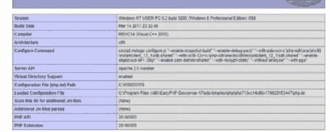

| Name | Value |
| --- | --- |
| System | Windows NT PC v6.2 build 8230 (Intel) Windows Business Edition KB663 |
| Date | 01 Jul-2012 14:29:22 UTC |
| Configure | -d |
| Architecture | x86 |
| Command Line | --with-config-file-path="C:\php" --enable-opcache --enable-mbstring --enable-curl --enable-filter=gd --with-zlib --with-openssl --with-readline --with-readline --with-iconv --enable-pcntl --enable-process-control --enable-shared-memory --enable-xml --enable-xmlreader --with-libgd --with-libjpeg2 --with-libcurl --enable-fixed-strings --with-libxml |
| PHP API | 2.0-Handler |
| Script API | C |
| Directory | C:\php |
| Upload max_filesize | 2M |
| Post max_size | 8M |
| Configuration File | C:\Program Files\PHP\PHP5.4.2\htroot\phpinfo.ini |
| Start Time | 01 Jul-2012 14:29:22 UTC |
| Server Software | Microsoft IIS |
| Server Version | |
| PHP Version | 5.4.2 |
| Zend Engine | (with) Zend Engine v3.0.0, Copyright (c) 1999-2012, The Zend Group* |
| Engine Type | NTS |
| Core | 01 Jul-2012 14:29:22 UTC |
| Configuration File | C:\Program Files\PHP\PHP5.4.2\htroot\phpinfo.ini |
| PHP API | 2.0-Handler |
| Script API | C |
| Directory | C:\php |
| Upload max_filesize | 2M |
| Post max_size | 8M |
| Start Time | 01 Jul-2012 14:29:22 UTC |
| Server Software | Microsoft IIS |
| Server Version | |
| PHP Version | 5.4.2 |
| Zend Engine | (with) Zend Engine v3.0.0, Copyright (c) 1999-2012, The Zend Group* |
| Engine Type | NTS |

大多数 PHP 托管站点中包含的默认数据库是 MySQL，上述类似的免费编辑器也附带此类数据库。除了此数据库外，本书还将探索与 Oracle 数据库的连接。本书使用的 Oracle 数据库是 Windows 独立版 11.2g Express 版，可以从 `http://www.oracle.com` 免费下载。

PHP 中的变量是数据的容器。变量名对大小写敏感。变量名必须以字母或下划线开头，不能以数字开头。保留字不能作为变量名。变量有四种主要类型：数字、字符串、数组和对象。

数字变量包括：

- 整数：1, 2, 3
- 浮点：1.0, 19.2

字符串：如果变量是由包含在单引号或双引号内的字符组成的，则它就是字符串。例如：

- "Hello World"
- "Hello, $name"
- "1"
- "21.07.17"
- "2017"

数组：根据定义，数组以索引格式存储。使用键输入数据并使用这些键检索。数组可以是单维或多维的。例如：

| John | Adam | Mary | Sally |
| --- | --- | --- | --- |
| 0 | 1 | 2 | 3 |

使用索引的数组称为索引数组。使用字符串键的称为关联数组。

对象被视为高级特性。要定义对象，必须定义其结构类。然后创建该结构的实例。在 C++ 或 Java 等中看到的面向对象编程概念是这种类型变量示例。例如：如果有一个变量叫 `car`，那么 `car.length` 就是 `car` 对象的特性示例。

在 PHP 中使用 `=` 赋值运算符向变量赋值。例如：

```php
$x = 1.5;
$y = "John";
```

我们使用 `print` 函数输出结果。例如：

```php
print "The number is $x";
```

```html
<html>
<head><title>Address</title></head>
<body>
<?php
$name = "John";
$street = "101, Orchard Lane";
$city = "Columbia";
$state = "SC";
$zip = 29208;
print "The address of $name\n\nis:<br>$street <br><br>$city<br>$state- $zip";
?>
</body>
</html>
```

结果将显示在连接到 PHP 编辑器的浏览器中。在本书中，使用了 EasyPHP (`http://www.easyphp.org`) 编辑器，使用该编辑器的输出如下：

John 的地址是：

101, Orchard Lane

Columbia

SC

29208

脚本的位置将根据编辑器而变化。在 EasyPHP 编辑器中，旧版本（12 到 14）可以在 `projects` 文件夹下运行此脚本，或者在版本 17 的 `eds-www` 文件夹中运行。

如果发生错误，并且会偶尔发生——请阅读错误信息，回到记事本或编辑器中编写的代码，或者根据错误信息中给出的行号纠正周围的代码。

单引号意味着引号内的项应被字面处理。双引号意味着引号内项目的值应被取用。

例如：

`$name = 'John'` 和 `$name = "John"` 将得到相同的结果。

但是

`$name = "$firstname"` 和 `$name = '$firstname'` 将得到两个结果。

`firstname` 的值为 John 和 `$firstname`。

可以将另一个变量的值赋值给变量，如下：

`$name = $firstname;`

最好使用双引号，本书其余部分将使用双引号。除了 `print` 函数外，还有一个名为 `echo()` 的函数，可以将结果或消息打印到屏幕。

如果使用的是 EasyPHP 编辑器版本（17），它包含 PHP 7 以及 PHP 5.6，界面将如下。

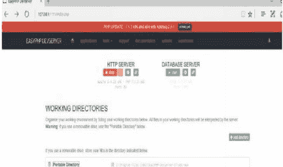

上述两个选项用于启动 apache 服务器。HTTP 服务器下方的设置图标将允许用户在 PHP 5.6 和 PHP 7.1.3 之间切换，在这种情况下，只需从下拉菜单中选择版本并点击重启即可。

在编写本书时，大多数托管网站——特别是低成本和免费的——其服务器上仍使用 PHP 5 版本。本书将显示两个版本的输出，并突出 PHP 新版本中发生重大变化的地方。

除非另有说明，书中看到的代码适用于 PHP 的新旧版本。

## 第 2 章 HTML 和 PHP 表单

为了充分利用 PHP，需要 HTML。PHP 程序内部可以包含 HTML，而 HTML 脚本中也可以嵌入 PHP。

本章中的第一个脚本将请求一个人的姓名和电话号码。表单将有一个输入姓名和电话号码的框，以及一些选择姓名称呼的单选按钮。

工作原理如下：

HTML 表单/页面请求用户输入数据。它请求服务器上的 PHP 脚本处理数据请求，数据最终将被添加到数据库中。

HTML 或网页在处理方面与服务器交互的能力有限。它通过 `<form action = ...>` 方法转移此任务。

现在让我们为 HTML 网页编写 HTML 代码。

```html
<html>
<head><title>反馈表单</title></head>
<body>
<form action="feedback.php">
Mr.<input type="radio" name="title" value="Mr."/>
Mrs.<input type="radio" name="title" value="Mrs."/>
<br>
Ms.<input type="radio" name="title" value="Ms."/>
<br>
<p>请填写反馈表单</p>
<p>
姓名: <input type="text" name="name" size="20">
<p>
电话: <input type="text" name="name" size="20">
<p>
<input type="submit" name="submit" value="发送我的回复" />
</form>
</body>
</html>
```

此 HTML 文件的输出如下：请注意，`feedback.html` 文件及其关联的 `feedback.php` 文件位于相同的位置。然而，这不是强制要求。如果文件在不同的文件夹中，则 PHP 文件必须在 `<form action>` 语句中包含。

反馈 HTML 文件有三个部分——称呼选择、姓名和电话。`<form action>` 语句将该文件连接到一个脚本文件以便进一步处理。`<form action>` 由 `</form>` 关闭。现在该文件必须能够捕获正在传输的数据。观察 `<form action>` 语句，它缺少一个 `method`。有两种方法——`get` 和 `post`。两者之间的区别是什么？GET 方法将收集的所有数据作为 URL 的一部分发送。POST 方法以透明方式传输数据。因此，选择 GET 方法可能会在点击提交按钮时使某些信息可见。GET 方法发送的数据量也有限制。从 `feedback.html` 文件的传输方法将是 `POST`。必须对上一页的 `feedback.html` 代码进行以下更改。

以下是 `feedback.php` 文件的代码：

```php
<?php
$title=$_POST['title'];
$name=$_POST['name'];
$phone=$_POST['phone'];
echo "Title: $title, Name: $name, Phone: $phone";
?>
```


在上面的示例中，我们已经了 PHP 程序中数字的使用以及对它们进行的数学运算。上面的示例还阐明了如何使用括号来考虑数学运算的优先级顺序。

可以使用 PHP 中的许多数字函数对数字进行格式化。常用的数字函数包括：

- `round()` -
  - 示例：
  - `round(4,5)` = 4
  - `round(4.567,2)` = 4.57，意味着保留小数点后两位
  - `$x = 200.152`
  - `round($x,2)`; (将得到 200.15)
- `number_format()` -
  - 示例：
  - `number_format(400.43567,2)` = 400.44
  - `number_format(450,2)` = 450.00
  - `number_format(567890321)` = 567,890,321

最后一个示例无法通过 `round()` 完成。

- `rand()` -
  - 示例：
  - `$x = rand();` 将得到一个随机数

如果偏好使用某个随机数范围，那么：

`$x = rand(0, 1000)` 将给出 0 到 1000 范围内的数字。

`rand()` 函数适用于 4.2 或更高版本的 PHP。比 4.2 更旧的版本则使用 `srand()` 函数。

`getrandmax()`

将获取可以使用 `rand()` 创建的最大随机数。

`ceil()`

此函数是 `rand()` 函数的一部分，并将每个数字向上舍入到下一个最大的整数。

(PHP 5)

`floor()`

此函数将每个数字向下舍入到下一个最小的整数。

`abs()`

示例：

`$x = abs(-25);` 将得到 25

`$x = abs(25);` 将得到 25

PHP 支持三角函数、指数、进制转换和对数函数。

让我们修改一下在本章早期使用过的反馈表单。这次除了其他内容外，我们还要添加一个名字（first name）和姓（last name）框。

代码如下：

```html
<html>
<head><title>Feedback form</title></head>
<body>
<form action="feedback.php" method="post">
Mr.<input type="radio" name="title" value="Mr."/>
Mrs.<input type="radio" name="title" value="Mrs."/>
Ms.<input type="radio" name="title" value="Ms."/>
<br>
<p>Please complete the feedback form</p>
<p>First Name: <input type="text" name="firstname"
```

```
size="20">
<p> Last Name:<input type="text" name="lastname"
size="20">
<p>Phone:<input type="text" name="phone" size="20">
<p>
<input type="submit" name="submit" value="Send my response"/>
</form>
</body>
</html>
```

注意表单的标题仍然为 feedback。唯一的区别是：

- 1. 添加了姓和名的文本框。


每个名称框的 `name` 值已经更改。这些 `name` 值将通过 `post` 方法传输到 PHP 文件。

反馈网页看起来像这样：

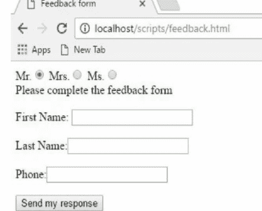

现在让我们修改 `feedback.php` 表单以匹配上面的网页。代码看起来如下。

```php
<?php
$title=$_POST['title'];
$firstname=$_POST['firstname'];
$lastname=$_POST['lastname'];
$phone=$_POST['phone'];
print"Thank you, $title $firstname Lastname for your
feedback";
print"<p> Your phonumber, $phone has been added to our database;\n";
?>
```

代码与原始的 `feedback.php` 文件没有太大区别。我们有两个名字，名和姓，在第一个 `print` 函数中我们放入了 `$firstname $lastname`。如果名字之间需要一个点，可以在格式化原因中放入一个点。

我们需要一个全名，可以将名和姓相加。PHP 允许在不使用两个字符串变量之间的常用点的情况下实现相同的效果。这是由于 PHP 处理变量的方式。

当使用新的 `feedback.html` 网页时，上述代码的结果如下。

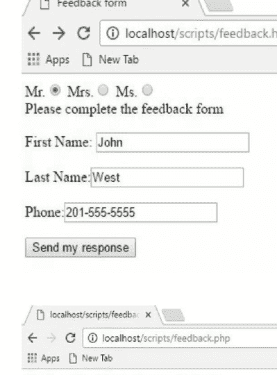

在 PHP 中有一个术语称为“魔术引号”（magic quotes）。如果在设置中开启了它（如之前所示检查 `phpinfo()`），这些魔术引号会自动转义问题字符。这意味着字符串中的单引号和双引号前面会有一个反斜杠。

三种类型的魔术引号有：

- GPC 魔术引号影响通过 `get` 或 `post` 方法传输的数据以及存储在 cookies 中的数据。
- 运行时魔术引号（Runtime quotes）影响从数据库检索的数据和命令行操作。
- Sybase 魔术引号是特殊的。

请填写反馈表

用户名：administrator

密码：************

发送我的信息

现在让我们假设用户名长度不应少于十（10）字符，密码长度也不应少于十（10）字符。此外，让用户名 `administrator` 的密码设置为 `administrator`。

这段代码背后的逻辑如下：

1. 用户在用户名处输入 `administrator`。
2. 用户在密码处输入 `administrator`。
3. 如果用户名和密码长度大于 10，代码将检查用户名和密码是否匹配。
4. 代码接受输入并感谢用户。
5. 如果用户名和密码不匹配，则显示一条登录失败的消息。

需要注意的是的是，密码是硬编码的。在现实生活中，用户名和密码将存储在数据库中。

以下是 `login.php` 的 PHP 代码：

```php
<?php
$username=$_POST['username'];
$password=$_POST['password'];
$x = strlen($username);
$y = strlen($password);
if (($x < 10) || ($y < 10)) {
  print("The username/password entered is incorrect");
} else {
  if (($username=="administrator") && ($password
==="administrator")
{
    print("Thank you for logging in, $username.");
} else {
    print("Wrong username or password");
}
?>
```

在上面的代码中行：

`$sx = strlen($username);`

`$sy = strlen($password);`

`if ($sx < 10) || ($sy < 10))`

检查字符串长度是否为 10 或更多。如果用户名和密码错误。

`else` 语句会在两者长度都正确的情况下检查密码和用户名的值。

第二个语句会在两个变量的值与硬编码的组合不匹配时，写入一条用户名或密码错误的消息。

`IF` 语句可以像 `else` 语句一样嵌套。上面的示例说明了控制 PHP 代码中逻辑流的能力。

它与 C++、Java 等许多知名语言非常相似。

上一个例子也从商业角度表明，用户名和密码值必须来自存储位置（如数据库）。

`&&` 和 `||` 被称为比较运算符。`===` 也是一个比较运算符。它与 `==` 不同，后者是给变量赋值的。

PHP 中的比较运算符有：

| 运算符 | 用法 |
|---|---|
| `==` | 等于 |
| `!=` | 不等于 |
| `<` | 小于 |
| `>` | 大于 |
| `<=` | 小于等于 |
| `>=` | 大于等于 |
| `!` | 取反 |

| 运算符 | 用法 |
|---|---|
| `&&` | 与 |
| `||` | 或 |
| `XOR` | 异或 |

在使用比较运算符时，括号非常重要。编程中的一个简单规则是，如果开启了一个括号，请确保在代码下方的任何地方将其闭合。

PHP 本身也有控制结构。这不应与上述代码中的以下内容混淆：

在上述情况下，是只写语句还是使用 `else` 语句取决于程序员。大多数第一次学习编程的学生对只使用 `if` 语句感到习惯。

上面的代码可以用自带的控制结构重写。

```php
<?php
$username=$_POST['username'];
$password=$_POST['password'];
$x = strlen($username);
$y = strlen($password);

if (($x < 10) || ($y < 10))
{
print "The username/password entered is incorrect";
} else if(($username=="administrator") && ($password=="administrator"))
{
print "Thank you for logging in, $username."
}
else {
print "Wrong username or password";
}
?>
```

与 `IF` 语句一样，`switch` 条件是一种结构示例。`switch` 条件只接受一个可能的条件，即变量的值。例如：

```php
switch ($variable) {
    case "value1":
        statement(s);
        break;
    case "value2":
        statement(s);
        break;
    case "value3":
        statement(s);
        break;
}
```

这相当于说如果值为 `value1`，则执行 `:` 之后的语句；如果不是 `value2`，则执行 `:` 之后的语句，以此类推。`break` 告诉 PHP 退出匹配。

查看以下 PHP 代码。


```php
<?php
$x = $_POST['choice'];
switch($x){
    case 1:
        if ($x==1){
            print "You have chosen item 1.";
        }
        break;
    case 2:
        if ($x==2){
            print "You have chosen item 2.";
        }
        break;
}
print "You have not chosen anything!";
?>
```

在上面的代码中，使用`switch`而不是`if`语句来选择两个项目之一。这些将从类似下面的 HTML 页面中选择。

```html
<html>
<head><title>Switch</title></head>
<body>
<form action="switch.php" method="post">
<p>Please complete the feedback form</p>
<p>Username: <input type="text" name="username"></p>
<p>Password: <input type="password" name="password"></p>
<input type="submit" value="Send my details">
</form>
</body>
</html>
```

语句体。

循环持续持续直到条件不再成立。输出为 1...10。

以下代码演示了`do...while`循环。

```php
<?php
$x=0;
do
{
$x=$x+1;
print("$x");
}while ($x<10);
?>
```

输出将与`while`循环相同。1...10。

除了 PHP 中的`break`语句外，还有`Exit`和`die`语句。`break`语句在`switch`中出现过。

`Exit`和`die`语言构造不是退出当前结构，而是终止 PHP 脚本的执行。

在任何`Exit`或`die`实例之后的所有 PHP 代码都永远不会执行。使用这两个构造之后的 HTML 代码将不会发送到浏览器。

`die`构造经常被用于访问文件和数据库的代码中。`Exit`通常与`header()`函数配合使用。

# 第 4 章 数组

在书的开头，数组（Array）被提到一种变量类型。数组可以由数字和字符串组成。数组的命名与变量类似，并且它具有持有多个值的能力。

示例：数组可以包含一个汽车列表，如下所示。

```php
$car1 = 'Toyota';
```

```php
$car2 = 'GM';
```

```php
$car3 = 'Ford';
```

```php
$car4 = 'Nissan';
```

数组变量命名规则如下：

- 1. 以`$`符号开头。
- 2. 以字母或下划线继续。
- 3. 以字母、数字或下划线的任意组合结束。

数组变量有一个索引。数组通过`[括号]`的存在与其他变量区分开来。因此，`$car[]`是一个数组变量。

`$car[3]`代表数组中索引位置 3 处的特定元素。

使用汽车示例在 PHP 中创建一个数组如下：

```php
$car = array('Toyota', 'GM', 'Ford', 'Nissan');
```

索引由 PHP 服务器自动分配。在这里，模型 Toyota 的索引为 0。数组索引自动从 0 开始。如果需要，可以更改此。

在汽车示例中，我们可以通过以下操作将模型 Toyota 具体放在索引位置 1。

```php
$car =array(1=>'Toyota', 2=>'GM', 3=>'Ford', 4=>'Nissan');
```

对于大多数用途，让 PHP 服务器以默认方式对值进行索引就足够了。

```php
<?php
print("This script will print an array of cars");
$car = array ('Toyota', 'GM', 'Ford', 'Nissan');
print "$car<p>";
print_r($car);
?>
```

运行此代码的输出如下：

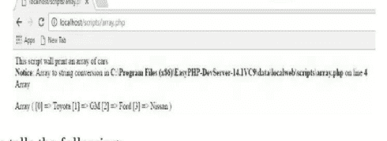

上面的输出告诉了以下内容：

- 1. 无法使用前面章节中使用的`print`函数打印数组值。
- 2. 可以使用`print_r()`函数来打印数组值。
- 3. 使用`print_r()`函数时，数组将以数字格式显示其索引位置并打印。

索引位置没有要求必须是数字。可以使用单词。让我们修改上面的 PHP 代码来说明这一点：

```php
<?php
print"This script will print an array of cars";
$car = array ('Yaris'=>'Toyota', 'Spark'=>'GM',
'Escort'=>'Ford', 'Pathfinder'=>'Nissan'); print_r($car); ?>
```

此代码的输出将是：


输出更具描述性，因为在这些输出中模型被附加到不同的汽车公司。在数组的默认设置中，数组元素通过索引数字引用如下：`$car[2]`。

`range()`函数可以根据值的范围创建一个项目项的数组。例如：

```php
$num = range(1,20);
```

`$Alp = range('a', 'Z');`

`range`函数允许如下步长：

`$sum = range(10,20,2);`

当`var_dump()`函数与数组一起用用时，会显示数组的值和结构。让我们来看一段将演示这些函数的代码。

```php
<?php
print("This script will print an array of cars");
$car = array('Yaris'=>'Toyota', 'Spark'=>'GM',
'Escort'=>'Ford', 'Pathfinder'=>'Nissan');
var_dump($car);
$sum=range(10,20,2);
print('<br>');
$Alp=range('a','Z');
print_r($sum);
print('<br>');
print_r($Alp);
?>
```

输出如下：

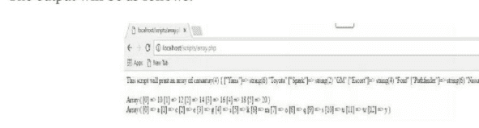

键为数组称为索引数组（indexed array），带有字符串的数组称为关联数组（associative array）。这两种类型在上面的示例中已经说明。可以向数组中添加更多元素。在上面的示例中，一旦在 PHP 中定义了数组，就可以通过等号和数组名配合`[括号]`来添加更多元素。

示例：

`$car[]='Mazda';`

`$car[]='Hyundai';`

如果在括号中未指定键，则数组的每个新条目元素都将附加到现有列表中。如果括号中提到了键，该索引处的任何值都将被删除，并将新元素添加到该位置。

```php
<?php
print("This script will print an array of cars");
$car = array('Toyota', 'GM', 'Ford', 'Nissan');
$car[1] = 'Mazda';
$car[3] = 'Hyundai';
print_r($car);
?>
```

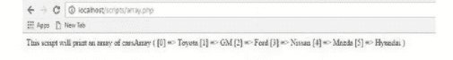

输出将如上所示将新公司添加到列表末尾。让我们如下修改上面的脚本：

```php
<?php
print("This script will print an array of cars");
$car = array('Toyota', 'GM', 'Ford', 'Nissan');
$num1 = count($car);
print("The original array has " . $num1 . "<br>");
$car[1] = 'Mazda';
$car[3] = 'Hyundai';
print_r($car);
$num2 = count($car);
?>
```

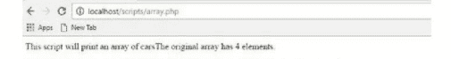

输出所示。上述代码中的额外函数是`count()`，它用于计算数组元素的数量。要从数组中删除单个元素使用`unset()`函数。例如：

```php
unset($car[4]);
```

```php
unset($car['name']);
```

应用于整个数组时整个数组将被删除。要重置数组而不删除数组变量，使用`array()`函数。例如：

```php
$car =array();
```

看下面的代码。

```php
<?php
print"This script will print an array of cars";
$car = array('Toyota', 'GM', 'Ford', 'Nissan');
unset($car[2]);
print_r($car);
?>
```

索引值 2 现在已删除。PHP 有一个函数可以合并两个数组。`array_merge($array1,$array2)`可用于此目的。两个数组名称必须输入到括号中。示例：

`$car1[]='Toyota','GM','Ford';`
`$car2[]='Nissan','Mazda','VW','Hyundai';`

以这种方式编写代码将合并这两个数组。

```php
<?php
print"This script will print an array of cars";
$car1[]='Toyota','GM','Ford';
$car2[]='Nissan','Mazda','VW','Hyundai';
$car3=array_merge($car1,$car2);
print_r($car3);
?>
```

上面的两个数组合并也可以通过如下写法实现。

`$car3 = $car1 + $car2;`

检索数组元素的唯一方法是指定键的索引值。如果需要打印数组的所有元素，将需要一个循环。例如：

```php
<?php
$salary = array ('Adam'=>1000, 'Smith'=>2000, 'Mary'=>2500, 'Sally'=>1800);
print("The original array looks like this. <br>");
foreach($salary as $emp => $amount){
print("$emp:$amount<br>");
}
?>
```

此代码的输出将像这样。

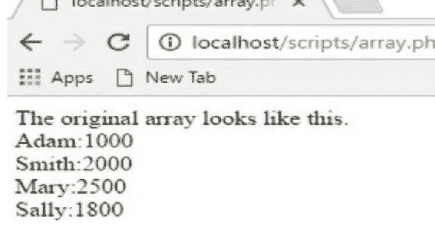

```php
<?php
print("原始数组看起来如下：<br>");
foreach($salary as $amount){
    print($amount<br>");
}
?>
```

让我们来看一个没有显示键的示例。

```php
<?php
$name = array('Tom','Harry','Smith','Adam');
print("原始数组看起来如下：<br>");
foreach($name as $emp){
    print($emp<br>");
}
?>
```

输出如下。

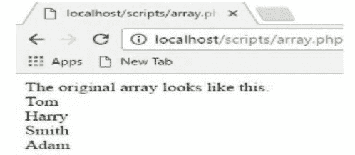

可以使用以下函数对数组排序：

- `sort()` - 此函数按值排序，但不保留键值。
- `rsort()` - 此函数反转值，且不保留键值。
- `asort()` - 这些函数按值排序并会保留键值。
- `arsort()` - 值按逆序方式排序，并且会保留键值。
- `ksort()` - 按键排序，并会保留键值。
- `krsort()` - 按键进行逆序排序，并会保留键值。

让我们来看一个示例：

```php
<?php
$salary = array('Adam'=>1000, 'Smith'=>2000, 
'Mary'=>2500, 'Sally'=>1800);
print("原始数组看起来如下：<br>");
foreach($salary as $emp => $amount) {
    print($emp:$amount<br>");
}
print("使用 sort() 排序的结果如下：<br>");
sort($salary);
foreach($salary as $emp => $amount) {
    print($emp:$amount<br>");
}
print("使用 rsort() 排序的结果如下：<br>");
rsort($salary);
foreach($salary as $emp => $amount) {
    print($emp:$amount<br>");
}
?>
```

输出将如下。

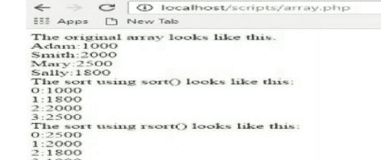

其他排序函数的代码在下方。

```php
<?php
$salary = array('Adam'=>1000, 'Smith'=>2000, 
'Mary'=>2500, 'Sally'=>1800);
print("使用 asort() 排序的结果如下：<br>");
asort($salary);
foreach($salary as $emp => $amount) {
    print($emp:$amount<br>");
}
print("使用 arsort() 排序的结果如下：<br>");
arsort($salary);
foreach($salary as $emp => $amount) {
    print($emp:$amount<br>");
}
?>
```

输出如下。

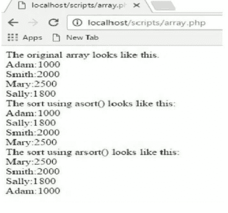

原始数组看起来如下：
Adam:1000
Smith:2000
Mary:2500
Sally:1800

使用 sort() 排序的结果：
Adam:1000
Sally:1800
Smith:2000
Mary:2500

使用 asort() 排序的结果：
Mary:2500
Sally:1800
Smith:2000
Adam:1000

要按键排序，我们使用前面列出的最后几个排序函数：

```php
<?php
$salary = array('Adam'=>1000, 'Smith'=>2000, 'Mary'=>2500, 'Sally'=>1800);
print("使用 ksort 排序的结果如下：<br>");
ksort($salary);
foreach($salary as $emp => $amount) {
    print("$emp:$amount<br>");
}
print("使用 krsort 排序的结果如下：<br>");
krsort($salary);
foreach($salary as $emp => $amount) {
    print("$emp:$amount<br>");
}
?>
```

输出将如下。

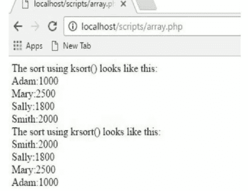

使用 ksort() 排序的结果：
Adam:1000
Mary:2500
Sally:1800
Smith:2000

使用 krsort() 排序的结果：
Smith:2000
Sally:1800
Mary:2500
Adam:1000

`shuffle()`函数会随机重组数组的顺序。

可以使用以下代码查看其工作原理。

```php
<?php
$salary = array ('Adam'=>1000, 'Smith'=>2000, 'Mary'=>2500, 'Sally'=>1800);
print("shuffle() 的结果如下：<br>");
shuffle($salary);
foreach($salary as $emp => $amount) {
    print("$emp:$amount<br>");
}
?>
```

```php
<?php
print(">");
var_dump($books);
?>
```

输出如下。

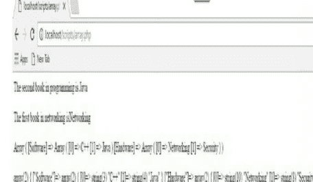

# 第 5 章 Web 应用程序组件

PHP 文件的主题至少需要 HTML 知识。除了这些知识外，层级样式表（CSS）、JavaScript 和结构化查询语言（SQL）可以极大地增强创建动态、美观网页的能力。

本书将不会详细介绍 CSS 或 JavaScript 的开发。然而，在本书的数据库部分，将提供 SQL 的基本背景知识。

在本章中，我们将查看制作 Web 应用程序的一些组件。

PHP 程序可以使用外部文件。例如，为页面创建头部（header）或页脚（footer）。要这样做，首先创建一个`header.html`和`footer.html`文件，这些文件也可以是 PHP 文件。

可以使用两个函数之一`include()`和`require()`将这些外部文件包含在 PHP 程序中。它们的使用方式如下：

```php
include('footer.html');
```

或者

```php
include('footer.php');
```

或者

```php
require('header.html');
```


## 使用 `include()` 和 `require()` 包含文件

在 PHP 中，可以使用 `include()` 或 `require()` 函数将一个文件的内容包含到当前脚本中。代码将在调用这些函数的地方执行。执行后，代码将从 `include` 或 `require` 函数下方的行继续执行。这两个函数的区别在于，当使用 `include()` 时，如果发生错误，PHP 服务器将给出一个警告但会继续运行其他代码行。

在 `require()` 的情况下，如果包含的文件执行失败，程序将终止。

上面的示例假设使用 `include()` 或 `require()` 的 PHP 程序与被调用的文件在同一个文件夹中。如果不是，必须在函数的括号内提供文件的绝对路径或相对路径。

相对路径的示例是 `require('./footer.html');`。

绝对路径的示例是 `require('c:\users\desktop\header.php');`。

假设有一个如上所示的 `header.html` 文件。调用此头部的关联 PHP 程序如下：

```php
<?php

include('header.html');

print("This is my page.\n");

?>
```

输出如下。


这两个函数可以方便地减少重复工作。

## 使用 `date()` 函数格式化日期和时间

可以使用 `date()` 函数在 PHP 中显示日期和时间。该函数根据给它的参数返回基于格式的日期时间和信息。

可用选项如下：

- `Y` 表示 4 位数字格式的年份。
- `y` 表示 2 位数字格式的年份。
- `n` 表示一位或两位数字的月份，例如 4。
- `m` 表示两位数字的月份，如 05。
- `F` 表示月份的全称名称，例如 August。
- `M` 表示三字母格式的月份，例如 Aug。
- `j` 表示一位或两位数字的月份几号，例如 8。
- `d` 表示两位数字的月份几号，如 08。
- `l` 表示星期几，例如 Sunday。
- `D` 表示三字母格式的星期几，例如 Sun。
- `w` 表示单数字的星期几 - 例如星期日为 0。
- `z` 表示从 0 到 365 的一年中的第几天。
- `t` 表示每月的天数 - 31（对于 8 月）。
- `S` 表示 2 个字符的日期序数后缀 - rd。
- `g` 表示 12 小时制的一位或两位数字的小时，例如 6。
- `G` 表示 24 小时制的一位或两位数字的小时，例如 14。
- `H` 表示 12 小时制的两位数字的小时，如 08。
- `I` 表示 24 小时制的两位数字的小时，如 14。
- `i` 表示分钟，如 35。
- `s` 表示秒，如 15。
- `a` 表示 am 或 pm。
- `A` 表示 AM 或 PM。
- `U` 表示自 Unix 纪以秒数，例如 1048623008。

让我们来看这段 PHP 代码。

```php
<?php

$x = date('l,F,Y');

$y = date('h:i:s');

print "$x<p>$y</p>";

?>
```

输出将如下。

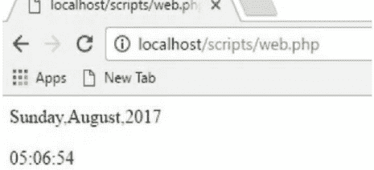

也可以 `print date(L,F,Y);` 来获取结果。

PHP 中的时间戳表示自 1970 年 1 月 1 日午夜以来经过的秒数。`time()` 函数返回当前时刻的时间戳。`mtime()` 函数可以返回特定日期的时间戳。

## 使用 Cookie 和 Session

`setcookie('cookiename','', );`

`setcookie('cookiename','', time()-60);`

这表示设置了一个过去的到期日期。

让我们来看这段代码。

```php
<?php

$Cookies=false;

if(isset($_POST['submit'])){

  setcookie('color',$_POST['color'],time()+60,'',0);

  $Cookies=true;

}

?>

<html

<head>

<title>Cookie Example</title></head>

<body>

<form action="php" method="post">

Yellow<input type="radio" name="color" value="Yellow"/>

Red<input type="radio" name="color" value="Red"/>

Blue<input type="radio" name="color" value="Blue"/>

<br>

<p>请完成反馈表并发送您的颜色偏好。</p>

<p>

<input type="submit" name="submit" value="color">

</form>

<?php

if($Cookies) {

  print "Your preference has been saved.";

}

?>

</body>

</html>
```

基本上，上述代码是处理 cookie 的 PHP 文件与其 HTML 页面的结合。唯一的添加是 `isset($_POST['submit'])` 这一条件和函数，PHP 允许我们将 cookie 的文件写在一个单独的文件中而不是两个不同的文件。`isset` 函数检查 HTML 表单中的提交按钮是否被点击。如果是，它将继续执行括号内的代码，即创建 cookie。大多数网站托管服务商都允许在单个 PHP 文件中混合 PHP 和 HTML。在 HTML 文件中使用 PHP 也是可能的。在注册或进行任何他们可能要求的配置之前，请咨询托管服务商。此建议适用于使用共享托管的用户。

session 提供了一种跨多个页面跟踪用户数据的方法。Cookie 将数据存储在客户端，而 session 将数据存储在服务器端。此外，session 具有以下特点：

1. 它更安全，因为数据仅存储在服务器上。
2. 它允许存储比 cookie 更多的信息。
3. 即使网站用户不接受 cookie，它们也可以正常工作。

session 的意思就像英文单词的含义（指一段时间，如一节课）。当 session 开始时，会创建一个随机的 session ID。这是对特定 session 存储数据的引用。

session ID 会作为 cookie 发送到网络浏览器，随后的 PHP 页面将使用此 cookie 获取 session ID 以访问其数据。

在 PHP 中启动或创建 session，我们从 `session_start()` 函数开始。该函数必须是使用 session 的每个 PHP 页面的第一行。

存储在浏览器上的 cookie 将有一个类似于 PHPSESSID 的名称，以及一个类似于 3bcc37dc87cb4b54d63f9a23b41f1 的值。

一旦 session 开始，就可以通过给 `$_SESSION` 数组赋值来记录数据。

`$_SESSION['color'] = 'Yellow';`

`$_SESSION['age'] = 35;`

数据被写入存储在服务器上的临时文件中。让我们来看下面的代码。

这段代码用于一个登录框。

```php
<?php

if(isset($_POST['submit'])){

  if ($_POST['username']=='admin' &&

  $_POST['password']=='admin') {

    session_start();

    $_SESSION['username']='admin';

    $_SESSION['login']=time();

    print("You are logged in");

    exit();

  }

}

?>

<html>

<head><title>Session Example</title></head>

<body>

<form action="session.php" method="post">

<p>

Username:<input type="text" name="username" size="20">

</p>

<p>

Password:<input type="text" name="password" size="20">

</p>

<p>

<input type="submit" name="submit" value="Submit">

</form>

</body>

</html>
```

登录框将如下所示。

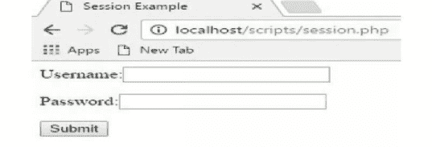

这段代码从上一个 cookie 示例中看到的 `isset` 函数开始。它检查提交按钮是否被按下。

下一个语句检查密码和用户名是否必填。如果是，它将打印一条消息，`exit()` 函数将停止后续代码的执行。或者，如果有需要跳转的网页，可以使用 `header(Location:welcome.php);` 紧跟 `exit();`。请在上述代码中进行更改。

如果输入的用户名和密码错误，程序将显示一个空表单以便进一步尝试登录。

所以我们已经为登录页面启动了 session。为了访问 session 变量，我们首先创建一个 `welcome.php` 文件，这样用户登录后就会看到此页面。从此页面，我们将访问用户的登录时间。

欢迎页面的代码形式如下。

```php
<?php

session_start();

print("Welcome to my webpage!<p>");

print($_SESSION['username']);

print("<p>You have logged in since: </p>");

print(date('g:i',$_SESSION['login']));

print("<p><a href="logout.php">Logout</a></p>");

?>
```

这段代码从显示的注销页面开始。

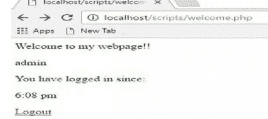

欢迎页面的代码形式如下。

```php
print('<form action='function.php' method='post'><p>');

print('First Number:<input type='text' name='num1' size=5><p>');

print('Second Number:<input type='text' name='num2' size=5><p>');

print('<input type='submit' name='submit' value='ADD'>');

print('</form>');');
```

该函数之前被使用过。当编写带有表单的单文件 PHP 代码文件时，可以使用按钮函数来检查提交按钮是否被点击。

该函数有两个参数 `num1` 和 `num2`。名称可以是任何有意义的名称。函数将用户输入的变量 `num1` 和 `num2` 的值作为输入。在函数内部计算总和，然后使用 `isset` 函数中的 `print` 语句显示。

输出结果如下：

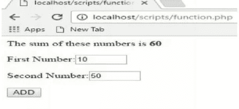

## 变量的作用域

变量有一个称为“作用域”（scope）的特性。这在定义变量时非常重要。作用域基于变量在代码中的位置。

变量的作用域被定义为它存在的范围。

在函数内部定义的变量仅在该函数内部存在。同样，函数外部的变量可以通过作为参数传递给函数（如最后两个示例所示）或使用 `global` 语句由函数引用。

让我们修改两个数相加的示例，以计算两个物品的价格以及在 5% 税率后的最终价格。

```php
<?php

$tax=5;

function sum($price1,$price2) {

  global $tax;

  $sum=$price1 + $price2;

  $taxrate=$tax/100+1;

  $sum=$sum * $taxrate;

```

```php
return $sum;

}

if (isset($_POST['submit'])) {

$sum=\$_POST['price1']+\$_POST['price2'];

print("<p>The total price of these two items is <b>$sum</b></p>");

}

print("<form action='function.php' method='post'><p>");

print("<p>First item price:<input type='text' name='price1' size=5></p>");

print("<p>Second item price:<input type='text' name='price2' size=5></p>");

print("<input type='submit' name='submit' value='Calculate'>");

print("</form>");

?>
```

该代码从用户处获取两个物品的价格并将其相加。在相加价格后，根据全局变量 `tax` 计算税率。

将税率乘以总和以显示最终价格。定义变量的一个重要部分是它的位置，因此也是有它的作用域。

## 第 6 章：文件与目录

理解数据库重要性的第一步是了解文件和目录。使用 PHP 以及大多数编程语言存储数据的方法有两种：它们它们是文件和目录，或者是数据库。

在 Web 托管环境中，特别是由主机提供商共享的托管，在文件方面可能会比较严格。

此类文件（如 `.csv`、`.txt` 文件）在网络主机上具有特定的权限设置。目录也将具有这些权限。

权限选项实际上是读、写和执行。除了这些选项外，还可以根据用户以三种不同的方式设置。所有者自动获得读和写权限，而其他人和其他组则仅被授予读取权限。

无论托管类型如何（Unix 或 Windows），出于安全考虑，托管服务在共享托管的情况下对允许访问文件和目录进行写入可能会限制。在创建基于文件和目录进行存储和检索的 PHP 程序之前，需要预先研究这一点。

正如前文所述，文件、目录和数据库基本上用于存储数据并允许它们被检索。

使用 PHP 写入文件可以使用以下函数：

- `fopen()`：以特定模式打开文件进行写入。
- `fwrite()`：将数据写入文件。
- `fclose()`：关闭文件连接。

`fopen()` 函数有多种打开文件的写入模式，它们是：

- `r`：仅用于读。读取从文件开头开始。
- `r+`：读均写。读写都从文件开头开始。
- `w`：仅用于写。如果文件不存在则将创建，并覆盖现有内容。
- `w+`：读均写。如果文件不存在则将创建，并在写入时覆盖现有内容。
- `a`：仅用于写。如果文件不存在则将创建，并将数据追加到文件末尾。
- `a+`：读均写。如果文件不存在则将创建，并将数据追加到文件末尾。
- `x`：仅用于写。如果文件不存在则将创建，但如果文件存在则不进行任何操作。
- `x+`：读均写。如果文件不存在则将创建，但如果文件存在则不进行任何操作。

如果文件与 PHP 文件不在同一位置，则应在代码中包含文件的路径。让我们看看以下代码，某些数据将被写入名为 `data.txt` 的文本文件。

```html
<html>

<body>

  <?php

  if (isset($_POST['submit'])) {

    if($fx=fopen('data.txt', 'a')) {

      $data=\$_POST['data'];

      fwrite($fx,$data);

      fclose($fx);

    }

  }

  ?>

  <form action='function.php' method='post'>

    <p>First item price:<input type='text' name='price1' size=5></p>

    <p>Second item price:<input type='text' name='price2' size=5></p>

    <input type='submit' name='submit' value='Calculate'>

  </form>

</body>

</html>
```

这是第一条语句。

这是第二条语句。

这是第三条语句。

在 PHP 中创建目录可以使用 `mkdir` 函数完成。该函数的格式如下：

`mkdir('directory_name', permissions);`

在基于 Windows 的服务器上，权限设置会被忽略。在创建目录或使用文件存储和检索数据之前，请注意 Web 托管商的策略。我强烈建议在专业环境中使用这些函数时应该使用数据库。

让我们编写一段代码，要求输入目录名和文件名，然后在该目录下的文件中写入一些文本。代码如下：

```html
<html>

<body>

<?php

if(isset($_POST['submit'])) {

$dirname=trim($_POST['dirname']);

mkdir(trim($dirname),0777);

$filename=trim($_POST['filename']);

$data=trim($_POST['data']);

if($fx = fopen('C:\Program Files (x86)\EasyPHP-Dev-Server\n14.1.VC3\data\localweb\scripts\$dirname\$filename','ab')) {

fwrite($fx,$data);

fclose($fx);

}

}

?>

<form action="file.php" method="post">

<p>


Directory name: `<input type="text" name="dirname" size="20">`

File name: `<input type="text" name="filename" size="20">`

Text to be entered into file: `<input type="text" name="data" size="50">`

`<input type="submit" name="submit" value="Write the data">`

`</form></body></html>`

这段代码将使用 `mkdir()` 创建目录。文件路径需要小心输入。错误的路径或反斜杠 `\` 会导致代码出现问题。

# 第 7 章 数据库简介

随 PHP 开发包或在免费/共享托管中提供的数据库是 MySQL 数据库。但也有例外。在本章中，我们将研究操作任何数据库所需的 SQL（结构化查询语言）基础知识。

SQL 有四个在操作数据库表数据方面非常重要的命令。这四条命令是：

- `Select` - 从数据库的表中检索数据。
- `Insert` - 向数据库的表中添加数据。
- `Update` - 修改数据库表中的数据。
- `Delete` - 从数据库表的某行中删除数据。

此外，还有创建数据库、表、视图、索引和存储的命令。

Web 托管站点有一个控制面板来创建数据库及其关联表。在 Unix/Linux 托管中，目前市场上最流行的控制面板是 C-Panel。它看起来可能像下面这样：

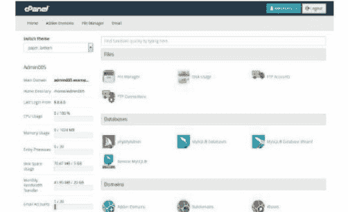

在基于 Unix/Linux 的 C-Panel 中，数据库管理是通过 PHPMyAdmin 选项完成的。在任何情况下，都要熟悉所用托管服务的常见问题解答（FAQ）。

在下面的 `grades` 表中，我们如下插入数据：

| sid | name | prelim | midterm | final |
|---|---|---|---|---|
| 100 | Albert | 100 | 78 | 89 |

`Insert into grades values ('100','Albert',100,78,89);`

字母数字/字符需要包含在单引号内。

数字不需要放在引号内。

在 `insert` 语句中，遵循与表中相同的字段顺序是非常重要的。

人们可以跳过特定字段，或将特定字段的值留空，如下：

`Insert into grades values ('100','Albert',null,78,89);`

上述示例中 `prelim` 的值稍后可以使用 `update` 语句如下填充：

让我们向表中添加一行。

`insert into grades values ('101','Robert',98,93,85);`

要删除表或表中的某行，我们使用以下命令：

```
delete from grades where sid='100';
```

这将仅删除 `sid = 100` 的行，而不删除其他行。删除操作应谨慎使用。

`delete from grades;` 将导致所有行被删除。移除表中所有数据的另一种方法是 `truncate`。

`truncate table grades;`

要从数据库中完全删除表（包括结构和值），请使用 `drop` 命令：

`drop table grades;`

在现实生活中为公司或组织工作时，必须谨慎使用这些命令（`drop`, `truncate`, `delete`）。以下是使用数据库时所需命令的总结。

## DDL：数据定义语言

| | |
|---|---|
| `Create` | 创建新表。 |
| `Alter` | 修改对象（如表）。 |
| `Drop` | 删除表。 |
| `Truncates` | 移除表字段的值，但保留表结构完整。 |

## DML：数据操纵语言

| | |
|---|---|
| `Select` | 根据用户的查询检索表的部分内容。 |
| `Insert` | 向表中放入值。 |
| `Update` | 修改表中的行。 |
| `Delete` | 从表中移除行。 |

## DCL：数据控制语言

| | |
|---|---|
| `Grant` | 赋予用户权限，例如查看或修改数据库中某个表的权限。 |
| `Revoke` | 从用户处移除权限。 |

查看下表，在 `grades` 表中插入数据：

| sid | name | prelim | midterm | final |
|---|---|---|---|---|
| 100 | Albert | 100 | 78 | 89 |

`Insert into grades values ('100','Albert',100,78,89);`

字母数字/字符需要包含在单引号内。

数字不需要放在引号内。

在 `insert` 语句中，遵循与表中相同的字段顺序是非常重要的。

人们可以跳过特定字段，或将特定字段的值留空，如下：

`Insert into grades values ('100','Albert',null,78,89);`

上述示例中 `prelim` 的值稍后可以使用 `update` 语句如下填充：

让我们向表中添加一行。

`insert into grades values ('101','Robert',98,93,85);`

要删除表或表中的某行，我们使用以下命令：

```
delete from grades where sid='100';
```

这将仅删除 `sid = 100` 的行，而不删除其他行。删除操作应谨慎使用。

`delete from grades;` 将导致所有行被删除。移除表中所有数据的另一种方法是 `truncate`。

`truncate table grades;`

要从数据库中完全删除表（包括结构和值），请使用 `drop` 命令：

`drop table grades;`

在现实生活中为公司或组织工作时，必须谨慎使用这些命令（`drop`, `truncate`, `delete`）。以下是使用数据库时所需命令的总结。

## DDL：数据定义语言

| | |
|---|---|
| `Create` | 创建新表。 |
| `Alter` | 修改对象（如表）。 |
| `Drop` | 删除表。 |
| `Truncates` | 移除表字段的值，但保留表结构完整。 |

## DML：数据操纵语言

| | |
|---|---|
| `Select` | 根据用户的查询检索表的部分内容。 |
| `Insert` | 向表中放入值。 |
| `Update` | 修改表中的行。 |
| `Delete` | 从表中移除行。 |

## DCL：数据控制语言

| | |
|---|---|
| `Grant` | 赋予用户权限，例如查看或修改数据库中某个表的权限。 |
| `Revoke` | 从用户处移除权限。 |

查看下表，在 `grades` 表中插入数据：

| sid | name | prelim | midterm | final |
|---|---|---|---|---|
| 100 | Albert | 100 | 78 | 89 |

`Insert into grades values ('100','Albert',100,78,89);`

字母数字/字符需要包含在单引号内。

数字不需要放在引号内。

在 `insert` 语句中，遵循与表中相同的字段顺序是非常重要的。

人们可以跳过特定字段，或将特定字段的值留空，如下：

`Insert into grades values ('100','Albert',null,78,89);`

上述示例中 `prelim` 的值稍后可以使用 `update` 语句如下填充：

让我们向表中添加一行。

`insert into grades values ('101','Robert',98,93,85);`

要删除表或表中的某行，我们使用以下命令：

```
delete from grades where sid='100';
```

这将仅删除 `sid = 100` 的行，而不删除其他行。删除操作应谨慎使用。

`delete from grades;` 将导致所有行被删除。移除表中所有数据的另一种方法是 `truncate`。

`truncate table grades;`

要从数据库中完全删除表（包括结构和值），请使用 `drop` 命令：

`drop table grades;`

在现实生活中为公司或组织工作时，必须谨慎使用这些命令（`drop`, `truncate`, `delete`）。以下是使用数据库时所需命令的总结。

## DDL：数据定义语言

| | |
|---|---|
| `Create` | 创建新表。 |
| `Alter` | 修改对象（如表）。 |
| `Drop` | 删除表。 |
| `Truncates` | 移除表字段的值，但保留表结构完整。 |

## DML：数据操纵语言

| | |
|---|---|
| `Select` | 根据用户的查询检索表的部分内容。 |
| `Insert` | 向表中放入值。 |
| `Update` | 修改表中的行。 |
| `Delete` | 从表中移除行。 |

## DCL：数据控制语言

| | |
|---|---|
| `Grant` | 赋予用户权限，例如查看或修改数据库中某个表的权限。 |
| `Revoke` | 从用户处移除权限。 |

查看下表，在 `grades` 表中插入数据：

| sid | name | prelim | midterm | final |
|---|---|---|---|---|
| 100 | Albert | 100 | 78 | 89 |

`Insert into grades values ('100','Albert',100,78,89);`

字母数字/字符需要包含在单引号内。

数字不需要放在引号内。

在 `insert` 语句中，遵循与表中相同的字段顺序是非常重要的。

人们可以跳过特定字段，或将特定字段的值留空，如下：

`Insert into grades values ('100','Albert',null,78,89);`

上述示例中 `prelim` 的值稍后可以使用 `update` 语句如下填充：

让我们向表中添加一行。

`insert into grades values ('101','Robert',98,93,85);`

要删除表或表中的某行，我们使用以下命令：

```
delete from grades where sid='100';
```

这将仅删除 `sid = 100` 的行，而不删除其他行。删除操作应谨慎使用。

`delete from grades;` 将导致所有行被删除。移除表中所有数据的另一种方法是 `truncate`。

`truncate table grades;`

要从数据库中完全删除表（包括结构和值），请使用 `drop` 命令：

`drop table grades;`

在现实生活中为公司或组织工作时，必须谨慎使用这些命令（`drop`, `truncate`, `delete`）。以下是使用数据库时所需命令的总结。

## DDL：数据定义语言

| | |
|---|---|
| `Create` | 创建新表。 |
| `Alter` | 修改对象（如表）。 |
| `Drop` | 删除表。 |
| `Truncates` | 移除表字段的值，但保留表结构完整。 |

## DML：数据操纵语言

| | |
|---|---|
| `Select` | 根据用户的查询检索表的部分内容。 |
| `Insert` | 向表中放入值。 |
| `Update` | 修改表中的行。 |
| `Delete` | 从表中移除行。 |

## DCL：数据控制语言

| | |
|---|---|
| `Grant` | 赋予用户权限，例如查看或修改数据库中某个表的权限。 |
| `Revoke` | 从用户处移除权限。 |

查看下表，在 `grades` 表中插入数据：

| sid | name | prelim | midterm | final |
|---|---|---|---|---|
| 100 | Albert | 100 | 78 | 89 |

`Insert into grades values ('100','Albert',100,78,89);`

字母数字/字符需要包含在单引号内。

数字不需要放在引号内。

在 `insert` 语句中，遵循与表中相同的字段顺序是非常重要的。

人们可以跳过特定字段，或将特定字段的值留空，如下：

`Insert into grades values ('100','Albert',null,78,89);`

上述示例中 `prelim` 的值稍后可以使用 `update` 语句如下填充：

让我们向表中添加一行。

`insert into grades values ('101','Robert',98,93,85);`

要删除表或表中的某行，我们使用以下命令：

```
delete from grades where sid='100';
```

这将仅删除 `sid = 100` 的行，而不删除其他行。删除操作应谨慎使用。

`delete from grades;` 将导致所有行被删除。移除表中所有数据的另一种方法是 `truncate`。

`truncate table grades;`

要从数据库中完全删除表（包括结构和值），请使用 `drop` 命令：

`drop table grades;`

在现实生活中为公司或组织工作时，必须谨慎使用这些命令（`drop`, `truncate`, `delete`）。以下是使用数据库时所需命令的总结。

## DDL：数据定义语言

| | |
|---|---|
| `Create` | 创建新表。 |
| `Alter` | 修改对象（如表）。 |
| `Drop` | 删除表。 |
| `Truncates` | 移除表字段的值，但保留表结构完整。 |

## DML：数据操纵语言

| | |
|---|---|
| `Select` | 根据用户的查询检索表的部分内容。 |
| `Insert` | 向表中放入值。 |
| `Update` | 修改表中的行。 |
| `Delete` | 从表中移除行。 |

## DCL：数据控制语言

| | |
|---|---|
| `Grant` | 赋予用户权限，例如查看或修改数据库中某个表的权限。 |
| `Revoke` | 从用户处移除权限。 |

查看下表，在 `grades` 表中插入数据：

| sid | name | prelim | midterm | final |
|---|---|---|---|---|
| 100 | Albert | 100 | 78 | 89 |

`Insert into grades values ('100','Albert',100,78,89);`

字母数字/字符需要包含在单引号内。

数字不需要放在引号内。

在 `insert` 语句中，遵循与表中相同的字段顺序是非常重要的。

人们可以跳过特定字段，或将特定字段的值留空，如下：

`Insert into grades values ('100','Albert',null,78,89);`

上述示例中 `prelim` 的值稍后可以使用 `update` 语句如下填充：

让我们向表中添加一行。

`insert into grades values ('101','Robert',98,93,85);`

要删除表或表中的某行，我们使用以下命令：

```
delete from grades where sid='100';
```


要删除表或表中的某行，我们使用以下命令：

```sql
delete from grades where sid='100';
```

这将仅删除 `sid = 100` 的行，而不删除其他行。删除操作应谨慎使用。

`delete from grades;` 将导致所有行被删除。移除表中所有数据的另一种方法是 `truncate`。

```sql
truncate table grades;
```

要从数据库中完全删除表（包括结构和值），请使用 `drop` 命令：

```sql
drop table grades;
```

在现实生活中为公司或组织工作时，必须谨慎使用这些命令（`drop`, `truncate`, `delete`）。以下是使用数据库时所需命令的总结。

## DDL：数据定义语言

| 命令 | 描述 |
|---|---|
| `Create` | 创建新表。 |
| `Alter` | 修改对象（如表）。 |
| `Drop` | 删除表。 |
| `Truncates` | 移除表字段的值，但保留表结构完整。 |

## DML：数据操纵语言

| 命令 | 描述 |
|---|---|
| `Select` | 根据用户的查询检索表的部分内容。 |
| `Insert` | 向表中放入值。 |
| `Update` | 修改表中的行。 |
| `Delete` | 从表中移除行。 |

## DCL：数据控制语言

| 命令 | 描述 |
|---|---|
| `Grant` | 赋予用户权限，例如查看或修改数据库中某个表的权限。 |
| `Revoke` | 从用户处移除权限。 |

查看下表，在 `grades` 表中插入数据：

| sid | name | prelim | midterm | final |
|---|---|---|---|---|
| 100 | Albert | 100 | 78 | 89 |

```sql
Insert into grades values ('100','Albert',100,78,89);
```

字母数字/字符需要包含在单引号内。

数字不需要放在引号内。

在 `insert` 语句中，遵循与表中相同的字段顺序是非常重要的。

人们可以跳过特定字段，或将特定字段的值留空，如下：

```sql
Insert into grades values ('100','Albert',null,78,89);
```

上述示例中 `prelim` 的值稍后可以使用 `update` 语句如下填充：

让我们向表中添加一行。

```sql
insert into grades values ('101','Robert',98,93,85);
```

要删除表或表中的某行，我们使用以下命令：

```sql
delete from grades where sid='100';
```

这将仅删除 `sid = 100` 的行，而不删除其他行。删除操作应谨慎使用。

`delete from grades;` 将导致所有行被删除。移除表中所有数据的另一种方法是 `truncate`。

```sql
truncate table grades;
```

要从数据库中完全删除表（包括结构和值），请使用 `drop` 命令：

```sql
drop table grades;
```

在现实生活中为公司或组织工作时，必须谨慎使用这些命令（`drop`, `truncate`, `delete`）。以下是使用数据库时所需命令的总结。

## DDL：数据定义语言

| 命令 | 描述 |
|---|---|
| `Create` | 创建新表。 |
| `Alter` | 修改对象（如表）。 |
| `Drop` | 删除表。 |
| `Truncates` | 移除表字段的值，但保留表结构完整。 |

## DML：数据操纵语言

| 命令 | 描述 |
|---|---|
| `Select` | 根据用户的查询检索表的部分内容。 |
| `Insert` | 向表中放入值。 |
| `Update` | 修改表中的行。 |
| `Delete` | 从表中移除行。 |

## DCL：数据控制语言

| 命令 | 描述 |
|---|---|
| `Grant` | 赋予用户权限，例如查看或修改数据库中某个表的权限。 |
| `Revoke` | 从用户处移除权限。 |

查看下表，在 `grades` 表中插入数据：

| sid | name | prelim | midterm | final |
|---|---|---|---|---|
| 100 | Albert | 100 | 78 | 89 |

```sql
Insert into grades values ('100','Albert',100,78,89);
```

字母数字/字符需要包含在单引号内。

数字不需要放在引号内。

在 `insert` 语句中，遵循与表中相同的字段顺序是非常重要的。

人们可以跳过特定字段，或将特定字段的值留空，如下：

```sql
Insert into grades values ('100','Albert',null,78,89);
```

上述示例中 `prelim` 的值稍后可以使用 `update` 语句如下填充：

让我们向表中添加一行。

```sql
insert into grades values ('101','Robert',98,93,85);
```

要删除表或表中的某行，我们使用以下命令：

```sql
delete from grades where sid='100';
```

这将仅删除 `sid = 100` 的行，而不删除其他行。删除操作应谨慎使用。

`delete from grades;` 将导致所有行被删除。移除表中所有数据的另一种方法是 `truncate`。

```sql
truncate table grades;
```

要从数据库中完全删除表（包括结构和值），请使用 `drop` 命令：

```sql
drop table grades;
```

在现实生活中为公司或组织工作时，必须谨慎使用这些命令（`drop`, `truncate`, `delete`）。以下是使用数据库时所需命令的总结。

## DDL：数据定义语言

| 命令 | 描述 |
|---|---|
| `Create` | 创建新表。 |
| `Alter` | 修改对象（如表）。 |
| `Drop` | 删除表。 |
| `Truncates` | 移除表字段的值，但保留表结构完整。 |

## DML：数据操纵语言

| 命令 | 描述 |
|---|---|
| `Select` | 根据用户的查询检索表的部分内容。 |
| `Insert` | 向表中放入值。 |
| `Update` | 修改表中的行。 |
| `Delete` | 从表中移除行。 |

## DCL：数据控制语言

| 命令 | 描述 |
|---|---|
| `Grant` | 赋予用户权限，例如查看或修改数据库中某个表的权限。 |
| `Revoke` | 从用户处移除权限。 |

查看下表，在 `grades` 表中插入数据：

| sid | name | prelim | midterm | final |
|---|---|---|---|---|
| 100 | Albert | 100 | 78 | 89 |

```sql
Insert into grades values ('100','Albert',100,78,89);
```

字母数字/字符需要包含在单引号内。

数字不需要放在引号内。

在 `insert` 语句中，遵循与表中相同的字段顺序是非常重要的。

人们可以跳过特定字段，或将特定字段的值留空，如下：

```sql
Insert into grades values ('100','Albert',null,78,89);
```

上述示例中 `prelim` 的值稍后可以使用 `update` 语句如下填充：

让我们向表中添加一行。

```sql
insert into grades values ('101','Robert',98,93,85);
```

要删除表或表中的某行，我们使用以下命令：

```sql
delete from grades where sid='100';
```

这将仅删除 `sid = 100` 的行，而不删除其他行。删除操作应谨慎使用。

`delete from grades;` 将导致所有行被删除。移除表中所有数据的另一种方法是 `truncate`。

```sql
truncate table grades;
```

要从数据库中完全删除表（包括结构和值），请使用 `drop` 命令：

```sql
drop table grades;
```

在现实生活中为公司或组织工作时，必须谨慎使用这些命令（`drop`, `truncate`, `delete`）。以下是使用数据库时所需命令的总结。

## DDL：数据定义语言

| 命令 | 描述 |
|---|---|
| `Create` | 创建新表。 |
| `Alter` | 修改对象（如表）。 |
| `Drop` | 删除表。 |
| `Truncates` | 移除表字段的值，但保留表结构完整。 |

## DML：数据操纵语言

| 命令 | 描述 |
|---|---|
| `Select` | 根据用户的查询检索表的部分内容。 |
| `Insert` | 向表中放入值。 |
| `Update` | 修改表中的行。 |
| `Delete` | 从表中移除行。 |

## DCL：数据控制语言

| 命令 | 描述 |
|---|---|
| `Grant` | 赋予用户权限，例如查看或修改数据库中某个表的权限。 |
| `Revoke` | 从用户处移除权限。 |

```sql
location in ('Miami', 'Chicago');
```

注意，当值为文本时，必须包含在单引号内。数字则不需要。如果我们认为此查询的最后一行更改为 `location not in ('Miami', 'Chicago')`，那么将只显示位于迈阿密或芝加哥以外城市的人员。该查询的结果将位于这两个城市的人员。

| sid | name | job | salary | location |
|---|---|---|---|---|
| 103 | Martha | Receptionist | 1500 | Chicago |
| 104 | John | Accountant | 5000 | Chicago |
| 105 | Sandy | Trainee | 1000 | Miami |
| 106 | James | Lawyer | 7000 | Miami |

让我们来看这个查询：

```sql
SELECT * from staff
where
salary > 3000
and salary < 6000;
```

该查询请求薪资在 3000 之间且小于 6000 的人员员。该查询将产生以下结果：

| sid | name | job | salary | location |
|---|---|---|---|---|
| 101 | Albert | Administrator | 3000 | Atlanta |
| 104 | John | Accountant | 5000 | Chicago |

同样的查询也可以写为：

```sql
SELECT * from staff
where
salary between 3000 and 6000;
```

接下来的查询查看了 "like" 运算符：

```sql
Select * from staff
Where
Name like 'R%';
```

这将给出以下结果：

| sid | name | job | salary | location |
|---|---|---|---|---|
| 100 | Robert | Manager | 8000 | Atlanta |

这是唯一一个以 `R` 开头的名字。`Martha` 也有包含字母 "r"，但它不在起始位置。

可以从另一个查询中调用 `select` 查询。下面的示例展示了这一点，并演示了 "Exists" 运算符的使用。

```sql
select name from staff
where exists
(select name from staff where salary > 5000);
```

结果将是：

| name |
|---|
| Robert |
| Albert |
| Sally |
| Martha |
| John |
| Sandy |
| James |

如果我们稍微修改查询并尝试下面的查询，我们将得不到任何响应。

```sql
select name from staff
where exists
(select name from staff where salary > 8000);
```

使用 "ALL" 运算符的示例：

```sql
select * from staff
where
location = all (select location from staff where salary = 3000);
```

| sid | name | job | salary | location |
|---|---|---|---|---|
| 100 | Robert | Manager | 8000 | Atlanta |
| 101 | Albert | Administrator | 3000 | Atlanta |
| 102 | Sally | Secretary | 2000 | Atlanta |

结果将是亚特兰大（Atlanta）地区所有员工的信息。

使用 "ANY" 运算符的示例：

```sql
select * from staff
where
```


`location = any (select location from staff where salary = 3000);`

| sid | name | job | salary | location |
|---|---|---|---|---|
| 100 | Robert | Manager | 8000 | Atlanta |
| 101 | Albert | Administrator | 3000 | Atlanta |
| 102 | Sally | Secretary | 2000 | Atlanta |

在使用任何数据库时，最好使用小写字母表示字段名和查询。

将查询更改如下：

```sql
select * from staff
where
location = any (select location from staff where salary > 3000);
```

将找到所有薪资大于 3000 的位置。在这种情况下，所有三个城市都至少有一个薪资大于 3000 的人。因此，查询的第一部分将打印表中的所有行。共有七行。

给出的这些命令可以在 MySQL、Oracle 和 Microsoft Access 等数据库中运行。

如果在将其上传到网站之前，使用编辑器在计算机上开发 PHP 脚本，那么要要做的事情是查找它是否带有 PHPMyAdmin。

书中的示例是使用 EasyPHP 编辑器开发的，该编辑器可以在以下网站获得：`http://www.easyphp.org`。写本书时 PHP 的当前版本是 7 版本，其界面在第 1 章中显示。下面的界面是 PHP 5 系列的。

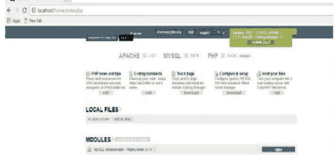

点击 MySQL Administration-PHPMyAdmin 模块，或者在版本 7 中在点击界面中间的 PHPMyAdmin 之前启动数据库。

将出现像这样的页面。

如所示，可以使用左侧上方的新链接创建数据库。所有基于 Unix/Linux 的托管上的 C-Panel 也会提供类似的屏幕。

上述图片顶部的菜单列出了与其账户或安装关联的一个数据库，除了添加 SQL 命令外，导出和导入允许备份数据库和输入批量数据。

使用如 EasyPHP 等开发软件可以模拟真实的托管环境。最重要部分是找到数据库的路径。这将有所不同。

```php
<td>"${row['salary']}"</td><td>"${row['location']}"</td></tr>;
}
```

查询的行将通过循环打印。这里使用了 `while` 循环。查询中预期的每个列或字段都放在表格的行中。在这里，引号非常重要。常见的错误是没有用正确的引号包裹元素。

```php
mysql_close($link_id);
```

数据库必须关闭，表格也是如此。运行此代码的结果如下：

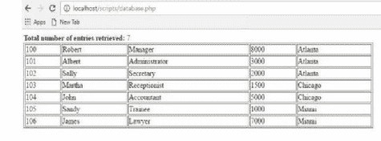

如果需要所有字段，只需编写要显示的那些字段，并忽略其他的即可。

如果查询带有条件——例如，查找所有工资大于 3000 的员工及其信息，代码可以写如下：

```html
<html>
<body>
<?php
$link_id = mysqli_connect('localhost'
```

结果如下：

| 获取的条目总数: | | | | |
|---|---|---|---|
| 225 | Bob | 1500 | Chicago |
| 223 | Alice | 1300 | Chicago |
| 225 | Dave | 1200 | Miami |

除了 SQL 语句外没有其他变化。

插入数据是数据库表格的重要部分。如果没有数据，就无物可检索，数据库实际上将变得毫无用处。

为了演示使用 PHP 向 MySQL 表格中插入数据的方法，让我们创建一个如下的 PHP 文件：

PHP 文件末尾允许用户为表格中的每个字段输入值。使用 `insert` 函数来检查员工按钮是否被点击，以及表单中输入的值是否将插入数据库。在 `mysql_query($sql, $link_id)` 或 `die ("Statement failed: " . mysql_error());` 行之后，可以写一条友好的消息。

在插入行中，注意引号错误非常重要。可以通过使用 PHPMyAdmin 查看表格来观察数据结果。

以下是 PHPMyAdmin 浏览搜索代码的示例。

| 编辑 | 复制 | 删除 | 姓名 所在地 |
|---|---|---|---|---|
| [ ] 编辑 | | | | 101 Rubber 1000 | Athens |
| [ ] 编辑 | | | | 102 Alabat 1000 | Chicago |
| [ ] 编辑 | | | | 103 Maths Reception 1000 | Athens |
| [ ] 编辑 | | | | 104 San Francisco 1000 | Atlanta |
| [ ] 编辑 | | | | 105 Unity 1000 | Miami |
| [ ] 编辑 | | | | 106 Ghost Lancer 1000 | Denver |

为了演示 PHP 代码中 MySQL 的更新方法，让我们记住最后一个字段是主键。

下一个代码允许所有其他字段均可更新。代码如下：

```html
<html>
<body>
if (isset($_POST['submit'])) {
  $link_id = mysqli_connect("localhost"
```

在上述代码中，表单部分与插入代码相同。变化在于查询以及用于设置更新字段的格式。主键是。

这里使用了新函数 `mysql_affected_rows()`，它用于在 PHP 中执行删除操作时。可以通过在 PHPMyAdmin 中浏览表格来观察结果，如下：

| id | 姓名 | 工作 | 工资 | 所在地 |
|---|---|---|---|---|
| 100 | Delia | Manager | 5000 | Atlanta |
| 101 | Debora | Salesman | 3000 | Frankfurt |
| 102 | Sally | Secretary | 2000 | Atlanta |
| 103 | Martha | Receptionist | 4000 | Chicago |
| 104 | James | Accountant | 6000 | Chicago |
| 105 | Sandy | Trainee | 1000 | Miami |
| 106 | Jarrer | Lawyer | 7000 | Miami |
| 107 | Robert | Advisor | 4500 | Dayton |

最后但同样重要的从数据库中删除的代码如下：

```php
<html>
<body>
<?php
if (isset($_POST['submit'])) {
  $link_id = mysql_connect('localhost', 'root', '') or (
    die("Could not connect: " . $mysql_error())
  );
  mysql_select_db("thotungal", $link_id);
  $sql = "delete from staff where sid='$_POST['sid']}'
  limit 1";
  $r = mysql_query($sql, $link_id) or (
    die("Statement failed: " . $mysql_error())
  );
  if (mysql_affected_rows()=1)
    print("Row has been deleted.");
  }
  mysql_close($link_id);
}
?>
<form action="database.php" method="post">
  sid:<input type="text" name="sid" size="20">
  <input type="submit" name="submit" value="Update">
</form>
</body>
</html>
```

在上述代码中，从查询中删除行以 `LIMIT 1` 结尾，确保最多只删除一行。删除和更新函数必须谨慎使用。通常，互联网用户需要更新或删除他们的信息。`mysql_affected_rows()` 函数与删除代码一起使用。更新和删除代码之间有很多相似之处。通过 PHPMyAdmin 观察删除结果如下：

| id | 姓名 | 工作 | 工资 | 所在地 |
|---|---|---|---|---|
| 100 | Manager | 5000 | Atlanta |
| 101 | Administrator | 3000 | Atlanta |
| 102 | Secretary | 2000 | Atlanta |
| 103 | Representative | 4000 | Chicago |
| 104 | Accountant | 5000 | Chicago |
| 105 | Trainee | 1000 | Miami |
| 106 | Lawyer | 7000 | Miami |

上述代码中删除的行是 `sid=107` 插入代码中的那个。上述删除代码可以修改为留空数据。执行这些函数的代码如下：

```php
$link_id = mysql_connect('localhost','root') or die("Could not connect: " . mysql_error());
mysql_select_db("thotangal",$link_id);
$sql = "truncate table";
```

可以修改代码来删除表格。然而，除非给了特定的权限，否则 `truncate` 和 `drop` 是为管理员保留的，程序员可能无法执行这些函数。

# PHP 版本 7

PHP 版本 7 是一个新版本，受新函数影响的区域以 `mysqli` 命名。好消息是，对于那些熟悉以前连接 MySQL 方法的人来说，很容易迁移到新函数：

`mysqli_connect()` 替换了 `mysql_connect()`

`mysqli_query()` 替换了 `mysql_query()`

`mysqli_fetch_array()` 替换了 `mysql_fetch_array()`

简而言之，新函数以 `mysqli_` 开始。让我们看看使用 PHP 7 中新 `mysqli` 函数选择数据的示例。

```html
<html>
<body>
<?php
$link_id = mysqli_connect('localhost','root','thottangal');
or die("Could not connect: " . mysqli_error());
$sql = "SELECT * FROM staff";
$result_id = mysqli_query($link_id, $sql) or die("Statement failed: " . mysqli_error($sql));
$x=mysqli_num_rows($result_id);
print("<table>获取的条目数: " .x . "</table>");
print("<table border=1 width=800\">
while ( $row = mysqli_fetch_array($result_id) ) {
print "<tr><td>" .$row['id'] ."</td>";
print "<td>" .$row['name'] ."</td></tr>";
```

```php
<td>"".$row['job']"/></td><td>"".$row['salary']"/></td></tr>
<td>"".$row['location']"/></td></tr>;
)
mysqli_free_result($result_id);
mysqli_close($link_id);
print('</table>');
</body>
</html>
```

逻辑流与之前的版本 5 相同。`Link_id` 连接数据库。区别在于 `mysqli_connect` 括号内有四个元素。最后一个是数据库名称。其余元素适用于本地安装，但在托管站点上略有不同。如果网站位于下文，此值需要从共享托管点的技术支持获取。

将查询传递给 `$sql` 后，从 `mysqli_fetch_array` 创建的数组获取行数。数组如上述代码所示打印。通过从内存中释放查询并关闭连接来关闭程序。`mysqli_fetch_array` 函数可以处理带有字符串或数字关键字的数组。

因此，PHP 5 和 7 的版本非常相似，上面两段文字提到的示例除外。现在尝试向数据库插入一行。版本 5 的相同代码在下方已修改以适应版本 7。

```html
<html>
<body>
<?php
if (isset($_POST['submit'])) {
$link_id = mysqli_connect('localhost','root','thottugal')
or die("Could not connect: " . mysqli_connect_error());
$sql = "insert into staff(id,name,salary,location) VALUES(".$_POST['id'],\','.$_POST['name'],\','.$_POST['salary'],\','.$_POST['location'].\)";
mysqli_query($link_id,$sql) or die(" Statement failed: " . mysqli_error($sql));
mysqli_close($link_id);
}
?>
<form action="database.php" method="post">
<id:<input type="text" name="id" size="20"><p>
<name:<input type="text" name="name" size="50"><p>
<job:<input type="text" name="job" size="30"><p>
salary:<input type="text" name="salary" size="10"><p>
location:<input type="text" name="location" size="30"><p>
<input type="submit" name="submit" value="add to database">
</form>
</body>
</html>
```

与之前的版本一样，我们连接到数据库、执行查询并关闭连接。
该 PHP 文件包含一个表单，用于显示和使用 `isset()` 函数，在验证提交按钮被点击后将执行插入操作。让我们来看更新操作的代码。

```php
<html
<body
<?php
if (isset($_POST['submit'])) {
    $link_id = mysqli_connect('localhost','root','thottangal') or die("Could not connect: " . mysqli_error());
    $Sql = "update staff set name=\"$_POST['name']\",job=\"$_POST['job']\",salary=\"$_POST['salary']\",location=\"$_POST['location']\" where sid=\"$_POST['sid']\";
    $result = mysqli_query($link_id, $Sql) or die("Statement failed: " . mysqli_error($link_id));
    if ($result) {
        print "Table updated.";
    }
}
?>
<form action="database.php" method="post">
<input type="text" name="sid" size="20"></p>
name:<input type="text" name="name" size="50"></p>
job:<input type="text" name="job" size="30"></p>
salary:<input type="text" name="salary" size="10"></p>
location:<input type="text" name="location" size="30"></p>
<p>
<input type="submit" name="submit" value="Update database"></p><p></form></body></html>


与在 PHP 5 版本使用的相同代码相比，区别在于`mysql_affected_rows`被一个`if`语句取代，并且在`mysql_functions`后面增加了`i`。

要删除某行，请将`Sql`中的查询替换为`"delete from staff where sid=$_POST['sid']} limit 1"`，并移除除主键`sid`以外的所有输入文本框。

`if`条件下的消息应该是`if ($r) { print"Row deleted" }`。

# 第 9 章. 用于 Oracle 数据库的 PHP

在上一章中讨论的数据库是 MySQL。在本章中，让我们来看与 PHP 的 Oracle 数据库。这里讨论的 Oracle 数据库是 11.2 Express 版本。附录 II 显示了如果它不在客户端或要使用的独立机器上，如何安装它。

要将 PHP 用于 Oracle，需要对带密码的用户进行一些配置更改。本书的代码使用 WAMP 编辑器 EasyPHP 开发，它有多个版本。不需要最新版本，但至少需要能够运行本书中 PHP 5 及以上版本代码的编辑器最低版本。使用`or`或类似函数连接到 Oracle 所需的配置更改见附录 III 和 IV。

记录下 Oracle 安装的默认值是非常重要的。在本章的示例中，安装的数据库名为`orcl`。将使用`hr`用户以及与用户相关的表。

让我们在 Oracle 数据库的`hr`用户下创建一个名为`emp`的表。执行此操作，请使用 Windows 菜单中 Oracle 下的`sql plus`。界面看起来如下。如果账户被锁定，请以`sybase`身份登录并使用以下命令——`alter user account unlock;`，然后连接到`hr`。

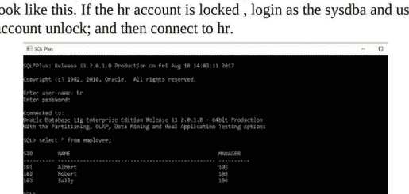

使用以下命令创建员工（employee）表：

```sql
create employee (sid varchar2(10), name varchar2(50), manager varchar2(10) constraint sid_pk primary key (sid));
```

这将创建一个以`sid`为主键的`employee`表。对于本书来说，这种程度就足够了。如果你对 Oracle SQL 不熟悉，很多关于 SQL 的说明会有帮助。

如果已按照附录 III 和 IV 中的讨论完成了`php.ini`（配置文件）的修改并保存，现在是获取 Oracle 的 PHP 连接器了。PHP 程序通过 PHP OCI8 扩展连接到 Oracle 数据库。

本书编写时的此扩展可以用于 Oracle 12、11、10 和 9 数据库。PHP 本身独立于 Oracle 数据库。

要连接到 OCI8，PHP 类库提供了以下函数：`oci_connect()`、`oci_pconnect`和`oci_new_connect()`。如果不需要持久连接，请使用`oci_connect()`。该函数也是缓存的。这提高了连接的效率。

`oci_connect`使用的缓存会在脚本运行后或连接资源关闭时移除。

`oci_new_connect`不进行缓存，而`oci_pconnect()`是缓存的，并可以跨请求使用。上述三个函数中的任何一个都需要`oci_close()`函数。

在使用`create`语句创建上述`employee`表后，必须插入值。

最简单的方法是使用插入行：

```sql
insert into employee values('101','Albert','103');
```

同样，插入上一页图片所示的其他数据行。

安装 Oracle 后，找到`tnsnames.ora`文件，它通常位于`network/admin/`文件夹中。该文件提供了数据库的`sid`值。如本章前面提到的，默认值为`oci`。端口为 1521，如果在独立计算机或笔记本电脑上安装 Oracle 11.2 express，则为本地主机（Local Host）。

`oci_connect()`函数有三个部分：用户名、密码和连接字符串。我们要连接的`hr`用户下的用户名是`hr`，密码是`hr`，连接字符串是`oci`——即数据库的 sid 或数据库名。确保`sid`名称与`tnsnames.file`中列出的完全一致。

`oci_parse()`用于解析查询。
`oci_execute()`用于执行语句。
`oci_close()`将关闭与数据库的连接。

你可能会注意到所有这些步骤与 PHP 连接到 MySQL 数据库的方式相似。现在让我们来看下面的代码。

```php
<?php
$db = oci_connect('hr', 'hr', 'oci');
if (!$db) {
    trigger_error('Unable to connect to database', e_user_error);
}
$sql = 'select * from employee';
$stmt = oci_parse($db, $sql);
oci_execute($stmt);
$count = 0;
```

```php
$sql = "insert into employee (sid,name,manager) values
('104','Adam','102');";
$stmt = oci_parse($db, $sql);
oci_execute($stmt, OCI_NO_AUTO_COMMIT);
oci_commit($db);
oci_close($db);
?>
<body>
</html>
```

执行语句后跟着一个提交操作（commit），以确认插入数据库表。
`oci_execute()`接受两个参数。第一个是如上所示的解析语句（parse statement），第二个是一个方法。`oci_execute()`可用的方法包括：
- `OCI_COMMIT_ON_SUCCESS` - 当语句执行成功时，将自动提交连接未提交的更改。这是默认值。
- `OCI_DEFAULT` - 这是一个旧方法，在正在使用的 OCI8 版本中可能可用，从 PHP 5.2 之后就不建议使用此方法。
- `OCI_NO_AUTO_COMMIT` - 像示例中使用的那样，不会提交更改。如果需要，则必须像上面的示例那样使用`oci_commit()`。如果不使用，任何更改将在程序退出时被回滚。

示例中的插入操作可以通过另一种方法完成。该方法涉及使用名为`oci_bind_by_name()`的 OCI8 函数。
`oci_bind_by_name()`将 PHP 变量绑定到 Oracle 占位符。这种绑定提高了数据库性能，也是避免 SQL 注入安全问题的方法。SQL 注入是一种计算机攻击，是将恶意代码嵌入设计不当的应用程序并传递到后端数据库。绑定变量不被视为 SQL 语句的一部分，因此减少了 SQL 注入问题。代码如下：

```php
<?php
$db = oci_connect('hr', 'hr', 'orcl');
if (!$db) {
    trigger_error('Unable to connect to database', E_USER_ERROR);
}
$sql = "insert into employee (sid,name,manager) values
(:sid_by,:name_by_name,:manager_by)";
$stmt = oci_parse($db, $sql);
$sid='104';
$name='Adam';
$manager='102';
oci_bind_by_name($stmt, "sid_by", $sid);
oci_bind_by_name($stmt, "name_bv", $name);
oci_bind_by_name($stmt, "manager_bv", $manager);
oci_execute($stmt,OCI_NO_AUTO_COMMIT);
oci_commit($Db);
oci_close($Db);
?>
</body>
</html>
```

该代码创建了三个以`*bv*`结尾的绑定变量，插入语句的值通过与`$sql`关联的绑定语句通过引用发送。

在 Oracle 数据库表更新更新一行的代码如下：

```php
<?php
$Db = oci_connect('hr', 'hr', 'orcl');
if (!$Db) {
    trigger_error('Unable to connect to database,\n', E_USER_ERROR);
}
$sql = "update employee set manager='102'\nsid='103'";
$stmt = oci_parse($Db, $sql);
oci_execute($stmt,OCI_NO_AUTO_COMMIT);
oci_commit($Db);
oci_close($Db);
?>
```

删除行或删除表的代码可以从上述提供的权限中获得，这些权限由管理员授予。

```php
<?php
$Db = oci_connect('hr', 'hr', 'orcl');
if (!$Db) {
    trigger_error('Unable to connect to database,\n', E_USER_ERROR);
}
$sql = "delete employee where sid='103'";
$stmt = oci_parse($Db, $sql);
oci_execute($stmt,OCI_NO_AUTO_COMMIT);
oci_commit($Db);
oci_close($Db);
?>
```

# 第 10 章。正则表达式

正则表达式存在于所有的编程语言中，用于考虑某些输入的格式。例如，许多国家的邮政编码格式与美国并不相同。

PHP 支持两种类型的正则表达式 - POSIX 扩展正则和与 Perl 兼容的 PCRE。注意：以下信息仅适用于 PHP 5 版本。即使在第 5 版本中，某些环境也不会接受以下函数。PHP 7 中的函数显示在本章末尾。

POSIX 在 PHP 中有六个函数，它们是：

- `ereg()` - 匹配模式且区分大小写。
- `eregi()` - 匹配模式且不区分大小写。
- `ereg_replace()` - 匹配并替换模式且区分大小写。
- `eregi_replace()` - 匹配并替换模式且不区分大小写。
- `split()` - 使用模式分割字符串且区分大小写。
- `spliti()` - 使用模式分割字符串且不区分大小写。

元字符有助于创建模式，以测试输入字符串：

- `.` 是一个点，表示任何单个字符。
- `^` 是一个脱字符符号，表示字符串的开头。
- `$` 表示字符串的末尾。
- `|` 表示备选（或）。
- `()` 表示分组。

量词：

- `?` - 0 次或 1 次。
- `*` - 0 次或多次。
- `+` - 一次或多次。
- `(x)` - 正好 x 次。
- `{x, y}` - 在 x 到 y 次之间（包含边界）。
- `{x,}` - 至少 x 次。

字符类：

- `[a-z]` - 任何小写字母。
- `[A-Z]` - 任何大写字母。
- `[0-9]` - 任何数字。
- `[[:alnum:]]` - 字母数字字符。
- `[[:alpha:]]` - 任何字母。
- `[[:digit:]]` - 任何数字。
- `[[:punct:]]` - 任何标点符号。
- `[[:space:]]` - 任何空白字符。
- `[[:blank:]]` - 任何空格。

```php
<?php
$db = oci_connect('hr', 'hr', 'orcl');
if (!$db) {
    trigger_error('Unable to connect to database,\n', E_USER_ERROR);
}
// ... rest of code
```


# PHP 常见问题解答

## 基础问题

**10. `explode()` 的功能是什么？**

答案：`explode()` 通过字符串将字符串分割为数组。

**11. `trim()` 的作用是什么？**

答案：移除字符串两端的空白字符。

**12. 如何将用户重定向到另一个网页？**

答案：使用`header`函数。

**13. 如何查找字符串的长度？**

答案：使用`strlen()`函数。

**14. 带有字符串键的数组被称为 \___**

答案：关联数组（Associative array）。

**15. 在 PHP 程序中，可以使用哪个函数来检查表单是否已提交？**

答案：结合`if`语句使用`isset()`。

**16. 如何在 PHP 中发送邮件？**

答案：使用`mail()`函数 - `mail($to, $subject, $message, $headers);`

**17. PHP 中可以使用哪些加密函数？**

答案：MD5。

**18. pear 这个术语是什么意思？**

答案：PEAR 是一个用于复用 PHP 组件的框架和发行系统。该项目旨在提供结构化的代码库，维护一个分发代码和管理代码包的系统，并推广标准的编码风格。PEAR 分为三类：PEAR 核心组件、PEAR 包和 PECL 包。

**19. PHP 和 Javascript 之间有什么区别？**

答案：PHP 是基于服务器的，而 Javascript 是基于客户端的。

**20. 使用 PHP 配合 Oracle 需要激活哪个扩展？**

答案：需要在 PHP 配置文件中取消`oci8`扩展的注释。

# 实践工作坊

1. 在 Oracle 数据库的`HR`用户下创建一个名为`staff`的表。该表应该包含六列：`id`、`name`、`job`、`manager`、`salary`和`location`。除了工资（`salary`）是数字类型外，所有变量均为`text`或`varchar2`。主键是`id`。

使用 PHP 向此表插入任意六行数据。

2. 使用 PHP 显示所有工资大于 1000 的行。

3. 写一个程序，读取数字数组并将其按升序排列。

4. 开发一个 PHP 页面，保存用户的页面偏好并允许其使用页面大约十五分钟。

5. 开发一个 PHP 网页，允许用户根据美国、加拿大、欧洲和任何亚洲格式输入邮政编码、电话号码和三个字母的国家代码。程序必须能够提供适当的消息来引导用户。

# 附录 II. 安装 Oracle 数据库

检查所有的应用程序并查看是否安装了 Oracle。在 Windows 机器上，我们通常从开始按钮查看应用程序或程序。展开任何 Oracle 安装并找到`SQL plus`选项。

如果 Oracle 不是你的应用程序之一，请前往 oracle.com 的下载部分，根据你的 Windows 或 Linux 详情下载适用于你计算机的相应版本。在本书期间，唯一的表达式版本是 11G 版本 2。

如果用户有较旧的版本，例如 Oracle 10 Express 或 Oracle 9i，书中的代码同样适用。在本书编写期间，内容中的内容不需要进行安装。

请注意，完成 Oracle 数据库的注册和安装需要连接互联网。

安装并注册后，运行数据库不再需要连接互联网。在本书期间，Oracle 网站如下所示。


按照指引进入 database（数据库），然后进入 oracle database。将出现以下屏幕。

注意 Windows 有两个版本。请选择与你的机器相关的版本。确保两个文件都已下载。

点击“see all”（查看全部）以获取更多详情。Oracle 要求其产品的加载程序进行注册。这是一个免费的配置文件注册。

如果点击 all，下一个屏幕将如下所示。在下载相应的软件之前，需要接受许可。文件下载完成后，在准备安装软件之前，确保计算机已连接互联网。

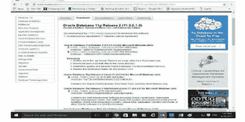

Windows 版本的 Oracle 11.2 版本安装过程与以下截图相似。请记下每个屏幕的细节。

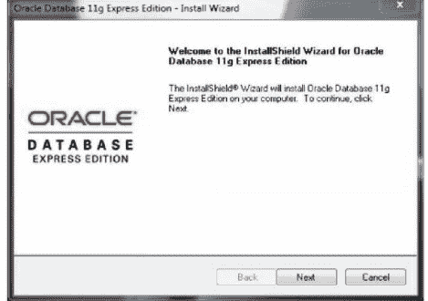
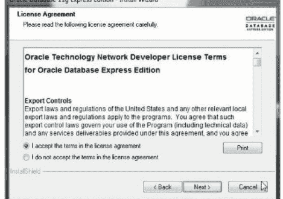
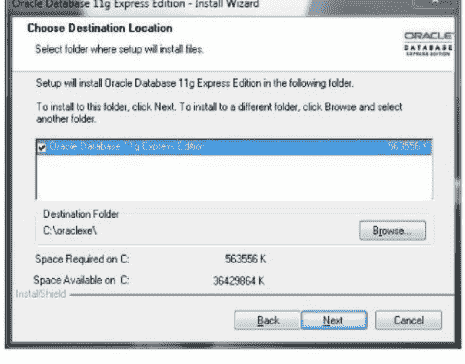
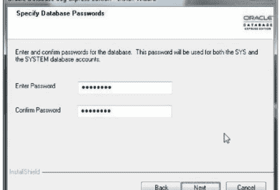
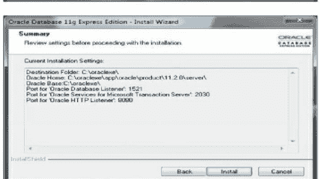

确保记下所创建的数据库密码和名称。这应该保存在某处。

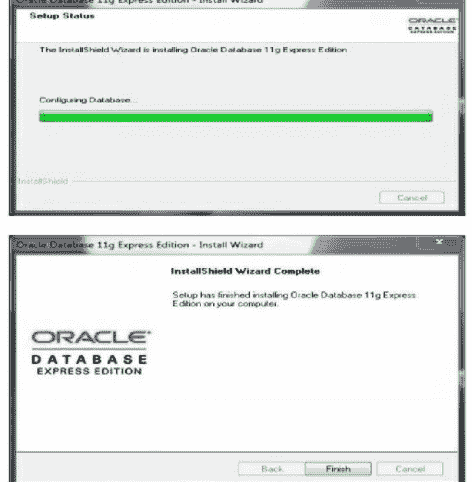

# 附录 III. PHP 与 Oracle

此编辑器默认 PHP 版本为 5.6。要激活连接 Oracle 的 OCI8 功能，必须找到`php.ini`文件。在此版本中会有两个文件，因为关联有两个 PHP 版本。找到你想要属性的`php.ini`文件，操作方法进入 EasyPHP 的安装文件夹。在本书使用的计算机上，它位于：

MySQL 管理允许用户通过 phpMyAdmin 创建数据库或表。

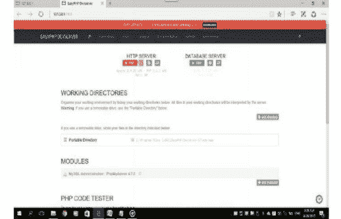

# 附录 IV. Easy PHP 界面

此编辑器（版本 7）上的默认 PHP 版本为 5.6。有一个在线快速编辑器可以用于粘贴代码并测试。

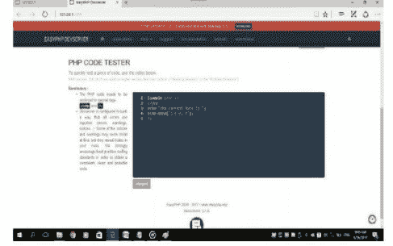

# 附录 V. 参考文献

我为本科 Web 开发课程相关的实验实验课程编写了这本书。

引用了以下来源：

- 《Programming PHP, 3rd Edition, Creating Dynamic Web Pages》，Rasmus Lerdorf, Kevin Tatroe, Peter MacIntyre，O'Reilly Media, 2013年2月。
- 《Beginning PHP and MySQL, From Novice to Professional》，Gilmore, W Jason, Apress, 2010。
- Oracle with PHP: php.net/manual/en/function.oci-connect.php
